## 非对称密码学：原语与协议


# 前言

**David POINTCHEVAL**

*CNRS, ENS/PSL, Inria, Paris, France*

随着 Diffie 和 Hellman（1976 年）的开创性论文，以及*公钥密码学*的引入，一个非常广阔的研究领域应运而生。公钥密码学不仅包含加密和认证的非对称变体，即公钥加密和签名方案，还包含许多其他创新且令人印象深刻的强大工具。

本书旨在介绍过去 40 年来提出的主要密码学原语，各章节由著名密码学家撰写，他们均为特定领域的专家，并在主要国际密码学会议上发表过多篇论文。非常荣幸他们都接受了我的邀请参与撰写，使本书尽可能完备。

本书首先介绍公钥密码学的主要原语，即*公钥加密*和*签名*，包括定义和安全模型。本章还阐述了可证明安全性的含义，解释了当宣称一种密码方案是安全时意味着什么。在第二章中，我们介绍*零知识证明*。这是一种颇具神奇色彩的工具，此后被用作许多其他协议的构建模块。零知识证明允许向验证者证明任意真陈述的有效性，而不泄露任何额外信息。同理，*安全多方计算*允许两个或多个拥有私有输入的参与者在这些联合输入上计算一个定义良好的函数的输出，而不泄露除预期输出之外的任何信息。

在最初被用于攻击椭圆曲线上的离散对数问题后，双线性对被广泛应用于构造新原语，主要是为了提出新类型的加密和签名方案。因此，我们首先对*基于双线性对的密码学*进行总体介绍，然后介绍满足额外属性的用于保密性和认证的高级密码方案。我们介绍的第一个此类方案是*广播加密*，它通过在发送私有信息时面向多个接收者，改进了常规加密。当然，人们可以将相同的解密密钥分发给许多用户，但如果想要动态更改目标集合，则需要不同的个人解密密钥。通过*追踪叛徒*，可以追踪向非合法用户泄露其解密密钥的叛徒。*基于属性的加密*是广播加密的推广，其中目标集合可以由策略和属性指定。这样就可以为每个新密文细粒度地描述目标集合。*高级签名*为签名和认证增加了匿名性属性。得益于双线性对，确实可以高效地向服务进行认证，而无需透露太多个人数据。

---

除了加密和签名方案，*密钥交换* 是现实生活中的主要工具，因为它允许两个或多个参与者就一个共同的会话密钥达成一致，该密钥可用于建立安全通信通道。虽然它看起来像是一个简单且定义明确的任务，但密钥交换协议错综复杂，需要考虑许多不同的安全概念。还有几种对用户进行认证的方法：要么对消息进行签名，要么展示解密能力。使用预共享对称密钥也是可能的。然而，最实用且最具挑战性的认证设置是各方持有一个*短*预共享对称密钥。后一种共同信息称为*密码*，为了解决这一设置，我们考虑*密码认证密钥交换*。

随着存储和计算的大规模外包，*可验证计算* 成为一个非常活跃的领域，人们希望对外包计算的输出有强有力的保证。当然，目标是能够以比执行计算本身高效得多的方式来验证计算，因此开发出了*简洁非交互式论证*（SNARGs）。

各章节概述了公钥密码学领域的一些最新进展。这绝不是详尽无遗的，每个演示都是作者对该领域的观点。有一些通用描述，有时则是更聚焦的例子来说明目的。它们适合广大受众发现或深入了解公钥密码学。

# 1

公钥加密与安全概念

**Nuttapong ATTRAPADUNG 和 Takahiro MATSUDA**

*日本国立产业技术综合研究所（AIST），东京*

公钥加密（PKE）允许发送者使用接收者的公钥对消息进行加密并发送给拥有相应私钥的接收者。自 Diffie 和 Hellman（1976 年）首次提出该概念以来，关于 PKE 的研究已取得巨大成果。主要目标之一是设计高效的 PKE 方案，这些方案在弱且合理的计算假设下，能在强安全概念下被证明是安全的。本章旨在提供关于 PKE 及其安全概念的基础知识，并综述该领域的重要成果。

我们首先围绕称为“抗选择密文攻击下的不可区分性”（IND-CCA）的安全概念展开，这被广泛接受为 PKE 的事实标准概念。在第一部分中，我们详细研究了 Cramer-Shoup（CS）PKE（Cramer 和 Shoup，1998），这是在合理假设下第一个实用的 IND-CCA 安全 PKE。这一部分也可作为一种流行的安全证明方法——基于游戏的方法——的入门材料。在第二部分中，我们综述了 IND-CCA 安全 PKE 的具体构造和通用构造。在最后一部分中，我们简要介绍了 PKE 的一些先进近期研究主题，如紧致安全性、密钥相关消息（KDM）安全性等。

## 1.1. PKE 的基本定义

### 1.1.1. 基本符号

对于 *n* ∈ ，我们定义 \[*n*\] := {1*,..., n*}。对于离散有限集 *S*，|*S*| 表示其大小，*x* ←[R] *S* 表示从 *S* 中均匀随机选择元素 *x*。对于字符串 *x* 和 *y*，|*x*| 表示 *x* 的比特长度，*x*ǁ*y* 表示它们的拼接。

对于（概率）算法或函数 `A`，*y* ←[R] `A`(*x*) 表示将 `A` 在输入 *x* 上的输出赋值给 *y*，如果需要指定 `A` 中使用的随机数 *r*，我们记作 *y* ← `A`(*x*; *r*)（此时 `A` 的计算被理解为在输入 *x* 和 *r* 上是确定性的）。如果 (·) 表示一个函数或算法，则 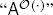 意味着 `A` 拥有对 (·) 的预言机访问权，即给定输入 *x* 时返回 (*x*) 给 `A`（但 `A` 无法看到  的内部描述/计算）。*λ* 始终表示安全参数。PPT 代表*概率多项式时间*。如果函数 *f*(*λ*) 趋向于 0 的速度快于 *λ*^(−*c*)（对于任意常数 *c* > 0），则称该函数为*可忽略函数*。

### 1.1.2. 公钥加密

一个 PKE 方案由三个 PPT 算法 (`KG, Enc, Dec`) 组成，语法如下：

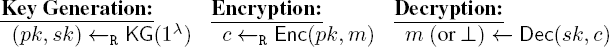

其中 `Dec` 是确定性算法，(*pk, sk*) 是一对公钥/私钥，*c* 是明文 *m* 在 *pk* 下的密文。我们通常允许 `Dec` 输出特殊符号 ⊥（该符号与明文空间中的任何元素均不同），表示 *c* 无效。

如果对于所有 *λ* ∈ ，`KG`(1^(*λ*)) 输出的 (*pk, sk*) 和任意 *m*，都有 `Dec`(*sk,* `Enc`(*pk, m*)) = *m*，则称该 PKE 方案是*正确的*。

历史上，PKE 的概念最早由 Diffie 和 Hellman（1976）的开创性工作提出，第一个可行的构造由 Rivest 等人（1978）提出，称为 RSA 加密方案。早期提出的 PKE 系统（如 RSA）考虑的是具有确定性加密算法的方案（即确定性 PKE，又称陷门函数 \[TDF\]）。Goldwasser 和 Micali（1982）首次处理了具有概率加密算法的 PKE。

### 1.1.3. IND-CPA 与 IND-CCA 安全性

这里，我们回顾 PKE 的两个核心基本安全概念：抗选择明文攻击下的不可区分性（*IND-CPA 安全性*）和 *IND-CCA 安全性*。

我们首先回顾它们的形式化定义。对于 PKE 方案 Π = (`KG`, `Enc`, `Dec`) 和对手 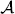\= ([1], [2])，考虑 IND-CPA 实验 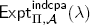 和 IND-CCA 实验 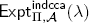，如图 1.1 所述。在两个实验中，`st` 表示从 [1] 传递给 [2] 的任意内部状态信息，且要求 |*m*[0]| = |*m*[1]|。此外，在 IND-CCA 实验中，[2] 不允许将挑战密文 *c*^∗ 提交给解密预言机 `Dec`(*sk,* ·)。

**定义 1.1.**——*如果对于任意 PPT 对手* *，其 IND-CCA 优势* 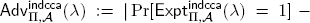1*/*2| *可忽略，则称 PKE 方案* Π *具有* IND-CCA 安全性。*IND-CPA 安全性*的定义类似，使用 IND-CPA 实验 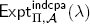 和 IND-CPA 优势 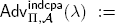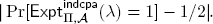。

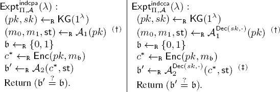

**图 1.1.** *PKE 的 IND-CPA 实验（左）和 IND-CCA 实验（右）。*^((†)) *要求* |*m*[0]| = |*m*[1]|.^((‡)) [2] *不允许向* `Dec`(*sk,* ·) *提交* *c*^∗


名称 `IND-CPA` 和 `IND-CCA`，以及更普遍地将安全目标（`IND`）与攻击模型（`CPA`/`CCA`）相结合的符号，是由 Bellare 等人（1998）引入的，该符号已被频繁采用于其他类型的安全概念中。`IND-CPA` 安全性是由 Goldwasser 和 Micali（1982）引入的针对 PKE 的最早的形式化定义。他们还利用模拟器的概念，给出了另一种称为*语义安全*的 PKE 形式化安全定义。（使用模拟器定义的安全概念通常称为基于模拟的安全定义。）粗略地说，语义安全捕捉了这样的直觉：密文除了泄露其长度外，不会泄露加密明文的任何部分信息（针对被动观察密文的对手）。这一概念旨在将 Shannon（1949）所考虑的加密方案安全概念*完全保密*的计算变体形式化。Goldwasser 和 Micali（1982）证明了 `IND-CPA` 安全性与语义安全性是等价的。很容易看出，`IND-CPA` 安全性无法由加密算法为确定性的 PKE 方案实现。

抗选密文攻击的安全概念最早由 Naor 和 Yung（1990）形式化，其定义捕捉了所谓的*IND-CCA1 安全性*，即不允许对手在接收到挑战密文后进行解密查询。（这种攻击类型也称为*非自适应*选密文攻击。）考虑对手在接收到挑战密文*后*进行解密查询的选密文攻击，最早由 Rackoff 和 Simon（1992）提出。（这种攻击类型称为*自适应*选密文攻击。）我们上面回顾的 `IND-CCA` 安全性的形式化定义是当今最广泛使用的定义。`IND-CCA` 安全性有时被称为 `IND-CCA2` 安全性，以明确表明它考虑了自适应选密文攻击。

与 `IND-CPA` 安全性不同，`IND-CCA` 安全性捕捉了拥有解密预言机访问权限的“主动”对手的安全性。然而，从其定义中可能不明显我们为何应关注这一安全概念。`IND-CCA` 安全性的实际重要性首次因 Bleichenbacher（1998）对 PKE 方案 `PKCS#1v1.5` 的著名攻击而被广泛认知。他的攻击通过访问一个预言机（输入密文，返回该密文是否根据解密算法处于有效形式）从密文中恢复明文。如果 PKE 方案具有 `IND-CCA` 安全性，则此攻击无效。为了应对 Bleichenbacher 的攻击，`PKCS#1` 进行了更新并采用了 `RSA-OAEP` 方案（Bellare 和 Rogaway 1995），该方案被证明具有 `IND-CCA` 安全性（在随机预言机模型中）。此外，`IND-CCA` 安全性已被证明蕴含 PKE 的许多有用且重要的安全概念（从实践和理论两个角度），例如下一节所述的不可延展性（Dolev 等人 1991）。因此，`IND-CCA` 安全性如今被认为是 PKE 应达到的黄金标准安全概念之一。

### 1.1.4. 其他基本安全概念及关系

在此，我们回顾 PKE 的其他两个基本安全概念，它们与 `IND-CPA` 和 `IND-CCA` 安全性一样基础。（我们不给出形式化定义，因此有兴趣的读者请参考原始或相关论文。）我们还将在第 1.4 节中描述更多安全概念。

#### 1.1.4.1. 单向性

*单向性*是一种安全概念，捕捉了这样的直觉：给定一个加密随机选择明文 `m` 的密文 `c`，无法完全恢复 `m`。作为 PKE 的安全概念，这听起来可能足够强。然而，一旦形式化，它并不保证 `c` 不会泄露关于 `m` 的任何部分信息。此外，该安全概念不适用于加密熵不大的消息（例如单个比特）的 PKE 方案。与不可区分性安全概念类似，我们可以在 CPA 和 CCA 设置下考虑这一概念。对于 PKE 方案（具有足够大的明文空间），`IND-CPA`（分别 `IND-CCA`）安全性蕴含 CPA（分别 CCA）下的单向性。

#### 1.1.4.2. 不可延展性

*不可延展性*是一种安全概念，捕捉了这样的直觉：给定一个加密某明文 `m` 的密文 `c`，无法构造出一个密文 `c'`，使其解密得到的明文 `m'` 与 `m` “有意义地相关”（例如 `m' = m + 1`）。例如，这种安全性对于用于密封拍卖的 PKE 是必要的。不可延展性最早由 Dolev 等人（1991）引入，他们给出了基于模拟的形式化。随后，又提出了几种其他形式的不可延展性形式化（Bellare 等人 1998；Bellare 和 Sahai 1999, 2006；Pass 等人 2007）。不可延展性听起来更像是完整性而非保密性的安全概念。然而，在上述任何形式化中，CPA 下的不可延展性都蕴含 `IND-CPA` 安全性。

Bellare 等人（1998）和 Dolev 等人（2000）（Dolev 等人 1991 的期刊版）证明了 `IND-CCA` 安全性与选密文攻击下的一种不可延展性形式是等价的，这支持了 `IND-CCA` 安全性的重要性。Bellare 和 Sahai（1999）证明了几种不可延展性形式的等价性，即：捕捉 Dolev 等人（1991）精神的基于模拟的形式、Bellare 等人（1998）引入的基于比较的形式、以及使用“并行解密查询”概念（也在 Bellare 和 Sahai 1999 中引入）的基于不可区分性的形式。Bellare 和 Sahai（2006）（Bellare 和 Sahai 1999 的更新完整版）和 Pass 等人（2007）阐明了 PKE 不可延展性形式化中对无效密文（解密为无效符号）处理的一些微妙之处。特别是后一项工作表明，对于解密算法可能返回无效符号的 PKE 方案，基于模拟的不可延展性严格强于基于不可区分性的不可延展性。

## 1.2. 基本 PKE 方案

我们描述一些基本 PKE 方案并证明其安全性。我们将重点关注基于与离散对数相关问题的 PKE 方案，即 ElGamal PKE 和 CS PKE，它们的 `IND-CPA` 和 `IND-CCA` 安全性分别依赖于判断性 Diffie-Hellman (DDH) 问题的困难性。为了理解其设计原理（特别是 Cramer-Shoup PKE），我们遵循 Katz（2004）的方法，通过一个中间方案逐步修改 ElGamal PKE，最终得到 CS PKE。我们将通过简要综述其他家族的具体 PKE 方案来结束本节。

### 1.2.1. 基于游戏的证明

以下各节的另一个目的是演示如何使用*基于游戏的*方法（例如 Shoup 2004；Bellare 和 Rogaway 2006），也称为*混合论证*，来证明复杂方案的安全性。在这种方法中，我们通常定义一系列游戏，其中第一个是我们想要证明的安全概念（例如 `IND-CCA` 游戏）所定义的真实攻击游戏，最后一个是显而易见安全的攻击游戏（对手的优势为零）。然后我们证明相邻游戏之间对手优势的差异可以忽略不计。将它们全部结合起来，我们就可以得出原始游戏中的优势接近于可忽略不计。这样做的一个主要好处是，我们可以*一次*专注于方案所依赖的一个假设（注意复杂方案通常依赖许多假设或要素），而基于单一假设/要素分析这种变化应该是简单的。作为预备知识，我们陈述一个有用的引理：


# 引理 1.1（差分引理 (Shoup 2004)）

设 `A`、`B`、`F` 为某概率空间中定义的事件，且满足 `A ∧ ¬F = B ∧ ¬F`。则有 `|Pr[A] − Pr[B]| ≤ Pr[F]`。

### 1.2.2. ElGamal 加密

ElGamal 方案（ElGamal 1984）是最著名的公钥加密（PKE）方案之一。其 IND-CPA 安全性依赖于 DDH 问题的困难性。

我们首先定义群生成器。群生成器 `GGen` 是一个概率多项式时间（PPT）算法，输入 `1^λ`，输出一个循环群 `G` 的描述、其阶 `q`（`q` 为位长度为 `λ` 的素数）以及一个随机生成元 `g`。

**定义 1.2.** 设 `(G, q, g) ←[R] GGen(1^λ)`。算法 `D` 的 DDH 优势定义为：

```
Adv_DDH^GGen(D) = |Pr[D(G, q, g, g^α, g^β, g^(αβ)) = 1] − Pr[D(G, q, g, g^α, g^β, g^γ) = 1]|
```

其中 `α, β ←[R] Z_q`，`γ ←[R] Z_q`。若对所有 PPT 算法 `D`，其 DDH 优势均可忽略，则称 `GGen` 满足 DDH 假设。

针对 `GGen` 的 ElGamal 方案可参见 图 1.2 描述。其明文空间为 `G`。正确性由 `h^r = u^x v^y` 直接得出。

**定理 1.1.** 假设 `GGen` 满足 DDH 假设。则针对 `GGen` 的 ElGamal 方案是 IND-CPA 安全的。

**证明.** 设 `A` 为任意攻击 ElGamal 方案 IND-CPA 安全性的 PPT 对手。我们考虑一系列游戏。令 `S[i]` 为游戏 `i` 中事件 `b = b'` 发生。

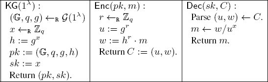

**图 1.2. ElGamal 加密**

**游戏 0.** 此游戏即为由 ElGamal 方案与对手 `A` 实例化的 IND-CPA 游戏。由定义，`Pr[S[0]] = Adv_IND-CPA^ElGamal(A)`。

**游戏 1.** 我们修改 Game 0，改为计算 `w = g^z · m[b]`，其中 `z ←[R] Z_q`。

更精确地，两个游戏的算法描述如下，变更部分以灰色高亮显示。

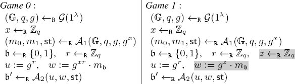

**图 1.3.** ElGamal 方案安全性证明的游戏序列

**断言 1.1.** `|Pr[S[0]] − Pr[S[1]]| = Adv_DDH^GGen(D)`，对某 PPT 算法 `D` 成立。

为证明此断言，我们构造 `D` 如下。回顾 `D` 的输入为 `(G, q, g, g^α, g^β, g^γ)`，其试图判断 `γ = αβ` 还是 `γ` 为随机值。

> **算法** `D(G, q, g, g^α, g^β, g^γ)` :
>
> `(m[0], m[1], st) ←[R] A_1(G, q, g, g^α)`, `b ←[R] {0, 1}`, `w := g^γ · m[b]`
>
> `b' ←[R] A_2(g^β, w, st)`。若 `b = b'` 则输出 1，否则输出 0。

直观上，算法 `D` 以 `x = α, r = β, z = γ` 在 Game 0 和 Game 1 之间插值。若 `γ = αβ`，则 `D` 实际上模拟了 Game 0；若 `γ` 为随机值，则 `D` 实际上模拟了 Game 1。注意 `D` 仅在 `b = b'` 成立时输出 1。因此其优势恰为 `|Pr[S[0]] − Pr[S[1]]|`。

**断言 1.2.** `Pr[S[1]] = 1/2`。

此断言源于这样一个事实：在 Game 1 中，元素 `g^z` 作为一次性密钥（one-time pad）完全隐藏了 `m[b]`。

结合两个断言，可得 `Adv_IND-CPA^ElGamal(A) = Adv_DDH^GGen(D)`，在 DDH 假设下可忽略。这完成了定理的证明。


## 1.2.3. 简化 CS 加密

接下来我们描述简化 CS（或 Cramer–Shoup-"lite"）方案。这是一个通向 CCA 安全性的中间方案，可被证明达到 IND-CCA1（非自适应 CCA）安全性。它可视为对 ElGamal 的修改，主要有两点：使用两个生成元，以及在解密时要求有效性检查。

我们定义 `(G, q, g_1, g_2) ←[R] GGen'(1^λ)` 为：先取 `(G, q, g_1) ←[R] GGen(1^λ)`，再选 `ℓ ←[R] Z_q` 并设 `g_2 = g_1^ℓ`。本章中，固定 `ℓ` 始终表示 `log_(g_1) g_2`。方案如下。

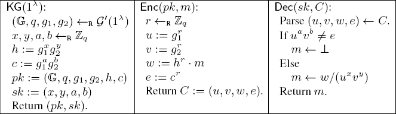

**图 1.4.** 简化 Cramer-Shoup 加密

关于正确性，对于按 Enc 算法诚实生成的密文 `C := (u, v, w, e)`，可验证其通过有效性检查：`h^r = u^x v^y` 即 `c^r = e`。此外，显然 `h^r = u^x v^y`，因此解密将正确输出消息 `m`。

我们简述一些直观理解。首先，使用两个生成元允许在固定公钥 `g_1, g_2, h` 约束下存在多对可能的私钥 `(x, y)`。这使得算法 `D` 能够模拟解密预言机，同时嵌入 DDH 问题实例。其次，有效性检查对于拒绝证明中查询解密预言机的"非法"密文至关重要。若不拒绝，此类非法密文可能向对手泄露私钥对 `(x, y)` 的更多信息（断言 1.6）。此外，有效性检查的设计也保证了非法密文将以除可忽略概率外的概率被拒绝（断言 1.5）。

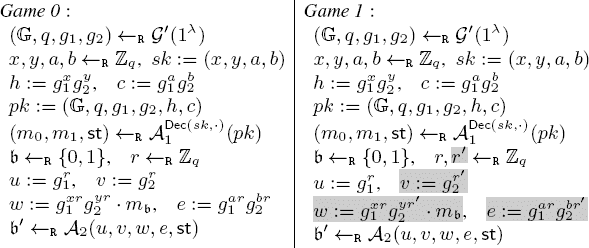

**图 1.5.** SimpCS 方案安全性证明的游戏 0 和 1

**定理 1.2.** 假设 `GGen` 满足 DDH 假设。则针对 `GGen` 的简化 CS 方案是 IND-CCA1 安全的。

**证明.** 设 `A` 为任意攻击该方案 IND-CCA1 安全性的 PPT 对手。我们使用以下游戏。令 `S[i]` 为游戏 `i` 中事件 `b = b'` 发生。

**游戏 0.** 此游戏即为由 SimpCS 方案与对手 `A` 实例化的 IND-CCA1 游戏。由定义，`Pr[S[0]] = Adv_IND-CCA1^SimpCS(A)`。

**游戏 1.** 我们修改 Game 0，改为使用随机 `r, r' ←[R] Z_q` 计算挑战密文：`u = g_1^r, v = g_2^r'`。

**游戏 2.** 此游戏与 Game 1 完全相同，不同之处在于选取 `ℓ ←[R] Z_q \ {0}` 且 `r' ←[R] Z_q \ {r}`，并设 `g_2 = g_1^ℓ`。特别地，有 `ℓ ≠ 0` 且 `r ≠ r'`。

**游戏 3.** 此游戏与 Game 2 完全相同，不同之处在于解密预言机现在也会拒绝（即对满足条件的解密查询返回 `⊥`）任何解密查询 `C[i] = (u[i], v[i], w[i], e[i])`，使得 `log_(g_1) u[i] ≠ log_(g_2) v[i]`（我们称此类 `C[i]` 为*非法*密文）且 `e[i] = u[i]^a v[i]^b`（即其通过 `Dec` 中的有效性检查）。注意 `i` 指第 `i` 次查询。

**断言 1.3.** `|Pr[S[1]] − Pr[S[2]]| = Adv_DDH^GGen(D)`，对某 PPT 算法 `D` 成立。

我们通过构造攻击 DDH 问题的 PPT 算法 `D` 来证明这一点，构造如下。

> **算法** `D(G, q, g, g^α, g^β, g^γ)` :
>
> `x, y, a, b ←[R] Z_q`, `sk := (x, y, a, b)`
>
> `(m[0], m[1], st) ←[R] A_1(G, q, g, g^α, g^(x+αy), g^(a+αb))`
>
> `b ←[R] {0, 1}`, `w := g^(βx+γy) · m[b]`, `e := g^(βa+γb)`
>
> `b' ←[R] A_2(g^β, g^γ, w, e, st)`。若 `b = b'` 则输出 1，否则输出 0。


现在我们可以看到，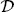 在 `g[1] = g`、`g[2] = g^α`、`u = g^β`、`υ = g^γ` 的情况下，在游戏 0 和游戏 1 之间进行插值。如果 `γ = αβ`，则  模拟游戏 0。如果 `γ` 是随机的，则  模拟游戏 1。因此，其优势正好是 `Pr[S[0]] – Pr[S[1]]`，从而得证。

**声明 1.4.** – `| Pr[S[1]] − Pr[S[2]] | 可忽略不计。`

根据差异引理，我们有 `| Pr[S[1]] − Pr[S[2]] | ≤ Pr[E]`，其中 `E` 是事件 `ℓ = 0` 或 `r = r′`，这里 `l, r′ ←[R] [q]`，观察到 `E` 发生的概率可忽略不计，因为 `q` 是指数级的。

**声明 1.5.** – `| Pr[S[2]] − Pr[S[3]] | 可忽略不计。`

由于该声明是信息论层面的，我们将证明即使  是一个全能对手（例如可能能够计算离散对数），该陈述依然成立。为证明该声明，令 `F` 为对手  查询至少一个通过有效性检查的非法密文的事件。根据 `F` 的定义，我们有 `S[2] ∧ ¬F = S[3] ∧ ¬F`。因此，由差异引理可得 `| Pr[S[2]] − Pr[S[3]] | ≤ Pr[F]`。现在我们推导 `Pr[F]` 的最大界。回顾 `ℓ = log[g1] g[2]`。对于每个查询 `C[i] = (u[i], v[i], w[i], e[i])`，我们记 `r[i] = log[g1] u[i]`，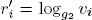 和 `z[i] = log^(g1) e[i]`。Dec 中的有效性检查等式，即 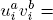 `e[i]`，等价于 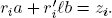 因此， 可以使其第一个查询为非法，同时通过猜测 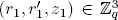 且满足 `r[1] ≠ ` 使得 `r[1]a + ℓb = z[1]` 来通过有效性检查。现在我们观察到， 关于 `a, b` 的信息仅来自公钥，即 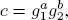，因此对于全能对手，它可能知道 `log[g1] c = a + ℓb`。但由于 `r[1] ≠ `，我们有 `r[1]a + ℓb` 与 `a + ℓb` 线性无关，因此它只能以 `1/q` 的概率正确猜测 `z[1]`。

对于第 `i` 个查询， 可以通过类似的猜测使其非法，但现在它从之前未通过检查的非法查询中获得了关于 `a, b` 的更多信息。更精确地说，对于一个被拒绝的非法查询 `C[j] = (u[j], v[j], w[j], e[j])`，其中 `j < i`， 了解到 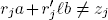 这从受限于其对 `a+ℓb` 的认知的 `q` 个可能的 `(a, b)` 对中排除了一个可能性。在第 `i` 个查询之前，最多有 `i − 1` 个这样的查询。因此， 正确猜测 `z[i]` 的概率至多为 `1/(q (i 1))`。令 `k` 为查询总数。由并集界可知，`Pr[F]` 至多为 `k/(q − k + 1)`。由于 `k` 是 `λ` 的多项式而 `q` 是指数级的，该量可忽略不计。

**声明 1.6.** – `Pr[S[3]] = 1/2.`

为证明该声明，只需证明在游戏 3 中，给定视图中所有已知指数的情况下，消息掩码项的指数是均匀随机的。这等价于证明给定 `ℓ, x + ℓy`（来自 `pk`）、`r, r′`（来自挑战密文）及其解密查询答案中的一些信息的情况下，`xr + ℓyr′` 是均匀随机的。忽略后者，这成立是因为 `xr+ℓyr′` 与 `x + ℓy` 线性无关，因为 `r ≠ r′` 且 `ℓ = 0`。我们进一步论证，即使给定其解密查询的答案，也不会获得关于 `x, y` 的额外信息。现在，由于在游戏 3 中，我们拒绝所有通过有效性检查的非法查询，剩余的查询要么不通过检查，要么不是非法查询。在第一种情况下，检查不涉及 `x, y`（因此无关于它们的信息）。在后一种情况下，我们有 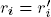 且  了解 `log[g1] m[i] = z[i] r[i]x ℓr[i]y`。但这与 `x + ℓy` 线性相关。因此，没有关于 `x, y` 的额外信息。

结合所有差异，我们有

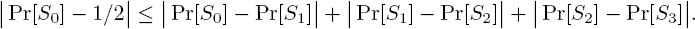

由于上述声明和 DDH 假设，这是可忽略不计的。


我们注意到，如果将安全游戏扩展到完全 IND-CCA 的情况（不仅仅是 IND-CCA1），声明 1.5 的证明将失效。直观上，这是因为对手从挑战密文中获得了关于 `a, b` 的进一步信息。

### 1.2.4. Cramer–Shoup 加密

我们现在描述下图中的完整 CS 加密方案（(Cramer and Shoup 1998), (Cramer and Shoup 2003)）。该方案很重要，因为它是在标准模型下（不依赖随机预言机等理想化结构）的第一个高效 IND-CCA 安全方案。

CS 方案将使用另一个要素：抗碰撞哈希函数族。^()

其正确性类似于简化方案。特别地，对于按照 Enc 诚实构造的密文 `C := (u, v, w, e)`，我们可以看到它通过检查，因为 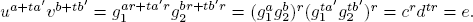

**定理 1.3.** – *假设 DDH 假设对*  *成立。则*  *上的 CS 方案是 IND-CCA 安全的。*

**证明.** – 设  为攻击 CS 方案 IND-CCA 安全性的任意 PPT 对手。我们使用以下游戏。令 `S[i]` 为游戏 `i` 中 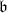 = ′ 的事件。记挑战密文为 `C* = (u*, v*, w*, e*)`，第 `i` 个密文查询为 `C[i] = (u[i], v[i], w[i], e[i])`。

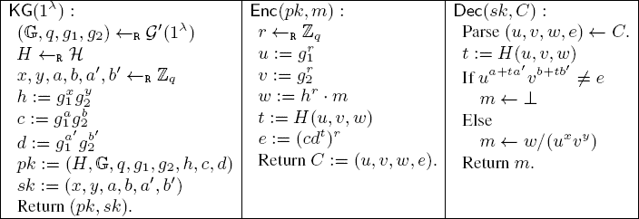

**图 1.6.** *Cramer-Shoup 加密*

**游戏 0.** 令该游戏完全是由 CS 方案与对手  实例化的 IND-CCA 游戏。根据定义，我们有 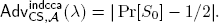

**游戏 1.** 这完全是游戏 0，例外是解密预言机现在还拒绝任何满足 `(u[i], v[i], w[i]) = (u*, v*, w*)` 但 `e[i] ≠ e*` 的挑战后解密查询 `C[i] = (u[i], v[i], w[i], e[i])`。

**游戏 2.** 我们现在通过用随机 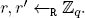 计算 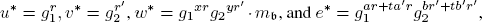 来代替游戏 1 计算挑战密文，从而对游戏 1 进行更改。

**游戏 3.** 这完全是游戏 2，例外是 `ℓ ≠ 0` 且 `r ≠ r′`。

**游戏 4.** 这完全是游戏 3，例外是解密预言机现在还拒绝满足以下条件的任何查询 `C[i] = (u[i], υ[i], w[i], e[i])`：

1.1 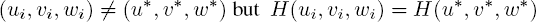

**游戏 5.** 这完全是游戏 4，例外是解密预言机现在还拒绝满足 `log[g1] u[i] ≠ log[g2] υ[i]`（即 `C[i]` 是非法密文）且在游戏 3 中未被拒绝的查询 `C[i] = (u[i], υ[i], w[i], e[i])`。

**声明 1.7.** – `Pr[S[0]] = Pr[S[1]]`。

从游戏 0 到游戏 1 的变化仅是概念上的（无实际变化）。确实，很容易看出满足 `(u[i], υ[i], w[i]) = (u*, υ*, w*)` 但 `e[i] ≠ e*` 的查询总是被拒绝的。

**声明 1.8.** – 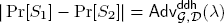 *对某个 PPT 算法*  *成立。*

上述声明的证明方式与声明 1.3 几乎相同，此处省略。

**声明 1.9.** – `| Pr[S[2]] − Pr[S[3]] | 可忽略不计。`

上述内容与声明 1.4 完全相同。

**声明 1.10.** – `Pr[S[3]] − Pr[S[4]] 可忽略不计，假设  是抗碰撞哈希族。`

假设游戏 4 中的例外事件发生。那么，这意味着我们如关系 1.1 所述精确地找到了 `H` 的碰撞。由于 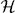 的安全性，这发生的概率可忽略不计。使用差异引理，我们可以得出该声明。

**声明 1.11.** – `| Pr[S[4]] − Pr[S[5]] | 可忽略不计。`


为了证明这一主张，我们令 *F* 为事件：对手  至少查询一个在 Game 4 中未被拒绝的非法密文。和以前一样，只需推导出 Pr\[*F*\] 的信息论界限即可，因为 Pr\[*S*[1]\] − Pr\[*S*[2]\] ≤ Pr\[*F*\]。回想一下， 不允许查询 (*u[i], υ[i], w[i], e[i]*) = (*u*^∗, *v*^∗, *w*^∗, *e*^∗)。这一性质，连同截至 Game 4 的拒绝条件，我们得到：要使 *F* 发生的查询必须满足 *H*(*u[i], υ[i], w[i]*) ≠ *H*(*u*^∗, *υ*^∗, *w*^∗)。令 *t[i]* = *H*(*u[i], υ[i], w[i]*) 和 *t* = *H*(*u*^∗, *υ*^∗, *w*^∗)（因此 *t[i] ≠ t*）。令 *ℓ* = log[*g*1] *g*[2]。对于每个查询 *C[i]* = (*u[i], υ[i], w[i], e[i]*)，我们记 *r[i]* = log[*g*1] *u[i]*, 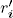 = log[*g*2] *υ[i]* 和 *z[i]* = log[*g*1] *e[i]*。`Dec` 中的有效性检查等式，即 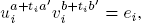 等价于 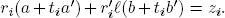。为简化起见，我们首先假设不失一般性地  在挑战前不进行查询。因此， 可以使其第一个（挑战后）查询为非法，同时也在 Game 4 中不被拒绝，方法是猜测 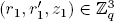，其中 *r*[1] ≠ 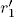 使得

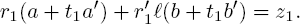

现在我们观察到  可能知道的关于 *a, b, a*′, *b*′ 的信息包括

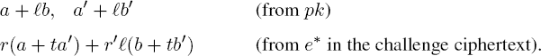

还要回想 *ℓ* ≠ 0 和 *r* ≠ *r*′。我们论证正确猜测 *z*[1] 的概率是 1/*q*。这成立是因为当 *r − r*′ 和 *r*[1] ≠  和 *t*[1] ≠ *t*′ 时，*z*[1] 的表达式与 *a* + *ℓb, a*′ + *ℓb*′, 和 *r*(*a* + *ta*′) + *r*′*ℓ*(*b* + *tb*′) 线性无关。这可以通过在变量向量 (*a, a*′, *b, b*′) 上建立方程组并得到系数矩阵来确认，即

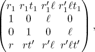

并看到其行列式为 *ℓ*²(*r* − *r*′)(*r*[1] − )(*t*′ − *t*[1]) ≠ 0。

接下来，为了处理  在挑战前确实进行查询的情况以及多次非法查询的情况，我们采用与主张 1.5 的证明类似的方法（当时我们考虑的是第 *i* 次查询）。由此，我们可以得出 Pr\[*F*\] 可以忽略不计。

### 主张 1.12. – Pr\[*S*[5]\] = 1/2.

上述主张可以用与主张 1.6 完全相同的方式证明。

结合所有主张，我们得到 | Pr\[*S*[0]\] − 1/2| 在 DDH 假设和  的安全性下可以忽略不计，正如所期望的那样。


### 1.2.5. 其他具体的 PKE 方案

我们列出文献中一些重要的 PKE 方案，连同它们的安全性、假设和一些特性。注意此列表绝非详尽无遗。

#### 1.2.5.1. 基于与因式分解相关问题的 PKE

– RSA (Rivest 等人 1978)：在 RSA 假设下单向性安全。

– Rabin (Rabin 1979)：在因式分解困难性下单向性安全。

– Goldwasser-Micali (Goldwasser 和 Micali 1982)：首个被证明的 IND-CPA 安全 PKE，基于二次剩余 (QR) 假设。类似于 RSA 假设（以及下文的 DCR），QR 假设与因式分解的困难性相关，但不知是否可由后者推导。

– Blum–Goldwasser (Blum 和 Goldwasser 1984)：在因式分解困难性下 IND-CPA 安全。

– Paillier (Paillier 1999)：在判定复合剩余 (DCR) 假设下 IND-CPA 安全。它是最著名的具有加法同态特性的 PKE 之一。Damgård 和 Jurik (2001) 在相同假设下提出了明文空间更大的扩展方案。Paillier 方案的前身包括 Benaloh (1994)、Naccache 和 Stern (1998) 以及 Okamoto 和 Uchiyama (1998) 的方案。

– Cramer–Shoup (2002) (Cramer 和 Shoup 2002)：IND-CCA 安全的 PKE 方案，一个基于 DCR 假设，另一个基于 QR 假设。事实上，他们提供了一个基于所谓哈希证明系统 (HPS) 的框架，该框架推广了（也捕捉了）基于 DDH 的原始 Cramer–Shoup (1998) 方案 (Cramer 和 Shoup 1998)。

– Hofheinz-Kiltz (2009) (Hofheinz 和 Kiltz 2009)：基于因式分解困难性的首个实用 IND-CCA 安全 PKE。

– Cramer–Hofheinz–Kiltz (Cramer 等人 2010)：基于 RSA 假设的 IND-CCA 安全 PKE 方案。他们还提供了至少另一个方案（见下文）。

#### 1.2.5.2. 基于与离散对数相关问题的 PKE

– ElGamal (ElGamal 1984) 和 Cramer–Shoup (1998) (Cramer 和 Shoup 1998)。我们在上文已详细描述它们。

– Kurosawa–Desmedt (Kurosawa 和 Desmedt 2004)：基于 DDH 假设、目标抗碰撞哈希和认证的对称密钥加密 (SKE) 的 IND-CCA 安全。该方案提高了 Cramer–Shoup PKE 的效率；值得注意的是密文大小减少了一个群元素。就撰写本文而言，该方案仍然是基于 DDH 假设的最高效 IND-CCA 安全 PKE 方案之一（至少在密文大小方面）。它可被视为混合加密（见 第 1.3.1 节）。

– Boyen–Mei–Waters (Boyen 等人 2005)：在判定双线性 Diffie–Hellman (DBDH) 假设 (Boneh 和 Franklin 2001) 下 IND-CCA 安全。该方案在所有这些高效 PKE 方案中拥有最紧凑的密文，但依赖于更强的工具——双线性配对。

– Hofheinz–Kiltz (Hofheinz 和 Kiltz 2007) 和 Shacham (Shacham 2007)：在 *k*-判定线性 (*k*-DLin) 假设下 IND-CCA 安全，对于任意正整数 *k*。我们注意到 1-Dlin 假设本身就是 DDH 假设，而 (*k* + 1)-DLin 严格弱于 *k*-Dlin。另一方面，在这些方案中，密钥和密文的大小随 *k* 线性增长。

– Cash–Kiltz–Shoup (Cash 等人 2008)、Hanaoka–Kurosawa (Hanaoka 和 Kurosawa 2008)、Haralambiev 等人 (Haralambiev 等人 2010) 和 Cramer–Hofheinz–Kiltz (Cramer 等人 2010)：在计算 Diffie–Hellman (CDH) 假设下 IND-CCA 安全的 PKE 方案。注意 CDH 严格弱于 DDH。此外，这些直接构造比基于搜索问题（如 CDH）困难性的通用硬核谓词方法 ( oldreich 和 Levin 1989) 构造 PKE 更高效。

#### 1.2.5.3. 基于与格相关问题的 PKE（及其他）

– Regev (Regev 2005)：首个在学习误差 (LWE) 假设下 IND-CPA 安全的 PKE。

– Peikert 和 Waters (Peikert 和 Waters 2008)：首个在 LWE 假设下 IND-CCA 安全的 PKE。Micciancio 和 Peikert (2012) 给出了一个提高效率的直接构造。

还有与其他数学结构相关的 PKE 方案，如纠错码、同源、多元多项式等。基于格的方案和这些后者方案属于后量子密码学领域，由本系列的另一本书涵盖。

#### 1.2.5.4. 随机预言模型中的 PKE


# IND-CCA 安全 PKE 的通用构造

迄今为止，我们描述和列举的仅是*标准模型*中的 PKE 方案。另一种通常能产生非常高效的 IND-CCA 安全 PKE 的流行方法，是在*随机预言机模型*（RO）（Bellare 和 Rogaway 1993）中构造方案。随机预言机是以预言机形式提供的均匀随机函数。在 RO 模型中，方案中使用的哈希函数在安全性证明中被随机预言机替代。缺点是，随机预言机模型方法仅具有启发式性质，且通常不合理（例如（Canetti 等人 1998））。RO 模型中 PKE 的一个例子是 RSA-OAEP 方案（Bellare 和 Rogaway 1995），该方案在 RO 模型下基于 RSA 假设被证明是 IND-CCA 安全的（Fujisaki 等人 2001）。另一个例子是所谓的 DHIES 方案（Abdalla 等人 2001），其在 RO 模型下的 IND-CCA 安全性可归约到所谓的 gap-DH 假设（Okamoto 和 Pointcheval 2001a），即即使对手拥有解决 DDH 问题的预言机，CDH 假设依然成立。还有一个值得一提的方案是 ElGamal 的一个变体，称为 Twin ElGamal（Cash 等人 2008），它在 RO 模型下基于 CDH 假设是 IND-CCA 安全的，并且像原始 ElGamal PKE 一样拥有非常紧凑的密文。事实上，DHIES 和 Twin ElGamal 都具有混合加密的结构（参见第 1.3.1 节）。

此外，我们还拥有更多“通用”的构造，它们可以将基础方案（通常满足某种弱安全形式，如 IND-CPA 或 CPA 下的单向性）通用地转换为在 RO 模型下达到 IND-CCA 安全的方案。（事实上，RSA-OAEP 就属于此类，它是通过将 OAEP 变换应用于 RSA 加密方案而获得的。）我们将在第 1.3.3 节中涉及它们。

## 1.3. IND-CCA 安全 PKE 的通用构造

上一节描述了一些基于具体数学假设的*特定*PKE 方案。本节描述基于通用密码学原语的*通用*IND-CCA 安全 PKE 构造。

### 1.3.1. 混合加密

通常，公钥密码学的计算量级比对称密钥密码学重且慢得多。*混合加密*是一种实用技术，旨在尽可能兼顾 PKE 的功能性和 SKE 的高效性。具体而言，要加密一条（长）消息，我们仅用 PKE 方案加密一个随机的、固定长度的“会话”密钥`K`，而实际要发送的消息则使用密钥`K`通过 SKE 进行加密。Cramer 和 Shoup（2003）为混合加密（也称为 KEM/DEM 框架）引入了现代处理方式和形式化，其中加密随机会话密钥`K`的过程被形式化为一个称为*密钥封装机制（KEM）*的专用原语。

在本节中，我们回顾混合加密的现代处理方式。具体来说，我们回顾 KEM 和 SKE 的形式化，然后回顾文献中混合加密的构造及相关结果。

KEM 由三个 PPT 算法（`KKG`、`Encap`、`Decap`）组成，语法如下：

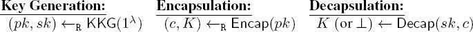

其中`Decap`是确定性算法，（`pk`、`sk`）是公钥/私钥对，`c`是在`pk`下会话密钥`K`的密文。与 PKE 一样，`Decap`允许输出特殊的无效符号⊥。

对于 KEM，IND-CCA 安全性和 IND-CPA 安全性的定义方式与 PKE 非常相似。本质区别仅在于：在 KEM 的安全性实验中，对手不再选择两个挑战明文，而是被给予挑战密文`c*`以及一个真实的会话密钥`K*`（与`c*`一起生成）或一个完全随机的会话密钥`K'`，并被要求区分这两种情况。

SKE 方案（在混合加密语境下也称为 DEM）由两个 PPT 算法（`E`、`D`）组成，语法如下：

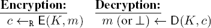

其中`D`是确定性算法，`K`表示密钥，`c`表示明文`m`在密钥`K`下的密文。与 PKE 和 KEM 一样，`D`允许输出特殊的无效符号⊥。在此语法中，密钥`K`的长度决定了安全参数。通常，SKE 方案也可能有专门的密钥生成算法，但为简化起见，此处不考虑此类语法。

在一般情况下考虑 SKE 的安全性时，我们需要考虑拥有加密预言机访问权限的对手，因为与 PKE 情况不同，对手无法自行生成密文。另一方面，对于此处混合加密语境下的 SKE，我们只要求“一次性”加密，因为混合加密将仅在每次加密时使用一个全新的会话密钥进行单次加密。回想一下，PKE 的安全概念已经以挑战密文`c*`的形式提供了一次加密（参见图 1.1）。因此，“一次性”SKE 的安全概念可以精确地定义为 PKE 的安全概念，唯一的例外是作为输入给对手的公钥`pk`变为空。我们将由此从 PKE 的 IND-CCA（分别 IND-CPA）安全性导出的 SKE 安全概念称为*IND-OT-CCA 安全性*（分别*IND-OT 安全性*），其中 OT 代表“一次性加密”。

值得一提的是，构造 IND-OT 和 IND-OT-CCA 安全的 SKE 方案相对直接。所谓的“伪随机一次性密码本”方案（即将密钥定义为伪随机生成器以随机输入为输出的一次性密码本方案）是 IND-OT 安全 SKE 的一个例子。类似地，任何强伪随机排列（Luby 和 Rackoff 1988）都可视为 IND-OT-CCA 安全的 SKE 方案，其中通过将消息输入排列来进行加密。注意，理论上，这样的排列可以从任何单向函数构造（Håstad 等人 1999；Luby 和 Rackoff 1988）。从这两个例子可知，IND-OT-CCA 和 IND-OT 安全的 SKE 均可通过加密算法为确定性且密文开销（即密文大小与待加密明文大小的差值）为零的加密方案来实现。

给定一个 KEM（`KKG`、`Encap`、`Decap`）和一个 SKE 方案（`E`、`D`），PKE 方案（`KG`、`Enc`、`Dec`）的混合加密构造如图 1.7 所述。

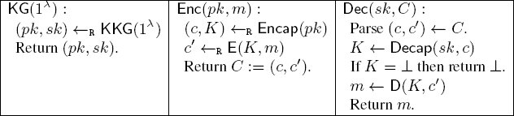

**图 1.7.** *混合加密：从 KEM 和 SKE 构造 PKE*


Cramer 和 Shoup（2003）证明了如果底层 KEM 是 IND-CCA 安全的，且底层 SKE 方案是 IND-OT-CCA 安全的，那么混合加密构造就是一个 IND-CCA 安全的 PKE 方案。此外，Herranz 等人（2010）研究了混合加密构造所达到的安全概念与底层 KEM/SKE 方案的安全概念之间的关系。特别地，他们证明了如果底层 KEM 是 IND-CCA1 安全的（分别为 IND-CPA），且底层 SKE 方案是 IND-OT 安全的，那么混合加密构造就是 IND-CCA1（分别为 IND-CPA）安全的。Hofheinz 和 Kiltz（2007）给出了混合加密的另一个结果：如果底层 KEM 在*受限 CCA 安全*意义上是安全的（这是一种严格弱于 IND-CCA 安全的安全概念），且底层 SKE 方案在（一次性）认证加密（Bellare 和 Namprempre 2000）意义上是安全的（同时考虑 IND-OT 安全性和一次性真实性），那么混合加密构造仍然能达到 IND-CCA 安全。我们注意到，同时达到 IND-OT 安全性和一次性真实性的 SKE 方案自动达到 IND-OT-CCA 安全性；因此，在一次性认证加密意义上安全的要求强于 IND-OT-CCA 安全性。

Abe 等人（2005）展示了另一种不同于上述的混合加密范式，称为 Tag-KEM/DEM 框架。该框架定义了一种称为 tag-KEM 的新原语。其语法与上述普通 KEM 的区别在于，生成 KEM 密文时允许来自 SKE/DEM 部分的反馈输入。该框架的优点之一是底层 SKE 方案只需是 IND-OT 安全的，而构造 tag-KEM 通常比构造普通 KEM 更困难。

这些关于混合加密的结果使我们在设计 IND-CCA 安全的 PKE 方案时，能够专注于合适 KEM 的设计。

### 1.3.2. Naor–Yung 构造及其扩展

我们描述一种由 Naor 和 Yung（1990）提出的经典方法，用于从 IND-CPA 方案和*非交互零知识*（NIZK）证明系统（Blum 等人 1988）构造 IND-CCA1 安全的 PKE。在该构造中，明文在独立的密钥和随机数下被加密两次，然后使用 NIZK 来证明两个密文加密的是同一个明文。其直觉是：如果对手能以某种方式获得两个独立加密同一明文的密文，那么本质上它已经知道该明文了。因此，解密预言机对对手应当是无用的。

我们首先简要回顾 NP 语言的概念以及此类语言 NIZK 的语法。关于零知识证明的更多细节可参见第 3 章。语言是一组二进制字符串，记为*L* ⊂ {0, 1}^∗。如果存在一个确定性多项式时间图灵机*M*，使得*x ∈ L*当且仅当存在一个长度为|x|的多项式的*见证 w*使得*M*(*x, w*) = 1，则语言*L*属于 NP 类。

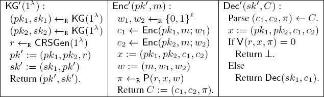

**图 1.8.** *Naor-Yung 构造*

在*公共随机字符串*（CRS）模型中，针对 NP 语言*L*的 NIZK 证明系统由三个算法（`CRSGen`、`P`、`V`）组成，其语法如下：

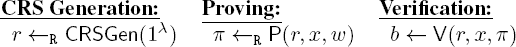

其中`V`是确定性算法，*r*表示 CRS，*x*和*w*分别表示语言*L*中的陈述及其对应的见证，*b* ∈ {0, 1}表示`V`接受（ *b* = 1）还是拒绝（ *b* = 0）。NIZK 应满足*完备性*（即如果*x ∈ L*，则在上述过程中，验证者`V`将总是接受）、*可靠性*（即如果*x ∉ L*，则即使全能的证明者`P`′也无法输出一个使`V`接受的证明*π*′）和*零知识*（直观上意味着`V`不应“学习”到除*b*之外的任何信息）。可以从因子分解困难性（Feige 等人 1990, 1999）、双线性配对（Groth 等人 2006b, 2012）和格（Peikert 和 Shiehian 2019）等假设出发，为任意 NP 语言构造 NIZK。（截至撰写时，NIZK 理论仍在快速发展中。感兴趣的读者可参考近期论文（Canetti 等人 2019; Couteau 等人 2020; Kitagawa 等人 2020）。

Naor-Yung PKE 构造如图 1.8 所示，我们基于一个 PKE 方案（`KG`、`Enc`、`Dec`）构造一个新的 PKE 方案（`KG`′、`Enc`′、`Dec`′），其中`Enc`的随机数空间为{0, 1}^(*ℓ*)，其中*ℓ* = *ℓ*(*λ*)为某个多项式，以及 CRS 模型下的 NIZK 系统（`CRSGen`、`P`、`V`），用于由以下定义的 NP 语言*L*：

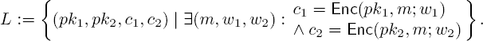

Naor 和 Yung（1990）证明了如果底层 PKE 方案是 IND-CPA 安全的，且底层 NIZK 是*自适应安全*的（可靠且零知识），则所得 PKE 方案是*IND-CCA1*安全的。Dolev 等人（1991）扩展了 Naor–Yung 构造，实现了*完全 IND-CCA*安全 PKE 的首个可行性结果（相对于 IND-CCA1）。Sahai（1999）证明了原样的 Naor–Yung 构造可以被证明是 IND-CCA 安全的，前提是底层 NIZK 系统满足一种称为*一次性模拟可靠性*的更强形式的可靠性。后续工作（De Santis 等人 2001; Lindell 2003）给出了改进和简化的构造。

#### 1.3.2.1. 与 Cramer–Shoup PKE 的联系

值得一提的是，Cramer–Shoup PKE（Cramer 和 Shoup 1998, 2003）可以被视为受 Naor–Yung 范式启发。首先，Cramer–Shoup 方案可以粗略地看作是在多个可能的私钥下对消息进行加密。这类似于利用两个私钥的 Naor–Yung 范式。其次，Cramer–Shoup PKE 中的有效性检查具有类似于验证密文“格式良好”的 NIZK 证明的功能。此外，正如第 1.2.5 节前面提到的，Cramer 和 Shoup（2002）基于 HPS 给出了其方案的一个推广。HPS 可以被视为一类称为子集成员问题的特定 NP 语言的特殊类型的 NIZK 证明系统（其中，与 DDH 相关的问题即为一个特例）。我们在第 1.3.4 节中简要综述基于 HPS 的进一步结果。

### 1.3.3. Fujisaki–Okamoto 及 RO 模型中的其他变换

接下来我们描述在 RO 模型中实现 IND-CCA 安全 PKE 的最流行和通用的通用变换之一，称为 Fujisaki-Okamoto（FO）变换。

设（`KG`、`Enc`、`Dec`）为一个 PKE 方案，其明文空间为{0, 1}^(*λ*)，`Enc`的随机数空间为{0, 1}^(*ℓ*)，其中*ℓ* = *ℓ*(*λ*)为某个多项式。设（`E`、`D`）为一个 SKE 方案。设`H` : {0, 1}^∗ → {0, 1}^(*ℓ*)和`G` : {0, 1}^(*λ*) → {0, 1}^(*λ*)为哈希函数（将被建模为随机预言机）。给定这些要素，由 FO 变换构造的 PKE 方案Π[FO] = （`KG`[FO]、`Enc`[FO]、`Dec`[FO]）如图 1.9 所示。Π[FO]的明文空间与底层 SKE 方案相同。

Fujisaki 和 Okamoto（2013）证明了如果底层 PKE 方案满足 CPA 下的单向性，以及一个自然属性：即对于由`KG`生成的任意*pk*，加密算法`Enc`(*pk,* ·)的输出（当其随机数随机选择时）的最小熵足够高（这通常是大多数 PKE 方案默认满足的），且底层 SKE 方案是 IND-OT 安全的，则所得 PKE 方案Π[FO]在将`H`和`G`建模为随机预言机的 RO 模型中是 IND-CCA 安全的。

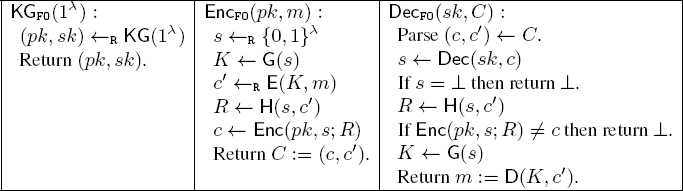

**图 1.9.** *Fujisaki-Okamoto 变换*


我们注意到，本节所示的 FO 变换源自 Fujisaki 和 Okamoto (2013)，该版本修复了会议版本 (Fujisaki and Okamoto 1999b) 中的一个小错误。我们还注意到，Fujisaki 和 Okamoto 提出了另一种变换 (Fujisaki and Okamoto 1999)，它能在 RO 模型下将任意 IND-CPA 安全的 PKE 方案（对 `Enc` 有相同的最小熵要求）转换为 IND-CCA 安全的 PKE 方案。Okamoto 和 Pointcheval (2001b) 以及 Coron 等人 (2002a) 分别提出了 FO 变换的变体，称为 REACT 和 GEM，它们比 FO 变换更简单，但要求底层 PKE 方案满足一种称为明文检查攻击下的单向性 (PCA) 的非标准安全概念（即对手可以访问一个预言机，输入密文 `c` 和明文 `m` 时，该预言机会告诉对手 `c` 是否解密为 `m`）。Dent (2003) 提出了 FO 变换的 KEM 变体。Hofheinz 等人 (2017) 对 FO 变换给出了模块化的安全性分析。

在 RO 模型下，还有其他适用于 TDF 或陷门置换 (TDP) 的通用转换。Bellare 和 Rogaway (1993) 在引入 RO 模型的首篇论文中提出了一种转换，可在 RO 模型下将任意单向 TDF 转换为 IND-CCA 安全的 PKE 方案。RO 模型中最著名且最重要的通用变换之一是由 Bellare 和 Rogaway (1995) 提出的 OAEP (Optimal Asymmetric Encryption Padding，最优非对称加密填充) 变换，它能在 RO 模型下将满足一种称为部分域单向性 (Shoup 2001a; Fujisaki et al. 2001) 的更强单向性形式的任意 TDP 转换为 IND-CCA 安全的 PKE 方案。RSA-OAEP 方案（将 OAEP 应用于 RSA 加密方案）在 PKCS#1 v.2.1 中被标准化。文献中考虑了 OAEP 的几种变体，包括 OAEP+ (Shoup 2001a)、OAEP++ (Kobara and Imai 2002)、SAEP 和 SAEP+ (Boneh 2001) 等 (Coron et al. 2002b; Komano and Ohta 2003; Phan and Pointcheval 2003; Dodis et al. 2004; Phan and Pointcheval 2004; Abe et al. 2008)。

由于 NIST 组织的后量子密码学公开竞赛^()

### 1.3.4. IND-CCA 安全 PKE 的其他通用构造

PKE 研究的一个主要方向是阐明构造 IND-CCA 安全 PKE 所需的通用假设是什么，特别是其存在性是否由 IND-CPA 安全 PKE 蕴含。在此，我们对该方向的研究结果进行综述（除上文解释的基于 NIZK 的构造外）。

#### 1.3.4.1. 从基于身份的加密和基于标签的加密的转换

Canetti 等人 (2004) 展示了如何利用一次性安全签名方案，将基于身份的加密方案 (Shamir 1984; Boneh and Franklin 2001)（这是 PKE 的一个特殊类）转换为 IND-CCA 安全的 PKE 方案。Boneh 和 Katz (2005) 提出了该转换的一个变体，它使用比一次性签名方案更轻量的原语，潜在地比 Canetti 等人 (2004) 的转换更高效。Kiltz (2006) 表明这些转换适用于基于标签的加密方案（又称带标签的 PKE），这通常比基于身份的加密是更弱的原语。

#### 1.3.4.2. 基于 TDF 和相关原语的构造

Peikert 和 Waters (2008) 展示了如何从一种具有特殊性质的陷门函数——称为损失性 TDF——构造 IND-CCA 安全的 PKE 方案，而损失性 TDF 又可以从具有某些自然性质的同态加密 (Hemenway and Ostrovsky 2012)、损失性（概率）加密（由 Bellare 等人 (2009) 引入，可加密比其加密随机数更长的消息） (Hemenway and Ostrovsky 2013)，或一种称为陷门哈希的原语 (Döttling et al. 2019) 构造。后续工作表明，具有较弱安全性/功能性性质的 TDF 足以获得 IND-CCA 安全的 PKE 方案 (Rosen and Segev 2009; Kiltz et al. 2010; Wee 2010; Yamakawa et al. 2016)。最后，在一项非常近期的工作中，Hohenberger 等人 (2020) 展示了如何从仅达到标准单向性的任意 TDF 构造 IND-CCA 安全的 PKE 方案。

#### 1.3.4.3. 基于（变体）哈希证明系统的进一步构造

如前所述，Cramer 和 Shoup (2002) 引入了称为 HPS 的概念，并提供了一个基于 HPS 构造 IND-CCA 安全 PKE 的框架。Wee (2010) 引入了另一个基于计算（搜索型）问题难度而非判定（不可区分型）问题难度来构造 IND-CCA 安全 PKE 方案的框架，称为（全减一）`可提取 HPS`，Matsuda 和 Hanaoka (2013) 对其进行了扩展以涵盖更广泛的构造类别。可提取 HPS 框架可以涵盖许多不属于（普通）HPS 框架实例的高效 IND-CCA 安全 PKE 方案，例如 Boyen 等人 (2005)、Cash 等人 (2008)、Hanaoka 和 Kurosawa (2008)、Hofheinz 和 Kiltz (2009)、Haralambiev 等人 (2010) 的方案。

#### 1.3.4.4. 通过 KDM 安全性的构造

一系列工作 (Matsuda and Hanaoka 2015b; Hajiabadi and Kapron 2015; Kitagawa et al. 2019a; Kitagawa and Matsuda 2020) 展示了如何从满足各种形式的密钥相关消息安全性的加密方案构造 IND-CCA 安全的 PKE 方案，我们将在第 1.4.3 节中讨论这一点。特别地，Kitagawa 和 Matsuda (2020) 的最新工作表明，IND-CCA 安全的 PKE 方案可以从 IND-CPA 安全的 PKE 方案和一个满足称为循环安全的极弱 KDM 安全形式的比特 SKE 方案构造而来。

#### 1.3.4.5. 基于密码学混淆的构造

Sahai 和 Waters (2014) 在其他成果中展示了如何从满足不可区分型安全概念的通用密码学混淆器 (Barak et al. 2001; Garg et al. 2013)（即所谓的不可区分混淆）构造 IND-CCA 安全的 PKE 方案。Matsuda 和 Hanaoka (2014a) 展示了如何基于点函数混淆器构造 IND-CCA 安全的 PKE 方案。

#### 1.3.4.6. 依赖额外工具/假设的其他构造

Matsuda 和 Hanaoka (2014b) 给出了另一种构造，它来自 IND-CPA 安全的 PKE 方案和一个满足通用计算提取器 (UCE) 假设之一的哈希族 (Bellare et al. 2013)，该假设试图在标准模型下形式化随机预言机所实现的某些安全性质。Koppula 和 Waters (2019) 展示了如何基于 IND-CPA 安全的 PKE 方案和一个满足特殊安全性质的伪随机生成器 (PRG)（称为提示 PRG）的组合来构造 IND-CCA 安全的 PKE 方案。Dachman-Soled (2014) 和 Matsuda 和 Hanaoka (2016) 展示了如何从满足（弱）可模拟性以及多密钥设置下的（标准模型）明文感知性的 PKE 方案构造 IND-CCA 安全的 PKE 方案 (Bellare and Palacio 2004; Myers et al. 2012)。

## 1.4. 进阶主题

### 1.4.1. 与 CCA 相关的中间安全概念

本节简要描述了一些介于 IND-CPA 和 IND-CCA 安全性之间的安全概念。

#### 1.4.1.1. 可重放 CCA 安全性


在某些情况下，IND-CCA 安全性所实现的安全属性可能过于强或过于严格。例如，没有任何允许密文重随机化或同态属性的加密方案能够达到 IND-CCA 安全性。*可重放 CCA 安全性*（Replayable CCA security）由 Canetti 等人（2003）提出，是一种试图放宽 IND-CCA 安全性严格性，同时仍能捕获实际应用中所需的足够强安全性的安全概念。它通过使用类似 IND-CCA 的安全实验来定义：在对手获得挑战密文后进行解密查询 `c` 时；如果 `c` 解密为挑战明文 `m[0]` 或 `m[1]` 之一（由对手在挑战阶段选择），则仅告知对手这一事实，而不给出实际的解密结果。出于类似的动机，还引入了具有非常相似风味的安全概念：良性可延展性（Shoup 2001b）和广义 CCA 安全性（An 等人 2002）。

可重放 CCA 安全性的定义听起来可能有些人为。然而，事实证明，在将公钥加密方案视为建立/构建保密信道的工具（或资源）的背景下，可重放 CCA 安全性是正确的安全概念，因为满足这一安全概念的 PKE 方案足以实现该目的。有关详细信息以及关于该安全概念的变体和细微之处的讨论，请参阅 Canetti 等人（2003）；Coretti 等人（2013）；Badertscher 等人（2021）。还值得一提的是，与 IND-CCA 安全性不同，可重放 CCA 安全性可以由支持重随机化和/或同态属性的 PKE 方案实现（Prabhakaran 和 Rosulek 2007, 2008）。

#### 1.4.1.2. 可检测 CCA 安全性

Hohenberger 等人（2012）引入了一个与 RCCA 安全性相似的安全概念，称为*可检测 CCA*安全性，其中存在一个针对两个密文的二元关系 `R`（特定于某个方案），且解密预言机不对满足 `R(c*, c) = 1` 的查询 `c` 作出响应，其中 `c*` 表示挑战密文。请注意，CCA（分别为 CPA）安全性可以被视为该概念的一个特例，此时当且仅当 `c* = c` 时 `R(c*, c) = 1`（分别为，对所有 `c*, c` 都有 `R(c*, c) = 1`）。Hohenberger 等人（2012）表明，如果某个方案相对于满足被称为不可预测性要求的关系 `R` 满足可检测 CCA 安全性（该要求指出：如果未给出 `c*`，则很难找到满足 `R(c*, c) = 1` 的密文 `c`），则它可以被通用地转换为满足 IND-CCA 安全性的 PKE 方案。Hohenberger 等人（2012）利用这一概念，给出了一个更简单的解决方案，用于从 IND-CCA 安全的比特 PKE 方案构建 IND-CCA 安全的多比特 PKE 方案（无需使用额外的构建模块），该问题此前已由 Myers 和 Shelat（2009）解决。感兴趣的读者还可参考 Matsuda 和 Hanaoka（2015a），该文进一步研究了可检测 CCA 安全性，并展示了一个用于 IND-CCA 安全 PKE 的更简单的单比特到多比特转换。

#### 1.4.1.3. 更多与 CCA 相关的概念

介于 IND-CPA 和 IND-CCA 之间的其他（次要的）安全概念包括以下内容。*有界 CCA 安全性*（Cramer 等人 2007）及其变体（Matsuda 和 Matsuura 2011；Myers 等人 2012），其中对手的解密查询次数是先验有界的（且该数字可能被硬编码进方案本身）；*自毁 CCA 安全性*（Coretti 等人 2015, 2016），一旦对手的解密查询结果为 ⊥，解密预言机将“自毁”，不再回答对手未来的任何解密查询。考虑这些中间概念的一个动机是研究一种可以仅由基于 IND-CPA 安全概念构建的 PKE 方案实现的安全概念。如前所述，能否仅从 IND-CPA 安全的方案构建 IND-CCA 安全的 PKE 方案是 PKE 领域的一个主要开放问题，有趣的是，上述提到的安全概念（在某些参数设置下）可以由仅基于 IND-CPA 安全概念构建的 PKE 方案实现。

### 1.4.2. 多用户设置下的 IND-CCA 安全性与紧致安全性

标准的 IND-CCA 安全性定义处理的是单个密钥对和单个挑战密文，因此似乎仅捕获了只有一个用户发送单条加密消息的场景。事先并不清楚 IND-CCA 安全性是否能在存在多个用户发送多条加密消息的情况下保证足够强的安全性。

Bellare 等人（2000）为 PKE 形式化了一个存在多个用户和多个挑战密文的 IND-CCA 安全性版本。这里我们称之为*多用户/多挑战 IND-CCA 安全性*，并简要回顾其定义。对于 PKE 方案 Π = (`KG`, `Enc`, `Dec`)，`n` ∈ ，和对手 ，`n`-用户/多挑战 IND-CCA 实验定义如图 1.10 所示。如果对于任意 PPT 对手  和任意多项式 `n` = `n`(`λ`)，优势函数 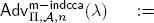 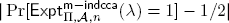 可以忽略不计，则称 Π 是多用户/多挑战 IND-CCA 安全的。

Bellare 等人（2000）表明，如果一个 PKE 方案是 IND-CCA 安全的，那么它自动也是多用户/多挑战 IND-CCA 安全的。更具体地说，他们证明了对于任意 PKE 方案 Π，如果存在一个在 `n`-用户/多挑战 IND-CCA 实验中向  `enc` 发起 `q` 次加密查询的对手 ，则存在另一个对手 （其运行时间与  相似）攻击（单用户/单挑战）IND-CCA 实验，使得我们有

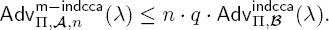
图 1.10. PKE 的多用户/多挑战 IND-CCA 实验

**图 1.10.** *PKE 的多用户/多挑战 IND-CCA 实验*

虽然这一结果给了我们一个*渐近*保证（攻击多用户/多挑战 IND-CCA 安全性的任意 PPT 对手优势均可忽略不计），但如果我们考虑更*具体*的安全保证，其保证则不尽如人意：即使  足够小（例如 2^(−128)），取决于 `n` 和 `q` 的值， 可能无法被一个足够小的值所限制。让我们通过简单的例子来看看这一点。假设 `n` = 2³² 且 `q` = 2⁴⁰（假设世界上一半人口每天发送一条加密消息，持续 1 年），并且假设我们有一个“安全”的 PKE 方案 Π，可以假设其对运行时间远大于 `n` · `q` 的任意对手  达到 。那么，Bellare 等人（2000）的结果仅保证对于运行时间与  相似的对手 ，有 。或者，如果我们希望获得  的保证，则 PKE 方案 Π 需要满足 。

一般来说，为了基于某个问题 `P` 的困难性，证明 PKE 方案 Π 在 `n`-用户设置下对发起 `q[enc]` 次加密查询和 `q[dec]` 次解密查询的对手  具有 IND-CCA 安全性，我们需要构造另一个对手（归约算法），其运行时间与  相似，并满足


其中 `F[loss]` 和 `F'` 是多项式， 表示  在解决问题 `P` 时的优势，而 `ϵ(λ)` 是关于 `λ` 的可忽略函数，独立于 `n`、`q[enc]`、`q[dec]`、`` 和 ``。

Bellare 等人 (2000) 基于 DDH 假设证明了 Cramer-Shoup 方案 (Cramer 和 Shoup 1998) 的多用户/挑战 IND-CCA 安全性，其安全性损失仅取决于加密查询的数量（且独立于用户数量和解密查询数量）。十多年后，Hofheinz 和 Jager (2012) 首次展示了基于著名且被充分研究的假设的紧致安全 PKE 方案。他们的方案基于 Naor-Yung 范式，其安全性基于双线性群中的 DLin 假设。然而，该方案效率低下，因为公钥和密文由数百个群元素组成。自 Hofheinz 和 Jager (2012) 的工作以来，已有许多工作基于该假设构建紧致安全的 PKE 方案：Abe 等人 (2013)；Hofheinz 等人 (2015)；Libert 等人 (2015)；Attrapadung 等人 (2015)；Gong 等人 (2016)；Hofheinz (2016)；Gay 等人 (2016)；Hofheinz (2017)；Gay 等人 (2017)；Han 等人 (2019)（其中除第一个外，其余均仅具有近似紧致归约）。值得注意的是，Gay 等人 (2017) 基于 DDH 的（近似）紧致安全方案具有与 Cramer 和 Shoup (1998) 以及 Kurosawa 和 Desmedt (2004) 的实用（非紧致）基于 DDH 方案相似的效率。

### 1.4.3. 密钥相关消息安全

在 PKE 的标准安全概念中，隐含假设待加密的消息不依赖于密钥（除非它们可以依赖于相应的公钥）。然而，在某些应用中，我们希望（或不得不）加密依赖于密钥的消息，例如硬盘加密 (Boneh 等人 2008)、匿名凭证 (Camenisch 和 Lysyanskaya 2002) 和全同态加密 ( 条目 2009)。

密钥相关消息 (KDM) 安全性是一种安全概念，即使加密消息依赖于密钥，也能保证机密性。KDM 安全性最初由 Black 等人 (2003) 针对 SKE 引入并形式化。一种有限形式的 KDM 安全性（称为循环安全）由 Camenisch 和 Lysyanskaya (2002) 独立引入并研究。PKE 的 KDM 安全性标准形式化由 Boneh 等人 (2008) 给出。KDM 安全性由函数类  参数化，该函数类表示消息对密钥的依赖关系， 越具表达力，KDM 安全性就越强。非正式地说，关于  的 KDM 安全性（我们称之为 -KDM 安全性）保证了对于任意 `f` 属于 ，加密 `f(sk)` 的密文与加密某个长度为 `|f(sk)|` 的固定消息的密文是不可区分的。与标准的不可区分性安全概念类似，KDM 安全性也可以在 CPA 和 CCA 设置下考虑，分别称为 KDM-CPA 和 KDM-CCA。人们可能会想知道标准的不可区分性安全概念是否蕴含 KDM 安全性。不幸的是，一系列工作 (Acar 等人 2010；Cash 等人 2012；Rothblum 2013；Marcedone 和 Orlandi 2014；Koppula 等人 2015；Bishop 等人 2015；Goyal 等人 2017c,b,a) 表明，在标准密码学假设下（例如 LWE 假设），存在一种 PKE 方案是 IND-CPA 安全的，但不是循环安全的。此外，Hajiabadi 和 Kapron (2017) 表明，在“黑盒”构造 (Reingold 等人 2004；Baecher 等人 2013) 的意义上，仅基于 IND-CPA 安全的 PKE 方案无法构造循环安全的比特加密方案。

在 RO 模型中，KDM-CPA/CCA 安全的 PKE 方案相对容易实现。特别是，Backes 等人 (2008)、Davies 和 Stam (2014) 以及 Kitagawa 等人 (2016) 分别证明了 RSA-OAEP 方案 (Bellare 和 Rogaway 1995)、（混合加密构造的一个轻微变体）和 FO 变换的 PKE 方案 (Fujisaki 和 Okamoto 2013) 在 RO 模型中关于所有可高效计算的函数是 KDM-CCA 安全的。在标准模型中，关于特定（简单）函数类的 KDM-CPA 安全 PKE 方案构建于例如 Boneh 等人 (2008)；Applebaum 等人 (2009)；Brakerski 和 Goldwasser (2010)；Brakerski 等人 (2011)；Malkin 等人 (2011)；Döttling (2015)；Hajiabadi 等人 (2016)；Wee (2016)；Brakerski 等人 (2018)；Lai 等人 (2021)，而关于任意函数（可由多项式大小电路计算）的 KDM-CPA 安全 PKE 方案构建于例如 Barak 等人 (2010)；Applebaum (2011)；Bellare 等人 (2012b)；Marcedone 等人 (2016)。关于特定函数类的 KDM-CCA 安全 PKE 方案构建于例如 Galindo 等人 (2012)；Hofheinz (2013)；Han 等人 (2016)；Kitagawa 和 Tanaka (2018)；Libert 和 Qian (2019)；Kitagawa 等人 (2019b)。关于任意函数（可由多项式大小电路计算）的 KDM-CCA 安全 PKE 方案可以通过“增强”KDM 安全性的方法实现：从关于简单函数的 KDM 安全性增强到关于更宽泛/更复杂函数的 KDM 安全性 (Applebaum 2011；Kitagawa 和 Matsuda 2019, 2020)，以及从 KDM-CPA 增强到 KDM-CCA（例如 Camenisch 等人 2009；Kitagawa 和 Matsuda 2019, 2020）。

### 1.4.4. PKE 的更多主题

#### 1.4.4.1. 全同态加密

同态加密允许在密文上进行计算，同时保持方案的安全性。例如，在加法同态 PKE 中，可以从 `Enc(pk, m[1])` 和 `Enc(pk, m[2])` 获得 `Enc(pk, m[1] + m[2])`。加法同态 PKE 的例子包括 Goldwasser 和 Micali (1982) 以及 Paillier (1999)，而乘法同态 PKE 的例子包括 RSA 和 ElGamal PKE。这些早期工作要么只允许一种类型的操作，要么允许有限次数的操作（例如 Boneh 等人 2005），要么局限于一组特定操作（例如 Sander 等人 1999；Ishai 和 Paskin 2007）。Gentry (2009) 提出了第一个全同态 PKE，它允许无限次的模加法和乘法，从而实现任意算术电路计算。关于该主题的综述，请参阅 Acar 等人 (2019)。

#### 1.4.4.2. 抗泄露安全性

典型的安全概念（如 IND-CCA）要求密钥 `sk` 完全保密。然而，在现实应用中，由于侧信道攻击或恶意软件等原因，这一要求可能无法完美满足。抗泄露安全性是一种允许对手自适应地获取关于密钥 `sk` 的信息的概念，仅受限于泄露信息的总量受某个参数限制这一约束。PKE 设置下的此类概念由 Akavia 等人 (2009) 开创。关于该主题的综述，请参阅 Alwen 等人 (2010) 和 Kalai 和 Reyzin (2019)。

#### 1.4.4.3. 自适应安全性和抗选择性打开攻击安全性


# 选择性打开（SO）安全性

选择性打开（SO）安全性考虑的是多用户设置下的攻击场景，其中对手可以自适应地破坏某些用户，并了解（即“打开”）被破坏用户的所有信息（包括随机性），而安全性关注的是由未被破坏用户创建或发送给未被破坏用户的那些密文（取决于 SO 安全性的类型，即发送者安全性和接收者安全性）。这种攻击场景最早出现在自适应安全多方计算的背景下（Canetti 等人，1996），其中对手可以破坏某些加密信道。SO 安全性既可以考虑发送者被破坏的情况，也可以考虑接收者被破坏的情况。

Bellare 等人（2009）首次形式化了发送者的选择性打开安全性（简称发送者 SO 安全性），并给出了基于模拟和基于不可区分的定义。接收者被破坏的情况（接收者 SO 安全性）由 Bellare 等人（2012a）和 Hazay 等人（2015）形式化并研究。一系列工作（Bellare 等人，2009，2012a；Böhl 等人，2012；Hofheinz 和 Rupp，2014；Hazay 等人，2015；Hofheinz 等人，2016b）表明，标准安全概念（如 `IND-CPA`，甚至 `IND-CCA`）并不蕴含发送者或接收者 SO 安全性。请注意，混合论证无助于将标准概念桥接到此处考虑的多用户设置，因为在这种情况下，特别是需要打开随机性（而标准概念不允许这样做）。（另一方面，Fuchsbauer 等人（2016）的工作表明，在特定的破坏条件下，`IND-CPA` 安全性蕴含 SO 安全性。）发送者 SO 安全的 PKE 方案在许多工作中被构造（Bellare 等人，2009；Fehr 等人，2010；Hemenway 等人，2011；Hofheinz，2012；Huang 等人，2013；Liu 和 Paterson，2015；Heuer 等人，2015；Hofheinz 等人，2016a；Heuer 和 Poettering，2016；Hoang 等人，2016；Libert 等人，2017；Lyu 等人，2018）。接收者 SO 安全的 PKE 方案构造于，例如，Hazay 等人（2015）；Jia 等人（2016，2017）；Hara 等人（2018）；Huang 等人（2019）；Yang 等人（2020）。

## 1.5. 参考文献

Abdalla, M., Bellare, M., Rogaway, P. (2001). The oracle Diffie–Hellman assumptions and an analysis of DHIES. In *CT-RSA 2001*, vol. 2020 of *LNCS*, Naccache, D. (ed.). Springer, Heidelberg.

Abe, M., Gennaro, R., Kurosawa, K., Shoup, V. (2005). Tag-KEM/DEM: A new framework for hybrid encryption and a new analysis of Kurosawa-Desmedt KEM. In *EUROCRYPT 2005*, vol. 3494 of *LNCS*, Cramer, R. (ed.). Springer, Heidelberg.

Abe, M., Kiltz, E., Okamoto, T. (2008). Chosen ciphertext security with optimal ciphertext overhead. In *ASIACRYPT 2008*, vol. 5350 of *LNCS*, Pieprzyk, J. (ed.). Springer, Heidelberg.

Abe, M., David, B., Kohlweiss, M., Nishimaki, R., Ohkubo, M. (2013). Tagged one-time signatures: Tight security and optimal tag size. In *PKC 2013*, vol. 7778 of *LNCS*, Kurosawa, K., Hanaoka, G. (eds). Springer, Heidelberg.

Acar, T., Belenkiy, M., Bellare, M., Cash, D. (2010). Cryptographic agility and its relation to circular encryption. In *EUROCRYPT 2010*, vol. 6110 of *LNCS*, Gilbert, H. (ed.). Springer, Heidelberg.

Acar, A., Aksu, H., Uluagac, A.S., Conti, M. (2019). A survey on homomorphic encryption schemes: Theory and implementation. *ACM Computing Surveys*, 51(4), 79, 1–35 \[Online\]. Available at: [`doi.org/10.1145/3214303`](https://doi.org/10.1145/3214303).

Akavia, A., Goldwasser, S., Vaikuntanathan, V. (2009), Simultaneous hardcore bits and cryptography against memory attacks. In *TCC 2009*, vol. 5444 of *LNCS*, Reingold, O. (ed.). Springer, Heidelberg.

Alwen, J., Dodis, Y., Wichs, D. (2010). Survey: Leakage resilience and the bounded retrieval model. In *ICITS 09*, vol. 5973 of *LNCS*, Kurosawa, K. (ed.). Springer, Heidelberg.

Ambainis, A., Hamburg, M., Unruh, D. (2019). Quantum security proofs using semi-classical oracles. In *CRYPTO 2019, Part II*, vol. 11693 of *LNCS*, Boldyreva, A., Micciancio, D. (eds). Springer, Heidelberg.

An, J.H., Dodis, Y., Rabin, T. (2002). On the security of joint signature and encryption. In *EUROCRYPT 2002*, vol. 2332 of *LNCS*, Knudsen, L.R. (ed.). Springer, Heidelberg.

Applebaum, B. (2011). Key-dependent message security: Generic amplification and completeness. In *EUROCRYPT 2011*, vol. 6632 of *LNCS*, Paterson, K.G. (ed.). Springer, Heidelberg.

Applebaum, B., Cash, D., Peikert, C., Sahai, A. (2009). Fast cryptographic primitives and circular-secure encryption based on hard learning problems. In *CRYPTO 2009*, vol. 5677 of *LNCS*, Halevi, S. (ed.). Springer, Heidelberg.

Attrapadung, N., Hanaoka, G., Yamada, S. (2015). A framework for identity-based encryption with almost tight security. In *ASIACRYPT 2015, Part I*, vol. 9452 of *LNCS*, Iwata, T., Cheon, J.H. (eds). Springer, Heidelberg.

Backes, M., Dürmuth, M., Unruh, D. (2008). OAEP is secure under key-dependent messages. In *ASIACRYPT 2008*, vol. 5350 of *LNCS*, Pieprzyk, J. (ed.). Springer, Heidelberg.

Badertscher, C., Maurer, U., Portmann, C., Rito, G. (2021). Revisiting (R)CCA security and replay protection. In *PKC 2021, Part II*, vol. 12711 of *LNCS*, Garay, J. (ed.). Springer, Heidelberg.

Baecher, P., Brzuska, C., Fischlin, M. (2013). Notions of black-box reductions, revisited. In *ASIACRYPT 2013, Part I*, vol. 8269 of *LNCS*, Sako, K., Sarkar, P. (eds). Springer, Heidelberg.

Barak, B., Goldreich, O., Impagliazzo, R., Rudich, S., Sahai, A., Vadhan, S.P., Yang, K. (2001). On the (im)possibility of obfuscating programs. In *CRYPTO 2001*, vol. 2139 of *LNCS*, Kilian, J. (ed.). Springer, Heidelberg.

Barak, B., Haitner, I., Hofheinz, D., Ishai, Y. (2010). Bounded key-dependent message security. In *EUROCRYPT 2010*, vol. 6110 of *LNCS*, Gilbert, H. (ed.). Springer, Heidelberg, 423–444.

Bellare, M. and Namprempre, C. (2000). Authenticated encryption: Relations among notions and analysis of the generic composition paradigm. In *ASIACRYPT 2000*, vol. 1976 of *LNCS*, Okamoto, T. (ed.). Springer, Heidelberg.

Bellare, M. and Palacio, A. (2004). Towards plaintext-aware public-key encryption without random oracles. In *ASIACRYPT 2004*, vol. 3329 of *LNCS*, Lee, P.J. (ed.). Springer, Heidelberg.

Bellare, M. and Rogaway, P. (1993). Random oracles are practical: A paradigm for designing efficient protocols. In *ACM CCS 93*, Denning, D.E., Pyle, R., Ganesan, R., Sandhu, R.S., Ashby, V. (eds). ACM Press.

Bellare, M. and Rogaway, P. (1995). Optimal asymmetric encryption. In *EUROCRYPT’94*, vol. 950 of *LNCS*, Santis, A.D. (ed.). Springer, Heidelberg.

Bellare, M. and Rogaway, P. (2006). The security of triple encryption and a framework for code-based game-playing proofs. In *EUROCRYPT 2006*, vol. 4004 of *LNCS*, Vaudenay, S. (ed.). Springer, Heidelberg.

Bellare, M. and Sahai, A. (1999). Non-malleable encryption: Equivalence between two notions, and an indistinguishability-based characterization. In *CRYPTO’99*, vol. 1666 of *LNCS*, Wiener, M.J. (ed.). Springer, Heidelberg.

Bellare, M. and Sahai, A. (2006). Non-malleable encryption: Equivalence between two notions, and an indistinguishability-based characterization. Cryptology ePrint Archive, Report 2006/228 \[Online\]. Available at: [`eprint.iacr.org/2006/228`](https://eprint.iacr.org/2006/228).

Bellare, M., Desai, A., Pointcheval, D., Rogaway, P. (1998). Relations among notions of security for public-key encryption schemes. In *CRYPTO’98*, vol. 1462 of *LNCS*, Krawczyk, H. (ed.). Springer, Heidelberg.

Bellare, M., Boldyreva, A., Micali, S. (2000). Public-key encryption in a multi-user setting: Security proofs and improvements. In *EUROCRYPT 2000*, vol. 1807 of *LNCS*, Preneel, B. (ed.). Springer, Heidelberg.

Bellare, M., Hofheinz, D., Yilek, S. (2009). Possibility and impossibility results for encryption and commitment secure under selective opening. In *EUROCRYPT 2009*, vol. 5479 of *LNCS*, Joux, A. (ed.). Springer, Heidelberg.


# 参考文献

Bellare, M., Dowsley, R., Waters, B., Yilek, S. (2012a). 标准安全性不意味着抗选择性打开安全性。载 *EUROCRYPT 2012*, *LNCS* 第 7237 卷, Pointcheval, D., Johansson, T. (编). Springer, Heidelberg.

Bellare, M., Hoang, V.T., Rogaway, P. (2012b). 混淆电路的基础。载 *ACM CCS 2012*, Yu, T., Danezis, G., Gligor, V.D. (编). *CCS ‘12: 2012 年 ACM 计算机与通信安全会议论文集*, 784–796 [在线]. 可用网址: [`doi.org/10.1145/2382196.2382279`](https://doi.org/10.1145/2382196.2382279).

Bellare, M., Hoang, V.T., Keelveedhi, S. (2013). 通过 UCE 实例化随机预言机。载 *CRYPTO 2013, 第二部分*, *LNCS* 第 8043 卷, Canetti, R., Garay, J.A. (编). Springer, Heidelberg.

Benaloh, J. (1994). 稠密概率加密。载 *选定密码学领域研讨会论文集*, 120–128.

Bindel, N., Hamburg, M., Hövelmanns, K., Hülsing, A., Persichetti, E. (2019). 量子随机预言机模型中 CCA 安全性的更紧致证明。载 *TCC 2019, 第二部分*, *LNCS* 第 11892 卷, Hofheinz, D., Rosen, A. (编). Springer, Heidelberg.

Bishop, A., Hohenberger, S., Waters, B. (2015). 基于判定线性假设和学习误差假设的新循环安全反例。载 *ASIACRYPT 2015, 第二部分*, *LNCS* 第 9453 卷, Iwata, T., Cheon, J.H. (编). Springer, Heidelberg.

Black, J., Rogaway, P., Shrimpton, T. (2003). 密钥相关消息存在下的加密方案安全性。载 *SAC 2002*, *LNCS* 第 2595 卷, Nyberg, K., Heys, H.M. (编). Springer, Heidelberg.

Bleichenbacher, D. (1998). 基于 RSA 加密标准 PKCS #1 的协议的选择密文攻击。载 *CRYPTO’98*, *LNCS* 第 1462 卷, Krawczyk, H. (编). Springer, Heidelberg.

Blum, M. and Goldwasser, S. (1984). 一种隐藏所有部分信息的高效概率公钥加密方案。载 *CRYPTO’84*, *LNCS* 第 196 卷, Blakley, G.R., Chaum, D. (编). Springer, Heidelberg.

Blum, M., Feldman, P., Micali, S. (1988). 非交互式零知识及其应用（扩展摘要）。载 *第 20 届 ACM STOC*. ACM Press.

Böhl, F., Hofheinz, D., Kraschewski, D. (2012). 关于选择性打开安全性的定义。载 *PKC 2012*, *LNCS* 第 7293 卷, Fischlin, M., Buchmann, J., Manulis, M. (编). Springer, Heidelberg.

Boneh, D. (2001). 面向 RSA 和 Rabin 函数的简化 OAEP。载 *CRYPTO 2001*, *LNCS* 第 2139 卷, Kilian, J. (编). Springer, Heidelberg.

Boneh, D. and Franklin, M.K. (2001). 基于 Weil 配对的基于身份的加密。载 *CRYPTO 2001*, *LNCS* 第 2139 卷, Kilian, J. (编). Springer, Heidelberg.

Boneh, D. and Katz, J. (2005). 利用基于身份的加密构建的抗 CCA 安全密码系统的效率改进。载 *CT-RSA 2005*, *LNCS* 第 3376 卷, Menezes, A. (编). Springer, Heidelberg.

Boneh, D., Goh, E.-J., Nissim, K. (2005). 在密文上评估 2-DNF 公式。载 *TCC 2005*, *LNCS* 第 3378 卷, Kilian, J. (编). Springer, Heidelberg.

Boneh, D., Halevi, S., Hamburg, M., Ostrovsky, R. (2008). 基于判定 Diffie–Hellman 假设的循环安全加密。载 *CRYPTO 2008*, *LNCS* 第 5157 卷, Wagner, D. (编). Springer, Heidelberg.

Boneh, D., Dagdelen, Ö., Fischlin, M., Lehmann, A., Schaffner, C., Zhandry, M. (2011). 量子世界中的随机预言机。载 *ASIACRYPT 2011*, *LNCS* 第 7073 卷, Lee, D.H., Wang, X. (编). Springer, Heidelberg.

Boyen, X., Mei, Q., Waters, B. (2005). 基于身份技术的直接选择密文安全性。载 *ACM CCS 2005*, Atluri, V., Meadows, C., Juels, A. (编). ACM Press.

Brakerski, Z. and Goldwasser, S. (2010). 基于子群不可区分性的循环安全与抗泄露公钥加密（或：二次剩余问题再发威）。载 *CRYPTO 2010*, *LNCS* 第 6223 卷, Rabin, T. (编). Springer, Heidelberg.

Brakerski, Z., Goldwasser, S., Kalai, Y.T. (2011). 超越仿射函数的黑盒循环安全加密。载 *TCC 2011*, *LNCS* 第 6597 卷, Ishai, Y. (编). Springer, Heidelberg.

Brakerski, Z., Lombardi, A., Segev, G., Vaikuntanathan, V. (2018). 基于新假设的匿名 IBE、抗泄露性与循环安全性。载 *EUROCRYPT 2018, 第一部分*, *LNCS* 第 10820 卷, Nielsen, J.B., Rijmen, V. (编). Springer, Heidelberg.

Camenisch, J. and Lysyanskaya, A. (2002). 动态累加器及其在高效撤销匿名凭证中的应用。载 *CRYPTO 2002*, *LNCS* 第 2442 卷, Yung, M. (编). Springer, Heidelberg.

Camenisch, J., Chandran, N., Shoup, V. (2009). 一种抗密钥相关选择明文攻击和自适应选择密文攻击的公钥加密方案。载 *EUROCRYPT 2009*, *LNCS* 第 5479 卷, Joux, A. (编). Springer, Heidelberg.

Canetti, R., Feige, U., Goldreich, O., Naor, M. (1996). 自适应安全多方计算。载 *第 28 届 ACM STOC*. ACM Press.

Canetti, R., Goldreich, O., Halevi, S. (1998). 随机预言机方法论，重访（初步版本）。载 *第 30 届 ACM STOC*. ACM Press.

Canetti, R., Krawczyk, H., Nielsen, J.B. (2003). 放宽选择密文安全性。载 *CRYPTO 2003*, *LNCS* 第 2729 卷, Boneh, D. (编). Springer, Heidelberg.

Canetti, R., Halevi, S., Katz, J. (2004). 基于基于身份的加密的选择密文安全性。载 *EUROCRYPT 2004*, *LNCS* 第 3027 卷, Cachin, C., Camenisch, J. (编). Springer, Heidelberg.

Canetti, R., Chen, Y., Holmgren, J., Lombardi, A., Rothblum, G.N., Rothblum, R.D., Wichs, D. (2019). Fiat–Shamir：从实践到理论。载 *第 51 届 ACM STOC*, Charikar, M., Cohen, E. (编). ACM Press.

Cash, D., Kiltz, E., Shoup, V. (2008). 双 Diffie–Hellman 问题及其应用。载 *EUROCRYPT 2008*, *LNCS* 第 4965 卷, Smart, N.P. (编). Springer, Heidelberg.

Cash, D., Green, M., Hohenberger, S. (2012). 循环安全性的新定义与分离。载 *PKC 2012*, *LNCS* 第 7293 卷, Fischlin, M., Buchmann, J., Manulis, M. (编). Springer, Heidelberg.

Coretti, S., Maurer, U., Tackmann, B. (2013). 从认证信道构建保密信道——公钥加密重访。载 *ASIACRYPT 2013, 第一部分*, *LNCS* 第 8269 卷, Sako, K., Sarkar, P. (编). Springer, Heidelberg.

Coretti, S., Maurer, U., Tackmann, B., Venturi, D. (2015). 通过非延展码从单比特到多比特公钥加密。载 *TCC 2015, 第一部分*, *LNCS* 第 9014 卷, Dodis, Y., Nielsen, J.B. (编). Springer, Heidelberg.

Coretti, S., Dodis, Y., Tackmann, B., Venturi, D. (2016). 非延展加密：更简单、更短、更强。载 *TCC 2016-A, 第一部分*, *LNCS* 第 9562 卷, Kushilevitz, E., Malkin, T. (编). Springer, Heidelberg.

Coron, J.-S., Handschuh, H., Joye, M., Paillier, P., Pointcheval, D., Tymen, C. (2002a). GEM：一种通用的抗选择密文攻击加密方法。载 *CT-RSA 2002*, *LNCS* 第 2271 卷, Preneel, B. (编). Springer, Heidelberg.

Coron, J.-S., Joye, M., Naccache, D., Paillier, P. (2002b). RSA 的通用填充方案。载 *CRYPTO 2002*, *LNCS* 第 2442 卷, Yung, M. (编). Springer, Heidelberg.

Couteau, G., Katsumata, S., Ursu, B. (2020). 基于较弱假设的无配对群上的非交互式零知识。载 *EUROCRYPT 2020, 第三部分*, *LNCS* 第 12107 卷, Canteaut, A., Ishai, Y. (编). Springer, Heidelberg.

Cramer, R. and Shoup, V. (1998). 一种在自适应选择密文攻击下可证明安全的实用公钥密码系统。载 *CRYPTO’98*, *LNCS* 第 1462 卷, Krawczyk, H. (编). Springer, Heidelberg.

Cramer, R. and Shoup, V. (2002). 通用哈希证明与自适应选择密文安全公钥加密的范式。载 *EUROCRYPT 2002*, *LNCS* 第 2332 卷, Knudsen, L.R. (编). Springer, Heidelberg.

Cramer, R. and Shoup, V. (2003). 实用抗自适应选择密文攻击公钥加密方案的设计与分析。载 *SIAM Journal on Computing*, 33(1), 167–226.


# 参考文献

Cramer, R., Hanaoka, G., Hofheinz, D., Imai, H., Kiltz, E., Pass, R., Shelat, A., Vaikuntanathan, V. (2007). 有界 CCA2 安全加密。载 *ASIACRYPT 2007*，*LNCS* 4833 卷，Kurosawa, K. (编)。Springer, Heidelberg。

Cramer, R., Hofheinz, D., Kiltz, E. (2010). Naor-Yung 范式的一个变体及其在基于困难搜索问题的高效 CCA 安全加密中的应用。载 *TCC 2010*，*LNCS* 5978 卷，Micciancio, D. (编)。Springer, Heidelberg。

Dachman-Soled, D. (2014). 从明文感知 (sPA1) 加密方案构建 CCA2 加密方案的黑盒构造。载 *PKC 2014*，*LNCS* 8383 卷，Krawczyk, H. (编)。Springer, Heidelberg。

Damgård, I. 和 Jurik, M. (2001). Paillier 概率公钥系统的一种推广、简化及其应用。载 *PKC 2001*，*LNCS* 1992 卷，Kim, K. (编)。Springer, Heidelberg。

Davies, G.T. 和 Stam, M. (2014). 混合框架中的 KDM 安全性。载 *CT-RSA 2014*，*LNCS* 8366 卷，Benaloh, J. (编)。Springer, Heidelberg。

De Santis, A., Di Crescenzo, G., Ostrovsky, R., Persiano, G., Sahai, A. (2001). 鲁棒非交互式零知识。载 *CRYPTO 2001*，*LNCS* 2139 卷，Kilian, J. (编)。Springer, Heidelberg。

Dent, A.W. (2003). 设计者的 KEM 指南。载 *第 9 届 IMA 国际密码学与编码会议*，*LNCS* 2898 卷，Paterson, K.G. (编)。Springer, Heidelberg。

Diffie, W. 和 Hellman, M.E. (1976). 密码学的新方向。*IEEE 信息论汇刊*。22(6)，644–654。

Dodis, Y., Freedman, M.J., Jarecki, S., Walfish, S. (2004). 用于联合签名和加密的通用填充方案。载 *ACM CCS 2004*，Atluri, V., Pfitzmann, B., McDaniel, P. (编)。ACM Press。

Dolev, D., Dwork, C., Naor, M. (1991). 非可延展性密码学（扩展摘要）。载 *第 23 届 ACM STOC*。ACM Press。

Dolev, D., Dwork, C., Naor, M. (2000). 非可延展性密码学。*SIAM 计算机学报*，30(2)，391–437。

Döttling, N. (2015). 低噪声 LPN：KDM 安全公钥加密与样本放大。载 *PKC 2015*，*LNCS* 9020 卷，Katz, J. (编)。Springer, Heidelberg。

Döttling, N., Garg, S., Ishai, Y., Malavolta, G., Mour, T., Ostrovsky, R. (2019). 陷门哈希函数及其应用。载 *CRYPTO 2019, Part III*，*LNCS* 11694 卷，Boldyreva, A., Micciancio, D. (编)。Springer, Heidelberg。

ElGamal, T. (1984). 基于离散对数的公钥密码系统和签名方案。载 *CRYPTO’84*，*LNCS* 196 卷，Blakley, G.R., Chaum, D. (编)。Springer, Heidelberg。

Fehr, S., Hofheinz, D., Kiltz, E., Wee, H. (2010). 抵抗选择密文选择性打开攻击的加密方案。载 *EUROCRYPT 2010*，*LNCS* 6110 卷，Gilbert, H. (编)。Springer, Heidelberg。

Feige, U., Lapidot, D., Shamir, A. (1990). 基于单一随机字符串的多重非交互式零知识证明（扩展摘要）。载 *第 31 届 FOCS*。IEEE Computer Society Press。

Feige, U., Lapidot, D., Shamir, A. (1999). 在一般假设下的多重非交互式零知识证明。*SIAM 计算机学报*，29(1)，1–28。

Fuchsbauer, G., Heuer, F., Kiltz, E., Pietrzak, K. (2016). 标准安全性意味着对马尔可夫分布的选择性打开安全性。载 *TCC 2016-A, Part I*，*LNCS* 9562 卷，Kushilevitz, E., Malkin, T. (编)。Springer, Heidelberg。

Fujisaki, E. 和 Okamoto, T. (1999a). 如何以最小代价增强公钥加密的安全性。载 *PKC’99*，*LNCS* 1560 卷，Imai, H., Zheng, Y. (编)。Springer, Heidelberg。

Fujisaki, E. 和 Okamoto, T. (1999b). 非对称和对称加密方案的安全集成。载 *CRYPTO’99*，*LNCS* 1666 卷，Wiener, M.J. (编)。Springer, Heidelberg。

Fujisaki, E. 和 Okamoto, T. (2013). 非对称和对称加密方案的安全集成。*密码学杂志*，26(1)，80–101。

Fujisaki, E., Okamoto, T., Pointcheval, D., Stern, J. (2001). RSA-OAEP 在 RSA 假设下是安全的。载 *CRYPTO 2001*，*LNCS* 2139 卷，Kilian, J. (编)。Springer, Heidelberg。

Galindo, D., Herranz, J., Villar, J.L. (2012). 具有主密钥相关消息安全性和抗泄露韧性的基于身份的加密。载 *ESORICS 2012*，*LNCS* 7459 卷，Foresti, S., Yung, M., Martinelli, F. (编)。Springer, Heidelberg。

Garg, S., Gentry, C., Halevi, S., Raykova, M., Sahai, A., Waters, B. (2013). 所有电路的候选不可区分混淆和函数加密。载 *第 54 届 FOCS*。IEEE Computer Society Press。

Gay, R., Hofheinz, D., Kiltz, E., Wee, H. (2016). 无需配对的紧致 CCA 安全加密。载 *EUROCRYPT 2016, Part I*，*LNCS* 9665 卷，Fischlin, M., Coron, J.-S. (编)。Springer, Heidelberg。

Gay, R., Hofheinz, D., Kohl, L. (2017). Kurosawa-Desmedt 遇上紧致安全性。载 *CRYPTO 2017, Part III*，*LNCS* 10403 卷，Katz, J., Shacham, H. (编)。Springer, Heidelberg。

Gentry, C. (2009). 使用理想格的全同态加密。载 *第 41 届 ACM STOC*，Mitzenmacher, M. (编)。ACM Press。

Goldreich, O. 和 Levin, L.A. (1989). 所有单向函数的硬核谓词。载 *第 21 届 ACM STOC*。ACM Press。

Goldwasser, S. 和 Micali, S. (1982). 概率加密及如何在保持所有部分信息秘密的情况下玩精神扑克。载 *第 14 届 ACM STOC*。ACM Press。

Gong, J., Chen, J., Dong, X., Cao, Z., Tang, S. (2016). 扩展嵌套对偶系统群，重访。载 *PKC 2016, Part I*，*LNCS* 9614 卷，Cheng, C.-M., Chung, K.-M., Persiano, G., Yang, B.-Y. (编)。Springer, Heidelberg。

Goyal, R., Koppula, V., Waters, B. (2017a). 可锁定混淆。载 *第 58 届 FOCS*，Umans, C. (编)。IEEE Computer Society Press。

Goyal, R., Koppula, V., Waters, B. (2017b). 无界长度密钥循环的 IND-CPA 与循环安全性分离。载 *PKC 2017, Part I*，*LNCS* 10174 卷，Fehr, S. (编)。Springer, Heidelberg。

Goyal, R., Koppula, V., Waters, B. (2017c). 基于学习误差假设的对称密钥比特加密的语义安全性与循环安全性分离。载 *EUROCRYPT 2017, Part II*，*LNCS* 10211 卷，Coron, J.-S., Nielsen, J.B. (编)。Springer, Heidelberg。

Groth, J., Ostrovsky, R., Sahai, A. (2006). NP 的完美非交互式零知识。载 *EUROCRYPT 2006*，*LNCS* 4004 卷，Vaudenay, S. (编)。Springer, Heidelberg。

Groth, J., Ostrovsky, R., Sahai, A. (2012). 非交互式零知识的新技术。*J. ACM*，59(3)，11:1–11:35。

Hajiabadi, M. 和 Kapron, B.M. (2015). 可复现的循环安全比特加密：应用与实现。载 *CRYPTO 2015, Part I*，*LNCS* 9215 卷，Gennaro, R., Robshaw, M.J.B. (编)。Springer, Heidelberg。

Hajiabadi, M. 和 Kapron, B.M. (2017). 迈向语义安全与循环安全概念间的细粒度黑盒分离。载 *EUROCRYPT 2017, Part II*，*LNCS* 10211 卷，Coron, J.-S., Nielsen, J.B. (编)。Springer, Heidelberg。

Hajiabadi, M., Kapron, B.M., Srinivasan, V. (2016). 关于循环安全、抗泄露公钥加密方案的通用构造。载 *PKC 2016, Part II*，*LNCS* 9615 卷，Cheng, C.-M., Chung, K.-M., Persiano, G., Yang, B.-Y. (编)。Springer, Heidelberg。

Han, S., Liu, S., Lyu, L. (2016). 用于多项式函数的高效 KDM-CCA 安全公钥加密。载 *ASIACRYPT 2016, Part II*，*LNCS* 10032 卷，Cheon, J.H., Takagi, T. (编)。Springer, Heidelberg。

Han, S., Liu, S., Lyu, L., Gu, D. (2019). 基于准自适应哈希证明系统的紧致抗泄露 CCA 安全性。载 *CRYPTO 2019, Part II*，*LNCS* 11693 卷，Boldyreva, A., Micciancio, D. (编)。Springer, Heidelberg。

Hanaoka, G. 和 Kurosawa, K. (2008). 计算 Diffie-Hellman 假设下的高效抗选择密文攻击公钥加密。载 *ASIACRYPT 2008*，*LNCS* 5350 卷，Pieprzyk, J. (编)。Springer, Heidelberg。


# 参考文献

Hara, K., Kitagawa, F., Matsuda, T., Hanaoka, G., Tanaka, K. (2018). 来自标准计算假设的基于模拟的接收者选择性打开 CCA 安全 PKE。载于 *SCN 18*，*LNCS* 第 11035 卷，Catalano, D., De Prisco, R. (编)。Springer, Heidelberg。

Haralambiev, K., Jager, T., Kiltz, E., Shoup, V. (2010). 标准模型中来自计算 Diffie-Hellman 的简单高效公钥加密。载于 *PKC 2010*，*LNCS* 第 6056 卷，Nguyen, P.Q., Pointcheval, D. (编)。Springer, Heidelberg。

Håstad, J., Impagliazzo, R., Levin, L.A., Luby, M. (1999). 来自任意单向函数的伪随机生成器。*SIAM Journal on Computing*，28(4)，1364–1396。

Hazay, C., Patra, A., Warinschi, B. (2015). 接收者的选择性打开安全性。载于 *ASIACRYPT 2015, Part I*，*LNCS* 第 9452 卷，Iwata, T., Cheon, J.H. (编)。Springer, Heidelberg。

Hemenway, B. and Ostrovsky, R. (2012). 关于同态加密与选择密文安全性。载于 *PKC 2012*，*LNCS* 第 7293 卷，Fischlin, M., Buchmann, J., Manulis, M. (编)。Springer, Heidelberg。

Hemenway, B. and Ostrovsky, R. (2013). 从损失性加密构建损失性陷门函数。载于 *ASIACRYPT 2013, Part II*，*LNCS* 第 8270 卷，Sako, K., Sarkar, P. (编)。Springer, Heidelberg。

Hemenway, B., Libert, B., Ostrovsky, R., Vergnaud, D. (2011). 损失性加密：来自通用假设的构造与高效的选择性打开选择密文安全性。载于 *ASIACRYPT 2011*，*LNCS* 第 7073 卷，Lee, D.H., Wang, X. (编)。Springer, Heidelberg。

Herranz, J., Hofheinz, D., Kiltz, E. (2010). 安全混合加密的一些（不）充分条件。*Information and Computation*，208(11)，1243–1257。

Heuer, F. and Poettering, B. (2016). 来自可模拟数据封装的选择性打开安全性。载于 *ASIACRYPT 2016, Part II*，*LNCS* 第 10032 卷，Cheon, J.H., Takagi, T. (编)。Springer, Heidelberg。

Heuer, F., Jager, T., Kiltz, E., Schäge, S. (2015). 实用公钥加密方案的选择性打开安全性。载于 *PKC 2015*，*LNCS* 第 9020 卷，Katz, J. (编)。Springer, Heidelberg。

Hoang, V.T., Katz, J., O’Neill, A., Zaheri, M. (2016). 随机性失效情况下的选择性打开安全性。载于 *ASIACRYPT 2016, Part II*，*LNCS* 第 10032 卷，Cheon, J.H., Takagi, T. (编)。Springer, Heidelberg。

Hofheinz, D. (2012). 除多个以外全损失的陷门函数。载于 *EUROCRYPT 2012*，*LNCS* 第 7237 卷，Pointcheval, D., Johansson, T. (编)。Springer, Heidelberg。

Hofheinz, D. (2013). 具有紧凑密文的循环选择密文安全性。载于 *EUROCRYPT 2013*，*LNCS* 第 7881 卷，Johansson, T., Nguyen, P.Q. (编)。Springer, Heidelberg。

Hofheinz, D. (2016). 代数分区：完全紧凑且（近乎）紧致安全的密码学。载于 *TCC 2016-A, Part I*，*LNCS* 第 9562 卷，Kushilevitz, E., Malkin, T. (编)。Springer, Heidelberg。

Hofheinz, D. (2017). 自适应分区。载于 *EUROCRYPT 2017, Part III*，*LNCS* 第 10212 卷，Coron, J.-S., Nielsen, J.B. (编)。Springer, Heidelberg。

Hofheinz, D. and Jager, T. (2012). 紧致安全的签名与公钥加密。载于 *CRYPTO 2012*，*LNCS* 第 7417 卷，Safavi-Naini, R., Canetti, R. (编)。Springer, Heidelberg。

Hofheinz, D. and Kiltz, E. (2007). 来自弱化密钥封装的安全混合加密。载于 *CRYPTO 2007*，*LNCS* 第 4622 卷，Menezes, A. (编)。Springer, Heidelberg。

Hofheinz, D. and Kiltz, E. (2009). 来自因式分解的实用选择密文安全加密。载于 *EUROCRYPT 2009*，*LNCS* 第 5479 卷，Joux, A. (编)。Springer, Heidelberg。

Hofheinz, D. and Rupp, A. (2014). 标准安全性与选择性打开安全性：分离与等价结果。载于 *TCC 2014*，*LNCS* 第 8349 卷，Lindell, Y. (编)。Springer, Heidelberg。

Hofheinz, D., Koch, J., Striecks, C. (2015). 多实例、多密文设置下具有（近乎）紧致安全性的基于身份的加密。载于 *PKC 2015*，*LNCS* 第 9020 卷，Katz, J. (编)。Springer, Heidelberg。

Hofheinz, D., Jager, T., Rupp, A. (2016a). 具有基于模拟的选择性打开安全性和紧凑密文的公钥加密。载于 *TCC 2016-B, Part II*，*LNCS* 第 9986 卷，Hirt, M., Smith, A.D. (编)。Springer, Heidelberg。

Hofheinz, D., Rao, V., Wichs, D. (2016b). 标准安全性不蕴含选择性打开下的不可区分性。载于 *TCC 2016-B, Part II*，*LNCS* 第 9986 卷，Hirt, M., Smith, A.D. (编)。Springer, Heidelberg。

Hofheinz, D., Hövelmanns, K., Kiltz, E. (2017). Fujisaki-Okamoto 变换的模块化分析。载于 *TCC 2017*，*LNCS* 第 10677 卷，Part I，Kalai, Y., Reyzin, L. (编)。Springer, Heidelberg。

Hohenberger, S., Lewko, A.B., Waters, B. (2012). 检测危险查询：一种实现选择密文安全性的新方法。载于 *EUROCRYPT 2012*，*LNCS* 第 7237 卷，Pointcheval, D., Johansson, T. (编)。Springer, Heidelberg。

Hohenberger, S., Koppula, V., Waters, B. (2020). 来自单射陷门函数的选择密文安全性。载于 *CRYPTO 2020, Part I*，*LNCS* 第 12170 卷，Micciancio, D., Ristenpart, T. (编)。Springer, Heidelberg。

Huang, Z., Liu, S., Qin, B. (2013). 抗选择密文攻击的发送者可否认加密方案再探。载于 *PKC 2013*，*LNCS* 第 7778 卷，Kurosawa, K., Hanaoka, G. (编)。Springer, Heidelberg。

Huang, Z., Lai, J., Chen, W., Au, M.H., Peng, Z., Li, J. (2019). 选择密文攻击下接收者的基于模拟的选择性打开安全性。*Designs, Codes and Cryptography*，87(6)，1345–1371。

Ishai, Y. and Paskin, A. (2007). 在加密数据上评估分支程序。载于 *TCC 2007*，*LNCS* 第 4392 卷，Vadhan, S.P. (编)。Springer, Heidelberg。

Jia, D., Lu, X., Li, B. (2016). 来自不可区分性混淆的接收者选择性打开安全性。载于 *INDOCRYPT 2016*，*LNCS* 第 10095 卷，Dunkelman, O., Sanadhya, S.K. (编)。Springer, Heidelberg。

Jia, D., Lu, X., Li, B. (2017). 抗接收者选择性打开与选择密文攻击的构造。载于 *CT-RSA 2017*，*LNCS* 第 10159 卷，Handschuh, H. (编)。Springer, Heidelberg。

Jiang, H., Zhang, Z., Chen, L., Wang, H., Ma, Z. (2018). 量子随机预言机模型中的 IND-CCA 安全密钥封装机制，再探。载于 *CRYPTO 2018, Part III*，*LNCS* 第 10993 卷，Shacham, H., Boldyreva, A. (编)。Springer, Heidelberg。

Jiang, H., Zhang, Z., Ma, Z. (2019a). 量子随机预言机模型中具有显式拒绝的密钥封装机制。载于 *PKC 2019, Part II*，*LNCS* 第 11443 卷，Lin, D., Sako, K. (编)。Springer, Heidelberg。

Jiang, H., Zhang, Z., Ma, Z. (2019b). 量子随机预言机模型中通用密钥封装机制的更紧致安全性证明。载于 *后量子密码学 – 第 10 届国际会议, PQCrypto 2019*，Ding, J., Steinwandt, R. (编)。Springer, Heidelberg。

Kalai, Y.T. and Reyzin, L. (2019). *抗泄露密码学综述*。Association for Computing Machinery, New York。

Katz, J. (2004). 速记讲义 [在线]。可用网址：<https://www.cs.umd.edu/jkatz/gradcrypto2/scribes.xhtml>。

Kiltz, E. (2006). 来自基于标签加密的选择密文安全性。载于 *TCC 2006*，*LNCS* 第 3876 卷，Halevi, S., Rabin, T. (编)。Springer, Heidelberg。

Kiltz, E., Mohassel, P., O’Neill, A. (2010). 自适应陷门函数与选择密文安全性。载于 *EUROCRYPT 2010*，*LNCS* 第 6110 卷，Gilbert, H. (编)。Springer, Heidelberg。

Kitagawa, F. and Matsuda, T. (2019). KDM 安全性的 CPA 到 CCA 转换。载于 *TCC 2019, Part II*，*LNCS* 第 11892 卷，Hofheinz, D., Rosen, A. (编)。Springer, Heidelberg。

Kitagawa, F. and Matsuda, T. (2020). 循环安全性对于 KDM 安全性是完备的。载于 *ASIACRYPT 2020, Part I*，*LNCS* 第 12491 卷，Moriai, S., Wang, H. (编)。Springer, Heidelberg。


# 参考文献

Kitagawa, F. and Tanaka, K. (2018). A framework for achieving KDM-CCA secure public-key encryption. In *ASIACRYPT 2018, Part II*, vol. 11273 of *LNCS*, Peyrin, T., Galbraith, S. (eds). Springer, Heidelberg.

Kitagawa, F., Matsuda, T., Hanaoka, G., Tanaka, K. (2016). On the key dependent message security of the Fujisaki-Okamoto constructions. In *PKC 2016, Part I*, vol. 9614 of *LNCS*, Cheng, C.-M., Chung, K.-M., Persiano, G., Yang, B.-Y. (eds). Springer, Heidelberg.

Kitagawa, F., Matsuda, T., Tanaka, K. (2019a). CCA security and trapdoor functions via key-dependent-message security. In *CRYPTO 2019, Part III*, vol. 11694 of *LNCS*, Boldyreva, A., Micciancio, D. (eds). Springer, Heidelberg.

Kitagawa, F., Matsuda, T., Tanaka, K. (2019b). Simple and efficient KDM-CCA secure public key encryption. In *ASIACRYPT 2019, Part III*, vol. 11923 of *LNCS*, Galbraith, S.D., Moriai, S. (eds). Springer, Heidelberg.

Kitagawa, F., Matsuda, T., Yamakawa, T. (2020). NIZK from SNARG. In *TCC 2020, Part I*, vol. 12550 of *LNCS*, Pass, R., Pietrzak, K. (eds). Springer, Heidelberg.

Kobara, K. and Imai, H. (2002). OAEP++ : A very simple way to apply OAEP to deterministic OW-CPA primitives. Cryptology ePrint Archive, Report 2002/130 \[Online\]. Available at: [`eprint.iacr.org/2002/130`](https://eprint.iacr.org/2002/130).

Komano, Y. and Ohta, K. (2003). Efficient universal padding techniques for multiplicative trapdoor one-way permutation. In *CRYPTO 2003*, vol. 2729 of *LNCS*, Boneh, D. (ed.). Springer, Heidelberg.

Koppula, V. and Waters, B. (2019). Realizing chosen ciphertext security generically in attribute-based encryption and predicate encryption. In *CRYPTO 2019, Part II*, vol. 11693 of *LNCS*, Boldyreva, A., Micciancio, D. (eds). Springer, Heidelberg.

Koppula, V., Ramchen, K., Waters, B. (2015). Separations in circular security for arbitrary length key cycles. In *TCC 2015, Part II*, vol. 9015 of *LNCS*, Dodis, Y., Nielsen, J.B. (eds). Springer, Heidelberg.

Kuchta, V., Sakzad, A., Stehlé, D., Steinfeld, R., Sun, S. (2020). Measure-rewind-measure: Tighter quantum random oracle model proofs for one-way to hiding and CCA security. In *EUROCRYPT 2020, Part III*, vol. 12107 of *LNCS*, Canteaut, A., Ishai, Y. (eds). Springer, Heidelberg.

Kurosawa, K. and Desmedt, Y. (2004). A new paradigm of hybrid encryption scheme. In *CRYPTO 2004*, vol. 3152 of *LNCS*, Franklin, M. (ed.). Springer, Heidelberg.

Lai, Q., Liu, F.-H., Wang, Z. (2021). Rate-1 key-dependent message security via reusable homomorphic extractor against correlated-source attacks. In *PKC 2021, Part I*, vol. 12710 of *LNCS*, Garay, J. (ed.). Springer, Heidelberg.

Libert, B. and Qian, C. (2019). Lossy algebraic filters with short tags. In *PKC 2019, Part I*, vol. 11442 of *LNCS*, Lin, D., Sako, K. (eds). Springer, Heidelberg.

Libert, B., Peters, T., Joye, M., Yung, M. (2015). Compactly hiding linear spans – Tightly secure constant-size simulation-sound QA-NIZK proofs and applications. In *ASIACRYPT 2015, Part I*, vol. 9452 of *LNCS*, Iwata, T., Cheon, J.H. (eds). Springer, Heidelberg.

Libert, B., Sakzad, A., Stehlé, D., Steinfeld, R. (2017). All-but-many lossy trapdoor functions and selective opening chosen-ciphertext security from LWE. In *CRYPTO 2017, Part III*, vol. 10403 of *LNCS*, Katz, J., Shacham, H. (eds). Springer, Heidelberg.

Lindell, Y. (2003). A simpler construction of cca2-secure public-key encryption under general assumptions. In *EUROCRYPT 2003*, vol. 2656 of *LNCS*, Biham, E. (ed.). Springer, Heidelberg.

Liu, S. and Paterson, K.G. (2015). Simulation-based selective opening CCA security for PKE from key encapsulation mechanisms. In *PKC 2015*, vol. 9020 of *LNCS*, Katz, J. (ed.). Springer, Heidelberg.

Luby, M. and Rackoff, C. (1988). How to construct pseudorandom permutations from pseudorandom functions. *SIAM Journal on Computing*, 17(2), 373–386 \[Online\]. Available at: doi:10.1137/0217022.

Lyu, L., Liu, S., Han, S., Gu, D. (2018). Tightly SIM-SO-CCA secure public key encryption from standard assumptions. In *PKC 2018, Part I*, vol. 10769 of *LNCS*, Abdalla, M., Dahab, R. (eds). Springer, Heidelberg.

Malkin, T., Teranishi, I., Yung, M. (2011). Efficient circuit-size independent public key encryption with KDM security. In *EUROCRYPT 2011*, vol. 6632 of *LNCS*, Paterson, K.G. (ed.). Springer, Heidelberg.

Marcedone, A. and Orlandi, C. (2014). Obfuscation (IND-CPA security circular security). In *SCN 14*, vol. 8642 of *LNCS*, Abdalla, M., Prisco, R.D. (eds). Springer, Heidelberg.

Marcedone, A., Pass, R., Ahelat, A. (2016). Bounded KDM security from iO and OWF. In *SCN 16*, vol. 9841 of *LNCS*, Zikas, V., De Prisco, R. (eds). Springer, Heidelberg.

Matsuda, T. and Hanaoka, G. (2013). Key encapsulation mechanisms from extractable hash proof systems, revisited. In *PKC 2013*, vol. 7778 of *LNCS*, Kurosawa, K., Hanaoka, G. (eds). Springer, Heidelberg.

Matsuda, T. and Hanaoka, G. (2014a). Chosen ciphertext security via point obfuscation. In *TCC 2014*, vol. 8349 of *LNCS*, Lindell, Y. (ed.). Springer, Heidelberg.

Matsuda, T. and Hanaoka, G. (2014b). Chosen ciphertext security via UCE. In *PKC 2014*, vol. 8383 of *LNCS*, Krawczyk, H. (ed.). Springer, Heidelberg.

Matsuda, T. and Hanaoka, G. (2015a). An asymptotically optimal method for converting bit encryption to multi-bit encryption. In *ASIACRYPT 2015, Part I*, vol. 9452 of *LNCS*, Iwata, T., Cheon, J.H. (eds). Springer, Heidelberg.

Matsuda, T. and Hanaoka, G. (2015b). Constructing and understanding chosen ciphertext security via puncturable key encapsulation mechanisms. In *TCC 2015, Part I*, vol. 9014 of *LNCS*, Dodis, Y., Nielsen, J.B. (eds). Springer, Heidelberg.

Matsuda, T. and Hanaoka, G. (2016). Trading plaintext-awareness for simulatability to achieve chosen ciphertext security. In *PKC 2016, Part I*, vol. 9614 of *LNCS*, Cheng, C.-M., Chung, K.-M., Persiano, G., Yang, B.-Y. (eds). Springer, Heidelberg.

Matsuda, T. and Matsuura, K. (2011). Parallel decryption queries in bounded chosen ciphertext attacks. In *PKC 2011*, vol. 6571 of *LNCS*, Catalano, D., Fazio, N., Gennaro, R., Nicolosi, A. (eds). Springer, Heidelberg.

Micciancio, D. and Peikert, C. (2012). Trapdoors for lattices: Simpler, tighter, faster, smaller. In *EUROCRYPT 2012*, vol. 7237 of *LNCS*, Pointcheval, D., Johansson, T. (eds). Springer, Heidelberg.

Myers, S. and Shelat, A. (2009). Bit encryption is complete. In *50th FOCS*. IEEE Computer Society Press.

Myers, S., Sergi, M., Shelat, A. (2012). Blackbox construction of a more than non-malleable CCA1 encryption scheme from plaintext awareness. In *SCN 12*, vol. 7485 of *LNCS*, Visconti, I., Prisco, R.D. (eds). Springer, Heidelberg.

Naccache, D. and Stern, J. (1998). A new public key cryptosystem based on higher residues. In *ACM CCS 98*, Gong, L., Reiter, M.K. (eds). ACM Press.

Naor, M. and Yung, M. (1989). Universal one-way hash functions and their cryptographic applications. In *21st ACM STOC*. ACM Press.

Naor, M. and Yung, M. (1990). Public-key cryptosystems provably secure against chosen ciphertext attacks. In *22nd ACM STOC*. ACM Press.

Okamoto, T. and Pointcheval, D. (2001a). The gap-problems: A new class of problems for the security of cryptographic schemes. In *PKC 2001*, vol. 1992 of *LNCS*, Kim, K. (ed.). Springer, Heidelberg.

Okamoto, T. and Pointcheval, D. (2001b). REACT: Rapid enhanced-security asymmetric cryptosystem transform. In *CT-RSA 2001*, vol. 2020 of *LNCS*, Naccache, D. (ed.). Springer, Heidelberg.

Okamoto, T. and Uchiyama, S. (1998). A new public-key cryptosystem as secure as factoring. In *EUROCRYPT’98*, vol. 1403 of *LNCS*, Nyberg, K. (ed.). Springer, Heidelberg.

Paillier, P. (1999). Public-key cryptosystems based on composite degree residuosity classes. In *EUROCRYPT’99*, vol. 1592 of *LNCS*, Stern, J. (ed.). Springer, Heidelberg.


# 参考文献

Pass, R., Shelat, A., Vaikuntanathan, V. (2007). Relations among notions of non-malleability for encryption. In *ASIACRYPT 2007*, vol. 4833 of *LNCS*, Kurosawa, K. (ed.). Springer, Heidelberg.

Peikert, C. and Shiehian, S. (2019). Noninteractive zero knowledge for NP from (plain) learning with errors. In *CRYPTO 2019, Part I*, vol. 11692 of *LNCS*, Boldyreva, A., Micciancio, D. (eds). Springer, Heidelberg.

Peikert, C. and Waters, B. (2008). Lossy trapdoor functions and their applications. In *40th ACM STOC*, Ladner, R.E., Dwork, C. (eds). ACM Press.

Phan, D.H. and Pointcheval, D. (2003). Chosen-ciphertext security without redundancy. In *ASIACRYPT 2003*, vol. 2894 of *LNCS*, Laih, C.-S. (ed.). Springer, Heidelberg.

Phan, D.H. and Pointcheval, D. (2004). OAEP 3-round: A generic and secure asymmetric encryption padding. In *ASIACRYPT 2004*, vol. 3329 of *LNCS*, Lee, P.J. (ed.). Springer, Heidelberg.

Prabhakaran, M. and Rosulek, M. (2007). Rerandomizable RCCA encryption. In *CRYPTO 2007*, vol. 4622 of *LNCS*, Menezes, A. (ed.). Springer, Heidelberg.

Prabhakaran, M. and Rosulek, M. (2008). Homomorphic encryption with CCA security. In *ICALP 2008, Part II*, vol. 5126 of *LNCS*, Aceto, L., Damgård, I., Goldberg, L.A., Halldórsson, M.M., Ingólfsdóttir, A., Walukiewicz, I. (eds). Springer, Heidelberg.

Rabin, M. (1979). Digitalized signatures and public-key functions as intractable as factorization. Paper, MIT Laboratory for Computer Science, Cambridge, MA.

Rackoff, C. and Simon, D.R. (1992). Non-interactive zero-knowledge proof of knowledge and chosen ciphertext attack. In *CRYPTO’91*, vol. 576 of *LNCS*, Feigenbaum, J. (ed.). Springer, Heidelberg.

Regev, O. (2005). On lattices, learning with errors, random linear codes, and cryptography. In *37th ACM STOC*, Gabow, H.N., Fagin, R. (eds). ACM Press.

Reingold, O., Trevisan, L., Vadhan, S.P. (2004). Notions of reducibility between cryptographic primitives. In *TCC 2004*, vol. 2951 of *LNCS*, Naor, M. (ed.). Springer, Heidelberg.

Rivest, R.L., Shamir, A., Adleman, L.M. (1978). A method for obtaining digital signatures and public-key cryptosystems. *Communications of the Association for Computing Machinery*, 21(2), 120–126.

Rosen, A. and Segev, G. (2009). Chosen-ciphertext security via correlated products. In *TCC 2009*, vol. 5444 of *LNCS*, Reingold, O. (ed.). Springer, Heidelberg.

Rothblum, R. (2013). On the circular security of bit-encryption. In *TCC 2013*, vol. 7785 of *LNCS*, Sahai, A. (ed.). Springer, Heidelberg.

Sahai, A. (1999). Non-malleable non-interactive zero knowledge and adaptive chosen-ciphertext security. In *40th FOCS*. IEEE Computer Society Press.

Sahai, A. and Waters, B. (2014). How to use indistinguishability obfuscation: Deniable encryption, and more. In *46th ACM STOC*, Shmoys, D.B. (ed.). ACM Press.

Saito, T., Xagawa, K., Yamakawa, T. (2018). Tightly-secure key-encapsulation mechanism in the quantum random oracle model. In *EUROCRYPT 2018, Part III*, vol. 10822 of *LNCS*, Nielsen, J.B., Rijmen, V. (eds). Springer, Heidelberg.

Sander, T., Young, A., Yung, M. (1999). Non-interactive cryptocomputing for NC1. In *40th FOCS*. IEEE Computer Society Press.

Shacham, H. (2007). A cramer-shoup encryption scheme from the linear assumption and from progressively weaker linear variants. Cryptology ePrint Archive, Report 2007/074 \[Online\]. Available at: [`eprint.iacr.org/2007/074`](https://eprint.iacr.org/2007/074).

Shamir, A. (1984). Identity-based cryptosystems and signature schemes. In *CRYPTO’84*, vol. 196 of *LNCS*, Blakley, G.R., Chaum, D. (eds). Springer, Heidelberg.

Shannon, C.E. (1949). Communication theory of secrecy systems. *Bell Systems Technical Journal*, 28(4), 656–715.

Shoup, V. (2001a). OAEP reconsidered. In *CRYPTO 2001*, vol. 2139 of *LNCS*, Kilian, J. (ed.). Springer, Heidelberg.

Shoup, V. (2001b). A proposal for an ISO standard for public key encryption. Cryptology ePrint Archive, Report 2001/112 \[Online\]. Available at: [`eprint.iacr.org/2001/112`](https://eprint.iacr.org/2001/112).

Shoup, V. (2004). Sequences of games: A tool for taming complexity in security proofs. Cryptology ePrint Archive, Report 2004/332 \[Online\]. Available at: [`eprint.iacr.org/2004/332`](https://eprint.iacr.org/2004/332).

Targhi, E.E. and Unruh, D. (2016). Post-quantum security of the Fujisaki-Okamoto and OAEP transforms. In *TCC 2016-B, Part II*, vol. 9986 of *LNCS*, Hirt, M., Smith, A.D. (eds). Springer, Heidelberg.

Wee, H. (2010). Efficient chosen-ciphertext security via extractable hash proofs. In *CRYPTO 2010*, vol. 6223 of *LNCS*, Rabin, T. (ed.). Springer, Heidelberg.

Wee, H. (2016). KDM-security via homomorphic smooth projective hashing. In *PKC 2016, Part II*, vol. 9615 of *LNCS*, Cheng, C.-M., Chung, K.-M., Persiano, G., Yang, B.-Y. (eds). Springer, Heidelberg.

Yamakawa, T., Yamada, S., Hanaoka, G., Kunihiro, N. (2016). Adversary-dependent lossy trapdoor function from hardness of factoring semi-smooth RSA subgroup moduli. In *CRYPTO 2016, Part II*, vol. 9815 of *LNCS*, Robshaw, M., Katz, J. (eds). Springer, Heidelberg.

Yang, R., Lai, J., Huang, Z., Au, M.H., Xu, Q., Susilo, W. (2020). Possibility and impossibility results for receiver selective opening secure PKE in the multi-challenge setting. In *ASIACRYPT 2020, Part I*, vol. 12491 of *LNCS*, Moriai, S., Wang, H. (eds). Springer, Heidelberg.

# 注释

1.  1 一种称为通用单向哈希函数族的较弱原语 (Naor and Yung 1989) (也可称为目标抗碰撞哈希) 也可被使用。然而，为简单起见，我们此处选择使用抗碰撞哈希函数。

2.  2 相应地，加密实际消息的过程称为*数据封装机制 (DEM)*，但由于其功能等同于 SKE，我们将主要使用 SKE。

3.  3 可访问：[`csrc.nist.gov/projects/post-quantum-cryptography`](https://csrc.nist.gov/projects/post-quantum-cryptography)。

4.  4 严格来说，如果我们仅关心渐近安全性保证，则右侧的  替换为某个正常数 *c* ≤ 1 的  即已足够，且  的运行时间可以是  运行时间的多项式。这种更一般的情况与归约的紧致性背道而驰。

5.  5 注意，基于“该方案是多用户/多挑战 IND-CCA 安全的”这一假设，PKE 方案总是紧致安全的。因此，只有当底层假设（问题）*P* 是文献中经过充分研究的（如 DDH）时，紧致安全性才有意义。

# 2 签名与安全概念

**Marc FISCHLIN**

*Technische Universität Darmstadt, Germany*

我们介绍数字签名方案的概念并讨论实践中使用的一些示例方案。随后我们讨论签名方案的基本安全属性，特别是针对选择消息攻击的不可伪造性和强不可伪造性。

## 2.1 签名方案

在本节中，我们描述数字签名方案的接口，以及签名者生成的真实签名可被验证为正确的最小功能要求。然后我们讨论两个此类签名方案的经典示例。

### 2.1.1 定义


## 数字签名方案

与手写签名类似，我们期望数字签名 `σ` 将来自某个可接受消息空间  的消息 `m` 的内容与签名者绑定。签名者由公钥 `pk` 标识，该公钥可能经过认证，从而与身份关联。由于我们期望只有签名者能够创建此类签名，因此签名者持有与 `pk` 匹配的密钥 `sk`，二者通过某个 `KGen` 算法共同生成。使用密钥 `sk` 进行签名由方案的 `Sig` 算法执行，而在公钥 `pk` 下的验证则通过 `Vf` 算法完成。

有了上述接口，三个算法 `KGen`、`Sig` 和 `Vf` 尚未“关联”。这是通过正确性属性来实现的：该属性指出，由 `KGen` 生成的密钥下，通过算法 `Sig` 生成的签名会被验证算法 `Vf` 识别为正确。注意，原则上让 `Vf` 接受任何签名即可轻松实现这一点。但我们稍后将要求：在不知道密钥的情况下，很难找到这种有效签名，即这种不可伪造性概念与正确性要求在这方面可以视为对立面。

**定义 2.1（签名方案）。** *数字签名方案* `S` = (`S`.`KGen`, `S`.`Sig`, `S`.`Vf`) *由三个概率多项式时间算法组成，满足：*

*– **密钥生成**：密钥生成算法以单元编码的安全参数 `1^λ` 为输入，输出一对密钥和公钥，`(sk, pk)` ←[$] `S`.`KGen`(`1^λ`)。我们假设每个密钥都能高效恢复 `1^λ`，且安全参数决定了一个消息空间 [λ] ⊆ {0, 1}^∗。*

*– **签名**：签名算法接收密钥 `sk` 和消息 `m` ∈ [λ] 作为输入，输出一个签名，`σ` ←[$] `S`.`Sig`(`sk, m`)。*

*– **验证**：验证算法接收公钥 `pk`、消息 `m` ∈ [λ] 和潜在签名 `σ` 作为输入，输出一个决策比特，`d` ←[$] `S`.`Vf`(`pk, m, σ`)。*

*正确性表明，以压倒性概率（作为 `λ` 的函数），对于任意消息 `m` ∈ [λ]，当 `(sk, pk)` ←[$] `S`.`KGen`(`1^λ`)、`σ` ←[$] `S`.`Sig`(`sk, m`) 且 `d` ←[$] `S`.`Vf`(`pk, m, σ`) 时，有 `d` = 1。如果正确性以概率 1 成立，则称该方案为**完全正确**。*

我们针对概率验证算法定义了签名方案。在所有已知方案中，验证都是确定性的，如果签名算法输出一个签名，则（确定性）验证者也会接受该签名。尽管如此，当今一些实用的签名方案，特别是基于格的方案如 Dilithium (Bai et al. 2020)，可能在单次执行中无法创建有效签名，因此需要在此情况下迭代。此时，该算法理论上可能永远运行，或者需要在一定迭代次数后中止，导致签名生成过程中通常出现可忽略的错误。对于实际用途，该概率无关紧要。

我们注意到，理论上，对于确定性验证者，很容易修复可忽略的正确性错误，且不违背不可伪造性。为此，签名者在输出签名 `σ` 前先对其进行验证，若验证失败则改为输出签名密钥 `sk`。验证算法随后也接受密钥作为任意消息 `m` 的签名，从而修复签名过程中的任何错误。此处假设可以检查 `sk` 是否为 `pk` 的有效签名密钥。如果 `sk` 包含执行 `KGen` 生成密钥对所用的随机性，则后者易于实现。但请再次强调，该解决方案仅具有理论意义。

### 2.1.2 实用方案示例

本节介绍实践中部署最广泛的两种签名方案。我们将在后续章节介绍安全概念后，再讨论它们的安全属性。

#### 2.1.2.1 数字签名算法

数字签名算法 (DSA) 由美国国家标准与技术研究院 (NIST) 提出，最早于 1994 年作为数字签名标准 (National Institute of Standards and Technology 1994) 中唯一的签名算法。该算法使用一个群 `G`，并在 `G` 的一个由元素 `g` ∈ `G` 生成的素数阶 `q` 的子群中工作。我们用 ⟨`g`⟩ 表示这个由 `g` 生成的循环群。最初，NIST 仅建议使用群 `G` = ，其中素数 `p` 在 512 位到 1024 位之间，`q` 的阶为 2¹⁶⁰。最新版 DSS 标准 (National Institute of Standards and Technology 2013) 允许 `(p, q)` 采用 (1024, 160)、(2048, 224)、(2048, 256) 或 (3072, 256) 位的其他选择，并包含一个称为 ECDSA 的椭圆曲线版本。我们首先采用模 `p` 乘法群  形式来描述算法，随后讨论 ECDSA 的变化。

对于签名消息 `m`，DSA 部署一个函数 `H` 将消息哈希为短字符串。随后通过标准的字符串到整数转换将该字符串嵌入 [q]，这要求哈希算法的输出足够短。我们在此简单假设 `H`(`m`) 是来自 [q] 的值。NIST 建议使用 National Institute of Standards and Technology (2015) 中指定的任何安全哈希算法。由于最新版哈希标准提出了输出长度各异的不同算法，较大的哈希输出可能需要截断。

**构造 2.2（数字签名算法）。** *群 ⟨`g`⟩* ⊆  *上素数阶为 `q`、带哈希函数* `H` *的* `DSA` *包含以下算法：*

*– **密钥生成**：对于给定群，密钥生成算法随机选取 `sk` ←[$] [q]，设定 `pk` ← `g^sk` mod `p`，并输出 `(sk, pk)` 作为密钥对。*

*– **签名**：为签名消息 `m` ∈ {0, 1}^∗，签名者随机选取 `k` ←[$]  并计算*

```
r = (g^k mod p) mod q
s = k^(−1) (H(m) + sk · r) mod q
```

*其中 `k^(−1)` 是 `k` 在 [q] 上的逆元。它输出 `σ` = (`r, s`) 作为 `m` 的签名。若 `r` = 0 或 `s` = 0，则签名者须重启签名过程。*

*– **验证**：输入 `pk`、`m` 和 `σ` = (`r, s`)，验证者检查 `r` 和 `s` 是否在  中，即 `0 < r, s < q`，然后计算*

```
u1 = H(m) · s^(−1) mod q
u2 = r · s^(−1) mod q
```

*并检查 `r` = (`g^u1` · `pk^u2` mod `p`) mod `q`。当且仅当所有测试均通过时，验证者输出 1，否则输出 0。*

关于正确性，我们注意到，对于公钥 `pk` 下消息 `m` 的合格签名 `σ` = (`r, s`)，有

```
g^u1 · pk^u2 = g^(H(m)·s^(−1)) · g^(sk·r·s^(−1))
            = g^(H(m)·s^(−1) + sk·r·s^(−1))
            = g^(s·k^(−1)·s^(−1))   (因为 s = k^(−1)(H(m) + sk·r))
            = g^k   (mod p)
```

因此，对该值取模 `q` 可得值 `r`，验证者接受该签名。

椭圆曲线版本称为 ECDSA，运行在特殊群上（同样为素数阶 `q`），群元素由 `x` 坐标和 `y` 坐标组成。椭圆曲线也提供群运算，通常称为加法而非乘法。因此，生成元由一对 `g` = (`g[x]`, `g[y]`) 组成，我们可以将步骤 `g^k` 解释为在曲线上对 (`g[x]`, `g[y]`) 进行 `k` 次加法。


请注意，我们可以保留原始 DSA 中 [`q`] 中的标量运算不变，但只需要调整模 `p` 的运算，具体来说是在签名步骤中计算 `r` ← (`g^k` mod `p`) mod `q`，以及在验证签名时验证 `r` = (`g`^(`u`[1]) `pk`^(`u`[2]) mod `p`) mod `q`。在椭圆曲线情况下，我们不能简单地计算 `g^k` 然后将其模约到 `q`，因为群元素由坐标对组成。ECDSA 标准则让 `r` 成为 `g^k` 的 `x` 坐标，验证者检查计算出的群元素的 `x` 坐标是否与给定的 `r` 匹配。

### 2.1.2.2. 施诺尔签名方案

施诺尔签名方案（Schnorr 1990, 1991）是菲亚特-沙米尔范式（Fiat and Shamir 1987）的一个基于离散对数的变体，用于将识别方案转化为签名方案。因此，它遵循承诺-质询-响应范式，其中非交互式签名方案中的质询是通过将哈希函数 `H` 应用于初始承诺和消息来计算的。与 DSA 情况类似，哈希函数的范围再次可以嵌入到 [`q`] 中，其中 `q` 为素数，表示生成元 `g` 的群 〈`g`〉 的阶。事实上，施诺尔的安全性证明促使了素数阶 `q` 的使用。为了演示，我们再次假设由 `g` 生成的群位于  中。也存在椭圆曲线变体，它是对椭圆曲线上运算的直接改编。

**构造 2.3（施诺尔签名方案）。** – *在素数阶 q 的群 〈g〉* ⊆  *上，带有哈希函数* `H` *的施诺尔签名方案* `Schnorr` *包含以下算法：*

**密钥生成：** 对于给定的群，密钥生成算法随机选取 `sk` ←[$] [`q`]，设置 `pk` ← `g^(sk)` mod `p`，并输出 (`sk`, `pk`) 作为密钥对。

**签名：** 要对消息 `m` ∈ {0, 1}^∗ 进行签名，签名者选取随机 `r` ←[$] [`q`] 并计算

```
c = H(g^r mod p, m)
y = r + c · sk mod q
```

输出 `σ` ← (`c`, `y`) 作为 `m` 的签名。

**验证：** 输入 `pk`、`m` 和 `σ` = (`c`, `y`)，验证者检查 `c` 和 `y` 是否在范围 [`q`] 内，如果是，则验证 `H`(`g^y pk`^(−`c`), `m`) = `c`。当且仅当所有测试都通过时，验证者输出 1，否则输出 0。

对于正确性，我们观察到对于由 `Schnorr`.`Sig` 在密钥 `sk` 下生成的签名 `σ` = (`c`, `y`)，有 `y` = `r` + `c` · `sk` mod `q`，其中 `r` 是签名步骤中使用的随机数。但随后 `g^y · pk`^(−`c`) = `g`^(`r`+`c`·`sk`) · `g`^(−`c`·`sk`) = `g^r` mod `p`，验证中推导出的值与签名者计算的值 `R` = `g^r` mod `p` 匹配。因此，验证中的哈希函数求值也将 `H`(`g^y · pk`^(−`c`), `m`) 映射到 `c`，验证成功。

## 2.2. 不可伪造性

在本节中，我们讨论不可伪造性的基本概念。我们还结合所达到的安全保证，重新审视前面的方案。

### 2.2.1. 讨论

直观地说，我们对安全签名方案的期望很容易阐述，即没有人能够伪造签名。为了形式化这一点，我们必须考虑对手在攻击中能做什么，以及何时对手获胜。我们从后者开始，遵循 Goldwasser 等人（1988）的工作：

– **完全攻破：** 对手能够计算出签名者的密钥。

– **普遍伪造：** 对手能够找到一个与签名者过程功能等价的算法。

– **选择性伪造：** 对手能够为一个预先选定的消息伪造签名。

– **存在性伪造：** 对手能够为一个任意的、可能毫无意义的消息伪造签名。

请注意，从签名者的角度来看，前两项，完全攻破和普遍伪造，通常具有同等的危害性。有人也可能争辩“存在性伪造”这个名称是否恰当，因为这不仅要求这样的消息*存在*，还要求对手能够精确指出该消息。

如前所述，定义不可伪造性的另一个维度是指对手的攻击能力。Goldwasser 等人（1988）的工作瞬间考虑了最强形式的攻击，称为**自适应选择消息攻击**，在这种攻击中，对手可以首先看到所选消息的签名，其中每个消息都是在得知前几个消息的签名后自适应地选择的。然而，有时考虑较弱的攻击形式也是合理的：

– **仅密钥攻击：** 在仅密钥攻击中，对手仅接收验证密钥，并被要求输出一个伪造签名。

– **非自适应选择消息攻击：** 在非自适应选择消息攻击中，对手在尝试产生伪造之前可以看到所选消息的签名，但消息是在开始时确定的。在这里，我们可以进一步区分对手是在接收验证密钥之前还是之后选择消息的情况。

– **一次性攻击：** 在一次性攻击中，对手发起选择消息攻击，但在尝试产生伪造之前，只能看到一个所选消息的签名。所选消息可能依赖公钥，也可能不依赖。能抵御此类攻击的方案也称为一次性签名方案。

– **自适应选择消息攻击：** 如前所述，在这样的攻击中，对手可以请求任意数量消息的签名，其中下一个消息是在得知前几个签名后确定的。

宽松的安全概念很有用，因为存在实现更强变体的转换方法。首先注意，一次性签名方案相对容易构造。Lamport（1979）展示了一个基于任意单向函数的简单构造，尽管该解决方案在签名长度方面代价相当高。如果有一个一次性签名方案，那么使用 Merkle 树（Merkle 1988），可以得到一个允许签名无限数量消息的签名方案（Merkle 1990）。这一构造思想此后已演变为实用的基于哈希的签名方案，如 SPHINCS^+（Aumasson 等人 2020）。

对于从非自适应到自适应的转换，有两条路径。一种是使用 Even-Goldreich-Micali 构造（Even 等人 1996）。它从一个在随机（因此是非自适应选择）消息下存在性不可伪造的方案开始，并将其与一个一次性签名方案相结合。密钥对 (`sk`[rnd], `pk`^(rnd)) 由随机消息方案的一对密钥组成。要签名消息 `m`，先生成一次性方案的一个新密钥对 (`sk`[ot], `pk`[ot])，在 `sk`[ot] 下签名消息 `m`，最后用 `sk`[rnd] 签名 `pk`[ot] 来认证它。组合方案的签名由 `m` 的两个签名（在 `sk`[ot] 下）和 `pk`[ot] 的签名（在 `sk`[rnd] 下）以及 `pk`[ot] 组成。请注意，我们仅在密钥 `pk`[rnd] 下签名随机“消息”`pk`[ot]，因此针对此类攻击的安全性即足够。


另一种可能性是使用变色龙哈希（Krawczyk 和 Rabin 2000）。这些是概率哈希函数 `H(pk_ch, m, r)`，它们拥有一个公钥 `pk_ch`，并将带有随机性 `r` 的输入消息 `m` 映射到某个哈希值 `h`。同时也存在一个私钥 `sk_ch`，它允许稍后为给定消息 `m'` 找到合适的随机性 `r'`，使得 `H(pk_ch, m', r') = h` 再次映射到相同的哈希值。例如，可以在离散对数假设下构建此类变色龙哈希，令其为 `g^r * pk_ch^m mod p`。已知私钥 `sk_ch ∈ Z_q` 且 `pk_ch = g^(sk_ch) mod p`，即可为给定的 `m', m, r` 找到 `r'`，使得哈希值重合：`r' = r + sk_ch * (m - m') mod q`。相反，在仅给定公钥 `pk_ch` 的情况下，根据离散对数假设，找到此类碰撞 `(m, r) ≠ (m', r')` 是不可行的。

使用变色龙哈希的签名转换首先使用此类变色龙哈希函数对每个待签名消息进行哈希，使得安全性本质上遵循哈希后签名原则。变色龙哈希函数的公钥成为验证密钥的一部分。签名者不需要了解变色龙函数的私钥；只有安全性归约才利用它。它允许归约首先非自适应地生成随机消息的哈希值，一旦对手自适应地选择每条消息，就借助 `sk_ch` 将哈希值“弯曲”到先前选定的那个值。

### 2.2.2. 选择消息攻击下的存在性不可伪造性

从现在开始，我们将关注最强类型的攻击，即选择消息攻击下的存在性不可伪造性。这一概念引出了一个看似悖论的情况，由 Goldwasser 等人（1988）指出，特别是因为他们讨论了基于因式分解的签名：我们必须能够为对手签署任意消息，这表明我们必须知道因式分解才能做到这一点。但对于安全性归约，我们同时也必须能够利用对手的伪造策略来推导出一个因式分解算法。确实，上述论文的第一个版本标题为“签名问题的‘悖论’解决方案”（Goldwasser 等人，1984），也解释了原则上可以克服这一困境。论点大致是：归约可以在一个具有略微不同的公钥或私钥的、不可区分的环境中模拟对手的视图，支持签名生成，但仍然使我们能够为对手针对新消息的伪造推导出期望的矛盾。

在以下定义中，我们排除了由数字签名易于克隆这一事实引起的平凡攻击。假设对手在选择消息攻击中请求某消息 `m` 的签名 `σ`。那么，对手以数字方式复制此消息-签名对将是微不足道的。有人可能会争辩这是否实际上是一个有效的攻击，因为签名者已经刻意认证了此消息 `m`。因此，我们在下面的定义中排除此类复制攻击。为此，我们将所有真正被签名的消息收集在一个集合 `Q` 中，并且仅当对手为不在该集合 `Q` 中的新消息伪造签名时，才称对手成功。集合 `Q` 由游戏维护，并随每次签名请求更新。我们通过给予 `A` 访问签名预言机 `O(sk, ·)` 的权限来建模学习签名的可能性：

**定义 2.4 (EUF-CMA)。** 如果对于任意 PPT 对手 `A`，其优势

```
Adv_S^EUF-CMA(A) = Pr[Exp_S^EUF-CMA(A) = 1]
```

可以忽略不计，则签名方案 `S = (S.KGen, S.Sig, S.Vf)` 在自适应选择消息攻击下是存在性不可伪造的（EUF-CMA），其中

```
Exp_S^EUF-CMA(A):
  (pk, sk) ← S.KGen()
  Q ← ∅
  (m*, σ*) ← A^O(sk, ·)(pk)
  return 1 iff S.Vf(pk, m*, σ*) = 1 ∧ m* ∉ Q

O(sk, m):
  σ ← S.Sig(sk, m)
  Q ← Q ∪ {m}
  return σ
```

请注意，我们选择了一种渐近概念来限制安全签名方案中 PPT 对手 `A` 的成功概率 `ε`。或者，我们也可以使用具体安全界，如果对于资源至多为 `t` 且最多进行 `q` 次签名查询的任何对手，都有 `ε' ≤ ε`，则称签名方案为 `(t, q, ε)`-EUF-CMA。这里，对手的资源通常按运行时间（在某些机器模型中）衡量，因此用字符 `t` 表示。但我们也可以使用其他度量，如空间需求。

### 2.2.3. 实用方案的不可伪造性

我们在此简要讨论 2.1.2 节 中介绍的两个实用签名方案（即 DSA 和 Schnorr 方案）的安全性已知情况。

#### 2.2.3.1. 数字签名算法

DSA 方案由 NIST 提出，但未附带安全性证明。显然，它依赖于计算离散对数的困难性——否则对手可以从公钥推导出私钥——并且创建不同消息的签名时不得重复使用相同的随机性。更多要求请参见 Vaudenay (2003) 等。虽然这些是必要条件，但截至今天，我们仍没有令人信服的 EUF-CMA 安全性证明。

关于 DSA 及其椭圆曲线版本*衍生版本*的安全性存在若干中间结果，但针对原始算法的结果有限。所有这些针对 (EC)DSA 结果的一个关键方面是所谓的转换函数 `f`，它将来自 `⟨g⟩` 的群元素映射到 `Z_q` 中的整数，这是在计算 `r ← f(g^k)` 时签名生成步骤所要求的。在原始 DSA 方案中，该函数简单定义为 `f(X) = (X mod q)`；在 ECDSA 版本中，它将椭圆曲线点映射到 `x` 坐标。

Brown (2005) 表明，在通用群模型中，如果对哈希函数和转换函数做出额外假设，可以证明 DSA 和 ECDSA 是 EUF-CMA 安全的。然而，正如 Stern 等人 (2002) 指出的那样，该证明也将表明 ECDSA 方案是强不可伪造的（见下文定义）——而它很可能不是（见 2.3.3 节）。Fersch 等人 (2016) 在离散对数假设下给出了 DSA 和 ECDSA 的证明，通过分解转换函数并理想化该分解的一个部分。这一结果对 DSA 和 ECDSA 中真正的转换函数意味着什么尚不清楚。

#### 2.2.3.2. Schnorr 签名

对于 Schnorr 签名方案，我们在随机预言机模型下有一个安全性证明，假设计算离散对数的困难性。在随机预言机模型中，将部署的哈希函数 `H` 建模为随机函数。该证明见于 Pointcheval 和 Stern (1996, 2000)。它使用了所谓的分叉策略，导致安全性界限相当松散。我们在此陈述 Bellare 和 Neven (2006) 版本中的界限：如果一个对手在针对 Schnorr 方案的 EUF-CMA 实验中以概率 `ε` 获胜，且最多进行 `q_H` 次随机预言机查询，则可得到一个针对离散对数问题的算法，其运行时间大致相同，成功概率约为 `ε² / q_H`。换句话说，当为群中的离散对数问题确定可接受的安全级别时，必须考虑到针对签名方案伪造者的上界变为二次方，从而显著变大。


从针对 Schnorr 签名方案的伪造攻击归约到离散对数问题的过程中，损失似乎是不可避免的。Seurin (2012) 提供了有力证据，表明安全界限中的线性损失 `qH` 是固有的。他的结果排除了具有更紧凑界限的代数归约，假设是 one-more 离散对数问题。通用归约的非紧致性后来由 Fleischhacker 等人 (2019) 证实。

关于哈希函数为随机预言机的假设，Neven 等人 (2009) 在标准哈希函数假设下给出了 Schnorr 签名方案的安全性证明，但依赖于通用群模型。在分析中，他们使用了一个转换函数 `f`，将理想化群中的元素映射为比特串，用于计算 `H(f(R), m)`。Brown (2015b,a) 后来提出了一个问题：转换函数的错误选择是否会导致攻击。目前仍不清楚“正确”的转换函数是否能挽救该安全性证明。

关于避免强随机预言机模型的其他可能性，元归约结果表明这是不可行的。Paillier 和 Vergnaud (2005) 表明，假设 one-more 离散对数问题，代数归约无法用于证明 Schnorr 签名抵抗仅密钥攻击的安全性。Fischlin 和 Fleischhacker (2013) 对此进行了补充，同样在 one-more 离散对数假设下，针对那些不编程随机预言机、但仅运行对手的单个可重置实例的归约。

## 2.3. 强不可伪造性

在上述 EUF-CMA 定义中，我们排除了对手在伪造中复制先前签名消息的攻击。在实验中，这通过规定伪造尝试 `m*` 满足 `m* ∉ Q`（即之前未被查询过）来体现。这里我们讨论一种更强的安全属性，它防止对手转换签名。换句话说，对手甚至无法为先前签名过的消息生成新签名。

### 2.3.1. 讨论

签名的强不可伪造性可防止可延展性攻击，即对手将一对 `(m, σ)` 修改为同一消息的相关对 `(m, σ*)`。例如，这在签名是密文一部分且旨在证明加密方案的抗选择密文攻击安全性的情况下很有用。在这样的选择密文攻击中，对手接收一个挑战密文 `c` 并试图确定关于封装消息的某些信息。为此，允许对手查询*不同*密文 `c*` 的解密。如果挑战密文 `c` 包含可延展的签名 `σ`，则加密攻击者可能将此签名延展为另一个签名 `σ*`，而不影响签名数据的真实性，并将修改后的密文 `c*` 提交给解密预言机以获知原始消息。

确实，直到最近，强不可伪造方案的使用主要是为了确保密文（如 Canetti 等人 2004）和零知识证明（如 Sahai 1999）的非延展性。然而最近，签名的强不可伪造性在加密货币领域引起了相当大的关注，因为签名被用于认证资金转账。在那里，非强不可伪造签名的问题以交易延展性攻击的形式出现了。

在像 Bitcoin 这样的加密货币中，交易过去携带一个交易标识符 `TxID`，它是原始交易数据 `transaction` 和签名信息 `scriptSig` 的（双重）SHA256 哈希值：


假设 Alice 使用该交易标识符 `TxID` 向 Bob 转账，但 Bob 将 `scriptSig` 中的签名修改为另一个有效签名（如果签名方案不是强不可伪造的，这可能是可行的）。这导致在不同标识符下产生另一个有效交易：


但仍将钱转给 Bob。如果 Bob 随后投诉称未收到交易 `TxID` 的款项，并正确声称原始交易标识符未出现在账本上，Alice 可能会被诱骗重新发起转账，导致 Bob 实际上收到两次款项。

除了针对签名方案密码学属性的攻击外，对手还可能针对签名和交易数据的（歧义）编码，旨在生成语法不同但语义等价的交易。也就是说，以这种方式修改 `transaction` 也会产生不同的标识符 `TxID*`。虽然这些攻击听起来相当理论化，但交易延展性导致了 2014 年 Bitcoin 交易所 MtGox 的倒闭 (Decker and Wattenhofer 2014)。公平地说，针对 MtGox 的攻击似乎针对的是签名和交易数据的编码，而非签名方案本身的延展性。

请注意，可以通过切换到强不可伪造方案来修复签名方案的交易延展性。确实，Bitcoin 略微修改了签名方案，使其更能抵抗已知的延展性攻击；我们将在 2.3.3 节 中讨论这一点。为了也涵盖其他交易延展性攻击，Bitcoin 在 2017 年通过软分叉 `SegWit` 将签名移出了标识符计算。

### 2.3.2. 抗选择消息攻击的强存在性不可伪造性

我们扩展上述 EUF-CMA 定义，现在将签名查询中生成的消息-签名对存储在 `Q` 中。对手随后需要生成一个伪造，其中消息是新的，或者伪造中该消息的签名至少是新的。这通过要求 `(m*, σ*) ∉ Q` 来体现：

**定义 2.5 (sEUF-CMA)。** 签名方案 `S` = (`S.KGen`, `S.Sig`, `S.Vf`) 在自适应选择消息攻击下是强存在性不可伪造的 (sEUF-CMA)，如果对于任意 PPT 对手 `A`，其优势


可以忽略不计，其中


与 EUF-CMA 情况一样，我们也可以定义具体的 `(t, q, ϵ)`-SEUF-CMA 安全性版本。

### 2.3.3. 实用方案的强不可伪造性

我们在此简要讨论 (EC)DSA 和 Schnorr 签名的强不可伪造性问题。对于 Schnorr 方案，这很容易，因为其设计强制实现了这一点：该方案基本不可伪造性的安全归约同时证明了强不可伪造性。

对于 DSA，情况不太明朗。Fersch 等人 (2016) 的结果表明，假设理想化的转换函数，在离散对数假设下 DSA 具有强不可伪造性。对于椭圆曲线变体 ECDSA，已知该方案*不*提供强不可伪造性。原因在于椭圆曲线密码学与映射到 `x` 坐标的转换函数之间的不良相互作用。为了说明这一点，按椭圆曲线常用的加法形式书写主要验证检查很有启发性：


已知对于曲线上的任意点 `S` = (`S[x], S[y]`)，其（加法）逆点 `−S` 也在曲线上。事实上，`−S` = (`S[x],` `−S[y]`)，使得点 `S` 和 `−S` 在 `x` 坐标上重合。这允许对手将给定签名 `(r, s)` 修改为同一消息的另一个有效签名 `(r,` `−s mod q)`：

`，该函数在 第 2.2.1 节 中介绍。对于这种变色龙哈希函数，可以通过秘钥 `sk_ch` 将随机数 `r` 调整为给定消息 `m'` 的 `r'`。没有秘钥时，该哈希函数具有抗碰撞性。一个重要的观察是，常见的变色龙哈希内置了一种强形式的抗碰撞性，即甚至很难找到 `(m, r) ≠ (m', r')`，也就是说，给定 `m = m'` 和 `r`，很难找到一个发生碰撞的不同的 `r'`。这表明它与强不可伪造性有着密切关系。

转换后签名方案的思路是让签名者首先在某个变色龙哈希密钥 `pk_ch` 下，使用随机数 `r_0` 对固定消息 `m_0` 和签名 `σ_0` 进行哈希，然后在独立的变色龙密钥 `pk'_ch` 下，使用随机数 `r'` 再次对结果 `h` 进行哈希。只有在此之后，才在（可能不具备强不可伪造性的）底层签名方案下对最终哈希值进行签名，但随后会调整第一个哈希方案的随机数，以匹配原始消息 `m` 和最终签名 `σ`：

```
[Diagram: Key Generation and Signing Process for Transformed Scheme]
```

形式上，转换后方案的密钥生成算法因此为底层方案生成签名密钥对 `(sk, pk)`，为变色龙哈希函数生成两个独立的密钥对 `(sk_ch, pk_ch)` 和 `(sk'_ch, pk'_ch)`，丢弃秘钥 `sk'_ch`，并输出密钥对 `sk_strong = (sk, sk_ch, pk_ch, pk'_ch)` 和 `pk^strong = (pk, pk^ch, pk'_ch)`。验证过程包含重新计算哈希值，并验证第二个哈希值的最终签名。

直观上，转换后的签名方案之所以具有强不可伪造性，是因为最终签名 `σ_strong` 中对 `σ`、`r` 或 `r'` 的任何修改，都要求在变色龙哈希函数中找到碰撞，或者在底层签名方案下为新的哈希值伪造签名。我们注意到，证明中需要两个嵌套的变色龙哈希，以便在不同的变色龙陷门之间切换。原则上，它们可以合并为一个支持多个秘钥的单一变色龙哈希。

## 2.4. 总结

我们定义了签名方案的常见安全概念 EUF-CMA 和 SEUF-CMA。前者保证对手无法为先前未签名的消息生成有效伪造。后者确保也无法为已签名消息找到新的签名。随后我们描述了如何通过变色龙哈希将 EUF-CMA 安全方案转化为强安全方案。该转换相当高效，尽管增加了一些开销。

我们还讨论了两个实用签名方案（EC）DSA 和 Schnorr 的安全性。尽管 Schnorr 方案在随机预言机模型下，基于离散对数假设提供 SEUF-CMA 安全性——但安全界限较松——（EC）DSA 的安全性目前仍是开放问题。唯一有保证的事实是 ECDSA 不具备强不可伪造性。

## 2.5. 参考文献

Aumasson, J.-P., Bernstein, D.J., Beullens, W., Dobraunig, C., Eichlseder, M., Fluhrer, S., Gazdag, S.-L., Hülsing, A., Kampanakis, P., Kölbl, S., et al. (2020). Shincs^+: Algorithm specifications and supporting documentation [Online]. Available at: [`sphincs.org/data/sphincs+-round3-specification.pdf`](https://sphincs.org/data/sphincs+-round3-specification.pdf)

Bai, S., Ducas, L., Kiltz, E., Lepoint, T., Lyubashevsky, V., Schwabe, P., Seiler, G., Stehle, D. (2020). Crystals-dilithium: Algorithm specifications and supporting documentation [Online]. Available at: [`pq-crystals.org/dilithium/data/dilithium-specification-round3.pdf`](https://pq-crystals.org/dilithium/data/dilithium-specification-round3.pdf)

Bellare, M. and Neven, G. (2006). Multi-signatures in the plain public-key model and a general forking lemma. In *ACM CCS 2006*, Juels, A., Wright, R.N., De Capitani di Vimercati, S. (eds). ACM Press.

Bellare, M. and Rogaway, P. (1993). Random oracles are practical: A paradigm for designing efficient protocols. In *ACM CCS 93*, Denning, D.E., Pyle, R., Ganesan, R., Sandhu, R.S., Ashby, V. (eds). ACM Press.

Brown, D.R.L. (2005). Generic groups, collision resistance, and ECDSA. *Designs, Codes and Cryptography*, 35(1), 119–152.

Brown, D.R.L. (2015a). A flaw in a theorem about Schnorr signatures. Cryptology ePrint Archive, Report 2015/509 [Online]. Available at: [`eprint.iacr.org/2015/509`](https://eprint.iacr.org/2015/509).

Brown, D.R.L. (2015b). Short Schnorr signatures require a hash function with more than just random-prefix resistance. Cryptology ePrint Archive, Report 2015/169 [Online]. Available at: [`eprint.iacr.org/2015/169`](https://eprint.iacr.org/2015/169).

Canetti, R., Halevi, S., Katz, J. (2004). Chosen-ciphertext security from identity-based encryption. In *EUROCRYPT 2004*, vol. 3027 of *LNCS*, Cachin, C., Camenisch, J. (eds). Springer, Heidelberg.

Decker, C. and Wattenhofer, R. (2014). Bitcoin transaction malleability and MtGox. In *ESORICS 2014, Part II*, vol. 8713 of *LNCS*, Kutylowski, M., Vaidya, J. (eds). Springer, Heidelberg.

Even, S., Goldreich, O., Micali, S. (1996). On-line/off-line digital signatures. *Journal of Cryptology*, 9(1), 35–67.

Fersch, M., Kiltz, E., Poettering, B. (2016). On the provable security of (EC)DSA signatures. In *ACM CCS 2016*, Weippl, E.R., Katzenbeisser, S., Kruegel, C., Myers, A.C., Halevi, S. (eds). ACM Press.

Fiat, A. and Shamir, A. (1987). How to prove yourself: Practical solutions to identification and signature problems. In *CRYPTO’86*, vol. 263 of *LNCS*, Odlyzko, A.M. (ed.). Springer, Heidelberg.

Fischlin, M. and Fleischhacker, N. (2013). Limitations of the meta-reduction technique: The case of Schnorr signatures. In *EUROCRYPT 2013*, vol. 7881 of *LNCS*, Johansson, T., Nguyen, P.Q. (eds). Springer, Heidelberg.

Fleischhacker, N., Jager, T., Schröder, D. (2019). On tight security proofs for Schnorr signatures. *Journal of Cryptology*, 32(2), 566–599.

Goldreich, O. (2004). *Foundations of Cryptography: Basic Applications*, volume 2. Cambridge University Press, Cambridge, UK.

Goldwasser, S., Micali, S., Rivest, R.L. (1984). A “paradoxical” solution to the signature problem (extended abstract). In *25th FOCS*. IEEE Computer Society Press.

Goldwasser, S., Micali, S., Rivest, R.L. (1988). A digital signature scheme secure against adaptive chosen-message attacks. *SIAM Journal on Computing*, 17(2), 281–308.

Krawczyk, H. and Rabin, T. (2000). Chameleon signatures. In *NDSS 2000*. The Internet Society, Reston, VA.

Lamport, L. (1979). Constructing digital signatures from a one-way function. Technical Report SRI-CSL-98, SRI International Computer Science Laboratory.


# 参考文献

Merkle, R.C. (1988). A digital signature based on a conventional encryption function. In *CRYPTO’87*, vol. 293 of *LNCS*, Pomerance, C. (ed.). Springer, Heidelberg.

Merkle, R.C. (1990). A certified digital signature. In *CRYPTO’89*, vol. 435 of *LNCS*, Brassard, G. (ed.). Springer, Heidelberg.

National Institute of Standards and Technology (1994). Digital signature standard (DSS). FIPS PUB 186, Federal Information Processing Standards Publication.

National Institute of Standards and Technology (2013). Digital signature standard (DSS). FIPS PUB 186-4, Federal Information Processing Standards Publication.

National Institute of Standards and Technology (2015). Secure hash standard (SHS). FIPS PUB 180-4, Federal Information Processing Standards Publication.

Neven, G., Smart, N.P., Warinschi, B. (2009). Hash function requirements for Schnorr signatures. *Journal of Mathematical Cryptology*, 3(1), 69–87.

Paillier, P. and Vergnaud, D. (2005). Discrete-log-based signatures may not be equivalent to discrete log. In *ASIACRYPT 2005*, vol. 3788 of *LNCS*, Roy, B.K. (ed.). Springer, Heidelberg.

Pointcheval, D. and Stern, J. (1996). Security proofs for signature schemes. In *EUROCRYPT’96*, vol. 1070 of *LNCS*, Maurer, U.M. (ed.). Springer, Heidelberg.

Pointcheval, D. and Stern, J. (2000). Security arguments for digital signatures and blind signatures. *Journal of Cryptology*, 13(3), 361–396.

Sahai, A. (1999). Non-malleable non-interactive zero knowledge and adaptive chosen-ciphertext security. In *40th FOCS*. IEEE Computer Society Press.

Schnorr, C.-P. (1990). Efficient identification and signatures for smart cards. In *CRYPTO’89*, vol. 435 of *LNCS*, Brassard, G. (ed.). Springer, Heidelberg.

Schnorr, C.-P. (1991). Efficient signature generation by smart cards. *Journal of Cryptology*, 4(3), 161–174.

Seurin, Y. (2012). On the exact security of Schnorr-type signatures in the random oracle model. In *EUROCRYPT 2012*, vol. 7237 of *LNCS*, Pointcheval, D., Johansson, T. (eds). Springer, Heidelberg.

Steinfeld, R., Pieprzyk, J., Wang, H. (2007). How to strengthen any weakly unforgeable signature into a strongly unforgeable signature. In *CT-RSA 2007*, vol. 4377 of *LNCS*, Abe, M. (ed.). Springer, Heidelberg.

Stern, J., Pointcheval, D., Malone-Lee, J., Smart, N.P. (2002). Flaws in applying proof methodologies to signature schemes. In *CRYPTO 2002*, vol. 2442 of *LNCS*, Yung, M. (ed.). Springer, Heidelberg.

Vaudenay, S. (2003). The security of DSA and ECDSA. In *PKC 2003*, vol. 2567 of *LNCS*, Desmedt, Y. (ed.). Springer, Heidelberg.

# 3 零知识证明

**Ivan VISCONTI**

*意大利萨莱诺大学*

## 3.1 简介

考虑以下典型场景：Peggy 声称某事，然后告诉 Victor：“这是真的，相信我”。Victor 希望获得证据证明该声称是真实的，因为他并不完全信任 Peggy。与此同时，Peggy 不想透露一些能证明她声称真实性的机密信息。如果 Peggy 和 Victor 都完全信任的第三方 Trinity 愿意提供帮助，那么 Peggy 可以将她关于该声称所知的一切透露给 Trinity，一旦 Trinity 确信该声称是真的，就可以告知 Victor 该声称的真实性，同时遗忘从 Peggy 那里收到的信息。然而，Peggy 和 Victor 希望在不涉及他人的情况下解决他们的争端，因此他们想知道，在没有可信第三方的情况下，Victor 如何能在保护 Peggy 隐私的前提下被说服某个声称的真实性。

1985 年，Goldwasser 等人将上述双方博弈形式化，引入了“交互式零知识证明系统”的概念。在上述场景中，Peggy 扮演证明者 `P` 的角色，而 Victor 扮演验证者 `V` 的角色。该声称被形式化为一个实例 `x`，声称其属于语言 `L`。`P` 和 `V` 都知道 `x` 和 `L` 的描述，并进行某种定义明确的消息交换，以便最终 `P` 能说服 `V` 相信 `x ∈ L`。这是一个基本的正确性属性，称为“完备性”，对应于当 Peggy 的声称为真时，她能够说服 Victor。如果 Peggy 恶意地试图证明一个虚假的声称，对 Victor 的保护称为“可靠性”，要求 `V` 在交互结束时被说服相信一个虚假声称的真实性（即 `x ∉ L` 但 `V` 被说服 `x ∈ L`）的概率很低，即使与对手 `P^⋆` 交互也是如此。如果对手 Victor 对获取某些机密信息感兴趣，对 Peggy 的保护称为“零知识”（ZK）。为了恰当地定义机密信息不泄露，Goldwasser 等人引入了模拟范式：对手 `V^⋆` 在与 `P` 交换消息期间学到的信息，本质上是 `V^⋆` 已经知道的信息，意思是 `V^⋆` 无需与 `P` 交互，仅运行一个称为模拟器的特殊高效算法就能生成相同的信息。

模拟范式彻底改变了系统安全性评估的方式，成为形式化机密数据保护的事实黄金标准。关于零知识证明系统的研究已异常活跃多年，使我们能够了解在许多自然场景下什么可以、什么不可以在零知识下被证明。

本章将介绍关于零知识证明的一些最具影响力的概念和结果，讨论理论和实践方面的成就。

## 3.2 符号

为简化符号，我们将使用 `ϵ(·)` 表示一个可忽略函数（即，对于每个常数 `c` 和所有足够大的 `n`，都有 `ϵ(n) < 1/n^c`）。给定一个 `NP` 语言 `L`，我们考虑多项式时间关系 `R[L]`，它由满足 `x ∈ L` 且 `w` 是 `L` 的高效（即 `|x|` 的多项式）成员资格验证过程的见证者的对 `(x, w)` 组成。

## 3.3 经典零知识证明

定义零知识证明系统最常见的方式假设 `P` 和 `V` 都是概率多项式时间（PPT）交互算法，语言 `L` 在 `NP` 中，`P` 和 `V` 都知道 `x`，而且 `P` 知道一个见证者 `w` 使得 `(x, w) ∈ R[L]`。上述执行结束时 `V` 的输出通常记为 `〈P(w),V〉(x)`。我们现在提供一个文献中常用的交互式证明系统定义。

**定义 3.1。** *针对 `NP` 语言 L 的证明系统* `Π = (P, V)` *是一对满足以下两个性质的 PPT 交互算法。*

*完备性*：*对于所有* `(x, w) ∈ R[L],` `Pr[〈P(w),V〉(x) = 1] = 1.`

*可靠性*：*存在一个可忽略函数 ϵ，使得对于每个* `x ∉ L` *和每个对手* `P^⋆,` `Pr[〈P^⋆,V〉(x) = 1] < ϵ(|x|).`

*关于完备性的备注*：上述完备性要求非常自然，但在某些情况下可能过于严格，有时允许以可忽略的概率失败。

*关于可靠性的备注*：上述可靠性要求保护诚实验证者免受无界恶意证明者的攻击。一种放宽但仍极其有用的可靠性要求则关注 `P^⋆` 在多项式时间内运行的实验。这种“计算可靠”的证明系统称为论证系统。本章中泛指证明系统的大部分内容也适用于论证系统。显然，证明系统的正面结果对论证系统也成立。相反，证明系统的负面结果可能不适用于论证系统，因为后者要求较低。


### 关于 PPT P 和 V 的备注

一些研究方向探讨了这样一种情况：完整性考虑的是一个计算能力无界的诚实证明者，它确实需要一个见证；和/或一个计算能力无界的诚实验证者。为求简洁具体，我们将始终假设 `P` 和 `V` 是高效的。

### 知识证明

可靠性要求仅考虑 `x ∉ L` 的情况。存在一些情况，其中声明不可能为假，因此可靠性毫无用处。也存在一些情况，不仅要求 `P` 说服 `V`，而且要求任何成功说服 `V` 某个 `x ∈ L` 的 `P^⋆` 必须知道一个见证 `w`，使得 `(x, w) ∈ R[L]`。Bellare 和 Goldreich (1993) 定义了一个知识提取属性，要求存在一个算法（即提取器），能够为实例 `x` 计算出一个见证 `w`，其付出的工作量取决于 `P^⋆` 在证明 `x ∈ L` 时的成功概率。非常粗略地说，如果 `P^⋆` 能以非微不足道的概率证明 `x ∈ L`，那么提取器就能在多项式时间内计算出一个有效的见证。同时具备完整性和上述特殊知识属性的双方协议被称为知识证明。

### 3.3.1. 零知识

按上述定义的证明系统很容易构造：`P` 可以直接将 `w` 发送给 `V`，后者检查 `(x, w) ∈ R[L]`，根据检查结果输出 1 或 0。

然而回到最初的场景，即 Peggy 关心保护其私有输入 `w` 的机密性，就需要设计更复杂的证明系统。显然，首先应该定义什么是证明系统保护证明者输入的隐私。

#### 设计时即保障隐私

要求 `w` 保持私有可能很棘手：对手 `V^⋆` 可能已经掌握了关于 `w` 的部分信息，因此不能简单地说在证明结束时 `V^⋆` 应该对 `w` 一无所知。此外，`V^⋆` 最初可能对 `w` 一无所知，但仍可能在不完全知道 `w` 的情况下学习到它的某个函数，而在某些情况下这可能已足够。然而，视应用而定，在证明系统执行期间获得的关于 `w` 的哪怕部分信息，都可能构成严重的机密信息泄露。Goldwasser 等人 (1985) 面临着寻找一个严格定义的艰巨任务，该定义能保证完全的数据机密性，以便可安全用于所有可能的场景。用当下的流行词汇来说，他们必须将“设计时即保障隐私”的概念形式化，他们的突破为以一种清晰稳健的方式评估密码协议在保护相关信息方面的有效性铺平了道路。

#### 模拟范式

为了定义 `V^⋆` 在与 `P` 交互时试图获取关于 `w` 的信息是无效的，Goldwasser 等人提出：`V^⋆` 本应能自行产生相同的信息，而无需与 `P` 交互。上述直觉看似自然直接；但它无疑是一个非常非平凡的概念，难以定义，且在过去几十年里具有革命性意义。

Goldwasser 等人的定义要求存在一个高效算法 `S`，称为*模拟器*，它掌握与 `V^⋆` 相同的信息，并能产生本质上与 `V^⋆` 与 `P` 交互后产生的输出相同的输出。注意 `P` 知道 `x` 的一个见证 `w`，而 `S` 可能没有这个信息。这一简单的观察就排除了 `P` 将见证发送给 `V` 的平凡证明系统（即它不可模拟，因此不是零知识）。

#### 黑盒模拟与非黑盒模拟

正确定义 `S` 的一次运行有多个注意事项。首先，`S` 需要与 `V^⋆` 建立某种“连接”，以便产生本质上相同的输出。这种连接有两种定义方式。第一种称为*黑盒*模拟，要求存在唯一一个 `S`，只要 `S` 拥有对 `V^⋆` 的黑盒访问权限，就能模拟任意 `V^⋆` 的输出。第二种称为*非黑盒*模拟，允许为每个特定的 `V^⋆` 考虑一个特定的 `S`。在黑盒情况下，`S` 不知道 `V^⋆` 如何计算其消息；而在非黑盒情况下，`S` 了解关于 `V^⋆` 的一切。直观上清楚，黑盒模拟器也是一个有效的非黑盒模拟器，因此设计黑盒零知识证明似乎比非黑盒的更难。令人惊讶的是，大约 15 年来一直没有干净的方法来利用非黑盒模拟器的额外能力，直到 Barak (2001) 的突破。

#### 模拟器的运行时间

`S` 在 `V^⋆` 之上执行一些工作这一事实表明，在限制 `S` 的运行时间时可以更宽容，其运行时间可以显著超过 `V^⋆` 但仍保持高效。由于在某些情况下（例如具有黑盒模拟的常数轮协议中），可能存在一些 `S` 运气不好的运行，无法快速从 `V^⋆` 获取产生正确输出所需的内容，因此允许 `S` 在“期望”（而非严格）多项式时间内运行。

#### 不可区分性的类型

`S` 的输出可能与 `V^⋆` 在与 `P` 交互时的特定一次运行的输出不完全相同。显然，`V^⋆` 的视图包含由 `P` 使用某些随机数 `r` 和 `w` 计算的消息，但 `S` 不知道 `r` 和 `w`。因此，`S` 的输出只需与 `V^⋆` 的输出“本质上”相同，这意味着 `V^⋆` 在与 `P` 的一次运行中输出的分布，应与 `S` 的输出分布不可区分。当区分器是 PPT 时，上述不可区分性是计算上的，从而得到计算零知识。如果区分器是无界的，则根据两个分布是统计接近还是完全相同，该模拟被称为统计零知识或完美零知识。我们将始终假设 `V^⋆` 是高效的，尽管文献中也有少数不施加这一（自然）限制的情况。

#### 永恒零知识

统计零知识和完美零知识非常重要。它们建模了前向安全性；确实，它们保证见证的机密性永远得到保护，即使未来出现无界计算能力。获得永恒零知识要求很高。要么只能考虑某些特定语言（例如图同构），而不能考虑任意 `NP` 语言；要么只能考虑论证系统，而非证明系统。事实上，为所有 `NP` 获得统计零知识证明意味着多项式层级坍塌，这通常被推测不太可能发生。

#### 辅助输入

`V^⋆` 的输入除了实例 `x` 外，还包括辅助信息 `z`，例如之前收集的数据，`V^⋆` 可能在此基础上计算其与 `P` 交互时的消息。由于 `S` 接收与 `V^⋆` 相同的输入，`S` 也将接收 `z` 作为输入。Goldreich 和 Oren (1994) 表明，给 `V^⋆` 增加辅助输入对于确保零知识在顺序组合下得以保持至关重要（即可以一个接一个地以零知识方式证明多个声明，且见证的机密性仍无风险），或确保其作为子协议被正确使用。


# 定义 3.2. – *证明系统* `Π = (P, V)` *针对* `NP` *语言 L 是黑盒计算（分别为统计、完美）零知识，如果存在一个期望 PPT 算法 S，使得对于任意 PPT 算法* `V^⋆` *任意* `(x, w) ∈ R[L]` *和任意* `z ∈ {0, 1}^(*)`，*以下两个分布在计算上（分别为统计上、完美上）不可区分：*

```

```

*ZK 证明的可否认性*：`V^⋆` 可以运行模拟器，从而能够自我生成与证明者对话中无法区分的记录，这一事实使得 ZK 证明具有可否认性（即 ZK 证明不会留下任何已给出证明的证据）。反过来，这保证了 ZK 证明是不可转移的，意思是 `V^⋆` 无法获得说服其他验证者的能力。

## 3.4. 如何构建零知识证明系统

一旦我们有了可靠的定义，下一步就是设计提供此类强大安全性的系统。有许多技术和方法可用于设计^()

*`V` 心中有数，而 `P` 利用见证可以获知它*：由于 `V^⋆` 从与 `P` 的交互中不得获知关于 `w` 的任何额外信息，设计 ZK 证明系统的一种自然策略是允许 `P` 利用对 `w` 的了解，来理解并使用 `V`（因此也是 `V^⋆`）私下知道的某些东西，而当声明为假时，这些东西对于 `P^⋆` 来说基本上是不可能猜到的。这种方法可以让 `P` 说服 `V`，同时保护 `w`，因为 `V^⋆` 接收到的信息是可以从 `V^⋆` 已知内容生成的。我们究竟如何实现这样一个高层想法？

### *X 射线眼镜的迷思*

在 20 世纪 70 年代，曾出售一种眼镜，承诺具有 X 射线功能，因此能看到人眼能力之外的事物。例如，这些眼镜的销售商声称它们可用于透视衣物。在此，我们假设一位销售商声称其眼镜能识别毛衣正下方衬衫的颜色。为了理解如何实现上述设计 ZK 证明系统的方法，我们将给出一个玩具示例，其中销售商试图向潜在买家证明这些眼镜看似神奇的功能。这个玩具示例的目标是给出一种直觉，说明完备性、可靠性和 ZK 等属性如何能在一个协议中共存。

### *在保护隐私的前提下证明 X 射线眼镜的有效性*

显然，销售商扮演 `P` 的角色，买家扮演 `V` 的角色。`P` 和 `V` 在一个只有桌子的房间里会面，`P` 给 `V` 两件衬衫，一件是红色的，另一件是粉色的。`V` 给 `P` 一叠 `k` 个（例如 `k = 100`）信封，第 `i` 个信封上写着数字 `i`。`P` 表明这 `k` 个信封是她仅有的信封。`P` 转向一个角落，`V` 站在房间的对角，私下抛一枚硬币。如果结果是正面，则 `V` 先穿粉色衬衫，再穿红色衬衫，最后穿毛衣；如果结果是反面，则 `V` 先穿红色衬衫，再穿粉色衬衫，最后穿毛衣。`V` 准备好后，`P` 可以转向 `V`，利用魔法眼镜识别出紧贴毛衣的那件衬衫的颜色。`P` 然后在一张纸上写下红色或粉色，将其放入第一个信封。`P` 随后封好信封并将其放在桌上。然后 `V` 脱下毛衣，以便 `P` 能看到外层衬衫的颜色。他们重复上述游戏，在第 `i` 次迭代中使用第 `i` 个信封。最后，经过 `k` 次迭代后，`P` 打开所有信封，从而揭示所有颜色，`V` 检查它们在所有迭代中是否都与所选衬衫的颜色相符。如果是这种情况，则 `V` 确信眼镜具有该功能。

### *非正式分析*

如果声明为真且双方玩家都诚实，眼镜总能识别出正确的颜色，因此 `P` 将以概率 1 在所有 `k` 次测试中高效地成功，满足完备性要求。如果声明为假^()

使用时间机器仅仅是作弊吗？虽然我们在现实世界中目前没有时间机器，但在考虑算法时，它们实际上是微不足道的。在算法运行一次后，可以用相同的初始输入再次运行它，直到到达某个给定点，然后改变下一个输入。这种时间机器的用法称为*倒带*，直到 Barak 展示了如何利用非黑盒定义之前，它至关重要地促成了零知识证明的设计。请注意，`V^⋆` 并不被强制遵循诚实行为。事实上，他可以自适应地决定衬衫的顺序，而不是抛硬币。这解释了为什么模拟器不能简单地自行抛硬币，而需要激活 `V^⋆`。

### *更简单方法的风险*

人们当然很自然地会想，销售商可以直接把眼镜给买家，让买家自行进行广泛测试。这样，买家就可以自行检查眼镜的有效性。不幸的是，把眼镜给买家可能意味着机密信息的泄露。例如，买家可以利用眼镜（如观察买家自己）为自己谋利，而不仅仅是为了获得一个证明它们正常工作的令人信服的证据。另一种有风险的方法是销售商向买家透露制造眼镜的设计。显然，这种第二种方法会给买家太多信息，买家随后可以决定自行生产此类眼镜。协议中需要信封这一点更为微妙：它确保 `V^⋆` 只有在明确知道外层衬衫颜色*之后*才被告知 `P` 的猜测。事实上，毛衣是在打开信封*之前*脱下的。因此，如果没有信封，`P` 直接宣布颜色，`V^⋆` 可能有更多机会从证明中学到一些东西（例如，`V^⋆` 可以在从未脱下毛衣的情况下，得知进屋前盲目选择并穿上的那件底层衬衫的颜色）。

### 3.4.1. *针对所有* `NP` *语言的 ZK 证明*

假设存在任意单向函数，则所有 `NP` 语言都存在 ZK 证明^()

*以零知识方式证明一个图是哈密顿图*：`P` 和 `V` 的工作与上述关于 X 射线眼镜的说明非常相似。`P` 持有一个循环 `C` 作为见证，证明 `V` 也知道的图 `G` 是哈密顿图。在 `V` 未观察 `P` 的情况下，`P` 计算 `G` 节点的一个随机排列，得到图 `G'`，将 `G'` 邻接矩阵的每一位放入不同的信封中，并在 `V` 在场的情况下将信封放在桌上。`V` 然后抛一枚硬币，如果输出是正面，则 `P` 打开信封并将排列给 `V`，`V` 检查信封内容和排列是否与原始图 `G` 匹配。如果输出是反面，则 `P` 仅打开那些在 `G'` 的邻接矩阵中显示循环的信封。上述过程重复 `x` 次，每次都从一个新的排列开始，因此使用新的信封。信封用于冻结其中存储的值，同时在打开阶段之前保持隐藏。在密码学中，承诺方案实现了数字信封，并且可以使用任意单向函数构造（Naor 1991），保证编码在信封中的值具有无条件的不可变性。上述协议是公开币的，意思是 `V` 的消息独立于 `P` 的消息，纯粹由发送随机比特组成。


### 3.4.1. 非正式分析

完备性成立，因为 `P` 同时知道 `C` 和选定的排列，因此无论正面还是反面都能正确完成任务。可靠性成立，因为当 `G` 无环时，信封放在桌上后，正面和反面中至少有一个值会击败 `P^⋆`。因此，在 `x` 次执行中 `P^⋆` 成功的概率可以忽略不计。零知识性成立，因为存在一个模拟器可以尝试猜测下一次抛硬币的输出。

### 3.4.2. 自适应 `V^⋆`

上述未指定的重复次数暗示了运行在*期望*多项式时间内的模拟器在运行时间上的灵活性。当 `V^⋆` 以依赖于其当前视图（包括信封）的方式抛硬币，且每次回溯都可能改变时，可能会发生（不太可能的）无界重复次数。`V^⋆` 甚至可以决定中止（例如不玩到结束）协议的执行。

### 3.4.3. 轮复杂度

ZK 证明系统的轮复杂度已被研究人员深入研究。上述针对哈密顿图的协议所需的通信轮数取决于公共输入的大小。

Blum 协议的一个简单修改是并行运行 `log |x|` 次测试。这将在模拟过程中需要更多的回溯，因为 `S` 必须预测一个 `log |x|` 比特的字符串，但 `S` 仍可在期望多项式时间内运行。另一方面，由此产生的轮复杂度将是 `ω(1)`。确实，对于每次测试，`P^⋆` 以概率 `1/x` 在错误实例上通过测试，因此它只能以可忽略的概率通过 `ω(1)` 次此类测试。正如 Goldreich 和 Krawczyk (1996) 所示，这种轮复杂度对于具有黑盒模拟的公币 ZK 论证系统是最优的。相反，使用非黑盒模拟，可以获得常数轮公币 ZK 论证系统 (Barak 2001)。

假设统计隐藏承诺（例如，假设抗碰撞哈希函数族 (CRHFs) 存在，则存在 2 轮方案 (Halevi and Micali 1996)），可以获得一个 5 轮 ZK 证明系统。本质上所有测试都并行进行，此外 `V` 使用的硬币在协议开始时通过承诺被冻结。Katz (2008) 表明，针对所有 `NP` 语言的 4 轮黑盒 ZK 证明系统意味着多项式层级坍塌。考虑论证系统时，情况有所不同。Bellare 等人 (1997) 给出了一个仅假设单向函数的 4 轮构造。根据 Goldreich 和 Krawczyk (1996) 的下界，这对于黑盒模拟是最优的。构造……的可能性仍然是开放的。

统计零知识论证系统由 Brassard 等人 (1990) 提出，基于 CRHFs 的 4 轮构造由 Bellare 等人 (1997) 给出，其假设随后在 Bitansky 和 Paneth (2019) 中被放宽。基于无爪排列的 4 轮完美 ZK 论证系统由 Hazay 和 Venkitasubramaniam (2018) 给出。

## 3.5. 证明系统中的宽松安全性

证明系统中输入机密性的保护可以用其他几种方式定义。本节将概述一些比 ZK 更容易实现的概念。

### 3.5.1. 诚实验证者 ZK

在经典 ZK 证明系统中，`V^⋆` 可以任意偏离规定协议，这使模拟器的设计复杂化。一个更友好的设置是：验证者在计算其消息时是诚实的，但仍有兴趣结合对话记录、其辅助输入和其随机性来获取比单纯陈述真实性更多的信息。这一概念特别建模了执行后腐败的情况，即验证者在执行期间是诚实的，但后来被腐败，对手获得了先前执行协议的存储信息。这一概念称为诚实验证者 ZK (HVZK)，且更容易实现。确实，像 Blum 针对哈密顿图的公币证明系统，当验证者诚实时，允许模拟器以概率 1 预测挑战。这是由于模拟器知道 `V^⋆` 接收到的随机输入。反过来，模拟是直线的（即不需要回溯），没有中止，因此 `S` 在严格多项式时间内运行。

### 3.5.2. 见证隐藏/不可区分性

Feige 和 Shamir (1990a) 为证明系统提出了两个宽松的安全概念，它们不依赖模拟范式，而是关注关于见证保密性的较弱保证。

**见证不可区分性**：当存在多个见证证明 `x ∈ L` 时，第一个安全概念才有意义。Fiat 和 Shamir 定义见证不可区分性 (WI) 为对 `P` 使用的见证（在所有可能使用的见证中）的保护。WI 要求对于任何一对可能的见证，`V^⋆` 在区分 `P` 使用的那个时没有显著优势。类似于 ZK，WI 可以考虑完美、统计和计算不可区分性来定义。WI 比 ZK 是更弱的安全保证，因为它可能允许 `V^⋆` 在证明过程中获得一些有用信息。确实，WI 显然不满足可否认性，因为存在针对所有 `NP` 语言的单轮 WI（即非交互式 WI (NIWI)）证明系统 (Groth et al. 2006a)，而 NIWI 证明显然是可转移的。

**见证隐藏**：第二个概念考虑任何拥有困难实例生成器的 `NP` 语言（即给定参数 `k`，生成长度为 `k` 的实例，且没有 PPT 对手能以非忽略概率找到对应的见证）。Fiat 和 Shamir 定义证明系统的见证隐藏 (WH)，强制要求没有 PPT `V^⋆` 在接收由 `P` 为随机生成的困难实例计算的证明后，能以非忽略概率计算出对应的见证。注意在上述定义中 `V^⋆` 可能能够计算见证的一部分或其函数，而在 ZK 中这通常是不可行的。另一方面，WH 是一个非平凡的概念（例如 `P` 直接将 `w` 发送给 `V` 的平凡证明系统显然不是 WH）。

**超越 ZK 极限的 WH/WI**：已知当单个实例存在多个见证时，WI 蕴含 WH，即任何 WI 证明系统也是 WH。WI 是一个在并行和并发组合下封闭的概念。这意味着任何 WI 证明系统在对手可以并行运行协议的多个实例，甚至在完全控制消息调度的情况下并发运行时，仍保持其安全性。正如我们稍后将讨论的，这种形式的组合在 ZK 证明系统中则要成问题得多。


# WH/WI 证明系统

与 ZK 证明系统相比，WH/WI 证明系统可以实现更好的轮数复杂度。Blum 为哈密顿图提出的并行组合协议是一个基于一对一单向函数存在性的、针对所有 `NP` 的 3 轮 WI 证明系统。此外，Dwork 和 Naor (2000) 展示了一个针对所有 `NP` 的 2 轮 WI 证明系统，称为 ZAP，它是公币的，拥有可复用的第一轮（即通过复用验证者的同一第一轮，可以证明多个陈述），并假设在公共随机串模型中存在非交互式 ZK (NIZK) 证明系统。Groth 等人 (2006a) 基于双线性群的判定线性假设，给出了一个针对所有 `NP` 的 NIWI 证明系统。Badrinarayanan 等人 (2020) 给出了一个统计 ZAP，Goyal 等人 (2020) 假设 LWE 的拟多项式难度给出了一个构造，Jain 和 Jin (2021) 假设亚指数 DDH 给出了一个构造，而 Lombardi 等人 (2020) 在不具备公币属性的情况下，基于双线性群的拟多项式判定线性假设给出了一个构造。

有趣的是，正如上文所讨论的，WI 乃至 WH 的实现程度远超 ZK 所能达到的范围，直到最近，这种差距仅在实例存在多个见证者时才显而易见。Bitansky 等人 (2019) 的一项最新工作展示了关于针对所有 `NP` 的 WH 论证系统的各种正面结果。

## FLS 范式

Feige 等人 (1990) 提出了一种构建 ZK 证明系统的新技术。他们的方法是在 `P` 和 `V` 的交互过程中生成、或从外部实体获取一个辅助陈述 `T`，并将其添加到陈述 `x ∈ L` 中。辅助陈述 `T` 的生成方式使得 `S` 能够拥有对应的见证者 `w[T]`。相反，当 `V` 是诚实的时，`T` 应为假。

实现生成 `T` 的前导协议的一种典型方式（Feige 和 Shamir 1990b）是要求 `V` 给出（因此扮演证明者角色）一个关于验证者在协议开始时生成的困难实例的见证者的 WH 知识证明。显然，多项式时间的 `P*` 将无法获得 `w[T]` 并在 WI 证明中失败。模拟器则可以运行与知识证明相关的提取器来获得 `w[T]`，随后在 WI 证明中使用它。因此，最终协议是一个 ZK 论证系统。

### 3.5.3. Σ-协议

最流行的隐私保护证明系统之一被称为 Σ-协议。它由三条消息组成，是公币的，并保证特殊的可靠性和特殊的 HVZK 属性。特殊可靠性要求：给定两个具有相同第一条消息但不同第二条消息的接受转录（例如 `(a, c, z)` 和 `(a, c', z')` 且 `c ≠ c'`），针对陈述 `x ∈ L`，可以高效地计算出一个见证者 `w` 使得 `(x, w) ∈ R[L]`。特殊 HVZK 要求：对于任意 `x ∈ L` 和任意 `c`，特殊模拟器在输入 `(x, c)` 时输出的分布由若干对 `(a, z)` 组成，使得 `(x, a, c, z)` 与诚实证明者在证明 `x ∈ L` 并接收到挑战 `c` 时产生的转录分布不可区分。针对几种有用的语言，存在非常实用的 Σ-协议。最流行的是 Schnorr (1991) 提出的用于证明离散对数知识的 Σ-协议。

Σ-协议具有吸引人的特性。Cramer 等人 (1994) 展示了如何高效地组合 Σ-协议，以证明 `n` 个实例中至少有 `k` 个为真，而不泄露具体是哪一个为真（即部分知识证明）。也存在一种简单的方法来执行 AND 组合，因此 Σ-协议可用于（机密地）展示满足访问控制策略的凭据持有情况。

## 3.6. 非黑盒零知识

FLS 范式对于打破黑盒模拟障碍至关重要。Barak (2001) 首次成功找到了一种方法，在模拟过程中利用 `V*` 的代码知识，旨在创建一个模拟器可利用的陷门陈述以完成证明。

如果模拟器知道验证者的代码，在协议设计中可以做什么以便模拟器利用它？应用 FLS 范式的答案是：为证明 `x ∈ L`，`P` 应运行一个 WI 证明系统来证明陈述“`x ∈ L` 或我知道你的代码”。诚实证明者可以使用合法见证者运行 WI 证明系统，从而满足完备性。恶意证明者陷入困境，因为两个子陈述都难以证明。模拟器只需在 WI 证明系统中使用 `V*` 的代码作为见证者。虽然上述想法事后看来相当直接，但“I 知道你的代码”的恰当形式化背后存在重大技术问题。确实，`V*` 的代码可以是任意多项式大小，因此模拟者见证者的大小不受固定多项式的限制。换句话说，WI 证明不能仅仅是 Blum 的协议，而必须是一种特殊的 WI 证明系统，其通信复杂度可以做到本质上独立于见证者大小。Barak 从 Kilian (1992) 的 `NP` 简洁论证出发解决了这个问题。

Barak 的结果展示了如何获得针对 `NP` 的常数轮公币零知识。如果仅坚持黑盒模拟，这对于非平凡语言是不可能实现的。Goyal 等人 (2014) 表明，上述结果可以通过仅黑盒使用 CRHF 来获得。

## 3.7. 进阶概念

在本节中，我们将讨论提供额外功能/安全性的更苛刻的 ZK 证明系统概念。

### 3.7.1. 公开可验证零知识

运行 ZK 证明系统时，证明者只能说服一个验证者。虽然这看似是一种限制，但它提供了使证明不可转移的良好特性。确实，如果恶意 `V*` 试图将转录转发给其他方，该转录本身将毫无意义，因为 `V*` 本可以自行运行模拟器生成该转录。然而，存在一些情况要求证明者计算一个既是 ZK 又可被任意验证者验证的证明。在公开可验证 ZK 证明系统中，上述可转移性问题实际上是一个优点，因为转发证明的 `V*` 实际上是在帮助实现让尽可能多的验证者最终验证陈述真实性的目标。

#### NIZK

Blum 等人 (1988) 研究了获取公开可验证证明的问题，他们考虑了一个场景：证明者非交互式地生成单条消息，因此是一个 NIZK 证明系统。为了规避显而易见的

#### Fiat-Shamir 变换

使用 Fiat-Shamir 变换 (Fiat 和 Shamir 1987)，当 `V` 的消息足够大时，Σ-协议可以在可编程随机预言机模型中转换为 NIZK 论证系统。这意味着每当需要 NIZK 且随机预言机启发式是可接受时，只需专注于设计比常规 ZK 证明系统更容易的 Σ-协议即可。此外，Lindell (2015) 和 Ciampi 等人 (2016c) 展示了如何同时使用公共参考串和非可编程随机预言机，从 Σ-协议获得 NIZK。


### 3.7.1. 其他模型

公开可验证的 ZK 已在其他几种模型中实现（即在不同的设置假设下）。此处我们提及其中两种。NIZK 已在多字符串模型中实现，该模型放宽了公共参考字符串模型。公开可验证零知识已在区块链的特定假设下实现，该假设容忍在证明给出后区块链可被完全攻破。

### 3.7.2. 并发 ZK 及其他

ZK 证明系统的经典定义仅考虑隔离运行协议、在协议结束前不知晓周围发生任何事情的对手。这显然并不总是现实的，因此人们考虑了 ZK 证明执行的各种形式的组合。虽然顺序组合基本上是免费的，但考虑其他形式的组合时情况要复杂得多。

#### 并行与并发 ZK

并行组合假设 ZK 证明系统的多个实例并行执行（即轮到证明者行动时，其在所有实例中行动，轮到验证者时也是如此）。与 WI 不同，ZK 在并行和并发组合下不封闭。这意味着当多个执行并行或并发进行时，ZK 协议不一定可模拟。不难看出为何存在此限制：典型的 ZK 证明系统拥有一个模拟器，它试图以非忽略概率预测验证者的下一条消息，以便仅执行多项式次数的倒带。当组合多个实例时，模拟器本应预测的信息量迅速增长，预测下一条消息的概率变得可忽略，倒带次数变为超多项式，违反了模拟所需的效率。上述解释问题特别适用于带有公币协议的黑盒模拟。使用承诺方案，可以设计在并行组合下也安全的常数轮 ZK 证明系统。

并发组合的情况更为复杂。确实，正如 Canetti 等人 (2001) 所示，具有亚对数轮复杂度的常数轮黑盒（甚至仅是有界）并发零知识是不可能的。并发执行 ZK 证明系统引入的额外困难源于消息的对手调度。确实，模拟器通过倒带 `V^⋆` 以完成一个会话，可能会浪费为完成另一个会话所做的先前工作。在积极方面，Prabhakaran 等人 (2002) 表明，略高于对数的轮数足以实现黑盒并发零知识。

非黑盒模拟在 Barak (2001) 中被立即用于获得常数轮有界并发零知识论证系统。经过漫长的探索，最终在 Chung 等人 (2015) 中呈现了常数轮并发零知识论证系统，假设不可区分混淆。

#### 非可延展 ZK 与通用可组合 ZK

ZK 证明可否认且不泄露关于见证者的信息这一事实，并不限制对手利用它。确实，仍利用 ZK 证明系统实例的并发组合，对手可决定在第一个会话中扮演 `V^⋆`，在第二个会话中扮演 `P^⋆`，目标是利用第一个会话中交换的消息以在第二个会话中取得成功。例如，可以想象 Peggy 向 Victor 证明知道某群元素的离散对数，同时 Victor 向 Trinity 证明知道另一群元素的离散对数，但实际上 Victor 并不知道离散对数，只是利用这两个群元素以某种方式相关联。此类攻击最初在 Dolev 等人 (1991) 中被研究，Dolev 等人考虑了上述场景，从而引出了非可延展零知识证明的概念。Ciampi 等人 (2017) 表明，类似于经典的 ZK 概念，仅假设单向函数即存在四轮非可延展零知识知识论证。多项式多会话的情况已被证明其复杂度与并发零知识相似 (Barak 等人, 2006)。

当 ZK 证明系统与其他协议并发执行时，由于技术原因模拟器无法倒带且没有对手的代码，可能会出现额外问题。这些限制由 Canetti (2001) 的框架强制执行，该框架提出了通用可组合性 (UC) 的概念。鉴于这些限制，如果没有某种特殊的“帮助”来允许黑盒直线模拟，UC ZK 显然是不可能的。人们提出了各种技巧使其成为可能。此处我们回顾，使用公共参考字符串就是其中一种可能的技巧。确实，它允许直线黑盒模拟，并可用于获得非可延展 NIZK 和 UC NIZK (De Santis 等人, 2001)。

### 3.7.3. 无状态玩家的 ZK

ZK 证明系统的经典定义假设诚实玩家是有状态的，且在发送下一条消息时确切知道对话历史。

#### 可复位 ZK

Canetti 等人 (2000) 提出了经典概念的一种自然强化，提出了一种诚实证明者无状态的设置。Canetti 等人 (2000) 的动机源于在 ZK 证明中实现证明者的智能卡的使用，以及智能卡可能被复位到其初始状态的可能性。因此，他们定义了可复位 ZK (rZK) 以捕捉 `V^⋆` 以某种方式倒带证明者、将其复位到先前状态这一想法。Canetti 等人展示了在许多情况下从并发 ZK 获得 rZK 的技术，而不损害轮复杂度和底层假设。

#### 可复位可靠 ZK

遵循相同精神，Barak 等人 (2001) 考虑了无状态验证者和能够倒带它的 `P^⋆` 的情况，引入了可复位可靠性 (res-sound) 的概念。他们表明，对于非平凡语言，可复位可靠的黑盒 ZK 是不可能的。他们还展示了如何使用 Barak 的非黑盒模拟技术来设计假设 CRHF 的可复位可靠 ZK 论证。该假设在 Chung 等人 (2013b)；Bitansky 和 Paneth (2013) 中改进为单向函数，轮复杂度在 Chung 等人 (2014) 中降低到 4 轮。

#### 同时可复位 ZK

Barak 等人 (2001) 还考虑了 `P` 和 `V` 均无状态的设置，称为同时可复位零知识。他们仅猜测了这一极强安全概念的可行性。Deng 等人 (2009) 给出了肯定回答，正式确认该猜想为真，展示了一个假设一对一单向函数、CRHF 和 ZAP 的可复位可靠 rZK 论证系统。与 ZK 论证在计算假设方面的差距在 Chung 等人 (2013a) 中得到填补，Chung 等人展示了一个仅假设单向函数的可复位可靠 rZK 论证系统。

### 3.7.4. 延迟输入证明系统


即使我们迄今为止假设 *P* 在计算第一条消息时已经同时接收实例和见证作为输入，但也存在可以推迟输入知识的情况。Lapidot 和 Shamir (1991) 展示了一种针对哈密顿图（因此适用于所有 ）的三轮 WI 证明系统，该系统仅在进行最后一轮时才需要实例和见证。观察更实用的协议，许多 Σ 协议（例如 Schnorr 的协议）具有这一被称为“delayed input”（延迟输入）的特殊特性。这意味着前两条消息可以被预处理，从而获得更好的效率，尤其是当 delayed-input 证明系统被用在更大的协议内部时。显然，当交互式证明在随机预言机模型中变为非交互式时，这一特性并不太相关。然而，存在一些场景，对可否认性或无条件可靠性的需求可能实际上建议坚持使用交互式证明。请注意，虽然将输入的选择推迟到最后一轮增加了灵活性，但也引入了潜在问题，因为 *P^⋆* 和 *V^⋆* 都可能在自适应决定输入以成功发起攻击方面发挥作用。

Cramer 等人 (1994) 的 OR 组合不幸的是不保留底层 Σ 协议的 delayed-input 属性。确实，即使从两个满足 delayed-input 属性的 Σ 协议开始，通过 (Cramer 等人 1994) 获得的复合 Σ 协议也强制 *P* 在计算第一条消息时就已知实例。Ciampi 等人 (2016a) 和 Ciampi 等人 (2016b) 提出了替代的 OR 组合，从实用的 delayed-input Σ 协议获得实用的 delayed-input WI 部分知识证明。

## 3.8. 结论

ZK 证明极其强大。它们可用于强制诚实计算，因此简化了设计加密协议的任务。虽然长期以来 ZK 证明的关注点主要与理论兴趣的开放问题相关，但如今主要致力于获得实用的构造并将其用于部署的应用中（例如保护隐私的加密货币）。在非凡的过去之后，ZK 证明的研究仍在蓬勃发展。

## 3.9. 参考文献

Aiello, W. 和 Håstad, J. (1987). Perfect zero-knowledge languages can be recognized in two rounds. 在 *28th FOCS.* IEEE Computer Society Press.

Badrinarayanan, S., Fernando, R., Jain, A., Khurana, D., Sahai, A. (2020). Statistical ZAP arguments. 在 *EUROCRYPT 2020, Part III*, vol. 12107 of *LNCS*, Canteaut, A., Ishai, Y. (eds). Springer, Heidelberg.

Barak, B. (2001). How to go beyond the black-box simulation barrier. 在 *42nd FOCS.* IEEE Computer Society Press.

Barak, B., Goldreich, O., Goldwasser, S., Lindell, Y. (2001). Resettably-sound zero-knowledge and its applications. 在 *42nd FOCS.* IEEE Computer Society Press.

Barak, B., Prabhakaran, M., Sahai, A. (2006). Concurrent non-malleable zero knowledge. 在 *47th FOCS.* IEEE Computer Society Press.

Bellare, M. 和 Goldreich, O. (1993). On defining proofs of knowledge. 在 *CRYPTO’92*, vol. 740 of *LNCS*, Brickell, E.F. (ed.). Springer, Heidelberg.

Bellare, M. 和 Palacio, A. (2004). The knowledge-of-exponent assumptions and 3-round zero-knowledge protocols. 在 *CRYPTO 2004*, vol. 3152 of *LNCS*, Franklin, M. (ed.). Springer, Heidelberg.

Bellare, M., Micali, S., Ostrovsky, R. (1990). Perfect zero-knowledge in constant rounds. 在 *22nd ACM STOC.* ACM Press.

Bellare, M., Jakobsson, M., Yung, M. (1997). Round-optimal zero-knowledge arguments based on any one-way function. 在 *EUROCRYPT’97*, vol. 1233 of *LNCS*, Fumy, W. (ed.). Springer, Heidelberg.

Bitansky, N. 和 Paneth, O. (2013). On the impossibility of approximate obfuscation and applications to resettable cryptography. 在 *45th ACM STOC*, Boneh, D., Roughgarden, T., Feigenbaum, J. (eds). ACM Press.

Bitansky, N. 和 Paneth, O. (2019). On round optimal statistical zero knowledge arguments. 在 *CRYPTO 2019, Part III*, vol. 11694 of *LNCS*, Boldyreva, A., Micciancio, D. (eds). Springer, Heidelberg.

Bitansky, N., Khurana, D., Paneth, O. (2019). Weak zero-knowledge beyond the black-box barrier. 在 *51st ACM STOC*, Charikar, M., Cohen, E. (eds). ACM Press.

Blum, M. (1986). How to prove a theorem so no one else can claim it. *Proceedings of the International Congress of Mathematicians*, Berkeley, CA.

Blum, M., Feldman, P., Micali, S. (1988). Non-interactive zero-knowledge and its applications (extended abstract). 在 *20th ACM STOC*. ACM Press.

Brassard, G., Crépeau, C., Yung, M. (1990). Everything in NP can be argued in perfect zero-knowledge in a bounded number of rounds (extended abstract). 在 *EUROCRYPT’89*, vol. 434 of *LNCS*, Quisquater, J.-J., Vandewalle, J. (eds). Springer, Heidelberg.

Canetti, R. (2001). Universally composable security: A new paradigm for cryptographic protocols. 在 *42nd FOCS*. IEEE Computer Society Press.

Canetti, R., Goldreich, O., Goldwasser, S., Micali, S. (2000). Resettable zero-knowledge (extended abstract). 在 *32nd ACM STOC.* ACM Press.

Canetti, R., Kilian, J., Petrank, E., Rosen, A. (2001). Black-box concurrent zero-knowledge requires omega (log n) rounds. 在 *33rd ACM STOC.* ACM Press.

Chung, K.-M., Ostrovsky, R., Pass, R., Visconti, I. (2013a). Simultaneous resettability from one-way functions. 在 *54th FOCS.* IEEE Computer Society Press.

Chung, K.-M., Pass, R., Seth, K. (2013b). Non-black-box simulation from one-way functions and applications to resettable security. 在 *45th ACM STOC*, Boneh, D., Roughgarden, T., Feigenbaum, J. (eds). ACM Press.

Chung, K.-M., Ostrovsky, R., Pass, R., Venkitasubramaniam, M., Visconti, I. (2014). 4-round resettably-sound zero knowledge. 在 *TCC 2014*, vol. 8349 of *LNCS*, Lindell, Y. (ed.). Springer, Heidelberg.

Chung, K.-M., Lin, H., Pass, R. (2015). Constant-round concurrent zero-knowledge from indistinguishability obfuscation. 在 *CRYPTO 2015, Part I*, vol. 9215 of *LNCS*, Gennaro, R., Robshaw, M.J.B. (eds). Springer, Heidelberg.

Ciampi, M., Persiano, G., Scafuro, A., Siniscalchi, L., Visconti, I. (2016a). Improved OR-composition of sigma-protocols. 在 *TCC 2016-A, Part II*, vol. 9563 of *LNCS*, Kushilevitz, E., Malkin, T. (eds). Springer, Heidelberg.

Ciampi, M., Persiano, G., Scafuro, A., Siniscalchi, L., Visconti, I. (2016b). Online/offline OR composition of sigma protocols. 在 *EUROCRYPT 2016, Part II*, vol. 9666 of *LNCS*, Fischlin, M., Coron, J.-S. (eds). Springer, Heidelberg.

Ciampi, M., Persiano, G., Siniscalchi, L., Visconti, I. (2016c). A transform for NIZK almost as efficient and general as the Fiat–Shamir transform without programmable random oracles. 在 *TCC 2016-A, Part II*, vol. 9563 of *LNCS*, Kushilevitz, E., Malkin, T. (eds). Springer, Heidelberg.

Ciampi, M., Ostrovsky, R., Siniscalchi, L., Visconti, I. (2017). Delayed-input non-malleable zero knowledge and multi-party coin tossing in four rounds. 在 *TCC 2017, Part I*, vol. 10677 of *LNCS*, Kalai, Y., Reyzin, L. (eds). Springer, Heidelberg.

Cramer, R., Damgård, I., Schoenmakers, B. (1994). Proofs of partial knowledge and simplified design of witness hiding protocols. 在 *CRYPTO’94*, vol. 839 of *LNCS*, Desmedt, Y. (ed.). Springer, Heidelberg.

De Santis, A., Di Crescenzo, G., Ostrovsky, R., Persiano, G., Sahai, A. (2001). Robust non-interactive zero knowledge. 在 *CRYPTO 2001*, vol. 2139 of *LNCS*, Kilian, J. (ed.). Springer, Heidelberg.

Deng, Y., Goyal, V., Sahai, A. (2009). Resolving the simultaneous resettability conjecture and a new non-black-box simulation strategy. 在 *50th FOCS.* IEEE Computer Society Press.

Dolev, D., Dwork, C., Naor, M. (1991). Non-malleable cryptography (extended abstract). 在 *23rd ACM STOC.* ACM Press.

Dwork, C. 和 Naor, M. (2000). Zaps and their applications. 在 *41st FOCS.* IEEE Computer Society Press.


Feige, U., Lapidot, D., Shamir, A. (1990). 基于单一随机字符串的多重非交互式零知识证明（扩展摘要）。载 *31 届 FOCS。* IEEE Computer Society Press.

Feige, U. and Shamir, A. (1990a). 见证不可区分与见证隐藏协议。载 *22 届 ACM STOC。* ACM Press.

Feige, U. and Shamir, A. (1990b). 两轮知识零知识证明。载 *CRYPTO’89*，*LNCS* 435 卷，Brassard, G. (编)。Springer, Heidelberg.

Fiat, A. and Shamir, A. (1987). 如何证明你自己：身份识别与签名问题的实用解决方案。载 *CRYPTO’86*，*LNCS* 263 卷，Odlyzko, A.M. (编)。Springer, Heidelberg.

Fleischhacker, N., Goyal, V., Jain, A. (2018). 关于三轮零知识证明的存在性。载 *EUROCRYPT 2018, Part III*，*LNCS* 10822 卷，Nielsen, J.B., Rijmen, V. (编)。Springer, Heidelberg.

Fortnow, L. (1987). 完美零知识的复杂性（扩展摘要）。载 *19 届 ACM STOC*，Aho, A. (编)。ACM Press.

Goldreich, O. and Krawczyk, H. (1996). 关于零知识证明系统的组合，*SIAM Journal on Computing*，25(1)，169–192.

Goldreich, O., Micali, S., Wigderson, A. (1986). 除有效性外一无所获的证明及密码协议设计方法论（扩展摘要）。载 *27 届 FOCS。* IEEE Computer Society Press.

Goldreich, O. and Oren, Y. (1994). 零知识证明系统的定义与性质。*Journal of Cryptology*，7(1)，1–32.

Goldwasser, S., Micali, S., Rackoff, C. (1985). 交互式证明系统的知识复杂度（扩展摘要）。载 *17 届 ACM STOC。* ACM Press.

Goyal, V., Ostrovsky, R., Scafuro, A., Visconti, I. (2014). 黑盒非黑盒零知识。载 *46 届 ACM STOC*，Shmoys, D.B. (编)。ACM Press.

Goyal, V., Jain, A., Jin, Z., Malavolta, G. (2020). 统计 ZAP 与新的遗忘传输协议。载 *EUROCRYPT 2020, Part III*，*LNCS* 12107 卷，Canteaut, A., Ishai, Y. (编)。Springer, Heidelberg.

Groth, J. and Ostrovsky, R. (2007). 多字符串模型中的密码学。载 *CRYPTO 2007*，*LNCS* 4622 卷，Menezes, A. (编)。Springer, Heidelberg.

Groth, J., Ostrovsky, R., Sahai, A. (2006a). 非交互式 ZAP 与 NIZK 的新技术。载 *CRYPTO 2006*，*LNCS* 4117 卷，Dwork, C. (编)。Springer, Heidelberg.

Groth, J., Ostrovsky, R., Sahai, A. (2006b). NP 问题的完美非交互式零知识。载 *EUROCRYPT 2006*，*LNCS* 4004 卷，Vaudenay, S. (编)。Springer, Heidelberg.

Halevi, S. and Micali, S. (1996). 基于无碰撞哈希的实用且可证明安全的承诺方案。载 *CRYPTO’96*，*LNCS* 1109 卷，Koblitz, N. (编)。Springer, Heidelberg.

Hazay, C. and Venkitasubramaniam, M. (2018). 基于单向排列的轮数最优全黑盒零知识论证。载 *TCC 2018, Part I*，*LNCS* 11239 卷，Beimel, A., Dziembowski, S. (编)。Springer, Heidelberg.

Jain, A. and Jin, Z. (2021). 基于亚指数 DDH 的非交互式零知识。载 *EUROCRYPT 2021, Part I*，*LNCS* 12696 卷，Canteaut, A., Standaert, F.-X. (编)。Springer, Heidelberg.

Kalai, Y.T., Rothblum, G.N., Rothblum, R.D. (2017). 从混淆到 Fiat-Shamir 变换在证明中的安全性。载 *CRYPTO 2017, Part II*，*LNCS* 10402 卷，Katz, J., Shacham, H. (编)。Springer, Heidelberg.

Katz, J. (2008). 哪些语言拥有 4 轮零知识证明？载 *TCC 2008*，*LNCS* 4948 卷，Canetti, R. (编)。Springer, Heidelberg.

Kilian, J. (1992). 关于高效零知识证明与论证的注记（扩展摘要）。载 *24 届 ACM STOC。* ACM Press.

Lapidot, D. and Shamir, A. (1991). 公开可验证的非交互式零知识证明。载 *CRYPTO’90*，*LNCS* 537 卷，Menezes, A.J., Vanstone, S.A. (编)。Springer, Heidelberg.

Lindell, Y. (2015). 从 Sigma 协议到带 CRS 且非可编程随机预言机的 NIZK 的高效转换。载 *TCC 2015, Part I*，*LNCS* 9014 卷，Dodis, Y., Nielsen, J.B. (编)。Springer, Heidelberg.

Lombardi, A., Vaikuntanathan, V., Wichs, D. (2020). 基于双线性映射的统计 ZAPR 论证。载 *EUROCRYPT 2020, Part III*，*LNCS* 12107 卷，Canteaut, A., Ishai, Y. (编)。Springer, Heidelberg.

Naor, M. (1991). 使用伪随机性的比特承诺。*Journal of Cryptology*，4(2)，151–158.

Ostrovsky, R. and Wigderson, A. (1993). 单向函数是非平凡零知识的基础。*第二届以色列计算系统理论研讨会, ISTCS 1993, Natanya, Israel, June 7–9, 1993。* IEEE Computer Society.

Peikert, C. and Shiehian, S. (2019). 基于（标准）学习误差的 NP 问题非交互式零知识。载 *CRYPTO 2019, Part I*，*LNCS* 11692 卷，Boldyreva, A., Micciancio, D. (编)。Springer, Heidelberg.

Prabhakaran, M., Rosen, A., Sahai, A. (2002). 具有对数轮复杂度的并发零知识。载 *43 届 FOCS。* IEEE Computer Society Press.

Scafuro, A., Siniscalchi, L., Visconti, I. (2021). 基于（塌陷）区块链的公开可验证零知识。载 *PKC 2021, Part II*，*LNCS* 12711 卷，Garay, J. (编)。Springer, Heidelberg.

Schnorr, C.-P. (1991). 智能卡的高效签名生成。*Journal of Cryptology*，4(3)，161–174.

## 注释

1.  1 虽然在本章中我们将考虑针对 `NP` 完全问题的 ZK 证明，但像图同构这样的语言已被广泛研究，并且它们即使在常数轮中也允许完美 ZK 证明（`Goldreich et al. 1986`）（Bellare et al. 1990）。

2.  2 为简单起见，我们仅考虑两种情况：要么眼镜总是有效，要么它们完全无用。

3.  3 单向函数本质上是 ZK 证明系统所必需的（`Ostrovsky and Wigderson 1993`）。

4.  4 注意，通过预先知道下一次掷硬币的输出，可以准备信封，使得测试即使在不知道 `G` 中的环的情况下也能成功通过。

5.  5 我们不考虑基于不可证伪假设的构造，如指数知识假设（Bellare and Palacio 2004）。

6.  6 当目标是获得论证系统时这可能成立，但在这种情况下 `P^s` 计算 `w[T]` 应该是困难的。

7.  7 仅用一条消息，计算任意陈述的接受证明的模拟器可被 `P^s` 用来破坏可靠性。相反，仅计算真实陈述的接受证明的模拟器清楚地表明该语言在 BPP 中（即人们可以自行高效检查一个实例是否在该语言中，因此不需要接收证明）。

# 4

安全多方计算

**Yehuda LINDELL**

*Coinbase, San Francisco, United States*

安全多方计算（MPC）协议使一组参与方能够交互并计算其私有输入的联合函数，同时除了输出外不泄露任何信息。MPC 的潜在应用巨大：隐私保护拍卖、私有 DNA 比对、私有机器学习、阈值密码学等。因此，自 1980 年代 Yao (1986) 针对两方情况、Goldreich et al. (1986) 针对多方情况引入 MPC 以来，它一直是学术界密集研究的课题。最近，MPC 已变得足够高效以用于实践，并已从理论研究对象转变为工业界使用的技术。在本章中，我们将回顾什么是 MPC，它解决什么问题以及它目前是如何被使用的。

我们注意到，本综述章节中给出的示例和参考文献远非详尽，且由于篇幅限制，许多高度相关的工作未被引用。

## 4.1. 介绍


# 分布式计算与安全多方计算

*分布式计算*考虑的是这样一种场景：若干个不同但相互连接的计算设备（或参与方）希望共同计算某个函数。例如，这些设备可能是持有分布式数据库系统的服务器，而要计算的函数可能是某种数据库更新。*安全*多方计算的目标是使参与方能够以安全的方式执行此类分布式计算任务。虽然分布式计算通常处理机器崩溃和其他非预期故障威胁下的计算问题，但安全多方计算关注的是某些对抗实体可能故意实施的恶意行为（这些在分布式计算文献中也有考虑，被称为拜占庭故障）。也就是说，假设协议执行可能会遭受外部实体的“攻击”，甚至可能来自参与方子集的攻击。此类攻击的目的可能是窃取私有信息，或导致计算结果不正确。因此，任何安全计算协议的两个重要要求是*隐私性*和*正确性*。隐私性要求规定，除了绝对必要的内容外，不应学到任何其他信息；更确切地说，参与方只能获得其输出，别无其他。正确性要求规定，每个参与方都应收到其正确的输出。因此，对手不得能够使计算结果偏离参与方原本打算计算的函数。

安全多方计算可用于解决各种各样的问题，实现不泄露隐私的数据利用。例如，考虑将一个人的 DNA 与癌症患者 DNA 数据库进行比对，目的是判断该人是否属于某种癌症的高危群体。这项任务显然具有重要的健康和社会效益。然而，DNA 信息高度敏感，不应向私营机构透露。通过运行安全多方计算，仅揭示该人 DNA 接近的癌症类别（或无），即可解决这一两难困境。在该示例中，隐私性要求确保仅揭示癌症类别，而不泄露任何人的任何其他 DNA 信息（无论是被比对者的 DNA，还是数据库中患者的 DNA）。此外，正确性要求保证恶意参与方无法篡改结果（例如，让该人误以为自己患某种癌症的风险很高，从而需要进行筛查）。

再举一个例子，考虑一个交易平台，参与方提供报价和出价，当报价高于出价时即可撮合成交（例如，成交价为报价和出价的某种函数）。在这种情况下，从博弈论角度来看，不透露参与方的实际报价和出价可能是有益的（因为这些信息可能被他人利用，以人为抬高价格或给出低于其效用的出价）。此处的隐私性保证仅揭示买卖双方的撮合结果及成交价，正确性则保证揭示的价格是根据函数计算出的正确价格（而非某个更低的价值等）。有趣的是，在某些情况下隐私性更重要（如 DNA 示例），而在另一些情况下正确性更重要（如交易示例）。无论哪种情况，多方计算都能同时保证这两种属性等。

### 4.1.1. 术语说明

在文献中，除了安全多方计算，还有对安全函数评估（SFE）的提及。这两个概念有大量重叠，常被同义使用。此外，多方计算的特殊情况往往有自己的名称。两个例子是私有集合求交（PSI），它考虑私有集合交集的安全计算；以及阈值密码学，它考虑数字签名和解密的安全计算，其中没有任何单个参与方持有私钥。

## 4.2. 多方计算的安全性

### 4.2.1. 定义范式

正如我们上面提到的，我们考虑的设定是：一个对抗实体控制着某个参与方子集，并希望攻击协议执行。受对手控制的参与方被称为*被破坏方*，它们遵循对手的指令。安全协议应能抵御任何对抗攻击（对手的确切能力将在后面讨论）。为了正式声明并证明一个协议是安全的，需要一个精确的多方计算安全定义。已经提出了许多不同的定义，这些定义旨在确保许多重要的安全属性，这些属性足够通用，足以捕获大多数（如果不是全部）多方计算任务。我们现在描述其中最核心的几个属性：

1) **隐私性**：任何参与方不应学到超出其规定输出的任何信息。特别是，关于其他参与方输入所能获知的唯一信息，是能从输出本身推导出的内容。例如，在仅揭示最高出价者出价的拍卖中，显然可以推导出所有其他出价都低于中标价。然而，不应泄露关于落标出价的任何其他信息。

2) **正确性**：保证每个参与方收到的输出是正确的。继续以拍卖为例，这意味着出价最高的参与方保证中标，任何参与方（包括拍卖人）都无法影响这一结果。

3) **输入独立性**：被破坏方必须独立于诚实方的输入来选择自己的输入。这一属性在密封拍卖中至关重要，因为在密封拍卖中出价保密，参与方必须独立于他人确定自己的出价。我们注意到，输入独立性*不*由隐私性隐含。例如，在不知道原始出价值的情况下，可能生成一个更高的出价。这种攻击实际上可以在某些加密方案上实施（即给定 `$100` 的加密值，可以在不知道原始加密值的情况下生成 `$101` 的有效加密值）。

4) **保证输出交付**：被破坏方不应能阻止诚实方接收其输出。换句话说，对手不应能通过实施“拒绝服务”攻击来破坏计算。

5) **公平性**：当且仅当诚实方也收到输出时，被破坏方才应收到其输出。不应允许出现被破坏方获得输出而诚实方未获得输出的情况。这一属性在某些情况下至关重要，例如合同签署。具体来说，如果被破坏方收到了签署后的合同而诚实方没有，那将是非常成问题的。注意，保证输出交付蕴含公平性，但反之不一定成立。

我们强调，上述列表*不*构成安全的定义，而只是任何安全协议都应满足的一组要求。确实，定义安全的一种可能方法是仅生成一个单独的要求列表（如上），然后声称如果满足所有这些要求，协议就是安全的。然而，这种方法由于以下原因并不令人满意。首先，可能遗漏了重要要求。这在不同应用有不同要求的情况下尤为明显，我们希望定义足够通用以涵盖所有应用。其次，定义应足够简单，以便显而易见地看出所提出的定义能防止*所有*可能的对抗攻击。


# 当前的标准定义（Canetti 2000）遵循先前的研究（Goldreich 等人 1987；Goldwasser 和 Levin 1991；Beaver 1992；Micali 和 Rogaway 1992），因此以以下一般方式形式化安全性。

作为一个思想实验，考虑一个“理想世界”，其中有一个外部受信任（且不可腐化）的参与方愿意帮助各方执行其计算。在这样的世界中，各方只需将其输入发送给受信任方，后者计算所需函数并将各方规定的输出传递给它们。由于各方执行的唯一操作是将其输入发送给受信任方，因此赋予对手的唯一自由是选择被腐化方的输入。请注意，上述所有描述的安全属性（及更多）均在此理想计算中成立。例如，隐私性成立是因为各方接收到的唯一消息是其输出（因此它无法了解比这更多的信息）。同样，正确性成立是因为受信任方无法被腐化，因此将始终正确计算函数。

当然，在“现实世界”中，不存在能被所有方信任的外部参与方。相反，各方在没有任何帮助的情况下自行运行某个协议，其中一些方被腐化并串通一气。尽管如此，安全协议应能模拟所谓的“理想世界”。也就是说，如果没有任何对手能在现实执行中造成比在理想世界执行中更大的危害，则由各方运行的现实协议（在不存在受信任方的世界中）被称为安全的。这可以表述为：对于在现实世界中实施成功攻击的任何对手，都存在一个对手能在理想世界中成功实施具有相同效果的攻击。然而，成功的对抗性攻击*无法*在理想世界中实施。因此我们得出结论，现实世界中针对协议执行的所有对抗性攻击也必须失败。

更正式地说，通过将现实协议执行的结果与理想计算的结果进行比较，来确立协议的安全性。也就是说，对于攻击现实协议执行的任何对手，都存在一个攻击理想执行（带有受信任方）的对手，使得对手和参与方在现实和理想执行中的输入/输出分布本质上相同。因此，现实协议执行“模拟”了理想世界。这种安全性表述称为理想/现实模拟范式。为了阐明该定义的有用性，我们描述为何上述所有属性均由其蕴含。隐私性源于对手在现实和理想执行中的输出相同这一事实。由于对手在理想执行中除了被腐化方的输出外一无所知，因此在现实执行中也必须如此。正确性源于诚实方在现实和理想执行中的输出相同这一事实，以及在理想执行中，诚实方均接收由受信任方正确计算的输出这一事实。关于输入独立性，请注意在理想执行中，所有输入在接收到任何输出之前均已发送给受信任方。因此，被腐化方在发送其输入时，对诚实方的输入一无所知。换句话说，被腐化方的输入是独立于诚实方的输入而选择的，这正是所要求的。最后，保证输出交付和公平性在理想世界中成立，因为受信任方总是返回所有输出。这一事实在现实世界中也成立，同样源于诚实方在现实和理想执行中的输出相同这一事实。

我们要指出的是，在某些情况下，定义会被放宽以排除公平性和保证输出交付。排除这些属性时所达到的安全级别称为“带中止的安全性”，其结果是对手可能能够获得输出而诚实方却不能。使用这种放宽主要有两个原因。首先，在某些情况下，无法实现公平性；对于双方而言，无法实现公平的抛硬币（Cleve 1986）。其次，在某些情况下，当不保证公平性时，已知存在更高效的协议。因此，如果应用不要求公平性（特别是只有一方接收输出的情况），这种放宽是有帮助的。

### 4.2.2. 额外的定义参数

### 4.2.3. 对手能力

上述安全性的非正式定义遗漏了一个非常重要的问题：攻击协议执行的对手的能力。正如我们所提到的，对手控制协议中参与方的一个子集。然而，我们尚未定义此类对手拥有何种能力。我们描述定义对手的两个主要参数：其允许的对抗行为（即对手是仅被动收集信息，还是可以指示被腐化方恶意行事）及其腐化策略（即参与方何时或如何落入对手的“控制”之下）：

### 1) 允许的对抗行为

必须定义的最重要参数涉及被腐化方被允许采取的行动。主要有三类对手：

#### a) 半诚实对手

在半诚实对抗模型中，即使被腐化方也会正确遵循协议规范。然而，对手会获取所有被腐化方的内部状态（包括接收到的所有消息的记录），并试图利用这些信息了解本应保持私密的信息。这是一个相对较弱的对抗模型，但具有此安全级别的协议确实保证了不存在无意的数据泄露。在某些情况下，这已足够，尽管在当今的对抗环境中，这通常是不够的。半诚实对手也称为“诚实但好奇”和“被动”对手。（有时也会考虑故障停止对手；这些本质上是可能提前终止协议执行的半诚实对手。）

#### b) 恶意对手

在该对抗模型中，被腐化方可根据对手的指示，*任意*偏离协议规范。通常，在恶意对手存在的情况下提供安全性是首选，因为它确保没有任何对抗性攻击能够成功。恶意对手也称为“主动”对手。

#### c) 隐蔽对手（Aumann 和 Lindell 2010）

此类对手可能会恶意行事以试图破坏协议。然而，提供的安全保证是：如果它确实尝试此类攻击，则将以某个可针对应用调整的指定概率被检测到。我们强调，与恶意模型不同，如果对手未被检测到，则它可能成功作弊（例如获取诚实方的输入）。该模型适用于对手被检测到可关联某些现实世界惩罚的场景，且对手的预期是如果尝试攻击总体上会得不偿失。

### 2) 腐化策略

腐化策略处理参与方何时以及如何被腐化的问题。主要有三种模型：

#### a) 静态腐化模型

在该模型中，受对手控制的参与方集合在协议开始前即已固定。诚实方始终保持诚实，被腐化方始终保持被腐化状态。


## 2. b) 自适应损坏模型

与拥有一组固定的损坏方不同，自适应对手被赋予了在计算过程中损坏方的能力。损坏谁以及何时损坏，可以由对手任意决定，并可能取决于其对执行过程的观察（因此称为自适应）。该策略模拟了外部“黑客”在执行期间入侵机器的威胁，或者一个最初诚实但后来改变行为的参与方。我们注意到，在该模型中，一旦某方被损坏，从那时起它将保持损坏状态。

## 3. c) 主动安全模型 (Ostrovsky and Yung 1991; Canetti and Herzberg 1994)

该模型考虑了参与方仅在一定时间段内被损坏的可能性。因此，诚实方可能在整个计算过程中变为损坏方（类似于自适应对手模型），但损坏方也可能变回诚实方。当威胁是可能入侵网络并攻破服务和设备的外部对手，且安全计算正在持续进行时，主动模型是合理的。当入侵被发现时，系统会被清理，对手失去对部分机器的控制，使参与方再次变为诚实。安全保证在于：对手只能从其损坏机器的局部状态中（在损坏期间）获知所能推导出的信息。这种对手有时被称为移动对手。

在考虑上述模型时，不存在“正确”的模型。相反，所使用的具体定义和考虑的对手取决于应用场景和所面临的威胁。

### 4.2.4. 模块化顺序与并发组合

现实中，安全 MPC 协议并非孤立运行；相反，它是系统的一部分。Canetti (2000) 证明，如果将 MPC 协议作为更大系统的一部分运行，其行为方式与由不可损坏的可信第三方为各方执行计算时完全相同。这一强有力的定理被称为模块化组合，它支持使用安全子协议以模块化方式构建更大的协议，以及分析使用 MPC 进行部分计算的更大系统。

在此背景下，一个重要问题是 MPC 协议本身是否与其他协议同时运行。在*顺序组合*设置中，MPC 协议可以作为另一个协议的子协议运行，在 MPC 协议之前和之后可以发送任意其他消息。然而，MPC 协议本身必须在没有任何其他消息并行发送的情况下运行。这被称为独立运行设置，也是 Canetti (2000) 的基本安全定义所考虑的设置。Canetti (2000) 的顺序模块化组合定理指出，在此设置下，MPC 协议确实表现得像由可信第三方执行的计算。

在某些（许多）情况下，MPC 协议与其自身的其他实例、其他 MPC 协议以及不安全协议同时运行。在这些情况下，根据上述独立运行安全定义被证明安全的协议实际上可能不再保持安全。针对该设置提出了许多定义；其中最流行的是通用可组合性 (Canetti 2001)。根据该定义被证明安全的任何协议，无论有何其他协议与其并发运行，都保证表现得像理想执行。因此，这是 MPC 定义的黄金标准。然而，这也伴随着代价（包括效率损失和对系统设置所需的假设）。

### 4.2.5. 重要的定义含义

### 4.2.6. 理想模型与 MPC 的实际应用

用于定义安全的理想/真实范式，实际上对 MPC 的实际应用具有重要意义。具体而言，要*使用* MPC 协议，从业者只需考虑当一个不可损坏的可信第三方执行 MPC 所用于的计算时，其系统的安全性。如果在这种情况下系统是安全的，那么即使使用真实的 MPC 协议（在适当的组合情况下），系统仍将保持安全。这意味着非密码学家无需了解 MPC 协议*如何*工作，甚至无需了解安全是如何定义的。理想模型提供了一个清晰且易于理解的抽象，可供构建系统的人员使用。

### 4.2.7. 允许任意输入

尽管理想模型范式提供了如上所述的简单抽象，但存在一个有时会被误解的微妙点。MPC 协议表现得像理想执行；因此，获得的安全性类似于理想执行的安全性。然而，在理想执行中，对手方可以输入他们希望的任意值，且没有通用的方法可以阻止这一点。因此，如果两个人想比较谁薪水更高（除此一比特信息外不泄露更多），没有任何东西能阻止其中一人输入最大可能值作为其薪水（然后在 MPC 协议中诚实执行），导致输出结果为其薪水更高。因此，如果应用的安全性取决于参与方使用*正确的输入*，则必须使用机制来强制执行这一点。例如，可以要求签名输入，并将签名验证作为 MPC 计算的一部分。根据具体协议，这可能会增加显著成本。

### 4.2.8. MPC 保护过程，而非输出

另一个常被误解的微妙点是，MPC 保护的是*过程*，意味着计算本身不泄露任何信息。然而，这并不意味着被计算函数的输出不会泄露敏感信息。举一个极端例子，考虑两人计算他们的平均薪水。确实只有平均值会被输出，但给定一个人的自身薪水和两人的平均薪水，他们可以推导出另一个人的准确薪水。因此，仅使用 MPC 并不意味着所有隐私问题都已解决。相反，MPC 保护计算过程，而由于隐私担忧应计算何种函数、不应计算何种函数的问题仍需解决。在某些情况下（如阈值密码学），这不是问题（假设安全前提下，加密函数的输出不泄露密钥）。然而，在其他情况下，可能不那么明确。目前分析应计算何种函数的最佳工具是差分隐私 (Dwork et al. 2006; Dwork 2008)。

## 4.3. MPC 的可行性

上述安全定义似乎非常严格，因为它不容忍任何对手的成功，且要求协议表现得就像由可信第三方执行计算一样。因此，人们可能会怀疑在该定义下是否可能获得安全协议，以及针对哪些分布式计算任务。也许令人惊讶的是，已经建立了强有力的可行性结果，证明实际上，*任何*分布式计算任务（函数）都可以在恶意对手存在的情况下被安全计算。我们现在简述其中最核心的结果。设 *n* 表示参与方的数量，设 *t* 表示可能被损坏的参与方数量的上界（其中损坏方的身份未知）：


## 1) 对于 `t < n/3`

（即当少于三分之一的参与方可能被破坏时），假设存在一个具有认证信道的同步点对点网络，则可以在计算安全性下为任意函数实现具有公平性和保证输出交付的安全多方协议（Goldreich 等人，1987）；假设信道也是私有的，则可以在信息论安全性下实现（Ben-Or 等人，1988；Chaum 等人，1988）。

## 2) 对于 `t < n/2`

（即在保证诚实多数的情况下），假设参与方还能访问广播信道，则可以在计算安全性和信息论安全性下为任意函数实现具有公平性和保证输出交付的安全多方协议（Goldreich 等人，1987；Rabin 和 Ben-Or，1989）。

## 3) 对于 `t ≥ n/2`

（即破坏的参与方数量不受限制时），可以实现安全多方协议（不具有公平性或保证输出交付）（Yao，1986；Goldreich 等人，1987）。

在第 4.2.2 节末尾描述的并发组合设定中，也已证明任意函数都可以被安全计算（Canetti，2001；Canetti 等人，2002）。

总之，对于任何分布式计算任务，都存在安全多方协议。这一事实奠定了其巨大的潜力——无论需要计算什么，都可以安全地计算！然而，我们强调，上述可行性结果是*理论上的*，意味着它们从原则上证明了这是可能的。它们并未考虑实际的效率开销；这些将在第 4.4.6 节中提及。

我们以一个警示结束本节。上述可行性结果是在特定模型下证明的，并基于密码学难度假设和/或设定假设。详细描述这些细节超出了本综述的范围，但重要的是要意识到必须考虑这些因素。

## 4.4. 技术

在过去的三十年里，针对不同属性和不同设定，已经开发出了许多构建 MPC 协议的不同技术。即使仅提及所有技术也远远超出了本文的范围，我们强烈建议阅读 Evans 等人（2018）的著作，以获得一份极其出色且通俗易懂的 MPC 介绍，其中包括主要技术的综述。尽管如此，我们将提供一些简单的示例来说明 MPC 协议是如何构建的，以展示其工作原理。

### 4.4.1. Shamir 秘密分享

诚实多数 MPC 协议通常将秘密分享作为基本工具。因此，我们将首先简要描述 Shamir 的秘密分享方案（Shamir，1979）。

秘密分享方案解决了这样一个问题：分发者希望在 `n` 个参与方之间分发一个秘密 `s`，使得任何 `t`+1 个或更多参与方的子集都可以重构该秘密，但任何 `t` 个或更少参与方的子集无法获得关于该秘密的任何信息。满足这些要求的方案称为 (`t` + 1)-out-of-`n` 阈值秘密分享方案。

Shamir 的秘密分享方案利用了这样一个事实：对于二维平面上任意 `t` + 1 个点 (`x`[1], `y`[1])*，...,* (`x`[`t`+1], `y`[`t`+1])（其中 `x[i]` 唯一），存在一个唯一的多项式 `q`(`x`)，其度至多为 `t`，使得对于每个 `i`，都有 `q`(`x[i]`) = `y[i]`。此外，可以高效地重构多项式 `q`(`x`) 或其上的任意特定点。一种方法是使用拉格朗日基多项式 `ℓ`1*,..., ℓ[t]*(`x`)，通过计算  来进行重构。从这里开始，我们将假设所有计算都在有限域 [`p`] 中进行，其中 `p > n` 为素数。

基于上述内容，为了分发秘密 `s`，分发者在约束 `q`(0) = `s` 下选择一个度至多为 `t` 的随机多项式 `q`(`x`)。（具体而言，分发者设定 `a`[0] = `s` 并选择随机系数 `a`[1]*,..., a[t]* ∈ [`p`]，并设定  然后，对于每个 `i` = 1*,..., n*，分发者向第 `i` 个参与方提供份额 `y[i]` = `q`(`i`)；这就是为什么我们需要 `p > n`，以便能给每个参与方不同的份额。任意 `t` 个参与方的子集进行重构的方法是简单地插值多项式以计算 `q`(`x`)，然后得出 `s` = `q`(0)。虽然 `t` + 1 个参与方可以完全恢复 `s`，但不难证明*任何* `t` 个或更少参与方的子集无法获得关于 `s` 的任何信息。这是因为它们拥有多项式上的 `t` 个或更少个点，因此对于每个可能的 `s` ∈ [`p`]，都存在一条通过这些点和点 (0, `s`) 的多项式。此外，由于多项式是随机的，所有多项式出现的可能性均等，因此 `s` ∈ [`p`] 的所有可能值也都等概率出现。

### 4.4.2. 基于秘密分享的诚实多数 MPC

大多数用于*通用* MPC（即可用于计算任意函数的协议）的协议的第一步，是将被计算的函数表示为布尔电路或算术电路。在基于秘密分享的诚实多数 MPC 情况下，算术电路（由乘法门和加法门组成）是在有限域 [`p`] 上定义的，其中 `p > n`，如上所述。我们指出算术电路是图灵完备的，因此任何函数都可以用这种形式表示。参与 MPC 协议的各方都获得该电路，我们假设它们之间可以安全通信。针对半诚实对手的协议（关于恶意对手所需内容见下文）包含以下阶段：

1) **输入分发**：在此阶段，每个参与方使用 Shamir 秘密分享与其他参与方分享其输入。即，对于电路的每条输入线，与该线关联输入的参与方在 Shamir 秘密分享中扮演分发者角色，将该值分发给所有参与方。所使用的秘密分享是 (`t`+1)-out-of-`n`，其中 `t` = （因此多项式的度为 `t`）。这提供了针对任何少数派被破坏参与方的安全性，因为任何这样的少数派都无法获得关于共享值的任何信息。完成此步骤后，参与方持有每条输入线上值的秘密份额。

2) **电路求值**：在此阶段，参与方逐个门地从输入门向输出门求值电路。求值过程保持如下不变量：对于参与方持有其两条输入线上值的 (`t`+1)-out-of-`n` 分享的每个门，计算结果是该门输出线上值的 (`t`+1)-out-of-`n` 秘密分享。

    a) **计算加法门**：根据不变量，每个参与方持有该门输入线上值的秘密分享；我们用多项式 `a`(`x`) 和 `b`(`x`) 表示它们，这意味着第 `i` 个参与方持有值 `a`(`i`) 和 `b`(`i`)。该门的输出线应该是值 `a`(0) + `b`(0) 的 (`t`+1)-out-of-`n` 秘密分享。第 `i` 个参与方在本地将其输出线上的份额设为 `a`(`i`)+`b`(`i`) 即可轻松计算出此值。观察到通过定义多项式 `c`(`x`) = `a`(`x`)+`b`(`x`)，这意味着第 `i` 个参与方持有 `c`(`i`)。此外，`c`(`x`) 是一个度为 `t` 的多项式，满足 `c`(0) = `a`(0) + `b`(0)。因此，参与方持有值 `a`(0) + `b`(0) 的有效 (`t`+1)-out-of-`n` 秘密分享，符合要求。观察到计算加法门**不需要通信**。


## 2. b) 计算乘法门

我们再次将门的输入线上的多项式表示为 `a(x)` 和 `b(x)`。与加法门类似，第 `i` 个参与方可以在本地相乘其份额来定义 `c(i) = a(i) * b(i)`。根据多项式乘法的性质，这定义了一个多项式 `c(x)`，使得 `c(0) = a(0) * b(0)`。因此，`c(x)` 是正确值（即输入线上值的乘积）的一个共享。然而，`c(x)` 是 2`t` 次的，因此这是一个 (2`t`+1)-out-of-`n` 秘密共享，而不是 (`t`+1)-out-of-`n` 秘密共享。因此，为了完成乘法门的计算，参与方有必要执行一个*降度*步骤，在不改变其在 0 处的值的情况下，安全地将参与方间共享的多项式的次数从 2`t` 降低到 `t`。在继续描述此步骤之前，请注意，由于 `t < n/2`，`n` 个参与方持有的份额完全决定了 2`t` + 1 次的多项式 `c(x)`。

为了计算降度步骤，我们使用了 Damgård 和 Nielsen (2007) 的一个基本思想（尽管他们实现它的方法比我们在此描述的要高效得多）。假设所有参与方都持有未知随机值 `r` 的两个独立秘密共享，第一个共享通过一个记为 `R2t` 的 2`t` 次多项式，第二个共享通过一个记为 `Rt` 的 `t` 次多项式。注意 `R2t = Rt = r`。然后，每个参与方可以通过设置 `d(i) = c(i) - R2t` 在本地计算其关于 2`t` 次多项式 `d(x) = c(x) - R2t` 的份额。注意 `c(x)` 和 `R2t` 都是 2`t` 次的。接下来，参与方通过将其所有份额发送给所有其他参与方来重构 `d(0) = a(0) · b(0) - r`。最后，对于所有 `i = 1,...,n` 的第 `i` 个参与方通过计算 `c'(i) = Rt + d(0)` 来计算其在输出线上的份额。

观察到 `c'(x)` 是 `t` 次的，因为 `Rt` 是 `t` 次的，并且它是通过向 `Rt` 添加一个常数 `d(0)` 来定义的。接下来，`c'(0) = a(0) · b(0)`，因为 `Rt = r` 且 `d(0) = a(0) · b(0) - r`；因此在求和时 `r` 抵消了。因此，正如所要求的，参与方持有输入线上值的乘积的一个有效的 (`t` + 1)-out-of-`n` 秘密共享。此外，请注意，向所有参与方揭示的值 `d(0)` 不会泄露任何信息，因为 `Rt` 完美地掩盖了 `c(x)` 的所有值，特别是它掩盖了值 `a(0) · b(0)`。

剩下的问题是如何让参与方生成未知随机值 `r` 的两个独立秘密共享，分别通过 2`t` 次和 `t` 次多项式。这可以通过第 `i` 个参与方（对于所有 `i = 1,..., n`）扮演分发者，通过一个 2`t` 次多项式和一个 `t` 次多项式来共享一个随机值 `r[i]` 来实现。然后，在从每个参与方接收到此类份额后，对于所有 `i = 1,...,n` 的第 `i` 个参与方通过计算接收到的份额之和来定义其 `R2t` 和 `Rt` 的份额。由于所有参与方都贡献了秘密随机值 `r[1],..., r[n]`，因此没有任何参与方知道 `r`。

### 3) 输出重构

一旦参与方获得了输出线上的份额，他们就可以通过简单地将份额发送给彼此并通过插值重构输出来获得输出。请注意，如果需要，不同的参与方也可以获得不同的输出。在这种情况下，参与方仅将用于重构的份额发送给应该在给定线上获得输出的相关参与方。

只要被破坏的参与方少于 `n/2` 个，上述协议对*半诚实对手*是安全的。这是因为参与方在计算过程中看到的唯一值是秘密份额（它们不泄露所隐藏值的任何信息）和打开的 `d(0)` 值，由于每次使用独立的随机共享，这些值不泄露线上实际值的任何信息。请注意，为了在*恶意对手*（他们可能偏离协议规范）存在的情况下实现安全性，有必要利用不同的方法来防止作弊。有关如何高效实现针对恶意对手安全性的几个示例，请参见 Beerliová-Trubíniová and Hirt (2008); Chida et al. (2018); Furukawa and Lindell (2019)。

### 4.4.3. 私有集合求交

在 第 4.4.2 节 中，我们描述了一种*通用*安全计算的方法，可用于安全地计算任何函数。在许多情况下，这些通用方法实际上被证明是最高效的（尤其是在考虑恶意对手时）。然而，在某些情况下，所求解函数的特定结构使我们能够找到更快、量身定制的解决方案。在本节和下一节中，我们将展示两个此类函数的示例。

在私有集合求交协议中，两个拥有私有值集合的参与方希望找到这些集合的交集，而不泄露交集中的元素之外的任何信息。在某些情况下，可能只需要交集的某个函数，例如仅其大小。关于这个问题已经有大量工作，涵盖针对半诚实和恶意对手的安全性，以及不同的效率目标（轮数少、通信量低、计算量低等）。在本节中，我们将描述 Kolesnikov 等人 (2016) 协议背后的思想；实际协议要复杂得多，但我们展示了其构建背后概念上简单的思想。

伪随机函数 `F` 是一个带密钥的函数，其性质是该函数在已知输入上的输出看起来完全随机。因此，对于任何给定的元素列表 `x[1],..., x[n]`，值序列 `Fk,..., Fk` 看起来是随机的。特别地，给定 `Fk`，无法确定 `x[i]` 的值。在以下简单协议中，我们利用了一个称为*遗忘伪随机函数求值*的工具。这是一种特定类型的 MPC 协议，其中第一个参与方输入 `k`，第二个参与方输入 `x`，第二个参与方接收 `Fk`，而第一个参与方不获得关于 `x` 的任何信息（注意第二个参与方学习 `Fk` 但不获得除此以外的任何信息；特别地，`k` 保持秘密）。这样的原语可以用多种方式构建，我们将不在此描述它们。

现在，考虑两个拥有各自私有元素集合的参与方；分别将它们表示为 `x[1],..., x[n]` 和 `y[1],..., y[n]`（为简单起见，我们假设它们的列表大小相同，尽管这不是必需的）。然后，协议按如下方式进行：

1.  第一个参与方为伪随机函数选择一个密钥 `k`。
2.  两个参与方运行 `n` 次遗忘伪随机函数求值：在第 `i` 次执行中，第一个参与方输入 `k`，第二个参与方输入 `y[i]`。结果，第二个参与方学习 `Fk,..., Fk`，而第一个参与方不获得关于 `y[1],..., y[n]` 的任何信息。
3.  第一个参与方在本地计算 `Fk,..., Fk` 并将列表发送给第二个参与方。它可以计算这个，因为它知道 `k`。
4.  第二个参与方计算列表 `Fk,..., Fk` 和 `Fk,..., Fk` 之间的交集，并输出所有使得 `Fk` 在交集中的值 `y[j]`。（该参与方知道这些值，因为它知道 `y[j]` 和 `Fk` 之间的关联。）


上述协议仅揭示交集，因为第一参与方从无感知伪随机函数评估中无法得知 `y[1],..., y[n]` 的任何信息，而第二参与方也无法得知不在交集中的 `x[j]` 值，因为伪随机函数隐藏了原像值。因此，这在半诚实模型下是安全的。在恶意模型下实现安全性更具挑战性。例如，恶意对手可能对第一个元素和后续元素使用不同的密钥，导致结果是：当且仅当 `y[1]` 是第二参与方列表中的第一个元素时，该值才会出现在输出中。

当今最高效的私有集合求交协议使用先进的哈希技术，可在几秒钟内处理数百万个项目（Kolesnikov 等人，2016；Pinkas 等人，2018，2019）。

### 4.4.4. 阈值密码学

阈值密码学旨在使一组参与方能够执行密码学操作，而无需任何单个参与方持有秘密密钥。这可用于确保交易有多个签署人，或者通过将密钥份额分散在不同设备上来保护秘密密钥不被窃取（这样攻击者必须攻破所有设备才能获取密钥）。我们演示了一个非常简单的双方 RSA 协议，但警告对于更多参与方（和其他方案），情况要复杂得多。

RSA 是一种公钥方案，公钥为 `(e, N)`，私钥为 `(d, N)`。基本 RSA 函数为 `y = x^e mod N`，其逆函数为 `x = y^d mod N`。RSA 通过填充消息和其他技术用于加密和签名。这里，我们涉及 `raw`（原始）RSA 函数，并展示如何在两方之间安全地计算逆函数，其中任何一方都无法单独计算该函数。为了实现这一点，系统设置为第一参与方持有 `(d[1],N)`，第二参与方持有 `(d[2], N)`，其中 `d[1]` 和 `d[2]` 是随机的，约束条件是 `d[1] + d[2] = d`。（更正式地说，指数中的阶是 `ϕ(N)`——欧拉函数——因此 `d[1], d[2] ∈ Z_ϕ(N)` 的值是在约束 `d[1] + d[2] = d mod ϕ(N)` 下随机选取的。）为了安全计算 `y^d mod N`，第一参与方计算 `x[1] = y^(d[1]) mod N`，第二参与方计算 `x[2] = y^(d[2]) mod N`，并交换这些值。然后，每个参与方计算 `x = x[1] · x[2] mod N`，通过检查 `x^e = y mod N` 来验证输出是否正确，如果是则输出 `x`。观察到该计算是正确的，因为

```
x[1] · x[2] = y^(d[1]) · y^(d[2]) = y^(d[1]+d[2]) = y^d mod N
```

此外，观察到给定输出 `x` 及其私钥指数份额 `d[1]`，第一参与方可以计算 `x[2] = y/y^(d[1]) mod N`（这是正确的，因为 `x[2] = y^(d[2]) = y^(d[1]+d[2]−d[1]) = y/y^(d[1]) mod N`）。这意味着第一参与方从协议中获得的信息不超过输出本身，因为它可以利用自己的输入和输出生成协议中接收到的消息。

我们强调，成熟的阈值密码学支持涉及多方的法定人数批准（例如要求 `(t + 1)`-out-of-`n` 方签名，并保持对任意 `t` 个被破坏参与方子集的安全性）。这需要额外的工具，但也可以非常高效地完成（参见 Shoup (2000) 及其参考文献）。最近，由于在保护加密货币方面的应用，阈值 ECDSA 受到了极大关注（Lindell 2017；Gennaro 和 Goldfeder 2018；Lindell 和 Nof 2018；Doerner 等人 2019）。

### 4.4.5. 不诚实多数 MPC

在第 4.4.2 节中，我们描述了一种通用的 MPC 协议，只要对手无法破坏超过少数派的参与方，该协议就是安全的。在不诚实多数的情况下，包括两方（其中一方被破坏）这一重要特殊情况，需要完全不同的方法。这方面已经有大量工作，从 Yao (1986)；Goldreich 等人 (1987)；Beaver 等人 (1990) 关注可行性的初始协议，到大量关注实现具体效率的最新工作。这方面的工作太多了，任何试图在此描述的尝试都将是极大的不公。因此，我们建议读者参考 Evans 等人 (2018) 了解主要方法的描述，包括 GMW 无感知传输方法 (Goldreich 等人 1987；Ishai 等人 2003)、混淆电路 (Yao 1986；Beaver 等人 1990)、剪枝选择 (Lindell 和 Pinkas 2007)、SPDZ (Damgård 等人 2012)、TinyOT (Nielsen 等人 2012)、MPC-in-the-head (Ishai 等人 2008) 等。（我们强调，对于这些方法中的每一种，都有许多后续工作，实现了越来越高的效率。）

### 4.4.6. 高效且实用的 MPC

MPC 研究的前 20 年主要关注可行性：如何为多种对手和网络模型定义和证明安全性，在何种密码学和设置假设下可以实现 MPC 等。接下来的十年见证了大量旨在使 MPC 越来越高效的研究。这一过程的最初步骤纯粹是算法层面的，专注于减少密码学原语的开销。随后，考虑了其他具有重大影响的问题：内存和通信、利用 `AES-NI` 等硬件指令等。此外，由于大多数通用协议需要被计算函数的电路表示，而电路难以手工构建，因此也构建了从代码到电路的专用 MPC 编译器。这些编译器针对 MPC 的特殊属性进行了定制。例如，在许多协议中，XOR 门的计算几乎是免费的 (Kolesnikov 和 Schneider 2008)，这与需要成本的 AND/OR 门形成对比。因此，这些编译器即使以大量增加 XOR 门为代价，也会最小化 AND 门的数量。此外，某些协议的计算成本主要取决于电路规模，而其他协议则主要取决于电路深度。因此，一些编译器旨在生成尽可能小的电路，而另一些则旨在生成深度最低的电路。关于通用 MPC 编译器及其可用性的综述，参见 Hastings 等人 (2019)。这些进步的结合在短短几年内带来了数个数量级的性能提升，为 MPC 足够快地用于解决各种实际问题铺平了道路。关于其中一些最重要进步的描述，参见 Evans 等人 (2018, 第 4 章)。

## 4.5. MPC 用例

有许多极好的理论示例说明 MPC 在哪些方面有所帮助。它可用于以保护隐私的方式比较禁飞名单，为医疗和其他目的实现私有 DNA 比较，收集统计数据而仅揭示聚合结果等。直到最近，这些理论用例几乎是我们关于 MPC 潜在益处所能说的全部。然而，如今的情况截然不同。MPC 现在已被用于多个真实世界的用例，且使用量正在快速增长。

我们将通过一些实际部署的 MPC 应用示例来结束本综述章节。

### 4.5.1. 波士顿性别薪酬差距 (Lapets 等人 2018)


波士顿女性劳动力委员会于 2017 年使用 MPC 来计算大波士顿地区 114 家公司约 166,705 名员工（约占劳动力的 16%）的薪酬统计数据。MPC 的使用至关重要，因为出于隐私顾虑，公司不会提供其原始数据。结果显示，波士顿地区的性别差距甚至比美国劳工统计局此前估计的还要大。这是一个有力的例证，表明 MPC 可用于造福社会。

### 4.5.2. 广告转化归因（Ion 等人，2017）

为了从广告到实际购买计算准确的转化率，Google 计算*被展示广告的人群名单*与*实际购买广告商品的人群名单*之间交集的*大小*。当商品并非在线购买，因此无法追踪展示广告与购买行为之间的关联时，Google 和支付广告费用的公司必须共享各自的名单以计算交集大小。为了在不泄露除交集大小以外任何信息的情况下计算该大小，Google 采用了一种隐私保护集合求交协议。Google 使用的协议在 Ion 等人（2017）中有描述。尽管该协议距离目前已知最高效的协议尚有差距，但它简单实用，且满足了 Google 的计算需求。

### 4.5.3. 用于加密密钥保护的 MPC（Unbound Security；Sepior；Curv）

正如第 4.4.4 节所述，阈值密码学提供了在任何单一位置都不持有私钥的情况下执行加密操作（如解密和签名）的能力。许多公司正在使用阈值密码学作为传统硬件的替代方案，以保护加密密钥。在此应用中，MPC 并非在持有私人信息的不同参与方之间运行。相反，单个组织使用 MPC 来生成密钥并计算加密操作，而密钥永远不会处于可能被窃取的单一位置。通过将密钥份额放置在不同的环境中，攻击者很难窃取所有份额并获取密钥。在此设定下，第 4.2.2 节中描述的主动安全模型是最合适的。MPC 在此背景下的另一个用途是保护用于保护加密货币和其他数字资产的签名密钥。在这里，定义通用法定人数的能力使得能够通过加密手段强制执行严格的财务交易审批策略，或在托管服务商和客户之间共享密钥。

### 4.5.4. 政府部门协作（Sharemind）

不同的政府部门持有关于公民的信息，通过关联这些信息可以获得显著收益。然而，汇聚私人信息所涉及的隐私风险可能会阻止政府这样做。例如，2000 年，加拿大在因被批评构建“老大哥数据库”而取消了一个汇聚公民信息的计划。利用 MPC，爱沙尼亚收集了加密的所得税记录和高等教育记录，以分析在学期间工作的学生是否比专心学习的学生更有可能不及格。通过使用 MPC，政府在不损失数据效用的前提下，保证遵守了所有数据保护和税务保密法规。

### 4.5.5. 隐私保护分析（Duality）

机器学习在许多领域的使用正在快速增长。MPC 可用于在数据上运行机器学习模型，而无需向数据所有者透露模型（其中包含宝贵的知识产权），也无需向模型所有者透露数据。此外，组织间还可以出于反洗钱、风险评分计算等目的进行统计分析。

## 4.6. 讨论

安全多方计算是研究长期坚持最终取得成功的绝佳范例（Vardi 2019）。在 MPC 研究的前 20 年里，看不到任何应用前景，甚至令人质疑 MPC 是否终将被使用。在过去十年中，MPC 的可用性状况经历了根本性的转变。在此期间，MPC 不仅变得足够快以供实践使用，还获得了业界认可，并完成了向实际部署技术的过渡。MPC 部署仍需深厚的专业知识，且需要更多的研究突破，才能使安全计算在大规模数据集和复杂问题上变得实用，并使非专家也能轻松使用。过去几年的进展，以及目前正在产生的大量应用研究，为 MPC 的实际应用描绘了积极的未来。与此同时，MPC 领域的深度理论研究仍在继续，确保应用型 MPC 解决方案站在坚实的科学基础之上。

## 4.7. 参考文献

Asharov, G. and Lindell, Y. (2017). A full proof of the BGW protocol for perfectly secure multiparty computation. *Journal of Cryptology*, 30(1), 58–151.

Aumann, Y. and Lindell, Y. (2010). Security against covert adversaries: Efficient protocols for realistic adversaries. *Journal of Cryptology*, 23(2), 281–343.

Beaver, D. (1992). Foundations of secure interactive computing. In *CRYPTO’91*, vol. 576 of *LNCS*, Feigenbaum, J. (ed.). Springer, Heidelberg.

Beaver, D., Micali, S., Rogaway, P. (1990). The round complexity of secure protocols (extended abstract). In *22nd ACM STOC.* ACM Press.

Beerliová-Trubíniová, Z. and Hirt, M. (2008). Perfectly-secure MPC with linear communication complexity. In *TCC 2008*, vol. 4948 of *LNCS*, Canetti, R. (ed.). Springer, Heidelberg.

Ben-Or, M., Goldwasser, S., Wigderson, A. (1988). Completeness theorems for non-cryptographic fault-tolerant distributed computation (extended abstract). In *20th ACM STOC.* ACM Press.

Canetti, R. (2000). Security and composition of multiparty cryptographic protocols. *Journal of Cryptology*, 13(1), 143–202.

Canetti, R. (2001). Universally composable security: A new paradigm for cryptographic protocols. In *42nd FOCS.* IEEE Computer Society Press.

Canetti, R. and Herzberg, A. (1994). Maintaining security in the presence of transient faults. In *CRYPTO’94*, vol. 839 of *LNCS*, Desmedt, Y. (ed.). Springer, Heidelberg.

Canetti, R., Lindell, Y., Ostrovsky, R., Sahai, A. (2002). Universally composable two-party and multi-party secure computation. In *34th ACM STOC.* ACM Press.

Chaum, D., Crépeau, C., Damgård, I. (1988). Multiparty unconditionally secure protocols (extended abstract). In *20th ACM STOC.* ACM Press.

Chida, K., Genkin, D., Hamada, K., Ikarashi, D., Kikuchi, R., Lindell, Y., Nof, A. (2018). Fast large-scale honest-majority MPC for malicious adversaries. In *CRYPTO 2018, Part III*, vol. 10993 of *LNCS*, Shacham, H., Boldyreva, A. (eds). Springer, Heidelberg.

Cleve, R. (1986). Limits on the security of coin flips when half the processors are faulty (extended abstract). In *18th ACM STOC.* ACM Press.

Curv (n.d.). Available at: [www.curv.co](http://www.curv.co).

Damgård, I. and Nielsen, J.B. (2007). Scalable and unconditionally secure multiparty computation. In *CRYPTO 2007*, vol. 4622 of *LNCS*, Menezes, A. (ed.). Springer, Heidelberg.

Damgård, I., Pastro, V., Smart, N.P., Zakarias, S. (2012). Multiparty computation from somewhat homomorphic encryption. In *CRYPTO 2012*, vol. 7417 of *LNCS*, Safavi-Naini, R., Canetti, R. (eds). Springer, Heidelberg.

Doerner, J., Kondi, Y., Lee, E., Shelat, A. (2019). Threshold ECDSA from ECDSA assumptions: The multiparty case. In *2019 IEEE Symposium on Security and Privacy*. IEEE Computer Society Press.

Duality (n.d.). Available at: duality.cloud.


# 参考文献

Dwork, C. (2008). Differential privacy: A survey of results. In *Theory and Applications of Models of Computation, 5th International Conference, TAMC 2008*, vol. 4978 of *LNCS*, Agrawal, M., Du, D., Duan, Z., Li, A. (eds). Springer, Heidelberg.

Dwork, C., McSherry, F., Nissim, K., Smith, A. (2006). Calibrating noise to sensitivity in private data analysis. In *TCC 2006*, vol. 3876 of *LNCS*, Halevi, S., Rabin, T. (eds). Springer, Heidelberg.

Evans, D., Kolesnikov, V., Rosulek, M. (2018). A pragmatic introduction to secure multi-party computation. *Foundations and Trends® in Privacy and Security*, 2(2–3), 70–246.

Furukawa, J. and Lindell, Y. (2019). Two-thirds honest-majority MPC for malicious adversaries at almost the cost of semi-honest. In *ACM CCS 2019*, Cavallaro, L., Kinder, J., Wang, X., Katz, J. (eds). ACM Press.

Gennaro, R. and Goldfeder, S. (2018). Fast multiparty threshold ECDSA with fast trustless setup. In *ACM CCS 2018*, Lie, D., Mannan, M., Backes, M., Wang, X. (eds). ACM Press.

Goldreich, O., Micali, S., Wigderson, A. (1986). Proofs that yield nothing but their validity and a methodology of cryptographic protocol design (extended abstract). In *27th FOCS*. IEEE Computer Society Press.

Goldreich, O., Micali, S., Wigderson, A. (1987). How to play any mental game or A completeness theorem for protocols with honest majority. In *19th ACM STOC*, Aho, A. (ed.). ACM Press.

Goldwasser, S. and Levin, L.A. (1991). Fair computation of general functions in presence of immoral majority. In *CRYPTO’90*, vol. 537 of *LNCS*, Menezes, A.J., Vanstone, S.A. (eds). Springer, Heidelberg.

Hastings, M., Hemenway, B., Noble, D., Zdancewic, S. (2019). SoK: General purpose compilers for secure multi-party computation. In *2019 IEEE Symposium on Security and Privacy*. IEEE Computer Society Press.

Ion, M., Kreuter, B., Nergiz, E., Patel, S., Saxena, S., Seth, K., Shanahan, D., Yung, M. (2017). Private intersection-sum protocol with applications to attributing aggregate ad conversions. Cryptology ePrint Archive, Report 2017/738 [Online]. Available at: [`eprint.iacr.org/2017/738`](https://eprint.iacr.org/2017/738).

Ishai, Y., Kilian, J., Nissim, K., Petrank, E. (2003). Extending oblivious transfers efficiently. In *CRYPTO 2003*, vol. 2729 of *LNCS*, Boneh, D. (ed.). Springer, Heidelberg.

Ishai, Y., Prabhakaran, M., Sahai, A. (2008). Founding cryptography on oblivious transfer – efficiently. In *CRYPTO 2008*, vol. 5157 of *LNCS*, Wagner, D. (ed.). Springer, Heidelberg.

Kolesnikov, V. and Schneider, T. (2008). Improved garbled circuit: Free XOR gates and applications. In *ICALP 2008, Part II*, vol. 5126 of *LNCS*, Aceto, L., Damgård, I., Goldberg, L.A., Halldórsson, M.M., Ingólfsdóttir, A., Walukiewicz, I. (eds). Springer, Heidelberg.

Kolesnikov, V., Kumaresan, R., Rosulek, M., Trieu, N. (2016). Efficient batched oblivious PRF with applications to private set intersection. In *ACM CCS 2016*, Weippl, E.R., Katzenbeisser, S., Kruegel, C., Myers, A.C., Halevi, S. (eds). ACM Press.

Lapets, A., Jansen, F., Albab, K.D., Issa, R., Qin, L., Varia, M., Bestavros, A. (2018). Accessible privacy-preserving web-based data analysis for assessing and addressing economic inequalities. In *Proceedings of the 1st ACM SIGCAS Conference on Computing and Sustainable Societies, COMPASS 2018*, Zegura, E.W. (ed.). ACM Press.

Lindell, Y. (2017). Fast secure two-party ECDSA signing. In *CRYPTO 2017, Part II*, vol. 10402 of *LNCS*, Katz, J., Shacham, H. (eds). Springer, Heidelberg.

Lindell, Y. and Nof, A. (2018). Fast secure multiparty ECDSA with practical distributed key generation and applications to cryptocurrency custody. In *ACM CCS 2018*, Lie, D., Mannan, M., Backes, M., Wang, X. (eds). ACM Press.

Lindell, Y. and Pinkas, B. (2007). An efficient protocol for secure two-party computation in the presence of malicious adversaries. In *EUROCRYPT 2007*, vol. 4515 of *LNCS*, Naor, M. (ed.). Springer, Heidelberg.

Micali, S. and Rogaway, P. (1992). Secure computation (abstract). In *CRYPTO’91*, vol. 576 of *LNCS*, Feigenbaum, J. (ed.). Springer, Heidelberg.

Nielsen, J.B., Nordholt, P.S., Orlandi, C., Burra, S.S. (2012). A new approach to practical active-secure two-party computation. In *CRYPTO 2012*, vol. 7417 of *LNCS*, Safavi-Naini, R., Canetti, R. (eds). Springer, Heidelberg.

Ostrovsky, R. and Yung, M. (1991). How to withstand mobile virus attacks (extended abstract). In *10th ACM PODC*, Logrippo, L. (ed.). ACM Press.

Pinkas, B., Schneider, T., Zohner, M. (2018). Scalable private set intersection based on OT extension. *ACM Transactions on Privacy and Security*, 21(2), 7:1–7:35.

Pinkas, B., Rosulek, M., Trieu, N., Yanai, A. (2019). SpOT-light: Lightweight private set intersection from sparse OT extension. In *CRYPTO 2019, Part III*, vol. 11694 of *LNCS*, Boldyreva, A., Micciancio, D. (eds). Springer, Heidelberg.

Rabin, T. and Ben-Or, M. (1989). Verifiable secret sharing and multiparty protocols with honest majority (extended abstract). In *21st ACM STOC*. ACM Press.

Sepior (n.d.). Available at: [sepior.com](http://sepior.com).

Shamir, A. (1979). How to share a secret. *Communications of the Association for Computing Machinery*, 22(11), 612–613.

Sharemind (n.d.). Available at: [sharemind.cyber.ee](http://sharemind.cyber.ee).

Shoup, V. (2000). Practical threshold signatures. In *EUROCRYPT 2000*, vol. 1807 of *LNCS*, Preneel, B. (ed.). Springer, Heidelberg.

Unbound Security (n.d.). Available at: [www.unboundsecurity.com](http://www.unboundsecurity.com).

Vardi, M.Y. (2019). The long game of research. *Communications of the Association for Computing Machinery*, 62(9), 7.

Yao, A.C.-C. (1986). How to generate and exchange secrets (extended abstract). In *27th FOCS*. IEEE Computer Society Press.

# 5 基于配对的密码学

**Olivier BLAZY**

*Ecole Polytechnique, Palaiseau, France*

随着 Diffie 和 Hellman（1976）开创性论文中公钥密码学的出现，人们开始重点研究离散对数问题。假设一个阶为 *p* 的循环群 (G, ·)，该问题在于：给定群中的元素 *g, h*，寻找 Z_p 中的一个标量 *s*，使得 *h* = *g^s*。在精心选择的群中，该问题被假定为困难的。1985 年，Koblitz（1987）和 Miller（1986）分别提出使用椭圆曲线来实例化此类群。

在他们的论文中，Diffie 和 Hellman 通过密钥交换展示了一种应用（参见第 9 章）。在该协议中，两个通常称为 Alice 和 Bob 的用户希望通过在公共信道上交换信息来获得共享密钥。为此，他们各自选择一个随机标量 *a*（分别为 *b*），然后发送 *g^a*（分别为 *g^b*），并通过计算从对方接收到的元素得出共享密钥 *K* = (*g^b*)^(*a*)（分别为 (*g^a*)^(*b*)）。这引出了判定 Diffie-Hellman 问题，即给定 *g, g^a, g^b, g^c*，判断 *c* 是否等于 *ab*。很容易看出，如果该问题困难，则离散对数问题也困难。

审视他们的协议时，一个自然的问题随之产生：能否将其扩展到三个参与者，同时保持单轮且抗窃听？

本章将通过 Joux（2004）在 2000 年给出的肯定答案，以及 R. Sakai、K. Ohgishi 和 M. Kasahara 独立给出的答案，以及这为密码学打开的各种大门（或至少是其中的一部分）来深入探讨这个问题。

## 5.1 简介

### 5.1.1 符号约定

全章将遵循以下约定。


– 根据标准约定，群将用粗体字母表示。当我们不考虑任何配对，或者处于对称情况时，将使用群 `G1`；在不对称配对的情况下，群将为 `G1`[1] 和 `G1`[2]。目标群将始终是 `G1`[*T*]。

– 群生成元将用小写字母表示（`g` ∈ `G1`），可能带有表示群的索引（`g`[1] ∈ `G1`[1]）。

– 此外：

*   `e` 将表示配对的非退化双线性形式（见下文）。
*   `λ` 将为安全参数，且 1^(`λ`) 将为由 `λ` 个连接的 1 组成的字符串。
*   `p` 将为素数，通常为群的阶。（在这种情况下，`p` 通常具有 `λ` 比特。）

– 如有需要，群律将标记为“•”，但也可能省略。

### 5.1.2. 概述

**定义 5.1.**– **困难问题：** 若函数 `f` : `N` → `R` 满足：∀`c` ∈ `N`，∃`k`[0] ∈ `N`，使得 ∀`k ≥ k`[0]：|`f`(`k`)| < `k`^(−`c`)，则称该函数为可忽略函数。若不存在概率多项式时间算法能以非可忽略概率解决某问题，则称该问题为困难问题。

**定义 5.2.**– **循环群：** 循环群是一个元组 (`p`, `G1`, `g`)，其中 `G1` 是一个完全由 `g` 生成的群，`1_G1` 为 `G1` 的单位元。

**定义 5.3.**– **双线性群：** 双线性群是一个元组 (`p`, `G1`[1], `G1`[2], `G1`[*T*], `e`, `g`[1], `g`[2])，其中 `G1`[1]、 `G1`[2] 和 `G1`[*T*] 是素数阶 `p` 的循环群，分别由 `g`[1]、 `g`[2] 和 `e`(`g`[1], `g`[2]) 生成；`e` : `G1`[1] × `G1`[2] → `G1`[*T*] 为非退化双线性形式，即：

```
e(g1, g2) = e(g1, g2)
```

且 `e`(`g`[1], `g`[2]) 确实生成素数阶群 `G1`[*T*]。在下文中，我们假设存在一个多项式时间算法，以 1^(`λ`) 为输入，并输出此类双线性群。

此类群通常在椭圆曲线上实例化，在这些曲线上可将配对定义为双线性形式。Galbraith 等人（2006）将此类实例化分为三大主要类型，相关的计算假设将在后文详述：

– I 型，其中 `G1`[1] = `G1`[2]，且 `g`[1] = `g`[2]，这些群被称为对称群，可简化为 (`p`, `G1`, `G1`[*T*], `e`, `g`)。这种情况常导致基于判定线性（DLin）假设的问题。

– II 型，若存在从 `G1`[2] 到 `G1`[1] 的计算高效同态，但不存在从 `G1`[1] 到 `G1`[2] 的同态。这种情况常导致基于外部 Diffie–Hellman（XDH）假设的问题。

– III 型，若在任一方向上均不存在此类高效同态。这种情况常导致基于对称外部 Diffie–Hellman（SXDH）假设的问题。

**注。**– 正如原文所指出，同阶循环群之间总存在同态；然而，在 II 型和 III 型中，假设计算该同态与计算离散对数一样困难，因此强调了*高效*一词。

## 5.2. 密码学的一小步，人类的一大步

配对最初受两个原因驱动。一方面，能够计算 `e`(`g`, `g^a`) 允许将椭圆曲线上的离散对数问题（在 `g`、 `g^a` 之间）转移到有限域上的离散对数问题（在 `e`(`g`, `g`)、 `e`(`g`, `g`)^(`a`) 之间），从而可以应用亚指数算法。这是 Menezes 等人（1993）提出的 MOV 攻击的核心。然而，在这些情况下，配对的存在被视为坏事（从安全角度来看），因为它们使得构建安全的基于离散对数的协议变得更加困难。

这意味着，相反地，必须寻找一种曲线类型，在创建时就考虑到这一特性，以便在协议创建过程中*有目的地*使用它。第二个目标是试图找到一种方法，安全地将 Diffie–Hellman 密钥交换扩展为三方协议。虽然经典技术可以以繁琐的额外轮次为代价来实现，但这里的目标是能够在单次传递中异步地完成所有操作。因此，与现有技术相比，这种可能性带来了真正的改进。

基本步骤与经典 Diffie–Hellman 非常相似，Alice、Bob 和 Carol 各自在 `Z`[*p*] 中生成一个标量 `s`，完成后将相关的群元素 `g^s` 发送给其他人。现在，Alice 从 Bob 和 Carol 处接收 `B` 和 `C`，能够利用配对计算 `K` = `e`(`B`, `C`)^(`a`) = `e`(`g`, `g`)^(`abc`)。

在图 5.1 中可以清楚地看到，每个流程都可以是异步的，并且可以按任意顺序发送，无需等待接收方上线。此外，所有参与者获得的最终密钥为 `K` = `e`(`g`, `g`)^(`abc`) = `e`(`g^a`, `g^b`)^(`c`) = `e`(`g^a`, `g^c`)^(`b`) = `e`(`g^b`, `g^c`)^(`a`)


**图 5.1.** Joux 三方 Diffie–Hellman 交换示意图

### 5.2.1. 打开潘多拉魔盒，揭开魔法的神秘面纱

大多数配对计算的核心在于 Miller 算法。我们在图 5.2 中展示了倍加版本，该版本比原始版本更高效，同时描述依然紧凑。

在椭圆曲线上定义配对主要有两种方法，即 Tate 配对和 Weil 配对。

它们提供了满足以下条件的映射：

– 基础群是定义在 `F`[*p*] 的扩展 `F`[*p*[`k`]] 上的椭圆曲线 `E` 的有理点子群；
– 目标群是 `F`[*q*^*k*] 中 `r` 次单位根的子群，或者从高层来看，可以视为群 `F`[*q*^*k*]^*，其群律为 `F`[*q*^*k*] 上的域乘法；
– 使用 Miller 算法（见图 5.2），可以计算配对 `e`。

#### 5.2.1.1. Weil 配对

历史上，椭圆曲线上首次使用的配对是由 Weil 定义的。如今不太常用；然而，它仍然是引入 Tate 配对的良好垫脚石。


**图 5.2.** Weierstrass 坐标下的 Miller 算法

**定理。**– 给定定义在有限域 `K` 上的椭圆曲线 `E`，以及 `R` ≤ 2 为与 `K` 的特征互素的整数，`P`、`Q` 为 `E` 上的 `r` 阶扭点，则值：

```
eW,r = f_P(Q) / f_Q(P)
```

当 `P` ≠ `Q` 且 `P`、`Q` 均不等于 0[`E`] 时定义良好。为将定义扩展到整个定义域，可设 `e[W,r]`(0[`E`], `P`) = `e[W,r]`(`P`, 0[`E`]) = `e[W,r]`(`P`, `P`) = 1。此时，所得运算为一种配对，称为 Weil 配对。需注意：此配对为交替配对，即 `e[W,r]`(`P`, `Q`) = `e[W,r]`(`Q`, `P`)^(−1)。

**注。**– 在密码学应用中，我们取 `K` = `F`[*q*]，其中 `q` 为素数。我们称嵌入度 `k` 为满足 `r | q^k` − 1 的最小 `k`。这导致 `F`[*q*^*k*] = `F`*q*).

#### 5.2.1.2. Tate 配对


这种配对最初由 Tate 为数域描述（Tate 1958），随后由 Frey 和 Rück（1994）针对有限域进行了更新。为了使我们的表述适合密码学用途，我们将讨论范围限定在 `$\mathbb{F}_q$` 和对应于 `r` 的嵌入度 `k` 上。

**定理。** 设 `E` 为一条椭圆曲线，`r` 为整除 `E($\mathbb{F}_q$)` 基数的素数，`P` 为定义在 `$\mathbb{F}_{q^k}$` 上的 `r`-挠点，`Q` 为定义在 `$\mathbb{F}_{q^k}$` 上的曲线上的点。设 `R` 为曲线上的任意一点，使得 `R` 和 `Q + R` 均不同于 `P` 和 `0[E]`。则可以定义（独立于 `R`）：

```
e(P, Q) = f_{P, r}(Q + R) / f_{P, r}(R)
```

这定义了一个非退化配对，称为 Tate 配对。

**注意。** 在实践中，当 `Q` 不是 `P` 的倍数时（例如当它们位于不同群中时），可以简单地取 `R = 0[E]`，并仅计算 `f_{P, r}(Q)`。这样做还可以避免在 Miller 算法正常运行中可能出现的复杂情况。

### 5.2.2. 假设的新世界

在探索利用配对构建的新协议之前，必须关注那些在存在高效配对的曲线上依然可能成立的假设。

在积极方面，由于配对运算的双线性，可以看出 `$\mathbb{G}_1$`、 `$\mathbb{G}_2$` 中的离散对数问题可以归约为 `$\mathbb{G}_T$` 中的离散对数问题。

在对称设定中，可以看出判定性 Diffie-Hellman 假设变得易于破解。任何获得挑战 `g, A = g^a, B = g^b, C = g^c` 的人都可以简单地计算 `e(A, B)`、`e(g, C)` 并检查它们是否相等。如果相等，则 `c = ab`。

考虑配对时的核心假设之一是双线性 Diffie-Hellman (BDH) 问题。

**定义 5.4。** *双线性 Diffie-Hellman (BDH)：设* `$\mathcal{G}$` *为双线性群生成器。若对每个 PPT* `$\mathcal{A}$` *有：*

```
Pr[$\mathcal{A}$($\mathcal{G}$(1^λ), g, g^a, g^b, g^c) = e(g, g)^{abc}] 可忽略不计
```

*则称 BDH 假设在* `$\mathcal{G}$` *中成立。*

与大多数问题一样，可以定义一个判定版本（可以说稍弱一些），这在各种方案中很有用。

假设中包含目标群元素可能会很麻烦，因此引入了其他假设族，以获得问题的更简洁版本。根据所用曲线的类型，它们各有用途。

**定义 5.5。** *判定线性 (`DLin` (Boneh 等 2004))：判定线性假设称，在一个乘法群* (`p`, `$\mathbb{G}$`, `g`) *中，给定* (`g^x, g^y, g^{αx}, g^{βy}, g^Ψ`) *（其中未知随机 α, β, x, y* ∈ `$\mathbb{Z}_p$*），*很难判定 ψ* 是否 *= α + β。*

**定义 5.6.** *`$\mathbb{G}_1$` *中的外部 Diffie-Hellman (`XDH` (Boneh 等 2004))：该假设的变体称，在 II 型双线性群中，给定* (`g, g^μ, g^ν, g^ψ`) *（其中未知 μ, ν* ∈ `$\mathbb{Z}_p$*），*很难判定 ψ* 是否 *= μν。（换句话说，* `DDH` *在* `$\mathbb{G}_1$` *中是困难的。）还有一个变体称* `DDH` *在* `$\mathbb{G}_2$` *中是困难的。*

**定义 5.7.** *对称外部 Diffie-Hellman (`SXDH` (Ateniese 等 2005))：该最后变体主要用于 III 型双线性群，称* `DDH` *在* `$\mathbb{G}_1$` *和* `$\mathbb{G}_2$` *中均是困难的。*

#### 5.2.2.1. 统御所有假设的单一假设

2013 年，Escala 等人（2013）提出了一个泛化这些假设的框架。他们提出将问题视为一个群元素矩阵，连同一个挑战向量（同样由群元素组成），现在的判定问题在于猜测该向量是否在矩阵的生成空间中。这种方法有几个优势，因为它允许快速将假设扩展到任意规模，然后允许统一配对密码学、格密码学（甚至基于编码的理论）的一些方法，通过呈现问题的无噪声版本。

此外，作者设法证明了存在未被利用的假设，其难度与经典假设相似，但具有更短的表示形式。

对于 `s` ∈ {1, 2} 和标量 `a_{ij}`，我们用 `A_s` 表示矩阵

```
M = (a_{ij}) ∈ ℤ_p^{m × k}
```

**定义 5.8.** *设 m, k* − *n，使得 m > k。若* `$\mathcal{D}_k$`\[*m, k*\] *在多项式时间内输出* `$\mathbb{Z}_p^{m × k}$` *中秩为 k 的满秩矩阵（不失一般性，我们假设* `M ← $\mathcal{D}_k$`\[*m, k*\] *的前 k 行构成可逆矩阵），则称其为矩阵分布。我们记* `$\mathcal{D}_k$` := `$\mathcal{D}_k$`\[*k* + 1, *k*\]*。*

**定义 5.9.** *对所有对手* `$\mathcal{A}$`*，对 s* ∈ {1, 2}*，优势函数定义如下：*

```
Adv_{$\mathcal{D}_k$, s}^{mddh}($\mathcal{A}$) = |Pr[$\mathcal{A}$(g_s, [M]_s, [Mw]_s) = 1] - Pr[$\mathcal{A}$(g_s, [M]_s, [u]_s) = 1]|
```

*其中* `U ← $\mathcal{D}_k$`*，* `w ← ℤ_p^k` *和* `u ← ℤ_p^m` *（索引 s 表示使用* `$\mathbb{G}_s$` *中的群元素，并将相应标量作为指数）。* `mddh` *假设称* `Adv_{$\mathcal{D}_k$, s}^{mddh}($\mathcal{A}$})` *对所有* `ppt` *对手* `$\mathcal{A}$` *在 λ 中可忽略不计。*

由此，可以找到经典假设：`$\mathcal{D}_1$` 就是经典的判定性 Diffie-Hellman 假设。

然后对于给定的 `k`，可以单出三个主要假设：

1) 均匀假设 `$\mathcal{D}_k$`，其中所有系数均随机采样。

2) 线性假设 `$\mathcal{L}_k$`，其中 `a_{ij}` = 0 `∀ i ≠ j ∧ i < k` + 1，且 `a_{(k+1)j}` = 1。在这种情况下，`$\mathcal{L}_2$` 就是判定线性假设。

3) 级联假设 `$\mathcal{C}_k$`，其中 `a_{ij}` = 0 `∀ j ≠ i ∧ j` − 1 ≠ `i`，且 `a_{ij}` = 1 `∀ i` = `j` − 1。


**图 5.3.** *k* = 2 *时假设的示例*

**注意。** 应当注意，在 `k` = 1 的情况下，这三个假设是相同的。还应当注意，均匀变体比另外两个更难；换句话说，对于任意 `ppt` 对手 `$\mathcal{A}$`，存在 `ppt` 对手 `$\mathcal{B}$`、 `$\mathcal{C}$` 使得 `Adv_{$\mathcal{L}_k$}^{mddh}($\mathcal{B}$) ≤ Adv_{$\mathcal{D}_k$}^{mddh}($\mathcal{A}$)` 和 `Adv_{$\mathcal{C}_k$}^{mddh}($\mathcal{C}$) ≤ Adv_{$\mathcal{D}_k$}^{mddh}($\mathcal{A}$)`。

所有这些假设都可以在通用群模型中被证明是困难的，其中群运算通过调用预言机来应用，输入可供归约使用。

这些新假设的主要目标是为定义紧凑版本做准备：

1) 增量线性假设 `$\mathcal{IL}_k$`，其中 `a_{ij}` = 0 `∀ i ≠ j ∧ i < k`+1，`a_{(k+1)j}` = 1，否则 `a_{ij}` = `a` + `i` − 1。

2) 对称级联假设甚至更简单 `$\mathcal{SC}_k$`，其中 `a_{ij}` = 0 `∀ j ≠ i ∧ j` − 1 ≠ `i`，`a_{ij}` = 1 `∀ i` = `j` − 1，且 `a_{ij}` = `a`。

在计算表示问题所需的元素时，`$\mathcal{D}_k$` 需要 `k(k + 1)` 个群元素，而 `$\mathcal{C}_k$`、 `$\mathcal{L}_k$` 只需要 `k` 个，`$\mathcal{SC}_k$`、 `$\mathcal{IL}_k$` 仅需 1 个。


**图 5.4.** *k* = 2 *时假设的紧凑版本*


# 矩阵假设的层级结构

图 5.5 展示了各种假设之间的层级关系。对于给定的 *k*，对称级联假设和增量线性假设是等价的。它们都比级联假设和线性假设更强（更容易被攻破）。而这两者又比通用矩阵假设更强。但应当注意，级联假设和线性假设之间不存在已知的关系。


**图 5.5.** *矩阵假设的层级结构*

此外，由于 *k* + 1 线性映射允许攻破任意 *k*\-矩阵 Diffie–Hellman 假设，我们也可以通过增加 *k* 来对假设进行排序，随着 *k* 的增加，假设变得更难被攻破。

## 定义 5.10

*对于所有对手* *，优势函数* *定义为*


*其中* V ← [*k*]，*和* *。`bmddh` 假设断言对于所有* `ppt` *对手* *，* *在 λ 中可忽略不计。*

**注意。** 双边变体（`bmddh`）在对称双线性群中可证明不弱于（在通用群模型中）单边变体。非对称配对中的 DLIN 假设的双边变体已在先前的工作中被使用（Libert 等人，2015；Agrawal 和 Chase，2017），并已在 Fuchsbauer 和 Gay（2018）中以基于矩阵的广义形式被使用。我们进一步注意到 `bmddh`[1] 是不安全的，只能对 *k* ≥ 2 使用 `bmddh`[*k*]。

## 定义 5.11

*对于所有对手* *，对于 s* ∈ {1, 2}*，优势函数定义如下：*


*其中* U ← [*k*]。*`ker` − `dh` 假设断言对于所有* `ppt` *对手* *，* *在 λ 中可忽略不计。*

**注意。** 利用配对函数，获胜条件可被高效检查：z ∈ orth(U) *e*(z^⊤[1], U[2]) = 1[*T*] *e*(U^⊤[1], z[2]) = 1[*T*]。Morillo 等人（2016）证明了 `mddh` ⇒ `ker` − `dh`，即对于任意 `ppt` 对手 ，存在 `ppt` 对手  使得 

## 定义 5.12

*对于所有对手* *，优势函数* *定义为*


*其中* V ← [*k*]。*`bker` − `dh` 假设断言对于所有* `ppt` *对手* *，* *在 λ 中可忽略不计。*

**注意。** 再次强调，`bker` − `dh`[1] 是不安全的，只能对 *k* ≥ 2 使用 `bker` − `dh`[*k*]。

根据（Morillo 等人，2016），很容易证明 `bmddh` ⇒ `bker` − `dh`，即对于任意 `ppt` 对手 ，存在 `ppt` 对手  使得 

## 5.3. 指尖上的密码学协议新世界

离散对数问题引入了线性单向函数 [*a*] : *g* → *g^a*；然而，在不明确给出秘密陷门 *a* 的情况下，无法检查两对输入和输出是否由同一函数生成。

得益于配对，给定两对输入和输出，现在可以在不泄露陷门的情况下检查它们是否由同一函数生成。给定 (*x*[1], *y*[1])，(*x*[2], *y*[2])，只需比较 *e*(*x*[1], *y*[2]) 和 *e*(*x*[2], *y*[1])，而无需显式知道离散对数。

这种额外的验证能力克服了*纯*基于离散对数构造的局限性，在后者中，在不知道秘密的情况下无法组合元素。

### 5.3.1. 简单易行的基于身份的加密

1984 年，A. Shamir 提出了基于身份的加密概念（见第 7 章）。长达 17 年，构建这样一种方案一直是一个开放问题（至少在学术界）。

然而，在配对引入仅 1 年后，它们提供的额外“魔法步骤”使得 Boneh 和 Franklin（2001）得以实现该原语的实用实例化。他们简单地利用了配对允许组合三个元素这一事实：

– 映射到群中的身份哈希值，其离散对数未知（虽然存在，且仅在安全性分析中由模拟器知晓）；

– 一个封装（其离散对数仅由发送者知晓）；

– 一个主公钥（其离散对数由中心机构知晓）。

在图 5.6 中，我们展示了与 Boneh–Franklin 构造相关的基于身份的密钥封装机制（IBKEM）。要获得他们的基于身份的加密，只需将生成的密钥用作消息一次性出现的 nonce 即可。


**图 5.6.** *Boneh–Franklin 基于身份的密钥封装机制作为三方 Diffie–Hellman 交换的表示*

当然，这样一个协议缺少一个关键参与者——用户。在这种情况下，他/她将从机构接收一个将其身份的哈希评估与秘密密钥混合的中间值：`usk[id]` = (`id`)^(*x*)。有趣的是，他可以通过检查以下等式来验证机构发送的值是否正确：*e*(`usk`[`id`], *g*) = *e*((`id`), `pk`)。

我们可以看到，任何外部人只能看到三个群元素，而不知道任何一个离散对数。这正是最初引入的三方 Diffie–Hellman 的设定，事后看来，由此得到后者进而导致此类基于身份方案的高效（且安全）构造，并不令人惊讶。

### 5.3.2. 高效确定性紧凑签名

在配对出现之前，大多数基于离散对数的方案都是 ElGamal 签名方案（ElGamal 1985）的变体。这些方案有两个主要缺点：签名由两个标量组成，且签名必须是概率性的。

然而，2001 年，Boneh 等人（2001）引入了一种额外紧凑的确定性签名，可在随机预言机模型下基于计算 Diffie–Hellman 假设被证明是安全的。

图 5.7 回顾了 BLS 签名方案的构造。它非常接近 Boneh–Franklin IBKEM，其中用户的私钥现在是签名 *σ*，而验证包含在发送者侧对随机数 *r* = 1 进行正确的封装/解封装检查。由于从 IBE 到签名的 Naor 变换，这并不令人惊讶。


**图 5.7.** *Boneh–Lynn–Shacham 签名方案*

可以看出，签名的所有难点在于能否从 *g, g^x,* (*M*) 计算出 *σ*，换句话说，就是解决这个计算 Diffie–Hellman 问题的实例。

配对在此至关重要；一方面，它们允许在没有任何陷门的情况下公开验证签名；另一方面，因为它们是非退化的，它们确保如果等式成立，则提供的 *σ* 就是计算 Diffie–Hellman 挑战的解。

## 5.4. 参考文献


# 参考文献

Agrawal, S. and Chase, M. (2017). FAME: Fast attribute-based message encryption. In *ACM CCS 2017*, Thuraisingham, B.M., Evans, D., Malkin, T., Xu, D. (eds). ACM Press.

Ateniese, G., Camenisch, J., Hohenberger, S., de Medeiros, B. (2005). Practical group signatures without random oracles. Cryptology ePrint Archive, Report 2005/385 [Online]. Available at: [`eprint.iacr.org/2005/385`](https://eprint.iacr.org/2005/385).

Boneh, D. and Franklin, M.K. (2001). Identity-based encryption from the Weil pairing. In *CRYPTO 2001*, vol. 2139 of *LNCS*, Kilian, J. (ed.). Springer, Heidelberg.

Boneh, D., Lynn, B., Shacham, H. (2001). Short signatures from the Weil pairing. In *ASIACRYPT 2001*, vol. 2248 of *LNCS*, Boyd, C. (ed.). Springer, Heidelberg.

Boneh, D., Boyen, X., Shacham, H. (2004). Short group signatures. In *CRYPTO 2004*, vol. 3152 of *LNCS*, Franklin, M. (ed.). Springer, Heidelberg.

Diffie, W. and Hellman, M.E. (1976). New directions in cryptography. *IEEE Transactions on Information Theory*, 22(6), 644–654.

ElGamal, T. (1985). A public key cryptosystem and a signature scheme based on discrete logarithms. *IEEE Transactions on Information Theory*, 31(4), 469–472.

Escala, A., Herold, G., Kiltz, E., Ràfols, C., Villar, J. (2013). An algebraic framework for Diffie–Hellman assumptions. In *CRYPTO 2013, Part II*, vol. 8043 of *LNCS*, Canetti, R., Garay, J.A. (eds). Springer, Heidelberg.

Frey, G. and Rück, H.-G. (1994). A remark concerning m-divisibility and the discrete logarithm in the divisor class group of curves. *Mathematics of Computation*, 62(206), 865–874.

Fuchsbauer, G. and Gay, R. (2018). Weakly secure equivalence-class signatures from standard assumptions. In *PKC 2018, Part II*, vol. 10770 of *LNCS*, Abdalla, M., Dahab, R. (eds). Springer, Heidelberg.

Galbraith, S., Paterson, K., Smart, N. (2006). Pairings for cryptographers. Cryptology ePrint Archive, Report 2006/165 [Online]. Available at: [`eprint.iacr.org/2006/165`](https://eprint.iacr.org/2006/165).

Joux, A. (2004). A one round protocol for tripartite Diffie–Hellman. *Journal of Cryptology*, 17(4), 263–276.

Koblitz, N. (1987). Elliptic curve cryptosystems. *Mathematics of Computation*, 48(177), 203–209.

Libert, B., Peters, T., Joye, M., Yung, M. (2015). Compactly hiding linear spans – Tightly secure constant-size simulation-sound QA-NIZK proofs and applications. In *ASIACRYPT 2015, Part I*, vol. 9452 of *LNCS*, Iwata, T., Cheon, J.H. (eds). Springer, Heidelberg.

Menezes, A.J., Okamoto, T., Vanstone, S.A. (1993). Reducing elliptic curve logarithms to logarithms in a finite field. *IEEE Transactions on Information Theory*, 39(5), 1639–1646.

Miller, V.S. (1986). Use of elliptic curves in cryptography. In *CRYPTO’85*, vol. 218 of *LNCS*, Williams, H.C. (ed.) Springer, Heidelberg.

Morillo, P., Ràfols, C., Villar, J.L. (2016). The kernel matrix Diffie–Hellman assumption. In *ASIACRYPT 2016, Part I*, vol. 10031 of *LNCS*, Cheon, J.H., Takagi, T. (eds). Springer, Heidelberg.

Tate, J. (1958). *wc*-groups over *p*-adic fields. *Séminaire Bourbaki : années 1956/57 – 1957/58, exposés 137–168*, 4(1958), exposé 156.

# 6 广播加密与叛徒追踪

**Duong HIEU PHAN**

*Telecom Paris – Institut Polytechnique de Paris, France*

## 6.1 简介

密码学最古老的目标是允许各方在可能处于对手控制下的不安全信道上安全通信。如今，保密性仍然是主要目标之一，此外还有认证和完整性。

用于保密性的经典标准协议称为*加密*，实现于“点对点”通信框架中：发送者加密消息并将密文发送给拥有密钥可解密密文的接收者。从安全角度来看，目标是防止外部攻击者（观察并可能与系统交互）破坏保密性，即恢复出关于原始消息的某些信息。当将“点对点”推广到“一点对多点”通信（即多接收者加密）时，情况将不完全相同，在这种场景下发送者需要向多个接收者发送秘密消息。乍一看，人们可能会认为在所有合法接收者之间共享一个公共密钥的简单解决方案就足够了。然而，事实并非如此，主要是因为“一点对多点”通信中的安全概念需要扩展以满足实际需求。俗话说：秘密一旦被不止一个人知道，就不再是秘密。因此，如果在所有接收者之间共享一个公共密钥，那么其中任何一个接收者都可以将其交给对手。结果一方面是整个系统的保密性完全被破坏，另一方面我们无法知道秘密泄露的来源，也无法检测并排除这个不诚实的用户（通常称为叛徒），因为所有接收者拥有相同的密钥。

在“一点对多点”通信中，针对访问控制和可追踪性有新的基本安全要求。

- 访问控制保证只有合法或目标用户有权解密消息。由此产生的方案通常称为*广播加密*（简称 BE）。在实际应用中，如付费电视，目标集通常非常大，包含除未付费用户（应从系统中撤销）之外的几乎所有用户，目标集通过撤销集隐式确定，相应的系统通常称为*撤销方案*。广播加密和撤销方案可由更通用的原语（如基于属性的加密）涵盖，后者在第 7 章中介绍。然而，将通用框架应用于具体原语时，往往会导致方案不切实际。我们将在本章末尾讨论该方法的最新进展。

- 虽然访问控制在“一点对多点”通信中是很自然的考虑因素，但可追踪性是一个新属性，它与经典密码系统的主要目标是“正交”的。既然无法完全阻止接收者在“一点对多点”通信中泄露其密钥，我们就应该阻止他们这样做。事实上，当用户加入系统并承诺遵守不泄露任何秘密信息的安全要求时，如果用户知道任何秘密信息泄露的来源都会被检测到，那么不诚实的用户就会被威慑，不敢泄露其密钥。具有追踪叛徒能力的多接收者加密方案称为*叛徒追踪*（TT）。

在给出广播加密和 TT 的技术概述之前，让我们讨论一下这些原语在实践中的一些影响。


# 实际影响

由于实际影响，广播加密和追踪者追踪（TT）受到了相当多的关注，特别是在付费电视和定位系统中。在付费电视领域，盗版对广播商的收入产生了日益令人担忧的直接影响。根据 Loebbecke 和 Fischer (2005) 的记载，“欧洲加密作品与服务保护协会（AEPOC）估计，欧盟内盗版卡和被篡改的机顶盒的年收入至少达 10 亿欧元”（AEPOC, 2003）。Datamonitor 的另一份报告估计，在 2004 年至 2010 年间，广播运营商的损失约为 6.81 亿欧元，而同期收益为 32 亿欧元。近年来，基于盗版的全球黑色经济呈现出增长态势。在定位系统领域，我们可以看看伽利略欧洲项目，该项目旨在建立一个全球导航卫星系统（预计成本为 34 亿欧元）；广播方法是伽利略运行组管理的核心，即允许或拒绝访问其某些服务。

由于存在大量潜在的多接收者场景，单一解决方案极不可能适用于所有场景。这促使了在效率参数和安全级别之间进行权衡。目标是构建足够灵活的方案，以最优（或接近最优）的方式适应各种场景，并对其安全级别进行严格的研究。因此，本章旨在概述设计广播加密和 TT 的不同技术。

## 6.2. 广播加密和 TT 的安全概念

广播加密（BE）方案的主要目标是使消息发送者能够选择任意用户子集（称为 `目标集` 或 `特权集`），并将消息加密发送给该子集。目标集可以由发送者直接确定，也可以通过其补集（`撤销集`）隐式确定。在后一种情况下，该方案称为 `撤销方案`。

理论上，唯一标识大小为 `N` 的集合的一个子集需要 `N` 位。然而，如果撤销集的大小 `r` 很小，则只需标识被撤销的用户即可，这可以使用 `r log N` 位来完成。如果目标集很小，也适用相同的技术。在实践中，我们应该注意到目标集相当稳定（例如在付费电视中，目标集在整个月份几乎保持稳定），我们只需传达两个周期之间的修改。通常只需考虑组密钥分发，即向目标组添加或移除一个用户：这对应于向目标集添加或移除一个用户的广播加密。一般来说，人们广泛接受——本章也遵循这一惯例——在比较广播加密方案时，不考虑目标集描述的大小。

### 定义

广播加密通常形式化为 `广播封装`，其中生成一个会话密钥，并且要求该会话密钥在对手视角下与随机值不可区分。此类方案可结合对称加密，通过混合加密（即 KEM-DEM）范式（Cramer 和 Shoup，2003）提供公钥加密功能。形式上，一个（公钥）`动态`广播封装方案是一个由四个算法组成的元组 `BE` = (`Setup`, `Join`, `Encaps`, `Decaps`)，其中：

*   `Setup`(1^(`k`)) 输出 (`msk`, `ek`)，包含主密钥和（初始）加密密钥；
*   `Join`(`msk`, `i`) 为用户 `i` 输出密钥对 (`sk[i]`, `pk[i]`)，并更新系统参数以包含用户 `i` 的信息（通过将 `pk[i]` 追加到 `ek`，将 `sk[i]` 追加到 `msk`）；
*   `Encaps`(`ek`, `S`) 对于用户集合 `S` 输出 (`H`, `K`)，包含一个密文（又称密钥头）和一个会话密钥（对于撤销方案，用 `R` 替换 `S` 以定义目标集）；
*   `Decaps`(`ek`, `sk[i]`, `S`, `H`) 若 `i` ∈ `S` 则输出 `K`（或在撤销方案中为 `i` ∉ `R`），否则输出 ⊥。

在某些静态方案中，设置算法以用户数量 `N` 为输入，并返回所有用户的密钥。这可以通过定义 `msk` 包含用户密钥的串联，并定义 `Join` 简单地返回 `msk` 中包含的第 `i` 个密钥，使其符合我们的定义。

正确性要求是：对于任意用户子集 `S` 和任意 `i` ∈ `S`：若 [( `msk`, `ek`) ← `Setup`(1^(`k`)), `K[i]` ← `Join`(`msk`, `i`), (`H`, `K`) ← `Encaps`(`ek`, `S`) ] 则 `Decaps`(`K[i]`, `S`, `H`) = `K`。对于撤销方案，定义相同，只是 `S` 替换为 `R`，并要求 `i` ∉ `R`。

### 可追踪性

我们可以在广播加密中添加可追踪性，以获得 `追踪与撤销` 方案。形式上，追踪与撤销封装方案是一个广播封装方案，并带有一个额外的追踪算法 `Trace`。TT 算法以黑盒方式与由某个叛徒集合 `T` 构建的盗版解码器 `D` 进行交互。该算法以子集 `R` ⊂ [`N`] 为输入（假设在追踪时系统中有 `N` 个用户，且 `R` 可由对手选择）、公钥 `pk`、主密钥 `msk`，并输出一个集合 `T` ⊆ [`N`]。在目标集 `S` = ([`N`] − `R`) 至少包含一个叛徒，且盗版解码器 `D` 能“高效”解密密文（即以非微乎其微的概率解密）的条件下，追踪算法在 `S` 中输出至少一个叛徒，即 ∅ ≠ `T` ⊆ `T` ∩ `S`。

上述定义在通用黑盒模型中同时捕捉了撤销用户和追踪叛徒的功能。然而，还有许多其他追踪模型，例如 `非黑盒追踪`、`单密钥黑盒追踪` 和 `黑盒确认` 模型（Boneh 和 Franklin，1999）以及针对 `有状态盗版者` 的追踪（Kiayias 和 Yung，2002b）。在某些情况下，追踪过程的目标也可以放宽，即仅需让管理机构禁用盗版解码器即可。在 `有界模型` 中，假设叛徒的最大数量受某个参数 `t` 限制。

TT 方案实际上是一个没有撤销用户可能性的追踪与撤销方案，即目标集始终设为全体用户集合。可追踪性与撤销的结合具有挑战性，它们通常被独立研究。

### 安全概念

最强的安全模型，即动态广播加密的自适应 CCA 安全游戏，可以建模为挑战者和对手之间的经典 CCA 游戏：挑战者运行 `Setup`(1^(`k`)) 初始化系统，并给对手加密密钥；对手自适应地访问预言机以解密选定的密文、将新用户加入系统以及破坏某些用户以获取其所有密钥；对手最终输出一个它想要攻击的接收者集合 `S`，该集合不得包含任何被破坏的用户；挑战者随后计算 (`H`, `K`) ← `Encaps`(`ek`, `S`)，然后抛硬币 `b` ← {0, 1} 并设置 `K_b`，返回 (`S`, `H`, `K_0`, `K_1`) 给对手；对手随后继续自适应地访问预言机，但不能破坏 `S` 中的用户，并输出其猜测比特 `b'`。当且仅当 `Adv` 非微乎其微时，对手赢得游戏。


## 6.3. 广播加密与追踪者追踪概述

广播加密最早由 Fiat 和 Naor (1994) 描述。直到 2000 年代初，Naor 等人 (2001) 提出了他们的（对称密钥）子集覆盖框架，并给出了安全模型和安全分析，BE 才开始受到广泛关注。从那时起，许多 BE 方案被提出，子集覆盖框架已成为许多后续提案的基础，包括 Dodis 和 Fazio (2003)，他们提出了第一个公钥广播加密方案。

Boneh 等人 (2005) 首先提出了一种完全抗共谋的公钥广播加密，其中密文大小为常数。他们提出了两个方案，分别在选择安全模型下实现 CPA 和 CCA 安全，在该模型中，对手需要在系统初始化前选择被攻破的用户。

自适应安全由 Gentry 和 Waters (2009) 提出，作者给出了几个实现自适应 CPA 安全的方案，包括两个广播加密方案和两个基于身份的广播加密 (IBBE) 方案，其中一个在随机预言机模型下实现了常数大小的密文。Waters (2009) 和 Lewko 等人 (2010) 分别提出的一个广播加密方案和一个撤销方案，是仅在静态假设下（相对于所谓的 `q` 型假设）被证明安全的方案。Lewko 等人 (2010) 还提出了一个基于身份的撤销方案，被证明在选择模型下实现 CPA 安全。

动态广播加密由 Delerablée 等人 (2007) 提出，他们设计了仅具有部分自适应安全性的 CPA 安全方案。严格来说，他们的方案是一种*撤销*方案，其中被撤销用户的集合在加密时选定，进而，撤销集合之外的任何用户都能解密。Delerablée (2007) 提出了基于身份的广播加密，并给出了一个选择 CPA 安全的方案。基于 BGW 方案，Phan 等人 (2013) 提出了一个常数大小的自适应 CCA 安全*包含-排除*广播加密方案，其中可以同时作为广播加密和撤销方案使用。该方案的具体评估见 Dubois 等人 (2013)。

最近，Agrawal 和 Yamada (2020b) 从属性基加密实现了最优广播加密。由于广播功能可以表示为宽度线性大小的策略电路（通过简单检查用户是否在目标集合中），他们的主要思想是提出一个大小与宽度无关的 ABE 方案。他们还基于学习误差假设 (LWE) 以及双线性映射假设给出了实例化。然而，该构造只能在通用双线性群中被证明安全。他们改进的工作 (Agrawal and Yamada 2020a) 依赖于双线性群上的正交性知识假设 (KOALA) (Beullens and Wee 2019)，从标准假设构造最优广播加密仍是一个开放问题。

TT 方案的第一个形式化定义出现在 (Chor et al. 1994, 2000) 中，其构造要求存储、解密时间复杂度为 `O(t² log² t log(N/t))`，通信复杂度为 `O(t³ log⁴ t log(N/t))`，其中 `N` 是用户规模，`t` 是叛徒数量的上界。Stinson 和 Wei (1998) 后来提出了显式的组合构造，对于较小的 `t` 和 `N` 值实现了更好的效率。

Boneh 和 Franklin (1999) 基于代数方法提出了一种高效的公钥 TT 方案，具有确定性追踪，最多可追踪 `t` 个叛徒。其通信、存储和解密复杂度均为 `O(t)`。作者还引入了*非黑盒可追踪性*的概念：给定从盗版设备（使用至多 `t` 个用户的密钥构建）中提取的“有效”密钥，可以恢复至少一个叛徒的身份。这与*黑盒追踪*形成对比，后者只能通过观察盗版解码器对“精心设计”密文的回复来发现叛徒身份。不幸的是，Kiayias 和 Yung (2001) 表明，每当叛徒数量为超对数级时，这种类型的方案中黑盒追踪不可能是高效的（例如多项式时间）。然而，Boneh-Franklin 方案可以实现*黑盒确认*：给定一个包含叛徒的超集，它保证能找到至少一个叛徒，且不会牵连无辜嫌疑人。Boneh 等人 (2006) 和 Boneh 和 Waters (2006) 提出的 TT 方案能抵御任意数量的叛徒（*完全可追踪性*），同时仅需亚线性密文长度 `O(√N)`。Zhandry (2020) 进一步将该结果改进至 `O(N^(1/3))`。最近，Boneh 和 Zhandry (2014) 提出了一个完全抗共谋的方案，参数大小为多项式对数级。它依赖于不可区分性混淆 (Garg et al. 2013)，其安全基础仍有待研究，实用性仍有待验证。

Pfitzmann (1996) 引入了*非对称* TT 的概念。在该模型中，追踪者发现叛徒的一些秘密信息，这些信息系统管理者事先并不知晓。因此，追踪算法的结果提供了恶意行为的证据。该方向的进一步成果见 Kurosawa 和 Desmedt (1998)；Kurosawa 和 Yoshida (2002)；Kiayias 和 Yung (2002a)。*公开可追踪性*的概念，即在公开信息上运行追踪过程的可能性，由 Chabanne 等人 (2005) 提出。一些方案 (Chabanne et al. 2005; Phan et al. 2006; Boneh and Waters 2006; Boneh and Zhandry 2014; Ling et al. 2014) 实现了公开可追踪性，还有一些方案实现了比公开可追踪性更强的概念，即不可否认性，但这些方案的初始化需要管理者与每个用户之间进行某种交互协议，例如 Pfitzmann (1996) 中的安全双方计算协议，Pfitzmann 和 Waidner (1997) 中的承诺协议，或 Watanabe 等人 (2001)；Komaki 等人 (2001)；Kiayias 和 Yung (2002a) 中的不经意多项式求值。

替代 TT 解决方案 (Fiat and Tassa 2001; Berkman et al. 2000; Safavi-Naini and Wang 2003a) 也被提出，旨在对抗解密内容的泄露，而非解密材料的泄露。

一类依赖抗共谋码的方案 (Boneh and Shaw 1995, 1998; Tardos 2003) 由 Kiayias 和 Yung (2002c) 引入。这些基于编码的方案享有许多良好且理想的特性：它们支持黑盒追踪，且密文与明文的比率为常数。然而，由于这些方案在密文和解码器使用的密钥中均使用抗共谋码，密文和密钥的尺寸相当大。Kiayias 和 Yung (2002c)；Chabanne 等人 (2005) 的另一个缺点源于使用全有或全无变换 (AONT; Rivest 1997) 来防止从盗版解码器中删除密钥，以逃避基于底层抗共谋码的追踪过程。Billet 和 Phan (2008) 以及 Boneh 和 Naor (2008) 独立提出了依赖鲁棒抗共谋码 (Safavi-Naini and Wang 2003b; Sirvent 2007) 的常数大小密文方案。随后，Nuida (2010) 和 Boneh 等人 (2010) 提出了高效的鲁棒码。这些方案变得相当有竞争力，但其缺点仍然是私钥尺寸较大。


首个基于格的追踪者追踪方案由 Ling 等人 (2014) 提出。该方案处于有界模型中，其安全性依赖于 LWE 问题的一个新变体的困难性，称为 `k`-LWE。这是 Boneh 和 Freeman (2011) 引入的 `k`-SIS 问题的一个类比。Boneh-Freeman 从 SIS 到 `k`-SIS 的归约在 `k` 上遭受指数级损失，而 Ling 等人 (2014) 的作者们对其进行了改进和扩展，将其变为从 LWE 到 `k`-LWE 的归约，在 `k` 上仅有多项式损失。因此，由此产生的 TT 方案与底层的 LWE 加密一样有效。

正如 Gafni 等人 (1999) 最初观察到的，当 TT 方案与撤销方案结合时最为有用；这种追踪与撤销方法包含首先发现被泄露的解密密钥，然后撤销其解密能力，从而使盗版解码器失效。我们可以列举该类别中的一些方案 (Naor 和 Pinkas 2001; Tzeng 和 Tzeng 2001; Naor 等人 2001; Dodis 和 Fazio 2002, 2003; Kim 等人 2003; Dodis 等人 2005; Boneh 和 Waters 2006; Ngo 等人 2013)。

最近，构建追踪与撤销方案的新研究路线已经出现 (Nishimaki 等人 2016; Kowalczyk 等人 2016; Agrawal 和 Rosen 2017; Agrawal 等人 2017; Goyal 等人 2018a, 2019a, 2019b)。Nishimaki 等人 (2016) 从函数加密方案给出了追踪与撤销的通用构造。函数加密 (Sahai 和 Waters 2005; Boneh 等人 2011) 是公钥加密的一种推广，允许对加密数据进行细粒度访问。我们注意到，Nishimaki 等人 (2016) 中最强的构造基于不可区分混淆 (Barak 等人 2001) 的存在，目前我们还没有基于成熟困难性假设的候选构造。人们也可以用有界共谋函数加密方案来实例化 NWZ 编译器，该方案可以基于标准假设，如公钥加密的存在 (orbunov 等人 2012) 或带误差学习 (LWE) 的亚指数时间困难性 (oldwasser 等人 2013; Agrawal 和 Rosen 2017)。对于追踪与撤销，这产生了一种支持公开黑盒可追踪性和自适应安全性的构造，此外还支持诚实用户的匿名性和指数级大小的身份空间。然而，其构造的通用性导致了具体效率的损失。例如，当基于 Gorbunov 等人 (2012) 的有界共谋 FE 时，所得方案的密文大小至少增长为 `O((r + t)⁵ poly(λ))`，其中 `r` 是撤销用户列表的最大规模，`t` 是最大联盟规模。通过依赖带误差学习，这种膨胀可以改进为 `O((r + t)⁴ poly(λ))`，但代价是依赖繁重的机制，如属性基加密 (Gorbunov 等人 2013) 和全同态加密 (Goldwasser 等人 2013)。此外，该构造还必须依赖复杂度杠杆来实现自适应安全性，以及具有亚指数错误率的带误差学习。Agrawal 和 Rosen (2017) 的有界共谋 FE 导致了更好的渐近界 `O((r + t)³ poly(λ))`，但遭受巨大的多项式因子损害，影响了具体效率。Agrawal 等人 (2017) 的论文重新审视了函数加密与追踪与撤销系统之间的联系，并观察到有界共谋追踪与撤销方案所需的 FE 概念比 Nishimaki 等人 (2016) 考虑的要弱得多：与其说是针对多项式大小电路的 FE，不如说弱变体的 `内积` 函数加密 (IPFE) (Abdalla 等人 2015; Agrawal 等人 2016) 就足够了。因此，Agrawal 等人 (2017) 在标准假设下，即 DCR、LWE 和 DDH 假设下，提出了具有黑盒确认功能的高效追踪与撤销方案，其密文和密钥大小在撤销列表大小 `r` 和最大联盟大小 `t` 之和上是 `线性` 的。在全共谋模型下构建实用的追踪与撤销方案仍然是一个挑战。

在接下来的章节中，我们将讨论设计 BE 和 TT 方案中最相关的技术。

## 6.4. 基于树的方法

组合广播加密方案主要基于树结构或指纹码。基于树的方案支持撤销，但在处理追踪叛徒方面能力有限，而基于码的方案提供可追踪性，但很少支持撤销。

### 子集覆盖框架

子集覆盖框架由 Aiello 等人 (1998) 和 Naor 等人 (2001) 提出（这也等价于独占集系统的概念 (Kumar 和 Russell 2003)）。这是设计高效追踪与撤销系统的有力工具。它捕捉了先前提出的 TT 系统的思想，并构成了所谓的 NNL 方案的基础，该方案用于称为 AACS 的 HD-DVD 内容保护系统 (AACS LA n.d.)。

在子集覆盖框架中，系统中的用户集合 `N` 由一组子集 `S[i]` 覆盖，使得 `∪[i]S[i] ⊃ N` 且 `S[i] ∩ N ≠ ∅`。这种覆盖不是 `N` 的划分，集合 `S[i]` 反而相互重叠。每个子集 `S[i]` 对应一个长期密钥 `L[i]`，属于 `S[i]` 的每个用户都会获得这个长期密钥（或以等价方式，获得允许其推导出该长期密钥的某些材料）。因此，系统中的每个用户 `u` 都会获得一组长期密钥 `L[ik]`，它们共同构成其私钥，记为 `sk[u]`。

为了广播内容 `M`，中心使用标准的混合方案：首先随机抽取一个会话密钥 `K`，用它来加密内容（使用加密方案 `E'`），然后在多个长期密钥下进行封装（使用另一个加密方案 `E`）。选择长期密钥 `L[ik]`（`k = 1,..., l`），使得相应的子集 `S[i1], ..., S[il]` 仅覆盖有权解密的用户集合。因此，中心广播如下形式的密文：


要解密，用户 `u` 的有效解码器执行以下操作序列：它首先在每个 `ℓ` 对 `(ik, Eik)` 的第一个元素中寻找一个索引 `ij`，使得 `L[ij] ⊂ sk[u]`。如果没有索引对应，解码器不解密；否则，解码器使用 `L[ij]` 解密相关的加密会话密钥 `Eij`，然后解密有效载荷 `Epk(M)`。

由于系统旨在处理被撤销用户，让我们也用 `R` 表示系统在任意时间点的被撤销用户集合。为了防止他们（单独或作为共谋集团）访问加密内容 `Epk(M)`，集合 `S[i1], ..., S[il]` 被专门设计为满足：


在此框架下，最高效的两个追踪与撤销方案是完全子树方案和子集差分方案。


# 完整子树方案

在该方案中，用户对应于一棵完全二叉树的叶子节点，而子集集合 `S[i]` 确切地对应该完全树中所有可能的子树。当 `|N| = 2^n` 时，完全二叉树的深度为 `n`，且恰好有 `n` 个子树包含给定的叶子节点。图 6.1 展示了一个使用十二个用户的六个子集的覆盖，该覆盖排除了四个被撤销的用户（以黑色显示）。该子集方案符合分叉属性，因为任何子集（或等价地，完全二叉树的任何子树）都可以分裂成两个大小相等的子集（即原子树根节点的两个后代节点为根的两棵子树）。关于密钥分配，完全二叉树中由叶子节点 `u` 表示的每个用户，都会获得与从叶子节点 `u` 到根节点路径上的节点 `i` 相关联的密钥 `L[i]`。


**图 6.1.** *完整子树：叶子节点对应用户，* `S[1]` *、...、* `S[6]` *组成的覆盖排除了被撤销用户（黑色），同时允许其他用户解密。* *这源自与被撤销用户集合* `R` *相关的 Steiner 树*

**覆盖算法**：在完整子树方案中，用于从 `N` 中排除 `r = |R|` 个被撤销用户的覆盖，是挂在被撤销叶子节点的 Steiner 树上的子集集合。（被撤销叶子节点的 Steiner 树是指连接所有被撤销叶子节点到根节点的完全二叉树的最小子树，且它是唯一的。）由于任何用户仅知道从其叶子节点到根节点的路径上的密钥，而该路径包含在被撤销用户的 Steiner 树中，因此这些用户无法再进行解密。该算法生成的覆盖大小为 `O(r log(N/r))`。

# 子集差分方案

引入子集差分方案是为了降低对合法用户集合 `N \ R` 进行划分所需的子集数量。在带宽使用方面（针对头部），它通过 `log(N/r)` 的因子改进了上述完整子树方案（因此与用户总数 `N` 无关）。

回顾一下，`S[i]` 表示以节点 `i` 为根的完全二叉子树。现在，对于 `S[i]` 中不同于 `i` 的每个节点 `j`，我们用 `S[i,j]` 表示以节点 `i` 为根、但移除了以节点 `j` 为根的完整二叉子树后的二叉子树。根据此定义，用于排除 `r = |R|` 个被撤销用户的覆盖算法，仅需 `O(r)` 个子集。图 6.4 展示了该过程的一个输出示例。

为达到这一性能水平，可能的子集数量大幅增加。用户需要知道所有密钥 `L[i,j]`，使得该用户属于以 `i` 为根的子树，但不属于以 `j` 为根的子树。然而，让每个设备存储如此大量的长期密钥是不可能的。因此设计了一种密钥派生过程，允许派生大多数 `O(N)` 个长期密钥：用户仅需存储 `O(log²(N))` 个密钥。完全二叉树中的每个节点 `i` 首先被分配一个随机标签 `LABEL[i]`，然后标签 `LABEL[i,j]` 及其对应的长期密钥 `L[i,j]` 从标签 `LABEL[i]`（以伪随机方式）推导得出。密钥派生过程如下：从每个 `LABEL[i]`，使用 Goldreich 等人（1984）提出的基于树的构造，为每个子节点 `j` 获得一个伪随机值 `LABEL[i,j]`；从该值 `LABEL[i,j]`，最终（以伪随机方式）推导出长期密钥 `L[i,j]`。然后向每个用户提供标签 `LABEL[i,j]`，其中节点 `i` 位于代表该用户的叶子节点到根节点的路径上，节点 `j` 挂在这条路径上。

这种密钥分配确保了：位于以节点 `i` 为根的子树中但不在以节点 `j` 为根的子树中的每个用户，都能派生出 `L[i,j]`；而位于以节点 `j` 为根的子树中的每个用户，则无法派生出 `L[i,j]`。


**图 6.2.** *子集差分：叶子节点对应用户，黑色节点无法派生解密所需的必要信息。因此，* `S[4,19]` *阻止用户 19 解密，* `S[5,10]` *阻止用户 20 和 21 解密，且* `S[3,28]` *阻止用户* 28 *解密。所有其他用户均可解密*

**追踪过程**：其思路是细化最初用于广播密文的覆盖，使得盗版解码器以高于某个阈值的概率 `p` 无法解密。为此，Naor 等人（2001）的作者建议使用混合论证：向盗版盒提供带有载荷 `Epk(M)` 和类型 `j`（`j = 1,..., l`）的头部的“密文”：

```
C_j = (Header_j, Epk(M))
```

其中 `R` 是某个独立于 `K` 的随机选择元素。如果用 `p[j]` 表示盗版盒正确解密专门制作的类型 `j` 密文的概率，则必存在一个索引 `t` 使得 `p[t] - p[t+1] > 1/l`，因此某个叛徒属于 `S[i[t]]`。追踪者随后迭代这一基本过程，将其应用于 `S[i^(t)]` 的任意覆盖，直到 `S[i[t]]` 仅包含单个元素（从而匹配到一个叛徒），或者盗版盒无法在阈值以上解密（此时无人被指认为叛徒，但新的划分使盗版盒失效）。证明表明，只要撤销方案满足所谓的“分叉属性”：每个子集可以分裂成两个大小大致相同的子集，该追踪过程就是正确的。这对 *完整子树* 和 *子集差分* 两种方案均成立。

**可追踪性的局限**：由于追踪过程中的密文必须包含树的较低层级的节点，盗版者可以通过使用高层级节点来调整策略以击败追踪者，导致密文变得越来越大；这就是 Kiayias 和 Pehlivanoglu（2007）中盗版者演化攻击的思路。这些基于树的方案（以及许多其他组合方案）的另一个缺点是，不同用户的子密钥可以组合构建盗版解码器；因此，叛徒可以发布某些子密钥同时保持匿名，盗版解码器可以从公共协作数据库构建，如 Billet 和 Phan（2009）所示。注意，Kiayias 和 Pehlivanoglu（2007）以及 Billet 和 Phan（2009）中的这些盗版解码器是不完美的（它们只能解密大小低于特定界限的密文，例如 1 GB），但仍然非常实用。

## 6.5. 基于编码的 TT


## 基于抗共谋码的指纹技术

基于抗共谋码的指纹技术允许通过嵌入指纹（码字）来识别数字文档的多个副本中的某一个。这种识别方案必须能够抵御试图移除其指纹以逃避识别的叛徒共谋。因此，抗共谋码与追踪者追踪（TT）共享一些属性。然而，这里的主要假设称为*标记假设*，即来自共谋的叛徒只能识别出他们各自码字中数字不同的位置；这些位置称为*可检测位置*。这一假设在指纹数据中尤为合理：除了码字外，文档是完全相同的，并且很容易发现文档两个副本不同的地方。

最早的构造之一是 Chor 等人（1994）提出的可识别父代属性（IPP）码。这些码定义在大字母表上，可以从线性码或组合构造中获得。如果放宽 IPP 中必须始终正确识别出叛徒的条件，即允许追踪算法以某些可忽略的概率失败，则可以实现更高效的构造。随机抗共谋码可被视为“放宽后”的二进制 IPP 码，最早由 Boneh 和 Shaw（1995）提出。这些码比基于线性码的 IPP 码更高效。在 Boneh-Shaw 码中，完全抗共谋码的码字长度为 `O(N³ log(N/ϵ))`，而抗最多 `c` 个叛徒共谋的码的长度为 `O(c⁴ log(N/ϵ))`。Tardos 后来在 Tardos (2003) 中提出了一种新构造，并证明其码字大小是最优的：长度为 `O(c² log(N/ϵ))` 的码足以抵抗最多 `c` 个叛徒的共谋。

我们将首先给出 IPP 码的定义，然后解释构建 TT 方案的通用框架，该框架依赖于任意 IPP 码，包括最重要的抗共谋码情况。

## IPP 码

设 `Q` 为包含 `q` 个符号的字母表集合。如果 `C = {w[1], w[2], ..., w[N]} ⊂ Q^(ℓ)`，则称 `C` 为大小为 `N`、长度为 `ℓ` 的 `q` 元码。每个 `w[i] ∈ C` 称为一个码字，记为 `w[i] = (w[i,1], w[i,2], ..., w[i,ℓ])`，其中 `w[i,j] ∈ Q` 称为码字 `w[i]` 的第 `j` 个分量。

我们按如下方式定义码字子集的*后代*。设 `X ⊂ C` 且 `u = (u[1], ..., u[ℓ]) ∈ Q^(ℓ)`。如果对于任意 `1 ≤ j ≤ ℓ`，`u` 的第 `j` 个分量 `u[j]` 等于 `X` 中某个码字的第 `j` 个分量，则称字 `u` 为 `X` 的后代。在这种情况下，`X` 中的码字称为 `u` 的*父代码字*。例如，`(3, 2, 1, 3)` 是三个码字 `(3, 1, 1, 2)`、`(1, 2, 1, 3)` 和 `(2, 2, 2, 2)` 的后代。我们用 `Desc(X)` 表示 `X` 的所有后代的集合。对于正整数 `c`，用 `Descc` 表示最多 `c` 个码字的子集的所有后代的集合。具有 IPP 属性的码（IPP 码）定义如下。

**定义 6.1.** 如果对于任意 `u ∈ Descc`，都存在 `w ∈ C` 使得对于任意 `X ⊂ C`，若 `|X| ≤ c` 且 `u ∈ Desc(X)`，则 `w ∈ X`，则称码 `C` 为 `c`-IPP 码。

在 `c`-IPP 码中，给定后代 `u ∈ Descc`，我们总能识别出其至少一个父代码字。同时要求追踪是*无错误的*，且叛徒总能被正确识别。存在许多 `c`-IPP 码的构造（Stinson 和 Wei 1999；Silverberg 等人 2001；Trung 和 Martirosyan 2005）。

二进制 `c`-IPP 码（包含两个以上码字）不存在，因此在任何 `c`-IPP 码中，字母表大小 `q ≥ 3`。然而，如果放宽无错误追踪的条件，则可以实现二进制码，称为*抗共谋码*（Boneh 和 Shaw 1995）。因此，在抗共谋码中，存在一个误差参数，指定追踪算法未能输出正确父代码字的概率。如前所述，最高效的码是 Tardos 的抗共谋码。

## 基于码的 TT 方案

从高层来看，思路是首先定义一个抗单个叛徒的 `q` 用户子方案，然后根据 `q` 元 IPP 码 `C` 将该子方案的 `υ` 个实例进行“串联”；具体而言，每个用户 `i ∈ [1, n]` 关联 `C` 中的一个码字 `ω^(i)`，给定解密密钥 `k[i,j]` 为码字 `ω^(i)` 的第 `j` 个比特，而 `k[j,0], ..., k[j,q-1]` 是基本双用户子方案第 `j` 个实例的密钥。会话密钥 `K` 被分解为随机子密钥 `K = K[1] ⊕ K[2] … ⊕ K[l]`，然后每个 `K[i]` 使用各个 `k[i,j]` 加密形成子密文 `c[i,j]`。整个密文包含所有子密文，解密以自然方式实现：每个用户 `i` 使用其密钥 `k[i,j]` 解密子密文 `c[i,j]` 得到 `K[j]`（对任意 `j = 1, ... l`），最后得到 `K`。下图展示了一个基于三元 IPP 码的 TT 方案示例。


## 基于鲁棒指纹码的定长密文

独立于 Billet 和 Phan (2008) 以及 Boneh 和 Naor (2008)，人们考虑了基于鲁棒指纹码的 TT 方案：不再将会话密钥 `K` 分解为 `ℓ` 部分，而是将其分解为 `u` 部分，其中 `u` 远小于 `ℓ`。这有助于将密文大小从 `O(lq)` 降低到 `O(uq)`。当 `u` 为常数且码为二进制（即 `q = 2`）时，密文大小为常数。然而，在这种加密下，如果对手擦除了其码字中的某些位置，他仍能解密大部分密文。参数 `u` 用于放大无法解密密文的概率。例如，如果对手擦除了半数位置，则其成功概率约为 `(1/2)^u`，因此，为了有效，对手不能擦除其码字的太多位置。使用标准指纹码无法追踪叛徒。这需要使用鲁棒指纹码，这类码专门处理能擦除其码字部分内容的对手的追踪问题。这需要一个更强的可行集定义：


该方案（Billet 和 Phan 2008）如**图 6.3**所示。


**图 6.3.** `HEADER` 由值 `z[i]` 组成，用户 `a` 的解码器可访问表 `T^a`，其中包含 `T^a[i] = k[i,j]`。用户 `a` 使用其比特串 `I^a` 选择要解密的正确值 `z[i]`：此处用户 `a` 选择 `z[k1] ... z[ku]`。然后用户 `a` 使用表 `T^a` 中对应的密钥 `T^a[k1], ..., T^a[ku]` 解密这些值。解密出的密钥 `k[1], ..., k[u]` 进一步组合形成会话密钥 `SK = k[1] ⊕ · · · ⊕ k[u]`。

鲁棒指纹码由 Safavi-Naini 和 Wang (2003b) 以及 Sirvent (2007) 构造。之前的研究（Nuida 2010；Boneh 等人 2010）给出了迄今为止最高效的构造。

## 6.6. 代数方案


# 从表示问题进行叛徒追踪

这由 Boneh 和 Franklin (1999) 引入。

**表示问题**：我们令 `G[q]` = `< g >` 为一个素数阶 `q` 的循环群，其群运算以乘法形式书写。当  时，我们称  是关于基  的 `y` 的一个表示。研究表明，除非能解决离散对数问题，否则从一个表示很难产生另一个表示。更一般地，Boneh-Franklin 表明，仍在离散对数假设下，从 `t < k` 个表示中，产生另一个表示的唯一方法是计算这 `t` 个已知表示的凸组合。

表示问题首次用于增量哈希 (Bellare et al. 1994) 和数字签章 的上下文中。数字签章与追踪者追踪特别接近，因为它旨在保护数字内容免受授权用户的重新分发。首先注意到，当生成  时，授权中心知道所有 `α[i]`，并可以生成任意多的表示（只需任意生成 `δ`[1]*,..., δ[k]*[−1] 并设置 ）。设计数字签章的主要思想是给每个用户一个关于基 `h`[1]*,..., h[k]* 的 `y` 的表示，使得该表示包含用户的个人信息（授权中心可以通过将 `δ`[1] 定义为个人信息的哈希值来实现）。因此，个人表示的任何重新分发也将泄露个人信息。

Boneh 和 Franklin 是首批利用表示问题追踪叛徒的人，将 ElGamal 加密推广到多接收者设置。我们可以从表示问题的角度这样看待 ElGamal：基仅包含一个元素 `h`[1] = `g`，公钥是 `y`，私钥是满足 `y` = `g^δ` 的表示 `δ`。要加密消息 `m`，密文被定义为 `my^r, g^r`。因为基仅包含一个元素，所以存在唯一的表示，该方案不支持多接收者加密。Boneh 和 Franklin 的想法是将基扩展到 `k` 个元素 `h`[1]*,..., h[k]*，每个用户的私钥是一个表示 `δ`[1]*,..., δ[k]*。密文现在由  组成。因为 (`δ`[1]*,..., δ[k]*) 是关于基 `h`[1]*,..., h[k]* 的 `y` 的表示，它也是关于基  的 `y^r` 的表示，因此用户可以恢复 `m`。

为了支持多接收者加密，基包含两个元素就足够了。然而，为了追踪者追踪的目的，它需要包含 `2*k` 个元素 `h`[1]*,..., h*[2*k*] 以实现对最多 `k` 个叛徒的可追踪性。正如上文所述，Boneh 和 Franklin 表明，除非破解离散对数问题，否则对手产生 `y` 的新表示的唯一方法是线性组合其已知的表示。这导致了使用线性纠错码进行追踪的想法。确实，考虑任意一个能纠正最多 `k` 个错误的线性纠错码 `A`（码字由 `A` 的列生成）及其校验矩阵 `H`。如果我们将每个用户与 `H` 的一行关联，那么从最多 `k` 个被破坏的 `H` 的行的任意线性组合中，可以追踪回被破坏的行。这直接源于纠错属性：给定 `d`，它是最多 `k` 个被破坏的 `H` 的行的线性组合，即 `d` = `wB`，其中 `w` 是一个未知的、权重至多为 `k` 的向量；目标是找到 `w`。我们可以通过线性代数首先计算任意满足 `υB` = `d` 的 `υ`；我们知道 `υ − w` 是 `A` 的一个码字，因此 `υ` 以最多 `k` 个错误偏离一个码字；对 `υ` 的纠错将直接给我们提供“错误” `w`。

实际上，Boneh 和 Franklin 对 `A` 使用对应于范德蒙德矩阵的 Reed-Solomon 码，白盒追踪遵循上述直觉。一个更具挑战性的点是黑盒追踪，此时不知道任何盗版密钥 `d`。黑盒追踪实际上相当昂贵，依赖于黑盒确认：给定一个包含叛徒的超集，它保证能找到至少一个叛徒，且无辜的嫌疑人不会被牵连。

# 从冗余进行撤销

许多撤销系统的主要思想是：被撤销的用户从密文中获得冗余信息，因此比合法用户拥有更少的信息。这种差异阻止了被撤销的用户（即使他们全部串通）解密密文，同时允许合法用户成功解密密文。

## 指数中的多项式插值

(Naor 和 Pinkas 2001)：在高层，主要思想是使用 `t-out-of-N` 秘密分享，该方案最多可撤销 `t` − 1 个用户。为简单起见，我们可以假设被撤销用户的数量 `r` 等于 `t` − 1（如果实际被撤销用户数量少于 `t` − 1，则可以向撤销列表添加“虚拟”用户）。系统工作如下：一个秘密被分成 `N` 个份额，加入系统的每个用户获得一个份额；密文包含覆盖所有被撤销用户的 `t` − 1 个份额；每个非撤销用户添加其份额以获得 `t` 个份额从而解密密文，而被撤销用户总共只获得 `t` − 1 个份额，即使全部串通也无法解密。为了实现这一想法，Naor 和 Pinkas 使用指数中的秘密分享并随机化密文。

更正式地说，授权中心在初始化时选择一个次数为 `t` − 1 的全局多项式 `P`，然后为每个用户 `i` 选择并发布一个随机元素 `x[i]`。用户 `i` 的私钥是 `P` (`x[i]`)，所有值 `g`^(`P`(`x`[`i`])) 和 `g`^(`P`(0)) 都被发布。要撤销一组用户 (1, 2, *..., t* − 1)，广播者选择一个随机元素 `r`，然后设置会话密钥 `K` = `g`^(`rP`(0))。密文由 `t` − 1 个元素 `g`^(`rP`(`x`[`j`]))*`j` ∈ 1*,...,t* − 1 组成。每个非撤销用户拥有 `t` 个份额，可以在指数中执行多项式插值来恢复会话密钥，而被撤销的用户最多只有 `t` − 1 个份额，从密文中得不到任何信息。值得注意的是，Naor-Pinkas 方法可以与 Boneh-Franklin 方法结合，以实现追踪与撤销方案。

## 两个方程技术

在 Naor-Pinkas 方案中，通过在整个系统中定义一个全局多项式，可撤销用户数量的上限在初始化时固定（低于多项式的次数），如果串通规模超出此界限，方案将完全被破解。在 Lewko et al. (2010) 中，为了避免这一限制，仍然基于通过冗余方程进行撤销，引入了一种新的*两个方程*解密方法。密文将被加密，使得某个集合 `S` = {`ID`[1], *..., ID[r]*} 将被撤销解密权限。密文由 `O`(`r`) 个群元素组成，其中包含每个 `ID[i]` 的密文分量。解密时，用户 `ID` 将其私钥应用于每个分量。如果 `ID ≠ IDi`，用户将获得两个独立方程并能够提取第 `i` 个解密份额。然而，如果用户被撤销且 `ID` = `ID[i]` 对于某个 `i`，则用户将仅获得一个二元公式的两个相关方程，从而无法提取解密份额。为了防止串通，密钥份额被随机化分配给每个用户，以防止解密份额的组合。作者随后基于配对提出了一种抵消技术。


# 基于配对的构造

## 多项式承诺

多项式承诺的使用最早由 Feldman 于 1988 年提出，用于可验证秘密分享。其思路是承诺多项式 `f(x)` 的所有系数 `a[i]`。因此，任何人都可以为任意 `u` 计算 `g^(f(u))`。因此，任何用户都可以验证其份额 `(u, f(u))` 是否正确。随后，Kurosawa 和 Desmedt 利用这一特性用于追踪者追踪（TT）。在他们的方案中，每个用户 `u` 拥有密钥 `(u, f(u))`。其思路是，为了加密会话密钥 `s`，密文给出 `g^(rf(x))` 和 `g^r`。因此，每个用户都可以从 `g^(rf(x))` 计算 `s g^(rf(u))`，然后计算 `g^(rf(u)) = (g^r)^(f(u))` 来恢复 `s`。

乍一看，该方案似乎是安全的，因为从多项式在一点的求值，无法推导出其在另一点的求值。然而，Stinson 和 Wei (1999) 通过展示叛徒可以使用其密钥的线性和进行解密，而无需计算另一个私钥，从而攻破了该方案。

自从配对在三方密钥交换 (Joux 2000) 和基于身份的密码学 (Sakai 等人 2000; Boneh 和 Franklin 2001) 中得到应用以来，配对的使用在几乎所有类型的密码学原语构造中都呈爆发式增长。关于基于配对的密码学的详细介绍，请参阅 第 5 章。

配对提供了一种强大的工具，能以有意义的方式组合加密元素：即使我们不知道承诺值 `g^a, g^b` 中指数 `a` 和 `b` 的信息，通过配对，我们仍然可以计算出指数相乘 `ab` 的元素，即 `e(g, g)^(ab)`。这提供了一种抵消个性化元素的可能性。例如，如果用户 `u` 的个性化密钥是 `g^(1/f(u))`，且任何人都可以为任意 `x` 计算 `g^(rf(x))`，那么用户可以计算配对 `e(g^(rf(u)), g^(1/f(u)))` 来获得与其个人信息无关的会话密钥 `e(g, g)^r`。这正是 Tô 等人 (2003) 引入的思想，即将 `f(u)` 的逆元放入用户的密钥中，以避免 KD 方案中的线性攻击。在解密时，用户可以公开计算 `g^(rf(u))`，然后将其与密钥 `g^(1/f(u))` 结合，得到 `e(g, g)^r`。

然而，Chabanne 等人 (2005) 指出，攻击者也可以利用配对，对 Tô 等人 (2003) 的方案发动更具毁灭性的攻击：仅凭一个用户就能制造出海盗解码器，同时保持完全匿名。事实上，他们可以将会话密钥重写为

```
e(g, g)^r = e(g^(rf(u)), g^(1/f(u)))
```

因此，通过给出 `g^(1/f(u))`，任何人都可以解密密文。更糟糕的是，海盗还可以对 `g^(1/f(u))` 进行随机化，使这些值与 `u` 完全不可链接，从而使海盗密钥无法追踪。

Chabanne 等人 (2005) 的作者随后提出了第一个基于配对的双用户方案（这是 Boneh-Franklin 方案的一个变体），并利用双线性群的特性实现了非常优雅的公开追踪性。然而，配对的用处在于实现完全抗共谋性 (Boneh 等人 2005)。

## BGW 常量大小密文：密文聚合

配对的一个非常有趣的用途是聚合数据。最著名的例子无疑是 BLS 签名的聚合 (Boneh 等人 2003)，该技术现已广泛应用于区块链。随后，Boneh 等人 (2005) 引入了一种构造具有常量大小密文的完全抗共谋广播方案的方法。这可以看作是一种将许多单独的密文聚合为一个密文的技术。BGW 方案的高层直观描述如下。

配对允许我们在目标群中对隐藏的指数进行一次乘法运算，而无需知道这些指数。可以获得一种 ElGamal 加密的变体，其中解密不需要知道离散对数。给定一个素数阶 `p` 的双线性群，生成元为 `g`，公钥为 `g, g^α`，其中 `α ∈ Z_p` 为随机值。ElGamal 加密中的密文是 `g^r`，其中 `r ∈ Z_p` 为随机值，它封装了会话密钥 `g^(αr)`。用户必须知道 `α` 才能从 `g^r` 得到 `g^(αr)`。有了双线性群，从 `g^α` 可以计算 `e(g^α, g^α) = e(g, g)^(α²)`，因此对于密文 `g^r`，相应的封装会话键自然设为 `e(g, g)^(α²r)`。好的一点是用户解密不需要知道指数 `α`。确实，通过在公钥中添加另一个生成元 `h`，在密文中添加元素 `(h g^α)^r`，然后从密钥 `h^α` 开始，用户可以像这样恢复会话密钥：

```
e(g^r, h^α) * e((h g^α)^r, g^(-1)) = e(g, h)^(αr) * e(h, g)^(-r) * e(g^α, g)^(-αr) = e(g, g)^(α²r)
```

在不泄露指数 `α` 的情况下，上述加密可以扩展到多用户。对于每个 `i ∈ [n]`，记 `g[i] = g^(α^i)` 和 `h[i] = h^(α^i)`。为每个用户关联一个公钥 `g[i]` 和一个密钥 `h[i]`，其中 `i = 1,..., n`。然后会话密钥设为 `e(g, g)^(α^(n+1)r)`，它可以从 `g[1], g[n]` 计算得出，其中 `r ∈ Z_p` 为随机值。如上所述，为了让用户 `i` 获得此会话密钥，密文包含 `g^r` 和 `(h g^(α^(n+1-i)))^r`。此时，会话密钥对所有用户都是通用的。然而，为了使集合 `S` 中的任意用户 `i` 能够解密，我们必须将元素 `(h g^(α^(n+1-i)))^r` 添加到密文中，因此密文大小与目标集合 `S` 的大小成线性关系。有趣的技巧是将所有这些密文聚合为单个元素 `∏_{i∈S} (h g^(α^(n+1-i)))^r`。然后每个用户 `i ∈ S` 可以将此元素分解为 `(h g^(α^(n+1-i)))^r * ∏_{j∈S, j≠i} (h g^(α^(n+1-j)))^r`。后面的冗余项可以在新增公共元素 `g[n+2],..., g[2n]` 的帮助下抵消：

```
e(g^r, h[i]) * e(∏_{j∈S} (h g^(α^(n+1-j)))^r, g[2n+1-i]) / e(g[n+1], h)^r = e(g, g)^(α^(n+1)r)
```

安全性基于一种称为双线性 Diffie-Hellman 指数假设的新型假设，该假设陈述：从 `h, g, g[1],..., g[n], g[n+2],..., g[2n]` 中，很难计算 `e(h, g[n+1])`。最终方案包含公钥 `g, h, g[1],..., g[n], g[n+2],..., g[2n]`，用户 `i` 的密钥 `h[i]`，以及密文 `(g^r, ∏_{i∈S} (h g^(α^(n+1-i)))^r)` 来封装会话密钥 `e(g, g[n+1])^r`。

## 逆元技术：DPP 方案 (Delerablée 等人 2007)

Delerablée 等人引入了逆元技术，有助于构造第一个动态撤销方案。主要思想是为每个用户 `u` 生成一个值 `x[u]`，然后在解密阶段，强制用户将一个群元素乘以 `1/(x[u] - x[r])`，针对每个被撤销的用户 `r`。这意味着每个被撤销的用户在解密过程中必须除以 0，从而导致过程失败。该构造需要素数阶群中的配对，但配对是否为对称并不重要。安全保证实际上强于静态安全级别：允许对手在用户加入前立即腐蚀他们。主密钥和用户密钥由一个标量值和来自群 `G_1`、`G_2` 中各一个群元素组成；加密密钥由来自群 `G_1`、`G_2` 中各一个群元素和来自目标群 `G_T` 的一个元素组成。对于每个用户，一个标量、一个来自群 `G_2` 的元素和一个来自目标群的元素被添加到加密密钥中。密文由来自群 `G_1`、`G_2` 中各一个元素加上一个标量和每个被撤销用户对应的一个来自 `G_2` 的元素组成。


## 另一种公钥方案修改使其成为非动态的，但以线性大小的解密密钥为代价实现了常数大小的密文。

### 完全抗共谋的追踪者追踪（TT）：BSW 方案

我们回顾一下，构建多接收者方案的一个简单方法是独立地对每个用户进行加密：密文包含许多组件；每个组件都是针对某个用户的会话密钥的独立加密。然后我们可以应用**线性追踪技术**，该技术由逐步将每个组件替换为随机元素组成：当我们修改一个组件时，它只影响一个用户，因此，如果盗版解码器从一步到下一步的解密方式不同，我们就可以检测到叛徒。

现在，为了实现亚线性大小的密文，我们应该处理“依赖”组件问题，因为密文中的一个组件必须与许多用户相关。追踪者的任务变得相当具有挑战性，因为每次修改密文时，许多用户都会受到影响，并且不容易检测到叛徒。

Boneh 等人（2006）引入了一种处理此问题的方法，并提出了第一个具有亚线性密文大小的完全抗共谋 TT 方案，其中他们利用配对的双线性将用户排列在一个矩阵中。这样，每个用户由一对参数标识：行位置和列位置。允许使用线性追踪技术的主要思想是为矩阵中的任意位置`(i, j)`生成一个探测密文，使得：位置为`(x, y)`的任何用户能够解密消息当且仅当`(x > i)`或`(x = i, y ≥ j)`。这需要以一种巧妙的方式对行组件和列组件进行随机化。

事实上，Boneh 等人需要使用复合阶群上的配对，设`e : G × G → G[T]`，使得`G`的阶为复合数`pq`。如果`g[p]`是阶为`p`的子群（称为`G[p]`）中的元素，`g[q]`是阶为`q`的子群（称为`G[q]`）中的元素，则`e(g[p], g[q]) = 1`。

每个密文包含`O(√N)`个“格式良好”的行组件（在`G`中）和`m`个“格式良好”的列组件（在`G`中）。用户`(x, y)`可以成功解密当且仅当行组件和列组件的类型为（格式良好，格式良好）。

现在，追踪者生成一个探测密文，其中：

- 列密文组件：对于大于或等于`j`的列，在`G[p]`和`G[q]`子群中均格式良好；对于小于`j`的列，在`G[q]`子群中格式良好但在`G[p]`子群中为随机值；
- 行密文组件：对于小于`i`的行完全随机，对于大于`i`的行是`G[q]`子群中的格式良好元素，对于行`i`则在两个子群中均格式良好。

我们可以看到，密文结构将导致解密上的限制：用户`(x, y)`能够成功解密当且仅当`x > i`或`x = i, y ≥ j`。确实：

- 如果`x > i`，那么由于行密文组件是`G[q]`子群中的格式良好元素，即使列密文组件用`G[p]`中的元素进行了随机化，随机化部分也会被抵消，`(x, y)`的（行组件，列组件）看起来像（格式良好，格式良好）；
- 如果`x = i`且`y ≥ j`，那么`(x, y)`的（行组件，列组件）看起来像（格式良好，格式良好）；
- 如果`x = i`且`y < j`或`x < i`，那么（行组件，列组件）在`G[q]`或`G[p]`中被随机化，因此不是（格式良好，格式良好）类型，解密失败。

安全性分析需要一些假设，特别是双线性子群判定假设，该假设要求：给定`g[p], g[q] ∈ G`，`G[T]`中的随机阶`p`元素与`G[T]`中的随机元素不可区分。然而我们注意到，因为密文大小为`O(√N)`，该方案更多的是理论兴趣而非实际兴趣。

### Trace&Revoke（追踪与撤销）

Boneh 和 Waters（2006）通过提供广播功能进一步改进了 BSW 方案。他们的方案是 BGW 方案和 BSW 方案的结合，其中他们利用了来自 BGW 的广播技术和来自 BSW 的追踪技术，密文大小保持为`O(√N)`。

## 6.7. 基于格的后量子安全方法

自 Ajtai（1996）的开创性工作以来，已经提出了许多依赖于标准格问题最坏情况难度的密码学方案，例如具有多项式间隙的判定间隙最短向量问题（参见 Micciancio 和 Regev（2009）；Regev（2010）的综述）。这些方案享有非常强的安全保证：安全性依赖于预期即使使用量子计算机也**指数级难以**求解（相对于格维度`n`）的问题的**最坏情况**难度假设。同时，它们通常享有极好的渐近效率，因为基本运算是在基数为`≤ poly(n)`的环上进行维度为`n`的矩阵-向量乘法。

该领域的一个突破性结果是 Regev（2005）引入了带误差学习（LWE）问题，他证明了它至少与最坏情况格问题一样难，并利用它推导出了一个基本加密方案。Gentry 等人（2008）表明，Regev 的方案可以调整，使得管理者可以为同一个公钥生成大量的私钥。因此，这种称为**对偶-Regev**的加密方案可以自然地扩展为多接收者加密方案。

在 Ling 等人（2014）中，作者从这种对偶-Regev 基于 LWE 的加密方案构建了 TT 方案，该方案也具有公开可追踪性。为了追踪叛徒，作者扩展了 LWE 问题并引入了**`k`-LWE 问题**，其中给出了`k`个提示向量（泄露的密钥）。

**`k`-LWE 问题**可以解释为 Boneh 和 Freeman（2011）引入的**`k`-SIS 问题**的对偶。直观上，在`k`-LWE 和`k`-SIS 中，输入为`A`以及`k`个模`q`的小提示向量`x[1], ..., x[k]`。`k`-SIS 求解器需要输出一个新向量`x`，使其与`x[1], ..., x[k]`线性无关，满足`x^T A = 0 mod q`；而`k`-LWE 求解器需要区分以下两种分布：

```
(U(X), U(Span(X))) 和 (U(X), U(Span(X)) + ν_α)
```

其中`U(X)`表示`X`上的均匀分布，`Span(X)`表示`X`中元素的所有线性组合的集合，`ν_α`表示标准差为`α`的一维高斯分布。

在上述`k`-LWE 问题难度的假设下，可以在黑盒确认中实现经典的线性追踪方法：从一组包含所有叛徒的嫌疑用户目标集开始，例如`1, ..., k`；发送给盗版解码器从`U(X)`采样的探测密文，这些密文与正常密文不可区分；然后在目标集中逐个移除它们，直到解码器无法解密为止，此时可以找出一个叛徒，因为如果被移除的用户不是叛徒，盗版解码器无法区分两个连续的探测密文分布。

关于`k`-SIS 和`k`-LWE 问题的难度，Boneh-Freeman 归约（Boneh 和 Freeman 2011）从 SIS 到`k`-SIS 在`k`上遭受指数级损失，而 Ling 等人（2014）提出了一个在`k`上具有多项式损失的归约，从而表明他们提出的基于 LWE 的 TT 方案几乎与 LWE 加密一样高效。


# 从高级原语构建

广播加密和追踪者追踪通常被认为是最简单的高级原语之一。有趣的是，在过去几年里，一个非常活跃的研究方向专注于从更通用或更强大的高级原语构建广播加密、追踪者追踪以及追踪与吊销系统，特别是基于属性的加密、函数加密、多重线性映射和不可区分混淆（Boneh and Zhandry 2014; Nishimaki et al. 2016; Kowalczyk et al. 2016; Agrawal et al. 2017; Goyal et al. 2018a, 2018b, 2019a, 2019b; Kowalczyk et al. 2018; Chen et al. 2018; Agrawal and Yamada 2020b,a; Zhandry 2020）。我们可以将广播加密视为一种特殊类型的基于属性的加密，而追踪性通常是在匿名性的基础上实现的（这允许实现线性追踪技术）。因此，通过弱化对高级原语所需概念的要求，并利用为高级原语开发的现代技术，许多工作成功地在越来越标准的假设下证明了安全性。它们为寻找具有最强安全概念的最优方案推进了进程。尽管如此，在完全串谋模型下构建最优或实用的追踪与吊销方案这一终极目标仍然是一个开放问题。

## 6.8. 参考文献

AACS LA (n.d.). AACS specifications [Online]. Available at: [`www.aacsla.com/specifications/`](http://www.aacsla.com/specifications/)。

Abdalla, M., Bourse, F., De Caro, A., Pointcheval, D. (2015). Simple functional encryption schemes for inner products. In *PKC 2015*, vol. 9020 of *LNCS*, Katz, J. (ed.). Springer, Heidelberg。

Agrawal, S. and Rosen, A. (2017). Functional encryption for bounded collusions, revisited. In *TCC 2017, Part I*, vol. 10677 of *LNCS*, Kalai, Y., Reyzin, L. (eds). Springer, Heidelberg。

Agrawal, S., Libert, B., Stehlé, D. (2016). Fully secure functional encryption for inner products, from standard assumptions. In *CRYPTO 2016, Part III*, vol. 9816 of *LNCS*, Robshaw, M., Katz, J. (eds). Springer, Heidelberg。

Agrawal, S., Bhattacherjee, S., Phan, D.H., Stehlé, D., Yamada, S. (2017). Efficient public trace and revoke from standard assumptions: Extended abstract. In *ACM CCS 2017*, Thuraisingham, B.M., Evans, D., Malkin, T., Xu, D. (eds). ACM Press。

Agrawal, S. and Yamada, S. (2020a). CP-ABE for circuits (and more) in the symmetric key setting. In *TCC 2020, Part I*, vol. 12550 of *LNCS*, Pass, R., Pietrzak, K. (eds). Springer, Heidelberg。

Agrawal, S. and Yamada, S. (2020b). Optimal broadcast encryption from pairings and LWE. In *EUROCRYPT 2020, Part I*, vol. 12105 of *LNCS*, Canteaut, A., Ishai, Y. (eds). Springer, Heidelberg。

Aiello, W., Lodha, S., Ostrovsky, R. (1998). Fast digital identity revocation (extended abstract). In *CRYPTO’98*, vol. 1462 of *LNCS*, Krawczyk, H. (ed.). Springer, Heidelberg。

Ajtai, M. (1996). Generating hard instances of lattice problems (extended abstract). In *28th ACM STOC.* ACM Press。

Barak, B., Goldreich, O., Impagliazzo, R., Rudich, S., Sahai, A., Vadhan, S.P., Yang, K. (2001). On the (im)possibility of obfuscating programs. In *CRYPTO 2001*, vol. 2139 of *LNCS*, Kilian, J. (ed.). Springer, Heidelberg。

Bellare, M., Goldreich, O., Goldwasser, S. (1994). Incremental cryptography: The case of hashing and signing. In *CRYPTO’94*, vol. 839 of *LNCS*, Desmedt, Y. (ed.). Springer, Heidelberg。

Berkman, O., Parnas, M., Sgall, J. (2000). Efficient dynamic traitor tracing. In *Proceedings of the Eleventh Annual ACM-SIAM Symposium on Discrete Algorithms*, San Francisco, CA, ACM/SIAM。

Beullens, W. and Wee, H. (2019). Obfuscating simple functionalities from knowledge assumptions. In *PKC 2019, Part II*, vol. 11443 of *LNCS*, Lin, D., Sako, K. (eds). Springer, Heidelberg。

Billet, O. and Phan, D.H. (2008). Efficient traitor tracing from collusion secure codes. In *ICITS 08*, vol. 5155 of *LNCS*, Safavi-Naini, R. (ed.). Springer, Heidelberg。

Billet, O. and Phan, D.H. (2009). Traitors collaborating in public: Pirates 2.0. In *EUROCRYPT 2009*, vol. 5479 of *LNCS*, Joux, A. (ed.). Springer, Heidelberg。

Boneh, D. and Franklin, M.K. (1999). An efficient public key traitor tracing scheme. In *CRYPTO’99*, vol. 1666 of *LNCS*, Wiener, M.J. (ed.). Springer, Heidelberg。

Boneh, D. and Franklin, M.K. (2001). Identity-based encryption from the Weil pairing. In *CRYPTO 2001*, vol. 2139 of *LNCS*, Kilian, J. (ed.). Springer, Heidelberg。

Boneh, D. and Freeman, D.M. (2011). Linearly homomorphic signatures over binary fields and new tools for lattice-based signatures. In *PKC 2011*, vol. 6571 of *LNCS*, Catalano, D., Fazio, N., Gennaro, R., Nicolosi, A. (eds). Springer, Heidelberg。

Boneh, D. and Naor, M. (2008). Traitor tracing with constant size ciphertext. In *ACM CCS 2008*, Ning, P., Syverson, P.F., Jha, S. (eds), ACM Press。

Boneh, D. and Shaw, J. (1995). Collusion-secure fingerprinting for digital data (extended abstract). In *CRYPTO’95*, vol. 963 of *LNCS*, Coppersmith, D. (ed.). Springer, Heidelberg。

Boneh, D. and Shaw, J. (1998). Collusion-secure fingerprinting for digital data. *IEEE Transactions on Information Theory*, 44(5), 1897–1905。

Boneh, D. and Waters, B. (2006). A fully collusion resistant broadcast, trace, and revoke system. In *ACM CCS 2006*, Juels, A., Wright, R.N., De Capitani di Vimercati, S. (eds). ACM Press。

Boneh, D. and Zhandry, M. (2014). Multiparty key exchange, efficient traitor tracing, and more from indistinguishability obfuscation. In *CRYPTO 2014, Part I*, vol. 8616 of *LNCS*, Garay, J.A., Gennaro, R. (eds). Springer, Heidelberg。

Boneh, D., Gentry, C., Lynn, B., Shacham, H. (2003). Aggregate and verifiably encrypted signatures from bilinear maps. In *EUROCRYPT 2003*, vol. 2656 of *LNCS*, Biham, E. (ed.). Springer, Heidelberg。

Boneh, D., Gentry, C., Waters, B. (2005). Collusion resistant broadcast encryption with short ciphertexts and private keys. In *CRYPTO 2005*, vol. 3621 of *LNCS*, Shoup, V. (ed.). Springer, Heidelberg。

Boneh, D., Sahai, A., Waters, B. (2006). Fully collusion resistant traitor tracing with short ciphertexts and private keys. In *EUROCRYPT 2006*, vol. 4004 of *LNCS*, Vaudenay, S. (ed.). Springer, Heidelberg。

Boneh, D., Kiayias, A., Montgomery, H.W. (2010). Robust fingerprinting codes: A near optimal construction. In *Proceedings of the 10th ACM Workshop on Digital Rights Management*, Chicago, IL, October 4。

Boneh, D., Sahai, A., Waters, B. (2011). Functional encryption: Definitions and challenges. In *TCC 2011*, vol. 6597 of *LNCS*, Ishai, Y. (ed.). Springer, Heidelberg。

Chabanne, H., Phan, D.H., Pointcheval, D. (2005). Public traceability in traitor tracing schemes. In *EUROCRYPT 2005*, vol. 3494 of *LNCS*, Cramer, R. (ed.). Springer, Heidelberg。

Chen, Y., Vaikuntanathan, V., Waters, B., Wee, H., Wichs, D. (2018). Traitor-tracing from LWE made simple and attribute-based. In *TCC 2018, Part II*, vol. 11240 of *LNCS*, Beimel, A., Dziembowski, S. (eds). Springer, Heidelberg。

Chor, B., Fiat, A., Naor, M. (1994). Tracing traitors. In *CRYPTO’94*, vol. 839 of *LNCS*, Desmedt, Y. (ed.). Springer, Heidelberg。

Chor, B., Fiat, A., Naor, M., Pinkas, B. (2000). Tracing traitors. *IEEE Transactions on Information Theory*, 46(3), 893–910。

Cramer, R. and Shoup, V. (2003). Design and analysis of practical public-key encryption schemes secure against adaptive chosen ciphertext attack. *SIAM Journal on Computing*, 33(1), 167–226。

Delerablée, C. (2007). Identity-based broadcast encryption with constant size ciphertexts and private keys. In *ASIACRYPT 2007*, vol. 4833 of *LNCS*, Kurosawa, K. (ed.). Springer, Heidelberg。

Delerablée, C., Paillier, P., Pointcheval, D. (2007). Fully collusion secure dynamic broadcast encryption with constant-size ciphertexts or decryption keys. In *PAIRING 2007*, vol. 4575 of *LNCS*, Takagi, T., Okamoto, T., Okamoto, E., Okamoto, T. (eds). Springer, Heidelberg。


# 参考文献

Dodis, Y. and Fazio, N. (2002). 面向无状态接收者的公钥广播加密。载于 *ACM 数字版权管理 – DRM ‘02*，*LNCS* 卷 2696。Springer, Heidelberg。

Dodis, Y. and Fazio, N. (2003). 抗自适应选择密文攻击的公钥追踪与吊销方案。载于 *PKC 2003*，*LNCS* 卷 2567，Desmedt, Y. (编)。Springer, Heidelberg。

Dodis, Y., Fazio, N., Kiayias, A., Yung, M. (2005). 可扩展的公钥追踪与吊销。*分布式计算期刊*，17(4)，323–347。

Dubois, R., Dugardin, M., Guillevic, A. (2013). 采用非对称配对的 PPSS 广播加密方案的黄金序列。密码学 ePrint 存档，报告 2013/477 [在线]。可用网址：[`eprint.iacr.org/2013/477`](https://eprint.iacr.org/2013/477)。

Dwork, C., Lotspiech, J.B., Naor, M. (1996)。数字签章：数字信息的自我保护（初步版本）。载于 *第 28 届 ACM STOC*。ACM Press。

Fiat, A. and Naor, M. (1994)。广播加密。载于 *CRYPTO’93*，*LNCS* 卷 773，Stinson, D.R. (编)。Springer, Heidelberg。

Fiat, A. and Tassa, T. (2001)。动态叛徒追踪。*密码学期刊*，14(3)，211–223。

Gafni, E., Staddon, J., Yin, Y.L. (1999)。整合追踪性与广播加密的高效方法。载于 *CRYPTO’99*，*LNCS* 卷 1666，Wiener, M.J. (编)。Springer, Heidelberg。

Garg, S., Gentry, C., Halevi, S., Raykova, M., Sahai, A., Waters, B. (2013)。候选不可区分混淆及面向所有电路的函数加密。载于 *第 54 届 FOCS*。IEEE Computer Society Press。

Gentry, C. and Waters, B. (2009)。广播加密系统中的自适应安全性（具有短密文）。载于 *EUROCRYPT 2009*，*LNCS* 卷 5479，Joux, A. (编)。Springer, Heidelberg。

Gentry, C., Peikert, C., Vaikuntanathan, V. (2008)。困难格的陷门及新的密码学构造。载于 *第 40 届 ACM STOC*，Ladner, R.E., Dwork, C. (编)。ACM Press。

Goldreich, O., Goldwasser, S., Micali, S. (1984)。如何构造随机函数（扩展摘要）。载于 *计算机科学基础研讨会 – FOCS 84*。IEEE。

Goldwasser, S., Kalai, Y.T., Popa, R.A., Vaikuntanathan, V., Zeldovich, N. (2013)。可重用混淆电路与简洁函数加密。载于 *第 45 届 ACM STOC*，Boneh, D., Roughgarden, T., Feigenbaum, J. (编)。ACM Press。

Gorbunov, S., Vaikuntanathan, V., Wee, H. (2012)。通过多方计算实现有限共谋的函数加密。载于 *CRYPTO 2012*，*LNCS* 卷 7417，Safavi-Naini, R., Canetti, R. (编)。Springer, Heidelberg。

Gorbunov, S., Vaikuntanathan, V., Wee, H. (2013)。面向电路的属性基加密。载于 *第 45 届 ACM STOC*，Boneh, D., Roughgarden, T., Feigenbaum, J. (编)。ACM Press。

Goyal, R., Koppula, V., Russell, A., Waters, B. (2018a)。有风险的叛徒追踪与新的差分隐私负面结果。载于 *CRYPTO 2018, Part I*，*LNCS* 卷 10991，Shacham, H., Boldyreva, A. (编)。Springer, Heidelberg。

Goyal, R., Koppula, V., Waters, B. (2018b)。基于学习误差问题的抗共谋叛徒追踪。载于 *第 50 届 ACM STOC*，Diakonikolas, I., Kempe, D., Henzinger, M. (编)。ACM Press。

Goyal, R., Koppula, V., Waters, B. (2019a)。嵌入身份的叛徒追踪新方法。载于 *TCC 2019, Part II*，*LNCS* 卷 11892，Hofheinz, D., Rosen, A. (编)。Springer, Heidelberg。

Goyal, R., Quach, W., Waters, B., Wichs, D. (2019b)。基于标准假设、密文大小为 *N^c* 的广播与追踪。载于 *CRYPTO 2019, Part III*，*LNCS* 卷 11694，Boldyreva, A., Micciancio, D. (编)。Springer, Heidelberg。

Joux, A. (2000)。三方 Diffie–Hellman 的单轮协议。载于 *算法数论*，Bosma, W. (编)。Springer, Heidelberg。

Kiayias, A. and Pehlivanoglu, S. (2007)。海盗演化：如何充分利用你的叛徒密钥。载于 *CRYPTO 2007*，*LNCS* 卷 4622，Menezes, A. (编)。Springer, Heidelberg。

Kiayias, A. and Yung, M. (2001)。自我保护海盗与黑盒叛徒追踪。载于 *CRYPTO 2001*，*LNCS* 卷 2139，Kilian, J. (编)。Springer, Heidelberg。

Kiayias, A. and Yung, M. (2002a)。破解与修复非对称公钥叛徒追踪。载于 *数字版权管理 – DRM ‘02*，*LNCS* 卷 2696，Feigenbaum, J. (编)。Springer, Heidelberg。

Kiayias, A. and Yung, M. (2002b)。关于狡猾的海盗与狡猾的追踪者。载于 *数字版权管理中的安全与隐私 – DRM 2001*，*LNCS* 卷 2320，Sander, T. (编)。Springer, Heidelberg。

Kiayias, A. and Yung, M. (2002c)。恒定传输率的叛徒追踪。载于 *EUROCRYPT 2002*，*LNCS* 卷 2332，Knudsen, L.R. (编)。Springer, Heidelberg。

Kim, C.H., Hwang, Y.H., Lee, P.J. (2003)。抗自适应选择密文攻击的高效公钥追踪与吊销方案。载于 *ASIACRYPT 2003*，*LNCS* 卷 2894，Laih, C.-S. (编)。Springer, Heidelberg。

Komaki, H., Watanabe, Y., Hanaoka, G., Imai, H. (2001)。具有公开可追踪性的高效非对称自我强制方案。载于 *PKC 2001*，*LNCS* 卷 1992，Kim, K. (编)。Springer, Heidelberg。

Kowalczyk, L., Malkin, T., Ullman, J., Zhandry, M. (2016)。从弱叛徒追踪到强隐私硬度。载于 *TCC 2016-B, Part I*，*LNCS* 卷 9985，Hirt, M., Smith, A.D. (编)。Springer, Heidelberg。

Kowalczyk, L., Malkin, T., Ullman, J., Wichs, D. (2018)。从单向函数到非交互式差分隐私的硬度。载于 *CRYPTO 2018, Part I*，*LNCS* 卷 10991，Shacham, H., Boldyreva, A. (编)。Springer, Heidelberg。

Kumar, R. and Russell, A. (2003)。关于广播加密所用集合系统的注记。载于 *第 14 届 SODA*。ACM-SIAM。

Kurosawa, K. and Desmedt, Y. (1998)。最优叛徒追踪与非对称方案。载于 *EUROCRYPT’98*，*LNCS* 卷 1403，Nyberg, K. (编)。Springer, Heidelberg。

Kurosawa, K. and Yoshida, T. (2002)。线性码蕴含公钥叛徒追踪。载于 *PKC 2002*，*LNCS* 卷 2274，Naccache, D., Paillier, P. (编)。Springer, Heidelberg。

Lewko, A.B., Sahai, A., Waters, B. (2010)。私钥极小的吊销系统。载于 *2010 IEEE 安全与隐私研讨会*。IEEE Computer Society Press。

Ling, S., Phan, D.H., Stehlé, D., Steinfeld, R. (2014)。k-LWE 的困难性及其在叛徒追踪中的应用。载于 *CRYPTO 2014, Part I*，*LNCS* 卷 8616，Garay, J.A., Gennaro, R. (编)。Springer, Heidelberg。

Loebbecke, C. and Fischer, M. (2005)。付费电视盗版及其对付费电视供给的影响。*媒体商业研究期刊*，2(2)，17–34。

Micciancio, D. and Regev, O. (2009)。基于格的密码学。载于 *后量子密码学*，Bernstein, D.J., Buchmann, J., Dahmen, E. (编)。Springer, Heidelberg。

Naor, M. and Pinkas, B. (2001)。高效的追踪与吊销方案。载于 *FC 2000*，*LNCS* 卷 1962，Frankel, Y. (编)。Springer, Heidelberg。

Naor, D., Naor, M., Lotspiech, J. (2001)。面向无状态接收者的吊销与追踪方案。载于 *CRYPTO 2001*，*LNCS* 卷 2139，Kilian, J. (编)。Springer, Heidelberg。

Ngo, H.Q., Phan, D.H., Pointcheval, D. (2013)。黑盒追踪与吊销码。*Algorithmica*，67(3)，418–448。

Nishimaki, R., Wichs, D., Zhandry, M. (2016)。匿名叛徒追踪：如何在密钥中嵌入任意信息。载于 *EUROCRYPT 2016, Part II*，*LNCS* 卷 9666，Fischlin, M., Coron, J.-S. (编)。Springer, Heidelberg。

Nuida, K. (2010)。指纹码转换为（更）抗位擦除的鲁棒指纹码的通用方法。载于 *ICITS 09*，*LNCS* 卷 5973，Kurosawa, K. (编)。Springer, Heidelberg。

Pfitzmann, B. (1996)。追踪叛徒的尝试。载于 *信息隐藏*，*LNCS* 卷 1174，Anderson, R. (编)。Springer, Heidelberg。

Pfitzmann, B. and Waidner, M. (1997)。面向更大共谋规模的非对称指纹技术。载于 *ACM CCS 97*，Graveman, R., Janson, P.A., Neuman, C., Gong, L. (编)。ACM Press。


# Phan, D., Safavi-Naini, R., Tonien, D. (2006). Generic construction of hybrid public key traitor tracing with full-public-traceability. In *ICALP 2006, Part II*, vol. 4052 of *LNCS*, Bugliesi, M., Preneel, B., Sassone, V., Wegener, I. (eds). Springer, Heidelberg.

# Phan, D.H., Pointcheval, D., Shahandashti, S.F., Strefler, M. (2013). Adaptive CCA broadcast encryption with constant-size secret keys and ciphertexts. *International Journal of Information Security*, 12(4), 251–265.

# Regev, O. (2005). On lattices, learning with errors, random linear codes, and cryptography. In *37th ACM STOC*, Gabow, H.N., Fagin, R. (eds). ACM Press.

# Regev, O. (2010). On the complexity of lattice problems with polynomial approximation factors. In *The LLL Algorithm – Survey and Applications*, Nguyen, P.Q., Vallée, B. (eds). Information Security and Cryptography, Springer, Heidelberg.

# Rivest, R.L. (1997). All-or-nothing encryption and the package transform. In *FSE’97*, vol. 1267 of *LNCS*, Biham, E. (ed.). Springer, Heidelberg.

# Safavi-Naini, R. and Wang, Y. (2003a). Sequential traitor tracing. *IEEE Transactions on Information Theory*, 49(5), 1319–1326.

# Safavi-Naini, R. and Wang, Y. (2003b). Traitor tracing for shortened and corrupted fingerprints. In *DRM 2003*, vol. 2696 of *LNCS*, Feigenbaum, J. (ed.). Springer, Heidelberg.

# Sahai, A. and Waters, B.R. (2005). Fuzzy identity-based encryption. In *EUROCRYPT 2005*, vol. 3494 of *LNCS*, Cramer, R. (ed.). Springer, Heidelberg.

# Sakai, R., Ohgishi, K., Kasahara, M. (2000). Cryptosystems based on pairing. In *SCIS 2000*, Okinawa, Japan.

# Silverberg, A., Staddon, J., Walker, J.L. (2001). Efficient traitor tracing algorithms using list decoding. In *ASIACRYPT 2001*, vol. 2248 of *LNCS*, Boyd, C. (ed.). Springer, Heidelberg.

# Sirvent, T. (2007). Traitor tracing scheme with constant ciphertext rate against powerful pirates. In *Proceedings of the Workshop on Coding and Cryptography (WCC’07)*, Versailles, France.

# Stinson, D.R. and Wei, R. (1998). Combinatorial properties and constructions of traceability schemes and frameproof codes. *SIAM Journal on Discrete Mathematics*, 11(1), 41–53.

# Stinson, D.R. and Wei, R. (1999). Key preassigned traceability schemes for broadcast encryption. In *SAC 1998*, vol. 1556 of *LNCS*, Tavares, S.E., Meijer, H. (eds). Springer, Heidelberg.

# Tardos, G. (2003). Optimal probabilistic fingerprint codes. In *35th ACM STOC*. ACM Press.

# Tô, V.D., Safavi-Naini, R., Zhang, F. (2003). New traitor tracing schemes using bilinear map. In *Digital Rights Management – DRM ‘03*, Feigenbaum, J., Sander, T., Yung, M. (eds). ACM Press.

# Trung, T.V. and Martirosyan, S. (2005). New constructions for IPP codes. *Designs, Codes and Cryptography*, 35(2), 227–239.

# Tzeng, W.-G. and Tzeng, Z.-J. (2001). A public-key traitor tracing scheme with revocation using dynamic shares. In *PKC 2001*, vol. 1992 of *LNCS*, Kim, K. (ed.). Springer, Heidelberg.

# Watanabe, Y., Hanaoka, G., Imai, H. (2001). Efficient asymmetric public-key traitor tracing without trusted agents. In *CT-RSA 2001*, vol. 2020 of *LNCS*, Naccache, D. (ed.). Springer, Heidelberg.

# Waters, B. (2009). Dual system encryption: Realizing fully secure IBE and HIBE under simple assumptions. In *CRYPTO 2009*, vol. 5677 of *LNCS*, Halevi, S. (ed.). Springer, Heidelberg.

# Zhandry, M. (2020). New techniques for traitor tracing: Size *N*^(1*/*3) and more from pairings. In *CRYPTO 2020, Part I*, vol. 12170 of *LNCS*, Micciancio, D., Ristenpart, T. (eds). Springer, Heidelberg.

# 7 基于属性的加密

**Romain GAY**

*IBM Research Zurich, Switzerland*

## 7.1 简介

在本章中，我们介绍具有对加密明文进行细粒度访问控制的加密方案，这与传统公钥加密方案实现的全有或全无访问形成对比。这些方案被称为基于属性的加密方案（ABE）。具体而言，在 ABE 方案中，初始化算法生成一个公钥和一个所谓的主密钥。任何人都可以使用公钥加密与访问策略相关联的明文，该策略可以表示为布尔公式等形式。还有一个额外的算法，输入主密钥和一个属性，生成用户私钥（针对该特定属性）。解密算法接收密文和用户私钥，当且仅当用户私钥的属性满足密文中嵌入的公式时，才能成功恢复明文。如果对手获取了一些本不应能解密的用户私钥，加密明文的机密性仍然得到保障。

我们在此介绍基于配对群（详见第 5 章）的 ABE 方案。我们采用模块化方法，从一个称为谓词编码的简单统计学原语开始构建 ABE，该原语仅满足弱安全性概念（仅在一个用户私钥被攻破时安全），然后将其通用地转换为密钥 ABE，即加密算法需要主密钥（而非仅需公钥）的 ABE。最后，将这种密钥 ABE 再转换为公钥加密的 ABE。图 7.1 描述了这种两步法。结合现有的谓词编码实例化时，这种通用构造可产生适用于不同访问策略类别的 ABE，例如布尔公式或基于身份的加密（IBE）。为完整性起见并展示模块化方法的通用性，我们也提供了此类谓词编码。

*本章结构*：第一节回顾配对群基础及所用计算假设（更多细节见第 5 章）。第二节给出谓词编码的定义，并给出 IBE 和布尔公式的具体构造。第三节展示如何将谓词编码通用地转换为密钥 ABE，再转换为 ABE（即加密算法为公钥的）。最后简要回顾 ABE 的历史。

## 7.2 配对群

此处回顾第 5 章中的一些定义，但采用本章的符号。全文中，列向量记为 (*x*[1]*,..., x[n]*) ∈ ^(*n*)，行向量记为 (*u*[1]|··· |*u[n]*) ∈ ^(1×*n*)。

### 7.2.1 循环群

我们使用 PPT 算法 `GGen`(1^(*λ*))，输入安全参数（一元表示）*λ* ∈ ，生成一个阶为 *p* 的循环群 ，其中 *p* 是一个 2*λ* 位素数。我们使用加法括号表示法，其中 *P* 是  的生成元，对所有 *a* ∈ [*p*]，记 \[*a*\] = *aP* ∈ 。类似地，对任意矩阵 ，记 \[**A**\] = **A***P* ∈ ^(*m*×*n*)，乘法按分量进行。这种符号选择意味着对所有矩阵 

我们称 DDH 假设在 `GGen` 下成立，如果对所有 PPT 对手 ，存在可忽略函数 *ν*，使得对所有 ，优势  定义如下：


### 7.2.2 配对群


我们使用一个 PPT 算法 `PGGen(1^λ)`，该算法以安全参数（以一进制表示）`λ ∈ ℕ` 为输入，生成阶为 `p` 的群 `G[1]`、`G[2]`、`G[T]`，其中 `p` 是一个 `2λ` 比特的素数，分别由 `P[1]`、`P[2]`、`P[T]` 生成。对于所有 `s ∈ {1, 2, T}` 和 `g ∈ G[s]`，我们记作 `[A][s] = g^A`。这些群配备了一个非退化双线性映射 `e : G[1] × G[2] → G[T]`，使得对于所有 `a, b ∈ Z[p]`，有 `e([a][1], [b][2]) = [ab][T]`。对于维度匹配的矩阵 `A` 和 `B`，我们有 `e([A][1], [B][2]) = [AB][T]`。对于任意 `s ∈ {1, 2, T}`，我们称相对于 `PGGen` 在 `G[s]` 中成立 DDH 假设，如果对于所有 PPT 对手 `A`，存在一个可忽略函数 `ν`，使得对于所有 `λ ∈ ℕ`，优势 `Adv` 定义为 `Pr[...]`，但使用 `G[s]` 代替 `G`。

## 7.3. 谓词编码

### 7.3.1. 定义

**定义 7.1（谓词编码）。** 设 `p` 为素数，`|ct|`、`|usk|`、`n, s ∈ ℕ` 且 `P ⊆ {P : {0, 1}^s → {0, 1}}`。相对于 `(p, |ct|, |usk|, n, P)` 的谓词编码是一个确定性多项式时间算法元组 `(EncCt, EncKey, Decode)`，满足下述语法、正确性和安全性属性。

#### 7.3.1.1. 语法

- `EncCt(P) → C`。输入谓词 `P ∈ P`，输出矩阵 `C ∈ Z[p]^{n × |ct|}`。
- `EncKey(att) → K`。输入属性 `att ∈ {0, 1}^s`，输出矩阵 `K ∈ Z[p]^{n × |usk|}`。
- `Decode(P, att) → d`。输入谓词 `P ∈ P` 和属性 `att ∈ {0, 1}^s`，输出向量 `d ∈ Z[p]^{|ct|}`。

#### 7.3.1.2. 正确性

对于所有 `P ∈ P` 和 `att ∈ {0, 1}^s` 使得 `P(att) = 1`，记 `C = EncCt(P) ∈ Z[p]^{n × |ct|}` 和 `K = EncKey(att) ∈ Z[p]^{n × |usk|}`，我们有：`d^T C^T K = (1, 0, ..., 0)`。

#### 7.3.1.3. 安全性

对于所有 `P ∈ P` 和 `att ∈ {0, 1}^s` 使得 `P(att) = 0`，向量 `(1, 0, ..., 0) ∈ Z[p]^{|ct|}` 不在 `C^T K` 的列张成中。

#### 7.3.1.4. 安全性的等价定义

对于所有 `P ∈ P` 和 `att ∈ {0, 1}^s` 使得 `P(att) = 0`，以下分布相等：


### 7.3.2. 构造

我们展示两种谓词编码构造。第一种对应 IBE，其中谓词仅仅是属于大空间的两个身份之间的相等性。第二种是针对由一次读取单调跨度程序表示的谓词的谓词编码（我们回顾后者的定义），它捕获了布尔一次读取公式。

#### 7.3.2.1. 基于身份的加密

设 `p` 为素数，`|ct| = 1`，`|usk| = 1`，`n = 2`，`s = ⌊log(p)⌋` 且 `P = {P_id : {0, 1}^s → {0, 1}}` 为谓词 `P_id` 的集合，对于所有 `id ∈ {0, 1}^s` 定义为：`P_id(id') = 1` 若 `id = id'`，否则 `P_id(id') = 0`。我们展示一个相对于 `(p, |ct|, |usk|, n, P)` 的谓词编码，其中我们以直接的方式将任何位串 `id ∈ {0, 1}^s` 解释为 `Z[p]` 中的整数。

- `EncCt(id)`：给定 `id ∈ Z[p]`，输出矩阵 `[[1], [id]]`，使得对于所有 `α, υ[1], υ[2] ∈ Z[p]`。
- `EncKey(id)`：给定 `id ∈ Z[p]`，输出矩阵 `[[υ[1] + id·υ[2]], [υ[2]]]`，使得对于所有 `α, υ[1], υ[2] ∈ Z[p]`。
- `Decode(id, id')`：若 `id = id'`，输出向量 `[1]`。

**正确性**：设 `id ∈ Z[p]`，`C = EncCt(id)`，`K = EncKey(id)` 且 `d = Decode(id, id')`。对于所有 `α, υ[1], υ[2] ∈ Z[p]`，我们有 `d^T C^T K = 1`。


**安全性**：考虑映射 `H[υ[1],υ[2]] : Z[p] → Z[p]`，对于所有 `υ[1], υ[2] ∈ Z[p]` 定义为 `H[υ[1],υ[2]](id) = υ[1] + id·υ[2]`。该编码的安全性直接源于此映射的成对独立性，即对于所有输入 `id, id' ∈ Z[p]`，`id ≠ id'`，分布 `{υ[1], υ[2] ←[R] Z[p] : (H[υ[1],υ[2]](id), H[υ[1],υ[2]](id'))}` 在 `Z[p]²` 上是均匀的。这一著名性质的证明在引理 7.1 中回顾。


**引理 7.1（成对独立性）。** 对于所有 `id, id' ∈ Z[p]`，`id ≠ id'`，分布 `{υ[1], υ[2] ←[R] Z[p] : (H[υ[1],υ[2]](id), H[υ[1],υ[2]](id'))}` 在 `Z[p]²` 上是均匀的，其中 `H[υ[1],υ[2]]` 定义如上。

*证明。* 矩阵 `[[1, id], [1, id']]` 对于 `id ≠ id'` 可逆，因为 `det = id' - id ≠ 0`。因此，分布 `(υ[1] + id·υ[2], υ[1] + id'·υ[2])` 在 `Z[p]²` 上是均匀的。


#### 7.3.2.2. 一次读取单调跨度程序

我们首先回顾一次读取单调跨度程序的定义。

**定义 7.2（一次读取 MSP）。** 设 `p` 为素数，`ℓ, s ∈ ℕ` 且 `M ∈ Z[p]^{ℓ × s}`。我们称 `x ∈ {0, 1}^s` 满足 `M`，如果向量 `(1, 0, ..., 0) ∈ Z[p]^ℓ` 在 `M[x]` 的列张成中，`M[x]` 表示向量集合 `(M[i])_{i∈[s], x[i]=1}`，其中 `M[i]` 表示 `M` 的第 `i` 列。即，`x` 满足 `M` 当且仅当存在常数 `{ω[i]}_{i∈[s]}` 使得 `Σ_{i: x[i]=1} ω[i] M[i] = (1, 0, ..., 0)^T`。观察到常数 `{ω[i]}_{i∈[s]}` 可以通过高斯消元法在矩阵 `M` 大小的多项式时间内计算得出。

正如我们稍后将看到的，MSP 在 ABE 背景下使用方便，并且它们捕获了可表示为布尔公式的谓词。即，每个单调（仅使用正文字）且一次读取（每个变量作为文字最多使用一次）的布尔公式 `ϕ` 都可以高效地转换为矩阵 `M[Q]`（其大小随 `φ` 的大小增长），使得对于所有 `x ∈ {0, 1}^s`，当且仅当 `x` 满足 `M` 时（根据定义 7.2），有 `ϕ(x) = 1`。

我们回顾一个关于 MSP 统计安全性的有用引理，其证明见 Karchmer 和 Wigderson (1993)。

**引理 7.2（MSP 的安全性）。** 设 `M ∈ Z[p]^{ℓ × s}` 且 `x ∈ {0, 1}^s` 不满足 `M`（根据定义 7.2）。以下分布相同：`{ω ← Z[p]^ℓ : ω^T M[x]}` 和 `{ω ← Z[p]^ℓ : ω^T M[x] + (1, 0, ..., 0)}`。

我们现在展示一个针对一次读取 MSP 的谓词编码，即相对于 `(p, |ct|, |usk|, n, P)`，其中 `p` 为素数，`ℓ, s ∈ ℕ`，`n = ℓ+s`，`|ct| = s`，`|usk| = s+1` 且 `P = {P_M : {0, 1}^s → {0, 1}}` 为谓词 `P_M` 的集合，对于所有 `M ∈ Z[p]^{ℓ × s}` 定义如下。`P_M` 接受属性 `x = (x[1], ..., x[s]) ∈ {0, 1}^s` 作为输入，若 `x` 满足 `M`（根据定义 7.2）则输出 1。

- `EncCt(M)`：给定 `M ∈ Z[p]^{ℓ × s}`，输出矩阵 `[[I_s], [M]]`，使得对于所有 `i ∈ [s]`，`C[i] = e_i` 且 `C[ℓ+i] = M[i]`，其中 `M[i]` 表示 `M` 的第 `i` 列。


## 7.4. 基于属性的加密

### 7.4.1. 定义

**定义 7.3 (ABE)。** 设 *s* 为一个多项式， 为一个族，使得对于所有 *λ* ∈ ，[*λ*] 是 *s*(*λ*)-比特输入上的谓词集合，即 [*λ*] ⊆ *P* : {0, 1}^(*s*(*λ*)) → {0, 1}。针对  的 ABE 是一个 PPT 算法元组 (`Setup`, `Enc`, `KeyGen`, `Dec`)，满足下文所述的语法、正确性和安全性属性。

#### 7.4.1.1. 语法

- `Setup`(1^(*λ*)) → (`mpk`, `msk`)。输入安全参数 *λ* ∈ （单一形式），输出主公钥 `mpk` 和主私钥 `msk`。
- `Enc`(`mpk`, *P*) → (`ct`, `kem`)。输入主公钥 `mpk` 和谓词 *P* ∈ [*λ*]，输出密文 `ct` 和密钥空间 [*λ*] 中的对称密钥 `kem`。
- `KeyGen`(`msk`, `att`) → `usk`。输入主私钥 `msk` 和属性 `att` ∈ {0, 1}^(*s*(*λ*))，输出用户私钥 `usk`。
- `Dec`(`mpk`, `ct`, `usk`) → `kem`。输入主公钥 `mpk`、密文 `ct` 和用户私钥 `usk`，输出对称密钥 `kem`。

#### 7.4.1.2. 正确性

对于所有 *λ* ∈ ，所有 `Setup`(1^(*λ*)) 支持集中的 (`mpk`, `msk`)，所有 *P* ∈ [*λ*]，所有 `Enc`(`mpk`, *P*) 支持集中的 (`ct`, `kem`)，所有满足 *P*(`att`) = 1 的属性 `att` ∈ {0, 1}^(*s*(*λ*))，以及所有 `KeyGen`(`msk`, `att`) 支持集中的 `usk`，我们有：`Dec`(`mpk`, `ct`, `usk`) = `kem`。

#### 7.4.1.3. 安全性

对于所有 PPT 有状态对手  和所有  = (`Setup`, `Enc`, `KeyGen`, `Dec`)，我们定义以下优势函数：


其中预言机 `KeyGen` 在输入属性 `att` ∈ {0, 1}^(*s*(*λ*)) 时，输出 `KeyGen`(`msk`, `att`)。如果  选择谓词 *P* 并查询其预言机 `KeyGen`，输入为 `att`[1], ..., `att`[*q*]，使得对于所有 *i* = 1, ..., *q* 都有 *P*(`att`[*i*]) = 0，则称  为*可接受的*对手。即，查询的用户私钥均无法解密挑战密文。如果对于所有 PPT 可接受对手 ，都存在可忽略函数 *ν*，使得对于所有  成立，则称  是安全的。

#### 7.4.1.4. 密钥 ABE

如果加密算法额外以主私钥作为输入，则称该 ABE 为密钥 ABE。请注意，上述安全性是针对接收单个 ct-kem 对的对手定义的，而现实世界的攻击涉及许多此类对。对于（公钥）ABE，多个 ct-kem 对的安全性由单个 ct-kem 对的安全性直接推导得出。然而，这一推导不适用于密钥 ABE。换句话说，上述安全性定义对于密钥 ABE 而言是较弱的。这不是问题，因为密钥 ABE 仅作为构建公钥 ABE 的构建块使用。

### 7.4.2. 模块化构造

在本节中，我们展示如何将谓词编码通用地转换为密钥 ABE，进而转换为 ABE（参见图 7.1）。


**图 7.1.** *谓词编码、密钥 ABE 和 ABE 的安全特性*

#### 7.4.2.1. 从谓词编码到密钥 ABE

设 *s* 为一个多项式， 为谓词族。假设存在一个 PPT 算法 `GGen`，使得对于所有 *λ* ∈ ，`GGen`(1^(*λ*)) 输出一个阶为 *p*[*λ*] 的素数阶群 [*λ*]，且相对于 `GGen`，DDH 假设成立。假设存在多项式 |`ct`|, |`usk`|, *n*，使得对于所有 *λ* ∈ ，存在关于 (*p*[*λ*], |`ct`|(*λ*), |`usk`|(*λ*), *n*(*λ*), *P*[*λ*]) 的谓词编码 (`EncCt`[*λ*], `EncKey`^(*λ*), `Decode`[*λ*])。那么，下文给出的构造是一个密钥 ABE。注意为了保持符号简洁，我们从这里开始不再显式写出对 *λ* 的依赖。我们在图 7.2 中非正式地描述了从谓词编码到密钥 ABE 的转换。


**图 7.2.** *从谓词编码到密钥 ABE 的转换。此处，* C = `EncCt`(*P*) *为谓词 P 的编码，且* K = `EncKey`(`att`) *为属性* `att` ∈ {0, 1}[*s*] *的编码*

- `Setup`(1^(*λ*))：`GGen`(1^(*λ*)) →  阶为  `msk` = (**U**, *α*, [**a**], [**Ua**])，`mpk` = 。输出 (`mpk`, `msk`)。
- `Enc`(`msk`, `mpk`, *P*)：`EncCt`(*P*) →  `ct` = **U**^⊤**C**, *P*，`kem` = [*α*] ∈ 。输出 (`ct`, `kem`)。
- `KeyGen`(`msk`, `att`)：`EncKey`(`att`) →  *r* ← [*p*]，`usk` =  输出 `usk`。
- `Dec`(`mpk`, `ct`, `usk`)：解析 `ct` = (**V**, *P*) 其中  ([**w**^⊤], [**z**], `att`) 其中 [**w**^⊤] ∈ ^(1×|`usk`|)，[**z**] ∈ ²。`Decode`(*P*, `att`) →  输出 [**z**]^⊤**V** | [**w**^⊤] **d** ∈ 。

**正确性**：设 *P* 和 `att` 满足 *P*(`att`) = 1。加密 `Enc`(`msk`, `mpk`, *P*) 输出 `ct` = (**U**^⊤**C**, *P*)，其中 **C** = `EncCt`(*P*)。用户私钥生成 `KeyGen`(`msk`, `att`) 输出 `usk` = ([*α*, **Ua** *r*]^⊤**K**, [**a** *r*], `att`)，其中 **K** = `EncKey`(`att`)。解密计算   其中最后一个等式由谓词编码的正确性得出。


### 安全性

我们证明，如果 DDH 假设在 `GGen` 下成立且谓词编码是安全的，则该密钥策略 ABE 是安全的。具体而言，我们证明对于所有进行 $q$ 次用户密钥查询的可接受 PPT 对手 $\mathcal{A}$，存在一个 PPT 算法 $\mathcal{B}$ 和一个可忽略函数 $\nu(\lambda)$，使得对于所有 $\lambda \in \mathbb{N}$，其中 $\Pi = (\text{Setup}, \text{Enc}, \text{KeyGen}, \text{Dec})$ 表示上述 ABE 方案。

我们通过一系列混合游戏来进行证明，如下所述。对于任意 $i \in [n]$，我们用 $\text{Adv}[i]$ 表示 $\text{Game}[i]$ 在与对手 $\mathcal{A}$ 交互时输出 1 的概率（该概率取自对手 $\mathcal{A}$ 和 $\text{Game}[i]$ 的随机币）。

*   **`Game0`**：此游戏对应安全性定义（见定义 7.3）；因此，我们有 $\text{Adv}[0] = \text{Adv}_{\Pi,\mathcal{A}}^{\text{ABE}}(\lambda)$。为求完备，我们在此描述该游戏。它运行 $\text{Setup}(1^\lambda) \to (\text{mpk}, \text{msk})$，其中 $\text{msk} = (\mathbf{U}, \alpha, [\mathbf{a}], [\mathbf{Ua}])$ 且 $\text{mpk} = [\mathbf{G}_1]$。它将 $\text{mpk}$ 发送给对手 $\mathcal{A}$。当 $\mathcal{A}$ 向其预言机 $\mathcal{O}_{\text{KeyGen}}$ 发送查询 $\text{att}$ 时，游戏计算 $\text{KeyGen}(\text{msk}, \text{att}) \to \text{usk}$ 并将 $\text{usk}$ 返回给 $\mathcal{A}$。在某一时刻，$\mathcal{A}$ 发送一个谓词 $P$，此时游戏采样 $b \xleftarrow{R} \{0, 1\}$。它计算 $\text{Enc}(\text{msk}, \text{mpk}, P) \to (\text{ct}, \text{kemb})$。它设置 $\text{kemb}[0] = [\alpha]$ 和 $\text{kemb}[1] \xleftarrow{R} [\mathbf{G}_1]$。它将 $(\text{ct}, \text{kemb}[b])$ 返回给 $\mathcal{A}$。在某一时刻，$\mathcal{A}$ 发送猜测 $b'$，此时游戏结束，若 $b' = b$ 则输出 1，否则输出 0。

*   **`Gamei`**：此游戏针对所有 $i \in \{0, \dots, q\}$ 定义，其中 $q$ 表示 $\mathcal{A}$ 向其预言机 $\mathcal{O}_{\text{KeyGen}}$ 发起的查询次数。对于最后 $q - i$ 次对 $\mathcal{O}_{\text{KeyGen}}$ 的查询，`Game[i]` 按与 `Game[0]` 完全相同的方式计算 $\text{usk}$。然而，它按如下方式回答前 $i$ 次查询（与 `Game[0]` 的差异已高亮显示）。给定 $\text{att} \in \{0, 1\}^s$，它计算 $[\mathbf{U} \mathbf{r}]$。

注意 $\text{Adv}[q] = 0$，因为在 `Game[q]` 中，给予 $\mathcal{A}$ 的所有用户密钥均不依赖于秘密值 $\alpha \in \mathbb{Z}_p$。因此，在最后这个游戏中，$\text{kemb}[0]$ 和 $\text{kemb}[1]$ 服从相同分布，即均匀随机分布（独立于其他一切）。因此，为完成安全性证明，我们证明对于所有 $i \in [q]$，存在 PPT 算法 $\mathcal{B}[i]$ 和可忽略函数 $\nu[i]$，使得 $|\text{Adv}[i-1] - \text{Adv}[i]| \le \nui$。

为此，我们针对所有 $i \in [q]$ 引入如下定义的中间游戏。

*   **`Gamei-1.1`**：此游戏与 `Game[i-1]` 相同，区别仅在于对 $\mathcal{O}_{\text{KeyGen}}$ 的第 $i$ 次查询。该查询按如下方式回答（与 `Game[i-1]` 的差异已高亮显示）。给定 $\text{att} \in \{0, 1\}^s$，它计算 $[\mathbf{z}] \xleftarrow{R} [\mathbb{G}_1]²$。
    此转换由 DDH 假设证明，该假设陈述以下两者在计算上不可区分：$([\mathbf{a}], [\mathbf{a}r]) \approx_c ([\mathbf{a}], [\mathbf{z}])$，其中 $\mathbf{a} \xleftarrow{R} \mathbb{Z}_p²$ 且 $r \xleftarrow{R} \mathbb{Z}_p$。即，存在 PPT 算法 $\mathcal{B}[i.1]$ 使得 $|\text{Adv}[i-1] - \text{Adv}[i-1.1]| \le \text{Adv}_{\mathcal{B}[i.1]}^{\text{DDH}}(\lambda)$。

*   **`Gamei-1.2`**：此游戏与 `Game[i-1.1]` 相同，区别仅在于对 $\mathcal{O}_{\text{KeyGen}}$ 的第 $i$ 次查询。该查询按如下方式回答（与 `Game[i-1.1]` 的差异已高亮显示）。给定 $\text{att} \in \{0, 1\}^s$，它计算 $\text{EncKey}(\text{att}) \to \mathbf{K}$，$\mathbf{z} \xleftarrow{R} \text{Span}(\mathbf{K})^\perp$。
    我们证明以下两者在统计上接近：$\text{Adv}[i-1.1] \approx_s \text{Adv}[i-1.2]$，统计距离为 $1/p$，这利用了谓词编码的安全性。

令 $\mathbf{C} = \text{EncCt}(P)$ 且 $\mathbf{K} = \text{EncKey}(\text{att})$，其中 $\text{att}$ 是对 $\mathcal{O}_{\text{KeyGen}}$ 的第 $i$ 次查询。我们有（从一种分布到下一种分布的差异已高亮显示）：


第一个近似 $\approx_s$ 依赖于这样一个事实：在 $\mathbf{U} \xleftarrow{R} \mathbb{Z}_p^{2 \times 2}$ 的随机选择下，矩阵 $\mathbf{U}^\top \mathbf{a}$ 非奇异的概率小于 $2/p$。在这种情况下，我们可以定义 $\mathbf{a}^\perp$ 为满足 $\mathbf{a}^\top \mathbf{a}^\perp = 0$ 且 $\mathbf{z}^\top \mathbf{a}^\perp = 1$ 的向量。我们用 $\text{GL}_2$ 表示 $\mathbb{Z}_p$ 上所有非奇异 2×2 矩阵的集合——在矩阵乘法下，这构成一个称为一般线性群的群。

第一个等式源于这样一个事实：对于所有 $\mathbf{U} \in \text{GL}_2$，我们有：$\{\mathbf{U} \xleftarrow{R} \mathbb{Z}_p^{2 \times 2} \mid \mathbf{U}^\top \mathbf{a} \in \text{GL}_2 \} \dots$

最后一个等式源于谓词编码的安全性。

然后，注意 `Game[i-1.2]` 与 `Game[i]` 相同，区别仅在于对 $\mathcal{O}_{\text{KeyGen}}$ 的第 $i$ 次查询使用向量 $[\mathbf{z}] \xleftarrow{R} [\mathbb{G}_1]²$ 回答，而 `Game[i]` 中使用的是 $[\mathbf{a}r]$（其中 $r \xleftarrow{R} \mathbb{Z}_p$）。根据 DDH 假设，这些游戏在计算上不可区分，该假设陈述 $([\mathbf{a}], [\mathbf{z}]) \approx_c ([\mathbf{a}], [\mathbf{a}r])$，其中 $\mathbf{a} \xleftarrow{R} \mathbb{Z}_p²$。即，存在 PPT 算法 $\mathcal{B}[i.2]$ 使得 $|\text{Adv}[i-1.2] - \text{Adv}[i]| \le \text{Adv}_{\mathcal{B}[i.2]}^{\text{DDH}}(\lambda)$。

这完成了 `Game[i-1]` 与 `Game[i]` 计算不可区分的证明。安全性界限通过对所有 $i \in [q]$ 求和差值 $\text{Adv}[i-1] - \text{Adv}[i]$ 获得。


#### 7.4.2.2. 从密钥策略 ABE 到 ABE

此处，我们展示如何将密钥策略 ABE 编译为 ABE。底层的密钥策略 ABE 仅体现在安全性证明中。即，ABE 的安全性将归结为密文空间上的一个计算假设，以及密钥策略 ABE 变体的安全性。构造本身仅依赖于谓词编码。

设 $s$ 为一个多项式，$\mathcal{P} = \{P_\lambda\}_{\lambda \in \mathbb{N}}$ 为一族谓词。假设存在 PPT 算法 `PGGen`，使得对于所有 $\lambda \in \mathbb{N}$，`PGGen`$(1^\lambda)$ 输出阶为 $p[\lambda]$ 的群 $\mathbb{G}_{1,\lambda}$、$\mathbb{G}_{2,\lambda}$、$\mathbb{G}_{T,\lambda}$，并配备非退化双线性映射 $e_\lambda : \mathbb{G}_{1,\lambda} \times \mathbb{G}_{2,\lambda} \to \mathbb{G}_{T,\lambda}$，使得 DDH 假设在 $\mathbb{G}_{1,\lambda}$ 和 $\mathbb{G}_{2,\lambda}$ 均成立。假设存在多项式 $|\text{ct}|$、$|\text{usk}|$、$n$，使得对于所有 $\lambda \in \mathbb{N}$，存在关于 $(p[\lambda], |\text{ct}|(\lambda), |\text{usk}|(\lambda), n(\lambda), P_\lambda)$ 的谓词编码 $(\text{EncCt}_\lambda, \text{EncKey}_\lambda, \text{Decode}_\lambda)$。则下述构造为一个安全的 ABE。注意为保持符号简洁，此后我们不再显式写出对 $\lambda$ 的依赖。如上所述，为证明安全性，我们依赖密钥策略 ABE 变体的安全性。我们在图 7.3 中非正式地描述了从密钥策略 ABE 到 ABE 的转换。


**图 7.3.** 从密钥策略 ABE 到 ABE 的转换。此处，$\mathbf{C} = \text{EncCt}(P)$ 为谓词 $P$ 的编码，$\mathbf{K} = \text{EncKey}(\text{att})$ 为属性 $\text{att} \in \{0, 1\}^s$ 的编码。

*   **`Setup(1^λ)`**：采样阶为 $p$ 的 $\mathbf{b}_1 \xleftarrow{R} \mathbb{G}_1²$，对于所有 $i \in [n]$，采样 $\mathbf{U}_i \xleftarrow{R} \mathbb{Z}_p^{2 \times 2}$、$([\mathbf{U}_i \mathbf{b}_1])_{i \in [n]}$、$[\mathbf{k}^\top \mathbf{b}_1]_T$。输出 $(\text{mpk}, \text{msk})$。

*   **`Enc(mpk, P)`**：$\text{EncCt}(P) \to \mathbf{C} \in \mathbb{Z}_p^{n \times 2}$。计算 $([\mathbf{U}_1 \mathbf{b}_1 s | \dots | \mathbf{U}_n \mathbf{b}_1 s]^\top \mathbf{C}, [\mathbf{b}_1 s]_1, P)$，$\text{kemb} = [\mathbf{k}^\top \mathbf{b}_1 s]_T \in \mathbb{G}_T$。输出 $(\text{ct}, \text{kemb})$。


#### 7.4.2.3. 章节注释与历史

– `KeyGen`(`msk`, `att`)：`EncKey`(`att`) → `r` ← `Z_p`, `usk` = `g_2^r`。它输出 `usk`。

– `Dec`(`mpk`, `ct`, `usk`)：解析 `ct` = (`[V]_1`, `[w]_1`, `P`) 其中 `[w]_1 ∈ G_1`。`Decode`(`P`, `att`) → `d ∈ Z_p²`，我们将其写为 `d = (d_ct, d_usk)` 其中 `d_ct, d_usk ∈ Z_p`。它输出 `e([V]_1, d_ct) / e([w]_1, d_usk)`。

**正确性**：令 `P` 和 `att` 使得 `P`(`att`) = 1。加密 `Enc`(`mpk`, `P`) 输出 `ct` = (`[U_1 b s | ··· | U_n b s]_1`, `C`, `[b s]_1`, `P`) 其中 `C = EncCt`(`P`)。用户密钥生成 `KeyGen`(`msk`, `att`) 输出 `[a r]_2 [K]_2` 其中 `K = EncKey`(`att`)。解密计算 `e([U_i b s]_1, [a r]_2) / e([b s]_1, [K]_2) = e([a]_1, [b s]_2)^r / e([b]_1, [s]_2)^r` 其中 `α = k^⊤ b s`, `u[i] = (a r)^⊤ U[i] b s` 且最后的等式由谓词编码的正确性得出。

**安全性**：我们证明如果 DDH 在 `G_1` 和 `G_2` 中成立，且谓词编码是安全的，则该 ABE 是安全的。即，我们证明对于所有进行 `q` 次用户密钥查询的可接受 PPT 对手 `A`，存在 PPT 算法 `B_1`、`B_2` 和一个可忽略函数 `ν`，使得对于所有 `λ ∈ N`，`Adv_A^ABE(λ) ≤ Adv_B1^DDH(λ) + Adv_B2^DDH(λ) + ν(λ)` 表示上述 ABE 方案。

我们通过一系列混合游戏进行证明，如下所述。对于任意 `i ∈ [n]`，我们用 `Adv[i]` 表示对手 `A` 和 `Game[i]` 的随机币下，`Game[i]` 在与对手 `A` 交互时输出 1 的概率。

– `Game[0]`(`1^λ`)：这对应于安全定义的游戏（见定义 7.3）；因此，我们有 `Adv[0] = Adv_A^ABE(λ)`。为完整起见，我们在此描述该游戏。它运行 `Setup`(`λ`) → (`mpk`, `msk`) 其中 `msk` = (`[k]_2`, `[a]_2`, `U_i`)。它将 `mpk` 发送给对手 `A`。当 `A` 向其预言机 `O_KeyGen` 发送查询 `att` 时，游戏计算 `[a r]_2 [K]_2` 并将 `usk` 返回给 `A`。在某一时刻，`A` 发送一个谓词 `P`，此时游戏采样 `b ←_R {0, 1}`，计算 `Enc`(`msk`, `mpk`, `P`) → `ct` = (`[U_1 b s | ··· | U_n b s]_1`, `C`, `[b s]_1`, `P`)，`kem` = `[k^⊤ b s]_T`。它设置 `kem[0] = [k^⊤ b s]_T` 和 `kem[1] ←_R G_T`。它将 (`ct`, `kem[b]`) 返回给 `A`。在某一时刻，`A` 发送猜测 `b'`，此时游戏结束，若 `b' = b` 则输出 1，否则输出 0。

– `Game[1]`(`1^λ`)：此游戏同 `Game[0]`，不同之处在于挑战密文按如下方式计算（与 `Game[0]` 的差异已高亮显示）。给定 `P`，它计算 `[z]_1 ←_R G_1`。根据 `G_1` 中的 DDH 假设，这些游戏在计算上不可区分，该假设表明 (`[b]_1`, `[b s]_1`) ≈_c (`[b]_1`, `[z]_1`) 其中 `s ←_R Z_p`。即，存在 PPT 算法 `B_1` 使得 `|Adv[1] - Adv[0]| ≤ Adv_B1^DDH(λ)`。

– `Game[2]`(`1^λ`)：此游戏同 `Game[1]`，不同之处在于 `mpk` 和挑战密文按如下方式计算（与 `Game[1]` 的差异已高亮显示）：`mpk` = (`[b]_1`, (`[U_i b]_1`)[i∈[n]], `[k^⊤ b]_T`)，`ct` = (`[U_1 z | ··· | U_n z]_1`, `C`, `[z]_1`, `P`)，`kem` = `[k^⊤ z]_T` 其中 `(b | z) ←_R GL_2`，而 `Game[1]` 中为 `b ←_R Z_p², z ←_R Z_p²`。回顾 `GL_2` 表示 2 次一般线性群，即 `Z_p` 上 2×2 非奇异矩阵的群。由于随机选择 `(b | z)` 导致 `(b z)` 奇异的概率小于 `2/p`，这两个游戏的统计距离小于 `2/p`。

– `Game[3]`(`1^λ`)：此游戏同 `Game[2]`，不同之处在于挑战密文和用户密钥按如下方式计算（与 `Game[2]` 的差异已高亮显示）：`[a]_2 ←_R G_2²` 且 `a = a_∥ + α b^⊥`。`[a r]_2 [K]_2` 其中 `b^⊥` 为满足 `b^⊤ b^⊥ = 0` 且 `z^⊤ b^⊥ = 1` 的向量。`Game[3]` 和 `Game[2]` 具有相同的分布，这源于以下两个分布相等：`([a]_2, [a r]_2)` 和 `([a_∥ + α b^⊥]_2, [a_∥ r + α r b^⊥]_2)` 其中 `b^⊥` 为满足 `b^⊤ b^⊥ = 0` 且 `z^⊤ b^⊥ = 1` 的向量。存在一个后处理算法，给定按第一个分布分布的输入，产生按 `Game[2]` 指定分布的输出；而给定按第二个分布分布的输入，同一后处理算法产生按 `Game[3]` 指定分布的输出。即，后处理算法在接收输入后，采样 `r ←_R Z_p` 并直接生成 `A` 的视图。

最后，我们证明 `Game[3]` 中的安全性可归约为上述 ABE 的*密钥*变体的安全性。即，我们构建一个归约 `B_3` 使得 `Adv[3] ≤ Adv_A^sk-ABE(λ)`，其中 `sk-ABE` 是通过转换谓词编码 (`EncCt`, `EncKey`, `Decode`) 获得的密钥 ABE（使用循环群 `G_2`；见图 7.2）。事实上，`Game[3]` 中引入的向量 `U_i` 和标量 `α ∈ Z_p`（上文高亮部分）充当 `sk-ABE` 方案的密钥。我们现在描述 `B_3`。它从其安全游戏接收公钥 `mpk` = `G_1`。它采样 `(b | z) ←_R GL_2`, `k ←_R Z_p²` 并发送 `mpk` = (`[b]_1`, (`[U_i b]_1`)[i∈[n]], `[k^⊤ b]_T`) 给 `A`。它计算 `b^⊥` 为满足 `b^⊤ b^⊥ = 0` 且 `z^⊤ b^⊥ = 1` 的向量。每当 `A` 就 `att` 查询其预言机 `O_KeyGen` 时，`B_3` 查询其自身预言机以获取 `[K]_2`，其中 `K = EncKey`(`att`) 是 `sk-ABE` 的全局参数，而 `r ←_R Z_p` 为每次 `usk` 生成新采样，且 `K = EncKey`(`att`)。归约 `B_3` 将 `[a_∥ r + α r b^⊥]_2 [K]_2` 发送给 `A`，它可以计算该值因为它知道值 (`U_i`)[i∈[n]] 和 `a_∥`。当 `A` 发送挑战 `P` 时，`B_3` 将其转发给其自身安全游戏以接收 `ct` = (`u[1] | ··· | u[n]`) `C` 其中 `C = EncCt`(`P`) 且 `kem` = `[γ]_2`，其中 `γ = α` 或 `γ ←_R Z_p`，取决于 `sk-ABE` 安全游戏选取的随机比特。然后，`B_3` 发送 `[U_i z]_1` 和 `kem` = `[k^⊤ z + γ]_T`，它可以计算这些值因为它知道 `k`, `b`, `z` 和 (`U_i`)[i∈[n]]。显然，`B_3` 生成的输出对应于 `A` 在 `Game[3]` 中的视图，且其输入按 `sk-ABE` 的安全游戏分布。因此，我们有 `Adv[3] ≤ Adv_A^sk-ABE(λ)`。最后，根据几页前证明的 `sk-ABE` 的安全性，我们知道存在 PPT 对手 `B_2` 和可忽略函数 `ν` 使得 `Adv_A^sk-ABE(λ) ≤ Adv_B2^DDH(λ) + ν(λ)`。总体而言，我们得到 `Adv_A^ABE(λ) ≤ Adv_B1^DDH(λ) + Adv_B2^DDH(λ) + ν(λ) + 2/p`。

■


首先，IBE（基于身份的加密）的概念由 Shamir（1984）提出，作为传统公钥基础设施的替代方案：在 IBE 中，任何标识接收者的比特串（如电子邮件地址或社会安全号码）均可充当公钥。首个构造由 Boneh 和 Franklin（2001）基于双线性对给出。在此过程中，他们引入了双线性对在密码学中的建设性用途。

随后，Sahai 和 Waters（2005）提出了模糊 IBE 的概念，其中密文的身份只需与用户私钥的身份近似匹配即可；他们还设想了更通用的访问策略：ABE（基于属性的加密）的概念由此诞生。Goyal 等人（2006）给出了超越 IBE 的首个 ABE 构造（针对布尔公式），同样依赖于双线性对。注意，他们最初的构造是密钥策略型的：策略（即布尔公式）嵌入在用户私钥中，而属性用于生成密文。本章介绍的概念与此相反，称为密文策略 ABE。它最早由 Bethencourt 等人（2007）提出并构造。随后涌现了大量针对不同谓词族、使用不同计算假设的构造。其中大多数遵循 Waters（2009）最初提出的一种证明范式，称为双系统加密方法论（本章呈现的构造也是如此，尽管此处的表述与原版略有不同）。为了统一这些工作（并产生新的 ABE 方案），Attrapadung（2014）和 Wee（2014）独立给出了从更简单对象构建 ABE 的模块化框架：分别是配对编码和谓词编码。注意，前者还有一个计算变体，能捕获谓词编码无法捕获的方案。为求简洁，本章选择了后一种概念。

首批基于双线性对的 ABE 构造使用了对称双线性对（即 `G1` = `G2`），且常采用合数阶（而非此处使用的素数阶）。对于相似的安全级别，非对称双线性对（即 `G1` ≠ `G2`）提供了更好的性能，因为它们比对应的对称双线性对具有更少可被利用的结构。同样，素数阶双线性对的性能远超合数阶双线性对。特别是，合数阶必须难以分解，这涉及数千比特的阶数，而典型安全级别（如 128 位）下素数阶仅需几百比特。详细的效率对比请参见 Guillevic（2013）。另一方面，合数阶双线性对更易于设计方案，这也是它们历史上最先被使用的原因。将合数阶方案转换为素数阶方案投入了大量研究精力（在 ABE 背景下，可引用 Okamoto 和 Takashima（2009）；Lewko（2012）等）。本章直接采用了最先进的素数阶方案。

## 7.5. 参考文献

Attrapadung, N. (2014). Dual system encryption via doubly selective security: Framework, fully secure functional encryption for regular languages, and more. In *EUROCRYPT 2014*, vol. 8441 of *LNCS*, Nguyen, P.Q., Oswald, E. (eds). Springer, Heidelberg.

Bethencourt, J., Sahai, A., Waters, B. (2007). Ciphertext-policy attribute-based encryption. In *2007 IEEE Symposium on Security and Privacy.* IEEE Computer Society Press.

Boneh, D. and Franklin, M.K. (2001). Identity-based encryption from the Weil pairing. In *CRYPTO 2001*, vol. 2139 of *LNCS*, Kilian, J. (ed.). Springer, Heidelberg.

Goyal, V., Pandey, O., Sahai, A., Waters, B. (2006). Attribute-based encryption for fine-grained access control of encrypted data. In *ACM CCS 2006*, Juels, A., Wright, R.N., De Capitani di Vimercati, S. (eds). ACM Press. Cryptology ePrint Archive Report 2006/309.

Guillevic, A. (2013). Comparing the pairing efficiency over composite-order and prime-order elliptic curves. In *ACNS 13*, vol. 7954 of *LNCS*, Jacobson, M., Locasto, M., Mohassel, P., Safavi-Naini, R. (eds). Springer, Heidelberg.

Karchmer, M. and Wigderson, A. (1993). On span programs. In *Proceedings of the Eigth Annual Structure in Complexity Theory Conference 1993.* IEEE Computer Society.

Lewko, A.B. (2012). Tools for simulating features of composite order bilinear groups in the prime order setting. In *EUROCRYPT 2012*, vol. 7237 of *LNCS*, Pointcheval, D., Johansson, T. (eds). Springer, Heidelberg.

Okamoto, T. and Takashima, K. (2009). Hierarchical predicate encryption for inner-products. In *ASIACRYPT 2009*, vol. 5912 of *LNCS*, Matsui, M. (ed.). Springer, Heidelberg.

Sahai, A. and Waters, B.R. (2005). Fuzzy identity-based encryption. In *EUROCRYPT 2005*, vol. 3494 of *LNCS*, Cramer, R. (ed.). Springer, Heidelberg.

Shamir, A. (1984). Identity-based cryptosystems and signature schemes. In *CRYPTO’84*, vol. 196 of *LNCS*, Blakley, G.R., Chaum, D. (eds). Springer, Heidelberg.

Waters, B. (2009). Dual system encryption: Realizing fully secure IBE and HIBE under simple assumptions. In *CRYPTO 2009*, vol. 5677 of *LNCS*, Halevi, S. (ed.). Springer, Heidelberg.

Wee, H. (2014). Dual system encryption via predicate encodings. In *TCC 2014*, vol. 8349 of *LNCS*, Lindell, Y. (ed.). Springer, Heidelberg.

# 8

高级签名

**Olivier SANDERS**

*Orange Labs, Rennes, France*

## 8.1. 介绍

如今，身份认证大量依赖数字签名机制，它们如同真正的电子印章，正如我们在第 2 章中所见。我们每个人每天都在使用这些机制，无论是浏览互联网、刷信用卡支付，还是出示带有电子芯片的官方证件（护照等）。

这种仿照传统认证方法（手写签名、盖章等）的做法，隐含了一个假设：现实世界和数字世界的问题都是相同的。一个简单的例子可以说明这种推理的局限性。去收银台结账时，出示身份证验证年龄通常不会引起太多担忧，因为我们有理由认为收银员不会为了追踪或其他目的而保留身份证上的所有信息。遗憾的是，在数字世界中，这一假设不再成立，因为每一条数据通常都会被自动保存。特别是，理所当然地认为，如果要求同一顾客通过互联网发送身份证复印件以访问（例如）成人网站，他们会更加犹豫。

这个例子展示了在许多需要认证的使用场景中遇到的两个基本需求。首先是将泄露的信息限制在严格必要的范围内。当一个人必须证明自己是成年人时，常规做法不应是为了达到此目的，还必须发送身份证中包含的一系列信息（姓名、出生日期、地址等）。验证只应揭示此人是否为成年人。第二个需求是限制在用户出示身份后对其进行追踪的能力。如果此人必须两次证明自己是成年人，则不应能够关联这两份“证明”。否则，这种可追踪性在大多数情况下都会导致对该人的精确识别。


这两种需求似乎最初与数字签名认证的原则不兼容。首先，签名 `σ` 的创建正是为了保证一段数据 `m` 未被篡改或截断。根据定义，`σ` 只能在完全知晓 `m` 的情况下进行验证，这似乎与我们的第一个需求相冲突。然后，用于认证的接收签名是其持有者所有认证共有的元素，本身也是一个可用于追踪的元素。当然，可以定期发送新签名来缓解这一问题，正如当前针对联网车辆所规定的那样，但这种方法给公钥基础设施（PKI）带来了沉重负担，因为 PKI 随后被请求的频率高得多，而且最重要的是，无法防范涉及这些基础设施本身的可追踪性，因为它们有能力将所有签名关联到单一身份。

这种在仍要证明某些属性（在此例中，检查签名是否有效）的同时隐藏某些元素（签名、消息的全部或部分）的需求，显然需要用到 第 3 章 中介绍的*零知识*证明机制。理论上，这些机制完全能够处理这类待证明的关系。但在实践中，要获得有效的解决方案，情况会更加复杂，特别是需要一个合适的组合（签名方案 `S`、*零知识*证明协议 `Π`），即能够利用 `Π` 有效地证明：在消息 `m` 上使用 `S` 生成的 `σ` 签名是有效的，且不泄露 `m` 或 `σ`。通常，这些主要是适配现有*零知识*证明的签名方案，正如我们下面将看到的。在本章剩余部分中，此类方案将被称为*高级*签名方案。

在所有情况下，这种需要适当地与*零知识*证明交互的需求都有一个根本后果：它排除了所有将待签名消息通过密码学哈希函数进行哈希处理的方案，因此特别排除了所有哈希再签名方法或依赖 Fiat-Shamir 启发式算法（Fiat 和 Shamir 1987）的方法，后者构成了绝大多数实际使用的签名方案的基础（参见 Pointcheval 和 Stern (2000) 及其参考文献）。高级签名中对哈希函数的近乎禁用，很大程度上解释了它们与传统签名方案的差异。特别是，这使得长消息问题重新浮现，因为长消息不再能简单地通过哈希处理变成方便的大小。

如今，存在各种各样的高级签名构造，反映了密码学中使用的环境和*零知识*证明协议的多样性。在本章中，我们将更具体地描述其中一些，即那些能相当有代表性地反映最新技术水平的构造。我们还将展示如何利用一些隐私保护密码学的标志性原语，用这些构造来满足上述需求。

## 8.2. 一些构造

### 8.2.1. 标量消息的情况

如上所述，高级签名方案最常是在考虑特定的*零知识*证明协议的前提下构建的。自 1976 年 Diffie 和 Hellman (1976) 的开创性文章发表以来，公钥加密主要依赖于素数阶 `p` 的群 `G`。正如 第 5 章 所述，考虑配备配对 `e` 的双线性群 (`G₁`, `G₂`, `G_T`) 的特殊情况通常很有用。

在它们的众多优势中，素数阶群与 Schnorr (1990) 提出的离散对数知识*零知识*证明兼容。具体来说，可以非常高效地证明对满足一个或多个关系 `R` 的标量 `x₁`, `x₂`, ..., `xₙ` ∈ `Z_p` 的知识。

为了适配这类证明，因此提出了几种支持消息 `m` ∈ `Z_p` 的签名方案（Camenisch 和 Lysyanskaya 2003, 2004; Boneh 和 Boyen 2008; Pointcheval 和 Sanders 2016）。更准确地说，这些方案呈现了一个验证方程，其中消息作为指数出现，这与 Schnorr 协议完美对应。Boneh 和 Boyen (2008) 提出的方案就是此类方案的另一个例子，我们在下面对其进行总结。

#### 8.2.1.1. Boneh-Boyen 签名

– `Setup(1^k)`：给定 `k` 为系统的安全参数，该算法返回双线性群的描述 `pp` ← (`p`, `G₁`, `G₂`, `G_T`, `e`)。

– `Keygen(pp)`：该算法选择两个生成元 `g` ∈ `G₁` 和 `h` ∈ `G₂`，以及一个随机标量 `x` ← `Z_p`，并计算 `y = g^x`。私钥 `sk` 为 `x`，公钥 `pk` 为 `y`。

– `Sign(sk, m)`：给定 `m` ∈ `Z_p` 为待签名消息，该算法返回签名 `σ = g^(1/(x+m))`。

– `Verify(m, σ, pk)`：要检查消息 `m` 上签名 `σ` 的有效性，该算法测试 `e(σ, y · g^m) = e(g, h)` 是否成立，若成立则返回 1，否则返回 0。

上述方案仅满足 EUF-CMA 安全性的一个弱版本，但在实践中，对于我们将在本章末尾看到的许多应用已足够。Boneh 和 Boyen (2008) 的研究尽管如此也解释了如何以适度增加复杂度为代价达到完全的 EUF-CMA 安全性。此外，Camenisch 和 Lysyanskaya (2004); Au 等人 (2006) 描述了一个能同时签名多条消息的版本，但本章不需要用到。在我们的例子中，利用配对的双线性，验证方程可以简单地重写为

```
e(σ, y · g^m) = e(g, h)
```

因此，可以利用上述 Schnorr 协议来证明对消息 `m` 的知识。不过，仍需隐藏签名 `σ`，这可以通过加密或承诺方案来完成。不幸的是，这使得待证明的关系变得复杂（因为随后需要证明所提供的元素是对隐藏消息的签名的加密），从而使*零知识*证明变得复杂。

为了解决这个问题，Camenisch 和 Lysyanskaya (2004) 提出了一个非常有趣的替代方案。他们方案的特殊性在于，对消息 `m` ∈ `Z_p` 的任意签名 `σ` 都可以被随机化，这意味着可以从 `σ` 公开地（无需知道任何特定秘密）推导出一个在 `m` 上同样有效的新签名 `σ'`。对我们的用例而言，重要的是，对于不知道 `m` 的任何人来说，无法知道 `σ` 和 `σ'` 是否在同一消息上有效。这意味着在实践中可以“明文”传输 `σ'` 而不损害匿名性。更一般地，持有证书的用户将能够在每次认证前对其进行随机化，从而保持不可追踪性。

然而，Camenisch 和 Lysyanskaya 的原始方案在要签名的消息数量上存在线性复杂度。特别是，签名的大小随要签名的消息数量增加而增加，这在身份数据等情况下会带来问题，因为必须验证多个元素（姓、名、出生日期等）。为了解决这个问题，Pointcheval 和 Sanders (2016) 提出了一个新方案，具有与 Camenisch 和 Lysyanskaya (2004) 相同的特性，但签名大小为常数。从概念上讲，这两种构造实际上非常相似，因此本章将只介绍最新的一个（Pointcheval 和 Sanders 2016）。


#### 8.2.1.2. Pointcheval–Sanders 签名

- **`Setup`(1^k)**：无论安全设置 *k* 为何值，该算法均输出类型 III 双线性群的描述 `pp` ← (*p*, *G*[1], *G*[2], *G*[*T*], *e*)。

- **`Keygen`(`pp`, *n*)**：该算法生成 *x* ← *Z*[*p*] 和 *y*[1]*,..., y*[*n*] ← *Z*[*p*]，然后计算 *Y*[1] ← *g*[1]^*y*[1]*,..., Y*[*n*] ← *g*[1]^*y*[*n*]。私钥 `sk` 定义为 (*x, y*[1]*,..., y*[*n*])，公钥 `pk` 定义为 (*g*[1]^*x*, *Y*[1]*,..., Y*[*n*])。

- **`Sign`(`sk`, *m*[1]*,..., m*[*n*])**：为对消息 *m*[1]*,..., m*[*n*] 签名，该算法选择一个随机生成元 *h* ← *G*[1] 并返回 *σ*[1] ← *h*, *σ*[2] ← *h*^(*x* + Σ*y*[*i*]*m*[*i*])。

- **`Verify`(`pk`, (*m*[1]*,..., m*[*n*]), *σ*)**：给定签名 *σ* = (*σ*[1], *σ*[2])，该算法检查条件 *e*(*σ*[1], *g*[1]^*x* · Π*Y*[*i*]^*m*[*i*]) = *e*(*σ*[2], *g*[1]) 是否成立。若成立则返回 1，否则返回 0。

正如我们在本章引言中所解释的，存在多条消息的情况不能简单地借助哈希函数来处理。在该方案中，消息 *m*[*i*] 使用秘密系数 (*y*[*i*]) 进行“混合”，从而避免了补偿现象。直观上讲，事实上，这考虑到了这样一种情况：若对手在不知道 *y*[1]*t* 值的情况下，将 *m*[1] 替换为 *m*[1] + *t*（其中 *t* ∈ *Z*[*p*]），则无法调整其他 *m*[*i*] 以获得有效签名来进行补偿。在此，我们也可以将验证方程重写为以下形式

```
e(σ[1], g[1]^x · Π Y[i]^m[i]) = e(σ[2], g[1])
```

以突出其与 Schnorr 协议的联系。实际上，每条消息都作为指数出现，这使得可以通过证明（Schnorr 1990）来证明知识。与 Boneh–Boyen 签名的主要区别在于，*σ* 这一次可以根据需要随机化任意次数。确实，对于任意标量 *r* ∈ *Z*[*p*]，签名 *σ*′ = (*σ*[1]^*r*, *σ*[2]^*r*) 满足与之前相同的关系。此外，只要消息 *m*[*i*] 中有一个是秘密的，在 *G*[1] 中的 `DDH` 假设下，就无法关联 *σ* 和 *σ*′。即使所有元素 *g*^*m*[*i*] 都是公开的，该性质依然成立，这在某些用例中将对我们有用。

在所有情况下，这意味着可以传输 *σ*′ 以进行认证，并借助 Schnorr 协议证明对消息 *m*[*i*] 的知晓。由此产生的协议随后实现了我们期望从现代认证系统中获得的不可追踪性和所揭露数据最小化属性。这种看似相当基础的构造，实际上将构成本章末尾大量书面协议的基础。

### 8.2.2. 非标量消息的情况

就上述签名方案和 Schnorr 协议所展示的性能而言，人们很容易认为我们的初始问题已完美解决。然而，这将忽略 Schnorr 证明的一个特性。这些证明实际上是交互式的，因此不适用于认证应通过公开可验证签名（甚至事后验证）进行的用例。当然，可以借助 Fiat–Shamir 技术（Fiat and Shamir 1987）使该证明非交互化，但这会导致需要在随机预言机理想化模型中证明安全性，这并非没有安全性损失（Canetti et al. 1998, 2004）。

2008 年，Groth 和 Sahai（2008）在*零知识*证明方面取得了一项重大进展，他们提出了一种在标准模型下（即无随机预言机）被证明安全的新型非交互式证明系统。其系统的优势在于涵盖了涉及双线性群元素的非常广泛的关系，这使它们占据了不可计数的密码学协议中的一席之地。当然，其效率不如 Schnorr + Fiat–Shamir 的组合，但对许多人而言，就在标准模型下证明安全性的能力而言，额外的开销是可以接受的。

不幸的是，这些被称为 Groth-Sahai 的证明存在一个局限，使它们几乎与上述签名方案不兼容。事实上，无法用它们来证明对标量 *m* ∈ *Z*[*p*] 的知晓，而这些标量正是这些方案的消息。然而，Groth 和 Sahai 提出的系统却可以证明对群 *G*[1] 和 *G*[2] 元素的知晓，这将创建另一分支高级签名，即保持结构的签名，也就是结构保持签名（Abe et al. 2010）。

这一名称源于这样的事实：这些签名机制以 *G*[1] 和 *G*[2] 的元素作为输入，并生成由这些相同群中取得的元素组成的签名，可借助配对乘积进行验证。这一规范实际上是 Groth-Sahai 证明能力的直接转置，这些机制正是专门为这些能力而设计的。

虽然提出了大量构造和变体，但我们将仅描述 Abe 等人（2011）提出的那个，因为它目前对于类型 III 非对称双线性群而言是最高效的。

#### 8.2.2.1. AFGHO 签名

- **`Setup`(1^k)**：给定安全参数 *k*，该算法返回类型 III 双线性群的描述 `pp` ← (*p*, *G*[1], *G*[2], *G*[*T*], *e*)。

- **`Keygen`(`pp`, *n*)**：该算法生成 *υ* ← *Z*[*p*], *u*[1]*,..., u*[*n*] ← *Z*[*p*]，然后计算 (*U*[1]*,..., U*[*n*]) ← (*g*[1]^*u*[1]*,..., g*[1]^*u*[*n*]) 和 *V* ← *g*[2]^*υ*。私钥 `sk` 定义为 (*υ, u*[1]*,..., u*[*n*])，公钥 `pk` 定义为 (*V, U*[1]*,..., U*[*n*])。

- **`Sign`(`sk`, *M*[1]*,..., M*[*n*])**：为对消息 *M*[1]*,..., M*[*n*] ∈ *G*[1] 签名，该算法选择一个随机标量 *r* ← *Z*[*p*] 并返回 *R* ← *g*[1]^*r*, *S* = *R*^*υ* 和 *T*[1] ← *M*[1]^*r*, ..., *T*[*n*] ← *M*[*n*]^*r*。

- **`Verify`(`pk`, *M*[1]*,..., M*[*n*], *σ*)**：给定签名 *σ* = (*R, S, T*[1]*,..., T*[*n*])，该算法检查条件 *e*(*S, g*[2]) = *e*(*R, V*) 和 *e*(*R, T*[*i*]) · *e*(*M*[*i*], *U*[*i*]) = 1 是否成立。若成立则返回 1，否则返回 0。

因此获得的签名可以通过选择标量 *r*′ ← *Z*[*p*] 并计算 *R*′ ← *R*^*r*′, *S*′ ← *S*^*r*′, *T*′[*i*] ← *T*[*i*]^*r*′ 来随机化。不幸的是，*R*′ 可以被关联，因为 *R*′ = *g*[1]^*rr*′，因此随机化后至少有必要隐藏 *T*′。

在所有情况下，我们注意到该方案满足所有 Groth-Sahai 证明标准：可以证明对已签名消息的知晓，且后者由 *T*[*i*] 妥善认证。因此，它可以像 第 8.2.1 节 中的方案一样在实践中使用，从而在标准模型下实现安全性。

## 8.3. 应用

本章引言中给出的示例本质上凸显了对不可追踪性的需求，更广泛地说，是对每次认证中所揭露信息最小化的需求。然而，根据使用实例的不同，这一需求应与其他必要条件相协调，这导致密码学界提出了各种各样的原语，我们将其统称为匿名认证机制。在本节中，我们将给出其中一些示例，选择它们是因为它们在该领域具有代表性或取得了工业上的成功。本节旨在凸显上述高级签名在此类机制构建中绝对核心的作用。

### 8.3.1. 匿名凭证


匿名凭证的概念相当宽泛，因为在密码学中，它涵盖了所有用户  从实体  获取其“属性”证书的解决方案，以便随后能够匿名地向任何验证者  证明其属性满足某些条件。一个典型的例子是简介中概述的身份证。在这里， 将是一位公民，首次从行政部门（此处扮演  的角色）获取数字身份证，该证书认证其属性，即姓、名、地址、出生日期等。随后，该卡可向卖家（扮演  的角色）出示，以保证  符合购买所需的条件。

然而，该概念并无统一模型，它随意地涵盖了这样一些解决方案：从  获取的证书只能使用一次（如 Brands (2000); Fuchsbauer et al. (2015)）；另一些允许单个证书不可追踪地多次出示，但要求明文揭示属性（如 Camenisch et al. (2015); Fuchsbauer et al. (2019)）；最后是摆脱了上述限制但以更高复杂度为代价的构造（如 Camenisch and Lysyanskaya (2004); Pointcheval and Sanders (2016); Sanders (2020)）。

Fuchsbauer 等人 (2019) 最近提出的模型允许多次认证，并将安全性归约为以下两个概念：

*   **不可伪造性**：用户无法说服诚实的验证者，其拥有未曾获得过证书的一组属性  = {*a*[1]*,..., a[m]*}。即使该用户拥有每个都关联  真子集的证书（抗共谋性），且观察过另一位拥有所有这些属性的用户的认证过程，此性质依然成立。
*   **匿名性**：认证过程中，除用户主动揭示的属性外，不泄露任何关于用户的信息。特别是，无法判断两次反映相同属性 A 的认证，是否涉及同一用户，还是两个均获得了反映（特别是） 证书的不同用户。

为了阐释该模型产生的微妙之处，从上述高级签名之一（例如 Pointcheval and Sanders (2016) 的签名）入手是很有启发性的，我们将在下文用 Σ 表示该签名以避免混淆。乍一看，匿名凭证的构造似乎可以归纳如下：

*   `IssuerKeygen`：该算法通过执行 `Σ.Keygen` 生成一对密钥 (`sk`, `pk`)。
*   (`Obtain, Issue`)：为获取属性 (*a*[1]*,..., a[n]*) 的证书，用户与  交互，后者返回由执行 `Sign`(`sk`, *a*[1]*,..., a[n]*) 生成的签名 *σ*。
*   (`Show, Verify`)：为证明其持有特定属性集 (*a*[*i*[1]] *,..., *a*[*i*[m]]*) 的证书，用户在发送前对 *σ* 进行随机化。从而证明随机化后的签名 *σ*′ 在 (*a*[*i*[1]] *,..., *a*[*i*[m]]*) 上的有效性，与其在其余属性（用户证明知晓这些属性）上的有效性一致。更具体地说，若  且  = {*i*[1]*,..., i[m]*}，则  利用上述 Schnorr 协议，证明知晓  个元素，例如：


这一草案方案充分展示了高级签名的优势。签名随机化允许明文发送签名，且验证方程与 Schnorr 协议完美兼容，保证了极佳的性能（当然取决于隐藏属性的数量）。然而，该系统现状并不完全满足上述性质。

关于匿名性，随机化虽有帮助，但自身尚不足够。事实上，不诚实的实体（可能是 ）很可能知晓与用户 ^∗ 关联的所有属性 (*a*[1]*,..., a[n]*)，因此可以测试 *σ*′ 是否在该集合上有效，从而追踪  进行的所有认证。此外，我们注意到该实体随后还能冒充  进行认证，因为知晓 *σ*′ 和 (*a*[1]*,..., a[n]*) 足以执行 (`Show, Verify`) 协议。

幸运的是，这两个问题的解决方案非常简单。它在于在 {*a*[1]*,..., a[n]*} 中添加一个特殊的“属性” *a*[0] ∈ [*p*]，由用户  随机生成并保密（*a*[0] 可视为  的私钥）。此次对 {*a*[0]*,..., a[n]*} 生成 *σ* 证书，可一石二鸟。首先，确保无人能测试 *σ*′ 的有效性，因为除  外无人知晓所有已签名属性。此外，由于 *a*[0] 是隐藏属性之一，(`Show, Verify`) 协议要求证明知晓它，这同样排除了除  外的任何实体重用 *σ*′。

仅剩下解释  如何在不泄露秘密 *a*[0] 的情况下，获得 {*a*[0]*,..., a[n]*} 的签名。对于 Pointcheval and Sanders (2016) 的签名，只需定义新的公钥   即可。得益于这个新元素 *Y*[0] ∈ [1]， 现在可以向签名者传输 ，而不再是直接传输 *a*[0]。

得益于此修改，新协议可被证明是安全的。这涉及 Pointcheval and Sanders (2016) 中概述的构造。直观上，所得匿名凭证机制的不可伪造性依赖于 Σ 签名方案的不可伪造性。若某人能呈现一组属性 (*a*[1]*,..., a[n]*) 的签名 *σ*′，而他们未曾获得过该属性集的证书，则意味着 *σ*′ 是一个伪造品。此外，诚实用户 ^∗ 呈现的 *σ*′ 无法被重放，因为 (`Show, Verify`) 协议要求证明知晓 ^∗ 的秘密 *a*[0]。至于匿名性，它依赖于以下观察。用户 ^∗ 发送的签名 *σ*′ 由一个完全随机的元素 *σ*[1] ∈  和  元素组成。因此，对手  只能从 *σ*[2] 识别 ^∗。假设  足够强大，知晓  的密钥及与 ^∗ 关联的属性 (*a*[1]*,..., a[n]*)。其随后可计算


甚至  但无法更进一步，因为 `DDH` 假设向我们保证，即使知晓 *σ*[1] 和 ， 对于  而言，也与 [1] 的元素不可区分。换句话说，*σ*[2] 被一个伪随机的  值掩盖，阻止了  获取关于该元素的任何信息。因此，匿名性直接依赖于 `DDH` 假设，这在密码学中被认为是非常合理的。


最后，我们可以指出，上述协议并未完全解决引言中描述的问题。实际上，该协议在目前的形式下，仅能实现揭示某些属性。在用户必须证明其年满 18 岁的情况下，这意味着他们必须发送“年龄”属性，从而泄露了超出必要范围的信息。幸运的是，通过将匿名凭证协议与针对特定用例需求调整的 `zero-knowledge`（零知识）证明相结合，可以非常简单地解决这一问题。在我们的例子中，要在不透露年龄的情况下证明用户年满 18 岁，只需将年龄视为隐藏属性，并使用 `zero-knowledge` 证明来证明其属于某个区间（此时将为相关区间 *a* 证明“年龄 [18, *a*]”），例如 Canard 等人 (2013) 中描述的那些。只要存在合适的 `zero-knowledge` 协议，且秘密作为指数干预验证方程，就可以用类似的方式证明属性上的任何其他属性。

### 8.3.2. 群签名

如今，如果不提及群签名，就很难谈论匿名认证，因为这一原语已成为该领域的核心。该机制由 Chaum 和 van Heyst 于 1991 年提出，它允许 `users`（用户）通过注册程序加入由 `group manager`（群管理员）管理的群组。一旦完成此步骤，用户便成为群组的正式成员，随后可以代表群组生成签名。更准确地说，任何实体都能借助群组的公钥验证这些签名确实是由群组成员生成的，但无法识别出具体是哪位成员生成的。如果仅止步于此，构建群签名并不困难。实际上，群管理员只需为任意数字签名方案创建一对密钥（`sk`，`pk`），然后将 `sk` 分发给所有新群组成员即可。这样，只有群组成员能够生成有效签名，且匿名性将是完美且不可撤销的。

不幸的是，不可撤销的匿名性可能会助长某些偏差行为，从而玷污整个群组的声誉、扰乱其运作，甚至牵连所有成员的责任。因此，在实践中实施保障措施更为明智，这些措施体现在群签名的开启过程中，由专门的机构掌握，称为 `the opening authority`（开启机构）。该程序可以消除任何签名的匿名性，从而识别出对可能偏差行为负责的成员。当然，这一过程不应轻率启动，实践中建议利用非常传统的门限密码技术（参见第 4 章或 Camenisch 等人 (2020)），在多个实体之间共享开启机构的权限。无论哪种情况，这种对负责任的匿名性的需求，都使得上述共享同一密钥的基本方案失效。

Chaum 和 van Heyst 的原始论文通过企业网络上的打印机用例，论证了引入这一新原语的合理性。借助群签名，群组的每位成员（在本例中为企业员工群组）都可以匿名地在打印机上进行身份认证。如果打印机被过度使用，主管可以找出未遵守规定的员工，以便采取适当措施。就这一用例而言，很难理解密码学界对群签名的热情。不过，有两点有必要说明。

一方面，将此例推广到更普遍的问题相当容易。例如，如果将城市中某交通网络的所有用户视为一个群组，我们很容易看出如何将现有参与者整合进群签名机制，以创建匿名交通卡。更广泛地说，这种协调不同主角对立需求的能力（用户匿名性、服务提供商的认证需求、为满足法律约束而解除匿名的能力），使得群签名成为一种可能适用于多种使用场景的解决方案。

另一方面，为满足这些特性而开发的技术可在其他语境中复用。群签名领域取得的进展，无论是在安全性基础上（如 Bellare 等人 (2003, 2005)）还是在构造本身上（如 Delerablée 和 Pointcheval (2006) 以及 Bichsel 等人 (2010)），往往都对相关原语产生了影响。这一核心地位因此合乎逻辑地引导密码学界聚焦于此，使群签名成为匿名认证协议的标志。

从概念上讲，可以将群组成员资格视为一种属性，这将我们带回到上文提到的匿名凭证。通过开启过程识别群签名作者这一事实，意味着每位成员拥有自己的签名密钥。由于每位成员对其发送的签名负责，因此该密钥必须从仅其本人知晓的秘密生成。我们因此精确地回到了匿名凭证所导致的情境：向每位用户发送一个关于秘密属性的证书。因此，群签名可以围绕以下原则构建。在注册期间，每位新成员从群管理员处获得一个关于秘密值的证书。正如我们所解释的，如果使用本章第一节所述的高级签名机制，获得此类证书非常简单。凭借该证书和适配的 `zero-knowledge` 证明，每位成员随后即可证明其确实是群组成员。

到目前为止，我们得到了一个匿名凭证协议。然而，仍需增加撤销匿名的能力，这在之前是不存在的。实现这一点的方案有很多，最常用的无疑是：加密与用户身份相关的数据，并利用 `zero-knowledge` 证明（仍借助零知识证明）证明这些数据确实关联到群管理员颁发的有效证书。

这里同样，结合证书和 `zero-knowledge` 证明的需求，很自然地导致了对高级签名机制的大量采用。作为示例，我们下文描述基于上述 Boneh-Boyen 签名的 Delerablée-Pointcheval 群签名方案 (2006) 的简化版本。

#### 8.3.2.1. Delerablée-Pointcheval 群签名

– `IssuerKeygen`：该算法为 Boneh 和 Boyen 签名方案生成一对密钥（`isk`，`ipk`）。秘密密钥 `isk` = *x* ∈ [*p*] 由群管理员保管，而包含  的 `ipk` 则公开。

– `OpenerKeygen`：该算法为一个 IND-CCA2 加密系统生成一对密钥（`osk`，`opk`），该系统通过将 Naor-Yung 变换 (Naor and Yung 1990) 应用于 ElGamal 加密 (ElGamal 1984) 而创建。秘密密钥 `osk` 由开启机构保管，而 `opk` 则公开。

– `Join`：该协议由新成员发起，本质上向群管理员发送 *h^b*，其中 *b* 是 [*p*] 中的随机元素，而 *h* ∈ [1] 是群公钥中提供的一个元素。随后，群管理员生成另一个随机标量 *a* ∈ [*p*]，并计算一个 *A* ∈ [1] 元素，使得 *A*^(*x*+*a*) = *g · h^b*。三元组 (*A, a, b*) 因此构成了新成员的签名密钥。


### 8.3.3. 直接匿名认证

前文提到的群签名的优势在于，这种能力能够通过解除匿名的程序来制衡强匿名性（即使在用户密钥泄露的情况下也能得到保证），该程序会威胁要识别出任何滥用者的身份。然而，这假设至少存在一个愿意接受这一监管角色并赢得群组所有成员信任的开启授权机构。

在实践中，这一假设并不总是成立，因此有必要思考一些更加去中心化的替代追踪机制。目前最流行的例子可能是直接匿名认证（Brickell 等人，2004），我们将其表示为 `DAA`，以及被称为 `EPID`（增强隐私 ID）的变体（Brickell 和 Li，2007）。如今，这两种机制已部署在数十亿个芯片中（TCG 2015；Intel 2017），主要用于允许安全飞地进行匿名认证。

直观上讲，`DAA` 本质上是一种群签名，因为它允许实体在群管理员注册后，作为特定群组成员进行匿名认证。其创新之处在于不再有开启过程，而仅有一个受控的追踪机制，其运作方式如下。在认证过程中，签名者能够基于验证者选定的字符串 `bsn`（基础名称）确定性地生成一个标签 `T`。如果签名者对两次不同的认证使用相同的 `bsn`，则生成的标签将相同，从而允许验证者关联这两次认证。如果签名者使用两个不同的 `bsn` 值，则标签将不可关联。因此，验证者通过选择 `bsn` 来控制可追踪性的粒度。

显而易见，在实践中，在服务需求与匿名性之间寻找一个令人满意的折衷方案是合理的。例如，在系统的整个生命周期内使用相同的 `bsn`，将使 `DAA` 的使用完全失去意义，因为成员将持续处于可追踪状态。在上文引用的交通实例中，我们可以设想在 10 分钟的时间窗口内使用单个 `bsn`。不诚实的用户在通过闸机后，至少在特定时间范围内，不能再简单地将卡片传递给同伙。在同一时间范围内，诚实用户可以确信他们的不同验证记录在 10 分钟后将不可追踪，这在实践中似乎非常合理。在所有情况下，重要的是用户在认证时刻知道自己是否可被追踪以及在何种条件下可被追踪。

从具体角度来看，`DAA` 的选择有两个后果。一方面，不再需要加密身份数据并将其包含在 `DAA` 中，因为不再有开启过程。这使得 `DAA` 的复杂度比群签名显著降低，尤其是在高级签名可以被随机化时，这一点我们将在下文看到。另一方面，有必要构建一个追踪标签，以保证上述特性，即单个成员的签名可以被关联，但仅当它们关联到同一个字符串 `bsn` 时才可关联。

#### 8.3.3.1. 生成标签

大多数经典 `DAA` 系统（即非后量子系统）以几乎相同的方式生成标签。签名者首先使用适配于该群的哈希函数 `H` 对字符串 `bsn` 进行哈希，以获得群元素 `H(bsn)`。然后，他/她使用包含在密钥中的元素 `s` 来生成标签 `T = H(bsn)^s`。


除了简单性之外，此标签还具有多项优势。首先，它是确定性的，因为使用单个字符串`bsn`和单个密钥必然会生成相同的标签。其次，它保证了使用两个不同字符串`bsn`和`bsn'`生成的标签的不可链接性。事实上，在随机预言机模型中，链接`H(bsn)^s`和`H(bsn')^s`等同于在中解决`DDH`问题。第三，它将密钥`s`作为指数，这使得证明对其的知情成为可能。事实上，验证签名者是否真正使用了正确的密钥值`s`至关重要，这导致了`zero-knowledge`证明的使用。换句话说，签名者可以在每次认证时使用不同的`s`值以逃避追踪机制。

将此标签系统与前几节原语的思想相结合以构建 DAA 系统是相当容易的。要证明组成员身份，实际上只需证明对由颁发的密钥`s`的证书的知情，这可以通过我们在本章第一节中看到的高级签名非常简单地完成。使用我们将称为Σ的 Pointcheval-Sanders 签名方案，这导致了以下协议，这是 Barki 等人（2017）提出的 DAA 方案的简化版本。

#### 8.3.3.2. Barki 等人（2017）的 DAA

- `IssuerKeygen`：此算法为生成一对密钥(`isk`, `ipk`) = ← Σ.`Keygen`，并定义一个哈希函数`H` : {0, 1}→ [1]。
- `Join`：此协议由新成员发起，该成员将`g^s`和`s`的知情证明发送给。然后，他/她使用第 8.3.1 节中描述的针对承诺消息的协议，接收由`isk`生成的 Pointcheval-Sanders `σ`签名。
- `Sign`：要使用字符串`bsn`对消息`m`进行签名，组成员生成签名`σ`的随机化版本`σ'`以及标签`T` = `H(bsn)^s`。然后他/她生成`s`的知情证明，使得（分别为`T`）是有效的证书（分别为标签），以便：

```

```

然后，在 Fiat-Shamir 技术的帮助下，此证明被转换为`m`上的知情签名`π`。`π`、`σ'`和`T`的连接构成了字符串`bsn`上消息`m`的 DAA。
- `Verify`：验证(`m`, `bsn`)上的 DAA(`π, σ, T`)仅仅是验证`π`的有效性。
- `Link`：要测试链接到相同字符串`bsn`的两个 DAA(`π`[1], `σ`[1], `T`[1])和(`π`[2], `σ`[2], `T`[2])是否由同一成员生成，只需测试`T`[1] = `T`[2]是否成立。

所获得的协议非常高效，因为 DAA 仅包含群[1]的三个元素和两个标量（用于知情签名）。这主要归因于 DAA 中包含的证明通过标签的构造与 Schnorr 证明完美兼容，但最重要的是通过使用专为此目的设计的高级签名。Barki 等人的文章描述了几项改进，可降低签名者的计算复杂度，并依赖较弱的计算假设，但生成的构造仍基于上述版本的相同思想。此外，正如 Chen 的 DAA（Chen 2009，基于 Boneh-Boyen 签名）以及 Chen 等人的 DAA（2010，基于 Camenisch-Lysyanskaya 签名）所示，将此构造转换为其他高级签名也非常容易。

无论哪种情况，此构造的安全性都非常简单地源于之前的安全分析和追踪标签的属性。

#### 8.3.3.3. EPID

DAA 在匿名凭证的不可撤销匿名性和群签名的完全可撤销匿名性之间提供了一个有趣的折衷方案。然而，它并不适用于所有情况，特别是那些需要撤销某些用户权限的情况。例如，考虑服务提供商观察到用户滥用行为，因此希望禁止该用户访问服务的情况。由于缺少开启过程，提供商无法识别该用户。提供商已知的唯一要素是该不诚实用户为访问服务并实施滥用而生成的 DAA。在这些条件下，如何保证该用户将来无法再访问服务？

使用经典 DAA，唯一的解决方案是转移追踪机制。如果用户生成的 DAA 链接到字符串`bsn`（因此包含特定标签`T`），服务提供商可以要求任何未来的认证（无论成员是谁）都使用此字符串。因此，他/她可以识别不诚实用户，其所有 DAA 都将包含`T`。不幸的是，此解决方案会对服务的其他用户产生后果，他们都可能被追踪。更一般地说，正如我们之前提到的，使用常量字符串`bsn`意味着 DAA 失去所有优势。

这一问题促使 Brickell 和 Li（2007）提出了一种 DAA 变体，称为 EPID，它用基于签名的撤销系统取代了基于字符串`bsn`的追踪系统。具体而言，签名过程输入的是已撤销签名列表，而非字符串`bsn`。签名者不仅要像以前一样证明他们真的是群成员，还要证明他们不对已撤销的签名负责。扮演签名检查者角色的服务提供商因此可以保证被认证的成员不是他们想要排除的成员，而不会危及系统中诚实用户的匿名性。

Brickell 和 Li 的思想被后续构造所采用，其核心是回收 DAA 中的标签，但这次以`T` = `H(rnd)^s`的形式为特定随机字符串`rnd`生成。然后，签名者可以依赖已撤销签名的`T[i]` = `H(rnd[i])^s[i]`标签，证明他们自己的签名是通过不同于`s[i]`的`s`密钥生成的。这可以使用 Camenisch 和 Shoup（2003）提出的离散对数不等式的`zero-knowledge`证明协议，以模块化（且非常高效）的方式完成。具体而言，签名者使用此协议证明对于所有标签`T[i]`，`log_H(rnd)(T)` ≠ `log_H(rnd)(T[i])`。Camenisch 和 Shoup 协议在我们这种情况下的优势在于，它将要证明的不等式关系转换为单个证明中的离散对数知情证明，该证明可借助 Schnorr 协议实现，因此与签名的其他元素非常匹配。此外，这些元素本质上是对`s`的证书的知情证明，因此与前一种构造相同。

## 8.4. 参考文献

Abe, M., Fuchsbauer, G., Groth, J., Haralambiev, K., Ohkubo, M. (2010). Structure-preserving signatures and commitments to group elements. In *CRYPTO 2010*, vol. 6223 of *LNCS*, Rabin, T. (ed.). Springer, Heidelberg.

Abe, M., Groth, J., Haralambiev, K., Ohkubo, M. (2011). Optimal structure-preserving signatures in asymmetric bilinear groups. In *CRYPTO 2011*, vol. 6841 of *LNCS*, Rogaway, P. (ed.). Springer, Heidelberg.

Au, M.H., Susilo, W., Mu, Y. (2006). Constant-size dynamic k-TAA. In *SCN 06*, vol. 4116 of *LNCS*, Prisco, R.D., Yung, M. (eds). Springer, Heidelberg.


# 参考文献

Barki, A., Desmoulins, N., Gharout, S., Traoré, J. (2017). Anonymous attestations made practical. In *Proceedings of the 10th ACM Conference on Security and Privacy in Wireless and Mobile Networks, WiSec 2017*, Noubir, G., Conti, M., Kasera, S.K. (eds). ACM Press.

Bellare, M., Micciancio, D., Warinschi, B. (2003). Foundations of group signatures: Formal definitions, simplified requirements, and a construction based on general assumptions. In *EUROCRYPT 2003*, vol. 2656 of *LNCS*, Biham, E. (ed.). Springer, Heidelberg.

Bellare, M., Shi, H., Zhang, C. (2005). Foundations of group signatures: The case of dynamic groups. In *CT-RSA 2005*, vol. 3376 of *LNCS*, Menezes, A. (ed.). Springer, Heidelberg.

Bichsel, P., Camenisch, J., Neven, G., Smart, N.P., Warinschi, B. (2010). Get shorty via group signatures without encryption. In *SCN 10*, vol. 6280 of *LNCS*, Garay, J.A., Prisco, R.D. (eds). Springer, Heidelberg.

Boneh, D. and Boyen, X. (2008). Short signatures without random oracles and the SDH assumption in bilinear groups. *Journal of Cryptology*, 21(2), 149–177.

Brands, S. (2000). *Rethinking Public Key Infrastructures and Digital Certificates: Building in Privacy*. MIT Press, Cambridge.

Brickell, E.F. and Li, J. (2007). Enhanced privacy id: A direct anonymous attestation scheme with enhanced revocation capabilities. In *WPES 2007*, ACM Press.

Brickell, E.F., Camenisch, J., Chen, L. (2004). Direct anonymous attestation. In *ACM CCS 2004*, Atluri, V., Pfitzmann, B., McDaniel, P. (eds). ACM Press.

Camenisch, J. and Lysyanskaya, A. (2003). A signature scheme with efficient protocols. In *SCN 02*, vol. 2576 of *LNCS*, Cimato, S., Galdi, C., Persiano, G. (eds). Springer, Heidelberg.

Camenisch, J. and Lysyanskaya, A. (2004). Signature schemes and anonymous credentials from bilinear maps. In *CRYPTO 2004*, vol. 3152 of *LNCS*, Franklin, M. (ed.). Springer, Heidelberg.

Camenisch, J. and Shoup, V. (2003). Practical verifiable encryption and decryption of discrete logarithms. In *CRYPTO 2003*, vol. 2729 of *LNCS*, Boneh, D. (ed.). Springer, Heidelberg.

Camenisch, J., Dubovitskaya, M., Haralambiev, K., Kohlweiss, M. (2015). Composable and modular anonymous credentials: Definitions and practical constructions. In *ASIACRYPT 2015, Part II*, vol. 9453 of *LNCS*, Iwata, T., Cheon, J.H. (eds). Springer, Heidelberg.

Camenisch, J., Drijvers, M., Lehmann, A., Neven, G., Towa, P. (2020). Short threshold dynamic group signatures. In *SCN 20*, vol. 12238 of *LNCS*, Galdi, C., Kolesnikov, V. (eds). Springer, Heidelberg.

Canard, S., Coisel, I., Jambert, A., Traoré, J. (2013). New results for the practical use of range proofs. In *Public Key Infrastructures, Services and Applications – 10th European Workshop, EuroPKI 2013*, vol. 8341 of *LNCS*, Katsikas, S.K., Agudo, I. (eds). Springer, Heidelberg.

Canetti, R., Goldreich, O., Halevi, S. (1998). The random oracle methodology, revisited (preliminary version). In *30th ACM STOC*. ACM Press.

Canetti, R., Goldreich, O., Halevi, S. (2004). On the random-oracle methodology as applied to length-restricted signature schemes. In *TCC 2004*, vol. 2951 of *LNCS*, Naor, M. (ed.). Springer, Heidelberg.

Chaum, D. and van Heyst, E. (1991). Group signatures. In *EUROCRYPT’91*, vol. 547 of *LNCS*, Davies, D.W. (ed.). Springer, Heidelberg.

Chen, L. (2009). A DAA scheme requiring less TPM resources. In *Information Security and Cryptology – 5th International Conference, Inscrypt 2009*, vol. 6151 of *LNCS*, Bao, F., Yung, M., Lin, D., Jing, J. (eds). Springer, Heidelberg.

Chen, L., Page, D., Smart, N.P. (2010). On the design and implementation of an efficient DAA scheme. In *Smart Card Research and Advanced Application, 9th IFIP WG 8.8/11.2 International Conference, CARDIS 2010*, vol. 6035 of *LNCS*, Gollmann, D., Lanet, J., Iguchi-Cartigny, J. (eds). Springer, Heidelberg.

Delerablée, C. and Pointcheval, D. (2006). Dynamic fully anonymous short group signatures. In *Progress in Cryptology – VIETCRYPT 06*, vol. 4341 of *LNCS*, Nguyen, P.Q. (ed.). Springer, Heidelberg.

Diffie, W. and Hellman, M.E. (1976). New directions in cryptography. *IEEE Transactions on Information Theory*, 22(6), 644–654.

ElGamal, T. (1984). A public key cryptosystem and a signature scheme based on discrete logarithms. In *CRYPTO’84*, vol. 196 of *LNCS*, Blakley, G.R., Chaum, D. (eds). Springer, Heidelberg.

Fiat, A. and Shamir, A. (1987). How to prove yourself: Practical solutions to identification and signature problems. In *CRYPTO’86*, vol. 263 of *LNCS*, Odlyzko, A.M. (ed.). Springer, Heidelberg.

Fuchsbauer, G., Hanser, C., Slamanig, D. (2015). Practical round-optimal blind signatures in the standard model. In *CRYPTO 2015, Part II*, vol. 9216 of *LNCS*, Gennaro, R., Robshaw, M.J.B. (eds). Springer, Heidelberg.

Fuchsbauer, G., Hanser, C., Slamanig, D. (2019). Structure-preserving signatures on equivalence classes and constant-size anonymous credentials. *Journal of Cryptology*, 32(2), 498–546.

Groth, J. and Sahai, A. (2008). Efficient non-interactive proof systems for bilinear groups. In *EUROCRYPT 2008*, vol. 4965 of *LNCS*, Smart, N.P. (ed.). Springer, Heidelberg.

Intel (2017). Enhanced privacy id (epid) security technology [Online]. Available at: [software.intel.com/content/www/us/en/develop/articles/intel-enhanced-privacy-id-epid-security-technology.xhtml](http://software.intel.com/content/www/us/en/develop/articles/intel-enhanced-privacy-id-epid-security-technology.xhtml).

Naor, M. and Yung, M. (1990). Public-key cryptosystems provably secure against chosen ciphertext attacks. In *22nd ACM STOC*. ACM Press.

Petit, J., Schaub, F., Feiri, M., Kargl, F. (2015). Pseudonym schemes in vehicular networks: A survey. *IEEE Communications Surveys & Tutorials*, 17(1), 228–255.

Pointcheval, D. and Sanders, O. (2016). Short randomizable signatures. In *CT-RSA 2016*, vol. 9610 of *LNCS*, Sako, K. (ed.). Springer, Heidelberg.

Pointcheval, D. and Stern, J. (2000). Security arguments for digital signatures and blind signatures. *Journal of Cryptology*, 13(3), 361–396.

Sanders, O. (2020). Efficient redactable signature and application to anonymous credentials. In *PKC 2020, Part II*, vol. 12111 of *LNCS*, Kiayias, A., Kohlweiss, M., Wallden, P., Zikas, V. (eds). Springer, Heidelberg.

Schnorr, C.-P. (1990). Efficient identification and signatures for smart cards. In *CRYPTO’89*, vol. 435 of *LNCS*, Brassard, G. (ed.). Springer, Heidelberg.

Trusted Computing Group (2015). Trusted Platform Module (TPM): Built-in Authentication [Online]. Available at: [trustedcomputinggroup.org/authentication/](http://trustedcomputinggroup.org/authentication/)。

## 注释

1. 1 出于安全原因，`a`[0] 也应证明对 `a`[0] 的知晓，但由于 `Schnorr` 协议，这可以非常有效地完成。

2. 2 实际上，此标签不必是确定性的，但这会大大简化追踪过程。

# 9 密钥交换

**Colin BOYD**

*NTNU, Trondheim, Norway*

*密钥交换* 是指在两个或多个参与方之间建立加密共享密钥的过程。通常，该过程涉及将要共享输出密钥的参与方之间运行的加密协议，输出密钥通常称为 *会话密钥*。文献中还有其他几个术语或多或少地与“密钥交换”一词同义，包括 *密钥建立* 和 *密钥分发*。根据不同的协议特征，密钥交换协议还有其他几种不同类型。

在本章中，我们将首先考虑密钥交换的要素，具体包括密钥交换协议中的步骤、涉及的参与方以及可能发送的消息。之后，我们将更详细地研究密钥交换安全模型和协议，先考虑未认证密钥交换这一较简单的情况，然后再转向认证协议。


## 9.1. 密钥交换基础

什么是密钥交换协议？从高层来看，我们可以识别出大多数协议中使用的四个阶段，尽管我们将看到一些例外情况，它们并不包含所有阶段。

- **建立**：此阶段定义协议参与者在协议生命周期内使用的系统参数。这些通常包括合适的群和生成元的定义，以及共享算法，如哈希函数、加密和签名方案。
- **密钥生成**：此阶段定义协议参与者使用的初始密钥的建立。这些通常是长期公私钥对，但稍后将讨论其他可能性。
- **消息交换**：协议参与者之间传递的消息在此阶段定义。这通常被视为协议的核心。
- **密钥派生**：前一阶段（消息交换）的结果是协议参与者已知的某个共享密钥。密钥派生阶段应用密钥派生函数（KDF）来计算合适的会话密钥。

### 9.1.1. 密钥交换参与方

密钥交换协议涉及两个或多个希望合作建立新会话密钥的参与方。最简单的双方情况在许多场景中都很常见，例如客户端与服务器之间的会话，或两个希望共享信息的实体之间的会话。多方密钥交换，通常称为**群密钥交换**，涉及任意数量的参与方，可应用于群消息传递和会议通信。

在某些协议中，新会话密钥（或其派生的共享密钥）由一方生成，并机密地（例如加密后）传达给协议的另一方或多方。在这种情况下，协议的模式称为**密钥传输**。在其他情况下，新会话密钥是多方输入（通常是所有参与方，或在双方协议中是双方）的函数，协议的模式称为**密钥协商**。

经过认证的密钥交换协议必须允许参与方使用现有密钥来认证对等方。这些密钥通常称为**长期**密钥，可以是共享对称密钥或公钥。长期对称密钥通常称为**预共享密钥**（PSK），其中包括共享密码的情况（详见第 10 章）。我们通常假设长期密钥在系统生命周期内是静态的，但密钥也可能演进。在分析密钥交换协议时，我们通常忽略长期密钥建立的问题。在单个协议实例中生成并使用的密钥通常称为**临时密钥**。

除了旨在获取新会话密钥的参与者外，某些协议依赖其他参与方，通常称为**可信第三方**（TTP），他们可能被信任执行其功能。这些功能可以包括会话密钥或共享密钥的生成与分发，以及公钥的认证。在某些情况下，TTP 可能与协议参与者共享长期对称密钥，例如在 Kerberos 协议中（Needham 和 Schroeder 1978；Neuman 和 Ts’o 1994）。在本章中，我们专注于使用非对称密码学的密钥交换。

### 9.1.2. 密钥交换消息

协议由参与方之间传递的消息组成。除了加密组件外，协议消息通常包括固定字符串，如参与方标识符或协议结构，以及随机值，有时称为**一次性数**。消息也可能由加密算法（如加密或签名）处理。

从实际角度来看，消息的数量和长度是一个重要因素。一方发送的消息可能依赖于先前从另一方接收到的消息，因此这两条消息必须按顺序发送，而不是并行发送。我们称一组可以同时发送的消息构成一个协议**轮次**。在某些应用中，减少轮次数量可能很重要。群密钥交换协议可能有许多消息但轮次很少。请注意，协议中的轮次和消息数量不一定是固定的；例如，将一个具有三条消息和三个轮次的协议转换为具有四条消息和两个轮次的协议是常见的（Long 1995）。

由于长期密钥通常假设可通过协议本身之外的信道为参与方所用，因此有可能存在零消息和零轮次的有意义协议。此类协议被称为提供**非交互式密钥交换**（NIKE，见第 9.3.1 节）。尽管 NIKE 已被用作其他协议的构建模块，但它只能提供静态密钥；我们通常希望密钥交换协议建立一个新的或**新鲜的**会话密钥。因此，至少需要一条消息。假设密钥交换后跟随由会话密钥保护的通信会话，通过减少**往返**通信可以最小化通信延迟。往返是指两个协议参与方之间的来回通信。如果会话密钥可以在无需等待对等方任何响应的情况下使用，则称该密钥交换协议为零往返，记为**0-RTT**。

### 9.1.3. 密钥派生函数

在对协议消息进行初始处理后，协议参与方将计算一个共享密钥值 `Z`。在许多协议中，值 `Z` 将具有高熵，但不会是均匀随机的，也不会具有直接用于对称密钥算法的正确长度。例如，`Z` 可能是一个群元素。KDF 的目的是将 `Z` 转换为适当大小的伪随机比特串。遵循惯用术语，我们称 KDF 的输出为**会话密钥**，记为 `K`。这一术语反映了密钥交换作为保护通信会话的协议的传统用法。KDF 的输入包括共享密钥 `Z` 和其他公共值，如下所示。

除了确保会话密钥是伪随机的之外，KDF 的另一个目的是将特定的协议组件绑定到会话密钥。因此，KDF 的输入可能包括一个**上下文字符串** `c`，其组件包括协议和版本标识符；参与协议的参与方身份以及协议消息本身。此类输入可以确保避免某些类型的攻击，即攻击者试图欺骗参与方关于正确的协议细节。

Krawczyk (2010) 首次给出了 KDF 的形式化定义。除了元素 `Z` 和 `c` 之外，Krawczyk 的定义还包括一个可选的**盐**输入 `s`，来自某个集合 `S`，其目的是增加公共随机性。此元素在密钥交换中常被省略，但在其他场景中可能很有用。

**定义 9.1** (Krawczyk (2010))。输出长度为 `l` 的 KDF 是一个函数：

```
KDF: Z × S × C → {0, 1}^l
```

其中 `Z` 是输入密钥值的源，`S` 是盐值的集合，`C` 是上下文字符串的集合。

为了定义 KDF 的安全性，Krawczyk 定义了一个安全游戏，概述见图 9.1。攻击者 Adv 可以自适应地查询 `KDF` 最多 `q` 次，并必须区分在选定上下文值上的输出是随机的还是真实的 KDF 输出。


**图 9.1.** KDF 安全性的安全游戏


在实践中，KDF 主要有两种选择，这两种都被美国 NIST 推荐（Barker 等人，2020）。第一种是*单步*过程，将 `Z` 和其他参数直接输入哈希函数或 MAC。第二种是*双步*过程，第一步是从 `Z` 中*提取*熵，第二步是将熵*扩展*为一个或多个密钥。双步过程的一个著名例子是 HKDF，由 Krawczyk（2010）定义，基于 HMAC（Bellare 等人，1996）。给定密钥材料 Z、一个常量（可能为空）盐字符串 *s* 以及可选的上下文信息 *c*，该函数按如下方式计算一个或多个密钥 K[*i*]：


其中 `K`[*i*+1] = `HMAC`(`PRK`, `K`[*i*] || *c* || *i*)，`K`[1] = `HMAC`(`PRK`*,c* 0) 且 `PRK` = `HMAC`(*s,* `Z`)。如果 *s* 为空，则将其解释为长度等于 HMAC 密钥的零比特字符串。

HKDF 随后已被标准化（Krawczyk 和 Eronen，2010；ISO，2016；Barker 等人，2020），并在 TLS 1.3 等著名密钥交换协议中成为必需组件。Krawczyk（2010）给出了 HKDF 的安全性证明（参见图 9.1 中的安全游戏）。该证明假设 HMAC 中使用的底层迭代哈希函数的压缩函数 *h* 是一个随机预言机。Krawczyk 指出，只要 *h* 与随机源 Z 足够独立，这一假设就是合理的。

## 9.2. 未认证密钥交换

本节关注针对被动对手安全的密钥交换协议。此类对手会观察协议参与方之间传递的消息，但不会篡改或伪造新消息。未认证协议可用作认证密钥交换协议的构建模块，我们将在第 9.3 节中探讨后者。

### 9.2.1. 形式化定义与安全模型

我们可以将密钥交换协议视为消息驱动协议（Canetti 和 Krawczyk，2001）。一个 *n* 方密钥交换协议由一个 `Setup()` 算法组成，该算法生成协议的共享参数，以及针对 *n* 个参与方 *U*[1], *U*[2]*,..., U[n]* 的规范。参与方接受消息（或带有空消息的初始调用）作为输入，并输出响应消息（或返回带有空消息的最终接受输出）。稍后我们将看到，对于认证密钥交换，我们通过长期密钥材料定义参与方，因此每个此类参与方可能存在多个协议实例。然而，由于我们目前考虑的是没有长期密钥材料的参与方，因此可以将每个参与方实例视为不同的实体。

任何有用的协议都有一个明确定义的参与方激活序列，以便当每个参与方输出一条消息时，它可以作为一个或多个其他参与方的输入。每个参与方最终都会从密钥空间 **K** 中接受相同的会话密钥 `K`。协议执行就是这样一个参与方的激活过程，参与方之间发送的消息序列称为*会话记录*。

定义 9.2.– *针对（未认证）密钥交换协议的对手* **Adv** *具有优势 ϵ，如果* **Adv** *能够以概率* (1/2 + ϵ) *将协议执行的输出与从* **K** *中均匀随机选择的密钥区分开来。更准确地说，给* **Adv** *提供协议参数和一次成功执行的会话记录。然后随机选择一位 b，如果 b* = 0*，则给* **Adv** *提供商定的会话密钥；如果 b* = 1*，则给* **Adv** *提供从* **K** *中随机选取的值。* **Adv** *若成功计算出 b 则获胜。*

由于必须对对手保密会话密钥，我们可能期望公钥加密在密钥交换协议中发挥重要作用。然而，一种更灵活的原语是密钥封装机制（KEM）。尽管公钥加密方案和公钥 KEM 在形式上是等价的；但使用 KEM 避免了加密选定的输入值，因此效率可能更高。

定义 9.3.– *KEM 由四个算法组成，前三个以隐式安全参数 λ 为输入且为随机算法，而第四个为确定性算法。*

*–* `KEMSetup()` *：输出一组公共参数 cp。*

*–* `KEMKeyGen`(, *g*) *：输入参数 cp，输出一对公钥和私钥* (`pk`, `sk`)。*

*–* `Encap`(`pk`) *：给定公钥* `pk` *，输出一个密钥 k 和一个封装密钥（密文）c。*

*–* `Decap`(`sk`, *c*) *：给定私钥* `sk` *和封装密钥 c，输出一个密钥 k。*

正确性意味着对于任何正确生成的密钥对 (pk, sk)，若 (*k, c*) ← `Encap`(`pk`)，则 *k* ← `Decap`(`sk`, *c`)。有时无法保证正确性，此时我们可能希望为其关联一个概率。

### 9.2.2. 构造与示例

图 9.2 展示了如何从 KEM 构造一个被动安全的密钥交换协议。存在一个直接的归约，可将针对图 9.2 中协议的对手转化为针对 CPA 安全 KEM 的对手。因此，我们可以得出以下安全性结果。

定理 9.1.– *若图 9.2 所示构造中使用的 KEM 是 CPA 安全的，则该协议按定义 9.2 的意义是一个安全的未认证密钥交换协议。*

#### 9.2.2.1. Diffie–Hellman 密钥交换

作为密钥交换协议使用的 KEM 最著名的例子是 Diffie–Hellman 协议（Diffie 和 Hellman，1976）。

 

**图 9.2.** *基于密钥封装的通用密钥交换*

定义 9.4（Diffie–Hellman KEM）。– *沿用定义 9.3 的符号，步骤如下：*

*–* `KEMSetup()` *：生成一个合适的乘法群* *及其阶为 s 的元素 g。*

*–* `KEMKeyGen`(, *g*) *：随机选择* `sk` [*s*] *并设置* `pk` ← *g*`sk`。*

*–* `Encap`(`pk`) *：随机选择 r* *并输出 k* = `pk`^(*r*) *和 c* = *g^r*。*

*–* `Decap`(`sk`, *c`) *：设置 k* = *c*`sk`。*

Diffie–Hellman 广泛用作认证密钥交换的构建模块，其中  是 （模素数 *p* 的非零整数）的子群，或各种椭圆曲线群之一。对于这些群，图 9.2 中推导出的未认证密钥交换协议构造被认为是安全的。然而，多年来已知该协议将被量子计算机高效破解，因为 Shor 算法可以在  和椭圆曲线群中求离散对数。这引发了巨大的研究热潮，旨在寻找被认为对拥有量子计算能力的对手安全的 KEM。目前，在基于格的设置（如 Saber，D’Anvers 等人，2018）或基于同源的设置（如 SIKE，Jao 等人，2020）中，已有几个有希望的候选者。


Diffie-Hellman 协议通常不被定义为 KEM，确实它具有一种通用 KEM 所不具备的特殊属性，即在 Encap 算法中生成的密文 `c` 独立于 `pk`。这导致了 Diffie-Hellman 协议的一个有趣特性：它可以在一轮中运行，以便双方均可在接收对方消息之前计算出各自的消息。许多被提议作为后量子安全性的 Diffie-Hellman 替代方案的 KEM 都不具备这一属性。这并不妨碍图 9.2 中的通用构造，但这确实意味着协议现在必须分两轮运行，因为 `B` 需要在响应前接收来自 `A` 的消息。

#### 9.2.2.2. 未认证群密钥交换

为了构建群密钥交换，我们希望拥有一个适用于两方以上参与者的 Diffie-Hellman 协议版本。Joux (2004) 利用双线性配对 `e: G1 × G1 → GT` 构建了一个三方版本，使得三方中的每一方都可以选择随机输入 `a`、`b` 和 `c` 并广播 `g^a`、`g^b` 和 `g^c`（参见第 5 章）。随后，知道其中一个输入就足以计算出共享密钥值 `e(g, g)^(abc) = e(g^a, g^b)^c = e(g^a, g^c)^b = e(g^b, g^c)^a`。利用合适的多重线性映射（Boneh 和 Silverberg，2002），原理上可以将这一想法扩展到任意数量的参与方，但尽管这一想法很吸引人，目前尚不知晓合适的映射。

已知有几种将 Diffie-Hellman 推广到群设置的协议，但它们都需要在增加计算量或通信量之间取得平衡。Burmester 和 Desmedt (1995) 提出了一种优雅的构造，允许一组参与方仅在两轮中以几乎固定的每方计算量计算出共享密钥 `Z`。Katz 和 Yung (2003) 基于判别 DH 假设，为 Burmester 和 Desmedt 的协议提供了针对被动攻击者的安全性证明。此类广义 Diffie-Hellman 协议的一个较新示例是 TreeKEM (Alwen 等人，2020)，其设计旨在便于群成员的添加和删除，并且具有可基于任意 KEM 的灵活性。

## 9.3. 认证密钥交换

第 9.2 节中考虑的协议只能针对被动攻击者保证安全，因为在那里我们忽略了认证。因此，活跃攻击者总是可以参与协议运行，而诚实参与方将不知道是哪个对等方共享了会话密钥。为了提供针对活跃攻击者的安全性，参与方必须持有*长期密钥*，其他参与方可利用这些密钥对其进行认证。允许参与方验证其他参与方身份的密钥交换协议称为*认证密钥交换*（AKE）协议。

长期密钥通常可以是由所有协议参与方信任的某个权威机构认证的公钥。在许多学术协议中，隐含假设公钥在参与方需要时随时可用。这在实践中并不总是成立，且可能对协议效率产生重大影响。也可以将证书的安全性建模为协议的一部分（Boyd 等人，2013），但这会使分析复杂化，且通常在学术论文中被避免。

### 9.3.1. 非交互式密钥交换

可以说，最简单的 AKE 协议是仅使用长期密钥而不使用任何临时密钥的协议。如果我们假设协议参与者可以从某个目录（例如，经过认证的公钥目录）获取长期密钥，那么我们可以获得无需任何消息的协议，即非交互式协议。

**定义 9.5.** – *非交互式密钥交换（NIKE）协议由三个算法组成，前两个算法以隐含安全参数 λ 为输入，且是随机化的，而第三个算法是确定性的。*

*   **NIKESetup()**：输出一组公共参数 `cp`。
*   **NIKEKeyGen(cp, ID)**：以参数 `cp` 和身份 `ID` 为输入，输出一对公钥和私钥 `(pk, sk)`。
*   **NIKEkey(ID[1], pk¹, ID[2], sk²)**：给定公钥 `pk¹` 和私钥 `sk²`，输出共享密钥 `K` 或一个失败符号。

NIKE 协议的正确性要求：

```
Pr[NIKEkey(ID[1], pk¹, ID[2], sk²) = NIKEkey(ID[2], pk², ID[1], sk¹)] = 1
```

虽然我们可以将 NIKE 协议视为一种使用长期密钥且无需消息的协议，但也可以将其视为一种未认证协议，其中双方 `A` 和 `B` 各自生成一个临时密钥对，将公钥发送给对等方，然后计算共享密钥。通过这种方式，定义 9.4 中介绍的 Diffie-Hellman 协议可以重新表述为 NIKE 协议。**NIKESetup()** 算法与定义 9.4 中的 **KEMSetup** 相同；**NIKEKeyGen(cp, U[i])** 算法为参与方 `U[i]` 生成私钥和公钥对 `(sk^(i), g^(sk[i]))`，而 **NIKEkey(U[1], pk¹, U[2], sk²)** 为 `g^(sk[1] * sk[2])`。其他 NIKE 协议可以基于因式分解和椭圆曲线配对等问题构建（Freire 等人，2013）。

Freire 等人（2013）给出了从任意 NIKE 到 KEM 的通用转换的形式化分析。这种映射使用 **NIKEKeyGen(cp, ID)** 为 Encap(`pk`) 生成一个独立于 `pk` 的新密钥。通常，我们不能反向操作，直接将 KEM 用作 NIKE 协议，因为 Encap(`pk`) 生成的封装密钥可能依赖于 `pk`。然而，在封装独立于接收方公钥的情况下（如 Diffie-Hellman KEM），NIKE 和 KEM 可以互换使用。

Freire 等人（2013）为 NIKE 安全性提供了一个安全模型层级。在所有模型中，攻击者的目标是区分由攻击者选择的未被攻破的一对参与方所共享的密钥与随机值。更强的模型允许攻击者注册和/或攻破公钥和私钥，或拥有更多猜测尝试。一些先前的研究（Freire 等人，2014）也在 UC 模型中提出了安全功能。

回顾一下，密钥交换的目标是建立一个密钥以保护通信会话。因此，密钥交换的安全模型通常允许攻击者从独立的协议运行中获取会话密钥，包括在相同参与方之间运行的会话。因此，NIKE 协议作为通用的 AKE 构造是不充分的，因为它们定义了任意两方之间的静态密钥。然而，正如我们在第 9.3.3.1 节中将看到的，它们可以用作密钥交换的构建模块。

### 9.3.2. AKE 安全模型

如今存在许多不同的认证密钥交换加密安全模型。尽管多年来模型倾向于要求越来越高的安全级别，但事实是许多模型不可比较，且不存在严格的模型强度层级。

#### 9.3.2.1. 基于博弈的 AKE 模型


基于游戏的安全模型历史可追溯至 Bellare 和 Rogaway 1993 年的论文，于 1994 年正式发表（Bellare and Rogaway 1994）。该模型被称为 BR93 模型，为实体认证定义了单独的安全目标，保证协议运行中的接受方拥有一个参与了该运行的特定且唯一的对等方。在实践中，许多 AKE 协议不提供此类属性，许多后续模型（包括 Bellare 和 Rogaway 1995 年的后续论文）移除了显式认证的要求。取而代之的是，此类模型仅要求*隐式认证*，即要求当一方接受会话密钥时，已知的对等方是唯一可能计算出相同会话密钥的一方。

AKE 安全的基于游戏的定义可通过多种因素区分，但最明显的或许是赋予对手的能力集合（预言机）。我们允许对手 `Adv` 完全控制网络，使得在安全游戏中，除非对手发起请求，否则不会发生任何事情。因此，这些模型总是包含一个对抗性查询，通常称为 `Send`，它允许 `Adv` 向某方的协议会话发送输入（可能为空）并观察该会话运行当前协议步骤后的响应。因此，`Send` 查询允许 `Adv` 作为被动对手观察良性协议运行，或作为主动对手发送其能计算出的任何消息。安全性通常通过 `Test` 查询定义，对手借此选择一个作为攻击目标的*目标会话*，并接收该会话中接受的会话密钥或一个随机密钥；如果 `Adv` 能区分这两种可能性，则赢得安全游戏。

**表 9.1.** *AKE 安全模型中常见的对抗性查询*

| 查询 | 目的 | 模型 |
| --- | --- | --- |
| `Send` | 向协议会话发送消息并观察响应 | Bellare and Rogaway (1994) |
| `Reveal` | 返回任意已接受的会话密钥 | Bellare and Rogaway (1994) |
| `Corrupt` | 返回某方的长期私钥 | Bellare and Rogaway (1995) |
| `StateReveal` | 返回会话临时状态 | Canetti and Krawczyk (2001) |
| `EphemeralReveal` | 返回会话私有临时密钥 | LaMacchia et al. (2007) |
| `Test` | 返回会话密钥或随机密钥 | Bellare and Rogaway (1994) |

除 `Send` 查询外，**表 9.1** 还列出了 AKE 安全模型中常用的其他几个对抗性查询。并非所有模型都包含所有这些查询，且在任何情况下，允许对手无限制地访问所有这些查询都是不合理的。通常允许 `Adv` 通过 `Reveal` 查询访问除被攻击的目标会话以外的会话的会话密钥。我们也预期 `Adv` 能通过 `Corrupt` 查询访问未参与目标会话的各方的长期密钥。

早期的密钥交换模型通常旨在捕获针对现有协议的已知攻击类型。因此，当对手被赋予特定权力时，可以建模以下攻击。

- *已知密钥安全性*：允许 `Adv` 通过 `Reveal` 查询获取其他协议运行的会话密钥。
- *未知密钥共享*：允许 `Adv` 通过 `Send` 查询向非预期方发送消息，使各方接受与预期不同的对等方的密钥。
- *前向保密性*：允许 `Adv` 在目标会话完成后，通过 `Corrupt` 查询获取长期密钥。
- *密钥泄露冒充*：允许 `Adv` 在任意时间访问目标会话预期伙伴的长期密钥，从而发起冒充攻击，但可能仍无法赢得安全游戏。
- *事后安全性*：允许 `Adv` 在目标会话前访问不断演进的特定方密钥，但如果发生了重新同步步骤，可能仍无法赢得安全游戏（Cohn-Gordon et al. 2016）。

从 LaMacchia 等人（2007）的模型开始，人们致力于定义*最大安全性*，即寻找我们仍能保证安全的最强对手。他们的 eCK 模型（Canetti 和 Krawczyk (CK) 模型的扩展（Canetti and Krawczyk 2001））增加了一个查询，允许 `Adv` 获取临时会话秘密，如临时 Diffie-Hellman 秘密密钥。只要不导致安全游戏的平凡胜利，`Adv` 被允许获取各方的临时或长期密钥，甚至包括目标会话中的各方。遗憾的是，寻找最强安全模型甚至模型偏序的探索尚未成功。Cremers (2011) 表明，CK 模型（两个版本）和 eCK 模型无法比较，因为某协议可能在一个模型中安全而在另一个模型中不安全。

除了对抗性查询，任何 AKE 安全模型的关键要素还在于指定何时以及以何种组合可以发出这些查询。例如，可能不允许同时向目标会话发出 `EphemeralReveal` 查询并向目标会话所有者发出 `Corrupt` 查询。这一概念的广义表述是 Cremers 和 Feltz (2012) 引入的*新鲜度谓词*。他们给出了 AKE 安全的广义模型如下，其中 Q 是某组查询（如**表 9.1**所述），F 是新鲜度谓词，指定在安全游戏的任何特定时刻哪些查询是有效的。

1. 生成系统参数；
2. 只要 `F` 成立，`Adv` 即可访问 `Q` 中的查询；
3. `Adv` 通过 `Test` 查询指定目标会话；
4. 只要 `F` 继续成立，`Adv` 再次访问 `Q` 中的查询；
5. `Adv` 输出其对步骤 3 中获得的是真实密钥还是随机密钥的猜测，若猜测正确则获胜。

此表述可用于指定大多数已知的基于游戏的安全模型。

### 9.3.2.2. *前向保密性的变体*

前向保密性是指只要会话密钥在腐败发生前已被接受，则该会话密钥在某方被腐败时应保持安全。最强的定义将允许 `Adv` 在会话密钥被接受后腐败所有方，但某些协议可能仅能容忍有限的腐败。一个重要情况是基于身份的协议，其中密钥生成中心（KGC）可找到所有用户的私钥。基于身份的 AKE 协议即使在 KGC 被腐败时，也可能提供* KGC 前向保密性*（Chen et al. 2007）。

一个重要的变体是*弱前向保密性*，其中不允许 `Adv` 在目标会话运行期间保持活跃。许多著名的两消息协议仅能实现这种较弱的前向保密性（本章后面将见示例），这导致了一个不幸的误解，即认为没有两消息协议能实现完全前向保密性。事实上，存在许多能实现完全前向保密性的两消息协议，通常通过签名或 MAC 提供各方的显式认证。可以说，弱前向保密性在许多场景下已足够，因为具有弱前向保密性的协议可通过增加确认双方均能计算会话密钥的额外消息，转换为具有完全前向保密性的协议。这是因为具有弱前向保密性安全性的协议不会允许主动对手在会话密钥被接受前展示其对会话密钥的了解。

### 9.3.2.3. *ACCE 模型*


基于游戏的 AKE 安全定义的一个后果是，对手永远不允许看到实际使用的真实会话密钥，因为这很可能被用作预言机来区分会话密钥和随机密钥。当密钥交换在使用商定密钥的单独会话之前完成时，这不会造成问题，但不幸的是，这在现实世界的协议中并不总是发生，并且当 `early data`（早期数据）在 0-RTT 协议中被允许时，可能无法实现。形式化安全目标与现实之间的这种不匹配，长期以来阻碍了对应用最广泛的实用密钥交换协议 TLS 的安全性证明。

2012 年，Jager 等人（2012，2017）引入了认证保密信道建立（ACCE）模型，专门用于证明 TLS 1.2 握手协议的安全性。ACCE 模型考虑了密钥交换与使用会话密钥对交换的应用数据进行认证加密的结合，反映了 TLS 等协议中的实际用法。后续工作进一步发展了该模型以适应其他约束。Dowling 等人（2020）提出了 `flexible ACCE`（fACCE，灵活 ACCE）模型，并用它来分析被称为 `Noise Framework`（Noise 框架）的灵活协议套件。

#### 9.3.2.4. 隐私属性

尽管通常不被视为密钥交换的主要目标，但针对增强隐私保障已有大量工作。两个具体目标是 `deniability`（可否认性），关注允许协议参与方合理地否认他们参与了某次特定的协议运行；以及 `anonymity`（匿名性），关注隐藏实际参与方的身份。如果对手不是相关协议运行的参与者，这两个属性在非正式意义上都很容易实现。例如，存在许多协议，其中交换的消息是随机值（一旦选定协议参数），因此仅凭消息本身无法关联任何身份。

当对手是协议中的一方时，实现隐私就变得困难。对于这种情况下可否认性应意味着什么，存在几种不同的定义（Di Raimondo 等人，2006；Yao 和 Zhao，2010）以及相应的协议构造。同样，对于匿名性，也可能有不同的定义。在客户端-服务器场景中，可能仅有意义提供客户端的匿名性，因此一种通用策略是让客户端通过使用服务器公钥加密其所有消息来隐藏其身份，就像 IPsec 的 IKE 协议（Kaufman 2005）所做的那样。Goldberg 等人（2013）还提出了具体协议，用于匿名网络 Tor。

#### 9.3.2.5. 多阶段安全与持续密钥交换

传统的密钥交换安全模型适用于每次成功运行导致参与方之间商定一个会话密钥的协议。一些实用协议比这更复杂，可能在不同阶段输出不同的密钥。一个例子是 TLS 协议，根据协议版本，它允许会话恢复或会话重协商，其中之前的会话密钥可用于帮助建立新的会话密钥。TLS 1.3 还允许商定初始密钥并用于保护早期数据，然后由更强的密钥替换以保护后续数据。

为了对这类协议建模，Fischlin 和 Günther（2014）引入了 `multi-stage security`（多阶段安全）的概念，并用它来分析 QUIC 协议。随后，它也被用于分析其他协议，包括 TLS 1.3（Dowling 等人，2021）。将密钥更新的想法推向极限，也存在每发送一条消息就更换会话密钥的协议。这可以使用称为密钥 `ratcheting`（棘轮）的过程，指以单向方式更新密钥，使得只能前进，不能后退。一个典型例子是消息协议 Signal，它也已使用多阶段安全模型进行了分析（Cohn-Gordon 等人，2017）。

#### 9.3.2.6. 通用可组合性

尽管基于游戏的定义在研究文献中更为常见，但也有大量工作基于理想世界和现实世界视图之间的可模拟性建立模型，特别是在通用可组合性（UC）模型中（Canetti 和 Krawczyk，2002）。在这些模型中，为协议行为定义了理想功能，安全性通过证明现实世界中对手与功能的交互与理想世界中的交互不可区分来定义。此类模型在 PAKE 协议领域（见第 10 章）中很突出。

### 9.3.3. 构造与示例

无论在学术文献还是实践中，AKE 协议的例子比比皆是，证明了这一原语的重要性。在本章中，我们无法全面覆盖文献，但在后续章节中，我们将展示一些通用构造和一些著名示例。

#### 9.3.3.1. 从 NIKE 构造 AKE

如前所述，NIKE 协议（见定义 9.5）在是否使用长期密钥或临时密钥方面是灵活的。Bergsma 等人（2015）展示了如何使用一种通用的安全 NIKE，混合使用长期密钥和临时密钥，结合确定性签名方案，来构造一个 AKE 协议，如图 9.3 所示。我们将此协议称为 BJS 协议。


**图 9.3.** *Bergsma–Jager–Schwenk (BJS) 从 NIKE 构造的通用协议（Bergsma 等人，2015）*

BJS 协议使用了四次 NIKE 协议，利用共享的 NIKEkey 将 `A` 和 `B` 的密钥以长期密钥和临时密钥的四种可能组合进行组合。该协议还使用了一个 PRF `F` 和一个确定性签名方案，其中 `Sig`^(`X`) (`M`) 表示参与方 `X` 对消息 `M` 的签名。Bergsma 等人（2015）证明，只要 NIKE、PRF 和签名方案在常用意义上是安全的，他们的协议在强 AKE 安全模型下就是安全的。使用通用 NIKE 的灵活性允许不同的实例化——当 NIKE 在标准模型下有安全性证明时，BJS 协议也是如此。在随机预言机模型下有证明的 NIKE 是已知的（Freire 等人，2013），包括 Diffie-Hellman 实例化，并且往往比具有标准模型证明的 NIKE 更高效。

与文献中大多数 AKE 协议一样，BJS 协议附带的安全性证明不是紧致的，其安全性损失在协议参与方数量和每个参与方的会话数量上均为二次方。最近，出现了具有类似设计（`jøsteen` 和 Jager 2018；Cohn-Gordon 等人 2019；Pan 等人 2021）的协议，它们以 Diffie-Hellman 为实例化，在性能上付出适度代价并假设随机预言机的情况下，拥有紧致得多的安全性证明。

灵活性和强安全性是 BJS 协议的两大显著优势。为这些优势付出的代价之一是该协议不如其他已知协议高效。例如，当用 Diffie-Hellman 实例化时，每方在每次协议运行中必须计算五次指数运算。另一个限制是，在撰写本文时，缺乏被认为在后量子设置下安全的 NIKE 协议，这是使用 KEM 作为 AKE 基础而不是基于 NIKE 的协议的一个动机。

#### 9.3.3.2. 从 KEM 构造 AKE


## 9.3.3 从 KEM 构建认证密钥交换

正如 9.2 节 所讨论的，KEM 可用作未认证密钥交换协议。有几种已知方法可向被动安全的密钥交换协议添加认证，以将其转换为 AKE 协议。也许最简单的方法是在 图 9.2 的协议消息中添加签名。通过 Bellare 等人 (1998) 和 Canetti 与 Krawczyk (2001) 提出的*认证器*，可实现从未认证协议到 AKE 协议的通用转换。将其基于签名的认证器应用于 图 9.2 中的协议，可得到 图 9.4 所示的协议构造。双方对原始未认证协议中交换的消息提供签名。Canetti 和 Krawczyk (2001) 的通用定理保证了在其模型中的安全性。

尽管 图 9.4 中的协议因其简洁性和灵活性而具有吸引力，但源自通用认证器的此类协议也有其局限性。一是需要额外的消息流，因此无法实现具有相互认证的两消息协议。第二个局限性是独立应用认证的协议无法达到最高安全级别，因为它们必然不安全于能够获取临时密钥的对手。（然而请注意，该方法始终能实现前向保密，因为长期密钥仅用于认证。）

从 KEM 获取 AKE 的另一种替代方法是根本不使用签名，而是以另一种方式进行认证。一个有吸引力的选项是除使用带有临时密钥的 KEM 外，还使用带有长期密钥的 KEM。Fujioka 等人 (2012) 提供了一种遵循此方法的通用 AKE 构造，如 图 9.5 所示。我们将此协议称为 FSXY 协议。在该描述中，KEM 封装中使用的随机性被显式展示，并按下文讨论的方式为 FSXY 协议进行特殊选择。


**图 9.4.** *基于签名 KEM 的通用认证密钥交换*

这种通用方法的优势在于可应用不同的具体 KEM 构造，包括为后量子安全设计的构造。图 9.5 中使用的两个 KEM 采用相同符号表示，但可以是相同的，也可以是不同的。KEM 的选择当然会影响协议的安全性和效率。Fujioka 等人 (2012) 在强安全模型 (Krawczyk 2005) 下提供了安全性证明，假设配合长期密钥使用的 KEM 是 CCA 安全的，而配合临时密钥使用的 KEM 是 CPA 安全的。他们给出了基于分解、编码和格的具体实例化。Hülsing 等人 (2021) 以 FSXY 协议为基础，构建了 WireGuard 协议的后量子版本。

### 9.3.3.3 NAXOS 技巧与扭曲 PRF 技巧

FSXY 协议中使用的随机性输入值 `r[A]` 和 `r[B]` 可以通过不同方式计算，包括像标准 KEM 用法那样简单地随机选择。另一种选择是通过组合长期秘密和临时秘密来计算这些值，这一想法源于 LaMacchia 等人 (2007) 的研究，他们在 NAXOS 协议设计中使用了它。这样做的原因是为了提供安全性，抵御能够获取临时秘密或长期秘密（但不能同时获取两者）的对手。这一想法已在多个后续协议设计中被复用，通常采用以下两种不同形式之一。


**图 9.5.** *Fujioka 等人 (2012) 的简化协议*

- **NAXOS 技巧**：随机性值计算为 `H(e, l)`，其中 `e` 是临时秘密，`ℓ` 是长期秘密，`H` 是哈希函数。在 NAXOS 协议 (LaMacchia 等人, 2007) 中，`H` 被建模为随机预言机，且 `H(e, l)` 被用作 Diffie-Hellman 临时输入。

- **扭曲 PRF 技巧**：随机性值计算为 `F[e[1]](ℓ[1]) ⊕ F[l[2]](e[2])`，其中 `e[1]` 和 `e[2]` 是临时秘密，`l[1]` 和 `l[2]` 是长期秘密，`F` 是 PRF。Okamoto (2007) 首次使用了这一想法，其动机与 NAXOS 技巧相同，但避免了随机预言机模型，从而在标准模型中获得安全性。这就是 FSXY 协议中 `r[A]` 和 `r[B]` 值的计算方式。

### 9.3.3.4 HMQV：一种极高效的 AKE 协议

通用协议构造往往不如定制构造高效。已知最高效的 AKE 协议之一最初由 Menezes、Qu 和 Vanstone 于 1995 年在一个无正式论文集的会议上提出。他们的协议后来于 2005 年由 Krawczyk (2005) 改编为一个称为 HMQV 的版本，并具有归约式安全性证明。HMQV 协议的主要两消息版本如 图 9.6 所示，采用 Diffie-Hellman KEM 的符号表示（定义 9.4）。Krawczyk 还提出了单消息和三消息的替代版本。


**图 9.6.** *HMQV 协议*

HMQV 协议消息与临时 Diffie-Hellman 相同，但会话密钥计算使用长期密钥和临时密钥的函数来计算共享秘密 `Z` = `g^((esk[A]+d·sk[A])(esk[B]+e·sk[B]))`。临时值 `d` 和 `e` 使用哈希函数 `H` 计算，其输出大小仅为 Diffie-Hellman 计算中使用的指数长度的一半。这导致该协议中每方大约使用 2.5 次指数运算即可实现认证密钥交换，相比之下，普通未认证 Diffie-Hellman 密钥交换使用 2 次指数运算。Krawczyk 在类似 CK 模型 (Canetti 和 Krawczyk, 2001) 的模型中提供了安全性证明，假设哈希函数 `H` 充当随机预言机。请注意，HMQV 仅实现弱前向保密，因为主动对手可自由选择 `esk[A]` 的有效输入，在 `B` 接受后，破坏 `A` 以获取 `sk^(A)` 并计算 `S[A]`，然后像 `A` 一样计算 `K`。

HMQV 协议刚发表时引起了争议，特别是关于其安全性证明是否可靠。争议很大程度上围绕是否需要*密钥验证*这一问题，即检查接收到的临时公钥 `epk^(A)` 和 `epk^(B)`，以及可能的长期公钥 `pk^(A)` 和 `pk^(B)`，是否在正确的 Diffie-Hellman 群中。取决于代数设定，密钥验证的成本可能高达一次额外的指数运算。是否需要密钥验证取决于所需的安全级别，但要达到较高安全级别可能需要它 (Menezes 和 Ustaoglu, 2006)。HMQV 论文完整版 (Krawczyk, 2005b) 的前言讨论了这一情况。

如何将 HMQV 协议推广到其他代数设定并不明显。Zhang 等人 (2015) 的一项协议以 HMQV 为基础，构建了格设定下的 AKE 协议，旨在实现后量子安全。然而，他们并不声称达到相同的安全级别，具体而言是不允许对手获取会话状态。此外，其单消息变体已遭受攻击 (Gong 和 Zhao, 2017)。

### 9.3.3.5 认证群密钥交换


组密钥交换的安全性比双方密钥交换更复杂。除了来自外部对手的威胁外，对手还有机会在协议运行中充当内部人员，并欺骗其他参与者关于活跃组成员的信息。另一个不适用于双方情况的复杂性在于，组密钥交换协议可以是*动态的*，提供添加或移除当前组成员的机会。特别是对于大型组，使用动态操作而不是在组成员发生变化时必须重新运行整个协议，可能会带来显著的效率提升。

Poettering 等人（2021）对众多组密钥交换安全模型进行了调查，并得出结论：需要一种新模型来捕获所有理想属性。正如双方情况一样，在组密钥交换情况下，也有通用工具将未认证协议转换为组 AKE；Katz 和 Yung（2003）的编译器是一个著名的例子，它添加了来自各方的签名，例如可用于将 Desmedt 和 Burmester 的协议（参见第 9.2.2.2 节）转换为安全的组 AKE。基于格的编译器版本和未认证组协议也已被提出（Apon 等人，2019）。不幸的是，Katz 和 Yung 的通用构造与其他几个安全模型一样，不支持动态组。然而，也存在支持动态组的模型和构造（Bresson 等人，2002）。高级属性如事后妥协安全性在组设置中也是理想的。目前正在进行群组消息传递中密钥交换标准的开发工作，该标准可支持强安全性并提供高效解决方案。

## 9.4. 结论

密钥交换拥有悠久的历史和庞大的文献，但仍然是一个具有重大实际影响的非常活跃的研究领域。随着新的计算假设作为密码学安全性的基础出现，它们在密钥交换中的应用必然变得相关。同时，我们经常看到对密钥交换协议的新需求，这些需求要求新的设计。密钥交换的一些重要未来研究挑战可能如下：

– *抗量子安全性*：近期文献中关于抗量子密钥交换的进展主要集中在 KEM 而非认证密钥交换上，目前仍不清楚如何在不同应用场景中最好地提供抗量子安全的 AKE。目前，没有可作为 Diffie-Hellman 协议直接替代品的可信抗量子 NIKE，尽管 CSIDH（Castryck 等人，2018）是一个有前途的候选者。

– *效率*：无论处理器变得多快，对更高效的处理和通信的需求始终存在。物联网等新应用将部署计算、存储和通信能力有限的轻量级设备，这些设备可能无法支持公钥基础设施。

– *有状态协议*：事后妥协安全性等新安全需求导致了棘轮技术的出现，这偏离了适应固定长期密钥和临时密钥的传统安全模型。具有中间生命周期的密钥，以及生成密钥流的协议，需要新的安全模型和创新的设计方法。

## 9.5. 参考文献

Alwen, J., Coretti, S., Dodis, Y., Tselekounis, Y. (2020). Security analysis and improvements for the IETF MLS standard for group messaging. In *CRYPTO 2020, Part I*, vol. 12170 of *LNCS*, Micciancio, D., Ristenpart, T. (eds). Springer, Heidelberg.

Apon, D., Dachman-Soled, D., Gong, H., Katz, J. (2019). Constant-round group key exchange from the ring-LWE assumption. In *Post-Quantum Cryptography – 10th International Conference, PQCrypto 2019*, Ding, J., Steinwandt, R. (eds). Springer, Heidelberg.

Barker, E., Chen, L., Davis, R. (2020). Recommendation for key-derivation methods in key-establishment schemes. NIST Special Publication 800-56C, National Institute of Standards and Technology.

Bellare, M. and Rogaway, P. (1994). Entity authentication and key distribution. In *CRYPTO’93*, vol. 773 of *LNCS*, Stinson, D.R. (ed.). Springer, Heidelberg.

Bellare, M. and Rogaway, P. (1995). Provably secure session key distribution: The three party case. In *27th ACM STOC*. ACM Press.

Bellare, M., Canetti, R., Krawczyk, H. (1996). Keying hash functions for message authentication. In *CRYPTO’96*, vol. 1109 of *LNCS*, Koblitz, N. (ed.). Springer, Heidelberg.

Bellare, M., Canetti, R., Krawczyk, H. (1998). A modular approach to the design and analysis of authentication and key exchange protocols (extended abstract). In *30th ACM STOC*. ACM Press.

Bergsma, F., Jager, T., Schwenk, J. (2015). One-round key exchange with strong security: An efficient and generic construction in the standard model. In *PKC 2015*, vol. 9020 of *LNCS*, Katz, J. (ed.). Springer, Heidelberg.

Boneh, D. and Silverberg, A. (2002). Applications of multilinear forms to cryptography. Cryptology ePrint Archive, Report 2002/080 \[Online\]. Available at: [`eprint.iacr.org/2002/080`](https://eprint.iacr.org/2002/080).

Boyd, C., Cremers, C., Feltz, M., Paterson, K.G., Poettering, B., Stebila, D. (2013). ASICS: Authenticated key exchange security incorporating certification systems. In *ESORICS 2013*, vol. 8134 of *LNCS*, Crampton, J., Jajodia, S., Mayes, K. (eds). Springer, Heidelberg.

Bresson, E., Chevassut, O., Pointcheval, D. (2002). Dynamic group Diffie–Hellman key exchange under standard assumptions. In *EUROCRYPT 2002*, vol. 2332 of *LNCS*, Knudsen, L.R. (ed.). Springer, Heidelberg.

Burmester, M. and Desmedt, Y. (1995). A secure and efficient conference key distribution system (extended abstract). In *EUROCRYPT’94*, vol. 950 of *LNCS*, Santis, A.D. (ed.). Springer, Heidelberg.

Canetti, R. and Krawczyk, H. (2001). Analysis of key-exchange protocols and their use for building secure channels. In *EUROCRYPT 2001*, vol. 2045 of *LNCS*, Pfitzmann, B. (ed.). Springer, Heidelberg.

Canetti, R. and Krawczyk, H. (2002). Security analysis of IKE’s signature-based key-exchange protocol. In *CRYPTO 2002*, vol. 2442 of *LNCS*, Yung, M. (ed.). Springer, Heidelberg \[Online\]. Available at: [`eprint.iacr.org/2002/120/`](https://eprint.iacr.org/2002/120/).

Castryck, W., Lange, T., Martindale, C., Panny, L., Renes, J. (2018). CSIDH: An efficient post-quantum commutative group action. In *ASIACRYPT 2018, Part III*, vol. 11274 of *LNCS*, Peyrin, T., Galbraith, S. (eds). Springer, Heidelberg.

Chen, L., Cheng, Z., Smart, N.P. (2007). Identity-based key agreement protocols from pairings. *International Journal of Information Security*, 6(4), 213–241.

Cohn-Gordon, K., Cremers, C.J.F., Garratt, L. (2016). On post-compromise security. In *CSF 2016 Computer Security Foundations Symposium*, Hicks, M., Köpf, B. (eds). IEEE Computer Society Press.

Cohn-Gordon, K., Cremers, C.J.F., Dowling, B., Garratt, L., Stebila, D. (2017). A formal security analysis of the Signal messaging protocol. In *2017 IEEE European Symposium on Security and Privacy*, 26–28 April.

Cohn-Gordon, K., Cremers, C., Gjøsteen, K., Jacobsen, H., Jager, T. (2019). Highly efficient key exchange protocols with optimal tightness. In *CRYPTO 2019, Part III*, vol. 11694 of *LNCS*, Boldyreva, A., Micciancio, D. (eds). Springer, Heidelberg.

Cremers, C. (2011). Examining indistinguishability-based security models for key exchange protocols: The case of CK, CK-HMQV, and eCK. In *ASIACCS 11*, Cheung, B.S.N., Hui, L.C.K., Sandhu, R.S., Wong, D.S. (eds). ACM Press.

Cremers, C.J.F. and Feltz, M. (2012). Beyond eCK: Perfect forward secrecy under actor compromise and ephemeral-key reveal. In *ESORICS 2012*, vol. 7459 of *LNCS*, Foresti, S., Yung, M., Martinelli, F. (eds). Springer, Heidelberg.


# 参考文献

D’Anvers, J.-P., Karmakar, A., Roy, S.S., Vercauteren, F. (2018). Saber: Module-LWR based key exchange, CPA-secure encryption and CCA-secure KEM. In *AFRICACRYPT 18*, vol. 10831 of *LNCS*, Joux, A., Nitaj, A., Rachidi, T. (eds). Springer, Heidelberg.

Di Raimondo, M., Gennaro, R., Krawczyk, H. (2006). Deniable authentication and key exchange. In *ACM CCS 2006*, Juels, A., Wright, R.N., De Capitani di Vimercati, S. (eds). ACM Press.

Diffie, W. and Hellman, M.E. (1976). New directions in cryptography. *IEEE Transactions on Information Theory*, 22(6), 644–654.

Dowling, B., Rösler, P., Schwenk, J. (2020). Flexible authenticated and confidential channel establishment (fACCE): Analyzing the noise protocol framework. In *PKC 2020, Part I*, vol. 12110 of *LNCS*, Kiayias, A., Kohlweiss, M., Wallden, P., Zikas, V. (eds). Springer, Heidelberg.

Dowling, B., Fischlin, M., Günther, F., Stebila, D. (2021). A cryptographic analysis of the TLS 1.3 handshake protocol. *Journal of Cryptology*, 34(4), 37.

Fischlin, M. and Günther, F. (2014). Multi-stage key exchange and the case of Google’s QUIC protocol. In *ACM CCS 2014*, Ahn, G.-J., Yung, M., Li, N. (eds). ACM Press.

Freire, E.S.V., Hofheinz, D., Kiltz, E., Paterson, K.G. (2013). Non-interactive key exchange. In *PKC 2013*, vol. 7778 of *LNCS*, Kurosawa, K., Hanaoka, G. (eds). Springer, Heidelberg.

Freire, E.S.V., Hesse, J., Hofheinz, D. (2014). Universally composable non-interactive key exchange. In *SCN 14*, vol. 8642 of *LNCS*, Abdalla, M., Prisco, R.D. (eds). Springer, Heidelberg.

Fujioka, A., Suzuki, K., Xagawa, K., Yoneyama, K. (2012). Strongly secure authenticated key exchange from factoring, codes, and lattices. In *PKC 2012*, vol. 7293 of *LNCS*, Fischlin, M., Buchmann, J., Manulis, M. (eds). Springer, Heidelberg.

Gjøsteen, K. and Jager, T. (2018). Practical and tightly-secure digital signatures and authenticated key exchange. In *CRYPTO 2018, Part II*, vol. 10992 of *LNCS*, Shacham, H., Boldyreva, A. (eds). Springer, Heidelberg.

Goldberg, I., Stebila, D., Ustaoglu, B. (2013). Anonymity and one-way authentication in key exchange protocols. *Designs, Codes and Cryptography*, 67(2), 245–269.

Gong, L. (1995). Efficient network authentication protocols: Lower bounds and optimal implementations. *Distributed Computing*, 9(3), 131–145.

Gong, B. and Zhao, Y. (2017). Cryptanalysis of RLWE-based one-pass authenticated key exchange. In *Post-Quantum Cryptography – 8th International Workshop, PQCrypto 2017*, Lange, T., Takagi, T. (eds). Springer, Heidelberg.

Hülsing, A., Ning, K.-C., Schwabe, P., Weber, F., Zimmermann, P.R. (2021). Post-quantum wireguard. In *42nd IEEE Symposium on Security and Privacy*, May 24–27.

ISO (2016). Information technology – security techniques – key management – part 6: Key derivation ISO/IEC 11770-6. International Standard, International Organization for Standardization.

Jager, T., Kohlar, F., Schäge, S., Schwenk, J. (2012). On the security of TLS-DHE in the standard model. In *CRYPTO 2012*, vol. 7417 of *LNCS*, Safavi-Naini, R., Canetti, R. (eds). Springer, Heidelberg.

Jager, T., Kohlar, F., Schäge, S., Schwenk, J. (2017). Authenticated confidential channel establishment and the security of TLS-DHE. *Journal of Cryptology*, 30(4), 1276–1324.

Jao, D., Azarderakhsh, R., Campagna, M., Costello, C., De Feo, L., Hess, B., Jalali, A., Koziel, B., LaMacchia, B., Longa, P. et al. (2020). SIKE. Technical report, National Institute of Standards and Technology [Online]. Available at: [`csrc.nist.gov/projects/post-quantum-cryptography/round-3-submissions`](https://csrc.nist.gov/projects/post-quantum-cryptography/round-3-submissions).

Joux, A. (2004). A one round protocol for tripartite Diffie–Hellman. *Journal of Cryptology*, 17(4), 263–276.

Katz, J. and Yung, M. (2003). Scalable protocols for authenticated group key exchange. In *CRYPTO 2003*, vol. 2729 of *LNCS*, Boneh, D. (ed.). Springer, Heidelberg.

Kaufman, C. (2005). Internet Key Exchange (IKEv2) protocol. IETF RFC 4306 (Proposed Standard).

Krawczyk, H. (2005a). HMQV: A high-performance secure Diffie–Hellman protocol. In *CRYPTO 2005*, vol. 3621 of *LNCS*, Shoup, V. (ed.). Springer, Heidelberg.

Krawczyk, H. (2005b). HMQV: A high-performance secure Diffie–Hellman protocol. Cryptology ePrint Archive, Report 2005/176 [Online]. Available at: [`eprint.iacr.org/2005/176`](https://eprint.iacr.org/2005/176).

Krawczyk, H. (2010). Cryptographic extraction and key derivation: The HKDF scheme. In *CRYPTO 2010*, vol. 6223 of *LNCS*, Rabin, T. (ed.). Springer, Heidelberg.

Krawczyk, H. and Eronen, P. (2010). HMAC-based extract-and-expand key derivation function (HKDF). *RFC*, 5869, 1–14.

LaMacchia, B.A., Lauter, K., Mityagin, A. (2007). Stronger security of authenticated key exchange. In *ProvSec 2007*, vol. 4784 of *LNCS*, Susilo, W., Liu, J.K., Mu, Y. (eds). Springer, Heidelberg.

Menezes, A.J. and Ustaoglu, B. (2006). On the importance of public-key validation in the MQV and HMQV key agreement protocols. In *INDOCRYPT 2006*, vol. 4329 of *LNCS*, Barua, R., Lange, T. (eds). Springer, Heidelberg.

Menezes, A.J., Qu, M., Vanstone, S.A. (1995). Some new key agreement protocols providing implicit authentication. In *Workshop on Selected Areas in Cryptography (SAC’95)*.

Needham, R.M. and Schroeder, M.D. (1978). Using encryption for authentication in large networks of computers. *Communications of the Association for Computing Machinery*, 21(21), 993–999.

Neuman, B.C. and Ts’o, T. (1994). Kerberos: An authentication service for computer networks. *IEEE Communications Magazine*, 32(9), 33–38.

Okamoto, T. (2007). Authenticated key exchange and key encapsulation in the standard model (invited talk). In *ASIACRYPT 2007*, vol. 4833 of *LNCS*, Kurosawa, K. (ed.). Springer, Heidelberg.

Pan, J., Qian, C., Ringerud, M. (2021). Signed Diffie–Hellman key exchange with tight security. In *CT-RSA 2021*, vol. 12704 of *LNCS*, Paterson, K.G. (ed.). Springer, Heidelberg.

Poettering, B., Rösler, P., Schwenk, J., Stebila, D. (2021). SoK: Game-based security models for group key exchange. In *CT-RSA 2021*, vol. 12704 of *LNCS*, Paterson, K.G. (ed.). Springer, Heidelberg.

Yao, A.C.-C. and Zhao, Y. (2010). Deniable Internet key exchange. In *ACNS 10*, vol. 6123 of *LNCS*, Zhou, J., Yung, M. (eds). Springer, Heidelberg.

Zhang, J., Zhang, Z., Ding, J., Snook, M., Dagdelen, Ö. (2015). Authenticated key exchange from ideal lattices. In *EUROCRYPT 2015, Part II*, vol. 9057 of *LNCS*, Oswald, E., Fischlin, M. (eds). Springer, Heidelberg.

# 10

密码认证密钥交换：协议与安全模型

**Stanislaw JARECKI**

*加州大学欧文分校，美国*

## 10.1 简介

*密码认证密钥交换*（PAKE）协议允许仅共享一个低熵密码的双方，通过在不安全网络上通信，协商出一个密码学上强健的密钥。PAKE 协议在密码学文献中已被广泛研究，始于 Bellovin 和 Merritt (1992) 的开创性论文。PAKE 协议备受关注，因为密码一直是且仍然是互联网上用户认证的常用手段。密码认证在实践中存在许多漏洞：部分用户选择的密码熵较低，导致攻击者可对其进行猜测。许多人重复使用密码，因此某一互联网服务的密码泄露会让攻击者得以攻破该用户在其他服务上的账户。用户也会忘记密码，这迫使他们回退到其他通常安全性较低的认证方式。此类问题不胜枚举，然而尽管存在这些弱点，密码在安全性与易用性之间提供的权衡依然足够吸引人，使其成为一种主导的认证技术。


# 关注 PAKE 安全定义

本章概述了关于 PAKE 的密码学文献，但深入讨论了 PAKE 安全模型，在这方面它更像是一篇教程和重新评估，而非综述。一旦定义之间的差异变得清晰，我们将调查各种 PAKE 方案，将它们划分为标准计算模型和随机预言机模型 (ROM)。最后，我们调查了 PAKE 问题的两个重要变体：客户端-服务器，也称为非对称 PAKE，以及多服务器，即阈值 PAKE。有许多 PAKE 相关领域未包含在本综述中，例如三方 PAKE、群组 PAKE，或扩展到多因子或生物识别认证。我们也没有包含基于格和抗量子 PAKE，这是一个日益重要的领域，但可能更适合包含在基于格的密码系统综述中。

# 密钥交换

PAKE 是密钥交换 (KE) 的一种特化，也称为密钥协商。KE 协议允许双方通过不安全网络通信来创建共享对称密钥 `k`，该密钥能抵抗窃听者，即被动攻击者的攻击。例如，给定 KE 会话记录，没有高效算法能区分该 KE 实例中任一方输出的会话密钥 `sk` 与一个独立的随机密钥 `sk'`。根据 Impagliazzo 和 Rudich (1989) 的结果，我们知道 KE 不太可能仅基于对称密钥密码学而存在。特别地，不难看出两轮 KE 与密钥封装机制 (KEM) 之间的等价性，KEM 是公钥加密 (PKE) 的一种变体，用于加密随机密钥而非任意消息（参见第 9 章）。

# 向 KE 添加密码认证

KE 协议本身对主动攻击者是不安全的，主动攻击者可以与任一方交互并仅遵循 KE 协议。PAKE 所探讨的问题是如何向 KE 添加密码认证：如果双方 A 和 B 共享密码 `pw`，他们能否利用这个预先约定的密码来保护他们的会话密钥免受主动攻击者的侵害？共享密码意味着什么？请注意，如果 A 和 B 选择的共享密码具有高熵，则可以使用提取器 (Trevisan 2001) 从中提取加密密钥，然后使用 PRF 从中导出任意数量的新伪随机会话密钥。然而，如果 `pw` 仅以常数熵选择，则攻击者将以常数概率找到以这种方式导出的密钥。PAKE 所问的问题是：如果 A 和 B 选择的共享密码 `pw` 具有最小熵 `t`，即猜中 `pw` 的概率为 `2^(-t)`，那么是否存在一种协议允许它们建立共享密钥 `sk`，使得

1. 密钥 `sk` 应像未认证 KE 一样能抵抗被动攻击者，无论密码 `pw` 中的熵如何；
2. 如果攻击者是主动的，则它获知被攻击方输出的密钥 `sk` 任何信息的概率至多为 `2^(-t)`；
3. 即使在同一密码 `pw` 上重复运行，协议仍保持安全。

要求 (1) 要求 PAKE 不比 KE 差；例如，即使攻击者知道密码，PAKE 协议记录也绝不能泄露已建立密钥的任何信息。关于要求 (2)，请注意主动攻击者可以在任意密码猜测 `pw'` 上遵循规定的 PAKE 协议，如果该猜测正确，即 `pw' = pw`，则攻击者将计算出与其交互的一方相同的密钥 `sk`。根据 `pw` 选择熵的假设，该策略成功的概率为 `2^(-t)`，要求 (2) 要求不存在针对 PAKE 协议的其他（或至少没有更好）攻击，而这种不可避免的“在线密码测试”攻击除外。最后，要求 (3) 要求 A 和 B 可以在多个 PAKE 实例中重复使用同一密码。具体而言，在攻击者被动观察的每个实例中，生成的密钥必须像在 KE 中一样安全；如果攻击者主动攻击任意协议实例，则其最佳策略是进行不同的密码猜测，并针对被攻击的会话实例测试每个猜测。特别地，PAKE 协议绝不能易受“离线密码测试”攻击，即协议记录绝不能允许攻击者离线测试任何（进一步的）密码猜测。针对协议实例的在线攻击必须是测试密码的唯一方式，且每个实例必须只允许攻击者测试一个猜测。

# 大纲

在第 10.2 节中，我们以*加密密钥交换* (EKE) (Bellovin 和 Merritt 1992) 作为旗舰协议示例，略述 PAKE 的挑战。随后我们深入回顾了为 PAKE 提出的三种安全模型：基于博弈的 BPR 模型 (Bellare 等人 2000) 见第 10.3 节，基于仿真的 BMP 模型 (Boyko 等人 2000) 见第 10.4 节，以及 UC PAKE 模型 (Canetti 等人 2005) 见第 10.5 节。接下来，我们调查 PAKE 结果，将它们划分为标准模型解决方案见第 10.6 节和 ROM 或理想密码 (IC) 模型解决方案见第 10.7 节。最后，我们调查非对称或客户端-服务器 PAKE 的结果见第 10.8 节和阈值 PAKE 见第 10.9 节。

## 10.2. 首个 PAKE：EKE

首个密码认证 KE 是 Bellovin 和 Merritt (1992) 的 EKE 方案。在本节中，我们将详细介绍 EKE 协议，以说明尽管协议提案看似简单，PAKE 安全分析仍面临诸多挑战。这种对 PAKE 领域的初步探索也将凸显 PAKE 研究中几个反复出现的主题，例如，抵抗离线攻击的安全性以及协议消息形成对密码承诺的必要性。

### EKE 编译器

EKE 协议是一种编译器，它从两个要素构建 PAKE：一种未认证 KE 和一种为 KE 设计的对称密钥加密 (SKE) 方案 (`E`, `D`)。在 EKE 协议中，Alice 和 Bob 运行底层 KE 协议，但每当 Alice 生成下一条 KE 协议消息 `m[A]` 时，她都使用她的密码 `pw^A` 对其进行认证，通过将其加密为 `c[A] = E(pw^A, m[A])` 发送给 Bob。如果 Bob 使用他的密码 `pw^B` 将其解密为 `m'[A] = D(pw^B, c[A])`，那么当 `pw^B = pw^A` 时，`m'[A] = m[A]`。确实，如果双方以这种方式对每条 KE 协议消息进行密码加密，当他们的密码匹配时，他们将计算出相同的密钥。另一方面，如果他们的密码不同，则存在自然的 KE 和 SKE 方案，确保双方输出不相关的密钥。


**图 10.1.** *加密密钥交换 (EKE) (Bellovin 和 Merritt 1992) (不含密钥确认)*


在图 10.1 中，我们展示了针对具有两个消息流的 KE 方案实例化的 EKE 协议，例如，基于 KEM 构建的 KE 即属于这种情况。在 EKE 的最初展示中（Bellovin 和 Merritt，1992），该协议后跟 `key confirmation`（密钥确认）消息，用于确认双方是否计算出了相同的密钥。我们将在下文回到密钥确认步骤。在图 10.1 中，我们将 KE 方案表示为算法元组 ，其中  在安全参数 `κ` 上采样 Alice 的消息 `m[A]`，`KE`^(`B`) 给定消息 `m[A]` 计算 Bob 的响应 `m[B]` 和会话密钥 `sk [B]`，而  给定 `m[B]` 以及  输出的状态 `st` 计算 Alice 的会话密钥 `sk[A]`。如果 `KE` 是基于 KEM 构建的，则  是密钥生成算法，`m[A]` 是公钥，`st` 是私钥，`KE`^(`B`) 是加密算法，`m[B]` 是密文， 是解密算法，且 `sk[A]` = `sk[B]` 是在公钥 `m[A]` 下密文 `m[B]` 中加密的一次性密钥。例如，使用哈希 Diffie-Hellman KEM，我们将得到 `m[A]` = `g^x`，`m[B]` = `g^y` 以及 `sk [A]` = `sk [B]` = `H`(`g^(xy)`)。

*EKE 对 KE 和对称加密的要求*：对 EKE 的一个直接质疑是它使用口令作为密钥，由于口令并非全熵字符串，且合理口令的编码可能仅占据密钥空间中可忽略不计的一小部分，加密的标准安全属性可能无法说明在从口令派生的密钥上使用 `E` 的任何情况。事实上，EKE 编译器仅在密钥协商和加密具有若干特殊属性时才有效。第一个属性是任一方发送的密文不允许对用于加密它们的口令进行离线测试。对于任何口令猜测 `pw`^∗，密文 `c` = `E`(`pw, m`) 的解密 `m`^∗ = `D`(`pw`^∗, `c`) 必须看起来像是为该轮次计算出的合理 KE 消息。这将在以下条件下得到保证。首先，KE 必须具有 `random transcripts`（随机会话记录），即在每一轮中存在一个消息空间 `M`，使得对于之前所有轮次发送的消息，诚实方生成的消息与 `M` 中的随机值不可区分。（如果 KE 基于 KEM 构建，这要求 KEM 具有 `key privacy`（密钥隐私），即密文无法链接到公钥（Bellare 等人，2001）。）其次，对于任意两个密钥 `k, k`′，解密 `m`′ = `D`[`k`′] (`E``k`)[`m`←[$]`M`] 在 `M` 中也必须是伪随机的，这意味着 SKE 必须满足以下 `uniform ciphertexts`（均匀密文）属性：

定义 10.1.– `对称密钥加密方案` (`E`, `D`) `在消息空间 M 上具有` `均匀密文` `如果对于任意一对密钥 k`[0], `k`[1]，`分布` {`E`[`k`[0]] (`m`)}[`m`←[$]`M`] `和` {`E`[`k`[1]] (`m`)}[`m`←[$]`M`] `在计算上不可区分。`

如果对于每个 `k`，`E`[`k`] 都是 `M` 上的排列，则均匀密文属性成立。例如，`E``k` = `G`(`k`) ⊕ `m`，其中 `G` 是范围为 `M` 的 PRG。如果 `M` 是固定长度比特串的集合，则 `G` 可使用标准密码实现。然而，DH KE 中的消息是随机群元素，这要求要么将群元素作为比特串进行满射编码，要么使用原生为群上排列的加密。采用 RSA KEM 会更棘手，因为我们需要在 RSA 公钥空间上具有均匀密文的加密。

EKE 必须满足的第二个属性是 SKE 密文必须将其发送者绑定到用作加密密钥的口令。例如，如果 Alice 找到两个口令 `pw, pw`′ 使得 `c` = `E`[`pw`] (`m`) = `E`[`pw`′] (`m`′)，其中 `m, m`′ 是两个 KE 实例输出的第一轮消息，那么她可以发送该密文作为她的消息，并通过在 `pw` 和 `pw`′ 下解密 Bob 的响应，如果 Bob 的口令是 `either pw` 或 `pw`′，她就能完成该 KE 实例。这将是针对 PAKE 的攻击，因为 Alice 将在一次交互中测试两个口令猜测。我们可以使对称加密 `key-committing`（密钥绑定）（Abdalla 等人，2010；Canetti 等人，2010；Farshim 等人，2017），例如使用 MAC，它是密钥上的抗碰撞哈希（Krawczyk，2010）。然而，这将使 EKE 不再安全抵御离线口令测试。事实上，`E` 的均匀密文属性似乎排除了任何密钥绑定概念，因为它要求每个密文在任意密钥下解密都得到一个合理的消息。因此，EKE 似乎对 SKE 施加了两个相互矛盾的要求，因为密文必须看起来像是对每个口令都合理的加密，同时又必须将其发送者绑定到单个口令。Bellovin 和 Merritt（1992）并未明确指出足以使 EKE 成为安全 PAKE 的 KE 和 SKE 属性。事实上，只有在建立了一个可以证明此类条件充分性的安全模型后，这才成为可能。

## 10.3. 基于博弈的 PAKE 安全模型

EKE 协议以其简洁性而优雅，但这种简洁性掩盖了微妙的实现和安全分析挑战。为 EKE 寻找令人信服的安全论证（以及令人信服的安全实现）的困难，以及创建安全口令认证协议的需求，激发了大量后续工作（Bellovin 和 Merritt，1993；Gong 等人，1993；Gong，1995；Steiner 等人，1995；Jablon，1996；Lucks，1998；Jablon，1997；Patel，1997；Wu，1998；MacKenzie 等人，2000；Buhler 等人，2000；Kaufman 和 Perlman，2001）。在此过程中，越来越清楚地认识到，要将 PAKE 研究置于坚实基础之上，需要在一个定义良好的安全模型中捕捉 PAKE 的安全目标。这一呼吁得到了 Bellare-Pointcheval-Rogaway (BPR)（Bellare 等人，2000）和 Boyko-MacKenzie-Patel (BMP)（Boyko 等人，2000）的同步回应，他们提出了两个独立的 PAKE 安全模型。^()

### 10.3.1. BPR 安全模型


Bellare 等人（2000）提出的 PAKE 安全模型遵循*基于博弈*的范式：(1) 它考虑一个安全博弈，即对手与运行 PAKE 协议多项式多个实例的诚实参与者之间的交互；(2) 它将某些事件定义为该协议的“破坏”；(3) 它将 PAKE 安全性定义为：对于所有有效对手，这种破坏发生的概率至多比不可避免的情况（即因 PAKE 方案规定的功能而在每个 PAKE 方案中必然发生的情况）微乎其微地高出一点。由于 PAKE 可被视为 AKE 的一种特化，BPR 安全博弈基于 Bellare-Rogaway 的 AKE 模型（Bellare 和 Rogaway 1994）。即，`A` 与代表诚实参与者实现 PAKE 协议动作的协议实例预言机进行交互。`A` 可以在这些实例之间扮演中间人对手，但也可以选择通过来回转发消息来“连接”两个实例，这模拟了会话上的被动对抗行为。`A` 交互的协议会话要么不产生输出即终止（例如因为会话拒绝了对方），要么输出一个会话密钥 `sk`。安全性建模方式与 KE 相同，即协议必须保证诚实参与者的会话密钥与随机字符串不可区分。技术上讲，在 BPR 安全博弈中，`A` 在某一时刻选择其想要 `test` 的会话，一个随机挑战比特 `b` 决定 `A` 接收的是该会话输出的 `真实密钥 sk` 还是一个独立的 `随机密钥 sk'`。`A` 的目标是区分这两种情况。即，在任意数量的进一步交互后，`A` 输出比特 `b'`，其优势定义为 `Adv = |Pr[b' = b] - 1/2|`，这衡量了 `A` 区分真实密钥和随机密钥的能力比随机猜测好多少。

第一个要求是，无论会话使用何种密码，即即使对手选择了其密码，PAKE 对被动攻击者而言必须不比未认证 KE 差。因此，如果对手被动地 `连接` 两个会话，则其对它们的优势应至多可忽略不计。然而，如果对手在某个 PAKE 会话上是主动的，即它向其发送自己选择的消息，那么仅通过在密码猜测 `pw*` 上运行 PAKE 协议，如果被攻击会话运行在密码 `pw*` 上，对手就会计算出与该会话相同的会话密钥。因此，任何 PAKE 方案中主动对手的基线优势 `Adv_active` 取决于被攻击会话采样其密码的分布。BPR 安全博弈让每对诚实参与者从固定集合 `D`（称为 `密码字典`）中均匀选取一个密码，从而得出以下安全概念：

**定义 10.2。** – *如果对于所有集合 D 和所有有效算法* `A`，

```
Adv_A^PAKE <= q_ses / |D| + negl
```

*其中 `q_ses` 是 `A` 为主动的会话数量，`Adv_active` 定义如上，`negl` 是可忽略函数，则称 PAKE 协议在 BPR 模型中是安全的（Bellare 等人，2000）。*

*哪些会话密钥可以泄露给对手？* 在上述安全博弈中，`A` 完全控制网络，但除了其选择测试的单个会话外，无法获得诚实会话内部输出的任何信息。这种 KE 安全概念是不充分的，因为它会使即使攻击者能使同一参与者的两个诚实会话输出相同会话密钥的方案也变得安全。如果其中一个密钥被高层应用以揭示密钥的方式使用（经典示例是将密钥用于一次性加密垫加密或作为一次性认证器），这将使另一个会话变得不安全。BPR 安全博弈通过添加 `reveal` 接口引入了每个 `sk` 输出必须是新鲜的要求，`A` 可以使用该接口查看每个诚实会话输出的 `sk`（如果会话以拒绝终止，则 `sk` = ⊥），除了其测试的会话。

然而，添加 reveal 查询使情况复杂化，因为如果对手可以揭示除测试会话外所有会话的密钥，那么与测试会话“连接”的会话怎么办？注意，如果消息被交换且它们运行在相同的输入 `pw` 上，PAKE 必须允许两个会话输出相同的密钥。因此，PAKE 安全模型必须禁止对手不仅揭示测试会话的密钥，还揭示与测试会话连接的会话的密钥。BPR 通过为每个 PAKE 会话假设额外的输入和输出来定义会话伙伴关系。额外的输入为：(1) 参与方的 `自身标识符`，一个被公开认可为该参与方身份的唯一字符串；(2) `比特` `role`，决定该参与方在协议中是发起者还是响应者。额外的输出为：(1) `会话标识符` `sid`，一个可以唯一标识两个诚实参与方之间单个会话的随机数（不失一般性，`sid` 可设为协议记录）；(2) `伙伴标识符` `pid`，参与方（表面上）与其建立会话密钥的对方的标识符。BPR 模型随后定义：当且仅当 (`sid_i`, `P`, `pid_i`, `pw_i`) = (`sid_j`, `pid_j`, `P'`, `pw_j`) 且 `role_i` ≠ `role_j` 时，两个会话 `P_i` 和 `P_j` 为*伙伴关系*，并放宽了正确性要求，仅要求两个会话在它们是伙伴时建立相同的会话密钥。最后，安全博弈允许 `A` 揭示除测试会话及与其伙伴关系的会话外的每个会话。

*泄露密码和会话状态（PFS 和自适应安全）*：当对手与 PAKE 会话交互时，它能了解到的不仅是它发送的消息及其输出。首先，对手可能在某一时刻得知诚实参与方的密码，或关于它的某些部分信息。其次，它可能得知会话的临时状态。如果 `A` 得知 `P` 的密码 `pw`，则 PAKE 方案仍可保护 `P` 的被动观察会话以及攻击者在得知 `pw` *之前* 为主动的会话。由于密码是长期秘密，针对未来密码泄露的过去 PAKE 会话安全性被称为*完美前向保密 (PFS)*。（将 PFS 限制为仅针对长期秘密泄露时被动观察 KE 会话的安全性称为*弱 PFS*，例如 Krawczyk (2005)。）向 `A` 泄露会话状态称为*自适应妥协*（或*腐败*），在自适应妥协存在下的安全性称为*自适应安全*。注意自适应安全蕴含 PFS，因为会话状态包含密码（实际上 PFS 在 Bellare 等人 (2000) 中被定义为自适应安全），且由于会话状态揭示会话输出，`A` 无法测试被妥协的会话，也无法测试与被测试会话有伙伴关系的会话。

### 10.3.2. 隐式认证与显式认证


目前我们假设 PAKE 的目标是让会话 `P[i]` 和 `P[j]` 输出新鲜密钥 `sk[i]`、`sk[j]`，使得若这些会话运行在匹配的密码上（即 `pw^i = pw^j`），则 `sk[i] = sk[j]`。（通常，若 `P[i]` 和 `P[j]` 是伙伴关系，这还要求会话标识符和实体标识符相等，见上文。）然而，这并未对 `P[i]` 在*不*与匹配对手交互时的输出施加任何限制。特别是，此类会话也可以输出一个新鲜会话密钥 `sk[i]`。不过，PAKE 协议必须蕴含*隐式认证*属性：会话 `P[i]` 不知道其对手能否计算出相同的密钥 `sk[i]`，但*如果*能，则该对手必定知晓 `P[i]` 的密码 `pw^i`，且在与 `P[i]` 交互时必定使用了它。（BPR 模型的局限之一在于，不清楚它是否正式蕴含上述陈述，这与 BMP 模型形成对比；见第 10.4 节。）

一种更强的概念是 PAKE-EA，即具有*显式认证*或*实体认证*的 PAKE，此时 `P[i]` 仅在验证此类对手确实必须存在时才输出 `sk[i] ≠ ⊥`。若 `P[i]` 的对手未在与 `P[i]` 相同的密码上遵循协议，则 `P[i]` 应输出特殊拒绝符号 `sk[i] = ⊥`，而非一个不与任何其他方共享的“悬空”会话密钥。Bellare 等人（2000）对 PAKE-EA 的处理略显非正式，但他们论证隐式认证的 PAKE 是更基础的概念。特别是，一个简单的编译器（见图 10.2）可将任何（隐式认证的）PAKE 转换为 PAKE-EA。图 10.2 中的值 `τ` 和 `γ` 称为*密钥确认*消息，或*认证器*，其中 `τ` 向 `B` 证明 `A` 计算了相同的密钥 `sk[A] = sk[B]`，而 `γ` 向 `A` 证明相应陈述。（为简化符号，我们省略了标识符 `sid[i]`、`pid^(i)` 的处理，但这些可从 PAKE 输出传递到 PAKE-EA 输出。）

在图 10.2 中，值 `sk'`、`τ`、`γ` 由 PAKE 的会话密钥 `sk` 使用任意具有 `κ` 位密钥和输出的 PRF 函数派生。在 KE 文献中，PRF 的这种用法称为*密钥派生函数*（KDF）（见 Dodis 等人 (2004)；Krawczyk (2010)）。注意，由于 PRF 仅在域 0、1、2 上求值，它可实现为 `(sk' || τ || γ) ← PRG(sk)`。Bellare 等人（2000）使用的 KDF 实现为 `PRF(k, c) = H(k, c)`，其中 `H` 被建模为 RO。

### 10.3.3 BPR 模型的局限性

在 BPR 模型中，每对参与方以均匀分布从同一集合 `D` 中选择密码，这似乎远离现实世界的行为，后者中参与方根据其语言从不同分布中选择密码。定义 10.2 可通过将基线优势替换为分布中最高的 `q_ses` 个概率之和，来调整以处理任意密码分布。然而，BPR 模型还有其他局限性，似乎难以克服。


**图 10.2.** *从隐式认证 PAKE 到 PAKE-EA 的编译器*

*不支持相关密码分布和动态信息泄露*：似乎难以将 BPR 安全游戏推广到常见的现实世界情况——*相关密码分布*，即计算机用户选择的新密码依赖于其先前建立的密码，或许是与不同的对手建立的。一个常被引用的应用是密码输错：诚实用户可能在与正确密码极其相关的密码上运行协议，而 BPR 定义并不蕴含在如此相关的密码上执行协议是安全的。另一个难以在 BPR 定义中捕捉的方面是密码信息的*动态泄露*，例如，在安全游戏中途向对手泄露部分密码信息的效果。

*BPR 模型的其他非自适应方面*：在第 10.3.1 节讨论 PFS 安全性时，我们注意到 BPR 安全模型允许自适应会话状态妥协。然而，BPR 模型中的某些定义选择具有微妙的非自适应方面。其中之一是*对手必须预先决定发动被动攻击还是主动攻击*，即对手分别调用允许被动观察会话的预言机和允许攻击者与活跃会话交互的预言机。只有第二类查询计入对手优势的 `q_ses/|D|` 界限，但对手能否先查看会话发送的消息，然后再决定是否主动攻击它？此外，若对手只能测试一个会话，则不清楚这对许多会话的同时安全性意味着什么，因为标准混合论证仅蕴含对手优势的次优界限 `(q_ses)²/|D|`，如果挑战比特决定的是 `q_ses` 个被测试会话的真实或随机状态，而不是单个会话。后一个问题由 Abdalla 等人（2005b）解决，他们扩展了 BPR 模型，使对手可测试任意数量的会话。前一个问题也可解决，但会进一步使模型复杂化。

### 10.3.4 基于 Diffie-Hellman KE 实例化的 EKE

Bellare 等人（2000）在 EKE 协议（见图 10.1）上测试了 BPR 安全模型，该协议用 DH KE 实例化，如图 10.3 所示。EKE 的这一实例化在 Bellare 等人（2000）中被命名为“EKE2”，以顺序形式展示，但安全证明似乎无论哪一方先发送消息都成立。


**图 10.3.** *协议 EKE2：Bellare 等人（2000）分析的基于 DH KE 的 EKE 实例化*

正如我们在第 10.2 节所讨论的，EKE 中使用的加密方案 (`E`, `D`) 必须在 KE 消息空间上具有均匀密文（见定义 10.1），在 EKE2 中这是 DH KE 所用的群 `⟨g⟩`。在 Bellare 等人（2000）的分析中，假设此加密为*理想密码*（IC），即它是消息空间 `M = ⟨g⟩` 和密文空间之间随机双射的集合 `E[k]`。Bellare 等人提出了以下安全声明：

**定理 10.1.** – *Bellare 等人 (2000)：若 (`E`, `D`) 是 IC 且 `H` 是随机预言机，则图 10.3 所示的 EKE2 方案在群 `⟨g⟩` 上的计算 Diffie-Hellman 假设下，在 BPR 模型中（具有自适应腐败）是安全的 PAKE。*

*免责声明*：由于随机预言机易于用 IC 实现，例如 `H(x) = E(0^κ, x)`，上述结果意味着 EKE2 仅在*IC 模型*中安全。在 Bellare 等人（2000）中，此界限仅针对“弱腐败模型”声称，但这似乎对应上述描述的自适应安全概念。

### 10.3.5 在任意群上实现理想密码


Bellare 等人（2000）对 EKE2 的安全性分析假设在 DH 密钥交换中使用的群〈*g*〉上存在一个理想密码（IC）`E`。可以在〈*g*〉上实现一个*随机化*的 IC `E`，即`E`(*k, m*) = `E`′(*k, ξ*(*m*))，其中`E`′是{0, 1}^(*n*)上的 IC，而*ξ* : 〈*g*〉 → {0, 1}^(*n*)是一个随机化可逆编码，它是*均匀*的，意思是{*ξ*(*m*)}[*m*←[$]〈*g*〉]在统计上接近于一个均匀的*n*位比特串。这样的随机化 IC 在定理 10.1 的证明中就足够了：一个从密文*c*中提取(*k, m*′)的模拟器，使得*m*′ = `D`′(*k, c*)，可以计算*m* = *ξ*^(−1)(*m*′)，这满足*m* = `D`(*k, c*)，并且它可以通过将*ξ*(*m*)嵌入`D`′(*k, c*)中，将*m* ∈ 〈*g*〉嵌入`D`(*k, c*)中。因此，〈*g*〉上均匀随机化可逆编码的存在意味着在随机预言机模型（ROM）中是安全的，因为比特串上的 IC 可以使用 Feistel 网络从随机预言机构造而成（Holenstein 等人，2011；Dachman-Soled 等人，2016；Dai 和 Steinberger，2016）。在〈*g*〉 = （素数*p*）这一特殊情况下，即〈*g*〉是整数区间\[1, *..., p* 1\]，当*n ← |p|* + *κ*时，这种编码很容易构造：*ξ*(*m*)选取*r* ←[$] \[2^(*n*)/*p*\]并输出*m*′ = *m* + *rp*（在整数上），而*ξ*^(−1)(*m*′)输出*m* = (*m*′ mod *p*)。然而，对于椭圆曲线群，这样的编码并非显而易见。

在出现这种椭圆曲线编码之前，Black 和 Rogaway（2002）展示了在任意群上实现 IC `E`′的期望常数时间方法，该群在{0, 1}^(*n*)上是*稠密*的，即如果的元素可以编码为*n*位比特串，使得||*/*2^(*n*)是一个常数，给定*n*位比特串上的 IC `E`。在该构造中，对于*m* ∈ ，`E`′(*k, m*)定义*c*[0] = `E`(*k, m*)和*c*[*i*+1] = `E`(*k, c[i]*)对所有*i* ≥ 0 成立，并设置`E`′(*k, m*) = *c[i]*，其中*i*使得*c[i]*是序列*c*[1], *..., c[i]*中第一个属于的元素。解密在反方向实现相同的过程，即它对`D`(*k, ·*)进行递归，直到找到中的一个元素。该方法的一个弱点是时序信息会泄露加密方/解密方应用`E`(*k, ·*)或`D`(*k, ·*)的次数，如果*k* = *pw*，这将泄露关于密码的信息，因为对于任何密码猜测*pw*^∗，对手都可以看到从给定密文*c*到达中的一个元素需要多少次`D`(*pw*^∗, ·)操作。

Bernstein 等人（2013）为一类椭圆曲线群构造了一个均匀编码，称为*Elligator2*，它适用于群中一半的元素。具体来说，Elligator2 将*ξ* : G^′ → \[0, *...,* (*q* 1)*/*2\]映射为椭圆曲线群（阶为*q*）的子域^′，使得^′ = (*q*+1)*/*2。（由于\[0, *...,* (*q* − 1)*/*2\]是一个整数区间，Elligator2 将与上述整数区间编码组合使用。）然而，由于 Elligator2 仅适用于一半的域，每一方都必须重新采样其 DH 密钥交换贡献，直到找到′中的一个元素，这是次优的，因为预计需要 2 次迭代。Tibouchi（2014）；Kim 和 Tibouchi（2015）为更大一类椭圆曲线群展示了均匀编码，称为*Elligator-squared*，它适用于完整域〈*g*〉。其解码*ξ*^(−1)的成本与 Elligator2 解码相似，但编码*ξ*需要采样和测试原像点，并且似乎大约贵三倍（取决于曲线）。此外，Elligator-squared 将 EC 点编码为一对域元素，因此比 Elligator2 多使用 2 倍的带宽。或者，可以应用 Holenstein 等人（2011）；Dachman-Soled 等人（2016）；Dai 和 Steinberger（2016）的结果，使用“混合”Feistel 在群〈*g*〉上构造随机化 IC，其中一条线保存群元素，该线上的 XOR 被群运算替代，而作用于该线上的轮哈希函数是作用于〈*g*〉上的 RO 不可区分哈希。（这些 Feistel 结果的证明似乎可以推广到这种情况。）使用 Dachman-Soled 等人（2016）的 8 轮 Feistel，这将在加密和解密中各产生四次哈希到群操作，但 McQuoid 等人（2020）显著优化了该设计，表明两轮混合 Feistel，因此单次哈希到群操作，实现了一种足以满足 EKE2 的“一次性”IC 形式。

## 10.4. 基于模拟的 PAKE 安全模型

Boyko–MacKenzie–Patel（BMP）PAKE 安全模型（Boyko 等人，2000）与 Bellare–Pointcheval–Rogaway（BPR）模型（Bellare 等人，2000）同年出现，后者在第 10.3 节中已概述。这里我们将解释 BMP 模型并将其与 BPR 模型进行对比。

### 10.4.1. BMP 安全模型

PAKE 的 BMP 安全模型借鉴了 Bellare–Canetti–Krawczyk 的 AKE 协议模型（Bellare 等人，1998），及其由 Shoup（1999）所做的改进。这些模型遵循*基于模拟*的安全定义范式，该范式此前曾用于建模安全多方计算（MPC）（例如 Beaver，1991；Micali 和 Rogaway，1992；Canetti，2000；参见第 4 章）。基于模拟的范式考虑两个安全游戏，涉及两类对手。第一个游戏称为*真实世界*游戏，是对手与运行协议Π的诚实参与方之间的交互。第二个游戏称为*理想世界*游戏，是一个称为*理想世界对手*的算法^∗与理想化系统（记为，代表*功能*）之间的交互，该系统根据定义除了方案功能所必需的信息外，不向对手泄露任何信息。如果对于所有有效的真实世界对手，都存在一个有效的理想世界对手^∗（也称为*模拟器*），使得这两个游戏产生不可区分的视图，则该方案被定义为安全的，其中两种情况下的“视图”都定义为对手的输出（不失一般性地包括其完整交互记录）与所有诚实参与方输出的联合分布。这一概念捕捉了方案Π的安全性，因为它意味着对手在与运行Π的诚实参与方交互时能做的一切（这“一切”包括学到的一切，即其交互记录，以及导致诚实参与方做的一切，即它们的输出），也可以由模拟器^∗在与理想系统交互时完成。^()

*真实世界游戏*：让我们首先描述 BMP 模型中的真实世界游戏，它捕捉了对手与运行 PAKE 协议多项式多个实例的诚实参与方（`P`[1]*,...,* `P`[*n*]）之间的交互。这种交互类似于 BPR 安全游戏，就像在那里一样，假设对手完全控制所有诚实参与方之间的网络。然而，与 BPR 安全游戏不同，这里没有定义“攻破”该协议的事件，也没有对手必须预测的挑战比特*b*。^()


与 BPR 安全博弈最显著的对比在于谁决定诚实 `P[i]` 的密码输入。在 BMP 模型中，诚实参与方的输入由一个称为*环主*的特殊实体决定，但不失一般性，环主可以遵循对手  的指示。因此，有些反直觉的是，是对手  决定了所有密码。这与 BPR 安全博弈形成强烈对比，在 BPR 中 `P[i]` 的密码是由博弈挑战者从某个字典中随机选择的，而非由对手选择。然而，正如我们稍后将看到的，这种看似反直觉的选择不仅讲得通，而且意味着对任意密码分布的安全性，还有助于克服 BPR 模型的其他几个局限性（参见第 10.3.3 节）。与 BPR 模型一样， 可以揭示任意诚实参与方的会话密钥，但由于不再存在对手“测试”的会话，不失一般性， 可以获取所有 `P[i]` 输出的会话密钥。

### 理想世界博弈

我们颠倒了 Boyko 等人 (2000) 采用的表述顺序，从*隐式认证* PAKE 情况入手，这作为 BPR 定义的基本情况，随后成为了 PAKE 的标准概念。我们将在第 10.4.4 节解释向*显式认证*（PAKE-EA）的扩展。BMP 模型中的理想世界博弈是模拟器算法 ^∗ 与 PAKE 方案的理想功能 `PAKE` 之间的交互，过程如下：

1.  当诚实参与方 `P[i]` 被环主以某个密码 `pw [P[i]]` 调用时，`PAKE` 向 ^∗ 发送 (`NewSession`, `P`, `i`) 并为此会话创建一个内部状态，将其标记为 `fresh`。因此，理想世界对手知道是否有某个 `P[i]` 正在运行协议，但它不知道他们的密码输入。环主在 ^∗ 的信号下启动 `P[i]`，同时设置 `P[i]` 的 `role` 位及其预期的对端标识符 `pid`。

2.  对于任意会话 `P[i]`，对手 ^∗ 可以向 `PAKE` 发送消息 (`TestPwd`, `P`, `i, pw*`^∗)，这模拟了一种主动攻击，即真实世界的对手在与 `P[i]` 交互时，遵循 PAKE 方案使用密码猜测 `pw*`^∗。如果 `pw*`^∗ = `pw[P[i]]`，则 `PAKE` 将 `P[i]` 的会话标记为 `compromised`，否则将其标记为 `interrupted`。（这些标记将决定 `PAKE` 如何响应 `NewKey` 查询；见下文。）此外，`PAKE` 将此标记揭示给 ^∗，这意味着真实世界的 PAKE 协议可以揭示主动攻击是否成功。关键在于，^∗ 对每个 `P[i]` 会话*最多只能发送一个* `TestPwd` 查询，这强制要求对手在被攻击的会话上最多只能测试一个密码猜测。此查询可以在 `fresh` 会话或 `dangling` 终止会话上进行；见下文 `NewKey` 处理。确实，^∗ 能够进行*终止后*密码测试的能力（这在 PAKE-EA 中依然保留，见第 10.4.4 节）是基于模拟的 BMP 模型与 Canetti 等人 (2005) 的 UC PAKE 模型（见第 10.5 节）之间的一个关键区别。

3.  对于任意会话 `P[i]`，对手 ^∗ 可以向 `PAKE` 发送 (`NewKey`, `P`, `i,` `P`′, `j, sk*`^∗)，这模拟 `P[i]` 接收到最后一条协议消息（假定来自 ）并终止并产生某个输出。作为响应，`PAKE` 终止此会话并按如下方式决定其输出 `sk[i]`：

    a) 如果 `P[i]` 会话是 `compromised`，则设置 `sk[i]` ← `sk*`^∗。

    b) 如果 `P[i]` 和  均为 `fresh`，`pw [P[i]]` = `pw ![image]`，`pid[P[i]]` = `P`′ 且 `pid![image]` = `P`， 和 `P[i]` 的 `role` 位将它们定义为先完成方和后完成方，并且  输出了 `sk[j]`，则 `sk[i]` ← `sk[j]`。

    c) 否则设置 `sk[i]` ←[$] {0, 1}^(*κ*)，且如果 ^∗ 请求，则将 `P[i]` 标记为 `dangling`。

4.  ^∗ 还可以请求任意已终止会话 `P[i]` 的输出 `sk[i]`（因此不失一般性，可以假设所有 `sk[i]` 输出都发送给 ^∗），并终止任意正在运行的会话 `P[i]` 使其输出 ⊥（这在真实世界中模拟了对 `P[i]` 的拒绝服务攻击）。

5.  每个 `P[i]` 的输入 `pw^i` 和输出 `sk[i]` 都被记录在理想世界交互记录 `transcriptidealPAKE]` 中，^∗ 也可以在任何时刻向记录中添加任意消息，以模拟  在真实世界协议中会接收和发送的消息。

### BMP 安全定义

鉴于上述真实世界和理想世界博弈的规则，PAKE 安全性的 BMP 定义如下：

**定义 10.3。** – *如果对于所有高效算法*  *都存在一个高效算法* ^∗ *使得*


*即由*  *和* Π *定义的真实世界博弈记录，与由* ^∗ *和* `PAKE` *定义的理想世界博弈记录，在计算上是不可区分的。*

由于证明必须展示一个对任意  都有效的算法 ^∗，因此 ^∗ 的一种自然构造是将  作为*预言机*使用。由于  期望与运行协议 Π 的真实世界 `P[i]` 交互，^∗ 需要向  *模拟* 这些 Π 实例，即它需要创建与协议 Π 中 `P[i]` 的消息不可区分的消息。安全性证明的挑战在于 ^∗ 必须仅凭 `PAKE` 提供的信息来完成此模拟，例如，这些信息不包含 `P[i]` 的输入 `pw`。然而，如果 ^∗ 成功完成了这种模拟，那么  必须像在真实世界博弈中那样回复这些模拟消息（除非以可忽略的概率区分出 ^∗ 的模拟消息与 `P[i]` 的真实消息），并且如果 ^∗ 将其发送给和从预言机  接收到的所有消息都放入 `transcriptidealPAKE]` 中，则理想世界记录可以与真实世界记录不可区分。

### 10.4.2. BMP 定义的优势：任意密码、紧致安全性


基于模拟的定义相对于基于博弈的定义的一个优势在于，前者能够适应*任意密码分布*，包括相关密码，以及任意密码信息泄露。理解这一点的一种方法是将 BMP 模型中的对手 `A` 拆分为两部分，分别称为 `real` 和 `rm`。令 `real` 为 `A` 中建模“真实对手”的部分，即观察和/或干扰诚实方 PAKE 实例的网络攻击者；令 `rm` 为 `A` 中扮演“主持人”角色的部分，它通过自适应地决定任意会话 `P[i]` 的密码（以及 `pid`、`role` 输入），来建模运行这些实例的诚实方的任意人为行为和应用驱动行为。由于 BMP 模型将这两个实体结合在一起，这意味着 `real` 和 `rm` 可以任意通信。展望后文，将 BMP 模型对手拆分为主持人 `rm` 和真实世界对手 `A`，反映了 Canetti (2001) 的通用可组合性 (UC) 框架（参见第 10.5 节），其中 `rm` 是 UC 框架所谓的*环境* `Z`，而 `real` 是 UC 框架所谓的*对手* `A`。

特别地，`rm` 可以像 BPR 安全模型那样，从某个字典 `D` 中为每个 `P[i]` 选择密码，并且可以在之后的任何时刻将该密码透露给 `real`，这意味着具备*PFS 安全性*。（这表明原则上 BMP 安全性蕴含 BPR 安全性，即在消除表层技术细节后，这基本上已由 Abdalla 等人 (2020) 证明。）然而，`rm` 也可以选择具有任意相关性的密码，并向 `real` 泄露关于它们的任意部分信息。此外，由于 `rm` 和 `real` 之间的通信可以双向进行，某个 PAKE 实例选择密码的方式可能会受到真实世界对手 `real` 在与先前 PAKE 协议交互中所观察到内容的影响。

基于模拟的安全概念消除了第 10.3.3 节中提到的 BPR 安全性的其他非自适应方面。首先，`real` 可以自适应地决定是否主动攻击某个会话（通过在两个会话之间扮演中间人），或者通过不加修改地路由消息来“连接”两个会话。其次，在基于模拟的概念中，对手*透露*的会话和*测试*的会话没有区别，因为 `rm` 可以毫无损失地将所有会话密钥传递给 `real`。这两方面表明，如果一个 PAKE 方案以*紧致*关系实现了 BMP 概念并归约到某个假设，那么这比针对 BPR 概念的相应陈述更强。

*静态安全性与自适应安全性*：BMP 安全模型 (Boyko et al. 2000) 仅针对*静态安全性*进行了形式化，即诚实方 `P[i]` 永远不会被攻破。然而，可以向 BMP 模型添加自适应会话攻破的规定。事实上，取代 BMP 模型的 UC PAKE 模型（参见第 10.5 节）允许此类攻破。BMP 模型对应于 UC 安全性的*静态*变体，其中所有诚实方 `P[i]` 保持未被攻破，对手控制网络以及网络上预先损坏的实体。UC 安全性的*自适应*变体对应于可以自适应地请求任意诚实方 `P[i]` 的临时会话状态的 BMP 模型对手，这正如在 BPR 模型中所做的那样。注意，为了模拟此类攻破，`S*` 必须能够通过命令 (`Compromise`, `P[i]`) 请求 `P[i]` 的密码输入，因为临时 PAKE 会话状态特别会揭示其执行所基于的密码输入。

### 10.4.3. 使用 RO 派生一次性密垫加密的 EKE

Boyko 等人 (2000) 提供了三个 PAKE 协议：(1) 一个隐式认证的 PAKE 协议，如图 10.4 所示；(2) 一个 PAKE-EA 协议，见下文讨论；(3) 一个*非对称* PAKE 协议（参见第 10.8 节），它也是 PPK 的一个变体。

协议 PPK 在 Boyko 等人 (2000) 中并未以这种方式呈现，但它是 EKE 的一个实例，见图 10.1，其中加密 `E` 实现为群 ⟨*g*⟩ 上的一次性密垫，该一次性密垫通过 RO 哈希映射到群上派生，即 `E(pw, m)` = `H(pw)` · *m*。（在 Boyko 等人 (2000) 中，`H` 的输入还包括标识符 `A`、`B`，因为 BMP 模型强制要求实体标识符达成一致，但该协议在 `H` 输入中省略 `A`、`B` 时，大概率仍能实现相同的功能，因为它们也包含在 `H'` 的输入中。）

*安全性论证的直觉*：一次性密垫加密不是理想密码。特别地，密文 *c[A]*（同理 *c[B]*）本身并不使参与方 *A* 承诺其密码的选择。然而，如果 `H` 是 RO，则在群 ⟨*g*⟩ 上的 DH 假设下，代表参与方 *A* 发送任意 *c[A]* 的对手，随后最多只能针对一个 *pw* 计算函数 `DH[X[pw]](·)`，该函数定义为 `DH[g[x]](Y)` = *y^x*，其中 *X[pw]* = *c[A]* (`H(pw)`)^(−1)。具体而言，如果攻击者能够对包含 `DHX` 的输入进行 `H'` 哈希查询，其中 *Y* = *c[B]* · (`H(pw)`)^(−1)，且 *X* 分别取两个不同的值 *X* = *X[pw¹]* 和 *X* = *X[pw²]*，则归约算法可以解决 CDH 问题。（必须小心进行此归约，因为 `H(pw)` 以不同方式影响 DH 挑战值 *Y* 和 *X*。）注意，模拟器 `S*` 只能从 `A` 对 `H'` 的查询中得知真实世界对手 `A` 使用的密码 *pw*。由于 `A` 可以在被攻击会话 `P[i]` 终止后进行此查询，BMP 模型必须允许 `S*` 在 `P[i]` 终止后向 `FPAKE` 发送 (`TestPwd`, `P`, *i, pw*)。


**图 10.4.** *协议 PPK：Bellare 等人 (2000) 的 PAKE（简化并适配至任意群）*

Boyko 等人 (2000) 在判定 DH 假设下陈述了 PPK 的安全性，尽管这似乎是为了获得更好的归约精确安全性，PPK 在计算 DH 假设下也应保持安全：

**定理 10.2.** *Boyko 等人 (2000) 如果* `H`, `H'` *是 RO，则协议 PPK，图 10.4，在群* ⟨*g*⟩ *上的判定 Diffie-Hellman 假设下，是 BMP 模型中的安全 PAKE。*

### 10.4.4. 具有显式认证的 PAKE (PAKE-EA) 的 BMP 模型


第 10.4.1 节中讨论的 BMP 安全模型对应于具有隐式认证的 PAKE。然而，Boyko 等人（2000）还定义了其基于模拟模型的一个变体，该变体对应于 PAKE-EA，即具有显式认证的 PAKE。这是通过对定义理想化方案的功能`PAKE`的代码进行两项更改来处理的。第一项更改在于对（`NewKey`，`P`，*i*，`P`′，*j*，*sk*^∗）查询的处理；参见第 10.4.1 节中理想世界游戏的第（3）项。首先，`A`^∗不能再请求`P`[*i*]处于`dangling`状态下终止。其次，NewKey 处理的情况 3 被以下情况取代：

3a) 如果`P`[*i*]被标记为`fresh`，它是第一个完成的，*pw* \[`P`[*i*]\]= *pw* \[`P`′[*j*]\]，`pid`[`P`[*i*]\]= `P`′，且没有其他会话针对指定相同对应方`P`′[*j*]的`NewKey`输出了*sk* ≠ ⊥，则设置*sk[i]* ←[$] {0, 1}^(*κ*)。

3b) 在所有其他情况下，设置*sk[i]* ← ⊥。

换句话说，`P`[*i*]输出*sk[i]* ≠ ⊥的唯一途径是情况 1，即它使用正确密码遭受主动攻击时；或情况 2 和 3a，即`NewKey`请求涉及两个会话，因为它们运行在相同密码上且其角色和预期对应方标识符匹配，所以它们是*partnered*（伙伴）关系。第二项更改在于确定`A`^∗能否为会话`P`[*i*]发送`TestPwd`的`PAKE`规则，参见理想世界游戏中的第（2）项。由于 PAKE-EA 模型消除了“悬空”会话，因此可以为`fresh`会话以及以中止输出*sk* = ⊥终止的会话发起`TestPwd`查询。

### Boyko 等人（2000）的 PAKE-EA 协议

**带密钥确认的单向 EKE**：Boyko 等人（2000）；MacKenzie（2002）的 PAKE-EA 协议，称为 PAK，其工作方式类似于用 PPK 实例化的通用 PAKE 到 PAKE-EA 编译器（图 10.2），但有以下优化：如果 PPK 被顺序使用，且响应方的密钥确认消息搭载在其 KE 消息中，则响应方可以明文发送其 KE 消息*g^y*，即它不必对其进行密码加密。这是因为密钥确认消息充当了响应方在解密发起方 EKE 消息时所用密码的充分承诺。

## 10.5. PAKE 安全的通用可组合模型

Bellare–Pointcheval–Rogaway（BPR）的基于游戏模型（Bellare 等人，2000）和 Boyko–MacKenzie–Patel（BMP）的基于模拟模型（Boyko 等人，2000）似乎都不完全令人满意。BPR 模型有几个弱点（参见第 10.3.3 节），而 BMP 模型的主要弱点似乎在于它是非标准的，并且编写和理解 BMP 模型证明需要理解一个专用模型，其后果难以评估。然而，5 年后，Canetti 等人提出了一个用于 PAKE 安全的*通用可组合*（UC）模型（Canetti 等人，2005），这有效地将 BMP 模型投射到 Canetti（2001）的通用 UC 框架中。由于 BPR 模型比 BMP 模型成为更广泛使用的参考点，Canetti 等人（2005）表明 UC PAKE 模型至少与 BPR 模型一样强，即每个 UC 安全的 PAKE 也是 BPR 安全的（在 BPR 模型调整为会话和参与方标识符按 UC PAKE 模型方式工作后）。对于 BMP 模型，似乎可以证明一个强得多的陈述，即在进行下文讨论的两项调整后，BMP 和 UC PAKE 模型是等价的。尽管如此，通过细化 BMP 模型并将其投射到通用框架中，Canetti 等人（2005）给出了一个比 BMP 模型更易于使用的基于模拟的 PAKE 模型。学习曲线依然存在，因为必须理解 UC 框架才能理解 UC PAKE 证明，但它不再是仅用于 PAKE 协议的专用框架，不像 Boyko 等人（2000）那样。

### 通用可组合性框架

Canetti（2001）的 UC 框架允许使用基于模拟的范式来指定加密方案的安全性，类似于第 10.4 节中描述的 BMP 模型。事实上，后者可以被视为该框架针对 PAKE 的特化，但两者几乎同时出现，因为两者都从 MPC 安全的基于模拟的定义中获得灵感。与 BMP 安全模型一样，UC 框架将安全性定义为对于任何高效的区分环境`Z`和任何高效的对抗算法`A`，*真实世界*游戏与*理想世界*游戏之间的不可区分性。在真实世界游戏中，真实世界对抗者`A`与执行真实世界方案Π的诚实参与方交互；在理想世界游戏中，一个高效的理想世界对抗者，即*模拟器*，`A`^∗与定义该加密方案理想化模型的*功能*`F`交互。遵循这一范式，Canetti 等人（2005）指定了一个理想 PAKE 功能`PAKE`（采用了 Canetti 和 Krawczyk（2002）为 UC AKE 提出的一些约定），从而将 UC PAKE 定义为存在一个高效模拟器`A`^∗以确保上述真实世界和理想世界游戏之间不可区分性的协议Π。

与 BMP 模型一样，UC PAKE 模型保证在任意密码分布和任意密码信息泄露下的安全性（意味着相关密码的安全性，以及在输入错误密码时执行的安全性）以及并发协议执行的安全性，包括关于协议输出的任意信息泄露。然而，通过融入通用 UC 框架，UC PAKE 模型具有在任意协议组合下确保安全性的优势：如果 PAKE 协议Π被证明是 UC 安全的，则任何将Π作为子程序的协议Π′都可以在Π被功能`PAKE`替代（即被一个“理想”PAKE 方案替代）的简化设置中进行分析。PAKE 协议确实可以这样使用，因为它们实现了一个*相等性测试功能*，这是安全协议设计中非常自然的构建块。举一个例子，（对称）UC PAKE 协议已被用作几种非对称 PAKE 黑盒构造中的子协议（例如 Gentry 等人，2006；Hwang 等人，2018；Jarecki 等人，2018；参见第 10.8 节）。


# PAKE 的 UC 安全性要求

Canetti 等人 (2005) 所示的 UC PAKE 协议是 Katz–Ostrovsky–Yung (KOY) 协议 (Katz 等人, 2001) 的一种修改版，后者是首个被证明在标准模型下 BPR 安全的 PAKE 协议（参见 第 10.6 节）。Canetti 等人 (2005) 提出的 KOY 的 UC 安全版本在 *A* 的最后一条消息中增加了第二个密文 `cpa`，该密文加密相同的密码 `pw^A`，以及一个模拟可靠的零知识证明，证明密文 `cpa` 和 `c[A]` 加密的是同一个值（参见 图 10.5 中的 KOY 协议）。这一额外流程的意义乍看之下并不明确。然而，UC 安全 PAKE 往往比 BPR 安全 PAKE 代价更高，主要有以下两个原因：

1.  **输入提取**：在 UC PAKE 证明中，模拟器 `S*` 需要从攻击者的消息中（直线式地）提取出攻击者在该会话中测试的唯一密码 `pw*`。（这源于通用的 UC 安全框架，其中真实世界攻击者的任何动作都必须由 `S*` 转化为对理想功能的唯一输入。）在 BPR 模型中，不存在此要求，且许多在 BPR 模型下安全的 PAKE 似乎不支持这种提取。
2.  **模拟“被成功攻击”的参与方**：在 UC PAKE 证明模拟器中，`S*` 必须在所有情况下正确模拟真实世界的视图，包括攻击者的密码猜测 `pw*` 与诚实会话密码 `pw` 匹配的情况。在 BPR 模型中，这种事件会结束安全游戏，因此模拟器能否高效计算被攻击方输出的会话密钥并不重要。确实，Canetti 等人 (2005) 添加到 KOY 协议中那个神秘的“密码重加密 + NIZK”步骤的好处在于，它允许在模拟会话已被攻击且模拟器必须计算真实世界被攻击方将输出的会话密钥这一确切情况下进行高效模拟。

在标准计算模型中，目前已知的最优 UC PAKE 与 BPR 模型 PAKE 之间存在效率/假设上的差距（参见 第 10.6 节），而在 ROM 中，这些效率差异已被弥合 (Abdalla 等人, 2020; McQuoid 等人, 2020)（参见 第 10.7 节）。然而，我们应注意到，UC 安全 PAKE 与任何非平凡的 UC 功能一样，只能存在于公共参考串 (CRS) 模型中 (Canetti, 2001)，而 BPR 安全 PAKE 则是在没有任何公共信任假设的情况下构建的 (Goldreich 和 Lindell, 2001; Nguyen 和 Vadhan, 2004; Barak 等人, 2005; Goyal 等人, 2010)，尽管具体成本高得多（参见 第 10.6 节）。

# 与 BMP 模型的差异

BMP 安全模型可被视为上述范式在 PAKE 协议情况下的一种特化（参见 第 10.4.2 节）。然而，Canetti 等人 (2005) 做出了一些定义选择，使其 UC PAKE 概念与 Boyko 等人 (2000) 的 BMP 模型有所区别。这些差异可概括如下（对比请见 第 10.4.1 节 中的“理想世界游戏”段落）：

- 参与方通过命令 (`NewSession`, `sid`, `P`, `P'`, `pw`, `role`) 启动，其中 `P`, `P'`, `pw`, `role` 与 BMP 模型中的含义相同，即参与方的身份、预期对端身份、密码以及参与方在协议中扮演的发起方/响应方角色。然而，在 UC PAKE 模型中有一个新的输入元素，即*会话标识符* `sid`，假定它是*全局唯一*的，除了打算相互运行 PAKE 的两方之外。与 BMP 一样，除 `pw` 外的所有输入均假定为非秘密，因此 `F_Pake` 将它们发送给 `S*`。
- 理想世界对手只能为 `fresh` 会话发送 `TestPwd` 命令，特别是不能为处于悬空状态终止的会话发送。
- `NewKey` 规则与 BMP 中的相同，不同之处在于：两个会话 `Psid` 和 `P'sid'` 建立相同的密钥，仅当除了满足 BMP 模型标准（即两个会话均为 `fresh`，`P = P'` 且 `P' = P`）外，还满足 `sid` = `sid'`。

与 BMP 模型一样，对手可以为每个会话设置输入 `pw` 并接收输出 `sk`，但在 UC 框架中这是隐含的，因为环境 `Z` 确定每个参与方的输入并观察其输出，且由于 UC 安全性意味着对于任意环境 `Z` 和对手 `A`，真实世界游戏与理想世界游戏不可区分，所有这些值均可无损一般性地传递给 `A` 并从 `A` 获取。确实，无损一般性地可以认为 `A` 是 `Z` 的子过程，因此在安全性证明中可将它们视为同一实体，正如在 BMP 模型中那样。

# UC PAKE 模型的放宽

上述建模决策造成了与 BMP 模型的两个独立差异：首先，运行 PAKE 的参与方必须首先建立一个匹配的全局唯一标识符 `sid`。其次，主动攻击中的密码测试必须在被攻击会话终止前完成。如果每次 PAKE 交互之前都有一个随机数交换，将 `sid` 定义为这些随机数的拼接，则可满足第一个要求。不过，这会给协议增加一个额外流程（第二个随机数可搭载在第一个 PAKE 流程上）。第二个要求意味着模拟器 `S*` 必须在会话 `Psid` 终止前，有效提取主动攻击者 `A` 对该会话实际使用的密码猜测 `pw*`，这排除了像 Boyko 等人 (2000) 的 PPK 这样的协议（参见 图 10.4），其协议消息的分布独立于密码，且 `S*` 可以从对手对 `H'` 的哈希查询中提取对手使用的密码 `pw*`，而这些查询可能在参与方 `Psid` 终止后发生。

这两种建模均可放宽，以允许轮数更少、效率更高的协议。尽管 UC 框架 (Canetti, 2001) 要求每个协议实例有一个局部无歧义的指针，但这些指针无需对两个通信方相同，PAKE 功能 `F_Pake` 可被放宽为一种“机会主义约会”功能，允许对手连接任何具有匹配参与方标识符和相反角色的两个会话。甚至可以进一步移除 UC PAKE 参与方预先指定对端标识符的要求，并将参与方标识符和会话标识符均设为 PAKE 的输出。

Boyko 等人 (2000) 的会话终止后密码测试被 Abdalla 等人 (2020) 作为*惰性提取* UC PAKE 重新引入 UC 框架。除了匹配 `sid` 要求（Abdalla 等人, 2020）是沿用自 Canetti 等人 (2005) 之外，Abdalla 等人 (2020) 的惰性提取 UC PAKE 模型似乎等价于 BMP 模型。因此，图 10.4 中的 PPK 在进行简单调整以强制满足 UC PAKE 匹配 `sid` 要求后，很可能是一个安全的惰性提取 UC PAKE。


## PAKE-EA 的 UC 变体

*显式认证* PAKE 首先由 Abdalla 等人 (2008) 在 UC 框架内针对客户端到服务器认证的情况进行了形式化，随后由 Groce 和 Katz (2010) 针对相互认证的情况进行了形式化。从技术上讲，UC PAKE-EA 在 Abdalla 等人 (2008) 和 Groce 和 Katz (2010) 中通过一种功能性定义来定义，该功能通过消除终止后的密码测试，并为两个伙伴会话何时可以建立密钥制定了更严格的规则，从而强化了基于模拟的 BMP 的 PAKE-EA 变体（参见 第 10.4.4 节），特别是确保如果诚实方输出 `sk` ≠ ⊥，则其伙伴对方只能输出 `sk`′ = `sk` 或 ⊥。

## 10.6. 标准模型中的 PAKE 协议

第 10.3 节 和 第 10.4 节 中讨论的两个版本的 EKE，即 图 10.3 中的 EKE2 和 图 10.4 中的 PPK，仅在理想化的 ROM 中被证明是安全的，其中某些确定性哈希函数被视为随机预言机。（EKE2 此外还假设群上的 IC，但正如我们在 第 10.3.5 节 中解释的那样，对于大多数感兴趣的群，这可以归约为随机预言机。）鉴于随机预言机方法仅仅是一种启发式方法（Bellare 和 Rogaway 1993），如果随机预言机被实例化，可能会导致不安全的协议（Canetti 等人 1998），一个自然的问题随之产生：PAKE 是否可以在标准计算模型中被证明是安全的，即不假设像随机预言机那样理想化的、不可实例化的黑盒。

### KOY 协议

第一个此类解决方案由 Goldreich 和 Lindell (2001) 提出，但他们的标准模型 PAKE 不实用，且仅在有限意义上被证明安全（见脚注 1）。Katz 等人 (2001) 在 DDH 假设下，假设 CRS，构建了第一个在 BPR 模型中安全的实用 PAKE。KOY 协议的思路受 Cramer 和 Shoup (2002) 引入的 SPHF 概念启发。如果每一方发送其密码的承诺，那么如果方 *A* 能够 (1) 向方 *B* 证明其承诺 `c[A]` 承诺的是 *B* 的密码 `pw^B`，并且 (2) 该证明可以与 KE 绑定，使得 *A* 和 *B* 建立共享密钥当且仅当这两个被证明的陈述正确，则问题即可解决。不幸的是，不清楚如何使用零知识证明在不启用离线攻击的情况下完成任务

(1)，因为 *A* 需要向 *B* 在 ZK 中证明的陈述 *x* 是“`c[A]` 承诺 `pw^B`”（证明者 *A* 将使用 `pw^A` 代替 `pw^B`），因此密码不是 ZK 证明所隐藏的见证者，而是陈述的一部分，而 ZK 证明可能会揭示陈述。（特别是，使用任何 NIZK 都会启用离线攻击，因为验证者可以使用任何密码猜测 `pw`^∗ 完成的陈述 *x* 来验证 NIZK 证明。）然而，用 Cramer 和 Shoup (2002) 的 SPHF 替换 ZK 证明解决了这个问题。语言的 SPHF 允许验证者将陈述 *x* *哈希* 为随机值 `sk`，同时创建一个*投影密钥 `hp`*，使得 (1) 如果证明者知道 *x* ∈ L 的见证者 *w*，则给定 (`hp, w`) 可以重新计算相同的哈希值 `sk`，但 (2) 如果 *x* ∉ L，则给定投影密钥 `hp`，哈希值 `sk` 是（统计上）随机的。（从技术上讲，SPHF 必须具有 `hp` 不泄露其计算所基于的陈述 *x* 的属性，但 KOY 协议中使用的 SPHF 满足这一情况。）双向执行此操作即可创建 PAKE，除了源自中间人攻击的几个微妙之处。首先，承诺必须是不可延展的（这一要求在后续工作中有所降低，例如 Abdalla 等人 (2015b)），例如，Katz 等人 (2001) 通过 CCA 加密实现了它，具体为 Cramer-Shoup 加密 (Cramer 和 Shoup 1998)。其次，由于 SPHF 具有延展性，除非 SPHF 更好地“绑定”到 `c[A], c[B]` 值，否则会导致中间人攻击（和/或黑盒安全论证失败）。KOY 使用一次性签名 (OTS) 方案实现了这一点：(1) 发起方 *A* 选择一个 OTS 公钥并将其用作其密文 `c[A]` 中的标签，因此即使攻击者使用另一个 OTS 密钥重用 `c[A]`，`c[A]` 也隐藏 `pw^A`，(2) *B* 将其投影密钥 `hp^B` 用作密文 `c[B]` 中的标签，因此即使攻击者使用另一个投影密钥重用 `c[B]`，`c[B]` 也隐藏 `pw^B`，(3) 在其最后一条消息中，*A* 对其投影密钥 `hp^A` 连同 *B* 的加密中使用的标签进行签名（该举动在一定程度上是非黑盒的，在 Gennaro 和 Lindell (2003) 中，它被简单地对整个会话记录签名所取代）。


**图 10.5.** *KOY 协议：Katz 等人 (2001) 的 PAKE，采用 Gennaro 和 Lindell (2003) 给出的通用形式*

我们在 图 10.5 中以通用形式展示 KOY 协议，如 Gennaro-Lindell (GL) (Gennaro 和 Lindell 2003) 所示，但不包含后者的修改。图中 `OTS` = (`KG`, `S`, `V`) 是一次性签名，`Enc` 是带标签的 CCA PKE，(H, PH) 是语言 `CE` 的平滑投影哈希函数 (SPHF) 系统 (Cramer 和 Shoup 2002)，该语言由元组 (`pk, c, m, ℓ`) 组成，使得 `c` = `Enc`(`pk, m, ℓ`; *r*) 对某些 *r* 成立。我们使用简化的 SPHF 语法，其中 `H`(*x*) 采样 (`hp, sk`)，`PH`(`hp, x, w`) 输出 `sk`′，使得 (1) 如果 *w* 是 *x* ∈ L 的见证者，则 `sk`′ = `sk`，(2) 如果 *x* ∈ L，则给定 `hp`，`sk` 是随机的。Katz 等人 (2001) 中的 KOY 协议用 Cramer-Shoup 加密 (Cramer 和 Shoup 1998) 实例化 图 10.5 中的通用协议，其中 `Enc` 需要 6 个固定底数 (fb) 指数运算，`H` 需要 5 个 fb，`PH` 需要 1 个（多底数）可变底数 (vb) 指数运算，从而得到一个每方 11 个 fb 和 1 个 vb 的 PAKE。假设 1 个 vb ≈ 6 个 fb，总成本大约是 EKE2 或 PPK 的 3 倍，后两者仅在 ROM 中被证明安全。


## 标准模型中的其他 PAKE

Nguyen 和 Vadhan (2004)、Barak 等人 (2005) 以及 Goyal 等人 (2010) 改进了 Goldreich-Lindell 标准模型 PAKE (Goldreich 和 Lindell 2001)，但这些标准模型构造都不实用。关于 CRS 模型，Gennaro 和 Lindell (2003) 推广了 KOY 协议，允许采用其他 SPHF 友好的 Cramer-Shoup 加密实例化，例如基于二次剩余假设或 Paillier 加密 (Paillier 1999) 中使用的 N-剩余假设。同一篇论文还指出，CCA 安全加密可以放宽为非延展性承诺。Katz 等人 (2005) 观察到，复用 Canetti 等人 (2005) 在 UC PAKE 背景下应用的思路，`B` 的加密只需满足 CPA 安全。Gennaro (2008) 表明可以用 MAC 替换 `A` 的一次性签名。Jiang 和 Gong (2004) 展示了 KOY 更强的简化（也实现了 3 轮 PAKE-EA，见 第 10.4.4 节）：`A` 的加密可以是带有关联 SPHF 的 CPA 安全，而 `B` 可以使用不需要 SPHF 的 CCA 安全加密。取而代之的是，以一种类似于 Fujisaki-Okamoto 编译器 (Fujisaki 和 Okamoto 1999) 从 CPA 到 CCA PKE 的方式（然而，Fujisaki 和 Okamoto (1999) 的编译器在 ROM 中工作，而 Jiang 和 Gong (2004) 的 PAKE 在标准模型中工作），`B` 在加密 `c[B]` 中的随机性源自其 SPHF 密钥 `sk[B]`，因此可以由 `A` 重新计算（从而验证）。Abdalla 等人 (2015b) 还展示了一个 BPR 安全版本的 KOY，其中 `B` 的加密是 CPA 安全的，而 `A` 的加密是 PCA 安全的，即仅针对明文检查攻击安全（直观上，解密预言机可以被仅识别加密值是否为固定挑战密码的预言机所替代）。

## 最小轮数 PAKE

Katz 和 Vaikuntanathan (2011) 表明 KOY 协议可以变为*非交互式*，即各方可以独立选择带有投影的 SPHF 哈希密钥，加密其密码，将加密和投影对发送给对方，然后各方可以使用接收到的投影密钥在本地对其陈述进行哈希，并使用自己的哈希密钥对对方的陈述进行哈希。如果 CCA PKE 拥有 SPHF，且投影密钥可以在没有（完整）陈述的情况下计算，这将成为可能。（此类 SPHF 从此被称为 *KV-SPHF*）。Katz 和 Vaikuntanathan (2011) 在标准群中使用 Naor-Yung CCA PKE (Naor 和 Yung 1990) 实现了这一点，该 PKE 由两个 ElGamal 密文和 Sahai (1999) 的模拟可靠 NIZK（明文相等性）组成；在双线性映射群中使用决策线性 (DLIN) 假设和 Groth-Sahai NIZK (Groth 和 Sahai 2008)，生成的 PAKE 每方使用 70 个群元素。Libert 和 Yung (2012) 将其减少到 32 个元素，随后 Jutla 和 Roy (2012) 展示了模拟可靠 NIZK 的一种放宽，在双线性映射曲线上的对称外部 Diffie-Hellman (SXDH) 假设下，实现了每方 20 个群元素的非交互式 BPR 模型 PAKE。Benhamouda 等人 (2013) 随后展示了 Cramer-Shoup CCA PKE 的高效 KV-SPHF，在标准群中实现了非交互式 BPR 模型 PAKE，基于 DDH 安全，每方仅需 6 个群元素。

## 标准模型中的 UC PAKE

Canetti 等人 (2005) 通过在 KOY 协议的最后一轮添加密码重加密和模拟可靠 NIZK，展示了首个 UC PAKE（见 第 10.5 节）。Groce 和 Katz (2010) 推广了 Jiang 和 Gong (2004) 的 BPR 模型 PAKE 方案，并展示了其形式化为 UC PAKE-EA 的 UC 安全版本。Groce 和 Katz (2010) 的 UC PAKE-EA 在 Jiang 和 Gong (2004) 的 PAKE-EA 基础上增加了一个额外的加密流和明文相等性的模拟可靠 NIZK，其开销本质上与 Canetti 等人 (2005) 的 UC PAKE 在 KOY 协议 (Katz 等人 2001) 的 BPR 模型 PAKE 基础上增加的开销相同。

Katz 和 Vaikuntanathan (2011) 将他们的非交互式 BPR 模型 PAKE 扩展为非交互式 UC PAKE，方法是在 SPHF 中构建一个陷门（他们在 CRS 下加密哈希密钥，并添加一个模拟可靠 NIZK 证明加密的哈希密钥对应于投影密钥），以便模拟器甚至可以在*不正确*陈述上计算 SPHF 哈希值（回想一下模拟器不知道诚实方的密码）。他们的非交互式 UC PAKE 在标准群上基于 DLIN 安全，但这是一个可行性结果（(Jutla 和 Roy 2015) 估计每方需要超过 65 个群元素）。Benhamouda 等人 (2013) 将此类 SPHF 形式化为*陷门 SPHF* (TSPHF)，并在 SXDH 下展示了更高效的 TSPHF 构造，实现了每方 11 个群元素的非交互式 UC PAKE。

## 自适应 UC PAKE

Abdalla 等人 (2009) 使用可提取和模棱两可 (`E`²) 承诺，将 Canetti 等人 (2005) 的 UC PAKE 升级到*自适应对手*设置（假设可靠擦除），但他们的构造使用了 Ω(`κ`²) 个群元素。Abdalla 等人 (2013) 使用 SPHF 友好的 `E`² 承诺对此进行了改进，使得生成的自适应 UC PAKE（带擦除）是非交互式的，并在 SXDH 曲线上使用了 Ω(`κ`) 个元素。随后 Jutla 和 Roy (2015) 展示了 Katz-Vaikuntanathan 非交互式 PAKE 的一个版本，该版本使用他们引入的*对偶系统*模拟可靠 NIZK 保持安全，在相同的 SXDH 设置下，实现了仅使用 4 个群元素的自适应 UC PAKE（带擦除）。关于无擦除的自适应安全性，我们仅知晓 Canetti 等人 (2012) 基于 OT 的 PAKE，它使用 Θ(`κ`) 个 UC OT 实例。

## 10.7. PAKE 效率优化

第 10.3 节 和 第 10.4 节 中讨论的两个 EKE 版本，即 Bellare 等人 (2000) 的 EKE2 协议和 Boyko 等人 (2000) 的 PPK 协议，在假设理想化模型 IC 和 ROM 的情况下，被证明在 CDH 和/或 DDH 下安全。（回想一下，IC 此处代表群元素上的 IC；见 第 10.3.5 节。）在 第 10.6 节 中，我们讨论了标准模型中的 PAKE，但假设理想化模型的 PAKE 不限于 Bellare 等人 (2000) 和 Boyko 等人 (2000) 的结果。EKE2 版本的 EKE (图 10.3) 最大的问题是它使用了群上的 IC，而 PPK 版本 (图 10.4) 使用了到群的哈希。此外，任一版本的完整证明都花了一些时间才出现和/或由后续工作开发。

Bresson 等人 (2003) 在 IC+ROM 模型下，基于 CDH 为 Bellare 和 Rogaway (2000) 的 *AuthA* 协议给出了 BPR 模型安全性证明，该协议曾被考虑用于 IEEE P1363.2 公钥密码学标准。协议 AuthA 类似于 EKE2 (图 10.3)，不同之处在于 `A` 先发送 `g^x` 而不进行密码加密，但有一个第三协议流，`A` 发送密钥确认消息，例如 图 10.2 中的值 `τ`。关键在于，`B` 不能将其认证器 `γ` 附加到第二流，否则会存在离线攻击，因此 AuthA 意味着四轮相互 PAKE-EA，这与 Boyko 等人 (2000) 的 EKE 的三轮 PAKE-EA 版本 *PAK* 形成对比；MacKenzie (2001b, 2002) (见 第 10.4.4 节)，它也节省了密码加密的一方，但来自响应方 `B`。Bresson 等人 (2004) 还在 ROM 下基于 CDH 为 Boyko 等人 (2000) 的 PAKE-EA 变体展示了 BPR 模型安全性，该变体去掉了最后 `A` 到 `B` 的密钥确认流，实现了具有服务器到客户端认证的两流 PAKE。


Abdalla 和 Pointcheval (2005) 证明了 SPAKE2 在 ROM 中基于 CDH 假设具有 BPR 安全性，SPAKE2 是 EKE 的一个最小轮数版本，其流程类似于图 10.4 的协议 PPK，不同之处在于 CRS 由两个随机群元素 `M, N` 修正，且 `H(pw^A)` 和 `H(pw^B)` 分别被群元素 `M^(pwd[A])` 和 `N^(pw[B])` 替换。（假设密码被哈希到 `q` 上，并且必须以某种方式打破对称性，因为 `A` 和 `B` 不能使用相同的 CRS 元素。）

Jablon (1996) 的 SPEKE 协议以及 Hao 和 Shahandashti (2014) 提出了对 EKE 的如下变体：在用 DH 密钥交换实例化的 EKE 中，双方不再在密码下加密 `g^x` 和 `g^y`，而是可以使用设置为 `g = H(pw)` 的 DH 基 `g` 来运行 DH 密钥交换，其中 `H` 是映射到群上的 RO 哈希。Haase 和 Labrique (2019) 提出了 SPEKE 的一种特定椭圆曲线实例化，称为 CPace，并被 IETF CFRG 在对称 PAKE 类别的竞赛中推荐采纳 (Smyshlyaev 2020)。MacKenzie (2001a) 证明了 SPEKE 在 *反转加法 DDH* 假设下具有 BMP 模型安全性（如果模拟器针对每个被攻击会话获得*两个*测试密码查询），即元组 `(g^(1/x), g^(1/y), g^(1/(x+y)))` 与随机群元素三元组不可区分。请注意，除了非标准安全假设外，SPEKE 需要哈希到群，而 SPAKE2 不需要；且 SPEKE 每方成本为 2vb 指数运算，而 SPAKE2 为 3fb+1vb，因此仅在无法利用预计算加速固定基指数运算的空间受限场景下，SPEKE 才开销更小。然而，Pointcheval 和 Wang (2017) 提出了一个 SPEKE 变体，称为 TBPEKE，它通过设置 `g = M^(H(pw)) * N`（其中 `M, N` 是 CRS 中的两个（随机）群元素）同时解决了这两个问题。

在实践中获得关注的*非* EKE 变体的 PAKE 协议是 J-PAKE (Hao 和 Ryan 2010)，它被包含在 OpenSSL 库中。Abdalla 等人 (2015a) 证明了 J-PAKE 在 ROM 中基于 DDH 变体具有 BPR 安全性，但 J-PAKE 似乎相较于 SPAKE2 或 TBPEKE 没有优势，因为它需要更多轮次，且带宽和计算量大约多 6 倍。

### 基于 RSA 的 PAKE

基于用 RSA 类 KEM 实例化的 EKE 来构建 PAKE 看似是一个有吸引力的选项，因为它可以创建一个开销不对称的 PAKE：如果客户端发送 `c[A] ← E(pw, (r^e mod N))`（针对随机密钥 `r`），服务端恢复 KEM 密钥为 `r ← [D(pw, c[A])]^d mod N`，那么如果指数 `e` 可以很短，这样的 PAKE 将支持弱客户端。然而，如果 `(e, N)` 被篡改使得 `r^e mod N` 不是模 `N` 的随机整数，服务端一方就能作弊。确实，随后几个基于 RSA 的 EKE 版本 (Bellovin 和 Merritt 1992; Lucks 1998) 都被攻破了 (Patel 1997; MacKenzie 等人 2000; Zhang 2004a)。MacKenzie 等人 (2000)、Zhang (2004b) 和 Park 等人 (2007) 给出了安全版本（在 ROM 中基于 RSA 假设的 BPR 模型下），适用于长度递减的 `e`，但即使是 (Park 等人 2007) 也要求 `|e| = Ω(κ)`，且客户端必须测试 `e` 的素性。基于 RSA 的 PAKE 提案包含一些可证明安全的研究 (Zhu 等人 2002; Wong 等人 2003; Catalano 等人 2004; Zhang 2004c; Gentry 等人 2005)，但它们要么客户端开销高，要么比使用素数阶群的 PAKE 需要更多轮次和带宽。为弱客户端创建 PAKE 仍是一个未解之谜，但对基于 RSA 方案的兴趣似乎已减退，可能是因为任何客户端成本的节省都以固有的更高带宽为代价。

### RO 或 IC 模型中的 UC PAKE

Abdalla 等人 (2008) 证明了三轮 EKE 变体 AuthA (Bellare 和 Rogaway 2000; Bresson 等人 2003)（见上文）在 IC+RO 模型中基于 CDH 假设，甚至针对*自适应对手*且无需擦除，实现了 Canetti 等人 (2005) 的 UC PAKE 功能。Bradley 等人 (2019a) 证明了两个实现 UC PAKE 的两轮 EKE 变体，一个是最小开销但处于 IC+RO 模型，另一个在 RO 模型但需要额外的指数运算。Abdalla 等人 (2020) 提出了一种 UC PAKE 功能的“懒惰提取”松弛（见第 10.5 节），并证明了几个高效的最小轮数 EKE 版本，包括 SPAKE2、SPEKE、CPace 和 TBPEKE，在 ROM 中基于相应 BPR 模型证明中所用假设的 Gap 版本，实现了懒惰提取 UC PAKE 模型。McQuoid 等人 (2020) 证明了使用特定两轮 Feistel 结构实现加密的 EKE2（见第 10.3.5 节）在 ROM 中基于 CDH 实现了 Canetti 等人 (2005) 的 UC PAKE 定义。因此，目前最高效且最小轮数的 EKE 版本 EKE2 和 SPAKE2，分别在 CDH 和 GapDH 假设下实现了 UC PAKE 和懒惰提取 UC PAKE，其中按 McQuoid 等人 (2020) 实现的 EKE2 每方成本为 1fb+1vb 加 2 次映射到群上的 RO 哈希，SPAKE2 每方成本为 3fb+1vb。

## 10.8. 非对称 PAKE：面向客户端-服务端设置的 PAKE

Bellovin 和 Merritt (1993) 为客户端-服务端设置提出了*增强型* PAKE (aPAKE)，其中服务端持有密码*哈希 hpw* = *f* (*pw*) 而非密码本身，协议检查 `C` 和 `S` 分别持有 `pw^C` 和 `hpw^S` 使得 `f(pwd^C) = (pw^S)`，而不是检查 `pw^C` 和 `pw^S` 使得 `pw^C = pw^S`。如果 *f* 是*紧致*单向函数 (OWF) (Benhamouda 和 Pointcheval 2013)，即对于任意域 *D*，给定 *y* = *f* (*x*)（其中 *x* ←[$] *D*），要以至少 *ϵ* 的概率找到 *x* 需要 Ω(*ϵ|D|*) 的工作量，那么攻破 `S` 所持 `hpw` 的攻击者只能以 Ω(2^(*d*)) 的工作量恢复密码 *pw*，其中 *d* 是密码熵。这是最优的，因为给定 `hpw` 的攻击者可以通过在输入 `pw`^∗ 和 `hpw` 上分别模拟 aPAKE 执行来离线测试任意 `pw`^∗。在 ROM 中，可设 *f* (*x*) = `H(x)`，但此时 aPAKE 协议将依赖于 `H` 的电路复杂度。然而，设 *f* (*x*) = *g*^(`H(x)`) 在通用群模型和 ROM 中仍给出紧致 OWF (Benhamouda 和 Pointcheval 2013)，并允许高效 aPAKE 检查 `C` 持有的 `hpw^C = H(pw^C)` 是否为 `S` 持有的 `hpw^S` 的离散对数。这可以使用 Diffie-Hellman KEM 或 DL 知识的零知识证明来完成，无论哪种选择，这种 DL 关系验证都必须受到保护以抵御离线攻击。


沿着这些思路开发的 aPAKE 解决方案，被称为*增强型*、*扩展型*、*基于验证器*或*非对称* PAKE，分别在 Bellovin 和 Merritt (1993)；Jablon (1997)；Wu (1998)；Boyko 等人 (2000)；MacKenzie 等人 (2000)；MacKenzie (2001b)；Kwon (2001)；Cash 等人 (2008)；Abdalla 等人 (2015a) 中给出，这些方案要么没有证明，要么在增强型 BPR 模型中基于 ROM 下的 DH 假设变体给出了证明。Gentry 等人 (2006) 将 Canetti 等人 (2005) 的 UC PAKE 模型进行扩展，形式化了 aPAKE 的 UC 定义，并展示了一种 Ω 方法，这是一种通用编译器，可使用 ROM 中的任意签名将 UC PAKE 转换为 UC aPAKE，代价是增加两个额外流（如果最后一个 PAKE 流是从服务器到客户端，则为 1 个）以及一次签名生成（用于 `C`）和验证（用于 `S`）。使用一种秘密密钥为某个域（或群）*F* 中随机元素的签名方案，服务器的 *hpw* 包含签名公钥 *pk* 以及秘密密钥 *sk* 的一次性认证加密（`H1`(*pw*) *sk,* `H2`(*sk*)），`S` 通过 PAKE 认证信道将其发送给 `C`。（此处 `H1` 是映射到域 *F* 的哈希函数。）Hwang 等人 (2018) 给出了其他 PAKE 到 aPAKE 的编译器，使用 DH KEM 或 DL 的 ZKPK，移除了 Ω 方法中的服务器到客户端流。Shoup (2020) 证明了 SPAKE2+ (Cash 等人 2008)（一种基于 KEM 的 SPAKE2 (Abdalla 和 Pointcheval 2005) 增强方案）在 ROM 下基于 CDH 假设实现了 UC aPAKE（放宽条件，类似于 Abdalla 等人 (2020)；见第 10.5 节）。SPAKE2+ 和通用编译器（Gentry 等人 2006；Hwang 等人 2018）实例化 SPAKE2（见第 10.7 节）后，均可得到三流 UC aPAKE，每方需要两次变量基（vb）指数运算，或 `C` 为 1 次、`S` 为 2 次。

最近，Gu 等人 (2021) 展示了一种编译器，利用具有密钥隐藏属性的基于公钥的密钥交换（AKE）创建 UC aPAKE（这类似于 EKE 编译器 (Bellovin 和 Merritt 1992) 利用随机脚本密钥交换创建 UC PAKE），结果得到一个四流 UC aPAKE，在 ROM 下基于 GapDH 假设，每方仅需 1 次 vb 指数运算，即基本匹配对称 UC PAKE 和普通 KE 的成本（但不匹配轮数复杂度）。在其他结果中，Benhamouda 和 Pointcheval (2013) 展示了一种最小轮数 aPAKE，每方需 3 次 vb 指数运算，依赖 ROM 实现紧致 OWF 但协议本身不在 ROM 中，在增强型 BPR 模型中基于 DDH 假设证明安全。Jutla 和 Roy (2018) 利用 3 型曲线展示了一种最小轮数 UC aPAKE，在 ROM 下基于 SXDH 假设证明安全。

aPAKE 的安全性强于 Web 上使用的“密码通过 TLS”认证，因为后者依赖 PKI 向客户端 `C` 认证服务器 `S`。然而，密码通过 TLS 支持（私有）加盐密码哈希，即 `S` 可以持有 (*s, hpw*)，其中 *hpw* = *f* (*s*\|*pw*)，这里 *s* 是随机值，这实现了两个目标：首先，通过攻破 `S` 学到 *hpw* 的对手，必须对每个用户账户执行 Ω(*D*) 的工作量。其次，该工作量无法通过预计算来减轻。（aPAKE 协议可以通过一个额外的 `S` 到 `C` 流通用地支持加盐密码，该流将 `S` 持有的盐 *s* 发送给 `C`，但这支持的是*公开*盐，仅实现了目标 #1 而非 #2。）Boyen (2009b) 展示了首个*私有加盐* aPAKE，在增强型 BPR 模型中分析，结合了 Ford 和 Kaliski Jr. (2000) 的*密码强化*协议（被概念化为*隐藏凭证检索* (Boyen 2009a)）与一个 AKE 方案。Jarecki 等人 (2018) 在 UC 框架中定义了私有加盐 aPAKE 为 UC *强* aPAKE (saPAKE)，并证明它本质上由与 Boyen 相同的协议实现，但重新表述为 UC 不知情 PRF (OPRF) (Freedman 等人 2005；Jarecki 等人 2014) 与 AKE 的组合。一个名为 *OPAQUE* 的具体实例化，在 ROM 下基于*一次更多* GapDH 假设 (OM-GapDH) 证明安全，需三流且每方 2 或 3 次 vb 指数运算（后在 Jarecki 等人 (2021) 中降至每方 2 次 vb 指数运算），在 IETF CFRG 非对称 PAKE 类别竞赛中获选 (Smyshlyaev 2020)。Bradley 等人 (2019b) 还展示了另一种 UC saPAKE，仅需两流且每方 1 或 2 次 vb 指数运算，但需要更多固定基指数运算。

## 10.9. 阈值 PAKE

除了非对称 PAKE（见第 10.8 节）外，还可以通过使用 (*t, n*)-*阈值密码系统* (Desmedt 1993) 实现服务器来保护服务器持有的数据，其中服务器的数据被秘密共享给服务器 `S`[1], ..., `S`[*n*]；任意 *t* 个 `S`[*i*] 的泄露不泄露任何信息；而 *t* + 1 个服务器足以在单服务器 PAKE 方案中模拟服务器。原则上，任何 PAKE 都可以通过多方计算 (MPC) (Goldreich 等人 1987；Ben-Or 等人 1988；Beaver 1991) 以这种方式实现，但在实践中，我们需要具有*对 MPC 友好*服务器代码的 PAKE。

首先，Ford 和 Kaliski Jr. (2000) 以及 Jablon (2001) 提出了 T-PAKE 方案，但仅有非形式化的安全论证。MacKenzie 等人 (2002) 给出了首个高效的 (*t, n*)-阈值 PAKE (T-PAKE)，在 ROM 中基于 BPR 模型的多服务器扩展证明安全，需要三轮服务器间通信，但假设 PKI 用于 `S`[*i*]-到-`C` 的认证。Di Raimondo 和 Gennaro (2003) 展示了 KOY 协议（见第 10.6 节）的 MPC 版本，得到了首个仅密码设置下的 T-PAKE，适用于 *t < n*/3，在标准模型中证明安全，但通信复杂度为 Ω(*κ*³) 且至少需要 12 轮通信。Abdalla 等人 (2005a) 展示了一种仅密码 T-PAKE（专用服务器获得会话密钥），适用于 *t < n*/2，在 ROM 中基于 DH 假设变体证明安全，需要五轮服务器间通信（包括三轮可靠广播）。

Bagherzandi 等人 (2011) 给出了受密码保护的秘密共享 (PPSS) 方案的基于博弈的定义，该方案允许对秘密共享的秘密进行密码认证恢复。随后，Camenisch 等人 (2014) 在 UC 框架中定义了相同概念为阈值密码认证秘密共享 (TPASS)，基于 Camenisch 等人 (2012) 早先定义的双服务器变体。(Abdalla 等人 (2016) 也研究了最小轮数 PPSS 的鲁棒性。) PPSS/TPASS 以最小开销蕴含 T-PAKE，因为恢复的秘密可以包含密钥凭证，使 `C` 能与每个服务器运行 AKE (Jarecki 等人 2014, 2016)。Bagherzandi 等人 (2011) 的 PPSS 在 ROM 中基于 DDH 假设证明安全，处于 PKI 模型，但只需两轮 `C`-到-`S`[*i*] 通信，从而改进了 PKI 模型 T-PAKE 的轮数。Camenisch 等人 (2014) 的 UC TPASS 处于仅密码设置（带 CRS），在 ROM 中基于 DDH 实例化时具有五轮 `C`-到-`S`[*i*] 通信，蕴含成本与 Abdalla 等人 (2005a) 相当的 T-PAKE。Yi 等人 (2015) 展示了一种 UC TPASS（因此也蕴含 T-PAKE），在标准模型中基于 DDH 假设证明安全，即不依赖 ROM，需要四轮服务器间通信（包括两次广播），从而在假设和轮数复杂度上均改进了 Abdalla 等人 (2005a)。在一系列 PPSS 论文中，Jarecki 等人 (2014, 2016, 2017) 提出了一种放宽了 Camenisch 等人 (2014) UC TPASS 的 UC PPSS 概念，并展示了仅密码 PPSS，仅需*单轮* C-到-S[*i*] 通信，蕴含两轮 T-PAKE，成本低至 `C` 2 次指数运算（对任意 *n*）和 `S` 1 次指数运算，在 ROM 中基于（广义）OM-GapDH 假设证明安全。


## 双服务器 PAKE (2-PAKE)

当 (*t*, *n*) = (1, 2) 时的 T-PAKE 称为双服务器 PAKE 或 *2-PAKE*。在 PKI 模型中，测试已注册的秘密共享密码与客户端 `C` 提交的秘密共享密码之间的相等性，等同于秘密共享数据的相等性测试。这催生了 Brainard 等人 (2003) 和 Szydlo 与 Kaliski Jr. (2005) 的 PKI 模型 2-PAKE，两者均仅使用两台服务器之间交换的三条消息。Katz 等人 (2005) 在仅密码设置下（带 CRS）给出了一种高效的 2-PAKE，仅需 5 个消息流，在标准模型下基于 DDH 假设安全，即非 ROM。（Katz 等人 (2005) 的 2-PAKE 推广由 Kiefer 和 Manulis (2014) 给出。）Camenisch 等人 (2012) 在仅密码设置下展示了一种双服务器 TPASS，这意味着一种 2-PAKE，但他们的协议在 ROM 中基于 DDH 假设需要 6 个消息流。Camenisch 等人 (2015a) 展示了具有*主动安全性*的双服务器 TPASS，即针对瞬态故障的安全性 (Ostrovsky 和 Yung 1991; Herzberg 等人 1995)，这意味着 2-PAKE 具有同等级别的安全性。Yang 等人 (2006) 和 Jin 等人 (2008) 给出了其他 2-PAKE，与 Katz 等人 (2005) 相比消息数量略有减少，但其基于 DDH 的安全性论证仅略显非正式。2-PAKE 的概念也在 UC 设置中由 Zhang 等人 (2016) 和 Kiefer 与 Manulis (2016) 进行了形式化。

## 分布式密码验证

Camenisch 等人 (2015b) 给出了*分布式密码验证* (DPV) 协议的 UC 定义。DPV 协议类似于 PKI 模型中的 T-PAKE，但指定的一台服务器（例如 `S[1]`）在登录时能以明文形式获取客户端的密码，DPV 协议允许 `S[1]` 和其余的 `S[i]` 确认该密码是否与密码注册期间秘密共享的密码（或加盐密码哈希，见第 10.8 节）相对应。因此，DPV 协议专门定制用于允许使用密码传输 TLS 方法（见第 10.8 节）认证客户端的服务器对用户的密码数据进行秘密共享，同时仍能高效地对其进行认证。Camenisch 等人 (2015b) 的 DPV 协议仅支持 *t* = *n* - 1 的情况，`S[1]` 仅使用 3 次指数运算，每个其他 `S[i]` 仅使用 1 次指数运算，支持主动更新，并在 ROM 中基于 OM-DH 假设安全。

Everspaugh 等人 (2015) 利用*部分无感 PRF* (POPRF) 的阈值实现，构建了通用 (*t*, *n*) 阈值情况下的 DPV。其思路类似于 Ford-Kaliski 密码强化 (Ford 和 Kaliski Jr. 2000)，但与 Boyen (2009a) 和 Jarecki 等人 (2018) 的 saPAKE 不同，POPRF 客户端的角色由服务器 `S[1]` 扮演，而非远程用户。他们的计算成本略高于 (Camenisch 等人 2015b)，因为他们的方案使用了双线性映射群，并且他们仅给出了基于游戏的安全性分析，在 ROM 中基于 OM-DH 假设。Schneider 等人 (2016) 和 Lai 等人 (2017) 给出了针对 *n* = 2 台服务器特定情况的其他 DPV 方案，但他们通过包含仅更新每台服务器存储密钥的主动更新扩展了 DPV 功能，因此具有 *O*(1) 带宽，然后仅服务器 `S[1]` 在本地执行 *O*(*m*) 工作量来更新 *m* 个用户的（加密）密码数据。

## 10.10. 参考文献

Abdalla, M. and Pointcheval, D. (2005). Simple password-based encrypted key exchange protocols, In *CT-RSA 2005*, vol. 3376 of *LNCS*, Menezes, A. (ed.). Springer, Heidelberg.

Abdalla, M., Chevassut, O., Fouque, P.-A., Pointcheval, D. (2005a). A simple threshold authenticated key exchange from short secrets. In *ASIACRYPT 2005*, vol. 3788 of *LNCS*, Roy, B.K. (ed.). Springer, Heidelberg.

Abdalla, M., Fouque, P.-A., Pointcheval, D. (2005b). Password-based authenticated key exchange in the three-party setting. In *PKC 2005*, vol. 3386 of *LNCS*, Vaudenay, S. (ed.). Springer, Heidelberg.

Abdalla, M., Catalano, D., Chevalier, C., Pointcheval, D. (2008). Efficient two-party password-based key exchange protocols in the UC framework. In *CT-RSA 2008*, vol. 4964 of *LNCS*, Malkin, T. (ed.). Springer, Heidelberg.

Abdalla, M., Chevalier, C., Pointcheval, D. (2009). Smooth projective hashing for conditionally extractable commitments. In *CRYPTO 2009*, vol. 5677 of *LNCS*, Halevi, S. (ed.). Springer, Heidelberg.

Abdalla, M., Bellare, M., Neven, G. (2010). Robust encryption. In *TCC 2010*, vol. 5978 of *LNCS*, Micciancio, D. (ed.). Springer, Heidelberg.

Abdalla, M., Benhamouda, F., Blazy, O., Chevalier, C., Pointcheval, D. (2013). SPHF-friendly non-interactive commitments. In *ASIACRYPT 2013, Part I*, vol. 8269 of *LNCS*, Sako, K., Sarkar, P. (eds). Springer, Heidelberg.

Abdalla, M., Benhamouda, F., MacKenzie, P.D. (2015a). Security of the J-PAKE password-authenticated key exchange protocol. In *2015 IEEE Symposium on Security and Privacy*. IEEE Computer Society Press.

Abdalla, M., Benhamouda, F., Pointcheval, D. (2015b). Public-key encryption indistinguishable under plaintext-checkable attacks. In *PKC 2015*, vol. 9020 of *LNCS*, Katz, J. (ed.). Springer, Heidelberg.

Abdalla, M., Cornejo, M., Nitulescu, A., Pointcheval, D. (2016). Robust password-protected secret sharing. In *ESORICS 2016, Part II*, vol. 9879 of *LNCS*, Askoxylakis, I.G., Ioannidis, S., Katsikas, S.K., Meadows, C.A. (eds). Springer, Heidelberg.

Abdalla, M., Barbosa, M., Bradley, T., Jarecki, S., Katz, J., Xu, J. (2020). Universally composable relaxed password authenticated key exchange. In *CRYPTO 2020, Part I*, vol. 12170 of *LNCS*., Micciancio, D., Ristenpart, T. (eds). Springer, Heidelberg.

Bagherzandi, A., Jarecki, S., Saxena, N., Lu, Y. (2011). Password-protected secret sharing. In *ACM CCS 2011*, Chen, Y., Danezis, G., Shmatikov, V. (eds). ACM Press.

Barak, B., Canetti, R., Lindell, Y., Pass, R., Rabin, T. (2005). Secure computation without authentication. In *CRYPTO 2005*, vol. 3621 of *LNCS*, Shoup, V. (ed.). Springer, Heidelberg.

Beaver, D. (1991). Secure multiparty protocols and zero-knowledge proof systems tolerating a faulty minority. *Journal of Cryptology*, 4(2), 75–122.

Bellare, M. and Rogaway, P. (1993). Random oracles are practical: A paradigm for designing efficient protocols. In *ACM CCS 93*, Denning, D.E., Pyle, R., Ganesan, R., Sandhu, R.S., Ashby, V. (eds), ACM Press.

Bellare, M. and Rogaway, P. (1994). Entity authentication and key distribution. In *CRYPTO’93*, vol. 773 of *LNCS*, Stinson, D.R. (ed.). Springer, Heidelberg.

Bellare, M. and Rogaway, P. (2000). The AuthA protocol for password-based authenticated key exchange. IEEE P1363, 14 March.

Bellare, M., Canetti, R., Krawczyk, H. (1998). A modular approach to the design and analysis of authentication and key exchange protocols (extended abstract). In *30th ACM STOC*. ACM Press.

Bellare, M., Pointcheval, D., Rogaway, P. (2000). Authenticated key exchange secure against dictionary attacks. In *EUROCRYPT 2000*, vol. 1807 of *LNCS*, Preneel, B. (ed.). Springer, Heidelberg.

Bellare, M., Boldyreva, A., Desai, A., Pointcheval, D. (2001). Key-privacy in public-key encryption. In *ASIACRYPT 2001*, vol. 2248 of *LNCS*, Boyd, C. (ed.). Springer, Heidelberg.

Bellovin, S.M. and Merritt, M. (1992). Encrypted key exchange: Password-based protocols secure against dictionary attacks. In *1992 IEEE Symposium on Research in Security and Privacy*, May.

Bellovin, S.M. and Merritt, M. (1993). Augmented encrypted key exchange: A password-based protocol secure against dictionary attacks and password file compromise. In *ACM CCS 93*, Denning, D.E., Pyle, R., Ganesan, R., Sandhu, R.S., Ashby, V. (eds). ACM Press.

Ben-Or, M., Goldwasser, S., Wigderson, A. (1988). Completeness theorems for non-cryptographic fault-tolerant distributed computation (extended abstract). In *20th ACM STOC*. ACM Press.


# 参考文献

Benhamouda, F. and Pointcheval, D. (2013). Verifier-based password-authenticated key exchange: New models and constructions. *Cryptology ePrint Archive*, Report 2013/833 [Online]. Available at: [`eprint.iacr.org/2013/833`](https://eprint.iacr.org/2013/833).

Benhamouda, F., Blazy, O., Chevalier, C., Pointcheval, D., Vergnaud, D. (2013). New techniques for SPHFs and efficient one-round PAKE protocols. In *CRYPTO 2013, Part I*, vol. 8042 of *LNCS*, Canetti, R., Garay, J.A. (eds). Springer, Heidelberg.

Bernstein, D.J., Hamburg, M., Krasnova, A., Lange, T. (2013). Elligator: Elliptic-curve points indistinguishable from uniform random strings. In *ACM CCS 2013*, Sadeghi, A.-R., Gligor, V.D., Yung, M. (eds). ACM Press.

Black, J. and Rogaway, P. (2002). Ciphers with arbitrary finite domains. In *CT-RSA 2002*, vol. 2271 of *LNCS*, Preneel, B. (ed.). Springer, Heidelberg.

Boyarsky, M.K. (1999). Public-key cryptography and password protocols: The multi-user case. In *ACM CCS 99*, Motiwalla, J., Tsudik, G. (eds). ACM Press.

Boyen, X. (2009a). Hidden credential retrieval from a reusable password. In *ASIACCS 09*, Li, W., Susilo, W., Tupakula, U.K., Safavi-Naini, R., Varadharajan, V. (eds). ACM Press.

Boyen, X. (2009b). HPAKE: Password authentication secure against cross-site user impersonation. In *CANS 09*, vol. 5888 of *LNCS*, Garay, J.A., Miyaji, A., Otsuka, A. (eds). Springer, Heidelberg.

Boyko, V., MacKenzie, P.D., Patel, S. (2000). Provably secure password-authenticated key exchange using Diffie–Hellman. In *EUROCRYPT 2000*, vol. 1807 of *LNCS*, Preneel, B. (ed.). Springer, Heidelberg.

Bradley, T., Camenisch, J., Jarecki, S., Lehmann, A., Neven, G., Xu, J. (2019a). Password-authenticated public-key encryption. In *ACNS 19*, vol. 11464 of *LNCS*, Deng, R.H., Gauthier-Umaña, V., Ochoa, M., Yung, M. (eds). Springer, Heidelberg.

Bradley, T., Jarecki, S., Xu, J. (2019b). Strong asymmetric PAKE based on trapdoor CKEM. In *CRYPTO 2019, Part III*, vol. 11694 of *LNCS*, Boldyreva, A., Micciancio, D. (eds). Springer, Heidelberg.

Brainard, J.G., Juels, A., Kaliski, B., Szydlo, M. (2003). A new two-server approach for authentication with short secrets. In *USENIX Security 2003*. USENIX Association.

Bresson, E., Chevassut, O., Pointcheval, D. (2003). Security proofs for an efficient password-based key exchange. In *ACM CCS 2003*, Jajodia, S., Atluri, V., Jaeger, T. (eds). ACM Press.

Bresson, E., Chevassut, O., Pointcheval, D. (2004). New security results on encrypted key exchange. In *PKC 2004*, vol. 2947 of *LNCS*, Bao, F., Deng, R., Zhou, J. (eds). Springer, Heidelberg.

Buhler, P., Eirich, T., Waidner, M., Steiner, M. (2000). Secure password-based cipher suite for TLS. In *NDSS 2000*. The Internet Society.

Camenisch, J., Lysyanskaya, A., Neven, G. (2012). Practical yet universally composable two-server password-authenticated secret sharing. In *ACM CCS 2012*, Yu, T., Danezis, G., Gligor, V.D. (eds). ACM Press.

Camenisch, J., Lehmann, A., Lysyanskaya, A., Neven, G. (2014). Memento: How to reconstruct your secrets from a single password in a hostile environment. In *CRYPTO 2014, Part II*, vol. 8617 of *LNCS*, Garay, J.A., Gennaro, R. (eds). Springer, Heidelberg.

Camenisch, J., Enderlein, R.R., Neven, G. (2015a). Two-server password-authenticated secret sharing UC-secure against transient corruptions. In *PKC 2015*, vol. 9020 of *LNCS*, Katz, J. (ed.). Springer, Heidelberg.

Camenisch, J., Lehmann, A., Neven, G. (2015b). Optimal distributed password verification. In *ACM CCS 2015*, Ray, I., Li, N., Kruegel, C. (eds). ACM Press.

Canetti, R. (2000). Security and composition of multiparty cryptographic protocols. *Journal of Cryptology*, 13(1), 143–202.

Canetti, R. (2001). Universally composable security: A new paradigm for cryptographic protocols. In *42nd FOCS*. IEEE Computer Society Press.

Canetti, R. and Krawczyk, H. (2002). Universally composable notions of key exchange and secure channels. In *EUROCRYPT 2002*, vol. 2332 of *LNCS*, Knudsen, L.R. (ed.). Springer, Heidelberg.

Canetti, R., Goldreich, O., Halevi, S. (1998). The random oracle methodology, revisited (preliminary version). In *30th ACM STOC*. ACM Press.

Canetti, R., Halevi, S., Katz, J., Lindell, Y., MacKenzie, P.D. (2005). Universally composable password-based key exchange. In *EUROCRYPT 2005*, vol. 3494 of *LNCS*, Cramer, R. (ed.). Springer, Heidelberg.

Canetti, R., Kalai, Y.T., Varia, M., Wichs, D. (2010). On symmetric encryption and point obfuscation. In *TCC 2010*, vol. 5978 of *LNCS*, Micciancio, D. (ed.). Springer, Heidelberg.

Canetti, R., Dachman-Soled, D., Vaikuntanathan, V., Wee, H. (2012). Efficient password authenticated key exchange via oblivious transfer. In *PKC 2012*, vol. 7293 of *LNCS*, Fischlin, M., Buchmann, J., Manulis, M. (eds). Springer, Heidelberg.

Cash, D., Kiltz, E., Shoup, V. (2008). The twin Diffie–Hellman problem and applications. In *EUROCRYPT 2008*, vol. 4965 of *LNCS*, Smart, N.P. (ed.). Springer, Heidelberg.

Catalano, D., Pointcheval, D., Pornin, T. (2004). IPAKE: Isomorphisms for password-based authenticated key exchange. In *CRYPTO 2004*, vol. 3152 of *LNCS*, Franklin, M. (ed.). Springer, Heidelberg.

Cramer, R. and Shoup, V. (1998). A practical public key cryptosystem provably secure against adaptive chosen ciphertext attack. In *CRYPTO’98*, vol. 1462 of *LNCS*, Krawczyk, H. (ed.). Springer, Heidelberg.

Cramer, R. and Shoup, V. (2002). Universal hash proofs and a paradigm for adaptive chosen ciphertext secure public-key encryption. In *EUROCRYPT 2002*, vol. 2332 of *LNCS*, Knudsen, L.R. (ed.). Springer, Heidelberg.

Dachman-Soled, D., Katz, J., Thiruvengadam, A. (2016). 10-Round Feistel is indifferentiable from an ideal cipher. In *EUROCRYPT 2016, Part II*, vol. 9666 of *LNCS*, Fischlin, M., Coron, J.-S. (eds). Springer, Heidelberg.

Dai, Y. and Steinberger, J.P. (2016). Indifferentiability of 8-round Feistel networks. In *CRYPTO 2016, Part I*, vol. 9814 of *LNCS*, Robshaw, M., Katz, J. (eds). Springer, Heidelberg.

Desmedt, Y. (1993). Treshold cryptosystems (invited talk). In *AUSCRYPT’92*, Seberry, J., vol. 718 of *LNCS*, Zheng, Y. (eds). Springer, Heidelberg.

Di Raimondo, M. and Gennaro, R. (2003). Provably secure threshold password-authenticated key exchange. In *EUROCRYPT 2003*, vol. 2656 of *LNCS*, Biham, E. (ed.). Springer, Heidelberg.

Dodis, Y., Gennaro, R., Håstad, J., Krawczyk, H., Rabin, T. (2004). Randomness extraction and key derivation using the CBC, cascade and HMAC modes. In *CRYPTO 2004*, vol. 3152 of *LNCS*, Franklin, M. (ed.). Springer, Heidelberg.

Everspaugh, A., Chatterjee, R., Scott, S., Juels, A., Ristenpart, T. (2015). The pythia PRF service. In *USENIX Security 2015*, Jung, J., Holz, T. (eds). USENIX Association.

Farshim, P., Orlandi, C., Rosie, R. (2017). Security of symmetric primitives under incorrect usage of keys. *IACR Transactions on Symmetric Cryptology*, 2017(1), 449–473.

Ford, W. and Kaliski Jr., B.S. (2000). Server-assisted generation of a strong secret from a password. In *9th IEEE International Workshops on Enabling Technologies: Infrastructure for Collaborative Enterprises (WETICE 2000)*, Gaithersburg, MD.

Freedman, M.J., Ishai, Y., Pinkas, B., Reingold, O. (2005). Keyword search and oblivious pseudorandom functions. In *TCC 2005*, vol. 3378 of *LNCS*, Kilian, J. (ed.). Springer, Heidelberg.

Fujisaki, E. and Okamoto, T. (1999). How to enhance the security of public-key encryption at minimum cost. In *PKC’99*, vol. 1560 of *LNCS*, Imai, H., Zheng, Y. (eds). Springer, Heidelberg.

Gennaro, R. (2008). Faster and shorter password-authenticated key exchange. In *TCC 2008*, vol. 4948 of *LNCS*, Canetti, R. (ed.). Springer, Heidelberg.


## 参考文献

Gennaro, R. and Lindell, Y. (2003). A framework for password-based authenticated key exchange. In *EUROCRYPT 2003*, vol. 2656 of *LNCS*, Biham, E. (ed.). Springer, Heidelberg [Online]. Available at: <https://eprint.iacr.org/2003/032.ps.gz>.

Gentry, C., Mackenzie, P.D., Ramzan, Z. (2005). Password authenticated key exchange using hidden smooth subgroups. In *ACM CCS 2005*, Atluri, V., Meadows, C., Juels, A. (eds). ACM Press.

Gentry, C., MacKenzie, P.D., Ramzan, Z. (2006). A method for making password-based key exchange resilient to server compromise. In *CRYPTO 2006*, vol. 4117 of *LNCS*, Dwork, C. (ed.). Springer, Heidelberg.

Goldreich, O. and Lindell, Y. (2001). Session-key generation using human passwords only. In *CRYPTO 2001*, vol. 2139 of *LNCS*, Kilian, J. (ed.). Springer, Heidelberg.

Goldreich, O., Micali, S., Wigderson, A. (1987). How to play any mental game or A completeness theorem for protocols with honest majority. In *19th ACM STOC*, Aho, A. (ed.). ACM Press.

Gong, L. (1995). Optimal authentication protocols resistant to password guessing attacks. In *CSFW’95: The 8th IEEE Computer Security Foundation Workshop*, Kenmare, County Kerry.

Gong, L., Lomas, T.M.A., Needham, R.M., Saltzer, J.H. (1993). Protecting poorly chosen secrets from guessing attacks. *IEEE JSAC*, 11(5), 648–656.

Goyal, V., Jain, A., Ostrovsky, R. (2010). Password-authenticated session-key generation on the Internet in the plain model. In *CRYPTO 2010*, vol. 6223 of *LNCS*, Rabin, T. (ed.). Springer, Heidelberg.

Groce, A. and Katz, J. (2010). A new framework for efficient password-based authenticated key exchange. In *ACM CCS 2010*, Al-Shaer, E., Keromytis, A.D., Shmatikov, V. (eds). ACM Press.

Groth, J. and Sahai, A. (2008). Efficient non-interactive proof systems for bilinear groups. In *EUROCRYPT 2008*, vol. 4965 of *LNCS*, Smart, N.P. (ed.). Springer, Heidelberg.

Gu, Y., Jarecki, S., Krawczyk, H. (2021). KHAPE: Asymmetric PAKE from key-hiding key exchange. In *CRYPTO 2021, Part IV*, vol. 12828 of *LNCS*, Malkin, T., Peikert, C. (eds). Springer, Heidelberg.

Haase, B. and Labrique, B. (2019). AuCPace: Efficient verifier-based PAKE protocol tailored for the IIoT. *IACR TCHES*, 2019(2), 1–48.

Halevi, S. and Krawczyk, H. (1998). Public-key cryptography and password protocols. In *ACM CCS 98*, Gong, L., Reiter, M.K. (eds). ACM Press.

Hao, F. and Ryan, P. (2010). J-PAKE: Authenticated key exchange without PKI. Cryptology ePrint Archive, Report 2010/190 [Online]. Available at: <https://eprint.iacr.org/2010/190>.

Hao, F. and Shahandashti, S.F. (2014). The SPEKE protocol revisited. Cryptology ePrint Archive, Report 2014/585 [Online]. Available at: <https://eprint.iacr.org/2014/585>.

Herzberg, A., Jarecki, S., Krawczyk, H., Yung, M. (1995). Proactive secret sharing or: How to cope with perpetual leakage. In *CRYPTO’95*, vol. 963 of *LNCS*, Coppersmith, D. (ed.). Springer, Heidelberg.

Holenstein, T., Künzler, R., Tessaro, S. (2011). The equivalence of the random oracle model and the ideal cipher model, revisited. In *43rd ACM STOC*, Fortnow, L., Vadhan, S.P. (eds). ACM Press.

Hwang, J.Y., Jarecki, S., Kwon, T., Lee, J., Shin, J.S., Xu, J. (2018). Round-reduced modular construction of asymmetric password-authenticated key exchange. In *SCN 18*, vol. 11035 of *LNCS*, Catalano, D., De Prisco, R. (eds). Springer, Heidelberg.

Impagliazzo, R. and Rudich, S. (1989). Limits on the provable consequences of one-way permutations. In *21st ACM STOC*. ACM Press.

Jablon, D.P. (1996). Strong password-only authenticated key exchange. *Computer Communication Review*, 26(5), 5–26.

Jablon, D.P. (1997). Extended password key exchange protocols immune to dictionary attacks. In *6th IEEE International Workshops on Enabling Technologies: Infrastructure for Collaborative Enterprises (WETICE 1997)*, Cambridge, MA.

Jablon, D.P. (2001). Password authentication using multiple servers. In *CT-RSA 2001*, vol. 2020 of *LNCS*, Naccache, D. (ed.). Springer, Heidelberg.

Jarecki, S., Kiayias, A., Krawczyk, H. (2014). Round-optimal password-protected secret sharing and T-PAKE in the password-only model. In *ASIACRYPT 2014, Part II*, vol. 8874 of *LNCS*, Sarkar, P., Iwata, T. (eds). Springer, Heidelberg.

Jarecki, S., Kiayias, A., Krawczyk, H., Xu, J. (2016). Highly-efficient and composable password-protected secret sharing (or: How to protect your bitcoin wallet online). In *IEEE European Symposium on Security and Privacy, EuroS&P 2016*, Saarbrücken, March 21–24.

Jarecki, S., Kiayias, A., Krawczyk, H., Xu, J. (2017). TOPPSS: Cost-minimal password-protected secret sharing based on threshold OPRF. In *ACNS 17*, vol. 10355 of *LNCS*, Gollmann, D., Miyaji, A., Kikuchi, H. (eds). Springer, Heidelberg.

Jarecki, S., Krawczyk, H., Xu, J. (2018). OPAQUE: An asymmetric PAKE protocol secure against pre-computation attacks. In *EUROCRYPT 2018, Part III*, vol. 10822 of *LNCS*, Nielsen, J.B., Rijmen, V. (eds). Springer, Heidelberg.

Jarecki, S., Krawczyk, H., Xu, J. (2021). On the (in)security of the Diffie–Hellman oblivious PRF with multiplicative blinding. In *PKC 2021, Part II*, vol. 12711 of *LNCS*, Garay, J. (ed.). Springer, Heidelberg.

Jiang, S. and Gong, G. (2004). Password based key exchange with mutual authentication. In *SAC 2004*, vol. 3357 of *LNCS*, Handschuh, H., Hasan, A. (eds). Springer, Heidelberg.

Jin, H., Wong, D.S., Xu, Y. (2008). An efficient password-only two-server authenticated key exchange system. In *ICICS 07*, vol. 4861 of *LNCS*, Qing, S., Imai, H., Wang, G. (eds). Springer, Heidelberg.

Jutla, C.S. and Roy, A. (2012). Relatively-sound NIZKs and password-based key-exchange. In *PKC 2012*, vol. 7293 of *LNCS*, Fischlin, M., Buchmann, J., Manulis, M. (eds). Springer, Heidelberg.

Jutla, C.S. and Roy, A. (2015). Dual-system simulation-soundness with applications to UC-PAKE and more. In *ASIACRYPT 2015, Part I*, vol. 9452 of *LNCS*, Iwata, T., Cheon, J.H. (eds). Springer, Heidelberg.

Jutla, C.S. and Roy, A. (2018). Smooth NIZK arguments. In *TCC 2018, Part I*, vol. 11239 of *LNCS*, Beimel, A., Dziembowski, S. (eds). Springer, Heidelberg.

Katz, J., Ostrovsky, R., Yung, M. (2001). Efficient password-authenticated key exchange using human-memorable passwords. In *EUROCRYPT 2001*, vol. 2045 of *LNCS*, Pfitzmann, B. (ed.). Springer, Heidelberg.

Katz, J., MacKenzie, P.D., Taban, G., Gligor, V.D. (2005). Two-server password-only authenticated key exchange. In *ACNS 05*, vol. 3531 of *LNCS*, Ioannidis, J., Keromytis, A., Yung, M. (eds). Springer, Heidelberg.

Katz, J. and Vaikuntanathan, V. (2011). Round-optimal password-based authenticated key exchange. In *TCC 2011*, vol. 6597 of *LNCS*, Ishai, Y. (ed.). Springer, Heidelberg.

Kaufman, C. and Perlman, R.J. (2001). PDM: A new strong password-based protocol. In *USENIX Security 2001*, Wallach, D.S. (ed.). USENIX Association.

Kiefer, F. and Manulis, M. (2014). Distributed smooth projective hashing and its application to two-server password authenticated key exchange. In *ACNS 14*, vol. 8479 of *LNCS*, Boureanu, I., Owesarski, P., Vaudenay, S. (eds). Springer, Heidelberg.

Kiefer, F. and Manulis, M. (2016). Universally composable two-server PAKE. In *ISC 2016*, vol. 9866 of *LNCS*, Bishop, M., Nascimento, A.C.A. (eds). Springer, Heidelberg.

Kim, T. and Tibouchi, M. (2015). Invalid curve attacks in a GLS setting. In *IWSEC 15*, vol. 9241 of *LNCS*, Tanaka, K., Suga, Y. (eds). Springer, Heidelberg.

Kobara, K. and Imai, H. (2002). Pretty-simple password-authenticated key-exchange under standard assumptions. *IEICE Transactions*, E85-A(10), 2229–2237.

Krawczyk, H. (2005). HMQV: A high-performance secure Diffie–Hellman protocol. In *CRYPTO 2005*, vol. 3621 of *LNCS*, Shoup, V. (ed.). Springer, Heidelberg.


# 参考文献

Krawczyk, H. (2010). Cryptographic extraction and key derivation: The HKDF scheme. In *CRYPTO 2010*, vol. 6223 of *LNCS*, Rabin, T. (ed.). Springer, Heidelberg.

Kwon, T. (2001). Authentication and key agreement via memorable passwords. In *NDSS 2001*. The Internet Society, 8–9 February.

Lai, R.W.F., Egger, C., Schröder, D., Chow, S.S.M. (2017). Phoenix: Rebirth of a cryptographic password-hardening service. In *USENIX Security 2017*, Kirda, E., Ristenpart, T. (eds). USENIX Association.

Libert, B. and Yung, M. (2012). Non-interactive CCA-secure threshold cryptosystems with adaptive security: New framework and constructions. In *TCC 2012*, vol. 7194 of *LNCS*, Cramer, R. (ed.). Springer, Heidelberg.

Lucks, S. (1998). Open key exchange: How to defeat dictionary attacks without encrypting public keys. In *Security Protocols: 5th International Workshop, Paris, France, April 7–9, 1997, Proceedings*, Christianson, B., Crispo, B., Lomas, M., Roe, M. (eds). Springer, Berlin, Heidelberg.

MacKenzie, P.D. (2001a). On the security of the SPEKE password-authenticated key exchange protocol. Cryptology ePrint Archive, Report 2001/057 [Online]. Available at: [`eprint.iacr.org/2001/057`](https://eprint.iacr.org/2001/057).

MacKenzie, P.D. (2001b). More efficient password-authenticated key exchange. In *CT-RSA 2001*, vol. 2020 of *LNCS*, Naccache, D. (ed.). Springer, Heidelberg.

MacKenzie, P.D. (2002). The PAK suite: Protocols for password-authenticated key exchange. DIMACS technical report, IEEE P1363.2.

MacKenzie, P.D., Patel, S., Swaminathan, R. (2000). Password-authenticated key exchange based on RSA. In *ASIACRYPT 2000*, vol. 1976 of *LNCS*, Okamoto, T. (ed.). Springer, Heidelberg.

MacKenzie, P.D., Shrimpton, T., Jakobsson, M. (2002). Threshold password-authenticated key exchange. In *CRYPTO 2002*, vol. 2442 of *LNCS*, Yung, M. (ed.). Springer, Heidelberg.

McQuoid, I., Rosulek, M., Roy, L. (2020). Minimal symmetric PAKE and 1-out-of-N OT from programmable-once public functions. In *ACM CCS 2020*, Ligatti, J., Ou, X., Katz, J., Vigna, G. (eds). ACM Press.

Micali, S. and Rogaway, P. (1992). Secure computation (abstract). In *CRYPTO’91*, vol. 576 of *LNCS*, Feigenbaum, J. (ed.). Springer, Heidelberg.

Naor, M. and Yung, M. (1990). Public-key cryptosystems provably secure against chosen ciphertext attacks. In *22nd ACM STOC*, Ortiz, H. (ed.). ACM Press.

Nguyen, M.-H. and Vadhan, S.P. (2004). Simpler session-key generation from short random passwords. In *TCC 2004*, vol. 2951 of *LNCS*, Naor, M. (ed.). Springer, Heidelberg.

Ostrovsky, R. and Yung, M. (1991). How to withstand mobile virus attacks (extended abstract). In *10th ACM PODC*, Logrippo, L. (ed.). ACM Press.

Paillier, P. (1999). Public-key cryptosystems based on composite degree residuosity classes. In *EUROCRYPT’99*, vol. 1592 of *LNCS*, Stern, J. (ed.). Springer, Heidelberg.

Park, S., Nam, J., Kim, S., Won, D. (2007). Efficient password-authenticated key exchange based on RSA. In *CT-RSA 2007*, vol. 4377 of *LNCS*, Abe, M. (ed.). Springer, Heidelberg.

Patel, S. (1997). Number theoretic attacks on secure password schemes. In *1997 IEEE Symposium on Security and Privacy*. IEEE Computer Society Press, 4–7 May.

Pointcheval, D. and Wang, G. (2017). VTBPEKE: Verifier-based two-basis password exponential key exchange. In *ASIACCS 17*, Karri, R., Sinanoglu, O., Sadeghi, A.-R., Yi, X. (eds). ACM Press.

Sahai, A. (1999). Non-malleable non-interactive zero knowledge and adaptive chosen-ciphertext security. In *40th FOCS*. IEEE Computer Society Press, 17–19 October.

Schneider, J., Fleischhacker, N., Schröder, D., Backes, M. (2016). Efficient cryptographic password hardening services from partially oblivious commitments. In *ACM CCS 2016*, Weippl, E.R., Katzenbeisser, S., Kruegel, C., Myers, A.C., Halevi, S. (eds). ACM Press.

Shoup, V. (1999). On formal models for secure key exchange. Cryptology ePrint Archive, Report 1999/012 [Online]. Available at: [`eprint.iacr.org/1999/012`](https://eprint.iacr.org/1999/012).

Shoup, V. (2020). Security analysis of SPAKE2+. In *TCC 2020, Part III*, vol. 12552 of *LNCS*, Pass, R., Pietrzak, K. (eds). Springer, Heidelberg.

Smyshlyaev, S.V. (2020). [cfrg] results of the pake selection process [Online]. Available at: [`mailarchive.ietf.org/arch/msg/cfrg/LKbwodpa5yXo6VuNDU66vtAca8/`](https://mailarchive.ietf.org/arch/msg/cfrg/LKbwodpa5yXo6VuNDU66vtAca8/).

Steiner, M., Tsudik, G., Waidner, M. (1995). Refinement and extension of encrypted key exchange. *ACM SIGOPS Operating Systems Review*, 29(3), 22–30.

Szydlo, M. and Kaliski Jr., B.S. (2005). Proofs for two-server password authentication. In *CT-RSA 2005*, vol. 3376 of *LNCS*, Menezes, A. (ed.). Springer, Heidelberg.

Tibouchi, M. (2014). Elligator squared: Uniform points on elliptic curves of prime order as uniform random strings. In *FC 2014*, vol. 8437 of *LNCS*, Christin, N., Safavi-Naini, R. (eds). Springer, Heidelberg.

Trevisan, L. (2001). Extractors and pseudorandom generators. *J. ACM*, 48(4), 860–879.

Wong, D.S., Chan, A.H., Zhu, F. (2003). More efficient password authenticated key exchange based on RSA. In *INDOCRYPT 2003*, vol. 2904 of *LNCS*, Johansson, T., Maitra, S. (eds). Springer, Heidelberg.

Wu, T.D. (1998). The secure remote password protocol. In *NDSS’98*, Kent, S.T. (ed.). The Internet Society.

Yang, Y., Deng, R., Bao, F. (2006). A practical password-based two-server authentication and key exchange system. *IEEE Transactions on Dependable and Secure Computing*, 3, 105–114.

Yi, X., Hao, F., Chen, L., Liu, J.K. (2015). Practical threshold password-authenticated secret sharing protocol. In *ESORICS 2015, Part I*, vol. 9326 of *LNCS*, Pernul, G., Ryan, P.Y.A., Weippl, E.R. (eds). Springer, Heidelberg.

Zhang, M. (2004a). Further analysis of password authenticated key exchange protocol based on RSA for imbalanced wireless networks. In *ISC 2004*, vol. 3225 of *LNCS*, Zhang, K., Zheng, Y. (eds). Springer, Heidelberg.

Zhang, M. (2004b). New approaches to password authenticated key exchange based on RSA. In *ASIACRYPT 2004*, vol. 3329 of *LNCS*, Lee, P.J. (ed.). Springer, Heidelberg.

Zhang, M. (2004c). Password authenticated key exchange using quadratic residues. In *ACNS 04*, vol. 3089 of *LNCS*, Jakobsson, M., Yung, M., Zhou, J. (eds). Springer, Heidelberg.

Zhang, L., Zhang, Z., Hu, X. (2016). UC-secure two-server password-based authentication protocol and its applications. In *ASIACCS 16*, Chen, X., Wang, X., Huang, X. (eds). ACM Press.

Zhu, F., Wong, D.S., Chan, A.H., Ye, R. (2002). Password authenticated key exchange based on RSA for imbalanced wireless networks. In *ISC 2002*, vol. 2433 of *LNCS*, Chan, A.H., Gligor, V.D. (eds). Springer, Heidelberg.

## 注释

1.  1 在 Bellare 等人 (2000)、Boyko 等人 (2000)、Halevi 和 Krawczyk (1998) 以及 Boyarsky (1999) 的工作之前，他们将 Bellare 和 Rogaway (1994) 的认证密钥交换 (AKE) 模型扩展到了“半 PKI”情况，即除了密码外，一方拥有公钥，其对手方可以对该公钥进行认证。我们还注意到 Goldreich 和 Lindell (2001) 同时提出了另一个 PAKE 模型，但它可以被视为 BPR 模型的弱化，仅允许各方按顺序执行，并将定义 10.2 中的界限 `q_ses / |D|` 放宽为 `O(q_ses) / |D|`。

2.  2 本节中此处及后文使用的术语与 Boyko 等人 (2000) 所用的术语不同，后者特别是没有使用“功能性”这一术语来描述理想世界游戏。然而，这正是 Canetti (2001) 的 UC 框架对 BMP 定义的解释方式，也是随后 Canetti 等人 (2005) 的 UC PAKE 模型中重新表述的方式（参见 第 10.5 节）。


## 3

基于游戏的 BPR 安全定义可以用 `A` 在两个游戏中的区分优势来重述：一个是带有真实会话密钥的真实世界游戏，另一个是带有随机会话密钥的真实世界游戏。在 BMP 定义中，第二个游戏不是带有某些修改值的真实世界游戏，而是一个*模拟*游戏，其中消息由算法 `A*` 与理想化的 PAKE 功能 `F` 交互来创建，`F` 定义了 `A*` 了解 `P[i]` 的哪些输入以及 `A*` 如何影响 `P[i]` 的输出。

## 4

*解释*：情况 (a) 表明，如果 `A*` 使用*正确*密码攻击 `P[i]`，则 `A*` 决定 `P[i]` 的输出 `sk[i]`；情况 (b) 表明，如果 `A*` 连接 `P[i]` 和 `P[j]`，它们使用相同的密码，它们是预期的对应方，且 `P[j]` 是首个完成方，则 `P[i]` 获得与 `P[j]` 相同的会话密钥；情况 (c) 涵盖了 `A*` 使用*不正确*密码攻击 `P[i]` 的情况，以及 `P[i]` 处于 `fresh`（全新）状态的情况，即未被主动攻击，但它要么是首个完成方，要么“连接”到了错误的对应方。`dangling`（悬空）状态对应于攻击者的“最后一分钟主动攻击”：如果会话被如此标记，则它不再是 `fresh` 的，因此 `F_Pake` 不会像情况 (b) 那样将其输出复制到任何其他诚实会话，但被如此标记的会话将面向未来的 `TestPwd` 查询开放，见上述项目 (2)。

## 5

Kobara-Imai（Kobara 和 Imai，2002）声称在标准模型中几乎相同的协议是 BPR 安全的，不同之处在于他们的版本中 `M = N`，协议后跟一个密钥确认轮，见图 10.2，且会话密钥和密钥确认消息 `τ, γ` 是通过将 PRF/MAC 直接应用于 DH 密钥 `g^(xy)` 来派生的，而不是通过 RO 哈希从 `g^(xy)` 派生 `sk`。然而，Kobara 和 Imai（2002）依赖一种强且非标准的 MAC 安全概念，这在标准模型中似乎难以实现。

# 11

可验证计算与 NP 的简洁论证

**Dario FIORE**

*IMDEA Software Institute, Madrid, Spain*

## 11.1 简介

可验证计算（VC）是一种密码学概念，它使客户端能够以*安全*且*高效*的方式将计算委托给不受信任的服务器。

在此语境下，“安全”意味着客户端可以确信从不受信任的机器接收到的结果是正确的；“效率”意味着客户端运行此协议所需的计算资源（包括被说服结果正确性所需的资源）显著低于执行计算所需的资源。换句话说，效率确保了使用 VC 委托计算对客户端而言具有成本效益。事实上，如果去掉效率要求，则设计一个安全的 VC 协议是微不足道的：客户端只需在本地重新执行计算即可检查结果。

同时实现安全性和效率使 VC 成为一个引人入胜的概念，吸引了计算机科学理论界和实践界的双重关注。

从实践角度来看，VC 对于将安全性引入云计算特别有吸引力，云计算是一种客户端从强大的外部实体租用计算资源的范式，并被现代 IT 基础设施广泛采用。从理论角度来看，VC 与交互式（和非交互式）证明及论证（见第 3 章）的概念齐头并进，这些是理论计算机科学的基础。

本章的目标是介绍 VC 的定义，并描述一种针对可表示为多项式大小算术电路的计算的 VC 构造。

在转向 VC 的细节之前，在下一节中，我们将提供关于 VC 和相关概念的背景知识，以及关于该概念文献里程碑的简要概述。

### 11.1.1 背景

*交互式证明*（Goldwasser 等人，1985）是一种协议，其中强大的证明者可以（以概率方式）说服弱验证者某个陈述为真。在传统的交互式证明中（例如证明 IP=PSPACE（Lund 等人，1990；Shamir，1990）），这种计算资源的不平衡考虑的是超多项式时间的证明者和多项式时间的验证者，这在证明者应为在多项式时间内运行的真实机器的现实场景中可能不合适。Goldwasser 等人（2008）提出了一种交互式证明（文献中称为 GKR），适用于多项式时间的证明者和多项式对数时间的验证者，但仅针对特定类别的计算（例如可由对数空间一致 NC 布尔电路计算的那些）实现这种复杂度。

*概率可检查证明*（PCP）（Arora 和 Safra，1992）是交互式证明的一种演进，其中多项式时间的证明者可以生成一个多项式大小的证明字符串，验证者只需检查其中的少数几个位置即可（以概率方式）被说服。然而，PCP 本身并不构成 VC 协议，因为验证者必须接收证明字符串，其长度可能过长，导致验证者成本过高。

为了解决这个问题，Kilian 提出了一种将 PCP 转化为针对多项式时间证明者安全的*简洁交互式论证*的协议（Kilian，1992）。Kilian 协议的思路是，证明者首先使用 Merkle 树（或更一般地，使用向量承诺（Catalano 和 Fiore，2013；Lai 和 Malavolta，2019））发送 PCP 字符串的承诺，然后仅打开验证者选择的证明位置，并通过给出 Merkle 树认证路径来证明它们确实是承诺字符串中请求位置的值。这种方法也可以通过使用 Micali 的计算可靠（CS）证明（Micali，1994）在随机预言机模型中变为非交互式。

Gennaro 等人（2010）提出了一种完全不同的 VC 方法，他们定义了*非交互式 VC* 的概念，并提出了一种基于全同态加密（Gentry，2009）和混淆电路（Yao，1982）的构造。值得注意的是，Gennaro 等人的方案还可以确保计算输入对服务器的保密性，并且与 CS 证明和 GKR 协议不同，它是非交互式的，且不需要随机预言机。Gennaro 等人（2010）的 VC 在一种模型中工作，即委托和验证计算的客户端使用一个密钥。Parno 等人（2012）引入了一种模型，在可信预处理后，每个人都可以仅使用公开信息进行委托和验证。这一概念称为*公开 VC*，Parno 等人（2012）提出了一种基于属性基加密的构造。

最后，另一种（非交互式）VC 方法是基于针对 `NP` 的简洁非交互式论证（SNARG）（例如 Parno 等人，2013）。针对 `NP` 的 SNARG 本质上是用于非确定性计算的 VC 协议，即证明 ∃`w` : `C(x, w) = y`，并基本上进一步形式化了 Micali 提出的 CS 证明概念。然而，虽然 Micali 的构造具体依赖于使用 Fiat-Shamir 变换的随机预言机启发式方法，但 SNARG 可能在标准模型下是安全的，尽管需要强密码学假设。确实，在一项著名的工作中，Gentry 和 Wichs（2011）证明了 SNARG 很可能需要不可证伪假设，即在这些假设中，可能无法高效地判断对手是否获胜。


# 构建 SNARGs

构建 SNARGs 是一个多产的研究领域，已经产生了许多效率显著提升的协议。值得注意的是，其中一些协议已被实现并部署在现实系统中（例如 Zcash）。

## 11.2. 预备知识

**符号。** 我们用 `λ` ∈ ℕ 表示安全参数，用 `poly(λ)` 和 `negl(λ)` 分别表示多项式函数集和可忽略函数集。如果函数 `ε(λ)` 比 `λ` 中任意多项式的倒数消失得更快，则称该函数为*可忽略*，记作 `ε(λ) = negl(λ)`。如果算法可以建模为在概率多项式时间内运行的图灵机，则称其为 PPT。

对于正整数 `n` ∈ ℕ，我们用 `[n]` 表示集合 `{1, ..., n}`。对于集合 `S`，`|S|` 表示其基数，`x ←[$] S` 表示从 `S` 中均匀随机选择 `x` 的过程。我们用粗体字体表示矩阵，例如 **V**。因此，对于集合 `S`，**v** ∈ `S^n` 是元组 `(v[1], ..., v[n])` 的简写。给定两个向量 **u** 和 **v**，我们用 **u** ⊙ **v** 表示它们的逐项积（也称为 Hadamard 积）。

我们用 `F` 表示有限域，用 `F[X[1], ..., X[μ]]` 表示变量 **X** = `X[1], ..., X[μ]` 上的 `μ` 元多项式环。

## 11.3. 可验证计算

本节的目标是给出非交互式 VC 方案的形式化定义。简言之，VC 方案由一组算法组成，借助这些算法，客户端可以将函数 `f` 的计算外包给一台不受信任的机器，从而使客户端能够验证该机器返回结果的正确性。为了使外包有利可图，一个关键要求是验证成本对客户端而言必须比自行计算函数更低廉。正如 Gennaro 等人（2010）的原始形式化所引入的，只需这种效率要求在摊还意义上成立即可。即，客户端可以执行一次性预处理，其成本与运行函数成正比，但在此之后，委托特定输入的计算并验证结果必须比在本地运行函数便宜得多。值得注意的是，在 VC 中，验证者必须知道它想要检查的计算，并且至少必须读取其描述。在某些计算模型中，例如电路，读取描述的成本可能与执行计算一样高。因此，在这种情况下，采用摊还预处理模型也可能是使 VC 有意义的必要条件。

Gennaro 等人（2010）在一个模型中将 VC 形式化，其中委托和验证计算的客户端使用密钥。Parno 等人（2012）引入了一个模型，在该模型中，经过可信预处理后，每个人都可以仅使用公开信息进行委托和验证。该模型称为*公开可验证计算*，是本文采用的模型。为简便起见，在本章其余部分，当我们提到 VC 时，均指公开 VC。

下面给出形式化定义。

**定义 11.1 (VC)。** 设 `F` 为函数族。`F` 的公开 VC 方案 `VC` 由以下算法定义：

*   `KGen(1^λ, f) → (pk[f], ek[f])`：输入安全参数 `λ` 和函数 `f` ∈ `F`，输出用于输入委托和验证的公钥 `pk[f]`，以及交给服务器用于委托 `f` 计算的公开评估密钥 `ek[f]`。
*   `ProbGen(pk[f], x) → (σ[x], vk[x])`：给定输入 `x`，问题生成算法由委托方运行，以生成 `x` 的编码 `σ[x]`，连同公开验证密钥 `vk[x]`。
*   `Compute(ek[f], σ[x]) → σ[y]`：给定评估密钥 `ek[f]` 和编码输入 `σ[x]`，该算法由服务器运行，以计算 `y = f(x)` 的编码输出 `σ[y]`。
*   `Verify(pk[f], vk[x], σ[y]) → y ∪ ⊥`：输入公钥 `pk[f]`、验证密钥 `vk[x]` 和编码输出 `σ[y]`，该算法返回值 `y` 或错误 `⊥`。

VC 方案需要满足下文定义的*正确性*、*安全性*和*可外包性*属性。

**正确性。** 非正式地讲，如果问题生成算法生成的值允许诚实服务器输出能正确验证的值，则 VC 方案 `VC` 是*正确的*。更正式地，对于任意 `f` ∈ `F`，任意 `(pk[f], ek[f]) ←[$] KGen(1^λ, f)`，任意 `x` ∈ `Dom(f)`，若 `(σ[x], vk[x]) ←[$] ProbGen(pk[f], x)` 且 `σ[y] ← Compute(ek[f], σ[x])`，则 `f(x) ← Verify(pk[f], vk[x], σ[y])` 以除可忽略概率外的概率成立。

**安全性。** 如果对于任意 `f` ∈ `F` 和任意 PPT `A`，都有 `Pr[Exp_VC^A(λ) = 1] = negl(λ)`，则公开 VC 方案 `VC` 对 `F` 是安全的，其中实验 `Exp_VC^A(λ)` 定义如下。

```
Exp_VC^A(λ):
1. f ← A(1^λ)
2. (pk[f], ek[f]) ← KGen(1^λ, f)
3. (x, σ[y]) ← A(pk[f], ek[f])
4. (σ[x], vk[x]) ← ProbGen(pk[f], x)
5. y ← Verify(pk[f], vk[x], σ[y])
6. 当且仅当 y ≠ ⊥ ∧ y ≠ f(x) 时返回 1
```

**可外包性。** 如果运行 `ProbGen` 和 `Verify` 所需的时间（渐近意义上）在计算 `f(x)` 所需时间的亚线性级别，则 `VC` 是可外包的。

## 11.4. 构建 VC

在定义了 VC 的概念后，本章其余部分重点展示如何为一个重要的计算类——多项式规模的算术电路——构建 VC 方案。

在下一节中，我们将概述我们的构建方法，该方法通过模块化方式组合三个主要步骤而获得。

### 11.4.1. 面向电路的三步法 VC

在构建 VC 方案的多种现有方法中，本文选择展示基于 NP 语言 SNARGs 的方法，这一概念与 VC 非常接近（但比 VC 更强大、更强有力）。

我们选择展示基于 SNARG 的 VC 构建，是因为该方法的高效性，以及近年来衍生出丰富研究路线的相关技术的流行度。

我们展示如何通过三个主要步骤获得面向电路的 VC；该方法的总结如 图 11.1 所示。


**图 11.1.** *构建面向算术电路 VC 的模块化方法*

首先，我们介绍 SNARGs 的概念，并展示如何利用任意 NP 语言的 SNARG 来构建面向多项式时间函数的 VC（参见 11.4.3 节）。

其次，我们展示如何通过使用双线性群编译一种称为*代数非交互线性证明*（NILP）的信息论原语，来构建 NP 语言的 SNARG。我们在代数群模型（AGM）（Fuchsbauer 等人，2018）下，基于离散对数假设的 `q` 型推广，证明了该编译器的安全性。该编译器是 Bitansky 等人（2013）提出的一种通用模块化构建的小幅修订。

第三，我们给出了算术电路可满足性这一 `NP` 完全语言的代数 NILP 构建。这一步基于对 Pinocchio SNARG（Parno 等人，2013）的抽象，而后者依赖于 Gennaro 等人（2013）著名的 QAPs。

通过组合这三个步骤，我们获得了一个面向算术电路的 VC 方案，其安全性基于 AGM 中离散对数假设的一个强化版本。

### 11.4.2. 面向非确定性计算的简洁非交互式论证

为了定义 SNARGs，我们首先回顾 `NP` 关系的概念。


## 定义 11.2 (NP 关系)

设 `R` : {0, 1}^∗ × {0, 1}^∗ → `true`, `false`，且令 `L(R)` := {`x` : ∃`w` `R`(`x, w`) = `true`} 为与 `R` 关联的语言。若 `R` 可在确定性多项式时间内计算，则称 `R` 为 `NP` 关系，因此 `L(R) ∈ NP`。

## 定义 11.3 (SNARGs)

设 `R` 为一族关系。`R` 的简洁非交互式论证系统 简称 **SNARG** `Π` 是一个由三个算法组成的三元组 (`Setup`, `P`, `V`)，满足：

*   **`Setup`(1^λ, `R`) → `crs`**：这是一个概率算法，输入安全参数和一个关系 `R` ∈ `R`，生成一个公共参考字符串 `crs`。
*   **`P`(`crs`, `R`, `x`, `w`) → `π`**：概率证明者算法，输入一个公共参考字符串和一个三元组 (`R`, `x`, `w`) 使得 `R`(`x`, `w`) = `true`，生成一个证明 `π`。
*   **`V`(`crs`, `x`, `π`) → `b` ∈ {0, 1}**：确定性验证算法，输入一个公共参考字符串、一个陈述 `x` 和一个证明 `π`，返回一个比特 `b` ∈ {0, 1}，其中 `b` = 1 表示“接受”，`b` = 0 表示“拒绝”。

若 `Π` = (`Setup`, `P`, `V`) 满足下文定义的正确性、可靠性和简洁性，则称其为 SNARG。

### 正确性

若对于任意 `R` ∈ `R` 以及满足 `R`(`x`, `w`) = true 的任意 (`x`, `w`) 均有：

```
Pr[crs ← Setup(1^λ, R); π ← P(crs, R, x, w) : V(crs, x, π) = 1] = 1
```

则称 `Π` 是正确的。

### 可靠性

若对于任意 `R` ∈ `R` 和任意 PPT `A` 均有：

```
Pr[crs ← Setup(1^λ, R); (x, π) ← A(crs, R) : V(crs, x, π) = 1 ∧ x ∉ L(R)] ≤ negl(λ)
```

则称 `Π` 是可靠的。

### 简洁性

若存在一个固定多项式 `p`(λ) = `poly`(λ)，使得 `V` 的运行时间由 `p`(λ + |`x`| + log |`w`|) 给出上界，且 `π` 的大小由 `p`(λ + log |`w`|) 给出上界，则称 `Π` 是简洁的。

上述定义准确来说是 *预处理* SNARG 的定义。“常规”的、非预处理的 SNARG 要求 `Setup` 必须在 `poly`(λ + log `T`) 时间内运行，其中 `T` 是计算关系 `R` 所需时间的上界。

### 11.4.3. 从 SNARG 构建可验证计算

给定一个针对 `NP` 完全语言的 SNARG，即可立即构建一个 VC 方案。该构造基于如下思想：给定任意在多项式时间内可计算的函数 `f`，可以定义一个 `NP` 关系 `R[f]`，使其在输入 (`x`, `y`) 时输出 `true` 当且仅当 `y` = `f`(`x`)。然后，通过让 `Compute` 算法为 `NP` 陈述 `y` = `f`(`x`) 生成一个 SNARG 证明，即可获得 VC。

为完整起见，我们在 图 11.2 中给出了正式构造，并在下面的定理中说明其性质。

### 定理 11.1

若 `Π` 是针对 `NP` 的 SNARG（见定义 11.3），则 图 11.2 中描述的 VC 方案是针对多项式时间计算的 VC（见定义 11.1）。

我们将该定理的证明作为练习留给读者。简言之，VC 的完备性、安全性和可外包性分别源于 SNARG 的完备性、可靠性和简洁性。

## 11.5. SNARG 的模块化构造

我们接下来的目标是展示如何构建 SNARG。我们认为，展示一种基于组合两个对象的模块化方法的构造颇具启发性：(1) 在理想抽象模型中工作的信息论证明系统，以及 (2) 将信息论证明转化为高效计算可靠论证的密码学组件。

多项工作已采用此模块化方法。此处，我们具体采用 Bitansky 等人 (2013) 形式化的方法，其中信息论证明为 *线性概率可检查证明* (LPCP)，密码学组件为线性唯一编码。

简而言之，LPCP 是经典 PCP 的一种变体，其中验证者的查询是证明的线性函数，而非检查证明中少数几个符号的查询。在 第 11.5.1 节 中，我们定义了 LPCP 概念的一个特例，称为非交互式线性证明 (NILP)，这足以构建 SNARG。


**图 11.2.** *基于 SNARG 的 VC*

线性唯一编码 `Enc` 是一种将有限环中的元素 `m` 映射为编码 `E` 的方案，这些编码具有线性同态性——即 `E[1] + E[2] = Enc(m[1] + m[2])`——且仅此而已。也就是说，计算编码元素的乘法（例如获得 `E ∈ Enc(m[1] · m[2])`）在计算上是困难的。同时，该编码必须允许对编码元素进行二次方程测试（例如，若消息 `m[1]`、`m[2]`、`m[3]` 分别编码在 `E[1]`、`E[2]`、`E[3]` 中，且满足 `m[1] · m[2] = m[3]`）。

这种线性唯一编码概念的一种流行实例化是双线性群：给定生成元 `g`，`Enc(m)` 为 `g^m`，二次测试可使用配对函数实现。该编码为线性唯一的安全性假设可归约为双线性群中的特定计算假设，或一般地归约为通用群模型中的困难性 (Shoup 1997)。另一种实例化可通过使用线性同态加密并对在其密文上计算超出线性函数的困难性做出一些推测来获得。这种使用线性唯一同态编码的想法最早由 Gennaro 等人 (2013) 提出，后由 Bitansky 等人 (2013) 完全刻画。在本文中，我们直接展示基于双线性群的实例化。

### 11.5.1. 代数非交互式线性证明

*非交互式线性证明* (NILP) 是一种信息论证明系统，其中证明者生成的证明为一个矩阵 `Π`；验证者可通过发送一个向量 `q` 并获得回答 `a = Π · q` 来“查询”证明（见 图 11.3）。此外，若验证者的查询和判定算法分别可用度数为 `d_Q` 和 `d_D` 的算术电路计算，则称该 NILP 为 (`d_Q`, `d_D`)-代数 NILP。

我们强调，NILP 在一个理想抽象模型中工作，在该模型中，即使在可靠性实验中，回答也是由矩阵 `Π` 诚实计算得出的。然而，在可靠性博弈中，`Π` 可能由不诚实的证明者生成。


**图 11.3.** *代数 NILP*

## 定义 11.4 (代数 NILP)

设 `R` = {`R_i`}_i 为一族关系，`F` 为有限域。`R` 上的 (`d_Q`, `d_D`)-代数 NILP 由三个算法组成，其工作方式如下：

*   **`P_NILP`(`R`, `x`, `w`) → `Π`**：概率证明者算法，输入一个关系 `R` ∈ `R` 和一个满足 `R`(`x`, `w`) = `true` 的对 (`x`, `w`)，输出一个由矩阵 `Π` ∈ `F`^(k×m) 组成的证明。
*   **`Q_NILP`(`R`) → `q`**：概率查询算法，输入一个关系 `R` ∈ `R`，包含两步：
    1.  （确定性地）生成一个包含 `m` 个 μ 元多项式 `p_i` 的向量 `p`，其度数 ≤ `d_Q`；


## 2. 2) 从 `F`^(*μ*) 中采样随机点 `s` ←[$]，计算 `q` ← `p`(`s`) 并返回 `q`。为简化起见，我们假设 `q` 始终包含一个条目 1；这样我们就不必区分仿射和线性（对抗性）证明者策略。查询答案计算为 `a` = Π · `q`。

– `D`(`q`, `x`, `a`) ∈ {0, 1}：确定性决策算法输出 1（接受）或 0（拒绝），包含两个步骤：

1.  1) 运行 `t`1,..., `t`η ← `Test`(`R`, `x`) 以获得 η 个多项式 {`t[i]` : `F`^(*m*+*k*) → `F`}[*i*]，其次数 ≤ `d`[D]；
2.  2) 当且仅当 ∀*i* ∈ [*η*] : `t[i]`(`q`, `a`) = 0 时返回 1。

### 完备性
如果对于每个 `R` ∈ `R`，(`x`, `w`) ∈ `R`，所有 `q` ← `Q`(`R`)，Π ← `P`(`R`, `x`, `w`)，都有 `D`(`q`, `x`, Π · `q`) = 1，则关系族 `R` 的代数 NILP 是完全完备的。

### 可靠性
如果对于每个关系 `R` ∈ `R`，任意 `x` ∉ `L`(`R`) 和任意证明矩阵 Π^∗ ∈ `F`^(*k*×*m*)，对于 `s` 和 `t`[1],..., `t`[η] ← `Test`(`R`, `x`)，至少存在一个索引 *i* ∈ [*η*] 使得 `t[i]`(`p`(`s`), Π^∗ · `p`(`s`)) 在 `F`[`s`] 上非零，则代数 NILP 是可靠的。

上述可靠性概念被定义为针对验证者确定性代数查询版本的完美成立。利用众所周知的 Schwartz (1980) 和 Zippel (1979) 引理，上述概念意味着对于验证者查询的完整概率版本具有 (*d*[Q] · `d`[D] / `F`)-统计可靠性。即，它保证在 `Q`(`R`) 的随机币（即 `s` ←[$] `F`^(*μ*) 的选择）上，对于任意 `x` ∉ `L`(`R`) 和任意证明矩阵 Π^∗ ∈ `F`^(*k*×*m*)，有 Pr[`D`(`p`(`s`), `x`, Π^∗ • `p`(`s`)) = 1] ≤ (*d*[Q] · `d`[D]) / |`F`|。

上述代数 NILP 的概念与 Bitansky 等人 (2013) 引入的代数、输入无关、两轮线性交互式证明的概念非常相似。语法上的主要区别在于，在 LIP 概念中，证明应该是一个单一的线性函数，即一个向量 `π`，而验证者进行更多的线性查询，即查询是一个矩阵。

### 11.5.2. 双线性群

第 5 章已对配对进行了总体介绍；我们在此简要说明我们的符号约定。*双线性群生成器* `BG`(1^(*λ*)) 输出 (`p`, `G`[1], `G`[2], `G`[*T*], `e`)，其中 `G`[1], `G`[2], `G`[*T*] 是素数阶 `q` 的加法群，`e` : `G`[1] × `G`[2] → `G`[*T*] 是一个可高效计算、非退化的双线性映射。我们使用 Escala 等人 (2013) 的括号表示法，即对于 `s` ∈ {1, 2, *T*} 和 `a` ∈ `Z`[*q*]，我们写作 [`a`][`s`] 来表示 `a · g`[`s`] ∈ `G`[`s`]，其中 `g`[`s`] 是 `G`[`s`] 的固定生成元。从元素 [`a`][`s`] ∈ `G`[`s`] 和标量 `b`，可以高效计算 [`ab`] ∈ `G`[`s`]。此外，给定元素 [`a`][1] ∈ `G`[1] 和 [`b`][2] ∈ `G`[2]，可以通过使用配对 `e`([`a`][1], [`b`][2]) 高效计算 [`a · b`][*T*]，我们紧凑地将其表示为 [`a`][1] · [`b`][2]。利用这些性质，我们观察到可以对两个元素向量 ([`a`][1], [`b`][2]) 求值二次多项式 `f` 并在目标群中获得其结果，即 [`f`(`a`, `b`)][*T*] —— 略微滥用符号，我们用 `f`([`a`][1], [`b`][2]) 表示此操作。虽然从编码 [`f`(`a`, `b`)][*T*] 中提取结果 `f`(`a`, `b`) 可能并不高效，但可以高效检查结果是否为 0。在我们的编译器中，我们利用了后一性质。此外，为简化表述，本文使用 Type-1（也称为对称）配对，其中 `G`[1] = `G`[2]，记为 `G`。

在接下来的章节中，我们将解释 Fuchsbauer 等人 (2018) 的 AGM，它形式化了安全归约中代数对手的概念，然后陈述我们的 SNARG 构造所需的计算假设。

#### 11.5.2.1. 代数群模型

考虑一个素数阶 `p` 的群 `G`。*代数安全游戏*是一个实验，其中区分群 `G` 的元素和所有不依赖于群元素的其他元素。*代数算法*是在代数游戏中执行的算法，对于它输出的任何群元素 `h` ∈ `G`，它还会返回相对于所有先前接收元素的 `h` 的“代数解释”。即，如果 `A` 在代数游戏中执行，接收群元素向量 [`v`] 作为输入并输出 `h`，则 `A` 额外输出一个向量 `z`[`h`] ∈ `Z`[*p*] 使得 `h` = Σ `z`[`h`]_i [`v`]_i。

证明某加密方案在代数群模型下归约到某个假设，意味着针对该方案安全性的任何代数对手都可以转化为针对该假设的代数对手，且具有多项式相关的运行时间和成功概率。

#### 11.5.2.2. 计算假设

我们定义了双线性群中离散对数假设的一个更强变体。标准离散对数问题针对固定生成元 `g` = [1]，要求从 [`s`] 中提取 `s`。幂离散对数问题由 Lipmaa (2012) 首次形式化，是一种推广，其中对手额外接收 [`s`², ..., `s`^`d`]（对于某个 `d` = `poly`(`λ`)）。

**定义 11.5 (*d*-PDL 假设)。** 设 `BG` 为双线性群生成器，`d` ∈ `N` 为正整数。若对每个 PPT `A` 有

```
Pr[BG(1^λ) → (p, G1, G2, GT, e), s ← Zp : A(p, G1, G2, GT, e, [s], [s²], ..., [s^d]) = s] ≤ negl(λ)
```

则称 `d`-幂离散对数假设 (`d`-PDL) 在 `BG` 中成立。

更准确地说，我们在以下假设下证明我们的 SNARG 的安全性，Bitansky 等人 (2013) 表明该假设可归约到上述 PDL 假设。


## 定义 11.6 ((d, μ)-MPDL 假设)

设 `G` 为双线性群生成器，`d` ∈ ℕ 为正整数，且 `p₁(X), ..., pₙ(X)` ∈ ℤₚ[X] 为总次数至多为 `d` 的 μ 元多项式。我们称 `(d, μ)`-多元幂离散对数假设 `((d, μ)-MPDL)` 在 `G` 中成立，如果对于每个 PPT `A`，有

```
Pr[s ←$ 𝔽^μ; (p₁(s), ..., pₙ(s)) ← A(p₁(X), ..., pₙ(X)) : τ(X) ≠ 0 ∧ τ(s) = 0] ≤ negl(λ)
```

## 引理 11.1 (Bitansky 等人 2013, 命题 5.15)

若 `d-PDL` 假设在 `G` 中成立，则对于任意 `μ = poly(λ)`，`(d, μ)`-MPDL 假设也在 `G` 中成立。


**图 11.4.** 基于对称双线性群中 2 次 NILP 的通用 SNARG。

### 11.5.3. 利用双线性群从具有 2 次验证器的代数 NILP 构造 SNARG

在本节中，我们展示如何将关系族 `R` 的一个 `(d_Q, 2)`-代数 NILP 转换为 `R` 的一个 SNARG。该构造使用双线性群。

设 `G` 为素数阶 `p` 的双线性群生成器，且 `(P_NILP, Q_NILP, D_NILP)` 为有限域 `𝔽 := ℤₚ` 上关系族 `R` 的一个 `(d_Q, 2)`-代数 NILP。

我们在图 11.4 中给出了 `R` 的 SNARG 构造。为简化起见，我们给出使用对称配对的构造。

SNARG 构造的正确性直接源于 NILP 的正确性，利用了双线性群的阶为 `p` 这一事实，以及配对允许基于群元素的离散对数计算二次多项式并检验其是否等于 0。

#### 11.5.3.1. 效率分析

我们简要提及 NILP 的某些效率度量如何转化为 SNARG 的效率。CRS 大小对应 NILP 查询的大小：对于查询向量长度为 `m` 的 NILP，我们得到一个 CRS 具有 `m` 个 `G` 元素的 SNARG。证明者复杂度至多为 `m · k` 次群乘法。证明大小为 `k` 个 `G₁` 元素，其中 `k` 为 NILP 证明矩阵的行数。验证者的复杂度取决于 NILP 算法 `Test(R, x)` 生成的 `t_i` 多项式的稀疏性。确实，稠密的 `t_i` 需要接触 `q` 的许多元素。因此，为了使 SNARG *简洁*，NILP 必须满足 `k, η` 以及所有 `t_i` 多项式中非零单项式的数量均至多为 `R` 的见证大小的对数多项式。

该分析表明，为了提高 SNARG 构造的效率，可以专注于改进代数 NILP 的特定效率方面。

#### 11.5.3.2. 可靠性证明

## 定理 11.2

设 `(P_NILP, Q_NILP, D_NILP)` 为一个 `(d_Q, 2)`-代数 NILP。若 `G` 为满足 `(d_Q, μ)`-MPDL 假设的双线性群生成器，则图 11.4 中的 SNARG 在代数群模型中是可靠的。

*证明。* 我们展示如何将针对 SNARG 可靠性的代数对手 `A` 转换为针对 MPDL 假设的代数对手 `B`。

设 `R` ∈ `R` 为 `A` 企图破坏其可靠性的关系，且 `q₁, ..., q_m` 为通过确定性 `Q_NILP` 算法获得的 `m` 个多项式。我们考虑一个 MPDL 假设的实例化，其中 `p₁(X), ..., p_m(X)` 为 `μ` 个变量且总次数为 `d_Q` 的 `m` 个多项式。

因此，我们的对手 `B` 在输入 `(p₁(s), ..., p_m(s)) ∈ G₁^n`（其中 `s ←$ 𝔽^μ` 为随机选取）上运行，并按如下步骤进行。

它设置 `crs := [q] = [p(s)]`，然后运行 SNARG 对手 `(x, [α]) ← A(crs)`。根据 AGM 假设，`A` 是代数的，因此它也返回一个矩阵 `Π*` 使得 `[α] = Π* · [q]`。

接着 `B` 生成 `t₁, ..., t_η ← Test(R, x)`，寻找一个索引 `i ∈ [η]` 使得

```
τ_i(X) := t_i(p(X), Π* · p(X)) ≠ 0
```

并返回 `τ_i(X)`。

我们证明如果 `A` 以概率 `ϵ` 破坏可靠性，则 `B` 以相同概率破坏 MPDL 假设。

若 `A` 破坏可靠性，则 `(x, [α])` 满足 `x ∉ L_R` 且 `V(crs, x, [α]) = 1`。根据代数 NILP 的可靠性概念，若 `x ∉ L_R`，则对于任意证明者策略 `Π*`，存在索引 `i ∈ [η]` 使得 `t_i(p(X), Π* · p(X))` 非零。

另一方面，由于证明通过验证，我们对所有 `i ∈ [η]` 有 `t_i([q], [α]) = [0]_T`，因此 `τ_i(s) = 0`。

因此，`B` 找到了一个非零多项式 `τ_i(X)` 使得 `τ_i(s) = 0`，即 MPDL 假设的一个解。

∎

## 11.6. 为算术电路构造代数 NILP

在本节中，我们展示最后一步，使我们能够实例化通用 SNARG 构造（从而实例化 VC）。我们的目标是获得用于证明算术电路正确计算的论证系统。更准确地说，我们考虑非确定性计算，即证明者想要说服验证者存在一个值 `w`（称为见证），使得 `C(x, w) = y`。

遵循我们的模块化方法，我们展示算术电路可满足性的代数 NILP 构造，它可用于实例化上一节的通用 SNARG 构造。

### 11.6.1. 算术电路

域 `𝔽` 上且变量集为 `X₁, ..., Xₙ` 的算术电路是一个具有以下性质的有向无环图。每个节点称为一个 *门*；入度为 0 的门要么是标记有某个变量 `Xᵢ` 的 *输入* 门，要么是标记有域值 `c ∈ 𝔽` 的 *常数* 门；出度为 0 的门称为 *输出* 门；入度和出度均大于 0 的门称为 *内部* 门。不失一般性，我们考虑入度为 2 的算术电路。内部门有两种类型：*加法* 门和 *乘法* 门，分别计算两个输入的和与积。


# 定义 11.7（算术电路可满足性）

设 `\mathbb{F}` 为有限域，`C : \mathbb{F}^{\ell_{in}} \times \mathbb{F}^{\ell_{wit}} \to \mathbb{F}^{\ell_{out}}` 为一个算术电路。算术电路可满足性关系 `R_C : (\mathbb{F}^{\ell_{in}} \times \mathbb{F}^{\ell_{out}}) \times \mathbb{F}^{\ell_{wit}} \to \{true, false\}` 是这样一种关系：输入元组 `((\vec{x}, \vec{y}), \vec{w})` 时，若 `C(\vec{x}, \vec{w}) = \vec{y}` 则返回 `true`，否则返回 `false`。

### 11.6.2. 二次算术程序

我们介绍 Gennaro 等人 (2013) 引入的 QAP 概念。

### 定义 11.8（QAP (Gennaro 等人, 2013)）

QAP 是一个元组 `(\mathbb{F}, n, m, \ell, v(X), \vec{a}(X), \vec{b}(X), \vec{c}(X))`，其中 `\mathbb{F}` 是有限域，`n, m, \ell \in \mathbb{N}` 为正整数，`v(X)` 是一个 `n` 次多项式，`\vec{a}(X), \vec{b}(X), \vec{c}(X)` 是三个包含 `m` 个次数 `< n` 的多项式的向量。QAP 关系 `R_{QAP} : \mathbb{F}^\ell \times \mathbb{F}^{m-\ell-1} \to \{true, false\}` 是一种二元关系，输入 `(\vec{x}, \vec{w})` 时，当且仅当满足以下条件返回 `true`：

```
\sum_{j=1}^m z_j a_j(X) \cdot \sum_{j=1}^m z_j b_j(X) - \sum_{j=1}^m z_j c_j(X) = h(X) v(X)
```

其中 `\vec{z} := (1, \vec{x}, \vec{w})`。

Gennaro 等人 (2013) 证明了如何用 QAP 编码算术电路可满足性。下文我们将陈述并证明他们的结果，我们认为这是一个将电路检查算术化的很好的例子。

### 定理 11.3

设 `C : \mathbb{F}^{\ell_{in}} \times \mathbb{F}^{\ell_{wit}} \to \mathbb{F}^{\ell_{out}}` 为一个包含 `N` 个乘法门的算术电路，`R_C` 为其关联的算术电路可满足性关系。则存在一个 QAP 关系 `R_{QAP} := (\mathbb{F}, n, m, \ell, v(X), \vec{a}(X), \vec{b}(X), \vec{c}(X))`，其中 `n = \ell_{out} + N`，`m = \ell_{in} + \ell_{out} + N + 1` 且 `\ell = \ell_{in} + \ell_{out}`，使得：

```
R_C((\vec{x}, \vec{y}), \vec{w}) = R_{QAP}(\vec{x}, (\vec{y}, \vec{w}))
```

#### 证明

在证明中，我们展示如何从电路 `C` 构造一个 QAP。通过其构造可以看出，QAP 关系表达的语言与 `R_C` 相同，即它接受的 `(\vec{x}, \vec{y}) \in \mathbb{F}^{\ell_{in}} \times \mathbb{F}^{\ell_{out}}` 的集合与电路 `C` 相同。

思路是通过验证是否存在一个对所有输入、输出和乘法门的赋值且该赋值与电路一致，来检查电路的可满足性。更准确地说，由于输入和输出是公开的，我们需要证明存在内部门的有效赋值。设 `\vec{w}' \in \mathbb{F}^N` 为包含此类赋值的向量，并定义 `\vec{z} := (1, \vec{x}, \vec{y}, \vec{w}') \in \mathbb{F}^m` 为包含输入、输出和内部门的值（以及常数 1）的向量。

令 `m = \ell_{in} + \ell_{out} + N + 1` 和 `\ell = \ell_{in} + \ell_{out} + 1`，如定理所述，并将集合 `[m]` 划分为三个集合：`I_{in} = \{2, ..., \ell_{in} + 1\}`，`I_{out} = \{\ell_{in} + 2, ..., \ell\}` 和 `I_{mid} = \{\ell + 1, ..., m\}`。

直观上，我们用 `I_{mid}` 中的整数标记电路 `C` 的所有 `N` 个乘法门，用 `I_{in}`（分别 `I_{out}`）中的整数标记 `\ell_{in}`（分别 `\ell_{out}`）个输入（分别输出）门。

然后，所有乘法门的一致性可以通过以下方式检查：

```
\forall j \in I_{mid}: \langle \vec{a}^j, \vec{z} \rangle \cdot \langle \vec{b}^j, \vec{z} \rangle = \langle \vec{c}^j, \vec{z} \rangle
```

其中，对于每个 `j \in I_{mid}`，`\vec{a}^j, \vec{b}^j` 是表达第 `j` 个乘法门左、右输入线的线性子电路的适当向量。

接下来，我们为公开输出添加约束：

```
\forall j \in I_{out}: z_j = \langle \vec{a}^j, \vec{z} \rangle
```

其中每个 `\vec{a}^j` 的支撑集仅在 `I_{mid}` 上。由于 `z_1 = 1`，这些约束检查 `z_j = \langle \vec{a}^j, \vec{z} \rangle`，确保每个公开输出 `z[j]` 在乘法门的输出上通过由向量 `\vec{a}^j` 表达的线性子电路计算后正确获得。我们注意到，对于每个输出门都是乘法门的电路，这组约束可以省略。

此时，我们可以将上述所有约束汇总为三个矩阵 `\mathbf{A, B, C} \in \mathbb{F}^{n \times m}` 的形式，定义如下：

```
\mathbf{A} = \begin{bmatrix} \mathbf{I}_{\ell} \\ \mathbf{A}_{mid} \end{bmatrix}, \quad
\mathbf{B} = \begin{bmatrix} \mathbf{0} \\ \mathbf{B}_{mid} \end{bmatrix}, \quad
\mathbf{C} = \begin{bmatrix} \mathbf{0} \\ \mathbf{C}_{mid} \end{bmatrix}
```

其中 `\vec{e}^j \in \mathbb{F}^{1 \times m}` 是 `m \times m` 单位矩阵的第 `j` 行。

可以看出，`C(\vec{x}, \vec{w}) = \vec{y}` 当且仅当

```
(\mathbf{A}\vec{z}) \circ (\mathbf{B}\vec{z}) = \mathbf{C}\vec{z}
```

其中向量 `\vec{z}` 定义如上，即 `(1, \vec{x}, \vec{w})`。上述方程在文献中被称为一阶约束系统 (R1CS)。

为了完成定理的证明，我们展示如何通过插值将上述二次方程组转换为多项式形式。

- 选取 `\mathbb{F}` 中的 `n` 个不同点构建子集 `\mathbb{H} := \{h_1, ..., h_n\} \subset \mathbb{F}`；
- 计算 `v(X) = \prod_{h \in \mathbb{H}} (X - h)`，这是一个在 `\mathbb{H}` 上消失的 `n` 次多项式，即 `\forall h \in \mathbb{H}: v(h) = 0`；
- 对任意 `j \in [m]`，构造 `a_j(X)`（分别 `b_j(X), c_j(X)`）为唯一的一个次数为 `(n - 1)` 的多项式，使得 `\forall i \in [n], a_j(h_i) = A_{i,j}`（分别 `b_j(h_i) = B_{i,j}, c_j(h_i) = C_{i,j}`）。

我们留作练习验证，通过这种多项式 `\vec{a}(X), \vec{b}(X), \vec{c}(X)` 和 `v(X)` 的构造，我们有

```
(\mathbf{A}\vec{z}) \circ (\mathbf{B}\vec{z}) = \mathbf{C}\vec{z}
```

当且仅当

```
\sum_{j=1}^m z_j a_j(X) \cdot \sum_{j=1}^m z_j b_j(X) - \sum_{j=1}^m z_j c_j(X) = h(X) v(X)
```

---

### 11.6.3. 面向 QAP 的代数 NILP

设 `R_{QAP} := (\mathbb{F}, n, m, \ell, v(X), \vec{a}(X), \vec{b}(X), \vec{c}(X))` 为定义 11.8 中的 QAP 关系。下文我们描述一个在 `\mathbb{F}` 上面向 `R_{QAP}` 的 `(n, 2)`-代数 NILP。

该 NILP 抽象了 Parno 等人 (2013) 的 Pinocchio SNARG 构造。这并非目前最高效的 NILP（及 SNARG）；例如，著名的 Groth16 方案 (Groth 2016) 经过更多优化，证明大小近乎最优。尽管如此，Parno 等人 (2013) 背后的技术引出的 NILP 更具直觉性，因此我们出于展示原因更倾向于此构造。

我们首先给出代数 NILP 的完整描述，然后给出直观解释。

- `\mathsf{NILP}(R_{QAP}) \to \vec{q}`：该算法采样 `\vec{s} \leftarrow \mathbb{F}⁷` 并返回查询向量 `\vec{q} = \mathsf{enc}(\vec{s})`。

```
\vec{q}(X, Y) = \begin{bmatrix}
1 \\
X \\
Y \\
X² \\
XY \\
Y² \\
v(X) \\
X v(X)
\end{bmatrix}
```

其次，采样 `\vec{r} \leftarrow \mathbb{F}^{7m + n - 4\ell + 1}` 并返回查询向量 `\vec{q} = \mathsf{enc}(\vec{r})`。

```
\vec{q}(X, Y) = \begin{bmatrix}
\vec{a}(X) \\
\vec{b}(X) \\
\vec{c}(X) \\
\vec{a}(X) \circ \vec{b}(X) \\
\vec{a}(X) Y \\
\vec{b}(X) Y \\
\vec{c}(X) Y \\
v(X) \vec{1}
\end{bmatrix}
```

令 `\vec{h}` 为系数向量 `\vec{h} = (h_0, ..., h_{n-1})`，证明矩阵 `\mathbf{\Pi} \in \mathbb{F}^{8 \times (7m + n - 4\ell + 1)}` 构造如下：

```
\mathbf{\Pi} = \begin{bmatrix}
\mathbf{I}_m & \mathbf{0} & \mathbf{0} & \mathbf{0} & \mathbf{0} & \mathbf{0} & \mathbf{0} & \mathbf{0} \\
\mathbf{0} & \mathbf{I}_m & \mathbf{0} & \mathbf{0} & \mathbf{0} & \mathbf{0} & \mathbf{0} & \mathbf{0} \\
\mathbf{0} & \mathbf{0} & \mathbf{I}_m & \mathbf{0} & \mathbf{0} & \mathbf{0} & \mathbf{0} & \mathbf{0} \\
\mathbf{0} & \mathbf{0} & \mathbf{0} & \mathbf{I}_m & \mathbf{0} & \mathbf{0} & \mathbf{0} & \mathbf{0} \\
\mathbf{0} & \mathbf{0} & \mathbf{0} & \mathbf{0} & \mathbf{I}_m & \mathbf{0} & \mathbf{0} & \mathbf{0} \\
\mathbf{0} & \mathbf{0} & \mathbf{0} & \mathbf{0} & \mathbf{0} & \mathbf{I}_m & \mathbf{0} & \mathbf{0} \\
\mathbf{0} & \mathbf{0} & \mathbf{0} & \mathbf{0} & \mathbf{0} & \mathbf{0} & \mathbf{I}_{n-4\ell+1} & \mathbf{0} \\
\mathbf{0} & \mathbf{0} & \mathbf{0} & \mathbf{0} & \mathbf{0} & \mathbf{0} & \mathbf{0} & \mathbf{I}_{n-4\ell+1}
\end{bmatrix}
```


## 算法 `Test` 与多项式定义

**`NILP`(`q`, `x`, `π`)** 0, 1: 我们定义算法 `Test`，该算法输出五个二次多项式 *t*[1], ..., *t*[5]。通过定义 `x`′ = (1, `x`) 并解析 `π` := (*α, β, γ, α*′, *β*′, *γ*′, *δ, η*)，多项式 *t*[1], ..., *t*[5] 满足：


### 直观理解

通过查询多项式 `p`(`x`) 和证明矩阵 Π 的构造，诚实的证明回答 `π` := (*α, β, γ, α*′, *β*′, *γ*′, *δ, η*) 满足：


这五个多项式测试的目标是确保：即使证明回答 (*α, β, γ, α*′, *β*′, *γ*′, *δ, η*) 是从查询向量的任意线性函数获得的，它也具有上述所示的确切形式。

直观上，多项式 *t*[2], *t*[3], *t*[4] 的目标是确保前三个回答 (*α, β, γ*) 分别位于元素 `i336` 和 `i337` 的张成中。这就是查询包含三组多项式的原因，这些多项式通过将前三组多项式与新的不可确定量 `i338` 相乘来定义。更准确地说，这些新的不可确定量仅应用于索引为 *j* = *ℓ* + 1, ..., *m* 的条目；这防止了对手在前三行的错误位置放置非零值。

最后一个多项式 *t*[5] 用于确保 (*α, β, γ*) 是通过使用相同的线性组合获得的。为此，查询包含多项式集合 `i339`。

最后，第一个多项式 *t*[1] 检查 QAP 的可除性条件。为此，验证者首先用公共元素 (1, `x`) 的线性组合“补全”证明者的回答。由其他四个多项式测试强制执行的条件可知，QAP 可除性检查确实应用于 *a*(*X*)*b*(*X*) ∈ *c*(*X*)，其中每个多项式 *a*(*X*), *b*(*X*), *c*(*X*) 分别通过对相应的多项式向量 *a*(*X*), *b*(*X*), *c*(*X*) 应用相同的线性组合 `z` 而获得。

### 定理 11.4

**上述代数 NILP 是完备且可靠的。**

*证明。* 完备性由构造显然成立，故省略其证明。为证明可靠性，我们按如下步骤进行。

固定一个 QAP 关系 `R`[*QAP*] = (`f1`, *n, m, ℓ, υ*(*X*), *a*(*X*), *b*(*X*), *c*(*X*)) 和一个向量 `x` ∉ `L`[*R*[*QAP*]]，且令矩阵 Π^∗ 为任意证明者策略。令 `q` 为由 `q` `NILP`(`R`[*QAP*]) 构建的多项式向量。为简洁起见，记作 `i341`。

为方便起见，我们用以下符号表示 Π^∗ 的各行：


此外，对于 *χ* = *α, β, γ, α*′, *β*′, *γ*′, *η, δ*，我们将每行 `i342` 解析为以下块的连接：


对于 *i* = 1, ..., 5，定义 *τ[i]*(`x`) := *t[i]*(`p`(`x`), Π^∗ · `p`(*X, T[a], T[b], T[c]*)). 由每个 *t[i]* 的构造可得：


为证明可靠性，我们需要论证至少有一个 `i343` 是非零多项式。

假设反面，即它们均为零。我们展示如何导出矛盾，即在这种情况下必须有 `x` ∈ `L`[*R*[*QAP*]]。

首先，注意到 *τ*2 = 0 意味着：


由于在 `p`(`x`) 中变量 `tpa` 仅出现在项 `i344` 和 `tpa` 中，因此必须有：

[\[11.1\]](#c11.xhtml#req11-1)

即除 `i345` 之外的所有块均为 0。通过对 *τ*3 = 0 和 *τ*4 = 0 的类似推理，我们得到：

\[11.2\][\[11.3\]](#c11.xhtml#req11-3)

其次，注意到 *τ*5 = 0 意味着：


其中第二个等式是通过应用方程 \[11.1\]–\[11.3\] 得到的。

注意，由 `i346` 的构造可知，它不包含含有 `i347`（分别为 `i348`）的项。因此，我们得到 `i349`。

接下来，由于右侧 `UY` 出现在所有项中，我们得到向量 `i350` 在块 `i350a` 之外处处为零。因此，我们有：


由 *T[a], T[b]* 和 *T[a]T[b]* 的线性无关性可得：


重命名 `i351` 并定义 `z`^∗ := (`x`′, `w`^∗)。

最后，*τ*1 = 0 意味着：


注意等式左侧是一个所有项都含有 *T[a]T[b]* 的多项式。由此可得，向量 `i352` 在块 `i353` 之外处处为零。即 `i354`，其中 *h*^∗ 是次数 ≤ *n* ∈ 2 的多项式。这种多项式 *h*^∗(*X*) 的存在最终表明 QAP 关系对 `x` 成立，这产生了矛盾。


## 11.7 结论

在本章中，我们介绍了 VC 的概念，包括其定义和一种基于算术电路可满足性的简洁非交互式论证的构造方法。我们要指出的是，我们对 SNARGs 的介绍和构造仅限于足以用于 VC 的基本属性。我们这样做是为了使介绍更轻量、更聚焦于主要目标：构建安全且高效可验证的证明。

特别是，在我们忽略的 SNARGs 属性中，有两个具有理论和实际意义。我们简要提及它们。

第一个属性是**知识可靠性**。这是可靠性的一个强化，它保证产生可接受证明的证明者必须知道一个见证，这比仅仅要求见证存在要强。具有知识可靠性的 SNARGs 称为 SNARKs。知识可靠性的一个动机是密码学方面的：它简化了使用 SNARKs 的更大密码协议的安全性分析。另一个动机是实际的：在某些情况下（例如展示哈希函数的原像），陈述可能总是为真；因此，仅证明见证存在是不够的，还必须确保证明者知道它。

第二个属性是**零知识**（Goldwasser 等人，1985），简言之，它保证证明不泄露关于非确定性见证的任何信息。零知识是一个非常强大的属性，在密码学领域和实际系统中都有无数应用。零知识使得原本不可能的应用成为可能，这往往成为接受目前 SNARK 实现的高计算成本的理由。

## 11.8 参考文献

Arora, S. and Safra, S. (1992). Probabilistic checking of proofs: A new characterization of NP. In *33rd FOCS*. IEEE Computer Society Press, 24–27 October.


# 参考文献

Bitansky, N., Chiesa, A., Ishai, Y., Ostrovsky, R., Paneth, O. (2013). 通过线性交互式证明实现简洁非交互式论证。载于 *TCC 2013*, *LNCS* 第 7785 卷, Sahai, A. (编). Springer, Heidelberg.

Catalano, D. and Fiore, D. (2013). 向量承诺及其应用。载于 *PKC 2013*, *LNCS* 第 7778 卷, Kurosawa, K., Hanaoka, G. (编). Springer, Heidelberg.

Escala, A., Herold, G., Kiltz, E., Ràfols, C., Villar, J. (2013). Diffie-Hellman 假设的代数框架。载于 *CRYPTO 2013, Part II*, *LNCS* 第 8043 卷, Canetti, R., Garay, J.A. (编). Springer, Heidelberg.

Fuchsbauer, G., Kiltz, E., Loss, J. (2018). 代数群模型及其应用。载于 *CRYPTO 2018, Part II*, *LNCS* 第 10992 卷, Shacham, H., Boldyreva, A. (编). Springer, Heidelberg.

Gennaro, R., Gentry, C., Parno, B. (2010). 非交互式可验证计算：将计算外包给不可信工作者。载于 *CRYPTO 2010*, *LNCS* 第 6223 卷, Rabin, T. (编). Springer, Heidelberg.

Gennaro, R., Gentry, C., Parno, B., Raykova, M. (2013). 二次跨度程序和无需 PCP 的简洁 NIZK。载于 *EUROCRYPT 2013*, *LNCS* 第 7881 卷, Johansson, T., Nguyen, P.Q. (编). Springer, Heidelberg.

Gentry, C. (2009). 基于理想格的全同态加密。载于 *第 41 届 ACM STOC*, Mitzenmacher, M. (编). ACM Press.

Gentry, C. and Wichs, D. (2011). 将简洁非交互式论证与所有可证伪假设分离。载于 *第 43 届 ACM STOC*, Fortnow, L., Vadhan, S.P. (编). ACM Press.

Goldwasser, S., Micali, S., Rackoff, C. (1985). 交互式证明系统的知识复杂性（扩展摘要）。载于 *第 17 届 ACM STOC*, Sedgewick, R. (编). ACM Press.

Goldwasser, S., Kalai, Y.T., Rothblum, G.N. (2008). 委托计算：面向外行的交互式证明。载于 *第 40 届 ACM STOC*, Ladner, R.E., Dwork, C. (编). ACM Press.

Groth, J. (2016). 基于配对的非交互式论证的大小。载于 *EUROCRYPT 2016, Part II*, *LNCS* 第 9666 卷, Fischlin, M., Coron, J.-S. (编). Springer, Heidelberg.

Kilian, J. (1992). 关于高效零知识证明和论证的注记（扩展摘要）。载于 *第 24 届 ACM STOC*, Kosaraju, R., Fellows, M., Wigderson, A., Ellis, J. (编). ACM Press.

Lai, R.W.F. and Malavolta, G. (2019). 子向量承诺及其在简洁论证中的应用。载于 *CRYPTO 2019, Part I*, *LNCS* 第 11692 卷, Boldyreva, A., Micciancio, D. (编). Springer, Heidelberg.

Lipmaa, H. (2012). 无进级集合和亚线性基于配对的非交互式零知识论证。载于 *TCC 2012*, *LNCS* 第 7194 卷, Cramer, R. (编). Springer, Heidelberg.

Lund, C., Fortnow, L., Karloff, H.J., Nisan, N. (1990). 交互式证明系统的代数方法。载于 *第 31 届 FOCS.* IEEE Computer Society Press, 10 月 22–24 日。

Micali, S. (1994). CS 证明（扩展摘要）。载于 *第 35 届 FOCS.* IEEE Computer Society Press, 11 月 20–22 日。

Parno, B., Raykova, M., Vaikuntanathan, V. (2012). 如何公开地委托和验证：基于属性加密的可验证计算。载于 *TCC 2012*, *LNCS* 第 7194 卷, Cramer, R. (编). Springer, Heidelberg.

Parno, B., Howell, J., Gentry, C., Raykova, M. (2013). Pinocchio：近乎实用的可验证计算。载于 *2013 IEEE 安全与隐私研讨会.* IEEE Computer Society Press, 5 月 19–22 日。

Schwartz, J.T. (1980). 用于验证多项式恒等式的快速概率算法。*Journal of the ACM*, 27, 701–717.

Shamir, A. (1990). IP=PSPACE。载于 *第 31 届 FOCS.* IEEE Computer Society Press, 10 月 22–24 日。

Shoup, V. (1997). 离散对数及相关问题的下界。载于 *EUROCRYPT’97*, *LNCS* 第 1233 卷, Fumy, W. (编). Springer, Heidelberg.

Yao, A.C.-C. (1982). 安全计算协议（扩展摘要）。载于 *第 23 届 FOCS.* IEEE Computer Society Press, 11 月。

Zippel, R. (1979). 稀疏多项式的概率算法。载于 *EUROSM ‘79*, *Lecture Notes in Computer Science* 第 72 卷, Ng, E.W. (编). Springer.

# 注释

1.  1 可在以下地址获取：[`z.cash`](https://z.cash)。

2.  2 正如 Gentry 和 Wichs (2011) 所示，SNARG 很可能需要强非可证伪假设，而 VC 可以从相当标准的假设中构建，参见例如 Gennaro 等人 (2010)；Parno 等人 (2012)。

3.  3 Bitansky 等人针对线性唯一编码这一更一般的概念陈述了这些假设，此处呈现的双线性群设定是其特殊实例化。

# 作者名单

Nuttapong ATTRAPADUNG  
国立先进产业科学技术研究所 (AIST)  
东京, 日本

Olivier BLAZY  
巴黎综合理工学院  
Palaiseau, 法国

Colin BOYD  
NTNU  
特隆赫姆, 挪威

Dario FIORE  
IMDEA 软件研究所  
马德里, 西班牙

Marc FISCHLIN  
达姆施塔特工业大学  
德国

Romain GAY  
IBM Research Zurich  
瑞士

Duong HIEU PHAN  
Telecom Paris – 巴黎综合理工学院  
法国

Stanislaw JARECKI  
加州大学欧文分校  
美国

Yehuda LINDELL  
Coinbase, 旧金山  
美国

Takahiro MATSUDA  
国立先进产业科学技术研究所 (AIST)  
东京, 日本

David POINTCHEVAL  
CNRS, ENS/PSL, Inria  
巴黎, 法国

Olivier SANDERS  
Orange Labs, Rennes  
法国

Ivan VISCONTI  
萨莱诺大学  
意大利

# 索引

## A

*   匿名凭证, 173–175, 177–179, 183
*   算术电路, 258, 261, 262, 266, 271, 272
*   非对称 PAKE, 214, 233, 242–244
*   基于属性的加密 (ABE), 151, 156

## B

*   双线性群, 108, 113, 115, 262, 265, 267–269
*   黑盒追踪, 124, 126, 127, 137
*   广播加密, 121–125, 143

## C

*   选择密文攻击 (CCA), 1, 4, 5
*   选择明文攻击 (CPA), 2
*   抗共谋码, 127, 132
*   正确性, 86–89
*   腐败/受攻击, 90
*   Cramer–Shoup, 1, 8, 11, 12, 14, 15, 21

## D, E

*   Diffie–Hellman, 192, 193
*   直接匿名认证 (DAA), 180
*   ECDSA, 49, 50, 55, 58, 59
*   椭圆曲线, 107, 108, 110
*   加密密钥交换 (EKE), 215, 216
*   加密, 1–3, 6–8, 11, 15–19, 21–24, 27–30
*   EPID (增强隐私 ID), 180, 183

## F, G

*   公平性, 88, 89, 93
*   Fiat–Shamir, 76
*   指纹码, 134, 135


# 索引

## F, G

*   前向保密，197–199，205
*   群签名，176–180，183

## H, I

*   HMQV，204–206
*   诚实
    *   \-多数派，95，100
    *   \-验证者，72
*   可识别父代属性 (IPP)，132
*   基于身份的加密 (IBE)，152，154
*   不可区分性 (IND)，1，2，4，5，24，29，30

## K, M

*   密钥
    *   协商，188
    *   派生函数 (KDF)，188，189
    *   交换（*另见* NIKE），187
*   单调跨度程序，154，155
*   多方计算，85

## N

*   NAXOS，203，204
*   非交互式密钥交换 (NIKE)，189，195
*   非延展性，4，5，25
*   NP 语言，64，67，70，73

## P, R

*   配对，107–111，113，115，116，151，152，164
*   密码，213，214，216，217，221，222，229，239，243
*   完美前向保密 (PFS)，220
*   谓词编码，152–154，158，164
*   隐私，85–87，89，93，101，102
*   私有集合求交，87，97，98
*   证明系统，63–68，70–72，75，76，79
*   随机预言机模型，4，16
*   撤销，122–127，129，132，137，140

## S

*   Schnorr，50，51，54–56，58
*   安全性，1，2，4，5，7，9，15，16，25，26，28，30
*   半诚实，90，95，97，98
*   签名，47–55，57，167，168，170，172，176，178，182，183
*   平滑投影哈希函数 (SPHF)，237
*   可靠性，64，65，68，69，71，74，76，79，263，264，267，270，276，277
*   强不可伪造性，47，56，58，59
*   保持结构，172
*   子集覆盖，125，129
*   简洁非交互式论证 (SNARG)，259，263

## T, U, V

*   Tate 配对，111，112
*   叛徒追踪，121，122，135
*   不可伪造性，47，48，51，52，54，56–59
*   通用可组合性 (UC)，229，232
*   可验证计算 (VC)，257，260，264

## W, Z

*   Weil 配对，110，111
*   见证人不可区分性，73
*   零知识，63，64，66–69，72，78，168–170，172，176，178，179，181，183

# WILEY 最终用户许可协议

访问 [www.wiley.com/go/eula](http://www.wiley.com/go/eula) 以获取 Wiley 的电子书 EULA。

