# 音频增强现实：概念、技术与叙事

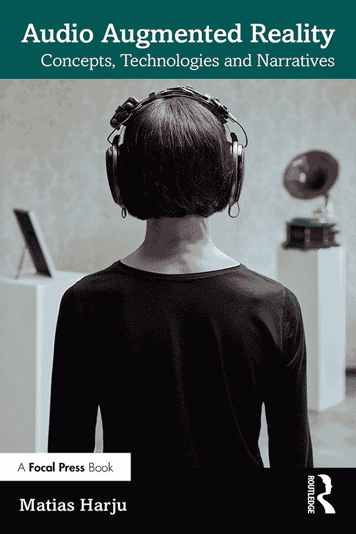

Designed cover image: Shutterstock

*Trademark notice*: Product or corporate names may be trademarks or registered trademarks, and are used only for identification and explanation without intent to infringe.

ISBN: 978-1-003-62728-9 (ebk)

DOI: [10.4324/9781003627289](https://doi.org/10.4324/9781003627289)

# Acknowledgements

First and foremost, I want to thank Ville Walo of WHS, without whom the Full-AAR project would never have started in 2021, eventually leading to the writing of this book. I’m also grateful to the rest of the Full-AAR team, people at WHS, and the actors, musicians, sound engineers, and test participants who have contributed to the project.

I want to express my sincere thanks to Evie Evans at Routledge, who suggested this book project in autumn 2023 and has been a great support since. Thanks also to other awesome people at Routledge and copyeditor Kristina Wischenkamper for working with me to turn my thoughts into a book.

A big thank you goes to Professor Iain McGregor for both invaluable feedback on the initial book proposal as well as thorough and wise comments on the draft manuscript. My thanks also go to the other pre-reviewers, Professor Sebastian Schlecht, and Professor Stefania Serafin.

I am grateful to everyone with whom I have had the honour of discussing and who have shared invaluable insights. Special thanks go to Thomas Aichinger, Steffen Armbruster, Rémi Audfray, Professor Karlheinz Brandenburg, Halsey Burgund, Professor Michael Cohen, Holger Förterer, JiaYing Grygiel, Hanna Haaslahti, Edwin van der Heide, Mikko Honkanen, Miranda Kastemaa, Josh Kopeček, Mari Koppinen, Nils Meyer-Kahlen, Hanna Niittymäki, Mathis Nitschke, Ronja Pahaoja, Professor Ville Pulkki, and Ulrike Sloma.

I want to thank Emilia Lehtinen, author and filmmaker, for brainstorming invaluable narrative ideas for AAR during the past years. Thank you also, Jussi Ratilainen, for the captivating cover picture.

Finally, my deepest thanks to you, Kaisa, my wife, for your unwavering support and for making sure I had the time to focus when it was needed most.

虽然我们可能生活在视觉主导的文化中，但可以认为是通过耳朵我们理解世界。与视觉不同，听力是全向的，360 度覆盖所有方向，能够检测和识别障碍物后方的声源。它也能在黑暗中以及我们睡眠时工作。在缺乏听力的情况下，对环境的存在感和理解感会大幅下降——世界显得不那么有生命（McGill et al., 2020）。虽然眼睛可能提供更精确的数据，但耳朵将我们在三维和情感上与世界连接起来。

### Surround systems

- 军事显然成为了耳机的主要用户，并且他们也采用双耳（binaural）方式使用：例如，在第一次世界大战期间，某些声音定位仪配备了耳机（Self，2024），而潜艇则是通过两个水听器（hydrophones）获得的双耳听觉图像来跟踪的（Boren，2018）。二战期间，Luftwaffe（德国空军）使用了一种创新的盲航导航系统，基于双声道耳机聆听：一台战略定位的无线电站向飞行员左耳发送摩斯电码点，另一台站向右耳发送破折号，正好在点之间，偏离指定航线会导致信号失调，从而提示飞行员进行纠正（Kittler, Winthrop-Young and Wutz，1999）。

- 从 1930 年代起对主动降噪的研究以及 Bose 在 1989 年推出的首款商用降噪耳机，标志着 AAR（自适应音频系统）的重要里程碑，随后降噪功能成为消费者最广泛使用和使用的首个 AAR 功能。这使得个人声音景观的动态操控成为可能，这已是从单纯控制音量的跨越。

## 4.4 Audio guides and audio walks

- 耳机和耳塞使得“音频步行”和“音频导览”概念得以实现。早期的实现缺乏更近期应用的基于位置的互动性，但其内容强烈与特定地点相关——或者有意与之背离。

### 4.4.1 Audio guides

- 音频导览是有导览的旅游的中介形式。它们缺乏人类导览员的存在，但能够让参观者以更灵活甚至更个性化的方式体验展览，支持多语言，且不干扰其他参观者——运行成本也低于雇佣人类导览员。早期的实现方式是线性的，有时还允许暂停和倒带。20 世纪 80 年代，随着红外和无线电技术的发展，单个展品可以在访客接近时循环播放声音，常常访客到达时正处于循环的中间，因而错过了描述的开头。随后，博物馆实施了系统：访客轻点代码即可从随机存取存储设备中选择正确的音频轨道（Eckel，2001），2000 年代开始，自动定位系统逐渐出现。然而，即便到现在，许多现代音频导览和步行仍无法实现头部追踪，从而无法使听觉内容在空间上与环境对齐。即便如此，在设计良好的音频导览中，即使内容是线性的，声音也会与环境融合，邀请“参与者在听到声音后与现有环境建立联系”（Schraffenberger and Heide，2014，第 68 页）。这为后续更具定位性和 6DoF（六度自由）体验奠定了坚实基础。

- 最早的已知音频导览实现于 1952 年，在阿姆斯特丹的 Stedelijk Museum（荷兰国家美术馆）推出。线性语音描述被录制在磁带上，并通过安装在踢脚板后的感应环在馆内广播；参观者佩戴耳机并通过小型接收器接收无线电信号（Nederlands Instituut voor Beeld and Geluid，2020）。这一先驱的“无线导览”引起了多家博物馆的兴趣（Stedelijk Museum Amsterdam，2021），随后类似系统也在华盛顿国家画廊（National Gallery of Washington）使用（Kennedy，2006）。

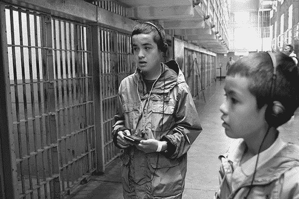

Figure 4.5Visitors on the *Alcatraz Cellhouse Audio Tour* ¶ Source: Photograph by JiaYing Grygiel

- 当代音频导览的典型例子是广为人知的*Alcatraz Cellhouse Audio Tour*，该导览位于旧金山湾的传奇性最高安全级别联邦监狱——该监狱在 1980 年代改建为博物馆。原始音频导览于 1987 年使用 Sony Walkman 制作，2007 年在翻新期间推出了新版本，采用重新设计的音效和 MP3 播放器（Golden Gate National Parks Conservancy，2007）。

- 45 分钟的音频呈现包含了在监狱时代生活和工作的矫正官和囚犯的真实声音。通过监狱门闸的敲击声、脚步声以及其他监狱音效营造出氛围。与使用编号地点并需按按钮触发个别音频段的方式不同，该音频导览采用线性播放，假设访客以相对稳定的速度沿既定路径行走，类似于 Stedelijk Museum 的导览。若访客在某处逗留或行走速度快于预期，可自行暂停并重新开始音频。这种方式提供了低维护的解决方案，无需在历史建筑上安装任何追踪基础设施。

- 与 Stedelijk 系统类似，Alcatraz 的音频是“头部锁定”（head-locked），但仍能在访客站在走廊时，听到铁栏的撞击声和囚犯的喊叫，营造出沉浸感。在某些时刻，访客被邀请同步与一名囚犯的步伐，这一方法与 Janet Cardiff 在部分音频步行中用来与叙事者建立联系的技巧相似。

### 4.4.2 Audio walks

- Janet Cardiff 及其合作伙伴–协作者 George Bures Miller 是音频步行（site-specific sound art）发展的重要人物。Cardiff 的*Lousiana Walk #14*（1996 年）让艺术画廊的参观者通过耳机听到精确的音频指示，引导他们离开室内空间“踏上户外冒险”（Butler，2007）。Cardiff 的音频步行自*Münster Walk*（1997 年）起开始使用双耳人头模型（binaural dummy head）录音，以增强沉浸感和与叙事者的共在感；在步行时，参与者被鼓励跟随叙述者的脚步节奏（Butler，2007）。这些步行常常将多层虚构叙事与现实及身体运动相结合（Bradley，2012），从而探索自适应音频（AAR）的核心要素。

- Cardiff–Miller 的首批音频步行使用便携 CD 播放器和 iPod 播放线性内容，并提供暂停和倒带功能；到本世纪第一个十年结束时，这些内容被智能手机所取代（Bradley，2012）。

- 最近已故的荷兰声音艺术家 Cilia Eren 的音频步行则恰恰相反：首先，Eren 本人从未以声音出现，而是让参与者扮演叙事者的角色；其次，其目标是让参与者产生错位感。例如，她的首部音频步行*China Daily*（1987 年）邀请听众想象自己置身于繁忙的中国城市，而实际漫步在阿姆斯特丹的街道上（Steijn，2023）。虽然这种声学转位通常难以实现，但叙事的 transportation 以及步行这一共同模式（听觉与身体）可能提供帮助。

### 4.4.3 Radio-based locative experiences

- 卫星定位和移动互联网在可穿戴设备中的应用，使得本世纪第一个十年出现了基于地理位置的音频步行和体验，这将在下一章详细讨论。在此之前，一些声音艺术家使用无线电发射和接收设备，在环境中植入虚拟声音源，创造定位体验。

在 2000 年，Edwin van der Heide (2023) 创作了他首个*Radioscape*装置，该装置探索无线电作为空间和互动媒介。十五台定制发射器散布在城市环境中，广播元“元作曲”的多层内容，参与者通过专为其设计的接收器收听。接收器具备两个有趣的特性。首先，它们能够同时接收多个信号。其次，发射器与接收器之间的距离直接影响音量，即使在短距离内也如此，这与许多习惯收听高功率商业和公共电台的听众不同。

第三，也许最有趣的特点是，接收器是“立体全景接收器”，正如艺术家所称。通过使用两根天线和立体耳机，它们的功能类似于立体麦克风：参与者能够感知发射器的方向和距离；位于天线左侧的广播站在左耳听到更明显，反之亦然。

这种罕见的、能够在空间上感知无线电信号的能力，使得发射器在某种意义上成为嵌入环境的虚拟声源。无线电波与城市结构的相互作用进一步增加了复杂性，反射和干涉改变了声音景观，类似于声音波在环境中传播时的行为。所有这些因素结合起来，与参与者探索城市环境以及无线电构成的声音作品的能力相结合，使得该装置紧密贴合音频增强现实的语境，并带有“超人听力”的风格（如第 2.6 节所讨论）。

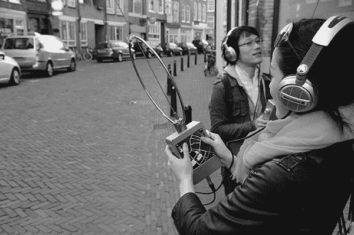

Figure 4.6Participants of *Radioscape* using the custom-made radio receivers ¶ Source: Photograph by Edwin van der Heide, courtesy of Studio Edwin van der Heide

另一个基于无线电的音频体验是*Linked*，该装置于 2003 年由 Graeme Miller (2024) 在英国东伦敦安装。该作品利用多台无线电发射器创建“地理定位”的接收区域。原始作品由伦敦博物馆应邀创作，以回应 M11 联络道路的建设，该道路拆除了超过 400 栋建筑，影响了一个充满活力的社区。沿着道路 5 公里的路段，多个安装在路灯杆上的发射器播放记忆、故事和来自该地区过往居民的声音，包括艺术家、工人和活跃参与反对开发的抗议者。

2003 年，基于卫星定位的移动音频步行应用尚未向公众提供。使用无线电发射器是一种优雅的前身，但需要实物安装、电源供应和维护。与 Heide 的作品一样，实体无线电发射器将内容具体地锚定在环境中。*Linked*采用音频循环，其缺点是，若在循环中途接收到信号，听众需等待下一个故事开始（Bederson, 1995）。在*Linked*中，这种间歇性的无线电信号接收，加上信号的不连续性，营造出一种怀旧感，适合作品本身；同时，多个参与者能够同步聆听内容，这在基于网页的系统中难以实现（Bradley, 2012）。

## References

1. Apple, R.W. (2023) ‘Turning Wax into Diamonds’, Edison and Ford Winter Estates, 1 December. Available at: [www.edisonfordwinterestates.org/turning-wax-into-diamonds/](https://www.edisonfordwinterestates.org/turning-wax-into-diamonds/) (Accessed: 2 July 2024).

2. Bederson, B.B. (1995) ‘Audio Augmented Reality: A Prototype Automated Tour Guide’, in Conference Companion on Human Factors in Computing Systems – CHI ’95. Denver, Colorado, United States: ACM Press, pp. 210–211. Available at: [doi.org/10.1145/223355.223526](https://doi.org/10.1145/223355.223526).

3. Berry, G. (2017) ‘History of Binaural’. Available at: [geberry.wixsite.com/binaural/history](https://geberry.wixsite.com/binaural/history) (Accessed: 10 September 2024).

4. Boren, B. (2018) ‘History of 3D Sound’, in A. Roginska and P. Geluso (eds) Immersive Sound: The Art and Science of Binaural and Multi-Channel Audio. Routledge, pp. 40–62.

5. Bose (2024) ‘Active Sound Management | Bose Automotive’. Available at: [automotive.bose.com/road-ahead/active-sound-management](https://automotive.bose.com/road-ahead/active-sound-management) (Accessed: 25 September 2024).


6. Bradley, S. (2012) ‘History To Go: Oral History, Audiowalks and Mobile Media’ (pre-published version). Available at: [`www.academia.edu/1148470/History_to_go_oral_history_audiowalks_and_mobile_media_pre_published_version_`](https://www.academia.edu/1148470/History_to_go_oral_history_audiowalks_and_mobile_media_pre_published_version_) (Accessed: 1 August 2024).

7. Briggs, M.J. (2023) ‘A Brief History of the Acoustic Ear Trumpet and Some Collection Favourites’, ENT & Audiology News, December. Available at: [`www.entandaudiologynews.com/features/audiology-features/post/a-brief-history-of-the-acoustic-ear-trumpet-and-some-collection-favourites`](https://www.entandaudiologynews.com/features/audiology-features/post/a-brief-history-of-the-acoustic-ear-trumpet-and-some-collection-favourites) (Accessed: 15 September 2024).

8. Bülow, R. (2013) ‘Vor 40 Jahren: Ein Kunstkopf für binaurale Stereophonie’, heise online. Available at: [`www.heise.de/news/Vor-40-Jahren-Ein-Kunstkopf-fuer-binaurale-Stereophonie-1946286.html`](https://www.heise.de/news/Vor-40-Jahren-Ein-Kunstkopf-fuer-binaurale-Stereophonie-1946286.html) (Accessed: 10 September 2024).

9. Butler, T. (2007) ‘Memoryscape: How Audio Walks Can Deepen Our Sense of Place by Integrating Art, Oral History and Cultural Geography’, Geography Compass, 1 (3), pp. 360–372. Available at: [`doi.org/10.1111/j.1749-8198.2007.00017.x`](https://doi.org/10.1111/j.1749-8198.2007.00017.x).

10. Cardiff, J. and Miller, G.B. (2024) ‘Münster Walk, Janet Cardiff & George Bures Miller’. Available at: [`cardiffmiller.com/walks/munster-walk/`](https://cardiffmiller.com/walks/munster-walk/) (Accessed: 31 October 2024).

11. Chion, M. (1994) Audio-Vision: Sound on Screen. Columbia University Press.

12. Davis, M. (2003) ‘History of Spatial Coding’, Journal of the Audio Engineering Society, 51 (6), pp. 554–569.

13. Dawson, V. (2020) ‘The Epic Failure of Thomas Edison’s Talking Doll’, Smithsonian Magazine. Available at: [`www.smithsonianmag.com/smithsonian-institution/epic-failure-thomas-edisons-talking-doll-180955442/`](https://www.smithsonianmag.com/smithsonian-institution/epic-failure-thomas-edisons-talking-doll-180955442/) (Accessed: 3 September 2024).

14. Dia Art Foundation (2023) ‘Max Neuhaus, Times Square’. Available at: [`www.diaart.org/exhibition/exhibitions-projects/max-neuhaus-times-square-site`](https://www.diaart.org/exhibition/exhibitions-projects/max-neuhaus-times-square-site) (Accessed: 23 September 2024).

15. Eckel, G. (2001) ‘Immersive Audio‑Augmented Environments: The LISTEN Project’, in Proceedings Fifth International Conference on Information Visualisation, IEEE, pp. 571–573. 可于：[`https://doi.org/10.1109/IV.2001.942112`](https://doi.org/10.1109/IV.2001.942112)

16. Ford (2015) ‘How New Ford Technology Can Make Your Car Work Like a Giant Pair of Noise‑Cancelling Headphones’. 可于：[`https://media.ford.com/content/fordmedia/feu/en/news/2015/11/11/how-new-ford-technology-can-make-your-car-work-like---a-giant-pa.html`](https://media.ford.com/content/fordmedia/feu/en/news/2015/11/11/how-new-ford-technology-can-make-your-car-work-like---a-giant-pa.html) (Accessed: 25 September 2024).

17. Golden Gate National Parks Conservancy (2007) ‘Alcatraz Breaks Out! Major Renovation of World Famous National Park Site’, Golden Gate National Parks Conservancy. 可于：[`https://www.parksconservancy.org/news/alcatraz-breaks-out-major-renovation-world-famous-natioenal-park-site`](https://www.parksconservancy.org/news/alcatraz-breaks-out-major-renovation-world-famous-natioenal-park-site) (Accessed: 17 September 2024).

18. Gronow, P. and Saunio, I. (1990) Äänilevyn historia. Porvoo: WSOY.

19. Harman (2024) ‘Active Noise Cancellation – The Sound of Silence’. 可于：[`https://car.harman.com/solutions/car-audio/halosonic/active-noise-cancellation`](https://car.harman.com/solutions/car-audio/halosonic/active-noise-cancellation) (Accessed: 25 September 2024).

20. Heide, E. van der (2023) ‘Edwin van der Heide – Portfolio’. 可于：[`https://www.evdh.net/portfolio/EvdH_portfolio.pdf`](https://www.evdh.net/portfolio/EvdH_portfolio.pdf) (Accessed: 12 September 2024).

21. Howard, P. and Templeton, W.B. (1966) Human Spatial Orientation. London: Wiley. 可于：[`https://archive.org/details/trent_0116301611517`](https://archive.org/details/trent_0116301611517)

22. Hyundai (2020) ‘Hyundai’s World’s First Road‑Noise Active Noise Control, RANC’, Hyundai Motor Group. 可于：[`https://www.hyundaimotorgroup.com/story/CONT0000000000090151`](https://www.hyundaimotorgroup.com/story/CONT0000000000090151) (Accessed: 25 September 2024).

23. Kennedy, R. (2006) ‘At Museums: Invasion of the Podcasts’, The New York Times, 19 May. 可于：[`https://www.nytimes.com/2006/05/19/arts/design/at-museums-invasion-of-the-podcasts.html`](https://www.nytimes.com/2006/05/19/arts/design/at-museums-invasion-of-the-podcasts.html) (Accessed: 3 October 2024).

24. Kittler, F.A., Winthrop‑Young, G. and Wutz, M. (1999) Gramophone, Film, Typewriter. Stanford, CA: Stanford University Press (Writing science).

25. Kotz, L. (2009) ‘Max Neuhaus: Sound into Space’. 可于：[`https://faculty.ucr.edu/~ewkotz/texts/Kotz-2009-Dia-Neuhaus-proof.pdf`](https://faculty.ucr.edu/~ewkotz/texts/Kotz-2009-Dia-Neuhaus-proof.pdf) (Accessed: 23 September 2024).

26. Kroon, R.W. (2010) A/V A to Z: An Encyclopedic Dictionary of Media, Entertainment and Other Audiovisual Terms. McFarland.

27. Lawton, M., Cunningham, S. and Convery, I. (2020) ‘Nature Soundscapes: An Audio Augmented Reality Experience’, in Proceedings of the 15th International Audio Mostly Conference (AM’20). AM’20: Audio Mostly 2020, Graz Austria: ACM, pp. 85–92. 可于：[`https://doi.org/10.1145/3411109.3411142`](https://doi.org/10.1145/3411109.3411142)

28. Majdak, P., Goupell, M.J. and Laback, B. (2010) ‘3-D Localization of Virtual Sound Sources: Effects of Visual Environment, Pointing Method, and Training’, Attention, Perception, & Psychophysics, 72 (2), pp. 454–469. 可于：[`https://doi.org/10.3758/APP.72.2.454`](https://doi.org/10.3758/APP.72.2.454)

29. Miller, G. (2024) ‘LINKED’. 可于：[`https://graememiller.org/project/linked/`](https://graememiller.org/project/linked/) (Accessed: 11 November 2024).

30. Nederlands Instituut voor Beeld & Geluid (2020) ‘Draadloze rondleiding in het Amsterdams Stedelijk Museum (1952)’. 可于：[`https://www.youtube.com/watch?v=QSEqf_mqjCA`](https://www.youtube.com/watch?v=QSEqf_mqjCA) (Accessed: 2 October 2024).

31. Niittymäki, H. (2024) ‘Email exhange with Matias Harju, 3 October’.

32. Pettorino, M. (2015) ‘The History of Talking Heads: The Trick and the Research’, in R. Hoffmann and J. Trouvain (eds) Proceedings of the First International Workshop of the History of Speech Communication Research. HSCR 2015, Dresden: TUD Press, pp. 30–41. 可于：[`https://unora.unior.it/bitstream/11574/160948/1/pettorino_dresden_2015.pdf`](https://unora.unior.it/bitstream/11574/160948/1/pettorino_dresden_2015.pdf) (Accessed: 19 September 2024).

33. Pick, H.L., Warren, D.H. and Hay, J.C. (1969) ‘Sensory Conflict in Judgments of Spatial Direction’, Perception & Psychophysics, 6 (4), pp. 203–205. 可于：[`https://doi.org/10.3758/BF03207017`](https://doi.org/10.3758/BF03207017)

34. Schoenherr, S.E. (1999) ‘Sound Recording Research at Bell Labs’. 可于：[`https://www.aes-media.org/historical/html/recording.technology.history/bell-labs.html`](https://www.aes-media.org/historical/html/recording.technology.history/bell-labs.html) (Accessed: 10 September 2024).

35. Schraffenberger, H. and Heide, E. van der (2014) ‘The Real in Augmented Reality’, in xCoAx: Proceedings of the Conference on Computation, Communication, Aesthetics and X. xCoAx 2014, Porto, pp. 64–74.

36. Self, D. (2024) ‘Acoustic Location and Sound Mirrors’. 可于：[`http://douglas-self.com/MUSEUM/COMMS/ear/ear.htm`](http://douglas-self.com/MUSEUM/COMMS/ear/ear.htm) (Accessed: 20 September 2024).

37. Stamp, J. (2023) ‘A Partial History of Headphones’, Smithsonian Magazine. 可于：[`https://www.smithsonianmag.com/arts-culture/a-partial-history-of-headphones-4693742/`](https://www.smithsonianmag.com/arts-culture/a-partial-history-of-headphones-4693742/) (Accessed: 23 September 2024).

38. Stedelijk Museum Amsterdam (2021) Have You Heard About the Very First Museum Audio Tour?, Instagram. 可于：[`https://www.instagram.com/stedelijkstudies/p/CT2SHjFIBoS/`](https://www.instagram.com/stedelijkstudies/p/CT2SHjFIBoS/) (Accessed: 2 October 2024).

39. Steijn, R. (2023) ‘Ode aan de verstilling – Cilia Erens (1946–2023)’, Theaterkrant. 可于：[`https://www.theaterkrant.nl/tm-artikel/ode-aan-de-verstilling-cilia-erens-1946-2023/`](https://www.theaterkrant.nl/tm-artikel/ode-aan-de-verstilling-cilia-erens-1946-2023/) (Accessed: 9 October 2024).

40. Thomas A. Edison Inc. (1920) ‘The New Edison Advertisement (August 14, 1920)’, The Saturday Evening Post, 14 August, pp. 164–165.

41. Thor (2024) ‘THOR AVAS – Acoustic Vehicle Alerting System for All Types of Electric Vehicles’. 可于：[`https://thor-avas.com/legislation/regulation-on-avas-requirements/`](https://thor-avas.com/legislation/regulation-on-avas-requirements/) (Accessed: 25 September 2024).

42. Waller, S. (2002) ‘Psychoacoustic Influences of the Echoing Environments of Prehistoric Art’, Journal of The Acoustical Society of America, 112, pp. 2284–2284. 可于：[`https://doi.org/10.1121/1.4779166`](https://doi.org/10.1121/1.4779166)


43. 于, K. (2022) ‘世界上最深的桶’, Valens 研究. 可于: [`www.valens-research.com/dynamic-marketing-communique/the-worlds-deepest-bin-find-out-how-this-campaign-encouraged-a-fun-cleaning-activity-in-2009-thursdays-gorillas-of-guerrilla-marketing/`](https://www.valens-research.com/dynamic-marketing-communique/the-worlds-deepest-bin-find-out-how-this-campaign-encouraged-a-fun-cleaning-activity-in-2009-thursdays-gorillas-of-guerrilla-marketing/) (访问日期: 2024 年 9 月 23 日)。

## 5 Towards mixed realities

DOI: [10.4324/9781003627289-5](https://doi.org/10.4324/9781003627289-5)

1990 年代以前, 将虚拟音频合并到现实世界的过程主要依赖于隐藏扬声器的直接增强, 或者通过耳机提供线性或手动控制的音频导览和音频步行 (见 第 4 章)。当时, 计算性能的提升推动了对虚拟现实和“元空间”的热情探索。1992 年, 卡德尔和米泽尔 (`Caudell and Mizell` 1992) 为在波音公司研发的头戴式显示器而引入“增强现实”一词。随后, “增强音频现实”(`Cohen, Aoki and Koizumi` 1993) 和“音频增强现实”(`Bederson, 1995`) 等概念相继出现, 这些概念展示了基于计算机生成的空间声和基于位置的交互功能的早期实际原型。

通往听觉混合现实 (`MR`) 的旅程已经开始, 想象一个未来, 计算机生成的虚拟声音能够无缝融合到现实世界中。虽然这种无缝融合仍是许多实际应用的理想目标, 但增强音频现实 (`AAR`) 的其他特征已经被成功利用, 创造出吸引人且富有信息的体验。本章通过一系列双耳声道或耳机驱动的 `AAR` 示例, 探索这条道路, 重点突出该领域的重要里程碑以及仍然可供公众使用的叙事应用。与上一章的示例类似, 本章中展示的示例在全书中均有引用。

### 5.1 首个 AAR 原型

自贝尔进行的“双耳声道”实验 (见第 4.1 章) 以来, 具有真实声学表现的远程存在已成为虚拟音频领域的核心兴趣之一。在 `AAR` 领域, 科恩、阿 oki 和小泉 (`Cohen, Aoki and Koizumi` 1993) 在日本爱因斯坦大学进行了一项有趣的研究。研究人员探讨了在危险环境中工作的“遥控机器人”操作员如何通过双耳假人头和耳机听到机器人的声音——即所谓的“真实声景”。他们使用所谓的“增强音频现实”, 在真实声景之上叠加计算机生成的空间化声音, 如警报和通信, 使其与真实声音共存。

除了增强双耳音频馈送外, 科恩及其同事还测试了在静音的桌面电话上空间定位虚拟铃声。这是最早的演示之一, 将空间化的虚拟声音附着在现实物体上 (除扬声器外)。

在爱因斯坦大学的实验中, 用户坐在椅子上; 而 1995 年, 乔·贝德森 (`Bederson`) 及其在新泽西州贝尔通信研究所的团队则构建了一个具有重要影响的原型, 探索了 `AAR` 的另一个重要范式: 位置感知交互。

- [大卫·鲍伊展]的灵感源于诺贝尔物理奖获得者**理查德·鲍伊**。

1. 运用鲍伊技巧，你只需花上`20 min`就能深入理解知识点，而且记忆深刻，*难以遗忘*。

```
if (condVar > someVal) {console.log("xxx")}
```

- 可以将 `Dimensions of Sound` 展览视为 `David Bowie Is` 的更新版本，位于匈牙利布达佩斯的 `House of Music`。2022 年开幕，该大型永久展览利用 `usomo` 系统实现 `6DoF`（超宽带 `UWB` 跟踪）和空间音频。展览通过互动参与、基于位置触发和视频同步的音频内容，实现与展品的互动。头部追踪功能让声音能够附着于对应的实体物体，提升沉浸感和清晰度。展览设计可容纳数十名同时参观者，不追求真实声场，而是依赖丰富内容和互动性。如同 `David Bowie Is`，该展览在博物馆语境中展示了强大的大规模系统，能高效处理高流量访客。

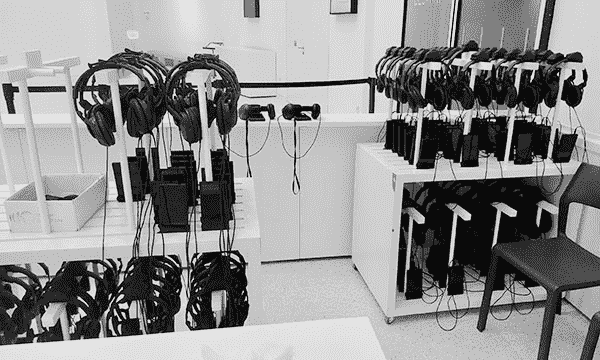

Figure 5.1Headphones and mobile devices equipped with the `usomo` system waiting for visitors at the `Dimensions of Sound` exhibition in Budapest ¶ Source: Photograph by the author

### 5.3 Reinforced environments

`AR` 和 `AAR` 的独特之处在于它们能够在现实中揭示新的意义。前面的例子主要关注在真实物体上添加虚拟声音，同时确保保留原有意义。还可以对整个环境进行 `reinforce`（`Azuma, 2015`），相关内容见第 8.5 章。下面的示例中的音频内容根植于地点及其居民。这类体验显然是特定场所的，无法转移到其他地方。

#### 5.3.1 Augmented office

`Audio Aura` 是加州 Xerox PARC 的早期 `AAR` 研究项目 (`Mynatt et al.`, 1998)。其目标是使用虚拟背景声音，为例如同事的位置提供“巧合性”的信息。当用户走进某位同事的办公室，却发现房间为空时，系统会通过用户的无线耳机播放音频提示，告知该同事是否即将返回。系统利用射频 proximity 传感器追踪每位员工的大致位置。除了上述基于位置、具有社会意义的信息外，该系统还作为普遍音频显示，告知用户收到的邮件数量。所有音频提示和声呈化均采用自然音效（如海鸥和海浪），提供“周边”信息而非精确的“看到同事的灯亮和手提箱靠在桌边”的感觉（`Mynatt et al.`, 1998）。

尽管测试用户反应积极，但像 `Audio Aura` 这样的系统在工作场所并未获得广泛采用。虽然没有技术障碍，但概念可能只是过早出现。此外，隐私问题可能是潜在障碍，且持续听到作为提醒的环境声音可能会随着时间的推移变得压抑，无论这些声音多么巧合。

#### 5.3.2 Time travelling

在叙事 `AAR` 中，虚拟背景环境当然被广泛使用。一个近期的例子是 `Sonic Traces Heldenplatz`（位于维也纳），该体验于 2020 年推出，由 `scopeaudio` 和 `hoerwinkel` (`Aichinger`, 2024) 开发。参与者佩戴头部追踪 `Bose AR` 耳机，并携带一款简单的图形用户界面（GUI）手机，可在漫步广场时在 1848 与 2084 两个时间层之间切换。每个层中，用户会发现酷影人物讨论当时的热点问题，而音景则通过马车和飞行汽车描绘时代氛围。有趣的是，切换层时，人物仍在讨论同一主题，但从各自时代的视角出发。

该无实体音频层同样让历史回归到 `Maison Gainsbourg`（巴黎）。如今，这座建筑是法国音乐家 Serge Gainsbourg 及其家庭的纪念博物馆。2023 年向公众开放，通过 30 分钟的预约制沉浸式音频导览，利用 `usomo` `6DoF` 系统呈现。音频内容由 `The Soundwalk Collective` 与 Serge Gainsbourg 的女儿 Charlotte Gainsbourg 共同创作。导览期间，访客听到 Charlotte 回忆她与父亲在此房屋的生活点滴。独特之处在于使用了家庭日常生活的原始录音。当这些录音在原始录制地点空间定位时——例如，Serge 在客厅的大钢琴旁教 Charlotte 弹钢琴的声音——时间层在强大的方式上对齐。

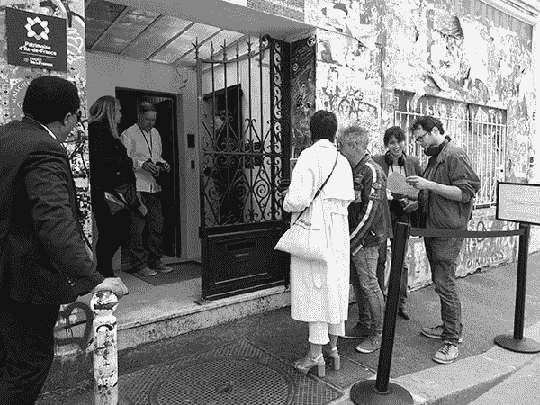

Figure 5.2Visitors waiting for their audio tour to start at `Maison Gainsbourg` in Paris ¶ Source: Photograph by the author

### 5.4 Reskinned environments

设定在“reskinned environment”中的应用要么是在为体验而专门构建的人工环境，要么是在真实场所进行改造以适应使用（`Azuma, 2015`），如第 8.5 章进一步讨论。它们通常可以迁移到其他地点，因为就像展览 `AAR` 那样，reskinning 对真实世界的关注很小，专注于“魔法圈”内的体验。

#### 5.4.1 Poetry of objects

一个好的再包装示例是 `The Sound of Things`，由 `Holger Förterer` 创作的一个声音装置（(2013)）。该装置设在昏暗的房间，包含一张木桌，上面放置了一盏台灯，光线照射在十个精心散布在桌面上的物品上。两名同时聆听者佩戴由红外摄像机追踪的无线耳机，实现 `6DoF` 追踪。当聆听者蹲下更靠近物体时，虚拟声音会从它们中传来：酒杯发出庆祝的声音，记忆笔记本发出书写的声音，书桌灯发出轻柔的嗡鸣，香烟发出噼啪声……这些无生气的物品似乎在低语记忆，虽然很难从中拼凑出连贯的故事，但聆听者开始思考这些桌子和物品的主人是谁，主人发生了什么，围在酒杯旁的人是谁，记忆笔记本上写的是什么。

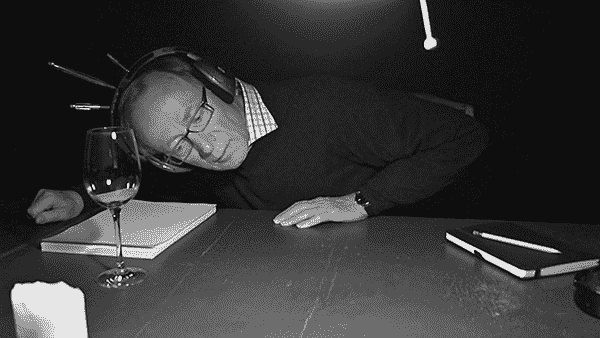

Figure 5.3A participant in `The Sound of Things` installation ¶ Source: Still capture from video by `Holger Förterer`

这种体验可以被感知为三维的声诗，或是一个悬疑故事的场景。`The Sound of Things` 是利用 `6DoF` 双耳音频 `AAR` 高效作为隐含、碎片化叙事的媒介的典型例子。用户周围的环境逐渐陷入黑暗并被忽略，这进一步强化了其象征性而非真实感。

#### 5.4.2 叙事再包装

黑暗是英国公司 `DARKFIELD` 所制作作品的核心特征。他们制作完全黑暗的音频体验，并将其安装在运输集装箱内。虽然集装箱为叙事环境提供了完全的控制，同时也使其能够全球巡演，并为创作过程划定明确的边界。`DARKFIELD` 来源于沉浸式戏剧传统，其首部作品 `Séance` 于 2018 年首演。`Séance` 是其方法的典型示例：观众在 20–30 分钟的线性叙事中，通过双耳空间音频体验，该叙事紧密与虚构的环境以及参与表演的真实观众相连。`Séance` 在黑暗中进行，使得拟声角色和事件显得可信，同时激发观众的想象力。

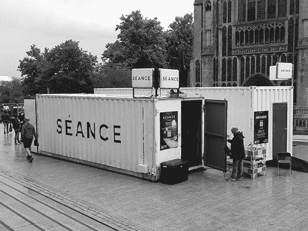

Figure 5.4`Two DARKFIELD shows, Séance and Arcade,` on tour in June 2024 in Norwich, UK ¶ Source: Photograph by the author

`The Sound of Things` 通过在桌面上放置实物并对其进行声层叠，而 `Séance` 则通过对完全预备好的运输集装箱进行声层叠。`Horror-Fi Me` 由 `Laurence Cliffe` (2021; 2024) 创作，几乎可以在任何室内环境上叠加一部恐怖电影的声音景观。该 iPhone 应用允许用户将虚拟声音附加到家中的物体上：例如，窗户会被雨声和风暴声所包围，门会偶尔发出敲击声，水龙头会滴水声。利用空间化声音与 `6DoF` 技术，这些增强会包围用户，能够在像家这样的安全环境中将其转变为充满惊悚感的空间。作为一款感知环境的应用，`Horror-Fi Me` 也是可转移性和环境驱动的 `AAR` 的出色例子，详见第 8.4 节。

作为再包装的最后一个例子，`The Reign Union` (`Valtakunnan liitto`) 以真实场景为故事的基础，并在整个体验中进行全面的再包装。它是名为‘Full-AAR’的艺术研究项目的一部分，由芬兰海沃斯（WHS）的艺术研究项目创作，属于生物虚构 `AAR` 故事。自 2025 年 5 月起向公众开放，该故事位于曾在 1950 年代容纳洗衣房的画廊空间内。故事围绕洗衣房的创始人与二战期间地下纳粹小组的联系展开。两名同时在空间中导航的用户会共享同一故事，但听到的叙事不同，这引发了信任问题以及对所听之信度的思考。

画廊本身充当过渡空间，位于两个展览之间，周围散落着几个箱子和设备。这使其成为再包装的理想平台——可以将其从当前状态转变为任何其他场景，如洗衣房、火车站或花园，既在语境上又通过虚拟声效实现。

### 5.5 导航与情境意识

`AAR` 在提供不依赖侵入性视觉屏幕的导航辅助方面拥有巨大的潜力，并通过全方位听觉强化情境意识。这一点早在早期就被认可，例如自 1970 年代起，为视障人士开发的音频辅助系统就已经出现。最初的系统使用红外发射器的固定安装，对感兴趣的物体发送音频标记给用户（`Schmalstieg and Hollerer, 2016`）。随后，卫星定位与空间化文本语音在路径标记上的原型被提出，例如在加州大学圣塔芭芭拉分校的 `Personal Guidance System`（`Loomis, Golledge and Klatzky, 1998`）以及法国联合 consortium 在 2008–2014 年开发的 `NAVIG` 系统。`NAVIG` 系统相当先进：除了户外环境，它还能在室内工作，并使用头戴摄像头识别楼梯、走廊等特征，并通过空间化语音和各种声效进行增强（`Katz et al., 2012`）。如今，正如第 2.8 节所讨论的，市面上已有许多移动应用利用计算机视觉和人工智能来解读周围环境，但它们通常不支持空间音频。

然而，利用空间音频进行导航对普通人群同样有用。该概念曾在 `Guided by Music` 研究中被探索，由 Albrecht、Väänänen 和 Lokki (2016) 进行。其原型通过将音乐空间化到路径上的路标上，引导行人和骑行者到达目的地，从而避免查看屏幕获取方向。但直到最近，缺乏头部追踪耳机，这一想法一直受到限制，导致基于空间化声音信标的导航应用难以出现。因此，`Google Maps` 等应用的头部锁定的逐向语音提示仍然是视觉不可用或不受欢迎时的主要导航工具。

自 1990 年代以来，航空业一直在大量研究虚拟双耳音频技术。其动机是开发航空碰撞避免系统以及处理军用机舱内的威胁任务和语音分离（`Simpson et al., 2005`）。多项飞行模拟研究表明，3D 音频显示能够帮助飞行员更快地应对机体周围的威胁和事件，同时降低视觉感知的认知负荷（`Veltman, Oving and Bronkhorst, 2004`）。

- 首个在飞行员头盔中集成的实际 3D 音频系统，配有头部追踪功能，由丹麦公司 Terma 制造，并在 2010 年代安装在皇家丹麦空军的 F-16 战斗机上 (`Kucinski`, [2018)。这些以及其他类似系统具有两个主要特点。首先，它们在空间上分离无线电频道，使飞行员能够保持对所有通信的感知，同时专注于最重要的内容；机组成员在通话中的声音也被空间化，使通信更加自然且高效 (`Szondy`, 2013; `Terma`, 2024)。其次，威胁通过空间化的声音指示实际方向，显著提升情境感知并大幅缩短反应时间，相比传统面板显示更为显著 (`Kucinski`, 2018; `Evans`, 2024)。

### 5.6 Geolocated audio

准确的卫星导航彻底改变了众多行业和领域，并催生了全新的服务。2000 年 5 月，美国政府关闭了对民用的故意 GPS 错误，使得 GPS 追踪精度从 45–100 米提升至约 5–15 米 (`NOAA`, 2018)。这推动了地理定位服务和应用的发展。不到十年时间，配备高速互联网连接和易用图形化操作系统的 GPS 接收器便集成到移动电话中。重要的是，`MapQuest`、`OpenStreetMap` 和 `Google Maps` 等地图服务的 API 对开发者开放。2008 年 iPhone 3G 发布时，这些 API 已全部可用。随后，三个其他卫星导航服务相继面向公众开放，统称为 `全球导航卫星系统`（GNSS），定位精度进一步显著提升。


这为 `地理定位 AAR`（位置感知音频）的实现提供了可能，使用户能够创建、分享并享受嵌入环境的内容。在地理定位 AAR 中，专用软件平台用于将音频文件绑定在地图上的“地理围栏”区域。当携带移动设备并佩戴耳机的用户进入其中一个区域时，相应的声音会被播放。地理定位应用大致分为两类：1）多作者社交应用，用户可自行录制声音并放置在地图上，供其他用户后续发现；2）音频漫步或音频步道，通常针对特定场景，由单一创作者制作。

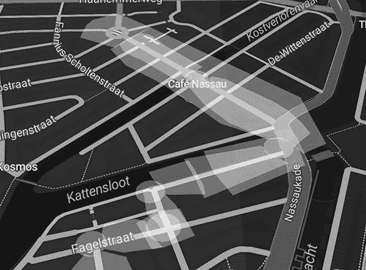

Figure 5.5A geolocated audio walk made and shared on `Echoes` with geofenced trigger areas ¶ Source: A screenshot from the Echoes iOS app

### 5.6.1 Multi-authored apps

最早的 GPS 依赖 AAR 实验之一是 `Hear&There`，在 MIT Media Lab 原型阶段由 `Rozier`、`Karahalios` 和 `Donath` 于 2000 年完成 (`2000)。与 Bederson 的概念类似，它强调社交属性，探索一种平台，使用户能够在校园范围内留下个人的听觉“印记”，并发现他人留下的印记。通过超越近距离传感器，利用 GPS 可将声音定位于用户希望的任意位置，为未来的位置感知音频应用打开了广阔的可能性。`Hear&There` 还能够追踪用户的头部朝向，实现 XY-Yaw（俯仰）度的声音空间化（见第 2.12 章），这一特性在当今地理定位体验中仍属稀有。

随后，公开的地理定位声音分享平台 `Roundware` 于 2008 年面向公众发布，至今仍在使用，是最早的平台之一 (`Burgund`, 2024)。此后出现了诸多其他平台，但大多寿命短暂。此类格式可能因缺乏连贯内容和与他人互动而导致进入门槛较高，难以激励用户前往现场聆听信息和声音。

### 5.6.2 Single-authored apps

单作者地理定位体验同样受欢迎，通常体现为音频漫步或音频步道，由多种移动应用和平台支持，使用户能够编辑并共享基于地图的音频内容，并在用户定位进入相应区域时自动触发播放。2010 年代期间陆续推出的平台包括 `NoTours`（2010）、`SonicMaps`（2012）、`Echoes`（2013）、`Soundtrackcity`（2013）以及 `U-Gruve`（2016）。在编辑阶段，这些应用提供用户预设工具，用于在地图布局上绘制“地理围栏”区域并为其分配音频片段。运行时，声音根据用户在区域内外的移动进行控制，有时甚至在区域内部。

地理定位音频常被独立艺术家和文化机构用于分享特定场所的记忆、戏剧、诗歌和音乐。部分平台提供商，如 `Echoes`，还会基于其技术框架制作定制经验和专属应用 (`Kopeček`, 2024)。除了音频步道，基于相同原则的互动旅游音频导览也应运而生。

此外，除了步行，任何移动方式 —  — 包括汽车、自行车、水上交通工具等 —  — 都可以创作地理定位内容。近期，`The Sonic Bike` 项目使用自行车装配扬声器，实现地理定位音乐与声艺 (`Bicrophonic Research Institute`, 2024)。`Audio Nomad`（`Woo` 等，2006）通过周围扬声器增强海景声景。`Autio`（由演员 Kevin Costner 联合创办）提供高制作水准的地理定位故事，主要面向汽车旅行者。尽管卫星导航限制了户外体验，但部分平台提供粗粒度的室内定位，如 `Echoes` 支持通过蓝牙低功耗（BLE）技术的 iBeacon 实现室内近距离交互。

### 5.6.3 Geolocated experiences

`Hyperkuulo`（意为“超听”）是一个基于 `NoTours` 平台的交互式漫步，值得一提。该漫步于 2013 年 4 月在芬兰坦佩雷（Tampere）推出，由 Ari Koivumäki 与坦佩雷应用技术大学的学生团队共同发起（2018)。漫步的叙事围绕一次带有听觉增强植入物的科学实验展开，耳机在故事中贯穿始终，将所有声音视为实验的一部分，并部分豁免了头戴式音频的局限。场景设在公园中，用户需要完成一系列任务，如逆时针绕泉花走动并哼唱“omm”，或在户外乐队台上制造回响。由于听觉敏感度提升，用户甚至能听到草木生长、远处桑拿房中的人在洗澡的声音，以及过去与未来的声音。随着用户到达指定地点，叙事会自动推进，但由于缺乏动作验证传感器，系统仅依赖用户自愿遵循指示，以保持一种虚假的主体性感（参见 `Fendt` 等，2012)。

Whereas `Hyperkuulo` was site-specific, `The Planets` (Sofilab, 2023) is an example of a transferable geolocated application. It is available in multiple urban parks around the world, authored remotely using `Google Maps` (Nitschke, 2022). The listener, equipped with a mobile phone and headphones, assumes the role of a spaceship pilot and navigates from planet to planet by walking within the park, guided by a binaurally rendered sound signal. Each planet, or designated area in the park, features the corresponding movement from Gustav Holst’s orchestral suite `The Planets`, played back as spatialised acousmatic instrument groups. While `The Planets` is set in a real-world environment and its primary interaction mode is physical movement within that space, the content itself lacks a direct contextual relationship with the surroundings. This forces listeners to actively interpret and construct their own connections between the space theme, the music, and the urban park.

## 5.7 AAR games

AAR games are a niche genre, but nevertheless, remain an interesting platform for studying interactivity and immersion in an audio augmented environment. They differ from audio games by bringing gameplay and stories physically to the real world, letting the player interact with the game kinaesthetically, and interact with the reality through the game.

### 5.7.1 Environmental relationship

Some of the earliest AAR games used the real environment merely as a platform for walking and thus interacting with the game, not unlike `The Planets`. For instance, `Guided by Voices` (Lyons, Gandy and Starner, 2000), a prototype developed at the Georgia Institute of Technology, USA, immersed the player into a fantasy world through virtual sounds without any narrative relationship with the real environment. Gameplay was based on making decisions in the acoustic fantasy world by physically moving between several locations within the real space, which could be an office, yard, or any other place. Despite the obvious incongruence between the real and virtual worlds, the movement reportedly aided in players’ immersion in the game. The game also fostered social interaction as multiple people could play it simultaneously in the same space.

A more recent AAR game prototype, `Sound PacMan` (Chatzidimitris, Gavalas and Michael, 2016), was, on the other hand, completely based on the user’s environment. The gameplay followed the idea of the original `Pac-Man`, but transformed the user’s local street network into the game’s maze; the player’s objective was to traverse along the real-world streets and eat ‘cookies’ while avoiding the pursuing ghosts that were also following along the same streets. Both cookies and ghosts were denoted by virtual sounds. The ubiquitous and adaptive nature of the game fundamentally leveraged the unique nature of AAR as a layer to reality, even if the contextual connection between the game characters and the local streets may have remained vague.

In contrast, the narrative connection with the environment was strong with `Audio Legends` (Rovithis et al., 2019; Moustakas et al., 2020), playable in 2018–2019. It was a site-specific outdoor game created by researchers at the Ionian University in Greece, and based on the folklore of the island of Corfu. The player’s task was to protect the island by escorting a sailor carrying wheat to the town’s entrance, locating and fighting ‘the monsters of plague’, and blocking incoming cannonballs (Rovithis, 2024). The real environment was utilised by embedding gameplay elements in the appropriate real-world surroundings, such as enemy gunships on the sea. The game also explored the use of gestures as an interaction mechanism within AAR: for instance, the user had to move the mobile device as if it were a shield to block the acousmatic cannonballs. The authentic environment and the contextual links between it and the story seem to have played a significant role in making the game feel immersive to the players (Rovithis et al., 2019).

`Zombies, Run!` takes an interesting approach to the user’s environment. Released in 2012, this AAR application immerses the user in a zombie narrative set in their own neighbourhood. As Runner Five, one of the few survivors, the user must run and evade zombies while completing game-like tasks to save the community. The user can listen to their own music playlist on a mobile device, which is, every now and then, interrupted by a ‘radio transmission’ where the protagonists talk to the user. The application also features Radio Mode that augments the listener’s music playlist with virtual radio broadcasts, creating an interesting layered reality discussed in Chapter 3.1.

The application does not attempt to embed virtual sounds in the environment other than with some general ambiences. In fact, location tracking is not utilised, meaning the system has no awareness of the user’s whereabouts or the nature of their surroundings. Instead, the gameplay relies on the user’s pace, with elements like randomly occurring chases where zombies’ breathing and drooling can be heard behind the user, prompting them to speed up for a minute to evade capture. Without head tracking, the app assumes users predominantly look forward while running. Despite not knowing the user’s surroundings, the dialogue references generic landmarks and directions (‘hospital’, ‘old mill’, ‘east of the trees’), creating an illusion that the story world aligns with the real one.

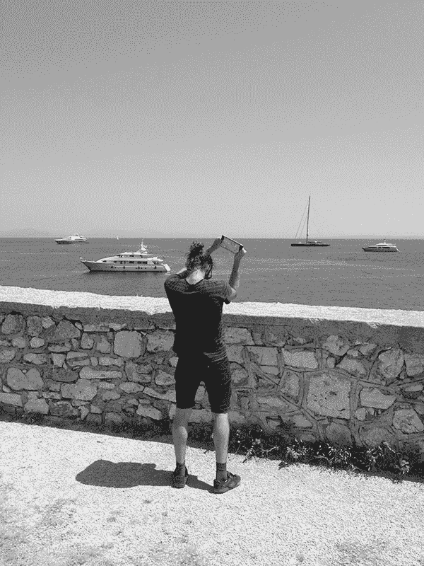

Figure 5.6A player of `Audio Legends` blocking an incoming cannon ball with the mobile device ¶ Source: Photograph courtesy of Emmanouel Rovithis and Nikolaos Moustakas


### 5.7.2 Collaboration

The aforementioned AAR games were designed for solo play, although multiple people could play them at once, sharing experiences in the same space. *Please Confirm You Are Not a Robot* was, however, an experimental game as part of a study that explored participatory performance and collaborative storytelling in AAR (Nagele et al., 2021). Realised in 2019 in London, UK, each performance accommodated four participants wearing *Bose Frames* smart glasses with head tracking and open-ear headphones. The participants were engaged in a series of games where they interacted with spatial audio cues as well as each other. As the game progressed, the virtual narrator ‘Pi’ revealed personal feelings and fears to each player individually, and eventually asked one participant to speak on their behalf to the rest of the group, thus testing the trust in the narrator and the game. The game provided players with asymmetric information, making participants hear different elements of the story, similar to *The Reign Union*. This prompted group coordination through verbal and non-verbal communication. Furthermore, the use of spatial audio cues prompted participants to engage their bodies in the performance, leading to a feeling of presence and immersion.

## 5.8 Conclusion

本章研究的案例凸显了双耳 AAR（双耳声呈现）的潜力，特别是它们与现实的关系。虽然许多引人入胜的项目已被省略以保持聚焦，虚拟音频研究和技术的发展则保留用于其他讨论，本章旨在提供该领域成就的总体概览。学习 AAR 经验的一个重要挑战是缺乏标准化词汇。这导致内容创作者、博物馆、机构和产品制造商使用各异的术语来描述可以轻易归类为 AAR 的功能。有时，尽管具有吸引人的 AAR 元素，展览可能因策展人或新闻发言人未能认识到其重要性而未得到充分宣传。然而，只要创新内容持续创作，技术得到支持，且这些作品能够有效传达给受众，我们便可以不拘泥于术语，专注于全身心投入 AAR 世界。

## 参考文献

1. 59 Studio (2024) ‘David Bowie Is’, 59 Studio. Available at: [`https://59.studio/project/david-bowie-is/`](https://59.studio/project/david-bowie-is/) (Accessed: 24 November 2024).
2. Aichinger, T. (2024) ‘Conversation with Matias Harju, March 6’.
3. Albrecht, R., Väänänen, R. and Lokki, T. (2016) ‘Guided by Music: Pedestrian and Cyclist Navigation with Route and Beacon Guidance’, Personal and Ubiquitous Computing, 20 (1), pp. 121–145. Available at: [`https://doi.org/10.1007/s00779-016-0906-z`](https://doi.org/10.1007/s00779-016-0906-z).
4. Azuma, R. (2015) ‘Location-Based Mixed and Augmented Reality Storytelling’, in B. Woodword (ed.), Fundamentals of Wearable Computers and Augmented Reality, 2nd edn. CRC Press, pp. 259–276.
5. Bederson, B.B. (1995) ‘Audio Augmented Reality: A Prototype Automated Tour Guide’, in Conference Companion on Human Factors in COMPUTING Systems – CHI ’95. Denver, Colorado, United States: ACM Press, pp. 210–211. Available at: [`https://doi.org/10.1145/223355.223526`](https://doi.org/10.1145/223355.223526).
6. Bicrophonic Research Institute (2024) ‘Bicrophonic Research Institute – Makes Music and Audio Landscapes to be Triggered by You the Cyclist’. Available at: [`https://sonicbikes.net/`](https://sonicbikes.net/) (Accessed: 30 October 2024).
7. Burgund, H. (2024) ‘Email with Matias Harju, November 18’.
8. Caudell, T. and Mizell, D. (1992) ‘Augmented Reality: An Application of Heads-Up Display Technology to Manual Manufacturing Processes’, in Proceedings of the Twenty-Fifth Hawaii International Conference on System Sciences, pp. 659–669 vol. 2. Available at: [`https://doi.org/10.1109/HICSS.1992.183317`](https://doi.org/10.1109/HICSS.1992.183317).
9. Chatzidimitris, T., Gavalas, D. and Michael, D. (2016) ‘SoundPacman: Audio Augmented Reality in Location-Based Games’, in 18th Mediterranean Electrotechnical Conference (MELECON). Lemesos, Cyprus: IEEE, pp. 1–6. Available at: [`https://doi.org/10.1109/MELCON.2016.7495414`](https://doi.org/10.1109/MELCON.2016.7495414).
10. Cliffe, L. (2021) ‘Horror-Fi Me’. Available at: [`https://lozcliffe.com/horror-fi-me/`](https://lozcliffe.com/horror-fi-me/) (Accessed: 9 December 2024).
11. Cliffe, L. (2024) ‘Into the Here and Now: Explorations within a New Acoustic Virtual Reality’, Leonardo [Preprint]. Available at: [`https://nottingham-repository.worktribe.com/output/42480431/into-the-here-and-now-explorations-within-a-new-acoustic-virtual-reality`](https://nottingham-repository.worktribe.com/output/42480431/into-the-here-and-now-explorations-within-a-new-acoustic-virtual-reality) (Accessed: 2 December 2024).
12. Cohen, M., Aoki, S. and Koizumi, N. (1993) ‘Augmented Audio Reality: Telepresence/VR Hybrid Acoustic Environments’, in Proceedings of 1993 2nd IEEE International Workshop on Robot and Human Communication, pp. 361–364. Available at: [`https://doi.org/10.1109/ROMAN.1993.367692`](https://doi.org/10.1109/ROMAN.1993.367692).
13. Eckel, G. (2001) ‘Immersive Audio-Augmented Environments: The LISTEN Project’, in Proceedings Fifth International Conference on Information Visualisation, pp. 571–573. Available at: [`https://doi.org/10.1109/IV.2001.942112`](https://doi.org/10.1109/IV.2001.942112).
14. Evans, S. (2024) ‘PTC, BAE Team to Create Augmented Reality Fighter Pilot Helmet’. Available at: [`https://www.iotworldtoday.com/metaverse/ptc-bae-team-to-create-augmented-reality-fighter-pilot-helmet-`](https://www.iotworldtoday.com/metaverse/ptc-bae-team-to-create-augmented-reality-fighter-pilot-helmet-) (Accessed: 10 October 2024).
15. Fendt, M.W. et al. (2012) ‘Achieving the Illusion of Agency’, in D. Oyarzun et al. (eds) Interactive Storytelling. Berlin, Heidelberg: Springer, pp. 114–125. Available at: [`https://doi.org/10.1007/978-3-642-34851-8\_11`](https://doi.org/10.1007/978-3-642-34851-8_11).
16. Förterer, H. (2013) ‘The Sound of Things’. Available at: [`https://www.foerterer.com/sound-of-things.html`](https://www.foerterer.com/sound-of-things.html) (Accessed: 3 December 2024).
17. Hatala, M. and Wakkary, R. (2005) ‘Ontology-Based User Modeling in an Augmented Audio Reality System for Museums’, User Modeling and User-Adapted Interaction, 15 (3), pp. 339–380. Available at: [`https://doi.org/10.1007/s11257-005-2304-5`](https://doi.org/10.1007/s11257-005-2304-5).
18. Katz, B.F.G. et al. (2012) ‘NAVIG: Augmented Reality Guidance System for the Visually Impaired’, Virtual Reality, 16 (4), pp. 253–269. Available at: [`https://doi.org/10.1007/s10055-012-0213-6`](https://doi.org/10.1007/s10055-012-0213-6).
19. Koivumäki, A. (2018) Maiseman äänittäminen: Äänimaisematutkimus äänisuunnittel 的支持下。 Helsinki: Aalto-yliopiston taiteiden ja suunnittel 的高等教育 (Aalto-yliopiston julkaisusarja).
20. Kopeček, J. (2024) ‘Conversation with Matias Harju, October 21’.
21. Kucinski, W. (2018) ‘A-10C Pilots Will Get 3D-Audio to Increase Situational Awareness’. Available at: [`https://www.sae.org/site/news/2018/11/a-10c-pilots-will-get-3d-audio-to-increase-situational-awareness`](https://www.sae.org/site/news/2018/11/a-10c-pilots-will-get-3d-audio-to-increase-situational-awareness) (Accessed: 10 October 2024).
22. Loomis, J.M., Golledge, R.G. and Klatzky, R.L. (1998) ‘Navigation System for the Blind: Auditory Display Modes and Guidance’, Presence: Teleoperators and Virtual Environments, 7 (2), pp. 193–203. Available at: [`https://doi.org/10.1162/105474698565677`](https://doi.org/10.1162/105474698565677).
23. Lyons, K., Gandy, M. and Starner, T. (2000) ‘Guided by Voices: An Audio Augmented Reality System’, in Proceedings of the International Conference on Auditory Display April, 2000. Georgia Institute of Technology, Atlanta, Georgia, USA: International Community for Auditory Display. Available at: [`https://smartech.gatech.edu/handle/1853/50672`](https://smartech.gatech.edu/handle/1853/50672) (Accessed: 5 November 2018).
24. Moustakas, N. et al. (2020) ‘Adaptive Audio Mixing for Enhancing Immersion in Augmented Reality Audio Games’, in Companion Publication of the ICMI 2020 International Conference on Multimodal Interaction. Virtual Event Netherlands: ACM, pp. 220–227. Available at: [`https://doi.org/10.1145/3395035.3425325`](https://doi.org/10.1145/3395035.3425325).


25. Mynatt, E.D. 等人 (1998) “Designing Audio Aura”，在 SIGCHI 会议论文集《Human Factors in Computing Systems – CHI ’98》中，洛杉矶加利福尼亚州，美国：ACM 出版社，第 566–573 页。可在：[`https://doi.org/10.1145/274644.274720`](https://doi.org/10.1145/274644.274720)。

26. Nagele, A.N. 等人 (2021) “Interactive Audio Augmented Reality in Participatory Performance”，Frontiers in Virtual Reality，1，第 610320 页。可在：[`https://doi.org/10.3389/frvir.2020.610320`](https://doi.org/10.3389/frvir.2020.610320)。

27. Nitschke, M. (2022) “Conversation with Matias Harju, September 14”。

28. NOAA (2018) “GPS.gov: Data From the First Week Without Selective Availability”。可在：[`https://www.gps.gov/systems/gps/modernization/sa/data/`](https://www.gps.gov/systems/gps/modernization/sa/data/)（访问日期：2024 年 11 月 25 日）。

29. Rovithis, E. (2024) “Audio Legends – SonicManos”。可在：[`https://sonicmanos.com/index.php?id=audio-legends`](https://sonicmanos.com/index.php?id=audio-legends)（访问日期：2024 年 10 月 15 日）。

30. Rovithis, E. 等人 (2019) “Audio Legends: Investigating Sonic Interaction in an Augmented Reality Audio Game”，Multimodal Technologies and Interaction，3（4），第 73 页。可在：[`https://doi.org/10.3390/mti3040073`](https://doi.org/10.3390/mti3040073)。

31. Rozier, J., Karahalios, K. and Donath, J. (2000) “Hear&There: An Augmented Reality System of Linked Audio”，在《International Conference on Auditory Display April, 2000》论文集中，乔治亚技术学院，美国亚特兰大，美国。

32. Schmalstieg, D. and Hollerer, T. (2016) Augmented Reality: Principles and Practice. Addison-Wesley Professional.

33. Sennheiser (2013) “David Bowie Is”: Sennheiser Helps the V&A Bring Together Sound and Vision。可在：[`https://web.archive.org/web/20160112020455/https://en-de.sennheiser.com/news-david-bowie-is-sennheiser-helps-the-va-bring-together-sound-and-vision-`](https://web.archive.org/web/20160112020455/https://en-de.sennheiser.com/news-david-bowie-is-sennheiser-helps-the-va-bring-together-sound-and-vision-)（访问日期：2024 年 8 月 13 日）。

34. Simpson, B. 等人 (2005) “Spatial Audio Displays for Improving Safety and Enhancing Situation Awareness in General Aviation Environments”，在 New Directions for Improving Audio Effectiveness 会议论文集 RTO-MP-HFM-123，Paper 26，法国 Neuilly-sur-Seine，第 21–26 页。可在：[`https://apps.dtic.mil/sti/citations/ADA454658`](https://apps.dtic.mil/sti/citations/ADA454658)（访问日期：2024 年 9 月 21 日）。

35. Sofilab (2023) “The Planets, The Planets”。可在：[`https://the-planets.app/`](https://the-planets.app/)（访问日期：2024 年 10 月 31 日）。

36. Szondy, D. (2013) “Raytheon Developing 3D Hearing for Pilots”，New Atlas。可在：[`https://newatlas.com/raytheon-3d-audio/26839/`](https://newatlas.com/raytheon-3d-audio/26839/)（访问日期：2024 年 10 月 10 日）。

37. Terma (2024) “3D-Audio and Active Noise Reduction - Rotary Wing”。可在：[`https://www.terma.com/media/a52digfm/3d-audio_rotary_a4.pdf`](https://www.terma.com/media/a52digfm/3d-audio_rotary_a4.pdf)（访问日期：2024 年 10 月 10 日）。

38. Veltman, J.A., Oving, A.B. and Bronkhorst, A.W. (2004) “3-D Audio in the Fighter Cockpit Improves Task Performance”，The International Journal of Aviation Psychology，14（3），第 239–256 页。

39. Woo, D. 等人 (2006) “Audio Nomad”，在 Institute of Navigation 19th International Technical Meeting of the Satellite Division, ION GNSS 2006 会议中，第 3117–3123 页。

40. Zimmermann, A. and Lorenz, A. (2008) “LISTEN: A User-Adaptive Audio-Augmented Museum Guide”，User Modeling and User-Adapted Interaction，18（5），第 389–416 页。可在：[`https://doi.org/10.1007/s11257-008-9049-x`](https://doi.org/10.1007/s11257-008-9049-x)。

# 6 Spatial hearing and virtual audio

DOI: [`10.4324/9781003627289-6`](https://doi.org/10.4324/9781003627289-6)

Many AAR applications aim to create an illusion of artificial sounds seamlessly coexisting with reality. This chapter approaches the challenge using binaural systems, guiding the reader through the basics of spatial hearing and typical audio paradigms applicable for AAR. It explores the spatialisation of virtual sounds via key processes such as auralisation, room impulse response acquisition, and binaural decoding, providing insights into achieving externalised, realistic soundscapes that blend with the real environment.

## 6.1 Sound and auditory events

Sound is produced when a source, like a vibrating guitar string, creates pressure waves that travel through a medium, such as air, water, or solid material. When these waves reach the ear, they move through the ear canal and make the eardrum vibrate. The tiny bones in the middle ear amplify these vibrations and pass them to the cochlea. There, movement of fluid activates hair cells, thus generating electrical signals, which travel via the auditory nerve to the brain and are interpreted as sound (Hudspeth, `1997`).

To distinguish the actual physical sound from the perceived sound, we can use Jens Blauert’s (1997) concepts of *sound event* and *auditory event*. Sound event is the real-world physical occurrence that generates the sound waves. Auditory event, in turn, refers to the subjective perception of the sound, that is, the cognitive interpretation of the sound waves by the auditory system. In the classic thought experiment, if a tree falls in a forest and no one is around to hear it, there is a sound event but no auditory event.

The auditory event entails not just the original sound, but also its direction, distance, and how the acoustics and obstacles change the sound along its path. When spatial hearing works perfectly, the auditory event aligns with the sound event.

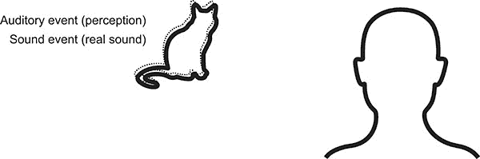

Figure 6.1Auditory event (perception) aligned with the sound event (real-world sound occurrence)

In virtual and augmented realities, the concept of auditory event is important. When working with AAR, we want to trick the brain to believe that a virtual sound is actually emanating from the real environment, possibly from a real-world object. To make that illusion work, we need to create an artificial auditory event that imitates the perceptual attributes of a similar, real-world sound occurrence. Multiple factors need to be taken into account, such as the correct direction and distance of the sound, the assumed sound wave propagation through the environment with any occlusion, diffraction, and reverberation along the path, and finally the effect of head, torso, and outer ears. In an AAR system, if the virtual audio system works perfectly, the auditory event aligns with the intended virtual sound event, which is often attached to a real-world object. However, in practice, that is not always the case, and the sound appears in a wrong place—for instance, too close to the listener, or too high.

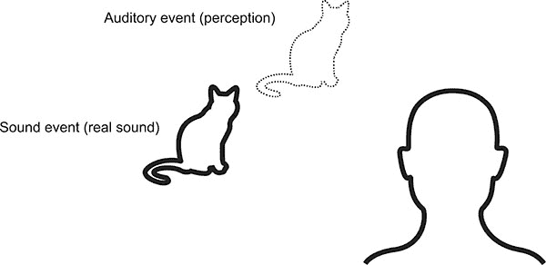

Figure 6.2Auditory event misaligned with the virtual sound (attached to a real-world object) due to imperfect virtual audio rendering

If the artificial sound is played through a hidden loudspeaker from the location where the real-world sound would be (`direct augmentation`), we obviously do not need to worry about the sound spatialisation and propagation effects as they happen naturally—although the directivity of the loudspeaker might be different from the real sound source, thus causing acoustic differences. In *virtual audio* technologies that use *binaural* reproduction, however, it is important to understand which perceptual cues are needed to trick the auditory system and how those illusions can be made. Many of the same considerations are also elementary in the audio production stage even if the delivery format was a surround loudspeaker system.


An auditory event is not always caused by a sound event and sound waves, tinnitus being a prime example (Blauert, 1997). It is possible to generate virtual sounds by stimulating the auditory nerve or brainstem directly (see Veronese et al., 2023), or even stimulating the auditory cortex in the brain (see Leaver, 2024), albeit such techniques are still far from being applicable in practical AAR applications. Further, even if such technologies were available for the virtual audio community, it would not free us from simulating the same acoustic phenomena described above and discussed in more detail in this chapter.

## 6.2 Spatial hearing

Humans’ ability to localise sounds is mainly based on comparing acoustic information between two ears, called binaural hearing. The two key mechanisms of binaural hearing are interaural time difference (ITD) and interaural loudness difference (ILD) (Blauert, 1997). However, there are other psychoacoustic cues in play, such as caused by head, torso, and outer ears, visual cues, recognising the acoustic environment, room congruence, and motion within the space (Brandenburg et al., 2023).

An ITD is caused when the sound source is, for example, on the left of the listener in a *horizontal plane*; the sound waves will first reach the left ear, and after a small delay, the right ear will register the sound. The maximum ITD, around 650 microseconds (in air at room temperature) occurs when the sound is 90 degrees to the side (Wenzel, Begault and Godfroy-Cooper, 2018). However, when the sound originates from the *median plane*—that is, directly in front, behind, above, or below—both ears will receive the sound waves almost simultaneously. Furthermore, even if the sound is offset to one side in any *sagittal plane*, the ITD cannot distinguish between up and down or front and back. Therefore, ITD is useful mainly with left–right localisation. Also, when the sound frequency increases, the wavelength gets shorter and thus the phase difference between ears gets more difficult to perceive. Hence, ITD can provide clues of the sound position mainly for frequencies under 1500 Hz (Akeroyd, 2006).

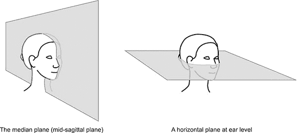

Figure 6.3Median and horizontal planes. Sagittal planes (not shown here) are any vertical planes parallel to the median plane.

In addition to ITD, there is a sound pressure difference between the two ears, the ILD. When a sound is produced on the left of the user, the left ear receives the sound waves without obstruction, but due to the *acoustic shadow* created by the head, the sound intensity gets reduced at the further ear. Whereas ITD is perceivable with the lower frequency spectrum of sounds, the opposite is true with ILD that works better with higher sounds; low frequency sounds with a longer wavelength diffract through obstacles with the size of the head, but with shorter wavelengths the head starts to have an occluding effect. Small deviations are also produced by torso, shoulders, and ear pinnae with its cavities and other shapes, all unique to each individual (Akeroyd, 2006).

To perceive the elevation of the sound as well as whether it is coming from behind rather than in front, the spectral colouration caused by the pinnae become important: depending on the direction, the sound gets scattered and reflected, leading to slightly different resonances (Akeroyd, 2006; Xie, 2013). Also, studies suggest that small head movements help to distinguish whether the sound is coming from front or back, up or down (Xie, 2013). Hence, implementing head-tracked reproduction helps with vertical localisation. Still, the resolution of spatial hearing along this sagittal plane is less accurate than on the horizontal plane where the described interaural differences are available (Blauert, 1997).

As discussed in Chapter 2, the way in which a sound is influenced by the head, torso and pinnae is described in a head-related transfer function (HRTF). HRTFs are highly individual, which is why knowledge of a user’s individual HRTFs is required for perfect elevation perception. However, some features are common to many people’s HRTFs. This leads to the observation that the sense of elevation can be manipulated by sound design: boosting higher frequencies, for instance high-mids (1–5 kHz), may enhance the perception that the sound is elevated (Lee, 2022; Kadel, 2024). However, cognitive aspects are similarly important, utilising listener’s expectations: thunder is associated above (Larsson et al., 2010) and the metro below, even if they have similar frequency attributes. Further, it seems that semantically meaningful and easily identifiable sounds are generally easier to localise, and their locations are more likely to be remembered later (Taevs et al., 2010).

Interestingly, while the human hearing is rather good in detecting directions, it is very poor in estimating distances (Sunder, 2022). Distance hearing is based on multiple cues, such as loudness of the sound when the sound source is familiar, high-frequency absorption by air for long-distance sounds, ILD for near-field sounds, and—very importantly—reverberation (Xie, 2013). Visual cues are obviously very important, too (Brandenburg et al., 2023).

## 6.3 Audio paradigms

Before diving into the creation of virtual sounds, it may be helpful to revisit the channel-based, object-based, and scene-based audio paradigms discussed in Chapter 2 In many AAR production pipelines and virtual audio processes, these approaches are not used in isolation but rather combined, often working simultaneously to complement each other at different stages of the workflow.

### 6.3.1 Channel-based audio

Channel-based audio is the most traditional method for audio production and delivery. In this method, the final output has a fixed number of channels (stereo, 5.1, 7.1, etc.), and audio elements are mixed and panned to fit these channels. Channel-based audio is the primary format in radio, cinema, and music production, where sound is traditionally mixed for specific loudspeaker configurations.

Static binaural audio is also channel-based, as it uses two distinct channels dedicated to each ear in recording, processing, and playback. In AAR, channel-based approaches are very useful for various production phases. In runtime, they can be used for head-locked sounds including narration, music, static ambiences, and first-person sounds.

进入`/path/to/xxx`目录，找到`xxx.json`。

在表达式`cvar = avar + bvar`中，加法运算符（`+`）将`avar`与`bvar`相加，得到它们的和`cvar`

在`List.of(arg0, arg1, arg2)`中，`List`接口的工厂方法`of()`接受一系列的元素，返回包含它们的只读列表。

之后我们这样调用`cmd`命令：`cmd arg0 arg1 arg2`。

```
if (condVar > someVal) {console.log("xxx")}
```

为简化，让猫和用户保持静止。随后，声音被声场化。在此过程中，虚拟声音被渲染为如果声波在真实空间中传播，会被墙壁和其他表面反射和吸收而变得可听。空间的声学特性可以通过`房间脉冲响应`（RIRs）来捕捉，这些是声场在任意测量点的物理-数学模型，它们在某种意义上是声学“指纹”。从多个位置获取的若干 RIRs 组成的集合称为`空间房间脉冲响应`（SRIR），能够提供空间的三维信息（Meyer-Kahlen，2024）。

通过将原始的干音与 SRIR 进行卷积，声音会被“处理”以空间的声学特性呈现，仿佛声音实际位于该空间中。可从 RIRs 中提取出房间声学参数（如衰减时间和干/反射能量比），用于控制合成混响效果。

获得 SRIR 的三种主要方法是：模拟、测量和估计。

### 6.4.3 模拟

在模拟中，房间的几何形状和表面材料首先要尽可能准确地测量并定义。随后，模拟通常采用`基于波的建模`或`几何声学（GA）`（Savioja and Svensson，2015）来实现。`基于波的建模`模拟声音波在空间中的传播。虽然结果更精确，但计算开销大，可能不适合 AAR 应用的实时渲染。不过，可以预先渲染波场，类似于视频游戏中预烘烤光照。例如，`Microsoft Project Acoustics` 是一款为游戏开发提供此类方法的插件。最近的 PLATONE 项目尝试将 `Project Acoustics` 用作城市场景中 AAR 的半实时解决方案（Orsholits et al., 2024）。

在 GA 方法（即声学射线跟踪）中，声音被视为在表面反射后最终到达听者的射线。该方法在高频下表现良好，但低频误差较大，因为射线无法模拟波动现象（Savioja and Svensson，2015）。尽管如此，由于计算开销相对较小，它在诸如 `Meta XR Audio SDK` 等音频引擎插件中被广泛使用。

### 6.4.4 测量 RIRs

模拟是唯一能够为不存在的场所（如未建成的建筑或视频游戏、VR 环境）提供声场化的途径。AAR 则在真实空间中进行，因此在某些情况下可以通过实际测量获取 SRIRs（Meyer-Kahlen，2024）。具体做法是播放一个测量信号（通常是正弦扫频），从扬声器播放出来，并用一根或多根位于一定距离的麦克风记录声音。将麦克风信号与测量信号进行`去卷绕`（deconvolved）后即可得到 RIRs。扬声器的位置在一定意义上代表声源，麦克风代表听者，因此一次测量只能在两者之间进行声场化。

### 6.4.5 混合解决方案


在 6DoF 应用中，听者可以在空间内任意移动，且可能存在多个声源，这些声源也可能随时间变化。因此，需要大量的麦克风-扬声器组合的密网格测量来获取相应的 RIRs。测量数量会迅速增多，在大多数情况下（尤其是移动 AAR 应用）几乎无法实现，而且实时存储、加载和处理海量数据对大多数系统而言都过于吃力（Meyer-Kahlen，2024）。因此，开发了混合系统，结合不同方法以优化结果和性能。例如，Brandenburg Labs 的专有 `Deep Dive Audio` 技术将 RIR 测量数据与 GA 方法相结合，得到高度可信的结果。`Steam Audio` 插件则在游戏引擎中结合 GA 与基于波的模拟。`dearVR` 空间化器（作为游戏引擎插件提供）则采用更稳健的方式，将简单的“盒子”混响与基于几何的模拟结合，以模拟早期反射。

### 6.4.6 估计

对于移动 AAR，显然不可能设置一对麦克风-扬声器并进行扫频。因此，研究人员致力于实时预测给定场所的 RIRs。一些方法利用计算机视觉和 LiDAR 传感器测量房间几何并估计各表面的声学特性，这一技术已通过 `Apple Vision Pro` 头显广为人知。虽然单纯通过视觉无法完全`知晓`每种材料的声学特性，但对于许多应用而言已足够好。另一种方法是分析房间中已有声音的回响，称为`盲估计`（blind estimation）。虽然这在可信度上相较于视觉分析更有前景，但相关研究仍在进行中，截至本文撰写时，AAR 创作者尚无成熟的解决方案。

### 6.4.7 双耳解码

现在，猫的虚拟喵叫已经通过 SRIR 卷积，声音包含了正确的房间反射和色彩，模拟了声波从房间角落传播到听者的过程。接下来，需要模拟声音如何进入用户的耳朵。必须考虑头部朝向（由传感器跟踪），以及头部、耳廓和躯干的效应。如第 2 章所述，这些解剖信息存储在头部相关传递函数（HRTFs）中。

一种做法是将 SRIR 编码为双耳声场（Ambisonics）。该声场随后根据用户的头部朝向进行旋转，旋转后的声场再通过 HRTFs 翻译为双耳立体声。在游戏引擎中，双耳解码器通常集成在虚拟音频插件中，也可以是独立组件。

### 6.4.8 外部化

双耳解码的质量常以其`外部化`能力来衡量。外部化指创造出一种听感，使声音似乎发出于听者头外。在耳机聆听时，声音常似乎来源于头内，称为`头内定位`（IHL）。提升外部化的三个主要因素是：空间线索与空间感（如混响）、个性化 HRTFs、以及在空间中的移动（Roginska，2018）。在大多数 AAR 系统中，测量每位用户的个性化 HRTFs 几乎不可能，尤其是在博物馆等访客流动性强的场景中。因此，通常使用通用 HRTFs，这可能会降低部分用户的外部化效果和空间准确性。好在，只要其他线索（如 6DoF 移动和虚拟与真实房间声学的一致性）得到满足，个性化 HRTFs 并非必需，可实现令人信服的外部化（Brandenburg et al., 2023）。此外，在混响环境中，个性化 HRTFs 的重要性不如在无反射环境中显著（Best et al., 2020）。

## 6.5 结论

在虚拟音频与现实无缝融合中需要满足众多要素。此外，每种空间化软件工具似乎都依赖其独特的方法和技术组合。对于单个 AAR 创作者而言，在如此复杂的选项和工作流中导航可能让人感到不知所措，且测试不同系统可能耗时费力。在尚未出现能够同时提供高质量结果和优化性能的广泛接受的标准之前，创作者可能只能继续探索和学习。好在完美的虚拟音频渲染通常并非必要，因为其他因素如丰富的互动性或叙事沉浸感（见 第 3 章）可以弥补技术缺陷。

不过，当虚拟声音与现实难以区分时，效果会显得真正神奇。

## References

1. Akeroyd, M.A. (2006) ‘The Psychoacoustics of Binaural Hearing’, International Journal of Audiology, 45 (supl.1), pp. 25–33. Available at: [`doi.org/10.1080/14992020600782626`](https://doi.org/10.1080/14992020600782626).

2. Best, V.et al. (2020) ‘Sound Externalization: A Review of Recent Research’, Trends in Hearing, 24, p. 2331216520948390. Available at: [`doi.org/10.1177/2331216520948390`](https://doi.org/10.1177/2331216520948390).

3. Blauert, J. (1997) Spatial Hearing : The Psychophysics of Human Sound Localization. Rev. edn. MIT Press.

4. Brandenburg, K. et al. (2023) ‘Implementation of and Application Scenarios for Plausible Immersive Audio Via Headphones’, in Audio Engineering Society Convention 155, Audio Engineering Society. Available at: [`www.aes.org/e-lib/browse.cfm?elib=22308`](https://www.aes.org/e-lib/browse.cfm?elib=22308) (Accessed: 25 November 2023).

5. Gonzalez, R., McCormack, L. and Politis, A. (2024) ‘S 3 MASH: Spatial Sound Scene Matching using Single-Channel Audio’, in 2024 AES 5th International Conference on Audio for Virtual and Augmented Reality, Audio Engineering Society. Available at: [`www.researchgate.net/publication/384051910_S3MASH_Spatial_Sound_Scene_Matching_using_Single-Channel_Audio`](https://www.researchgate.net/publication/384051910_S3MASH_Spatial_Sound_Scene_Matching_using_Single-Channel_Audio) (Accessed: 27 November 2024).

6. Hudspeth, A.J. (1997) ‘How Hearing Happens’, Neuron, 19 (5), pp. 947–950. Available at: [`doi.org/10.1016/S0896-6273\(00\)80385-2`](https://doi.org/10.1016/S0896-6273\(00\)80385-2).

7. Kadel, O. (2024) ‘The Evolution of Spatial Audio in Immersive Storytelling’, MPSE Wavelength, June, pp. 72–83.

8. Kim, S. (2015) ‘Bio-Inspired Engineered Sonar Systems Based on the Understanding of Bat Echolocation’, in Biomimetic Technologies: Principles and Applications. Cambridge, United Kingdom: Elsevier Science & Technology. Available at: [`ebookcentral.proquest.com/lib/aalto-ebooks/detail.action?docID=2102159`](http://ebookcentral.proquest.com/lib/aalto-ebooks/detail.action?docID=2102159) (Accessed: 10 April 2021).

9. Larsson, P. et al. (2010) ‘Auditory-Induced Presence in Mixed Reality Environments and Related Technology’, in E. Dubois, P. Gray, and L. Nigay (eds) The Engineering of Mixed Reality Systems. London: Springer (Human-Computer Interaction Series), pp. 143–163. Available at: [`doi.org/10.1007/978-1-84882-733-2_8`](https://doi.org/10.1007/978-1-84882-733-2_8).

10. Leaver, A.M. (2024) ‘Perceptual and Cognitive Effects of Focal tDCS of Auditory Cortex in Tinnitus’, medRxiv, p. 2024.01.31.24302093. Available at: [`doi.org/10.1101/2024.01.31.24302093`](https://doi.org/10.1101/2024.01.31.24302093).

11. Lee, H. (2022) ‘Psychoacoustics of Height Perception’, in J. Paterson and H. Lee (eds) 3D Audio. New York, NY: Routledge (Perspectives on music production), pp. 82–98.

12. McCormack, L. et al. (2022) ‘Object-Based Six-Degrees-of-Freedom Rendering of Sound Scenes Captured with Multiple Ambisonic Receivers’, Journal of the Audio Engineering Society, 70 (5), pp. 355–372. Available at: [`doi.org/10.17743/jaes.2022.0010`](https://doi.org/10.17743/jaes.2022.0010).

13. Meyer-Kahlen, N. (2024) Transfer-Plausible Acoustics for Augmented Reality. PhD thesis. Aalto University. Available at: [`urn.fi/URN:ISBN:978-952-64-1913-8`](https://urn.fi/URN:ISBN:978-952-64-1913-8).

14. Orsholits, A. et al. (2024) ‘PLATONE: An Immersive Geospatial Audio Spatialization Platform’, in The 2nd Annual IEEE International Conference on Metaverse Computing, Networking, and Applications (IEEE MetaCom), Hong Kong.

15. Politis, A. et al. (2023) ‘Wide-Area 6DOF Rendering of Multi-Point Ambisonic Recordings Based on Interpolation of Spatial Parameters’, in 2023 IEEE Workshop on Applications of Signal Processing to Audio and Acoustics (WASPAA). New Paltz, NY, USA: IEEE, pp. 1–5. Available at: [`doi.org/10.1109/WASPAA58266.2023.10248142`](https://doi.org/10.1109/WASPAA58266.2023.10248142).

16. Roginska, A. (2018) ‘Binaural Audio Through Headphones’, in A. Roginska and P. Geluso (eds) Immersive Sound: The Art and Science of Binaural and Multi-Channel Audio. Routledge.

17. Savioja, L. and Svensson, U.P. (2015) ‘Overview of Geometrical Room Acoustic Modeling Techniques’, The Journal of the Acoustical Society of America, 138 (2), pp. 708–730. Available at: [`doi.org/10.1121/1.4926438`](https://doi.org/10.1121/1.4926438).

18. Sunder, K. (2022) ‘Binaural Audio Engineering’, in J. Paterson and H. Lee (eds) 3D Audio. New York, NY: Routledge (Perspectives on music production), pp. 130–159.

19. Taevs, M. et al. (2010) ‘Semantic Elaboration in Auditory and Visual Spatial Memory’, Frontiers in Psychology, 1. Available at: [`doi.org/10.3389/fpsyg.2010.00228`](https://doi.org/10.3389/fpsyg.2010.00228).

20. Veronese, S. et al. (2023) ‘Ten-Year Follow-Up of Auditory Brainstem Implants: From Intra-Operative Electrical Auditory Brainstem Responses to Perceptual Results’, PLOS ONE, 18 (3), p. e0282261. Available at: [`doi.org/10.1371/journal.pone.0282261`](https://doi.org/10.1371/journal.pone.0282261).

21. Wenzel, E.M., Begault, D.R. and Godfroy-Cooper, M. (2018) ‘Perception of Spatial Sound’, in A. Roginska and P. Geluso (eds) Immersive Sound: The Art and Science of Binaural and Multi-Channel Audio. Routledge, pp. 5–39.

22. Xie, B. (2013) Head-Related Transfer Function and Virtual Auditory Display, 2nd edn. J. Ross Publishing.

# 7 Technical components

DOI: [`10.4324/9781003627289-7`](https://doi.org/10.4324/9781003627289-7)

As we have learned, there are multiple ways to augment the real world with virtual audio. One of the most straightforward AAR systems would entail a hidden loudspeaker and an audio player, possibly triggered by a proximity sensor, like onboard `Barque Sigyn`. Immersive AAR experiences can also be realised with simple headphones-based systems. For instance, the `Alcatraz Cellhouse Audio Tour` uses an `MP3` player and a pair of headphones, without head or location tracking, relying on the user to follow the audio guidance in sync with the narrative.

然而，为了实现更动态和互动的双耳（binaural）体验，系统需求会迅速增加。本章描述了典型互动可穿戴 AAR（增强现实/现实混合）应用的关键组件，这些应用利用 `6DoF`（六自由度），例如使用耳机、智能眼镜或其他可穿戴音频显示设备。然而，其中的许多组件也适用于其他平台，包括直接增强、CTC 和 WTF，以及自由度较少的可穿戴体验。姿态跟踪方法和耳机将比其他组件获得更多关注。这是因为适合 AAR 的计算机、软件和编辑工具的需求与视频游戏和 `VR`（虚拟现实）相似，且已在其他来源中广泛讨论。虚拟音频引擎也已在 第 6 章 中讨论过。


## 7.1 可穿戴 AAR 系统

典型的可穿戴 AAR 系统可以通过将其基本组件分类为 1）传感器和输入、2）计算机、3）硬件音频接口、4）音频显示和其他输出来理解。

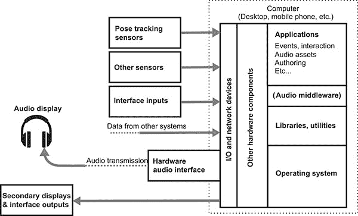

Figure 7.1A simplified overview of the components of a wearable AAR system

## 7.2 传感器和输入

大多数 AAR 系统依赖于传感器来检测用户的姿态、动作、声音和意图。其他人、物体和环境条件也可以被跟踪。传感器数据用于控制系统内部的交互逻辑，无论是切换视角当用户转头时、引导类似游戏的事件流，还是为基于人工智能的虚拟角色提供行为模式。数据（包括捕获的声音）也可以被处理以满足多种需求：识别语音命令、增强语音、隔离声音、对其进行操作、估算房间声学等，仅举几例。

系统还可以包含次要输入接口，如音量按钮或触摸屏——或更具创意的接口，例如 `ec(h)o` 中使用的木制方块（Hatala and Wakkary, 2005）或在 `Audio Legends` 中作为盾牌的移动设备（Rovithis et al., 2019）。信号和数据也可以从环境中的其他系统接收，例如同步耳机中的音频与附近的任何视频投影，如在 `David Bowie Is` 或 `Dimensions of Sound` 中所见。

### 7.2.1 姿态跟踪

跟踪 `姿态` 意味着跟踪物体在物理空间中的位置和朝向。在基于耳机的应用中，`3DoF`（仅头部跟踪）或 `6DoF`（头部和位置跟踪）至关重要，以便无论用户如何移动，虚拟声音都能固定在三维位置上。除了更新听觉视角外，姿态跟踪常作为主要交互机制，尤其是在没有按钮、语音识别或其他输入方式时（Yang, Barde and Billinghurst, 2022）。例如，用户在空间中的绝对位置，或相对物体的近度，可以触发交互转换。

表 7.1 列出了 AAR 系统通常能够检测的特征（见 Lombard and Ditton, 1997; Naphtali and Rodkin, 2019; Arena et al., 2022; Yang, Barde and Billinghurst, 2022）：

| *Source* | *Features* |

| --- | --- |

| User | Pose (location and orientation) of head and other body parts |

| Gestures | |

| User-generated sounds (voice, footsteps, etc.) | |

| Biodata | |

| Environment | Pose of other people, creatures, objects |

| Sounds of other people, creatures, objects | |

| Room acoustics | |

| Environmental conditions (weather, temperature, etc) | |

| Signals and data from other systems (video timecode, etc.) | |

头部朝向有时被用作交互触发，例如响应用户的点头和摇头（例如，Gampe, 2009）——这是某些智能耳机和眼镜中发现的功能，或用于确定用户的注视方向。头部朝向的另一个有趣用途是判断另一个人是否 `不` 看着用户。在 `The Reign Union` 中，这偶尔用于为另一个人添加小的非语言声音。

姿态跟踪即使在听觉显示不需要的情况下，也能为任何应用带来额外的交互益处。例如，跟踪用户的手势（如用手指捏合）正逐渐成为 AR 和空间计算设备在需要精确交互时的重要输入方式。

除了用户的头部和其他身体部位外，其他物体、人和生物也可以被跟踪。这将使得，例如，在移动和可移动的物体上附加虚拟声音成为可能。门的开启角度可以被测量以控制低通滤波器，从而创造出声音首先被阻挡然后通过缝隙泄漏的逼真效果。

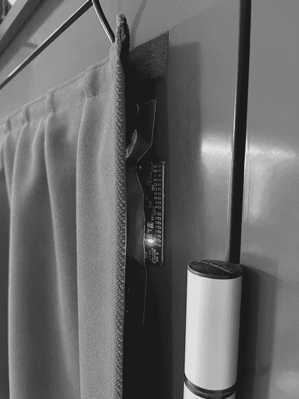

Figure 7.2A concealed IMU sensor (`Pozyx Developer Tag`) measuring the door opening angle ¶ Source: Photograph by the author

追踪的两种主要功能方法：系统可以提供绝对数据，或提供相对数据（即与上一次状态相比的变化）（Mazuryk and Gervautz, 1999）。大多数适用于 AAR 的跟踪系统提供绝对数据，例如基于固定锚点或摄像头的系统，或使用卫星导航的系统。然而，例如陀螺仪和加速度计提供相对数据，因此需要更频繁的校准，因为存在漂移。为了实现实时校准并提高整体精度、可靠性和稳健性，常常会组合不同类型的传感器。这称为 `传感器融合`（`sensor fusion`）。传感器融合可以集成在测量单元或设备中，也可以由用户通过组合多个跟踪系统的数据来实现。

由于存在多种姿态跟踪技术，下面简要介绍一些技术及其在 AAR 中的可用性评估。

### 7.2.2 光学跟踪

光学跟踪是一种绝对方法，利用视频摄像机来确定物体（有时包括方向）的位置（Wu, Tang and Lee, 2018）。光学跟踪主要有两种方法：`外向-in` 和 `内向-out`。外向-in 原理使用环境中固定安装的摄像机来跟踪移动目标，而内向-out 则在移动物体本身上安装摄像机，根据其观察到的周围环境来确定其位置和朝向（Bimber and Raskar, 2005; Vertucci et al., 2023）。

光学跟踪可以使用传统的 2D 摄像机，也可以使用深度摄像机或立体摄像机以获得更高的精度。光学跟踪，特别是基于标记的跟踪，精度极高（甚至可达 0.1 mm），但需要 `视线`（LOS）和理想的光照条件（Ungi, Lasso and Fichtinger, 2015）。因此，在多人体验或自然光较强的场所可能不具备可行性。

光学跟踪的优势在于灵活性和能够同时跟踪位置和姿态。此外，使用 `SLAM`（同步定位和映射）、`PTAM`（并行跟踪和映射）以及 `DSLAM`（动态 SLAM）等算法，即使在未知环境中也能确定物体位置（Wu, Tang and Lee, 2018; Vertucci et al., 2023）。这为内容创作开辟了巨大的可能性：体验可以在任何环境中传递并自适应，而无需绑定到固定布局或地图。

#### 基于标记的跟踪

在基于标记的跟踪中，摄像头会在寻找附着在可跟踪物体（外向‑内）上的视觉模式，或在环境中放置的标记（内向‑外）。标记可以是像 `OptiTrack` 系统那样用红外光照射的反射器构成的星形阵列，也可以是 `ArUco` 和 `QR` 代码等在普通光下可见的 fiducial 标记，这些标记由黑白形状组成。通过与计算机内存中的原始标记模型进行比对，算法计算物体的距离、位置和姿态（Vertucci et al., 2023）。即使只使用单个摄像头即可推导出 6DoF 信息，使用多个不同视角的摄像头会显著提升准确度。

#### 无标记跟踪

顾名思义，无标记方法不依赖于标记，而是比较真实物体或环境的视觉特征与系统已学习的数据集。该方法通常受益于机器学习。无标记跟踪能够在新的未知环境中工作，并且可以跟踪系统能够识别的任意对象，而无需在物体上贴标记（参见 `Figure 7.3`）。无标记跟踪的计算需求高于基于标记的跟踪，通常导致精度下降、延迟变长以及采样频率降低。部分系统利用具有并行计算能力的图形处理单元（GPU）来应对 AI 驱动的跟踪任务。无标记跟踪在处理材质均匀、反光或透明的物体时也可能出现问题（Vertucci et al., 2023）。

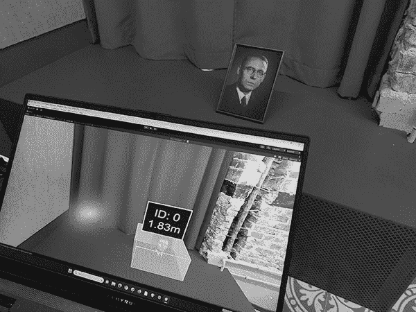

`Figure 7.3`无标记跟踪的图片框使用物体检测（`ZED SDK`） ¶ 来源：作者照片

光学、无标记的内向‑外跟踪应用于从智能手机、混合现实（MR）头显到机器人吸尘器和自动驾驶汽车的多种设备。使用移动电话作为跟踪设备的问题在于其体积和重量——这在尝试将其安装在耳机上时是个不便，并且价格较高。另一方面，MR 头显由于体积笨重且前视显示器遮挡视线，并不适合用于增强现实（AAR）。然而，专用的单一用途跟踪器正在出现，`VIVE Ultimate Tracker` 便是其中一个例子，于 2023 年发布。虽然该设备主要面向 VR 身体跟踪，但它仍能利用两台摄像头和 IMU 实现 6DoF 自主姿态跟踪。尽管其跟踪区域有限且 API 受限，阻碍了其在增强现实（AAR）中的应用，但这仍然为独立开发者在寻找室内便捷跟踪解决方案时提供了有希望的消息。

#### LiDAR

LiDAR（Light Detection And Ranging）是一种测距技术，它发射激光脉冲并测量返回反射光的时间，从而生成高分辨率的三维对象或环境地图。LiDAR 对于增强现实（AAR）系统而言能够精确测量环境几何结构，既有助于用户跟踪，也有助于房间声学估计。它可以支持或替代在光照不佳时容易出现问题的光学跟踪（Schmalstieg and Hollerer, 2016）。LiDAR 传感器也可在部分智能手机和 MR 头显中找到应用。

#### Lighthouse

`VIVE` 的专有 `Lighthouse` 跟踪系统在许多实验性 AAR 项目中被广泛使用。它使用基站发射精确时间同步的红外激光扫描，跟踪单元上的传感器捕获这些激光闪光的时间和模式，从而计算出物体在空间中的位置和姿态（HTC, 2023）。跟踪器内置 IMU，提供加速度计和陀螺仪数据，以在高速运动或 IR 信号暂时丢失时提升跟踪精度。

虽然 `Lighthouse` 提供快速且精准的跟踪，但其可跟踪区域受限，且对强光敏感，使用性受限。为了覆盖更大的空间，可使用多个基站组合，但这类系统稳定性较差且难以部署。

### 7.2.3 RF‑based tracking

有多种射频（RF）定位与姿态跟踪方法。它们利用射频信号通过测量信号强度、到达时间或到达方向来确定物体或设备的位置。

#### UWB

UWB（超宽带）跟踪使用固定位置的“锚点”在千兆赫兹频段发送射频信号，而被跟踪物体上的“标签”接收这些信号并据此在三维空间中计算其位置（Dardari, Closas and Djurić, 2015）。在理想条件下，UWB 可实现厘米级的跟踪分辨率，尤其是在不考虑高度（z 轴）跟踪时。但在实际操作中，若锚点安置过于接近使用者，或墙体等结构干扰射频信号，精度和可靠性会显著下降。UWB 的一个优势是可扩展性，可同时跟踪大量标签，这在博物馆等公共场景中尤为重要。

#### AoA

`Bluetooth` Angle of Arrival（AoA）是一种通过分析多天线阵列中相位差来确定蓝牙信号方向的定位方法。将此方向信息与信号强度或通过多个接收器的三角测量结合，系统即可估计设备的位置。基本上，任何蓝牙设备都可以被跟踪，专用标签重量轻且体积小。然而，通常需要在天花板上安装多根天线，这在某些情况下（如历史建筑）可能不可行。低安装高度会显著降低精度，且像所有射频系统一样，AoA 在拥挤环境中对信号反射敏感，易导致跟踪误差。

#### 其他射频跟踪技术

除了上述方法，短距离无线电通信标准如 Wi‑Fi、RFID、NFC、ZigBee 等也被用于定位跟踪，尽管它们本身并未专为此设计。其精度通常在 1–5 米左右，并伴随其他挑战，包括可扩展性受限（Dardari, Closas and Djurić, 2015）。不过，研究表明可以利用 Wi‑Fi 信号结合深度学习模型进行人体姿态跟踪，克服光学系统的遮挡和光照局限（Geng, Huang and Torre, 2022）。

5G 技术也可用于定位，在室内环境下甚至可以实现厘米级精度；但实现方式需要大规模天线阵列（Italiano et al., 2024），目前仍不具备实际可行性。

### 7.2.4 Electromagnetic tracking

电磁跟踪（EM tracking），有时称为电磁场跟踪（EMF），利用局部电磁场来确定物体在三维空间中的精确位置和方向，提供高精度和相对低延迟。然而，其依赖于低频场限制了其范围仅几米。一些系统允许使用多个发射器来扩展覆盖范围，但系统仍易受金属结构或电子设备的干扰。尽管电磁跟踪自 1960 年代起主要用于军事和医疗环境，该技术仍在持续开发和改进（如 Amfitech，2024）。

## 7.2.5 卫星定位

卫星定位基于环绕地球的卫星星座。它们发送定位和时间数据，可被可追踪设备接收。设备利用该数据解释其相对于地球的位置。四个`GNSS`（全球导航卫星系统）及其各自卫星已投入运行，包括`GPS`（美国）、`Galileo`（欧洲）、`GLONASS`（俄罗斯）和`BeiDou`（中国）。现代接收器可同时解析来自所有或大多数卫星的数据。GNSS 专为户外跟踪设计，最佳精度通常约为 1 米（Fernandez-Hernandez et al., 2018），通过 RTK（实时动力定位）等扩展，可实现亚厘米精度（Boquet, Vilajosana and Martinez, 2024）。这为全球范围内的 6DoF 增强现实（AAR）体验提供了极具吸引力的可能性（见 Orsholits et al., 2024）。

## 7.2.6 超声波跟踪

超声波跟踪通过测量超声波（约 19–45 kHz）在可追踪物体上安装的发射器与环境中多个接收器之间传播时间的三角测量来确定物体位置。部分系统支持倒置布局，即可追踪物体携带接收器，而发射器在不同频率上发送声波脉冲（如 Marvelmind，2023）。在理想条件下，精度可达厘米级，但实际操作中，反射、噪声和视线丢失会显著降低性能。即使超声波频率高于人类听觉范围，部分发射器仍会发出可听的点击声，可能造成干扰。

与专用发射器和接收器不同，超声波跟踪可尝试使用普通扬声器和麦克风（如 ALPS，2018）。这种方式利用已有硬件，减少对专用设备的需求，可能更易于在多样环境中集成。

## 7.2.7 近距离传感器

近距离传感器能够检测距离或存在，但无法提供方向或位置信息，因此无法实现 6DoF 跟踪。它们在许多过去和现在的展览及应用中很常见，因此此处简要说明。

Bederson’s (1995)的早期增强现实（AAR）原型采用红外发射器——类似于电视遥控器——以及可穿戴接收器，用于检测用户与博物馆展品的近距离。如今，红外发射器常用于近距离检测，同时通过热成像（红外）传感器读取感兴趣区域的热图，并从中检测人体热量来感知用户存在。

RFID（射频识别）是另一种常见方法，用户佩戴的标签可被读取设备在距离上检测到。蓝牙低功耗（BLE）标签，如 Apple 的`iBeacon`，会发射信号，BLE 设备（如移动电话）可检测到信号并计算其与标签的距离。此外，专有系统可能使用其他射频模式，例如在`David Bowie Is`展览中使用的`Sennheiser guidePORT`系统，该系统工作于 127 kHz 频段。

## 7.2.8 惯性跟踪

惯性跟踪通常通过惯性测量单元（IMU）实现。IMU 是集成的传感器模块，包含加速度计、陀螺仪，有时还包括磁力计。通过结合这些传感器的数据，可确定旋转角（俯仰、滚转、偏航）以及线性加速度。磁力计可作为数字指南针使用。IMU 可出现在从智能手机到无人机，从头部追踪耳机到 VR 控制器的各种设备中。

包含加速度计和陀螺仪的 IMU 称为‘6DoF’，当加入磁力计后称为‘9DoF’。这些度数的意义不同于运动度数。IMU 的度数指传感器*测量*不同运动的方式，而 6DoF 等运动度数描述物体的*实际运动*。

陀螺仪和加速度计的数据是相对的，因此会随时间漂移，需要定期校准。校准可以通过融合其他传感器的数据来实现，例如相机，能够检测可追踪物体的实际姿态。Yang et al. (2020)采用了巧妙的‘机会性校准’方法：当他们的 IMU 漂移时，空间化声音似乎来自错误的方向。然而，由于声音与物体在语境上相符，用户倾向于将头朝向物体而非声音。此时，他们可以测量用户头部的偏角，并校正 IMU 漂移。

虽然磁力计模块显著减少漂移，但在某些室内环境中可能因各种磁干扰源而表现异常。因此，9DoF IMU 的使用可能不可行，或在问题区域必须关闭磁力计。

## 7.2.9 其他传感器

在用户运动来与物体和环境交互的应用中，姿态跟踪及可能的手势识别可能是唯一所需的感知手段。但其他传感器提供的数据可极大丰富体验。数据可来自用户本人、其他用户、近场环境或超出用户感知范围。最终，环境感知系统可利用任何周围刺激，如光照、温度或声音（见 Naphtali and Rodkin, 2019），前提是具备适当传感器并具备数据分析能力。

### 麦克风

麦克风是多功能传感器，可用于捕获用户语音以进行语音命令，或将其传输给其他用户用于通信或叙事目的。语音及其他声音（如脚步声）可被录制并反馈给用户，可能通过回响或其他增强处理。语音和呼吸也可被分析用于创意或医疗用途，例如监测用户的呼吸频率（Doheny et al., 2023）。

可穿戴设备中的麦克风阵列可用于声束 forming，即‘聚焦’特定声音，有助于从背景噪声中隔离声音和语音。这进一步使得可以消除并替换为虚拟声音。通过麦克风阵列还可进行盲估计房间声学特性的研究（尽管仍处于研究阶段），如 Meyer-Kahlen, 2024 所示。

除非有访问权限或希望使用可穿戴设备自带的麦克风，否则需集成外部麦克风。需要注意，这将要求集成音频接口并将信号传输到处理器，可能导致重量增加和延迟问题。

### 声学水印


声学水印在 AAR（增强现实）的背景下值得认可。它是一种信号处理技术，将在听不见的信息嵌入音频信号中，使其能够在不显著改变原始声音的情况下携带隐藏数据（`Lin` 和 `Abdulla`，2015）。例如，博物馆展品可以通过扬声器发出水印声音。当访客接近不同的展品时，他们的设备可以检测到这些嵌入的信号，提供定制的音频叙事或触发各种交互提示。该技术无需额外硬件或可见信号，并且由于声音可以绕过障碍物（如墙壁和家具）传播，声学水印在复杂室内环境中可能更有效。

### Biodata sensors

正如第 3 节讨论的那样，生物数据对 AAR 应用可能很有用。皮肤温度、心率和电皮肤活动只是一些可以相对容易测量的变量。许多活动手表、戒指和其他设备都集成生物数据传感器，虽然可以通过 API 或平台访问数据，但通常需要技术专业知识和编程。

## 7.3 计算机

计算机及其运行的软件构成了 AAR 系统的“大脑”（参见图 7.1）。移动电话和其他计算设备在此被视为计算机，从根本上来说它们确实是计算机。简单来说，计算机从传感器（通过物理 I/O 接口或网络接口）接收数据，然后由操作系统和相关软件进行处理，用于控制 AAR 场景中事件的进展。软件负责管理音频播放、处理虚拟音频渲染以及根据在创作阶段定义的规则和算法执行其他功能。最终，音频接口将音频信号输出到耳机或扬声器。

许多 AAR 应用运行在移动电话或传统计算机上，但硬件也可以是独立的智能眼镜、`Nvidia Jetson` 这类“计算平台”、平板电脑、单板计算机（如 `Raspberry Pi`）或 `Arduino` 微控制器。计算机本身不一定需要运行音频：在 `Bederson’s (1995)` 的 AAR 原型中，交互逻辑被编程到 Motorola 微处理器中，该微处理器控制一台改装的 Sony MiniDisc 播放器，里面存放着音频录音。

软件可以是基于游戏引擎运行时环境（如 `Unity` 或 `Unreal Engine`）的定制应用，也可以使用 C++ 与 `OpenFrameworks` 等编程环境和框架开发，还有众多其他方案。像 `Wwise` 或 `FMOD` 这类中间件常用于音频创作和渲染，而 `ARCore` 或 `ARKit` 等 API 和 SDK（软件开发套件）则实现空间跟踪和交互。

虚拟音频渲染的质量可能对运行时引擎的性能提出很高的要求。虽然巧妙设计的虚拟音频软件可以非常高效，但通常，音频资产越多、声学模拟越高级，应用程序就越依赖处理器。这在移动设备上尤为突出，可能导致使用更大的音频缓冲区（增加延迟），或需要在渲染质量和虚拟化音频对象数量上作出妥协。

移动设备的优势在于它们能够作为自主系统工作，通常集成有摄像头、IMU（惯性测量单元）、LiDAR、麦克风以及音频输出接口。相比之下，外部计算机可以提供更高质量的音频和更复杂的听觉场景。但音频必须通过用户的耳机（最好是无线）传输，这本身也带来限制，例如限制了体验区域的大小。

为了降低单个设备或计算机的计算负载，任务可以分布到多个计算单元，尤其是在固定、场地特定的安装中。例如，用户跟踪可以由多个独立单元处理，场景交互由一个单元负责，虚拟音频由另一台计算机负责。在移动体验中，可穿戴单元可以将部分任务（如虚拟声学渲染） offload 到中央服务器（见 Orsholits 等，2024），但这种方式的延迟可能会限制可用性。

## 7.4 音频接口与传输

硬件音频接口是一种物理音频设备，负责将数字音频信号转换为模拟音频（`DAC`，数字转模拟转换器）以便通过扬声器或耳机播放。音频接口也可能包括带有前置放大电路的麦克风输入设备以及 `ADC`（模拟转数字转换器）。在许多移动设备和带有数字音频连接的耳机（如蓝牙或 USB）中，音频接口已直接集成在设备内部。

通常，将耳机与计算机或独立音频接口连接的最佳方式是使用有线音频或数据线。如果这不可行或不方便，则需要无线连接。蓝牙连接无线耳机是一种简便的选择，但可能会引入不可接受的延迟（如后文所述）。专业无线系统也可用，常见于音乐家的入耳监听（IEM）。然而，接收单元的体积、重量和功耗可能成为问题，尤其是当它安装在耳机上时。此外，与所有射频系统一样，墙壁和其他结构会导致信号显著衰减，即使使用安装良好的天线，传输距离也可能仍然有限。

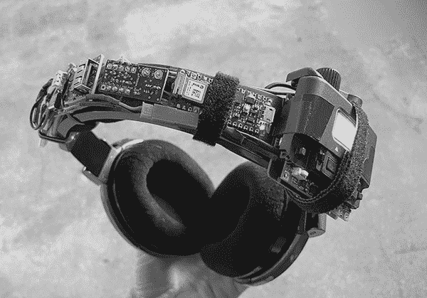

Figure 7.4A wireless, digital audio receiver (shown on the right) mounted on AAR prototype headphones ¶ Source: Photograph by the author

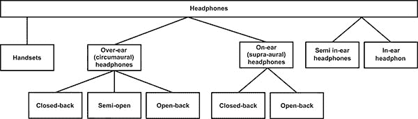

Figure 7.5The main headphone types categorised by structure

## 7.5 耳机

如前文第 2.10 节介绍的，适用于 AAR 的各种听觉显示方式已经给出。本节更深入探讨耳机，作为大多数 AAR 应用的主要音频输出设备。尽管“耳机”或“可穿戴听觉设备”等术语可能更准确，但为了简化，本书在此统一使用“耳机”作为统称。

耳机提供个性化的听觉体验。所有耳机的共同点是贴近耳朵，这使得声音质量可控且声压级低，从而减少声音泄漏和对周围环境的干扰。

耳机也有某些缺点。首先，每位用户都需要自己的设备，这增加了费用和维护需求。此外，某些耳机会通过其物理重量和触感（压在耳朵、发热等）或音质不佳提醒自己。在 binaural 6DoF 应用中，一个重大挑战是精确的用户跟踪，这对于准确的虚拟音频空间化至关重要。

### 7.5.1 耳罩式耳机

- `Over-ear` 或 `circumaural` 耳机具有大耳罩，覆盖整个外耳。耳罩通常通过头带连接，头带可用于安装特定 AAR 应用所需的特殊设备和标记。`closed-back` 和 `open-back` 设计两种。`closed-back` 耳机衰减外部声音并防止内部声音泄漏。这在环境噪音会干扰虚拟音频内容时可能是最佳选择。然而，`closed-back` 耳机会产生共振或“浑浊”的低音响应，且不透气，长时间使用会积聚热量（Tran, Amrein and Letowski, 2009）。

- `Open-back` 和半开放耳机结构“通风”，产生更开阔自然的声音。它们比 `closed` 耳机更具声学透明性，这有助于保持对真实环境及他人的感知，同时提升虚拟声音的外部化（McGill et al., 2020）。不过，实际中 `closed-back` 设计有时因价格更低而被选择，且开放式耳机未必能显著提升与同伴的口头交流（Armbruster, 2024）。尽管如此，开放式设计能减轻隔离感，通常被认为更舒适（Vazquez-Alvarez et al., 2016）。开放式耳机始终会对真实世界声音造成一定程度的色彩化，这在某些关键应用中可能不可接受（Jacuzzi, 2018）。但由于听觉具有适应性，用户可能会习惯这种色彩化声景，因此尝试对虚拟内容进行均衡以更好地融合两者声学层是个好主意。

### 7.5.2 On-ear 耳机

`On-ear` 或 `supra-aural` 耳机位于耳朵上方。它们比 `circumaural` 耳机更紧凑、更轻，但长时间使用可能因压迫感而不适。它们也有封闭和开放设计，但 `closed-back` on-ear 耳机的隔音效果不如 over-ear 耳机。

### 7.5.3 In-ear 耳机（耳塞）

`In-ear` 耳机和 `earbuds` 现在基本意思相同。`In-ear` 耳机放入耳道并通过硅胶环或定制耳模固定。它们可能提供极佳音质，但长时间使用会感到不适，且会产生“闭塞”效应，使自身声音浑浊并放大体内声音（如进食）（Albrecht, Lokki and Savioja, 2011）。

`Semi-in-ear` 耳机则放置在耳室，不提供声学隔音，可能感觉不适且容易掉落，现在除飞机一次性耳机外已少见。

`In-ear` 耳机（以及一定程度上 `closed-back` 耳机）会增加用户对自身身体声音的感知，这可能导致与周围环境的连接感下降（Larsson et al., 2010）。

耳塞是私人设备，出于卫生原因不适用于公共场合的手出设备。AR 体验可能依赖用户自备设备和耳机，但这对设计提出挑战——无法事先了解每个用户的设备。在增强现实情境中，声学透明度至关重要。若音频水平精准至关重要，则需要在体验开始时进行校准。

### 7.5.4 Open-ear 耳机

`Open-ear` 耳机在声学上几乎完全透明，驱动单元靠近耳朵且无包围结构。部分开放式耳机使用头带支撑扬声器（如 `AKG K1000` 和‘`Mushrooms`’），部分则夹在耳廓上，类似耳环（如 `Bose Ultra Open Earbuds`）。`Open-ear` 耳机让用户自然听到真实世界声音，保留“身处环境”的感觉，这是 AR 和 MR 体验的基本原则（Larsson et al., 2010, p. 152）。

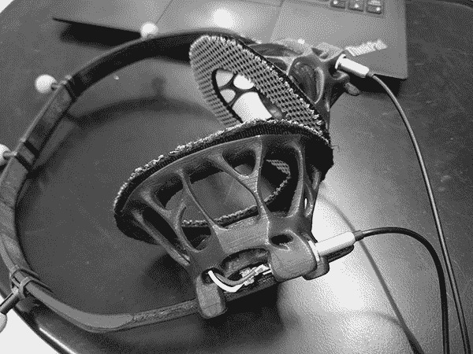

Figure 7.6Acoustically transparent, 3D-printable headphones nicknamed ‘`Mushrooms`’ designed by Alexander Mülleder (Mülleder et al., 2023). The headband is mounted with `OptiTrack` reflective markers. ¶ Source: Photograph by the author

### 7.5.5 骨传导耳机

除了开放式耳机和近场扬声器，骨传导（BC）耳机也是声学完全透明的。它们不通过空气传递声波，而是使颅骨骨折振动，从而模拟耳蜗。因此无需将设备放置在或覆盖在耳朵上。但 BC 设备需要紧贴颅骨，可能导致皮肤问题和不适（Nishimura et al., 2023）。

### 7.5.6 软骨传导耳机

除了骨传导，声音也可以通过振动耳软骨传递。软骨传导（CC）主要用于日本部分听力辅助设备，研究有限，但它似乎比 BC 设备提供更佳的舒适感和更精准的空间定位（Nishimura et al., 2023）。

### 7.5.7 听透（Hear-through）

现代许多耳机（包括耳塞）配备主动降噪（ANC）和电子听透功能，部分型号能识别语音及其他声音以实现自适应声景调节。耳机结构通常封闭，阻隔部分环境声音。它们采用 `pseudoacoustic` 系统，外部麦克风阵列安装在设备外表面，捕捉外部声音（Härmä et al., 2004）。通过数字信号处理（DSP），环境声音被通过反相信号馈入耳中，实现“消噪”。

这种“麦克风-通过”系统（Albrecht, Lokki and Savioja, 2011）可用于 AR 场景提供声学透明，类似 MR 头戴式显示器的视频透通。相比纯声学透明系统，伪声学系统更复杂，因为需要处理并将环境声音馈入耳机。但其优势在于可移除和替换真实世界声景，为 MR 体验铺路。然而，若使用商用降噪耳机，开发者可能发现制造商未公开 API，导致难以“劫持”并操纵麦克风信号。

### 7.5.8 Smart 头戴式耳机（hearables）

当耳机配备传感器和高级技术时，它们有时被称为`smart headphones or hearables`。通过基于 AI 的技术，ANC 系统可以更有效、经常适应性地工作，能够识别特定声音（如语音）并让其通过，同时降低其他声音。多个麦克风使得光束成型成为可能，即在声学上“聚焦”到所需的音频源，并且能够减少闭塞效应。除了现代助听器具备这些功能外，消费级耳机也具备类似特性，如`Pixel Buds Pro 2`。

一些耳机、耳机和智能眼镜还配备集成的头部追踪传感器，如`AirPods Pro`。许多耳机的无线音频传输可能会在音频信号链中引入延迟，导致转动头部时声音场景滞后。

### 7.5.9 Smart glasses

智能眼镜是增强了电子元件的眼镜；有些眼镜配备近耳扬声器（‘音频智能眼镜’），有些配备透视视频显示（‘AR 眼镜’），而某些型号则配备用于拍照和录像的摄像头（Greenwald，2024）。许多设备组合了这些功能，并且通常配备一系列麦克风用于语音命令和音频录制，以及无线连接手机和 WiFi。一些眼镜集成了头部追踪，这对于任何真实 AR 应用（包括利用双耳声学空间音频的 AAR）至关重要。`Bose Frames`曾经拥有头部追踪功能（例如在`Please Confirm You Are Not a Robot,`中，见第 5.7 章），但在 2020 年 Bose 的 AR 计划终止后，这些眼镜现在被作为普通音频眼镜出售。

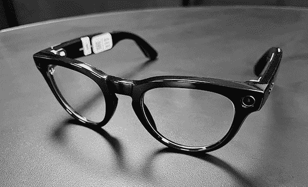

Figure 7.7`Ray-Ban Meta`智能眼镜，内置麦克风、近耳扬声器和视频摄像头 ¶ 来源：作者照片

### 7.5.10 音质

高质量耳机自然可以比低质量耳机更真实地再现虚拟声音。然而，即使在高质量范围内，也没有任何耳机型号能实现完美的透明频率响应，因此会改变双耳声场的再现。为了使空间化发挥最佳效果，这种耳机响应应通过均衡来补偿，最好是为每位用户单独调整，因为耳机与耳朵的耦合因人而异（Sunder，2022）。如果使用的耳机型号事先已知（如集成系统的情况），均衡可以在预先进行。但如果系统依赖用户自带的耳机，则可能无法实现正确的均衡。此外，耳朵似乎能够略微适应耳机基于 AAR 系统中的不真实音质，从而在音质不佳的情况下仍能获得可接受的体验（Engel and Picinali，2017）。

## 7.6 作者（Authoring）

作者指的是编程和脚本化 AAR 系统的过程；简而言之，它涉及定义传感器输入以及如何使用这些数据、在三维空间中放置虚拟声音和其他对象、设定其参数、编写逻辑以实现所有功能的协同工作、以及尽可能调整虚拟音频工具以“听感化”（auralize）虚拟声音场景。

对于某些 AAR 环境，如地理定位的步行，有用户友好的 Web 和应用平台使得作者工作变得非常容易。对于其他交互式 AAR 环境，工具则更为复杂，至少需要一定的编程水平。虽然这为创意提供了可能性，但可能限制快速迭代想法的能力，阻碍非程序员积极参与，并整体减缓该领域的发展（Schmalstieg and Hollerer，2016）。

游戏引擎为作者提供了便捷的途径，配备了现成的 3D 资产放置和处理工具、状态机、音频工具以及众多附加组件，包括用于虚拟音频处理、姿态和对象追踪、语音识别、设备间通信、在线连接等插件。游戏引擎解放了创作者从许多编程任务中解放出来，使其能够专注于创作过程的其他方面（Buttle，2020）。一些游戏引擎提供了可视化脚本界面（例如 Unreal Engine 的`Blueprints`和 Unity 的`Visual Scripting`），这不仅帮助编程技巧不足的人，还简化了管理复杂的叙事和交互结构，这些结构如果仅通过代码行来理解会显得繁琐。

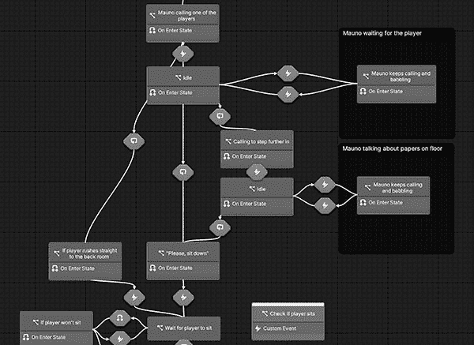

Figure 7.8`The Reign Union`的互动故事结构的一部分，在`Unity Visual Scripting`界面中显示

在典型的作者工作流程中，真实世界会被“引入”为虚拟表现形式，这是音频、其他内容以及用户可以在空间中定位的对象。在地理定位音频步行应用中，通常使用二维地图；而对于更复杂的项目，则需要三维建模。这种建模可以手动使用真实环境的测量进行，或者某些动态系统可以通过摄像头和 LiDAR 传感器自动扫描环境。虽然虚拟模型有助于定位和控制叙事元素，但如果引擎利用几何声学（GA）（见第 6.4 章），它对虚拟音频渲染也非常有用。

用户可以通过传感器数据在虚拟场景中以头像形式移动。游戏引擎的“监听器”组件充当虚拟耳朵，被放置在头像对应的真实人耳位置。随后，虚拟音频引擎负责将声音从声源传播到监听器——需要用户进行小心的手动调整。

交互和其他场景逻辑（包括声音行为）通过作者环境提供的工具进行脚本化。最终，项目可编译为可在目标平台（MacOS、Windows、Linux、Android、iOS 等）上运行的可执行应用程序。

## 7.7 运动到声音的延迟

头部追踪的双耳声场系统试图在无论头部如何移动，都保持虚拟声音场景与真实世界在空间上同步（Roginska，2018）。然而，总会在头部移动的瞬间和用户听到虚拟声音场景做出反应之间引入一定的延迟。这个“运动到声音的延迟”是由追踪传感器、数据传输、音频渲染以及音频输出阶段的数字到模拟（DAC）转换累积而成（Meyer-Kahlen et al.，2023）。

运动到声音的延迟在 AAR 中会造成问题，因为当用户视角改变时，虚拟声音和房间声学会滞后于真实位置，这很容易破坏非介入感和存在感的幻象（参见 Lombard and Ditton，1997）。


60 或 50 毫秒（ms）以下的延迟通常在大多数虚拟音频场景中被认为是不可见的，而低于 30 ms 则几乎不可见（Brungart, Kordik and Simpson, [2006; Brandenburg et al., 2023]）。实际上，这些数值可以在跟踪系统非常快速（如 `OptiTrack` 或 `VIVE Tracker`）、音频渲染优化良好并在功率强大的计算机上运行且缓冲区很小、尽可能多的连接均为有线的情况下实现。然而，许多 AAR 应用无法在如此高的规格下运行。例如，即使使用 IMU 跟踪器进行头部朝向跟踪相对快速（延迟 10 ms，Supper, 2021），位置跟踪系统可能引入超过 100 ms 的延迟。好在头部朝向跟踪通常比位置跟踪更为关键，而快速位置跟踪仅在虚拟声音贴近时才变得重要。

音频渲染会增加额外延迟，如第 7.3 节所述。复杂的听觉场景对计算机和软件的要求更高，通常导致更大的音频缓冲区和更高的延迟。最后，如果需要向耳机进行无线音频传输，则可能引入显著延迟。专业无线系统可实现低于 1 毫秒的延迟。一些低延迟蓝牙编码（如 `aptX LL` 和 `LHDC LL`）的延迟为 30–40 ms，而标准蓝牙编码则可能超过 200 ms，这会显著影响用户体验（Katz, 2024）。综上，若系统能将运动到声音的延迟控制在约 100 ms，这在保持可信度方面已算相当不错（Lindau, 2009）。

听觉“远程效应”（ventriloquism effect），即虚拟声音“磁化”到可信的物理物体上，可以弥补部分动态错误（见 Ahrens, 2019）。但实际经验表明，这种容忍度有限，声音不能偏离太大。如果跟踪不稳定且虚拟声音在物理物体周围漂移，幻觉更容易破裂。

## 7.8 完整系统和标准

目前尚无法购买完整的 6DoF AAR 系统，至少在作者所知范围内，只有少数由制作 AAR 内容的公司研发的专有系统。然而，这些系统同样不完整：尽管它们在技术上设计得周到且可靠，但作者管道或跟踪系统仍可能依赖第三方工具和复杂的工作流。

部分解决方案已或将会可供购买，而第一个交互式沉浸式音频标准 `MPEG-I` 预计将在本书出版时于 2025 年发布。该标准由多家公司共同开发，旨在统一并稳定各设备上的音频渲染。它支持 6DoF 音频场景，兼容双耳耳机和扬声器设置。`MPEG-I` 具备可扩展性，能够为处理能力有限的移动设备优化渲染分辨率。它基于 `MPEG-H` 编码，支持通道式音频、对象式音频（OBA）以及更高阶麦克风阵列（HOA），并引入多点 HOA（Herre et al., 2024）。在 AAR 方面，一个重要特性是可以输入参数（如房间混响时间 RT60），以匹配虚拟声学与真实环境（Herre and Disch, 2023）。

另一项最近发布的标准和 codec `IVAS` 尤其值得关注。它由多家电信和技术公司联合开发，能够通过单个移动设备即兴捕获空间听觉场景（如会议桌周围的人），并且可以在终端设备上对每位参与者的远程音频流进行空间化（Bruhn, Multrus and Varga, 2022; IVAS Codec Public Collaboration Contributors, 2023）。

尚需观察这些标准将被硬件和软件公司多广泛采用，它们能否简化并统一生产流程，以及是否能实现无缝的跨平台内容分发。尽管如此，它们的存在已反映出虚拟和空间音频在行业中的重要性日益被认可。

## 7.9 结论

实现 AAR 的可能技术种类看似繁多，选择正确的方案始终是一项充满挑战的过程，且测试某一技术往往需要投入金钱和时间，最终可能发现它并非最佳选择。除地理定位 AAR 平台外，缺乏面向内容创作者的现成完整系统，可能会延缓创意落地。本章希望为从业者提供选型指导，帮助其在项目中精准选择组件，减少重复试错，同时展望 AAR 技术的潜力与机遇。

## 参考文献

1. Ahrens, A. 等 (2019) ‘Sound Source Localization with Varying Amount of Visual Information in Virtual Reality’，PLOS ONE, 14 (3), p. e0214603。Available at: [`doi.org/10.1371/journal.pone.0214603`](https://doi.org/10.1371/journal.pone.0214603)。

2. Albrecht, R., Lokki, T. and Savioja, L. (2011) ‘A Mobile Augmented Reality Audio System with Binaural Microphones’，in Proceedings of Interacting with Sound Workshop: Exploring Context-Aware, Local and Social Audio Applications. New York, NY, USA: Association for Computing Machinery (IwS ’11), pp. 7–11。Available at: [`doi.org/10.1145/2019335.2019337`](https://doi.org/10.1145/2019335.2019337)。

3. ALPS (2018) ‘ALPS – Acoustic Localisation Positioning System’。Available at: [`alps.fi/`](https://alps.fi/) (Accessed: 26 November 2024)。

4. Amfitech (2024) ‘AMFITRACKTM, AmfiTrack’。Available at: [`www.amfitrack.com`](https://www.amfitrack.com) (Accessed: 26 November 2024)。

5. Arena, F. 等 (2022) ‘An Overview of Augmented Reality’，Computers, 11 (2), p. 28。Available at: [`doi.org/10.3390/computers11020028`](https://doi.org/10.3390/computers11020028)。

6. Armbruster, S. (2024) ‘Conversation with Matias Harju, March 7’.

7. Bederson, B.B. (1995) ‘Audio Augmented Reality: A Prototype Automated Tour Guide’，in Conference Companion on Human Factors in Computing Systems – CHI ’95. Denver, Colorado, United States: ACM Press, pp. 210–211。Available at: [`doi.org/10.1145/223355.223526`](https://doi.org/10.1145/223355.223526)。

8. Bimber, O. and Raskar, R. (2005) Spatial Augmented Reality: Merging Real and Virtual Worlds. Wellesley, Massachussets: A K Peters.

9. Boquet, G., Vilajosana, X. and Martinez, B. (2024) ‘Feasibility of Providing High-Precision GNSS Correction Data Through Non-Terrestrial Networks’, IEEE Transactions on Instrumentation and Measurement, 73, pp. 1–15。Available at: [`doi.org/10.1109/TIM.2024.3453319`](https://doi.org/10.1109/TIM.2024.3453319)。

10. Brandenburg, K。et al. (2023) ‘Implementation of and Application Scenarios for Plausible Immersive Audio Via Headphones’，in Audio Engineering Society Convention 155, Audio Engineering Society。Available at: [`www.aes.org/e-lib/browse.cfm?elib=22308`](https://www.aes.org/e-lib/browse.cfm?elib=22308) (Accessed: 25 November 2023)。

11. Bruhn, S., Multrus, M. and Varga, I. (2022) ‘IVAS – 将 3GPP 语音和音频服务提升至新的沉浸式水平’, 3GPP Highlights, 十月, 第 8–9 页。

12. Brungart, D., Kordik, A.J. and Simpson, B. (2006) ‘头部跟踪延迟在虚拟音频显示中的影响’, Audio Engineering Society Journal, 54, 第 32–44 页。

13. Buttle, P. (2020) ‘视频游戏背后的力量：看看游戏引擎’, Medium。可在: [`medium.com/wetheplayers/the-power-behind-video-games-a-look-at-game-engines-2731315086e0`](https://medium.com/wetheplayers/the-power-behind-video-games-a-look-at-game-engines-2731315086e0) (访问日期: 2021 年 5 月 3 日)。

14. Dardari, D., Closas, P. and Djurić, P.M. (2015) ‘室内定位：理论、方法和技术’, IEEE Transactions on Vehicular Technology, 64 (4), 第 1263–1278 页。可在: [`doi.org/10.1109/TVT.2015.2403868`](https://doi.org/10.1109/TVT.2015.2403868)。

15. Doheny, E.P. et al. (2023) ‘利用智能手机麦克风录制的音频信号估计呼吸频率和呼气时长’, Biomedical Signal Processing and Control, 80, 第 104318 页。可在: [`doi.org/10.1016/j.bspc.2022.104318`](https://doi.org/10.1016/j.bspc.2022.104318)。

16. Engel, J.I. and Picinali, L. (2017) ‘长期适应音频增强现实系统’, in Institute of Acoustics Proceedings. ICSV24 2017, London。可在: [`www.ioa.org.uk/catalogue/paper/long-term-user-adaptation-audio-augmented-reality-system`](https://www.ioa.org.uk/catalogue/paper/long-term-user-adaptation-audio-augmented-reality-system)。

17. Fernandez-Hernandez, I. et al. (2018) ‘伽利略高精度：从方案和政策的角度看', in 69th International Astronautical Congress, Bremen, Germany.

18. Gampe, J. (2009) ‘交互式音频增强现实中的叙事’, in I.A. Iurgel, P. Petta, and N. Zagalo (eds) Interactive Storytelling. Berlin, Heidelberg: Springer Berlin Heidelberg (Lecture Notes in Computer Science), 第 298–303 页。可在: [`doi.org/10.1007/978-3-642-10643-9_34`](https://doi.org/10.1007/978-3-642-10643-9_34)。

19. Geng, J., Huang, D. and Torre, F.D. la (2022) ‘DensePose 从 Wi‑Fi 中获取', arXiv。可在: [`doi.org/10.48550/arXiv.2301.00250`](https://doi.org/10.48550/arXiv.2301.00250)。

20. Greenwald, W. (2024) ‘2024 年最佳智能眼镜', PCMag UK。可在: [`uk.pcmag.com/wearables/150162/the-best-smart-glasses-for-2024`](https://uk.pcmag.com/wearables/150162/the-best-smart-glasses-for-2024) (访问日期: 2024 年 10 月 25 日)。

21. Hatala, M. and Wakkary, R. (2005) ‘基于本体的用户建模在博物馆增强音频现实系统中', User Modeling and User-Adapted Interaction, 15 (3), 第 339–380 页。可在: [`doi.org/10.1007/s11257-005-2304-5`](https://doi.org/10.1007/s11257-005-2304-5)。

22. Herre, J. and Disch, S. (2023) ‘MPEG‑I 沉浸式音频 – 虚拟/增强现实音频标准的参考模型', Journal of the Audio Engineering Society, 71 (5), 第 229–240 页。可在: [`doi.org/10.17743/jaes.2022.0074`](https://doi.org/10.17743/jaes.2022.0074)。

23. Herre, J. et al. (2024) ‘MPEG‑I 沉浸式音频：一种高效的 VR/AR 音频表示方式，超越点源渲染', in. 2024 AES 6th International Conference on Audio for Games, Tokyo, Japan: Audio Engineering Society。可在: [`aes2.org/publications/elibrary-page/?id=22400`](https://aes2.org/publications/elibrary-page/?id=22400)。

24. HTC (2023) ‘VR 跟踪器和虚拟现实跟踪概述 – VR 101: 第三部分'. 可在: [`blog.vive.com/us/tracking-in-virtual-reality-and-beyond-vr-101-part-iii/`](https://blog.vive.com/us/tracking-in-virtual-reality-and-beyond-vr-101-part-iii/) (访问日期: 2024 年 11 月 27 日)。

25. Härmä, A. et al. (2004) ‘移动和可穿戴设备的增强现实音频', Journal of the Audio Engineering Society, 52 (6), 第 22 页。

26. Italiano, L. et al. (2024) ‘5G 定位教程', IEEE Communications Surveys & Tutorials, 第 1 页。可在: [`doi.org/10.1109/comst.2024.3449031`](https://doi.org/10.1109/comst.2024.3449031)。

27. IVAS Codec Public Collaboration Contributors (2023) ‘IVAS 编码器用于 NG 3GPP 语音和音频服务', 十月, 第 18–19 页。

28. Jacuzzi, G. (2018) ‘“增强音频”：创建 AR 音频体验所需的独特工具和功能概述', in International Conference on Audio for Virtual and Augmented Reality, Redmond, WA, USA: Audio Engineering Society, 第 8 页。

29. Katz, L. (2024) ‘了解蓝牙编码', SoundGuests。可在: [`www.soundguests.com/understanding-bluetooth-codecs-15352/`](https://www.soundguests.com/understanding-bluetooth-codecs-15352/) (访问日期: 2024 年 10 月 18 日)。


30. Larsson, P. et al. (2010) ‘在混合现实环境中产生听觉存在感及相关技术', in E. Dubois, P. Gray, and L. Nigay (eds) The Engineering of Mixed Reality Systems. London: Springer (Human-Computer Interaction Series), 第 143–163 页。可在: [`doi.org/10.1007/978-1-84882-733-2_8`](https://doi.org/10.1007/978-1-84882-733-2_8)。

31. Lin, Y. and Abdulla, W.H. (2015) ‘音频水印技术', in Y. Lin and W.H. Abdulla (eds) Audio Watermark: A Comprehensive Foundation Using MATLAB. Cham: Springer International Publishing, 第 51–94 页。可在: [`doi.org/10.1007/978-3-319-07974-5_3`](https://doi.org/10.1007/978-3-319-07974-5_3)。

32. Lindau, A. (2009) ‘动态双耳合成系统中系统延迟的感知', in 53rd Annual Meeting for Acoustics, DAGARotterdam, 第 1063–1066 页。可在: [`www2.ak.tu-berlin.de/%7eakgroup/ak_pub/2009/Lindau_2009_The_Perception_of_System_Latency_in_Dynamic_Binaural_Synthesis.pdf`](https://www2.ak.tu-berlin.de/%7eakgroup/ak_pub/2009/Lindau_2009_The_Perception_of_System_Latency_in_Dynamic_Binaural_Synthesis.pdf) (访问日期: 2024 年 10 月 18 日)。

33. Lombard, M. and Ditton, T. (1997) ‘存在感概念的核心', Journal of Computer-Mediated Communication, 3 (JCMC321)。可在: [`doi.org/10.1111/j.1083-6101.1997.tb00072.x`](https://doi.org/10.1111/j.1083-6101.1997.tb00072.x)。

34. Marvelmind (2023) ‘架构比较'. 可在: [`marvelmind.com/pics/architectures_comparison.pdf`](https://marvelmind.com/pics/architectures_comparison.pdf) (访问日期: 2024 年 11 月 26 日)。

35. Mazuryk, T. and Gervautz, M. (1999) ‘虚拟现实 – 历史、应用、技术与未来', ResearchGate \[Preprint\]. 可在: [`www.researchgate.net/publication/2617390_Virtual_Reality_-_History_Applications_Technology_and_Future`](https://www.researchgate.net/publication/2617390_Virtual_Reality_-_History_Applications_Technology_and_Future) (访问日期: 2019 年 3 月 10 日)。

36. McGill, M. et al. (2020) ‘声学透明与听觉混合现实声音景观的变化', in Proceedings of the 2020 CHI Conference on Human Factors in Computing Systems. Honolulu, Hawaii, USA: ACM, 第 1–16 页。可在: [`doi.org/10.1145/3313831.3376702`](https://doi.org/10.1145/3313831.3376702)。

37. 梅耶-卡黑恩, N. 等人 (2023) ‘测量虚拟声学渲染系统的运动到声音延迟’，AES: 《音频工程学会杂志》, 71 (6), 第 390–398 页。可于: [`doi.org/10.17743/jaes.2022.0089`](https://doi.org/10.17743/jaes.2022.0089)。

38. 梅耶-卡黑恩, N. (2024) Transfer-Plausible Acoustics for Augmented Reality. 博士论文. Aalto 大学。可于: [`urn.fi/URN:ISBN:978-952-64-1913-8`](https://urn.fi/URN:ISBN:978-952-64-1913-8)。

39. 穆勒德, A. 等人 (2023) ‘DIY 耳机及用于增强现实音频的开发平台’，在 Audio Engineering Society 会议: AES 2023 国际空间和沉浸式音频会议, Audio Engineering Society 出版。可于: [`www.aes.org/e-lib/browse.cfm?elib=22188`](https://www.aes.org/e-lib/browse.cfm?elib=22188) (检索日期: 2023 年 9 月 8 日)。

40. 纳夫塔利, D. 和 罗德金, R. (2019) ‘用于交互式声音步道、声音艺术和音乐传递的音频增强现实’，载于《交互媒体音频设计基础》。Routledge 出版。

41. [西沼田, T. 等人 (2023) ‘临床实践中的软骨导声助听器’，Audiology Research, 13 (4), 第 506–515 页。可于: [`doi.org/10.3390/audiolres13040045`](https://doi.org/10.3390/audiolres13040045)。

42. [奥尔希利茨, A. 等人 (2024) ‘PLATONE: 一个沉浸式地理空间音频空间化平台’，在《第 2 届 IEEE 元宇宙计算、网络与应用国际会议 (IEEE MetaCom)》中。香港。

43. [罗吉斯卡, A. (2018) ‘通过耳机实现双耳声音’，载于 A. 罗吉斯卡 和 P. 盖卢索 (编) 《沉浸式声音：双耳声和多声道音频的艺术与科学》。Routledge 出版。

44. [罗维斯, E. 等人 (2019) ‘音频传说：在增强现实音频游戏中探讨声学交互’，Multimodal Technologies and Interaction, 3 (4), 第 73 页。可于: [`doi.org/10.3390/mti3040073`](https://doi.org/10.3390/mti3040073)。

45. [施马尔施泰格, D. 和 赫勒尔, T. (2016) 《增强现实：原理与实践》. Addison-Wesley Professional 出版。

46. [斯德, K. (2022) ‘双耳声音工程’，载于 J. 帕特森 和 H. 李 (编) 《3D 声音》。纽约, NY: Routledge (音乐制作视角), 第 130–159 页。

47. [舒普, B. (2021) ‘Supperware 头部追踪器 1 规格’。可于: [`supperware.net/downloads/head-tracker/specs.pdf`](https://supperware.net/downloads/head-tracker/specs.pdf) (检索日期: 2024 年 10 月 18 日)。

48. [特兰, P.K., 安森, B.E. 和 莱托斯基, T.R. (2009) ‘耳机挂载显示器的音频’，载于 C.E. 拉什等 (编) 《耳机挂载显示器：感觉、知觉与认知问题》。阿拉巴马州费尔鲁克: 美国陆军航空医学实验室, 第 175–234 页。可于: [`doi.apa.org/get-pe-doi.cfm?doi=10.1037/e614362011-006`](http://doi.apa.org/get-pe-doi.cfm?doi=10.1037/e614362011-006) (检索日期: 2024 年 10 月 10 日)。

49. [乌尼, T., 拉索, A. 和 财靶尔, G. (2015) ‘在导航脊柱手术中使用跟踪超声波’，载于《计算视觉与人体力学讲义笔记》, 第 469–494 页。可于: [`doi.org/10.1007/978-3-319-12508-4_15`](https://doi.org/10.1007/978-3-319-12508-4_15)。

50. [瓦斯克斯-阿尔瓦雷斯, Y. 等人 (2016) ‘设计移动音频增强现实中的多层次听觉显示交互’，ACM Transactions on Computer-Human Interaction, 23 (1), 第 1–30 页。可于: [`doi.org/10.1145/2829944`](https://doi.org/10.1145/2829944)。

51. [弗雷图奇, R. 等人 (2023) ‘增强现实的历史’，载于 A.Y.C. 尼 和 S.K. 昂 (编) 《斯普林格手册·增强现实》。瑞士查姆: Springer 出版 (Springer Handbooks)。

52. 吴, Y., 唐, F. 和 李, H. (2018) ‘基于图像的相机定位概述’，Visual Computing for Industry, Biomedicine, and Art, 1 (1), 第 8 页。可于: [`doi.org/10.1186/s42492-018-0008-z`](https://doi.org/10.1186/s42492-018-0008-z)。

53. [杨, J., 巴尔德, A. 和 米林格斯, M. (2022) ‘音频增强现实：技术、应用与未来研究方向系统综述’，Journal of the Audio Engineering Society, 70 (10), 第 788–809 页。

54. [杨, Z. 等人 (2020) ‘Ear-AR：在耳机上进行室内声学增强现实’，在《第 26 届国际移动计算与网络年会论文集》中。MobiCom ’20, 伦敦, 英国: ACM, 第 1–14 页。可于: [`doi.org/10.1145/3372224.3419213`](https://doi.org/10.1145/3372224.3419213)。

# 8 Narrative design considerations

DOI: [`10.4324/9781003627289-8`](https://doi.org/10.4324/9781003627289-8)

叙事者永远不会处于可以任意选择最适合讲述故事的媒介，并在该媒介内任意挑选任何可想象的方法、技术和场所的情形。选择始终由作者的技能与兴趣、利益相关者的需求与预算，以及制作者和资助方的优先级决定。但让我们假设叙事者已选择使用增强现实 (AAR) 来传达故事。那么，从哪里开始呢？本章简要讨论了几项叙事设计考量因素。虽然前几节已轻触过实际制作相关问题，并在后续部分继续出现，但因篇幅限制，这些内容不作深入探讨。

## 8.1 什么是叙事？

故事，或叙事，是‘在时间和空间中发生因果关系链的事件链’ (Bordwell and Thompson, 1997, 第 90 页)。故事在特定的论述语境中被定位和解释，通常传达‘置身于故事世界、亲历其中的体验感’ (Herman, 2009)。因此，叙事者的任务不仅是阐述事件进展和进行教育，更是构建围绕事件和人物的世界，并将观众沉浸于该故事世界 (McErlean, 2018)。

名词‘叙事’常与‘故事’同义使用，但它也拥有自身独特的含义，指对事件的呈现方式，常用于制造一种形态或推动议程 (Halverson, 2011)。提出一种新的、替代性的视角，或 *narrative*，来审视显著议题，可谓是增强现实的核心概念之一。为简化，本书大多将‘故事’与‘叙事’视为可互换的概念，因为关注点在于故事和叙事的讲述方式及叙事技巧。

## 8.2 叙事潜力

正如我们所知，AAR 作为叙事媒介拥有巨大潜力。相较于视觉增强现实，当前的 AAR 技术已能够创造出与真实环境中相互共存的可信虚拟物体幻象。结合 AAR 的其他特性，这打开了若干令人着迷的叙事可能性，下面给出一些示例。

### 熟悉的环境作为叙事空间

AAR 使得故事能够在用户自己的环境中展开，将熟悉的周围环境转化为叙事空间。`Zombies, Run!` 就是一个例子，它在每个人的社区中充斥着僵尸，可能引发强烈的情感反应。挑战在于，如何个性化内容，使其不显得过于普通。在更原始认知层面运作的类型，如恐怖，可能在这方面更有效，而基于地点的叙事结构可能设计起来较为困难。

### 与地点相关的个人和集体故事

听觉常被视为个人和亲密的感官。与特定地点相关的个人故事，结合空间感知的互动，可以非常有力量，`Maison Gainsbourg` 中夏洛特的回忆就是一个例子。地理定位的音频平台也展现出潜力，能够分享用户自己的故事，并为叙事提供真实感和社会黏合力。集体叙事则可能揭示地点的共享故事，可能通过参与者的实时贡献得到丰富。

### 隐藏的叙事

AAR 可以揭示某一地点的“隐藏”叙事，为显著叙事提供另一种视角，暴露伦理、社会和环境主题。通过基于耳机的应用，这些叙事层可以隐藏于其他人之外，使体验在不打扰现有环境和周围人的情况下进行。第 9.7 章讨论了一种称为“替代匹配”（alternative match）的叙事技巧，并给出了一些概念的使用示例。

### 集体与个人

与隐藏和替代叙事相关，耳机基于 AAR 的一个可能性是为参与者提供共享故事，但每个听众个性化。显而易见的实现方式包括多语言选项，以及根据年龄、听力障碍或认知挑战进行定制。然而，定制可以进一步扩展到叙事层面，让每个参与者以不同的时间顺序或从不同角色的视角听到同一故事，如在 `The Reign Union` 中所示。

### 增强戏剧

虽然某些剧院提供通过耳机的翻译服务，AAR 仍然可以通过空间化翻译声音、将其附着于舞台上的演员来提升沉浸感。叙事上，这为上述个性化对话提供了有趣的可能性。此外，虚拟音效和环境音也可以通过 AAR 系统传递，这对于一些难以通过观众周围的物理扬声器实现的沉浸式效果特别有用。例如，英国国家剧院的 `Anna` 表演利用了双耳间距（binaural telepresence），让观众通过耳机听到舞台事件。高级 AAR 技术可以进一步拓展这些概念。

### 复苏已灭绝的声音并 evoking（唤起）未来

博物馆长期使用虚拟音频来复原不再能听见的声音。`Nature Soundscapes` 项目通过扬声器在森林中再现已灭绝物种的声音，而移动 AAR 系统则有望将这一概念扩展到更广泛的受众。同样，AAR 可以设想未来世界的声音，无论是有人类影响还是没有。

### 迭生叙事

AAR 能够驱动环境驱动的叙事，这些叙事会根据环境因素（如天气）进行反应和适应，例如 `Naphtali and Rodkin, 2019`。借助人工智能，生成式故事也可以完全从用户周围的现实中萌芽，接收来自环境和其中人物的输入。

## 8.3 技术平台

正如本书所述，理论上实现 AAR 的可能性是无限的。但在现实中，实际选择往往受限，并且已被预定义的环境和位置依赖性所左右，例如应用是否具有普遍性（ubiquitous）或是特定于某一地点（site-specific）。

如果符合需求，直接增强（direct augmentation）是一个明显的选项。通常，仅需简单的 proximity（近距离）感应即可实现，虽然在公共场所确保系统可靠可能需要一定努力。对于户外移动体验，地理定位的应用和 SDK 提供了简便的作者工具、稳定的性能以及与大量支持的终端设备的全球兼容性。但其代价是艺术和交互工具的局限，除非与这些系统的开发者协作进行定制。

对于基于耳机的室内体验，据作者所知，目前没有一套综合、公开、易用且可靠的内容创作与分发平台。一些地理定位平台（如 `Echoes`）支持 iBeacons 或其他近距离传感器，但其位置精度可能不足以满足大多数应用需求。要实现完整的 6DoF（六度自由），一种方法是联系专有系统的所有者提交项目提案——或者金钱。否则，只能通过自行构建系统，使用电脑或移动设备、游戏引擎或其他开发环境、虚拟音频插件以及尝试各种追踪系统来实现。这种方式能够获得高质量，但工作量可能对商业项目来说不切实际。

尽管所有 AAR 平台仍处于实验阶段，CTC、WFS 和环绕系统在 AAR 领域更为实验性，甚至可能完全不在创作者和观众的可达范围之内。尽管如此，为它们创作 AAR 内容仍然被强烈鼓励！

## 8.4 哪个环境？

另一个与技术平台紧密相关的关键考量是故事是否应与特定地点绑定、可转移到多个地点，还是移动且可在任何地方使用。为特定地点编写故事通常能形成连贯的叙事，充分利用真实环境、历史、未来及其居民。但可及性问题也随之而来：由于地理位置、身体残疾或经济障碍，并非所有受众都能轻松接入特定地点的叙事，这可能限制受众多样性，排除那些本可受益的群体。此外，观众需要前往现场还会增加环境污染，尤其是当现场难以通过公共交通到达时。

可转移和普遍的体验可以解决可及性问题，但对叙事设计构成挑战：如何创造有意义的故事，使其在任何环境中都能适应并贴合？一个解决方案是精选故事运行的地点，例如全球多个公园（如 `The Planets`），或限定可能的场景，例如让故事发生在家庭环境中（如 `Horror-Fi Me`），这是广为人知且能够唤起普遍情感的情境。风险仍然存在——体验可能显得更为通用，与现实的关联变得表面化。某些类型更能容忍这种情况，例如恐怖和悬疑，它们基于更原始的情感层面，更容易在不同环境中迁移。


更具体地说，体验可以是*location-driven*，即内容根据用户在环境中的位置触发，或是*environment-driven*，即用户周围的信息决定虚拟声音的行为，或两者的结合（Naphtali and Rodkin, 2019）。location-driven 体验通常基于地图或平面图，虚拟声音被放置在特定位置。从叙事角度看，这种范式允许精确的空间设计，物体及其声音的位置大致事先已知。

environment-driven 应用会是*context-aware*，需要更动态的设计思路以及不同的普适追踪技术。环境驱动系统可以利用计算机视觉、LiDAR、麦克风等传感器来识别周围的特征和物体。应用可以被编程为寻找特定类型的物体，一旦识别到，就为其附加特定声音；若物体移动，附加的声音也会随之移动。例如，*Vienna Augarten* 瓷器博物馆的 AAR 音频导览使用基于 iPhone 的系统，识别每件瓷器的外观，并空间性地将对应的语音旁白附加到它上（Aichinger, 2024）。当展览期间某件瓷器被移动到两件其他展品之间时，系统会自动重新对齐虚拟声音到新位置。然而，由于声音被配备了触发区域，导致重叠，旁白行为变得异常。因此，设计和控制环境驱动系统需要额外的努力。

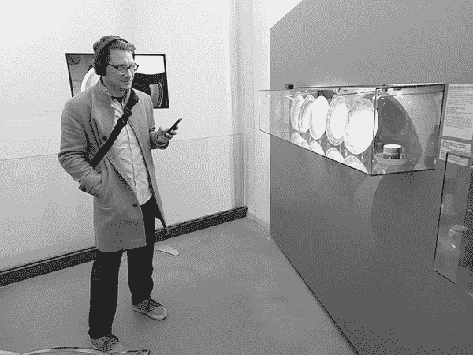

Figure 8.1A participant in the *Vienna Augarten* experience ¶ Source: Photograph by the author

## 8.5 Focus

There is likely an infinite number of narrative approaches to an AAR experience. Some of the example applications in Chapter 5 were categorised based on the focus of the augmentations: *AAR in exhibitions, reinforced environments*, and *reskinned environments*. In exhibitions, it is usually the exhibits and the thematic scope of the exhibition that are augmented, while the real environment, such as the venue itself, is typically ignored to some extent, *Dimensions of Sound* serving as an example. The other two categories draw from Robert Azuma’s (2015) concepts of *reinforcing, remembering*, and *reskinning*. They are approaches to AR where both the real and virtual are essential to the experience, and can arguably be adapted to AAR, too, as design paradigms.

In reinforcing, the experience is based on a real environment, object or person that is compelling by itself, and the role of virtual sound is to complement that. Many site-specific narrative AAR experiences use this approach, including applications in museums or cultural heritage sites that revive historical objects or environments through sounds. As an example, *Audio Legends* brings the history of Corfu to life through an AAR game. Whilst this approach typically reinforces real-world items and events, virtual sound design can also fuse new and contradictory meanings, if desired.

Remembering, in turn, evokes stories connected to specific locations and retells them where the events originally occurred. The goal is that merging these memories with the actual site will create a more impactful experience than either the location or the virtual content could offer on its own. Audio walks typically utilise this approach, Graeme Miller’s *Linked* being a good example. *Maison Gainsbourg* is another example, but it also combines remembering with reinforcing, overlaying powerful memories in the rooms of an already extremely compelling home of the Gainsbourg family.

The reskinning approach has two variations. In the first, the environment can be arbitrary which is then ‘recharacterised’ by virtual content. The story is placed within the existing environment by utilising surrounding objects such as buildings, vehicles, and people as narrative elements through augmentations. *Zombies, Run!* would be one example, reskinning the familiar neighbourhood as zombie-infested no-man’s land. The reskinning approach benefits from a context-aware AAR system making it truly mobile and ubiquitous. In the second variations, the whole environment can be an artificially constructed, a set piece. For example, *The Sound of Things* is based on items that are carefully arranged on a table, each object being real but, at the same time, artificially organised. *The Reign Union*, on the other hand, combines this approach with reinforcing, using a real location as the anchor for the story, but relying on sonic augmentations and set decorations to convey narratives beyond the real space.

A reskinned or entirely artificial environment could form the basis of a ‘hybrid reality’ approach, as suggested by Schraffenberger (2018), where the physical environment or object is intentionally incomplete and becomes whole only through the addition of virtual content—like a karaoke track that lacks vocals, which are supplied by the singer.

## 8.6 Compromises

Unless unlimited resources are available, compromises in AAR design are inevitable. High-quality virtual audio is often sacrificed for engaging interactivity, and sometimes both are traded for reliability, low maintenance, and scalability—the next user should get as good an experience as the previous one. In museums, for example, if visitors can trust the technology to work reliably, they will also be more likely to engage with it and have a positive experience (Chen et al., 2024). Not many museums have extra staff to solve problems, and buggy software is quickly uninstalled and forgotten. And even so, any interruption breaks the flow of the experience.

If the production has enough resources to develop natural interaction for the experience and virtual sounds that are at least *contextually* congruent with the chosen genre and environment, the experience seems to tolerate less authentic virtual acoustic rendering while still maintaining immersion (Aichinger, 2024; Armbruster, 2024). Cummings and Bailenson (2016, p. 293) cite Julian Hochberg who suggested that ‘Perfect physical fidelity is impossible and would not be of psychological interest if achieved, but perfect functional fidelity: is completely achievable and is of considerable psychological interest’. Creating interactive content for AAR is no trivial task, however: beyond the complex design process, it requires recording multiple dialogue or voice line variations, extensive editing, programming, testing, and numerous other work phases—each a significant effort in its own right.

On the other hand, a gripping story told through near-realistic virtual sounds may not require any interaction at all (e.g., *Séance*). So, while resources may limit the ability to include every last feature, a well-curated experience can still fully engage participants and lead them to suspend their disbelief. Further, as is the case with new media, the fascinating medium itself may sometimes draw too much attention away from the content (Green, 2021; Krieger et al., 2023). This phenomenon might occur in the ‘uncanny valley’, where the technology mimics realism impressively but not convincingly enough for the audience to become fully immersed and accept the illusion of nonmediation.

在叙事体验中，听众的角色——无论是观察者、被动参与者还是主动参与者——决定了体验的交互需求和技术复杂度。以下是一些示例角色：

- `Ghost`。听众是沉默的观察者，可以自由移动，但通常被其他角色忽视且对剧情没有影响。不过，听众的移动可能会触发场景中的事件。例如，《The Sound of Things》和《Sonic Traces Heldenplatz》。
- `Passive central character`。听众成为剧情的中心人物，但保持被动，遵循指向性、沉浸式的叙事，无需主动输入。例如，《Séance》。
- `Passive companion/visitor`。听众被邀请作为访客探索，遵循预定路径或遇到为其精心设计的场景。这里的互动是间接的，听众通过声音景观或叙事被引导，营造出场所感，但不需要主动决策。该角色仍依赖脚本驱动的音频，但需要结构化的环境提示来指示探索。例如，《Maison Gainsbourg》。
- `Active actor`。听众通过自己的选择和移动主动塑造叙事，成为故事中的角色。这需要复杂的互动，用户的行动驱动动态响应和叙事路径。例如，《The Reign Union》。

还有许多其他角色需要考虑，但关键点在于每种角色的交互需求决定了所需的输入类型。在更被动的角色中，输入可以局限于位置跟踪或简单的存在感检测。而主动角色则需要更丰富的输入，可能包括 6DoF 移动、手势和语音。

在多用户 AAR 中，叙事可能需要适应用户之间的互动。这自然会在叙事上增加额外的复杂性。一个日益复杂但令人着迷的概念是：一种共享但分布式的体验，跨越多个用户的远程位置，这在本书开头就已构想。

## 8.8 次要用户界面

如第 2 章所讨论，典型 AAR 应用的主要用户界面是听觉显示和移动。然而，通常还需要额外的输入界面，如音量控制、场景选择按钮，或语音识别用于语音命令。此外，除音频外，某些应用可能受益于次要输出方式，例如移动电话屏幕上的图形数据。特别是当体验是单独进行的，通过下载移动应用或遵循自助原则（如取耳机）时，清晰且功能性的 UI 决定了用户是否理解上下文并感到舒适，从而继续体验。正如 Naphtali 和 Rodkin (2019, p. 312) 所指出的，‘如果用户在仅仅访问和管理内容时感到沮丧，他们就会直接关闭并不再使用它。’

音频也可以作为次要界面：除了环境中内嵌的虚拟音频内容外，头戴式音频层可以同时用于系统级消息，这可能是一个降低认知负荷的好方法（Vazquez‑Alvarez 等人，2016）。

次要界面的潜在问题在于它们可能分散沉浸感或‘流畅度’（Brandenburg 和 Sloma，2024）。在叙事中使用触摸屏可能会提醒用户当前的中介过程（见第 3.2 章）。除了叙事应用外，许多普适系统也力求对用户保持不可见。例如，轻触智能眼镜侧面、语音命令或像用拇指和食指捏合这样的手势，这些交互方式越来越常见，当用户习惯它们时，可能会变得‘自动’，而不打破沉浸感。

表 8.1 AAR 次要界面示例

| Domain | Input | Output |
| --- | --- | --- |
| Auditory | Speech recognition | System messages |
| Visual | Gesture recognition, Facial tracking | Text and graphics |
| Physical/tactile | Touchscreen, Physical knobs, sliders, Tapping on the side of device | Vibration |


一种方法是利用人工智能为用户做决定，从而最大程度减少对次要界面的需求，但显而易见的风险是机器的误判。用户界面也可以在不需要时禁用或静音。例如，一个全新的 AAR 展览系统可以在开始时提供详细说明，让用户自行调节音量等设置，之后这些次要界面即可被禁用。例如，2012 年的 `Journey` 游戏通过将游戏机制自然融入叙事和环境，无需显式教程即可无缝教会玩法。此类在 AAR 中的做法同样能立即抓住用户的注意力，从体验一开始就进行。

## 8.9 可访问性考虑

由于 AAR 非常适合视力受限的个人，且许多潜在用户可能有听力障碍，因此需要考虑几个关键设计原则来满足这些特定需求。首先，应避免指向视觉对象的表述，例如‘向黄色建筑走去’。更易取得的提示可以是听觉或触觉的参考点，如‘朝我的声音转’，或相对于用户当前姿态的指示：‘向左转。再多点…完美！’

其次，需注意音频音量。许多盲人依靠回响和环境声音来理解周围环境。然而，即使是透明的音频系统，过大的虚拟声音也会掩盖真实世界的声音。例如，在《The Reign Union》的某个场景中，音乐被空间化为三维、acousmatic 管弦乐，对白人参与者来说，鼓励他们起舞，但部分盲人参与者决定完全停止，因为他们听不到真实世界的声音，感到不适。降低虚拟声音的音量可能会削弱场景的力度和魔力。更好的解决方案是让用户有选择权，可以保持静止并享受音乐。

对于听力困难的用户，使用真实音量可能并不总是可行。现实声音通常很安静。在叙事 AAR 体验中，诸如在通风口后窃听对话或在门后窃听等情境为捕捉被阻挡的声音提供了独特机会（见第 9.2 章）。实际经验表明，这类虚拟声音比挂在显眼物体上的声音更容易真实渲染，这一原则同样适用于远距离声音。

然而，对于听力受限的用户，这些声音可能变得难以听见或过于微弱，导致辨认对话或其他细节变得困难。虽然允许用户调高音量可以提高可理解性，但也会破坏声学幻象。因此，必须作出一些折中，优先考虑可理解性而非真实感。

对于兼容 AAR 听觉显示（如耳机）的助听设备用户，这些问题可以得到缓解。理想情况下，虚拟音频场景应 closely mimic 真实的声学环境，使助听设备能够自动或通过手动调整增强声音，而不破坏沉浸体验。

## 8.10 现实程度

AAR 的真实程度不只是一种审美选择。它会影响用户对叙事的理解：用户能够辨认出哪些声音元素属于故事本身。在传统的戏剧、电影或电子游戏中，参与者随时可以环顾四周，区分故事世界与现实世界，尽管角色、场景和声音的真实程度如何。在增强现实（AR）、沉浸式戏剧、现场角色扮演游戏以及某些实验性视频游戏中，这一界限变得模糊，因为用户周围的一切都可能成为故事的一部分。在 AAR 中，可以渲染出如此逼真的虚拟内容，以至于即使有意识地努力，也难以将其与现实区分开来。

无法辨认哪些元素属于故事、哪些属于现实，会引发不确定感并产生混乱（见 `Härmä et al., 2003`；`Dam et al., 2024`）。在受控环境中，如 `DARKFIELD` 设备在运输集装箱内的表演，真实程度可以调至最大，因为每位观众都知道自己进入了一个完全沉浸的体验，每一个声音都可能——也可能不——在故事中发挥作用。然而，在公共空间或人群环境中，使用接近现实的虚拟声音可能带来风险：如果用户未能将这些声音视为故事的一部分，可能会做出不可预测的行为。正如传说所述，1938 年《世界大战》广播节目（Orson Welles 的《电台剧院》系列）让部分听众误以为外星人入侵真实发生并产生恐慌。在 AAR 中同样可能发生，例如在博物馆潜艇内虚拟火警响起，或用户听到门后有暴力行为，从而报警。在 Dafna Naphtali 的地理定位音频步行 `Walkie Talkie Dream Angles`（位于纽约华盛顿广场），制作方决定不使用消防车警报声，因为这会掩盖真实的紧急车辆声音（Naphtali and Rodkin, 2019）。

在深度伪造视频和声音克隆的时代，‘听感逼真’的声音也可能引发数字欺骗的担忧：AAR 能够创造难以与真实声音区分的虚拟音效，这可能使用户更易受到欺骗（Turner, 2022）。

使用风格化的音效设计很可能降低上述问题的风险：体验可能包含引人入胜且逼真的故事、可在场景中移动的可能性以及供玩家使用的交互元素，所有这些都会让参与者沉浸其中，忘记自己在遵循剧情（见 `Wirth et al., 2007`；`Järvinen, 2017`；`Green, 2021`）。然而，虚拟与真实声景仍然可相互区分，这为产生“理性检查”提供了可能——如果产生疑虑，用户仍可验证声音是否属于故事。

也许虚拟幻觉的逼真性本身在技术上就难以实现。这并不意味着体验必然失败，因为还有许多其他因素促成引人入胜的体验，如前文所述并在第 3.2 章中讨论。

## 8.11 结论

投身 AAR 制作已经是一跃进入未知领域，而此后的前进往往依赖于亲身探索和实践学习。本章概述的设计考量旨在帮助把握 AAR 设计的复杂性。但生产的实际方面——同样对 AAR 体验成功至关重要——仍是进一步探索的课题。虽然完美的听觉幻觉可以令人着迷并实现真正的混合现实，但它们并非所有应用都可行，也并非必要。这一认识可能让从业者感到安心，扩大可实现的范围，同时也强调了在技术精确性与创意适应性之间取得平衡的重要性。

References

1. Aichinger, T. (2024) ‘Conversation with Matias Harju, March 6’.

2. Armbruster, S. (2024) ‘Conversation with Matias Harju, March 7’.

3. Azuma, R. (2015) ‘Location-Based Mixed and Augmented Reality Storytelling’, in B. Woodword (ed.) Fundamentals of Wearable Computers and Augmented Reality, 2nd edn. CRC Press, pp. 259–276.

4. Brandenburg, K. and Sloma, U. (2024) ‘Conversation with Matias Harju, May 23’.

5. Bordwell, D. and Thompson, K. (1997) Film Art: An Introduction. 5th edn. The McGraw-Hill Companies.

6. Chen, Y. et al. (2024) ‘Why People Use Augmented Reality in Heritage Museums: A Socio-Technical Perspective’, Heritage Science, 12 (1), p. 108. Available at: [`doi.org/10.1186/s40494-024-01217-1`](https://doi.org/10.1186/s40494-024-01217-1).

7. Cummings, J.J. and Bailenson, J.N. (2016) ‘How Immersive Is Enough? A Meta-Analysis of the Effect of Immersive Technology on User Presence’, Media Psychology, 19 (2), pp. 272–309. Available at: [`doi.org/10.1080/15213269.2015.1015740`](https://doi.org/10.1080/15213269.2015.1015740).

8. Dam, A. et al. (2024) ‘Taxonomy and Definition of Audio Augmented Reality (AAR): A Grounded Theory Study’, International Journal of Human-Computer Studies, 182, p. 103179. Available at: [`doi.org/10.1016/j.ijhcs.2023.103179`](https://doi.org/10.1016/j.ijhcs.2023.103179).

9. Green, M.C. (2021) ‘Transportation into Narrative Worlds’, in L.B. Frank and P. Falzone (eds) Entertainment-Education Behind the Scenes. Palgrave Macmillan, Cham, pp. 87–101. Available at: [`doi.org/10.1007/978-3-030-63614-2_6`](https://doi.org/10.1007/978-3-030-63614-2_6).

10. Halverson, J. (2011) ‘Why Story is Not Narrative’, CSC Center for Strategic Communication, 8 December. Available at: [`csc.asu.edu/2011/12/08/why-story-is-not-narrative/`](http://csc.asu.edu/2011/12/08/why-story-is-not-narrative/) (Accessed: 19 April 2021).

11. Herman, D. (2009) Basic Elements of Narrative. Hoboken, UK: John Wiley & Sons, Incorporated. Available at: [`ebookcentral.proquest.com/lib/aalto-ebooks/detail.action?docID=437514`](http://ebookcentral.proquest.com/lib/aalto-ebooks/detail.action?docID=437514) (Accessed: 17 April 2021).

12. Härmä, A. et al. (2003) ‘Techniques and Applications of Wearable Augmented Reality Audio’, in. Audio Engineering Society Convention 114, Audio Engineering Society. Available at: [`www.aes.org/e-lib/browse.cfm?elib=12495`](http://www.aes.org/e-lib/browse.cfm?elib=12495).

13. Järvinen, A. (2017) ‘Design for Presence in VR, Part 2: Towards An Applied Model’, Medium. Available at: [`virtualrealitypop.com/designing-for-presence-in-vr-part-2-towards-an-applied-model-2784bf16a01`](https://virtualrealitypop.com/designing-for-presence-in-vr-part-2-towards-an-applied-model-2784bf16a01) (Accessed: 29 November 2024).

14. Krieger, E. et al. (2023) ‘Youth and Augmented Reality’, in A.Y.C. Nee and S.K. Ong (eds) Springer Handbook of Augmented Reality. Cham, Switzerland: Springer (Springer Handbooks), pp. 709–741.

15. McErlean, K. (2018) 《交互叙事与跨媒体叙事：在新媒体平台上创造沉浸式故事》1 版。Milton: Routledge。可于: [`doi.org/10.4324/9781315637570`](https://doi.org/10.4324/9781315637570)。

16. Naphtali, D. and Rodkin, R. (2019) “面向互动音景、声音艺术和音乐传递的音频增强现实”，载于《互动媒体声音设计基础》。Routledge。

17. Schraffenberger, H. (2018) 《可辩驳的增强现实：虚拟与现实之间的关系》。博士论文。莱顿大学。可于: [`www.creativecode.org/wp-content/uploads/Thesis/thesis-print.pdf`](https://www.creativecode.org/wp-content/uploads/Thesis/thesis-print.pdf)（访问日期：2024 年 11 月 14 日）。

18. Turner, C. (2022) “增强现实、增强认识论与现实世界网络”，《哲学与技术》，35（1），第 19 页。可于: [`doi.org/10.1007/s13347-022-00496-5`](https://doi.org/10.1007/s13347-022-00496-5)。

19. Vazquez-Alvarez, Y. 等人 (2016) “移动音频增强现实中多层次听觉显示交互设计”，ACM Transactions on Computer-Human Interaction，23（1），第 1–30 页。可于: [`doi.org/10.1145/2829944`](https://doi.org/10.1145/2829944)。

20. Wirth, W. 等人 (2007) “空间存在体验形成过程模型”，Media Psychology \[预印本\]。可于: [`doi.org/10.1080/15213260701283079`](https://doi.org/10.1080/15213260701283079)。

# 9 Narrative techniques and concepts

DOI: [`10.4324/9781003627289-9`](https://doi.org/10.4324/9781003627289-9)

AAR 是一种具有巨大叙事潜力的新媒介。虽然多年来人工声音与现实融合已用于讲述与特定地点或物体相关的故事，但内容创作者往往各自为政，不了解该领域其他人的努力。许多包含 AAR 元素的体验仍未被标记为 AAR，这使得从中学习或在此基础上发展变得困难。虽然本书旨在将这些应用统一于共享框架下，同时也识别了这些体验中独有的叙事技巧。通过认识到 AAR 社区内的共同工具和实践，内容创作过程将变得稍微容易一些，从而让创作者能够更专注于探索和开发新点子。

本章将介绍几种特征于 AAR 的叙事技巧和概念（参见表 9.1）。这些技巧主要依赖于空间虚拟音频、现实与虚拟之间的互动，以及基于用户位置和移动的交互性。大多数技巧均由作者在 Full-AAR 项目（见第 5.4 章）中识别。本文汲取了亲身参与多个 AAR 项目、与 AAR 内容创作者的访谈、研究文献以及在 Full-AAR 项目中开发《The Reign Union》的经验。

本章所列出的叙事技巧并不专属于 AAR，它们从其他多模态媒介（如电影、视频游戏、基于视觉的增强现实和 VR）中借用，并可能适用于这些媒介。同样，其他情境下使用的叙事和声音设计方法在 AAR 中也可能非常有效。不过，这里的重点是识别和阐述那些在 AAR 中尤为*特征性*的技巧，即使它们与其他媒介有重叠。为保持焦点，本文排除了某些可能有趣但广泛用于其他交互和沉浸式格式的技巧，例如基于交互的叙事序列等。划清界限并不总是容易。毫无疑问，许多 AAR 特有的技巧仍未被识别。

本章所指的叙事技巧是实现叙事任务的方法：传递信息和情感、推进故事发展、以及使其更具吸引力和完整性。在成熟的艺术形式中，技巧及其效果、叙事代码对观众而言已然熟悉。例如，传统电影观众在使用蒙太奇（Kuhn，1985）呈现故事时并不困难，尽管该技术的效果与日常人类经验相去甚远。然而在较年轻的媒介中，叙事技巧和代码仍在不断演进，这同样适用于一般的 XR 体验以及 AAR 尤其是。这对观众和创作者而言都需要学习过程。

在 AAR 中，一个关键的叙事考量是虚拟声音与其现实世界对应物之间的关系。换言之，声音是否附着于实体物体，以及声音是“匹配”还是“冲突”于该物体或环境，都会显著影响叙事。这些主题构成了本章所探讨的概念基础。虽然部分技巧是平台无关的，但许多技巧需要双耳声（binaural）音频显示，并且至少具备 6DoF 或仅有 XY-俯仰（Yaw）运动才能发挥最大效果。

本章列出的大多数叙事技巧均通过配有双耳声的视频演示来展示。视频链接可在本书的 Routledge 网站 eResource 上查找。

## 9.1 Locative audio

`Locative audio` 指的是根据用户位置触发和操控的拟声（acousmatic）声音。 (关于拟声，请参见第 2.11 章。) 该技巧主要适用于移动和可穿戴的 AAR，声音通常包括环境音、声音和音乐。`Locative audio` 在大多数地理定位音频应用中已成为事实上的范式。这主要是因为头部追踪往往难以实现或对部分用户不可用，限制了将虚拟声音附着于实体的能力；而位置追踪在室外可通过卫星定位轻松实现，室内则可通过 proximity（近距离）传感器相对容易实现。

表 9.1 部分叙事技巧和概念特征于 AAR

| *概念/技巧* || *定义* || *示例* |

| --- | --- | --- |

| Locative audio || 基于用户位置触发和操控的拟声声音 || 当用户进入展览空间时，头部锁定的森林环境音开始播放（*Dimensions of Sound*） |

| Attachment || 虚拟声音似乎发出于真实世界物体 || 《Horror-Fi Me》中的门敲击声 |


一致性幻觉在应用于运动中的人物时也同样有效。在*The Reign Union*中，另一位虚拟主角 Mauno 开始出现幻觉并到处听到间谍的耳语。用户可以与他一起听到这些耳语。现在，如果另一位参与者进入同一房间，就会将耳语附着到他们身上，并在他们的头部背向用户或位于用户身后时播放，确保他们的嘴巴保持不可见。这避免了与口型动作不同步相关的任何不一致。如果叙事允许，口哨声或许会创造出更好的一致性，因为它对人物声音独特的音色更为不敏感。

对于被阻挡的物体，一致性很容易实现：穿过墙壁和门板的闷响往往显得出奇地真实。其原因可能是音量通常较低，使得声音处于边缘状态且不易受到严格审视。此外，这类声音的空间定位总是有些模糊，这也宽容了虚拟音频系统中任何跟踪和注册误差。

## 9.4 部分一致性


*Partial object congruence*, or *partial congruence* for short, is perhaps the most typical congruence level in narrative AAR applications. At the same time, it is a somewhat vague concept between congruence and incongruence. When partial congruence is applied, some characteristics of the virtual sound align with the object or real environment, while others do not. In such cases, the context and the user’s willing suspension of disbelief are crucial factors in determining whether the juxtaposition is considered plausible.

When music and image have partial congruence, it is shown that the spectator’s attention draws towards music, away from the image (Stevens, 2009). We can cautiously assume a similar effect occurs in AAR, where a partial mismatch between the virtual sound and the physical object may draw greater attention to the sound component. However, the narrative benefits might outweigh this potential drawback.

Examples of partial congruence in AAR include historical street sounds heard through a curtained window. The listener may not be able to verify whether there are horses and carriages on the street, but unless a historical re-enactment is taking place outside, they can reasonably assume they have not traveled back in time. Similarly, a switched-off radio playing a news broadcast restores sound to a silenced object that could plausibly produce it, even though it is clearly incapable in its current state. In such cases, contextual alignment is rather strong, requiring only a modest suspension of disbelief. By contrast, hearing crackling fire from a pile of unlit logs creates a symbolic augmentation—there is a connection, but it demands a different interpretative mindset from the observer.

Virtual sound can, of course, be attached on a completely *silent* object that has never been able to produce any sound (Cliffe, 2022). For this to work, however, clear narrative congruence is essential. With such, a photograph can easily talk (*The Reign Union*) and an empty wine glass echo the sounds of last night’s party (*The Sound of Things*). The result can be symbolic, poetic, and unrealistic, but still plausible if the spatial rendering and internal narrative logic are solid. Since congruence is a continuum, these examples could well be labeled as *incongruence*, too, discussed in the next section.

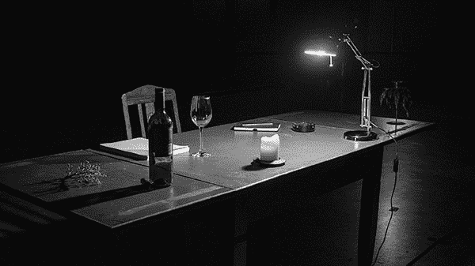

Figure 9.2 Wine glass and other objects emanating sounds in *The Sound of Things* ¶ Source: Photograph by Holger Förterer

In *Nature Soundscapes* (Lawton, Cunningham and Convery, 2020), animal sounds were played back in a forest in central England. In the first scene, the sounds were local and matched the environment. The next scene introduced animals completely out of context, such as bears and monkeys. Finally, human-made sounds were layered over the scene to reflect environmental degradation. While the study’s primary focus lay elsewhere, these sounds illustrated varying levels of congruence, with the alien animals representing the furthest deviation from full congruence, while native animals and human-made sounds remained relatively plausible.

Animatronics and humanoid robots are particularly interesting in this regard, as they are inherently silent, artificial, and inanimate, yet designed to appear as the opposite. Despite this intent, their jerky movements and doll-like features reveal their non-human nature. Sounds attached to them are often recordings of real people or animals, even though slightly clunky, mechanical, or robot-like voices might achieve greater congruence and better reflect their level of realism (see Chapter 3.1).

## 9.5 Incongruence

Incongruence, or mismatch, between expectation and reality is a powerful, yet difficult, narrative tool. As Stevens (2009) suggests, while partial congruency is likely to *enrich* the experience, adding incongruent elements may lead to *emergence* of something new. Hearing a scream each time someone puffs a cigarette might offer insight into the person’s inner thoughts (Sonnenschein, 2001).

Yet, the risk with incongruence lies in veering into implausibility or even ridiculousness. Therefore, it may be best to use it sparingly unless the entire experience is intentionally designed around mismatches from the outset, allowing participants to adjust to that framework. A well-crafted narrative might oscillate and strike a balance between congruence and incongruence—challenging the listener, offering surprises, and inviting them to play along and suspend their disbelief.

In *The Reign Union*, intentional incongruence is employed in several scenes. In one (purely fictional) scene, the other main character, Sylvia, tells a story about their dog, ‘Puppe’. In the story, her husband, Mauno, had begun using the same name to refer to Sylvia herself. To highlight how demeaning this must have felt, the participant hears the other participant augmented with dog-like sounds—panting and the patter of paws on the floor. This dissonance is designed to spark deeper reflection on Sylvia and Mauno’s relationship, exploring themes of patriarchy, sexism, and broader societal dynamics.

Acousmatic transformations and translocations—when you stand in a gallery space but hear a garden around you—are also incongruences. Room divergence, the mismatch between real and virtual acoustics, can degrade externalisation and spatialisation in binaural listening. However, this may be an acceptable trade-off for a meaningful narrative idea. The content creator must rely on the participant’s imagination, encouraging them to willingly suspend disbelief and engage with the experience. For instance, in Cilia Eren’s audio walks, participants are invited to ‘see’ and ‘smell’ the imagined environment, enhancing their immersion (Steijn, 2023). Further, if we contextualise the transformation as a dream or a memory, the two overlapping realities are perhaps easier to justify.

## 9.6 Addition

*Addition* is an advanced variation of using congruent sounds to fuse a new meaning with *added value*. While in the previous examples, the object may have been silent, in this technique, the real object natively produces sound. A virtual sound is then added on top of it, aiming at the best possible congruence possible. The result should alter the perception of the object, reshaping its narrative, much like in *Nature Soundscapes*, where animal sounds were overlaid onto the forest soundscape, transforming the experience.

- 加法需要一个声学透明的系统，以便用户能够听到物体的原始声音。在声学隔离的系统中，物体的声音应被再现，从而丢失了核心思想。

1. 当物体行为可预测或可控制时，加法容易融入故事。对于不可预测且失控的物体，必须考虑其随机性。例如，在纽约华盛顿广场公园的 *Walkie-Talkie Dream Angles* 中，演示的声音被加入到现实生活中经常发生演示的角落（Naphtali 和 Rodkin，2019）。尽管系统使用的是头戴立体声，未能达到完美的同步，但如果在参与者聆听音频漫步时真实的演示正好发生，历史层会与当下事件形成对比，从而可能为当下的政治和事件增添情境。

Table 9.2 Examples of new meanings created through the merging of native and added sounds

| *Object* | *Native sound* | *Added sound(s)* | *New meaning* |
| --- | --- | --- | --- |
| Lift | Whir, hum, chime | Creaking cables, grinding noise | Unsafe, outdated, tension, claustrophobia |
| Wind chimes | Tinkling, chiming | Resonance, harmonic overtones | Mysticism, emotional depth |
| Closing door | Slam | Scream | Narrative layer |

然而，这种技术似乎难以实施，因为其使用案例很少，尤其是针对单个物体。这可能是因为产生规律或持续声音的物体在许多展览空间中很少见，或者缺乏叙事吸引力。此外，如前所述，不规则且不可预测的声音本身就很难有效融入。

## 9.7 替代匹配

*替代匹配* 是指在真实世界中为一个物体添加多种完全符合该物体但传达完全不同含义的备选声音。这种方式可以让不同用户获得故事的不同版本，例如从不同角色的视角呈现事件。例如，当房间开始弥漫难闻气味时，一个用户听到车辆引擎怠速的声音，暗示气味来自排气管；另一个用户则听到嘶嘶声，暗示燃气管道泄漏。用户的反应会因所听到的声音和其含义而显著不同。

这些替代匹配类似于克里斯·马尔克（Chris Marker）1957 年电影《来自西伯利亚的信》中的经典例子，该电影通过不同的旁白为苏联雅库茨克的纪实画面赋予完全不同的含义。同样，在 AAR 体验中，单个参与者也可以从多个叙事视角听到同一事件。系统可以根据用户的行为模式选择视角，也可以通过在空间中移动或绕行物体来改变视角，仿佛视角本身在变化。例如，Cliffe 等人（2021）的研究中，一个实体收音机同时发出四条独立的虚拟广播，每条广播可从收音机的不同侧面听到。这种具身交互鼓励参与者探索和发现意外。


替代匹配与*非对称信息*（asymmetric information）概念相关，该概念曾在《请确认您不是机器人》（*Please Confirm You Are Not a Robot*）中研究。在那里，参与者听到故事的不同部分，因而相互交流各自所听到的内容，促使小组协作和发现（Nagele 等人，2021）。

在叙事 AAR 中，替代匹配的潜力非常强大，因为周围环境本身就是“真实”的，能够无缝地履行其在幻觉中的角色。挑战在于创建虚拟音频内容——所有备选版本必须足够可信，以保持 plausibility。除艺术和娱乐之外，将此概念应用于普遍的 AAR 也引发了有趣甚至令人不安的可能性：一个人的个人兴趣、政治观点或收入水平会让世界的声音发生怎样的变化？

## 9.8 扩展

*扩展*（Extension）是米歇尔·肖恩（Michel Chion’s (1994)）提出的术语，指声音所创造并暗示的视觉之外的空间。扩展的量级可变。当扩展为 *null* 时，在我们关注的事件周围听不到任何声音。在 *vasti extension* 时，我们不仅能听到周围的房间，还能听到整个建筑和城市。

这一概念对于增强现实（augmented reality）至关重要，在 AAR 中它是一种强大的叙事技巧。主要使用拟声（acousmatic）声音时，扩展可以用于 1) 暗示位置、环境、时间、天气等视觉或可感知空间之外的外部参数，以及 2) 设定叙事焦点。障碍物（如墙壁、树木、建筑）后面的真实空间可以通过声音延伸，或者如果技术允许，甚至可以被声学衰减并彻底移除。

正如第 4.2 章所讨论的，*The Worlds’ Deepest Bin* 广告活动在公共垃圾桶上装配了运动传感器和隐藏扬声器。当路人把垃圾丢进桶内时，会听到一长丝下降的哨声，仿佛桶子向数百米深的地下延伸。更具现实性和可能性的扩展示例见 *The Reign Union*，参与者通过墙体听到邻居公寓里的笑声、留声机播放、钢琴练习等声音，尽管实际上这些公寓并没有紧邻的邻居。

在前述例子中，想象中的空间和地点是通过声音创造并位于可观察的现实之外。例如在 *Maison Gainsbourg*，参观者开始听到雨滴敲击屋顶的声音，仿佛雨水已经开始下落，营造出舒适安全的氛围，隐喻性地反映孩子们在奢华家园中的感受。如果用户对可感知区域（或视野之外）的背景一无所知，声音可以将环境变成任何东西——比如 *Zombies, Run!* 通过在使用者背后加入僵尸的喘息声。

如果 AAR 系统支持声音移除，则可实现 *null extension*。在使用隔离式耳机的体验中，周围声音的衰减自然发生。这可能有助于用户在嘈杂环境中专注于当前内容，尤其是当环境噪音较大时。动态控制环境声音的可能性显然非常重要，尤其是当环境声音可以随时调节时。其效果类似于史蒂文·斯匹堡 1998 年电影《拯救大兵瑞恩》中著名的诺曼底登陆场景，几乎所有声音都被静音，从而将焦点放在主人公的内在体验上。

## 9.9 启示

在 *revelation*（启示）中，被遮蔽的声音来源被揭示。这是一种古老的声音设计技术，在戏剧、歌剧和电影中常用：当角色首先通过场外或屏幕外的声音被介绍，随后才显现时，这种技术同样在 AAR 中可能极具成效。它与肖恩（1994）的 *deacousmatisation*（去拟声化）概念相关，该过程将某种神秘且面无表情的场外声音具体化，使其身份得以显现。

- 概念在参与者被提供惊喜、启示、玩笑或反面时效果最佳。这在 `Barque Sigyn` 上发生，当下一间房中猫叫声和掉落物体的声音被揭示时。另一个例子来自 `The Reign Union`，参与者在另一间房中听到两个虚拟角色的声音，这些角色被视作“受阻”物体，参与者未能看到它们。虽然 Sylvia 在故事中大部分时间保持隐形，但 Mauno 被揭示：他邀请参与者进入后室，参与者跟随他的声音后，他的声音来源最终被揭示为一张挂在相框里的照片。Mauno 此前看起来神秘且有些有力量，如今真正被去神秘化，被囚禁在相框内。

### 9.10 使用隐形声音

如前所述，在 AAR（增强现实）语境中，隐形声音指缺乏物理对应物的声音。隐形声音需要运用想象力来设想声音源是什么，它可能长什么样，或者闻起来、触感如何（Chion，[1994；Smalley，1997）。在 `Guided by Voices` 游戏项目中，玩家在真实空间中实物移动并与隐形角色和生物互动，例如龙。游戏利用玩家的想象力，正如作者所述，‘与其被展示一个可能或可能不令人害怕的渲染龙，玩家可以与自己心中恐怖龙的形象互动’（Lyons, Gandy and Starner，2000）。

在 `The Reign Union` 中，Sylvia 以隐形角色的身份向参与者自我介绍。她在对话或独白中（更准确地说）要求参与者查看她的衣着和外表，直到她回忆并承认自己的不可见性。对话试图与参与者建立互动关系，并鼓励使用想象力以增强（Sylvia）的存在感。

有人可能认为，隐形声音让我们远离音频增强现实（AR），转而进入音频虚拟现实（VR）。虽然概念上在某些情况下可能成立，但隐形声音至少有两个原因仍可紧密置于 AAR 范围内：

1. 尽管隐形声音缺乏物理外观，它仍可与真实环境共存。例如，在真实 3D 空间的特定位置放置的虚拟听觉贴纸（Lokki et al., 2004），或在用户所在房间中漂浮的鬼魂，这两者都在真实环境中有空间锚定。
2. 由于技术限制，许多 AAR 系统无法实现准确的虚拟声音空间化（如果有的话），因此隐形声音可能是增强环境的唯一方式。虽然它们不附着于任何物理物体，但如果配合强烈的叙事，它们仍可显得沉浸感十足。

#### 9.10.1 可信性

在空间中发出声音但无法辨认其源头的概念是不自然的。正如 Chion (1994) 所指出的，我们很少问声音在哪里，而是问它从哪里来。我们常常听到听不见来源的声音：卡车的远处轰鸣、另一个房间里的家人声音、电话在衣物堆中响起。但很少听到空中飘浮、我们可以绕行却仍不可见、触摸或闻到的声音。也许苍蝇飞 around 头顶、始终躲避手的声音可以作为例子，但最终我们仍会在掌心感到它，或在一段时间后因刺痛感察觉到它。

除非源头首先被看到（或以其他方式被感知），否则隐形声音对用户来说可能难以理解和定位。这一技术被称为“分离”（detachment），将在下一小节讨论。另一方面，只要先将角色呈现为受阻、在门后或从另一间房说话，随后揭示其为无实体，可能就足够了。

另一种提升隐形角色可信性的方式是让它们承认参与者的存在并邀请其互动，`Hyperkuulo` 是一个很好的例子。真实的表演也很重要，这能提升整体可信度。录制演员时，创造最佳真实表演环境可能很困难。由于对象-based audio（OBA）方法要求干净的录音，演员很难在房间中走动并实际表现情节。如果音频系统能容忍——甚至利用——房间声响泄漏到录音中，演员更有可能交出真实表演。这是 DARKFIELD 在其制作中采用的技术，他们使用静态假人头录音在真实声学环境中，以增强真实感（Kadel and Rees，2024）。

此外，使用福莱（Foley），如脚步声和衣物声，可能提升隐形声音的可信性。利用声音发射器的方向性也能增强真实感。例如，虚拟角色的声音音调会根据其面向方向而变化。角色的动作可以通过预设动画技术或由基于 AI 的系统实时控制，使虚拟角色动态移动和转向。最后，高质量的虚拟音频渲染可以进一步提升整体真实感和沉浸感。

#### 9.10.2 难免但强大

隐形声音在叙事体验中似乎很常见。`Guided by Voices`、`Audio Legends`、`Séance`、`Sonic Traces Heldenplatz`、`Maison Gainsbourg` 和 `Corvette Karjala` 只是本书中一些使用隐形角色和其他声音传递故事的例子。在 `Maison Gainsbourg`，隐形声音的运用极具力量：访客听到真实的录音，这些录音来自曾居住在此房的人，甚至是在数十年后仍在同一房间播放。例如，访客在厨房听到 Serge 与孩子们的对话，或在客厅听到 Serge 教女儿 Charlotte 弹钢琴，声音空间化在 grand piano 附近。 Few other media can transport past moments into the present so powerfully.

隐形声音可能首先让人觉得是‘懒惰’的 AR 做法，因为无需寻找真实世界物体来配合叙事声音。但复杂叙事往往无法在不依赖隐形技术的情况下实现。正如 `Maison Gainsbourg` 所示，这些听觉‘幽灵’有时拥有巨大的叙事力量。

#### 9.10.3 参考点

创建看似源自环境中明确可感知点的隐形虚拟声音并非易事，尤其是在 6DoF 应用中。对于双耳听声系统，需要高质量的追踪和虚拟音频引擎。波场合成（WFS）能够创建精准定位的‘全息’声音，实验也使用两个方向性扬声器利用空气非线性（Zhou et al., 2024）进行测试。当这种幻觉被创造出来，它同时让人感到神奇和真实。不过，隐形声音在空间准确性上可能比绑定于物体的声音更宽容——毕竟，它们本质上是‘幽灵’，可以在空间中轻微漂浮。

进入`/path.to/xxx`目录，找到`xxx.json`。

在表达式`cvar = avar + bvar`中，加法运算符（`+`）将`avar`与`bvar`相加，得到它们的和`cvar`

在`List.of(arg0, arg1, arg2)`中，`List`接口的工厂方法`of()`接受一系列的元素，返回包含它们的只读列表。

之后我们这样调用`cmd`命令：`cmd arg0 arg1 arg2`。

```
if (condVar > someVal) {console.log("xxx")}
```

### 9.10.4 Acousmatic sounds through loudspeakers

The concept of acousmatic sounds is not solely the property of binaural, WFS, or sophisticated directional speaker techniques. One can achieve the effect of invisible, ‘ghost-like’ sound sources by using normal hidden loudspeakers. For instance, on the bridge of *Corvette Karjala*, the visitor can hear a conversation between the officer of the desk and helmsman.

The officer’s voice is ‘acousmatic’, appearing around the navigation table without a very precise location. The small loudspeaker is concealed under the radio navigation device (see arrow in Figure 9.3). The sound is, of course, not a point source floating in the mid-air, but still, as the small loudspeaker spreads the sound around and it gets diffused by nearby surfaces, its precise origin gets blurred. Consequently, it is surprisingly easy to imagine the officer standing in front of the table.

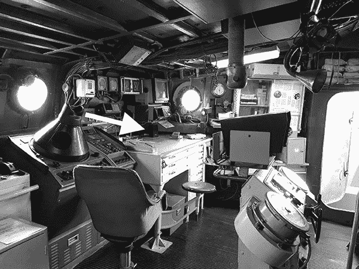

Figure 9.3The bridge of *Corvette Karjala*. Arrow pointing to the hidden loudspeaker ¶ Source: Photograph by the author

The helmsman’s voice is, however, attached to the speaking tube above the rudder post: the loudspeaker is placed inside the tube. The other end of the speaking tube is on the sky bridge above; perhaps the narrative suggests that the helmsman is steering the vessel from there. Even with such a simple realisation using two loudspeakers and a looping, two-channel audio file, the dialogue effectively immerses the visitor in the life on the bridge and educates about the communication practices of a naval vessel.

### 9.11 Detachment

In this technique, the virtual sound is first attached to a physical object, after which it gets *detached*. At that moment, it becomes acousmatic, ‘incorporeal’ sound. This can mark a change of narrative perspective, for instance, a move from the tangible world to the inner world of a character. In *The Reign Union*, Mauno, who is locked inside a picture frame, starts to play a gramophone record, the sound of which is also attached to the frame. In the middle of the song, Mauno asks the participant to join the dance by grabbing the picture frame. When the picture frame is lifted, the music gets spatialised around the room as individual, acousmatic instruments. The effect is spectacular, as if we were sucked inside Mauno’s head, surrounded by his carnivalesque imagination.

Detachment is similar to Chion’s (2019) concept of *acousmatization*: ‘with the effect that we now have nothing but the sound to imagine what is occuring’ (p. 201). It is the opposite of ‘deacousmatisation’, discussed earlier in the context of the revelation technique.

### 9.12 Attractor sounds

The key technique to directing the user’s attention across the space is to use *attractor sounds* as explored in *LISTEN* (Zimmermann and Lorenz, 2008). An attractor sound would be a virtual sound emitting from an object or place, distinguishable from the other sounds and intriguing enough to make the participant take an action to find out what the sound will reveal. Attractor sounds can also be triggered adaptively and personalised to each user as demonstrated in *LISTEN*. Due to the physical attributes of sound, it would be entirely plausible to hear attraction sounds from obstructed objects, other rooms, or behind obstacles, encouraging exploration beyond the immediate environment.


When using an attractor sound, two trigger zones can be created around the source object, sometimes called `proximity zone` and `activation zone` (Vazquez-Alvarez et al., 2016). Proximity zone is larger, activation zone smaller. When the participant enters the proximity zone, or is already inside it, the attractor sound is played—for example, a telephone ringing behind a door. If the participant keeps stationed for a set period of time or moves out of the zone, the sound may stop to allow further exploration or alternative progression of the narrative. However, if the participant decides to move closer to the sound, the activation zone gets triggered, and the actual content starts to play. The transition must, of course, be smooth and natural—unless the attractor sound can continue playing in the background with the content mixed on top of it. Behind the door, we may hear footsteps approach, someone pick up the telephone, and a conversation start.

Instead of using map-based trigger zones, sounds can be controlled based on the user’s distance to the object. This approach is an obvious choice when only proximity tracking is available but can also work effectively with absolute tracking systems. For instance, distance-based triggering is a built-in feature in most audio middleware.

Attractor sounds are useful in exploration-based scenes where the participant can hear sounds from around the surroundings—invitations to narratives—and decide which one to choose. However, in practice, such a scene may be challenging to balance and programme for at least two reasons:

1. The attractor sounds should be audible far enough for the participant to hear at least two of them simultaneously. If only one is heard, the user will likely go directly to that source, skipping the exploration phase. However, if multiple sounds are audible, there is a risk of cacophony, so attenuation curves must be adjusted carefully and the sounds selected and mixed with care.

2. The logic of handling the different attractor sounds and the narrative content found from their sources may get complicated. For instance, what if the user selects one attractor and starts to listen to the content, but has second thoughts and walks away? Should the narrative continue and be audible to the user, fade out and pause—or fade out, stop and rewind? Meanwhile, what happened to the other attractor sounds; did they disappear, or are they still active? Furthermore, if the scene has a time limit after which the next one begins, users who explore multiple sounds may not have enough time to finish listening to their chosen story. These are, of course, common challenges in developing interactive experiences and these are not unique to AAR.

### 9.13 Spatial scale and offset

- [调整衰减曲线](https://example.org)是声音设计中常用的技术，通常用于定义声音可以被听见的距离。这在某种程度上将个体听觉空间的规模从“自然”状态转变为人工状态。此外，还有其他一些方法可以调整听觉视角和尺度，并可能带来叙事效益。

#### 9.13.1 受控衰减曲线

衰减曲线可以进行调整，例如防止同时发出的声音重叠，确保某些声音只能在更近的距离内被听见，或让某些声音无论用户与它们的距离如何变化都保持不变。尽管受控衰减曲线使得虚拟声音违背物理规律，但结果可能提供一个更连贯且受控的声景，在其语境下对听众来说可能显得自然且可信（Cliffe，2022）。

曲线也可用于更具创意的目的。例如，“缩放”到远处声音源的概念就是一个典型例子。在 `Hyperkuulo` 中，参与者在某个时刻可以听到遥远公共桑拿的声音，仿佛它们离得更近。虽然这种效果可以通过多种技术实现，但彻底调整衰减曲线提供了一种简单且有效的解决方案。

Martínez-Cabrejas 等人 (2024) 提出一种 `方向衰减模型`，即只有用户正面朝向的声音会被听见，周围的声音则被衰减。该概念并非新颖，虽然它可以帮助用户专注于感兴趣的对象，但在实现时应格外谨慎：Armbruster (2024) 指出，在展览中，人们会不断转动头部和身体——可能在寻找朋友并请求倾听——过滤掉这些用户运动需要复杂的算法。

#### 9.13.2 缩放空间响应

在常规的 3DoF、6DoF 以及俯仰-偏航系统中，将头向右转 90 度会导致虚拟声景向左转 90 度，从而保持声音与现实世界对齐。然而，对于某些声音，降低空间响应可能是合理的：在 90 度的头部转动时，声音仅向右平移约 45 度（参见 Figure 9.4）。`Vienna Augarten` 体验中，靠近瓷器展品时触发声音描述，利用了这种 `缩放空间响应` 技术：叙述者的声音既不完全空间化到展品上，也不完全固定于头部，而是适度倾向于目标物体。这既保持了认知焦点在描述上，又保留了叙事与展品之间的空间关联。该技术同样可用于其他非 diegetic 声音，例如音乐。

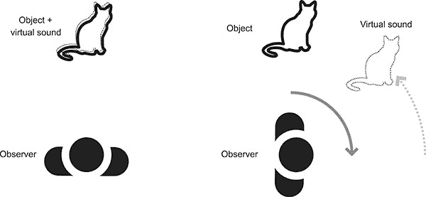

Figure 9.4 缩放空间响应

#### 9.13.3 3DoF 声音

环境中的声音通常是 `allocentric`，即相对于环境的；而头部锁定的声音则是 `egocentric`，随听者的移动和头部朝向变化（Tsingos，2018）。但有时，让声音随用户移动同时保持头部追踪是有益的，从而利用三度自由度（3DoF）。Ambisonic 环境音有时采用这种 3DoF 附着方式，也可以将其应用于基于对象的音频源，例如通过在用户周围创建一个虚拟扬声器穹顶。该方法适用于移动自由度较大的移动应用及其他应用，且在叙事和声音设计上也有需求，例如在记忆场景中，真实环境被语境性地“淡化”到背景中。

#### 9.13.4 空间偏移

虚拟声音的空间坐标也可以相对于除真实环境或用户之外的其他实体进行定义。在现实生活中，飞机在天空中的声音常常滞后于其视觉位置，这是由于声音速度慢于光速造成的，从而产生空间偏移的错觉。相反，靠近的火车声可能听起来像是从轨道前方发出，伴随类似激光枪的效果。此类在 AAR 中使用的效果可以在叙事上暗示我们从不同的听觉视角感知世界——要么是从自身视角但带有偏移，要么是完全相对于另一参考系的视角。例如，在英国国家剧院的戏剧 `Anna` 中，佩戴耳机的观众通过放置在主角耳中的双耳麦捕捉的双声道音频，体验到舞台事件。虽然观众视觉上仍坐在座位上观看，但他们听到的听觉世界仿佛附着在演员的头上。类似的空间偏移也可出现在双声道音频步道中，如果参与者偏离预定节奏或路径。

飞机和火车的例子也可能暗示时间偏移，即听者在其他感官模式中听到的世界事件发生在之前或之后。虽然这些偏移在 AAR 中提供了有趣的可能性，但如果缺乏叙事正当性，它们同样可能被视为错误。

## 9.14 近场

`近场` 声音指距离听者头部非常近（通常小于一米）但仍然外部化、不在头内播放的声音。对许多用户而言，这些声音会触发一种往往被认为令人愉悦或强烈的身体反应，正如 ASMR 视频的流行所示。人声在近场中可能让人感到极度亲密，或根据情境和声音性质显得具有威胁性。

在 AAR 中，近场声音可以通过至少双声道系统来实现。将声音放置在用户视野之外——侧面、后方、上方或下方——可以营造出声音真实存在的错觉，即使不需要头部追踪，尤其是当声音像蚊子般持续移动，或像精神低语般随头部移动时。

在 `Séance` 中，近场声音被有力地使用。它们能够将感知从环境转移到“内脏空间”，即我们自身的私密、即时空间（Mann et al., 2023）。这种效果在音频增强现实（AAR）体验中进一步放大：虚拟声音几乎与现实难以区分，我们无法确定耳边的声音是否真实。

## 9.15 移除与替换

虽然对于 AAR 创作者而言，选择性移除声音的工具尚未完全成熟，但这将 undoubtedly 带来有趣的叙事可能性。正如前文讨论，声学干扰或令人不安的声音是挑战，可以通过自适应且选择性的降噪技术消除。此类技术有时被称为 `diminished audio`（Dam et al., 2024），并可能在更具创意的应用中发挥作用。

有意省略某物体的声音可以通过突出其沉默来成为叙事或情感手段。例如，音乐盒在听者靠近时可能突然变 silenc，象征脆弱或孤独。

- 前文讨论的消除扩展技术也可以在只移除选定的声音时受益，此外，人声可以被擦除并用脚本化的虚拟语音取代。这既打开了创造性的可能性，也带来了令人不寒而栗的数字欺骗前景，这已经在深度伪造视频（Arena et al., [2022; Turner, 2022）中出现过。

1. 由于 AAR 融合了虚拟与真实，两者之间的同步至关重要。每一次交互在某种意义上都是同步的实例。然而，这里指的是虚拟与物理世界在特别有意义的时刻短暂交汇的情形。叙事上有许多有趣的同步方式，这里简要讨论两种。

第一种方法紧密关联于 Chion’s (1994) 的 `synchresis` 概念，即声音与画面同时出现时会产生一种心理图像，通常在极短的时刻内发生。在 AAR 中，可以通过让真实世界控制虚拟音频事件，精准地将一个虚拟声音与单个瞬时的真实事件同步，从而实现两者的语境融合。例如，当墙面时钟敲响 12 点时，通过窗户听到的喧闹街道声 suddenly 会转变为宁静的自然声，象征一种释放或自由的时刻。

当真实事件不可预测且由真实物体（如他人、动物、自然等）引起时，同步会更有效。但实现这种同步的设计难度较大，需要先进的感官系统。

另一种做法是引导用户与虚拟音频同步。Rotozaza 的 `Etiquette` 是一部在真实咖啡馆举办的参与式戏剧，两位参与者佩戴耳机并接收行动指令。在某个时刻，其中一位参与者被提示在提示语 “One, two, three, now” 时将手指放在桌面上，此时手指触碰桌面，钢琴和弦响起（Rotozaza, 2015）。虽然该效果的成功依赖于参与者的配合，但它体现了与听觉主体同步行动的概念，正如 Janet Cardiff 的音频漫步以及 `Alcatraz Cellhouse Tour` 所示，形成了虚拟与物理世界之间的直接、具体的联系。

## 9.16 Synchronisation

Since AAR merges virtual and real, synchronisation between these two realms is essential. Every interaction in AAR is, in a way, an instance of synchronisation. However, here the concept refers to short, sparse moments where the virtual and physical worlds intersect in a particularly meaningful way. Narratively, there are many interesting approaches to synchronisation, two of which will be briefly discussed here.

The first approach is closely related to Chion’s (1994) concept of `synchresis`, where a mental image is created as sound and visuals occur simultaneously, typically within a brief moment. In AAR, this could be achieved by letting the real world control virtual audio events, precisely synchronising a virtual sound to a single, momentary real-world event in order to create a contextual fusion between the two. For example, when the dials of a wall clock strike 12 o’clock, the bustling street sounds heard through a window could suddenly shift to serene nature sounds, perhaps symbolising a moment of release or freedom.

Synchronisation would potentially be most effective when the real-world event is unpredictable and caused by a real object, such as other people, animals, nature, etc. However, implementing such synchronisation may be difficult to design and would require an advanced sensory system.


Alternatively, the user can be guided to act in synchronisation with virtual audio. In Rotozaza’s *Etiquette* a participatory theatre performance staged in real cafés, two participants wear headphones and receive instructions on what to do. At one point, one participant is prompted to place their fingers on the table at the cue ‘One, two, three, now’. At ‘now’, as the fingers presumably touch the table, a piano chord plays (Rotozaza, 2015). While the success of this effect relies on the participant’s cooperation, it mirrors the concept of synchronising actions with an auditory protagonist, as demonstrated in Janet Cardiff’s audio walks and the *Alcatraz Cellhouse Tour*, creating a direct and tangible link between the virtual and physical world.

## 9.17 Acoustic translocation

*Acoustic translocation* is a technique where the real space is acoustically transformed to a virtual one by introducing new ambience sounds and auditory story elements. An office space can take on the sounds of a railway station, with station announcements echoing and platform whistles signalling departures. Being able to change the location of events would obviously be beneficial to many narratives. Yet, that would be against the nature of augmented reality: if we ‘deny’ the real space, we take a step towards the virtual reality domain.

That said, even if we introduce a translocated soundscape, we cannot get rid of the real environment. There will likely be a mismatch between what the participant *hears* coming from the virtual world and how the real environment advertises itself through *all* of the senses, including hearing—unless an acoustically isolated or adjustable system is used. If there is a conflict between image and sound, the visual modality tends to win (Stevens, 2009), backed up by smell and other senses of the real space. Therefore, acoustic translocation primarily functions on a contextual level, offering a more or less symbolic representation of another place. While the listener can—and likely often will—imagine seeing and smelling the translocated space, we can assume that these perceptions remain highly subjective.

However, when acoustic translocation is viewed as a method of *reframing* the context of the environment (see Cliffe et al., 2021) rather than an attempt to fully transport the participant to a new space, it aligns more naturally with the principles of AAR. For instance, overlaying the soundscape of a railway station onto an office environment could symbolically highlight workplace transitions if not fusing deeper meanings.

In some AAR experiences, however, the virtual scene keeps evolving independently, and the real world becomes a mere physical platform on which the auditory narrative takes place (e.g., *Guided by Voices* and *The Planets*). We can compare this to music videos, where the visually conveyed narrative is often open, fragmented, or even surrealistic in order to keep the listener’s focus on the music while allowing the imagination to create individual meanings (Stevens, 2009). In music videos, there are two narrative layers, music and images, which have their own freedom. In AAR, to keep the events in the virtual ‘elsewhere’ rooted in the real environment, *points of synchronisation* could be arranged every now and then, just like in music videos where the band is seen to perform the song between other imagery (Chion, 2019). In AAR, the virtual characters in a translocated scene could react to events happening in the real environment, like protagonists in *The Matrix* films. There can obviously be many other ‘flows’ between these two narrative layers, like objects of the real world becoming objects of the virtual place with the same or slightly changed meaning.

## 9.18 Conclusion

Observing the emergence and evolution of a new medium is an exciting process. With rapid technological advancements and increasing accessibility, almost anyone can take part in this process and contribute to shaping and advancing AAR. The narrative techniques and concepts presented in this chapter aim to inspire readers to engage with and interpret AAR content from their own perspectives. Additionally, it is sincerely hoped that these ideas will spark conversations and serve as inspiration for practitioners as they continue to develop the narrative language of AAR.

## References

1. Albrecht, R., Väänänen, R. and Lokki, T. (2016) ‘Guided by Music: Pedestrian and Cyclist Navigation with Route and Beacon Guidance’, Personal and Ubiquitous Computing, 20 (1), pp. 121–145. Available at: [`doi.org/10.1007/s00779-016-0906-z`](https://doi.org/10.1007/s00779-016-0906-z).

2. Arena, F. et al. (2022) ‘An Overview of Augmented Reality’, Computers, 11 (2), p. 28. Available at: [`doi.org/10.3390/computers11020028`](https://doi.org/10.3390/computers11020028).

3. Armbruster, S. (2024) ‘Conversation with Matias Harju, March 7’.

4. Brandenburg, K. and Sloma, U. (2024) ‘Conversation with Matias Harju, May 23’.

5. Chion, M. (1994) Audio-Vision: Sound on Screen. Columbia University Press.

6. Chion, M. (2019) Audio-vision: Sound on Screen, 2nd edn. Columbia University Press.

7. Cliffe, L. (2022) 《Audio Augmented Objects and the Audio Augmented Reality Experience》博士论文。诺丁汉大学。可于 [`https://eprints.nottingham.ac.uk/69795/`](https://eprints.nottingham.ac.uk/69795/) 查阅。

8. Cliffe, L. (2024) “走入当下：在新声学虚拟现实中的探索”。《Leonardo》[预印本]。可于 [`https://nottingham-repository.worktribe.com/output/42480431/into-the-here-and-now-explorations-within-a-new-acoustic-virtual-reality`](https://nottingham-repository.worktribe.com/output/42480431/into-the-here-and-now-explorations-within-a-new-acoustic-virtual-reality) 查阅（2024 年 12 月 2 日访问）。

9. Cliffe, L. 等人 (2021) “将情境具象化：用于真实世界探索的虚拟声景”。Personal and Ubiquitous Computing, 25 (4)，第 623–636 页。可于 [`https://doi.org/10.1007/s00779-020-01405-3`](https://doi.org/10.1007/s00779-020-01405-3) 查阅。

10. Cohen, M., Aoki, S. and Koizumi, N. (1993) “增强音频现实：混合现场/虚拟现实声学环境”。载《1993 IEEE 国际机器人与人机交互研讨会论文集》，第 361–364 页。可于 [`https://doi.org/10.1109/ROMAN.1993.367692`](https://doi.org/10.1109/ROMAN.1993.367692) 查阅。

11. Dam, A. 等人 (2024) “利用声像化增强音频现实以提升视觉艺术体验：经验教训”。International Journal of Human-Computer Studies, 191，第 103329 页。可于 [`https://doi.org/10.1016/j.ijhcs.2024.103329`](https://doi.org/10.1016/j.ijhcs.2024.103329) 查阅。

12. Fry, G. (2019) 《舞台声效设计》。The Crowfood Press。

13. Härmä, A. 等人 (2004) “用于移动和可穿戴设备的增强现实音频”。Journal of the Audio Engineering Society, 52 (6)，第 22 页。

14. Kadel, O. (主持、制作) and Rees, E. (制作) (2024) “第 104 期 David Rosenberg & Glen Neath (DARKFIELD)”。《Immersive Audio 播客》。可于 [`https://immersiveaudiopodcast.com/episode-104-david-rosenberg-glen-neath-darkfield/`](https://immersiveaudiopodcast.com/episode-104-david-rosenberg-glen-neath-darkfield/) 查阅（2024 年 10 月 11 日访问）。

15. Kaghat, F.-Z. and Cubaud, P. (2010) “流体交互在音频导览博物馆参观中的应用：作者工具与访客设备”。The Eurographics Association。可于 [`https://doi.org/10.2312/vast/vast10/163-170`](https://doi.org/10.2312/vast/vast10/163-170) 查阅。

16. Kuhn, A. (1985) “叙事代码的历史”。载 P. Cook（编）《电影书》。伦敦：BFI，第 207–220 页。

17. Lawton, M., Cunningham, S. and Convery, I. (2020) “自然声景：音频增强现实体验”。载《第 15 届国际音频会议 (AM’20) 论文集》，格拉茨奥地利：ACM，第 85–92 页。可于 [`https://doi.org/10.1145/3411109.3411142`](https://doi.org/10.1145/3411109.3411142) 查阅。

18. Lokki, T. 等人 (2004) “可穿戴和移动增强现实音频的应用场景”。在 Audio Engineering Society Convention 116 中，Audio Engineering Society，第 9 页。

19. Lyons, K., Gandy, M. and Starner, T. (2000) “声音引导：音频增强现实系统”。载《国际听觉展示会议论文集》（2000 年），亚特兰大，美国：International Community for Auditory Display。可于 [`https://smartech.gatech.edu/handle/1853/50672`](https://smartech.gatech.edu/handle/1853/50672) 查阅（2018 年 11 月 5 日访问）。

20. Mann, S. 等人 (2023) “所有现实的基本要素：虚拟、增强、媒介、多媒介及其 beyond”。载 A.Y.C. Nee 和 S.K. Ong（编）《增强现实 Springer 手册》。苏黎世，瑞士：Springer。

21. Martínez-Cabrejas, M. 等人 (2024) “用于增强现实环境的新型以听者为中心的方向衰减声模型”。Multimedia Tools and Applications \[预印本\]。可于 [`https://doi.org/10.1007/s11042-023-17943-w`](https://doi.org/10.1007/s11042-023-17943-w) 查阅。


22. Nagele, A.N. 等人 (2021) “参与式表演中的交互音频增强现实”。Frontiers in Virtual Reality, 1，第 610320 页。可于 [`https://doi.org/10.3389/frvir.2020.610320`](https://doi.org/10.3389/frvir.2020.610320) 查阅。

23. Naphtali, D. and Rodkin, R. (2019) “用于交互式声步道、声音艺术和音乐传递的音频增强现实”。载《交互媒体声音设计基础》。Routledge。

24. Pick, H.L., Warren, D.H. and Hay, J.C. (1969) “空间方向判断中的感官冲突”。Perception & Psychophysics, 6 (4)，第 203–205 页。可于 [`https://doi.org/10.3758/BF03207017`](https://doi.org/10.3758/BF03207017) 查阅。

25. Rotozaza (2015) “经 New York Times 审阅的 Etiquette”。可于 [`https://vimeo.com/120873104`](https://vimeo.com/120873104) 查阅（2024 年 12 月 10 日访问）。

26. Smalley, D. (1997) “声形学：解释声音形状”。Organised Sound, 2 (2)，第 107–126 页。可于 [`https://doi.org/10.1017/S1355771897009059`](https://doi.org/10.1017/S1355771897009059) 查阅。

27. Sonnenschein, D. (2001) 《声音设计：电影中音乐、对白和音效的表现力》。Studio City, CA：Michael Wiese。

28. Steijn, R. (2023) “Ode aan de verstilling – Cilia Erens (1946–2023)”。Theaterkrant。可于 [`https://www.theaterkrant.nl/tm-artikel/ode-aan-de-verstilling-cilia-erens-1946-2023/`](https://www.theaterkrant.nl/tm-artikel/ode-aan-de-verstilling-cilia-erens-1946-2023/) 查阅（2024 年 10 月 9 日访问）。

29. Stevens, M. (2009) 《音乐与图像在音乐会中的运用：在器乐音乐会中使用图像》。Sydney：Music and Media。

30. Tsepapadakis, M. and Gavalas, D. (2023) “你在对我说吗？用于文化遗产的音频增强现实对话导览”。Pervasive and Mobile Computing, 92，第 101797 页。可于 [`https://doi.org/10.1016/j.pmcj.2023.101797`](https://doi.org/10.1016/j.pmcj.2023.101797) 查阅。

31. Tsingos, N. (2018) “基于物体的音频”。载 A. Roginska 和 P. Geluso（编）《沉浸式声音：双耳声学与多声道音频的艺术与科学》。Routledge，第 244–275 页。

32. Turner, C. (2022) “增强现实、增强认识论与真实世界网络”。Philosophy & Technology, 35 (1)，第 19 页。可于 [`https://doi.org/10.1007/s13347-022-00496-5`](https://doi.org/10.1007/s13347-022-00496-5) 查阅。

33. Vazquez-Alvarez, Y. 等人 (2016) “设计移动音频增强现实中的多层次听觉显示的交互”。ACM Transactions on Computer-Human Interaction, 23 (1)，第 1–30 页。可于 [`https://doi.org/10.1145/2829944`](https://doi.org/10.1145/2829944) 查阅。

34. Väänänen-Vainio-Mattila, K. 等人 (2013) “在物理环境中与虚拟物体进行音频触觉交互的用户体验与使用场景”。载《第 6 届设计悦乐产品与界面国际会议论文集》（DPPI ’13），纽约，美国：ACM，第 67–76 页。可于 [`https://doi.org/10.1145/2513506.2513514`](https://doi.org/10.1145/2513506.2513514) 查阅。

35. Wakkary, R. 等人 (2004) 论文《交互音频内容：通过增强现实音频和自适应信息检索为动态博物馆体验提供音频内容》可于：[`summit.sfu.ca/item/15157`](http://summit.sfu.ca/item/15157) 获取 (访问日期: 2018 年 11 月 5 日)。

36. Yang, Z. 等人 (2020) 论文《Ear-AR: 耳机上的室内声学增强现实》，发表于第 26 届移动计算与网络国际会议论文集。MobiCom ’20，英国伦敦：ACM，页码 1–14。可于：[`doi.org/10.1145/3372224.3419213`](https://doi.org/10.1145/3372224.3419213) 获取。

37. Zhou, J. 等人 (2024) 论文《Visar：利用空气非线性投射虚拟声音斑点的声学增强现实》，发表于《ACM 交互、移动、可穿戴和无处不在技术》杂志，第 8 卷，第 3 期，页码 1–147。可于：[`doi.org/10.1145/3678546`](https://doi.org/10.1145/3678546) 获取。

38. Zimmermann, A. and Lorenz, A. (2008) 论文《LISTEN：用户自适应的音频增强博物馆导览》，发表于《用户建模与自适应交互》，第 18 卷，第 5 期，页码 389–416。可于：[`doi.org/10.1007/s11257-008-9049-x`](https://doi.org/10.1007/s11257-008-9049-x) 获取。

# 10 The future of AAR

DOI: [`10.4324/9781003627289-10`](https://doi.org/10.4324/9781003627289-10)

AAR 的未来充满希望与不确定性。人们已经习惯在做其他事情时（如驾驶、通勤、慢跑、做家务）消费音频内容。在一个过度视觉化的世界里，个人听觉泡沫（充满有声书、播客和无尽音乐库的音频）的兴起暗示了 AAR 发展的有希望方向。可以合理预期，人们已经佩戴的耳机、耳机和眼镜将演变为面向数据驱动、互连生活的直观界面。同样，随着技术进步能够创造自然感的视觉和听觉全息投影，这种创新似乎必然会让人们更加亲近。与此同时，虚拟声层可能丰富我们对周围世界的理解，并解锁原本未被讲述的故事。

然而，尽管这些想法看似合理，其未来仍取决于人们是否真正重视空间化、环境感知、交互式声音。商业计划总归回到同一个关键问题：该方案解决了什么问题？是否存在足以证明在技术和产品开发上进行重大投资的真实需求？或者，AAR 的进步将依赖于那些愿意在工具不完善、结果不完美时仍敢于突破边界的创新先驱？毕竟，许多变革性技术最初是针对人们尚未意识到的需求而出现的，但随后显著提升了生活质量。

本书从第 1 章中描绘的个人 AAR 耳机的一个愿景开始。虽然存在许多其他 AAR 愿景，但它们都共享一个共同基础：实现它们所需的技术组件已经存在，只是准备程度参差不齐。主要的技术挑战在于将这些组件整合到紧凑的形态（如微型耳机或眼镜），同时保证高性能和长续航电池。目前，这些头戴设备依赖于与智能手机配对以进行计算卸载并利用外部传感器，这仍然是一个潜在的不便。然而，鉴于人们对智能手机的高度依赖，这种依赖不太可能成为主要缺点。另一个挑战可能在于创作能够充分利用 AAR 独特特性的内容。但考虑到本书中已展示的项目所付出的创意和技能，这一挑战不太可能成为大问题。

故事的开篇在第 1 章中设想了移动、可穿戴 AAR 系统可能提供的若干功能，以帮助人们在生活中。这些设想现在结合当前发展状态和未来方向的一般概念进行回顾。

## 10.1 Platform

我们故事的主角佩戴着一副高级耳机。未来，虚拟声景或许可以直接“注入”大脑听觉皮层——这目前正被用于治疗耳鸣（Leaver, 2024）的实验中，或者至少通过听觉神经或脑干刺激实现（见 Veronese 等，2023）。在科幻愿景的阴影下，可穿戴的双耳立体声 transducers 似乎是 AAR 的最可能平台。为了全天候使用，设备需要舒适且 socially acceptable（社交可接受）。在这方面，助听器和眼镜作为潜在的形态示例表现良好。类似于眼镜，医用助听器设计用于持续使用，除了睡眠或游泳（Andre, 2024）。随着可穿戴设备的普及，社会接受度提升，最终使得在社交和职业场合佩戴它们变得自然。

智能眼镜似乎是 AAR 的有前途平台。相较于入耳式耳机，其更大的体积允许在内部容纳处理器、内存、电池、传感器和天线，从而为高级 AAR 功能提供更大的灵活性。此外，能够集成前置摄像头、LiDAR 和麦克风（或未来的传感器）也将使内外追踪比耳上传感器更容易实现。

当前智能眼镜设计的一个挑战是其开放式扬声器设计，这使得技术上难以消除真实世界的声音。在实现开放式系统的主动降噪技术之前，可能会采用混合方案：将声学隔离的耳机与智能眼镜相结合。

## 10.2 Telepresence

故事始于一次音频会议，参与者在空间中被呈现为空间化的听觉全息投影。虽然远程工作的转变近年来已获得动力，但全息通信可能成为一种引人入胜的平行解决方案，它能够在国际团队之间实现自然协作，并减少出行需求。沉浸式音频能够唤起归属感和连接感，使跨越物理距离的自然互动得以实现（Yang, Barde and Billinghurst, 2022），而自然听到他人声音则可能带来更无缝、更轻松的会议体验（Bruhn, Multrus and Varga, 2022）。像 `Meta Horizon Workrooms` 和 `Arthur` 等 VR 会议应用已经实现了声音的空间化。要在 AAR 中实现相同效果，需要去除头像和其他视觉元素，并将声音 aural 化，使其仿佛在与用户同处同一真实房间（参见 Meyer-Kahlen, 2024）。更快的移动数据网络的不断发展，如当前 5G 的后继技术，将缩短延迟并提升音质。当前的一项进展是开发了 IVAS 编码器，用于在会议场景中实现低延迟的空间音频（见第 7.8 章）。

除了会议，类似的低延迟和高质量空间音频编码器也能够实现混合音乐表演：管弦乐团或合唱团可以在混合形式下排练和演出，融合现场和远程音乐家。通过 telepresence，远程参与者将在声学上存在并位于物理音乐家之中。在近乎零延迟和高质量空间音频编码的条件下，所有音乐家都能自然地相互响应并做出贡献。

- 主角通过眼动结束通话，该眼动由内置麦克风捕捉到的声音检测到。研究人员（Lovich 等，[2023）发现，眼动会向耳朵发送脑电信号，这些信号在耳朵中被转化为微小的声音，而这些声音已被证明能够检测眼动。虽然这可以作为一种无手操作的输入方式，但也有人推测，这种机制可能会影响声音定位以及其他听觉感知，对理解大脑如何整合不同感知模式具有意义。
- 随着我们迈向未来愿景，类似的发现预计会层出不穷，推动新技术的出现以及人与设备、人与环境互动的新方式。

## 10.3 声学空间化

为了在真实环境中真实地嵌入虚拟声音对象（例如故事中的办公室房间），关键因素是将虚拟声音与真实房间具有相同的声学特性进行声学化处理。一些当前设备（如 `Apple Vision Pro` 混合现实头戴式显示器）会利用传感器扫描环境几何结构，预测表面材料的声学特性，并利用这些信息进行基于几何的房间声学模拟（Das，2023）。然而，为了获得更逼真的效果，可能需要获取真实房间的声学响应。这可以通过分析已存在的房间声音如何激发房间，并据此计算房间的回响特性和早期反射（Meyer‑Kahlen，2024；见第 6.4 章）。这种盲估计方法仍处于研究阶段，但随着 AI 技术的支持，似乎是一条有前景的道路。

关于个性化 HRTF（头部传递函数）及其获取方式的研究已相当丰富，个性化 HRTF 能显著提升虚拟声音源的双耳空间化效果，尤其是在声学环境干燥的环境中（Best 等，2020）。一些设备已经能够扫描用户的耳朵并将数据发送至服务器以计算个性化 HRTF。然而，在 6DoF 运动和与房间声学匹配良好的前提下，个性化 HRTF 的作用并不那么关键（Brandenburg 等，2023），因此省略其获取可能是让自适应声场（AAR）设备和用户体验更为简化的可接受折中。

## 10.4 姿态跟踪

用户的头部跟踪对于任何双耳空间化的虚拟声音都是必不可少的。已有非常精确且快速的跟踪方案，可在预装传感器的室内环境中实现，且通过内置式（inside‑out）方式在当前 MR 头戴设备中已能够在任意位置实现精确跟踪。户外环境中，GNSS 结合 RTK 扩展也能提供精确跟踪，但在街道峡谷等情况下，由于与卫星的视线丢失以及建筑物产生的不良反射，系统可靠性可能下降。无标记的光学内置式系统未来可能会更能适应光照变化，结合 LiDAR 等传感器时，有望成为主要的跟踪解决方案。

许多耳机已能够通过内置 IMU 芯片知道自身的朝向。在耳机上加装摄像头和 LiDAR 传感器以实现位置和手势跟踪并非不可能，但也会带来一些问题：当摄像头指向他人时会引发隐私顾虑，以及当用户的耳朵被大发或冬帽遮挡时会出现遮挡问题。后者可以通过在智能眼镜、自行车头盔、车辆或其他设备上安装外部传感器来部分解决。相较于摄像头，麦克风已在数以 millions 计的耳机、耳机、助听器和智能眼镜上持续捕捉周围声场，隐私顾虑更倾向于摄像头；如果摄像头追踪引发更广泛的社会争议并阻碍其发展，LiDAR、声学跟踪、红外摄像头、惯性传感器以及其他尚未探索或尚未被广泛研究的方法，可能会成为移动、可穿戴设备中姿态和手势跟踪的未来主流（Yang、Barde 与 Billinghurst，2022；Purcher，2024）。

可穿戴设备在普遍使用场景中面临的主要实际挑战是：虽然在理想气候条件下性能表现完美，但当温度过高或过低、湿度过大或过小、光线过暗或过亮时，传感器和电池的表现可能会显著下降，尤其是光学传感器在光线不足或过强时的表现。可穿戴医疗和军事技术的坚固设计表明，针对上述问题的技术解决方案已经存在，只是可能伴随更高的成本。

## 10.5 声音分离与同步翻译

在我们的故事中，耳机能够隔离单个声音并对其进行操作。对空调的嗡鸣进行降噪是现有主动降噪（ANC）系统的简单操作，但更智能的系统需要能够辨识并隔离特定人声、去除回响（如有需要），并保持空间化的正确性。一些听觉助听器和智能耳机已经能够完成许多此类任务，依靠 AI 驱动的算法和束 forming——即利用两个或多个麦克风之间的相位与幅度差异来聚焦声捕获（Signia，2024；Sonova，2024；Duong 等，2017）。例如，华盛顿大学的原型机中，用户只要看向某人一次，深度学习系统即可学习该人的语音特征，并从背景噪声中隔离出该声音（Veluri 等，2024）。此外，隔离出的声音不必是语音，任何用户想要的声音都可以被选取（Veluri 等，2023）。

一旦声音从环境中被隔离，它也可以被衰减甚至完全移除。这种个人化的“声音景观配置”有望改善人们的生活，例如在旁边的人打鼾时进行静音（Kiss、Mayer 与 Schwind，2020），或导致类似《黑镜》的情节——在用户不知情的情况下抹去现实的某些元素（McGill 等，2020）。更令人期待的愿景是帮助注意力缺陷过动症（ADHD）或感官敏感度高的个体保持专注，例如在学校里，选择性降噪可以消除如同学嘲笑等干扰，同时保留教师的声音及其他关键声音（参见 Kulawiak，2021）。

技术上，一旦声音被移除，就可以用虚拟替代音源进行替代，这与本书前文讨论的其他增强方式并无本质区别。一个可能的应用领域是剧院和电影院，演员的声音可以被翻译成其他语言。听觉助听环回（ hearing‑aid loops）在某种程度上是该概念的前身——它们通过向用户的耳朵传输增强后的音频内容，而个人化的自适应声场（AAR）设备和服务则能将此思想推向更远的程度。

- 配音，传统上依赖于演员预先录制的台词。然而，目前已有几款配合智能手机的耳机应用——例如 `Time Kettle W4 Pro` 和 `Pixel Buds Pro`——能够提供近乎实时的翻译。它们会聆听用户选择的语言，进行翻译，并使用语音合成器播放给用户。当这些功能与前文提到的声分离和空间化技术相结合时，翻译后的声音可以在空间上定位，仿佛直接来自说话者的嘴边，正如我们故事中描述的那样。

## 10.6 导航与情境感知

在导航任务中，音频指引具有显著优势，因为它可以让视觉和其他感官自由观察周围环境，而这类服务很可能会利用空间声来发展。作为我们故事的灵感，阿尔布雷希特、维阿内宁和洛基（[2016）的原型系统通过将路线上的方式点空间化为空间化的音乐，引导用户到达目的地。

与导航类似，情境感知在未来的 AAR（增强现实）应用中也必将成为关键领域之一。航空领域的双耳频率 3D 音频系统在提升反应速度（Kucinski, 2018）等方面具有显著优势，类似的 AAR 系统也可以在驾驶员变道时（Lylykangas, 2023）帮助其在盲区发现其他车辆。针对视力障碍人士的视觉解释和障碍避免系统，预计会发展并整合到智能眼镜或其他头戴式设备中，如 `Envision Glasses`（Envision, 2023）所示。在我们未来的故事中，主角的个人系统检测到后方接近的自行车，并以自行车铃声进行声化处理。这需要使用具备 360 度视野的 LiDAR 或其他传感器，类似于自动驾驶汽车使用的传感器，可能如之前所建议的那样安装在头盔上。


虽然一些工业环境已采用视觉 AR（以及 MR）进行各类任务，但 AAR 迄今仍 largely 被忽视。然而，嵌入式声化声音在诸多应用中可能发挥潜力，例如在设备维护和诊断系统中（Yang, Barde and Billinghurst, 2022），通过声化报告机器不同部件的状态。空间化声的感官增强也可能在专业领域找到用途。正如普尔基（Ville Pulkki）所设想的，电厂工作人员可以听到可能的辐射泄漏来源，潜水员则可以利用空间听觉（Zaki, 2024），这种能力在水下通常是不可用的。

借助语音识别、语音合成、情境感知传感器、与其他设备的主动通信以及联网大数据和大语言模型的访问，AAR 设备有望成为帮助人们日常生活的终极普适平台。然而，由于仅采用音频显示，浏览信息十分困难，因此信息应被精心筛选，使其尽可能最优且不具干扰性。通过深入理解用户的情境与环境，AAR 系统应实现“在正确的时间交付正确信息，而无需我们改变视线”（Breunig, 2024）。

## 10.7 增强环境

在真实环境中加入虚拟声音是一种强大的叙事工具：它迫使我们以一种转化后的、仍然真实可触的即时现实来观察周围。这种力量同样可以在模拟中得到利用——正如许多故事所提问的‘假如？’——环境中嵌入的声音可以用于模拟未来的声景（参见 Hong et al., 2017）。如同我们故事中的 protagonists，设计师和公民可以进行 AAR 音频漫步，听到未来人类行为对自然和栖息地的影响。

用户周围的即时空间可以无限制地进行扩展，适用于多种场景。例如，在针对运动技能和感官发展的音乐疗法中，治疗师可以在患者周围放置虚拟的、非声化的乐器，以训练协调性、动作和听力（见 Yang, Barde and Billinghurst, 2022）。音乐与音频工程师可能会扩大在工作室或卧室中使用虚拟扬声器的软件，以便在不依赖实体扬声器的情况下检查多声道混音。随着越来越多的音乐、电影和视频游戏以沉浸式格式发布，这种便利将成为行业的重要便利。

## 10.8 标准与编码

在故事中，protagonists 从博物馆服务器接收交互式音频流。为此，必须建立能够无论设备制造商和型号如何，都向终端用户传输 6DoF 虚拟音频的标准。用户的姿态追踪及其他感官数据则需要向系统回传，并且保持兼容性。

MPEG‑I 新标准是朝该愿景迈出的一步（见第 7.8 章）。这些标准还应简化设计与制作流程，降低内容创作门槛，并使内容能够在多个平台上使用。这需要软件与硬件制造商同意采用共同标准，这显然是一项艰巨的要求——尤其是当任何一方认为标准质量不足，或倾向于使用自有的专有系统以满足商业需求时。

为实现普适的 AAR，无缝连接在线服务（如地图、公共交通数据、云计算、实时事件与天气数据以及其他用户共享内容）就需要开放的 API 与标准化协议。在我们的故事里，protagonists 通过耳机之间的无线电链路相互交谈，随后一位用户将城市声景模拟分享给第一人称角色。这些也需要达成一致的通信标准，类似于 IVAS 与 MPEG‑I。

## 10.9 挑战与风险

金钱在塑造 AAR 未来方面发挥着极其重要的作用。为了使 AAR 体验在叙事上得以发展，必须在博物馆、文化遗产场馆、剧院以及传统上需要向观众传达叙事的场所进行探索和创作。然而，这些地方往往资金最为匮乏。在规划下一轮预算时，投资 AAR 体验或应用可能不是首要任务。如果技术质量不令人信服、叙事繁琐——这对于如此新兴的媒介是自然的——那么观众可能很长时间都无法再次体验 AAR。

部分内容创作者表示失望，认为高质量的体验或外部虚拟声音往往被大多数人所忽视。这种观点令人担忧，因为细节至关重要。即便人们缺乏词汇来描述虚拟角色的空间化程度，他们仍能判断角色是否可信，以及是否成功吸引听众投入故事情节。

为使 AR 设备能够正常工作，并成为通用计算生态系统的功能性组成部分，它们需要收集大量关于用户的物理位置、姿态和行为的信息，记录并分析人们的声音和环境声景，传输并处理消息、信息，这些信息往往是私密且敏感的。大部分这些操作在用户或其周围的人未察觉的情况下进行。在 `Google Glass` 引起轰动并能够在不被注意的情况下录制视频后，Meta 在其 `Ray-Ban Meta` 智能眼镜中加入了一个小灯，以指示视频摄像机何时在录制，以及通过五个内置麦克风何时记录环绕声。

大部分捕获的数据可能在设备内部进行分析并删除，以节省存储空间。然而，由于持续的互联网连接（为云计算需求或“更好用户体验”所正当化），用户无法控制向服务提供商发送了哪些数据。这些“细粒度个人数据”（Turner, 2022）对关注消费者行为和目标营销的利益相关者而言价值连城，容易被转移至第三方。此外，自动筛选过程可能会标记异常但无害的行为，从而给用户带来问题。

“数字欺骗”，如深度伪造音频内容，也是现实社会面临的真实风险，这一点被 AR 技术能够将这些假象带入物理世界并使其难以与现实区分所凸显（Turner, 2022）。随着能够抹除并替换真实世界声音的技术，一个略显令人不安的预见是：AAR 耳机的使用者在观看选举辩论时，可能会发现候选人的某位声音始终模糊难以理解，而其他声音则清晰如晶。然而，通过取下 AAR 耳机听取真实世界的声音，验证内容的真实性会变得非常简单。相比之下，在互联网或电视上识别深度伪造内容则要困难得多。

## 10.10 AAR games

从令人不安的挑战到令人振奋的时刻，运行在用户自有设备上的移动 AAR 游戏具有巨大的潜力，结合了 AAR 的多种有趣可能性。例如，故事结尾所描绘的多人游戏将完全具有普适性，能够无缝适配用户的环境。叙事会通过与真实地点关联的虚拟音频展开，将普通场景转变为间谍的秘密藏身之处。音效设计元素和叙事内容可部分由人工智能生成，部分由玩家共同创作。该游戏的独特之处在于，玩家留下的秘密音频信息不会被地理标记，而是语义标记。例如，若一名玩家在另一座城市的巴士站后留下一个物品，另一名玩家即使相隔数千公里，也能在同一巴士站后找到它。虽然该概念可以通过视觉 AR 实现，但在 AAR 中，其“秘密”声层将现实转化为一次冒险，使其尤为引人入胜。

## 10.11 Conclusion

通过 AAR，将听觉信息和叙事嵌入真实环境，改变了我们感知和解读周围空间和物体的方式。它不再是简单地叠加声音，而是通过听觉层积极重塑我们对物理世界的理解。captivate 我们的并非声音本身，而是声音与现实的融合。

我们正在见证一种向沉浸式、个性化音频的趋势，这使得“可自主选择的动态声音世界”成为可能（Kadel, 2024）。AAR 结合无眼手、直观的界面，预计将成为连接我们生活与“扩展空间”的关键技术，在那里实时数据能够无缝融入日常生活（参见 Manovich, 2003）。AAR 能够增强并重塑我们对周围事件的听觉认知，促进社交互动，同时保留用户珍视的、未经中介的听觉时刻。

虽然用户无疑会从整体设计的 AAR 技术及本书所设想的丰富内容中受益，内容创作者则有自己的未来愿景：流畅的工作流和直观的工具，让任何人都能轻松开始创作自己的内容并探索该媒介。与此同时，专业人士可以利用高级工具开发更具创新性和吸引力的应用和体验——这共同使音频增强现实成为人人可及的现实。

## References

1. Albrecht, R., Väänänen, R. and Lokki, T. (2016) ‘Guided by Music: Pedestrian and Cyclist Navigation with Route and Beacon Guidance’, Personal and Ubiquitous Computing, 20 (1), pp. 121–145. Available at: [`doi.org/10.1007/s00779-016-0906-z`](https://doi.org/10.1007/s00779-016-0906-z).

2. Andre, E. (2024) ‘Should I Wear My Hearing Aids All the Time?’ Available at: [`www.earhealth.co.nz/should-i-wear-my-hearing-aids-all-the-time/`](https://www.earhealth.co.nz/should-i-wear-my-hearing-aids-all-the-time/) (Accessed: 11 December 2024).

3. Brandenburg, K. et al. (2023) ‘Implementation of and Application Scenarios for Plausible Immersive Audio via Headphones’, in Audio Engineering Society Convention 155, Audio Engineering Society. Available at: [`www.aes.org/e-lib/browse.cfm?elib=22308`](https://www.aes.org/e-lib/browse.cfm?elib=22308) (Accessed: 25 November 2023).

4. Best, V. et al. (2020) ‘Sound Externalization: A Review of Recent Research’, Trends in Hearing, 24, p. 2331216520948390. Available at: [`doi.org/10.1177/2331216520948390`](https://doi.org/10.1177/2331216520948390).

5. Breunig, D. (2024) ‘The Rise of Audio Augmented Reality’, Medium. Available at: [`medium.com/design-bootcamp/the-rise-of-audio-augmented-reality-c56a6348ff59`](https://medium.com/design-bootcamp/the-rise-of-audio-augmented-reality-c56a6348ff59) (Accessed: 20 November 2024).

6. Bruhn, S., Multrus, M. and Varga, I. (2022) ‘IVAS – Taking 3GPP Voice and Audio Services to a New Immersive Level’, 3GPP Highlights, October, pp. 8–9.

7. Das, A.-S. (2023) ‘How the Apple Vision Pro Will Shift the Audio Experience: Part 2’, Fansea, 11 October. Available at: [`medium.com/fansea/how-the-apple-vision-pro-will-shift-the-audio-experience-part-2-b5788051ebaf`](https://medium.com/fansea/how-the-apple-vision-pro-will-shift-the-audio-experience-part-2-b5788051ebaf) (Accessed: 11 December 2024).

8. Duong, N.Q.K. et al. (2017) ‘Audio Zoom for Smartphones Based on Multiple Adaptive Beamformers’, in P. Tichavský et al. (eds) Latent Variable Analysis and Signal Separation. Cham: Springer International Publishing, pp. 121–130. Available at: [`doi.org/10.1007/978-3-319-53547-0\_12`](https://doi.org/10.1007/978-3-319-53547-0_12).

9. Envision (2023) ‘Envision Glasses – Smart Glasses for People Who Are Blind or Low Vision’. Available at: [`www.letsenvision.com/glasses/home`](https://www.letsenvision.com/glasses/home) (Accessed: 12 December 2024).

10. Hong, J.Y. et al. (2017) ‘Spatial Audio for Soundscape Design: Recording and Reproduction’, Applied Sciences, 7 (6), p. 627. Available at: [`doi.org/10.3390/app7060627`](https://doi.org/10.3390/app7060627).

11. Kadel, O. (2024) ‘The Evolution of Spatial Audio in Immersive Storytelling’, MPSE Wavelength, June, pp. 72–83.

12. Kiss, F., Mayer, S. and Schwind, V. (2020) ‘Audio VR: Did Video Kill the Radio Star?’, *Interactions*, 27, pp. 46–51. 可查阅: [`https://doi.org/10.1145/3386385`](https://doi.org/10.1145/3386385).

13. Kucinski, W. (2018) ‘A-10C Pilots Will Get 3D-Audio to Increase Situational Awareness’. 可查阅: [`https://www.sae.org/site/news/2018/11/a-10c-pilots-will-get-3d-audio-to-increase-situational-awareness`](https://www.sae.org/site/news/2018/11/a-10c-pilots-will-get-3d-audio-to-increase-situational-awareness) (Accessed: 10 October 2024).

14. Kulawiak, P.R. (2021) ‘Academic Benefits of Wearing Noise-Cancelling Headphones During Class for Typically Developing Students and Students with Special Needs: A Scoping Review’, Edited by D. Schussler. *Cogent Education*, 8 (1), p. 1957530. 可查阅: [`https://doi.org/10.1080/2331186X.2021.1957530`](https://doi.org/10.1080/2331186X.2021.1957530).

15. Leaver, A.M. (2024) ‘Perceptual and Cognitive Effects of Focal tDCS of Auditory Cortex in Tinnitus’. *medRxiv*, p. 2024.01.31.24302093. 可查阅: [`https://doi.org/10.1101/2024.01.31.24302093`](https://doi.org/10.1101/2024.01.31.24302093).

16. Lovich, S.N. et al. (2023) ‘Parametric Information About Eye Movements Is Sent to the Ears’, *Proceedings of the National Academy of Sciences*, 120 (48), p. e2303562120. 可查阅: [`https://doi.org/10.1073/pnas.2303562120`](https://doi.org/10.1073/pnas.2303562120).

17. Lylykangas, J. et al. (2023) ‘Ears Outside the Car: Evaluation of Binaural Vehicular Sounds and Visual Animations as Driver’s Blind Spot Indicators’, in Adjunct Proceedings of the 15th International Conference on Automotive User Interfaces and Interactive Vehicular Applications. Ingolstadt Germany: ACM, pp. 60–65. 可查阅: [`https://doi.org/10.1145/3581961.3609900`](https://doi.org/10.1145/3581961.3609900).

18. Manovich, L. (2003) ‘The Poetics of Augmented Space’, in A. Everett and J.T. Caldwell (eds) *New Media: Theories and Practices of Digitextuality*. Routledge, pp. 75–92.


19. McGill, M. et al. (2020) ‘Acoustic Transparency and the Changing Soundscape of Auditory Mixed Reality’, in Proceedings of the 2020 CHI Conference on Human Factors in Computing Systems. Honolulu, Hawaii, USA: ACM, pp. 1–16. 可查阅: [`https://doi.org/10.1145/3313831.3376702`](https://doi.org/10.1145/3313831.3376702).
20. Meyer-Kahlen, N. (2024) *Transfer-Plausible Acoustics for Augmented Reality*. PhD thesis. Aalto University. 可查阅: [`https://urn.fi/URN:ISBN:978-952-64-1913-8`](https://urn.fi/URN:ISBN:978-952-64-1913-8).
21. Purcher, J. (2024) ‘A Top Apple Analyst Predicts that Apple Could Introduce Next-Gen AirPods with an IR Camera, Apple Intelligence & More for 2026’, *Patently Apple*. 可查阅: [`https://www.patentlyapple.com/2024/07/a-top-apple-analyst-predicts-that-apple-could-introduce-next-gen-airpods-with-an-ir-camera-apple-intelligence-more-for-202.html`](https://www.patentlyapple.com/2024/07/a-top-apple-analyst-predicts-that-apple-could-introduce-next-gen-airpods-with-an-ir-camera-apple-intelligence-more-for-202.html) (Accessed: 25 October 2024).
22. Schmalstieg, D. and Hollerer, T. (2016) *Augmented Reality: Principles and Practice*. Addison-Wesley Professional.
23. Signia (2024) ‘Signia Integrated Xperience Hearing Aids – All Models’, *Signia*. 可查阅: [`https://www.signia.net/en/hearing-aids/integrated-xperience/`](https://www.signia.net/en/hearing-aids/integrated-xperience/) (Accessed: 22 October 2024).
24. Sonova (2024) ‘Sonova Announces Two New Hearing Aid Platforms, Including the First Hearing Aid with Real-Time AI to Address Most Pressing Need in Hearing Loss’, *Sonova International*. 可查阅: [`https://www.sonova.com/en/investor-news/sonova-announces-two-new-hearing-aid-platforms-including-first-hearing-aid-real-time`](https://www.sonova.com/en/investor-news/sonova-announces-two-new-hearing-aid-platforms-including-first-hearing-aid-real-time) (Accessed: 7 August 2024).
25. Turner, C. (2022) ‘Augmented Reality, Augmented Epistemology, and the Real-World Web’, *Philosophy & Technology*, 35 (1), p. 19. 可查阅: [`https://doi.org/10.1007/s13347-022-00496-5`](https://doi.org/10.1007/s13347-022-00496-5).
26. Veluri, B. et al. (2023) ‘Semantic Hearing: Programming Acoustic Scenes with Binaural Hearables’, in Proceedings of the 36th Annual ACM Symposium on User Interface Software and Technology. New York, NY, USA: Association for Computing Machinery (UIST ’23), pp. 1–15. 可查阅: [`https://doi.org/10.1145/3586183.3606779`](https://doi.org/10.1145/3586183.3606779).
27. Veluri, B. et al. (2024) ‘Look Once to Hear: Target Speech Hearing with Noisy Examples’, in Proceedings of the 2024 CHI Conference on Human Factors in Computing Systems. New York, NY, USA: Association for Computing Machinery (CHI ’24), pp. 1–16. 可查阅: [`https://doi.org/10.1145/3613904.3642057`](https://doi.org/10.1145/3613904.3642057).
28. Veronese, S. et al. (2023) ‘Ten-Year Follow-Up of Auditory Brainstem Implants: From Intra-Operative Electrical Auditory Brainstem Responses to Perceptual Results’, *PLOS ONE*, 18 (3), p. e0282261. 可查阅: [`https://doi.org/10.1371/journal.pone.0282261`](https://doi.org/10.1371/journal.pone.0282261).
29. Yang, J., Barde, A. and Billinghurst, M. (2022) ‘Audio Augmented Reality: A Systematic Review of Technologies, Applications, and Future Research Directions’, *Journal of the Audio Engineering Society*, 70 (10), pp. 788–809.
30. Zaki, S. (2024) ‘Reportaasi | Harva tietää, että Espoossa piilee “Suomen hiljaisin huone”’, *Helsingin Sanomat*. 可查阅: [`https://www.hs.fi/pkseutu/art-2000010425471.html`](https://www.hs.fi/pkseutu/art-2000010425471.html) (Accessed: 25 May 2024).

- 主动降噪 (ANC) [12, 18, 68, 68, 129–130, 187; 作为选择性和自适应 5, 54, 179, 190–191]
- addition (叙事技巧) [156, 166–167]
- AI *see* 人工智能
- Albrecht, Robert 86, 191
- *Alcatraz Cellhouse Audio Tour* 70–71, 112, 180]
- *Alien Encounters* 54
- alternative narratives [3, 140, 141, 175]
- alternative match (叙事技巧) [141, 156, 167–168, 191]
- Ambisonics [*22, 26–27, 102–104, 109, 135, 169-160, 178]
- ANC *see* [主动降噪]
- animatronic [42, 65, 165]
- *Anna* 142, 157, 178]
- *Apple AirPods Pro* 47, 130]
- *Apple Vision Pro* 108, 189]
- applications [14–16; art 66, 71–73, 83–84, 89; attractions 65; aviation 19–20, 68, 86–87; cars 19, 68, 89, 191; cinemas and theatres 142, 191; environmental design 192; games 4, 90–93, 194–195; healthcare 122, 191, 192; industry 192; military 61, 68, 86–87; museums and exhibitions 45, 67, 69–71, 78–80, 81–82, 144; storytelling 81–85, 87–90, 91–93, 141–142; telepresence 1, 77–78, 142, 188; tourism 11, 14, 15; ubiquitous assistance 20, 52, 81, 86, 190–192]
- AR *see* [增强现实]
- `ARCore` 124]
- `ARKit` 124]
- Armbruster, Steffen [177]
- artificial intelligence (AI): analysing environment [20, 86, 189; generating content 142, 195; interacting with user 46, 149; in sound separation 15, 21, 130, 190; in tracking 117; controlling virtual characters 113, 172]
- assisted reality [14, 15]
- attachment (virtual sound) [29–32, 98–99, 105, 144, 156, 157–161, 174]
- attenuation curve [175, 176]
- attractor sounds [46, 50, 79, 157, 159, 175–176]
- audification [19]
- *Audio Aura* 81]
- audio zooming *see* [缩放]
- audio display *see* [听觉显示]
- audio games (non-AAR) [21, 90]
- audio interface (hardware component) [112, *113*, 123, 124, 125]
- *Audio Legends* 91, *92*, 113, 145, 172]
- *Audio Nomad* 27, 89]
- audio pass-through *see* [听透]
- audio walk [2–3, 15, 52, 145, 192; linear 12, 71, 77, 166, 178, 180; geolocated 51, 87–90, 133, 151, 159, 167; locative radio-based 60, 71–73]
- audiotrail *see* [audio walk]
- auditory display [22–29, 31, 111, 148; *see also* headphones]
- auditory event [97–99, 109]
- augmented reality (AR): introduction [11–13; in digital society 5, 194; glasses 6, 130; in narratives 140, 168; pose tracking 114, 130; and reality 39–42, 55, 81, 150; sense of presence 43–45, 128]
- auralisation [80, 97, 104–109, 189; *see also* virtual audio]
- Auslander, Philip [42]
- *Autio* 89]
- authoring [49, 123–124, 131–133, 157, 195; in geolocated app 87–90, 142–143]
- AVAS (acoustic vehicle alerting systems) [68]
- Azuma, Robert [12, 13, 81, 83, 145]
- Bailenson, Jeremy [146]
- *Barque Sigyn* 25, 67, 112, 156, 169
- beamforming 29, 122, 130, 190
- Bell, Graham 62, 77
- Bell Labs/Bell Communications Research 62–63, 78
- Bederson, Benjamin B. 78–79, 87, 121, 124
- binaural audio 22, 23, 61–63; using dummy-head 71, 78, 84, 160, 171; in virtual acoustics engine 78, 108–109; *see also* `spatial hearing`
- blind estimation 108, 123, 189
- biodata 3, 48, 114, 123
- Blauert, Jens 97
- blind individuals `see` visually impaired persons
- Bluetooth: audio 125, 134, 170; location tracking 89, 119, 121
- Bose noise reduction headphones 68
- *Bose AR* 81, 130
- *Bose Frames* 23, 93, 130
- *Bose Ultra Open Earbuds* *128*
- Cardiff, Janet 52, 71, 180
- Caudell, Thomas 77
- channel-based audio *22*, 26, 101–102, 135, 103, *104*, *105*
- *China Daily* 71
- Chion, Michel 61, 168, 169, 171, 174, 180
- Cliffe, Laurence 54, 85, 167
- cloning of voice `see` voice cloning
- Cohen, Michael 77–78
- comfort (headphone use) 6, 117, 126–129, 187; weight 123, 125, 126
- compensated amplitude panning (CAP) 9, *22*, 27
- computer 9, 17, 22, 112, 123–124, 134; algorithms 24; -generated sounds 12, 78; vision 20, 79, 86, 108, 144, 157
- congruence 19; audiovisual 19; object 19, 156, 160, 161–167; room 19, 99, 109
- context-aware 79, 85, 144, 145, 157, 192
- *Corvette Karjala* 172–173, *174*
- Costner, Kevin 89
- Crawford, Chris 49–50
- cross-modal interaction 20, 46, 160
- cross-talk cancellation (CTC, XTC) 9, 22, 24, 53, 112, 143
- Cummings, James 146
- DARKFIELD 46, 84, 150, 163, 171
- *David Bowie Is* 79–80, 113, 121
- `dearVR` 108
- *d&b Soundscape* 22, 26


- *Deep Dive Audio* 108
- deepfake 7, 151, 179, 194
- dérive 52
- detachment (narrative technique) 156, 171, 174
- digital deception `see` deepfake
- *Dimensions of Sound* 80, 113, 145, 156
- direct augmentation (hidden loudspeakers) 9, *22*, 24–25, 52, 142; for attached sounds 30, 99, 159; in example applications 63–68, 169
- directional speakers 9, *22*, 24, 25–26, 29, 159, 172, 173
- Ditton, Theresa 43
- *Dolby Atmos* 22, 26, 102
- *DTS:X* 26, 102
- dummy head (binaural) 23, 63, 71, 78, 160, 171
- earbuds `see` headphones
- *ec(h)o* 79, 113
- *Echoes* 88, 89
- Edison, Thomas A. 63–64
- electromagnetic (EM, EMF) tracking 120
- embodied experience 11, 39, 46, 167
- environment-aware system 122, 186
- environment-driven system 85, 142, 143
- *Envision AI* 20
- *Envision Glasses* 191
- erasing sounds `see` removing and replacing sounds
- Eren, Cilia 52, 71, 166
- *Etiquette* 180
- exposed objects 150, 158–159
- extended reality (XR) 13, *14*, 23, 31, 42, 43, 155
- extension (叙事技巧) 66, 156, 168–169, 179
- externalisation 29–31, 78, 178, 181, 194; 在双耳音频中 23, 24; 使用 6DoF 31; 使用声学透明 53–54, 127; 在虚拟音频中 97, 109, 159, 166
- *FMOD* 124
- Foley 171
- Förterer, Holger 49, 83, 164
- Full-AAR 85, 154
- Gainsbourg, Charlotte 82, 141, 172
- *Gainsbourg, Maison See* Maison Gainsbourg
- Gainsbourg, Serge 82, 172–173
- game engine 103, 105–108, 124
- games (AAR) *see* applications
- geofenced *see* trigger zone
- geolocated audio 11, 52, 46, 60, 87–90, 155; 作者编写 132, 133; 作为个人经验 51, 141; 作为基于广播 71–73; 平台 135, 142–143; 作为头部锁定 159
- geometrical acoustics (GA) 107, 133
- Glassner, Andrew 49
- GNSS (全球导航卫星系统) *see* 卫星定位
- *Google Glass* 194
- *Google Maps* 86, 87, 90
- *Google Pixel Buds Pro* 130, 191
- GPS (全球定位系统) *see* 卫星定位
- GUI (图形用户界面) *see* 用户界面
- *Guided by Music* 86, 157, 191
- *Guided by Voices* 90, 170, 172, 181
- head-locked audio 14, 86, 102, 103, 155, 160; 作为次要界面 40, 148; 在示例应用中 46, 70, 89, 156, 167
- head-related transfer function *see* HRTF
- head tracking 23, 113–114, 189; 在示例应用中 80, 81, 86–87, 93; 使用 IMU 121–122; 在智能设备中 130; 在 3DoF 中 177–178; 在虚拟音频中 102, 160
- head-related transfer function *see* HRTF
- headphones *22*, 23, 68–69, 126–131; 声学隔离 44, 54, 169; 声学透明 53; 耳罩式 126–127; 耳垂式 127; 入耳式 127–128; 开放式 128; 骨传导 129; 软骨传导 129; 听透式 1, 50, 54, 129–130; 智能 114, 130; 四声道 27; 让人想起中介 43; 无线 83, 125; *see also* 声学透明; 主动降噪
- hearables *see* headphones (smart)
- *Hear&There* 87–88
- hearing aid 61, 129, 130, 150, 187, 190; 声分离 5, 15, 21, 54, 190
- hidden loudspeaker *see* direct augmentation
- higher-order Ambisonics (HOA) *see* Ambisonics
- Hochberg, Julian 146
- hoerwinkel 81
- hologram 16, 42; 听觉 16, 28, 186, 188
- HOLOPLOT 26, 29
- *Horror-Fi Me* 85, 143, 156
- HRTF (头部相关传递函数) 23, 27, 101, 108–109, 189
- *Hyperkuulo* 89–90, 171, 176
- Ikeda, Ryoji 19
- illusion of agency 49, 90
- illusion of nonmediation 24, 27, 43–44, 133, 147
- immersion 43–45, 146, 148–149, 166, 172; 在示例应用中 71, 80, 90, 93; *see also* 存在感
- immersive theatre *see* theatre
- incongruence (mismatch) 90, 156, 163–166, 181
- IMU (inertial measurement unit) *115*, 118, 121–122, 134, 189
- inside-out tracking 116–117, 187, 189
- inside-the-head locatedness (IHL) 29, 109
- Irwin-Schütze, Anna 54
- IVAS (codec) 135, 188, 193
- Kishino, Fumio 13, 41
- Koivumäki, Ari 89
- language translation *see* simultaneous interpretation
* latency: audio 1, 123, 124, 125, 130, 188; pose tracking 117, 120, 160; motion-to-sound 133–134
* lateralisation 29–31
* *Letter from Siberia* 167
* level of realness 41–42
* LiDAR (light detection and ranging) 118, 124, 187, 189–190; scanning environment 20, 108, 133, 144, 192; *see also* `tracking`
* *Lighthouse See Vive Lighthouse*
* *Linked* 73, 145
* *LISTEN* 79, **157**, 175
* local presence 11, 13–14, 43
* localised sound *see* attachment
* location-driven AAR 143
* locative audio 60, 69, 71–73, 155–157
* Lokki, Tapio 86, 191
* Lombard, Matthew 43
* loudspeaker (hidden) *see* `direct augmentation`
* *Lousiana Walk #14* 71
* magnetisation effect *see* `ventrioloquism effect`
* *Maison Gainsbourg* 54, 147, 168; reinforcing 82; remembering 141, 145; acousmatic sounds **156**, 172–173
* Manovich, Lev 5
* Marker, Chris 167
* marker-based tracking 116, 126, *128*
* markerless tracking 116–117, 189
* *The Matrix* 182
* Merleau-Ponty, Maurice 39
* *Meta XR Audio SDK* 107
* microphones 2, 122–123, 188; Ambisonic 102–103; for adaptive sound control 48, 54, 129–130, 190; binaural 23, 71, 78, 84, 160, 171, 178; integrated in devices 124, 125, 130, *131*, 187; privacy concerns 190, 194; for ultrasound tracking 121; for scanning environment 107–108, 144
* microphone-through *see* `pseudoacoustic headphones`
* *Microsoft Project Acoustics* 107
* Milgram, Paul 13, 41
* Miller, George Bures 71
* Miller, Graeme 73, 145
* MiniDisc 78, 124
* mixed reality (MR) 11, 13–14, 192; auditory 77, 129, 151, 179; headsets 6, 47, 108, 117–118, 128–129, 189; with headphones 23; immersion 43, 128
* Mizell, David 77
* mobile AAR 108, 142, 194; see also `ubiquitous AAR`
* Montan, Nils 27
* motion-to-sound latency *see* `latency`
* *MPEG-H* 26, 102, 135
* *MPEG-I* 134, 103, 193
* MR *see* `mixed reality`
* multi-point HOA 135, 159
* Mülleder, Alexander *128*
* *Münster Walk* 71
* Naphtali, Dafna 148, 151
* narrative 140; focus 144–146; ideas 141–142; immersion/transportation 44–45, 71, 109; techniques 154–155, **156**–**157**; interactive storytelling 48–50
* *Nature Soundscapes* 66, 142, 165, 166
* *NAVIG* 86
* near field sounds 101, **157**, 178–179
* near-ear speakers 6, 22, 23, 128, 130, *131*
* neckband speakers *see* `wearable speakers`
* Neuhaus, Max 66
* noise reduction *see* `active noise cancelling`
* *NoTours* 89
* object-based audio (OBA) *22*, 26, 101–102, 103–105, 135, 159, 160
* obstructed (augmented object); in virtual audio 105, 114
* in narratives 150, **156**, 161, 158–159, 163, 169, 171
* with attractor sounds 175
* occlusion effect (headphones) 127, 130
* omnidirectional hearing 5, 14, 43, 86; *see also* `spatial hearing`
* *OptiTrack* 116, *128*, 133
* outside-in tracking 116
* *Personal Guidance System* 86
* *The Planets* 90, 143, 181
* *PLATONE* 107
* plausibility 18–19; in sense of presence 43–45; in object congruence 161–166; with acousmatic sounds 171
* *请确认您不是机器人* 92–93, 130, 167
* *精灵宝可梦 GO* 54–55
* pose tracking *see* 追踪
* privacy concerns 81, 190, 194
* private: devices 128; experience 29, 54, 179
* proximity: interaction based on 25, 89, 114, 142, 175, 177; sensors 25, 45, 112, 121, 143, 155, 157; in example applications 79–80, 81, 88–89
* pseudoacoustic headphones 54, 129
* Pulkki, Ville 192
* *Radioscape* 72–73
* *Ray-Ban Meta* 23, 47, *131*, 194
* reality 39–42, 55
* reality-virtuality continuum 10, 13
* *The Reign Union (Valtakunnan liitto)* 10, 39, 85, 132, 154; accessibility 21, 149; individualised content 93, 141; interaction 47, 114, 147; object congruence/incongruence **156**, *162*, 163, 164, 165; reskinning 85, 146; use of acousmatic sounds 170, 173; other narrative techniques **157**, 168, 169, 174
* reinforcing (design paradigm) 81–82, 144–146, 161
* remembering (design paradigm) 144–145
* removing and replacing sounds 1–4, 9, 12, 18, 33, 191, 194; using microphones 122–123, 130; in narratives **157**, 161, 169, 179
* reskinning (design paradigm) 42, 83–85, 144–146
* revelation (narrative technique) **156**, 169–170, 171, 174, 175
* *RjDj* 47–48
* Rodkin, Richard 148
* room acoustics 28, 104–109, 113, **114**, 118, 133, 171, 189
* room congruence 19, 99, 161


* room divergence 166, 181
* room impulse response (RIR) 97, 106–109
* *Rotozaza* 180
* *Roundware* 88
* satellite positioning: navigation 15, 20, 86, 87; geolocated audio 71, 73, 87–88, 155; GNSS 87, 120, 189; GPS 87–88, 120; as tracking technology 87, 115, 120, 189
* *Saving Private Ryan* 169
* scene-based audio *see* Ambisonics
* Schaeffer, Pierre 29
* Schafer, R. Murray 50–51
* Schraffenberger, Hanna 146
* Schütze, Stephan 54
* scopeaudio 81
* *Séance* 39, 84–85, 147, 163, 172, 179; lack of interaction 31, 46, 146; sound attachment 159, 160
* *Sennheiser guidePORT* 80, 121
* *Sennheiser Surrounder* 27
* sense of presence 5, 42, 43–46, 93, 133; embodied interaction 31, 45–46, 49, 55; acoustic transparency 50, 53–54; tech hickups 133; *see also* immersion
* sensor fusion 115
* sensory substitution 20
* simultaneous interpretation (live translation) 4, 142, 190–191
* site-specific AAR 17, 46; accessibility 143; applications 71, 87–90, 91; environment 42, 81, 145; platform 22, 142
* situational awareness 14, 16, 19, 86–87, 158, 191–192; blind users 20; cars 68; connection to reality 39, 53
* six degrees of freedom (6DoF) 31–32, 155, 177, 193; in interaction 49–50, 147; foundations of 69; availability for creators 134, 143; in virtual acoustics 103, 105, 107–108, 109, 126, 160, 172, 189; in example applications 79, 80, 82, 83–84, 85; in pose tracking 114, 116, 118, 120, 121–122
* SLAM (simultaneous localization and mapping) 116
* smart glasses 6, 23, 112, 128, 130, 131; for user interaction 20, 47, 114, 149; as technical platform 124, 187, 190, 191; in example application 93; privacy concerns 194
* smart headphones *see* headphones
* smart ring 5–6
* smart watch 2, 48
* social interaction 53, 61, 90, 92–93, 127
* *The Sonic Bike* 89
* *Sonic Traces Heldenplatz* 81–82, 147, 172
* sonification 19–20, 21, 39–40, 68, 81, 86, 192
* Sony Walkman 63, 70
* sound event 97–99
* *The Sound of Things* 21, 49, 83–84, 145, 147, 158; using partial congruence `156`, `164`
* *Sound PacMan* 91
* sound separation (isolation) 4, 7, 9, 15, 113, 122, 129–130, 190
* soundfield 22, 24, 27, 53
* soundscape manipulation 5, 7, 54, 69, 129, 190
* The Soundwalk Collective 82
* soundwalks 52
* spatial hearing 97–101, 192; *see also* `binaural audio`; `omnidirectional hearing`
* spatial room impulse response (SRIR) *see* `room impulse response`
* spatial scale and offset (narrative technique) `157`, `176–178`
* spatialisation *see* `virtual audio`
* spatialiser *see* `virtual audio`
* spatially aligned *see* `attachment`
* spatially registered *see* `attachment`
* speech recognition 132, 192; for voice separation 4, 5, 129–130, 190; for interaction 47, 113, 114, 148
* speech separation *see* `sound separation`
* speech synthesis 4, 191, 192
* Spielberg, Steven 169
* standards 103, 134–135, 193
* *Steam Audio* 108
* Stedelijk Museum 69–70
* storyworld 49–50
* ‘super hearing’ 20, 73
* surround sound 15, 102, 194; systems 26–27, 63, 68, 89, 99, 143; with object-based audio 102
* suspension of disbelief 45, 163–164
* synchronisation (narrative technique) `157`, `180`, `182`
* teleconferencing *see* `telepresence`
* telepresence 14, 16, 62–63, 135, 188; *see also* `applications`
* tethered connections 125, 134
* theatre 142, 150, 169, 178, 191, 193; immersive/participatory 42, 48, 53, 84, 150, 180; radio 151
* three degrees of freedom (3DoF) 32, 113, 177–178
* *Time Kettle W4 Pro* 191
* *Time Square* 66
* tracking systems (pose) 113–115, 189–190; electromagnetic 120; inertial 121–122, 134; motion sensors 66, 67; optical 83, 85, 86, 116–118, 133, 144, 187; radio-based 80, 89, 118–120; satellite 87, 120, 155; ultrasound 120–121; limitations 33, 69, 155, 159; *see also* `proximity`
* transferable AAR 17, 85, 90, 116, 143
* trigger zone/area 87–88, `89`, 144, 155, 157, 175
* [Truax, Barry]（章节 3，第 51 页）
* 无处不在的 AAR（章节 2，第 16 页），（章节 2，第 22 页），（章节 3，第 42 页），（章节 3，第 48 页），（章节 9，第 168 页），（章节 10，第 187 页），（章节 10，第 193 页）；*参见* [移动 AAR]（索引 1，第 306 页）
* 超声波跟踪 *see* [跟踪]（索引 1，第 483 页）
* “uncanny valley”（章节 8，第 147 页）
* Unity（章节 6，第 102 页），（章节 7，第 124 页），（章节 7，第 132 页）
* Unreal Engine（章节 6，第 102 页），（章节 7，第 124 页），（章节 7，第 132 页）
* 用户界面（除音频外）（章节 5，第 79 页），（章节 5，第 81–82 页），（章节 8，第 148–149 页）
* *usomo*（章节 5，第 80 页），（章节 5，第 82 页）
* UWB（超宽带）*see* [跟踪]（索引 1，第 483 页）
* *Valtakunnan Liitto See the Reign Union*
* van der Heide, Edwin（章节 4，第 72 页）
* ventriloquism effect（章节 2，第 31 页），（章节 4，第 61 页），（章节 7，第 134 页），（章节 9，第 160 页）
* verbocentrism（章节 2，第 21–22 页）
* verisimilitude（章节 2，第 18–19 页），（章节 9，第 161 页）
* Vienna Augarten（章节 8，第 144 页），（章节 8，第 144 页），（章节 9，第 157 页），（章节 9，第 177 页）
* virtual acoustics *see* [virtual audio]（索引 1，第 511 页）
* virtual audio: spatialisation（章节 6，第 97–99 页）；virtual acoustics engine（spatialiser）（章节 6，第 104–109 页）
* virtual reality (VR)（章节 2，第 12 页），（章节 2，第 13 页），（章节 2，第 14 页），（章节 6，第 102 页），（章节 9，第 170 页），（章节 9，第 180 页）；听觉（章节 3，第 39 页）；virtual audio（章节 6，第 102 页），（章节 6，第 107 页），（章节 10，第 188 页）；跟踪（章节 7，第 118 页），（章节 7，第 121 页）
* virtual sounds（章节 2，第 17–18 页）
* visually impaired persons（章节 2，第 12 页），（章节 2，第 15 页），（章节 2，第 20–21 页），（章节 2，第 30 页），（章节 3，第 44 页），（章节 4，第 68 页），（章节 5，第 86 页），（章节 8，第 149 页）；*参见 also* [accessibility]（索引 1，第 3 页）
* *VIVE Lighthouse*（章节 7，第 118 页）
* *VIVE Tracker*（章节 7，第 133 页）
* *VIVE Ultimate Tracker*（章节 7，第 117 页）
* voice cloning（章节 1，第 4 页），（章节 8，第 151 页）
* voice recognition *see* [speech recognition]（索引 1，第 457 页）
* VR *see* [virtual reality]（索引 1，第 513 页）
* Väänänen, Riitta（章节 5，第 86 页），（章节 10，第 191 页）
* *Walkie-Talkie Dream Angles*（章节 2，第 21 页），（章节 8，第 151 页），（章节 9，第 167 页）
* *The War of the Worlds*（章节 8，第 150–151 页）
* wave field synthesis (WFS)（章节 2，第 9 页），（章节 2，第 17 页），（章节 2，第 22 页），（章节 2，第 26 页），（章节 2，第 28–29 页），（章节 4，第 63 页），（章节 9，第 172 页）；挑战（章节 2，第 28 页），（章节 9，第 159 页）
* wearable speakers（章节 2，第 9 页），（章节 2，第 23 页），（章节 2，第 27 页）
* Welles, Orson（章节 8，第 151 页）
* WHS（章节 5，第 85 页）
* wireless audio transmission（章节 7，第 124 页），（章节 7，第 125 页），（章节 7，第 130 页），（章节 7，第 134 页）；在示例应用中（章节 1，第 2 页），（章节 4，第 69 页），（章节 5，第 81 页），（章节 5，第 83 页）
* *The World’s Deepest Bin*（章节 4，第 66 页），（章节 9，第 156 页），（章节 9，第 168 页）
* *Wwise*（章节 7，第 124 页）
* XR *see* [extended reality]（索引 1，第 168 页）
* XY-Yaw（章节 2，第 33 页），（章节 5，第 88 页），（章节 9，第 155 页），（章节 9，第 177 页）
* *Zombies, Run!*（章节 3，第 41 页），（章节 3，第 46 页），（章节 5，第 91–92 页），（章节 8，第 141 页），（章节 8，第 145 页），（章节 9，第 168–169 页）
* zooming (audio) *see* [beamforming]（索引 1，第 93 页）
* zooming (virtual sounds)（章节 9，第 176 页）
