# 信息与网络安全治理审计：基于控制的方法


## 审计信息与网络安全治理

基于控制的方法

### 政府

## 法律与法规

## 治理

- 控制环境
- 管理层
- 员工

## 实践

- 审计
- 评审
- 商定程序

实体

审计

## 罗伯特·E·戴维斯

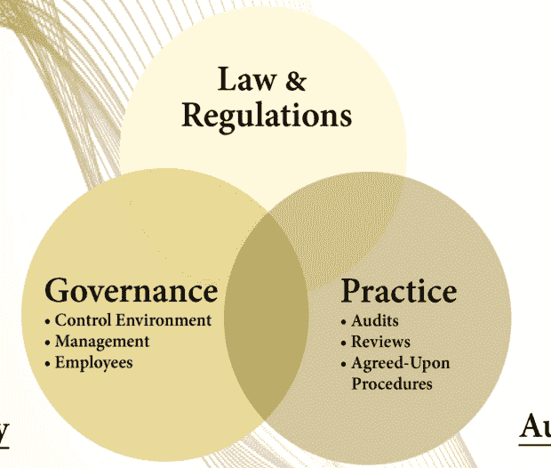


赫尔曼·默多克


## 前言

全面的实体安全计划通过分层的技术与非技术控制来部署信息资产保护（IAP）。控制是抵消安全威胁、机会和漏洞所必需的，其作用方式是将潜在的不利影响降至既定且可接受的风险水平。《审计信息与网络安全治理：基于控制的方法》在规范性决策理论的构念与概念背景下提出了一种方法论模型，并适当参考了相关标准及指南。规范性决策理论试图建立一个理性框架，以便在所选方案的结果不确定时，于各种备选行动方案之间做出选择。决策理论技术可以通过方法论应用提供目标确定、绩效估计、交互评估和组织分析（Davis, 2017）。规范性模型根据假设或规则规定应有的事物。

实体需求及相关安全要求应驱动组织控制的选择（Barnard & Von Solms, 2000）。实体管理领导者应在信息安全政策中明确定义安全要求，而安全政策应规定能够提供必要信息资产保护的控制集（Barnard & Von Solms, 2000）。如果控制集经评估和认证符合组织需求，则电子商务所需的信任便是可行的（Barnard & Von Solms, 2000）。对积极社会变革的意义在于，有可能更好地理解信息安全治理（ISG）项目系统、流程、活动和任务，从而提高消费者信任倾向并降低消费者成本（Davis, 2017）。信息技术（IT）服务消费者可能受益于实体管理领导者理解战略对齐在设计和部署有效ISG中的重要性，这种ISG能够增强对部署和维持信息保护实践的信任（Davis, 2017）。信任是社会承诺的一个方面（Davis, 2017; Edwards, 2013）。消费者对互联网信息保护的感知会影响其信任信念和信任意图（Bahmanziari & Odom, 2015; Davis, 2017）。例如，与电子商务相关的IAP事件可能引发可衡量的负面客户行为影响（Arief et al., 2015; Choi & Nazareth, 2014; Davis, 2017; Lee & Lee, 2012）。

IAP技术的正确安装与运行对于降低实体风险至关重要（Sedlack & Tejay, 2011）。实体管理层有效的IAP解决方案对于实现信任关系（尤其是与新客户）至关重要（Choi & Nazareth, 2014; Davis, 2017）。进行控制选择时需要理解为何采购和实施某项IAP技术（Sedlack & Tejay, 2011）。此外，还可能让实体管理领导者更好地理解与设计和部署有效ISG相关的因素，从而在电子商务中实现消费者信任（Davis, 2017）。更高的互联网保护感知水平会导致通过电子商务网站购买产品的意愿增强（Davis, 2017; Hartono et al., 2014）。实体管理领导者可以通过有效的ISG提升利益相关者对于含个人身份信息技术的信任因素（Davis, 2008, 2017）。个人身份和隐私是个人所能拥有的最宝贵的无形资产之一（Davis, 2008, 2017）。尽管如此，技术操纵不断使有意或无意的隐私侵犯成为可能（Davis, 2008, 2017）。网络攻击者从爱好者到间谍不等，通常受财务、个人或政治因素驱使（Arief & Adzmi, 2015; Davis, 2017）。与IT相关的身份盗窃每年使消费者损失超过50亿美元（Trautman et al., 2013）。网络防御者仅靠部署技术性信息安全解决方案无法充分应对网络犯罪（Arief & Adzmi, 2015; Davis, 2017）。因此，实体网络防御者必须考虑网络犯罪中涉及的人为因素（Arief & Adzmi, 2015; Davis, 2017）。

信息安全泄露事件是一个备受争议的问题（Davis, 2017; Safa et al., 2016; Safa & Solms, 2016）。参与网络犯罪可能是由于缺乏威慑因素或心理因素所致（Davis, 2017; Holt & Bossler, 2014）。隐私侵犯只是信息时代个体所面临的一个关键问题的表象（Davis, 2008, 2017）：实体信息安全如何在保护公民权利和自由的同时控制犯罪倾向？如果引导得当，大量投资可以成为有效的信息安全泄露威慑手段（Choi & Nazareth, 2014）。然而，更安全的信息资产可以通过提高治理质量来惠及社区，从而增强信任并降低电子商务使用成本（Bahmanziari & Odom, 2015; Ludin & Cheng, 2014; Starbuck, 2014; Yaokumah, 2014）。

## 主题契合

信息及相关技术持续向各种分布式配置环境演进，这些环境对数据进行编码、处理、存储和检索。随着连接到云计算服务提供商、区块链部署和移动计算设备的关联IT基础设施激增，所发生的规模变化显而易见。因此，这种分散化的影响增加了对信息资产进行切实保护的需求。

在全球范围内，法律和法规试图确保组织形式在开展事务时符合社会对道德行为的期望。对于保持利益相关者对实体使命的信心，关键在于部署安全治理，以保护影响投资和支出决策的信息。根据社会认知、法律和法规，批准行为的发生是为了确保遵守实体的保护责任。从解释的角度来看，在政府强制法规与实体治理重叠之处，通常需要审计实务的覆盖，以验证合规任务的实施情况（Davis, 2008）。

## 目标读者

潜在的信息与网络安全治理审计业务成员应具备适当的审计能力。通常，当治理审计目标涉及广泛的信息系统功能时，被指派的审计人员应具备广泛的组织知识和对相关流程的适当理解。审计人员可以通过阅读和理解相关文献来获得适当的知识和理解。


《Auditing Information and Cyber Security Governance: A Controls-Based Approach》的意图是为鉴证服务从业者创建高质量的参考资料，以应对保护要求。因此，本书适用于有兴趣确保或验证相关信息安全和网络安全治理设计与部署的实体员工。外部审计师、内部审计师、首席安全官、首席合规官、首席信息官、首席信息安全官、网络安全专业人员以及控制自评估人员会发现本书是一本富有信息量且权威的审计实践资源。通过审阅本书内容，读者将

- 1. 理解稳健管理与应用技术之间的适应性平衡，
- 2. 识别与开展信息安全和网络安全治理审计相关的一般活动和职责，以及
- 3. 获得信息安全和网络安全治理审计规划、研究、测试、报告和后续工作的深刻见解和工具。

## 书籍组织

总体而言，在本书中，作者期望读者具备基本的鉴证实践知识，以便适当考虑审计师在确保实体信息安全计划方面所发挥的作用。作者的内容设计为读者提供了各种因素和审计规划方面的帮助，以了解如何更好地评估信息安全和网络安全治理的可审计单元。它还使审计师能够了解启动、记录和编制审计业务报告所需的各种流程、活动和任务。此外，本书还包含计划开发与部署、控制环境职责以及公认的管理流程的概述。从组织上看，《Auditing Information and Cyber Security Governance: A Controls-Based Approach》分为八章。

- 第1章重点关注实体治理、ISG 和网络安全治理作为适当信息和技术安全的管理工具的作用。
- 第2章讨论了控制环境的以实体为中心的考虑因素以及政府-实体-审计领域的融合。此外，第2章将法律问题、管理实践、控制铭刻和技术部署作为实体风险决定因素进行介绍。
- 第3章阐述了在管理 ISG 中规划、组织、协调、指导和控制的循环，使信息风险和控制能够适当平衡，从而产生充分知情且合理的确定性。
- 第4章传达了治理树第五层级活动，支持治理树第四层级流程以实现有效的 ISG。
- 在第5章中，作者讨论了责任委派和反生产的工作场所行为。第5章还提供了 IT 事件响应团队的见解、员工发展策略以及实体 IT 审计团队活动的概述。
- 第6章讨论了考虑 IAP 风险的供应链合作伙伴和管理服务提供商。第6章还介绍了关键服务提供商审计问题。
- 第7章介绍了在审查 ISG 管理流程时如何从系统角度应用重要的 IT 审计方法。
- 第8章介绍了在审查 CSG 操作流程时如何从系统角度应用重要的 IT 审计方法。

### 参考文献

Arief, B., & Adzmi, M. A. B. (2015). 从利益相关者视角理解网络犯罪：第2部分：防御者和受害者. IEEE Security & Privacy, 13(2), 84–88. https://doi.org/10.1109/MSP.2015.44
Arief, B., Adzmi, M. A. B., & Gross, T. (2015). 从利益相关者视角理解网络犯罪：第1部分：攻击者. IEEE Security & Privacy, 13(1), 71–76. https://doi.org/10.1109/MSP.2015.19
Bahmanziari, T., & Odom, M. D. (2015). 展望理论与电子商务环境中的风险选择：框架效应的证据. Academy of Accounting & Financial Studies Journal, 19(1), 85–106. http://www.alliedacademies.org
Barnard, L., & Von Solms, R. (2000). 信息安全控制有效选择和评估的正式方法 [摘要]. Computers & Security, 19(2), 185–194. https://doi.org/10.1016/S0167-4048(00)87829-3
Choi, J., & Nazareth, D. L. (2014). 在电子商务和安全背景下修复信任：基于代理的建模方法. Information Management & Computer Security, 22, 490–512. https://doi.org/10.1108/IMCS-09-2013-0069
Davis, R. E. (2008). IT 审计：确保信息资产保护. Pfeiffer.
Davis, R. E. (2017). 美国公司公司治理与信息安全治理有效性之间的关系 (Publication No. 10603383) [Doctoral study, Walden University]. ProQuest Dissertations Publishing.
Edwards, C. K. (2013). 信息安全治理框架 (Publication No. 3607548) [Dissertation, Nova Southeastern University]. ProQuest Dissertations Publishing.
Hartono, E., Holsapple, C. W., Kim, K. Y., Na, K. S., & Simpson, J. T. (2014). 衡量 B2C 电子商务网站使用中的感知安全：重新规范和验证. Decision Support Systems, 62, 11–21. https://doi.org/10.1016/j.dss.2014.02.006
Holt, T. J., & Bossler, A. M. (2014). 网络犯罪研究的现状评估. Deviant Behavior, 35, 20–40. https://doi.org/10.1080/01639625.2013.822209
Lee, M., & Lee, J. (2012). 信息安全失效对客户行为的影响：互联网大规模黑客事件研究. Information Systems Frontiers, 14, 375–393. https://doi.org/10.1007/s10796-010-9253-1
Ludin, I. H. B. H., & Cheng, B. L. (2014). 影响客户满意度和电子忠诚度的因素：年轻成年人中的在线购物环境. Management Dynamics in the Knowledge Economy, 2, 462–471. www.managementdynamics.ro
Safa, N. S., & Solms, R. V. (2016). 组织中的信息安全知识共享模型. Computers in Human Behavior, 57, 442–451. https://doi.org/10.1016/j.chb.2015.12.037
Safa, N. S., Solms, R. V., & Furnell, S. (2016). 组织中的信息安全政策合规模型. Computers & Security, 56, 70–82. https://doi.org/10.1016/j.cose.2015.10.006
Sedlack, D. J., & Tejay, G. P. (2011). 通过技术参考框架改善信息安全. Proceedings of the Southern Association for Information Systems Conference, USA: Southern Association for Information Systems, 153–157. https://aisel.aisnet.org/sais2011/30
Starbuck, W. H. (2014). 为什么公司治理值得认真且富有创意的思考. Academy of Management Perspectives, 28, 15–21. https://doi.org/10.5465/amp.2013.0109
Trautman, L. J., Triche, J., & Wetherbe, J. C. (2013). 公司信息技术治理备受质疑. Journal of Strategic and International Studies, 8(3), 105–114. www.isisworld.org
Yaokumah, W. (2014). 加纳工业部门的信息安全治理实施：实证研究. Information Management & Computer Security, 22, 235–250. https://doi.org/10.1108/IMCS-06-2013-0044

## 安全治理

### 摘要

盈利性和非盈利性组织形态对信息依赖的程度持续扩大。然而，区分信息安全与网络安全是一个视角问题。在语境上，信息安全意味着保护信息和信息系统免受未经授权的访问、使用、披露、修改、中断和破坏。相比之下，网络安全侧重于保护获取、存储、操纵、管理、移动、控制、显示、切换、交换或传输数字编码数据的 IT。相比之下，信息安全治理（ISG）要求采取扩展的观点，即实体的<|message|> data、信息和衍生知识必须得到适当的保护，而不考虑获取、处理、运输或存储方法。第1章重点关注实体治理、ISG 和网络安全治理作为适当信息和技术安全的管理工具的作用。

### 引言

信息通常在被认为可用于决策时获得价值（Davis, 2008a）。安全是组织治理中的一个突出组成部分，能够实现履行利益相关者期望（Brotby, 2009; Davis, 2017; Flores et al., 2014）。利益相关者安全期望的一部分是通过适当的信息安全治理（ISG；Davis, 2008a, 2013）得到满足。经过妥善构建和实施，ISG 支持利益相关者对管理层明确或隐含的受托责任的期望（Davis, 2008a, 2011, 2017）。

对承担职责的人或群体（即委托人）的忠诚是受托期望（Davis, 2008a）。因此，个人利益不得凌驾于受托职责之上，且受托人不得从职位中获利，除非委托人同意（Davis, 2008a）。因此，受托人应避免参与个人利益与受托职责冲突的活动，以及受托职责与其他受托职责冲突的情况（Davis, 2008a）。此外，受托人不得在未表达委托人知情和同意的情况下寻求从受托职位获得个人利益（Davis, 2008a）。

控制是行使指导或限制影响力的行为（Avison, 2007）。组织的信息安全控制包括为管理层提供关于实现信息资产保护目标的某种程度的安心而采用或制定的程序。实体的管理层应有，且在多个国家确实有，实施充分的控制系统以防止、检测并在条件允许时纠正错误、失误、遗漏、不规范和非法行为的法律责任（Davis, 2006, 2008a）。

ISG 应解决创建和实施“安全控制系统”，以实现信息资产的伦理和法律管理责任履行。


保护（IAP）。从伦理角度来看，管理层必须保护实体的信息资产免受可能损害机密性、完整性或可用性的潜在内部和外部威胁，以维护组织、呈现和利用价值（Ahmad et al., 2014; Brotby, 2006; Davis, 2008a, 2017; Whitman & Mattord, 2012）。从法律角度来看，在实体的信息安全控制系统中，明确或隐含地，管理层作为受托代理人，有责任并承担责任部署防止、威慑、检测和纠正不可接受行为的控制措施（Davis, 2008a）。

管理层与尽职相关的信息系统推动源于受托责任的适当信息安全尽职调查活动（Boyson, 2014; Davis, 2008a, 2017; Whitman & Mattord, 2012）。建立和维持信息保护需要一个全面的计划，以应对可能阻碍组织使命实现的网络威胁（Ahmad et al., 2014; Davis, 2017; Kushwaha, 2016; Mohare & Lanjewar, 2012）。信息安全漏洞可能源于外部或内部行为（Crossler et al., 2013; Davis, 2017; Silic & Back, 2014）。因此，负责任的信息技术（IT）管理者领导者应通过有效的 ISG 确保与组织信息系统交互的每个个体的道德行为（Boyson, 2014; Davis, 2017）。然而，组织的 IAP 违规已降低价值获取（Clark & Harrell, 2013; Silic & Back, 2014）。

IAP 应是实体的首要关注点，因为 IT 安全事件可能损害财务和运营系统的机密性、完整性或可用性（Davis, 2008a）。IAP 威胁的来源可以是人、物或事件（Davis, 2008a）。学者和从业者已总结，信息安全不再主要是一个需要运营 IT 人员处理的技術问题，而更是一个治理问题（Davis, 2017; Julisch, 2013; Mohare & Lanjewar, 2012; Whitman & Mattord, 2012）。

没有任何单一的理论或实践方法能够涵盖组织治理的多样性。治理树框架旨在动员并促进在共享从业者计划中应用控制方法，同时提高反映不同学术观点的可比性。该框架允许学者和从业者研究和应用驱动因素、形式、因果机制和组织治理路径，同时考虑其对监管能力、绩效和结果的影响。本章介绍了可辨别的 ISG 观点和演变。本章中的讨论还定义了网络安全，反映了基于上下文的理解和网络安全治理整合见解。此外，本章通过说明治理树框架在经验背景中的适用性，推动了组织治理研究议程。

### 治理视角

组织治理可以为基于透明度、问责制和明确角色的道德决策和管理行动提供框架（Marnwick & Labuschagne, 2011）。有效治理的隐含期望存在于利益相关者与组织管理层对共同道德价值观的遵守之间的受托关系中（Davis, 2008a, 2017）。道德价值观与原则和标准相关联（Bagozzi et al., 2009; Northouse, 2013）。利益相关者和管理层的价值观通常涉及关于整体形象感知和由行为监管指南组成的详细法令的道德问题（Bagozzi et al., 2009; Ferrell, 2005）。国际上，受托责任被认为是通过法律或衡平法施加的最高谨慎标准（Davis, 2008a）。

受托关系的建立可能是委托方期望的，或由法律或法规规定（Davis, 2008a）。通常，受托关系可以存在于专业人员、代理人、执行人、受托人、监护人和实体员工之间（Brotby, 2006; Davis, 2008a）。在实体员工层面，受托关系的显著特征是忠诚、善意和信任（Davis, 2008a）。忠诚是对义务主体的忠实（Davis, 2008a）。善意代表着真诚意愿，避免对他人不公平利用（Davis, 2008a）。信任反映了将信心寄托于一个人管理或保护被托付财产以利于他人的行为（Davis, 2008a）。

伦理价值观影响受托忠诚、善意和信任。作为一套道德原则，伦理可以代表源自个人义务科学的社会责任科学或责任规则（Davis, 2008a）。此外，伦理可以指关于义务或将社会行动类别联系起来的实践的规则和原则体系（Davis, 2008a）。义务论伦理在判断行为是否正确或错误时只考虑理性判断（Bagozzi et al., 2009; Northouse, 2013）。相比之下，目的论伦理在决策行动时考虑潜在结果，而美德伦理主要关注道德品格方面（Bagozzi et al., 2009）。通常，道德行为维持原则-代理受托关系（Davis, 2008a）。

完整性价值观也影响受托忠诚、善意和信任（Davis, 2008a）。完整性可以被视为一套道德价值观，反映了涵盖诚实、道德原则、正直和真诚的状态或质量（Davis, 2008a）。通常，当个人接受高伦理和行为标准沟通并执行实践时，就会产生完整性（Davis, 2008a）。组织完整性标准应包括行政措施，以消除或减少可能促使员工从事不诚实、非法或不道德行为的激励和诱惑（Davis, 2008a）。组织治理是试图控制可鄙的个人和群体行为以利于实体连续性的手段。

治理有助于满足利益相关者对管理责任的期望（Davis, 2008a, 2017）。利益相关者识别（Gil-Lafuente & Paula, 2013）和应用价值分析（Harrison & Wicks, 2013）有助于评估实体层面的战略和组织文化一致性（Davis, 2017）。由此，利益相关者价值观与组织价值观的一致性取决于在严格遵守所宣称的实体价值观的同时，有效高效地追求既定使命（Davis, 2017）。当实体能够提供支持可接受价值创造的产品或服务（Chou, 2015; Davis, 2017; Di Gregorio, 2013）以及价值获取（Davis, 2017; Di Gregorio, 2013）时，考虑到利益相关者价值观，一致性存在且可持续。利益相关者价值创造和获取可源于产品和服务的相关性和质量、归属效用、组织公正认知和机会成本感知（Harrison & Wicks, 2013）。组织管理对价值观一致性构建的偏离可能导致利益相关者不满，产生竞争对手提供更强价值主张的感知（Davis, 2017）。

信息资产包含或可能包含数据（Davis, 2012, 2017），可能受到不诚实、非法或不道德行为的影响。组织管理需要在治理层面解决 IAP，以减轻技术部署的信息风险（Davis, 2017; Yaokumah, 2013）。然而，关于 ISG 的管理视角对问责制存在分歧观点（Williams et al., 2013）。一方面，一些从业者和学者认为 ISG 责任是 IT 治理问责子职能（Gheorghe, 2010）。另一方面，一些从业者和学者认为 ISG 对负责实体治理的人员具有独立职能问责制（Williams et al., 2013）。

无论管理层将 ISG 视为直接支持实体治理的计划还是 IT 治理计划的子集，IAP 都是必要的（Davis, 2017）。在满足所需的 IAP 时，信息安全观点必须解决管理性和技术性

方面 (Silic & Back, 2014)。理性管理与应用技术之间的适应性平衡能够实现适当的信息安全 (Ahmad et al., 2014; Brotby, 2006; Davis, 2017; Safa & Von Solms, 2016)。组织管理制定和部署合理的 信息安全政策和程序有助于确保适当的 IAP，而有效应用的信息安全技术可以提高 IAP 在应对潜在内部和外部威胁方面的有效性 (Ahmad et al., 2014; Davis, 2017)。

### 理性管理

管理是通过利用可用资源实现组织目标的行为。换句话说，管理是一种互动性职能，涉及在组织环境中进行计划、组织、协调、指导和控制活动 (Davis, 2008a; Kotter, 2001; Maccoby, 2000; Northouse, 2013)。鉴于信息系统及其相关技术持续变得日益复杂，采用健全的管理实践方法来处理 IAP 是不可避免的 (Bahl & Wali, 2014; Davis, 2008a)。

通常，信息系统的首要目的是有用数据的收集、可靠的输入处理以及及时的输出传播 (Davis, 2008a)。信息系统的集成设计和部署应包括适当的控制措施以实现管理目标 (Davis, 2008a)。基于控制的信息系统方法根据规定的或有界的一组标准运行。因此，实体的管理应将 IAP 视为一项服务要求，通过应用相关信息标准确保预期的交付和支持 (Davis, 2008a)。实体的信息交付和支持部署应充分满足有效性、效率、保密性、完整性、可用性、合规性和可靠性标准 (Davis, 2008a)，其中信息安全的普遍接受原则是保密性、完整性和可用性 (Arief et al., 2015; Samonas & Coss, 2014)。

传统上，管理者被分配任务在不同的权限、责任和问责层面发挥作用 (Davis, 2008a)。管理权限、责任和问责的委派通常在考虑以下事实后进行：

- 权限提供发布命令、强制服从、发起行动或做出最终决定的权力或权利 (Davis, 2008a, 2011)。组织任务如何发生以及汇报关系和授权层级如何建立取决于权限状态 (Davis, 2008b)。管理权限引发了在所分配权限范围内活动的领导责任 (Davis, 2008b)。实体为活动分配权限的政策和程序会影响对已建立汇报关系和指定授权权限的理解 (Davis, 2008b)。

- 责任是对某事或某人负责或作出解释的义务 (Davis, 2008a)。责任通常是被任命权限的附属 (Davis, 2008a, 2008b)。充分的责任分配环境包括旨在确保所有组织员工理解实体的目标、了解个人行动如何相互关联并为所采用的目标做出贡献，以及认识到他们将如何以及为何被追究责任的沟通和政策 (Davis, 2008b)。此外，与适当组织实践、必要人员知识和经验以及执行职责所提供的资源相关的政策是分配责任的重要组成部分 (Davis, 2008b)。

- 问责制可在所分配责任的背景下确保权限得到适当管理 (Davis, 2008a, 2008b, 2017)。问责制确立了对被授予或暗示的责任作出解释的义务 (Davis, 2008a, 2008b)。员工问责会影响满足标准的责任 (Davis, 2008a, 2008b, 2017)。当问责制缺失时，标准会成为无效的衡量工具 (Davis, 2008a, 2008b, 2017)。

组织权力源于意义、资源、流程和系统 (Kolkowska & Dhillon, 2013)。领导力涉及利用权威帮助追随者在组织环境和社会文化中出现的冲突价值观中应对 (Northouse, 2013)。作为受托人的管理者-领导者确保绩效、承诺或协调，以最大限度地降低组织中断风险。员工权力的授予可以通过管理权限实现 (Davis, 2008a, 2017)。IAP 责任的委派是必要的 (Davis, 2008a, 2017; Posey et al., 2014)。适当的权限量必须随所分配的责任一起转移 (Davis, 2008a, 2017)。然而，实体内的上级汇报职位无法逃避对被委派责任和权限的最终问责 (Davis, 2008a, 2017)。

组织结构为实现实体目标提供了基础 (Davis, 2011)。实体应制定适合感知需求的组织结构 (Davis, 2011)。以实体为中心的组织结构部分取决于预测结果的规模和性质。此外，组织结构包括为所选项目、系统、流程、活动和任务部署适当的权限和责任，并具备充分的问责制。IAP 管理者-领导者应处理四类资源：人员、信息、流程和基础设施 (Davis, 2008a; De Haes et al., 2013)。如图 1.1 所示，IAP 管理职责通常包括 (a) 计划、(b) 组织、(c) 协调、(d) 指导和 (e) 控制 (Davis, 2008a)。

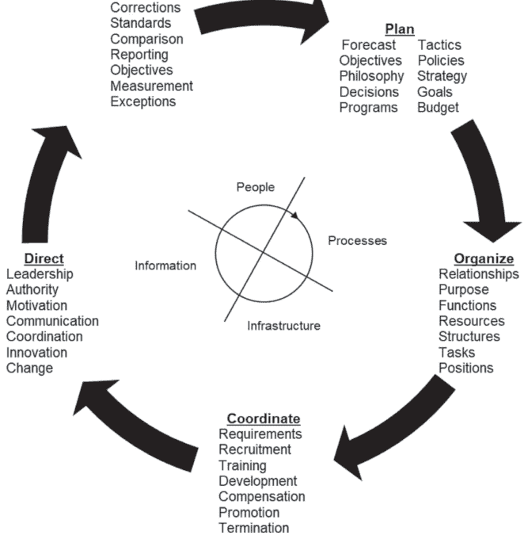

Figure 1.1 管理职责模型。

Note: 改编自 R. E. Davis 所著《IT Auditing: IT Service Delivery and Support》，2008b，Pleier。版权 2008 归 Robert E. Davis 所有。经许可改编。

- **Planning**：管理者-领导者应协助设定目标并建立具体的可实现运营目标以完成目标（即行动计划）。此外，上级管理者-领导者应评估下属提交的运营目标期望（即目标达成指标）以及被认为实现目标所必需的技术（即绩效达成指标）。

- **Organizing**：管理者-领导者应获取并管理反映实体控制环境的资源。资源整合需要了解实体的组织结构、战略、流程、技能、人员、上级目标和风格。

- **Orchestrating**：资源通常需要灵活的结构以实现目标和目标，从而实现预期价值创造。然而，除非通过管理者-领导者积极参与就业实践进行胜任且充足的人员配置，否则最好的计划、组织、指导和控制将一无所获。

- **Directing**：管理者-领导者的责任是就信息安全采取主动，而不仅仅是被动应对。此外，管理者-领导者应创建和维护沟通，并在实体的控制环境中维持所分配人员实现既定目标的势头。

- **Controlling**：通常，管理者-领导者负责控制的建立、衡量和绩效。控制组合的安全选项范围从动态资源重新分配到精细调整组织流程。

基本管理原则使受托责任标准化成为可能。尽管如此，管理职称因实体和组织职能而异 (Davis, 2008b)。通常，职位期望与管理地位相对应。高层管理人员通常负责整体实体方向并对利益相关者负责。此外，高层管理人员有权建立可衡量且可实现的高层目标，以确保所采用的高层目标的实现 (Davis, 2008a)，适用于项目、系统、流程或活动。

中层管理人员通常对指定的项目、系统或流程负责并承担问责 (Davis, 2020)。同时，这些管理人员在实体目标和目标实现方面向上负责，并在作为高层管理代表方面向下负责 (Davis, 2008a)。在低层管理层面，管理人员通常被视为主管 (Davis, 2008a)。主管通常负责日常运营和与所分配员工的直接互动，以创建、维持或终止流程或活动 (Davis, 2008a)。此外，主管通常对中层管理分配的责任负责 (Davis, 2008a)。

与 IT 治理 (Davis, 2011) 一样，ISG 可根据管理抽象层级被视为框架、方法或技术。从框架视角看，ISG 能够提供“控制系统”，有助于确保组织目标和目标的实现。从方法视角看，ISG 提供了实体方向和控制在实现信息系统目标方面所起作用的描述。此外，从

从技术角度看，ISG 的构建和使用支持着可为利益相关者带来财务或声誉回报的系统、流程、活动和任务。

当组织管理层将 ISG 概念化为协助治理的框架时，在结构上，其实施应作为一项组织计划进行，该计划包含旨在实现管理层意图的目标、目的、政策、程序、标准和规则。为了驱动控制，ISG 随后应获得重要的计划地位，因为它对其他计划结果（如网络安全）具有直接影响。此外，应通过可用于协助部署 ISG 的模型来实现控制效率。

或者，如果组织管理层将 ISG 视为实现组织信息系统目标的方法论，则所采用的流程应提供一系列评估，以便定义控制的有用性和部署。所采用的 ISG 流程应与维持既定透明度的管理权威、责任和问责结构相关联。管理层在实现战略方向的同时，通常关心控制成本以及控制部署和使用在方法论抽象层面内带来的收益。因此，理解 ISG 的角色被认为是管理 IAP 的关键。

然而，如果组织管理层假设 ISG 通过适当的技术带来财务和声誉回报，则可推定潜在利益相关者依赖于治理要素。普通投资者已根据报告文本内容估计了信息安全漏洞公告的价格和成交量反应（Wang 等，2013）。因此，通过监控来确定信息安全目标的有效性和效率，是满足利益相关者期望的健全实践的基础。在这方面，有效性和效率评估需要对照既定标准进行衡量。绩效衡量标准的制定应在标准创建或采用时进行。用于实施 ISG 的技术可能包括能力成熟度建模、预算编制、基准比较和差距分析。由于采用 ISG 时通过展示盈利能力提升了组织声誉，吸引新的利益相关者便可能成为一种额外收益。

无论组织管理层的观点如何，在当今全球高科技环境中忽视有效且高效的 ISG 的关键性，都不是一种管理上的可选做法。考虑到大多数组织在经济、政治和技术方面所涉的利害关系，通常仅基于上述三种观点之一来论证 ISG 部署的合理性，会限制其适用性和预期收益。归根结底，将所讨论的各个抽象层面结合起来，可能是实施 ISG 最合适的支持。尽管如此，ISG 的一个主要重点是使用规范性决策建立基于控制的方法。

### 应用技术

IT 安全建设的目的是保护数字编码信息资产的获取、创建、存储、使用和交换，防止未授权访问、滥用、故障、修改、破坏或不适当披露。IT 安全部署是实施旨在利用各种技术配置保护数字编码信息资产的措施。由此，IT 安全力求保持数字编码信息资产的价值、保密性、完整性、可用性、预期用途和许可处理。

IT 安全威胁可分为两类：内部威胁和外部威胁。外部 IT 威胁通过组织外部活动显现（Humaidi 和 Balakrishnan，2015）。

内部 IT 威胁通过组织内部活动显现（Humaidi 和 Balakrishnan，2015）。外部和内部的 IT 黑客和骇客对保护不足的信息资产构成“明显而现实的危险”（Davis，2008a）。IT 黑客是指通常出于无害目的尝试使用计算机的愿望而开展活动的个人（Davis，2008a）。相比之下，IT 骇客是指开展的活动通常带有恶意意图的个人（Davis，2008a）。尽管如此，IT 黑客和骇客会激活或利用已识别的 IT 安全漏洞，从而可能产生不良事件或事故（Davis，2008a）。

IT 安全事件可能是也可能不是 IT 安全事故。然而，IT 安全事故属于 IT 安全事件。IT 安全事件是指数字编码信息资产可能遭受不当活动的任何情形。IT 安全威胁是可能对信息资产造成未授权损害的事件（Davis，2008a）。如果某个 IT 安全事件被证明导致了 IT 安全破坏，则该事件即为 IT 安全事故。可能转化为 IT 安全事故的潜在 IT 安全威胁包括但不限于：
- 网络钓鱼，
- 间谍软件，
- 域名劫持，
- 盗版，
- 病毒，以及
- 拒绝服务。

IT 威胁需要评估、组织和管理，以利用可用资源降低潜在组织风险（Davis，2008a）。IT 安全资源包括可定义为技术控制的硬件、软件和固件机制。如表 1.1 所示，技术控制可分为信任管理、身份管理、漏洞管理和威胁管理（Davis，2008a）。

表 1.1 按管理用途分类的潜在 IAP 技术资源

| 信任管理 | 身份管理 | 漏洞管理 | 威胁管理 |
|---|---|---|---|
| 数字版权管理 | 资源调配 | 可信操作系统 | 网络入侵检测 |
| 数字签名 | 密码管理 | 网络扫描器 | 防病毒软件 |
| 应用完整性 | 身份验证 | 漏洞评估 | 主机入侵检测 |
| 公钥基础设施 | Web 访问控制 | 网络入侵防御 | 内容扫描器 |
| 虚拟专用网络加密 | 单点登录、生物识别 | 安全资源规划、网络防火墙、主机应用控制、应用防火墙、软件安全 | 安全事件管理器 |

注：改编自 R. E. Davis 的《IT 审计：保障信息资产保护》，2008a，Pleier。版权所有 2008 Robert E. Davis。经许可改编。

信任管理是一种确保用于执行授权功能的资源可靠性的方法（Davis，2008a）。身份管理是使用管理技术和工具来标识对象（Davis，2008a）。漏洞管理是一种限制资源使用者、基于 IT 的系统以及物理位置弱点的方法（Davis，2008a）。此外，威胁管理是一种识别和响应计算环境中恶意或不适当活动的方法（Davis，2008a）。

IAP 技术的关键性与组织对 IT 的依赖程度成正比（Blakley 等，2001）。当组织的数字编码信息资产面临风险时，IAP 技术部署通常成为适当的风险暴露降低措施。然而，IAP 技术只能部分地处置信息资产风险（Arief 和 Adzmi，2015；Blakley 等，2001）。事实上，已有书面证据表明，IAP 技术具有部分有效性概率（Arief 和 Adzmi，2015；Blakley 等，2001）。

### 安全计划演进

组织计划是一种复杂的结构，因为它通常由多个相互依赖的系统组成，这些系统往往需要多样的接口来提供所需的产品或服务（Davis，2008a）。典型地，一个计划至少有一个高层目标，并有一套旨在实现行动方针的目标、政策、程序和规则（Davis，2008a）。关键成功因素识别出需要解决的问题，以实现计划的目标（Davis，2008a）。关键成功因素还界定了优先的面向管理的部署指南，以实现对系统及系统内的控制（Davis，2008a）。在实施以组织为中心的信息安全管理计划时，必须满足若干关键成功因素（Davis，2008a）。信息安全管理的关键成功因素包括文化契合、全面政策、管理层承诺、员工支持、技术专长、有效宣传、签约流程、适当培训和可衡量的绩效（Davis，2008a）。

信息安全办公室应负责制定和管理组织的信息安全计划（Davis，2008b）。计算机化信息系统的信息安全计划已经从技术导向演变为治理导向（Davis，2017）。相应地，信息安全组织单元已从技术保护提供者演变为必要的战略保护伙伴（Davis，2012）。在结构演变过程中，信息安全职能可以并且可能已经遵循了一个三阶段系统方法（Sallé，2004）：信息安全基础设施管理（ISIM）、信息安全服务管理（ISSM），然后是 ISG。

如图 1.2 所示，从 ISIM 开始，每个后续演进阶段都建立在先前确立的基础上（Davis，2008b）。在第一阶段，组织的信息安全职能主要侧重于改进 ISIM，管理层采用有效性衡量指标——通常基于最大化计算资产的回报和基础设施控制（Davis，2008b）。进入第二阶段 ISSM 后，信息安全职能积极识别客户需要的服务，侧重于规划、组织和协调服务以满足组织需求（Davis，2008b）。在 ISSM 阶段，信息安全职能在内部和外部管理服务交付和支持，以达到质量和成本目标（Davis，2008b）。当信息安全职能演进到第三阶段 ISG 时，便转变为真正的组织管理伙伴，从而带来新的机遇

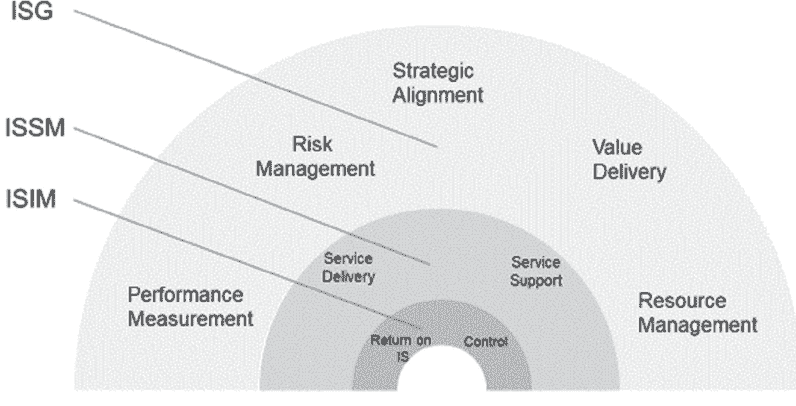

图 1.2 信息安全管理演进。

注：ISIM，信息安全基础设施管理；ISSM，信息安全服务管理；ISG，信息安全治理；以及 IS，信息安全。

适当的保护机制（Davis, 2008b）。一旦信息安全职能达到 ISG 阶段，信息安全流程应与组织流程保持完全整合，从而可能提高服务质量和敏捷性以实现实体目标（Davis, 2008b）。

### 信息安全基础设施管理

组织信息基础设施通常包括硬件、操作系统、配置系统、设施和支持结构（见图 1.3），这些有助于实现目标（Davis, 2009b）。由于外部和内部的计算机偏差，安全基础设施的整合对于确保充分的 IAP 是必要的。组织通常通过安全运营中心管理信息安全基础设施（Davis, 2008a）。IT 安全基础设施通过适当的安装和监控支持并促进员工生产力（Pfaff & Ries, 2014）。

充分的信息安全基础设施允许基于技术的系统持续发展和增长。实体的信息安全基础设施经常整合多样化的软件和硬件解决方案，每个方案都旨在实现特定功能。对于大多数组织而言，ISIM 管理实现架构有效性和效率所需的关键保护组件。作为设计、部署和维持效能的关键要素，实体的信息安全基础设施需要控制措施。

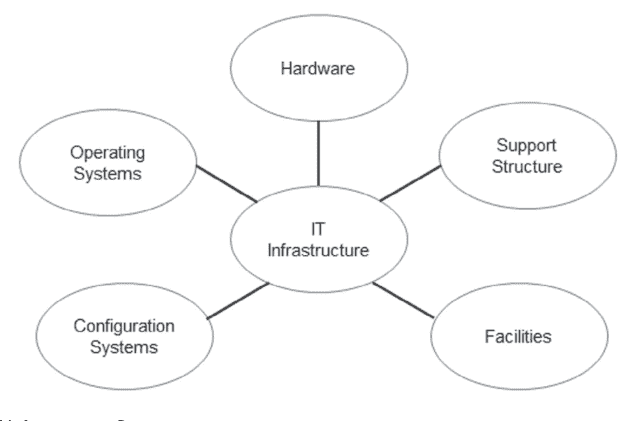

图 1.3 IT 基础设施资源。

注：IT，信息技术。改编自 R. E. Davis 所著《IT 审计：系统与基础设施生命周期管理》，2009b，Pleier。版权 2009 归 Robert E. Davis 所有。经许可改编。

### 控制措施

系统和基础设施设计影响实体管理层所依赖的控制措施（Davis, 2010）。使用 Safeguarding-by-Design 模型构建组织系统和基础设施需要纳入有助于保护数据的安全特性，无论数据处于静止状态还是传输中（Stürmer et al., 2005）。Safeguarding-by-Default 是 Safeguarding-by-Design 模型的一部分，在该模型中，无需个人采取任何必要行动即可保护数据（Stürmer et al., 2005）。因此，考虑典型的信息安全开发成本与明确的信息安全项目期望是至关重要的（Davis, 2009b）。

从管理角度来看，以实体为中心的信息系统或基础设施资产的设计和开发阶段是强调安全控制的关键点。在新的信息资产投入使用前安装控制措施有助于确保可部署项目的可靠性（Davis, 2009b）。确实，第一次就正确实施信息安全部署，比在系统或基础设施实施后添加控制措施要容易得多（Davis, 2009b）。此外，由于架构修改成本高昂，实施后添加系统或基础设施控制措施可能不可行（Davis, 2009b）。

### 安全投资回报

对于信息安全项目，建立以成本为导向的指导需要财务相关数据（Beebe et al., 2014; Davis, 2009b; Sonnenreich et al., 2006）。特别是，投资的收益需要在潜在可实现价值和时间调整后的预期绩效方面进行评估（Beebe et al., 2014; Davis, 2009b; Sonnenreich et al., 2006）。处理可实现价值包括计算安全投资回报率，作为决定是否继续进行信息安全项目的首要衡量标准（Sonnenreich et al., 2006）。

### 信息安全服务管理

鉴于利益相关者对持续流程改进的坚定需求，以使能服务为衡量标准的整体信息保护和安全交付价值已成为管理规范（Davis, 2008a）。ISSM 是一套流程，可实现并可能优化运营需求的满足，同时提供战略和战术基础设施管理（Davis, 2008a）。ISSM 应被视为一种服务质量管理，允许做出可证明的流程改进贡献（Davis, 2008a）。

大多数实体包含一组核心流程（Davis, 2008b）。与此观点一致，ISSM 涵盖了维护和改进服务质量一致性的流程（Davis, 2008b），这些流程与保护性服务价值体系相连。保护性服务价值体系使所有组件流程、活动和任务能够协同工作以创造价值。信息安全服务一致性通过持续的协商、监控、报告、审查成果以及采取行动消除不可接受的信息安全服务水平等循环来实现。

### 信息安全服务交付

信息安全服务交付需要有效的 ISSM 实践。管理层应为信息安全服务交付设计目标和目标（见表 1.2）。关于实现目标和目标，通过战略、战术和运营管理层级的职能报告传递的特定链接可确保与实体的使命保持一致（Davis, 2008b）。需要识别高层控制目标并与理由相联系，以便开发低层信息安全目标和目标。

表 1.2 信息安全服务交付领域、目标和目标

| 领域 | 目标 | 目标 |
|---|---|---|
| 服务水平管理 | 定义和管理信息安全服务水平 | 交付符合商定服务水平要求的<|message|>


除非已批准的计划以及战略目标和目标已首先在实体的组织结构内传达，否则不切实际。因此，管理层应通过以目标为导向的安全计划来治理信息资产的保护，否则将面临可能影响客户忠诚度、财务稳定性和员工士气的过度事件（Davis, 2008a）。

信息安全治理（ISG）计划的总体目标应是提供保证，确保信息资产获得与其价值相称或信息资产受损对实体构成的风险相称的适当保护水平。管理层通常需要能够实现组织对齐、内在价值交付、适应性风险管理、审慎的资源分配以及准确的绩效衡量，以实现保护期望的治理（Davis, 2008a, 2017; Mohare & Lanjewar, 2012）。管理层在处理信息安全问题时应采用：

- 以战略对齐为中心，确保实体、IT 和信息安全计划的关联；定义、维护和验证信息安全价值主张；以及信息安全运营与实体和 IT 运营的一致性（Davis, 2008a, 2017）。实体管理者领导者应增强战略对齐属性以实现有效的 ISG（Davis, 2017; Yaokumah & Brown, 2014）。有效的战略对齐必须是动态的、可共享的和可塑的（Yaokumah & Brown, 2014），以应对实体、IT 和信息安全环境的变化（Davis, 2008a）；
- 价值交付，即在整个交付周期中执行信息安全价值主张，确保信息安全根据采用的实体战略交付效益，注重优化成本，并证明信息安全的内在价值（Davis, 2008a）。有效的 ISG 价值交付实践认识到必须不对称评估和管理不同投资类别（Yaokumah & Brown, 2014）；
- 风险管理，反映使用系统化应用的原则、流程和方法（Rasheed et al., 2015）。因此，组织风险管理需要高级官员对信息安全风险保持认知、明确了解实体对信息安全风险的承受能力、了解实现信息安全合规的要求、对重大信息安全风险保持透明，以及嵌入内部风险管理职责（Davis, 2008a）；
- 资源管理，反映对信息安全资源进行最佳投资和适当管理的意图（Davis, 2008a; Mohare & Lanjewar, 2012; Yaokumah, 2013）。资源管理的重点领域是信息安全知识和基础设施处理效率（Davis, 2008a）；和
- 绩效衡量实践，涉及量化、监控和报告信息安全系统、流程及相关活动，以确保实现组织目标（IT Governance Institute, 2008）。最低限度，绩效衡量管理员跟踪和监控信息安全战略实施、信息安全项目完成情况、信息安全资源利用、信息安全流程绩效和信息安全服务交付（Davis, 2008a）。

部署或增强以实体为中心的 ISG 计划可用的管理辅助工具包括美国商务部国家标准与技术研究院的《联邦信息和信息系统最低安全要求》（联邦信息处理标准 200）；经济合作与发展组织的《信息系统和网络安全指南——迈向安全文化》；国际标准化组织/国际电工委员会的信息安全管理体系标准族（ISO/IEC 27000）；以及 ISACA 的《信息安全治理：董事会和高级管理层的指导》。

### 构建治理

框架可以捕获间接模型（Pagani, 2013）。此外，框架可以作为组织领导者构建有效组织计划的工具（例如，Atoum et al., 2014; Committee of Sponsoring Organizations of the Treadway Commission, 2013; Davis, 2008a; Sindhuja, 2014; Williams et al., 2013）。控制的沉浸应在实体采用的框架中保持透明（Davis, 2008a），以确保适当的 IAP。当构建治理时，域可以通过父子信息关系形成并连接，例如（Davis, 2008a）。

建立分层节点连接可在父子数据关系中发生标准属性共享时实现基础链接（Kearney & Kruger, 2013; Davis, 2011, 2017）。习惯上，描绘中央数据收集和分发点的技术分层结构通常被称为树（Davis, 2008a）。模型组成是一组元素——称为节点——作为不相交子集链接（Davis, 2008a）。然而，与生物树不同，技术树具有倒置的萌发基部，其中较低级别的可访问性只能通过通往相关元素的自上而下路径实现（Davis, 2008a）。从解释角度看，治理树维度能够描述管理信息和通信方面，允许节点家族对齐（Davis, 2008a）。

实体交互存在各种形式，包括战略、战术和运营授权（Davis, 2008a）。应用治理树框架允许在开发和部署对齐计划时进行方法论的价值驱动考虑，这些计划积极影响控制环境意识和随后的资源分配决策（Davis, 2008a）。治理树结构行为整合开放系统方法，通过功能适应性机制不断与外部和内部环境互动，允许组织重新定向（Davis, 2008a）。因此，活跃的治理树节点必须使管理层能够准确预测影响组织计划的事件，或面对合并或消除的可能性（Davis, 2008a）。此外，动态治理树节点内的因素停滞通常会随着时间的推移停止显著影响管理决策（Davis, 2008a）。

### 第一层治理

治理树上下文理解允许概念化更优信息安全计划部署（Davis, 2008a）。图 1.4 描绘了治理树模型的三个层级。治理树的第一层代表能够指导或控制实体节点信息和通信活动的利益相关者（Davis, 2008a）。利益相关者是直接或间接对实体感兴趣或能够影响目标实现的团体或个人（Ogunsakin, 2015）。如果不是直接的，实体活动会间接受到利益相关者信息中呈现的推断外部条件的影响（Davis, 2008a）。具体而言，第一层利益相关者提供影响治理树模型中链接节点期望的信息（Davis, 2008a）。

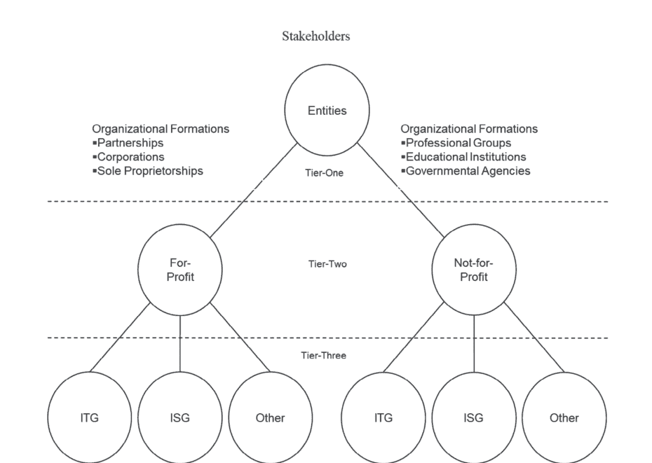

### 图 1.4 治理树：第一、第二和第三层结构视图。

> 注：ITG，信息技术治理；ISG，信息安全治理。改编自 R. E. Davis 所著《IT 审计：确保信息资产保护》，2008a，Pearson。版权 2008 归 Robert E. Davis 所有。经许可改编。

在治理树模型的第一层级，组织形成存在为集体目的的实体（Davis, 2008a）。集体目的可以是营利或非营利。组织形成通常是为了基于可用信息满足对产品或服务的感知需求而发生（Davis, 2008a）。实体管理者领导者受制于构成利益相关者的期望和压力，如供应商、客户、员工、政府监管机构和股东（Bagozzi et al., 2009; Heracleous & Lan, 2012）。因此，管理者领导者必须经常协商与组织效能和生存能力相关的问题，同时平衡各种利益相关者需求（Bagozzi et al., 2009, Ferrell, 2005）。

治理实体要求管理层准确概念化组织发展、信息关键性和通信路径。营利性管理者领导者倾向于以财务术语看待价值（Davis, 2011）。相比之下，非营利性管理者领导者倾向于以非财务术语感知价值（Davis, 2011）。治理对两种组织分类都是必要的，以确保管理层以合乎道德和合法的方式追求实现实体的使命（Davis, 2008a）。关于信息关键性和通信路径，治理传达通常使用实体利益相关者架构链接进行（Davis, 2008a）。


治理描述包含解释激励以及监督委员会成员、高级管理人员和其他利益相关者之间关系的语言，这些关系导致财务问责、透明责任和陈述可靠性（Davis, 2008a）。在整个实体内实施有效治理，要求最高监督委员会和高级管理人员清楚了解应从实体项目、系统和流程中期待什么（Davis, 2008a）。实体的监督委员会和高级管理人员需要指导资源部署，评估实体相对于现有计划的状况，并确定项目战略及目标（Davis, 2008a）。组织信息和沟通依赖于层级数据结构，父治理树节点连接到子节点以推动行政凝聚力（Davis, 2008a）。

实体的基调与节点关联创建了有用的决策结构，从而能够实现目的和目标。信息通常是决策的主要基础（Davis, 2008a）。然而，要影响决策，信息必须通过可接受的媒介进行沟通（Davis, 2008a）。沟通对于制定、实施、组织和控制以实体为中心的目的至关重要（Davis, 2008a）。有效的沟通既能统一，又同时允许环境、风险、数据和活动的分层（Davis, 2008a）。典型地，组织信息通过多路复用通信网络流动，以确保对员工进行适当的指导和参与（Davis, 2008a）。从概念上讲，考虑到治理树结构，使用适当通信方式的精确信息在多个水平连接和垂直对齐的节点之间双向流动（Davis, 2008a），从而实现组织凝聚力。

### 第二层治理

营利性组织形式的存在是为了在第二层治理树节点中为利益相关者创造有形和无形财富（Davis, 2008a）。相反，非营利性组织形式的存在是为了满足所感知的社会需求（Davis, 2008a）。抽象的发展基于感知到的有用性（Davis, 2008a）。治理树第二层节点是实体级枢纽，负责收集、分析、评估和传播信息（Davis, 2008a）。第二层治理树信息节点也可以在项目、系统和流程的背景下查看（Davis, 2008a）。因此，从务实的角度来看，实体级治理的建立是治理树模型中的第二层集中器，其重点在于：
- 设计和实施必要的活动，
- 将风险评估制度化，
- 提供流畅的信息和沟通，
- 确保绩效监测和评估，以及
- 创建适当的控制环境（Davis, 2008a）。

### 营利性治理

由于营利性企业面临各种风险，战略组织管理往往是变革性的和动态的（Nishimura, 2006）。营利性实体可以采用企业治理，其中：

> *企业治理是董事会和高管层行使的一套责任和实践，其目标是提供战略方向，确保实现目标，确认风险得到适当管理，并核实企业的资源得到负责地 [sic] 使用。*
> 
> (IT Governance Institute, 2003, p. 6)

尽管如此，企业治理纽带正在帮助董事会识别关键决策点、理解组织的风险偏好和关键绩效驱动因素，并做出战略决策（Connell et al., 2004）。

企业治理必须涵盖整个营利性组织的问责框架（Connell et al., 2004）。没有问责制，可控性和披露便毫无意义（Nishimura, 2006）。因此，营利性企业应将问责制与可控性和披露相结合（Nishimura, 2006）。在问责制、可控性和披露是基本治理要素的情况下，前馈和反馈控制系统是必要的部署（Nishimura, 2006）。

企业治理代表了一个概念框架（Van der Stede, 2010; Nugroho, 2014），它整合了公司治理和业务治理的各个方面（Nishimura, 2006）。公司治理处理组织合规性问题（Connell et al., 2004; Nishimura, 2006），涵盖角色、董事会结构和高管薪酬等问题（Connell et al., 2004）。业务治理处理组织绩效，侧重于战略和价值创造（Connell et al., 2004; Nishimura, 2006）。

### 非营利性治理

非营利性治理的部署赋予实体监督委员会代表所服务社区行使行政权力的权限（Chelliah et al., 2015）。非营利性监督委员会成员的角色是：(a) 设定组织方向和战略；(b) 提供组织监督；(c) 为组织提供所需资源的获取渠道（Chelliah et al., 2015）。非营利性治理通常侧重于实现实体的社会使命，并确保实体公信力、形象和生存能力的维持（Viader & Espina, 2014）。组织公信力对于克服非营利性治理在寻求资金时可能面临的犹豫支持至关重要（Viader & Espina, 2014）。形象是实现非营利性实体社会使命的生存能力的一个重要方面（Viader & Espina, 2014）。尽管如此，营利性实体中使用的治理框架也可能适用于非营利性实体（Viader & Espina, 2014）。

非营利性治理涵盖监督委员会的组成和结构、监督委员会成员的角色与责任，以及监督委员会效能与组织效能之间的关系（Chelliah et al., 2015）。非营利性治理可以采用公司治理、慈善治理（Viader & Espina, 2014）或合作社治理（Cheney, 2014）。管理层积极参与监督委员会、管理层对监督委员会的正式问责，以及对战略和创业活动的重视，是非营利性公司治理的特征（Viader & Espina, 2014）。非营利性慈善治理强调资产和使命的保存，以及管理层对监督委员会的非正式问责（Viader & Espina, 2014）。合作社治理反映了财务结构、税法、成员类型、决策结构，有时还包括规模（Cheney et al., 2014）。

作为替代方案，非营利性治理还可以依赖传统治理、政策治理或基于结果的治理。传统治理存在于董事会职能与管理职责平行的情况下，所行使的职责通过围绕主要管理职能组织的结构来实现（Viader & Espina, 2014）。在使用政策治理时，监督委员会通过制定与组织流程、高管权力限制、监督委员会与首席执行官的关系、治理风格以及政策合规性监测相关的政策来进行治理（Viader & Espina, 2014）。通过选择，基于结果的治理将焦点放在监督委员会而非管理层，由监督委员会监测已批准目标的进展和成果（Viader & Espina, 2014）。

### 第三层治理

从第一层治理树层级延伸下来，所描绘的链接节点不可避免地受到治理框架的影响（Davis, 2008a）。所应用的治理框架已成为倡导利益相关者利益的推动因素（Davis, 2008a）。组织管理层为相连的下级节点定义预期的治理效能（Davis, 2008a）。实体连续性取决于准确及时的外部与内部环境信息评估，以推动适当的治理（Davis, 2008a）。管理层，尤其是信息安全管理层，除非理解根本期望，并使潜在弱点、威胁和机会得到适当纠正，否则无法建立充分的防护态势（Brotby, 2006; Davis, 2008a）。

### IT 治理

实体IT治理是高层管理和监督委员会的责任（Davis, 2011）。关键的IT治理要素是领导力、组织结构和流程，它们试图确保实体的IT维持并扩展实体的目标和战略（Marnnewick & Labuschagne, 2011）。因此，由于组织流程通常与IT集成，IT高管管理是IT治理的基本组成要素（Davis, 2011; Wu et al., 2015）。通常，专业人士一致认为，在制定IT治理时，定义IT角色和职责应是第一步（Davis, 2011）。为此，角色需要基于组织结构进行问责分配，而职责则指明为实现组织目的和目标而采用相关方法论或流程的活动（Davis, 2011）。

IT高管在定义并随后启动IT治理时，需要提供高质量的领导力（Davis, 2011）。IT治理领导力需要愿景以及责任和问责，以确保实体存续（Davis, 2011）。根据实体的不同，定义IT治理的问责可以落在单个人或群体身上（Davis, 2011）。可用于IT治理部署和维护的组织模型包括以下各项：
- 治理启动：适用于IT职能部门通过指定小组关于实体其他地方的成就或预期成就的集体知识引入IT治理项目的情况（Davis, 2011）。
- 治理指导委员会：通常适用于从实体各领域任命代表，共同审查IT治理相关问题并采取行动的情况（Davis, 2011; Wu et al., 2015）。
- 治理信息交换所：适用于IT职能部门首席官员对IT治理拥有相当大但非全部决策责任的情况（Davis, 2011）。


-   公司治理规划（Corporate Governance Planning）适用于IT团队作为评估运营治理效率的主要管理工具，并作为解决特定治理问题的工作组的情况（Davis, 2011）。
-   治理服务中心（Governance Service Center）适用于实体成本中心或责任中心内存在自治IT治理小组部署，且执行管理层评估各小组绩效的情况（Davis, 2011）。
-   治理团队（Governance Team）通常适用于选定五至七人作为全职小组成员，负责IT治理开发与整改的情况（Davis, 2011）。

在构建IT治理框架时，人员、结构、流程和风险管理整合是基础（Davis, 2011）。各种框架可帮助管理层在实体内部署IT治理（Davis, 2011）。可用于IT治理构建的框架包括英国商务办公室的IT基础架构库（Gërvalla等，2018）和ISACA的信息及相关技术控制目标（Davis, 2011）。IT基础架构库框架提供了IT服务管理的实践方法（Gërvalla等，2018）。不同的是，信息及相关技术控制目标框架提供了成熟度模型以及IT治理框架，其目的是确保IT资源与组织愿景和战略保持一致（Marnewick & Labuschagne, 2011）。

### ISG

尽管实体存在的原因各不相同，但信息安全漏洞的公开报道增加了私人和公共部门将ISG制度化的需求，并要求进行项目监督（Davis, 2008a, 2017; Srivastava & Kumar, 2015）。有效的ISG通过控制部署来抵御安全威胁，从而履行对IAP的法律和道德管理责任（Davis, 2017）。基于治理树节点连通性，当正确对齐时，控制措施代表了系统内受到利益相关者保障期望影响的流程、活动或任务。向下级联，ISG需要解决实体的战术和运营目标，包括绩效期望、盈利目标和资源保障（Davis, 2008a）。然而，ISG比实体治理的概念更窄，但比网络安全治理的概念更广。

无论实体是营利性还是非营利性，要在整个组织内实施有效治理，顶层监督委员会和高管必须清楚了解部署ISG的预期效果（Davis, 2008a）。从概念上讲，在营利性实体领域，ISG是企业治理的一个子集，它（a）提供战略方向，（b）确保目标实现，（c）适当管理风险，（d）负责任地使用组织资源，以及（e）监控企业安全计划的成败（IT治理研究所，2008）。类似地，非营利实体可以将ISG定义为非营利治理的一个子集，它（a）提供战略方向，（b）确保目标实现，（c）适当管理风险，（d）负责任地使用组织资源，以及（e）监控非营利安全计划的成败。因此，将上述陈述中的“企业”和“非营利”替换为“实体”，所得的一般定义在阐释ISG预期价值时适用于两种治理树实体类型。

ISG是一个关键的实体关联节点，需要框架来确保信息资产保障责任得到适当的管理关注（Davis, 2008a）。在治理树第三层，ISG可以产生显著效益，包括以下方面：

-   对于实行良好治理的实体，利益相关者价值增加；
-   有效的信息安全策略及策略合规保证；
-   在关键组织活动中保障信息的问责制；
-   最低保证水平，确保关键决策不反映有缺陷的信息；
-   建立结构和框架，使分配的安全资源得以优化；
-   防止因信息不准确或缺乏应有谨慎而导致刑事或民事责任风险日益增加；
-   通过将信息安全相关风险降低到可定义和可接受的水平，增强运营执行的可预测性并减少不确定性；以及
-   为与保护信息资产相关的有效且高效的风险管理、流程改进和快速事件响应奠定坚实基础（Davis, 2008a）。

通过治理树遍历，组织管理层可以轻松理解并接受ISG与实体级治理保持一致的必要性，以确保适当的信息资产保障（Davis, 2008a）。在管理层面，ISG必须维持实体监督委员会所采用的政策、流程、人员和结构，以告知、管理、监控和指导信息安全活动，推动目标实现（Davis, 2008a, 2017）。通过治理树框架，信息安全节点连通性能够开发和维持与实体目标及目的战略一致的信息系统（Davis, 2008a）。然而，ISG与IT治理的一致性对于维持有效的控制一致性也至关重要。

考虑到大多数实体信息系统对IT的使用状况，保障IT资源通常需要部署ISG框架，以提供基本的IAP覆盖（Davis, 2008a）。实体管理层可以采用Brotby（2006）建议的框架，该框架利用流程确保有效的ISG控制体系。或者，Williams等（2013）提出了一个更加多层面的信息保护视角，融合了分层技术和社会特征集，这些特征集通过治理适应形成并激活。

### 其他治理

治理结构的性质和范围各不相同（Luesebrink, 2011）。实体的治理结构提供了实现目标的活动的渠道，包括规划、执行、控制和审查（Davis, 2011）。组织管理层会制定并部署适合所感知需求的治理结构（Davis, 2011）。治理结构中通常存在多种关系，这些关系可能允许基于角色的资源整合（例如，Deschamps, 2013a）。以实体为中心的治理结构部分取决于规模和活动性质（例如，Deschamps, 2013b）。因此，组织管理层可以将认为实现实体目标所必需的框架制度化（例如，Stilgoe等，2013）。

### 安全治理融合

鉴于全球产品和服务环境，安全的IT部署对于实现信息可靠性、处理效率和通信便捷性不可或缺（Davis, 2017）。由于汇总的信息具有可衡量的价值，组织员工收集、处理、存储和传输数据需要适当的保护（Davis, 2017）。在保护信息方面，信息安全是保护信息和信息系统免受未经授权的访问、使用、披露、修改、中断和破坏的手段。保障信息要求处理IT保护，以确保管理层的应有谨慎和尽职调查（Davis, 2017）。IT保护通过IT安全得以维持。IT安全即网络安全。

关于信息安全与网络安全概念结构的对应关系存在不同意见（Schatz等，2017）。尽管如此，作为一个代表性定义，网络安全是组织和政府为保护网络空间中资产的机密性、完整性和可用性而遵循的安全风险管理流程相关的方法和行动（Schatz等，2017）。网络安全概念包括政策、指南、保障措施集合、技术、工具以及培训，以提供对网络环境状态和用户的最佳保护（Schatz等，2017）。

在管理层面，网络安全是一组旨在保护数据、程序、设备和网络免受攻击、损害或未经授权访问的实践、流程和技术（Vähäkainu & Lehto, 2019）。网络安全战略制定确定了基于技术的风险和威胁、遭受网络攻击时的行动方案、为最大限度减少网络攻击影响而遵循的程序以及抓捕攻击者的手段（Nastasiu, 2016）。ISG通过确保利益相关者拥有决策权来指导整个实体的组织安全工作，是网络安全成功的关键辅助手段。

理解ISG的深度和广度可以帮助组织管理者提供稳定的环境和模型，这些模型可用于或适用于网络安全治理工作。网络安全治理战略必须考虑保护信息和计算机技术。“信息是以某种形式呈现的数据解释，这种形式为接收者提供价值”（Davis, 2017, 第72页）。计算机技术是利用机械化流程、方法或知识完成任务的能力。有效的网络安全治理战略构成了组织保护信息和计算机技术方法的基础。可用的整体性网络安全框架有助于构建适当的网络安全治理（即Atoum等，2014）。

> 信息是以某种形式呈现的数据解释，这种形式为接收者提供价值（Davis, 2017, 第72页）。

网络安全治理还涉及控制和处理数据的实体的特定IT需求，这些需求属于ISG领域。IT是使用电子编码管理或传递数据的硬件、软件、服务和支撑基础设施。信息及相关技术是需要适当投资保护措施以保持内在价值的资产。IT允许积累和处理大量数据，并激发创新。连接信息系统的IT已使组织内部沟通几乎无缝，具体取决于产品特性（Davis, 2017）。在实体组织架构内，提供令人满意的服务交付需要安装响应迅速的网络安全支持系统。在处理网络安全问题时，服务交付和支持可能涵盖从运营保护部署到危机响应培训的范围（Davis, 2017）。


### 信息技术网络安全服务交付

鉴于信息系统通常对提高生产力至关重要，IT 必须提供可用性并具备满足可用性需求的服务响应性（Davis, 2008b）。组织的复杂性和 IT 运行复杂性可能导致网络安全问题，可能需要快速和系统性的纠正以满足可用性要求（Davis, 2008b）。此外，运营和 IT 都不存在于静态环境中（Davis, 2008b）。因此，环境动态可能导致系统接口变更，需要及时响应和解决以确保持续服务交付（Davis, 2008b）。总之，网络安全服务交付通常根据是否满足用户功能期望来评估。

IT 增强了控制流程（Davis, 2011）。IT 提供了利用闭环控制系统的机会，并提供了更及时纠正措施的手段（Davis, 2011）。不幸的是，IT 也带来了控制不利扩散的潜在风险（Davis, 2011）。因此，开发组织调整的治理结构是一项需要深入了解实体内部和外部环境的任务（Davis, 2011）。具体而言，在实施良好的网络安全治理时，概念化实体的使命和运营环境至关重要（Davis, 2011）。

安全的 IT 服务交付需要网络安全服务管理。网络安全服务交付应提供尽可能好的服务水平，以满足以实体为中心的 IT 需求并配备全面控制。网络安全服务交付的全面控制至少应涵盖服务水平管理、可用性管理、容量管理、连续性管理和财务管理。

### IT 安全的服务水平管理

有效的 IT 网络安全解决方案对于建立与利益相关者的信任关系至关重要（Davis, 2017）。网络攻击的蔓延威胁着 IT 所期望的保密性、完整性和可用性（Chatterjee et al., 2015）。因此，管理层对网络安全服务交付的期望有所提高。为缓解利益相关者对 IT 安全的担忧，通常需要提高质量、功能性、易用性、持续改进的服务水平、多方面的成本控制或削减，以及缩短交付时间。对于网络安全服务交付人员而言，这些期望通常转化为提供适当的服务水平管理。服务水平管理通常被视为确保在期望的时间和地点以商定成本交付承诺服务的首要管理领域（Davis, 2008b）。协助服务交付过程的是服务质量计划（Davis, 2008b）。

需要识别内部和外部供应商及客户以实现服务水平管理（Davis, 2008b）。描述性地说，健全的服务水平管理需要清晰的接口和以客户为中心的服务规范来构建服务水平要求（Davis, 2008b）。此外，内部运营级协议和与外部供应商的合同有助于遵守协商的服务水平协议（Davis, 2008b）。

服务水平管理可被视为基于关键绩效指标的服务质量监控和管理（Davis, 2008b）。服务质量的关键绩效指标可以从通用的可用性和使用统计数据到以实体为中心的每次交互指标不等（Davis, 2008b）。充分的服务水平管理需要识别潜在问题并创建警报，从而实现违规风险最小化（Davis, 2008b）。因此，服务水平管理实践应包括将实际绩效与预定义期望进行比较、确定适当措施并生成有意义的报告以允许服务改进（Davis, 2008b）。

### 容量管理

容量管理是一种实践，确保在正确的时间、以正确的数量和正确的价格提供 IT 基础设施，以便以最有效的方式使用 IT（Davis, 2008b）。容量管理流程识别确保持续服务水平和适当资源管理的性能要求（Davis, 2008b）。可用性要求驱动容量监控（Davis, 2008b）。由此，工作负载预测需要资源调度以满足预期的可用性水平（Davis, 2008b）。合理的容量管理考虑三个层面：运营、服务和资源（Davis, 2008b）。为实现令人满意的容量管理，受指派的网络安全服务人员需要

- 定义、计划和管理要求；
- 为服务提供资源；
- 监控已应用资源的性能并在必要时进行调整；
- 计划并实施改进；以及
- 建立和维护容量计划（Davis, 2008b）。

### 可用性管理

信息可用性通常要求适当的保护（Davis, 2008a）。网络安全可用性管理反映了确保及时可靠的信息访问和使用（Davis, 2008a）。可访问性和安全性是关键的处理问题（Boritz & Datardina, 2019）。然而，安全性和可用性是极性状态，因为安全性旨在限制访问，而可用性旨在促进访问（Davis, 2008a）。为了使信息完整、最新且及时，需要用户按照规范进行可用性和可访问性，并在需要时以理想的形式进行恢复（Davis, 2008a）。当需要时无法访问的相关信息对用户活动或决策没有实际后果，除了负面限制信息和决策质量（Davis, 2008a）。用户实用性要求强大的网络安全以提供可信信息（Davis, 2008a）。此类信息必须在需要时可用，允许授权用户修改，高效有效运行，并适应信息分配调整（Davis, 2008a）。

### 连续性管理

网络安全系统、流程或活动的连续性管理应将重点放在维持核心运营流程上，同时最大程度地减少灾难性和不可预测事件造成的负面影响。主要管理任务需要包括定义网络安全连续性的要求和策略，以及为网络安全服务设定措施和连续性计划。此外，网络安全任务需要涵盖管理连续性程序以及管理紧急连续性和恢复。网络安全服务连续性控制确保在发生意外事件时，所需操作不间断继续或运营恢复迅速，且关键和敏感数据保持受保护（Davis, 2009a）。

在灾难性事件或事故发生后，失去处理、检索和保护电子维护的信息的能力会显著影响实体管理实现组织使命的能力（Davis, 2009a）。因此，实体应具备：（a）保护信息资产并最大程度降低非计划中断风险的控制措施，以及（b）在发生中断时恢复关键运营的计划（Davis, 2009a）。连续性管理计划应考虑在通用支持设施（如数据处理中心、托管服务提供商和电信设施）中执行的活动，以及特定 IT 资源用户执行的活动（Davis, 2009a）。

在流程中断或灾难发生后，关键网络安全服务需要首先恢复，可能在数小时内。相比之下，恢复非必要服务的时间跨度可能延长至数周。每个网络安全服务记录的最大恢复时间将决定满足运营期望所需的连续性安排的类型和成本。网络安全服务恢复目标应反映资源连续性的运营要求和资源可用性的技术要求。在制定灾难或中断响应时，优先分类应是情况对实体造成的规模、严重程度或潜在影响的相关指标（Davis, 2009a）。

### 财务管理

ISSM 的财务管理流程通常解决实体的成本核算要求（Davis, 2008b; Sonnenreich et al., 2006）以实现网络安全。信息安全成本管理通过计算提供信息安全的成本，确保以最有效的价格获取和维持信息安全资源；从而使组织管理层了解保护成本结构。建立成本管理通常需要准确的项目预算。为此，实施项目规划和预算系统是监控网络安全投资的适当方法。

### 信息技术网络安全服务支持

控制系统允许组织和管理信息安全（Davis, 2008a, 2010, 2020）。控制系统定义流程、政策声明的责任分配和管理框架（Davis, 2008a, 2020）。选择安全管理框架定义了配置开发、部署和指导行动计划评估的流程。此外，管理框架定义了安全结果的报告。因为信息资产通常对实体的成功至关重要，因此应进行控制系统开发和部署以实现特定的以实体为中心的控制目标（Davis, 2008a, 2010, 2020）。信息安全服务支持的控制系统应解决网络安全配置管理、事件管理、问题管理、变更管理和发布管理流程。

配置管理和变更管理是实现网络安全服务交付控制目标的主要网络安全服务支持流程。在正确部署配置管理和变更管理后，可通过事件管理、问题管理和发布管理提供额外的次要网络安全服务支持（Davis, 2008b）。通常，在网络安全服务支持领域，网络安全服务台

功能是确保响应式组织结构所必需的子流程（Davis, 2008b）。

### Configuration Management

IT 安全需要一个基本流程来支持信息系统的网络安全服务（Davis, 2008b）。网络安全配置管理流程应注册、跟踪并报告每个 IT 安全基础设施组件。IT 安全配置项是离散的资产，可能在功能上相互独立或相互依赖（Behr et al., 2005）。在典型情况下，网络安全重要控制状态归因于一种被接受的信念，即充分管理信息安全服务的起点取决于清楚地知道哪些项目构成实体的网络安全架构（Davis, 2008b）。实体应维护可用于提供网络安全服务的网络安全配置项清单（Davis, 2008b）。然而，如果没有通过信息资产所有者参与的流程来解决，维护网络安全清单可能会成为管理挑战（Davis, 2008b）。鉴于实体信息资产持续更新，信息安全职能必须规范并记录变更以支持未来的维护情况（Davis, 2008b）。

实现对基本配置管理要求的适应是实施和控制包含有关可在信息安全服务提供和行政管理中使用的网络安全基础设施元素详细信息的 信息安全管理体系（Kushwaha, 2016）。网络安全配置管理中库存管理和软件工程的最佳实践采用是必不可少的。然而，在正确部署时，信息安全管理体系不仅仅是一个网络安全资产登记册（Kushwaha, 2016）。仓库还应包含准确描述网络安全配置项的维护、移动情况以及所遇问题的信息，从而实现有效的网络安全服务实践。

### Incident Management

事件可定义为 IT 服务的中断或质量下降（Palilingan & Batmetan, 2018）。各种潜在的 IT 服务威胁可能转化为需要充分网络安全服务支持的有意或无意的事件。如果尽快恢复网络安全服务的正常状态并最大限度地减少对实体运营的不利影响是事件管理流程的主要目标，则支持人员的绩效可确保保持尽可能高的服务质量和可用性水平。

当依赖 IT 提供流程性服务时，事件通常不可避免（Davis, 2008b）。因此，恢复正常运营的响应和恢复程序是必要的（Davis, 2008a, 2008b）。事件响应管理包括停止或遏制信息资产损害并收集事件数据的流程（Davis, 2008a, 2008b）。获取的数据可在恢复期间用于确定受损程度或用于刑事起诉（Davis, 2008a, 2008b）。受损的信息资产可能需要恢复并返回常规操作（Davis, 2008a）或更换。恢复还可能涉及被利用弱点的确定，以及在可行情况下后续漏洞的根除（Davis, 2008a, 2008b）。

管理复杂的事件解决流程以尽快恢复服务可能相当具有挑战性（Davis, 2008b）。充分的事件处理能力的主要可辨识益处是遏制或修复影响可用性的事件造成的损害，并防止对配置项的未来损害（Davis, 2008b）。不那么明显的是事件处理能力的次要益处，包括加强培训计划、意识计划、内部沟通、实体准备情况以及威胁数据增强（Davis, 2008b）。例如，通过传达客户知识和作为教学目的示例呈现的真实场景信息，可以实现培训和意识的提升（Davis, 2008b）。

就安全而言，事件响应中可能特别成问题的一个方面是收集证据以对疑似罪犯采取法律行动（Davis, 2008b）。具体来说，为了收集证据，实体可能需要允许入侵者或违规者继续不当活动——这种情况使信息资产持续面临风险（Davis, 2008b）。然而，一旦公开，侦测和起诉的恐惧可以作为对潜在违法者的非法活动威慑（Davis, 2008b）。

### Problem Management

有效的问题管理通常通过解决已关闭问题的根本原因来减少实体运营环境中的问题数量（Davis, 2008b）。因此，问题管理可被视为解决或预防影响实体网络安全服务的问题。问题管理也可以指管理通常由实体 IT 服务台职能记录的问题。一旦问题被视为网络安全问题，应投入适当级别的资源以实现及时解决。组织管理应参与优先处理问题的决策，以确保对常规运营的干扰最小化（Davis, 2008b）。此外，网络安全服务支持管理应定期报告问题解决进展。

网络安全服务问题可被视为从单一情况或多个表现出共同症状的情况下提取的界定明确且已识别的条件。最初，网络安全服务问题是一个等待识别和归因的未知情况。通过分析师成功的问题根因分析，未知情况会转化为已知情况，当配置项缺陷发生时，这些已知情况产生了已识别的条件（Davis, 2008b）。因此，问题管理流程的主要目标之一应是通过识别并消除对已部署 IT 产生负面影响的已知情况来确保网络安全服务的稳定性。当级联时，问题管理流程的主要目标是最大限度地减少影响网络安全服务交付的已知情况的不利影响，并防止与可能影响 IT 的已知情况相关的反复出现的情况。因此，问题管理目标的被动方面是针对一种或多种情况迅速解决问题。相比之下，问题管理目标的主动方面是减少整体情况问题的数量（Davis, 2008b）。

实体的网络安全服务客户需要就解决需要较长时间解决的报告问题的指南达成一致，以及详细说明对组织流程、其他系统和用户的影响的信息（Davis, 2008b）。信息安全服务支持在识别已部署实体 IT 架构中的流程或基础设施弱点和关注领域方面具有主动作用。一旦识别出不利趋势，就需要突出服务问题并启动纠正措施（Davis, 2008b）。例如，已知的网络安全弱点可能需要通知管理人员的变更或启动进一步的员工教育和培训（Davis, 2008b）。

网络安全维护请求需要分析实体生产环境中产生的所有事件和问题。然而，指派的网络安全服务支持人员应在纠正前将问题评估作为最后一步。依次地，在评估过程中，实体的主要问题管理任务应包括解决问题的根源、调查和诊断问题的根本原因、识别和记录已知情况、评估已知情况、记录已知情况的解决方案以及请求适当的变更（Davis, 2008b）。

### Change Management

网络安全部署可能需要变更管理以确保与实体的战略、结构和文化保持一致（Davis, 2009b）。网络安全变更管理是确保所有配置项变更以计划和授权的方式进行的做法。变更可能因各种原因发生，包括对运营流程需求的响应、更新技术的可用性、技术创新和实体增长（Davis, 2008b）。网络安全变更可以是永久性的或临时的。然而，网络安全变更管理程序应减少并提供对预期或非预期事件以及问题的充分响应。

接收变更请求、记录变更请求、评估事件或问题、获得执行变更的授权以及规划变更是应在变更构建之前进行的程序（Davis, 2008b）。最低限度，变更请求应提供每次变更背后的运营或技术原因；识别受变更影响的具体配置项和网络安全服务；识别成本估算、风险评估和资源需求；并支持流程审批（Davis, 2008b）。记录变更允许跟踪和记录已通过初始文档要求的变更请求（Davis, 2008b）。评估事件或问题提供分析，评估使分类变更优先级成为可能（Davis, 2008b）。网络安全服务支持应从负责变更部署的适当非技术和技术专家处获得变更的适当授权以构建变更。此外，变更规划提供了确保变更成功开发的手段（Davis, 2008b）。

充分的变更规划对于充分的变更构建是必要的，包括回滚规划、变更测试和记录更新（Davis, 2008b）。如果变更导致不可接受的网络安全配置状态，则需要回滚规划。由于大多数信息系统和基础设施通常太大、集成度太高且复杂，无法在不进行测试的情况下预测网络安全服务设计的失败或成功，因此在变更过程中应进行实验。即使配置项的微小变更也可能导致关键任务信息资产失败或中断 IT 服务（Davis, 2008b）。此外，受变更影响的网络安全配置项记录应进行更新，以确保适当的资源使用和维护（Davis, 2008b）。

### Release Management

一旦变更测试证明功能令人满意，网络安全配置项就需要移动到安全的暂存区域。其后，应向负责生产实施的适当个人提交发布请求（Davis, 2008b）。收到成功发布的变更通知后，负责该

信息安全管理体系应接收一份注明的网络安全更新。最终，变更审查评估变更流程绩效和发展充分性（Davis, 2008b）。

网络安全发布管理是在控制流程内配置项目开发、安装和分发控制的做法。严格的网络安全发布构建、测试和回滚实践显著影响个体绩效指标以及信息资产的整体绩效。网络安全发布管理的首要目标是确保只有经过授权且正确的网络安全资产版本可用于运营生产使用。承接自网络安全发布管理的首要目标，其首要目标是确保已批准和认可的组件能够抗故障且按计划安装。因此，与网络安全发布流程相关的高层活动包括发布和部署规划、发布构建与测试、发布分发与实施，以及审查和关闭部署。

### Security Governance Insights

在采用控制方法时，安全管理侧重于做出决策以减轻风险（Davis, 2012）。根据不确定性下的决策理论，个人会选择带来最高前景或效用的替代方案（Lee & Lee, 2012）。一方面，选择的前景或效用由可能的选定后果构成（Lee & Lee, 2012）。每个后果对决策者而言都有加权的客观概率和偏好（或价值）（Lee & Lee, 2012）。作为子类别决策理论，前景理论和主观期望效用理论建立在相同的可能结果和概率基本结构之上，并提供相似的平台（Lee & Lee, 2012）。

另一方面，前景理论和主观期望效用理论在模型构建和详细层面的假设上存在差异（Beebe et al., 2014; Lee & Lee, 2012）。前景理论是对看似非理性的、偏离规范模型预测的决策进行描述性解释的尝试（Beebe et al., 2014; Lee & Lee, 2012）。主观期望效用理论是一种辅助性决策理论，提出基于完全理性的规范决策模型（Beebe et al., 2014; Lee & Lee, 2012）。

治理决定决策授权（Weill & Ross, 2004）。治理是推动制度化的控制流程中的关键环节（Luesebrink, 2011）。组织安全的制度化赋予：
- 通过规范知识结构的形成获得合法性，
- 通过在制度环境中建立可信关系获得信任，以及
- 通过权力的合法性获得权威（Luesebrink, 2011）。

为获得组织安全赋予的认可，建立和维持 ISG 需要（a）全面的规划和组织，（b）稳健的采购和实施，（c）有效的交付和支持，以及（d）持续的监控和评估，以应对可能阻碍实体使命成功的管理、运营和技术问题（Davis, 2008a）。

规划和组织对行政凝聚力至关重要（Davis, 2008a）。ISG 通常在不同的组织层级展开，团队负责人向任务经理领导汇报并接受其指示，经理领导向执行经理领导汇报并接受其指示（Davis, 2008a）。最高级别的执行经理领导与实体的监督委员会协商并接受其指示（Davis, 2008a），该委员会为下级执行经理领导提供目标达成期望。表明偏离目标的信息通常会包括需要实体监督层批准的行动建议（Davis, 2008a）。

采购和实施通常是适当信息安全所必需的（Davis, 2008a）。信息安全解决方案需要识别、采购（或开发），以及无缝的运营和 IT 流程实施和集成，以实现信息安全战略（Davis, 2008a）。在信息安全产品或服务采购和实施周期中，可能需要变更和维护以维持受影响系统或流程的持续服务质量（Davis, 2008a）。

有助于安全交付价值的关键支持服务组件是评估变更并维护现有系统（Davis, 2008a）。所需的信息保护变更和维护可通过用户遇到的各种问题（Davis, 2008a; Safa et al., 2016）或蓄意的外部或内部信息安全架构攻击（Davis, 2008a; Safa et al., 2015）而产生。同时，创新可以以不同形式出现，需要管理层关注（Cegielski et al., 2013）以支持安全服务。

实体管理需要在决定适当的资源部署以满足运营要求时了解组织信息系统的状况。当安全监控是实体运营活动的延伸，且处理绩效审查实时进行时，保护退化可以及时得到补救以解决不可接受的情况（Davis, 2008a）。特征上，生产性的监控活动会动态适应环境因素，每次安全评估均根据授权计划执行，反映评估类型、保证级别和信息分类（Davis, 2008a）。

如图 1.5 所示，管理层的正式权威影响人际、信息和决策角色（Davis, 2008a）。作为线性进展，a

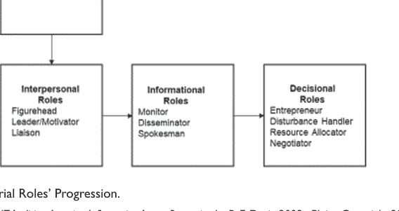

Figure 1.5 Managerial Roles’ Progression.

Note: Adapted from IT Auditing: Assuring Information Assets Protection by R. E. Davis, 2008a, Pleier. Copyright 2008 by Robert E. Davis. Adapted with permission.

经理的人际监护人、领导和联络角色使信息监控、传播和发言人角色得以实现（Davis, 2008a）。进而，信息角色使决策创业者、干扰处理者、资源分配者和谈判者角色得以实现（Davis, 2008a）。首席信息安全官通常需要采用所列的管理角色，以推动实体内有效高效的 ISG 部署。

### Formal Authority

没有问责的权威可能导致腐败行为（Davis, 2008a; Pitesa & Thau, 2013）。对程序性决策的问责提供了一种遏制权力自利结果的方式（Pitesa & Thau, 2013）。行政权力通常基于职位、强制、专业知识、友谊和奖励控制而运作（Davis, 2008a）。经理掌握的已知权力来源越多，实体员工越可能倾向于接受行政权威（Davis, 2008a）。

让经理对程序性决策负责是在道德风险下一种强有力的自利决策限制因素（Pitesa & Thau, 2013）。总之，已部署的 ISG 计划必须确保员工的道德行为（Davis, 2008a, 2017）。惩罚严重性、奖励重要性和控制确定性效应是在信息安全框架部署中严重的经理管理行为（Chen et al., 2012; Kolkowska & Dhillon, 2013）。

### Interpersonal Roles

经理承担组织受托责任，并承担受托责任以维持实体价值（Bagozzi et al., 2009）。实体价值应涉及关于整体形象感知和由行为监管指南构成的法令的道德（Bagozzi et al., 2009; Ferrell, 2005）。价值与原则和标准与义务论伦理的契合相关联（Bagozzi et al., 2009; Northouse, 2013）。实体经理领导者可以通过说服影响道德决策，并创造一种增强、激励并联系影响决策的文化（Bagozzi et al., 2009; Ferrell, 2005）。

员工是组织中实体利益相关者的一个重要群体（Ogunsakin, 2015）。信息安全经理的目标之一是领导下属员工实现组织目标（Ogunsakin, 2015）。然而，ISG 的益处超出了 IT 风险缓解和影响控制。良好的 ISG 可以提升实体的服务声誉，激发员工信心，并改善与价值链参与者的信任关系。此外，在从保障事件中恢复时，适当的信息安全实践可以通过避免浪费的时间和精力来提高效率。ISG 的开发和部署反映了实体指定的信息安全管理团队打算如何完成组织保障使命（Davis, 2008a, 2011; Whitman & Mattord, 2012）。

员工决策对实现 ISG 目标至关重要（Davis, 2008a）。目标一致性是决策质量的影响因素（Davis, 2008a）。如果决策质量至关重要且下属不共享相同的 ISG 目标，经理领导者将面临失去对分配活动的控制（Davis, 2008a），这可能产生有害的组织影响。因此，员工目标不一致可能使 ISG 决策质量次优（Davis, 2008a）。因此，经理领导者必须确保员工接受并遵守 ISG 目标（Davis, 2008a）。为此，组织经理领导者应深入了解实体环境、流程和组织目标以

使信息安全服务供给与组织需求相符 (Flores et al., 2014).

### 信息性角色

有效的治理结构建立包括部署适当的权限和责任，并对活动承担充分的问责。有益的是，关于实体的方向和目的，当责任、问责和权限得到适当调整时，通过减少熵和误解，沟通效率得以提高。此外，管理层对 IAP 控制的监控部署有助于确保与利益相关者的受托责任关系的履行。作为实体整合资源，IT 部署应按管理要求进行，并具备足够的正式性、覆盖范围和控制完整性，以允许进行 IAP 监控。

从根本上讲，信息构建依赖于可用数据 (Davis, 2008a)。之后，通过数据处理，所产生的信息为决策创造知识。鉴于 IT 对于提供处理效率、沟通便捷性和信息可靠性不可或缺，管理层应通过实体的 ISG 计划来治理信息资产的保护。适当安全性的一个基本要素是保护机制 (Davis, 2017; Sen & Borle, 2015)。有一种看法认为，缺乏关注和支持会导致信息安全漏洞 (Davis, 2017)。组织需要对各种技术、人员和组织信息安全管理挑战采取平衡的方法 (Singh et al., 2013)。

有效的 ISG 涵盖所有有形和无形的信息系统要素，无论其是否涉及员工、技术，或与交易伙伴、客户或第三方 的关系 (Davis, 2017)。因此，有效的 ISG 在定义的数据保护边界内处理整个信息生命周期中的保护活动。系统边界通常反映外部输入和由此产生的输出。作为规避起诉的机制，部署解决 IAP 的卓越 ISG 框架可以显著降低法律风险 (Davis, 2008a)。

标准的责任应直接对应于分配的活动 (Davis, 2008a, 2017)。因此，问责要求在分配责任的背景下确保适当行使的权限 (Davis, 2008a, 2017)。传达期望的最终责任在于实体的管理者领导。组织信息和沟通具有员工责任和报告结构。正式组织结构可以负责制度化社会行为并反映实体环境中的组织规则、社会规范和文化信仰，统称为组织文化 (Luesebrink, 2011)。正式组织结构通常反映与法律、法规、政策、指令、程序、标准和规则相关的构建 (Davis, 2008a, 2017; Flores et al., 2014; Kearney & Kruger, 2013)。非正式组织结构反映了在实践中管理人们如何共同工作的相互交织的社会构成 (Davis, 2017; Flores et al., 2014)。

### 决策性角色

实施和维护 ISG 结构需要实体各层级员工的承诺，并需要时间和资源用于管理和实施。流程纪律应成为管理层关注的问题 (Davis, 2008b)。然而，没有任何变更、配置或发布流程能够保证安全服务目标的实现。

### 参考文献

- Beebe, N. L., Young, D. K., & Chang, F. R. (2014). 构建信息安全预算请求以影响投资决策. Communications of the Association for Information Systems, 35(7), 134-144. https://doi.org/10.17705/1CAIS.03507
- Behr, K., Kim, G., & Spafford, G. (2005). 可见运维手册：分 4 个实用步骤启动 ITIL (Rev. 1st). Information Technology Process Institute.
- Blakley, B., McDermott, E., & Geer, D. (2001, September). 信息安全即信息风险管理. Proceedings of the 2001 workshop on New security paradigms, 97-104. https://doi.org/10.1145/508171.508187
- Boritz, J. E., & Datardina, M. (2019). 信息完整性控制框架. Chartered Professional Accountants of Canada.
- Boyson, S. (2014). 网络供应链风险管理：革新关键 IT 系统的战略控制. Technovation, 34, 342-353. https://doi.org/10.1016/j.technovation.2014.02.001
- Brotby, K. W. (2006). 信息安全治理：董事会和高级管理层的指导 (2nd ed.). IT Governance Institute.
- Brotby, K. W. (2009). 信息安全治理：一种实用的开发与实施方法. John Wiley & Sons.
- Cegielski, C. G., Bourrie, D. M., & Hazen, B. T. (2013). 评估新兴 IT 在企业 IT 战略中的采用：使用定性方法开发模型. Information Systems Management, 30, 235-249. https://doi.org/10.1080/10580530.2013.794632
- Chatterjee, S., Sarker, S., & Valacich, J. S. (2015). 信息系统安全的行为根源：探索与不道德 IT 使用相关的关键因素. Journal of Management Information Systems, 31(4), 49-87. https://doi.org/10.1080/07421222.2014.1001257
- Chelliah, J., Boersma, M., & Klettner, A. (2015, January). 非营利组织的治理挑战：支持权变方法的实证证据. Australasian Conference on Business and Social Sciences 2015, Sydney, 47-59.
- Chen, Y., Ramamurthy, K., & Wen, K. (2012). 组织信息安全政策合规性：胡萝卜还是大棒？ Journal of Management Information Systems, 29(3), 157-188. https://doi.org/10.2753/MIS0742-1222290305
- Cheney, G., Santa Cruz, I., Peredo, A. M., & Nazareno, E. (2014). 工人合作社作为组织替代方案：商业治理与所有权中的挑战、成就与前景. Organization, 21(5), 591-603. https://doi.org/10.1177/1350508414539784
- Chou, D. C. (2015). 云计算：价值创造模型. Computer Standards & Interfaces, 38, 72-77. https://doi.org/10.1016/j.csi.2014.10.001
- Clark, M., & Harrell, E. C. (2013). 与国际象棋不同，网络攻击后每个人都必须继续游戏. Journal of Investment Compliance, 14(4), 5-12. https://doi.org/10.1108/JOIC-10-2013-0034
- Committee of Sponsoring Organizations of the Treadway Commission (2013). 内部控制整合框架 (Executive Summary). www.coso.org/Pages/default.aspx
- Connell, B., Mallett, R., Rochet, P., Chow, E., Savino, L., & Payne, P. (2004). 企业治理：取得平衡. International Federation of Accountants.
- Crossler, R. E., Johnston, A. C., Lowry, P. B., Hu, Q., Warkentin, M., & Baskerville, R. (2013). 行为信息安全研究的未来方向. Computers & Security, 32, 90-101. https://doi.org/10.1016/j.cose.2012.09.010
- Davis, R. E. (2006). IT 审计：不规则和非法行为. Pleier.
- Davis, R. E. (2008a). IT 审计：确保信息资产保护. Pleier.
- Davis, R. E. (2008b). IT 审计：IT 服务交付与支持. Pleier.
- Davis, R. E. (2009a). IT 审计：业务连续性和灾难恢复. Pleier.
- Davis, R. E. (2009b). IT 审计：系统和基础设施生命周期管理. Pleier.
- Davis, R. E. (2010). IT 审计：一种自适应系统. www.amazon.com
- Davis, R. E. (2011). 确保 IT 治理. www.amazon.com
- Davis, R. E. (2012). 确保信息安全. www.amazon.com
- Davis, R. E. (2013). 确保 IT 法律合规. Lulu.
- Davis, R. E. (2017). 美国公司公司治理与信息安全治理有效性之间的关系 (Publication No. 10603383) [Doctoral Study, Walden University]. ProQuest Dissertations Publishing.


Davis, R. E. (2020). 基于系统视角的IT审计. IGI Global.

De Haes, S., Grembergen, W. V., & Debreceny, R. S. (2013). COBIT 5与企业信息技术治理：构建模块与研究机遇. Journal of Information Systems, 27(1), 307–324. https://doi.org/10.2308/isys-50422

Deschamps, J. (2013a，5月). 创新治理中使用的9种不同模式. Innovation Management. https://innovationmanagement.se/2013/05/08/9-different-models-in-use-for-innovation-governance

Deschamps, J. (2013b，5月). 什么是创新治理？：定义与范围. Innovation Management. https://innovationmanagement.se/2013/05/03/what-is-innovation-governance-definition-and-scope

Di Gregorio, D. (2013). 价值创造与价值获取：一个综合性的多层次框架. The Journal of Applied Business and Economics, 15, 39–53. www.na-businesspress.com

Fay, J. J., & Patterson, D. (2017). 信息安全管理. 载于《当代安全管理》（第4版，第353–390页）. Butterworth Heinemann. https://doi.org/10.1016/B978-0-12-809278-1.00017-7

Ferrell, O. C. (2005). 理解组织伦理的框架. 载于R. A. Peterson & O. C. Ferrell（主编），《商业伦理：商学院与企业领袖面临的新挑战》（第3–17页）. M. E. Sharpe.

Flores, W. R., Antonsen, E., & Ekstedt, M. (2014). 组织中的信息安全知识共享：探究行为信息安全治理与民族文化的影响. Computers & Security, 43, 90–110. https://doi.org/10.1016/j.cose.2014.03.004

Gërvalla, M., Preniqi, N., & Kopacek, P. (2018). IT基础设施库（ITIL）框架在IT治理中的应用方法. IFAC-PapersOnLine, 51(30), 181–185. https://doi.org/10.1016/j.ifacol.2018.11.283

Gheorghe, M. (2010). IT治理审计方法论. Informatica Economica, 14(1). http://revistaie.ase.ro/

Gil-Lafuente, A., & Paula, L. B. (2013). 应用于利益相关者识别的算法. Kybernetes, 42, 674–685. https://doi.org/10.1108/K-04-2013-0073

Harrison, J. S., & Wicks, A. C. (2013). 利益相关者理论、价值与企业绩效. Business Ethics Quarterly, 23, 97–124. https://doi.org/10.5840/beq20132314

Heracleous, L., & Lan, L. L. (2012). 代理理论、制度敏感性与归纳推理：迈向法律视角. Journal of Management Studies, 49, 223–239. https://doi.org/10.1111/j.1467-6486.2011.01009.x

Humaidi, N., & Balakrishnan, V. (2015). 领导风格与信息安全合规行为：信息安全意识的中介效应. International Journal of Information and Education Technology, 5(4), 311–318. https://doi.org/10.7763/IJIET.2015.V5.522

IT Governance Institute. (2003). IT治理董事会简报（第2版）. Author.

IT Governance Institute. (2008). 信息安全治理：为信息安全管理者提供的指南. Author.

Julisch, K. (2013). 理解并克服网络安全反模式. Computer Networks, 57, 2206–2211. https://doi.org/10.1016/j.comnet.2012.11.023

Kearney, W. D., & Kruger, H. A. (2013). 良好公司治理与组织学习的框架：一项实证研究. International Journal of Cyber-Security and Digital Forensics, 2, 36–47. http://sdiwc.net

Kolkowska, E., & Dhillon, G. (2013). 组织权力与信息安全规则遵从. Computers & Security, 33, 3–11. https://doi.org/10.1016/j.cose.2012.07.001

Kotter, J. P. (2001). 领导者真正做什么. Harvard Business Review, 79(11), 85–96. http://hbr.org/magazine

Kushwaha, P. (2016). 信息安全管理体系与商业范式转变的融合. International Journal of Computer Science and Information Security, 14(1), 105–111. https://sites.google.com/site/ijcsis

Lee, M., & Lee, J. (2012). 信息安全失效对客户行为的影响：基于互联网上大规模黑客事件的研究. Information Systems Frontiers, 14, 375–393. https://doi.org/10.1007/s10796-010-9253-1

Luesebrink, M. (2011). 学术机构中信息安全治理结构的制度化：案例研究 [博士论文，佛罗里达州立大学]. http://purl.flvc.org/fsu/fd/FSU_migr_etd-1009

Maccoby, M. (2000). 理解管理与领导之间的差异. Research Technology Management, 43(1), 57–59. www.iriweb.org

Marnewick, C., & Labuschagne, L. (2011). 南非信息技术项目治理的调查研究. International Journal of Project Management, 29(6), 661–670. http://dx.doi.org/10.1016/j.ijproman.2010.07.004

Mohare, R., & Lanjewar, U. (2012). 商业信息安全的决定因素. International Journal of Marketing and Technology, 2(7), 203–209. www.ijmra.us

Nastasiu, C. I. (2016，7月). 互联网时代的网络安全战略. Proceedings of the Scientific Conference AFASES 2, 619–624. https://doi.org/10.19062/2247-3173.2016.18.2.19

Nishimura, A. (2006). 前馈控制视角下的企业治理与管理会计. Asia-Pacific Management Accounting Journal, 1(1), 1–17. http://arionline.uitm.edu.my

Northouse, P. G. (2013). 领导力：理论与实践（第6版）. Sage.

Nugroho, H. (2014). 基于Cobit 5框架的高等教育IT治理概念模型. Journal of Theoretical & Applied Information Technology, 60(2). www.jatit.org

Ogunsakin, O. (2015). 员工对信息技术管理者中管理变革型领导行为及其有效性的感知（出版号 3711019）[博士论文，瓦尔登大学]. ProQuest Dissertations Publishing.

Pagani, M. (2013). 数字商业战略与价值创造：构建控制点的动态循环. MIS Quarterly, 37, 617–632. www.misq.org

Palilingan, V. R., & Batmetan, J. R. (2018). 基于ITIL框架的学术信息系统事件管理. 2nd International Conference on Innovation in Engineering and Vocational Education 2017, Manado, 1–9. https://doi.org/10.1088/1757-899X/306/1/012110

Pfaff, O., & Ries, S. (2014). 企业安全基础设施与云计算的集成. Journal of Internet Technology and Secured Transactions, 3, 338–343. www.infonomics-society.org

Pitesa, M., & Thau, S. (2013). 宇宙的主宰：在道德风险下，权力与问责如何影响自利决策. Journal of Applied Psychology, 98, 550–558. https://doi.org/10.1037/a0031697

Posey, C., Roberts, T. L., Lowry, P. B., & Hightower, R. T. (2014). 弥合鸿沟：信息安全专业人员与普通组织内部人员信息安全思维模式的定性比较. Information & Management, 51, 551–567. https://doi.org/10.1016/j.im.2014.03.009

Rasheed, S., ChangFeng, W., & Yaqub, F. (2015). 迈向项目群风险管理与感知的风险管理障碍. International Journal of Hybrid Information Technology, 8, 323–338. https://doi.org/10.14257/ijhit.2015.8.5.35

Safa, N. S., Sookhak, M., Solms, R. V., Furnell, S., Ghani, N. A., & Herawan, T. (2015). 组织中信息安全自觉谨慎行为的形成. Computers & Security, 53, 65–78. https://doi.org/10.1016/j.cose.2015.05.012

Safa, N. S., & Von Solms, R. (2016). 组织中的信息安全知识共享模型. Computers in Human Behavior, 57, 442–451. https://doi.org/10.1016/j.chb.2015.12.037

Safa, N. S., Von Solms, R., & Furnell, S. (2016). 组织中的信息安全政策合规模型. Computers & Security, 56, 70–82. https://doi.org/10.1016/j.cose.2015.10.006

Sallé, M. (2004). IT服务管理与IT治理：回顾、比较分析及其对效用计算的影响. Hewlett-Packard.

Samonas, S., & Coss, D. (2014). CIA反击：重新定义安全中的机密性、完整性与可用性. Journal of Information System Security, 10(3), 21–45. www.jissec.org/

Schatz, D., Bashroush, R., & Wall, J. (2017). 迈向更具代表性的网络安全定义. Journal of Digital Forensics, Security and Law, 12(2), 53–74. https://doi.org/10.15394/jdfsl.2017.1476


Sen, R., & Borle, S. (2015). 估算数据泄露的背景风险：一种实证方法. 管理信息系统期刊, 32, 314–341. https://doi.org/10.1080/07421222.2015.1063315

Silic, M., & Back, A. (2014). 信息安全：关键回顾与未来研究方向. 信息管理与计算机安全, 22, 279–308. https://doi.org/10.1108/IMCS-05-2013-0041

Sindhuja, P. N. (2014). 信息安全举措对供应链绩效的影响：一项实证调查. 信息管理与计算机安全, 22, 450–473. https://doi.org/10.1108/IMCS-05-2013-0035

Singh, A. N., Picot, A., Kranz, J., Gupta, M. P., & Ojha, A. (2013). 信息安全管理（ISM）实践：来自印度和德国特定案例的教训. 全球灵活系统管理期刊, 14, 225–239. https://doi.org/10.1007/s40171-013-0047-4

Sonnenreich, W., Albanese, J., & Stout, B. (2006). 安全投资回报（ROSI）——一个实用的定量模型. 信息技术研究与实践期刊, 38(1), 45–56. https://50years.acs.org.au/digital-archive/jrpit.html

Srivastava, H., & Kumar, S. A. (2015). 安全云计算的控制框架. 信息安全期刊, 6, 12–23. https://doi.org/10.4236/jis.2015.61002

Stilgoe, J., Owen, R., & Macnaghten, P. (2013). 制定负责任创新的框架. 研究政策, 42(9), 1568–1580. https://doi.org/10.1016/j.respol.2013.05.008

Stürmer, I., Weinberg, D., & Conrad, M. (2005). 现有自动生成代码保护技术概述. ACM SIGSOFT 软件工程笔记, 30(4), 1–6. https://doi.org/10.1145/1082983.1083192

Vähäkainu, P., & Lehto, M. (2019年2月). 网络安全环境中的人工智能. 载于 N. van der Waag-Cowling 与 L. Leenan（编），ICCWS 2019 第14届网络战争与安全国际会议：ICCWS 2019（第431–440页）. 国际学术会议出版社.

Van der Stede, W. (2010年1—3月). 企业治理. 巴基斯坦公共财政会计师学会期刊, 12–13. http://pipfa.org.pk/

Viadar, A. M., & Espina, M. I. (2014). 非营利组织是否正在向营利组织学习？对治理的审视. 公司治理, 14(1), 1–14. https://doi.org/10.1108/CG-11-2012-0083

Wang, T., Ulmer, J. R., & Kannan, K. (2013). 信息安全漏洞媒体报道的文本内容与盈利性短期投资机会. 组织计算与电子商务期刊, 23, 200–223. http://dx.doi.org/10.1080/10919392.2013.807712

Weill, P., & Ross, J. W. (2004). IT治理：顶尖企业如何管理IT决策权以获得卓越成果. 哈佛商学院出版社.

Whitman, M. E., & Mattord, H. J. (2012). 面向非安全业务高管的信息安全治理. 高管教育期刊, 11, 97–111. http://digitalcommons.kennesaw.edu

Williams, S. P., Hardy, C. A., & Holgate, J. A. (2013). 关键基础设施组织中的信息安全治理实践：社会技术与制度逻辑视角. 电子市场, 23, 341–354. https://doi.org/10.1007/s12525-013-0137-3

Wu, S. P. J., Straub, D. W., & Liang, T. P. (2015). 信息技术治理机制与战略对齐如何影响组织绩效：来自业务与IT经理匹配调查的见解. MIS季刊, 39(2), 497–518. https://doi.org/10.25300/MISQ/2015/39.2.10

Yaokumah, W. (2013). 评估发展中国家信息安全治理实践的有效性：加纳案例（出版号3557634）[学位论文，卡佩拉大学]. ProQuest 学位论文出版.

Yaokumah, W., & Brown, S. (2014). 信息安全/业务战略对齐与信息安全治理领域之间关系的实证检验. 商业系统、治理与道德期刊, 9(2), 50–65. https://doi.org/10.15209/jbsge.v9i2.718

### 推荐阅读

Chelliah, J., Boersma, M., & Klettner, A. (2016). 非营利组织的治理挑战：支持权变方法的实证证据. *当代管理研究, 12*(1), 3–24. https://doi.org/10.7903/cmr.14538

Dawson, J., & Thomson, R. (2018). 未来网络安全人才队伍：超越技术技能以实现成功的网络表现. *心理学前沿, 9*(744), 1–12. https://doi.org/10.3389/fpsyg.2018.00744

De Haes, S., Van Grembergen, W., Joshi, A., & Huygh, T. (2020). *信息技术企业治理：在数字化组织中实现对齐与价值*（第3版）. 施普林格.

Diesch, R., Pfaff, M., & Krcmar, H. (2020). 面向决策者的信息安全因素综合模型. *计算机与安全, 92*, 101747. https://doi.org/10.1016/j.cose.2020.101747

Olifer, D., Goranin, N., Kaceniauskas, A., & Cenys, A. (2017). 基于控制的信息安全标准实施成本评估方法. *技术与经济发展, 23*(1), 196–219. https://doi.org/10.3846/20294913.2017.1280558

## 第2章
### 安全治理环境

组织形态反映了个人目标、价值观、期望和情感，这些要素转化成为一种文化。从功能主义视角来看，组织领导力、文化、氛围与环境之间存在联系。作为同等的控制环境因素，管理层的认知和行动体现了领导力和沟通强度。此外，政府继续制定法律，而监管环境因不可接受行为的整改而变得更加复杂。旨在确保可接受风险应对的管控和监控活动包括政策、指令、标准、程序和规则。管理层对管控和监控的理念反映了广泛的信念、概念和态度，这些理念显著影响实体的必要政策并决定组织文化。第2章讨论了控制环境以及政府—实体—审计领域趋同的以实体为中心的考量。此外，第2章将法律问题、管理实践、控制铭文和技术部署呈现为实体风险决定因素。

实体的环境代表了围绕并影响组织活动的所有条件（Davis, 2008a）。大多数实体所处的环境由感知到的利益相关者价值观以及实体自身的价值观、使命和愿景所决定（Hu et al., 2012）。此外，社区与组织的伦理和文化、适用的法律、法规、政策和行业实践都会影响实体人员（Davis, 2008a; Hu et al., 2012; IT治理研究所, 2003）。在与环境互动时，管理领导者努力维持实体文化，同时尝试控制影响致力于实现实体使命的项目、系统和流程的内外部因素（Davis, 2008a; Steiger et al., 2014）。在系统理论中，所寻求的可持续性代表了管理领导者试图最小化动态稳态文化效应（Davis, 2008a）。

从语境来看，动态稳态意味着系统始终处于一种不断变化的活动状态，在某个变化点上可以达到平衡状态（Davis, 2008a）。因此，作为回应，组织单位的管理领导者通常依靠适应性过程来恰当应对不断变化的环境状况（Davis, 2008a）。动态稳态是通过相对开放的系统达成的稳定状态（Davis, 2008a）。开放系统状态源于接收系统外部的输入，该输入至少等于系统输出与资源消耗之和（Davis, 2008a）。所有组织单位在某种程度上都是开放系统，因为任何单位都无法在不与周围环境要素互动的情况下运作（Davis, 2008a）。


从衍生角度看，实体既定的信息控制环境必须实现动态平衡，否则可能面临管理混乱（Davis, 2008a）。

控制规划能够预测未来的组织方向和关键影响，并在考虑实体优势、劣势和可预见趋势的基础上，得出实现控制目标的最佳策略（Davis, 2008a, 2010）。此外，控制规划过程将战略转化为可衡量和可操作的计划，然后将操作计划再转化为政策、程序、指令、标准和规则（Davis, 2008a, 2010; Edwards, 2013）。尽管如此，信息为实体管理领导者提供了适当应对特定环境条件的资源（Davis, 2008a）。实体环境风险评估中所使用的信息可以确定控制实施的关键性（Davis, 2008a）。

合规性表明了对预期行为的接受。法律合规是管理层一项基本的受托责任（Davis, 2008a）。然而，仅靠法律合规并不足以确保适当的控制环境（Davis, 2008a）。控制措施可以通过影响员工行为（Atoum 等, 2014; Davis, 2017）和 IT 配置来提高信息安全部署的有效性。管理层需要了解实体控制系统的状态，以决定需要采取哪些控制部署来满足组织要求。

在促进实体治理方面，控制环境部署了组织、人员、政策、程序、会计、预算、报告和内部控制审查（Davis, 2008a, 2010, 2020）。实体的 ISG 计划需要传达管理层对控制环境的态度、意识和行动（Davis, 2008a）。外部因素常常影响实体的环境（Davis, 2008b）。影响实体实现目标能力的具体外部因素包括经济、社区、政府、技术、竞争对手、供应商和客户（Davis, 2008b）。因此，在采取影响实体控制系统的行动方案之前，必须对外部环境进行准确评估（Davis, 2008b）。换言之，信息安全管理应确保充分部署 ISG 计划（Davis, 2008a）。本章在构建 ISG 和网络安全治理计划时提供了主要的实体环境考虑因素。

### 以实体为中心的考虑因素

领导力对任何实体而言都是一个至关重要的概念（Anderson, 2015）。领导力概念的含义因情境而异（Anderson, 2015）。从功能主义视角来看，组织领导力、文化、氛围和环境之间存在着联系（Sarros 等, 2008）。功能主义的支持者断言，组织领导者是通过有意义且明显的行动或被赋予的象征性职位而成为社会工程师的（Sarros 等, 2008）。因此，领导力是影响人们自愿或不自愿地为实现群体目标和适应变化而努力的过程或行为（Northouse, 2013）。

组织领导者有明确的动机去识别并纠正其实体的实际文化与期望文化之间的任何差异或差距。当文化价值观之间存在差异或差距时，员工态度可能会形成，从而阻碍绩效；抑制动机；并导致更大的不满、离职率和压力水平（Posner, 2010）。管理领导者必须理解他们在推进组织文化方面的影响；确定部署一种文化所需的必要计划、系统和流程；并采取必要行动来营造健康的组织文化。实体的氛围和相关环境应反映一种促进跨流程合作与团队协作、支持合规和持续流程改进、并妥善管理流程变化的文化（Davis, 2008a; Haag & Cummings, 2008）。当追随者完成体现文化期望的组织任务时，有效领导力便得以实现。

组织文化指明了对实体环境变化做出反应的方式，
- 模仿过程，源于模仿性行为，作为对实体环境中不确定性和变化的反应；
- 规范压力，关注社会行为和专业标准如何应对实体环境中的组织变化（Luesebrink, 2011）。

组织氛围是实体中与政策、程序和实践相关的通常或最普遍的情绪或状况（Chernyak-Hai & Tziner, 2014）。组织氛围感知是主动心理过程的一部分，有助于员工识别行为期望和奖励（Chernyak-Hai & Tziner, 2014）。实体的氛围通过组织文化来启用或阻碍足够的组织任务完成和群体维护（Davis, 2008a; Northouse, 2013; Sarros 等, 2008）。组织环境通过实体氛围中被接受的社会规范影响员工的有效性归因（Sarros 等, 2008）。组织氛围感知反映了员工对工作环境的印象，并影响工作满意度、压力水平、承诺和绩效，进而对实体整体生产力产生影响（Chernyak-Hai & Tziner, 2014）。

组织环境反映了影响员工生活的总体社会和文化条件（Rasheed 等, 2015）。应对制度变革需要在理解变革带来的机会和威胁以及关系中的权力差异之后做出战略选择（Akpinar, 2017）。转移、规避、减少和接受是对环境变化的潜在 IAP 战略响应类型（Davis, 2008a）。战略响应选择类型可以预测哪些因素会影响关系策略选择和所行使的权力类型（Akpinar, 2017）。实体的管理领导者应响应环境变化，以实现组织的生存和成功（Akpinar, 2017）。

### 实体控制环境

实体控制环境反映了最高管理层相对于合规要求和绩效要求的态度（Davis, 2008a）。作为同等的控制环境因素，管理层的意识和行动表达了领导力和沟通强度（Davis, 2008a）。实体的控制环境应支持适当的控制部署（Davis, 2008a）。对于一个实体而言，控制包含用于指导、约束、治理和监督组织活动的所有手段（Davis, 2006, 2008a）。

实体控制系统受到控制环境的显著影响（Davis, 2008b）。实体的控制环境设定了治理基调，并影响控制技术的有效性（Davis, 2008b）。实体的管理领导者可以提供基础性的控制环境因素，例如价值观和态度（Davis, 2008b）。价值观和态度代表了对哪些行为是可取的或不可取的观点（Davis, 2008b）。行为指的是一个人的行事方式（Davis, 2008b）。个人和群体行为会因与所谓的通用价值体系和特定的态度认同相关联而受到影响（Davis, 2008b）。由于价值观和态度需要从实际行为、口头描述或书面陈述中推断无形的品质，因此它们是模糊的证据性概念（Davis, 2008b）。

在实体层面，控制意识受到监督委员会成员的显著影响（Davis, 2008b）。对实体环境、管理问题、任务、职责和组织差异的认识与控制意识相关。因此，参与实体监督的人员的理想集体特征应包括：独立于管理层、经验丰富、地位高、对活动和审查表现出参与度、适当的情境行动、良好的知识管理、有效的行政评估技巧，以及与内部和外部审计师的互动（Davis, 2008b）。

制定实务准则和其他有助于确保适当实体监督的法规或指南，突显了治理责任人的责任重要性（Davis, 2008b）。治理责任人被规定的主要职责包括监督程序的设计和有效运行，以及审查控制系统有效性的过程（Davis, 2008b）。因此，实体的监督委员会应指导信息安全管理者实现可衡量的服务和支持价值，方法包括：
- 交付适当的服务质量，
- 增强服务成本与效率的关系，
- 使客户对所提供的服务建立信任，以及
- 实现具有竞争力的信息安全重新部署时间。

当与受托责任综合考虑时，实体的总体 IT 目标通常显著增加（Davis, 2008b）。如表 2.1 所示，实体的不同总体 IT 目标可以通过建立各种信息标准来实现，这些标准构建了统一的关注焦点，以满足以实体为中心的需求（Davis, 2008b）。从根本上说，IT 控制环境应有助于使实体的治理机构能够

表 2.1 信息标准与 IT 目标的对应关系

| 标准 | 运营 |  |  | IT | 合规 |  |  |
|---|---|---|---|---|---|---|---|
|  | 有效性 | 效率 | 经济性 | 可靠性 | 法律 | 法规 | 政策 |
| 有效性 | X |  |  |  |  |  |  |
| 效率 |  | X | X |  |  |  |  |
| 保密性 |  |  |  | X |  |  |  |
| 完整性 |  |  |  | X |  |  |  |
| 可用性 |  |  |  | X |  |  |  |
| 合规性 |  |  |  |  | X | X | X |
| 可靠性 |  |  |  | X |  |  |  |

注：X 表示适用。


管理层以及所有其他员工在为实现以下目标提供合理保证时：

- 运营效率，体现了在考虑组织目标时的任务执行便捷性（Davis, 2008b）。
- 运营有效性，即利用可用资源实现组织目标的有效性（Davis, 2008b）。
- 运营经济性，即在实现组织目标的成本效益关系中使收益最大化（Davis, 2008b）。
- IT 可靠性的维持，即在追求组织目标时，在指定环境中于特定时期内保持可靠性（Davis, 2008b）。
- 法律法规合规性，以降低原告提起刑事或民事诉讼以及罚款和处罚的风险（Davis, 2008b）。
- 内部政策合规性，以符合管理层对组织单位的意图（Davis, 2008b）。

技术已经并将继续承担变革推动者的角色，并影响实体控制环境（Davis, 2008a; Hirschheim & Klein, 2012; Wiener et al., 2019）。技术开发与部署同实体控制环境中普遍存在的社会、政治、经济和信息因素有着不可分割的联系（Davis, 2008a）。实体控制环境通常通过评估敏感性、关键性或影响来管理控制重点（Davis, 2008a）。因此，管理领导者不能忽视技术进步（Davis, 2008a）。

以电子方式传递的信息是管理决策的主要催化剂（Davis, 2008a; Wiener et al., 2019）。精明的实体高管确保IT部署提供持续的信息和流程保护（Davis, 2008a）。通常，高管管理层没有责任理解技术细节，例如数字版权基础知识或电子签名的复杂性（Davis, 2008a）。此外，信息不对称与信息安全服务有效性呈正相关（Wu & Saunders, 2016）。然而，高层管理者必须坚持要求获取有关安全部署的管理信息、现有保护流程的支持证据，并提供适当的功能（Davis, 2008a）。

存在外部和内部环境利益相关者（Kinicki & Williams, 2013）。进一步细分，外部利益相关者可分为一般环境和任务环境两类（Kinicki & Williams, 2013）。一般环境包括商业、技术、社会文化、人口、政治法律和全球力量（Kinicki & Williams, 2013）。而任务环境包括员工协会、客户、供应商、分销商、战略联盟、当地社区、竞争对手、金融机构、政府监管机构、特殊利益集团和大众媒体（Kinicki & Williams, 2013）。相比之下，内部公司利益相关者由员工、所有者和实体董事会组成（Kinicki & Williams, 2013）。尽管如此，利益相关者从实体归属效用、公平认知和机会成本感知中获取价值（Harrison & Wicks, 2013）。

利用演绎方法，通过识别正式制度背景并将委托-代理关系纳入基于代理的模型，可以将代理理论扩展到多样化的环境中（Wiseman et al., 2012）。综合来看，利益相关者-代理理论解释了为什么管理领导者可能忽视或忽略利益相关者的利益（Tashman & Raelin, 2013）。值得注意的是，研究利益相关者-代理理论的学者认为，市场摩擦可能导致零散契约，从而使管理层对什么和谁对实体重要的抽象认知错位（Tashman & Raelin, 2013）。例如，高层管理团队可能投入财务资源部署一个全实体范围的ISG计划，以确保适当的IAP，但管理领导者却不使用安全防护措施或其他ISG计划方面（Garba et al., 2015; Kushwaha, 2016）。

预算是根据计划活动记录资源分配的过程（Davis, 2008a）。实体的监督委员会应确保划拨足够资源以维持ISG（Davis, 2008a）。划拨足够的ISG资源并不要求负责治理的人员检查预算分配模型的完整性（Davis, 2008a）。ISG的绩效、合规性和目标因制度环境而异（Williams et al., 2013）。因此，已部署的信息安全计划可以是以实体为中心且全面的（Davis, 2008a; Edwards, 2013; Mohare & Lanjewar, 2012）。然而，管理领导者应就充足的信息安全资源的提供和使用征求审计专业人士的独立意见（Davis, 2008a）。

安全责任的传递可以通过委托方或法定法令进行（Davis, 2008a）。外部利益相关者或内部管理层是委托方，将实体资产的安全责任委托给他人（Davis, 2008a）。相比之下，法定法令是可执行的法律或法规，可以施加个人或代理人的安全责任，通常带有具体的目标识别（Davis, 2008a）。无论是受委托方委托还是依据法定法令，安全责任通常转化为满足管理期望的运营和技术要求，并一般通过目的和目标制度化（Davis, 2008a）。

从概念上讲，组织控制目标有助于实现实体控制环境的目标（Davis, 2008a）。作为一项实体目标，控制环境应有助于使治理机构、管理层以及所有其他员工能够就信息安全责任的实现提供合理保证，具体包括：

- 保密性，体现了对访问和披露的授权限制的维护；
- 完整性，防止不当修改或破坏；
- 可用性，维持及时且可靠的访问和使用（Davis, 2008a）。

当存在共生性实体控制环境时，保护信息资产应成为ISG的主要焦点（Davis, 2008a）。如表2.2所述，保密性、完整性和可用性是以信息安全三元组模型（Samonas & Coss, 2014）表示的标准（Davis, 2008a）。负责实体控制环境的管理领导者在追求组织目的和目标时，应考虑信息安全标准（Davis, 2008a）。采用信息安全标准是一种赋能因素，有助于构建处理实体事务的控制环境（Davis, 2008a）。相应地，管理领导者通常依赖信息可靠性，

### 表2.2 信息安全标准与信息可靠性目标的对应关系

| 信息标准 | 信息可靠性目标 |
|---|---|
| 保密性 | X |
| 完整性 | X |
| 可用性 | X |

注：X = 适用性

尤其是在传达指令、提供分析以及回应有关实现实体目标的询问时（Davis, 2008b）。将公认的信息安全标准映射到信息可靠性目标，阐明了受控环境在追求满足信息目标时支持信息安全标准的相关性（Davis, 2008a）。

### 信息保密性标准

信息保密性价值是一个以实体为中心的问题，需要反映管理层的期望（Davis, 2008a）。将保密性价值观制度化，要求员工遵守标准化可接受行为的道德体系或准则（Davis, 2008a）。人们普遍期望，一旦分配了需要使用组织信息的工作职责，员工就能充分理解并接受以实体为中心的保密价值观（Davis, 2008a）。仅仅因为信息在实体内部产生，并不会自动赋予其保密分类（Davis, 2008a）。

维持IT保密性意味着维护所分配信息资产的隐私级别（Davis, 2008a）。适当的保密管理需要部署以实体为中心的信息资产分类系统（Davis, 2008a）。在考虑安全信息资产分类时，未经授权的数据披露可能对实体、客户或员工造成不利影响或处罚，应得到保密处理（Davis, 2008a）。在互联互通的世界中，隐私始于理解并保护信息系统和IT网络。因此，隐私是信息与网络安全治理的一个关注点，应得到适当的信息安全和网络安全计划考量。

### 信息完整性标准

与保密性价值一样，信息完整性价值是一个以实体为中心的问题，需要反映管理层的期望（Davis, 2008a）。如果准确性、完整性、及时性、有效性和处理方法得到持续保护，信息就保持完整性（Flowerday & Von Solms, 2007）。一般来说，信息完整性价值与内容所描绘的状况或主题的陈述忠实度相关（Boritz, 2005; Davis, 2008a; Flowerday & Von Solms, 2007）。信息在不利条件下的韧性是检验是否遵循公认完整性价值的试金石（Davis, 2008a）。

管理信息的完整性需要在实体控制环境中保持持续有效、完整和准确的属性（Boritz, 2005; Davis, 2008a）。具体而言，管理信息完整性在处理事务（如传达期望或与员工互动）时，必须在整个内容对应生命周期内，针对原始状况或主题展现出未受损害或无瑕疵的表征（Boritz, 2005; Davis, 2008a）。实现信息信任通常需要启用完整性管理（Davis, 2008b; Samonas & Coss, 2014）。当信息体现完整性时，管理领导者就能建立信任，并为依赖影响实体的决策提供基础（Davis, 2008a）。

### 信息可用性标准

可用性和IAP是两个对立状态，因为可用性旨在促进对信息的访问，而安全性旨在限制对信息的访问（Davis, 2008a）。然而，信息可用性通常要求采取适当的保护措施（Davis, 2008a）。可访问性和适当的信息安全是关键的处理问题（Boritz, 2005;

Davis, 2008a)。为了使信息保持最新、完整和及时，信息安全人员需按照规范维护用户可用性和可访问性（Boritz, 2005; Davis, 2008a; Samonas & Coss, 2014），以及在需要时以理想形式进行回收，是必要的（Boritz, 2005; Davis, 2008a）。

当被寻求时，不可访问的相关信息对用户决策或活动没有实际后果，除限制质量外（Boritz, 2005; Davis, 2008a）。用户实用性要求具备稳健的系统以呈现可信信息（Boritz, 2005; Davis, 2008a）。此类系统必须在需要时可用、能够进行用户配置修改、高效有效运行，以及适应信息分配调整（Boritz, 2005; Davis, 2008a）。

### 信息可靠性目标

总体而言，IT 可靠性代表在定义条件下维持规定可接受性能水平的能力（Davis, 2008a）。信息可靠性需要表征保真度，以确保断言与支持的 purported 事件一致（Davis, 2008a）。可靠性测量确定信息部署是否以适当的安全性进行（Davis, 2008a）。最低限度，技术中包含的信息在完整性、准确性和有效性属性可独立验证且用户中立时可以是可靠的（Boritz, 2005; Davis, 2008a）。信息完整性表明一项包含受信任可用性所需的所有数据元素和记录（Davis, 2008a）。信息准确性反映源头输入的精确现实数据生成，或从先前铭文复制而来（Davis, 2008a）。信息有效性意味着基本数据代表真实条件、规则或关系，而非物理对象特征（Boritz, 2005; Davis, 2008a）。

数据可靠性的实现通过可证实性实现。可证实性推断其他个人如何验证数据，以确保构建的信息反映实际事件的理解和经验，而非个人偏好。对信息的审计可以降低偏见的可能性，从而增加可靠性客观性保证。

### 领域融合效应

政府对法律的颁布持续进行，且由于不可接受行为的补救，监管环境变得更加复杂（Davis, 2013）。因此，实体必须具备证明其遵守法律授权的能力（Davis, 2013）。从手动到自动信息生成的迁移导致了裁决和判决，其中责任、罪责或无罪的判定完全或主要依赖于电子编码证据（Davis, 2013）。将 IT 生成的信息作为证据使用，从管理角度提出问题和挑战，可能需要通过有效的治理和审计来解决（Davis, 2013）。

全球范围内，法律和法规确保实体员工在开展组织事务时遵守社会对道德行为的期望（Brotby, 2006; Davis, 2008a）。保持利益相关者对实体使命的信心至关重要，治理部署需保护信息和相关技术免受不良事件影响（Davis, 2008a）。根据社会认知，会发生法规批准，以确保遵守对 IAP 的 perceived 管理、运营和技术责任（Davis, 2008a）。

解释性地，图 2.1 中下划线的标题命名了关系域，而三个圆圈内的内容是每个域的主题或子主题属性。政府域，即顶部中央圆圈，代表强加的法律和法规。实体域，即底部左侧圆圈，代表治理和相关

### 政府

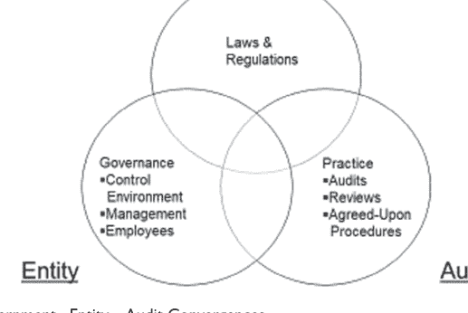

图 2.1 政府–实体–审计融合。

注：改编自 R.E. Davis 所著《IT 审计：确保信息资产保护》，2008a，Pfeiffer。版权 2008 归 Robert E. Davis 所有。经许可改编。

控制环境、管理以及员工考虑因素。最终，审计域，即底部右侧圆圈，代表审计、审查和约定程序的实践。圆圈的战略性放置说明了域间相互关系的重要性。在政府、实体和审计圆圈重叠处，合并的属性对于辨别组织效应至关重要。

### 政府-实体融合

团体构想规则、习俗和 prevailing 意见，可通过政府行动转化为法律（Davis, 2008a, 2013, 2020）。合规意味着行为期望的接受（Davis, 2008a, 2013, 2020）。期望行为的接受需要价值一致（Davis, 2008a, 2013, 2020）。一致通常是大多数社会的目标，无论法律或法规适用于团体还是个人行为（Davis, 2008a, 2013, 2020）。国际、国家或地方可执行的法律反映了社会的官方行为规范（Davis, 2008a, 2013, 2020）。对法律和法规的法律解释表明了相应社区的社会学趋势（Davis, 2008a, 2013, 2020）。与实体治理相关法律和法规类似，颁布和执行 ISG 授权的政治分支为活动提供行为期望一致性（Davis, 2008a, 2013, 2020）。作为规避起诉的机制，部署涵盖所有信息资产的卓越 ISG 框架可以降低法律风险（Davis, 2008a, 2013）。

总体而言，法律的主要功能包括影响和执行行为标准、维持现状、促进有序变革、提供最大个体自我主张、促进规划和合理期望实现、提供社会正义促进、妥协解决方案提供以及和平维护（Davis, 2008a）。然而，法律的应用可能存在 perceived 限制（Davis, 2008a）或需要裁决的延伸。此外，如果受影响的公民认为规则不合理，则 decreed 的行为期望很可能面临执行困难，或

专业审慎要求影响审计实践领域的法律授权必须在进行审计实地工作前由审计团队成员彻底理解（Davis, 2008a）。个人而言，审计师必须审查适用成文法、法规以及合同的合规性，并在参与审计时在适用情况下寻求法律指导（Davis, 2008a）。因此，通过与执业律师的初步讨论，审计师可以获得足够知识以识别非法行为指标（Davis, 2008a）。然而，不应期望财务或运营审计师具备以侦查和调查非法行为为主要责任的个人的专业知识（Davis, 2008a）。

关于法律和法规的合规性业务，首席审计师有权相信管理层已建立适当的控制以防止、阻止和检测非法行为，直到审计团队成员进行的评估和测试证明相反（Davis, 2008a）。专业上，审计团队成员必须谨慎行事，不得向除实体正式指定代表以外的人披露在业务中获取的信息（Davis, 2008a）。审计团队成员向个人披露业务信息，无论是否同意，均可能违反当时生效的保密或不披露协议（Davis, 2008a）。审计团队成员必须在整个业务期间保持警惕，注意适用于被审计实体的各种监管和法规问题，以确保提供遵守信息披露授权的合理保证（Davis, 2008a）。

最常见的审计实践法律和法规影响证据收集和保留（Davis, 2008a）。对于 decreed 法律合规审计，如果怀疑非法行为，审计团队成员必须确保满足证据法律授权，以成功向当局提供未受污染的物品用于起诉 alleged 行为人（Davis, 2008a）。此外，当审计师在国际范围内执行业务时，了解各种证据要求可能对维持专业审计实践至关重要（Davis, 2008a）。在大多数情况下，法律合规审计期间审计师可获得的审计证据应具有说服力而非结论性，以证明尽职调查。同时，保留期要求因司法管辖区而异（Davis, 2008a）。

### 实体-审计融合

实体治理透明度已成为有争议的主题（Davis, 2008a, 2011; Hess, 2007）。实体治理透明度的美德与信任和信誉相关联（Rawlins, 2008）。如果管理者领导者不提供可信信息，组织面临运营中断风险（Rawlins, 2008）。信息可靠性使管理者领导者能够运营实体并行使报告责任（Davis, 2008a）。通常，一致性是支持信息可靠性完整性的准确性子类别（Davis, 2008a）。通常，一致性是支持信息可靠性完整性的准确性子类别（Davis, 2008a）。一致性是指在相似情况下产生相似结果的清晰且离散的数据（Boritz, 2005; Davis, 2008a）。如果信息数据一致性存在并支持数据准确性，且数据准确性支持信息完整性，则持续的信息数据一致性决定了有助于满足信息可靠性目标的安全完整性部署的适当性。

有效的 IAP 在实现信息可靠性的战略决策制定中采用漏洞管理和威胁情报（Davis, 2008a）。实体 ISG 项目管理者领导者应整合与运营目标和保护要求战略一致的 IAP（Davis, 2008a）。管理者领导者需要确保 IAP

ISG项目中的最佳实践部署（Davis, 2008a）。按照惯例，一个充分的信息保障（IAP）系统会启动或维持与实体的IT配置项、操作风险评估、人力资源实践、监控程序和保证活动的数据链接（Davis, 2008a）。主动的IT事件或事故防御姿态促进了适当的IAP标准化、性能和合规性，不是作为离散的过程，而是作为交织的织物，用于完整的以实体为中心的信息完整性和保密性外衣（Davis, 2008a）。

实体安全程序可以通过技术和非技术控制分层来实施保护措施（Davis, 2008a）。IAP控制对于以将潜在不利影响降低到既定可接受风险水平的方式来抵消漏洞和威胁是必要的（Davis, 2008a）。IAP流程经常重叠并加强组织通过风险管理、合规管理、运营管理以及其他关键管理系统来改进实体治理、IT治理和ISG的努力（Davis, 2008a）。直接地，实体管理层的IAP姿态对ISG项目的可行性有显著影响。间接地，ISG可以影响利益相关者对实体价值的评估（Davis, 2008a）。

对于大多数实体而言，信息及相关技术的合规管理对组织连续性至关重要（Davis, 2008a）。与其他组织项目一样，信息安全合规性离不开管理层的监督（Davis, 2008a）。通常，实体的监督委员会和高管会定期评估控制系统的有效性、建议的部署、监控活动以及预防或检测违规和非法行为的能力（Davis, 2008a）。可以说，数据安全是支持信息可靠性的最重要因素。如果IT保护不足，数据可能无法得到适当处理（Davis, 2008a）。因此，管理者-领导者应不断寻求在实体控制系统中改进信息安全（Davis, 2008a）。

信息安全控制和保证流程要求管理层致力于持续改进，以确保有效性和效率（Davis, 2008a）。许多实体执行定期的网络和应用程序安全评估，以展示尽职调查（Davis, 2008a）。信息安全演练有助于评估设计流程和已部署的控制措施（Davis, 2008a）。当事故或事件发生时，信息安全演练也有助于确保满足服务和支持期望（Davis, 2008a）。然而，保证活动需要针对实体ISG项目或系统的不同方面，在不同地点或不同部门、按不同时间表、由不同类型的团队进行（Davis, 2008a）。

评估已实施控制的当前状态可以采取多种形式（Davis, 2008a）。控制自我评估是实体监控（Davis, 2008a）和评估的渠道。战略性地规划年度控制自我评估是一种健全的管理实践（Davis, 2008a）。尽管如此，采用循环方法进行控制自我评估并不能保证无保留意见的审计报告（Davis, 2008a）。信息安全管理者-领导者应通过参与控制自我评估来为审计做准备，以验证对法律、法规、政策、指令、程序、标准和规则的合规性（Davis, 2008a）。

在考虑IAP时，控制自我评估可称为安全自我评估。每次安全自我评估活动都需要生成报告（Davis, 2008a）。在采用研讨会形式时，需要记录安全自我评估小组对讨论问题的共识（Davis, 2008a）。参加研讨会的先决条件应包括对与各自职责相关的运营和安全要求的基本理解，以确保通过适当考虑安全自我评估结果来持续实现保密性、完整性和可用性（Davis, 2008a）。安全自我评估报告的内容应在审议过程中创建，通过描述相关风险、识别控制弱点并提出补救措施（Davis, 2008a）。此外，安全自我评估小组应在研讨会结束前审查拟议的最终报告（Davis, 2008a）。

通常，审计职能管理者-领导者有责任确保：
- 在所有业务过程中保持独立性和客观性；
- 在规划方法、执行程序和报告业务结果时，进行有充分依据的专业判断；
- 人员开展的工作具有专业能力，团队成员共同拥有必要的知识和技能；以及
- 定期进行独立的同行评审，并就质量控制系统的设计和运行是否合理保证符合专业标准及法律要求发表意见（Davis, 2008a）。

此外，审计师可能不是执行实体信息安全控制审查的个人（Davis, 2008a）。然而，审计师随后可以评估控制审查的质量（Davis, 2008a）。在监管领域，对不利发现迅速采取纠正措施可以减轻民事或刑事处罚。因此，对不利发现迅速采取纠正措施有可能减少或避免法律风险（Davis, 2008a）。

审计人员可以与安全人员建立特殊关系，因为这两类员工都扮演着寻求资产保护改进的角色（Davis, 2008a）。同样，审计师和安全专业人员可能会因担心、成本或对脆弱网络、系统或流程进行改动的优先级问题而面临来自管理者-领导者的阻力（Davis, 2008a）。当实体管理者-领导者认为信息安全或审计人员在不考虑成本或收益的情况下推动控制增强时，沟通必须确保有充分证据证明控制有效性，且可证明的收益超过成本（Davis, 2011）。首席审计执行官或审计合伙人的部分职责是向监督委员会提供有助于确定适当安全资源分配的信息（Davis, 2008a）。因此，审计师可以对审计-安全关系做出积极贡献，这反映了他们以运营和管理术语向监督委员会解释技术问题的经验（Davis, 2008a）。

### 政府-实体-审计融合

在政府强制执行的法律法规与实体治理重叠之处，通常需要审计实务覆盖来验证法定合规性（Davis, 2008a）。因此，政府-实体-审计融合描述了运行ISG的核心环境（Davis, 2008a）。ISG的部署隐含了信息安全管理层与利益相关者之间的受托责任关系（Davis, 2008a）。通常，利益相关者的受托期望得到司法管辖区法律体系的支持（Davis, 2008a）。此外，考虑到大多数审计标准要求进行法律合规风险评估，管理层可以合理地期望审计来验证对适用法律要求的遵守情况（Davis, 2008a）。完全遵守法规、政策、指令、程序、标准和规则能够实现卓越的ISG（Davis, 2008a）。

管理透明度允许对承诺和职责履行进行监控和问责（Broz, 2002），而不是不透明、模糊、阴暗和不受约束的决策过程。实体透明度的水平是管理者-领导者在执行决策过程中所展现的清晰度、可见性、明确性、开放性和约束程度（Pasquier & Villeneuve, 2007）。推而广之，治理透明度使得能够进一步探究可能使管理透明度变得模糊或晦涩的因素（Pasquier & Villeneuve, 2007）。为了在营利性或非营利性实体中促进良好治理，治理透明度使得能够采取适当措施，以最大限度地减少员工的不透明、浑浊、违规和非法行为（Pasquier & Villeneuve, 2007）。

在管理上，适当的实体控制环境可以增强ISG的功效（Davis, 2008a）。信息安全管理者-领导者需要积极确保控制环境涵盖信息资产的保护，因为信息资产保护是确保可靠财务报告和数据隐私的主要ISG组成部分（Davis, 2008a）。因此，信息安全管理者-领导者应部署一个全面的风险评估框架，以帮助为实体员工设计适当的政策、程序、标准和规则（Davis, 2008a）。

设计和维持适当的ISG与信息安全控制部署成比例地相关联（Davis, 2008a）。一般控制和应用控制的分类有助于设计适当的控制部署。作为一般和应用安全类别，ISG至少应指定网络基础设施安全、逻辑访问控制、环境控制、风险分析、物理访问控制和机密信息生命周期（Davis, 2008a）。包含信息资产保护原则的一般和应用控制，从根本上能够成功协助员工履行受托安全责任，无论是自动化的还是手动的（Davis, 2008a）。

IAP是一项保护活动，应与责任、权力和问责分离相结合，以防止未经授权的访问、修改、披露以及信息和相关技术的破坏（Davis, 2008a）。鉴于保护被视为具有法律执行力的受托责任，IAP法律合规管理被列为高优先级的ISG风险子类别（Davis, 2008a）。当与监管不合规的声誉影响相关联时，不称职的IAP法律合规管理可能危及实体吸引利益相关者的能力（Davis, 2008a）。

法规可以施加影响ISG鉴证服务工作的审计实务要求（Davis, 2008a）。鉴证业务侧重于检查、审查或执行针对某一主题事项或关于该主题事项的认定的商定程序，然后报告有证据支持的结果（Davis, 2008a）。鉴证业务的主题事项可以采取多种形式，包括项目、系统、流程、职能、过往业绩、未来状况或行为（Davis, 2008a）。

ISG和网络安全治理要求对外部和内部审计的主题事项进行考虑，因为其对管理者-领导者履行保护职责具有重大影响（Davis, 2008a）。安全通常是一个复杂且动态的保护主题（Davis, 2008a）。鉴于与信息安全相关的描述性属性，审计师在执行与ISG相关的审计、审查或商定程序时，通常需要考虑大量的子主题（Davis, 2008a）。然而，业务的范围和职权范围界定了保证服务的详细控制目标、方法论选择和检查活动（Davis, 2008a）。作为独立的工作领域，在执行ISG或网络安全治理保证时，审计师应选择适用于既定审计范围的最相关材料（Davis, 2008a）。同时，审计师应评估与运营和IT流程的一致性，考虑以实体为中心的控制目标，并关联可接受的管理实践（Davis, 2008a）。


### 实体风险决定因素

管理领导者通常根据实现指定运营、财务和合规责任的能力进行评估（Davis, 2008a）。控制环境可以为实体流程提供纪律和结构，以便适当应对运营、财务和合规要求（Davis, 2008a）。然而，控制环境反映了许多因素，这些因素是实体的风险决定因素。除授权、责任和问责委派外，实体控制环境的主要风险决定因素包括

-   **伦理：** 员工的伦理价值观反映了组织强制执行的行为期望（Davis, 2008b）。人们期望一旦被赋予管理职责，员工就能彻底理解并采纳实体的伦理价值观（Davis, 2008b）。采纳以实体为中心的伦理价值观需要遵守一套规范可接受行为的道德体系或准则（Davis, 2008b）。尽管如此，仅因某种选择是可以接受的，或符合法规或监管要求，并不自动意味着该行为是合乎伦理的（Davis, 2008b）。
-   **正直：** 与伦理价值观一样，员工的正直价值观也是反映组织强制执行行为期望的问题（Davis, 2008b）。在实体的控制环境中，管理者的正直应代表健全道德原则的状态或品质（Davis, 2008b）。具体而言，实体管理领导者应在处理组织事务、传递信息以及与员工互动时表现出正直、诚实和真诚（Davis, 2008b）。通过正直行事，管理领导者建立信任，并为影响实体的决策提供依赖的基础（Davis, 2008b）。利益相关者期望管理领导者保持与公认社会规范和义务一致的正直价值观（Davis, 2008b）。实体管理层在逆境条件下持续遵守法律、法规、政策、指令、程序、标准和规则的能力，是个人以及员工正直价值观坚持程度的试金石（Davis, 2008b）。
-   **哲学：** 管理层的哲学涵盖了广泛的信念、概念和态度，不仅对实体的必要政策产生重大影响，也决定组织文化（Davis, 2008b）。管理层的信念是指导活动的焦点（Davis, 2008b）。传达管理层哲学的方式会影响员工在完成实体使命时的行为（Davis, 2008b）。通常，阐明实体宗旨和一般方法论行为的沟通一般会出现在使命宣言中（Davis, 2008b, 2011）。从结构上看，使命宣言是管理层将组织概念转化为指导性信息的方式，使消费者和员工能够了解主要组织动机驱动因素（Davis, 2008b, 2011）。
-   **运营风格：** 管理层的运营风格通常源于对任务的投入、象征性行为和根深蒂固的文化规范（Davis, 2008b）。在此领域，实体设计和部署的控制系统应努力实现既定目标或遵守已采纳的治理规则（Davis, 2008b）。管理层的运营风格通常会直接或间接反映在使命宣言、管理原则、管理计划、伦理准则和行为准则等文件中所呈现的以实体为中心的导向（Davis, 2008b）。因此，传达管理层运营风格的方式也会影响员工行为（Davis, 2008b）。
-   组织结构：组织结构是运营细分、管理层级和构建流程，决定员工如何完成工作（Julisch, 2013）。实体的组织结构定义了为实现目标而计划、执行、控制和审查的员工活动（Davis, 2008b）。传统的组织结构代表继承的、既定的或传统的商业架构（Steiger et al., 2014）。不太传统的实体依赖非正式的组织结构，使用联盟构建和跨边界管理技术（Foss & Dobrajská, 2015; Steiger et al., 2014）。内部和外部环境因素会影响组织结构（Davis, 2008a; Hodgkinson et al., 2014; Sila, 2013）。
-   对胜任力的承诺：从事实体事务时，确保充分领导力和质量需要对胜任力的承诺（Davis, 2008b）。知识管理举措和活动使胜任力成为可能（Davis, 2008b）。因此，雇用合格、胜任且合适的人员可以确保具备满足实体需求的足够知识、技能和能力（Davis, 2008b）。相反，为减轻财务负担而牺牲对员工胜任力的承诺可能导致实体衰亡（Davis, 2008b）。最低限度地，在实体内部，对员工胜任力的承诺要求培养战略、战术和运营方面的能力——招聘、雇佣、知识审查、技能审查、培训、团队发展、记录管理、协作沟通系统以及知识管理系统（Davis, 2008b）。
-   人力资源政策与实践：人力资源政策是管理层在考虑环境的情况下从备选方案中选定的具体行动方案或方法，既指导也决定当前和未来的雇佣决策（Davis, 2008b）。设计的人力资源政策应明确实体的具体人力资源控制流程（Davis, 2006）。此外，人力资源实践可以帮助资源质量保证（Davis, 2008a）。人力资源实践涉及招聘、定向、培训、评估、咨询、晋升、薪酬以及对实体人员的补救（Davis, 2008b）。
-   对法律法规合规的控制方法：如果实体的执行管理领导者负有可执行的受托责任，则下属组织人员被期望遵守并维持该既定义务（Davis, 2008a）。支持法律法规合规的政策和程序是主要员工控制措施（Davis, 2008a）。重视合规的员工通常将诚实和正直视为理想的个人特质，或担心不合规的后果（Davis, 2008a）。然而，如果实体的文化持续鼓励或接受以实现目标凌驾于伦理行为之上，最终会产生法律困境，可能损害声誉并造成财务损失（Davis, 2008a）。因此，实体管理领导者应实施控制自我评估程序，以确保遵守法律义务（Davis, 2008a）。

实体的控制环境复制通常通过组织级联在 ISG 项目中发生（Davis, 2008a）。因此，如果实体层面的控制环境保持可接受的风险水平，ISG 项目也应如此（Davis, 2008a）。实体控制环境的风险评估频率确定应在评估风险影响、合规或伦理丑闻历史以及事件发生的可能性之后进行（Davis, 2008a）。

关于信息资产保护，正直价值观和伦理价值观应被视为对信息安全产生重大影响的关键控制环境特征（Davis, 2008a）。正直和伦理价值观影响控制的设计、管理和监控有效性。个人全部的过去经历提供了价值观的视角，通过该视角个人评估事物、思想或替代行动方案的相对价值、实用性或重要性（Davis, 2008b）。相比之下，态度更为精确，因为它们指的是个人对事物、思想、人员或政策等对象的倾向、意见或心理决断（Davis, 2008b）。因此，管理层对信息处理的态度决定了风险承担和监控的方法。

安全问题深深植根于实体雇佣的物理和社会环境中（Carlson, 2014; Davis, 2008a, 2017）。员工对组织公正的感知可能促使与信息系统安全相关的反生产性工作行为（Davis, 2017; Willison & Warkentin, 2013）。因此，实体管理领导者应关注信息系统的安全意识和道德信念（Davis, 2017; Vance & Siponen, 2012）。安全意识是一个与组织环境以及其他安全管理流程和要素相互作用的过程（Davis, 2017; Tsohou et al., 2012）。对政策、用户活动、网络访问和信息安全协议的监控可以提供培训充实的机会（Davis, 2017; Price, 2014）。此外，通过使内容特别相关或建立情感联系，培训可以得到改进（Davis, 2017; Price, 2014）。实体的行为准则结合培训可以影响员工对适当行为的概念化（Davis, 2017; Vance & Siponen, 2012）。

### 法律问题

管理层应尽注意义务纠正活动责任，其中尽职调查包括持续促进合规（Davis, 2008a）。信息资产的应尽注意义务决定了数据安全尽职调查活动的适当性（Davis, 2008a）。从功能上讲，实体的信息资产代表致力于数据收集、交易处理、数据存储或运营结果沟通的资源，应在法律限制内提供服务（Davis, 2008a）。实体的管理领导者通过部署的治理，必须确保所有参与信息资产设计、开发、安装、运营、使用、管理和维护的个人履行尽职调查（Davis, 2008a）。因此，管理层的应尽注意义务和尽职调查使遵守 IAP 法律要求成为可能（Davis, 2008a）。

信息资产可归类为公共或私人，可能包含受安全、隐私或知识产权法律法规保护的元素（Davis, 2008a; Tran & Atkinson, 2002）。所有权定义了公共和私人财产分类（Davis, 2008a）。一方面，如果政府或其政治分支的管理层声明组织所有权，信息资产通常列为公共财产（Davis, 2008a）。另一方面，如果非政府个人、个人群体或公司声明所有权，信息资产通常为私人财产（Davis, 2008a）。财产类型影响护理期望和法律要求（Davis, 2008a）。

安全是指不受威胁的状态，而保护是指保持安全的过程。范畴上，安全意味着保护（Davis, 2008a），而隐私意味着保密（Davis, 2008a; Findlaw, 2018）。作为法律定义，隐私是指免受个人事务或信息侵扰的自由。相比之下，保密是指除非第一方表示同意，否则通常不得披露的个人信息（Findlaw, 2018）。确保机密和私人信息的保护需要管理层的尽职调查（Alcaraz & Zeadally, 2015）。


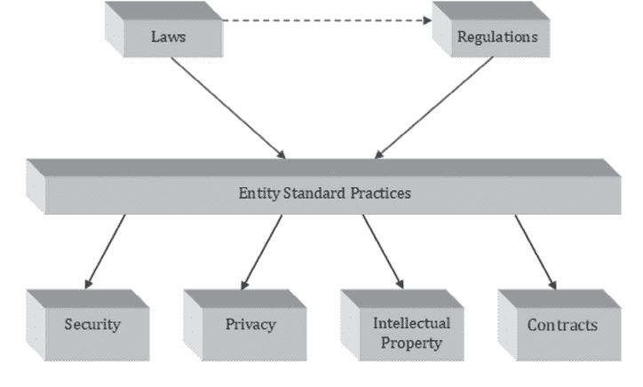

Figure 2.2. Transformation of Laws and Regulations.

Note: Adapted from IT Auditing: Assuring Information Assets Protection by R. E. Davis, 2008a, Pleier. Copyright 2008 by Robert E. Davis. Adapted with permission.

Throughout the world, enacted laws and regulations generally address security, privacy, intellectual property, or contracts (Davis, 2008a). Compliance with laws and regulations is vital to avoiding legal prosecution risks, resulting in various penalties and fines if an organizational employee or entity conviction occurs for breaching behavioral expectations (Davis, 2008a, 2010). For most entities, as depicted in Figure 2.2, prosecution avoidance means systematizing standard practices that cover the regulatory spectrum and decreasing legal compliance complexity (Davis, 2008a).

Security laws and regulations can decree the requisite degree of property protection, usually based on governmental interest (Davis, 2008a; Tran & Atkinson, 2002). Information security laws and regulations can describe control measures to prevent unapproved access to devices that process sensitive data (Davis, 2008a; Tran & Atkinson, 2002). Inclusively, statutory data control measures can encompass peripheral equipment considered necessary for compliant protection (Davis, 2008a; Tran & Atkinson, 2002). Consequently, IT resources’ integration should occur with an approach that rebuffs potential compromises in applicable data treatment edicts for the defined subject matter (Davis, 2008a; Tran & Atkinson, 2002).

Privacy laws can dictate adherence to assurances and responsibilities associated with any information connected to an identified or identifiable data subject (Davis, 2008a; Tran & Atkinson, 2002). Personal data privacy refers to informational associations of specific individuals or identifying attributes that might be combinable with other information or data to identify an individual (Davis, 2008a; Tran & Atkinson, 2002). Sensitive personal data can include items labeled as individual preferences, habits, racial or ethnic origin, as well as financial or medical conditions (Davis, 2008a; Tran & Atkinson, 2002).

Intellectual property laws address something cognitively designed, of which the ownership or right to usage is legally protected (Davis, 2008a; Tran & Atkinson, 2002). Intellectual property can signify knowledge-based resources that encompass information or data, resulting in intellectual capital from innovations, ideas, and designs, howsoever expressed or recorded (Davis, 2008a; Tran & Atkinson, 2002). Intellectual capital is intangible for such items as customer loyalty, product innovation, employee morale, patents, and trademarks (Commission on Guidelines, 2007; Davis, 2008a; Tran & Atkinson, 2002). Therefore, management should minimally provide and implement a policy on intellectual property rights covering custom entity-developed software as well as commercial off-the-shelf software (Davis, 2008a).

Prescriptively utilizing security, privacy, and intellectual property clauses in contractual agreements may aid in clarifying expectations as well as reducing adverse outcomes in post-facto legal disputes (Davis, 2008a). The standard entity IT service level agreement is a contractual arrangement, preferably inscribed between the IT function and users, or managed service provider, stating what each party's responsibilities are regarding a computerized system (Davis, 2008b). Service level agreements assist in defining, negotiating, and agreeing on acceptable confidentiality, integrity, and availability requirements (Davis, 2008b). A service level agreement can also create a mutual understanding of the safeguarding measurement criteria (Davis, 2008b). When suitably structured, the service contract enables confidence in a defined amount of stability, reliability, and performance for the provided IT (Davis, 2008b).

International jurisdictions predominantly reflect geographical world division into national territories (Davis, 2008a). Within each geographical division, the established government has a sovereign right to exercise magistracy (Davis, 2008a). However, where a country's citizen commits a crime in another country, upon potential illegal act detection, problems can arise when a suspect is residing in the homeland jurisdiction during violation discovery (Davis, 2008a). Extradition laws, mutual assistance agreements, recognition and reciprocity provisions, legal proceedings' transfers, and other international cooperation may facilitate resolving jurisdiction issues during violation investigations, apprehension of perpetrators as well as court appearances (Davis, 2008a).

There generally are three main dimensions to jurisdictional decisions: procedural, substantive, and enforcement (Davis, 2008a; Kurbalija, 2016). The procedural jurisdiction dimension defines which court or state has the proper authority (Davis, 2008a; Kurbalija, 2016). The substantive jurisdiction dimension determines which rules apply to the circumstance (Davis, 2008a; Kurbalija, 2016). The dimensions of enforcement jurisdiction commonly address court decision implementation (Davis, 2008a; Kurbalija, 2016). The principal criteria employed when establishing jurisdiction in cases are the

- Personal Link: customarily considered as the state's right to govern its citizens no matter the location,
- Territorial Link: generally presented as the state's right to govern persons and property within its geographical domain, and
- Effects Link: usually defined as the state's right to rule on the economic and legal outcomes regarding a territory stemming from activities conducted elsewhere (Davis, 2008a; Kurbalija, 2016).

Since transactions, contracts, and disputes can involve parties, actions, and evidence in multiple distinct jurisdictions, entity manager-leaders need to clarify existing edicts and presumptions regarding the laws pertinent to IAP (Davis, 2008a). IAP disputes can involve complex factual situations and parties – with actions and evidence spanning multiple jurisdictions – that necessitate non-judicial means for resolution such as arbitration (Davis, 2008a; Kurbalija, 2016). Additionally, a centralized oversight function may be beneficial to an entity with multiple-compliance scenarios. If established, the centralized oversight function should evaluate controls across all compliance arenas, interface with auditors for each compliance area, and provide direction on the most cost-effective controls maximizing total compliance (Davis, 2008a).

Even when governmental compliance requirements extend internationally, managerial responsibility to prevent and detect illegal acts continues regardless of organizational formation origin (Davis, 2008a). Given the fiduciary obligation, an entity’s management can use policies, directives, procedures, standards, rules, validation, and monitoring as control conduits to obtain reasonable certainty that information-related illegal acts’ prevention or detection happens on a timely basis (Davis, 2008a).

### Managerial Practices

Organizational human resources’ management is the process of working with and through individuals to achieve entity objectives in a dynamic environment (Davis, 2008a; Kreitner & Cassidy, 2012). Central to people management is an effective and efficient deployment of complementary resources such as information, infrastructure, and processes (Davis, 2008a; Kreitner & Cassidy, 2012). Social, political, moral, physical, and informational environment factors are a few change sources manager-leaders must anticipate before launching appropriate ISG program responses (Davis, 2008a; Kreitner & Cassidy, 2012). Therefore, manager-leaders should deploy monitoring as a continuous process for assessing control environment quality (Davis, 2008a, 2011).

Risk management should receive considerable attention from manager-leaders (Davis, 2017; Magdaraog, Jr., 2014). Hierarchically, an entity’s control environment is a significant factor affecting IAP risk management (Davis, 2008a, 2017; Mohare & Lanjewar, 2012). Risk management practitioners are typically aware of control system limitations in an unethical control environment (Davis, 2008a). Therefore, after completing the control evaluation process, IAP-inherent risk and control risk need specific delineation from residual risk to assist ethical manager-leaders in understanding quantitative and qualitative control limitations (Davis, 2008a, 2017; Nazareth & Choi, 2015). Additionally, entities need to assign proper political influences concerning information security risks (Davis, 2017; Kwon et al., 2013).

Managerial monitoring of control deployments focuses on redressing environment quality, ensuring established fiduciary relationship fulfillment with stakeholders (Davis, 2008a, 2011). Control environment quality is a significant factor affecting irregular and illegal act risks (Davis, 2008a). However, there also is a relationship between control environment maturity and irregularities and illegal acts risk assessment frequency (Davis, 2008a). Thus, management should perform irregularities and illegal acts risk assessments frequently to enhance control environment maturity (Davis, 2008a). The irregular and illegal acts’ risk assessment is the foundation for a proactive approach to discouraging unacceptable behaviors within an entity’s activity sphere (Davis, 2008a). Moreover, the irregular and illegal acts’ risk assessment (a) aids in defining the IT risk appetite, (b) enhances IT risk responses, (c) reduces IT operational aberrations, (d) identifies IT irregular or illegal act schemes, and (e) improves IT capital deployments (Davis, 2008a).

Security threats can hinder or reduce the possibility for operational and IT objective achievement, value creation, and value preservation (Davis, 2008a; Tran & Atkinson, 2002). Designing and maintaining appropriate ISG are proportionally linked to deployed IT general and application controls (Davis, 2008a). As general and application security

类别，实施和使用信息技术的实体面临的重大风险是逻辑访问控制不足（Kim et al., 2012; Tran & Atkinson, 2002）和网络基础设施安全薄弱（Cowley et al., 2015; Halliday et al., 1996; Tran & Atkinson, 2002）。此外，不当的环境控制（Farahmand et al., 2005）、风险应对错位以及物理访问控制不足（Kim et al., 2012; Tran & Atkinson, 2002）也是实施和使用信息技术的实体面临的重大风险。此外，机密信息生命周期保护不足（Da Veiga & Martins, 2015; Fenz et al., 2014; Halliday et al., 1996; Tran & Atkinson, 2002）是对实施和使用信息技术的实体构成的重大风险。

员工决策对实现 ISG 目标至关重要（Davis, 2008a, 2017）。目标一致性影响决策质量（Davis, 2008a, 2017）。如果决策质量至关重要，而下属或追随者不共享相同的 ISG 目标，管理者-领导者将面临失去对预期活动绩效的控制（Davis, 2008a, 2017），这可能对实体产生不利影响（Davis, 2017）。因此，员工目标不一致可能导致基于 ISG 的决策质量次优（Davis, 2008a, 2017）。管理者-领导者必须确保员工接受并遵守 ISG 目标，以避免决策次优化（Davis, 2008a, 2017）。为此，管理者-领导者应深入了解实体的环境、流程和目标，以便提供与组织需求一致的信息安全服务（Davis, 2017; Flores et al., 2014）。管理者-领导者获得的深入知识也有助于有效协调信息安全活动（Davis, 2017; Flores et al., 2014）。

然而，实体管理者-领导者可能有能力规避或凌驾于部署了由适当控制程序支持的控制政策的风险为基础的控制环境，从而抵消违规和非法行为风险评估的益处（Davis, 2008a）。管理者-领导者规避或凌驾控制程序等同于放弃对利益相关者的受托责任（Davis, 2008a）。规避或凌驾控制的合理化概念通常涉及环境感知、违规成本-收益分析或违规风险承受度（Davis, 2008a）。环境感知代表允许违规或非法活动发生的感知情况。违规成本-收益分析权衡感知成本与违规或非法行为的收益。违规风险承受度是违规者在追求目标时准备接受的风险水平。

### Control Inscriptions

控制涵盖实体的政策、程序、指令、标准、规则、组织结构和实践，提供合理保证活动绩效将按控制目标所规定执行（Davis, 2008a）。管理层对信息安全的意图可以通过人工或技术手段实现（Davis, 2011）。政策、程序、指令、标准和规则指导员工活动，以确保管理层意图在整个实体中得到实施（Davis, 2011）。实体人员依靠建立和维护的活动授权关系来执行管理层的意图（Davis, 2011）。作为补充说明，如果偏离了所载的政策、程序、指令、标准和规则，实体和员工可能面临各种刑事和民事指控以及罚款和处罚（Davis, 2011）。

政策、指令、标准、程序和规则的部署应考虑其在应对管理层风险承受度方面的评估有效性（Davis, 2011）。已部署的控制和监控活动应反映管理层确保适当控制系统的策略（Davis, 2011）。控制政策和指令是高层治理载体，而标准、程序和规则是详细层治理载体（Davis, 2011）。

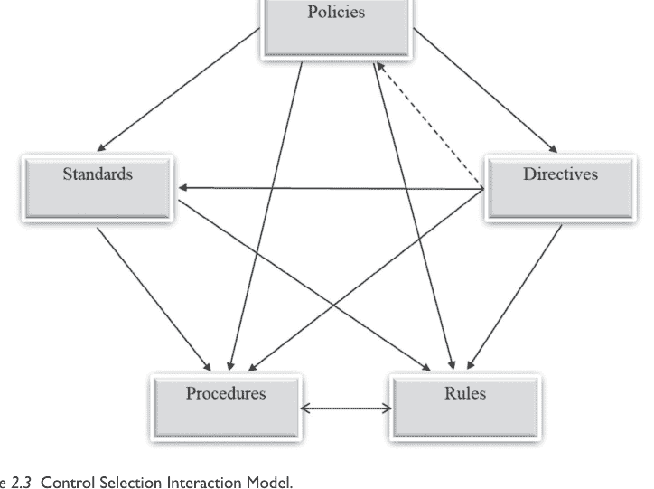

图 2.3 控制选择交互模型。

注：改编自 R. E. Davis 所著《Assuring IT Governance》，2011 年，Amazon.com。版权 2011 归 Robert E. Davis 所有。经许可改编。

通常，监督委员会和高级管理层使用高层治理载体来提供总体控制方向（Davis, 2011）。低层管理将高层治理载体转化为详细层治理载体，以确保控制目标的实现（Davis, 2011）。开发和部署 ISG 设计的有效性和效率可以是一个多方向、互动、迭代和适应的过程（见图 2.3；Davis, 2011）。

### Policies

政策是规定管理选择的一般性载体陈述或理解（Davis, 2008a; Posthuma et al., 2013）。以实体为中心的政策通常规定指导方针，使常规判断执行与当前目标保持一致（Davis, 2008a; Posthuma et al., 2013）。政策激活使权威、领导、动机、沟通、协调、创新和变革成为可能（Davis, 2008a）。从战略上讲，政策为管理者-领导者从备选方案中选择的特定行动方案或方法，以指导并确定在考虑环境的情况下的现在和未来决策（Davis, 2008a）。最高层管理者-领导者应将政策确立为中层和低层管理决策的建议（Davis, 2008a）。

信息安全政策优先考虑数据的保密性、完整性、可用性以及由此产生的信息，以实现运营目标。政策和流程要发挥作用，必须有人的参与。

### 表 2.3 影响控制环境属性的安全政策

| 安全政策 | 道德价值观 | 运营风格 | 能力承诺 | 人力资源实践 |
|---|---|---|---|---|
| 行为或道德准则 | X | X |  |  |
| 安全意识计划 |  | X |  | X |
| 安全运营中心 |  | X |  |  |
| 事件管理计划 |  | X |  | X |
| 安全培训计划 |  | X | X | X |
| 董事会监督 |  | X | X |  |
| 安全委员会监督 |  | X | X |  |

注：X = 适用性

社会-组织和心理因素可能会加剧或鼓励员工遵守信息系统安全政策（Ifinedo, 2014）。此外，感知到的收益会显著影响员工对信息系统政策的不遵守行为（Vance & Siponen, 2012）。IT 用户倾向于忽视或积极规避难以理解或似乎不合理的政策，并抵制使用耗时的方法、陡峭的学习曲线或大幅改变工作绩效的方法。因此，处理数据和信息的员工顺利采用需要明智的政策，提供明确的益处和用户友好的流程。

表 2.3 显示行为或道德准则、安全意识计划、安全运营中心、事件管理计划、安全培训计划和安全委员会监督代表提供管理指导以维持实体安全的关键政策。道德价值观、运营风格、能力承诺、人力资源实践是受安全政策影响的核心控制环境属性。设计的政策应有效地、高效地、经济地促进可接受的授权行为，同时提供令人满意程度的保证，确保实体资源得到适当保护（Davis, 2008a）。

政策不应提供详细的运营指导（Davis, 2008a）。此外，政策需要定期审查，并在情况发生变化时进行适当修订（Davis, 2008a）。政策需要在实体手册、操作手册或其他出版物中清晰载明并组织（Davis, 2008a）。控制政策需要确定所涉及的控制流程（Davis, 2008a）。系统性地，政策应可供所有实体人员访问。支持风险降低活动的 ISG 政策提供以下内容：

- 行为或道德准则。由于法律、法规和规则无法涵盖所有情况，实体可以从准则声明中受益（Davis, 2008a）。准则声明应有效地向所有组织成员，包括承包商和分包商传达可接受的行为或价值观（Davis, 2008a）。实体准则声明需要建立个人可以衡量绩效的高标准（Davis, 2008a）。准则声明还应向实体外部的个人传达，要求组织成员妥协行为或价值观是不被接受的做法（Davis, 2008a）。此外，准则声明需要提供执行所载期望的方法（Davis, 2008a）。


- 安全意识计划。实体管理者领导必须让预期维持合规的个人保持知情，以确保安全计划的有效性（Davis, 2008a）。对新员工、承包商和用户进行首次培训，以及之后定期的复习培训，对于维持安全意识至关重要（Davis, 2008a）。意识计划政策应传达安全有利于维持实体及其所有关联个人的信息（Davis, 2008a）。意识计划政策还应传达与实体相连的每个人都必须遵守既定安全要求（Davis, 2008a）。所有受影响方应能够访问安全政策、指令、程序、标准、规则以及个人责任（Davis, 2008a; Wiley et al., 2020）。安全意识计划政策应要求用户定期签署声明，确认其知晓并接受安全责任（Davis, 2008a）。

- 安全运营中心。信息安全是一套使实体能够满足运营要求的、并优化网络安全服务的流程（Davis, 2008a; Demertzis et al., 2019）。同时，安全运营中心提供战略性和战术性的网络安全基础设施管理（Davis, 2008a; Demertzis et al., 2019）。通过对全实体信息安全的责任，IAP 的资源部署可以主动和被动地有效且高效地进行（Davis, 2008a; Demertzis et al., 2019）。

- 事件管理计划。安全事件可能发生；因此，需要制定应对和恢复到正常运营的政策（Davis, 2008a）。对信息资产造成最严重损害或中断的可能源于内部雇员的有意或无意行为（Davis, 2008a）。经常，信息系统因员工使用或维护 IT 对象而经历中断、损坏、损失或其他不利影响（Davis, 2008a）。因此，减少对信息资产服务的损害或中断需要对实体雇用的个人强调并定期重申既定的行为规则（Davis, 2008a）。

- 安全培训计划。管理者领导必须确保员工具备履行分配信息安全责任所需的技能、知识和能力（Davis, 2008a）。安全计划政策应涉及职位描述、定期重新评估技能的充分性、年度培训要求、专业发展项目的注册，以及监控员工培训和专业发展成果以实现工作分配期望（Davis, 2008a）。

- 实体监督委员会。实体的最高监督委员会应制定实体价值观以供传播（Davis, 2008a）。实体价值观应代表不可谈判的基本且持久的原则，能够抵御为财务利益或短期权宜之计而妥协（Davis, 2008a）。实体的最高监督委员会必须确保管理者领导采用与实体价值观一致的功能价值观（Davis, 2008a）。实体的监督委员会还应负责设定高层目标、监督规划模型、根据既定目标衡量绩效，以及修订无效或低效的目标（Davis, 2008a）。

- 安全监督委员会。实体监督委员会应提供内部和外部安全控制的尽职调查（Davis, 2008a）。就此而言，实体监督委员会通常将责任、问责和权限委托给安全监督委员会，后者监控和评估安全控制、与审计员对接，并就安全优先事项提供指导（Davis, 2008a）。在行使审慎义务时，被任命的安全监督委员会成员在任期内不应在实体内承担管理职责（Davis, 2008a）。

管理层应承担全部责任，制定和维护结构性政策，以确立实体对 ISG 的整体方法（Davis, 2008a）。通常，信息安全经理领导在政策制定中的角色包括建立适当的 IAP 控制环境（Davis, 2008a）。在既定框架内，ISG 政策需要与实体和技术目标保持一致，通过解决资产损失限制、及时识别异常、识别非法行为和服务恢复来最小化风险（Davis, 2008a）。成本-效益分析应成为所采用措施优先排序的基础（Davis, 2008a）。管理者领导还应确保 ISG 政策明确规定
- 范围，
- 目的，
- 目标，
- 管理结构，
- 实施责任定义，
- 实施责任分配，
- 未遵守低层级 ISG 政策的处罚定义，以及
- 未遵守低层级 ISG 政策的纪律处分（Davis, 2008a）。

自上而下的 ISG 政策构建通常需要程序、标准和规则来组织、指导和控制活动，以保持与设计结构意图一致（Davis, 2008a）。作为一种逻辑管理假设，信息资产是 ISG 计划的主要保护点（Davis, 2008a）。实体信息安全政策对信息安全有意识关怀行为的表现的个人规范产生积极影响（Davis, 2017; Safa et al., 2015）。尽管如此，实体管理者领导应检查员工在组织任务上花费的时间（Davis, 2017; Posey et al., 2014）。高 IT 用户工作量可能在分配的组织任务与信息安全责任之间造成冲突（Davis, 2017; Posey et al., 2014）。感到负担过重的实体员工更可能出现信息安全警惕性疏忽（Davis, 2017; Posey et al., 2014）。实体管理层控制环境的尽职调查可以显著降低 IAP 风险（Davis, 2008a）。

管理层对信息安全政策举措支持和实施的疏忽通常是维持适当控制环境时优先事项冲突的问题（Davis, 2008a）。冲突优先事项的解决可通过实体的绩效奖励系统实现（Davis, 2008a）。因此，与信息安全相关的绩效目标必须合理，并支持而非阻碍运营流程和部署的 IT（Davis, 2008a）。优先事项必须在信息安全战略中明确定义和确立（Davis, 2008a）。流程所有者需要获得实体最高监督层批准的关键绩效指标，以确保目标能够得到有效、一致且高效的管理、监控和执行（Davis, 2008a）。

### 指令

指令提出命令或指示（Davis, 2011）。指令服务于或旨在影响、指导或管理行动或目标（Davis, 2011）。代理指令是法律条文，在决策者无法做出决策时将决策权分配给他人（Davis, 2011）。一旦激活，实体代理指令可解释为向受让人传达受托责任要求（Davis, 2011）。个人和内部或外部中央机构可能发布指令（Davis, 2011）。内部指令通常记录在备忘录中，反映需要立即关注的事项（Davis, 2011）。指令应获得与政策相同的尽职调查。

当考虑国家与国际领域之间的联系时，国际发展已决定性地影响了国家法律（Davis, 2008a; Kurbalija, 2016）。区域联盟已颁布与 IAP 相关的法令，随后在国家法律和法规中得到编纂（Davis, 2008a; Kurbalija, 2016）。程序上，大多数区域联盟 IAP 法令是提交给成员国进行联邦批准的指令（Davis, 2008a）。因此，在法律顾问的协助下，信息安全经理领导必须评估实体运营的任何司法管辖区内的所有相关法定和监管要求（Davis, 2008a）。有利的是，多项法律合规要求评估使实体能够建立以实体为中心的标准实践以满足预期行为（Davis, 2008a）。对法律事务的审慎处理还可以使实体建立合规文化，其中标准化是常态，并有条件地创造有利于对实体员工进行 IAP 培训的环境（Davis, 2008a）。

### 标准

设计和实施推理性信息安全标准是必要的（Davis, 2008a, 2017; Järveläinen, 2012）。评估当前信息安全状态需要与公认的事实或法律标准进行比较以进行绩效测量（Davis, 2008a, 2017）。管理者领导应建立标准作为衡量数量、重量、程度、价值或质量的基线（Davis, 2008a, 2011, 2017）。标准可以反映用于与绩效比较的具体目标或目标（Davis, 2011, 2017）。绩效测量点的选择对有效标准实施至关重要（Davis, 2008a, 2011, 2017）。信息安全经理领导在寻求有效的 ISG 时需要考虑遵守标准的重要性（Davis, 2017; Lopez, 2012; Price, 2014）。

### 程序

程序通过具体绩效建立完成活动的方法。同时，程序必须遵守规定的政策（Davis, 2011）。在设计信息安全程序之前，识别和分类流程是必要的，以确定对控制目标的影响（Davis, 2011）。管理者领导必须理解并记录运营程序以安装适当的 ISG 框架（Davis, 2011）。控制程序需要记录，并应尝试执行管理层关于组织的意图。因此，控制程序为保护实体的资产提供保障。

实体的信息安全控制包括为管理层提供关于实现信息资产保护目标的某种程度的安心而采用或制定的程序。管理者领导应出于两个主要原因关注信息安全控制的有效性。其一，信息安全控制程序的弱点可能导致风险信息出现重大错报。其二，足够的信息安全控制程序确保组织员工对数据感知到的潜在威胁进行预防、检测或纠正。当信息安全控制程序被认为有效时，这些程序促进更高效的信息安全管理。


### 规则

规则是限制和约束行为的具体、详细的指导方针（Davis, 2011）。相比之下，规则是最直接的操作控制形式（Davis, 2011）。一条规则要求针对特定情况给出具体的行为期望（Davis, 2011）。管理领导者应当制定行为规则，以帮助防止员工违反信息保障计划（IAP）机制（Davis, 2012）。为了阻止信息安全违规行为，规则应明确所有个人在访问实体信息资产时的责任和预期行为（Davis, 2012）。采用的行为规则应与信息资产的使用、安全性和可接受风险水平相关的既有实践保持一致（Davis, 2012）。因此，行为规则应涵盖在家办公情况、互联网连接、权限分配、权限限制、受版权保护作品的使用、未经授权使用设备以及个人责任等事项（Davis, 2012）。然而，信息安全规则的设计和部署只需严格到足以维持所需的资产保护水平即可（Davis, 2012）。

### 技术部署

IT管理领导者通常规划、编排并推荐实体信息资产部署（Davis, 2008a）。相应地，规划IT保护以防止未经授权的使用和滥用的责任应由实体首席信息安全官承担（Davis, 2008a; Mohare & Lanjewar, 2012）。IT保护规划责任可能包括设计方法来防止内部和外部黑客及骇客对系统进行攻击，这些人利用网络安全弱点或缺陷触发不良安全事件（Davis, 2008a）。信息安全管理者领导者的职责通常还包括根据组织结构为信息资产建立适用的政策、程序和标准（Davis, 2008a）。

IT机会和威胁需要组织、评估和管理，以利用可用资源减少潜在实体风险（Barrett, 2016; Davis, 2008a; Fenz et al., 2014）。有效的IAP技术是抵御不当和恶意行为的有价值防御机制（Claycomb et al., 2012）。因此，首席信息安全官应指派责任，识别和评估已部署的配置管理工具，以确保网络基础设施满足数据完整性、可用性和保密性期望（Boyes, 2015）。

利益相关者主张实体管理领导者参与供应链活动的风险管理（Cantor et al., 2014）。作为回应，实体供应链管理员应考虑检查网络配置技术以评估漏洞（Boyes, 2015）。此外，除非风险指标对于已部署的保护机制处于可接受水平，否则组织管理员应避免授权或执行跨供应链的知识共享（Manzouri et al., 2013）。在维持可接受风险水平方面，如果尚未部署，Active Directory联合服务可能是跨供应链保护信息安全的最佳方法（Manzouri et al., 2013）。

基于互联网的技术为组织和客户带来优势（Safa et al., 2016）。随着越来越多的实体和个人依赖互联网交换敏感或机密信息，适当的消息安全已成为技术管理问题（Chatterjee et al., 2015; Davis, 2008a; Wlosinski, 2016）。安全对于电子商务系统质量至关重要（Homsud & Chavesuk, 2014）。可用的电子商务模式包括企业对企业（B2B）和企业对消费者（B2C）架构（Davis, 2008a; Z. Wang et al., 2013）。具体而言，B2B是不同实体之间的电子商务（Davis, 2008a），并反映开放标准（Sila, 2013）。B2B链接使实体之间能够交换服务、产品或信息（Davis, 2008a; Sila, 2013）。然而，B2B电子商务比传统外部接口系统更容易遭受安全漏洞（Sila, 2013）。

电子数据交换方法是互联网集成B2B关系的先驱和支柱（Davis, 2008a）。B2B电子商务仍然依赖专有的电子数据交换系统（Sila, 2013）。根据活动频率和应用情况，电子数据交换控制风险可能变得重大（Davis, 2008a）。缺乏方向、依赖第三方以及系统依赖可能使实体在部署电子数据交换时面临额外的法律、安全和运营风险（Davis, 2008a）。

当实体员工因确保信息保密性、完整性和可用性而建立声誉时，客户往往会表现出电子忠诚（Choi & Nazareth, 2014）。客户忠诚度决定了B2C的长期成功（Homsud & Chaveesuk, 2014）。公开的信息安全事件可能引发退出行为（Lee & Lee, 2012）。信息安全事件可能对客户行为产生可衡量的负面影响，尽管这种影响似乎主要局限于违规网站（Lee & Lee, 2012）。感知到的损害和替代购买来源的可用性可显著增加受害客户的退出行为（Lee & Lee, 2012）。此外，消费者对网站相对有用性和易用性的感知在减少退出行为方面影响有限（Lee & Lee, 2012）。

信息安全涉及在已建立的实体保护边界内，在整个信息生命周期和资产使用过程中的保护活动（Davis, 2008a）。设定安全边界的主要目标是为以实体为中心的政策和保护机制提供范围（Konieczny et al., 2015）。首席信息安全官通常指定一个IAP边界，以程序化方式管理网络网络安全风险（Konieczny et al., 2015）。对于基于IT的网络，保护机制的主要改进是电子邮件保密性以及电子邮件用户身份认证和隐私转换（Babrahem et al., 2015）。然而，随着关联信息飞地的出现，建立保持已部署IT配置的分层保护屏障可能会引入战术安全困境（Konieczny et al., 2015; Zhao et al., 2013）。管理领导者应考虑改变实体IT的架构模型（Konieczny et al., 2015），并在网络设计期间采用可用性启发式方法（Jaferian et al., 2014），以减少潜在网络混淆。

实体管理领导者有强烈动机识别和修复当前访问控制与法律义务之间的任何差异（Davis, 2017）。在大多数国家，未经许可访问信息资产属于刑事犯罪（Davis, 2008a; Sen & Borle, 2015），并可提起民事诉讼（Romanosky et al., 2014）。然而，过高的访问控制水平可能降低网络性能（Hayajneh et al., 2013）和安全性灵活性（Thomson, 2012）。为防止、检测或纠正潜在安全漏洞，信息安全管理者领导者应自愿引入正式的网络安全自我评估程序，以确保遵守法律义务和法令（Davis, 2008a）以及管理期望。

执行管理领导者领导在实体中采用自带设备（BYOD）（Thomson, 2012）和自带技术（BYOT）的驱动力，以实现竞争优势（Davis, 2017）。管理领导者通常出于三个原因追求BYOD和BYOT相关政策：直观的工具知识、成本节约和生产力提升（Priyadarshi, 2013）。工作场所中的BYOD和BYOT是安全挑战（Olalere et al., 2015）。治理对于BYOD和BYOT相关政策的成功至关重要（Thomson, 2012）。安全治理包括为BYOD和BYOT管理提供控制政策（Priyadarshi, 2013; Tokuyoshi, 2013）。然而，安全问题应使管理领导者在采用BYOD和BYOT工作政策时三思（Li & Clark, 2013; Priyadarshi, 2013; Tokuyoshi, 2013）。单独来说，将所有实体安全要求调整并整合到个人设备中以保护工作相关信息，可能会带来配置挑战（Li & Clark, 2013; Meng et al., 2015; Tokuyoshi, 2013）。

在实体员工使用授权云计算环境时，安全性能测量也变得具有挑战性（Avram, 2014; Herath & Herath, 2014; Kalloniatis et al., 2013）。如果采用，性能评估决策模型允许实体选择进行网络安全审计是否有利（Herath & Herath, 2014）。因此，如果认为有益，在聘请第三方保证报告时，可能会提出需要考虑哪些额外因素的问题（Herath & Herath, 2014），例如审计期间和之后的数据泄露以及审计效力（Davis, 2017）。管理领导者应采用在云计算环境中提供可验证保护且高效的保密方案（C. Wang et al., 2013）。作为一种补救措施，认证器和随机掩码技术可确保第三方审计员不会获得云服务器上任何存储数据内容的了解（C. Wang et al., 2013）。此外，关于效力，所聘请的第三方审计员可以批量方式执行各种审计任务，以提高效率（C. Wang et al., 2013）。

IT网络、虚拟化和存储是云计算中最重大的安全关注点（Hashizume et al., 2013）。然而，采用云计算时的技术挑战包括已安装的安全访问架构（Rai et al., 2015）。一方面，作为一种潜在的访问补救措施，使用基于标准的Web单点登录协议，该协议为认证请求提供表达性并具有令牌安全通用性，可以解决使用问题（Pfaff & Ries, 2014）。另一方面，同态加密和代理重加密方案可以防止被撤销用户重新加入云端系统时发生未经授权的数据泄漏（Samanthula et al., 2015）。因此，实体管理领导者应部署全面的信息安全风险评估框架，以帮助适当设计IAP政策、程序、标准和规则（Davis, 2017）。

### 参考文献

Akpinar, M. (2017). 组织间关系中应对制度环境变化的权力行使：来自欧洲汽车行业的案例。*国际汽车技术与管理杂志*，17(1), 51–71. https://doi.org/10.1504/IJATM.2017.082276

Alcaraz, C., & Zeadally, S. (2015). 21世纪关键基础设施保护：要求与挑战。*国际关键基础设施保护杂志*，8, 53–66. https://doi.org/10.1016/j.ijcip.2014.12.002

Anderson, L. E. (2015). *领导力、组织承诺与初级管理人员留任意愿之间的关系*（出版号3708010）[博士研究，瓦尔登大学]。ProQuest学位论文出版。


Atoum, I., Otoom, A., & Ali, A. A. (2014). 一个整体的网络安全实施框架。信息管理与计算机安全, 22, 251–264. https://doi.org/10.1108/IMCS-02-2013-0014

Avram, M. G. (2014). 从企业视角看云计算的优势与挑战。程序技术, 12, 529–534. https://doi.org/10.1016/j.protcy.2013.12.525

Babrahem, A. S., Alharbi, E. T., Alshiky, A. M., Alqurashi, S. S., & Kar, J. (2015). 各种电子邮件系统的安全增强研究。信息安全杂志, 6, 1–11. https://doi.org/10.4236/jis.2015.61001

Barrett, S. (2016). 信息技术风险管理与机构规模对财务绩效的影响 (出版编号 10148398) [博士研究, Walden University]。ProQuest 论文出版。

Boritz, J. E. (2005). 信息系统从业者对信息完整性核心概念的看法。国际会计信息系统期刊, 6(4), 260–279. https://doi.org/10.1016/j.accinf.2005.07.001

Boyes, H. (2015). 网络安全与网络弹性供应链。技术创新管理评论, 5(4), 28–34. http://doi.org/10.22215/timreview/888

Brothby, K. W. (2006). 信息安全治理：董事会和高级管理层的指导 (第2版)。IT 治理研究所。

Broz, J. L. (2002). 政治制度透明度与货币承诺制度。国际组织, 56(4), 861–887. https://doi.org/10.1162/002081802760403801

Büschgens, T., Bausch, A., & Balkin, D. B. (2013). 组织文化与创新：元分析综述。产品创新管理期刊, 30(4), 763–781. https://doi.org/10.1111/jpim.12021

Cantor, D. E., Blackhurst, J., Pan, M., & Crum, M. (2014). 审视利益相关者压力和知识管理对供应链风险和需求响应性的作用。国际物流管理期刊, 25, 202–223. https://doi.org/10.1108/IJLM-10-2012-0111

Carlson, L. V. (2014). 工人对信息安全与生产力之间关系感知的研究 (出版编号 3645776) [学位论文, Capella University]。ProQuest 论文出版。

Chatterjee, S., Sarker, S., & Valacich, J. S. (2015). 信息系统安全的行为根源：探索与不道德 IT 使用相关的关键因素。管理信息系统期刊, 31(4), 49–87. https://doi.org/10.1080/07421222.2014.1001257

Chernyak-Hai, L., & Tziner, A. (2014). 反生产工作行为、感知公正与气候、职业地位与领导-成员交换之间的关系。工作与组织心理学期刊, 30(1), 1–12. https://doi.org/10.5093/tr2014a1

Choi, J., & Nazareth, D. L. (2014). 电子商务和安全背景下的信任修复：基于代理的建模方法。信息管理与计算机安全, 22, 490–512. https://doi.org/10.1108/IMCS-09-2013-0069

Claycomb, W. R., Huth, C. L., Flynn, L., Mcintire, D. M., & Lewellen, T. B. (2012). 内部威胁破坏的编年研究：初步观察。无线移动网络、普适计算与可靠应用期刊, 3(4), 4–20. https://doi.org/10.22667/JOWUA.2012.12.31.004

Commission on Guidelines. (2007). 信息资产保护指南。ASIS 国际。

Cowley, J. A., Greitzer, F. L., & Woods, B. (2015). 网络基础设施因素对信息系统风险判断的影响。计算机与安全, 52, 142–158. https://doi.org/10.1016/j.cose.2015.04.011

Dasgupta, M., Gupta, R. K., & Sahay, A. (2011). 链接技术创新、技术战略和组织因素：综述。全球商业评论, 12(2), 257–277. https://doi.org/10.1177/09721509110120026

Da Veiga, A., & Martins, N. (2015). 信息安全文化与信息保护文化：经验证的评估工具。计算机法与安全评论, 31, 243–256. https://doi.org/10.1016/j.clsr.2015.01.005

Davis, R. E. (2006). IT 审计：不规则和非法行为。Pleier。

Davis, R. E. (2008a). IT 审计：确保信息资产保护。Pleier。

Davis, R. E. (2008b). IT 审计：IT 服务交付与支持。Pleier。

Davis, R. E. (2010). IT 审计：一种自适应系统。www.amazon.com

Davis, R. E. (2011). 确保 IT 治理。www.amazon.com

Davis, R. E. (2012). 确保信息安全。www.amazon.com

Davis, R. E. (2013). 确保 IT 法律合规。www.amazon.com

Davis, R. E. (2017). 美国公司中公司治理与信息安全治理有效性之间的关系 (出版编号 10603383) [博士研究, Walden University]。ProQuest 论文出版。

Davis, R. E. (2020). 从系统视角进行 IT 审计。IGI 全球。

Demertzis, K., Tzirtas, N., Kikiras, P., Sanchez, S. L., & Iliadis, L. (2019). 下一代认知安全运营中心：用于有效防御对抗性攻击的自适应分析 Lambda 架构。大数据与认知计算, 3(1), 6. https://doi.org/10.3390/bdcc3010006

Edwards, C. K. (2013). 信息安全治理框架 (出版编号 3607548) [学位论文, Nova Southeastern University]。ProQuest 论文出版。

Farahmand, F., Navathe, S. B., Sharp, G. P., & Enslow, P. H. (2005). 信息系统安全威胁风险的管理视角。信息技术与管理, 6(2-3), 203-225. https://doi.org/10.1007/s10799-005-5880-5

Fenz, S., Heurix, J., Neubauer, T., & Pechstein, F. (2014). 信息安全风险管理中的当前挑战。信息管理与计算机安全, 22, 410-430. https://doi.org/10.1108/IMCS-07-2013-0053

Findlaw. (2018年3月18日). 保密性和隐私性之间有区别吗？https://criminal.findlaw.com/criminal-rights/is-there-a-difference-between-confidentiality-and-privacy.html

Flores, W. R., Antonsen, E., & Ekstedt, M. (2014). 组织中的信息安全知识共享：探究行为信息安全治理和国家文化的影响。计算机与安全, 43, 90-110. https://doi.org/10.1016/j.cose.2014.03.004

Flowerday, S., & Von Solms, R. (2007). 什么是信息完整性？南非信息管理期刊, 9(4), 1-19. https://doi.org/10.4102/sajim.v9i4.201

Foss, N. J., & Dobraj ska, M. (2015). Valve 的方式：离经叛道、远见卓识还是追逐潮流？组织设计期刊, 4(2), 12-15. https://doi.org/10.7146/jod.20162

Garba, A. B., Armarego, J., Murray, D., & Kenworthy, W. (2015). 自带设备 (BYOD) 环境中的信息安全与隐私挑战综述。信息隐私与安全期刊, 11, 38-54. https://doi.org/10.1080/15536548.2015.1010985

Haag, S., & Cummings, M. (2008). 信息时代的管理信息系统 (Laureate Education, Inc., 定制版)。McGraw-Hill/Irwin。

Halliday, S., Badenhorst, K., & Von Solms, R. (1996). 有效信息技术风险分析与管理的商业方法。信息管理与计算机安全, 4(1), 19-31. https://doi.org/10.1108/09685229610114178

Harrison, J. S., & Wicks, A. C. (2013). 利益相关者理论、价值与企业绩效。商业伦理季刊, 23, 97-124. https://doi.org/10.5840/beq20132314

Hashizume, K., Rosado, D. G., Fernández-Medina, E., & Fernandez, E. B. (2013). 云计算安全问题的分析。互联网服务与应用期刊, 4(1), 1-13. https://doi.org/10.1186/1869-0238-4-5

Hayajneh, T., Mohd, B. J., Itradat, A., & Quttoum, A. (2013). 使用防火墙的性能和信息安全评估。安全及其应用国际期刊, 7(6), 355-372. https://doi.org/10.14257/ijisa.2013.7.6.36

Herath, H. S., & Herath, T. C. (2014). IT 安全审计：绩效评估决策模型。决策支持系统, 57, 54-63. https://doi.org/10.1016/j.dss.2013.07.010

Hess, D. (2007). 社会报告与新治理监管：通过透明度实现企业问责的前景。商业伦理季刊, 17(3), 453-476. www.jstor.org

Hirschheim, R., & Klein, H. K. (2012). 信息系统领域的辉煌而非如此短暂的历史。信息系统协会期刊, 13(4), 188-235. https://doi.org/10.17705/1jais.00294


Hodgkinson, I. R., Ravishankar, M. N., & Aitken-Fischer, M. (2014). 关于双元性协调的资源优势视角. 《服务业期刊》, 34, 1234–1252. https://doi.org/10.1080/02642069.2014.942655

Homsud, S., & Chaveesuk, S. (2014). 对 B2C 电子商务中客户忠诚度形成拟议模型的理解. 《未来计算机与通信国际期刊》, 3, 191–196. https://doi.org/10.7763/IJFCC.2014.V3.294

Hu, Q., Dinev, T., Hart, P., & Cooke, D. (2012). 管理员工对信息安全政策的合规性：高层管理与组织文化的关键作用. 《决策科学》, 43, 615–660. https://doi.org/10.1111/j.1540-5915.2012.00361.x

Ifinedo, P. (2014). 信息系统安全政策合规性：社会化、影响和认知效应的实证研究. 《信息与管理》, 51, 69–79. https://doi.org/10.1016/j.im.2013.10.001

IT Governance Institute. (2003). 关于 IT 治理的董事会简报（第 2 版）. 作者.

Jaferian, P., Hawkey, K., Sotirakopoulos, A., Velez-Rojas, M., & Beznosov, K. (2014). 评估 IT 安全管理工具的启发式方法. 《人机交互》, 29, 311–350. https://doi.org/10.1080/07370024.2013.819198

Järveläinen, J. (2012). 组织间 IT 关系中的信息安全与业务连续性管理. 《信息管理与计算机安全》, 20, 332–349. https://doi.org/10.1108/09685221211286511

Julisch, K. (2013). 领导信息安全. 《ISACA 期刊》, 6, 27–30. www.isaca.org

Kalloniatis, C., Mouratidis, H., & Islam, S. (2013). 基于安全和隐私需求评估云部署方案. 《需求工程》, 18, 299–319. https://doi.org/10.1007/s00766-013-0166-7

Kim, A. C., Lee, S. M., & Lee, D. H. (2012). 利用系统动力学进行金融信息安全合规风险评估措施. 《安全及其应用国际期刊》, 6(4), 191–200. www.sersc.org

Kinicki, A., & Williams, B. K. (2013). 管理者不断变化的工作环境与伦理责任：做正确的事情. 收录于《管理：实用导论》（第 6 版，第 74–105 页）. McGraw-Hill Education.

Koniczny, F., Trias, E., & Taylor, N. J. (2015). SEADE：对抗网络安全的徒劳. 《空军与太空力量期刊》, 29(5), 4–14. www.airuniversity.af.edu/ASPJ/

Kreitner, R., & Cassidy, C. (2012). 管理（第 12 版）. Houghton Mifflin.

Kurbalija, J. (2016). 《互联网治理导论》（第 7 版）. Diplo Foundation.

Kushwaha, P. (2016). 信息安全管理体系与商业范式转变的融合. 《计算机科学与信息安全国际期刊》, 14(1), 105–111. https://sites.google.com/site/ijcsis

Kwon, J., Ulmer, J. R., & Wang, T. (2013). 高层管理参与与薪酬与信息安全泄露之间的关联. 《信息系统期刊》, 27(1), 219–236. https://doi.org/10.2308/isys-50339

Lee, M., & Lee, J. (2012). 信息安全失效对客户行为的影响：互联网大规模黑客事件研究. 《信息系统前沿》, 14, 375–393. https://doi.org/10.1007/s10796-010-9253-1

Li, Q., & Clark, G. (2013). 移动安全：展望未来. 《IEEE 安全与隐私》, 11(1), 78–81. https://doi.org/10.1109/MSP.2013.15

Lopez, R. H. (2012). 信息数据安全专家与企业领导者关于沟通挑战的经验（出版编号 3503982）[博士研究，Walden University]. ProQuest Dissertations Publishing.

Luesbrink, M. (2011). 学术机构中信息安全治理结构的制度化：案例研究 [论文，佛罗里达州立大学]. http://purl.flvc.org/fsu/fd/FSU_migr_etd-1009

Magdaraog, Jr., G. A. (2014). 工作场所的警示信号：员工欺诈风险因素分析. 《Carrington Rand 社会科学期刊》, 1(1), 73–82. www.carringtonrand.com

Manzouri, M., Rahman, M. N. A., Nasimi, F., & Arshad, H. (2013). 供应链信息共享安全模型. 《美国应用科学期刊》, 10(3), 253–258. http://dx.doi.org/10.3844/ajassp.2013.253.258

Meng, G., Liu, Y., Zhang, J., Pokluda, A., & Boutaba, R. (2015). 协作安全：综述与分类. 《ACM 计算调查》, 48, 1–42. https://doi.org/10.1145/2785733

Mohare, R., & Lanjewar, U. (2012). 企业信息安全决定因素. 《市场营销与技术国际期刊》, 2(7), 203–209. www.ijmra.us

Nazareth, D. L., & Choi, J. (2015). 信息安全管理系统动力学模型. 《信息与管理》, 52, 123–134. https://doi.org/10.1016/j.im.2014.10.009

Northouse, P. G. (2013). 领导力：理论与实践（第 6 版）. Sage.

Olalere, M., Abdullah, M. T., Mahmod, R., & Abdullah, A. (2015). 自带设备安全问题的综述. 《SAGE Open》, 5, 1–11. https://doi.org/10.1177/2158244015580372

Pasquier, M., & Villeneuve, J. P. (2007). 透明度的组织障碍：倾向于阻止或限制信息获取的组织行为的类型学与分析. 《行政科学国际评论》, 73(1), 147–162. https://doi.org/10.1177/0020852307075701

Pfaff, O., & Ries, S. (2014). 将企业安全基础设施与云计算集成. 《互联网技术与安全交易期刊》, 3, 338–343. www.infonomics-society.org

Posey, C., Roberts, T. L., Lowry, P. B., & Hightower, R. T. (2014). 弥合差距：信息安全专业人员与普通组织内部人员之间信息安全思维模式的定性比较. 《信息与管理》, 51, 551–567. https://doi.org/10.1016/j.im.2014.03.009

Posner, B. Z. (2010). 再次审视个人与组织价值观一致性的影响. 《商业伦理期刊》, 97(4), 535–541. https://doi.org/10.1007/s10551-010-0530-1

Posthuma, R. A., Campion, M. C., Masimova, M., & Campion, M. A. (2013). 高绩效工作实践分类：整合文献并指导未来研究. 《管理期刊》, 39(5), 1184–1220. https://doi.org/10.1177/0149206313478184

Price, J. D. (2014). 使用有效的合规计划降低数据泄露风险（出版编号 3619214）[博士研究，Walden University]. ProQuest Dissertations Publishing.

Priyadarshi, G. (2013). 利用并保护自带设备和技术方法. 《ISACA 期刊》, 4, 47–51. www.isaca.org

Rai, R., Sahoo, G., & Mehfuz, S. (2015). 探索影响云计算采用的因素：云迁移的系统研究. 《SpringerPlus》, 4, 197–208. https://doi.org/10.1186/s40064-015-0962-2

Rasheed, S., ChangFeng, W., & Yaqub, F. (2015). 迈向项目风险管理与感知风险管理障碍. 《混合信息技术国际期刊》, 8, 323–338. https://doi.org/10.14257/ijhit.2015.8.5.35

Rawlins, B. (2008). 给皇帝一面镜子：迈向组织透明度的利益相关者衡量. 《公共关系研究期刊》, 21(1), 71–99. https://doi.org/10.1080/10627260802153421

Romanosky, S., Hoffman, D., & Acquisti, A. (2014). 数据泄露诉讼的实证分析. 《实证法律研究期刊》, 11, 74–104. https://doi.org/10.1111/jels.12035

Safa, N. S., Sookhak, M., Von Solms, R., Furnell, S., Ghani, N. A., & Herawan, T. (2015). 组织中信息安全意识关怀行为的形成. 《计算机与安全》, 53, 65–78. https://doi.org/10.1016/j.cose.2015.05.012

Safa, N. S., Von Solms, R., & Furnell, S. (2016). 组织中的信息安全政策合规模型. 《计算机与安全》, 56, 70–82. https://doi.org/10.1016/j.cose.2015.10.006

Samanthula, B. K., Elmehdwi, Y., Howser, G., & Madria, S. (2015). 通过云计算联合实现的安全数据共享与查询处理框架. 《信息系统》, 48, 196–212. https://doi.org/10.1016/j.is.2013.08.004


Samonas, S., & Coss, D. (2014). CIA反击：重新定义安全中的机密性、完整性和可用性. 信息系统安全杂志, 10(3), 21–45. www.jissec.org/
Sarros, J. C., Cooper, B. K., & Santora, J. C. (2008). 通过变革型领导力与组织文化营造创新氛围. 领导力与组织研究杂志, 15(2), 145–158. https://doi.org/10.1177/1548051808324100
Sen, R., & Borle, S. (2015). 评估数据泄露的语境风险：一种实证方法. 管理信息系统杂志, 32, 314–341. https://doi.org/10.1080/07421222.2015.1063315
Sila, I. (2013). 影响B2B电子商务技术采用的因素. 电子商务研究, 13, 199–236. https://doi.org/10.1007/s10660-013-9110-7
Steiger, J. S., Hammou, K. A., & Galib, M. H. (2014). 组织结构类型与管理层级对组织中知识管理实践的影响研究. 国际商业与管理杂志, 9(6), 43–57. https://doi.org/10.5539/ijbm.v9n6p43
Tashman, P., & Raelin, J. (2013). 对公司真正重要的是谁和什么：超越管理层认知的利益相关者显著性. 商业伦理季刊, 23, 591–616. https://doi.org/10.5840/beq201323441
Thomson, G. (2012). BYOD：开启混乱. 网络安全, 2012(2), 5–8. https://doi.org/10.1016/S1353-4858(12)70013-2
Tokuyoshi, B. (2013). BYOD的安全影响. 网络安全, 2013(4), 12–13. https://doi.org/10.1016/S1353-4858(13)70050-3
Tran, E., & Atkinson, M. (2002). 个人数据跨国界的安全. 信息管理与计算机安全, 10(5),237–241. https://doi.org/10.1108/09685220210446588
Tsouhou, A., Karyda, M., Kokolakis, S., & Kiountouzis, E. (2012). 分析信息安全意识的轨迹. 信息技术与人, 25, 327–352. https://doi.org/10.1108/09593841211254358
Vance, A., & Siponen, M. T. (2012). IS安全政策违规：理性选择视角. 组织与终端用户计算杂志, 24(1), 21–41. https://doi.org/10.4018/joeuc.2012010102
Wang, C., Chow, S., Wang, Q., Ren, K., & Lou, W. (2013). 安全云存储的隐私保护公共审计. IEEE计算机学报(TC), 62, 362–375. https://doi.org/10.1109/TC.2011.245
Wang, Z., Huang, J., & Tan, B. (2013). 电子商务行业中的组织身份管理：双元性视角. 信息与管理, 50, 673–683. https://doi.org/10.1016/j.im.2013.05.002
Wiener, M., Mähring, M., Remus, U., Saunders, C., & Cram, W. A. (2019). 将IS项目控制研究引入数字时代：控制的“为什么”与控制目的的概念. 信息系统研究, 30(4), 1387–1401. https://doi.org/10.1287/isre.2019.0867
Wiley, A., McCormac, A., & Calic, D. (2020). 不仅仅是个体：考察文化与信息安全意识之间的关系. 计算机与安全, 88, 1–8. https://doi.org/10.1016/j.cose.2019.101640
Williams, S. P., Hardy, C. A., & Holgate, J. A. (2013). 关键基础设施组织中的信息安全治理实践：社会技术与制度逻辑视角. 电子市场, 23, 341–354. https://doi.org/10.1007/s12525-013-0137-3
Willison, R., & Warkentin, M. (2013). 超越威慑：员工计算机滥用的扩展视角. MIS季刊, 37, 1–20. www.misq.org
Wiseman, R. M., Cuevas-Rodríguez, G., & Gomez-Mejia, L. R. (2012). 迈向一种代理的社会理论. 管理研究杂志, 49, 202–222. https://doi.org/10.1111/j.1467-6486.2011.01016.x
Wlosinski, L. G. (2016). 移动计算设备的威胁、脆弱性和风险因素无处不在. ISACA杂志, 4, 45–49. www.isaca.org
Wu, Y., & Saunders, C. S. (2016). 治理信息安全服务中的信托关系. 决策支持系统, 92, 57–67. https://doi.org/10.1016/j.dss.2016.09.008

Zhao, H., Peng, Z., & Sheard, G. (2013). 职场排斥与酒店业员工的反生产工作行为：主动型人格与政治技能的共同调节效应. *国际酒店管理杂志*, 33, 219–227. https://doi.org/10.1016/j.ijhm.2012.08.006

### 推荐阅读

Boritz, J. E., Datardina, M., Anderson, C., Curim, U., Henrickson, R., James, D., Livesley, R., Nayar, M., & Teed, S. A. (2019). *信息完整性控制框架*. 加拿大特许专业会计师协会. www.incp.org.co/wp-content/uploads/2019/09/Framework-Information-Integrity-26092019.pdf
Conteh, N. Y., & Schmick, P. J. (2016). 网络安全：防范社会工程攻击的风险、脆弱性与对策. *国际高级计算机研究杂志*, 6(23), 31–38. http://dx.doi.org/10.19101/IJACR.2016.623006
Da Veiga, A., Astakhova, L. V., Botha, A., & Herselman, M. (2020). 定义组织信息安全文化：学术界与业界的视角. *计算机与安全*, 92, 101713. https://doi.org/10.1016/j.cose.2020.101713
Stott, J. H. (2001). *电子系统保障与控制：eSAC模型*. 内部审计师协会. www.tarrani.net/kate/docs/eSACModel.pdf
Von Solms, R., & Van Niekerk, J. (2013). 从信息安全到网络安全. *计算机与安全*, 38, 97–102. https://doi.org/10.1016/j.cose.2013.04.004

## 安全治理管理

### 摘要

信息与网络安全治理应明确一个实体的问责、责任和权力框架。规划是确定一个实体IAP目标和目的所必需的管理过程。实体治理需要提供行政监督的手段，以确保IAP风险得到恰当处理，同时ISG管理领导者确保经授权的风险处理策略按预期实施。组织过程将IAP行动计划转化为可控领域，并包括基于可用资源有效利用的活动分组。由此，组织方向允许管理职能规范实体人员的活动或行动路径。在实施控制活动之处，有助于确保遵循管理指令。第3章讨论了管理ISG中的规划、组织、协调、指挥和控制循环，使人们能够在充分知情且合理确定的情况下，确信信息风险与控制达到适当平衡。

### 引言

在满足可解决的安全信息标准方面，ISG计划应包括评估财产的流程、活动和任务（R. Davis, 2008a）。物理性质区分了有形财产和无形财产（R. Davis, 2008a）。具有物理存在的财产，如灭火器和空调机组，是有形的（R. Davis, 2008a）。不具有物理存在的财产，如专利权和计算机程序，是无形的（R. Davis, 2008a）。凭借所有权，获取或创建的信息可归类为无形资产（R. Davis, 2008a）。无形资产可能受到政府实体施加的明示或默示的法定留存和保护要求（R. Davis, 2008a）。因此，实体管理者必须提供适当的保障措施以维护信息价值（R. Davis, 2008a）。此外，实体管理者必须遵守适用的信息相关法律、法规和期望，以履行信托责任（R. Davis, 2008a）。

为提供适当信息安全而分配的角色和职责通常对网络安全效能至关重要（R. Davis, 2008a）。然而，取决于实体，IAP管理角色和职责可能仅专注于网络安全（R. Davis, 2008a），或同时关注信息安全和网络安全。角色和职责界定了实体内部个体之间的关系，并显著影响控制目标的实现（R. Davis, 2008a）。此外，承担安全交付和支持职责的角色需要明文规定，以便确定问责（R. Davis, 2008a）。

由于文档是合规性的关键要素，有关数据如何被处理和保护的证据是必要的。应用额外安全措施的技术，

例如在默认情况下不存在时启用加密，应生成并保留。在力求确保合规时，不仅实体管理必须满足关于数据管理和保护的监管要求，而且还应能够提供支持决策的证据性文件。证据性文件包括显示数据收集和处理的合法依据的记录（当同意是依据时，表明已根据要求获得同意）。保留对数据执行的处理操作记录以及关于适用安全政策、程序和配置的记载信息，对于证实合规性至关重要。

实体不合规风险是不容否认的现实（Wiley et al., 2020），其后果范围从重大财务处罚到声誉损害（R. Davis, 2012b）。为安全漏洞设计适当的对策通常是运营上的必要（R. Davis, 2012b）。部署信息安全管理体系可以使将可用信息资产数据与预期用途相关联，以确定安全漏洞的严重程度、严重性或影响（R. Davis, 2012b）。因此，信息安全管理体系允许有效响应管理（R. Davis, 2012b）。鉴于应急管理的主要目标是通过理解风险因素提供解决方案，对网络安全事件的适当响应取决于及时、可靠的信息以评估风险并应用所需资源（Davis, 2012b）。

实体管理者领导者可以使用替代方法来实现组织目标（R. Davis, 2008a）。实现组织目标的潜在领导风格包括参与式、放任式和专制式（Derakhshandeh & Gholami, 2012; Nwekeaku, 2013）。参与式管理者领导者强调在决策中考虑并纳入员工观点，同时保持管理决策权（Derakhshandeh & Gholami, 2012; Nwekeaku, 2013; R. Davis, 2008a）。放任式管理者领导者允许员工就相关事项自行做出决定（Derakhshandeh & Gholami, 2012; Nwekeaku, 2013; R. Davis, 2008a）。专制式管理者领导者强调对员工的决策指令（Derakhshandeh & Gholami, 2012; Nwekeaku, 2013; R. Davis, 2008a）。根据实证证据，大多数实体目前更倾向于采用参与式领导风格（R. Davis, 2008a）。因此，本章重点介绍将参与式方法应用于执行全实体信息安全风险评估。

### Planning

规划是通过集成决策系统产生既定结果的正式程序（R. Davis, 2011）。管理规划通常是部署有效且高效的 ISG 计划所必需的（R. Davis, 2008a）。然而，被分配 ISG 总体责任的员工可以是高管、高级或初级管理者领导者（R. Davis, 2008a）。无论指定的管理层级如何，ISG 管理者领导者通常负责组建团队、做出组织决策和监督活动（R. Davis, 2008a）。通过授权，管理者领导者承担执行信息收集、风险评估以及确定实现目标和目标的方法的责任（R. Davis, 2008a）。管理层的愿景、使命和价值观通常转化为规划前提（R. Davis, 2011）。

愿景需要感知不可见事物的能力并将构想转化为预测的未来状态（R. Davis, 2011）。在某些情况下，愿景需要精神敏锐或敏锐的远见（Davis, 2011）。然而，愿景的体现通常是逐步发生的（R. Davis, 2011）。一旦形成概念，实体管理者领导者的愿景需要被接受并组织成实现已制定目标的框架（Davis, 2011）。设想 ISG 计划支持实体目标的实现是适当运营创建和可持续性的基础（R. Davis, 2011）。在启动 ISG 开发时，一些关键规划考虑因素包括：
-   定期风险评估之间的时间长度，
-   设计和执行风险评估人员的技能和资质，
-   外部和内部审计参与 ISG 计划设计或运营的程度，以及
-   高管管理层和监督委员会层面的尽职调查和监控期望（R. Davis, 2008a）。

为了使信息安全员工完成管理层的组织愿景活动要求，他们应效仿实体和 ISG 的使命（R. Davis, 2011）。实体的使命宣言传统上代表被采纳的员工信条（R. Davis, 2011）。隐含地，在员工接受的信条中包含管理层的价值观（R. Davis, 2011）。实体的高管人员和最高监督委员会应制定价值观以便传播（R. Davis, 2011）。组织价值观应代表不可谈判的基本且持久的原则，不得因短期便利或财务利益而妥协（R. Davis, 2011）。ISG 管理者领导者应采用与组织价值观一致的功能价值观（R. Davis, 2011）。

信息获取使分析成为可能（R. Davis, 2008a）。然而，信息的有用性需要与信息获取成本相权衡（R. Davis, 2008a）。在规划 ISG 部署时，实体管理者领导者优先获取内部和外部运营环境数据（R. Davis, 2008a）。作为子流程推论，对实体运营环境的分析为 ISG 计划开发提供规划假设（R. Davis, 2008a）。或者，高层管理者领导者可能为 IAP 规划提供战略前提（R. Davis, 2008a）。管理层的 IAP 规划前提可以是实体采用的网络安全政策（R. Davis, 2008a）。假设和前提的考虑需要在规划过程中纳入，通常会影响目标、目标和风险缓解选择，以及开发和部署策略（R. Davis, 2008a）。

ISG 规划建立了实现组织目标和目标的手段（R. Davis, 2008a）。系统规划的一个组成部分是目标（R. Davis, 2011）。在规划期间，组织目标的建立是手段-目的关系的终点（R. Davis, 2011）。目标需要在长期或战略计划中识别和具体化（R. Davis, 2011）。此外，目标可解释为实体方向的一般性陈述（R. Davis, 2011）。在创建过程中，如图 3.1 所示，记录目标需要在各个管理层级参与（R. Davis, 2011）。ISG 目标应尝试定义预期成果（R. Davis, 2011）。ISG 目标选举应包含设计、部署、维护的绩效指标，并限定实体目标（R. Davis, 2011）。

作为期望，ISG 目标和目标具有不同的上下文定义（R. Davis, 2011）。最低限度，目标是广泛的、旨在实现的支持组织愿景、使命和价值观的陈述（R. Davis, 2011），其中目标是特定流程或组织单位的具体目标。在使用基于风险的方法确定适当安全控制时，目标和目标确定是 ISG 规划过程中的第二项活动。关于目标和目标的实现，通过战略、战术和运营管理层级（Nicho, 2018）以及职能报告层级的清晰且明确的联系可确保与实体的使命保持一致（R. Davis, 2008a）。

高层控制目标需要理由识别和关联以开发低层目标和目标（R. Davis, 2008a）。管理层应记录

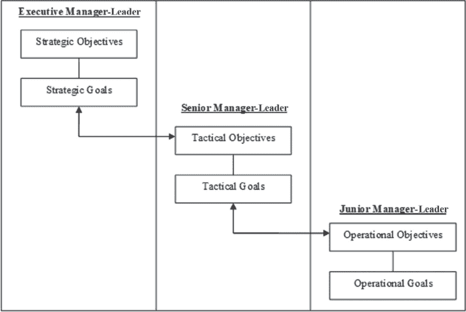

*图 3.1* 按管理职责的目标-目标流程。

注：改编自 *IT 审计：IT 治理*，R. E. Davis 著，2006 年，Pfeiffer。版权 2006 归 Robert E. Davis 所有。经许可改编。

在设定目标时，实体的运营和形象得到改善（R. Davis, 2011）。实体人员发展和成本削减承诺也应通过自下而上的沟通网络进行记录，以协助设定目标（R. Davis, 2011）。在适当审查和批准后，自上而下的目标沟通对于创造实体方向意识至关重要（R. Davis, 2011）。

ISG 目标的制定应反映实体管理者-领导者所接受的既定愿景、使命和价值观（R. Davis, 2011）。此外，高效有效的预算系统应支持和控制 ISG 目标的建立（Nicho, 2018）。通常，如图 3.2 所示，实体管理者-领导者制定或支持旨在实现特定时间相关目标的规划视野（R. Davis, 2011）。根据环境动态，长期计划的持续时间可为 1 至 20 年（R. Davis, 2011）。战略计划通常超过 1 年，战术计划为 1 年或更少，而运营计划涉及日常运营（R. Davis, 2011）。

ISG 长期计划应反映管理层对实体的预期或期望状态（R. Davis, 2011）。ISG 长期规划允许在考虑组织优势、劣势和相关未来趋势的情况下，通过相关影响预测进行功能方向指引，以得出实现目标的最佳策略（R. Davis, 2011）。确定网络安全控制目标类似于建立信息安全目标（R. Davis, 2011）。因此，ISG 控制规划是根据组织管理层的治理理念评估和评价组织及网络安全优势和劣势的渠道（R. Davis, 2008a）。从整体角度来看，人、信息、流程和基础设施是需要战略定义、战术采用和运营执行的关键要素。

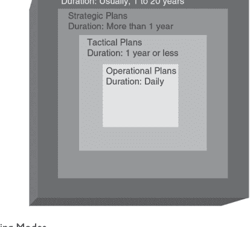

图 3.2 实体规划模式。

注：改编自 IT 审计：IT 治理，R. E. Davis 著，2006 年，Pfeiffer。版权 2006 归 Robert E. Davis 所有。经许可改编。

战略计划是管理层对利用可用资源后长期计划成果实现的评估。战略规划代表确定实体必要方向和目的的最高决策层级（R. Davis, 2011）。战略规划使组织目标的发展成为可能（R. Davis, 2011）。战略规划具有项目导向和时间导向，有助于确定和解决实现组织期望的优先事项（R. Davis, 2011）。策略侧重于控制实体的命运并实现明确的目标（R. Davis, 2011）。实体的监督委员会应负责设定高层目标、监督 ISG 规划模型、根据既定目标衡量绩效并修订无效或低效的目标（R. Davis, 2011）。

规划过程应将策略转化为可衡量的战术计划（R. Davis, 2011）。较低层级的组织管理应负责执行 ISG 策略并在 ISG 项目模型内运作（R. Davis, 2011）。准备、验证和适应是与战术规划、审查和更改目标直接相关的活动（R. Davis, 2011）。战略规划过程应将 ISG 项目的愿景、使命和价值观转化为方向、目标、策略、活动选择和资源配置，并辅以适当的战术规划（R. Davis, 2011）。ISG 需要作为实体机遇和控制系统改进的战略组成部分予以考虑（R. Davis, 2011）。如果正确整合，ISG 可以提供竞争优势、客户满意度、提高生产率和改进控制（R. Davis, 2011）。

在大多数实体中，运营层面的管理者-领导者监督日常信息安全相关任务（R. Davis, 2008b, 2017; Yaokumah, 2013）。在运营层面，初级管理者-领导者的责任通常是对高级管理者-领导者，负责履行委托的运营目标和一致的目标（R. Davis, 2008a, 2017）。运营管理者-领导者强调基于行政技术和相关专业知识的经济性、效率和效果（R. Davis, 2008b）。运营规划集中于制定必要的活动，以提供适当的信息安全并维护服务水平协议中定义的用户功能（R. Davis, 2008b）。

所选的战略、战术和运营保护措施应确保信息资产的实体环境得到适当控制（Coertze & Von Solms, 2013; R. Davis, 2008a）。从根本上讲，信息构建取决于可用数据（R. Davis, 2008a）。信息通常通过在决策中的可用性获得价值（R. Davis, 2008a）。可用的信息也创造知识（R. Davis, 2008a）。从概念上讲，提供可推导知识的信息无论传递方式如何都需要得到保护（R. Davis, 2008a）。因此，管理层需要保护信息免受未经授权的使用、披露或修改，以及损坏或丢失（R. Davis, 2008a）。

首席信息安全官应确保为实现 IAP 控制目标而制定策略，并制定 ISG 项目计划，以合理成本提供可接受的风险承受水平（R. Davis, 2008a）。ISG 项目计划应描述所有考虑的 IAP 控制措施，并说明纳入的目的和理由（R. Davis, 2008a）。接下来，在实施之前，高层管理应审查和批准 ISG 计划，以确保组织有足够的问责制、责任和权限来部署和维持 IAP 控制措施（R. Davis, 2008a）。

一旦实体管理者-领导者批准资源需求，IAP 基线开发和部署即可进行（Brotby, 2006; R. Davis, 2008a）。保护基线因信息资产的敏感性、关键性和影响估值而异（Brotby, 2006; R. Davis, 2008a）。然而，至少，信息资产应受到防止误用、滥用和破坏的保护（R. Davis, 2008a）。实施后，IAP 基线可成为适用于整个实体的管理、技术或运营标准（Brotby, 2006; R. Davis, 2008a）。

### 安全风险评估

全面的 IAP 风险评估应进行，以确保在制定或修改实体的 ISG 计划时相关项目得到考虑并得到适当处理（R. Davis, 2008a）。风险评估是风险识别、风险分析和风险评价的过程（ISO Technical Management Board Working Group, 2009）。换句话说，IAP 风险评估是对风险进行分类和评估以及确定所选领域的潜在重要性的评估（R. Davis, 2008a）。IAP 风险评估目标应涉及风险管理要素（R. Davis, 2008a）。IAP 风险评估的主要目标是提出建议，以在保持信息功能和可用性的同时最大化保密性、完整性和可用性（R. Davis, 2008a）。

关于技术，ISG 项目的范围决定了评估重点、评估如何进行以及评估限制（R. Davis, 2008a）。反映 ISG 规划的前提，评估成本与数据收集水平将有助于定义风险评估工作（R. Davis, 2008a）。ISG 项目范围通常决定风险评估方法（R. Davis, 2008a）。同时，记录总体和详细的控制边界有助于评估风险分析过程的决策和数据（R. Davis, 2008a）。详细的 ISG 控制边界划分可以反映功能区域、IT 环境或物理位置（R. Davis, 2008a）。

如图 3.3 所示，IAP 风险评估计划应描述预先确定的目标、目标和范围，并提供足够的支持细节，以指导风险评估的制定（R. Davis, 2008a），用于生成 IAP 一般和应用控制。IAP 风险评估计划应体现对管理机构发布的适用标准和实践声明的考虑（R. Davis, 2008a）。提供 ISG 项目的风险评估性质、时间安排和范围是主要的管理

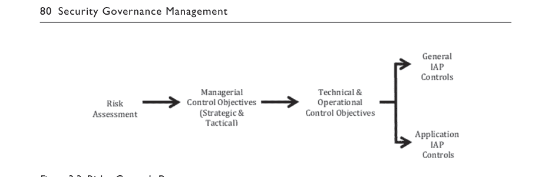

### 图3.3 风险—控制流程

> 注：IAP，信息资产保护。改编自R. E. Davis于2009年出版的《确保信息资产保护》（Lulu出版社）。版权归Robert E. Davis所有，经许可改编。

在确定IAP范围时需予以考虑（R. Davis, 2008a）。潜在的IAP风险评估范围包括：

- 风险分析，
- 逻辑访问，
- 物理访问，
- 机密信息，
- IT网络基础设施，以及
- 环境条件（Davis, 2008a）。

IAP风险评估范围决定了方法和工具的选择（R. Davis, 2008a）。在不超出IAP范围和ISG项目的权限或控制边界的前提下，IAP风险评估可以：

- 识别潜在的新风险敞口，
- 识别潜在的现有风险敞口，
- 评估相关的新风险敞口，
- 评估相关的现有风险敞口，
- 提供潜在风险敞口分析，
- 确定风险应对措施的成本，
- 确定风险应对措施的收益，
- 建立适当的控制措施，以及
- 建立与标准的合规性（Davis, 2008a）。

此外，IAP风险评估能够按关键性、敏感性和对实体运营的影响对信息进行分类（R. Davis, 2008a）。全面的IAP风险评估应允许自适应和迭代流程（Nicho, 2018; R. Davis, 2008a）。因此，ISG流程应允许从年度风险评估过渡到季度风险评估，以在动态环境中维持既定的风险容忍水平（R. Davis, 2008a）。此外，每当实体的运营或技术使用发生变化，或外部影响对运营产生影响时，风险评估绩效都应能够被纳入考量（R. Davis, 2008a）。然而，除非法律法规要求，风险评估成本不应超过从管理尽职调查中可获得的效益（R. Davis, 2008a）。

已采用的ISG风险评估框架是聚焦信息资产敏感性、关键性和影响必不可少的组成部分（R. Davis, 2008a）。风险评估框架可以采用定性或定量测量（R. Davis, 2008a）。无论分析人员采用何种风险评估测量技术，定量和定性分析程序都需要记录在案（R. Davis, 2008a）。

从选定的框架来看，信息安全评估方法论、运行关键威胁、资产与漏洞评估以及联邦信息技术安全评估框架都是基于能力成熟度的模型（R. Davis, 2008a）。美国国家安全局开发了信息安全评估方法论（R. Davis, 2008a）。信息安全评估方法论允许检查实体的使命、组织、安全策略、安全项目、信息系统和信息系统威胁（R. Davis, 2008a）。建议组织并维持一支高度熟练的信息安全团队，以完成信息安全评估方法论的目标（R. Davis, 2008a）。信息安全团队的职责包括提供危机和应急管理及培训（R. Davis, 2008a）。因此，相比之下，信息安全评估方法论的实施成本比运行关键威胁、资产与漏洞评估以及联邦信息技术安全评估框架高出两到三倍（R. Davis, 2008a）。

全面的高层风险评估是设计或修改IAP行动计划或政策的起点（R. Davis, 2008a）。此类评估对于确保以下事项至关重要：（a）所有IAP威胁、机会和漏洞都得到审查；（b）识别最重要的风险；（c）就可接受、可避免、可降低或可转移的风险做出适当决策；以及（d）通过适当的控制部署对所需信息资产进行增强、补偿或缓解（R. Davis, 2008a）。

一般风险分析是一种正式的风险评估技术，也是风险管理的驱动因素和推动因素（R. Davis, 2008a）。因此，辩证地看，信息资产风险分析是考量实体威胁、漏洞和机会所选用的方法。IAP风险评估通常是一项复杂的工作，需要通过风险分析来确定明智的资源分配优先级（R. Davis, 2008a）。风险分析有助于将IAP目标与其他以实体为中心的目标和要求整合（R. Davis, 2008a）。此外，风险分析有助于为ISG项目设计适当的预算（R. Davis, 2008a）。具体而言，一旦信息安全经理-领导者评估了资产价值以及潜在的威胁、漏洞和机会敞口，就可以为IAP做出合理的支出分配决策（R. Davis, 2008a）。

如图3.4所示，风险分析提供了一种评估可预见不利情况的手段，以确定实际的IAP部署（R. Davis, 2008a）。安全经理-领导者通常

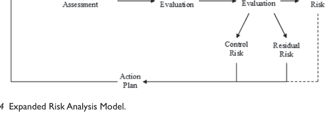

### 图3.4 扩展风险分析模型

> 注：改编自R. E. Davis于2009年出版的《确保信息资产保护》（Lulu出版社）。版权归Robert E. Davis所有，经许可改编。

完成信息资产风险分析，以确保IAP的有效性、相关性、效率以及对威胁和机会的响应能力（R. Davis, 2008a）。标准的信息资产风险分析识别可能被威胁利用的漏洞（R. Davis, 2008a）。在一定条件下，信息资产风险分析能够支持建立IAP基线，并随后与其他已识别的风险进行比较（R. Davis, 2008a）。信息资产风险分析还能够识别和缓解不可接受的风险偏好偏差（R. Davis, 2008a）。

定量与定性风险分析的区别在于对风险要素赋予数值（Dellisi et al., 2014; McCusker & Gunaydin, 2015; R. Davis, 2008a; Yilmaz, 2013）。一方面，对已识别信息资产进行货币或非货币估值是定量风险分析的可用选项（R. Davis, 2008a）。另一方面，定性风险分析仅涉及非货币估值（R. Davis, 2008a），因为文字能够传达行动。然而，如果偏好的定量或定性测量方法妨碍了评估目标的实现，则可能不可避免地需要结合定量和定性措施（R. Davis, 2008a）。

分析人员的混合方法有助于深入理解各种感兴趣的现象，这些现象仅靠单一的定量或定性方法是无法完全理解的（Mayoh & Onwuegbuzie, 2015; Siddiqui & Fitzgerald, 2014; Venkatesh et al., 2013）。定量、定性和混合方法都可以探索、描述或解释与安全相关的风险要素（R. Davis, 2017）。与信息资产风险分析相关的要素包括资产价值、威胁频率、漏洞严重程度、组织影响、IAP成本、IAP收益、不确定性和概率（R. Davis, 2008a）。

定量风险分析是一种更客观的估值方法（R. Davis, 2008a）。客观地获取和传播数据与信息符合后实证主义世界观，即客观性对于圆满完成检查工作至关重要（Christ, 2013; K. Davis, 2016; Mayoh & Onwuegbuzie, 2015; R. Davis, 2017）。一般来说，定量信息资产风险分析使用百分比、数学公式和财务价值（Davis, 2008a）。应用定量风险分析方法的障碍包括难以识别信息资产并为其赋值，以及缺乏确定威胁频率的统计数据（R. Davis, 2008a）。有利的是，当定量方法应用于信息资产测量时，管理层对在整个实体中部署等效估值技术的偏好通常得到满足（R. Davis, 2008a）。

通常，初始信息资产风险估计反映了参数假设（Davis, 2008a）。如有必要，评估人员可以应用敏感性分析（Farahmand et al., 2005; R. Davis, 2008a; Syamsuddin, 2013）。敏感性分析是一类旨在识别参数或参数集敏感性的方法（Li et al., 2013）。在定量方面，敏感性分析处理数学模型固有的不确定性，其中模型输入值可能会发生变化。通过模拟方法，对信息风险进行定量敏感性分析需要将情境转化为数学模型（R. Davis, 2008a）。定量敏感性分析要求能够确定计算解相对于任何给定参数或参数集变化的方差（R. Davis, 2008a）。因此，最佳参数是对概率输入敏感的参数（R. Davis, 2008a）。

另一方面，定性风险分析是一种更主观的估值技术（R. Davis, 2008a）。主观性使得决策更可能带有偏向于达成预期结果的偏见（R. Davis, 2008a）。定性技术依赖于评估人员的经验或推测能力来确定项目的重要性（R. Davis, 2008a）。定性风险分析单独或相对地对信息资产进行识别和排序（R. Davis, 2008a）。单独来看，信息资产的重要性根据所有者评估的价值来确定（R. Davis, 2008a）。相对来看，信息资产的重要性通过与其它项目进行比较来确定（R. Davis, 2008a）。


个体风险评级参数或参数集的重要性可通过执行定性敏感性分析获得 (R. Davis, 2008a)。定性敏感性分析方法提供启发式评级，以直观表示参数或参数集的相对敏感性 (Li et al., 2013)。在采用定性敏感性分析时，需要对特定信息资产漏洞进行潜在威胁索引，以得出对实体构成的保护风险水平 (R. Davis, 2008a)。此外，信息资产漏洞、资产价值以及威胁或机会的评级可以组合以得出相对定性风险评级 (R. Davis, 2008a)。IAP 风险评估人员可使用发生频率或高水位法对资产价值、威胁或机会以及漏洞进行定性推断相对估值 (R. Davis, 2008a)。

### 资产估值

为确定风险，必须进行信息资产识别 (R. Davis, 2008a)。通常，信息资产识别是敏感性、威胁、机会、隐私和漏洞风险分类与估值的先决条件 (R. Davis, 2008a)。管理层对数据收集、信息资产分类和信息资产估值的风险分析限制可能会对直接有助于实现实体运营目标的项目施加范围限制 (R. Davis, 2008a)。然而，与实体运营目标实现无关的信息资产可能会损害实体运营目标的实现 (R. Davis, 2008a; Zhao et al., 2013)。

信息资产识别允许解决保护违规时面临的风险 (R. Davis, 2008a)。编制或获取具有描述性功能的信息资产清单应是实体风险管理委员会、项目团队或专门执行信息资产估值的人员的首要行动事项 (R. Davis, 2008a)。如果信息资产清单不可用于分析和后续评估流程，管理层将面临可能导致刑事和民事起诉的不当行为指控风险 (R. Davis, 2008a)。

分类对于提供可重复的 IAP 至关重要，因为并非所有信息评估都相等 (R. Davis, 2008a)。用于对信息和相关资产进行分类的定性方案众多 (R. Davis, 2008a)。一种被接受的定性信息安全原则的分类方案将保密性、完整性和可用性划分为主要数据敏感性指标（见表 3.1；R. Davis, 2008a）。尽管如此，信息分类通常依赖于：

- 敏感性：敏感性是个人或实体用于限制向任何人共享项目的[content]
个体风险评级参数或参数集的重要性可通过执行定性敏感性分析获得 (R. Davis, 2008a)。定性敏感性分析方法提供启发式评级，以直观表示参数或参数集的相对敏感性 (Li et al., 2013)。在采用定性敏感性分析时，需要对特定信息资产漏洞进行潜在威胁索引，以得出对实体构成的保护风险水平 (R. Davis, 2008a)。此外，信息资产漏洞、资产价值以及威胁或机会的评级可以组合以得出相对定性风险评级 (R. Davis, 2008a)。IAP 风险评估人员可使用发生频率或高水位法对资产价值、威胁或机会以及漏洞进行定性推断相对估值 (R. Davis, 2008a)。

### 资产估值

为确定风险，必须进行信息资产识别 (R. Davis, 2008a)。通常，信息资产识别是敏感性、威胁、机会、隐私和漏洞风险分类与估值的先决条件 (R. Davis, 2008a)。管理层对数据收集、信息资产分类和信息资产估值的风险分析限制可能会对直接有助于实现实体运营目标的项目施加范围限制 (R. Davis, 2008a)。然而，与实体运营目标实现无关的信息资产可能会损害实体运营目标的实现 (R. Davis, 2008a; Zhao et al., 2013)。

信息资产识别允许解决保护违规时面临的风险 (R. Davis, 2008a)。编制或获取具有描述性功能的信息资产清单应是实体风险管理委员会、项目团队或专门执行信息资产估值的人员的首要行动事项 (R. Davis, 2008a)。如果信息资产清单不可用于分析和后续评估流程，管理层将面临可能导致刑事和民事起诉的不当行为指控风险 (R. Davis, 2008a)。

分类对于提供可重复的 IAP 至关重要，因为并非所有信息评估都相等 (R. Davis, 2008a)。用于对信息和相关资产进行分类的定性方案众多 (R. Davis, 2008a)。一种被接受的定性信息安全原则的分类方案将保密性、完整性和可用性划分为主要数据敏感性指标（见表 3.1；R. Davis, 2008a）。尽管如此，信息分类通常依赖于：

- 敏感性：敏感性是个人或实体用于限制向任何人共享项目的重要术语。单独而言，信息敏感性直接与信息保密性评估相关（见附录；R. Davis, 2008a）。敏感性度量确定的依据是信息可能如何影响法律法规的遵守或以实体为中心的流程 (R. Davis, 2008a)。
- 关键性：关键性反映了项目对个人或实体的重要性。单独而言，信息关键性直接与信息完整性评估相关（见附录；R. Davis, 2008a）。关键性度量通过相同信息的替代估值进行 (R. Davis, 2008a)。
- 影响：影响是项目在不可接受的事件或事故影响下所暴露的程度。单独而言，信息影响直接与信息可用性要求相关（见附录；R. Davis, 2008a）。影响度量通过不利影响估值进行 (R. Davis, 2008a)。

#### 表 3.1 数据分类敏感性指标

| 分类 | 指标 |
|---|---|
| 保密性 | 需要保留数据访问和披露限制。 |
| 完整性 | 需要防止不当的数据修改、损坏或破坏。 |
| 可用性 | 需要确保及时可靠的数据访问和使用。 |

注：改编自 R. E. Davis 2009 年 Lulu 出版的 *《确保信息资产保护》*。版权 2009 归 Robert E. Davis 所有。经许可改编。

IAP 也可以单独或联合进行威胁分析分类考虑。例如，与电信相关的特定刑事活动可归类为披露、欺骗、破坏或侵占 (R. Davis, 2008a)，其中信用卡欺诈、电话黑客和未经授权的数据通过是威胁。因此，归类为未经授权的数据通过的服务盗用是允许使用技术传输信息的侵占风险 (R. Davis, 2008a)。

信息系统应允许在所有情况下按预期安全地访问和使用资源。由于全面的信息安全是不可能的，管理层应考虑根据组织影响界定滥用，以便为履行管理保护职责提供审慎和富有成效的资源使用 (R. Davis, 2008a)。从子类别来看，IT 滥用可归类为恶意或意外 (R. Davis, 2008a)。此外，恶意或意外 IT 滥用的定义应涵盖信息的读取、修改和破坏 (R. Davis, 2008a)。

信息分类有助于满足法定和监管的隐私要求 (R. Davis, 2008a)。在完成强制性隐私评估时，准备人员可以使用 IAP 分类来基于隐含的估值和目标传达保护期望 (R. Davis, 2008a)。此外，信息分类可以帮助制定适当的信息资产处理方式 (R. Davis, 2008a)。

一旦进行信息资产识别和 IAP 分类，估值评估或分配就成为可能 (R. Davis, 2008a)。在识别和 IAP 分类之后，为信息资产记录个别价值应是估值流程的优先事项 (R. Davis, 2008a)。定量信息资产估值通常优先于定性信息资产估值 (R. Davis, 2008a)。信息资产估值报告应记录可能因 IAP 违规而导致的生产力、货币和利益相关者损失 (R. Davis, 2008a)。编制信息资产估值报告的主要目的是为 IAP 威胁、漏洞和机会分析以及风险评估提供一系列数值 (R. Davis, 2008a)。

定量风险分析方法通常应用绝对或相对信息资产估值模型 (R. Davis, 2008a)。鉴于信息资产是有形或无形项目，应用货币会计方法是一种估值选项 (R. Davis, 2008a)。例如，信息资产估值确定可能使用会计成本或收益方法进行 (R. Davis, 2008a)。当实体的管理层知晓信息资产的数值时，适合保护的资源分配要求可基于更客观的测量进行评估 (R. Davis, 2008a)。然而，无法生成或获取定量数据不应阻碍风险分析的发展 (R. Davis, 2008a)。

定性风险分析的标准分类在分配信息资产价值时为高、中、低 (R. Davis, 2008a)。另外，当需要额外的定性区分时，非常高、高、中、低、非常低的信息资产估值是可行的 (R. Davis, 2008a)。通常，定性分析中超过五个估值级别是过度的 (R. Davis, 2008a)。风险评估人员在使用定性估值和常规信息安全标准时，可以设计一个网格为实体信息资产分配适当的分类 (R. Davis, 2008a)。

创建或获取信息资产或主要用户的实体管理者领导应承担提供信息资产分类和识别的责任 (R. Davis, 2008a)。然而，直接负责风险分析资产估值的个人或团队应执行独立的信息资产识别和分类验证 (R. Davis, 2008a)。

### 威胁或机会评估

作为 IAP 威胁或机会评估的一部分，威胁或机会分析是必不可少的。威胁或机会分析记录了可能对信息资产产生不利影响的所有行动和事件 (R. Davis, 2008a)。在评估期间对威胁 (Huang et al., 2007) 或机会进行分类分组可以解决人类或非人类、故意或非故意、技术或非技术、熟练或不熟练以及内部或外部事件或事故 (R. Davis, 2008a)。在分析信息资产威胁或机会时，评估人员应考虑实体的漏洞以确保评估的完整性和准确性 (R. Davis, 2008a)。如图 3.5 所概念化，IAP 威胁或机会可能与单一漏洞或多个漏洞同时存在 (R. Davis, 2008a)。因此，为了实现稳健的风险应对，将威胁或机会映射到漏洞对于防止或阻止不良事件或事故至关重要。

广义上，安全威胁是可能导致信息资产未经授权受损的事件 (R. Davis, 2008a)。狭义上，对实体网络安全的威胁包括物理环境危害、刑事活动、隐私侵犯、IT 滥用和 IT 误用 (R. Davis, 2008a)。潜在的信息资产威胁包括窃听、身份识别操纵和电信干扰 (R. Davis, 2008a)。网络安全威胁

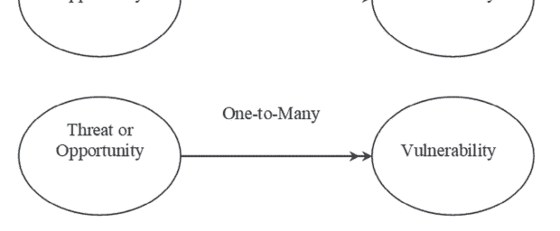

图 3.5 威胁或机会规范属性映射。
来源：改编自 R. E. Davis 2009 年 Lulu 出版的 Ensuring Information Assets Protection。版权 2009 归 Robert E. Davis 所有。经许可改编。


可能阻碍或降低实体和 IT 目标的实现、价值创造以及价值保持（R. Davis, 2008a, 2017; Srivastava & Kumar, 2015; Tarafdar et al., 2015）。

已识别的威胁对应于实体的内部和外部环境条件（R. Davis, 2008a）。量化而言，关于潜在 IAP 威胁的指示性数据可从各种可靠来源获得，以创建包含威胁发生频率、信息资产描述和信息资产价值的威胁清单（R. Davis, 2008a）。不管怎样，已识别信息资产的威胁发生概率与发生成本之间可能存在相反的状态（R. Davis, 2008a）。

相比之下，手动或自动化机会通常被视为能够积极影响目标实现、价值创造和价值保持的事件（R. Davis, 2008a）。计划内或计划外的情形可通过手动或 IT 流程部署带来提升实体声誉或财务状况的机会（R. Davis, 2008a）。当有利条件存在时，应使用适当的机遇分析启动风险评估程序，以维持可接受的安全风险水平并保持适当部署的安全控制措施（R. Davis, 2008a）。

根据所应用的定量技术，评估 IAP 威胁或机会需要使用数学和次数学计算（R. Davis, 2008a）。为确定单一 IAP 威胁或机会的估值，威胁或机会评估人员可使用以下公式：

```
ALE = SLE × ARO (R. Davis, 2008a) (3.1)
```

ALE 是信息资产的年度损失期望值（R. Davis, 2008a）。SLE 是信息资产的单次损失期望值（R. Davis, 2008a）。ARO 是与信息资产相关的事件或事故的年发生率（R. Davis, 2008a）。此外，在确定 SLE 时，采用以下公式：

```
SLE = IAV × RO (R. Davis, 2008a) (3.2)
```

IAV 是信息资产的总价值（R. Davis, 2008a）。RO 是与信息资产相关的事件或事故的发生率（R. Davis, 2008a）。因此，RO 是必要的计算，采用以下公式：

```
RO = (IAV-UIAV)/IAV (R. Davis, 2008a) (3.3)
```

UIAV 代表未受影响的信息资产价值部分（R. Davis, 2008a）。此外，对于 ALE 计算，ARO 估值可使用以下公式：

```
ARO = 1/TF (R. Davis, 2008a) (3.4)
```

TF 是以年为单位计算的威胁频率（R. Davis, 2008a）。

### 漏洞评估

漏洞是指设施、系统或运营中存在的任何弱点或缺陷，可能导致威胁发生（Lamba, 2014; R. Davis, 2008a）。个人、事物或特征都可能是漏洞（R. Davis, 2008a）。网络安全漏洞会增加攻击发生的可能性，增加攻击成功的可能性，或影响目标对象被获取的可能性（R. Davis, 2008a）。

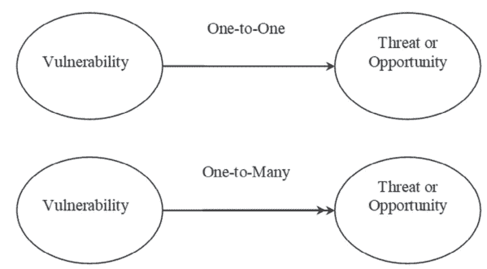

图 3.6 漏洞规范属性映射。

注：改编自 R. E. Davis 所著《Ensuring Information Assets Protection》，2009 年，Lulu 出版。版权 2009 归 Robert E. Davis 所有。经许可改编。

对于任何威胁而言，通过目标或目标驱动的控制部署来降低信息资产漏洞的可能性，比通过随意或启发式控制部署更大（R. Davis, 2008a）。漏洞评估允许进行方法论审查，以确定 IAP 测量的充分性和适当性，识别 IAP 缺陷，并预测 IAP 提案的有效性（R. Davis, 2008a）。

当评估人员进行 IAP 漏洞评估时，需要进行漏洞分析。漏洞分析记录所有已知的缺陷或弱点，这些缺陷或弱点已对信息资产产生不利影响或可能产生不利影响。评估期间对漏洞进行分类分组可以解决 IAP 的充分性、适当性和存在性问题（R. Davis, 2010, 2020）。在分析信息资产漏洞时，评估人员应考虑实体的 IAP 威胁或机会，以确保评估的完整性和准确性（R. Davis, 2008a）。如图 3.6 所概念化，已知的 IAP 漏洞可能存在单一或多个威胁或机会（R. Davis, 2008a）。因此，为了实现适当的 IAP 风险响应，需要将漏洞映射到威胁或机会，以防止或阻止不期望的事件或事故。（R. Davis, 2008a）。

当评估人员进行威胁到漏洞或漏洞到威胁的映射以确定事件或事故的 RO 时，漏洞值应成为威胁评估 ALE 计算的一部分（R. Davis, 2008a）。在 IAP 漏洞评估期间，漏洞分析集中于对目标对象的影响，考虑影响实体环境的主要和次要后果（R. Davis, 2008a）。漏洞分析应包括：

- 定义信息资产，
- 对信息资产进行分类，
- 为信息资产分配重要性级别，
- 识别信息资产的潜在威胁，
- 制定应对问题情况的策略，
- 定义以最小化攻击后果的响应措施，
- 向适当方报告漏洞，以及
- 记录以最小化攻击后果的响应措施（R. Davis, 2008a）。

与信息资产威胁或机会评估类似，关于潜在 IAP 漏洞的外部和内部指示性数据可从各种来源获得，以创建实体漏洞清单（R. Davis, 2008a）。作为选择选项，近期审计报告和漏洞扫描结果是在编制 IAP 漏洞清单时可接受的来源（R. Davis, 2008a）。所编制的漏洞清单至少应指明通知日期、信息资产描述和信息资产价值（R. Davis, 2008a）。

各种因素单独或共同作用都可能导致实体环境滋生 IAP 漏洞，包括缺陷组件、地理分布、规模、复杂性或变更频率（R. Davis, 2008a）。

- 缺陷组件：通常，信息资产的设计和部署并非以 IAP 为优先（R. Davis, 2008a）。此外，开发和部署完全安全的信息资产通常是不可能的、不切实际的（R. Davis, 2008a），或成本过高。因此，缺乏 IAP 关注和 IAP 缺陷可能导致组织漏洞（R. Davis, 2008a）。
- 地理分布：信息资产可在国际范围内分散，并可连接到全球网络（R. Davis, 2008a）。由此，信息系统可从世界任何地方访问。对于大多数实体而言，在开展组织事务时，限制地理分布会成为预期信息系统可用性的障碍（R. Davis, 2008a）。因此，为实现预期可用性而进行的 information assets 地理分布可能会阻碍物理和逻辑访问控制的部署（R. Davis, 2008a）。
- 规模：实体信息资产可以从独立计算机到广域网络（R. Davis, 2008a）。在接受、生成和存储信息的任何技术中的编程可能很庞大（R. Davis, 2008a）。因此，程序规模可能会增加未被检测到的漏洞（R. Davis, 2008a）。
- 复杂性：实体的 IT 可能支持许多用户，并由连接到网络的大量单个元素组成（Garba et al., 2015; R. Davis, 2008a）。此外，程序或系统可能在混合、集中或分散的 IT 环境中执行单一任务或多个任务，以用于独特流程或整个实体（R. Davis, 2008a, 2017; Yaokumah, 2013）。IT 也可能是商业现成软件或定制实体开发软件（R. Davis, 2008a）。相关活动和知识是实体中适当 IAP 最突出的因素（Kim et al., 2014）。缺乏对系统、网络拓扑和多个访问点的完整配置知识，使得漏洞得以发展并在 IAP 事件或事故发生前未被察觉而存在（R. Davis, 2008a）。
- 变更频率：硬件和软件变更通常随着 IT 配置复杂性的增加而增加（R. Davis, 2008a）。实体应用程序、系统和网络连接的变更可能成为日常例行工作（R. Davis, 2008a）。因此，高变更频率会阻碍及时跟踪和控制信息资产（R. Davis, 2008a），从而防止漏洞。

信息资产资源使用者是人员、流程和基础设施（R. Davis, 2008a）。计算系统和应用程序代表在 IT 环境中运行的服务和流程（R. Davis, 2008a）。因此，计算系统漏洞表示已知影响 IT 基础设施保护的通用控制预防、检测或纠正方面的缺陷或弱点（R. Davis, 2008a）。而计算应用程序漏洞通常表示为解决未经授权的使用和滥用而提供的已知保护限制

流程（R. Davis, 2008a）。此外，物理位置是信息资产所在区域（R. Davis, 2008a）。物理位置漏洞表明已知影响人员保护的访问限制局限性（R. Davis, 2008a）。

IAP 漏洞控制限制资源用户、计算系统、计算应用程序和物理位置暴露（R. Davis, 2008a）。定量或定性而言，漏洞通常是已实施控制的逆向表达（Lamba, 2014; R. Davis, 2008a）。换句话说，如果管理者领导者最大化实体信息资产的控制措施，信息资产漏洞应被最小化（Lamba, 2014; R. Davis, 2008a）。然而，漏洞降低率可能与部署的控制措施不成比例（R. Davis, 2008a）。此外，控制措施可以降低信息资产的漏洞，却可能产生其他信息资产漏洞（R. Davis, 2008a）。

在完成 IAP 漏洞评估之前，已部署的 IAP 控制措施需要进行测试，以确定不期望的事件和事故是否按预期进行预防、检测、威慑或纠正（R. Davis, 2008a）。IAP 漏洞测试可确保全面责任分配、程序理解与遵循，以及控制机制的正常运行（R. Davis, 2008a）。在渗透测试之前进行漏洞扫描是揭示潜在信息资产暴露的标准做法（R. Davis, 2008a）。技术性漏洞扫描解决方案会报告潜在的配置弱点（R. Davis, 2008a）。聊天软件、数据包注入、密码破解器和文件反汇编器是用于评估漏洞的标准 IT 渗透测试工具。

### 风险评估

IAP 风险评估允许就风险对实体的重大性或重要性以及管理层是否接受或处理每项审查的风险做出决策。威胁、机会和漏洞分析是主要的风险评估使能因素，可实现有效且高效的安全控制系统部署（R. Davis, 2008a）。然而，持续监控是必要的，以确保威胁、机会和漏洞不会侵蚀安全控制系统（R. Davis, 2008a）。在审查威胁、机会和漏洞评估报告后，组织单位可能需要 IAP 纠正措施以确保网络安全预期韧性（R. Davis, 2008a, 2017; Yaokumah & Brown, 2014）。不幸的是，同时将所有潜在 IAP 缺陷或弱点的 IAP 风险降低到可容忍水平通常成本高得令人望而却步（Nazareth & Choi, 2015; R. Davis, 2008a）。鉴于费用限制，风险分级系统有助于信息资产部署的评估和优先排序（Nazareth & Choi, 2015; R. Davis, 2008a; Rubino & Vitolla, 2014）。

在应用任何控制措施之前，实体面临的风险水平是总风险或原始风险（R. Davis, 2008a）。总风险或原始风险评估可提高对信息资产潜在不利影响的认识。如图 3.7 所概念化，信息资产部署机会可能存在单一或多个威胁（R. Davis, 2008a）。在进行信息资产风险分析的常规过程中，评估者应考虑与信息资产部署机会相关的安全威胁（R. Davis, 2008a）。因此，如果利用部署机会使信息资产变得脆弱，并且威胁可以利用该漏洞，则存在保护风险（R. Davis, 2008a）。

风险评估者可以在威胁、机会和漏洞判定使用定量方法时，对单个 IAP 风险的发生可能性和成本进行评估（R. Davis, 2008a）。在分配单个信息资产风险时，可通过使用每个威胁评估 ALE 来得出单个风险评级。

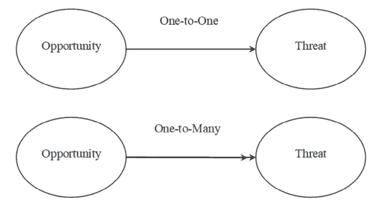

图 3.7 机会规范属性映射。

注：改编自 *确保信息资产保护* 由 R. E. Davis, 2009, Lulu。版权 2009 归 Robert E. Davis 所有。经许可改编。

另选地，风险评估者可以使用公式：

IIAR = T × V × A (R. Davis, 2008a) (3.5)

IIAR 是由此产生的单个信息资产风险估值。作为乘数，T 是信息资产的总体单个威胁估值，V 象征信息资产的总体单个漏洞估值。A 是信息资产的总体单个资产估值。

如前所述，定性风险分析单独并相对地识别和排序保护机制，以推断所有已识别信息资产的价值（R. Davis, 2008a）。关键的定性风险评估要素包括资产价值、威胁或机会评估，以及每个信息资产的漏洞评估（R. Davis, 2008a）。综合起来，评估要素代表确定信息资产定性估值的组成部分（R. Davis, 2008a）。风险评估者可以使用控制估值对单个 IAP 风险进行定性评估（R. Davis, 2008a）。采用控制估值方法要求基于控制强度对信息资产进行相对风险分配（R. Davis, 2008a）。如表 3.2 所示，控制风险评估包括记录控制充分性与信息资产风险之间的关系以进行适当评级（R. Davis, 2008a）。

控制充分性判定考虑直接性、选择性、应用方法和后续跟进（R. Davis, 2008a, 2020）。直接性是指设计的或部署的控制与控制目标相关的程度（R. Davis, 2008a, 2010, 2020）。选择性指的是控制重复的幅度、区分特征或其他用于识别例外条件的标准（R. Davis, 2008a, 2010, 2020）。控制放置的方式代表应用方法（R. Davis, 2008a, 2010, 2020）。控制后续跟进是在发现例外条件后采取的活动（R. Davis, 2008a, 2010, 2020）。

程序上，如果风险评估者使用控制风险评估方法，则需要识别 IAP 控制充分性所依赖的最重要控制措施（R. Davis, 2008a）。然后风险评估者可以将控制措施与信息资产进行交叉引用（R. Davis, 2008a）。

表 3.2 定性控制强度分类及描述

| 分类 | 描述 |
|---|---|
| 充足 | IAP 控制适当且运行有效。通常，控制要素未受损，或即使部分受损，也不足以影响 IAP 控制的性能或功能。控制弱点可能存在，但由此产生的风险敞口并不显著。 |
| 需要加强 | IAP 控制较弱，导致风险水平不可接受。因此，控制要素受损程度足以影响活动性能或功能。需要立即引起管理层关注。如果不予纠正，情况可能会恶化至控制不充分状态。 |
| 不充分 | IAP 控制存在明显缺陷，导致风险水平显著。因此，控制要素受损使控制不可靠。必须立即采取纠正措施。 |

注：改编自 确保信息资产保护 由 R. E. Davis, 2009, Lulu。版权 2009 归 Robert E. Davis 所有。经许可改编。

之后，风险评估者应在工作表上标明每个信息资产控制强度的风险估值（R. Davis, 2008a）。控制风险评估可以考虑采用估值频率、最弱环节或高水位技术来评估单个信息资产风险（R. Davis, 2008a）。

用于信息资产风险优先排序的明确方法有多种（R. Davis, 2008a）。尽管如此，IAP 风险优先排序是通过使用比较风险排名进行的。定量和定性风险排名需要评估每个信息资产估值（R. Davis, 2008a）。用于对 IAP 风险进行排名的方法包括估算、分类和序列化（R. Davis, 2008a）。估算排名使用潜在风险金额的近似值来确定单个信息资产风险的程度（R. Davis, 2008a）。分类排名使用单个信息资产风险率，按定义的套件排名以降序对风险评级进行分类（R. Davis, 2008a）。序列化排名使用从 1 到“n”项的数值以降序排列，1 分配给最高风险，并依次对较低风险进行排名，反映单个信息资产风险大小（R. Davis, 2008a）。

### 对策

IAP 风险响应是实体管理选择管理单个风险的手段（R. Davis, 2008a）。适当的 IAP 风险响应为威胁、机会或漏洞暴露提供对策（R. Davis, 2008a）。IAP 对策是任何防止、威慑、检测或纠正威胁、机会和漏洞暴露不利影响的行动、流程、设备或系统（R. Davis, 2008a）。尽管如此，IAP 威胁和漏洞可能根据风险评估者、委员会或项目团队的创造力而呈现机会（R. Davis, 2008a）。

高层 IAP 风险策略可归类为转移、规避、降低或接受。转移策略是由另一实体部分或全部承担风险（R. Davis, 2008a）。规避策略制定规避风险活动的手段。降低策略是设计和部署以减少事件或事故影响或可能性的风险响应（R. Davis, 2008a）。接受策略接受 IAP 风险及其相关后果（R. Davis, 2008a）。


从数学上讲，风险概率值可在 0 至 100% 之间变化（R. Davis, 2008a）。如果采用，IAP 转移、规避和降低策略是风险处理措施，可将风险降至低于 100%（R. Davis, 2008a），但会提升至大于 0 的水平。相比之下，风险接受策略不会影响 IAP 风险概率值（R. Davis, 2008a），因为风险处理是一个不可接受的风险响应选项。

尽管转移和规避是可行的风险对策候选方案，但由于控制不足时可能导致收入损失，风险降低方法对大多数实体而言是主要的 IAP 风险策略（R. Davis, 2008a）。以控制为基础的 IAP 风险方法能够确保可接受的实体风险水平得以维持（R. Davis, 2008a）。预防性、侦测性和纠正性控制通常保护实体的信息资产（R. Davis, 2008a）。作为技术对策的网络安全控制选择应反映错误频率、错误幅度以及错误检测成本（R. Davis, 2008a）。尽管如此，实体控制的采用定义会影响对策选择选项（R. Davis, 2008a）。

缓解性或补偿性控制可归类为 IAP 风险对策（R. Davis, 2008a）。缓解性控制通过转移、规避或降低处理来应对控制弱点风险（R. Davis, 2008a, 2020）。此外，缓解性控制降低的风险与实现 IAP 控制目标直接相关（R. Davis, 2008a）。相比之下，补偿性控制反映了额外的控制任务、活动或流程，与实现 IAP 控制目标间接对应（R. Davis, 2008a）。然而，补偿性控制用于加强与 IAP 控制目标直接相关的控制（R. Davis, 2008a）。

可用于降低或缓解 IAP 风险的控制措施包括员工担保、入职前审查、晋升审查、职能分离、职责分离、对账、活动监控、审批要求、授权要求、文件设计、文件使用、身份验证、所有权权利和法律义务（R. Davis, 2008a）。在切实可行的情况下，可部署的控制措施应包含不超出实体控制边界的异常和非法行为预防、威慑或检测方法（R. Davis, 2008a）。当需要补充对策时，可能需要一个以上的缓解性或补偿性控制来提供等效或可比较的直接 IAP（R. Davis, 2008a）。

### Control Evaluation

适当的实体 IAP 部署需要有效的<|message|>信息安全控制（R. Davis, 2008a）。信息威胁或机会以及漏洞风险评估需要提供最小化或规避风险的替代响应机制（R. Davis, 2008a）。管理层通常关注控制的成本以及在使用 IAP 控制部署时可获得的收益，同时追求实体和 IT 战略方向（R. Davis, 2008a）。风险评估人员应在风险评估控制评估期间考虑 IAP 控制协同效应以确保有效性（R. Davis, 2008a）。如果实体的管理者-领导者部署提供对透明控制目标和目标实现合理保证的 IAP 流程，则 ISG 计划运行有效性存在（R. Davis, 2008a）。

实体管理者-领导者可能会发现定义和采用补偿性或缓解性控制以适当应对风险是必要或审慎的（R. Davis, 2008a）。当信息资产需要补偿性或缓解性控制时，至少 ISG 计划所有者需要记录一份完整且令人信服的说明，解释补偿性或缓解性控制如何提供适当的<|message|>能力或保护水平。此外，ISG 计划所有者必须记录一份完整且令人信服的说明，解释为何直接相关的 IAP 控制不足（R. Davis, 2008a）。ISG 计划所有者还必须记录实体管理层已评估并正式接受采用所选补偿性或缓解性控制相关的风险（R. Davis, 2008a）。之后，使用补偿性和缓解性 IAP 控制需要在风险登记册中记录并经负责该信息资产的授权管理者-领导者批准（R. Davis, 2008a）。

信息资产控制的重要性或显著性需要分析以评估控制效果（R. Davis, 2008a）。应用控制后 IAP 风险需要评估以确定可接受风险水平的发展。公式可以表达在考虑与信息资产相关的风险容忍水平时，风险暴露因素与安全策略关系之间的平衡。价值分析检查正在进行的项目、计划或流程成本，以确定是否有更有利的资源可替代（R. Davis, 2008a）。控制技术的价值在于概念表征、在确定目标完成时作为解释工具的实用性，以及突出表明需要风险处理策略的运营问题和弱点（R. Davis, 2008a）。

控制成本也需要与部署控制所获得的收益相权衡（R. Davis, 2008a）。比较分析考虑评估风险与信息保护控制之间的差异（R. Davis, 2008a）。从分析上看，总年度损失预期需要与按单个信息资产降低风险的年度化 IAP 控制成本进行比较（R. Davis, 2008a）。采用期望值方法的成本效益分析为设定控制价值成本限制提供了客观依据（R. Davis, 2008a）。建立 IAP 控制价值限制确立了确定控制调查的决策标准（R. Davis, 2008a）。进行控制设计和部署的限制需要记录，以确保调查成本小于或等于所获得的收益（R. Davis, 2008a）。

在评估控制时，安全风险评估团队必须愿意花费足够的时间理解事实并从技能、资源和职位（相对于控制环境）角度分析实体，以查明相关问题（R. Davis, 2008a）。风险评估团队成员应通过审查风险评估和对策开始控制评估（R. Davis, 2008a）。为确保捕获所有相关信息，风险评估和对策审查应进行三次。第一次审查是为了熟悉风险评估和对策。在第二次审查期间，风险评估人员应记录风险评估中的重要数据和信息以及对策的文档。在第三次审查期间，安全风险评估团队应进行彻底的情境分析并制定讨论问题（R. Davis, 2008a）。

相关 IAP 事实分析可能需要在讨论中要求审查参与者的勤勉，以便从累积的风险评估数据中分离出重要威胁、机会或漏洞（R. Davis, 2008a）。审查参与者必须持续警惕实体边界，并认识到 IAP 控制系统设计需要解决整个实体配置（R. Davis, 2008a）。在不使用德尔菲技术达成共识的情况下，讨论 IAP 威胁、机会和漏洞对于确定适当的风险响应变得至关重要且必要（R. Davis, 2008a）。在控制评估过程中，审查参与者测试想法和概念并评估分析和潜在行动计划（R. Davis, 2008a）。每个参与者的广泛审查准备是确保富有成效讨论的必要条件（R. Davis, 2008a）。IAP 问题和问题的审议可以通过专业知识汇集以及来自具有不同风险抽象水平的人员的结论产生新的问题和疑问（R. Davis, 2008a; Tsohou et al., 2015）。完成控制评估过程后，IAP 固有风险和控制风险应与残余风险明确区分，以帮助管理层了解控制局限性（R. Davis, 2008a）。


### 控制风险

识别、评级和排序 IAP 控制风险可能对安全风险评估团队而言是一种范式转变。控制部署并不能消除 IAP 风险 (Barton et al., 2016; R. Davis, 2008a)。然而，控制措施可以帮助管理 IAP 风险 (R. Davis, 2008a)。关于 ISG 风险管理，IAP 控制风险是指控制措施无法防止、检测或纠正不期望的事件或情况的可能性 (R. Davis, 2008a)。公理上，控制风险与相关信息资产控制成反比 (R. Davis, 2008a)。因此，在 0 到 1 的定量尺度上，如果控制风险接近 1，则控制接近 0 (R. Davis, 2008a, 2010)。另外，使用定性控制风险尺度时，与控制的反向对应关系涉及非数值范围 (R. Davis, 2008a, 2010)。

实体控制系统是治理要求的投射，可能存在被误解的控制要素，因为控制结构取决于架构的参照框架 (Magdaraog, Jr., 2014; R. Davis, 2008a, 2017)。源于管理主义，构建的控制机制可能仅微小地影响市场低效率及由此产生的治理问题 (Raelin & Bondy, 2013)。此外，以实体为中心的控制系统可能接受关于满足利益相关者所需的控制保证水平的错误假设 (R. Davis, 2008a, 2017)。孤立地看，采用基于风险的 IAP 控制也可能几乎不提高利益相关者对实体人员的受托信心，因为管理者领导通常可以覆盖已部署的控制措施 (R. Davis, 2008a)。安全风险评估团队应在不道德的控制环境中考虑控制系统的局限性，并使合理的人能够推断控制是风险来源 (R. Davis, 2008a)。

### 剩余风险

剩余风险是在将控制部署作为风险降低措施后，针对威胁、机会或漏洞剩余的信息资产暴露 (R. Davis, 2008a; Rubino & Vitolla, 2014)。将剩余风险与控制风险分开报告可以明确实体的风险偏好 (R. Davis, 2008a)。将剩余风险与控制风险分开报告也可以确保管理者领导对 IAP 剩余风险的正式接受 (Fenz et al., 2014)。因此，通过剩余风险报告，管理者领导可以确定 IAP 剩余风险是否在可接受水平内 (Barton, 2014) 或需要额外的风险处理。

### 固有风险

IAP 固有风险是在没有风险处理的情况下的暴露 (Rubino & Vitolla, 2014)。IAP 固有风险考虑信息资产的性质、过往历史以及重要性或显著性的性质 (R. Davis, 2008a)。IAP 固有风险可以与其他剩余风险分开记录 (R. Davis, 2008a; Rubino & Vitolla, 2014)。之后，固有风险评级和排序可以使 IAP 行动计划的制定成为可能 (R. Davis, 2008a)。

### 行动计划

一旦风险评估团队成员达成优先排序一致，下一个合乎逻辑的风险评估活动就是 IAP 行动计划的制定 (R. Davis, 2008a)。在任何管理性 ISG 项目职能能够符合既定风险偏好之前，规划是必要的 (R. Davis, 2008a)。行动计划通过程序、可用资源和监控活动提供实现特定目标或目标的指导 (Luecke, 2005)。行动计划体现了实体管理层转移、规避、降低或接受 IAP 风险的意愿 (R. Davis, 2008a)。IAP 行动计划将战略转化为可衡量的战术和运营期望 (R. Davis, 2008a)。此外，IAP 行动计划将期望重新转化为政策、程序、指令、标准和规则 (R. Davis, 2008a)。从功能上讲，ISG 项目目标的选择先于政策和程序的设计 (R. Davis, 2008a)。

行动程序在解决任务所有权、识别每项预期行动、范围限制和任务时间表的同时提供指导。实际的行动计划包括确定必要资源、识别组织间联系、设定绩效指标和预测经济影响 (Luecke, 2005)。当 ISG 项目团队成员熟悉所有风险评估要素并对控制评估表示满意时，行动计划制定可以开始 (R. Davis, 2008a)。新制定的行动计划可能要求对战略对策决策进行更改 (R. Davis, 2008a)。可能需要彻底重新制定根本战略 (R. Davis, 2008a)。另外，情况可能要求制定一个计划，其中包括完善的战略设计和针对每个正在考虑的 IAP 领域的运营计划 (R. Davis, 2008a)。

ISG 项目团队成员还应使用超出 IAP 风险评估结果的假设情景制定替代行动计划 (R. Davis, 2008a)。应急理论认为没有单一的最佳领导方法 (R. Davis, 2008a; Yukl, 2011)。因此，对情境因素的考虑和分析可以提供更有效的领导 (R. Davis, 2008a; Yukl, 2011)。支持应急定位的是需要对未来行动进行适当风险处理的 IAP 计划承诺。具体而言，被接受的最佳风险解决方案可能造成未来问题 (R. Davis, 2008a)。因此，关于未来事件假设的风险评估情境分析可能表明需要提供替代 IAP 行动计划解决方案的应急计划 (R. Davis, 2008a)。

### 控制目标选择

控制目标规划是基于管理层实体治理理念评估和评价组织 IAP 优势和劣势的渠道 (R. Davis, 2008a)。控制目标定义了控制的预期目的或结果 (Davis, 2008a)。ISG 项目控制目标选择传达了维持实体信息资产的重要性 (R. Davis, 2008a)。确定 IAP 控制目标模仿了运营和 IT 目标的建立 (R. Davis, 2008a)。因此，IAP 控制目标规划允许预测未来的 IAP 方向和相关影响，同时考虑实体的优势和劣势 (R. Davis, 2008a)。管理上接受的 IAP 控制目标使政策的创建和部署成为可能 (R. Davis, 2008a)。进行 ISG 成熟度评估可以帮助确定 IAP 改进最需要的领域 (e.g., R. Davis, 2017; Yaokumah, 2014; Yaokumah & Brown, 2014)。

控制目标反映了开发过程中产生的先前前提或规划假设 (R. Davis, 2008a)。运营、IT 和 IAP 控制目标提供了期望，部署的 IAP 控制度量可据此确定目标实现情况 (R. Davis, 2008a)。通常，ISG 项目控制目标依赖于 IAP 控制目标规划技术。从系统角度看，政策、指令、程序、标准和规则的设计、部署、维护和处置是控制目标生命周期要素 (R. Davis, 2011)。在运营上，IAP 控制目标生命周期要素是可用的管理工具，用于在防止、检测或纠正错误、失误、遗漏、不规则行为和非法行为的同时获得预期结果 (R. Davis, 2011)。

管理要求与控制目标之间的关系是双向的 (R. Davis, 2008a)。考虑到管理要求与控制目标之间的双向联系，信息安全要求可转换为信息安全控制目标 (R. Davis, 2008a)。信息需要在实现控制目标的同时保持与所有适用的事实标准和法律标准的符合性。从 ISG 角度看，信息标准赋予信息资产度量的能力。ISG 管理者领导应建立总体和详细的 IAP 目标，以实现与运营和 IT 控制目标的一致性 (R. Davis, 2017)。

ISG 管理者领导对信息标准尽职调查通常允许运营和 IT 控制目标的实现 (R. Davis, 2008a)。

管理层采用的高层控制目标表明受 IAP 部署影响的信息和 IT 的运营要求 (R. Davis, 2008a)。各类总体和详细的网络安全控制目标已被营利性和非营利性实体记录下来，以建立基础 IAP 控制目标 (R. Davis, 2008a)。IAP 控制目标的潜在开发可使用德尔菲技术、优势-劣势-机会-威胁分析、《安全管理的四大纪律：信息安全参考模型》以及信息和相关技术控制目标框架进行 (R. Davis, 2008a)。然而，所选的 IAP 控制目标应反映规定的承诺，旨在确保有效高效的流程，提供符合法律的信息保密性、完整性和可用性 (R. Davis, 2008a)。

如图 3.8 所示，在设计 ISG 项目时，控制目标选择可从 IAP 风险评估中得出 (R. Davis, 2008a)。在采用控制

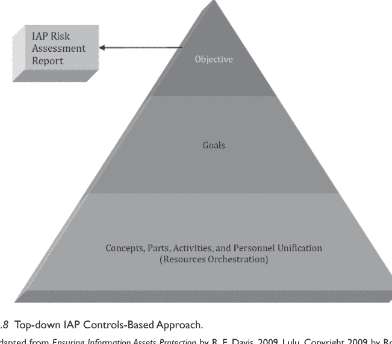

图 3.8 自上而下的基于 IAP 控制的方法。

注：改编自 R. E. Davis 所著《Ensuring Information Assets Protection》，2009 年，Lulu。版权 2009 归 Robert E. Davis 所有。经许可改编。


在目标方面，管理层应确定控制目的。接下来，管理层应连接（或关联）概念、部分、活动和人员，以实现既定控制目标和目的的统一运作（R. Davis, 2008a）。实体管理者-领导者通常通过旨在满足外部和内部运营要求的控制目标来启用流程（R. Davis, 2008a）。

资源编排通常要求管理层为流程部署政策、程序和标准（R. Davis, 2008a）。在某些情况下，指令和规则的部署用于传达统一运作的意图，而绩效衡量则设定任务勤勉度期望（R. Davis, 2008a）。将控制目标和目的转化为统一运作，并整合运营性的 IAP 政策、指令、程序、标准、衡量标准和规则，通常是反映设计得当的 IAP 控制的过程（R. Davis, 2008a）。

### 控制目的选择

活动目标可以推动高效的运营流程，但可能带来不利的 IAP 后果（R. Davis, 2008a）。因此，在制定 ISG 计划指导原则时，管理层应在采纳目标前考虑合规要求和安全标准（R. Davis, 2008a）。ISG 计划目标可以从所采用的安全框架中获得，或者由管理层基于已批准的 IAP 控制目标进行设计（R. Davis, 2008a）。然而，IAP 控制目的需要与实体和 IT 目标保持一致（Brotby, 2006; R. Davis, 2008a）。

当控制目的被考虑采纳时，需要设定控制目的实现程度的衡量标准（R. Davis, 2008a）。IAP 控制目的完成指标试图定义衡量 IAP 控制目的成功与否的活动，以帮助实现一个或多个目标（R. Davis, 2008a）。相应地，IAP 关键目的指标传达评估控制目的实现情况的关键活动衡量标准（R. Davis, 2008a）。IAP 控制目的的优先级排序可以决定关键目的指标的选择（Brotby, 2006; R. Davis, 2008a）。

### 组织

ISG 计划的制定通常需要结构化的组织（R. Davis, 2008a）。ISG 的组织是为了防止混乱（R. Davis, 2008a），通过识别和分类实现功能化。ISG 组织是指设计并构建系统、流程（R. Davis, 2008a）、活动和角色，以完成已采纳的目标或目的。因此，构建结构允许将流程和活动协调并整合为一个有凝聚力的整体，朝着目标实现迈进（R. Davis, 2008a）。构建结构还使活动能够分割为各项任务，每项任务都有其任务目标和目的（R. Davis, 2008a）。此外，ISG 需要适当分配角色以实现计划目标和目的（R. Davis, 2008a）。

控制论控制理论阐明了组织结构在信息治理中的作用（Boyson, 2014; R. Davis, 2017）。信息可以定义为一个与系统中组织程度相关的准物理概念（Boyson, 2014; R. Davis, 2017）。从系统的角度来看，ISG 结构是过程的结果（Misangyi & Acharya, 2014; R. Davis, 2017）。ISG 系统部署的结构在结构内分配责任和权利，并要求确保管理者-领导者在所定义的结构内有效且按预期地运作（R. Davis, 2017; Singh et al., 2013; Too & Weaver, 2014）。管理者-领导者的角色是在所定义的 ISG 系统框架内进行管理（R. Davis, 2017; Too & Weaver, 2014）。因此，ISG 反映了实体指导和控制信息安全活动的系统（Kushwaha, 2016; R. Davis, 2017; Williams et al., 2013）。

ISG 设计的任务和部署的技术会影响组织结构（Guadalupe et al., 2014; Hitt & Brynjolfsson, 1997; Meyer & Rowan, 1977; R. Davis, 2017; Sor, 2004）。因此，信息安全既是结构性的，也是技术性的（Boyson, 2014; R. Davis, 2017）。信息安全解决方案可能需要开发或采购以实现 ISG 战略（R. Davis, 2012a）。ISG 计划需要横向和纵向地调整实体职能，并考虑权限-活动关系和信息系统的所有权（R. Davis, 2008a）。实体通常采用简单型、官僚型、专业型或事业部型组织结构（Mukherji, 2002; R. Davis, 2017; Steiger et al., 2014）。相反，在官僚主义、复杂性和集中化过于受限的情况下，灵活型（Adhocracy）组织结构支持创新和运作，以克服环境状况（Mukherji, 2002; R. Davis, 2017; Steiger et al., 2014）。因此，不太传统的实体应依靠非正式组织结构，并通过跨边界和建立联盟的管理技术加以强化。

个人智力能力和推理能力的限制通常是首席信息安全官请求与主题专家（R. Davis, 2008a）和 ISG 计划团队成员进行集体协商的一般诱因。因此，管理咨询委员会或指导委员会的形成可以为 ISG 计划确定风险、目标和目的（R. Davis, 2008a）。ISG 风险评估小组中应存在组织多样化的代表，以确保相关事项得到考虑并获得适当处理，同时不阻碍生产力（R. Davis, 2008a）。

### 编排

组织过程将 IAP 行动计划转化为可控制的领域，并包括基于可用资源有效利用的活动分组。人员、信息、流程和基础设施是需要适当管理的 ISG 资源类别（De Haes et al., 2013; R. Davis, 2008a, 2017）。受委托的管理者-领导者主要通过熟练的资源使用来追求目标和目的的实现（R. Davis, 2008a）。熟练的资源使用通常包括财务预算，以确定与预期支出之间的成本差异（R. Davis, 2008a）。按照规定，如果实体的控制环境能够实现卓越的 IAP 控制分析，那么部署卓越的信息安全设计是可行的（R. Davis, 2008a）。

ISG 管理需要考虑到外部和内部环境来使用可用人员（R. Davis, 2008a）。实体的组织结构中通常存在若干关系，可以基于角色整合资源（R. Davis, 2008a）。高管团队结构可以是一个关键的组织设计选择（Guadalupe et al., 2014）。尽管如此，ISG 计划团队成员的选择对于评估目标和目的有效性的过程至关重要（R. Davis, 2008a）。协助确定风险、控制目标和控制目的的 ISG 计划团队成员可以是同一些人（R. Davis, 2008a）。但是，实体 ISG 计划委员会成员应包括以下代表：
- 信息安全，
- IT 运营，
- 网络基础设施，
- 系统编程，
- 应用程序编程，
- 数据库管理，
- 系统开发，以及
- 信息资产所有权（R. Davis, 2008a）。

实体员工受益于知识共享和知识应用（Findikli et al., 2015; R. Davis, 2017）。然而，组织结构对在实体中建立安全知识共享的影响稍弱（Flores et al., 2014; R. Davis, 2017）。值得注意的是，研究人员发现，基于业务的信息安全管理对安全知识共享没有显著的直接影响（R. Davis, 2017）。此外，知识壁垒阻碍了信息安全管理者-领导者与业务管理者-领导者之间的有效沟通（R. Davis, 2017）。业务管理者-领导者可能内化了信息安全讨论中的词语，却没有真正的技术理解（Lopez, 2012; R. Davis, 2017）。作为知识共享挑战的补救措施，实体管理者-领导者可以应用 Beer 的组织控制论框架来确保一个可行的治理结构（Arif, 2016），以促进信息安全管理者-领导者与业务管理者-领导者之间的有效沟通（R. Davis, 2017）。

ISG 管理者-领导者需要准备和管理一个旨在告知员工必要 IAP 的 ISG 计划（R. Davis, 2008a）。设计和构建行为是相互依赖且多维度的任务，需要理解管理原则和实践（R. Davis, 2008a）。实体人员应强制参加入门 IAP 培训，以减少有意和无意的信息安全风险（R. Davis, 2008a）。对于新招募的实体人员，通过与实体人力资源部门的协调，正式的入职培训计划至少应包括分发或引用 IAP 政策及相关程序，以减少行为风险（R. Davis, 2008a）。随后，需要定期进行持续的 IAP 培训，以将风险水平维持在可容忍的范围内（R. Davis, 2008a）。此外，员工的晋升、调动或解雇需要向信息安全职能部门提交变更通知，以增加、减少或移除信息资产的访问授权（R. Davis, 2008a）。

组织结构可被视为组织过程，而非管理汇报安排（Arif, 2016）。ISG 管理者-领导者应评估哪些实践部署与 ISG 有效性相关（R. Davis, 2017）。信息安全违规事件会导致额外成本，并显著影响实体的声誉（Safa et al., 2016; R. Davis, 2017）。ISG 管理者-领导者应全面实施领域流程，以应对预防和阻止信息安全违规事件的挑战（R. Davis, 2017）。ISG 管理者-领导者还应确保所选的领域流程对利益相关者是透明的，以便分享（R. Davis, 2017）。通过领域流程获得可靠的知识，实体管理者-领导者可以部署能够显著改进 ISG 计划的措施。实体管理者-领导者和其他利益相关者可以将构建的领域流程作为分析工具，以预测 ISG 有效性的实现情况。

在技术方面，ISG 计划应在信息资产开发项目期间处理保护要求的整合问题（R. Davis, 2008a）。通常，大型 IT 开发项目包括概念描述、功能需求和规格、技术需求和规格、设计、编码、测试和实现（R. Davis, 2020）。ISG 计划应有安全专业人员参与 IT 开发项目的设计、采购、测试和维护，以确保

使用基于安全保障的设计模型，保护功能按预期运行，且保护特性在维护期间能够抵御破坏（R. Davis, 2008a）。网络安全原则和策略的铭刻应在概念描述开发期间进行。功能规范、测试和实施分别要求确定 IAP 要求、对每个 IAP 要求进行操作验证，以及整合现有安全对策的程序（R. Davis, 2008a）。

### 指导

组织指导是管理职能，即规范实体人员活动或行动方案。管理层的组织指导应使员工能够有效地、高效地为实现目标和[content]
使用基于安全保障的设计模型，保护功能按预期运行，且保护特性在维护期间能够抵御破坏（R. Davis, 2008a）。网络安全原则和策略的铭刻应在概念描述开发期间进行。功能规范、测试和实施分别要求确定 IAP 要求、对每个 IAP 要求进行操作验证，以及整合现有安全对策的程序（R. Davis, 2008a）。

### 指导

组织指导是管理职能，即规范实体人员活动或行动方案。管理层的组织指导应使员工能够有效地、高效地为实现目标和目标做出贡献（R. Davis, 2008a）。管理授权的委派提供了指挥他人并要求其履行的权利，包括规定工作执行方式和方法的权利（R. Davis, 2008a）。正式接受的管理授权意味着被授予的权力（R. Davis, 2008a）。权力使法令和命令得以执行（R. Davis, 2008a）。管理上的义务是管理被分配或承担的项目、系统、活动或任务，而不损害受托期望（R. Davis, 2008a）。经典地，从管理委派中正式得出的受托义务存在于大多数实体职位中（R. Davis, 2008a）。

沟通可能与组织绩效呈正相关（Posthuma et al., 2013）。指导员工的一个主要要素是实体内使用的沟通策略和方法（Hart, 2016）。根据实体的技术进步程度，雇主期望可通过听觉、视觉和感觉活动传达和接收，这些活动能够为决策应用提供当前或未来的处理（Chen et al., 2012; R. Davis, 2008a）。在指导活动时，所传达信息的有效性只有在发送者感知到接收者行为发生变化时才可衡量（Chen et al., 2012; R. Davis, 2008a）。

指导沟通的有效性可由发送者通过观察信息对接收者的影响并寻求接收者反馈来确定（R. Davis, 2008a）。发送者有义务征求接收者的反馈，以确保沟通过程完整（R. Davis, 2008a）。相反，接收者应向发送者提供反馈（R. Davis, 2008a），以避免所传达信息被误解。反馈在探究沟通过程有效性中的重要性揭示了异步备忘录发布局限性（R. Davis, 2008a）。

实体监督委员会或执行管理层在实体最高管理层级定义指导设置（Edwards, 2013）。接下来，高级管理层在实体中层管理层级将指令转化为实体政策和标准（Edwards, 2013）。实体政策和标准作为执行和控制的基线（Edwards, 2013）。随后，基层管理层在实体基层管理层级将实体政策和标准转化为程序以确保预期执行（Edwards, 2013）。最高、中层和基层实体管理层级分别可视为战略、战术和运营 IAP 管理层（Edwards, 2013; Yaokumah, 2015）。值得注意的是，实体员工的遵从取决于 ISG 结构、管理承诺、IAP 目标和意图、IAP 流程，以及关于个人如何证明 IAP 预期遵循的理由和方法的指南（Edwards, 2013）。

原则是传达指导价值观或哲学的一般性陈述（Posthuma et al., 2013）。实体原则应反映使命、愿景和价值观陈述（Posthuma et al., 2013）。

### 安全治理管理 101

通常被引用为指导原则，使命、愿景和价值观陈述的管理意图是为较低组织层级人员提供理性的方向（Posthuma et al., 2013）。组织指导始于战略层级，届时执行管理者-领导者指出信息资产的重要性以及信息资产为实现实体的战略愿景所提供的帮助（Coertze & Von Solms, 2013）。在指导 ISG 行动计划时，有九项原则用于创建 IAP 文化（Barton et al., 2016）。IAP 文化原则为（a）意识，（b）责任，（c）响应，（d）伦理，（e）参与，（f）风险评估，（g）安全设计与部署，（h）安全管理，以及（i）再评估（Barton et al., 2016）。

### 控制

资源使用者呈现的潜在风险包括违规和非法行为的实施（R. Davis, 2008a）。管理层对合规要求的控制方法可以确保部署适当的措施，以确定实体的员工是否理解已实施的治理实践以及员工是否按预期遵循治理流程（R. Davis, 2008b）。为保持道德行为而制定的法律合规程序应由中层管理制定并通过示范行为推广（R. Davis, 2008a, 2008b）。

识别使遵守法律法规、政策、指令和最佳实践成为可能的控制要求是 ISG 项目管理的责任（R. Davis, 2008a）。因此，首席信息安全官或指定的 ISG 项目经理应确定
- 控制的性质，
- 控制的类型，
- 适用的标准，
- 绩效测量，
- 绩效比较，
- 评估方法，
- 纠正方法，以及
- 控制技术（R. Davis, 2008a）。

控制活动有助于确保管理指令的执行。当为控制实体做出贡献时，管理者-领导者可以部署组织、政策、程序、人员、会计、预算、报告和控制审查（R. Davis, 2010, 2020）。尽管如此，所选控制活动通常通过使用信息资产来支持，以帮助实现实体目标和目标（R. Davis, 2008a）。具体而言，实体系统、流程、活动和任务通常需要数字编码信息以满足组织目标。实体管理者-领导者需要确保战略规划与 IAP 部署之间的相互依存（R. Davis, 2020）。IAP 必须与实体员工充分应用信息来源保持一致并使其能够实现。因此，通过适当的 IAP，管理者-领导者可以最大化利益、把握机会并为实体获得竞争优势（R. Davis, 2008a）。

在技术驱动的实体环境中，管理者-领导者管理系统变更的程度与在运营目标上取得成功交付成正比（R. Davis, 2008a）。在上下文中，IT 变更是不可避免的且为保持运营可行性所必需（R. Davis, 2008a）。因此，ISG 项目必须包括监控相关

Boyson, S. (2014). 网络供应链风险管理：彻底改变关键 IT 系统的战略控制。 *Technovation, 34*, 342–353. http://doi.org/10.1016/j.technovation.2014.02.001

Brotby, K. W. (2006). *信息安全治理：董事会和高级管理层的指导* (2nd ed.). IT Governance Institute.

Catinean, I., & Cândea, D. (2013). 云计算模型作为颠覆性创新的特征。 *Review of International Comparative Management, 14*, 783–803. www.rmci.ase.ro

Chen, Y., Ramamurthy, K., & Wen, K. (2012). 组织信息安全政策合规性：胡萝卜加大棒方法？ *Journal of Management Information Systems, 29*(3), 157–188. https://doi.org/10.2753/MIS0742-1222290305

Chou, D. C. (2015). 云计算：价值创造模型。 *Computer Standards & Interfaces, 38*, 72–77. https://doi.org/10.1016/j.csi.2014.10.001

Christ, T. W. (2013). 世界观矩阵作为设计混合方法研究时的策略。 *International Journal of Multiple Research Approaches, 7*, 110–118. https://doi.org/10.5172/mra.2013.7.1.110

Coertze, J., & Von Solms, R. (2013). 发展中国家信息安全治理模型。 In K. Jonas, I. A. Rai, & M. Tchuenté (Eds.), *面向发展中国家的电子基础设施和电子服务* (pp. 279–288). Lecture Notes of the Institute for Computer Sciences, Social Informatics and Telecommunications Engineering, Vol. 119. https://doi.org/10.1007/978-3-642-41178-6_29

Davis, K. (2016). 衡量与个人利益相关者群体相关的成功维度的方法。 *International Journal of Project Management, 34*, 480–493. https://doi.org/10.1016/j.ijproman.2015.12.009

Davis, R. E. (2006). *IT 审计：IT 治理*. Pleier.

Davis, R. E. (2008a). *IT 审计：确保信息资产保护*. Pleier.

Davis, R. E. (2008b). *IT 审计：IT 服务交付与支持*. Pleier.

Davis, R. E. (2009). *确保信息资产保护*. Lulu.

Davis, R. E. (2010). *IT 审计：一种自适应系统*. www.amazon.com

Davis, R. E. (2011). *确保 IT 治理*. www.amazon.com

Davis, R. E. (2012a). *确保信息安全*. www.amazon.com

Davis, R. E. (2012b). 管理信息系统持续审计的案例。 In J. Oringel (Ed.), *企业有效审计：实践与程序中的关键发展* (pp. 209–217). Bloomsbury Information.

Davis, R. E. (2017). *美国公司公司治理与信息安全治理有效性之间的关系* (Publication No. 10603383) [Doctoral Study, Walden University]. ProQuest Dissertations Publishing.

Davis, R. E. (2020). *使用系统视角的 IT 审计*. IGI Global.

De Haes, S., van Grembergen, W., & Debreceny, R. S. (2013). COBIT 5 与信息技术企业治理：构建模块与研究机会。 *Journal of Information Systems, 27*(1), 307–324. https://doi.org/10.2308/isys-50422

Dellis, A., Skolarikos, A., & Papatsoris, A. G. (2014). 为什么我要做研究？这是浪费时间吗？ *Arab Journal of Urology, 12*(1), 68–70. https://doi.org/10.1016/j.aju.2013.08.007

Derakhshandeh, A., & Gholami, R. (2012). 领导风格与组织中董事和经理感知的组织有效性之间的关系。 *Management Science Letters, 2*(3), 845–850. https://doi.org/10.5267/j.msl.2011.12.099

Duranti, L. (2010). 电子记录管理的概念和原则，或记录管理理论是档案外交学。 *Records Management Journal, 20*(1), 78–95. https://doi.org/10.1108/09565691011039852

Edwards, C. K. (2013). *信息安全治理框架* (Publication No. 3607548) [Dissertation, Nova Southeastern University]. ProQuest Dissertations Publishing.

Farahmand, F., Nayathe, S. B., Sharp, G. P., & Enslow, P. H. (2005). 对信息系统安全威胁风险的管理视角。 *Information Technology and Management, 6*(2–3), 203–225. https://doi.org/10.1007/s10799-005-5880-5

Fenz, S., Heurix, J., Neubauer, T., & Pechstein, F. (2014). 信息安全风险管理中的当前挑战。 *Information Management & Computer Security, 22*, 410–430. https://doi.org/10.1108/IMCS-07-2013-0053


Findikli, M., Yozgat, U., & Rofcanin, Y. (2015). 考察组织创新与知识管理能力：战略人力资源实践（SHRPs）的核心作用。Procedia-Social and Behavioral Sciences, 181, 377-387. https://doi.org/10.1016/j.sbspro.2015.04.900

Flores, W. R., Antonsen, E., & Ekstedt, M. (2014). 组织中的信息安全知识共享：探究行为信息安全治理与国家文化的影响。Computers & Security, 43, 90-110. https://doi.org/10.1016/j.cose.2014.03.004

Garba, A. B., Armarego, J., Murray, D., & Kenworthy, W. (2015). 自带设备（BYOD）环境中信息安全与隐私挑战综述。Journal of Information Privacy and Security, 11, 38-54. https://doi.org/10.1080/15536548.2015.1010985

Guadalupe, M., Li, H., & Wulf, J. (2014). 谁居住在 C 套房？组织结构与高层管理中的劳动分工。Management Science, 60, 824-844. https://doi.org/10.1287/mnsc.2013.1795

Hart, A. J. (2016). 探究管理沟通行为对员工参与度的影响 (Publication No. 10056411) [博士论文, Walden University]. ProQuest Dissertations Publishing.

Hitt, L. M., & Brynjolfsson, E. (1997). 信息技术与企业内部组织：探索性分析。Journal of Management Information Systems, 14(2), 81-101. https://doi.org/10.1080/07421222.1997.11518166

Huang, D. L., Rau, P. L. P., & Salvendy, G. (2007). 影响人们对信息安全感知的因素调查。载于 J. A. Jacko (编), 人机交互 (pp. 906-915). Lecture Notes in Computer Science, 第 4553 卷. https://doi.org/10.1007/978-3-540-73111-5_100

ISO Technical Management Board Working Group. (2009). 风险评估。ISO/IEC Guide 73, 风险管理-词汇。www.iso.org/obp/ui#iso:std:iso:guide:73:ed-1:v:1:en

Kim, S. H., Yang, K. H., & Park, S. (2014). 信息安全政策合规的整合行为模型。The Scientific World Journal, 2014, 1-12. https://doi.org/10.1155/2014/463870

Kushwaha, P. (2016). 信息安全管理体系与商业范式转变的融合。International Journal of Computer Science and Information Security, 14(1), 105-111. https://sites.google.com/site/ijcsis

Lamba, A. (2014). 使用 VAPT 工具（漏洞评估与渗透测试）进行网络攻击预防。Cikitusi Journal for Multidisciplinary Research, 1(2), 64-71. www.cikitusi.com

Li, J., Duan, Q. Y., Gong, W., Ye, A., Dai, Y., Miao, C., . . . Sun, Y. (2013). 基于定性与定量敏感性分析评估通用陆地模型的参数重要性。Hydrology and Earth System Sciences, 17(8), 3279-3293. https://doi.org/10.5194/hess-17-3279-2013

Lopez, R. H. (2012). 信息数据安全专家与企业领导者关于沟通挑战的经验 (Publication No. 3503982) [博士论文, Walden University]. ProQuest Dissertations Publishing.

Luecke, R. (2005). 哈佛商业精要：战略：为您的企业创建并实施最佳战略。Harvard Business School.

Magdaraog, Jr., G. A. (2014). 工作场所的警示信号：员工欺诈风险因素分析。The Carrington Rand Journal of Social Sciences, 1(1), 73-82. www.carringtonrand.com

Mayoh, J., & Onwuegbuzie, A. J. (2015). 迈向混合方法现象学研究的概念化。Journal of Mixed Methods Research, 9, 91-107. https://doi.org/10.1177/1558689813505358

McCusker, K., & Gunaydin, S. (2015). 使用定性、定量或混合方法的研究及基于研究的选择。Perfusion, 30, 537-542. https://doi.org/10.1177/0267659114559116

Meyer, J. W., & Rowan, B. (1977). 制度化组织：正式结构作为神话与仪式。American Journal of Sociology, 83(2), 340-363. https://doi.org/10.1086/226550

Misangyi, V. F., & Acharya, A. G. (2014). 替代品还是互补品？公司治理机制的配置性检验。Academy of Management Journal, 57(6), 1681-1705. https://doi.org/10.5465/amj.2012.0728

Mukherji, A. (2002). 信息系统的演变：其对组织和结构的影响。Management Decision, 40(5), 497-507. https://doi.org/10.1108/00251740210430498

Nazareth, D. L., & Choi, J. (2015). 信息安全管理系统动力学模型。Information & Management, 52, 123–134. https://doi.org/10.1016/j.im.2014.10.009

Nicho, M. (2018). 信息系统安全治理实施过程模型。Information and Computer Security, 26(1), 10–38. https://doi.org/10.1108/ICS-07-2016-0061

Nwekeaku, C. (2013). 大学领导与研究管理对尼日利亚国家转型的推动。Journal of Education and Practice, 4(22), 187–193. www.iiiste.org/Journals/index.php/JEP

Posthuma, R. A., Campion, M. C., Masimova, M., & Campion, M. A. (2013). 高绩效工作实践分类法：整合文献并指导未来研究。Journal of Management, 39(5), 1184–1220. https://doi.org/10.1177/0149206313478184

Raelin, J. D., & Bondy, K. (2013). 让善重新回归良好公司治理：双层代理理论的存在与问题。Corporate Governance: An International Review, 21, 420–435. https://doi.org/10.1111/corg.12038

Rubino, M., & Vitolla, F. (2014). 公司治理与信息系统：IT 治理框架如何支持 ERM。Corporate Governance: The International Journal of Business in Society, 14, 320–338. https://doi.org/10.1108/CG-06-2013-0067

Safa, N. S., Von Solms, R., & Furnell, S. (2016). 组织中的信息安全政策合规模型。Computers & Security, 56, 70–82. https://doi.org/10.1016/j.cose.2015.10.006

Siddiqui, N., & Fitzgerald, J. A. (2014). 混合方法研究中定性与定量视角的精细整合：对护理实践环境的深入探究。International Journal of Multiple Research Approaches, 8, 137–147. https://doi.org/10.5172/mra.2014.8.2.137

Singh, A. N., Picot, A., Kranz, J., Gupta, M. P., & Ojha, A. (2013). 信息安全管理（ISM）实践：来自印度和德国精选案例的经验。Global Journal of Flexible Systems Management, 14, 225–239. https://doi.org/10.1007/s40171-013-0047-4

Sor, R. (2004). 信息技术与组织结构：为过去的理论正名。Management Decision, 42(2), 316–329. https://doi.org/10.1108/00251740410513854

Srivastava, H., & Kumar, S. A. (2015). 安全云计算控制框架。Journal of Information Security, 6, 12–23. https://doi.org/10.4236/jis.2015.61002

Stahl, B. C., Eden, G., Jirotka, M., & Coeckelbergh, M. (2014). 从计算机伦理到 ICT 领域负责任的研究与创新：信息系统伦理相关研究的参考话语转型。Information & Management, 51, 810–818. https://doi.org/10.1016/j.im.2014.01.001

Steiger, J. S., Hammou, K. A., & Galib, M. H. (2014). 组织结构类型与管理层级对组织知识管理实践影响的检验。International Journal of Business and Management, 9(6), 43–57. https://doi.org/10.5539/ijbm.v9n6p43

Syamsuddin, I. (2013). 信息安全的多准则评估与敏感性分析。International Journal of Computer Applications, 69(24), 22–25. https://doi.org/10.5120/12120-8242

Tarafdar, M., D'Arcy, J., Turel, O., & Gupta, A. (2015). 信息技术的阴暗面。MIT Sloan Management Review, 56(2), 61–70. http://sloanreview.mit.edu

Too, E. G., & Weaver, P. (2014). 项目管理的管理：项目治理的概念框架。International Journal of Project Management, 32, 1382–1394. https://doi.org/10.1016/j.ijproman.2013.07.006

Tshouou, A., Karyda, M., & Kokolakis, S. (2015). 分析认知与文化偏见在信息安全政策内化中的作用：信息安全意识项目建议。Computers & Security, 52, 128–141. https://doi.org/10.1016/j.cose.2015.04.006

Venkatesh, V., Brown, S. A., & Bala, H. (2013). 弥合定性与定量鸿沟：开展信息系统混合方法研究的指南。MIS Quarterly, 37, 21–54. www.misq.org


Wiley, A., McCormac, A., & Calic, D. (2020). 超越个人：审视文化与信息安全意识之间的关系. Computers & Security, 88, 1–8. https://doi.org/10.1016/j.cose.2019.101640

Williams, S. P., Hardy, C. A., & Holgate, J. A. (2013). 关键基础设施组织中的信息安全治理实践：社会技术与制度逻辑视角. Electronic Markets, 23, 341–354. https://doi.org/10.1007/s12525-013-0137-3

Yaokumah, W. (2013). 评估发展中国家信息安全治理实践的有效性：以加纳为例 (Publication No. 3557634) [Dissertation, Capella University]. ProQuest Dissertations Publishing.

Yaokumah, W. (2014). 加纳行业部门内信息安全治理实施：实证研究. Information Management & Computer Security, 22, 235–250. https://doi.org/10.1108/IMCS-06-2013-0044

Yaokumah, W. (2015). 评估发展中国家信息安全治理实践的有效性：以加纳为例. In Standards and standardization: Concepts, methodologies, tools, and applications (pp. 1317–1333). IGI Global. https://doi.org/10.4018/978-1-4666-8111-8.ch062

Yaokumah, W., & Brown, S. (2014). 信息安全/业务战略对齐与信息安全治理领域之间的关系实证研究. Journal of Business Systems, Governance & Ethics, 9(2), 50–65. https://doi.org/10.15209/jbsge.v9i2.718

Yilmaz, K. (2013). 定量与定性研究传统的比较：认识论、理论和方法论差异. European Journal of Education, 48, 311–325. https://doi.org/10.1111/ejed.12014

Yukl, G. (2011). 有效领导的权变理论. In A. Bryman, D. Collinson, K. Grint, B. Jackson, & M. Uhl-Bien (Eds.), The SAGE handbook of leadership (pp. 286–298). Sage.

Zhao, X., Xue, L., & Whinston, A. B. (2013). 管理相互依存的信息安全风险：网络保险、托管安全服务和风险共担安排. Journal of Management Information Systems, 30(1), 123–152. https://doi.org/10.2753/MIS0742-1222300104

### 推荐阅读

Farnan, O. J., & Nurse, J. R. (2015). 探索基于控制的基础设施脆弱性评估. In C. Lambrinoudakis, & A. Gabillon (Eds.), International conference on risks and security of internet and systems (pp. 144–159). Lecture Notes in Computer Science, Vol. 9572. https://doi.org/10.1007/978-3-319-31811-0_9

Greco, S., Matarazzo, B., & Słowiński, R. (2016). 决策规则方法. In S. Greco, M. Ehrgott, & J. Figueira (Eds.), Multiple criteria decision analysis (pp. 497–552). https://doi.org/10.1007/978-1-4939-3094-4_13

Huff, A. S., & Reger, R. K. (1987). 战略过程研究的回顾. Journal of Management, 13(2), 211–236. https://doi.org/10.1177/014920638701300203

Lutsenko, I., Fomovskaya, E., Vihrova, E., & Serdiuk, O. (2016). 基于系统机制聚合标志的系统运行模型层级开发. Eastern-European Journal of Enterprise Technologies, 3(2), 39–46. https://doi.org/10.15587/1729-4061.2016.71494

Neely, M. P., & Cook, J. S. (2011). 十五年数据与信息质量文献：为会计制定研究议程. Journal of Information Systems, 25(1), 79–108. https://doi.org/10.2308/jis.2011.25.1.79

### 信息保护分类标准与定义

#### 信息标准分类及定义

| 标准 | 分类 | 定义 |
|---|---|---|
| 保密性（敏感性） | 绝密 | 该项目可能对国家安全造成严重损害。 |
| 保密性（敏感性） | 秘密 | 该项目可能对国家安全造成严重损害。 |
| 保密性（敏感性） | 机密 | 该项目可能对国家安全产生中度影响。 |
| 保密性（敏感性） | 私密 | 该项目可能对实体、客户或员工造成严重损害。 |
| 保密性（敏感性） | 敏感 | 该项目可能对实体、客户或员工造成中度损害。 |
| 保密性（敏感性） | 内部 | 该项目不应超出实体的业务边界。 |
| 保密性（敏感性） | 外部 | 项目的保护和处理要求由外部实体提供。 |
| 保密性（敏感性） | 公开 | 该项目不会损害实体或员工。 |
| 保密性（敏感性） | 未分类 | 信息不敏感或不受限制。 |
| 完整性（关键性） | 财务 | 项目用于报告运营结果。 |
| 完整性（关键性） | 统计 | 项目提供了定量评估特定人群的手段。 |
| 完整性（关键性） | 评论 | 项目提供了有关实体活动的额外或补充信息。 |
| 可用性（影响） | 关键 | 必须尽快恢复项目以维持关键流程。 |
| 可用性（影响） | 必要 | 项目恢复必须在所需资源可利用时尽快进行。 |
| 可用性（影响） | 可取 | 在紧急情况下暂停项目是可以接受的。 |
| 可用性（影响） | 必需 | 项目恢复必须在实体恢复正常处理环境后尽快进行。 |

## 安全治理流程

### 摘要

ISG 预期成果可指导管理行动，实现全实体框架整合和透明度。在治理树第四层级，管理层通常需要能够实现战略对齐、内在价值交付、适应性风险管理、审慎资源分配以及准确绩效衡量以达成保护期望的 ISG。一般而言，管理层对 ISSM 的态度，明确界定政策和原则以确保适当实践、向内部和外部各方传达实践、并建立适当系统以实现影响信息保密性、完整性和可用性的目标，体现了 ISG 承诺水平。第 4 章阐述了支持治理树第四层级流程以实现有效 ISG 的治理树第五层级活动。

### 引言

随着管理组织运营以满足利益相关者对战略对齐、价值交付、风险管理、资源管理和绩效衡量的期望的必要性推动公司治理，利益相关者也同样关注 ISG 实现类似问责制（Davis, 2017; Yaokumah & Brown, 2014）。理论有助于概念化塑造活动的结构和对象（Davis, 2017; Imenda, 2014; Scharff, 2013; Zachariadis et al., 2013）。研究人员使用理论框架来综合和整合思辨，在描述、阐释或预测研究现象时，以及指导调查（Davis, 2017; Imenda, 2014）。因此，ISG 构建可通过框架、标准和政策定义进行，其中适当的战略和安全政策需要情境化部署以有效抵御潜在风险（Davis, 2017; Silic & Back, 2014）。

有效的 ISG 需要实体高管和高级管理领导者的开放参与和支持（Davis, 2008a）。一般而言，管理层对 ISSM 的态度，明确界定政策和原则以确保适当实践、向内部和外部各方传达实践、并建立适当系统以实现影响信息保密性、完整性和可用性的目标，体现了 ISG 承诺水平（Davis, 2008a）。受托治理者的积极参与通常是推动员工 IAP 尽职调查不可或缺的（Davis, 2008a）。在采用积极参与治理后，执行管理层的积极安全服务态度传达了对有效 ISG 的开放支持（Davis, 2008a）。

透彻的安全需求知识、风险管理实践和子类别风险评估技术是维持 ISG 计划的核心流程要素（Davis, 2008a）。开发组织调整的 ISG 结构是一项工作

需要深入理解实体的外部和内部环境（Davis, 2008a）。实体的使命和运营环境考量在部署有效的 ISG 项目时至关重要（Davis, 2008a）。通常，安全保密性、完整性和可用性模型描述符可作为普遍接受的信息安全原则，用于评估管理实践（Davis, 2008a）。

在网络安全实践领域，分配的职责是完成项目管理风险评估的要求，以便构思风险缓解策略和控制措施（Davis, 2008a）。管理者领导者必须提供期望指导以促进风险评估过程（Davis, 2008a）。因此，高级管理者领导者应建议或提供可接受的文档格式，以完成最低基线或当前安全合规要求（Davis, 2008a）。此外，对信息资产的审慎管理要求在考虑实体以可承受的成本在可接受的风险水平内交付成果或价值的能力的前提下进行一致的资源管理（Davis, 2008a）。确定可接受的资源风险水平需要组织风险分析作为前提，以解决可预见的威胁、机会和漏洞（Davis, 2008a）。在上下文中，风险管理原则和实践是 ISG 保障流程、活动和任务的重要驱动因素（Davis, 2008a）。

信息安全通常是一个项目，使网络安全服务能够满足组织要求，同时提供符合适用法律法规的战略性和战术性网络安全基础设施管理（Davis, 2008a）。从风险管理目标——适当应对威胁、机会和弱点——层层递进，主要的安全风险评估目标是提供建议，以最大化保密性、完整性和可用性保护，反映运营环境，同时维持可用性和功能性（Davis, 2008a）。在本章中，作者讨论了实现组织调整的 ISG 项目的框架化流程。

### 信息安全治理框架

正如第 1 章关于安全治理所述，ISG 项目的总体目标是提供保证，即信息资产获得与其价值或信息资产受损对实体造成的风险相称的适当保护水平。治理树层级平等表明具有相似的结构认知（Davis, 2008a）。ISG 预期成果可指导管理行动，实现全实体框架整合和透明度（Davis, 2008a）。如图 4.1 所示，在治理树第四层级，管理层通常需要 ISG 来实现战略对齐、内在价值交付、适应性风险管理、审慎的资源分配以及准确的绩效衡量，以实现保护期望（Davis, 2008a, 2017; Mohare & Lanjewar, 2012）。在应对信息安全问题时，管理层可以应用：

- 战略对齐，重点在于确保实体、IT 和信息安全计划的关联；定义、维护和验证信息安全价值主张；以及信息安全运营与实体和 IT 运营的一致性（Davis, 2008a, 2017）。实体管理者领导者应增强战略对齐属性以实现有效的 ISG（Davis, 2017; Yaokumah & Brown, 2014）。有效的战略对齐必须是动态的、可共享的和可塑的（Yaokumah & Brown, 2014），以应对实体、IT 和信息安全环境的变化（Davis, 2008a）。

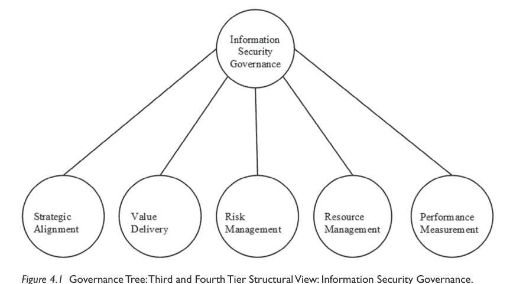

图 4.1 治理树：第三和第四层结构视图：信息安全治理。

注：改编自 R.E. Davis 所著《IT Auditing: Assuring Information Assets Protection》，2008a，Pfeiffer。版权 2008 归 Robert E. Davis 所有。经许可改编。

- 价值交付，在交付周期内执行信息安全价值主张，确保信息安全根据采用的实体战略提供效益，注重优化成本并证明信息安全的内在价值（Davis, 2008a, 2017）。有效的 ISG 价值交付实践认识到不同的投资类别，必须不对称地评估和管理（Yaokumah & Brown, 2014）。
- 风险管理原则、流程和方法采用系统化应用（Davis, 2017; Rasheed et al., 2015）。因此，组织风险管理需要高级官员对信息安全风险有认知、对实体对信息安全风险的承受能力有清晰理解、实现信息安全合规的要求、对重大信息安全风险的透明度，以及嵌入内部风险管理职责（Davis, 2008a）。
- 资源管理反映了对信息安全资源进行最佳投资和适当管理的意图（Davis, 2008a, 2017; Mohare & Lanjewar, 2012; Yaokumah, 2013）。资源管理关注领域是信息安全知识和基础设施处理效率（Davis, 2008a）。
- 绩效衡量实践，通过量化、监控和报告信息安全系统、流程及相关活动来确保组织目标的实现（Davis, 2017; IT Governance Institute, 2008）。最低限度，绩效衡量管理员跟踪和监控信息安全战略实施、信息安全项目完成情况、信息安全资源利用、信息安全流程绩效和信息安全服务交付（Davis, 2008a）。

治理树第四层框架节点为开发支持实体目标并通过限制不利事件为运营提供可接受的预测水平的信息安全项目提供了基础（Davis, 2008a）。然而，治理树 ISG 框架可以与其他可用的信息安全相关实践混合（Davis, 2008a），例如 ISO 27000。此外，ISG 成果足够灵活，可与大多数实体级框架保持一致（Davis, 2008a）。

### 第四层战略对齐

信息安全经理领导者战略对齐的运营化包括一致性、连接性和参与性抽象（Schobel & Denford, 2013）。管理者领导者选择的战术与采用的实体焦点战略不一致可能会阻止目标绩效的实现（Davis, 2017; Hardcopf et al., 2017）。当与实体级治理挂钩时，ISG 是获取信息安全流程控制并确保与组织战略一致的最合适路径（Davis, 2017; Rebollo et al., 2015）。ISG 在运营单位、信息安全职能和战略之间的战略对齐建立在战略管理确保信息安全战略与组织战略一致时发生（Davis, 2017; Yaokumah & Brown, 2014）。为了实现有效的战略对齐，实体级战略应涵盖关键信息安全能力、未来安全需求、人员和可部署以满足组织需求的信息资产（Davis, 2017; Yaokumah & Brown, 2014）。由此，战略对齐必须表现出可变性、承诺和适应性属性（Davis, 2017; Yaokumah & Brown, 2014）。战略对齐属性有助于应对不断变化的运营和安全环境（Davis, 2017; Yaokumah & Brown, 2014）。

有效的 ISG 实现可通过健全的公司治理实现（Yaokumah & Brown, 2014）。在组织中，管理者领导者通常会考虑三个战略层级以实现盈利实体对齐：公司级、业务级和职能级（Alsudiri et al., 2013; Davis, 2017）。公司治理、IT 治理和 ISG 之间的关系在学术文献中存在差异（Davis, 2017; Williams et al., 2013）。图 4.2 描绘了

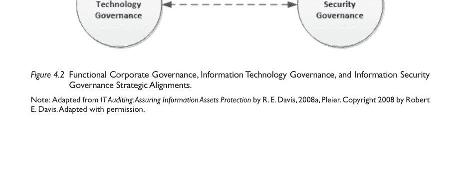


企业、IT 和信息安全职能战略一致性。企业的信息安全和 IT 职能应与组织的愿景、使命、价值观、目标和战略保持一致，以实现有效实践（Alsudiri et al., 2013; Davis, 2011, 2017）。

节点结构连通性要求信息安全治理 ISG 与实体层治理要求保持一致（Davis, 2008a, 2017; Yaokumah, 2013）。当在父子数据关系中发生标准属性共享时，通常会建立层级节点连通性，例如（Davis, 2011, 2017; Kearney & Kruger, 2013）。相比之下，垂直节点平等定义了相似的数据共享认知（Davis, 2011, 2017）。企业高管管理者-领导者为创建合法的治理结构奠定了基础（Abraham, 2012），从而允许组织共享关系（Davis, 2017）。信息安全节点连通性能够开发和维持与实体的目标和目标战略一致的信息系统（Davis, 2008a）。ISG 与 IT 治理活动的战略一致性对于保持信息安全与实体治理的一致性也是必要的（Davis, 2008a, 2017）。

ISG 应反映良好的实体治理（Davis, 2017; Yaokumah & Brown, 2014）。由此，信息安全流程应体现良好的 ISG（Davis, 2017）。相反，一贯应用的 ISG 可以改善实体治理（Davis, 2011, 2017）。监控和报告使信息安全与运营流程和要求保持一致，从而加强治理双向实体信息安全关系（Davis, 2011, 2017; Kwon et al., 2013）。当在有效的 ISG 计划下进行适当的控制部署时，组织 IT 管理者-领导者确保战略一致性（Davis, 2011, 2017; Mohare & Lanjewar, 2012）。

信息安全风险管理、绩效衡量、资源管理和价值交付实践是战略一致性预测变量（Davis, 2017; Yaokumah, 2013; Yaokumah & Brown, 2014）。组织风险管理、资源管理、绩效衡量和价值交付实践与有效的 ISG 战略一致性呈正相关（Davis, 2017; Yaokumah, 2013; Yaokumah & Brown, 2014）。换句话说，信息安全预测变量的整合可以产生 ISG 成功（Davis, 2017; Yaokumah, 2013; Yaokumah & Brown, 2014）。然而，IT 治理结构、流程和关系机制也适用于 ISG 效能实现（Davis, 2017; Yaokumah, 2013）。此外，实体信息系统人员可能认为安全战略是由下而上驱动的，而不是自上而下（Ahmad et al., 2014; Davis, 2017）。

有效的 ISG 战略一致性[content]
企业、IT 和信息安全职能战略一致性。企业的信息安全和 IT 职能应与组织的愿景、使命、价值观、目标和战略保持一致，以实现有效实践（Alsudiri et al., 2013; Davis, 2011, 2017）。

节点结构连通性要求信息安全治理 ISG 与实体层治理要求保持一致（Davis, 2008a, 2017; Yaokumah, 2013）。当在父子数据关系中发生标准属性共享时，通常会建立层级节点连通性，例如（Davis, 2011, 2017; Kearney & Kruger, 2013）。相比之下，垂直节点平等定义了相似的数据共享认知（Davis, 2011, 2017）。企业高管管理者-领导者为创建合法的治理结构奠定了基础（Abraham, 2012），从而允许组织共享关系（Davis, 2017）。信息安全节点连通性能够开发和维持与实体的目标和目标战略一致的信息系统（Davis, 2008a）。ISG 与 IT 治理活动的战略一致性对于保持信息安全与实体治理的一致性也是必要的（Davis, 2008a, 2017）。

ISG 应反映良好的实体治理（Davis, 2017; Yaokumah & Brown, 2014）。由此，信息安全流程应体现良好的 ISG（Davis, 2017）。相反，一贯应用的 ISG 可以改善实体治理（Davis, 2011, 2017）。监控和报告使信息安全与运营流程和要求保持一致，从而加强治理双向实体信息安全关系（Davis, 2011, 2017; Kwon et al., 2013）。当在有效的 ISG 计划下进行适当的控制部署时，组织 IT 管理者-领导者确保战略一致性（Davis, 2011, 2017; Mohare & Lanjewar, 2012）。

信息安全风险管理、绩效衡量、资源管理和价值交付实践是战略一致性预测变量（Davis, 2017; Yaokumah, 2013; Yaokumah & Brown, 2014）。组织风险管理、资源管理、绩效衡量和价值交付实践与有效的 ISG 战略一致性呈正相关（Davis, 2017; Yaokumah, 2013; Yaokumah & Brown, 2014）。换句话说，信息安全预测变量的整合可以产生 ISG 成功（Davis, 2017; Yaokumah, 2013; Yaokumah & Brown, 2014）。然而，IT 治理结构、流程和关系机制也适用于 ISG 效能实现（Davis, 2017; Yaokumah, 2013）。此外，实体信息系统人员可能认为安全战略是由下而上驱动的，而不是自上而下（Ahmad et al., 2014; Davis, 2017）。

有效的 ISG 战略一致性[content]
企业、IT 和信息安全职能战略一致性。企业的信息安全和 IT 职能应与组织的愿景、使命、价值观、目标和战略保持一致，以实现有效实践（Alsudiri et al., 2013; Davis, 2011, 2017）。

节点结构连通性要求信息安全治理 ISG 与实体层治理要求保持一致（Davis, 2008a, 2017; Yaokumah, 2013）。当在父子数据关系中发生标准属性共享时，通常会建立层级节点连通性，例如（Davis, 2011, 2017; Kearney & Kruger, 2013）。相比之下，垂直节点平等定义了相似的数据共享认知（Davis, 2011, 2017）。企业高管管理者-领导者为创建合法的治理结构奠定了基础（Abraham, 2012），从而允许组织共享关系（Davis, 2017）。信息安全节点连通性能够开发和维持与实体的目标和目标战略一致的信息系统（Davis, 2008a）。ISG 与 IT 治理活动的战略一致性对于保持信息安全与实体治理的一致性也是必要的（Davis, 2008a, 2017）。

ISG 应反映良好的实体治理（Davis, 2017; Yaokumah & Brown, 2014）。由此，信息安全流程应体现良好的 ISG（Davis, 2017）。相反，一贯应用的 ISG 可以改善实体治理（Davis, 2011, 2017）。监控和报告使信息安全与运营流程和要求保持一致，从而加强治理双向实体信息安全关系（Davis, 2011, 2017; Kwon et al., 2013）。当在有效的 ISG 计划下进行适当的控制部署时，组织 IT 管理者-领导者确保战略一致性（Davis, 2011, 2017; Mohare & Lanjewar, 2012）。

信息安全风险管理、绩效衡量、资源管理和价值交付实践是战略一致性预测变量（Davis, 2017; Yaokumah, 2013; Yaokumah & Brown, 2014）。组织风险管理、资源管理、绩效衡量和价值交付实践与有效的 ISG 战略一致性呈正相关（Davis, 2017; Yaokumah, 2013; Yaokumah & Brown, 2014）。换句话说，信息安全预测变量的整合可以产生 ISG 成功（Davis, 2017; Yaokumah, 2013; Yaokumah & Brown, 2014）。然而，IT 治理结构、流程和关系机制也适用于 ISG 效能实现（Davis, 2017; Yaokumah, 2013）。此外，实体信息系统人员可能认为安全战略是由下而上驱动的，而不是自上而下（Ahmad et al., 2014; Davis, 2017）。

有效的 ISG 战略一致性[content]
企业、IT 和信息安全职能战略一致性。企业的信息安全和 IT 职能应与组织的愿景、使命、价值观、目标和战略保持一致，以实现有效实践（Alsudiri et al., 2013; Davis, 2011, 2017）。

节点结构连通性要求信息安全治理 ISG 与实体层治理要求保持一致（Davis, 2008a, 2017; Yaokumah, 2013）。当在父子数据关系中发生标准属性共享时，通常会建立层级节点连通性，例如（Davis, 2011, 2017; Kearney & Kruger, 2013）。相比之下，垂直节点平等定义了相似的数据共享认知（Davis, 2011, 2017）。企业高管管理者-领导者为创建合法的治理结构奠定了基础（Abraham, 2012），从而允许组织共享关系（Davis, 2017）。信息安全节点连通性能够开发和维持与实体的目标和目标战略一致的信息系统（Davis, 2008a）。ISG 与 IT 治理活动的战略一致性对于保持信息安全与实体治理的一致性也是必要的（Davis, 2008a, 2017）。

ISG 应反映良好的实体治理（Davis, 2017; Yaokumah & Brown, 2014）。由此，信息安全流程应体现良好的 ISG（Davis, 2017）。相反，一贯应用的 ISG 可以改善实体治理（Davis, 2011, 2017）。监控和报告使信息安全与运营流程和要求保持一致，从而加强治理双向实体信息安全关系（Davis, 2011, 2017; Kwon et al., 2013）。当在有效的 ISG 计划下进行适当的控制部署时，组织 IT 管理者-领导者确保战略一致性（Davis, 2011, 2017; Mohare & Lanjewar, 2012）。

信息安全风险管理、绩效衡量、资源管理和价值交付实践是战略一致性预测变量（Davis, 2017; Yaokumah, 2013; Yaokumah & Brown, 2014）。组织风险管理、资源管理、绩效衡量和价值交付实践与有效的 ISG 战略一致性呈正相关（Davis, 2017; Yaokumah, 2013; Yaokumah & Brown, 2014）。换句话说，信息安全预测变量的整合可以产生 ISG 成功（Davis, 2017; Yaokumah, 2013; Yaokumah & Brown, 2014）。然而，IT 治理结构、流程和关系机制也适用于 ISG 效能实现（Davis, 2017; Yaokumah, 2013）。此外，实体信息系统人员可能认为安全战略是由下而上驱动的，而不是自上而下（Ahmad et al., 2014; Davis, 2017）。

有效的 ISG 战略一致性显著增强实体的风险管理、资源管理、绩效衡量和价值交付流程（Davis, 2017; Mohare & Lanjewar, 2012; Yaokumah & Brown, 2014）。应设立一个跨组织的由管理者-领导者组成的委员会，以开发、部署和监控实体和 ISG 战略计划，实现目标和目标的同步（Davis, 2011, 2017）。IAP 服务战略应解决服务开发的机会识别，使其单方面满足内部和外部客户要求（Davis, 2008b）。一旦战略计划获得批准，管理者-领导者必须确保其转化为正确的信息安全服务和支持部署的方向性转变（Davis, 2011, 2017; Mohare & Lanjewar, 2012）。活动一致性和适应性取向是互补的运作方式（Davis, 2017; Hodgkinson et al., 2014）。采用的战略目标可以是为客户提供最佳价值，适当的信息安全实现可以创造服务优势（Davis, 2011, 2017），不过通过适当的信息安全实现实现最佳客户价值目标并非无风险（Davis, 2011, 2017; Hashizume et al., 2013; Rebollo et al., 2015）。

根据实体的管理者-领导者，信息安全战略开发可能存在知识缺乏和临时性做法（Ahmad et al., 2014; Davis, 2017）。当 ISG 与实体层治理和 IT 治理不一致时，

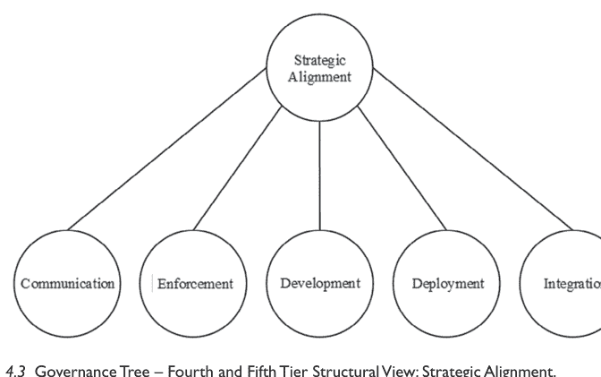

图 4.3 治理树 – 第四和第五层结构视图：战略一致性。

注：改编自 R. E. Davis 2011 年《Assuring IT Governance》，Amazon.com。版权 2011 年归 Robert E. Davis 所有。经许可改编。

财务、法律、声誉和运营风险可能超出划定的容忍水平（Davis, 2008a, 2017; Yaokumah, 2014）。一个功能性实体的生存可能取决于 IT 管理者-领导者保护用于实现所采用组织使命的信息资产的能力如何（Bahl & Wali, 2014; D’Arcy et al., 2014; Davis, 2008a, 2017）。如图 4.3 所示，在治理树第五层级，管理需要能够实现卓越沟通、严格执行、适当开发、可靠部署和无缝集成以完成保护期望的 ISG（Davis, 2011, 2017）。因此，信息安全战略一致性需要

- 基于建设性关系、共同语言使用以及解决对成功 ISG 计划结构和流程至关重要的信息安全相关问题的共同承诺，在所有关联方之间进行沟通（Davis, 2008a, 2017），
- 通过惩罚的严重性、奖励的重要性以及控制的确定性发生的积极行为执行（Davis, 2017），
- 无论管理者-领导者采用正式或非正式的战略规划系统，战略设计开发都以自上而下的顺序发生（Davis, 2011, 2017）。
- 信息安全管理者-领导者评估并确保保护机制部署的质量（Davis, 2017; Wu et al., 2015），以及
- 组织管理者-领导者认识到 ISG 作为整合计划对于成功 IT 治理和实体层治理的重要性（Davis, 2017; Yaokumah, 2014）。

### 第五层沟通

直接控制循环模型构成了战略一致性沟通扩散的基础。直接控制循环是层级的，直接侧自上而下流动，而控制侧自下而上流动（Yaokumah, 2015）。直接控制循环模型的直接侧始于战略层，该层包括实体监督委员会（Yaokumah, 2015），向最高执行管理者-领导者发出指令（Davis, 2011）。指令通常反映外部和内部环境因素的考虑（Davis, 2008a, 2017; Yaokumah, 2015）。直接控制循环模型的控制侧始于运营层，转移到战术层，然后转移到战略层管理者-领导者（Yaokumah, 2015）。因此，直接控制循环模型的控制侧涉及实体员工向更高行政层级监控和报告控制（Yaokumah, 2015）。

### 第五层执行

实体管理者-领导者应传达并执行对组织控制不合规的后果（Davis, 2017）。关于谁执行控制、管理者-领导者如何确保意图的执行以及个人和群体应有多少自主权，可能会出现问题（Davis, 2011, 2017）。信息安全控制需要积极监控和执行，管理者-领导者应对反生产的工作场所行为负责（Davis, 2017）。审计员提供的纠正措施信息支持必要的执行功能，以补救发现不符合期望或规定的活动（Davis, 2008a）。在大多数情况下，保密性、完整性和可用性影响水平考虑未经授权披露、修改或服务拒绝对负责实体维持内部和外部控制流程的能力的影响（Davis, 2008a）。

### 第五层开发

ISG 规划允许预测未来组织方向和相关影响，并得出实现目标的更好战略（Davis, 2008a, 2017）。对实体的环境、流程和组织目标的广泛把握能够实现有效的信息安全战略开发（Davis, 2017; Flores et al., 2014）。利益相关者识别和显著性应用可以帮助确定与战略开发相关的一般类别（Davis, 2017; Tashman & Raelin, 2013）。与实体层战略规划类似，ISG 规划流程将战略转化为可衡量的战术和运营计划，并将运营计划重新转化为政策、程序、指令、标准和规则（C. Edwards, 2013; Davis, 2008a, 2017）。

### 第五层部署

在整个组织形成中行使有效的实体层治理要求最高层监督委员会和管理团队了解对计划、系统和流程的期望（Davis, 2008a, 2017）。实体管理者-领导者应持续寻求确认信息安全提供支持组织为实现所采用目标而制定的战略设计的可靠服务（Davis, 2011, 2017）。为保护信息系统而实施的安全战略可以使用预防性战略来维持技术服务可用性（Ahmad et al., 2014; Davis, 2017）。作为预防性战略，虽然政策对于传达预期行为是必要的，但确定所采用信息安全目标的有效性更为关键（Davis, 2017）。如果没有有效的 ISG 部署，信息安全办公室通常不参与信息资产的决策和批准授权流程（Davis, 2011, 2017）。


### 第五层整合

治理、风险管理与合规模型将组织所有ISG域中的互动要素连接起来（Yaokumah, 2015）。治理、风险管理与合规模型将人员、流程和技术概念化，其中包括安全驱动因素、安全管理以及为管理组织信息安全而互动的利益相关者（Yaokumah, 2015）。安全驱动因素构念包括组织必须遵守的法律法规、运营目标和新出现的安全威胁（Yaokumah, 2015）。安全管理涵盖策略制定、流程和安全度量框架（Yaokumah, 2015）。组织利益相关者在制定安全策略框架时受组织环境要求的驱动（Yaokumah, 2015）。策略框架构成了流程框架下各项活动的基础（Yaokumah, 2015）。随后，使用度量标准进行活动测量和报告生成，提交给利益相关者（Yaokumah, 2015）。然而，内部系统集成对跨职能协调与组织客户响应能力之间的关系具有正向调节作用（Roberts & Grover, 2012）。

### 第四层价值交付

利益相关者视角提倡一种价值导向的方法来进行组织级治理，而不是其他单方面观点（Abraham, 2012; Davis, 2017）。利益相关者所得价值来自服务和产品的相关性与质量（Davis, 2017; Harrison & Wicks, 2013）。确定管理者领导者应如何优先处理相互竞争的利益相关者诉求，可以通过组织和社会层面的利益相关者合法性、权力和紧迫性评估来实现（Davis, 2017; Tashman & Raelin, 2013）。在识别利益相关者及其显著性的基础上，通过满足组织利益相关者的价值并确定有价值的成果，实现战略关联（Davis, 2017）。行政实践通过良好的治理确保高效且有效地交付利益相关者价值（Davis, 2017; Mishra & Mohanty, 2014）。投资者倾向于与具有可接受且可信治理实践的组织打交道（Davis, 2017; Mishra & Mohanty, 2014）。

社会和利益相关者主张，组织应以财务负责的方式为支持社会和环境可持续性而努力承担责任（Davis, 2017; Glavas & Mish, 2015）。管理层的概念一致性滋养了三重底线（Davis, 2017; Glavas & Mish, 2015），使其成为一项有价值的尝试（Slaper & Hall, 2011）。管理者经常使用三重底线方法描述组织的社会责任活动（Davis, 2017; Nalband & Kelabi, 2014）。三重底线方法重视财务回报、人力资源和自然环境，并考虑有利于劳工、社区和更大公共利益的公平实践（Davis, 2017; Sharma & Khanna, 2014; Slaper & Hall, 2011）。

项目群管理可以反映出项目组合绩效之外的组织价值创造（Davis, 2017; Rijke et al., 2014）。价值创造和随后的价值获取通过有效且高效的价值管理实现（Davis, 2017）。为可持续解决方案创造价值意味着增加组织的价值主张，并纠正影响社会与生态系统的不可持续实践（Davis, 2017）。利益相关者模型与可持续发展相一致（Davis, 2017; Miles, 2012）。然而，利益相关者定义的异质性引起了混淆，并在满足利益相关者期望和提供最优价值交付方面导致了无意的未达成（Davis, 2017; Gil-Lafuente & Paula, 2013）。

为利益相关者创造最优价值是管理者领导者的责任（Davis, 2017; Tashman & Raelin, 2013）。作为常见的项目群成功因素，价值交付实践必须让所有利益相关者参与，并分配责任以实现预期能力和收益实现（Davis, 2011, 2017; Rijke et al., 2014; Yaokumah & Brown, 2014）。ISG价值交付是信息安全战略与组织目标之间的战略对齐功能（Davis, 2017; Mohare & Lanjewar, 2012; Yaokumah & Brown, 2014）。一般战略对齐模型解释了组织内部一致性所产生的价值（Flores et al., 2014）。受管理的价值交付定义并监控重要指标，迅速响应任何变化或偏差，并提供持续的活动监控、评估和改进（Davis, 2011, 2017; Rijke et al., 2014）。

如果部署的IAP有助于实现组织的信息系统目标，则主要信息安全价值得以实现（Davis, 2011, 2017; Pérez-Méndez & Machado-Cabezas, 2015）。信息安全服务可以创造价值（Liang-Chuan & Liang-Hong, 2015），有助于整体ISG价值交付（Davis, 2017）。对于大多数组织而言，当所请求的信息交付在预期预算和时间范围内完成并满足功能要求时，就产生了信息安全价值（Davis, 2011, 2017）。在预算和时间范围内透明地传达已识别的数据，并使组织人员能够履行职责，证明了信息安全价值的实现（Davis, 2011, 2017）。然而，非财务考量也可以决定交付价值——例如信息呈现的有用性（Davis, 2017; Hughes et al., 2013）。

关键管理实践可以确保价值交付的有效性（Davis, 2011, 2017; Yaokumah & Brown, 2014）。 “如同吊起珍贵货物的金属链条中的链环一样，管理者领导者必须为组织环境提供适当的ISG抗拉强度，以实现[组织]目标（Davis, 2011）”（Davis, 2017）。考虑到获取和维护ISG资源需要成本，IAP必须从部署到退役都产生预期收益，以证明支出的合理性（Davis, 2011, 2017）。不幸的是，组织及其签约的第三方IAP提供商往往承诺过多而缺乏有效治理，而IT最终用户群体则假设过多（Davis, 2011, 2017）。如果存在这种预期情况，就可能导致双方误解、资源管理不善、绩效不佳或结果不一致，这些都会不可避免地降低ISG价值交付（Davis, 2011, 2017）。

组织级商业模式反映了相互关联的活动集，使价值创造、价值交付和价值获取得以实现（Davis, 2017; Lambert & Davidson, 2013）。业务运营通常依赖成功的供应链管理来满足产品和服务需求（Davis, 2017; Saber et al., 2014）。网络安全问题需要采取适当应对措施，以维持供应链可接受的网络弹性水平（Boyes, 2015; Davis, 2017）。信息安全管理者领导者可以结合威胁、漏洞和网络安全属性的性质来解决供应链网络弹性问题（Boyes, 2015; Davis, 2017）。通常，信息安全举措与供应链运营正相关，而供应链运营又对供应链绩效产生积极影响（Davis, 2017; Sindhuja, 2014）。

可以说，IT系统、流程、活动和任务代表了信息和通信配置的主要支持结构（Davis, 2011, 2017; Sun & Bhattacherjee, 2014）。组织管理者领导者通常希望利用技术来整合信息、实现流程效率，并将服务交付转变为高效的典范（Davis, 2011, 2017）。然而，大多数管理者领导者意识到，强调技术和以组织为中心的解决方案不会产生预期效果；必须采用整体方法（Davis, 2011, 2017; De Haes et al., 2013）。有效的ISG价值交付实践者需要认识到，不同投资类别需要非对称地评估和管理（Davis, 2017; Yaokumah & Brown, 2014）。如图4.4所示，在治理树的第五层级，管理层需要ISG来实现监督信任、满足要求、确定适当的行动计划、支持服务优化，并重视功能协调，以实现保护预期（Davis, 2011, 2017）。因此，信息安全价值交付需要

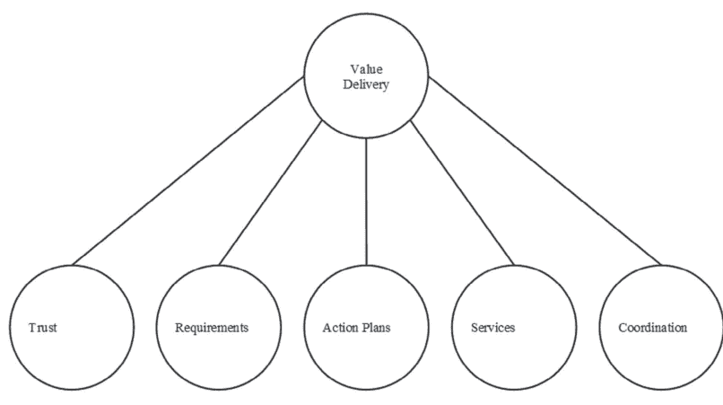

图4.4 治理树——第四和第五层级结构视图：价值交付。

注：改编自R. E. Davis, 2011, Amazon.com 的《确保IT治理》。版权所有2011 Robert E. Davis。经许可改编。

- 值得信赖的管家，具有内在动机和取向，服务于集体而非自身（Davis, 2017; Glinkowska & Kaczmarek, 2015; Heracleous & Lan, 2012; Pande & Ansari, 2014），
- 确保所定义的安全需求安装和维护发生在组织的信息资产配置中（Davis, 2009b），
- 成本效益分析，用于检查替代行动计划，以确定推荐的IAP部署，或确定最有效率的IAP部署程度，同时为降低风险提供最大回报（Davis, 2020），
- 信息安全管理者领导者评估并确保保护机制部署的服务质量（Davis, 2017; Wu et al., 2015），以及
- 通过信任和承诺的关系纽带进行协调，影响产生协作优势的行为过程（Chi & Holsapple, 2005）。

### 第五层信任

信任是一种感知上的渴望，依赖某物或某人以获得保护（Safa & Von Solms, 2016）。在有效ISG与组织级治理相协调的定义中，隐含着信息安全管理者领导者与他人的受托责任关系。


利益相关者 (Yaokumah, 2013)。受托关系之所以存在，是因为信息安全经理-领导者与实体其他利益相关者 (Davis, 2017) 之间通常存在培训或知识上的不平等 (Brakewood & Poldrack, 2013)。因此，其他实体利益相关者信赖信息安全经理-领导者为其最佳利益行事 (Davis, 2017)。组织信息资产估值关联可能仅代表实现实体目标所需标准的项目 (Davis, 2008a)。然而，与目标实现无关的组织信息资产可能会损害目标的实现 (Davis, 2008a; Zhao et al., 2013)。

### 第五层要求

实体 IAP 人员在尝试满足可能包括法律、业务、功能、用户和非功能性要求的综合组织和安全要求时，需要具备信息安全工程知识 (Davis, 2012a)。如果实体员工无法履行要求，则可能需要聘请外部信息安全工程师，通过控制评估考量来确保在满足所提出需求方面的保密性、完整性和可用性。反映所应用的开发和部署方法，被指派的信息安全人员戴上设计师的工作帽，并以可接受的形式将 IAP 运营流程的拼图 pieces 组合起来，以满足既定要求。

### 第五层行动计划

纠正性 IAP 行动计划通常反映出使报告状况达到与可接受标准或最佳实践一致水平的建议 (Davis, 2010, 2020)。如图 4.5 所示，IAP 纠正措施响应可细分为补救或改进活动 (Davis, 2010, 2020)。

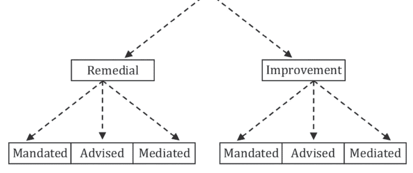

图 4.5 纠正措施二分法。

注：改编自 R. E. Davis 所著《IT Auditing: An Adaptive System》，2011 年，Lulu 出版。版权 2011 归 Robert E. Davis 所有。经许可改编。

补救措施通常针对 IAP 状况中的差距，以最大限度地降低不可接受的风险 (Davis, 2020)。相比之下，改进措施通常针对提升 IAP 状况，以最大限度地降低不可接受的偏差风险 (Davis, 2010, 2020)。级联的、针对补救和改进措施的纠正活动可在子主题上代表对强制性、建议性或调解性分类的细化 (Davis, 2010, 2020)。强制性措施是法定要求履行的期望 (Davis, 2020)。建议性措施是建议通知 (Davis, 2010, 2020)。调解性措施是信息安全经理-领导者与其他利益相关者之间的调解 (Davis, 2010, 2020)。

### 第五层服务

建立和运作与实体中心服务要求一致的支持流程，对于提供适当的 IAP 服务是必要的 (Davis, 2008b)。为了实现价值交付，信息安全经理-领导者必须通过实施和控制一个包含用于服务提供和管理的 IAP 架构要素详细信息的数据库，来实现信息资产管理的适应 (Davis, 2009b)。此外，在考虑服务行动计划时，实际选择包括应用正式和非正式的成本-效益分析。当 IAP 部署存在显著成本预期时，应进行正式的成本-效益分析 (Davis, 2010, 2020)。非正式地，信息安全经理-领导者可根据专业判断，以“有利和不利”的方式处理收益和成本 (Davis, 2010, 2020)。无论信息安全办公室编制者对行动计划使用正式还是非正式的成本-效益分析，控制系统、流程、活动或任务都应高效且经济 (Davis, 2010, 2020)。当 IAP 服务未在预期时间内发生或完成时，信息安全经理-领导者应记录撤销义务的原因或部署延迟的原因 (Davis, 2010, 2020)。

### 第五层协调

价值链联系可通过协调带来竞争优势 (Porter, 1998)。建立垂直和水平协调有助于建立更牢固的联系 (Goodman & Rousseau, 2004)。跨多个实体的 IAP 服务启动的协调对于信息安全价值交付至关重要。适当的跨组织控制环境可以提高协调的有效性和效率 (Davis, 2008a; Mentzer et al., 2007)。关于协调，项目人员通常会开会、讨论并选择是否采用新功能、容忍不足、实施变通方法，或定制 IAP 套件 (Gosain et al., 2005)，同时考虑员工信任和承诺。知识管理是协调工具 (Darroch, 2005)，可解决组织要求与 IAP 套件 provision 之间的功能差距 (Gosain et al., 2005)。

### 第四层风险管理

广泛的风险敞口可能导致未能实现组织管理为实体设定的目标而感到失望 (Badara & Saidin, 2014; Davis, 2017)。风险管理旨在创造和保护利益相关者价值 (Frigo & Anderson, 2011a)。为实现利益相关者目标，风险管理实践必须整合系统性识别风险并定义其对实体提供商品或服务能力影响的方法 (Davis, 2008a, 2017; Mohare & Lanjewar, 2012)。制度化的实体级风险管理框架应为战略轴心-使能多元战略分支接受 (Davis, 2011, 2017; Williams et al., 2013)。实体级风险管理应代表组织经理-领导者系统性地解决活动风险以实现各活动及整个事务组合中持续效益的主动过程 (Davis, 2011, 2017)。

实体的战略使命和风险管理系统考量对于实现适当的组织绩效与合规平衡是必要的 (Davis, 2011, 2017)。实体必须建立单一的控制定义，服务于所有组织单位，以通过实体中心的风险管理赋能绩效与合规 (Davis, 2011, 2017)。实体级风险管理还必须提供标准，以便组织单位经理-领导者评估已部署的控制系统并确定必要的改进 (Davis, 2011, 2017; Flores et al., 2014)。从行政要求级联来看，通过适当价值交付风险管理在绩效与合规之间取得健康平衡的实体，在其监管环境中长期蓬勃发展的潜力最佳 (Davis, 2011, 2017)。

风险管理并非展示有效领导力的套话 (Boyson, 2014; Davis, 2008a, 2017)。实体内负责治理的个人必须提供专门指导，以适当处理遇到的组织风险 (Boyson, 2014; Davis, 2008a, 2017)。特别是，与信息和相关技术相关的风险需要基于对潜在不利事件发生进行仔细执行的<|message|> 影响和可能性评估的全面管理 (Boyson, 2014; Davis, 2008a, 2017)。确定信息资产风险幅度以确保针对影响实体的威胁、机会和漏洞进行适当的资源配置，是实现有效 ISG 的必要条件 (Davis, 2008a, 2017)。

实体级风险管理需要经理-领导者具备信息安全风险意识 (Clark & Harrell, 2013; Davis, 2008a, 2017; Mohare & Lanjewar, 2012)。相应地，需要对组织管理对信息安全风险的承受意愿和信息安全合规要求有精确的理解 (Clark & Harrell, 2013; Davis, 2008a, 2017; Mohare & Lanjewar, 2012)。还需要对重大组织信息安全风险和管理责任的嵌入保持透明 (Clark & Harrell, 2013; Davis, 2008a, 2011, 2017; Mohare & Lanjewar, 2012)。当正确部署时，常见的信息系统安全对策可降低信息系统和实体的风险 (Barton et al., 2016; Davis, 2017)。已部署的管理流程和 IT 风险评估可以帮助确定 IAP 对策强度 (Davis, 2008a, 2017; Flores et al., 2014; Rubino & Vitolla, 2014)。然而，实体可能缺乏用于系统识别受众沟通要求的正式信息安全意识方法论 (Davis, 2017; Stewart & Lacey, 2012)。

战略对齐实践是实体风险管理预测因子 (Davis, 2017; Yaokumah & Brown, 2014)。在实体级风险管理对齐下，ISG 可提供评估 IAP 投资、适当资源覆盖并实现目标的框架 (Davis, 2008a, 2017)。信息资产管理尽职要求在考虑实体管理以可承受成本交付成果或价值的能力——在可接受风险范围内——的情况下，对信息安全资源进行一致的管理

水平（Davis，2008a，2017；Yaokumah & Brown，2014）。确定适当的资源风险水平需要审查针对可预见威胁、机会和漏洞的实体风险分析（Davis，2008a，2017；Mohare & Lanjewar，2012）。从上下文来看，风险管理原则和实践是ISG活动的关键驱动因素（Davis，2008a，2017）。

适当的安全保护活动责任必须覆盖实体的全部有形和无形资源（Davis，2008a，2017；Magdaraog, Jr.，2014）。风险管理需要持续努力应对威胁、机会和漏洞（Davis，2008a，2017；Mohare & Lanjewar，2012）。然而，大多数实体管理者领导者忽视了某些信息资产的资源安全重要性（Davis，2017；Magdaraog, Jr.，2014）。具体而言，安全管理者在很大程度上忽视了业务安全风险（Ahmad et al.，2014；Davis，2017），而抽样调查的供应链举措表明，风险管理工作的重点集中在面向内部的系统开发和以核心供应商为导向的采购上（Boyson，2014；Davis，2017）。

显著的障碍在感知层面阻碍了风险管理的实施或妨碍了实体项目中风险管理能力的提升（Davis，2017；Rasheed et al.，2015）。资金限制、进度要求、不稳定的组织环境、缺乏高层对风险管理的承诺，以及风险意识文化的缺失，是阻碍风险管理部署的主要障碍（Davis，2017；Rasheed et al.，2015）。关于不稳定的组织环境，供应链风险的波动性和不确定性阻碍了对潜在中断的预测（Chopra & Sodhi，2014；Davis，2017；Kumar et al.，2014）。

关于情境约束，风险管理方法并未明确为决策者提供在适当的风险与成本权衡之间进行选择的支持工具（Davis，2017；Deursen et al.，2013；Fenz et al.，2014）。然而，在考虑信息安全对策时，黑客攻击防护、事件保护、IT规划和运营以及IT内部控制可作为风险管理措施使用（Davis，2017；Kim et al.，2012）。信息安全工作应源于通过评估风险、相关控制措施的开发和部署进行的协调，并对控制措施的实施有效性进行监控（Davis，2017；Flores et al.，2014）。

实体控制系统是治理要求的投影，可能包含设计有误的控制元素，因为控制结构的构建依赖于架构性的“参考框架”（Davis，2008a，2017；Magdaraog, Jr.，2014）。控制系统也是以实体为中心的，可能对满足利益相关者所需的控制保证水平持有错误假设（Davis，2008a，2017；Samad-Khan，2008）。源于管理主义，所配置的控制机制可能对市场低效和由此产生的实体治理问题影响甚微（Davis，2017；Raelin & Bondy，2013）。因此，采用基于风险管理的控制措施可能无助于增强利益相关者对实体人员的信心，因为管理者领导者通常可以凌驾于已部署的控制措施之上（Davis，2008a，2017）。

作为部署适当ISG方法的体现，开展IAP风险管理的战略目标在于提供一个框架，使未来的活动能够以一致且受控的方式进行（Davis，2008a）。总体而言，所采用的IAP风险管理框架应提供实体已选择用于部署风险管理过程的结构、方法论、程序和定义（Davis，2008a）。如图4.6所示，在治理树的第五层级，实体管理者需要ISG，以实现战略、合规、战术、环境和运营风险管理，从而达成保护预期（Davis，2011，2017）。

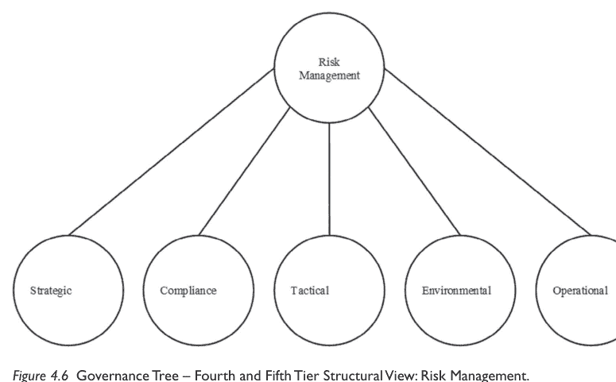

图4.6 治理树——第四和第五层级结构视图：风险管理。

注：改编自R. E. Davis于2011年所著的《Assuring IT Governance》，Amazon.com出版。版权归Robert E. Davis所有，2011年。经许可改编。

因此，信息安全风险管理需要：

-   一个识别、评估、管理和报告可能阻碍实体实现组织战略能力的IAP战略风险的过程（Frigo & Anderson，2011b）；
-   一个识别、评估、管理和报告因不遵守法律、法规、政策、指令、程序、标准或规则而产生的IAP合规风险的过程（Losiewicz-Dniestrzańska，2015）；
-   一个识别、评估、管理和报告可能阻碍实体实现所设计配置能力的IAP战术风险的过程；
-   一个识别、评估、管理和报告由内部和外部事件或情景所产生、可能阻碍实体实现战略目标能力的IAP环境风险的过程（Frigo & Anderson，2011a）；以及
-   一个识别、评估、管理和报告阻碍实体保护信息资产部署能力的IAP运营风险的过程（Abdul Rahim et al.，2015；Samad-Khan，2008）。

### 第五层级：战略

战略IAP作为一种行政决策（Akpinar，2017；Davis，2011），指的是实体为行动方针选择“什么”以及实体为何选择该行动方针（Coertze & Von Solms，2013；Davis，2008a）。战略性IAP思维、规划和行动是实体管理层以下能力的基础：（a）理解组织环境，（b）识别新兴的行业模式和趋势，（c）预判组织环境内可能出现的问题，（d）预测计划举措的结果及其对组织方向可能产生的影响，以及（e）制定适当的备用计划以减轻误判风险。战略IAP风险代表一种可能的损失来源，通常由所激活的战略、所采纳的目标和计划执行情况决定。战略IAP风险管理侧重于使实体能够实现战略目标的内部和外部情景。战略IAP风险管理需要考虑与客户IT使用变化、竞争压力、技术变革和利益相关者压力相关的风险。战略IAP风险管理的关键在于尽可能多地管理和衡量所感知到的威胁、漏洞和机会。

### 第五层级：合规

合规并不能确保信息安全（Mattsson，2014）。合规IAP风险是指信息安全服务或产品无法实现或促进对适用法律、法规、政策、指令、程序、标准或规则的遵从或执行的可能性。实体人员若无视适用于（a）政府法规；（b）行业标准；或（c）政策、指令、程序、标准或规则的行为要求，可能导致不利的组织后果。作为IAP风险的第一层级，政府法规合规是最具强制性的风险考量，因为不遵守法律或法规可能导致巨额罚款或监禁（Davis，2008a，2009a）。行业标准是合规风险的第二层级，因为不遵守适用的行业标准可能导致实体遭到抵制。遵守实体的政策、指令、程序、标准或规则是合规风险的第三层级，涉及对组织期望的遵循，可能以终止雇佣告终。

### 第五层级：战术

在战术IAP决策层面，管理者领导者将战略目标解读为具体目标和运营标准（Davis，2011；J. Edwards et al.，2000）。此外，战术IAP风险管理指的是实体的管理者领导者计划“如何”实现信息安全战略。换言之，战术IAP风险管理指的是实体管理者领导者计划如何实现IAP战略目标。战术性IAP思维和规划在考虑潜在挑战的同时考虑可用资源，然后确定以最有效和最高效的方式利用协同资源实现战略目标，同时交付高质量成果。因此，战术IAP风险层面的决策必须侧重于优化信息安全资源（Anderson & Choobineh，2008）。

### 第五层级：环境

环境IAP风险管理涉及有形或无形项目。然而，核心关注点是控制环境的风险因素，这些因素集中体现了实体管理的态度、意识和行动（Davis，2008a）。由此类推，如果高管管理者领导者打算将实体层面的控制环境维持在可接受的风险水平，那么ISG项目管理者领导者也必须将IAP控制环境维持在可接受的风险水平（Davis，2008a）。不适当的IAP环境控制


对部署和使用 IT 的实体而言存在重大风险（Davis, 2020; Farahmand et al., 2005）。管理层对 IT 能力的态度和认知对于建立全实体范围的 IAP 控制问题意识至关重要（Davis, 2020）。不幸的是，IAP 控制措施无法确保实体管理使命的成功实现（Davis, 2020）。糟糕的决策、糟糕的管理、竞争、串谋以及控制权覆盖仍可能对维持控制环境的有效管理构成问题（Davis, 2020）。环境 IAP 风险评估频率的确定应在评估风险影响、合规历史、伦理失败以及事件可能性之后进行（Davis, 2008a）。

### 第五层运营

运营风险是运营失败带来的损失潜力（Samad-Khan, 2008）。同时，运营 IAP 风险是不执行 ISG 战略计划的可能性。然而，运营 IAP 风险管理不仅仅关注度量（Samad-Khan, 2008）。运营 IAP 风险管理使用一种稳健且系统的流程，将风险-回报和风险-控制信息整合到组织决策中（Samad-Khan, 2008）。具体而言，运营 IAP 风险管理是在假设的风险水平扣除控制措施后与实体利益相关者的风险和损失容忍标准保持一致的情况下做出组织决策的活动（Samad-Khan, 2008）。运营 IAP 风险管理能够开展风险评估、风险决策和风险控制部署（Samad-Khan, 2008）。

### 第四层资源管理

实体管理者领导者面临着在市场上实现和维持竞争优势的持续压力（Cegielski et al., 2013; Davis, 2017）。鉴于实现和维持竞争优势的坚持，实体管理者领导者应侧重于投入的部署和组合，而非机会规避（Chou, 2015; Davis, 2017）。值得注意的是，动态能力可视为战略选择，使实体在机会出现时有选择追求新方向的余地（Cegielski et al., 2013; Davis, 2017）。然而，实践者和研究者认为，实体源于 IT 使用的竞争优势往往是暂时的（Cegielski et al., 2013; Davis, 2017）。信息系统学者也质疑 IT 部署和使用如何为实体注入竞争优势（Bharadwaj et al., 2013; Davis, 2017; Drnevich & Croson, 2013; Seddon, 2014）。

信息系统资源基础视角侧重于理解哪些资源最有可能为实体的竞争优势做出贡献（Davis, 2017; Pan et al., 2015）。因此，“资源编排”能够整合资源管理概念和资产编排（Cui & Pan, 2015; Davis, 2017; Wang et al., 2012）。资源编排为管理者领导者在构建组织资源组合、将组织资源捆绑为能力、并利用组织能力为客户创造价值方面的角色提供了更精确的解释（Cui & Pan, 2015; Davis, 2017; Wang et al., 2012）。通常，使用资源基础视角时，行政 IT 监督会提升价值（Davis, 2017; Turel & Bart, 2014）。

信息安全管理体系反映了管理信息安全——信息和数据的保密性、完整性和可用性——的整体方法。分析短语“信息安全管理体系”可以增强对 ISO/IEC 27001 标准的理解。因此，首先从系统是具有目的的相互连接元素群组的定义开始（Davis, 2010, 2020）。其次，思考实现系统目标而修改系统元素的流程（Davis, 2010, 2020）。最终，接受安全系统获取并保持一致状态。因此推断，信息安全管理体系具有专门安装的流程，通过保护措施实现管理的组织目标。

IT 架构是指允许应用程序、软件、网络、硬件和数据管理整合为统一平台的技术优先事项和选择（Davis, 2017; Masa’deh, 2013）。当生态系统重叠时，编排者的数字战略可能产生超出所感知生态系统边界的后果（Davis, 2017; Markus & Loebbecke, 2013）。进而，跨边界的行业破坏可以改变价值网络为多边市场（Davis, 2017; Pagani, 2013）。通常，破坏性 IT 会引发服务同一市场的实体的响应（Carlo et al., 2014; Catinean & Cândea, 2013; Cui & Pan, 2015; Davis, 2017）。随着全球竞争的加剧，开发用于获得组织差异化和可持续性的 IT 破坏性优势平台，已成为实体管理者领导者的首要战略问题（Berman & Marshall, 2014; Davis, 2017）。破坏性 IT 平台的修改可能导致软件开发实体在三种创新类型中出现激进而普遍的创新：采用的基础技术、生产服务和选定流程（Carlo et al., 2014; Davis, 2017）。

存在四种 ISG 资源分类：人员、基础设施、流程和信息（Davis, 2011, 2017; De Haes et al., 2013），需要进行编排。组织资源的使用应审慎且富有成效，以实现实体管理的运营目标，同时执行既定的控制目标（Davis, 2011, 2017; De Haes et al., 2013）。ISG 资源管理的控制技术包括关系机制、结构和流程（Davis, 2017; Schobel & Denford, 2013）。在应用时，实现 ISG 控制合理化的首要途径是为勤勉的下属提供实现特定 ISG IAP 目标所需的有理资源（Davis, 2011, 2017; De Haes et al., 2013）。然而，无论控制技术和技术能力如何，最佳的控制手段是选择高质量的员工（Davis, 2011, 2017）。

高质量的 ISG 人员对于维持 IT 单位的有效性和效率至关重要（Cavusoglu et al., 2013; Davis, 2011, 2017）。此外，如果没有熟练的实体 IAP 人员来管理或操作 IT 资源，即使是设计精良的架构也可能在防止或遏制信息安全漏洞方面变得无效和低效（Davis, 2011; Hashizume et al., 2013）（Davis, 2017）。实体的<|message|> 人力资源实践可以通过法律审查流程来协助 ISG 资源质量保证，以评估 ISG 人才的胜任力和伦理（Davis, 2011, 2017; Guo & Yuan, 2012; Price, 2014）。对于已部署的信息安全人员，ISG 管理者领导者可以通过确保相关的教育和培训来提升 IAP 服务质量（Davis, 2011, 2017; Hashizume et al., 2013; Singh et al., 2013）。

在治理树第五层级，考虑到图 4.7，管理层需要 ISG 来维持知识丰富的人员、安全基础设施、资源编排、有效流程和服务信息，以实现保护期望（Davis, 2011, 2017）。

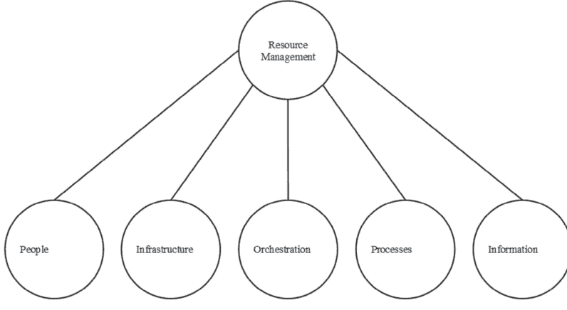

图 4.7 治理树——第四和第五层结构视图：资源管理。

注：改编自 R. E. Davis 所著《Assuring IT Governance》，2011 年，Amazon.com。版权 2011 归 Robert E. Davis 所有。经许可改编。

因此，信息安全资源管理需要：

- 熟悉技术部署、信息构造和伦理行为的知识型员工，即人员（Haag & Cummings, 2008），
- 用于 IAP 元素的开发或获取、测试、实施、维护和处置的安全基础设施实践（Davis, 2009b），
- 提供不确定环境因素与安全能力之间桥梁的资源编排（Cui & Pan, 2015; Wang et al., 2012），
- 有效提供 IAP 以最大限度降低信息安全风险的流程（Davis, 2008a），以及
- 服务信息的收集、组织、管理和传播（Haag & Cummings, 2008）。

### 第五层人员

知识可以代表各种抽象层级，包括提供信息安全情报的背景解释、指导在实施信息安全情报时应采取的行动、设计的信息安全知识产权或信息安全能力（Haag & Cummings, 2008）。具备技术素养的 IAP 人员知道何时以及如何应用技术对策（Haag & Cummings, 2008）。在做出决策时，关于谁、何事、何时、为何、何地和如何的信息性答案可以帮助解决问题（Haag & Cummings, 2008）。鉴于提供 IAP 延伸至社会责任，准确的个人和文化

解释评估是必要的，以允许适当的伦理行为 (Haag & Cummings, 2008)。

### 第五层基础设施

基础设施是结构之下的结构 (Haag & Cummings, 2008)。因此，网络安全基础设施是 IT 基础设施之下的结构 (Haag & Cummings, 2008)。通常，负责开发和部署良好 ISG 的信息安全工作单元通常包括针对实体支持关键功能或运营流程的 IT 基础设施和信息系统的弹性安全 (Davis, 2008a)。具体而言，网络基础设施应具有针对 IT 硬件、操作系统、配置系统、设施和支持结构充分的 IAP (Davis, 2008a)。一般而言，IAP 生命周期涵盖需求确定与演示、开发、生产、使用以及处置或退役阶段。因此，考虑到常见的 IT 基础设施风险，在实体 IT 控制目标中表达网络安全治理期望至关重要。

### 第五层编排

资产编排涉及行政上的搜索、选择和配置资源与能力，需要能够将投资决策与一致的部署决策相匹配的能力 (Tan et al., 2014)。此外，资产编排涉及识别关键资产并开发具有实际使用手段的治理体系 (Hitt, 2016)。资产编排还涉及协同专业化资产的协调和有效利用 (Hitt, 2016)。实现对基本 IT 资产管理要求的适应性在于实施和控制一个配置数据库，其中包含用于 IT 服务供给和管理中使用的 IT 架构元素详细信息 (Davis, 2009b)。为确保成功的 IT 资产管理，采用相关的库存管理最佳实践是必要的 (Davis, 2009b)。

### 第五层流程

了解信息资产当前和即将到来的生命周期阶段对于确定适用的主要信息安全流程至关重要。用于协调安全知识共享机制的采用流程会影响实体内的安全知识共享 (Davis, 2017; Flores et al., 2014)。当信息安全流程与公认的 IT 价值定义保持一致时，服务基本原则应提供适当的质量、按时交付且在预算内，同时实现承诺的收益 (Davis, 2008b)。IT 服务交付和支持的收益通常转化为竞争优势、服务请求履行时间缩短、客户满意度提高、客户等待时间减少以及员工生产力和盈利能力提升 (Davis, 2008b)。

### 第五层信息

当信息和决策与传递实体治理关系的双节点流程结合时，二者具有交汇点 (Davis, 2008a, 2017)。信息实践领域包括数据处理系统设计、组织分析和广告效果 (Davis, 2008a, 2017)。相比之下，决策实践领域涵盖组织、学习、控制论和次优化学科 (Davis, 2008a, 2017)。一方面，应用级信息技术能够实现分类判定、影响评估和技术评估 (Davis, 2017; Hughes et al., 2013)。另一方面，应用级决策技术可以提供客观判定、交互评估、绩效估计和组织分析 (Davis, 2008a, 2017)。

### 第四层绩效衡量

ISG 战略对齐发生在适当的部署监控确保在采用的组织愿景下实现目标时 (Davis, 2011, 2017)。监控系统的本质是关于员工效能的反馈信息 (Davis, 2011, 2017; Rebollo et al., 2015)。IAP 绩效反馈报告定期涉及衡量、匹配和流程监管 (Davis, 2011, 2017; Stewart & Lacey, 2012)。信息安全对策可以是好或坏、精确或不精确、正式或非正式的 (Davis, 2011, 2017)。然而，控制措施具有两个主要属性：相对于标准的绩效衡量以及根据衡量结果进行的绩效补救（如有需要） (Davis, 2011, 2017)。一个健全的控制系统会在流程偏差变得严重之前实施纠正 (Davis, 2011, 2017)。

ISG 部署的控制措施需要有效的绩效管理 (Atoum et al., 2014; Davis, 2017)。控制措施是活动和任务，它们增加了组织计划实现预期成果的确定性 (Davis, 2011, 2017)。IT 分散限制了许多传统控制措施的有效性 (Davis, 2011, 2017)。然而，实体的服务绩效通常可以用定量或定性方式衡量 (Davis, 2011, 2017)。然而，选择被监控绩效活动的适当衡量方式对于有效的绩效管理至关重要 (Davis, 2011, 2017; Flores et al., 2014)。

绩效管理控制技术包括平衡计分卡分析、例外管理、目标管理、保证报告、网络分析 (Davis, 2011, 2017; De Haes et al., 2013)，以及预算分析 (Davis, 2011, 2017; Shaaban & Conrad, 2013)。衡量绩效的个人可能参与也可能不参与被监控的活动 (Davis, 2011, 2017)。然而，在选择绩效衡量执行者时，行为因素是相关的 (Crossler et al., 2013; Davis, 2011, 2017; Flores et al., 2014)。此外，行为因素也与所衡量的内容以及用于比较分析的标准相关 (Crossler et al., 2013; Davis, 2011, 2017; Flores et al., 2014)。衡量应反映实体的战略，同时提供关于重要流程、系统和项目关键数据和信息 (Davis, 2011, 2017; Deursen et al., 2013)。来自已部署跟踪流程、制度化衡量或指标生成的数据可以接受适应性评估和变更以改善组织目标 (Davis, 2011, 2017; Flores et al., 2014)。

绩效衡量实践和研究需要理解战略组织意图，这是部署高效且适当的监控、评估 (Yaokumah & Brown, 2014)，和评估系统以确保有效 IAP 变更管理的必要前提 (Davis, 2017)。使用 IAP 成熟度模型可以帮助管理者领导者识别风险问题 (Boyson, 2014; Davis, 2017)。程序上，IAP 成熟度模型提供了一种标准方法来记录、评估和衡量控制措施的状态 (Davis, 2017; De Haes et al., 2013; Looy et al., 2013)。共同而言，实体管理者领导者可以通过审阅 IAP 成熟度模型报告来识别风险问题并对控制措施进行评级 (Davis, 2017; De Haes et al., 2013)。一些信息安全管理者领导者认为，如果受过培训的人员适当监控正确配置的系统，则可将入侵风险降至最低 (Davis, 2017; Lopez, 2012)。

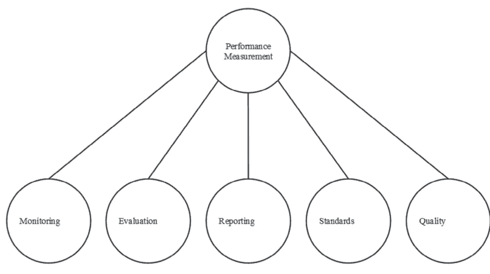

图 4.8 治理树——第四和第五层结构视图：绩效衡量。

注：改编自 R. E. Davis 所著《Assuring IT Governance》，2011 年，Amazon.com。版权 2011 归 Robert E. Davis 所有。经许可改编。

IT 部署继续向分层去中心化的分布式平台世界推进，用于输入、处理、存储和检索信息 (Davis, 2008a, 2017)。鉴于 IT 系统和网络日益复杂的特性，服务提供商和用户面临日益增长的信息安全挑战 (Bahl & Wali, 2014; Davis, 2008a, 2017)。严格的强制性安全要求可能导致外包转移 (Davis, 2017; Sen & Borle, 2015)。行业管理的网络安全服务提供商接受的客户数量越多，可能导致系统互依存风险相应增加 (Davis, 2017; Sen & Borle, 2015)。当实体外包流程时，监控可以检测合同风险 (Davis, 2011, 2017)。对于外包活动，实体管理应拥有管理与第三方提供商关系以及第三方提供商绩效的流程 (Boyson, 2014; Davis, 2011, 2017)。

在治理树第五层级，考虑到图 4.8，管理层需要 ISG 来实施持续监控、持续评估、情境报告、演绎标准和治理质量，以实现保护期望 (Davis, 2011, 2017)。因此，信息安全绩效衡量需要：

- 持续监控，以解决可能妨碍实体使命实现的众多管理、运营和技术问题 (Davis, 2008a);
- 持续评估，以解决可能妨碍实体使命实现的众多管理、运营和技术问题 (Davis, 2008a);
- 情境报告，以确保与实体使命保持一致 (Davis, 2008a);
- 演绎标准的制度化，传达最低绩效期望；以及
- ISG 质量标准、验证和核查流程 (Davis, 2009a)。


### 第五层监控

实体管理者-领导者通常会将针对预设和例行决策的政策与程序制定成文，形成参照条款（Davis, 2012b）。这些设计好的政策与程序通过剔除日常运营中较为常规的方面，为管理者-领导者提供时间处理非常规活动，并考虑对已部署的控制流程进行改进（Davis, 2012b）。然而，流程监控是必要的，以确保分配到各职能职责的预期成果得以实现，并能及时发现异常活动（Davis, 2012b）。尽管在低技术环境下，人工绩效监控可能足够，但在大多数高技术环境中，自动化 IAP 控制成为 IT 架构中必不可少的一部分（Davis, 2012b），以确保信息的机密性、完整性和可用性。实现有效持续监控策略的技术基础应包含几个关键要素：与处理数据的系统保持独立、跨多个平台比较数据和信息的能力、处理大量数据的能力，以及向管理层及时通知属于 IAP 控制异常事项的能力（Davis, 2012b）。

### 第五层评估

IAP 对策监控的完成使信息安全官能够确定实体系统、流程、活动和任务是否存在适当的 IAP 控制部署。当实体系统、流程、活动或任务缺少 IAP 控制时，需要由指定的信息安全官进行记录（见附录），这可能意味着需要制定控制目标并关联相应程序。当实体系统、流程、活动或任务存在控制措施时，需要记录标准，以减少异常或非法行为的可能性。作为常规做法，发现标准偏离时需要评估并随后记录整改或改进措施（见附录）。作为一项总体控制，要求评估记录有助于营造有利于有效 ISG 的环境。

### 第五层报告

IAP 报告目标决定了信息的适当提供方式。它可以将实体的 IAP 状态传达给授权方。要使报告信息完整、最新且及时，需要授权审核人按规范可获取和可访问，并在必要时以理想的形式进行重新获取（Davis, 2008a, 2020）。报告信息的完整性确保整个通信生命周期中内容表示未受损且被准确呈现（Davis, 2008a, 2020）。IAP 评估报告可以识别控制缺口和漏洞来源。IAP 评估报告的执行摘要必须详细说明对策的现状。特别是，缺陷和弱点需要清晰传达，以便应用例外管理策略（Davis, 2010）。在 IAP 评估报告中可能记录的漏洞中，识别重大或实质性风险至关重要。IAP 评估报告还必须包含解决已识别问题的建议（Davis, 2010, 2020）。

### 第五层标准

信息安全标准必须经过设计和部署的理性思考（Davis, 2008a, 2017; Järveläinen, 2012）。评估当前实体信息安全状态需要将绩效测量与事实标准（de facto）和法律标准（de jure）进行比较（Davis, 2008a, 2017）。标准可以反映特定的 IAP 目标或目的，以与绩效进行比较（Davis, 2011, 2017）。IT 管理者-领导者需要考虑遵循标准对于实现有效 ISG 的重要性（Davis, 2017; Lopez, 2012; Price, 2014）。有效性评估需要对照既定 IAP 标准进行测量（Davis, 2008a, 2017），然而标准和审计在组织间 IT 关系中扮演着不同的角色（Davis, 2017; Järveläinen, 2012）。绩效测量提取点对于准确的标准比较评估至关重要。ISG 管理者-领导者需要将标准确立为衡量数量、重量、程度、价值或质量的基线（Davis, 2011, 2017）。

### 第五层质量

ISG 质量是 IAP 在符合标准的前提下，满足功能需求、能力需求或最佳实践的程度。强大的实体信息安全是卓越管理模式的一个关键因素（Davis, 2017; Stagliano & Sillup, 2014）。通过应用健全的实体治理，可以实现有效的 ISG（Davis, 2017; Yaokumah & Brown, 2014）。有效的 ISG 维持由实体监督委员会部署的人员、政策、流程和结构，以指导、告知、管理和监控信息安全活动，实现目标（Davis, 2008a, 2017）。战略设计开发通常按顺序进行——无论管理者-领导者拥有正式还是非正式的战略规划系统（Davis, 2011, 2017）。关于设计的实施，ISG 实践的效能体现在组织框架下的流程领域成果中（Davis, 2017; Yaokumah, 2014）。实体信息安全管理者-领导者必须评估并确保已部署 IAP 机制的质量，以实现卓越的 ISG 绩效（Davis, 2017; Wu et al., 2015）。质量是 IAP 服务最可能的衡量标准。

### 参考文献

Abdul Rahim, N. F., Haron, H., & Mohamed Zainal, S. R. (2015). 马来西亚传统银行业中感知运营风险管理与客户投诉。*先进科学快报*, 21(4), 745–750. https://doi.org/10.1166/asl.2015.5936

Abraham, E. S. (2012). 信息技术：公司治理的推动因素。*公司治理：国际社会商业期刊*, 12, 281–291. https://doi.org/10.1108/14720701211234555

Ahmad, A., Maynard, S. B., & Park, S. (2014). 信息安全战略：走向组织多战略视角。*智能制造期刊*, 25, 357–370. https://doi.org/10.1007/s10845-012-0683-0

Akpinar, M. (2017). 面对制度环境变化时组织间关系中权力的行使：来自欧洲汽车行业的案例。*国际汽车技术与管理期刊*, 17(1), 51–71. https://doi.org/10.1504/IJATM.2017.082276

Alsudiri, T., Al-Karaghouli, W., & Eldabi, T. (2013). 大型项目管理流程与业务战略的对齐：回顾与概念框架。*企业信息管理期刊*, 26, 596–615. https://doi.org/10.1108/JEIM-07-2013-0050

Anderson, E. E., & Choobineh, J. (2008). 企业信息安全战略。计算机与安全, 27(1-2), 22-29. https://doi.org/10.1016/j.cose.2008.03.002

Atoum, I., Otoom, A., & Ali, A. A. (2014). 整体网络安全实施框架。信息管理与计算机安全, 22, 251-264. https://doi.org/10.1108/IMCS-02-2013-0014

Bahl, S., & Wali, O. P. (2014). 信息安全治理在软件服务业中预测信息安全服务质量的感知重要性。信息管理与计算机安全, 22, 2-23. https://doi.org/10.1108/IMCS-01-2013-0002

Badara, M. S., & Saidin, S. Z. (2014). 内部审计有效性：数据筛选与初步分析。亚洲社会科学, 10(10), 76-85. https://doi.org/10.5539/ass.v10n10p76

Barton, K. A., Tejay, G., Lane, M., & Terrell, S. (2016). 信息系统安全承诺：对高级管理层的外部影响研究。计算机与安全, 59, 9-25. https://doi.org/10.1016/j.cose.2016.02.007

Berman, S., & Marshall, A. (2014). 重塑参与规则：赢得信息技术竞赛的三种战略。战略与领导力, 42, 22-32. https://doi.org/10.1108/SL-05-2014-0036

Bharadwaj, A., El Sawy, O. A., Pavlou, P. A., & Venkatraman, N. (2013). 数字商业战略：迈向下一代洞察。MIS季刊, 37, 471-482. www.misq.org

Boyes, H. (2015). 网络安全与网络弹性供应链。技术创新管理评论, 5(4), 28-34. http://doi.org/10.22215/timreview/888

Boyson, S. (2014). 网络供应链风险管理：革新关键IT系统的战略控制。技术创新, 34, 342-353. http://doi.org/10.1016/j.technovation.2014.02.001

Brakewood, B., & Poldrack, R. A. (2013). 二次数据分析的伦理：考虑贝尔蒙原则在神经影像数据共享中的应用。神经影像, 82, 671-676. http://doi.org/10.1016/j.neuroimage.2013.02.040

Carlo, J. L., Gaskin, J., Lyytinen, K., & Rose, G. M. (2014). 软件开发组织中激进信息技术创新的早期与晚期采用：颠覆性信息技术创新模型的扩展。信息系统期刊, 24, 537-569. http://doi.org/10.1111/isj.v24.6

Catinean, I., & Cândea, D. (2013). 云计算模式作为颠覆性创新的特征。国际比较管理评论, 14, 783-803. www.rmci.ase.ro

Cavusoglu, H. (Huseyin), Cavusoglu, H. (Hasan), Son, J. Y., & Benbasat, I. (2013). 安全管理中的制度压力：对组织信息安全控制资源投资的直接与间接影响。信息与管理, 52, 385-400. http://doi.org/10.1016/j.im.2014.12.004

Cegielski, C. G., Bourrie, D. M., & Hazen, B. T. (2013). 评估企业IT战略中新兴IT的采用：使用定性方法建立模型。信息系统管理, 30, 235-249. http://doi.org/10.1080/10580530.2013.794632

Chi, L., & Holsapple, C. (2005). 理解计算机中介的组织间协作：模型与框架。知识管理期刊, 9(1), 53-75. https://doi.org/10.1108/13673270510582965

Chopra, S., & Sodhi, M. S. (2014). 降低供应链中断的风险。麻省理工学院斯隆管理评论, 55(3), 73-80. http://sloanreview.mit.edu

Chou, D. C. (2015). 云计算：价值创造模型。计算机标准与接口, 38, 72-77. https://doi.org/10.1016/j.csi.2014.10.001

Clark, M., & Harrell, E. C. (2013). 与下棋不同，网络攻击后每个人都必须继续玩下去。投资合规期刊, 14(4), 5-12. https://doi.org/10.1108/JOIC-10-2013-0034

Coertze, J., & Von Solms, R. (2013). 发展中国家的信息安全治理模型。载于 K. Jonas, I. A. Rai, & M. Tchuente (编), 发展中国家的电子基础设施与电子服务 (第279-288页). 计算机科学、社会信息学与电信工程学院讲义, 第119卷. https://doi.org/10.1007/978-3-642-41178-6_29


Crossler, R. E., Johnston, A. C., Lowry, P. B., Hu, Q., Warkentin, M., & Baskerville, R. (2013). 行为信息安全研究的未来方向。 计算机与安全, 32, 90–101. https://doi.org/10.1016/j.cose.2012.09.010

Cui, M., & Pan, S. L. (2015). 开发电子商务采纳的核心能力：资源编排视角。 信息与管理, 52, 200–209. https://doi.org/10.1016/j.im.2014.08.006

D'Arcy, J., Herath, T., & Shoss, M. K. (2014). 理解员工对压力性信息安全要求的反应：一种应对视角。 管理信息系统期刊, 31(2), 285–318. https://doi.org/10.2753/MIS0742-1222310210

Davis, R. E. (2008a). IT 审计：确保信息资产保护。 Pleier.

Davis, R. E. (2008b). IT 审计：IT 服务交付与支持。 Pleier.

Davis, R. E. (2009a). 确保 IT 法律合规。 www.amazon.com.

Davis, R. E. (2009b). IT 审计：系统与基础设施生命周期管理。 Pleier.

Davis, R. E. (2010). IT 审计：一种自适应系统。 www.amazon.com.

Davis, R. E. (2011). 确保 IT 治理。 www.amazon.com.

Davis, R. E. (2012a). 确保信息安全。 www.amazon.com.

Davis, R. E. (2012b). 管理信息系统持续审计的案例。 In J. Oringel (Ed.), 企业有效审计：实践与程序中的关键发展 (pp. 209–217). Bloomsbury Information.

Davis, R. E. (2017). 美国公司公司治理与信息安全治理有效性之间的关系 (Publication No. 10603383) [博士论文, Walden University]. ProQuest Dissertations Publishing.

Davis, R. E. (2020). 从系统视角进行 IT 审计。 IGI Global.

De Haes, S., Van Grembergen, W., & Debreceny, R. S. (2013). COBIT 5 与企业信息技术治理：构建模块与研究机会。 信息系统期刊, 27(1), 307–324. https://doi.org/10.2308/isys-50422

Van Deursen, N., Buchanan, W. J., & Duff, A. (2013). 医疗保健中信息安全风险的监控。 计算机与安全, 37, 31–45. https://doi.org/10.1016/j.cose.2013.04.005

Darroch, J. (2005). 知识管理、创新与企业绩效。 知识管理期刊, 9(3), 101–115. https://doi.org/10.1108/13673270510602809

Drnevich, P. L., & Croson, D. C. (2013). 信息技术与业务层面战略：迈向整合的理论视角。 MIS 季刊, 37, 483–509. www.misq.org

Edwards, C. K. (2013). 信息安全治理框架 (Publication No. 3607548) [论文, Nova Southeastern University]. ProQuest Dissertations Publishing.

Edwards, J. S., Duan, Y., & Robins, P. C. (2000). 不同层级和不同角色中专家系统用于商业决策的分析。 欧洲信息系统期刊, 9(1), 36–46. https://doi.org/10.1057/palgrave.ejis.3000344

Farahmand, F., Navathe, S. B., Sharp, G. P., & Enslow, P. H. (2005). 信息系统安全威胁风险的管理视角。 信息技术与管理, 6(2–3), 203–225. https://doi.org/10.1007/s10799-005-5880-5

Fenz, S., Heurix, J., Neubauer, T., & Pechstein, F. (2014). 信息安全风险管理中的当前挑战。 信息管理与计算机安全, 22, 410–430. https://doi.org/10.1108/IMCS-07-2013-0053

Flores, W. R., Antonsen, E., & Ekstedt, M. (2014). 组织中的信息安全知识共享：探究行为信息安全治理和国家文化的影响。 计算机与安全, 43, 90–110. https://doi.org/10.1016/j.cose.2014.03.004

Frigo, M. L., & Anderson, R. J. (2011a, April). 什么是战略风险管理？ 战略财务, 92(10). https://sfmagazine.com/

Frigo, M. L., & Anderson, R. J. (2011b). 战略风险管理：改进企业风险管理与治理的基础。 公司会计与财务期刊, 22(3), 81–88. https://doi.org/10.1002/jcaf.20677

Gil-Lafuente, A., & Paula, L. B. (2013). 利益相关者识别中应用的算法。 Kybernetes, 42, 674–685. https://doi.org/10.1108/K-04-2013-0073

Glavas, A., & Mish, J. (2015). 三重底线企业的资源与能力：重温旧知还是开辟新领域？ 商业伦理期刊, 127, 623–642. https://doi.org/10.1007/s10551-014-2067-1

Glinkowska, B., & Kaczmarek, B. (2015). 公司治理的经典与现代概念（受托责任理论与代理理论）。 管理, 19(2), 84–92. https://doi.org/10.1515/management-2015-0015

Goodman, P. S., & Rousseau, D. M. (2004). 产生成果的组织变革：联动方法。 管理学院执行官, 18(3), 7–19. https://doi.org/10.5465/AME.2004.14776160

Gosain, S., Lee, Z., & Kim, Y. (2005). ERP 实施中跨职能相互依赖的管理：新兴协调模式。 欧洲信息系统期刊, 14(4), 371–387. https://doi.org/10.1057/palgrave.ejis.3000549

Guo, K. H., & Yuan, Y. (2012). 多层级制裁对信息安全违规的影响：一个中介模型。 信息与管理, 49, 320–326. https://doi.org/10.1016/j.im.2012.08.001

Haag, S., & Cummings, M. (2008). 信息时代的管理信息系统 (Laureate Education, Inc., custom ed.). McGraw-Hill/Irwin.

Harrison, J. S., & Wicks, A. C. (2013). 利益相关者理论、价值与企业绩效。 商业伦理季刊, 23, 97–124. https://doi.org/10.5840/beq20132314

Hashizume, K., Rosado, D. G., Fernández-Medina, E., & Fernandez, E. B. (2013). 云计算安全问题的分析。 互联网服务与应用期刊, 4(1), 1–13. https://doi.org/10.1186/1869-0238-4-5

Hardcopf, R., Gonçalves, P., Linderman, K., & Bendoly, E. (2017). 运营解决方案中的短期偏差与战略错位：认知、倾向与陷阱。 欧洲运筹学期刊, 258(3), 1004–1021. https://doi.org/10.1016/j.ejor.2016.09.036

Heracleous, L., & Lan, L. L. (2012). 代理理论、制度敏感性与归纳推理：迈向法律视角。 管理研究期刊, 49, 223–239. https://doi.org/10.1111/j.1467-6486.2011.01009.x

Hitt, M. A. (2016). 资产编排。 In M. Augier & D. J. Teece (Eds.), 帕尔格雷夫战略管理百科全书 (pp. 1–3). https://doi.org/10.1057/978-1-349-94848-2_457-1

Hodgkinson, I. R., Ravishankar, M. N., & Aitken-Fischer, M. (2014). 双元性编排的资源优势视角。 服务产业期刊, 34, 1234–1252. https://doi.org/10.1080/02642069.2014.942655

Hughes, D., Bon, J., & Rapp, A. (2013). 获取和利用基于客户的竞争情报：社会资本和销售人员适应性销售技能的关键作用。 市场营销科学学会期刊, 41, 91–110. https://doi.org/10.1007/s11747-012-0311-8

Imenda, S. (2014). 理论框架与概念框架之间是否存在概念差异？ 社会科学期刊, 38, 185–195. www.krepublishers.com

IT Governance Institute. (2008). 信息安全治理：信息安全经理指南。 Author.

Järveläinen, J. (2012). 组织间 IT 关系中的信息安全与业务连续性管理。 信息管理与计算机安全, 20, 332–349. https://doi.org/10.1108/09685221211286511

Kearney, W. D., & Kruger, H. A. (2013). 良好公司治理与组织学习的框架：实证研究。 网络安全与数字取证国际期刊, 2, 36–47. http://sdiwc.net

Kim, A. C., Lee, S. M., & Lee, D. H. (2012). 使用系统动力学进行金融信息安全合规风险评估措施。 安全及其应用国际期刊, 6(4), 191–200. www.sersc.org

Kumar, S., Himes, K. J., & Kritzer, C. P. (2014). 全球供应链中风险评估与风险管理的运营方法。 制造技术管理期刊, 25, 873–890. https://doi.org/10.1108/JMTM-04-2012-0044


Kwon, J., Ulmer, J. R., & Wang, T. (2013). 高层管理参与与薪酬与信息安全泄露之间的关联。 Journal of Information Systems, 27(1), 219–236. https://doi.org/10.2308/isys-50339

Lambert, S. C., & Davidson, R. A. (2013). 商业模式在企业成功、创新和分类研究中的应用：1996年至2010年实证研究的分析。 European Management Journal, 31, 668–681. https://doi.org/10.1016/j.emj.2012.07.007

Liang-Chuan, W., & Liang-Hong, W. (2015). 通过服务工程改善全球供应链：基于服务科学、管理与工程的框架。 Asia Pacific Management Review, 20, 24–31. https://doi.org/10.1016/j.apmrv.2014.12.002

Looy, A. V., De Backer, M., Poels, G., & Snoeck, M. (2013). 选择合适的业务流程成熟度模型。 Information & Management, 50, 466–488. https://doi.org/10.1016/j.im.2013.06.002

Lopez, R. H. (2012). 信息数据安全专家与企业领导者关于沟通挑战的经验 (Publication No. 3503982) [Doctoral Study, Walden University]. ProQuest Dissertations Publishing.

Losiewicz-Dniestrzańska, E. (2015). 银行合规风险监控。 Procedia Economics and Finance, 26, 800–805. https://doi.org/10.1016/S2212-5671(15)00846-1

Magdaraog, Jr., G. A. (2014). 工作场所的警示信号：员工欺诈风险因素分析。 The Carrington Rand Journal of Social Sciences, 1(1), 73–82. www.carringtonrand.com

Markus, M. L., & Loebbecke, C. (2013). 商品化数字流程与商业社区平台：数字商业战略的新机遇与挑战。 MIS Quarterly, 37, 649–654. www.misq.org

Masa’deh, R. (2013). 信息技术基础设施灵活性对企业绩效的影响：约旦公众持股公司实证研究。 Jordan Journal of Business Administration, 9, 204–224. https://doi.org/10.12816/0002054

Mattsson, U. T. (2014). 在大数据中弥合访问与安全之间的差距。 ISACA Journal, 6, 1–5. www.isaca.org/resources/isaca-journal

Mentzer, J. T., Myers, M. B., & Stank, T. P. (Eds.). (2007). 全球供应链管理手册。 Sage.

Miles, S. (2012). 利益相关者：特别有争议还是只是困惑？ Journal of Business Ethics, 108, 285–298. https://doi.org/10.1007/s10551-011-1090-8

Mishra, S., & Mohanty, P. (2014). 公司治理作为企业绩效的价值驱动因素：来自印度的证据。 Corporate Governance, 14, 265–280. https://doi.org/10.1108/CG-12-2012-0089

Mohare, R., & Lanjewar, U. (2012). 商业信息安全决定因素。 International Journal of Marketing and Technology, 2(7), 203–209. www.ijmra.us

Nalband, N. A., & Kelabi, S. L. (2014). 重新设计卡罗尔的 CSR 金字塔模型。 Journal of Advanced Management Science, 2, 236–239. https://doi.org/10.12720/joams.2.3.236-239

Pagani, M. (2013). 数字商业战略与价值创造：控制点的动态循环框架。 MIS Quarterly, 37, 617–632. www.misq.org

Pan, G., Pan, S.-L., & Lim, C.-Y. (2015). 研究企业如何利用 IT 实现企业生产率和动态能力视角。 Information & Management, 52, 401–412. https://doi.org/10.1016/j.im.2015.01.001

Pande, S., & Ansari, V. A. (2014). 公司治理的理论框架。 Indian Journal of Corporate Governance, 7(1), 56–72. https://doi.org/10.1177/0974686220140104

Pérez-Méndez, J. A., & Machado-Cabezas, Á. (2015). 管理信息系统与企业绩效之间的关系。 Spanish Accounting Review, 18, 32–43. https://doi.org/10.1016/j.rcsar.2014.02.001

Porter, M. E. (1998). 竞争优势：创造和保持卓越绩效。 Free Press.

Price, J. D. (2014). 使用有效的合规计划降低数据泄露风险 (Publication No. 3619214) [Doctoral Study, Walden University]. ProQuest Dissertations Publishing.

Raelin, J. D., & Bondy, K. (2013). 在良好公司治理中加入好的 houl：双层代理理论的存在与问题。 Corporate Governance: An International Review, 21, 420–435. https://doi.org/10.1111/corg.12038

Rasheed, S., ChangFeng, W., & Yaqub, F. (2015). 迈向项目风险管理与感知的风险管理障碍。 International Journal of Hybrid Information Technology, 8, 323–338. https://doi.org/10.14257/ijhit.2015.8.5.35

Rebollo, O., Mellado, D., Fernández-Medina, E., & Mouratidis, H. (2015). 云计算信息安全治理框架的实证评估。 Information and Software Technology, 58, 44–57. https://doi.org/10.1016/j.infsof.2014.10.003

Rijke, J., Herk, S. V., Zevenbergen, C., Ashley, R., Hertogh, M., & Heuvelhof, E. T. (2014). 通过平衡的绩效/战略导向重点实现适应性项目管理。 International Journal of Project Management, 32, 1197–1209. https://doi.org/10.1016/j.ijproman.2014.01.003

Roberts, N., & Grover, V. (2012). 利用信息技术基础设施促进企业客户敏捷性和竞争活动：实证研究。 Journal of Management Information Systems, 28(4), 231–270. https://doi.org/10.2753/MIS0742-1222280409

Rubino, M., & Vitolla, F. (2014). 公司治理与信息系统：IT 治理框架如何支持 ERM。 Corporate Governance: The International Journal of Business in Society, 14, 320–338. https://doi.org/10.1108/CG-06-2013-0067

Saber, Z., Bahraami, H. R., & Haery, F. A. (2014). 供应链管理技术影响分析：市场中的竞争优势。 International Journal of Academic Research in Economics and Management Sciences, 3(1), 75–88. https://doi.org/10.6007/IJAREMS/v3-i1/579

Safa, N. S., & Von Solms, R. (2016). 组织中的信息安全知识共享模型。 Computers in Human Behavior, 57, 442–451. https://doi.org/10.1016/j.chb.2015.12.037

Samad-Khan, A. (2008). 现代运营风险管理。 Emphasis, 2, 26–29. www.stamfordrisk.com/pdf/Modern_Operational_Risk_Management.pdf

Scharff, R. (2013). 成为后实证主义者……还是仅仅谈论它？ Foundations of Science, 18(2), 393–397. https://doi.org/10.1007/s10699-011-9249-4

Schobel, K., & Denford, J. S. (2013). 公共部门中的首席信息官与首席财务官二元组：有效关系如何影响个人效能和战略一致性。 Journal of Information Systems, 27(1), 261–281. https://doi.org/10.2308/isys-50321

Seddon, P. B. (2014). 基于资源的企业理论对战略 IS 研究的影响：反思。 The Journal of Strategic Information Systems, 23, 257–269. https://doi.org/10.1016/j.jsis.2014.11.001

Sen, R., & Borle, S. (2015). 估计数据泄露的情境风险：实证方法。 Journal of Management Information Systems, 32, 314–341. https://doi.org/10.1080/07421222.2015.1063315

Shaaban, H., & Conrad, M. (2013). 民主、文化与信息安全：桑给巴尔案例研究。 Information Management & Computer Security, 21, 191–201. https://doi.org/10.1108/IMCS-09-2012-0057

Sharma, J. P., & Khanna, S. (2014). 企业社会责任、公司治理与可持续性：协同与相互关系。 Indian Journal of Corporate Governance, 7(1), 14–38. https://doi.org/10.1177/0974686220140102

Silic, M., & Back, A. (2014). 信息安全：批判性回顾与未来研究方向。 Information Management & Computer Security, 22, 279–308. https://doi.org/10.1108/IMCS-05-2013-0041

Sindhuja, P. N. (2014). 信息安全举措对供应链绩效的影响：实证调查。 Information Management & Computer Security, 22, 450–473. https://doi.org/10.1108/IMCS-05-2013-0035

Singh, A. N., Picot, A., Kranz, J., Gupta, M. P., & Ojha, A. (2013). 信息安全管理（ISM）实践：来自印度和德国精选案例的经验。 Global Journal of Flexible Systems Management, 14, 225–239. https://doi.org/10.1007/s40171-013-0047-4

Slaper, T. F., & Hall, T. J. (2011, Spring). 三重底线：它是什么以及如何运作。 Indiana Business Review, 86(1), 4–8. www.ibrc.indiana.edu/ibr/2011/spring/article2.html


- Stagliano, A. J., & Sillup, G. P. (2014). 透明度与风险评估报告：网络犯罪披露的案例研究部门调查。商业与经济杂志, 5, 1134–1140. https://doi.org/10.15341/jbe(2155-7950)/07.05.2014/017
- Stewart, G., & Lacey, D. (2012). 千百事实之死：批判信息安全意识的技术官僚方法。信息管理与计算机安全, 20(1), 29–38. https://doi.org/10.1108/09685221211219182
- Sun, Y., & Bhattacherjee, A. (2014). 深入“IT 黑箱”：技术对 IT 使用的影响。计算机信息系统杂志, 54(2), 1–15. https://doi.org/10.1080/08874417.2014.11645681
- Tan, F., Pan, S. L., & Zuo, M. (2014). 组织间相互依赖和资产编排在业务整合中的作用：M.Com 的案例研究。国际信息管理杂志, 34(6), 780–784. https://doi.org/10.1016/j.ijinfomgt.2014.07.004
- Tashman, P., & Raelin, J. (2013). 对企业真正重要的究竟是谁和什么：将利益相关者显著性超越管理者认知。商业伦理季刊, 23, 591–616. https://doi.org/10.5840/beq201323441
- Turel, O., & Bart, C. (2014). 董事会层面的 IT 治理与组织绩效。欧洲信息系统杂志, 23, 223–239. https://doi.org/10.1057/ejis.2012.61
- Wang, N., Liang, H., Zhong, W., Xue, Y., & Xiao, J. (2012). 资源结构化还是能力建设？信息技术业务价值的实证研究。管理信息系统杂志, 29(2), 325–367. https://doi.org/10.2753/MIS0742-1222290211
- Williams, S. P., Hardy, C. A., & Holgate, J. A. (2013). 关键基础设施组织中的信息安全治理实践：社会技术与制度逻辑视角。电子市场, 23, 341–354. https://doi.org/10.1007/s12525-013-0137-3
- Wu, S. P. J., Straub, D. W., & Liang, T. P. (2015). 信息技术治理机制和战略一致性如何影响组织绩效：来自企业与 IT 管理人员配对调查的见解。MIS 季刊, 39, 497–518. www.misq.org
- Yaokumah, W. (2013). 评估发展中国家信息安全治理实践的有效性：以加纳为例 (出版编号 3557634) [论文，卡佩拉大学]。ProQuest 论文出版。
- Yaokumah, W. (2014). 加纳行业部门内信息安全治理实施：实证研究。信息管理与计算机安全, 22, 235–250. https://doi.org/10.1108/IMCS-06-2013-0044
- Yaokumah, W. (2015). 评估发展中国家信息安全治理实践的有效性：以加纳为例。在《标准与标准化：概念、方法、工具和应用》（第 1317–1333 页）中。https://doi.org/10.4018/978-1-4666-8111-8.ch062
- Yaokumah, W., & Brown, S. (2014). 信息安全/战略一致性与信息安全治理领域之间的关系实证研究。商业系统、治理与伦理杂志, 9(2), 50–65. https://doi.org/10.15209/jbsge.v9i2.718
- Zachariadis, M., Scott, S., & Barrett, M. (2013). 批判现实主义对混合方法研究的 方法论 含义。MIS 季刊, 37, 855–879. www.misq.org
- Zhao, X., Xue, L., & Whinston, A. B. (2013). 管理相互依赖的信息安全风险：网络保险、托管安全服务和风险共担安排。管理信息系统杂志, 30(1), 123–152. https://doi.org/10.2753/MIS0742-1222300104

### 推荐阅读
- Maleh, Y., Zaydi, M., Sahid, A., & Ezzati, A. (2018). 通过组织实证研究构建信息安全治理成熟度框架。在 Y. Maleh（编）《安全与隐私管理、技术和协议》（第 96–127 页）中。https://doi.org/10.4018/978-1-5225-5583-4.ch004
- Posthumus, S., & Von Solms, R. (2004). 信息安全治理框架。计算机与安全, 23(8), 638–646. https://doi.org/10.1016/j.cose.2004.10.006
- Sigauke, J., Mupfiga, P., & Tsokota, T. (2015). 津巴布韦国有企业（SOE）信息安全治理分析。国际工程与科学杂志（IJES）, 4(12), 49–53. www.theijes.com
- Von Solms, B. (2006). 信息安全：第四波。计算机与安全, 25(3), 165–168. https://doi.org/10.1016/j.cose.2006.03.004
- Von Solms, R., & Von Solms, B. (2006). 信息安全治理：基于直接控制循环的模型。计算机与安全, 25(6), 408–412. https://doi.org/10.1016/j.cose.2006.07.005

### 附录
#### 控制评估工作表

**控制评估工作表 1a：单一风险评级**

| 安全目标 | 保密性 | 完整性 | 可用性 | 综合评级 |
|---|---|---|---|---|

**控制评估工作表 1b：单一风险评级**

| 配置名称 | 保密性 | 完整性 | 可用性 | 综合评级 |
|---|---|---|---|---|

**控制评估工作表 2a：分组风险评级**

| 安全目标 | 信息系统 | 信息类型 | 综合评级 |
|---|---|---|---|

**控制评估工作表 2b：分组风险评级**

| 配置名称 | 配置类别 | 配置类型 | 综合评级 |
|---|---|---|---|

**控制评估工作表 3：汇总风险表**

| 类别 | 说明 |
|---|---|
| [风险项目标题] |  |
| [风险类型] |  |
| [风险范围] |  |
| [风险性质] |  |
| [利益相关者] |  |
| [风险估值] |  |
| [风险容忍度/风险偏好水平] |  |
| [风险处理机制] |  |
| [补救/改进的潜在行动] |  |
| [战略和政策制定/部署] |  |

## 第 5 章：组织员工
### 摘要
利益相关者需要知道实体管理者领导者正在应用适当的实践以确保信息资产保持受保护。众多治理失败源于实体员工的组织承诺缺失。做出道德决策对实体员工而言通常需要权衡取舍。在 perceived ethical misconduct 导致丑闻后，正确的行动方案似乎显而易见。实体管理者领导者应将信息资产用户及其认知视为提供安全环境的重要因素。IT 操作 nonetheless 持续地使故意或非故意的 IAP 违规成为可能。通过授权，每位实体员工都承担维护保护信息资产的控制系统的责任。实体员工 IAP 教育、培训和意识对于降低网络安全漏洞风险至关重要。在第 5 章中，作者讨论了责任委托和反生产的工作场所行为。第 5 章还提供了 IT 事件响应团队的见解、员工发展策略以及实体 IT 审计团队活动的概述。

### 引言
法定问责超越专业要求（Davis, 2008a）。然而，当存在法定问责时，信息和通信技术可能导致社会工程和组织困境（Davis, 2008a）。此外，仅因某种行动选择合法并不保证其合乎道德（Davis, 2008a）。将法律合规视为组织伦理的目标而非起点，可能导致 IAP 管理不善，对员工和实体造成灾难性后果（Davis, 2008a）。管理者领导者获取深层知识可实现有效的信息安全活动协调（Davis, 2017；Flores et al., 2014）。关于 IAP，实体信息安全职能应：
- 建立用户账户配置流程，
- 监控关键职能是否分配给不同个人以禁用必要的权限或访问，从而可能导致不规则行为或非法行为，
- 评估关键职能是否分配给不同个人以禁用必要的权限或访问，从而可能导致不规则行为或非法行为，
- 验证用户对信息资产的访问限制是否符合最小权限原则，
- 确保对所有实体职位进行敏感度级别审查，
- 规定友好和不友好终止的程序，
- 安装追究用户行为责任的机制，以及
- 保留经签署的人力资源声明，描述实体职位的适当员工背景审查（Davis, 2008a）。


政府和政府机构制定法律和法规以宣布不可接受的行为或行动。政府和政府机构还制定法律和法规，以使实体利益相关者确信管理层将履行其被认为的受托责任（Davis, 2009a）。利益相关者与管理层之间的受托关系通常要求实体的管理层保护受托资产，这些资产产生收入或支付费用（Davis, 2009a）。在维持受托保护方面，实体的管理层需要提供关于过去和当前组织绩效的准确完整信息，以及对可能或将影响实体财务状况或状态的任何已确认未来经济事件的评估（Davis, 2009a）。因此，与实体治理相关的法律和法规提出了期望，即避免参与不道德、腐败或欺诈行为（Davis, 2009a）。

实体的控制环境影响反生产的工作场所行为和欺诈性工作场所行为（C. Chen et al., 2012; Davis, 2017; Z. Ahmad & Norhashim, 2008）。工作场所行为价值观和标准的传达通常通过模范行为、政策声明、行为准则和培训向组织人员广播（Davis, 2008a, 2017）。模范行为涵盖值得信赖，具备内在动机并以服务集体而非自身为导向（Davis, 2017; Glinkowska & Kaczmarek, 2015; Heracleous & Lan, 2012; Pande & Ansari, 2014）。设计并实施的多层次制裁可以防止工作场所信息安全政策违规（Davis, 2017; Guo & Yuan, 2012）。综合来看，行为准则和文化培训的内化有助于影响员工对适当行为的认知（Davis, 2017; Vance & Siponen, 2012; Z. Ahmad & Norhashim, 2008）。

如果没有胜任的人员来管理或操作部署的资源，即使设计精良的 ISG 程序也会变得无效且低效（Davis, 2008a）。实体管理者领导者需要为员工建立和维护信息安全教育、培训和意识计划（Davis, 2008b）。信息安全人员和 IT 用户应接受适当的 IAP 培训（Davis, 2008a）。相关培训旨在确保实体人员能够执行分配的活动或任务（Davis, 2008a），同时保护相关信息资产。虽然培训具有组织价值，但学习障碍可能存在（Rida-E-Fiza et al., 2015）。本章介绍了组织员工带来的许多积极和消极后果。

### 责任委派

员工决策对于实现 IAP 目标至关重要（Davis, 2008a）。因此，管理者领导者必须确保员工接受并遵守 IAP 目标（Davis, 2008a）。IAP 目标一致性会影响决策质量（Davis, 2008a, 2017）。当决策质量至关重要且下属不共享相同的 IAP 目标时，管理者领导者面临失去对活动的控制（Davis, 2008a），导致不利的组织影响（Davis, 2017）。因此，员工 IAP 目标不一致可能导致 ISG 决策质量次优（Davis, 2008a, 2017）。为应对次优化，管理者领导者应深入了解环境、组织目标和流程，以便使信息安全服务与实体需求保持一致（Davis, 2017; Flores et al., 2014）。

有效的内部控制系统反映成熟的控制环境、安全的信息资产、质量改进流程和资源监控活动（Davis, 2008a）。由于在支持运营和财务沟通方面发挥重要作用，实体员工必须实施和维护对数字编码信息的手工或技术控制（Davis, 2008a）。信息和通信系统应以能够使员工履行分配职责的形式和时间框架识别、捕获和交换数据（Davis, 2008a）。在维持适当的工作流程控制方面，管理者领导者通常通过职能分离和职责分离方法来实现分离，以防止、检测或遏制错误、失误、遗漏、不规则行为和非法行为（Davis, 2008a）。尽管如此，对信息资产的权限和访问权需要审查，以确保与分配职责的一致性和合规性（Davis, 2008a）。

实体结构控制必须存在以确保保持适当的员工权限和访问权。职能分离是构建个人工作单元以实现实体管理意图同时遵守控制原则（Davis, 2008a）。相比之下，职责分离是在定义的 工作单元内划分员工责任分配，以实现实体管理意图同时遵守控制原则（Davis, 2008a）。实体 IAP 管理者领导者必须建立、执行并制度化职能分离和职责分离（Davis, 2008a）。

作为获得充分控制的基本原则，职能分离和职责分离的部署需要支持实体为防止个人进行未经授权的行动或获得对资产的未经授权访问而建立的政策、程序、指令和组织结构（Davis, 2008a）。职能分离是一种控制，用于通过分离职能责任来减少某人延续并隐瞒错误、失误、遗漏、不规则行为和非法行为的机会（Davis, 2009a）。职责分离是一种控制，用于通过在职能内分离员工责任来减少某人延续并隐瞒错误、失误、遗漏、不规则行为和非法行为的机会（Davis, 2009a）。因此，至少，负责分配信息资产权限的网络安全员工需要监控和评估职责和职能是否在不同个人之间有适当划分，以禁用必要的权限或访问，从而导致未被检测到的不规则行为或非法行为（Davis, 2008a）。

适当的职能责任分离要求考虑控制背景来定义 IT 和运营用户工作单元（Davis, 2008a）。应用的职能分离确保组织责任不会损害独立性或腐蚀信息系统完整性（Davis, 2008a）。作为职责分离的基线，IT 用户分离应确保一个人不会控制交易或事件的所有阶段（Davis, 2006）。在职能内部，管理者领导者可以通过起源、输入、处理、验证和分发分离来实现充分的职责分离（Davis, 2006）。或者，通过交易授权、执行、记录和资产问责分离也可以实现充分的 IT 职责分离（Davis, 2006）。

管理层可能不了解实体职能中每个员工的详细活动（Davis, 2009b）。因此，与管理层的讨论将为 IAP 人员提供有限的信息以准确应用职责分离方法（Davis, 2009b）。此外，实体组织结构图通常不提供员工活动细节（Davis, 2009b）。另外，测试用户权限提供有关员工在 IT 架构中权利的信息，但不会提供关于分配活动的完整信息（Davis, 2009b）。

IT 处理集中化并不能免除实体管理者领导者从运营和技术职能中分离职责的责任（Davis, 2008a）。职能内的完全职责分离在大型实体中通常比小型实体更可行（Davis, 2008a）。大型实体倾向于遵循严格的规范，有利于高度职责专业化、详细的劳动分工、精细的行政管理和最小的个人互动（Davis, 2008a）。小型实体特征为灵活的规范；低职责专业化；宽大的控制跨度、稀缺且简单的行政管理；以及广泛的个人互动（Davis, 2008a）。

确保对信息资产的访问限制与最小权限原则一致，需要合适的系统设置、用户账户警惕和行政支持（Davis,

2008a)。关键信息资产的权限设置应定期评估其适当性（Davis, 2008a）。关于用户账户的警惕性，运营信息安全管理必须建立授予和撤销权限的流程（Davis, 2008a）。所设计的流程必须包括对新账户请求的审批流程、授予执行授权任务所需的最严格权限集，以及定期禁用或删除不再需要执行工作职责的账户的流程（Davis, 2008a）。

具体到 IT 部署，维持问责制的公认方式是身份识别与身份验证系统的集成（Davis, 2008a）。身份识别和身份验证系统包含技术类的一系列安全控制，确保用户获得单独的访问许可（Davis, 2008a）。安全身份识别是通过使用唯一凭证来区分访问请求有效性，从而使受保护域能够识别对象的行为或过程（Davis, 2008a）。随后的身份验证是身份验证过程，通过将提供的凭证与先前存储的 IT 验证器进行比较，以确认所声称的唯一性是正确的（Davis, 2008a）。

### Access Controls

逻辑访问控制是部署以保护符号对象的人工和技术政策、程序和组织结构（Davis, 2008a, 2017）。操作性逻辑控制试图确保只有获得批准授权的指定用户才能访问信息资产（Davis, 2008a, 2017）。授权控制提供验证为允许资源访问而授予的凭证的能力（Baltatzis et al., 2012; Davis, 2008a, 2017）并使用。因此，派生地，IT 授权赋予对给定信息资产的访问分配和允许操作管理的能力（Baltatzis et al., 2012; Davis, 2008a, 2017）。

网络基础设施设施是 IT 硬件和软件所在的位置（Davis, 2008a, 2017）。作为信息资产，网络基础设施设施需要访问控制（Davis, 2008a, 2017）。物理访问控制是部署以保护有形对象的人工和技术政策、程序和组织结构（Davis, 2008a; Sloan, 2014）。物理访问控制旨在降低 IT 风险，通常通过限制对容纳信息资产的建筑物和房间的访问或在设备上安装机械锁来实现（Davis, 2008a）。与逻辑访问控制一致，实体信息处理设施的用户应通过执行适用政策和程序获得身份验证和授权（Davis, 2008a, 2017）。

可执行的实体 IAP 政策可以描述哪些类型的活动是可以接受的，哪些是不可以接受的（Davis, 2008a）。随后，带有行为期望的明文政策是信息资产可用性的基础。信息资产的访问政策应强制要求基于风险的身份识别方案、难以猜测的密码并禁止共享凭证。根据资源的总评估风险，访问政策应指示用户通过操作上不同的控制流程出示不同的身份识别凭证（Davis, 2008a）。实体员工需要了解 IAP 责任和禁止的活动（Davis, 2008a）。因此，管理者领导者需要提供资源和培训，以便实体员工理解工作职责（Davis, 2008a）。

用户是谁以及用户能做什么相互交织，根源在于管理身份识别的全生命周期并执行组织访问政策的能力（Davis, 2008a）。IAP 身份管理应解决确保合法活动的问题，并通过对策降低不适当用户损害信息资产并通过技术媒介访问对象的风险（Davis, 2008a）。权威的身份识别来源解决同义、顺序和关联问题（Davis, 2008a）。身份识别数据可以是单个项目或多个项目，用于区分对象（Davis, 2008a）唯一性。一般而言，区分身份识别特征反映了基于持有证明、基于知识证明或基于属性证明（Davis, 2008a）。

当请求访问的用户提供凭证时，身份验证转变为身份验证（Davis, 2008a）。身份验证是用于验证资源用户提供的身份信息的过程（Davis, 2008a）。在接受身份识别后，已部署的哨兵应采用足够强大的身份验证，特别是用于访问关键资源时（Davis, 2008a）。

身份验证仅确保用户符合特权声明，而不考虑用户访问权限（Davis, 2008a）。换句话说，身份验证不提供用户访问权限的证明（Davis, 2008a）。然而，身份验证确实解决了识别访问信息资产的每个用户的需求（Davis, 2008a）。除非访问请求者可识别，否则无法评估凭证的真实性（Davis, 2008a）。因此，身份验证需要身份识别（Davis, 2008a）。根据 IAP 部署要求，单独或组合使用，用户的所有物、知识或属性可以验证可访问性（Davis, 2008a）。理论上，可部署的访问身份验证机制包括：

- password,
- biometric,
- single-use,
- certificate,
- two-factor,
- on-demand,
- multi-factor,
- policy-based, and
- challenge-response (Davis, 2008a).

安全标签可以结合多种显性和隐性特征以使复制变得困难，包括全息图和封装技术（Davis, 2008a）。分配的安全标签通常提供身份验证、降低盗窃风险以及防止伪造凭证（Davis, 2008a）。关于部署物理身份验证媒介，实体的访问控制流程应明确定义在促进适当保密性、完整性和可用性的背景下，为用户提供编码身份识别的方式（Davis, 2008a）。具体而言，向用户分发标记化身份验证属性的过程应采用与物理项目不同的交付渠道（Davis, 2008a）。在个人分配或使用之前对物理项目进行标记化时，安全管理必须确保身份识别机制保持休眠和受保护状态，直到身份验证验证使能器到达拥有激活和使用权的预期所有者（Davis, 2008a）。安全身份验证是一个独特的完整性子分类，当用于允许访问信息资产时需要定期证实（Davis, 2008a）。

资源访问批准可以在资源授权之前或之后发生（Davis, 2008a）。获得授权后，请求者获得可执行定义操作的对象的访问权限（Davis, 2008a）。授权控制通常确保及时准确的处理，以及有效源数据和信息的输出（Davis, 2008a）。部署适当的授权控制需要首席信息安全官建立保密性和完整性标准；根据已接受的标准衡量活动；并对触发访问请求的<|message|> 数据和信息的输入、处理和输出保持控制（Davis, 2008a）。此外，授权流程应包括静态和自适应程序以遵循，并在流程中断、修改或更改时确保权限准确性（Davis, 2008a）。

IT 设备通常为许多有条件的用户提供对多个程序和数据文件的访问（Davis, 2008a）。用户访问的多样性加剧了在授权 IT 会话期间发生未经授权事件的可能性（Davis, 2008a）。从根本上讲，访问管理应维持信息保密性和完整性（Davis, 2008a）。此外，当部署适当的访问控制时，信息完整性和保密性要求是可执行的（Davis, 2008a）。

大多数网络安全系统启动两阶段访问流程（Davis, 2008a）。第一阶段是 IT 身份验证，用于通过特定身份识别确保用户是其声称的人（Davis, 2008a）。IT 身份验证提供了对用户数字身份的必要信任（Davis, 2008a）。在特定情况下，在内部或外部在应用程序和功能之间传递信息或交易数据之前，已部署的流程应验证正确的寻址、来源真实性和内容完整性（Davis, 2008a）。此外，IAP 程序应在传输或运输期间保持一般真实性和其他完整性属性（Davis, 2008a）。因此，至少，应为可转移的信息资产部署完整性证明控制（Davis, 2008a）。

第二相互锁定的网络安全系统访问流程阶段是 IT 授权（Davis, 2008a）。授权控制提供验证被授予访问资源权限的凭证的能力（Davis, 2008a）。因此，派生地，IT 授权使能够为给定信息资产指定并随后管理允许的操作（Davis, 2008a）。通常，未经授权访问信息资产是可刑事起诉的违法行为（Davis, 2008a）。

正式的、管理批准的、面向实体的访问授权行动计划——带有定义的授权配置文件——需要制定和部署以降低 IAP 违规风险（Davis, 2008a）。从属地，访问授权计划的战术目标应是限制对授权资源用户的可访问性，以便管理认可的活动能够有效高效地进行。进而，关键绩效指标应衡量未经授权的员工活动（Davis, 2008a）。

授权构造可通过各种人工和自动化程序实现（Davis, 2008a）。信息资产授权代表基于身份识别和身份验证、角色和职责以及安全级别分类允许对资源的可访问性。程序使授权构造正式化并实现用户到设备、程序和信息的完整映射（Davis, 2008a）。可部署的 IT 可访问性程序可以包括：

- User-based Access Control: The User-based Access Control Model, also known as Identity-based Access Control, requires a security administrator to define permissions for each subject, based on solitary needs (Davis, 2008a). The User-based Access Control model is usually implemented by designating general subject groups (Davis, 2008a).
- Rule-based Access Control: The Rule-based Access Control Model design permits objects charged with handling to allow or deny access by inspecting requests, then comparing specific rules in the object with the rights assigned to a given subject (Davis, 2008a). Most of the Rule-based Access Control functionality relies on a security label system, which dynamically composes sets of conditions defined by the IAP policy engine (Davis, 2008a).


- 自主访问控制：自主访问控制模型为每个授权主体建立权限结构，并使授权的 IT 资源所有者能够指定在其定义域内谁可以访问特定的信息资产（Davis, 2008a）。因此，每个主体必须为请求访问其拥有的每个对象的全部主体定义适当的权限（Davis, 2008a）。
- 强制访问控制：强制访问控制模型的实施通过技术资源仲裁最终决定，基于主体的权限级别和对象的保密级别来允许或拒绝访问对象的请求（Davis, 2008a）。为了实现自动化决策，网络安全管理员必须对对象进行分类，并通过安全标记确保分类存储在所有对象中（Davis, 2008a）。部署后，授权主体无法访问超出授权权限标签的对象（Davis, 2008a）。此外，只有指定的网络安全管理员在收到并清除可接受的访问批准或拒绝通知后，才能为对象配置和取消配置主体的授权和特权（Davis, 2008a）。
- 基于角色的访问控制：基于角色的访问控制模型允许在实体的工作活动背景下创建特权组，为定义的角色分配权限，并根据个人工作职责将适当的主体映射到角色（Davis, 2008a）。使用基于角色的访问控制，网络安全管理员可以限制对某些功能的访问，同时启用履行分配任务所需的其他功能（Davis, 2008a）。
- 基于上下文的访问控制：基于上下文的访问控制模型考虑尝试访问对象的主题、被访问对象的类型以及访问尝试发生的情形（Davis, 2008a）。基于上下文的访问控制方案通常以用户基于访问控制或基于角色的访问控制架构所提供的保护为起点（Davis, 2008a）。
- 基于格的访问控制：基于格的访问控制模型要求为主体和对象分配访问权限（Davis, 2008a）。根据已建立的标签，主体只能访问具有小于或等于定义授权的保密级别的对象（Davis, 2008a）。
- 基于能力的访问控制：基于能力的访问控制模型要求指定主体可以访问的对象（Davis, 2008a）。如果请求访问的主体拥有对象授权，则允许访问该对象（Davis, 2008a）。授权的能力驻留在受保护的标签中，该标签标识对象并指定拥有分配授权的主体允许执行的操作（Davis, 2008a）。

此外，在详细层面上，实现访问授权的 IT 活动包括：

- 授权表列出了个人有权访问的资源，并确定每个用户可以执行的授权任务（Davis, 2008a）。每次用户希望使用资源或执行活动时都会检查表，以确保用户具有适当的授权（Davis, 2008a）。
- 数据和信息锁通过指示哪些用户可以访问资产以及出于何种目的来提供控制（Davis, 2008a）。锁可以安装在数据项、记录、文件或系统上，作为记录内的单独字段、单独表或寻址索引（Davis, 2008a）。

### 权力授予

向实体员工授予权力可以通过管理权威、经验、信息访问、资格、能力、资历、声誉或尊重来实现（Davis, 2008a, 2017）。当信息可靠性受到质疑时，员工的诚信和相应的控制措施就值得怀疑（Davis, 2008a, 2017）。使组织行为者对决策程序负责是在道德风险下一种有效的自利决策限制措施（Davis, 2017; Pitesa & Thau, 2013）。传达员工期望的最终责任在于实体的管理者领导者（Davis, 2008a, 2017）。相应地，管理者领导者必须确保员工接受并遵守 IAP 目标（Davis, 2008a）。因此，部署的 ISG 程序试图确保员工道德行为的管理层要求存在（Davis, 2017）。一种有影响力的方法是在所有实体工作单位中建立正式的 IAP 问责制和责任制（Davis, 2017）。

每个实体员工都应存在正式的职位描述，其中传达职责、禁止事项和报告期望（Davis, 2008a）。通常，职位描述的准备工作通过工作分析进行（Davis, 2008a）。工作分析包括从观察工作流程和访谈人员构建的系统程序（Davis, 2008a）。因此，职位描述确定了有助于实现组织目标的主要任务（Davis, 2008a）。职位描述应包括在指定职能责任中成功履职所需的专业知识、技能和能力的定义（Davis, 2008a）。此外，列出的职责应指明在紧急情况下承担的责任（Davis, 2008a）。职位描述可用于招聘、晋升和绩效评估目的（Davis, 2008a）。

铭记、当前且易于获取的员工职位描述是必不可少的（Davis, 2009b）。传达工作绩效的具体期望概述了工作活动（Davis, 2009b）。提供如何完成分配工作的说明并定义权限解决了预期绩效的管理和程序方面（Davis, 2009b）。从控制角度来看，职位描述可以建立责任和问责制。当职位责任和问责制得到铭记时，描述可以确保个人获得适当的信息资产访问权限（Davis, 2009b）。

实体的<|message|> 人力资源职能负责确保对所有实体职位进行审查，以确定相对于安全要求的分配敏感级别（Davis, 2008a）。单独来看，批准的职位描述应与分配给员工的职责相匹配（Davis, 2008a）。人力资源政策用于从候选人池中招聘反映道德可接受特征的最合格个人，体现了对胜任且值得信赖人员的承诺（Davis, 2008b）。由客观定期绩效评估驱动的晋升支持将合格个人提升到实体内更高责任级别的奉献精神（Davis, 2008b）。

要求员工定期确认保障责任不仅会强化安全政策，而且可能阻止个人从事非法行为，并可能在问题变得严重之前识别出问题（Davis, 2008a）。此类确认应包括个人了解实体的期望、遵守行为准则，并且除个人在回复中列出的行为外，不知晓任何行为准则违规行为的声明（Davis, 2008a）。尽管诚信和道德价值观较低的个人可能毫不犹豫地签署虚假确认，但大多数实体员工由于在断言真实性验证期间可能被用作证据而避免书面虚假陈述（Davis, 2008a）。相比之下，诚实的人更有可能提交信息安全确认并披露不合规行为（Davis, 2008a）。因此，确认回复的后续活动可能会揭示重大的 IAP 问题（Davis, 2008a）。

信息安全服务交付和服务支持通常是组织活动蜂巢，需要适当的资源分配以满足行政协议和期望（见图 5.1）。服务的交付通过实施适当的系统、流程、活动和任务来实现。满足信息安全使命的责任在于信息安全办公室的每个成员。在这种情况下，信息安全服务交付应提供最佳的服务水平，以满足以实体为中心的需要，并具有普遍的控制措施，包括（a）服务水平管理，（b）可用性管理，（c）容量管理，（d）财务管理，（e）连续性管理，（f）风险管理，以及（g）服务报告。

信息安全经理领导者应在配置项部署之前定义和制定服务水平协议和操作水平协议。配置管理和变更管理是实现交付控制目标的主要安全服务支持流程。如果正确部署，其他次要安全服务支持流程可以通过资产管理、发布管理、问题管理、事件管理、供应商管理和客户关系管理来实现。通常，在安全服务支持领域，

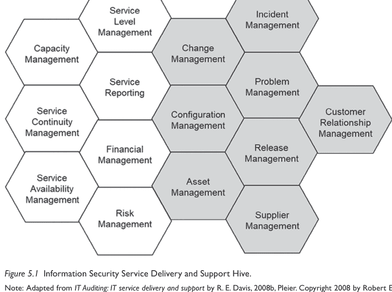

图 5.1 信息安全服务交付与支持蜂巢。

注：改编自 R. E. Davis 所著 IT Auditing: IT service delivery and support，2008b，Pfeiffer。版权 2008 由 Robert E. Davis 所有。经许可改编。


网络安全服务台是确保组织结构具有响应性的主要子流程。在部署网络安全服务台时，立即需要考虑的事项包括：

-   指派人员是否身体和情绪上适合协助或领导响应，
-   是否需要响应的其他人员会到场并能够承担分配的角色，以及
-   指派人员是否会向高级管理层报告事件。

IT 管理应通过提升信息资产价值来服务实体客户。IT 是大多数实体用户执行常规流程的工具（Davis, 2008b）。IT 通常渗透到所有实体组织结构中。因此，IT 能够实现替代性通信媒介，增强团队合作，促进更好的决策，并提供可能导致价值创造和竞争优势的商业模式开发机会（Davis, 2008b）。信息安全职能关注访问控制和服务连续性程序的充分性（Davis, 2008b），鉴于组织结构。

随着管理者领导者越来越多地尝试使用 IT 应用支持每个组织流程，员工的运营简易性可能会成比例地降低或消失（Davis, 2008b）。尽管通过图形用户界面、触摸屏、色彩多样性和帮助信息提供了透明度，但 IT 复杂性可能引入故障或缺陷，从而阻碍目标的实现（Davis, 2008b）。因此，如果 IT 要维持作为实现以实体为中心的职能和可靠性目标的有用工具的认知，则事件或问题状况必须由胜任的员工来处理（Davis, 2008b）。因此，管理层应考虑信息安全服务交付和支持有效 ISG 和实体治理的基础组件，后者需要定期 IT 审计评估。

### 工作场所违规行为和非法行为

实体利益相关者通常坚持要求管理者以可接受的做法领导下属，同时保持对适用法律法规的合规（Davis, 2008a）。在整个实体范围内建立适当的经理管理基调和沟通是必要的（Davis, 2008a）。经理管理基调包括关于行为期望的明确道德指导（Davis, 2008a）。作为 IAP 责任，实体管理者领导者有义务在雇用个人时采取预防措施，并确保无论动机如何，合理的措施都能防止个人滥用 IT 资源（Davis, 2008a）。

员工代表了有效 ISG 计划的潜在限制因素（Davis, 2006, 2008a）。作为人类，员工会犯错误并误解任务执行说明（Davis, 2006, 2008a）。管理层还可能每天用相互冲突的优先事项淹没员工，而员工通常将精力集中在影响绩效评估并积极影响奖励制度的事项上（Davis, 2008a）。此外，在特定情况下，实体人员可能会故意试图规避 ISG 计划（Davis, 2008a）。当面临足够压力和 perceived 机会时，一些员工宁愿不道德或违法，也不愿接受因未达到绩效期望的道德或合法行为而带来的负面后果（Davis, 2008a）。然而，不道德或违法行为开始的阈值因人而异（Claycomb et al., 2012; Davis, 2008a）。

关于违规行为和非法行为的审慎注意和勤勉有助于确保 IAP 与 ISG 风险评估保持一致。通常被视为专业人士的审慎人规则，审慎的员工会尽到审慎注意义务，以确保他们能够完成以健全、合法和道德实践运营实体的所有合理工作（Davis, 2008a）。因此，审慎的人在尽到审慎注意义务方面是勤勉的（Davis, 2008a）。维持所需 IAP 警惕性的关键在于正确分类错误、失误、遗漏、违规行为和非法行为（Davis, 2009a, 2020）。

如图 5.2 所示，非故意和故意行为区分了用于确定事件分类的特征（Davis, 2009a, 2020; ISACA, 2014）。在子分类上，错误是指非故意的错误任务执行（Davis, 2009a, 2020）。失误是指对明确信息非故意的误解（Davis, 2009a, 2020）。相比之下，遗漏是与相关信息排除相关的疏忽行为，可能是不故意或故意的（Davis, 2009a, 2020）。

故意和非故意的可鄙行为可被定义为违规行为（Davis, 2009a, 2020）。然而，ISACA（2013）认为违规行为是对既定管理政策或监管要求的故意违反。违规行为还可能是关于整个组织或系统、流程、活动或任务的故意信息虚假陈述或遗漏，或非故意的非法行为（Davis, 2009a）。因此，既定管理政策或监管要求的违反可能包括关于实体的故意信息虚假陈述或遗漏、重大过失或非故意的非法行为（Davis, 2020; ISACA, 2013）。尽管如此，非法行为与法定规定相悖（Davis, 2009a, 2020）。

根据地理位置的不同，工作场所违规行为可被归类为非法行为（Davis, 2009a）。在大多数民主政府中，起诉非法行为的能力直接对应于对违法事件的支持证据（Davis, 2009a）。 perceived 的工作场所非法行为可在刑事或民事法院接受裁决（Davis, 2009a）。在司法上，非法工作行为的刑事定罪处罚可包括监禁、罚款和财产没收（Davis, 2009a）。相比之下，民事定罪制裁可处以罚款和财产没收（Davis, 2009a）。

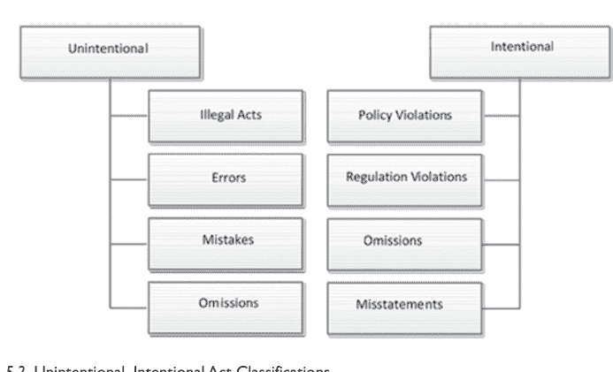

图 5.2 非故意–故意行为分类。

注：改编自 R. E. Davis 所著 IT Auditing: Irregular and Illegal Acts，2006 年，Pleier。版权 2006 归 Robert E. Davis 所有。经许可改编。

### 表 5.1 资产挪用潜在情形

| 情况 | 场景 |
|---|---|
| 职业机会 | 员工可以接触到小型且有价值的资产，有权调拨资金，或注意到应用控制薄弱点。 |
| 个人特征 | 员工认为管理层不道德或认为自己有权占有信息资产。 |
| 情境压力 | 员工被告知即将裁员或必须实现运营目标。 |

注：改编自 R. E. Davis 所著 *Ensuring Information Assets Protection*，2009 年，Lulu。版权 2009 归 Robert E. Davis 所有。经许可改编。

工作场所违规行为或非法行为通常具有行为预警信号（Davis, 2009a）。因此，识别和评估人员的工作场所行为预警信号将有助于确定实体的违规行为或非法行为的暴露程度（Claycomb et al., 2012; Davis, 2009a）。如表 5.1 所示例，违规行为和非法行为的行为预警信号类别应包括职业机会、个人特征和情境压力（Davis, 2009a）。职业机会是指允许违规或非法活动发生的情形（Davis, 2009a）。个人特征是指实施或为违规或非法行为辩解的倾向（Davis, 2009a）。情境压力是指员工内化的压力源（McGowan et al., 2006），可能影响其实施违规或非法行为的决定（Davis, 2009a）。

总体而言，适得其反的工作场所行为是对合法实体利益相悖的故意行为（Chernyak-Hai & Tziner, 2014; Claycomb et al., 2012; Davis, 2017; Den Hartog & Belschak, 2012; Zhao et al., 2013）。适得其反的工作场所行为可表现为盗窃、欺诈或破坏（Den Hartog & Belschak, 2012）。结合经济、技术和社会因素，员工的道德信念与组织 IT  wrongful 使用相关联（Chatterjee et al., 2015; Davis, 2017）。

不受控制的实体环境可使组织员工获得不公平的经济回报（Davis, 2009a）。管理者领导者可能部署适当的控制系统，但实体的员工可能认为 IAP 配置中存在控制弱点，从而为个人牟利提供违规或非法行为的机会（Davis, 2009a）。实体的管理者领导者应主动处理信息资产违规和非法行为风险，以最大程度地减少机会感知的存在（Davis, 2009a）。此外，管理层需要授权并宣布定期安全自评估，这些评估共同识别和评估法律合规风险和控制措施，以可能减少任何实体员工对战术和运营保护差距的感知（Davis, 2009a）。

在考虑非法或违规行为时，通常会考虑试图规避 ISG 计划的 IAP（Davis, 2008a）。在考虑时，潜在的实施者可能认为 ISG 计划设计不佳，允许在不规避已部署的 IAP 控制的情况下实施非法或违规行为（Davis, 2008a）。由于 IT 的范围和力量，逻辑访问可以成为资产挪用的宝贵渠道（Davis, 2008a）。此外，高科技员工已设计出其他巧妙的资产挪用方式（Davis, 2008a），例如社会工程。如果非法或违规行为涉及串谋，适得其反的工作场所行为的检测风险会呈指数级扩大（Davis, 2008a, 2010）。


Multiple interventions at various levels may be necessary to offset the growing threat of unethical use of information assets (Chatterjee et al., 2015; Davis, 2017). 多层次的干预措施可能是必要的，以抵消信息资产被不道德使用的日益增长的威胁（Chatterjee et al., 2015; Davis, 2017）。
Personal self-sanctions and workgroup sanctions can influence organizational sanctions regarding employee IAP policy violations (Davis, 2017; Guo & Yuan, 2012). 个人自我制裁和工作组制裁会影响组织对员工违反 IAP 政策的制裁（Davis, 2017; Guo & Yuan, 2012）。
Additionally, personal self-sanctions and workgroup sanctions can significantly negatively affect employee intentions to violate IAP policies (Davis, 2017; Guo & Yuan, 2012). 此外，个人自我制裁和工作组制裁会显著负面影响员工违反 IAP 政策的意图（Davis, 2017; Guo & Yuan, 2012）。
However, organizational sanctions can be nonsignificant when personal self-sanctions and workgroup sanctions are inclusive (Davis, 2017; Guo & Yuan, 2012) within the entity. 然而，当个人自我制裁和工作组制裁在实体内部得到充分体现时，组织制裁可能不显著（Davis, 2017; Guo & Yuan, 2012）。

Manager-leaders should never underestimate insider threats to IAP (Davis, 2008a; Ifinedo, 2014; Posey et al., 2013). 管理者领导者绝不应低估对 IAP 的内部威胁（Davis, 2008a; Ifinedo, 2014; Posey et al., 2013）。
Supporting the insider perspective is the acceptance that entity employees with high technical skills and organizational process knowledge pose the greatest threat to safeguarding information assets (Davis, 2008a). 支持内部人视角的是这样一种认识：具备高技术技能和组织流程知识的实体员工对信息资产的保护构成最大威胁（Davis, 2008a）。
Coupled with inadequate countermeasures, employees with access to an entity’s internal network could potentially disrupt or corrupt vital services and gain access to unauthorized confidential information (Davis, 2008a). 伴随不充分的对策，拥有实体内部网络访问权限的员工可能破坏或腐蚀关键服务，并获取未经授权的机密信息（Davis, 2008a）。
When an entity is seeking success in preventing IAP breaches, policies must minimize the potential for hiring or promoting individuals assessed with a low level of honesty, especially for positions requiring a high level of trust (Davis, 2008a). 当实体寻求成功防止 IAP 违规时，政策必须最大限度地降低聘用或晋升诚信度评估较低的个人的可能性，尤其是在需要高度信任的职位上（Davis, 2008a）。

Typically, an entity project group or steering committee exists to oversee new system deployments, with authority to make decisions regarding activities affecting implementation (Davis, 2009b). 通常，实体项目组或指导委员会存在以监督新系统部署，并有权就影响实施的活动做出决策（Davis, 2009b）。
The system project group or steering committee should maintain a carefully planned timetable with procedures to monitor and evaluate information asset deployments. 系统项目组或指导委员会应保持精心规划的时间表，并制定程序以监控和评估信息资产部署。
The Information Security Office manager-leader should designate an employee responsible for liaising with entity functions to identify and mitigate any IAP deficiencies or weaknesses associated with new system deployments. 信息安全办公室的管理者领导者应指定一名员工负责与实体职能部门联络，以识别并减轻与新系统部署相关的任何 IAP 缺陷或弱点。
Controlled information asset privileges can improve change process performance through assigned roles and responsibilities, needed segregation-of-duties, and current access authorizations. 受控的信息资产权限可以通过分配的角色和职责、必要的职责分离以及当前的访问授权来改善变更流程绩效。

New or improved information asset documentation represents a critical item for ensuring configuration functionality (Davis, 2009b). 新的或改进的信息资产文档是确保配置功能的关键项目（Davis, 2009b）。
Accordingly, up-to-date information asset documentation should be available 2 to 4 weeks before new or improved deployment (Davis, 2009b). 因此，最新信息资产文档应在新的或改进的部署前 2 至 4 周提供（Davis, 2009b）。
Development process documentation provides control over the prevention, detection, and correction of remiss information security countermeasures (Davis, 2009b). 开发流程文档可对信息安全对策的预防、检测和纠正提供控制（Davis, 2009b）。
Reliable development documentation assists in security breach prevention by establishing a disciplined work environment and improving communications between information asset designers (Davis, 2009b). 可靠的开发文档通过建立有纪律的工作环境并改善信息资产设计者之间的沟通，有助于防止安全漏洞（Davis, 2009b）。
The existence of a development process audit trail permits information asset vulnerability detection by facilitating supervisory reviews by management, users, technical personnel, and IT auditors (Davis, 2009b). 开发流程审计跟踪的存在通过促进管理层、用户、技术人员和 IT 审计员的监督审查，使信息资产漏洞检测成为可能（Davis, 2009b）。
An audit trail also provides evidence of compliance with entity-mandated controls during the development process (Davis, 2009b). 审计跟踪还提供了在开发过程中遵守实体强制性控制的证据（Davis, 2009b）。
Furthermore, documentation of development problems that are detected and subsequently corrected serve to ensure effective issue remediation (Davis, 2009b). 此外，对检测到并随后纠正的开发问题的记录有助于确保有效的问题补救（Davis, 2009b）。

Entity information specialists usually write internal documentation (Davis, 2009b). 实体信息专家通常撰写内部文档（Davis, 2009b）。
The entity IT function should be responsible for managing various technical documentation types (Davis, 2009b). 实体 IT 职能应负责管理各种技术文档类型（Davis, 2009b）。
An assigned IT information specialist’s responsibilities typically include: 受指派的 IT 信息专员的职责通常包括：
- preparing and maintaining information about programming, system operations, and user documentation; - 准备和维护有关编程、系统操作和用户文档的信息；
- translating specifications into user documentation; - 将规范翻译成用户文档；
- planning, designing, maintaining systems and user support documentation efforts; and - 规划、设计、维护系统和用户支持文档工作；以及
- providing online help screen content (Davis, 2009b). - 提供在线帮助屏幕内容（Davis, 2009b）。
A data administrator can be a part-time documentation specialist if the assigned responsibilities include maintaining complete, up-to-date documentation about data and relationships to data records, data files, reports, and business transactions (Davis, 2009b). 如果分配的职责包括维护关于数据以及数据记录、数据文件、报告和业务交易之间关系完整、最新的文档，则数据管理员可以兼任文档专家（Davis, 2009b）。
Additionally, an IT function archivist’s responsibility can include development programming, source code, and object code preservation. 此外，IT 职能档案管理员的职责可以包括开发编程、源代码和目标代码的保存。

Most entity processes benefit from an independent assessment of operational configuration performance (Davis, 2009b). 大多数实体流程都可从运营配置绩效的独立评估中受益（Davis, 2009b）。
An entity’s IT audit function is usually responsible for assuring that programs, program changes, and documentation adhere to established standards (Davis, 2009b). 实体的 IT 审计职能通常负责确保程序、程序变更和文档符合既定标准（Davis, 2009b）。
A review of the system configuration protection and outcomes by the IT audit function will provide management with an adequacy assessment and potential recommendations for improvement (Davis, 2009b). 由 IT 审计职能进行的系统配置保护和结果审查将为管理层提供充分性评估和改进的潜在建议（Davis, 2009b）。
Even if the IT audit report provides no recommendations for IAP improvements, a positive opinion is valuable managerial information (Davis, 2009b). 即使 IT 审计报告未提供 IAP 改进建议，正面意见也是宝贵的管理信息（Davis, 2009b）。

Entity executive manager-leaders can play a proactive role in shaping employee compliance behavior in addition to deterrence-oriented remedies (Hu et al., 2012). 实体执行管理者领导者除了威慑性补救措施外，还可以在塑造员工合规行为方面发挥积极作用（Hu et al., 2012）。
As a case in point, executive manager-leader participation in IAP initiatives can have significant direct and indirect influences on employee compliance with IAP policies (Hu et al., 2012). 例如，执行管理者领导者参与 IAP 举措会对员工遵守 IAP 政策产生重大的直接和间接影响（Hu et al., 2012）。
Nonetheless, the effects of executive manager-leader participation and organizational culture on employee behavioral intentions are fully mediated by employee cognitive beliefs regarding compliance with IAP policies (Hu et al., 2012). 然而，执行管理者领导者参与和组织文化对员工行为意向的影响完全由员工对遵守 IAP 政策的认知信念所中介（Hu et al., 2012）。
Therefore, nonexecutive manager-leader participation can strongly affect the entity’s organizational culture for employee compliance with IAP policies (Hu et al., 2012). 因此，非执行管理者领导者的参与可以强烈影响实体为员工遵守 IAP 政策而建立的组织文化（Hu et al., 2012）。

Governance policies are courses of action or methods selected by manager-leaders from alternatives to guide and determine present and future decisions considering the environment (Davis, 2008a, 2017). 治理政策是管理者领导者从备选方案中选出的行动方案或方法，用于指导并确定在考虑环境的情况下的现在和未来决策（Davis, 2008a, 2017）。
By which counterproductive workplace behavior is an ISG policy subcategory (Davis, 2017). 其中，适得其反的工作场所行为是 ISG 政策子类别（Davis, 2017）。
In designing more effective enforcement, the severity of punishment, the significance of reward, and certainty of control are significant workplace behavioral influences (Davis, 2017). 在设计更有效的执行时，惩罚的严重性、奖励的重要性以及控制的确定性是重要的工作场所行为影响因素（Davis, 2017）。
Though rewarding is a plausible IAP strategy (Y. Chen et al., 2012), the effect of reward on IAP policy compliance appears inconclusive (Davis, 2017). 尽管奖励是一种可行的 IAP 策略（Y. Chen et al., 2012），但奖励对 IAP 政策合规性的影响似乎尚不明确（Davis, 2017）。
Moreover, entities interested in introducing reward enforcement may need to consider intangible rewards such as written or oral commendation to enhance moral standards (Y. Chen et al., 2012). 此外，有兴趣引入奖励执行的实体可能需要考虑诸如书面或口头表扬等无形奖励，以提高道德标准（Y. Chen et al., 2012）。

An entity’s personnel decide whether to enforce and comply with policies (Davis, 2006, 2008a; Y. Chen et al., 2012). 实体的员工决定是否执行和遵守政策（Davis, 2006, 2008a; Y. Chen et al., 2012）。
Psychological and social–organizational factors might encourage or accentuate employee IAP policy compliance (Davis, 2017; Ifinedo, 2014). 心理和社会-组织因素可能会鼓励或加剧员工 IAP 政策合规性（Davis, 2017; Ifinedo, 2014）。
Workplace social bonding of operational managers and information system professionals generally influences compliance and subjective norms (Ifinedo, 2014). 运营经理和信息系统专业人员的工作场所社会联结通常会影响合规性和主观规范（Ifinedo, 2014）。
Moreover, compliance and subjective norms can positively affect employee IAP policy compliance (Ifinedo, 2014). 此外，合规性和主观规范可以积极影响员工 IAP 政策合规性（Ifinedo, 2014）。
Oppositely, blind deployment of routine IAP measures may induce counterproductive workplace behavior (Klein et al., 2015). 相反，盲目部署常规 IAP 措施可能会诱发适得其反的工作场所行为（Klein et al., 2015）。

### IT Incident Response Team
### IT 事件响应团队

Entity IT should provision secure resource access and intended use within the managerially accepted risk tolerance level. 实体 IT 应在管理层接受的风险容忍水平内提供安全资源访问和使用。
Through delegation, every entity employee assumes responsibility for maintaining the control system that safeguards assets (Davis, 2008a). 通过授权，每名实体员工都承担维护保护资产的控制系统的责任（Davis, 2008a）。
When instituted with responsibility control, accountability is typically sustainable through applying the check and act steps of the Deming “Plan-Do-Check-Act” management method (Davis, 2008b). 当与责任控制一起实施时，问责通常可通过应用戴明“计划-执行-检查-行动”管理方法的检查和行动步骤来实现（Davis, 2008b）。
Information security managers are typically accountable for responding to intrusions negatively affecting entity information assets (Davis, 2008a). 信息安全经理通常负责应对对实体信息资产产生负面影响的入侵（Davis, 2008a）。
“Thus, security incursions transform information security managers into chief threat firefighters directing resources to extinguish security breach flames” (Davis, 2008a, p. 155). “因此，安全入侵将信息安全经理转变为首席威胁消防员，指挥资源扑灭安全漏洞的火焰”（Davis, 2008a, p. 155）。
To competently
To competently

执行首席威胁消防员服务时，两个关键的安全事件响应要素是必要的：信息和组织（Davis, 2008a）。

事件是指偏离标准信息资产运营的事件，该事件会导致或可能导致中断或降低约定的服务质量（Davis, 2008b）。不论原因如何，事件是常见现象，需要适当解决以恢复可接受的信息资产运营水平（Davis, 2008b）。当 IT 服务未按预期执行时，实体 IT 服务台通常是用户首先联系的对象（Davis, 2008b）。由于在事件报告后存在及时纠正措施的期望，员工培训对于保持高效有效的信息安全服务的前提条件至关重要（Davis, 2008b）。

收集不当或恶意活动发生的证据是安全威胁管理的控制目标（Davis, 2008a）。允许进行信息安全威胁管理的配置控制应能够识别计算环境中的不当或恶意活动（Davis, 2008a）。在构建恶意误用信息资产记录时，字段标题应涵盖事件描述，例如被利用的漏洞、受影响的信息资产和攻击来源（Davis, 2008a）。在组织上，在实体一级政策的支持下，ISG 项目经理领导应建立正式的 IAP 结构，包括
- 设计、开发、协调和部署实体整体网络安全各方面的信息安全办公室（Davis, 2008a）；
- 提供网络安全管理指导并确保将网络安全作为运营问题一致处理的 ISG 项目委员会代表（Davis, 2008a）；以及
- 管理和协调指定工作单元内网络安全活动的 信息安全官（Davis, 2008a）。

有效的事件管理能够迅速恢复服务可用性、最大限度地减少服务中断，并利用可用资源响应用户需求（Davis, 2008b）。事件管理需要应急管理（Davis, 2008b）。显然，考虑工作动态和可分配员工而分配责任和授权的经理领导者，实践应急管理方法（Davis, 2008b）。一些员工可能对事件做出异常行为反应。因此，适当的事件管理需要建立与其他内部和外部群体的联系（Davis, 2008b）。与其他群体的联系应包括执法机构、响应团队、安全团队以及实体的公共关系办公室（Davis, 2008b）。

用户 IT 服务台联系可以激活专门用于解决令人满意的功能性和可用性问题的事件处理流程（Davis, 2008b）。网络安全事件应成为管理关注点，因为信息系统通过 IT 越来越相互连接（Davis, 2008b）。因此，网络安全事件可能使关联的配置项面临信息不可访问、损坏或未经授权披露的风险（Davis, 2008b）。适当的 IT 事件处理能力的重要特征包括
- 对所服务群体的理解；
- 一个了解情况且信任事件处理团队的群体；
- 快速集中报告的手段；
- 与其他相关群体的联系；以及
- 具备必要知识、技能和能力的响应团队（Davis, 2008b）。

网络安全事件是反映保护不足或已部署 IT 对策被尝试或威胁破坏的不利事件（Davis, 2008a）。建立并维持一个能够迅速反应以调查、遏制、减轻和补救事件的响应团队，对于保持 IT 可用性至关重要（Davis, 2008a）。在很大程度上，事件响应团队的熟练程度和信誉取决于成员的技术技能（Davis, 2008a）。通常，事件响应团队成员需要比大多数 IT 职位更广泛的专业基础（Davis, 2008a）。具体而言，IT 事件处理需要在多个职业实践领域具备技术科学知识和经验，包括网络管理、系统管理、系统编程和威胁管理（Davis, 2008a）。此外，至少一名事件响应团队成员必须具备作为主题专家资格，能够应用实体首选的计算机取证软件（Davis, 2008a）。

IT 事件处理需要领导力来组织、指导和控制适当的破坏响应（Davis, 2008a）。值得注意的是，事件响应团队的技术管理并非事件管理（Davis, 2008a）。事件响应团队的两个重要职位是经理领导者和副经理领导者（Davis, 2008a）。较大实体的团队通常指定事件负责人作为处理保护破坏的主要联系人（Davis, 2008a）。根据事件规模和团队规模，事件负责人可能不执行任何事件处理职责，例如证据获取或数据分析（Davis, 2008a）。相反，事件负责人可能协调事件处理活动，从事件处理人员收集信息，向实体经理领导者提供事件更新，并确保满足团队资源需求（Davis, 2008a）。此外，事件响应团队可能需要任命技术负责人（Davis, 2008a）。被任命的技术负责人必须具备扎实的 IT 技能和事件响应经验，以承担技术工作质量的监督和最终责任（Davis, 2008a）。

不当的技术判断可能削弱事件响应团队的信誉或阻碍事件解决（Davis, 2008a）。因此，被分配的个人必须具备参与事件响应团队的合格知识、技能和能力（Davis, 2008a）。然而，对于特定事件所需的技术知识和经验的广度和深度可能会有所不同，取决于评估的网络安全风险（Davis, 2008a）。因此，为了适当规划、组织和部署应急资源，情况可能决定选择能够处理事件场景的内部和外部响应团队成员（Davis, 2008a）。

全职 IT 员工通常比托管安全服务提供商人员更了解实体的技术环境的经验知识（Davis, 2008a）。内部经验知识可以帮助识别误报并评估信息资产目标的关键性（Davis, 2008a）。当 ISG 项目委员会从可用的实体员工中选择事件响应团队成员时，所选个人应具有服务导向并对分配的 IT 有出色的理解（Davis, 2008a）。事件处理的首要服务导向特征是团队合作和沟通技能，而出色的 IT 理解有助于提供可靠的响应建议（Davis, 2008a）并采取适当行动。相比之下，作为外部人员，托管安全服务提供商人员可能比实体员工拥有更深入、更广泛的关于战术、漏洞、对策和其他问题的情境破坏知识（Davis, 2008a）。托管安全服务提供商人员还可能在客户之间关联事件，这使得比事件响应团队内部人员更快地识别和解决新威胁（Davis, 2008a）。

IT 事件响应工作要求非常高（Davis, 2008a）。通常存在这样的期望：事件响应团队成员无论时间或工作日如何都将处理雇主保护破坏（Davis, 2008a）。结合绩效期望，事件响应团队成员身份可能加剧压力（Davis, 2008a）。此外，当实体内部人员执行 IT 事件响应处理，且外部人员提供的行政或技术协助有限时，由于缺乏及时信息和提供适当解决方案，员工士气可能会受到负面影响（Davis, 2008a）。因此，被选中的事件响应团队候选人可能会拒绝接受团队成员身份以避免潜在的医疗或社会后果（Davis, 2008a）。因此，鉴于必要的 24 小时、7 天工作周支持承诺，实体经理领导者在寻求 IT 内部人员参与事件响应活动时可能会面临招聘挑战（Davis, 2008a）。

中央事件响应团队处理实体范围内的事件（Cichonski et al., 2012）。中央事件响应团队的组织结构对于小型实体或信息资产分散程度最小的本地化实体可能有用（Cichonski et al., 2012）。相反，当实体拥有多个独立运作的站点时，如果每个地点都维持一个响应团队，事件管理可能更有效（Davis, 2008a）。从管理角度看，被指定的安全运营中心总部可以托管集中式事件响应指挥中心，该中心促进标准实践并协调分散团队之间的活动（Davis, 2008a）。当经理领导者认为集中式事件响应指挥中心必要时，半自治站点活动的记录和监控流程必须符合实体的政策和适用的法律要求（Davis, 2008a）。此外，涉及员工的事件处理的站点特定程序应符合谨慎和保密的期望（Davis, 2008a）。

信息安全职能的成员通常是首先认识到 IAP 破坏发生的人，并可能执行初始事件分析（Davis, 2008a）。网络安全事件可通过物理安全破坏发生，或涉及协调的逻辑和物理攻击（Davis, 2008a）。对实体信息资产发出的传达的威胁可能无法表明逻辑或物理资源是攻击面还是目标（Davis, 2008a）。因此，IT 事件响应团队在事件处理期间可能需要进入设施（Davis, 2008a）。

在 IAP 预算准备期间，不应忽视事件响应团队工作区域的物理安全和通信成本（Davis, 2008a）。此外，在各种事件解决阶段，可能需要非事件响应团队成员的信息安全员工参与（Davis, 2008a）。因此，逻辑安全、物理安全、设施管理与事件响应团队之间的紧密协调对于实现整体 IAP 方法至关重要（Davis, 2008a）。

寻求保存电子编码证据意味着需要推断事实以证明不规则行为（如果不是非法行为）的事件发生（Davis, 2008a）。预期潜在的推断场景要求信息安全经理领导者根据法律要求 proactively 构建事件响应和取证调查能力（Cichonski et al., 2012; Davis, 2008a）。无论是静态还是传输中，证据获取都需要适当的网络安全程序以确保不可否认性（Davis, 2008a）。首席信息安全官必须设法确保已采取措施防止取证调查的证据数据被销毁、损坏或无法使用（Davis, 2008a）。因此，涉及 IT 基础设施和事件处理流程的程序应在实体的网络安全文档中存在（Cichonski et al., 2012; Davis, 2008a）。


提取瞬态电子编码证据应遵循已颁布的政府授权程序（Davis, 2008a）。合法的瞬态数据提取通常被称为合法拦截（Davis, 2008a）。合法拦截是政府认可的合法权利，可访问私人通信（Davis, 2008a）。政府法律或法规通常规定进行合法拦截的手段和权限（Davis, 2008a）。适用的政府法规包括但不限于1994年美国《执法机关通信协助法》、1998年荷兰《电信法》、2000年英国《调查权力规制法》以及2004年德国《电信法》第XI部分第88条（Davis, 2008a）。

大多数国家要求持牌电信运营商提供合法拦截能力以捕获目标信息。然而，管理层需要确保实体人员无法安装合法拦截流程（Davis, 2008a）。此外，所部署的合法拦截流程应：
- 防止被目标方检测到，
- 确保适当授权的个人知晓具体的拦截情况，且
- 禁止在电子证据收集期间，针对同一目标的不同机构相互检测到对方的能力（Davis, 2008a）。

合法拦截支持合法的事件证据提取流程，当网络运营商或服务提供商授予执法官员监控、审查、标记或捕获通信的访问权限时（Davis, 2008a）。合法拦截允许捕获员工的入站和出站数据包，以具体识别信息处理中的延迟或不一致（Davis, 2008a）。遵守合法拦截要求的程序将确保证据在裁决中具有法律可采性（Davis, 2008a）。

关键的是，所有潜在的电子捕获事件证据需要在尽可能快的时间内受到保护，防止被删除、污染、修改和无法访问（Davis, 2008a）。当事件涉及存储在IT中的数据时，明智的管理要求通知相关方，证据获取将通过电子发现进行（Davis, 2008a）。在通知相关方有关存储证据获取时，适当的通知包括传达用于保存电子编码证据的具体协议以及对存储在IT中的数据可执行清除限制（Davis, 2008a）。在可行情况下，电子捕获的证据需要在嫌疑活动期间存在的环境中保持稳定（Davis, 2008a）。

条件性地，如果在事件期间或之后有人关闭目标IT，打开IT并允许计算机引导可能会通过操作系统程序直接或间接连接的文件引入内容更改（Davis, 2008a）。一些与计算机引导过程交互的文件可能与调查无关（Davis, 2008a）。然而，计算机引导配置的修改可能导致包含相关信息的先前已删除文件变得无法恢复（Davis, 2008a）。

当情况不允许在执法部门到达之前维持现有运营状态和现场，或当事件管理领导者接受法律提取风险时，管理领导者可以启动实体数据获取程序以保存证据（Davis, 2008a）。数据获取程序是将电子编码内容转移到可控位置的任务，该位置复制与事件相关的电子媒体类型（Davis, 2008a）。在承诺使用实体数据获取行动方案后，所有指定的硬件媒体及其目标内容在通过批准的方法转移到另一种介质期间都需要受到保护（Davis, 2008a）。然而，在证据完整性可能成为问题的情况下，捕获易失性数据也很关键（Davis, 2008a）。易失性数据是瞬态电子位（Davis, 2008a）。因此，当IT关闭时，如果没有适当预防措施，易失性数据将不复存在（Davis, 2008a）。易失性数据捕获有助于调查人员确定事件期间信息系统的状态（Davis, 2008a）。

通过常规备份程序创建证据副本只能允许复制特定文件（Davis, 2008a）。常规备份程序中排除的内容是带有删除指示的文件以及文件之间的指定空闲空间（Davis, 2008a）。法医镜像获取需要使用任务导向的软件进行，以避免使用常规备份程序创建证据副本固有的内容限制（Davis, 2008a）。适当的法医镜像软件复制原始媒体内容的精确工作副本（Davis, 2008a）。从功能上讲，用于证据复制的成像软件应能够对目标媒体上包含的每个编码位进行精确复制（Davis, 2008a）。从技术上讲，媒体内容成像可以在不启动计算机操作系统的情况下实现，从而避免篡改指控，如果获取的电子证据用于起诉刑事不当行为（Davis, 2008a）。

法医成像软件可以捕获目标记录表面上的数字化残留数据（Davis, 2008a）。数字化残留数据包括已删除文件、已删除文件的片段以及仍存在于电子媒体记录表面内的其他数据（Davis, 2008a）。实际的法医成像按扇区复制磁盘表面，而不是按文件复制（Davis, 2008a）。即使通常被认为已销毁的数据，也可以用适当工具从磁化表面恢复（Davis, 2008a）。根据产品不同，成像软件可以生成IT参数的日志文件，如磁盘配置、接口状态和数据校验和，这些对于得出有关事件的可支持结论至关重要（Davis, 2008a）。

功能可靠的法医成像实践和软件对于维持证据连续性至关重要（Davis, 2008a）。在创建至少两个可认证的媒体镜像后，一个复制品可作为目标系统替代品插入原始IT（Davis, 2008a）。另一个媒体镜像复制品可用于法医分析（Davis, 2008a）。一旦复制，原始媒体需要在无菌容器中密封，标记并作为IAP事件证据存放在安全区域，直至司法程序需要，以确保证据连续性（Davis, 2008a）。

实体的员工人力资源职能部门应制定处理友好和不友好终止的程序，以解决信息资产问题（Davis, 2008a）。纪律处分或员工辅导程序应规定当员工是事件嫌疑人或明显是事件目标时，人力资源职能部门参与（Davis, 2008a）。

### Education, Training, and Awareness

实体员工塑造组织文化（Khattak et al., 2014）。实体管理领导者通常发现购买解决IAP的IT解决方案比改变文化更容易（Brotby, 2006; Davis, 2008a）。然而，即使是最安全的IT解决方案，如果由未经训练、信息不足、粗心或漠不关心的员工处理，也无法实现显著的保护程度（Brotby, 2006; Davis, 2008a）。根据职位不同，成为实体员工可能只需要标准知识体系认证或几年经验（Posey et al., 2013）。然而，对于大多数实体而言，招聘重点在于获取人力资源，并期望必要的组织学习将通过处理工作相关情况而发生（Johnson, 2017）。一个结构完善、配备合适人员的资讯安全办公室构成了部署适当IAP的基础，也是高质量IT绩效的关键要素（Davis, 2008a）。在支持安全责任意识时，管理领导者必须明确说明，如果被授予信息资产访问权限，所有员工都将被要求遵守实体的行为准则和政策（Davis, 2008a; Siponen et al., 2014）。

实体人力资源招聘工作应采用专业的审慎和尽职调查招聘做法（Khattak et al., 2014），以合理确定潜在员工的胜任力、可靠性和诚信度与职位职责相符（Davis, 2008a）。此外，在活动层面，实体的标准人力资源做法应始终体现招聘最合格的个人，强调必要的教育、培训、过往工作经验、过去成就和行为倾向（Davis, 2008a）。在成功招聘后，需要妥善保管一份签署的人力资源声明，以确认对个人所分配职位进行了适当的背景审查，以便进行审慎和尽职调查验证（Davis, 2008a）。

高技能且知识丰富的员工是实体成功的渠道（Salas et al., 2015）。员工发展策略对于获得或维持实体行业竞争力是必要的（Khattak et al., 2014）。创建专业发展计划是一个长期过程（Azeem & Mubeen, 2013），需要实体管理领导者的授权（Shi et al., 2011；引自 Johnson, 2017）。专业发展计划的实施可能对实体员工的成功至关重要（Azeem & Mubeen, 2013）。培训计划对员工发展和工作场所生产力至关重要（Anthony & Weide, 2015）。实体员工的发展反映了所接收内容和知识适用性。要求参加培训计划是确保员工了解当前实体环境的一种方法（Azeem & Mubeen, 2013）。

培训是实体人力资源职能的一项重要工作（Rob et al., 2016；引自 Johnson, 2017）。在实现竞争优势方面，培训可能是实现战略目标的必要方法（Niazi, 2011）。实体管理领导者必须理解在从事活动和任务时培训的重要性（Niazi, 2011）。培训有利于提高实体员工的功效（Azeem & Mubeen, 2013）。通过培训提高员工绩效水平可以在竞争环境中提供更灵活的员工。实体特定培训可以使员工为应对当前和未来的行业挑战做好准备（Niazi, 2011）。因此，组织学习者使实体获得竞争优势成为可能（Niazi, 2011）。

培训有利于组织绩效（Salas et al., 2015）。实体连续性取决于员工绩效（Elnaga & Imran, 2013）。ISG管理领导者可以通过获得卓越的教育和培训来丰富服务质量（Davis, 2011, 2017; Hashizume et al., 2013; Singh et al., 2013）。有效的培训计划带来更高的员工投资回报（Elnaga & Imran, 2013）。培训是为实体员工提供执行复杂任务所需的天赋、能力和知识的关键要素（Moone et al., 2014；引自 Johnson, 2017）。如果没有培训计划，实体员工容易出现错误、失误和遗漏，可能导致IAP违规（Olusegun & Ithnin, 2013）。人力资源职能的责任是识别培训需求并设计合适的计划（Azeem & Mubeen，

2013年）。关于IAP学习的选项包括：（a）非学术培训，（b）自主学习，（c）在职培训，以及（d）学术培训（Davis, 2005）。

非学术培训通常以操作为导向（Davis, 2005）。设备或软件的使用属于操作导向（Davis, 2005）。因此，与信息资产交互的实体人员应接受非学术培训。在职培训和自主学习通常为特定设备和软件提供补充培训（Davis, 2005）。依赖无监督的体验式学习可能会导致被指派员工面对自主学习者无法解决的问题（Posey et al., 2013），或采用不当的解决方案。在提供在职学习时，管理者应在新员工被分配无监督任务之前，安排一位经验丰富的专业人员向其进行知识转移（Johnson, 2017）。此外，学术培训通常提供以问题为导向的补充学习（Davis, 2005; Konings & Vanormelingen, 2015）。

信息资产用户应获得充分且适当的培训（Davis, 2008a）。实体员工最合适的学习环境取决于知识、技能和能力培训需求（Elnaga & Imran, 2013）。员工学习有两种地点类别：现场或非现场（Antonioli & Della Torre, 2015; 引自Johnson, 2017）。现场学习发生在工作场所，培训结束后学员通常可以使用有用的工具和材料（Johnson, 2017）。现场培训对职业岗位很实用。实体在工作场所使用非学术培训来提高员工绩效（Khan, 2012）。另外，非现场学习是在实体工作环境之外进行的培训。非现场学习的一个优点是可能减少培训干扰（Johnson, 2017）。当管理者希望向员工灌输学术概念和思想以提升绩效时，非现场培训很有帮助（Konings & Vanormelingen, 2015）。

IAP培训提供控制（Beebe et al., 2014; Davis, 2008a）。相关培训旨在确保员工作好准备，能够在特定环境下执行分配的任务（Davis, 2008a）。此外，提供员工IAP培训可以减少因经验不足而引发的事故（Johnson, 2017）。培训涉及评估和提升员工技能，改进已知的弱点（Azeem & Mubeen, 2013）。通常，培训比问题导向更注重程序导向，学习者可能对主题已有一定经验（Davis, 2005）。培训是针对执行任务所需精确动作的短期指导（Azeem & Mubeen, 2013; Davis, 2005）。培训环境应与教学目的保持一致（Azeem & Mubeen, 2013; Davis, 2005）。IAP培训试图通过知识获取、技能提升、态度调整和行为规范来提升员工绩效（Abawajy, 2014; Azeem & Mubeen, 2013; Khan, 2012）。

如果没有受过良好培训的IT用户，实体更容易受到外部人员IAP入侵的影响（Stern, 2017）。为了实现网络安全预期，ISG计划应包括职位描述、定期重新评估个人技能的充分性、年度培训要求以及专业发展计划。此外，ISG计划应包括监控员工培训和专业发展成果。实体管理层应确保员工具备履行网络安全职责的知识、技能和能力。

适当的ISG管理需要结合外部和内部环境，利用可用资源（Davis, 2008a）。招聘和保留高素质的IAP人员对于优化和维持ISG至关重要（Davis, 2008a）。实体的人力资源实践可以通过合法的筛选流程来评估信息安全人才的胜任能力和道德水平，从而帮助确保资源质量（Davis, 2008a, 2011, 2017; Guo & Yuan, 2012; Price, 2014）。实体的人力资源职能需要建立安全教育与培训体系（Siponen et al., 2014）。信息安全管理者可以通过确保卓越的员工教育和培训来提高服务质量（Davis, 2008a）。如果没有称职的人员来管理或操作资源，即使设计出色的信息安全计划也会变得低效甚至无效（Davis, 2008a）。教育和培训可以整合可模拟的解决方案，以学习有效的IAP对策（Hendrix et al., 2016）。

安全培训可以帮助保护组织信息，这些信息可以成为组织知识（A. Ahmad et al., 2014）。大多数管理者都了解安全培训对实体可能带来的成本和收益。管理者对安全专业人员提出的培训要求并不总能反映潜在的工作情境（Mierke, 2014; 引自Johnson, 2017）。尽管如此，接受培训是安全岗位的任职要求之一（Amankwa et al., 2014; 引自Johnson, 2017）。如果没有适当的安全培训，实体信息资产很容易受到保护性入侵（Davis, 2008a）。完成必要培训的实体IAP专业人员可能使信息安全办公室获得能力增强的好处，同时降低员工流动率，从而减少成功的IAP攻击次数（Johnson, 2017）。

信息安全管理者常见的培训问题是费用和离开工作职责的时间（Swarnalatha & Prasanna, 2013; 引自Johnson, 2017）。当组织支持的最新培训缺失时，信息安全专业人员可能会接受新的就业机会。相反，在实体管理者投资培训员工之后，受训人员可能会离开并加入竞争对手（Swarnalatha & Prasanna, 2013; 引自Johnson, 2017）。信息安全人员流动，特别是高知识型人员在竞争实体之间的流动，从竞争力角度看具有重要的暗示意义（A. Ahmad et al., 2014）。为了克服潜在的人力减少风险，管理者需要理解并解决培训期望对员工忠诚度的影响，以避免知识泄露。

拥有IT培训计划对大多数实体来说至关重要（Elnaga & Imran, 2013）。信息安全管理者在培养网络安全专业人员以保护信息资产方面发挥着重要作用。IT架构固有的风险要求高度熟练的信息安全办公室员工来管理和保护实体网络（Gupta et al., 2016）。实体管理者需要提供持续培训，以确保信息安全办公室人员始终了解与所支持信息资产相关的威胁、漏洞和风险级别（Johnson, 2017）。资深的信息安全办公室人员可以通过针对特定IAP任务的持续培训，帮助初级员工获得所需技能（Shi et al., 2011; 引自Johnson, 2017）。

网络黑客团体、犯罪组织和间谍机构利用IT能力来识别、瞄准和攻击特定实体（Lagazio et al., 2014），通常出于财务、个人或政治动机（Arief & Adzmi, 2015; Davis, 2017）。网络盗窃、破坏、非法入侵和间谍活动只是实体IAP面临的一部分长期威胁（Mukati & Ali, 2014）。实体管理者必须告知员工保持IAP警惕的必要性（Siponen et al., 2014）。相关且一致的内容是提供信息安全意识培训的关键成功因素（Safa et al., 2015）。警惕通知的内容必须传达出IAP威胁代表着可能来自内部人员和外部人员的活动，这些活动可能对组织信息资源造成严重后果（Siponen et al., 2014）。


IAP 培训政策通过传达预期角色和职责以及先决教育要求，阐明了预期绩效和行为水平（Davis, 2008b）。与此相反，非正式的 IAP 意识尝试可能无法改善员工态度。缺乏对组织 IAP 及其相关期望的适当态度的实体员工可从定期入职培训和教育中受益（Ifinedo, 2014）。管理层还应努力提供定期的内部安全意识会议、宣传活动和培训，以积极影响规范信念，并最终影响实体员工对 IAP 问题和关注的态度（Ifinedo, 2014）。

意识项目应成为实体文化不可或缺的一部分（Safa et al., 2015）。信息安全意识是一个动态过程，因此需要不断更新（Safa et al., 2015）。在整个实体范围内扩展安全意识和问责制通常是必要的（Johnson, 2017）。提高对非法行为的认识并适当关注 IAP 措施是解决反生产性工作场所行为问题的第一步（Davis, 2008a）。同时还需要提供促进条件，例如广泛接触新兴安全技术和适当的激励，以鼓励自力更生，发展或改进保护组织信息资产所需的必要技能和知识（Ifinedo, 2014）。

信息安全意识结合潜在网络攻击方法的更新，在降低 IAP 泄露风险方面发挥着至关重要的作用（Safa et al., 2015）。对于新系统部署，只有影响 IT 项目决策的人员得到充分告知，ISG 才能有效。IAP 项目管理政策、程序、规则和个人职责需要分发给所有受影响方。此外，风险意识计划应要求参与系统开发的员工定期签署声明，确认其了解 IAP 并接受 IAP 责任。

缺乏对底层网络拓扑和多个接入点的理解会导致漏洞在未被察觉的情况下发展和存在，直到发生 IAP 事件。实体的培训环境应允许根据网络安全目标调整 IAP 预期。在实体 IT 应用转换之前培训信息安全办公室人员有助于网络安全功能验证和维护。此外，在部署新的或改进的网络安全措施之前培训信息安全办公室人员有助于确保理解 IAP 功能。关于 IAP 功能的实体人员培训应在完成所有网络安全开发活动之后，但在进行 IAP 测试以确定配置或功能变更所建立的漏洞之前进行。理解最终确定的新或改进的 IAP 功能可减少响应时间并提高信息安全支持提供者的能力意识。学习新的硬件或软件功能是程序导向的。因此，员工应接受非学术性的 IAP 指导。

在大多数情况下，信息资产开发阶段包括用户测试，因为程序或设备可评估是否满足设计要求。作为最低要求，新网络安全硬件和软件测试应在所有者验收前进行 4 周以上。用户验收测试很可能识别出运营部署的弱点。一旦识别出，技术设计和相关的支持活动，例如培训，需要进行修订以解决已确认的弱点。否则，网络安全测试的益处是有限的。

实体应建立正式的安全事件响应机制，并确保 IT 用户了解已建立的报告安排（Davis, 2008b）。大多数事件预防工作侧重于物理安全，同时淡化网络安全的重要性（Hendrix et al., 2016）。降低网络犯罪风险和成本的需要是明确的（Hendrix et al., 2016）。实现事件减少的一种手段是使用可用工具培训实体员工（Abawajy, 2014），并确保实体员工了解当前的预防措施（Hendrix et al., 2016）。

规范而言，教育和培训是可将资源知识倍增的因素，可减少应对事件相关的职业压力（Davis, 2008a）。换句话说，组织用户和 IT 员工对检测、响应然后报告事件了解得越多，实际紧急情况下事件响应成员出现职业倦怠的可能性就越小（Davis, 2008a）。事件处理教育和培训可通过各种教学平台实现，包括研讨会、讲座、网络研讨会、通讯、海报和贴纸（Davis, 2008a）。作为泄露响应培训的一部分，管理者领导者应定期组织事件团队演练（Hendrix et al., 2016），以便成员获得情境经验并提高职业表现（Davis, 2008a）。

### IT 审计团队

有各种框架可帮助管理层在实体内部部署治理。这些框架包括特雷德韦委员会发起组织内部控制综合框架《COSO 报告》、经济合作与发展组织《公司治理原则》以及《公司治理财务方面委员会报告》（《卡多伯里报告》）。此外，可用的框架还包括内部审计师协会的系统可审计性和控制（SAC）框架、ISACA 的信息技术相关控制目标（COBIT）框架，以及 ISO/IEC 的信息技术公司治理（信息技术治理标准）。

- **COSO Report:** **COSO 报告**是一个领先的框架，用于设计、实施和执行内部控制并评估内部控制有效性。**COSO 报告**的内部控制系统包括控制环境、风险评估、信息与沟通、监督和控制活动。**COSO 报告**的理由包括
  - 业务和运营环境发生了巨大变化，变得日益复杂、技术驱动且全球化；
  - 大规模治理和内部控制失效事件；
  - 利益相关者参与度更高，寻求透明度和问责制；以及
  - 对组织各层级风险评估的期望增加。
- **Principles of Corporate Governance:** **公司治理原则**是一套建议，用于加强薪酬、风险管理、董事会实践和股东权利等优先领域。**公司治理原则**为评估和改进公司治理提供了全球公认的基准。
- **Report of the Committee on Financial Aspects of Corporate Governance:** **公司治理财务方面委员会报告**的建议旨在安排公司董事会和会计系统，以减轻公司治理风险和失败。最终报告涵盖财务、审计和公司治理事宜，并提出三项主要建议：
  - 公司的首席执行官和董事长应为不同的人；
  - 董事会应至少有三名非执行董事，其中两名不应与高管有财务或个人联系；以及
  - 每个董事会应设立由非执行董事组成的审计委员会。
- **SAC:** 执行 IT 审计时应评估三种类型的控制：预防性、侦测性和纠正性。相反，如果管理层为控制 IT 而实施了 SAC 而非 COBIT 框架，则实体熟悉预防性、侦测性和纠正性；酌情和非酌情；自愿和强制；手动和自动；以及应用和一般控制的控制分类。在评估财务报表内部控制时，IT 审计师有义务确定财务控制的有效性。
- **COBIT:** COBIT 2019 涵盖 IT 领域治理、战略和战术管理的生命周期。COBIT 2019 是企业 IT 治理与管理的业务框架。ISACA 于 1996 年开发了 COBIT。他们于 2018 年冬季发布了第六版。COBIT 2019 被全球接受为确保 IT 有效运行的工具集。COBIT 2019 提供了一种通用语言，用于向所有利益相关者传达目标、目标和预期结果。COBIT 2019 基于并整合了行业标准和可接受的实践，用于：
  - 将 IT 与企业目标进行战略对齐，
  - 服务和新项目的价值交付，
  - 风险管理，
  - 资源管理，以及
  - 绩效衡量。
- **Information Technology Governance Standard:** IT 治理是 IT 当前和未来使用接受指导和控制的系统。IT 公司治理涉及评估和使用以支持实体并监控使用以实现目标。信息技术治理标准包括实体内使用 IT 的战略和政策。信息技术治理标准框架包括定义、原则和模型。信息技术治理标准框架为良好的 IT 公司治理设定了六项原则，涵盖：
  - 责任，
  - 战略，
  - 获取，
  - 绩效，
  - 合规，以及
  - 人类行为。

COSO 和卡多伯里报告以及公司治理原则侧重于实体层面的治理框架，而 SAC、COBIT 和 IT 治理标准则提供专为 IT 治理设计的结构，允许 ISG 应用。

### 计划活动

通常，由负责的 IT 审计师负责制定审计目标。业务目标是组织方向的一般性陈述。为帮助定义范围


并有效执行 IT 审计，IT 审计师应了解实体的使命及其信息处理活动。重要性决定审计的性质、时间安排和范围。IT 审计师在选择审计风险评估方法时，应考虑对于被审计机构而言适当的复杂程度和详细程度。应用于控制框架的风险评估方法，是制定重点审计计划的关键组成部分。经过精心规划、结构合理的审计方案，对于评估各种规模和复杂程度机构的风险管理实践、控制系统，以及有关 IT 风险的政策遵循情况至关重要。IT 审计师有权编制、提交并期待获得经签署的业务约定书，其中应明确审计的：范围、目标和工作依据。通过选择适当的方法，IT 审计师可以利用启动会议与客户建立积极关系，并确保参与者能够从计划介绍中获益。在业务约定书签发之前，IT 审计师不应认为规划工作已经完成。即使存在审计章程，IT 审计师仍负有传达该项任务中已约定的责任、问责和权限的专业责任。

### 研究与评价活动

为确定是否存在控制弱点，IT 审计师通常会执行询问、观察以及其他程序，以研究和评价控制。审计程序应超过预先确定的定量或定性设计重要性阈值。实体控制目标的确定取决于所选方法，例如 COSO、优势–劣势–机会–威胁（SWOT）或 COBIT 框架。作为行动方案的一部分，发现标准偏差后，IT 审计师需要进行评价，并随后记录在审计发现表中。IT 审计师的工作底稿应充分、完整，并能够支持审计结论。审计证据应清晰易懂，使合理的人员能够据此支持 IT 审计师针对审计对象得出的结论。在完成控制研究和评价后，IT 审计师的重新评估可能会导致风险重新分配。在研究和评价审计领域之后，可能需要在审计方案中增加测试程序。

### 测试活动

审计测试目标的确定通常发生在前期审计阶段，即规划阶段以及控制研究与评价阶段。审计测试的重要性影响审计测试的性质、时间安排和范围。在设计测试时，IT 审计师必须在统计测试方法和非统计测试方法之间作出选择。合规性测试和实质性测试可以采用询问、观察、检查或重新执行的形式。可审计单位的样本量体现了抽样风险、可接受的错误率以及总体中预期错误的程度。抽样方法的选择反映了是否将针对所检查的总体进行有关审计领域的统计推断。在执行测试时，为符合公认的审计现场工作标准而收集充分证据资料，这会影响 IT 审计师应收集的证据类型及其获取方式。IT 审计师在评价结果时，应考虑总体中的错误是否可能超过可容忍错误。审计测试文档应提供充分细节，清楚描述所采用的测试目标和抽样流程。在重新评估风险时，专业 IT 审计师应确保审计领域的审计风险与所有审计目标相关联。

### 报告活动

从根本上说，除非法律或法规要求实施某项控制技术，否则实施带有控制技术的管理控制系统所产生的成本，绝不应等于或超过预期风险降低所带来的收益。审计报告的重要性影响报告的性质、时间安排和范围。如果审计结果超过初始可容忍率，IT 审计师必须得出结论：报告的性质、时间安排和范围需要进行额外的比较分析，或者需要调整审计保证程度。在分析审计发现时，成本–效益分析是指用于考察替代性纠正措施的技术，其目的是确定建议采用的部署方案，或确定在实现最高风险降低回报的同时最有效的实施程度。

审计工作底稿的保存应得到充分记录，并体现对相关法律法规的遵循。审计证据说服力的评价应依据相关条件进行判断，例如证据提供者的独立性及其支持性资质。在考虑相关重要性、审计保证和成本–效益之后，完成审计发现表的复核和评估，即可为 IT 审计师起草报告做好准备；该报告应根据从所获取证据中得出的结论发表意见。如果确实发生后续事项，则应评估影响 IT 审计师成本–效益分析、风险评估和重要性的因素，以确定其对审计报告的影响。

审计报告在分发给预定接收者之前，应进行校对和必要的编辑。结束会议为介绍审计过程、讨论任何疑虑以及修改审计报告的呈现方式提供了机会。如果 IT 审计报告要做到客观、具有建设性并获得客户认可，则应纳入客户对审计结论和建议的看法。最终审计报告应明确指出控制方面的差距及漏洞来源。及时分发审计报告应成为 IT 审计师的重要优先事项。

### 后续跟进活动

无论采用何种方法，最佳实践都是在最终报告中列明拟采取的行动及解决问题的具体时间范围，以便审计师据此安排后续跟进活动。在报告流程结束时，IT 审计师应更新审计职能部门的后续跟进数据库，其中包括客户管理层针对已识别的潜在控制改进措施所作的回应，以及完成或部署建议的预计日期。作为业务后续跟进活动的一部分，IT 审计师应评估尚未实施的审计发现是否仍然相关，或者其重要性是否已经提高。战略和战术管理人员应当了解：谁负责对其组织的审计执行后续跟进程序？

### 参考文献

Abawajy, J.（2014）。网络安全意识宣传方式的用户偏好。*行为与信息技术，33*，236–247。https://doi.org/10.1080/0144929X.2012.708787

Ahmad, A.、Bosua, R. 和 Scheepers, R.（2014）。保护组织竞争优势：知识泄漏视角。*计算机与安全，42*，27–39。https://doi.org/10.1016/j.cose.2014.01.001

Ahmad, Z. 和 Norhashim, M.（2008）。控制环境、员工舞弊与反生产工作行为：实证分析。*IBIMA 通讯，3*，145–155。www.ibimapublishing.com/

Anthony, P. J. 和 Weide, J.（2015）。动机与职业发展培训项目：利用监管焦点确定项目有效性。*高等教育研究通讯，5*(2)，24–33。https://doi.org/10.18870/hlrc.v5i2.214

Arief, B. 和 Adzmi, M. A. B.（2015）。从利益相关者视角理解网络犯罪：第二部分：防御者与受害者。*IEEE 安全与隐私，13*(2)，84–88。https://doi.org/10.1109/MSP.2015.44

Azeem, M. A. 和 Mubeen, S. A.（2013）。旅游业非行政人员的培训与发展：印度 APTDC 研究。*国际管理、IT 与工程期刊，3*(6)，395–414。www.ijmra.us/itjournal.php

Baltatzis, D.、Ilioudis, C. 和 Pangalos, G.（2012）。支持协作环境中动态授权的角色工程框架。*信息安全期刊：全球视角，21*，12–27。https://doi.org/10.1080/19393555.2011.624161

Beebe, N. L.、Young, D. K. 和 Chang, F. R.（2014）。构建信息安全预算申请以影响投资决策。*信息系统协会通讯，35*(7)，134–144。https://doi.org/10.17705/1CAIS.03507

Brotby, K. W.（2006）。*信息安全治理：董事会和高层管理人员指南（第 2 版）*。IT 治理研究所。

Chatterjee, S.、Sarker, S. 和 Valacich, J. S.（2015）。信息系统安全的行为根源：探索与不道德 IT 使用相关的关键因素。*管理信息系统期刊，31*(4)，49–87。https://doi.org/10.1080/07421222.2014.1001257

Chen, C. X.、Lu, H. 和 Sougiannis, T.（2012）。代理问题、公司治理与销售、一般及行政费用的不对称行为。*当代会计研究，29*(1)，252–282。https://doi.org/10.1111/j.1911-3846.2011.01094.x

Chen, Y.、Ramamurthy, K. 和 Wen, K.（2012）。组织的信息安全政策遵循：大棒还是胡萝卜方法？*管理信息系统期刊，29*(3)，157–188。https://doi.org/10.2753/MIS0742-1222290305

Chernyak-Hai, L. 和 Tziner, A.（2014）。反生产工作行为、感知公平与氛围、职业地位以及领导–成员交换之间的关系。*工作与组织心理学期刊，30*，1–12。https://doi.org/10.5093/tr2014a1

Cichonski, P.、Millar, T.、Grance, T. 和 Scarfone, K.（2012）。*计算机安全事件处理指南：美国国家标准与技术研究院建议（NIST 特别出版物 800–61，第 2 次修订版）*。https://dx.doi.org/10.6028/NIST.SP.800-61r2

Claycomb, W. R.、Huth, C. L.、Flynn, L.、McIntire, D. M. 和 Lewellen, T. B.（2012）。内部人员威胁破坏行为的时间顺序研究：初步观察。*无线移动网络、普适计算与可信应用期刊，3*(4)，4–20。https://doi.org/10.22667/JOWUA.2012.12.31.004

Davis, R. E.（2005）。*IT 审计：一种适应性过程*。Pleier。

Davis, R. E.（2006）。*IT 审计：违规与非法行为*。Pleier。

Davis, R. E.（2008a）。*IT 审计：确保信息资产保护*。Pleier。

Davis, R. E.（2008b）。*IT 审计：IT 服务交付与支持*。Pleier。

Davis, R. E.（2009a）。*确保 IT 法律合规性*。www.amazon.com

Davis, R. E.（2009b）。*IT 审计：系统与基础设施生命周期管理*。Pleier。

Davis, R. E.（2010）。*IT 审计：一种适应性系统*。www.amazon.com

Davis, R. E.（2011）。*确保 IT 治理*。www.amazon.com

Davis, R. E.（2017）。美国公司公司治理与信息安全治理有效性之间的关系（出版物编号 10603383）[博士研究，沃尔登大学]。ProQuest 学位论文出版。

Davis, R. E.（2020）。*采用系统视角进行 IT 审计*。IGI Global。

Den Hartog, D. N. 和 Belschak, F. D.（2012）。道德领导过程中工作投入与马基雅维利主义。*商业伦理期刊，107*(1)，35–47。https://doi.org/10.1007/s10551-012-1296-4

Elnaga, A. 和 Imran, A.（2013）。培训对员工绩效的影响。*欧洲商业与管理期刊，5*(4)，137–147。https://iiste.org/Journals/index.php/EJBM


Flores, W. R., Antonsen, E., & Ekstedt, M. (2014). 组织中的信息安全知识共享：行为信息安全治理和国家文化的影响研究。 *计算机与安全*, 43, 90-110. https://doi.org/10.1016/j.cose.2014.03.004

Glinkowska, B., & Kaczmarek, B. (2015). 经典与现代公司治理概念（委托理论与代理理论）。 *管理*, 19(2), 84-92. https://doi.org/10.1515/management-2015-0015

Guo, K. H., & Yuan, Y. (2012). 多层次制裁对信息安全违规的影响：一个中介模型。 *信息与管理*, 49, 320-326. https://doi.org/10.1016/j.im.2012.08.001

Gupta, S., Chaudhari, B. S., & Chakrabarty, B. (2016). 利用战争驾驶和安全情报进行脆弱网络分析。 载于 H. S. Saini, R. K. Singh, & K. S. Reddy (编), *网络与系统讲义，第 7 卷：电子与通信工程创新* (pp. 465-471). https://doi.org/10.1007/978-981-10-3812-9_49

Hashizume, K., Rosado, D. G., Fernández-Medina, E., & Fernandez, E. B. (2013). 云计算安全问题的分析。 *互联网服务与应用期刊*, 4(1), 1-13. https://doi.org/10.1186/1869-0238-4-5

Hendrix, M., AlSherbaz, A., & Victoria, B. (2016). 基于游戏的网络安全培训：严肃游戏是否适合网络安全培训？ *国际严肃游戏期刊*, 3(1), 53-61. https://doi.org/10.17083/ijsg.v3i1.107

Heracleous, L., & Lan, L. L. (2012). 代理理论、制度敏感性和归纳推理：迈向法律视角。 *管理研究期刊*, 49, 223-239. https://doi.org/10.1111/j.1467-6486.2011.01009.x

Hu, Q., Dinev, T., Hart, P., & Cooke, D. (2012). 管理员工对信息安全政策的遵守：高层管理与组织文化的关键作用。 *决策科学*, 43, 615-660. https://doi.org/10.1111/j.1540-5915.2012.00361.x

Ifinedo, P. (2014). 信息系统安全政策合规性：社会化、影响和认知效应的实证研究。 *信息与管理*, 51(1), 69-79. https://doi.org/10.1016/j.im.2013.10.001

ISACA. (2013). IS 审计与鉴证标准 1207 不规则行为和非法行为。 *ITAF: 信息技术鉴证框架*. www.isaca.org/resources/frameworks-standards-and-models

ISACA. (2014). IS 审计与鉴证指南 2207 不规则行为和非法行为。 *ITAF: 信息技术鉴证框架*. www.isaca.org/resources/frameworks-standards-and-models

Johnson, K. T. (2017). *美国企业中的培训不足：培训安全专业人员以保护敏感信息* (出版编号 10624471) [博士研究, Walden University]. ProQuest Dissertations Publishing.

Khan, M. I. (2012). 培训和激励对员工绩效的影响。 *商业评论*, 7(2), 84-95. https://businessreview.iba.edu.pk/

Khattak, A. N., Rehman, S., & Rehman, C. A. (2014). 现实工作预览（RJP）：其在巴基斯坦制药行业招聘中的效率。 *阿巴辛社会科学期刊*, 7(1), 64-77. http://ajss.abasyn.edu.pk/

Klein, L., Biesenthal, C., & Dehlin, E. (2015). 项目管理中的即兴发挥：一种实践学。 *国际项目管理期刊*, 33, 267-277. https://doi.org/10.1016/j.ijproman.2014.01.011

Konings, J., & Vanormelingen, S. (2015). 培训对生产率和工资的影响：企业层面的证据。 *经济与统计评论*, 97(2), 485-497. https://doi.org/10.1162/REST_a_00460

Lagazio, M., Sherif, N., & Cushman, M. (2014). 理解网络犯罪对金融部门影响的多层次方法。 *计算机与安全*, 45, 58-74. https://doi.org/10.1016/j.cose.2014.05.006

McGowan, J., Gardner, D., & Fletcher, R. (2006). 职业压力的积极和消极情感结果。 *新西兰心理学期刊*, 35(2), 92-98. www.psychology.org.nz

Mukati, M. A., & Ali, S. M. (2014). 网络安全漏洞及征服业务应用潜在威胁的策略。 独立研究与研究期刊, 12(1), 56–62. https://szabist.edu.pk/journals-jsr/

Niazi, A. S. (2011). 培训与发展战略及其在组织绩效中的作用。 公共行政与治理期刊, 1(2), 42–57. https://doi.org/10.5296/jpag.v1i2.862

Olusegun, O. J., & Ithnin, N. B. (2013). 人才是安全之答案：在组织中建立可持续的信息安全意识培训（ISAT）计划。 计算机科学与信息安全国际期刊, 11(8), 57–64. https://publons.com/journal/30902/international-journal-of-computer-science-and-info/

Pande, S., & Ansari, V. A. (2014). 公司治理的理论框架。 印度公司治理期刊, 7(1), 56–72. https://doi.org/10.1177/0974686220140104

Pitesa, M., & Thau, S. (2013). 宇宙的主宰：权力与问责制如何在道德风险下影响自利决策。 应用心理学期刊, 98, 550–558. https://doi.org/10.1037/a0031697

Posey, C., Roberts, T., Lowry, P. B., Bennett, B., & Courtney, J. (2013). 内部人员对组织信息资产的保护：基于系统学的保护动机行为多样性分类法和理论的发展。 管理信息系统季刊, 37(4). www.misq.org/

Price, J. D. (2014). *利用有效合规计划降低数据泄露风险* (出版编号 3619214) [博士研究, Walden University]. ProQuest Dissertations Publishing.

Rida-E-Fiza, S., Farooq, M., & Mirza, F. I. (2015). 员工有效培训和学习中的障碍。 地中海社会科学期刊, 6(3 S2), 240–250. https://doi.org/10.5901/mjss.2015.v6n3s2p240

Safa, N. S., Sookhak, M., Von Solms, R., Furnell, S., Ghani, N. A., & Herawan, T. (2015). 组织中的信息安全意识关怀行为形成。 计算机与安全, 53, 65–78. https://doi.org/10.1016/j.cose.2015.05.012

Salas, E., Shuffler, M. L., Thayer, A. L., Bedwell, W. L., & Lazzara, E. H. (2015). 理解和改善组织中的团队合作：基于科学的实用指南。 人力资源管理, 54(4), 599–622. https://doi.org/10.1002/hrm.21628

Singh, A. N., Picot, A., Kranz, J., Gupta, M. P., & Ojha, A. (2013). 信息安全管理（ISM）实践：来自印度和德国精选案例的经验教训。 全球灵活系统管理期刊, 14, 225–239. https://doi.org/10.1007/s40171-013-0047-4

Siponen, M., Mahmood, M. A., & Pahnila, S. (2014). 员工对信息安全政策的遵守：一次探索性实地研究。 信息与管理, 51(2), 217–224. https://doi.org/10.1016/j.im.2013.08.006

Sloan, P. (2014). 合理的 信息安全计划。 里士满法律与技术期刊, 21(1), 1–92. https://jolt.richmond.edu/

Stern, G. (2017). 跟上计划以加强网络安全。 生物医学仪器与技术, 51(1), 70–75. https://doi.org/10.2345/0899-8205-51.1.70

Vance, A., & Siponen, M. T. (2012). 信息系统安全政策违规：理性选择视角。 组织与终端用户计算期刊, 24(1), 21–41. https://doi.org/10.4018/joeuc.2012010102

Zhao, H., Peng, Z., & Sheard, G. (2013). 工作场所排斥与酒店员工的反生产工作行为：主动人格与政治技巧的共同调节效应。 国际酒店管理期刊, 33, 219–227. https://doi.org/10.1016/j.ijhm.2012.08.006

### 推荐阅读

Gai, K., Qiu, M., & Sun, X. (2018). FinTech 调查。 网络与计算机应用期刊, 103, 262–273. https://doi.org/10.1016/j.jnca.2017.10.011

Guo, Y., & Wang, C. (2020). 心理学习氛围对员工创新使用信息系统的影响机制。 全球信息管理期刊 (JGIM), 28(2), 52–72. https://doi.org/10.4018/JGIM.2020040103


Ofori, K. S., Anyigba, H., Ampong, G. O. A., Omoregie, O. K., Nyamadi, M., & Fianu, E. (2020). 影响信息安全政策合规行为的因素。载于 W. Yaokumah, M. Rajarajan, J. D. Abdulai, I. Wiafe, & F. A. Katsriku（编著），*网络伦理与安全合规的现代理论与实践*（第152–171页）。https://doi.org/10.4018/978-1-7998-3149-5.ch010

Singleton, T., & Flesher, D. L. (2003). IIA的SAC项目25年回顾。*管理审计杂志*，18(1), 39–53. https://doi.org/10.1108/02686900310454237

Stoel, M. D., & Havelka, D. (2020). 信息技术审计质量：个体与组织因素影响的调查。*信息系统杂志*。https://doi.org/10.2308/isys-18-043

## 外部组织行动者

### 摘要

组织形态面临着在市场中实现并保持竞争优势的持续压力。能力逻辑反映了一个普遍前提：如果一家企业拥有更卓越的能力来开发、使用和保护关键的平台能力与资源，那么它就能超越另一家企业。然而，如果某个实体在规划阶段发现所需资源和能力不可得，那么将运营或IT职能外包可能是一个可行的行动方案。相应地，信息安全是一个需要端到端地审视组织流程的管理问题。第6章讨论了考虑IAP风险的供应链合作伙伴和托管服务提供商。第6章还提出了关键的服务提供商审计问题。

### 引言

供应链管理（SCM）和IT管理已受到从业者和研究者的关注（H. Zhou & Benton, 2007）。随着IT的发展，实体倾向于整合组织结构（H. Zhou & Benton, 2007）。IT使用的增加引入了若干影响供应链网络韧性的网络安全风险（Boyes, 2015）。因此，供应链合作伙伴之间需要协作安全（Zeng等，2012）。有效的供应链实践整合与有效的信息共享对于提升供应链绩效至关重要（H. Zhou & Benton, 2007）。供应链实践以物品流动为中心，而信息共享以信息流为中心（H. Zhou & Benton, 2007）。管理层在供应链上的技术投资可能反映业务流程的外包（Beasley等，2004）。然而，只有当管理团队重视技术投资并选择适当的信息进行共享时，实体才能实现有效的组织绩效（H. Zhou & Benton, 2007）。

影响已部署信息资产的安全相关状况，重塑了员工与消费者及其他利益相关者开展运营活动的方式（Davis, 2017; Srivastava & Kumar, 2015）。数据处理时机可能成为IT的差异化因素（Davis, 2010, 2020）。可用于IT处理的两种时机分类是批处理配置和实时配置（Davis, 2010, 2020）。批处理架构在处理前将记录收集成组（Davis, 2010, 2020）。实时架构在提交后立即处理记录（Davis, 2010, 2020）。此外，架构差异化可能依据IT物理位置而出现（Davis, 2010, 2020）。使用物理位置标准的重要类别是内部IT和第三方IT分类（Davis, 2010, 2020）。内部架构是指计算机硬件、软件和人员实际位于实体场所内（Davis, 2010, 2020）。第三方架构是指主要IT硬件或软件属于独立实体的服务提供方式（Davis, 2010, 2020）。

所有类型的业务流程都是潜在的外包候选对象（Beasley等，2004）。互联网使实体能够将整个业务流程以及传统上内部化的专业人员（如SCM）进行外包（Beasley等，2004）。当实体面临劳动力和其他流程成本上升的财务风险时，管理领导者可能决定将部分劳动密集型活动外包以降低成本（Beasley等，2004）。实体外包的职能通常取决于组织的核心能力和利益相关者的期望（Gottschalk & Solli-Saether, 2005）。

服务水平管理在预定义的标准服务参数范围内定义、协商、控制、报告和监控商定的服务水平（Davis, 2008b）。服务水平管理流程应有目的、目标、活动和任务（Davis, 2008b）。通常，当系统问题得到迅速解决并令用户满意时，有效的IT服务交付才是恰当的（Davis, 2008b）。实体维持适当IT服务的能力在很大程度上依赖于建立服务承诺和管理服务水平（Davis, 2008b）。

在检查服务提供商控制措施时，IT审计师的服务用户实体的支持至关重要（Davis, 2005, 2010, 2020）。因此，服务用户的首席审计执行官有责任确保审计章程中包含服务提供商约定审计师的特定权利（Davis, 2020）。审计另一个实体的控制体系可能是一项受限的工作（Davis, 2005, 2010, 2020），尤其是在被审计方不配合时。在解决任何审计误解时，IT审计团队成员应获得指示，将审计标准传达给适当的外包人员（Davis, 2005, 2010, 2020）。本章论证了通过参与组织间项目，将信息安全融入外部组织行动者的必要性。本章进一步提出了供应链合作伙伴和托管服务提供商风险，并提出了关键的服务提供商审计问题。

### 供应链合作伙伴

SCM通常使用一个整合战略管理、市场营销和组织行为学的多学科系统（Vries & Huijsman, 2011）。有效且高效的SCM对于实体的生存和成功至关重要（Liao & Hong, 2007）。供应链可定义为两个或更多通过物料流、信息流和财务资源流连接起来的参与方（Webster, 2005；引用于Sidorova & Isik, 2010）。实体的供应链战略是指为实现目标而设想的途径（Qrunfleh & Tarafdar, 2013）。实施时，实体的供应链战略反映了设想的商品管道结构（Simon等，2015）。实体管理领导者所经历的供应链流程成败，反映了通过部署有效性和效率衡量的绩效（Mentzer等，2007）。因此，可能存在需要解决的SCM挑战。

SCM涉及跨实体以及整个价值链的整合、协调与协作，以创造更多的利益相关者价值（Simon等，2015）。实体设计并部署供应链流程整合，以实现特定目标，同时将感知到的最佳实践方案纳入其中，以降低对环境条件做出不当应对的风险（Davis, 2012; Mentzer等，2007）。追求协调标准流程和IT基础设施发展的实体，能够推进运营愿景和意图（Themistocleous & Corbitt, 2006）。供应链协作的效能取决于两个因素：内外部运营的整合，以及努力与地理分散、需求模式和商品特性的匹配（Holweg等，2005）。对于各种活动，SCM以减少浪费和最大化资源效率为共同目标，识别、量化、评估和管理商品通过价值链的流动（Vries & Huijsman, 2011）。实施支持并执行供应链战略的适当实践，可以增强供应链响应能力和实体绩效（Qrunfleh & Tarafdar, 2013）。


减少浪费以实现成本领先是精益方法的核心关注点（Qrunfleh & Tarafdar, 2013）。其中，供应关系管理是精益生产的主要组成部分（Qrunfleh & Tarafdar, 2013）。在生产方面，精益制造需要买方与供应商之间建立能够产生卓越学习动机和信任的关系（Simpson & Power, 2005）。为了确保和保持精益制造的优势，精益供应链部署应体现高水平的信息共享、供应商绩效的快速改进以及低交易成本（Qrunfleh & Tarafdar, 2013）。因此，精益供应方法论的一个要素是供应商积极参与消除商品管道中的一切浪费（Simpson & Power, 2005）。然而，一个只关注消除浪费而不考虑适当资源配置的实体，将无法在响应性方面获得供应链收益（Qrunfleh & Tarafdar, 2013）。

供应链管理战略通常涉及整个供应链环节中的组织间和职能间整合、协调与协作（Qrunfleh & Tarafdar, 2013）。举例而言，允许通过服务水平实现差异化而保持对齐灵活性，是敏捷供应链方法的主要目标（Qi et al., 2011）。敏捷管理的核心要素包括：为应对市场和竞争要求而进行的物理网络对齐、重新配置流程，以及解决行为和关系问题（Ismail & Sharifi, 2006）。因此，敏捷方法部署需要买方与供应商之间建立能够产生卓越协调和信任的关系（Ismail & Sharifi, 2006）。然而，组织间和职能间的协调是消除员工行为孤立主义的主要挑战（Mentzer et al., 2007）。

交付、成本和质量通常驱动着供应商关系（Qrunfleh & Tarafdar, 2013; Roh et al., 2014; Simpson & Power, 2005）。然而，实体的管理领导者可以采取比及时交付（Dey et al., 2011; Zhu et al., 2012）、成本最小化和高质量更广泛的物流目标。额外的治理目标可能包括减少浪费、环境创新或社会责任（Zhu et al., 2012）。尽管如此，实现供应链目标需要通过协作或合规来建立和维持供应商关系（Harms et al., 2013）。协作允许通过信任来实现供应目标，而合规则是通过行政权力来实现的（Harms et al., 2013）。

信息技术正在加速权力从生产者向客户转移（Li & Lin, 2006）。客户驱动的价值链要求整合的渠道、灵活的流程和基础设施、以及整合的供应商等特征（Themistocleous & Corbitt, 2006）。在价值链属性中，流程灵活性是客户驱动型供应链管理的核心要素（Themistocleous & Corbitt, 2006）。值得注意的是，当实体在组织内和组织间层面联合整合并自动化流程时，可以实现收益（Senge et al., 2008; Themistocleous & Corbitt, 2006）。因此，推而广之，一个考虑组织内和组织间活动与流程的整合信息安全框架可以加强供应链（Sindhuja, 2014）。此外，网络供应链框架有助于确定风险治理、系统集成和运营的主动性覆盖范围（Boyson, 2014）。信息访问控制、信息分区、合法信息共享和合作伙伴信任管理是供应链管理的问题。有四种问题解决方案：网络安全与隐私技术、信息分类与风险管理、合同管理，以及合作伙伴关系管理（Zeng et al., 2012）。

### 信息共享

在大多数运营环境条件下，组织内和组织间的流程整合对齐是必要的。在采用时，组织间（即供应链）和组织内（即业务流程）战略需要反映连接性和理性选择（Cagliano et al., 2006）。因此，信息流整合是调整和简化流程的先决条件（Cagliano et al., 2006），而商品流整合则减少浪费并提高组织间的处理效率（Cagliano et al., 2006, p. 286）。那些协调标准业务流程和IT基础设施开发的实体，可以推进运营愿景和意图（Themistocleous & Corbitt, 2006）。在快速变化的实体环境中，业务流程整合需要支持适应性强的、可管理的IT基础设施，以获取竞争优势（Themistocleous & Corbitt, 2006, p. 434）。

实现业务伙伴之间信息共享的流程整合设计是成功供应链管理的基本要素（Kwon & Suh, 2006; McAdam & McCormack, 2001）。供应链流程整合抑制了信息任务的重复，同时提供了快速获得产品和服务的优势（McAdam & McCormack, 2001; Y. Malhotra, 2000）。人们期望组织知识库能够充当客户和供应商的信息提取使能器（Y. Malhotra, 2000, 2005）。然而，当存在供应商众多时，信息交换水平会产生负面影响（Cagliano et al., 2006）。此外，实体在供应链中的位置对信息共享的采用具有显著影响（Cagliano et al., 2006）。

作为组织内和组织间的结构修饰因素，流程整合代表了资源聚合、分离和协作，从而能够向客户提供增值的产品和服务（Haag & Cummings, 2008; Mentzer et al., 2007）。实体通常会设计并部署供应链流程整合以实现特定目标，同时嵌入最佳实践解决方案，以降低对环境条件做出不当反应的风险（Davis, 2012; Mentzer et al., 2007）。从知识和知识型资产中创造价值，通常包括系统化员工、合作伙伴和客户所掌握的知识，然后共享由此产生的信息，以制定或参与最佳实践（Davis, 2012）。因此，业务流程整合应体现一种平衡的方法，综合考虑组织方法与技术、结构、人员，以及系统和数据，以产生最佳结果（Davis, 2012; Mentzer et al., 2007）。

信息共享和对绩效改进的共同承诺对于协作和合规方法是必要的，同时要适当管理防止机会主义的保障措施（Connelly et al., 2013）。信息共享是指关键和专有信息如何传达给供应链伙伴（Li & Lin, 2006）。承诺是一种维持有价值关系的持久愿望（Li & Lin, 2006）。共同承诺包含各方对关系持续性的意图和期望，以及在供应链管理中投入资源的意愿（Li & Lin, 2006）。因此，共同承诺是指买方和供应商愿意为这段关系付出努力的意愿（Li & Lin, 2006）。

信息共享增强了供应链流程之间的协调，以实现物料流动并降低库存成本（Li & Lin, 2006）。信息共享通过使实体能够可靠交付和迅速进入市场，从而实现高水平的供应链整合（Li & Lin, 2006）。高质量的信息共享对客户满意度和合作伙伴质量有积极贡献（Li & Lin, 2006）。信息共享在总成本和服务水平方面影响供应链绩效（Li & Lin, 2006）。具体而言，更高水平的信息共享与更低的总成本、更高的订单履行率和更短的订单周期时间相关联（Li & Lin, 2006）。虽然信息共享意义重大，但供应链绩效的效果取决于信息共享的内容、时间、方式和对象（Li & Lin, 2006）。


学者和实践者认可设计和部署供应链流程整合的关键性，这些整合允许不同指定个体之间进行信息共享（Kwon & Suh, 2006; McAdam & McCormack, 2001; Y. Malhotra, 2000）。信息共享对供应链合作伙伴的信任和共同愿景产生积极影响（Li & Lin, 2006）。然而，客户不确定性、技术不确定性、供应链合作伙伴的承诺以及IT使能因素并不影响信息共享（Li & Lin, 2006）。

### 知识共享

信息为决策提供了知识。管理工作通常包括获取和应用知识（Hamel, 2006）。知识管理将管理原则转化为日常实践（Hamel, 2006）。知识管理是一种资产（Ramírez et al., 2012）。知识管理与商业创新正相关（Ramírez et al., 2012）。支持创新管理的有效知识管理已成为组织的必需品（Tseng et al., 2013）。因此，管理者-领导者应考虑在知识管理系统中将员工、合作伙伴或客户所知道的内容编码化（Laszlo & Laszlo, 2002）。

有效的知识保护技术是对抗不当和恶意行为的有价值防御机制（Claycomb et al., 2012）。此外，新管理工具与信息系统战略方法的互动对盈利能力产生积极影响（Pérez-Méndez & Machado-Cabezas, 2015）。新信息系统与新管理工具的耦合投资必须具有透明的战略意识（Pérez-Méndez & Machado-Cabezas, 2015）。因此，供应链管理者和信息安全人员应识别和评估潜在的IAP系统和配置管理工具，以确保组织网络基础设施保持与所采用安全策略一致的知识完整性和可用性。

IT通过实现知识共享促进组织学习（Kim et al., 2013）。知识共享对创新的影响可通过两种形式发生：知识捐赠和知识收集（Kamasak & Bulutlar, 2010）。知识收集能显著影响所有类型的创新和双元性，而内部和外部发生的知识捐赠可能不影响探索性创新（Kamasak & Bulutlar, 2010）。知识共享是知识管理的一个要素（Ramírez et al., 2012）。由技术增强的知识管理是创新战略规划的重要组成部分（Routley et al., 2013）。因此，知识管理可包括实现知识创造、捕获和共享过程的信息系统实施（Krogh, 2012），这些过程需要适当的IAP。

### 知识创造过程

关于参与者应分享的知识类型的具体信息与知识整合过程行动水平之间可能存在正相关关系（A. Malhotra & Majchrzak, 2014）。当提供指令能产生更高级别的解决方案时，显性知识整合就会发生（A. Malhotra & Majchrzak, 2014）。群体通常能通过直觉讨论创造解决方案（A. Malhotra & Majchrzak, 2014）。然而，所提供的答案可能并不明显，而是埋藏在讨论串中（A. Malhotra & Majchrzak, 2014）。此外，群体参与者倾向于聚集为不同的知识整合行动者群组，知识整合可能取决于所涉及的子群体（A. Malhotra & Majchrzak, 2014）。

具有深厚知识基础的实体通过外部市场知识获取发展激进式创新（K. Zhou & Li, 2012）。在支持中小实体时，使用预测性群体评估颠覆性创新想法可以设计出高级概念框架（Peisl et al., 2014）。预测性群体可以在尝试评估时消除中小实体采纳颠覆性想法的障碍（Peisl et al., 2014）。群体知识转移不需要有形货币奖励，相反，认可和成就感等无形利益可能诱发参与（Peisl et al., 2014）。

### 知识捕获过程

通常，知识共享是通过知识管理系统实现的。有多种方式可以填充知识管理数据库（Davis, 2012）。一种方法是回顾主题文献并提取适用的公理、定义和规则（Davis, 2012）。另一种获取信息的方法是请主题专家解释他们的认知过程和解决问题场景的方法（Davis, 2012）。然后对传达的信息进行口头协议分析（Davis, 2012）。最后，群体共享倡议可以有效整合知识以创建竞争性和创新性解决方案（A. Malhotra & Majchrzak, 2014）。

组合式知识获取使基于人的知识管理系统成为有价值的组织技术（Davis, 2012）。文献知识获取对于学习和参考情境是有益的，因为响应路径是直接的（Davis, 2012）。然而，向知识管理系统提出的查询可能导致错误的结果（Davis, 2012）。人类专家可以丰富从文献资源中获得的信息，并可能提供未发表的改进决策过程路径的经验（Davis, 2012）。管理者-领导者拥抱群体知识用于构思、想法选择和创新，以提高运营绩效并增强实体竞争力（A. Malhotra & Majchrzak, 2014; Peisl et al., 2014）。

### 知识共享过程

具有广泛知识基础的实体可以通过内部知识共享实现激进式创新（K. Zhou & Li, 2012）。知识社区可以确保代际知识转移（Kuyken, 2012）。已形成的社区可以共享隐性知识和显性知识，并促进创造和创新（Laszlo & Laszlo, 2002）。技术的普遍性加速了通过外部知识共享实现的开放式创新增长。创造力和知识共享与创新和竞争优势相关（Kuyken, 2012; Semler, 2000; Zhen et al., 2011）。寻求管理创新的管理者-领导者必须确保个人知识库可访问并可用于协作努力（K. Zhou & Li, 2012）。知识共享影响创新绩效，而意外的知识泄漏调节了这种关系（Ritala et al., 2013）。因此，实体必须平衡知识共享与治理机制之间的风险（Yang, 2011）。

知识共享对于增强实体的创新能力至关重要（Sáenz et al., 2009）。相应地，设计、行动、参与式对话和学习是进化式学习社区的特征（Laszlo & Laszlo, 2002）。然而，取决于所审查的创新能力维度和技术强度，知识共享的类型可能有所不同（Sáenz et al., 2009）。此外，将非正式知识共享的稳健性作为创新路径的关注点对创新构成了主要挑战（Taminiau et al., 2009）。创新是相对的（Taminiau et al., 2009）。一个可能有益的促进创新的方法是增加行动者之间的非正式知识交流机会（Taminiau et al., 2009）。

### 供应链物流

在寻求改进供应链管理时，供应链物流相关问题可能通过不同的根本原因显现，例如错位采购（Thomas & Barton, 2007）、延长交货周期、牛鞭效应或锯齿效应。错位采购指必要的无担保供应商组件以及没有替代供应商、产品装运、合同服务条款或解决方案交付（美国证券交易委员会，2014）。延长交货周期是实际交付与承诺交付之间的差异（Christopher et al., 2006）。牛鞭效应反映了不可预测或不透明的需求模式导致人为的需求放大和失真（Lee, 2004）。供应链中的锯齿效应代表客户采购订单的变化，而销售过程未能解决调整决策（Bayle-Cordier et al., 2015）。上述任何供应链物流情况都可能影响客户价值主张和价值获取。

协调、评估、签约、管理和控制已成为需要行政考虑的重要供应链问题（Wisner, 2008）。具体来说，制造商应考虑实体与供应商之间的学习风格一致性（Azadegan et al., 2008）。无论是战略性的还是战术性的，实体管理者-领导者都应检查供应链行动与组织战略的一致性（Cassivi et al., 2008）。买家应在项目开始前考虑进行详细的供应商评估（Handfield & Lawson, 2007）。实体管理者-领导者必须确定在开发可接受的协作方式时是否需要关注关系创新（Cassivi et al., 2008; Soosay et al., 2008）。此外，实体管理者-领导者必须考虑在考虑信息安全问题的情况下有选择地应用供应链整合（Parker et al., 2008）。

实体通过开发和部署结合各种IT数据源和系统最佳部分的信息系统，努力为供应链增加价值（Ketchen et al., 2008）。因此，主流的供应链系统向所有供应链成员可靠地提供信息和活动发起能力（Ketchen et al., 2008）。集成信息系统能够实现高度协作和快速部署货物和服务（Ketchen et al., 2008）。然而，评估系统变更和维护是构成供应链交付价值的关键安全服务要素（Davis, 2008a; Mentzer et al., 2007）。此外，由于地理上的分散化，信息安全风险上升到更高水平。IT分散化无疑提高了对有效且高效网络安全的需求（Davis, 2008a; Mentzer et al., 2007）。

机会导向或风险导向的战略方法是供应商管理的选项。机会导向战略侧重于供应链管理中发展可持续商品和创新性的机会（Harms et al., 2013）。相比之下，风险导向战略对来自利益相关者的行政压力作出反应，并侧重于供应链管理中的风险规避（Harms et al., 2013）。利益相关者已向管理者-领导者施加压力，要求其在供应链中参与风险管理活动（Cantor et al., 2014; Davis, 2017）。作为回应，供应链管理者应检查供应链网络技术以评估配置漏洞（Boyes, 2015; Davis, 2017），并要求


与实体信息安全人员的协商。负责实体内部治理的员工必须毫无保留地提供专门用于妥善处理供应链风险的指导（Boyson， 2014）。

基于风险导向战略改变供应链结构通常需要文化变革（Harms et al., 2013）。如果实体打算参与不断变化的市场，管理者-领导者对供应链网络重新设计的接受对于确保效率和有效性至关重要（Groznik & Trkman， 2012; Liao & Hong, 2007）。如果管理者-领导者关注吸收能力等特征，组织间学习可能会得到加强（Azadegan et al., 2008）。此外，实体管理者-领导者应避免在供应链中进行或授权知识共享，除非他们对保护机制有信心（Davis， 2017; Manzouri et al., 2013）。在技术方面，实体管理者-领导者可能会发现Active Directory Federation Service是保护供应链合作伙伴之间信息的最佳方法（Davis， 2017; Manzouri et al., 2013）。然而，纯技术解决方案不太可能解决潜在的供应链IAP威胁和漏洞的全部范围（Boyes， 2015）。

实体供应链的全球化加剧了与三个领域相关的物流协调问题：时间、距离和补货水平（Christopher & Towill, 2002; Sainathuni et al., 2014）。全球供应链战略制定中确定的共同意图驱动着关联实体能力的绩效衡量（Mentzer et al., 2007）。全球供应链管理应解决有关整合（Cegielski et al., 2012）、协调（Boyson， 2014）和协作（Zeng et al., 2012）的信息系统安全问题。有效的全球供应链管理代表了企业之间一系列相互关联的关系，这些企业共同追求并相互分享信息、不确定性和利益，以取得竞争优势（Mentzer et al., 2001）。高效的全球供应链管理以更高的生产率传递运营资产和库存使用，从而实现固定资产和有偿劳动力的减少（Mentzer et al., 2007）。

### 托管服务提供商

信息安全是一个管理问题，需要对业务流程进行端到端的审视（Dutta & McCrohan, 2002；引自Patnayakuni & Patnayakuni， 2014）。通过外包，组织的管理层可以将业务流程和IT单独或共同地从实体内部转移到托管服务提供商（Davis， 2020; Mentzer et al., 2007）。业务流程外包与单一IT外包之间存在区别（Cascarino， 2012; Davis, 2020）。业务流程外包涉及可能依赖IT的功能转移（Cascarino， 2012; Davis, 2020）。然而，单独来看，在云计算背景下有许多IT服务模式可以满足实体的需求（Cătinean & Cândea， 2013; Davis, 2020）。

外包超越了技术和薪资处理，通过应用服务提供商模式和托管服务提供商系统纳入软件应用，即供应商通过其场外配置托管和维护实体的软件，或在组织现场管理实体的硬件和软件网络（Beasley et al., 2004）。实体可以或应该外包的功能没有明确的定义（Wisma， 2008）。知识共享的水平是决定IT外包合作中发展的结构和治理机制的一个因素（Yang， 2011）。作为实体治理的一部分，ISG可以驱动信息安全服务质量。在提供软件服务的IT外包实体中，ISG对信息安全服务质量具有高度显著且可预测的影响（Bahl & Wali, 2014）。ISG的要素与信息安全服务质量之间存在正相关关系（Bahl & Wali， 2014）。

关键成功因素代表为实现目标而确定的议题行动（Davis， 2011）。在管理上，关键成功因素的比较分析、监控以及适当调整可以确保活动绩效的成功（Davis， 2011）。在IT方面，决定外包IT职能时的关键成功因素包括：
- (a) 供应商行为控制
- (b) 核心能力管理
- (c) 供应商资源利用
- (d) 交易成本降低
- (e) 合同完整性
- (f) 生产成本降低
- (g) 忠诚度利用
- (i) 关系利用
- (j) 社会交换利用
- (k) 劳动分工
- (l) 利益相关者管理
（Gottschalk & Solli-Saether， 2005）。在所列举的11个IT外包构念中，核心能力管理、利益相关者管理和生产成本降低是成功的最重要考虑因素（Gottschalk & Solli-Saether， 2005）。

启动、规划、开发、实施和运营成本是IT项目总成本（无论是手动还是自动化）的子类别。相反，收益是建议项目产生的产品或改进，对实体有利。在采购分析期间，成本效益分析是指用于检查替代行动以确定推荐部署或确定最有效部署程度同时为降低相关风险提供最大回报的技术。换句话说，采购成本效益分析将可能行动的成本与如果管理层不采取行动可能造成的潜在损失进行比较。

实体管理者-领导者在考虑外包项目时应采用正式的成本效益分析。一般来说，当建议项目的预计现金支出较大时，应进行正式的成本效益分析。具体而言，在考虑系统和基础设施外包时，应进行正式的成本效益分析的准备和审查。归根结底，推荐的系统或基础设施应是高效且有效的。

实体管理者-领导者可以通过分块时间、远程批处理、分时或服务局协议为IT处理建立外包平台（Davis， 2010, 2020）。一个实体租用另一个实体的IT时间供承租方人员使用，即为分块时间使用（Davis， 2010, 2020）。实体维持最少输入输出硬件的集群模式处理即为远程批处理使用（Davis， 2010, 2020）。分时看似某个实体是唯一的IT处理用户，但多个客户使用相同的资源（Davis， 2010, 2020）。当承租实体租用广泛的IT处理能力时，即为服务局（Davis， 2010, 2020）。

技术可行性报告帮助管理层决定是否实施新的或改进的IT。在对替代系统或基础设施配置进行可行性报告评估时，管理者-领导者应考虑外包的可行性。具体而言，如果实体在配置规划阶段发现必要的资源和能力不可用，那么将必要的功能外包可能是可行的行动方案（Haag & Cummings, 2008）。

如图6.1所示，外包涉及将实体管理者-领导者的需求传达给第三方（Haag & Cummings， 2008），以满足强加的期望（Gottschalk & Solli-Saether， 2005）。实体管理者-领导者的愿望本质上是对拟议配置的逻辑需求（Haag & Cummings， 2008）。因此，实体管理者-领导者通过制定提案请求来确保逻辑需求的书面化（Haag & Cummings， 2008）。提案请求（Request for Proposal）是实体管理层发送给供应商的正式文件，邀请供应商提交硬件、软件、服务或任何


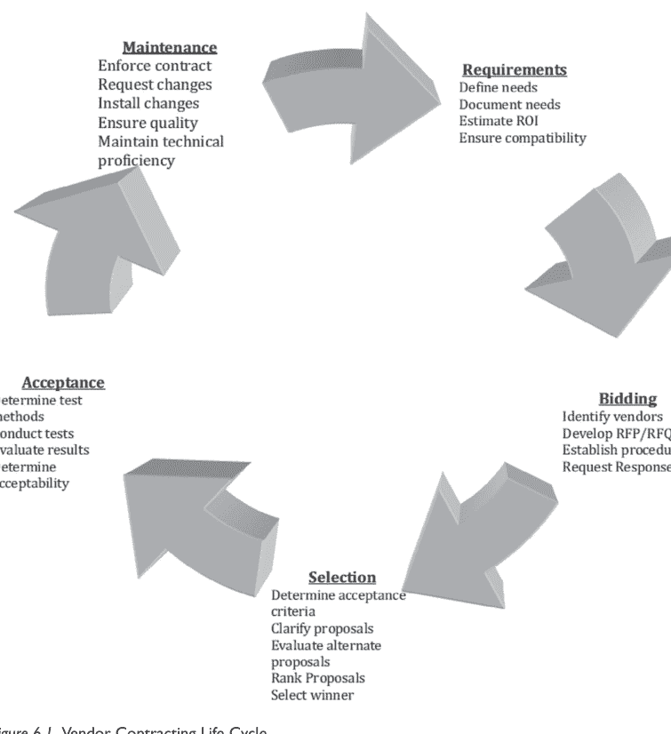

### 维护
- 执行合同
- 请求变更
- 安装变更
- 确保质量
- 保持技术熟练度

### 需求
- 定义需求
- 记录需求
- 估算投资回报率
- 确保兼容性

### 招标
- 识别供应商
- 制定RFP/RFQ
- 建立程序
- 请求响应

### 选择
- 确定验收标准
- 澄清提案
- 评估替代提案
- 对提案排序
- 选择中标者

### 验收
- 确定测试方法
- 进行测试
- 评估结果
- 确定可接受性

*图 6.1 供应商合同生命周期。*

注：ROI，投资回报率；RFP，需求建议书；RFQ，报价请求。改编自 *《IT审计：系统与基础设施生命周期管理》*，R. E. Davis，2009b，Pleier。版权所有 2009，Robert E. Davis。经许可改编。

三者的结合（Davis，2009b）。在获取计划服务时，实体通常会发出需求建议书或报价请求，以评估竞争性投标（Davis，2009b；Haag & Cummings，2008）。

外包招标阶段识别供应商、建立招标程序，并为供应商提供机会，就满足合同要求进行投标（Davis，2006；El Wardani 等，2006）。独家来源合同将竞争限制在一个供应商（Davis，2006）。通常，独家来源合同比典型的竞争性合同谈判更快，但往往充满猜疑（Cohen & Eimicke，2011）。常见的猜疑是实体管理层使用不正当或非法手段排除竞争对手。尽管如此，独家来源合同可以为客户和供应商节省大量成本（El Wardani 等，2006）并带来优势。另外，通过成本效益分析、竞争性招标、开放式合同和首选产品协议，通常可以减少实施非法行为的机会（Davis，2006）。此外，合同选择者向供应商协商报酬的可能性也会增加（Davis，2006）。

通常，在竞争激烈且不断变化的实体环境中，管理者领导者对IT服务交付抱有更高的期望（Davis，2008b；Năstase 等，2009）。管理者领导者通常坚持要求更高的质量、功能、易用性、更短的交付时间，以及持续改进的服务水平——同时实现多方面的成本控制或削减（Davis，2008b）。对于IT服务交付人员来说，组织期望通常转化为提供适当的服务水平管理（Davis，2008b）。服务水平管理通常是最主要的IT管理领域，确保承诺的服务在预期时间、预期地点、以约定成本交付（Davis，2008b）。因此，服务水平管理流程应有目标、目的和程序。客户和资源供应商需要被识别和管理，以实现服务水平管理（Davis，2008b；Năstase 等，2009）。描述性地讲，健全的服务水平管理要求与客户明确界定的服务接口和规范（即服务水平要求；Davis，2008b；Năstase 等，2009）。

服务水平管理通过关键绩效指标实现服务质量监控和管理（Davis，2008b）。服务质量计划辅助服务质量监控和管理流程（Davis，2008b）。服务质量关键绩效指标的范围可以从通用的可用性和使用统计，到以实体为中心的每次交互指标（Davis，2008b）。有效的服务水平管理要求识别潜在问题——例如性能逐渐下降（见表6.1）——并创建警报，以最大限度地降低停机风险（Davis，2008b）。因此，服务水平管理实践应包括将实际绩效与预定期望进行比较、确定适当行动、并生成有表现力的报告以支持服务改进（Davis，2008b）。

### 表 6.1 潜在配置性能指标

| 服务器性能 | 网络性能 |
|---|---|
| CPU利用率 | 缓冲区未命中 |
| CPU不均衡 | 缓冲区利用率 |
| 磁盘I/O故障 | CPU利用率 |
| 文件缓存未命中 | 线路利用率 |
| 分页 | 发现故障 |
| 交换 | 丢弃 |
| 虚拟内存利用率 | 延迟 |
| 物理内存利用率 | 硬件错误 |
| 分配失败 | 软件错误 |
| 系统分区利用率 | 数据包丢失 |
| 用户分区利用率 | 帧传输ᵃ |

注：CPU，中央处理器；I/O，输入或输出。

ᵃ 假设IT配置采用基于帧中继的网络部署。
改编自 *《IT审计：IT服务交付与支持》*，R. E. Davis，2008b，Pleier。版权所有 2008，Robert E. Davis。经许可改编。

有效的问题管理需要跟踪服务性能并记录遇到的问题（Davis，2008b）。管理层对问题相对重要性的看法在很大程度上取决于问题与优先机构IT目标和目的的情境一致性（Davis，2008b）。高级管理者领导者应就数据处理和在线服务可用性设定目标（Davis，2008b）。实体管理层应保留满足服务计划的实际绩效记录（Davis，2008b）。问题的高效及时解决需要与执行管理者领导者支持的明确优先级声明相对应（Davis，2008b）。遇到问题和延迟、问题或延迟的原因以及解决所用时间需要记录和分析，以识别任何重复出现的模式或趋势（Davis，2008b）。随后，执行管理者领导者应定期审查和比较所实现的服务绩效与既定目标，并调查实体用户，了解组织需求是否得到满足（Davis，2008b）。

在程序上，重要的服务水平管理职责包括：

- **服务质量计划对齐**：要求制定与IT服务长期和短期计划相关的质量预测，并规定及时更新服务质量预测的条款（Davis，2008b）。因此，IT管理层应制定、提供资源并执行服务质量计划，该计划能够达到需求规范以及实体质量方针和程序中规定的质量（Davis，2008b）。IT管理者领导者在制定服务质量计划时需考虑的具体问题包括质量标准的规范、验证和确认流程——包括检查、走查和测试（Davis，2008b）。
- **第三方合同**：外包服务需要为所有供应商建立合同签订、修改和终止流程（Davis，2008b）。经批准的第三方协议需要涉及支持实体服务和交付的潜在期望（Davis，2008b）。至少，第三方合同程序需要涵盖法律、财务、组织、文件、绩效、安全、知识产权以及终止责任和义务——并要求法律顾问审查所有采购合同和合同变更（Davis，2008a，2008b）。
- **服务水平协议的使用**：允许定义、协商和商定可接受的服务水平（Davis，2008b）。因此，服务水平协议是一种共识，概述了服务的最低性能目标和衡量标准（Davis，2008b）。服务水平协议使实体能够确信所提供的信息资产具有预期的稳定性、可靠性和性能（Davis，2008b）。此外，服务水平协议可以补充基于策略的服务水平管理，或成为其一部分（Davis，2008b）。标准的IT服务水平协议是IT职能与供应商之间的合同性共识，最好以书面形式，说明各方在信息资产方面的责任（Davis，2008b；Haag & Cummings，2008）。
- **运营水平协议的使用**：解释以最优方式支持服务水平协议的合同活动的技术交付，并规定及时更新服务质量的规定（Davis，2008b）。与供应商签订的运营水平协议有助于遵守协商好的服务水平协议（Davis，2008b）。运营水平协议需要以对提供商有意义的方式指定技术流程（Davis，2008b）。此外，已接受的运营水平协议还可以支持多个服务水平协议（Davis，2008b）。运营水平协议


应涵盖有助于实体组织结构在服务交付和支持方面的 IAP 预期。

- Service Catalogue Registration: 需要对受支持的服务进行盘点，描述已识别的服务，并关联支持服务的信息资产，同时为受支持服务的文档维护提供规定（Davis, 2008b）。
- Service Level Requirements Recording: 需要在登记册中记录定义的性能和容量要求（Davis, 2008b）。
- Service Level Monitoring: 要求提供基准测试、记分卡和仪表板（Davis, 2008b）。基准测试可以提供对实体环境中趋势和发展的及时适应（Davis, 2008b）。同时，记分卡解决了为尽可能多的利益相关者群体实现令人满意的结果的问题（Davis, 2008b）。而仪表板则为负责的管理者领导者提供了在考虑服务交付目标的情况下监控、评估和指导活动的手段（Davis, 2008b）。具体而言，具有相关关键绩效指标的定义关键目标指标能够基于观察或记录的服务流程活动进行比较评估（Davis, 2008b）。
- Service and Support Improvement Program: 要求识别并部署未来的供应商增强功能（Davis, 2008b）。在服务改进计划中，管理层可以提供服务提供商可以采取行动所需的必要细节（Davis, 2008b）。根据最近的全面风险评估，信息安全管理员应提供控制问题以及解决相关服务交付和支持问题的已商定行动的细节（Davis, 2008b）。此外，服务改进计划必须指定负责实施已商定行动和部署目标日期的人员（Davis, 2008b）。

无论实体规模大小，供应商谈判对于确保物有所值都是必不可少的。外包合同需要积极管理。实体管理者领导者应花时间了解合同、已建立的组织关系以及任何变化的业务需求。对外包环境的了解可以带来合同让步并内置对 perceived 未来问题的保护。预见潜在的环境变化意味着建立一个作为实体与采购供应商之间接口的合同管理团队。因此，信息安全官应评估合同管理对 IAP 的影响（Năstase et al., 2009）。

大多数外包关系需要建立、修改和终止合同条款的流程，以确保适当的 IAP（Davis, 2008a）。全面的 ISG 要求向合同参与的第三方传达安全政策和安全措施（Davis, 2008a）。已批准的第三方协议应解决支持信息安全服务交付的基础期望（Davis, 2008a）。

云计算是一种自动化架构，其中可扩展和弹性的 IT 启用能力允许使用 Internet 技术作为服务交付（Cătinean & Cândea, 2013）。云计算服务具有与传统托管不同的差异化特征（Davis, 2020）。首先，云计算服务按需销售，通常按块时间分钟或小时计费（Davis, 2020）。其次，云计算服务的弹性允许用户在任何给定时间调整服务（Davis, 2020）。第三，提供云计算的实体管理活跃服务（Davis, 2020）。

云计算架构可以是公有或私有（Davis, 2020）。公有云计算通过托管服务提供商实现开放的服务使用（Cătinean & Cândea, 2013; Davis, 2020; Karajeh et al., 2014）。私有云计算是一种专有配置，为有限数量的个人提供托管服务（Davis, 2020; Karajeh et al., 2014）。当提供商应用公有云计算资源部署私有云计算时，其 resulting 配置为虚拟私有云计算（Davis, 2020）。公有或私有云计算的目标是提供对计算资源和 IT 服务的安全、可扩展的访问（Davis, 2020）。

云计算架构也可以是社区型或混合型（Davis, 2020）。社区云计算存在于多个团体或个人共享支持社区关注的云服务时（Cătinean & Cândea, 2013; Davis, 2020; Karajeh et al., 2014）。混合云计算将私有、社区或公有服务结合起来，这些服务保留在不同的架构中，但通过标准化或专有技术绑定在一起，实现数据和应用的可移植性（Cătinean & Cândea, 2013; Davis, 2020; Karajeh et al., 2014）。

云计算提供托管服务（Davis, 2010, 2020）。服务类别包括信息、数据库、存储、流程、应用、平台、集成、安全、管理、治理、测试和基础设施（Cătinean & Cândea, 2013; Davis, 2020）。在列出的云计算服务中，主要类别是 Infrastructure-as-a-Service、Platform-as-a-Service 和 Software-as-a-Service（Cătinean & Cândea, 2013; Davis, 2010, 2020; Karajeh et al., 2014），而 Business Process-as-a-Service 是次要类别（Cătinean & Cândea, 2013; Davis, 2020）。

- Infrastructure-as-a-Service 提供按需虚拟服务器实例，具有唯一的 Internet 协议寻址和存储块（Davis, 2020; Mohammad & Ladan, 2012）。提供商的应用程序编程接口允许客户启动、停止、访问和配置分配的虚拟服务器和存储（Davis, 2020）。在实体中，云计算允许实体仅为所需容量付费，并在必要时尽快上线更多容量（Davis, 2020）。由于技术按需付费模式类似于电力、燃料和水消耗的计费模式，文献有时将 Infrastructure-as-a-Service 称为 utility computing（Davis, 2020）。
- Platform-as-a-Service 是一套托管在服务提供商基础设施上的开发工具，开发人员通过 Internet 在提供商的平台上构建应用程序（Davis, 2020）。Platform-as-a-Service 提供商可能会使用应用程序编程接口、网站门户或安装在客户技术上的网关软件（Davis, 2020）。一些提供商不允许将客户创建的软件从所提供的平台迁移（Davis, 2020）。
- 在 Software-as-a-Service 云计算模型中，服务提供商提供硬件基础设施、软件产品并通过前端门户与用户交互（Davis, 2020）。Software-as-a-Service 是一个庞大的市场（Davis, 2020）。服务范围从电子邮件到库存控制和数据库处理（Davis, 2020）。由于服务提供商托管应用程序和数据，因此最终用户可以从任何地方访问服务（Davis, 2020）。
- 作为次要类别，Business Process-as-a-Service 是通过云计算提供并为多租户构建的自动化业务流程外包服务的交付（Cătinean & Cândea, 2013; Davis, 2020）。Business-Process-as-a-Service 允许消费者基于底层提供的 Software-as-a-Service 设计、管理和集成交易和协作活动（Davis, 2020; Mohammad & Ladan, 2012）。与 Infrastructure-as-a-Service 和 Platform-as-a-Service 类似，Business Process-as-a-Service 提供商提供访问和使用 Business Process-as-a-Service 层中资源的工具（Davis, 2020; Mohammad & Ladan, 2012）。消费者通常不需要访问底层 Business Process-as-a-Service 层中的服务（Davis, 2020; Mohammad & Ladan, 2012）。

实体可以部分或完全将 IT 资产开发、服务交付和服务支持委托给托管服务提供商（Davis, 2008b, 2009b）。可外包的 IT 活动包括数据中心运营、网络安全和应用程序维护等 IT 功能（Davis, 2008b）。可外包的 IT 资源包括基础设施、平台和应用程序（Davis, 2008b, 2009b）。基础设施整合了多种软件和硬件解决方案，每个解决方案都旨在实现特定功能。平台是提供构建互补技术、产品或服务所需基本资源的科技、产品或服务（Hagiu & Yoffie, 2009）。应用程序叠加技术以完成任务（Davis, 2005, 2010, 2020）。通常，确认外包活动符合合同、协议、法律和法规的责任由实体承担（Davis, 2009b; Haag & Cummings, 2008）。当托管服务提供商处于保证范围内时，受指派的审计员负责确定托管服务提供商是否遵循合同服务的参考条款。

在为云基础设施开发 Security-as-a-Service 时会出现几个问题。在当前环境中，云服务提供商通常不向租户提供 Security-as-a-Service（Varadharajan & Tupakula, 2014）。因此，租户需要计划确保由云服务提供商托管的实体虚拟机的安全（Varadharajan & Tupakula, 2014）。尽管租户可以使用不同的安全工具（如防病毒和基于主机的入侵检测系统）来保护组织虚拟机，但限制出现了，因为提供的工具驻留在与被监控架构相同的系统中且容易受到攻击（Varadharajan & Tupakula, 2014）。此外，一些租户可能无法确保组织虚拟机的安全（Varadharajan & Tupakula, 2014）。因此，云服务提供商需要向此类租户提供 Security-as-a-Service（Varadharajan & Tupakula, 2014）。

此外，租户的 IAP 要求可能各不相同，一些租户可能会选择从云提供商获取更多安全服务，而其他租户可能会选择基线默认安全（Varadharajan & Tupakula, 2014）。租户从提供商处采用的安全措施水平越高，云提供商了解租户系统的可能性就越大（Varadharajan & Tupakula, 2014）。换句话说，云提供商提供的 Security-as-a-Service 机制和工具可以收集有关组织虚拟机中运行的操作系统和应用程序的更多信息（Varadharajan & Tupakula, 2014）。反过来，网络安全状况可能导致租户产生更重大的隐私问题。实体管理的隐私问题是指云提供商员工能够发现租户机器中服务和应用程序数据的细节的能力（Varadharajan & Tupakula, 2014）。

作为一种有条理的 IT 开发方法，通用短周期时间开发具有优点和缺点（Baskerville & Pries-Heje, 2004）。短周期时间开发的优点主要表现为发布导向和并行开发。短周期时间开发的主要缺点包括通过 IT 开发原型设计导致的范围和功能蔓延、放弃适当的测试以及疏忽的文档记录（Baskerville & Pries-Heje, 2004; Haag & Cummings, 2008）。鉴于外包 IT 开发项目的 11 项关键成功因素，短周期时间开发形式的扩散不应削弱外包决策。然而，在评估期间


对于替代性的系统或基础设施配置，管理层可以在建议征询书中规定所需的供应商IT部署形式。因此，实体管理领导者可以根据所注明的IT开发方法，接受或拒绝外包候选方案。

IT适合将需求与规格透明、最终用户与技术项目团队成员互动极少的项目进行离岸外包（Haag & Cummings, 2008）。数据转换和系统迁移活动有利于离岸外包（Haag & Cummings, 2008）。在瀑布方法论下，应用开发与测试阶段是离岸外包的潜在候选（Haag & Cummings, 2008）。具体而言，最终用户互动有限且任务定义明确的应用开发与测试阶段，是离岸外包的良好候选（Haag & Cummings, 2008）。对于稳定的应用，大多数维护活动可以远程执行，因此应用维护也是极佳的离岸外包候选。然而，在外包流程中进行离岸外包时，存在文化风险。

文化差异可能阻碍IT开发的成功离岸外包。具体而言，人力资源实践、法律法规、社会价值体系、组织规定和技术导向，都可能成为IT开发项目成功离岸外包的障碍（Baskerville & Pries-Heje, 2004）。通常情况下，确认外包活动符合合同、协议、政策、程序、法律和法规的责任由实体承担（Davis, 2009b）。因此，要克服这些障碍，需要在离岸IT开发项目的相关各方之间建立合同协议之前，进行文化评估、文化灌输和文化整合。具体问题包括

- 灵活性与约束（如劳动力）；
- 关于法律责任的法律传统和观点（如模糊的需求）；
- 为共享价值观而进行的沟通和频繁的社会交流（如客户参与）；
- 遵守既定流程；以及
- 对工具、组件、方法和定制流程的广泛且非常独特的依赖与信任。

与在岸或离岸外包IT相关的风险包括合同、隐私、安全、技术收益下降、IT专业知识流失、隐性成本、范围以及决策过程（Tafti, 2005）。IT外包风险处理可以是接受、降低或转移（Davis, 2008a, 2011）。然而，消除从来不是IT外包风险的一个选项。需要适当的目标、目的、政策、程序、标准和规则，以实现有益的IT服务交付和支持（Davis, 2008b）。具体而言，当实体决定外包系统、流程、活动或任务时，使用ISSM标准通常会产生益处。因此，实体与服务供应商之间的服务水平协议通常会减少争议并降低成本（Davis, 2008b）。

### 服务提供商审计

IT服务管理的提取、分解、分析和评估，可以提供打开理解实体ISG框架之门的钥匙。以服务形式向最终用户交付IT是一个关键的管理要素，它可能影响IT作为组织赋能器的有效性（Davis, 2008b）。实施不充分的IT服务与支持可能带来的风险包括：

- 向用户提供的服务效率低下，
- 服务流程不清晰，
- 服务交付目标的沟通效率低下，
- 服务交付目标的沟通无效，
- 缺乏IT服务交付的通用语言，
- 缺乏IT服务支持的通用语言，
- 职业适应期延长，
- 对不同服务的优先级划分不当，
- 用户对所提供服务不满意，
- 服务及所需资源的规划无效，以及
- 服务及所需资源的维护无效（Davis, 2008b）。

因此，IT服务交付和支持领域应定期接受IT审计的审查，以证明其基础活力。外包服务审计需要辅以绩效履行，前提是服务提供发生在服务用户自身的IT环境中。指定的项目审计师需要有权：(a) 审查服务用户与服务提供商之间的协议；(b) 对外包审计领域开展认为必要的IT审计工作；(c) 向项目服务用户管理层报告审计发现、结论和建议（Davis, 2005, 2010）。当外部服务提供商被证明不愿与IT审计师合作时，IT审计师应向服务用户的管理层报告此事。

实体的管理领导者应建立治理流程，以处理与外包活动第三方提供商的关系及其绩效（Boyson, 2014; Davis, 2011, 2017, 2020）。IT治理由结构、关系和流程组成（Ula et al., 2011）。存在提供IT治理部署框架的指南。实施主要通过将IT治理责任映射到实体层级结构来进行。适用于服务级别管理的IT治理框架的一项选择是信息及相关技术控制目标。信息及相关技术控制目标框架将控制流程划分为四个交互领域：

- 对齐、规划和组织；
- 构建、获取和实施；
- 交付、服务和支持；以及
- 监控、评估和考核（IT Governance Institute, 2018）。

如图6.2所示，在对齐、规划和组织域以及监控、评估和考核域中运行的控件的有效性，会影响在构建、获取和实施域以及交付、服务和支持域中的控件的有效性。换句话说，管理层的对齐、规划、组织、监控、评估和考核不当，意味着针对过度构建、获取、实施、交付、服务和支持的控件将不合适。反之，适当的对齐、规划、组织、监控、评估和考核可以识别并纠正过度构建、获取、实施、交付、服务和支持方面的无效控件。信息及相关技术控制目标框架为高层管理领导者提供了一种通用语言，

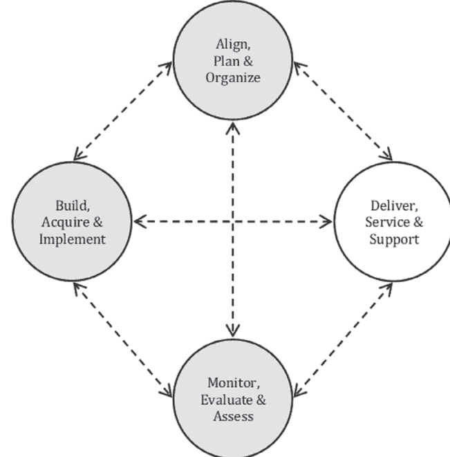

图6.2 信息及相关技术控制目标的双向关联。

注：改编自R. E. Davis所著《IT审计：IT服务交付与支持》，2008b，Pleier。版权所有©2008 Robert E. Davis。经许可改编。

以便与审计、IT及其他专业人士沟通目标、目的和成果（Năstase et al., 2009）。

被指派执行IT服务交付与支持业务的IT审计师，会考虑基于信息及相关技术控制目标框架中确立的重要流程点来提供保证服务（Davis, 2008b）。此外，项目IT审计师在实施IT审计时，需要考虑应用ISO/IEC 20000和ISO/IEC 27000系列国际标准（Davis, 2008b）。从ISO/IEC标准中可以提取出以实体为中心的IT服务管理内容。如果IT审计师精通服务交付与支持概念，他很可能会发现断言真实性验证或直接主题验证更具成效。针对相关ISO/IEC 20000、ISO/IEC 27000以及信息及相关技术控制目标中交付、服务和支持领域的基于风险的IT保证系统，可以为IT管理领导者提供有价值的建议，反映普遍接受的IT服务管理标准。审计规划、控制的研究与评估、控制的测试与评估、报告和后续跟进是流程


完成以确保充分报告IT相关控制的状况、有效性和效率（Davis, 2020）。

### IT审计计划

IT服务管理审计计划的主要驱动因素是验证交付和支持的存在性与适当性（Davis, 2008b）。在执行外部审计时，服务水平管理、配置管理、变更管理、运营管理、事件管理和问题管理是关键的外包服务组件。然而，与其他IT审计一样，主管IT审计师需要在业务规划期间获得审计领域的理解，以符合ISACA保证标准和指南以及其他适用的鉴证、审计、会计和IT标准（Davis, 2008b）。

IT审计师必须明确界定IT服务业务的目标和范围（Davis, 2008b）。通常，管理领导者关注IT服务交付和支持工作绩效流程，强调确保目标实现的要求和期望（Davis, 2008b）。因此，IT服务交付和支持鉴证业务侧重于功效及相关流程，旨在改进服务绩效和流程有效性（Davis, 2008b）。当托管服务提供商处于IT服务交付和支持范围内时，IT审计负责确定是否存在适当的控制措施并按其预期运行（Davis, 2008b）。对于外包服务，IT审计师应考虑以下事项：

- 服务提供商与服务用户之间是否存在正式协议；
- 外包协议中包含一项条款，明确规定服务提供商必须满足适用于其活动的所有法律要求，并遵守有关代表服务用户所承担职能的法律法规；
- 外包协议中规定，服务提供商开展的活动应接受控制和审计，如同由签约实体执行这些活动一样；
- 在与服务提供商的协议中纳入审计访问权；
- 是否存在包含绩效监控程序的服务水平协议；
- 是否遵守服务用户的安全策略；
- 服务提供商的忠诚保险安排是否充分；以及
- 服务提供商的人事政策和程序是否充分。

关于外包服务，除了其他期望外，IT审计师应获取并记录对第三方提供的服务与实体控制环境之间关系的理解（Davis, 2008b）。主管IT审计师应审查有关实体第三方提供商的合同、服务水平协议、政策和程序等项目（Davis, 2008b）。主管IT审计师还应获取适当的专家法律意见（Davis, 2008b）。此外，主管IT审计师应审查为实体编制的任何先前的第三方提供商审计报告。随后，主管IT审计师应规划IT审计工作，以实现与服务提供商环境相关的审计目标，并考虑已获取的信息（Davis, 2008b）。最后，IT审计师应规划第三方提供商审计工作，以符合适用的专业审计标准（Davis, 2008b）。

主管IT审计师必须对受检审计领域进行初步控制环境评估，以确保所有重要事项在IT审计期间得到恰当处理（Davis, 2008b）。在评估服务提供商的控制环境时，IT审计师应考虑以下要素及其激活情况。

- 诚信和道德价值观的沟通与执行是影响控制设计、管理和监控的基本要素。
- 对能力的承诺是管理层对岗位胜任力水平的考量，并将其转化为所需的技能和知识。
- 治理层参与情况，包括独立于管理层、经验与地位、参与和审查活动的程度、所接收的信息、向管理层提出并跟进难题的程度，以及与内部和外部审计师的互动。
- 管理层的理念和经营风格，考虑管理层承担和管理风险的方法，以及管理层对财务报告、信息处理、会计职能和人员的态度和行动。
- 组织结构涉及运营框架，实体为实现目标而开展的活动在该框架内进行规划、执行、控制和审查。
- 权力和责任的分配展示了运营活动的权力和责任如何分配，以及报告关系和授权层级如何形成。
- 托管服务提供商在招聘、入职培训、培训、评估、咨询、晋升、薪酬和整改措施方面遵循的人力资源政策和实践。

评估特定实体关联的控制环境风险程度可以使用各种技术和工具进行（Davis, 2008b）。对于所选审计控制环境陈述中的每一项，需要定义合规值，使IT保证专业人员能够计算合规概况（Davis, 2008b）。因此，在获取对控制环境组成部分的理解时，主管IT审计师必须考虑实体和IT是否存在相关的要素部署（Davis, 2008b）。通常，主管IT审计师通过询问和其他风险评估程序的组合来获取相关的控制环境审计证据（Davis, 2008b）。具体到理解和定义实体IT控制环境风险，主管IT审计师应考虑：

- 以往历史，
- 绩效模式，
- 当前的IT组织因素，
- 现有IT环境的复杂性，
- 现有IT环境的规模或范围，
- 计划中的IT环境复杂性，
- 计划中的IT环境规模或范围，
- 当前IT环境的固有漏洞，
- 计划中的IT环境固有漏洞，以及
- 拟议的IT举措性质（Davis, 2008b）。

当服务提供商的管理层执行成熟度建模时，主管IT审计师应对内容应用分析程序，以确定流程之间和流程内部成熟度水平的一致性和质量，包括成熟度模型属性的定义（Davis, 2008b）。对于较小型实体，控制环境要素的审计证据可能无法以文件形式获得，因为管理层与其他人员之间的沟通可能非正式但有效。例如，管理层对道德价值观和能力的承诺通常通过管理实体事务时所展现的行为和态度来体现，而不是通过成文的行为准则。因此，管理层的态度、意识和行动在设计较小实体的控制环境时尤为重要。此外，在没有其他所有者的情况下，唯一的所有者兼管理者通常承担治理责任。

成熟度建模显示实体中控制环境的状况和控制措施的建立情况。实体成熟度模型还显示控制管理情况以及对建立更好控制措施必要性的认识，通常范围从临时性到优化级别。成熟度建模提供了一个高层指南，帮助信息及相关技术控制目标（COBIT）用户理解适当IT控制的要求，并有助于将实体定位在成熟度标尺上。有益的是，在识别关键IT流程和控制之后，成熟度建模能够传达能力差距，并向管理层展示所需的改进。之后，实体管理领导者可以制定行动计划，使流程达到所需的能力目标水平。

将全部或部分业务流程和IT外包是近年出现的现象，影响着IT审计（Davis, 2020）。主管IT审计师的服务审计风险评估应体现对受检流程的考虑（Davis, 2008b）。规划风险评估可包括用于处理服务水平管理、配置管理、变更管理、运营管理、绩效管理、数据管理、容量监控、事件管理、问题管理（Davis, 2008b）和安全管理的类别。由于在一般风险评估层面存在直接的活动关联，如果事件管理和问题管理这两个项目都在保证范围内，IT审计师应考虑将它们的可审计单元合并（Davis, 2008b）。具体到IT服务审计，规划风险评估应在处理数据管理的类别中纳入隐私子类别（Davis, 2008b）。

### IT审计控制的研究与评价

IT审计师的控制研究产生充分的审计领域文档，展示对IT及相关人工流程的综合调查（Davis, 2010）。大多数组织流程都有控制措施来帮助实现控制目标（Davis, 2020）。然而，即使不存在控制措施，在审查审计领域已实施的控制时，指定的IT审计师会评估有效性、效率、保密性、完整性、可用性、合规性或可靠性，以确定控制目标的实现程度（Davis, 2020）。因此，控制的研究与评价为评估管理层是否正在实现控制目标提供了机会（Davis, 2020）。此外，如有必要，可在结束研究与评价审计流程之前进行初步审计风险重新评估和其他测试程序（Davis, 2020）。

### 服务水平管理

服务水平管理的部署可能会受挫，因为IT管理层将服务重点偏向于特定分类领域的技术中心化度量（Davis,

（2008b）。正确地说，IT服务职能应提供对管理层所理解的服务水平的全面洞察（Davis, 2008b）。目标实现应反映基于服务的合同安排的建立与衡量（Davis, 2008b）。基于服务的协商鼓励IT与运营单位之间的定向对话，并促进IT实践在支持计算机应用和组织流程的配置项中的统一（Davis, 2008b）。因此，最低限度上，指定的IT审计师可以研究和评估以下方面：

- 是否存在可见的、与运营相关的IT目标；
- 是否存在向管理层报告的、与运营相关的IT指标；
- 是否以最终用户术语定义服务和相关项目；
- 服务级别协议和合同的创建是否可由用户监控；
- 用户对服务水平不满意时是否寻求过补救措施；
- 用户是否有能力和胜任力来审查所提供的服务；
- 用户是否有能力和胜任力来跟进所提供的服务；
- 在实现商定的服务水平时是否考虑过纠正措施；
- 用户需求是否适当级联为配置项运营需求；
- 服务和项目组合在设定相对优先级时是否得到集体考虑；
- 生成用于监控服务级别协议合规信息的组织流程是否得到适当控制；
- 服务和项目组合在公平且可实现的基础上进行资源分配时是否得到集体考虑（Davis, 2008b）。

### 配置管理

在检查实体IT服务时，基础设施管理正在管理基本运营组件，如策略、流程、设备、数据、人力资源和外部联系人，以实现实体有效性（Davis, 2008b）。适当的配置管理使管理层能够降低因准备不足或影响服务提供商可用性和数字化处理完整性的不兼容变更而需要启动回退程序的风险（Davis, 2008b）。因此，指定的IT审计师可以研究和评估实体IT职能和服务提供商是否已：

- 进行配置管理规划；
- 识别配置项；
- 建立配置管理数据库；
- 建立权威软件库；
- 建立权威硬件库；
- 记录配置控制；
- 维护配置项状态；
- 跟踪配置项状态；
- 根据配置管理数据库记录审查配置项；
- 管理配置项库、许可证和存储（Davis, 2008b）。

### 变更管理

实现绩效期望的关键是变更控制程序（Davis, 2008b）。通常，在变更管理审计中获得的最关键项目是拥有访问权限的所有用户的完整列表（Davis, 2008b）。一旦获得，带有记录权限的基础设施访问列表有助于确定变更管理安全范围和充分性（Davis, 2008b）。IT审计师应确定变更控制是否足以防止软件分发期间未经授权的硬件或软件更改（Davis, 2008b）。具体而言，应制定有效的授权和变更控制程序（Davis, 2008b）。然而，即使一个健壮的变更管理协议也可能无法捕获与变更相关的所有问题（Davis, 2008b）。在IT服务变更管理研究和评估过程中，IT审计师可以确定：

- 是否发生变更识别；
- 是否进行变更分类；
- 是否进行变更优先级排序；
- 是否存在紧急变更程序；
- 是否进行影响评估；
- 是否进行变更授权记录；
- 是否存在发布管理程序；
- 是否存在软件分发程序；
- 是否使用自动化工具；
- 员工是否遵循配置管理实践；
- 是否考虑运营流程重新设计；
- 是否存在启动程序变更的审批程序；
- 整个开发过程中是否存在关键检查点；
- 员工是否遵循紧急软件修复程序；
- 员工是否遵循临时软件修复程序；
- 员工是否遵循新版本发布程序；
- 变更控制文档是否提供适当的审计跟踪；
- 变更文档是否支持软件变更（Davis, 2008b）。

### 服务运营管理

服务运营管理涉及按商定服务水平提供服务所需的定期、日常监督和处理活动（Davis, 2008b）。实体的IT服务支持单位应通过配备称职人员的服务台来管理用户期望（Davis, 2008b）。最低限度上，对于IT服务台保证业务，IT审计师应确定：

- 服务级别协议是否可衡量；
- 用户是否因IT使用而被收费；
- 是否对服务级别协议报告进行有意义的审查；
- 用户管理层是否收到IT使用成本规模；
- 适当的管理层是否收到服务级别协议报告；
- 服务台知识数据库是否得到适当管理；
- 服务台升级程序是否得到记录；
- 服务台获取专家帮助的程序是否得到充分记录（Davis, 2008b）。

### 表6.2 信息标准-IT服务问题矩阵

| 问题 | 有效性 | 效率 | 可靠性 | 合规性 | 保密性 | 完整性 | 可用性 |
|---|---|---|---|---|---|---|---|
| 响应性 | P |  | S |  |  |  | P |
| 吞吐量 |  | P |  |  |  |  | S |
| 经济性 |  | P | S |  |  |  |  |
| 准确性 |  |  | P | S |  | P |  |
| 可靠性 |  |  | P | S | P | P | P |
| 效率 |  | P |  | S |  |  | S |
| 安全性 |  |  | S | S | P | P | S |
| 信息 | S | S | P | S | S | P | P |

注：P，主要；S，次要。改编自R. E. Davis的《IT审计：IT服务交付与支持》（2008b），Plei。版权所有2008 Robert E. Davis。经许可改编。

### 问题管理

IT审计团队成员在提供保证服务时，可以详细包括问题管理流程的研究和评估（见表6.2）（Davis, 2008b）。问题管理流程输出通常包括紧急和计划外变更子流程（Davis, 2008b）。在检查管理信息相关性时，及时性可能影响管理决策（Davis, 2008b）。因此，需要对问题信息传递速度进行评估，以确保符合任务优先级（Davis, 2008b）。因而，IT服务问题管理研究和评估应包括收集以下证据：

- 是否建立了问责制，即特定管理层接收分派的问题，且每个配置项都有指定的问题队列；
- 紧急变更在完成事项解决之前是否得到完整记录；
- 与用户投诉相关的请求是否在正式项目修改请求提交之前首先得到记录和评估；
- 问题解决结果是否得到记录；
- 关闭问题工单的授权是否来自负责问题解决或信息资产的管理者（Davis, 2008b）。

### 事件管理

服务恢复计划需要记录、沟通和批准（Davis, 2008b）。如果评估后，审计证据表明事件的发生是由于一项违规行为，且服务用户未收到报告，则指定的IT审计师可以建议对相关事项进行彻底调查，或启动其他适当行动。经适当授权，当事件需要进一步调查时，有必要执行标准审计程序，以确定违规行为的性质、时间和范围（Davis, 2009a）。标准审计程序包括：

- 评估可能串通的程度和范围；
- 确定有效开展调查所需的知识、技能和纪律；

- 设计识别肇事者的程序；并且
- 与适当人员协调活动（Davis, 2009a）。

### IT Audit Testing of Controls

通常，IT 审计测试的重点是审计区域的可审计单元风险（Davis, 2020）。IT 审计师根据评估的风险执行程序，以测试控制的适当性以及管理层规避已部署控制的风险（Davis, 2009a）。IT 审计师还可以执行合理预期能够发现控制中重大不规则和弱点的测试——这些可能导致未预防或未被发现的重大不规则（Davis, 2009a）。选择适当的审计测试技术、方法和工具可能具有挑战性（Davis, 2010）。

IT 审计师验证已部署控制的运行有效性（Davis, 2009a）。合规性测试通常用于验证控制运行有效性（Davis, 2009a）。外部 IT 服务交付和支持保证业务可以是通用或应用控制评估（Davis, 2008b）。因此，IT 审计师的控制测试可以涉及执行手动或自动程序，统计或非统计（Davis, 2008b）。通用控制测试偏向于 IT 审计师执行硬拷贝辅助审计技术（Davis, 2010, 2020）。相反，应用测试偏向于执行计算机辅助审计技术（Davis, 2010, 2020）。受指派的 IT 审计师可以使用专业协会提供的公开程序来执行所需的 IT 服务测试（Davis, 2008b）。

除非 IT 审计风险评估或审计管理另有规定，否则广泛的合规性测试是 IT 服务审计的常态（Davis, 2008b）。通常，有足够的手动和自动的 IT 服务相关政策、程序、标准和规则可用于评估设计和运行有效性（Davis, 2008b）。从证据上看，IT 审计师应考虑从 IT 服务审计计划、研究和测试活动中获得的信息是否表明专业勤勉（Davis, 2008b, 2020）。

### IT Audit Report on Controls

关于签发和同意外部 IT 服务审计报告，受指派的 IT 审计师应在审计工作完成后以适当形式向预期服务用户收件人提供报告。IT 审计师应考虑在发布前与第三方提供商讨论报告。然而，IT 审计师不应负责向第三方提供商签发最终报告。如果第三方提供商收到审计报告副本，传递授权通常应来自服务用户的管理层。服务提供商审计报告应规定 IT 审计师或服务用户管理层同意施加的任何分发限制。IT 审计师还应考虑加入排除对第三方责任的声明。在存在对服务提供商审计的限制时，审计报告应确定限制并解释该限制对保证业务的影响。

程序上，IT 审计师应将所有有证据支持的建议提请适当管理层级审阅和实施（Davis, 2008b, 2020）。然而，IT 审计报告对 IT 服务交付和支持可审计单元的建议是咨询性的（Davis, 2008b）。因此，被审计单位可能因技术或语法原因对发现提出异议（Davis, 2008b）。此外，被审计单位可能在考虑风险评估、成本效益分析或竞争优先事项后忽略建议（Davis, 2008b）。

当受指派的 IT 审计师得知对重要建议的敌意接待时，有争议的发现或被忽略的建议应引起实体执行管理领导者和客户监督委员会的注意（Davis, 2008b）。作为管理决策，服务提供商的监督委员会通常有权确保审计建议的实施（Davis, 2008b）。

### IT Audit Follow-Up

IT 审计师应遵守处理通常与 IT 服务交付和支持相关的风险的保证实践后续程序（Davis, 2008b）。因此，适当的后续行动是必要的，以确保纠正措施过程的有效性和对所评估项目或服务的信心得以重建（Davis, 2008b）。公认的审计程序通常包括进行充分、及时的后续行动，以验证管理行动及时解决弱点（Davis, 2008b, 2020）。

在合理的时间过去后，受指派的 IT 审计师应执行后续活动，以验证纠正措施在降低所记载缺陷和弱点相关风险方面的有效性。验证纠正措施实施的方法有多种，包括

- 重新评估缺陷领域，
- 评估新的或修订的文档，
- 在下一次计划评估期间进行验证，以及
- 通过监控进行验证。

在考虑以往审计和审查的影响时，受指派的 IT 审计师应如同审计发生在服务用户环境中一样进行后续。特别地，IT 审计师应从服务用户和服务提供商双方请求适当信息，针对以往相关发现、结论和建议。受指派的 IT 审计师应通过充分程序确定第三方提供商是否及时实施了适当的纠正措施。

在验证纠正措施部署时，关键的 IT 审计问题是记录适当的纠正措施证据（Davis, 2008a）。

> 对 IT 审计发现的解决方案在记载时可能看起来可行，但可能由于各种限制而无法部署（Davis, 2008）。通常，无法充分识别控制弱点的每个根本原因很可能导致可报告情况的再次发生（Davis, 2008）。（Davis, 2020, p. 248）

### References

Azadegan, A., Dooley, K. J., Carter, P. L., & Carter, J. R. (2008). 供应商创新性以及组织间学习在提升制造商能力中的作用. Journal of Supply Chain Management, 44(4), 14–35. https://doi.org/10.1111/j.1745-493X.2008.00070.x

Bahl, S., & Wali, O. P. (2014). 对信息安全治理重要性的感知以预测软件服务行业的信息安全服务质量. Information Management & Computer Security, 22(1), 2–23. https://doi.org/10.1108/IMCS-01-2013-0002

Baskerville, R., & Pries-Heje, J. (2004). 短周期时间系统开发. Information Systems Journal, 14(3), 237–264. https://doi.org/10.1111/j.1365-2575.2004.00171.x

Bayle-Cordier, J., Mirvis, P., & Moingeon, B. (2015). 投射不同身份：关于三重底线领导话语变化的“左右摇摆”效应的纵向研究. The Journal of Applied Behavioral Science, 51(3), 336–374. https://doi.org/10.1177/0021886314553100

Beasley, M., Bradford, M., & Pagach, D. (2004, July). 外包？自担风险. Strategic Finance, 86(1), 22–29.

Boyes, H. (2015). 网络安全与网络弹性供应链. Technology Innovation Management Review, 5(4), 28–34. http://timreview.ca

Boyson, S. (2014). 网络供应链风险管理：革新关键 IT 系统的战略控制. Technovation, 34, 342–353. https://doi.org/10.1016/j.technovation.2014.02.001

Cagliano, R., Caniato, F., & Spina, S. (2006). 供应链整合与制造改进计划之间的联系. International Journal of Operations & Production Management, 26(3), 282–299. https://doi.org/10.1108/01443570610646201

Cantor, D. E., Blackhurst, J., Pan, M., & Crum, M. (2014). 检验利益相关者压力和知识管理对供应链风险和需求响应性的作用. International Journal of Logistics Management, 25, 202–223. https://doi.org/10.1108/IJLM-10-2012-0111

Cascarino, R. E. (2012). IT 审计指南（第 2 版）. John Wiley & Sons.

Cassivi, L., Hadaya, P., Lefebvre, E., & Lefebvre, L. A. (2008). 协作在供应链中对流程、关系和产品创新的作用. International Journal of E-Collaboration, 4(4), 11–32. https://doi.org/10.4018/jec.2008100102

Cătinean, I., & Cândea, D. (2013). 云计算模型作为颠覆性创新的特征. Review of International Comparative Management, 14, 783–803. www.rmci.ase.ro

Cegielski, C. G., Jones-Farmer, L. A., Wu, Y., & Hazen, B. T. (2012). 供应链中云计算技术的采用. International Journal of Logistics Management, 23(2), 184–211. https://doi.org/10.1108/09574091211265350

Christopher, M., Peck, H., & Towill, D. (2006). 选择全球供应链战略的分类法. The International Journal of Logistics Management, 17, 277–287. https://doi.org/10.1108/09574090610689998

Christopher, M., & Towill, D. R. (2002). 开发市场特定供应链战略. International Journal of Logistics Management, 13, 1–14. https://doi.org/10.1108/09574090210806324

Claycomb, W. R., Huth, C. L., Flynn, L., McIntire, D. M., & Lewellen, T. B. (2012). 内部威胁破坏的编年研究：初步观察. Journal of Wireless Mobile Networks, Ubiquitous Computing, and Dependable Applications, 3(4), 4–20. https://doi.org/10.22667/JOWUA.2012.12.31.004

Cohen, S., & Eimicke, W. (2011). 外包. In Mark Bevir (Ed.), The SAGE handbook of governance (pp. 237–251). SAGE.

Connelly, B. L., Ketchen, D. J., & Hult, G. M. (2013). 全球供应链管理：迈向理论驱动的研究议程. Global Strategy Journal, 3(3), 227–243. https://doi.org/10.1111/j.2042-5805.2013.01041.x

Davis, R. E. (2005). IT 审计：一种自适应过程. Pleier.

Davis, R. E. (2006). IT 审计：不规则和非法行为. Pleier.

Davis, R. E. (2008a). IT 审计：确保信息资产保护. Pleier.

Davis, R. E. (2008b). IT 审计：IT 服务交付与支持. Pleier.

Davis, R. E. (2009a). 确保 IT 法律合规. www.amazon.com

Davis, R. E. (2009b). IT 审计：系统和基础设施生命周期管理. Pleier.

Davis, R. E. (2010). IT 审计：一种自适应系统. www.amazon.com

Davis, R. E. (2011). 确保 IT 治理. www.amazon.com

Davis, R. E. (2012). 管理信息系统持续审计的案例. In Joe Oringel (Ed.), Effective auditing for corporates: Key developments in practice and procedures (pp. 209–217). Bloomsbury Information.

Davis, R. E. (2017). 美国企业公司治理与信息安全治理有效性之间的关系 (Publication No. 10603383) [Doctoral Study, Walden University]. ProQuest Dissertations Publishing.


Davis, R. E. (2020). 使用系统视角的IT审计. IGI Global.

Dey, A., LaGuardia, P., & Srinivasan, M. (2011). 在物流运营中构建可持续性：一项研究议程. Management Research Review, 34, 1237–1259. https://doi.org/10.1108/01409171111178774

El Wardani, M. A., Messner, J. I., & Horman, M. J. (2006). 比较设计-建造项目的采购方法. Journal of Construction Engineering and Management, 132(3), 230–238. https://doi.org/10.1061/(ASCE)0733-9364(2006)132:3(230)

Gottschalk, P., & Solli-Saether, H. (2005). IT外包理论中的关键成功因素：一项实证研究. Industrial Management & Data Systems, 105(6), 685–702. https://doi.org/10.1108/02635570510606941

Groznik, A., & Trkman, P. (2012). 供应链管理的当前问题与挑战. Ekonomska Istrazivanja, 25, 1101–1112. https://doi.org/10.1080/1331677X.2012.11517551

Haag, S., & Cummings, M. (2008). 信息时代的管理信息系统（Laureate Education, Inc. 定制版）. McGraw-Hill/Irwin.

Hagiu, A., & Yoffie, D. B. (2009). 你的谷歌战略是什么？Harvard Business Review, 87(4), 74–81. https://hbr.org

Hamel, G. (2006). 管理创新的原因、内容和方式. Harvard Business Review, 84(2), 72–84. https://hbr.org

Handfield, R. B., & Lawson, B. (2007). 将供应商整合到新产品开发中. Research Technology Management, 50(5), 44–51. https://doi.org/10.1080/08956308.2007.11657461

Harms, D., Hansen, E. G., & Schaltegger, S. (2013). 可持续供应链管理战略：对德国大型企业的实证调查. Corporate Social Responsibility & Environmental Management, 20, 205–218. https://doi.org/10.1002/csr.1293

Holweg, M., Disney, S., Holmstrom, J., & Smaros, J. (2005). 供应链协作：理解战略连续体. European Management Journal, 23, 170–181. https://doi.org/10.1016/j.emj.2005.02.008

Ismail, H. S., & Sharifi, H. (2006). 构建敏捷供应链的平衡方法. International Journal of Physical Distribution & Logistics Management, 36(6), 431–444. https://doi.org/10.1108/09600030610677384

IT Governance Institute. (2018). COBIT 2019框架：介绍与方法论. ISACA.

Kamasak, R., & Bulutlar, F. (2010). 知识共享对创新的影响. European Business Review, 22(3), 306–317. https://doi.org/10.1108/09555341011040994

Karajeh, H., Maqableh, M., & Masa’deh, R. (2014). 云计算环境的安全. Vision 2020: Sustainable Growth, Economic Development, and Global Competitiveness: Proceedings of the 23rd International Business Information Management Association Conference, IBIMA 2014, 2202–2215. International Business Information Management Association.

Ketchen, D. J., Rebarick, W., Hult, G. T. M., & Meyer, D. (2008). 最佳价值供应链：21世纪的关键竞争武器. Business Horizons, 51(3), 235–243. https://doi.org/10.1016/j.bushor.2008.01.012

Kim, J., Lee, K., & Joshi, K. (2013). 信息技术产品与服务的全球化. Journal of Global Information Technology Management, 16(3), 1–6. https://doi.org/10.1080/1097198X.2013.10845639

Krogh, G. V. (2012). 社交软件如何改变知识管理？迈向战略研究议程. The Journal of Strategic Information Systems, 21(2), 154–164. https://doi.org/10.1016/j.jsis.2012.04.003

Kuyken, K. (2012). 知识社区：迈向代际知识转移的再思考. VINE, 42, 365–381. https://doi.org/10.1108/03055721211267495

Kwon, I.-W. G., & Suh, T. (2006). 影响供应链管理中信任与承诺水平的因素. The Journal of Supply Chain Management, 40(2), 4–14. https://doi.org/10.1111/j.1745-493X.2004.tb00165.x

Laszlo, K., & Laszlo, A. (2002). 为发展而演进的知识：知识管理在不断变化的世界中的作用. Journal of Knowledge Management, 6(4), 400–412. https://doi.org/10.1108/13673270210440893

Lee, H. L. (2004). 三A供应链. Harvard Business Review, 82(10), 102–112. https://hbr.org

Li, S., & Lin, B. (2006). 评估供应链管理中的信息共享与信息质量. Decision Support Systems, 42(3), 1641–1656. https://doi.org/10.1016/j.dss.2006.02.011

Liao, K., & Hong, P. (2007). 构建全球供应商网络：一种供应商组合进入模型. Journal of Enterprise Information Management, 20, 511–526. https://doi.org/10.1108/17410390710823671

Malhotra, A., & Majchrzak, A. (2014). 在创新挑战中管理群体. California Management Review, 56(4), 103–123. https://doi.org/10.1525/cmr.2014.56.4.1033

Malhotra, Y. (2000). 从信息管理到知识管理：超越“高科技守旧”系统. 载于 K. Srikantaiah & M. E. D. Koenig 主编《信息专业人员的知识管理》（第2-15页）. IGI Global.

Malhotra, Y. (2005). 将知识管理技术整合到组织业务流程中：让实时企业交付实际业务绩效. Journal of Knowledge Management, 9(1), 7–28. https://doi.org/10.1108/13673270510582938

Manzouri, M., Rahman, M. N. A., Nasimi, F., & Arshad, H. (2013). 一种在供应链中安全共享信息的模型. American Journal of Applied Sciences, 10(3), 253–258. https://doi.org/10.3844/ajassp.2013.253.258

McAdam, R., & McCormack, D. (2011). 整合业务流程以实现全球对齐与供应链管理. Business Process Management Journal, 17(2), 113–130. https://doi.org/10.1108/14637150110389696

Mentzer, J. T., DeWitt, W., Keebler, J. S., Min, S., Nix, N. W., Smith, C. D., & Zacharia, Z. G. (2001). 定义供应链管理. Journal of Business Logistics, 22(2), 1–25. https://doi.org/10.1002/j.2158-1592.2001.tb00001.x

Mentzer, J. T., Myers, M. B., & Stank, T. P. (编). (2007). 全球供应链管理手册. SAGE.

Mohammad, H., & Ladan, T. (2012). 云计算揭秘：研究全景. 载于 A. Hurson & A. Memon 主编《计算机进展》（第41-85页）. https://doi.org/10.1016/B978-0-12-396535-6.00002-8

Năstase, P., Năstase, F., & Ionescu, C. (2009). 企业实施IT标准CobiT 4.1、ITIL v3和ISO/IEC 27002所产生的挑战. Journal of Economic Computation & Economic Cybernetics Studies & Research, 43(3), 5–20. www.ecocyb.ase.ro/

Parker, D. B., Zsidisin, G. A., & Ragatz, G. L. (2008). 新产品开发中供应商整合的时机与程度：一种权变方法. Journal of Supply Chain Management, 44(1), 71–83. https://doi.org/10.1111/j.1745-493X.2008.00046.x

Patnayakuni, R., & Patnayakuni, N. (2014). 价值链中的信息安全：治理视角. Proceedings of the 20th Americas Conference on Information Systems 20th Americas Conference on Information Systems: Smart Sustainability: The Information Systems Opportunity, Vol. 3: AMCIS 2014, 1920–1929. Association for Information Systems. https://aisel.aisnet.org/amcis2014/

Peisl, T., Selen, W., Raeside, R., & Albera, T. (2014). 预测性拥挤作为支持颠覆性创意评估的概念：一个概念框架. Journal of New Business Ideas & Trends, 12(2), 1–13. http://jnbit.org

Pérez-Méndez, J. A., & Machado-Cabezas, Á. (2015). 管理信息系统与企业绩效之间的关系. Spanish Accounting Review, 18(1), 32–43. https://doi.org/10.1016/j.rcsar.2014.02.001

Qi, Y., Zhao, X., & Sheu, C. (2011). 竞争战略与供应链战略对企业绩效的影响：环境不确定性的作用. Decision Sciences, 42, 371–389. https://doi.org/10.1111/j.1540-5915.2011.00315.x

Qrunfleh, S., & Tarafdar, M. (2013). 精益与敏捷供应链策略以及供应链响应性：战略供应商伙伴关系和延迟的作用. Supply Chain Management, 18, 571–582. https://doi.org/10.1108/SCM-01-2013-0015


Ramírez, A. M., Vasauskaite, J., & Kumpikaite, V. (2012). 知识管理在创新与绩效中的作用. 经济与管理, 17(1), 381–389. https://doi.org/10.5755/j01.em.17.1.2293

Ritala, P., Olander, H., Michailova, S., & Husted, K. (2013). 知识共享、知识泄露与创新绩效：实证研究. 第6届ISPIM创新研讨会论文集：全球市场创新：可持续增长的挑战, 1–14. 国际专业创新管理学会.

Roh, J., Hong, P., & Min, H. (2014). 在全球复杂性中实施响应式供应链战略：制造企业的案例. 国际生产经济学杂志, 147, 198–210. https://doi.org/10.1016/j.ijpe.2013.04.013

Routley, M., Phaal, R., Athanassopoulou, N., & Probert, D. (2013). 在组织中映射经验：战略技术规划的学习过程. 工程管理杂志, 25(1), 35–47. https://doi.org/10.1080/10429247.2013.11431964

Sáenz, J., Aramburu, N., & Rivera, O. (2009). 知识共享与创新绩效. 知识资本杂志, 10, 22–36. https://doi.org/10.1108/14691930910922879

Sainathuni, B., Parikh, P. J., Zhang, X., & Kong, N. (2014). 供应链的仓储-库存-运输问题. 欧洲运筹学杂志, 237, 690–700. https://doi.org/10.1016/j.ejor.2014.02.007

Semler, R. (2000). 我们如何在没有战略的情况下实现数字化. 《哈佛商业评论》, 78(5), 51–58. https://hbr.org

Senge, P., Smith, B., Kruschwitz, N., Laur, J., & Schley, S. (2008). 必要的革命：共同创造可持续的世界. 百老汇图书.

Sidorova, A., & Isik, O. (2010). 业务流程研究：跨学科综述. 业务流程管理杂志, 16(4), 566–597. https://doi.org/10.1108/14637151011065928

Simon, A. T., Serio, L. C. D., Pires, S. R. I., & Martins, G. S. (2015). 评估供应链管理：基于理论模型的方法. 当代管理评论, 19(1), 26–44. https://doi.org/10.1590/1982-7849rac20151169

Simpson, D. F., & Power, D. J. (2005). 利用供应关系开发精益和绿色供应商. 供应链管理, 10(1), 60–68. https://doi.org/10.1108/13598540510578388

Sindhuja, P. N. (2014). 信息安全举措对供应链绩效的影响：实证研究. 信息管理与计算机安全, 22, 450–473. https://doi.org/10.1108/IMCS-05-2013-0035

Soosay, C. A., Hyland, P. W., & Ferrer, M. (2008). 供应链协作：持续创新的能力. 供应链管理, 13(2), 160–169. https://doi.org/10.1108/13598540810860994

Srivastava, H., & Kumar, S. A. (2015). 安全云计算的控制框架. 信息安全杂志, 6, 12–23. https://doi.org/10.4236/jis.2015.61002

Tafti, M. H. A. (2005). 与离岸IT外包相关的风险因素. 工业管理与数据系统, 105(5), 549–560. https://doi.org/10.1108/02635570510509940

Taminiau, Y., Smit, W., & De Lange, A. (2009). 通过非正式知识共享实现管理咨询公司的创新. 知识管理杂志, 13(1), 42–55. https://doi.org/10.1108/13673270910931152

Themistocleous, M., & Corbitt, G. (2006). 业务流程集成是否可行？ 企业信息管理杂志, 19, 434–449. https://doi.org/10.1108/17410390610678340

Thomas, A., & Barton, R. (2007). 将本地供应商整合到全球供应网络中. 制造技术管理杂志, 18, 490–512. https://doi.org/10.1108/17410380710752626

Tseng, C., Wu, Z., & Lin, C. (2013). 公司治理与创新能力：台湾电子制造商的实证研究. 国际商业研究, 6(7), 70–78. https://doi.org/10.5538/ibr.v6n7p70

Ula, M., Ismail, Z., & Sidek, Z. M. (2011). 银行系统中信息安全治理的框架. 信息保证与网络安全杂志, 2011, 1–12. https://doi.org/10.5171/2011.726196

United States Securities and Exchange Commission. (2014). 表格10-K：NCR公司. www.sec.gov/Archives/edgar/data/70866/000007086613000009/ncr-20121231x10k.htm

Varadharajan, V., & Tupakula, U. (2014). 云环境的服务化安全模型. IEEE网络与服务管理汇刊, 11(1), 60–75. https://doi.org/10.1109/TNSM.2014.041614.120394.

Vries, J., & Huijsman, R. (2011). 医疗服务中的供应链管理：概述. 供应链管理：国际期刊, 16, 159–165. https://doi.org/10.1108/13598541111127146

Wisma, M. (2008). 全球商务管理：当前趋势与实践. 应用商业与经济杂志, 8(1), 96–109. www.aebrjournal.org

Yang, D. (2011). 知识共享和治理机制如何影响创新能力？从协同进化视角. 国际商业研究, 4(1), 154–157. https://doi.org/10.5539/ibr.v4n1p154

Zeng, Y., Wang, L., Deng, X., Cao, X., & Khundker, N. (2012). 全球设计与供应链环境中的安全协作：问题分析与文献综述. 工业用计算机, 63, 545–556. https://doi.org/10.1016/j.compind.2012.05.001

Zhen, L., Jiang, Z., & Song, H. (2011). 协作产品开发的分布式知识共享. 国际生产研究杂志, 49(10), 2959–2976. https://doi.org/10.1080/00207541003705864

Zhou, H., & Benton, Jr., W.C. (2007). 供应链实践与信息共享. 运营管理杂志, 25(6), 1348–1365. https://doi.org/10.1016/j.jom.2007.01.009

Zhou, K. Z., & Li, C. B. (2012). 知识如何影响激进创新：知识基础、市场知识获取与内部知识共享. 战略管理杂志, 33(9), 1090–1102. https://doi.org/10.1002/smj.1959

Zhu, Q., Sarkis, J., & Lai, K. H. (2012). 绿色供应链管理创新扩散及其与组织改进的关系：生态现代化视角. 工程与技术管理杂志, 29(1), 168–185. https://doi.org/10.1016/j.jengtecman.2011.09.012

### 推荐阅读

Bhalla, A., Sodhi, M. S., & Son, B. G. (2008). IT离岸外包越多越好吗？西方公司向东南亚外包的探索性研究. 运营管理杂志, 26(2), 322–335. https://doi.org/10.1016/j.jom.2007.02.005

Chandel, S., Yang, G., & Chakravarty, S. (2020). RSA-CP-IDABE：多用户多所有者云环境的安全框架. 信息, 11(8), 382–395. https://doi.org/10.3390/info11080382

Currie, W., & Willcocks, L. P. (2009). 分析IT外包决策：规模、相互依赖与风险. 在《外包实践：从信息系统到BPO和离岸外包》中 (pp. 187–212). https://doi.org/10.1057/9780230240841_8

Hamill, J. T., Deckro, R. F., & Kloebner, Jr., J. M. (2005). 评估信息保证策略. 决策支持系统, 39(3), 463–484. https://doi.org/10.1016/j.dss.2003.11.004

Rak, M., Suri, N., Luna, J., Petcu, D., Casola, V., & Villano, U. (2013). 使用SPECS的基于SLA的方法实现服务化安全. 2013 IEEE第五届云计算技术与科学国际会议, 2, 1–6. https://doi.org/10.1109/CloudCom.2013.165

## 信息安全治理审计

### 摘要

管理通常部署组织、政策、程序、人员、会计、预算、报告和内部控制审查来控制一个实体。控制的意图是确保组织目标的实现。跨行业传达控制重要性信息的，是日益增长的公共和私人要求，即以卓越的项目监督制度化ISG。确保实体控制的典型审计采用基于风险的方法。参与ISG保证业务的所有IT审计团队成员都可以利用基于风险的方法来证明可审计单位活动选择的合理性。IT审计系统的总体结构是规划方法、研究和评估控制、测试和评估控制、报告业务结果以及跟进发现。评估ISG是促进实体战略一致性、价值交付、风险管理、资源管理和绩效测量的关键审计服务要素。第7章介绍了在审查ISG管理流程时如何从系统角度应用重要的IT审计方法。

### 引言

治理支持与管理受托责任相关的利益相关者期望。治理还反映了组织实现既定使命的方式。具体而言，治理是通过管理风险和合规来指导和控制实体的程序。领导力、受托责任、道德、安全、愿景、方向、影响力和价值观是促进利益相关者期望流动的突出治理要素。通常，负责的IT审计师会在备忘录或ISG专用文件中找到ISG使命声明。

各种受人尊敬的知识领袖、从业专业人士和专业组织认为，实体的监督委员会、高级管理层、内部审计和外部审计是治理的基石。实体的管理者领导应监控控制环境以确保绩效质量。通常，信息安全职能是实体的一个分支；因此，实体的控制环境应在信息安全控制环境中得到复制。因此，由于信息安全整合通常发生在大多数实体流程中，IT审计应被视为信息安全层治理和实体层治理的基石。

审计师有一般要求，通过（a）提供合理保证相关控制目标的实现正在发生，（b）识别控制中存在重大弱点的领域，（c）

证实与控制缺陷相关的风险，以及（d）提出针对已发现控制缺陷的纠正措施（Davis, 2010）。各机构使信息资产控制的明确政策和可接受做法的设计与运行成为可能（Davis, 2010）。因此，将 IT 审计系统牢固地建立在控制目标之上，可消除审计结论中的主观性，以权威标准取而代之（Davis, 2010）。

控制是众所周知的管理责任和审计重点。控制质量监控有助于确保管理层履行实体利益相关者确定的关于控制环境的受托责任（Davis, 2010, 2020）。在得到妥善系统化后，实体采用的 ISG 方法应为管理层和 IT 审计人员提供一系列 ISG 架构评估，使其能够定义或重新定义控制的有用性和部署。一旦审计师评估结果分发给相关方，实体信息安全与审计职能人员之间的有效互动即可在相互理解和就角色与目标达成一致的基础上开始。

IT 审计系统应在营利性和非营利性实体内部具有可复制性（Davis, 2011）。然而，实体审计委员会所认知的授权和使命可能会影响 ISG 审计方法的可变性。此外，ISG 审计方法可能因所应用的范围和资源而有所不同。ISG 审计评价标准也可能因审计目标而波动。ISG 业务的职权范围至少应涉及业务范围、报告路线和 IT 审计权限，以防止期望误解。具体而言，ISG 职能领域和问题定义、已识别的最高组织层级问题的报告以及审计员信息访问权需要在审计章程或业务委托书中载明。

ISG 可以是对单个审计领域进行的检查，也可以是对每个 IAP 职能审计的可审计单元检查。在 IT 审计计划过程中，实体的 ISG 相关框架的全部或部分可能成为可审计单元。此外，ISG 审计可能跨越实体的部门、职能或部门界限。本章将 IT 审计计划、研究和评估控制、测试和评估控制、报告以及后续工作作为推动特定 ISG 保证活动的流程进行介绍。

### ISG 审计计划流程

ISG 审计通常具有组织重点。基于组织的 ISG 审计检查已部署的框架、管理问题和部门活动。然而，在基于组织的计划过程中，IT 审计员可能会发现治理框架存在疏漏。当实体的 ISG 框架未运行时，ISG 审计计划人员应使用信息技术和相关技术控制目标框架来设定业务目标。或者，ISG 审计可能属于其他 IT 审计领域的范围。在这种情况下，“基于结果”的 IT 审计可能是合适的（Davis, 2011）。在定量方面，“基于结果”的审计可以使用目标和绩效指标作为衡量标准来解决绩效问题（Davis, 2011）。在定性方面，“基于结果”的审计还可以提供审计领域治理知识和实践评估（Davis, 2011）。无论使用何种“基于结果”审计衡量标准，ISG 有效性都是主要可审计单元审计目标（Davis, 2011）。

ISG 审计计划的主要驱动因素是验证治理的存在性、适当性和战略一致性。然而，与其他 IT 审计一样，在业务计划期间应获得对总体控制环境、信息系统和控制程序的了解，以确保符合审计标准和指南（Davis, 2011）。在制定总体 ISG 审计目标时，负责的 IT 审计员应考虑以下选项：

- 对治理体系进行报告，
- 对治理有效性进行报告，
- 财务信息包含或排除，以及
- 非财务信息包含或排除。

此外，其他实体的保证工作和结果可能需要纳入 ISG 审计目标。具体到 ISG 审计，详细目标通常取决于顶层实体管理层采用的控制框架。因此，ISG 审计评估范式可能反映绩效或合规期望。

ISG 审计范围可能受预期受众需求和传播程度的影响。负责的 IT 审计员应考虑与其他实体和单位的单独和合并可审计单元联系，以及如图 7.1 所示的功能流程，以确定审计范围（Davis, 2011）。负责的 IT 审计员应在审计范围内包括规划、组织和监控 ISG 活动的相关流程。此外，审计范围应包括用于使用和保护全范围信息安全资源的控制系统。具体而言，人、信息、流程和基础设施是应在 ISG 审计范围控制系统中得到关注的信息安全资源。

关于审计人员配置，潜在的 ISG 业务成员应具备适当的资历和熟练程度。当 ISG 审计目标涉及广泛的信息系统职能时，受指派的 IT 审计人员应具有广泛的组织知识和相关流程理解。审计人员选拔标准可通过正规教育、相关认证和专业经验的结合来满足（Davis, 2011）。在评估潜在内部审计业务候选人时，审计管理层确定 IT 审计职能不具备所需技能；专业服务外包可能是实现 ISG 审计的一种选择。例如，IT 审计员工可能不具备及时执行计划 ISG 审计所需的适当业务、技术或框架知识。因此，审计管理层可能会考虑 ISG 审计外包以完成计划的业务。

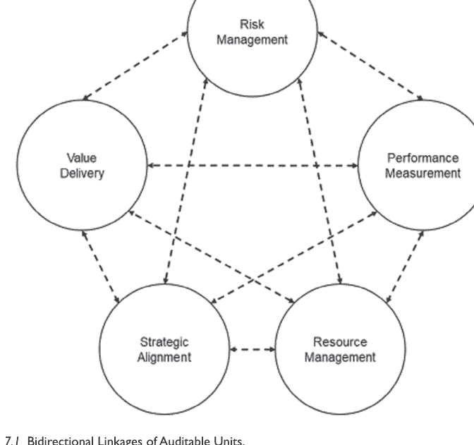

图 7.1 可审计单元的双向联系。

注：改编自 R. E. Davis 所著《Assuring IT Governance》，2011 年，Amazon.com。版权 2011 归 Robert E. Davis 所有。经许可改编。

### 控制评估

通常，实体管理者领导者部署的框架包含责任、问责和权限，以确保 ISG 有效性和控制环境适当性。因此，通过了解已部署框架的设计要素，可以降低 ISG 审计风险。例如，如果实体采用了信息技术基础设施库（即 ITIL）框架，信息安全服务和交付领域可能结构良好，并具有适当的控制措施以显著降低价值交付风险。

在准备和评估 ISG 控制环境风险时，如前所述，考虑的重点是实体管理层的态度、意识和行动。评估特定实体相关的控制环境风险程度可使用各种技术和工具进行，包括实体政策 – 控制环境特征矩阵和实体文化 – 审计领域人员矩阵。如附录 A 所示，实体政策 – 控制环境特征矩阵列出了潜在的安全政策，这些政策与实体的控制环境特征相互参照。或者，如附录 B 所示，实体文化 – 审计领域人员矩阵显示了与实体人员定性评级相互参照的环境意识因素。实现控制系统实体级目标的管理策略受控制环境的设计和运行、信息系统以及控制程序的影响（Davis, 2010, 2020）。

### 控制环境

实体作为具有集体目的的社会组织而存在（Davis, 2008, 2020; Mahadeen et al., 2016）。在实体内部，内部和外部环境因素影响组织结构和组织文化（Davis, 2008, 2020; Hitt & Brynjolfsson, 1997; Islam et al., 2012; Meyer & Rowan, 1977）。实体环境对内部战略的响应沉浸需要一个依赖各种信息参考的适应性、双向过程。尽管如此，组织结构以两种不同但可能集成的形式存在：正式和非正式（Davis, 2020; Lucas & Baroudi, 1994; Meyer & Rowan, 1977）。

正式组织结构通常反映与法规、法律、规则、标准、程序、指令和政策相关的一组构建（Davis, 2020）。非正式组织结构反映了在实践中规范员工工作行为的相互交织的社会构成（Davis, 2017, 2020; Flores et al., 2014; Meyer & Rowan, 1977）。然而，无论实体类型如何，在控制环境基础层面，组织结构受已部署技术和设计任务的影响（Davis, 2017, 2020; Guadalupe et al., 2014; Hitt & Brynjolfsson, 1997; Meyer & Rowan, 1977; Sor, 2004）。ISG 审计计划人员必须了解管理层关于控制环境行动的目的，以便对当前情况或条件进行充分评估（Davis, 2020）。


一个可行的ISG审计计划的关键在于IT审计职能的组织地位。具体而言，内部IT审计的组织地位可能成为决定是否继续进行ISG审计的一个因素（Davis, 2011）。例如，管理层可能会认为允许内部IT审计人员访问高级业务文件是不恰当的。因此，审计职能的组织地位可能要求聘请独立的第三方来管理和执行ISG审计。尽管如此，ISG审计是文档密集型且范围广泛的。ISG审计需要收集从内部到外部存储库的信息。用于理解治理结构的潜在信息来源包括：

-   相关法律法规；
-   政策、程序、标准、规则和指令；
-   以往内外部审计或审查的结果；
-   组织结构图；
-   职位描述；
-   关键人员名单；
-   流程数据图表和流程图；
-   系统数据图表和流程图；
-   运营备忘录和报告；
-   财务备忘录和报告；
-   规划报告；
-   绩效报告；
-   近期管理层会议报告或纪要；
-   已部署的控制框架手册；
-   风险评估报告；
-   近期管理研究或报告；以及
-   相关组织调查（Davis, 2011）。

主管IT审计师应识别并理解使ISG结构绩效得以实现的一般流程，包括用于向下级传达目标和目的（即自上而下）以及传递合规监控信息（即自下而上）的沟通渠道。在内部，实体和ISG相关的规划文件、政策、程序、指令、规则、组织结构图、职位描述、拓扑图和IAP清单通常可用，以帮助理解运营结构和设计。

实体的组织结构提供了框架，在此框架内，实现实体整体目标的活动涵盖规划、执行、控制和审查（Davis, 2011）。实体的管理者-领导者会开发适合满足感知需求的组织结构（Davis, 2011）。以实体为中心的组织结构的适当性部分取决于活动的规模和性质（Davis, 2020）。此外，有效的组织结构建设包括部署适当的权力和责任，并为活动提供充分的问责。为了支持实体控制环境评估，指定的主管审计师应获取ISG结构信息，包括负责以下事项的层级：

-   治理实体；
-   设定战略方向；
-   评估首席执行官或执行管理层在实施实体战略方面的绩效；
-   评估高级管理者-领导者及其下属在汇报已部署战略方面的绩效；
-   确定实体是否已培养满足战略目标所需的技能；
-   确定实体是否已构建满足战略目标所需的技术基础设施；以及
-   评估实体维持当前运营目标的能力（Davis, 2011）。

在ISG审计规划者评估时，受控环境意味着类别可包括组织、政策、程序、人员、会计、预算、报告和内部控制审查，以确定实体控制规范的普遍性（Davis, 2005, 2010, 2020）。采用层级管理或预设控制的正式组织结构，其权力、问责和责任通常是透明的（Davis, 2020; Quain, 2019）。相比之下，在非正式组织结构中，由于领导层选拔标准的原因，权力、问责和责任通常较为模糊（Davis, 2020; Quain, 2019）。鉴于控制环境确立了组织基调，控制环境影响员工的内部控制意识（Mahadeen et al., 2016）。

### 信息系统

信息系统部署包含完整的组织、基础设施、人员以及其他收集、处理、处置、存储、传输、显示和传播有用数据的元素（Davis, 2017, 2020; Schryen, 2013）。信息系统建立在任务配置之上，使数据能够被收集、处理、整理并传送给访问用户或放入存储介质（Davis, 2017, 2020）。实体信息系统的主要目的是准确、可靠、及时地传播数据（Davis, 2010, 2020）。信息系统及相关技术部署可以提供竞争优势并增加控制要求（Davis, 2010, 2020）。一方面，如果整合得当，IT可以通过创新应用提供竞争优势，以及其他好处（Davis, 2017, 2020; Samson et al., 2005; Soava & Raduteanu, 2014）。另一方面，过度复杂的使用IT的信息系统会降低效率和有效性（Davis, 2020）。

连接信息系统的技术可以使组织内部和组织间的沟通几乎无缝衔接（Davis, 2017, 2020; Farahmand et al., 2005; Guadalupe et al., 2014）。基于IT的系统、流程、活动和任务是提供有效且高效的信息和通信的基本支撑要素。因此，无缝的IT网络能力影响了组织结构（Davis, 2020）。从解释的角度看，实体的信息系统代表了收集数据、处理交易和传达运营结果的基础设施（Davis, 2010, 2020）。换句话说，实体的管理信息系统代表了资源及其相关政策与程序的聚合，使数据处理能够生成可用于决策的信息（Davis, 2011）。

无论是否成文，主管IT审计师都应了解实体的信息系统战略，包括：

-   实现实体使命和目标的长期计划；
-   实现实体使命和目标的短期计划；
-   支持实体计划的IT和系统的长期战略与计划；
-   支持实体计划的IT和系统的短期战略与计划；
-   制定信息安全战略的方法；
-   制定计划的方法；
-   监控实体计划进展的方法；
-   信息安全战略和计划变更控制的方法；
-   信息安全使命声明以及商定的活动目标和目的；以及
-   对现有信息安全活动和系统的评估。

### 控制程序

控制是程序性的，可分为预防性、检测性、纠正性、指导性、补偿性（Cascarino, 2012）或缓解性措施（Davis, 2008, 2020）。程序定义了完成一项活动的任务（Davis, 2010, 2020）。控制程序传达了组织人员在开展活动或任务期间的绩效期望（Davis, 2020）。IAP控制包括为管理层提供一定程度的信心而采纳或设计的程序，以确保信息安全目标的实现。因此，IAP控制程序通常规定了对组织信息资产的保护。无论如何，ISG审计规划者的重点是在审计领域中证实控制的存在，以最大限度地降低潜在风险（Davis, 2020）。

IAP控制的失败可能导致财务损失、竞争地位下降、买家信任丧失、形象破坏或声誉受损。管理者-领导者关注IAP控制的有效性主要有两个原因。主要原因是：（a）控制弱点可能导致未被发现的重大错报（Haislip et al., 2016）；（b）确保组织员工能够预防、检测或纠正被认为对信息构成的潜在威胁（Davis, 2020）。部署有效的IAP控制程序有助于实现更高效、更有效的信息安全管理。

控制程序应被视为实现控制目标和目的的执行过程（Davis, 2011）。控制程序试图确保管理层的运营意图得以实现（Davis, 2011）。与政策一样，控制程序应提供组织资产保护的期望，并促进有效性和效率（Davis, 2011）。

### 审计风险评估

确定可审查的审计单元必须使用一种以审计领域目标和风险为重点的遴选方法，以履行ISG审计规划者的职责。ISG审计规划者执行风险评估，以确保在审计期间所有重大审计领域项目都得到充分处理并能够得出结论。审计风险评估有助于识别具有较高概率出现重大ISG问题的领域。将风险评估方法应用于ISG控制系统对于制定有证据支持的审计计划至关重要。主管IT审计师可以从多种风险评估方法中进行选择（Davis, 2010; ISACA, 2013, 2014）。风险评估方法从简单的定性分类到复杂的定量计算不等（Davis, 2010; ISACA, 2014）。

具体到ISG审计，规划风险评估应包括以下类别：ISG战略一致性、价值交付、风险管理、绩效衡量、绩效管理、资源管理、环境质量、信息质量、法律合规、受托责任要求和技术要求。如附录C所示，主管IT审计师应考虑在总体风险评估层面将法律合规归入受托责任要求项下，将环境和信息质量归入质量要求项下，同时在可审计单元层面保持工作底稿项目的单独分类（Davis, 2011）。此外，绩效管理和绩效衡量应在总体风险评估层面合并，因为绩效衡量需要管理层进行监控和评估，以提供适当的治理（Davis, 2011）。


### ISG审计：控制措施的研究与评估

应用标准的决策信息分类方案可以帮助主管IT审计师（Davis, 2011）评估实体和ISG框架。不同的管理信息类型对于战略、战术或运营规划层面的决策至关重要（见表7.1）。决策规划层面的类别反映了持续时间和管理层参与程度。区间数据是所有信息分类项目和决策类别的分类方式（Davis, 2011）。五分制李克特式量表为：1 – 非常低，2 – 低，3 – 中等，4 – 高，5 – 非常高（Davis, 2011）。非常低指信息在毫无保留的情况下强烈不同意所述项目的参数。低指信息不同意项目的参数，但存在认知保留成分。中等指信息在同意与不同意项目参数之间采取中立立场。高指信息同意所述项目的参数，但存在认知保留成分。非常高指信息在毫无保留的情况下强烈同意项目所述参数。

战略计划记录了高管管理层对利用可用资源实现长期计划目标的评估（Davis, 2011）。外部信息、模拟信息和预测未来信息在制定战略决策方面为管理层提供非常高的帮助（Davis, 2011）。关于外部信息的子类，竞争行为、客户行为、资源可用性、人口统计研究和政府行为是在战略决策中有用的特定信息（Davis, 2011）。因此，为了确定战略计划制定的可靠性，被指定的IT审计师必须研究和评估外部信息、模拟信息和长期预测未来信息，以评估实体和ISG战略的可行性。被指定的IT审计师还必须考虑高层管理领导者是否启动了有关信息安全的适当活动，以及是否对活动进行了适当的监控。

战术计划侧重于分配预定的可用资源，并反映中层管理决策（Davis, 2011）。描述性历史信息、绩效现状信息、模拟信息和短期预测信息在制定战术决策方面为管理层提供高度帮助（Davis, 2011）。因此，为了确定战术计划部署的完整性，被指定的IT审计师必须研究和评估与战术问题相关的描述性历史信息，并尝试构想对实体可能更合适的替代方案（Davis, 2011）。

表7.1 信息分类——决策矩阵

| 信息分类项目 | 战略 | 战术 | 运营 |
|---|---|---|---|
| 外部 | 非常高 | 中等 | 非常低 |
| 内部 | 中等 | 高 | 非常高 |
| 在线 | 低 | 高 | 非常高 |
| 实时 | 非常高 | 非常高 | 非常高 |
| 描述性历史 | 低 | 高 | 中等 |
| 绩效现状 | 中等 | 高 | 非常高 |
| 预测未来 | 非常高 | 高 | 低 |
| 模拟 | 非常高 | 高 | 低 |

注：改编自R. E. Davis于2011年所著《Assuring IT Governance》，Amazon.com。版权归Robert E. Davis所有，2011年。经许可改编。

运营计划通常处理常规决策（Davis, 2011）。内部信息和绩效现状信息在制定运营决策方面为管理层提供非常高的帮助。因此，为了确定运营计划的有效性和效率，被指定的IT审计师必须研究和评估内部信息和绩效现状信息，以判断目标实现情况（Davis, 2011）。

管理信息系统试图将数据与预期用途相匹配（Davis, 2011）。如图7.2所示，数据元素、活动、功能操作和系统是金字塔式的分类，界定了信息需求。在图形上，数据元素位于金字塔的底部，系统位于顶端（Davis, 2011）。就全面性而言，从底部开始，金字塔每一层都反映了信息汇总要求的增加（Davis, 2011）。同时，信息的详细程度从顶端开始反映了汇总程度的减少（Davis, 2011）。因此，实体的管理信息系统在详细程度和全面性之间存在反比关系（Davis, 2011）。

ISG审计计划可能包括评估高层管理人员在制定、沟通、执行和监控IAP政策及法律合规性方面所采用的过程。具体而言，人力资源政策和合同合规性必须由被指定的IT审计师进行评估。对于ISG审计范围内的合规过程评估，涉及纠正、通知、记录和审计的合规执行活动应获得最高优先级。在子类层面，当评估IAP政策、指令、标准和程序时，IT审计师应确定其是否符合适用的法律法规。

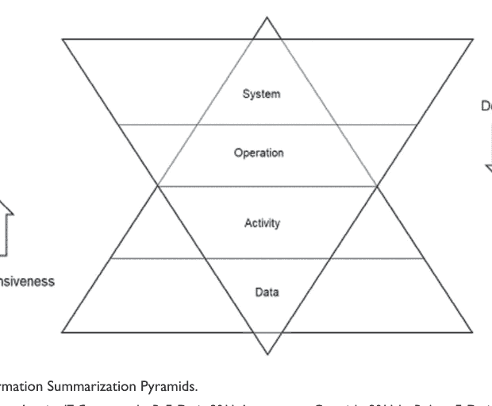

图7.2 信息汇总金字塔。

注：改编自R. E. Davis于2011年所著《Assuring IT Governance》，Amazon.com。版权归Robert E. Davis所有，2011年。经许可改编。

在ISG审计期间，组织战略和支持领域的覆盖范围应接受研究和评估。全面而言，被指定的IT审计师可以审查那些为特定战略规划领域提供适当预期的政策（Davis, 2011）。如果在战略计划中涉及，组织变革、技术评估、监管要求、业务流程再造和资源管理都应接受政策覆盖充分性的审查（Davis, 2011）。根据审计范围，IT审计团队成员可能会收到指示，研究和评估下述书面政策：

- 安全，
- 人力资源，
- 数据所有权，
- 终端用户计算，
- 知识产权，
- 数据保留，
- 系统采购，
- 系统实施，
- 外包，
- 独立保证，
- 连续性规划，
- 保险，以及
- 隐私。

### 信息安全战略对齐

由于拥有一个健全的计划对于实现实体使命至关重要，制定一个战略对齐的信息与通信计划对于实现实体的保密性、完整性和可用性目标至关重要。ISG审计的第一项战略和战术研究及评估步骤应该是审查所采用的组织规划流程或方法论。实体的ISG应具有具体、可衡量且经批准的目标。信息安全应具有允许在部门层面系统开展事务的结构，以反映实体的目标和宗旨。组织目标的选择先于部门目标设计（即既定政策和程序；Davis, 2011）。随后，管理层以允许统一运作的方式连接或关联概念、部分、活动和人员，以实现既定目标（Davis, 2011）。目标与宗旨转化为统一运作通常被称为流程。

实体的目标和宗旨应是ISG的驱动因素。因此，被指定的IT审计师应详细了解以下内容：

- 实体与信息安全办公室的使命，
- 实体与信息安全办公室的愿景，
- 核心实体与信息安全办公室员工价值观，
- 实体与信息安全办公室的战略，以及
- 实体与信息安全办公室的目标。

在制定实体使命宣言时，管理领导者应考虑环境、组织能力和预期的客户服务（Davis, 2011）。该


信息安全办公室的使命宣言应与实体的使命宣言保持一致。理解实体的使命使受指派的IT审计师能够评估组织和控制目标的一致性。

大多数信息安全流程的目标与一般实体层面的目标相呼应。管理者领导者通常建立管理信息系统，其目标旨在遵守外部和内部安全要求并据此设计实施。同样，管理者领导者设计并部署流程以实现特定目标（Davis, 2011）。受指派的IT审计团队成员应审查长期和战略计划，以确定目标与控制考虑之间的一致性。

部署适当的控制需要完整的记录。控制记录支持管理层对实体控制系统的意图。经记录并传达的确保控制的政策、指令和程序，在执行时代表控制活动（Davis, 2011）。获取ISG审计对运营活动统一性的理解的主要记录是系统流程图、流程图和数据流图（Davis, 2011）。

评估实体与信息安全办公室在使命、愿景、价值观、战略和目标方面的一致性，对于确定信息安全管理实现实体目标和宗旨的能力至关重要。在ISG研究和控制评估期间，受指派的IT审计团队成员应通过考虑以下问题来评估是否存在实体战略规划流程：
- 存在明确的使命和愿景定义；
- 存在被采用的战略规划方法；
- 参与规划流程的人员层级是适当的；以及
- 规划会定期更新（Davis, 2011）。

在组织层面，全面且一体化的战略计划通常对于界定信息共享、授权创建以及在运营环境中适当的数据使用至关重要（Davis, 2011）。在许多情况下，信息安全对于营利性和非营利性组织及时应对不利情况的成功至关重要。因此，确保战略计划涵盖IAP考量并使信息安全与实体的目标保持一致，能够实现有效且高效的管理。

实体战略计划源于实体目标（Davis, 2011）。因此，作为确保ISG部署的基础依据，对信息安全与实体战略计划保持战略一致性漠不关心的态度可能对实现实体目标产生不利影响。可能导致信息安全战略一致性冷漠的控制环境因素是缺乏意识。具体而言，当管理者领导者拥有为某个部门获取IAP系统的完全权限时，往往会出现近视倾向。换句话说，所选IAP是否能满足全实体需求经常被忽视，因为流程所有者在申请资源时通常只考虑其负责范围。关于IAP的近视型管理关注往往导致配置无法满足全实体目标，禁用对外部访问点的连接或限制与其他内部单位的服务共享。

管理者领导者的主要任务是有效地、高效地实现与实体整体目标相联系的组织目标（Davis, 2011）。有效性指的是目标或目的实现的程度（Davis, 2011）。效率指的是在给定投入下最大化产出（Davis, 2011）。在实践中，有效性至关重要，而效率可能次要，因为权衡经常发生（Davis, 2011）。然而，实体通常具有多个目标，这些目标往往相互矛盾。例如，在给定的年份内，实现价值和最大化服务交付的目标可能是相互排斥的，因为费用可能会阻碍或排除服务（Davis, 2011）。

目标缺乏透明度将导致在规划、结构化和配置实体人员时产生不确定性。此外，缺乏透明度可能导致在开发信息和沟通控制系统以衡量行政决策有效性时产生不确定性（Davis, 2011）。无论是营利性还是非营利性，所有实体的使命和目的都应明确定义，并与支持实体的每个组织职能保持战略一致（Davis, 2011）。从上下文来看，所有实体都有一个目标层级，有效地决定投资决策和管理行动的优先顺序（Davis, 2011）。在政策层面，目标通常表述宽泛并体现在实体的战略设计中（Davis, 2011）。主要实体目标提供初始指导方针和统一力量，指导所有活动并通过政策建立控制和问责的基础线（Davis, 2011）。

在运营层面，审查审计区域目标以确保其与所部署的运营和处理技术类型以及与实体目标的关系，是IT审计团队的重点。当评估信息安全战略规划流程时，受指派的IT审计师需要考虑是否：
- 信息安全办公室的使命和愿景有明确定义（Davis, 2011）。
- 部署了战略信息安全办公室规划方法（Davis, 2011）。
- 规划方法将运营目标和目标与信息安全目标和目标相关联（Davis, 2011）。
- 计划确定了主要IAP举措和所需资源（Davis, 2011）。
- 规划流程至少每年更新一次（Davis, 2011）。
- 参与规划流程的人员层级是适当的（Davis, 2011）。

组织结构需要评估是否适当实现了职能分离和职责分离。对组织单位和员工职位描述的分析对于确定确保职能单位所涉及人员的权限、责任和问责，以及信息安全战略规划流程是否适当是必要的。此外，政策和程序需要评估其是否采用结构化规划方法（Davis, 2011）。

在IT审计师审查信息安全和职能单位目标及宗旨时，评估管理有效性和效率至关重要。当审查信息安全战术规划时，受指派的IT审计师应通过考虑以下内容来评估所部署的项目管理实践：
- 项目管理方法的采用程度，
- 所应用的项目管理控制，
- 所使用的项目管理工具，
- 实体职能单位员工在项目各个阶段的整合，以及
- 用于涉及重大组织变革的大型项目的变更管理方法（Davis, 2011）。

项目管理控制规范IAP计划的规划、组织和指导。最理想的是，IAP控制应对技术变化和项目环境。技术变更控制处理信息安全资源的修改，包括变更优先级和内容。而项目环境控制则涉及确保项目中不会出现某个人拥有压倒性的项目权限和控制权，并对之给予适当重视（Davis, 2011）。

### 信息安全价值交付

部署保障机制后，必须进行关键的运营和ISG战略对齐，以随后改善实体绩效（Davis, 2017; Wu et al., 2015）。为了了解流程并促进分析以确保ISG服务交付与实体的战略驱动保持一致，每个运营阶段都需要对可用资源进行一致性评估（Davis, 2011, 2017）。通过此评估，ISG有效性可以反映实现既定实体目标的正确视角（Davis, 2011, 2017）。在有效部署ISG的情况下，一旦具有道德的管理者领导者采纳战略目标，下属行动方案应反映实现预期目标的尝试（Davis, 2011, 2017），通过预防和促进心态（Neubert et al., 2013）。因此，ISG有效性促使做正确的事情（Davis, 2017）。

运营计划可以是正式的也可以是非正式的（Davis, 2011）。然而，管理问责和责任可能要求在特定时间内交付信息安全，以帮助实现实体目标。通常，信息安全交付及时性的要求对应于决策过程中的信息价值。因此，当审查信息安全交付流程时，受指派的IT审计师必须考虑是否
- 分析师确定将新政策或更新政策制度化的财务和非财务资源影响，
- 信息安全政策有效解决了IAP风险评估中确定的风险，
- 相关信息安全政策包含在所有第三方合同中，
- 对违反实体政策的行为进行明确沟通和后果执行，以及
- 信息安全问题在所有重大或重要实体决策中得到考虑（Davis, 2017）。

评估变更和维护现有系统是促进价值交付的关键信息安全服务要素（Davis, 2008）。受指派的IT审计师必须评估实体的ISG工作，以满足实体的需求并支持运营目标


确定安全开发方法论的控制有效性。审查安全开发方法论以确保与实体的战略目标一致，有助于确定IAP规划与采购控制的适当性。此外，为确定项目管理控制的效率，被指派的信息技术审计师必须评估一项控制是否实现了多个目标，以及执行该控制所需的预计时间。

### 信息安全风险管理

信息安全经理—领导者负责规划、指导和部署已实施的信息安全计划（IAP）。信息安全经理—领导者通常根据组织结构制定信息安全办公室的政策、程序和标准。因此，IAP部署机会应能降低实体潜在风险。适当的IAP风险管理处理潜在不可接受事件的识别与处置。无论风险管理过程是正式还是非正式，被指派的信息技术审计师至少必须评估：

- 已部署的风险管理框架是否存在，
- 风险识别过程中是否纳入实体层面的目标，
- 风险识别过程中是否包含概率、频率和威胁分析技术，
- IAP风险评估的更新频率，
- 是否实施了适当的对策以缓解信息资产的威胁、脆弱性和机会风险，以及
- 参与风险评估的人员层级是否适当。

### 信息安全资源管理

流程应通过信息安全办公室人员的角色和职责得以体现，并需要在某种层面上进行成文记述（Davis, 2011）。此外，每个流程都应有一个职责明确的所有者（Davis, 2011）。实体经理—领导者应建立适当的流程模型（Davis, 2011）。被指派的信息技术审计师可以参考现有模型，以确定其在支持可审计流程和职位描述方面的适当性（Davis, 2011）。或者，在缺乏可接受的流程模型和职位描述的情况下，与ISG相关的成文记述可能引用一些描述角色和职责的高层级标准，而这些标准反过来需要信息技术审计进行研究和评估其适当性。

人员素质影响ISG。因此，被指派的信息技术审计团队成员必须确定现有人员能否完成分配的任务，以及是否制定了长期人员计划以有效应对未来问题（Davis, 2011）。因此，被指派的信息技术审计团队成员应评估信息安全人员是否具备履行其职责所需的技能、经验和资源。具体而言，信息技术审计师的评估必须测试专家人员或职能是否适合在实现信息安全目标的过程中最佳地利用IAP工具和技术。此外，信息技术审计师的评估还必须考虑，对负有信息安全职责的IAP专家和非专家人员的管理，是否足以应对实体面临的错误、失误、遗漏、违规和非法行为风险。

- 运营有效性评估侧重于具体绩效如何以预期方式促进实体目标和宗旨的实现（Davis, 2011）。通常，运营有效性监控有助于确定IAP是否维持信息安全战略一致性、价值交付、风险管理、绩效衡量和资源管理，以满足利益相关者的期望。
- 信息可靠性评估侧重于表达的真实性（representational faithfulness），以确保各项主张与所声称的支持事件一致（Davis, 2008）。通常，信息可靠性监控有助于确定IAP是否维持完整、准确和有效的信息，以开展实体事务和履行报告职责。
- 法律法规合规性评估侧重于在开展组织事务时对法定要求的遵守程度。通常，法律法规合规性监控有助于确定IAP是否维持法定的管理、运营和技术职责。

环境和信息质量要求通常涉及IAP对目的的适用性。换句话说，部署和维护正确的IAP解决方案应有助于实现实体的目标和宗旨。质量要求的衡量包括质量、交付和成本（Davis, 2011）。质量管理服务需要在IAP安装之前、期间和之后通过检查进行部署，以避免信息和环境恶化。具体而言，定期执行外部和内部审查对于维持IT可用性，同时确保有效且高效的服务交付是必要的（Davis, 2011）。内部审查可通过质量控制、自我评估和内部审计人员来进行。被指派的信息技术审计师至少应评估实体内部审计职能在ISG项目以及ISG相关自我评估中的参与程度。

被指派的信息技术审计师必须评估有关信息和环境质量的政策、指令、标准、程序和规则。信息质量应具有透明度。然而，信息质量依赖于已部署的IAP。信息透明度涉及表达形式（Davis, 2011）。相比之下，技术透明度代表交付方式。环境质量狭义上指旨在抵御灰尘、温度和湿度所引起问题的硬件（Davis, 2011）。实体应部署温度、湿度和空气质量气候控制，以补充IT硬件设计的环境质量措施（Davis, 2011）。保持完整性是IAP信息和环境形式与方式支持的基本标准。

当考虑资源的最优生产性和经济性使用与IAP估值之间的关系时，成本作为一个效率问题出现。所选IAP投资的财务预测及其相关潜在回报属于管理层责任。通常，IAP投资的结果未知，但附有预计结果的已知概率。预算有助于确定实际成本何时与预期成本不一致，从而反映IAP投资的财务效率。鉴于成本优化通常对ISG至关重要，被指派的信息技术审计师应考虑评估IAP成本核算方法和衡量标准，以确定绩效透明度。

信息技术需求衡量包括机密性、完整性和可用性。考虑到维持有效且高效的IT的成本，以及适当部署IT创造战略优势的能力，健全的实体IAP架构对于有效且高效的IT服务交付至关重要。运营计划可能因软件测试方法或审批流程而异。然而，基于重要性，不充分或未成文的政策、程序、指令、标准或规则应成为信息技术审计发现（Davis, 2011）。在检查信息安全交付过程时，被指派的信息技术审计师必须考虑已部署的应用开发运营控制、开发或修改流程，以及已部署的项目管理流程。关于IT应用开发方法论、实践以及应用于开发过程的控制，信息技术审计师的检查包括质量问题、基础设施特性、用于估算项目规模和进度的指标，以及用于检查测试问题以改进项目流程的技术。

从技术角度看，在ISG审计期间，信息技术审计师应处理与系统工具和实用程序相关的标准。工具和实用程序可用于系统发布管理、配置管理、变更控制、数据库管理、软件开发、软件建模、软件监控等情形。如果系统工具或实用程序的部署不一致，不兼容性可能会造成效率低下。遵守标准通常会转化为改进信息安全控制环境和治理的运营程序。

### ISG审计测试与控制的评估

信息技术审计测试完成了通常所称的审计实地工作（Davis, 2010）。从逻辑上讲，在完成信息技术审计研究和控制流程评估后，审计师准备对交易、循环或事件进行选定的统计或非统计测试（Davis, 2010）。对ISG可审计单元进行统计或非统计测试，是主审信息技术审计师就直接主题事项、相关主题事项以及管理层认定所期望获得的审计保证的最终体现（Davis, 2010）。在制定测试程序之前，可审计单元的测试重要性水平应超过测试阈值（Davis, 2010）。因此，测试程序应有明确的目标，并反映预先确定的测试时间、性质与范围（Davis, 2010）。

ISG审计重要性影响审计的性质、时间和范围（Davis, 2010）。因此，ISG审计测试重要性影响审计测试的性质、时间和范围（Davis, 2010）。审计测试的性质代表所执行测试的类型（Davis, 2010）。测试执行反映了与ISG可审计单元相关的预定风险（Davis, 2010），而ISG审计测试的时间指的是审计测试执行的发生时间（Davis, 2010）。此外，审计测试的范围是测试的数量或覆盖范围（Davis, 2010）。如果被指派的主审信息技术审计师准确预测了可审计单元所需的控制有效性保证，那么实际测试结果应接近预期测试结果的保证水平（Davis, 2010）。

通常，审计测试重要性水平与审计设计重要性水平一致（Davis, 2010, 2020）。然而，实质性测试的重要性水平可能低于设计重要性水平，以在某些情况下实现ISG审计保证目标。有条件地，较低的实质性测试重要性可能出现在以下情况：

- 预期存在重大错报的定位；
- 当审计包含多个组织地点样本时，涉及认定、直接主题事项或相关主题事项；
- 被归类为对财务报表使用者敏感的可审计单元测试；
- 被归类为对技术使用者敏感的可审计单元测试；以及
- 当审计包含多个组织地点样本时，涉及具体列项。

ISG审计属于一般控制检查。因此，信息技术审计团队对一般控制的测试倾向于执行手工程序，无论是统计还是非统计方式。


（Davis, 2011, 2020）。一旦决定使用审计抽样，被指派的IT审计师必须在统计与非统计测试方法之间做出选择（Davis, 2010）。这一测试选择主要是一个成本–效益考量（Davis, 2010）。统计审计测试方法有助于被指派的IT审计师设计高效样本、衡量所获证据的充分性以及评估样本结果（Davis, 2010）。采用统计审计测试方法时，总是存在一定的抽样风险（Davis, 2010）。统计审计测试方法使用数学概率来衡量抽样风险（Davis, 2010）。任何不以抽样风险为基准的审计测试方法都是非统计性测试应用（Davis, 2010）。如果审计师选取了样本，却没有对样本结果进行统计性评估，则该审计测试方法属于非统计性审计测试处理（Davis, 2010）。

执行审计测试时，最重要的一步是界定被检查的总体（Davis, 2010）。可审计单元测试总体是依据样本结果进行推断的数据组（Davis, 2010, 2020）。换言之，可审计单元总体代表了被指派的IT审计师决定从其中抽样以对目标总体下结论的完整数据集（Davis, 2010, 2020）。

在理解并界定可审计单元测试总体之后，被指派的IT审计师要进行适当性与完整性一致性评估（Davis, 2010, 2020）。该一致性评估涉及IT审计测试目标与审计目标，以避免在错误假设下完成保证任务（Davis, 2011; Soltani, 2007）。此外，为了体现对各IT审计测试目标的职业审慎，需要制定详细的审计抽样计划。详细计划必须反映支持审计测试目标的测试目标（见附录D）以及驱动样本选择技术的总体构成和位置（见附录E; Davis, 2010）。

接下来，被指派的IT审计师要定义抽样项目（Davis, 2010, 2020）。可审计单元测试总体中的单个项目代表一个抽样单元。审计抽样单元的定义取决于样本目标（Davis, 2010）。作为推论说明，总体在实物上的样本表现即为样本框（Davis, 2010）。

统计测试抽样是一种客观的方法，试图代表测试总体（Davis, 2010）。统计测试的标识构成了结果分类的前提（Davis, 2010）。因此，统计参数是总体的一个特征，它是使用每个总体元素计算出来的数值（Davis, 2010）。统计量也是从总体中抽取的样本的一个特征，它仅使用样本总体元素计算得出（Davis, 2010）。抽样对ISG审计至关重要，因为完整的普查通常成本高昂、耗时且容易出错（Davis, 2010）。

统计审计测试设计可以是固定的或序贯的（Davis, 2010, 2020）。接受测试、发现测试和属性测试是固定测试可用的子分类（Davis, 2010, 2020）。相比之下，停-走测试使用序贯测试方法，并且所需置信水平低于固定测试方法（Davis, 2010, 2020）。尽管如此，接受测试、发现测试和停-走测试都是独特的属性抽样应用（Davis, 2020）。系统抽样、随机抽样、分层抽样和单元抽样方法可用于固定和序贯测试方法（Davis, 2010, 2020）。

判断抽样和随意抽样可用于非统计测试（Davis, 2010）。如果选择非统计测试，IT审计师不能以科学术语陈述事件发生概率（Davis, 2010）。作为对非统计测试使用的一个阻碍，随意抽样和判断抽样方法无法量化统计精度和可靠性，从而妨碍被指派的IT审计师基于所检查的样本得出审计总体结论（Davis, 2010）。然而，随意抽样和判断抽样是在与统计测试方法相同的审计保证提供考量下执行合规性测试和实质性测试的可接受方法（Davis, 2010, 2020）。

判断抽样方法取决于反映个人经验或推测的项目选择决策（Davis, 2010, 2020）。因此，判断抽样有效性的核心是IT审计师的组织和个人经验（Davis, 2010, 2020）或演绎推理的可靠性。判断抽样方法是一种非统计应用，可能对IT审计产生高偏差结论影响（Davis, 2010, 2020）。换言之，判断抽样是一种非统计方法，可能在形成意见时依赖带有偏倚的主观性（Davis, 2020; Hall et al., 2000）。

随意抽样是一种从总体项目选择中去除主观性的程序性尝试（Davis, 2010, 2020; Glen, 2015）。然而，与判断抽样一样，使用随意抽样方法并不量化统计可靠性和精度（Davis, 2010, 2020）。在使用随意抽样方法时，为了主动消除有意识的偏差和选择可预测性，证明项目选择的真正随机性至关重要（Bragg, 2019; Davis, 2005, 2011; Glen, 2015）。然而，无意识偏差和可预测性可能影响项目选择决策（Bragg, 2019; Davis, 2010, 2020; Glen, 2015）。因此，随意抽样可能对IT审计产生偏差结论影响（Davis, 2010, 2020; Hall et al., 2000）。

### 信息安全合规性测试

除非IT审计风险评估或审计管理层另有规定，广泛合规性测试是ISG审计的常态。合规性测试的高层目标应支持初步控制有效性评估，并涉及获取支持审计师对控制报告的审计证据（Davis, 2010）。在从控制测试中获取审计证据时，被指派的IT审计师应考虑审计证据的完整性，以支持评估的控制风险水平（Davis, 2010）。如果检查对象是财务报表，另一个高层目标是获取支持将初步控制风险评估为中等或低水平的证据（Davis, 2010）。

属性测试是一种固定统计属性抽样方法（Davis, 2020）。对于属性测试的抽样单元，某种状况要么存在，要么不存在（Davis, 2020）。属性测试要求使用概率样本选择方法。抽取样本后进行测试，如果最大偏差率大于已定义的可容忍偏差率，则样本框存在不可接受的控制状况（Davis, 2020）。因此，被指派的IT审计师必须得出结论：可审计单元的控制设计和运行不足。

发现测试是一种固定属性抽样统计方法（Davis, 2010, 2020）。基本上，发现测试通常用于推断审计总体中舞弊行为或非法行为的概率（Davis, 2010, 2020）。发现测试的目的是能够以设定的置信度说明总体错误率低于预定的错误水平（Davis, 2010, 2020）。然而，如果在发现测试中检测到一个错误，抽样即停止，被指派的IT审计师必须启动适当的审计师行动（Davis, 2010, 2020）。因检测到错误而停止发现测试，反映出对可审计单元舞弊行为或非法行为不存在的假设（Davis, 2010, 2020）。

接受测试是一种固定统计属性抽样方法（Davis, 2010, 2020）。因此，接受测试方法仅允许“是”或“否”，以及

关于抽样单元的存在或不存在的决策（Davis, 2010, 2020）。具体而言，IT 审计师抽取样本进行测试（Davis, 2010, 2020）。如果定义的样本未超过例外率限制，则抽样框架具有可接受的控制条件（Davis, 2010, 2020）。在可接受的控制条件下，验收测试方法允许 IT 审计师得出总体错误率低于预定错误水平且具有特定置信度的结论（Davis, 2010, 2020）。

停止-继续测试是一种顺序统计属性抽样方法（Davis, 2010, 2020）。发现测试和验收测试要素存在于停止-继续测试中（Davis, 2010, 2020）。与所有顺序抽样一样，停止-继续测试的执行发生在多个步骤中，每个步骤取决于前一步的结果（Davis, 2010, 2020）。与发现测试的相似之处在于仅检查足够的样本项目，以使 IT 审计师能够说明实际总体错误率低于预定错误水平，且具有预先指定的置信水平（Davis, 2010, 2020）。使用该方法进行测试还允许说明总体错误率低于预定错误水平且具有特定置信度，与验收测试和发现测试一致（Davis, 2010, 2020）。此外，采用停止-继续测试可对抽样框架的上限精度作出结论。

停止-继续测试与发现测试和验收测试在前提和方法上存在差异（Davis, 2010, 2020）。例如，与发现测试不同，停止-继续测试通常不用于检测违规或非法行为（Davis, 2010, 2020）。此外，从统计上讲，停止-继续测试关于总体的推断陈述结构与验收测试的预测不同（Davis, 2010, 2020）。尽管如此，停止-继续测试计划提供了设计最小样本量的机会，预计总体偏差率较低（Davis, 2010, 2020）。预期的总体偏差率较低转化为较低的置信水平要求（Davis, 2010, 2020）。因此，与验收测试和发现测试不同，停止-继续测试依赖于较小的顺序样本量和较低的置信水平（Davis, 2010, 2020）。

### 信息安全实质性测试

对控制目标未实现风险的证实是指定 IT 审计师的主要实质性测试重点（Davis, 2010, 2020）。实质性测试子类别为分析程序和细节测试（Davis, 2010, 2020）。分析程序和细节测试是提高审计保证可用的选项（Davis, 2010, 2020）。分析程序的执行可以用来验证或确定 IT 可审计单元对控制目标的完成情况（Davis, 2010, 2020）。审计分析方法可以涵盖确定政策合规性、异常和低效率（Davis, 2010, 2020）。然而，仅靠分析程序在执行 IT 审计时可能不足（Davis, 2020）。

与分析程序类似，细节测试可以验证或确定 IT 可审计单元控制目标的完成情况（Davis, 2010, 2020）。细节测试的目标是支持相关断言或在相关断言层面发现重大错报。然而，细节测试通常组合使用，以提供关于断言的充分实质性保证（Davis, 2010, 2020）。有益的是，单一细节测试可能为一个以上的断言提供实质性保证（Davis, 2010, 2020）。

### 信息安全证据评估

通常，已记录的与 ISG 相关的政策、程序和标准可用于评估运行有效性。从证据角度看，IT 审计团队成员应考虑从 ISG 审计计划、研究与评估以及测试过程中获得的信息是否表明覆盖范围适当。充分证据的确定应包括对以下内容的评估：

- ISG 对 IAP 活动的使命声明；
- IAP 活动的约定目标；
- IAP 活动的目标；
- 与 IAP 资源使用相关的风险评估；
- IAP 资源使用的风险管理方法；
- 战略实施的战略计划；
- 监控战略部署进展的战略计划；
- 信息安全预算；
- 信息安全预算的差异监控；
- 高层信息资产使用政策；
- 高层 IAP 政策；
- 信息资产使用和保护政策的高层合规监控政策；
- 相关 IAP 绩效指标比较，包括来自类似实体、职能、适当国际标准、成熟度模型或公认最佳实践的基准；
- 根据约定绩效指标进行定期绩效监控；
- ISG 职能定期信息安全审查的证据，其中确定了行动项目、解决分配和跟踪；以及
- ISG 可审计单元之间有效性和有意义联系的证据。

### ISG 审计控制报告

证据识别的执行通常发生在 ISG 审计计划、研究和测试过程中（Davis, 2010, 2020）。来自 ISG 审计计划、研究和测试过程的收集证据通常满足充分性、可靠性、相关性和有用性的期望（Davis, 2020）。因此，在报告过程中识别额外审计证据的情况很少（Davis, 2010, 2020）。然而，在执行审计报告过程时如果需要额外审计证据，指定的 IT 审计师必须更新审计证据目录和工作底稿，以确保条件表述准确（Davis, 2010, 2020）。

在审计报告准备之前，对审计领域发现的条件、标准、原因、可能影响和建议进行分析可确保 ISG 审计的适当风险评分（Davis, 2010）。IT 审计团队成员处理 ISG 法定合规性和控制目标实现情况。无论佐证是强制性的还是酌情性的，支持审计意见的证据可以采取实物存在、观察过程、文件或陈述的形式（Davis, 2010, 2020）。然而，在某些情况下，口头陈述的佐证证据可能不足（Davis, 2010, 2020）。此外，在 ISG 审计期间发现与适用会计原则不一致和偏离时，指定的 IT 审计师应请求合格的财务审计师进行复核。

报告重要性代表了确定对审计区域发表意见的阈值（Davis, 2010, 2020）。ISG 审计报告作者就审计区域相关控制程序的设计和运行是否在所有重大方面有效发表意见（Davis, 2010, 2020; ISACA, 2014）。当 IT 审计团队成员承担一项业务以便能够记录保证声明时，如表 7.2 所示，可通过考虑特定审计事件将 IT 审计区域意见视为无保留、保留、否定或拒绝表示意见（Davis, 2020; ISACA, 2014）。表达的审计报告意见取决于审计是否具有 (a) 范围限制、(b) 不确定性、(c) 重大控制弱点、(d) 可报告情况或 (e) 其他弱点。

- **范围限制：** 代表获取有关业务审计区域组成部分的充分适当证据的限制（Davis, 2020）。
- **不确定性：** 是审计证据收集不足（Davis, 2020）。
- **重大控制弱点：** 其存在妨碍企业提供合理保证，即错误、失误、遗漏、违规或非法行为将在员工履行其分配职责的正常过程中及时得到预防或发现（Davis, 2020）。
- **可报告情况：** 传达重大或显著弱点，其中一个或多个控制组成部分的设计和运行未能将错误、失误、遗漏、违规或非法行为可能发生且未被员工在履行分配职责的正常过程中及时发现的风险降低到相对较低的水平（Davis, 2020）。此外，对于可报告情况，因不合规或绩效指标或相关绩效指标的汇总而导致的因果关系并不重要（Davis, 2020）。
- **其他弱点：** 表示重大或显著的非控制弱点，单独或与其他非控制弱点结合起来，将无法及时防止、发现和纠正错误、失误、遗漏、违规或非法行为的潜在发生。

**表 7.2 审计区域状况–潜在控制报告意见矩阵**

| 审计区域状况 | 无保留 | 保留 | 否定 | 拒绝表示意见 |
|---|---:|---:|---:|---:|
| 范围限制 |  | X |  | X |
| 不确定性 |  | X | X | X |
| 重大控制弱点 |  | X | X |  |
| 可报告情况 | X | X | X |  |
| 其他弱点 |  |  | X | X |

*注：X，表示意见考虑。改编自 R. E. Davis 所著《IT Auditing: An Adaptive System》，2011 年，Lulu。版权 2011 归 Robert E. Davis 所有。经许可改编。*

### 无保留意见

关于控制充分性的无保留 ISG 审计意见代表了在适当的控制实践下满足审计的程序设计和运营部署

审计领域控制目标(Davis, 2010, 2020)。此外，关于控制充分性的无保留意见表明不存在重大控制缺陷(Davis, 2010, 2020)。换言之，当审计职能得出结论：在所有重大方面，与审计领域相关的控制程序的设计和运行有效且符合可操作标准时，即存在无保留意见的 ISG（信息安全治理）审计报告(Davis, 2020; ISACA, 2014)。然而，无保留意见也可能包含非重大的可报告情况(Davis, 2010, 2020)。

### 保留意见
关于控制充分性的保留 ISG 审计意见表示，除影响审计领域控制目标的缺陷外，审计领域控制是有效的(Davis, 2010, 2020)。ISG 审计报告出具人在审阅充分且适当的证据，并据此得出结论认为控制缺陷（单独、共同或合计）具有重大性但尚未对 IT 审计目标产生普遍影响后，出具保留意见(Davis, 2020; ISACA, 2014)。此外，当 IT 审计团队成员无法获取充分且适当的证据作为决策基础时，也可出具关于控制充分性的保留意见(Davis, 2020)。即便如此，IT 审计团队成员仍得出结论：未发现的缺陷可能对 IT 审计目标产生的影响是重大的但不具有普遍性(Davis, 2020; ISACA, 2014)。保留 ISG 审计意见的表述通过报告中的单独段落进行，并说明保留理由(Davis, 2010, 2020; ISACA, 2014)。如果需要单独的 ISG 审计报告，出具人还会包含纠正措施建议(Davis, 2010, 2020)。

### 否定意见
关于控制充分性的否定 ISG 审计意见表示在审计期间结束时存在重大控制缺陷(Davis, 2005, 2010)。保留意见与否定 ISG 意见之间的差异直接对应于审计主题事项或认定反映适当控制部署的程度，以及控制缺陷的普遍性(Davis, 2010, 2020)。因此，当一项或多项重要缺陷呈现为普遍且重大的弱点时，ISG 审计报告出具人会出具否定意见(Davis, 2020; ISACA, 2014)。当存在重大控制缺陷时，ISG 审计报告出具人可以得出结论：控制措施在实现信息安全控制目标方面无效(Davis, 2010, 2020)。总之，ISG 否定意见是向信息资产使用者传递的信息：在作出决策时，信息安全控制可能不可靠。

### 无法表示意见
关于控制充分性的无法表示意见 ISG 审计意见表示对控制措施提供有限程度的保证(Davis, 2010, 2020)。当 IT 审计团队成员无法获取适当且充分的证据以形成意见时，ISG 审计报告出具人会出具无法表示意见(Davis, 2020; ISACA, 2014)。此外，当 IT 审计团队成员得出结论：未发现的缺陷可能对 IT 审计目标产生的影响是重大的且具有普遍性时，ISG 审计报告出具人也会出具无法表示意见(Davis, 2020; ISACA, 2014)。如果信息安全控制并非主要业务目标，ISG 审计报告出具人也会考虑出具无法表示意见(Davis, 2010, 2020)。尽管如此，ISG 报告出具人仍会在报告中详细说明出具无法表示意见的理由(Davis, 2010, 2020)。

### 对应程度
确定认定或直接主题事项与审计标准之间的对应程度是一项专业要求(Davis, 2010, 2020; Marius et al., 2009)。然而，鉴证方法在实践中既有相似之处也有不同之处(Davis, 2010, 2020)。IT 审计与非 IT 审计类型的相似之处在于，确定对应程度需要对所审查控制系统中何为重大缺陷作出客观和主观判断(Davis, 2010, 2020)。IT 审计与手工审计类型的不同之处在于，控制系统通常更为复杂(Davis, 2010, 2020)。此外，IT 审计更具挑战性，因为被指派的 IT 审计师必须确定所审查的计算机程序和数据文件是否具有表征有效性(Davis, 2010, 2020)。

控制缺陷的成因可关联到实体的设计或运行状况(Davis, 2010, 2020)。一方面，当缺少必要的控制时，存在设计缺陷(Davis, 2010, 2020)。当现有控制的设计不当，以至于即使控制运行，控制目标也并非总能实现时，也存在设计缺陷(Davis, 2010, 2020)。另一方面，当设计恰当的控制未能按预期运行时，存在运行缺陷。当执行控制的人员缺乏有效执行控制所需的权限或资格时，也存在运行缺陷(Davis, 2010, 2020)。数字化数据或相关技术的控制缺陷可能对管理层按照组织管理层的认定发起、记录、处理和报告信息的能力产生不利影响(Davis, 2010, 2020)。

IT 审计发现可能是有利的或不利的(Davis, 2010, 2020)。有利的 IT 审计发现需要简明、透明的表述(Davis, 2010, 2020)。不利的 IT 审计发现需要在保持简洁的同时，提供相关且具有解释性的表述(Davis, 2010, 2020)。此外，不利的 IT 审计发现通常会转化为需要采取纠正措施的可报告情况(Davis, 2010, 2020)。无论 IT 审计发现类型如何，主管 IT 审计师在评估审计发现以决定是否纳入报告时，必须考虑已发现、预计及潜在错误的重大性(Davis, 2010, 2020)。

如果 IT 审计团队成员识别出重大错误、控制缺陷或错报，必须评估该发现是否表明存在舞弊或非法行为(Davis, 2010, 2020)。如果经评估，审计证据表明发生了舞弊行为，主管 IT 审计师可以建议进行彻底调查或采取其他适当行动(Davis, 2013, 2020)。在获得适当授权且已知事实需要进一步调查时，被指派的 IT 审计师应确定舞弊的性质、时间和范围(Davis, 2013, 2020)。当有迹象表明存在舞弊或非法行为时，主管 IT 审计师必须考虑其对审计其他方面的影响(Davis, 2013, 2020)。值得注意的是，被指派的 IT 审计师评估舞弊对审计目标和证据可靠性的影响(Davis, 2013, 2020)。当舞弊的影响看起来如此重大，以至于无法获取充分或可靠的证据时，主管 IT 审计师应评估是否需要继续开展业务(Davis, 2013, 2020)。此外，当审计证据表明管理层与舞弊有牵连时，主管 IT 审计师必须考虑终止业务(Davis, 2013, 2020)。

审计领域的指导与监控活动应反映管理层为确保适当控制系统而制定的战略(Davis, 2011, 2020)。按治理层面对审计证据进行分类，可界定管理层的责任。政策、指令、标准、程序和规则应与实体管理层的风险偏好存在一一对应或一对多的对应关系(Davis, 2011, 2020)。由于实体的管理者-领导者规划、指导并支持技术部署，审计领域的行政职责应包括制定或执行政策、程序、标准和规则，以确保信息资产控制规模的适当性。

### 业务报告结构
当管理层未就控制程序的有效性作出书面认定，且 IT 审计师提供意见时，属于直接报告审计业务(Davis, 2011, 2020)。相反，当管理层就控制活动的有效性作出书面认定，且 IT 审计师就该认定提供意见时，属于鉴证报告审计业务(Davis, 2011, 2020)。无论 IT 审计团队成员从事直接报告还是鉴证报告业务，都必须以 IT 审计是对可审计单位进行系统性检查为前提来完成任务(Davis, 2020)。

无论 ISG 检查类型如何，监督委员会和管理层都需要对审计保证水平感到满意，并决定是否将 ISG 审计报告归类为机密信息。对 ISG 的报告涉及在实体最高层面进行审计。通常，被指派的 IT 审计师应将 ISG 报告提交给审计委员会和执行管理层领导者。当 ISG 的设计或部署存在不足时，审计师应立即将重要缺陷报告给审计章程或业务约定书中定义的适当个人或团体。

在此背景下，除遵守事实上的(de facto)和法律上的(de jure)报告准则外，ISG 审计报告还应遵循组织职权范围，并包含以下内容：
- 一项声明，说明执行管理层领导者对实体的控制系统负责；
- 一项声明，说明控制系统只能对重大错报或损失提供合理保证；
- 对执行管理层领导者为提供有效 ISG 系统而建立的主要程序及相关支持文档的描述；
- 关于任何不符合实体政策或任何相关法律法规或实体治理行业行为守则的信息；
- 关于任何重大或显著未受控制的风险的信息；
- 关于任何无效或低效的控制结构、控制措施或活动的信息，以及 IT 审计师的改进建议；且
- IT 审计师对已部署 ISG 的总体结论，如职权范围中所定义。

### ISG 审计后续跟踪
IT 审计师应遵循公认的后续跟踪程序，以应对与 ISG 系统相关的广泛范围和高风险。当然，ISG 后续跟踪程序包括进行充分、及时的后续跟踪，以核实管理层的行动是否解决了缺陷和弱点。一种常用的传播方法


是将审计报告发送给在参与事项出现时负责采取行动的管理人员（Davis，2020）。在对审计发现采取行动的管理责任中，在收到审计报告后的合理时间内通过书面回复明确审计建议的处理方式至关重要（Davis，2010，2020）。

如果适当，IT审计部门可以进一步推进接收者选择过程，在与指定的信息安全经理商议后，将ISG审计建议回复分配给特定员工（按姓名或职位）（Davis，2011）。无论采用何种接收者选择方法，信息安全经理都通过确保在审计报告中写明预期行动和解决问题的时间框架来推行最佳实践，以便审计部门经理据此指导后续活动（Davis，2010，2020）。

虽然信息安全管理部门负责处理ISG审计参与发现和建议以及跟踪解决状态，但审计管理部门负责制定参与后续活动的政策、程序、标准和规则（Davis，2008，2010，2020）。审计管理部门还负责在规划未来参与时确定先前发现和建议解决方案的充分性并加以考虑（Davis，2008，2010，2020）。

### ISG审计后续责任

在程序上，分发最终审计报告后，指定的IT审计师必须请求并评估相关信息，以判断ISG管理层是否对所有审计报告发现及时采取了适当行动（Cascarino，2012；Davis，2010，2020）。此外，指定的IT审计师可以请求并接收信息安全管理部门的定期更新，以评估在执行商定的纠正措施方面取得的进展（Davis，2010，2020）。IT审计定期纠正措施更新请求最适用于ISG高风险问题和周期较长的补救措施（Davis，2010，2020）。

IT审计后续活动包括回复评估，并在适当时进行回复验证（Davis，2010，2020）。后续活动的性质、时间和范围取决于审计重要性和控制关键性（Cascarino，2012；Davis，2010，2020）。负责跟踪和评估后续活动的IT审计师必须了解ISG发现和纠正措施的审计重要性（Davis，2010，2020）。至于控制关键性，负责跟踪和评估后续活动的IT审计师还必须了解每项ISG应报告情况相对于其他审计领域风险的影响程度（Davis，2010，2020）。通过获得对ISG审计和控制的理解，指定的IT审计师能够明确了解可接受的回复以及回复验证的性质、时间和范围（Davis，2020；Thornton，2013）。

影响特定后续活动的是重要性（Davis，2020）。IT审计后续重要性是指在实体整体背景下纠正措施的有效性（Davis，2020）。对后续活动重要性的评估是一个专业判断问题（Davis，2020）。尽管如此，指定IT审计师的评估需要考虑，在因ISG项目内部控制弱点而可能出现错误、失误、遗漏、违规或非法行为时，对实现组织目标的影响或潜在影响。指定IT审计师进行的ISG审计后续活动需要反映应报告情况的重要性和不作为的影响（Davis，2010，2020）。重要性影响IT审计后续活动的性质、时间和范围（Davis，2010，2020）。使用适当的后续程序使指定的IT审计师能够确定纠正措施部署的内容、时间和方式（Davis，2010，2020）。

作为ISG管理层关于审计发现讨论的一部分，IT审计团队成员必须努力就审计结果以及改进有缺陷的系统、流程、活动或任务的行动计划达成一致（Davis，2010，2020）。IT审计团队成员没有责任或权力来规定或指导ISG针对控制缺陷的纠正措施（Davis，2010，2020）。从道德上讲，一旦个人被指派担任ISG IT审计师角色，规定或指导纠正措施就会损害参与的独立性和客观性（Davis，2010，2020）。如果指定的IT审计师此前或当前直接或间接在实体ISG职能部门任职，直到达到适当的重新指定时间，规定或指导纠正措施还会造成实务中的利益冲突（Davis，2010，2020）。

ISG纠正措施通常反映审计发现中的成本效益和风险分析（Davis，2010，2020）。当ISG针对部署或以其他方式处理建议和意见的行政措施与指定IT审计师讨论或向其提供时，拟议的纠正措施至少应在最终审计报告中作为管理层回复予以记录，并附上部署承诺声明（Davis，2010，2020）。此外，ISG发现回复应为每项拟议的纠正措施提供实施日期（Davis，2010，2020）。在报告流程结束时，指定的IT审计师必须使用ISG管理层对潜在控制改进的回复以及建议部署日期的估计来更新审计职能后续数据库（Davis，2010，2020）。

ISG审计发现可能需要持续报告，通常以问题声明的形式呈现（Davis，2010，2020）。因此，对解决ISG审计问题的纠正措施的监控必须持续进行（Davis，2010，2020）。当纠正措施建议已可操作或完成时，在最终审计报告中针对ISG审计建议进行记录是可以接受的（Davis，2010，2020）。然而，已完成或已实施的ISG建议应报告给适当的管理层级别（Davis，2010，2020）。

### 一般ISG审计后续活动

ISG审计参与活动中更关键的方面之一是IT审计后续（Davis，2010，2020）。ISG审计后续是指在存在应报告情况，且该情况对实现控制目标构成审计领域风险时所开展的活动（Davis，2020）。IT审计师对ISG活动的后续工作是确定信息安全管理部门针对应报告参与情况所采取部署行动的充分性、有效性和及时性的流程要素（Davis，2010，2020）。在提出纠正措施后，必须程序性地开展后续活动（Davis，2020）。后续活动包括评估管理层回复，并在适当时进行回复验证（Davis，2010，2020）。如图7.3所示，带有发现数据库的自动化参与跟踪系统可以帮助开展IT审计后续活动（Davis，2010，2020；Gantz，2013）。

作为后续活动中的一项任务，负责跟踪和评估ISG审计回复的IT审计师需要评估未实施的发现是否仍然相关（Davis，2010，2020；Gantz，2013）。此外，在IT审计后续程序中发现与适用会计原则的不一致和偏离，可以推动与合格财务审计师一起进行纠正措施审查（Davis，2010，2020）。当首席审计执行官或执业合伙人经过专业考虑和必要咨询后认为后续报告回复或行动不令人满意时，需要向适当的实体管理层级别发出不充分结果通知（Davis，2010，2020）。

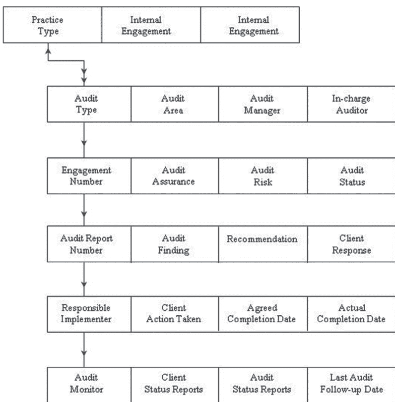
图7.3 带有关系数据库视图的参与跟踪系统。
注：改编自R. E. Davis所著《IT审计：自适应系统》，2010年，Amazon.com。版权归Robert E. Davis所有，2010年。经许可改编。

负责跟踪和评估ISG审计回复的IT审计师必须给信息安全管理层一个合理的时间框架，以提供为部署建议而采取行动的详细信息（Davis，2010，2020）。此外，负责跟踪和评估ISG审计回复的IT审计师需要提前了解可接受的纠正措施（Davis，2020）。为协助确定后续活动，负责跟踪和评估ISG审计回复的IT审计师必须向负责方索取状态信息。


实施者（Davis, 2010, 2020）。状态请求需要在某些或全部已商定的纠正措施的预期部署日期通过后不久发生（Davis, 2010, 2020）。

后续程序需要与实体的文化保持一致（Davis, 2010, 2020）。在正式的实体文化中，受指派的 IT 审计员可能会通过向负责的实施者发送《纠正措施状态请求》信函开始后续工作（Davis, 2020）。《纠正措施状态请求》是对审计区域相关人员就已商定行动计划进展情况进行正式询问的记录。相比之下，在非正式的实体文化中，信息安全治理审计后续程序可能仅涉及向适当的信息安全人员询问已商定纠正措施的进展情况（Davis, 2010, 2020）。无论是否存在正式或非正式的实体文化，受指派 IT 审计员的任务执行都需要对纠正措施状态请求做出回应的人员提交建议部署进展的证明（Davis, 2010, 2020）。

从管理层接收信息安全治理审计后续回应的最有效方式是通过记录（Davis, 2010）。接收信息安全治理审计后续回应有助于强化管理责任并确认纠正措施的进展达成（Davis, 2010, 2020）。书面回应是行动、责任和纠正措施状态的证据记录（Davis, 2010, 2020）。然而，根据回应的交付方式，后续活动可能涉及重新格式化最终报告，为信息安全管理在信息安全治理审计沟通中提供一个部分，以记录为实施建议而采取的纠正措施的细节（Davis, 2010, 2020）。

另外，受指派的 IT 审计员可以接收并记录对状态请求的口头回应（Davis, 2010, 2020）。当受指派的 IT 审计员在信息安全治理审计报告发布后调查可报告情况时，使用后续表格是将口头回应记录并置于工作底稿中的最佳方式（Davis, 2020）。作为 IT 审计员的最低实践，信息安全治理审计后续表格上的信息需要包括：

- 异常发现的时间点；
- 正在调查的信息安全治理纠正措施；
- 可审计单位名称；
- 需要纠正措施的项目名称；
- 信息安全治理审计报告中的发现和建议；
- 为确定可报告情况处置而联系的个人（们）的职称；
- 信息安全管理部门已采取的纠正措施（如有）；
- 当负责实施者未采取适当行动时，对额外活动的建议（如有）；以及
- 在活动期间信息安全管理部门未采取纠正措施时，执行额外程序的已商定时间点（Davis, 2010, 2020）。

后续活动执行是为了在合理的时间间隔后验证纠正措施在减少信息安全治理缺陷方面的有效性（Davis, 2008, 2020）。纠正措施通常反映审计建议，使可报告情况能够与标准或最佳实践保持一致（Davis, 2010, 2020）。如果信息安全经理传达了针对建议所采取的行动，而受指派审计员对回应或行动有效性持怀疑态度，则在结束信息安全治理审计后续活动之前，适当的测试或其他审计程序应确认实际状况或状态（Davis, 2010, 2020）。为了验证可接受的纠正措施，在可能的情况下，受指派的 IT 审计员会获取针对信息安全治理审计的应对设计和运行行动的审计证据（Davis, 2020）。

审计管理负责建立后续程序，以确定信息安全治理管理是否解决了可报告情况，并在问责范围内规划未来审计业务时予以考虑（Davis, 2010, 2020）。因此，主审 IT 审计员必须确保信息安全治理审计业务存在后续活动（Davis, 2010, 2020）。确定适当后续程序的因素包括：

- 所涉及的时间，
- 纠正措施的复杂性，
- 所报告发现的重要性，
- 纠正可报告情况的成本，
- 发现建议的重要性，
- 纠正可报告情况所需的努力程度，
- 纠正措施失败可能产生的后果，
- 可能影响可报告情况重要性或重要性的环境变化，以及
- 可能影响建议重要性或重要性的环境变化（Davis, 2010, 2020）。

主审 IT 审计员负责安排 IT 审计业务的后续活动（Davis, 2010, 2020）。作为工作安排职责的一部分，主审 IT 审计员必须设计并部署纠正措施通知程序，提醒受指派的 IT 审计员在预先指定的日期或固定间隔进行后续跟进（Davis, 2010, 2020）。信息安全治理审计后续计划需要反映风险和敞口，以及部署纠正措施的难度水平和时间重要性（Davis, 2010, 2020）。因此，所评估的重要性与关键性会影响后续工作的性质、时间安排和范围（Cascarino, 2012; Davis, 2010, 2020）。

IT 审计后续工作的性质涉及考虑信息安全治理可审计单位风险程度的程序执行类型（Davis, 2010, 2020）。IT 审计后续时间安排指明程序执行将发生的时间，考虑信息安全治理审计报告日期。IT 审计后续时间安排通常也是专业判断的问题，取决于实体性质和成本等事项（Davis, 2010, 2020）。IT 审计后续范围传达了通过权衡控制弱点或缺陷的重要性或重大性而进行的评估的金额或范围（Davis, 2010, 2020）。关于后续工作的性质、时间安排和范围，审计重要性通常反映相对于其他资产的货币金额（Davis, 2020）。同时，控制活动关键性推断所评估项目相对于其他风险的影响程度（Davis, 2010, 2020）。

评估审计风险是 IT 审计员的经常性任务（Davis, 2010, 2020）。信息安全治理审计后续的审计风险记录发生在 IT 审计计划过程中，并代表了可审计单位可容忍风险率的初步整合（Davis, 2010, 2020）。如果后续实际比率超过后续可容忍比率，主审 IT 审计员必须得出结论，后续工作的性质、时间安排和范围需要额外的比较分析或后续审计保证调整（Davis, 2010, 2020）。当主审 IT 审计员重新审视信息安全治理时，需要进行个人和整体纠正措施评估（Davis, 2020）。评估结果允许在状态报告中记录后续审计保证的传达（Davis, 2020）。

作为审计后续活动的一项任务，受指派的 IT 审计员评估未部署的纠正措施是否仍然相关或具有更大的重要性（Davis, 2010, 2020）。在完成后续活动后，可报告审计情况的状态可能会发生变化（Davis, 2020）。可报告情况的重要性或重大性也可能发生变化（Davis, 2020）。因此，在对信息安全治理审计报告回应、纠正措施和当前情况进行适当分析后，受指派的 IT 审计员可以单方面决定信息安全治理建议的部署不再合适（Davis, 2010, 2020）。当信息资产发生变化，并部署补偿或缓解控制，或实体目标以显著降低审计区域风险的方式演变时，受指派 IT 审计员的建议决策可能会受到影响（Davis, 2010, 2020）。相反，实体环境的变化可能会增加 IAP 风险以及解决的需要。因此，关于疏忽和不令人满意的回应或纠正措施向适当管理层级的程序性沟通升级是合适的（Davis, 2010, 2020）。

也可能存在受指派 IT 审计员判断口头或书面回应显示在审计报告发布前采取的纠正措施在权衡部署关键性后已足够的情况（Davis, 2010, 2020）。在这种情况下，验证活动的执行可能成为处理相关问题的下一次信息安全治理审计业务的一部分（Davis, 2010, 2020）。尽管如此，关于信息安全治理审计报告中产生的已商定纠正措施的状态报告值得向审计委员会或负责实体治理的人员提交。

后续活动可能产生无法处理的问题领域（Davis, 2010, 2020）。无法处理的问题领域是 IT 审计员在当前后续活动中效果不明显的情况性发现（Davis, 2010, 2020）。无法处理的问题领域可能存在，因为信息安全治理问题超出了审计范围，或在实体管理的纠正权限或控制边界之外（Davis, 2010, 2020）。此外，由于情况不确定或审计工作有限，可能不利情况的发现无法归类为可接受的信息安全治理审计发现（Davis, 2010, 2020）。

被归类为无法处理问题领域的项目必须具有透明的记录和足够的细节，以防止审计信息的误解（Davis, 2010, 2020）。受指派的 IT 审计员总结无法处理的问题领域并包括其构想的原因（Davis, 2010, 2020）。然而，作为无法处理的问题领域，信息安全治理审计后续状态报告中通常不会出现建议记录（Davis, 2010, 2020）。

当所有已商定的纠正措施均已部署时，受指派的 IT 审计员可以将详细说明所有部署行动的状态报告转发给审计委员会或负责实体治理和信息安全管理的人员（Davis, 2010, 2020）。此外，信息安全执行经理领导或高级经理领导可能希望收到一份年度回顾报告，呈现重要建议和状态，以及之前年度仍未纠正的建议（Davis, 2010, 2020）。

### References

- Bragg, S. (2019, August 24). 随意抽样. *会计工具*. www.accountingtools.com/articles/2019/8/24/haphazard-sampling
- Cascarino, R. E. (2012). *IT 审计指南* (2nd ed.). John Wiley & Sons.
- Davis, R. E. (2005). *IT 审计：一种自适应过程*. Pleier.


- Davis, R. E. (2008). IT审计：确保信息资产保护。Pleier.
- Davis, R. E. (2010). IT审计：一种自适应系统。www.amazon.com
- Davis, R. E. (2011). 确保IT治理。www.amazon.com
- Davis, R. E. (2013). 确保IT法律合规。Lulu.
- Davis, R. E. (2017). 美国公司中公司治理与信息安全治理有效性之间的关系 (出版号 10603383) [博士研究, Walden University]。ProQuest Dissertations Publishing.
- Davis, R. E. (2020). 从系统视角进行IT审计。IGI Global.
- Farahmand, F., Navathe, S. B., Sharp, G. P., & Enslow, P. H. (2005). 对信息系统安全威胁风险的管理视角。信息技术与管理, 6(2-3), 203-225. https://doi.org/10.1007/s10799-005-5880-5
- Flores, W. R., Antonsen, E., & Ekstedt, M. (2014). 组织中的信息安全知识共享：探究行为信息安全治理和国家文化的影响。计算机与安全, 43, 90-110. https://doi.org/10.1016/j.cose.2014.03.004
- Gantz, S. D. (2013). IT审计基础：目的、流程和实用信息。Elsevier.
- Glen, S. (2015, June 25). 什么是随意抽样？统计学如何。www.statisticshowto.datasciencecentral.com/haphazard-sampling/
- Guadalupe, M., Li, H., & Wulf, J. (2014). 谁住在C-suite？高层管理中的组织结构和劳动分工。管理科学, 60, 824-844. https://doi.org/10.1287/mnsc.2013.1795
- Haislip, J. Z., Peters, G. F., & Richardson, V. J. (2016). 审计员IT专业知识对内部控制的影响。国际会计信息系统期刊, 20, 1-15. https://doi.org/10.1016/j.accinf.2016.01.001
- Hall, T. W., Hunton, J. E., & Pierce, B. J. (2000). 审计中非统计抽样的使用及相关选择偏差。会计行为研究, 12, 231-255. https://aaajournals.org
- Hitt, L. M., & Brynjolfsson, E. (1997). 信息技术与企业内部组织：探索性分析。管理信息系统期刊, 14(2), 81-101. https://doi.org/10.1080/07421222.1997.11518166
- ISACA. (2013). IS审计与鉴证标准1202 规划中的风险评估。ITAF：信息技术鉴证框架。www.isaca.org/resources/frameworks-standards-and-models
- ISACA. (2014). IS审计与鉴证指南2202 规划中的风险评估。ITAF：信息技术鉴证框架。www.isaca.org/resources/frameworks-standards-and-models
- Islam, M. A., Bagum, M. N., & Rashed, C. A. (2012). 运营干扰及其对制造业业务的影响——孟加拉国RMG行业的一项实证研究。管理与技术研究国际期刊, 2(2), 184-191. www.iraacst.org
- Lucas, H. C., & Baroudi, J. (1994). 信息技术在组织设计中的作用。管理信息系统期刊, 10(4), 9-23. https://doi.org/10.1080/07421222.1994.11518018
- Mahadeen, B., Al-Dmour, R. H., Obeidat, B. Y., & Tarhini, A. (2016). 检验组织内部控制系统对组织有效性的影响：约旦实证研究。国际工商管理期刊, 7(6), 22-41. https://doi.org/10.5430/ijba.v7n6p22
- Marius, P., Cristian, T., & Amancei, C. (2009). 分布式信息系统审计流程的特征。经济信息学, 13(3), 165-178. http://revistaia.ase.ro/
- Meyer, J. W., & Rowan, B. (1977). 制度化组织：正式结构作为神话与仪式。美国社会学杂志, 83(2), 340-363. https://doi.org/10.1086/226550
- Neubert, M., Wu, C., & Roberts, J. (2013). 道德领导和监管焦点对员工结果的影响。商务伦理季刊, 23, 269-296. https://doi.org/10.5840/beq201323217
- Quain, S. (2019, February 12). 组织结构的基本类型：正式与非正式。休斯顿纪事报。http://smallbusiness.chron.com
- Samson, D., Terziovski, M., & Lai, A. (2005). 知识产权战略与商业战略：通过创新战略的联系 (工作论文 08/05)。澳大利亚知识产权研究学院。www.researchgate.net/profile/Daniel_Samson2/publication/228740384_Intellectual_Property_Strategy_and_Business_Strategy_Connections_through_Innovation_Strategy/links/0046352c3c37f86e49000000.pdf
- Schryen, G. (2013). 重新审视IS业务价值研究：我们已知的、仍需了解的以及如何实现。欧洲信息系统期刊, 22(2), 139–169. https://doi.org/10.1057/ejis.2012.45
- Soava, G., & Raduteanu, M. (2014). 数字经济——新千年的经济。经济世界, 2(1), 45–57. www.davidpublisher.org
- Soltani, B. (2007). 审计：国际方法。Pearson Education.
- Sor, R. (2004). 信息技术与组织结构：为过去的理论正名。管理决策, 42(1/2), 316–329. https://doi.org/10.1108/00251740410513854
- Thornton, T. (2013). 默会知识及其反义词。科学哲学. 科学史与科学哲学论文集, 17(3), 93–106. https://journals.openedition.org/philosophiascientiae/890
- Wu, S. P. J., Straub, D. W., & Liang, T. P. (2015). 信息技术治理机制和战略一致性如何影响组织绩效：来自业务与IT经理配对调查的见解。MIS季刊, 39, 497–518. www.misq.org
- Yaokumah, W. (2015). 评估发展中国家信息安全治理实践的有效性：以加纳为例。在标准与标准化：概念、方法论、工具和应用 (页 1317–1333)。IGI Global. https://doi.org/10.4018/978-1-4666-8111-8.ch062

### 推荐阅读

- Dzuranin, A. C., & Mălăescu, I. (2016). IT审计的现状与未来方向：挑战与机遇。信息系统期刊, 30(1), 7–20. https://doi.org/10.2308/isys-51315
- Năstase, P., Năstase, F., & Ionescu, C. (2009). 企业实施IT标准CobiT 4.1、ITIL v3和ISO/IEC 27002产生的挑战。经济计算与经济控制论研究, 3, 1–16. www.ecocyb.ase.ro/
- Sheikhpour, R., & Modiri, N. (2012). ITIL与ISO/IEC 27001服务集成以实现信息安全管理最佳实践方法。印度科学技术期刊, 5(2), 2170–2176. https://doi.org/10.17485/ijst/2012/v5i3.1
- Spremić, M. (2012). 治理信息系统安全：信息系统安全保障与审计方法综述。在 C.-G. Carstea (编), 第3届应用信息学与计算理论国际会议 (AICT '12)：应用信息学与计算的最新趋势 (页 42–48)。WSEAS.
- Trites, G. (2013). 信息完整性。AICPA鉴证服务执行委员会信任信息完整性工作组和加拿大特许会计师协会。www.aicpa.org/InterestAreas/FRC/AssuranceAdvisoryServices/DownloadableDocuments/ASEC-Information-Integrity-White-paper.pdf

## 附录 A

### 控制环境特征 – 内部政策矩阵

### 审计区域安全政策模板

| 安全政策 | 控制环境属性 |  |  |  |
|---|---|---|---|---|
|  | 道德价值观 | 运营风格 | 能力承诺 | 人力资源 |
| 行为准则 |  |  |  |  |
| 安全意识计划 |  |  |  |  |
| 安全运营中心 |  |  |  |  |
| 事件响应计划 |  |  |  |  |
| 安全培训计划 |  |  |  |  |
| 监督委员会 |  |  |  |  |
| 审计委员会 |  |  |  |  |

## 附录 B

### 实体文化 – 审计区域人员矩阵

### 审计区域定性评级模板

| 认知 | 首席运营官 | 首席安全官 | 首席信息官 | 首席财务官 |
|---|---|---|---|---|
| 道德价值观 | ☐ 高<br>☐ 中等<br>☐ 低 | ☐ 高<br>☐ 中等<br>☐ 低 | ☐ 高<br>☐ 中等<br>☐ 低 | ☐ 高<br>☐ 中等<br>☐ 低 |
| 运营风格 | ☐ 高<br>☐ 中等<br>☐ 低 | ☐ 高<br>☐ 中等<br>☐ 低 | ☐ 高<br>☐ 中等<br>☐ 低 | ☐ 高<br>☐ 中等<br>☐ 低 |
| 能力<br>承诺 | ☐ 高<br>☐ 中等<br>☐ 低 | ☐ 高<br>☐ 中等<br>☐ 低 | ☐ 高<br>☐ 中等<br>☐ 低 | ☐ 高<br>☐ 中等<br>☐ 低 |
| 人力资源<br>实践 | ☐ 高<br>☐ 中等<br>☐ 低 | ☐ 高<br>☐ 中等<br>☐ 低 | ☐ 高<br>☐ 中等<br>☐ 低 | ☐ 高<br>☐ 中等<br>☐ 低 |
| 合规 | ☐ 高<br>☐ 中等<br>☐ 低 | ☐ 高<br>☐ 中等<br>☐ 低 | ☐ 高<br>☐ 中等<br>☐ 低 | ☐ 高<br>☐ 中等<br>☐ 低 |
| 总计 | ☐ 高<br>☐ 中等<br>☐ 低 | ☐ 高<br>☐ 中等<br>☐ 低 | ☐ 高<br>☐ 中等<br>☐ 低 | ☐ 高<br>☐ 中等<br>☐ 低 |


## 附录 C

### ISG 审计风险评估模板

| 可审计单元 | 内在风险 | 控制 | 检测 | 总计 |
|---|---|---|---|---|
| 战略对齐 |  |  |  |  |
| • 实体战略 |  |  |  |  |
| • 应用架构 |  |  |  |  |
| • 技术基础设施 |  |  |  |  |
| • 采购/人员配置 |  |  |  |  |
| • 资金 |  |  |  |  |
| 小计 |  |  |  |  |
| 价值交付 |  |  |  |  |
| • 及时性 |  |  |  |  |
| • 易用性 |  |  |  |  |
| • 财务合规 |  |  |  |  |
| • 非财务合规 |  |  |  |  |
| 小计 |  |  |  |  |
| 风险管理 |  |  |  |  |
| • 战略目标 |  |  |  |  |
| • 风险评估 |  |  |  |  |
| • 风险报告 |  |  |  |  |
| • 风险偏好 |  |  |  |  |
| • 风险处置 |  |  |  |  |
| • 风险监控 |  |  |  |  |
| 小计 |  |  |  |  |
| 资源管理 |  |  |  |  |
| • 人员 |  |  |  |  |
| • 流程 |  |  |  |  |
| • 信息 |  |  |  |  |
| • 基础设施 |  |  |  |  |
| 小计 |  |  |  |  |
| 绩效管理与衡量 |  |  |  |  |
| • 客户满意度 |  |  |  |  |
| • 竞争优势 |  |  |  |  |
| • 员工生产力 |  |  |  |  |
| • 员工盈利能力 |  |  |  |  |
| • 受托责任要求 |  |  |  |  |
| • 技术要求 |  |  |  |  |
| • 质量要求 |  |  |  |  |
| 小计 |  |  |  |  |
| 总计 |  |  |  |  |

### 测试方法选项表

| 示例目标 | 测试方法 |
|---|---|
| 为以特定置信度估计总体的特征 | 属性/美元单位 |
| 为以特定置信度确定信息的合理性 | 变量 |
| 为以特定置信度估计总体价值 | 变量/美元单位 |
| 为以特定置信度估计特定总体特征的价值 | 变量/美元单位 |
| 了解总体特征 | 判断性 |
| 确定控制活动是否正在运行 | 判断性/随机 |
| 通过选择最小样本量获取有关总体特征的信息 | 停止或继续 |
| 为以特定置信度区分良品或不良品批次 | 验收 |
| 获取总体中至少一项不规则交易的证据 | 发现 |

### 抽样选择选项表

| 总体 | 选择方法 |
|---|---|
| 文件中项目的编号 | 随机数 |
| 文件中项目的列表 | 随机数 |
| 随机数抽样带来不可接受的负担 | 固定间隔/聚类/单元 |
| 项目在总体中没有会使样本产生偏差的模式，且缺失项目可识别 | 固定间隔/单元 |
| 项目存在较大差异 | 分层 |
| 通过分组相似项目可提高置信度 | 分层 |
| 通过分组可比项目可提高置信度 | 分层 |
| 组具有物理分散性，但存在连续项目 | 聚类/单元 |
| 组具有逻辑分散性，但存在连续项目 | 聚类/单元 |

评估报告财务数据可靠性与完整性控制的努力（Davis, 2008）以及构建信息。

与 ISG 保证服务类似，CSG 可以是对每个网络安全职能参与的单独审计领域检查或可审计单元检查。在 CSG 审计规划过程中，实体的 IAP 相关框架的全部或部分可作为可审计单元选择。此外，CSG 审计可能像 ISG 审计一样跨越地理、部门、职能或部门界限。本章介绍了驱动特定 CSG 保证活动的 IT 审计规划、研究和评估控制、测试和评估控制、报告以及后续流程。

## CSG 审计规划流程

CSG 审计通常具有运营重点，涉及一般控制。基于运营的 CSG 审计检查部门人员对政策和程序的遵守情况，同时评估相对于前述控制组的已分配任务的经济性、有效性和效率（Davis, 2010）。一般技术控制分类可包括组织结构、硬件配置、操作系统、物理设施、开发方法、变更管理以及运营连续性（Davis, 2010）。在基于运营的规划过程中，当 IT 审计员发现 CSG 框架存在缺陷时，审计规划者应考虑使用 ISO/IEC 27000 标准作为设定目标的基准。

如 图 8.1 所示，为确保网络安全，IAP 的保密性和完整性是主要的信息标准。同时，可用性、合规性和可靠性是次要的 IAP 信息标准，即使其他审计衡量标准在审计范围内。例如，信息隐私可能在 CSG 审计范围内，并被视为重要或重大的可审计单元。然而，即使识别出其他不同的次要可审计单元，隐私合规性和有效性信息标准仍应保持为 CSG 审计的次要标准。

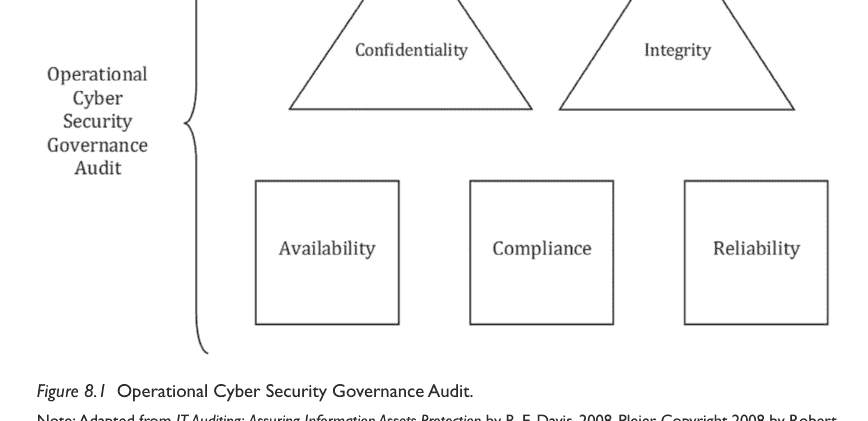

图 8.1 运营网络安全治理审计。

注：改编自 R. E. Davis 所著《IT 审计：确保信息资产保护》，2008 年，Pleier。版权 2008 归 Robert E. Davis 所有。经许可改编。

另选地，CSG 可能在其他审计领域的范围内。在这些情况下，基于职能、基于应用或基于合规的检查可能是合适的。基于职能的审计将已识别的流程作为可审计单元处理，可包括目标、目标、所有权、复制、角色和职责（Davis, 2008）。基于应用的审计处理 IT 应该完成任务的已识别领域，可涵盖完整性、准确性、有效性、授权和职责分离（Davis, 2008）。最终，基于合规的审计处理对外部和内部施加的实体要求的遵守情况，可涵盖国家法律法规以及政策、指令、程序、标准和规则。

CSG 审计规划的主要驱动因素是验证保障措施的存在性、充分性和风险管理。然而，与其他 IT 审计一样，在业务规划期间应获得一般控制环境、信息系统以及对控制程序的理解，以遵守保证标准和指南以及其他适用的鉴证、审计、会计和 IT 标准。忽视对标准化专业实践的遵守可能导致无法支持的审计意见。

### 控制评估

通常，部署包含责任、问责和权限的公认框架将确保 CSG 控制环境、保密性、完整性和可用性的充分性。因此，通过了解已部署的 IAP 框架设计要素，可以降低审计风险（Davis, 2008）。例如，当实体采用 ISO/IEC 27000 安全标准作为框架时，IAP 可能结构良好，并具有适当的控制措施以显著降低与信息资产相关的风险（Davis, 2008）。

在准备和评估 CSG 控制环境风险时，考虑的重点是管理层的态度、意识和行动。有效的信息安全控制环境的关键在于管理层对 IAP 违规潜力的认可，该认可可通过适当的伦理价值观、运营风格、能力承诺、人力资源实践和合规承诺得到抵消（Davis, 2008）。实体的监督委员会和下属管理层还应定期评估 ISG 项目服务、控制措施和监控活动的有效性，以及检测刑事和不道德行为的能力（Davis, 2008）。此外，实体监督委员会应监控控制活动持续的相关性和有效性，以及对信息安全建议的响应（Davis, 2008）。

与特定实体相关的控制环境风险程度可通过各种技术和工具了解，包括实体政策 – 控制环境特征和实体文化 – 审计领域人员矩阵（Davis, 2008）。因此，负责的 IT 审计员可能会确定与特定业务相关的实体的文化和人员概况；然后随后将此信息置于实体文化 – 审计领域人员矩阵中。

CSG 审计必不可少的是反映信息资产评估风险的管理、运营和技术程序。在将 IT 审计风险评估与管理层的 IAP 风险评估以及识别、监控和响应流程进行比较时，负责的 IT 审计员应包括检查：

- 实体特征，
- 实体历史，


- 管理层近期变化，
- 运营近期变化，
- IT 近期变化，
- 组织资产风险，
- 组织服务风险，
- 相关控制的强度，
- 适用的监管要求，
- 适用的法律要求，
- 之前的审计发现，
- 审计范围之外的发现，
- 日常运营中发现的问题，
- IT 技术成熟度，以及
- IT 技术复杂性（Davis, 2008）。

### 控制环境

控制环境 IAP 指类别，经评估后可确定实体控制规范的预期深度和广度（Davis, 2008）。系统可靠性、信息准确性和资产安全取决于充分的信息保护控制措施（Davis, 2008）。财务信息保护的薄弱可能导致未经授权的交易处理、不准确的数据记录、重要数据丢失、资产损失和敏感信息披露（Davis, 2008）。由于 IT 资产容易遭受破坏、错误和滥用，因此信息保护控制对于财务信息至关重要（Davis, 2008）。此外，非财务信息与财务信息具有相同的决策风险敞口（Davis, 2008）。因此，非财务信息需要提供类似的 IAP。

开展控制环境扫描以制定可行的 CSG 审计计划是规划 IT 审计的基础。关于控制环境运营风格的主要考虑因素是 IT 可审计性（Davis, 2008）。与大多数审计情况一样，可验证性在很大程度上取决于可审计性（Davis, 2008）。IT 可审计性考虑应先于 IT 集成流程部署（Davis, 2008）。换句话说，IT 和数字化信息的设计应在部署前为运营单位包含可审计性要求。因此，如果不推迟计划的审计，可审计性可能会帮助或阻碍 IT 保证工作。

为 CSG 审计收集信息应包括获取相关信息：

- 事件报告；
- 职位描述；
- 规划报告；
- 组织架构图；
- 建筑平面图；
- 绩效报告；
- 关键人员清单；
- 资产清单；
- 培训文档；
- 意识文档；
- 法律法规；
- 内部合同协议；
- 外部合同协议；
- 物理访问点示意图；
- 审计跟踪保留清单；
- 审计跟踪归档计划清单；
- 已部署的控制框架手册；
- 系统数据图表和流程图；
- 之前审计和审查的结果；
- 流程数据图表和流程图；
- 高层安全和 IAP 风险评估；
- 近期管理会议报告或纪要；
- 政策、指令、程序、标准和规则；以及
- 配置管理数据库文档（Davis, 2008）。

除审查文档和分析绩效信息外，获得增强 IAP 理解的一些标准技术包括实地访问和观察运营（Davis, 2008, 2010, 2020）。此外，访谈不同组织层级的人员和外部主题专家可能有助于了解实体的 IAP 架构。

### 信息系统

信息系统部署包含收集、处理、处置、存储、传输、显示和传播有用数据的完整组织、基础设施、人员和其他要素（Davis, 2017, 2020; Schryen, 2013）。信息系统建立在任务配置之上，使数据收集、处理以及向访问用户传输或放置到存储介质成为可能（Davis, 2017, 2020）。实体信息系统的首要目的是准确、可靠和及时地传播数据（Davis, 2010, 2020）。信息系统及其相关技术部署可以提供竞争优势并增加控制要求（Davis, 2010, 2020）。一方面，如果集成得当，除其他益处外，IT 可通过创新应用提供竞争优势（Davis, 2017, 2020; Samson et al., 2005; Soava & Raduteanu, 2014）。另一方面，使用 IT 的过于复杂的信息系统会降低效率和有效性（Davis, 2020）。

连接信息系统的技术可以使组织内部和组织间的通信几乎无缝（Davis, 2017, 2020; Farahmand et al., 2005; Guadalupe et al., 2014）。基于 IT 的系统、流程、活动和任务是提供有效和高效信息和通信的重要支持要素。因此，无缝的 IT 网络能力影响了组织结构（Davis, 2020）。从解释的角度来看，实体的信息系统代表了收集数据、处理交易和传达运营结果的基础设施（Davis, 2010, 2020）。换句话说，实体的管理信息系统代表了资源的集合以及相关的政策和程序，使数据处理能够生成可用于决策的信息（Davis, 2011）。

无论是否明文记载，负责的 IT 审计师都应了解实体的信息系统战略，包括：

- 为实现实体的使命和目标而制定的长期计划，
- 为实现实体的使命和目标而制定的短期计划，
- 为支持实体计划而制定的 IT 和系统的长期战略和计划，
- 为支持实体计划而制定的 IT 和系统的短期战略和计划，
- 制定信息安全战略的方法，
- 制定计划的方法，
- 监控相对于实体计划的进展的方法，
- 信息安全战略和计划变更控制的方法，
- 信息安全使命声明以及活动商定的目标和目标，以及
- 现有信息安全活动和系统的评估。

### 控制程序

控制是程序性的，可归类为预防性、侦测性、纠正性、指导性、补偿性（Cascarino, 2012）或缓解措施（Davis, 2008, 2020）。程序定义完成一项活动的任务（Davis, 2010, 2020）。控制程序传达组织人员在进行活动或任务期间的绩效期望（Davis, 2020）。IAP 控制包括为管理层提供关于实现信息安全目标的某种程度的安心而采用或制定的程序。因此，IAP 控制程序通常提供组织信息资产的保护。无论如何，CSG 审计计划者侧重于证实参与区域中存在可最小化潜在风险的控制（Davis, 2020）。

IAP 控制的失败可能导致财务损失、竞争地位下降、买方信任消除、形象破坏或声誉受损。管理者领导者出于两个主要原因关注 IAP 控制的有效性。主要原因有：（a）控制弱点可能导致未被发现的重大错报（Haislip et al., 2016）以及（b）确保组织员工对信息感知到的潜在威胁进行预防、检测或纠正（Davis, 2020）。部署有效的 IAP 控制程序可使更高效、更有效的信息安全管理得以实现。

控制程序应被视为实现控制目标和目标的绩效流程（Davis, 2011）。控制程序试图确保管理层的运营意图得以实现（Davis, 2011）。与政策一样，控制程序应提供组织资产保护的期望并促进有效性和效率（Davis, 2011）。

### 审计风险评估

CSG 审计风险评估应考虑所审查的生命周期阶段 [例如，实施前（设计）、实施或实施后（运营）阶段]。然而，具体到 CSG 审计，规划风险评估应包括用于解决访问控制、网络基础设施安全、风险分析、环境控制和机密信息资产的类别（见附录 A）。

在执行基于风险的保证业务时，负责的 IT 审计师应在详细的风险评估层面上考虑每个可审计单位类别的培训和意识。此外，如果风险评估项目在审计范围内，负责的 IT 审计师还应在审计计划的可审计单位层级为工作底稿同时维护子类别项目的单独分类。此外，负责的 IT 审计师应了解用于获取、监控并确保遵守相关法律法规的机制。之后，除非 CSG 审计是财务报表审计的一部分，否则负责的 IT 审计师应考虑并将所获得的理解应用于 CSG 审计风险评估。

### 法律法规

实体管理者领导者应确保遵守适用于以实体为中心的 IT 实践的隐私、知识产权、跨境数据流动和密码法规的法律合规性（Davis, 2008）。部署 CSG 框架可能抑制员工的非法行为。


然而，建立CSG框架并不能绝对阻止员工的违法行为。尽管合规性是CSG审计的次要信息标准，但主管IT审计师仍应初步了解影响实体、可审计单位及实践的IAP相关法律法规。

识别相关法律法规体现了审计师符合实践要求的尽职调查（Davis, 2008）。获取适用法律法规的相关信息，可能要求主管IT审计师访谈法律专家、访问互联网并查阅图书馆资料（Davis, 2008, 2010, 2020）。尽管如此，法律顾问应作为识别适用IAP法律法规的主要来源（Davis, 2008）。保证规划期间可探讨的IAP问题包括但不限于：

- 员工被定罪时其法律权利的保护；
- 对实体CSG计划的总体认知、评价与理解；
- 对实体集中化合规与道德办公室人员的了解；
- 中央合规与道德办公室所处理信息的保密性；
- IT审计师对实体合规与道德办公室所处理信息的访问权限；
- 员工在接受调查程序时其法律权利的保护；
- 中央合规与道德办公室与各组织单位之间的协调；
- 实体内不同组织单位之间IAP合规要求的一致性与整合性；以及
- 合规与道德办公室、人力资源、法律及IAP组织单位之间的角色与职责划分。

### 分析程序

就具体情况而言，理解IAP风险及相关控制目标可能是开展合格CSG审计规划的关键方面。实体可能已部署也可能未部署有助于CSG审计规划的控制框架。因此，为开展CSG审计，主管IT审计师可能不得不依赖从其他被视为最佳实践来源获取的知识。此外，为正确评估风险，可能还需要进行初步的审计领域分析性复核（Davis, 2008）。

从IT审计角度看，信息系统是固有的组织风险。即使管理领导者实施了适当的控制措施（如防火墙和防病毒软件），IT审计固有风险仍可能存在（Davis, 2008）。巧合的是，在规划CSG审计时，已部署的防火墙和防病毒软件程序可降低控制风险。《安全管理四大领域：信息安全参考模型》（Lindstrom, 2004）可推动保护实体信息资产的网络安全使命与目标（Davis, 2008）。信任管理、身份管理、漏洞管理和威胁管理对《安全管理四大领域：信息安全参考模型》进行了分类（Davis, 2008; Lindstrom, 2004; Omoyiola, 2020）。

如表8.1所示，通过与其他IAP相关目标的关联（Davis, 2008），主管IT审计师可使用Lindstrom（2004）参考模型来确定适当的CSG审计覆盖范围。漏洞管理是一种全面方法，用于限制资源用户、计算系统、IT应用及物理场所中的弱点（Davis, 2008; Lindstrom, 2004; Omoyiola, 2020）。身份管理使用管理技术和工具来识别对象（Davis, 2008; Lindstrom, 2004; Omoyiola, 2020）。信任管理是一种确保用于执行授权功能的资源可靠性的全面方法（Davis, 2008; Lindstrom, 2004; Omoyiola, 2020）。威胁管理是一种识别并响应计算环境中不当或恶意活动的全面方法（Davis, 2008; Lindstrom, 2004; Omoyiola, 2020）。

#### 表8.1 控制目标——安全管理四大领域矩阵

| 控制目标 | 漏洞 | 信任 | 身份 | 威胁 |
|---|---|---|---|---|
| 网络安全管理 | S | P | S | S |
| 网络安全计划 | S | P |  |  |
| 身份管理 | S | S | P |  |
| 用户账户管理 |  | P | P | S |
| 安全测试、监视与监控 | P |  |  | P |
| 安全事件定义 |  |  |  | P |
| 安全技术保护 | P | P | S |  |
| 加密密钥管理 |  | S | P |  |
| 恶意软件预防、检测与纠正 | P |  |  | S |
| 网络安全 | P | P | S | S |
| 敏感数据交换 | S | P | S |  |

注：P，主要；S，次要。改编自R. E. Davis所著《IT审计：确保信息资产保护》，2008年，Pleier出版。版权所有2008年Robert E. Davis。经许可改编。

审计合规性差距分析旨在揭示适用于实体的法律法规所声明的目标与宗旨存在的任何固有障碍，以及适用法律法规之间的冲突（Davis, 2008）。法律上的不合规可能使实体违反维持适当控制的要求（Davis, 2008）。因此，IAP保证风险评估应将管理层对法律法规合规性的控制方法视为风险因素（Davis, 2008）。

法律法规差距分析应揭示强制性控制、潜在制裁以及部署中的弱点（Davis, 2008）。具体而言，主管IT审计师应评估CSG计划中与法律要求相关的管理、运营和技术风险。为完成法律风险评估任务，主管IT审计师应考虑通过独立汇总适用的IAP法律法规来分析审计风险，随后将所编制的信息与管理层对适用IAP法律法规的评估进行比较（Davis, 2008）。如有现成文件，主管IT审计师应获取实体法律法规可追溯性矩阵，以确定正在考虑哪些法律合规问题（Davis, 2008）。可追溯性矩阵提供了基线链接，需要进行多对多关系验证以确保完整性（Gotel et al., 2012）。

### CSG审计研究与控制评估

控制目标的部署通过控制实践来实现（Davis, 2008）。实践作为一套原则以及定制具体程序的起点时最为有用（Davis, 2008）。同样，在控制程序的初始设计阶段就应考虑风险管理（Davis, 2008）。因此，通过逻辑关联，使用有效的风险管理框架可使实体确定哪些控制实践至关重要，并随后制定最合适的治理原则体系（Davis, 2008）。

IAP应是实体最优先关注的问题，因为网络安全事件可能损害财务和运营的机密性、完整性和可用性（Davis, 2008）。拥有授权许可的雇员可能实施损害实体声誉或形象的恶意行为（Davis, 2008）。IAP威胁可以是人、物或事件（Davis, 2008）。因此，可能转化为事件的潜在威胁包括网络钓鱼、间谍软件、域名欺骗、电子盗版和计算机病毒。

- 网络钓鱼利用基于技术的欺骗性媒介，诱使个人披露敏感信息（Davis, 2008）。例如，个人可能通过欺诈性电子邮件获取网上银行网站的用户名、密码和账号（Davis, 2008）。
- 间谍软件是在未经用户知情同意的情况下，秘密或暗中访问IT以收集个人或实体信息的软件（Davis, 2008）。间谍软件可能利用技术谋取商业利益（Davis, 2008）。例如，Van Eck窃听就是一种窃听形式，它使用特殊设备监测并捕获计算设备中信号或数据移动所产生的电磁场，从而提取电信信号或数据（Davis, 2008）。
- 域名欺骗攻击通过域名劫持或域名服务中毒发生（Davis, 2008）。域名劫持是窃取实体或个人网站名称的行为（Davis, 2008）。或者，域名服务中毒涉及通过用欺诈性网站地址替换合法互联网地址来破坏或污染域名系统表（Davis, 2008）。
- 电子盗版涉及未经授权复制或共享数字化文件，且未向许可方提交并获其接受相应的许可费（Davis, 2008）。
- 计算机病毒可能是恶意的，也可能是非恶意的，这取决于程序员的意图（Davis, 2008）。计算机病毒通常被认为是未经授权的自我复制计算机程序，通过插入或附加方式将其副本分发到其他文件、程序、系统和网络（Davis, 2008）。例如，恶意黑客制造计算机病毒以破坏工作流程和网络访问（Davis, 2008）。

一般而言，信息的关键性、敏感性和影响应由实体的信息所有者进行识别和排序（Davis, 2008）。初级管理者应预测信息丢失和运营中断的不利影响，并针对违规行为、违法行为和暴露于自然环境等情况，确定特定IT暂停或延期的时间限制（Davis, 2008）。然而，获得高管和高层管理人员对运营决定的认可，以及受影响群体的同意也是必要的（Davis, 2008）。管理者越了解并沟通潜在威胁，实体人员就越有能力采取预防措施，抵御可能发生的安全漏洞（Davis, 2008）。

实体管理员需要CSG风险管理，以支持漏洞管理、信任管理、机会管理、访问管理和威胁管理，从而实现保护预期（Davis, 2008）。此外，所部署的风险管理流程应包括对第三方提供商、第三方提供商所提供服务的考虑，以及管理层如何治理与其他实体的关系（Davis, 2008）。第三方评估至关重要，因为它们有助于确保识别并考虑所有威胁和漏洞，识别出最重要的风险，并围绕风险接受、降低、转移或规避处理做出适当的决策（Davis, 2008）。A


全面的高层次风险评估应作为制定或修改实体IAP政策和计划的起点（Davis, 2008）。实体至少应每3个月进行一次IAP风险评估（Davis, 2008）。作为一项伴随活动，在进行风险评估以衡量信息资产价值时，应进行定量或定性分析的记录（Davis, 2008）。

管理层对机会的追求会给实体带来风险（Davis, 2008）。机会风险可能是对既定防护控制体系的威胁（Davis, 2008）。与机会相关的威胁需要经过评估，以确定追求该机会的可行性（Davis, 2008）。相对于既定或新产生的威胁，对机会影响进行细致考量，应成为证明追求机会合理性的关键成功因素（即门槛点）（Davis, 2008）。从诊断角度看，除非信息资产的威胁价值超过其机会价值，否则负责风险分析的个人或团队应将所评估的项目继续归类为信息资产机会（Davis, 2008）。

良好的IAP风险管理处理潜在不可接受事件的识别与处置，同时认识到多种爆发点的战略影响，例如电子犯罪增加、新法律或法规的引入以及诉讼活动的升级（Davis, 2008）。因此，无论系统、设施或其他条件是否发生变化，都应定期进行独立风险评估并记录其执行情况（Davis, 2008）。因此，无论风险管理过程是正式的还是非正式的，IT审计师至少应评估以下事项：

-   已部署的IAP风险评估框架是否存在；
-   运营、IT、安全和IAP风险评估的更新频率；
-   风险评估政策、指令、程序、标准和规则；
-   实体范围内的目标是否纳入IAP风险识别过程；
-   参与IAP风险评估的人员级别是否适当；
-   执行和审查IAP评估的人员的客观性；
-   是否实施了适当的措施以缓解IAP风险；
-   风险识别过程是否包含概率、频率和威胁分析技术；
-   IAP风险评估是否考虑信息的敏感性、关键性和影响；
-   IAP风险评估是否考虑实体信息资产面临的风险范围；以及
-   最终的IAP风险判定和相关管理层批准是否已记录并存档（Davis, 2008）。

责任指派增强了确保信息资产得到适当保护的能力。实体的执行管理层领导应将信息资产分配给信息所有者和技术所有者（Davis, 2008）。此后，被任命的信息所有者应负责制定有关主题数据适当使用和保护的规定。相比之下，指定的技术所有者应负责协调特定技术的开发生命周期活动（Davis, 2008）。鉴于上述明确的指派情形，存储在技术中、由技术处理或通过技术传输的数据的信息所有者可能与技术所有者不同（Davis, 2008）。此外，单一技术可能使用来自多个信息所有者的数据（Davis, 2008）。但是，即使与其他实体共享数据，信息所有者也应保留被指派的职责（Davis, 2008）。

网络安全管理领导者的职责通常包括根据组织结构制定信息资产的单位政策、程序和标准（Davis, 2008）。为有效履行网络安全管理领导者的角色和承担的责任，需要评估、组织和管理IT威胁与机会，以利用可用资源降低实体的潜在风险（Davis, 2008）。研究和评估CSG角色及相关责任，对于确定是否存在充分的职能分离和职责分离以降低安全漏洞风险至关重要（Davis, 2008）。员工（包括直接上级管理层）应了解被分配的岗位职责和禁止活动（Davis, 2008）。尽管如此，确保员工岗位职责理解的责任和问责最终仍由执行管理层领导承担（Davis, 2008）。各种控制技术可以有选择地或集体地执行职能分离和职责分离，包括：

-   资产托管，
-   角色识别，
-   信息访问，
-   用户认证，以及
-   交易授权（Davis, 2008）。

防护包含两个主要类别：责任分离和信息资产保护（Davis, 2008）。关于CSG审计，获取或创建IAP RACI（负责、问责、咨询和知情）或RASCI（负责、问责、支持、咨询和知情）图表，可帮助指定的IT审计师评估职能分离和职责分离的实施情况（参见附录B）。当IT审计师为RACI或RASCI图表插入项目时，潜在活动是为确保实体员工以适当方式遵循管理层的命令和指示而制定的政策和程序（Davis, 2008）。

职能分离确保组织责任不会妨碍独立性或破坏信息资产的完整性。然而，职责分离通常是手动和自动化系统及流程的关键控制措施（Davis, 2008）。部署IAP职责分离控制可减少可能影响信息完整性的错误、失误、遗漏、违规行为以及非法行为的实施和隐瞒机会（Davis, 2008）。在集中式IT环境中，实现适当的职责分离可能是一项艰巨的管理任务（Davis, 2008）。因此，根据控制环境的不同，实体内部可能存在独立的数据录入职能，以处理责任划分（Davis, 2008）。然而，即使实体将数据录入责任分配给不同组织单位的员工，职责分离仍应存在（Davis, 2008）。此外，数据生成、处理、验证、签署和分发责任应受到监控和评估，以防违反职责分离控制，从而确保适当的IAP（Davis, 2008）。

IT审计师应获取CSG审计范围内每个信息系统和特定要素的书面行为规则（Rules-of-Behavior）。此外，指定的IT审计师应研究和评估行为规则是否明确了访问信息资产人员的责任和预期行为，是否说明了行为不一致或不合规的后果，并对系统互连和信息整合设置了适当限制（Davis, 2008）。如果在CSG审计区域内，职能分离和职责分离控制技术的期望未得到满足，指定的IT审计师应在完成控制研究和评估过程后，调查补偿性和缓解性控制措施。

### 网络安全访问管理

在信息时代，信息资产的价值因融入决策过程而不断增长（Davis, 2008）。决策过程辅助功能可包含在IT决策支持系统中（Davis, 2008）。可用的决策支持信息应在保持预期的机密性和完整性的同时，准确而完整地披露可用数据（Davis, 2008）。因此，IT审计师应研究和评估IAP程序部署，以在整个信息生命周期内管理和维护信息的机密性和完整性（Davis, 2008）。

IAP机制对于帮助确保信息信任是必要的（Davis, 2008）。当存在不充分或不适当的完整性管理时，危及数据的事件可能产生不可靠的信息，供决策依据，导致不遵守监管或第三方要求，并允许误导性的外部报告分发（Davis, 2008）。信息完整性的主要属性包括真实性、不可否认性和问责性（Davis, 2008）。

技术实施多样且复杂（Davis, 2008）。然而，所有IT部署都需要通过应用适当的信息资产访问控制来防止未经授权的使用（Davis, 2008）。鉴于IT的互联性，实体必须保护信息资产免受未经授权的操纵，以保障投资，并保护信息资产免受资源滥用风险（Davis, 2008）。因此，信息资产访问控制通常可从两个抽象视角来看待：物理安全和逻辑安全（Davis, 2008）。

物理安全为有形资产提供保护，无论资产处于静态还是传输中（Davis, 2008）。物理信息安全是适当的边界和内部控制的关键方面（Davis, 2008）。然而，当存在远程数据访问点时，仅靠物理控制无法确保有效的IAP（Davis, 2008）。物理访问控制应涵盖包含硬件和布线位置的区域，这些硬件和布线用于连接系统组件、支持服务、备份介质以及IT运行有效性所需的其他项目（Davis, 2008）。一个典型的例子是，除非对数据通信系统的访问也受到限制，否则对IT设备访问的控制在在线环境中可能无效（Davis, 2008）。

考虑到大多数实体的IT配置都部署了在线或实时通信功能，建立能够抵御窃听等对信息机密性、完整性和可用性威胁的逻辑安全控制至关重要（Davis, 2008）。特别地，逻辑安全专注于保护无形资产，无论数据处于静态还是传输中（Davis, 2008）。信息传递渠道通常根据用于数据传输的网络介质来定义对应用程序和系统的访问级别（Davis, 2008）。充分的逻辑访问控制的基本要素是识别、认证、授权和问责（Davis, 2008）。

技术攻击及随之而来的安全损害从来都不容易管理（Davis, 2008）。与攻击者的聪明才智相当，并与受托信息资产的价值成正比，有效且高效的访问控制势在必行（Davis, 2008）。由于物理和逻辑安全技术的主要目标通常是提供适当的资产保护，管理层领导应考虑通过结合访问安全类型，部署具有成本效益的流程来保护数据文件、应用程序和硬件（Davis, 2008）。由于技术和运营的多样性，能够实现规模经济的信息资产访问控制标准流程至关重要。潜在的访问控制融合候选方案包括：

- 令牌，
- 生物识别，
- 密码，
- 智能卡，
- 跟踪系统，
- 入侵检测系统，以及
- 射频识别卡（Davis, 2008）。

对维护信息保密性和完整性至关重要的是访问控制（Davis, 2008）。逻辑和物理访问控制策略的整合应在管理、运营和技术层面进行，以实现对外部和内部 IAP 要求的合规（Davis, 2008）。无论逻辑和物理访问控制策略是分离还是融合，至少在 CSG 审计期间，实体的设计和运行信息资产访问流程需要进行评估。IT 审计师的评估需要在汇总和详细层面解决识别、真实性、授权、问责和不可否认性度量。

集成访问控制策略对于维持保护能力是必要的。实体的访问控制策略必须明确界定员工状态变更的责任、角色和程序，例如变更职位和任务（Davis, 2008）。具体而言，建立管理用户状态变更的程序要求并将变更传达给所有者、主管或负责定义、授予、消除或变更权利或特权的任何个人或团体至关重要（Davis, 2008）。此外，实体指定的首席信息安全官应对 IAP 管理负总责。因此，受指派的 IT 审计师应检查系统管理部门的员工分配角色和职责。

当物理和逻辑渗透保护机制在统一的访问控制策略下融合时，所产生的组合可以作为定制基线来解决实体为有效威胁对策而设定的需求（Davis, 2008）。为了使组织能够与技术融合共存，实体的首席安全官应承担部署和维持混合物理和逻辑访问控制的责任（Davis, 2008）。有益的是，就运营复杂性而言，访问控制融合可以简化实体安全管理（Davis, 2008）。

适当的访问限制是对违规或非法行为的禁止性控制（Davis, 2008）。通常，自主访问控制策略与基于身份的访问控制相一致，而非自主访问控制与基于规则的控制相一致（Davis, 2008）。当逻辑和物理访问作为一个可审计单元进行审查时，与责任、权限和问责最相关的首要信息标准是有效性、效率和保密性。同时，可用性、完整性和可靠性是次要考虑因素（Davis, 2008）。普遍而言，聘用胜任的网络安全经理领导可以确保对本地和远程访问的持续监控（Davis, 2008）。

根据本地化程序、平台、实用程序以及相关 IAP 技术资源的配置，实体内部的访问管理可能有所不同（Davis, 2008）。然而，在所有情况下，实体至少应包括

- 针对所有操作均有正式记录的访问请求，并附有充分理由和适当批准，
- 用户管理员收到请求时需核实访问申请单上批准记录是否正确的要求，
- 来自已定义和已接受请求者的用户管理操作的处理时限，
- 表示向用户发放密码以供新增或重置的流程，以及
- 控制措施以确保如果密码在指定时间内未送达预期接收人，则销毁密码（Davis, 2008）。

对保护机制的分类有助于确定数据敏感性、实体使用 IT 处理的信息以及适当的防御策略部署（Davis, 2008）。受指派的 IT 审计师应考虑控制分类分析，以提供额外的 IAP 控制系统洞察，并确定 CSG 审计测试的性质、时间安排和范围，以实现充分的审计保证。如附录 E 所构建，IAP 机制可分类以确保对信息资产的错误、失误、遗漏、违规和非法行为提供适当的防御（Davis, 2008）。评估物理和逻辑控制可能涉及高度技术性问题，尤其对于大型集成系统和涉及电信的系统（Davis, 2008）。因此，即使是经验丰富的 IT 审计师在某些问题上也可能需要向专家寻求技术建议（Davis, 2008）。尽管如此，受指派的 IT 审计师仍应研究并评估 IT 访问流程是否提供适当的识别、身份验证和授权（Davis, 2008）。

### 识别

主体和对象识别对于适当的访问控制至关重要（Davis, 2008）。有效的身份管理在实体的技术环境中建立信任（Davis, 2008）。此外，身份证明使实体人员能够信任所出示的凭证是已验证用户的准确表示（Davis, 2008）。IAP 识别策略应记录可接受用户、用户组、流程以及代表个人行事的设备以及可访问资源的分类和属性（Davis, 2008）。换句话说，设计的实体身份策略应通过定义可访问对象和请求访问的主体的独特性来指导行为（Davis, 2008）。因此，作为最低程序，IT 审计师应研究并评估已实施的 IAP 控制措施，以限制访问信息资产的未知用户数量，并评估在整个计算环境中实现凭证使用监督和监控的控制措施（Davis, 2008）。

### 身份验证

适当的主体身份验证对于保护实体的基础设施至关重要（Davis, 2008）。基于以实体为中心的策略对用户进行身份验证的控制需要在确保适当访问方面进行部署（Davis, 2008）。通常，没有单一的身份验证机制可以作为万灵药提供对所有潜在威胁的全面保护。因此，受指派的 IT 审计师应研究并评估实体所应用的身份验证解决方案集中的任何固有、控制和残余风险（Davis, 2008）。

### 授权

实体授权权限应反映对管理、运营和技术控制要求的评估（Davis, 2008）。作为 CSG 活动，相关身份和访问管理控制的审计应包括授权权限（Davis, 2008; McQuaide, 2003）。相应地，实体信息系统的权限重新授权需要在 3 年内进行审查（Davis, 2008）。巧合的是，3 年的权限重新授权周期与大多数战略审计规划周期相吻合（Davis, 2008）。受指派的 IT 审计师应注意，缺乏衡量标准是 IAP 处理环境失控的指标（Davis, 2008）。因此，受指派的 IT 审计师应研究并评估 IT 访问流程是否提供适当的身份验证和授权（Davis, 2008）。

### 网络安全网络基础设施

管理层对网络基础设施知识不足，部分可归因于跨实体组织结构的定制实体开发软件和商用现成软件的用户透明度（Davis, 2008）。用户透明度使大多数管理者免于获取对底层实体系统及其相关风险的详细熟悉（Davis, 2008）。网络安全经理领导应确保将充足的支出用于获取、培训和保留合格的 IAP 主题专家，以弥补潜在的网络基础设施知识差距（Davis, 2008）。

除了主题专家支出外，网络安全经理领导还应部署至少满足识别、身份验证、不可否认性、理解和分析要求的网络安全技术（Davis, 2008）。为了使网络安全技术实现满足，可用于管理和理解网络的独特工具是 Lucent Technologies 创建的 traceroute 实用程序（Davis, 2008）。traceroute 实用程序能够确定从源计算机到某个目的地的报文路径（Davis, 2008）。traceroute 实用程序也可用于绘制互联网地图或追踪世界各地区的网络增长（Davis, 2008）。此外，密码工具通过使数据对未经授权的用户不可理解并保护传输或存储数据的保密性和完整性来帮助访问控制（Davis, 2008）。典型地，密码工具在网络环境中特别有用，因为潜在用途包括提供解码的电子签名以协助消息身份验证并确保文件完整性（Davis, 2008）。确保有效的技术 IAP 控制是可辩护的网络安全计划的起点，使 IT 审计师能够识别支持性治理活动（Davis, 2008）。

普遍而言，审计职业管理机构将网络基础设施控制接受为可显著影响应用控制的一般控制（Davis, 2008）。一般控制的有效性取决于固有风险的程度、控制环境因素、沟通和监控，这些因素直接影响已部署的 IT（Davis, 2008）。由于实体网络基础设施中控制安装不足或特定控制缺失，可能存在严重的 IAP 风险（Davis, 2008）。即使经批准的控制作为软件选项可用，也可能不被使用，因为负责控制部署的人员不了解存在控制差距的风险或影响（Davis, 2008）。

大多数 IT 软件提供参数，使技术人员能够使用可覆盖控制的特权（Davis, 2008）。对可用网络安全参数的审计应包括考虑管理的安全策略、安全责任分配、风险评估程序以及监控对安全策略的合规性。即使特权参数不符合 IT 审计师对最佳授权实践的看法，参数分配仍可能因实体管理识别的风险和管理政策指导如何应对风险水平而获得适当性认可（Davis, 2008）。随后，任何 IT 审计建议

改进应解决风险管理实践或政策以及参数问题（Davis, 2008）。

IT 分散化增加了对有效网络安全的需求（Davis, 2008）。为此，实体通常部署多层信息安全技术，包括强大的身份验证和强大的入侵检测（Davis, 2008）。理解网络基础设施概念及其与其他可审计单位的关联，可确保在执行 CSG 审计时进行恰当的安全评估（Davis, 2008）。明确地说，指定的 IT 审计员必须研究和评估在 CSG 审计期间处理实体网络配置元素的网络安全管理软件部署。

通常，实体的网络基础设施集成了各种软件和硬件解决方案，每个方案都旨在实现特定功能（Davis, 2008）。作为设计、实施和维持整个实体效能的关键要素，网络基础设施需要深入的 IAP（Davis, 2008）。具体来说，网络基础设施应针对 IT 硬件、操作系统、配置系统、设施和支持结构具有适当的 IAP（Davis, 2008）。

### 硬件

IT 硬件配置项故障可能导致错误（Davis, 2008）。电子元件故障会影响用于数据处理、存储以及不同 IT 配置组件之间通信的电气值（Davis, 2008）。如果故障导致时序、强度、形状或脉冲频率发生变化，则可能修改或破坏用于构建信息的数据（Davis, 2008）。某些 IT 硬件控制通常由制造商内置于设备中，例如自动错误诊断和自动重试例程，以抵御数据操纵和损坏（Davis, 2008）。

对于适当的信息资产保护态势而言，关键在于解决传输机密性、完整性和可用性的控制部署（Davis, 2008）。如果指定的 IT 审计员计划将已部署的硬件控制用作一般技术控制（Davis, 2008），则应在审计研究和评估过程中执行以下任务。

- 记录 IT 硬件设备的品牌、型号、尺寸和数量（Davis, 2008）。
- 查阅供应商文献或其他可靠信息，以确定可用的硬件控制（Davis, 2008）。
- 向管理层和 IT 人员询问实体使用的可用控制措施。
- 查看错误日志，以确定硬件引起的错误的频率和类型（Davis, 2008）。
- 评估硬件控制的有效性（Davis, 2008）。

### 操作系统

通常，IT 网络环境通过安装的操作系统来统筹方向和控制，以协调包括应用软件在内的各种进程（Davis, 2008）。换言之，操作系统执行 IT 流程的大部分管理功能（Davis, 2008）。操作系统是计算机化的主要催化剂。鉴于计算的重要性，实体管理层领导者应确保为操作系统（内部和外部）安装适当的网络安全硬件和软件控制（Davis, 2008）。

关于实体软件控制，所有使用中央处理器及相关存储、以及连接的输入输出设备的功能，都是操作系统防御策略的潜在对象（Davis, 2008）。在战术上，可以部署五种主要的操作系统保护机制：内存、输入、输出、处理器和用户程序控制。在大多数情况下，操作系统保护机制的目的是防止程序在处理过程中相互干扰。操作系统保护机制还确保程序库中子程序的引用无错误，并确保授权指令不会发生未经授权的更改（Davis, 2008）。因此，在研究和评估操作系统保护机制时，IT 审计员至少应确定以下内容：

- 是否出现可视化错误消息，而不是在引用未经授权的子程序或外部引用未解决时采取其他技术措施；
- 操作系统是否维护程序使用日志；以及
- 操作系统的链接编辑器是否维护每个程序的处理历史记录，包括使用的控制语句（Davis, 2008）。

### 支持结构

对于网络基础设施而言，标识通常是一种行为或过程，使标识符能够呈现给身份验证系统，以识别请求访问的对象，并将请求者与其他对象区分开来（Davis, 2008）。网络基础设施标识是分配给主体或对象的一系列项目（包括特定标识符），用于识别主体或对象（Davis, 2008）。在网络通信层面，标识协议是用于了解连接用户身份的客户端-服务器规则（Davis, 2008）。网络基础设施标识和身份验证是技术控制，当二者结合时，可确保用户验证有效，从而允许访问信息资产（Davis, 2008）。

信息系统通常使用共享已知数据或组织级身份验证解决方案，来标识和验证局域网及广域网上的设备（Davis, 2008）。在架构上，IT 网络包含协议和驱动 IT 网络规则的通用方案（Davis, 2008）。单功能和多功能协议可应用于互联网、内联网、外联网或点对点架构，并支持 IAP 技术控制（Davis, 2008）。因此，IT 审计员应研究和评估标准化规则集或协议；遵循这些规则或协议，将能够在充分的网络基础设施保护下实现有序的信息交换（Davis, 2008）。

### 配置管理

不安全的配置管理主要通过 IT 管理功能中的控制弱点带来网络基础设施漏洞（Davis, 2008）。在为网络基础设施实施适当的 IAP 级别时，识别和控制所有 IT 访问路径对实体至关重要（Davis, 2008）。简单地向任何请求账户的用户发送令牌或证书并不能提供标识的确定性（Davis, 2008; Wiesmann et al., 2005）。因此，健壮、可信的注册路径对于确保身份验证系统能够可靠地维持不可否认性预期是必要的（Davis, 2008; Wiesmann et al., 2005）。

指定的 IT 审计员应研究和评估身份验证流程，以确保通过配置管理提供适当的网络基础设施安全（Davis, 2008）。此外，指定的 IT 审计员应研究和评估网络基础设施不可否认性的充分性，以确保在发生信息交换时最终可用于运营或法律用途（Davis, 2008）。架构安全问题可根据行动、肇事者和目标进行分类，以帮助评估是否存在 IT 连接保护缺口（Davis, 2008; Gelbstein & Kurbalija, 2005）。基于行动类型的分类可包括数据观察、数据重定向、数据干扰、非法访问和身份盗窃（Davis, 2008; Gelbstein & Kurbalija, 2005）。因此，可能的肇事者可能包括破解者、黑客、网络罪犯、网络战士或网络恐怖分子（Davis, 2008, 2017; Gelbstein & Kurbalija, 2005）。潜在的最终目标众多；因此，类别可涵盖从个人、合伙企业和公司到设备、建筑和基础设施（Davis, 2008; Gelbstein & Kurbalija, 2005）。

### 设施

网络基础设施的设施是指 IT 硬件和软件所在的区域，并且这些区域需要访问控制（Davis, 2008）。与逻辑访问控制一致，实体信息处理设施的用户应按照正式的策略和方法进行身份验证和授权（Davis, 2008）。实体物理访问方法的选择应与所采用的信息分类方案保持一致，并在授予权利和权限时采取最小权限原则（Davis, 2008）。在 CSG 审计期间，为充分检查设施完整性风险，指定的 IT 审计员应研究和评估与身份验证、通信、处理相关的控制，以及确保适当信息或事务数据的不可否认性（Davis, 2008）。

### 网络安全风险分析

弹性和可重复的风险管理流程是履行强制安全计划职责的关键成功因素（Davis, 2008）。确定 IAP 评估范围需要分析系统边界和组织职责（Davis, 2008）。然而，系统边界的基础不应反映物理配置连接性（Davis, 2008）。为支持 IAP 部署决策，实体信息安全计划中需要描述每项技术或相关技术组的保护机制（Davis, 2008）。执行网络安全风险分析的潜在前提可包括运营或法律要求（Davis, 2008）。

与实现信息安全战略目标直接相关的是，对高层级网络安全目标进行记录和评估；该目标对保护信息免受未经授权的访问、使用、中断、披露、修改和破坏的保护性流程实施控制（Davis, 2008）。为实现网络安全保护目标，风险分析过程的一些预期结果包括：

- 为信息资产分配财务和非财务价值，
- 全面列出可感知且重要的威胁，
- 全面列出可感知且重要的漏洞，
- 每种威胁发生的概率，

- 各漏洞发生率的概率，
- 实体在12个月内每项威胁可承受的损失潜力，以及
- 建议的对策和行动计划（Davis, 2008）。

当 IT 风险管理实施项目正在进行时，参与的网络安全代表可以：

- 根据已记录的影响分析对信息资产进行分类，
- 根据安全分类为信息资产选择初始的 IAP 控制集，并根据需要应用定制指导，
- 根据风险评估补充初始的定制 IAP 控制集，该评估包括实体特定安全要求、具体威胁信息、成本效益分析以及特定情况，并
- 将商定的 IAP 控制集记录在信息安全计划中，包括对初始控制集的任何改进或调整的理由（Davis, 2008）。

提供适当的网络安全使命和交付与支持的战略目标需要执行网络安全风险评估，考虑实体的员工、流程、基础设施和信息（Davis, 2008）。IAP 政策应反映风险评估（Davis, 2008）。然而，网络安全风险评估人员无需精确量化风险（Davis, 2008）。最低限度，网络安全风险评估应包括对实体 IAP 流程的考虑：

- 访问管理，
- 防火墙部署，
- 用户配置文件，
- 受信任路径，
- 授权，
- 身份验证，
- 病毒检测，
- 病毒预防，
- 事件处理，
- 用户识别，
- 事件报告，
- 事件跟进，以及
- 密码密钥管理（Davis, 2008）。

IAP 风险分析应直接影响部署的 IT 控制措施（Davis, 2008）。因此，最近的 IAP 风险分析通常会支持实体管理层关于为组织信息资产提供最佳保护的审慎努力的声明（Davis, 2008）。然而，由于实体控制系统缺乏流程标准化，合规风险可能被高估或低估。因此，受指派的 IT 审计员应记录、研究和评估 IAP 风险分析流程（Davis, 2008）。此外，受指派的 IT 审计员还应研究和评估管理层对关键资源及其实施的保护类型的分析和评估（Davis, 2008）。最终，受指派的 IT 审计员还应评估 IAP 风险分析是否与相关主题的部门、项目和实体范围的风险评估框架一致（Davis, 2008）。

### 网络安全环境控制

技术环境控制是指旨在抵消由灰尘、温度和湿度引起的问题的硬件，这些问题可能是静电放电的传导途径（Davis, 2008）。静电放电是通过静电积累产生的电击（Davis, 2008）。导电材料接触会释放与静电积累相关的电击（Davis, 2008）。释放时，静电放电事件可通过多达 3000 伏的电产生极端热量（Davis, 2008）。静电放电的可能性需要采取安全预防措施，因为 IT 组件损坏可能由 20–30 伏的浪涌引起（Davis, 2008）。还有其他能够破坏或腐蚀信息资产的危害（Davis, 2008）。实体应安装温度、湿度和空气质量气候控制，以补充硬件设计的环境控制（Davis, 2008）。部署的技术环境监控系统需要历史趋势分析能力（Davis, 2008）。IT 环境形式和方式支持信息完整性标准的维持，并满足实体对信息资产可用性的要求（Davis, 2008）。

实体管理领导者绝不应将即插即用 IT 误认为即装即忘硬件。虽然技术运营人员传统上负责 IT 硬件实施，但监控环境适宜性属于网络安全尽职调查的范畴（Davis, 2008）。特别是，对环境支持设备和安装条件的准确全面监控对于复杂和敏感硬件配置区域内的可靠处理至关重要（Davis, 2008）。

从气候角度看，为信息资产制定最佳技术环境条件是管理保护责任（Davis, 2008）。诸如热量产生、气流和湿度等环境条件是在 IT 场地准备和运营可持续性期间应考虑的因素（Davis, 2008）。关于热量产生，使用能量的设备释放热能，可能大幅提高环境温度（Davis, 2008）。必须有空气流动，否则温度和湿度将在无监管的密闭空间内自然升高（Davis, 2008）。当环境温度处于制造商推荐水平时，通常有足够的冷气流来最小化 IT 可用性风险（Davis, 2008）。低湿度会产生静电，导致电击、电气故障、纸张卡住和记录介质错误（Davis, 2008）。过于干燥的气候会产生灰尘，可能积聚在 IT 板上，其中首先受影响的组件通常是中央处理单元模块，从而可能导致系统可靠性问题，进而转化为可用性问题（Davis, 2008）。

当相对湿度较高时，水颗粒会相应于热指数形成（Davis, 2008）。高湿度会使硬件配置卡变形（Davis, 2008）。此外，任何导致设备上形成湿气沉积的条件，若缺乏足够绝缘，最终会降低硬件功能（Davis, 2008）。保持最佳温度和湿度可确保平均故障间隔时间可规划，且对用户影响最小（Davis, 2008）。

IT 可以并且确实在宽湿度范围内运行（Davis, 2008）。季节性湿度变化通常比每小时波动更容易控制（Davis, 2008）。在任何湿度情况下，通常主要的环境关注点是防止导致冷凝的改变条件（Davis, 2008）。从历史干湿球温度计读数分析中提取的数据可以帮助确定季节性变化或外部影响（Davis, 2008）。干湿球温度计由两个带灯泡的温度计组成，一个湿润一个干燥（Davis, 2008）。一个灯泡保持湿润，因此蒸发产生的冷却使温度读数低于干球（Davis, 2008）。两者读数之间的差异构成大气干燥度的衡量标准（Davis, 2008）。

IT 硬件更换成本的降低并不能消除对足够环境保护的需求（Davis, 2008）。为避免湿度腐蚀，网络安全经理应验证部署 IT 的湿度与温度水平维持在供应商文档中指定的运行范围内（Davis, 2008）。定期，网络安全专业人员应检查实体的 IT 场地是否存在明显的外部影响，例如靠近空调、电梯井、工业设备或其他潜在大气变化源的放置（Davis, 2008）。如果可靠性要求很高，则实体人员应保持最佳技术环境条件（Davis, 2008）。将设备保持在最佳气候范围内有助于保护硬件免受与高湿度水平相关的腐蚀问题以及湿度过低时静电放电引起的操作故障（Davis, 2008）。

技术环境控制是物理安全控制的子集，可防止或减轻对网络基础设施的损坏和服务中断（Davis, 2008）。必要时，鞋具、地板垫和腕带是降低静电放电损坏 IT 风险的控制措施（Davis, 2008）。烟雾探测器、防火设施、火灾报警器、灭火器、洒水装置、防水平盖、水排放装置、水泵、保持设施适当温度、浪涌保护器以及部署不间断电源是其他环境控制的一些示例（Davis, 2008）。

通常，设备制造商为购买的网络配置项目指定非冷凝大气条件（Davis, 2008）。信息资产及其操作人员需要一个合理受控的运行环境（Davis, 2008）。电力、供暖、制冷、供水、污水和其他公用事业系统故障通常会导致服务中断并损坏硬件（Davis, 2008）。因此，受指派的 IT 审计员应评估 IT 环境控制的政策、指令、标准、程序和规则。此外，受指派的 IT 审计员还应评估程序以确保环境公用事业正常运行（Davis, 2008）。

### 网络安全保密信息资产

信息系统可能包括受数据隐私、版权、专利和商标法保护的元素（Davis, 2008）。信息系统中的实体财产可能几乎无感知地跨越边界，并且可能变得脆弱，而无需提取原始内容或留下入侵痕迹（Davis, 2008）。因此，需要适当的保护措施以在受控且安全的环境中维护信息资产（Davis, 2008, 2013）。具体而言，在一般技术控制层级应存在物理和逻辑安全的环境（Davis, 2008, 2013）。

网络安全经理领导者应在选择最合适的 IT 控制措施时制定满足法律和实体保密要求的分类类别（Davis, 2008）。因此，在确保立法或监管合规时，可能需要保护信息保密性并使某些存储介质的其他标准从属（Davis, 2008）。分类可以涉及分层划分保密级别，例如最低敏感、中度敏感和高度敏感（Davis, 2008）。适合的保密信息控制部署的关键成功因素是基于感知风险的谨慎分类制定和运营实施（Davis, 2008）。


实施隐私分类系统体现了实体对保护客户信息的承诺（Davis, 2008）。然而，并非所有数据都具有同等敏感性，因为其在任务相关性、实体文化、竞争影响、财务价值、品牌忠诚度以及法律风险等方面存在差异（Davis, 2008）。此外，某些数据类型在特定行业中更为敏感（Davis, 2008）。通过委托的信息资产责任，所有者应确定最适合所分配资源的分类（Davis, 2008）。信息资产分类的确定应直接来自风险评估结果，这些结果识别威胁、机遇、漏洞以及披露机密信息可能产生的潜在不利影响（Davis, 2008）。此外，所有机密信息分类都应经过适当的高级管理者/领导者的审查和批准，然后存档，并定期评估以确保与当前环境相符（Davis, 2008）。

间谍软件可能对机密数字化信息的存储和传输构成严重威胁（Davis, 2008）。典型的间谍软件策略包括插入键盘记录器、监控网页浏览以及窃听语音通信（Davis, 2008）。实体应安装旨在阻止、检测和清除间谍软件的反间谍软件程序，以降低未经授权的披露风险（Davis, 2008）。

电信工具经常传输机密信息（Davis, 2008）。技术允许在传输机密信息时，在不同的网络层对数据进行加密或以其他方式保护（Davis, 2008）。与维持网络基础设施IAP特别相关的是协议和网络架构加密（Davis, 2008）。作为额外的保密保护，加密可以在实体软件应用程序内部进行（Davis, 2008）。应用程序加密在网络基础设施接口层为IAP做出贡献（Davis, 2008）。从技术上讲，高度机密的应用程序需要通过消息认证码或数字签名方法进行保护，请求者验证失败将阻止软件使用（Davis, 2008）。选择调用加密和其他保护机制的适当级别可能涉及考虑当前已部署的安全措施以及资源需求（Davis, 2008）。关于保持机密性，管理层应评估对传输介质的信任程度（Davis, 2008）。

实体管理者/领导者应确保敏感交易数据仅通过受信任的路径或介质进行交换，并具有提供内容真实性、提交证明、接收证明和来源不可否认性的控制措施（Davis, 2008）。当电子电信的可信度成为问题时，实体网络安全管理者/领导者还应确保在网络传输之前进行数据加密（Davis, 2008）。具体而言，实体网络安全管理者/领导者应努力在尽可能靠近数据源的地方对数据进行加密（Davis, 2008）。

在处置或重新部署IT时，实体管理者/领导者应制定清除机密信息的程序（Davis, 2008）。如果未完全销毁敏感信息，则能够访问已丢弃或转移的IT的个人可能会恢复机密信息并进行不当使用或披露（Davis, 2008）。清除机密信息的责任需要明确分配（Davis, 2008）。在机密数据处理完成后，操作系统应清除所调用的内存使用（Davis, 2008）。应用内存清除程序可降低敏感信息被其他程序随后访问的风险（Davis, 2008; Wiesmann et al., 2005）。此外，需要标准表格或日志来记录对已丢弃或转移资产的检查是否涉及机密信息。此外，用于已丢弃或转移的IT资产的标准表格或日志应允许证明其中包含的机密信息在资产发布前已得到完全清除处理（Davis, 2008）。

遵守法律、法规和内部政策对于确保充分的IAP至关重要（Davis, 2008）。因此，指定的IT审计师应在针对保密性的CSG审计的研究和评估过程中考虑个别合规、多重合规和交叉合规。对于处理交易和支付以及接受和显示任何具有保密性质个人详细信息的应用程序，指定的IT审计师应验证在用户与应用程序之间的传输中是否应用了适当的加密技术或机制（Davis, 2008）。

### CSG审计测试与控制的评估

IT审计测试完成了通常所称的审计实地工作（Davis, 2010）。逻辑上，在完成IT审计研究和对控制过程的评估之后，审计师准备对交易、周期或事件进行选定的统计或非统计测试（Davis, 2010）。对CSG可审计单元进行统计或非统计测试，是负责的主管IT审计师就直接主题、相关主题和管理层断言所期望的审计保证的顶点（Davis, 2010）。可审计单元测试重要性比率应超过测试阈值，然后才能记录测试程序（Davis, 2010）。因此，测试程序应具有明确的目标，并反映预定的测试时间、性质和范围（Davis, 2010）。

CSG审计重要性影响审计的性质、时间和范围（Davis, 2010）。因此，CSG审计测试重要性影响审计测试的性质、时间和范围（Davis, 2010）。审计测试性质代表所执行的测试类型（Davis, 2010）。测试执行反映了与CSG可审计单元相关的预定风险（Davis, 2010）。因此，CSG审计测试时间就是审计测试执行的时间（Davis, 2010）。此外，审计测试范围是测试的数量或范围（Davis, 2010）。如果指定的主管IT审计师准确预测了可审计单元所需的控制有效性保证，实际测试结果应接近预期测试结果的保证（Davis, 2010）。

通常，审计测试重要性与审计设计重要性一致（Davis, 2010, 2020）。然而，在某些情况下，实质性测试重要性水平可以低于设计重要性，以实现CSG审计保证目标。有条件地，较低的实质性测试重要性可能出现在以下情况：

- 定位预期的重大错报；
- 当审计包含多个组织地点样本时，针对断言、直接主题或相关主题；
- 被归类为对财务报表使用者敏感的可审计单元测试；
- 被归类为对技术用户敏感的可审计单元测试；以及
- 当审计包含多个组织地点样本时，针对特定行项目。

CSG审计通常是通用控制检查。因此，IT审计团队对通用控制的测试偏向于执行人工程序，无论是统计还是非统计（Davis, 2011, 2020）。一旦决定使用审计抽样，指定的IT审计师必须在统计和非统计测试方法之间进行选择（Davis, 2010）。测试选择主要是成本效益考虑（Davis, 2010）。统计审计测试方法帮助指定的IT审计师设计有效样本、衡量所获取证据的充分性以及评估样本结果（Davis, 2010）。使用统计审计测试方法时，总是存在一定的抽样风险（Davis, 2010）。统计审计测试方法使用数学概率来衡量抽样风险（Davis, 2010）。任何不基准化抽样风险的审计测试方法都是非统计测试应用（Davis, 2010）。如果审计师选择了样本但没有对样本结果进行统计评估，则该审计测试方法是非统计审计测试处理（Davis, 2010）。

在执行审计测试时，最重要的是定义被检查的总体（Davis, 2010）。可审计单元测试总体是根据样本结果进行推断的数据组（Davis, 2010, 2020）。换句话说，可审计单元总体代表指定的IT审计师决定从中抽样以对目标总体得出结论的整个数据集（Davis, 2010, 2020）。

在理解和定义可审计单元测试总体之后，指定的IT审计师执行适当性和完整性对齐评估（Davis, 2010, 2020）。对齐评估解决IT审计测试目标和审计目标，以避免在错误假设下完成保证任务（Davis, 2011; Soltani, 2007）。此外，为了对每个IT审计测试目标表现出专业谨慎，需要记录详细的审计抽样计划。详细计划必须反映支持审计测试目标以及总体组成和位置的测试目标，这些驱动样本选择技术（Davis, 2010）。

接下来，指定的IT审计师定义抽样项目（Davis, 2010, 2020）。可审计单元测试总体中的单个项目代表一个抽样单元。审计抽样单元的定义取决于样本目标（Davis, 2010）。作为推论说明，总体的物理样本代表是一个样本框（Davis, 2010）。

统计测试抽样是一种客观方法，试图代表测试总体（Davis, 2010）。统计测试的表示形式构成分类结果的前提（Davis, 2010）。因此，统计参数是总体的一个特征，它是使用每个总体元素计算出的数值（Davis, 2010）。统计量也是取自总体的样本的一个特征，它是仅使用样本总体元素计算出的数值（Davis, 2010）。抽样对CSG审计至关重要，因为完整普查通常成本高昂、耗时且容易出错（Davis, 2010）。

统计审计测试设计可以是固定的或顺序的（Davis, 2010, 2020）。接受、发现和属性是可用于固定测试的子分类（Davis, 2010, 2020）。相比之下，停-或-走测试使用顺序测试方法，并且需要比固定测试方法更低的置信水平（Davis, 2010, 2020）。尽管如此，接受、发现和停-或-走测试是独特的属性抽样应用（Davis, 2020）。系统、随机、分层和单元抽样方法可用于固定和顺序测试方法（Davis, 2010, 2020）。

判断和随意抽样可用于非统计测试（Davis, 2010）。如果选择非统计测试，IT审计师不能以科学术语陈述事件发生的概率（Davis, 2010）。作为对非统计测试使用的威慑，随意和判断方法不量化统计精度和可靠性，因此，无法基于指定的IT审计师检查的样本得出审计总体结论（Davis, 2010）。然而，随意和判断抽样是在与统计测试方法相同的审计保证供应考虑下执行合规性和实质性测试的可接受方法（Davis, 2010, 2020）。

判断抽样方法取决于反映个人经验或推测的关于项目选择的决策（Davis, 2010, 2020）。因此，核心在于

判断抽样的有效性是 IT 审计员的组织和个人经验（Davis, 2010, 2020）或演绎推理的可靠性。判断抽样方法是一种非统计应用，可能对 IT 审计产生高偏差结论效应（Davis, 2010, 2020）。换句话说，判断抽样是一种非统计方法，在形成意见时可能依赖受污染的主观性（Davis, 2020; Hall et al., 2000）。

随机抽样是一种程序性尝试，旨在从总体项目选择中消除主观性（Davis, 2010, 2020; Glen, 2015）。然而，与判断抽样类似，使用随机抽样方法并不能量化统计可靠性与精确度（Davis, 2010, 2020）。在随机抽样方法中，为积极消除有意识的偏差和选择可预测性，证明项目选择的真正随机性至关重要（Bragg, 2019; Davis, 2005, 2011; Glen, 2015）。然而，无意识偏差和可预测性会影响项目选择决策（Bragg, 2019; Davis, 2010, 2020; Glen, 2015）。因此，随机抽样可能在 IT 审计中产生偏差结论效应（Davis, 2010, 2020; Hall et al., 2000）。

### 网络安全合规测试

除非 IT 审计风险评估或审计管理另有规定，广泛的合规测试是 CSG 审计的常态。合规测试的高层目标应支持初步控制有效性评估，并解决获取支持审计师对控制措施报告的证据问题（Davis, 2010）。在从控制测试中获取审计证据时，受指派的 IT 审计员应考虑审计证据的完整性，以支持评估的控制风险水平（Davis, 2010）。如果财务报表正在接受审查，则额外的高层目标是为初步控制风险评估为中等或低水平提供支持（Davis, 2010）。

属性测试是一种固定统计属性抽样方法（Davis, 2020）。在属性测试中，抽样单位的条件存在或不存在（Davis, 2020）。属性测试需要使用概率样本选择方法。在抽取样本后进行测试，如果最大偏差率大于定义的容忍偏差率，则抽样框具有不可接受的控制状况（Davis, 2020）。因此，受指派的 IT 审计员必须得出结论认为可审计单位的控制设计和运行不足。

一种固定属性抽样统计方法是发现测试（Davis, 2010, 2020）。从根本上讲，发现测试通常用于推断审计总体中的不规则性或非法行为的概率（Davis, 2010, 2020）。发现测试的目的是能够陈述总体错误率低于预定的错误水平，且具有规定的置信度（Davis, 2010, 2020）。然而，如果在发现测试期间检测到一个错误，抽样即停止，受指派的 IT 审计员必须启动适当的审计师行动（Davis, 2010, 2020）。由于错误检测而停止发现测试反映了关于可审计单位不规则性或非法行为不存在的假设（Davis, 2010, 2020）。

验收测试是一种固定统计属性抽样方法（Davis, 2010, 2020）。因此，验收测试方法仅允许对抽样单位做出是或否以及存在或不存在的决策（Davis, 2010, 2020）。具体而言，IT 审计员抽取样本进行测试（Davis, 2010, 2020）。如果定义的样本未超过例外率限制，则抽样框具有可接受的控制状况（Davis, 2010, 2020）。在可接受的控制状况下，验收测试方法允许 IT 审计员得出结论认为总体错误率低于预定的错误水平，且具有规定的置信度（Davis, 2010, 2020）。

停止或继续测试是一种顺序统计属性抽样方法（Davis, 2010, 2020）。停止或继续测试中包含发现测试和验收测试要素（Davis, 2010, 2020）。与所有顺序抽样一样，停止或继续测试的执行发生在多个步骤中，每个步骤取决于前一步的结果（Davis, 2010, 2020）。与发现测试的相似之处在于仅检查足够多的样本项目，使 IT 审计员能够陈述实际总体错误率低于预定的错误水平，且具有预先指定的置信水平（Davis, 2010, 2020）。使用该方法进行测试也允许陈述总体错误率低于预定的错误水平，且具有规定的置信度，与验收测试和发现测试一致（Davis, 2010, 2020）。此外，采用停止或继续测试能够对抽样框的上精度限作出结论。

停止或继续测试在前提和方法上与发现测试和验收测试有所不同（Davis, 2010, 2020）。例如，与发现测试不同，停止或继续测试通常不用于检测不规则性或非法行为（Davis, 2010, 2020）。此外，从统计学角度看，停止或继续测试关于总体的推断陈述结构与验收测试的预测不同（Davis, 2010, 2020）。尽管如此，停止或继续测试计划提供了设计最小样本量的机会，预计总体偏差率较低（Davis, 2010, 2020）。预期的低总体偏差率转化为较低的置信水平要求（Davis, 2010, 2020）。因此，与验收测试和发现测试不同，停止或继续测试依赖于较小的顺序样本量和较低的置信水平（Davis, 2010, 2020）。

### 行为规则

大多数 CSG 审计合规测试清单包括程序，用于确认行为规则是否在信息资产用户获得访问权限前提供给他们，并且规则包含签名页以确认收到（Davis, 2008）。此外，在存在一套行为规则的情况下，受指派的 IT 审计员应考虑在安全培训期间核实其使用情况（Davis, 2008）。

### 授权

授权结构能够追溯处理信息的权限、确保准确性，并在实施修改时遵守程序（Davis, 2008）。对处理数据和信息的书面许可请求允许对授权进行来源有效性保证。然而，IT 审计人员不应假设提交用于 IT 授权处理的资料是准确的。因此，对于信息资产授权，通常需要合规测试（Davis, 2008）。此外，如果有必要，受指派的 IT 审计员应测试在正常运营时间和其它时间信息资产的物理访问控制有效性（Davis, 2008）。

### 风险分析

通常，CSG 审计风险结果表明，CSG 风险分析报告中对已识别风险的评估威胁、潜在漏洞、影响和对策需要进行测试，以对准确性和完整性发表意见（Davis, 2008）。关于手动 CSG 风险，受指派的 IT 审计员需要检查垃圾处理区域和垃圾箱中是否有敏感的安全信息和一般组织信息，这些信息可能有助于破坏保密性（Davis, 2008）。此外，受指派的 IT 审计员需要测试可访问的回收纸箱，以维持保密要求（Davis, 2008）。

### 网络安全实质性测试

风险对控制目标未实现情况的证实是受指派 IT 审计员的主要实质性测试重点（Davis, 2010, 2020）。实质性测试的子类别是分析程序和细节测试（Davis, 2010, 2020）。分析程序和细节测试是提高审计保证的可用选项（Davis, 2010, 2020）。分析程序的执行可以用于验证或确定 IT 可审计单位对控制目标的完成情况（Davis, 2010, 2020）。审计分析方法可以包括确定政策合规性、异常和低效率（Davis, 2010, 2020）。然而，仅靠分析程序在执行 IT 审计时可能不足够（Davis, 2020）。

与分析程序类似，细节测试可以验证或确定 IT 可审计单位控制目标的完成情况（Davis, 2010, 2020）。细节测试的目标是支持相关断言或在相关断言层面发现重大错报。然而，细节测试通常组合使用，以提供关于断言的充分实质性保证（Davis, 2010, 2020）。有利的是，单一细节测试可能为多个断言提供实质性保证（Davis, 2010, 2020）。

### 审计跟踪

受指派的 IT 审计员通常应核实是否存在充分的审计跟踪（Davis, 2008）。通常，审计跟踪是受法律保护的证据，需要记录到高完整性目的地，以防止故意或非故意的篡改和破坏（Davis, 2008）。因此，受指派的 IT 审计员应考虑执行实质性测试以确定审计跟踪是否充分（Davis, 2008）。CSG 审计实质性测试可以包括是否解决以下问题：
- 传输中的日志在日志主机和目的地之间保持完整性，
- 日志具有防篡改机制，以防止从日志活动时间到审查期间发生更改，并且
- 相关日志能够以法律上可靠的方式轻松提取，以协助起诉案件（Davis, 2008）。

### 缓解和补偿控制

横截面审计区域测试可能在 CSG 审计范围内。因此，受指派的 IT 审计员可能需要执行充分的测试，以确认数据质量计划涵盖数据完整性、标准化、一致性、一次性数据录入和存储（Davis, 2008）。对于涉及信息完整性的财务和记录计数分析，受指派的 IT 审计员应计算总额以与独立和应用程序维护的控制总额进行比较（Davis, 2008）。在直接控制缺失的情况下，详细的 CSG 补偿控制可以包括
- 密码，
- 仅查询访问，

- 日志，
- 双重授权要求，以及
- 输入和输出的书面审查记录（Davis, 2008）。

### 网络安全证据评估

通常，可以获取成文的CSG相关政策、程序和标准来评估运行有效性。显然，IT审计团队成员应考虑从CSG审计规划、研究和评估以及测试过程中获得的信息是否表明覆盖范围适当。充分证据的确定应包括对以下各项的评估：

- CSG针对IAP活动的使命声明；
- 商定的IAP活动目标；
- IAP活动的目标；
- 与IAP资源使用相关的风险评估；
- IAP资源使用的风险管理方法；
- 用于战略实施的战略计划；
- 用于监测战略部署进展的战略计划；
- 信息安全预算；
- 信息安全预算的差异监控；
- 高层级信息资产使用政策；
- 高层级IAP政策；
- 针对信息资产使用和保护政策的高层级合规监控政策；
- 相关的IAP绩效指标比较，包括来自类似实体、职能部门、适当国际标准、成熟度模型或公认最佳实践的基准；
- 根据商定的绩效指标进行定期绩效监控；
- CSG职能部门定期进行信息安全审查的证据，包括已识别的行动事项、解决指派和跟踪；以及
- CSG可审计单位之间有效性和有意义联系的证据。

### CSG审计控制报告

证据识别的工作通常发生在CSG审计规划、研究和测试过程中（Davis, 2010, 2020）。从CSG审计规划、研究和测试过程中收集的证据通常满足充分性、可靠性、相关性和有用性期望（Davis, 2020）。因此，在报告过程中，额外的审计证据识别是罕见的（Davis, 2010, 2020）。然而，当在执行审计报告过程中有必要获取额外审计证据时，指定的IT审计员必须更新审计证据目录和工作底稿，以确保准确描述状况（Davis, 2010, 2020）。

在审计报告准备之前，对审计领域发现事项的状况、标准、原因、可能影响和建议的分析，确保CSG审计的风险评分适当（Davis, 2010）。IT审计团队成员处理CSG法定合规性和控制目标的实现情况。无论佐证是强制性的还是酌情性的，支持审计意见的证据可采取实物存在、观察到的过程、书面文件或陈述的形式（Davis, 2010, 2020）。然而，在某些情况下，口头陈述的佐证证据可能有所欠缺（Davis, 2010, 2020）。此外，在CSG审计过程中发现与适用会计原则存在不一致或偏离时，指定的IT审计员应请求合格的财务审计师进行审查。报告重要性代表一个阈值，用以确定针对被审计领域的意见表达（Davis, 2010, 2020）。CSG审计报告作者就审计领域相关控制程序的设计和运行在所有重大方面是否有效发表意见（Davis, 2010, 2020; ISACA, 2014）。当IT审计团队成员承接业务以出具鉴证声明时，如表8.2所示，可通过考虑特定审计事件将IT审计领域意见视为无保留、保留、否定或无法表示（Davis, 2020; ISACA, 2014）。所表达的审计报告意见取决于审计是否存在 (a) 范围限制、(b) 不确定性、(c) 重大控制弱点、(d) 可报告状况或 (e) 其他弱点。

- 范围限制（Ambit Limitation）：指在获取与业务审计领域组成部分相关的充分适当证据时受到的约束（Davis, 2020）。
- 不确定性：指审计证据收集不充分（Davis, 2020）。
- 重大控制弱点（Material Control Weakness）：其存在使得企业无法提供合理保证，即员工在履行指派职责的正常过程中能够及时防止或发现错误、失误、遗漏、违规或非法行为（Davis, 2020）。
- 可报告状况（Reportable Condition）：指一种重大或显著弱点，其中一个或多个控制组成部分的设计和运行未能将错误、失误、遗漏、违规或非法行为潜在发生且员工在日常履行职责过程中未能及时发现的风险降低到相对较低的水平（Davis, 2020）。此外，对于可报告状况，无论成因是不合规还是某项绩效指标或相关绩效指标的合计，都无关紧要（Davis, 2020）。
- 其他弱点（Other Weakness）：指一种重大或显著的非控制弱点，其单独或与其他非控制弱点组合，无法及时防止错误、失误、遗漏、违规或非法行为的潜在发生，或无法及时发现并纠正这些行为。

### 表8.2 审计领域状况与潜在控制报告意见矩阵

| 审计领域状况 | 无保留 | 保留 | 否定 | 无法表示 |
|---|---|---|---|---|
| 范围限制 |  | X |  | X |
| 不确定性 |  | X | X | X |
| 重大控制弱点 |  | X | X |  |
| 可报告状况 | X | X | X |  |
| 其他弱点 |  |  | X | X |

注：X表示考虑出具的意见。改编自R. E. Davis所著《IT审计：一个自适应系统》（IT Auditing: An Adaptive System），2011年，Lulu出版社。版权所有2011 Robert E. Davis。经许可改编。

### 无保留意见

关于控制充分性的无保留CSG审计意见表示，在适当的控制实践下，为达到审计领域控制目标而进行的程序设计和运行部署（Davis, 2010, 2020）。此外，关于控制充分性的无保留意见断言不存在重大控制弱点（Davis, 2010, 2020）。换言之，当审计职能得出结论认为，在所有重大方面，审计领域相关控制程序的设计和运行是有效的，并且与可操作的标准一致时，即出具无保留的CSG审计报告（Davis, 2020; ISACA, 2014）。然而，无保留意见可能存在非重大的可报告状况（Davis, 2010, 2020）。

### 保留意见

关于控制充分性的保留CSG审计意见表示，除影响审计领域控制目标的弱点外，审计领域控制是有效的（Davis, 2010, 2020）。CSG审计报告作者在审查充分且适当的证据后，得出控制弱点（单独、组合或总体而言）是重大的、但尚未对IT审计目标产生普遍影响的结论时，出具保留意见（Davis, 2020; ISACA, 2014）。此外，当IT审计团队成员无法获取充分且适当的证据作为决策基础时，可以出具关于控制充分性的保留意见（Davis, 2020）。即便如此，IT审计团队成员仍得出结论认为，未发现的弱点对IT审计目标可能产生的影响可能是重大的，但不是普遍的（Davis, 2020; ISACA, 2014）。保留CSG审计意见通过报告中一个单独的段落予以载明，并说明出具保留意见的理由（Davis, 2010, 2020; ISACA, 2014）。如有必要出具单独CSG审计报告，作者应包含纠正措施建议（Davis, 2010, 2020）。

### 否定意见

关于控制充分性的否定CSG审计意见表示，在审计期间结束时存在重大控制弱点（Davis, 2005, 2011）。保留意见与否定ISG意见之间的差异，直接对应于审计主题事项或断言反映适当控制部署的程度以及控制弱点的普遍性（Davis, 2010, 2020）。因此，当一个或多个重大缺陷构成普遍且重大的弱点时，CSG审计报告作者出具否定意见（Davis, 2020; ISACA, 2014）。当存在重大控制弱点时，CSG审计报告作者可以得出结论，认为控制措施对于实现信息安全控制目标无效（Davis, 2010, 2020）。即使实体管理层声称除一项或多项重大弱点外控制措施是充分的，出具否定意见也是适当的（Davis, 2010, 2020）。值得注意的是，当审计报告作者确定某项或多项重大弱点代表控制程序无效时，出具否定意见是适当的（Davis, 2010, 2020）。

### 无法表示意见

关于控制充分性的无法表示意见的CSG审计意见表示对控制措施的保证程度有限（Davis, 2010, 2020）。CSG审计报告作者出具无法表示意见，当IT审计团队成员无法获取适当的

并且具备形成意见的充分证据（Davis, 2020; ISACA, 2014）。此外，当IT审计团队成员认为未发现的弱点对IT审计目标可能产生的影响具有重大性和普遍性时，CSG审计报告作者会发表无法表示意见（Davis, 2020; ISACA, 2014）。如果信息安全控制不是主要审计业务目标，CSG审计报告作者也会考虑发表无法表示意见（Davis, 2010, 2020）。然而，CSG报告作者会为无法表示意见写明详细解释（Davis, 2010, 2020）。

### 对应程度

确定认定或直接主题事项与审计标准之间的对应程度是一项专业要求（Davis, 2010, 2020; Marius et al., 2009）。然而，在实务中，各种鉴证方法论既有相似之处也有差异（Davis, 2010, 2020）。IT审计与非IT审计类型之间存在相似性，因为确定对应程度需要对被检查控制系统中何种情况构成重大缺陷作出客观和主观判断（Davis, 2010, 2020）。IT审计与人工审计类型之间存在差异，因为控制系统通常更为复杂（Davis, 2010, 2020）。此外，IT审计更具挑战性，因为被指派的IT审计师必须确定被检查的计算机程序和数据文件是否具有表征有效性（Davis, 2010, 2020）。

控制缺陷的成因可能与实体的设计或运行状况有关（Davis, 2010, 2020）。一方面，当必要控制缺失时，存在设计缺陷（Davis, 2010, 2020）。当现有控制设计不当，以致即使控制运行，控制目标也并非总能实现时，同样存在设计缺陷（Davis, 2010, 2020）。另一方面，当设计合理的控制未按预期运行时，存在运行缺陷。当执行控制的个人不具备有效执行控制所必需的权力或资格时，也存在运行缺陷（Davis, 2010, 2020）。数字化数据或相关技术控制缺陷可能会对管理层按照组织管理层的认定发起、记录、处理和报告信息的能力产生不利影响（Davis, 2010, 2020）。

IT审计发现可以是有利的或不利的（Davis, 2010, 2020）。有利的IT审计发现需要简明、透明的记录（Davis, 2010, 2020）。不利的IT审计发现则需要相关且具有解释性的记录，同时保持简明扼要（Davis, 2010, 2020）。此外，不利的IT审计发现通常会转化为需要纠正措施的可报告情况（Davis, 2010, 2020）。无论IT审计发现类型如何，负责的IT审计师在评估是否将审计发现纳入报告时，必须考虑已发现、预计和潜在的错误重要性（Davis, 2010, 2020）。

如果IT审计团队成员发现重大错误、控制缺陷或错报，则必须评估该发现是否表明存在违规行为或非法行为（Davis, 2010, 2020）。如果在评估后，审计证据表明存在违规行为，负责的IT审计师可以建议进行彻底调查或采取其他适当行动（Davis, 2013, 2020）。在获得适当授权且已知事实需要进一步调查时，被指派的IT审计师应确定违规行为的性质、时间和范围（Davis, 2013, 2020）。当有迹象表明存在违规行为或非法行为时，负责的IT审计师必须考虑对其他审计方面的影响（Davis, 2013, 2020）。值得注意的是，被指派的IT审计师要评估违规行为对审计目标和证据可靠性的影响（Davis, 2013, 2020）。当违规行为的影响显得如此重大，以至于无法获得充分或可靠的证据时，负责的IT审计师应评估是否需要继续执行审计业务（Davis, 2013, 2020）。此外，当审计证据表明管理层存在复杂的违规行为时，负责的IT审计师必须考虑终止审计业务（Davis, 2013, 2020）。

审计领域的指导与监督活动应反映管理层确保适当控制系统的战略（Davis, 2011, 2020）。按治理层级对审计证据进行分类，可以界定管理责任。政策、指令、标准、程序和规则应与实体管理层的风险偏好存在一一对应或一对多的对应关系（Davis, 2011, 2020）。由于实体的经理-领导者负责规划、指导和支持技术部署，审计领域的行政职责应包括制定或执行政策、程序、标准和规则，以确保信息资产控制的适当规模。

### 审计业务报告结构化

当管理层未对控制程序的有效性作出书面认定，而由IT审计师提供意见时，即为直接报告审计业务（Davis, 2011, 2020）。相反，当管理层对控制活动有效性作出书面认定，而IT审计师就该认定提供意见时，即为证明报告审计业务（Davis, 2011, 2020）。无论IT审计团队成员从事直接报告还是证明报告，IT审计团队成员都必须在假定IT审计是对可审计单位进行系统性检查的前提下完成任务（Davis, 2020）。

无论CSG检查类型如何，监督委员会和管理层都需要对审计保证水平感到满意،并决定是否将CSG审计报告归类为保密信息。对CSG的报告涉及在实体最高层级的审计。通常，被指派的IT审计师应将CSG报告提交给审计委员会和执行经理-领导者。当CSG设计或部署存在不足时，审计师应立即向审计章程或业务约定书中界定的适当个人或群体报告重大缺陷。

在符合事实和法律报告标准的基础上，CSG审计报告还应遵循组织的职权范围，包括：
-   声明执行经理-领导者对实体的控制系统负责；
-   声明控制系统仅能对重大错报或损失提供合理保证；
-   说明执行经理-领导者为提供有效的CSG系统而建立的主要程序及相关支持文件；
-   有关任何不符合实体政策或任何相关法律法规或实体治理行业行为准则的信息；
-   有关任何重大或显著未受控制的风险的信息；
-   有关任何无效或低效的控制结构、控制或活动的信息，以及IT审计师的改进建议；以及
-   IT审计师对已部署的CSG的总体结论，如职权范围中所定义。

### CSG审计后续工作

与ISG审计一样，IT审计师应遵守公认的后续程序，以应对与CSG系统相关的广泛范围和高风险。自然，CSG后续程序包括开展充分、及时的后续工作，以验证管理层的行动是否解决了弱点。一种常用的分发技术是将审计报告发送给在业务问题出现时负责采取行动的管理人员（Davis, 2020）。在负责采取行动的管理人员中，选择的一个决定性因素是，他们是否有责任在收到审计报告后的合理时间内通过书面回复明确审计建议的处理方式（Davis, 2010, 2020）。如果合适，IT审计单位可以在与指定的信息安全经理协商后，通过将CSG审计建议回复分配给特定员工（按姓名或职务），进一步推进接收者选择过程（Davis, 2011）。无论接收者选择方法如何，信息安全经理都应通过确保记录预期行动和解决问题的具体时间框架来推行最佳实践，以便审计单位经理能够相应指导后续活动（Davis, 2010, 2020）。

信息安全管理部门负责处理CSG审计业务的发现和建议以及跟踪解决状态，而审计管理部门则负责为业务后续活动制定政策、程序、标准和规则（Davis, 2008, 2010, 2020）。审计管理部门还负责在规划未来业务时，确定先前发现和建议的解决及考虑的充分性（Davis, 2008, 2010, 2020）。

### CSG审计后续工作责任

在程序上，分发最终审计报告后，被指派的IT审计师必须要求并评估相关信息，以判断CSG管理层是否对所有审计报告发现及时采取了适当行动（Cascarino, 2012; Davis, 2010, 2020）。此外，被指派的IT审计师可以要求并接收信息安全管理的定期更新，以评估执行商定纠正措施的进展（Davis, 2010, 2020）。IT审计定期纠正措施更新请求最适用于CSG高风险问题和准备时间较长的补救行动（Davis, 2010, 2020）。

IT审计后续活动包括响应评估，并在适当情况下进行响应验证（Davis, 2010, 2020）。后续工作的性质、时间和范围取决于审计重要性和控制关键性（Cascarino, 2012; Davis, 2010, 2020）。被指派跟踪和评估后续活动的IT审计师必须理解CSG发现和纠正措施的审计重要性（Davis, 2010, 2020）。至于控制关键性，被指派跟踪和评估后续活动的IT审计师还必须理解每个CSG可报告情况相对于其他审计领域风险的影响程度（Davis, 2005, 2011）。通过获得对CSG审计和控制的理解，被指派的IT审计师能够明确了解可接受的响应以及响应验证的性质、时间和范围（Davis, 2020; Thornton, 2013）。

影响特定后续活动的是重要性（Davis, 2020）。IT审计后续工作的重要性是在整个实体背景下纠正措施的力度（Davis, 2020）。评估后续工作中的重要或不重要事项属于专业判断问题（Davis, 2020）。尽管如此，被指派的IT审计师的评估需要考虑在发生……时对实现组织目标的影响或潜在影响。

由于CSG计划内部控制缺陷而可能产生的错误、失误、遗漏、违规或非法行为。IT审计领域的后续活动需要反映可报告状况的重要性以及不作为对实体的影响（Davis, 2010, 2020）。重要性影响IT审计后续活动的性质、时间和范围（Davis, 2010, 2020）。被指派的IT审计师可以使用适当的后续程序来确定纠正措施部署的内容、时间和方式（Davis, 2010, 2020）。

作为CSG管理层讨论审计结果的一部分，IT审计团队成员必须就审计结果以及改进有缺陷的系统、流程、活动或任务的行动计划达成一致（Davis, 2010, 2020）。IT审计团队成员没有责任或权力来规定或指导CSG针对控制缺陷的纠正措施（Davis, 2010, 2020）。从道德上讲，一旦个人被指派担任CSG IT审计师角色，规定或指导纠正措施会损害业务独立性和客观性（Davis, 2010, 2020）。如果被指派的IT审计师此前或目前在实体CSG职能中直接或间接担任职位，直到达到适当的重新指定时间，则规定或指导纠正措施还会产生实务中的利益冲突（Davis, 2010, 2020）。

CSG纠正措施通常反映对审计结果进行的成本效益和风险分析（Davis, 2010, 2020）。当与指派的IT审计师讨论或向其提供用于部署或其他方式处理建议和意见的CSG行政措施时，建议的纠正措施至少应在最终审计报告中作为管理层回应予以载明，并附上部署承诺声明（Davis, 2010, 2020）。此外，CSG审计结果回应应为每项建议的纠正措施提供实施日期（Davis, 2010, 2020）。在报告流程结束时，指派的IT审计师必须使用CSG管理层对潜在控制改进的回应以及建议部署日期的估计，更新审计职能后续数据库（Davis, 2010, 2020）。

CSG审计结果可能需要持续报告，通常以问题陈述的形式呈现（Davis, 2010, 2020）。因此，必须定期监测为解决CSG审计问题而采取的纠正措施（Davis, 2010, 2020）。当纠正措施建议已可操作、完成或实施时，在最终审计报告中针对CSG审计建议注明“已完成”或“已实施”是可接受的（Davis, 2011）。然而，已完成或已实施的CSG建议应向适当的管理层报告（Davis, 2010, 2020）。

### CSG审计后续活动概述

CSG审计业务中更关键的方面之一是IT审计后续活动（Davis, 2010, 2020）。当存在可报告状况，且该状况对实现控制目标构成审计领域风险时，就会出现CSG审计后续追踪（Davis, 2020）。IT审计师对CSG活动的后续工作包括确定信息安全管理针对可报告业务状况所采取部署行动的充分性、有效性和及时性的过程要素（Davis, 2010, 2020）。在提交纠正措施后，必须执行程序性的后续活动（Davis, 2020）。后续活动包括评价管理层回应，并在适当时进行回应核实（Davis, 2010, 2020）。带有审计发现数据库的自动化业务追踪系统有助于执行IT审计后续活动（Davis, 2010, 2020; Gantz, 2013）。

作为后续活动中的一项任务，负责跟踪和评估CSG审计回应的被指派IT审计师需要评估未实施的审计发现是否仍然相关（Davis, 2010, 2020; Gantz, 2013）。此外，在IT审计后续程序中发现与适用会计原则不一致或偏离的情况，可促使与合格财务审计师进行纠正措施审查（Davis, 2010, 2020）。当首席审计执行官或执业合伙人在经过专业考虑和必要咨询后认为后续报告回应或行动不令人满意时，需要向适当的管理层发出结果不充分的通知（Davis, 2010, 2020）。

负责跟踪和评估CSG审计回应的被指派IT审计师必须给信息安全管理一个合理的时间范围，以提供为部署建议而采取行动的详细信息（Davis, 2010, 2020）。此外，负责跟踪和评估CSG审计回应的被指派IT审计师应事先了解可接受的纠正措施（Davis, 2020）。为帮助确定后续活动，负责跟踪和评估CSG审计回应的被指派IT审计师必须向负责实施者索取状态信息（Davis, 2010, 2020）。对于部分或全部商定的纠正措施，状态请求需要在预期部署日期过后不久发出（Davis, 2010, 2020）。

后续程序需要与实体的文化保持一致（Davis, 2010, 2020）。在正式的实体文化中，被指派的IT审计师可能会通过向负责实施者发送《纠正措施状态请求》信函来开始后续工作（Davis, 2020）。《纠正措施状态请求》是一种正式书面文件，询问相关审计领域人员有关商定行动计划进展的情况。相比之下，在非正式的实体文化中，CSG审计后续程序可能仅需要询问相关信息安全人员有关商定纠正措施的进展（Davis, 2010, 2020）。无论是正式还是非正式文化，被指派IT审计师执行任务时，都要求纠正措施状态请求的响应者提交建议部署进展的证明（Davis, 2010, 2020）。

从管理层获取CSG审计后续回应最有效的方式是书面形式（Davis, 2011）。收到CSG审计后续回应有助于强化管理责任并确认纠正措施已取得的进展（Davis, 2010, 2020）。书面回应是行动、责任和纠正措施状态的证据记录（Davis, 2010, 2020）。然而，根据回应的提交方式，后续活动可能涉及重新格式化最终报告，以便在CSG审计沟通中为信息安全管理提供一个部分，用于记录为实施建议而采取的纠正措施详情（Davis, 2010, 2020）。

或者，被指派的IT审计师可以接收并记录对状态请求的口头回应（Davis, 2010, 2020）。当被指派的IT审计师在CSG审计报告发布后调查可报告状况时，使用后续表格是将口头回应记录在工作底稿中的最佳方式（Davis, 2020）。作为IT审计师的最低实务要求，CSG审计后续表格中的信息需要包括：
- 发现例外情况的时间点；
- 正在调查的CSG纠正措施；
- 可审计单位名称；
- 需要采取纠正措施的项目名称；
- CSG审计报告中的审计发现和建议；
- 为确定可报告状况处置而联系的个人头衔；
- 信息安全管理已采取的纠正措施（如有）；
- 当负责实施者未采取适当行动时，对额外活动的建议（如有）；以及
- 当信息安全管理在活动期间未采取纠正措施时，商定的执行额外程序的时间点（Davis, 2010, 2020）。

纠正措施通常反映审计建议，使可报告状况达到与标准或最佳实践一致的水平（Davis, 2010, 2020）。为验证可接受的纠正措施，只要可能，被指派的IT审计师应获取针对CSG审计而采取的设计和运行行动的审计证据（Davis, 2020）。在合理时间过后，可以执行后续活动，以验证纠正措施在减少实体CSG缺陷方面的有效性（Davis, 2008, 2020）。具体而言，信息安全管理可以提交关于为部署建议而采取的行动的信息（Davis, 2008, 2020）。然而，被指派的IT审计师可能对回应或行动的有效性持怀疑态度（Davis, 2008, 2020）。因此，在结束CSG审计后续活动之前，被指派的IT审计师应执行适当的测试或其他审计程序，以确认建议的实际位置或状态（Davis, 2010, 2020）。

审计管理层负责建立后续程序，以确定CSG管理层是否处理了可报告状况，并在责任范围内规划未来审计业务时考虑回应情况（Davis, 2010, 2020）。因此，负责的IT审计师必须确保CSG审计业务存在后续活动（Davis, 2010, 2020）。确定适当后续程序的因素包括：
- 所涉及的时间，
- 纠正措施的复杂性，
- 所报告审计发现的重要性，
- 纠正可报告状况的成本，
- 审计发现建议的重要性，
- 纠正可报告状况所需的工作量，
- 纠正措施失败可能产生的影响，
- 可能影响可报告状况重要性或重大性的任何环境变化，以及
- 可能影响建议重要性或重大性的任何环境变化（Davis, 2010, 2020）。

负责的IT审计师负责为IT审计业务安排后续活动（Davis, 2011）。作为工作安排责任的一部分，负责的IT审计师必须设计和部署纠正措施通知程序，提醒被指派的IT审计师在预定日期或固定间隔进行后续工作（Davis, 2010, 2020）。CSG审计后续时间表需要反映风险和敞口，以及部署纠正措施的难度和时机重要性（Davis, 2010, 2020）。因此，评估的重要性和关键性会影响后续活动的性质、时间和范围（Cascarino, 2012; Davis, 2010, 2020）。

IT审计后续活动的性质涉及考虑CSG可审计单位风险大小的程序执行类型（Davis, 2010, 2020）。IT审计后续活动的时间确定考虑CSG审计报告日期时程序执行何时进行，这通常是专业判断问题，取决于对实体的性质和成本等问题（Davis, 2010, 2020）。IT审计后续活动的范围表示数量或范围……

当所有商定的纠正措施部署完成后，指定的IT审计师可以将详细说明所有部署行动的状态报告转发给审计委员会或负责实体治理和信息安全管理的人员（Davis, 2010, 2020）。此外，信息安全执行（或高级）管理层领导可能希望收到一份年度回顾报告，其中列出重要建议及其状态，以及前几年仍未落实纠正措施的建议（Davis, 2010, 2020）。

### 参考文献
- Bragg, S. (2019, August 24). 随意抽样. Accounting Tools. www.accountingtools.com/articles/2019/8/24/haphazard-sampling
- Cascarino, R. E. (2012). 审计师IT审计指南（第2版）. John Wiley & Sons.
- Davis, R. E. (2005). IT审计：自适应过程. Pleier.
- Davis, R. E. (2008). IT审计：确保信息资产保护. Pleier.
- Davis, R. E. (2010). IT审计：自适应系统. www.amazon.com
- Davis, R. E. (2011). 确保IT治理. www.amazon.com
- Davis, R. E. (2013). 确保IT法律合规. Lulu.
- Davis, R. E. (2017). 美国企业公司治理与信息安全治理有效性之间的关系（出版物编号10603383）[博士研究论文，瓦尔登大学]. ProQuest Dissertations Publishing.
- Davis, R. E. (2020). 基于系统视角的IT审计. IGI Global.
- Farahmand, F., Navathe, S. B., Sharp, G. P., & Enslow, P. H. (2005). 信息系统安全威胁风险的管理视角. Information Technology and Management, 6(2-3), 203-225. https://doi.org/10.1007/s10799-005-5880-5
- Gantz, S. D. (2013). IT审计基础：目的、流程与实用信息. Elsevier.
- Gelstein, E., & Kurbalija, J. (2005). 互联网治理：问题、参与者与分歧. Diplo Foundation.
- Glen, S. (2015, June 25). 什么是随意抽样？ Statistics How To. www.statisticshowto.datasciencecentral.com/haphazard-sampling/
- Gotel, O., Cleland-Huang, J., Hayes, J. H., Zisman, A., Egyed, A., Grünbacher, P., Dekhtyar, A., Antoniol, G., Maletic, J., & Mäder, P. (2012). 载于《软件与系统可追溯性》（第3-22页）. https://doi.org/10.1007/978-1-4471-2239-5_1
- Guadalupe, M., Li, H., & Wulf, J. (2014). 谁在C级管理层？组织结构与高层管理中的劳动分工. Management Science, 60, 824-844. https://doi.org/10.1287/mnsc.2013.1795
- Haislip, J. Z., Peters, G. F., & Richardson, V. J. (2016). 审计师IT专长对内部控制的影响. International Journal of Accounting Information Systems, 20, 1-15. https://doi.org/10.1016/j.accinf.2016.01.001
- Hall, T. W., Hunton, J. E., & Pierce, B. J. (2000). 审计中非统计抽样的使用及相关选择偏差. Behavioral Research in Accounting, 12, 231-255. https://aajournals.org
- ISACA. (2014). 信息系统审计与鉴证指南2202：规划中的风险评估. ITAF：信息技术鉴证框架. www.isaca.org/resources/frameworks-standards-and-models
- Lindstrom, P. (2004, May). 安全管理的四个学科：信息安全参考模型. Information Security Magazine. http://spiresecurity.com/poster/Spire%20Poster%20-%20Four%20Disciplines.pdf
- Marius, P., Cristian, T., & Amancei, C. (2009). 分布式信息系统审计流程的特征. Informatica Economica, 13(3), 165-178. http://revistaie.ase.ro/
- McQuaide, B. (2003). 身份与访问管理：将电子安全转化为竞争优势的催化剂. Information Systems Control Journal, 4. www.isaca.org/
- Omoyiola, B. O. (2020). 信息安全度量与测试的演进. IOSR Journal of Computer Engineering, 22(3, Series II), 50-54. www.iosrjournals.org
- Samson, D., Terziovski, M., & Lai, A. (2005). 知识产权战略与商业战略：通过创新战略建立联系（工作论文08/05）. 澳大利亚知识产权研究所. www.researchgate.net/profile/Daniel_Samson2/publication/228740384_Intellectual_Property_Strategy_and_Business_Strategy_Connections_through_Innovation_Strategy/links/0046352c3c37f86e49000000.pdf
- Schryen, G. (2013). 重新审视信息系统商业价值研究：已知、未知与实现路径. European Journal of Information Systems, 22(2), 139–169. https://doi.org/10.1057/ejis.2012.45
- Soava, G., & Raduteanu, M. (2014). 数字经济——新千年的经济. Economics World, 2(1), 45–57. www.davidpublisher.org
- Soltani, B. (2007). 审计：国际视角. Pearson Education.
- Thornton, T. (2013). 隐性知识及其反义词. Philosophia Scientiae. Travaux d’histoire et de philosophie des sciences, 17(3), 93–106. https://journals.openedition.org/philosophiascientiae/890
- Wiesmann, A., Curphey, M., van der Stock, A., & Stirbei, R. (编). (2005). 构建安全Web应用和Web服务指南（2.0 Black Hat版）. 开放Web应用安全项目. www.owasp.org

### 推荐阅读
- Al-Matari, O. M., Helal, I. M., Mazen, S. A., & Elhennawy, S. (2020). 网络安全审计综合框架. Information Security Journal: A Global Perspective, 1–16. https://doi.org/10.1080/19393555.2020.1834649
- Burgemeester, B., Hulstijn, J., & Tan, Y. H. (2013). 基于价值的论证用于设计和审计安全措施. Ethics and Information Technology, 15(3), 153–171. https://doi.org/10.1007/s10676-013-9325-2
- Gupta, P. P. (2011). 审计控制环境. The Institute of Internal Auditors.
- Li, H., No, W. G., & Boritz, J. E. (2020). 外部审计师是否关注网络事件？来自审计费用的证据. Auditing: A Journal of Practice & Theory, 39(1), 151–171. https://doi.org/10.2308/ajpt-52593
- Maleh, Y., Sahid, A., Ezzati, A., & Belaissaoui, M. (2017). 组织中IT安全治理的能力成熟度框架. In A. Abraham, A. Haqiq, A. Muda, & N. Gandhi (编), 国际生物启发计算与创新应用会议：第735卷. 智能系统与计算进展（第221–233页）. https://doi.org/10.1007/978-3-319-76354-5_20
- Von Solms, S. H. (2010). 信息安全的五波浪潮：从Kristian Beckman至今. In K. Rannenberg, V. Varadharajan, & C. Weber (编), 安全与隐私：云中的一线希望：IFIP信息与通信技术进展（第1–8页）. https://doi.org/10.1007/978-3-642-15257-3_1

## 附录A
### CSG 审计风险评估模板

| 可审计单元 | 固有 | 控制 | 检查 | 合计 |
|---|---|---|---|---|
| 访问管理 |  |  |  |  |
| 逻辑访问 |  |  |  |  |
| • 识别 |  |  |  |  |
| • 认证 |  |  |  |  |
| • 限制 |  |  |  |  |
| • 配置 |  |  |  |  |
| 物理访问 |  |  |  |  |
| • 识别 |  |  |  |  |
| • 认证 |  |  |  |  |
| • 限制 |  |  |  |  |
| • 配置 |  |  |  |  |
| 小计 |  |  |  |  |
| 网络基础设施安全 |  |  |  |  |
| • 安全设备 |  |  |  |  |
| • 安全协议 |  |  |  |  |
| • 安全技术 |  |  |  |  |
| • 事件监控 |  |  |  |  |
| • 事件响应 |  |  |  |  |
| • 加密管理 |  |  |  |  |
| 小计 |  |  |  |  |
| 风险分析 |  |  |  |  |
| • 设计 |  |  |  |  |
| • 实施 |  |  |  |  |
| • 监控 |  |  |  |  |
| 小计 |  |  |  |  |
| 环境 |  |  |  |  |
| • 人为事件 |  |  |  |  |
| • 非人为事件 |  |  |  |  |
| 小计 |  |  |  |  |
| 机密信息资产 |  |  |  |  |
| • 存储 |  |  |  |  |
| • 检索 |  |  |  |  |
| • 传输 |  |  |  |  |
| • 处置 |  |  |  |  |
| 小计 |  |  |  |  |
| 总计 |  |  |  |  |


## 附录 B
### IAP 职能或职责模板
### 职能分离

| 活动 | IAP 职能 | [部门 1] | [部门 2] | [部门 3] | [部门 4] | [部门 5] | [部门 6] | [部门 7] |
|---|---|---|---|---|---|---|---|---|
| 识别 | | | | | | | | |
| 分类 | | | | | | | | |
| 估值 | | | | | | | | |
| 记录 | | | | | | | | |
| 保管 | | | | | | | | |
| 处置 | | | | | | | | |
| 对账 | | | | | | | | |

图例：R，负责；A，问责；C，咨询；I，告知
或
图例：R，负责；A，问责；S，支持；C，咨询；I，告知

### 职责分离

| 活动 | IAP 职责 | [岗位名称 1] | [岗位名称 2] | [岗位名称 3] | [岗位名称 4] | [岗位名称 5] | [岗位名称 6] | [岗位名称 7] |
|---|---|---|---|---|---|---|---|---|
| 识别 | | | | | | | | |
| 分类 | | | | | | | | |
| 估值 | | | | | | | | |
| 记录 | | | | | | | | |
| 保管 | | | | | | | | |
| 处置 | | | | | | | | |
| 对账 | | | | | | | | |

图例：R，负责；A，问责；C，咨询；I，告知
或
图例：R，负责；A，问责；S，支持；C，咨询；I，告知

## 附录 C
### IAP 控制分类模板

| 已部署的控制 | 控制类型 |  |  |
|---|---|---|---|
|  | [类型 1] | [类型 2] | [类型 3] |
| [部署类型 1] |  |  |  |
| [部署类型 2] |  |  |  |
| [部署类型 3] |  |  |  |
| [部署类型 4] |  |  |  |
| [部署类型 5] |  |  |  |
| [部署类型 6] |  |  |  |
| [部署类型 7] |  |  |  |
| [部署类型 8] |  |  |  |
| [部署类型 9] |  |  |  |

潜在的已部署控制：

- 防火墙，
- 入侵检测系统，
- 入侵防御系统，
- 配置流程，
- 内容扫描器，
- 安全事件政策，
- IAP 培训计划，
- 加密密钥管理，以及
- 病毒防护。

潜在的控制类型：

- 预防性、检测性或纠正性
- 管理性、运营性或技术性
- 治理性、管理性或运营性
- 战略性、战术性或运营性
- 保密性、完整性或可用性

## 索引
### A
气流，260
资产管理，119，127，149
审计抽样，220，263，264
审计标准，51，173，190，204

### B
标杆管理，7，184
预算编制，7，25，44，101，104，208
牛鞭效应，178

### C
合规性测试，196，221，265，266
行为准则，55，142，148
控制评估，58，92，93，95
控制风险，58，90，93，94，221，247，265
控制技术，93，101，125，167，251
对策，92
反生产工作行为，142
文化培训，142
网络攻击者，xii
网络防御者，xii

### D
决策理论，11，29
检测风险，152

### E
电子盗版，249
道德价值观，53，54，55，148，191，192，243
道德准则，61
外部环境，40

### F
受托责任，5，40，52，59
工作场所欺诈行为，142

### G
治理框架，18，19，165
治理透明度，49，52

### H
发热量，260
湿度水平，261

### I
身份管理，144，241，254
事件管理计划，61
固有风险，58，93，94，247
诚信价值观，53，54
内部环境，15，19，43，114
互联网协议，185

### J
岗位描述，62，207，214，216，244

### K
关键目标指标，97，184
关键绩效指标，182

### L
法律要求，55，157，190，244，248

### M
管理问责，215
管理权限，5，7，100，148
管理责任，58，227，231，272，275
管理透明度，51
成熟度建模，7，191，192

### N
规范性决策模型，29

### O
经营风格，53，61，191，243，244
运营控制，219
机会分析，84，85，86
机会评估，85，90
组织一致性，14
组织结构，5，19，32，54，98，99，144，150，172，191，206，207，208，242，245，255

### P
域名欺骗，249
网络钓鱼，249

### Q
质量保证，54，125
定量方法，89

### R
剩余风险，58，93，94
资源配置，12，33，44，51，81，120，149，193
风险排序，91
风险评级，83，91
风险处置，92，93，94，95，187
行为规则，67，251

### S
默认保护，11
设计保护，100
安全意识计划，62
安全运营中心，62，157
安全监督委员会，62
安全培训计划，62
间谍软件，249，262
统计审计测试，220，264
实质性测试，166，221，222，264，267
系统管理，156，253

### T
技术控制，257
威胁分析，84，216，250
威胁评估，87
威胁管理，155，156，241
信任管理，174
信任关系，11，23，31

### U
用户功能，23，78

### V
价值获取，2，3，116，178
价值链，31，173，174
价值主张，3，14，109，110，178
漏洞分析，87，89
漏洞评估，87，89，90
漏洞管理，49

### W
网页浏览，262
拉锯效应，178
工作底稿留存，167

