# 增强智能：深度学习、机器学习、认知计算、教育数据挖掘


## 贡献者名单

- **Ahmad Aljabr**: 计算与信息学院，沙特电子大学，利雅得，沙特阿拉伯王国
- **Ali Aloss**: 计算机科学与工程系，Siksha'O'Anusandhan（被视为大学），布巴内斯瓦尔，奥里萨邦，印度
- **Alexandre G.M. de Freitas**: 乳制品研究中心，乡村与动物技术系，巴伊亚西南州立大学，伊塔佩廷加，巴西
- **Aju D.**: 韦洛尔理工学院，韦洛尔，泰米尔纳德邦 632014，印度
- **Arin Paul**: 电子工程学院，韦洛尔理工学院，泰米尔纳德邦，印度
- **Barnali Sahu**: 计算机科学与工程系，Siksha'O'Anusandhan（被视为大学），布巴内斯瓦尔，奥里萨邦，印度
- **Bárbara E.A. de Magalhães**: 化学研究所，巴伊亚联邦大学，萨尔瓦多，巴西
- **Balabhim Sankrappa Biradar**: 教授，图书馆与信息科学系，库韦姆普大学，尚卡尔加塔，卡纳塔克邦，印度
- **B.U. Kannappanavar**: 图书管理员，萨哈亚德里学院，希莫瓦加，卡纳塔克邦，印度
- **Carlos Ankora**: 韦洛尔理工学院，韦洛尔，泰米尔纳德邦 632014，印度
- **Jagjit Singh Dhatterwal**: 计算机科学与应用系，PDM 大学，巴哈杜尔加尔，哈里亚纳邦，印度
- **Kailash Kumar**: 计算与信息学院，沙特电子大学，利雅得，沙特阿拉伯王国
- **Kuldeep Singh Kaswan**: 计算科学与工程学院，Galgotias 大学，大诺伊达，印度
- **Lucas A.C. Minho**: 化学系，米纳斯吉拉斯联邦大学，贝洛奥里藏特，巴西
- **Makram Soui**: 计算与信息学院，沙特电子大学，利雅得，沙特阿拉伯王国
- **Mallikarjun Kappi**: 图书馆与信息科学系，库韦姆普大学，尚卡尔加塔，卡纳塔克邦，印度
- **Madhu S.**: 图书馆与信息科学研究系，库韦姆普大学，尚卡尔加塔，希莫加县，卡纳塔克邦 577451，印度
- **Nada Namani Zitouni**: 加贝斯大学，Zrig Eddakhliania，突尼斯
- **Om Prakash Jena**: 计算机科学系，Ravenshaw 大学，库塔克，奥里萨邦，印度
- **Priyanka Mishra**: 印度信息技术学院科塔分校，MNIT 校区，斋浦尔，印度
- **Ritayan Patra**: 电子工程学院，韦洛尔理工学院，泰米尔纳德邦，印度
- **Salima Smiti**: 马努巴大学，马努巴，突尼斯

| 姓名 | 所属机构 |
| --- | --- |
| **Sayak Banerjee** | 电子工程学院，韦洛尔理工学院，泰米尔纳德邦，印度 |
| **Sumit Kumar Jindal** | 电子工程学院，韦洛尔理工学院，泰米尔纳德邦，印度 |

## 第1章：在增强现实虚拟学习环境中整合教育数据挖掘

Carlos Ankora¹ and Aju D.¹,*

¹ 韦洛尔理工学院，韦洛尔，泰米尔纳德邦 632014，印度

**Abstract:** 虚拟学习环境已成为一项必不可少的工具，被纳入教育机构和个人家庭中的学习活动，尤其是在 COVID-19 大流行期间。数字设备为学习环境提供了平台，但学习有时会变得被动和枯燥。增强现实为学习者提供了所需的动力和参与度，从而提升学习者在虚拟学习环境中的活动。它用 3D 物体、动画、音频和视觉元素增强传统学习材料，提供更好的交互性以获得丰富的学习体验。

本研究旨在概述开发一种增强现实系统的开发情况，该系统提供一个虚拟学习环境，能够提供更具吸引力和动力的课程、故事和体验。研究采用 Scrum 方法论，一种敏捷软件开发实践，使用称为冲刺的小增量在多个可用模块中开发虚拟学习环境。研究还讨论了软件工具 Blender 和 Unity 3D，用于开发 3D 模型和虚拟学习环境的增强现实模块。该系统使用图像目标作为标记，将 3D 物体投射到传统学习材料的图像上，以增强图像并提供更好的视觉体验。开发中融入了教育数据挖掘的功能，以优化用户的学习风格和学习体验。本章将演示增强现实技术，以实现一个虚拟学习环境，提供互动且引人入胜的学习体验。

**Keywords:** 增强现实，敏捷开发，教育数据挖掘，虚拟学习环境。

### 1.1. 引言

教育系统多年来经历了多次技术融合。教育机构已转变教学和学习过程，导致产生进步性的后果 [1]。

尽管存在局限性，传统课堂仍然是教育的重要方面。教师和学习者仍然重视面对面的教学模式。

虚拟学习环境已成为一项必不可少的工具，被纳入教育机构和个人家庭中的学习活动，尤其是在 COVID-19 大流行期间。学校关闭，管理机构在疫情似乎不会很快结束时，转而采用虚拟课堂会议以继续教学。

一些机构利用现场教学课程；学生登录在线视频会议和协作系统，观看和聆听教师授课。这些系统提供通过聊天或使用设备麦克风提问的功能，就像学生在课堂上举手提问一样。其他机构则使用录制的课堂课程（音频或视频），并将其在线提供给学生在线观看或下载到设备上离线观看。此类系统提供讨论论坛，以鼓励同伴讨论，由教师监督所发布的问题和评论。

数字设备为学习环境提供了平台，但学习有时会变得被动和枯燥。学生通常在观看或聆听这些课程时分心，并发现自己同时进行其他活动。增强现实为学习者提供了所需的动力和参与度，从而提升学习者在虚拟学习环境中的活动。它用 3D 物体、动画、音频和视觉元素增强传统学习材料，提供更好的交互性，为教师和学习者提供丰富的教学和学习体验。

### 1.2. 虚拟学习环境（VLE）

虚拟学习环境通常由网络连接计算机系统环境中使用的资源和工具组成。有线或无线网络在连接的系统之间共享信息。信息包括在互联网或机构内联网上运行的虚拟学习环境中各利益相关者之间共享的文本、图像、视频和音频文件。此类网络还允许虚拟学习环境中学生与其教师之间的通信。通信可以是同步的，即同时从两个节点发生，或异步的，即根据用户的时间安排在不同时间发生。虚拟学习环境在教育基础设施内提供平台以容纳所有这些功能 [2]。

教育部门已采用虚拟学习环境，以促进学生和教师之间的信息和内容共享以及通信 [1]。研究表明，同伴互动和协作学习活动对教育中的虚拟学习环境至关重要。虚拟学习环境为学生提供平台，使其能够单独或以小组形式在不 physically 在一起的情况下学习并开展活动和项目。虚拟学习环境以多种格式提供内容，并允许学生在学习过程中采用不同策略。学生可以根据偏好和适用性使用学习材料。他们可以重温以前的内容，并根据自己的方便控制学习进度 [2]。

学习环境侧重于所提供的内容。虚拟学习环境内置了功能、活动和内容，以支持学习者的参与和互动，并在 VLE 中创造沉浸状态 [3]。

虚拟学习环境的开发和实施应侧重于其内容和向学生展示的方式。学生具有不同的学习风格；有些人喜欢阅读文本，有些人喜欢听音频文件，有些人喜欢观看视频演示。结构良好的虚拟学习环境将为学生提供必要的资源，以便以他们方便的格式访问学习材料，并且他们应有在同一内容的格式之间切换的选项 [4]。

多项研究已推荐虚拟学习环境中应具备的功能和功能 [4 - 7]。已实施的系统可能未部署所有这些功能（图 1）。然而，所有这些都具有独特的功能，使虚拟学习环境能够为教师和学生以及所有其他必要利益相关者提供出色的教学和学习体验。

### 1.3. 增强现实（AR）

增强现实技术通过将植入图像中的虚拟物体提供更丰富的增强信息；虚拟物体有多种形式——文本、图像、音频、视频、动画、3D 模型。增强现实在同一物理环境中营造出物体的幻觉 [8 - 10]。增强现实使用在现实世界物理环境中显示的虚拟物体来提供增强体验。

一些关于增强现实的研究证明了 AR 为其用户提供的丰富教学和学习体验 [11]。

增强现实（AR）在教育中的实施使教师和学生能够超越学习材料和媒体的静态呈现，通过虚拟3D对象对其进行增强，从而为学生进一步探索其所访问的学习材料提供了空间 [1]。增强现实营造了沉浸式的学习环境，使学生在学习过程中获得不同的体验。

AR技术主要在计算设备上运行，主要是智能手机，利用摄像头从现实环境中采集图像，同时显示额外的虚拟3D图像，向用户提供附加信息。

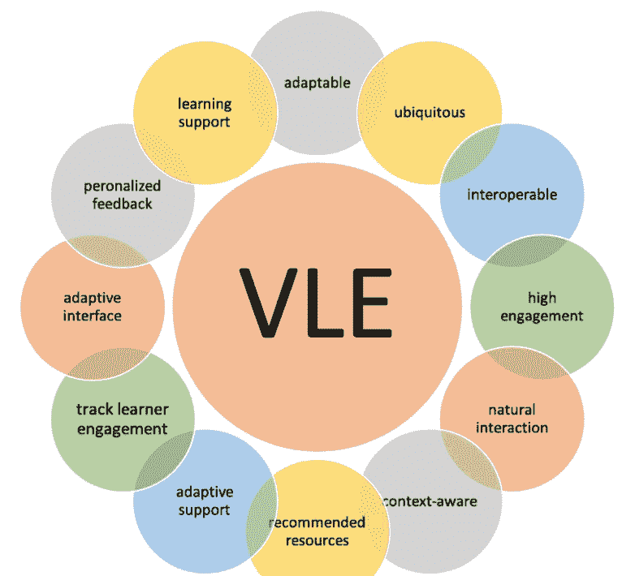

图(1.1) 虚拟学习环境的特点。

#### 1.3.1. 虚拟学习环境中AR的要素

虚拟学习环境中增强现实实现的主要要素包括目标标记、增强现实引擎、光学传感设备和显示器。智能移动设备是主要设备；使用其显示器和摄像头作为光学传感设备更为容易。

包含待检测图像标记的图像目标被制作成具有明显特征，以便于检测。手机设备的摄像头扫描物理环境并从目标标记中采集图像。系统将检测到的信息传输至AR引擎，以计算所检测标记的位置和角度。

与标记匹配后，移动设备显示屏上会生成相应对象。关联对象可以是提供图像目标附加信息的文本信息或图形图像。还可以嵌入3D模型、音频或视频片段或动画，以丰富视觉体验和参与感 [12]。

#### 1.3.2. AR应用中使用的目标标记

AR应用使用对象作为目标来创建3D空间 [9]。它们涵盖几种类型的目标——标记、编码标记、图像、多目标、文本识别、简单形状、物体识别。

简单标记带有易于识别的边框，可作为渲染目标。该标记使用的处理能力较少，运行中通常有效。这种编码标记在边框内产生约束，但图案可以变化。每组图案生成不同的虚拟对象。图像可以代替标记使用；这样可以避免生成与虚拟对象关联的多种标记。

图像应清晰，具有明显的轮廓和色彩对比度，以便于图像模式分析和匹配进而进行模式识别。

文本也可用作虚拟对象的目标；它可识别特定字体样式和大小的文本。简单2D或3D形状可通过识别边缘尺寸和纹理图案用作AR目标。物体也可用作AR目标；3D对象可在3D空间中被识别和使用。一些目标结合不同的对象模式进行识别。AR设备拾取与待识别对象相关的目标，并在3D空间中显示。

#### 1.3.3. 硬件平台/外设

多种设备和外设可渲染AR应用，包括手持移动设备（智能手机、平板个人电脑）、可穿戴智能眼镜、头戴式显示器、笔记本电脑和个人数字助理 [8, 13, 14]。其中最常见的是移动设备 [9]。

大多数移动设备都配备摄像头，通常有前置和后置。后置摄像头通过将摄像头对准目标来采集物理环境中的视频信号。设备识别标记，并根据摄像头和标记的位置与角度，将虚拟对象渲染到3D空间中。渲染需要大量的图形和CPU处理，如今大多数性能良好的智能手机都具备这种能力。移动设备还包含主要用于导航的GPS传感器。一些AR应用利用标记的位置来确定屏幕上显示的最终对象。这一特性也很有用，因为移动设备的设计使其便于在现实环境中随身携带，这对于AR应用检测周围环境中的目标非常有价值。

#### 1.3.4. AR在教育中的应用

教育领域已经出现增强现实技术的一些主流应用。AR应用用于技能培训、课堂学习和家庭学习（图2）。AR技术为学习材料提供虚拟示例，并包含游戏化元素，以提高学习者的参与度和互动。培训师使用增强现实应用来辅助工作坊技能练习，特别是在学习者无法方便使用设备以及安全问题非常突出的情况下 [8, 13, 15, 16]。

### 1.4. 虚拟学习环境中AR的方法论开发

技术的进步要求各类组织和机构在工作场所的技术实施中保持与时俱进。这些趋势包括硬件、软件和通信网络的安装；教育机构也应顺应这些趋势。软件系统的实施改善了运营；新系统取代现有系统，而现有系统也被重新设计和更新，以满足新的系统和运营要求。

虚拟学习环境系统的设计与开发需要考虑学习环境的背景、文化资源和社会文化特征。一项研究[7]指出，在设计智能学习环境时，还必须考虑两个关键方面——用户参与设计过程，以及包含接受系统用户反馈的功能。

系统设计过程已从传统的开发人员仅在系统开发早期与用户会面并获取需求列表（该列表成为用户验收测试（UAT）的检查清单）的方法，转变为用户和系统开发过程中的其他利益相关者必须参与整个设计和开发过程。用户反馈应在软件生命周期内形成完整循环，从设计之初贯穿开发和维护阶段，直至软件不再使用。软件用户的持续反馈使系统保持最新并满足所有相关需求。软件更新成为系统生命周期内反复进行的过程。

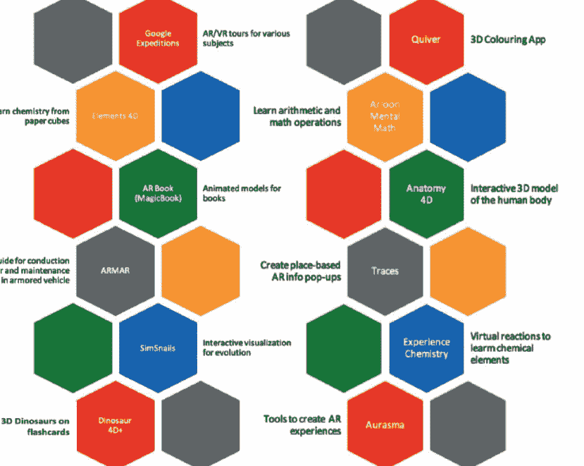

图（1.2）。教育中使用的AR应用。

#### 1.4.1. 敏捷方法论

敏捷软件开发方法论是一种以用户/客户为中心的方法论，它将整个开发过程组织成称为冲刺或迭代的小增量。每次迭代结束时，向客户交付一个产品（最小可行产品）。敏捷价值观和原则强调所有团队成员之间的互动与协作，其中用户是开发过程中的重要参与者。用户持续提供反馈，从而产生需求的更新和新需求 [17 - 19]。

#### 1.4.2. 使用敏捷Scrum开发AR-VLE

Scrum方法论是最流行的敏捷开发实践。Scrum使用1-4周的冲刺/迭代以小增量开发系统，每次冲刺后交付一个产品。增强现实系统可以拆分为模块，每个模块（或根据所需工作量决定的多个模块）在一次冲刺中开发，之后部署。

在虚拟学习环境增强现实系统的开发过程中，团队（Scrum团队）将明确需求并选择系统开发所用的技术栈。该过程是产品待办列表和冲刺待办列表的一部分，为冲刺开始做准备。在冲刺期间，团队创建AR引擎中使用的3D模型和图像目标。他们还进行模块原型设计，并开发将在智能移动设备上部署的AR模块。随后演示该模块，并举行评审会议以收集各利益相关方的反馈。反馈促使更新以满足新需求，这些需求将在后续冲刺中考虑，并开发新模块（图3）。

### 1.5. 面向VLE的AR系统开发

多种软件工具可用于开发虚拟学习环境的增强现实模块。开发分为两个部分——设计3D对象/模型，以及使用AR引擎开发AR模块。

#### 1.5.1. 设计3D模型

市面上有许多3D建模软件，有些付费，有些免费（表1）。这些软件可在多种平台上运行——Windows、macOS、Linux和在浏览器上运行的在线版本。它们各自提供某些独特的功能和用户体验，以满足不同设计师的需求。

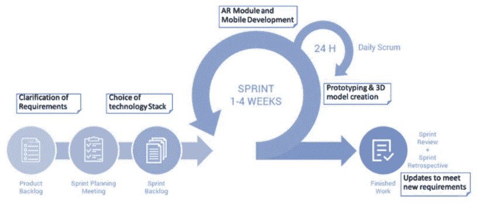

图（1.3）。使用敏捷 Scrum 开发 AR 应用程序。

##### 表 1.1. 3D 建模软件示例。

| 付费 | 免费 |
|---|---|
| Autodesk Maya | Blender |
| Houdini | Daz Studio |
| Cinema 4D | SketchUp |
| ZBrush | Sculptris |
| Rhinoceros | Vue |

凭借建模、照明、渲染和纹理功能，Autodesk Maya 被高度视为行业标准。Houdini 使用基于节点的程序化生产格式，这与 Autodesk Maya 相当不同。用户可以对 Houdini 工具获得相当多的控制。Cinema 4D 易于学习；它稳定且具有体积建模功能。它有助于动态图形、可视化和插图。ZBrush 是适合 3D 打印的工具之一，这是一款雕刻和建模工具，可创建 UV 贴图和绘制纹理。Rhinoceros 具有可学习的功能，并配备了用于复杂动画的良好渲染引擎。

Vue 具有创建令人难以置信的 3D 景观的功能。它还包含镜头畸变、景深和抗锯齿策略。Sculptris 产生出色的模型，并且通常与其他 3D 软件集成。它主要用于雕刻。SketchUp 是在浏览器中运行的著名 3D 建模器之一，它允许将 3D 模型导入项目。模型来自制造商，也由用户生成。Daz Studio 专注于使用虚拟人物、车辆、人物、环境和其他资产和配件创建数字艺术。这些工具包含独特的功能，设计师可以根据正在进行项目、使用的平台和预算使用。

##### BLENDER

为演示目的，Blender 用于本研究设计 3D 模型。Blender 是一款免费开源软件，可在大多数操作系统上运行。它附带建模软件预期的主要功能 – 3D 建模、UV 展开、光栅图形编辑、雕刻、动画、动态图形和渲染。它具有坚实的渲染引擎。Blender 是开源的，拥有一个不断改进软件及其功能的开发者社区。图（图 4-6）演示了 Blender 如何设计坠落立方体的 3D 模型。


图（1.4）。Blender 的界面。

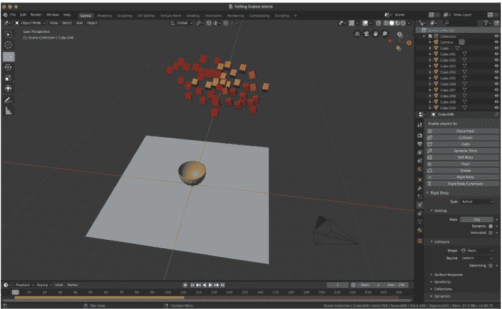

图（1.5）。使用 Blender 设计的顶部悬挂的 3D 立方体。

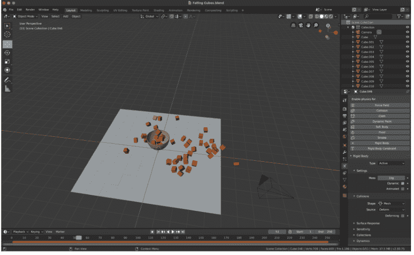

图（1.6）。使用 Blender 的 3D 立方体坠落动画设计。


图（1.8）。Vuforia 中的图像目标显示标记特征。

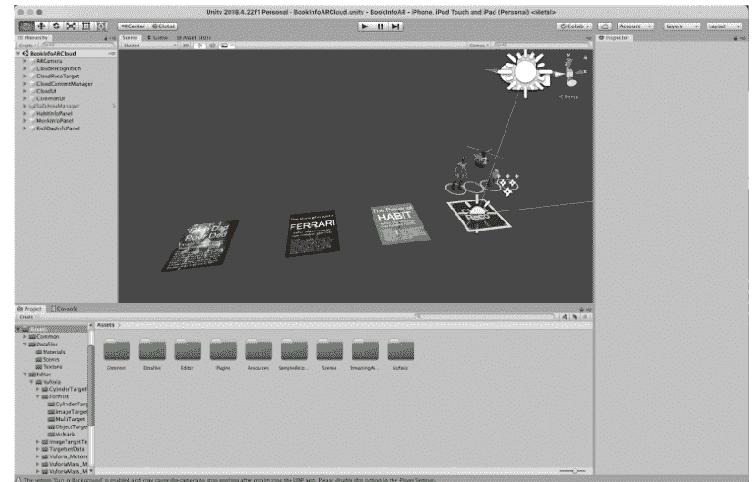

图（1.9）。在 Unity 中开发 AR 模块场景。


图（1.10）。使用 Unity 中的图像目标测试场景。

### 1.6. AR-VLE 中的教育数据挖掘

总体而言，数据挖掘涉及从各种来源收集数据 – 数据库、平面文件、数据仓库并进行分析、做出统计预测和推断。一篇综述研究 [20] 识别出数据挖掘项目中分析数据集并识别模式的四个阶段。流程始于数据清洗和过滤阶段；然后识别并选择必要的变量。然后数据从数据集中获取相关知识，并通过解释和评估衍生信息来提供额外含义。

教育数据挖掘主要涉及收集与学生在学习环境中的活动相关的数据，并做出推断以识别改进学习和其他相关活动的方法。此类数据从虚拟学习环境中的各种来源收集（图 11）。


在增强现实虚拟学习环境中，具有相似特征的学生可以被分类并在学习环境中获得专门主题。课程材料将以每个学生群体能够识别并关联的格式提供，但无论格式如何，主要内容保持不变。

系统应具有个性化功能，允许学生在感觉未达到期望的完成水平并希望改进时重新学习特定已完成的课程。

基于可用的全面数据，系统将具有多种推荐功能，帮助学生做出学习选择。推荐将基于学生档案、测试分数和系统上监控的其他活动。学生可以在不同的学习格式之间切换、重修课程或完成试验和自测 [21]。

## 结论

本章概述了在虚拟学习环境中设计和开发增强现实系统以提高学习材料参与度和学生与讲师之间互动的方法。开发采用了敏捷方法，该方法将系统开发过程分解为称为冲刺的小增量，以构建可用的模块。该方法也是以客户为中心的，在开发增强现实系统和智能学习环境中发挥着至关重要的作用，使用户参与整个开发过程，并在系统部署和使用后仍提供持续的用户反馈。用于设计 3D 模型和开发增强现实模块的软件工具也进行了讨论。本章以可集成到增强现实虚拟学习环境中的教育数据挖掘技术结束。

## 出版许可

不适用。

## 利益冲突

作者声明不存在利益冲突，无论是财务或其他方面。

## 致谢

未声明。

## 参考文献

[1] L.B. Kiat, M.B. Ali, N.D.A. Halim, and H.B. Ibrahim, "增强现实、虚拟学习环境和移动学习在教育中的比较", 2016 IEEE Conf. e-Learning, e-Management e-Services, IC3e 2016, 2017 pp. 23-28 [http://dx.doi.org/10.1109/IC3e.2016.8009034]

[2] A.C. Beluce, and K.L. De Oliveira, "学生在虚拟学习环境中的学习动机", Paideia, vol. 25, no. 60, pp. 105-113, 2015. [http://dx.doi.org/10.1590/1982-43272560201513]

Systems", *软件工程研究与实践国际会议*, 2015 pp. 10-16

[19] J. Shore, and S. Warden, 敏捷开发艺术. 2007.

[20] A.V. Manjarres, L.G.M. Sandoval, and M.J.S. Suárez, "应用于教育环境的数据挖掘技术：文献综述", *数字教育评论*, no. 33, pp. 235-266, 2018.

[http://dx.doi.org/10.1344/der.2018.33.235-266]

[21] P. Ducange, R. Pecori, L. Sarti, and M. Vecchio, "教育大数据挖掘：如何增强虚拟学习环境", *先进智能系统与计算*, vol. 527, pp. 681-690, 2017.

[http://dx.doi.org/10.1007/978-3-319-47364-2_66]

## 脑与计算机接口

Kuldeep Singh Kaswan¹* and Jagjit Singh Dhatterwal²

¹ 计算科学与工程学院，Galgotias University，Greater Noida，印度

² 计算机科学与应用系，PDM University，Bahadurgarh，Haryana，印度

摘要：脑机接口（BCIs）被定义为对大脑中产生运动运动的神经过程以及修改运动运动的认知过程（例如记忆）做出响应的设备和系统的科学技术。神经科学、计算技术、组件小型化、材料的生物相容性以及传感器技术的进步导致了有用 BCIs 的可行性大幅提高。脑机接口可以由工程师、神经科学家、物理科学家以及行为和社会科学家作为团队合作开发。对脑计算机（BCI）的一项研究讨论了大脑和外部系统如何相互作用。在侵入性系统中，电极植入皮层；在非侵入性系统中，它们安装在头皮上并使用脑电图或电皮层描记术监测神经元活动。BCI 系统通常可以根据用于检测和测量大脑中神经元的电极位置进行排名。本 WTEC 报告旨在向政府决策者和科学界汇编并揭示 BCI 研究全球发展和模式的信息。本章讨论了硬件设计、设备架构、功能性电刺激、非侵入性通信系统、学术和工业认知和情感神经假体。当前章节的目的是回顾北美、欧洲和亚洲侵入性和非侵入性 BCI 方法所使用的当前传感器技术。我们已访问和/或与这些领域的重点实验室互动。虽然并不完全全面，但本章概述了为潜在 BCI 应用开发的主要传感器技术。

关键词：皮层，中枢神经系统组织，ECoG 条带，电极帽，电皮层描记术，情感神经假体，EEG 信号，蚀刻技术，几何电极，有创，集成芯片，微加热器，多电极，无创，神经外科技术，神经元图，聚酰亚胺微电极，传感器技术，传感器技术，基于硅的电极。

### 2.1. 引言

本章对脑机接口技术（BCI）数据集中的传感器进行了描述。为本章目的，我们将传感器技术分为两个基本类别。首先，我们谈论“侵入式”技术，包括脑植入手术技术，主要是将微电极阵列直接插入大脑进行多电极记录以测试单细胞动作电位。本章的重点主题是传感器技术的一个快速增长市场 [1]。我们应指出，该技术尚未获批准用于人体试验 [2]。此外，还将讨论监测皮层电位的硬膜下或硬膜外电极阵列条带的观察结果 [3]，这与颅骨表面的脑电图记录 somewhat 相似，因为这是这些侵入性电极在人类癫痫手术中的主要用途 [4]。然而，其他BCI应用的发展可能会得到改进。其次，讨论“非侵入式”技术，主要涉及“湿式”银（Ag）或金（Au）多电极脑电图记录阵列的杯状电极，安装在头皮表面以监测脑电活动。这些电极来自各种在线来源，但在该领域的发展相对较少 [5]。我们警告称，“非侵入式”、头皮侵入式BCI技术应用通常被急性使用，并且对在家或工作的人来说可能变得更具侵入性。本领域技术的进一步发展将简要讨论。

### 2.2. 什么是BCI？

“BCI”一词已被普及，并首次由UCLA教授Jacques Vidal发表。Vidal在同行评审的艺术领域中以BCI科学家而闻名 [6]。脑机接口是外部设备与中枢神经系统之间有效的通信交互，也称为脑-机接口 [7]，它绕过了封装的使用。这通过皮层直接到达设备，而不是通过肌肉骨骼机制从皮层到键盘上的手指 [8]。

当今展示的脑接口设备需要有意识的思考，尽管潜在的实现将运行顺畅 [9]。旧的BCI方法需要将机械装置植入大脑，并且似乎作为身体的遗传成分进行监测，正被当前关于非侵入式BCI的深入信息所取代。BCI旨在增强感觉运动或人类认知过程、支持它们或恢复它们。这融合了电气工程、信息科学、生物医学和神经外科技术 [10]。

### 2.3. BCI传感器世界概览

欧洲BCI科学的大部分包括“非侵入式”传感器技术 [11]，*即*，从颅骨底部的脑电极阵列进行多电极记录 [12, 13]。这种传感器技术几乎没有发展，需要大幅改进 [14]。在欧洲，几个BCI站点能够提供传感设备，这可能有助于推进“侵入式”传感器技术的发展 [15]。

脑机接口（BMI）[18]，虽然它们旨在解决相同的问题，但与BCI有很大不同，表达了受试者在机器人指令中的目的 [16]。BCI以一种被理解为等同于动作的方式起作用，但与宏观脑功能（主要是EEG）扩散且未具体说明 [17]。BCI已经取得进展，并已准备好供患者使用，建立在可访问的脑电图研究和机器学习技术细节之上 [19, 20]。

### 2.4. 可植入电极的历史

中枢神经系统电极植入的历史可追溯到1930年代Hess关于原始猫植入的早期工作 [21]。然而，在1970年代，可植入电极看到了更近期的改编。50 μm钨微丝阵列的发展由Selman和Bach在1970年代初的电生理记录中记录，并在1980年代初由Chapin & Woodward（1986）记录。从本质上讲，许多实验室使用这种技术进行更频繁的单单元记录和许多动物BCI应用。多线阵列的一些困难在于对电极记录位点的单根导线进行准确监测和功能 [22]。

Wise和Angell于1970年至1975年间开发了使用集成芯片（IC）技术改进微电极的原理 [23]。在接下来的几年里，写了各种文章；Bement标准线电极工作在1980年代具有开创性，直径各异，暴露持续时间长达1 mm，从13到200 μm [24]。图（2.1）提供了嵌入式微盘的高密度阵列的插图，用于在自发运动的小鼠中记录多达128根导线。线电极被大鼠、灵长类动物、动物和后期监测目的广泛使用 [25]。

与众多位点良好的空间关系，可用于记录分层智力框架 [35]。微电极将响应大脑的构型 [36]。通过半导体行业专家制造微电极，同时消除建设内部生产设施的费用，可以实现小鼠的增强输出 [37]。微电极（例如，Thin Film Technologies, Inc.）。

#### 2.5.2. 基于硅的微电极

硅是用于创建多位点相关半导体微电极的第一个基底，并且已报告了若干微电极用于大脑监测和神经组织刺激的研究 [38]。硅作为基底的吸引力之一是化学蚀刻方法 [39]。无需激光加工或锯切，独立的微电极可以一次从单个基底中生产出来 [40]。有必要创建小功能，例如基底中的管道。蚀刻可以创建非常薄的微电极以测量基底的厚度 [50]。薄基底的记录厚度低至6–15µm [40]。

掺杂可以改变硅的半导体特性。硅也与机载电路高度兼容 [41]。硅具有多种特性，使其常被用于形成微电子阵列 [42]。密歇根大学“神经通信技术中心”的图（2.2）中可以看到BCI对以硅为重点的微电极技术的一些主要贡献。有两个最新的原型用于大鼠和非人类灵长类动物的BCI应用 [43]。

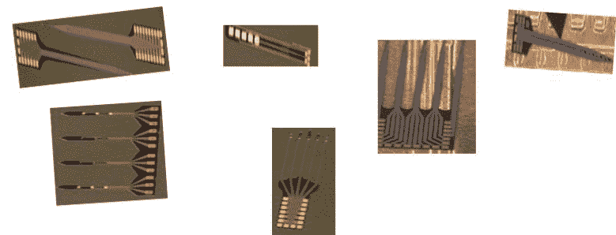

Fig. (2.2). 在密歇根大学开发的基于硅的微电极阵列光微照片。

掺杂可以改变硅的半导体特性。此外，该方法在这一组微电子中揭示了许多灵活的架构。硅作为基质介质的巨大优势之一是化学蚀刻程序的选择。微电极的厚度和形状可以通过蚀刻进行调整 [44]。它用于用各向同性蚀刻剂（10%氢氟酸，90%硝酸）蚀刻基底 [45]。硅基底的蚀刻通过乙二胺和焦 catechol 水（EDP）的蚀刻来隔离 [46]。预期类型的微电极可以用建模在硅晶圆上的硅氮化物层来描述 [47]。硅氮化物阻止基底发生反应。此外，通过选择性地向基底注入硼可以避免移植 [48]。

这些也是欧盟微电极的最大生产潜力，与美国和亚洲开发的技术高度竞争 [49]。示范模型如图（2.3）所示。放置有半导体电极的新系统可以嵌入传感器中。孔被插入基底以固定微电极并更牢固地纳入外膜脑空间 [50]。在电生理记录期间，几个用于化学物质/药物运输的通道已被蚀刻到硅基底的基底中（见图2.4）。

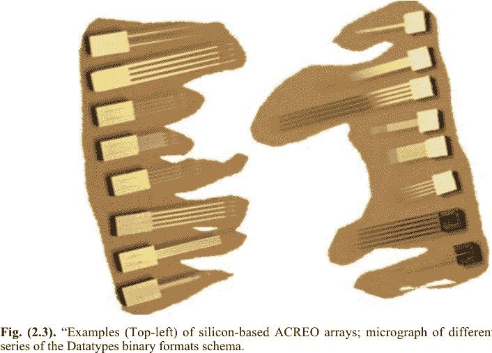

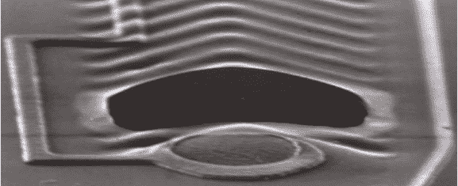

**图 (2.4).** 硅基微电极上用于向中枢神经系统组织传输化学物质的微通道的扫描电子显微镜图。微通道图像由密歇根大学的 NIH/NCRR 资源中心提供支持；经《传感百科全书》授权复制。

微电极阵列包含组合的 Ag/AgCl 参考电极。微驱动器用于安装后在微电极设计中的局部适配。设计了一种优化的多晶硅微加热器 [51]。在硅衬底中使用 VLSI 芯片（见图 2.5 带嵌入式放大）可实现电极调制和信号方法。基于硅胶的微电极允许制造微电极的“混合”设计。

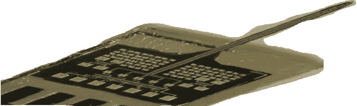

**图 (2.5).** “可看到硅基电生理图像与放大芯片用于电生理捕获（照片由韩国首尔国立大学校际半导体研究中心的 Sung June Kim 提供；经《传感器百科全书》许可转载）”。

为 Norman、Donoghue 及其同事的开创性工作创建了一个假体接口，用于在 100 个追踪位点的电生理阵列中设置。

这些设计仍用于人类用途，并构成了首个 BCI [52] 验证的非人类和人类灵长类研究微电极阵列。微电极的独立“轴”从 10 × 10 mm 衬底延伸 1.5 mm [53]。轴的尖端由硅上的 Pt 金属化以引导轴向下。硅载体用硅胶和氮化硅隔离。图 (2.6) 显示了“犹他”电极的扫描电子显微镜图像。Several planar silicon multi-shank

微样品如 Fig. (2.7) 所见，可用于创建相同的三维微电极阵列 [54]。平面微电极阵列用于绘制脑片记录的神经元连接图 [55]。

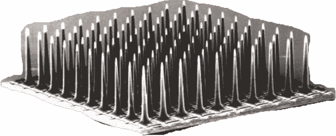

**图 (2.6).** “来自犹他电极阵列 (UEA) 的光学假体的扫描电子显微镜。”

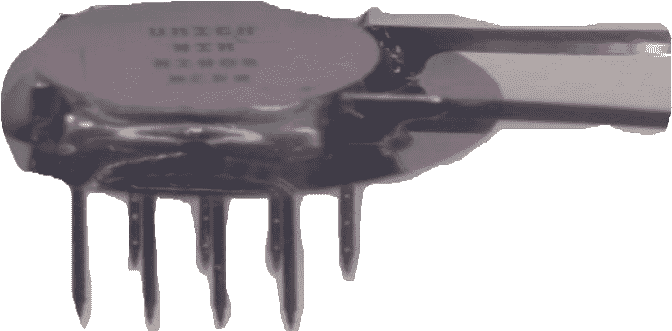

**图 (2.7).** “使用若干硅基微电极生成的多通道光微照片。”

#### 2.5.3. 陶瓷基微电极

特定微电极应从晶圆手动切片，因为陶瓷与标准蚀刻技术不兼容 [56]。激光加工是切割块状晶圆微电极最灵活的方式，可实现复杂类型生产 [57]。但激光加工会因激光步进而产生粗糙边缘，可能导致微电极插入问题 [58]。金刚石锯在切片时会滑动，会产生更光滑的微电极边界，从而防止过度组织损伤。必须在最小化中枢神经系统组织损伤的情况下测试完整的脑生物学。使用金刚石锯形成复杂形状更困难，因为锯通常切割成清晰的线条 [59]。图 (2.8) 的图像 1 是复杂激光加工微电极设计的图片。图 (2.8b) 的图像 2 是由计算机操作的金刚石锯创建的基础微电极陶瓷衬底。图 (2.8) 的图像 3 表示该微电极的放大更光滑边缘。准分子激光的使用比典型激光加工具有更干净的边缘。陶瓷衬底的抛光将实现更薄的微电极 [60]。

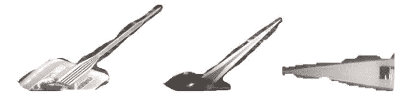

图 (2.8)。(1) 陶瓷衬底的复杂微电极形状图像，由激光加工切割；(2) 由计算机操作的金刚石锯创建的较不复杂的微电极形状；(3) 微电极的更光滑边缘放大。

图 (2.9) 显示了陶瓷安装的微电极介质，涂层厚度约为 38 和 51 µm，尖端直径为 60 µm。向隔离氧化铝层施加离子束沉积。这些 20 至 80 µm 的铂记录位点，间距为 200 µm，已用于长达 24 周的体内记录。已在陶瓷衬底上制作了四个和五个位点的若干 Pt 微电极。图 (2.10) 显示了光刻技术的多功能性 [61]。通常，捕获位点成组或线性隔离，彼此并排。在与前面提到的类似的线性基器件上，两种最新设计将微电极配置为每个 50 µm / 50 µm。最新版本具有大型的 50 至 100 Pt 位点和 50 至 150 µm，以确定更大的位点是否会报告更好的电位行为或更低的 CH 检测限 [62]。


图 (2.9)。使用离子束辅助沉积，展示了构建在更薄衬底氧化铝上的陶瓷基微电极的光微照片。

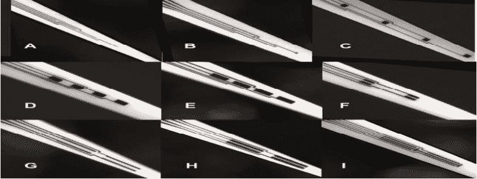

图 (2.10)。基于陶瓷的许多微电极项目的照片。

图 (2.11) 显示了若干“贴合”8 位点微电极的原型，目前正在大鼠和猴子中用于各种脑区生产。电极可以根据脑区和感兴趣的记录形式进行选择。为了更好地理解薄跨膜结构，例如在大脑皮层上，或海马锥体细胞浦肯野细胞，微电极末端有两个或三个抓取位点是有用的。在大脑关注区域，可以通过几个步骤获得尖端大量监测位点的集中。

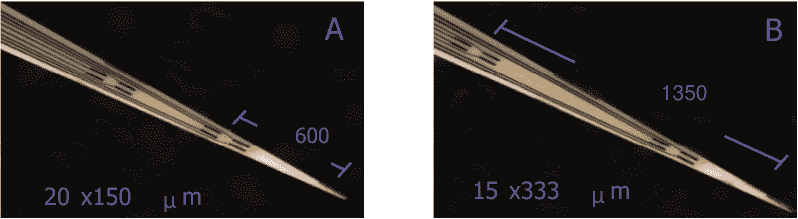

图 (2.11)。具有 8 个记录点的“贴合”陶瓷微电极布局。

#### 2.5.4. 聚酰亚胺微电极

生产了厚度小于 20 µm 的微电极 [64]。聚酰亚胺作为衬底是否特别功能灵活？用于皮层内植入的 3D 多轴微电极的图像显微照片如图 (2.12) 所示。

#### 2.5.6. ECoG 条带电极

电皮层图 (ECoG) 记录在 BCI 中的使用是一个研究领域。EEG 临床记录的技术在 1930 年代和 1950 年代通过 Jasper 和 Penfeld 的工作发展而来。首先，该技术至少已在数千人中得到广泛测试。其次，ECoG 的空间分辨率高于 EEG（十分之一毫米 vs. 厘米），且当前电极原型（图 2.14）比直接穿透电极数据提供更高的时间分辨率。第三，来自脑表面的脉冲显示出更大带宽的更高振幅 [64]。第四，在美国和欧洲，接受癫痫治疗的患者为 BCI 技术的研究提供了重要的试验平台。最后，这些经过验证的创新可能提高了体内长期可靠性，但它们仍在 4 至 64 个记录位置范围内 [65]。

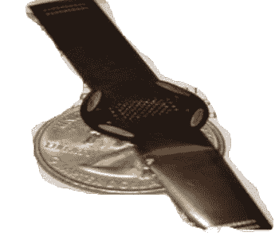

图 (2.14)。ECoG 硬膜下硬膜外记录微电网。

图 (2.15) 展示了各种 Ad-Tech ECoG 条带电极。

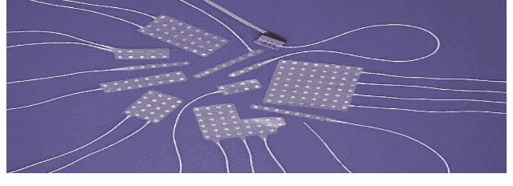

图 (2.15)。4 至 64 个 ECoG 位置的记录电极条带条纹探测器“（经 Ad-Tech Medical Instruments 许可转载）”。

### 2.6. BCI EEG 传感器

几乎所有 BCI 研究都需要使用颅骨固定的 Ag 或 Au 盘电极和非侵入性传感器，以便使用某种类型的头帽装置安装 EEG 电极。在过去二十年中，在开发这些仪器以便轻松方便地将它们定位在 BCI 患者的颅骨上方面进展甚微。头帽设计用于支持“国际 10–20 网格系统”EEG 电极从 64 到 256 的计算和定位。有多个头帽供应商和电极，包括 G. Tech（Guger Technologies OEG）、Grass Technologies、BioSemi 等。在湿电极记录领域，如图 (2.16) 所示，是多种 BCI 技术最强大的头帽来源之一。其专用的 EEG 电极配置头帽为用户提供行业中最好的信号之一。电极帽配置需要额外的时间来安装电极，但实现了出色的信噪比特性。对于其他设备和放大器以及此类仪器的其他供应商，可以使用这种极其坚固的样式。

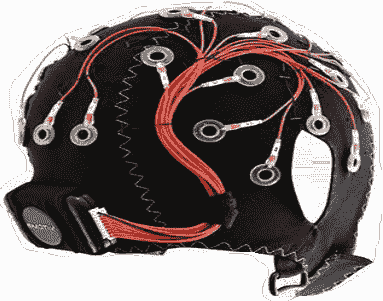

图 (2.16)。EEG 头帽系统。


然而，使用 EEG 电极头帽为人们佩戴的方法耗时较长，需要通过单个电极检查其阻抗，并导致对 BCI 常规使用而言疼痛或不切实际的接口。需要创建“干电极”，可以在不进行当前设计所需规划的情况下使用。为了提高信噪比并避免 BCI 常规使用中疼痛或不切实际的接口，还需要主动电极架构（如 BioSemi 销售的）。

### 2.7. 多微电极阵列的 BMI/BCI 技术建模与信号处理

此处接口、脑控机器人显示尖峰信息结构。多微电极序列数据用于两种主要方法：一类包含尖峰；第二类使用分箱尖峰速率估计，即一段时间内的尖峰数量（分箱）。BMI 分析采用受控的分箱框架。

#### 2.7.1. 分箱概念数据模型

BMI 实验框架提供了强大的计算方法和技术用于信号分析，用于提取优化的数据模型。BMI 反馈和所需答案均由研究者同步生成（手部位置）。

精确和自动的尖峰识别与试验仍是研究的持续重点。只要点过程被正确提取，解码模型就是神经元尖峰发放功能。解码问题可以转化为设备识别范式，其中线性或非线性参数设备是从获得的数据中专门学习用于预测的。在图（2.17）中，控制理论和信号处理模型被广泛研究，因此可以使用多种方法。

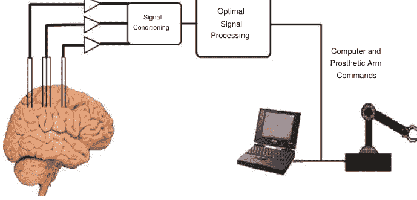

图（2.17）。系统辨识框架。

粒子滤波系统消除了卡尔曼滤波器的两个约束（线性性和高斯假设），但大大复杂化了计算机算法。粒子系统在其对应阶段利用顺序重要性重采样。但由于模型通常是未闭合的，后验解必须通过采样来计算。

#### 2.7.2. EEG/ECoG 记录

在某些方面，EEG 和 ECoG 信号处理是相同的。在这两种情况下，信号都是由广泛的神经元活动产生的场。在这两种情况下，信号只能通过对所有这些神经元求和来观察。异步操作应停止以反映同步神经元活动的组成。BCI 信号处理的两个阶段是特征提取和转换。

### 2.8. 硬件实现

#### 2.8.1. 恢复瘫痪患者运动

瘫痪疾病影响全球人群，涉及多种问题，包括休克、中风、感染和炎症性疾病。主要损伤可能表现在皮层、脊髓、椎神经和肌肉。一般来说，“瘫痪”意味着极端或完全的运动功能丧失，而“偏瘫”则相对损失较小。极端瘫痪是一个重大问题，不仅因为它牺牲了患者正常生活的能力，还因为医院维护的巨大成本。例如，在 TC 患者中，颈部以下几乎所有自愿运动功能都丧失，同时躯体感觉也丧失，即他们对接触、不适、温度以及肢体位置的感觉丧失。肌萎缩侧索硬化（ALS）进一步加剧了患者可能丧失全身运动功能这一事实。

#### 2.8.2. 基于 EEG 的脑机接口

在当前使用中，有两种截然不同的 BCI 类型，其中一种是“非侵入式”BCI，一种电子记录设备，使用头皮电极接触从人脑皮层捕捉脑电图信号（EEG）。通常人需要生物反馈方法来学习如何使用自己的“脑电波”控制计算机屏幕上的光标。经过大量努力，使用 BCI 引导机器光标选择字母，光标的控制变得足够精确以拼写单词。这种 BCI 策略非常受欢迎，似乎已为严重 SCI 患者对外部设备进行一定程度的控制做好了短期出色解决方案的准备。电子技术用于恢复 SCI 中运动控制的应用也得到了展示。然而，其局限性在于受试者需要大量的准备和严格的专注。与之相比，非侵入式 BCI 解决方案受 EEG 记录所调节的自由度数量的限制（目前为一到两个）。

#### 2.8.3. 直接脑机接口

使用嵌入式多电极阵列直接从运动控制回路在脑内进行跟踪是 EEG 控制 BCI 的一种替代方案。在过去八年中，这种直接 BCI 方法的可行性已得到证实，从动物开始，目前已扩展到人类（Hochberg et al., 2006）。由于多电极阵列记录自受试者运动皮层的神经元群体，因此该方法用于收集大脑的运动指令。阵列专门触及处理大脑的底层功能的原因使得所记录的信号能够指导 BCI 与内部运动系统的驱动 [39]。

#### 2.8.4. 记录、提取和解码神经运动指令

所有直接 BCI 都依赖于多电极记录设备通过采样运动皮层中大量神经元群体来检测预期运动的能力。每个电极的动作电位由多个邻近神经元记录，每个神经元都提供有关预期行进路线的详细信息。同一电极还记录局部场电位的幅度，旨在提供有关加速度速度或强度的详细信息。当突触冲动在脑中被捕获时，所有这些信息都会自动放大、滤波、鉴别并传输到计算机。然后，这些知识被转换为机器人或机器光标管理的输出格式 [49]。

#### 2.8.5. 使用多元回归分析（MRA）预测肢体运动运动学

我们认为 MRA 是一种稳健的方法，可将多神经元记录转换为受试者肢体活动或机器人臂控制的连续近似。虽然已引入了几种方法来解决这个问题，但大多数多神经元管理设备仍使用 MRA 变体，这些变体产生线性模型，可在一组（输入）变量数组中估计各种相关变量（输出）。MRA 是数学方法，用于在自主（例如驱动系统的神经元群体）和预测变量之间进行选择，以描述（例如运动输出函数）之间的线性数学关联。MRA 在其最简单的形式中给出线性结构方程

`Y = a + b₁X₁ + b₂X₂ +.... + bₘ Xₘ`

其中 X 是自变量，Y 是因变量，a 是偏移量，b 是自变量的加权系数，m 是计数集。该关系可方便地根据样本数据集通过线性最小二乘近似来确定，该近似沿着所见数据点测量一条线，以最小化沿该线显示的点中平方差的总和。该度量还导致决定系数（`R²`），该系数评估卓越的预测性能（范围为 0 到 1）。

#### 2.8.6. 猴脑运动指令的提取

下一步是对神经知识潜力的描述，该知识能够使用灵长类动物的多神经元运动皮层记录编码多个方向的运动。猴子不仅用于识别人类皮层运动，还用于在它们更大的大脑中为电极植入创造更多空间。图（2.18）说明了猴子如何随机抓取手柄并左右推动以获得果汁奖励。图（2.18）用于构建此实验。多神经元记录同时从插入大脑多个区域的 32 通道电极阵列获得，包括运动、前运动、躯体感觉和顶叶皮层。

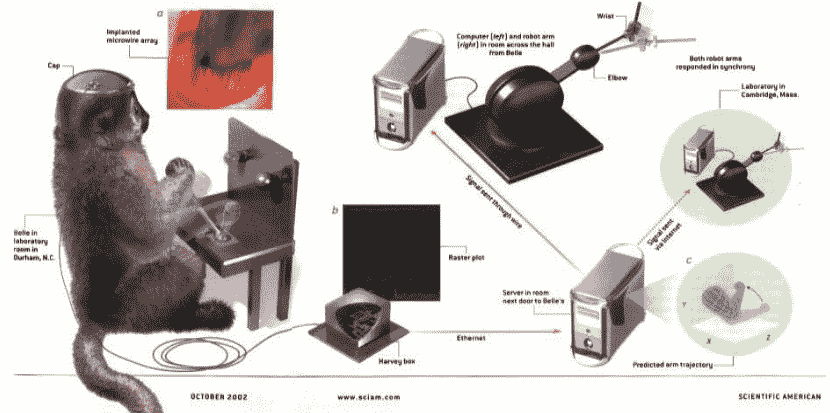

图（2.18）。猴脑运动指令的提取。

虽然在这些记录中，有用编码信息的一致性和数量因感觉运动区域而异，但两个区域都至少提供了一些有用的信息。这与早期发现相似，即皮层神经元通常平衡良好，并且可以参与大范围的实验环境。

广泛调谐是许多有效多电极记录的解释，因为研究人员将依赖于从大多数神经元被捕获。在之前的文献记录中，这被认为与皮质运动神经元的计划活动过程大致相关。对于未训练和过度训练的夜猴来说，这都是正确的。因此，在两种不同的运动之前，同一批神经元表现出放电增强。

我们在 18 个月内保持皮质植入物安全且可用，这是该方法在开发脑控假体器械中可能应用的首个重要发现。

#### 2.8.7. 生物反馈改变机器人臂运动编码

直到那时，大多数科学家才确认在从臂力控制转变为脑控后，机器人臂动作与真实手臂分离。尽管受试者仅针对精确操作进行补偿，但随着时间的推移，机器人臂调整实际手臂的可靠性较低。

与此同时，猴子的准确性通常会不断提高。实际上，神经元群体的精确编码是由 Carmena 等人（2003）发现的。然而，这种分离完全依赖于实验背景，因为受试者在回到笼子后通常会使用它们真实的手臂。由于动物受试者显然能够提高其控制精度，这迫使我们得出结论，人类受试者也将学会改变其神经元的特征。

### 2.9. 多输出功能脑控

下一步将是探索使用该技术来控制各种输出功能。手势的脑控已经得到明确证明。此外，由于这些线性模型基于动物对抗两种甚至更多力运动时收集的数据，该模型可以用 0.9 的相关性模拟所有力。如果该线性模型由动物在两种或更多不同力场中运动的数据组成，即稳定的弹簧，则该模型因此可以被训练以可靠地模拟所有力（图 2.19）。

蓝色标记代表实际轨迹，红色标记代表动物神经活动经回归模型构建的权重矩阵处理后产生的轨迹。权重是结合先前实验中神经活动感兴趣的期望变量计算的；在本例中为力。请注意，投影轨迹（红色）与实际轨迹（蓝色）具有高度关联。

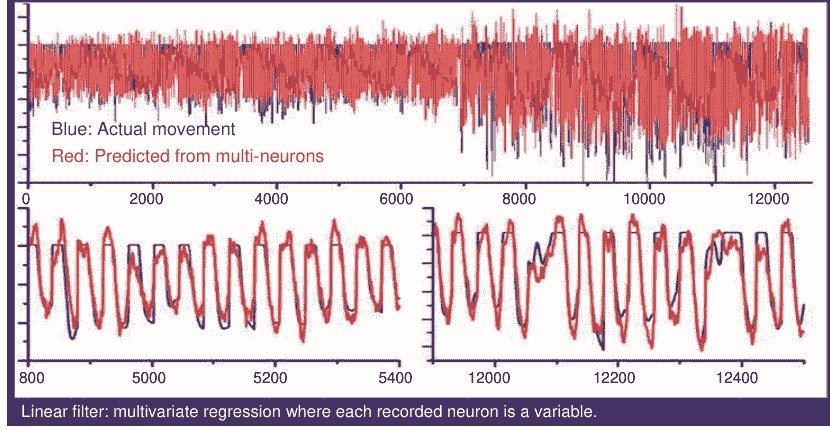

图（2.19）。一项训练动物在握住机器人操作器时做出运动的实验，该操作器产生两种不同的恒定力，即 3 g 或 10 g 的力。

### 2.10. 仿生机器人研究

已开发出各种重要的机器人，包括不仅是本体感觉、触觉和视觉的执行器和传感器。ARTS 机器人由 25 个自由度、2 个视觉传感器、39 个传感器和 3D 图像稳定组成，具有头部、手臂和手。它包含一种受生物启发的多网络架构，并融合了用于运动分析的渐进式和功能性学习。5 指仿生手假体是他们最新的生物机电网络手（图 2.20），每个手指都包括一个电机以及嵌入式仿生力和本体感觉传感器。尽管执行器的数量受控，但手的适应性和集成的闭环控制为人工手提供了出色的抓握特性。该器械专为截肢者使用，因此通过与患者残臂神经的接口进行操作。


图（2.20）。机器人手系统。

#### 2.10.1. 仿生手假体的原理

直到最近，典型的手假体一直由肌电接口操作的金属钩组成。因此，出于实用和美观的原因，升级这些假手是必不可少的。网络手 [45] 因此受手和手指运动学的知识驱动（图 2.21）。由于制造具有真实人类所有特征的机器人会很困难，挑战在于构建包含相似且更不复杂功能的改进。

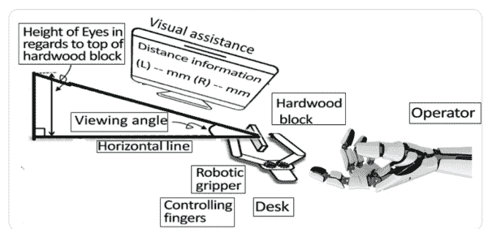

图（2.21）。操作过程中的手动和自动化运动学。

#### 2.10.2. SSSA 的生物机电学研究方法

Dario 教授强调使用解剖学、生理学和神经科学来支持机器人开发的重要性。如图（2.22）所示，该实验室提倡一种生物机电方法，超越基本力学，朝着通常考虑手的整体框架发展。

创建将在未来五到十年内与美国努力相抗衡或超越的 BCI 传感器。

## 出版同意

不适用。

## 利益冲突

作者声明不存在利益冲突，无论是财务或其他方面。

## 致谢

未声明。

## 参考文献

- [1] T. Akin, B. Ziaie, S.A. Nikles, and K. Najafi, "一种用于生物医学应用的模块化微机械加工高密度连接器系统", IEEE Trans. Biomed. Eng., vol. 46, no. 4, pp. 471-480, 1999. [http://dx.doi.org/10.1109/10.752944] [PMID: 10217885]

- [2] D.J. Anderson, K. Najafi, S.J. Tanghe, D.A. Evans, K.L. Levy, J.F. Hetke, X.L. Xue, J.J. Zappia, and K.D. Wise, "用于中枢听觉系统刺激的批量制造薄膜电极", IEEE Trans. Biomed. Eng., vol. 36, no. 7, pp. 693-704, 1989. [http://dx.doi.org/10.1109/10.32101] [PMID: 2744793]

- [3] Q. Bai, and K.D. Wise, "使用有源微电极阵列的单单元神经记录", IEEE Trans. Biomed. Eng., vol. 48, no. 8, pp. 911-920, 2001. [http://dx.doi.org/10.1109/10.936367] [PMID: 11499528]

- [4] Q. Bai, K.D. Wise, and D.J. Anderson, "用于三维微电极阵列的高产微装配结构", IEEE Trans. Biomed. Eng., vol. 47, no. 3, pp. 281-289, 2000. [http://dx.doi.org/10.1109/10.827288] [PMID: 10743769]

- [5] A.A. Baumeister, "偶然性与愉悦的脑定位", J. Hist. Neurosci., vol. 15, no. 2, pp. 92-98, 2006. [http://dx.doi.org/10.1080/09647040500274879] [PMID: 16608738]

- [6] S.L. BeMent, K.D. Wise, D.J. Anderson, K. Najafi, and K.L. Drake, "用于多通道复用皮层内神经元记录的固态电极", IEEE Trans. Biomed. Eng., vol. 33, no. 2, pp. 230-241, 1986. [http://dx.doi.org/10.1109/TBME.1986.325895] [PMID: 3957372]

- [7] D.A. Borkholder, J. Bao, N.I. Maluf, E.R. Perl, and G.T. Kovacs, "用于神经切片制备刺激的微电极阵列", J. Neurosci. Methods, vol. 77, no. 1, pp. 61-66, 1997. [http://dx.doi.org/10.1016/S0165-0270(97)00112-X] [PMID: 9402558]

- [8] A. Bragin, J. Hetke, C.L. Wilson, D.J. Anderson, J. Engel Jr, and G. Buzsáki, "用于自由活动大鼠慢性记录的多位点硅基探针：植入、记录和组织学验证", J. Neurosci. Methods, vol. 98, no. 1, pp. 77-82, 2000. [http://dx.doi.org/10.1016/S0165-0270(00)00193-X] [PMID: 10837874]

- [9] A. Branner, R.B. Stein, E. Fernandez, Y. Aoyagi, and R.A. Normann, "猫坐骨神经中穿透式微电极阵列的长期刺激和记录", IEEE Trans. Biomed. Eng., vol. 51, no. 1, pp. 146-157, 2004. [http://dx.doi.org/10.1109/TBME.2003.820321] [PMID: 14723504]

- [10] J.J. Burmeister, and G.A. Gerhardt, "用于检测和消除 L-谷氨酸及其他分析物测量干扰的自参考陶瓷基多位点微电极", Anal. Chem., vol. 73, no. 5, pp. 1037-1042, 2001. [http://dx.doi.org/10.1021/ac0010429] [PMID: 11289414]

- [11] Burmeister J.J., and Gerhardt G.A., 2006. 神经化学阵列. 载于《传感器百科全书》，第 6 卷，Eds. C. Grimes, E. Dickey, and M.V. Pishko. Stevenson Ranch, CA: American Scientific Publishers, 525.

- [12] J.J. Burmeister, K. Moxon, and G.A. Gerhardt, "用于电化学记录的陶瓷基多位点微电极", Anal. Chem., vol. 72, no. 1, pp. 187-192, 2000. [http://dx.doi.org/10.1021/ac9907991] [PMID: 10655652]

- [13] J.J. Burmeister, F. Pomerleau, M. Palmer, B.K. Day, P. Huettl, and G.A. Gerhardt, "改进的陶瓷基多位点微电极用于中枢神经系统中 L-谷氨酸的快速测量", J. Neurosci. Methods, vol. 119, no. 2, pp. 163-171, 2002. [http://dx.doi.org/10.1016/S0165-0270(02)00172-3] [PMID: 12323420]

- [14] J.K. Chapin, and D.J. Woodward, "大鼠 MI-SI 皮质交界区躯体感觉和主动运动神经元放电特性的分布", Exp. Neurol., vol. 91, no. 3, pp. 502-523, 1986. [http://dx.doi.org/10.1016/0014-4886(86)90048-8] [PMID: 3948958]

- [15] J.K. Chapin, and M.A.L. Nicolelis, "感觉运动假体的脑控", 载于《用于感觉和运动功能恢复的神经假体》，J.K. Chapin, K.A. Moxon, 编，CRC Press: Boca Raton, FL, 2001, pp. 235-261.

- [16] J.K. Chapin, "使用多神经元群体记录进行神经假体", Nat. Neurosci., vol. 7, no. 5, pp. 452-455, 2004. [http://dx.doi.org/10.1038/nn1234] [PMID: 15114357]

- [17] J. Chen, and K.D. Wise, "具有集成微加热器的硅探针用于神经组织的热标记和监测", IEEE Trans. Biomed. Eng., vol. 44, no. 8, pp. 770-774, 1997. [http://dx.doi.org/10.1109/10.605437] [PMID: 9254990]

- [18] J. Chen, K.D. Wise, J.F. Hetke, and S.C. Bledsoe Jr., "一种用于细胞水平选择性化学递送的多通道神经探针", IEEE Trans. Biomed. Eng., vol. 44, no. 8, pp. 760-769, 1997. [http://dx.doi.org/10.1109/10.605435] [PMID: 9254989]


# 参考文献

- [19] K.C. Cheung, "可植入微尺度神经接口", Biomed. Microdevices, vol. 9, no. 6, pp. 923-938, 2007. epub [`http://dx.doi.org/10.1007/s10544-006-9045-z`] [PMID: 17252207]

- [20] T.C. Chiganos Jr, W. Jensen, and P.J. Rousche, "局灶性皮质梗死期间的电生理反应动力学", J. Neural Eng., vol. 3, no. 4, pp. L15-L22, 2006. [`http://dx.doi.org/10.1088/1741-2560/3/4/L01`] [PMID: 17124326]

- [21] J. Csicsvari, D.A. Henze, B. Jamieson, K.D. Harris, A. Sirota, P. Barthó, K.D. Wise, and G. Buzsáki, "使用硅基电极对单元和局部场电位进行大规模并行记录", J. Neurophysiol., vol. 90, no. 2, pp. 1314-1323, 2003. [`http://dx.doi.org/10.1152/jn.00116.2003`] [PMID: 12904510]

- [22] C.C. Della Santina, G.T. Kovacs, and E.R. Lewis, "使用可植入硅基底微电极从再生牛蛙第八神经记录多单元", J. Neurosci. Methods, vol. 72, no. 1, pp. 71-86, 1997. [`http://dx.doi.org/10.1016/S0165-0270(96)00159-8`] [PMID: 9128171]

- [23] K.L. Drake, K.D. Wise, J. Farraye, D.J. Anderson, and S.L. BeMent, "平面多位点微探针记录细胞外单单元皮层内活动的性能", IEEE Trans. Biomed. Eng., vol. 35, no. 9, pp. 719-732, 1988. [`http://dx.doi.org/10.1109/10.7273`] [PMID: 3169824]

- [24] G. Ensell, D.J. Banks, P.R. Richards, W. Balachandran, and D.J. Ewins, “用于神经生理学的硅基微电极，由绝缘体上硅晶圆微加工制成”，Med. Biol. Eng. Comput., vol. 38, no. 2, pp. 175-179, 2000. [`http://dx.doi.org/10.1007/BF02344773`] [PMID: 10829410]

- [25] E.A. Felton, J.A. Wilson, J.C. Williams, and P.C. Garell, “利用运动和感觉想象，通过皮层脑电控制脑机接口：四例临时硬膜下电极植入患者报告”，J. Neurosurg., vol. 106, no. 3, pp. 495-500, 2007. [`http://dx.doi.org/10.3171/jns.2007.106.3.495`] [PMID: 17367076]

- [26] C. Fonseca, J.P. Silva Cunha, R.E. Martins, V.M. Ferreira, J.P. Marques de Sá, M.A. Barbosa, and A. Martins da Silva, “一种用于脑电记录的新型干式有源电极”，IEEE Trans. Biomed. Eng., vol. 54, no. 1, pp. 162-165, 2007. [`http://dx.doi.org/10.1109/TBME.2006.884649`] [PMID: 17260869]

- [27] C. Gonzalez, and M. Rodriguez, “一种用于神经和肌肉组织的柔性穿孔微电极阵列探针”，J. Neurosci. Methods, vol. 72, pp. 189-195, 1997. [`http://dx.doi.org/10.1016/S0165-0270(96)02202-9`] [PMID: 9133584]

- [28] R.G. Heath, S.M. Peacock Jr, and W. Miller Jr, “通过皮层下和头皮电极同时记录的人类诱发性阵发性电活动”，Trans. Am. Neurol. Assoc., vol. 3, no. 78th Meeting, pp. 247-250, 1953. [PMID: 13179226]

- [29] J.F. Hetke, J.L. Lund, K. Najafi, K.D. Wise, and D.J. Anderson, “用于长期植入微电极阵列的硅带状电缆”，IEEE Trans. Biomed. Eng., vol. 41, no. 4, pp. 314-321, 1994. [`http://dx.doi.org/10.1109/10.284959`] [PMID: 8063297]

- [30] L.R. Hochberg, M.D. Serruya, G.M. Friels, J.A. Mukand, M. Saleh, A.H. Caplan, A. Branner, D. Chen, R.D. Penn, and J.P. Donoghue, “四肢瘫痪患者通过神经元集群控制假肢装置”，Nature, vol. 442, no. 7099, pp. 164-171, 2006. [`http://dx.doi.org/10.1038/nature0470`] [PMID: 16838014]

- [31] A.C. Hoogerwerf, and K.D. Wise, “一种用于长期神经记录的三维微电极阵列”，IEEE Trans. Biomed. Eng., vol. 41, no. 12, pp. 1136-1146, 1994. [`http://dx.doi.org/10.1109/10.335862`] [PMID: 7851915]

- [32] W. Jensen, K. Yoshida, and U.G. Hofmann, “柔性硅基ACREO微电极阵列在大鼠大脑皮层内的体内植入力学特性”，IEEE Trans. Biomed. Eng., vol. 53, no. 5, pp. 934-940, 2006. [`http://dx.doi.org/10.1109/TBME.2006.872824`] [PMID: 16686416]

- [33] D.R. Kipke, R.J. Vetter, J.C. Williams, and J.F. Hetke, “用于长期记录大脑皮层神经元锋电位活动的硅基底皮层内微电极阵列”，IEEE Trans. Neural Syst. Rehabil. Eng., vol. 11, no. 2, pp. 151-155, 2003. [`http://dx.doi.org/10.1109/TNSRE.2003.814443`] [PMID: 12899260]

- [34] E.H. Kossoff, E.K. Ritzl, J.M. Politsky, A.M. Murro, J.R. Smith, R.B. Duckrow, D.D. Spencer, and G.K. Bergey, “外部响应式神经刺激器对硬膜下电极监测期间癫痫发作和脑电图放电的影响”，Epilepsia, vol. 45, no. 12, pp. 1560-1567, 2004. [`http://dx.doi.org/10.1111/j.0013-9580.2004.26104.x`] [PMID: 15571514]

- [35] G.T. Kovacs, C.W. Storment, and J.M. Rosen, “用于周围神经记录和刺激的再生微电极阵列”，IEEE Trans. Biomed. Eng., vol. 39, no. 9, pp. 893-902, 1992. [`http://dx.doi.org/10.1109/10.256422`] [PMID: 1473818]

- [36] G.T. Kovacs, C.W. Storment, M. Halks-Miller, C.R. Belczynski Jr, C.C. Della Santina, E.R. Lewis, and N.I. Maluf, “用于并行记录周围神经和脑神经电活动的硅基底微电极阵列”，IEEE Trans. Biomed. Eng., vol. 41, no. 6, pp. 567-577, 1994. [`http://dx.doi.org/10.1109/10.293244`] [PMID: 7927376]

- [37] E.C. Leuthardt, G. Schalk, J.R. Wolpaw, J.G. Ojemann, and D.W. Moran, “一种使用人类皮层脑电信号的脑机接口”，J. Neural Eng., vol. 1, no. 2, pp. 63-71, 2004. [`http://dx.doi.org/10.1088/1741-2560/1/2/001`] [PMID: 15876624]

- [38] L. Lin, G. Chen, K. Xie, K.A. Zaia, S. Zhang, and J.Z. Tsien, “自由行为小鼠大脑中的大规模神经集群记录”，J. Neurosci. Methods, vol. 155, no. 1, pp. 28-38, 2006. [`http://dx.doi.org/10.1016/j.jneumeth.2005.12.032`] [PMID: 16554093]

- [39] N. Ludvig, 药物递送到行为大鼠和猴子大脑中电生理监测神经元的微环境中。感觉和运动功能恢复的神经假体，J.K. Chapin, K.A. Moxon, 编，CRC出版社：佛罗里达州博卡拉顿，2001年，第263-283页。

- [40] T.C. Marzullo, J.R. Dudley, C.R. Miller, L. Trejo, and D.R. Kipke, “用于脑机接口任务的大鼠运动学习过程中的锋电位、局部场电位和皮层脑电图特征描述”，Conf. Proc. IEEE Eng. Med. Biol. Soc., vol. 2006, pp. 429-431, 2005. [PMID: 17282206]

- [41] K.A. Moxon, S.C. Leiser, G.A. Gerhardt, K.A. Barbee, and J.K. Chapin, “用于多通道复用皮层内神经元记录的固态电极”，IEEE Trans. Biomed. Eng., vol. 51, p. 647, 2004. [`http://dx.doi.org/10.1109/TBME.2003.821037`] [PMID: 15072219]

- [42] K. Najafi, J. Ji, and K.D. Wise, “硅多通道记录探针的缩放限制”，IEEE Trans. Biomed. Eng., vol. 37, no. 1, pp. 1-11, 1990. [`http://dx.doi.org/10.1109/10.43605`] [PMID: 2303265]

- [43] M.A. Nicolelis, D. Dimitrov, J.M. Carmena, R. Crist, G. Lehew, J.D. Kralik, and S.P. Wise, “猕猴的慢性多位点多电极记录”，Proc. Natl. Acad. Sci. USA, vol. 100, no. 19, pp. 11041-11046, 2003. [`http://dx.doi.org/10.1073/pnas.1934665100`] [PMID: 12960378]

- [44] C.T. Nordhausen, E.M. Maynard, and R.A. Normann, “100微电极阵列的单单元记录能力”，Brain Res., vol. 726, no. 1-2, pp. 129-140, 1996. [`http://dx.doi.org/10.1016/0006-8993(96)00321-6`] [PMID: 8836553]

- [45] J. Olds, W.S. Allan, and E. Briese, “下丘脑驱动与奖赏中枢的区分”，Am. J. Physiol., vol. 221, no. 1, pp. 368-375, 1971. [`http://dx.doi.org/10.1152/ajplegacy.1971.221.1.368`] [PMID: 5555810]

- [46] J.W. Pan, J.H. Kim, A. Cohen-Gadol, C. Pan, D.D. Spencer, and H.P. Hetherington, “海马癫痫中的区域能量功能障碍”，Acta Neurol. Scand., vol. 111, no. 4, pp. 218-224, 2005. [`http://dx.doi.org/10.1111/j.1600-0404.2005.00398.x`] [PMID: 15740571]

- [47] J.J. Pancrazio, P.P. Bey Jr, A. Loloee, S. Manne, H.C. Chao, L.L. Howard, W.M. Gosney, D.A. Borkholder, G.T. Kovacs, P. Manos, D.S. Cuttino, and D.A. Stenger, “用于生物电信号转导的基于CMOS放大器的测量与刺激系统的描述和演示”，Biosens. Bioelectron., vol. 13, no. 9, pp. 971-979, 1998. [`http://dx.doi.org/10.1016/S0956-5663(98)00006-2`] [PMID: 9839386]

- [48] W.R. Patterson, Y.K. Song, C.W. Bull, I. Ozden, A.P. Deangelis, C. Lay, J.L. McKay, A.V. Nurmikko, J.D. Donoghue, and B.W. Connors, “一种用于脑植入式神经假体应用的微电极/微电子混合装置”，IEEE Trans. Biomed. Eng., vol. 51, no. 10, pp. 1845-1853, 2004. [`http://dx.doi.org/10.1109/TBME.2004.831521`] [PMID: 15490832]

- [49] R. Rathnasingham, D.R. Kipke, S.C. Bledsoe Jr, and J.D. McLaren, “可植入微加工流体输送装置的特性表征”，IEEE Trans. Biomed. Eng., vol. 51, no. 1, pp. 138-145, 2004. [`http://dx.doi.org/10.1109/TBME.2003.820311`] [PMID: 14723503]

- [50] R.L. Rennaker, A.M. Ruyle, S.E. Street, and A.M. Sloan, “一种经济型多通道皮层电极阵列，用于行为期间长时间记录”，J. Neurosci. Methods, vol. 142, no. 1, pp. 97-105, 2005. [`http://dx.doi.org/10.1016/j.jneumeth.2004.07.018`] [PMID: 15652622]

- [51] P.J. Rousche, D.S. Pellinen, D.P. Pivin Jr, J.C. Williams, R.J. Vetter, and D.R. Kipke, “具有生物活性的柔性聚酰亚胺基皮层内电极阵列”，IEEE Trans. Biomed. Eng., vol. 48, no. 3, pp. 361-371, 2001. [`http://dx.doi.org/10.1109/10.914800`] [PMID: 11327505]

- [52] G. Ruffini, S. Dunne, E. Farres, P.C.P. Watts, E. Mendoza, S.R.P. Silva, and C. Grau, “ENOBIO：使用碳纳米管的干式电生理电极的首次测试”，Proceedings of the 28th IEEE EMBS Annual International Conference, 2006, pp. 1826-1829, 纽约市 [`http://dx.doi.org/10.1109/IEMBS.2006.259248`]

- [53] S. Schmidt, K. Horch, and R. Normann, “植入猫皮层组织的硅基电极阵列的生物相容性”，J. Biomed. Mater. Res., vol. 27, no. 11, pp. 1393-1399, 1993. [`http://dx.doi.org/10.1002/jbm.820271106`] [PMID: 8263001]

- [54] S.L. Smith, J.W. Judy, and T.S. Otis, “一种用于向单个神经元刺激多个输入的超小型电极阵列”，J. Neurosci. Methods, vol. 133, no. 1-2, pp. 109-114, 2004. [`http://dx.doi.org/10.1016/j.jneumeth.2003.10.001`] [PMID: 14757351]


[55] Y.K. Song, W.R. Patterson, C.W. Bull, J. Beals, N. Hwang, A.P. Deangelis, C. Lay, J.L. McKay, A.V. Nurmikko, M.R. Fellows, J.D. Simeral, J.P. Donoghue, and B.W. Connors, “用于脑植入式神经工程应用的芯片级集成微电极/微电子装置的研制”，IEEE Trans. Neural Syst. Rehab. Eng., vol. 13, p. 20, .

[56] K. Sugiyama, W.K. Dong, and E.H. Chudler, “一种制造玻璃绝缘金属微电极的简化方法”，J. Neurosci. Methods, vol. 53, no. 1, pp. 73-80, 1994. [http://dx.doi.org/10.1016/0165-0270(94)90146-5] [PMID: 7990516]

[57] H. Takahashi, T. Ejiri, M. Nakao, N. Nakamura, K. Kaga, and T. Hervé, “用于功能诱发电位硬膜外映射的折叠聚酰亚胺带状微电极阵列”，IEEE Trans. Biomed. Eng., vol. 50, no. 4, pp. 510-516, 2003. [http://dx.doi.org/10.1109/TBME.2003.809483] [PMID: 12723063]

[58] R.J. Vetter, J.C. Williams, J.F. Hetke, E.A. Nunamaker, and D.R. Kipke, “使用植入大脑皮层的硅基底微电极阵列进行长期神经记录”，IEEE Trans. Biomed. Eng., vol. 51, no. 6, pp. 896-904, 2004. [http://dx.doi.org/10.1109/TBME.2004.826680] [PMID: 15188856]

[59] D.J. Warren, E. Fernandez, and R.A. Normann, “使用100微电极阵列对猫纹状皮层进行高分辨率二维空间映射”，Neuroscience, vol. 105, no. 1, pp. 19-31, 2001. [http://dx.doi.org/10.1016/S0306-4522(01)00174-9] [PMID: 11483297]

[60] K.D. Wise, and J.B. Angell, “一种用于细胞外神经生理学的低电容多电极探针”，IEEE Trans. Biomed. Eng., vol. 22, no. 3, pp. 212-219, 1975. [http://dx.doi.org/10.1109/TBME.1975.324562] [PMID: 1116854]

[61] K.D. Wise, J.B. Angell, and A. Starr, “一种用于细胞外微电极的集成电路方法”，IEEE Trans. Biomed. Eng., vol. 17, no. 3, pp. 238-247, 1970. [http://dx.doi.org/10.1109/TBME.1970.4502738] [PMID: 5431636]

[62] J.C. Williams, R.L. Rennaker, and D.R. Kipke, “植入大脑皮层的丝式微电极阵列的长期神经记录特性”，Brain Res. Brain Res. Protoc., vol. 4, no. 3, pp. 303-313, 1999. [http://dx.doi.org/10.1016/S1385-299X(99)00034-3] [PMID: 10592339]

[63] J.A. Wilson, E.A. Felton, P.C. Garell, G. Schalk, and J.C. Williams, “一种使用多模态控制、基于ECoG的脑机接口”，IEEE Trans. Neural Syst. Rehabil. Eng., vol. 14, no. 2, pp. 246-250, 2006. [http://dx.doi.org/10.1109/TNSRE.2006.875570] [PMID: 16792305]

[64] T.H. Yoon, E.J. Hwang, D.Y. Shin, S.I. Park, S.J. Oh, S.C. Jung, H.C. Shin, and S.J. Kim, “用于多通道神经记录的微加工硅深度探针”，IEEE Trans. Biomed. Eng., vol. 47, no. 8, pp. 1082-1087, 2000. [http://dx.doi.org/10.1109/10.855936] [PMID: 10943057]

[65] K. Yoshida, W. Jensen, P. Norlin, M. Kindlundh, and U.G. Hofmann, “来自欧盟 VSAMUEL 项目的硅微电极表征”，Biomedizinische Technik, 2001.

## 第3章 基于树的方法在红外光谱化学计量分析中的潜在应用

Lucas A.C. Minho¹,*, Bárbara E.A. de Magalhães² and Alexandre G.M. de Freitas³

¹ 化学系，米纳斯吉拉斯联邦大学，贝洛奥里藏特，巴西

² 化学研究所，巴伊亚联邦大学，萨尔瓦多，巴西

³ 乳制品研究中心，乡村与动物技术系，巴伊亚西南州立大学，伊塔佩廷加，巴西

**摘要：** 机器学习中最优雅且多功能的技巧之一是决策树。决策树是一种简单的工具，用于预测并解释对象与目标值之间的关系，通过递归划分输入空间。诸如随机森林和梯度提升树之类的树集成显著提高了基于树弱预测器的监督模型的预测能力。在随机森林中，包含在模型预测中的广义误差取决于树之间的相关强度和个体预测器的质量。每个节点分裂时的特征随机选择是随机森林的核心，这使其与其它复杂机器学习技术一样有效，同时计算成本更低，这在分析红外光谱等产生的大型数据矩阵时很有吸引力，因为大多数分析人员没有高处理能力的计算机来实现这些复杂模型。此外，基于决策树的技巧对噪声更鲁棒，这有利于痕量污染物的分析。在本章中，我们介绍了基于决策树的技巧，并将其应用于解决与分类、回归和特征选择相关的问题，这些问题涉及实验获得并由公共存储库提供的光谱。还对基于决策树的技巧相对于其它化学计量工具的性能进行了比较。

**关键词：** 分析筛选, ATR, CART, 化学生物计量学, 数据挖掘, 判别分析, 决策树, 特征选择, FTIR, 梯度提升机, 机器学习, 非参数模型, 非线性, 神经网络, NIR, 预测模型, 有监督学习, 随机森林, 回归, 有监督学习, 验证.

### 3.1. 引言

光谱学与多元校准方法的结合使得能够分析多组分系统的复杂光谱。因此，它已在各种回归方法中得到应用 [1]。诸如基于决策树的方法等新模式识别算法的应用近年来有所增长，这归功于其优势以及解决分类和校准目的的复杂问题的能力 [2]。决策树模型能够建模线性和非线性关系，在各种回归方法中脱颖而出，因其易于理解、快速且非参数 [1]。

为了提高决策树的预测性能，已开发出大量基于树的算法，例如决策森林 [3]。决策树方法的应用已在各种领域中变得流行 [4]，例如，食品质量和真实性、代谢组学和生态学 [2]。

最著名的决策树方法是分类与回归树 Classification and Regression Tree (`CART`)。`CART` 是一种二叉树表示，能够以足够的精度描述因变量（数值或分类）和自变量之间的关系 [5]。它是一种用于分类和回归目的的监督非参数技术 [6]。`CART` 是一种用于局部线性和非线性调整的算法，具有分类（分类）或连续（回归）变量。该算法在随机森林 Random Forest (`RF`) 中用作树生长算法 [1]。

最著名的决策森林方法是随机森林 Random Forest (`RF`) [7]。`RF` 由一组未调整的决策树组成，这些树通过训练数据的自助采样和变量的随机选择而生长 [1]。`RF` 因训练和调整参数的简单性以及处理复杂非线性系统的能力而变得流行 [8]。

梯度提升树 Gradient Boosted Trees (`GBT`) 是另一种基于集成的方法，用于通过反复运行和重新校准权重来减少决策树等“弱”预测器的误差 [9]。`GBT` 算法可以与多种机器学习方法结合，促进预测结果准确性的提高。此外，`GBT` 算法还具有过拟合程度低和泛化性能好的优点 [10]。

在本章中，我们介绍了 `CART` 和随机森林等一些基于树的技巧（有关其它基于决策树的工具的更多细节，可参考 James 等人的研究 [11]），并将其应用于解决与 FTIR 光谱的分类、回归和特征选择相关的问题，这些光谱是实验获得的并由公共存储库提供。所应用的基于决策树的技巧的性能与其它化学计量工具的性能进行了比较。

### 3.2. 决策树 Decision Trees (`DT`)

通常用于分类操作，决策树是优雅的机器学习工具，基于表达条件控制指令的决策模型。决策树生成矩形子集 `A_j`，递归地划分数据集，一次一个 `X` 属性，在每一步做出可推断的决策。所有树都从根节点开始，从该节点产生所有其它节点。具有外出边的节点称为测试或内部节点。其余从分支产生并到达终点的节点称为叶或决策节点。在操作中，每个内部节点根据离散函数将属性空间划分为预定数量的子空间。分支数量根据树的复杂性而变化。

每个内部节点包含正在测试的属性，特别是在分类树中，每个叶代表不同的类别。此外，叶通常具有连续值的向量，告知目标值以一定精度被预测的概率 [12]。因此，实例从根到叶进行分类，如图 (3.1) 所示。

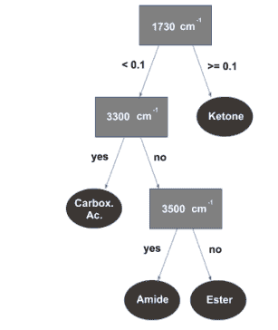

图 (3.1). 使用光谱信息的决策树示例。

在图 (3.1) 中，内部节点由矩形表示，叶由椭圆表示。系列中的第一个内部节点是根。有趣的是注意到独立且几乎同时，由 Yali Amit 和 Donald Geman (1994) 和 Tin Kam Ho (1995) [7] 提出并由 Leo Breiman [22] 完善。`RF` 由一组未修剪的决策树组成，使用训练数据的自助样本和树归纳中的随机特征选择创建 [3]。生成多个自助样本并对预测器进行平均的想法被称为装袋 bagging (bootstrap aggregating)。形式上，由随机向量 `Θ` 随机化的 `M` 棵树，其中 `Θ1, ..., ΘM` 是与原始数据集 `Dn` 独立的自助样本中的随机属性，被组合以生成森林估计：

```text
m_{M,n}(x; Θ1, ..., ΘM, Dn) = 1/M Σ_{j=1}^M m_n(x; Θj, Dn) (3.1)
```

此外，使用这种基于集成的方法的另一个巨大优势涉及产生变量重要性 [20] 的过程（在第 3.5.1 节中更详细地介绍），并且预测是通过汇总集合预测来进行的，考虑多数决策或平均 [3]。

随机森林在高维和病态问题中显示出优异的性能 [23]，其中变量数量远大于观测数量，能够处理高度相关的变量和复杂的交互结构 [24]。`RF` 处理多维复杂数据的优势主要归功于森林中每棵树中属性的随机分布，使每个元素专门化于输入空间的一个部分，并且过拟合的概率低，因为随着森林中树的增加，广义误差收敛到一个极限值 [22]。

与其它统计分类器相比，`RF` 具有多个优势；仅有几个调优参数 [25]，计算成本低 [7]，非参数特性，能够确定变量重要性，高分类准确率 [21]，高预测准确率 [3]，能够建模预测变量之间的复杂交互，以及用于估计缺失值的算法 [19]。Fernández-Delgado 等人 [26] 的一项研究证明了 `RF` 相对于其它学习方法的最佳性能。在这种情况下，使用 121 个数据集比较了来自 17 个学习家族的 179 个分类算法，并验证了随机森林作为最佳分类器脱颖而出。

随机森林因其预测性能而变得流行 [3, 7, 19-22, 25]，但 `RF` 具有执行不同类型分析的灵活性，涉及回归、分类、生存分析和无监督学习 [19, 21]。文献中报道了随机森林算法的不同版本，特征选择和树选择以及最佳分裂选择的方法各不相同 [23]。

### 3.4. 实验

对于第 3.5.1.3 节和第 3.6 节的讨论，我们使用了 Kalivas 博士提供的谱图数据 [27]。该数据集包含 60 个不同组成和辛烷值（ON）的汽油样本。样本通过近红外光谱（NIR）进行分析，并使用漫反射方式在 900 至 1700 nm 范围内以 2 nm 间隔测量。

对于第 3.7 节的讨论，我们使用了最近发表的一项工作中实验获得的光谱 [28]。该数据集包含 144 个纯牛奶和添加泰乐菌素的牛奶样本。样本通过衰减全反射-傅里叶变换红外光谱（ATR-FTIR）在 3000 至 1000 cm⁻¹ 范围内使用 DairySpec FT 设备（Bentley Instruments, Chaska, USA）进行分析。

所有化学计量学分析均在 `R` 软件（R Foundation, Austria）4.0.0 版本中进行，并结合 `randomForest` v. 4.6、`ranger` v. 0.12.1、`rpart` v. 3.0.9、`pls` v. 2.7、`neuralnet` v. 1.44.2、`brglm` 0.6.2、`gbm` v. 2.1.5 等包，通过 `caret` 聚合包（分类和回归训练）6.0 版本进行。

### 3.5. 原始光谱空间的降维

典型的傅里叶变换红外光谱分析通常在 4000 至 400 cm⁻¹ 范围内进行，光谱步长为 2 cm⁻¹。如果化学计量学分析将扫描中获得的每个波数视为一个待分析的自变量，那么将会面临一个包含 1801 个潜在变量的高维空间。

自然地，使用这种仪器技术实验观测到的案例数量远小于可提取的属性总数。在这种情况下，即使是不恰当的，参数化机器学习算法也常被优先用于模型拟合。基于此类算法的模型在类别估计中，使用一组固定大小的有监督统计参数来总结数据。换句话说，在训练步骤中，函数提取参数基于强统计假设，并使用某种方法估计输入数据。参数化机器学习算法的一些示例包括线性回归、逻辑回归、偏最小二乘回归（`PLS`）、主成分回归（`PCR`）、简单神经网络等。这些算法也被称为线性机器学习算法 [29]。

#### 重要度度量

Breiman [22] 引入了基于某些启发式准则的变量重要度度量。在基于基尼不纯度的重要度准则中，在分类分析中，对于每次划分，记录给定变量 `X_i`（属于自助样本）的基尼节点不纯度下降值，从以下方程开始：

```text
\hat{\Gamma}(t) = \sum_{i=1}^{C} \hat{\phi}_i(t)(1 - \hat{\phi}_i(t)) \tag{3.2}
```

其中 `C` 是类别的总数，`\phi^\wedge(t)` 是在节点中随机选择某个类别 `i` 元素的概率。因此，森林集成中所有基尼不纯度下降之和除以树的数量，即为基尼变量重要度度量 [39]。因此，不纯度大幅下降的划分被认为是重要的，意味着该划分所使用的变量也被认为是重要的 [39, 40]。

另一个准则是基于置换的重要度度量。在这种情况下，当变量 `X_i` 的缺失对模型的预测能力 `Y^\wedge` 产生负面影响时，`X_i` 被视为相关变量。简而言之，通过交换所有个体在 `X_i` 上的值，随机断开变量 `X_i` 与响应 `Y` 之间的关联，并对所有后续变量 `X_1 ... X_n` 重复此过程。此外，值得注意的是，置换还打破了 `X_i` 与其他可能协变量之间的联系 [41]。对森林中所有树，有置换和无置换过程的 OOB 预测误差之差的平均值，即为变量 `X_i` 的重要度（式 3.3）。

```text
I(X_i) = \mathbb{E}[(Y - f(X_{(i)}))^2] - \mathbb{E}[(Y - f(X))^2] \tag{3.3}
```

然后，将原始变量置换重要度度量应用于每个属性：

```text
I(X_j) = \frac{\sum_{t=1}^{ntree} I_t(X_j)}{ntree} \tag{3.4}
```

其中 `ntree` 是森林集成中树的数量。该重要度度量的另一个版本可以通过将每个原始重要度度量（式 3.4）与其各自的标准误差相关联来获得。此操作得到所谓的 Z 分数。简而言之，无论采用哪种路径，变量都可以按相关性排序：置换重要度度量越大，该变量对模型预测准确性的影响越大。

##### 3.5.1.1. Boruta 包装器算法

在上一节中，我们看到随机森林中变量的重要度度量可以基于属性随机置换引起的预测精度损失，或者根据基尼不纯度下降的增加进行分类。尽管在变量排序中非常有用，但对于低重要度变量的拒绝没有明确的统计准则。在这种情况下，特征子集选择（`FSS`）变得更加有用。

特征子集选择技术根据运行机制分为三类：过滤器、嵌入和包装器。考虑到本节所描述对象的性质，将更多地强调后者。建议阅读 Guyon 和 Elisseeff [42] 以了解基于过滤器和嵌入方法的 `FSS` 的更多细节，以及本章范围之外的其他相关主题。

包装器方法由 Kohavi 和 John 于 1997 年提出 [43]。包装器是黑盒，通过独立的学习算法在经过多次训练和测试循环后评估输入数据产生的多个特征子集的质量。循环结束时，最佳特征子集将是预测精度最高的那个。

包装器的效率在于子集如何生成和评估。这种形式取决于包装器的搜索策略。搜索策略通常分为最优策略、随机策略或顺序选择 [42]。

2010 年（首个原型于 2006 年提出 [44]），Kursa 和 Rudnicki [45], [46] 开发了一种名为 Boruta 的包装器算法，该算法基于随机森林，因此使用随机搜索策略。由于 Boruta 是斯拉夫和俄罗斯民间传说中的神祇，森林及其核心的守护者，这个名字的选择是恰当的。据说 Boruta（Leshy）“像自然一样多变”且“随心所欲地改变自己的外貌”，“可能像树一样高，也可能小到能滑过一片草叶之下” [47]。Boruta 的变形特征可以与这个包装器的主要元素——阴影变量相关联，阴影变量是每个属性中存在的元素的生成并打乱顺序的副本。Boruta 算法如图（3.2）所示。


基于遗传算法（GA）的特征选择由 Siedlecki 和 Sklansky [49] 提出，此后被多位作者成功使用 [50 - 52]。由于遗传算法和其他进化算法专注于参数优化，并在特征选择技术中获得了很大空间，本节我们对遗传算法与上一节中介绍的 Boruta 包装器进行比较。为此，我们将 Boruta FSS 与原始置换重要度度量（BRFR）（式 3.4）和 Z 分数（BRFZ）相对于先前实现的遗传算法 [48] 进行比较（表 3.1）。

**表 3.1.** 由 BRFZ、BRFR、GILS 和 GCLS 算法选择的属性。

| 选定的波长（nm） | BRFZ | BRFR | GILS | GCLS |
|---|---|---|---|---|
|  | 1072, 1124, 1200, 1202, 1204, 1206, 1208, 1210, 1212, 1214, 1216, 1218, 1220, 1222, 1224, 1588, 1612, 1620, 1630, 1632, 1634, 1636, 1638, 1672 | 1202, 1204, 1206, 1208, 1210, 1212, 1214, 1216, 1218, 1220, 1638 | 1002, 1180, 1118, 1148, 1214, 1374, 1434, 1462, 1522, 1582 | 1250, 1092, 1556, 1582, 1328, 1336, 1582, 1008, 1146, 1136, 1378, 1106, 1096, 1250, 1092, 1556, 1336, 1582, 1278, 1106, 1086, 1336, 1582 |

尽管使用 BRFZ（24 个选定特征）和 BRFR（11 个选定特征）获得的属性子集完全一致，包括 1202 至 1220 nm 之间的谱带（峰值为 1210 nm，对应于 CH₂ 伸缩振动的第二泛音 [53, 54]），以及 1612 至 1672 nm 之间的谱带（选定峰值为 1638 nm，对应于 CH 伸缩振动的第一泛音区 [55]），但使用 GILS 算法（10 个选定特征）和 GCLS（23 个选定特征）选定的属性与 RF/Boruta 获得的属性有很大差异。一个可能的原因是考虑了另一个搜索区域。

为了评估所选属性对响应的显著性和影响，在 10- 中拟合了具有固定超参数的 CART 决策树。

对表 3.1 中获得的每个子集采用 `k` 折交叉验证方案。拟合回归树的质量参数如表 3.2 所示。

**表 3.2.** 由 BRFR、BRFZ、GCLS 和 GILS 选择的属性子集的回归树质量参数。

|  | 训练集 |  |  |  | 测试集 |  |  |  |
|---|---|---|---|---|---|---|---|---|
| 方法 | N | R2 | RMSE | MAE | n | R2 | RMSE | MAE |
| BRFR | 48 (80%) | 0.8111 | 0.446 | 0.345 | 12 (20%) | 0.8965 | 0.277 | 0.197 |
| BRFZ |  | 0.8078 | 0.448 | 0.345 |  | 0.8965 | 0.277 | 0.197 |
| GILS |  | 0.8163 | 0.446 | 0.338 |  | 0.8965 | 0.277 | 0.197 |
| GCLS |  | 0.4598 | 0.827 | 0.667 |  | 0.2039 | 0.836 | 0.609 |

最佳属性子集是在不损失影响模型可预测性的相关信息的前提下降低输入空间维度的子集。在此意义上，值得注意的是，BRFR 和 GILS 方法提取的属性子集在效率上是等效的，应优先用于解决此问题，不同之处在于 Boruta 更易于实现且不依赖于生成函数。BRFZ 方法被证明与另外两种方法同样有效，即使它选择了多 13 个属性。这是因为基于 Z 分数的重要性度量的敏感性更高，因为该指数考虑了森林中每棵树平均准确度损失中的微小波动 [45]，因此在概率上，更可能有更多因素影响整体准确度。

另一方面，基于 GCLS 的子集提取方法被证明不适用于通过排除具有相关性的因素而获得的 NIR 属性选择，从而导致预测准确度的损失。GCLS 效率低下的一个解释在于，作者试图基于 Lambert-Beer 方程优化元素，该方程考虑了在线性动态范围内进行的理想测量，而显然情况并非如此。

### 3.6. 树基算法对噪声的鲁棒性

在上一节中，我们发现基于 Lambert-Beer 定律的线性解，使用 GCLS 优化算法，并不足以从漫反射实验获得的信号中选择相关变量。同样，红外光谱技术的其他变体也会出现同样的困境。这是因为测量中的理想性偏差（非线性），例如分子间和分子内相互作用（例如氢键）[56, 57] 的结果，可能导致峰位移和信号抑制或高估、样品不均匀性、由于折射率变化导致的束散射等 [56]。校准或校准失败、对准和光学系统问题 [58]（在 ATR-FTIR 中相当常见）也可能发生。这些被称为基质效应，是样品复杂性固有的，而后者被称为系统效应 [56]，被表征为实验室实践中观察到的一些潜在操作误差。

基质效应可以通过例如从混合物中提取感兴趣的物质、稀释样品或进行净化预处理，即所谓的“样品制备”技术，或通过对光谱进行精炼来最小化，通过应用滤波器来平滑背景噪声、正则化基线或去除虚假峰 [59]。通常这些措施一起应用。即使实施了这些基本措施，多种机器学习算法仍可能无法有效描述结果中观察到的大部分方差。因此，需要仔细选择要应用的工具，因为基质效应和其他不确定误差无法完全缓解。在此意义上，我们对构建化学计量模型感兴趣，该模型旨在解决红外光谱获得的高维空间相关问题的高效且鲁棒的技术。

在本节中，我们比较了流行的化学计量技术如多元线性回归和偏最小二乘回归与三种树基工具 CART、RF 和 GBT 的鲁棒性。为此，从上一节中介绍的子集拟合回归模型，变量选择由 BRFR 完成。对各属性平均值周围呈正态分布、方差为 0.1 的噪声以 5 个水平随机引入到元素中：1、5、10、35 和 50%，以人为模拟基质效应和不确定误差。结果通过均方根误差指标 RMSE 计算并在图 3.3 中示出。

在未加入噪声的情况下，回归模型具有非常接近的预测能力。通过噪声破坏 10% 的数据，变量与响应之间的大部分相关性丢失。PLS 和 CART 受所包含方差的强烈影响，RMSE 分别增加 68% 和 78%。GBT 在该区间内的增幅有所减弱，而 RF 对噪声水平的增加不敏感。对所有回归模型输入空间破坏 50% 后，出现了严重的拟合不足。最终的 RMSE 分别为 CART、PLS、GBT、RF 和带交互项的多线性回归（结果未显示）为 1.271、1.366、0.845、0.803 和 > 70。本工作中多线性回归的结果甚至高于 Saseendran 等人 [60] 在另一数据结构中报道的结果。作者发现，对于带岭正则化的线性和多项式回归，每增加 10% 的噪声，RMSE 增加 3.2%。

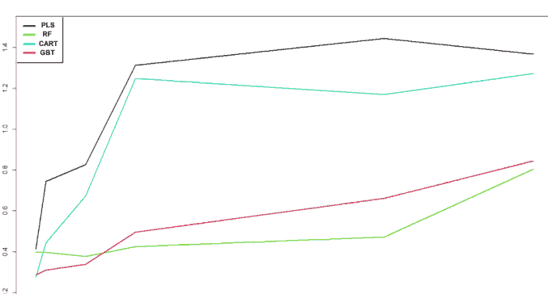

**图 3.3.** 通过加入不同噪声水平，不同模型的表现。

采用某种重采样策略的树基工具，如 bagging 和 boosting，并在其集成中使用大量弱预测器（树），被证明对噪声更鲁棒。特别是随机森林，当使用 bagging 机制自助抽样子集时，在使用袋外 OOB 误差估计时，会导致至少 1/3 的所有属性未用于树的形成 [45]，从而在子样本和用于估计误差的空间之间稀释了受破坏属性的数量。此外，由于 RF 在森林中每棵树的生长中使用有限且数量小的属性，因此一棵树生长时所有变量都被破坏的概率很低，即使如此，这些少数树的投票与数百棵其他树相比也不相关。因此，大多数受破坏的属性很可能被忽略，保持拟合到真实值，即使总体上大多数属性被强烈改变（图 3.4）。在极端情况下（50% 噪声），用于生成预测器的受破坏属性数量超过了集成中袋外属性的数量，导致可预测性显著损失。例如，如果用于树生长的随机变量数量 `mtry` 为 6，可以说至少一般而言，其中 3 个将被噪声破坏。

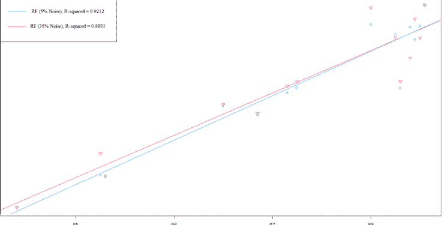

**图 3.4.** 在 5% 和 35% 噪声水平下，真实值与随机森林预测值之间的比较。

因此，RF 和 GBT 是分析复杂基质样品如生物样品（例如血液、尿液、唾液、组织）、环境（例如土壤、水、泥）、食品、燃料、聚合物等分析的两种强烈推荐的技术，因为它们对样品的虚假性质不敏感，且 RF 相比采用 boosting 机制的工具具有计算成本更低的优势。

### 3.7. 树基算法在判别分析中的应用

在处理分析方面的多个科学领域，如法医、环境、制药、食品，某种污染物相对于有限参考值的定性或半定量分析与连续定量一样相关。我们最近发表了一篇文章，重点关注使用傅里叶变换红外光谱 FTIR 技术结合化学计量技术测定牛奶中泰乐菌素的痕量水平 [28]。泰乐菌素是一种大环内酯类抗生素，是乳制品和肉类工业的残留物，用于牛的管理以治疗乳房炎和肝脓肿等细菌感染 [61]。

在最近的禁令 [62] 之前，巴西农业、畜牧业和食品供应部 MAPA 将泰乐菌素的最大残留限量 MRL 规定为 50 μg Kg⁻¹（50 ppb - 十亿分之一）。认为超过 MRL 的值可能对消费者健康产生负面影响 [63]。另一方面，低于 50 ppb 的值被认为是可以接受的。我们有兴趣将样品分类为可食用（泰乐菌素浓度 < 50 ppb）或不可食用（泰乐菌素浓度 ≥ 50 ppb）。为此，使用了多层感知器神经网络（MLP）技术。

MLP 以多起点模式运行，使用由两个隐藏层（6,3）组成的网络架构，采用逻辑激活函数，获得了更好的拟合。由于与基质复杂性相关的效应（包括诸如糖、蛋白质、脂肪、尿素和其他可溶性固体等干扰），数据集中包含一个对应于牛奶来源的多类因子，以及其他 16 个感兴趣的波数（cm⁻¹）。下面将几种机器学习算法——逻辑回归（LogR）、偏最小二乘判别分析（PLS-DA）、CART、GBT 和 RF 在真实牛奶样品判别分析中的性能与先前开发的 MLP 参考进行比较（表 3.3）。

## 表 3.3. 通过逻辑回归模型（LogR）、PLS-DA、CART、GBT、RF 和 MLP 对包含 33 个牛奶样品的测试子集进行判别分析的质量参数。

| 模型 | 真阳性 | 假阳性 | 真阴性 | 假阴性 | 精确度 | CI - | CI + | Kappa | 灵敏度 | 特异度 | p |
|---|---|---|---|---|---|---|---|---|---|---|---|
| LogR | 8 | 7 | 6 | 12 | 0.424 | 0.255 | 0.608 | -0.13 | 0.461 | 0.400 | 0.989 |
| PLS-DA | 17 | 11 | 2 | 3 | 0.576 | 0.392 | 0.745 | 0.004 | 0.154 | 0.850 | 0.706 |
| CART | 20 | 13 | 0 | 0 | 0.606 | 0.421 | 0.771 | 0 | 0 | 1.000 | 0.575 |
| GBT | 18 | 2 | 11 | 2 | 0.878 | 0.718 | 0.966 | 0.746 | 0.846 | 0.900 | 6.02E-4 |
| RF | 18 | 1 | 12 | 2 | 0.909 | 0.757 | 0.981 | 0.812 | 0.923 | 0.900 | 1.16E-4 |
| MLP [28] | 20 | 0 | 13 | 0 | 1.000 | 0.894 | 1.000 | 1.000 | 1.000 | 1.000 | 6.65E-8 |

考虑到污染物的低浓度，预计基质效应会变得非常普遍。出于前一节讨论的相同原因，与其他算法相比，GBT 和 RF 在预测类别方面获得了令人满意的结果，仅有两次假阴性，预测准确率 > 0.85，其置信区间 CI 包含了 MLP 所获得的准确率水平。另一方面，分类树对阴性类别（C < 50 ppb）不敏感，而参数算法（LogR 和 PLS-DA）则获得了无关紧要的结果。这强烈表明响应呈非线性分布的趋势。只有最后三种模型，包括基于具有重采样机制的决策树集成技术的两种技术，产生了统计学显著的结果（p <0.05）。

## 结论

光谱学与多元校准方法的结合使得多组分系统的复杂光谱分析成为可能，因此在本章中，我们介绍了某些基于树的工具，并突出了与其他机器学习算法相比的有趣特征。基于随机森林的包装算法 Boruta 对属性子集的选择证明与专家中非常流行的进化算法一样有效地选择变量。在高维空间的回归问题中，诸如随机森林和梯度提升树之类的树集成被证明比文献中已确立的化学计量技术更具预测性，特别是随机森林在噪声水平等于或高于 35% 时被证明具有鲁棒性。在复杂基质中痕量污染物的判别分析中，RF 和 GBT 被证明与多层感知器神经网络一样具有预测性，其优势在于前两者计算成本更低。

## 注释

还介绍了基于遗传回归（GR）的方法。然而，由于作者选择呈现遗传表达而不是纯属性，我们选择在此抑制这些发现。

## 发表同意书

不适用。

## 利益冲突

作者声明不存在任何利益冲突，无论是财务上的还是其他方面的。

## 致谢

未声明。

## 参考文献

[1] J.B. Ghasemi, and H. Tavakoli, "光谱多元校准中随机森林回归的应用", Anal. Methods, vol. 5, no. 7, pp. 1863-1871, 2013. [http://dx.doi.org/10.1039/c3ay26338j]

[2] A.M. Jiménez-Carvelo, A. González-Casado, M.G. Bagur-González, and L. Cuadros-Rodríguez, "用于食品质量和真实性分析评价的替代数据挖掘/机器学习方法 - 综述", Food Res. Int., vol. 122, pp. 25-39, 2019. [http://dx.doi.org/10.1016/j.foodres.2019.03.063] [PMID: 31229078]

[3] V. Svetnik, A. Liaw, C. Tong, J.C. Culberson, R.P. Sheridan, and B.P. Feuston, "随机森林：化合物分类和 QSAR 建模的分类和回归工具", J. Chem. Inf. Comput. Sci., vol. 43, no. 6, pp. 1947-1958, 2003. [http://dx.doi.org/10.1021/ci034160g] [PMID: 14632445]

[4] F.A. Vega, J.M. Matías, M.L. Andrade, M.J. Reigosa, and E.F. Covelo, "用于模拟土壤对重金属吸附和滞留的分类和回归树（CARTs）", J. Hazard. Mater., vol. 167, no. 1-3, pp. 615-624, 2009. [http://dx.doi.org/10.1016/j.jhazmat.2009.01.016] [PMID: 19200658]

[5] S.M. Tan, J. Jiao, X-L. Zhu, Y-P. Zhou, D-D. Song, H. Gong, and R-Q. Yu, "通过分类和回归树对一系列抗念珠菌抗菌剂的 QSAR 研究", Chemom. Intell. Lab. Syst., vol. 103, no. 2, pp. 184-190, 2010. [http://dx.doi.org/10.1016/j.chemolab.2010.07.005]

[6] D. Custers, T. Cauwenbergh, J.L. Bothy, P. Courselle, J.O. De Beer, S. Apers, and E. Deconinck, "ATR-FTIR 光谱学和化学计量学：鉴别和表征假药的有趣工具", J. Pharm. Biomed. Anal., vol. 112, pp. 181-189, 2015. [http://dx.doi.org/10.1016/j.jpba.2014.11.007] [PMID: 25476739]

[7] L. Rokach, "决策森林：二十年研究", Inf. Fusion, vol. 27, pp. 111-125, 2016. [http://dx.doi.org/10.1016/j.inffus.2015.06.005]


# 参考文献

[8] F.B. de Santana, W. Borges Neto, and R.J. Poppi, "随机森林作为单类分类器和红外光谱用于食品掺假检测", Food Chem., vol. 293, pp. 323-332, 2019. [http://dx.doi.org/10.1016/j.foodchem.2019.04.073] [PMID: 31151619]
[9] X. Jin, S. Li, W. Zhang, J. Zhu, and J. Sun, "利用提升算法通过不同预处理变换的可见近红外光谱预测土壤有效钾含量", Appl. Sci. (Basel), vol. 10, no. 4, p. 1520, 2020. [http://dx.doi.org/10.3390/app10041520]
[10] J. Xiu, Z. Xianzhi, L. Shaowen, W. Wencai, and Q. Haijun, "基于梯度提升决策树的超光谱回归方法预测土壤有效磷", Jiguang Yu Guangdianzixue Jinzhan, vol. 56, no. 13, p. 131102, 2019. [http://dx.doi.org/10.3788/LOP56.131102]
[11] G. James, D. Witten, T. Hastie, and R. Tibshirani, 统计学习导论. vol. 103. Springer New York: New York, NY, 2013. [http://dx.doi.org/10.1007/978-1-4614-7138-7]
[12] L. Rokach, and O. Maimon, 决策树. Data mining and knowledge discovery handbook. Springer: Boston, MA, 2005, pp. 165-192. [http://dx.doi.org/10.1007/0-387-25465-X_9]
[13] R.S. DeFries, M. Hansen, J.R.G. Townshend, and R. Sohlberg, "8 km 空间分辨率的全球土地覆盖分类：Landsat 影像衍生训练数据在决策树分类器中的使用", Int. J. Remote Sens., vol. 19, no. 16, pp. 3141-3168, 1998. [http://dx.doi.org/10.1080/014311698212435]
[14] K. Zhang, X. Wu, R. Niu, K. Yang, and L. Zhao, "中国三峡水库区使用随机森林和决策树方法进行滑坡易发性制图的评估", Environ. Earth Sci., vol. 76, no. 11, pp. 404-424, 2017. [http://dx.doi.org/10.1007/s12665-017-6731-5]
[15] E. Pekel, M.C. Akkoyunlu, M.T. Akkoyunlu, and S. Pusat, "用于预测对流干燥过程中低阶煤水分含量的决策树回归模型", Int. J. Coal Prep. Util., vol. 40, no. 8, pp. 505-512, 2020. [http://dx.doi.org/10.1080/19392699.2020.1737527]
[16] O.F. Althuwaynee, A. Balogun, and W. Al Madhoun, "使用决策树算法和双变量概率聚类极坐标函数进行空气污染危害评估：评估 PM10 与其他空气污染物之间的相关性聚类", GISci. Remote Sens., vol. 57, no. 2, pp. 207-226, 2020. [http://dx.doi.org/10.1080/15481603.2020.1712064]
- [17] A. Fielding, and C.A. O’Muircheartaigh, "调查分析中的二元分割，特别参考 AID", *统计学家*, 卷 26, 期 1, 页 17-28, 1977. [http://dx.doi.org/10.2307/2988216]
- [18] L. Breiman, J.H. Friedman, R.A. Olshen, and C.J. Stone, *分类与回归树*. 第 1 版. CRC Press: Boca Raton, 1984.
- [19] D.R. Cutler, T.C. Edwards Jr, K.H. Beard, A. Cutler, K.T. Hess, J. Gibson, and J.J. Lawler, "生态学中的随机森林分类", *生态学*, 卷 88, 期 11, 页 2783-2792, 2007. [http://dx.doi.org/10.1890/07-0539.1] [PMID: 18051647]
- [20] U. Grömping, "回归中变量重要性评估：线性回归与随机森林", *Am. Stat.*, 卷 63, 期 4, 页 308-319, 2009. [http://dx.doi.org/10.1198/tast.2009.08199]
- [21] V.F. Rodriguez-Galiano, B. Ghimire, J. Rogan, M. Chica-Olmo, and J.P. Rigol-Sanchez, "随机森林分类器在土地覆盖分类中有效性的评估", *ISPRS J. Photogramm. Remote Sens.*, 卷 67, 期 1, 页 93-104, 2012. [http://dx.doi.org/10.1016/j.isprsjprs.2011.11.002]
- [22] L. Breiman, "随机森林", *Mach. Learn.*, 卷 45, 期 1, 页 5-32, 2001. [http://dx.doi.org/10.1023/A:1010933404324]
- [23] Y. Ren, L. Zhang, and P.N. Suganthan, "集成分类与回归——最新进展、应用与未来方向 [综述文章]", *IEEE Comput. Intell. Mag.*, 卷 11, 期 1, 页 41-53, 2016. [http://dx.doi.org/10.1109/MCI.2015.2471235]
- [24] A.L. Boulesteix, S. Janitza, J. Kruppa, and I.R. König, "随机森林方法概述及实践指导，重点在计算生物学和生物信息学", *Wiley Interdiscip. Rev. Data Min. Knowl. Discov.*, 卷 2, 期 6, 页 493-507, 2012. [http://dx.doi.org/10.1002/widm.1072]
- [25] M.W. Ahmad, M. Mourshed, and Y. Rezgui, "树 vs. 神经元：随机森林与 ANN 在建筑能耗高分辨率预测中的比较", *Energy Build.*, 卷 147, 页 77-89, 2017. [http://dx.doi.org/10.1016/j.enbuild.2017.04.038]
- [26] M. Fernández-Delgado, E. Cernadas, S. Barro, and D. Amorim, "解决现实世界分类问题需要数百个分类器吗？", *J. Mach. Learn. Res.*, 卷 15, 页 3133-3181, 2014.
- [27] J.H. Kalivas, "两组近红外光谱数据集", *Chemom. Intell. Lab. Syst.*, 卷 37, 期 2, 页 255-259, 1997. [http://dx.doi.org/10.1016/S0169-7439(97)00038-5]
- [28] A.G. Freitas, B.E. Magalhães, L.A. Minho, D.J. Leão, L.S. Santos, and S. Fernandes, "利用 FTIR 光谱与化学计量学测定牛奶中泰乐菌素残留", *J. Sci. Food Agric.*, 期 10, 2014. [http://dx.doi.org/10.1002/jsfa.10799] [PMID: 32901945]
- [29] K. Kara, D. Alistahr, G. Alonso, O. Mutlu, and C. Zhang, "FPGA 加速的稠密线性机器学习：精度-收敛权衡", *Proceedings - IEEE 25th Annual International Symposium on Field-Programmable Custom Computing Machines, FCCM*, 页 167, 2017. [http://dx.doi.org/10.1109/FCCM.2017.39]
- [30] R.E. Bellman, *自适应控制过程：导览*. 第 1 版, 卷 1, Princeton University Press: Princeton, 1961. [http://dx.doi.org/10.1515/9781400874668]
- [31] V. Charles, J. Aparicio, and J. Zhu, "决策单元的维度诅咒：提高数据包络分析判别力的简单方法", *Eur. J. Oper. Res.*, 卷 279, 期 3, 页 929-940, 2019. [http://dx.doi.org/10.1016/j.ejor.2019.06.025]
- [32] M. Verleysen, and D. François, "数据挖掘和时间序列预测中的维度诅咒", Lect. Notes Comput. Sci., 卷 3512, 页 758-770, 2005. [http://dx.doi.org/10.1007/11494669_93]
- [33] L. Lerman, R. Poussier, G. Bontempi, O. Markowitch, and F.X. Standaert, 模板攻击与机器学习再探（以及侧信道分析中的维度诅咒）, 2015. [http://dx.doi.org/10.1007/978-3-319-21476-4_2]
- [34] M. Ris, J. Barrera, and D.C. Martins Jr., "U 曲线：一种用于布尔格点上 U 形代价函数的分支定界优化算法，应用于特征选择问题", *Pattern Recognit.*, 卷 43, 期 3, 页 557-568, 2010. [http://dx.doi.org/10.1016/j.patcog.2009.08.018]
- [35] H. Hoffmann, S. Schaaf, and S. Vijayakumar, "非参数回归的局部降维", *Neural Process. Lett.*, 卷 29, 期 2, 页 109-131, 2009. [http://dx.doi.org/10.1007/s11063-009-9098-0]
- [36] L. Shi, J.A. Westerhuis, J. Rosén, R. Landberg, and C. Brunius, "多元建模中的变量选择与验证", *Bioinformatics*, 卷 35, 期 6, 页 972-980, 2019. [http://dx.doi.org/10.1093/bioinformatics/bty710] [PMID: 30165467]
- [37] J.M. Peña, and R. Nilsson, "关于最优分类的离散特征选择的复杂性", *IEEE Trans. Pattern Anal. Mach. Intell.*, 卷 32, 期 8, 页 1517-1522, 2010. [http://dx.doi.org/10.1109/TPAMI.2010.84] [PMID: 20558881]
- [38] M.B. Kursa, and W.R. Rudnicki, "使用随机森林进行全部相关特征选择", 2011.
- [39] K.J. Archer, and R.V. Kimes, "随机森林变量重要性度量的经验表征", *Comput. Stat. Data Anal.*, 卷 52, 期 4, 页 2249-2260, 2008. [http://dx.doi.org/10.1016/j.csda.2007.08.015]
- [40] S. Nembrini, I.R. König, and M.N. Wright, "基尼重要性的复兴？", *Bioinformatics*, 卷 34, 期 21, 页 3711-3718, 2018. [http://dx.doi.org/10.1093/bioinformatics/bty373] [PMID: 29757357]
- [41] B. Gregorutti, B. Michel, and P. Saint-Pierre, "随机森林中的相关性与变量重要性", *Stat. Comput.*, 卷 27, 期 3, 页 659-678, 2017. [http://dx.doi.org/10.1007/s11222-016-9646-1]
- [42] I. Guyon, and A. Elisseeff, "变量与特征选择的介绍", *J. Mach. Learn. Res.*, 卷 3, 页 1157-1182, 2003.
- [43] R. Kohavi, and G.H. John, "特征子集选择的包装器", *Artif. Intell.*, 卷 97, 期 1-2, 页 273-324, 1997. [http://dx.doi.org/10.1016/S0004-3702(97)00043-X]
- [44] W.R. Rudnicki, M. Kierczak, J. Koronacki, and J. Komorowski, "一种用于确定信息系统中变量重要性的统计方法", International Conference on Rough Sets and Current Trends in Computing, 卷 4259, 2006, 页 557-566. [http://dx.doi.org/10.1007/11908029_58]
- [45] M.B. Kursa, A. Jankowski, and W.R. Rudnicki, "Boruta - 一种特征选择系统", Fundam. Inform., 卷 101, 期 4, 页 271-285, 2010. [http://dx.doi.org/10.3233/FI-2010-288]
- [46] M.B. Kursa, and W.R. Rudnicki, "使用 boruta 包进行特征选择", J. Stat. Softw., 卷 36, 期 11, 页 1-13, 2010. [http://dx.doi.org/10.18637/jss.v036.i11]
- [47] J. Sherman, *讲故事：神话与民俗百科全书*, 第 1 版, 卷 1, 2008.
- [48] D. Özdemir, "利用近红外光谱和遗传多元校准方法测定汽油辛烷值", *Petrol. Sci. Technol.*, 卷 23, 期 9-10, 页 1139-1152, 2005. [http://dx.doi.org/10.1081/LFT-200035547]
- [49] W. Siedlecki, and J. Sklansky, "关于大规模特征选择的遗传算法的注记", *Pattern Recognit. Lett.*, 卷 10, 期 5, 页 335-347, 1989. [http://dx.doi.org/10.1016/0167-8655(89)90037-8]
- [50] S. Li, K. Zhang, Q. Chen, S. Wang, and S. Zhang, "使用加权 K 近邻和遗传算法的高维数据特征选择", *IEEE Access*, 卷 8, 页 139512-139528, 2020. [http://dx.doi.org/10.1109/ACCESS.2020.3012768]
- [51] M.L. Raymer, W.F. Punch, E.D. Goodman, L.A. Kuhn, and A.K. Jain, "使用遗传算法的降维", *IEEE Trans. Evol. Comput.*, 卷 4, 期 2, 页 164-171, 2000. [http://dx.doi.org/10.1109/4235.850656]
- [52] C.F. Tsai, W. Eberle, and C.Y. Chu, "特征和实例选择中的遗传算法", *Knowl.-Based Syst.*, 卷 39, 页 240-247, 2013. [http://dx.doi.org/10.1016/j.knosys.2012.11.005]
- [53] H.L. Fernandes, I.M. Raimundo Jr, C. Pasquini, and J.J.R. Rohwedder, "使用 NIR 光谱同时测定汽油中的甲醇和乙醇：汽油组成的影响", *Talanta*, 卷 75, 期 3, 页 804-810, 2008. [http://dx.doi.org/10.1016/j.talanta.2007.12.025] [PMID: 18585150]
- [54] M.L.S. Albuquerque, "通过吸收和发射光谱表征 Buriti (Mauritia flexuosa L.) 油", J. Braz. Chem. Soc., 卷 16, 期 6A.


- [55] I. Swaid, D. Nickel, and G.M. Schneider, "超临界二氧化碳中低挥发性有机物相行为的近红外光谱研究", *Fluid Phase Equilib.*, 卷 21, 期 1-2, 页 95-112, 1985. [http://dx.doi.org/10.1016/0378-3812(85)90062-7]

- [56] J.D. Blando, R.J. Porcja, and B.J. Turpin, "通过冲击器采集气溶胶样品的 FTIR 光谱分析定量官能团的问题", *Aerosol Sci. Technol.*, 卷 35, 期 5, 页 899-908, 2001. [http://dx.doi.org/10.1080/02786820126852]

- [57] M. dos Santos Silva, "傅里叶变换红外光谱、热重分析、扫描电子显微镜作为抗寄生虫药质量控制的辅助工具", *Quim. Nova*, 卷 41, 期 3, 页 258-267, 2018. [http://dx.doi.org/10.21577/0100-4042.20170168]

- [58] D.M. Haaland, R.G. Easterling, and D.A. Vopicka, "多元最小二乘法应用于多组分样品的定量光谱分析", *Appl. Spectrosc.*, 卷 39, 期 1, 页 73-84, 1985. [http://dx.doi.org/10.1366/0003702854249376]

- [59] W. Zhou, S. Yang, and P.G. Wang, "基质效应及基质效应因子的应用", *Bioanalysis*, 卷 9, 期 23, 页 1839-1844, 2017. [http://dx.doi.org/10.4155/bio-2017-0214] [PMID: 29171768]

- [60] A.T. Saseendran, L. Setia, V. Chhabria, D. Chakraborty, and A.B. Roy, 数据集中噪声对机器学习算法的影响. [http://dx.doi.org/10.13140/RG.2.2.25669.91369]

- [61] T.G. Nagaraja, A.B. Beharka, M.M. Chengappa, L.H. Carroll, A.P. Raun, S.B. Laudert, and J.C. Parrott, "饲喂泰乐菌素或未饲喂泰乐菌素的育肥牛肝脓肿的细菌菌群", *J. Anim. Sci.*, 卷 77, 期 4, 页 973-978, 1999.

[http://dx.doi.org/10.2527/1999.77497x] [PMID: 10328365]

- [62] MAPA, *规范性指令第1号，2020年1月13日*. 巴西利亚, 2020.

- [63] L.D.C. Luiz, M.J.V. Bell, R.A. Da Rocha, N.L. Leal, and V.D.C. Dos Anjos, "利用近红外吸收光谱法检测牛奶中的兽用抗菌药物残留", *光谱学杂志*, 第2018卷, 第1-6页, 2018. [http://dx.doi.org/10.1155/2018/5152832]

## 第4章

## 深度学习在医学工程中的应用

**苏米特·库马尔·金达尔**^1, **萨亚克·班纳吉**^1, **里塔扬·帕特拉**^1 和 **阿林·保罗**^1

^1 印度泰米尔纳德邦韦洛尔理工学院电子工程学院

**摘要：** 由于人工智能领域的重大突破，深度学习在解决问题方面取得了非凡的成功。本文对深度学习与神经网络进行了历史回顾，并进一步讨论了其在医学工程领域的应用，如脑肿瘤检测、睡眠呼吸暂停、心律失常检测等。

大脑是我们身体中最重要、最神秘的器官之一。与其他任何器官一样，我们的大脑可能遭受各种危及生命的疾病，如脑肿瘤，其可为恶性或良性。通过应用卷积神经网络或人工神经网络分析脑部MRI图像，可以将这些图像分类为不同类型的肿瘤，从而自动完成此过程。该方法可为在可能康复的关键阶段检测该疾病提供一种更快、更有效的方法。

睡眠呼吸暂停是一种涉及呼吸不规律的睡眠障碍。大脑检测到氧气水平突然下降，并发出信号在睡眠时将人唤醒。心脏心律失常是一组导致心跳不规律、过慢或过快的疾病，*例如*心房颤动。深度学习与生物医学信号和音频处理技术相结合，应用于呼吸声音数据集和ECG数据集，在检测这些疾病方面具有巨大潜力。深度学习优于现有的检测算法，在特征工程、增强技术和构建有效滤波器方面的充分努力可以获得高精度结果。

**关键词：** 人工智能, 人工神经网络, 心房颤动, 自动化, 音频处理, 脑肿瘤, 生物医学信号处理, 心律失常, 卷积神经网络, 深度学习, 心电图, 脑电图, 特征工程, 机器学习, MRI成像, 神经网络, 优化, 信号处理, 信号分析, 睡眠呼吸暂停.

*通讯作者 苏米特·库马尔·金达尔：* 印度泰米尔纳德邦韦洛尔理工学院电子工程学院；电话：+918603559888；电子邮件：sumitjindal08@gmail.com

### 4.1. 深度学习的历史概述

#### 4.1.1. 机器学习

机器学习可以定义为在不进行显式编程的情况下使计算机学习和自动化各种任务的方法[1]。汤姆·米切尔为机器学习提供了现代定义。“如果一个计算机程序在某类任务T和性能度量P方面，通过经验E的学习，其任务T的性能（由P衡量）随着经验E的提高而提高，则称该程序从经验E中学习。”这些方法或算法处理数据，从这些数据中学习重要特征，然后应用这些学到的特征对新的数据集做出重要决策。例如，机器学习算法被用于在线音乐流媒体服务或视频流媒体服务中，根据用户的收听偏好向用户推荐。

在早期，当互联网在社会中的普及率以及技术在日常生活中使用较少时，生成的数据量较少，在如此少量的数据上训练机器学习算法会导致所谓的过拟合问题。过拟合会降低机器学习算法的准确性，因为它在测试数据上表现不佳。因此，研究人员、数据科学家和机器学习工程师主要关注如何解决过拟合问题。

但随着时间推移，数据集的大小开始增加。如今，可以找到关于各种主题的数GB数据，随着数据维度的增加，过拟合问题开始消失。但是，使用机器学习算法处理如此庞大的数据集是不可能的，因为学习能力会饱和，从而导致欠拟合。这是因为机器学习算法使用浅层结构。

深度学习算法中使用的深度神经网络具有很大的学习能力，因为它们可以处理大量参数。与机器学习技术相比，深度学习因过拟合而导致的性能要么相同，要么更差。因此，无论何时数据集庞大，使用深度学习技术是最合适的。它们提高了模型的学习能力，因为它们具有更好的优化技术并使用大量的计算资源。

#### 4.1.2. 神经网络

神经网络是神经元网络[2]。在生物学中，这些类似于任何生物大脑中存在的神经元；而在计算机科学中，这些是用于解决复杂数学、统计或人工智能问题的人工神经元。这些人工神经元模拟人脑的工作方式。深度学习算法使用这些深度神经网络（如图（4.1）所示）来训练模型。

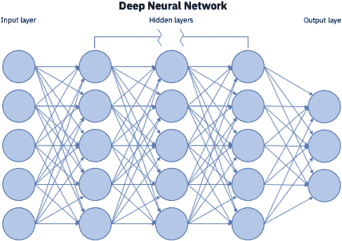

**图（4.1）。** 深度神经网络的架构。

神经网络必须包含多个层，而不仅仅是一两层，以解决困难的实际人工智能问题。在图**4.1**中，神经元排列在各层中，这些层又以一定的数值权重与相邻层相连。在前馈运算中，每层中的神经元接收一些信号，在对输入执行一些数学计算并通过激活函数后，将其传递给相邻层中的神经元[3]。

在每个隐藏神经元 j 中，首先计算输入神经元的加权和，如公式（1a）所示：

$$Net_j = \sum_{i=1}^{d} x_i w_{ji} + w_{j0} \tag{1a}$$

其中 `$Net_j$` 是神经元的总激活值，`$w_{ji}$` 是输入层与隐藏层之间连接的权重，`$w_{j0}$` 是与每个神经元相关的偏置项，`$x_i$` 是输入值。然后该值通过一个特殊的激活函数（如 `$y = g(Net_j)$`）传递，该函数用于消除数据中的线性。如果总激活值大于激活函数的阈值，则将该值传递到下一个神经元；否则，不会传递。

在多层神经网络中，最终输出类似于公式（1b）所示的形式 –

`f(x) = g(\sum_{j=1}^{nH} Wkj\, g(\sum_{i=1}^{d} wijg(...) + wj0) + wk0)`  (1b)

另一个重要的过程是反向传播。它是深度学习中最重要的训练算法之一，用于降低先前轮次中的错误率。通过选择每个神经元的适当权重来提高准确性，使深度学习模型更加可靠并更接近现实场景。当应用前馈运算时，大多数情况下它会产生一些损失，在反向传播期间将该损失反馈到神经网络中，帮助微调下一个轮次的权重，以获得更好的结果（或减少损失）。它使用一个优化函数（每个深度学习算法都不同）来确定如何调整权重，以从当前值减少损失并产生更接近目标值的更好结果[2, 3]。

#### 4.1.3. 深度学习

深度学习是机器学习的一个子部分。简单来说，深度学习可以定义为神经网络与算法的组合，它消耗用户的原始输入数据，并对给定的输入数据执行非线性数学变换，从而以高精度达到期望的输出[4]。

1943年，沃尔特·皮茨和沃伦·麦卡洛克创建了一个类似人脑的神经网络计算机模型。1960年，亨利·J·凯利提出了连续反向传播模型。1979年，福岛邦彦开发了第一个卷积神经网络。他设计了一个具有多个池化层和卷积层的神经网络。20世纪末，计算能力还不足以创建复杂的深度学习神经网络。但在21世纪初，GPU比普通CPU强大一千倍，它们成了高效神经网络发展的燃料。到2011年，GPU的速度足以同时训练整个神经网络，而不是逐层训练。很明显，随着计算速度的提高，深度学习算法在效率和速度方面比其他机器学习算法具有显著优势。

深度学习架构，如卷积神经网络（`CNN`）或循环神经网络（`RNN`），每天都在诸如

语音识别、图像处理、生物信息学、计算机视觉、自然语言处理等。例如，Google Assistant 或 Amazon Alexa 就基于自然语言处理的深度学习算法工作。深度学习在缺乏标注数据或先验知识的情况下表现要好得多。它被认为将带来技术上的复兴 [5]。

### 4.2. 激活函数

人工神经网络（`ANN`）由大量进行数学决策的神经元组成。一个标准的 `ANN` 包含输入层（数值数据点被馈送到网络中）、隐藏层（在其中进行决策）以及最终获取输出的输出层。在隐藏层内部，每个神经元都关联一些权重，这些权重与其接收到的输入相乘，乘积最终通过一个称为激活函数的网关。

激活函数就是决定神经网络中神经元输出的数学方程。根据所用激活函数的性质及其接收的输入，神经元会被激活或不激活，这表示该输入对模型学习的重要性。通常，激活函数的输出以归一化形式给出，即介于 [0,1] 或 [-1,1] 之间。如今，非线性和支持反向传播的激活函数被广泛使用 [6]。

#### 4.2.1. 二值激活函数

二值激活函数由方程 (2a) 定义：

$$f(x) = \begin{cases} 0, & x < 0 \\ 1, & x \geq 0 \end{cases} \tag{2a}$$

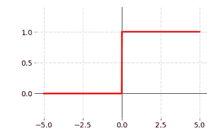

**图 (4.2).** 二值激活函数。

#### 4.2.3. TanH 激活函数

TanH 激活——双曲正切激活函数及其导数分别由方程 (2e) 和 (2f) 定义：

$$f(x)=\tanh x=\frac{e^x-e^{-x}}{e^x+e^{-x}} \tag{2e}$$

$$f'(x)=1-f(x)^2 \tag{2f}$$

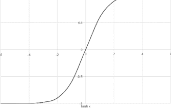

**图 (4.4).** TanH 激活函数。

TanH 是一种非线性、零中心的 S 形（S 曲线）激活函数，其值域介于 [-1, 1] 之间，如图 (4.4) 中的曲线所示。由于是零中心的，它支持反向传播，并且能更好地表示负输入。TanH 激活函数的梯度比 Sigmoid 激活函数更陡峭。它更广泛地用于输入随机分布的场景。但它未能解决 Sigmoid 激活函数中出现的梯度消失问题 [7]。

#### 4.2.4. ReLU 和 Leaky ReLU 激活函数

ReLU 激活——修正线性单元激活及其导数分别由方程 (2g) 和 (2h) 给出：

$$f(x)=\begin{cases}0, & x<0\\x, & x\geq 0\end{cases} \tag{2g}$$

$$f'(x)=\begin{cases}0, & x<0\\1, & x\geq 0\end{cases} \tag{2h}$$

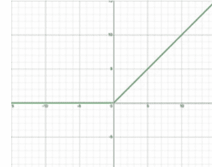

**图 (4.5).** 修正线性单元（ReLU）。

ReLU 激活函数是非线性的，是深度学习中最流行的激活函数之一。它比简单的逻辑回归函数更受青睐，因为它具有消除梯度消失问题的优势。它对所有负输入输出 0，对正输入直接传递原始值，如图 (4.5) 中的曲线所示。ReLU 的操作与我们的生物神经元高度类似。

但 ReLU 也有一些缺点，例如函数在零处不可微，另一个是死亡 ReLU 问题，该问题源于反向传播时负权重的存在 [8]。Leaky ReLU 激活——带泄漏的修正线性单元激活及其导数分别由方程 (2i) 和 (2j) 定义：

$$f(x) = \begin{cases} 0.01x, & x < 0 \\ x, & x \ge 0 \end{cases} \tag{2i}$$

$$f'(x) = \begin{cases} 0.01, & x < 0 \\ 1, & x \ge 0 \end{cases} \tag{2j}$$

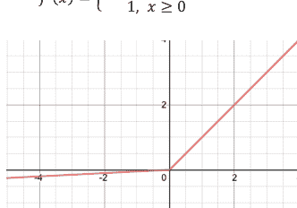

**图 (4.6).** Leaky ReLU。

Leaky ReLU 是对传统 ReLU 激活函数的改进。如果比较图形，我们会注意到对于小于 0 的输入，输出略微下降，如图 (4.6) 中的曲线所示。负值附加上 0.01 或任何小的合适斜率。这减少了 ReLU 激活神经元的死亡，从而试图缓解死亡 ReLU 问题。

### 4.3. 优化器和损失

#### 4.3.1. 优化器

假设我们有一个包含输入层、若干隐藏层和输出层的人工神经网络。我们从神经网络获得的输出包含损失或误差，这些损失或误差通过优化器来减小。优化器是改变神经网络属性的算法或方法。它在反向传播期间更新每个节点到节点连接相关的权重，并动态调整学习率，以减少损失并实现更快的学习。

##### 4.3.1.1. Adagrad

Adagrad 代表自适应梯度下降。我们知道，在传统的梯度下降中，学习率（`η'`）是固定的，这可能导致越过最小值而增加损失的风险。如果随着训练进程动态改变学习率，就产生了自适应梯度下降，它比梯度下降更快、更准确。Adagrad 优化器的公式由方程 (3a) 给出，其中 `η'_t` 由方程 (3b) 给出，`α_t` 是初始学习率，由方程 (3c) 给出，`ε` 是一个小的正数。

$$W_t = W_{t-1} - \eta'_t \frac{\partial L}{\partial W_{\text{old}}} \tag{3a}$$

$$\eta'_t = \frac{\eta}{\sqrt{\alpha_t + \epsilon}} \tag{3b}$$

$$\alpha_t = \sum_{i=1}^{t} \left(\frac{\partial L}{\partial W_i}\right)^2 \tag{3c}$$

##### 4.3.1.2. RMSProp

RMSProp 代表均方根传播，它与梯度下降非常相似，但带有动量。它将权重的学习率除以该权重最近梯度幅值的运行平均值。

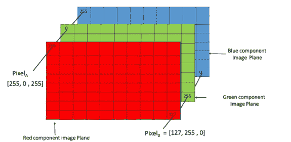

RGB 图像的像素由三个分量图像的对应像素形成。

**图 (4.7).** RGB 图像的 3D 视图。

#### 4.4.1. 卷积层

卷积层是卷积神经网络中最重要的层之一，它承担了大部分繁重的工作。顾名思义，该层负责对图像的原始像素值执行卷积操作。它包含一个核或滤波器，这是一个维度小于图像的矩阵。例如，`[1 0 1;0 1 0;1 0 1]` 是一个大小为 3 x 3 x 1 的滤波器。然后滤波器沿着矩阵的行方向以步长移动，步长是滤波器在矩阵上滑动的长度。如果步长为 1，则滤波器每次移动一个像素；当步长为 2 时，滤波器每次移动两个像素，依此类推 [11]。

RGB 图像有 3 个通道，每个通道具有一组不同的像素值。为了对该图像应用卷积，我们需要为每个通道使用滤波器，滤波器同时悬停在每个通道上，最后与偏置相加，得到二维卷积特征矩阵，如图 (4.8) 所示。

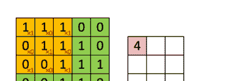

**图 (4.8).** 卷积操作。

卷积操作的主要动机是从输入图像中提取边缘、颜色、梯度等细节。随着卷积操作次数的增加，我们可以从图像中提取其他特征，通过这种方式，计算机获得对图像的整体理解 [12]。

有时我们需要在图像边界添加零，这称为零填充或简称为填充。填充大小是一个超参数。它用于控制卷积矩阵的尺寸。填充有两种类型：

- 相同填充——卷积矩阵的维度与原始图像相同。
- 有效填充——卷积矩阵的维度小于原始图像。

然后在整个卷积矩阵上应用修正线性单元（ReLU）激活函数，将负值映射为 0，并保留正值。

ReLU 的主要目的是打破线性并增加图像的非线性，因为我们的大多数图像包含如不同颜色或梯度等非线性特征。

#### 4.4.2. 池化层

池化层负责降低卷积矩阵的维度，以减少处理卷积矩阵所需的计算资源。它也用于从图像中提取不受图像位置和旋转影响的重要且主要的属性。

通常有两种池化：

- 最大池化——当滤波器悬停在图像的一个区域上时，它从该区域提取最大像素值，如图 (4.9) 所示。
- 平均池化——当滤波器悬停在图像的一个区域上时，它计算该区域中所有像素值的平均值。


最大池化优于平均池化，因为除了降低空间维度外，它还能从卷积矩阵中去除噪声或无关值 [13]。

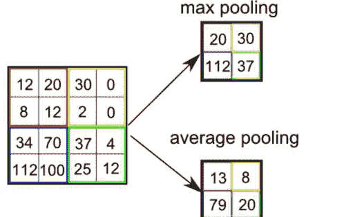

图(4.9). 池化的类型。

卷积层、`ReLU`和池化所需的层数取决于图像的复杂程度。然而，经典的CNN模型类似于方程(4a)；其中`n`的范围在2到5之间，取决于图像的尺寸和复杂度。

```
Input → Conv → ReLU → n * (Conv → ReLU → Pool) → Full Connection    (4a)
```

#### 4.4.3. 全连接

全连接层是一种神经网络，如图(4.10)所示，其中`x`是卷积矩阵展平后所形成向量的输入，`y`表示图像可能代表的不同概率[12]。例如，如果输入一张汽车的图像，它可能显示90%为汽车、7%为火车、2%为摩托车等。全连接层是在数据集训练过程中让机器学习图像高层特征的简单方法之一。

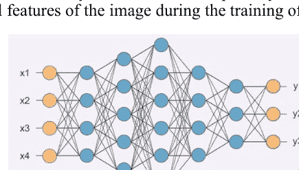

图(4.10). 全连接。

`AlexNet`、`VGGNet`、`ResNet`、`GoogleLeNet`是多年来为图像检测和分类而开发的众多CNN架构中的一部分。

### 4.5. 音频信号处理

顾名思义，音频信号处理是信号处理中的一个研究领域，涉及声音信号的处理。音频信号处理并不是一个新的研究领域。它早先已被用于无线电、留声机和电话通信。如今，深度学习技术也被用于音频信号处理。在音频信号处理中，主要关注点始终是如何从音频样本中提取重要的频率分量，这些分量可用于有效地区分音频信号。

音频信号通常在20 Hz到20 kHz的范围内。这些是由空气压缩和膨胀产生的纵波。当声音进入人耳时，会被传输到耳蜗，耳蜗内有一个充满液体的膜，其中包含数千根大小不同的毛细胞。短毛细胞对较高频率作出响应，而长毛细胞对较低频率的声音作出响应。因此，耳朵就像一个天然的傅里叶变换分析器[14]。

音频处理的第一步是采样，采样定义为将连续信号转换为离散值的过程。离散信号中包含的信息量由采样频率或采样率决定。较高的采样率意味着信息损失更少，但处理离散音频信号的计算复杂度会增加。

离散信号每个样本的幅度也是一个重要特征。

同时处理整个音频信号除了消耗大量时间和资源外，还会带来较高的计算复杂度。最好的方法是将音频信号划分为20 – 40毫秒的小帧。通过对自相关的音频信号应用傅里叶变换，计算每帧的功率谱密度。它显示了帧内各种频率之间的功率分布，如图(4.11)所示。

关于人耳的一个重要事实是，与较低频率的声音相比，较高频率的声音更难感知。这就是使用梅尔滤波器组的原因。梅尔标度被定义为听者判断为彼此距离相等的音高标度。参考点取为1000 mel = 1000 Hz。梅尔滤波器组的作用类似于人耳，因为与较高频率相比，梅尔标度在较低频率下变化更快，如图(4.12)所示。

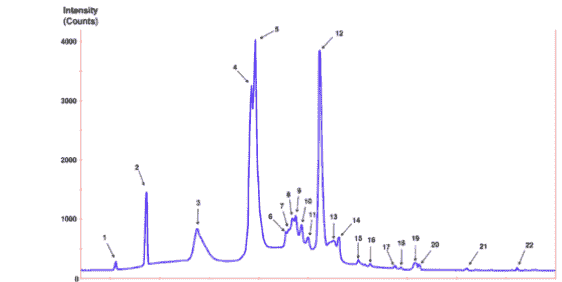

图(4.11). 功率谱密度。

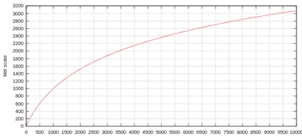

图(4.12). 梅尔标度。

用于将频率转换为梅尔的公式由方程(5a)给出：

```
m = 2595 * log_{10}\left(1 + \frac{f}{700}\right)
```

(5a)

计算每个梅尔滤波器中的能量总和，并通过离散余弦变换（DCT）传递。DCT从音频信号中提取最重要的信息和峰值。这些峰值代表了信息的要点[15]。这一完整过程产生了一个新的频谱，称为梅尔倒谱，如图(4.13)所示。

通常，从梅尔频率谱图中获得的前13个系数被称为`MFCC`。它包含音频信号中最有用的信息，因为它可以馈送到机器学习和深度学习算法中，这些算法由循环神经网络（`RNN`）或其他记忆网络组成，用于音频和信号分析。它是从音频信号中提取信息的重要且最先进的工具之一。

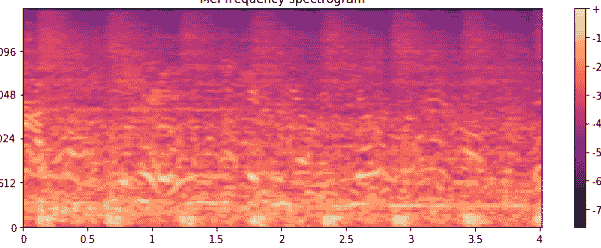

图(4.13). 梅尔倒谱。

### 4.6. 深度学习在睡眠呼吸暂停检测中的应用

睡眠呼吸暂停是一种睡眠障碍，患者的呼吸会突然停止至少十秒，并反复出现。大声打鼾和疲劳感是睡眠呼吸暂停的两个重要症状。最初，睡眠呼吸暂停是通过整夜多导睡眠监测来检测的。这被称为1型睡眠研究。它耗费大量时间，需要很大的空间。此外，它涉及连接到身体各个部位的大量导线，这对患者来说非常不便。4型睡眠研究使用声学传感器和脉搏血氧仪，使其更加便携，并且所需信号数量更少。在这项研究中，首先使用训练数据集训练深度卷积神经网络，以建立关键参数及它们之间的关系[16]。设计一个好的卷积神经网络需要进行大量的反复试验。神经网络的性能完全取决于通过特征提取获得关键参数。然后将其用于测试数据，以确定特定患者是否患有睡眠呼吸暂停。在4型睡眠研究中，由于数据和神经网络的复杂性，深度学习模型的训练和实施可能需要较长时间，但一旦深度模型创建完成，测试所需时间很少甚至不用时间。

#### 4.6.1. 系统设计

所提出模型的整体系统架构如图(4.14)所示。

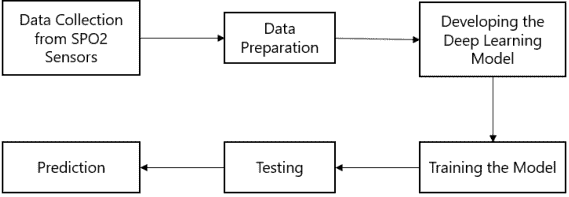

**图(4.14).** 所提出模型的流程图。

通过睡眠研究检测睡眠呼吸暂停通常包括三个基本步骤。第一步是使用`SpO2`传感器采集患者数据，以确定血液中的氧浓度，并使用热敏电阻、鼻压及胸腹运动传感器进行测量。因此，当呼吸暂停发生时，与正常呼吸水平相比，传感器会检测到鼻压、胸腹运动在时间间隔`T₁`（图(4.15)）内减弱，同时大脑会向肌肉发送一些信号以执行呼吸活动，这可由脑电图（`EEG`）检测到。在呼吸暂停期间，大脑活动会发生突然变化，称为觉醒，因为大脑从深睡眠转变为较浅的睡眠，如图(4.15)中的时间间隔`T₂`所示。在觉醒事件期间，肺部突然停止呼吸，从而血液中的氧浓度受到干扰，导致血氧饱和度下降，如图(4.15)中重叠的时间间隔`T₂`和`T₃`所示，这一变化由`SpO2`传感器检测到[16, 17]。

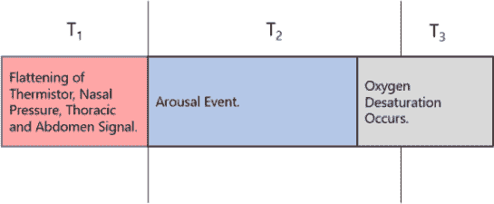

**图(4.15).** 睡眠呼吸暂停发生时的事件时间线。

采集到的原始数据被输入到用户自定义软件中，该软件使用深度学习技术进行分析。这是系统设计的第二步。它判断睡眠呼吸暂停是否正在发生，如果发生，则判断其持续时间以及其他各种信息。

在第三步中，医生或健康专业人员根据软件生成的数据判断这种睡眠障碍的严重程度，随后医生将据此开具所需药物。

#### 4.6.2. 呼吸暂停或低通气事件的检测

睡眠呼吸暂停和低通气是睡眠障碍的两种不同形式。呼吸暂停是由气道完全阻塞引起的，而低通气则是由气道部分阻塞引起的。因此，为了检测这两种障碍，需要根据来自传感器的输入信号计算幅度的变化和变化的持续时间。由呼吸暂停引起的信号部分比信号的其他部分更平坦。其幅度也小于声波其余部分的幅度。如图(4.16)所示，计算在时间间隔`T`内幅度为`A₂`的衰减信号与幅度为`A₁`的正常信号之间的幅度比。通常，如果在时间`T`处正常信号与衰减信号的比值比正常值低百分之二十，则判定为呼吸暂停；对于低通气，最大阈值低于百分之七十。对于呼吸暂停，检测到这种呼吸中断的时间段`T`必须大于或等于十秒[18]。

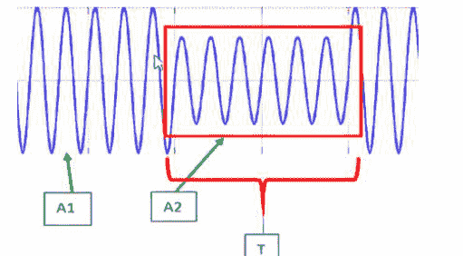

图(4.16). 呼吸暂停事件的幅度阈值。

#### 4.6.3. 深度学习模型

在本研究中，作者提出了一种独特的深度学习模型，用于区分健康患者和患有睡眠呼吸暂停的患者。使用卷积神经网络的深度学习架构如图(4.17)所示。输入向量`X`被假定为采样的`SpO2`信号，由`{x₁, x₂, x₃, ...., xₙ}`样本组成，其中`n`=样本总数。输入层和输出层之间的层是隐藏层。

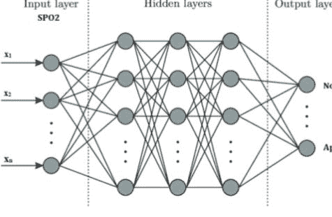

Fig. (4.17). DL 模型的表示。

所提出的深度学习模型共有十层。模型中使用了三层二维卷积神经网络（`CNNs`）。每层二维 `CNN` 后面都跟着一个步长为 2 的二维 `MaxPooling` 层。卷积层主要用于特征提取，而最大池化层可有效对特征图进行下采样，去除冗余数据并降低维度。在本工作中，作者使用了 `glorot uniform` 核初始化器类。

在深度卷积神经网络执行之后——添加了一个 `flatten` 层，将二维数据转换为单个一维向量以供下一层输入。添加了一个包含六十四个激活神经元的隐藏层，其后跟一个用于正则化的 `dropout` 层。正则化可降低模型内的泛化误差，但不会改变训练误差。如图 (4.17) 所示，这是一个二分类问题。这些神经元对应于睡眠呼吸暂停的检测。输出神经元由 `sigmoid` 激活函数激活。编译模型时使用了 `Adam` 优化器、`binary crossentropy` 损失函数和 `accuracy` 指标。

#### 4.6.4. 模型的评估

所提出的深度卷积神经网络模型经过训练，并将其性能与现有文献进行了比较。模型使用测试集与训练集分割比例为 0.2 并采用 `binary crossentropy` 损失函数进行训练。在最初的二十个 `epoch` 中，损失和准确率的图表均出现波动。准确率分数很快开始稳定，并在 40 个 `epoch` 后徘徊在 90% 左右。因此，可以从观察中得出结论，要实现训练数据的稳定状态，需要 40 到 100 个 `epoch`。模型在 100 个 `epoch` 后的准确率分数为 0.9047 或 90.47%，优于其他文献中使用的技术。使用线性判别分析、`SVM` 和人工神经网络构建的模型在 `SPO2` 信号上训练时的准确率分数分别为 0.865、0.9 和 0.901。因此，所提出的模型在使用 `SPO2` 信号进行睡眠呼吸暂停分类时表现明显更好，从长远来看可被视为使用多导睡眠图进行呼吸暂停检测的繁琐一级睡眠研究的一种替代方案。

### 4.7. 心律失常检测中的深度学习

心律失常是指心脏停止正常跳动的情况，即心动过速或心动过缓导致心律骤变。心律失常主要由心房颤动或心脏组织变化引起。心房颤动是一种医学状况而非疾病，会导致心脏心房混乱地跳动，最终导致中风或心力衰竭，进而导致永久性瘫痪或死亡。相比之下，室性心动过速会导致快速、不规则的脉搏，其源于心室接收到的异常电信号。心电图（`ECG`）是诊断心房颤动常用的检查。医生或心脏病专家做出决定的传统心电图检查方式是一种繁琐且昂贵的监测方法。已有一些传统方法存在，它们使用机器学习算法的不同分类方法。最常用的 ML 算法包括 `SVM`、决策树和随机森林，但它们缺乏准确性和精确性。传统的诊断方式正被基于深度学习架构的系统所取代。此类系统从健康手环持续接收心电图信号，最终通知健康状况。此类深度学习架构由卷积神经网络和 `LSTM` 组成，用于提取区分心律失常状况和正常状况所需的关键参数 [19]。图 (4.18) 显示了不同心脏状况下的心电图信号。

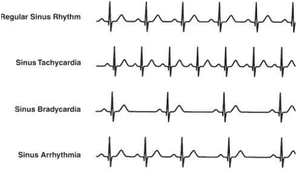

**Fig. (4.18).** 不同心脏状况下的心电图信号

#### 4.7.1. 系统设计

所提模型的整个系统架构如图 (4.19) 所示。

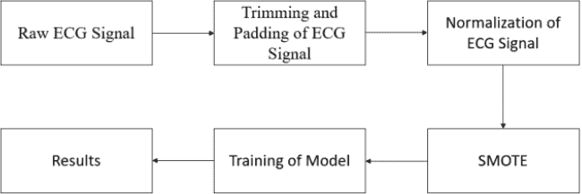

**Fig. (4.19).** 所提模型的框图。

深度学习模型的准确性高度依赖于用户为学习而输入的数据。样本较少、信号噪声大以及各类别样本分布不一致可能导致输入的错误解释。这里，由于我们处理的是连续性质的心电图信号，而模型需要离散的归一化数值以实现更好的学习，因此不适合。用于训练的心电图数据集长度不一，范围在 9 秒到 60 秒以上，且为连续数据。因此，每个信号均以 300 samples/sec 的速率采样并修剪至 7500 个样本以保持一致性。时长较短的信号用零在右侧填充。心电图采样值会产生广泛的数值范围，这可能会误导模型学习单个实例的绝对值而非所有实例的值。为防止这种情况发生，正在进行数据归一化

#### 4.7.3. 模型的评估

神经网络模型使用 `Keras` functional API 实现，并由 `TensorFlow` 后端支持。使用 0.1 的分割比例划分训练集和测试集，即 10% 的数据集用于测试和预测，而剩余 90% 的数据集用于训练模型。模型训练 75 个 `epoch`，训练结束时模型的训练准确率为 94.95%，训练损失为 0.1215，验证准确率为 83.68%，验证损失为 0.5465。所提模型在每个 `epoch` 中的训练 *vs.* 验证准确率、训练 *vs.* 验证损失已绘制在图 (4.20a) 和图 (4.20b) 中以便可视化。

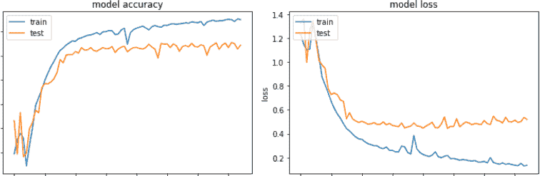

**Fig. (4.20).** (a) 训练 *vs.* 验证准确率，(b) 训练 *vs.* 验证损失。

### 4.8. 脑肿瘤检测中的深度学习

大脑是我们身体最重要的器官之一。除神经细胞外，大脑细胞在变老或受损时会得到替换。这些新细胞的过度产生导致肿瘤的形成。肿瘤通常分为两组：良性 *i.e.* 非癌性和恶性 *i.e.* 癌性。

脑肿瘤的检测很困难，因为其大小、形状和位置。及时检测和治疗肿瘤可提高患者的生存机会。肿瘤的检测通常使用磁共振成像（`MRI`）或计算机断层扫描（`CT`）等先进医疗设备进行。`MRI` 成像在诊断脑肿瘤时主要使用，因为它提供了更好的大脑图像，因为如 Fig. (4.21) [22] 所示，人脑组织的高对比度图像更好。它是检测和诊断脑肿瘤的最重要方法，因为准确性更高。

存在的肿瘤种类等然后输入卷积神经网络（`CNN`）进行训练 [22]。所提工作的流程图见图 (4.22)。

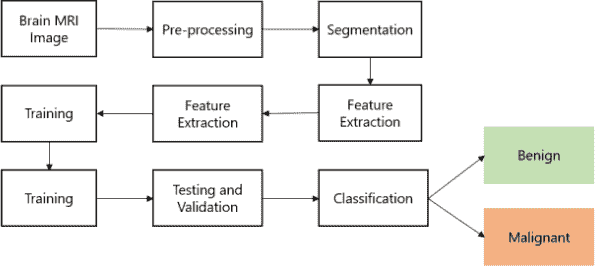

**Fig. (4.22).** 所提工作的流程图。

为了充分利用给定数据集，使用聚类算法进行特征提取。在该算法中，图像根据数据的相似性被划分为特定组并进行标记。该算法对数据变化适应性强，可以轻松挑选出用于区分各组的必要特征。它可扩展且易于解释，即使是业余人员也能理解。

#### 4.8.2. 深度学习模型

在本工作中，作者提出了一种独特的深度学习模型，用于区分脑肿瘤为良性或恶性的患者。这通常是一个具有两个输出类别的图像分类问题，因此必须构建卷积神经网络模型。然而，本工作提出的架构与方程 (4a) 定义的传统神经网络架构相当不同。

最初添加了两行两列的零填充以增加输入图像的维度。在本工作中，仅使用一层二维卷积层。卷积操作使用尺寸为 7*7 的滤波器，步长为 1，输出 32 个核。卷积操作后的像素被归一化并通过 `ReLU` 激活函数。接下来是两个连续的最大池化层，每个步长为 4 个单位。在深度卷积神经网络执行后——添加了一个 `flatten` 层，将二维数据转换为单个一维向量以供密集层输入。该神经网络模型不包含隐藏层。如前所述，这是一个二分类问题。输出层使用 `sigmoid` 激活函数。相应的输出激活表示脑肿瘤是恶性还是良性。模型编译时使用了`Adam`优化器、`binary crossentropy`损失函数和[`accuracy`]评估指标。

#### 4.8.3 训练模型

该神经网络模型使用 `TensorFlow` 后端支持的 `Keras` 函数式 API 实现。采用 0.2 的分割比例来划分训练集和测试集，即数据集的 20% 用于测试和预测，剩余 80% 的数据集用于训练模型。模型训练了 25 个周期，最终训练准确率为 97.37%，训练损失为 0.1010，验证准确率为 89.03%，验证损失为 0.2915。针对所提模型，每个周期的训练与验证准确率、训练与验证损失分别绘制在图 (4.23a) 和图 (4.23b) 中，以便可视化。

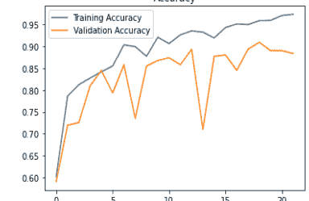

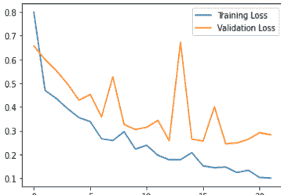

图 (4.23). (a) 训练与验证准确率；(b) 训练与验证损失。

#### 4.8.4 结果

使用数据集的 80% 进行训练、20% 进行测试，模型得到的验证/测试准确率为 89.03%。25 个周期结束时的训练准确率接近 97.37%。结果片段以及实际和预测的类别标签分别如图 (4.24) 和图 (4.25) 所示，其中 [0] 对应良性类别，[1] 对应恶性类别。

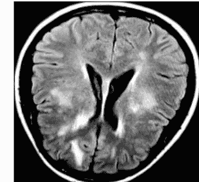

图 (4.24). 实际类别 - [0] 预测类别 - [0]。

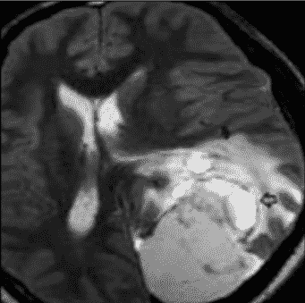

图 (4.25). 实际类别 - [1] 预测类别 - [1]。

## 讨论与未来工作

深度学习是人工智能领域最先进的工具。卷积神经网络（`CNN`）或循环神经网络（`RNN`）以及其他深度学习工具在医学领域的应用具有深远影响。它有助于医疗专业人员提供快速有效的治疗。20 世纪疫苗和药物的出现彻底改变了医学领域。同样，这些深度学习技术以及机器学习和人工智能在 21 世纪可能对医学产生变革性影响。

新药开发需要大量时间，通常超过 5 到 10 年。药物发现主要针对体内特定分子组。但很难预测这种药物如何影响非靶向分子，以及是否会产生任何不良副作用。在当前技术条件下，预测这种结果非常困难。深度学习可用于检测有毒化合物及其副作用，从而降低失败的可能性。

预测疾病及其预防比寻找疾病治疗方法更好。患病的可能性涉及复杂的计算，并且根据可用数据的广泛性而有各种类型的结果。深度学习与大数据技术相结合，可以通过处理电子健康记录中的数据来预测此类疾病，从而用于预防此类疾病。通过创建类似的深度学习模拟，可以避免流行病和大流行病情况。

## 同意发表

不适用。

## 利益冲突

作者声明不存在财务或其他方面的利益冲突。

## 致谢

声明无。

## 参考文献

- [1] Michael G. Pecht 和 Myeongsu Kang，“机器学习：基础，电子设备预测与健康管理：基础、机器学习与物联网”，IEEE，第85-109页，2019年。[http://dx.doi.org/10.1002/9781119515326.ch4]


- [2] James M. Keller, Derong Liu 和 David B. Fogel，“多层神经网络与反向传播，计算智能基础：神经网络、模糊系统与进化计算”，IEEE，第35-60页，2016年。

- [3] M. Madan Gupta; Liang Jin; Noriyasu Homma，“多层前馈神经网络（MFNN）与反向传播学习算法”，载于《静态与动态神经网络：从基础到高级理论》。IEEE，2003年，第103-170页。[http://dx.doi.org/10.1002/0471427950.ch4]

- [4] Xiaogang Wang，“深度学习在目标识别、检测与分割中的应用”，now，2016年。[http://dx.doi.org/10.1561/2000000071]

- [5] Li Deng 和 Dong Yu，《深度学习：方法与应用》。2014年。[http://dx.doi.org/10.1561/2000000039]

- [6] S. Sharma, S. Sharma 和 A. Athaiya，“神经网络中的激活函数”，《国际工程与应用科学杂志》，第04卷，第12期，第310-316页，2020年。[http://dx.doi.org/10.33564/IJEAS.2020.v04i12.054]

- [7] M. Rezaeian Zadeh, S. Amin, D. Khalili 和 V.P. Singh，“基于逻辑 sigmoid 和正切 sigmoid 激活函数的多层感知器日流量预测”，《水资源管理》，第24卷，第11期，第2673-2688页，2010年。[http://dx.doi.org/10.1007/s11269-009-9573-4]

- [8] Schmidt-Hieber, Johannes. 使用 ReLU 激活函数的深度神经网络进行非参数回归。《统计年鉴》48（2020），第4期，1875-1897。[http://dx.doi.org/10.1214/19-AOS1875]

- [9] F. Zou, L. Shen, Z. Jie, W. Zhang 和 W. Liu，“Adam 和 RMSProp 收敛的一个充分条件”，2019年IEEE/CVF计算机视觉与模式识别会议（CVPR），美国加州长滩，2019年，第11119-11127页。[http://dx.doi.org/10.1109/CVPR.2019.01138]

- [10] L. Li, M. Doroslovački 和 M.H. Loew，“逼近交叉熵损失函数的梯度”，IEEE Access，第8卷，第111626-111635页，2020年。[http://dx.doi.org/10.1109/ACCESS.2020.3001531]

- [11] C.-C. Jay Kuo，“用数学模型理解卷积神经网络”，《视觉通信与图像表示杂志》。

- [12] M.D. Zeiler 和 R. Fergus，“可视化和理解卷积网络”，载于《计算机视觉 – ECCV 2014》，D. Fleet, T. Pajdla, B. Schiele, T. Tuytelaars 编，计算机科学讲义，第8689卷。Springer：Cham，2014年。[http://dx.doi.org/10.1007/978-3-319-10590-1_53]

- [13] D. Scherer, A. Müller 和 S. Behnke，“用于目标识别的卷积架构中池化操作的评估”，载于《人工神经网络 – ICANN 2010》，K. Diamantaras, W. Duch, L.S. Iliadis 编，计算机科学讲义，第6354卷。Springer：柏林，海德堡，2010年。[http://dx.doi.org/10.1007/978-3-642-15825-4_10]

- [14] R.F. Lyon，“机器听觉：一个新兴领域”，《IEEE信号处理杂志》，第27卷，第5期，第131-139页，2010年。[http://dx.doi.org/10.1109/MSP.2010.937498]

- [15] T. Heittola, A. Mesaros, T. Virtanen 和 A. Eronen，“使用源分离的多源环境中的声音事件检测”，多源环境中的机器听觉研讨会，2011年。

- [16] Hnin Chaw, Sinchai Kamolphiwong 和 Krongthong Wongsritrang，“使用深度学习检测睡眠呼吸暂停”，《技术公报》。[http://dx.doi.org/10.31803/tg-20191104191722]

- [17] S.S. Mostafa, F. Mendonça, F. Morgado-Dias 和 A. Ravelo-García，“基于深度学习的 SpO2 睡眠呼吸暂停检测”，2017年IEEE第21届国际智能工程系统会议（INES），拉纳卡，2017年，第000091-000096页。[http://dx.doi.org/10.1109/INES.2017.8118534]

- [18] D. Dey, S. Chaudhuri 和 S. Munshi，“基于卷积神经网络深度学习框架的阻塞性睡眠呼吸暂停检测”，《生物医学工程快报》，第8卷，第1期，第95-100页，2017年。[http://dx.doi.org/10.1007/s13534-017-0055-y] [PMID: 30603194]

- [19] S. Ross-Howe 和 H.R. Tizhoosh，“使用深度特征和卷积网络进行心房颤动检测”，2019年IEEE EMBS国际生物医学与健康信息学会议（BHI），美国伊利诺伊州芝加哥，2019年，第1-4页。[http://dx.doi.org/10.1109/BHI.2019.8834583]

- [20] N.V. Chawla, L.O. Hall, K.W. Bowyer 和 W.P. Kegelmeyer，“SMOTE：合成少数类过采样技术”，《人工智能研究杂志》，第16卷，第321-357页，2002年。[http://dx.doi.org/10.1613/jair.953]

- [21] M. Limam, and F. Precioso, “*基于卷积循环神经网络的心房颤动检测与心电图分类，*” 2017 *计算心脏病学*. CinC: Rennes, 2017, pp. 1-4. [http://dx.doi.org/10.22489/CinC.2017.171-325]

- [22] S. Sajid, S. Hussain, and A. Sarwar, "利用深度学习的磁共振图像脑肿瘤检测与分割", *阿拉伯科学与工程学报*, vol. 44, no. 11, pp. 9249-9261, 2019. [http://dx.doi.org/10.1007/s13369-019-03967-8]

- [23] H. Mohsen, E-S.A. El-Dahshan, E-S.M. El-Horbaty, and A-B.M. Salem, "利用深度学习神经网络进行脑肿瘤分类, *未来计算与信息学期刊*," 3

- [24] A. Işın, C. Direkoğlu, and M. Şah, 基于深度学习方法的 MRI 脑肿瘤图像分割综述, 程序计算机科学, Vol. 102, 2016, pp. 317-324, ISSN 1877-0509.

## 基于序列向后选择技术的增强提升分类器的破产预测模型

**Makram Soui**^{1,*}, **Nada Namani Zitouni**^{2}, **Salima Smiti**^{3}, **Kailash Kumar**^{1} and **Ahmad Aljabr**^{1}

¹ *计算与信息学院，沙特电子大学，利雅得，沙特阿拉伯王国*

² *加贝斯大学，兹里格埃达克兰尼亚，突尼斯*

³ *马努巴大学，马努巴，突尼斯*

**摘要：** 企业破产预测是影响经济领域（无论是地方还是全球）的最关键问题之一。破产预测的主要目的是调查任何企业的经济状况并评估其困境程度。多种机器学习和深度学习模型已被用于预测财务失败。然而，仍没有一种技术能够解决该领域面临的所有问题。因此，我们提出了一种机器学习模型，该模型包括特征选择阶段和分类阶段，用于预测企业破产。该技术结合了序列向后选择器（SBS）与 AdaBoost 和 JRip 算法。第一阶段使用 SBS 选择训练的最佳特征子集。第二阶段训练 AdaBoost 与 JRip 分类器以预测每个目标类别。该模型使用高度不平衡的波兰破产数据集进行评估。与其他技术的比较分析证明了该模型在预测企业破产方面的效率，AUC 指标平均为 91%。

**关键词：** 破产预测，提升技术，分类，特征选择，波兰破产数据集，Python，基于规则的分类，两阶段方法，Weka，包装方法。

### 5.1. 引言

预测企业破产的困境旨在区分有困境可能性的企业与健康的公司。这是一种可能由不当决策造成的现象。它影响地方和全球的经济领域，因为它使所有相关机构都变得脆弱。因此，出现了允许货币机构预测破产的工具的需求。这种需求提高了研究人员和科学家对企业破产领域的兴趣 [1 - 5]。

许多研究提出了多种财务失败预测解决方案。这些文章侧重于数据的结构、特征和样本的目标类别，以找到特征与目标类别之间的关系以进行预测 [6]。这些现有工作分为统计方法和人工智能技术。统计模型包括使用数学和统计原理来制定数据中变量之间关系的方法，例如多元判别分析（MDA）[7]、线性判别分析（LDA）[8] 和二次判别分析（QDA）[9]。但由于其对多元正态性、线性可分性和预测变量独立性的假设，这些方法无法为个体特征获得有效假设 [10]。人工智能方法旨在基于机器学习和深度学习算法构建模型，如决策树[11]、支持向量机[12]和人工神经网络[13]。这些算法可以根据高维数据集构建认知功能/模式识别。因此，在处理数据分布时它们不会做出假设[14]。不幸的是，其中大多数算法都是黑箱模型。它们无法适应数据不平衡问题，而这在破产数据集中很常见。

最近，集成方法的使用证明了它们在破产预测方面提供相对精确预测的能力，特别是 AdaBoost [15]、梯度提升[16]和极限梯度提升（XGBoost）[17]。数据不平衡现象是在处理分类时面临的挑战，因为一个类别的样本多于其他类别，这会在训练集中造成波动。由于集成方法使用一组分类器而不是单个分类器来处理不平衡数据[18]，这些方法对噪声数据和异常值敏感。

在此背景下，我们提出了一种基于自适应提升（AdaBoost）算法的破产预测模型。该算法非常适合处理数据不平衡问题。它也与几乎任何学习算法兼容，这允许进行广泛的实验。在我们的方法中，我们将 AdaBoost 与 JRip 算法结合起来。这种新颖的方法是在序列向后选择（SBS）技术提取的数据上训练的。

本文其余部分遵循以下结构：第 2 节讨论了与破产预测问题相关的相关工作。第 3 节解释了所提出的方法。第 4 节分析了所提出的方法并与其他研究算法进行了比较。最后，第 5 节提供了未来工作的展望。

### 5.2. 相关工作

已经提出了多种算法来预测公司破产。研究分为统计和人工智能技术。

#### 5.2.1. 统计技术

统计方法使用数学和统计原理来制定变量之间及其在数据中的重要性的关系。最流行的统计方法包括 LDA、MDA、QDA、LRA 和 FA。

这些技术是预测企业破产的起点。单变量判别分析[19]和多元判别分析[20]是该领域使用的最早模型。尽管许多人批评它们无法调整变量并支持其正态性[21]，统计方法提供了一个有趣的概念，这促使研究人员更多地投入其中。因此，这导致了 logit 和 probit 模型的引入[22]。然而，由于预测超出分类适当范围的高风险，该技术也被发现存在缺陷。然后重点转移到更重视数据特征。结合 logit 和 probit 模型和因子分析模型提供了一个给出更好结果的解决方案。该解决方案最终因其高性能而被认为是在当时最有利的解决方案[23]。

统计技术在提取变量之间的关系方面非常熟练。然而，它们无法适应高维金融数据集。如今，它们被认为在解决企业破产预测问题方面无效。

#### 5.2.2. 人工智能技术

统计方法需要使用结构化数据来预测破产[10]。然而，智能技术由于其能够适应数据并自发提取知识以获得准确模型的能力，成功解决了该问题[24]。

有两种类型的技术；机器学习和深度学习。

##### 5.2.2.1. 机器学习技术

机器学习技术能够在数据中找到自然模式。它们为训练数据创建假设以发展洞察力，并帮助做出更好的决策和预测。多个行业和学科，例如医学诊断、图像处理、关联学习和破产预测，都使用了这些方法。机器学习算法如支持向量机（SVM）[25]、决策树（DT）[26]和人工神经网络（ANN）[27]在破产预测方面显示出卓越的结果。

决策树算法（DT）在预测破产方面非常熟练。它能够给出连贯的分类规则，并且在处理不同数据类型时表现出色。使用该技术预测破产并在平衡良好的日本数据集上验证的结果在准确性方面超过了判别分析[28]。此外，一项在塞尔维亚数据集上进行的研究比较了不同决策树模型与判别分析模型。结果显示了 DT 模型的优越性[29]。然而，在处理多类问题时，有时不赞成使用该方法，因为它容易出错。此外，DT 在处理不平衡数据时往往会过拟合。

破产预测的替代技术是人工神经网络（ANN）。由于其能够适应数据集并从中学习，这些方法已变得通用。它们能够捕捉变量之间的非线性关系。此外，它们不需要对数据的函数形式有先验知识。ANN 在比利时数据集上验证的性能在应用少量变量时取得了出色的结果[30]。一项最近的研究检查了突出的分类技术（决策树、逻辑回归和 ANN）。分类器的性能显示，当数据在数据集中可用性高时，ANN 是最佳替代方案[31]。此外，一项最近的研究使用具有 Sigmoid 激活函数的神经网络来预测破产。该模型使用误差率与随机森林模型进行了比较。结果显示 ANN 是财务失败预测的更可靠技术[13]。然而，它是一种黑箱方法，因此与线性回归等其他技术相比，解释结果令人费解。此外，在拟合神经网络模型时，最好仔细处理属性和数据归一化以提高性能。

另一种备受好评的智能技术是 SVM。该方法将结构化和经验威胁纳入最小化原则的能力是这使其区别于其他方法。支持向量机（SVMs）被用作特征选择技术，以识别一组最优特征来评估当前破产预测中阿尔特曼比率的相关性。结果显示，所选变量显著提高了财务失败预测的准确性。该研究表明它们优于传统方法 [32]。一项最新研究引入了一种名为多样性密度支持向量机（Diverse Density-Support Vector Machine，DD-SVM）的新技术用于破产预测。结果推断该方法在准确率、I类错误和II类错误指标上优于Logit、MDA和ANN模型。此外，该模型被认为是对企业困境的充分预警系统 [12]。SVM的局限性在于，首先，核函数需要巧妙地手工调优。其次，与ANN类似，SVM具有黑箱特性，因此难以获得可理解的模型。最后，SVM是一种计算成本高昂的算法。

寻找一种完善的破产预测技术包括使用集成方法。最新研究表明这些技术优于单一分类器方法 [33, 34]。一项最新研究分析了三种结合插补方法的AdaBoost模型用于破产预测。它在两个真实世界数据集（USABDS和JPNBDS）上进行了验证，这两个数据集缺失数据比例较高。结果显示了该模型在财务困境预测方面的稳健性。该方法在准确率指标上也优于神经网络、逻辑回归和决策树模型 [15]。极限梯度提升（eXtreme Gradient Boosting，XGB）是一种使用决策树集成作为学习手段的技术。该方法在财务失败预测中的引入表明提升是一种在预测破产时高效的方法。该模型引入了一种名为合成特征的新系统。它使用计量经济学指标和算术运算来提高性能。它已在五组波兰公司的数据集上进行了测试 [35]。不过，与其他技术一样，集成方法容易受到噪声等多种因素的影响。值得庆幸的是，基于特征选择的增强提升过程FS-Boosting的引入有助于缓解这一脆弱性。该模型结合了信息增益（Information Gain，IG）特征选择和标准提升程序来预测破产 [36]。它在两个小型且平衡的真实世界破产数据集上进行了验证。

##### 5.2.2.2. 深度学习技术

深度学习（DL），又称深度神经学习，是机器学习的一个子组成部分。它使用神经网络从非结构化和未标记数据中学习。在过去十年中，深度学习在各种问题上显示出巨大成果，例如自然语言理解 [37]、情感分析 [38]、语言翻译 [39] 和图像分类 [40]。然而，这些技术主要适用于模拟数据，如图像、文本文档和音频文件。它们不擅长处理表格格式的数据，这也是它们在破产预测中应用较少的原因。尽管如此，仍有一些研究存在。以深度信念网络（Deep Belief Network，DBN）为例，Yeh和Wang将DBN与受限玻尔兹曼机（Restricted Boltzmann Machine，RBM）结合，提出了一种在美国数据集上验证的破产预测方法。该模型被证明非常成功。它优于支持向量机 [41]。在此背景下，对深度信念网络（DBN）、前馈神经网络（FNN）和支持向量回归（SVR）进行的一项比较研究使用了均方根误差（RMSE）作为指标。它表明DBN优于其他方法，证明了其在破产预测中的有效性 [42]。

在一项最新研究中，Soui、Smiti、Mkaouer和Ejbali应用了堆叠自编码器与softmax分类器进行破产预测。该方法利用了两层自编码器来确定属性。然后，它使用softmax分类器层提供类别标签的概率。最后，隐藏层通过反向传播进行微调以提高模型的性能。该方法被证明非常高效。它优于随机森林（Random Forest，RF）、支持向量机（Support Vector Machine，SVM）和XGBoost（XGB） [43]。

深度学习在财务失败预测中表现出令人印象深刻的结果。然而，DL的局限性在于，首先，它是一种非常抽象的学习方式，不允许直接的输入到输出表示 [44]。其次，它非常依赖于相对平衡的数据 [45]。在处理大规模数据时，尤其是在经济领域，这一标准并不总是可能实现。

在本工作中，我们对一种提升技术进行了比较研究，使用不同的单一分类器和特征选择算法，以确定它们如何影响企业破产预测。

### 5.3. 背景

在本部分，我们介绍工作中使用的算法。这些技术分为特征选择方法、基于规则的分类器和集成学习技术。


## 5.3.1. 特征选择（FS）算法

特征选择降低了特征集的维度。它有助于确定冗余、无关或噪声最大的变量并将其消除。它通常有助于获得更好的数据质量以及加快和提高算法的性能 [46]。FS技术有两种类型，包装方法（wrapper methods）和过滤方法（filter methods）。包装方法的特征选择过程需要预先确定的学习算法。该算法选择确保最高性能的特征 [47]。过滤方法单独评估特征并为每个变量计算一些相关度量。它们使用评分机制对变量进行排序，以实现最佳分类准确率并使用最少的特征种类 [48]。它们通常比包装方法准确性较低 [49]。

由于分类器嵌入到选择过程中，包装方法的计算成本很高。然而，选择学习分类器作为选择特征的基础的能力非常有趣。在本节中，我们介绍本研究中使用的FS技术。

### 5.3.1.1. 顺序特征选择（SFS）

顺序特征选择（Sequential Feature Selection，SFS）算法 [20] 是包装方法。它们被指定为特征选择的基线方法，因为它们在实践中被广泛认可并被广泛使用。它们是贪婪性质的搜索算法。它们用于将维度特征空间最小化为较小的特征子空间。特征子集的自动选择是必不可少的。它与维度最小化问题高度相关。这一概念是特征选择算法背后的动机。根据分类器性能，它们一次剔除或添加一个变量，直到特征子集达到所需大小。

顺序前向选择或SFS属于顺序特征选择家族。它以标记数据集、学习算法、要选择的特征数量作为输入，并输出生成的变量子集。它以特征子集的空集（“空集”）、数据集中特征集和准则函数进行初始化。它开始一个循环，将随机变量附加到特征子集。此特征、分类器和特征集然后创建假设 `h(x)`。然后它开始另一个循环，遍历剩余的初始变量，选择一个并更新 `h(x)`。如果假设最大化准则函数，则该变量被添加到特征子集。

它将继续从特征集中添加特征并用确定的假设对其进行训练，直到特征子集包含开始时指定的所需特征数量。

### 5.3.1.2. 粒子群优化（PSO）

PSO方法模拟了鸟类集群和鱼类群游等动物的社会行为。最初，PSO被建议作为连续问题的优化方法。然而，优化特征选择等许多概念的需求促使PSO算法的创建者拓宽其用途。为了解决离散问题，他们引入了二进制粒子群优化（BPSO）。该技术通过二进制字符串对每个粒子的位置进行编码 [50]。

该技术的工作原理如下。群指在搜索空间中将可行解编码为粒子的种群。该技术首先随机初始化一组粒子。粒子在搜索空间中游荡以找到最终解。算法根据粒子自身的经验及其邻居的经验更新每个粒子的位置。先前的最佳粒子位置被保存为个人最佳（personal best，`pbest`），而群迄今为止获得的最佳位置为全局最佳（global best，`gbest`）。在每次迭代中，BPSO更新每个粒子的位置和速度，然后最终输出最佳解 [51]。

### 5.3.1.3. 随机子集特征选择（RSFS）

随机子集特征选择（Random Subset Feature Selection，RSFS）用于检测比原始变量集更合适的特征子集 [52]。RSFS根据变量在不同特征组合中的适用性来评估每个变量。相关性的值并非基于选择过程中之前的选项，而是若干独立测试的副产品 [53]。

在RSFS中，随机子集分类会尽可能频繁地进行，以区分适当的特征和仅因过程的随机因素而似乎有益的变量。因此，不需要贪婪的向后消除，并且随着选择过程中任意方面的平均化，特征集质量会逐步提高 [54]。

RSFS以初始特征集（`F`）、学习算法和准则函数作为输入。它使用虚拟特征集 `zj`、特征相关性的假设和空集初始化算法。该算法首先通过选择一个

通过检查均匀分布，从完整集合 `F` 中随机抽取 `n` 个特征的随机子集 `Si`（`|Si| = n`）。然后，它使用分类器对 `(Si)` 进行分类，并计算给定准则函数 `(ci)` 的值以衡量分类性能。然后，它将继续更新所有使用特征的相关性。凭借这种相关性，算法将检查假设，看看获得的特征集 `S ⊏ F` 是否完全超过了虚拟特征的相关性评级。在假设为真时，算法会不断将相关特征 `fi` 添加到集合 `(N)` 中。整个过程会重复，直到特征数量超过随机基线或分类器运行特定轮数。最终输出将呈现超过基线的集成特征子集。

## 5.3.2. 基于规则的分类器

基于规则的分类是一种令人印象深刻的工具，被广泛用于执行分类。术语基于规则的分类是指任何使用 IF-THEN 规则进行预测的分类算法或系统。这些方案通常遵循三个步骤：规则归纳算法，从数据中提取适当的 IF-THEN 规则；规则排序度量，用于确定条件在获取准确预测方面的有效性的值；以及类预测算法，根据规则归纳算法确定的 IF-THEN 规则预测新示例的类别 [55]。

在本节中，我们介绍了本研究中使用的基于规则的分类器。

### 5.3.2.1. 决策树分类器：CART

决策树是由节点和分支构成的结构，最后的节点称为叶节点。合适的分裂属性 `ai` 分配给每个非叶节点 `Lq`。决策树算法中最关键的部分是将元素分配给所考虑的节点。通常根据不纯度度量选择一个属性。该度量针对训练数据集 `S` 的子集 `Sq` 计算。此度量确定每个属性的分裂度量函数。根据所选元素，每个节点分裂为子节点。这些节点通过分支与其父节点相连。决策树有两种类型；二叉和非二叉 [56]。

`CART` 是一种二叉决策树。该算法的不纯度度量形式为基尼指数。它首先将根节点 `L0` 分裂为节点。每个节点 `Lq` 处理训练数据集 `S` 的子集 `Sq`。如果 `Sq` 的所有元素都属于同一类别，则该节点被识别为叶节点，且不进行分裂。根据基尼指数，算法从所考虑节点的可用属性中选择最佳元素进行分裂。对于每个 `aᵢ`，一组属性值分为两部分，进而将 `S_q` 分裂为两个子集。在这些部分中，使基尼指数最大化的部分为最优划分。当记录在所有类别之间平均分配时获得基尼指数。从此划分中，选择获取分裂度量函数最有效值的节点 `L_q` 进行分裂。算法延长此过程，直到没有更多节点可计算、度量和分裂，或算法满足所选的停止标准。

### 5.3.2.2. 决策树分类器：J48 (C4.5)

`J48`，也称为 `C4.5`，是一种非二叉决策树。它是 Ross Quinlan [57] 提出的 `ID3` 算法的升级版本；它将信息熵建立为分裂度量函数。该算法遵循与 `CART` 几乎相同的步骤。然而，与基尼指数不同，它使用信息熵与一个称为分裂信息的函数之比来确定分裂，以提取最优划分和节点。

### 5.3.2.3. OneR 分类器

`OneR` 是分类中实现的一种算法。它生成一棵单层决策树。它是一种实用且灵活的技术，能够处理缺失值和数值属性 [58]。该技术为每个元素生成一组分类规则。它计算每个变量的错误率。为此，它使用不属于属性多数类的实例的百分比。随后，它选择错误率最低的特征作为其“一条规则”；它从元素选择开始并为每个元素生成一组规则。算法按如下方式生成这些规则：对于每个属性，它累计每个目标类别的值出现的次数并推导出多数类。根据目标类别，它为属性生成一组合适的规则。它最后通过计算每组错误比率并选择错误率最低的规则集作为其主要分类规则集。

### 5.3.2.4. PART 分类器

`PART` 是一种使用分而治之方法的规则学习器。它为每个实例构建一条规则，然后删除该实例并递归地继续创建规则，直到没有实例为止。它结合了 `C4.5` 和 `Ripper` 算法并试图避免各自的问题 [59]。该算法

有很多广泛使用且功能强大的提升技术，如 `XGBoost`、`Gradient Boosting` 和 `LogitBoost`。然而，由于其中大多数是基于树的分类器，它们需要基于树的学习器，而在本研究中并不扩展，其中一些算法不是基于树的。在我们的案例中，我们依赖于最常用的提升技术：`AdaBoost`。

## 5.4.2.3. 所提方法

在本节中，我们介绍了研究中最具影响力的算法，并介绍了企业破产预测的所提方法。

图 (5.1) 展示了我们的方法所遵循的结构。据此，它揭示了实现企业破产预测模型所需的三个主要步骤：特征选择阶段、分类阶段和测试阶段。

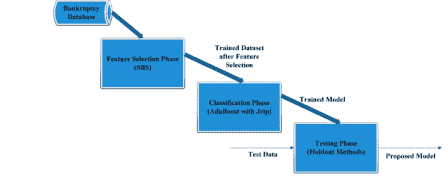

图 (5.1)。所提方法的结构。

### 5.4.1. 特征选择阶段

该阶段利用特征选择算法的特性来提取特征，以实现分类的最佳结果。在我们的方法中，最佳算法是顺序向后选择 (`SBS`)。它从波兰破产数据集的原始 64 个特征中提取了 26 个特征。这些特征已被认为是企业破产预测的最佳子集。

顺序向后选择 (`SBS`) 是顺序特征选择算法之一。它主要在初始化和选择程序上与 `SFS` 不同。算法 1 是 `SBS` 算法的伪代码。

如算法 1 所示，`SBS` 算法以波兰破产数据集的完整特征集 `Y`、`AdaBoost` 分类器、要选择的特征数量以及 `AUC` 准则函数作为输入。它以与 `Y` 对应的完整集 `X₀` 初始化。它开始从 `X_k` 中消除变量的过程。每个在被移除时使准则函数最大化并有助于获得最佳分类器性能的特征 `x` 都从 `X_k` 中移除。该过程重复进行，直到达到指定的特征数量。算法最终输出包含已消除变量的特征子集。

我们从原始数据集中移除获得的特征集，并使用剩余变量作为分类阶段的输入。

## 算法 1：顺序向后选择 (SBS) 算法的

高层伪代码。

算法：顺序向后选择 (SBS) 算法

输入：-波兰破产数据集 `Y` 的所有特征集，

-分类器 (`AdaBoost`)，

-要选择的特征数量 `p` 和准则函数

输出：相关特征子集 `Xk={x_i, i=1,2,...,k; x_i ∈ Y}`，其中 `k=(0,1,2,...,d)`

初始化：`X_k=Y, k=d`

1-步骤 1（排除）：

1.1-`X= arg maxJ(x_k-x), 其中 x ∈ Xk`

1.2-`X_{k-1}=X_k-X`

1.3-`k = k-1`

2-转到步骤 1

3-终止：`k = p`

## 5.4.2. 分类阶段

该阶段的第一步包括对数据进行预处理。它使用留出法将包含特征选择阶段提取的特征的新波兰破产数据集进行拆分。拆分涉及 70% 用于训练样本和 30% 用于测试样本。

分类阶段使用训练样本作为输入，以解决破产预测障碍的最有效算法。这些算法是 `AdaBoost` 和 `JRip`。与其他算法相比，`AdaBoost` 对过拟合的脆弱性较低，在处理不平衡数据方面也相当适应。然而，它是一个黑箱模型。它也对噪声和异常值敏感，这也是大多数提升技术的特点。随着特征空间的减少，异常值和噪声的问题变得过时。随后，它使 `AdaBoost` 能够有效地管理数据不平衡问题并增强其基础分类器的学习能力。本研究中使用基础学习器为 `JRip`。它通过提供预测中使用的规则解决了模型的黑箱性质问题。

### a. JRip（Ripper）概述

`RIPPER` 由 Cohen [63] 提出。它用于对初始规则集进行全局优化。该算法的动机是逐个放置或修改每条规则，以提高规则集的准确率 [64]。

该技术遵循三个步骤：生长、剪枝和优化。算法2展示了 `RIPPER` 的概要。

## 算法2：JRip 算法的高级伪代码。

```
Algorithm: JRip algorithm
Input: - A sequence of m instances S = {(x₁, y₁)...(xₘ, yₘ)} where xᵢ ∈ Xₖ with labels yᵢ ∈ Y={0,1} from Polish bankruptcy dataset,
- F: Number of folds (optional),
- O: Number of optimization (optional)
- N: Number of minimal weights (optional)
- E: Check error rate (default: check) (optional)
- P: pruning check (default: prune) (optional)
Output: final rule set RS
Initialize: a rule set RS = {}
1- For each class:
2- [Building Stage]: Generate an initial rule set RI
3- Repeat:
4- Grow phase: grow one rule by adding conditions that satisfy the highest information gain: p(log(p/t)-log(P/T)) until the rule is 100% accurate
5- Prune phase: prune each rule according to the pruning metric: p/(p+n)
6- Until error rate >= 0.5 or there are no more positive instances or the description length (DL) of the ruleset is 64 bits greater than the smallest DL
7- [Optimization Stage]:
8- From RI, generate two variants A and B (A from an empty rule and B from the full rule) using the grow phase
9- Prune A and B on a metric: (TP+TN)/(P+N)
10- Compute the original rule according to the description length DL of A and B
11- Select the variant with the minimal DL for RI
12- If there are residual positives:
13- ([Building Stage])
14- Else:
15- ([Deletion Stage])
16- [Deletion Stage]:
17- Delete the rules from the ruleset that would increase the DL of the whole ruleset
18- Add resultant ruleset to RS
19- End For
```

如算法2所示，`JRip` 是 `RIPPER` 算法的一种基于 Java 的实现。该方法初始化一个空规则集 `RS`，并开始遍历每个类别，从较不占优势的类别到最频繁的类别。规则生成过程包含三个阶段。构建阶段分为两个阶段：生长阶段计算每个属性的每个取值。选择具有最高信息增益的条件。通过贪婪地追加条件来生长一条规则，直到该规则达到 100% 准确率。剪枝阶段根据特定的剪枝度量对生成的每条规则进行增量剪枝。这两个阶段会重复，直到满足其中一个停止条件（错误率超过 0.5，或不再出现正例，或规则集的描述长度（DL）超过计算的最小 DL。该阶段生成初始规则集 `RI`，供第二阶段使用。优化阶段使用生长和剪枝阶段从随机化数据生成两个变体。一个变体必须从空规则创建，另一个变体通过向初始条件贪婪地追加前件来创建。算法选择具有最小 DL 的变体作为 `RI` 中的一个示例。如果检查完 `RI` 后仍然存在正样本，则使用构建阶段生长新规则。否则，`RIPPER` 进入最后阶段，该阶段删除可能增加整个规则集 DL 的条件。然后，它将生成的规则集添加到 `RS` 中，`RS` 将作为算法的最终输出。

### a. AdaBoost 概述

对于二分类问题，最常用的提升算法是 `AdaBoost`。该算法由 Freund 和 Schapire [65] 提出。以下伪代码描述了该技术的运行方式。

## 算法3：AdaBoost 算法的高级伪代码。

```
Algorithm: AdaBoost algorithm
Input: -A sequence of m instances S = {(x₁, y₁)...(xₘ, yₘ)} where xᵢ ∈ Xₖ with labels yᵢ ∈ Y={0,1}
from Polish bankruptcy dataset,
-Weak learner
-T (number of iterations)
Output: The final classifier with hypothesis Hx=sign(∑t=1 T αt htx)
Initialize: D₁(i)=1/m for all i =1,.....,m
1-For t = 1 to T
2- Call Weak learner using distribution Dₜ
3- Get Weak classifier and obtain hypothesis ht: X→{-1,+1}
4- Calculate the error rate ε_t = ∑i=1 m D_ti [h_t(x_i)≠y_i] of h_t
5- If ε_t > 0.5 then T=t-1 and abort loop
6- set α_t = ½ ln[(1-ε_t)/ε_t]
7- Update D_{t+1}(i)= D_t(i) exp[-α_t y_i h_t(i)] / Z_t (Z is a normalization factor)
```

如算法3所示，`AdaBoost` 将来自波兰破产数据集的 `m` 个样本的训练集作为输入，以进行二分类。它初始化一个权重函数 `Dₜ(x)`，该函数为所有训练样本分配相同的权重。在每次迭代 `t` 中，使用弱学习器创建一个带有假设 `hₜ` 的分类器，该假设计算训练样本的错误率 `eₜ`。算法使用错误率来调整概率分布 `Dₜ(x)`。这种调整会为错误分类的训练样本分配更多权重，而为上一次迭代中正确分类的样本分配更少权重。这个过程在 `T` 次迭代中依次构建多个弱分类器。算法最终输出一个带有假设 `H` 的分类器，该假设是通过对之前的各个分类器进行加权投票获得的。每个分类器的权重由它们所使用的分布 `Dₜ` 的准确率决定。

以下伪代码代表了我们针对问题陈述所提出的自适应模型的概要。


算法4展示了针对我们问题陈述的自适应算法的结构，我们将其称为 `SBSAda-Rip`。该算法使用数据的 70% 并进行 `T` 轮迭代。该方法以分布 `D₁` 和空规则集 `RS` 初始化。在每一轮 `t` 中，`AdaBoost` 使用分布 `Dₜ` 调用 `JRip` 分类器。`JRip` 分类器要经过一系列阶段。它从构建阶段开始。它逐一构建规则（同时满足最高信息增益：`p(log(p/t)-log(P/T))`）并逐一剪枝（根据剪枝度量：`p/(p+n)`）。当达到其中一个终止标准时，它会创建初始规则集 `RI`。优化阶段使用 `RI` 来拆分规则，并通过重新生长和重新剪枝（使用 `(TP+TN)/(P+N)`）来优化这些规则。选择最佳规则并重新添加到 `RI` 中。最后阶段，即删除和选择阶段，使用新的 `RI` 生成最终规则集 `RS`。该阶段删除阻碍规则集的条件，并将生成的规则集添加到 `RS`。从 `JRip` 分类器执行的计算中，`AdaBoost` 获得假设 `hₜ`。然后计算该假设的错误率，如果错误率大于 0.5，则更新分布 `Dₜ₊₁`。整个过程重复进行，直到数据中不再有错误分类的样本。最终，我们获得带有假设 `H(x)` 及其规则集的最合适的分类器。

### 5.4.3. 测试子阶段

该阶段使用测试数据来衡量训练模型的性能。我们从选定的最佳假设和规则集中获得所提出的模型，我们将其视为最优选项。

### 5.5. 验证

为了评估我们算法生成预测规则的性能，本节探讨两个主要研究问题。

## 算法4：增强型 Boosting 模型的高级伪代码。

```
Algorithm: SBSAda-rip algorithm
Input: -A sequence of m instances S = {(x₁, y₁)...(xₘ, yₘ)} where xᵢ ∈ Xₖ (Xₖ the subset obtained from SBS) with labels yᵢ ∈ Y={0,1} from Polish bankruptcy dataset
-JRip algorithm
-T (number of iterations)
Output: The final classifier with hypothesis H(x) and its final rule set RS
Initialize: D_t(i)=1/m for all i=1,...,m, a rule set RS = {}
1-For t = 1 to T
2- Call JRip using distribution D_t:
3- For each class:
4- [Building Stage]: Generate an initial rule set RI
5- Repeat:
6- Grow phase: grow one rule by adding conditions that satisfy the highest information gain: p(log(p/t)-log(P/T)) until the rule is 100% accurate
7- Prune phase: prune each rule according to the pruning metric: p/(p+n)
8- Until error rate >= 0.5 | no more positive instances | description length (DL) of the ruleset is 64 bits greater than the smallest DL
9- [Optimization Stage]:
10- from RI, generate two variants, A and B (A from an empty rule and B from the full rule) using the grow phase
11- prune A and B on metric: (TP+TN)/(P+N)
12- compute the original rule according to the description length DL of A and B
13- select the variant with the minimal DL for RI
14- If there are residual positives:
15- ([Building Stage])
16- [Deletion Stage]:
17- Delete the rules from the ruleset that would increase the DL of the whole ruleset
18- Add resultant ruleset to RS
19- End For
20- Get JRip classifier and obtain hypothesis h_t
21- Calculate the error rate e_t = Σ_i=1^m D_ti [h_t(x_i)≠y_i] of h_t
22- If e_t > 0.5 then T=t-1 and abort loop
23- set α_t = ½ ln [(1-e_t)/e_t]
24- Update D_{t+1}(i)= D_t(i) exp[-α_t y_i h_t(i)] / Z_t (Z is a normalization factor)
```

#### 5.5.1. 研究问题

`RQ 01`：与其他方法相比，所提出的方法能在多大程度上从给定数据集中发现准确的分类模型？

`RQ02`：现有模型与所提出的模型之间的显著比较是什么？

#### 5.5.2. 实验数据库描述

为了验证我们的工作，我们使用了波兰公司的财务信息，这些信息位于

制造业部门。数据集包含破产和非破产公司的信息。2004年之后，该行业有多家波兰公司破产（图5.2）[66]。

| ID 描述 | ID 描述 |
|---|---|
| X1 净利润 / 总资产 | X33 营业费用 / 短期负债 |
| X2 总负债 / 总资产 | X34 营业费用 / 总负债 |
| X3 营运资本 / 总资产 | X35 销售利润 / 总资产 |
| X4 流动资产 / 短期负债 | X36 总销售额 / 总资产 |
| X5 [(现金 + 短期证券 + 应收账款 - 短期负债) / (营业费用 - 折旧)] * 365 | X37 (流动资产 - 存货) / 长期负债 |
| X6 留存收益 / 总资产 | X38 固定资本 / 总资产 |
| X7 息税前利润 / 总资产 | X39 销售利润 / 销售额 |
| X8 权益账面价值 / 总负债 | X40 (流动资产 - 存货 - 应收账款) / 短期负债 |
| X9 销售额 / 总资产 | X41 总负债 / ((营业利润 + 折旧) * (12/365)) |
| X10 权益 / 总资产 | X42 营业利润 / 销售额 |
| X11 (毛利润 + 非常项目 + 财务费用) / 总资产 | X43 应收账款周转率 = 存货周转天数 |
| X12 毛利润 / 短期负债 | X44 (应收账款 * 365) / 销售额 |
| X13 (毛利润 - 折旧) / 销售额 | X45 净利润 / 存货 |
| X14 (毛利润 + 利息) / 总资产 | X46 (流动资产 - 存货) / 短期负债 |
| X15 (总负债 * 365) / (毛利润 - 折旧) | X47 (存货 * 365) / 产品销售成本 |
| X16 (毛利润 - 折旧) / 总负债 | X48 EBITDA（营业利润 - 折旧）/ 总资产 |
| X17 总资产 / 总负债 | X49 EBITDA（营业利润 - 折旧）/ 销售额 |
| X18 毛利润 / 总资产 | X50 流动资产 / 总负债 |
| X19 毛利润 / 销售额 | X51 短期负债 / 总资产 |
| X20 (存货 * 365) / 销售额 | X52 (短期负债 * 365) / 产品销售成本 |
| X21 销售额（n）/ 销售额（n-1） | X53 权益 / 固定资产 |
| X22 营业利润 / 总资产 | X54 固定资本 / 固定资产 |
| X23 净利润 / 销售额 | X55 营运资本 |
| X24 毛利润（3年内）/ 总资产 | X56 (销售额 - 产品销售成本) / 销售额 |
| X25 (权益 - 股本) / 总资产 | X57 (流动资产 - 存货 - 短期负债) (销售额 - 毛利润 - 折旧) |
| X26 (净利润 + 折旧) / 总负债 | X58 总成本 / 总销售额 |
| X27 营业利润 / 财务费用 | X59 长期负债 / 权益 |
| X28 营运资本 / 固定资产 | X60 销售额 / 存货 |
| X29 总资产的对数 | X61 销售额 / 应收账款 |
| X30 (总负债 - 现金) / 销售额 | X62 (短期负债 * 365) / 销售额 |
| X31 (毛利润 + 利息) / 销售额 | X63 销售额 / 短期负债 |
| X32 (流动负债 * 365) / 产品销售成本 | X64 销售额 / 固定资产 |

图（5.2） 波兰破产数据集的特征集。

描述近700家财务困境公司状况的经济因素收集于2007年至2013年间。对于仍在运营的公司，信息获取于2000年至2012年间。该数据集包含64个财务指标和五个数据子集。

表1列出了数据子集的名称、预测期内财务比率的提取年份、破产状态、每个类别标签的样本数量以及实例总数。研究中考虑的属性在图（5.2）中有详细定义。

## 表5 使用G-mean的破产预测模型性能。

| 特征选择方法 | 分类器 | 第1年 | 第2年 | 第3年 | 第4年 | 第5年 |
|---|---|---:|---:|---:|---:|---:|
| SBS | SBSAda-Rip | **92.9** | **88.1** | **89.1** | **87.2** | **81.4** |
| SBS | AdaBoost+ C4.5 | 78.5 | 73.6 | 72.2 | 63 | 76.2 |
| SBS | AdaBoost+OneR | 77.9 | 63.9 | 57.4 | 64.7 | 75.4 |
| SBS | AdaBoost+PART | 90.2 | 76.6 | 83.7 | 64.1 | 64.2 |
| SBS | AdaBoost+CART | 85 | 90.6 | 65.8 | 57.6 | 91 |
| SBS | AdaBoost+RF | 79.6 | 75.3 | 80.2 | 54.6 | 78.6 |
| SFS | AdaBoost+JRip | 87 | 78.1 | 80.3 | 78.6 | 81.8 |
| SFS | AdaBoost+ C4.5 | 78.7 | 66.2 | 70.8 | 49.5 | 74.1 |
| SFS | AdaBoost+OneR | 79.6 | 47.5 | 53.5 | 61.4 | 73.3 |
| SFS | AdaBoost+PART | 94.5 | 74.7 | 81.3 | 66.7 | 75.1 |
| SFS | AdaBoost+CART | 91.5 | 76.2 | 67.7 | 79.5 | 91 |
| SFS | AdaBoost+RF | 83.7 | 63.9 | 69.4 | 41 | 79.4 |
| PSO | AdaBoost+JRip | 89.1 | 85.5 | 82 | 84.6 | 79.4 |
| PSO | AdaBoost+ C4.5 | 82.2 | 85.2 | 65.2 | 63.2 | 71.3 |
| PSO | AdaBoost+OneR | 74.2 | 40.1 | 63.3 | 57.5 | 77.4 |
| PSO | AdaBoost+PART | 72.3 | 73.6 | 62.1 | 65.1 | 78.7 |
| PSO | AdaBoost+CART | 86.5 | 74.3 | 65.5 | 77.5 | 91 |
| PSO | AdaBoost+RF | 69.4 | 61.5 | 54.8 | 56 | 76.6 |
| RSFS | AdaBoost+JRip | 92.2 | 87.3 | 73.6 | 76.8 | 87.4 |
| RSFS | AdaBoost+ C4.5 | 78.4 | 82 | 72.4 | 67 | 72.4 |
| RSFS | AdaBoost+OneR | 71.2 | 41.5 | 60.1 | 66 | 77.6 |
| RSFS | AdaBoost+PART | 72.3 | 67 | 61.3 | 63.6 | 76.7 |
| RSFS | AdaBoost+CART | 86.5 | 72.5 | 68.1 | 79 | 81.6 |
| RSFS | AdaBoost+RF | 69.4 | 55.7 | 54.3 | 43.7 | 72.8 |

表6展示了本研究中所有算法在F-measure方面的性能。该表显示，与表5类似，其他算法的某些实例略优于我们提出的方法。然而，与我们的技术性能（范围在94.3%至97.1%之间）相比，很明显其平均表现优于其他算法，因为它在所有数据集上保持稳定结果。这使我们验证了`SBSAda-Rip`在企业破产预测中的性能。

## 表6 使用F-measure的破产预测模型性能。

| 特征选择方法 | 分类器 | 第1年 | 第2年 | 第3年 | 第4年 | 第5年 |
|---|---|---|---|---|---|---|
| SBS | SBSAda-Rip | 97.1 | 96.1 | 95.8 | 96.1 | 94.3 |
| SBS | AdaBoost+ C4.5 | 95.6 | 95.4 | 94.8 | 93.8 | 93 |
| SBS | AdaBoost+OneR | 95.8 | 94.9 | 94.2 | 94 | 93.2 |
| SBS | AdaBoost+PART | 96.5 | 95.8 | 95.5 | 93.7 | 91.3 |
| SBS | AdaBoost+CART | 96.2 | 95.8 | 94.7 | 95.3 | 93.6 |
| SBS | AdaBoost+RF | 94.6 | 95.3 | 94.9 | 93.1 | 92.9 |
| SFS | AdaBoost+JRip | 96.8 | 95.8 | 96.1 | 95.6 | 94.4 |
| SFS | AdaBoost+ C4.5 | 95.7 | 95.2 | 95.1 | 93.1 | 92.5 |
| SFS | AdaBoost+OneR | 95.5 | 94.5 | 94.1 | 93.9 | 93 |
| SFS | AdaBoost+PART | 96.8 | 95.4 | 95.3 | 94 | 93 |
| SFS | AdaBoost+CART | 96.9 | 95.3 | 94.7 | 95.3 | 93.6 |
| SFS | AdaBoost+RF | 95.7 | 94.9 | 94.5 | 92.9 | 93 |
| PSO | AdaBoost+JRip | 96 | 96.4 | 95.7 | 95.2 | 94.1 |
| PSO | AdaBoost+ C4.5 | 95.2 | 95.9 | 94.6 | 93.7 | 92.5 |
| PSO | AdaBoost+OneR | 94.9 | 94.3 | 94.4 | 93.5 | 93.2 |
| PSO | AdaBoost+PART | 94.9 | 95.2 | 94.7 | 93.8 | 92.4 |
| PSO | AdaBoost+CART | 96.5 | 95.3 | 94.7 | 95.2 | 93.6 |
| PSO | AdaBoost+RF | 94.6 | 94.8 | 94.1 | 93.1 | 92.4 |
| RSFS | AdaBoost+JRip | 96.8 | 96.5 | 95.3 | 95 | 94.2 |
| RSFS | AdaBoost+ C4.5 | 95.1 | 95.4 | 94.5 | 93.6 | 92.4 |
| RSFS | AdaBoost+OneR | 94.7 | 94.3 | 94.4 | 93.8 | 93.4 |
| RSFS | AdaBoost+PART | 94.9 | 95 | 94.4 | 93.7 | 93.1 |
| RSFS | AdaBoost+CART | 96.5 | 95.1 | 94.7 | 95.4 | 94.2 |
| RSFS | AdaBoost+RF | 94 | 95.5 | 94 | 92.9 | 91.9 |

#### 5.6.3 研究问题2的结果

已有大量研究成功预测了企业破产。因此，我们分析了我们的方法与在同一波兰数据集上采用的不同技术的性能对比。表7展示了其他研究及我们自己的研究结果。该比较考虑了两个因素：`AUC`指标和模型的可解释性。可解释性考察分类器提取决策规则的能力、这些规则的数量以及提取的特征数量。

## 表7. 我们的模型与波兰破产数据集上类似工作的比较。

|  | 方法 | AUC | 提取特征数 | 规则数 |
|---|---|---:|---:|---:|
| 我们的模型 (Zięba *等*, 2016) (Q. Zhang, Wang, Lu, Wang, & Ma, 2018) (Tuong, Son, Vo, Lee, & Baik, 2018) (Uthayakumar, Metawa, Shankar, & Lakshmanaprabu, 2018) | SBSAda-Rip | 94.5 | 26 | 4 |
|  | LDA | 63.9 | - | - |
|  | MLP | 54.3 | - | - |
|  | LR | 62.0 | - | - |
|  | JRip | 52.3 | - | - |
|  | CJRip | 74.5 | - | - |


|  | J48 | 71.7 | - | - |
|  | C4.5 | 65.8 | - | - |
|  | AB* | 91.6 | - | - |
|  | SVM | 50.2 | - | - |
|  | RF | 85.1 | - | - |
|  | XGB* | 94.5 | - | - |
|  | XGBE* | 95.3 | - | - |
|  | EXGB* | 95.9 | 20 | - |
|  | Isolation Forest | 93.0 | - | - |
|  | One-Class SVM | 92.0 | - | - |
|  | Multivariate Gaussian | 89.0 | - | - |
|  | NN | 84.0 | - | - |
|  | GBDT* | 85.0 | - | - |
|  | RFCI | 86.8 | - | - |
|  | FCP | - | - | 21 |

从表7可以看出，我们的模型优于T 等人 的研究[67]中的所有模型，以及J 等人 的研究[68]中的大部分模型。同时，我们也可以看到，它在AUC上与XGB模型相当，但被XGBE和EXGB超越，因此后者是更好的选择。这促使我们考虑可解释性指标。就此而言，我们可以指出，该工作提取的特征数比我们少（分别为20和26）。然而，该工作更侧重于生成合成特征及其对预测的影响，而非提取分类规则。因此，该模型能否生成最优决策规则仍有待商榷。这使我们相信（至少据我们所知），在这方面，我们的方法迄今为止是最佳选择。

## 结论

在经济领域，企业破产预测被认为是最关键和最基本的问题之一。针对这一问题的研究数不胜数，但完美的解决方案尚未出现。每项研究往往只解决了破产预测中遇到的部分问题，而无法解决其他问题。本文针对财务失败预测的三个主要障碍提出了解决方案：数据不平衡、特征空间缩减和规则提取。为解决这些问题，我们使用并评估了几种机器学习算法。我们将所提出的模型构建分为两个阶段：特征选择和分类。在特征选择阶段，我们使用了几种算法来提取最优特征子集，并确定SBS为最佳技术。在分类阶段，我们结合了AdaBoost算法和JRip算法的特性来进行分类。这种结合使我们能够解决数据不平衡问题，并为波兰破产数据集获得可理解的决策规则。结果表明，我们的模型在AUC指标上优于大多数现有工作。然而，与其他一些研究相比，在某些方面仍有不足。尽管如此，我们发现我们的方法在模型的可理解性和可解释性方面胜过了其他方法。也许在未来，采用类似合成特征方法的技术将进一步优化我们的结果。

## 出版许可

不适用。

## 利益冲突

作者声明不存在任何利益冲突，无论是财务方面还是其他方面。

## 致谢

声明无。

## 参考文献

[1] D. Olson, D. Delen, and Y. Meng, "Comparative analysis of data mining methods for bankruptcy prediction", Decis. Support Syst., vol. 52, no. 2, pp. 464-473, 2012. [http://dx.doi.org/10.1016/j.dss.2011.10.007]

[2] L. Zhou, K. Lai, and J. Yen, "Bankruptcy prediction using SVM models with a new approach to combine features selection and parameter optimisation", Int. J. Syst. Sci., vol. 45, no. 3, pp. 241-253, 2012. [http://dx.doi.org/10.1080/00207721.2012.720293]

[3] F. Barboza, H. Kimura, and E. Altman, "Machine learning models and bankruptcy prediction", Expert Syst. Appl., vol. 83, pp. 405-417, 2017. [http://dx.doi.org/10.1016/j.eswa.2017.04.006]

[4] F. Mai, S. Tian, C. Lee, and L. Ma, "Deep learning models for bankruptcy prediction using textual disclosures", Eur. J. Oper. Res., vol. 274, no. 2, pp. 743-758, 2019. [http://dx.doi.org/10.1016/j.ejor.2018.10.024]

[5] T. Hosaka, "Bankruptcy prediction using imaged financial ratios and convolutional neural networks", Expert Syst. Appl., vol. 117, pp. 287-299, 2019. [http://dx.doi.org/10.1016/j.eswa.2018.09.039]

[6] A. Chaudhuri, and S. Ghosh, Bankruptcy prediction through soft computing based deep learning technique. Springer, 2017. [http://dx.doi.org/10.1007/978-981-10-6683-2]

[7] S. Lee, and W. Choi, "A multi-industry bankruptcy prediction model using back-propagation neural network and multivariate discriminant analysis", Expert Syst. Appl., vol. 40, no. 8, pp. 2941-2946, 2013. [http://dx.doi.org/10.1016/j.eswa.2012.12.009]

[8] J. Wen, "Robust Sparse Linear Discriminant Analysis", IEEE Trans. Circ. Syst. Video Tech., vol. 29, no. 2, pp. 390-403, 2019. [http://dx.doi.org/10.1109/TCSVT.2018.2799214]

[9] A. Tharwat, "Linear vs. quadratic discriminant analysis classifier: a tutorial", International Journal of Applied Pattern Recognition, vol. 3, no. 2, p. 145, 2016. [http://dx.doi.org/10.1504/IJAPR.2016.079050]

[10] K. Shin, and Y. Lee, "A genetic algorithm application in bankruptcy prediction modeling", Expert Syst. Appl., vol. 23, no. 3, pp. 321-328, 2002. [http://dx.doi.org/10.1016/S0957-4174(02)00051-9]

[11] N. Ocal, M. Ercan, and E. Kadioglu, "Predicting Financial Failure Using Decision Tree Algorithms: An Empirical Test on the Manufacturing Industry at Borsa Istanbul", Int. J. Econ. Finance, vol. 7, no. 7, 2015. [http://dx.doi.org/10.5539/ijef.v7n7p189]

[12] S. Kim, B. Mun, and S. Bae, "Data depth based support vector machines for predicting corporate bankruptcy", Appl. Intell., vol. 48, no. 3, pp. 791-804, 2017. [http://dx.doi.org/10.1007/s10489-017-1011-3]

[13] G. Naidu, and K. Govinda, "Bankruptcy prediction using neural networks", International Conference on Inventive Systems and Control, vol. 2, 2018 pp. 248-251

[14] S. Strohmeier, and F. Piazza, Artificial intelligence techniques in human resource management—a conceptual exploration. Intelligent techniques in engineering management. Springer, 2015, pp. 149-172. [http://dx.doi.org/10.1007/978-3-319-17906-3_7]

[15] L. Zhou, and K. Lai, "AdaBoost Models for Corporate Bankruptcy Prediction with Missing Data", Comput. Econ., vol. 50, no. 1, pp. 69-94, 2016. [http://dx.doi.org/10.1007/s10614-016-9581-4]

[16] J. Wyrobek, and K. Kluza, "Efficiency of gradient boosting decision trees technique in Polish companies’ bankruptcy prediction", International Conference on Information Systems Architecture and Technology, Springer, pp. 24-35, 2018. Cham

[17] T. Chen, and C. Guestrin, "Scalable and intelligent learning systems Xgboost: A scalable tree boosting system", Proceedings of the 22nd acm sigkdd international conference on knowledge discovery and data mining, 2016 pp. 785-794 [http://dx.doi.org/10.1145/2939672.2939785]

[18] P. Chujai, K. Kerdprasop, and K. Kerdprasop, " A Tree-based Ensemble Learning of Minority Cases in the Imbalanced Data". International Information Institute (Tokyo)", Information, vol. 18, no. 11, p. 4815, 2015.

[19] M. Pozzoli, and F. Paolone, The Models of Financial Distress. 2017. [http://dx.doi.org/10.1007/978-3-319-67355-4_3]

[20] C. Peres, and M. Antão, "The use of multivariate discriminant analysis to predict corporate bankruptcy: A review", https://dialnet.unirioja.es/servlet/articulo?codigo=6635579

[21] K. Laurila, Accuracy comparison of accounting-based bankruptcy prediction models of Springate (1978), Ohlson (1980) and Altman (2000) to US manufacturing companies 1990-2018, Master’s thesis, Dept. Busi. Acc., Aalto Univ, Finland, 2020.

[22] M. Kovacova, and T. Kliestik, "Logit and Probit application for the prediction of bankruptcy in Slovak companies", Equilibrium, vol. 12, no. 4, pp. 775-791, 2017. [http://dx.doi.org/10.24136/eq.12i4.40]

[23] V. García, A. Marqués, J. Sánchez, and H. Ochoa-Domínguez, "Dissimilarity-Based Linear Models for Corporate Bankruptcy Prediction", Comput. Econ., vol. 53, no. 3, pp. 1019-1031, 2017. [http://dx.doi.org/10.1007/s10614-017-9783-4]

[24] Y. Shi, and X. Li, "A bibliometric study on intelligent techniques of bankruptcy prediction for corporate firms", Heliyon, vol. 5, no. 12, 2019. e02997 [http://dx.doi.org/10.1016/j.heliyon.2019.e02997] [PMID: 31890956]

[25] B.E. Erdogan, and S.Ö. Akyüz, "Weighted Ensemble Learning by SVM for Longitudinal Data: Turkish Bank Bankruptcy. In Trends and Perspectives in Linear Statistical Inference. Contributions to Statistics. Springer, 2018, Cham", [http://dx.doi.org/10.1007/978-3-319-73241-1_6]

[26] S. Syed Nor, S. Ismail, and B. Yap, "Personal bankruptcy prediction using decision tree model", J. Econ. Finance Adm. Sci., vol. 24, no. 47, pp. 157-170, 2019. [http://dx.doi.org/10.1108/JEFAS-08-2018-0076]

[27] T. Slavici, S. Maris, and M. Pirtea, "Usage of artificial neural networks for optimal bankruptcy forecasting. Case study: Eastern European small manufacturing enterprises", Qual. Quant., vol. 50, no. 1, pp. 385-398, 2015. [http://dx.doi.org/10.1007/s11135-014-0154-0]

[28] S. AOKI and Y. HOSONUMA, Bankruptcy prediction using decision tree. Springer: Tokyo, 2004.

[29] A. Gepp, K. Kumar, and S. Bhattacharya, "Business failure prediction using decision trees", J. Forecast., vol. 29, no. 6, pp. 536-555, 2009. [http://dx.doi.org/10.1002/for.1153]

[30] X. Brédart, "Les symptômes de la faillite: le cas de la Belgique", Articles, vol. 90, no. 2, pp. 105-119, 2015. [http://dx.doi.org/10.7202/1027974ar]

[31] S. Imtiaz, "A Better Comparison Summary of Credit Scoring Classification", Int. J. Adv. Comput. Sci. Appl., vol. 8, no. 7, 2017. [http://dx.doi.org/10.14569/IJACSA.2017.080701]


[32] U. Dellapiane, M. Di Marcantonio, E. Laghi and S. Renzi, "Bankruptcy Prediction Using Support Vector Machines and Feature Selection During the Recent Financial Crisis", *Int. J. Econ. Finance*, vol. 7, no. 8, 2015. [http://dx.doi.org/10.5539/ijef.v7n8p182]

[33] Z. Chen, W. Chen, and Y. Shi, "Ensemble learning with label proportions for bankruptcy prediction", *Expert Syst. Appl.*, vol. 146, 2020. 113155 [http://dx.doi.org/10.1016/j.eswa.2019.113155]

[34] H. Faris, "Improving financial bankruptcy prediction in a highly imbalanced class distribution using oversampling and ensemble learning: a case from the Spanish market", *Progress in Artificial Intelligence*, vol. 9, no. 1, pp. 31-53, 2019. [http://dx.doi.org/10.1007/s13748-019-00197-9]

[35] M. Zięba, S. Tomczak, and J. Tomczak, "Ensemble boosted trees with synthetic features generation in application to bankruptcy prediction", *Expert Syst. Appl.*, vol. 58, pp. 93-101, 2016. [http://dx.doi.org/10.1016/j.eswa.2016.04.001]

[36] G. Wang, J. Ma, and S. Yang, "An improved boosting based on feature selection for corporate bankruptcy prediction", *Expert Syst. Appl.*, vol. 41, no. 5, pp. 2353-2361, 2014. [http://dx.doi.org/10.1016/j.eswa.2013.09.033]

- [37] L. Deng 和 Y. Liu，*自然语言处理中的深度学习*。斯普林格，2018年。[http://dx.doi.org/10.1007/978-981-10-5209-5]

- [38] L. Zhang、S. Wang 和 B. Liu，“情感分析中的深度学习：综述”，*Wiley 跨学科评论：数据挖掘与知识发现*，第8卷，第4期，2018年。[http://dx.doi.org/10.1002/widm.1253]

- [39] S. Jean、K. Cho、R. Memisevic 和 Y. Bengio，“使用超大规模目标词汇表进行神经机器翻译”，*arXiv.org*，https://arxiv.org/abs/1412.2007 [访问日期：2020年12月5日]

- [40] R. Ejbali 和 M. Zaied，“用于图像分类的二元多分辨率深度卷积神经小波网络”，*多媒体工具与应用*，第77卷，第5期，第6149-6163页，2017年。[http://dx.doi.org/10.1007/s11042-017-4523-2]

- [41] S.H. Yeh、C.J. Wang 和 M.F. Tsai，“基于深度学习的公司违约预测”，*第34届国际预测研讨会论文集（ISF’14）*，第29卷，2014年，荷兰鹿特丹

- [42] J. Lee、D. Jang 和 S. Park，“考虑技术能力的基于深度学习的企业绩效预测模型”，*可持续发展*，第9卷，第6期，第899页，2017年。[http://dx.doi.org/10.3390/su9060899]

- [43] M. Soui、S. Smiti、M. Mkaouer 和 R. Ejbali，“使用堆叠自动编码器进行破产预测”，*应用人工智能*，第34卷，第1期，第80-100页，2019年。[http://dx.doi.org/10.1080/08839514.2019.1691849]

- [44] M. Wollowski，*人工智能当前实践与教学调查*，2020年。https://dl.acm.org/doi/10.5555/3016387.3016491

- [45] G. Marcus，“深度学习：批判性评估”，*arXiv.org*，https://arxiv.org/abs/1801.00631 在线

- [46] A. Blum 和 P. Langley，“机器学习中相关特征和示例的选择”，*人工智能*，第97卷，第1-2期，第245-271页，1997年。[http://dx.doi.org/10.1016/S0004-3702(97)00063-5]

- [47] S. Hengpraprom 和 P. Chongstitvatana，*基于加权信噪比的特征选择用于癌症微阵列数据分类*。国际创新计算、信息与控制杂志。2008年，第4627-4636页

- [48] H. Liu 和 H. Motoda，*特征提取、构建与选择：数据挖掘视角*。斯普林格科学与商业媒体，1998年。[http://dx.doi.org/10.1007/978-1-4615-5725-8]

- [49] J. Suto、S. Oniga 和 P. Pop Sitar，“包装式与过滤式特征选择算法在人体活动识别中的比较”，*第六届计算机通信与控制国际会议*，2016年，第124-129页 [http://dx.doi.org/10.1109/ICCCC.2016.7496749]

- [50] A. Whitney，*一种直接的非参数测量选择方法*，1971年。[http://dx.doi.org/10.1109/T-C.1971.223410]

- [51] B. Xue、M. Zhang 和 W. Browne，“分类中特征选择的粒子群优化：新颖的初始化和更新机制”，*应用软计算*，第18卷，第261-276页，2014年。[http://dx.doi.org/10.1016/j.asoc.2013.09.018]

- [52] B. Ashok 和 P. Aruna，“使用SVM分类器诊断宫颈癌的特征选择方法比较”，*国际工程研究与应用杂志*，第94-99页，2016年。

- [53] O. Räsänen 和 J. Pohjalainen，*语音中发育障碍、情感状态和冲突水平的自动识别中的随机子集特征选择*。Interspeech，2013年，第210-214页。

- [54] L. Dhyaram 和 B. Vishnuvardhan，“用于分类的随机子集特征选择”，*国际计算机科学研究进展杂志*，第9卷，第2期，第317-319页，2018年。

[http://dx.doi.org/10.26483/ijarcs.v9i2.5496]

- [55] M.Z. Asghar、A. Khan、S. Ahmad、M. Qasim 和 I.A. Khan，“基于规则分类方案的词典增强情感分析框架”，《公共科学图书馆·综合》，第12卷，第2期，2017年，e0171649。

[http://dx.doi.org/10.1371/journal.pone.0171649] [PMID: 28231286]

- [56] L. Rutkowski、M. Jaworski、L. Pietruczuk 和 P. Duda，“用于数据流挖掘的CART决策树”，*信息科学*，第266卷，第1-15页，2014年。

[http://dx.doi.org/10.1016/j.ins.2013.12.060]

- [57] J. Quinlan，C4.5 - 机器学习程序。Kaufmann：加利福尼亚州圣马特奥，1992年。

- [58] J. Singh、G. Singh 和 R. Singh，“使用机器学习分类器优化情感分析”，*以人为中心的计算与信息科学*，第7卷，第1期，2017年。

[http://dx.doi.org/10.1186/s13673-017-0116-3]

- [59] B. Aguinaldo，“使用PART算法的21世纪学习技能预测模型”，*第三届机器学习与软计算国际会议论文集 - ICMLSC 2019*，2019年，第134-137页。

[http://dx.doi.org/10.1145/3310986.3310992]

- [60] L. Breiman，“随机森林”，*机器学习*，第45卷，第1期，第5-32页，2001年。

[http://dx.doi.org/10.1023/A:1010933404324]

- [61] Y. Ao、H. Li、L. Zhu、S. Ali 和 Z. Yang，“线性随机森林算法及其在机器学习辅助测井回归建模中的优势”，*石油科学与工程杂志*，第174卷，第776-789页，2019年。

[http://dx.doi.org/10.1016/j.petrol.2018.11.067]

- [62] S. Liu、J. Xiao、J. Liu、X. Wang、J. Wu 和 J. Zhu，“树提升方法的可视化诊断”，*IEEE可视化与计算机图形学汇刊*，第24卷，第1期，第163-173页，2018年。

[http://dx.doi.org/10.1109/TVCG.2017.2744378] [PMID: 28866545]

- [63] W. Cohen，*使用ILP方法学习对英文文本进行分类*，第32版。归纳逻辑编程进展，1995年，第124-143页。

- [64] E. Frank 和 I. Witten，“无需全局优化生成准确规则集”，*计算机科学系，怀卡托大学*，1998年。

- [65] Y. Freund 和 R. Schapire，“在线学习的决策理论泛化及其在提升中的应用”，*计算机与系统科学杂志*，第55卷，第1期，第119-139页，1997年。

[http://dx.doi.org/10.1006/jcss.1997.1504]

- [66] Q. Zhang、J. Wang、A. Lu、S. Wang 和 J. Ma，“改进的SMO算法用于金融信用风险评估——来自中国银行业的证据”，*神经计算*，第272卷，第314-325页，2018年。

[http://dx.doi.org/10.1016/j.neucom.2017.07.002]

- [67] T. Le、L. Hoang Son、M. Vo、M. Lee 和 S. Baik，“基于聚类的提升算法在高度不平衡数据集中的破产预测”，*对称（巴塞尔）*，第10卷，第7期，第250页，2018年。

[http://dx.doi.org/10.3390/sym10070250]

- [68] J. Uthayakumar、N. Metawa、K. Shankar 和 S. Lakshmanaprabu，“使用机器学习技术进行金融危机预测的智能混合模型”，*信息系统与电子商务管理*，第18卷，第4期，第617-645页，2018年。

[http://dx.doi.org/10.1007/s10257-018-0388-9]

# 检测移动代理安全声誉系统中的投票灌票串通攻击

Priyanka Mishra¹,*

¹ 印度理工学院科塔分校，MNIT校区，印度斋浦尔

**摘要：** 当移动代理（MA）被派发到去中心化的对等（P2P）电子社区时，它被迫与不熟悉的主机进行交易。这些不熟悉的主机具有恶意性，可能篡改代理的代码、状态和数据。为了解决来自主机的完整性、机密性、可用性和真实性威胁，本文提出了一种软安全方法。在该方法下，提出了一种基于信任的声誉模型，称为`MRep`。该模型考虑了称为直接声誉（DR）的第一手信息，该信息通过源主机（SH）收集的信任获得。模型假设SH是预先信任的主机，拥有与目标主机的过往交易经验。目标主机（DH）是代理未来希望与之交易的目标主机。间接声誉（IDR）从与DH有过往交易历史的推荐者处获得。当这些推荐者协作给出关于DH的虚假推荐时，就会发生串通攻击。当推荐者串通分别对不诚实的DH和诚实的DH给出正面和负面评级时，分别发生投票灌票和恶意诽谤串通。该方法基于相似性过滤（SF），使用欧几里得距离（ED）和单链接聚类技术。计算连续推荐者的过往推荐值（称为“F分数”）与SH为DH给出的推荐值之间的ED。聚类将推荐者合并为两个簇。散点图给出两个簇。一个簇包含对DH给出异常高或低评级的推荐者，而另一个簇给出的评级接近SH给出的评级。伯努利试验有助于了解当系统中串通者数量增加和减少时，串通对DH最终声誉（FR）的影响。声誉误差通过二项概率分布进行计算和统计验证。验证图显示，当串通概率（p）小于0.5时，声誉误差概率p(x)随串通者数量(x)的增加而降低。当p等于0.5时，p(x)随x的增加先增加后减少，而当p大于0.5时，p(x)随串通者数量(x)的增加而增加。我们将SF与贝叶斯过滤（BF）、离群值过滤（OF）和无过滤（NF）在系统出现20%、40%、60%和80%串通时进行比较。所提出的SF方法有助于过滤投票灌票串通者。即使系统中出现80%的串通，MRep在DH的FR中的误差也更小。

**关键词：** 二项概率分布, 票箱填塞, 恶意中伤, 串谋, 直接声誉, 欧几里得距离, 主机, 间接声誉, 移动代理, P2P, 单链接聚类。

## 6.1. 引言

P2P 网络具有一些重要的特性，吸引了许多研究者讨论信任和声誉问题。这些问题有助于代理在实际交易前找到对等体（主机）的可信度。由于每个对等体都同时扮演服务器和客户端的角色，P2P 网络不需要任何中心控制 [1]。对等体也称为主机，代理的实际执行在此进行。基于声誉的系统收集有关主机属性的事实，分析它们，汇总有关它们的事实，最后将这些汇总的事实传播给网络中的所有其他主机 [2]。我们早期的论文讨论了如何将这些系统用于移动代理技术以保护移动代理 [3]。为了确保安全，建立了信任和基于声誉的系统，其中移动代理在与它们进行实际交易之前找到主机行为的可信度。在早期的论文中，提出了 `MRep` 模型来确定移动代理想要进行交易的托管主机的可信度 [4]。由于所有主机本质上都是自治的，它们可以使用声誉的社会机制来检查彼此的可信度。基于声誉的系统收集有关主机属性的事实。它分析并汇总有关它的事实，最后将这些汇总的事实传播给网络中的所有其他主机 [5]。在电子商务场景中，代理由用户在网络中派遣用于销售或购买（交易目的）产品。为此，它与卖家（主机）进行可能的谈判。由于代理没有过去的行为信息，它对主机抱有很大的怀疑和不信任。信任方称为信任者，受信任方称为被信任者。我们提出的 `MRep` 模型由一个信任者（代理）组成，该信任者从推荐主机（推荐者）收集反馈以推导出 DH 的声誉。该模型仅考虑那些与 DH 拥有过去交易历史的主机的推荐。推荐声誉（评分）有助于移动代理预测 DH 的可信度。不幸的是，推荐者或评分者提供的推荐会合谋给出虚假评分，使 DH 在市场上的声誉降低或升高。这些推荐者串谋以表现为一个单一单元。这样的推荐者称为串谋者。这些串谋者保留每个主机的交易和推荐历史信息。当推荐者串谋为不可信的 DH 提供虚假的正面推荐时发生票箱填塞串谋，而当推荐者为可信的 DH 提供虚假的负面推荐时发生恶意中伤串谋 [6]。恶意中伤串谋者不仅给出

确定随着串谋者数量变化声誉错误概率的增减，并估计在票箱填塞和恶意中伤攻击下 DH 最终声誉值的误差。之后，相似性过滤（SF）在不同串谋百分比下与其他过滤方法进行比较。`MRep` 计算 DH 的 FR。`MRep` 在进行交易前计算 DH 的动态声誉。DR of DH 是从 SH 的过去交易经验中获得的，而间接声誉（IDR）来自推荐者，根据它们与 SH 的距离分为不同的推荐者组。我们早期的论文详细讨论了通过直接和间接声誉计算 FR 的方法 [11]

## 6.3. 相关工作

缺乏提供数据认证和完整性机制的声誉系统容易受到串谋攻击，因为我们无法区分伪造的反馈和合法的反馈。多位研究人员已解决此问题。Liu 等 [12] 报告说，通过在常规评分中插入不公平评分，FR 总是被误导。[13] 提出了一种基于其评分行为方案相似性的检测协作不公平评分者（推荐主机）的方案。这些方案识别出不公平评分高度可疑的时间间隔。Selcuk 等 [14] 建议保留推荐者可信度的记录，该记录仅在与此类主机的交易成功时才更新。Rahman 和 Hailes [15] 提出计算推荐者的推荐与信任者（代理）对其交易结果的自身感知之间的语义距离。Huynh 等 [16] 建议在代理和主机之间进行交易后计算每个推荐者推荐的可信度评分。这些可信度评分在从推荐者获取未来推荐之前为推荐者分配权重。Dillon 等 [17] 通过找到其给出的推荐与信任者对与被信任者（主机）交易评估之间的差异来估计推荐者的声誉强度。Dellarocas [18] 根据信任者为被信任者提供的稳定评分数量计算反馈声誉。Allahbakhsh 等 [19] 提出了一种使用挖掘技术检测串谋组和子组的模型。Ashri 等 [20] 建议纳入主机之间更详细的关系，并提出了一些用于表征这些关系的识别机制。这些关系在电子商务市场中动态变化。

## 6.4. MREP 模型

用于保护移动代理的声誉系统有助于代理计算目标主机的声誉。目标主机（DH）是代理希望在未来进行交易的托管主机。在 `MRep` 中，代理结合从预先受信任的主机（假设）即源主机获得的直接信任（DT）。`MRep` 的固定分层网络如图 (6.1) 所示。


Fig. (6.1). MRep 层次视图。


# MRep 模型概述

源主机（`SH`）是代理已进行交易并声明为预先受信任的主机。间接信任（`IT`）来自与 `SH` 直接或间接连接的主机。这些主机负责提供间接信任（`IDT`），称为推荐者。该模型根据推荐者与 `SH` 的距离将其分为四个推荐者社区或组。这四个推荐者组是

- `Relatives (R)`: hosts possessing past transactional history with `DH` and are at one hop distance from `SH`.
- `Friends(F)`: Host possessing past transactional history with `DH` and is at a two-hop distance from `SH`.
- `Neighbors(N)`: hosts possessing past transactional history with `DH` and is at three-hop distance from `SH`.
- `Strangers (S)`: Host possessing past transactional history with `DH` and is at four or above hop distance from `SH`.

`MRep` 的固定分层网络如图 (6.1) 所示。

`MRep` 协助 `MA` 进行 `DH` 声誉的先验计算。`DR` 分数（`DRscore`）用于确定主机在每个日期的交易行为。交易分数（`Tscore`）是成功交易数与总交易数之比，由公式 6.1 给出。交易评估（`TE`）是每个日期的 `T` 分数与时间上的近期性的乘积，由公式 6.2 给出。`TE` 由时间衰减函数加权，表示为 `e^{-dt}`，其中 `dt` 是当前日期与 `DH` 交易的上一日期之间的差异。时间衰减函数（`e ^-dt`）确立了原则，即交易越近，`DRscore` 值越高。计算 `DRscore` 的公式在公式 6 中给出。代理通过估计总 `TE` 和 `DRscore` 值中的发散度（`Div`）来计算置信度。`Div` 由公式 6.4 给出。代理实现的置信度由公式 6.5 给出。最后，`DH` 的 `DR` 是置信度与总 `DRscore` 值乘积，由公式 6.6 给出。

```
Tscore = s/n  (6.1)
TE = e^-dt * Tscore  (6.2)
DRscore = TE / Σ e^-dt  (6.3)
Div = | Σ TE - Σ DRscore |  (6.4)
Conf = k1 * k2 * (1-Div)  (6.5)
```

`k1 = 1 if (t_c - t0) * ψ < N, else k1 = N / ((t_c - t0) * ψ)`

`k2 = 1 if (t_c - t0) * φ < S, else k2 = S / ((t_c - t0) * φ)`

`t_c`: 与 `DH` 交易的当前日期

`t_p`: 与 `DH` 交易的先前日期。

`N`: 交易总数, `S`: 成功交易总数

`t0`: 首次交易日期

`ψ`: 每天交易数量的阈值

`φ`: 每天成功交易数量的阈值

阈值 `ψ`、`φ` 可根据用户需求设置。

```
DR = Conf * Σ DRscore  (6.6)
```

Fig. (6.2) 显示了 `MRep` 的逻辑社区级视图，其中 `α`、`β`、`γ` 和 `δ` 分别表示 `R`、`F`、`N` 和 `S` 组的权重。


图 (6.2). `MRep` 的社区层级视图。

## 间接声誉

间接声誉 (`IDR`)：间接声誉是推荐者的归一化推荐声誉值与 `DH` 的推荐值的乘积。特定推荐者 `X` 的 `IDR` 由公式 6.7 给出。

`IDR_X = Σ_{i=1}^n (WX_i / Σ WX) * Rec_{(X_i-DH)}  (6.7)`

`WX_i`：‘`X`’ 推荐者组中推荐者 ‘`i`’ 的权重，由其 `F` 分数给出

其中 `x∈ { R, F, N, S } i =` 组 `X` 的推荐者 `i`

`Rec_(Xi-DH)`：组 `X` 的推荐者 `i` 给出的推荐值。

总间接声誉 (`TIDR`) 是从与 `DH` 有过交易历史的四个推荐者组获得的声誉的加权和。`TIDR` 由公式 6.8 给出。

`TIDR = α IDR_R + β IDR_F + γ IDR_N + δ IDR_S  (6.8)`

其中 `α > β > γ > δ` 且 `α+β+γ+δ=1`。

`α`、`β`、`γ`、`δ`：分别分配给相对、朋友、邻居和陌生人组的权重参数

`α`：相对推荐者组的权重

`β`：朋友推荐者组的权重

`γ`：邻居推荐者组的权重

`δ`：陌生人推荐者组的权重

权重 `α`、`β`、`γ` 和 `δ` 取值使其总和为 1 且 `α > β > γ > δ`。即 `α+β+γ+δ = 1`

移动代理通过 `DR` 和 `TIDR` 的加权聚合计算 `DH` 的 `FR`。假设一个重要因子 ‘`θ`’ 来为 `DR` 和 `TIDR` 分配权重。代理将权重 ‘`θ`’ 分配给 `DR`，因为它是从预信任主机即 `SH` 获得的，而将 `(1-θ)` 分配给由四个推荐者组中的推荐者提供的间接声誉获得的 `TIDR`。`FR` 的值由公式 6.9 给出。

`FR = θ * DR + (1-θ) * TIDR  (6.9)`

`MA` 根据应用决定 `DH` 的信任水平。如果 `FR` 的值高于或等于信任水平，`MA` 分配 1 以表示 `DH` 的可信度，而 ‘`0`’ 则表示 `DH` 的不可信度。

## 串谋攻击检测

`MRep` 中串谋攻击的存在如图 (6.3) 所示。`SH` 发送交易请求 `Req (T)` 并从 `DH` 接收交易响应 `Res (T)`。由于 `SH` 被假设为预信任主机，因此它将 `DH` 的直接声誉 (`DR`) 发送给代理。代理从向 `DH` 发送 `Req (T)` 并从其获得 `Res(T)` 的推荐者处接收间接声誉 (`IDR`)。根据推荐者社区、类别或组与 `SH` 的距离，为收到的推荐分配权重。总间接声誉 (`TIDR`) 通过这些间接推荐的加权求和获得。代理通过 `DR` 和 `TIDR` 的加权求和计算最终声誉 (`FR`)，如前所述。为了演示投票填充串谋攻击，我们假设 `DH` 的声誉较低，并且不同社区或组的某些推荐者联合起来提高 `DH` 的声誉，从而导致投票填充串谋。这些串谋者给出异常高的评分以提高 `DH` 的声誉。结果，随着串谋者数量的增加，`TIDR` 增加，称为 `New_TIDR`。`New_FR` 由 `DR` 和 `New_TIDR` 的加权和计算得出。当 `New_FR > FR` 时检测到投票填充串谋，当 `New_FR < FR` 时发生恶意中伤串谋。当 `New_FR = FR` 时未检测到串谋。


图 (6.3). 显示 `Mrep` 中串谋攻击的序列图。

检测串谋攻击的完整方法流程图如图 (6.4) 所示。聚类后计算 `TIDR` 和 `New_FR`。 将 `FR` 与 `New_FR` 进行比较。当 `New_FR> FR` 时发生投票填充串谋，当 `New_FR< FR` 时发生恶意中伤串谋。当 `New_FR = FR` 时攻击未发生。

诸如 `IEEE`、`SI`、`MKS`、`CGS`、`sc`、`dc` 和 `rms` 之类的缩写无需定义。除非不可避免，否则标题或标题中不要使用缩写。

伯努利试验有助于判断串谋者是否会在串谋系统中取得成功或失败。二项分布用于确定由公式 6.11 给出的声誉错误的概率。

`p(x) = C(n,x) p^x (1-p)^{n-x}  (6.11)`

在上述公式中，`n =` 主机总数，`x =` 串谋的主机数量，`p =` 主机串谋的几率，`p(x)=` 当 ‘`n`’ 个主机中有 ‘`x`’ 个串谋时由于串谋导致的声誉错误概率。本文分别在表 6.2、6.3 和 6.4 中展示了 `p < 0.5`、`p = 0.5` 和 `p > 0.5` 三种情况。

### 表 6.2. p(x) 随 x 增加而减小。

| n | x | p | p(x) |
|---|---|---|---|
| 12 | 4 | 0.1 | 0.0213081 |
| 12 | 5 | 0.1 | 0.0037881 |
| 12 | 6 | 0.1 | 0.0004911 |
| 12 | 7 | 0.1 | 0.0000468 |
| 12 | 8 | 0.1 | 0.0000032 |
| 12 | 9 | 0.1 | 0.0000002 |

### 表 6.3. p(x) 随 x 增加先增大后减小。

| n | x | p | p(x) |
|---|---|---|---|
| 12 | 4 | 0.5 | 0.12084961 |
| 12 | 5 | 0.5 | 0.19335938 |
| 12 | 6 | 0.5 | 0.22558594 |
| 12 | 7 | 0.5 | 0.19335938 |
| 12 | 8 | 0.5 | 0.12084961 |
| 12 | 9 | 0.5 | 0.05371094 |

### 表 6.4. p(x) 随 x 增加而增大。

| n | x | p | p(x) |
|---|---|---|---|
| 12 | 4 | 0.9 | 0.00000325 |
| 12 | 5 | 0.9 | 0.00004680 |
| 12 | 6 | 0.9 | 0.00049110 |
| 12 | 7 | 0.9 | 0.00378810 |
| 12 | 8 | 0.9 | 0.02130810 |
| 12 | 9 | 0.9 | 0.08523250 |

## 情况分析

### 情况 1：p < 0.5

声誉错误概率 `p(x)` 随着串谋者数量的增加而减小。图 (6.5) 显示了 `MRep` 如何表现出正偏态。


图 (6.5). `p(x)` 的正偏态。

### 情况 2：p = 0.5

如表 6.3 和图 (6.6) 所示，当 `p = 0.5` 时，`p(x)` 随着串谋者数量的增加先增大后减小。`MRep` 表现出对称偏态。


图 (6.6). `p(x)` 的对称曲线。

### 情况 3：p > 0.5

在表 6.4 和图 (6.7) 中，当 `p > 0.5` 时，`p(x)` 随着串谋者数量的增加而增大并表现出负偏态。投票填充串谋下 `DH` 的 `FR (FR_bs)` 被计算。`MRep` 显示 `FR` 的值随着串谋者数量的增加而增加。


图 (6.7). `p(x)` 的负偏态。

声誉误差百分比计算为(`E_bs = (FR_bs -FR) *100 / FR`) 如表 6.5 所示。

### 表 6.5. 声誉误差的递增顺序。

| n | x | p | p(x) | FR | FR_bs | E_bs |
|---|---|---|---|---|---|---|
| 10 | 2 | 0.9 | 0.00000036 | 0.35124 | 0.37282658 | 6.14582002 |
| 10 | 4 | 0.9 | 0.00013778 | 0.35124 | 0.38515889 | 9.65689726 |
| 10 | 6 | 0.9 | 0.01116026 | 0.35124 | 0.39481406 | 12.4057791 |
| 10 | 8 | 0.9 | 0.19371024 | 0.35124 | 0.40543475 | 15.429549 |

声誉误差百分比(`E_bs`) 随着串谋者数量(`x`) 的增加而增加。

图 (6.8) 显示 `MRep` 表现出负偏态。获得的结果与统计实验同步。因此，`MRep` 验证了所提出的方法并显示了 `DH` 的 `FR` 中的误差。由于 `FR` 的值随着串谋者数量的增加而增加，因此检测到串谋攻击。


图 (6.9). 投票填充串谋导致的声誉误差。

## 结论

本文讨论了串谋攻击问题。所提出的技术基于使用欧几里得距离 (`ED`) 矩阵和单链接聚类的相似性过滤 (`SF`)。`SF` 在检测串谋攻击方面显示出巨大潜力。考虑到主机的概率性串谋，对该问题进行了统计处理。计算并统计验证了声誉误差，以显示串谋攻击如何在投票填充串谋攻击下导致声誉误差的增加。`SF` 与 `BF`、`OF` 和 `WF` 进行比较。`SF` 表现显著良好，即使系统中出现大量不诚实主机时也能给出较低的声誉误差。`WF` 在 20% 串谋下给出 22.6 的声誉误差。误差值增加并在 80% 串谋时达到 90.1。`BF` 在 20% 串谋下给出声誉误差 7.1，并在 80% 串谋下达到 90。`OF` 在 20% 和 80% 串谋时分别给出声誉误差 5.02 和 91.6。`SF` 在 20% 串谋下给出声誉误差 6.14，并在 80% 串谋下仅达到 15.42。上述数据证实 `SF` 相比所有过滤方法表现更好。

## 发表同意

不适用。

## 利益冲突

作者声明无利益冲突，财务或其他方面均无。

## 致谢

未声明。

## 参考文献

[1] Chen X, Chen G., and Liu G., P2P 网络中的信任因素," IEEE 数字图书馆. 2008.

- [2] J.M. Pujol、R. Sangüesa 和 J. Delgado，“通过社交网络拓扑在多智能体系统中提取声誉”，*AAMAS*，第 02 卷，第 467-474 页，2002 年。DOI: <http://dx.doi.org/10.1145/544741.544853>

- [3] P. Dadhich、K. Dutta 和 M.C. Govil，“移动代理的基于声誉的信任”，载于《国际先进计算、网络与安全会议论文集》(ADCONS)，LNCS 第 7135 卷，第 379-384 页，2011 年。

- [4] Dadhich P.、Dutta K. 和 Govil M. C.，“通过欧几里得距离相似性评估检测诽谤，以保护 P2P 去中心化电子社区中的电子商务代理”，*国际安全与网络杂志（正在出版），Inderscience*。

- [5] K. Hoffman 和 D. Zage，“声誉系统攻击与防御技术综述”，*ACM 计算调查*，第 42 卷，第 1 期，第 1:1-1:31 页，2009 年。

- [6] Y. Jin、Z. Gu 和 Z. Ban，“抑制对等声誉系统中的虚假反馈”，*国际语义计算会议*，2007 年，第 304-312 页。DOI: <http://dx.doi.org/10.1109/ICSC.2007.16>

- [7] M.A. Shibli、R. Masood、Y. Ghazi 和 S. Muftic，*MagicNET：移动代理数据保护系统*，2015 年。<http://onlinelibrary.wiley.com/doi/10.1002/ett.v26.5/issuetoc>。DOI: <http://dx.doi.org/10.1002/ett.2742>

- [8] Dadhich P.、Dutta K. 和 Govil M. C.，“移动代理中的安全问题”，*国际计算机应用杂志 (0975–8887)*，第 11 卷，第 4 期，2010 年。DOI: <http://dx.doi.org/10.5120/1574-2104>

- [9] P. Dadhich、K. Dutta 和 M.C. Govil，保护移动代理的安全措施，载于《国际科学和技术方法与模型会议论文集》(ICM2ST-10)，美国物理学会，Springer 第 1324 卷，第 298 页，2010 年。

- [10] C. Lin 和 V. Varadharajan，“MobileTrust：移动代理系统的信任增强安全架构”，*国际信息安全杂志*，9(3)，第 153-178 页，2010 年。

- [11] P. Dadhich、K. Dutta 和 M.C. Govil，“关于结合信任与安全以保护移动代理的方法：信任增强的安全性”，载于《第二届 IEEE 国际计算机与通信技术会议论文集》(ICCCT)，第 379-384 页，2011 年。

- [12] Y. Liu、Y. Sun、S. Kay 和 Q. Yang，“通过信号建模和信任防御在线声誉系统抵御协作性不公平评分者”，*第 24 届 ACM 应用计算研讨会论文集 (SAC’09)*，第 1308-1315 页，2009 年。

- [13] Y. Liu 和 Y. Sun，“在线声誉系统的安全性：攻击与防御的演变”，*IEEE 信号处理杂志*，社会学习与网络信号和信息处理特刊，第 87-97 页，2012 年。

- [14] A.A. Selcuk、E. Uzun 和 M.R. Pariente，“用于 P2P 网络的基于声誉的信任管理系统”，载于《第四届全球与对等计算国际研讨会论文集》，美国芝加哥 (GP2PC’04)，第 227-237 页，2004 年。

- [15] A. Rahman 和 S. Hailes，“使用推荐在分布式系统中管理信任”，*IEEE 马来西亚国际通信会议 ’97 论文集 (MICC’97)，马来西亚吉隆坡*，1997 年。

- [16] T.D. Huynh、N.R. Jennings 和 N. Shadbolt，“关于处理不准确的见证报告”，*第八届智能体社会信任国际研讨会论文集*，第 63-77 页，2005 年，荷兰乌得勒支。

- [17] T.S. Dillon、E. Chang 和 F.K. Hussain，“管理信任的动态特性”，*IEEE 智能系统*，第 19 卷，第 5 期，第 79-82 页，2004 年。

- [18] C. Dellarocas，“使在线声誉系统免疫不公平评分和歧视行为”，*第二届 ACM 电子商务会议论文集 (EC’00)*，2000 年，第 150-157 页，美国纽约。DOI: <http://dx.doi.org/10.1145/352871.352889>


- [19] M. Allahbakhsh、A. Ignjatovic、B. Benatallah、S. Beheshti、E. Bertino 和 N. Foo，*在线评分系统中的共谋检测*，2013 年。<http://link.springer.com/book/10.1007/978-3-642-37401-2> <http://link.springer.com/bookseries/558> <https://link.springer.com/chapter/10.1007/978-3-642-37401-2_21>。DOI: <http://dx.doi.org/10.1007/978-3-642-37401-2_21>
- [20] R. Ashri、S.D. Ramchurn、J. Sabater、M. Luck 和 N.R. Jennings，“通过关系分析进行信任评估”，。DOI: <http://dx.doi.org/10.1145/1082473.1082625>
- [21] F. Azzedin 和 A. Ridha，“反馈行为及其在点对点系统信任评估中的作用”，*电信系统*，第 44 卷，第 3–4 期，第 253-266 页，2010 年。DOI: <http://dx.doi.org/10.1007/s11235-009-9263-9>
- [22] A. Whitby、A. Josang 和 J. Indulska，“在贝叶斯声誉系统中过滤不公平评分”，*第七届智能体社会信任国际研讨会论文集，意大利罗马 (AAMAS ’04)*，第 106-117 页，2004 年。

# 乌鸦搜索算法：系统综述

Ali Aloss¹、Barnali Sahu¹,\* 和 Om Prakash Jena²

¹ 印度奥里萨邦布巴内斯瓦尔 Siksha O’ Anusandhan（被视为大学）计算机科学与工程系

² 印度奥里萨邦克塔克 Ravenshaw 大学计算机科学系

**摘要：** 认知计算和人工智能（AI）是计算机科学的分支，旨在创造能够像人类一样工作和思考的机器及巧妙技术。进化计算是人工智能的一个子领域，它使用受自然启发的机制（算法），并通过模仿生物体行为的过程来解决问题。研究人员关注过多种元启发式算法，而乌鸦搜索算法（CSA）是近年来发展起来的依赖于乌鸦聪明行为的算法之一。CSA 是一种基于群体的方法。它的工作原理是将多余的食物储存在隐蔽处，并在必要时取出食物。该算法已被应用于不同领域，如医学诊断、分数阶优化问题和能源问题。人们对该算法进行了多种改进，当前研究侧重于对乌鸦搜索算法在医学领域的应用、CSA 的变体及其在不同工程领域中的应用进行系统综述。

**关键词：** CSA 的应用，乌鸦搜索算法，进化算法，医学诊断，元启发式算法，CSA 的变体。

## 7.1. 引言

近几十年来，最困难的问题之一一直是诊断和处理医学疾病。认知计算和人工智能技术在过去几年中彻底改变了临床问题诊断和治疗建议的领域，此外它们还具备基本的分析能力。主要关注机器学习的算法是最早被设计并用于分析医学数据的算法之一，因为它们包含了许多在该领域至关重要的工具。医疗保健系统的基本挑战之一是在保持或提供优质护理的同时，高效利用昂贵的资产。

为了提高医疗保健系统的生产力，从活动调度到疾病预测，优化被应用于各个领域。在优化中，目标是在众多备选解决方案中找到最佳解决方案，或针对给定问题找到恰当合适的解决方案。在日常生活中，每个人都在处理优化问题，*即*，在交通限制条件下寻找从家到工作场所的最短路线，或安排我们的日程。大多数人类大脑能够有效地找到这些日常问题的解决方案，因为这些问题由于维度有限仍然是可解的。

然而，有些问题的规模似乎比计算机算法所能处理的要大得多。对于这些复杂问题，没有高效的算法，因为这类技术中的大多数通常是针对手头问题量身定制的，并且它们试图充分利用该问题的特殊性。由于它们总是过于贪婪，通常会陷入局部最优，因此无法达到期望的全局最优解。为了获得全局最优解，人们提出了几种元启发式算法[1]，这些算法被发现在解决非常复杂的问题时非常高效。

启发式算法被设计用于解决特定问题，而无法推广或参考其他相关问题。相比之下，元启发式方法代表了更高层次的启发式，因为它指导自身的设计[2]。元启发式算法大致分为基于单一解的算法和基于群体的算法。在第一种情况下，产生一个随机结果并不断改进，直到找到最优解；而在第二类中，在给定的搜索空间中生成解，并尝试改进直到达到最优解。然而，第二类能够找到全局最优，而第一类则无法做到。因此，研究人员倾向于基于群体的算法。因此，我们可以使用这些方法之一来开发特定程序，以评估优化问题的近似答案。

在全局优化领域，多年来提出了大量的元启发式算法（MA），如粒子群优化[3]、蚁群优化[4]、蝙蝠算法[5]、人工蜂群优化[6]、乌鸦搜索算法（CSA）[7]，它们通过协调探索和开发准则，在合理的时间内解决复杂的工程问题。元启发式算法的分类包括基于进化的算法、基于物理的算法和群体智能算法。群体智能（SI）是元启发式的一部分，与群体相关，它们通过遵循一些基本指令来相互交互[8]。

Askarzadeh 于 2016 年提出的元启发式算法之一是乌鸦搜索算法；它依赖于分析乌鸦的聪明行为，通过乌鸦将食物藏在受保护地点的能力，并且追逐其他乌鸦以获取其食物。它已成功应用于优化的各个科学与工程领域 [9]。然而，文献中缺乏对该算法的当前且聚焦的分析。此外，CSA 不再与新算法进行比较；此后，许多新算法已被引入。因此，在更广泛的测试函数上对 CSA 进行实验并将其与现代可靠的算法进行比较，将进一步揭示该算法的使用。结果，本文的目标首先是研究 CSA 的原理及其基本结构和特征，其次，提供对最先进 CSA 算法的全面详细综述。第三，它提供了各种 CSA 应用，尤其是在医学领域。最后，我们通过总结进展并评估研究中的未来趋势来结束本文。这项工作将极大地帮助研究人员在该领域的进一步发展和实施工作。

## 7.2. 烏鴉搜索優化

### 7.2.1. 烏鴉搜索優化概述

优化在多个领域发挥了非常重要的作用，不限于工程问题。这些问题包含复杂的目标函数、各种决策变量和庞大的约束集，这增加了本已复杂的优化问题的复杂性。此类约束将搜索从传统的优化方法带到现代分析领域，即由 Beni 和 Wang 在 1980 年代开创的群体智能 [6]。SI 模仿自然界生物的集体智力 [6]。每个新算法都关注两个特征：首先，找到接近实际最优解的解，从而减少它们之间的差距，其次，以尽可能少的时间找到解，从而减少搜索时间。过去几年提出了几种优化算法，因为每个算法都有其自身的优缺点。乌鸦搜索算法是一种新开发的算法，它模仿乌鸦的社会智能及其觅食方式。它是一种受乌鸦智能行为启发的元启发式算法。乌鸦是世界上最聪明的生物之一，如镜子测试所示 [9]。有大量证据表明乌鸦的聪明才智。乌鸦可以记住面孔、相互交流信息、获取食物并通过隐藏食物来源将其远离他人 [9]。它们是聪明的罪犯，因为它们会额外注意，例如不时改变藏匿地点，以便以后避免成为受害者。乌鸦利用一种学习方法来隐藏食物并夺取他人的食物。在随后的章节中，CSA 的特征、CSA 的算法结构以及伪代码和流程图已准备好用于理解和在不同优化领域实施 CSA。


Fig. (2). Flowchart of CSA.

CSA 程序步骤如下：

Step 1: Initializing the problem by defining both decision variables and restrictions related to the issue, in addition to specifying the following criteria: number of population (`N`), Flight length (`fl`), Maximum number of iterations (`iter max`), and Awareness probabilities (`AP`).

**Step 2:** The position and memory of the crows are randomly configured.

**Step 3:** Calculate the fitness function for each crow.

**Step 4:** Generate new solution by Eq (2).

**Step 5:** Check the feasibility of new solution: By relying on the feasibility or infeasibility of the solution where if the solution is feasible, the crow adjusts its location and the solution is acceptable, otherwise the solution is rejected and the crow remains in its current location.

**Step 6:** Calculate the fitness function for each crow in a new location.

**Step 7:** Update memory:

Crows change their memories according to the formula below:

$$m^{i,iter+1} = \begin{cases} x^{i,iter+1} \ f(x^{i,iter+1}) \ is\ better\ than\ f(m^{i,iter}) \\ m^{i,iter} \ otherwise \end{cases}\tag{3}$$

**Step 8:** Check the end criterion by repeating steps from 4-7 until the termination criterion is met.

### 7.2.4. CSA 伪代码

```
Random initialization of the position of a flock of N crows in the search space
Evaluation of the position of the crows
Initialization of the memory of each crow
While iter < iter_max
    for i=1:N (all N crows of the flock)
        Random selection of one of the crows to follow (e.g. j)
        Define an awareness probability
```

```
While iter < iter_max
  for i=1: N (all N crows of the flock)
    Random selection of one of the crows to follow (e.g. j)
    Define an awareness probability
      If r_j ≥ AP^{i,iter}
        x^{i,iter+1} = x^{i,iter} + r_i * fl^{i,iter} * (m^{j,iter} - x^{i,iter})
      else
        x^{i,iter+1} = a random position of search space
      End if
  End for
Checking the feasibility of new positions
Evaluation of the new position of the Crow
Updation of the memory of Crows
End while
```

## 7.3. CSA 研究

We concentrate on documenting advances on CSA in the form of structured publications in this study. They separate developments into three aspects:

- a. Changes to CSA include Chaotic CSA, Fuzzy CSA, and other minor modifications.
- b. Hybridization of CSA with other metaheuristic methods, including Bat Algorithm (`BA`), Ant Colony Optimization (`ACO`), Grey Wolf Optimization (`GWP`), Genetic Algorithm (`GA`), Lion Algorithm (`LA`), Cat Swarm Optimization (`CSO`).
- c. CSA extensions to other fields of optimization including multi-objective, and binary optimization.
- d. Other applications

### 7.3.1. CSA 的修改

#### 7.3.1.1. 混沌 CSA(CCSA)

CSA has incorporated principles related to chaos theory to boost its efficiency. Gehad [10] introduced chaotic maps with CSA. The proposed algorithm deals

| Paper | Proposed method | Dataset used | Method objective | Findings |
|---|---|---|---|---|

| Ahmed [17] | Improved fast fuzzy c-means using CSA (`FFCM-CSA`) | Images from maize field | 1. The method is used for crop identification in agriculture. 2. Aims to increase the computational performance of FFCM by using CSA to find clusters centers due to its ability to provide very accurate results in the clustering process, which contributes to avoiding the occurrence of FFCM in the local Optima | The method finds the ideal centers value and avoid falling into the local optima. |
| Parvathavarthini [18] | Intuitionist fuzzy clustering focused on CSA with neighborhood attraction called(`CrSA-IFCM-NA`) | Breast cancer data | To detect cancer masses at an early stage through effective clustering with neighborhood attraction. | Its results showed accuracy in detecting cancerous masses at an early stage through its ability to effectively separate cancerous masses from mammography images. |
| Ahmed [5] | CSA with chaos theory and fuzzy c-means algorithm (`CFCSA`) | Breast cancer, diabetes, lung cancer, hepatitis, Radiopaedia CT liver, and cardiotocography | Used for feature selection for medical diagnostic problems | It showed good results in the diagnosis of these diseases compared to other algorithms |

(Table 2) cont......

| paper | Proposed method | Method Objectives | Findings |
|---|---|---|---|


| Hao Wu [29] | Levy Flight Crow Search Algorithm (`LFCSA`) | 一种有限元模型更新（`FEMU`）方法，用于在分析弹性体的疲劳和振动过程中获得更高精度。该算法被应用于更新两种不同状态：简单结构（梁）和复杂结构（齿轮箱壳体） | `LFCSA`算法与`CSA`和`LFPSO`进行了比较，其结果显示对`FEMU`具有明显效果，不仅在简单和复杂结构中表现出高精度，同时具有高收敛速度和全局搜索能力。 |

| Deepak [30] | 改进的乌鸦搜索算法（`MCSA`） | 该方法旨在从层次模型中提取最有用的可用性特征的过程中达到最优解 | 将算法结果与`BBA`、`CSA`和`MWOA`进行了比较，在特征选择过程中表现出优于其他算法的结果 |

| Ronali [31] | 改进的乌鸦搜索算法（`ICSA`） | 该方法的目标是在异构多处理器系统中调度动态任务，这是网络环境中的一个难题。 | 其结果显示优于许多与之比较的标准算法，如基于遗传的细菌觅食（`GBF`）、细菌觅食优化（`BFO`） |

| Bighnaraj [32] | 增强型乌鸦搜索算法（`ECSA`） | 该方法通过使用增强的`CSA`避免系统收敛和早期停滞，增强功能神经网络连接系统，用于解决数据提取中的分类问题 | 为了评估所提模型的性能，将基于`CSA`的`FLA`训练器与基于`FLANN GA`的训练器和`PSO FLANN`训练器进行了比较。`CSA`优化模型在分类速度和准确率方面以更少的迭代次数表现出优越性。 |

#### 7.3.2. 混合

`CSA`已与一些传统和进化优化算法相结合，以利用这两种方法的优势并抵消彼此的弱点。传统和进化优化算法各有其优缺点。传统算法通常依赖于找到一个随机选择的解，然后根据两个基本参数（搜索方向和步长）反复尝试找到最优解 [33]。传统优化工具分为两类，即直接搜索法和基于梯度的方法，由于最终解依赖于随机初始解，这些工具无法保证全局最优解，此外

其只能解决一种类型的问题，且缺乏多用途改进方法的能力 [33]。另一方面，非传统算法已成功解决了传统工具未能解决的复杂优化问题 [33]。这些工具依赖于对自然过程的建模和仿真，例如人工生物和物理过程，以便开发用于解决复杂优化问题的优化工具 [33]。关于非传统优化工具的文献非常丰富，例如遗传算法（`GA`）[34]、蚁群优化（`ACO`）[12]、禁忌搜索（`TS`）[35]、群体智能（`SI`）[8]、粒子群优化（`PSO`）[7]。结合传统和非传统（进化）优化算法优点的`CSA`类型称为混合`CSA`。本节（表 3）中给出了混合`CSA`在不同工程领域应用的综述。

## 表 3. 混合 CSA 在不同工程领域的应用。

| 文献编号 | 与传统优化算法混合 | 与进化算法混合 | 混合算法名称 | 方法目标 | 研究发现 |
|---|---|---|---|---|---|
| Sankalp [36] |  | √ | 一种混合`GWO`与`CSA`的算法（`GWOCSA`） | 用于求解函数优化和特征选择问题 | 该算法有助于探索全局最优解。其结果显示在避免局部最优方面具有优越性，同时收敛速度快。 |
| Dhanya [37] |  | √ | 混合乌鸦搜索与蚁群优化算法（`ACO-CSA`） | 用于解决车辆容量路径规划问题（`CVRP`） | 该算法在`Augerat CVRP`实例上进行了评估，并显示出更好的结果和更短的计算时间 |
| Pamir [38] |  | √ | 一种混合蝙蝠与乌鸦搜索算法（`BCSA`） | 用于管理智能电网中的家庭用电 | 使用了关键峰值电价系统（`CPP`）来计算用电量。结果表明负荷率在较少时段下降，总电费支出减少。 |
| Soukaina [39] |  | √ | 一种乌鸦搜索与遗传算法（`CSGA`） | 用于求解二维装箱问题（`2D-BPP`） | 该算法的效率与标准`GA`和`BPSO`群体优化算法进行了比较，结果显示出非常有前景的结果 |
| Mahesh [40] |  | √ | 海豚回声定位与乌鸦搜索优化算法的混合（`DECSA`） | 用于求解无线传感器网络（`WSN`）中的节能感知簇路由 | 仿真结果证明了所提方法的有效性，因为它为剩余能量网络提供了更长的寿命。 |
| Kaladhar [41] |  | √ | 乌鸦搜索交配狮算法（`CSM-LA`） | 用于求解集中式电能质量调节器（`UPQC`）配电网络中的最优位置和配置。 | 混合算法使用多目标非线性方法，降低了能源成本、`UPQC`以及电压稳定指数（`VSI`）成本。 |
| Raj Kumar [42] |  | √ | 混合猫群与乌鸦搜索算法（`CSO-CSA`） | 用于求解智能电网中的联合经济排放调度（`CEED`）模型。 | 该算法经过仿真并与`PSO`和`GWO`等算法进行比较，其中分析结果在`CEED`成本模型方面明显优于其他算法 |
| Seyed [43] | √ |  | 正弦余弦乌鸦搜索算法（`SCCSA`） | 用于求解全局优化问题 | 结果验证了该算法在大多数标准函数中找到具有竞争力的解的能力，同时收敛到最优解而不陷入局部最优 |
| Abul Ela [44] | √ |  | 基于粗略搜索方案的混合乌鸦搜索算法（`RCSA`） | 用于求解工程优化问题 | 其结果显示了其以高效率和有效性解决复杂工程问题的能力 |
| KO-WEI [45] | √ |  | 一种混合乌鸦搜索算法（`HCSA`） | 用于最小化置换流水车间调度问题（`PFSPs`）的完工时间 | 研究结果表明`HCSA`算法性能远优于其他算法。 |
| Nitin [48] |  | √ | 一种基于`CSA`和蜻蜓算法（`DA`）的混合算法，称为（`D-Crow`） | 该方法旨在创建一种新的虚拟机迁移（`VMM`）策略，以实现云模型中的负载均衡 | 所提算法与现有技术进行了比较，仿真结果显示所提模型的值更优，负载最小值为`7.371%`，能耗为`10.0368%`，迁移成本为`11.0639%` |
| Ishtiaq [50] |  | √ | 乌鸦搜索算法与和声搜索算法（`CSA-HAS`） | 混合算法旨在通过降低能耗、电费和峰均比（`PAR`）来提高家庭能源管理系统效率 | 研究结果表明电费与等待时间之间始终存在权衡。 |
| Nimmol P. John [51] |  | √ | 混合萤火虫-乌鸦优化算法（`HFCOA`） | 该混合的目标是基于多目标找到有效的虚拟机整合。 | 所提混合算法与`FA`和`CSA`进行了对比，仿真结果显示所提算法相比其他算法具有显著的性能优势。 |
| Senthil Kumar [52] |  | √ | 混合萤火虫乌鸦搜索算法（`FF-CSA`） | 该混合算法旨在通过减少完工时间和提高云系统吞吐量来解决云计算任务调度问题 | 所提算法的结果显示性能高于`FA`和`CSA` |
| Ashok George [53] |  | √ | 基于乌鸦搜索的狮子搜索算法（`C-LION`） | 所提方法旨在利用二元积和所提优化算法，在数据传输过程中为云系统创建新的隐私保护技术。 | `C-LION`在乳腺癌数据集上实现了总效用`0.909`，隐私性为`0.864`。 |

#### 7.3.3. 多目标和二进制优化

为处理多目标优化问题，建议使用多目标`CSA`（`MOCSA`）和二进制`CSA`（`BCSA`）。其中`Pareto`优化是多目标决策制定领域之一，关注于解决具有多个目标函数的数学优化问题以同时改进它。它已用于需要在比较两个或多个冲突目标时做出最优决策的领域，其中最重要的是工程、经济和物流。另一方面，在计算机视觉和机器学习中，二进制优化涵盖了许多应用，其中决策变量只能取`+1`或`-1`值。本节中，表 4 讨论了`MOCSA`和`BCSA`在不同工程领域的应用。

## 表 4. BCSA 和 MOCSA 在不同领域的应用

| 文献 | 二进制 CSA | 多目标 CSA | 使用的数据集 | 方法目标 | 研究发现 |
|---|---|---|---|---|---|
| Hadi [54] |  | √ | `CEC 2009`专题会议和竞赛中的 13 个无约束多目标测试 | 用于多目标优化问题 | 该算法通过使用特定的一组权重向量定义适应度函数来提高搜索空间的有效性，这些向量设计方式可平等实现`Pareto`前沿，除此之外还使用了`Min-Max`方法。 |
| Zahra [55] |  | √ | 数据来自克尔曼电力配电公司 | 在存在运行储备的情况下设计光伏-柴油发电机混合能源系统 | 为评估所提模型，使用`MOPSO`进行了评估。结果表明，所提算法通过`PV`和`DG`系统的混合实现了具有成本效益且可靠的发电系统，并且由于其结果优于`MOPSO`，提供了分布良好的`Pareto`界面。 |
| Rodrigo [56] | √ |  | 六个基准数据集：`Breast`、`Ionosphere`、`Spect`、`Statlog`、`Wine`、`Zoo`。 | 为了提高`CSA`经典算法在特征选择过程中的效率，以降低数据集维度，因其易于实现、收敛速度快且效率高 | 所提算法在选择一组数据时显示出`100%`的准确率，并且计算成本相对接近`BPSO` |
| Yassine [58] | √ |  | `DIMACS`基准实例 | 为求解图着色问题，避免快速收敛到局部最优，同时增加性能评估解的多样性 | 使用`DIMACS`基准实例评估算法效率并与`MCOACOL`、`NPGA`、`HPGAs`、`MACOL`和`BEECOL`等五种其他算法进行比较，并显示出高性能准确率。 |

### 表 4（续）

| 论文 | 二进制 CSA | 多目标 CSA | 使用的数据集 | 方法目标 | 研究发现 |
|---|---|---|---|---|---|
| Jacob John [59] |  | √ | `NA` | 该提出的算法旨在通过使用`MOTCO`选择能量感知模型的最优簇头，来克服无线传感器网络中使用路由协议在节点之间进行数据传输的问题。 | 使用了包含 50 和 100 个节点的架构型`WSN`来评估结果，结果显示，尽管随着轮次增加节点之间存在能量损失，`MOTCO`在节点剩余能量方面仍优于其他算法。 |

#### 7.3.4. 其他应用

迄今为止，`CSA`已在多种学术和工业领域中的许多其他应用中使用。表 5 显示了`CSA`的其他应用。

### 表 5. CSA 的其他应用

| 论文 | 提出的方法 | 方法目标 | 研究发现 |
|---|---|---|---|
| Nur Arif [60] | `CSA` | 用于解决旅行商问题 | 研究结果显示出一种重要且可行的解决方案，尽管该算法本身尚未优化以达到其全部潜力。 |
| Nurhadi [61] | `CSA` | 算法应用的目标是开发一个隐喻模型，以提高配备`ATR-72`螺旋桨发动机的小型商用飞机的效用。 | 为测试算法的效率，其与`PSO`、`PSO-GRASP`等其他传统算法进行了对比，结果显示其优于`PSO`，而与`PSO-GRASP`相比性能较差。 |
| Dina A. Zak [62] | `CSA` | 提出的方法旨在通过使用`CSA PI`参数控制器提高基于逆变器的发电系统的效率。 | `CSA`算法的仿真结果与`GA`算法进行了比较，其中`CSA`在实现时间和迭代次数方面显示出优越性，同时能量循环水平更高。 |
| Dong Liu [63] | `CSA-ELM` | 该模型通过使用改进的`ELM`模型以及利用`CSA`调整`ELM`隐藏层神经元的输入权重和阈值，来评估多参数的地下水质量，依赖于找到合适的评估方法和适合评估过程的参数。 | 为评估假设模型，其基于一组训练和测试样本进行了测试。结果显示在高水平上对地下水质量进行了准确评估。 |
| K. R. Prasanna [64] | `CSA` | 该方法用于在云计算任务调度中寻找合适的虚拟机，同时减少`makespan`。 | 进行了实验算法测试并与`ACO`和`MIN-MIN`进行了比较。`CSA`在降低`makespan`值方面显示出优越性。 |
| K. M. Dhanya [65] | `CSA` | 该方法用于解决带容量车辆路径问题（`CVRP`）。 | 为评估其性能，使用了采用不同参数设置的`ANOVA`分析设计，其中评估结果显示在大型`CVRP`实例情况下`AP`对`CSA`性能具有重要作用。 |
| Asma Meddeb [66] | `CSA` | 本研究的目标是使用`CSA`解决无功功率优化调度（`ORPD`）问题，在满足若干非线性约束的同时实现最小功率损耗。 | 使用了以下测试系统：`IEEE` 14 节点、`IEEE` 30 节点和突尼斯的大规模 86 节点系统，以评估算法性能，`CSA`在`ORPD`问题上显示出主导性和统计相关结果（`IEEE`-14 节点 `p < 0.0006`，`IEEE`-30 节点 `p < 0.006`，突尼斯 86 节点 `p < 0.0000001`）。 |

### 7.4. CSA 在医学领域的应用


CSA 算法已应用于不同的工程领域。该算法也在医学领域得到应用，并因其性能而受到研究人员的赞赏。在本节中，介绍了 CSA 变体在医学领域的应用。表 6 提供了 CSA 变体在医学领域的系统综述。变体被归类为 CSA 的修改、CSA 的混合和 CSA 的扩展。本节简要介绍了所使用的方法、方法目标以及论文的研究发现。

### 表 6. CSA 变体在不同医学领域的应用

| CSA 的修改 | CSA 的混合 | CSA 的扩展 | 医学数据 | 方法目标 | 研究发现 |
|---|---|---|---|---|---|
| CCSA [67] |  |  | 肺的断层图像 | 该方法已用于基于特征分类的肺癌早期检测，其中 CCSA 用于从提取的特征中选择特征。 | 应用算法的结果基于特异性、敏感性、阳性预测值和阴性预测值等多个指标进行衡量，结果显示准确率高达 90%。 |
| CSA-IFCM-NA [18] |  |  | 乳腺X光影像分析学会（mini-MIAS）数据库 | 通过乳腺X光检查诊断乳腺癌，其中该技术通过从先前处理过的图像中提取特征来识别最重要的区域。 | 算法结果保证了能够有效且准确地分离乳腺X光图像中的肿块，通过区分癌性肿块与正常组织区域。 |
| MCET-CSA [68] |  |  | BrainWeb 数据库 | 该方法已用于磁共振脑图像分割，以评估最优熵阈值，这些阈值被认为是图像分割的重要方法。 | 它在通过将脑图像划分为不同深度来生成分段磁共振成像方面显示出良好的结果，体现了优越性和可靠性。 |
|  |  | V-shaped BCSA [57] | 乳腺癌数据 | 该方法用于特征选择。 | 该方法在所选特征数量较少的情况下，在分类精度和计算成本方面表现出良好的结果。 |
|  | HWCA [46] |  | 乳腺癌数据 | 该方法用于数据聚类。 | 其结果的准确率高于文献中的算法。 |
|  | FC-SVNN [49] |  | ZNSM-iDB 数据库 | 提出的方法旨在基于算术速度并减少测试样本分析时间，自动按严重程度对结核病（TB）患者进行分类以降低死亡率。 | 实验结果证明了所提分类器的高准确性，同时在准确率、假阳性率（FPR）和真阳性率（TPR）方面提供了增强的性能。 |
|  |  | Cross-Entropy Based CSA [70] | IXI、MIRIAD 和 ADNI 2 数据库 | 该方法依赖于 MR 图像中不同的脑组织，通过使用专注于最小交叉熵的乌鸦搜索算法和结构张量特征来检测痴呆。 | 其结果表明，与 BFO 相比，CSA 在脑组织分割方面取得了更好的效果，重点关注相似性测量和计算时间。 |


*图（4）。出版物数量与年份。*

## 结论

进化算法是进化计算的一个子集，进化计算是人工智能的一个分支，因为它们通常只需要执行受生物进化启发的进程的技术，如复制、突变、重组、自然选择和适者生存。与我们比较的其他优化算法不同，乌鸦搜索算法通过研究人员的修改和应用显示出现有解决方案的巨大多样性。它依赖于使用最佳位置来寻找新函数，同时包含更少的参数（`FL`、`AP`），从而在参数调优和设置过程中节省时间。CSA 在我们研究的各个领域表现良好，尤其是在特征分类和选择方面，其研究结果显示在医学领域具有很高的效能，特别是其对乳腺癌诊断的贡献，以及其他许多诊断。我们从调查中发现，CSA 已应用于工程的不同领域，但在医学领域应用较少。其在该领域的令人满意的结果使 CSA 成为可依赖并用于未来医学相关研究的最重要的优化算法之一。我们将把下一项研究重点放在对 CSA 与用于解决医学相关问题的各种其他算法进行全面比较上。

## 发表同意

不适用。

## 利益冲突

作者声明不存在任何利益冲突，无论是经济方面还是其他方面。

## 致谢

无。

## 参考文献

- [1] I. Stojanović、I. Brajević、P.S. Stanimirović、L.A. Kazakovtsev 和 Z. Zdravec，《启发式算法和元启发式算法在可行域由弧线界定的约束 Weber 问题求解中的应用》，载于：《数学问题工程》，2017 年。
- [http://dx.doi.org/10.1155/2017/8306732]
- [2] I. Fister、X.S. Yang、J. Brest 和 D. Fister，《用于优化的自然启发式算法简要综述》，载于：《电工学报/电气工程评论》，第 80 卷，2013 年，第 3 期，第 116–122 页。
- [3] D.S. Tahir 和 R.S. Ali，《用于高维优化问题的混沌乌鸦搜索算法》，《巴士拉工程科学杂志》，第 17 卷，第 1 期，第 16–25 页，2017 年。
- [http://dx.doi.org/10.33971/bjes.17.1.3]
- [4] D. Karaboga 和 B. Basturk，《用于求解约束优化问题的人工蜂群（ABC）优化算法》，2007 年。
- [http://dx.doi.org/10.1007/978-3-540-72950-1_77]
- [5] A.M. Anter 和 M. Ali，《基于混合乌鸦搜索优化算法、混沌理论和模糊 C 均值算法的特征选择策略及其在医学诊断问题中的应用》，《软计算》，第 24 卷，第 3 期，第 1565–1584 页，2020 年。
- [http://dx.doi.org/10.1007/s00500-019-03988-3]
- [6] H.R. Ahmed 和 J.I. Glasgow，《群体智能：概念、模型与应用》，《女王大学计算机科学与技术报告》，第 585 卷，第 1–50 页，2012 年。
- [http://dx.doi.org/10.13140/2.1.1320.2568]
- [7] X.L. Xu、X. Cheng、Z.C. Yang、X.H. Yang 和 W.L. Wang，《用于旅行商问题的改进粒子群优化算法》，第 27 届欧洲建模与仿真会议，ECMS 2013，第 857–862 页。
- [http://dx.doi.org/10.7148/2013-0857]
- [8] D. Karaboga 和 B. Akay，《综述：模拟蜜蜂群体智能的算法》，《人工智能评论》，第 31 卷，第 1–4 期，第 61–85 页，2009 年。
- [http://dx.doi.org/10.1007/s10462-009-9127-4]
- [9] A. Askarzadeh，《求解约束工程优化问题的新型元启发式方法：乌鸦搜索算法》，《计算机结构》，第 169 卷，第 1–12 页，2016 年。
- [http://dx.doi.org/10.1016/j.compstruc.2016.03.001]
- [10] G.I. Sayed、A.E. Hassanien 和 A.T. Azar，《通过新型混沌乌鸦搜索算法进行特征选择》，《神经计算与应用》，第 31 卷，第 1 期，第 171–188 页，2019 年。
- [http://dx.doi.org/10.1007/s00521-017-2988-6]
- [11] D. Gupta、S. Sundaram、A. Khanna、A. Ella Hassanien 和 V.H.C. de Albuquerque，《使用优化乌鸦搜索算法改进帕金森病诊断》，《计算机与电气工程》，第 68 卷，第 412–424 页，2018 年。
- [http://dx.doi.org/10.1016/j.compeleceng.2018.04.014]
- [12] M. Dorigo 和 C. Blum，《蚁群优化理论：综述》，《理论计算机科学》，第 344 卷，第 2–3 期，第 243–278 页，2005 年。
- [http://dx.doi.org/10.1016/j.tcs.2005.05.020]
- [13] R.K. Khadanga、S. Padhy、S. Panda 和 A. Kumar，《用于孤岛微电网频率控制的倾斜积分微分控制器设计与分析：一种新型混合蜻蜓算法与模式搜索算法方法》，*《阿拉伯科学与工程杂志》*，第 43 卷，第 6 期，第 3103–3114 页，2018 年。
- [http://dx.doi.org/10.1007/s13369-018-3151-0]
- [14] R.M. Rizk-Allah、A.E. Hassanien 和 S. Bhattacharyya，《用于分数阶优化问题的混沌乌鸦搜索算法》，*《应用软计算》*，第 71 卷，第 1161–1175 页，2018 年。
- [http://dx.doi.org/10.1016/j.asoc.2018.03.019]
- [15] M.A. Elaziz、A.H. Elsheikh 和 S.W. Sharshir，《使用改进的自适应神经模糊推理系统提高热声换热器振荡传热系数的预测精度》，*《国际制冷杂志》*，第 102 卷，第 47–54 页，2019 年。
- [http://dx.doi.org/10.1016/j.ijrefrig.2019.03.009]
- [16] S. Parvathavarthini、N.K. Visalakshi、S. Shanthi 和 J.M. Mohan，《基于乌鸦搜索优化的模糊 C 均值聚类及其在最优质心初始化中的应用》，*《Taga 图形技术杂志》*，第 14 卷，第 3034–3035 页，2018 年。
- [17] A.M. Anter、A.E. Hassanien 和 D. Oliva，《使用乌鸦搜索优化算法改进快速模糊 C 均值算法及其在农业作物识别中的应用》，*《专家系统与应用》*，第 118 卷，第 340–354 页，2019 年。
- [http://dx.doi.org/10.1016/j.eswa.2018.10.009]
- [18] P. S、K.V. N 和 S. S，《使用基于乌鸦搜索优化的具有邻域吸引的直觉模糊聚类进行乳腺癌检测》，*《亚太癌症预防杂志》*，第 20 卷，第 1 期，第 157–165 页，2019 年。
- [http://dx.doi.org/10.31557/APJCP.2019.20.1.157] [PMID: 30678427]
- [19] S. Srivastava 和 S.K. Sahana，《蝙蝠算法在交通网络设计问题中的应用》，*《应用计算智能与软计算》*，第 2019 卷，第 1–10 页，2019 年。
- [http://dx.doi.org/10.1155/2019/9864090]
- [20] X. Lin、S. Chen 和 W. Lin，《基于改进乌鸦搜索算法的相邻建筑模糊控制：建筑物通过磁流变阻尼器连接并考虑土–结构相互作用》，《振动与控制杂志》。
- [http://dx.doi.org/10.1177/1077546320923438]
- [21] H. Fallah、O. Kisi、S. Kim 和 M. Rezaie-Balf，《供水管网最低成本设计的新型优化方法：改进的乌鸦搜索算法》，*《水资源管理》*，第 33 卷，第 10 期，第 3595–3613 页，2019 年。
- [http://dx.doi.org/10.1007/s11269-019-02322-8]
- [22] Z. Shi、Q. Li、S. Zhang 和 X. Huang，《结合惯性权重因子和轮盘赌选择机制的改进乌鸦搜索算法》，*《2017 年第十届国际计算智能设计研讨会论文集》*，第 1 卷，2017 年，第 205–209 页。
- [http://dx.doi.org/10.1109/ISCID.2017.140]
- [23] F. Mohammadi 和 H. Abdi，《用于求解经济负荷分配问题的改进乌鸦搜索算法（MCSA）》，*《应用软计算》*，第 71 卷，第 51–65 页，2018 年。
- [http://dx.doi.org/10.1016/j.asoc.2018.06.040]
- [24] A.Y. Abdelaziz 和 A. Fathy，*《基于乌鸦搜索算法的径向配电网导线尺寸最优选择新方法》*，2017 年。
- [http://dx.doi.org/10.1016/j.jestch.2017.02.004]
- [25] A. Allahverdipour 和 F. Soleimanian Gharehchopogh，《使用结合乌鸦搜索算法的改进 K 近邻算法进行文本文件分类中的特征选择》，*《计算机研究进展杂志》*，第 9 卷，第 2 期，第 37–48 页，2018 年。
- [26] P. Díaz、M. Pérez-Cisneros、E. Cuevas、O. Avalos、J. Gálvez、S. Hinojosa 和 D. Zaldivar，《应用于能源问题的改进乌鸦搜索算法》，*《能源》*，第 11 卷，第 3 期，第 571 页，2018 年。
- [http://dx.doi.org/10.3390/en11030571]
- [27] M.K. Marichelvam、K. Manivannan 和 M. Geetha，《使用改进乌鸦搜索算法求解单机调度问题》，2016 年。
- [28] M. Abdelbadea、T.A. Boghdady 和 D.K. Ibrahim，《使用改进乌鸦搜索算法，通过分布式电源的最优容量配置与位置规划增强有源径向配电网》，《印度尼西亚电气工程与计算机科学杂志》，第 16 卷，第 3 期，第 1179–1188 页，2019 年。
- [http://dx.doi.org/10.11591/ijeecs.v16.i3.pp1179-1188]
- [29] H. Wu、P. Wu、K. Xu 和 F. Li，《使用带 Levy 飞行的乌鸦搜索算法进行有限元模型修正》，《国际数值方法工程杂志》，第 121 卷，第 13 期，第 2916–2928 页，2020 年。
- [http://dx.doi.org/10.1002/nme.6338]
- [30] D. Gupta、J.J.P.C. Rodrigues、S. Sundaram、A. Khanna、V. Korotaev 和 V.H.C. de Albuquerque，《使用改进乌鸦搜索算法进行可用性特征提取：一种新方法》，《神经计算与应用》，第 6 卷，2018 年。
- [http://dx.doi.org/10.1007/s00521-018-3688-6]
- [31] R.M. Sahoo 和 S.K. Padhy，《用于多处理器任务调度的改进乌鸦搜索优化：一种新方法》
- [http://dx.doi.org/10.1007/978-3-030-30271-9_1]
- [32] B. Naik、D. Mishra、J. Nayak、D. Pelusi 和 A. Abraham，《基于扰动的高效乌鸦搜索优化 FLANN 系统辨识：一种新方法》，第 734 卷，Springer International Publishing，2018 年。
- [http://dx.doi.org/10.1007/978-3-319-76351-4_21]
- [33] X-S. Yang 和 S. Koziel，《工程与工业中的计算优化及其应用》，第 359 卷，Springer Science & Business Media，2011 年。
- [http://dx.doi.org/10.1007/978-3-642-20986-4]
- [34] J. McCall，《用于建模与优化的遗传算法》，《计算机与应用数学杂志》，第 184 卷，第 1 期，第 205–222 页，2005 年。
- [http://dx.doi.org/10.1016/j.cam.2004.07.034]
- [35] R.A. Gallego、R. Romero 和 A.J. Monticelli，《用于网络综合的禁忌搜索算法》，《IEEE 电力系统汇刊》，第 15 卷，第 2 期，第 490–495 页，2000 年。
- [http://dx.doi.org/10.1109/59.867130]
- [36] S. Arora、H. Singh、M. Sharma、S. Sharma 和 P. Anand，《一种用于无约束函数优化和特征选择的基于灰狼优化与乌鸦搜索算法的新型混合算法》，《IEEE Access》，第 7 卷，第 c 期，第 26343–26361 页，2019 年。
- [http://dx.doi.org/10.1109/ACCESS.2019.2897325]
- [37] K.D. Shinde、K.A. Kumar、D.S. Rashmi、R.S. Rukhsar、H.R. Shilpa 和 C.R. Vidyashree，《用于容量约束车辆路径问题的混合乌鸦搜索–蚁群优化算法》，第 837 卷，Springer Singapore，2018 年。
- [38] N. Javaid、S.M. Mohsin、A. Iqbal、A. Yasmeen 和 I. Ali，《智能电网中基于混合蝙蝠–乌鸦搜索算法的家庭能源管理》，《复杂、智能与软件密集型系统会议》，2018 年，第 75–88 页。
- [39] S. Laabadi、M. Naimi、H. El Amri 和 B. Achchab，《用于求解二维装箱问题的基于乌鸦搜索的遗传算法》，载于《联合德国/奥地利人工智能会议（Künstliche Intelligenz）》，2019 年，第 203–215 页，Springer，Cham。
- [http://dx.doi.org/10.1007/978-3-030-30179-8_17]
- [40] N. Mahesh 和 S. Vijayachitra，《DECSA：用于基于聚类的节能无线传感器网络路由的混合海豚回声定位与乌鸦搜索优化算法》，《神经计算与应用》，第 31 卷，增刊 1，第 47–62 页，2019 年。
- [http://dx.doi.org/10.1007/s00521-018-3637-4]


[56] Rodrigo Thom De Souza、Leandro Coelho、Camila Macedo 和 Juliano Pierezan，一种用于特征选择的 V 形二元乌鸦搜索算法。第 1-8 页，2018 年 7 月。

[57] R.C.T. De Souza、L.D.S. Coelho、C.A. De Macedo 和 J. Pierezan，“用于特征选择的 V 形二元乌鸦搜索算法”，2018 年 IEEE 进化计算大会（CEC 2018）论文集，第 1-8 页，2018 年。

`http://dx.doi.org/10.1109/CEC.2018.8477975`

[58] Y. Meraihi、M. Mahseur 和 D. Acheli，“一种改进的二元乌鸦搜索算法用于解决图着色问题”，《国际应用进化计算杂志》，第 11 卷，第 2 期，第 28-46 页，2020 年。

`http://dx.doi.org/10.4018/IJAEC.2020040103`

[59] J. John 和 P. Rodrigues，“MOTCO：面向能量感知无线传感器网络中簇头选择的多目标泰勒乌鸦优化算法”，《移动网络与应用》，第 24 卷，第 5 期，第 1509-1525 页，2019 年。

`http://dx.doi.org/10.1007/s11036-019-01271-1`

[60] N.A. Azezan、H. Masran 和 M.F. Ramli，“旅行商问题的乌鸦搜索元启发式算法初步设计”，AIP 会议论文集，第 2138 卷，2019 年，040004。

`http://dx.doi.org/10.1063/1.5121083`

[61] N. Siswanto、A. N. Adianto、H. A. Prawira 和 A. Rusdiansyah，一种用于飞机维修检查问题和持续适航维修计划的乌鸦搜索算法。

`http://dx.doi.org/10.30656/jsmi.v3i2.1794`

[62] D.A. Zaki、H.M. Hasanien、N.H. El-Amary 和 A.Y. Abdelaziz，“乌鸦搜索算法用于提高基于逆变器的分布式发电系统性能”，

`http://dx.doi.org/10.1109/MEPCON.2017.8301251`

[63] D. Liu、C. Liu、Q. Fu、T. Li、K.M. Imran、S. Cui 和 F.M. Abrar，“基于乌鸦搜索算法的区域地下水质量 ELM 评估模型”，《生态指标》，第 81 卷，第 302-314 页，2017 年。

`http://dx.doi.org/10.1016/j.ecolind.2017.06.009`

[64] K.R. Prasanna Kumar 和 K. Kousalya，“使用乌鸦搜索算法改进云计算中的任务调度”，《神经计算与应用》，第 32 卷，第 10 期，第 5901-5907 页，2020 年。

`http://dx.doi.org/10.1007/s00521-019-04067-2`

[65] K.D. Shinde、K.A. Kumar、D.S. Rashmi、R.S. Rukhsar、H.R. Shilpa 和 C.R. Vidyashree，《软计算系统》，第 837 卷，Springer 新加坡，2018 年。

[66] A. Meddeb、N. Amor、M. Abbes 和 S. Chebbi，“一种基于乌鸦搜索算法求解无功功率调度问题的新方法”，《能源》，第 11 卷，第 12 期，第 3321 页，2018 年。

`http://dx.doi.org/10.3390/en11123321`

[67] S.C. S R 和 H. Rajaguru，“基于改进乌鸦搜索算法的概率神经网络用于肺癌检测”，《亚洲太平洋癌症预防杂志》，第 20 卷，第 7 期，第 2159-2166 页，2019 年。

`http://dx.doi.org/10.31557/APJCP.2019.20.7.2159` [PMID: 31350980]

[68] D. Oliva，PT US CR，2017 年。

`http://dx.doi.org/10.1016/j.eswa.2017.02.042`

[69] A. Lenin Fred、S.N. Kumar、P. Padmanaban、B. Gulyas 和 H. Ajay Kumar，“模糊-乌鸦搜索优化用于医学图像分割”，《计算智能研究》，第 890 卷，第 413-439 页，2020 年。

`http://dx.doi.org/10.1007/978-3-030-40977-7_18`

[70] N.A. Priyanka 和 G. Kavitha，《基于最小交叉熵的乌鸦搜索算法和结构张量特征从 MR 图像中的脑组织变化检测痴呆》。《面向问题求解的软计算》。Springer：新加坡，2019 年，第 377-390 页。

# 使用计算智能进行 COVID-19 诊断或治疗研究的定量与定性评估

Mallikarjun Kappi¹,*, Madhu S.², Balabhim Sankrappa Biradar³ and B.U. Kannappanavar⁴

¹ 印度卡纳塔克邦 Shankaraghatta 库文普大学图书馆与信息科学系

² 印度卡纳塔克邦 Shimoga 区 Shankarghatta 库文普大学图书馆与信息科学研究系，邮编 577451

³ 印度卡纳塔克邦 Shankaraghatta 库文普大学图书馆与信息科学系

⁴ 印度卡纳塔克邦 Shivamogga Sahayadri 学院

**摘要：** COVID-19 大流行的影响促使大量研究致力于理解、监测和控制该疾病。然而，目前尚不清楚迄今为止进行的研究是否填补了现有的知识空白。我们使用计算智能（CI）/机器学习（ML）技术及其相关领域来大规模分析这一海量信息。本章评估了在 COVID-19 研究中使用计算智能/机器学习技术的学术进展和突出研究领域，重点关注已用于 COVID-19 患者“诊断和治疗”的计算智能及相关领域的特定文献。使用“Web of Science”数据库检索截至 2020 年 11 月发表的所有现有和高被引论文。基于文献计量指标，使用检索式（“Computational Intelligence or Neural Networks or Fuzzy Systems or Evolutionary Computation & Diagnosis or Treatment & Coronavirus or Corona Virus or COVID-19”）检索数据集。使用‘Biblioshiny’软件和数据可视化软件‘VOS viewer’计算研究出版物的增长、研究活动要素、出版物模式和研究焦点趋势。此外，还采用了文献计量/科学计量学技术，以了解最具生产力的国家、最受青睐的来源及其影响、三字段图以及被引次数最多的论文。该分析提供了“COVID-19”和 CI 相关研究的全面概述，帮助研究人员、政策制定者和实践者更好地理解 COVID-19 相关的 CI 研究及其可能的实际影响。未来的 CI/ML 研究应致力于填补 CI/ML 研究之间的差距。

**关键词：** 计算智能、文献计量研究、中国、计算建模、冠状病毒、Coronavirus、COVID-19、诊断、诊断工具、进化计算、模糊集、模糊系统、印度、机器学习、神经网络、大流行、科学计量学、治疗、可视化、Web of Science。

## 8.1. 引言、背景与概述

由于这种传染性疾病（病毒）于 2019 年 12 月首次被发现，它已成为一种全球性流行病，并导致许多人感染。截至 2020 年 7 月，“冠状病毒”的死亡人数已超过全球 68.7 万，感染和死亡人数仍在持续增加。在 COVID-19 大流行期间，欧洲和东南亚的每周下降趋势并未中断，该地区的新增病例和死亡病例中，美洲地区的贡献最大，情况保持不变。然而，当病例数量相对较低时，非洲本月的新增病例（15%）和死亡病例（15%）代表了最高增幅。东地中海和西太平洋地区也注意到本月新增病例和死亡病例有所增加。如此严重的状况导致全球医疗保健系统面临更高的风险，并给世界经济体系造成巨大损害 [1]。为抗击“COVID-19”，各国仍在努力培育新的、有效的工具来克服这场灾难。管理者、企业领导者和学者 alike 都在投入大量资源和努力来减轻这种疾病的影响。几个月前，为抗击“COVID-19”而进行的多种研究和解决方案已被开发和采用。例如，快速筛查策略，结合各种临床信息，如“X 射线”、“计算机断层扫描”（CT）扫描和必要的体征，已实现了适当的诊断和病毒监测。利用社交媒体数据，计算机结构正在被设计用于风险分析、患者调查、接触者追踪或传播建模。

目前的研究表明，计算智能方法也能够在某些医学图像诊断任务中获得人类专家的全面概览，包括肺部疾病 [2-4]。与其他肺部疾病（如肺结节检测 [5, 6]、肺结核诊断和肺癌筛查 [7]（Ardila 等人，2019））相比，从特殊肺炎中区分 COVID-19 具有独特的难度，即各种类型肺炎的高度相似性以及同一类型不同阶段的巨大变异性。因此，一项针对‘COVID-19’的特定新兴 CI 诊断算法是必要的。CI 诊断算法还具有高效率、高重复性以及轻松的大规模部署等优点。

目前，在众多应用情况下，计算智能机制与众多策略和系统的组合可能需要专用的计算智能技术类型，包括‘数据分析’、‘计算建模’、高速计算、‘人工智能’；并且具体来说是‘机器学习’这一子领域，多位科学家致力于发展‘计算智能’的结构，特别是在对抗‘COVID-19’方面。到2020年11月中旬，关于COVID-19、SARS-CoV-2、nCOV-19以及其他相关冠状病毒的学术文章已发表超过118,883篇[8]。但这些学术文章并未详细研究将计算智能应用于应对‘COVID-19’大流行中的重要问题。因此，从如此庞大的文章数量中精炼和审查与“计算智能”相关的研究将十分繁琐。考虑到上述观点，现在是时候对CI的文献计量研究现状进行科学分类和分析了。

## 8.2. 相关研究

由来自台湾、南非、尼日利亚、美国和马来西亚等不同国家的教师进行的文献计量分析[9]，来自少数学科，以了解机器学习在控制冠状病毒中应用的方法。参考了大量文献以了解针对冠状病毒和机器学习应用的背景工作。使用了不同的学术数据库进行数据收集（DBLP、ACM Digital Library、IEEEExplore、Science Direct、Springer Link、PubMed、Scopus 和 Web of Science），这些数据库存储了重要的同行评审期刊引用、摘要和出版物。研究中包含的关键词为“深度学习和COVID-19”、“卷积神经网络和COVID-19”、“人工神经网络和COVID-19”、“机器学习和COVID-19”、“决策树和COVID-19”、“COVID-19和诊断工具”、“COVID-19和决策支持系统”。每个主题简要讨论了技术，并通过总结算法、性能、贡献和控制COVID-19的益处来进行机制化。为了分析，纯粹针对机器学习应用的研究选出了30份文件；顶尖出版物是在CT扫描实施方面进行的。这些算法中的大多数是在2020年发表的大多数出版物中使用卷积神经网络在COVID-19上开发的。机器学习中以合作工作为主，生产力最高的国家是中国，其次是美国；耦合部门最高的是中国广州疾病预防控制中心，最后，引用最高的是《Journal of Microbes》期刊，而引用最多的参考文献来自武汉大学和香港大学微生物学系。

基于计算智能的新兴技术，对抗COVID-19的调查开展了不同技术[10]。该论文讨论了计算智能的各个类别以及相关研究，这些研究通过使用“神经网络”、“模糊逻辑”、“进化计算”、“计算学习理论”、“概率方法”来对抗COVID-19病毒，并进一步进行了完整观察，以了解通过计算智能技术应用对抗COVID-19时可以追踪的各种问题，通过将五个主要问题分类：“追踪和预测病毒传播（TPVP）”、“病毒感染症状特征化（CSVI）”、“治疗设计（TrD）”和“预防发展（PD）”。

通过分析COVID-19方面的全球文献，对“COVID-19”或“新型冠状病毒疾病19”大流行进行的重要研究[11]参考了所有主要引用和摘要数据库Scopus、Pubmed和Web of Science（WoS），并根据世卫组织命名流程使用了病毒、疾病和原因的搜索词。主要调查仅使用了根据引用次数排名前10的文献，即引用数据库中反映的最常被引用的论文。研究了各自论文中关键词的共现和最常用的频繁词并以VOS viewer格式呈现，进一步采用“潜在狄利克雷分配（LDA）”从顶级文献的标题及其摘要中找到最新主题。

由[12]进行的一项系统综述旨在了解用于查找和分类“COVID-19”临床影像的‘人工智能’技术。进行了一项全面研究，并通过使用可靠数据库分析检索到的文献选出了基准趋势，即IEEEExplore；Web of Science（WoS）；PubMed；Science-Direct和Scopus关于“人工智能”和“COVID-19”。在对整体文件进行筛选后，获得了36项相关研究并进行了短名单筛选，只有11篇文章符合研究的标准 criteria。主题作品发表在Science Direct数据库中，发表贡献最高的是土耳其。对选定文章进行了分类学分析，并按两种类型（综述和研究论文）对使用人工智能在‘COVID-19’上的医学图像进行分类。每篇文章都进行了深入分析并进行了批判性审查，重点关注所选文献中各自主题的障碍和研究空白。文献结果表明，适当的基准技术是基于‘COVID-19医学图像’的分类任务（二元；多类；多标签；和分层分类）进行评估的。基于对“COVID-19医学图像”中AI技术的分类，多复杂属性问题更为复杂，因此采用“多准则决策分析（MCDA）”更为合适，并且是一种至关重要且富有成效的先进技术来解决复杂问题。

由[13]对物联网（IoT）进行的理论概述讨论了来自物理科学和工程的杰出研究人员的贡献，他们承担了此类挑战来研究问题并建立新理论，以解释用户友好的解决方案来解决现代问题以教化平民和他们自己。该研究旨在提高人们对新出现技术和对“COVID-19”大流行明显实施的认识。目前，物联网用于为卫生部门提供服务“医疗保健物联网（IoHT）”或“医疗物联网（IoHT）”。物联网在卫生部门为COVID-19高风险患者使用适当的监测系统；它使得使用基于互联网的网络系统进行跟踪和监控变得容易。它主要用于通过分析血压、心率和血糖水平进行生物特征测量。使用物联网在卫生部门的主要优点是它通过减少工作量来提高医务人员的效率，并通过虚拟管理系统通过远程位置为COVID-19感染患者的卫生专业人员捕获实时数据，从而实现更优治疗、增强诊断、有效控制、较低费用和减少错误机会。物联网在COVID-19上的应用的一些挑战和问题是安全、保障和隐私。

由[14]进行的一项文献计量分析旨在了解使用机器学习用于COVID-19而出现的研究趋势。数据使用Scopus数据库检索，得出1883条选定引用用于研究。统计分析使用了biblioshiny软件，并使用VOS viewer软件可视化数据。分析数据表明中国具有最高的生产力，与世界其他地区并列。由于大流行，合作工作高度主导，期刊‘柳叶刀’获得了最多的引用计数。

为了解大数据爆炸性增长及其研究趋势[15]，采用文献计量方法应用不同方法，首先深入回顾了与大数据相关的文献，进一步采访了主题专家，准备了在线问卷并进行了调查，从而了解大数据的核心领域并制定适当的关键词，并在Web of Science（WoS）数据库中搜索以检索引用数据。搜索查询导致从1980年代后期到2015年关于大数据及相关术语的6572条引用。ANOVA和T检验涉及在统计上证明假设以及两者之间的关系变量。 为了解印度范围内人工智能的研究成果，开展了研究，采用科学计量学评估 2007-16 年间的研究成果，据[16]统计，Scopus 数据库中总计发表 9730 篇，年均增长率 24.45%，平均每篇论文引用 2.76 次。金奈安娜大学贡献了最多的 294 篇出版物，而贾达普尔大学的 S Das 以 36 篇出版物位居个人之首。最主要的传播渠道来自《Applied Soft Computing》期刊，共 84 篇稿件。


大数据仅指庞大的数据量，分析起来非常复杂，且使用现有传统数据处理应用程序或工具进行文档管理或保存是一项艰巨的任务。“五 V” 的概念通常解释大数据，即“Volume、Variety、Velocity、Value、and Variability。” 大数据在农业领域的应用包括“meteorological data, survey data, financial data, soil, water, geospatial based data, external market data (price and sales data), open government data, and social media-based data。” 除此技术重要性外，大数据可用于精确及时的作物产量预测，降低农民生产风险、食品安全措施和农业设备管理。物联网概念在农业中的介入被定义为“Internet of Agriculture Things (IoAgT).” 随着研究进展，大数据概念主要从 2013 年起在农业中实施，结合物联网与大数据。 本文重点关注了由[17]进行的“global Agriculture Big Data (ABD)”调查的科学计量学和可视化研究，然而，据评估，ABD 领域的研究有限。 该研究旨在通过对 ABD 研究出版物的网络分析和可视化来涵盖‘Agriculture Big Data’研究的现状。 共从 Clarivate Analytics ‘Web of Science’数据库中记录了 379 条出版物数据，包括“all years.”进行的研究。 `VOSviewer`、`MS-Excel` 和 `R` 统计软件用于数据分析。 由于存在各种文献类型（Article、Review、Proceedings、Editorial Materials、and Book Chapters）。 研究仅关注 330 篇研究文章（87.7），在与其他文献类型相比时为最高。 美国以 76 篇论文共计 1132 次引用、截至 2019 年平均每篇文章引用 14.90 次位居榜首，其次是中国以 49 篇论文共计 530 次引用，平均 10.82 次。 位于美国的科罗拉多州立大学以 13 篇论文位居榜首。 Patel R、Klise G 和 Wu B. 题为“Resource Demand Implications for US Algae Biofuels Production Scale-Up”发表在‘Applied Energy’期刊上，2011 年被引用 168 次。 实现人工智能的最佳方法之一是使用神经网络算法。 深度学习是机器学习研究的一种专门形式。 通常，它基于人类大脑的工作方式，提取

### 8.3. 计算智能概述

计算智能（CI）实践已有效整合到多个系统中，以应对大规模流行病毒的基本挑战。 在介绍使用计算智能解决 COVID-19 运营的独特问题之前，我们需要了解该方法（Fig. 1）的历史和不同类别。 基于计算智能的理念，我们可以明确在使用 COVID-19 使用 CI 时可以处理哪些问题。


图（1）。计算智能（CI）在抗击 COVID-19 中的实施。

#### 8.3.1. 什么是计算智能（CI）

计算智能（CI）是在生物和语言影响下计算范式的概念、设计、实用性和改进。 传统上，CI 的三大支柱是神经网络、模糊系统和进化计算。 然而，随着时间的推移，许多自然因素刺激了计算标准的开发。 因此，CI 是一个发展中领域且具有附加价值；三个主要要素包括计算模型，如环境智能、人工生命、文化学习、人工内分泌网络、社会推理和人工激素网络。 CI 在创建成功的智能系统、游戏和认知发展系统中发挥着重要作用。 在过去几年中，深度学习研究在特定深度卷积神经网络方面令人惊讶。 今天，深度学习已成为人工智能的核心技术。 一些最成功的 AI 系统是 CI。

#### 8.3.2. 计算智能的类型

计算智能是由 Bezdek [21] 定义的“artificial intelligence”分支。 人工智能和计算智能领域保持相同；这是为了理解一般智能。 Marks [22] 通过声称前者由坚硬的计算技术构成，后者由软计算技术构成来定义人工智能和计算智能之间的差异。 因此，我们可以预期存在两种类型的机器智能：a) 人工智能，由硬计算思想发展而来；b) 计算智能，在软计算的帮助下发展而来。 与基于硬计算的人工智能类似，计算智能可以通过软计算的优势适应许多不同的条件。 硬计算策略是基于信息工程所依赖的简单基于真或假原则的布尔逻辑设计的。 布尔逻辑的一个严重问题是布尔值绝对无法处理自然语言。 不过，基于模糊逻辑，软计算策略可以处理暂定情况。 这种逻辑是计算智能的一个独特特征，通过将事实组合成有限事实，它估计人类思维如何运作（Fig. 2）。


图（2）。计算智能技术。

##### 8.3.2.1. 模糊（逻辑）集合

L. A. Zadeh 提出了模糊集合的概念 [23]。 自这项开创性工作以来，许多研究人员对模糊集合理论及其应用的发展做出了重大贡献，从理论和科学角度取得了巨大成功。 模糊集合理论提供处理不明确限制、表示模糊思想并处理语言变量的方法。 模糊逻辑是执行所提出的‘COVID-19’诊断系统的选定软计算方法，基于以下原因；

- 模糊算法通常很强，推理方法通常很简单，因此节省了计算能力，
- 模糊系统通常比传统方法具有更快的增长时间。这是一个非常令人兴奋的特性，尤其是在实际时间系统中，如在线诊断应用，
- 模糊逻辑灵活且易于集成机器学习技术，
- 它是处理不确定或近似推理的非常方便的技术。

然而，模糊逻辑在为模糊系统找到合适的隶属值方面存在困难。它还存在存储规则库的困难，可能需要大量内存。此外，模糊逻辑必须在专家的全程监督下制作 [24, 25]。

快速准确检测 COVID-19 对于防止感染源以及帮助患者防止疾病进展越来越重要。 软计算（SC）技术，如；模糊逻辑、神经网络和遗传学已被证明是疾病检测的潜在工具 [26, 27]。 它们可以支持决策，仅用于立即隔离和合适的患者治疗 [28]。 已经提出了几种检测 COVID-19 感染的技术。然而，希望检测准确率尚未达到。 模糊逻辑（FL）用数值和符号的混合来描述系统 [24, 25]。 这比纯数学（数值）方法或纯符号方法具有优势，因为系统知识通常以这种组合形式可用。

##### 8.3.2.2. 人工神经网络

人工神经网络（ANN）是计算工具的一部分，旨在模拟人类大脑分析和处理数据的方式。 它是人工智能（AI）的实质，并解决了按人类或统计标准证明不可能或困难的问题。 ANN’s 具有自学习能力，随着更多记录可用，可以产生更好的结果。

人工神经网络可用于回归或分类建模，以进行预测和自动控制。大量仿真数据使用有限的数据集。这种结构是深度学习的基础，而深度学习擅长表示学习。因此，人工神经网络通过分布式信息处理系统处理和学习数据中的信息。人工神经网络的一个关键特性是容错性，其大致模拟了人脑的工作方式。基于这些特性，神经网络已广泛应用于数据分析、聚类、分类和自动控制工程。在实际应用中，此类方法旨在分析和分类医疗数据、识别人脸、检测计算机欺诈，并处理系统的非线性以实现更好的过程控制。

##### 8.3.2.3. 进化计算 (EC)

进化计算 (EC) 是一种受生物进化启发的全局优化技术，也是人工智能和软计算研究这些算法的子领域 [29]。EC 系统通过遗传、变异和选择、元启发式或随机优化来解决问题。初始候选解集被生成并迭代更新，例如移除不期望的解并加入噪声。个体群体受到自然选择或人工选择和改变的影响，因而不断进步和适应——即提高适应度。EC 在计算智能中很受欢迎，因为它在各种框架中都能产生接近最优的解 [30]，其中针对特定数据结构和问题存在众多选项和补充。

##### 8.3.2.4. 群体智能 (SI)

COVID-19 大流行是一个具有群体智能的动态复杂系统，而群体智能 (SI) 是计算智能的一部分。它是实体（主要是动物）表现出的集体行为。群体智能是去中心化、自组织系统的集体行为。该思想被应用于人工智能研究中。

##### 8.3.2.5. 人工免疫系统 (AIS)

人工免疫系统 (AIS) 是一类受脊椎动物免疫系统原理和过程启发的计算智能、基于规则的机器学习系统。人工免疫系统 (AIS) 领域在过去 10 年中发展迅速。AIS 算法是基于人类免疫系统的不同方面建模的计算机程序，用于解决各种问题，从计算机病毒检测到数据挖掘再到机器人控制。

### 8.4. COVID-19 诊断工具

目前，以逆转录-聚合酶链反应 (`RT-PCR`) 为基础的流行病学核酸检测被用作检查 COVID-19 感染的参考标准方法 [31]。然而，该研究实验室检测耗时较长，且试剂盒供应可能限制了快速增长的可疑人群的获取，即使对于美国、英国、苏联、德国等许多发达国家也是如此...最重要的是，在几例后来确诊的病例中发现了早期假阴性或弱阳性 `RT-PCR` 检测结果，而极其可疑的“计算机断层扫描”(`CT`) 影像特征却存在 [32, 33]。当深度学习方法、`CT` 特征和实时 `RT-PCR` 结果整合时，COVID-19 的治疗和筛查可以更有效 [34]。人工智能和深度学习可以帮助开发诊断工具并决定治疗方案 [35, 36]。因此，基于机器学习算法开发了各种诊断工具来对抗 COVID-19。例如，Apostolopoulos 和 Mpesiana (2020) 应用了带 `CNN` 的迁移学习，从涵盖社区获得性细菌性肺炎、正常实例和已知 COVID-19 感染的 X 射线图像中识别 COVID-19。迁移学习 `CNN` 被用于从 X 射线数据集中诊断 COVID-19 病例。结果表明，在二分类和三分类问题上，`VGG19` 诊断 COVID-19 确诊病例的准确率优于 `MobileNet v2`、`Inception`、`Xception` 和 `Inception ResNet v2`。所提出的方法可以帮助开发一种经济高效、快速且自动化的 COVID-19 诊断工具，并减少医务人员接触 COVID-19 的风险。同样，[37] 开发了一种自动化的“计算机辅助诊断”(`CAD`) 系统，用于通过胸部 X 射线 (`CXR`) 图像检测健康病例和肺炎病例中的 COVID-19 样本。他们的研究证明了应用深度迁移学习技术通过 `CXR` 图像识别 COVID-19 病例的有效性。

### 8.5. 数据来源与方法

根据数据来源，可以描述计算智能用于 COVID-19 诊断或治疗领域的现状，包括本节中出版物的增长、出版物类型、首选期刊、产量最高的国家和机构、高产作者及其隶属关系、类别的共现网络和最受欢迎的关键词。

`Web of Science` (`WOS`) 是我们文献计量分析的来源数据库。该数据库提供来自全球 5000 多家出版商的超过 7500 万篇科学文献的访问权限。它还提供了超过 1600 万作者和 70,000 个机构的档案 [38]。我们使用与计算智能、诊断和 COVID-19 相关的关键词集从 `Web of Science` 数据库中检索出版物（表 1）。共检索到 61 篇论文以满足我们的研究。数据库检索于 2020 年 11 月 17 日进行。在提取可用文献后，我们研究了这些出版物的标题和摘要以评估其是否符合文献计量分析的资格。如果出版物未提及任何 CI 相关关键词或未聚焦于 COVID-19，则将其排除。由于出版物数量有限，无论研究设计如何，均纳入了本研究，且无语言限制。研究期间限制为 2016 年至 2020 年，而 COVID-19 疫情始于 2019 年 12 月；因此与我们的搜索查询相关的所有文章均发表于 2020 年。

### 表 1. 样本数据描述.

| 描述 | 结果 |
|---|---|
| 文档 (NP) | 61 |
| 优先来源 (期刊、书籍等) | 40 |
| 关键词加 (ID) | 117 |
| 作者关键词 (DE) | 241 |
| 时间跨度 | 2020-2020 |
| 每篇文档平均引用次数 | 1.852 |
| 作者 | 371 |
| 作者出现次数 | 384 |
| 单作者文档的作者 | 1 |
| 多作者文档的作者 | 370 |
| 单作者文档 | 1 |
| 每位作者的文档数 | 0.164 |
| 每篇文档的作者数 | 6.08 |
| 每篇文档的合著者数 | 6.3 |
| 合作指数 | 6.17 |

### 搜索查询.

| 序号 | 搜索查询 | 结果 |
|---|---|---|
| # 1 | `TS`=(Computational Intelligence or Neural Networks or Fuzzy Systems or Evolutionary Computation) Indexes=`SCI-EXPANDED`, `SSCI`, `A&HCI` Timespan=2016-2020 | 137,313 |
| # 2 | `TS`=(Diagnosis or Treatment) Indexes=`SCI-EXPANDED`, `SSCI`, `A&HCI` Timespan=2016-2020 | 1,637,172 |
| # 3 | `TS`=(Coronavirus or Corona Virus or COVID-19) Indexes=`SCI-EXPANDED`, `SSCI`, `A&HCI` Timespan=2016-2020 | 49,835 |
| # 4 | #3 AND #2 AND #1 Indexes=`SCI-EXPANDED`, `SSCI`, `A&HCI` Timespan=2016-2020 | 61 |

在本研究中，我们使用了 ‘`Bibliometrix`’ 包 [39] (http://www.bibliometrix.org)，该包由 [40] Aria & Cuccurullo (2017) 在 `R`（一种开源统计应用程序）中开发，用于执行分析。`Bibliometrix` 包以其广泛的功能而闻名，并在日益增多的出版物中使用 [41, 42]。

可视化软件 `VOSviewer` 被用于对计算智能、诊断和 COVID-19 进行文献计量研究。`VOSviewer` 软件是一种用于创建和可视化文献计量图谱的工具，例如期刊、研究或单个出版物。这些网络可以根据引用、合著、文献耦合或合著关系创建 [43]。该 `VOSviewer` 软件还提供文本挖掘功能，可用于构建和可视化从科学文献中提取的重要术语的共现网络 (www.vosviewer.com)。我们仅使用了从 `Web of Science` 数据库检索到的用于本研究中文献计量分析的 49,835 篇带有关键词“Coronavirus or Corona Virus or COVID-19”的出版物（# 3）、1,637,172 篇带有关键词“Diagnosis or Treatment”的出版物（# 2）以及 137,313 篇带有关键词“Computational Intelligence or Neural Networks or Fuzzy Systems or Evolutionary Computation”的出版物（# 1）。仅从 web of science 数据库中使用关键词集 # 4（#3 AND #2 AND #1）提取了 61 个文档结果。我们没有考虑其他来源的论文，因为这些出版物大多未经同行评审，也未以预印本形式在线提供。`Excel 2019` 用于预处理聚类表的数据，以绘制地理密度分布图。

### 8.6. 结果分析与讨论

由于我们涉及研究和出版物的时间顺序，我们考虑了诸如‘Computational Intelligence’ ‘Neural Networks’ ‘Fuzzy Systems’ ‘Evolutionary Computation’ ‘Diagnosis’ ‘Treatment’ ‘Coronavirus’ ‘Corona Virus’ 和 ‘COVID-19’ 等关键词，以获得更广泛的覆盖范围并找出 COVID-19 未来研究的潜在领域。此外，我们还包含了‘SARS,’ ‘MERS,’ ‘severe acute respiratory syndrome,’ 和 ‘Middle East Respiratory Syndrome’ 等关键词，以代表与 COVID-19 的历史联系。此外，我们使用 WoS 的‘`SCI-EXPANDED`, `SSCI`, `A&HCI`’ 类别来细化查询结果，这使我们能够保持对考虑不同方面的出版物的关注。表 1 回顾了搜索结果：

#### 8.6.1. 最具生产力的国家

本节考察了考虑国家的研究出版物的地域分布。表 2 显示了最具生产力的国家。根据反映在 `Web of Science` 数据库中的检索查询，印度和中国各自贡献了 11 篇（18.033%）论文，均通过使用不同的计算智能及相关技术进行研究来共同努力对抗“COVID-19”病毒，其次是加拿大、埃及和美国各贡献了 7 篇（11.475%）。与世界其他地区计算智能及相关领域相比，印度的主要影响之一是新兴领域。此外，与平均每篇文章引用次数（ACPA）相比，希腊的引用影响最高为（16.50%）共 2 篇论文，其次是伊朗 ACPA（16%）共 4 篇论文，马来西亚 ACPA（16%）共 3 篇论文，新加坡和台湾 ACPA（14%）各 1 篇论文。图（3）显示了国家合作出版物网络。

表 2. 最具生产力的国家.

| 国家 | 记录 | 占 61 的百分比 | 引用次数 | ACPA |
|---|---|---|---|---|
| 印度 | 11 | 18.033 | 14 | 1.27 |
| 中华人民共和国 | 11 | 18.033 | 14 | 1.27 |
| 加拿大 | 7 | 11.475 | 5 | 0.71 |
| 埃及 | 7 | 11.475 | 0 | 0.00 |
| 美国 | 7 | 11.475 | 6 | 0.86 |
| 韩国 | 6 | 9.836 | 9 | 1.50 |
| 澳大利亚 | 5 | 8.197 | 3 | 0.60 |
| 英格兰 | 5 | 8.197 | 4 | 0.80 |
| 沙特阿拉伯 | 5 | 8.197 | 1 | 0.20 |
| 土耳其 | 5 | 8.197 | 5 | 1.00 |
| 伊朗 | 4 | 6.557 | 16 | 4.00 |


| 巴基斯坦 | 4 | 6.557 | 3 | 0.75 |
| 马来西亚 | 3 | 4.918 | 16 | 5.33 |
| 墨西哥 | 3 | 4.918 | 7 | 2.33 |
| 西班牙 | 3 | 4.918 | 3 | 1.00 |
| 孟加拉国 | 2 | 3.279 | 1 | 0.50 |
| 希腊 | 2 | 3.279 | 33 | 16.50 |
| 摩洛哥 | 2 | 3.279 | 0 | 0.00 |
| 卡塔尔 | 2 | 3.279 | 1 | 0.50 |
| 苏格兰 | 2 | 3.279 | 3 | 1.50 |
| 捷克共和国 | 1 | 1.639 | 2 | 2.00 |
| 丹麦 | 1 | 1.639 | 0 | 0.00 |
| 法国 | 1 | 1.639 | 0 | 0.00 |
| 伊拉克 | 1 | 1.639 | 1 | 1.00 |
| 日本 | 1 | 1.639 | 0 | 0.00 |
| 约旦 | 1 | 1.639 | 2 | 2.00 |
| 荷兰 | 1 | 1.639 | 0 | 0.00 |
| 挪威 | 1 | 1.639 | 3 | 3.00 |
| 新加坡 | 1 | 1.639 | 14 | 14.00 |
| 苏丹 | 1 | 1.639 | 11 | 11.00 |
| 瑞士 | 1 | 1.639 | 0 | 0.00 |
| 台湾 | 1 | 1.639 | 14 | 14.00 |
| 突尼斯 | 1 | 1.639 | 0 | 0.00 |
| 乌干达 | 1 | 1.639 | 0 | 0.00 |
| 越南 | 1 | 1.639 | 0 | 0.00 |


图（3）. 国家合作出版物网络。

### 8.6.2. 最受青睐的来源

计算智能及相关领域是医学领域的主要贡献者，在使用（X-ray & CT-Scan）方面借助新数据集，在新冠疫情前和新冠疫情后期间已开展了不同类型的研究，因此为探索研究成果，作者偏好具有良好影响因子且与学科相关的知名期刊发表，以便作者选择提交稿件，因此为研究结果所覆盖的优选交流渠道选择为 IEEE Access 发表了 9 篇与计算智能及相关主题相关的科学出版物，其次是 Applied Intelligence 5 篇科学出版物，IEEE Transactions on Medical Imaging 4 篇科学出版物。然而，如果考虑 TC 和 h-index，排名会发生变化。尽管 *IEEE Transactions on Medical Imaging* 以总引用 17 次和 h-index 3 位居榜首，但期刊 *Computers in Biology and Medicine* 具有（TC=14 和 h-index 1）以及 *Biomed Research International*（TC=11 和 h-index 1）总引用次数和 h-index 分别具有显著更少的出版物（NP=4 & 1）与表 3 和图 4 中的顶级期刊相比。我们观察到在当前年份该研究领域所有顶级期刊的出版趋势都在增加。值得注意的是，增长趋势在 2020 年出现了急剧上升。该趋势显示期刊对发表相关研究文章的兴趣增加，作者可以考虑发表其现代科学研究成果的机会，尤其是在当前冠状病毒爆发相关主题上。

#### 表 3. 最受青睐的来源。

| 来源 | NP | h-index | g-index | m-index | TC |
|---|---|---|---|---|---|
| IEEE Access | 9 | 2 | 2 | 2 | 8 |
| Applied Intelligence | 5 | 0 | 0 | 0 | 0 |
| IEEE Transactions on Medical Imaging | 4 | 3 | 4 | 3 | 17 |
| Applied Sciences-Basel | 2 | 1 | 1 | 1 | 2 |
| Computational and Mathematical Methods in Medicine | 2 | 0 | 0 | 0 | 0 |
| Computers in Biology and Medicine | 2 | 1 | 2 | 1 | 14 |
| PERJ | 2 | 0 | 0 | 0 | 0 |
| Romanian Journal of Information Science and Technology | 2 | 0 | 0 | 0 | 0 |
| Soft Computing | 2 | 1 | 1 |  | 1 |
| Biomed Research International | 1 | 1 | 1 | 1 | 11 |
| Biomedical Engineering Online | 1 | 0 | 0 | 0 | 0 |
| Biomedical Signal Processing and Control | 1 | 1 | 1 | 1 | 2 |
| Chaos Solitons & Fractals | 1 | 1 | 1 | 1 | 5 |
| Childs Nervous System | 1 | 0 | 0 | 0 | 0 |
| Complex & Intelligent Systems | 1 | 0 | 0 | 0 | 0 |
| Computational Mechanics | 1 | 1 | 1 | 1 | 1 |
| eLife | 1 | 1 | 1 | 1 | 2 |
| Environmental Management | 1 | 0 | 0 | 0 | 0 |
| European Radiology | 1 | 0 | 0 | 0 | 0 |
| European Review for Medical and Pharmacological Sciences | 1 | 1 | 1 | 1 | 5 |


图（4）. 最受青睐的来源及影响。

### 8.6.3. 高产机构

表 4 显示了在研究期间按总研究出版物计算的最具生产力的机构。在全世界范围内，不同大学和研究机构都在尽最大努力寻找对抗新冠病毒的治疗方法和疫苗的解决方案，并获得了机构提供的巨额资金。在机构层面，我们注意到中国机构的显著主导地位。基于计算智能及相关领域的科研生产力，顶级出版物来自华中科技大学，共 3 篇出版物，被引用 8 次，其次是多伦多大学 3 篇出版物，被引用 5 次，其余机构各发表 2 篇论文。帕特拉斯大学在引用次数列表中位居榜首，共 33 次引用。如图（5）所示，中华人民共和国在与（印度、摩洛哥、墨西哥、英格兰、埃及和日本）的合作努力中占主导地位，其次是印度与（中国、墨西哥、摩洛哥、挪威、英格兰和日本）的合作。

#### 表 4. 高产机构。

| 机构 | 记录 | 占 61 的百分比 | 引用次数 |
|---|---|---|---|
| Huazhong University of Science and Technology | 3 | 4.918 | 8 |
| University of Toronto | 3 | 4.918 | 5 |
| Arab Academy for Science Technology Maritime Transport | 2 | 3.279 | 0 |
| Hubei Prov Key Lab Mol Imaging | 2 | 3.279 | 4 |
| Iran University of Medical Sciences | 2 | 3.279 | 0 |
| King Abdulaziz University | 2 | 3.279 | 0 |
| Korea Advanced Institute of Science Technology KAIST | 2 | 3.279 | 7 |
| Menofia University | 2 | 3.279 | 0 |
| National University of Sciences Technology Pakistan | 2 | 3.279 | 0 |
| Near East University | 2 | 3.279 | 0 |
| Qatar University | 2 | 3.279 | 1 |
| Sunnybrook Health Science Center | 2 | 3.279 | 2 |
| Sunnybrook Research Institute | 2 | 3.279 | 1 |
| Tehran University of Medical Sciences | 2 | 3.279 | 2 |
| Torrens University Australia | 2 | 3.279 | 0 |
| Tsinghua University | 2 | 3.279 | 0 |
| University of Oxford | 2 | 3.279 | 4 |
| University of Patras | 2 | 3.279 | 33 |
| University of Sevilla | 2 | 3.279 | 2 |
| Yonsei University | 2 | 3.279 | 0 |


图（5）. 合著国家。

### 8.6.4. 高产作者

在本节中，我们强调了冠状病毒及相关研究领域中高产作者的知识。表 5 显示了 20 位最具生产力的作者及其所属机构，以及他们的总研究出版物数（NP）、总引用次数（TC）以及相应的 h-index、g-index 和 m-index 值，以了解其出版物的生产力以及影响。

#### 表 5. 高产作者。

| 作者 | 所属机构 | NP | TC | h-index | g-index | m-index |
|---|---|---|---|---|---|---|
| Apostolopoulos I D | University of Patras | 2 | 33 | 2 | 2 | 2 |
| Mohammadi A | Urmia University Med Sci | 2 | 15 | 1 | 2 | 1 |
| Feng J | Tsinghua University | 2 | 4 | 1 | 2 | 1 |
| Zheng C | Huazhong University Sci and Technology | 2 | 4 | 1 | 2 | 1 |
| Zhu H | Southern Med University | 2 | 3 | 1 | 1 | 1 |
| Kim Y | Cheongju University | 2 | 1 | 1 | 1 | 1 |
| Zhang X | Huazhong University Sci and Technology | 2 | 1 | 1 | 1 | 1 |
| Attallah O | Arab ACAD Sci Technology and Maritime Transport | 2 | 0 | 0 | 0 | 0 |
| Mirjalili S | Torrens University Australia | 2 | 0 | 0 | 0 | 0 |
| Ozsahin I | Near East University | 2 | 0 | 0 | 0 | 0 |
| Ragab D A | Arab ACAD Sci Technology and Maritime Transport | 2 | 0 | 0 | 0 | 0 |
| Abdelmageed M I | University of Khartoum | 1 | 11 | 1 | 1 | 1 |
| Roshani S | Islamic Azad University | 1 | 2 | 1 | 1 | 1 |
| Abbasi A | Masha Hoshmand-Kochi | 1 | 1 | 1 | 1 | 1 |
| Abbas A | Huazhong University Sci and Technology | 1 | 0 | 0 | 0 | 0 |
| Abd El-Latif A A | Menoufia University | 1 | 0 | 0 | 0 | 0 |
| Abd El-Rahiem B | Menoufia University | 1 | 0 | 0 | 0 | 0 |
| Abd El-Samie F E | Menoufia University | 1 | 0 | 0 | 0 | 0 |
| Abdel | Menoufia University | 1 | 0 | 0 | 0 | 0 |
| Abdel-Raheem A | Alneelain University | 1 | 0 | 0 | 0 | 0 |

考虑到研究论文的数量，前 11 位作者各发表了 2 篇论文，9 位作者各发表了 1 篇。但如果考虑作者科学产出的影响，来自帕特拉斯大学研究所（希腊）的 Apostolopoulos I D 位居榜首，获得了最多的引用次数（TC=33，h-index 2，g-index 2，m-index 2），其次是来自研究所的 Mohammadi A


图 (7). 合著作者网络。

### 8.6.5. 最常被引用的全球论文

最常被引用的论文对大学的声誉至关重要 [44]。与冠状病毒、计算智能及相关研究相关的前 20 篇论文根据引用次数进行了排名（表 6）。引用次数的中位数（四分位距）为 3.75（5.75–2）。“COVID-19: automatic detection from X-ray images utilizing transfer learning with convolutional neural networks” 发表于 2020 年的 Physical and Engineering Sciences in Medicine 排名第一，总引用次数为 28，其次是发表于 2020 年 Computers in Biology and Medicine 的 “Application of deep learning technique to manage COVID-19 in routine clinical practice using CT images: Results of 10 convolutional neural networks” 引用次数为 14，以及发表于 2020 年 BioMed Research International 的 “Design of a Multiepitope-Based Peptide Vaccine against the E Protein of Human COVID-19: An Immunoinformatics Approach” 引用次数为 11。20 篇最常被引用的全球论文发表在 16 种期刊上，其中 IEEE Access 发表了 2 篇，IEEE Transactions on Medical Imaging 发表了 4 篇。图 (8) 展示了冠状病毒、计算智能及相关研究领域中最常被引论文的因子图，包含两个聚类。聚类 #1 代表 19 篇论文，聚类 #2 代表 1 篇论文。

| Paper | DOI | TC |
|---|---|---|
| WANG G, 2020, IEEE TRANS MED IMAGING | 10.1109/TMI.2020.3000314 | 2 |
| WAGNER T, 2020, ELIFE | 10.7554/eLife.58227 | 2 |
| CIVIT-MASOT J, 2020, APPL SCI -BASEL | 10.3390/app10134640 | 2 |
| JAMSHIDI MB, 2020, IEEE ACCESS | 10.1109/ACCESS.2020.3001973 | 2 |
| AFSHAR P, 2020, PATTERN RECOGNIT LETT | 10.1016/j.patcog.2020.09.010 | 1 |
| LUJAN-GARCIA JE, 2020, MATHEMATICS | 10.3390/math8091423 | 1 |
| BANERJEE A, 2020, INT IMMUNOPHARMACOL | 10.1016/j.intimp.2020.106705 | 1 |
| DANSANA D, NA, SOFT COMPUT | 10.1007/s00500-020-05275-y | 1 |

### 8.6.6. 最频繁出现的作者关键词

本节中，我们研究了作者在冠状病毒、计算智能及相关研究中随时间使用的研究关键词。作者关键词的科研计量分析可以为研究提供方向，这可能是研究科学产出增长的一种有用方法 [45]。表 7 还讨论了通过关键词共现和研究动态而经常聚焦的不同研究聚类。图 (9 和 10) 显示了检索文档中包含的关键词共现网络。节点大小按比例代表关键词出现的次数，线的粗细代表两个关键词在同一文档中共现的次数。频率最高的 10 个关键词是 COVID-19 (46)、Deep Learning (23)、Machine Learning (11)、Computed Tomography (10) 和 Lung (10)。

#### 表 7. 最频繁出现的作者关键词。

| Words | Occurrences |
|---|---|
| COVID-19 | 46 |
| Deep Learning | 23 |
| Machine Learning | 11 |
| Computed Tomography | 10 |
| Lung | 10 |


| Pneumonia | 9 |
| Artificial Intelligence | 6 |
| Classification | 6 |
| Convolutional Neural Network | 6 |
| Diseases | 6 |
| Learning | 6 |
| Transfer Learning | 6 |
| CNN | 5 |
| Coronavirus | 5 |
| Diagnosis | 5 |
| X-Ray | 5 |
| Neural Network | 4 |
| SARS-CoV-2 | 4 |
| Training | 4 |
| Deep | 3 |


图 (9). 最频繁出现的作者关键词。


图 (10). 作者关键词共现网络。

### 8.7. 结论与未来展望

计算智能 (`CI`) 是一个描述恰当且具有挑战性的研究领域，在此次 COVID-19 疾病期间迅速发展，以应对疫苗设计的竞赛。现在需要疫苗，科学界正处于极度关注寻找该病毒疫苗的时期。若干疫苗类别正在实验中，研究人员试图研究治疗这种致命病毒的疫苗技术。众所周知，由整个疾病组成的典型疫苗可能无法准确地产生有效的疫苗 [46]。因此，开发技术为提高传染病预测的精确度提供了许多可能性 [47]。图 (9) 显示科学技术-其他主题是前三大学科类别。近期，一些研究提到了用于预测传染病的 emerging technologies，包括遥感技术 [48]、人工智能 [49]、大数据分析 [50, 51]、社交媒体 [52]。新技术的出现对于研究人员和学者提高传染病预测精度至关重要。因此，如何找到更有效、更可靠的新技术以快速响应预测需求可在未来进行探索。

传染病预测中衡量了许多因素。根据表 7，我们可以发现 COVID-19 和 Deep Learning 是作者高频共现的关键词，这些可能是病原因素。一些在传染病预测模型中经常讨论的因素包括人类行为、温度变化、人口流动、人与野生动物之间的关系等 [52-55]。

我们旨在提供计算智能/机器学习及其相关特定领域在“COVID-19”患者诊断和治疗研究中使用的整体概述。本研究对用于“COVID-19”患者诊断和治疗的计算智能及相关特定研究领域进行了全面概述。病毒的检测是最重要且最具挑战性的任务，但现代技术检测、诊断和治疗使得覆盖病毒检测的可能方面成为可能。CI/ML 及联盟研究通过各自的数据集提供各种方面的不同策略，以通过 CT 扫描和 X 射线诊断和治疗所需的“COVID-19”患者。因此，印度和中国各有 11 篇（18.033%）研究论文（使用不同的计算智能及相关技术）为抗击“COVID-19”的协作努力做出了贡献。IEEE Access 发表了 9 篇与计算智能及相关学科有关的科学出版物。然而，IEEE Transactions on Medical Imaging 以总引用次数（TC=17 和 h-index 3）位居榜首。高产机构‘华中科技大学’贡献了 3 篇出版物，引用次数为 8。来自‘University of Patras (Greece)’的 Apostolopoulos I D 位列顶尖作者，获得最多引用（TC=33，h-index 2，g-index 2，m-index 2）。引用次数的中位数（四分位距）为 3.75（5.75–2）。“COVID-19: automatic detection from X-ray images utilizing transfer learning with convolutional neural networks，” 发表于 2020 年 Physical and Engineering Sciences in Medicine，排名第一，总引用次数为 28。出现频率最高的关键词是：COVID-19 (46)、Deep Learning (23)、Machine Learning (11)、Computed Tomography (10)。用于“COVID-19”诊断和治疗的计算智能及相关特定研究领域正在迅速加速，其潜在应用在医学的不同领域得到验证。然而，目前此类技术有效部署到临床实践的例子很少。未来的计算智能研究应致力于填补计算智能与用于“COVID-19”诊断和治疗的相关特定研究领域之间的差距。

### 出版同意

不适用。

## 利益冲突

作者声明不存在利益冲突，无论是财务或其他方面的。

## 致谢

作者感谢 Dr. Chaman Sab M、Dr. Vitthal T. Bagalkoti 在从 Web of Science 提取数据以及对稿件准备提出的建议方面的工作。

## 参考文献

- [1] W. H. O. (OMS), COVID-19 每周流行病学更新, 2020. https://www.who.int/docs/default-source/coronaviruse/situation-reports/20201012-weekly-epi-update-9.pdf

- [2] A. Esteva, A. Robicquet, B. Ramsundar, V. Kuleshov, M. DePristo, K. Chou, C. Cui, G. Corrado, S. Thrun, and J. Dean, "医疗保健中深度学习的指南", Nat. Med., vol. 25, no. 1, pp. 24-29, 2019.

  [http://dx.doi.org/10.1038/s41591-018-0316-z] [PMID: 30617335]

- [3] E. J. Topol, "高性能医学：人类与人工智能的融合", Nature Medicine, vol. 25, no. 1, 2019. Nature Publishing Group, pp. 44-56.

  [http://dx.doi.org/10.1038/s41591-018-0300-7]

- [4] D. Ardila, A.P. Kiraly, S. Bharadwaj, B. Choi, J.J. Reicher, L. Peng, D. Tse, M. Etemadi, W. Ye, G. Corrado, D.P. Naidich, and S. Shetty, "基于低剂量胸部计算机断层扫描的三维深度学习端到端肺癌筛查", Nat. Med., vol. 25, no. 6, pp. 954-961, 2019.

  [http://dx.doi.org/10.1038/s41591-019-0447-x] [PMID: 31110349]

- [5] F. Liao, M. Liang, Z. Li, X. Hu, and S. Song, "使用三维深度泄漏噪声或网络评估肺结节的恶性程度", IEEE Trans. Neural Netw. Learn. Syst., vol. 30, no. 11, pp. 3484-3495, 2019.

  [http://dx.doi.org/10.1109/TNNLS.2019.2892409] [PMID: 30794190]

- [6] L. Gong, S. Jiang, Z. Yang, G. Zhang, and L. Wang, "使用三维深度挤压与激励网络在 CT 图像中进行自动肺结节检测", Int. J. CARS, vol. 14, no. 11, pp. 1969-1979, 2019.

  [http://dx.doi.org/10.1007/s11548-019-01979-1] [PMID: 31028657]

- [7] B. Mallikarjun, and M. Kappi, 2010-2019 年印度哮喘研究成果的可视化. Libr. Philos. Pract., 2020. https://digitalcommons.unl.edu/libphilprac/4253

- [8] "COVID-19 开放研究数据集", https://search.bvsalud.org/global-literature-on-no-el-coronavirus-2019-ncov/

- [9] H. Chiroma, A.E. Ezugwu, F. Jauro, M.A. Al-Garadi, I.N. Abdullahi, and L. Shuib, "控制冠状病毒的机器学习方法的早期调查与文献计量分析", medRxiv, p. 2020.11.04.20225698.

  [http://dx.doi.org/10.1101/2020.11.04.20225698]

- [10] V.S. Tseng, J. Jia-Ching Ying, S.T.C. Wong, D.J. Cook, and J. Liu, "对抗 COVID-19 的计算智能技术：综述", IEEE Comput. Intell. Mag., vol. 15, no. 4, pp. 10-22, 2020.

  [http://dx.doi.org/10.1109/MCI.2020.3019873]

- [11] B.X. Tran, G.H. Ha, L.H. Nguyen, G.T. Vu, M.T. Hoang, H.T. Le, C.A. Latkin, C.S.H. Ho, and R.C.M. Ho, "新型冠状病毒疾病 19（COVID-19）大流行研究：文献的全球分析", Int. J. Environ. Res. Public Health, vol. 17, no. 11, pp. 1-16, 2020.

  [http://dx.doi.org/10.3390/ijerph17114095] [PMID: 32521776]

- [12] O.S. Albahri, A.A. Zaidan, A.S. Albahri, B.B. Zaidan, K.H. Abdulkareem, Z.T. Al-Qaysi, A.H. Alamoodi, A.M. Aleesa, M.A. Chyad, R.M. Alesa, L.C. Kem, M.M. Lakulu, A.B. Ibrahim, and N.A. Rashid, "关于 COVID-19 医学图像检测和分类的人工智能技术的系统综述：评估和基准测试方面的分类学分析、挑战、未来解决方案和方法论方面", J. Infect. Public Health, vol. 13, no. 10, pp. 1381-1396, 2020.

  [http://dx.doi.org/10.1016/j.jiph.2020.06.028] [PMID: 32646771]

- [13] R.P. Singh, M. Javaid, A. Haleem, and R. Suman, "物联网（IoT）对抗 COVID-19 大流行的应用", Diabetes Metab. Syndr., vol. 14, no. 4, pp. 521-524, 2020.

  [http://dx.doi.org/10.1016/j.dsx.2020.04.041] [PMID: 32388333]

- [14] F. De Felice, and A. Polimeni, 冠状病毒病（COVID-19）：机器学习文献计量分析, In Vivo (Brooklyn). vol. 34, 2020, pp. 1613-1617.

  [http://dx.doi.org/10.21873/invivo.11951]

- [15] A. Kalantari, "跟踪大数据研究趋势的文献计量方法", J. Big Data, vol. 4, no. 1, pp. 1-18, 2017.

  [http://dx.doi.org/10.1186/s40537-017-0088-1]

- [16] B.M. Gupta, and S.M. Dhawan, "印度的人工智能研究：2007-16 年出版物产出的科学计量评估", DESIDOC J. Libr. Inf. Technol., vol. 38, no. 6, pp. 415-422, 2018.

  [http://dx.doi.org/10.14429/djlit.38.6.12309]

- [17] G. Trivedi, 全球农业大数据研究的视觉化和科学计量映射. Libr. Philos. Pract., 2019. https://digitalcommons.unl.edu/libphilprac/2478

- [18] B.M. Gupta, and S.M. Dhawan, "深度学习研究：2004-17 年全球出版物产出的科学计量评估", Emerg. Sci. J., vol. 3, no. 1, p. 23, 2019.

  [http://dx.doi.org/10.28991/esj-2019-01165]

- [19] R. Shrivastava, and P. Mahajan, 印度的人工智能研究：科学计量分析 印度的人工智能研究：科学计量, .

  [http://dx.doi.org/10.1080/0194262X.2016.1181023]

- [20] A. Sidorova, N. Evangelopoulos, J.S. Valacich, and T. Ramakrishnan, 揭示信息系统学科的智力核心, 2008. https://arizona.pure.elsevier.com/en/publications/uncovering-the-intellectual-core-of-the-information-systems-disci

  [http://dx.doi.org/10.2307/25148852]

- [21] J. Bezdek, 什么是计算智能?, 1994. https://www.osti.gov/biblio/81587

- [22] R.J. Marks, "智能：计算与人工", IEEE Trans. Neural Networks, vol. 4, 1993, no. 5, pp. 737-739. https://ci.nii.ac.jp/naid/10010976199

- [23] L.A. Zadeh, 模糊集合. Fuzzy Sets, Fuzzy Logic, and Fuzzy Systems., G.J. Klir, B. Yuan, Eds., 1996, pp. 394-432.

  [http://dx.doi.org/10.1142/9789814261302_0021]

- [24] A.H. Rabie, S.H. Ali, H.A. Ali, and A.I. Saleh, "利用大数据电力的智能电网雾计算负荷预测策略", Cluster Comput., vol. 22, no. 1, pp. 241-270, 2019.

  [http://dx.doi.org/10.1007/s10586-018-2848-x]

- [25] O. Užga-Rebrovs, and G. Kuļešova, "生态风险评估背景下模糊集去模糊化方法的比较分析", Inf. Technol. Manag. Sci., vol. 20, no. 1, pp. 25-29, 2018.

  [http://dx.doi.org/10.1515/itms-2017-0004]

- [26] N. Aydin, and G. Yurdakul, 通过 WSIDEA 和机器学习算法评估各国对抗 COVID-19 的表现, 2020. http://www.sciencedirect.com/science/article/pii/S1568494620307304

  [http://dx.doi.org/10.1016/j.asoc.2020.106792]

- [27] G.V. Gayathri, and S.C. Satapathy, "哮喘预测技术综述", Smart Innov. Syst. Technol., vol. 159, pp. 751-758, 2020. [http://dx.doi.org/10.1007/978-981-13-9282-5_72]

- [28] F. Pegoraro, E.A. Portela Santos, E. de Freitas Rocha Loures, and F.W. Laus, "支持急诊科管理的混合模型", Knowl. Base. Syst., vol. 203, p. 106148, 2020. [http://dx.doi.org/10.1016/j.knosys.2020.106148]

- [29] N. Siddique, and H. Adeli, 计算智能：模糊逻辑、神经网络和进化计算的协同, John Wiley & Sons: United Kingdom, 2013. [http://dx.doi.org/10.1002/9781118534823]

- [30] K. De Jong, "进化计算：统一方法", [http://dx.doi.org/10.1145/3377929.3389871]


# 参考文献

- [31] V.M. Corman, O. Landt, M. Kaiser, R. Molenkamp, A. Meijer, D.K. Chu, T. Bleicker, S. Brünink, J. Schneider, M.L. Schmidt, D.G. Mulders, B.L. Haagmans, B. van der Veer, S. van den Brink, L. Wijsman, G. Goderski, J.L. Romette, J. Ellis, M. Zambon, M. Peiris, H. Goossens, C. Reusken, M.P. Koopmans, and C. Drosten, "通过实时 RT-PCR 检测 2019 年新型冠状病毒（2019-nCoV）", Euro Surveill., vol. 25, no. 3, pp. 1-8, 2020. [http://dx.doi.org/10.2807/1560-7917.ES.2020.25.3.2000045] [PMID: 31992387]

- [32] X. Xu, C. Yu, J. Qu, L. Zhang, S. Jiang, D. Huang, B. Chen, Z. Zhang, W. Guan, Z. Ling, R. Jiang, T. Hu, Y. Ding, L. Lin, Q. Gan, L. Luo, X. Tang, and J. Liu, "2019 年新型冠状病毒 SARS-CoV-2 患者的影像学和临床特征", Eur. J. Nucl. Med. Mol. Imaging, vol. 47, no. 5, pp. 1275-1280, 2020. [http://dx.doi.org/10.1007/s00259-020-04735-9] [PMID: 32107577]

- [33] X. Xie, Z. Zhong, W. Zhao, C. Zheng, F. Wang, and J. Liu, "典型冠状病毒病 2019（COVID-19）肺炎的胸部 CT：与 RT-PCR 阴性检测的关系", Radiology, vol. 296, no. 2, pp. E41-E45, 2020. [http://dx.doi.org/10.1148/radiol.2020200343] [PMID: 32049601]

- [34] L. Li, L. Qin, Z. Xu, Y. Yin, X. Wang, B. Kong, J. Bai, Y. Lu, Z. Fang, Q. Song, K. Cao, D. Liu, G. Wang, Q. Xu, X. Fang, S. Zhang, J. Xia, and J. Xia, "基于肺部 CT 使用人工智能检测 COVID-19 和社区获得性肺炎：诊断准确性评估", Radiology, vol. 296, no. 2, pp. E65-E71, 2020. [http://dx.doi.org/10.1148/radiol.2020200905] [PMID: 32191588]

- [35] A.S.R. Srinivasa Rao, and J.A. Vazquez, "在城市和城镇处于隔离状态时，利用基于手机的调查的人工智能框架可更快识别 COVID-19", Infect. Control Hosp. Epidemiol., vol. 41, no. 7, pp. 826-830, 2020. [http://dx.doi.org/10.1017/ice.2020.61] [PMID: 32122430]

- [36] F. Shi, "COVID-19 影像数据采集、分段和诊断的人工智能技术综述", IEEE Rev. Biomed. Eng., vol. 13, pp. 1-11, 2020. [PMID: 32305937]

- [37] M.M. Rahaman, C. Li, Y. Yao, F. Kulwa, M.A. Rahman, Q. Wang, S. Qi, F. Kong, X. Zhu, and X. Zhao, "使用深度学习从胸部 X 射线图像中识别 COVID-19 样本：迁移学习方法的比较", J. XRay Sci. Technol., vol. 28, no. 5, pp. 821-839, 2020. [http://dx.doi.org/10.3233/XST-200715] [PMID: 32773400]

- [38] M.I.E. Fernández, P.L. Barbosa, and A.P. Guerrero, Web of Science 与 Scopus：化学工程中的定量研究 | 信息科学期刊. vol. 13. Inf. Sci. J., 2010, pp. 159-175. https://revistas.um.es/analesdoc/article/view/107121 [Online]

- [39] https://www.bibliometrix.org/

- [40] M. Aria, and C. Cuccurullo, "bibliometrix：用于全面科学映射分析的 R 工具", J. Informetrics, 卷 11, 期 4, 页 959-975, 2017. [http://dx.doi.org/10.1016/j.joi.2017.08.007]

- [41] J.M. Alonso, C. Castiello, and C. Mencar, "可解释人工智能研究领域的文献计量分析", Commun. Comput. Inf. Sci., 卷 853, 页 3-15, 2018. [http://dx.doi.org/10.1007/978-3-319-91473-2_1]

- [42] M.K. Linnenluecke, M. Marrone, and A.K. Singh, "开展系统文献综述和文献计量分析", Aust. J. Manag., 卷 45, 期 2, 页 175-194, 2020. [http://dx.doi.org/10.1177/0312896219877678]

- [43] A.E. Ezugwu, A.K. Shukla, M.B. Agbaje, O.N. Oyelade, A. José-García, and J.O. Agushaka, 自动聚类算法：相关文献的系统综述和文献计量分析. 卷 4, 2020.

- [44] X. Zhu, Q. Wu, Y. Zheng, and X. Ma, "高被引研究论文与研究型大学的评价：案例研究：北京大学 1974-2003", Scientometrics, 卷 60, 期 2, 页 237-347, 2004. [http://dx.doi.org/10.1023/B:SCIE.0000027795.69665.09]

- [45] H. Du, L. Wei, M.A. Brown, Y. Wang, and Z. Shi, "近期能源效率文献的文献计量分析：不断扩展和转移的焦点", Energy Effic., 卷 6, 期 1, 页 177-190, 2013. [http://dx.doi.org/10.1007/s12053-012-9171-9]

- [46] K.K. Bharadwaj, 针对 COVID-19 的疫苗设计中的计算智能. Springer Singapore, 2021. [http://dx.doi.org/10.1007/978-981-15-8534-0_16]

- [47] W. Yang, J. Zhang, and R. Ma, "传染病的预测：文献计量分析", Int. J. Environ. Res. Public Health, 卷 17, 期 17, 页 1-19, 2020. [http://dx.doi.org/10.3390/ijerph17176218] [PMID: 32867133]

- [48] T.E. Ford, R.R. Colwell, J.B. Rose, S.S. Morse, D.J. Rogers, and T.L. Yates, "利用环境变化的卫星图像预测传染病暴发", Emerg. Infect. Dis., 卷 15, 期 9, 页 1341-1346, 2009. [http://dx.doi.org/10.3201/eid/1509.081334] [PMID: 19788799]

- [49] Z. Yang, Z. Zeng, K. Wang, S.S. Wong, W. Liang, M. Zanin, P. Liu, X. Cao, Z. Gao, Z. Mai, J. Liang, X. Liu, S. Li, Y. Li, F. Ye, W. Guan, Y. Yang, F. Li, S. Luo, Y. Xie, B. Liu, Z. Wang, S. Zhang, Y. Wang, N. Zhong, and J. He, "公共卫生干预下中国 COVID-19 疫情趋势的修正 SEIR 和 AI 预测", J. Thorac. Dis., 卷 12, 期 3, 页 165-174, 2020. [http://dx.doi.org/10.21037/jtd.2020.02.64] [PMID: 32274081]

- [50] X. Sun, F. Ren, and J. Ye, "基于社交网络情感因素的集成模型流感趋势检测", IEEE Trans. Electr. Electron. Eng., 卷 12, 期 3, 页 388-396, 2017. [http://dx.doi.org/10.1002/tee.22389]

- [51] J. Salerno, B.M. Knoppers, L.M. Lee, W.M. Hlaing, and K.W. Goodman, "流行病学和公共卫生中的伦理、大数据和计算", Ann. Epidemiol., 卷 27, 期 5, 页 297-301, 2017. [http://dx.doi.org/10.1016/j.annepidem.2017.05.002] [PMID: 28595734]

- [52] R.A. Weiss, and A.J. McMichael, "传染病出现中的社会和环境风险因素", Nat. Med., 卷 10, 期 12, suppl. Suppl., 页 S70-S76, 2004. [http://dx.doi.org/10.1038/nm1150] [PMID: 15577934]

- [53] K.E. Jones, N.G. Patel, M.A. Levy, A. Storeygard, D. Balk, J.L. Gittleman, and P. Daszak, "新发传染病的全球趋势", Nature, 卷 451, 期 1, 页 990-993, 2008. [http://dx.doi.org/10.1038/nature06536] [PMID: 18288193]

- [54] S. S. Morse, 下一次大流行人畜共患病的预测和预防. [http://dx.doi.org/10.1016/S0140-6736(12)61684-5]

- [55] W.I. Lipkin, "病原体发现和监测的变革面貌", *Nat. Rev. Microbiol.*, 卷 11, 期 2, 页 133-141, 2013. [http://dx.doi.org/10.1038/nrmicro2949] [PMID: 23268232]

## SUBJECT INDEX

### A

酸 24, 49

羧基 49

氢氟酸 24

硝酸 24

ACM数字图书馆 183

激活函数 70, 72, 73, 74, 81, 88, 95

非线性 73

sigmoid 73, 74, 88, 95

基于阈值 73

神经元活动 19, 33, 36

急性呼吸综合征 194

敏捷软件开发方法 8

农业大数据 (ABD) 186

AIS算法 191

算法 101, 109, 111, 112, 113, 114, 115, 120, 149, 150, 151, 160, 161, 162, 163, 164, 165, 166, 167, 168, 169, 171, 172, 190

应用 169

应用 171

提升 114

基于进化 150

模糊 190

混合 163, 165, 166, 167

元启发式 150, 151

ripper 109, 113

算法目标 160, 166, 169

混合 166

放大芯片 25

分析 5, 51, 183, 185, 192, 193, 194, 204

文献计量 183, 185, 192, 193, 194, 204

图像模式 5

红外光谱 51

多准则决策 185

应用 149, 156, 157, 159, 162, 167, 169, 170, 174, 175, 184, 186, 190, 194, 197, 202

常规数据处理 186

深度学习技术 202

开源统计 194

应用智能 197

心律失常 89, 172

AR技术 4, 6

人工免疫系统 (AIS) 191

人工智能 68, 96, 101, 102, 149, 183, 184, 186, 187, 189, 190, 191, 204, 206

基于硬计算 189

方法 101

技术 101, 102, 149, 184

人工神经网络 (ANN) 68, 72, 89, 101, 103, 104, 183, 190, 191

衰减全反射-傅里叶变换 51

音频 68, 83

处理技术 68

信号处理 83

### B

破产 101, 102, 103, 104, 118, 125

公司 102

破产数据集 101, 104

平衡的真实世界 104

贝叶斯概率 145

BCI 20, 30, 31, 33

策略 33

技术 30

技术 31

技术应用 20

束辅助沉积 27

基准 UCI 数据存储库 157

Biblioshiny 软件 181, 185

统计分析 185

大数据 97, 185, 186

全球农业 186

技术 97

二进制 107, 163, 167, 168, 172

CSA (BCSA) 163, 167, 168, 172

粒子群优化 (BPSO) 107, 168

二项概率分布 131, 132

## Subject Index

控制 3, 9, 33, 37, 81, 191, 197

自动 191

卷积神经网络 (CNN) 71, 79, 80, 88, 89, 91, 94, 96, 192, 204, 205

冠状病毒 182, 183, 193, 194, 200, 202, 204, 205

和机器学习应用 183

企业破产 100, 101, 102, 124

预测 100, 102, 124

成本 22, 160, 163, 166

年度运营 160

制造 22

迁移 166

COVID-19 182, 183, 184, 185, 192, 193, 195, 206

和决策支持系统 183

自动 192

防治 184

诊断 192

疾病 206

疫情 193

感染 192

隔离 182

医学图像 185

病毒 184, 195

COVID-19 大流行 1, 2, 181, 182, 183, 185, 191

和新病例和死亡 182

乌鸦 149, 150, 151, 152, 153, 155, 156, 159, 163, 173

欺骗 153

搜索和遗传算法 163

CSA 152, 153, 156, 157, 169, 170, 171, 172, 173, 174, 157

算法 152, 153, 169, 170

变体的应用 170, 171

基于神经模糊推理框架 157

混合 156, 171, 172, 173, 174

CT 图像 202

CXR 图像 192

仿生机械手 37

### D

数据 14, 167, 181, 186

气象 186

挖掘项目 14

传输过程 167

可视化软件 181

仓库 14

数据库 14, 171, 173, 184, 185, 192

引用 184

数据不平衡 101, 112, 121, 126

问题 101, 112, 121, 126

现象 101

问题 101, 121

数据集 14, 69, 90, 91, 92, 93, 95, 103, 104, 106, 117, 118, 121, 123, 157, 172

人工 157

决策森林方法 47

决策树 34, 46, 47, 48, 49, 52, 89, 101, 103, 108, 109, 110, 183

算法 108

和 COVID-19 183

和随机森林 89

二进制 108

非二进制 109

解码神经运动指令 34

深度 69, 70, 105

置信网络 (DBN) 105

神经网络 69, 70

深度学习 69, 71, 72, 79, 83, 84, 86, 87, 96, 101, 104, 183, 187, 192, 202

算法 69, 71, 72, 79, 84, 101

和 COVID-19 183

架构 87

方法 192

研究 187

技术 69, 83, 86, 96, 104, 202

工具 96

设计 7, 10, 11, 19, 25, 31, 150, 170, 188, 202

分析 170

混合 25

检测 68, 92, 182, 190, 191, 192, 202, 207

心律失常 68

自动 202, 207

计算机病毒 191

肺结节 182


设备 2, 5, 6, 12, 19, 20, 31, 32, 33, 34, 159

脑接口 20

电子记录 33

机械 20

多电极记录 34

非线性参数 32

光学传感 5

设备的麦克风 2

DH 的声誉 132, 133

诊断 92, 171

脑肿瘤 92

乳腺癌 171

诊断 182, 192

结核病 182

或 COVID-19 领域的治疗 192

直接脑机接口 34

离散余弦变换 (DCT) 84

疾病 33, 68, 89, 97, 158, 172, 181, 182, 184, 204, 206, 207

诊断帕金森 172

传染性 206, 207

炎症性 33

危及生命 68

肝脏 172

肺 182

障碍 68, 87, 149, 182

解决医疗 149

传染性 182

困境 100, 117

财务 117

多样密度支持向量机 104

DNA 163, 165

片段组装 165

片段组装问题 165

海豚回声定位 163

二元积 167

### E

ECG 68, 89, 90

信号 89, 90

ECoG 30, 33

信号处理 33

条状电极 30

EEG 21, 30, 31, 33, 39, 68, 86

基于脑机接口 33

电极阵列 21, 39

电极 31

电能 163

电力 163, 166, 168

配电公司 168

心电图 89

电皮层图 30

电皮层描记术 19

电极 19, 20, 24, 25, 26, 28, 31, 34, 35

干式 31

电 26

植入 35

调制 25

半导体 24

电子技术 33

电生理阵列 25

情感 19

神经假体 19

神经假体 19

传感器百科全书 25

能量损失 160, 169

工程问题 151

增强乌鸦搜索算法 161

集成 49, 59, 105, 110

学习技术 105

流行决策树 49

环境 2, 6, 7, 10, 152

网络连接计算机系统 2

硬膜外记录微电网 30

癫痫治疗 30

蚀刻技术 19

进化 56, 62, 149, 191

算法 56, 62, 149

计算 (EC) 149, 191

## F

- 因素 22, 57, 104, 114, 116, 117, 124, 138, 206, 207
  - 经济 117
  - 归一化 114, 116
  - 致病性 206
- 失效 33, 97, 100, 125, 142
  - 发动机运行 33
  - 财务 100, 125
- 假阳性率（FPR） 165, 173
- 滤波算法 145
- 手指运动学 38
- 有限元模型修正（FEMU） 161
- 平面微电极阵列 26
- 格式 3, 9, 14
  - 基于节点的程序化制作 9
- 前馈神经网络（FNN） 105
- 傅里叶变换 51, 60
  - 红外光谱 60
- FS技术 106
- FTIR光谱 47
- 功能性电刺激 19
- 功能，神经元尖峰发放 32
- 函数 21, 23, 32, 33, 34, 75, 109, 162, 187
  - 身体引擎 33
  - 宏观大脑 21
- 模糊 157, 190
  - 逻辑技术 157
  - 集合论 190
- 模糊C均值 158, 157
  - 算法 158
  - 聚类 157

## G

- GBT算法 47
- 遗传算法（GA） 55, 56, 156, 160, 162, 169
- 遗传经典最小二乘法（GCLS） 55, 56, 57
- 地理密度分布图 194
- 几何电极 19
- 基尼杂质指数 49
- 全局优化 113, 172, 191
  - 过程 113
  - 技术 172, 191
- GPS传感器 6
- 梯度 47, 58, 60, 61, 62, 101, 111
  - 提升树（GBT） 47, 58, 60, 61, 62
  - 提升 101, 111
- 草地技术 31
- 增长，快速经济 39
- GSA算法 160

## H

- 硬件实现 33
- HCCA算法 164
- 头帽系统 31
- 医疗保健 39, 185
  - 服务 39
- 心脏组织 89
- 高密度阵列 21
- 海马浦肯野细胞 28
- Houdini工具 9
- 人类 20, 190
  - 大脑分析 190
  - 癫痫手术 20
- 混合 164, 166
  - 猫群与乌鸦搜索算法 164
  - 乌鸦搜索算法（HCSA） 164
  - 萤火虫-乌鸦优化算法（HFCOA） 166
- 混合CSA 162
- 双曲正切激活函数 74

## I

- 图像 1, 2, 3, 4, 5, 27, 29, 72, 78, 79, 80, 81, 82, 93, 94, 103, 158, 171
  - 乳腺X线 171
  - 乳腺X线摄影 158
  - 处理 72, 103
- 免疫系统 191
- 软件系统的实施 6
- 行业 9, 31, 60, 103
  - 肉类 60
- 感染 33, 60, 182, 190
  - 细菌性 60
  - 检测COVID-19 190
- 信息 2, 3, 34, 35, 55, 83, 84, 86, 91, 104, 109, 113, 114, 115, 116, 117, 132, 133, 187, 189, 191, 197
  - 编码 35
  - 熵 109
  - 财务 116
  - 增益（IG） 104, 113, 114, 115, 116
  - 科学与技术 197
  - 系统 55
- 信息密度，低 52
- 红外光谱技术 57
- 智能技术 102
- 接口 25, 31, 32, 37, 38
  - 肌电 38
- 物联网（IoT） 185, 186
- 离子反射器沉积 27

## J

- 基于Java的实现 113

## K

- K近邻（KNN） 52

## L

- 朗伯 57
  - 比尔方程 57
  - 比尔定律 57
- 语言 105, 193
  - 限制 193
  - 翻译 105
- 学习 1, 2, 3, 6, 37, 72, 76, 77, 89, 90, 91, 101, 102, 104, 105, 184, 188, 192, 202, 205, 207
  - 应用迁移 192
  - 课堂 6
  - 文化 188
  - 深度神经 104
  - 判别分析（LDA） 89, 101, 102, 184
  - 功能性 37
  - 迁移 202, 205, 207
- 学习算法 54, 101, 106, 107, 110, 118
  - 独立 54
- 学习环境 1, 2, 3, 4, 7, 14
  - 设计智能 7
  - 沉浸式 4
- 线性 34, 51, 57, 103
  - 动态范围 57
  - 数学关联 34
  - 回归 51, 103
  - 结构方程 34
- 光刻技术 27
- 肝脓肿 60
- 逻辑回归函数 73
- 损失 33, 52, 54, 57, 59, 71, 76, 77, 83, 88, 92, 95
  - 计算公式 77
  - 降低 71
  - 验证 92, 95
- 损失函数 77, 78, 88, 95
  - 二元交叉熵 88, 95
- 肺癌 171

## M

- 机器智能 189
- 机器学习 46, 47, 48, 49, 68, 69, 71, 100, 101, 103, 104, 181, 182, 183, 185, 204, 207
  - 与COVID-19 183
  - 工程师 69
  - 方法 47
  - 技术 69, 103
  - 工具 48, 49
- 机器学习算法 51, 52, 58, 61, 62, 69, 71, 103, 126, 192
  - 非参数 52
  - 参数化 51
- 磁共振成像（MRI） 92, 93
- 恶性性质 93, 95
- 乳腺X线图像分析 171
- 乳腺X线摄影 171
- 管理 166, 186
  - 农业设备 186
  - 家庭能源 166
- 大规模流行病毒 188
- 平均相对百分偏差（MRPD） 160
- 度量，计量经济 104
- 介质 4, 27, 47
  - 陶瓷安装微电极 27
- 代谢组学 47
- 元启发式算法 149, 150
- 方法 47, 50, 89, 109, 150, 156, 190
  - 常规 89, 190
  - 基于集成的 47, 50
  - 元启发式 156
  - 元启发 150
  - 分而治之 109
- 微电极阵列 20, 25
- 微电极 19, 21, 22, 23, 24, 25, 26, 27, 28, 29
  - 陶瓷 28
  - 常规 22
  - 几何 22
  - 聚酰亚胺 19, 28, 29
  - 半导体 23
  - 硅基 25
  - 技术 23
- 微电子阵列 23
- 微加工技术 22
- 中东呼吸综合征 194
- 迁移程序 133
- 牛奶 51, 60, 61
  - 添加泰乐菌素的 51
- 移动设备 6
- CSA修正（MCSA） 159, 160, 161
- 运动 35, 37, 39
  - 人类皮层 35
  - 神经 39
- MRI成像 68, 92
- 多 20, 32, 167, 168, 169, 185
  - 复杂属性问题 185
  - 电极EEG记录阵列 20
  - 微电极阵列 32
  - 微电极序列数据 32
  - 目标CSA（MOCSA） 167, 168, 169
- 多元 47, 34, 62, 101, 102
  - 校正方法 47, 62
  - 判别分析（MDA） 101, 102
  - 回归分析（MRA） 34

## N

- 鼻压 86
- 神经 33, 37
  - 脊椎 33
- 网络 2, 61, 71, 72, 91, 105, 132, 133, 160, 161, 163, 169, 186, 188, 194
  - 分析 186
  - 人工内分泌 188
  - 人工激素 188
  - 高效神经 71
  - 前馈神经 105
  - 功能性神经 161
  - 径向分布 160
  - 传统神经 91
  - 可视化共现 194
  - 无线传感器 163
- 神经 23
  - 通信技术 23
- 神经网络 61, 62, 68, 69, 70, 71, 72, 76, 79, 85, 88, 94, 183, 186, 188, 194, 202
  - 算法 186
  - 过程 79
- 神经元连接 26
- 神经元 33, 34, 35, 36, 69, 70, 71, 72, 75, 79, 88, 91, 170
  - 激活 88
  - 活动 33
  - 人工 70
  - 生物 75
  - 皮层 35
  - 皮层运动 36
  - 群体 34
- 噪声 46, 49, 57, 58, 59, 62, 81, 104, 106, 112, 191
  - 平滑背景 58
- 非 19, 117
  - 破产企业 117
  - 侵入式BCI方法 19
- 非侵入式BCI创新 39
- 非线性数学变换 71
- 非参数 49, 52
  - 算法 52
  - 技术 49
- 新型冠状病毒病 184

## O

- 在线视频会议 2
- 操作 5, 6, 20, 48, 71, 75, 104, 157
  - 算术 104
  - 前馈 71
  - 监测EEG 20
- ORPD问题 170
- 振荡热 57
- 表现优于 104, 105
  - 随机森林 105
  - 传统方法 104

## P

- 瘫痪 33
  - 疾病 33
  - 患者恢复运动 33
- PCR检测结果 192
- 排列 53, 164
  - 流水车间调度 164
  - 过程 53
- 光刻方法 22
- 肺炎 182, 192, 204
- 聚酰亚胺 29
  - 基微电极阵列 29
  - 柔韧性 29
- 多导睡眠监测 85, 89
- 功率谱密度 83, 84
- 预测病毒传播 184
- 预测 49, 50, 52, 54, 57, 91, 92, 101, 102, 103, 104, 105, 108, 110, 112, 125, 126, 206
  - 数据 91
  - 财务困境 104
  - 财务失败 101, 103, 104, 105
  - 传染病 206
- 预测性 46, 47, 49, 50
  - 性能 47, 49, 50
  - 能力 46
- 过程 19, 52, 53, 55, 78, 79, 81, 83, 107, 108, 109, 111, 112, 114, 115, 160, 161
  - 图像 79
  - 神经 19
  - 投票 52
- 处理 23, 27, 32, 34, 69, 79, 83, 97
  - 大脑 34
  - 激光 23, 27
  - 自然语言 72
- 生产设施 39
- 高效先进技术 185
- 投射轨迹 36
- 假体 25, 39
  - 引擎 39
- 蛋白质 61, 202
- 伪代码 151
- CSA伪代码 155
- PSO方法 107

## Q

- 二次判别分析（QDA） 101, 102

## R

- 随机子集特征选择（RSFS） 107, 122, 123, 124
- 实时RT-PCR 192
- 记录 21, 26, 30, 31, 34, 35
  - 脑片 26
  - 转换多神经元 34
  - 湿电极 31
- 线性整流单元（ReLU） 75, 76, 81, 82
- 循环神经网络（RNN） 71, 84, 91, 96
- 回归 36, 37, 46, 47, 49, 50, 51, 52, 57, 59, 61, 78, 103, 104, 105, 191
  - 逻辑 51, 61, 78, 103, 104
  - 方法 47
  - 多元 37
  - 多项式 59
  - 支持向量 105
  - 训练 51
  - 树 49, 57
- 分辨率，时间 30
- 资源 2, 22, 39, 52
- 相应问题 109
- 呼吸音数据集 68
- 受限玻尔兹曼机（RBM） 105
- 均方根误差（RMSE） 58, 59, 105

## S

- 搜索算法 106, 164, 167, 172, 173
  - 二元乌鸦 172
  - 混合乌鸦 164
- 搜索引擎 79
- 传感器 20, 24, 25, 27, 37, 85, 86, 87
  - 声学 85
- 传感器技术 19, 20, 21, 39
  - 侵入式 21
- 顺序后向选择器（SBS） 100, 101, 111, 112, 116, 120, 122, 123, 124
- 信号 32, 33, 35, 39, 68, 70, 83, 85, 86, 87, 89, 90, 91
  - 异常电 89
  - 生物医学 68
  - 脑电图 33
  - 处理 32, 68, 83
- 硅基 19, 23, 25
  - 电极 19
  - 微电极阵列显微照片 23
  - 微电极 23
  - 电生理图像 25
- 睡眠呼吸暂停 68, 85, 86, 87, 88
  - 与低通气 87
  - 检测 85, 86, 88
- 社会行为 107
- 软计算技术 189
- SoftMax激活函数 73, 91
- 软件工具 1, 8, 16
- 光谱学 46, 47, 51, 58, 62
  - 红外 46, 51, 58
- 统计技术 102
- 支持向量 52, 89, 101, 103, 104, 105, 125
  - 机（SVM） 52, 89, 101, 103, 104, 105, 125
  - 回归（SVR） 105
- 外科技术 20
- SVM与人工神经网络 89
- 群体智能 150, 151, 162, 191
- 系统 1, 2, 5, 6, 7, 8, 15, 16, 19, 89, 131, 132, 133, 145, 146, 160, 169, 185, 188, 191
  - 人工免疫 191
  - 认知发展 188
  - 设计过程 7
  - 开发过程 16
  - 基于逆变器的发电 169
  - 非侵入式 19
  - 基于规则的机器学习 191
  - 虚拟管理 185

## T

- 心动过速 89
- TanH激活函数 74
- 分类学分析 184
- 技术 46, 52, 60, 61, 68, 100, 101, 102, 103, 104, 105, 107, 121, 122, 190, 207
  - 增强 68
- 技术实现 6
- 技术 19, 20, 39, 206
  - 脑机接口 20
  - 神经外科 19, 20
  - 非侵入式 39
  - 遥感 206
- 检测，研究实验室 192
- 热声换热器 157
- 薄膜技术 23
- 组织损伤 29
- 工具 46, 48, 162
  - 化学计量学 46, 48
  - 常规 162
- 顶级沟通渠道 186
- 追踪和预测病毒传播 184
- 传统优化工具 161
- 事务 131, 132, 134, 135, 136, 145


先前的日期 136

基于树的 47, 48, 52, 57, 60

算法 47, 52, 57, 60

技术 47, 48

树的生长算法 47

结核病 165, 173

钨微丝阵列 21

泰乐菌素浓度 61

## U

犹他电极阵列（UEA）26

UV包裹 10

## V

疫苗 96, 198, 206

室性心动过速 89

多功能技术 46

视频流媒体服务 69

虚拟学习环境 1, 2, 3, 4, 5, 6, 8, 14, 16

虚拟机迁移（VMM）166

病毒 184, 206, 207

检测 207

感染 184

致命性 206

## W

科学网（WoS）181, 182, 183, 184, 185, 186, 192, 194, 195

广受好评的智能技术 103

线电极 21

无线 2, 163

网络共享信息 2

传感器网络（WSN）163


## 奥姆·普拉卡什·杰纳

奥姆·普拉卡什·杰纳博士：奥姆·普拉卡什·杰纳目前在奥里萨邦克塔克拉文肖大学计算机科学系担任助理教授。他在本科和研究生阶段拥有10年的教学和研究经验。他在国际期刊/会议/编辑书籍章节中发表了多篇技术论文，均与信誉良好的出版商合作。他是IEEE、IETA、IAAC、IRED、IAENG和WACAMLDS的成员。他在本科和研究生阶段指导了许多项目和一篇论文。他编辑了多本书籍，由Wiley、CRC出版社和Bentham Science出版社出版，同时还是Kalyani出版社两本教科书的作者。


## 阿洛克·兰詹·特里帕蒂

阿洛克·兰詹·特里帕蒂博士目前在奥里萨邦克塔克拉文肖大学计算机科学系担任助理教授。他在本科和研究生阶段拥有超过15年的教学经验。他获得了乌特卡尔大学的计算机科学硕士和博士学位。他在国际期刊/会议/编辑书籍章节中发表了多篇技术论文，并与信誉良好的出版商合作。他是ISTE、CSI和奥里萨信息技术协会（OITS）的终身会员。


## 布罗乔·基肖尔·米什拉

布罗乔·基肖尔·米什拉博士目前担任印度古努普尔GIET大学工程技术学院计算机科学与工程系的国际事务副院长兼教授。他于2012年在印度贝汉普尔大学获得计算机科学博士学位。他的主要研究领域包括数据挖掘、机器学习和安全。


## 艾哈迈德·A·埃尔恩加尔

艾哈迈德·A·埃尔恩加尔博士是计算机科学助理教授，科学创新研究组（SIRG）主席，技术与信息学研究中心主任，《网络安全与信息管理杂志》（JCIM）执行编辑，任职于埃及贝尼苏韦夫大学计算机与人工智能学院。埃尔恩加尔博士是科学创新研究组（SIRG）的创始人和负责人。
