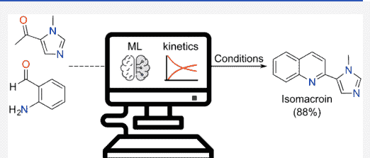
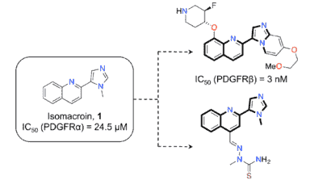
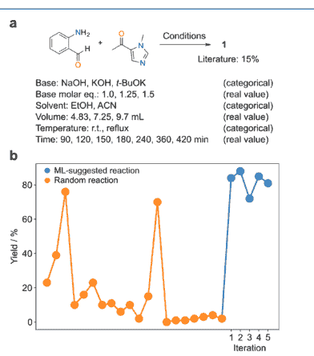
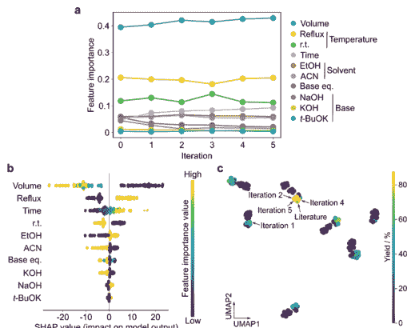
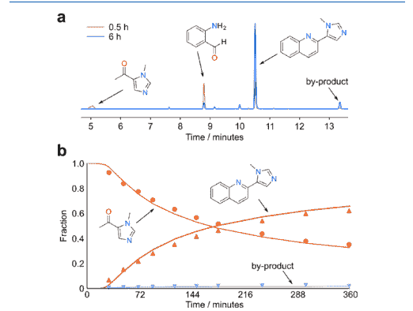
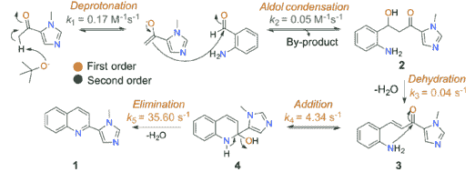

# 反应优化的动力学建模增强自适应机器学习

## 摘要

我们结合随机采样和主动机器学习（ML）来优化异大罗因（isomacroin）的合成，仅执行了所有可能Friedländer反应的3%。通过采用动力学建模，我们通过提取机理知识来增强机器直觉，并验证通过ML获得了全局最优。我们的研究为多尺度方法加速化学物质获取的潜力提供了证据，并以数据驱动的方式进一步民主化有机化学。

面向高价值生物活性实体和材料的有机合成是现代分子医学的关键，但往往产出次优工艺和用于先进功能分析的化学物质量不足。确实，缺乏用于生物学研究的筛选材料可能会抑制或延缓潜在改变生命的疗法的识别。天然产物（NPs）长期以来一直被用作治疗剂或分子设计的灵感来源，因为它们的框架作为蛋白质结合基序已获得生物学预验证。事实上，约33%的获批小分子药物要么是天然产物，要么是天然产物衍生物，这凸显了它们在转化科学中的价值。

片段状天然产物通常提供更简单且合成更易获得的架构，也可轻松应用于众多发现化学应用。例如，我们揭示了异大罗因（1）——一种来自*Macrorungia longistrobus*的片段状天然产物——为高效调节血小板衍生生长因子受体α激酶（PDGFRα）提供了蓝图，同时利用自组织图进行靶点去孤儿化。1作为药物化学原型的可行性，已通过基于咪唑并喹啉骨架（一个铰链结合基序）开发出的强效PDGFRα和IkB激酶抑制剂得到证明（图1）。然而，通过Friedländer喹啉合成获得1的合成途径在我们的实验中证明具有挑战性。获得的产率较低（15%），限制了大规模筛选工作。

有鉴于此，我们最近开发了LabMate.ML——一种用于在低数据模式下数字化反应优化的自演进机器学习（ML）例程——旨在提供一种可解释、可推广且非穷尽的搜索空间探索替代方案，以替代全/分因子“实验设计”。该方法利用一小组随机反应的信息进行初始化，并借助由定制实验选择策略驱动的自适应随机森林，迭代推动优化过程。在之前的报告中，并与相关方法保持一致，我们表明LabMate.ML不仅能够高效建模实数值和类别变量，更重要的是，在竞争性研究中与专家直觉相媲美。利用其决策过程，还可以提取可解释的输出以增强领域直觉。

尽管LabMate.ML此前取得了成功，但工艺化学优化的日常实践中更频繁地利用动力学建模来指导反应条件，以实现高效合成。22,23

图1. 异大罗因（1）及其相关分子作为人类激酶抑制剂的结构。1的骨架在天然产物衍生的生物活性小分子中被突出显示。

最终，这种方法允许基于数据的反应机制阐明和定制方案设计。22,24 在这里，我们在之前的ML工作流程基础上，提供了级联主动学习和动力学建模作为快速反应优化方法的初步概念验证，包括识别全局最优。使用1作为模型化合物，我们的ML工具迅速挖掘了离散的Friedländer反应空间。随后，将生成的见解与动力学建模相结合，以确定反应性路径及相应的速率/平衡常数，据我们所知，这些常数此前尚未被测定。25 我们还确认，ML例程以最小的实验努力迅速收敛到全局最优（88%）。总的来说，我们的多尺度、人机协同方法可能可以迁移到其他化学领域，并通过民主化有机合成实现高价值化学物质的快速获取。

为了深入反应性空间并确定通向1的最佳合成方案，我们最初调查了文献，并收集了可以实验探测的优选条件26–30（图2a）。这些包括不同

图2. 通向异大罗因（1）的反应条件优化。（a）在Friedländer喹啉合成优化中探测了六个反应变量。同时考虑了实数值和类别特征，从而提供了756种可能反应的搜索空间。类别变量被独热编码用于建模。实数值变量在不进行任何转换的情况下用于建模。（b）优化例程，遵循用户定义数量的随机反应进行初始化（橙色）以及额外的五个ML建议的反应，直到获得合理收敛（蓝色）。

溶剂及其体积、碱及其摩尔量、温度和反应时间。反应变量被编码为实数值（例如，体积）或字符串，如类别变量（例如，碱）的情况。为了机器解释和建模，类别变量随后被独热编码，表示指定实体的存在（“1”）或缺失（“0”）。总共，756个反应在高维空间中被数字化，在这种情况下，这构成了比合理可行的筛选更多的组合。该搜索空间通过我们的自适应随机森林例程进行了迭代研究——一种监督学习算法，通过聚合不相关决策树的个别预测来利用“群体智慧”概念。由于每棵树只分析一部分数据，单独的输出只预期有弱预测。然而，对n棵树的这些结果进行平均，可以实现显著更现实的预测和不确定性估计。这些特性共同支持了随机森林在化学科学中的流行地位17,31,32，并使其对ML研究中的常见陷阱（如异常值、噪声和过拟合）具有鲁棒性。33,34

为了启动优化活动，进行了20个随机反应。其结果（目标变量/产率）通过从不同浓度值下所需产物峰下面积构建的校准曲线收集（HPLC–UV/vis–MS谱）。有趣的是，其中一项随机反应对应于文献条件11，但在此重新评估中获得了更高的产率（此处76% vs 文献15%）。所得产率仍被用作基准，但凸显了先前讨论的化学数据变异性，这可能决定统计学习的预测能力。35 所有随机反应条件及其产率（0–76%，图2b）被用作初始训练集，并实施了分层10倍交叉验证例程，其中分析重复进行，90%的数据用于训练，10%作为内部测试集，以初步评估模型效用。通过利用先前验证的18“贪心”方法进行实验优先级排序，即选择高预测产率和低不确定性的反应，我们的推荐工具迅速（经过五次迭代）收敛到一个最优（图2b）。相对于文献条件，ML例程选择替换碱（KOH为t-BuOK）及其摩尔当量量（从1.25摩尔当量到1.50摩尔当量），以88%的产率获得1（参见表S1）。我们理解，此类修改是合理的，也是熟练化学家也会探测的顶级变量之一，这支持了计算工具对化学直觉的正确形式化。

此外，打乱目标（Y）变量导致预测性较差的控制模型。这表明，在Y随机化过程中，数据结构中有意义的真实模式已被破坏（参见表S3）。我们认为这种控制是必要的，因为ML启发式方法很可能利用伪迹并记忆而非学习数据。36–39 在处理高维空间中的低数据时（如本例），这一点尤其关键。最后，我们研究了不同基线算法（例如，线性回归、Lasso回归和岭回归）是否能相对于我们的随机森林提供相似或更好的统计模型，同时在决策过程中强制执行简单性。通过RMSE和MAE值评估，我们的方法在浏览训练数据方面被证明更准确且更高效（参见表S2）。总体而言，结果证明了自适应随机森林在协助化学家解决反应优化问题方面的适用性和鲁棒性。

目前已确立，不同的ML算法可以在与化学科学相关的众多任务中提供专家级预测。40–42 然而，仍通常将ML作为黑箱来使用，其中不提供对决策过程的洞察。这不仅可能阻碍潜在有用技术的采用，还可能错过原本可能对感知隐藏的新知识。43 为了揭示我们统计模型的关键变量并推断其方向性，即期望或非期望，我们提取了

回归器的重要性值（图3a）并采用SHapley Additive ExPlanations（SHAP 44；图3b）

图3。全局尺度上的ML解释。(a) 在自适应随机森林模型的决策过程中，每个特征的重要性经过五次迭代给出，直到获得合理的目标变量（产量/输出）收敛。数据显示，在主动学习过程中，随着更多数据可用，特征重要性呈动态波动。图中将分类变量解耦。(b) 采用SHAP 44推断模型/反应输出/产量中每个特征的方向性。偏好低反应体积、较高温度和较长反应时间，同时使用EtOH作为溶剂和NaOH或t-BuOK作为碱。(c) 使用UMAP（均流形近似与投影）45可视化搜索空间，该方法保留了数据集中的局部邻域结构。数据显示特定的反应性岛屿和优先区域，导致异大烯内酯（isomacroin）的形成。

作为一种正交的、与模型无关的方法。SHAP通过拟合线性模型，提供全局（模型）和局部（个别预测）的数据解释 39。

在此Friedländer喹啉合成中，小反应体积至关重要，长时间回流同样关键（图3a,b）。的确，在未编码任何显式化学知识的情况下，我们的ML程序能够自主形式化直觉的不成文规则，这印证了其效用。这些解释支持反应优化可以有效配置为数据挖掘问题。此外，通过流形学习（图3c），我们确认所有反应在特定的反应性岛屿中共聚类，这些岛屿被我们的算法利用，且每个簇可以以中等产率得到1。该结果提供了所追求选择策略的易于可视化的解释。此外，可以观察到，迭代搜索主要围绕初始化步骤中表现最佳的随机反应进行，而不会削弱对最优解的识别（例如，迭代2）。

在此基础上，我们接下来思考初始搜索空间离散化步骤是否限制了识别全局最优解的能力，因此ML是否仅用于对Friedländer反应性空间进行快速但粗粒度的探测，且仍有改进空间。为此，我们开展了一系列实验来模拟反应动力学、识别全局最优解并建立机制。具体地，我们探索了2-氨基苯甲醛原料（0.94、1.0、1.45、2.0）、t-BuOK（1.25、1.5、2.2、2.9）以及温度值（40、53和78 °C；参见表S4）的不同摩尔当量值。在这些实验中，在指定时间点收集反应混合物的分取样品，并通过HPLC–UV/vis–MS（例如，图4a）定量所有相关物种。这使我们能够

图4。动力学建模作为一种正交方法，用于增强机器学习输出。(a) 示例性叠加HPLC–UV谱图（0.5和6 h），显示异大烯内酯随时间的生成。(b) 示例性图表，显示物种浓度随时间变化及拟合曲线。动力学参数从一系列类似实验中提取。

监测360 min反应过程中每个原料、产物和副产物的浓度增加/减少（例如，图4b）。虽然反应中间体可能为下游数据推断提供额外的信息和置信度，但此类物种无法通过我们的分析方法定量。因此，我们假设其具有瞬态性质，并在建模中未将其考虑在内。

随后，基于描述上述所有物种随时间浓度变化的反应速率的微分方程，开发了Friedländer喹啉合成的动力学模型。通过使用基于梯度的Levenberg–Marquardt算法，将实验数据与模型预测之间的平方和最小化，在DynoChem（Scale-up Systems）46中对这一宝贵信息进行了建模。

拟合模型引导我们确定了通向1的反应机制，这与文献25一致（图5）。

图5。基于DynoChem动力学建模的Friedländer化学反应机制。

为全面表征该转化，我们在95%置信水平下提取了一级和二级速率（k）、平衡（Keq）常数及活化能（Ea）值（参见表S4）。反应速率预测表明，1的生成发生迅速，脱水步骤为限速步骤。结果还表明，2-氨基苯甲醛的消耗是通过羟醛缩合朝向中间体2进行的。此外，当使用过量2-氨基苯甲醛和t-BuOK时，1相对于消去步骤倾向于缓慢降解。领域知识表明，在碱性条件下形成席夫碱不可行。作为对拟议机制的对抗性对照，我们拟合了一个假设以亚胺形成作为第一步的模型。结果与既定直觉一致，并断言2的形成（$k_\text{min}e = 0.01 M^{-1} s^{-1}$ vs $0.05 M^{-1} s^{-1}$），从而为我们的动力学模型提供了额外的置信度。

从更广阔的角度来看，我们通过一种正交手段验证了ML预测，因为我们的研究中两种方法均趋同于相同的反应方案和预测产率。更具体地说，动力学模型表明，在78 °C下，分别使用2和1.05摩尔当量的2-氨基苯甲醛及t-BuOK，经过593 min反应，可在最小化副产物的同时达到全局最优（图S15）。然而，将两种方法整合为一个精简工作流是有价值的。动力学模型通过阐明反应机理和速率常数，增强了从ML得出的直觉。它还揭示了副产物对优化合成方案开发的影响，尽管需要耗时的计算（ML约需5–10 min，而动力学模型约需220–250 min）。共同，这证实了通过ML进行模式识别的威力。当增加价值合理时，它也为采用计算成本高昂的方法提供了动力。

总之，我们实施了一个包含自适应学习和动力学建模的级联工作流，以促进通过Friedländer化学获得1并提供物理化学见解。整个优化过程——包括特征选择、随机选择、超参数调优和ML选择——允许对实验进行优先排序并识别最优解，同时仅执行所有可能反应的少量部分（3%）。这很重要，因为ML可以同样作为实验的优化器或微调器，分别以不良或良好产率作为起点。此外，该过程还允许建立转化的机理路径。我们的研究为过程化学中确立概念与新兴技术的可行整合提供了概念验证。最终，它可能通过加速筛选目的高价值化学品的获取，对分子医学管道产生影响。我们预见此类及类似整合将充当研究助手，促进基于概率的知情决策，并在数字化学时代实现有机合成的民主化。

## 实验部分

### 一般方法
原材料和试剂购自Sigma-Aldrich、Alfa Aesar、Fluka或Acros，未经进一步纯化即使用。反应在Radleys Carousel 6 Plus反应站上进行。1H NMR谱图在Bruker Avance 300 MHz仪器上，使用CDCl3和(CD3)2CO获得，化学位移值（$\delta$）以百万分率表示，并利用残留溶剂峰作为内标；13C NMR谱图在相同的去溶剂中于75 MHz获得。耦合常数（$J$）以赫兹报告，并使用以下分离缩写：s = 单峰，d = 双峰，t = 三峰，dd = 双重双峰，ddd = 双重双重双峰，ddt = 双重双重三峰，m = 多峰。使用高效液相色谱（HPLC）（Waters Corp., Milford, MA）系统定量异大烯内酯作为产物，并从化学反应中收集样品。色谱分析在室温下使用Agilent Eclipse XDB-C18色谱柱（150 mm × 4.6 mm i.d. 3.5 $\mu$m）进行。产物通过在254 nm处的紫外（UV）吸收检测进行检测。分析在pH 8.5下，采用乙酸铵/乙腈（90:10）和乙腈/乙酸铵（90:10）的适当梯度，总流速为1 mL/min进行。进样体积为5 $\mu$L，总运行时间为20.1 min。超高效液相色谱（UPLC）分析在配备光电二极管阵列（PDA）检测器（Waters Corp., Milford, MA）并串联单四极杆质谱检测器（QDa Waters）的ACQUITY UPLC系统上进行。该系统用于识别起始原料、产物和副产物，并从化学反应中收集样品。所有化合物均由PDA检测器在254 nm下监测。单离子监测（SIR）方法在单四极杆质谱检测器上建立。QDa条件设置如下：锥电压15 V，毛细管电压0.8 kV，离子源温度600 °C。数据在SIR模式下获取。色谱柱、进样体积、流速和溶剂管理器已如先前所述。

### 1-(1-甲基-1H-咪唑-5-基)乙酮的合成
向含有1-甲基-1H-咪唑-2-基（0.485 mL, 0.50 g, 6.0 mmol）和四氢呋喃（2.87 mL）于−78 °C的烧瓶中加入1.6 M正丁基锂在己烷中（4.0 mL, 6.5 mmol），随后在−78 °C下搅拌40 min。然后缓慢加入氯三甲基硅烷（0.8 mL, 6.3 mmol），混合物在−78 °C下搅拌1 h。加入1.6 M正丁基锂在己烷中（4.0 mL, 6.5 mmol），移除浴槽，继续搅拌直至温度升至10 °C。将混合物冷却至−78 °C，加入N,N-二甲基乙酰胺溶液（0.463 mL, 5.0 mmol）。移除浴槽，在室温下继续搅拌40 min。用少量甲醇（1.0 mL）淬灭反应，并加入盐水。分离有机层，并用二氯甲烷萃取水相。合并的有机相用无水硫酸钠干燥，过滤，并在减压下浓缩。粗产物通过短硅胶柱过滤，并用乙酸乙酯（75 mL）洗脱。蒸发溶剂以获得所需化合物。无色油，93%（0.703 g），$R_f$ 0.68（1/1 v/v 乙酸乙酯/庚烷）。1H NMR（300 MHz，（CD3）2CO）：$\delta$ 7.28–7.24（m，1H），7.00（d，$J$ = 1.0 Hz，1H），3.92（s，3H），2.48（s，3H）。13C{1H} NMR（75 MHz，（CD3）2CO）：$\delta$ 189.7, 128.6, 127.4, 35.2, 26.1。如文献所述。

### 2-氨基苯甲醛的合成
将2-硝基苯甲醛（0.50 g, 3.3 mmol）在乙醇（9.4 mL）中的溶液搅拌约1 min。向搅拌的溶液中加入铁粉（0.554 g, 9.9 mmol）和稀盐酸（3.3 mL 1.0 M HCl, 0.5 mmol），并在Asynt DrySyn Single Position Blocks系统中将反应加热回流2 h。将反应混合物冷却至室温，用乙酸乙酯（27.0 mL）稀释，搅拌5 min，然后通过短Celite柱过滤。滤液在减压下蒸发以得到黄色油。产物在−20 °C下储存。黄色油，100%（0.40 g），$R_f$ 0.44（1/5 v/v 乙酸乙酯/庚烷）。1H NMR（300 MHz，（CD3）2CO）$\delta$ 9.88（d，$J$ = 0.6 Hz，1H），7.55（dd，$J$ = 7.8, 1.6 Hz，1H），7.31（ddd，$J$ = 8.5, 7.0, 1.6 Hz，1H），6.81（dq，$J$ = 8.3, 0.7 Hz，2H），6.74–6.66（m，1H）。13C{1H} NMR（75 MHz，（CD3）2CO）$\delta$ 193.7, 150.8, 135.6, 134.9, 118.6, 115.9, 115.4。如文献所述。

### 异大烯内酯（1）的合成
将酮（0.10 g, 0.80 mmol, 1摩尔当量）和氢氧化钾（0.057 g, 1.0 mmol, 1.25摩尔当量）溶于乙醇（6 mL/mmol）。然后将2-氨基苯甲醛（0.098 g, 0.8 mmol, 1摩尔当量）加入溶液中，并在Asynt DrySyn Single Position Blocks系统中将反应混合物回流3 h。蒸发溶剂，并使用庚烷/乙酸乙酯（3:1）洗脱剂通过闪柱色谱纯化粗产物。黄色固体，80%（0.135 g），$R_f$ 0.40（1/1

v/v 乙酸乙酯/正己烷)。1H NMR (300 MHz, CD3OD): δ 8.34 (d, J = 8.7 Hz, 1H), 8.18 (dd, J = 8.6, 0.8 Hz, 1H), 8.05 (ddt, J = 8.5, 1.4, 0.7 Hz, 1H), 7.82–7.77 (m, 1H), 7.69 (ddd, J = 8.5, 6.9, 1.5 Hz, 1H), 7.51 (ddd, J = 8.1, 6.9, 1.2 Hz, 1H), 7.18 (d, J = 1.1 Hz, 1H), 7.02 (d, J = 1.1 Hz, 1H), 4.30 (s, 3H). 13C{1H} NMR (75 MHz, CD3OD) δ 150.6, 147.3, 145.0, 136.3, 129.5, 129.4, 128.6, 127.6, 127.2, 126.5, 125.2, 120.6, 36.6.

机器学习。我们采用了随机森林回归器，并探测了多个超参数[树的数量（100–1000），树深度（无，2，4）以及特征数量（自动或平方根）]来构建预测模型。采用了10倍交叉验证，将数据集分为包含90%数据的训练组和剩余10%的测试组。最佳超参数的选择由平均绝对误差（MAE）的计算指导。使用这些参数，模型预测了其余可能反应条件的产物产率，然后选择了下一个反应。对前三次迭代应用了勘探方法以允许模型改进。对于后续迭代，通过选择预测中前5个高产反应中方差最低的反应，应用了开发方法。模型随着每个新增数据点的加入而通过改进其预测模型来发展。该模型和数据分析完全使用Python 3.7.3以及NumPy 1.16.4、Pandas 0.24.2和Scikit-learn 0.21.2库实现，并在HP ProBook G3（2.40 GHz 2核处理器，4 Gb RAM）上运行（5–10 min）。为初始化，并行进行了20个随机反应（表 S1），并通过HPLC分析以创建第一个训练数据集。使用校准曲线，可以量化每个反应中获得的产物产率。基于这些数据，机器学习例程一次选择一组额外条件用于实验验证。所选实验的输出被添加到训练集中，并进行了涉及设计–制造–测试的迭代过程，共五次迭代。优化例程的代码可在 https://github.com/tcorodrigues/LabMate 获取。ML.

机器学习对照。为评估该方法的鲁棒性，计算了其他模型，如线性回归、岭回归和套索回归。与此同时，我们进行了y随机化研究，以排除随机森林决策过程中的伪效应。计算了根均方误差（RMSE）、平均绝对误差（MAE）和决定系数（r2）等误差指标，并用于不同方法之间的比较。

动力学方法。使用DynoChem软件（Scale-Up Systems；构建：1.3.20b340，数据版本：1.0）进行反应建模。该软件包含模型模板，并提供模拟器、拟合和优化插件选项来运行模型。在这项工作中，我们使用单一模型模板来拟合所有实验并计算动力学参数。我们采用Levenberg–Marquardt算法进行拟合，在最小化SSQ期间，并使用Backward Euler（BE）积分方法求解与反应相关的物料平衡微分和代数方程。动力学参数在定义的参考温度（78 °C）下计算。所有反应运行了360 min，并在指定时间点收集分析样品。分析通过HPLC进行，并基于校准曲线。

## 相关内容

### 支持信息

支持信息可免费获取，网址为 https://pubs.acs.org/doi/10.1021/acs.joc.1c01038。

所有化合物的1H和13C NMR光谱，所有化合物的UPLC-QDa色谱图，机器学习模型和动力学模型使用的数据和条件（PDF）

## 作者信息

通讯作者 Filipe A. P. Ataide – 研发，工艺化学开发，Hovione FarmaCiência S.A，1649-038 Lisboa，葡萄牙；orcid.org/0000-0002-8288-2152；电子邮件：fataide@hovione.com Tiago Rodrigues – 药物研究所（iMed.ULisboa），里斯本大学药学院，1649-003 Lisboa，葡萄牙；orcid.org/0000-0002-1581-5654；电子邮件：tiago.rodrigues@ff.ulisboa.pt

作者 A. Filipa Almeida – 研发，工艺化学开发，Hovione FarmaCiência S.A，1649-038 Lisboa，葡萄牙；药物研究所（iMed.ULisboa），里斯本大学药学院，1649-003 Lisboa，葡萄牙 Rui M. S. Loureiro – 研发，工艺化学开发，Hovione FarmaCiência S.A，1649-038 Lisboa，葡萄牙 Rui Moreira – 药物研究所（iMed.ULisboa），里斯本大学药学院，1649-003 Lisboa，葡萄牙

完整联系信息可于以下网址查阅：https://pubs.acs.org/10.1021/acs.joc.1c01038

作者贡献 A.F.A. 进行了化学和建模工作。所有作者设计了实验并分析了数据。A.F.A 和 T.R. 撰写了手稿，其余作者提供了贡献。F.A.P.A.、R.M.S.L.、R.M. 和 T.R. 监督了研究。F.A.P.A. 和 T.R. 协调了研究。所有作者均已批准最终版本的手稿。

备注 作者声明存在以下竞争性财务利益：T.R. 是 TargTex S.A. 的联合创始人和股东。

## 致谢

A.F.A. 和 T.R. 承认葡萄牙科学技术基金会（FCT）分别通过 PD/BD/143125/2019 和 CEECIND/00684/2018 提供财务支持。该研究通过COMPETE计划—里斯本区域运作计划—拨款 LISBOA-01-0145-FEDER-016405 获得欧洲结构与投资基金资助，并通过葡萄牙科学技术基金会（FCT）—拨款 SAICTPAC/0019/2015 获得国家基金资助。还承认 FCT 对 MedChemTrain 博士项目（PD147-2013-AA）的支持。作者感谢 Ricardo Gonçalves（Hovione）在设计定量所有物种的分析方法方面提供的大力支持。

## 参考文献

- (1) Hayashi, Y. 全合成中的时间经济学. J. Org. Chem. 2021, 86 (1), 1–23.
- (2) Peiretti, F.; Brunel, J. M. 人工智能：有机化学的未来？. ACS Omega 2018, 3 (10), 13263–13266.
- (3) Pflüger, P. M.; Glorius, F. 分子机器学习：合成化学的未来？. Angew. Chem., Int. Ed. 2020, 59 (43), 18860–18865.
- (4) Harvey, A. L. 药物发现中的天然产物. Drug Discovery Today 2008, 13 (19–20), 894–901.
- (5) Atanasov, A. G.; Zotchev, S. B.; Dirsch, V. M.; Orhan, I. E.; Banach, M.; Rollinger, J. M.; Barreca, D.; Weckworth, W.; Bauer, R.; Bayer, E. A.; Majeed, M.; Bishayee, A.; Bochkov, V.; Bonn, G. K.; Braidy, N.; Bucar, F.; Cifuentes, A.; D'Onofrio, G.; Bodkin, M.; Diederich, M.; Dinkova-Kostova, A. T.; Erffth, T.; El Bairi, K.; Arkells, N.; Fan, T.-P.; Fiebich, B. L.; Freissmuth, M.; Georgiev, M. I.; Gibbons, S.; Godfrey, K. M.; Gruber, C. W.; Heer, J.; Huber, L. A.; Ibanez, E.; Kijioa, A.; Kiss, A. K.; Lu, A.; Macías, F. A.; Miller, M. J. S.; Mocan, A.; Müller, R.; Nicoletti, F.; Perry, G.; Pittala, V.; Rastralli, L.; Ristow, M.; Russo, G. L.; Silva, A. S.; Schuster, D.; Sheridan, H.; Skalicka-Woźniak, K.; Skaltsounis, L.; Sobarzo-Sánchez, E.; Bredt, D. S.; Stüppner, H.; Sureda, A.; Tzvetkov, N. T.; Vaccà, R. A.; Aqgrawal, B. B.; Battino, M.; Giampieri, F.; Wink, M.; Wolfender, J.-L.; Xiao, J.; Yeung, A. W. K.; Lizard, G.; Popp, M. A.; Heinrich, M.; Berindan-Nagoe, I.; Stadler, M.; Daglia, M.; Verpoorte, R.; Supuran, C. T. Taskforce, the I. N. P. S. 天然产物在药物发现中的应用：进展与机遇. Nat. Rev. Drug Discovery 2021, 20, 200–216.
- (6) Karageorgis, G.; Foley, D. J.; Larraia, L.; Waldmann, H. 拟天然产物的原理与设计. Nat. Chem. 2020, 12 (3), 227–235.
- (7) Newman, D. J.; Cragg, G. M. 1981年1月至2019年9月近四十年间作为新药来源的天然产物. J. Nat. Prod. 2020, 83 (3), 770–803.
- (8) Over, B.; Wetzel, S.; Güttler, C.; Nakai, Y.; Renner, S.; Rauh, D.; Waldmann, H. 用于碎片化配体发现的天然产物衍生片段. Nat. Chem. 2013, 5 (1), 21–28.
- (9) Rodrigues, T.; Reker, D.; Schneider, P.; Schneider, G. 药物设计中依赖天然产物. Nat. Chem. 2016, 8 (6), 531–541.
- (10) Arndt, R. R.; Jordaan, A.; Joynvt, V. P. Macrorongia Longistrobus C.B. Cl. 的生物碱. J. Chem. Soc. 1964, 5969–5975.
- (11) Rodrigues, T.; Reker, D.; Kunze, J.; Schneider, P.; Schneider, G. 揭示片段状天然产物的大分子靶点. Angew. Chem., Int. Ed. 2015, 54, 10516–10520.
- (12) Reker, D.; Rodrigues, T.; Schneider, P.; Schneider, G. 通过自组织图共识识别重新设计化学实体的大分子靶点. Proc. Natl. Acad. Sci. U. S. A. 2014, 111 (11), 4067–4072.
- (13) Hicken, E. J.; Marnsater, F. P.; Munson, M. C.; Schlachter, S. T.; Robinson, J. E.; Allen, S.; Burgess, L. E.; DeLisle, R. K.; Rizzi, J. P.; Topolov, G. T.; Zhao, Q.; Hicks, J. M.; Kallan, N. C.; Tartlon, E.; Allen, A.; Callejo, M.; Cox, A.; Rana, S.; Klopfenstein, N.; Woessner, R.; Lysskatos, J. P. 发现一类具有强效PDGFR活性和口服生物利用度的新型咪唑[1,2-a]吡啶. ACS Med. Chem. Lett. 2014, 5 (1), 78–83.
- (14) Effendi, N.; Mishiro, K.; Takarada, T.; Yamada, D.; Nishii, R.; Shiba, K.; Kinuya, S.; Odani, A.; Ogawa, K. 设计、合成和生物学评价用于血小板衍生生长因子受体β（PDGFRβ）成像的放射碘化苯并[d]咪唑唑-喹啉衍生物. Bioorg. Med. Chem. 2019, 27 (2), 383–393.
- (15) Cushing, T. D.; Baichwal, V.; Berry, K.; Billedeau, R.; Bordonun, V.; Broka, C.; Cardozo, M.; Cheng, P.; Clark, D.; Dalrymple, S.; DeGraffenreid, M.; Gill, A.; Hao, X.; Hawley, R. C.; He, X.; Jaen, J. C.; Labadie, S. S.; Labelle, M.; Lehel, C.; Lu, P.-P.; McIntosh, J.; Miao, S.; Parast, C.; Shin, Y.; Sjogren, E. B.; Smith, M.-L.; Talamas, F. X.; Tonn, G.; Walker, K. M.; Walker, N. P. C.; Wesch, H.; Whitehead, C.; Wright, M.; Brownen, M. F. IKKβ抑制剂的新系列 第I部分：HTS命中化合物的初始SAR研究. Bioorg. Med. Chem. Lett. 2011, 21 (1), 417–422.
- (16) Cushing, T. D.; Baichwal, V.; Berry, K.; Billedeau, R.; Bordonun, V.; Broka, C.; Brownen, M. F.; Cardozo, M.; Cheng, P.; Clark, D.; Dalrymple, S.; DeGraffenreid, M.; Gill, A.; Hao, X.; Hawley, R. C.; He, X.; Labadie, S. S.; Labelle, M.; Lehel, C.; Lu, P.-P.; McIntosh, J.; Miao, S.; Parast, C.; Shin, Y.; Sjogren, E. B.; Smith, M.-L.; Talamas, F. X.; Tonn, G.; Walker, K. M.; Walker, N. P. C.; Wesch, H.; Whitehead, C.; Wright, M.; Jaen, J. C. IKKβ抑制剂的新系列 第II部分：一系列强效且具有药理学活性的类似物的描述. Bioorg. Med. Chem. Lett. 2011, 21 (1), 423–426.
- (17) Rodrigues, T.; Reker, D.; Welin, M.; Caldera, M.; Brunner, C.; Gabernet, G.; Schneider, P.; Walse, B.; Schneider, G. 用于药物发现和化学生物学的重新设计片段设计. Angew. Chem., Int. Ed. 2015, 54 (50), 15079–15083.
- (18) Reker, D.; Hoyt, E. A.; Bernardes, G. J. L.; Rodrigues, T. 基于最小实验信息的化学反应自适应优化. Cell Reports Phys. Sci. 2020, 1 (11), 100247.
- (19) Häse, F.; Roch, L. M.; Kreisbeck, C.; Aspuru-Guzik, A. Phoenics：一种用于化学的贝叶斯优化器. ACS Cent. Sci. 2018, 4 (9), 1134–1145.
- (20) Streith-Kalthoff, F.; Sandfort, F.; Segler, M. H. S.; Glorius, F. 合成化学中机器学习的原理、应用和方向. Chem. Soc. Rev. 2020, 49 (17), 6154–6168.
- (21) Shields, B. J.; Stevens, J.; Li, J.; Parasram, M.; Damani, F.; Alvarez, J. I. M.; Janey, J. M.; Adams, R. P.; Doyle, A. G. 贝叶斯反应优化作为化学合成的工具. Nature 2021, 590 (7844), 89–96.
- (22) Blackmond, D. G. 反应进程动力学分析：复杂催化反应机理研究的强大方法. Angew. Chem., Int. Ed. 2005, 44 (28), 4302–4320.
- (23) Wang, K.; Han, L.; Mustakis, J.; Li, B.; Magano, J.; Damon, D. B.; Dion, A.; Maloney, M. T.; Mustakis, J.; Post, R.; Li, R. 药物工艺开发中的动力学和数据驱动反应分析. Ind. Eng. Chem. Res. 2020, 59 (6), 2409–2421.
- (24) Nielsen, C. D.-T.; Bures, J. 可视动力学分析. Chem. Sci. 2019, 10 (2), 348–353.
- (25) Marco-Contelles, J.; Pérez-Mayoral, E.; Samadi, A.; Carreiras, M.; do, C.; Soriano, E. 弗里德兰反应的最新进展. Chem. Rev. 2009, 109 (6), 2652–2671.
- (26) Lan, X.-B.; Ye, Z.; Huang, M.; Liu, J.; Liu, Y.; Ke, Z. 基于N-杂环卡宾锰的非官能团外层球策略实现酮与醇的高活性α-烷基化. Org. Lett. 2019, 21 (19), 8065–8070.
- (27) Kumar, P.; Garg, V.; Kumar, M.; Verma, A. K. Rh(III)催化炔基化：从氨基偶氮烯合成官能化喹啉. Chem. Commun. 2019, 55 (81), 12168–12171.
- (28) Martinez, R.; Ramón, D. J.; Yus, M. 从醇间接无过渡金属弗里德兰合成喹啉. J. Org. Chem. 2008, 73 (24), 9778–9780.
- (29) Harry, N. A.; Ujwalde, S. M.; Anilkumar, G. 无金属喹啉合成的最新进展与前景. Org. Biomol. Chem. 2020, 18 (48), 9775–9790.
- (30) Ghobadi, N.; Nazari, N.; Gholamzadeh, P. 弗里德兰反应：杂环合成的强大策略; Scriven, E. F. V. Ramsden, C. A. B. T.-A. H. C., Eds.; Academic Press, 2020; Vol. 132, Chapter 2, pp 85–134.
- (31) Chen, Y.; Stork, C.; Hirte, S.; Kirchmair, J. NP-Scout：小分子天然产物相似度定量与可视化的机器学习方法. Biomolecules 2019, 9 (2), 43.
- (32) Reker, D.; Schneider, P.; Schneider, G. 多目标主动机器学习可迅速改进构效关系模型并揭示新的蛋白质-蛋白质相互作用抑制剂. Chem. Sci. 2016, 7 (6), 3919–3927.
- (33) Herrera, V. M.; Khoshgoftaar, T. M.; Villanustre, F.; Furht, B. 用于LexisNexis高性能计算集群平台大数据分析的随机森林实现与优化. J. Big Data 2019, 6 (1), 68.
- (34) Ao, Y.; Li, H.; Zhu, L.; Ali, S.; Yang, Z. 线性随机森林算法及其在机器学习辅助测井回归建模中的优势. J. Pet. Sci. Eng. 2019, 174, 776–789.
- (35) Rodrigues, T. 机器学习中化学和生物数据的好、坏和丑. Drug Discovery Today: Technol. 2019, 32–33, 3–8.
- (36) Kanehko, H. 使用Y随机化估计适用性域中测试数据的预测性能. J. Chemon. 2019, 33 (9), 1–12.

- (37) Rücker, C.; Rücker, G.; Meringer, M. QSPR/QSAR中的Y随机化及其变体。J. Chem. Inf. Model. 2007, 47 (6), 2345–2357.

- (38) Chuang, K. V.; Keiser, M. J. 科学机器学习的对抗性控制。ACS Chem. Biol. 2018, 13 (10), 2819–2821.

- (39) Lundberg, S.; Lee, S.-I. 解释模型预测的统一方法。Adv. Neural Inf. Process. Syst. 2017, No. Section 2, 4766–4775.

- (40) Policce, R.; dos Passos Gomes, G.; Aldeghi, M.; Hickman, R. J.; Krenn, M.; Lavigne, C.; Lindner-D'Addario, M.; Nigam, A.; Ser, C. T.; Yao, Z.; Aspuru-Guzik, A. 加速材料设计的数据驱动策略。Acc. Chem. Res. 2021, 54 (4), 849–860.

- (41) Saal, J. E.; Oliynyk, A. O.; Meredig, B. 材料发现中的机器学习：已验证的预测及其基础方法。Annu. Rev. Mater. Res. 2020, 50 (1), 49–69.

- (42) Haghighatlari, M.; Li, J.; Heidar-Zadeh, F.; Liu, Y.; Guan, X.; Head-Gordon, T. 学习进行化学预测：特征表示、数据与机器学习方法的相互作用。Chem. 2020, 6 (7), 1527–1542.

- (43) Jiménez-Luna, J.; Grisoni, F.; Schneider, G. 基于可解释人工智能的药物发现。Nat. Mach. Intell. 2020, 2 (10), 573–584.

- (44) Lundberg, S. M.; Nair, B.; Vavilala, M. S.; Horibe, M.; Eisses, M. J.; Adams, T.; Liston, D. E.; Low, D.-K.-W.; Newman, S.-F.; Kim, J.; Lee, S.-I. 手术期间低氧血症预防的可解释机器学习预测。Nat. Biomed. Eng. 2018, 2 (10), 749–760.

- (45) McInnes, L.; Healy, J.; Saul, N.; Großberger, L. UMAP：一致多重流形近似与投影。J. Open Source Softw. 2018, 3 (29), 861.

- (46) Scale-up 系统，https://www.scale-up.com/dynochem.

- (47) Tillekeratne, V.; Al-Hamashi, A.; Dlamini, S.; Alqahtani, A. S.; Karaj, E. 基于咪唑的抗癌剂及其衍生物。以及制备和使用其的方法。WO2019036607, US 16638587, 2018.

- (48) Zhu, H.; Zhang, M.; Xia, L.; Wang, B. 含有荧光核心化合物的喹啉合成方法。CN 107417609, 2017.

