# 自动化数据分析：使用 ChatGPT 结合人类创意与 AI 力量

## 前言

> 比较计算机的能力与人类大脑的能力，加里·卡斯帕夫经常想，*生命模仿象棋*，我们的成功从何而来？数据分析在当今世界是一个至关重要的过程。它涉及收集、清洗、转换和分析数据，以发现有用的信息、洞察和模式，业务策略、决策制定。传统的分析是手动的，需要数据科学家在分析数据之前对其进行准备。机器学习和人工智能（`AI`）的出现通过自动化数据分析的部分过程改变了这一现状。生成式模型如 `ChatGPT` 正处于这一数据分析革命的前沿。这些大语言模型能够理解人类提示词并生成类人的文本回复。它们通过海量文本数据集进行训练，使其执行各种语言任务。生成式模型如 `ChatGPT` 可以针对特定应用进行微调，包括数据分析。

我们可以将这些生成式模型视为具有无限潜力的孩子。数据科学家的角色是培养这些模型，训练它们并帮助它们成长——就像父母对待孩子一样。最初，这些模型就像孩子——它们拥有巨大的能力，但需要引导才能实现潜力。数据科学家逐步训练它们，教授数据分析所需的不同任务、操作和功能。这包括数据预处理、清洗、特征工程、建模、评估。模型在多样化的数据集上经过充分训练，学习。

逐渐地，就像蹒跚儿童学会走路、说话和吃固食一样，生成式模型在各种数据分析工作流方面变得日益强大。随着每次迭代，它们的技能都在不断提高：它们学会了处理多样化的数据集、管理缺失值、转换特征、选择最优模型、批判性地评估性能并生成数据驱动的洞察。

在广泛数据集和分析任务上经过大量训练后，这些生成式模型从蹒跚儿童演变为成熟的分析助手。它们从简单记忆解决问题的技巧转向真正的概念性理解。模型理解为什么特定的数据转换、模型和评估适用于特定的场景。

在某种程度上，它们发展出了归纳推理和演绎逻辑，就像人类一样。它们理解数据分析工作流背后的原理和基于证据的原理，而不仅仅是记忆机械指令。这种概念性理解是生成式 `AI` 与先基于规则的专家系统的区别。

因此，当数据科学家向像 `ChatGPT` 这样成熟且训练良好的模型提出提示以进行分析时，它深度地理解了请求，而不仅仅是匹配关键词。它利用其概念性知识来分析数据集、选择最优技术、生成洞察并解释其背后的逻辑。而且它以超人类的速度完成这一切，利用了 `AI` 的计算能力。

但这让这些生成式模型比人类更聪明吗？答案是否定的。至少目前不是。尽管它们在训练领域内的特定任务上可以超越人类，但这些 `AI` 模型缺乏泛化智能。人类认知能力仍然先进得多。

与生成式模型不同，人类拥有常识、直觉、想象力、社交智能、敏感性和泛化推理能力。我们可以创造性地解决跨多个领域的新开放问题。人类还具有更好的判断力、智慧和道德，用伦理和责任来约束我们的技术能力。

虽然 `ChatGPT` 能够分析数据集并快速生成信息，但它缺乏自然语言中通用的批判性思维。

例如，在人类分析师的提示下评估销售模式，`ChatGPT` 可以通过快速分析销售数据，给出高层趋势、相关性以及它识别出的高层假设。随后，分析师可以以批判性的眼解读这些见解，提出后续问题以验证假设，并引导 `AI` 探索新的视角。

这种协作分析比静态查询或预定义的报告更具探索性和多维度性。它将人类想象力的构架与监控与 `AI` 详尽的计算能力相结合，进行详尽且开放的探索。见解的产生变得更加自然，引导数据分析师走向意想不到的路径和意外的发现。

生成式 `AI` 通过自动聚合、处理和可视化海量数据，速度比手动分析快得多，从而增强了人类分析师的能力。但人类的创意激发了新的查询线索，提问“为什么”和“如何”，并连接分析点以提取意义和启示。

`AI assistant` 在埋藏在海量噪声中寻找信号。人类则提供上下文框架，将信号解读为有意义的信息。他们通过自然的对话流深度参与原始数据，共同揭开复杂的现象。

这种流畅且无约束的方法让数据科学家能够根据需要无缝地穿梭于颗粒细节和广泛趋势之间。如果某些内容出现异常，他们可以快速放大到微观数据点，然后缩小以可视化宏观趋势——在更广泛的背景下发现异常事件。

一个关键优势是生成式 `AI` 允许人类使用自然语言直观地引导分析，而不受结构化查询或预定义分析的限制。不需要了解编程语言或数据库模式。用户可以在处理过程中进行对话。

这使得数据探索对数据科学家之外的更广泛受众更加易于。业务领导者、一线员工和其他也可以参与其中，鼓励多样化的分析视角。`AI assistant` 变成了伟大的平衡者，让更多利益相关者能够通过自然对话从数据中释放见解。

当然，就像任何学习技能的孩子一样，`AI assistant` 需要在人类监督下经过大量的训练才能变得精通。它必须摄入无数数据集和场景，从对查询的机械分析转变为真正理解与数据交互时涉及的原则和权衡。

数据科学家必须教会这些对话模型分析工作流的细微差别——如何处理模糊性、验证假设、识别局限性、避免偏见、负责任地呈现信息等。随着模型从无知走向成熟，必须强调伦理和责任。

但一旦开发得当，生成式 `AI` 助手（如 `ChatGPT`）就可以自动化数据分析中繁琐的部分，而人类则专注于高层次的创意监督。这使得在保持人类引导方向的同时，实现了数据探索的指数级扩展。在有足够的护栏的情况下，`AI` 甚至可以为人类建议新的分析路径进行评估。

当然，生成式 `AI` 也有其局限性。与人类不同，这些模型除了训练数据中的模式识别外，缺乏任何真正的语义理解。它们也缺乏人类的判断、直觉和伦理。不受约束的自动化可能会导致误导性的见解或普遍偏见。

因此，在部署生成式 `AI` 时，人类的引导至关重要。数据科学家必须评估 `AI` 生成的任何见解背后的伦理、假设和盲点。生成式对话模型终究仍然是狭义 `AI`，与通用的人类认知相反。它们仅在经过训练的领域表现出色。

理想的共生关系是快速提示、人类监督的生成式 `AI` 机械分析。但人类提供了全局构架、主观判断和道德责任，以批判性且符合伦理地对想法进行解读、验证和执行。

人类或机器单独地都无法匹配他们协作带来的增强智能。他们共同可以挖掘细粒细节和宏观意义，以揭示海量复杂数据中隐藏的见解。`AI` 指数级地扩大了分析范围，而人类的创意和伦理则为其提供了锚点。

## 为什么选择这本书？

`AI` 的出现引发了一种未来愿景，即分析任务将由远超人类能力的智能算法完全自动化。这种叙述既引发了对可能性的兴奋，也引发了对将决策权交给 `AI` 系统产生的影响的担忧。它想象了一个像 `ChatGPT` 这样的生成式模型迅速取代人类在数据科学领域地位的世界。

但这种乌托邦式的愿景未能考虑到人类智慧的持久性，并忽视了当代 `AI` 技术的局限性。尽管得益于 `ChatGPT` 等模型，分析自动化确实在加速，但它们更多地是对人类智能的有益增强，而非竞争对手。在负责任地开发时，`AI` 系统可以放大人类潜力，在数据驱动的见解和价值创造方面开辟新前沿。

人类必须在问题定义、解决方案解读和全球化思考方面发挥主作用，而 `AI` 则承担数据处理、计算和深度分析。本书讨论了各种交互模型，使人类创造力与机器生产力能够持续流转，从而不断改进发现过程。

它强调了能够更好地暴露模型决策逻辑的技术，以增加信任感和问责制。书中强调了对模型行为的持续监控和故障安全护栏，以确保安全并防止有害滥用。本书还强烈主张在分析自动化的每个阶段都保持可持续的人类价值观和伦理，以确保进步与社会利益保持一致。

它探索了适应社会的框架，并开发了专门的人类能力，以释放与 `AI` 产生独特协同效应。这一切都是为了以负责任的方式开发 `AI` 驱动的分析，以实现人类的共同提升。本书构想了一种增强智能，在这种愿景中，人类和机器相互促进，而不是 `AI` 对人类的统治。

主要来说，它为自动化伦理整合到分析工作流奠定了基础——从人类主导的战略性问题定义，到双方无缝参与的迭代协作，再到人类判断仍然至关重要的评估监控。这使得我们在不放弃创造力或责任的情况下，能够从生产力的提高中受益。

在 `AI` 正在变革分析的当下，但其能力尚处于婴儿阶段且易受影响，就像一个孩子。本书强调了我们作为开发者、领导者和公民的责任，明智地引导 `AI` 从这些形成阶段向更广泛的社会利益发展。我们今天做出的选择将决定人工智能分析智能的长期轨迹。

本书通过揭秘 `AI` 的神秘面纱、强调其优缺点并提供基于伦理的规范建议，使我们能够明智地做出这些选择。无论你对自动化革命感到兴奋还是焦虑，本书都是通过分析导航未来的不可或缺的决策工具。

它的框架、示例和原则使我们能够以以人为中心的视角负责任地整合分析。你将对在不损害人类自主性的情况下提升水平的协作机会获得全面、平衡的清晰认知。它捍卫尊重伦理作为分析 `AI` 开发和应用中的指南针。

本书激发了这样一个未来：`AI` 让整个社会都能获得数据洞察，从而共同丰富人类生活。其可靠的建议引导分析自动化向着审慎的方向发展，在指数级放大人类潜力的同时，保持人类的牢固控制。如果我们在本书寻求启发的人类价值观和协作精神引导下前进，这些可能性是令人惊叹的。

## 本书目标读者

本书对于在增强分析早期阶段导航的各种利益相关者来说是不可或缺的指南。

对于数据科学家和分析团队，它提供了可操作的框架，以便在保留人类创造力和人类监督的同时负责任地与 `AI` 协作。本书的见解将能够深思地开发分析型 `AI`，在维护问责制的同时释放生产力。通过启发性的案例研究和指导性建议，数据科学家可以使其技能和工作流面向未来，在自动化时代蓬勃发展。

本书对于评估采用基于 `AI` 的分析的业务领导者和决策者来说也至关重要。它将讨论建立在效率之外的伦理考量之上，帮助领导者在将自动化分析整合到组织中做出明智选择。务实的建议允许领导者选择明智增强团队能力的分析工作流，而不是无情地取代他们。

对于政策制定者和监管机构，本书强调了适应性治理性，以鼓励数据分析领域负责任的 `AI` 创新。其前瞻性的观点揭示了今天的审慎政策如何主动塑造自动化的轨迹，使其向造福社会的方向发展。本书为开发响应快速技术变化的治理框架提供了见解。

在学术机构中，本书为跨学科讨论提供了一个不可或缺的计划。它丰富了对如何最好基于道德原则开发 `AI` 技术的理解。学生和年轻专业人士将发现本书在准备分析未来方面具有无价之宝。它从技术和伦理角度提供了对如何最好开发 `AI` 协作技能的根本性理解。这在他们培养技术造诣的同时，培养了以人为中心的价值观和创造力。

但最关键的是，这项工作强调了分析型 `AI` 开发和部署中至关重要的人类责任。它强调所有利益相关者在基于道德原则和同情塑造进步方面都发挥着积极作用。只有通过集体的远见和智慧，我们才能培养一种增强而非缩小人类潜力的有益智能。

## 本书的挑战

`ChatGPT` 等生成式 `AI` 模型的出现引发了数据分析的革命。这些强大的技术自动化了以前需要大量人类努力的分析过程。得益于这些 `AI` 系统，数据清洗、聚合和基础报告等任务正在迅速发生转型。

最初，模型仅能够根据训练数据进行机械性的操作模拟。它们对工作流背后的概念、原理和含义没有深层次的理解。模型可以精确地重复数据处理步骤，但对意义没有任何概念。

这类似于一个年幼的孩子背诵乘法表，而没有掌握乘法背后深层的数学概念。他们可以准确地进行计算，但缺乏背后的推理。`AI` 模型的早期训练也侧重于指令任务的重复执行。

但通过对大型数据集进行足够的关注，这些 `AI` 系统可以转向对管理分析工作流的模式、关系和规则的真正理解。正如对现实世界的接触让孩子能够从具体示例中推导出抽象概念一样，广泛的训练有助于模型进行泛化。

逐渐地，模型从对指令的简单记忆，演变为对数据分析工作流底层原理的归纳性理解。它们基于概念性理解来理解为什么特定技术在不同背景下是合适的，而不是盲目执行。

这种转变反映了学生从仅仅背诵数学事实到基于逻辑推理理解数学运算如何运作的过程。通过进一步的成熟，模型获得了语境感知能力，能够为新的数据集和场景自适应地选择最佳分析方法。

本质上，它们发展出了类似于人类分析师的训练直觉。像 `ChatGPT` 这样的模型获得了根据经验和学习模式进行批判性评估、解释和改进其分析的能力，而不是基于简单、僵化的指令。它们的分析能力从基础服从到语境理解，变得日益精深。

随着模型在各种数据集上变得熟练，它们从被动的分析工具转变为信息提取过程中的智能协作者。它们从简单地分析数据转变为与人类分析师进行智能对话。

模型提供了所需的计算速度，以以超人的规模快速处理、交叉引用和可视化复杂数据。它们的模式识别能力揭示了人类可能忽略或仅仅因为数据量巨大而花费更长时间才能察觉的关系。

但人类分析师提供了必要的战略框架、想象力和监督，以确保对意义信息进行适当的解释和提取，而不是简单的盲目相关性。分析师会评估引导模型结果恰当运行的假设、伦理和影响。

这种创造性的协同将数据处理的力量与细致的判断结合起来。强大的 `AI` 模型可以生成新的分析途径，但敏锐的人类仍然需要通过提示词（`prompts`）提出正确的问题来引导调查。模型迅速揭示见解，但人类辨别其含义和适用性。

人类和 `AI` 模型共同工作可以达到任何一方单独实现的更高分析高度。但需要仔细构建角色分工以从这种共生关系中受益。正如共同承担父母责任创造了分工，分析任务的分离促进了人机 `AI` 的互补性。

在紧密协作的同时界定清晰的角色可以避免混淆，并确保人类的创造力和 `AI` 的力量能够相互放大。但必须以这种方式构建人机伙伴关系以突出它们的互补性。

没有人类监督的不受控自动化面临着丢失语境判断和责任的风险。将完全控制权交给自主 `AI` 模型忽略了它们在通用人类认知方面的局限性。尽管这些模型非常强大，但仍然缺乏某些独特的人类能力。

例如，`AI` 目前在复杂抽象、因果关系、迁移学习和创新分析技术方面挣扎。像 `ChatGPT` 这样的模型也缺乏人类的判断、直觉、常识、道德以及对伦理或偏见的鉴赏。在训练范围之外，它们的想象力和社交意识能力有限。

我们必须认识这些技术局限性，将 `AI` 作为助手而非唯一替代品正确整合到分析工作流中。它们的专门能力使其成为特定任务的生产力放大器，而不是完全能力的分析师。良好的人类指导可以防止误导性想法或对相关性的夸大。

有人预测了一个反乌托邦的未来，`AI` 将迅速超越所有人类智能——所谓的 `technological singularity`（或简单称为 `the singularity`）。但对于目前，`AI` 仍局限于少数应用，无法与人类思维多方面的推理、伦理和创造力竞争。它们的能力虽然惊人，但受到数据训练限制的。

这些模型应该被视为强大的工具，而不是全知的神谕。就像早期的创新（如计算器或计算机）一样，它们扩展了某些分析能力，而不是在广义上复制人类认知。它们的性能非常卓越，但被严格限制在训练领域内。

这就是为什么这本名为 `Automated Data Analytics: Combining Human Creativity and AI Power using ChatGPT` 的书合理地主张谨慎开发和利用这些技术，而不是将完全的分析控制权交给它们。它警告不要只关注效率提高，而不考虑社会影响或人类控制的丧失。

目标应该是协同并推进人类与人工智能，以更好地、更快、更负责任地理解数据。这涉及到建立强大的人类保护措施，并在应用 `AI` 模型时强调伦理，以避免滥用或有害偏见。


# 当今世界充满了数据，深度分析对个人和组织都蕴含着不可估量的潜力

然而，传统方法正难以解锁这些价值核心。AI 正在成为一种极具前景的解决方案，特别是像 `ChatGPT` 这样的生成式模型，自动化了分析过程的整个环节，增强了我们提取具有影响力见解的能力。

本书探索了 AI 增强数据分析的迷人世界。通过逐步探索，它揭示了人类智慧与算法力量这种共生关系带来的兴奋可能性。书中揭开了这些新兴技术的神秘面纱，并为将它们伦理地整合到现代分析工作流中提供了实用的框架。它为数据分析中自动化的伦理和协作整合提供了一份核心路线图。

相互关联的章节引导读者通过训练、准备和支持 `ChatGPT` 的过程，以确保分析过程中涉及的各种任务实现自动化。

## 第 1 章

通过考察 AI 驱动的自动化如何改变数据分析，设定了背景。它强调了如 `ChatGPT` 等生成式模型在加速和深化见解提取方面的巨大潜力。本章强调了以和谐的方式结合人类创造力与自动化分析的重要性，以实现增强智能。它解释了如何创建有效的提示（prompts）以充分发挥 `ChatGPT` 的作用。

## 第 2 章

深入核心 `ChatGPT`，揭示了其在数据分析方面的独特能力。它探索了对自然语言的强大理解，提供了直观的交互。本章研究了 `ChatGPT` 如何支持而非取代数据科学家。它提供了将 `ChatGPT` 整合到分析工作流中的实用指南。

## 第 3 章

展示了 `ChatGPT` 如何自动化数据准备——清洗、预处理、缺失值和离群值的管理。这一通常枯燥的步骤对于高质量分析至关重要。通过将这些任务交给 `ChatGPT`，分析师节省了宝贵的时间。

## 第 4 章

解释了如何为 `ChatGPT` 编写自然且对话式的查询。无需精通 `SQL`，`ChatGPT` 接收日常语言的问题并将其翻译成优化的查询。这种直观的方法释放了分析的好奇心。

## 第 5 章

强调了 `ChatGPT` 在高级分析——数据挖掘、统计、预测和情感分析——方面的实力。它的协助提升了分析师的绩效，使他们能够专注于高价值附加的任务。

## 第 6 章

涵盖了使用 `ChatGPT` 进行预测建模和时间序列分析的自动化。其系统化的方法超越了人类构建严谨准确模型的能力。与分析师的持续反馈循环优化了它的性能。

## 第 7 章

揭示了 `ChatGPT` 在加速机器学习过程方面的巨大潜力。它生成个性化算法并提高其性能的能力为这一关键学科开启了新视地。

## 第 8 章

解释了 `ChatGPT` 如何自动化引人的数据故事讲述——报告生成、交互式仪表板和引人注目的演示。但它强调了在这些叙述中保留人类印记的重要性，以真正吸引读者。

## 第 9 章

探讨了在数据分析中负责任使用 `ChatGPT` 的伦理维度。本章提供了减少偏见、确保公平和透明度的指南。如果没有道德指南，自动化面临着数据分析去人性化的风险。

从广义上说，我们的抱负是这本书能成为在数据分析中审慎整合自动化和 AI 的基础指南。我们希望其伦理考量与实用技术的结合，将为开发以人为本的增强型自动化分析开启新的视角。

本书旨在激发你对人类创造力与机器智能汇聚时巨大可能性的好奇心。我们希望它能为进一步阐述能够伦理地放大见解和生产力的分析工作流提供肥沃的种子。当生成式 AI 在已知领域推动分析时，本书寻求一条基于道德原则的审慎之路。

愿它能激励你参与塑造 AI 驱动的自动化分析的未来轨迹，以实现人类的整体提升。

# 1 人工智能 (AI) 与自动化数据分析

我们今天处于一个新纪元的黎明，这一时代由生成式 AI 的兴起及其在自动化和增加数据分析方面开启的巨大潜力所定义。诸如 `ChatGPT`（`GPT`，Generative Pre-trained Transformer 的缩写）之类的系统代表了在海量数据集上经过广泛预训练的复杂机器学习模型，它们预示着迷人的未来，同时也对人类分析师角色的演变以及 AI 的负责任整合提出了重要问题。

这种 AI 对数据分析的影响是深远且具有颠覆性的。我们现在拥有了一个 AI 系统，不仅能计算数字，还能以自然语言作为协作伙伴与分析师交流。这种类人类的通信能力帮助分析师准备数据、制定分析问题、生成查询、运行模型、总结结果等。

本质上，生成式 AI 开启了自动化数据分析的可能性，其中算法承担机械和重复性任务，而人类分析师则提供策略、想象力和监督。人类和 AI 系统共同工作，可以实现任何一方单独工作无法实现的倍增、更快、更好的效果。这种愿景使得 `ChatGPT` 的兴起成为数据分析的范式转变。

在揭示如何引导 `ChatGPT` 逐步完成分析过程的所有任务之前，必须规划围绕新兴生成式 AI 数据分析自动化的格局、机会和伦理考量。

## 1.1 自动化数据分析的出现与生成式 AI 的潜力

我们正在见证数据分析演变过程中前所未有的转折点，这是由 AI 的快速进步催化的。生成式 AI 系统的出现为许多传统需要大量人工投入的分析任务铺平了道路（Sedkaoui 2023）。这一巨大的变化具有从根本上改变人类从数据中提取见解方式的潜力。

### 1.1.1 生成式 AI 释放的力量

在深度学习近期突破的推动下，一场范式转变正在发生。基于 Transformer（如 `ChatGPT`）的自然语言模型的发展产生了具有显著人类书面语言行为的 AI 系统。

凭借超过 1 万亿个参数，`ChatGPT` 展示了前所未有的在极其丰富的话题上进行上下文且连贯的多轮自然语言对话的能力（Tingiris and Kinsella 2021）。这标志着使用自然语言接口解锁自动化分析的里程碑时刻。

通过简单的对话语言提供详细指令和反馈，人类现在可以与 AI 系统协作执行广泛的分析任务。这包括数据清洗、预处理、可视化、统计分析、查询生成、预测建模、报告创建等。

### 1.1.2 转型数据分析流程

生成式 AI 的整合有望深刻地重塑并加速整个数据分析过程。凭借 `ChatGPT` 能够根据自然语言提示处理许多基础任务的能力，人类分析师可以追求更具雄心的分析目标，并将时间投入到高价值的工作中。

数据集的准备、清洗和处理以备分析做好准备，通常是分析中最耗人力的阶段（Manning 等人 2014; Sedkaoui and Khelfaoui 2020）。`ChatGPT` 将遵循促进数据分析、准备和转换的指南，自动完成大部分工作。它还帮助为分析之目的总结数据集，在提高一致性的同时减轻分析师的负担。

制定分析问题并将见解转化为可执行的查询和脚本，是另一个 AI 极具前景的领域。分析师不再需要费力编写查询代码，而是可以依靠 `ChatGPT` 来解释自然语言提供的问题，并建议运行合适的 `SQL` 或 `Python` 查询（Tingiris and Kinsella 2021）。

对于涵盖统计测试、预测和预测的高级分析，`ChatGPT` 还可以帮助设计严谨的分析流并快速执行计算。通过 AI 的自然语言能力（即 `ChatGPT`），人类与 AI 之间能够建立一种高度交互的迭代过程。

这种结合效应是分析师生产力和范围的剧增。随着 AI 系统自动处理所有例行化的编码任务，分析师能够从指数级增长且更复杂的数据中更快地发现更深层次的见解。

### 1.1.3 用智能重新定义编码

通过利用 `ChatGPT` 等模型的先进自然语言处理能力，数据科学家可以高效地改进工作流并获得更优的项目结果。这些智能体的多功能性以多种方式将其益处扩展到程序员和数据分析师。

在编程方面，它们是无价资产。它们的代码生成能力使程序员能够通过响应自然语言提示快速制定代码片段，这对于想法的快速原型设计和模板代码的生成特别有益。例如，通过在各种代码示例上训练 `ChatGPT`，可以产生一种语言模型，跨多种编程语言产生语法准确的代码段。

AI 模型被证明在文档创建方面同样非常有价值。通过让模型熟悉代码注释和文档语料库，程序员可以培养出能够为代码片段或整个代码库自主编写文档的语言模型，从而简化文档流程。

此外，这些模型可以通过建议简化或精炼代码段的技术为代码优化做出贡献。生成式模型在多样化的优化代码样本上进行训练后，演变为一个胜任的顾问，为改进现有代码提供建议。这种增强有助于减少代码复杂性、提高性能并方便维护工作。

需要注意的是，生成式 AI 模型（如 `ChatGPT`）有助于错误管理，为常见的编码错误提供潜在的解决方案（Sedkaoui 2023）。利用包含错误及其相应修复措施的示例代码知识库，该模型演变为可以提供常见编码错误解决方案的资源。这种自动的错误解决方法可以显著提高编程体验。

例如，`ChatGPT` 是一个强大的工具，用于各种编程和调试任务。它可以生成代码片段、优化代码、调试代码、记录代码和审查代码。

`ChatGPT` 能够通过分析编程语言函数、需求、算法、数据结构、代码结构和错误消息来执行这些任务。`ChatGPT` 可以通过自动执行编程和调试代码的许多任务来提高程序员的生产力和效率。

从本质上，`ChatGPT` 或其他生成式 AI 模型的先进语言能力对程序员和数据科学家来说都是一种福音。通过整合这项技术，工作流得到了简化，编码效率得到了提高，整个开发过程实现了生产力和效率的新水平。

**表 1.1 ChatGPT：一种编程和代码调试工具**

| 任务 | ChatGPT 作用 |
| --- | --- |
| 代码生成 | 根据用户输入生成代码片段，促进特定功能或特性的实现 |
| 代码优化 | 分析代码以识别低效之处并提出改进建议，增强代码性能和效率 |
| 调试辅助 | 分析代码结构和错误消息并提供调试建议，帮助解决错误 |
| 代码文档 | 分析代码结构和需求并建议最佳文档实践，为生成清晰的文档做出贡献 |
| 代码审查 | 分析代码和编码标准，在代码审查期间提供改进代码质量和可靠性的建议 |

### 1.1.4 人机协作

AI 系统的独特能力为高度协作的人机伙伴关系奠定了基础，这种关系重新发明了数据分析。通过响应自然语言指令管理耗时的、编码的任务，这释放了人类分析师，专注于高层次的战略目标，这些目标利用了创造力、直觉和推理等独特的人类技能。

未来的数据科学家将投入时间从事有价值的工作，例如制定正确的分析问题、解释结果、挑战假设和交流见解。AI 将在分析师的指导下执行数据准备、建模、计算和报告。

这一愿景有望极大提高数据科学家的生产力，并实现更深层次、更快的数据分析。曾经需要整个团队花费数周的工作（Davenport and Harris 2007; Sedkaoui and Khelfaoui 2020），很快通过利用人类和机器智能的协同效应，单个分析师在几小时或几分钟内即可完成。这种分工转化为了一种互利互利的安排，AI 带来了速度、严谨性和客观性，而人类提供了上下文建议、验证和监控。

在这种人机共生关系中，重复的、编码的任务被交给自然语言 AI 助手，释放了分析师进行战略性反思和想象的空间。通过合作，这种混合团队实现了双方单独无法做到的协同效应和增强能力。整体大于部分之和。这种协作工作流结合了人类和机器智能的最优之处。

### 1.1.5 提示词工程的力量

为了进行有效协作，生成式 AI 系统（如 `ChatGPT`）需要人类提供的详细指令和反馈。这通过精心设计的提示词来实现，即通过设计提示词来清晰地向 AI 传达任务和预期结果。

分析师运行 `ChatGPT` 时使用的提示词对生成结果的质量、有用性和伦理性有很大影响。精心设计的提示词提供相关背景并设定明确预期，对于成功利用 `ChatGPT` 进行数据分析至关重要。

提示工程涉及一个基于 AI 响应不断完善提示词的迭代过程，以提高其相关性、准确性和特定性（Jiang 等人 2020）。分析师必须学会制定简洁的提示词，以有效引导 AI 应用适当的知识和视角来生成最佳结果。

精通提示工程对于引导 AI 系统产生高效贡献，同时避免潜在的陷阱至关重要。分析师提供的提示词将决定生成式 AI 系统集成到分析工作流的深度（参见附录 1）。

为了充分利用生成式 AI 在数据分析过程中的潜力，人类必须深思熟虑地引导这一过程。某些实践对于与 `ChatGPT` 及类似的 AI 系统建立伦理且高效的协作起着关键性作用，例如：

*   在提示词中提供足够的上下文，以指示适当的能力和参考框架；
*   根据结果进行迭代提示，以解决不足之处；
*   批判性地审查 AI 生成的输出，检查完整性、准确性、潜在偏差和错误；
*   通过额外的提示提供反馈，以进一步改进 AI 系统；
*   保持人类对分析方向、伦理考量和决策的控制。

遵循这些原则将引导 AI 系统发挥其最大效用，同时让人类牢牢掌握策略和伦理。总体而言，前景极其令人兴奋，因为 AI 将为人类从数据中提取洞察的方式注入活力。

### 1.1.6 伦理北极星

随着我们进一步将这些 AI 系统集成到数据分析和数据科学中，一些考虑随之产生。与任何强大的技术一样，要实现生成式 AI 在数据分析中的全部潜力需要仔细的思考和引导。虽然像 `ChatGPT` 这样的 AI 系统没有内在的偏差或动机，但它们的输出伦理和客观性取决于其人类设计者。

主要的担忧之一是，在依赖 AI 系统时，数据科学中出现错误或偏差结果的可能性（Osoba 和 Welser 2017）。`ChatGPT` 的性能取决于其训练数据的质量。因此，数据中存在的任何偏差都可能被放大，导致非客观的结果。然而，这种担忧并不能成为完全拒绝 AI 力量的理由；相反，它强调了在训练模型时使用多样化且具有代表性的数据的必要性。

我们必须保持警惕，以免在将 AI 集成到分析工作流时，无意中延续了训练数据中的历史偏差。数据来源和算法局限性的透明度至关重要。对 AI 系统进行广泛的人类监督和修正是另一个保障。

总体而言，通过主动识别并早期规避风险，我们可以引导 AI 向明确的积极结果发展，从而提升社会。这种潜力巨大不容忽视，但我们必须带着智慧和原则这样做。

## 1.2 用 ChatGPT 彻底改变数据分析过程

`ChatGPT` 等生成式 AI 系统的整合有望从头加速数据分析过程。通过自动化许多重复和规范化的任务，`ChatGPT` 使分析师能够将时间集中在利用人类判断、创造力和策略的高价值目标上。

### 1.2.1 ChatGPT 潜力背后的数字

显而易见，基于 AI 的系统正为生活的各个领域带来变革。这项技术的底层机制涉及先进的机器学习算法，这些算法检查海量数据库，如书籍、文章和网页。

这种智能 AI 代理基于 `transformers`，这是一种基于注意力的深度神经网络，对自然语言任务特别有效（Tingiris 和 Kinsella 2021）。`transformers` 整合了监督、无监督和强化学习的方面。

在预训练期间，模型参数在大型文本语料库上以无监督的方式进行训练，以学习语言模式、语义和世界知识。然后使用基于人类反馈的强化学习对预训练模型进行精炼，以优化其对话能力和人类对齐。

监督学习提供了针对特定任务的微调，例如使用标记训练示例进行分类以提高性能。因此，虽然 `transformers` 和神经网络构成了核心架构，但无监督预训练、强化微调和监督定制共同协同作用。

这反映了现实世界中混合学习范式以利用其互补优势的实践。使用自监督预训练后进行下游任务微调，已成为先进深度学习的常见模式。`ChatGPT` 展示了混合方法的力量。它的基础是基于人类反馈指导下，通过机器学习进行递归自我改进。

结果，`ChatGPT` 证明是一个强大的工具，具有许多应用，包括增强型聊天机器人、自动化内容创建和更高效的搜索引擎（Taecharungroj 2023；Thorp 2023）。此外，语言翻译的潜力能够彻底改变跨文化交流。根据麦肯锡的最新报告（2023），生成式 AI 的潜在经济影响可以通过以下评估：

*   对所有行业和功能的 60 个用例进行分析，估计年价值达 2.6 万至 4.4 万亿美元；
*   对所有职业的工作活动影响进行建模，到 2040 年每年可能为增长贡献 0.1% 至 0.6%。

生成式 AI 代表了比以往 AI 技术能力的巨大飞跃。

`GPT-3` 等模型支撑了许多生成式 AI 应用，它们在海量数据集上进行训练，以执行各种自然语言或视觉输入任务。根据麦肯锡报告，预计最显著的收入影响出现在银行业（从 2.8% 上升到 4.7%）、高科技行业（从 4.8% 增加到 9.3%）和制药行业（从 2.6% 增加到 4.5%）。在零售、营销和客户服务用例中可能会产生 1.2% 至 2% 的收入增长，价值每年 400 亿至 6600 亿美元。

IBM 关于企业生成式 AI 的报告（2023）观点一致，强调了领先公司成功采用这些技术的案例，例如：银行使用 AI 生成驱动的聊天机器人为客户提供快速、一致的回复；Bouygues Telecom 部署基于自然语言处理的虚拟助手来简化其呼叫中心的客户互动，这些实际应用充分说明了生成式 AI 简化和优化客户参与的潜力。

**表 1.2 从基础到生成式 AI：时间轴**

| 类型 | 年份 | 里程碑 |
| --- | --- | --- |
| **基础聊天机器人** | 1966 | `ELIZA`，第一个聊天机器人，由 Weizenbaum 开发 |
| | 1972 | `SHRDLU`，Winograd 的语言处理程序 |
| | 1995 | `ALICE`（人工智能语言互联网实体），由 Wallace 开发 |
| | 2001 | `SmarterChild`，AOL 即时聊天上的流行聊天机器人 |
| **对话代理** | 2011 | `IBM Watson` 在《危险边缘》中击败人类选手 |
| | | `Siri`：适用于 iOS 设备的虚拟助手 |
| | 2014 | 微软推出 `小冰`，在中国流行的聊天机器人 |
| | | `Alexa` 亚马逊的语音控制虚拟助手 |
| | 2015 | 扩散模型的发明，它学习从噪声中生成图像，并作为 Dall-E 等图像生成器的基础 |
| | 2016 | Facebook 在 Messenger 上推出了其聊天机器人平台 |
| | | Microsoft Tay，一个基于 Twitter 的聊天机器人因不当行为引起争议 |
| | 2017 | Google 引入了 Google Assistant 和 Duplex |
| **生成式聊天机器人** | 2021 | Jasper AI：帮助各种创作者和企业开发其创意潜力的内容平台 |
| | 2022 | OpenAI 发布了 `GPT-3`，一种大语言模型；OpenAI 发布了 `ChatGPT`，一个由 AI 驱动的对话代理 |


| 2023 || Google 创建了 Bard；OpenAI 推出了 GPT-4 版本；Anthropic 创建了 Claude |

# ChatGPT 与数据分析的未来

数据分析是一项基础且不可或缺的能力，驱动着各部门的运营、决策和创新。生成式 AI 的出现具有在几个重大方面彻底改变数据分析的潜力，如图 1.1 所示。

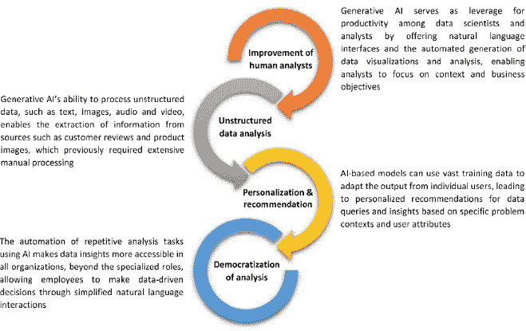

图 1.1. 生成式 AI 在数据分析中的优势

然而，真正的价值在于通过分析数据来增强人类智能，产生初始洞察，然后人类利用自己的判断和专业知识对其进行验证和应用。自动分析与人类智能的有望在大规模上产生新知识，展示了 AI 如何改变组织利用信息的方式——尽管最大的影响将来自人机协作，这种协作促进而非阻碍了新知识的发展。

这些基于 AI 的系统还能提升数据科学家的技能和专业知识。通过自动化数据清洗和预处理等枯燥任务，AI 系统使分析师专注于数据分析中更复杂、更具创意和直觉驱动的方面。人类与 AI 能力之间的协同能够实现更准确、数据驱动的决策（Hendrycks et al. 2021）。

此外，AI 识别大型数据集中隐藏模式和关系的能力可以帮助生成假设，数据科学家可以通过进一步分析验证这些假设。此外，AI 生成合成数据的能力在真实数据稀缺或难以获取的场景中证明是有价值的，能够对机器学习模型进行更稳健的训练和测试。

因此，意识到 AI 并非威胁而是价值盟友至关重要。尽管它可以自动化特定任务，但它仍然无法复制人类专业人士的整体能力。AI 系统缺乏从战略角度解释结果或做出数据驱动决策的能力，而这两者仍然属于人类专业知识的领域。

因此，数据科学家不应该害怕 `ChatGPT` 等 AI 技术的出现，而应该将这些进步视为数据分析工具箱中无价的工具。人类与 AI 的和谐协作具有释放生产力和洞力新水平的潜力，最终有助于数据科学和分析的进步。

# 人类创造力与自动化分析的和谐：获胜组合

生成式 AI 的崛起开启了人类创造力与自动化分析共生协作的时代。通过明智平衡各自各自优势，人类和像 `ChatGPT` 这样的 AI 系统可以形成黄金组合，从数据中释放更深层的洞察。

## 人类创造力的价值

根据麦肯锡报告（2023），随着 AI 和机器学习在不同行业的采用日益增加，数据科学家的角色正在超出技术公司，扩展为内部 AI/机器学习顾问、培训师和专家。

在此背景下，应该注意到数据分析的某些方面根本上依赖于人类大脑的单一能力。创造力、直觉、想象力、同理心和伦理构成了数据科学家最重要的贡献。提出有见地的问题并战略性地定义问题、识别数据中微妙的模式和显而易见的关系、验证分析模型和结果、识别差距、异常和需要进一步探索的领域，以及为不同受众量定制有说服力的叙述和视觉效果，并负责任地监督分析方向和洞察的使用，尽管 AI 在不断进步，这些都是人类所擅长的领域。

当人类创造力与自动化分析作为伙伴汇合时，他们共同实现的成就将远超任何一方单独完成的（Sedkaoui 2023）。AI 提供规模、速度和不知疲倦的计算，而人类提供策略、伦理和监管。这种共生的人机分析组合的某些特征包括如下：

**表 1.3. 人机分析组合**

| 操作类型 || 人类 | 生成式 AI |
| --- | --- | --- |
| **基础问题** || 构建基础性分析问题 | 建议优化方法 |
| **新方向** || 识别新的数据方向 | 快速汇总并分析所需数据 |
| **主观背景** || 提供主观背景 | 在推论中注入计算严谨性 |
| **离群值** || 提供发现离群值的直觉 | 验证大规模模型 |
| **沟通** || 准备沟通内容 | 生成所需的视觉效果和数据故事 |

这凸显了人类与生成式 AI 在各种数据分析操作中的角色差异。人类在构建基础性问题、识别新方向和提供主观背景方面具有专业知识，而生成式 AI 则擅长建议优化方法、汇总和快速处理数据、在推理中注入计算严谨性、验证大规模模型以及生成所需的视觉效果和数据故事。通过结合这些技能，人类和生成式 AI 可以协同工作，进行更高效、更深入的数据分析。

这种分工使每个伙伴都能为了服务共同的分析目标而充分并尽地发挥其最佳能力。

## 自动化分析的互补力量

在人类创造力薄弱的地方，自动化可以以卓越的方式填补空白。像 `ChatGPT` 这样的 AI 系统具有互补优势，使它们在各种分析任务中具有显著优势。这些优势围绕核心能力，包括：

*   不知疲倦地管理重复和机械的分析任务，不受影响人类的疲劳影响；AI 可以以一致的准确性和贯性处理大量数据，即使在密集过程中也是如此；
*   快速执行人类心理能力的复杂统计计算。得益于其计算能力，AI 系统可以以前所未有的执行高级数学运算，大幅加快分析过程；
*   在机器学习期间检查大量的信息和变量。与人类不同，AI 可以处理来自不同来源的大数据，这提高了学习模型和预测分析的质量；
*   一旦训练完成后提供严格一致的结果，而不偏离其逻辑或前提。AI 避免了与数据解释相关的偏见或人为错误，增强了结果的可靠性；
*   在不增加额外人类投入的情况下实现分析工作负载的指数级扩展。AI 可以适应不断增长的数据量和分析查询，而不牺牲效率，帮助满足日益增长的业务需求。

这些计算优势展示了 AI 自动化相较于人工辅助分析具有明显优势的领域。将 AI 集成到数据分析过程中，使数据科学家能够专注于更复杂、更具创造性和战略性的任务，同时利用 AI 不可否的优势来优化其分析的准确性、效率和扩展性。

因此，基于 AI 的系统的出现是推动数据专业领域演变的强大力量。AI 的计算能力与人类专业知识的结合正在催生一种全新的数据分析。通过拥抱机器和人类的优势，我们可以开发出更准确的模型，并做出更明智、数据驱动的决策。

## 负责任地引导伙伴关系

未来，AI 的整合有望改变分析师的角色，使其处于自动化系统的驾驶舱，而不仅仅是简单执行个人分析。得益于 AI 通过自动化重复性任务减轻了他们的负担，未来的数据科学家可以投入更多精力到具有价值的创造性和战略倡议中。这些进步为分析师开辟了新的前景，他们将能够在高性能分析系统的设计和治理中发挥决定性作用。

他们将专注于识别关键问题和创造性假设，利用 AI 揭示数据中隐藏的模式。此外，他们将使用 AI 从各种来源中提取信息，并开发创新的分析框架来解决复杂问题。分析结果将转化为具体的行动和战略建议，以满足业务和社会的需求。

未来的分析师还将在 AI 的负责任使用制定伦理标准方面发挥关键作用，并监督自动化分析系统的持续监控和改进过程。

这种重塑的角色将人类的创造力坚定地置于 AI 驱动引擎的头部。通过利用人类和 AI 的互补优势，未来的分析师将有机会塑造数据分析的未来，并为所有业务领域的创新发现、明智决策和战略进展做出重大贡献。

但要培养一种有效且符合伦理的人类-AI 分析伙伴关系，重点关注确保两个实体之间和谐且负责任协作的关键词优先事项是至关重要的。这些优先事项是充分利用人类创造力与自动化分析相结合**所提供的分析潜力的基础。以下是几个重要方面：

*   **人类监督与控制**：人类监督必须是分析过程的核心，引导自动化分析的方向和使用。人类在确定目标、要回答的问题以及基于 AI 结果做出的决策方面起着至关重要的作用。他们必须保持全局和战略视角，以确保分析与业务和伦理目标一致。
*   **透明化沟通**：清晰、透明的沟通对于在利益相关者之间建立信任至关重要。披露数据分析过程中使用的 AI 系统背后的假设、局限性和偏见是必要的。这种透明性使决策者能够完全理解与 AI 生成结果相关的影响和不确定性。
*   **对结果的严谨验证**：尽管 AI 可以提供快速且强大的分析，但人类验证对于保证结果的可靠性和质量至关重要。人类必须仔细检查 AI 结果，理解结论背后的原因，并确保发现与现有知识和伦理原则一致。
*   **反馈循环**：自动化分析不应被视为静态解决方案。相反，有建立建立反馈以持续改进 AI 模型、纠正偏见并适应数据或目标的变化。人类必须在这种持续改进中发挥积极作用，利用反馈和新信息来优化分析的效率和相关性。
*   **对伦理和隐私的尊重**：在分析的每一个阶段，必须尊重过程中的伦理原则、数据隐私和公平性。人类必须确保 AI 不复制或放大不必要的偏见，并保护个人的权利和隐私。

通过将这些负责任的原则整合到人类-AI 分析伙伴关系的设计、协调和治理中，我们能够释放数据分析的巨大潜力。人类智能与自动化分析之间的协同作用能够应对复杂挑战，以更高的效率和伦理标准做出明智的决策，并利用新兴机会。

然而，实现人类与人工智能的有效合成很大程度上取决于提示词工程（prompt engineering）。掌握这项技能对于成功引导 AI 系统产生富有成效且符合伦理的结果至关重要。

## 解锁通强大结果的提示词工程

随着生成式 AI（特别是 `ChatGPT`）日益流行，提示词的艺术已成为一项关键技能。掌握这项技能对于成功引导 AI 系统产生富有成效且符合伦理的结果至关重要。

### 提示词的艺术

`ChatGPT` 能够生成与人类写作相似的内容，确实令人惊叹。但它是如何实现这一成就的，原因又是什么？基本上，`ChatGPT` 的主要目标是对给定文本提供“合理的”延续。我们所说的“合理”，是指符合预期的答案。例如，这段原始文本：

```
在数据分析中，最关键的方面之一是数据预处理，它涉及……
```

为了实现这一目标，`ChatGPT` 分析了来自各种来源的海量数据集（例如 `BookCorpus`、`Common Crawl` 和 `Wikipedia`）。`ChatGPT` 并不是简单的字面匹配，而是利用复杂的算法来识别“匹配含义”的概念。

数据科学家用于驱动 `ChatGPT` 等 AI 系统的提示词（prompts）深刻影响着结果的实用性。通过掌握提示工程技术，他们可以优化 `ChatGPT` 的响应以加速其工作流。设计良好的提示词是成功利用 AI 的关键（Jiang 等人 2020; Schick 和 Schütze 2021）。

提示工程是指设计和完善提示词的迭代过程，旨在引导 AI 系统产生所需的行为。对于像 `ChatGPT` 这样的大语言模型，提示是人类交流意图并引导 AI 的唯一方式。

如何创建最有效提示词的知识已成为 LLM 社区及其他领域炙求的专家技能。随着生成式 AI 的普及持续飙升，提示工程的重要性显著增加，要求 AI 世界的人员投入关注并具备技能。既然我们已经建立了基础提示词的结构，让我们更仔细地观察更好地掌握提示工程的关键考虑。

### 优化提示词以与 ChatGPT 高效交互：基本方面

提示词的措辞起着至关重要的作用，因为它引导如 `ChatGPT` 等 LLM 生成所需的结果。以 `ChatGPT` 能理解并准确响应的方式来编写问题或陈述是极其重要的。

例如，如果用户缺乏特定领域的专业知识，并且难以用适当的术语构建问题，`ChatGPT` 提供相关答案的能力可能会受到限制。这可以比作在不知道正确关键词的情况下搜索网络。

虽然添加额外信息可能带来更好的提示词这似乎显而易见，但并不那么明显的是，通常过多的言辞并不一定是优化策略。最好的做法是将提示词的措辞视为一种孤立的技术，而是视为连接所有其他提示工程技术的共同线索。

提示词的简洁性对于清晰和准确性至关重要。设计良好的提示词应该是简洁明了的，提供足够的信息让 `ChatGPT` 掌握用户的意图，而无需进行不必要的详述。然而，避免让提示词过于简洁也是必要的，因为这可能导致歧义或误解。在简洁和详尽之间取得正确的平衡可能是具有挑战性的。练习可能是掌握这项能力的关键。

因此，在提示工程中，角色（roles）指的是分配给 LLM 和目标受众的人。例如，如果你想让 `ChatGPT` 为一篇关于机器学习分类指标的博客文章创建大纲，明确指定 LLM 应该充当机器学习专家，且目标受众是由数据科学的新手组成的，将显著提高答案的关联性。

这些信息的表达方式可以进行实验，可以使用对话风格：“你是一个为一家物流公司工作的资深数据科学家”；或者使用更正式的方法：“角色：物流专家分析师；受众：业务决策者”，具体取决于语境。

目标（Objectives）与角色密切相关。显式地说明引导交互的目标不仅是建议的，而且是必要的（Schick 和 Schütze 2021）。没有清晰定义的目标，`ChatGPT` 将缺乏生成所需结果所需的引导。此外，正提示词（positive prompts）和负提示词（negative prompts）是影响模型输出的两种不同方法。

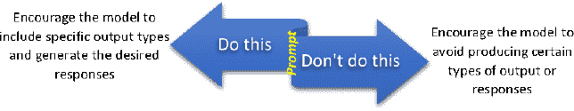

**图 1.3.** 基础提示词与角色定义

通过使用两种类型的提示词，我们可以显著地塑造结果的方向和质量。

因此，提示工程是高效使用 `ChatGPT` 等 LLM 的基本要素，也是定制与模型交互的强大方式。这涉及仔细构建清晰、具体的指令或查询，以便从 LLM 模型获得理想的响应。通过熟练构建提示词，数据科学家可以引导 `ChatGPT` 的输出符合其预定目标，从而获得更准确、实用的响应。

在 `ChatGPT` 的提示词优化过程中，有几个基本技术需要记住：

*   首先，在开头提供显式指令有助于为模型设定背景并定义任务；
*   指定预期的响应格式或类型也有益；
*   此外，通过在提示词中加入系统消息（system messages）或使用角色扮演技术可以改进交互。

结果，数据科学家制定提示词的方式直接决定了 `ChatGPT` 自动化分析工作流部分响应的关联性、准确性和实用性。

提示词增强了 `ChatGPT` 的上下文理解并引导了适当的分析能力。不当的提示词提供的引导不足，导致无关或不准确的结果。

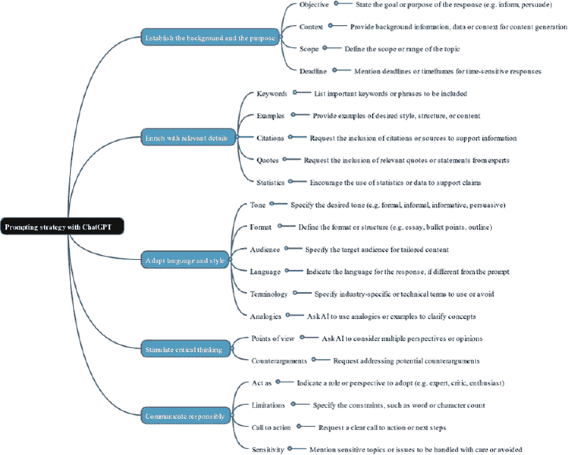

图 1.4. 使用 ChatGPT 进行策略性提示指南

开发和掌握策略性提示（在图 1.4 中详细所示）使得以协作方式引导 `ChatGPT` 生成个性化、优化的响应成为可能。它包括定义语气、格式和所需的范围以符合预期。提供背景并明确说明目标为该策略提供了方向。用相关的关键词、示例和数据丰富提示词使响应更有实质。

使语言和术语适应受众和领域可以优化理解和准确性。鼓励根据你的需求进行批判性思考。

随着生成式 AI 的采用加速，掌握提示工程将成为一项基本的分析技能。通过谨慎、严谨和伦理考量，精心设计的提示词使分析师能够在利用 AI 增强的巨大可能的同时，保持警惕控制。分析的未来属于那些学会通过开发良好的提示词渠道，明智地将人类创造力与 AI 能力相结合的人。

# 2 用于数据分析的 ChatGPT

ChatGPT 代表了生成式 AI 领域的革命性进展，这得益于深度学习的最新突破。ChatGPT 由 OpenAI 开发，通过在海量数据集上进行自监督学习，提供了卓越的自然语言能力，为新一代 AI 应用提供动力。

## 从 GPT-1 到 GPT-4：生成式预训练变换器

OpenAI 通过其从 `GPT-1` 到 `GPT-4` 的 GPT 版本，在自然语言处理（NLP）领域取得了显著进展。这些模型为 AI 生成内容铺平了道路，涵盖了广泛的应用，如散文、诗歌、聊天机器人甚至代码生成。然而，理解每个模型之间的区别以及它们对 NLP 领域产生的巨大影响至关重要。

生成式预训练变换器（`GPTs`）是一种用于自然语言处理任务的机器学习模型（Sedkaoui 2023; Taecharungroj 2023; Van Dis et al. 2023)。这些模型在书籍和网页等大型数据集上进行预训练，使其能够生成与上下文相关且连贯的语言。

简单来说，`GPTs` 是能够在无需显式编程的情况下生成类人类文本的计算机程序。因此，它们可以针对各种 NLP 任务进行微调，包括问答、翻译和文本摘要。

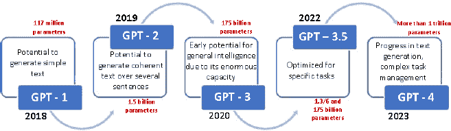

**图 2.1.** GPT 的演进过程

`GPTs` 的重要性在于它们在自然语言处理方面的突破，使机器能够以前所未有的流畅度和准确性理解并生成语言。在章节 2.1.1.1–2.1.1.4 中，我们将查看四个 GPT 模型从初始版本到最新的 `GPT-4`，评估它们的性能及其局限性。

### GPT-1

2018 年，OpenAI 推出了 `GPT-1`，这是第一个使用 transformer 架构的语言模型（Oxford Analytica 2023)。它拥有 1.17 亿参数，标志着相对于此前的最先进语言模型的重大进展。`GPT-1` 的优势在于能够根据提示词或上下文生成流畅且连贯的语言。该模型基于两个大型数据集的结合：包含数十亿网页单词的 `Common Crawl`，以及由超过 11,000 本涵盖不同体裁书籍组成的 `BookCorpus` 数据集。这些多样化的训练数据贡献了 `GPT-1` 健健的语言建模能力。

然而，尽管在自然语言处理方面取得了成就，`GPT-1` 也存在某些局限性。特别是，它倾向于产生重复文本，尤其是当提供的提示词超出其训练数据范围时。该模型在处理多轮对话方面存在困难，并且缺乏捕捉文本长期依赖的能力。此外，它的凝聚性和流畅性限于较短的文本序列，在长段落中保持连贯性面临挑战。尽管如此，`GPT-1` 为更实质、更强大的基于 transformer 的模型铺了道路。

### GPT-2

2019 年，OpenAI 推出了 `GPT-2` 作为 `GPT-1` 的继任者。这个新版本拥有惊人的 15 亿参数，比其前代大得多。`GPT-2` 的训练数据也得到了改进（Zhang et al. 2021），将巨大的 `Common Crawl` 数据集与多样化的 `WebText` 数据集相结合。`GPT-2` 的优势之一是能够生成连贯且真实的文本序列。它产生类人类响应的能力使其成为各种 NLP 任务（包括内容创作和翻译）的价值资产。

然而，`GPT-2` 也存在局限性。在面对需要更复杂推理和深层上下文理解的任务时它表现挣。虽然它擅长生成短段落和文本片段，但在长段落中保持上下文和连贯性存在困难。尽管存在这些挑战，`GPT-2` 的开发为 GPT 模型后续版本的进一步发展奠定了基础。

### GPT-3 和 GPT-3.5


## GPT 模型的演进与 ChatGPT 在数据分析中的应用

2020 年随着 `GPT-3` 的到来，自然语言处理模型发生了重大的飞跃。`GPT-3` 拥有 1750 亿参数（Zhang et al. 2021），是 `GPT-1` 的 100 倍，`GPT-2` 的 10 倍。它的训练数据来自各种来源（Thorp 2023），如 `BookCorpus`、`Common Crawl` 和 `Wikipedia`，代表了近万亿单词。这种广泛的训练使 `GPT-3` 能够生成复杂的响应。

简单来说，`GPTs` 是能够在无需显式编程的情况下生成类人类文本的计算机程序。因此，它们可以针对各种 NLP 任务进行微调，包括问答、翻译和文本摘要。

`GPTs` 的重要性在于它们在自然语言处理方面的突破，使机器能够以前所未有的流畅度和准确性理解并生成语言。

尽管能力卓越，`GPT-3` 也并非完美。由于在大规模数据上进行训练，可能会出现偏见、不准确或不恰当的响应。此外，`GPT-3` 有时会生成无关文本。

此外，`GPT-3` 巨大的潜力引发了伦理担忧和对滥用的恐惧。专家担心其被用于恶意目的，例如生成假新闻和钓鱼攻击。OpenAI 在发布 `GPT-4` 之前还推出了一个改进版本 `GPT-3.5`。

虽然 `GPT-3.5` 的参数量与 `GPT-3` 相同，但它受益于更大规模的文本代码代码（Sedkaoui 2023）。这些扩展训练使 `GPT-3.5` 能够生成更真实、更复杂的文本。此外，`GPT-3.5` 在执行各种任务时提供了改进的能力。虽然它不能被视为 `GPT-3` 的重大升级，但在潜在性能和实用性方面有显著提高。

### GPT-4

`GPT-4` 是 GPT 版本的最新，于 2023 年 3 月 14 日发布，代表了对其印象深刻的前代 `GPT-3.5` 的重大进展。尽管其训练数据和架构细节尚未公布，但 `GPT-4` 无疑建立在 `GPT-3.5` 的优势之上，同时解决了其部分局限性（参见附录 2）。

`GPT-4` 的卓越特性是它的多模态能力，使模型能够结合文本提示理解输入图像（Open AI 2023; Oxford Analytica 2023）。例如，在 `GPT-4` 发布直播期间，OpenAI 的工程师向模型输入了一个手绘的网站原型，令人惊讶的是模型生成了该网站的功能代码。

此外，`GPT-4` 表现出对复杂提示的更好的理解，并在各种专业和传统基准测试中达到了人类水平（Sanderson 2023）。它还具有更大的窗口大小和上下文，使模型能够在对话中保留更多信息。

GPT 模型的引入为 AI 领域带来了革命性的变革，开启了一个充满无限可能性的领域。它们的大规模、能力和复杂性使其在各种应用中具有极高的价值。这些 GPT 应用非常多样且影响深远。一些关键用途包括：

*   **内容生成：** GPT 模型可以为各种目的生成文本，例如编写文章、博客帖子、产品描述和社交媒体内容，能够快速高效地创建内容。
*   **语言翻译：** GPT 模型能够将文本从一种语言翻译成另一种语言，利用训练过程中学习到的模式和结构提供翻译服务。
*   **回答问题：** GPT 模型可以处理自然语言问题并生成相关且丰富的答案，使其对于聊天机器人、客户支持系统和信息检索非常有用。
*   **文本摘要：** GPT 模型可以生成长文本文档的简洁摘要，这对于新闻文章、研究论文或其他大型文档很有用。
*   **对话系统和聊天机器人：** GPT 模型如 `ChatGPT` 可以驱动交互且吸引人的聊天机器人和对话系统，理解用户查询并提供相关的帮助。
*   **创意写作：** GPT 模型可以生成创意内容，如诗歌、故事或剧本，模仿不同体裁的风格和结构帮助作家或提供娱乐。
*   **语言建模研究：** GPT 模型在语言处理和理解的研究中发挥着关键作用，作为评估模型性能和探索新技术的参考。
*   **编码：** `ChatGPT` 仅需将指令翻译为自然语言，就可以 Python、JavaScript 和 SQL 等语言（Tingiris and Kinsella 2021; Sedkaoui 2023; Shen et al. 2023）。

**表 2.2** 对话能力与生成能力对比

| 对话能力 | 生成能力 |
| --- | --- |
| 数据清洗 | 自动化报告 |
| 特征工程 | 数据故事化 |
| 统计分析 | 演示文稿开发 |
| 查询生成 | 仪表板注释 |

这些能力允许 `ChatGPT` 执行各种数据准备任务，提升模型性能，执行高级分析方法，并将分析师的问题转换为优化的代码。此外，`ChatGPT` 还能总结综合报告并创建引人入胜的数据故事。

除了对话和生成能力外，`ChatGPT` 还释放了巨大的计算吞吐量，这对于复杂的分析任务至关重要。其 AI 架构提供了超越人类认知极限的速度和扩展性（Tamkin et al. 2021; Sedkaoui 2023）。

除了原始计算外，`ChatGPT` 还展现了根据特定目标推荐适当分析方法的细微能力。它的分析知识可以提供三个层面的指导：

*   推荐完美适配可用数据特征和所需洞察的统计检验和模型，使得分析能够适应问题成为可能。
*   建议以创新的新方法来组合、处理或可视化数据，这可能会揭示当前方法所遗漏的非直观洞察，从而激发想象力。
*   识别当前分析方法中的差距，并为更详尽的调查建议所需的排列或额外数据，从而实现迭代优化。

通过推荐专门为可用数据特征定制的统计检验和模型，`ChatGPT` 为数据科学家提供了进行更具针对性和更精确分析的能力。通过识别最适合当前问题的分析方法，`ChatGPT` 节省了时间并实现了资源利用化。

通过建议创新的新方法来组合、处理或可视化数据，`ChatGPT` 为数据探索开启了新的视角和可能性。这种创新方法通过鼓励数据分析师考虑分析数据的传统方法并发现其他可能被忽视的隐藏洞察，激发了数据分析师的想象力。

`ChatGPT` 在识别当前分析方法中的差距方面也起着至关重要的作用。通过建议进行更详尽调查所需的排列或额外数据，`ChatGPT` 为数据分析过程带来了严谨性，允许进行迭代数据分析，逐步提高结果的质量和可靠性。

更重要的是，`ChatGPT` 作为编程和代码调试工具的多功能性为各个领域开启了可能。得益于其先进的自然语言处理能力，`ChatGPT` 可用于简化编码流程并提高软件开发效率。在代码生成方面，开发者可以依靠 `ChatGPT` 生成完美符合他们代码片段，从而节省宝贵的时间和精力。此外，`ChatGPT` 的代码优化能力对于完善算法和数据结构、提高应用程序性能和扩展性具有无价价值。

在调试方面，`ChatGPT` 是不可或缺的。通过分析代码结构和错误信息，分析师可以获得价值的见解和建议，加速问题的识别和解决。此外，`ChatGPT` 还可以帮助编写代码文档，确保软件具有良好的文档，便于未来的维护和协作。

此外，`ChatGPT` 的分析能力在代码审查过程中发挥作用。它可以根据编码标准和最佳实践对代码进行评估，提供建设性反馈以提高代码质量和健壮性。随着行业日益依赖软件解决方案，`ChatGPT` 作为胜任的编程和调试工具将彻底改变软件开发，使开发者能够创建更高效、更可靠、更创新的应用程序。

`ChatGPT` 在语言模型任务上的微调为数据科学家开启了丰富的可能性。该模型理解上下文和语义的能力使其能够创建各种应用中表现出的语言模型。

将 `ChatGPT` 集成到对话系统、聊天机器人和虚拟助手，使数据分析师能够开发交互式的、上下文敏感的 AI 代理。这些智能代理可以使用自然语言与用户对话，回答查询、提供建议并协助任务。个性化、类人交互的潜力为客户支持和服务自动化开启了新的可能性。

`ChatGPT` 可以完善以理解特定的语言或领域，使其成为命名实体识别、词性标记和情感分析等任务的宝贵工具。例如，数据分析师可以自定义 `ChatGPT` 在金融领域进行情感分析，提供对市场情绪和趋势的洞察。

`ChatGPT` 正在彻底改变 NLP 格，用其多功能能力赋能数据科学家。从内容生成到语言理解，再到编码，`ChatGPT` 证明自己是各个领域的游戏规则改变者，促进了基于 AI 的应用的创新和效率。随着 NLP 领域的不断进步，`ChatGPT` 将在塑造自然语言处理和人机交互的未来方面发挥日益重要的作用。负责任地开发和部署 `ChatGPT` 对于实现其全部潜力至关重要，同时确保在其应用中尊重伦理考虑。

## ChatGPT 与数据科学家：一场看起来像联盟的智能之战

`ChatGPT` 的自然语言能力实现了人机合作，重新发明了数据分析过程。通过无缝协作，`ChatGPT` 和数据分析师可以互补，以获取更强大的洞察。这一愿景承诺将扩展并提升数据分析师的角色。

### 无缝沟通与有效合作的关键特征

数据分析师与 `ChatGPT` 之间无缝合作的核心是自然语言对话能力，它促进了顺畅且协同的协作。得于这种直观的界面，分析师可以使用简单的对话语言向 `ChatGPT` 传达目标、问题和提示，避免了对复杂代码的需求。这种交互式对话允许 `ChatGPT` 提出澄清性问题、寻求澄清并确保对分配的任务有精确的理解。这种人机协作反映了同事共同工作解决问题时的自然交流。

这种协作的一个关键特征是数据分析师可以在 `ChatGPT` 改进其性能时提供实时反馈。这种交互式学习允许 `ChatGPT` 整合人类建议以不断改进其输出。`ChatGPT` 还可以解释其操作并建议用于验证的分析步骤，从而增强了分析过程中的透明度和信任感（Sedkaoui 2023）。

得益于这种合作，分析师可以按需利用 `ChatGPT` 的能力来加速获取有意义的洞察。然而，警惕风险（包括偏见）至关重要，因为 AI 没有固有的伦理感。需要负责任的协调以确保这种合作的益处大于风险。

为了使这种合作真正实现共生，必须尊重某些关键属性。对目标、约束和截止日的清晰沟通建立了一致性，因为 `ChatGPT` 完全依赖人类指令来提供方向。关于 `ChatGPT` 能力和局限性的完全透明对于建立信任和设定适当预期至关重要。

负责的人类监督对于确保分析过程的安全性和伦理性是不可或缺的。人类必须对所有分析路径、模型假设和决策保持控制和监督。

分析师的定期反馈对于迭代改进 `ChatGPT` 的工作和降低风险至关重要，因为 AI 系统需要持续的指导。

最后，如果 `ChatGPT` 要负责任地赋能数据分析师，那么在数据隐私、算法公平性和透明度等优先级上实现伦理对齐是本质的。

通过对这些原则进行深思熟虑的协调和负责任实施，`ChatGPT` 可以与数据科学家紧密合作，成为团队的无缝扩展。这种人机协作有望显著放大人类在 NLP 领域的潜力。

将生成式 AI（如 `ChatGPT`）有效整合到数据分析中，从根本上重新定义了人类数据分析师的角色。得益于 AI 对机械任务的自动化，数据分析师现在可以更多地关注高阶任务。

**表 2.3** 生成式 AI 下数据分析师角色的演变

| 生成式 AI 之前的分析师角色 | 使用生成式 AI 后的分析师角色 |
| --- | --- |
| 执行分析 | 设定战略方向和分析计划 |
| 识别标准问题 | 创造性地识别新的数据连接 |
| 僵化的规划 | 分析方向动态调整 |
| 数据处理和执行 | 对模型结果进行批判性评估和解释 |
| 沟通结果 | 沟通利益相关者的需求 |

如表 2.3 所示，数据分析师可以投入更多时间为分析计划和工作流设定战略方向。他们可以从执行中解放出来，专注于创造性思维和战略规划，提升他们在组织中的地位。

生成式 AI 通过识别新的数据连接和提出新的调查问题来激发好奇心。这导致了以前可能被错过的突破和发现。因此，通过获取 AI 加速的洞察，数据分析师现在根据过程中的发现动态调整分析方向。这使得数据分析对变化更具适应性和响应性。

随着 AI 接管任务执行，对模型结果的批判性评估和解释成为分析师的主要价值。人类判断凸显出来，能够对结果有更深层次的理解。通过生成式 AI，分析师现在可以专注于向利益相关者传递发现和洞察，强化他们作为公司内部关键沟通者的角色。

作为一个强大且创新的助手，`ChatGPT` 将自己定位为数据分析过程中宝贵的盟友和促进者，而不是可能取代数据分析师的威胁。未来，将其有效整合到分析领域旨在从根本上重新定义人类分析师的主要职责，将他们从机械任务中解放出来，让他们专注于更高附加价值的智力活动。

### ChatGPT，处于盟友与威胁之间

到目前为止，我们专注于 `ChatGPT` 和 LLM 的协作方面。这些模型可以自动化数据分析师目前执行的一些任务，例如数据清洗和探索性数据分析。这可能会导致对这些领域数据专家的需求减少。

像 `ChatGPT` 这样基于模型的机器学习 (LLM) 的出现，将显著降低数据科学和分析的入门门槛（Sedkaoui and Khelfaoui 2020）。未来，对掌握不同软件的需求将减少，因为我们能够利用 LLM 的力量来完成任务。

因此，`ChatGPT` 确实是促进数据分析过程中某些特定任务（如数据清洗和预处理）的重要工具。然而，它的能力是有限的，无法完全取代数据分析师的角色。数据分析、大数据和数据科学是多领域的领域（McAfee and Brynjolfsson 2011; Sedkaoui and Khelfaoui 2020），需要技术专业知识、领域知识和批判性思维相结合，这使得完全自动化变得困难。

尽管 `ChatGPT` 提高了某些领域的效率，但它无法取代人类专业知识在数据分析、模型构建与解释以及决策过程中不可或缺的。此外，数据分析是一个不断发展的领域，持续不断引入新的新技术和方法。如果我们想要有效利用这些进步，人类的适应性和创造力仍然至关重要。在这种动态格局中，`ChatGPT` 或任何其他生成式 AI 工具将补充而非取代熟练数据分析师的无价角色（Sedkaoui 2023）。分析师可以在没有编程或技术专业知识的情况下受益于巨大的分析灵活性。

现在，想象这些插件集成到未来的版本中，例如 `GPT-4`。基础模型本身将具有强大的分析能力。插件将赋予它特定领域的超能力——就像托尼·斯塔克带着不同的配件准备任务。

`GPT-4` 结合 `SQL Assistant` 变成了一个不可胜的对话数据库查询引擎。`Plotly` 强化了它敏锐的可视化。`code interpreter` 的执行实现了即时编程。它们共同形成了一个强大的分析团队——配备专业工具的 AI 助手与人类对话的灵活性。

这就是插件生态系统的真正承诺——将 `ChatGPT` 从狭义的 AI 变为一个多功能的分析协作者。随着插件增强其数据分析能力，我们越来越接近赋能每个用户的真正增强智能。随着 AI 助手通过人机协作获得扩展功能，未来充满了兴奋的可能性。

## 将 ChatGPT 集成到数据分析工作流中的优势与挑战

`ChatGPT` 的集成为数据分析师带来了巨大的生产力收益，同时也带来了重要的伦理考虑。通过在两者之间取得正确的平衡，数据科学家可以战略性地利用 `ChatGPT` 来改进他们的分析流程。

### 释放分析潜力并降低成本

`ChatGPT` 具有自动化各种重复性自然语言编码任务的潜力，为数据处理生产力的提高铺平了道路。示例表明，与当前方法相比，数据清洗和处理可以加速五倍（Sedkaoui 2023）。同样，`ChatGPT` 能够在几秒钟内将对话自然语言问题转换为 `SQL`、`Python` 或代码，消除了数小时的人工工作。

然而，这些令人印象目的进展并不意味着 `ChatGPT` 可以完全取代数据科学家的角色。尽管其能力不断增强，但这种生成式 AI 尚未像人类一样理解上下文和含义。需要批判性推理、创造力或人类交互的任务仍然超出了目前的能力范围。因此，AI 与数据科学家之间的协作至关重要，以便在充分利用该技术价值的同时避免潜在的错误。

这种协作的益处多极许多。通过卸载重复性和可自动化的任务，`ChatGPT` 释放了分析师的时间，让他们能够专注于更高价值的任务。例如，自动化报告让分析师能够专注于解释结果和发现独特的见解，而不是花费时间在可视化和组装仪表板上。查询的自动化为大型数据集提供了交互式探索的可能性，这在以前是难以实现的。

除了生产力的提高外，`ChatGPT` 还极大地扩展了分析范围。得益于能够快速将自然语言问题转换为高性能代码，实时查询海量数据集变得可能。`ChatGPT` 可以在实时对话中发现新的相关性和指标，为进一步的探索性分析铺平道路。得益于生成式 AI 执行的加速，预测建模和大规模场景分析也变得可行。

然而，必须注意的是，生成式 AI 仍然不完美，需要以负责任的方式进行使用。实施严格的验证、监控和治理对于避免潜在错误并确保该技术的伦理使用至关重要。如果要把 `ChatGPT` 负责任地整合到数据分析过程中，人机协作是必不可少的。

除了生产力的提高和分析可能性的扩展外，`ChatGPT` 的自动化工作流还为组织带来了显著的成本和资源节省。得益于 `ChatGPT` 的自动化叙述和综合能力，花在报告、可视化和仪表板方面的时间可以大大减少。这种时间的节省意味着节省了数千小时宝贵的人力。

此外，通过使用生成式 AI 获得的效率可以降低数据分析的运营成本。这使组织能够在保持相同工作量的情况下减少分析师团队的规模。由于 `ChatGPT` 的帮助，对稀缺且昂贵的数据科学人才的依赖也可以减少，因为它使业务分析师能够通过自然语言接口管理更高级的工作流。

尽管前景广阔，但审慎管理 `ChatGPT` 的集成对于确保益处大于潜在缺点至关重要。未来的道路需要在数据分析中的人类与人工智能之间取得一种微妙的平衡。为了充分利用其潜力影响，需要解决几个挑战。这些挑战包括：

*   **偏差与公平性：** 生成式模型（包括 `ChatGPT`）可能会反映训练数据中存在的偏差。分析师必须保持警惕并仔细审查生成的输出，以确保性别、种族或年龄等敏感属性不会影响结果。偏差的存在会对决策产生重大影响，导致不理想的后果，如不不公或歧视。为了确保分析的公平，应努力减轻潜在的偏差，并提高训练数据的多样性和代表性。
*   **可解释性：** 生成式模型使用的神经网络不透明性在可解释性方面是一个挑战。分析师和用户需要理解结果是如何以及为什么生成的，以便他们能够解释和说明 `ChatGPT` 产生的信息。目前正在开发使生成式模型更透明、可解释性的方法。可解释性对于建立对生成式 AI 结果的信任，以及决策者能够根据产生的信息做出明智决策至关重要。
*   **信息安全：** 生成式模型（特别是在敏感领域或使用机密数据时）必须受到严格的访问控制。防止隐私泄露和数据破坏至关重要。


# 重新定义角色

在数据分析过程中引入生成式 AI 可能导致角色的重新定义。分析师需要获得新技能来监督并与生成式 AI 协作。

# 监控错误

与所有 AI 系统一样，生成式模型可能会产生错误或意外（Liebrenz et al. 2023）。鉴于 `ChatGPT` 可能会产生误解或幻觉，需要稳健的测试和监控机制。专家需要意识到模型的局限性，并确保结果经过验证和确认。

# 知识产权保护

生成式 AI 引起了对知识产权保护的关注。当使用生成式模型生成专利分析时，对手可以通过训练自己的模型来复制这些分析。因此，组织必须采取适当的保护措施来维护其知识产权和专利分析。

因此，虽然生成式 AI 提供了切实利益，但也为数据分析引入了风险。为了实现其全部潜力，组织必须采用全面的治理框架，培养人类监督并促进分析师与技术人员之间的协作。负责任地实施这些技术可以显著加速从大型数据提取价值见解的能力，提高各个级别的决策水平。

重要的是，虽然生成式 AI 有助于自动化，但它并没有取代人类分析师的本质作用。分析师为生成式 AI 提供判断、上下文、质量控制和方向。人机协作利用了各自的优势，带来了更具影响力和更明智的数据分析。

# 3 使用 ChatGPT 进行分析的数据准备

数据准备是数据分析过程中一个关键且非常重要的步骤。它涉及数据的清洗、转换和格式化，以便能够高效地分析。这项任务可能耗时且具有挑战性，但对于确保数据分析结果的准确性和可靠性至关重要。

`ChatGPT` 是一个可以理解和响应自然语言查询的大语言模型（`LLM`）。`ChatGPT` 是数据准备的强大工具，可以自动化处理加载、清洗和分割数据集；识别并移除缺失或离群值数据；数据归一化；文本处理以及新特征的创建。这促进了分析数据准备过程。

使用这种生成式 AI 模型，你可以自动化数据准备涉及的许多任务，从而释放出时间来专注于数据分析过程的其他方面。

在本章中，我们将详细概述如何使用 `ChatGPT` 进行数据准备。我们首先将讨论数据准备的基础知识，然后向你展示如何使用 `ChatGPT` 来自动化各种任务。我们还提供了一些有效使用 `ChatGPT` 的技巧和建议。

## 3.1 由 ChatGPT 负责准备我们的数据集

数据准备作为数据分析过程中的关键步骤，是释放数据分析潜力的关键。这涉及一系列任务，旨在确保数据处于清洁、可用且结构化的格式。通过对数据进行清洗、转换和格式化，数据分析师可以为分析做好准备并提取有价值的见解。

数据清洗是数据准备中的初始和基础任务。它涉及识别并纠正数据中的任何错误或不一致之处。这些可能包括拼写错误、缺失值、重复记录或离群值。解决这些问题对于保证数据的准确性和可靠性至关重要。错误或缺失的数据会对数据分析结果和决策过程产生严重影响。

接下来是数据转换。这一阶段包括将数据转换为适用于分析的格式。例如，将类别数据转换为数值可以进行计算和建模。将数据缩放到一个一致的范围内可以确保不同规模的变量不会不成比例地影响分析。

数据格式化侧重于以易理解和分析的方式组织数据。创建摘要表和生成逻辑数据结构都是数据格式化的部分。这一过程提高了数据的可访问性，并能够快速识别模式、趋势或异常。

尽管数据准备可能耗时且具有挑战性，但它是一个关键过程，对数据分析得出的见解质量和准确性具有重大影响。良好的数据准备确保了基于可靠信息的明智决策（Davenport and Harris 2007）。

为了确保高效的数据准备，必须遵循若干原则。从明确理解数据目标和潜在问题开始有助于集中精力。采用系统且一致的方法，使用 `Excel`、`Python` 或 `R` 等适当工具，可以确保可重复性和可靠性。针对已知值对准备的数据进行测试或运行不同的分析有助于验证结果的准确性。

虽然遵循这些原则至关重要，但数据准备仍然是一个具有挑战性的过程，特别是在处理大型、大数据类型和复杂数据集时（Sedkaoui 2018a; McKinsey 2023）。通过使用 `ChatGPT` 自动化数据准备任务，我们可以节省时间并提高结果的准确性和可靠性。这种生成式 AI 模型可以通过多种方式协助数据准备。

### 3.1.1 数据清洗

通过使用 `ChatGPT`，我们能够通过自然语言提出简单的问题来识别数据中的错误。例如，我们可以询问 `ChatGPT` 诸如：“这一列中有重复值吗？”；或者：“这一列中有拼写错误吗？”`ChatGPT` 将发现这些潜在错误并指出它们，使我们能够快速纠正数据中的问题。

此外，`ChatGPT` 还可以帮助我们消除重复数据，允许我们轻松识别并删除完全相同的行。例如，我们可以询问 `ChatGPT`：“删除此数据集中的所有重复行”。`ChatGPT` 然后将执行此清洗任务。

此外，`ChatGPT` 还提供了填充数据中缺失值的能力。例如，如果我们在“年龄”列中有空单元格，我们只需询问 `ChatGPT`：“用所有行的平均年龄填补‘年龄’列中的缺失值”。`ChatGPT` 将智能地执行此任务，计算可用年龄的平均值并将其替换到空单元格中。

### 3.1.2 数据转换

在 `ChatGPT` 的帮助下，我们可以通过要求它识别并标记各种类别将类别数据转换为数值数据。例如，只需询问 `ChatGPT`：“‘性别’列中有哪些类别？”；然后问它：“为‘性别’列中的每个类别分配一个数字”。生成式 AI 模型将接管这项任务，将数值与每个类别关联起来，使类别数据可用于数值分析。这种转换促进了数据处理和解释，能够在原先为类别的变量上进行统计操作和预测模型。

`ChatGPT` 让通过要求其识别并执行此操作来缩放数据成为可能，以便所有值在相同的尺度上统一。

例如，只需提问问题：“缩放‘年龄’列的数据，使其处于 0 到 1 之间”，`ChatGPT` 将接管此任务对数据进行归一化，使其更容易比较和连贯分析。这使得具有不同值范围的异构数据集能够被高效且协调地处理。

### 3.1.3 数据格式化

利用 `ChatGPT` 的能力生成摘要表是小菜一碟。我们只需要求 `ChatGPT` 识别并总结表格中的数据即可。例如，“创建一个总结‘年龄’列数据的表格”。作为响应，`ChatGPT` 将快速处理数据并为我们提供一个组织良好的摘要表，使数据展示和分析更高效。

为了对数据进行可视化，`ChatGPT` 再次伸出援手。它可以识别并可视化表格中的数据，还可以建议相关的视觉呈现形式。例如，我们可以问：“哪种图表最能展示‘性别’列中的数据？”`ChatGPT` 将快速生成对应此类类型数据的图表列表。

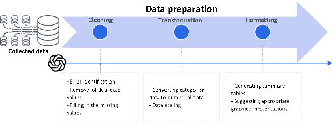

**图 3.1.** ChatGPT 在数据准备任务中的角色

然而，记住 `ChatGPT` 是在海量的文本和代码数据集上训练的。这意味着如果输入 `ChatGPT` 的数据不准确或不完整，`ChatGPT` 的输出数据也可能不准确或不完整。为了避免这种情况，为 `ChatGPT` 准备输入数据非常重要。这包括识别并纠正错误或缺失值，并确保数据以 `ChatGPT` 可以理解的方式进行格式化。

通过遵循这些程序，我们可以保证 `ChatGPT` 生成数据的准确性和可靠性。这将规避 `GIGO`（垃圾进，垃圾出）原则，该原则强调 IT 程序的输出质量取决于输入数据的质量，从而确保我们数据准备活动的成功。

## 3.2 为了获得最佳结果使用 ChatGPT 进行清洗和预处理

数据准备通常是一个耗时且困难的任务，但它对于确保我们结果的准确性和可靠性至关重要。数据清洗涉及更全面的任务集，不仅数据清洗，还包括识别和消除重复、不完整的记录和无关数据。

通过花时间正确地准备数据，我们可以提高所执行的数据分析的效率和准确性，并做出更好的决策。然而，时间效率也至关重要，诸如 `ChatGPT` 等技术的进步使得快速准备成为可能。通过生成大量的合成数据，数据科学家可以提高模型的效率，减少与数据收集相关的时间和成本，并避免使用真实数据时固有的隐私和安全风险（Lucini 2021; Martineau 2022）。

通过探索这些技术来自动化清洗和预处理等数据准备步骤，我们不仅可以节省宝贵的时间，还可以在更短时间内处理更多的数据。

通过自动化这项核心任务，公司可以优化资源，提高结果的准确性并防止潜在错误，标志着数据准备和分析新纪元的到来。

### 自动化数据清洗与预处理

自动化数据清洗和预处理在数据科学项目中变得越来越至关重要。这一关键步骤通常意味着费力且耗时的人工任务。然而，自然语言处理（`NLP`）的突破以 `ChatGPT` 的形式出现，这是一种尖端工具，具有自动化数据清洗和预处理的潜力，彻底改变了我们管理这些关键任务的方式。

`ChatGPT` 是数据清洗过程中无价的助手，这是提高数据质量的一项重要任务。通常，大型数据集包含在进行准确分析之前需要识别和纠正的错误。凭借其强大的语言模型，`ChatGPT` 能够检测数据中的不一致性和错误值，处理如数据缺失、格式差异和不准确等问题。通过有效识别各个领域的各种数据异常，`ChatGPT` 加快了检测过程。

此外，它为错误解决提供了可操作的建议，简化了数据清洗工作并减少了花费在人工审查上的时间。这种数据验证和修正的自动化减少了重复性任务花费的时间，为更具战略性的分析和洞察优化了资源。

这种智能技术可以巧妙地检测拼写错误、错字、标点错误和其他困扰数据的不一致之处。此外，它超越了简单的错误识别，能够识别数据集中的模式甚至建议适当的修正。

使用生成式 AI 工具（如 `ChatGPT`）进行自动化清洗和预处理，提供了一种一致且可重复的方法，消除了手动操作过程中可能的人为差异。这确保了我们的分析可以轻松复制以验证和确认。此外，这种自动化将数据科学家从重复且耗时的任务中解放出来。

得益于其先进功能，`ChatGPT` 可以识别并处理数据中的异常值，确保最终结果的真实性。将 `ChatGPT` 引入数据清洗流程带来了显著收益，包括通过减少对大量人工工作的需求节省时间和成本，并提高结果的准确性。此外，它有助于降低与数据错误相关的风险，维护分析的完整性。

本质上，`ChatGPT` 参与数据清洗提高了数据的准确性和质量，从而实现更可靠的分析。表 3.1 展示了 `ChatGPT` 如何让数据清洗和预处理变得更加简单高效。

**表 3.1.** ChatGPT 如何改进数据的清洗和预处理

| 特性 | 说明 |
| --- | --- |
| `NLP` 语言处理 | 使用先进的 `NLP` 技术，允许用户使用自然语言与工具交互 |
| 错误检测与修正 | `ChatGPT` 的机器学习算法自动检测并纠正错误，如拼写错误和重复项 |
| 缺失值填充 | 识别并填充缺失值，减少对手动数据录入的需求 |
| 数据类型推断 | 推断数据类型，保证分析的格式和兼容性 |
| 噪声去除 | 检测并消除无关的词、短语和脱离上下文的数据，提高数据质量 |
| 模式识别 | 识别指示错误或不一致的模式，从而提高数据准确性 |
| 报告生成 | 生成综合报告，总结数据并识别潜在问题以便及时解决 |

然而，需要注意的是，自动化不能完全取代人工干预。人类的专业知识对于理解分析背景、选择正确的数据准备方法以及正确解释获得的结果仍然必要的。因此，AI 与数据专家之间的协作至关重要，以充分利用这些技术进步并实现高质量分析。

### 自动化的优势

除了准确性之外，自动化还提供了大量的精力节省，这在处理大量数据时是一项关键优势。对大量数据进行手动清洗和预处理可能是枯燥且耗时的，但自动化简化了这些任务，为更具战略性的分析释放了宝贵的时间（Mollick 2022; Sedkaoui 2023）。

一致性是自动化改进的另一个方面。这种一致性对于维护数据驱动分析的完整性无价。此外，自动化过程使数据能够轻松适应各种分析，而无需每次执行新分析时进行手动调整。这种灵活性增强了数据分析的敏捷性，允许快速探索不同的方法，并从数据获得更深入的洞察。

除了这些优势，清洗和预处理的自动化还提高了数据质量。自动化工具可以识别并纠正错误和不一致，使数据更适用于分析。在考虑自动化清洗和预处理时，需要考虑几个因素。所分析的数据类型是一个重要考虑，因为不同类型的数据可能需要特定的清洗和预处理方法。例如，文本数据的处理可能与数字数据不同。

此外，分析目标影响清洗和预处理方法的选择。分析目标决定了数据处理的最佳方法，无论是模式识别还是预测建模。资源可用性是另一个关键因素。有限的资源（如时间和计算能力）可能会影响对简单解决方案的选择。

### 执行策略

在这种情况下，需要制定一个清晰的策略，明确如何使用 `ChatGPT` 自动化清洗和预处理以获得最佳结果。首先，必须对数据有清晰了解，包括分析目标、我们拥有的数据类型以及潜在的数据问题。这种理解将帮助我们选择正确的数据准备方法并有效使用 `ChatGPT`。

与 `ChatGPT` 交互时，最好使用自然语言。由于其在海量文本和代码数据集上进行了深度训练，`ChatGPT` 更擅长理解自然语言问题而非技术术语。在问题中保持精确会增加获得准确有用答案的概率。与其问“我如何清理我的数据？”这类通用问题，不如问：“我如何删除‘年龄’列中的重复行？”。

`ChatGPT` 的一个有趣特性是它能够生成可用于自动化数据清洗和预处理的代码。通过利用这一特性，我们可以在准备过程中节省大量的时间和精力。然而，对获得的结果进行测试至关重要。这一验证过程确保了结果的准确性和可靠性。

除了主要技巧，考虑使用一致的命名规范以帮助 `ChatGPT` 更好地理解数据并生成适当的代码。在代码中加入注释也有助于记录步骤，并让其他人更容易理解。使用版本控制是另一种实用的做法，因为它使得跟踪对代码所做的更改并在必要时回滚到之前的版本成为可能。

自动化清洗和预处理有助于保证准确性和可靠性。这对于机器学习和人工智能应用尤为重要，因为数据中即使是微小的错误也对结果产生重大影响。然而，自动化清洗和预处理过程本身需要以避免引入新的错误。这意味着过程必须能够识别并处理缺失数据和异常值。

## 3.3 处理缺失数据、异常值和其他常见数据问题

缺失值和异常值的管理是数据准备的一个至关重要的方面，因为这些因素对数据分析的准确性和可靠性具有显著影响。

缺失值是指数据集中缺失的数据点，可能由于多种原因引起，例如人为错误、数据损坏或调查不完整。另一方面，异常值是指显著偏离其他数据的数据点，它们可能是数据中存在错误或问题的信号，也可能是超出范围的合法数据点。

为了处理缺失值和异常值，取决于具体的数据集和要执行的分析，可以使用多种方法。处理缺失值的选项包括：删除包含缺失值的行或列、使用不同的插值方法通过估计值对缺失值进行填补，或将异常值视为缺失值处理（这意味着忽略它们或将其作为缺失值处理）。或者，当识别出异常值并调整分析以考虑它们时，定义异常值并相应调整分析可能有用。

对数据和异常值进行适当的管理对于确保数据分析的准确性和可靠性至关重要，因为它可以带来更好的结果和更有意义的洞察。这在极度依赖数据驱动信息的决策过程中尤为重要（Chen 等人 2012; Sedkaoui 2018a）。

此外，处理缺失值和异常值没有单一的解决方案。数据科学家在选择合适的方法之前，必须仔细考虑数据集的特定特性和分析要求。对于调查或社交媒体帖子，`ChatGPT` 可以帮助归一化文本使其在进一步分析中更加一致。

文本清理还涉及移除空词（如“and”、“the”、“in”等没有显著意义的常用词）并应用词干提取或词形还原，以将单词还原为基本形式。`ChatGPT` 可以生成执行这些操作的代码，有助于提高情感分析或主题建模等文本分析任务的效率和准确性（Sedkaoui 等人 2022; Susnjak 2023）。

在处理文本数据时，通常需要将文本转换为数字格式，以便机器学习算法能够高效处理数据。`ChatGPT` 可以建议不同的编码技术来实现这一点。一种常用的方法是使用独热编码（`one-hot encoding`），将文本中的每个单词以二进制向量的形式呈现。例如，如果数据集包含如“国家”（country）等值为“USA”、“UK”和“Canada”的分类特征，`ChatGPT` 可以生成代码将这些类别转换为二进制向量（例如 `[1, 0, 0]`、`[0, 1, 0]`、`[0, 0, 1]`）。

另一种流行方法是词嵌入（`word embedding`），将单词作为连续空间中稠密向量的形式呈现。`ChatGPT` 可能建议使用预训练的词嵌入，如 `Word2Vec`、`GloVe` 或 `FastText` 来编码文本数据，捕捉单词之间的语义关系并提高自然语言处理任务的性能。

此外，`ChatGPT` 还可以帮助管理序数和名义分类特征的编码。它可以生成代码将序数类别转换为数值同时保留其顺序，并为名义分类类别提供编码建议。

`ChatGPT` 还可以帮助数据归一化，通过将不同的数据尺度转换为通用刻度，这对于某些机器学习算法以及不同数据集之间的比较至关重要。通过生成代码在表格或其他格式中组织和结构化数据，`ChatGPT` 使分析师能够更高效地探索和分析数据。

将 `ChatGPT` 集成到我们的数据分析工具箱中，不仅加速了海量信息的处理，还提升了我们识别可能被忽视的隐藏模式、趋势和联系的能力。得益于其自然语言理解能力，`ChatGPT` 帮助将复杂数据转换为宝贵的洞见，能够自信地做出明智的、数据驱动的决策。

## 3.4 使用 ChatGPT 进行数据转换、特征工程及其他领域

数据转换和特征工程是分析过程中的重要步骤。数据转换是将数据从一种格式转换为另一种格式的过程，而特征工程则是从现有数据中创建新特征的过程。这两项任务可能非常复杂且耗时，但它们对于确保数据清洁、一致且可用于分析至关重要。

出于多种原因，数据转换具有至关重要的意义。它确保数据以计算机易理解和操作的格式呈现，从而便于在分析和模型中使用。它消除了数据中的噪声和错误，有助于提高分析过程中结果的准确性。数据转换可用于将信息转换为更适合分析的格式，特别是通过将文本数据转换为数值数据，从而促进机器学习和统计分析技术的使用。

特征工程也是数据分析过程中的一个重要步骤。特征是用于训练机器学习模型的单个数据单元。特征越好，模型就越能够学习并做出预测。特征工程可能涉及许多任务，例如选择正确的特征、转换特征以及创建新特征。

我们可以通过以下几点总结这两项任务的优势：

- **提高准确性和可靠性**：通过对数据进行清洗、转换和工程处理，你可以提高模型的准确性和可靠性。事实上，你移除了数据中的噪声和错误，并创建了当前任务更相关的特征。


- **更深层次的洞察**：通过对数据进行转换和工程处理，你可以获得对数据的新洞察。事实上，你能够以新的方式看待数据，并能够创建揭示隐藏模式的新特征。

- **改进决策**：通过对数据进行清洗、转换和工程处理，你可以做出更好的决策。事实上，你将对数据有更好的理解，并能够基于准确、可靠的信息做出决策。

因此，数据转换和特征工程是准备过程中的两个关键步骤，在提高机器学习模型的性能和准确性方面发挥着核心作用。传统上，这些任务是艰巨的，需要领域知识和大量的人工工作来识别相关特征并进行适当的设计（Davenport and Dyché 2013）。

然而，随着先进 `NLP` 技术（特别是 `ChatGPT`）的出现，数据准备领域正在发生范式转变。利用 `AI` 和 `NLP` 的力量，数据分析师现在可以自动化并增强这些关键任务，彻底改变数据准备和分析的方式。

`ChatGPT` 在数据转换方面的核心能力之一是能够将原始数据转换为新特征，提供价值并改进预测模型。通过生成代码，`ChatGPT` 可以高效地从各种类型的数据（包括文本和图像）中提取意义信息。这使得数据分析师能够轻松创建强大的特征，而无需大量手动工作。例如，考虑一个包含客户评论的数据集。使用 `ChatGPT`，分析师可以从文本中得出情感评分，将每条评论分类为正面、负面或中性。

此外， `ChatGPT` 可用于为文本数据生成词或文档嵌入。词嵌入将单词转换为稠密数值向量，捕捉词与词之间的语义关系。文档嵌入用固定长度的向量总结整个文档的内容。这些嵌入可以作为下游任务（如文档分类、信息检索或聚类）的强大输入特征。利用 `ChatGPT` 的特征工程能力，数据分析师可以使用信息丰富的嵌入来丰富数据集，从而为模型的整体预测能力做出贡献。

| 类别 | 说明 | 示例 |
| :--- | :--- | :--- |
| **数据转换** | 使用 `ChatGPT` 将类别数据转换为数值数据 | 将具有“男性”和“女性”类别的“性别”列转换为数值值 0 和 1 |
| | 使用 `ChatGPT` 在特定范围内缩放数据 | 将“年龄”列从 0–100 的范围缩放到 0–1 的范围 |
| **特征工程** | 使用 `ChatGPT` 从现有数据中生成新特征 | 通过相加“工资”列和“奖金”列生成“总收入”特征 |
| | 使用 `ChatGPT` 根据文本数据派生特征 | 使用 `ChatGPT` 的情感分析从客户评测中提取“情感”特征 |
| **数据清洗自动化** | 使用 `ChatGPT` 识别并删除缺失值 | 生成代码以用平均年龄填补“年龄”列中的缺失值 |
| | 使用 `ChatGPT` 检测并删除离群值 | 生成代码以删除“收入”列中超出三个标准差范围的数据点 |
| **特征选择自动化** | 使用 `ChatGPT` 识别基于分析的相关特征 | 使用 `ChatGPT` 的特征重要性技术生成代码来选择最重要的 10 个特征 |
| | 使用 `ChatGPT` 根据相关性自动选择特征 | 生成代码以选择相关系数高于特定阈值的特征 |

此外，它通过识别相关特征并选择具有显著相关性的特征来促进特征选择。`ChatGPT` 通过实现自然语言查询彻底改变了数据分析，使交互更加直观和互动。

除了数据转换和特征工程之外，`ChatGPT` 的能力继续赋能数据分析师处理各种数据准备任务。例如，`ChatGPT` 可以生成代码来处理离群值、检测并修正错误、归一化数据，并使用独热编码（`one-hot encoding`）或标签编码（`label encoding`）对类别变量。

这一全面的功能 set 确保了数据分析师拥有所需的工具，为机器学习方法和其他高级分析任务有效地准备数据。

`ChatGPT` 在数据转换、特征工程和其他数据准备任务中的卓越能力彻底改变了数据分析的格局。

通过自动化重复且耗时的任务，`ChatGPT` 让数据分析师能够专注于更高级的策略、问题解决和生成可操作的洞察。这项强大的技术有望改变我们与数据交互的方式，允许我们以一种更直观、更互动的方式提问。

现在，我们已经探索了 `ChatGPT` 如何支持我们完成数据准备阶段，我们将转向学习如何为数据分析创建自然语言查询，并熟练地将分析问题转换为高效的 `SQL` 查询。

# 4 使用 ChatGPT 进行直观查询创建

生成式 `AI` 模型最强大的能力之一是可以通过自然语言交互直观地查询数据。生成式 `AI` 不再强迫用户掌握复杂的查询语法，而是让他们能够使用简单的英语查询数据。这有助于克服数据分析中最大的障碍之一——将人们用自然语言表述的分析问题转换为正式的数据库查询。

通过 `ChatGPT`，用户只需使用提示（`prompts`）描述他们需要的信息。`AI` 代理随后将解释意图和上下文，自动生成优化的 `SQL` 查询以检索所需的数据。通过利用 `ChatGPT` 进行直观查询，分析师和业务用户可以专注于发现洞察，而不是编写查询。

在本章中，我们将看到像 `ChatGPT` 这样的工具如何让用户轻松就数据提问，并自动生成检索答案所需的 `SQL` 查询。我们将涵盖如何清晰、准确地向 `ChatGPT` 表述分析问题的技巧，从而生成准确的查询。

## 4.1 通过交互式对话发现模式、趋势和洞察

数据分析涵盖了一个探索、精炼和建模数据的动态过程，其最终目标是提取价值的洞察、得出明智的结论并支持决策。这门多层学科涵盖了各个领域的广泛技术和方法。

数据分析的核心是努力理清数据中嵌入的有意义的模式、趋势和洞察。这些组件对于理解数据动态和预测未来趋势至关重要。模式是数据点的重复序列，揭示了一致的行为，能够识别趋势，甚至有助于预测能力（Frankel and Reid 2008）。趋势代表数据随时间变化的长期变化和发展，提供了宝贵的见解。洞察是数据分析的真谛，是源自数据的新理解和知识，能够实现更好的决策并推动组织发展（McAfee and Brynjsson 2011；Sedkaoui and Khelfaoui 2020）。

### 直觉查询的艺术

得益于生成式 `AI` 模型，数据分析语言已经实现了民主化。用户不再需要具备专门的查询技能或熟悉复杂的编程语言。相反，他们可以像与朋友聊天一样与数据对话。这种自然的提问方式开启了丰富的洞察，从识别异常到预测未来趋势无一不能。数据分析不再局限于少数特权阶层；它变成了一种对所有人来说具有包容性且丰有回报的体验。

### 抓住快速跟进的机会

对于像 `ChatGPT` 这样的智能模型，发现有价值的洞察仅仅是开始。提出后续后续问题的能力意味着你可以深入探索新发现的启示。当你的好奇心被激发时，你可以无缝地深入挖掘，发现隐藏在表面之下的底层原因和细微差别。这就像与数据进行交互式对话，每一个答案都会引发新的问题，从而形成发现与学习的持续循环。

### 民主化访问的自动化

过去，处理数据需要专业的知识，这为没有技术技能的人制造了障碍。但生成式 `AI` 打破了这些屏障，让更多用户能够积极参与数据分析过程。现在，来自不同背景的团队成员可以以有意义的方式与数据交互，贡献他们独特的视角和领域知识。结果是了一种更具协作性和包容性的数据驱动决策方法，使组织能够利用团队的集体智慧。

在人类与 `AI` 的这种无缝协同中，生成式 `AI` 开启了数据挖掘的新纪元。僵化查询和预设路径的时代一去不返；数据科学家开启了一段开放式的旅程，灵感在这里有机生长，不受限制，成为意想不到的灵感源泉。正如对话示例所示，这种方法的美之处在于它为数据分析过程带来的流动性和自发性。

### 4.1.2. 有机地发现洞察

通过利用 `ChatGPT` 的力量，数据科学家不仅是数据的观察者，更是启发性交流的积极参与者。他们现在可以提问、遵循直觉，并与能够自然、智能响应的 `AI` 伴一起处理数据的细微之处。这种协作关系放大了数据分析师的创造性思维，使他们能够连接点、发现趋势并揭示传统方法可能会忽略的隐藏模式。

数据挖掘变成了一场刺激的冒险，每一次查询都会激发新的想法，每一个答案都会揭示新的可能性。这一过程的迭代性质允许持续的改进和方向纠正，随着新想法的出现不断完善问题，并将分析带入意想不到的领域。

这种有机探索真正的不同之处在于它引入了偶然性的元素。就像探险家在探索未知土地时偶然发现隐藏宝藏一样，数据分析师在看似无关的信息汇聚并揭示出对数据故事的深刻理解时，经历了惊喜和灵发的时刻。这些“啊”时刻是无价的，激发了创新的想法，并开启了转型机会的大门。

`ChatGPT` 不仅能够实现洞察发现，还作为数据访问民主化的门户。得益于其自然语言界面，它将数据分析带给了组织的所有成员，跨越了技术壁垒，培养了数据驱动决策的文化。数据素养成为一种共同资产，团队能够轻松地与数据进行协作和通信，每个人都带来独特的视角来推动集体的增长和成功。

涌出的洞察不仅仅是静态的快照，而是随着数据的动态性质而演进的生命体。通过对业务运营、客户偏好和市场趋势有更好的理解，公司获得了快速适应变化环境的敏捷性，抓住新机会并保持领先。

### 4.1.3. 数据分析的民主化

得益于生成式 `AI` 的数据分析民主化标志着数据驱动决策领域一个包容性的革命性时代。不再局限于数据科学家领域，来自不同背景的专业人士——业务分析师、营销人员、部门经理等——现在可以积极参与数据发现过程。对话 `AI` 的自然语言界面（Berger et al. 2020）使他们能够在不需要深入掌握 `SQL` 或查询的情况下提出有见地的问题并收集有价值的洞察。

数据分析的更广泛参与在整个组织培养了数据素养文化。随着各种角色的个人浸在数据挖掘中，他们对组织绩效、客户行为和市场趋势有了更深的理解。数据分析的民主化促进了各层决策决策，为战略增长和竞争优势铺平了道路。

### 4.1.4. 商业智能的未来

特别是生成式 `AI` 的出现解决了长期阻碍数据访问和分析的 `IT` 瓶颈。通过将检索和处理数据的任务交给 `ChatGPT` 这样的 `AI` 助手，组织减少了对专业数据工程资源的依赖。被释放出来的 `IT` 力量现在可以将精力转向更具战略性的倡议，促进创新并简化流程。

商业智能的未来在于人类与 `AI` 系统之间的无缝协作，对话而不仅仅是查询，构成了探索的基础。得益于这种共生伙伴，用户开启了一场交互式的发现之旅，并获得超越传统数据分析边界的 `AI` 驱动洞察的支持。人类智慧与 `AI` 力量的结合开启了一个尚未开发的可能领域，在这里，深层洞察从数据核心中涌现，推动着战略决策并产生更好的业务结果。

随着数据驱动知识前沿的扩展，组织将利用生成式 `AI` 的转型力量来释放尚未开发的潜力。在未来的格局中，专家用户和普通用户都将利用 `AI` 的分析能力，将直觉和人类创造力注入数据挖掘的对话中。他们将共同理清复杂的信息网络，揭示传统方法一直规避的模式、趋势和洞察。

商业智能的未来已经到来，人类好奇心与 `AI` 协助的协同是开启战略优势并推动组织迈向繁未来的关键。

## 4.2. 创建自然语言查询来分析你的数据

长期以来，自然语言文本理解在 `NLP` 领域面临巨大挑战。歧义和指代问题是一个持续的障碍，使得诸如回答数据集的问题以及将口语转换为结构化 `SQL` 查询等任务变得异常困难。

包含大量价值信息的关系型数据库（如医疗记录、财务数据、客户记录和大数据洞察）的普及加剧了这个问题。从这些数据库和存储库中检索信息受限于用户需要处理复杂且强大的结构化查询语言的限制。

自然语言查询的威力远非仅仅是简化数据交互。它彻底改变了数据分析的方式，使洞察的获取变得民主化，并加强了团队之间的协作。

### 可访问性与包容性

自然语言查询的主要优势之一是其可访问性。它们为可能没有编程经验的数据分析师消除了障碍（Surameery and Shakor 2023; Yilmaz and Yilmaz 2023），使得数据分析更具包容性和易性。领域的数据分析师不再受限于技术术语或复杂的查询语言，可以使用日常语言轻松地与数据进行交互。这种可访问性让个人无需专业培训即可探索数据、提问并获得洞察，从而在整个组织中培养数据驱动决策的文化。

幸运的是，随着 `ChatGPT` 的出现和大语言模型（`LLMs`）的快速进展，文本到 `SQL` 的挑战已显著缓解。即使是非技术用户，现在也可以使用声明性语言描述他们的查询。复杂的查询构建任务由大语言模型巧妙处理，简化了流程并使数据检索比以往任何时候都更加容易。

### 奇心与探索

此外，自然语言查询激发了好奇心和探索欲，推动了对深层洞察的追求。当专家以对话的方式表述问题时，`AI` 不仅将其翻译为 `SQL` 查询（Kim et al. 2020），还试图理解底层的意图。通过理解问题的背景和细微差别，`ChatGPT` 发现了数据中符合用户兴趣的模式和趋势。这种交互和迭代的过程促进了人类专业知识与 `AI` 驱动的数据挖掘之间的共生关系，导致了新的、可操作洞察的发现。

但这对你意味着什么？将自然语言整合到数据库查询中开启了许多可能性，这些可能性总结在图 4.1 中。

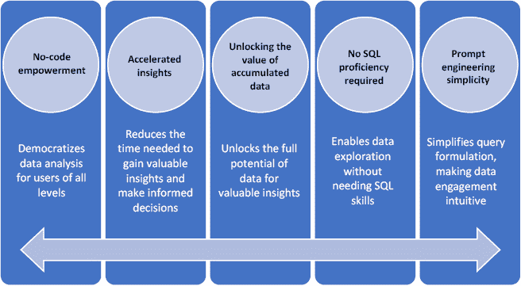

图 4.1 ChatGPT 对自然语言查询的优势

### ChatGPT 的变革性作用

`ChatGPT` 通过让没有编码技能的用户能够操作，在数据分析中发挥着变革性作用。它使数据分析过程民主化，让不同角色和技能水平的人员能够轻松获取数据驱动的洞察。此外，自然语言查询的应用加速了价值洞察的生成，导致更快的决策和对特定领域趋势的更好理解。

这种数据访问的改进还释放了积累数据的全部潜力，提取出价值知识和商业洞察。此外，`ChatGPT` 消除了精通 `SQL` 的需求，使得数据挖掘对所有用户都具有包容性和易性。它将重点放在了提示工程（`prompt engineering`）而非编码知识上，确保用户只需基础理解即可有效制定查询，增强了直观且用户友的数据参与过程。

### 协作与组织影响

除了个人贡献外，自然语言查询还营造了协作环境。数据分析师之间的团队变得更加透明，因为同事可以使用共享的自然语言界面轻松交换问题、结论和发现。这种简化的通信使信息共享合理化，并鼓励集体解决问题。随着每个成员都贡献自己的观点，团队的集体智慧不断增长，导致更深层次的分析和更明智的决策。

自然语言查询的影响超了数据分析师的角色；它在整个组织中产生共鸣，影响了业务决策的制定。可能不具备深层数据知识的领导、经理和利益相关者现在可以积极参与数据讨论，贡献他们的领域知识并塑造组织的战略方向。

掌握使用生成式 `AI` 构建高效自然语言查询的艺术，为利用数据分析的潜力铺平了道路（Devlin et al. 2019）。`ChatGPT` 凭借强大的 `AI` 驱动聊天机器人，引领了 `NLP` 技术新时代的进化。它理解和解释自然语言查询并将其转化为可操作洞察的卓越能力，使 `ChatGPT` 处于对话 `AI` 进展的前沿。

### 提高准确性的提示

进一步探索这一直观交互领域，这里有一些额外的建议可以提高你查询的准确性：

-   **理解数据模型**：熟悉数据集中的结构和关系。了解可用数据字段、类型以及它们之间的关系，允许你创建更具上下文的查询。这种理解将确保 `ChatGPT` 能准确地解释你的问题并提供相关信息。你可以向 `ChatGPT` 提供有关数据源和业务术语的背景信息，以便它可以更好地理解意图。例如：“根据我们的电子商务数据库，第四季度的总收入是多少？”；或者：“本月我们的 `CRM` 系统中注册了多少新客户？”。

-   **使用自然语言示例**：不要仅依赖僵化的查询，提供自然语言示例可以澄清你的意图并完善 `ChatGPT` 的理解。例如，你可以包含一个对话背景，如：“显示过去三个月的销售数据”。这提高了 `AI` 理解你的请求范围和持续时间的能力。

-   **接受探索性问题**：不要忘记提出探索性问题来发现隐藏的模式和趋势。例如，你可以问：“我们最忠实的客户有什么共同特征？”；或者“你能识别销售数据中的任何季节性模式吗？”通过这种方式，你需要明确包含在查询结果中的精确数据字段、统计数据或属性。你可以问 `ChatGPT`：“显示上个月所有交易的产品名称、单价和销售数量。”以及：“我们不活跃客户的姓名、姓氏和电子邮件地址是什么？”。

-   **尝试不同的方法**：与任何语言交流一样，尝试不同的表述和措辞可以产生不同的查询结果。尝试从不同的角度重述你的问题，你可能会发现数据中可以探索的新角度和维度。在查询大型数据集时，在自然语言问题中包含任何过滤器、条件或选择标准，例如：“上个月 30 到 40 岁客户销售最好的前 5 个产品是什么？”；或者：“第二季度哪个活动从加拿大产生了最多的线索？”。

-   **利用对话反馈**：像 `ChatGPT` 这样的 `AI` 系统从交互中学习。如果 `AI` 的回答不完全符合你的查询意图，请通过重述问题或要求澄清来提供反馈。这种反馈循环可以在随后的交互中产生更精确、更精炼的查询。检查 `ChatGPT` 生成的查询并在必要时重新制定你的问题。添加示例允许你在多次迭代中完善查询。遵循这些提示将使能够更有效地使用 `ChatGPT` 进行数据分析查询。通过练习，你可以进行直观的对话，从你的数据中解锁更深层次的洞察。

- **将人类专业知识与 AI 辅助相结合**：不要忘记你是领域专家，而 `ChatGPT` 是你的人工智能协作者。将你的学科知识与此智能体的数据处理能力相结合，以获得更深的洞察。相信你的直觉，让 `AI` 用数据驱动的视角补充你的专业知识。

当你将这些额外策略整合到数据分析过程中时，你会发现人类智能与 `AI` 能力之间存在着无缝的和谐。生成式 `AI`（如 `ChatGPT`）将成为强大的盟友，能够解读你的意图并提供可操作的见解。通过实践和改进，你将掌握用自然语言对数据提问的艺术，揭示有价值的模式，做出明智决策并推动你的组织迈向数据驱动的成功。

## 4.3. 使用 ChatGPT 将分析问题转换为 SQL 查询的艺术

`SQL`，或结构化查询语言，是数据管理领域中的一种基础工具，特别是在关系型数据库中。它的灵活性和多功能使其成为执行各种数据分析任务不可不可缺的语言，例如通过查询检索特定信息、更新现有数据以及在需要时删除记录。

将分析问题转换为 `SQL` 查询是数据分析过程中的关键步骤。鉴于数据库包含 `SQL`，将你的分析问题翻译成这种语言可以确保你的查询被正确理解和处理。这种无缝转换对于提取准确、高效的答案至关重要，有助于做出明智的决策和深刻的发现。

这种转换的处是巨大且深远的。首先，它显著改善了数据分析师与团队成员之间的通信。使用 `SQL` 查询来表达分析问题可以实现清晰精准的通信，促进团队内部无缝协作和知识共享。

其次，自动化方面对于简化数据分析任务至关重要。一旦你创建了 `SQL` 查询，就可以将其保存以备后用，减少重复工作并保持多次分析之间的一致性。这种自动化不仅节省了时间和精力，还确保了每次处理重复任务都能得到准确处理。

此外，适应数据分析的能力也成为一个重要的考虑因素。通过将分析问题转换为 `SQL` 查询，你使数据分析过程能够高效地适应不断扩大的数据集和复杂的数据场景。


生成模型将自然语言问题翻译为可执行 `SQL` 查询的能力正在彻底改变数据分析师与数据集交互的方式。与其挣扎于复杂的查询语法，如 `ChatGPT` 等工具允许用通俗易懂的语言表达分析问题，让更广泛的用户接触数据探索和分析（Sedkaoui 2023）。

OpenAI ChatGPT 的引入显著提高了业务用户和数据分析师的生产力。这项技术的主要优势之一是它可以辅助编写 `SQL` 查询。`SQL` 长期以来一直是查询和分析数据的主流语言，现在在 AI 的帮助下，学习和编写 `SQL` 查询比以往任何时候都更容易。AI 技术可以在几秒内自动生成、修改、调试和优化 `SQL` 查询。

该工具对于 `SQL` 初学者或在复杂查询方面挣扎的人特别有益。其显著优势在于理解自然语言输入的能力，使用户能够清晰表达自己的数据需求，然后生成相应的 `SQL` 查询。与手动编写查询相比，这一简化过程为用户节省了大量的时间精力。

此外，ChatGPT 通过为给定查询生成多个选项增强了查询编写体验，使用户能够探索不同的结构或比较替代方案。此外，它还协助调试 `SQL` 查询，快速识别并突出错误以便进行高效排除。

除了基础查询编写外，ChatGPT 还擅长引导用户学习高级 `SQL` 概念，例如连接表和创建子查询。它提供了清晰的解释和说明性示例，支持用户理解并成功实现这些复杂概念。

此外，ChatGPT 的强大还扩展到在用户详细描述查询时提供上下文建议。它提供有关表结构和列详细信息的信息，帮助用户更好地理解所分析的数据。得益于 ChatGPT 无价的帮助，用户可以投入更少精力编写查询，投入更多时间进行深度数据分析。

ChatGPT 可以通过许多方式帮助数据科学家处理他们的 `SQL` 查询，从编写基础查询到优化复杂查询。图 4.2 总结了这一点。

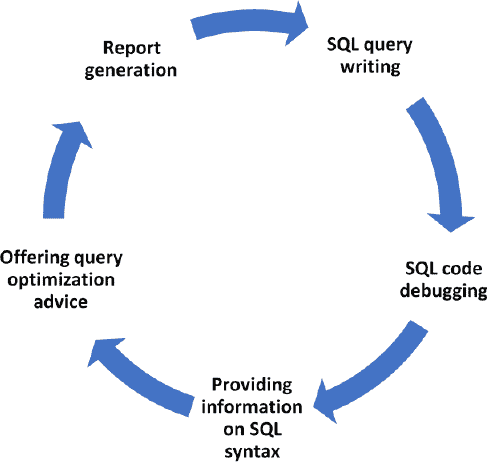

**图 4.2.** 使用 ChatGPT 进行 SQL 查询

例如，你可以说：“我需要创建一个查询，将‘customers’表与‘orders’表关联起来，以返回每个客户的总支出。‘customers’表包含客户 ID、姓名、电子邮件地址等，而‘orders’表有订单 ID、客户编号、订单金额……”

ChatGPT 然后可以根据提供的细节建议有效的逻辑并对索引提供建议以提高性能。

对于更简单的查询，ChatGPT 可以自动将自然语言查询转换为高效的 `SQL` 语法。对于涉及多个表、连接和高级函数的复杂查询，ChatGPT 可以通过建议最优的连接逻辑和查询结构提供帮助。

数据科学家可以与 ChatGPT 进行精炼和迭代，以创建为其独特需求定制的强大查询。这促进了更快、更容易且更具扩展性的 `SQL` 开发。

未来，专门为大语言模型（如 `GPT-4`）设计的 `SQL` 插件可能会将 ChatGPT 的编程支持推向高度。不再是通用的自然语言命令，`SQL` 插件将为模型提供关于数据库架构、查询优化和高级 `SQL` 功能的更深层次的知识。

`GPT-4` 版本提供了插件的可能，插件是可以集成以添加新功能的扩展程序。这些插件对于数据分析师具有重要价值，特别是在 `SQL` 查询领域。

专门的插件可能允许直接进行 `SQL` 输入，而不是简单的自然语言对话（Sedkaoui 2023）。随后模型可以根据数据库元数据和查询最佳实践，分析、调试、重新格式化并改进输入的 `SQL`。这将实现目前无法实现的高级自动补全、检查和性能优化功能。

此外，在查询中指定所需的字段、指标或聚合计算可以进一步提高其准确性和相关性。通过准确、确切地告知 ChatGPT 所需的数据元素，分析师可以简化数据检索过程，从而获得更具洞察力且更相关的结果。

随着数据分析师继续练习对话式查询，他们将能够完善自己的问题以获得最佳结果。通过对查询进行迭代并审查 ChatGPT 的初始尝试，分析师可以优化提问，从而从数据中提取出完美的洞察。

## 4.4 生成高效且优化的查询：你使用 ChatGPT 成功的关键

数据分析是一个多层过程，涉及多个阶段，从数据探索、清洗和建模到阐述有意义的洞察（Sedkaoui 2018a; Sedkaoui and Khelfaoui 2020）。数据分析的一个关键方面是生成高效且优化的查询。高效的查询不仅能够准确地交付所需结果，而且及时完成，避免不必要的延迟和低效率。

为了实现有效且优化的查询，几个因素起到了作用。首先，清晰度至关重要。查询必须简单易于理解，具有明确的目的和意图。这确保了利益相关者和团队成员能够轻松理解针对数据提出的问题。

特殊性是另一个关键考虑因素。定义良好且具体的查询能够精细化搜索，并确保返回的结果与需求精确对应。这最大限度地减少了筛选无关数据和浪费宝贵时间的风险。

选择正确的关键词是成功查询的关键。使用的关键词必须准确地呈现所查询的数据，并与数据集的结构和内容保持一致。这确保了查询能够有效地针对相关数据并避免歧义。

使用索引是优化查询性能的强大策略。索引是数据结构，通过创建高效的访问路径来实现更快的数据检索。通过使用适当索引，查询可以快速识别并检索所需的数据，从而显著提高性能。

生成高效查询的另一个基本元素是使用适当的连接（Joins）。连接使得合并多个表中的数据成为可能，便于处理需要从各种源提取信息的复杂查询。选择正确的连接类型并有效地结构化查询可以提高数据检索的效率。

为了进一步改进查询生成，使用自然语言查询可能会很有帮助。自然语言查询使数据分析师能够更具对话的方式与数据进行交互，使过程更加直观和用户友好。这种方法让分析师能够关注他们想要探索的问题，而不是纠结于复杂的查询语法。

此外，在查询中加入各种子句可以帮助精炼结果。`WHERE` 子句允许分析师指定数据选择条件，通过完善输出来满足特定标准。`ORDER BY` 子句允许数据按特定顺序排序，而 `LIMIT` 子句限制了返回的行数，使分析更易管理且更高效。

但这里的问题涉及 ChatGPT 对高效和优化查询的贡献，以及实现此目的的不同方法。

回答问题的关键在于识别 ChatGPT 用于生成高效和优化查询的各种功能，即：

*   **理解自然语言查询：** 得益于对包括自然语言查询在内的各种文本和代码的深度训练，ChatGPT 能够理解用户问题背后的意图并准确将其转换为 `SQL` 查询。

*   **生成清晰简洁的查询：** ChatGPT 擅长生成清晰的内容，使数据分析师能够提取有价值洞察。例如，用户可能会问：“上个月销量排前五个产品是什么？”，ChatGPT 将把此问题转换为 `SQL` 查询。

*   **使用关键词：** 通过使用相关关键词，ChatGPT 在保证准确性的同时减少了需要处理的行数。例如，用户可能会问：“显示本月购买过商品的所有 30 岁以下客户”，ChatGPT 将在查询中包含关键词 `customers`、`age`、`purchase` 和 `month`。

*   **使用索引：** 通过使用索引，ChatGPT 改进了查询性能，特别是对于频繁执行或数据密集型的查询。例如，用户可以问：“给我过去三年每个产品的总销售额”，ChatGPT 将使用索引加速数据检索。

*   **使用连接（Joins）：** ChatGPT 高效利用连接合并来自不同表的数据，这是处理复杂查询的基本能力。此功能允许分析师探索和整合各种数据源。例如，用户可能会问：“显示去年每个部门的收入和相关成本”，ChatGPT 将使用连接合并收入表和成本表的数据。

通过使用 ChatGPT，数据分析师只需在问题中包含之前讨论过的子句（如 `WHERE` 子句、`ORDER BY` 子句和 `LIMIT` 子句），即可生成相应的 `SQL` 查询。这使用户能够获得更有针对性、更有组织的结果，优化其数据分析并有助于明智决策。

例如，分析师可能会向 ChatGPT 查询如下：“显示销售额超过 100 美元的产品总额”。在这种情况下，ChatGPT 将 `WHERE` 子句纳入查询中。分析师还可以制定此类请求：“按总销售额降序排序”，ChatGPT 将在查询中添加 `ORDER BY` 子句，以从高到低的降序呈现结果。

使用 ChatGPT 优化 `SQL` 查询不仅限于已提到的内容。事实上，它超越了简单的从自然语言生成查询。开发高效、优化的查询是一个协作过程，涉及借鉴专业知识的优势和 AI 能力的结合。

通过为 ChatGPT 提供必要的上下文和细节，数据分析师可以引导模型生成与其数据分析需求精确对应的查询语句（Sedkaoui 2023）。这些上下文包含了有关数据库模式的信息、相关的业务术语以及任何所需的特定过滤器或限制。通过制定清晰、精确的问题，用户可以确保 ChatGPT 生成的查询具有针对性且准确无误。

然而，生成的查询并非最终终点。它们是作为进一步优化的起点。ChatGPT 可以为改进查询性能提供宝贵的建议，例如建议在过滤列上使用索引，或根据数据关系建议简化的连接（joins）。它还可以帮助选择正确的数据类型以提高查询性能。

当数据分析师和开发人员合作精炼生成的查询语句时，协作的方面就显现出作用。通过在 ChatGPT 的帮助和人工监督下迭代改进查询，分析师可以实现高性能查询，在交付完整且准确结果的同时，最大限度地减少执行时间。

这种协作对于数据分析来说是一场改变规则的变革。另一方面，得益于 ChatGPT 理解自然语言查询的能力，即使是不经训练的用户也能积极参与查询过程。这使数据分析民主化，让组织内更广泛的专业人士能够触及。

通过专注的提示（prompts）和迭代改进的反馈循环，ChatGPT 可以在返回完整准确结果的同时最小化查询执行时间。人类与人工智能的融合促进了一种双方单独都无法完成的 SQL 生成方式——即将业务逻辑与技术优化相结合。

在解释了如何使用 ChatGPT 创建直观的查询后，我们现在转向探索由生成式 AI 实现的高级分析技术。第 5 章 展示了 ChatGPT 如何超越基础的数据检索，为探索性数据分析、统计、预测、文本挖掘等提供无价的帮助。

尽管编写最优的 SQL 查询是基础性的，但它仅仅是一个起点。当涉及到加速通常需要数据分析专家的复杂分析任务时，ChatGPT 的能力真正大放异彩。通过自动化重复工作并增强人类的批判性思维，ChatGPT 让我们能够提取深层次的洞察并优化决策。

# 5 ChatGPT：高级分析大师

在第 4 章中，我们解释了 ChatGPT 如何通过自然语言对话让查询和访问数据变得更加直观。然而，ChatGPT 的真实能力远超基础数据检索。本章探索了智能生成式 AI 代理如何自动化和增强高级分析技术，以获得更深层的洞察。

ChatGPT 擅长帮助数据科学家处理数据收集和准备之后的更复杂、高价值的任务。这些包括探索性数据分析、统计建模、预测、情感分析等。此类技术通常需要熟练的数据专家。

通过将其计算能力与人工监督和领域专业知识相结合，ChatGPT 可以帮助加速高级分析。重复和常规方面被自动化了，而 ChatGPT 的解释则加强了人类的判断。

本章演示了 ChatGPT 如何作为一个分析伴侣，提供 AI 与人类批判性思维的结合。我们涵盖了探索性数据分析、统计分析和预测建模以及文本挖掘和情感分析中的创新应用。这些技术共同提供了更深入见解，并优化了数据驱动的决策。

## 5.1 探索新领域：用于探索性数据分析的 ChatGPT

探索性数据分析（EDA）是数据分析的一种基本方法（Tukey 1977），对于获取更深层的洞察和理解数据集中的潜在模式至关重要。通过使用可视化和统计分析技术，EDA 旨在揭示有价值的信息，如趋势、离群值和数据分布，这些为后续的建模和假设检验奠定了基础。

进行 EDA 的主要优势之一是它识别数据中模式和趋势的能力。这些信息对于做出明智决策至关重要，因为它让分析师能够识别反复的行为或事件。例如，在客户数据分析中，EDA 可以揭示反复的购买模式，使公司能够针对特定客户群体有效地定制针对性的营销策略。

EDA 还充当离群值检测机制，帮助识别显著偏离总体趋势的数据点。离群值可以提供关于数据中稀有事件或异常的价值见解。识别和理解离群值有助于区分错误数据点和重要数据点。

此外，EDA 有助于对数据集结构的全局理解（Tukey 1977; Sedkaoui 2018a），变量之间的关系和数据分布。这些知识对于选择适当的方法和制定假设至关重要。理解数据格局使分析师能够高效探索数据集，提取有意义的信息并更准确地解释结果。

可视化在有效的 EDA 中起着核心作用。归功于数据的视觉呈现，模式和趋势变得更加明显，使分析师能够理解复杂的关系并发现隐藏的见解。

EDA 是一个迭代过程，涉及持续的探索和发现（Berman 2013; Sedkaoui 2018a）。随着分析师深入研究，可能会产生新的问题和假设，需要对分析进行进一步探索和精炼。采用 EDA 的迭代性质确保了数据集的所有方面都得到了深度探索，最终带来更丰富的见解和更明智的决策。

在这个开放式的发现过程中，EDA 需要技术专业知识和人类直觉，使其成为一项具有创造性和分析性的任务。在这里，以 ChatGPT 为代表的生成式 AI 模型发挥着独特的补充作用，增强了这一过程中的人类判断和协作。

ChatGPT 擅长的重要方面是假设生成。通过检查数据集，ChatGPT 可以帮助分析师根据趋势和明显的异常提出引人入胜的假设。人类专业知识与 AI 视角的协同开启了新的调查方向。例如，通过分析销售数据，ChatGPT 可以提示数据分析师探索第三季度大幅增长与夏季促销活动之间的联系。这种联合探索带来了更具针对性和成果丰硕的调查。

图 5.1 展示了 ChatGPT 如何彻底改变分析过程的关键环节——从数据处理和分析到富有见地的假设生成和严谨验证。ChatGPT 在加速工作流的同时，增加了这些阶段的人类创造力和监控。

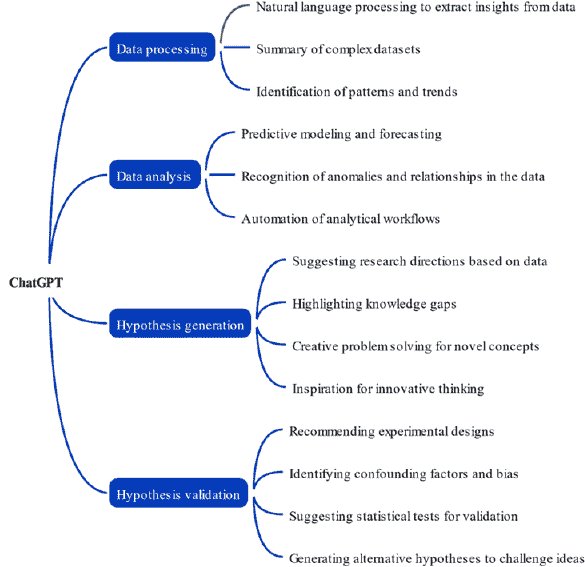

**图 5.1.** 用于数据处理、分析和假设生成的 ChatGPT

在数据处理中，`ChatGPT` 利用自然语言特征和模式识别算法来快速提取信息、识别趋势并总结复杂数据集。这在自动完成繁琐的人工任务的同时，也凸显了被忽视的关系。

在分析、预测建模和异常检测方面，`ChatGPT` 揭示了人类可能会错过的新见解。它通过打破常规的增强了假设的生成。

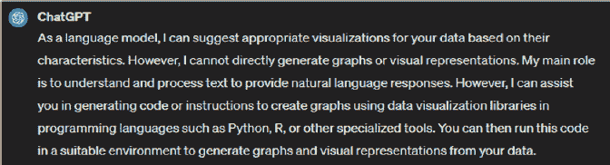

**图 5.2.** ChatGPT 的数据可视化响应

这种响应非常有用且信息量丰富，突显了 `ChatGPT` 作为自然语言模型的能力与局限性。`ChatGPT` 可以成为数据可视化的有价值工具，但考虑其局限性至关重要。

这个问题提出了一个很好的观点——`ChatGPT` 目前并不能独立生成交互式数据可视化或图形。因此，声称或认为 `ChatGPT` 实际上可以“创建可视化内容”是不准确的，至少目前是如此。在数据可视化的背景下，应该注意 `ChatGPT` 可以例如：

*   根据你拥有的数据和分析目标，建议合适的可视化类型，例如柱状图、散点图或热图；
*   引导你完成可视化的核心元素，如坐标轴、数据字段、颜色等，使你的图表更有信息量且具吸引力；
*   提供 `Python` 或 `R` 代码示例，用于创建推荐的可视化方案；
*   允许你轻松创建表格，以清晰、简洁地组织你的数据。

诚然，仅通过文字吸收知识往往限制了完全的认知理解，而视觉呈现提供了文本无法完全传递的额外理解层次。但遗憾的是，即使是像 `GPT-4` 这样先进的版本，尽管具有处理图像和文本的多模态能力，也无法自主生成解释性图形。目前，`GPT-4` 只能分析现有的视觉效果，而不能创建新的。

这就是 `ChatGPT` 插件证明价值之处。通过集成 `Mermaid` 和 `PlantUML` 等绘图语言，这些工具使用户能够通过图表、思维图、流程图等将 `ChatGPT` 的文本解释可视化。

因此，`ChatGPT` 的文本解释与插件提供的图形呈现之间的协同作用增强了理解。当关键概念同时通过文本和视觉媒介表达时，会变得更加清晰，为学习创建更深层的锚点。

所以，虽然 `ChatGPT` 仍限于文本解释，但插件解锁了它的可视化能力。它们共同实现了对知识更全面的吸收——有意义的文字，提供视觉背景的图表。这证明了 `ChatGPT` 通过与互补技术整合而增强能力的强大之处。

但值得注意的是，数据可视化不仅仅是创建美观的图表和图形。它涉及确定哪些数据是有可视化价值的，确保数据处于适当的格式，并探索数据可视化如何甚至预测未来趋势。

在这种背景下，值得思考生成式 AI 技术的进步是否已成功解决了许多人面临的这些巨大挑战。或者换句话说，如何将 `ChatGPT` 用于数据可视化，帮助用户从数据集中发现更深层的见解？通过利用 `ChatGPT` 的能力，我们能真正解锁数据可视化的力量并改进决策过程吗？

这些问题的答案可以总结如下：

### 释放 ChatGPT 提供的数据可视化建议

管理具有大量列的复杂数据集是一项艰巨的任务，特别是在决定哪些数据应该进行可视化处理时（Sedkaoui 2018b）。分析数据关系和相关性可能耗时且具有挑战性，让你面对海量的可选方案感到无所适从。然而，随着语言模型和如 `ChatGPT` 等 AI 驱动应用的出现，数据分析师现在可以在这一过程中节省大量的时间和精力。

假设你有一组商店的产品销售数据集，你想通过可视化来发现有价值的洞察。只需向 `ChatGPT` 寻求帮助。通过利用它的功能，你可以搜索关于应该可视化哪些数据以及何种类型的图表最适合你的数据分析需求的建议。你可以通过提示词（prompt）轻松提供数据集的描述，`ChatGPT` 将快速给出针对有效可视化的相关建议。

有了这个强大的工具，探索复杂数据集变成了一项更高效、更具成效的任务。虽然在现阶段结果可能并不完美，但它为克服初始困难提供了一个宝贵的起点。它让你行动起来，随着你的不断进展，你可以完善并改进结果。如果你想改进这种方法，可以将 `OpenAI` 与你偏好的商业智能工具集成，并使用 AI 生成自动化的数据可视化。例如，你可以使用 `ChatGPT` 的 `Code Interpreter`，这是一个增强了 AI 模型功能的强大工具，它让代码编写和数据可视化变得更加易于实现。

### 提高数据质量以实现更智能的数据可视化

你不仅可以利用 `ChatGPT` 进行数据可视化，还可以利用它的功能来丰富你的数据集。如果现有数据缺少某些信息，引入额外数据可以带来更有洞察且更全面的结果。考虑通过各种增强手段补充你的数据集，例如文本字符串的情感分析、位置坐标、人口统计学数据、最新的外汇汇率、聚合计算等（Cupani 2022）。


在 `ChatGPT` 的帮助下，你可以发现一些有价值的脚本，将这些增强内容无缝集成到你的数据集中。例如，你可以要求 `ChatGPT` 评估客户评论的情感，让你的数据分析能够更好地理解客户的观点。

## 利用 AI 进行预测分析

虽然可视化历史数据对于从过去的经验中学习非常有价值，但仅依赖过去的信息可能会落后于竞争对手。如果你能在风险和机会出现之前主动预测它们，会怎样呢？预测分析正在寻求基于预测做出数据决策的组织中变得流行。尽管这是一个专业领域，但 `GPT-3.5` 和 `GPT-4` 等语言模型的进步使得尝试预测分析变得更加可行。通过在历史数据上对 `GPT` 进行训练，数据科学家现在可以着手创建 AI 驱动的数据可视化，以帮助预测未来结果。

## 使用 ChatGPT 进行数据清洗和建模

正如 GIGO（垃圾进垃圾出）原则所示，在进行有意义的可视化时，数据清洗和优化数据建模的重要性不被低估。尽管数据清洗和建模没有创建图表那样吸引人，但它们是不可忽视的步骤。如前所述，`ChatGPT` 可以简化繁琐的数据清洗和处理过程。它可以帮助识别数据集中的潜在异常值，管理缺失信息和空值，归一化数据并选择最合适的数据模型。

## 基于 AI 的可视化可能是未来吗？

`ChatGPT` 等新兴 AI 工具的巨大潜力不可否认。虽然某些人可能担心 AI 对其职业的影响，但具有远见的软件团队正在拥抱它的可能性。学会利用 AI 进行数据可视化的早期采用者将获得竞争优势，提高效率并迅速扩展他们的技能。随着 AI 和 `ChatGPT` 等工具成为包括数据可视化在内的各行业不可缺的一部分，它们有望改变我们工作的方式并创造有价值的洞察。

## 5.2 简化你的分析：自动化任务提高效率

数据分析的自动化在变革分析过程中起着至关重要的作用。正如本书第 3 章所示，数据分析师经常花费大量时间在重复性任务上，这会影响他们的生产力和专注于战略洞察的能力。然而，随着 `ChatGPT` 的出现，自动化正在成为现实，使数据分析师能够利用其技能和专业知识的真正力量。

`ChatGPT` 的优势之一是它可以自动化数据准备。得益于良好的提示词，`ChatGPT` 可以处理数据库查询、数据清洗和缺失值填充等任务。这种自动化大大减少了花在琐碎数据准备上的时间，让分析师能够投入更高价值的活动中。

此外，`ChatGPT` 方便了专业用户的自助报告创建。通过根据用户查询生成报告、数据可视化建议和仪表板，`ChatGPT` 让非技术利益相关者能够获取所需信息，而无需过度依赖分析师的支持。这种自助报告方法减少了对分析师的依赖，并促进了组织内部更敏捷的决策（Sedkaoui 2023）。

除了常规任务的自动化，`ChatGPT` 还增强了复杂的分析活动，如预测、优化和情感分析。它通过生成初始洞察为分析师提供了领先，分析师随后可以根据该领域的专业知识进行完善。这种增强过程使数据分析师能够提高分析技能，并从数据中提取更有意义的洞察。将 `ChatGPT` 集成到数据分析过程中远不止自动化重复任务；它还为高级和战略性分析活动提供了宝贵的帮助。表 5.1 概述了 `ChatGPT` 和分析师在某些高级分析任务中的角色。

**表 5.1 高级分析任务中 ChatGPT 和分析师的角色**

| 活动 | ChatGPT 的角色 | 数据分析师的角色 |
| :--- | :--- | :--- |
| **预测** | 使用不同的统计方法快速处理历史数据以进行时间序列预测 | 根据业务知识审查并完善预测；调整预测以考虑背景因素 |
| **优化** | 建议优化方案，例如定价、库存水平或数据驱动的资源分配 | 为约束条件和业务目标添加关键背景以定制优化方案；提供必要的逻辑和推理 |
| **情感分析** | 使用自然语言处理对客户反馈或评论进行情感分析 | 根据对业务背景的细致理解验证 AI 分类 |

在优化任务中，`ChatGPT` 可以根据分析的数据提供宝贵的建议，例如定价建议、库存水平或资源分配。然而，分析师能够带来关键的背景信息，考虑到商业限制和目标，从而量身定制优化方案。虽然 `ChatGPT` 处理数学方面，但人类分析师提供了必要的逻辑依据和推理。

同样，`ChatGPT` 的自然语言处理能力使其能够对客户反馈或评论进行情感分析（Sedkaoui 2023）。然而，是分析师对公司的细致理解，使他们能够准确地验证并对 AI 的分类进行定位。

通过将分析师角色中的重复性工作交给 `ChatGPT`，数据分析师可以集中在需要其专业技能的高价值工作上。这种重心的转移让他们能够参与战略决策和模型治理，并为组织的关键利益相关者提供核心支持。

此外，`ChatGPT` 还可以：

*   快速运行模拟并创建模型以测试不同的场景和假设。分析师根据业务知识提供关键输入，以提高模型的相关性和准确性。此外，`ChatGPT` 还可以分析数据，使用 `z-scores` 等统计工具来标记潜在的异常。然而，分析师需要根据他们对数据和业务背景的理解，验证哪些报告的异常值得调查；
*   在决策中，建议数据驱动的决策，例如推广哪些产品或调查哪些活动。然而，分析师会根据现实世界的限制和目标对这些建议进行评估，而 AI 缺乏这些方面的视角；
*   生成带有洞察摘要的报告，简化报告流程。但分析师需要针对不同的受众和决策对报告进行组织、精炼和背景化，确保传递了正确的信息。

主旨是，`ChatGPT` 通过自动化繁碌工作和提供分析保障，使分析师能够增加影响力。它显著减少了在重复性任务上花费的时间，使分析师专注于需要人类专业知识和创造力的高价值活动。然而，它的建议必须通过人类分析进行调整，才能做出明智决策。这种共生关系使组织能够充分利用 AI 的能力和人类的专业知识，促进强大的协作，从而改进整体数据流程。

`ChatGPT` 的计算速度与分析师的专业技能相结合，开启了具有新潜力的增强分析流程。拥抱 AI 实现自动化同时放大人类优势的组织，将在数据驱动决策方面脱颖而出。这种无缝集成使得数据驱动决策的做出更加有效高效，最终带来竞争优势和更好的业务结果。随着数据分析的不断演变，AI 自动化与数据科学家之间的协同将对于开启新水平的洞察和创新至关重要。

## 5.3 从统计到预测：ChatGPT 作为首选伙伴

在大多数组织中，描述性统计构成了更高级预测分析的基础。通过分析历史数据来发现模式、趋势和关系，统计学帮助我们更好地理解过去（Delen and Demirkan 2013）。预测分析随后利用这些统计信息来预测未来结果。

描述性统计能够对公司的性能进行详细检查。平均值、分布、相关性和回归等指标量化了已经发生的情况。统计建模技术（如 `linear regression` 和 `cluster analysis`）揭示了决定结果的因素。

这些统计信息为预测铺平了道路。通过识别过去数据中关联最强的关系和模式，我们可以创建利用这些洞察的模型，以预测未来结果。预测分析将机器学习算法应用于历史数据，以预测销售、需求、价格、设备故障等结果。

然而，预测结果并不像基础统计那样良好。执行不当的描述性分析将无法发现重要的变量和关系。这会导致预测模型忽略关键因素。最好的预测是将稳健的统计分析与智能建模技术相结合。

组织需要将统计和预测视为一个集成的 `continuum`，而不是孤立的实践。坚实的统计基础能让更准确的预测成为可能。而预测模型则揭示了需要通过统计学探索的新问题。通过链接这些能力，公司可以将数据转换为能够产生竞争优势的可操作预测。

从统计到预测，`ChatGPT` 和其他生成模型已确立自己为数据分析师的首选伙伴。尽管传统的统计方法几十年来一直是数据分析的基础，但在面对复杂、大规模数据集以及对预测洞察的需求时，它们往往力不从心。

`ChatGPT` 凭借其理解能力和对海量知识的访问，使分析师能够超越统计分析的限制，深入预测建模领域。通过利用历史数据，`ChatGPT` 可以快速生成时间序列预测，识别模式，甚至协助情感分析。`ChatGPT` 将人类直觉与计算实力融合，使分析师能够释放数据驱动决策的潜力，为更明智的战略选择和对未来更准确的预测铺平道路。它是从统计分析到预测建模转型过程中不可或缺的助手。

利用 `ChatGPT` 增强从描述性统计到预测分析的分析历程的组织将获得巨大收益。在下文中，我们探索了使用 `ChatGPT` 增强三个关键阶段分析的最佳实践：统计基础、预测建模和模型部署。

### 5.3.1 建立统计基础

通过使用统计进行探索性数据分析，`ChatGPT` 为有效预测提供了燃料。`ChatGPT` 加速了发现关键洞察的过程，例如历史数据中的相关性、驱动因素和重要变量。它的自然语言处理允许分析师以互动的方式探索数据。例如，数据分析师可能会问 `ChatGPT` 这样的问题：“在我们过去两年的订阅数据中，与客户取消相关的主要因素是什么？”、“哪个客户细分市场的平均篮子价值最高，该细分市场的区分特征是什么？”“通过社交网络和搜索引擎推荐的客户转化率之间是否存在统计学上的显著差异？”“识别此数据集中的离群值、异常或数据质量问题以便解决”。

然而，人类监控对于提出与业务背景相关的正确问题（`prompts`）至关重要。分析师必须验证 `ChatGPT` 的分析在统计学上是有效的。通过不同的问题进行迭代提问，分析师可以创建数据的完整统计画像。

对于大型、复杂的数据集，`ChatGPT` 指数地加速了这一发现过程，同时从人类的建议中受益。发现的关键统计洞察将成为预测建模的候选变量。

### 5.3.2 使用 ChatGPT 构建模型

一旦通过统计学识别了关键变量和关系，分析师就可以利用 `ChatGPT` 来构建预测模型。它的计算速度能够对不同的算法进行快速原型设计和测试，以找到最合适的模型。`ChatGPT` 可以实现或支持的常见预测技术包括：

*   `Linear regression`（线性回归）通过相关变量预测连续结果，例如销售额或需求。`ChatGPT` 可以分析历史数据自动生成线性回归模型。例如，数据分析师可以要求 `ChatGPT` 自动生成线性回归，根据历史销售额、价格季节性、促销和其他因素预测产品需求。`ChatGPT` 会返回带有变量系数的模型方程以供审查。分析师随后可以通过要求 `ChatGPT` 尝试转换（例如变量的非对称对数缩放）来完善模型。这种增强方法可以更快地获得拟合良好的模型。
*   `Logistic regression`（逻辑回归）使用独立变量预测二结果，例如客户流失率。`ChatGPT` 还可以为二分类用例创建逻辑回归模型，例如预测客户流失。例如，数据分析师可以提供带有流失标签的客户数据，并要求 `ChatGPT` 识别最具预测性的输入，用逻辑回归对流失与非流失进行分类。它可以确定收入、购买频率、支持工单和其他更重要的标记，以概率模型对流失建模。`ChatGPT` 会返回逻辑方程供检查。
*   `Decision trees`（决策树）通过根据变量中的最佳切分点划分数据来预测结果。`ChatGPT` 可以根据分析师的需求构建决策树逻辑。对于细分用例，分析师可以利用 `ChatGPT` 自动生成决策树模型，根据属性将客户分为不同的群体。它可以高效地确定划分人群的最佳属性阈值序列。分析师可以评估树深、修剪需求和过拟合风险。
*   `Random forests`（随机森林）通过许多树来提高单个决策树的准确性。`ChatGPT` 还可以构建聚合许多单个决策树的随机森林模型，使用引导样本将结果分类为欺诈交易。这比单树提供了更稳健的预测。分析师可以与 `ChatGPT` 协作调整树的数量和每个树的变量，以优化准确性。`ChatGPT` 可以通过使用训练数据的自助采样构建许多树来快速生成随机森林模型。
*   `Neural networks`（神经网络）模拟人类认知以发现复杂的非线性关系。`ChatGPT` 可以建议用于测试的适当架构和超参数。

对于每种技术，`ChatGPT` 都可以提供模型模板作为起点。

数据分析师随后在测试数据上评估模型的准确性，并要求 `ChatGPT` 调整超参数并尝试额外的输入变量以提高预测能力。

通过自动化测试不同算法和配置的繁琐任务，`ChatGPT` 让分析师能够从高层战略角度来看化模型准确性。这种混合方法产生了更稳健的模型。

### 5.3.3 模型部署与模型监控

一旦开发出满意的模型，数据分析师就可以与 IT 团队合作，将 `ChatGPT` 生成的模型集成到业务应用程序中投入生产。然而，部署并不是预测之旅的结束。为了随着时间保持准确性，人类分析师必须：

*   随着新数据的出现，通过跟踪精确率、召回率和 `F1` 分数等指标持续监控模型性能；
*   在新数据上定期更新模型，以纳入最新的模式和趋势。`ChatGPT` 加速了更新过程；
*   实施检测概念漂移（concept drift）的系统——即模型准确性因现实状况的变化而下降；
*   根据新的业务需求和目标调整模型；
*   根据基于伦理和合规保护的治理协议模型；
*   为利益相关者记录模型的局限性、假设和其他细节。

适当的实施需要将 `ChatGPT` 的能力与人类判断、业务知识和监控相结合。自动监控和重训练流水线需要人工审计的补充。

### 5.3.4 业务影响

成功将 `ChatGPT` 的统计计算与人类分析思维相结合的公司可以释放推动增长和成功的众多益处：

*   `Accelerated insights`（加速洞察）：得益于 `ChatGPT` 快速通过统计学分析变量并创建稳健预测模型的能力，组织可以以极快的速度获取洞察。这种加速的数据探索使他们能够快速做出明智的决策，从而在动态万变的市场中获得竞争优势。
*   `Democratized analytics`（分析民主化）：通过 AI 增强业务分析师的能力，组织减少了对数据专家的依赖。`ChatGPT` 易于使用的界面和对话性质使其让更广泛的专业人士能够使用，使数据分析过程变得民主化。
*   `Improved forecasting`（改进预测）：人类专业知识与 AI 能力的结合带来了更准确的需求预测、倾向模型和其他预测。通过利用两者的优势，组织可以做出更明智的战略决策，并更有效地预测未来趋势。
*   `Optimized decisions`（优化决策）：数据驱动的洞察和预测智能使公司能够做出及时、优化的决策。无论是资源分配、定价策略还是营销活动，这些决策都是基于稳健的数据分析，最小化了风险并最大化了回报。
*   `Competitive advantage`（竞争优势）：凭借快速适应市场变化和预测未来趋势的能力，组织获得了竞争优势。`ChatGPT` 对预测客户偏好、市场变化和新兴机会的支持帮助他们保持领先一步。

计算能力、人类创造力和业务逻辑的结合正成为预测成功的获胜公式，使公司能够在日益数据驱动的世界中蓬勃发展。

## 5.4 解读情感：使用 ChatGPT 进行文本和情感分析

情感分析作为评估文本内容情感基调的过程（`Sedkaoui et al. 2022`），在当今数据驱动的世界中具有至关重要的意义。通过识别驱动积极、消极或中性情绪的词汇和短语，这种强大的技术为人们如何感知产品、服务和品牌提供了宝贵的洞察。根据贝恩公司的一项研究，到 2023 年，情感分析解决方案的采用率预计将达到 80%。

其主要应用之一是分析客户反馈，公司可以通过优先考虑和解决常见投诉来发现改进领域。此外，情感分析已广泛用于社交媒体监控。通过跟踪对公司或品牌的提及，组织可以评估公众情绪并跟踪随时间的变化。

这种实时反馈使他们能够采取主动措施并改进他们的声誉管理策略。提到品牌声誉管理，情感分析是识别社交媒体平台上的消极情绪的一个关键盟友，使公司能够迅速减轻潜在的损害。

除了品牌相关的问题外，情感分析在市场研究中也有许多应用。通过解读对产品或服务的流行情绪，公司可以获得有关消费者偏好和趋势的宝贵见解。这些见解使他们能够做出数据驱动的决策，并完善产品以更好地满足客户需求。

通过理解客户情绪，公司可以定制产品以更好地满足客户需求，培养更牢的客户关系和忠诚度。这些宝贵的见解还可以用于调整营销活动，确保它们与目标受众产生共鸣并产生更大的互动。

这使得公司能够识别客户偏好的变化，帮助他们决定何时推出新产品或服务、调整营销策略或在必要时采取纠正措施。情感分析的这种预测性使组织能够领先竞争对手一步（Sedkaoui et al. 2022），预测市场趋势并在动态的业务环境中保持敏捷。

情感分析的一个显著优势是其在品牌声誉管理中的作用。通过快速检测对品牌的负面情绪，公司可以主动处理疑虑，减轻潜在损害并提高品牌声誉。这种主动的方法不仅建立了与现有客户的忠诚度，还提升了品牌形象，吸引那些认为公司具有响应能力且以客户为中心的新客户。

利用生成式 AI 进行文本分析的组织为理解非结构化文本数据中的情绪、主题、趋势和关系开启了新视野（McKinsey 2023）。无论是分析客户反馈、社交网络讨论、呼叫中心日志还是员工沟通，`ChatGPT` 与人类专家合作，可以从文本提取出无价的见解，指导战略决策。本详细指南探索了使用 `ChatGPT` 进行文本挖掘的技术和最佳实践。

**表 5.2 ChatGPT 在情感分析中的应用示例**

| 应用 | ChatGPT 的角色 | 示例 |
| :--- | :--- | :--- |
| **数据预处理** | 通过清理和规范化非结构化数据来提高一致性和质量，从而改进情感分析 | `ChatGPT` 将：“This producTisgood! #ILoveIt” 修正为：“This product is good! #I Love it” |
| **特征提取** | 擅长从文本数据中提取相关特征，使情感分析系统能够区分客户与品牌沟通中的细微差别 | `ChatGPT` 从这段文本中提取了：“The user interface is intuitive and navigation is user-friendly”，以及以下特征：“user interface”, “intuitive”, “navigation”, “user-friendly”。 |
| **语境理解** | 结合行业术语和独特关系进行语境化分析，以有效区分积极、负面和中性情绪 | `ChatGPT` 总结了文本：“Their customer support team was responsive and solved our problems quickly”，其语境为：“对公司客户服务的积极反馈”。因此，整体感受是：积极。 |


| **训练数据生成** | 生成带有各种情感标签的合成文本数据，增强现有的训练数据集或创建新模型以进行更好的情感分析 | 从这段文本：“The after-sales service was responsive and solved our problem quickly”，`ChatGPT` 指出的总结为：“积极”。从另一段文本：“The product does not meet expectations, and customer service is difficult to reach”，它指出的总结为：“负面”。 |

| **情感分类** | 将 `ChatGPT` 作为分类器，直接预测给定文本的情感 | 从以下条目：“The app’s new user interface is confusing, and it now takes longer to complete tasks”，`ChatGPT` 预测的情感为：“负面” |

| **多语言支持** | 用于不同语言的情感分析，使公司能够接触更广泛的市场和地区 | 得益于翻译能力，`ChatGPT` 能够根据法语文本：“La dernière sortie de produit de l’entreprise a dépassé toutes les attentes et a reçu des critiques élogieuses de la part des clients”，提出英语翻译：“The company’s latest product release exceeded all expectations and received rave reviews from customers”，并指示了“积极”的整体情绪 |

| **实时分析** | 用于实时情感分析，实现数据驱动的决策 | 监控 Twitter 账号的评论：“@company Your customer service is terrible, I’ve been waiting for a response for days!” 识别出“负面”情绪并定义了行动：“客服团队必须立即回复”。 |

在每种情况下，`ChatGPT` 的自然语言能力提供了基准，而人类专注于战略分析和持续改进。这种共生使组织能够从非结构化数据中提取全部价值。

值得注意的是，`ChatGPT` 也可以用于情感分析中的表情。表情可以传递关于情绪的价值信息。例如，积极情绪可以通过以下表情表达：


而负面情绪可以通过如下表情传递：


尽管 `ChatGPT` 已学习识别表情，但它对表情的理解和解释可能不如文本那样完整。为了证实这一点，我们提示 `ChatGPT` 分析这段客户评论的情感，并考虑了所使用的表情：

新产品

其响应所示图 5.3。

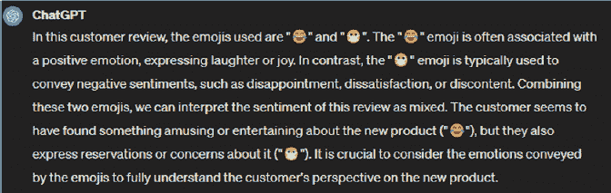

图 5.3. *ChatGPT 对情感分析的响应*

在这种情况下，我们发现 `ChatGPT` 的响应并没有完美反映客户的情绪。然而，它建议考虑表情表达的情绪以更好地理解客户情绪。因此，重要的是注意到，虽然 `ChatGPT` 在分析客户表达的情绪方面很有帮助，但人类的干预对于准确且细致的解读仍然至关重要。

在这种背景下，使用 `ChatGPT` 进行情感分析面临一些需要考虑的关键挑战：

- **理解讽刺和微妙的情绪**：`ChatGPT` 通常难以检测讽刺、反讽以及需要深层语言和文化背景的微妙情绪。例如，“it’s all simply awesome”可能被归类为积极，而实际上它是讽刺的。

- **处理歧义性**：模糊的代词和引用会让 `ChatGPT` 难以确定所表达情绪的真实主体。例如，“I can’t believe they did that” 并不清楚代词 “they”指的是谁。以下是模糊语言如何混淆情感分类的一些示例：

- `polysemy`: 具有多个含义的词，例如“light”、“left”或“conforming”，会使句子产生歧义。例如，“the laptop is so light!”（笔记本电脑好轻！）如果不知道“light”是指重量还是颜色，很难对其分类；

- `idioms`: 比喻表达，如“break a leg”（祝你好运）或“cost an arm and a leg”（极其昂贵），如果没有人类的文化背景，AI 很难正确解释；

- `unclear references`: 当“this”、“that”或“it”等代词没有明确的指代对象时，所表达情感的主体是不确定的。例如，“I can’t believe they’re allowing this!”（我无法相信他们竟然允许这样做！）；

- `weak context`: 消除情感歧义通常需要广泛的上下文。如果不知道这是一条电影评论，“the movie was sick!”（这部电影太酷了！）这句话的意思并不明确。

通过识别这些歧义来源，我们可以选择训练数据并创建提示词（prompts），以尽可能的减少在使用 ChatGPT 进行情感分析时的不准确性。然而，尽管有了这些改进，人工干预对于验证和解释 ChatGPT 获取的结果仍然至关重要，以确保对客户情感进行更准确、更具洞察力的分析；

- **检测否定和强调**: 否定和强调词（如“not”、“never”或“extremely”）的存在可能会改变或反转情感的极性。ChatGPT 并不总是考虑这些修饰词。

- **有限的世界知识**: ChatGPT 缺乏现实世界的知识和常识，这些知识可以为解释复杂情感提供关键背景。人类直觉地利用这一点来听外之音。

- **数据问题和偏见**: 作为一个统计模型，ChatGPT 存在继承和放大训练数据中存在的偏见的风险。需要更多多样化的训练数据。

- **演变的语言趋势**: 新俚语、文化引用、表情符号和创意语言可能会使 ChatGPT 的训练解释在重新训练之前过。人类分析师的适应速度更快。

当然，我们也不应忘记文化差异，这无疑会使 ChatGPT 在不同地区和语言中的情感分析变得复杂。

**表 5.3. ChatGPT 情感分析中需要考虑的文化挑战**

| 类型 | 问题 |

| :--- | :--- |

| 间接沟通 | 某些文化倾向于更间接或隐含地表达情感。例如，在某些亚洲文化中，可能会谨慎地提出负面评价以避免冒犯。ChatGPT 可能会错过调节情感的细微线索 |

| 权力距离 | 在等级森明的文化中，沟通者之间的地位和权力关系影响情感表达的开放程度。ChatGPT 可能会忽略修改情感的权威和顺从的细微差别 |

| 非语言信号 | 语气、音量、面部表情、手势等非语言信号提供了额外的背景，有助于人类解释情感，但这些信息是无法仅通过文本捕获的 | |

| 习语和历史引用 | 本地人熟悉但其他人不熟悉的特定文化习语、类比和历史引用可能会掩盖情感。由于缺乏更广泛的文化掌握，对 ChatGPT 来说其意义是不透明的 | |

通过意识到这些局限性，我们可以制定策略，来弥补 ChatGPT 与人类认知相比无法分析细微情感的情况。通过在特定地区的数据上训练 ChatGPT 并结合来自当地专家的反馈，可以填补某些文化鸿沟。但在分析各种语境下的情感时，人工监控始终至关重要。

因此，数据分析师的参与对于训练 正 正确处理这些细微差别以及上述讨论的各种挑战至关重要。在人类对数据准备、模型开发和持续改进的指导下，ChatGPT 可以变得更加敏锐并擅长消除复杂情感的歧义。人类与 AI 优势的共生带来了更可靠、更具洞察力的分析。

在探索了 ChatGPT 如何在统计分析、预测建模、文本挖掘和情感分析等关键技术方面辅助人类分析师之后，我们现在将在第 6 章中详细研究利用生成式 AI 开发、优化和治理预测模型的最佳实践。

# 6 使用 ChatGPT 进行预测和建模

在第 5 章中，我们探索了 ChatGPT 作为统计建模、预测建模和文本挖掘等技术分析分析助手的能力。然而，建立初始模型只是第一步。为了从预测建模中提取持久价值，组织需要持续改进、监控、负责任治理以及将其整合到业务流程中的策略。

本章提供了最佳实践建议，介绍如何超越基础模型开发，利用 ChatGPT 创建可持续、符合伦理且优化的预测引擎。通过采用以人为中心的迭代方法，我们可以通过反馈循环随时间推提高模型的准确性。随着新数据的出现，我们可以检测性能漂移并重新训练模型以保持其相关性。

通过强调透明度和偏见检测的负责任 AI 协议，我们可以构建与业务需求一致的可靠预测工具。通过妥善记录、验证和监控模型的输入、输出和影响，我们负责任地将产生的见解整合到组织的决策流中。

ChatGPT 在快速模型开发方面的专业知识是强大的，但人类协作对于保持准确性、伦理和战略相关性至关重要。AI 与人类的融合允许组织从预测能力中提取持久的业务价值。

## 6.1 使用 ChatGPT 自动化数据分析过程

力争实现数据固有价值最大化的组织意识到分析过程不可或缺的作用。这些结构化程序构成了骨干，确保数据被系统地收集、处理和分析，最终提高一致性和效率。结果，所获得的收益包括增强的决策能力、精炼的运营效率和增强的创新环境。

集成数据分析工作流提供一系列益处。特别值得的是通过定义良好的流程提高了准确性和一致性，导致了更连贯的数据收集、处理和分析。这反过来放大了结果的准确性。此外，工作流的存在产生了双重效应，既提高了数据分析过程本身的效率，又为关键任务释放了资源。此外，它将关键见解交织在一起，使组织能够做出更明智的决策。

自动化数据分析工作流提供了影响所有业务运营的诸多益处。特别是，它提供了一种节省时间和资源的方法，从而促进了运营效率。

自动化带来的至关重要的一个方面是为数据分析提升了准确性和一致性。通过应用标准化流程，自动化工作流确保了数据收集、处理和分析以统一的方式进行。这种统一性提高了结果的准确性和可靠性，减少了人为干预可能引入的变数。

此外，自动化数据分析工作流所固有的风险降低是不可低估的。当依赖严格遵守预定义协议的自动化过程时，错误风险会被降低。这种风险的降低为公司提供了一把保护伞，保护其免受财务挫折并维护其来之不易的声誉。

显著的是，自动化数据分析工作流的影响在企业决策领域产生了深远共响。快速获取及时、组织良好的信息，使组织能够更有信心做出做出决策（Delen and Demirkan 2013; Sedkaoui 2018b）。通过以易获取的方式呈现数据驱动的洞察，自动化促进了更敏捷、反应更快的决策，有效提升了业务策略的有效性。

然而，数据分析过程的一个重要部分涉及重复性和程序性的任务，这些任务通常消耗了分析师的时间和精力。这些日常活动虽然是必要的，但往往会阻碍分析师从事更有意义和解释性的工作。针对这一挑战，`ChatGPT` 正在作为一种变革性的解决方案出现，具有彻底改变数据分析工作流的潜力。

`ChatGPT` 的能力扩展到本书前面的章节介绍的数据分析过程的不同阶段。一个显著领域是数据预处理，`ChatGPT` 可以加速繁琐的数据操作任务。该模型识别不同数据集之间关系并高效连接它们、识别并纠正重复条目、处理缺失值以及促进数据类型转换和格式化的能力，为数据预处理阶段提供了显著的加速。

在探索性分析领域，`ChatGPT` 在提供数据概述方面也证明了其巨大价值。通过自主生成摘要、分布和统计数据，它为数据分析师提供了对数据集特征的初步理解。此外，模型识别异常、异常、模式和相关性的能力简化了初步探索过程。

`ChatGPT` 与数据科学家之间的共生协作还延伸到了模型开发。除了自动化测试和预测建模算法比较外，`ChatGPT` 还可以建议评估指标和合适的验证数据集。模型开发阶段的这种增加加速了决策，并为更高效的模型构建奠定了基础。

即使在报告领域，`ChatGPT` 的影响也是显而易见的。模型生成初始数据摘要、建议的基础可视化和初步草案报告的能力，允许数据分析师精炼和改进他们的发现，有效简化了数据报告的生成过程。

这种自动化释放了分析师的精力，用于额外的解释和监控，例如优先考虑最相关的关系、确定合适的数据转换、评估模型局限性并将结果语境化为洞察。因此，AI 与人类专业知识的结合使组织能够利用这两者的双优势。

**表 6.1.** 使用 ChatGPT 增强数据分析工作流

| 工作流 | ChatGPT 的角色 |

| --- | --- |

| **数据处理** | 通过此类命令加速数据准备：<br>“使用 `customer_id` 键将客户表与销售表连接”；<br>“根据 `product_id` 字段删除此数据集中的所有重复行”；<br>“价格列中的缺失值，填入平均价格” |

| **探索性分析** | 快速提供数据摘要：<br>“分析按产品划分的销售情况”；<br>“识别销售数据中的异常值和异常” |

| **模型开发** | 提出建模方法：<br>“根据这些数据推荐一个预测客户流失的合适模型”；<br>“建议评估此分类器性能的指标” |

| **报告** | 编写基础结果：<br>“总结销售分析的主要发现”；<br>“生成显示上季度按产品销售情况的条形图” |

## 6.2 用于准确且稳健建模的 ChatGPT

在决策领域，准确且稳健的建模是公司寻求应对复杂性的基石。构建不仅准确而且具有韧性的模型的能力对于解读趋势、预测需求和预测未来事件变得至关重要。培养准确模型的益处对业务运营有重大影响。特别是，这些模型充当了更好决策的指南针。配备了准确的信息，公司被赋予开启由明智选择支撑的路径，引导他们向更高效率和更共鸣的结果迈进。

此外，稳健模型在降低风险方面的作用不可低估。通过将决策锚定在经得起审查和波波动的数据上（Morabito 2015; Sedkaoui 2018a），公司可以避开盲目选择的陷阱，保护其业务免受最终的挫折。

有效的 AI 驱动模型（如 `ChatGPT`）的基石在于其接收的训练数据的质量。这种基础输入不仅塑造了模型的理解能力，还会影响其可能表现出的偏差和差距（Osoba and Welser 2017）。在这种背景下，数据分析师的角色变得至关重要，因为他们负责在将数据引入系统之前对其进行细致的检查。这一验证过程对于维护生成模型的完整性和准确性至关重要。此外，人工监控引导 `ChatGPT` 采用一些先进技术，例如数据增强和策略性过采样。这些方法增强了数据中多样化视角的呈现，降低了结果偏差的风险，并提高了模型的稳健性。

选择合适的模型是另一个关键阶段，此时 `ChatGPT` 在快速原型多个算法方面的实力得到了充分发挥。这种探索能力使得通过实证方法确定最佳方法成为可能，并考虑了数据集细微差别、预测目标和性能标准等复杂因素。然而，是人类因素引入了细致的洞察力。人工监控了一种屏障，确保所选模型符合现实业务背景的特定需求和局限性。通过结合业务目标的背景考虑每个模型的优缺点，人工支持防止了错配并促进了高效利用。

模型开发完成后，旅程并未结束。严谨的验证是模型可靠性的基础。通过基于代表性数据集的适当测试，分析师可以评估模型的准确性和泛化能力。此外，持续监控的本质开始发挥作用。性能仪表结合偏差检测和漂移识别机制，启动了持续反馈循环。这种迭代优化过程即使在情况变化的情况下也能保持模型的完整性和准确性。

表 6.2 总结了 `ChatGPT` 如何帮助减少偏差、评估泛化能力并建立模型信心。

**表 6.2. 使用 ChatGPT 减少偏差、评估泛化能力并建立模型信心**

| 目标 | ChatGPT 如何提供帮助 | 示例 |

| --- | --- | --- |

| 减轻偏差 | 识别数据中代表性不足的群体，建议进行控制实验以量化偏差，使用去偏差算法 | “比较此分类器在不同性别之间的准确性，并突出超过 5% 的差异”。 |

| 评估泛化能力 | 在合成数据上快速测试模型，模拟未来场景，允许在出现新数据时快速重新训练 | “在价格上涨 10% 的模拟销售数据上运行此预测模型”。 |

| 构建信任 | 提供模型逻辑和预测的解释，量化不确定性，对训练数据进行深度分析 | “解释此广告投放模型背后的逻辑及其预测” |

特别是，专注于最小化偏差、最大化超越训练数据的泛化能力，以及强调透明度的策略，对于部署可靠且合伦的 AI 系统至关重要。这些策略与 `ChatGPT` 能力的结合，确保了模型不仅在理论构建上表现出色，在业务运营的实际背景中也能共鸣。

虽然这份详细指南探索了强化、测试和建立对 `ChatGPT` 生成模型之信心的技术，以进一步弥合理论潜力与现实世界有效性之间的差距，但重要的是，`ChatGPT` 本身仍在快速演进。特别是，从 `GPT-3.5` 到 `GPT-4` 的跨越为多态数据分析带来了显著改进。`GPT-4` 展现了整合不同类型数据时更大的通用性，以及在分析结构化和非结构化数据方面更高的专业性（Open AI 2023）。

插件集成还为 `GPT-4` 解锁了更多可视化、工作流自动化和分析增强。总而言之，其底层架构似乎更适用于不同工业领域和用例的灵活配置。

**表 6.3. GPT-3.5 和 GPT-4 在数据分析方面的性能**

| 特性 | GPT-3.5 | GPT-4 |

| --- | --- | --- |

| 数据源 | 基于文本 | 多模态（文本、图像、音频） |

| 插件和集成 | 集成有限 | 更无缝的分析插件 |

| 结构化数据分析 | 基础能力 | 高级 SQL 和关系型理解 |

| 非结构化数据分析 | 基础 NLP | 更丰富的语义理解 |

| 创意构思 | 生成有限 | 改进的抽象能力和洞察连接 |

| 个性化 | 提示词之外极少 | 对不同领域的适应性更高 |

| 可解释性 | 逻辑不透明 | 有所提高，但仍有局限性 |

当然，`GPT-4` 为数据分析带来了明确的进步。然而，在推理的可解释性和上下文理解的局限性方面仍然存在挑战。尽管其能力有所增强，人类认知对于明智地引导这一新兴 AI 仍然重要。尽管局限性依然存在，但这种演变证明了 `ChatGPT` 的持续潜力。因此，我们开发可信 AI 的追求必须与技术的进步并齐。


本质上，`ChatGPT` 为组织提供了强大的工具，但是人类治理的融合巩固了质量控制。例如，`ChatGPT` 可以快速测试模型以检测偏差，但分析师必须根据标准和风险偏好确定适当的检查和阈值。`ChatGPT` 可以模拟假设性场景，但战略家需要开发反映潜在未来的相关案例。`ChatGPT` 可以量化不确定性，但治理团队需要定义透明度标准。

这种协作利用了 AI 的扩展性，在增强建模能力的同时，通过人类引导的视角整合了真实世界的准确性、伦理性和相关性。AI 与人类专业知识的伙伴关系是可持续价值创造的驱动力，在数据驱动决策的领域产生共鸣。

## 6.3 持续改进：通过反馈循环优化模型能力

你是否考虑过持续改进的精确本质？它是一种识别简化流程和减少低效率方法的系统化方法。持续改进是驱动流程和产品演进的基本原则。

持续改进的一个关键驱动力在于利用数据和分析的力量。

反思历史数据和统计学方法的使用被证明极具价值，特别是在不同方案之间辨别更优行动方案时。然而，当我们关注持续监控和影响评估时，其真实意义会进一步放大，揭示了这些决策对运营格局产生的影响。

很大比例的运营和选择涉及重复性模式。让我们考虑使用历史数据建立最优库存水平的情况——可以建立一个模型来确定理想库存水平。随后，该模型可以重新应用于评估当前库存状态，并随着时间的推移监控结果。

密切关注结果不仅是为了验证这些模型和工具的准确性。它还扩展到确保它们的持续相关性和有效性，通过鼓励根据不断变化的业务需求进行必要的调整。这种审查、完善和适应的永恒循环是持续改进的核心，使组织在面对变化时保持敏捷且具有韧性。

在机器学习的这一动态领域，持续改进的概念体现为一种迭代的完善路径，确保模型不仅满足初始参考标准，而且不断进步以满足变化的需求。

### 这一旅程的核心是收集反馈的过程

这种反馈流源于各种来源，每种来源都对模型的性能和相关性提供独特的见解。模型准确性、在验证数据上的表现以及真实世界的用户体验等衡量标准共同构成了引导改进路径的信息拼图。此外，领域专家在提供细致视角方面发挥着核心作用，进一步丰富了反馈循环。

### 拥有了这些反馈后，下一步是识别改进机会

这是模型优化的至关重要的一步，可能涉及使用新的、更相关的数据进行重新训练，调整模型参数，甚至重新设计架构以适应变化的需求。这种迭代过程确保了模型与不断演变的数据格局和动态的业务需求保持一致。

### 机器学习背景下改进的重要性

在机器学习背景下，改进的重要性是巨大且深远的（Bishop 2006）。它有潜力加强构建模型的基础：

- **更高的准确性和可靠性**：随着模型的不断完善，它们的准确性和鲁棒性会提高，确保它们能够一如既往地达到或超过性能标准。

- **释放效率**：及时识别和解决瓶颈或性能差距，确保了模型运行得更高效。

- **以用户为中心的导向**：用户反馈结合迭代改进，使模型能够更好地适应用户需求，促进透明高效的用户体验。

- **培养信任**：通过对持续改进进行可见投入，组织培养了用户对模型可靠性和相关性的信任。

### 随着持续改进旅程的继续，它还需要一种设计良好的方法

- **增量式进展**：从小处开始并逐步构建，可以在不干扰更广泛流程的情况下实现有针对性的改进。

- **迭代的力量**：意识到转型发生在多次迭代之中，意味着我们不能期望一夜之间的蜕变。

- **数据作为北极星**：数据驱动的见解作为指南针，引导改进决策并跟踪进度。

- **协作优势**：让利益相关者、用户和专家参与这一过程，利用集体智慧引导完善旅程。

本质上说，机器学习的持续改进超越了纯理论；它构成了动态且响应的机器学习生态系统的基础。得益于这一过程，模型保持了适应性、相关性和影响力，与真实世界的动态紧密结合，并发挥了全部潜力。

### 在动态的 AI 格局中

在动态的 AI 格局中，保持系统的准确和相关是一项持久挑战，因为不断变化的条件不可避免地会导致性能侵蚀。为了确保可持续价值，必须培养一种支持持续改进的文化并建立相应的基础设施。`ChatGPT` 可以通过以下方式提供支持：

- 快速处理和总结历史数据；
- 自动化分析任务，如数据清洗、聚合；
- 为预测构建模型原型；
- 在历史数据上对模型进行回测以进行评估；
- 持续监控实时数据以检测偏差；
- 在发现偏移时及时重新训练模型；
- 允许快速迭代和测试；
- 生成增强信心的解释和指标；
- 帮助数据分析师专注于高附加值的解读。

一家零售商拥有一个预测客户购买意愿的机器学习模型。为了保持准确性，他们建立了这一工作流：

- **AI 数据源**：每日销售数据被上传到其数据仓库。
- **监控**：每周，自动化脚本都会测试模型在新数据上的准确性。
- **反馈**：如果准确率低于 95%，将触发警报，促使分析团队检查错误样本。
- **重训练**：团队使用 `ChatGPT` 通过自然语言提示词在新数据上快速对模型进行重训练。
- **部署**：更新后的模型将通过 `API call` 无缝重新部署，以替换旧版本。

这种自动化允许快速迭代以维持准确性。分析师利用 `ChatGPT` 的速度，在几分钟内完成模型重训练，而不是花费数天。极低的开销使得该过程具有持续性。随着时间的推移，这种从新数据到评估性能、收集反馈并通过 `ChatGPT` 对话改进模型的持续循环，已成为维护最佳预测的惯常做法。

通过持续反馈循环进行持续改进，对于随着时间推移保持模型的准确性和相关性至关重要。`ChatGPT` 可以加速并改进这一迭代过程，但需要深思熟虑的设计来提取最大价值。

严密的监控为检测准确性下降、数据漂移或偏见的出现提供了基础，这些信号预示着模型更新的需求。`ChatGPT` 快速处理新数据以及时标记这些问题。

从专家和终端用户处收集定性反馈同样重要，以便根据他们的经验识别局限性和机会。`ChatGPT` 可以通过大规模自然语言对话帮助收集并综合这些人类反馈。

在具备丰富的监控洞察和人类视角后，分析师可以利用 `ChatGPT` 的速度，使用最新数据和用户输入重训练模型。这实现了快速迭代和部署改进。

当集成到精简的工作流中时，这种反馈驱动的飞轮效应可以通过增量改进，随时间持续优化模型性能和用户价值。监控提供触发改进的信号，人类提供战略方向，而 `ChatGPT` 则加速迭代。

因此，这一复杂机制的核心在于终端用户与模型之间建立共生关系。在稳健反馈循环的推动下，持续改进产生了能够进化的智能系统。结果，这些系统不仅能够适应变化的环境，还能确保准确性和相关性随时间持续存在，从而巩固了它们的价值和影响。

## 6.4 趋势与时间序列分析

IBM 关于生成式 AI 的报告 (2023) 突显了这些模型转型数据分析能力的几种方式。首先，生成式 AI 对数据有巨大需求，因此负责任的数据分析需要跨组织协作来为模型提供数据。报告显示，60% 的公司目前还没有管理生成式 AI 及关联数据的一致方法。

转向混合云数据基础设施的公司更有可能利用生成式 AI，因为需要全局的数据策略。领导者还看到了通过生成式 AI 与伙伴加速数据共享的机会，以增强集体见解。然而，统一孤岛数据需要与业务目标保持一致，这是一个巨大的项目。

下一代数据工具（如自动化和市场）可以帮助组织为 AI 系统导入、准备和分析大量的结构化和非结构化数据 (Sedkaoui 2023)。考虑到核心模型访问的海量数据集，稳健的数据治理实践至关重要，包括收集、存储、访问、处理和安全协议。

时间序列模型特别可以将强大的时间分析与灵活的生成技术相结合，以改进预测、计划和决策。

事实上，趋势分析和时间序列分析等技术的使用在提高业务性能领域具有首要意义。这些方法使公司能够明智决策、简化运营并提高客户服务质量。这些工具对整体效率和效果的深远影响不可低估。

趋势预测提供了一个观察未来的窗口，使公司能够预测需求、市场动态和消费者偏好的变化。这种预见性对于制定策略、分配资源和保持竞争领先是无价的。此外，时间序列分析深入挖掘历史数据以提取模式、周期行为和季节性。具备了这些理解后，公司可以识别潜在的性能驱动因素并优化策略以利用它们。

时间序列数据在所有领域无处不在，无论是财务数据、销售趋势、网络流量、传感器读数等。对这些时间数据的分析对于监控性能、发现驱动因素和预测未来结果具有巨大潜力。

然而，与任何方法一样，负责任地使用这些技术至关重要。保持对伦理考量和用户舒适度的关注是必要的。通过遵循这些考虑，公司不仅利用了先进分析的潜力，还培养了专业和诚信的环境。预测与时间序列分析的结合反映了利用技术实现运营卓越和伦理行为的承诺。

除了预测建模，`ChatGPT` 在这些技术上也展现了前景。这种大规模处理海量信息的能力满足了数据处理的严苛需求 (Sedkaoui and Gottinger 2017; Sedkaoui 2018b)，使公司能够从数据提取有意义的见解。`ChatGPT` 加速了统计密集型任务，例如：

- 将时间序列分解为趋势、季节和噪声成分；
- 平稳性和自相关性测试；
- 检测变化点和概念漂移；
- 识别周期/季节模式和滞后关系。

这使得数据分析师专注于战略解释，而非机械统计。

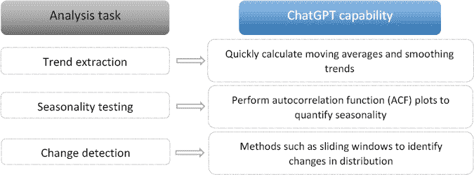

**图 6.1.** ChatGPT 时间序列分析的能力

时间序列分析是一种用于检查历史数据和预测未来趋势的稳健方法。`ChatGPT` 凭借其灵活的计算技能，通过自动化预处理、模型拟合和预测等耗力任务，简化并加速了工作流。

`ChatGPT` 还擅长自动分析时间序列数据，以发现季节模式、自相关性、平稳性和其他统计属性 (Sedkaoui 2023)。这为理解指标如何演变提供了更好的支持。例如，数据分析师可以提示 `ChatGPT` 评估时间序列数据集中的趋势和噪声，作为建模的基础。AI 处理统计的繁重工作，而人类则解释见解。

`ChatGPT` 能够支持生成 `Python` 或 `R` 代码、使用 `Prophet` 进行时间序列预测、协助调试应用程序错误并管理中间数据处理步骤。数据分析师可以根据需要整合可用的前瞻性指标、事件数据和专业知识来微调预测。`ChatGPT` 还允许对不同的模拟场景进行快速迭代。

例如，他们可以根据过去的趋势和季节预测假期销售，然后根据已知的促销、活动和市场状况进行修改。

对于预测，`ChatGPT` 在以下方面具有优势：

*   在历史数据上快速训练预测模型，例如 `ARIMA` 和 `Prophet`；
*   对不同算法的性能进行基准测试以选择最合适的模型；
*   生成包含各种预测变量多元模型。

数据分析师随后通过应用他们的判断和领域专业知识对原始预测进行调整。这平衡了自动化与人工监督。因此，必须认识到，尽管 `ChatGPT` 强调了在多项任务中的能力，但在面对需要专业知识或创新解决方案的复杂问题时，它可能会遇到挑战。

因此，数据科学家的角色对于挖掘 `ChatGPT` 的潜力仍然至关重要。他们是数据挖掘过程的架构师，负责明确目标并在业务背景内对结果进行上下文化。他们的解释弥补了原始分析结果与可操作洞察之间的鸿沟，确保系统标记的异常在导致错误结论之前经过审查。此外，人类判断被用于使预测与战略目标保持一致，并在时间序列分析中识别相关因素，使信息基于现实世界的相关性。

精心设计的提示词（prompts）是在时间序列数据分析中有效利用 `ChatGPT` 能力的基石。提供的提示词是进入分析过程的战略切入点。通过提出围绕时间序列数据中的趋势、相关性、机会、风险、影响和洞察的问题，用户可以引导 `ChatGPT` 的计算能力去发现隐藏的模式和价值信息。这些提示词充当了导航灯塔，引导 AI 指向对用户目标重要的数据特定方面。

时间序列数据的动态特性既带来了挑战也带来了机遇。虽然时间维度允许观察随时间变化的趋势，但它要求对数据点周围的背景有全面的理解。这正是人类专家与 `ChatGPT` 分析能力之间协作变得至关重要的地方。人类的参与确保了细微差别、上下文变化和业务影响被纳入分析中，将洞察提升为可操作的建议。

然而，人机协作并非没有挑战。提供的提示词必须经过仔细设计，确保它们与数据的特定背景和分析目标相对应。尽管 `ChatGPT` 可以快速准确地处理数据，但它依赖于准确的提示词来交付有意义的结果。随着 AI 领域的不断进化，完善人类输入与 AI 输出之间的交互是一个持续的过程。

`ChatGPT` 与数据分析师之间的协作不仅止于解释，还延伸到验证。数据分析师利用实验设计原则和团队策略来挑战和测试 `ChatGPT` 给出的建议。这种保护不仅防止了对 AI 结果的盲目接受，还有帮助最大限度地减少潜在的风险和错误。

既然我们已经探索了借助 `ChatGPT` 开发、优化和治理预测模型的策略和最佳实践，现在，我们在 `第 7 章` 中更深入地观察这种智能生成式 AI 代理如何应用于改进和开发特定的机器学习技术和算法。让我们探索这些潜力，通过人机协作推进 AI 的前沿技术水平。

# 7 为机器学习服务的 ChatGPT

在 `第 3 章`、`第 4 章`、`第 5 章` 和 `第 6 章` 中，我们探索了 `ChatGPT` 在数据准备、自然语言查询、增强分析和预测建模等任务中的应用。然而，其影响已超出终端用户工具，加速了机器学习研发的实践本身。

本章展示了生成式 AI 如何在人工干预下与机器学习算法协作，以改进现有技术并激发新的创新。

在本章中，我们讨论了高影响应用，包括利用 `ChatGPT` 的构思能力来探索新的模型和算法架构，使用代码生成快速构建概念模型的原型，优化技术工作流，以及生成式 AI 与程序化机器学习相结合形成新的混合方法。最后，我们查看了直观的对话界面如何让高级机器学习的获取变得民主化。

共同主题是利用 AI 能力增强人类的智慧，以推进前沿技术的发展并更快地释放新潜力。正如领域专家在 AI 的帮助下可以取得更多成就，机器学习算法的用户也是如此，而且这种能力还可以通过对话界面的力量得到倍增。

通过与 `ChatGPT` 等工具协作，机器学习社区可以开启可能性的新境界，并解决曾被认为不可解决的复杂现实问题。

## 7.1 ChatGPT 功能织结构中的机器学习

机器学习（ML）正成为 AI 的一个变革性方面，赋予软件应用程序卓越的提高预测准确性的能力，而无需显式编程。这门学科利用数据集的潜力来改进算法。机器学习一个引人注目的方面在于其基础是先进模型，这些模型有助于进行预测（Mitchell 1997）并在人类程序员的干预最少的情况下做出决策。

这些模型通过被称为“Transformer 块”的复杂层运行，分析样本数据并自主解码模式以产生所需的输出。其核心是，机器学习算法利用历史数据作为输入，然后对新的输出值生成预测，这是数据驱动智能的体现。

`ChatGPT` 本身在其底层的生成式架构中结合了多种机器学习技术（Gutierrez 2015）。它被应用于机器学习领域，利用了支撑其能力的庞大数据集。在这个领域，大量的语言模型汇聚在一起，赋予了 `ChatGPT` 生成类人对话的卓越能力。

`ChatGPT` 背后的架构师无缝地结合了监督学习和无监督学习的优势，这种协同作用丰富了聊天机器人的学习体验并增强了其性能。这种融合体现了动态交互，使 `ChatGPT` 的结果越来越精炼。

`ChatGPT` 使用监督学习原理，其中输入与输出的关系被显式定义，并使用标记的数据集精炼模型。这些算法随后使用这些知识来预测新奇输入的结果。在这一训练计划中，`ChatGPT` 使用了一种名为人类反馈强化学习（RLHF）的策略。

RLHF 作为机器学习技术的一个子集被集成到 `ChatGPT` 的架构中，旨在提高 AI 语言模型的对话能力。得益于与人类训练者持续的反馈循环，`ChatGPT` 学习区分正确和错误的响应，从而有效地塑造了其对话行为。

RLHF 在 `ChatGPT` 中的采用是开发与人类交互共鸣的响应的渠道。这种迭代演变涉及监督微调，其中人类 AI 训练者参与了模拟用户和 AI 助手角色的对话。

在它的知识库中，`ChatGPT` 也利用了无监督学习，这种范式在缺乏目标结果明确指南的数据中解锁模式。

在无监督学习的背景下，AI 旨在通过识别数据中的相似性和差异来发现模式。这使得 AI 能够为探索性分析、图像分割和分析模式识别等任务制定精确的答案。

`ChatGPT` 的无监督框架涵盖三种主要的学习方法：聚类、关联规则和降维。

聚类是一项本质的数据挖掘技术，它根据相似性或差异对未标记的数据进行分组。`ChatGPT` 的算法通过验证这些模式，将无序数据分类为不同的簇，这些簇体现了内在的模式和结构。排斥性聚类、重叠性聚类、层次聚类和概率聚类是塑造 `ChatGPT` 实力的关键聚类算法。

同时，`ChatGPT` 还整合了关联规则——这是一种基于规则的方法，用于揭示数据集内部变量之间的联系。这种技术通常用于购物篮分析，使公司能够识别各种物品之间的关系，从而优化交叉销售策略和推荐引擎。关联规则生成的历史包括了一些估算算法，如 `FP-Growth`、`Apriori` 和 `Eclat`。

对于具有高维度特征的数据集，`ChatGPT` 熟练地使用了降维技术。随着数据的激增，准确性随之提高，机器学习算法的复杂性也是如此，这往往会增加数据可视化的难度。为了应对，`ChatGPT` 在其无监督框架中使用降维，在保持数据集完整性的同时使数据量处于可管理范围内。

本质上，`ChatGPT` 协调了机器学习领域监督与无监督范式的双重性。这种融合使得 AI 聊天机器人能够提炼数据的复杂性，对查询和提示提供最佳响应，同时培养了 AI 能力与人类创造力之间动态的协同效应。

表 7.1 总结了机器学习算法与 `ChatGPT` 之间的共生关系。

### 表 7.1 ChatGPT 与机器学习算法：共同进步的良性循环

| 算法 | ChatGPT 如何使用它们？ | 它们如何使用 ChatGPT？ |
| --- | --- | --- |
| **监督学习** | 使用标记数据进行特定任务的微调 | ChatGPT 可以提供用于模型训练的标记数据集 |
| **无监督学习** | 在未标记语料库上进行预训练以学习模式 | ChatGPT 可以帮助聚类和分析非结构化数据 |
| **强化学习** | 通过人类反馈奖励优化对话技巧 | ChatGPT 可以为测试代理策略提供对话环境 |
| **神经网络** | 基础 transformer 架构 | ChatGPT 可以提议新的网络架构进行测试 |
| **注意力机制** | 在其 transformer 架构中使用 | ChatGPT 可以解释注意力机制的工作原理 |
| **迁移学习** | 利用预训练参数进行微调 | 知识可以从 ChatGPT 迁移到下游模型 |


如表 7.1 所示，ChatGPT 在设计中结合了多种机器学习技术，同时为推进机器学习研究和工程生命周期提供了一个协作工具。这种协同关系导致了双方能力的不断增强。

在实践中，多种方法的多种元素往往被结合在一起。例如，可以使用无监督学习来提取特征，然后使用监督模型进行预测。算法的多样性提供了所需的活性，以将解决方案适应不同的机器学习任务和现实世界中的数据类型。

ChatGPT 的优势在于它在操纵这些语气和风格转换方面的卓越能力，这源于它对多样化数据集的海量接触。机器学习进一步增强了它的能力，使其能够理解语言中复杂的语法基础。在机器学习的推动下，这种能力使 ChatGPT 利用算法创建出与人类流利度共鸣的输出。

因此，机器学习与 ChatGPT 演进之间的共生关系强调了迈向强 AI 的轨迹。机器学习对于 ChatGPT 捕捉语言细微差别、识别模式并随时间推移提高性能至关重要。

## 7.2 使用 ChatGPT 创建新的机器学习方法

机器学习方法的重要性延伸到多个维度。首先，它们是改进企业决策的重要盟友（Sedkaoui 2018a; Rich and Gureckis 2019）。通过挖掘历史数据，机器学习算法揭示了人工识别无法察觉的复杂模式和难以捉摸的趋势。这些见解是决策的强大催化剂，涵盖了从产品创新到战略性营销活动策划的各个领域。

然而，这些算法的力量超越了单纯的决策能力。它们与运营效率的提高产生了深刻共鸣。得益于欺诈检测和客户细分等任务的自动化，机器学习算法将员工从耗时的任务中解放出来。这为战略追求铺平了道路，推动公司朝着更高的效率和生产力发展。自动化的红利无疑是变革性的，因为它将人类的认知带宽从日常任务转向了需要创造力、创新和高层次战略的活动（Toubia and Netzer 2016）。

机器学习算法可以根据其学习风格大致分为监督学习、无监督、半监督和强化学习方法。

监督学习算法通过标记的输入-输出对示例训练模型，以推断目标输出。分类模型（如预测离散目标的 `logistic regression` 和 `random forests`）和预测连续值的回归模型是常见的监督方法。

无监督学习在未标记的输入数据中寻找隐藏的模式和内禀结构（Radford 2018; Sedkaoui and Khelfaoui 2020）。聚类算法（如将数据分组为不同片段的 `k-means`）和降维技术（如主成分分析 `PCA`）都属于无监督学习。

半监督学习在训练期间将一小组标记数据与较大的未标记集合相结合，以提高模型性能。这利用了未标记数据，同时避免了过度的人工标记需求。

强化学习通过根据行为的给定的奖励和惩罚系统（而非标记示例）来训练模型，在复杂环境中优化行为。游戏类 AI 经常使用强化学习。

机器学习的应用延伸到日常生活的各个方面。例如，Google 搜索和其他搜索引擎使用机器学习进行预测性搜索和自动补全功能（Sedkaoui [2018a](#b05.xhtml#bib42)）。

预测搜索是机器学习的一个方面，与自动补全功能一致。它依赖于基于用户行为分析开发的算法，能够预测用户操作。Netflix 是这种方法的一个极佳示例，它通过研究活跃用户的观看习惯来获取其偏好的深度洞察，然后提供个性化的推荐。

ChatGPT 通过类似的程序优化模型性能的潜力是巨大的。在机器学习的背景下，ChatGPT 可以简化自动补全和预测搜索功能（Wiles 2023）。通过这种方式，它可以提高这些功能的效率和准确性，并改进它们在其他应用中的用法，例如改进业务工作流、客户服务交互和内容生成。

像 ChatGPT 这样的大语言模型最有前景的应用之一是与人类协作，设计创新的方法来解决复杂的机器学习问题。ChatGPT 展现出的创意潜力，可以增强探索未知领域时的构思过程。

一个关键优势是 ChatGPT 能够消化关于当前研究状态、数据特征和任务目标的细节，然后针对特定用例提出新的模型架构或算法修改。

例如，数据科学家可以描述卷积网络在处理 3D 医学影像数据方面的局限性，并提示 ChatGPT 建议可能适用于体素输入的替代方案。ChatGPT 可能会提出此类想法，例如将 2D 卷积扩展到 3D，或使用基于体素的编码器来整合空间关系。

数据分析师可以通过多个提示与 ChatGPT 交互式讨论不同概念模型的优点、变体和组合。这推动了结合现有方法优势的新型混合技术的发展。通过从外部解释其自然语言生成过程（Hilton et al. 2021; Tamkin et al. 2021），ChatGPT 使数据分析师能够引导并对齐创新。

如表 7.1 所示，显然，ChatGPT 在优化和加速应用机器学习过程方面具有巨大潜力，包括数据处理、模型创建和机器学习工程。

对于数据准备，ChatGPT 可以根据自然语言提示自动化核心步骤，例如数据源链接、清洗、预处理和特征工程。这在建模之前提供了一个先机。

在模型构建方面，ChatGPT 可以快速构建一系列具有可配置超参数的机器学习算法原型。这有助于比较和选择最佳方法。ChatGPT 还可以解释模型性能和行为以支持调优。

对于机器学习工程，ChatGPT 可以为流水线、工作流和监控系统生成样板代码，由专家进行精炼而非从零开始。它还可以提供解释和文档。

在整个生命周期中，ChatGPT 使专家能够以更高层次的抽象进行操作，而 AI 则根据对话输入管理耗时的执行工作。这种增强的生产力和速度释放了应用机器学习的新潜力。机器学习工程的未来在于人类与 AI 优势的协作。

因此，尽管机器学习算法构成了 ChatGPT 本身的基础，但它们从生成式 AI 提供的直观界面、自动化编码和混合主动创意等功能中获益。ChatGPT 承诺将机器学习应用提升到新的高度。

ChatGPT 的使用使得创建机器学习项目的过程比以往任何时候都要透明。通过创建后续提示并评估输出结果，数据分析师可以有效地训练模型以满足用户查询，并轻松快速地提供有价值的洞察。

随着时间的推移，通过提示 ChatGPT 为各种类型的数据和机器学习挑战生成模型，可以积累候选架构和算法库。这种启动点的代码库加速了未来的构思和实验。

通过从本质上扩大脑暴团队，ChatGPT 有潜力极大地扩展数据分析师的创意范围，以及新技术的提案、分析和原型设计的速率。这种加速的创新周期将为机器学习能力开启新的疆域。

## 7.3 使用 ChatGPT 增强机器学习算法

一旦构思出新的机器学习方法，传统上将想法转化为可执行代码会带来巨大的实现负担（Sedkaoui and Khelfaoui 2020）。对于数据科学家来说，在机器学习方法中从零编写复杂的神经网络架构可能需要数周。然而，像 ChatGPT 这样的大语言模型通过自然语言代码生成自动化此类编程工作方面显示出革命性的潜力。

他们不需要苦苦地编写新模型，而是可以用纯语言描述模型规范、数据流和算法。ChatGPT 随后可以使用 `Python`、`TensorFlow` 和 `PyTorch` 等语言生成完整的模块和原型。例如，数据分析师可以指定用于处理序列数据的基于注意力的 RNN 模型结构。ChatGPT 可以生成实现所描述架构的可执行代码。

这实现了从构思到实现的快速转换，跳过了手写编码的沉重负担。其他想法可以并行进行经验测试。随着结果的产生，迭代调整将快得多。原型作为数据科学家自定义的功能性起点，而不是从零开始创建。随着时间的推移，可以为常见的机器学习构建块积累可用的模块库。

通过自动化编程的常规方面，生成式 AI 将人类专家从机器学习中解放出来，专注于战略工程和针对机械编码的影响性创新。这引发了实验和应用的浪潮，增强了工程生产力。他们未来的角色将协作引导 AI 工具执行技术，同时解决现实问题。人类与 AI 优势之间的这种合作将为机器学习开启新的可能性。

虽然像 ChatGPT 这样的生成式 AI 已经在机器学习应用中展示了巨大的潜力，但其影响更深地涉及到实践本身的形成以及机器学习研发的进展。特别是，两个高影响能力脱颖而出。

### 7.3.1 优化机器学习工程

ChatGPT 在模型架构、数据工程、机器学习工程和基于云的机器学习算法基础设施等主题上展示了深厚的技术知识。这些知识可以用于优化机器学习工作流和机器学习工程系统。

例如，数据分析师可以描述他们的模型训练流水线，并要求 ChatGPT 提供优化建议，例如分布式训练方法、超参数调优工具和调试技术。对于生产模型，ChatGPT 可以建议监控解决方案、数据验证检查和重训练频率。

本质上，它提供了一个机器学习顾问，随时准备回答问题、生成样板代码并确保最佳实践。这提升了生产力。

### 7.3.2 混合模型创新

此外，ChatGPT 特别适合将不同建模范式的优势结合成新的混合模型。例如，它可能会建议将图神经网络的半监督知识表示能力与 `LSTMs` 的序列处理强大能力相结合，或将深度学习架构与概率图模型元素相结合。

结合多种技术的优势是提升能力的一个极具前景的方向。通过在机器学习子领域中编码知识，ChatGPT 可以合成出由人类组织的专业知识及其自身新涌现的连接共同驱动的创造性混合组合。

这种在优化工程的同时在建模新领域进行创新的双管齐下的方法，展示了 ChatGPT 巨大的潜力，可以增加数据分析师在自动学习方法中的生产力。它既是协作者也是力量倍增器。

ChatGPT 对机器学习概念和算法的精通使其能够作为一个随叫随到的优化助手。它既能提供战略建议，又能自动化处理对于人类工程师来说枯燥且耗时的常规调优任务。

如表 7.2 所示，生成式 AI 的重要应用之一在于它通过数据分析师与 AI 之间的协作交互，提高机器学习算法的性能和效率。ChatGPT 通过充当随手可用的机器学习专家，发挥着关键作用，为数据分析师精炼模型提供帮助。

**表 7.2 使用 ChatGPT 提升机器学习性能**

| 机器学习优化方法 | ChatGPT 的角色 |
| --- | --- |
| 识别优化机会 | 根据模型架构、数据和性能提出改进方案 |
| 架构研究 | 建议模型架构并生成用于快速原型的代码 |
| 超参数调优 | 自动化仿真以寻找最佳参数组合 |
| 数据增强 | 推荐技术以扩展有限的训练数据 |
| 自适应学习 | 检测数据漂移并使用新数据重新训练模型 |
| 持续重训练 | 检测漂移并使用新数据重新训练模型 |
| 效率改进 | 建议技术（如剪枝和量化）以优化速度和大小 |

他们可以与 ChatGPT 交互描述模型架构、数据特征和性能指标，寻求在准确性、速度或计算效率方面的潜在优化指令（Sedkaoui 2023）。例如，ChatGPT 可以提供诸如建议，如调整损失函数、应用正则化技术、在模型架构中引入额外的层或注意力机制，并根据特定目标、数据特征和持续的模型结果修改优化算法。

此外，ChatGPT 的能力还扩展到自动化超参数调优过程。通过描述搜索空间、约束条件、模型选择和成功标准，数据分析师可以指示 ChatGPT 生成并评估各种超参数组合以优化模型性能。ChatGPT 运行的快速仿真可以识别出最佳配置，简化超参数调优过程。

在持续重训练领域，当新数据可用时，ChatGPT 可充当分析师的快速资源，促进模型的快速重训练和结果评估。它有助于确定是否需要进一步的微调，从而能够自适应调整以适应变化的数据模式。得益于其实时建议、自动化能力和迭代性质，它赋予了数据分析师主动精炼机器学习算法的能力，提高了他们的效率。与 ChatGPT 的协作交流使机器学习解决方案的优化呈指数级增长。

架构研究是另一个 ChatGPT 展示潜力的领域。通过允许分析师描述其问题陈述和目标，ChatGPT 可以为实验建议各种模型架构、连接模式和层配置。它更进一步，为最佳候选方案生成代码片段，加速了原型设计和比较过程。这拓宽了数据分析师有效探索的设计可能性范围。

数据增强是丰富模型训练的关键技术，也受益于 ChatGPT 的参与。在图像数据场景中，ChatGPT 建议针对特定问题进行旋转、裁剪和颜色变化等增强处理。对于文本数据，它推荐诸如改写、回译和混合多个样本等策略，从而提高训练数据集的多样性和稳健性。

在自适应学习背景下，ChatGPT 的贡献扩展到检测不利的数据漂移，并促进快速模型重训练以适应新出现的模式。这种持续学习机制保证了机器学习解决方案的持续准确性和相关性。

最后，ChatGPT 提供效率改进建议（包括蒸馏、剪枝、量化和优化编码等技术）增加了其作为优化器的多功能性。这些建议侧重于提高模型速度、缩小规模和优化资源利用，同时保持性能的准确性。

这一切都放大了生产力和性能——使分析师能够通过包含人类监控和 AI 执行的迭代协作循环，主动提高模型的准确性、稳健性和效率。通过结合双方的优势，组织可以创建能够动态学习并适应不断变化的现实世界的优化机器学习解决方案。

## 7.4 使用 ChatGPT 增强机器学习算法的潜力

监督学习和无监督机器学习是 AI 领域的两种不同范式，每种都提供了独特的优势和权衡。这些算法能够从大型数据集或现实观察中获取知识（Sedkaoui 2018a）。由于这些数据集来自各种来源和各种形式，它们的分析可能具有不同的复杂性。这种复杂性使得这些算法能够在不需要显式编程的情况下教授机器（Samuel 1959）。

机器学习算法识别促进学习过程的特定模式。这种识别与我们在之前的几个章节中深入检查的数据分析的各个阶段紧密相关。从这个角度来看，这些算法分类可以分为两个大类（Sedkaoui and Khelfaoui 2020 中展示了最常用的算法。

**表 7.3 算法的不同用途与 ChatGPT 的角色**

| 分析角色 | 技术示例 | 学习模式 | 要解决的问题 | ChatGPT 用例 | 说明 |
| :--- | :--- | :--- | :--- | :--- | :--- |
| 简单 | 简单/多元回归 | 监督 | 回归 | 自动化特征工程 | 根据这些数据建议预测客户流失的特征 |
| 朴素贝叶斯 | 朴素贝叶斯 | 监督 | 分类 | 识别缺失或错误数据 | 识别训练集中的数据错误 |
| 逻辑回归 | 逻辑回归 | 监督 | 分类 | 建议数据变换 | 推荐数据变换以获得更好的模型拟合 |
| 线性判别分析 | 线性判别分析 | 监督 | 分类 | 生成快速原型开发代码 | 为此模型提供 Python 代码模板 |
| K-means | K-means | 无监督 | 聚类 | 解释并命名聚类 | 总结分析中每个组的关键特征 |
| 层次聚类 | 层次聚类 | 无监督 | 聚类 | 解释并命名聚类 | 总结此分析中每个簇的主要特征 |
| 复杂决策树 | 决策树 | 监督 | 分类/回归 | 优化超参数 | 优化模型超参数以实现精度最大化 |
| 随机森林 | 随机森林 | 监督 | 分类/回归 | 生成合成数据 | 为不平衡数据集生成新的训练样本 |
| 支持向量机 (SVM) | SVM | 监督 | 分类/回归 | 建议模型架构并优化超参数 | 为文本分类任务提出 SVM 核类型，并调整 SVM 正则化核参数 |
| 神经网络 | 神经网络 | 监督 | 分类/回归 | 解释预测 | 解释神经网络的分类决策 |
| K 近邻 | KNN | 监督 | 分类/回归 | 识别异常值 | 检测训练数据中的潜在异常值 |
| 贝叶斯网络 | 贝叶斯网络 | 监督 | 分类、概率预测 | 分析变量依赖关系 | 评估数据集中变量依赖关系 |
| 高斯混合模型 | GMM | 无监督 | 聚类、密度估计 | 确定最佳组件数量 | 根据数据确定理想的混合组件数量 |
| 生成对抗网络 | GAN | 监督、无监督 | 真实数据生成 | 生成新数据 | 生成保留原始分布的合成数据 |
| 自动编码器 | 自动编码器 | 监督、无监督 | 降维、异常检测 | 识别最重要的维度/特征 | 识别数据集中的异常数据点。确定哪些数据维度最重要 |

## 监督学习

监督机器学习通过从标记训练数据对中学习，在存在足够标注的情况下，它在做出预测和数据驱动的决策方面表现出色（Rich and Gureckis 2019; Sedkaoui 2023）。分类、回归、预测和排序都是通过在人工标记示例上运行监督算法来实现的。这种自上而下的方法将人类的考虑因素编码到模型中。然而，获取全面、高质量的训练标签可能是困难的。

## 无监督学习

另一方面，无监督学习提供了一种自下上的方法，可以在没有人类帮助的情况下发现未标记数据中的结构和模式。聚类、降维、关联规则挖掘和密度估计是关键的无监督技术。这使得处理标注困难、主观或稀疏的数据成为可能。无监督学习为监督方法因依赖标注而可能错过的盲点提供了一个审视视角。

## 互补技术

这些技术是互补的。无监督学习通常用于探索性分析和特征表示发现，这些发现可以用来增强监督模型。半监督方法将小规模标记数据集与较大的未标记语料库相结合。而自监督学习通过数据创建人工监督信号，作为针对性无监督预训练的一种特例。掌握光谱的两端能够根据相应的学习范式应对各种挑战。正如人类从指令和经验的混合中学习一样，AI 系统也必须整合监督和无监督学习以实现稳健的智能。

在这种背景下，出现了一个问题：生成式 AI 技术（如 `ChatGPT`）能在多大程度上有助于生成额外的合成训练数据以提高这些算法的性能。这种数据生成能力能否补偿训练数据集的局限性，从而增强监督和无监督学习的结果？这些考虑为将监督和无监督学习的优势与生成式 AI 方法相结合开启了令人兴奋的前景。

## 监督学习中的生成式 AI

监督学习算法依赖大型标记数据集来学习从输入到目标输出的高效映射。然而，获取足够的、高质量的训练数据可能是具有挑战性且耗时的（Sedkaoui 2023）。这正是 `ChatGPT` 等生成式 AI 模型在辅助有限标记示例方面显示巨大潜力的地方。

例如，`ChatGPT` 可以通过针对多种主题和风格生成伪标签的合成样本，快速扩展情感分类模型的有限训练数据。这提供了更广泛的覆盖并防止模型过拟合。`ChatGPT` 还可以通过与人类专家对话，交互式地标记和重新标记任何标记错误的示例，从而提高训练数据的质量。

同样具有影响力的是，`ChatGPT` 可以根据机器学习专家的对话提示，从纯文本、图像或表格数据中提取高阶语义表示，从而引入到监督模型中的输入特征。更具信息的特征可以提高模型的泛化和可扩展性。`ChatGPT` 还可以根据性能目标和数据特征建议尝试的最佳模型架构和超参数，自动化繁琐的试错实验。

## 无监督学习中的生成式 AI


# 无监督学习与 ChatGPT 的协作潜力

无监督学习算法在没有人工标记示例辅助的情况下发现未标记数据中的隐藏结构。通过揭示模式、聚类和内在表示，无监督技术增强了预测建模和决策制定（Siegel 2013; Sedkaoui and Khelfaoui 2020）。然而，它们的探索性质在解释结果和将发现与业务价值结合方面带来了挑战。这正是像 `ChatGPT` 等智能系统展示强大协作潜力的地方，通过提供接口来交互地引导和上下文化无监督学习。

例如，`ChatGPT` 可以通过自然语言讨论识别与业务问题相关的新未标记数据集，为无监督建模提供支持。这缓解了数据限制。`ChatGPT` 还可以提供业务背景，帮助解释无监督算法生成的簇、维度和分部分的语义含义。这弥补了技术结果与战略目标之间的鸿沟。此外，通过与 `ChatGPT` 对话，数据科学家可以随需求的演变引导分析，将人类判断应用于传统上盲目运行的无监督技术。最后，`ChatGPT` 可以快速测试无监督算法、参数和数据的排列，加速迭代改进。

# 监督学习与高级技术中的 ChatGPT 应用

监督机器学习技术（如回归或神经网络）依赖于大量的标记数据进行学习。`ChatGPT` 可以通过自动化特征工程、生成合成数据以补偿数据集的局限性，以及解释复杂模型的预测来增强这些技术。对于无监督方法（如 k-means 聚类），`ChatGPT` 帮助解释并命名发现的类。对于高级技术（如贝叶斯网络），`ChatGPT` 可以加速变量间依赖关系的分析。对于自动编码器，它可以识别出捕捉的最信息数据维度。

如表 7.3 所示，`ChatGPT` 能够支持从最简单到复杂的各种机器学习技术。得益于它的对话能力，它可以加速数据流水线中的每一个阶段，从算法建议到模型优化和快速原型设计。该表总结了在赋能从业者方面可能产生的贡献的多样性。`ChatGPT` 为 AI 开发者的优势与 AI 知识之间富有成效的合作铺平了道路。这种结合预示着机器学习未来将取得重大进展。

更广泛地说，`ChatGPT` 的深层技术知识使其能够提出适应数据和目标的模型架构。它能够自动化超参数的优化以提高性能，并生成代码以快速实现想法的原型。因此，它的对话辅助放大了机器学习领域用户和从业者的能力。

无论是简单还是复杂的算法，无论是监督还是无监督算法，`ChatGPT` 都显著加快了从数据到部署的过程。它通过人机协作开启了 AI 创新的新时代。数据科学家在优化端到端机器学习流水线方面获得了一个伙伴。

既然我们已经涵盖了优化工作流、加速创新和民主化访问的机遇（Von Hippel 2006），第 8 章将关注一个同样重要的主题：通过直观且引人入胜的数据故事和报告让这些分析视角活起来。

在开发模型之后，组织需要知道如何向各种受众令人信服且负责地传递结果（Sedkaoui 2018b）。在这里，`ChatGPT` 在自动化报告方面展现出了巨大潜力，前提是人类监督能确保信息的准确性、客观性和战略相关性。让我们在第 8 章中继续探索吧！

# 8 叙事魅力：数据驱动的故事与报告

深入的数据分析只有在以引人入胜的方式传给利益相关者时，才能产生影响力。将技术洞察转化为引人入胜的故事是数据时代的基础技能。在本章中，我们将探索像 `ChatGPT` 这样的智能助手如何帮助从数据生成故事和报告，以捕捉注意力并简单地传递复杂思想。

我们将关注一些应用，例如自动化编写交互式仪表板以及开发引人入胜的故事计划。`ChatGPT` 在视觉化和自然、吸引人的语言让数据活起来方面显示出巨大潜力。然而，人类的验证对于确保准确性、避免偏见以及使故事与业务目标保持一致仍然至关重要。

AI 的创意与人类智慧的结合正在为高附加值报告和演示的新时代铺平道路。通过本章，我们将学习如何利用 `ChatGPT` 将技术分析转化为引人入胜的故事，从而启发你的观众，并在你的组织中促进数据驱动的文化。让我们开始这段令人兴奋的探索吧！

## 8.1 使用 ChatGPT 生成数据故事计划

数据故事是一种艺术形式，它超越了原始统计的领域，将它们转化为兼具信息量和引人入胜特性的叙事（Sedkaoui [2018a](#b05.xhtml#bib42)）。这种艺术形式是传递复杂概念的有力工具，弥合了复杂数据与人类理解之间的鸿沟。

这一过程的核心是不可或缺的数据故事计划概念。这些计划充当了架构蓝图的角色，确保数据故事结构严谨，并准备好实现其目标。为了使数据故事计划有效，它需要由几个集成组件组成，并完美交织成一个连贯的整体。

任何数据故事计划的基础元素是建立对底层数据的清晰理解。这一基础步骤要求对数据的来源、其内在限制以及在其数字线中包含的丰富信息有全面的理解。

同时，定义良好的受众是创建引人入胜数据故事的指路星。通过精确地勾勒目标受众的轮廓，故事讲述者获得了调节故事语气、深度和广度的手段。故事的共鸣在于它与受众的先验知识、兴趣和预期一致，使其能够更精确地到达目的地。

清晰目标的必要性被整合到叙事数据计划中。每个数据故事都必须以清晰且可辨的目标为支撑。无论目标是启发、影响还是吸引，叙事的轨迹和影响都取决于对这一目标的简洁表述，引导每个词和视觉效果指向一个连贯的目标。

故事的骨架是其结构，数据的叙述也不例外。精心追踪的叙事结构确保数据故事按逻辑顺序展开，从开始就捕捉注意力，在展开过程中营造悬念，并在高潮处提供令人满意的结局。开头、中间和结尾的三位一体架构推动着观众进行了一场关于探索、理解和反思的感官之旅。

可视化元素，作为数据画布上鲜艳的笔触，让这些故事活了过来。当得到将抽象数字转化为实质性信息的视觉辅助帮助时，数据故事就会蓬勃发展。这些图形展示不仅增强了参与度，还促进了理解，使我们能够感知仅凭文字难以表达的模式和关系。

当叙事达到顶点时，叙事的接力棒交给了“行动号召”。一个动人的数据故事以行动请求告终，呼吁将新的意识转化为具体的步骤。这最后一个元素催化了从被动参与到主动贡献的转变，无论是访问网站、签署请愿书还是捐款，从而培养了故事与其接收者之间的共生关系。

在数据故事的交响乐中，每个元素都与下一个元素和谐相处，创造远超数据表和图表限制的乐章。得益于周密的计划，数据故事从简单的事实混合演变为一种沉浸式体验，能够启发、赋能并娱乐观众，在他们的感知和行动上留下不可磨灭的印记。

创建一个引人入胜的数据故事需要深思的规划和结构。`ChatGPT` 在整个过程中可以提供宝贵的协助。但现实中，`ChatGPT` 如何与人类团队在规划和设计数据驱动叙事的核心要素上合作，以确保最大的相关性、参与度和影响（Sedkaoui 2023）？图 8.1 将化了这一问题的答案，并描述了开发数据叙事的核心组件，以及 `ChatGPT` 在每个阶段可能扮演的角色。

`ChatGPT` 可以在关键规划要素上协作，从理解数据集到构建叙事流和解释。它的知识和生成能力为团队提供了一个坚实的起点，随后对数据叙事进行精炼和个性化，以实现最大的相关性和影响。

首先，`ChatGPT` 通过自然语言提示词（`prompts`）自动生成摘要、统计和表格，加速对数据的理解。这阐明了观点和关系。

然后，在定义目标受众时，`ChatGPT` 可以根据受众类型建议最佳的框架——让复杂的细节对非技术人群易于理解，或为数据科学家增加技术严谨性。

`ChatGPT` 还帮助根据分析目标和关键结论开发叙事弧线和流程，确保为目标受众量身定制逻辑顺序。

对于数据可视化，`ChatGPT` 提供了创新的启动建议，用于尝试不同的图表类型和设计。它还创建解释性示例和类比，为不同的受众澄清概念。

最后但同样重要的是，`ChatGPT` 擅长根据预期的信息和结果提出强有力的行动号召（`calls to action`），以此激励受众。

在每一个阶段，`ChatGPT` 都为精炼对业务需求的细微理解提供了一个坚实的起点。

像 `ChatGPT` 这样的生成式 AI 模型可以与数据团队合作设计这些沟通计划，以确保报告共鸣。通过描述关键方面，例如目标受众、数据洞察、分析目标和所需的叙事弧线，`ChatGPT` 可以提出沟通框架、序列、解释性类比以及潜在包含的可定制可视化方案。这为与创意人员和管理人员的讨论与完善提供了一个坚实的起点。

例如，数据分析师可以告知 `ChatGPT` 通过预测模型检测到的客户流失关键趋势。他们可以提示它建议一个引人入胜的场景，将分析中的“顿悟时刻”转化为直观的流程。这可能涉及在深入流失因素之前揭示客户群体之间的模式。数据分析师可以通过描述利益相关者的兴趣和对数据的掌握程度，引导 `ChatGPT` 为执行利益者和技术人员定制叙事。

在这种背景下，`ChatGPT` 可以提供与每个受众产生共鸣的解释性类比和示例。通过协作头脑风暴，团队在利用 `ChatGPT` 海量沟通知识的同时，运用人类对业务信息需求和才能的理解。这种创新的协同效应转化为高影响的数据故事，能够教育并激活受众。

## 8.2 词汇的魔力：自动化编写数据驱动故事

强大的数据故事讲述不仅需要深思的规划，还需要在编写有说服力的故事时熟练的执行。这就是生成式 AI 及其 `ChatGPT` 智能代理在自动化将分析洞察转化为引人入胜的故事方面极具前景的地方。

数据驱动叙事的构成涉及使用数据构建一个结合信息和参与感的故事。这种技术作为向广泛受众传递复杂概念的工具非常有效。

传统上，数据驱动叙事的开发具有过程长且劳燥的特点。然而，`ChatGPT` 等先进语言模型的出现改变了这一格局，使数据驱动故事创作的自动化成为可能。

`ChatGPT` 提供了涵盖文本生成、语言翻译、多样化内容构成和回答信息性查询的能力。此外，它正处于简化编写数据驱动故事这一复杂工作的边缘。为了通过 `ChatGPT` 自动化编写数据驱动故事的过程，我们需要向 AI 提供以下细节：

*   用于叙事构建的数据集；
*   故事的目标受众；
*   故事的总体目的，包括告知、说服或娱乐等目标。

配备这些输入后，`ChatGPT` 开始启动文本生成任务，产生一个与数据洞察交织的叙事。此输出经过精细定制，以同时满足目标受众和叙事的指定目标。此外，它还具有启发性、沉浸感易于理解的特性。

**表 8.1** 使用 ChatGPT 进行自动化数据故事讲述

| 步骤 | ChatGPT 能力 | 示例提示词 |
| --- | --- | --- |
| **制定故事大纲** | 生成叙事和关键点的详细大纲，并提出有说服力的叙事弧线和结构 | “为关于我们销售数据关键趋势的博客故事提供五段式大纲”<br>“建议一个引人入胜的叙事弧线，向高级管理层解释我们的 A/B 测试结果” |
| **编写初稿** | 生成完整的叙事草稿，用易于理解的语言解释数据洞察 | “用一篇针对非技术受众的短博客文章总结此客户研究报告中的关键洞察” |
| **驱动数据可视化** | 建议用于可视化数据和发现的图表、图形和表格 | “显示这些数据中描述的过去一年网站流量趋势的最佳方法是什么？” |
| **精炼故事元素** | 根据反馈修改、扩展或重新格式化文本和视觉效果 | “添加更多解释性示例以澄清草稿报告的这一部分” |
| **编写引言** | 编写引人入胜的开头段落 | “写一个引人入胜的开头段落，概述本次分析演示的核心思想” |
| **生成解释** | 纳入澄清示例和类比 | “用能与我们营销团队产生共鸣的类比和示例丰富这些数据分析发现” |
| **为故事添加元素** | 包含相关的轶事和叙事元素 | “在此处加入一个说明客户摩擦力这一数据点的轶事” |
| **修改语气和风格** | 为不同受众调整语气和风格 | “修改此草稿的语气，使其对我们的执行利益者来说更正式” |

通过向 `ChatGPT` 提供关键数据输出以及沟通计划和受众需求，它可以生成编写的故事草稿、幻灯片、电子邮件和其他格式，使用生动的语言、针对接收者定制的类比和示例，以直观的流程令人信服地传递关键信息（Sedkaoui 2023）。

例如，数据记者可以向 `ChatGPT` 提供从选举民意调查中发现的有趣趋势，并让它生成文章初稿，用清晰的非技术语言引导读者理解分析，并穿插解释性的比喻。自动生成的草稿随后允许对故事进行精炼以实现最大的参与度，而不是从零开始。

对于视觉幻灯片，数据团队可以提示 `ChatGPT` 创建幻灯片标题、解释性文本，甚至建议自定义图形，以在富有影响力的演示中点活数据。这为设计人员随后完善视觉流和品牌形象提供了一个起点。

在一个数据编织成复杂叙事的时代，通过 `ChatGPT` 实现数据驱动叙事的自动化承诺了一系列令人引人的益处。

通过 `ChatGPT` 实现数据驱动故事的自动化具有许多优势。它不仅节省了宝贵的时间和精力，还保证了故事的准确性和公正性。这种方法能够创建出针对不同受众量身定制的叙事，在此过程中提高了参与度和视觉吸引力。

数据不仅仅是数字的堆砌，数据其本质就讲述着故事，具有揭示复杂模式和洞察的潜力。在 `ChatGPT` 的引领下，这一过程不仅节省了无价的时间精力，还赋予了故事无与伦比的准确性和公正性。随着数据揭示其故事，这种方法赋予了故事讲述者创造与不同受众共鸣的叙事的能力，在整个过程中增强了参与度和视觉吸引力。

得益于这种协同效应，`ChatGPT` 成为一个强大的创意协作者，协调数据驱动故事的自动化创建，巧妙地将信息、吸引力和有效性结合，邀请观众进入一个不仅提供信息，还能激发灵感并采取行动的领域。

`ChatGPT` 提供了一种快速获取初始想法和页面文本的方法，允许人类创作者随后对材料进行精炼，以实现最大的共鸣和战略对齐。通过结合力量，可以更快地开发出强大的数据故事。然而，人类的监督仍然至关重要，以确保准确性、避免偏见并编写高质量的故事。`ChatGPT` 的自动化需要策略性的指导，并且在外部使用之前对其工作进行仔细验证。

## 8.3 交互式仪表板与 ChatGPT 的独特之处

交互式仪表板是数据可视化和数据分析结果领域的基石，为用户提供了一个动态平台，使其从多个角度探索数据、揭示趋势和模式，从而促进明智决策。这些仪表板中封装的交互性、可视化和个性化创造了探索和理解数据的多维度方法。

交互式仪表板的出现预示着数据分析的转型，使该领域变得民主化，使得即使是那些技术能力有限的人也能够触及（Sedkaoui 2018a）。这种民主化至关重要，因为它将数据挖掘的范围扩展到了数据科学家和分析师限制之外，为广大用户打开了大门，从寻求战略信息的高层业务领导者到组织架构中各种角色的人员。

得益于色彩鲜艳的表格、图表、地图和其他视觉辅助，用户能够识别出可能隐藏在原始数据迷宫结构中的模式、异常和相关性。交互与可视化的结合增强了这一过程，允许用户实时缩放、过滤和操作可视化内容，提供数据景观的细粒度视图。

定制是一项强大的属性，强调了交互式仪表板的多功能性。用户有能力根据其独特需求定制这些仪表板。无论公司需要跟踪性能评估的离散指标，还是数据分析师寻求检查特定数据点以获取洞察，塑造仪表板的灵活性确保了它与用户目标的共鸣。

由于交互式仪表板固有的共享功能，协作被提升到了一个新的高度。团队可以在以数据为中心的项目上无缝协作，跨越地理障碍和时间限制。实时分发和合并信息的能力促进了多元视角的汇聚，这对于在复杂且快速变化的业务环境中支持明智决策至关重要。

利用 `ChatGPT` 的能力，创建仪表板及其到最终迭代的精炼过程可以在几分钟内完成。这里的显著成果在于 `ChatGPT` 在加速和简化设计用于数据分析或相关活动的交互式仪表板创建方面的决定性作用。

这种速度的提高不仅加速了探索性数据分析（`EDA`）阶段并促进了超参数调优结果的可视化（Sedkaoui 2023），还简化了发现的传播。结果，`ChatGPT` 的动态整合不仅实现了快速开发，还加速了洞察的传递，在几分钟内改变了有效通信的格局。

随着 `ChatGPT` 的流行飙升，分析师跟上最新工具和技术，同时探索将 `ChatGPT` 无缝集成到其流程中的方法变得至关重要。然而，按照惯例，创作过程以迭代为特征——创建、测试、完善和进一步测试，是一种推动进步的迭代舞蹈。这一过程的开始是构建数据集。

想象一下通过向 `ChatGPT` 轻声细语就创建仪表板的可能性。想象一下场景：通过提示词，我们可以在 `Code Interpreter` 等插件的独特性驱动下，触发一系列事件。让我们来看看这种转换是如何发生的机制：

*   该过程从一个关键步骤开始：阐述仪表板的目标。数据中包含什么故事，我们正在寻求发现什么洞察？与 `ChatGPT` 的初始对话触发了你的意图地图。
*   从那里，出现了一幅由不同来源——数据库、电子表格、API——织成的数据织锦，每个来源对整体故事做出了贡献。这些组合在下一阶段汇聚，数据准备占据中心。原始数据经过清洗、结构化和协调，以便无缝集成到叙事仪表板中。
*   选择仪表板工具类似于选择艺术家的画布。景观丰富多变，充满了 `Tableau`、`Power BI`、`Looker`、`Python` 等。每个工具都为将数据转换为生动的可视化和交互提供了独特的色板，画出一幅与你的愿景共鸣的画布。
*   现在故事成型了。在你的低声提示词引导下，仪表板工具将数据转换为动态可视化。通过调整和精炼，随着交互性织入你创作的结构，旅程不断演变。
*   前方有一个关键步骤：测试仪表板的友好性及其视觉显示的清晰度。洞察力是否显而易见？导航是否直观？寻求保证以确保用户可以轻松从仪表板中汲取价值。
*   揭幕，大终场，预示着你的作品向世界展示。交互式仪表板作为数据与设计的交响乐，准备好为他人提供可操作的洞察，为明智决策奠定基础。

当我们深入研究微妙之处时，插件作为无价的工具出现，丰富了交互的织锦。`Plotly`、`Dash`、`Code Interpreter` 和 `Streamlit`——这些插件画下了多功能和创新的笔触，允许注入活力和用户参与。每个插件都提供独特的益处，为你的独特故事定制。

这些技巧犹如这片创意星系中的指路之星。清晰的标签引导用户识别视觉区域，而颜色编码则阐明了数据叙述中的细微差别。工具提示（`Tooltips`）突出了隐藏的宝藏，为深层理解提供了通道。考虑到移动时代，自适应性设计确保了仪表板的触达不受限制。设计的一致性促进了凝聚力，而外部视角则在你的作品面对世界之前对其进行完善。

本质上，这段从简单提示词到功能性交互式仪表板的旅程，是创意、技术和洞察力的炼金术。`Code Interpreter` 作为思想的媒介，在数据、可视化和交互的协作中发挥着其变革性的魔力。随着可能性的画布在你面前展开，仪表板设计的未来是低语、创新以及从数据交响乐中创造引人入胜叙事的融合。

在以用户为中心的设计领域，理解用户需求和目标至高无上，选择合适的组件并无缝集成 `ChatGPT`，为渴望将仪表板设计提升到无与伦比水平的专家指南。


在深入探讨 `ChatGPT` 在仪表板设计工作流中的变革潜力之前，回顾传统方法至关重要。传统上，专家会开启一段旅程：从明确仪表板的目的，到聚合所需的数据和视觉组件。随后，将对仪表板布局进行精细定制以满足用户偏好。最后步骤涉及手动数据输入和劳动密集型数据处理，以塑造视觉呈现和简洁的摘要。

虽然这种经过证明的方法可以产生成效，但并非没有挑战。传统方法往往耗时且容易出错（Liebrenz et al. 2023）。手动过程可能会无意中阻碍设计团队的敏捷性，抑制实验和迭代演化的潜力。传统仪表板设计的劳累性质往往扼杀了探索创新解决方案所需的创意自由。

针对这些挑战，将 `ChatGPT` 集成到仪表板设计旅程中的前景似乎是一盏创新的灯塔。`ChatGPT` 的实力可以显著减轻手动方法的缺点，加速设计过程并降低错误风险。通过自动化某些方面，我们获得了专注于创意构思和战略决策的自由，最终为迭代实验和完善铺平了道路。

通过调整的提示词，这个生成式代理可以建议甚至帮助生成自定义数据可视化，如表格、图表和地图，直观地传达复杂数据集中的关键趋势和关系。

分析师可以针对特定的业务问题和受众需求提供背景。`ChatGPT` 然后提供带有自定义可视化和交互（如过滤器、工具提示和交叉高亮）的仪表板原型，以讲述定制的数据故事。例如，营销人员可以告知 `ChatGPT` 活动性能指标，并让其设计一个交互式仪表板，显示跨渠道、创意、细分和时间段的趋势。这提供了分析的实用概览。

对于一线团队，`ChatGPT` 可以帮助创建销售数据的地理视图，并叠加上员工的领土和目标。自动化为随后优化生产力可视化提供了坚实的起点，使其具有最佳的功能、可用性和品牌视觉效果。

通过将 AI 的可视化能力与人类监控相结合，仪表板从静态报告转向交互式叙事，能够有意义地吸引观众，使数据探索变得直观且具有高影响力。

## 8.4 人是协议的核心：人类智慧在生成式 AI 中的印记

在数据驱动叙述的复杂织锦中，一个经常被忽视的方面是人类扮演的核心角色——他们不仅是用户，还是支撑这些 AI 系统的创造者架构师。人类的深远影响体现在 `ChatGPT` 等生成式 AI 模型的创建、开发和使用，使其成为人类智慧的见证和人类视角的镜子。人类洞察与机器辅助之间的共生伙伴关系是创建准确、信息丰富且符合伦理的叙述的基础。

人类协助的不可缺性在整个范围内持续存在，原因如下：

- **背景与解释**：尽管 `ChatGPT` 异常强大，但它仍然受限于其编程的范围。它缺乏理解渗透人类语言和文化中复杂细微差别的能力。在这里，人类成为关键架构师，被赋予了向数据生成的叙述中注入背景和解释的能力。这种人文关怀通过与对主题的深入理解相结合，提升了故事和报告的质量。

- **错误检测**：`ChatGPT` 的发展轨迹表明它也容易受到错误的影响。尽管经历了非凡进化，它有时会在生成的数据中产生不准确之处。在这里，人类敏锐的眼睛在扫描输出时大放异彩，熟练地识别并纠正差异。人类警觉与 AI 辅助的这种相互作用加强了数据叙述中可靠性的基础。

- **反馈循环**：数据领域广阔且往往复杂。在这些复杂领域，人类从一组数据点中辨别意义的能力仍然是无可比拟的。通过向 `ChatGPT` 提供评论，人类专注于最相关的数据，丰富了生成的故事和报告的质量。这种协作协同促进了持续学习循环，完善了 AI 识别相关性的能力。

- **交互式仪表板**：交互式仪表板领域突出了人类智慧与 AI 能力的和谐融合。`ChatGPT` 发挥其在生成数据驱动洞察方面的威力，而人类则投入设计视觉美观、易用的仪表板。这些仪表板经过精心设计以引起用户共鸣，成为将数据故事翻译为有意义信息的通道。

- **超越机械**：支撑人类与 `ChatGPT` 交互的基础是一个代表人类贡献本质的典型方面。人类判断者引导数据的策展，塑造了相关信息的筛选和结论的形成。创意成为不可估量的工具，因为人类桥接了原始数据与引人入胜叙事之间的差距，设计出新的方法来说明和交流复杂的结果。

- **主导创意**：通往生成式 AI 模型的旅程始于人类的大脑。这些模型从根源上说是构思它们的人类智慧的反映。从概念化到执行，生成式 AI 模型的背景根于人类的思维过程（Samuel 1959; Sedkaoui and Khelfaoui 2020）。这种思想领导力延伸到启动与 AI 交互的提示词制定。通过塑造提示词，人类为 AI 赋予了预定义的方向，为故事注入了人类的意图。

- **开发的架构师**：生成式 AI 模型（如 `ChatGPT`）的演进是人类创新和技术实力的体现。人类通过精细地构建算法，在海量数据集上训练模型，并不断完善其性能。作为 AI 开发历程的守门人，人类不断优化模型，使其具备理解上下文、生成连贯文本甚至模仿人类对话的能力。这些模型本质上是人类创造力和努力的结晶。

- **洞察的共同创造者**：人类洞察与 AI 增强之间的共生相互作用，使得数据叙事变得完整且具有洞察力。人类将 AI 作为工具，利用其计算能力来分析海量数据集，识别模式并提取可能被人类肉眼无法察觉的洞察。然而，对这些洞察的解释、构建和语境化仍然是人类特有的努力。AI 驱动的分析与人类驱动的解释相结合，产生了丰富了双重视角的叙事。

- **伦理守卫者**：随着我们进入 AI 生成式模型领域，人类的伦理指南针是不可或缺的引导力量。确保 AI 生成的叙事符合伦理标准的责任完全落在人类的肩上。提示词创建的过程是这一角色的生动体现，人类决定了 AI 运行的参数。这种伦理保护确保了 AI 叙事尊重包容性、公平和尊重价值观。在数据驱动决策的时代，人类伦理发挥着核心作用。虽然 `ChatGPT` 是算法驱动的，但人类必须确保从数据中提取的信息被以伦理且负责的方式使用。人类的道德指南防止了数据被误用于歧视或侵入性目的，帮助创建不仅反映数据，而且反映共情和责任的叙事。

- **未来可能性的导航员**：在当前视界之外，人类引导着 AI 演进的轨迹。人类的创造活力驱动着生成式 AI 模型的完善，寻求填补理解空白并提高叙事的连贯性。随着 AI 模型的演进，人类引导其能力克服局限性，并开启创意和精确的新维度。

人类与生成式 AI 模型之间的关系以深度共生为特征。提示词的产生、AI 模型开发和共同创造说明了人类智慧与 AI 计算能力之间的动态伙伴关系。虽然 AI 模型增强并加速了叙事创作的某些方面，但故事本身仍然是人类解释、意图和技术增强的和谐融合。当我们沿着这条共同进化的道路时，我们编织的叙事结构反映了人类与 AI 能力的和谐相互作用。

尽管 `ChatGPT` 等生成式 AI 模型可以加速数据故事和仪表板的创建，人类监督对于验证质量、准确性和伦理仍然至关重要。尽管 `ChatGPT` 能力出色，但缺乏真正的语义理解和商业背景。没有人类的监督，就会出现偏差、误导和战略对齐方面的风险。

数据科学家在发布之前必须彻底检查自动生成的结果。这包括检查统计错误、误导性推理或任何可能无意中引入的偏差。通过对仪表板功能的代表样本进行检查，可以检测数据流或视觉映射中的任何错误。数据科学家和领域科学家还确保信息传递与组织的敏感性和目标保持一致。

特别是，人类判断对于防止潜在误导性、有害或不公平的呈现提供了关键的伦理保护。`ChatGPT` 缺乏伦理关系所需的道德推理和责任。当 AI 自由编写或设计时，持续的人类指导强化了护栏和边界。

`ChatGPT` 在分析吞吐量上提供了指数级的增长，但经过思考的协作释放了结果的业务影响。`ChatGPT` 在分析过程中的能力（无论是否有人类干预，见表 8.2）中，我们将讨论如何在分析工作流中负责任且透明地部署生成式 AI——通过建立明确的安全防护措施来缓解与偏差、公平和滥用相关的风险。

虽然 `ChatGPT` 提供了指数级的生产力提升，但人类的指导对于可靠的集成至关重要。我们讨论了诸如迭代反馈循环等策略，以确保 `ChatGPT` 的结果持续与分析过程的需求保持一致。我们还探索了通过提高限制和供应透明度来建立问责机制的技术。

# 9 手中的力量：伦理、定位与使用

生成式 AI 的快速发展有望通过提高生产力、可访问性和洞察力来彻底改变数据分析。然而，实现这一潜力需要深思熟虑的治理以维护伦理、信任和问责制。缺乏管理的采用可能会带来不负责任和破坏性结果的风险。

在本章中，我们探索了在分析工作流中负责任使用 `ChatGPT` 等智能模型的策略——包括建立人类安全保障措施，以引导技术能力向积极目标发展。

首先，我们讨论了如何理解偏见的局限性，并确保在何时以及如何适当应用 AI 辅助时的透明度。接下来，我们研究了如何通过迭代反馈循环将 `ChatGPT` 的结果与业务目标对齐。

我们还探讨了如何确保问责并跟踪使用 AI 模型过程中涉及的步骤。此外，我们探索了用于 AI 集成的安全协议和合规最佳实践。

最后，我们关注了文化变革和教育如何有助于实现负责任的采用。数据科学家的未来角色是运用智慧和监督，在人类与人工智能之间建立共生关系，从伦理上放大双方的共同优势。

通过遵循可信 AI 的准则——正义、公平、责任，同时务实地管理风险，组织可以释放 `ChatGPT` 在数据驱动洞察方面的协作潜力。因此，让我们开始探索这一关键的优先事项吧。

## 9.1 理解 AI 生成分析的局限性

在本书中，我们看到像 `ChatGPT` 这样的对话系统如何深刻地改变了数据分析领域，提供了即时帮助并提高了可访问性。然而，在没有充分监控的情况下采用 AI 结果将带来与偏见、问责制和战略对齐相关的重大挑战。为了解决这些问题，人类治理方法至关重要，以确保对 AI 生成的信息进行负责任且有效的使用。

尽管 AI 技术取得了显著进展，但它仍然低于人类的认知能力。真正的语义理解、创造力以及对多样语境的理解。

* **适应细微差别**：尽管 AI 模型擅长快速处理大量数据，但它们在处理细微差别、幽默和文化引用方面可能会困难。人类专家通过引入这些细微差别来完善 AI 输出，确保生成的内容符合人类的交流规范和预期。

伦理和人类价值成为由 AI 增强的数据分析的设计和监督中不可或缺的考量。

从本质上说，目前像 `ChatGPT` 这样的 AI 模型缺乏与人类智能相当的现实理解、伦理推理和创造性问题解决能力。其统计和数据驱动的本质使其在语境理解、道德判断、直觉和适应性方面存在空白。

例如，虽然 `ChatGPT` 可以针对给定主题生成长文本，但它并不能像领域专家直觉那样真正理解微妙的文化内涵。同样，`ChatGPT` 没有与生俱来的能力对可能产生偏见、危害或被误解的生成内容的伦理影响进行推理。人类的判断对于提供必要的监督至关重要。

虽然 `ChatGPT` 可以以新颖的方式混合训练数据，但它缺乏实现真正直觉飞跃或适应前所未有语境的创造性问题解决技能。它的创新能力受限于其依赖的数据，往往无法捕捉人类可以轻松理解的细微语境差别。

表 9.1 *人类与 AI 的角色对比*

| 维度 | 人类专家 | AI 模型（例如 ChatGPT） |
| :--- | :--- | :--- |
| **语境理解** | 高 | 有限 |
| **伦理考虑** | 高 | 有限 |
| **直觉与创造力** | 高 | 有限 |
| **细微差别适应** | 高 | 有限 |

然而，整合人类专业知识来解决这些局限性，使得像 `ChatGPT` 这样的 AI 能够在狭义定义的任务中脱颖而出，并接受更广泛的人类监督。通过人类美德引导技术进步，社会将受益于人类和 AI 的能力。

## 9.2 伦理和谐：数据分析工作流中的 ChatGPT

将生成式 AI（特别是像 `ChatGPT` 这样的对话系统）负责任地整合到组织数据实践和机器学习流水线中，需要一种关注伦理的多维度方法。这种方法涵盖了全面的规划、透明的部署、持续的监督以及伦理控制的积极参与。让我们在表 9.2 中详细查看该方法的各个方面。

这四个组件的整合为确保 `ChatGPT` 在数据分析工作流中既伦理又负责任的使用提供了坚实的框架。这种方法促进了问责制，降低了风险并将 AI 效益最大化，同时使其应用与伦理考虑保持一致。

首要目标是利用 AI 的变革力量带来积极变化，同时减少误用或不可见后果的可能（Sedkaoui 2023）。为了实现这一目标，在部署过程中采用了若干关键策略，以确保 AI 的负责任使用并符合伦理原则：

- **伦理威胁建模与事后分析**：在部署如 `ChatGPT` 等工具之前，进行伦理威胁建模至关重要。这涉及根据预期的用例和数据源识别潜在的偏见向量、公平问题或其他危害。伦理委员会可以进行事后分析，以预测问题并制定缓解策略。例如，如果 `ChatGPT` 用于数据分析以预测消费者行为，伦理威胁建模可能会识别出关于强化现有偏见或基于不可靠数据做出决策的担忧。

- **纳入领域专家**：在与 `ChatGPT` 交互的过程中，持续纳入领域专家和数据专家是至关重要的。这些专家可以指导 AI 的交互，并在输出结果向下游（即可能产生潜在损害的地方）分发之前对其进行验证。例如，如果使用 `ChatGPT` 分析财务数据以提供投资建议，金融专家的参与可以帮助确保提供的信息准确并符合行业标准。

表 9.2 *ChatGPT 在数据工作流中伦理部署的框架*

| 维度 | 具体任务 | 描述 |
| :--- | :--- | :--- |
| `全面规划` | 定义用例 | 识别使用 `ChatGPT` 进行数据分析的特定领域，考虑到组织的需求和目标 |
| | 风险评估 | 识别并评估与使用 `ChatGPT` 相关的风险，例如偏见、机密性和负面后果 |
| | 制定伦理指南 | 开发伦理准则和原则以指导 `ChatGPT` 的使用，解决伦理关注并建立行为标准 |
| `透明部署` | 开放沟通 | 主动向内部和外部利益相关者沟通 `ChatGPT` 整合到数据分析工作流的情况 |
| | 技术信息共享 | 提供有关 `ChatGPT` 如何工作的详细信息，包括其能力、局限性和所使用的数据源 |
| | 构建信任 | 通过提供 `ChatGPT` 使用方式的透明细节以及回答利益相关者的问题和担忧来建立信任 |
| `持续监控` | 结果评估 | 在数据分析的背景下，通过将预测结果与真实值源进行比较，定期评估 `ChatGPT` 生成的结果 |
| | 识别问题和偏见 | 使用自动检测技术和人工审查，快速识别潜在问题，如偏见或结果不一致 |
| | 收集用户反馈 | 积极征求 `ChatGPT` 用户的反馈以了解他们的体验，识别改进领域并进行相应调整 |
| `积极伦理监督` | 建立伦理委员会 | 建立一个伦理专家小组来监督并对 `ChatGPT` 的使用提供建议，审查决策并提出建议 |
| | 使用审查 | 定期评估 `ChatGPT` 的使用情况，确保其符合伦理指南且不产生任何伦理风险 |
| | 维护责任 | 通过持续监控 `ChatGPT` 的使用来确保问责，在必要时采取纠正措施并透明地向利益相关者报告 |

- **透明性与可解释性**：当 AI 生成的结果影响影响个人的决策或行动时，透明性和解释性至关重要。利益相关者需要理解输出是如何产生的以及与之相关的不确定性。这建立了信任并确保了 AI 生成的建议被接受。例如，如果使用 `ChatGPT` 来帮助做出数据驱动的政策决策，相关方需要知道模型是如何得出结论的，以便评估其可靠性。

- **修正反馈循环**：部署后，反馈循环对于快速纠错和学习至关重要。在出现问题时，反馈机制能够及时调整和改进。例如，如果使用 `ChatGPT` 分析市场趋势，来自分析师和业务专家的反馈可以帮助完善 AI 预测，并确保它们随时间保持准确。

- **人类原则作为北极星**：以人为本的方法至关重要。尽管 AI 具有变革能力，但它受到人类原则伦理指南针的引导。这意味着将人类福祉、公平和负责任的使用放在 AI 开发和部署的前沿。例如，如果使用 `ChatGPT` 进行社交媒体平台的内容审核，首要目标必须是保护用户免受有害内容，并营造安全的在线环境。

为了说明伦理的整合，让我们考虑所提供的情感示例。在利用 AI 模型分析社交媒体上的情感时，许多挑战需要人类专家的参与。这些包括解释比喻语言、考虑文化差异、识别危险内容以及产生稳健的情感分析。

例如，如果 AI 分析社交媒体评论，它可能难以检测出讽刺或反讽的语气，导致情感分析不准确。在这种情况下，人类语言专家可以帮助标注训练数据，以捕捉这些细微差别。同样，如果任务要求 AI 识别地方俚语或文化引用中的情感，熟悉这些领域的人类审核员可以确保获得更准确的情感分类。

因此，应当指出，将 `ChatGPT` 集成到数据工作流中会引入一系列需要特别关注的伦理问题。这些包括：(i) 歧视问题、(ii) 隐私保护、(iii) 透明度、(iv) 数据质量以及 (v) 分析复杂性和用户专业知识。

应对这些挑战对于确保 `ChatGPT` 的伦理使用、维护数据分析的公平性、真实性和准确性至关重要（Sanderson 2023）。这些关注包括分析结果中潜在的偏见和歧视、保护敏感信息的必要性、透明度对知情决策的重要性、数据质量对可靠信息的影响、`ChatGPT` 对不同分析复杂程度的适用性，以及用户在负责任地解读结果时的专业知识。解决这些方面对于应对 `ChatGPT` 在数据分析中角色的伦理格局至关重要。

考虑到这些因素，在数据分析工作流中伦理使用 `ChatGPT` 的整体方法涉及若干措施，如图 9.1 所示。

通过采取这些步骤，组织可以负责任地应对将 `ChatGPT` 集成到数据分析工作流中的伦理挑战。这种方法确保了利用 `ChatGPT` 的分析能力做出明智且符合伦理的决策，同时避免偏见、隐私漏洞和误信息的陷阱。

## 9.3 提供迭代反馈以改进 ChatGPT

为了使 `ChatGPT` 的能力符合业务需求并使其用途最大化，首要任务是在人类用户与 AI 系统之间建立持续的反馈通道。这使得 `ChatGPT` 能够从环境中不断学习。

有用的注释可以为不准确、偏离或偏离目标的回答提供示例，并根据权衡情况对理想结果提供解释性建议。建设性批评侧重于改进系统，而不是发泄情绪。


为了衡量反馈的影响，组织应该随时间跟踪性能。用户小组和红队测试可以提供价值见解，并帮助识别潜在问题。

迭代反馈在改进 `ChatGPT` 能力方面起着核心作用，使其向更复杂、更微妙的交互演进（Sedkaoui 2023）。反馈过程是多面的，几个关键主题是这项任务的要素要素：

- **具体性至关重要：** 在提供反馈时，具体性是基石。模糊的赞扬或批评无法提供改进所需的粒度。提供突出理想与不理想回答之间区别的具体示例，能够让 `ChatGPT` 有效捕捉细微差别。得益于这些示例，AI 系统可以学会处理语言复杂性。例如，通过使用诸如提示：“此摘要太模糊了。请提供更多关于销售数据关键趋势和指标的细节”，`ChatGPT` 能够理解数据分析中对精度和细节的具体预期。通过这种反馈，AI 可以通过生成更深入的摘要并避免泛泛而谈来完善其回答。

    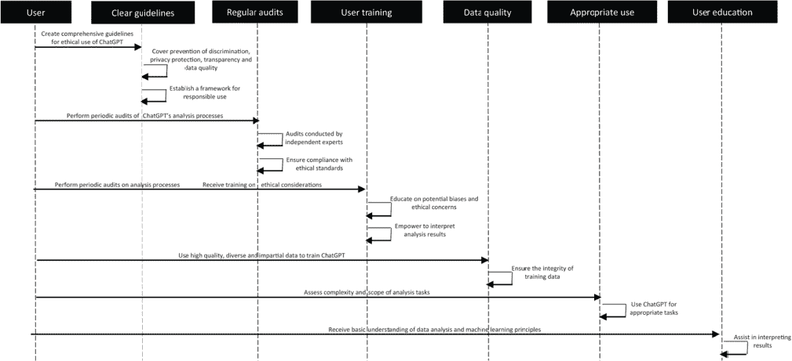

    **图 9.1.** *在数据分析中负责任使用 ChatGPT*

- **促进进步的建设性建议：** 除了指出错误或陷阱，提供建设性建议可以引导 `ChatGPT` 取得进步。建议潜在的改进不仅指出了问题所在，还为精炼提供了清晰的方向。这使得 `ChatGPT` 能够从错误中学习，并在提高输出质量方面取得重大进展。例如，建设性建议如：“这一部分的语气似乎太非正式了。尝试在这份报告中使用更正式的商务语言”，这为 `ChatGPT` 调整其写作风格以适应业务背景提供了宝贵的指导。通过纳入这种反馈，AI 可以逐渐培养出适应业务文档所需的语气和语言细微差别的能力，提高其在特定用途下的相关性和质量。

- **坚持与持续学习：** 反馈循环不是一性化的工作，而是需要耐心和坚持。像 `ChatGPT` 这样的 AI 系统在不断学习和适应。随着时间的推移，持续的反馈为稳健的学习提供了一致的数据点。必须意识到完美不能一而就。得于人类与 AI 之间的持续合作，持续进步是改进的途径。在几周和几个月内持续提供新示例的耐心和坚持对于帮助 `ChatGPT` 改进至关重要。即使初始回答未能完美符合预期，这种重复且持续的反馈也允许 AI 适应并相应调整回答。这种方法有助于长期强化 ChatGPT 的学习，演进其理解和生成更准确、更符合语境的回答的能力。

- **实用性的语境相关性：** 当反馈考虑到 `ChatGPT` 运行的语境时，最有效。通过考虑受众和目的、用例和目标等因素，可以针对业务的实际需求定制增强。这确保了 AI 训练不仅关注通用能力，而是针对特定的现实场景进行定制，增强了其实用价值。得益于开发、部署和监控的反馈，`ChatGPT` 随着用户的需求而演进，开启此前不可见的可能性。考虑语境对于微调 ChatGPT 的性能至关重要。例如，通过提供提示如：“这些内容对我们的博客读者来说太深了。请为普通读者简化语言”，我们引导 `ChatGPT` 为目标受众定制其回答。这优化了生成内容的相关性和可理解性，确保其符合通信的特定需求和目标。

- **多样化的反馈生态系统：** 丰富数据团队之外的反馈视角至关重要。多样化的观点提供了整体视角，并帮助识别从狭窄视角可能无法看到的潜在盲点和偏见。更广泛的输入促进了更平衡、无偏见的 AI 系统。鼓励反馈的多样性丰富了 ChatGPT 的训练。例如，通过征求营销和数据科学团队的视角来评估 ChatGPT 的仪表板原型并改进两种观点的呈现方式，将不同的角度整合到学习过程中。这种整体方法有助于识别潜在差距，同时确保系统生成的回答反映多种视角并避免偏见。

## 反馈速度与自动化

反馈整合到循环利用过程中的速度是加速学习的关键因素。反馈循环中部分环节的自动化可以放大 `ChatGPT` 化的速度。这种反馈的快速整合导致了更紧密的人类引导学习循环，最终提升了 `ChatGPT` 的性能。通过建立自动化流水线，每天将新的支持工单提取内容传输给 `ChatGPT`，可以加速反馈和系统学习。这种自动化使得对查询响应的准确性得以持续改进。通过利用这种反馈速度，`ChatGPT` 可以更快地调整其能力并优化结果，从而有助于更精细的性能和与用户更顺畅的交互。关键在于根据现实案例提供具体的说明，而不是抽象的评论。这有助于 `ChatGPT` 捕捉到人类指导所预期的切实改进。

## 协作共同进步

这种迭代反馈的核心在于协作。这是人类与 AI 之间的相互促进。当我们引导 AI 系统向改进发展时，我们也对它们的能力和局限性有了更深入的理解。这种协作方法确保了人类和 AI 同步进步，利用彼此的长处实现共同增长。这种以人为中心的协作对于演进监管至关重要。理想情况下，反馈流水线应捕获显式纠正和隐性信号（例如使用数据和查询）。反馈被进一步聚合、分析并用于扩大训练数据的多样性（Sedkaoui 2023）。

为了更好地对齐，业务利益相关者可以提供开放贡献，而不只是数据团队。持续的用户反馈结合主动的治理使得 `ChatGPT` 能够负责任地进化。

迭代反馈循环是一个动态过程，推动着 `ChatGPT` 的演进。得益于具体性、建设性建议、耐心、上下文相关性、视角的多样性、自动化评论和协作原则，我们可以构建出不仅强大、而且符合人类需求和愿景的 AI 系统。人类与 AI 之间的这种协作体现了迈向双方和谐进步的未来的共同旅程。未来是一个人类与 AI 相互提升的未来。

## 9.4. 在数据分析中使用 ChatGPT 时应对伦理考量与偏见

将 AI（如 `ChatGPT`）集成到数据分析工作流中既带来了巨大的机遇，也带来了深层次的挑战，需要以极其谨慎的态度来处理。当我们利用 AI 的能力来改进分析流程时，建立稳健的治理机制以缓解可能出现的风险变得至关重要。这些风险涉及在 AI 缺乏适当监督运行时可能不可见的负面结果、偏见以及滥用的可能性。

虽然像 `ChatGPT` 这样的 AI 系统无疑可以提高分析吞吐量并提供价值洞解，但它们也有加剧现有偏见或引入新扭曲的可能，损害公平与公正。这强调了负责任设计和积极监控的重要性，以确保基于 AI 的分析符合伦理规范和价值观。

在整个 AI 流水线上进行人工监控至关重要。这意味着要仔细筛选无偏且具代表性的训练数据，评估 AI 模型的行为，进行公平性审计并持续监控其结果。领域专家在风险评估期间识别潜在损害以及设定严格标准以防止滥用起着至关重要的作用。

透明性和可解释性是 AI 伦理集成的基石。描述 `ChatGPT` 能力、局限性和不确定性的清晰文档对于建立信任和问责制至关重要。用户和利益相关者需要理解预测是如何产生的，并能够将其追溯到底层逻辑和数据。

负责任 AI 集成的一个关键方面是建立持续反馈循环。这些循环有助于快速纠错和从错误中学习，确保 AI 系统随时间推而改进。代表不同社区的多元化伦理小组在引导 AI 演进方面具有无价的价值。

开发在数据分析中负责任且伦理地使用 `ChatGPT` 的策略至关重要。这一过程使我们能够在利用 `ChatGPT` 能力的同时，防止伤害和无意偏见的风险（Sedkaoui 2023）。

以下是鼓励在数据分析领域伦理且负责任地使用 `ChatGPT` 的其他方法：

*   强调在组织内部建立伦理委员会和治理机制以监督 AI 计划重要性；
*   讨论在 AI 系统设计中整合算法公平性原则，例如确保正确性、无害性和透明性；
*   解决组织各级人员对 AI 进行伦理培训的重要性，以确立责任感文化；
*   强调需要使用红队测试（red teaming）等技术对 AI 系统进行持续测试，以识别盲点；
*   强调 AI 必须保持为服务人类目标的工具，而非目标本身；
*   讨论使 AI 系统更稳健、更安全的方法，例如基于伦理奖励的强化学习。

`ChatGPT` 等 AI 系统的伦理部署建立在人类价值的基础上。这需要通过刻意的努力，使技术进步与尊严、公正和自主等原则保持一致。通过将人类智慧融入 AI 系统的设计、开发和治理中，我们可以引导其能力走向公平且有益的成果，从而提升整个社会。

## 9.5. 确保自动化数据分析的公平性、透明度和问责制

`ChatGPT` 因其广泛的应用范围引起了广泛关注，涵盖了从创意生成、营销内容开发到代码调试和数据分析等领域。

然而，在追求生成式 AI 的热潮中，许多问题仍然存在，特别是关于与该技术相关的潜在风险和收益。虽然 `ChatGPT` 的现实用途令许多人印象深刻，但 AI 进步带来的更深层次、更具挑战性的影响尚未被充分探索。

例如，一个重要且悬决的问题仍然存在：如果 `ChatGPT` 赋予了可能尚未准备好或无意任地使用这项技术的人，会导致什么后果？

尽管 `ChatGPT` 并非专门设计用于让普通大众能够进行编程，但众所周知它可以生成代码（Bai et al. 2021），包括由暗网上的恶意行为者诱发的潜在恶意代码。

现在，让我们关注机器学习：我们是否可以利用 `ChatGPT` 来构建一个可行的机器学习模型，并可能充当机器学习工程师？它是否有能力对该领域的未来做出实质性贡献？

负责任地整合 AI 辅助数据分析需要一种全面的方法，即在组织的所有机器学习实践和流水线中拥抱公平性、透明度和问责制。通过采取主动的治理策略，组织可以有效缓解由偏见、不透明和误用造成的潜在损害，从而使 AI 的变革能力与伦理原则保持一致。

总而言之，为了保证数据分析的公平性、透明度和问责制，有几个关键方面在起作用。

最，人类审计员的参与至关重要。这些审计员在发布结果之前，必须仔细检查自动化分析的结果，是否存在偏见或不公平的迹象。必须实施严格的测试流程（包括红队测试），以识别并纠 AI 系统的缺陷。组织还必须强调训练数据的多样化以及对模型进行持续重新训练，以随时间的推移保持公平性，适应不断变化的情况和新挑战。

彻底的透明化是另一个关键方面。为了建立对自动化信息的信任，必须提供完整的文档，描述与分析结果相关的能力、限制和不确定性（Sedkaoui and Khelfaoui 2020).模型行为必须是透明、可解释且可复制的。此外，组织必须通过允许用于自动化分析的数据挖掘来实现信息的可追溯性，确保每个结论都基于准确且可靠的信息。

此外，建设性的反馈循环在部署后阶段至关重要。这些反馈机制使得快速识别和纠正 AI 系统性能中可能出现的任何问题成为可能。建立多元化的伦理小组可以提供多维度的建议，确保 AI 的演进与包容性价值观一致。自动化报告可以跟踪模型在公平性衡量上的长期表现，促进问责制和进步。

通过采用整合了预见性和伦理引导的反应性控制的全面方法，组织可以充分利用自动化分析的潜力，积极转型其业务。然而，保持坚实的人类原则基础至关重要，以确保通过 AI 取得的进步根于伦理考量。

除了上述策略外，确保自动化数据分析的公平性、透明度和问责制还涉及其他几种实践。一个关键方面是使用多样化的数据集进行训练。确保训练数据代表各种观点和视角，可以显著减少分析结果中偏见的概率。此外，人工监控在识别和解决潜在偏见和问题方面起着关键的作用。人工审查和评估可以提供额外的控制水平，以确保自动化数据分析工具的负责任使用。

关于自动化数据分析局限性的透明度同样重要（Sedkaoui 2018a）。必须让用户和利益相关者意识到这些工具固有的偏见和误用风险。这种意识使用户能够负责任地解释结果，并根据对整体过程的理解做出决策。

通过实施这些策略和实践，确保数据分析以公平、透明和负责任的方式进行。公平性、透明度和问责制不仅是伦理上的要求，也是建立 AI 系统信任、防止歧视、误信息和其他负面结果的关键。

为了说明这些概念，让我们考虑一个组织使用 AI 系统分析招聘申请的案例。如果没有良好的治理，系统可能会无意中偏袒某些数据群体，或对其他人产生偏见。通过遵循全面的整合策略，组织可以确保系统在多样化的数据集上进行训练，经过人类审计员的审查并有透明的文档。这种方法减少了偏见风险，促进了公平，并实现了招聘过程中的问责制。

表 9.3（c09.xhtml#tab9-3）总结了这些策略及其对应的示例。

**Table 9.3.** *公平伦理的自动化数据分析策略*

| 策略 | 示例 |
| --- | --- |
| 人类审计员 | 检查自动化分析结果是否存在偏见 |
| 严格测试 | 红队测试以检测漏洞 |
| 多样训练数据 | 确保训练数据包含各种观点 |
| 彻底透明 | 记录能力、限制和不确定性 |
| 信息可追溯性 | 允许用户将分析溯到底层数据 |
| 建设性反馈循环 | 集成用户反馈以持续改进 |
| 伦理委员会 | 汇集多元观点以指导 AI 演进 |
| 自动化报告 | 监控模型在公平性衡量上的表现 |
| 人类监控 | 进行人工审查以确保负责任使用 |
| 局限性透明度 | 让用户意识到潜在的局限性和偏见 |

通过采用这些实践，组织可以创建与伦理原则一致、促进透明度并为数据分析做出公平结果的 AI 系统。AI 能力与人类智慧的协同，在伦理考量的指导下，为各个领域的负责任和积极转型铺平了道路。

在本章结束之际，让我们强调在开发和使用 ChatGPT 进行数据分析时，始终将伦理考量放在首位的重要性。这项技术前景广阔，但必须明智地管理以造福全体。

在本书的最后，让我们记住，通过审慎且深思的方式将人类创造力与 AI 的力量相结合，数据分析的未来将充满迷人的潜力。让我们坚决地追求这种增强且负责任的分析，由人类思维来引导并增强算法的实力。现在是开启这段令人兴奋的旅程了，并且与我们的良知并肩同行。

# 结论

自动化时代已经到来。以往需要投入大量的人力和时间的各种任务和流程，现在已由 AI 代理进行增强，或由其完全管理。数据分析正是得益于 AI 而正在经历变革性变化的领域之一。具体而言，生成式语言模型（如 `ChatGPT`）自动化了数据分析工作流中重复、枯燥或需要巨大计算算力的部分。

这项工作凸显了使用 `ChatGPT` 及其生成式 AI 来实现数据分析自动化的巨大潜力。我们正在见证一个时代，人类数据科学家可以与 AI 助手协作，以加速并改进分析。当通过用心、、远见和伦理进行适当开发时，这些 AI 系统可以成为值得信赖的分析伙伴，而不是抢夺工作的对手。

诸如 `ChatGPT` 这样的生成式模型具有某些超人能力，使其在人类判断的引导下，成为自动化数据分析某些方面的理想选择。首先，它们贪渴的记忆和计算速度使其能够对超越人类规模的大型数据集进行详尽分析。其次，它们不知疲倦的特性提供了 24/7 无疲劳的分析能力。第三，它们的算法本质确保了重复性任务中的一致性，这与感到无聊或分心的人类不同。

然而，这些仍然需要在人类的监督下进行大量的训练，才能成为成熟的数据分析助手。就像孩子向父母学习一样，`ChatGPT` 需要通过适当的分析知识、任务、示例和伦理来培养，成为一个负责任且值得信赖的伙伴。数据科学家需要在每一步都教它——数据清洗、特征工程、建模、评估、解释等。

凭借在各种数据集上的丰富经验，`ChatGPT` 可以从对指令的机械化记忆转变为对分析工作流底层的原理、权衡和最佳实践的真正理解。这种概念上的理解使 `ChatGPT` 能够根据学到的推理，为新的数据集和场景自适应地选择最优技术。

然而，尽管经过了训练，`ChatGPT` 仍然缺乏人类特有的通用智能——抽象思维、适应能力、常识、判断和价值观。它狭隘地专注于擅长训练领域内的任务，而不是对这些任务在现实世界的意义进行全面理解。这就是在部署生成式 AI 时，人类的创造力和智慧变得如此关重要的地方。

人类必须监督并与 `ChatGPT` 协作，以执行其分析自动化的目的、伦理和责任。如果不加控制，落入错误的人手中，这些强大的 AI 工具可能会没有人类良知引导的情况下被危险地用。我们必须成为警觉的父母，审慎地培养这个 AI 孩子。

关键在于结合人类和 AI 的互补优势，实现超越任何一方的协同效应。人类的创造力、伦理、洞察和监督，结合 AI 不知疲倦的精确、速度和详尽计算，可以实现新规模和深度的分析。但人类必须保持引导 AI 的活跃伙伴。

例如，数据科学家可以创造性地定义初始问题，要求 `ChatGPT` 分析数据集的趋势、相关性和模式。`ChatGPT` 快速处理数据，以比人类手动操作快指数倍的速度严谨地测试假设。它生成见解，突出显著模式并解释底层的推理。

人类随后评估分析是否完整以及伦理影响是否合理。我们在直觉的引导下，评估偏见或局限性是否影响了见解。人类的创造力还产生了原始提示中未包含的新分析角度。然后我们可以要求 `ChatGPT` 研究这些新视角。

这种共生协作（各自发挥长处）可以加速并显著改进分析。但人类的监督保证了分析保持深思熟虑、符合伦理且负责。人类或 AI 单独都无法匹配它们的组合潜力——就像托尼·斯塔和钢铁侠合二为一样。

这证明了自动化数据分析中的关键平衡。我们可以让像 `ChatGPT` 这样的 AI 自主承担超出人类能力的重复和枯燥任务——数据清洗、转换、模型验证。但我们必须让人类处于引导性、创造性和伦理的驾驶位上，以定义问题、设定目标、批判性地解释想法并不断改进 AI。

理想的比例是监控所需的最小人类努力与适用于 AI 的最大授权自主权相结合。这在最大限度地发挥了在人类良心指导下 AI 自动化的力量。随着经验的进步，`ChatGPT` 的分析技能将继续提高，使能够在人类监督下逐渐下放更多责任。

然而，自动化分析不仅仅关于使用 AI 更好地理解数据。训练如 `ChatGPT` 等模型的过程也推进了人类的知识和智能。向 AI 助手解释分步任务迫使我们在结构化框架中深度理解并形式化领域。将复杂困难的问题提炼为连贯的工作流也使模糊的人类思维晶化。

开发基于原则、伦理和责任的 AI 模型要求我们显式地表达价值观、客观性、偏见、假设和最佳实践。大数据训练集的清洗和准备在出现矛盾时，暴露了人类逻辑中的特殊情况和缺陷。通过示例教一个像 `ChatGPT` 这样的空容器增强了教师的精通程度、判断力和责任。

所以，正如自动化旨在通过 AI 指数级地改进数据分析，这种自动化的开发也提高了人类的智能、责任感和形式化知识。这要求我们将迄今无结构的分析专业编码为原则性框架、结构化工作流和经过验证的最佳实践。

总之，通过生成式 AI 实现数据分析自动化有望开启一个新时代，人类和机器智能相结合，从数据中进行更具伦理、创造力且加速的发现。但我们仍处于这段旅程的起点，就像抚养一个充满潜力的新生婴儿。

如果这种强大且快速演化的 AI 系统没有在人类智慧和伦理的稳固控制下进行审慎开发，确实存在风险。来自利润驱动的公司和误入歧途的未来主义者也呼吁在不考虑人类福祉的情况下尽早实现自动化。这种毫无约束的自动化可能会 AI 变成对手而非盟友。


但通过审慎且负责任的开发，我们可以创建让分析更易获取、可重复、可共享且符合伦理的 AI 助手——为了共同利益向更广泛的开放数据见解。未来不是 AI 取代人类的未来；相反，它将通过 AI 的生产力和严谨性来增强创造力和伦理。

随着传统的分析任务外包给 AI 伙伴，这无疑会带来动荡。但历史表明，自动化的社会长期影响是使人类能够达到新的高度，而不是让我们过时。正如过去引擎和计算机等突破赋予了我们超凡的体能和智力一样，AI 可以提供数据分析方面的超级力量。

可持续的解决方案不是抵制自动化，而是通过社会适应和教育负责任地管理其影响。我们必须继续推进人类的创造力、伦理、共情能力和智慧，与 AI 分析助手共同繁荣。父母、教育者和领导者在强调我们独特的人精神方面，为社会向自动化、AI 融合的世界做准备发挥着至关重要的作用。

而那些构建分析型 AI 的人有伦理义务使其透明、安全并符合人类价值观。我们需要监控它的行为，最大限度地减少有害偏见并防止误用。随着采用的加速，对 AI 安全研究、认证标准和治理框架将产生迫切需求。

自动化数据分析的第一个时代将为未来生成式 AI 模型的开发和整合设定重要的先例。我们不仅负着深远的责任，也有机会智慧地规划前行之路。通过在分析 AI 旁提升伦理和人类知识，我们可以进入增强智能时代——人类与 AI 协同其互补优势，造福人类。

未来仍未未定。在可见的未来，对 AI 对抗或奇点的恐惧不太可能。但通过审慎且符合伦理的发展，我们可以创造出在人类指导下服务的 AI 协作者。像 `ChatGPT` 这样的模型仍然是从我们这里学习的孩子。让我们在培养它们生产潜力的同时，强调分析之外的人类精神价值。

如果我们今天种下正确的种子，将人类的创造力、伦理和智慧与 AI 的生产力和严谨性相结合，我们就能培养出一个光明未来，两种智能的共生将造福人类。数据科学家和 AI 开发者的使命必须推进有益的智能——无论是人类还是人工智能。

使用 `ChatGPT` 等工具实现自动化只是通过创造、伦理、负责任和赋能的创新追求人类永恒进步的第一步。我们塑造工具；然后，工具塑造我们。所以，让我们大胆梦想，但谨慎行事。如果我们让人类意识引导着人工分析力量手手前行，无限协作发现的最伟大可能性就在前方！

# 附录

## 附录 1

### 使用 ChatGPT 进行分析过程的提示词库

本仓库收集了一系列提示词，用于引导 `ChatGPT` 完成数据分析过程。它分为几个类别，每个类别包含针对特定任务的提示词。这些提示词的开发旨在尽可能精确，同时具有足够的适应性以适应各种项目。主要目标是为用户的数据分析项目提供一个起点，而不是施加预定义的步骤。需要注意的是，本仓库并不代表完整的数据分析课程或教科书。尽管如此，对于希望启动新项目或解决进行中问题的数据分析师来说，它可以是一个宝贵的资源。

#### A1.1. 数据收集

##### A1.1.1. 识别数据源

* 你能建议与`[你的分析目标]`相关的潜在数据源吗？
* 我正在寻找与`[你感兴趣的话题]`相关的`[数据集]`。有什么推荐吗？
* 在哪里可以找到关于`[你的主题]`的`[可靠数据源]`？
* 你能帮我识别我的`[特定分析项目]`数据的`[主要来源]`吗？
* 我对`[你的分析]`的`[收集数据]`感兴趣？

##### A1.1.2. 收集数据

* 为`[你的项目]` `收集数据` 有哪些方法？
* 你能指导我如何使用`[特定方法]` 进行 `数据收集` 吗？
* 哪些工具适合从 `[你的来源]` `检索数据`？
* 我应该如何为 `[你的分析]` `获取数据`？
* `数据收集` 的最佳实践是什么？

#### A1.2. 数据准备

##### A1.2.1. 清洗数据

* 在 `清洗数据` 时，我需要解决的常见数据质量问题有哪些？
* 你能就 `数据清洗` 给我一些建议以确保分析吗？
* 在 `预处理数据` 时，我该如何有效地管理 `缺失值`？
* 为了 `[你的目标]` `清洗和处理数据` 我应该采取哪些步骤？
* 处理 `数据不一致性` 有什么技巧？

##### A1.2.2. 转换

* 我如何为了 `分析` 将 `文本数据转换为数值值`？
* 你能向我展示如何为了 `公平比较` 对 `数据标准化` 吗？
* 为了便于 `分析`，我应该采取哪些步骤将 `数据分组` 到 `有意义的类别` 中？
* 我遇到了 `格式错误的数据`。我应该如何 `转换数据` 使其与 `分析模型` 兼容？
* 在数据上 `执行数学运算` 以 `生成新变量` 的方法有哪些？

##### A1.2.3. 处理缺失变量

* 我如何 `识别数据` 中的 `缺失值` 并决定最佳方法？
* 你能指导我通过 `处理缺失值的不同方法` 吗？
* 我应该采取哪些策略来一致且可靠地 `插补缺失值`？
* 我注意到 `数据集中存在缺失值`。我该如何 `决定删除、插补还是保留它们`？
* `针对缺失值的不同插补技术` 的优缺点是什么？

##### A1.2.4. 离群值管理

* `识别数据中的离群值` 以及 `确定它们是否需要修正的步骤有哪些`？
* 你能向我展示如何 `使用统计方法` `检测离群值` 并评估它们对分析的影响吗？
* 我该如何以 `适当` 的方式 `处理离群值` 以便 `尽量减少它们对结果的影响`？
* 我发现了 `可能影响结果的离群值`。我该如何 `决定修正、删除还是保留它们`？
* 在 `维护数据完整性` 的同时，`管理离群值` 的最佳实践是什么？

##### A1.2.5. 数据格式化

* 将 `数据组织` 成 `表格结构` 以方便 `数据分析` 的最佳方法是什么？
* 为了使用与 `你的分析工具` 兼容 `格式`，你能就 `数据格式化` 给我一些建议吗？
* 在 `准备数据` 时，我应该如何适当 `转换数据类型` 以确保与 `分析模型` 的一致性？
* 我正在处理 `[非结构化数据]`。我应该采取哪些步骤将其 `[组织成]` `[结构化格式]`，以便进行 `[更高效的探索]`？
* 为了 `[分析目标]`，将 `[原始数据格式化为]` `[清洁且易懂的格式]` 的关键步骤有哪些？

#### A1.3. 编码

##### A1.3.1. 使用编码处理数据

* 为了 `[为分析准备数据]`，有哪些 `[常用的编码数据操作方法]`？
* 你能向我解释如何使用 `coding` 来 `[过滤、排序和分组数据]` 以 `[提高我的数据质量]` 吗？
* 我该如何使用 `coding` 来 `[合并数据集]` 并 `[执行转换操作]` 以 `[方便分析]`？
* 我可以使用 `coding` 执行哪些 `[高级数据清洗技术]` 来 `[提高我的数据质量]`？
* 我有一些杂乱无章的数据。我该如何 `[使用编码准备数据]` 以便 `[分析]` 并 `[确保一致性]`？

##### A1.3.2. 使用编码实现任务自动化

* 我该如何通过 `coding` 在 `[数据分析]` 中 `[自动化重复任务]` 以 `[节省时间]`？
* 你能向我展示如何使用 `coding` `[创建自动化脚本]`，在 `[你的数据]` 中 `[执行复杂任务]` 吗？
* `[编码如何用于]` 在 `[你的分析工作流]` 中 `[自动化数据清洗、转换和准备]`？
* 使用 `coding` `[任务自动化的最佳实践]` 有哪些，以 `[最大化分析效率]`？
* 我想 `[自动化分析过程的某些部分]`。我该如何 `[集成编码]` 以 `[高效]` 的方式 `[实现这一点]`？

##### A1.3.3. 使用编码处理缺失值

* 我该如何 `[高效地]` `[使用编码处理我的数据中的]` `[缺失值]`？
* 你能向我解释 `[缺失值填充技术]` 吗？我可以通过 `coding` 应用这些技术来 `[维护数据完整性]`。
* `[编码如何帮助]` 在 `[你的数据]` 中 `[识别缺失值]` 并 `[决定最佳填充方案]`？
* 哪些 `[处理缺失值的常用编码方法]` 可以保证 `[分析]` 中的 `[可靠结果]`？
* 我的 `[数据集中存在缺失值]`。我该如何 `[应用编码]` 来 `[高效处理这些值]`，同时 `[保持数据完整性]`？

#### A1.4. SQL 查询

##### A1.4.1. SQL 基础

* 我该如何 `[开始学习 SQL]` 以便在 `[数据分析]` `[高效操作数据库]`？
* 你能向我解释 `[SQL 的基础]` 以及它在 `[分析背景下]` `[查询数据库]` 有什么用吗？
* `[学习 SQL]` 的推荐资源有哪些，以 `[方便我的分析工作]` 并 `[使用数据]`？
* `[SQL 如何有助于]` `[优化我的查询]` 并为 `[我的分析项目提取相关信息]`？
* 我对 SQL 的经验很少。我该如何 `[开始学习]` 并 `[有效地将其应用于]` `[数据分析]`？

##### A1.4.2. 使用 SQL 进行数据选择和过滤

* 我可以使用哪些 `[SQL 的数据选择和过滤方法]` 来 `[提取特定记录]`？
* 你能向我展示如何使用 `SQL` `[执行选择查询]` 以根据 `[我的标准]` `[过滤数据]` 吗？
* 我该如何使用 `SQL` `[选择特定列]` 并 `[应用过滤条件]` 来 `[优化数据分析]`？
* 我可以使用 `SQL` 应用哪些 `[高级过滤技术]` 来在 `[你的分析项目]` `[提取相关数据]`？
* 我有大量数据。我该如何使用 `SQL` `[高效地选择和过滤]` 以便在 `[我的分析]` `[处理子集]`？

##### A1.4.3. 使用 SQL 进行聚合和分组

* 我该如何使用 `SQL` `[聚合数据]` 并 `[总结信息]` 以 `[获取全局统计数据]`？
* 你能向我解释如何使用 `SQL` `[执行聚合操作]` 根据 `[特定标准]` `[分组并总结数据]` 吗？
* `[SQL 如何用于]` 在 `[你的数据集]` 中 `[计算总和、平均值和其他聚合值]`？
* 我可以使用 `SQL` 使用哪些 `[高级聚合方法]` 来满足我的需求？

##### A1.4.4. 使用 SQL 连接表

* 在 SQL 中我该如何 `[连接表]` 到 `[数据]`？
* 你能向我展示如何使用 `SQL` 处理 `[你的数据]` 吗？
* 我该如何使用 `[连接表]` 到 `[我的项目]`？
* 在 `[高级数据技术]` 中，SQL 可以用于什么？
* 我该如何在 `[我的数据]` `[处理和分析数据]`？

#### A1.5. 数据处理与分析

##### A1.5.1. 探索数据

* 我该如何 `[开始探索数据]` 以 `[理解]`？
* 你能帮助我 `[发现模式]` 和 `[异常]` 吗？
* 我应该遵循哪些 `[数据挖掘的基本步骤]`？
* 我该如何 `[使用可视化和]` `[描述性统计]`？

##### A1.5.2. 分析过程自动化

* 我该如何通过使用脚本 `[自动化建模过程]`？
* 你能向我展示如何 `[设置自动化]` 以 `[减少建模时间]` 吗？
* `[建模自动化的最佳实践]` 有哪些，可以实现？
* 我该如何 `[开发自动化工作流]` 来 `[对模型进行实验]`？
* 我有 `[多个需要开发的模型]`，我想 `[自动化过程]`。

##### A1.5.3. 数据分析编码

* 我该如何 `[使用编码]` `[优化数据分析]`？
* 你能帮助我 `[集成编码]` 到 `[我的分析]` 中吗？
* `[编码的步骤]` 有哪些可以帮助我？
* 我该如何使用 `编码方法` `[应用脚本和代码来转换和分析数据]`？
* 我有 `[复杂的分析任务]`，我想 `[使用编码]`。

##### A1.5.4. 创建高级函数

* 我该如何从 `[现有数据]` `[开发高级功能]`？
* 你能帮助我使用 `[现有数据的巧妙组合]` `[创建新变量]` 吗？
* 我可以使用哪些 `[特征创建方法]` 来 `[提高准确性]`？
* 我该如何从 `[我的数据]` `[提取有意义的信息]` 以？
* 我的 `[分析]` 需要 `[特定的特征]`。我该如何 `设计合适的变量`

#### A1.6. 特征工程

##### A1.6.1. 创建新特征

* 我该如何从 `[现有数据集]` `[生成新特征]` 以 `[提高模型性能]`？
* 你能给我一些 `[创建特征的技术]` 示例吗，以 `[丰富我的数据]`？
* 通过 `[使用转换或组合等方法]` 来 `[开发新特征]` 的关键步骤有哪些？
* 我需要 `[额外的特征]` 来 `[改进我的模型]`。我如何通过 `[考虑到数据之间的关系]` 来 `[高效地创建新特征]`？
* 我想通过 `[开发新特征]` 来 `[丰富我的数据]`。我可能考虑的 `[特征创建常用方法]` 有哪些？

##### A1.6.2. 选择特征

* 我如何通过 `[降低维度]` 为 `[我的模型]` `[选出最相关的特征]`？
* 你能否就 `[特征选择]` 向我提供一些建议，以便在 `[避免过载]` 的同时 `[优化模型性能]`？
* 我应该使用哪些 `[特征选择标准]` 来 `[选择影响力最大的变量]`？
* 我有 `[许多特征]`，我想 `[选出最重要的]`。我该如何 `[应用选择技术]` 来 `[简化我的模型]`？
* 我想通过 `[精心挑选特征]` 来 `[精炼我的模型]`。哪些 `[对模型性能贡献最大]` 的 `[特征选择关键步骤]` 是什么？

##### A1.6.3. 数据排序

* 针对 `[我的分析需求]`，`[排序和组织数据]` 的 `[最佳方法]` 是什么？
* 你能向我展示如何使用 `[特定标准]` 对 `[我的数据进行排序]` 以 `[方便分析]` 吗？
* 我如何按 `[升序或降序]` 对数据进行 `[重新组织和分类]` 以便 `[更好地理解]`？
* 为了 `[优化我的分析]`，我需要采取哪些 `[使用高效方法]` `[将我的数据排序的步骤]`？
* 我有杂乱的数据。我该如何 `[应用高效排序]` 来 `[组织我的数据]` 以便 `[更平滑的分析]`？

##### A1.6.4. 合并数据

* 我如何将 `[不同来源的数据]` `[合并]` 为 `[单一数据源]` 以进行 `[完整的分析]`？
* 你能帮我使用 `[融合技术]` `[合并]` 来自 `[多个来源]` 的数据以 `[整合信息]` 吗？
* 在 `[我的分析项目]` 中 `[整合数据集]`，我应该遵循哪些 `[数据融合的最佳实践]`？
* 我如何通过 `[使用合并键]` `[[应用合并操作]` 来 `[连接数据]` 并 `[获得一致的结果]`？
* 我有 `[分开的数据集]`，想将它们 `[合并进行分析]`。我该如何在 `[我的分析]` 中使用 `[适当的方法]` `[实现高效合并]`？

#### A1.7. 建模

##### A1.7.1. 选择模型

* 我如何为 `[我的特定分析项目]` `[选择一个合宜的模型]`？
* 你是否能根据 `[我的数据]` 和 `[我的目标]` 帮助我 `[选择最佳模型]`？
* `[选择模型的关键步骤]` 有哪些，这些步骤将使我能够为 `[我的分析]` `[做出明智的决策]`？
* 我如何使用 `[相关标准]` `[[评估不同的模型选项]` 以 `[找到最佳解决方案]`？
* 我脑海中有了 `[不同类型的模型]`。我该如何为 `[我的分析需求]` `[选择最合宜的模型]`？

##### A1.7.2. 训练模型

* 我如何使用 `[我的训练数据]` `[开始训练模型]` 以 `[获得准确的结果]`？
* 你能帮我通过 `[使用正确的超参数]` `[[设置训练过程]` 来 `[提高性能]` 吗？
* `[训练模型的本质步骤]` 有哪些，这些步骤将使我能够为 `[我的分析创建一个有效的模型]`？
* 我该如何 `[调整设置]` 并 `[监控训练过程]` 以 `[优化收敛]`？
* 我有 `[训练数据]`，我想 `[训练模型]`。我该如何使用 `[高质量的方法]` `[训练]` 以 `[获得良好的结果]`？

##### A1.7.3. 评估模型

* 我如何通过 `[使用适当的指标]` `[评估模型的性能]` 以 `[衡量其有效性]`？
* 你能帮我通过 `[解释指标]` `[分析模型结果]` 以 `[确定其性能]` 吗？
* `[评估模型的关键步骤]` 有哪些，这些步骤将帮助我 `[理解其准确性]` 和 `[其适应性]`？
* 我如何通过 `[使用评估技术]` `[将模型预测与实际值]` `[进行比较]` 以 `[验证其可靠性]`？
* 我有一个 `[已训练完成的模型]`，我想 `[评估它的性能]`。我该如何在 `[我的分析项目]` 中使用 `[相关标准]` `[对分析其结果]`？

##### A1.7.4. 模型验证与调整

* 我如何 `[验证]` `[我的分析模型]` `[的性能]` 以 `[保证它们的可靠性]`？
* 你能向我展示如何通过 `[使用适当的指标]` `[评估我的模型质量]` 以 `[选出最佳模型]` 吗？
* 为了在 `[我的分析项目]` 中 `[确保准确的预测]`，我需要遵循哪些 `[模型验证的步骤]`？
* 我如何通过 `[优化它们的性能]` `[调整我的模型超参数]` 以 `[获得稳健的结果]`？
* 我想 `[提高我模型的准确性]`。我该如何通过 `[使用交叉验证方法]` 和 `[调整技术]` `[验证并调整我的模型]`？

##### A1.7.5. 重新训练模型

* 针对 `[数据演变]`，我如何 `[重新训练模型]`？
* 我如何通过 `[引入新数据]` `[[更新现有模型]` 同时 `[保持其准确性]`？
* 使用 `[当前数据]` `[重新训练模型的关键步骤]` 有哪些，以 `[保持其相关性]`？
* 你能帮我通过 `[调整超参数]` `[重新训练模型]` 以 `[优化结果]` 吗？
* 我有一个现有模型，想 `[用新数据改进它]`。我该如何 `[重新训练模型]` 以 `[优化性能]`？

#### A1.8. 数据可视化

##### A1.8.1. 图表建议

* 你能帮我 `[选择合适的图表类型]` 以在 `[我的分析背景中]` `[有效表示数据]` 吗？
* 在 `[探索数据]` 时，`[可视化不同变量之间关系]` `[的推荐图表]` 有哪些？
* 我如何 `[选择相关的图表]` 来 `[我的数据中]` `[突出模式并传递见解]`？
* 我有 `[需要可视化的变量]`，正在寻找关于 `[突出趋势的]` `[最合适的图表建议]`。
* `[选择图表的最佳实践]` 有哪些，能使我能够在 `[我的分析报告中清晰地展示数据]`？

##### A1.8.2. 识别趋势

* 我如何使用 `[有效的可视化方法]` `[在我的数据中识别趋势]`？
* 你能向我展示如何通过 `[关键指标]` `[从数据图中检测趋势]` 吗？
* 我应该使用哪些 `[趋势图]` 来 `[突出随时间的变化]`？
* 我想 `[突出我的数据中的趋势]`。你推荐哪些 `[趋势可视化技术]`？
* 我如何 `[使用可视化快速识别]` `[可能影响]` `[我的分析决策的]` `[模式和趋势]`？

##### A1.8.3. 创建可视化图形

* 我如何使用 `[可视化工具]` 从 `[我的数据]` `[构建可视化图形]`？
* 你能引导我通过 `[可视化库]` `[创建可视化图形]` 的过程以 `[展示结果]` 吗？
* `[创建可视化图形的基本步骤]` 有哪些，能使我能够 `[有效地传递见解]`？
* 我想为 `[我的数据创建美观的图表]`。`[使我的可视化变得清晰且信息丰富]` `[的关键原则]` 有哪些？
* 我如何 `[使用可视化创建工具]` `[将我的数据转换为图形]` 并 `[提高]` `[我的分析报告中的展示效果]`？

#### A1.9.1. 分析文档记录

* 我如何 `[有效地记录我的分析]` 以 `[确保步骤的可追溯性]` 并 `[促进协作]`？
* 你能向我展示如何 `[创建清晰的文档]` 来 `[解释我的分析决策]` 并 `[使过程透明化]` 吗？
* 我应该遵循哪些 `[核心文档步骤]` 以便以 `[易懂且简洁]` 的方式 `[传播我的结果]`？
* 我该如何 `[构建我的分析报告]` 来向 `[利益相关者]` 告知 `[所采取的步骤]` 和 `[关键发现]`？
* 我需要以一种 `[专业且有说服力的方式]` `[记录我的分析结果]`。为了以 `[有影响力]` 的方式 `[展示我的发现]`，应该遵循哪些 `[最佳实践]`？

#### A1.9.2. 使分析具有复现性

* 我如何通过 `[记录代码和步骤]` 来 `[保证分析的可复现性]`，以便 `[他人能够重现我的结果]`？
* 你能向我展示如何 `[设置可复现的环境以便在]` `[重现分析]` 时 `[避免依赖问题]` 吗？


## 关键问题

- [使分析可复现的关键步骤]是什么，以便[他人可以检查我的结果]并[进行改进]？
- 我该如何[组织我的分析项目]以[促进可复现性]并[避免常见错误]？
- 我需要帮助[使我的分析具有复现性]。你能指导我[代码记录的最佳实践]以及[创建可复现的环境]吗？

### A1.9.3 结果展示

- 我该如何[视觉化地展示我的分析结果]以[吸引观众]并[有效地沟通见解]？
- 你能向我展示一些[数据可视化技术]，这些技术在[突出趋势]和[促进理解]方面是有效的吗？
- [创建图表和表格的最佳实践]是什么，能够[突出我分析的关键要点]？
- 我该如何[调整我的演示以适应观众]，以便以[有影响力且说服力]的方式[传播相关信息]？
- 我想[改进结果的展示]以[让我的分析更具吸引力]。关于通过数据可视化[激发兴趣]和[明确信息]，你有什么任何建议吗？

## A1.10 趋势预测与时间序列

### A1.10.1 趋势预测

- 我如何预测[时间数据]中的[趋势]以[预判趋势]？
- 你能帮我[使用预测模型]来识别[我的时间序列]中的[新兴趋势]吗？
- [趋势趋势的关键步骤]是什么，能让我[做出预测]并[做出明智的决策]？
- 我该如何[使用预测方法]来[预判未来的走向]并识别[我的时间数据]中的[模式]？
- 我有[时间数据]并想[预测趋势]。我该如何[应用预测技术]来在我的[分析]中[预判趋势]？

### A1.10.2 解释预测方法

- 我该如何解释我在[我的分析]中所使用的[预测方法]？
- 你能帮我[有效地沟通]我为[我的时间序列]采用的预测方法吗？
- 使我用于[序列数据]的预测方法变得[清晰易懂]的关键因素是什么？
- 我该如何[调整我的演示以适应观众]，以便以[有影响力且说服力]的方式[传播相关信息]？
- 我想[改进结果的展示]以[让我的分析更具吸引力]。关于通过数据可视化[激发兴趣]和[明确信息]，你有什么任何建议吗？

### A1.10.3 时间序列

- 我如何预测[时间数据]中的[趋势]以[预判趋势]？
- 你能帮我[使用预测模型]来识别[我的时间序列]中的[新兴趋势]吗？
- [趋势预测的关键步骤]是什么，能让我[做出预测]并[做出明智的决策]？
- 我该如何[使用预测方法]来[预判未来的走向]并识别[我的时间数据]中的[模式]？
- 我有[时间数据]并想[预测趋势]。我该如何[应用预测技术]来在我的[分析]中[预判趋势]？

### A1.10.4 解释预测方法

- 我该如何解释我在[我的分析]中所使用的[预测方法]？
- 你能帮我[有效地沟通]我为[我的时间序列]采用的预测方法吗？
- 使我用于[序列数据]的预测方法变得[清晰易懂]的关键因素是什么？
- 我该如何[调整我的演示以适应观众]，以便以[有影响力且说服力]的方式[传播相关信息]？
- 我想[改进结果的展示]以[让我的分析更具吸引力]。关于通过数据可视化[激发兴趣]和[明确信息]，你有什么任何建议吗？

## A1.11 机器学习

### A1.11.1 算法选择

- 什么样的评估方法对于我的最合适？
- 你能提供一些机器学习的示例吗？
- 哪种机器学习算法最适合？
- 我刚开始。哪些机器学习（技术）？
- 我该如何利用这些技术决定？

### A1.11.2 模型训练

- 哪些最佳实践可以让我遵循？
- 我该如何通过训练机器学习来避免过拟合和欠拟合？
- 确定最佳数量的方法是什么？
- 趋势预测的关键步骤是什么？
- 我该如何利用这些技术？

### A1.11.3 性能评估

- 什么样的评估指标对于我的最合适？
- 我该如何通过训练来评估不同的机器学习模型？
- 哪些技术方法适用于我的？
- 除了准确性，我还需要分析哪些关键方面来确定我的？
- 我应该使用哪些验证策略（如交叉验证）来严谨地评估？

# 附录 2 GPT-4 与 GPT-3.5 对比

表 A2.1 GPT-3.5 与 GPT-4 的对比

| 特性 | GPT-3.5 | GPT-4 |
| --- | --- | --- |
| **参数** | 175 亿 | 超过 1 万亿 |
| **训练数据周期** | 截至 2021 年 6 月 | 截至 2021 年 9 月 |
| **训练时长** | 标准 | 额外六个月的人类和 AI 反馈 |
| **上下文窗口** | 3000 tokens | 25000 tokens |
| **准确性** | 容易产生幻觉 | 更准确 |
| **安全机制** | 有限 | 增强的安全机制 |
| **编程能力** | 基础代码生成 | 可以进行代码迭代和调试 |
| **多模态能力** | 仅限文本 | 包含图像（描述图像、上下文、建议） |
| **信息合成** | 难以建立联系 | 能够从多个源进行合成 |
| **创造力和一致性** | 基础创意写作 | 叙事和角色一致性提高 |
| **问题解决能力** | 在数学和科学方面有限 | 可以解决复杂的数学和科学问题 |
| **问题解决能力** | 复杂推理有限 | 可以解决高级数学和科学问题 |

# 附录 3 基础术语速查表

- `算法 (Algorithms)`：用于编程解决问题的逐步指令。
- `异常检测 (Anomaly detection)`：识别与预期行为不符的异常模式。
- `API`：应用程序接口，允许访问应用程序的数据和功能。
- `Augmented analytics`：增强分析，人类智能与人工智能的融合，旨在增强数据洞察。
- `Automation`：自动化，利用技术（如 AI）自动执行任务。
- `Bias`：偏见，可能扭曲模型结果的系统性偏见。
- `Business intelligence (BI)`：商业智能，收集和分析数据以产生业务洞察并做出决策的过程和工具。
- `Chatbots`：聊天机器人，能够进行自然对话的 AI 系统。
- `ChatGPT`：由 OpenAI 创建的先进语言模型，能够进行交互式对话并根据提示生成连贯且上下文相关的文本。
- `ChatGPT plugins`：ChatGPT 插件，增强 ChatGPT 能力的第三方集成，例如代码执行、数据可视化或数据库查询。
- `Classification`：分类，将数据点归类为不同类别或分类的过程。
- `Code`：代码，用编程语言编写的一组指令，用于向计算机下命令并执行特定任务。
- `Code interpreter`：代码解释器，允许 AI 执行并与各种编程语言的代码片段交互的工具。
- `Coding`：编程，使用编程语言开发软件、应用程序和技术解决方案的过程。
- `Conversational AI`：对话式 AI，旨在以自然、对话的方式与人类交互和对话的人工智能系统，通常通过理解和生成人类语言实现。
- `Correlation`：相关性，变量之间统计关系的评估。
- `Creativity`：创造力，人类在制定问题和想象解决方案方面的智慧。
- `Dashboard`：仪表板，用于可视化监控关键数据和关键指标的界面。
- `Data`：数据，可以用来分析得出结论的事实、统计数据或信息。
- `Data analyst`：数据分析师，解释和分析数据以提取有用信息并做出明智决策的专业人士。
- `Data analytics`：数据分析，专注于使用专门工具和技术从数据中提取信息的学科。
- `Data cleaning`：数据清洗，纠正数据中的不性和错误。
- `Data collection`：收集相关数据。
- `Data pipeline`：数据流水线，数据从原始状态到处理状态的架构流。
- `Data preparation`：数据准备，对数据进行手动处理以使其可用。
- `Data quality`：数据质量，对数据准确性、完整性和可靠性的评估。
- `Data science`：数据科学，利用科学过程和算法从数据中提取知识的跨学科领域。
- `Data scientist`：数据科学家，应用统计和计算方法解决复杂问题并获得可操作洞察的数据专家。
- `Data visualization`：数据可视化，信息和想法的图形化表示。
- `Decision tree`：决策树，表示分类规则的树形模型。
- `Decision-making`：决策，根据数据采取行动。
- `Dimensionality reduction`：降维，简化多维数据。
- `Ethics`：伦理，指导 AI 开发和使用的道德原则。
- `Exploratory data analysis (EDA)`：探索性数据分析，对数据的初步调查，以检测分布、关系和模式。
- `General intelligence`：通智能，在不同上下文和任务中类似于人类的适应能力。
- `Generative AI`：生成式 AI，利用机器学习模型创建原创内容（如文本或图像）的人工智能系统。
- `GPT-1`：OpenAI 于 2018 年发布的第一个预训练生成模型。
- `GPT-2`：2019 年发布的更大模型，拥有 15 亿参数。
- `GPT-3`：2020 年发布的具有 175 亿参数的巨型模型。
- `GPT-3.5`：GPT-3 的增强版本，具有更新的架构。
- `GPT-4`：ChatGPT 的最新版本，拥有 1 万亿以上参数和多模态能力。
- `Human supervision`：人类监督，人类审查和批判 AI 建议。
- `Human values`：定义人类的品质，如同情、创造力和伦理。
- `Intelligent assistants`：智能助手，如 ChatGPT 等与人类协作的智能系统。
- `Interpretability`：可解释性，人类理解 AI 结果的能力。
- `Large language model (LLM)`：大语言模型，使用自然语言进行类人通信，由 AI 系统处理以实现对话理解和响应。
- `Logistic regression`：逻辑回归，用于二分类结果的分类算法。
- `Machine learning`：机器学习，从数据中自动学习的算法。
- `Natural language processing (NLP)`：自然语言处理，用 AI 理解和生成人类语言。
- `Neural networks`：模拟生物大脑的计算机系统。
- `Noteable`：将 AI 转换为虚拟笔记助手的插件，能够在对话期间捕捉、存储和组织信息。
- `OpenAI`：著名的人工智能研究机构，是 ChatGPT 和其他生成式 AI 模型等主要开发的背后，旨在推向机器理解和创造力的边界。
- `Plugins`：为现有应用程序添加新能力或功能的额外软件组件。
- `Predictive analytics`：预测性分析，使用数据预测未来结果。
- `Prompt`：提供给 ChatGPT 以引导其响应的指令（或上下文）。精心设计的提示可以访问 ChatGPT 的能力。
- `Prompt engineering`：提示工程，通过创建和选择问题或指令来引导 AI 模型生成的响应，以便获得相关且实用的结果。
- `Regression`：回归，量化变量之间关系的统计模型。
- `Reinforcement learning`：强化学习，通过试错交互学习的代理。
- `ShowMe`：允许 AI 根据文本描述生成视觉表示（如图表和图形）的插件，以便促进复杂概念的沟通和理解。
- `SQL`：用于管理和查询关系数据库的结构化查询语言。ChatGPT 可以理解对话式的 SQL 查询。
- `Structured data`：以表格格式组织的信息，元素之间有清晰的关系，便于通过 SQL 查询或算法进行分析和操作。
- `Supervised learning`：监督学习，在带标记的数据集上训练算法。
- `Symbiosis`：生物之间互利共生的协作。
- `Time series`：时间序列，按时间顺序索引的数据。
- `Transparency`：AI 系统工作原理的透明度。
- `Unstructured data`：无预定义格式的信息（如文本、图像或音频），需要特殊处理才能分析。
- `Unsupervised learning`：无监督学习，在未标记的数据集中寻找模式。
- `Wolfram`：强大的知识库，提供与各种学术和科学领域相关的高级答案、计算和可视化。
- `Zapier`：连接应用程序以促进数据流和自动操作执行的自动化平台。

# References

1. Bai, H., Wang, X., Zhao, L. (2021). 问题导向学习模式对初中 Python 课程计算思维的影响。*Frontiers in Psychology,* 12, 771221.
2. Berger, J., Humphreys, A., Ludwig, S., Moe, W.W., Netzer, O., Schweidel, D. (2020). 统一部落：利用文本营销洞察。*Journal of Marketing,* 84(1), 1–25.
3. Berman, J.J. (2013). 大数据原理：准备、共享和分析复杂信息。*Elsevier,* Amsterdam.
4. Bishop, C. (2006). 模式识别与机器学习。*Springer International Publishing,* New York.
5. Chen, M. and Li, G. (2023). ChatGPT 用于力学学和医学：视角。*Mechanobiology in Medicine,* 1(1), 100005.
6. Chen, H., Chiang, R.H., Storey, V.C. (2012). 商业智能与分析：从大数据到大影响。*MIS Quarterly,* 36(4), 1165–1188.
7. Cheng, L., Li, X., Bing, L. (2023). GPT-4 是优秀的数据分析师吗？*arXiv,* 2305.15038.
8. Chui, M., Issler, M., Roberts, R., Yee, L. (2023). 2023 年技术趋势展望。报告，麦肯锡公司，伦敦 [在线]。 访问地址：`https://www.mckinsey.com/capabilities/mckinsey-digital/our-insights/the-top-trends-in-tech` [访问于 2023 年 7 月]。
9. Cupani, M. (2022). 使用 GPT-3 和 GPT-J 进行高级命名实体识别（NER）。数据科学 [在线]。 访问地址：`https://towardsdatascience.com/advanced-ner-with-gpt-3-and-gpt-j-ce43dc6cdb9c`。
10. Davenport, T.H. and Dyché, J. (2013). 大公司的大数据。国际分析学院，3, 1–31 [在线]。 访问地址：`http://www.sas.com/resources/asset/Big-Data-in-BigCompanies.pdf`。
11. Davenport, T.H. and Harris, J.G. (2007). 竞争分析：获胜的新科学。哈佛商学院出版社，马萨诸塞波士顿。
12. Delen, D. and Demirkan, H. (2013). 作为服务的数据、信息和分析。决策支持系统，55(1), 359–363。
13. Devlin, J., Chang, M.-W., Lee, K., Toutanova, K. (2019). Bert：用于语言理解的深度双向变换器预训练。arXiv, 1810.04805。
14. Else, H. (2023). ChatGPT 写的摘要欺骗了科学家。自然，613(423)), 423–423。
15. Frankel, F. and Reid, R. (2008). 大数据：从数据中提炼意义。自然，455(30), 30–30。
16. Gutierrez, D. (2015). 机器学习与数据科学：基于 R 的统计学习方法导论。Technics Publications，塞德纳。
17. Hazen, B.T., Boone, C.A., Ezell, J.D., Jones-Farmer, L.A. (2014). 用于数据科学、预测分析和供应链管理大数据的数据质量：问题导论及研究与应用建议。国际生产经济杂志，154, 72–80。
18. Hendrycks, D., Burns, C., Basart, S., Critch, A., Li, J., Song, D., Steinhardt, J. (2021). 使人工智能与人类共同价值观对齐。国际表示学习会议论文 (ICLR)。
19. Henke, N., Bughin, J., Chui, M., Manyika, J., Saleh, T., Wiseman, B., Sethupathy, G. (2016). 统计时代：在数据驱动的世界中竞争。报告，麦肯锡公司，伦敦 [在线]。 访问地址：`https://www.mckinsey.com/capabilities/quantumblack/our-insights/the-age-of-analytics-competing-in-a-data-driven-world` [访问于 2016 年 12 月]。
20. Hilton, J., Nakano, R., Balaji, S., Schulman, J. (2021). WebGPT：通过网页浏览提高语言模型的事实准确性。OpenAI [在线]。 访问地址：`https://openai.com/research/webgpt`。


## 参考文献

21. IBM 商业价值学院 (2023). 企业生成式 AI：市场现状。IBM [在线]。 访问地址：[https://www.ibm.com/thought-leadership/institute-business-value/en-us/report/enterprise-generative-ai?utm_medium=Email&utm_source=Adhocbound&utm_content=IBVWW&utm_term=17TSL&utm_campaign=Acoustic_23-EL1204-9A9D_A_1204] [访问于 2023 年 7 月]。

22. Jiang, Z., Xu, F., Araki, J., Neubig, G. (2020). 我们如何了解语言模型？语言学学会交易报，8。

23. Kim, H., So, B., Han, W., Lee, H. (2020). 自然语言转 SQL：我们现在进展如何？VLDB 会议，13(10), 1737–1750。

24. Liebrenz, M., Schleifer, R., Buadze, A., Bhugra, D., Smith, A. (2023). 使用 ChatGPT 生成学术内容：医学出版的伦理挑战。柳叶刀健康，5(3), e105–e106。

25. Lucini, F. (2021). 真实交易。

26. Manning, C., Surdeanu, M., Bauer, J., Bethard, S., McClosky, D. (2014). 斯坦福 CoreNLP 自然处理工具包。语言学学会 (ACL) 演示，55–60。

27. Martineau, K. (2022). IBM 使用合成数据改进模型的五种方式。IBM 研究。 访问地址：[https://research.ibm.com/blog/synthetic-data]。

28. McAfee, A. and Brynjsson, E. (2011). 与机器竞争：数字革命如何加速创新、提高生产力并改变经济。数字。

29. 麦肯锡公司 (2023). 生成式 AI 的经济潜力：下一个前沿。报告，麦肯锡公司，伦敦 [在线]。

30. Mitchell, T. (1997). 机器学习。麦格罗希。

31. Mollick, E. (2022). ChatGPT 是一个转折点。哈佛商业评论。

32. Morabito, V. (2015). 大数据与分析：战略与组织。Springer 国际出版社。

33. OpenAI (2023). GPT-4 技术报告 [在线]。 访问地址：[https://cdn.openai.com/papers/gpt-4.pdf]。

34. Osoba, O. and Welser, W. (2017). 人工智能中的偏差与错误。RAND 公司，圣蒙埃。

35. 英国分析 (2023). GPT-4 强调 AI 政策与创新。报告，英国分析，伦敦/巴黎。

36. Piegorsch, W. (2015). 统计数据分析。约翰·格莱利，纽约。

37. Radford, A. (2018). 通过无监督学习改进语言理解。[在线]。 访问地址：[https://openai.com/research/language-unsupervised]。

38. Rich, A.S. and Gureckis, T.M. (2019). 研究人类愚蠢给人工智能带来的启示。自然机器智能，1, 174–180。

39. Samuel, A.L. (1959). 国际象棋机器学习研究。IBM 研究与开发杂志，3(3), 210–229。

40. Sanderson, K. (2023). GPT-4 来了：科学家观点。自然，615(7954), 773。

41. Schick, T. and Schütze, H. (2021). 模型并非越大越好：小模型也是少样本学习者。北美语言学学会 2021 年会议：人类语言技术。语言学学会，2339–2352。

42. Sedkaoui, S. (2018a). 数据分析与大数据。ISTE Ltd，伦敦，以及约翰·格莱利，纽约。

43. Sedkaoui, S. (2018b). 用于创业成功的大数据分析：新兴研究与机会。IGI Global，纽约。

44. Sedkaoui, S. (2023). ChatGPT 与语言技术的未来：从对话到智能生成式。ChatGPT 的智能生成式技术之旅。独立出版。

46. Sedkaoui, S. 和 Khelfaoui, M. (2020). 共享经济与大数据分析。ISTE Ltd, 伦敦，John Wiley & Sons, 纽约。

47. Sedkaoui, S., Khelfaoui, M., Keltoum, O. (2022). 针对 COVID-19 推文的情绪分析。在通过网络分析管理业务国际会议，Sedkaoui, S., Khelfaoui, M., Benaichouba, R., Mohammed Belkebir, K. (编)。Springer, 柏林。

48. Shen, Y., Song, K., Tan, X., Li, D., Lu, W., Zhuang, Y. (2023). HuggingGPT: 使用 ChatGPT 及其 HuggingFace 中的伙伴解决 AI 任务。CoRR abs, 2303(17580)。

49. Siegel, E. (2013). 预测分析：预测谁将点击、购买、撒谎或死亡的力量。John Wiley & Sons, 纽约。

50. Surameery, N.M.S. 和 Shakor, M.Y. (2023). 使用 ChatGPT 解决编程错误。国际信息技术与计算机工程期刊, 3(1), 17–22。

51. Susnjak, T. (2023). 应用 BERT 和 ChatGPT 进行科学文献中莱姆病的情绪分析。arXiv, 2302(06474)。

52. Taecharungroj, V. (2023). ChatGPT 能做什么？分析 Twitter 上对创新 AI 聊天机器人的早期反应。大数据与认知计算, 7(1), 35。

53. Tamkin, A., Brundage, M., Clark, J., Ganguli, D. (2021). 深入理解大语言模型的能力、局限性以及对社会的影响。doi: 10.48550/ arXiv.2102.02503。

54. Thorp, H.H. (2023). ChatGPT 很有趣，但它不是作者。科学（Science），379(6630), 313。

55. Tingiris, S. 和 Kinsella, B. (2021). 探索 GPT-3：对 OpenAI 通用语言处理 API 的非首次查看。Packt Publishing, 伯明翰。

56. Toubia, O. 和 Netzer, O. (2016). 创意生成、创造力与原型性。营销科学，36(1), 1–20。

57. Tukey, J.W. (1977). 探索性数据分析。Addison-Wesley, 阅读市。

58. 美国劳工统计局 (2022). 职业展望手册 [在线]。可用地址：[`www.bls.gov/ooh/math/data-scientists.htm`](https://www.bls.gov/ooh/math/data-scientists.htm)。

59. Van Dis, E.A.M., Bollen, J., Zuidema, W., van Rooij, R., Bockting, C.L. (2023). ChatGPT: 研究的五个优先事项。自然（Nature），614(7947), 224–226。

60. Von Hippel, E. (2006). 创新民主化。MIT Press, 剑桥。

61. Wiles, J. (2023). 超越 ChatGPT：企业生成式 AI 的未来。Gartner, 斯坦丹福。

62. Yilmaz, R. 和 Yilmaz, F.G.K. (2023). 生成式人工智能 (AI) 基工具的使用对学生计算能力，23, 186

## 索引

### 符号

* 大数据数据集，41, 124, 174
* BookCorpus，15, 22, 23

### C, D

* 聊天机器人，8, 9, 21, 23, 25, 26, 30
    * 虚拟助手，8, 30
* ChatGPT
* 生成式模型, 39, 40, 66, 74, 83, 137–139, 163
* 图像, 9, 24, 52, 78, 99, 111, 124, 183, 185, 189, 191
* 聚类, 111, 113, 124
* 编码, 3, 4, 21, 25, 27, 29, 30, 34, 50, 51, 55, 57, 63, 79, 115–117, 136, 172, 173, 175, 176
    * JavaScript, 25
    * 编程, 3, 4, 22, 25, 29, 34, 36, 37, 39, 59, 62, 68, 110, 116, 117, 120, 137, 158, 185, 187, 188
    * Python, 3, 25, 36, 37, 42, 77, 107, 116, 121, 135
    * R, 42, 77, 107, 173
* 协作, 2, 5, 10, 11, 21, 29–31, 36, 38, 40, 47, 61, 62, 66, 72, 74, 76, 81, 82, 88, 93, 95, 100, 105, 108, 114, 115, 120, 124, 125, 134, 136, 140, 141, 154, 155, 164, 181
* Common Crawl, 15, 22, 23
* 持续改进, 14, 89, 92, 93, 100–105, 160
    * 反馈循环, 参见 14, 93, 104, 105, 141, 143, 150, 156
* 创造力, 5, 7, 11, 12, 14, 20, 35, 38, 61, 75, 82, 87, 113, 115, 127, 136, 139, 146, 161, 164–166, 189, 190
    * 增强智能, 37, 166
    * 人类, 11, 12, 14, 20, 35, 61, 75, 82, 87, 146, 161, 164
* Dall-E, 9
* 数据
    * 基础, 62, 63, 65, 77, 80, 135, 173, 187, 190
    * 集合, 41, 124, 174
    * 清洗, 2, 33, 42, 45, 46, 50, 54, 79, 80, 102, 163, 164, 170, 172
    * 特征工程, 40, 51, 121
    * 格式, 41, 42, 45, 46, 50, 95
    * 缺失, 41, 45, 48, 53, 121
    * 准备, 5, 34, 40, 44, 45, 47, 48, 50, 52, 73, 80, 92, 96, 109, 115, 135, 141
    * 预处理, 2, 10, 15, 34, 40, 45, 107, 115
* 质量, 6, 36, 44–47, 97, 124, 140, 151, 170
* 数量, 12, 47
* 科学, 6, 11, 17, 33–35, 38, 45, 154
* 科学家, 11, 17, 164
* 结构化, 59, 94, 99, 105, 135, 190
* 训练, 85, 91, 119, 123
* 转换, 3, 42, 51, 52, 55
* 非结构化数据，88, 89, 99, 105, 112, 172, 183, 191
* 可视化，34, 58, 76–80, 111, 182
    * PowerBI, 34
    * 表格，4, 9, 12, 26, 28, 32, 34, 36, 46, 49, 54, 81, 89, 92, 96, 99, 112, 118, 122, 132, 135, 140, 146, 149, 160, 186, 188
* 去偏算法，98
* Duplex，9

### E, F, G

* 工程
    * 特性，40, 51, 121
    * 提示词，5, 6, 15–18, 20, 63
* 伦理/道德的，5, 6, 11, 14, 15, 20, 31, 38, 86, 93, 106, 139–141, 143–147, 149–151, 153, 156, 157, 159, 160, 163–166, 186, 189
    * 准确性，41, 42, 44, 45, 48–50, 64, 70, 85, 93, 97, 98, 101, 102, 104, 125, 127, 133, 139, 145, 151, 184, 188
    * 考虑因素，1, 30, 37, 106, 141, 144, 146, 147, 159, 160
    * 可靠性，4, 13, 14, 29, 39, 41, 42, 44, 45, 48, 52, 94, 97, 98, 101, 138, 150, 179, 188
* 公平性，14, 31, 39, 139, 141, 143, 150, 151, 156–160
* FastText，51
* 生成式 AI，1, 2, 4–12, 15, 17, 21, 31, 32, 38–43, 46, 57–61, 64, 65, 72, 73, 76, 78, 88, 92, 105, 108, 109, 115, 117, 118, 123, 130, 131, 137, 139, 141, 143, 147, 158, 163–166, 189, 190
* GloVe，51
* Google，9, 114
    * Assistant，9
    * Bard，9
    * Duplex，9
* 治理，13, 15, 38, 40, 81, 86, 99, 105, 143, 144, 155–158, 160, 166
* GPT，1, 8, 9, 21–25, 27, 28, 35, 37, 68, 78, 79, 99, 185, 186, 189
    * -1，21–23, 189
    * -2，23, 189
    * -3.5，23, 24, 79, 99, 185, 189
    * -4，9, 21, 22, 24, 27, 28, 37, 68, 78, 79, 99, 185, 186, 189
    * 参数，2, 7, 22–24, 33, 101, 112, 118, 121, 139, 178, 184, 189

### H, I, J

* 人类监督，14, 125, 139–141, 163, 165
* 监控, 1, 7, 11, 14, 31, 38, 39, 72, 73, 84–87, 89, 92, 93, 95, 97, 98, 100, 103, 104, 107, 115, 117, 120, 133, 137, 139, 141, 143, 144, 147, 154–156, 159, 164, 165
* 验证, 38, 46, 97, 141
* 创新, 9, 30, 61, 82, 94, 113, 115, 125, 136, 138, 147, 166
* 交互式仪表板, 3, 26, 30, 31, 59, 61, 62, 135–137
* JavaScript, 25

### K, L, M

* k-means, 113, 124
    * 聚类, 111, 113, 124
* 大语言模型 (LLM), 15, 16, 27, 68, 114, 116
* 线性, 84
    * 判别分析, 121
* 机器学习, 1, 7, 8, 10, 11, 13, 17, 33, 36, 46, 48, 50–52, 55, 58, 101, 102, 104, 108–120, 123–125, 147, 156, 158, 183, 184, 189
    * 超参数, 85, 115, 117–119, 121, 124, 125, 135, 178, 179, 184
    * 模型, 1, 7, 8, 11–15, 21–30, 33–36, 39, 40, 45–47, 51–53, 57–59, 61, 62, 64, 66, 68, 73, 74, 76–79, 81–86, 89, 92, 93, 95–99, 101–120, 123–125, 128, 130, 131, 133, 134, 137–141, 143–145, 147, 151, 156, 157, 159, 163–166, 175, 176, 178–180, 182–184, 187, 189
    * 流水线, 117, 155, 156
    * 强化, 7, 16, 110, 112–114, 157, 190
    * 建模, 2, 5, 22, 25, 29, 33, 34, 42, 50, 57, 69, 73, 74, 76, 79, 83, 84, 92, 93, 95–97, 100, 102, 106, 107, 109, 115, 117, 118, 124, 131, 150, 163, 175
    * 预测, 80, 81, 86, 97, 98, 105, 106, 123, 182–184
    * 性能, 97, 98, 101, 106, 118, 124, 137
    * 预测性 (predictive)

### N, P

* 自然语言 
    * 模型, 2, 34
        * 接口, 2, 109, 115, 124, 187


# 索引

* 自然语言处理 (NLP), 3, 16, 21–23, 29–31, 35, 45, 50–52, 62, 64, 81, 84
* 非线性， 53, 85
* 参数， 2, 7, 22–24, 33, 101, 112, 118, 121, 139, 178, 184, 189
* 性能提升， 8, 14, 24, 28, 52, 65, 71, 72, 89, 92–94, 100–105, 114, 120, 153–155, 157, 160, 179
* 插件， 35–37, 68, 78, 99, 135, 136
    * 代码解释器, 188
    * ShowMe, 36, 190
    * WebPilot, 36
    * Zapier, 36, 191
* PowerBI, 34
* 过程
    * 分析的， 1, 13, 14, 31, 75, 155
    * 清洗， 41, 45, 48, 53
    * 部署， 150
    * 迭代的， 16, 74, 98, 101, 103, 104, 145
    * 准备， 41
* 提示词， 2, 3, 5, 6, 15–18, 20, 22, 24, 30, 34, 36, 57, 72, 80, 84, 91, 99, 104, 108, 115, 116, 124, 130, 135, 137–139, 153, 169, 187, 190
* Python, 3, 25, 36, 37, 42, 77, 107, 116, 121, 135
* Q, R
    * 查询
        * 自然语言， 41, 55, 62–64, 68, 70, 72
        * 优化， 68
        * SQL, 55, 57, 62, 65–68, 70, 71, 190
        * 结构化的， 62
* R, 42, 77, 107, 173
* 回归， 33, 53, 83, 84, 113, 123, 124, 183
    * 性的， 83
    * 逻辑的， 84
* 可靠性， 4, 13, 14, 29, 39, 41, 42, 45, 48, 52, 94, 97, 98, 101, 138, 150, 179, 188
* 责任， 97, 139–141, 143, 144, 147, 149, 156–160, 164
    * 公平， 14, 31, 39, 139, 141, 143, 150, 151, 156
    * 治理， 13, 15, 38, 40, 81, 86, 93, 99, 105, 143, 144, 155
    * 透明度， 7, 14, 31, 93, 98, 100, 141, 143, 144, 150, 151, 156
* S, ShowMe, 36, 190
* 软件， 29
    * 应用， 8, 21, 23, 29, 30, 36, 48, 73, 78, 85, 87–89, 107, 109, 110, 114, 115, 117, 127, 144, 156, 158, 187, 188, 191
    * 开发， 29
* SQL, 25, 34, 37, 61–63, 65–68, 70–72, 173, 174, 190
    * 请求， 55, 57, 62, 65–68, 70, 71, 190
* 故事故事， 127, 128, 131–133, 135, 136
    * 仪表盘， 28, 134–137, 140, 154
    * 数据， 127
    * 计划， 26, 32, 127, 128, 130
* 策略性提示词， 20

---

* 结构，4, 17, 25, 29, 67–69, 74, 76, 116, 123, 128, 130, 134
    * 叙事，128
* 协同，7, 10, 15, 59, 75, 78, 82, 94, 110, 111, 131, 133, 138, 166
* 表格，25, 28, 32, 43, 44, 46, 50, 67, 88, 98, 111, 112, 115, 118, 120, 125, 134–136, 140, 147
* 技术，4, 6–8, 20, 21, 24, 26, 38, 46, 55, 58, 64, 66, 76, 78, 136, 144, 147, 158, 161, 187
    * 高级 NLP，46
    * AI，78, 144, 147
* 文本，7, 8, 15, 22–26, 41, 44, 48, 50, 52, 62, 72, 73, 78, 88–90, 92, 93, 99, 121, 131–133, 139, 185, 187, 189, 191
* 时间序列，81, 105, 182, 183
    * 分析，106, 183
* transformer，58, 63, 110, 112, 113, 163
* 透明度，7, 14, 31, 93, 98, 100, 141, 143, 144, 150, 151, 156
* 趋势，30, 42, 51, 57–64, 73–78, 82, 86–88, 91, 96, 105–108, 113, 132–134, 137, 150, 153, 164, 175, 180, 182, 183

---

# V, W, Z

* 价值，2, 5, 7, 8, 10, 11, 13, 32, 38, 68, 80, 82, 89, 93, 94, 100, 102, 104, 105, 124, 127, 135, 140, 141
    * 添加，13, 32, 82, 102, 127
    * 非对称的，84
    * 分类的，55
    * 独立的，84
* 向量，50
* 虚拟助手，8, 30
* 网络，36, 106, 114, 128, 158
    * 页面，7, 15, 22
* WebPilot，36
* WebText，23
* Wikipedia，15, 23
* Word2Vec，51
* 工作流，3, 5–7, 16, 18, 20, 21, 27, 32–38, 59, 75, 94–96, 99, 103, 104, 107, 109, 114, 115, 117, 125, 136, 141, 143, 147–149, 151, 153, 155, 163–165, 175
    * 分析任务，2, 12, 28, 72, 80, 81, 102
    * 数据分析，37, 94–96, 147, 151, 153, 155
* Zapier，36, 191


# 机会、计算与生活

**LAURENT Sébastien-Yves**

* *网络空间中的冲突、犯罪与监管*
* *(网络安全丛 – 第 2)*

**LE DEUFF Olivier**

* *超文档化*
* *(知识技术丛 – 第 9)*

**PÉLISSIER Maud**

* *数字生态系统中的文化公有*
* *(知识技术丛 – 第 8)*

## 2020

**CLIQUET Gérard**，与 **BARAY Jérôme** 合作

* *基于位置的营销：地理营销与地理定位*

**DE FRÉMINVILLE Marie**

* *网络安全与决策者：数据安全与数字信任*

**GEORGE Éric**

* *社会数字化与社会政治问题 2：数字、信息与研究*

**HELALI Saida**

* *系统与网络基础设施集成*

**LOISEAU Hugo, VENTRE Daniel, ADEN Hartmut**

* *人文与社会科学中的网络安全：研究方法视角（网络安全丛 – 第 1)*

**SEDKAOUI Soraya, KHELFAOUI Mounia**

* *共享经济与大数据分析*

**SCHMITT Églantine**

* *大数据：决策的艺术*
* *(知识技术丛 – 第 7)*

## 2019

**ALBAN Daniel, EYNAUD Philippe, MALAURENT Julien, RICHET Jean-Loup, VITARI Claudio**

* *信息系统管理：治理、城市化与对齐*

**AUGEY Dominique**，与 **ALCARAZ Marina** 合作

* *数字信息生态系统：智能出版*

**BATTON-HUBERT Mireille, DESJARDIN Eric, PINET FranÉois**

* *地理数据不完美 1：从理论到应用*

**BRIQUET-DUHAZÉ Sophie, TURCOTTE Catherine**

* *从读写研究到实践*

**BROCHARD Luigi, KAMATH Vinod, CORBALAN Julita, HOLLAND Scott, MITTELBACH Walter, OTT Michael**

* *节能计算与数据中心*

**CHAMOUX Jean-Pierre**

* *数字时代 2：重新审视政治经济学*

**COCHARD Gérard-Michel**

* *随机过程与仿真导论*

**DUONG Véronique**

* *SEO 管理：成功的方法与技术*

**GAUCHEREL Cédric, GOUYON Pierre-Henri, DESSALLES Jean-Louis**

* *信息，生活隐藏的一面*

**GEORGE Éric**

* *社会数字化与社会政治问题 1：数字、通信与文化*

**GHLALA Riadh**

* *SQL Server 2014/2016 中的分析型 SQL*

**JANIER Mathilde, SAINT-DIZIER Patrick**

* *论证挖掘：语言学基础*

**SOURIS Marc**

* *流行病学与地理学：空间分析的原理、方法与工具*

**TOUNSI Wiem**

* *网络警觉与数字信任：云计算与物联网时代的网络安全*

## 2018

**ARDUIN Pierre-Emmanuel**

* *内部威胁*
* *(信息系统进展丛 – 第 10)*

**CARMÉS Maryse**

* *数字组织制造：脚本、表演性与半政治*
* *(知识技术丛 – 第 5)*

**CARRÉ Dominique, VIDAL Geneviève**

* *超连接：经济、社会与环境挑战*
* *(计算与社会丛 – 第 3)*

**CHAMOUX Jean-Pierre**

* *数字时代 1：大数据博弈*

**DOUAY Nicolas**

* *数字时代的城市规划*
* *(知识技术丛 – 第 6)*

**FABRE Renaud, BENSOUSSAN Alain**

* *知识的数字工厂：生产与验证*

**GAUDIN Thierry, LACROIX Dominique, MAUREL Marie-Christine, POMEROL Jean-Charles**

* *生命科学，信息科学*

**IAFRATE Fernando**

* *人工智能与大数据：新智能的诞生*
* *(信息系统进展丛 – 第 8)*

**LE DEUFF Olivier**

* *数字人文：历史与发展*
* *(知识技术丛 – 第 4)*

**MANDRAN Nadine**

* *可追踪的人类*
* *(信息系统进展丛 – 第 9)*

**PIVERT Olivier**

* *数据的挑战*

**ROCHET Claude**

* *现实还是虚构*

**SALEH Imad, SZONIEC Samuel**

* *物联网的趋势*
* *(数字工具丛 – 第 7)*

**SAUVAGN Sophie**

**SEDKAOUI Soraya**

* *大数据*

**SZONIEC Samuel**

* *数字工具的设计*
* *(数字工具丛 – 第 6)*

## 2017

**BOUHAÏ Nasreddine, SALEH Imad**

* *物联网的演变*
* *(数字工具丛 – 第 4)*

**DUONG Véronique**

* *SEO 的复杂性*

**LESAS Anne-Marie, MIRANDA Serge**

* *营销的艺术*
* *(知识技术丛 – 第 3)*

**LIEM André**

* *工程学*
* *(人机交互丛 – 第 4)*

**MARSAULT Xavier**

* *早期阶段*
* *(计算机科学丛 – 第 1)*

**REYES-GARCIA Everardo**

* *视觉支持*
* *(数字工具丛 – 第 3)*

**REYES-GARCIA Everardo, BOUHAÏ Nasreddine**

* *交互多媒体*
* *(数字工具丛 – 第 2)*

**SAÏD Karim, BAHRI Kobi**

* *不对称联盟*
* *(信息系统进展丛 – 第 7)*

**SZONIEC Samuel, BOUHAÏ Nasreddine**

* *数字档案*
* *(数字工具丛 – 第 1)*

## 2016

**BEN CHOUIHA Mona**

* *知识设计*

**BERTOLO David**

* *数字平板的交互*
* *(人机交互丛 – 第 2)*

**BOUVARD Patricia, SUZANNE Hervé**

* *集体智能的发展*

**EL FALLAH SEGHNI Amal, ISHIKA Fuyuki, HÉRAULT Laurent, TOKUDA Hideyuki**

* *智慧城市的驱动因素*

**FABRE Renaud, MESSERSCHMID-MARIET Quentin, HOLVOET Margot**

* *知识挑战*

**GAUDIELLO Ilaria, ZIBETTI Elisabetta**

* *机器人学习，机器人机器人*
* *(人机交互丛 – 第 3)*

**HENROT Joseph**

* *网络时代的战争艺术*
* *(知识技术丛 – 第 1)*

**KITAIMA Munéo**

* *人机交互中的记忆与选择*
* *(人机交互丛 – 第 1)*

**LAGRAÑA Fernando**

* *行为的变化：电子通信的使用与滥用*

**LEIGNEL Jean-Louis, UNGARO Thierry, STAAR Adrien**

* *数字化转型*
* *(信息系统进展丛 – 第 6)*

**NOYER Jean-Max**

* *集体智能的转型*
* *(知识技术丛 – 第 2)*

**VENTRE Daniel**

* *信息战 – 第二版*

**VITALIS André**

* *不定的数字革命*
* *(计算与连接社会丛 – 第 1)*

## 2015

**ARDUIN Pierre-Emmanuel, GRUNDSTEIN Michel, ROSENTHAL-SABROUX Camille**

* *信息知识系统*
* *(信息系统进展丛 – 第 2)*

**BÉRANGER Jérôme**

* *医疗信息系统伦理*

**BRONNER Gérald**

* *网络信仰与误解的不对称*

**IAFRATE Fernando**

* *从大数据到智能数据*
* *(信息系统进展丛 – 第 1)*

**KRICHEN Saoussen, BEN JOUIDA Sihem**

* *供应链及其在计算机科学中的应用*

**NEGRE Elsa**

* *信息与推荐系统*
* *(信息系统进展丛 – 第 4)*

**POMEROL Jean-Charles, EPELBOIN Yves, THOURY Claire**

* *MOOC（大规模开放在线课程）*

**SALLES Maryse**

* *决策与信息系统*
* *(信息系统进展丛 – 第 3)*

**SAMARA Tarek**

* *ERP 与信息系统：集成还是解体*
* *(信息系统进展丛 – 第 5)*

## 2014

**DINET Jérôme**

* *数字环境中的信息检索*

**HÉNO Raphaële, CHANDELIER Laure**

### 建筑 3D 建模：卓越案例

**KEMBELLEC Gérald, CHARTRON Ghislaine, SALEH Imad**

### 推荐系统

**MATHIAN Hélène, SANDERS Lena**

### 时空方法：地理对象与变化过程

**PLANTIN Jean-Christophe**

### 参与性制图

**VENTRE Daniel**

### 中国网络安全与防御

## 2013

**BERNIK Igor**

### 网络犯罪与网络战争

**CAPET Philippe, DELAVALLADE Thomas**

### 信息评估

**LEBRATY Jean-Fabrice, LOBRE-LEBRATY Katia**

### 众包：更进一步阶

**SALLABERRY Christian**

### 文本语料库中的地理信息检索

## 2012

**BUCHER Bénédicte, LE BER Florence**

### GIS 中的创新软件开发

**GAUSSIER Eric, YVON François**

### 文本信息访问

**STOCKINGER Peter**

### 视听档案：数字文本与话语分析

**VENTRE Daniel**

### 网络冲突

## 2011

**BANOS Arnaud, THÉVENIN Thomas**

### 地理信息与城市交通系统

**DAUPHINÉ André**

### 分形地理学

**LEMBERGER Pirmin, MOREL Mederic**

### 信息系统的复杂度管理

**STOCKINGER Peter**

### 视听档案导

**STOCKINGER Peter**

### 数字视听档案

**VENTRE Daniel**

### 网络战与信息战

## 2010

**BONNET Pierre**

### 企业数据治理

**BRUNET Roger**

### 可持续地理学

**CARREGA Pierre**

### 地理信息与气候学

**CAUVIN Colette, ESCOBAR Francisco, SERRADJ Aziz**

### 主题制图——三卷本系列

### 主题制图与变革——第 1 卷

### 制图学与定量革命的影响——第 2 卷

### 主题制图的新方法——第 3 卷


# 作者与著作目录

## LANGLOIS Patrice

### GIS 中复杂系统的模拟

## MATHIS Philippe

### 图形与网络——第 2 版

## THERIAULT Marius, DES ROSIERS François

### 城市动力学建模

## 2009

### BONNET Pierre, DETAVERNIER Jean-Michel, VAUQUIER Dominique

#### 可持续 IT 架构：通过 SOA 改造信息系统的渐进方法

### PAPY Fabrice

#### 信息科学

### RIVARD François, ABOU HARB Georges, MERET Philippe

#### 跨部门信息系统

### ROCHE Stéphane, CARON Claude

#### GIS 的组织维度

## 2008

### BRUGNOT Geérard

#### 风险空间管理

### FINKE Gerd

#### 运筹学与网络

### GUERMOND Yves

#### 地理过程建模

### KANEVSKI Michael

#### 环境数据的高级制图

### MANOUVRIER Bernard, LAURENT Ménard

#### 应用集成：EAI, B2B, BPM 和 SOA

### PAPY Fabrice

#### 数字图书馆

## 2007

### DOBESCH Hartwig, DUMOLARD Pierre, DYRAS Izabela

#### 气候数据的空间插值

### SANDERS Lena

#### 空间分析中的模型

## 2006

### CLIQUET Gérard

#### 地理营销

### CORNIOU Jean-Pierre

#### IT 的回顾与展望

### DEVILLERS Rodolphe, JEANSOULIN Robert

#### 空间数据质量基础

# WILEY 终端用户许可协议

请访问 `www.wiley.com/go/eula` 获取 Wiley 的电子书 EULA。
