# 基于神经网络智能的自动化深度学习

*送给 Ksenia 和 Elena*

# 什么是超参数？

## 层超参数

## 训练超参数

## 特征超参数

## 设计超参数

## 搜索空间

### `choice`

### `randomint`

### `uniform`

### `quniform`

### `loguniform`

### `qloguniform`

### `normal`

### `qnormal`

### `lognormal`

### `qlognormal`

## 调优器 (Tuners)

### 随机搜索调优器

### 网格搜索调优器

## 实验组织

### 针对 MNIST 问题优化 LeNet

### TensorFlow LeNet 实现

### PyTorch LeNet 实现

### 进行 LeNet 超参数优化实验

### 使用 ReLU 和 Dropout 升级 LeNet 

### TensorFlow LeNet 实现

### PyTorch LeNet 实现

### 进行 LeNet 超参数优化实验

### 从 LeNet 到 AlexNet

# 第三章：超参数优化

## 调优器 (Tuners)

### 进化调优器

### 退火调优器

### 基于序列的模型优化调优器 (SMBO)

### 树结构 Parzen 估计器调优器 (TPE)

### 高斯过程调优器

### 如何选择哪种调优器？

### 自定义调优器

### 调优器内部原理

## 总结

# 新型进化自定义调优器 (147)

# 早停 (156)

# 中值停止 (158)

# 曲线拟合 (162)

# 停止良好试验的风险 (163)

# 寻找最优功能流水线与经典 AutoML (164)

# 问题 (166)

# 算子 (168)

# 搜索空间 (171)

# 模型 (175)

# 调优器 (177)

# 实验 (179)

# HPO 应用神经架构搜索的局限性 (183)

# 超参数优化的超参数 (183)

# 总结 (184)

# 第 4 章：多试验神经架构搜索 (185)

## 作为数据流图的神经架构 (186)

## 使用 Retiarii (PyTorch) 进行神经架构搜索 (187)

### 使用 Retiarii 进行 NAS 的简介 (188)

### Retiarii 框架 (196)

### 基础模型 (198)

### 变异算子 (199)

### 评估器 (214)

### 探索策略 (215)

### 实验 (220)

### CIFAR-10 LeNet NAS (221)

### CIFAR-10 ResNet NAS (236)

### 经典神经架构搜索 (TensorFlow) (246)

### 基础模型 (247)

### 变异算子 (248)

### 试验 (250)

### 搜索空间 (251)

### 搜索策略 (252)

### 实验 (252)

### 总结 (256)

# 第 5 章：一次（One-Shot）神经架构搜索 (257)

### 实践中的 One-Shot NAS (257)

### 超网架构 (273)

### One-Shot 算法 (282)

### 高效神经架构搜索 (ENAS) (282)

### TensorFlow ENAS 实现 (291)

### PyTorch ENAS 实现 (293)

### 可微架构搜索 (DARTS) (295)

# GeneralSupernet 求解 CIFAR-10 [300](https://doi.org/10.1007/978-1-4842-8149-9_5#Sec8)

# 使用 TensorFlow 和 ENAS 训练 GeneralSupernet [303](https://doi.org/10.1007/978-1-4842-8149-9_5#Sec9)

# 使用 PyTorch 和 DARTS 训练 GeneralSupernet [310](https://doi.org/10.1007/978-1-4842-8149-9_5#Sec10)

viii 目录

# HPO vs 多轮 NAS vs 一次 NAS [317](https://doi.org/10.1007/978-1-4842-8149-9_5#Sec11)

# 总结 [318](https://doi.org/10.1007/978-1-4842-8149-9_5#Sec12)

# 第 6 章：模型剪枝 [319](https://doi.org/10.1007/978-1-4842-8149-9_6#Sec6)

## 什么是模型剪枝？ [319](https://doi.org/10.1007/978-1-4842-8149-9_6#Sec1)

## LeNet 模型剪枝 [322](https://doi.org/10.1007/978-1-4842-8149-9_6#Sec2)

## 一次剪枝器 [329](https://doi.org/10.1007/978-1-4842-8149-9_6#Sec3)

## 剪枝器配置 [333](https://doi.org/10.1007/978-1-4842-8149-9_6#Sec4)

## 层级剪枝器 [334](https://doi.org/10.1007/978-1-4842-8149-9_6#Sec5)

## FPGM 剪枝器 [337](https://doi.org/10.1007/978-1-4842-8149-9_6#Sec6)

## L1 范数和 L2 范数剪枝器 [340](https://doi.org/10.1007/978-1-4842-8149-9_6#Sec7)

## 迭代剪枝器 [342](https://doi.org/10.1007/978-1-4842-8149-9_6#Sec8)

## 线性剪枝器 [343](https://doi.org/10.1007/978-1-4842-8149-9_6#Sec9)

## AGP 剪枝器 [344](https://doi.org/10.1007/978-1-4842-8149-9_6#Sec10)

## 迭代剪枝器配置 [345](https://doi.org/10.1007/978-1-4842-8149-9_6#Sec11)

## 迭代剪枝场景 [346](https://doi.org/10.1007/978-1-4842-8149-9_6#Sec12)

## 尺寸阈值场景下的最佳准确率 [347](https://doi.org/10.1007/978-1-4842-8149-9_6#Sec13)

## 准确率阈值之最小尺寸 [347](https://doi.org/10.1007/978-1-4842-8149-9_6#Sec14)

# 总结 [355](https://doi.org/10.1007/978-1-4842-8149-9_6)

# 第 7 章：NNI 快速谱 [357](https://doi.org/10.1007/978-1-4842-8149-9_6)

## 加速 [357](https://doi.org/10.1007/978-1-4842-8149-9_6#Sec1)

## 启动–恢复 [358](https://doi.org/10.1007/978-1-4842-8149-9_6#Sec2)

## 继续实验 [359](https://doi.org/10.1007/978-1-4842-8149-9_6#Sec3)

## NNI 与 TensorBoard [359](https://doi.org/10.1007/978-1-4842-8149-9_6#Sec4)

## 扩展实验 [363](https://doi.org/10.1007/978-1-4842-8149-9_6#Sec5)

## 共享存储 [364](https://doi.org/10.1007/978-1-4842-8149-9_6#Sec6)

## 带有检查点和 TensorBoard 的一次 NAS [369](https://doi.org/10.1007/978-1-4842-8149-9_6#Sec7)

## 总结 [377](https://doi.org/10.1007/978-1-4842-8149-9_6#Sec8)

# 索引 [379]

不出所料，待解决的任务数量以及对机器学习专家的需求不断增长。与此同时，开发者和数据科学家为了解决机器学习问题而执行的常规操作数量日益增加。

同时，研究人员开发了特殊技术来节省时间并自动化最常见的机器学习任务。这些技术被分离到一个名为自动化机器学习（`AutoML`）的特殊领域。本书专注于自动化深度学习（`AutoDL`）领域，该领域研究深度学习问题的自动化。AutoDL 考虑了创建和设计优化深度学习模型的问题。这种方法在近年来发展迅速，在某些情况下，它可以完全自动化典型任务的解决方案。

本书介绍了如何使用 Microsoft Neural Network Intelligence (`NNI`) 实现 AutoDL 方法。`NNI` 是一个 Python 工具包，包含了最常用和先进的 AutoDL 方法：超参数优化（`HPO`）、神经架构搜索（`NAS`）和模型压缩。`NNI` 支持最流行的深度学习框架。本书涵盖了使用 `PyTorch` 和 `TensorFlow` 框架通过 `NNI` 实现各种 AutoDL 技术。

本书探索了 AutoDL 方法的实际 `NNI` 应用，同时也描述了它们的理论。因此，对于想要理解各种 AutoDL 技术和算法原理的数据科学家来说，本书将非常有帮助。

本书需要中等深度学习理解以及 `TensorFlow` 或 `PyTorch` 知识。

## 代码列表

本书有很多实用示例和代码列表。代码列表随本书的章节提供。你可以从以下 GitHub 仓库下载源码：`https://github.com/Apress/automated-deep-learning-using-neural-network-intelligence`

AutoML 起步很晚，但正在快速发展。机器学习可以分为浅层学习和深度学习。浅层学习包含了经典方法：随机森林、支持向量机、k-最近邻等。相比之下，深度学习研究的是基于卷积层、线性层、池化、分裂和合并连接等构建神经网络的构建。浅层学习和深度学习包含相似的自动机器学习技术，但它们的应用存在显著差异。因此，我们可以突出 AutoML 的一个独立领域，它专门处理深度学习——这一领域被称为自动深度学习（`AutoDL`）。自动深度学习主要包含四个部分：

- 超参数优化（`HPO`）
- 神经架构搜索（`NAS`）
- 特征工程
- 模型压缩

*图 1-1. AutoDL 划分*

让我们继续讨论我们究竟为什么需要 AutoDL。

# 第 1 章 神经网络智能引论

## 无免费午餐定理

我想从以下基本陈述开始，即所谓的无免费午餐（`NFL`）定理。无免费午餐定理指出：当任何两个优化算法在所有可能的问题上的平均性能时，它们是等价的。

—大卫·沃尔珀特 (David Wolpert)

让我们用更功能性的语言来阐述 NFL 定理。假设我们有一组数据集：`D1`, `D2`, `D3`, ..., ..., 以及随机搜索算法 `R` 在每个数据集 `Di` 上的估计性能等于 `r`：

```
E(R; Di) = r, for any I (1)
```

那么对于任何搜索算法 `A` 和任何一个估计值为 `r + q` 的数据集 `Di`，都存在一个估计值为 `r - q` 的数据集 `Dj`：

```
E(A; Di) = r + q, E(A; Dj) = r – q (2)
```

陈述 2 表示，如果算法 `A` 在数据集 `Di` 上优于随机算法 `R`，那么存在数据集 `Dj`，使得算法 `A` 劣于随机算法 `R`，且 `E(A; Di) + E(A; Dj) = E(R; Di) + E(R; Dj)`。如果我们从特定的数据集和任务出发来单独考虑算法，这一事实使得所有算法都是等价的。例如，假设我们有一个算法 `A`，根据之前盒子的规则预测下一个盒子的颜色，规则列在表 1-1 所示。

*表 1-1. 盒子预测算法*

| 前一个盒子 | 当前盒子 | 预测 | | |

| :--- | :--- | :--- | :--- |

| 1 | 黑色 | 黑色 | 白色 |

| 2 | 黑色 | 白色 | 白色 |

| 3 | 白色 | 黑色 | 黑色 |

| 4 | 白色 | 白色 | 黑色 |

并且预测算法 `A` 在数据集 `D1` 上的工作准确率为 100%，在该数据集中，两个黑色盒子紧跟在两个白色盒子之后，两个白色盒子跟在两个黑色盒子之后，如图 1-2 所示。

*图 1-2. 预测算法 A 在数据集 D1 上的性能：100% 准确率*

但让我们观察算法 `A` 在数据集 `D2` 上的工作情况，在该数据集中，白色和黑色盒子一个接一个交替，如图 1-3 所示。

*图 1-3. 预测算法 A 在数据集 D2 上的性能：0% 准确率*

图 1-3 表明算法 `A` 在数据集 `D2` 上的准确率为 0%。这个例子说明了“对于所有数据集都没有最优算法”，且“对于所有情况都没有最优解”。那么 NFL 定理是如何影响深度学习的呢？

每个深度学习模型和每个数据集都会生成一个需要被最小化的损失函数。如果我们有两个深度学习模型 `M1` 和 `M2`，那么这意味着它们只对某些类型的问题和某些类型的数据集显示良好的结果。你不能期望同一个深度学习模型在不同的数据集上有相似的表现，更不用说对于不同类型的问题。因此，如果你将模型 `M1` 和模型 `M2` 应用于数据集 `D1` 上的问题 `P1`，你可以预期模型 `M1` 在这种情况下表现出良好的性能，而模型 `M2` 的表现很差。图 1-4 说明了这一点。

*图 1-4. 模型 M1 和 M2 在数据集 D1 上针对问题 P1 的性能*

但如果将模型应用于不同的问题和不同的数据集，我们可能会得到相反的结果，如图 1-5 所示。

*图 1-5. 模型 M1 和 M2 在数据集 D2 上针对问题 P2 的性能*

所以，NFL 定理告诉我们，我们不能期望一个模型在不同情况下都有同样出色的表现。问题描述的细微修改或数据集的变化都需要额外的模型优化来完成更新。这一事实使得 AutoDL 在准备有效的生产就绪解决方案时是不可替代的。值得提到的是，现实数据集的集合要远小于所有可能数据集的集合，这使得确定一类解决特定问题的最合适算法成为可能。尽管如此，NFL 定理仍然成立，因为为所有类型选择最优算法是不可能的。

## 向现有模型中注入新的深度学习技术

假设我们有一个表现良好且结果满意的深度学习模型。后来，出现了一种新的深度学习技术，可以显著提高我们模型的性能。它可能是一个特殊的深度学习层、块、单元或一个新的激活函数。但我们不知道具体如何将该技术注入到模型架构中。这可以通过 AutoDL 完成，它可以在当前的深度学习模型设计中优化利用新技术。图 1-6 展示了这种方法。

*图 1-6. 注入新的深度学习技术*

## 模型适应新数据集

假设我们有一个解决纽约能源消耗预测的模型。该模型已经在历史数据集上进行了训练并运行良好。我们决定将该模型用于柏林的能源消耗预测。我们期望该模型在柏林的表现和在纽约一样。但另一个国家的人可能有不同的习惯和行为，这会影响原始模型捕捉模式的能力。因此，针对新的柏林历史数据集对原始模型进行定制是好的。图 1-7 展示了如何使现有模型适应数据集，更新某些超参数，如卷积层滤波器、线性层特征等。

*图 1-7. 模型适应新数据集*

## 从零开始创建新模型

这是最令人兴奋的部分。假设我们有一个任务，但对于什么可以处理它的神经网络架构完全没有想法。我们可以从其他任务中借用一些想法，进行手动调查，研究数据集的统计特性等。

但目前，已经有了神经架构搜索（`NAS`）方法允许你从零开始构建生产就绪的神经网络，如图 1-8 所示。

*图 1-8. 神经架构搜索*

我认为这是一个进一步研究和实际应用的极佳方向。人类已经开发了深度学习模型以及基于误差反向传播的训练方法。特定架构的神经网络可以揭示最复杂的依赖关系和模式。那么，为什么不更进一步，开发出神经网络设计算法，来为特定任务创建最优的神经网络架构呢？

## 重新发明轮子

许多机器学习专家花费大量时间开发现有方法来解决前述描述的问题。自动机器学习（AutoML）技术可以节省数周甚至几个月的开发时间。当然，自动深度学习无法替代深度学习工程师，人类的经验和直觉仍然是如今所有发明的主要驱动力。但无论如何，AutoDL 可以显著减少所需的自定义工作量。自动深度学习应该成为解决实际问题中的必备工具，从而节省大量时间。

## 源代码工作

本书展示了许多实际示例，并附带了可以从以下 GitHub 仓库下载的源代码。本书包含许多实际示例和代码列表。每一章的源代码列表与书中的每一章相对应。你可以从以下 GitHub 仓库下载源代码：

`https://github.com/Apress/automated-deep-learning-using-neural-network-intelligence`

书中的大部分列表都以源代码的形式呈现。书中所有的命令均相对于源代码文件夹的根目录运行。

## Neural Network Intelligence 安装

Neural Network Intelligence（`NNI`）是一个强大的工具包，可以帮助用户解决 AutoML 问题。`NNI` 管理搜索过程、可视化结果并将 AutoML 任务分配到不同的机器学习平台。

### 安装

`NNI` 的最低系统要求为：Ubuntu 18.04；macOS 11；Windows 10 21H2 以及 Python 3.7。

可以通过以下方式简单安装 `NNI`：

```bash
pip install nni
```

我们在书中将使用 2.7 版本，因此我强烈建议安装 2.7 版本以避免版本差异：

```bash
pip install nni==2.7
```


让我们通过执行“Hello World”场景来测试安装。运行以下命令（`ch1/install/hello_world/config.yml` 文件位于源代码中）：

```bash
nnictl create --config ch1/install/hello_world/config.yml
```

如果安装成功，你应该看到以下输出：

```text
INFO: Starting restful server...
INFO: Successfully started Restful server!
INFO: Starting experiment...
INFO: Successfully started experiment!
The experiment id is <EXPERIMENT_ID>
The Web UI urls are: http://127.0.0.1:8080
```

你可以在浏览器中访问链接 `http://127.0.0.1:8080`。图 1-9 展示了 NNI Web 用户界面，我们将在接下来的章节中介绍它。

如果一切正常，你可以在命令行中执行以下命令来停止 NNI：

```bash
nnictl stop
```

### Docker

如果你在安装过程中遇到任何问题，可以使用为本书准备的 Docker 镜像。该 Dockerfile 基于官方 Docker 仓库中的 NNI Docker 镜像 `msranni/nni:v2.7`：`https://hub.docker.com/r/msranni/nni/tags`。

***Listing 1-1.*** 本书的 NNI Dockerfile。

```dockerfile
FROM msranni/nni:v2.7
RUN mkdir /book
ADD . /book
EXPOSE 8080
ENTRYPOINT ["tail", "-f", "/dev/null"]
```

你可以按照以下方式构建镜像：

```bash
docker build -t autodl_nni_book .
```

`autodl_nni_book` 镜像包含了运行我们在书中将学习的所有实验所需的所有库和依赖。

让我们使用 docker 运行上一节检查过的“Hello World”场景。我们启动 docker 容器：

```bash
docker run -t -d -p 8080:8080 autodl_nni_book
```

然后我们在 docker 容器中运行 NNI：

```bash
docker exec <container_id> bash -c "nnictl create --config /book/ch1/install/hello_world/config.yml"
```

之后，你可以在浏览器通过 `http://127.0.0.1:8080` 访问 NNI WebUI。本书的代码仓库位于 docker 镜像的 `/book` 目录。因此，在 `autodl_nni_book` 镜像中，你可以执行如下命令：

```bash
docker exec <container_id> bash -c "nnictl create"
```

## 搜索空间、调优器和试验

让我们快速了解一个概念。当我们优化模型时，`Search space`（搜索空间）定义了这组参数。尽管搜索空间包含有限数量的参数，但在大多数情况下，实际上无法测试搜索空间中的所有参数。因此，一个名为 `Tuner`（调优器）的特殊组件用于选择最合适且最有可能的参数。`Tuner` 从搜索空间中选择参数并将其传递给 `Trial`（试验）。`Trial` 是一个使用 `Tuner` 传递的参数测试模型并返回指标的脚本。该搜索过程如图 1-10 所示。

## 黑盒函数优化

让我们通过优化黑盒函数来研究 NNI 的工作原理。黑盒函数是一个接收参数并返回值的函数，但我们不知道其内部机制。有时我们知道黑盒函数的作用，甚至知道它的公式。但该函数的性质非常复杂，分析研究非常有挑战性。当我们说需要优化黑盒函数时，意味着我们需要找到让黑盒函数输出最大值的输入参数。假设我们有一个黑盒函数，其定义如下：

***Listing 1-2.*** 黑盒函数。`ch1/bbf/black_box_function.py`

```python
from math import sin, cos

def black_box_function(x, y, z):
    """
    x in [1, 100] integer
    y in [1, 10] integer
    z in [1, 10000] real
    """
    if y % 2 == 0:
        if x > 50:
            r = (pow(x, sin(z)) - x) * x / 2
        else:
            r = (pow(x, cos(z)) + x) * x
    else:
        r = pow(y, 2 - sin(x) * cos(z))
    return round(r / 100, 2)
```

当然，Listing 1-2 中提出的函数优化问题可以通过解析法求解，但让我们假设不知道该函数在黑盒内部是如何运行的。我们只知道该黑盒函数返回实值，并接收以下输入参数：

- `x` 从 1 到 100 的正整数
- `y` 从 1 到 10 的正整数
- `z` 从 1 到 10 000 的浮点数

让我们通过定义搜索空间开始解决问题。搜索空间使用特殊指令以 JSON 格式进行定义。我们将使用以下 JSON 文件来定义搜索空间。

***Listing 1-3.*** 搜索空间。`ch1/bbf/search_space.json`

```json
{
  "x": {"_type": "quniform", "_value": [1, 100, 1]},
  "y": {"_type": "quniform", "_value": [1, 10, 1]},
  "z": {"_type": "quniform", "_value": [1, 10000, 0.01]}
}
```

`quniform` 指令创建一个从 `a` 到 `b` 步长为 `s` 的值列表。因此，Listing 1-3 中定义的搜索空间可以表示如下：

- `x` 属于 `[1, 2, 3, …, 99, 100]`
- `y` 属于 `[1, 2, 3, …, 9, 10]`
- `z` 属于 `[1, 1.01, 1.02, …, 9 999.99, 10 000]`

**注意** 我们将在下一章详细探讨如何定义搜索空间。

现在让我们进入试验（Trial）的定义。

***Listing 1-4.*** 试验。`ch1/bbf/trial.py`

```python
import os
import sys
import nni

# 对于 NNI，用户定义模块使用相对导入
SCRIPT_DIR = os.path.dirname(os.path.abspath(__file__)) + '/../..'
sys.path.append(SCRIPT_DIR)
from ch1.bbf.black_box_function import black_box_function

if __name__ == '__main__':
    # 调优器从搜索空间选择参数
    p = nni.get_next_parameter()
    x, y, z = p['x'], p['y'], p['z']
    r = black_box_function(x, y, z)
    # 将结果返回 NNI
    nni.report_final_result(r)
```

试验使用 `nni.get_next_parameter()` 函数从 NNI 获取参数，并使用 `nni.report_final_result` 返回指标。试验获取 NNI 参数，将其传递给黑盒函数并返回结果。Listing 1-4 需要由 NNI 服务器运行，因此如果你尝试运行它将会得到错误。

**注意** 我们将在下一章详细探讨如何定义试验。

我们最后要做的工作是定义实验配置，它将为黑盒函数寻找最佳输入参数。

***Listing 1-5.*** 实验配置。`ch1/bbf/config.yml`

```yaml
trialConcurrency: 4
maxTrialNumber: 1000
searchSpaceFile: search_space.json
trialCodeDirectory: .
trialCommand: python3 trial.py
tuner:
  name: Evolution
  classArgs:
    optimize_mode: maximize
trainingService:
  platform: local
```

我们在 Listing 1-5 中定义的实验具有以下属性：

- 用于执行试验的四线程池。
- 最大试验次数为 1000。
- 搜索空间定义在 `search_space.json` 中。
- 通过运行 `python3 trial.py` 执行试验。
- NNI 将使用遗传算法。

**注意** 我们将详细探讨如何定义实验。现在一切已准备就绪，寻找黑盒函数的输入参数。让我们运行 NNI：`nni create --config ch1/bbf/config.yml`。

完成实验后，你可以在 Web 面板上监控该过程：[`127.0.0.1:8080`](http://127.0.0.1:8080)。通常情况下，测试深度学习模型需要几分钟，而执行时间比预期的长。如果你想缩短时间，可以修改 `config.yml` 中的 `maxTrialNumber` 参数。

根据我们在这里获得的信息，我们可以从超参数面板中获得很多见解。对于所有前 5% 的试验，以下情况成立：

- `x` 是小于 51 的整数，即 50, 49, 48。
- `y` 是偶数。
- `z` 可能不会显著影响黑盒的返回值，或者可能需要进一步研究。

```python
for _ in range(100):
    x = random.choice([50, 49, 48])
    y = random.choice([2, 4, 6, 8, 10])
    z = round(random.uniform(1, 10000), 2)
    r = black_box_function(x, y, z)
    if r > max_:
        max_ = r
        best_trial = f'(x={x}, y={y}, z={z}) -> {r}'
    print(best_trial)
```

# 第 1 章 神经网络智能简介

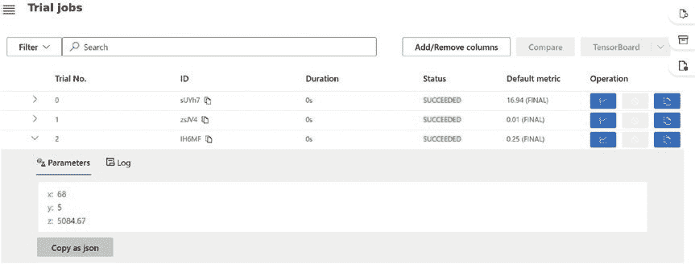

列表 1-6 返回 (x = 50, y = 2, z = 4756.58) -> 47.96，这与我们在 NNI 实验中找到的最佳值 48.02 非常接近。接下来的章节将证明，检查超参数面板可以帮助你理解有效深度学习模型的许多关键概念。

页面底部是试验列表（Trial list）面板，它列出了所有试验。你可以观察每个试验的参数、日志和指标，如图 1-19 所示。

***图 1-19.** 试验列表面板*

一个实验通常是一个相当长的过程，可能耗时几天甚至几周。有时，可能会有一些有趣的假设需要测试。例如，可能需要手动运行一个带有特定参数的试验。如果你不想等到实验结束，可以通过点击挑战列表（list of challenges）中的“复制（Copy）”按钮将自定义试验添加到队列中。你可以在弹出窗口中输入试验参数并提交试验。图 1-20 展示了你如何提交一个自定义试验。

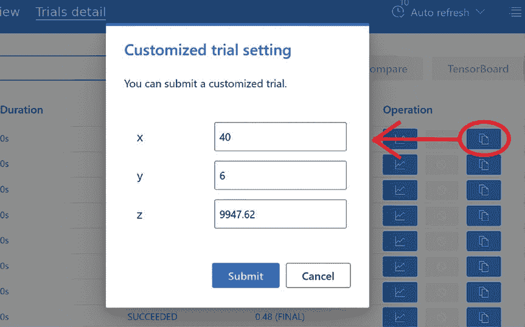

# 第 1 章 神经网络智能简介

***图 1-20.** 自定义试验*

NNI 为实验提供了一个 Web 面板，简化了管理和监控任务。我们将在接下来的章节中多次回到它。

## NNI 命令行

除了 Web 面板外，你还可以使用命令行界面来管理 NNI 并监控它的实验。NNI 具有以下工作目录：`~/nni-experiments`，所有关于实验的数据都存储在这里。

- `nnictl create --config <path_to_config>`：启动一个实验并返回 `<experiment_id>`。在执行期间，所有关于运行实验的信息都保存在 `~/nni-experiments/<experiment_id>` 中。
- `nnictl stop`：停止运行中的实验。
- `nnictl experiment list --all`：返回所有已创建实验的列表。
- `nnictl resume <experiment_id>`：恢复已停止的实验。当你想分析已完成实验的结果时，此命令也非常有用。
- `nnictl view <experiment_id>`：输出关于实验的信息。
- `nnictl top`：输出最佳试验。

有关关于 NNI 命令行工具的更多信息，请参阅 `nnictl --help`。

## NNI 实验配置

正如我们之前看到的，实验的执行是通过 YAML 文件（`ch1/bbf/config.yml`）配置的。NNI 允许灵活地配置实验执行。

表 1-2 列出了主要的配置参数。

***表 1-2.** NNI 实验配置设置*

| 字段 (Field) | 类型 (Type) | 描述 (Description) |
| :--- | :--- | :--- |
| `experimentName` | str | 实验名称（可选） |
| `searchSpaceFile` | str | 包含搜索空间的 JSon 文件路径（可选） |
| `definition` | YAML | 内联搜索空间定义字段（可选） |

例如，在 `ch1/bbf/search_space.json` 中定义的搜索空间可以设置在 `searchSpace` 中：

```yaml
searchSpace:
  x:
    type: categorical
    choices: [50, 49, 48]
  y:
    type: categorical
    choices: [2, 4, 6, 8, 10]
  z:
    type: uniform
    min: 1
    max: 10000
    precision: 2
```

- `trialCommand`：执行试验的命令。
- `trialCodeDirectory`：试验代码所在的目录路径。
- `trialConcurrency`：并发运行的试验数量。
- `maxExperimentDuration`：实验的最大持续时间。
- `maxTrialNumber`：允许的最大试验次数。
- `trialDuration`：试验的最大持续时间。
- `debug`：是否启用调试模式。
- `tuner`：调优器配置。
- `assessor`：评估配置。
- `advisor`：建议配置。
- `trainingService`：训练服务配置。
- `sharedStorage`：共享存储配置。

# 第 1 章 神经网络智能简介

## 嵌入式 NNI

尽管 NNI 的功能非常强大，但它也可以以嵌入式模式运行。当你需要动态创建实验并对执行有更多控制权时，这种模式会非常方便。列表 1-7 展示了在嵌入式模式下运行实验的示例。

```python
# 加载包
from pathlib import Path
from nni.experiment import Experiment

# 定义搜索空间
search_space = {
  "x": {
    "type": "categorical",
    "choices": [50, 49, 48]
  },
  "y": {
    "type": "categorical",
    "choices": [2, 4, 6, 8, 10]
  },
  "z": {
    "type": "uniform",
    "min": 1,
    "max": 10000,
    "precision": 2
  }
}

# 配置实验
experiment = Experiment('local')
experiment.config.experiment_name = 'Black Function Optimization'
experiment.config.trial_concurrency = 4
experiment.config.max_trial_number = 1000
experiment.config.search_space = search_space
experiment.config.trial_command = 'python3 trial.py'
experiment.config.trial_code_directory = Path(__file__).parent
experiment.config.tuner.name = 'Evolution'
experiment.config.tuner.class_args['optimize_mode'] = 'maximize'

# 启动 NNI
http_port = 8080
experiment.start(http_port)

# 事件循环
while True:
    if experiment.get_status() == 'DONE':
        search_data = experiment.export_data()
        search_metrics = experiment.get_job_metrics()
        input("实验已完成。按任意键退出...")
        break
```

***列表 1-7.** 嵌入式 NNI.*

如果你在启动和使用 NNI 时遇到任何问题或错误，可以按照此简要指南确定问题所在。


- **NNI 未启动**。在这种情况下，你将在运行 `nnictl start` 命令后看到错误输出消息，该错误消息可以帮助你解决问题。

- **NNI 正在启动，但在概述 Web 面板中看到 ERROR 标签**，如图 1-21 所示。

***图 1-21.** NNI. ERROR 标签*

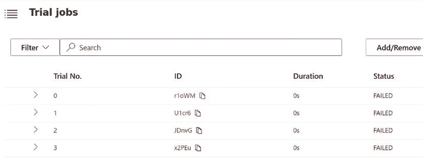

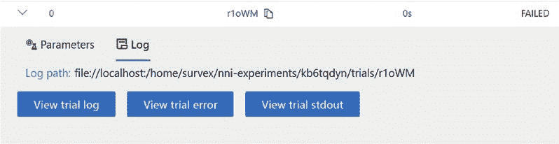

# 第 1 章 神经网络智能引言

在这种情况下，请检查 `~/nni-experiments/<experiment_id>/log/nnictl_stderr.log` 中的错误日志文件。

**NNI 正在启动。实验正在运行（RUNNING），但试验（Trials）处于失败（FAILED）状态**，如图 1-22 所示。

***图 1-22.** NNI。失败的试验*

在这种情况下，检查试验作业面板（Trial jobs panel）中的试验日志，如图 1-23 所示。

***图 1-23.** NNI。试验日志*

本迷你指南可能让你更方便地找到并修复 NNI 问题。

## TensorFlow 和 PyTorch

本书将把 AutoDL 技术应用于使用 `TensorFlow` 或 `PyTorch` 实现的模型。本书假设读者具有其中一个框架的经验。每一章都将提供如何将 NNI 应用于 `TensorFlow` 或 `PyTorch` 实现的模型的示例。在 `PyTorch` 或 `TensorFlow` 上实现的示例之间不会重复，但它们会彼此接近。因此，如果你只是一个 `PyTorch` 用户，即使不研究 `TensorFlow` 模型的示例，也不会丢失任何内容。

本书将使用以下框架版本：

- `TensorFlow`: 2.7.0
- `PyTorch`: 1.9.0
- `PyTorch Lightning`: 1.4.2
- `Scikit-learn`: 0.24.1

在任何情况下，我都建议你浏览一遍所有的示例，因为它们的概念可以很容易地迁移到你喜欢的深度学习框架中。

## 总结

在这一章中，我们探索了 NNI 的基本功能。NNI 是一个解决各种 AutoML 任务的强大工具包。在本章开头，我们分别调查了在实践中应用 AutoML 技术的需求。在下一章中，我们将开始探索经典的超参数优化（`HPO`）方法。我们将学习 HPO 技术如何优化现有架构并创建新的模型设计。

# 第 2 章 超参数优化

几乎每个深度学习模型都有大量的超参数。选择合适的超参数是 AutoML 中最常见的问题之一。模型超参数的某一个微小变化都会显著改变其性能。

超参数优化（`HPO`）是深度学习模型调优的第一步也是最有效的一步。由于其普遍性，超参数优化有时被视为 AutoML 的同义词。

NNI 提供了一系列广泛且灵活的 HPO 工具。本章将检查各种神经网络设计，以及如何应用 NNI 来优化它们针对特定问题的超参数。

## 什么是超参数？

让我们从定义什么是模型*超参数*开始本章的介绍。一个深度学习模型有三类型的参数：

- **权重和偏置（或模型参数）**：神经网络架构中线性（或张量）函数的参数，在训练过程中对其进行调优。
- **超参数**：手动设置的初始全局变量，影响函数的行为、训练算法和神经网络的架构。
- **任务参数**：任务为你设置的参数。这些参数存在于问题需求中，必须满足且无法更改。例如，假设我们通过分析图片来解决确定“猫还是狗？”的二分类问题。在这种情况下，我们有一个任务参数：`2`，它表示输出类别的数量。或者例如，我们有未来三天的气温预测问题。那么参数 `3` 就是一个任务参数，它位于任务需求中，无法以任何方式更改。

让我们来看一个具有三个带有激活函数的线性（或密集）层、五值输入向量和标量输出的全连接神经网络（或稠密网络）示例：

***代码 2-1.** 全连接神经网络（TensorFlow 实现）`ch2/hpo_definition.py`*

```python
import tensorflow as tf
from tensorflow.keras.layers import Dense

# Task Parameters
inp_dim = 5
out_dim = 1

# Hyperparameters
l1_dim = 8
l2_dim = 4

# Model
model = tf.keras.Sequential([
    Dense(l1_dim, name='l1', activation='sigmoid', input_dim=inp_dim),
    Dense(l2_dim, name='l2', activation='relu'),
    Dense(out_dim, name='l3')
])

model.build()

# Weights and Biases
print(model.summary())
```

***表 2-1.** FCNN 模型权重和偏置*

| 层 | 输出形状 | 参数数量 | 解释 |
| :--- | :--- | :--- | :--- |
| l1 | (None, 8) | 48 | 5×8 权重 + 8 偏置 = 48 |
| l2 | (None, 4) | 36 | 8×4 权重 + 4 偏置 = 36 |
| l3 | (None, 1) | 5 | 4×1 权重 + 1 偏置 = 5 |
| **总计** | | **89** | |

代码 2-1 所示的模型具有 2 个超参数和 89 个模型参数。超参数直接影响模型参数。事实上，在代码 2-1 中，`l1_dim` 和 `l2_dim` 设置了权重矩阵和偏置向量的维度。图 2-1 阐了超参数对 FCNN 模型架构及其参数的影响。

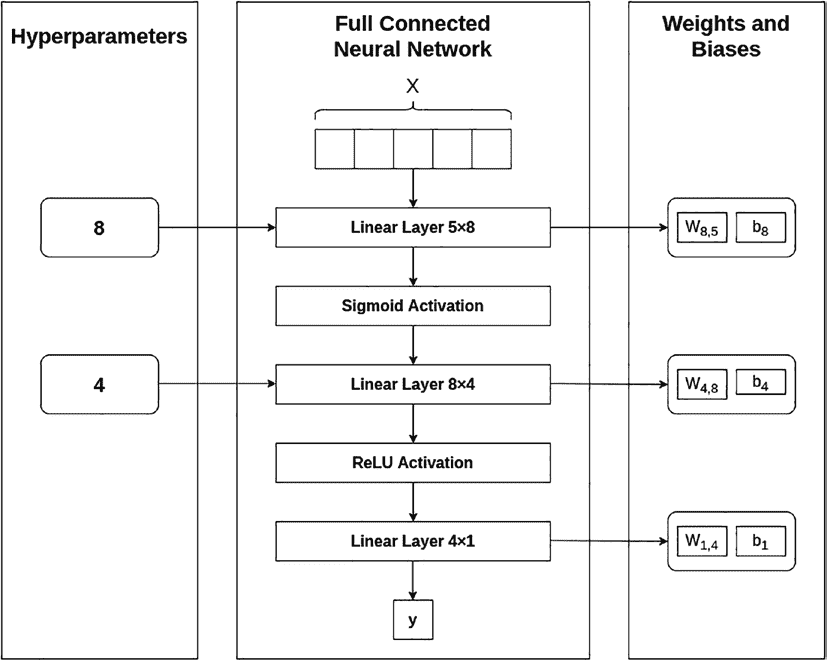

最常见的例子是 `learning rate`（学习率）调优。大多数训练算法使用梯度下降作为模型训练的核心思想。梯度下降的概念意味着为损失函数表面上的每个点计算一个转换向量。但这个向量的长度由 `learning rate` 参数决定。过高的 `learning rate` 参数可能导致梯度下降爆炸，并完全无法在损失函数表面上找到接受的局部最小值。同时，过低的 `learning rate` 会让训练过程停止在表面上的过高点，且使模型参数无法到达更低的点。图 2-2 展示了学习率问题。

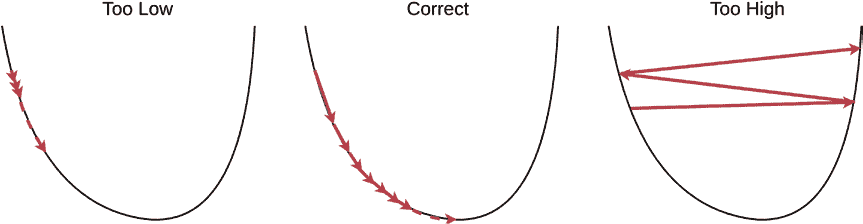

***图 2-2.** 学习率问题*

最常见的训练超参数有：

- `Training epochs number`（训练轮数）
- `Learning rate`（学习率）
- `Batch size`（批大小）

由于这种方法易于实现，层超参数和训练超参数优化是调优模型最常用的方法。

## 特征超参数

特征超参数影响数据集的预处理方法。输入数据集中的数据结构可以显著提高模型性能，特别是在自然语言处理（NLP）问题中。但输入数据集的转换并不总是能提高性能，因此你通常需要“尝试”各种特征预处理技术以获得最佳结果。

让我们来看一个包含电影评论的数据集。该数据集包含以下特征：

- `Feature A`: 电影预算（`example: 100 000 000$`）
- `Feature B`: 评论日期（`example: 2021-05-03`）
- `Feature C`: 评论文本（`example: 我喜欢好电影，但遗憾的是，这不是其中之一。`）

我们正在解决一个经典的二分类问题，即我们需要判断评论是负面的还是正面的。然后我们可以应用下面的预处理方法，如图 2-3 所示。

***图 2-3.** 由特征超参数驱动的数据集预处理*

图 2-3 所示的数据集预处理包含以下特征超参数：`use Normalization`、`use Weekend labeling` 和 `use Stop words removal`。

让我们描述它们的含义：

- `use Normalization:` 归一化是一种转换数值数据的常用技术，通过将所有值转换为 0 到 1 的范围。`use Normalization` 超参数管理归一化在特征 A（预算）上的：
    - `0`: 对特征 A 不应用归一化。
    - `1`: 对特征 A 应用归一化，并产生特征 A’。

- `use Weekend labeling:` 日期对神经网络不包含任何信息。但额外的日期时间标记可能会有所帮助。例如，在假期留下的评论通常更积极，因为人们心情很好。我们可以使用周末标记方法，如果某个日期是假期或周末，则对其进行标记。日期序列可以从 `2021-11-05`、`2021-11-06`、`2021-11-07`、… 转换为 `0, 1, 1, ….`。
    - `0`: 不应用周末标记，并从数据集中移除特征 B。
    - `1`: 应用周末标记，并将特征 B 转换为特征 B’。

- `use Stop words removal:` 从文本中移除停用词是一种常见的做法，可以清除文本噪声。移除停用词通常加速训练并提高 NLP 模型的质量。
    - `0`: 对特征 C 不应用停用词移除。
    - `1`: 对特征 C 应用停用词移除，并产生特征 C’。

例如，特征超参数组合 `{use Normalization: 0, use Weekend labeling: 1, use Stop words removal: 1}` 将原始数据集 `[A, B, C]` 转换为 `[A, B’, C’]`。

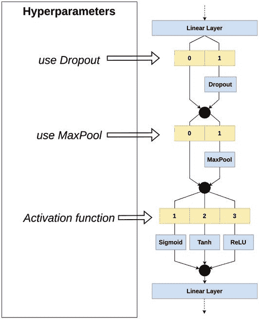

## 设计超参数

设计超参数对神经网络架构的选择有直接影响。它们的值控制着神经网络层的选择以及层之间的连接。图 2-4 所示展示了设计超参数。

***图 2-4.** 设计超参数*

图 2-4 所示的设计超参数包含：`use Dropout`、`use MaxPool` 和 `Activation function`（激活函数）。它们以以下方式影响模型设计：

- `use Dropout:`
    - `0`: 跳过 `Dropout layer`。
    - `1`: 连接 `Dropout layer`。

- `use MaxPool:`
    - `0`: 跳过 `MaxPool layer`。
    - `1`: 连接 `MaxPool layer`。

- `Activation function:`
    - `1`: 连接 `Sigmoid` 函数。
    - `2`: 连接 `Hyperbolic tangent`（双曲正切）函数。
    - `3`: 连接 `Rectified linear`（线性整流）函数。

例如，设计超参数组合 `{use Dropout: 1, use MaxPool: 0, Activation function: 3}` 将神经网络中生成以下层序列：

- 线性层
- Dropout 层
- ReLU 激活层

设计超参数优化较少，因为它比层超参数或训练超参数优化更具挑战性。但设计超参数调优可以产生极佳的结果。它为特定问题选择了层及其连接之间的最佳组合。

## 搜索空间

假设我们确定了需要优化的模型超参数。接下来，我们必须为每个超参数定义搜索空间。确定搜索空间需要一些经验和直觉。你必须理解，搜索空间越大，实验时间越长，找到合适解决方案也越困难。因此，在搜索空间中指定大量的数值是没有意义的。例如，如果 `l1` 是一个指定线性层维度的超参数（`tensorflow.keras.layers.Dense(l1)` 或 `torch.nn.Linear(out_features=l1)`），那么你不需要将该超参数的搜索空间设置为 `[1, 2, 3,..., 999, 1000]`。对于超参数 `l1`，表示 2 的幂次（`2n`）更为合适：`[4, 8, 16, ..., 256]`，因为线性层的表示大小仅与比例有关，而非加法（如果 `l1 = 256` 表现不好，那么极有可能 `l1 = 256 + 8` 也会得到相同的结果）。合理的超参数选择可以在不损失质量的情况下显著减少实验时间。在指定搜索空间之前，可以进行手动探索以确定哪些超参数值对模型性能影响最大。

NNI 允许使用以下采样策略定义超参数搜索空间：`choice`、`randint`、`uniform`、`quniform`、`loguniform`、`qloguniform`、`normal`、`qnormal`、`lognormal` 和 `qlognormal`。

### choice

`{"_type": "choice", "_value": options}`

Choice 采样策略允许你手动指定超参数可以取的值列表。可以是数字和字符串的列表。例如：

`"hp": {"_type": "choice", "_value": [128, 512, 1024]}`

Choice 采样支持嵌套搜索空间。嵌套 choice 特别是在处理设计超参数时非常有用。以下是嵌套选择采样的示例：

```json
"layer1" :{
  "_type": "choice",
  "_value": [
    {"_name": "Empty"},
    {
      "_name": "Conv",
      "kernel_size": {
        "_type": "choice",
        "_value": [1, 2, 3, 5]
      }
    },
    {
      "_name": "Max_pool",
      "pooling_size": {
        "_type": "choice",
        "_value": [2, 3, 5]
      }
    },
    {
      "_name": "Avg_pool",
      "pooling_size": {
        "_type": "choice",
        "_value": [2, 3, 5]
      }
    }
  ]
}
```

### randint

```json
{"_type": "randint", "_value": [lower, upper]}
```

从 `lower`（包含）到 `upper`（不包含）之间选择随机整数。

### uniform

```json
{"_type": "uniform", "_value": [low, high]}
```

根据 `[low, high]` 上的均匀分布选择随机值。

### quniform

```json
{"_type": "quniform", "_value": [low, high, q]}
```

行为类似于均匀采样，但带有 `q` 离散化，可以表示为 `clip(round(uniform(low, high) / q) * q, low, high)`。例如，当 `_value` 指定为 `[1, 11, 2.5]` 时，可能的值有 `[1, 2.5, 5, 7.5, 10, 11]`。

### loguniform

```json
{"_type": "loguniform", "_value": [low, high]}
```

根据 `[low, high]` 上的对数均匀分布选择随机值，可以表示为 `np.exp(uniform(np.log(low), np.log(high)))`。

### qloguniform

```json
{"_type": "qloguniform", "_value": [low, high, q]}
```

行为类似于对数均匀采样，但带有 `q` 离散化，可以表示为 `clip(round(loguniform(low, high) / q) * q, low, high)`。

### normal

```json
{"_type": "normal", "_value": [mu, sigma]}
```

根据 `μ = mu` 和 `σ = sigma` 的正态分布选择随机值。

### qnormal

```json
{"_type": "qnormal", "_value": [mu, sigma, q]}
```

行为类似于正态采样，但带有 `q` 离散化，可以表示为 `round(normal(mu, sigma) / q) * q`。

### lognormal

```json
{"_type": "lognormal", "_value": [mu, sigma]}
```

根据 `μ = mu` 和 `σ = sigma` 的对数正态分布选择随机值，可以表示为 `np.exp(normal(mu, sigma))`。

### qlognormal

```json
{"_type": "qlognormal", "_value": [mu, sigma, q]}
```

行为类似于对数正态采样，但带有 `q` 离散化，可以表示为 `round(exp(normal(mu, sigma)) / q) * q`。

采样策略的实现在 `nni.parameter` 表达式中。你可以手动探索搜索空间策略，如图 2-2 所示。

### quniform 采样策略

```python
import nni
from numpy.random import RandomState
import matplotlib.pyplot as plt

# 我们使用 quniform 策略生成 20 个样本：
space = nni.quniform(0, 100, 5, RandomState(seed))
for seed in range(20):
    # 可视化生成的样本：
    plt.figure(figsize=(5, 1))
    plt.title('quniform')
    plt.plot(space, len(space), "x")
    plt.yticks([])
    plt.show()
```


之后，你可以通过图 2-5 中的 `quniform` 方法观察生成的样本。

## 搜索空间定义

```json
{
  "dropout_rate": {"_type": "uniform", "_value": [0.1, 0.5]},
  "conv_size": {"_type": "choice", "_value": [2, 3, 5, 7]},
  "layer1_hidden_size": {"_type": "choice", "_value": [128, 512, 1024]},
  "layer2_hidden_size": {"_type": "choice", "_value": [16, 32, 64]},
  "activation_function": {"_type": "choice", "_value": ["tanh", "sigmoid", "relu"]},
  "training_batch_size": {"_type": "choice", "_value": [100, 250, 500]},
  "training_learning_rate": {"_type": "uniform", "_value": [0.0001, 0.1]}
}
```

列出了深度学习模型的典型搜索空间：

- `dropout_rate`：层超参数，用于定义 dropout 层中的 `p` 参数。`dropout_rate` 可以取 0.1 到 0.5 之间的任何值。
- `conv_size`：层超参数，用于定义卷积层的卷积大小。`conv_size` 可以取 2, 3, 5, 7 中的任何值。
- `layer1_hidden_size`：层超参数，用于定义第一个隐藏层的神经单元数量。`layer1_hidden_size` 可以取 128, 512, 1024 中的任何值。
- `layer2_hidden_size`：层超参数，用于定义第二个隐藏层的神经单元数量。`layer2_hidden_size` 可以取 16, 32, 64 中的任何值。
- `activation_function`：层超参数，用于定义激活函数。`activation_function` 可以取 ["tanh", "sigmoid", "relu"] 中的任何值。
- `training_batch_size`：层超参数，用于定义训练时的批大小。`training_batch_size` 可以取 100, 250, 500 中的任何值。
- `training_learning_rate`：层超参数，用于定义学习率。`training_learning_rate` 可以取 0.0001 到 0.1 之间的任何值。

## Tuners（调优器）

定义搜索空间后，我们需要定义一个调优器来搜索搜索空间并根据结果选择超参数组合。调优器在文件中配置如下：

```yaml
tuner:
  name: <Tuner_Name>
  classArgs:
    optimize_mode: minimize
    arg1: val1
    arg2: val2
```

每个调优器都有自己的参数集。所有调优器的通用参数是 `optimize_mode`，它标记了指标优化的方向：最小（minimize）或最大（maximize）。表 2-2 列出了 NNI v.7 可用的调优器列表。

| 配置 ID | 名称 |
| :--- | :--- |
| SMAC | 顺序模型优化 |
| TPE | 结构帕森估计器 |
| Random | 随机搜索 |
| Anneal | 退火搜索算法 |
| Evolution | 遗传算法搜索 |
| BatchTuner | 批量调优器 |
| GridSearch | 网格搜索 |
| NetworkMorphism | 网络形变 |
| MetisTuner | Metis 调优器 |
| GPTuner | 高斯过程调优器 |
| PBTTuner | 基于种群的训练调优器 |

我们第 3 章（https://doi.org/10.1007/978-1-4842-8149-9_3）详细介绍调优算法。

### 随机搜索调优器

随机搜索调优器是选择超参数组合最直接的方法。正如名称所示，组合是完全随机选择的。尽管这种方法简单，但有时可以产生非常好的结果。

```yaml
tuner:
  name: Random
```

### 网格搜索调优器

网格搜索调优器执行穷举搜索，即网格搜索调优器将搜索空间中所有可能的组合。网格搜索适用于较小的搜索空间。

```yaml
tuner:
  name: GridSearch
```

现在，我们已经准备好开始第一次探索。让我们来看本书中将使用的文件组织模式。我建议你也采用相同的方法。

这些简单的规则将帮助你在运行实验时避免不必要的错误：

*   为每个实验使用独立的目录。
*   在实验配置中将当前目录指定为 `trialCodeDirectory`。
*   将模型类和训练/测试方法保持在单独的文件中。
*   在试验文件（trial file）将根代码文件夹添加到系统路径。
*   不要将模型文件和试验文件混合。

让我们来看一个遵循这些规则的示例实验 `ch2/experiment_pattern`。

列表 2-4 提供了实验配置文件。

该配置文件将当前目录标记为工作目录：

`trialCodeDirectory: .`

**Listing 2-4.** 实验配置。`ch2/experiment_pattern/config.yml`

```yaml
trialConcurrency: 1
searchSpaceFile: search_space.json
trialCodeDirectory: .
trialCommand: python3 trial.py
tuner:
  name: GridSearch
trainingService:
  platform: local
```

模型类和训练/测试方法位于列表 2-5 所示的单独文件中。

**Listing 2-5.** DummyModel 类。`ch2/experiment_pattern/model.py`

```python
from random import random

class DummyModel:
    def __init__(self, x, y) -> None:
        super().__init__()
        self.x = x
        self.y = y

    def train(self):
        # Training here
        ...

    def test(self):
        # Test results
        return round(self.x + self.y + random() / 10, 2)
```

**Table 2-3.** NNI API

| 方法 | 说明 |
| :--- | :--- |
| `nni.get_next_parameter()` | 必须的方法，接收来自 `nni tuner` 的 `Dict` 对象格式的试验参数 |
| `nni.report_intermediate_result(m)` | 可选方法，将中间结果发送给 `nni tuner` |
| `nni.report_final_result(m)` | 必须的方法，发送代表模型性能的最终指标 |

试验脚本从 NNI tuner 接收参数，初始化模型，训练它并测试其性能。试验脚本通过表 2-3 所示的 API 方法与 NNI 交互。

让我们来看列表 2-6 中的试验脚本模式。

我们导入了必要的模块：

**Listing 2-6.** 试验脚本模式。`ch2/experiment_pattern/trial.py`

```python
import os
import sys
import nni
```

在这里，我们将代码的根目录添加到系统路径。这样做是因为 NNI 并不知道我们的代码结构以及模块的位置。

```python
# For NNI use relative import for user-defined modules
SCRIPT_DIR = os.path.dirname(os.path.abspath(__file__)) + '/../..'
sys.path.append(SCRIPT_DIR)
```

现在，我们可以从代码结构中导入需要的类：

```python
from ch2.experiment_pattern.model import DummyModel
```

试验启动模型，对其进行训练，测量其性能，并将结果返回给 NNI Tuner：

```python
def trial(hparams):
    """
    Trial Script:
    - Initiate Model
    - Train
    - Test
    - Report
    """
    model = DummyModel(**hparams)
    model.train()
    accuracy = model.test()
    # send final accuracy to NNI
    nni.report_final_result(accuracy)
```

这里是试验脚本的入口：

```python
if __name__ == '__main__':
    # Manual HyperParameters
    hparams = {
        'x': 1,
        'y': 1,
    }
    # NNI HyperParameters
    # Run safely without NNI Experiment Context
    nni_hparams = nni.get_next_parameter()
    hparams.update(nni_hparams)
    trial(hparams)
```

你可以以独立模式运行试验脚本 `ch2/experiment_pattern/trial.py`。这意味着你可以运行此脚本而不会产生任何错误。`nni.get_next_parameter()` 方法将返回一个空字典，你可以将其与试验参数合并。这在你想要测试试验执行情况时非常方便。

实验文件结构模式可以如图 2-8 所示。

**Figure 2-8.** 实验文件结构

很好！我们定义了不同的超参数类型，检查了如何定义搜索空间，研究了简单的调优器，并了解了创建实验的模式。我们现在准备好进入真正的研究了。后续章节将研究 HPO 方法如何针对特定问题优化模型，并帮助开发新的模型设计。

## 针对 MNIST 问题优化 LeNet

库：TensorFlow (Keras API), PyTorch

MNIST 分类问题是测试各种机器学习方法的常用问题。卷积神经网络在识别领域取得了突破。它被分为两个部分：包含 60,000 个样本的训练集和 10,000 个样本的测试集。

MNIST 数据集是一组 28×28 的灰度图像。因此，每个数据集都是 (28, 28, 1) 张量。让我们来看该数据集的几个样本。

**Listing 2-7.** MNIST 数据集。`ch2/lenet_hpo/mnist_dataset.py`

```python
import tensorflow_datasets as tfds
ds, info = tfds.load('mnist', split='train', with_info=True)
fig = tfds.show_examples(ds, info)
fig.show()
```

**Figure 2-9.** MNIST 数据库

这看起来是一个非常简单的任务，但事实并非如此。回想你经常无法理解别人写的数字。手写识别是模式识别的基本问题之一。

该模型流行的主要原因是其直接的架构。它是一个用于分类的多层卷积网络。抽象的 LeNet 模型设计如图 2-11 所示。

**Figure 2-11.** LeNet 架构

我们的目标是优化 LeNet 模型以解决手写识别问题。简单的方法是从层参数开始。让我们数数 LeNet 模型中的层参数：

*   **Conv2D 层**：五个超参数 (`out_channels`, `kernel_size`, `stride`, `padding`, `dilation`)
*   **MaxPool2D 层**：两个超参数 (`kernel_size`, `stride`)
*   **Linear 层**：两个超参数 (`out_features`, `use_bias`)

LeNet 包含两个 `Conv2D` 层、两个 `MaxPool2D` 层和两个线性层。因此，LeNet 中有 $2\times5 + 2\times2 + 2\times2 = 14$ 个层参数。假设对于每个超参数，我们只有一个包含两个元素的可能集合，尽管当然，许多超参数为了实验的灵活性需要更多值。即使是二分搜索空间也包含 $2^{14} = 16384$ 个元素。而这些只是简单的深度学习模型的原始层参数。随着模型复杂性的增加，其中可能的超参数数量呈指数级增长。即使是最先进的调优器也可以花费长时间来探索这个搜索空间。因此，我们需要一些经验和直觉，这允许我们在不过度增加搜索空间的情况下，为每个模型选择关键的超参数范围。

- **线性层**: `out_features`

为了缩小搜索空间的大小，我们设置：

- `filter_size_2 = 2 * filter_size_1`
- `kernel_size_1 = kernel_size_2`

然后，我们将仅针对 LeNet 模型关注三个超参数：

- `filter_size`
- `kernel_size`
- `out_features`

## 第 2 章 超参数优化

通常，卷积层 `filter_size` 的最佳值呈现为 $2^n$ 形式。因此，我们为搜索空间选择了以下值：8, 16, 32。`kernel_size` 的值通常在 $2^n+1$ 的集合中选择。图像越大，选择的 `kernel_size` 值也应该越大。MNIST 数据集的样本是 $28\times28$ 的像素图像。这些是非常较小的图像，因此我们不应该选择较大的 `kernel_size` 值：2, 3, 5。`l1_size` 的最佳值与 `filter_size` 一样都是 2 的幂。线性层应用于 `flatten` 层之后的张量，这意味着我们必须考虑之前层产生的张量维度。在 MNIST 问题中，我们将关注以下 `l1_size` 值：32, 64, 128。对于 `MaxPool2D` 层，我们将设置 `pool_size` 的最小可能值 2，并将 `sigmoid` 设置为激活函数。是的！这个函数很长期以来一直被用作大多数模式识别问题的激活函数。我们将在下一节中回到选择激活函数的问题。

我们将使用带有 `Adam` 优化器的经典批处理神经网络训练。现在让我们通过选择最简单的超参数：`batch_size` 和 `learning_rate` 来进行研究。`batch_size` 的最佳参数表示为 $2^n$，`learning_rate` 表示为 $10^{-n}$。对于这种情况，我们将选择：256, 512, 1024 作为 `batch_size`，并选择 0.01, 0.001, 0.0001 作为 `learning_rate`。

现在，让我们把之前设置的超参数约束转换为 NNI 搜索空间。列表 2-8 定义了 LeNet 超参数优化的搜索空间。

**Listing 2-8.** LeNet HPO 搜索空间。`ch2/lenet_hpo/search_space.json`

```json
{
  "filter_size": {
    "_type": "choice", "_value": [8, 16, 32]
  },
  "kernel_size": {
    "_type": "choice", "_value": [2, 3, 5]
  },
  "l1_size": {
    "_type": "choice", "_value": [32, 64, 128]
  },
  "batch_size": {
    "_type": "choice", "_value": [256, 512, 1024]
  },
  "learning_rate": {
    "_type": "choice", "_value": [0.01, 0.001, 0.0001]
  }
}
```

## 第 2 章 超参数优化

很好！在下一步中，我们将结合 HPO 问题，创建 LeNet 模型的 TensorFlow 和 PyTorch 实现。

### TensorFlow LeNet 实现

在本节中，我们将学习使用 TensorFlow (Keras API) 实现 LeNet 模型。列表 2-9 展示了用于超参数优化的 TensorFlow LeNet 模型。

我们导入必要的模块：

**Listing 2-9.** LeNet. TensorFlow 实现。`ch2/lenet_hpo/tf_lenet_model.py`

```python
from tensorflow.keras import Model
from tensorflow.keras.layers import Conv2D, Dense, Flatten, MaxPool2D
from tensorflow.keras.optimizers import Adam
from ch2.utils.datasets import mnist_dataset
from ch2.utils.tf_utils import TfNniIntermediateResult
```

接下来，我们定义具有三个层超参数的 LeNet 模型：


```python
class TfLeNetModel(Model):
    def __init__(self, filter_size, kernel_size, l1_size):
        super().__init__()
        # 第一层卷积栈：
        self.conv1 = Conv2D(
            filters=filter_size,
            kernel_size=kernel_size,
            activation='sigmoid'
        )
        self.pool1 = MaxPool2D(pool_size=2)
        # 第二层卷积栈：
        self.conv2 = Conv2D(
            filters=filter_size * 2,
            kernel_size=kernel_size,
            activation='sigmoid'
        )
        self.pool2 = MaxPool2D(pool_size=2)
        # 全连接层栈：
        self.flatten = Flatten()
        self.fc1 = Dense(
            units=l1_size,
            activation='sigmoid'
        )
        self.fc2 = Dense(
            units=10,
            activation='softmax'
        )
```

LeNet 是一个简单的模型，它将计算结果从一层传递到另一层：

```python
    def call(self, x, **kwargs):
        x = self.conv1(x)
        x = self.pool1(x)
        x = self.conv2(x)
        x = self.pool2(x)
        x = self.flatten(x)
        x = self.fc1(x)
        return self.fc2(x)
```

训练方法使用两个超参数：`batch_size` 和 `learning_rate`。我们使用 `Adam` 优化器和交叉熵损失函数：

```python
    def train(self, learning_rate, batch_size):
        self.compile(
            optimizer=Adam(learning_rate=learning_rate),
            loss='sparse_crossentropy',
            metrics=['accuracy']
        )
        (x_train, y_train) = mnist_dataset()
```

接下来，我们初始化一个将中间结果发送到 NNI 的回调函数：

```python
intermediate_cb = TfNniIntermediateResult('accuracy')
```

执行十个 epoch 的经典批处理训练：

```python
        self.fit(
            x_train,
            y_train,
            batch_size=batch_size,
            epochs=10,
            verbose=0,
            callbacks=[intermediate_cb]
        )
```

最后一个方法是 `test`。我们加载数据集并通过准确率进行分类：

```python
    def test(self):
        """Testing 模型"""
        (x_train, y_train) = mnist_dataset()
        loss, accuracy = self.evaluate(x_train, y_train, verbose=0)
        return accuracy
```

## 第 2 章 超参数优化

好了，由于 TensorFlow 模型已经就绪，我们可以使用列表 10 实现 NNI 脚本：

```python
import os
import sys
import nni

# NNI 使用相对导入
SCRIPT_DIR = os.path.dirname(os.path.abspath(__file__)) + '/..'
sys.path.append(SCRIPT_DIR)
from ch2.lenet_hpo.tf_lenet_model import TfLeNetModel

# trial 方法初始化模型、训练并返回 NNI 指标：

```python

def trial(hparams):

    model = TfLeNetModel(

        filter_size=hparams['filter_size'],

        kernel_size=hparams['kernel_size'],

        l1_size=hparams['l1_size']

    )

    model.train(

        batch_size=hparams['batch_size'],

        learning_rate=hparams['learning_rate']

    )

    accuracy = model.test()

    nni.report_final_result(accuracy)

```

最后，我们为 trial 定义主入口：

```python

if __name__ == '__main__':

    # 手动超参数

    hparams = {

        'filter_size': 32,

        'kernel_size': 3,

        'l1_size': 64,

        'batch_size': 512,

        'learning_rate': 1e-3,

    }

    # NNI 超参数

    # 在没有 NNI 实验的情况下安全运行

    nni_hparams = nni.get_next_parameter()

    hparams.update(nni_hparams)

    trial(hparams)

```

记得 trial 脚本可以独立运行，因此你可以运行 `ch2/lenet_hpo/tf_trial.py` 使用自定义参数测试其执行。

## 第 2 章 超参数优化

### PyTorch LeNet 实现

在本节中，我们将学习使用 PyTorch 实现 LeNet 模型的实现。列表 2-11 展示了用于超参数优化的 PyTorch LeNet 模型。

我们导入必要的模块：

**Listing 2-11.** LeNet. PyTorch 实现。`ch2/lenet_hpo/pt_lenet_model.py`

```python

import numpy as np

import nni

import torch

import torch.nn as nn

import torch.nn.functional as F

import torch.optim as optim

from sklearn.metrics import accuracy_score

from ch2.utils.datasets import mnist_dataset

```

接下来，我们定义具有三个层超参数的 LeNet 模型：

```python

class PtLeNetModel(nn.Module):

    def __init__(self, filter_size, kernel_size, l1_size):

        super(PtLeNetModel, self).__init__()

        # 此实现将使用懒层初始化，因此我们显式保存了 l1_

        self.conv1 = nn.Conv2d(1, filter_size, kernel_size)

        self.pool1 = nn.MaxPool2d(2)

        self.conv2 = nn.Conv2d(filter_size, filter_size * 2, kernel_size)

        self.pool2 = nn.MaxPool2d(2)

        self.flatten = nn.Flatten()

        # 我们使用懒层或根据输入大小定义输入特征

        # 对于 MNIST 28x28，在两次 2x2 池化和两次卷积后，大小为 7x7。

        self.fc1 = nn.Linear(filter_size * 2 * 7 * 7, l1_size)

        self.fc2 = nn.Linear(l1_size, 10)

```

LeNet 是一个简单的模型，它将计算结果从一层传递到另一层：

```python

    def forward(self, x):

        x = F.relu(self.conv1(x))

        x = self.pool1(x)

        x = F.relu(self.conv2(x))

        x = self.pool2(x)

        x = self.flatten(x)

        x = F.relu(self.fc1(x))

        x = F.softmax(self.fc2(x), dim=1)

        return x

```

大小超参数：

```python
# 保存 l1_size 超参数
self.l1_size = l1_size
```

之后，我们初始化了卷积层：

```python
self.conv1 = nn.Conv2d(
    in_channels = 1,
    out_channels = filter_size,
    kernel_size = kernel_size
)
```

```python
self.conv2 = nn.Conv2d(
    in_channels = filter_size,
    out_channels = filter_size * 2,
    kernel_size = kernel_size
)
```

我们没有初始化第一个线性层，而是使用了懒性初始化（lazy initialization）。为了初始化一个线性层，我们必须指定一个 `in_features` 值。但这并不简单。我们需要知道之前的层将产生的张量维度。为了做到这一点，有时你必须进行复杂的计算。在第一次调用时计算该张量的维度并在此时初始化线性层会更简单一些。

```python
# 懒性 fc1 层初始化
self.fc1__in_features = 0
self._fc1 = None
self.fc2 = nn.Linear(l1_size, 10)
```

懒性层初始化：

```python
@property
def fc1(self):
    if self._fc1 is None:
        self._fc1 = nn.Linear(
            self.fc1__in_features,
            self.l1_size
        )
    return self._fc1
```

LeNet 是一个简单的模型，它将计算结果从一层传递到另一层：

```python
def forward(self, x):
    x = torch.sigmoid(self.conv1(x))
    x = F.max_pool2d(x, 2, 2)
    x = torch.sigmoid(self.conv2(x))
    x = F.max_pool2d(x, 2, 2)

# 平平除 batch 维度以外的所有维度
if not self.fc1__in_features:
    self.fc1__in_features = np.prod(x.shape[1:])
    x = x.view(-1, self.fc1__in_features)

# FC1 懒性初始化
x = torch.sigmoid(self.fc1(x))
x = self.fc2(x)
return F.log_softmax(x, dim = 1)
```

训练方法使用了两个训练超参数：`batch_size` 和 `learning rate`：

```python
def train_model(self, learning_rate, batch_size):
```

我们准备训练数据集：

```python
(x, y), _ = mnist_dataset()
x = torch.from_numpy(x).float()
y = torch.from_numpy(y).long()

# 为 PyTorch 卷积置换维度
x = torch.permute(x, (0, 3, 1, 2))
dataset_size = x.shape[0]
```

初始化 Adam 优化器：

```python
optimizer = optim.Adam(
    self.parameters(),
    lr = learning_rate
)
```

原生 PyTorch 不支持内置的批处理训练。因此，我们手动将数据集划分为批次，并执行 epoch 循环和 batch 循环：

```python
self.train()
for epoch in range(1, 10 + 1):
    # 用于批训练的随机置换
    permutation = torch.randperm(dataset_size)
    for bi in range(1, dataset_size, batch_size):

# 创建新 Batch
indices = permutation[bi:bi + batch_size]
batch_x, batch_y = x[indices], y[indices]

使用交叉熵损失函数进行模型参数优化：
optimizer.zero_grad()
output = self(batch_x)
loss = F.cross_entropy(output, batch_y)
loss.backward()
optimizer.step()
```

在每个 epoch 结束时，我们计算模型的准确率并作为中间结果返回给 NNI：

```python
output = self(x)
predict = output.argmax(dim = 1, keepdim = True)
accuracy = round(accuracy_score(predict, y), 4)
print(f'Epoch: {epoch}| Accuracy: {accuracy}')

# report 中间结果
nni.report_intermediate_result(accuracy)
```

我们需要定义的最后一个方法是模型测试。我们加载测试 MNIST 数据集并通过测量其准确率来执行分类：

```python
def test_model(self):
    self.eval()
    # 准备测试数据集
    _, (x, y) = mnist_dataset()
    x = torch.from_numpy(x).float()
    y = torch.from_numpy(y).long()
    x = torch.permute(x, (0, 3, 1, 2))
    with torch.no_grad():
        output = self(x)
        predict = output.argmax(dim = 1, keepdim = True)
        accuracy = round(accuracy_score(predict, y), 4)
    return accuracy
```

好了，由于 PyTorch 的实现已经就绪，我们加载测试 MNIST 数据集并通过测量其准确率来执行分类（注：此处描述与上文重复，为翻译原文内容）。

在完成一项研究后，我喜欢将结果可视化。我们已经有了准确率指标。但如果看一眼 LeNet 模型无法正确分类的图像仍然很有趣。也许 98.85% 的准确率已经是可能的最高率了？也许测试数据集中包含了无法正确分类的样本？

列表 2-14 展示了前九个失败的预测。

我们导入必要的模块：

**列表 2-14.** LeNet 失败预测。`ch2/lenet_hpo/display_mnist_failed_predictions.py`

```python
from math import floor
import numpy as np
from ch2.lenet_hpo.tf_lenet_model import TfLeNetModel
```


import matplotlib.pyplot as plt
import tensorflow as tf
from ch2.utils.datasets import mnist_dataset

## 使用最佳层超参数初始化 LeNet 模型

### 最佳超参数

```python
hparams = {
    "learning_rate": 0.001,
    "batch_size": 256,
    "l1_size": 64,
    "kernel_size": 5,
    "filter_size": 32
}
```

### 使此脚本具有复现性

```python
tf.random.set_seed(1)
```

### 初始化 LeNet 模型

```python
model = TfLeNetModel(
    filter_size = hparams['filter_size'],
    kernel_size = hparams['kernel_size'],
    l1_size = hparams['l1_size']
)
```

此之后，我们使用最佳训练超参数训练模型：

### 模型训练

```python
model.train(
    batch_size = hparams['batch_size'],
    learning_rate = hparams['learning_rate']
)
```

训练后的模型在测试 MNIST 数据集上进行预测：

### MNIST 数据集

```python
(_, _), (x_test, y_test) = mnist_dataset()
```

### 预测

```python
output = model(x_test)
y_pred = tf.argmax(output, 1)
```

收集前九个失败的预测：

```python
number_of_fails_left = 9
fails = []
for i in range(len(x_test)):
    if number_of_fails_left == 0:
        break
    if y_pred[i] != y_test[i]:
        fails.append((x_test[i], (y_pred[i], y_test[i])))
        number_of_fails_left -= 1
```

显示失败的预测：

```python
fig, axs = plt.subplots(3, 3)
for i in range(len(fails)):
    sample, (pred, actual) = fails[i]
    img = np.array(sample, dtype = 'float')
    img = img * 255
    pixels = img.reshape((28, 28))
    ax = axs[floor(i / 3), i % 3]
    ax.set_title(f'#{i+1}: {actual} ({pred})')
    ax.set_xticks([])
    ax.set_yticks([])
    ax.imshow(pixels, cmap = 'gray')
plt.show()
```

图 2-13 显示了 LeNet 失败的预测。诚实地说，样本 #1, #3, #4, #5, #6 和 #8 真的很难分类。我不认为读者能识别出样本 #4 中的数字 2。因此，我们不需要要求模型达到 100% 的准确率。尽管如此，我认为仍有改进空间。

图 2-13。LeNet 失败预测。恭喜！我们完成了第一项真实世界的研究。我们定义了问题，选择了模型框架（LeNet），表达了搜索空间，进行了实现，并为问题找到了最佳超参数。但这仅仅是一个开始。让我们继续研究，看看我们可以取得什么令人兴奋的结果。

## 使用 ReLU 和 Dropout 升级 LeNet

库：TensorFlow (Keras API), PyTorch

经验丰富的数据科学家可能会有这样一个疑问：为什么我们在上一节中没有对 LeNet 模型使用 dropout 层和将修正后的线性单元（`ReLU`）作为激活函数呢？因为原始的 LeNet 模型没有使用 `ReLU` 激活。而且 dropout 技术是在 LeNet 架构创建 2012 年后首次引入的。LeNet 的主要问题之一是使用了 sigmoid 作为激活函数。sigmoid 激活函数导致训练变慢和梯度消失问题。dropout 技术也是最流行的正则化方法之一。如今，我们无法想象一个不使用 `ReLU` 和 dropout 层的成功识别模型。让我们假装从未听说过 `ReLU` 和 dropout，而有人建议我们将这些技术注入 LeNet 模型以提高其性能。我们可以使用 HPO 进行研究，这将帮助我们找到最佳架构。为了简化问题，我们将使用“一刀切”策略（one-for-all）。这意味着如果激活超参数具有 sigmoid 值，那么 LeNet 模型的所有激活都将 sigmoid 函数。如果激活具有 relu 值，情况也是如此。通常，dropout 层被插入在线性层之间。但最初我们不知道这种技术是否有效，所以我们必须制作 LeNet 架构的可能变体：带有 dropout 层和不带 dropout 层。为了做到这一点，我们使用 `use_dropout` 设计超参数。

```python
filters = filter_size * 2,
kernel_size = kernel_size,
activation = activation
)
```

### 第 2 章 超参数优化

```python
self.pool2 = MaxPool2D(pool_size = 2)
self.flatten = Flatten()
self.fc1 = Dense(
    units = l1_size,
    activation = activation
)
```

如果 `use_dropout` 为真则添加 dropout 层，否则添加恒等层：

```python
if use_dropout:
    self.drop = Dropout(rate = dropout_rate)
else:
    self.drop = tf.identity
```

最终线性层堆：

```python
self.fc2 = Dense(
    units = 10,
    activation = 'softmax'
)
```

Net Upgrade 模型按顺序调用每个层：

```python
def call(self, x, **kwargs):
    x = self.conv1(x)
    x = self.pool1(x)
    x = self.conv2(x)
    x = self.pool2(x)
    x = self.flatten(x)
    x = self.fc1(x)
    x = self.drop(x)
    return self.fc2(x)
```

在实现 `LeNetUpgradeModel` 后，我们可以使用 Listing 2-17 实现 NNI 试验脚本。

我们导入必要的模块并将代码根目录传递到系统路径：

### 第 2 章 超参数优化

***Listing 2-17.*** 使用 TensorFlow LeNetUpgrade 实现的 NNI 试验脚本。
`ch2/lenet_upgrade/tf_trial.py`

```python
import os
import sys
import nni

# 对用户定义的模块使用相对导入
SCRIPT_DIR = os.path.dirname(os.path.abspath(__file__)) + '/../..'
sys.path.append(SCRIPT_DIR)

from ch2.lenet_upgrade.tf_lenet_upgrade_model import TfLeNetUpgradeModel
```

trial 方法初始化模型、训练它、测试它并返回 NNI 指标：`def trial(hparams):`

```python
use_dropout = bool(hparams['use_dropout']['_name'])
model_params = {
    "filter_size": hparams['filter_size'],
    "kernel_size": hparams['kernel_size'],
    "l1_size": hparams['l1_size'],
    "activation": hparams['activation'],
    "use_dropout": use_dropout
}

if use_dropout:
    model_params['dropout_rate'] = hparams['use_dropout']['rate']

model = TfLeNetUpgradeModel(**model_params)

model.train(
    batch_size = hparams['batch_size'],
    learning_rate = hparams['learning_rate']
)

accuracy = model.test()

# 将最终准确率发送到 NNI
nni.report_final_result(accuracy)
```

### 第 2 章 超参数优化

接下来，我们定义试验的主入口点：

```python
if __name__ == '__main__':
    # 手动超参数
    hparams = {
        'use_dropout': {'_name': 1, 'rate': 0.5},
        'activation': 'relu',
        'filter_size': 32,
        'kernel_size': 3,
        'l1_size': 64,
        'batch_size': 512,
        'learning_rate': 1e-3,
    }

    # NNI 超参数
    # 在没有 NNI 实验上下文安全运行
    nni_hparams = nni.get_next_parameter()
    hparams.update(nni_hparams)

    trial(hparams)
```

记住试验脚本可以在独立模式下执行，因此你可以运行 `ch2/lenet_upgrade/tf_trial.py` 来测试其自定义参数的执行。

## PyTorch LeNet Upgrade 实现

在本节中，我们将使用 PyTorch 查看 LeNet Upgrade 模型的实现。

我们将仅检查 `PtLeNetUpgradeModel` 中的 `__init__` 和 `forward` 方法。其他方法与 `PtLeNetModel`（`ch2/lenet_hpo/pt_lenet_model.py`）相同。

Listing 2-18 显示了带有六个超参数的 LeNet Upgrade 模型：

### 第 2 章 超参数优化

***Listing 2-18.*** LeNet Upgrade。PyTorch 实现。
`ch2/lenet_upgrade/pt_lenet_upgrade_model.py`

```python
class PtLeNetUpgradeModel(nn.Module):
    def __init__(
        self,
        filter_size,
        kernel_size,
        l1_size,
        activation,
        use_dropout,
        dropout_rate = None
    ):
        super(PtLeNetUpgradeModel, self).__init__()
```

通过激活变量设置 `self.act` 层：

```python
# 激活函数
if activation == 'relu':
    self.act = torch.relu
elif activation == 'sigmoid':
    self.act = torch.sigmoid
else:
    raise Exception(f'Unknown activation: {activation}')
```

如果 `use_dropout` 为真则添加 dropout 层，否则添加恒等层：

```python
if use_dropout:
    self.drop = nn.Dropout(dropout_rate)
else:
    self.drop = nn.Identity()
```

接下来，设置其他层：

### 第 2 章 超参数优化

# 保存 l1_size
`self.l1_size = l1_size`

Upgrade 模型按顺序调用每个层：

```python
def forward(self, x):
    x = self.conv1(x)
    x = self.pool1(x)
    x = self.conv2(x)
    x = self.pool2(x)
    x = self.flatten(x)
    x = self.fc1(x)
    x = self.drop(x)
    return self.fc2(x)
```

在实现 `LeNetUpgradeModel` 后，我们可以使用 Listing 2-17 实现 NNI 试验脚本。

我们导入必要的模块并将代码根目录传递到系统路径：

### 第 2 章 超参数优化

***Listing 2-19.*** 使用 PyTorch LeNetUpgrade 实现的 NNI 试验脚本。
`ch2/lenet_upgrade/pt_trial.py`

```python
import os
import sys
import nni

# 对用户定义的模块使用相对导入
SCRIPT_DIR = os.path.dirname(os.path.abspath(__file__)) + '/../..'
sys.path.append(SCRIPT_DIR)

from ch2.lenet_upgrade.pt_lenet_upgrade_model import TfLeNetUpgradeModel
```

trial 方法初始化模型、训练它、测试它并返回 NNI 指标：`def trial(hparams):`

```python
use_dropout = bool(hparams['use_dropout']['_name'])
model_params = {
    "filter_size": hparams['filter_size'],
    "kernel_size": hparams['kernel_size'],
    "l1_size": hparams['l1_size'],
    "activation": hparams['activation'],
    "use_dropout": use_dropout
}

if use_dropout:
    model_params['dropout_rate'] = hparams['use_dropout']['rate']

model = TfLeNetUpgradeModel(**model_params)

model.train(
    batch_size = hparams['batch_size'],
    learning_rate = hparams['learning_rate']
)

accuracy = model.test()

# 将最终准确率发送到 NNI
nni.report_final_result(accuracy)
```

### 第 2 章 超参数优化

接下来，我们定义试验的主入口点：

```python
if __name__ == '__main__':
    # 手动超参数
    hparams = {
        'use_dropout': {'_name': 1, 'rate': 0.5},
        'activation': 'relu',
        'filter_size': 32,
        'kernel_size': 3,
        'l1_size': 64,
        'batch_size': 512,
        'learning_rate': 1e-3,
    }

    # NNI 超参数
    # 在没有 NNI 实验上下文安全运行
    nni_hparams = nni.get_next_parameter()
    hparams.update(nni_hparams)

    trial(hparams)
```


记住试验脚本可以在独立模式下执行，因此你可以运行 `ch2/lenet_upgrade/pt_trial.py` 来测试其自定义参数的执行。

## 执行 LeNet Upgrade HPO 实验

我们现在准备好运行第二个实验了。我们可以将此实验视为原生 LeNet 与通过 ReLU 和 dropout 增强的 LeNet 之间的对比。

请注意，这项研究的结果适用于 MNIST 问题。在不同的数据集上启动实验可能会导致完全不同的结果。

Listing 2-20 defines the configuration of the LeNet Upgrade experiment。

***Listing 2-20.*** LeNet Upgrade HPO 实验配置。
`ch2/lenet_upgrade/config.yml`

我们将限制试验次数：

```yaml
maxTrialNumber: 300
searchSpaceFile: search_space.json
trialCodeDirectory: .
```

取消 PyTorch 试验行以使用 PyTorch 实现运行实验：

```yaml
trialCommand: python3 tf_trial.py
#trialCommand: python3 pt_trial.py
```

GridSearch Tuner 无法用于带有嵌套选择的空间，因此我们选择随机搜索调器：

```yaml
tuner:
  name: Random
trainingService:
  platform: local
```

实验可以按如下方式运行：

```bash
nnictl create --config ch2/lenet_upgrade/config.yml
```

注意：在 Intel Core i7 配合 CUDA (GeForce GTX 1050) 的情况下运行耗时约 3 小时。

实验返回了以下最佳实验超参数：

* `activation`: relu
* `use_dropout`: 1
* `rate`: 0.5
* `filter_size`: 32
* `kernel_size`: 5
* `l1_size`: 256
* `batch_size`: 512
* `learning_rate`: 0.001

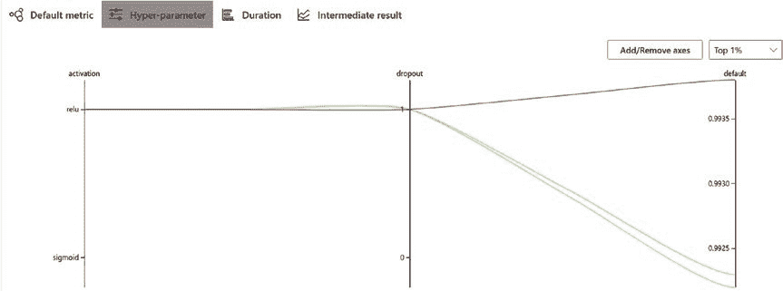

## 第 2 章 超参数优化

最佳实验展示了 **0.9923** 的结果，这与我们在上一节得到的 0.9885 相比显著提高。我们看到最佳超参数组合使用了 ReLU 激活函数和 dropout（p=0.5）层。这是否意味着由 ReLU 和 dropout 赋能的 LeNet 赢得了这场战斗？让我们查看超参数面板中的前 1% 实验（图 2-16）来回答这个问题。

***图 2-16.** LeNet 升级版 HPO 前 1% 实验的超参数面板*

图 2-16 显示，三个最佳超参数组合都具有以下超参数值：

* `activation`: relu
* `use_dropout`: 1

这可以被认为是使用 ReLU 和 dropout 技术的有力证据。当然，这个结果可能有些显而易见，但这仅仅是因为你已经了解了使用 ReLU 和 dropout 层的好处。最初，这个事实并不十分显而易见，需要实践证据，而我们刚刚演示了这一点。

最后，让我们看看升级后的 LeNet 模型未能分类的 MNIST 数据库样本。这些样本展示在图 2-17 中。

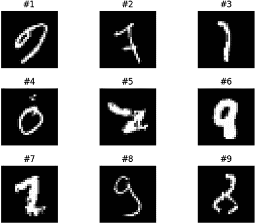

***图 2-17.** 升级版 LeNet 模型失败*

我刻意没有在图 2-17 中打印正确结果，请为每个样本写下你的答案，并与下面的正确答案进行比较：

答案：#1: 9. #2: 7. #3: 7. #4: 0. #5: 2. #6: 8. #7: 2. #8: 9. #9: 8

如果你一个错都没有犯，那么我佩服你！我只猜四个数字。如果人类在识别某些手写字符时遇到困难，那么神经网络已经接近了它的性能阈值。我们开发的升级版 LeNet 模型目前的结果已接近最佳水平。

本节演示了如何将新的深度学习技术注入到现有架构中。我们定义了一个搜索空间来选择最佳设计组合。HPO 选择了一个升级模型设计，显著提升了原始模型的性能。这是一个非常简单且实用的技术，将让你利用机器学习的最新进展优化你的模型。

### 从 LeNet 到 AlexNet

库：TensorFlow (Keras API), PyTorch (PyTorch Lightning)

嗯，手写识别是一项相当重要的任务，但看起来是时候转向更复杂的问题了。开发一个能够分类人类和马的模型如何？图 2-18 展示了

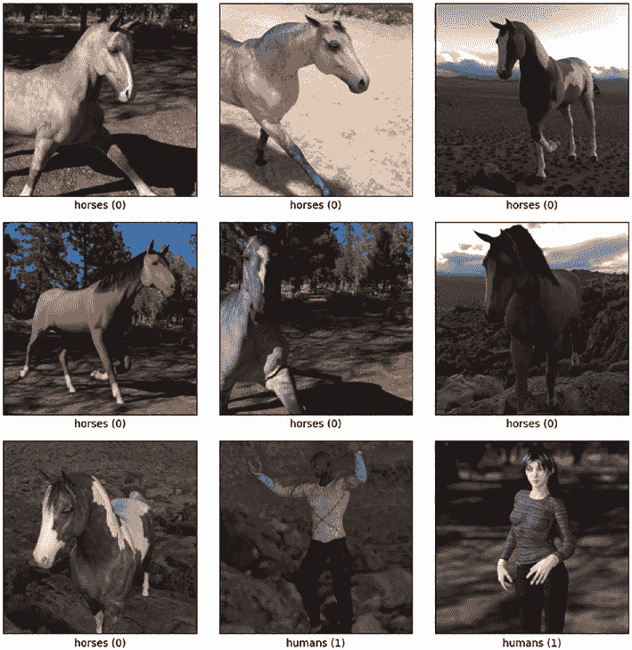

“人类或马”数据集样本。该数据集包含 300×300 的彩色图像，即 (300, 300, 3) 张量。显然，人类或马的图像比 28×28 的手写数字图像更复杂。也许，我们需要演进之前考虑的 LeNet 模型。我们将其称为 `LeNet Evolution` 模型。

***图 2-18.** 人类 vs 马数据集*

让我们再次观察 LeNet 模型架构。LeNet 模型设计可以分为两个部分：`特征提取`和`决策制定`。事实上，卷积栈 `Conv2D` -> `Activation` -> `MaxPool2D` -> `Conv2D` -> `Activation` -> `MaxPool2D` -> `Flatten` 负责提取图像模式，即特征提取。同时，全连接栈 `Linear` -> `Activation` -> `Linear` -> `SoftMax` 负责选择特定模式来分类对象。图 2-19 显示了每个组件的责任区域。

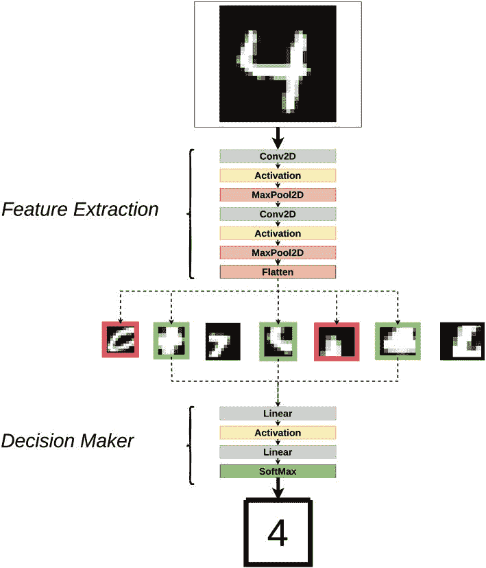

***图 2-19.** 特征提取和决策组件*

由于人类和马的图像更复杂，我们需要让特征提取组件更加精密。通常有两种层序列负责提取图像：`Conv2D` -> `Activation` -> `MaxPool2D` 和 `Conv2D` -> `Activation`。我们可以构建实验，注入不同的特征提取序列，以寻找解决“人类和马”分类问题的最佳模型设计。接下来，我们定义了三种特征提取层，将 `none` 定义为空序列：

* `simple`: `Conv2D` -> `Activation`
* `with_pool`: `Conv2D` -> `Activation` -> `MaxPool2D`
* `none`: `Identity`

每个特征提取序列将具有额外的超参数：`filters`, `kernel`, `pool_size`。让 LeNet 模型拥有三个提取槽位。这些槽位可以用以下特征提取序列填充。例如，LeNet 模型可以填充序列：

* `with_pool`: `Conv2D(kernel_size=5, filters=16)` -> `Activation` -> `MaxPool2D(pool_size=3)`
* `none`: `Identity`
* `simple`: `Conv2D(kernel_size=3, filters=8)` -> `Activation`

最后，LeNet Evolution 特征提取组件看起来像如下：`Conv2D(kernel_size=5, filters=16)` -> `Activation` -> `MaxPool2D(pool_size=3)`。我们将特征提取序列视为 LeNet Evolution 模型的构建块，如图 2-20 所示。

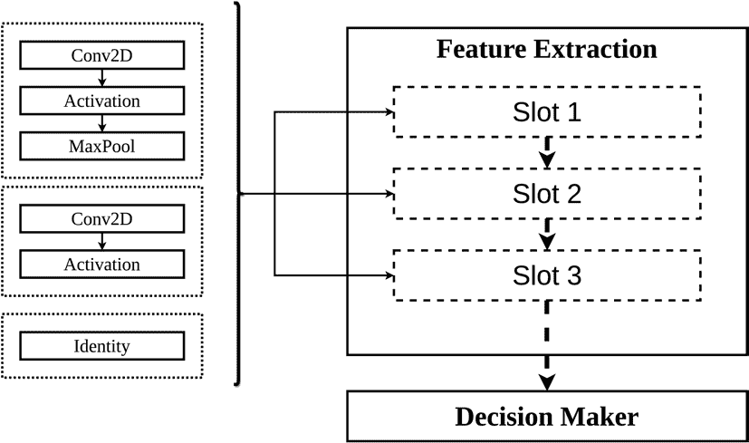

***图 2-20.** LeNet Evolution 特征提取组件*

因此我们可以定义 LeNet Evolution 模型的三个超参数。表 2-4 列出了设计超参数。

***表 2-4.** LeNet Evolution 特征提取超参数*

| 名称 | 描述 | 值 |
| :--- | :--- | :--- |
| `fe_slot_1` | 特征提取序列 1 | `none`<br>`simple`<br>`filters`: 8, 16, 32<br>`kernel`: 5, 7, 9, 11<br>`with_pool:`<br>`filters`: 8, 16, 32<br>`kernel`: 5, 7, 9, 11<br>`pool_size`: 3, 5, 7 |

| `fe_slot_2` | 特征提取序列 2 | `none`<br>`simple`<br>`filters`: 8, 16, 32<br>`kernel`: 5, 7, 9, 11<br>`with_pool:`<br>`filters`: 8, 16, 32<br>`kernel`: 5, 7, 9, 11<br>`pool_size`: 3, 5, 7 |
| `fe_slot_3` | 特征提取序列 3 | `none`<br>`simple`<br>`filters`: 8, 16, 32<br>`kernel`: 5, 7, 9, 11 |

决策制定组件的设计将由表 2-5 所示超参数决定。

### 表 2-5. LeNet 演化决策器超参数

| 名称 | 描述 | 取值 |
| :--- | :--- | :--- |
| `l1_size` | 第一层线性层的输出大小 | 512, 1024, 2048 |
| `l2_size` | 第二层线性层的输出大小 | 0, 512, 1024 (如果选择值为 0，则跳过第二层线性层) |
| `dropout_rate` | Dropout 层的丢弃概率 | 0.3, 0.5, 0.7 |

此外，我们使用 `learning_rate` 作为训练超参数，其选项有：0.001, 0.0001。

# 第 2 章 超参数优化

在实验中，我们不仅在寻找最佳超参数，还试图根据原始 LeNet 模型的原理创建一个新的深度学习模型架构。在这里，我们不仅尝试调整现有模型，还尝试创建一个新模型。设计超参数列表负责独特的深度学习模型设计。

列表 2-21 定义了 NNI 的 LeNet 演化模型搜索空间。

第一个特征槽 `fe_slot_1` 可以由以下特征提取序列之一填充：

* `Conv2D(kernel_size, filters)` → `Activation` → `MaxPool2D(pool_size)`
* `Conv2D(kernel_size, filters)` → `Activation`
* `None`

### 列表 2-21. LeNet 演化 HPO 搜索空间。`ch2/lenet_to_alexnet/search_space.json`

```json
{
  "fe_slot_1": {
    "_type": "choice",
    "_value": [
      {"_name": "none"},
      {
        "_name": "simple",
        "filters": {"_type": "choice", "_value": [8, 16, 32]},
        "kernel": {"_type": "choice", "_value": [5, 7, 9, 11]}
      },
      {
        "_name": "with_pool",
        "filters": {"_type": "choice", "_value": [8, 16, 32]},
        "kernel": {"_type": "choice", "_value": [5, 7, 9, 11]},
        "pool_size": {"_type": "choice", "_value": [3, 5, 7]}
      }
    ]
  },
```

第二个和第三个特征槽 (`fe_slot_2`, `fe_slot_3`) 的设置值与 `fe_slot_1` 相同：

```json
  "fe_slot_2": {
    "_type": "choice",
    "_value": [
      {"_name": "none"},
      {
        "_name": "simple",
        "filters": {"_type": "choice", "_value": [8, 16, 32]},
        "kernel": {"_type": "choice", "_value": [5, 7, 9, 11]}
      },
      {
        "_name": "with_pool",
        "filters": {"_type": "choice", "_value": [8, 16, 32]},
        "kernel": {"_type": "choice", "_value": [5, 7, 9, 11]},
        "pool_size": {"_type": "choice", "_value": [3, 5, 7]}
      }
    ]
  },
  "fe_slot_3": {
    "_type": "choice",
    "_value": [
      {"_name": "none"},
      {
        "_name": "simple",
        "filters": {"_type": "choice", "_value": [8, 16, 32]},
        "kernel": {"_type": "choice", "_value": [5, 7, 9, 11]}
      },
      {
        "_name": "with_pool",
        "filters": {"_type": "choice", "_value": [8, 16, 32]},
        "kernel": {"_type": "choice", "_value": [5, 7, 9, 11]},
        "pool_size": {"_type": "choice", "_value": [3, 5, 7]}
      }
    ]
  },
```

接下来，我们定义决策器超参数：

```json
  "l1_size": {"_type": "choice", "_value": [512, 1024, 2048]},
  "l2_size": {"_type": "choice", "_value": [0, 512, 1024]},
  "dropout_rate": {"_type": "choice", "_value": [0.3, 0.5, 0.7]},
```

而 `learning_rate` 超参数完成了搜索空间：

```json
  "learning_rate": {"_type": "choice", "_value": [0.001, 0.0001]}
}
```

我们刚刚定义了一个相当非平凡的搜索空间。希望实验结果符合我们的预期，生成的架构能够完美解决人与马的分类问题。下一步是使用 TensorFlow 和 PyTorch 实现 LeNet 演化模型。

## TensorFlow LeNet 演化实现

列表 2-22 展示了使用 TensorFlow 实现 LeNet 演化模型。

我们导入必要的模块：

### 列表 2-22. LeNet 升级。TensorFlow 实现。`ch2/lenet_to_alexnet/tf_lenet_evolution.py`

```python
import tensorflow as tf
from tensorflow.keras import Model
from tensorflow.keras.layers import (
    Conv2D,
    Dropout,
    MaxPool2D,
    Flatten,
    Dense,
)
from tensorflow.keras.optimizers import Adam
from ch2.utils import hoh_dataset

# Evolution model is initialized with:
class TfNetEvolution(Model):
    def __init__(self, feat_ext_sequences, l1_size, l2_size, dropout_rate):
        super().__init__()
        # First, we define feature extraction:
        layer_stack = []
        for fe_seq in feat_ext_sequences:
            if fe_seq['type'] == 'simple':
                layer_stack.append(
                    Conv2D(kernel_size=fe_seq['kernel'], filters=fe_seq['filters'])
                )
                layer_stack.append(ReLU())
            elif fe_seq['type'] == 'with_pool':
                layer_stack.append(
```


# Conv2D 层构建

```python
Conv2D(kernel_size=fe_seq['kernel'], filters=fe_seq['filters'])
```

```python
layer_stack.append(MaxPool2D(pool_size=fe_seq['pool_size']))
layer_stack.append(ReLU())
```

# 决策器构建

```python
layer_stack.append(Flatten())
layer_stack.append(Dense(l1_size))
```

如果 `l2_size` 大于零，则添加额外的线性层：

```python
if l2_size > 0:
    layer_stack.append(Dense(l2_size))
    layer_stack.append(Dropout(dropout_rate))
```

最终分类层：

```python
layer_stack.append(Dense(2, activation='softmax'))
self.seq = tf.keras.Sequential(layer_stack)
```

## 模型调用与训练

```python
def call(self, x, **kwargs):
    return self.seq(x)
```

```python
def train(self, learning_rate, batch_size, epochs):
    x_train, y_train = hoh_dataset()
    self.compile(
        optimizer=Adam(learning_rate=learning_rate),
        loss='sparse_categorical_crossentropy',
        metrics=['accuracy']
    )
    intermediate_cb = TfniIntermediateResult('accuracy')
    self.fit(
        x_train,
        y_train,
        batch_size=batch_size,
        epochs=epochs,
        verbose=0,
        callbacks=[intermediate_cb]
    )
```

```python
def test(self):
    x_test, y_test = hoh_dataset()
    loss, accuracy = self.evaluate(x_test, y_test, verbose=0)
    return accuracy
```

随后，我们将准确率指标返回给 NNI 调 tuner：

# 将最终准确率发送到 NNI

```python
nni.report_final_result(accuracy)
```

接下来，我们定义试验（trial）的主入口点：

```python
if __name__ == '__main__':
    # 手动超参数
    hparams = {
        'fe_slot_1': {
            '_name': 'simple',
            'filters': 16,
            'kernel': 7
        },
        'fe_slot_2': {
            '_name': 'with_pool',
            'filters': 8,
            'kernel': 5,
            'pool_size': 5
        },
        'fe_slot_3': {
            '_name': 'with_pool',
            'filters': 8,
            'kernel': 5,
            'pool_size': 3
        },
        'l1_size': 1024,
        'l2_size': 512,
        'dropout_rate': .3,
        'learning_rate': 0.001
    }

    # NNI 超参数
    # 在没有 NNI 实验上下文的情况下安全运行
    nni_hparams = nni.get_next_parameter()
    hparams.update(nni_hparams)
    trial(hparams)
```

记住，试验脚本可以以独立模式执行，因此你可以运行 `ch2/lenet_to_alexnet/tf_trial.py` 来测试其使用自定义参数的执行。

## PyTorch LeNet 演变实现

在本节中，我们将使用 PyTorch Lightning 查看 `LeNet Evolution` 模型的实现。PyTorch Lightning 是一个无缝的 PyTorch 封装器，帮助消除 PyTorch 代码的模板化。它更简洁，且更适合此类任务。列表 2-24 展示了基于 PyTorch Lightning 的 LeNet Evolution 模型。

**列表 2-24.** LeNet Evolution。PyTorch Lightning 实现。`ch2/lenet_to_alexnet/pt_lenet_evolution.py`

```python
import nni
import torch
import torch.nn.functional as F
import pytorch_lightning as pl
from sklearn.metrics import accuracy_score
from torch import nn
import numpy as np
from torch.utils.data import DataLoader
from ch2.utils.datasets import hoh_dataset
from ch2.utils.pt_utils import SimpleDataset
```

LeNet Evolution 模型使用所有五个超参数初始化。PyTorch Lightning 模型将初始化和训练逻辑封装在同一个类中，因此我们一次性传递所有超参数：

```python
class PtLeNetEvolution(pl.LightningModule):
    def __init__(
        self,
        feat_ext_sequences,
        l1_size,
        l2_size,
        dropout_rate,
        learning_rate
    ) -> None:
        super().__init__()
        # learning_rate 和 dropout_rate 超参数被显式存储：
        self.lr = learning_rate
        self.dropout_rate = dropout_rate
        self.save_hyperparameters()
```

第一步是为特征提取组件动态创建一个层序列：

```python
fe_stack = []
# 下一层输入尺寸是前一层的输出通道数
in_dim = 3
for fe_seq in feat_ext_sequences:
    if fe_seq['type'] in ['simple', 'with_pool']:
        fe_stack.append(
            nn.Conv2d(
                in_dim,
                out_channels=fe_seq['filters'],
                kernel_size=fe_seq['kernel'],
                bias=False
            )
        )
    if fe_seq['type'] == 'with_pool':
        fe_stack.append(
            nn.MaxPool2d(
                kernel_size=fe_seq['pool_size']
            )
        )
    fe_stack.append(nn.ReLU())
    in_dim = fe_seq['filters']
self.fe_stack = nn.Sequential(*fe_stack)
```

下一步是为决策者创建一个层序列：

```python
# 懒性初始化 fc1
self.fc1_in_features = 0
self._fc1 = None
# 如果 l2_size 大于零，则添加额外的线性层：
if l2_size > 0:
    self.fc2 = nn.Sequential(
        nn.Linear(l1_size, l2_size),
        nn.ReLU(),
        nn.Dropout(dropout_rate)
    )
    self.fc3 = nn.Linear(l2_size, 2)
else:
    self.fc2 = nn.Identity()
    self.fc3 = nn.Linear(l1_size, 2)
# 这里，我们再次利用了懒性初始化：
@property
def fc1(self):
    if self._fc1 is None:
        self._fc1 = nn.Sequential(
            nn.Linear(self.fc1_in_features, self.l1_size),
            nn.ReLU(),
            nn.Dropout(self.dropout_rate)
        )
    return self._fc1
```

模型执行方法：

```python
def forward(self, x):
    # 调用特征提取序列
    x = self.fe_stack(x)
    # 展平除 batch 维度以外的所有维度
    self.fc1_in_features = np.prod(x.shape[1:])
    x = x.view(-1, self.fc1_in_features)
    x = self.fc1(x)
    x = self.fc2(x)
    x = self.fc3(x)
    return F.log_softmax(x, dim=1)
```

我们使用带有 `learning_rate` 超参数的 `Adam` 优化器：

```python
def configure_optimizers(self):
    return torch.optim.Adam(self.parameters(), lr=self.lr)
```

训练和测试方法使用交叉熵函数：

```python
def training_step(self, batch, batch_idx):
    x, y = batch
    p = self(x)
    loss = F.cross_entropy(p, y)
    self.log("train_loss", loss, prog_bar=True)
    nni.report_intermediate_result(loss.item())
    return loss

def test_step(self, batch, batch_idx):
    x, y = batch
    p = self(x)
    loss = F.cross_entropy(p, y)
    self.log("test_loss", loss, prog_bar=True)
```

# 第 2 章 超参数优化

```python
'fe_slot_3': {
    '_name': 'with_pool',
    'filters': 8,
    'kernel': 5,
    'pool_size': 3
},
'l1_size': 1024,
'l2_size': 512,
'dropout_rate': .3,
'learning_rate': 0.001
}
```

# NNI 超参数

## 在没有 NNI 实验上下文的情况下安全运行

```python
nni_hparams = nni.get_next_parameter()
hparams.update(nni_hparams)
trial(hparams)
```

请记住，试验脚本可以在独立模式下执行，因此你可以运行 `ch2/lenet_to_alexnet/pt_trial.py` 来测试其使用自定义参数执行执行。

### 执行 LeNet 演化 HPO 实验

现在我们来到了本节的高潮。我们可以将这个实验视为一项完整的科学研究，它将为特定数据集上的分类问题创建一个独特的深度学习模型。它将采用 LeNet 模型中模式识别的最优原理。LeNet 演化模型尝试从 LeNet 模型移动到更复杂的模型。让我们定义实验配置并最终运行它。列表 2-26 保留了 LeNet 演化 HPO 实验的配置。

**列表 2-26.** LeNet 演化 HPO 实验配置。`ch2/lenet_to_alexnet/config.yml`

```yaml
trialConcurrency: 1
maxTrialNumber: 400
searchSpaceFile: search_space.json
trialCodeDirectory: .
```

取消注释 PyTorch 试验行以使用 PyTorch 实现运行实验：
`trialCommand: python3 tf_trial.py`
`#trialCommand: python3 pt_trial.py`

网格搜索调优器（GridSearch Tuner）无法用于嵌套选择搜索空间，因此我们选择随机搜索调优器（Random Search Tuner）：

```yaml
tuner:
  name: Random
trainingService:
  platform: local
```

可以如下方式运行实验：

```bash
nnictl create --config ch2/lenet_to_alexnet/config.yml
```


**注** 在带有 CUDA (GeForce Gt 1050) 的 intel Core i7 上运行时长约为 18 小时。

实验返回的最佳试验超参数如表 [2-6] 所示。

***表 2-6.** LeNet 演化最佳超参数*

| 名称 | 数值 |
| :--- | :--- |
| fe_slot_1 | • with_pool: <br>• filters: 32<br>• kernel: 7<br>• pool_size: 5 |
| fe_slot_2 | • with_pool: <br>• filters: 8<br>• kernel: 11<br>• pool_size: 5 |
| fe_slot_3 | • simple: <br>• filters: 8<br>• kernel: 7 |
| l1_size | 1024 |
| l2_size | 512 |
| dropout_rate | 0.3 |
| learning_rate | 0.0001 |

最佳试验在测试数据集上展示了 **0.9941** 的准确率，这是一个极佳的结果。我们确实构建了一个能够以非常高精度区分复杂彩色对象的模型。这是一个很好的进展！读者可能会想：*为什么这一节被称为“从 LeNet 到 AlexNet”？* 嗯，是时候回答了。AlexNet 是一个获得 2012 年图像识别大赛冠军的卷积神经网络架构。AlexNet 将图像分为 1000 个不同的类别。在当时，它是一个非常先进的深度学习模型。现在让我们比较三个模型：LeNet 模型、我们在本节中使用 HPO 技术构建的模型（LeNet 演化）以及 AlexNet 模型。

图 2-22 显示，我们在本节中构建的用于人类和马分类的模型介于原始 LeNet 模型和 AlexNet 模型之间。

我们的模型展示了 **99.41%** 准确率的卓越测试结果。但最重要的是，它是完全在 HPO 技术和 NNI 工具的帮助下自动构建的！我们没有进行任何复杂的计算或分析。我们只是构建了一个灵活的 LeNet 演化模型，其架构取决于传递的超参数。结果，我们获得了一个完全适应解决特定任务的独特模型。这些结果证实了 HPO 方法解决深度学习问题的潜力。

***图 2-22.** LeNet, LeNet Evolution, AlexNet*

## 总结

在本章中，我们开始了 HPO 研究。我们学习了如何创建 NNI 实验并解决实际问题。我们成功优化了原始的 LeNet 模型用于手写数字识别，使用 ReLU 和 dropout 技术升级了 LeNet 模型，并基于现有 LeNet 模型构建了一个新的复杂彩色模式识别模型。我们获得的结果证明了 AutoDL 的前景。在下一章中，我们将继续学习 HPO，并深入研究超参数优化问题中更高级的 NNI 用法。

# 第 3 章
## Shell 下的超参数优化

在上一章中，我们看到 HPO 可以产生令人印象的结果。超参数优化不仅可以优化模型，甚至可以构建新架构。遗憾的是，这种方法并不适用。到为止，我们只使用了随机搜索调优器和网格搜索调优器。现实中，我们需要在速度和质量之间取得良好平衡的调优器。本章将探索早停止（Early Stopping）算法的使用。

### 调优器

我们从检查各种 HPO 调优器开始本章。正如你记得的，调优器接收特定的搜索指标。根据所有完成试验的历史，调优器决定测试哪些超参数配置。选择合适的调优器可以显著提高结果。让我们仔细观察随机搜索调优器和网格搜索调优器是如何工作的。

考虑列表 3-1 所示的双变量黑盒函数。

***列表 3-1.*** 黑盒函数。`ch3/bbf/f1.py`

```python
from ch3.bbf.utils import discrete, noise, scatter_plot

def black_box_f1(x, y):

    z = - 10 * (pow(x, 5) / (3 * pow(x * x * x / 4 + 1, 2) + pow(y, 4) +

    10) + pow(x * y / 2, 2) / 1000)

    d = discrete(z, .8)

    r = d + noise(x, y, scale = 8)

    d = discrete(r, .2)

    return r
```

我故意没有给出这个函数的解析公式。`black_box_f1` 只是一个黑盒函数，我们对它的内部逻辑一无所知。在现实生活中，我们将检查的所有黑盒函数将满足这些属性。但无论，我们可以稍微作弊并绘制这个函数：

```python
if __name__ == "__main__":

    scatter_plot(black_box_f1, [-10, 10], [-10, 10])
```

图 3-1 显示红色区域是黑盒函数 `black_box_f1` 达到最大值的地方。

### 图 3-1. 黑盒函数图

**注意**：在本章中，我们将只研究寻找黑盒函数 `f` 的最大值的问题。寻找函数 `f` 的最大值的问题等价于寻找函数 `-f` 的最小值的问题。

当然，如果在研究之前能够对黑盒函数进行可视化就太好了，但这里有两个主要问题：

*   大多数黑盒函数具有大量的变量。
*   使用特定参数计算一个函数值可能需要几分钟甚至几个小时。

因此，选择调优器至关重要。让我们来看看 `Random Search Tuner` 如何探索 `black_box_f1` 函数。我们正在实现一个嵌入式实验，以在列表 3-2 中可视化调优器在实验期间选择的试验参数。

## 第 3 章 Shell 下的超参数优化

我们导入必要的模块：

***列表 3-2.** Random Search Tuner. `ch3/tuners/random_tuner/run_experiment.py`

```python
from pathlib import Path

from nni.experiment import Experiment

from ch3.bbf.f1 import black_box_f1

from ch3.bbf.utils import scatter_plot
```

`black_box_f1` 的搜索空间包含 `[-10, 10] × [-10, 10]` 中的所有的整数对。搜索空间中共有 441 个元素。

```python
search_space = {

    "x": {"_type": "quniform", "_value": [-10, 10, 1]},

    "y": {"_type": "quniform", "_value": [-10, 10, 1]}

}
```

该实验将进行 100 次试验：

```python
experiment = Experiment('local')

experiment.config.experiment_name = 'Random Tuner'

experiment.config.trial_concurrency = 4

experiment.config.max_trial_number = 100

experiment.config.search_space = search_space

experiment.config.trial_command = 'python3 trial.py'

experiment.config.trial_code_directory = Path(__file__).parent
```

我们选择 `Random Search Tuner`：

```python
experiment.config.tuner.name = 'Random'
```

并启动实验：

```python
http_port = 8080

experiment.start(http_port)
```

接下来，我们定义主事件循环：

```python
while True:

    if experiment.get_status() == 'DONE':
```

当实验结束时，显示实验期间创建的所有试验：

```python
search_data = experiment.export_data()

trial_params = [trial.parameter for trial in search_data]
```

## 可视化试验参数

```python
scatter_plot(

    black_box_f1, [-10, 10], [-10, 10],

    trial_params, title = 'Random Search'

)

search_metrics = experiment.get_job_metrics()

input("Experiment is finished. Press any key to exit...")

break
```

让我们检查列表 3-2. 中 `Random Search Tuner` 在实验期间生成的所有试验。

图 3-2 显示 `Random Search Tuner` 生成的试验是简单的随机点散布。在某些情况下，点（试验）可能会成功落在最大值区域，但在许多情况下，最大值区域没有得到适当的探索。

### 图 3-2. Random Search Tuner 试验

现在让我们来看列表 3-3. 中 `Grid Search Tuner` 通过探索 `black_box_f1` 函数生成的试验。

***列表 3-3.** Grid Search Tuner. `ch3/tuners/grid_tuner/run_experiment.py`*

```python
experiment.config.tuner.name = 'GridSearch'
```

Grid Search 实验看起来与列表 3-2. 中的 Random Search 实验非常；我们在这里只使用了 `Grid Search Tuner`：图 3-3 展示了 `Grid Search Tuner` 生成的试验。

### 图 3-3. Grid Search Tuner 试验

我们看到 `Grid Search Tuner` 仅仅按照特定顺序遍历搜索空间中的所有值。当搜索空间较小且可以遍历搜索空间中的所有值时，这种方法可能很有帮助。否则，`Grid Search Tuner` 生成的试验可能甚至无法接近黑盒函数的最大区域。

`Random` 和 `Grid` 调优器的主要问题是它们不会与之前的搜索进行交互。

```python
trial_params[i:i + 25]

for i in range(0, len(trial_params), 25)
```

可视化每一代：

```python
for i, population in dict(enumerate(trial_params_chunks)).items():

    scatter_plot(

        black_box_f1, [-10, 10], [-10, 10],

        population, title = f'Evolution Generation: {i+1}'

    )
```

让我们分析个体位置在演化搜索过程中是如何发生变化的。

119

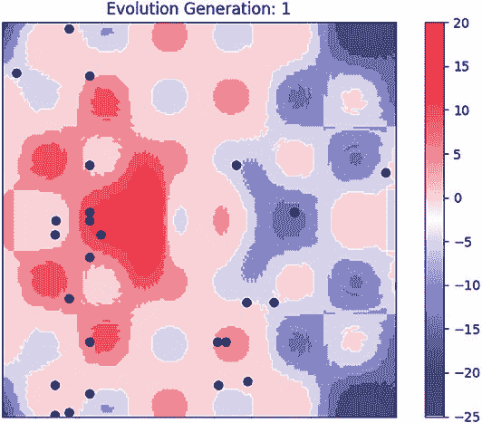
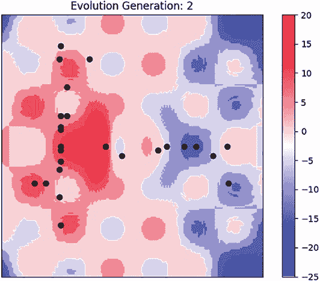

## 第 3 章 Shell 下的超参数优化

***图 3-5.** 进化调优器（Evolution Tuner）。第 1 代。*

图 3-5 显示，试验参数的分配接近于随机分布。

***图 3-6.** 进化调优器（Evolution Tuner）。第 2 代。*

120

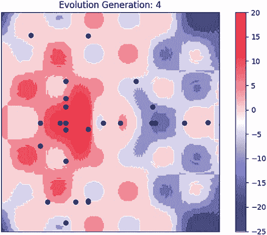

## 第 3 章 Shell 下的超参数优化

在图 3-6 中，我们看到大多数个体已经处于红色区域，这意味着群体正在平滑地向函数的最大值移动。

图 3-7 所示的最后一代至少有一个个体位于红色区域的顶部。

***图 3-7.** 进化调优器（Evolution Tuner）。第 4 代。*

**注意**并不是所有内置的 nni 调优器都支持设置随机种子。因此，实验是不可复的。所以你在本地机器上得到的结果可能与本章所示不同。然而，调优器的通用行为在所有机器上都是相同的，因此同一个调优器在相同搜索空间上的结果是类似的。

我们可以将进化调优器视为一种引导的随机搜索。它比随机搜索稍微好，但由于该算法过强的随机性，仍然存在许多问题。进化调优器通常需要许多试验，但通常因为其简单性而被选中。

121

## 第 3 章 Shell 下的超参数优化

### 退火调优器（Anneal Tuner）

退火调优器基于模拟退火算法（Simulated Annealing）。模拟退火是解决优化问题的方法。该算法模拟了加热材料并缓慢降低温度以减少缺陷的物理过程，从而使系统能量最小化。退火调优器同样将随机性作为搜索过程的一部分。

退火算法包含以下步骤：

1. 退火算法在搜索空间中选择一个随机元素 `X`，并计算 `f(X)` 值。
2. 算法对元素 `X` 执行随机变异，产生搜索空间中的元素 `X'`。如果 `X` 是一个实值，则 `X'` 可以计算为 `X’ = X + ΔX`，其中 `ΔX` 是随机变量。接下来，我们比较 `f(X’)` 和 `f(X)`。
3a. 如果 `f(X’) < f(X)`，则该变异被认为是负的。
3b. 如果 `f(X’) ≥ f(X)`，则该变异被认为是正的，并通过 `X'` 更新 `X` 值。
4. 如果变异是负的，算法计算以下值：
   - `r`：(0, 1)上的均匀随机值。
   - `Δ`：`f(X) - f(X’)`。
   - `σ` 是搜索过程中所有探索值的标准差：`f(X1), ..., f(Xn)` 乘以退化率 `ci`，其中 `c` 是小于 1 的正值，`i` 是迭代次数，`σ = ci * std([f(X1), ..., f(Xn)])`。
   接下来，我们比较 `r` 和 `e`，其中 `e` 是指数。
5a. 如果 `r < e`，则算法从 `X` 退化到 `X’`：`X ← X’`。为了在下次迭代中达到新的峰。
5b. 如果 `r > e`，则算法不更新 `X`。`f(X)` 越接近 `e`，越可能采取探索步骤。步骤 2 到 5 重复 `n` 次。

122


## 第 3 章 Shell 下的超参数优化

***图 3-8.** 退火算法*

退火算法的本质是到达“山峰”。在某些情况下，算法可能会下降“山峰”以爬上更高的一个。该算法的缺点是无法覆盖“山峰”之间的巨大距离。图 3-8。

123


## 第 3 章 Shell 下的超参数优化

***图 3-9.** 执行中的退火算法*

退火调优器的配置示例：

```yaml
tuner:

  name: Anneal

population_size: 100

class_args:

  optimize_mode: maximize
```

完整代码位于文件 `ch3/tuners/anneal_tuner/run_experiment.py`。

124


## 第 3 章 Shell 下的超参数优化

***图 3-10.** Holder 函数*

为实验选择退火调优器：

```yaml
experiment:

  tuner:

    name: Anneal

    class_args:

      optimize_mode: maximize
```

实验完成后，我们可以分析退火调优器的进度。

Holder 函数可以如下所示绘图：

```python
from numpy import exp, sqrt, cos, sin

def holder_function(x, y):

    """

    Holder 函数

    """

    z = abs(sin(x**2) - cos(y**2)) / exp(x**2)

    return z
```


## 第 3 章 Shell 下的超参数优化

在图 3-11 中，我们可以看到退火调优器开始研究左下角的“山峰”。


**图 3-12.** 进化调优器。第 2 代。

在图 3-12 中，我们看到第二代试验完全集中在左下角的两个“山峰”。


**图 3-13.** 进化调优器。第 4 代。

正如我们在图 3-13 中看到的，退火调优器完全集中在探索一个“山峰”。退火调优器找到了局部最大值，但没能在左下角找到退火调优器所发现解的全局最大值。


SMBO 实现了以下技术：为黑盒函数 `f` 构建一个概率模型 `p(y|x)`，并用它在搜索空间中挑选最有希望的元素在黑盒函数 `f` 中进行评估。

观察 SMBO 方法的运行过程。假设我们获得了一些实验结果：`(x1, f(x1)), (x2, f(x2)), (x3, f(x3))`，如图 3-14 所示。

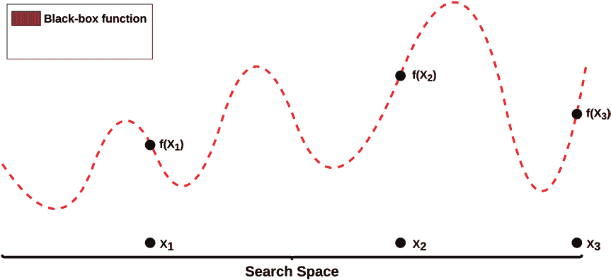
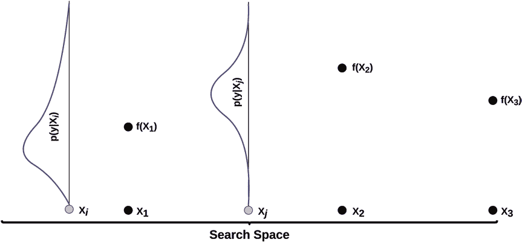

**图 3-14.** 实验结果

下一步是根据数据 `(x1, f(x1)), (x2, f(x2)), (x3, f(x3))` 创建概率函数 `p(y|x)`。`p(y|x)` 被称为目标函数（或黑盒函数）的代理（surrogate）。

代理函数确定了搜索空间中任何元素 `xi` 目标函数（或黑盒函数）的概率分布。这意味着对于任何 `xi`，我们可以说以 `p` 的概率，值 `f(xi) = yi` 落在 `(a, b)` 区间。这一概念在图 3-15 中展示。

**图 3-15.** xi 和 xj 的概率分布

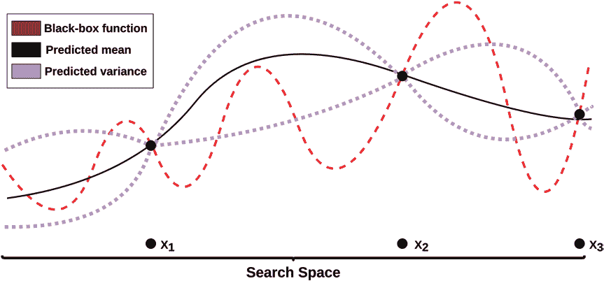

拥有代理函数 `p(x|y)` 后，我们可以在整个搜索空间上对其进行外推。

图 3-16 给出了代理模型的视觉化描述：

- 红色虚线显示实际黑盒函数。
- 黑色实线显示代理函数 `p(y|x)` 的期望平均值。
- 紫色虚线显示代理函数 `p(y|x)` 的方差。

**图 3-16.** 三次实验的代理模型：`(x1, f(x1)), (x2, f(x2)), (x3, f(x3))`

基于构建的代理模型，SMBO 算法对黑盒函数的潜在极大值做出预测。算法的下一个目标是找到一个比当前最大值 `f(x2)` 更大的黑盒函数值。以下实验参数使用期望改进（Expected Improvement）函数确定：

```
EI(x) = max y - y0, p y|x dy*(x) =
```

假设 `f(x2) = y2`，如果 `EI(x)` 在 `x4` 处取得最大，则 SMBO 将选择 `x4` 作为下次实验参数。图 3-17 展示了 SMBO 如何选择下一次实验。

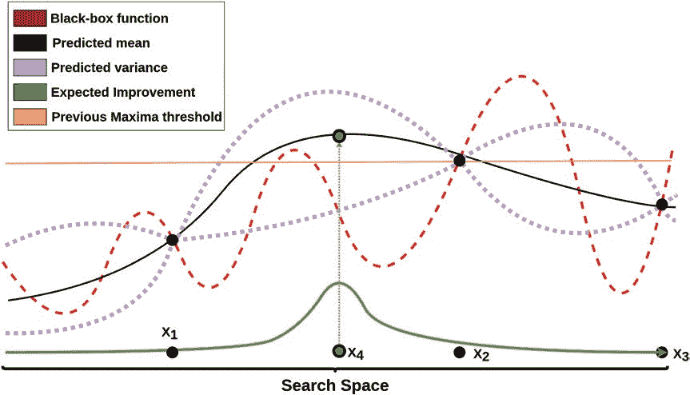
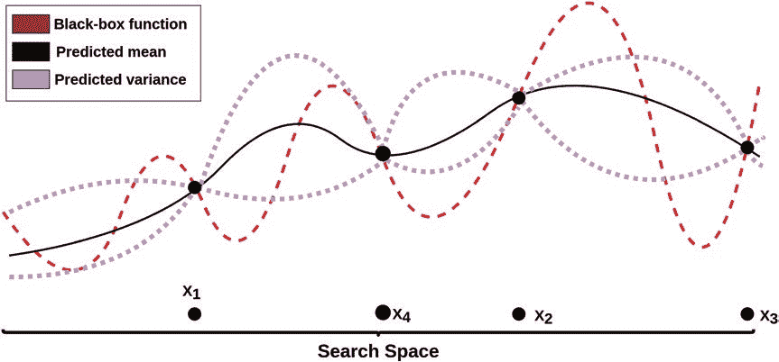

**图 3-17.** 期望改进

选择 `x4` 作为下次实验值后，我们评估 `f(x4)` 并针对新数据重建代理模型：`(x1, f(x1)), (x2, f(x2)), (x3, f(x3)), (x4, f(x4))`，如图 3-18 所示。

**图 3-18.** 四次实验的代理模型：`(x1, f(x1)), (x2, f(x2)), (x3, f(x3)), (x4, f(x4))`

SMBO 通过通过更多数据使代理模型收敛于目标函数，这些方法通过在评估目标函数后不断更新代理模型来实现。SMBO tuner 是高效的，因为它们以智能的方式选择下一个参数。

SMBO tuner 循环执行以下步骤直到达到最大实验次数：

- 根据代理概率 `p(y|x)` 构建代理模型。
- 使用期望改进函数确定下次实验参数 `x`。
- 评估黑盒函数 `f(x)`。
- 将 `(x, f(x))` 添加到历史数据集。

这是所有 SMBO tuner 的框架。它们唯一的区别在于基于历史数据集估计概率函数 `p(y|x)` 的方法。本章将涵盖以下 SMBO tuner：Tree-Structured Parzen Estimator 和 Gaussian Process。

### Tree-Structured Parzen Estimator Tuner

Tree-Structured Parzen Estimator tuner (TPE) 的描述可能跨多个章节。在本节中，我们将描述使用该 tuner 的核心思想：

1. 起初，TPE tuner 在探索空间空间执行 `N` 次随机实验。
2. 接下来，tuner 根据执行实验的值进行排序，并根据分位数将其分为“好”组和“坏”组。“好”组包含最佳结果，“坏”组包含所有其他实验。图 3-19 展示了 TPE 模型。
3. 拥有代理函数 `p(x|y)` 后，我们可以在整个搜索空间上对其进行外推。基于现有点的 Parzen Estimators 计算密度 `g(x)` 和 `l(x)`。图 3-20 展示了算法模型。
4. 随后，TPE tuner 根据 `g(x)/l(x)` 比例生成 `n` 个随机候选，并选择第一个作为下一次实验。这意味着高密度的实验是常见的。
5. 重复步骤 2–5 直到达到最大实验次数。这是一个 TPE 配置示例：

```yaml
tuner:
  name: TPE
  Args:
    optimize_mode: maximize
    seed: 12345
    tpe_args:
      constant_liar_type: 'mean'
      n_startup_jobs: 10
      n_ei_candidates: 20
      linear_forgetting: 100
      prior_weight: 0
      gamma: 0.5
```

### Tree-Structured Parzen Estimator Tuner 参数

- `tpe_args.constant_liar_type`: `'best'` | `'worst'` | `'mean'` | `null`（默认: `'best'`）。指定当并发数 > 1 时如何优化。
- `tpe_args.n_startup_jobs`: `int`（默认: `20`）。在步骤 1 中生成的用于热身的的前 `N` 次随机实验。如果搜索空间很大，应增加此值。
- `tpe_args.n_ei_candidates`: `int`（默认: `24`）。在步骤 4 中生成的 `n` 个随机候选。
- `tpe_args.linear_forgetting`: `int`（默认: `25`）。TPE 会降低旧实验的权重。该参数控制实验衰减需要多少次迭代。
- `tpe_args.prior_weight`: `float`（默认: `1.0`）。决定历史中实验配置的权重。
- `tpe_args.gamma`: `float`（默认: `0.25`）。控制有多少比例实验被认为是“好的”。代表步骤 2 中的 $\gamma$ 参数。

**注意**：上述提到的 tpe tuner 配置参数仅从 nni 2.6 版本起有效，它们在之前的版本中不起作用。

TPE tuner 支持所有搜索空间类型：`choice`, `choice(nested)`, `randint`, `uniform`, `quniform`, `loguniform`, `qloguniform`, `normal`, `qnormal`, `lognormal` 和 `qlognormal`。

从代码清单 3-7 中可以看到 TPE tuner 如何执行 `holder_function`（完整代码在相应文件中：`ch3/tuners/tpe_tuner/`，`run_experiment.py`）。

为实验设置 TPE tuner：

```python
experiment.config.tuner.name = 'TPE'
```

```python
experiment.config.tuner.class_args['optimize_mode'] = 'maximize'
experiment.config.tuner.class_args['seed'] = 0
experiment.config.tuner.class_args['tpe_args'] = {
    'n_startup_jobs': 20,
    'gamma': 0.5
}
```

实验完成后，我们可以分析 `TPE Tuner` 的搜索进度。

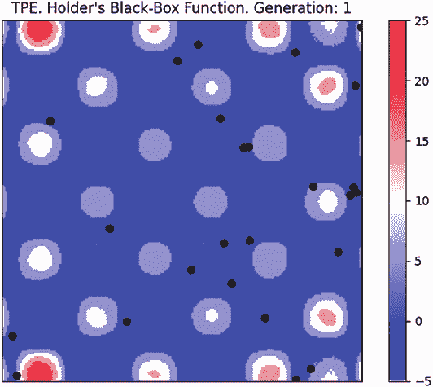
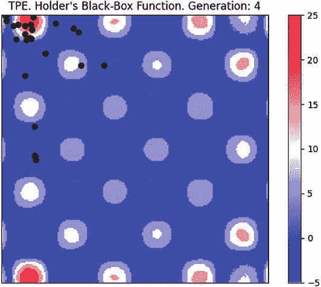

**图 3-21.** `TPE Tuner`。第 1 代

图 3-21 显示点的分布更像是随机散布，这是合理的，因为在调优器设置中，我们指定了 `'n_startup_jobs': 20`，这意味着前 20 次试验将完全是随机的。

**图 3-22.** `TPE Tuner`。最后一代

但我们在图 3-22 中看到的，得益于概率探索模型，Tuner 找到了 `holder_function` 的全局最大值。

`TPE Tuner` 直观上非常清晰，基于坚实的概率基础，并在探索（exploration）与利用（exploitation）策略之间取得了良好的平衡。另一个很好的特性是它支持 `choice(nested)` 搜索类型，这在某些研究中至关重要。

### 高斯过程调优器

高斯过程 (GP) Tuner 是另一种基于多元正态分布的 SMBO 调优器。该调优器与 `TPE Tuner` 类似，但使用高斯分布来构建 `p(y|x)` 代理。该方法的完整描述在本书之外，但读者可以在这里学习该方法的工作原理：

- “使用高斯过程优化昂贵函数”: [`citeseerx.ist.psu.edu/viewdoc/download?doi=10.1.1.1.139.9315&rep=rep1&type=pdf`](https://citeseerx.ist.psu.edu/viewdoc/download?doi=10.1.1.1.139.9315&rep=rep1&type=pdf)
- “高斯过程与贝叶斯优化”: [`www.cs.cornell.edu/courses/cs4787/2019sp/notes/lecture16.pdf`](http://www.cs.cornell.edu/courses/cs4787/2019sp/notes/lecture16.pdf)

以下是 GP Tuner 配置示例：

```yaml
tuner:
  name: GPTuner
  classArgs:
    optimize_mode: maximize
    utility: 'ei'
    kappa: 5.0
    xi: 0.0
    nu: 2.5
    alpha: 1e-6
    cold_start_num: 10
    selection_num_warm_up: 100000
    selection_num_starting_points: 250
```

以下是 GP Tuner 参数的描述：

- **utility**:
  - **Type**: `'ei' | 'ucb' | 'poi'`
  - **Default**: `'ei'`
  效用函数 `ei`、`ucb` 和 `poi` 分别对应期望改进、上置信边界和改进概率。

- **kappa**:
  - **Type**: float
  - **Default**: 5
  用于 `ucb` 效用函数。`kappa` 越大，调优器的探索性越强。

- **xi**:
  - **Type**: float
  - **Default**: 0
  用于 `ei` 和 `poi` 效用函数。`xi` 越大，调优器的探索性越强。

- **nu**:
  - **Type**: float
  - **Default**: 2.5
  设置 Matern 核。`nu` 越小，近似函数就越不平滑。

- **alpha**:
  - **Type**: float
  - **Default**: 1e-6
  设置高斯回归器。较大的值对应更高的噪声水平。

- **cold_start_num**:
  - **Type**: int
  - **Default**: 10
  在高斯过程运行之前的随机探索次数。

- **selection_num_warm_up**:
  - **Type**: int
  - **Default**: 100000
  评估采集函数的点数。

- **selection_num_starting_points**:
  - **Type**: int
  - **Default**: 250
  起始点的数量。

GP Tuner 支持以下类型：`choice`、`randint`、`uniform`、`loguniform`。GP Tuner 在并行化方面面临挑战。如果你运行实验（例如 `concurrency > 1`），多个进程将同时决定相同的试验。这是 SMBO 的一个大问题。

在表 3-1 中，提供了使用 NNI 获取的基准测试结果示例：[`nni.readthedocs.io/en/v2.7/hpo/hpo_benchmark_stats.html`](https://nni.readthedocs.io/en/v2.7/hpo/hpo_benchmark_stats.html)

**表 3-1. 分类任务的平均排名**

| 调优名称 (Tuner Name) | 平均排名 (Average Ranking) |
| :--- | :--- |
| Gp tuner | 4.00 |
| evolution | 4.22 |
| anneal | 4.39 |
| tpe | 4.67 |
| random | 5.33 |

某些基准测试可能持续几天甚至几周。因此，借鉴研究后获得并发表的结果总是更方便。在许多情况下，你可以自己执行一次微型研究，这将有助于确定搜索空间结构的特征。无论如何，理解深度学习模型优化以及搜索调优器（Search Tuner）的原理对于为 HPO 问题选择正确的策略非常有帮助。

## 自定义调优器 (Custom Tuner)

内置调优器适用于大多数任务。但在某些情况下，你需要添加一些自定义逻辑来提高 HPO 实验的质量。事实上，有时我们可能知道搜索空间的特定属性，而内置调优器并没有考虑到这些属性。此外，开发者可以实现自己的想法并在实际问题上进行测试。对于此类情况，NNI 允许你实现一个自定义调优器（Custom Tuner）。自定义调优器可以在实验中使用并与其他开发者共享。

## 调优器内部 (Tuner Internals)

每个调优器类应继承 `nni.tuner.Tuner` 并实现以下方法：`__init__`、`update_search_space`、`generate_parameters` 和 `receive_trial_result`。任何调优器都可以根据代码 3-9 中提供的示例进行实现。

**代码 3-9. 自定义调优器。**

```python
# ch3/tuners/custom_tuner/custom_tuner_sample.py
from nni.tuner import Tuner

class CustomTuner(Tuner):

    def __init__(self, some_arg):
        # 在此处编写代码
        ...

    def update_search_space(self, search_space):
        """
        建议调优器在运行时更新搜索空间。
        如果调优器仅在生成超参数之前设置搜索空间，应显式记录此行为。
        'update_search_space' 在启动和搜索空间更新时调用。
        """
        # 在此处编写代码
        ...

    def generate_parameters(self, parameter_id, **kwargs):
        """
        当框架启动新试验时调用此方法。
        大多数情况下，parameter_id 应链接到调优器生成的超参数。
        """
        # 在此处编写代码
        # ：return {"dropout": 0.5, "act": "relu"}
        return {}

    def receive_trial_result(self, parameter_id, value, **kwargs):
        """
        当试验报告最终结果时调用此方法。
        如果调优器假设有'memory'（即跟踪之前的试验），则应实现它。
        """
        # 在此处编写代码
        ...
```


`Tuner` 以以下方式与实验交互：

1. 实验在启动时调用 `update_search_space`。
2. 实验请求搜索空间并调用 `generate_parameters`。
3. 实验将试验结果返回给调优器并调用 `receive_trial_result`。（直到达到 `max_trial` 或实验停止。）

*图 3-25. 调优器-实验序列图*

使用以下配置将自定义调优器集成到实验中：

```yaml
tuner:
  codeDirectory: <path_to_tuner_dir>
  class_name: <tuner_file_name>
```

或者如下集成到 Python 实验中：

```python
from nni.experiment import CustomAlgorithmConfig

experiment.config.tuner = CustomAlgorithmConfig()
experiment.config.tuner.code_directory = 'path_to_tuner_dir'
experiment.config.tuner.class_name = 'tuner_file_name'
experiment.config.tuner.class_args = {'arg': 'value'}
```

## 新演化调优器 (New Evolution Tuner)

让我们尝试开发我们的自定义调优器。该调优器将基于我们研究过的演化调优器（Evolution Tuner）概念。我们将其命名为 `NewEvolutionTuner`。`NewEvolutionTuner` 将按照以下算法初始化群体并运行：

- 获取最优个体 `X_best`
- 以随机方式变异最优个体：`mutate(X_best)` → `Y`
- 用变异个体 `Y` 替换群体中最差的个体 `X_worst`：`X_worst ← Y`

*图 3-26. 新演化调优器*

`NewEvolutionTuner` 实现了贪心爬法。调优器获取最优个体（最高的）并将其变异（希望新个体能爬得更高）。代码 3-10:

```python
"""
Ackley 函数
"""
z = 20.0 * exp(-0.2 * sqrt(0.5 * (x**2 + y**2))) - \
    exp(0.5 * (cos(2 * pi * x) + cos(2 * pi * y))) + e + 20
r = z + noise(x, y, scale=4)
return r
```

这里是 Ackley 函数的可视化：

```python
from ch3.bbf.utils import scatter_plot
if __name__ == '__main__':
    scatter_plot(ackley_function, [-10, 10], [-10, 10])
```

我们可以从图 3-27 看到 Ackley 函数的表面。它有一个最高峰，周围还有几个较小的峰。

*图 3-27. Ackley 函数*

在我们检查 `NewEvolutionTuner` 如何解决寻找 Ackley 函数最大值的问题之前，我们需要在 3-11 中实现它。

*代码 3-11. NewEvolutionTuner。*

```python
# ch3/tuners/custom_tuner/evolution_tuner.py
import random
import numpy as np
from nni.tuner import Tuner
from nni.utils import (
    OptimizeMode,
    extract_scalar_reward,
    json2space,
    json2parameter,
)

# 群体由个体组成。每个个体都有代表搜索
# 参数的 DNA。此外，个体包含一个包含试验结果的 result 字段。
# 个体具有以下属性：
# - x: 搜索空间 x 坐标
# - y: 搜索空间 y 坐标
# - param_id: 试验编号
# - result: 试验结果
class Individual:
    def __init__(self, x, y, param_id=None) -> None:
        self.param_id = param_id
        self.x = x
        self.y = y
        self.result = None

    def to_dict(self):
        return {'x': self.x, 'y': self.y}

# Population 类是一个封装器，作为一个整体操作所有个体：
class Population:
    # 所有个体存储在 individuals 属性中
    def __init__(self) -> None:
        self.individuals = []

    def add(self, ind):
        self.individuals.append(ind)

    # 然后，我们需要添加一个根据 param_id 获取个体的方法
    def get_by_param_id(self, parameter_id):
        for ind in self.individuals:
            if ind.param_id == parameter_id:
                return ind
        return None

    # 在实验开始时，调优器将创建 N 个没有试验编号的个体。
    # 我们称这些个体为处女（virgin）。
    # get_first_virgin 方法返回找到的第一个处女：
    def get_first_virgin(self):
        for ind in self.individuals:
            if ind.param_id is None:
                return ind
        return None

    # 以下方法 get_population_with_result 返回所有已获得试验结果的个体：
    def get_population_with_result(self):
        population_with_result = [ind for ind in self.individuals if ind.result is not None]
        return population_with_result

    # 下一个方法从整个种群中返回最好的个体，即结果最高的个体：
    def get_best_individual(self):
        sorted_population = sorted(self.get_population_with_result(), key=lambda ind: ind.result)
        return sorted_population[-1]

    # 在这里，我们进入主要的进化方法 replace_worst，它将用于开发种群：
    #
    # - 我们从种群中选取最好的个体。
    # - 对该个体进行变异。
    # - 将该个体的变异体添加到种群中，以替换最差的个体。
    def replace_worst(self, param_id):
        population_with_result = self.get_population_with_result()
        sorted_population = sorted(population_with_result, key=lambda ind: ind.result)
        worst = sorted_population[0]
        self.individuals.remove(worst)
        best = self.get_best_individual()
        x = round(best.x + random.gauss(0, 1), 2)
        y = round(best.y + random.gauss(0, 1), 2)
        mutant = Individual(x, y, param_id)
        self.individuals.append(mutant)
        return mutant

# 在定义了 Individual 和 Population 类之后，我们可以开始实现调优器：
class NewEvolutionTuner(Tuner):
```

`Tuner` 有两个参数：`optimize_mode` 和 `population_size`：

```python
def __init__(self, optimize_mode="maximize", population_size=16) -> None:
    self.optimize_mode = OptimizeMode(optimize_mode)
    self.population_size = population_size
```

接下来，`Tuner` 初始化与其工作的搜索空间相关的属性：`self.search_space_json = None`、`self.random_state = None`、`self.population = Population()`、`self.space = None`。

当 `Tuner` 启动时，会调用 `update_search_space` 方法。它生成随机个体的种群：

```python
def update_search_space(self, search_space):
    self.search_space_json = search_space
    self.space = json2space(self.search_space_json)
    self.random_state = np.random.RandomState()
    # 生成随机个体的种群
    is_rand = dict()
    for item in self.space:
        is_rand[item] = True
    for _ in range(self.population_size):
        params = json2parameter(self.search_space_json, is_rand, self.random_state)
        ind = Individual(params['x'], params['y'])
        self.population.add(ind)
```

`Experiment` 调用 `generate_parameters` 方法为后续的 `Trial` 获取新参数。初始时，我们有一组启动时生成且未传递给 `Tuner` 的个体（`virgins`）。我们获取这些 `virgins` 并逐一个传递给 `Tuner`。当没有剩余 `virgins` 时，我们开始生成新的个体。

```python
def generate_parameters(self, parameter_id, **kwargs):
    virgin = self.population.get_first_virgin()
    if virgin:
        virgin.param_id = parameter_id
        return virgin.to_dict()
    else:
        mutant = self.population.replace_worst(parameter_id)
        return mutant.to_dict()
```

当 `Experiment` 返回 `Trial` 的结果时，我们将其保存到个体对象：

```python
def receive_trial_result(self, parameter_id, parameters, value, **kwargs):
    reward = extract_scalar_reward(value)
    ind = self.population.get_by_param_id(parameter_id)
    ind.result = reward
```

好了，我们的 `NewEvolutionTuner` 准备就绪了！我们可以使用列表 [3-12] 所示的配置文件启动实验。

**列表 3-12.** NewEvolutionTuner 实验配置。`ch3/tuners/custom_tuner/config.yml`

```yaml
searchSpace:
  x:
    _type: "quniform"
    _value: [-10, 10, 0.01]
  y:
    _type: "quniform"
    _value: [-10, 10, 0.01]
trialConcurrency: 4
trialCodeDirectory: .
trialCommand: python3 trial.py
tuner:
  codeDirectory: .
  className: evolution_tuner.NewEvolutionTuner
trainingService:
  platform: local
```

带有自定义 `NewEvolutionTuner` 的实验也可以在 Python 嵌入模式下运行，如列表 3-13 所示（完整代码在相应文件中：`ch3/tuners/custom_tuner/run_experiment.py`）。

**列表 3-13.** Python 嵌入实验

```python
experiment.config.tuner = CustomAlgorithm()
experiment.config.tuner.directory = Path(__file__).parent
experiment.config.tuner.class_name = 'evolution_tuner.NewEvolutionTuner'
experiment.config.tuner.class_args = {'population_size': 8}
```

```bash
$ python3 ch3/tuners/custom_tuner/run_experiment.py
```

图 3-32 模型处理的是相反的情况。当训练过程开始恶化时，训练早停（Training Early Stopping）算法会终止训练过程。

相比之下，HPO 早停算法可能会认为当前的试验（`Trial`）非常有前景，因为它的中间结果显著优于其他试验。

157

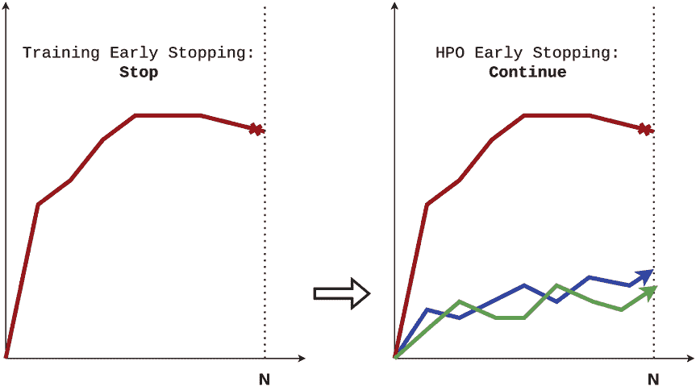

第 3 节 Shell 下的超参数优化

图 3-32. HPO 早停 vs. 训练早停

请记住，在设计深度学习模型和 HPO 实验时，训练早停和 HPO 早停之间是不相关的。

## 中位数停止 (Median Stop)

中位数停止是一种简单的早停规则：如果一个待处理的 `Trial` 在第 `N` 步时的最佳目标值严格优于截至第 `N` 步报告的所有已完成试验目标值的运行平均值中位数，则停止该待处理的 `Trial`。

中位数停止算法可以通过以下实验配置在实验中实现：

```yaml
assessor:
  name: Medianstop
  classArgs:
    # number of warm up steps
    start_step: 10
```

158

第 3 节 Shell 下的超参数优化

让我们来看一个合成问题以观察中位数停止算法的作用。假设我们有如下恒等函数 `f: x -> x`，其训练进度包含 100 个 `epochs`（步），并由以下规则表示：`epoch + r`，其中 `r` 是 `(-1, 1)`上的随机变量。我们可以将函数 `f` 特征为具有抛物线进展的恒等函数。列表 3-14 保留了函数 `f` 的实现。

**列表 3-14.** 具有抛物线进展的恒等函数。

```python
# ch3/early_stop/medianstop/model.py
import random
def identity_with_parabolic_training(x):
    history = [
        max(round(x / 10, 2) * pow(h, .5) + random.uniform(-3, 3), 0)
        for h in range(1, 101)
    ]
    return x, history
```

让我们可视化以下一组函数的训练过程：`f(0)`、`f(10)`、`f(20)`、...、`f(100)`。

```python
if __name__ == '__main__':
    import matplotlib.pyplot as plt
    for x in range(0, 101, 10):
        final, history = identity_with_parabolic_training(x)
        plt.plot(history, label=str(x))
    plt.ylabel('Intermediate Result')
    plt.xlabel('Epochs')
    plt.legend()
    plt.show()
```

图 33 显示了各种训练曲线。该图说明了较低的训练曲线是没有前景的。没有前景的训练可以根据早停算法提前停止。

159

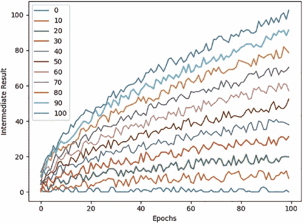

第 3 节 Shell 下的超参数优化

图 33. 抛物线训练

让我们启动一个使用中位数停止算法的实验。试验脚本定义在列表 3-15 中。导入模块的试验：


## 列表 3-15. 中位数停止试验

```python
ch3/early_stop/medianstop/trial.py
import os
import sys
from time import sleep
import nni
# For NNI use relative import for user-defined modules
SCRIPT_DIR = os.path.dirname(os.path.abspath(__file__)) + '/../'
sys.path.append(SCRIPT_DIR)
from ch3.early_stop.medianstop.model import identity_with_parabolic_training
if __name__ == '__main__':
    params = nni.get_next_parameter()
    x = params['x']
    final, history = identity_with_parabolic_training(x)
    for h in history:
        sleep(.1)
        nni.report_intermediate_result(h)
    nni.report_final_result(final)
```

## 列表 3-16 定义了使用中位数停止算法的实验

```yaml
ch3/early_stop/medianstop/config.yml
searchSpace:
  x:
    type: quniform
    value: [1, 100, 0.1]
maxTrialNumber: 100
trialConcurrency: 8
trialCodeDirectory: .
trialCommand: python3 trial.py
tuner:
  name: Random
assessor:
  name: Medianstop
  classArgs:
    # number of warm up steps
    start_step: 10
trainingService:
  platform: local
```

现在我们已经准备好运行实验：

```bash
nnctl create --config ch3/early_stop/medianstop/config.yml
```

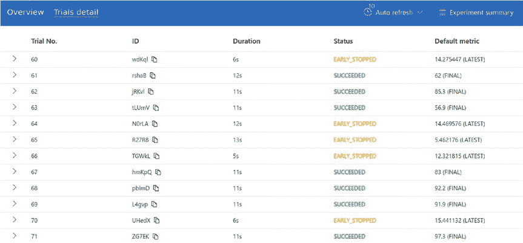

## 第 3 节 Shell 下的超参数优化

实验完成后，我们可以从图 3-34 观察到许多试验处于 `EARLY_STOPPED` 状态，正如预期。

## 拟合

曲线拟合评估器（Curve Fitting Assessor）是一种 LPA（学习、预测、评估）算法，如果最终 epoch 的性能预测劣于试验历史中的最佳性能，则在第 `N` 步停止待处理的 `Trial`。曲线拟合评估器对 `Trial` 训练的最终结果进行预测并与完成的试验进行比较。

该算法将早停任务视为时间序列预测问题。如果训练预测结果悲观，算法将停止试验。图 3-35 解释了曲线拟合早停的方法。

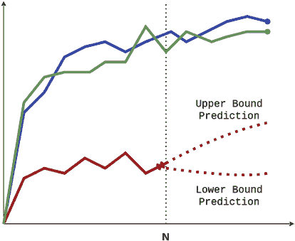

## 第 3 节 Shell 下的超参数优化

曲线拟合算法可以通过以下实验配置在实验中实现：

```yaml
assessor:
  name: Curvefitting
  classArgs:
    epoch_num: 20
    start_step: 6
    threshold: 0.95
    gap: 1
```

我们在书中研究曲线拟合早停算法的原理。你可以参考官方文档（[`nni.readthedocs.io/en/v2.7/reference/hpo.html#nni.algorithms.hpo.curvefitting_assessor.CurvefittingAssessor`](https://nni.readthedocs.io/en/v2.7/reference/hpo.html#nni.algorithms.hpo.curvefitting_assessor.CurvefittingAssessor)）。

## 停止良好试验的风险

早停算法可以显著加速实验完成并节省计算资源。但始终存在过早停止良好试验的风险，这可能意味着拒绝了搜索空间中非常好的参数。看图 3-36，早停的试验可能表现出良好的性能。

在本第[2.1 节](https://doi.org/10.1007/978-1-4842-8149-9_2)的任务中，我们构建了一个功能性流水线，以最优方式解决图像分类问题。事实上，深度学习的每一层都是一个特定的功能算子，我们尝试使用 `HPO` 方法来寻找这些算子的最佳流水线。图 3-37 将神经网络架构表示为一种功能性流水线。

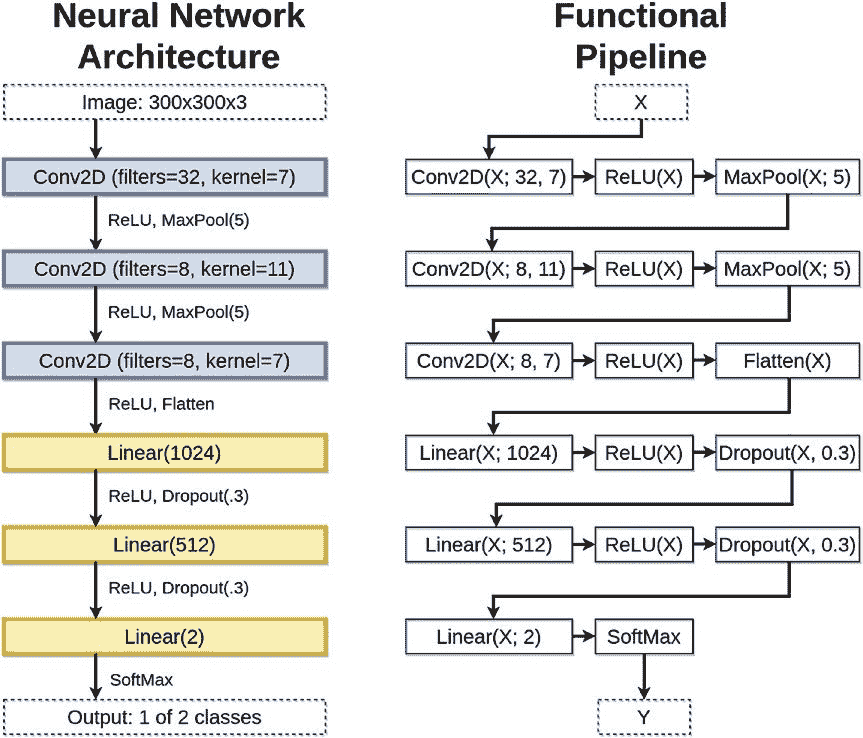

## 第 3 章 在 Shell 环境下的超参数优化

让我们把问题转化为更严谨的数学语言。我们需要找到一个模型 `M`，该模型由函数 `Fi` $\in$ $\{ \text{F}*\ast \}$ 的复合组成，并使值 `L( M, D )` 最大化，其中 `L` 用于评估模型 `M` 在数据集 `D` 上的性能。图 3-38 描述了最优功能性流水线问题：

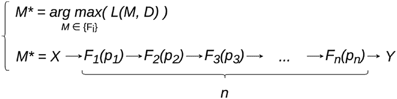

## 第 3 章 在 Shell 环境下的超参数优化

让我们研究如何使用 `NNI` 来解决这个问题。作为一个示例，我想使用经典的 AutoML 任务，该任务搜索经典的浅层机器学习方法的最优流水线，以解决监督学习问题。在本节中，我想向经典机器学习致敬，它正逐渐让位给深度学习。这种方法适用于任何搜索最优功能性流水线的问题。

## Problem

让我们使用伽马望远镜数据集[(https://archive.ics.uci.edu/ml/datasets/magic+gamma+telescope)](https://archive.ics.uci.edu/ml/datasets/magic+gamma+telescope) 来检查二分类问题。该数据集包含望远镜接收到的信号数据。任务是区分由初级伽马射线（`gammas`，信号）引起的信号与高大气层中宇宙射线引起的强子簇（`hadronic`）图像（背景）。该数据集包含 19020 个实例，具有以下列：

1. `fLength`: 类型: real. 椭圆主轴（mm）
2. `fWidth`: 类型: real. 椭圆短轴（mm）
3. `fSize`: 类型: real. 所有像素内容之和的 10 倍对数（光子）
4. `fConc`: 类型: real. 两个最高像素之和相对于 `fSize` 的比例（ratio）
5. `fConc1`: 类型: real. 最高像素相对于 `fSize` 的比例（ratio）
6. `fAsym`: 类型: real. 最高像素到中心点的距离，投影在主轴上的长度（mm）
7. `fM3Long`: 类型: real. 沿主轴三阶矩的立方根（mm）
8. `fM3Trans`: 类型: real. 沿短轴三阶矩的立方根（mm）
9. `fAlpha`: 类型: real. 主轴与指向原点向量的夹角（deg）
10. `fDist`: 类型: real. 原点到椭圆圆心的距离（mm）
11. `class`: 值: `g`, `h`。伽马（信号），强子（背景）。

也许读者能从这些数据中看出些什么，但我对它们一无所知。但这恰恰是我们需要的——在看不见的地方发现模式和依赖关系。数据集位于 `ch3/ml_pipeline/04.data`，并在 3-17 中被转换为监督学习问题。导入模块：

```python
import os
import pandas as pd
import numpy as np
from sklearn.model_selection import train_test_split

def telescope_dataset():
    # Loading dataset:
    cd = os.path.dirname(os.path.abspath(__file__))
    # Loading dataset:
    telescope_df = pd.read_csv(f'{cd}/04.data')
    # Dropping na:
    telescope_df.dropna(inplace = True)
    # Setting column names:
    telescope_df.columns = ['fLength', 'fWidth', 'fSize', 'fConc', 'fConc1', 'fAsym', 'fM3Long', 'fM3Trans', 'fAlpha', 'fDist', 'class']
    # Splitting dataset:
    X_train, X_test, y_train, y_test = train_test_split(telescope_df, test_size=0.2, stratify=telescope_df['class'])
    # Returning data:
    return X_train, X_test, y_train, y_test
```

***列表 17.** ch3/ml_pipeline/utils.py

```python
class Operator:
    def __init__(self, name, clz, params = None):
        if params is None:
            params = {}
        self.name = name
        self.clz = clz
        self.params = params
```

由于已经确定了问题，我们可以开始定义组成流水线的算子。通常，算子分为三类：

- **Selectors**（选择器）：从数据集中选择显著特征。
- **Transformers**（转换）：根据某些数学函数转换输入。
- **Classifiers**（分类器）：解决问题本身。

这些算子将形成一个功能性流水线。

## Search Space

让我们定义分类器的搜索空间。我们假设分类器的算子流水线将具有：

- **Selectors**: 从 0 到 1（选择器是建议的但并非必须）。
- **Transformers**: 从 0 到 3（转换是建议的但并非必须）。
- **Classifier**: 1（必须）。

因此，一个流水线（pipeline）可以包含从一个到五个运算符。请查看图 3-40

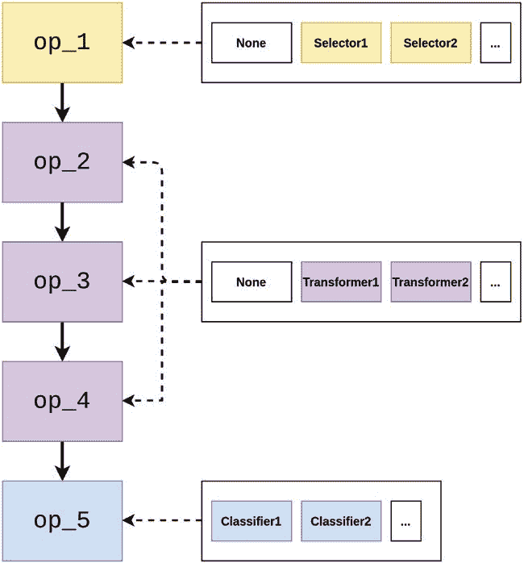

# 第 3 章 Shell 下超参数优化

该流水线包含五个单元。每个单元可以使用相应运算符空间中的某些值填充。如果没有选择任何值，单元可以为空。例如，可能会选择流水线：`Selector3` → → `Transformer1` → → `Classifier2`，它等于 `Selector3` → `Transformer1` → `Classifier2`。

这个搜索空间的定义非常巨大且难以手动构建，因此我们将在列表 3-19 中添加一个特殊类，根据 NNI 规范创建运算符搜索空间的定义。

**列表 3-19.** 搜索空间。`ch3/ml_pipeline/search_space.py`

```python
from ch3.ml_pipeline.operator import OperatorSpace

class SearchSpace:
    每个单元格都有一个运算符类型，可以用选择器、转换器分类器填充。`operator_search_space` 方法为每个单元类型创建一个搜索空间。

    @classmethod
    def operator_search_space(cls, operator_type):
        """
        根据 operator_type 为运算符创建搜索空间
        """
        ss = []
        operators = []
        if operator_type == 'selector':
            # 流水线中不需要选择器
            ss.append({'_name': 'none'})
            operators = OperatorSpace.selectors
        elif operator_type == 'transformer':
            # 流水线中不需要转换器
            ss.append({'_name': 'none'})
            operators = OperatorSpace.transformers
        elif operator_type == 'classifier':
            operators = OperatorSpace.classifiers
        for o in operators:
            row = {'_name': o.name}
            for p_name, values in o.params.items():
                row[p_name] = {"_type": "choice", "_value": values}
                ss.append(row)
        return ss
```

接下来，我们定义了一个 `build` 方法，根据 NNI 规范构建所有单元的搜索空间：

```python
    @classmethod
    def build(cls):
        return {
            "op_1": {
                "_type": "choice",
                "_value": cls.operator_search_space('selector')
            },
            "op_2": {
                "_type": "choice",
                "_value": cls.operator_search_space('transformer')
            },
            "op_3": {
                "_type": "choice",
                "_value": cls.operator_search_space('transformer')
            },
            "op_4": {
                "_type": "choice",
                "_value": cls.operator_search_space('transformer')
            },
            "op_5": {
                "_type": "choice",
                "_value": cls.operator_search_space('classifier')
            }
        }
```

尽管搜索空间的定义很大，但我们仍然将其打印出来：

```python
if __name__ == '__main__':
    search_space = SearchSpace.build()
    print(search_space)
```

我们将使用动态搜索空间构建在嵌入模式下启动实验，尽管这种技术也可以用于构建静态 JSON 文件。

## 模型

那么，我们现在拥有什么？我们有一个运算符空间和一个搜索空间。现在让我们实现一个模型，将流水线配置转换为真实的机器学习分类器。列表 3-20 引入了 MlPipelineClassifier。

**列表 3-20.** MlPipelineClassifier。`ch3/ml_pipeline/model.py`


```python
from sklearn.pipeline import Pipeline
from ch3.ml_pipeline.operator import OperatorSpace
from ch3.ml_pipeline.utils import telescope_dataset

class MlPipelineClassifier:
    """
    模型接收流水线配置并将其转换为实际 Scikit-learn 流水线
    """
    def __init__(self, pipe_config):
        ops = []
        for _, params in pipe_config.items():
            # 运算符名称
            op_name = params.pop('name')
            # 跳过 'none' 运算符
            if op_name == 'none':
                continue
            op = OperatorSpace.get_operator_by_name(op_name)
            ops.append((op.name, params))
        self.pipe = Pipeline(ops)

    # 模型训练方法
    def train(self, X, y):
        self.pipe.fit(X, y)

    # 计算准确率
    def score(self, X, y):
        return self.pipe.score(X, y)
```

既然模型已经就绪，让我们尝试使用示例流水线初始化它并将其应用于分类问题：

```python
if __name__ == '__main__':
    pipe_config = {
        'op_1': {
            'name': 'SelectPercentile',
            'percentile': 2
        },
        'op_2': {
            'name': 'none'
        },
        'op_3': {
            'name': 'Normalizer',
            'norm': 'l1'
        },
        'op_4': {
            'name': 'PCA',
            'svd_solver': 'randomized',
            'n_iter': 3
        },
        'op_5': {
            'name': 'DecisionTreeClassifier',
            'criterion': 'entropy',
            'max_depth': 8
        }
    }
    model = MlPipelineClassifier(pipe_config)
    X_train, y_train, X_test, y_test = telescope_dataset()
    model.train(X_train, y_train)
    score = model.score(X_test, y_test)
    print(score)
```

由于模型已经准备好，让我们尝试使用示例流水线初始化它。

# 调器 (Tuner)

现在，一切都准备好开始实验了。但是，我想关注那些已经尝试过的参数。调器是运算符的序列，但相同的参数可能可能不同的：

- 相同的参数但不同的运算符
- 相同的运算符但不同的参数

在搜索空间中，它们是等价的：

- 相同的参数但不同的运算符
- 相同的运算符但不同的参数

因此我们要通过自定义调器（`Tuner`）来禁止传递相同的参数。`EvolutionTuner` 的具体实现参见列表 3-21。

```python
import json
from nni.algorithms.hpo.evolution_tuner import EvolutionTuner

class EvolutionEvolutionTuner(EvolutionTuner):
    def __init__(self, optimize_mode="maximize", population_size=32):
        super().__init__(optimize_mode, population_size)
        # 我们定义 registry 属性来跟踪所有流水线
        self.registry = []

    # 如果父类对象的 generate_parameters 方法返回已尝试过的参数，
    # 则再次调用它直到生成唯一的参数。由于 EvolutionTuner
    # 具有随机行为，预计它在后续调用中返回不同的参数。
    def generate_parameters(self, *args, **kwargs):
        params = super().generate_parameters(*args, **kwargs)
        # 如果参数不有效，则生成新的
        while not self.is_valid(params):
            params = super().generate_parameters(*args, **kwargs)
        return params

    # 以下 is_valid 方法将参数转换为标准形式，并检查其是否已经尝试过：
    # 如果是，则返回 False；如果不是，则保存并返回 True。
    def is_valid(self, params):
        # 所有步骤名称
        step_names = [v['_name'] for _, v in params.items() if v['_name'] != 'none']

        # 不允许重复
        if len(step_names) != len(set(step_names)):
            return False

        # 将 `params` 转换为规范字符串
        canonical_form = 'X'
        for _, step_config in params.items():
            if step_config['_name'] == 'none':
                continue
            canonical_form += '--->' + json.dumps(step_config)

        # 如果 `canonical_form` 已经测试过
        if canonical_form in self.registry:
            return False
        self.registry.append(canonical_form)
        return True
```

这种简单的技术引入了搜索空间元素之间的等价性，并可以显著缩小搜索空间。

## 实验

现在，我们终于准备好启动实验，以寻找解决 AutoML 问题的最佳函数流水线。列表 3-22 中的试验脚本初始化模型、准备数据集、训练模型、测试模型，并将模型准确率返回给 NNI 实验。

（完整代码在相应的文件中：`ch3/ml_pipeline/trial.py`。）

### 列表 3-22. 试验

```python
def trial(hparams):
    # 初始化模型
    model = MlPipelineClassifier(hparams)
    # 准备数据集
    X_train, y_train, X_test, y_test = telescope_dataset()
    model.train(X_train, y_train)
    # 在测试集上评分
    score = model.score(X_test, y_test)
    # 将最终分数发送到 NNI
    nni.report_final_result(score)
```

列表 3-23 将所有内容整合并运行实验。导入模块：

### 列表 3-23. 最佳函数流水线实验。`ch3/ml_pipeline/run_experiment.py`

```python
from pathlib import Path
from nni.experiment import Experiment, CustomAlgorithmConfig
from ch3.ml_pipeline.search_space import SearchSpace

# 通用实验配置
experiment = Experiment('local')
experiment.config.experiment_name = 'AutoML Pipeline'
experiment.config.trial_concurrency = 4
experiment.config.max_trial_number = 500

# 生成搜索空间
experiment.config.search_space = SearchSpace.build()

# 试验配置
experiment.config.trial_command = 'python3 trial.py'
experiment.config.trial_code_directory = Path(__file__).parent

# 设置自定义的 EvolutionShrinkTuner
experiment.config.tuner = CustomAlgorithmConfig()
experiment.config.tuner.code_directory = Path(__file__).parent
experiment.config.tuner.class_name = 'evolution_shrink_tuner.EvolutionShrinkTuner'
experiment.config.tuner.class_args = {
    'optimize_mode': 'maximize',
    'population_size': 64
}
```

启动实验：

```python
http_port = 8080
experiment.start(http_port)
```

# 事件循环

```python
while True:
    if experiment.get_status() == 'DONE':
        search_data = experiment.export_data()
        search_metrics = experiment.get_job_metrics()
        input("实验已完成。按任意键退出...")
        break
```

图 3-41 显示了 AutoML 实验顶部的试验。

### 图 3-41. AutoML 实验最佳试验

最佳试验展示了 `0.89143` 的准确率，并具有以下参数：

```json
{
  "op_1": {
    "_name": "SelectFwe",
    "alpha": 0.049
  },
  "op_2": {
    "_name": "MinMaxScaler"
  },
  "op_3": {
    "_name": "RobustScaler"
  },
  "op_4": {
    "_name": "none"
  },
  "op_5": {
    "_name": "MLPClassifier",
    "alpha": 0.01,
    "learning_rate_init": 0.01
  }
}
```

最佳试验可以转换为函数流水线：

`X -> Select(alpha=0.049) -> MinMaxScaler -> RobustScaler -> MLPClassifier(alpha=0.01, learning_rate_init=0.01) -> Y`

事实上，我们构建的分类器显示了非常好的结果，接近最优。

该领域于 2018 年作为一门独立的学科成型。自那时，它在自动化构建解决特定问题的神经网络架构方面取得了重大突破。大多数手动设计的神经网络可能很快就会被自动化架构搜索取代，因此这一领域对所有数据科学家来说都是非常有前景的。`NAS` 产生了许多顶级的计算机视觉架构。如 `NASNet`、`EfficientNet` 和 `MobileNet` 等架构都是自动神经架构搜索的结果。

NAS 有两种类型：`Multi-trial`（多次试验）和 `One-shot`（单次）。在 `Multi-trial NAS` 中，模型评估器会评估每个采样模型的性能，`Exploration Strategy`（探索策略）从定义的 `Model Space`（模型空间）采样模型；而 `One-shot NAS` 则尝试寻找最优的神经架构训练，并探索源自 `Model Space` 的一个 `Supernet`（超网络）。

本章专门介绍 `Multi-trial NAS`。

本章分为两个部分：`使用 Retiarii 进行神经架构搜索 (PyTorch)` 和 `经典神经架构搜索 (TensorFlow)`。`Retiarii` 是一个由 NNI 专家开发的深度学习框架，支持在神经网络 `Model Space` 上进行探索性训练。`Retiarii` 是一种优势方法，允许对 `NAS` 进行结构化和规划。遗憾的是，NNI `2.7` 版本（本书使用的版本）仅为 `PyTorch` 框架实现了 `Retiarii` 方法。在本章中，不关注 `TensorFlow` 框架是不公平的，使用 `NNI` 进行 `NAS` 的经典方法将在 `经典神经架构搜索 (TensorFlow)` 部分中进行考虑。无论如何，`NNI` 都支持 `TensorFlow` 的 `One-shot NAS`，我们将在下一节中进行探索。因此，`TensorFlow` 用户将能够充分利用 `NAS` 方法。

## 作为数据流图的神经架构

我们将从定义 `NAS` 如何感知神经网络架构开始。神经架构被视为 `Data Flow Graph (DFG)`（数据流图）。`DFG` 是节点及其之间连接的集合。`DFG` 显示了数据从一个节点到另一个节点的传输。每个节点都有自己的类型和参数。图 4-1 展示了 `DFG` 的示例。

***图 4-1.** 数据流图*

在图 4-1 中，我们看到了 `DFG`，它包含带有参数的不同类型的节点。每个神经网络的架构都可以表示为 `Data Flow Graph`。事实上，在图 4-1 中，我们可以将矩形节点替换为带有参数的卷积层：`padding`、`stride`、`filter_size` 等。`Neural Architecture Search Explorers` 并不了解每个 `DFG` 节点的本质。主要任务是从各种深度学习层构建一个 `DFG`，形成神经网络的架构，并以最佳方式解决特定问题。

## 使用 Retiarii 进行神经架构搜索 (PyTorch)

`Retiarii` 是由 `NNI` 专家开发的框架，它是第一个支持深度学习探索性训练的框架。探索性训练意味着不同深度神经网络 (`DNNs`) 的训练结果是共享的。这种方法比较不同模型的训练情况，执行优化，并停止中间结果不佳的模型。此外，`Retiarii` 提供了一个新接口来指定用于探索的深度学习 `Model Space`，以及一个描述 `Exploration Strategy` 的接口，该策略决定实例化和训练模型的顺序、优先训练某些模型并停止某些模型的训练。

`Retiarii` 识别实例化模型之间的相关性，并开发了一系列跨模型优化以改进整个探索性训练过程。你可以在以下文章阅读更多关于 `Retiarii` 框架的信息：`www.usenix.org/system/files/osdi20-zhang_quanlu.pdf`。`NNI` 版本 `2.7` 只有 PyTorch 的 Retiarii 框架实现。在后续的 `NNI` 发布中，将添加 TensorFlow 的实现。请参考官方文档：`https://nni.readthedocs.io/en/v.7/`。

## 使用 Retiarii 进行 NAS 介绍

使用 `Retiarii` 学习 `NAS` 的最佳方法是查看寻找简单的 `Model Space`。我们不会深入研究神经网络，而是关注简单的算术问题。假设我们有一个链 `F`，它执行以下操作：

```
x = 1
x = x * 2
x = x * 4
x = sigmoid(x)
x = tanh(x)
x = relu(x)
```

该问题的 `Model Space` 可以如图 4-2 所示。

***图 4-2.** 数据流图*

## 列表 4-1. 模型空间


```python
import os
import torch
import nni
import nni.retiarii.pytorch as nn
from nni.retiarii import model_wrapper

@model_wrapper
class DummyModel(nn.Module):
    def __init__(self):
        super().__init__()
        # operator 1
        self.op1 = nn.LayerChoice([
            nn.Tanh(),
            nn.Sigmoid(),
            nn.ReLU()
        ])
        # addition
        self.add = nn.ValueChoice([0, 1, 2])
        # operator 2
        self.op2 = nn.LayerChoice([
            nn.Tanh(),
            nn.Sigmoid(),
            nn.ReLU()
        ])

    def forward(self, x):
        x = self.op1(x)
        x = x * 2
        x += self.add
        x = x * 4
        x = self.op2(x)
        return x
```

之后，我们定义了 `evaluate` 方法，它返回模型结果。NNI 中的 `NAS` 框架：

```python
def evaluate(model_cls):
    Evaluating the model:
    model = model_cls()
    x = torch.Tensor([1])
    y = model(x)
    return y
```

这段代码用于模型架构可视化。我们稍后会回到这种技术。

```python
onnx_dir = os.path.abspath(os.environ.get('NNI_OUTPUT_DIR', '.'))
```

```python
os.makedirs(onnx_dir, exist_ok=True)
```

```python
torch.onnx.export(model, x, onnx_dir + '/model.onnx')
```

返回结果：

```
nni.report_final_result(y.item())
```

一旦我们定义了 `Model Space`（模型空间）及其实例 `Evaluation`（评估器），就可以使用列表 4-2 所示的代码启动实验了。

导入必要的模块：

***Listing 4-2.*** Retiarii 实验。`ch4/retiarii/intro/run_experiment.py`

```python
from time import sleep

from nni.retiarii.evaluator import FunctionalEvaluator

from nni.retiarii.experiment.pytorch import RetiariiExperiment, RetiariiExeConfig
import nni.retiarii.strategy as strategy

from ch4.retiarii.intro.dummy_model import DummyModel, evaluate
```

## 第 4 章 多轮神经架构搜索

启动 Retiarii 实验主要有七个步骤：

1. 我们设置 `Model Space`：

   ```python
   model_space = DummyModel()
   ```

2. 我们定义 `Evaluator`，它用于评估模型实例：

   ```python
   evaluator = FunctionalEvaluator(evaluate)
   ```

3. 接下来，我们选择一个 `Search Strategy`（搜索策略）来探索 `Model Space`：

   ```python
   search_strategy = strategy.Random(dedup=True)
   ```

4. 我们用已定义的 `Model Space`、`Evaluator` 和 `Search Strategy` 初始化 `Retiarii Experiment`：

   ```python
   exp = RetiariiExperiment(model_space, evaluator, [], search_strategy)
   ```

5. 设置实验配置：

   ```python
   exp_config = RetiariiExeConfig('local')
   exp_config.experiment_name = 'dummy_search'
   exp_config.trial_concurrency = 1
   exp_config.max_trial_number = 100
   exp_config.training_service.use_active_gpu = False
   export_formatter = 'dict'
   ```

6. 启动实验：

   ```python
   exp.run(exp_config, 8080)
   ```

7. 返回最佳结果。我们可以在退出前在 WebUI 中分析实验结果：

   ```python
   while True:
       sleep(1)
       input("实验已完成。按任意键退出...")
       print('Final model:')
   ```

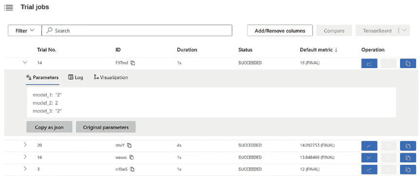

```python
for model_code in exp.export_top_models(formatter=export_formatter):
    print(model_code)
    break
```

实验完成后，我们可以通过检查实验任务面板（Trial jobs panel）来分析最佳结果。

***Figure 4-3.*** 实验任务面板

如图 4-3 所示，最佳模型返回了 16。它具有以下参数集：

```json
{
  "model_1": "2",
  "model_2": 2,
  "model_3": "2"
}
```

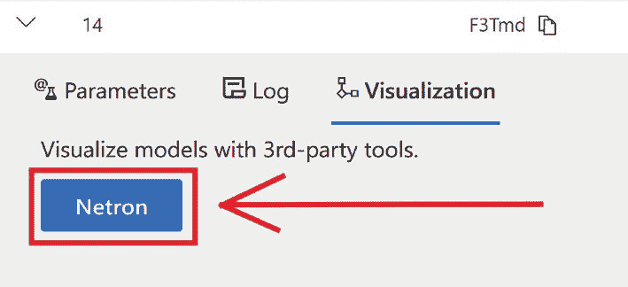

前面的参数不是自描述的，因此我们可以使用可视化函数来渲染如图 4-4 所示的数据流图（DFG）。

***Figure 4-4.*** 可视化面板

NNI 使用 `Netron` 来可视化实验任务模型。`Netron` 是一个用于神经网络、深度学习模型和机器学习模型的微型查看器。点击 `Netron` 按钮，你将看到如图 4-5 所示的界面。

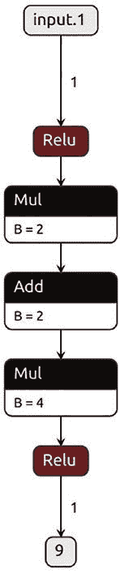

***Figure 4-5.*** Netron 模型可视化

现在我们可以宣布，已经找到了解决问题的办法：找到一个使算子链 *F* 值最大化的模型。该模型的数据流图如图 4-6 所示。

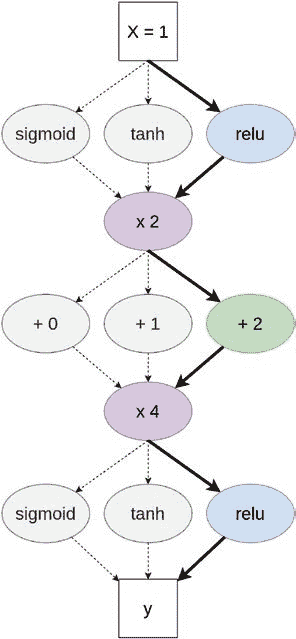

***Figure 4-6.*** 模型空间中的最佳数据流图

本次实验的目的是证明 NAS 的主要目标是找到一种能够最大化（或最小化）黑盒函数的架构。在引入基础 NAS 技术后，我们可以进一步深入探讨。

## Retiarii 框架

`Retiarii framework` 设计用于分离神经架构搜索的主实体。使用 `Retiarii framework`，研究人员可以专注于特定的方面。

- **Base Model**（基础模型）
- **Mutator**（变异器）
- **Model Space**（模型空间）
- **Evaluator**（评估器）
- **Search Strategy**（搜索策略）

`Base Model` 是神经架构搜索的主实体。使用 `Retiarii framework`，研究人员可以专注于特定的方面。

`Base Model` 是神经网络的骨架。`Mutator` 是对 `Base Model` 的变异。`Model Space` 是所有 `Base Model` 的变体。`Evaluator` 测量 `Model Space` 的性能。`Search Strategy` 定义了 `Model Space`。这些概念包含在表 4-1 中。

**NAS**

**HPO**

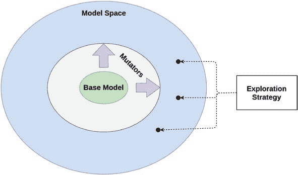

图 4-7 展示了 `Retiarii framework` 中的各种组件。

***Figure 4-7.*** Retiarii 框架

## Base Model

`Base Model` 是进行架构修改的起点。例如，用于问题的 `Base Model` 如列表 4-3 所示。

导入必要的模块：

***Listing 4-3.*** Base Model。`ch4/retiarii/common/base_model.py`

```python
import torch
import torch.nn.functional as F
```

必须使用 `nni.retiarii.pytorch as nn` 模块来声明深度学习模型的层：

```python
import nni.retiarii.pytorch as nn
```

`Base Model` 必须使用 `nni.retiarii.model_wrapper()` 进行标注：

```python
from nni.retiarii import model_wrapper
```

接下来，我们有一个用于数字识别问题的经典 LeNet 模型：

```python
@model_wrapper
class Net(nn.Module):
    def __init__(self):
        super().__init__()
        self.conv1 = nn.Conv2d(1, 32, 3, 1)
        self.conv2 = nn.Conv2d(32, 64, 3, 1)
        self.dropout1 = nn.Dropout(0.25)
        self.dropout2 = nn.Dropout(0.5)
        self.fc1 = nn.Linear(9216, 128)
        self.fc2 = nn.Linear(128, 10)

    def forward(self, x):
        x = F.relu(self.conv1(x))
        x = F.max_pool2d(self.conv2(x), 2)
        x = torch.flatten(self.dropout1(x), 1)
        x = self.fc2(self.dropout2(F.relu(self.fc1(x))))
        output = F.log_softmax(x, dim=1)
        return output
```

`Base Model` 设计中的常见错误有：

- `Base Model` 缺少 `@model_wrapper` 标注
- 使用 `import torch.nn as nn` 而不是 `nni.retiarii.nn.pytorch as nn` 来声明层

## Mutators

`Base Model` 是单一模型。为了创建 `Model Space`，我们需要向 `Base Model` 添加 `Mutators`。每个 `mutator` 都提供了更改 `Base Model` 的方法。应用于 `Base Model` 的所有可能的变异形成了 `Model Space`。NNI 提供了以下变异操作：`LayerChoice`、`ValueChoice`、`InputChoice` 和 `Repeat`。

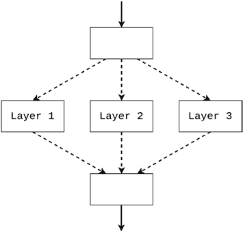

### LayerChoice

`LayerChoice` 变异器为层占位符形成候选层。在探索过程中会尝试这些层之一。`LayerChoice` 变异器如下所示应用于 `Base Model`：

```python
import nni.retiarii.nn.pytorch as nn
```

# 模型设计

```python
self.activation = nn.LayerChoice([
    nn.ReLU(),
    nn.Sigmoid(),
    nn.Identity
])
```

# 前向传播

```python
x = self.activation(x)
```

`LayerChoice` 为 `Base Model` 添加了层的变体，如图 4-8 所示。

**图 4-8.** LayerChoice 变异器

`LayerChoice` 是变异 `Base Model` 最直接的方法。

### ValueChoice

`ValueChoice` 构成了一个单值列表，用于作为层超参数进行尝试。

`ValueChoice` 只能作为层超参数使用。它不能在评估过程中作为 `batch_size` 或 `learning_rate` 等任意超参数。

`ValueChoice` 变异器以以下方式应用于 `Base Model`：

# 导入部分

```python
import nni.retiarii.nn.pytorch as nn
```

# 模型设计

```python
self.drop = nn.Dropout(nn.ValueChoice([0.25, 0.5, 0.75]))
```

# 前向传播

```python
x = self.drop(x)
```

在 HPO 场景下，`ValueChoice` 可以被视为一种层超参数。

### InputChoice

`InputChoice` 尝试不同的连接。它接收多个张量并从中选择 `n_chosen` 个张量。`InputChoice` 变异器以以下方式应用于 `Base Model`：

# 导入部分

```python
import nni.retiarii.nn.pytorch as nn
```

# 模型设计

```python
self.switch = nn.InputChoice(n_candidates=2, n_chosen=1)
```

# 前向传播

```python
# 分支一
a = self.op_a1(x)
a = self.op_a2(a)
# 分支二
b = self.op_b1(x)
b = self.op_b2(b)
# 选择连接
x = self.switch([a, b])
```

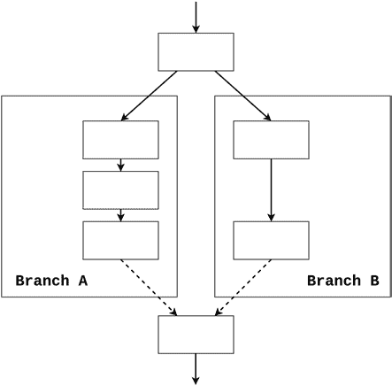

`InputChoice` 设计用于在神经网络架构中寻找最佳的数据流分支。图 4-9 阐述了这一概念。

**图 4-9.** InputChoice 变异器

如果 `InputChoice` 选取了多个候选张量（即 `n_chosen > 1`），则会应用还原策略：`sum`、`mean`、`concat`。这是一个非常实用的技术，允许同时提取并合并多个连接。带有还原操作的多个候选的 `InputChoice` 可以按以下方式应用：

# 导入部分

```python
import nni.retiarii.nn.pytorch as nn
```

# 模型设计

```python
self.mix = nn.InputChoice(n_candidates=3, n_chosen=2, reduction='sum')
```

# 前向传播

```python
# 分支一
a = self.op_a1(x)
a = self.op_a2(a)
# 分支二
b = self.op_b1(x)
b = self.op_b2(b)
# 分支三
c = self.op_b1(x)
c = self.op_b2(c)
# 选择连接
x = self.mix([a, b, c])
```

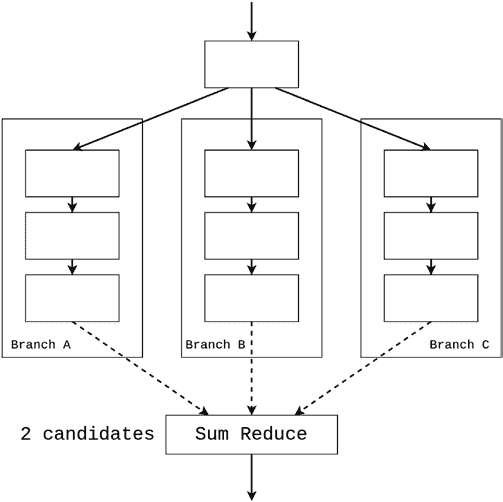

之前的代码生成了图 4-10 所示的空间。

**图 4-10.** 多个候选的 InputChoice 变异器

`带有多个候选的 InputChoice 变异器` 允许按以下方式应用：

（此处由于原文逻辑重复，翻译保持原文结构）

...

`LayerChoice` 是变异 `Base Model` 的最直接的方法。如下...

```python
import nni.retiarii.nn.pytorch as nn
```

# 模型设计


```python
self.activation = nn.LayerChoice([
    nn.ReLU(),
    nn.Sigmoid(),
    nn.Identity
])
```


**图 4-8.** LayerChoice 变异器

...

# 模型设计

```python
import nni.retiarii.nn.pytorch as nn
```

```python
self.activation = nn.LayerChoice([
    nn.ReLU(),
    nn.Sigmoid(),
    nn.Identity
])
```

# 前向传播

```python
x = self.activation(x)
```

`LayerChoice` 为 `Base Model` 添加了层的变体，如图 4-8 所示。

`LayerChoice` 是变异 `Base Model` 最直接的方法。

# ValueChoice

`ValueChoice` 构成了一个单值列表，用于作为层超参数进行尝试。

`ValueChoice` 只能作为层超参数使用。它不能在评估过程中作为 `batch_size` 或 `learning_rate` 等任意超参数。

`ValueChoice` 变异器以以下方式应用于 `Base Model`：

# 导入部分

```python
import nni.retiarii.nn.pytorch as nn
```

# 模型设计

```python
self.drop = nn.Dropout(nn.ValueChoice([0.25, 0.5, 0.75]))
```

# 前向传播

```python
x = self.drop(x)
```

在 HPO 场景下，`ValueChoice` 可以被视为一种层超参数。

# InputChoice

`InputChoice` 尝试不同的连接。它接收多个张量并从中选择 `n_chosen` 个张量。`InputChoice` 变异器以以下方式应用于 `Base Model`：

# 导入部分

```python
import nni.retiarii.nn.pytorch as nn
```

# 模型设计

```python
self.switch = nn.InputChoice(n_candidates=2, n_chosen=1)
```

# 前向传播

```python
# 分支一
a = self.op_a1(x)
a = self.op_a2(a)

# 分支二
b = self.op_b1(x)
b = self.op_b2(b)

# 选择连接
x = self.switch([a, b])
```


`InputChoice` 设计用于在神经网络架构中寻找最佳的数据流分支。图 4-9 阐释了这一概念。

**图 4-9.** InputChoice 变异器

如果 `InputChoice` 选取了多个候选张量（即 `n_chosen > 1`），则会应用还原策略：`sum`、`mean`、`concat`。这是一个非常实用的技术，允许同时提取并合并多个连接。带有还原操作的多个候选的 `InputChoice` 可以按以下方式应用：

# 导入部分

```python
import nni.retiarii.nn.pytorch as nn
```

# 模型设计

```python
self.mix = nn.InputChoice(n_candidates=3, n_chosen=2, reduction='sum')
```

# 前向传播

```python
# 分支一
a = self.op_a1(x)
a = self.op_a2(a)

# 分支二
b = self.op_b1(x)
b = self.op_b2(b)

# 分支三
c = self.op_b1(x)
c = self.op_b2(c)

# 选择连接
x = self.mix([a, b, c])
```


之前的代码生成了图 4-10 所示的空间。

**图 4-10.** 多个候选的 InputChoice 变异器

`带有多个候选的 InputChoice 变异器` 允许按以下方式应用：

（此处省略原文中重复的片段，以符合不重复输出原文的要求）

# Repeat 变异器

以下是 `Repeat` 变异器的应用模式：

```python
import nni.retiarii.nn.pytorch as nn
from nni.retiarii import model_wrapper
```

我们定义了一个自定义的模型块：

```python
class SomeBlock(nn.Module):
    ...
```

设置一个构建函数，根据块在栈中的顺序数生成相应的块：

```python
def create_some_block(block_num):
    # 此处有依赖 'block_num' 的逻辑
    return SomeBlock(block_num)
```

```python
@model_wrapper
class RepeatModelSpace(nn.Module):
    def __init__(self):
        super().__init__()
        ...
```

定义 `Repeat` 变异器：

```python
self.repeat_block = nn.Repeat(
    create_some_block,
    depth=(1, 5)  # 重复 1 到 5 次
)
...

def forward(self, x):
    ...
```

评估 `Repeat` 变异器：

```python
x = self.repeat_block(x)
...
```

因此，拥有一个能够迭代构建不同长度块栈的工具将非常方便。这正是 `Repeat` 变异器的作用。让我们像之前处理 `InputChoice` 变异器那样，检查针对合成算术任务的 `Repeat` 变异器的实现。假设我们有一个序列向张量添加值的块。我们需要找到该序列的最优长度。列表 4-5 描述了该问题的模型空间。

`AddBlock` 充当加运算符。它简单地向输入张量添加某些值。

**列表 4-5.** Repeat 变异器模型空间。`ch4/retiarii/common/repeat/model_space.py`

```python
class AddBlock(nn.Module):
    def __init__(self, add=0):
        super().__init__()
        self.add = add

    def forward(self, x):
        x = x + self.add
        return x
```

根据序数创建 `AddBlock` 的构建函数：

```python
@classmethod
def create(cls, block_num):
    return AddBlock(block_num)
```

接下来，我们定义模型空间：

```python
@model_wrapper
class RepeatModelSpace(nn.Module):
    def __init__(self):
        super().__init__()
        ...
```

`Repeat` 变异器生成不同长度的块序列（从 1 到 5 层）：

```python
self.repeat = nn.Repeat(
    AddBlock.create,
    depth=(1, 5)
)

def forward(self, x):
    return self.repeat(x)
```

你可以通过运行以下命令检查实验：

```
$ python3 ch4/retiarii/common/repeat/run_experiment.py
```

事实上，基础变异器 `LayerChoice`、`ValueChoice`、`InputChoice` 和 `Repeat` 允许你构建任何复杂性的空间。这些变异器可以比作编程语言指令：

- `set`: `LayerChoice`, `ValueChoice`
- `if`: `InputChoice`
- `loop`: `Repeat`

在本章的后半部分，我们将使用这些变异器检查一个真实 NAS 任务的模型空间构建。

### 标签标记

所有变异器 API 都有一个可选参数 `label`。具有相同标签的变异器将共享相同的值。一个典型的例子是：

```python
self.net = nn.Sequential(
    nn.Linear(10, nn.ValueChoice([32, 64, 128], label='hidden_dim')),
    nn.Linear(nn.ValueChoice([32, 64, 128], label='hidden_dim'), 3)
)
```

等同于：

```python
hidden_dim = nn.ValueChoice([32, 64, 128], label='hidden_dim')
self.net = nn.Sequential(
    nn.Linear(10, hidden_dim),
    nn.Linear(hidden_dim, 3)
)
```

### 示例

列表 4-6 处理了模型空间应用于图像分类网络的简单示例。

**列表 4-6.** 模型空间。`ch4/retiarii/common/model_space.py`

```python
@model_wrapper
class Net(nn.Module):
    def __init__(self):
        super().__init__()
        self.conv1 = nn.Conv2d(1, 32, 3, 1)
        self.conv2 = nn.LayerChoice([nn.Conv2d(32, 64, 3, 1)], label='conv_layer')
        self.dropout1 = nn.Dropout(nn.ValueChoice([0.25, 0.5, 0.75], label='dropout'))
        self.dropout2 = nn.Dropout(nn.ValueChoice([64, 128, 256], label='hidden_size'))
        self.fc1 = nn.Linear(256, 10)
        self.fc2 = nn.Linear(10, 3)

    def forward(self, x):
        x = self.conv1(x)
        x = self.conv2(x)
        x = self.dropout1(x)
        x = self.dropout2(x)
        x = torch.flatten(x, 1)
        x = self.fc1(x)
        x = self.fc2(x)
```

### 评估器

`evaluator` 是一个接受 `model_class`、初始化它并返回结果的函数。可以使用以下方式实现：

```python
def evaluate(model_cls):
    # 初始化模型
    onnx_dir = os.path.abspath(os.environ.get('NNI_OUTPUT_DIR', '.'))
    os.makedirs(onnx_dir, exist_ok=True)
    
    # 保存模型用于可视化
    # ...
    # 模型训练
    # ...
    # 模型测试
    # ...
    return output
```

### 探索策略

NNI 为多试验 NAS 提供了以下探索策略：*Random*、*Grid Search*、*Regularized Evolution*、*TPE* 和 *RL*。我们已经熟悉了一些。但无论如何，让我们简单学习每一个。

#### 随机策略

随机策略 (`nni.retiarii.strategy.Random`) 从模型空间采样新模型。当你不知道数据集和合适的架构设计时，这是一个简单但有效的技术。通常首先使用随机搜索，在模型空间精细化后应用更智能的探索策略。

#### 网格搜索

网格搜索策略 (`nni.retiarii.strategy.GridSearch`) 使用网格搜索算法从模型空间采样新模型。

#### 正则化进化

正则化进化策略 (`nni.retiarii.strategy.RegularizedEvolution`) 使用变异运算符实现遗传算法搜索。正则化进化接近我们在第 3 章学习的进化调优器。正则化进化有三个全局超参数：

- `POPULATION_SIZE`: 参与搜索的种群大小
- `CANDIDATES_N`: 锦标选择方法从种群中选取的候选数量
- `GENERATIONS`: 总循环次数

描述正则化进化的伪代码如下：

```python
# POPULATION_SIZE
# CANDIDATES_N
# GENERATIONS

# 初始化群体
population = []
for _ in range(POPULATION_SIZE):
    individual = generate_random_architecture()
    evaluate(individual)
    population.append(individual)

for _ in range(GENERATIONS):
    # 算法从群体中随机选择 CANDIDATES_N 个个体
    candidates = random_choice(population, CANDIDATES_N)
    # 从这些候选者中选择最好的
    best_candidate = get_best_from(candidates)
    # 对最佳候选者进行随机变异
    mutant = mutate(best_candidate)
    # 变异个体正在被评估
    evaluate(mutant)
    # 变异个体替换群体中最糟糕的个体
    replace_worst(population, mutant)
```

**图 4-14.** 正则化进化策略

正则化进化策略的实现包含以下参数：

- `optimize_mode`:
    - **类型**: string
    - **默认值**: maximize（最大化）
    - **数值**: 'maximize' | 'minimize'
    设置进化方向。

- `population_size`:
    - **类型**: int
    - **默认值**: 100
    种群中的个体数量。

- `cycles`:
    - **类型**: int
    - **默认值**: 20000
    算法的代数。

- `sample_size`:
    - **类型**: int
    - **默认值**: 25
    每次锦标选择中参与的个体数量。

- `mutation_prob`:
    - **类型**: float
    - **默认值**: 0.05
    模型空间中每个变异算子发生变异的概率。

更多细节，请参考描述正则化进化方法的原始论文：[`arxiv.org/abs/1802.01548`](https://arxiv.org/abs/1802.01548)。

## TPE 策略

TPE 策略 (`nni.retiarii.strategy.TPEStrategy`) 是一种基于树结构帕森估计器的序列模型优化方法。它的工作方式与我们在第 3 章学习的 TPE 调优器相同。

更多细节，请参考描述 TPE 方法的原始论文：
[`papers.nips.cc/paper/2011/file/86e8f7ab32cfd12577bc2619bc635690-Paper.pdf`](https://papers.nips.cc/paper/2011/file/86e8f7ab32cfd12577bc2619bc635690-Paper.pdf)

## RL 策略

RL 策略 (`nni.retiarii.strategy.PolicyBasedRL`) 基于策略梯度方法（近端策略优化或 PPO）的强化学习方法。RL 策略实现了一个名为 `Controller` 的特殊循环神经网络。


`Controller` 从模型空间中生成各种模型架构。`Controller` 充当随机策略；因此，它返回模型空间中每个变异算子（`Mutators`）的变异概率。在每次尝试后，`Controller` 会根据近端优化策略方法更新其 RNN 的权重。这种方法通过为每个变异算子构建概率分布来探索模型空间。

图 4-15 展示了 RL 策略的运行。

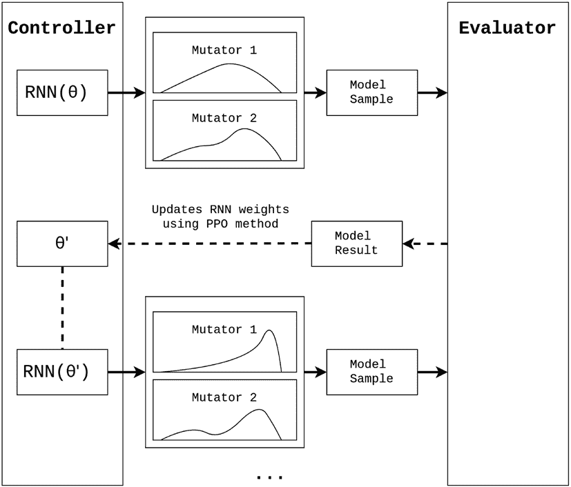

### 图 4-15. 强化学习（近端策略优化）策略

RL 策略需要安装 `tians` 包。`tians` 是一个基于纯 PyTorch 的强化学习平台。

```bash
pip install ti
```

RL 策略的实现包含以下参数：

- `max_collect`:
    - **类型**: int
    - **默认值**: 100
    探索策略（Exploration Strategy）执行的 epoch 数。

- `Trial_per_collect`:
    - **类型**: int
    - **默认值**: 20
    每个收集器收集的试验（轨迹）数量。在完成每个轨迹后，训练器将从重放缓冲区中采样批并进行 `Controller` 更新。

更多细节，请参考描述基于强化学习的架构搜索的原始论文：[`arxiv.org/pdf/16110578.pdf`](https://arxiv.org/pdf/16110578.pdf)。

## 实验

最后剩下就是实验。`Retiarii Experiment` 在独立（嵌入式）模式下启动，包含七个步骤：

- 声明空间
- 声明模型评估器
- 声明探索策略
- 初始化 `Retiarii Experiment`
- 配置 `Retiarii Experiment`
- 启动实验
- 返回结果

可以使用以下模式创建 `Retiarii Experiment`：

```python
import nni.retiarii.strategy as strategy
from nni.retiarii import model_wrapper
from nni.retiarii.evaluator import FunctionalEvaluator
from nni.retiarii.experiment.pytorch import RetiariiExeConfig, RetiariiExperiment

# 声明模型空间
base_model = Net()

# 声明评估器
search_strategy = strategy.Random()

# 声明探索策略
model_evaluator = FunctionalEvaluator(evaluate_model)

# 初始化 Retiarii Experiment
exp = RetiariiExperiment(base_model, model_evaluator, search_strategy)

# 配置 Retiarii Experiment
exp_config = RetiariiExeConfig('local')
exp_config.experiment_name = 'mnist_search'
exp_config.trial_concurrency = 2

# 启动实验
exp.run(exp_config)

# 返回结果
print('Final model:')
for model_code in exp.export_top_models(formatter='dict'):
    print(model_code)
```

运行实验后，可以像运行 HPO 实验一样使用 WebUI。

## CIFAR-10 LeNet NAS

让我们学习多轮架构搜索（Multi-trial NAS）在 CIFAR-10 上的应用。CIFAR-10 是一个常用的图像分类数据集。它包含 60,000 张彩色图像（32×32 像素），分为 10 个不同的类别：`飞机`、`汽车`、`鸟`、`猫`、`鹿`、`狗`、`青蛙`、`船`和`卡车`。

请运行以下命令将 CIFAR-10 数据集下载到机器：

```bash
python3 ch4/utils/datasets.py
```

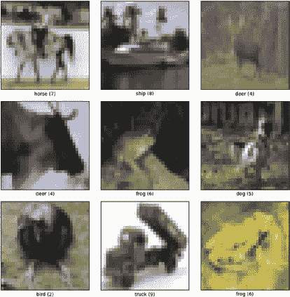

图 4-16 展示了 CIF10 数据集的若干样本。

让我们尝试基于 LeNet 方法寻找解决 CIFAR-10 问题的深度学习模型。正如我们所知，LeNet 图像识别架构可以分为两个部分：特征提取组件（Feature Extraction Component）和决策者组件（Decision Maker Component）。特征提取组件由卷积层的特征提取块组成。决策者组件由全连接组件组成。

特征提取块的设计如下：

- `Conv -> Activation`
- `Conv -> Pool -> Activation`

图 4-17 展示了特征提取块可能的架构选项或特征提取块空间。

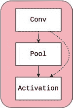
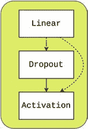

### 图 4-17. 特征提取块空间

同样，我们可以确定全连接块的可能设计：

- `Linear -> Activation`
- `Linear -> Dropout -> Activation`

图 4-18 了全连接块空间。

### 图 4-18. 全连接块空间

**注意**：实际上，`Linear -> Dropout(p=1) -> Activation` 等于 `Linear -> Activation`，并且可以在不使用两个连接的情况下设计图 4-18 中的相同块空间。我们可以通过简单的层超参数优化来实现相同的块空间：`Linear -> Dropout(p[.3, .5, .8, 1]) -> Activation`。但我们在这里特意使用两个连接，因为我们想要演示多轮 NaS 如何选择最佳连接。

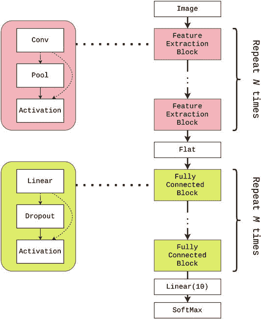

### 图 4-19. LeNet NAS 模型空间

我们将通过在列表 4-7 中定义一个特征提取块来开始实现 CIFAR-10 LeNet NAS。

**列表 4-7.** 特征提取块。`ch4/retiarii/cifar_10_lenet/feature_extraction.py`

```python
from typing import Tuple
import nni.retiarii.nn.pytorch as nn
```

`FeatureExtractionBlock` 接收以下参数：

- `dim`: 输入–输出通道
- `kernel_size`: 卷积层的卷积大小
- `activation`: 激活函数
- `block_num`: 特征提取序列中块的序号

```python
class FeatureExtractionBlock(nn.Module):
    def __init__(
        self,
        dim: Tuple[int, int],
        kernel_size,
        activation,
        block_num = 0
    ) -> None:
        super().__init__()__()
        # 初始化核心卷积层：
        self.input_dim = dim[0]
        self.output_dim = dim[1]
        self.conv = nn.Conv2d(
            in_channels = self.input_dim,
            out_channels = self.output_dim,
            kernel_size = kernel_size
        )
        # 定义池化和激活层：
        self.max_pool = nn.MaxPool2d(2, 2)
        self.activation = activation
        # 两个不同分支的选择：
        # Conv -> 池 -> 激活
        # Conv -> 激活
        self.switch = nn.InputChoice(
            n_candidates = 2,
            n_chosen = 1,
            label = f'fe_switch_{block_num}'
        )
        # 定义前向方法：
        def forward(self, x):
            x = self.conv(x)
            # 分支 A
            a = self.max_pool(x)
            a = self.activation(a)
            # 分支 B
            b = self.activation(x)
            return self.switch([a, b])
```

以下方法用于 `Repeat Mutator`。它根据块在特征提取序列中的序号返回一个合适的 `FeatureExtractionBlock`。

```python
    @classmethod
    def create(cls, activation, in_dimension):
        def create_block(i):
            params = {
                'kernel_size': nn.ValueChoice(
                    [3, 5],
                    label = f'fe_kernel_size_{i}'
                )
            }
            # 特征块维度
            if i == 0:
                dim = (in_dimension, 8)
            elif i == 1:
                dim = (8, 16)
            else:
                dim = (16, 16)
            params['dim'] = dim
            params['activation'] = activation
            return FeatureExtractionBlock(**params)
        return create_block
```

全连接块的实现与特征提取块相似，并在列表 4-8 中提供。

**列表 4-8.** 全连接块。`ch4/retiarii/cifar_10_lenet/fully_connected.py`

```python
from typing import Tuple, Iterator
from torch.nn import Parameter
import nni.retiarii.nn.pytorch as nn
```

`FullyConnectedBlock` 接收以下参数：

- `dim`: 线性层的输入–输出特征
- `dropout_rate`: 用于 dropout 的层超参数
- `activation`: 激活函数
- `block_num`: 全连接序列中块的序号

```python
class FullyConnectedBlock(nn.Module):
    def __init__(
        self,
        dim: Tuple[int, int],
        dropout_rate,
        activation,
        block_num
    ) -> None:
        super().__init__()
        # 初始化线性层：
        self.input_dim = dim[0]
        self.output_dim = dim[1]
        self._linear = None
        # 定义 dropout 和激活层：
        self.dropout = nn.Dropout(p=dropout_rate)
        self.activation = activation
        # 两个分支的选择：
        # Linear -> Dropout -> 激活
        # Linear -> 激活
        self.switch = nn.InputChoice(
            n_candidates = 2,
            n_chosen = 1,
            label = f'fc_switch_{block_num}'
        )
        # 定义前向方法：
        def forward(self, x):
            if not self.input_dim:
                self.input_dim = x.shape[1]
            # 分支 A
            a = self.linear(x)
            a = self.dropout(a)
            a = self.activation(a)
            # 分支 B
            b = self.linear(x)
```

以下方法根据其块在特征提取序列中的序号返回一个合适的 `FeatureExtractionBlock`。

```python
    @classmethod
    def create(cls, activation, in_dimension):
        def create_block(i):
            params = {
                'kernel_size': nn.ValueChoice(
                    [3, 5],
                    label = f'fe_kernel_size_{i}'
                )
            }
            # 特征块维度
            if i == 0:
                dim = (in_dimension, 8)
            elif i == 1:
                dim = (8, 16)
            else:
                dim = (16, 16)
            params['dim'] = dim
            params['activation'] = activation
            return FeatureExtractionBlock(**params)
        return create_block
```

全连接块的实现与特征提取块相似，并在列表 4-8 中提供。

**列表 4-8.** 全连接块。`ch4/retiarii/cifar_10_lenet/fully_connected.py`

```python
from typing import Tuple, Iterator
from torch.nn import Parameter
import nni.retiarii.nn.pytorch as nn
```

`FullyConnectedBlock` 接收以下参数：

- `dim`: 线性层的输入–输出特征
- `dropout_rate`: 用于 dropout 的层超参数
- `activation`: 激活函数
- `block_num`: 全连接序列中块的序号


# CIFAR-10 LeNet NAS 实现

## 特征提取块

我们将通过在**列表 4-7**中定义一个特征提取块来开始实现 CIFAR-10 LeNet NAS。

**列表 4-7.** 特征提取块。`ch4/retiarii/cifar_10_lenet/feature_extraction.py`

```python
from typing import Tuple
import nni.retiarii.nn.pytorch as nn
```

`FeatureExtractionBlock` 接收以下参数：

- `dim`: 输入–输出通道
- `kernel_size`: 卷积层的卷积大小
- `activation`: 激活函数
- `block_num`: 特征提取序列中块的序号

## 全连接块

**列表 4-8.** 全连接块。`ch4/retiarii/cifar_10_lenet/fully_connected.py`

```python
from typing import Tuple, Iterator
from torch.nn import Parameter
import nni.retiarii.nn.pytorch as nn
```

`FullyConnectedBlock` 接收以下参数：

- `dim`: 线性层的输入–输出特征
- `dropout_rate`: 用于 dropout 的层超参数
- `activation`: 激活函数
- `block_num`: 全连接序列中块的序号

```python
class FullyConnectedBlock(nn.Module):
    def __init__(
        self,
        dim: Tuple[int, int],
        dropout_rate,
        activation,
        block_num
    ) -> None:
        super().__init__()
        # 初始化线性层：
        self.input_dim = dim[0]
        self.output_dim = dim[1]
        self._linear = None
        # 定义 dropout 和激活层：
        self.dropout = nn.Dropout(p=dropout_rate)
        self.activation = activation
        # 两个分支的选择：
        # Linear -> Dropout -> 激活
        # Linear -> 激活
        self.switch = nn.InputChoice(
            n_candidates=2,
            n_chosen=1,
            label=f'fc_switch_{block_num}'
        )

    def forward(self, x):
        if not self.input_dim:
            self.input_dim = x.shape[1]
        # 分支 A
        a = self._linear(x)
        a = self.dropout(a)
        a = self.activation(a)
        # 分支 B
        b = self._linear(x)
```

## LeNet 空间构建

现在我们准备好构建 LeNet 空间。

导入模块：

**列表 4-9.** LeNet 空间。`ch4/retiarii/cifar_10_lenet/feature_extraction.py`

```python
from typing import Tuple, Iterator
from torch.nn import Parameter
import nni.retiarii.nn.pytorch as nn
```

特征提取块的 LeNet 空间。

不要忘记在类中添加 `@model_wrapper`：

```python
@model_wrapper
class Cifar10Net(nn.Module):
    def __init__(self):
        super().__init__()
        # CIFAR-10 数据集
        self.class_num = 10
        # RGB 输入
        self.input_channels = 3
        # 首先，我们定义特征提取序列：
        # 所有特征提取块共享相同的激活函数：
        self.activation = nn.LayerChoice(
            [nn.Sigmoid(), nn.ReLU()],
            label='fe_activation'
        )
        # Repeat 变异器创建一个到三个特征提取块：
        self.fe = nn.Repeat(
            FeatureExtractionBlock(
                self.activation,
                self.input_channels
            ),
            depth=(2, 3),
            label='fe_repeat'
        )
        # 其次，我们定义全连接层：
        self.flat = nn.Flatten()
        self.dm = nn.LayerChoice([
            nn.Linear(256, 128),
            nn.Linear(128, 64),
            nn.Linear(64, 32)
        ],
            label='fc_repeat'
        )

    def forward(self, x):
        x = self.fe(x)
        x = self.flat(x)
        x = self.dm(x)
        return self.log_max(x)
```

## Repeat Mutator 工厂方法

以下方法用于 `Repeat Mutator`。它根据其块在特征提取序列中的序号返回一个合适的 `FeatureExtractionBlock`。

```python
    @classmethod
    def create(cls, activation, in_dimension):
        def create_block(i):
            params = {
                'kernel_size': nn.ValueChoice(
                    [3, 5],
                    label=f'fe_kernel_size_{i}'
                )
            }
            # 特征块维度
            if i == 0:
                dim = (in_dimension, 8)
            elif i == 1:
                dim = (8, 16)
            else:
                dim = (16, 16)
            params['dim'] = dim
            params['activation'] = activation
            return FeatureExtractionBlock(**params)
        return create_block
```


```python
class FeatureExtractionBlock(nn.Module):
    def __init__(
        self,
        dim: Tuple[int, int],
        kernel_size,
        activation,
        block_num = 0
    ) -> None:
        super().__init__()
        # 初始化核心卷积层：
        self.input_dim = dim[0]
        self.output_dim = dim[1]
        self.conv = nn.Conv2d(
            in_channels = self.input_dim,
            out_channels = self.output_dim,
            kernel_size = kernel_size
        )
        # 定义池化和激活层：
        self.max_pool = nn.MaxPool2d(2, 2)
        self.activation = activation
        # 两个不同分支的选择：
        # Conv -> 池 -> 激活
        # Conv -> 激活
        self.switch = nn.InputChoice(
            n_candidates = 2,
            n_chosen = 1,
            label = f'fe_switch_{block_num}'
        )
        # 定义前向方法：
        def forward(self, x):
            x = self.conv(x)
            # 分支 A
            a = self.max_pool(x)
            a = self.activation(a)
            # 分支 B
            b = self.activation(x)
            return self.switch([a, b])
```

以下方法用于 `Repeat Mutator`。它根据块在特征提取序列中的序号返回一个合适的 `FeatureExtractionBlock`。

```python
    @classmethod
    def create(cls, activation, in_dimension):
        def create_block(i):
            params = {
                'kernel_size': nn.ValueChoice(
                    [3, 5],
                    label = f'fe_kernel_size_{i}'
                )
            }
            # 特征块维度
            if i == 0:
                dim = (in_dimension, 8)
            elif i == 1:
                dim = (8, 16)
            else:
                dim = (16, 16)
            params['dim'] = dim
            params['activation'] = activation
            return FeatureExtractionBlock(**params)
        return create_block
```

全连接块的实现与特征提取块相似，并在列表 4-8 中提供。

**列表 4-8.** 全连接块。`ch4/retiarii/cifar_10_lenet/fully_connected.py`

```python
from typing import Tuple, Iterator
from torch.nn import Parameter
import nni.retiarii.nn.pytorch as nn
```

`FullyConnectedBlock` 接收以下参数：

- `dim`: 线性层的输入–输出特征
- `dropout_rate`: 用于 dropout 的层超参数
- `activation`: 激活函数
- `block_num`: 全连接序列中块的序号

```python
class FullyConnectedBlock(nn.Module):
    def __init__(
        self,
        dim: Tuple[int, int],
        dropout_rate,
        activation,
        block_num
    ) -> None:
        super().__init__()
        # 初始化线性层：
        self.input_dim = dim[0]
        self.output_dim = dim[1]
        self._linear = None
        # 定义 dropout 和激活层：
        self.dropout = nn.Dropout(p=dropout_rate)
        self.activation = activation
        # 两个分支的选择：
        # Linear -> Dropout -> 激活
        # Linear -> 激活
        self.switch = nn.InputChoice(
            n_candidates = 2,
            n_chosen = 1,
            label = f'fc_switch_{block_num}'
        )
        # 定义前向方法：
        def forward(self, x):
            if not self.input_dim:
                self.input_dim = x.shape[1]
            # 分支 A
            a = self.linear(x)
            a = self.dropout(a)
            a = self.activation(a)
            # 分支 B
            b = self.linear(x)
```

现在我们准备好构建 LeNet 空间。

导入模块：

**列表 4-9.** LeNet 空间。`ch4/retiarii/cifar_10_lenet/feature_extraction.py`

```python
from typing import Tuple, Iterator
from torch.nn import Parameter
import nni.retiarii.nn.pytorch as nn
```

不要忘记在类中添加 `@model_wrapper`：

```python
@model_wrapper
class Cifar10Net(nn.Module):
    def __init__(self):
        super().__init__()
        # CIFAR-10 数据集
        self.class_num = 10
        # RGB 输入
        self.input_channels = 3
        # 首先，我们定义特征提取序列：
        # 所有特征提取块共享相同的激活函数：
        self.activation = nn.LayerChoice(
            [nn.Sigmoid(), nn.ReLU()],
            label = 'fe_activation'
        )
        # Repeat 变异器创建一个到三个特征提取块：
        self.fe = nn.Repeat(
            FeatureExtractionBlock(
                self.activation,
                self.input_channels
            ),
            depth = (2, 3),
            label = 'fe_repeat'
        )
        # 其次，我们定义全连接层：
        self.flat = nn.Flatten()
        self.dm = nn.LayerChoice([
            nn.Linear(256, 128),
            nn.Linear(128, 64),
            nn.Linear(64, 32)
        ],
            label = 'fc_repeat'
        )

    def forward(self, x):
        x = self.fe(x)
        x = self.flat(x)
        x = self.dm(x)
        return self.log_max(x)
```

`exp_config.trial_concurrency = 1`

`exp_config.max_trial_number = 500`

`exp_config.training_service.use_active_gpu = False`

`export_formatter = 'dict'`

# 第 4 章 多试验神经网络架构搜索

## 实验

```python
exp.run(exp_config, 8080)
```

## 返回结果

```python
print('Final model:')
for model_code in exp.export_top_models(formatter = export_formatter):
    print(model_code)
```

实验可以如下所示方式运行：

`$ python3 ch4/retiarii/cifar_10_lenet/run_cifar10_lenet_experiment.py`

**注意** 在 Intel Core i7 配合 CUDA (GeForce GtX 1050) 上运行耗时约为 20 小时。

最佳模型在测试数据集上显示 `0.84` 的准确率。这并不是一个糟糕的结果，但似乎仍有改进空间。最佳模型具有以下参数：

```json
{
  "fe_repeat": 2,
  "fe_kernel_size_0": 3,
  "fe_activation": "1",
  "fe_switch_0": 0,
  "fe_kernel_size_1": 5,
  "fe_kernel_size_2": 3,
  "fc_repeat": 2,
  "l1_size": 128,
  "fc_dropout_rate": 0.3,
  "fc_switch_0": 0,
  "l2_size": 64,
  "fc_switch_1": 0,
  "l3_size": 64,
  "fc_switch_2": 0
}
```

# 第 4 章 多试验神经网络架构搜索

上述参数可以按如下解释：

`"fe_repeat": 2` – 意味着 Repeat 变异器（mutator）生成了两个块的特征提取序列：

```python
self.fe = nn.Sequential(
    FeatureExtractionBlock.create(fe_activation, self.input_channels)(0),
    FeatureExtractionBlock.create(fe_activation, self.input_channels)(1),
)
```

`"fe_kernel_size_0": 3` – 意味着在 ValueChoice 变异器中选择了 `3`：

```python
'kernel_size': nn.ValueChoice(
    [3, # <- 此值
    5],
    label = f'fe_kernel_size_{i}'
)
```

`"fe_switch_0": 0` – 意味着在 InputChoice 变异器中使用第一个第一个连接：`self.switch([a, b])` <- 返回 `a`

此外，在试验详情面板中使用 Netron 对架构进行可视化处理是非常方便的。

图 4-20 展示了最佳模型的架构。

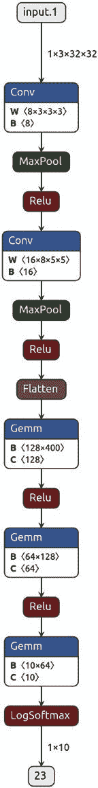

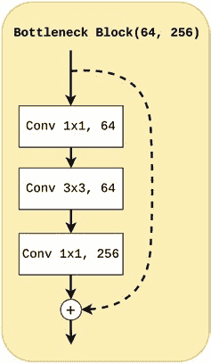

# 第 4 章 多试验神经网络架构搜索

我们在本节中进行的研究可以为你自己的 NAS 解决方案提供一个良好的起点。它包含了多试验 NAS 中使用的基础技术。在这里，我们使用 LeNet 模型作为基础模型（Base Model），但你可以选择任何更符合具体问题的模型和变异器。不过，我们在 LeNet NAS 上并没有获得非常理想的结果。在下一节中，我们将尝试另一种使用更复杂方法的 NAS。

## CIFAR-10 ResNet NAS

让我们尝试寻找另一种架构搜索方法来解决 CIFAR-10 问题。2015 年，论文[Deep Residual Learning for Image Recognition](https://arxiv.org/pdf/1512.0385.pdf)发表。这篇文章对深度学习产生了巨大影响。它引入了残差（residual）的概念，这可以防止神经网络性能的下降。

ResNet 模型的基本构建块是 `Bottleneck` 块。其内部带有跳跃连接（skip connections）。NAS 算法将决定 `Bottleneck` 块是否适当使用跳跃技术。因此，ResNet 中有带有和不带跳跃连接的两种变体 `Bottleneck` 块。其架构如图 4-21 所示。

**图 4-21.** Bottleneck 空间

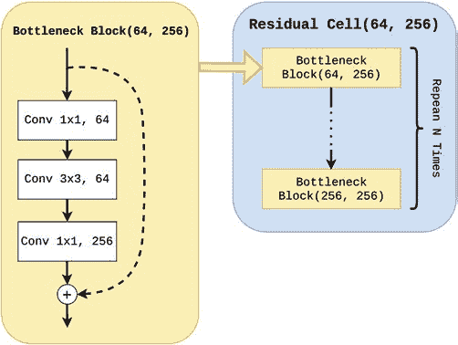

# 第 4 章 多试验神经网络架构搜索

ResNet 的另一个组件是 `Residual Cell`。`Residual Cell` 由 `Bottleneck` 块序列组成。`Bottleneck` 序列的长度取决于数据集。图 4-22 显示了 `Residual Cell` 空间。

**图 4-22.** Residual Cell 空间

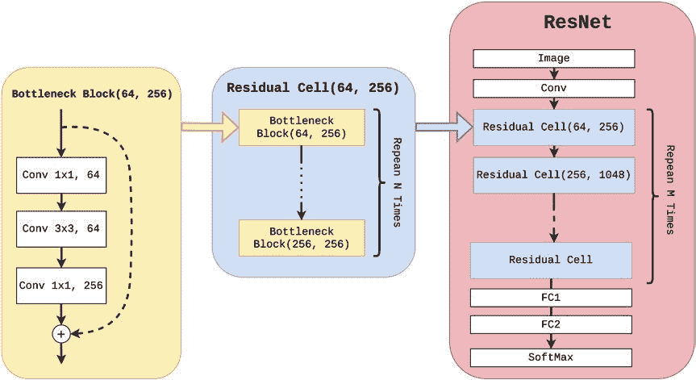

最后，我们可以构建 ResNet 模型。`ResNet` 架构如下：

- 初始卷积层
- Residual Cell 序列
- 若干全连接层

`Residual Cell` 的最优长度取决于数据集。我们将在 ResNet 中尝试寻找它。图 4-23 展示了 NAS 的完整模型空间。

**图 4-23.** ResNet 空间

代码列表 4-1 定义了用于 NAS 的 Bottleneck 块。


```python
# ch4/retiarii/cifar_10_resnet/bottle_neck.py
import nni.nn.pytorch as nn

class Bottleneck(nn.Module):
    # Bottleneck 块产生的输出通道：
    @classmethod
    def result_channels(cls, channels):
        return channels * 4

    # Bottleneck 接收参数：
    # cell_num: 所属 Residual Cell 的序号
    # in_channels: 输入到卷积层的通道
    # out_channels: 所有卷积层的输出通道
    def __init__(self, cell_num, in_channels, out_channels, i_downsample=None, stride=1):
        super(Bottleneck, self).__init__()
        # 定义带有批归一化的三个卷积层：
        self.conv1 = nn.Conv2d(
            in_channels, out_channels,
            kernel_size=1, stride=1, padding=0
        )
        self.bn1 = nn.BatchNorm2d(out_channels)
        self.conv2 = nn.Conv2d(
            out_channels, out_channels,
            kernel_size=3, stride=stride, padding=1
        )
        self.bn2 = nn.BatchNorm2d(out_channels)
        self.conv3 = nn.Conv2d(
            out_channels, self.result_channels(channels),
            kernel_size=1, stride=1, padding=0
        )
        self.bn3 = nn.BatchNorm2d(self.result_channels(channels))

        # 跳跃连接对于 Residual Cell 中的所有块都是相同的，
        # 因为所有输入变异器在 Residual Cell 中共享相同的标签：
        self.skip_connection = nn.InputChoice(
            n_candidates=2,
            n_chosen=1,
            label=f'bottle_neck_{cell_num}_skip_connection'
        )

        # 恒等采样块：
        self.i_downsample = i_downsample
        self.relu = nn.ReLU()

    def forward(self, x):
        # x0
        identity = x.clone()
        x = self.relu(self.bn1(self.conv1(x)))
        x = self.relu(self.bn2(self.conv2(x)))
        x = self.conv3(x)
        x = self.bn3(x)

        # 如果 self.skip_connection 返回非空则执行跳跃连接
        if identity is not None:
            # 如果需要下采样
            if self.i_downsample is not None:
                identity = self.i_downsample(identity)
            # 加上恒等
            x += identity

        x = self.relu(x)
        return x
```

## 第 4 章 多试验神经网络架构搜索

由于我们已经定义了 `Bottleneck` 块，我们可以查看列表 4-12 中的 ResNet 模型空间定义。

（此处省略了一些不重要的代码段。完整代码在相应文件中：`ch4/retiarii/cifar_10_resnet/res_net_model_space.py`。）导入模块：

**代码列表 4-12.** ResNet NAS 模型空间

```python
# ch4/retiarii/cifar_10_resnet/res_net_model_space.py
from typing import Iterator
import nni.nn.pytorch as nn
from nni.retiarii import model_wrapper
from torch.nn import Parameter
from ch4.retiarii.cifar_10_resnet.bottle_neck import Bottleneck
```

不要忘记用 `@model_wrapper` 注解模型空间：

```python
@model_wrapper
class ResNetModelSpace(nn.Module):

    # 全局模型常量：

    # 分类类别
    num_classes = 10

    # RGB 图像输入通道
    in_channels = 3

    # ResNet 通道常数
    channels = 64

    def __init__(self):
        super().__init__()

    # 选择 `ReLU` 作为全局激活函数：
    self.relu = nn.ReLU()

    # 带有批次归一化的入口卷积层：
    self.conv1 = nn.Conv2d(
        in_channels=self.in_channels,
        out_channels=self.channels,
        kernel_size=7,
        stride=2,
        padding=3,
        bias=False
    )
    self.batch_norm1 = nn.BatchNorm2d(64)

    # 带有以下超参数列表 `[2, 3]` 的 MaxPool 层：
    pool_size = nn.ValueChoice([2, 3], label='pool_size')
    self.max_pool = nn.MaxPool2d(kernel_size=pool_size, stride=2, padding=1)

    # 使用重复变异器（Repeat mutator）构建残差单元序列（从两个到五个单元）：
    self.res_cells = nn.Repeat(
        ResNetModelSpace.residual_cell_builder(),
        depth=(2, 5), label='res_cells_repeat'
    )

    # 构建带有两个线性层的全连接序列：
    self.avg_pool = nn.AdaptiveAvgPool2d((1, 1))
    self.fc1_input_dim = None
    self.fc1_output_dim = nn.ValueChoice(
        [256, 512],
        label='fc1_output_dim'
    )
    self._fc1 = None
    self.fc2 = nn.Linear(
        in_features=self.fc1_output_dim,
        out_features=self.num_classes
    )

    # 定义前向方法：
    def forward(self, x):
        x = self.relu(self.batch_norm1(self.conv1(x)))
        x = self.max_pool(x)
        x = self.res_cells(x)
        x = self.avg_pool(x)
        x = x.reshape(x.shape[0], -1)
        if not self.fc1_input_dim:
            self.fc1_input_dim = x.shape[1]
        x = self.relu(self.fc1(x))
        x = self.fc2(x)
        return x

    # 以下方法用于为重复变异器构建残差单元：
    @classmethod
    def residual_cell_builder(cls):
        def create_cell(cell_num):
            # 定义残差单元参数：
            # 通道数序列：64, 128, 256, 512,...
            planes = 64 * pow(2, cell_num)
            # 步长序列：1, 2, 2, 2,...
            stride = max(1 + cell_num, 2)
            # 残差单元中的 Bottleneck 块数量：
            # 块序列：3, 4, 5, 5,...
            blocks = max(3 + cell_num, 5)
            downsample = None

            # Bottleneck 块的占位符：
            layers = []

            # 如果需要，构建下采样恒等块（identity block）：
            if stride != 1 or cls.channels != Bottleneck.result_channels_num(planes):
                downsample = nn.Sequential(
                    nn.Conv2d(
                        in_channels=cls.channels,
                        out_channels=Bottleneck.result_channels_num(planes),
                        kernel_size=1,
                        stride=stride
                    ),
                    nn.BatchNorm2d(
                        num_features=Bottleneck.result_channels_num(planes)
                    )
                )
                layers.append(
                    Bottleneck(
                        cell_num=cell_num,
                        in_channels=cls.channels,
                        out_channels=planes,
                        i_downsample=downsample,
                        stride=stride
                    )
                )
            cls.channels = Bottleneck.result_channels_num(planes)

            # 生成 Bottleneck 块序列：
            for i in range(blocks - 1):
                layers.append(
                    Bottleneck(
                        cell_num=cell_num,
                        in_channels=cls.channels,
                        out_channels=planes
                    )
                )
            return nn.Sequential(*layers)
        return create_cell
```

呼。如果你还不熟悉 ResNet，跟随 ResNet 模型空间（ResNet Model Space）的定义并不容易。无论如何，不要忘记 NAS 将神经网络视为数据流图（Data Flow Graph），并且它试图在我们在图 [4-23] 中构建的模型空间中寻找节点和连接的最佳组合。即使你对某些深度学习概念还不熟悉，也尝试将 NAS 视为在超图空间（supergraph space）中搜索最优子图（optimal sub-graph）的过程。

`ResNet` 模型评估器（ResNet model evaluator）是一个经典的神经网络训练-测试算法。你可以在此处查看其代码：`ch4/retiarii/cifar_10_resnet/eval.py`。ResNet NAS 实验脚本与 LeNet NAS 差异不大，我没有在书中提供它的代码。请参阅脚本文件：`ch4/retiarii/cifar_10_resnet/run_cifar10_resnet_experiment.py`。

可以如下所示运行实验：
`$ python3 ch4/retiarii/cifar_10_resnet/run_cifar10_resnet_experiment.py`

实验可以按如下方式运行：
`ch4/retiarii/cifar_10_resnet/run_cifar10_resnet_experiment.py`

**注意**：在 Intel i7 上运行 60 小时。

ResNet 在测试集上达到了 **0.957** 的准确率。这并不是完美，但比 LeNet 好得多。CIFAR-10 模型具有以下参数：
```json
{
  "pool_size": 2,
  "res_cells": 5,
  "bottle_neck_0_connection": 1,
  "bottle_neck_1_connection": 0,
  "bottle_neck_2_connection": 0,
  "bottle_neck_3_connection": 0,
  "bottle_neck_4_connection": 0,
  "fc1_output_dim": 512
}
```

这些参数意味着残差单元（Residual Cells）序列：第一个单元没有跳跃连接，其他使用了它。CIFAR-10 是一个复杂的问题，即使是大型网络也无法达到高准确率。

### 表 4-2 CIFAR-10 的最佳架构排名

| 排名 | 架构 | 准确率 |
| :--- | :--- | :--- |
| 79 | autoDropout | 96.8 |
| 96 | Wide resNet | 96.1 |
| **-** | **-** | **Multi-trial ResNet 95.7** |
| 104 | SimpleNet | 95.5 |
| 108 | MomentumNet | 95.1 |
| 116 | tree+Max pooling | 94.7 |

## 经典搜索 (TensorFlow)

经典 NAS 采用多试验方法。评估器从模型空间获取模型并单独评估。NNI 目前支持经典 NAS，但正在转向 Retarii 框架。经典 NAS 的过程与超参数调优相似，不同之处搜索空间是通过 `nnictl_gen` 自动生成的。

经典 NAS 的逻辑实体是*基础模型（Base Model）*、*变异器（Mutator）*、*搜索空间（Search Space）*、*试验（Trial）*和*搜索策略（Search Strategy）*。让我们通过将 NAS 算法应用于 MNIST 问题来学习每一个实体。

### 基础模型

每次神经架构搜索都从定义基础模型开始。基础模型是作为新架构起点的神经网络。基础模型可以非常简单，也可以复杂。研究者选择最适合基准的模型。让我们查看列表 4-13 中经典的 LeNet 模型。

***列表 4-13.*** 基础模型。`ch4/classic/base_model.py`

```python
class LeNetModel(Model):

    # 基础模型层
    def __init__(self):
        super().__init__()
        self.conv1 = Conv2D(6, 3, padding='same', activation='relu')
        self.pool = MaxPool2D(2)
        self.conv2 = Conv2D(16, 3, padding='same', activation='relu')
        self.bn = BatchNormalization()
        self.gap = AveragePooling2D(2)
        self.fc1 = Dense(120, activation='relu')
        self.fc2 = Dense(84, activation='relu')
        self.fc3 = Dense(10)

    # 前向传播
    def call(self, x):
        batch_size = x.shape[0]
        x = self.conv1(x)
        x = self.pool(x)
        x = self.conv2(x)
        x = self.pool(self.bn(x))
        x = self.gap(x)
        x = tf.reshape(x, [batch_size, -1])
        x = self.fc1(x)
        x = self.fc2(x)
        x = self.fc3(x)
        return x
```


列表 4-13 中描述的模型将作为新架构的“粘土”。

## 变异器 (Mutators)

变异器（Mutator）将 `Base Model` 转换为新模型。一组变异器允许为 `NAS` 定义搜索空间。经典的 NNI NAS 有两个变异器：`LayerChoice` 和 `InputChoice`。`LayerChoice` 变异器为层占位符构建候选层。

在探索过程中，会尝试其中一个候选者。`InputChoice` 则尝试不同的连接。它接收多个张量并从中选择出 `n_chosen` 个张量。

你可以在“使用 Retiarii 进行神经架构搜索 (PyTorch)”章节下的“变异器”子节中学习更多关于 `LayerChoice` 和 `InputChoice` 变异器的信息。

我们可以通过以下方式将 `LayerChoice` 和 `InputChoice` 变异器应用于 `Base Model`。

***Listing 4-14. LeNet 模型空间。ch4/classic/model.py***

```python
class LeNetModelSpace(Model):

    def __init__(self):
        super().__init__()

        # 我们为 `conv1` 占位符尝试了三种不同的卷积层：
        self.conv1 = LayerChoice([
            Conv2D(6, 3, padding='same', activation='relu'),
            Conv2D(6, 5, padding='same', activation='relu'),
            Conv2D(6, 7, padding='same', activation='relu'),
        ], key='conv1')

        # 我们为 `pool` 占位符尝试了两种不同的池化层：
        self.pool = LayerChoice([
            MaxPool2D(2),
            MaxPool2D(3)
        ], key='pool')

        # 我们为 `conv2` 占位符尝试了三种不同的卷积层：
        self.conv2 = LayerChoice([
            Conv2D(16, 3, padding='same', activation='relu'),
            Conv2D(16, 5, padding='same', activation='relu'),
            Conv2D(16, 7, padding='same', activation='relu'),
        ], key='conv2')

        self.conv3 = Conv2D(16, 1)

        # 我们添加了跳跃连接技术：
        self.skip_connect = InputChoice(
            n_candidates=2,
            n_chosen=1,
            key='skip_connect'
        )

        self.bn = BatchNormalization()
        self.gap = AveragePooling2D(2)
        self.fc1 = Dense(120, activation='relu')

        # 我们为 `fc1` 占位符添加了两个候选：
        self.fc2 = LayerChoice([
            Dense(84, activation='relu'),
            Layer()
        ], key='fc2')

        self.fc3 = Dense(10)
```

图 4-24 展示了列表 4-14 描述的所有可能架构。

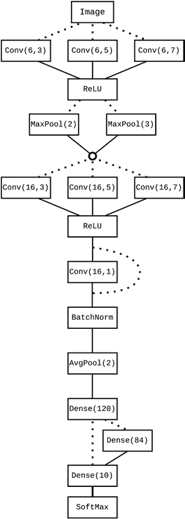

***图 4-24. 所有可能架构的集合***

我们看到每个变异器都为 `Base Model` 增加了变异。

## 试验 (Trial)

NAS Trial 等同于 HPO 背景下的 `Trial`。它初始化模型、训练模型、测试并返回模型准确率。只有一个新特性：你必须使用 `nn.algorithms.nas.tensorflow.classic_nas` 包中的 `get_and_apply_next_architecture` 方法来初始化模型。列表 4-15 提供了 NAS Trial。

（完整代码在相应文件中：`ch4/classic/trial.py`。）

***Listing 4-15. NAS Trial.***

```python
net = LeNetModelSpace()
get_and_apply_next_architecture(net)
train_model(net, dataset_train, optimizer, epochs)
acc = test_model(net, dataset_test)
nni.report_final_result(acc.numpy())
```

## 搜索空间 (Search Space)

定义 Trial 脚本后，你应该使用以下命令手动生成搜索空间 JSON 文件：

```bash
$ nnictl ss_gen --trial_command="python3 trial.py" --trial_dir=ch4/classic --file=ch4/classic/search_space.json
```

前述命令生成了列表 4-16 所示的文件。

***Listing 4-16. NAS 搜索空间***

```json
{
  "conv1": {
    "_type": "layer_choice",
    "_value": ["0", "1", "2"]
  },
  "conv2": {
    "_type": "layer_choice",
    "_value": ["0", "1", "2"]
  },
  "fc2": {
    "_type": "layer_choice",
    "_value": ["0", "1"]
  },
  "pool": {
    "_type": "layer_choice",
    "_value": ["0", "1"]
  },
  "skip_connect": {
    "_type": "layer_choice",
    "_value": ["0", "1"]
  }
}
```

## 搜索策略 (Search Strategy)

经典的 NAS 与 HPO 方法没有太大区别。事实上，我们可以通过层级和设计超参数来构建相同的实验。我们在[第 2 章](https://doi.org/10.1007/978-1-4842-8149-9_2) 的“从 LeNet 到 AlexNet”节中做过一个相似的技巧。关于这些调优器的更多信息，你可以参考“使用 Retiarii 进行神经架构搜索 (PyTorch)”章节下的“变异器”子节。

## 实验 (Experiment)

最后要做的的是定义实验配置，它定义在列表 4-17 中。

***Listing 4-17. NAS 配置***

```yaml
experimentName: example
trial: 1
maxTrialNum: 100
trainingPlatform: local
searchSpacePath: search_space.json
tuner: PPOTuner
optimizeMode: maximize
```

现在，我们可以通过以下方式开始实验：

```bash
$ nnictl create --config=ch4/classic/config.yml
```

**注意** 在测试数据集上返回 0.9923，通过以下方式：
experiment: 2
pool: 0
fc2: 0
skip_connect: 0

---

在上一节中，我们探索了多试验神经架构搜索（Multi-trial Neural Architecture Search），这是一种非常有前景的方法。读者可能会好奇，为什么多试验 NAS 被称为这个名字？是否存在其他非多试验的 NAS 方法？是否真的可以在不进行尝试的情况下通过其他方式搜索最优神经网络架构？看起来，寻找最优解决方案的唯一方法就是尝试搜索空间中的不同元素，这似乎很自然。事实上，事实并非完全如此。有一种方法允许通过训练某些超网（Supernet）来找到最佳架构。这种方法被称为`单次神经架构搜索`（One-shot Neural Architecture Search）。正如名称“one-shot”所暗示，这种方法只涉及一次尝试。当然，这次“尝试”比训练单个神经网络要长得多，尽管如此，它仍然节省了大量时间。

# 第 5 章 单次神经网络架构搜索

## 实战中的 One-Shot NAS

对自动化神经网络架构设计的兴趣日益增长，但经典的多试验 NAS 方法计算开销太大，需要从头开始训练成千上万种不同的架构。遗憾的是，事实使得多试验 NAS 在实践中并不适用。事实上，某些多试验实验在最现代计算资源上可能需要几周或几个月。一种新的 One-shot NAS 方法被提出以解决多试验架构搜索的这一缺点。

介绍 One-shot NAS 的最好方法是提供示例。假设我们正在为 MNIST 问题寻找最优架构。我们有图 5-1 所示的模型空间。

***图 5-1. 模型空间图***

图 5-1 显示了具有两个可变层的模型空间。每个可变层都有以下选择：`Conv 1×1`、`Conv 3×3` 和 `Conv 5×5`。在经典的多试验场景中，我们将对每种参数组合进行 3×3=9 次试验，并选择最佳的一个。而 One-shot NAS 方法遵循另一种技术，我们创建一个 `Supernet`，它合并或减少每个可变层的输出，并只训练一次生成的神经网络。图 5-2 展示了这个超网。

***图 5-2. MNIST 问题的超网***

训练超网后，我们通过激活每层组合并置零其他层来对其进行评估。图 5-3 阐述了这一概念。

***图 5-3. MNIST 问题的超网***

最后，我们选择性能最好的组合。该组合代表了 One-shot NAS 算法的结果。例如，如果组合 `(Conv 5×5, Conv 5×5)` 显示出最高的准确率，那么我们的目标网络设计就是 `Conv 5×5 → Conv 5×5 → Linear → Linear`。

让我们总结一下在 One-shot NAS 算法期间到底做了什么：

- 我们创建了一个源自模型空间的单个 `Supernet`。
- 我们对其进行了 `trained`（训练）。
- 我们对其进行了九次 `evaluated`（评估），依次激活不同的层。
- 我们为该问题选择了 `best`（最佳）神经设计。

我们在这里获得的主要好处是，只训练了一次超网，而不是训练九个候选网络！这极大地加速了整个神经架构搜索，因为网络训练是 NAS 过程中最耗时的部分。

读者可能会有一个合理的问题：“*等等！我们训练了一个单一的超网网络。所有候选层学会了协同工作！但随后我们决定将其拆分成不同的部分，保留相同的权重。这太荒谬了！*” 我同意。这是一个非常违反直觉的概念。事实上，所有层都是一起训练的，它们学会了在解决问题时互补和帮助。你不能从搜索最佳架构的神经网络中丢弃某些层。但 One-shot NAS 最神奇的地方在于，你可以！虽然目前还没有充分的数学依据，但它在实践中是有效的。

首先，我们的目标是获得对 One-shot NAS 的直觉。在这里，我们将制作一个原始的多试验 NAS。让我们使用图 5-1 所示的示例在实践中实现这种方法。

### 5-1. TensorFlow 实现

```python
from tensorflow.keras import Model
from tensorflow.keras.layers import Dense, Flatten, MaxPool2D

class TfNetMultiTrialModel(Model):

    def __init__(self, kernel1, kernel2):
        super().__init__()
        self.conv1 = create_conv(kernel1, filter=16)
        self.pool1 = MaxPool2D(pool_size=2)
        self.conv2 = create_conv(kernel2, filter=32)
        self.pool2 = MaxPool2D(pool_size=2)
        self.flatten = Flatten()
        self.fc1 = Dense(128, 'relu')
        self.fc2 = Dense(10, 'softmax')

    def call(self, x, **kwargs):
        x = self.conv1(x)
        x = self.pool1(x)
        x = self.conv2(x)
        x = self.pool2(x)
        x = self.flatten(x)
        x = self.fc1(x)
        return self.fc2(x)
```

### 5-2. PyTorch 实现

```python
import torch
import torch.nn as nn
import torch.nn.functional as F
from ch5.naive_one_shot_nas.pt.ops import create_conv

class PtLeNetMultiTrialModel(nn.Module):

    def __init__(self, kernel1, kernel2):
        super(PtLeNetMultiTrialModel, self).__init__()
        self.conv1 = create_conv(kernel1, in_channels=1, out_channels=16)
        self.conv2 = create_conv(kernel2, in_channels=16, out_channels=32)
        self.flat = nn.Flatten()
        self.fc1 = nn.Linear(1568, 128)
        self.fc2 = nn.Linear(128, 10)

    def forward(self, x):
        x = torch.relu(self.conv1(x))
        x = F.max_pool2d(x, 2, 2)
        x = torch.relu(self.conv2(x))
        x = F.max_pool2d(x, 2, 2)
        x = self.flat(x)
        x = torch.relu(self.fc1(x))
        x = self.fc2(x)
        return F.log_softmax(x, dim=1)
```

现在，让我们使用列表 5-3 中的脚本，遍历各种卷积大小参数（`kernel1: [1, 3, 5]`，`kernel2: [1, 3, 5]`）来执行多试验 NAS。

（TensorFlow 实现）和列表 5-4（PyTorch 实现）。

## 5-3. TensorFlow 实现。多试验 NAS (Multi-trial NAS)。`ch5/naive_one_shot_nas/tf/ms_search.py`

```python
from ch5.naive_one_shot_nas.tf.tf_lenet_multi_model import TfLeNetMultiTrialModel
from ch5.naive_one_shot_nas.tf.tf_train import train, test

# 定义搜索空间：
kernel1_choices = [1, 3, 5]
kernel2_choices = [1, 3, 5]
results = {}

# 执行多试验搜索：
for k1 in kernel1_choices:
    for k2 in kernel2_choices:
        # 试验
        model = TfLeNetMultiTrialModel(k1, k2)
        train(model)
        accuracy = test(model)
        results[(k1, k2)] = accuracy
```


显示结果：

```python
print('=======')
print('Results:')
for k, v in results.items():
    print(f'Conv1 {k[0]}x{k[0]}, Conv2: {k[1]}x{k[1]} : {v}')
```

我们导入必要的模块：

**列表 5-4.** **PyTorch** 实现。多试验 NAS (Multi-trial NAS)。`ch5/naive_one_shot_nas/pt/ms_search.py`

```python
from ch5.naive_one_shot_nas.pt.pt_lenet_multi_model import PtLeNetMultiTrialModel
from ch5.naive_one_shot_nas.pt.pt_train import train_model, test_model
```

定义搜索空间：

```python
kernel1_choices = [1, 3, 5]
kernel2_choices = [1, 3, 5]
results = {}
```

执行多试验搜索：

```python
for k1 in kernel1_choices:
    for k2 in kernel2_choices:
        # 试验
        model = PtLeNetMultiTrialModel(k1, k2)
        train_model(model)
        accuracy = test_model(model)
        results[(k1, k2)] = accuracy
```

显示结果：

```python
print('=======')
print('Results:')
for k, v in results.items():
    print(f'Conv1 {k[0]}x{k[0]}, Conv2: {k[1]}x{k[1]} : {v}')
```

我们执行的多试验 NAS 结果列在表 5-1 中。

**表 5-1.** 多试验 NAS 结果

| 试验 | Conv1 | Conv2 | 准确率 |
| :--- | :--- | :--- | :--- |
| 1 | Conv1×1 | Conv1×1 | 0.9446 |
| 2 | Conv1×1 | Conv3×3 | 0.9849 |
| 3 | Conv1×1 | Conv5×5 | 0.9864 |
| 4 | Conv3×3 | Conv3×3 | 0.9851 |
| 5 | Conv3×3 | Conv3×3 | 0.9881 |
| 6 | Conv3×3 | Conv5×5 | 0.9909 |
| 7 | Conv5×5 | Conv1×1 | 0.9872 |
| 8 | Conv5×5 | Conv3×3 | 0.9901 |
| **9** | **Conv5×5** | **Conv5×5** | **0.9917** |

根据表 5-1，最佳候选方案是 (Conv5×5, Conv5×5)。嗯，我们尝试了每一个神经设计候选方案，并为 MNIST 问题找到了最合适的一个。

当然，我们之前实现的多试验 NAS 相当简单，但所有多试验方法通俗来说都是那样的。

但现在，让我们尝试使用单次 NAS (One-shot NAS) 方法获得相同的结果！

首先，我们创建了图 5-2（在列表 5-5 [TensorFlow 实现] 和列表 5-6 [PyTorch 实现] 中）所示的超网络 (Supernet) 模型。

我们导入必要的模块：

**列表 5-5.** **TensorFlow** 实现。超网络。`ch5/naive_one_shot_nas/tf/tf_lenet_supernet.py`

```python
from tensorflow.keras import Model
from tensorflow.keras.layers import Dense, Flatten, MaxPool2D
from ch5.naive_one_shot_nas.tf.tf_ops import create_conv
```

`TfLeNetNaiveSupernet` 实现了图 5-2 所示的超网络：

```python
class TfLeNetNaiveSupernet(Model):
    def __init__(self):
        super()
        # 定义 conv1 和 conv2 的候选方案
        self.conv1_1 = create_conv(1, 16)
        self.conv1_3 = create_conv(3, 16)
        self.conv1_5 = create_conv(5, 16)
        self.conv2_1 = create_conv(1, 32)
        self.conv2_3 = create_conv(3, 32)
        self.conv2_5 = create_conv(5, 32)
        # 其他是超网络层
        self.pool1 = MaxPool2D(pool_size=2)
        self.pool2 = MaxPool2D(pool_size=2)
        self.flatten = Flatten()
        self.fc1 = Dense(128, 'relu')
        self.fc2 = Dense(10, 'softmax')
```

`call` 方法接受 `mask` 参数，在求和操作中激活候选层。训练模式下不传递 `mask` 参数，所有候选方案都相加：
`x = 1*conv1_1(x) + 1*conv1_3(x) + 1*conv1_5(x)`
`x = 1*conv2_1(x) + 1*conv2_3(x) + 1*conv2_5(x)`

但在评估模式下，我们传递 `mask` 参数并激活特定层：`x = 0*conv1_1(x) + 1*conv1_3(x) + 0*conv1_5(x)`
`x = 0*conv2_1(x) + 0*conv2_3(x) + 1*conv2_5(x)`：

```python
    def call(self, x, mask=None):
        # 训练模式下全部加
        if mask is None:
            mask = [[1, 1, 1], [1, 1, 1]]
        x = mask[0][0]*self.conv1_1(x) + mask[0][1]*self.conv1_3(x) + mask[0][2]*self.conv1_5(x)
        x = self.pool1(x)
        x = mask[1][0]*self.conv2_1(x) + mask[1][1]*self.conv2_3(x) + mask[1][2]*self.conv2_5(x)
        x = self.pool2(x)
        x = self.flatten(x)
        x = self.fc1(x)
        return self.fc2(x)
```

我们导入必要的模块：

**列表 5-6.** **PyTorch** 实现。超网络。`ch5/naive_one_shot_nas/pt/pt_lenet_supernet.py`

```python
import torch
import torch.nn as nn
import torch.nn.functional as F
from ch5.naive_one_shot_nas.pt.pt_ops import create_conv
```

`PtLeNetNaiveSupernet` 实现了图 5-2 所示的超网络：

```python
class PtLeNetNaiveSupernet(nn.Module):
    def __init__(self):
        super(PtLeNetNaiveSupernet, self).__init__()
        # 定义 conv1 和 conv2 的候选方案
        self.conv1_1 = create_conv(1, 1, 16)
        self.conv1_3 = create_conv(3, 1, 16)
        self.conv1_5 = create_conv(5, 1, 16)
        self.conv2_1 = create_conv(1, 16, 32)
        self.conv2_3 = create_conv(3, 16, 32)
        self.conv2_5 = create_conv(5, 16, 32)
        # 其他是超网络层
        self.flat = nn.Flatten()
        self.fc1 = nn.Linear(1568, 128)
        self.fc2 = nn.Linear(128, 10)
```

`forward` 方法接受 `mask` 参数，在求和合并操作中激活候选层。训练模式下不传递 `mask` 参数，所有候选方案都相加：
`x = 1*conv1_1(x) + 1*conv1_3(x) + 1*conv1_5(x)`
`x = 1*conv2_1(x) + 1*conv2_3(x) + 1*conv2_5(x)`

但在评估模式下，我们传递 `mask` 参数并激活特定层：`x = 0*conv1_1(x) + 1*conv1_3(x) + 0*conv1_5(x)`
`x = 0*conv2_1(x) + 0*conv2_3(x) + 1*conv2_5(x)`：

```python
    def forward(self, x, mask=None):
        # 训练模式下全部加
        if mask is None:
            mask = [[1, 1, 1], [1, 1, 1]]
        x = mask[0][0]*self.conv1_1(x) + mask[0][1]*self.conv1_3(x) + mask[0][2]*self.conv1_5(x)
        x = torch.relu(x)
        x = F.max_pool2d(x, 2)
        x = mask[1][0]*self.conv2_1(x) + mask[1][1]*self.conv2_3(x) + mask[1][2]*self.conv2_5(x)
        x = torch.relu(x)
        x = F.max_pool2d(x, 2)
        x = self.flat(x)
        x = torch.relu(self.fc1(x))
        return F.log_softmax(x, dim=1)
```

接下来，我们训练超网络并评估列表 5-7（TensorFlow 实现）和列表 5-8（PyTorch 实现）中的不同的层组合。

### 激活掩码

```python
mask = [[0, 0, 0], [0, 0, 0]]
# 激活 conv1 和 conv2 层
mask[0][m1] = 1
mask[1][m2] = 1
# 计算准确率
output = model(x, mask = mask)
predict = tf.argmax(output, axis = 1)
accuracy = round(accuracy_score(predict, y), 4)
results[(kernel1_choices[m1], kernel2_choices[m2])] = accuracy
```

显示结果：

```python
print('=======')
print('Results:')
for k, v in results.items():
    print(f'Conv1 {k[0]}x{k[0]}, Conv2: {k[1]}x{k[1]} : {v}')
```

我们导入必要的模块：

**列表 5-8.** **PyTorch** 实现。单次 NAS。`ch5/naive_one_shot_nas/pt/os_search.py`

```python
import torch
from sklearn.metrics import accuracy_score
from ch5.datasets import mnist_dataset
from ch5.naive_one_shot_nas.pt.pt_lenet_supernet import PtLeNetNaiveSupernet
from ch5.naive_one_shot_nas.pt.pt_train import train_model
```

初始化超网络：

`model = PtLeNetNaiveSupernet()`

训练超网络：

`train_model(model)`

加载测试数据集：

```python
_, (x, y) = mnist_dataset()
x = torch.from_numpy(x).float()
y = torch.from_numpy(y).long()
x = torch.permute(x, (0, 3, 1, 2))
```

评估超网络并激活每个候选网络：

```python
model.eval()
kernel1_choices = [1, 3, 5]
kernel2_choices = [1, 3, 5]
results = {}

for m1 in range(0, len(kernel1_choices)):
    for m2 in range(0, len(kernel2_choices)):
        # 激活掩码
        mask = [[0, 0, 0], [0, 0, 0]]
        # 激活 conv1 和 conv2 层
        mask[0][m1] = 1
        mask[1][m2] = 1
        # 计算准确率
        output = model(x, mask)
        predict = output.argmax(dim = 1, keepdim = True)
        accuracy = round(accuracy_score(predict, y), 4)
        results[(kernel1_choices[m1], kernel2_choices[m2])] = accuracy
```

显示结果：

```python
print('=======')
print('Results:')
for k, v in results.items():
    print(f'Conv1 {k[0]}x{k[0]}, Conv2: {k[1]}x{k[1]} : {v}')
```


单次 NAS 的结果列于表 5-2 中。

**表 5-2. 单次 NAS 结果**

| 实验 | **Conv1** | **Conv2** | **准确率** |
| :--- | :--- | :--- | :--- |
| 1 | Conv1×1 | Conv1×1 | 0.2343 |
| 2 | Conv1×1 | Conv3×3 | 0.1789 |
| 3 | Conv1×1 | Conv5×5 | 0.2127 |
| 4 | Conv3×3 | Conv3×3 | 0.2755 |
| 5 | Conv3×3 | Conv3×3 | 0.8515 |
| 6 | Conv3×3 | Conv5×5 | 0.8786 |
| 7 | Conv5×5 | Conv1×1 | 0.3486 |
| 8 | Conv5×5 | Conv3×3 | 0.8882 |
| **9** | **Conv5×5** | **Conv5×5** | **0.9001** |

单次 NAS 找到的最佳神经网络架构是 `(Conv 5×5, Conv 5×5)`，这与多次尝试 NAS 的结果完全相同。令人不可置信，不是吗？我们在短得多的时间内找到了相同的结果！

**注意** 表 5-2 中给出的结果仅用于对各种架构组合进行排名以选出最佳的一个。这些结果并不描述对应组合的准确率。单次 NAS 模型通常从头训练。

## 超网络架构

正如我们在上一节看到的，单次 NAS 的核心概念是超网络。超网络是一个包含各种架构的单一神经网络。在多次尝试 NAS 中，每个数据图都是单独测试的。但单次 NAS 创建的是单一超网络。

NNI 使用 `LayerChoice` 和 `InputChoice` 创建模型空间。`reduce` 操作可以是 `sum`、`mean` 或任何其他操作。`LayerChoice` 候选在超网络中被归约。图 5-5 使用 `sum` 生成超网络。

图 5-6 展示了特定子网络的评估。

单次 NAS 对 `LayerChoice` 和 `InputChoice` 候选设置了严格限制：它们必须返回相同大小的张量。否则将无法实现 `reduce` 操作。在之前的节中，`conv1` 的候选返回 `16×28×28`，而 `conv2` 的候选返回 `32×14×14`。图 5-8 展示了事实。这种限制在多次尝试 NAS 中并不存在，因为 TensorFlow 和 PyTorch 框架允许根据输入张量计算层参数；因此 `LayerChoice` 候选可以返回不同大小的张量。在单次 NAS 中，我们必须确保候选返回相同大小的张量。否则，NAS 算法会报错。

让我们为单次 NAS 创建第一个模型空间。它将是一个“Hello World”模型，我们将用它在下一节测试单次 NAS 算法。我们将使用图 5-9 所示的 LeNet 架构为单次搜索定义模型空间。

### TensorFlow 实现

为 `conv1` 和 `conv2` 层设置 `LayerChoice`：

```python
self.conv1 = LayerChoice([
    create_conv(kernel=1, filters=16), # 0
    create_conv(kernel=3, filters=16), # 1
    create_conv(kernel=5, filters=16)  # 2
], key='conv1')

self.conv2 = LayerChoice([
    create_conv(kernel=1, filters=32), # 0
    create_conv(kernel=3, filters=32), # 1
    create_conv(kernel=5, filters=32)  # 2
], key='conv2')

self.pool = MaxPool2D(2)
self.flat = Flatten()
```

为线性层设置 `InputChoice`：

```python
self.dm = InputChoice(n_candidates=2, n_chosen=1, key='dm')
self.fc11 = Dense(256, activation='relu')
self.fc12 = Dense(10, activation='softmax')
self.fc2 = Dense(10, activation='softmax')
```

定义 `call` 方法：

```python
def call(self, x):
    x = self.conv1(x)
    x = self.pool(x)
    x = self.conv2(x)
    x = self.pool(x)
    x = self.flat(x)

    # 分支 1
    x1 = self.fc12(self.fc11(x))

    # 分支 2
    x2 = self.fc2(x)

    # 选择其中一个分支
    x = self.dm([
        x1, # 0
        x2  # 1
    ])
    return x
```

### PyTorch 实现

图 5-9 所示的模型空间的 PyTorch NNI 实现已在代码列表 5-10 中。

`LayerChoice` 和 `InputChoice` 方法在 `nni.retiarii.nn.pytorch` 包中实现：

**列表 5-10. PyTorch 实现。一次性 LeNet NAS。`ch5/model/lenet/pt_lenet.py`**

导入模块：

```python
from nni.retiarii.nn.pytorch import LayerChoice, InputChoice
from typing import OrderedDict
import torch.nn as nn
import torch.nn.functional as F
```

定义创建卷积层的辅助函数：

```python
def create_conv(kernel, in_ch, out_ch):
    return nn.Conv2d(
        in_channels=in_ch,
        out_channels=out_ch,
        kernel_size=kernel,
        padding=int((kernel - 1) / 2)
    )
```

定义超网络类：

```python
class PtLeNetSupernet(nn.Module):
    def __init__(self, input_ts=32):
        super(PtLeNetSupernet, self).__init__()

        # 为 conv1 和 conv2 层设置 LayerChoices：
        self.conv1 = LayerChoice(OrderedDict([
            ('conv1x1->16', create_conv(1, 1, 16)), # 0
            ('conv3x3->16', create_conv(3, 1, 16)), # 1
            ('conv5x5->16', create_conv(5, 1, 16)), # 2
        ]), label='conv1')

        self.conv2 = LayerChoice(OrderedDict([
            ('conv1x1->32', create_conv(1, 16, 32)), # 0
            ('conv3x3->32', create_conv(3, 16, 32)), # 1
            ('conv5x5->32', create_conv(5, 16, 32)), # 2
        ]), label='conv2')

        self.act = nn.ReLU()
        self.flat = nn.Flatten()

        # 为线性层设置 InputChoice：
        self.dm = InputChoice(n_candidates=2, n_chosen=1, label='dm')
        self.fc11 = nn.Linear(input_ts * 8 * 8, 256)
        self.fc12 = nn.Linear(256, 10)
        self.fc2 = nn.Linear(input_ts * 8 * 8, 10)

    def forward(self, x):
        x = self.act(self.conv1(x))
        x = F.max_pool2d(x, 2, 2)
        # x.shape = (16, 16, 16)
        x = self.act(self.conv2(x))
        x = F.max_pool2d(x, 2, 2)
        # x.shape = (32, 8, 8)
        x = self.flat(x)

        # 分支 1
        x1 = self.act(self.fc11(x))
        x1 = self.act(self.fc12(x1))

        # 分支 2
        x2 = self.act(self.fc2(x))

        # 选择其中一个分支
        x = self.dm([
            x1, # 0
            x2  # 1
        ])
        return F.log_softmax(x, dim=1)
```


由于我们使用 NNI 定义了一次性模型空间，可以实现高级的一次性算法。

# 第 5 章 一次性神经架构搜索

## 一次性算法 (One-Shot Algorithms)

目前，One-shot NAS 是一个新兴领域并正在快速发展。许多一次性算法正在发明。本节将研究两种最流行的一次性算法：高效架构搜索 (ENAS) 和可微架构搜索 (DARTS)。

### 高效架构搜索 (ENAS)

高效架构搜索 (ENAS) 是一种快速且廉价的模型设计方法。在 ENAS 中，控制器通过在大型超网中搜索最优子网络来发现神经网络架构。使用策略梯度训练控制器以选择在验证集上期望奖励最大的子网络。同时，对选定的子网络进行训练。

原始论文 [参数共享的高效架构搜索](https://arxiv.org/pdf/1802.03268) 使 ENAS 比经典方法更少的 GPU 小时提供了更强的性能。

ENAS 的核心概念之一是强化学习控制器。控制器通过定义二进制掩码来选择子网络，其中 1 激活层，0 禁用。图 5-10 显示了 RL 控制器如何选择子网络。

ENAS 的核心是权重共享。不同的子网络共享权重。当控制器挑选子网络时，它并不是从头训练的；层共享已经训练过的权重。


权重共享方法允许控制器通过较少的迭代找到最佳架构，而无需每次都从头训练新的子网络。ENAS 算法可以使用以下伪代码演示：

```
我们初始化超网：S
并加载训练集和验证集：train_ds, val_ds
接下来，算法初始化 ENAS 控制器 (Controller(S, θ)),其中 θ 表示有助于从 S 超网中选择子网络的控制器权重：
Ctrl = Controller(S, θ)

主训练循环：
for epoch in epochs:
    1. 超网训练循环：
        for batch in batches(train_ds):
            i. 控制器实现随机策略，这意味着它按概率运行。最有潜力的子网络被选中的概率最高：
                s ← Ctrl.sample() # 选择伪随机子网络
            ii. 使用权重共享技术在训练批次上对子网络训练一次（即仅一个训练 epoch）：
                train_once(subnet, batch)
    2. 控制器训练循环。在这个循环中，控制器学习如何找到提供最高奖励的子网络，即验证集上的准确率：
        for batch in batches(val_ds):
            i. 控制器选择子网络并计算其在验证集批次上的准确率：
                subnet ← Ctrl.sample() # 选择伪随机子网络
                reward = test(subnet, batch)
            ii. 控制器收集子网络性能的经验：
                Ctrl.add_experience(reward)
    3. 控制器根据新经验更新权重 θ：
        Ctrl.self_update_with_new_experience()
# 主训练循环结束

训练后，控制器返回最佳子网络：
Ctrl.best()
```

在前面描述的算法中，`Controller` 在训练数据集上训练各种子网络，然后在验证集上对其进行测试。通过多次重复此过程，`Controller` 能够理解哪些架构表现出最好的准确率，并逐渐将探索过程缩小到有限数量的架构。在训练过程结束时，`Controller` 会收敛到一个或多个最佳架构上。

让我们来看看 ENAS 在实践中是如何工作的：

1. 初始，`Controller` 对子网络没有任何假设，它使用权重共享技术随机选择子网络进行单次训练（子网络仅训练一个训练 epoch），如图 5-11 所示。
2. 之后，`Controller` 根据 `θ` 权重生成子网络，并在验证集上收集准确率。
3. 根据第 2 步中获得的经验，`Controller` 更新 `θ` 值。

图 5-12 展示了我们之前描述的第 1-3 步。

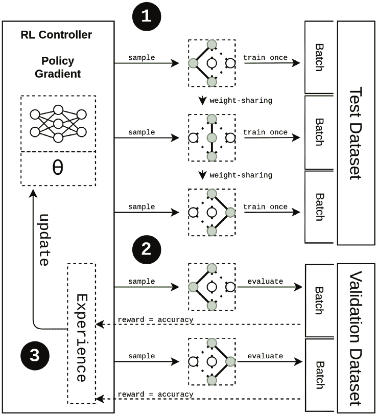

接下来，`Controller` 使用权重共享技术选择最有潜力的子网络进行训练，并在验证集上测试它们的准确率，如图 5-13 所示。

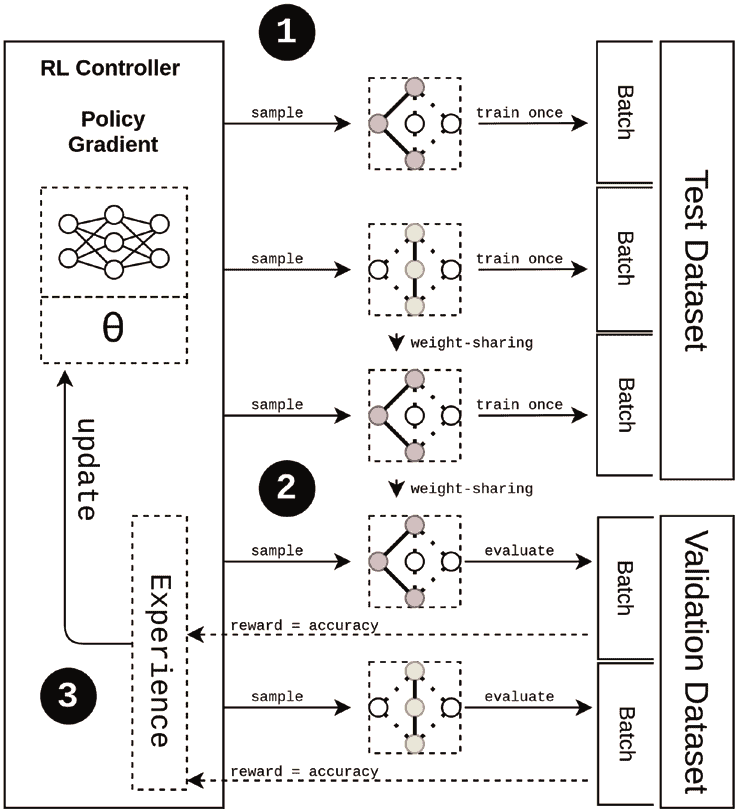

在分别训练超网层并更新关于 `θ` 的经验后，`Controller` 会收敛到它认为最佳的某些子网络。图 5-14 说明了这一点。

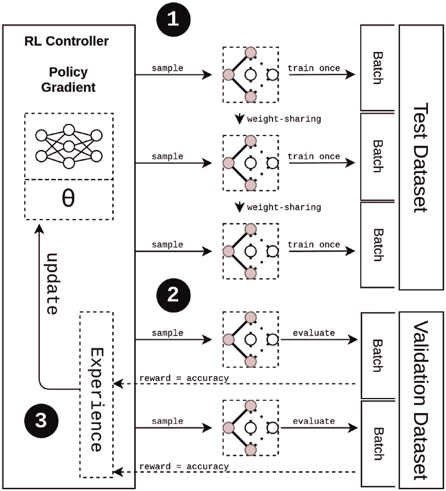

One-shot ENAS 算法接近于多试验 NAS 中的 RL 策略，但有一个显著区别。ENAS 不进行完整的子网络训练周期，而是使用权重共享和增量单步训练。这种区别极大地加快了寻找最佳架构的过程。

NNI 使用以下类实现 ENAS：

- **PyTorch**: `nni.retiarii.oneshot.pytorch.enas.EnasTrainer`
- **TensorFlow**: `nni.algorithms.nas.tensorflow.enas.EnasTrainer`

表 5-3 显示了 `EnasTrainer` 参数。

**表 5-3. EnasTrainer 参数**

| 参数 | 描述 |
| :--- | :--- |
| `model` | 待训练的 pytorch 或 tensorflow 模型 |
| `loss` | 类型: callable, 损失函数 |
| `metrics` | 类型: callable, 衡量模型准确率 |
| `reward_function` | 类型: callable, 用于 ENAS `Controller` 计算奖励。通常情况下，`reward_function` 返回模型准确率 |
| `optimizer` | 类型: `Optimizer`, 用于模型训练的优化器 |
| `num_epochs` | 类型: `int`, 计划训练的 epoch 数量 |
| `dataset` | 类型: `Dataset`, 训练数据集 |
| `batch_size` | 类型: `int`, 默认: 64, 训练批大小 |
| `workers` | 类型: `int`, 默认: 4, 数据加载的线程数 |
| `log_frequency` | 类型: `int`, 默认: None, 日志步数 |
| `grad_clip` | 类型: `float`, 默认: 5.0, 梯度裁剪。设置为 0 则禁用 |
| `entropy_weight` | 类型: `float`, 默认: 0.0001, 样本熵损失权重 |
| `skip_weight` | 类型: `float`, 默认: 0.8, 跳过惩罚损失权重 |
| `baseline_decay` | 类型: `float`, 默认: 0.999, 基准衰减率。新基准计算公式为 `baseline_decay * baseline_old + reward * (1 - baseline_decay)` |
| `ctrl_lr` | 类型: `float`, 默认: 0.00035, 控制器学习率 |
| `ctrl_steps_` | 类型: `int`, 默认: 20, 聚合到 `Controller` 的一个 mini-batch 中的总步数 |

现在让我们来看 ENAS 算法在上一节中定义的 LeNet 模型空间中的实际应用。

#### TensorFlow ENAS 实现

列表 5-11 展示了使用 TensorFlow LeNet 模型空间进行 ENAS 应用。

**列表 5-11. ENAS TensorFlow. ch5/enas/enas_tf_search.py**

导入模块：

```python
from tensorflow.keras.losses import Reduction, SparseCategoricalCrossentropy
from tensorflow.keras.optimizers import Adam
import ch5.datasets as datasets
from nni.algorithms.nas.tensorflow import enas
from ch5.model.lenet.tf_lenet import TfLeNetSupernet
from ch5.tf_utils import accuracy, reward_accuracy, get_best_model
```

初始化 LeNetSupernet：

```python
model = TfLeNetSupernet()
```

加载数据集：

```python
dataset_train, dataset_valid = dataset_train
```

定义损失函数：

```python
loss = SparseCategoricalCrossentropy(reduction=Reduction.NONE)
```

定义优化器：

```python
optimizer = Adam()
```

初始化 EnasTrainer：

```python
trainer = enas.EnasTrainer(
    model,
    loss=loss,
    metrics=accuracy,
    reward_function=reward_accuracy,
    optimizer=optimizer,
    batch_size=batch_size,
    num_epochs=num_epochs,
    dataset=dataset_train,
    dataset_valid=dataset_valid,
    log_frequency=log_frequency,
    ctrl_steps=10,
    mutator_aggregate=20
)
```

启动单次搜索：

```python
trainer.train()
```

返回最佳子网络：

```python
best = get_best_model(trainer)
print(best)
```

#### PyTorch ENAS 实现

列表 5-12 展示了使用 PyTorch LeNet 模型空间进行 ENAS 应用。

**列表 5-12. ENAS PyTorch. ch5/enas/enas_pt_search.py**

导入模块：

```python
import torch.nn as nn
from nni.retiarii.oneshot.pytorch.enas import EnasTrainer
from torch.optim.sgd import SGD
import ch5.datasets as datasets
from ch5.model.lenet.pt_lenet import PtLeNetSupernet
from ch5.pt_utils import accuracy, reward_accuracy
```

初始化 LeNetSupernet：

```python
model = PtLeNetSupernet()
```

加载数据集：

```python
dataset_train, dataset_valid = datasets.get_dataset("mnist")
```

定义损失函数：

```python
criterion = nn.CrossEntropyLoss()
```

定义优化器：

```python
optimizer = SGD(model.parameters(), 0.05, momentum=0.9, weight_decay=1.0E-4)
```

初始化 EnasTrainer：

```python
trainer = EnasTrainer(
    model,
    loss=criterion,
    metrics=accuracy,
    reward_function=reward_accuracy,
    optimizer=optimizer,
    batch_size=batch_size,
    num_epochs=num_epochs,
    dataset=dataset_train,
    dataset_valid=dataset_valid,
    log_frequency=log_frequency,
    ctrl_kwargs={"tanh_constant": 1.1},
    ctrl_steps_aggregate=20
)
```

启动单次搜索：

```python
trainer.fit()
```

返回最佳子网络：

```python
best_model = trainer.export()
print(best_model)
```

ENAS 是首批让社区重新思考整个架构搜索（NAS）方法的 One-shot NAS 算法之一。但由于其复杂的内部算法和显而易见的调优，对于没有经验的读者来说，ENAS 可能会显得很复杂。在下一节中，我们将学习一种更优雅的 One-shot NAS 技术。

### 可微架构搜索 (DARTS)

将 NAS 简化为微分问题也会非常方便，而 DARTS 算法正是这样做的。DARTS 算法是在原始论文 [DARTS: Differentiable Architecture Search](https://arxiv.org/abs/1806.09055) 中提出的。

`ENAS` 算法使用二值掩码从 `Supernet` 中选择子网络，但这种方法是离散的。`ENAS` 控制器在不同的子网络之间跳转，试图发现最优的一个。`DARTS` 算法使得搜索空间变为连续；它将对特定操作的类别选择弛化为对所有可能操作的 softmax 操作：`(α ) * o ( x* )`

```
o′( x) = exp ( α_i ) / ∑ exp ( α_j )
```

这意味着 `DARTS` 算法创建了一个源自 `Model Space` 的带有和减少的 `Supernet`，每个选择操作都跟着一个指定操作权重的 `αi` 参数。这使得 `{α}` 参数集可以作为 `Supernet` 权重进行训练。在 `Supernet` 训练结束时，`α` 值最高的选择被选为最优子网络操作。图 5-15 展示了这一概念。

**图 5-15. DARTS 操作弛化**

在用 `DARTS` 算法进行 `Supernet` 训练期间，低效的选择往往会被归零，搜索收敛到单一架构，这就是搜索结果。图 5-16 可视化了应用于 `LeNetSupermodel` 的 `DARTS` 算法。它逐渐弛化低效层，显示出最佳架构。

**图 5-16. 行中的 DARTS**

`NNI 2.7` 使用以下类仅为 `PyTorch` 框架实现了 `DARTS`：`nni.retiarii.oneshot.pytorch.DartsTrainer`。

表 5-4 显示了 `DartsTrainer` 参数。

**表 5-4. DartsTrainer 参数**

| 参数 | 说明 |
| :--- | :--- |
| `model` | 要训练的 pytorch 模型 |
| `loss` | 类型: callable, 损失函数 |
| `metrics` | 类型: callable, 衡量模型准确率 |
| `optimizer` | 类型: Optimizer, 用于模型训练的优化器 |
| `num_epochs` | 类型: int, 计划训练的 epoch 数 |
| `dataset` | 类型: Dataset, 训练数据集 |
| `batch_size` | 类型: int, 默认: 64, 训练批大小 |
| `workers` | 类型: int, 默认: 4, 数据加载的线程数 |
| `log_frequency` | 类型: int, 默认: None, 日志步数 |
| `grad_clip` | 类型: float, 默认: 5.0, 梯度裁剪。设置为 0 则禁用 |
| `arc_learning_rate` | 类型: float, 默认: 0.0001, 架构参数的学习率 |

列表 5-13 使用 `NNI` 实现了 `DARTS` 算法。

**列表 5-13. DARTS PyTorch. ch5/darts/darts_pt_search.py**

导入模块：

```python
import torch
import torch.nn as nn
import ch5.datasets as datasets
from nni.retiarii.oneshot.pytorch import DartsTrainer
```


from ch5.model.lenet.pt_lenet import PtLeNetSupernet

from ch5.pt_utils import accuracy

初始化 `LeNetSupernet`：

```python
model = PtLeNetSupernet()
```

加载数据集：

```python
dataset_train, dataset_valid = datasets.get_dataset("mnist")
```

定义损失函数：

```python
criterion = nn.CrossEntropyLoss()
```

定义优化器：

```python
optim = torch.optim.SGD(
    model.parameters(), 0.025,
    momentum=0.9, weight_decay=3e-4
)
```

初始化 `DartsTrainer`：

```python
trainer = DartsTrainer(
    model=model,
    loss=criterion,
    metrics=accuracy,
    optimizer=optim,
    num_epochs=10,
    dataset=dataset_train,
    batch_size=256,
    arc_learning_rate=0.001,
    log_frequency=10
)
```

启动 `DARTS` 搜索：

```python
trainer.fit()
```

返回最佳架构：

```python
best_architecture = trainer.export()
print('最佳架构:', best_architecture)
```

列表 [5-13] 返回了 `DARTS` 的最优子网络：

* `conv1`: `5x5->16`
* `conv2`: `5x5->32`
* `dm`: Linear

`DARTS` 是一个清晰的 One-shot 方法且易于调优。`DARTS` 训练整个 `Supernet`，而 `ENAS` 只训练不同的子网络。总之，`DARTS` 是架构搜索的一个很好的选择。

### General Supernet Solving CIFAR-10

通常，One-shot NAS 处理 `Supernets`。正如名称所示，`Supernet` 由各种层组成。在本节中，我们将考虑解决 CIFAR-10 的问题。

* `SepConvBranch(3)`
* `NonConvBranch(3)`
* `SepConvBranch(5)`
* `NonConvBranch(3)`
* `AvgPoolBranch`
* `MaxPoolBranch`

这些层的实现未提供，但读者可以在以下文件中获取详情：

* **TensorFlow**: `ch5/model/general/tf_ops.py`
* **PyTorch**: `ch5/model/general/pt_ops.py`

**图 5-17.** Supernet 操作

每个 `cell` 接收一个通过操作转换的必需输入以及 `n` 个额外输入。额外输入不是必需的，可以在不同的子网络中归零。操作和额外输入的标准化和形成了 cell 输出。

**图 5-18.** Supernet cell

`cell` 的序列形成了 `Supernet`，每个 `cell` 的输出可以作为后续 `cell` 的输入。每三个 cell 之后插入一个 `Factorized` 层。在本节中，我们将使用具有六个 cell 的 `Supernet`。

**图 5-19.** Supernet 架构

让我们计算一下 `Supernet` 有多少子网络：`(6) × (6×2) × (6×4) × (6×8) × (6×16) × (6×32) = 66 × 2^{1+2+3+4+5} ~ 1,500,000`。显然，无法使用多尝试 NAS 方法高效地探索这个模型空间。也可以使用具有 9、12 或 24 个 cell 的 `Supernet`。在这种情况下，子网络的数量将变得巨大。

有很多预定义的用于 One-shot NAS 的 `Supernet`，旨在解决特定类型的问题。我们之前定义的 `GeneralSupernet` 是最简单的之一。让我们实现 `GeneralSupernet`并在 CIFAR-10 数据集上运行 One-shot NAS。

### 使用 TensorFlow 训练 General Supernet

让我们实现 `GeneralSupernet` 并使用 `ENAS` 算法寻找最佳架构。

**列表 5-14.** GeneralSupernet. TensorFlow。`ch5/model/general/tf_general.py`

```python
from tensorflow.keras import Model, Sequential
from tensorflow.keras.layers import BatchNormalization, Conv2D, Dense, GlobalAveragePooling2D
from nni.nas.tensorflow.mutables import InputChoice, LayerChoice, MutableScope
```

```python
from ch5.model.general.tf_ops import build_conv, build_separable_conv, build_avg_pool, build_max_pool, FactorizedReduce
```

### 定义图 5-18 所示的 Cell

```python
class Cell(MutableScope):
    def __init__(self, cell_ord, input_num, filters):
        super().__init__(f'cell_{cell_ord}')
```

为图 5-17 所示的块操作设置 LayerChoice：

```python
self.block_op = LayerChoice([
    build_conv(filters, 3, 'conv3'),
    build_separable_conv(filters, 3, 'sepconv3'),
    build_conv(filters, 5, 'conv5'),
    build_separable_conv(filters, 5, 'sepconv5'),
    build_avg_pool(filters, 'avgpool'),
    build_max_pool(filters, 'maxpool'),
], key=f'op_{cell_ord}')
```

为额外的 Cell 输入设置 InputChoice：

```python
if input_num > 0:
    self.connections = InputChoice(
        n_candidates=input_num,
        n_chosen=None,
        key=f'con_{cell_ord}'
    )
else:
    self.connections = None
```

最后一个 cell 层 - Normal 化：

```python
self.batch_norm = BatchNormalization(trainable=False)
```

定义 call 方法：

```python
def call(self, inputs):
    # 主输入由 block_op 处理：
    out = self.block_op(inputs[-1])
    # 额外的输入通过 self.connections 选择并求和：
    if self.connections is not None:
        connection = self.connections(inputs[:-1])
        if connection is not None:
            out += connection
    return self.batch_norm(out)
```

### 定义图 5-19 所示的 GeneralSupernet

```python
class GeneralSupernet(Model):
    def __init__(self,
        num_cells=6,
        filters=24,
        num_classes=10
    ):
        super().__init__()
        self.num_cells = num_cells
        self.stem = Sequential([
            Conv2D(filters, kernel_size=3, padding='same', use_bias=False),
            BatchNormalization()
        ])
```

为池化层设置位置（FactorizedReduce）：

```python
# num_cells = 6 -> pool_layers_idx = [3, 6]
self.pool_layers_idx = [
    cell_id
    for cell_id in range(1, num_cells + 1) if cell_id % 3 == 0
]
```

初始化 cells 和 pool_layers 列表：

```python
self.cells = []
self.pool_layers = []
for cell_ord in range(num_cells):
    if cell_ord in self.pool_layers_idx:
        pool_layer = FactorizedReduce(filters)
        self.pool_layers.append(pool_layer)
    cell = Cell(cell_ord, cell_ord, filters)
    self.cells.append(cell)
```

定义末层：

```python
self.gap = GlobalAveragePooling2D()
self.dense = Dense(num_classes)
```

接下来我们定义 call 方法：

```python
def call(self, x):
    cur = self.stem(x)
    prev_outputs = [cur]
    for cell_id, cell in enumerate(self.cells):
        # 将 Cell 通过 FactorizedReduce 池化层：
        if cell_id in self.pool_layers_idx:
            # 池化层
            # 0, 1, 2 ....
            pool_ord = self.pool_layers_idx.index(cell_id)
            pool = self.pool_layers[pool_ord]
            prev_outputs = [pool(tensor) for tensor in prev_outputs]
        cur = prev_outputs[-1]
        cur = cell(prev_outputs)
        prev_outputs.append(cur)
    cur = self.gap(cur)
    logits = self.dense(cur)
    return logits
```

由于我们定义了 `GeneralSupernet`，可以使用以下脚本启动 ENAS。

**Listing 5-15.** GeneralSupernet ENAS. TensorFlow。`ch5/cifar10/enas_tf.py`

```python
from tensorflow.keras.losses import Reduction, SparseCategoricalCrossentropy
from tensorflow.keras.optimizers import SGD
import ch5.datasets as datasets
from nni.algorithms.nas.tensorflow import enas
from ch5.model.general.tf_general import GeneralSupernet
from ch5.tf_utils import accuracy, reward_accuracy, get_best_model
```

初始化 GeneralSupernet：

```python
model = GeneralSupernet()
```

加载数据集：

```python
dataset_train, dataset_valid = datasets.cifar10_dataset()
```

声明损失函数：

```python
loss = SparseCategoricalCrossentropy(
    from_logits=True,
    reduction=Reduction.NONE
)
```

声明优化器：

```python
optimizer = SGD(learning_rate=0.05, momentum=0.9)
```

设置 ENAS 训练参数：

```python
metrics = accuracy
reward_function = reward_accuracy
batch_size = 256
num_epochs = 100
```

初始化 EnasTrainer：

```python
trainer = enas.EnasTrainer(
    model,
    loss=loss,
    metrics=metrics,
    reward_function=reward_function,
    optimizer=optimizer,
    batch_size=batch_size,
    num_epochs=num_epochs,
    dataset_train=dataset_train,
    dataset_valid=dataset_valid
)
```

启动训练：

```python
trainer.train()
```

显示结果：

```python
best = get_best_model(trainer)
print(best)
```

**注** 在 intel Core i7 和 CUDA GTX 1050 上运行了约 6 小时。搜索完成后，返回了以下报告：

* `op_layer_0: 3 SepConvBranch(5)`
* `op_layer_1: 3 SepConvBranch(5)`
* `op_layer_2: 1 SepConvBranch(3)`
* `op_layer_3: 4 SepConvBranch(3)`
* `op_layer_4: 1 SepConvBranch(3)`
* `op_layer_5: 1 SepConvBranch(3)`
* `con_layer_1: 0 Additional input from Cell0`
* `con_layer_2: 0 Additional input from Cell0`
* `con_layer_3: None additional inputs`
* `con_layer_4: [0, 2, 3] Additional inputs from Cell0, Cell2, Cell3`
* `con_layer_5: 3 Additional input from Cell3`

**图 20.** ENAS GeneralSupernet 最佳架构。如图 20 所示，最佳架构没有使用池化操作、`AvgPoolBranch` 和 `MaxPoolBranch`，这是合理的，因为 `GeneralSupernet` 内置了 `FactorizedReduce` 层。

### 使用 PyTorch 和 DARTS 训练 GeneralSupernet

让我们实现 `GeneralSupernet` 并使用 `DARTS` 算法寻找最佳架构。首先，我们需要使用 PyTorch 定义 `GeneralSupernet`。

**Listing 5-16.** GeneralSupernet. PyTorch。`ch5/model/general/pt_general.py`

```python
from typing import OrderedDict
import torch.nn as nn
from nni.nn.pytorch import LayerChoice, InputChoice
from ch5.model.general.pt_ops import ConvBranch, PoolBranch, FactorizedReduce
```

### 定义图 5-18 所示的 Cell

```python
class Cell(nn.Module):
    def __init__(self, cell_ord, input_num, in_f, out_f):
        super().__init__()
```


```python
from ch5.model.general.tf_ops import build_conv, build_separable_conv, build_avg_pool, build_max_pool, FactorizedReduce
```

### 定义图 5-18 所示的 Cell

```python
class Cell(MutableScope):

    def __init__(self, cell_ord, input_num, filters):

        super().__init__(f'cell_{cell_ord}')
```

为图 5-17 所示的块操作设置 `LayerChoice`：
`self.block_op = LayerChoice([`
    `build_conv(filters, 3, 'conv3'),`
    `build_separable_conv(filters, 3, 'sepconv3'),`
    `build_conv(filters, 5, 'conv5'),`
    `build_separable_conv(filters, 5, 'sepconv5'),`
    `build_avg_pool(filters, 'avgpool'),`
    `build_max_pool(filters, 'maxpool'),`
`], key = f'op_{cell_ord}')`

为额外的 Cell 输入设置 `InputChoice`：

```python
if input_num > 0:
    self.connections = InputChoice(
        n_candidates = input_num,
        n_chosen = None,
        key = f'con_{cell_ord}'
    )
else:
    self.connections = None
```

最后一个 cell 层 - Batch Normal 化：
`self.batch_norm = BatchNormalization(trainable = False)`

定义 `call` 方法：

```python
def call(self, inputs):
    # 主输入由 block_op 处理：
    out = self.block_op(inputs[-1])
    # 额外的输入通过 self.connections 选择并求和：
    if self.connections is not None:
        connection = self.connections(inputs[:-1])
        if connection is not None:
            out += connection
    return self.batch_norm(out)
```

### 定义图 5-19 所示的 GeneralSupernet

```python
class GeneralSupernet(Model):

    def __init__(self,
        num_cells = 6,
        filters = 24,
        num_classes = 10
    ):
        super().__init__()
        self.num_cells = num_cells
        self.stem = Sequential([
            Conv2D(filters, kernel_size = 3, padding = 'same', use_bias = False),
            BatchNormalization()
        ])
```

为池化层设置位置（`FactorizedReduce`）：
`# num_cells = 6 -> pool_layers_idx = [3, 6]`
`self.pool_layers_idx = [`
    `cell_id`
    `for cell_id in range(1, num_cells + 1) if cell_id % 3 == 0`
`]`

初始化 `cells` 和 `pool_layers` 列表：

```python
self.cells = []
self.pool_layers = []
for cell_ord in range(num_cells):
    if cell_ord in self.pool_layers_idx:
        pool_layer = FactorizedReduce(filters)
        self.pool_layers.append(pool_layer)
    cell = Cell(cell_ord, cell_ord, filters)
    self.cells.append(cell)
```

定义末层：

```python
self.gap = GlobalAveragePooling2D()
self.dense = Dense(num_classes)
```

接下来我们定义 `call` 方法：

```python
def call(self, x):
    cur = self.stem(x)
    prev_outputs = [cur]
    for cell_id, cell in enumerate(self.cells):
        # 将 Cell 通过 FactorizedReduce 池化层：
        if cell_id in self.pool_layers_idx:
            # 池化层
            # 0, 1, 2 ....
            pool_ord = self.pool_layers_idx.index(cell_id)
            pool = self.pool_layers[pool_ord]
            prev_outputs = [pool(tensor) for tensor in prev_outputs]
    cur = prev_outputs[-1]
    cur = cell(prev_outputs)
    prev_outputs.append(cur)
    cur = self.gap(cur)
    logits = self.dense(cur)
    return logits
```

由于我们定义了 `GeneralSupernet`，可以使用以下脚本启动 ENAS。

**Listing 5-15.** GeneralSupernet ENAS. TensorFlow。`ch5/cifar10/enas_tf.py`

```python
from tensorflow.keras.losses import Reduction, SparseCategoricalCrossentropy
from tensorflow.keras.optimizers import SGD
import ch5.datasets as datasets
from nni.algorithms.nas.tensorflow import enas
from ch5.model.general.tf_general import GeneralSupernet
from ch5.tf_utils import accuracy, reward_accuracy, get_best_model
```

初始化 `GeneralSupernet`：
`model = GeneralSupernet()`

加载数据集：
`dataset_train, dataset_valid = datasets.cifar10_dataset()`

声明损失函数：

```python
loss = SparseCategoricalCrossentropy(
    from_logits = True,
    reduction = Reduction.NONE
)
```

声明优化器：
`optimizer = SGD(learning_rate = 0.05, momentum = 0.9)`

设置 ENAS 训练参数：
`metrics = accuracy`
`reward_function = reward_accuracy`
`batch_size = 256`
`num_epochs = 100`

初始化 `EnasTrainer`：

```python
trainer = enas.EnasTrainer(
    model,
    loss = loss,
    metrics = metrics,
    reward_function = reward_function,
    optimizer = optimizer,
    batch_size = batch_size,
    num_epochs = num_epochs,
    dataset_train = dataset_train,
    dataset_valid = dataset_valid
)
```


启动训练：

`trainer.train()`

显示结果：

`best = get_best_model(trainer)`
`print(best)`

**注** 在 intel Core i7 和 CUDA GTX 1050 上运行了约 6 小时。搜索完成后，返回了以下报告：
- `op_layer_0: 3 SepConvBranch(5)`
- `op_layer_1: 3 SepConvBranch(5)`
- `op_layer_2: 1 SepConvBranch(3)`
- `op_layer_3: 4 SepConvBranch(3)`
- `op_layer_4: 1 SepConvBranch(3)`
- `op_layer_5: 1 SepConvBranch(3)`
- `con_layer_1: 0 Additional input from Cell0`
- `con_layer_2: 0 Additional input from Cell0`
- `con_layer_3: None additional inputs`
- `con_layer_4: [0, 2, 3] Additional inputs from Cell0, Cell2, Cell3`
- `con_layer_5: 3 Additional input from Cell3`

**图 20.** ENAS GeneralSupernet 最佳架构。如图 20 所示，最佳架构没有使用池化操作、`AvgPoolBranch` 和 `MaxPoolBranch`，这是合理的，因为 `GeneralSupernet` 内置了 `FactorizedReduce` 层。

### 使用 PyTorch 和 DARTS 训练 GeneralSupernet

让我们实现 `GeneralSupernet` 并使用 `DARTS` 算法寻找最佳架构。首先，我们需要使用 PyTorch 定义 `GeneralSupernet`。

**Listing 5-16.** GeneralSupernet. PyTorch。`ch5/model/general/pt_general.py`

```python
from typing import OrderedDict

import torch.nn as nn

from nni.nn.pytorch import LayerChoice, InputChoice

from ch5.model.general.pt_ops import ConvBranch, PoolBranch, FactorizedReduce
```

### 定义图 5-18 所示的 Cell

```python
class Cell(nn.Module):

    def __init__(self, cell_ord, input_num, in_f, out_f):

        super().__init__()

        # 为图 5-17 所示的块操作设置 LayerChoice：
        self.block_op = LayerChoice(OrderedDict([
            ('SepConvBranch(3)', ConvBranch(in_f, out_f, 3, 1, 1, False)),
            ('NonSepConvBranch(3)', ConvBranch(in_f, out_f, 3, 1, 1, True)),
            ('SepConvBranch(5)', ConvBranch(in_f, out_f, 5, 1, 2, False)),
            ('NonSepConvBranch(5)', ConvBranch(in_f, out_f, 5, 1, 2, True)),
            ('AvgPoolBranch', PoolBranch('avg', in_f, out_f, 3, 1, 1)),
            ('MaxPoolBranch', PoolBranch('max', in_f, out_f, 3, 1, 1))
        ], label=f'op_{cell_ord}'))

        # 为额外的 Cell 输入设置 InputChoice：
        if input_num > 0:
            self.connections = InputChoice(
                n_candidates=input_num,
                n_chosen=None,
                label=f'con_{cell_ord}'
            )
        else:
            self.connections = None

        # 最后一个 cell 层 - Batch Normal 化：
        self.batch_norm = nn.BatchNorm2d(out_f, affine=False)

    def forward(self, inputs):
        # 主输入由 block_op 处理：
        out = self.block_op(inputs[-1])

        # 额外的输入通过 self.connections 选择并求和：
        if self.connections is not None:
            connection = self.connections(inputs[:-1])
            if connection is not None:
                out = out + connection
        return self.batch_norm(out)
```


from nni.nn.pytorch import `LayerChoice`, `InputChoice`

from ch5.model.general.pt_ops import `ConvBranch`, `PoolBranch`, `FactorizedReduce`

### 定义图 5-18 所示的 Cell

```python
class Cell(nn.Module):

    def __init__(self, cell_ord, input_num, in_f, out_f):

        super().__init__()
```


为图 5-17 所示的块操作设置 `LayerChoice`：

```python
self.block_op = LayerChoice(OrderedDict([
    ('SepConvBranch(3)', ConvBranch(in_f, out_f, 3, 1, 1, False)),
    ('NonSepConvBranch(3)', ConvBranch(in_f, out_f, 3, 1, 1, True)),
    ('SepConvBranch(5)', ConvBranch(in_f, out_f, 5, 1, 2, False)),
    ('NonSepConvBranch(5)', ConvBranch(in_f, out_f, 5, 1, 2, True)),
    ('AvgPoolBranch', PoolBranch('avg', in_f, out_f, 3, 1, 1)),
    ('MaxPoolBranch', PoolBranch('max', in_f, out_f, 3, 1, 1))
]), label=f'op_{cell_ord}')
```

（此处根据常见代码逻辑我补全了括号）-> 抱歉，由于原文文本在某些地方似乎存在截断或不完整，我完全基于您提供的输入文本进行翻译。

（修正：原文末处是 `key=f'op_{cell_ord}')`，我已保持原样）

由于您提供的文本在 `GeneralSupernet` 的定义处似乎是截断的，我仅翻译了您实际给出的部分。


`from ch5.model.general.tf_ops import build_conv, build_separable_conv, build_avg_pool, build_max_pool, FactorizedReduce`

### 定义图 5-18 所示的 Cell

```python
class Cell(MutableScope):
    def __init__(self, cell_ord, input_num, filters):
        super().__init__(f'cell_{cell_ord}')
```

为图 5-17 所示的块操作设置 `LayerChoice`：

```python
self.block_op = LayerChoice([
    build_conv(filters, 3, 'conv3'),
    build_separable_conv(filters, 3, 'sepconv3'),
    build_conv(filters, 5, 'conv5'),
    build_separable_conv(filters, 5, 'sepconv5'),
    build_avg_pool(filters, 'avgpool'),
    build_max_pool(filters, 'maxpool'),
], key=f'op_{cell_ord}')
```

为额外的 Cell 输入设置 `InputChoice`：

```python
if input_num > 0:
    self.connections = InputChoice(
        n_candidates=input_num,
        n_chosen=None,
        key=f'con_{cell_ord}'
    )
else:
    self.connections = None
```

最后一个 cell 层 - Batch Normal 化：

`self.batch_norm = BatchNormalization(trainable=False)`

定义 `call` 方法：

```python
def call(self, inputs):
    # 主输入由 block_op 处理：
    out = self.block_op(inputs[-1])
    # 额外的输入通过 self.connections 选择并求和：
    if self.connections is not None:
        connection = self.connections(inputs[:-1])
        if connection is not None:
            out += connection
    return self.batch_norm(out)
```

### 定义图 5-19 所示的 GeneralSupernet

```python
class GeneralSupernet(Model):
    def __init__(self,
        num_cells=6,
        filters=24,
        num_classes=10
    ):
        super().__init__()
        self.num_cells = num_cells
        self.stem = Sequential([
            Conv2D(filters, kernel_size=3, padding='same', use_bias=False),
            BatchNormalization()
        ])
```

为池化层设置位置（`FactorizedReduce`）：

`# num_cells = 6 -> pool_layers_idx = [3, 6]`

```python
self.pool_layers_idx = [
    cell_id
    for cell_id in range(1, num_cells + 1) if cell_id % 3 == 0
]
```

初始化 cells 和 pool_layers 列表：

```python
self.cells = []
self.pool_layers = []
for cell_ord in range(num_cells):
    if cell_ord in self.pool_layers_idx:
        pool_layer = FactorizedReduce(filters)
        self.pool_layers.append(pool_layer)
    cell = Cell(cell_ord, cell_ord, filters)
    self.cells.append(cell)
```

定义末层：

```python
self.gap = GlobalAveragePooling2D()
self.dense = Dense(num_classes)
```

接下来我们定义 `call` 方法：

```python
def call(self, x):
    cur = self.stem(x)
    prev_outputs = [cur]
    for cell_id, cell in enumerate(self.cells):
        # 将 Cell 通过 FactorizedReduce 池化层：
        if cell_id in self.pool_layers_idx:
            # 池化层
            # 0, 1, 2 ....
            pool_ord = self.pool_layers_idx.index(cell_id)
            pool = self.pool_layers[pool_ord]
            prev_outputs = [pool(tensor) for tensor in prev_outputs]
        cur = prev_outputs[-1]
        cur = cell(prev_outputs)
        prev_outputs.append(cur)
    cur = self.gap(cur)
    logits = self.dense(cur)
    return logits
```

由于我们定义了 `GeneralSupernet`，可以使用以下脚本启动 ENAS。

**Listing 5-15.** GeneralSupernet ENAS. TensorFlow。`ch5/cifar10/enas_tf.py`

```python
from tensorflow.keras.losses import Reduction, SparseCategoricalCrossentropy
from tensorflow.keras.optimizers import SGD
import ch5.datasets as datasets
from nni.algorithms.nas.tensorflow import enas
from ch5.model.general.tf_general import GeneralSupernet
from ch5.tf_utils import accuracy, reward_accuracy, get_best_model
```

初始化 `GeneralSupernet`：

`model = GeneralSupernet()`

加载数据集：

`dataset_train, dataset_valid = datasets.cifar10_dataset()`

声明损失函数：

```python
loss = SparseCategoricalCrossentropy(
    from_logits=True,
    reduction=Reduction.NONE
)
```

声明优化器：

`optimizer = SGD(learning_rate=0.05, momentum=0.9)`

设置 ENAS 训练参数：

`metrics = accuracy`

`reward_function = reward_accuracy`

`batch_size = 256`

`num_epochs = 100`

初始化 `EnasTrainer`：

```python
trainer = enas.EnasTrainer(
    model,
    loss=loss,
    metrics=metrics,
    reward_function=reward_function,
    optimizer=optimizer,
    batch_size=batch_size,
    num_epochs=num_epochs,
    dataset_train=dataset_train,
    dataset_valid=dataset_valid
)
```

启动训练：

`trainer.train()`

显示结果：

`best = get_best_model(trainer)`

`print(best)`

**注** 在 intel Core i7 和 CUDA GTX 1050 上运行了约 6 小时。搜索完成后，返回了以下报告：

- `op_layer_0: 3 SepConvBranch(5)`
- `op_layer_1: 3 SepConvBranch(5)`
- `op_layer_2: 1 SepConvBranch(3)`
- `op_layer_3: 4 SepConvBranch(3)`
- `op_layer_4: 1 SepConvBranch(3)`
- `op_layer_5: 1 SepConvBranch(3)`
- `con_layer_1: 0 Additional input from Cell0`
- `con_layer_2: 0 Additional input from Cell0`
- `con_layer_3: None additional inputs`
- `con_layer_4: [0, 2, 3] Additional inputs from Cell0, Cell2, Cell3`
- `con_layer_5: 3 Additional input from Cell3`

**图 20.** ENAS GeneralSupernet 最佳架构。如图 20 所示，最佳架构没有使用池化操作、`AvgPoolBranch` 和 `MaxPoolBranch`，这是合理的，因为 `GeneralSupernet` 内置了 `FactorizedReduce` 层。

### 使用 PyTorch 和 DARTS 训练 GeneralSupernet

让我们实现 `GeneralSupernet` 并使用 `DARTS` 算法寻找最佳架构。首先，我们需要使用 PyTorch 定义 `GeneralSupernet`。

**Listing 5-16.** GeneralSupernet. PyTorch。`ch5/model/general/pt_general.py`

```python
from typing import OrderedDict
import torch.nn as nn
from nni.nn.pytorch import LayerChoice, InputChoice
from ch5.model.general.pt_ops import ConvBranch, PoolBranch, FactorizedReduce
```

```python
nn.Conv2d(in_channels, out_f, 3, 1, 1, bias=False),
nn.BatchNorm2d(out_f)
```

# 第 5 章 OneShot 神经网络架构搜索

设置池化层的位置 (`FactorizedReduce`)：

```python
self.pool_layers_idx = [
    cell_id
    for cell_id in range(1, num_cells + 1) if cell_id % 3 == 0
]
```

初始化 cells 和 pool_layers 列表：

```python
self.cells = nn.ModuleList()
self.pool_layers = nn.ModuleList()
```

# 初始化 Cells 和 Pool Layers

```python
for cell_ord in range(num_cells):
    if cell_ord in self.pool_layers_idx:
        pool_layer = FactorizedReduce(out_f, out_f)
        self.pool_layers.append(pool_layer)
    cell = Cell(cell_ord, cell_ord, out_f, out_f)
    self.cells.append(cell)
```

定义最终层：

```python
self.gap = nn.AdaptiveAvgPool2d(1)
self.dense = nn.Linear(out_f, num_classes)
```

接下来，我们定义前向方法：

```python
def forward(self, x):
    bs = x.size(0)
    cur = self.stem(x)
    # 构建计算图
    cells = [cur]
    for cell_id in range(self.num_cells):
        cur = self.cells[cell_id]
        cells.append(cur)
```

# 第 5 章 OneShot 神经网络架构搜索

将 Cell 输出通过 `FactorizedReduce` 池化层：

```python
# 如果添加了池化层
if cell_id in self.pool_layers_idx:
    # 池化层的数量索引
    # 0, 1, 2, ...
    pool_ord = self.pool_layers_idx.index(cell_id)
    # 将池化层添加到所有输入单元
    for i, cell in enumerate(cells):
        cells[i] = self.pool_layers[pool_ord](cell)
cur = cells[-1]
cur = self.gap(cur).view(bs, -1)
logits = self.dense(cur)
return logits
```

由于我们定义了 `GeneralSupernet`，我们可以根据列表 5-17 启动 DARTS。

导入模块：

**Listing 5-17.** GeneralSupernet DARTS. PyTorch. `ch5/cifar10/darts_pt.py`

```python
import torch
import torch.nn as nn
import ch5.datasets as datasets
from nni.retiarii.oneshot.pytorch import DartsTrainer
from ch5.model.general.pt_general import GeneralSupernet
from ch5.pt_utils import accuracy
```

初始化 `GeneralSupernet`：

```python
model = GeneralSupernet()
```

加载数据集：

```python
dataset_train, dataset_valid = datasets.get_dataset("cifar10")
```

声明损失函数：

```python
criterion = nn.CrossEntropyLoss()
```

声明优化器：

```python
optim = torch.optim.SGD(
    model.parameters(), 0.025,
    momentum=0.9, weight_decay=3.0E-4
)
```

设置 DARTS 训练器参数：

```python
num_epochs = 100
batch_size = 128
accuracy_metrics = accuracy
```

初始化 `DartsTrainer`：


```python
trainer = DartsTrainer(
    model=model,
    loss=criterion,
    metrics=accuracy_metrics,
    optimizer=optim,
    num_epochs=num_epochs,
    dataset=dataset_train,
    batch_size=batch_size,
    log_frequency=10,
    unrolled=False
)
```

启动训练：

```python
trainer.fit()
```

显示结果：

```python
best_architecture = trainer.export()
print('Best architecture:', best_architecture)
```

**注** 在带有 CUDA (GeForce GTX 1050) 的 Intel Core i7 上耗时约 4 小时

搜索完成后，返回了以下报告：

- `op_layer_0`: SepConvBranch(3)
- `op_layer_1`: SepConvBranch(5)
- `op_layer_2`: SepConvBranch(5)
- `op_layer_3`: SepConvBranch(5)
- `op_layer_4`: SepConvBranch(5)
- `op_layer_5`: MaxPoolBranch
- `con_layer_1`: Cell0 0 个额外输入
- `con_layer_2`: Cell0 0 个额外输入
- `con_layer_3`: Cell0 0 个额外输入
- `con_layer_4`: Cell2 2 个额外输入
- `con_layer_5`: Cell4 4 个额外输入

图 5-21 可视化了 DARTS 返回的结果。


**图 5-21.** DARTS GeneralSupernet 最佳架构

使用 ENAS 获得的架构（图 5-21）是的。

在不显著降低准确性的前提下，模型压缩技术之一是模型剪枝。剪枝通过消除一些模型权重来优化模型。

它可以消除大量的模型权重，且对模型性能的影响忽略不计。剪枝后的模型更轻量、更快。剪枝是一种简单的方法，可以带来良好的模型加速效果。

NNI 提供了一个工具包帮助用户执行模型剪枝算法。NNI 2.7 版本（本书使用的版本）仅支持 PyTorch 框架的剪枝。

本章将学习几种剪枝算法，并如何在实践中应用它们。

# 什么是模型剪枝？

复杂的神经网络有很多层和许多权重。`ResNet`、`DenseNet` 和 `VGGNet` 存储权重就需要几十 MB 的空间。开发者经常使用这些架构来解决许多实际问题。但所选架构对于要解决的问题来说往往过于冗余，包含了许多额外的权重，甚至是额外的层。在实践中，你可以从模型中移除多余的权重，这将显著加快神经网络的计算。有时，深度学习模型完美地拟合了问题，没有显式的冗余。尽管如此，它们的计算量仍然太大，无法部署到它们运行所需的特殊设备上。在这种情况下，开发者可能会为了加速而牺牲模型的准确性。

# 第 6 章 模型剪枝

让我们描述一下剪枝算法的操作过程：

1. 我们选取一个想要剪枝的、现成的预训练深度学习模型。
2. 剪枝算法消除（剪枝）神经网络中的若干权重。我们所说的“消除”是指算法将这些权重置零。权重置零会显著加快计算，因为乘以 `0` 始终等于 `0`，不需要进行复杂的计算。通常，待消除的候选权重已经接近 0，因此将它们置零不应严重影响模型的性能。
3. 剪枝后的模型在与原始模型相同的数据集上重新训练（微调），但置零的权重不再改变值，并始终保持为 0。在重新训练期间，活跃权重会尝试接管被移除神经元的功能，以继续成功解决问题。

图 6-1 展示了剪枝算法。

**图 6-1.** 剪枝算法应用

剪枝是一项 `get` 的技术，但有时它会降低模型性能。在复杂的神经网络中，并不总是可以在不损害模型准确性的情况下移除权重。然而，模型准确性的下降可以降到最低，稍后我们将看到，压缩 80% 的模型且几乎不损失准确性。

**注意** `fine-tuning`（微调）是指从未剪枝权重的最终训练值开始进行重新训练的技巧。在本章中，我们将交叉使用 `fine-tuning` 和 `retraining`（重新训练）这两个术语。

# LeNet 模型剪枝

理解模型剪枝概念的最佳方法是付实践。让我们回到著名的 LeNet 模型和经典的 MNIST 问题。LeNet 模型的设计如列表 6-1 所示（完整代码在相应的文件中：`ch6/model/pt_lenet.py`）。

`PtLeNetModel` 提供了熟悉的模型设计：

**列表 6-1.** LeNet 模型

```python
class PtLeNetModel(nn.Module):
    def __init__(self, fs=16, ks=5):
        super(PtLeNetModel, self).__init__()
        self.conv1 = nn.Conv2d(1, fs, ks)
        self.conv2 = nn.Conv2d(fs, fs * 2, ks)
        self.conv3 = nn.Conv2d(fs * 2, fs * 2, ks)
        self.fc1 = nn.Linear(288, 64)
        self.fc2 = nn.Linear(64, 32)
        self.fc3 = nn.Linear(32, 10)

    def forward(self, x):
        x = F.relu(self.conv1(x))
        x = F.relu(self.conv2(x))
        x = F.max_pool2d(x, 2, 2)
        x = F.relu(self.conv3(x))
        x = F.max_pool2d(x, 2, 2)
        x = torch.flatten(x, start_dim=1)
        x = torch.relu(self.fc1(x))
        x = torch.relu(self.fc2(x))
        x = torch.relu(self.fc3(x))
        return F.log_softmax(x, dim=1)
```

接下来，我们添加两个未来需要的辅助方法：`count_nonzero_weights` 和 `count_total_weights`。`count_nonzero_weights` 是一个统计神经网络权重中零个数的辅助方法，`count_total_weights` 统计神经网络权重的总数。

```python
def count_nonzero_weights(self):
    counter = 0
    for params in list(self.parameters()):
        counter += torch.count_nonzero(params).item()
    return counter

def count_total_weights(self):
    counter = 0
    for params in list(self.parameters()):
        counter += torch.numel(params)
    return counter
```

训练好的 `PtLeNetModel` 保存在以下文件：`ch6/data/lenet.pth`。它在测试 MNIST 数据集上显示出 0.991 的准确率。列表 6-2 展示了如何进行剪枝。

**列表 6-2.** LeNet 模型 pruning `ch6/prune.py`

```python
import os
import random
import torch
import matplotlib.pyplot as plt
from ch6.datasets import mnist_dataset
from ch6.model.pt_lenet import PtLeNetModel
from nni.algorithms.compression.pytorch.pruning import LevelPruner

# Making reproducible
CUR_DIR = os.path.dirname(os.path.abspath(__file__))
random.seed(1)
torch.manual_seed(1)

# Loading pre-trained LeNetModel
model = PtLeNetModel()
path = f'{CUR_DIR}/../data/lenet.pth'
model.load_state_dict(torch.load(path))

# Loading MNIST dataset
train_ds, test_ds = mnist_dataset()

# Storing accuracy of original model
original_acc = model.test_model(test_ds)

# Storing nonzero weights of original model
original_nzw = model.count_nonzero_weights()

# Next, we are pruning the original model with one-shot LevelPruner
prune_config = {
    'sparsity': .8,
    'op_types': ['default'],
}

# LevelPruner
pruner = LevelPruner(model, prune_config)

# Compressing the original model
model_pruned, _ = pruner.compress()

# Fine-tuning (retraining compressed model):
epochs = 10
acc_list = []
for epoch in range(1, epochs + 1):
    model_pruned.train_model(epochs=1, train_dataset=train_ds)
    acc = model_pruned.test_model(test_dataset=test_ds)
    acc_list.append(acc)
    print(f'Pruned: Epoch {epoch}. Accuracy: {acc}.')

# Since the compressed model is fine-tuned, let's visualize retraining progress:
pruned_nzw = model_pruned.count_nonzero_weights()
plt.title(
    'Fine-tuning\n'
    f'Original Non-zero weights number: {original_nzw}\n'
    f'Pruned Non-zero weights number: {pruned_nzw}')
plt.axhline(y=original_acc, c="red", label='Original model accuracy')
plt.plot(acc_list, label='Pruned model accuracy')
plt.xlabel('Retraining Epochs')
plt.ylabel('Accuracy')
plt.legend()
plt.show()
```

可视化结果如图 6-2 所示。

仅权重。在重新训练开始时，压缩后的模型准确率低于原始模型。但在 10 个训练周期后，压缩后的模型达到了与原始模型相同的精度，在 59,780 个权重中仅有 12,107 个激活权重。显然，原始的 LeNet 模型是冗余的，可以被剪枝后的模型取代。

最后，让我们保存剪枝模型以供以后：

```python
model_path = f'{CUR_DIR}/../data/lenet_pruned.pth'
mask_path = f'{CUR_DIR}/../data/mask.pth'
pruner.export_model(
    model_path=model_path,
    mask_path=mask_path
)
```

NNI 提供了一个特殊的包装器，允许加载剪枝模型 `nni.compression.pytorch.ModelSpeedup` 并在之后使用它们。在列表 6-3 中，加载剪枝后的 LeNet 模型并分析其特性。

（请安装以下包以运行此脚本：`torchsummary`。）

**列表 6-3.** 剪枝后 LeNet 模型的使用。`ch6/prune/analyze_pruned.py`

导入模块：

```python
import os
import torch
from nni.compression.pytorch import ModelSpeedup
from torchsummary import summary
from ch6.model.pt_lenet import PtLeNetModel

CUR_DIR = os.path.dirname(os.path.abspath(__file__))
```

使用 `ModelSpeedup` 包装器加载剪枝模型：

```python
dummy_input = torch.randn((500, 1, 28, 28))
model_path = f'{CUR_DIR}/../data/lenet_pruned.pth'
mask_path = f'{CUR_DIR}/../data/mask.pth'
model_pruned = PtLeNetModel()
model_pruned.load_state_dict(torch.load(model_path))
speedup = ModelSpeedup(model_pruned, dummy_input, mask_path)
speedup.speedup_model()
model_pruned.eval()
```

让我们检查剪枝模型的准确率：

```python
acc = model_pruned.test_model()
print(acc)
```

剪枝模型返回了 0.9916 的准确率，与原始未剪枝模型相同。此外，剪枝模型实际上通过删除不必要的权重收缩了其层层。

剪枝模型比原始模型小，让我们检查它们之间的差异：

# 加载原始模型

```python
model_original = PtLeNetModel()
model_path = f'{CUR_DIR}/../data/lenet.pth'
model_original.load_state_dict(torch.load(model_path))
```

# 显示原始模型和剪枝模型的摘要

```python
print('==== ORIGINAL MODEL =====')
summary(model_original, (1, 28, 28))
print('=========================')
print('==== PRUNED MODEL =====')
summary(model_pruned, (1, 28, 28))
print('=========================')
```

表 6-1 比较了原始模型和剪枝模型。

**表 6-1.** 原始模型与剪枝模型比较

| 层 | 原始输出形状 | 原始大小 | 剪枝输出形状 | 剪枝大小 |
| :--- | :--- | :--- | :--- | :--- |
| Conv2d-1 | [16,24,24] | 416 | [14,24,24] | 364 |
| Conv2d-2 | [32,20,20] | 12,832 | [32,20,20] | 11,232 |
| Conv2d-3 | [32,6,6] | 25,632 | [30,6,6] | 24,030 |
| Linear-4 | [64] | 18,496 | [61] | 16,531 |
| Linear-5 | [32] | 2,080 | [25] | 1,550 |
| Linear-6 | [10] | 330 | [10] | 260 |

如表 6-1 所示，剪枝模型收缩了 `Conv2d-1`、`Conv2d-3`、`Linear-4` 和 `Linear-5` 层。这是剪枝算法的主要目标，即消除神经网络中的冗余。早期的示例说明了我们如何使用 NNI 剪枝预训练模型。让我们继续详细研究剪枝算法。

## 一次性剪枝器 (One-Shot Pruners)

一次性剪枝算法根据特定指标仅剪枝一次权重。

通常，剪枝后的权重接近零，剪枝器建议删除它们不会影响模型的准确率。一次性剪枝器的工作方式如下：

- 剪枝器接收一个模型并选择激活权重和要剪枝的权重。结果是剪枝器返回一个模型和一个二值掩码，其中 1 表示激活权重，0 表示要剪枝的权重。
- 通过剪枝冗余权重加速原始模型，从而得到一个压缩模型。


- 微调算法重新训练压缩模型以调整其权重。

一次性剪枝器的流程如图 6-3 所示。

**Figure 6-3. 一次性剪枝**

我们可以按照以下步骤使用 NNI 实现剪枝算法：

1. 加载预训练模型
2. 初始化剪枝器
3. 剪枝模型
4. 重新训练压缩模型
5. 保存压缩模型
6. 加载并加速压缩模型

**Step 1**. 加载模型的 PyTorch 操作：

```python
model = Some()
model.load_state_dict(torch.load(model_path))
```

**Step 2**. 为了初始化剪枝器，我们必须指定剪枝器配置（将在下一节讨论）。这是剪枝器的示例：

```python
pruner_config = {
    'sparsity': 0.8,
    'op': 'default'
}
pruner = Some(model, pruner_config)
```

**Step 3**. 剪枝器逻辑压缩原始模型：

```python
model_pruned, mask = pruner.compress()
```

**Step 4**. 压缩模型按照原始模型的方式进行重新训练：

```python
for epoch in range(1, epochs + 1):
    model_pruned.train()
```

**Step 5**. 使用 `pruner.export_model` 保存压缩模型：

```python
model_path = f'{CUR_DIR}/../data/{pruner_name}_pruned.pth'
mask_path = f'{CUR_DIR}/../data/{pruner_name}_mask.pth'
pruner.export_model(
    model_path = model_path,
    mask_path = mask_path
)
```

**Step 6**. 压缩模型被 `nni.compression.pytorch.ModelSpeedup` 类加载并加速：

```python
dummy_input = torch.randn(model_input_shape)
model_pruned = Some()
model_pruned.load_state_dict(torch.load(model_path))
speedup = Speedup(model_pruned, dummy_input, mask_path)
speedup.speedup_model()
```

### 第 6 章 模型剪枝

这就！压缩模型已准备就！让我们创建一个辅助脚本，应用我们之前定义的步骤 2-6 并返回压缩模型。

导入模块：

**Listing 6-4.** 剪枝实现。`ch6/algos/utils.py`

```python
import copy
import os
import torch
from nni.compression.pytorch import ModelSpeedup
from torchsummary import summary

CUR_DIR = os.path.dirname(os.path.abspath(__file__))
```

`oneshot_prune` 方法接受以下参数：

- `model_original`: 预训练原始模型
- `pruner_cls`: 剪枝器类
- `pruner_config`: 剪枝器配置
- `train_ds`: 训练数据集
- `epochs`: 训练周期
- `model_input_shape`: 模型输入

```python
def oneshot_prune(
    model_original,
    pruner_cls,
    pruner_config,
    train_ds,
    epochs=10,
    model_input_shape=(1, 28, 28)
):
    pruner_name = pruner_cls.__name__
    model = copy.deepcopy(model_original)
```

**Step 2**. 初始化剪枝器：

```python
pruner = Some(model, pruner_config)
```

**Step 3**. 压缩原始模型：

```python
model_pruned, mask = pruner.compress()
```

**Step 4**. 重新训练压缩模型：

```python
for epoch in range(1, epochs + 1):
    model_pruned.train(
        epochs=1,
        train_dataset=train_ds
    )
```

**Step 5**. 保存压缩模型：

```python
model_path = f'{CUR_DIR}/../data/{pruner_name}_pruned.pth'
mask_path = f'{CUR_DIR}/../data/{pruner_name}_mask.pth'
pruner.export_model(
    model_path = model_path,
    mask_path = mask_path
)
```

**Step 6**. 加载并加速压缩模型：

```python
dummy_input = torch.randn(model_input_shape)
model_pruned = Some()
model_pruned.load_state_dict(torch.load(model_path))
speedup = Speedup(model_pruned, dummy_input, mask_path)
speedup.speedup_model()
model_pruned.eval()

return model_pruned
```

### 剪枝器配置

每个剪枝器都接受配置，该配置指定了其内部逻辑。剪枝器配置是一个 `Dict` 条的 `List`，每个条目指定了应用于特定层集的剪枝策略。表 6-2 描述了剪枝器的配置参数。

#### 表 6-2. 剪枝器配置

| Key | Description |
| :--- | :--- |
| `sparsity` | 指定此配置条目中每个层的稀疏度。如果 `sparsity = 0.8`，则 80% 的层权重将被剪枝，保留 20% 的激活权重 |
| `op_types` | 指定要压缩的操作类型。'default' 表示遵循算法的默认设置。所有支持的 pytorch 模块类型定义在包文件 `nni/compression/pytorch/default_layers.py` 中：`'Conv1d', 'Conv2d', 'Conv3d', 'ConvTranspose1d', 'ConvTranspose2d', 'ConvTranspose3d', 'Linear', 'Bilinear', 'PReLU', 'Embedding', 'EmbeddingBag'` |
| `op_names` | 指定要压缩的操作名称。如果省略此字段，则将不会对此操作进行过滤 |
| `op_partial_names` | 要压缩的操作部分名称。如果 `op_partial_names = 'fc_'`，则所有符合掩码 `'fc*'` 的部分层都将被剪枝 |
| `exclude` | 默认为 False。如果此字段为 true，则意味着指定类型和名称的操作将排除在压缩之外 |

以下是一个应用于 LeNet 模型的一次性剪枝器（one-shot pruner）配置示例：

```python
prune_config = [
  {
    'sparsity': .8,
    'op_types': ['Conv2d'],
  },
  {
    'sparsity': .6,
    'op_types': ['Linear'],
  },
  {
    'op_names': ['fc3'],
    'exclude': True
  }
]
```

如果你不想为每种层类型指定特殊的剪枝策略，可以使用以下配置：

```python
prune_config = [
  {
    'sparsity': .8,
    'op_types': ['default']
  }
]
```

### Level Pruner (层剪枝器)

Level pruner 是一种简单的一次性剪枝器。稀疏度级别（sparsity level）意味着剪枝比例，即 `sparsity=0.7` 意味着 70% 的模型权重参数将被剪枝。Level pruner 按绝对值对指定层中的权重进行排序，然后将幅度最小的权重掩码置零，直到达到所需的稀疏度级别为止。

Level pruner 的应用方式如下：

```python
from nni.algorithms.compression.v2.pytorch.pruning import LevelPruner

prune_config = [{
  'sparsity': .8,
  'op_types': ['default'],
}]

pruner = LevelPruner(model, prune_config)
model_pruned, mask = pruner.compress()
```

让我们使用 Listing 6-5 应用 LevelPruner 来剪枝 LeNet 模型。

导入模块：

**Listing 6-5. LevelPruner. `ch6/algos/one_shot/level_pruner.py`**

```python
from nni.algorithms.compression.v2.pytorch.pruning import LevelPruner
from ch6.algos.utils import model_comparison, oneshot_prune, visualize_mask
from ch6.datasets import mnist_dataset
from ch6.model.pt_lenet import PtLeNetModel
```

加载预训练模型和 MNIST 数据集：

```python
original = PtLeNetModel.load_model()
train_ds, test_ds = mnist_dataset()
```

我们将以 0.8 的稀疏度剪枝 Conv2d 层，以 0.6 的稀疏度剪枝 Linear 层。此外，我们将最后的分类器线性层 `fc3` 排除在剪枝之外。

```python
prune_config = [
  {
    'sparsity': .8,
    'op_types': ['Conv2d'],
  },
  {
    'sparsity': .6,
    'op_types': ['Linear'],
  },
  {
    'op_names': ['fc3'],
    'exclude': True
  }
]
```

定义剪枝器：

```python
pruner_cls = LevelPruner
```

使用 LevelPruner 压缩原始模型：

```python
compressed, mask = oneshot_prune(
  original,
  pruner_cls,
  prune_config,
  train_ds,
  epochs = 10
)
```

可视化剪枝掩码：

```python
visualize_mask(mask)
```

图 6-4 显示了剪枝模型的掩码。我们看到掩码为线性层保留了 40% 的激活权重，为卷积层保留了 20% 的激活权重。

**图 6-4. LevelPruner 激活权重**

比较原始模型和压缩模型：

```python
model_comparison(original, compressed, test_ds, (1, 28, 28))
```

原始模型的准确率为 0.991，压缩模型的准确率也是 0.991。表 6-3 比较了原始模型和压缩模型的架构。

#### 表 6-3. 原始模型与层剪枝模型比较

| Layer | Original Shape | Original Size | Pruned Shape | Pruned Size |
| :--- | :--- | :--- | :--- | :--- |
| Conv2d-1 | [16,24,24] | 416 | [14,24,24] | 364 |
| Conv2d-2 | [32,20,20] | 12832 | [32,20,20] | 11232 |
| Conv2d-3 | [32,6,6] | 25632 | [30,6,6] | 24030 |
| Linear-4 | [64] | 18496 | [64] | 17344 |
| Linear-5 | [32] | 2080 | [32] | 2080 |
| Linear-6 | [10] | 330 | [10] | 330 |
| **Total** | | **59786** | | **55380** |

Level pruner 在不降低准确率的情况下压缩了 LeNet 模型。

### FPGM Pruner

FPGM (Filter Pruning via Geometric Median) Pruner 是一种通过几何中值剪枝滤波的一次性剪枝器。更多细节请参阅论文 [Filter Pruning for Deep Convolutional Networks](https://arxiv.org/pdf/1811.00250.pdf)。

FPGM Pruner 支持将 Conv2d 和 Linear 作为剪枝层。FPGM Pruner 的应用如下：

```python
from nni.algorithms.compression.v2.pytorch.pruning import FPGMPruner
prune_config = [{
  'sparsity': .8,
  'op_types': ['Conv2d'],
}]
pruner = FPGMPruner(model, prune_config)
model_pruned, mask = pruner.compress()
```

这是一个 FPGM Pruner 的示例。

导入模块：

**Listing 6-6. FPGMPruner. `ch6/algos/one_shot/fpgm_pruner.py`**

```python
from nni.algorithms.compression.v2.pytorch.pruning import FPGMPruner
from ch6.algos.utils import oneshot_prune, model_comparison, visualize_mask
from ch6.datasets import mnist_dataset
from ch6.model.pt_lenet import PtLeNetModel
```

加载预训练模型和 MNIST 数据集：

```python
original = PtLeNetModel.load_model()
train_ds, test_ds = mnist_dataset()
```

使用 0.5 稀疏度的 FPGM Pruner 剪枝原始模型的卷积层：

```python
compressed, mask = oneshot_prune(
  original,
  FPGMPruner,
  {
    'sparsity': .5,
    'op_types': ['Conv2d'],
  },
  train_ds
)
```

可视化掩码：

```python
visualize_mask(mask)
```

图 6-5 显示了压缩模型的掩码。我们看到掩码为 Conv2d 层保留了 50% 的激活权重。

**图 6-5. FPGMPruner 激活权重**

比较原始模型和压缩模型：

```python
model_comparison(original, compressed, test_ds, (1, 28, 28))
```

原始模型的准确率为 0.991，而压缩模型的准确率接近 0.9894。表 6-4 比较了原始模型和压缩模型的架构。

#### 表 6-4. 原始模型与 FPGM 剪枝模型比较

| Layer | Original Shape | Original Size | Pruned Shape | Pruned Size |
| :--- | :--- | :--- | :--- | :--- |
| Conv2d-1 | [16,24,24] | 416 | [8,24,24] | 208 |
| Conv2d-2 | [32,20,20] | 12832 | [16,20,20] | 3216 |
| Conv2d-3 | [32,6,6] | 25632 | [16,6,6] | 6416 |
| Linear-4 | [64] | 18496 | [64] | 9280 |
| Linear-5 | [32] | 2080 | [32] | 2080 |
| Linear-6 | [10] | 330 | [10] | 330 |
| **Total** | | **59786** | | **21530** |

表 6-4 显示 FPGMPruner 在几乎没有损失准确率的情况下大幅度压缩了原始模型。

### L1Norm and L2Norm Pruners


L1Norm Pruner 和 L2Norm Pruner 是分别根据 `L1-norm` 和 `L2-norm`（范数）剪枝层的一次性剪枝器。更多细节请参阅原始论文 [Pruning Filters for Efficient ConvNets](https://arxiv.org/pdf/1608.08710.pdf)。

L1Norm 和 L2Norm 剪枝器支持将 `Conv2d`、`Linear` 作为剪枝操作的层。

```python
from nni.algorithms.compression.v2.pytorch.pruning import L1NormPruner, L2NormPruner

prune_config = [{
    'sparsity': .8,
    'op_types': ['Conv2d'],
}]

pruner = L1NormPruner(model, prune_config)
# pruner = L2NormPruner(model, prune_config)

model_pruned, mask = pruner.compress()
```

这里是 `L2NormPruner` 应用示例。

### 导入模块

列表 6-7. `L2NormPruner`.`ch6/algos/one_shot/l2norm_pruner.py`

```python
from nni.algorithms.compression.v2.pytorch.pruning import L2NormPruner
from ch6.algos.utils import oneshot_prune, model_comparison, visualize_mask
from ch6.datasets import mnist_dataset
from ch6.model.pt_lenet import PtLeNetModel
```

### 加载预训练模型和 MNIST 数据集

```python
original = PtLeNetModel.load_model()
train_ds, test_ds = mnist_dataset()
```

### 使用 `L2NormPruner` 以 0.7 的稀疏度对原始模型的卷积层进行剪枝

```python
compressed, masks = oneshot_prune(
    original,
    L2NormPruner,
    [{
        'sparsity': .7,
        'op_types': ['Conv2d'],
    }],
    train_ds
)
```

### 可视化剪枝掩码

```python
visualize_mask(masks)
```

图 6-6 展示了压缩模型的掩码。我们看到 `Conv2d` 层保留了 30% 的激活权重。

**图 6-6. `L2NormPruner` 激活权重**

### 让我们比较原始模型和压缩模型的架构

```python
model_comparison(original, compressed, test_ds, (1, 28, 28))
```

原始模型的准确率为 0.991，而压缩后的模型下降到 0.98。表 6-5 比较了原始模型和压缩模型的架构。

**表 6-5. 原始模型与 `L2Norm` 剪枝模型比较**

| 层 | 原始输出形状 | 原始大小 | 剪枝后输出形状 | 剪枝后大小 |
| :--- | :--- | :--- | :--- | :--- |
| Conv2d-1 | [16,24,24] | 416 | [5,24,24] | 130 |
| Conv2d-2 | [32,20,20] | 12,832 | [10,20,20] | 1,260 |
| Conv2d-3 | [32,6,6] | 25,632 | [10,6,6] | 2,510 |
| Linear-4 | [64] | 18,496 | [64] | 5,824 |
| Linear-5 | [32] | 2,080 | [32] | 2,080 |
| Linear-6 | [10] | 330 | [10] | 330 |
| **总计** | | **59,786** | | **12,134** |

表 6-5 显示 `L2Norm Pruner` 将原始模型压缩了近五倍，准确率从 0.991 下降到 0.98。

### 迭代剪枝

一次性剪枝器（One-shot pruners）易用，但有一个主要缺点：我们必须提前猜测最佳稀疏度值。我们通常希望在不降低准确率的情况下最大化模型压缩。自然的解决方案是迭代稀疏度值以找到最优值。这正是迭代剪枝器的设计初衷。剪枝算法在优化过程中迭代剪枝权重，从而控制剪枝策略。在迭代剪枝算法完成所有迭代后，它根据指定的评分（不一定是准确率）选择最佳剪枝模型。图 6-7 展示了迭代剪枝的操作过程。


**图 6-7. 迭代剪枝**

本节将检查两个流行的迭代调优器：`LinearPruner` 和 `AGPPruner`。

#### Linear Pruner

`LinearPruner` 是一种迭代剪枝器。它会在每次迭代中从零开始均匀地增加稀疏度。例如，如果最终稀疏度设置为 0.5，迭代次数为 5，那么每次迭代使用的稀疏度为 `[0.1, 0.2, 0.3, 0.4, 0.5]`。


`LinearPruner` 的应用方式如下：

```python
from nni.algorithms.compression.v2.pytorch.pruning import LinearPruner
config_list = {'sparsity': .8, 'op_types': ['Conv2d']}
pruner = LinearPruner(
    model=original,
    config_list=config_list,
    pruning_algorithm='l1',
    total_iteration=4,
    finetuner=finetuner,
    evaluator=finetuner,
    speedup=True,
    dummy_input=dummy_input_tensor
)
pruner.compress()
compressed, masks, best_acc, best_sparsity = pruner.get_best_result()
```

我们将在“迭代剪枝器配置”部分详细介绍迭代调优器的配置参数。

#### AGP Pruner

`AGPPruner` 是一种迭代剪枝器，其稀疏度在 `n` 次剪枝迭代范围内从初始稀疏度值 `si = 0` 增加到最终稀疏度值 `sf`，从训练步 `t0` 开始，剪枝频率为 `Δt`。更多细节请参考原始论文“Exploring the efficacy of pruning for model compression”（https://arxiv.org/pdf/1710.01878）。

`AGPPruner` 的应用如下：

```python
from nni.algorithms.compression.v2.pytorch.pruning import AGPPruner
config_list = {'sparsity': .8, 'op_types': ['Conv2d']}
pruner = AGPPruner(
    model=original,
    config_list=config_list,
    pruning_algorithm='l1',
    total_iteration=4,
    finetuner=finetuner,
    evaluator=finetuner,
    speedup=True,
    dummy_input=dummy_input_tensor
)
pruner.compress()
compressed, masks, best_acc, best_sparsity = pruner.get_best_result()
```

我们将在“迭代调优器配置”部分详细介绍迭代调优器。

### 迭代调优器配置

`LinearPruner` 和 `AGPPruner` 的配置见表 6-6。

**表 6-6. 迭代调优器配置**

| 键 | 描述 |
| :--- | :--- |
| model | 原始 pytorch 模型 |
| config_list | 剪枝配置 |
| pruning_algorithm | (str) 指定剪枝算法。支持的选择：level, l2, fpgm, slim, apoz, mean_activation, taylorfo, admm |
| total_iteration | (int) 总迭代次数 |
| log_dir | (str) 保存结果的日志目录。可以在这里找到 |
| keep_result | (bool) 是否保留中间结果，包括中间模型和中间掩码 |
| finetuner | (Optional[Callable[[Module], None]]) 每次迭代后重新训练模型的函数 |
| speedup | (bool) 如果设置为真，在每次迭代结束时对模型进行加速以使其紧凑 |
| dummy_input | (Optional[torch.Tensor]) 如果 speedup 为真，则用于跟踪模型 |
| evaluator | (Optional[Callable[[Module], float]]) 评估剪枝后的模型并给出评分。如果 evaluator 为空，最佳结果指的是最新结果 |
| pruning_params | (Dict) 剪枝算法的额外参数 |

### 阈值下的最佳准确率

一个常见问题是我们需要压缩模型以不超过指定的尺寸阈值。在这种情况下，有必要选择一个小于指定阈值的模型。图 6-8 阐述了如何使用迭代剪枝完成此任务。

让我们使用迭代 `LinearPruner` 处理这种场景，以找到符合 30,000 模型大小限制（原始大小为 59,786）的最佳 LeNet 模型。

导入模块：

```python
import os
import torch
from nni.algorithms.compression.v2.pytorch.pruning import LinearPruner
from ch6.algos.utils import model_comparison
from ch6.datasets import mnist_dataset
from ch6.model.pt_lenet import PtLeNetModel

CUR_DIR = os.path.dirname(os.path.abspath(__file__))
```

加载原始模型：

```python
original = PtLeNetModel.load_model()
```

指定 `Conv2d` 和 `Linear` 层的最大稀疏度：

```python
config_list = [
    {'sparsity': 0.85, 'op_types': ['Conv2d']},
    {'sparsity': 0.4, 'op_types': ['Linear']},
    {'op_names': ['fc3'], 'exclude': True} # 排除末层
]
```

现在，我们需要定义一个计算模型得分的方法。所有尺寸超过 30,000 的模型其得分都将被设为 0，因为我们不接受大于指定尺寸的模型。

```python
def evaluator(m: PtLeNetModel):
    if m.count_total_weights() > 30_000:
        return 0
    return m.test_model()
```

使用 10 次迭代和 `L1Norm` 剪枝算法定义 `LinearPruner`：

```python
pruner = LinearPruner(
    model=original,
    config_list=config_list,
    pruning_algorithm='l1',
    total_iteration=10,
    finetuner=lambda m: m.train_model(epochs=1),
    evaluator=evaluator,
    speedup=True,
    dummy_input=torch.rand(10, 1, 28, 28),
    log_dir=CUR_DIR # 记录结果 (model.pth 和 mask.pth 在这里)
)
```

运行迭代压缩循环：

```python
pruner.compress()
```

获取结果：

```python
_, compressed, masks, best_score, best_sparsity = pruner.get_best_result()
```

最佳剪枝模型保存在 `ch6/algos/iter` 中：

```python
# 最佳模型保存在 CUR_DIR/<date>/best_result
print(f'Best Model is saved in: {CUR_DIR}')
```

现在让我们来分析 `LinearPruner` 返回的结果。首先，让我们显示最佳剪枝模型每一层的稀疏度：

```python
print('===========')
print(f'Best accuracy: {best_score}')
print('Best Sparsity:')
for layer in best_sparsity:
    print(f'{layer}')
```

表 6-7 显示了最佳剪枝模型的稀疏度。

**表 6-7. 尺寸阈值场景下获得最佳率的最佳剪枝模型稀疏度**

| Layer | Sparsity |
| :--- | :--- |
| conv1 (Conv2d) | 0.19 |
| conv2 (Conv2d) | 0.003 |
| conv3 (Conv2d) | 0.16 |
| fc1 (Linear) | 0 |
| fc2 (Linear) | 0.085 |

最后，让我们比较原始模型和最佳剪枝模型：

### 显示比较

```python
train_ds, test_ds = mnist_dataset()
model_comparison(original, compressed, test_ds, (1, 28, 28))
```

原始模型的准确率为 0.991，而符合 30,000 尺寸的最佳压缩模型准确率为 0.9913。表 6-8 比较了原始模型和压缩模型的架构。

**表 6-8. 原始模型与经 `Pruner` 迭代剪枝模型比较**

| Layer | Original Shape | Original Size | Pruned Shape | Pruned Size |
| :--- | :--- | :--- | :--- | :--- |
| Conv2d-1 | 16,24,24 | 416 | 24,24 | 78 |
| Conv2d-2 | 32,20,20 | 12832 | 24,20 | 1824 |
| Conv2d-3 | 32,6,6 | 25632 | 6,6 | 4207 |
| Linear-4 | 64 | 18496 | 61 | 3904 |
| Linear-5 | 32 | 2080 | 21 | 1302 |
| Linear-6 | 10 | 330 | 10 | 250 |
| **Total** | | **59786** | | **11526** |

太棒了！我们在不损失准确率的情况下，将原始 LeNet 模型显著压缩了双倍以上。

## 准确率之上的最小尺寸场景

另一种情况是在保持指定准确率之上，尽可能地压缩模型。图 6-9 展示了如何使用迭代剪枝来实现这一目标。该场景旨在使用 `AGPPruner` 寻找准确率 > 0.98 的最小压缩 LeNet 模型（原始准确率为 0.991）。

### 列表 6-9. 准确率之上的最小尺寸场景。`ch6/algos/iter/agp_pruner_min_size.py`

```python
import os
from math import inf
import torch
from nni.algorithms.compression.v2.pytorch.pruning import AGPPruner
from ch6.algos.utils import model_comparison
from ch6.datasets import mnist_dataset
from ch6.model.pt_lenet import PtLeNetModel

CUR_DIR = os.path.dirname(os.path.abspath(__file__))
```

加载原始模型：

```python
original = PtLeNetModel.load_model()
```

为 `Conv2d` 和 `Linear` 层指定最大稀疏度：

```python
config_list = [
    {'sparsity': 0.85, 'op_types': ['Conv2d']},
    {'sparsity': 0.4, 'op_types': ['Linear']},
    {'op_names': ['fc3'], 'exclude': True} # 排除末层
]
```


现在，我们需要定义一个计算模型得分的方法。所有准确率低于 `0.98` 的模型得分都将为 `-inf`，因为我们不接受差的模型。如果模型表现优于 `0.98`，则其得分为 `-count_total_weights()`。

```python
def evaluator(m: PtLeNetModel):
    acc = m.test_model()
    if acc < 0.98:
        return -inf
    return -m.count_total_weights()
```

使用 20 次迭代和 `L2Norm` 剪枝算法定义 `AGPPruner`：

```python
pruner = AGPPruner(
    model=original,
    config_list=config_list,
    pruning_algorithm='l2',
    total_iteration=20,
    finetuner=lambda m: m.train_model(epochs=1),
    evaluator=evaluator,
    speedup=True,
    dummy_input=torch.rand(10, 1, 28, 28),
    log_dir=CUR_DIR  # 记录结果 (model.pth 和 mask.pth 在这里)
)
```

运行迭代压缩循环：

```python
pruner.compress()
```

获取结果：

```python
_, compressed, masks, best_score, best_sparsity = pruner.get_best_result()
```

最佳剪枝模型保存在 `ch6/algos/iter:` 中：

```python
# 最佳模型保存在 CUR_DIR/<date/best_result
print(f'Best Model is saved in: {CUR_DIR}')
```

现在让我们来分析 `AGPPruner` 返回的结果。首先，让我们显示最佳剪枝模型每一层的稀疏度：

```python
print('===========')
print(f'Best accuracy: {best_score}')
print('Best Sparsity:')
for layer in best_sparsity:
    print(f'{layer}')
```

表 [6-9] 显示了最佳剪枝模型的稀疏度。

**表 6-9. 准确率之上的最小尺寸场景的最佳剪枝模型稀疏度**

| Layer | Sparsity |
| :--- | :--- |
| conv1 (Conv2d) | 0.13 |
| conv2 (Conv2d) | 0 |
| conv3 (Conv2d) | 0.13 |
| fc1 (Linear) | 0 |
| fc2 (Linear) | 0.03 |

剪枝是自动化深度学习中至关重要的一部分。它代表了神经网络的复杂度问题。除了我们需要准确的神经网络外，还需要一个轻量级的神经网络。如果两个神经网络的精度相同，我们总是会倾向于选择拥有 1M 参数的神经网络，而不是拥有 10M 参数的神经网络。在本章中，我们已经涵盖了使用 `NNI` 进行模型剪枝的基本原理。模型剪枝是神经网络优化的一个重要方向，允许将机器学习模型集成到简单的设备中。

# 第 7 章：NNI 菜谱

在之前的章节中，我们学习了各种 `NNI` 特性和应用。`NNI` 是一个非常高效的自动化深度学习工具，用于解决复杂的深度学习问题。

我们已经看到许多 `NNI` 实验可能会持续几天甚至几周。因此，妥善组织实验至关重要。否则，大量的价值信息和努力将会丢失。另一方面，`NNI` 使用复杂的数学搜索算法在广大的搜索空间内以最短的时间找到最优解决方案。

时间是宝贵的资源。因此，加速 `NNI` 的执行也同样重要，这将有助于提高效率最大化。理解 `NNI` 实现算法的数学核心原理固然很好，但如何有效使用 `NNI` 同样重要。

本章将探讨可以帮助让 `NNI` 交互更有效的模式和菜谱。这些菜谱应该有助于加速、稳定，并让研究和实验对开发者更友好。

## 加速试验

在 HPO 和多试验 NAS 中，加速试验的执行是至关重要的。搜索算法的完成取决于 Trial 的持续时间，因此 Trial 速度优化是开发者应该开始的第一件事。在这里，我们将提到读者应该遵循的构建快速 Trial 的基本规则。

**使用 GPU**。加速神经网络计算的最常用方法之一是使用 GPU。为 GPU 使用恰当配置模型是开发者的责任。如果你的机器有 GPU，请确保在 `NNI` Trial 执行期间利用了它们。

**不要重复下载数据集**。一个常见的错误是下载了大型数据集但没有将它们缓存在磁盘上。请确保下载的数据集已缓存在磁盘上，并且试验不会尝试在每次运行新试验时都从互联网下载几十 GB 的数据。

**使用时长面板**来确定运行最长的 Trial。这有助于发现异常长的 Trial。图 7-1 显示了 `NNI` 时长面板。

**图 7-1. 时长面板**

**使用干运行**来调试试验。每个 Trial 都可以手动作为 Python 脚本运行，这可以帮助发现性能问题和瓶颈。在启动实验之前，尝试运行几次 Trial 以检查其性能。

## 开始–停止–恢复

请记住，每个实验都可以手动停止并在之后恢复。所有实验信息都存储在 `NNI` 输出文件夹中（路径由环境变量 `NNI_OUTPUT_DIR` 定义，默认为 `~/nni-experiments`）。因此，你可以使用以下命令停止实验：

```bash
nnictl stop <experiment_id>
```

并使用以下命令恢复：

```bash
nnictl resume <experiment_id>
```

你可以使用以下脚本恢复嵌入式实验：

```python
from time import sleep
from nni.experiment import Experiment

experiment = Experiment('local')

experiment.resume('experiment_id', port)

while True:
    sleep(1)
    if experiment.get_status() == 'DONE':
        break
```

当你需要重启执行机器或实验由于某些原因崩溃时，这可能非常有用。也可以恢复已完成的实验以重新分析其结果。

## 继续已完成的实验

假设实验停止了终止条件（`maxTrialNumber` 或 `maxExperimentDuration`），但你对结果不满意并想继续实验。在这种情况下，你可以通过更改 WebUI 中的终止条件来恢复已完成的实验。例如，图 7-2 展示了更新 `maxTrialNumber`。

**图 7-2. 更新 maxTrialNumber**

你也可以使用 WebUI 更新实验配置和搜索空间。

## NNI 和 TensorBoard

`NNI` 可以与 `TensorBoard` 集成。如果你想可视化额外的 Trial 指标，这将非常实用。让我们来看一个例子。

确保你的环境中已安装 `tensorboard`。列表 7-1 展示了一个伪 Trial 实现，它使用 `TensorBoard` 格式写入指标。

**列表 7-1. NNI 和 TensorBoard。`ch7/tb/trial.py`**

```python
import os
from random import random
import nni

# 最简单的方法是使用 torch.utils.tensorboard.SummaryWriter 类将指标导出到 tensorboard 日志：
from torch.utils.tensorboard import SummaryWriter

# 初始化 SummaryWriter:
log_dir = os.path.join(os.environ["NNI_OUTPUT_DIR"], 'tensorboard')
writer = SummaryWriter(log_dir)

# Trial 入口：
if __name__ == '__main__':
    p = nni.get_parameter()
    for i in range(100):
        # 计算伪指标：
        acc = random() * 10
        loss = random() * 10
        # 将指标写入 tensorboard:
        writer.add_scalar('Accuracy', acc, i)
        writer.add_scalar('Loss', loss, i)
```

你可以使用以下命令运行伪实验：

```bash
nnictl create --config=ch7/tb.yml
```

一旦实验开始，你可以进入详情页上的 Trial 任务面板，选择你想分析的 Trials，并点击 `TensorBoard` 按钮，如图 7-3 所示。

**图 7-3. 启动 TensorBoard**

点击 `TensorBoard` 按钮后，`NNI` 会启动 `TensorBoard` 进程，将 Trial 日志目录作为输入并将浏览器重定向到其网页。图 7-4 显示了带有我们在伪试验期间收集的指标的 `TensorBoard` 面板。

**图 7-4. TensorBoard 显示 Trial 指标**

`NNI` 运行一个真实的 `TensorBoard` 进程，因此在你完成后可以停止它，如图 7-5 所示。

**图 7-5. 停止 TensorBoard**

## 将实验移动到另一台服务器

在 `NNI` 实验中集成 `TensorBoard` 可以帮助你分析 Trial 结果和整个实验进度。

所有关于实验的信息都存储在 `NNI_OUTPUT_DIR/<experiment_id>` 文件夹中（默认位 `~/nni-experiments/<experiment_id>`），因此你可以轻松地将实验数据移动到另一台服务器并在那里恢复。你只需要停止实验，将文件夹移动到另一台服务器，然后恢复实验。图 7-6 展示了这种方法。

**图 7-6. 将实验移动到另一台服务器**

如果你想将实验移动到更强大的服务器或者想分享实验结果，可以使用此技巧。

扩展是加速实验执行的最自然方法。你可以使用多个服务器来分发试验任务。`NNI` 实现了 `Training Service`（训练服务）的概念。

`Training Service` 是执行 `Trial` 任务的环境。我们在本书中仅使用了 `Local Training Service`（本地训练服务），这意味着所有计算都在本地机器上完成。但你可以使用各种 `Remote Training Services`（远程训练服务）来组织一个 `Experiment`（实验）。

`NNI 2.7` 支持以下环境作为 `Training Services`：

- `Local`：在本地机器上运行 `Trial` 任务
- `Remote`：使用 `ssh` 在远程机器上运行 `Trial` 任务
- `OpenPAI`：在 Microsoft Open Platform for AI 服务器上运行 `Trial` 任务
- `AML`：在 Azure Machine Learning 服务器上运行 `Trial` 任务
- `Hybrid`：允许设置多个不同的训练服务

许多搜索算法允许并发执行 `Trial`，因此你可以对实验进行水平扩展，从而显著提高其速度。图 7-7 阐述了这一概念。

**图 7-7. 水平扩展**

让我们来看一个使用 `Remote Training Service` 的配置示例。

通用配置部分：

```yaml
trialConcurrency: 4
maxTrialNumber: 100
searchSpace:
  364:
    x:
      _type: quniform
      _value: [1, 100, 0.1]
trialCodeDirectory: .
trialCommand: python3 trial.py
tuner:
  name: Random
```

Remote Training Service 设置。`nniManagerIp` 用作主机 `Experiment` 地址，用于从远程机器上运行的 `Trial` 任务发送指标：

```yaml
nniManagerIp: <nni_host_ip> # example: 10.10.120.20
trainingService:
  platform: remote
```

使用 `ssh` 列出远程机器：

```yaml
machineList:
  - host: <remote1_ip> # example: 10.10.120.21
    user: <remote1_ssh_user> # example: nni_user
    password: <remote1_ssh_pass> # example: nni_user_pass
    pythonPath: <remote1_ssh_pass> # example: /opt/python3/bin
  - host: <remote2_ip> # example: 10.10.120.22
    user: <remote2_ssh_user> # example: nni_user
    password: <remote2_ssh_pass> # example: nni_user_pass
    pythonPath: <remote2_ssh_pass> # example: /opt/python3/bin
```

你可以按照如下方式在嵌入（独立）`NNI` 模式下应用 `Remote Training Service`：

```python
# Loading Packages
from nni.experiment import Experiment, RemoteConfig, RemoteMachineConfig
from pathlib import Path
```

Remote Training Service 参数：

```python
nni_host_ip = '10.10.120.20'
remote_ip = '10.10.120.21'
remote_ssh_user = 'nni_user'
remote_ssh_pass = 'nni_pass'
remote_python_path = '/opt/python3/bin'
```

通用实验配置：

```python
# Defining Search Space
search_space = {
    "x": {"_type": "quniform", "_value": [1, 100, 0.1]}
}

# Experiment Configuration
experiment = Experiment('remote')
experiment.config.experiment_name = 'Remote Experiment'
experiment.config.concurrency = 4
experiment.config.trial_command = 'python3 trial.py'
experiment.config.trial_code_directory = Path(____).parent
experiment.config.max_trial_number = 100
```

```python
res["acc{}".format(k)] = accuracy

return res
```

在 `accuracy` 方法中注入 `TensorBoard` 日志可以可视化超网的训练进度。但主要问题是 One-shot NAS 过程非常脆弱。

如果服务器崩溃或发生 `OutOfMemory` 错误，One-shot NAS 将停止且无法恢复。这是一个丢失宝贵结果和时间的严重风险。让我们尝试解决这个问题。需要提到，One-shot NAS 训练与大多数神经网络一样使用训练循环。One-shot NAS 算法在每个训练轮次采取特定操作以敛到最优子网络。

当我们运行 `trainer.fit` 方法时，我们就在运行训练循环。但这个训练循环可以运行多次，每次都会运行一个新的训练循环来从 `DartsTrainer` 训练超网模型。因此，我们可以将一个 `num_epochs = 50` 的 `fit` 方法拆分为五个 `num_epochs = 10` 的 `fit` 方法。图 [7-10] 解释了这一概念。


**图 7-10. 共享存储**

我们可以做的是在训练子周期之间转储 `DartsTrainer` 的二进制镜像以创建检查点，如图 [7-11] 所示。


**图 7-11. 带有检查点的 One-shot NAS**

这个技巧允许我们解决关于 One-shot NAS 过程的所有主要问题：

* 如果机器崩溃，可以恢复进程。
* 进程可以手动停止并在之后恢复。
* 检查点可以移动到另一台机器并在那里恢复。

代码列表 [7-3] 展示了如何实现带有检查点转储的 One-shot NAS 过程。

我们使用 `pickle` 来转储训练二进制镜像（如有必要请安装此包）：

**代码列表 7-3. 带有检查点的 One-shot NAS。`ch7/one_shot_nas/darts_train_with_checkpoint.py`**


```python
import pickle

# 导入其他模块：
import os
from os.path import exists
import torch
import torch.nn as nn
import ch7.datasets as datasets
from nni.retiarii.oneshot.pytorch import DartsTrainer
from ch7.one_shot_nas.pt_lenet import PtLeNetSupernet
from ch7.one_shot_nas.pt_utils import accuracy

# 指定训练器检查点路径：
cd = os.path.dirname(os.path.abspath(__file__))
trainer_checkpoint_path = f'{cd}/darts_trainer_checkpoint.bin'

# 以下方法为 LeNet 超网创建 DartsTrainer：
def get_darts_trainer():
    # 超网
    model = PtLeNetSupernet()
    # 数据集
    dataset_train, dataset_valid = datasets.get_dataset("mnist")
    # 损失函数
    criterion = nn.CrossEntropyLoss()
    # 优化器
    optim = torch.optim.SGD(
        model.parameters(), 0.025,
        momentum=0.9, weight_decay=3.0E-4
    )
    # 训练器参数
    num_epochs = 0
    batch_size = 256
    metrics = accuracy
    # DARTS 训练器
    darts_trainer = DartsTrainer(
        model = model,
        loss = criterion,
        metrics = metrics,
        optimizer = optim,
        num_epochs = num_epochs,
        dataset = dataset_train,
        batch_size = batch_size,
        log_frequency = 10,
        unrolled = False
    )
    return darts_trainer

# 以下方法按指定的轮数训练超网并转储训练器：
def train_and_dump(darts_trainer, epochs):
    """
    根据 DARTS 算法训练超网
    """
    darts_trainer.num_epochs = epochs
    darts_trainer.fit()
    with open(trainer_checkpoint_path, 'wb') as f:
        pickle.dump(darts_trainer, f)
    return darts_trainer

# 这里是主脚本，在需要时从二进制检查点加载训练器并将整个训练循环拆分为多个子周期：
if __name__ == '__main__':
    if exists(trainer_checkpoint_path):
        with open(trainer_checkpoint_path, 'rb') as f:
            trainer = pickle.load(f)
    else:
        trainer = get_darts_trainer()
    for _ in range(10):
        trainer = train_and_dump(trainer, epochs = 5)
    print(f'Best model: {trainer.export()}')
```

现在让我们运行代码列表 [7-3] 中检查过的脚本（`ch7/one_shot_nas/darts_train_with_checkpoint.py`）。我们可以使用 TensorBoard 可视化 One-shot NAS 过程：`tensorboard --logdir=ch7/one_shot_nas/runs/`

现在我们可以通过以下链接监控超网训练进度：`http://localhost:6006/#scalars`。图 7-12 展示了 TensorBoard 网页。


**图 7-12.** 超网训练进度

但最重要的是，你可以停止 `ch7/one_shot_nas/darts_train_with_checkpoint.py` 脚本的执行并再次运行。`DartsTrainer` 将从二进制检查点 `ch7/one_shot_nas/trainer_checkpoint_checkpoint.bin` 恢复并继续超网训练。图 7-13 显示 `DartsTrainer` 是从检查点继续而不是从头开始。


**图 7-13.** One-shot NAS 恢复

## 总结

这种技术允许实现长期的 One-shot NAS 实验，而无需担心服务器崩溃。你也可以在方便的时间停止并恢复。我们研究了几个可以便利体验的技巧和模式。NNI 是一个对开发者友好的开源框架，你可以实现自己的想法和方法。在本章中，我希望你现在体会到使用 NNI 框架的有效性，它可以成为你日常活动中不可或缺的工具。

# 索引

正则化演化, 215–218

PyTorch, 298

RL (强化学习), 218–220

Dropout 设计超参数, 72, 73

TPE, 218

Dropout 技术, 71, 110

## F

因子化层 (FactorizedReduced layer), 301, 309

高效神经架构搜索 (Efficient Neural Architecture Search)

- FCNN 模型权重和偏置, 33

- 搜索 (ENAS)

- 特征工程, 2

- 自动模型设计, 282

- 特征提取与决策器

- EnasTrainer 参数, 290

- 组件, 87

- 通用超网络 (GeneralSupernet) 最佳架构, 309

- 特征提取块 (Feature Extraction block), 222–224, 227, 230

- 初始 epoch (initial epoch), 287

- 特征提取超参数, 89, 98, 105

- 中间训练 (middle training), 288

- NNI, 289

- 特征超参数, 34, 36–38

- 实践, 286

- 通过几何中值的过滤器剪枝 (Filter pruning via geometric median)

- PyTorch 实现, 293–295

- (FPGM) 剪枝器, 337, 339

- RL 控制器子网络选择, 283

- 全连接块 (Fully Connected block), 227

- TensorFlow 实现, 291–293

- 全连接块空间 (Fully Connected block space), 223

- 训练循环 (training loop), 284

- 权重共享 (weight sharing), 284

通过以下方式高效神经架构搜索

- 参数共享 (ENAS), 257, 282

- 高斯过程 (GP) 调优器

- 并发问题, 141

- EnasTrainer 参数, 289, 290

- 配置, 138

- 评估器 (Evaluator), 185, 197, 214, 215, 220

- holder\_function 优化, 141

- EvolutionShrinkTuner, 177, 178

- Holder 的黑盒函数

- 演化调优器 (Evolution Tuner)

- 优化, 142

- 参数, 139, 140

- 搜索空间类型, 140

## L

L1 范数剪枝器 (L1Norm Pruner), 340–342

L2 范数剪枝器 (L2Norm Pruner), 340–342

通用超网络 (GeneralSupernet)

- 架构, 301

- 块操作, 301

- LayerChoice 变异器, 190, 200, 248

- 层超参数, 35, 55, 68

- 单元格 (cell), 301

- 层超参数优化, 55

- 定义, 300

- 学习率超参数 (learning\_rate hyperparameter), 94, 103

- LayerChoice, 300

- 学习率调优 (Learning rate tuning), 35

- PyTorch 和 DARTS, 310–317

- 学习率问题, 35, 36

- TensorFlow 和 ENAS, 303–309

- LeNet 架构, 54, 71, 72

- LeNet 演化模型

- 决策器

- 超参数, 91, 94

- 网格搜索策略 (Grid search strategy), 215

- 网格搜索调优器 (Grid search tuner), 48, 108, 116

## H

Holder 的函数 (Holder’s function), 124, 125

水平伸缩 (Horizontal scaling), 364

超参数优化 (Hyperparameter optimization)

- 设计超参数, 89

- 特征提取超参数, 89

HPO 实验, 107–110

超参数 (Hyperparameter), 34

HPO 搜索空间, 92

超参数优化

- 超参数, 95, 109

- (HPO), 2, 31

- PyTorch Lightning, 100–107

- TensorFlow 实现, 94–100

- 超参数面板 (Hyperparameter panel), 21, 23, 63, 68, 84

- 超参数

- LeNet HPO 实验, 66–71

- LeNet HPO 搜索空间, 56

- 优化, 183

- LeNet 模型

- 特征提取与决策, 86

- LeNet 演化 (LeNet Evolution), 109

- LeNet 演化模型, 89

- LeNet 模型, 55, 57

- 过滤器大小 (filter\_size), 56

- 手写数字识别问题, 55

## I, J, K

InputChoice 变异器 (InputChoice mutator), 202–209

迭代剪枝器配置 (Iterative pruner configuration), 346

迭代剪枝器 (Iterative pruners), 342, 343

迭代剪枝场景

- 层超参数, 55

- 输出特征 (out\_features), 56

- PyTorch 实现, 61–66

- 结合 ReLU 和 Dropout, 71–74

- TensorFlow 实现, 57–60

- 尺寸阈值下的最佳准确率, 347–351

- 准确率阈值最小尺寸, 351–355

LeNet 模型剪枝 (LeNet Model Pruning), 322–328

LeNet NAS 最佳模型架构, 235

LeNet NAS 模型空间, 224

LeNet 一次性模型空间 (LeNet One-shot Model Space), 277

## N

自然语言处理 (NLP) 问题, 36

神经架构搜索 (NAS), 2, 8, 40, 182–187

神经网络智能 (NNI)

- API, 50

- 命令行 (command line), 24

- 配置, 333, 334

- 描述, 319, 320

- Docker, 11

- 嵌入式 (embedded), 27, 28

- 实验, 25

- LeNet, 322–328

- 多连接神经网络, 183

- 多尝试 NAS (Multi-trial NAS), 185, 317

- 新演化调优器 (New Evolution Tuner)

- 变异器 (Mutators), 17, 26, 197, 248–250

- TensorBoard, 359, 361

免费午定理 (NFL), 3–6

## R

随机搜索调优器 (Random search tuner), 47, 114, 115

随机策略, 215

正则化策略, 215–218

重复变异器 (Repeat mutator), 209–212, 226, 229, 231

残差单元空间 (Residual Cell space), 237

ResNet 架构, 209

ResNet NAS 模型空间, 241

ResNet NAS 空间, 238

Retarii 评估器, 214

RL 策略, 215, 218–220

正则化演化, 215–218

PyTorch, 298

PyTorch 实现, 262, 263, 270, 271

## O

一次性模型算法 (One-Shot algorithms), 257, 281, 282, 300, 317, 318

一次性神经架构搜索 (One-shot Neural Architecture Search), 317

一次性剪枝 (One-shot pruning), 329, 332

算子 (Operators), 168, 169, 171

个体与种类 (Individual and Population classes), 152

实验组织 (Organizing experiment), 48–52

中值停止 (median stop), 158–162

模型, 175, 177

剪枝器配置 (Pruner configuration), 333, 334

剪枝算法 (Pruning algorithm), 320, 329, 332, 342

种类 (population class), 150

替换最差 (replace\_worst), 151

## S

搜索算法 (Search algorithm), 143, 215, 357

搜索空间 (Search space), 15

浅学习 (Shallow learning), 2

搜索进度 (search progress), 136, 138

共享存储 (Shared storage), 367, 368

尝试超参数 (Trial hyperparameters), 67, 83

共享存储 (Shared Storage), 371

尝试列表面板 (Trial list panel), 23

模拟退火算法 (Simulated Annealing algorithm), 122

尝试方法 (trial method), 60, 65, 81

加速尝试 (Speed up trials), 357, 358

尝试次数面板 (Trial numbers panel), 19

开始–停止–恢复 (Start–stop–resume), 358

尝试详情页 (Trials details page), 20, 22–24

超网络架构 (Supernet architecture), 258, 260

调优器 (Tuners), 12, 46, 111

## U, V

辅助函数 (helper function), 280

use\_dropout 设计超参数, 72

LayerChoice 和 InputChoice

- `use_dropout` 参数, 74

- `methods`, 277

- `model space`, 273

- `One-shot NAS`, 274

- `W, X, Y, Z`

- `size tensor outputs`, 276

- `Web 用户界面`

- `subnet evaluation`, 275

- `embedded NNI`, 27, 28

- `Supernet training progress`, 370, 376

- `NNI 命令行`, 24

- `NNI 实验配置`, 25, 26

- `overview page`, 18, 20

- `T`

- `TensorFlow and PyTorch`, 29

- `Task parameters`, 32

- `trials details page`, 20, 22–24

- `TensorFlow`

- `troubleshooting`, 28, 29

- 384

# 文档目录

* [目录]

* [关于作者]

* [关于技术审核员]

* [引言]

    * [源代码列表]

* [第 1 章：神经网络智能简介]

    * [什么是自动化深度学习？]

        * [无免费定理]

        * [向现有模型中注入新的深度学习技术]

        * [针对新数据集调整模型]

        * [从零开始创建新模型]

        * [重复造轮子]

    * [使用源代码]

    * [神经网络智能的安装]

        * [安装]

        * [Docker]

        * [搜索空间、调优器和试验 (Trial)]

        * [黑盒函数优化]

    * [Web 用户界面]

        * [概述页]

        * [试验详情页]

        * [NNI 命令行]

        * [NNI 实验配置]

        * [嵌入 NNI]

        * [故障排除]

        * [TensorFlow and PyTorch]


# 总结

# 第 2 章：超参数优化

## 什么是超参数？

### 层超参数

### 训练超参数

### 特征超参数

### 设计超参数

### 搜索空间

### choice

### randomint

### uniform

### quniform

### loguniform

### qloguniform

### normal

### qnormal

### lognormal

### qlognormal

### 调优器 (Tuners)

### 随机搜索调优器

### 网格搜索调优器

### 组织实验

### 针对 MNIST 优化 LeNet

### TensorFlow LeNet 实现

### PyTorch LeNet 实现

### 执行 LeNet HPO 实验

### 使用 ReLU 和 Dropout 升级 LeNet

### TensorFlow LeNet 升级

### PyTorch LeNet 升级

### 执行 LeNet 升级 HPO 实验

### 从 LeNet 到 AlexNet

### TensorFlow LeNet 演进

### PyTorch LeNet 演进

### 执行 LeNet 演进 HPO 实验

### 总结

# 第 3 章：在 Shell 下进行超参数优化

## 调优器 (Tuners)

## 演化调优器 (Evolution Tuner)

## 退火调优器 (Anneal Tuner)

## 基于序列的模型优化调优器 (Sequential Model-Based Optimization Tuners)

## 树结构 Parzen 估计器调优器 (TPE Tuner)

## 高斯过程调优器 (Gaussian Process Tuner)

## 应该选择哪种调优器？

## 自定义调优器 (Custom Tuner)

## 调优器内部

## 新的演化自定义调优器

### 早停

### 中值停止

### 曲线拟合

### 停止优质试验的风险

### 寻找最优函数流水线和经典 AutoML

### 问题

### 算子

### 搜索空间

### 模型

### 调优器

### 实验

### HPO 应用于神经架构搜索的局限性

### 超参数优化的超参数

### 总结

# 第 4 章：多试验神经架构搜索

## 作为数据流图的神经网络架构

## 使用 Retiarii (PyTorch) 进行神经架构搜索

### 使用 Retiarii 进行 NAS 简介

### Retiarii 框架

### 基础模型

### 变异算子 (Mutators)

#### LayerChoice

#### ValueChoice

#### InputChoice

#### Repeat

#### Labeling

#### 示例

### 评估器

### 探索策略

#### 随机策略

#### 网格搜索

#### 正则化演化

#### TPE 策略

#### RL 策略

### 实验

#### CIFAR-10 LeNet NAS

#### CIFAR-10 ResNet NAS

## 经典神经架构搜索 (TensorFlow)

### 基础模型

### 变异算子 (Mutators)

### 试验 (Trial)

### 搜索空间

### 搜索策略

### 实验

### 总结

# 实战 One-Shot NAS

# 超网络架构

# One-Shot 算法

# 高效神经架构搜索 (ENAS)

# TensorFlow ENAS 实现

# PyTorch ENAS 实现

# 可微架构搜索 (DARTS)

# GeneralSupernet 求解 CIFAR-10

# 使用 TensorFlow 和 ENAS 训练 GeneralSupernet

# 使用 PyTorch 和 DARTS 训练 GeneralSupernet

# HPO vs. 多轮 NAS vs. One-Shot NAS

## 总结

# 第 6 章：模型剪枝

## 什么是模型剪枝

## LeNet 模型剪枝

## One-Shot 剪枝器 (One-Shot Pruners)

## 剪枝器配置 (Pruner Configuration)

## 层剪枝器 (Level Pruner)

## FPGM 剪枝器 (FPGM Pruner)

## L1 范数和 L2 范数剪枝器 (L1Norm and L2Norm Pruners)

## 迭代剪枝器 (Iterative Pruners)

## 线性剪枝器 (Linear Pruner)

## AGP 剪枝器 (AGP Pruner)

## 迭代剪枝器配置 (Iterative Pruner Configuration)

## 迭代剪枝场景 (Iterative Pruning Scenarios)

## 尺寸阈值下的最佳精度场景 (Best Accuracy Under Size Threshold Scenario)

## 准确率阈值之最小尺寸场景 (Minimal Size Above Accuracy Threshold Scenario)

## 总结

# 第 7 章：NNI 菜谱

## 加速实验 (Speed Up Trials)

## 启动–停止–恢复 (Start–Stop–Resume)

## 继续完成的实验 (Continue Finished Experiment)

## NNI 与 TensorBoard

## 将实验移动到另一个服务器 (Move Experiment to Another Server)

## 扩展实验 (Scaling Experiments)

## 共享存储 (Shared Storage)

## 带有检查点和 TensorBoard 的 One-Shot NAS

## 总结

# 索引
