# 自动化机器学习与工业应用


## 前言

机器学习（ML）领域近年来发展迅速，推动了各个领域的探索与实验。随着企业不断优化策略并利用数据驱动的洞察，对高效机器学习模型的需求持续增长。开发和优化这些模型需要深厚的数据科学专业知识，特别是对于希望大规模实施前沿解决方案的行业而言。

正是在此时，自动化机器学习（AutoML）应运而生，弥合了机器学习与现实世界挑战之间的差距。AutoML 消除了障碍，使各行业能够在无需深入了解底层算法的情况下利用高级分析。本书《自动化机器学习与工业应用》旨在清晰阐述 AutoML 如何在工业环境中应用以提供最佳解决方案。它既是工程师和数据科学家的实践指南，也为希望将机器学习整合到工作流程中的决策者提供了宝贵的洞察。

本书涵盖了广泛的主题，包括 AutoML 在医疗保健、下一代工业、可持续农业、客户支持、网络安全等领域的应用。它还探讨了 AutoML 生态系统、其与区块链的集成以及 AutoML 平台上可用的各种开源工具。每一章阐述了技术的不同方面，解决了实时应用的独特挑战。此外，众多案例研究展示了 AutoML 如何提升性能、降低时间和成本，并改善决策。

我们谨向所有为本书贡献时间和专业知识的作者致以由衷的感谢。他们的奉献精神对该项目的顺利完成起到了关键作用。我们还感谢评审人提供的宝贵反馈和建议，这些反馈和建议帮助提升了每一章的质量。此外，我们衷心感谢 Martin Scrivener 和 Scrivener 出版社团队在整个出版过程中提供的指导与支持。


最后，我们感谢读者对本书的关注。希望在这里分享的见解能激发在自动机器学习这一激动人心领域中更多探索与创新。我们期待共同踏上这段旅程，探索 AutoML 在各行各业中的变革潜力。

编辑们  
2025 年 6 月

## 下一代行业中数据科学的 AutoML 设计与架构

E. Gangadevi*1, K. Santhi2 和 M. Lawanya Shri2  
1 印度钦奈洛约拉学院  
2 印度维洛尔维洛尔技术学院  

### 摘要

自动机器学习 (AutoML) 就像一把钥匙，加速下一代行业的自动化流程与算法。它通过将数据科学和机器学习模型的可访问性功能融入用户体验，简化了设计和部署机器学习技术的过程。AutoML 意味着使用自动化工具和技术，加速并自动化构建、训练和部署机器学习模型的过程。本章深入探讨了下一代行业中数据科学的 AutoML 设计与架构。

关键词：AutoML、行业、数据科学、机器学习、模型训练、AutoML 类型、特征选择、数据科学家  

### 1.1 引言

由于自动化流程有潜力使机器学习模型民主化，AutoML 在研究人员和行业中越来越受欢迎。其目标是让 ML 框架更易于使用，并通过缩短开发高质量框架的时间来精简工作流程 [1]。涉及的技术，例如数据预处理、模型评估、特征工程、模型选择以及通过自动化进行超参数调优，使工业从业者能够无需深入研究算法即可有效开发高质量的 ML 模型。自动化机器学习系统模型专注于效率、可扩展性、鲁棒性和灵活性，以管理和处理大型数据集 [2]。

### 1.2 模块化设计

AutoML 中的模块化设计对于开发支持多样化需求、数据类型和流程的可扩展模型至关重要。

- **基于组件的模型**  
  这种基于组件的架构是将系统划分为各个组件的过程，其中每个子组件负责执行特定工作，例如预处理、特征工程、参数调优和模型评估。每个组件涵盖各种功能，使相关组件之间能够进行明确定义的交互，并支持执行连接的有效接口。

- **灵活性**  
  该模型提供灵活性和可重用性，以实现最佳效果。跨多种模型使用的设计组件能够处理不同大小和格式的各种类型和来源的数据。抽象层主要用于解耦组件，从而实现高效的替换或扩展功能来评估机器学习模型，而不会对子系统产生影响。

- **动态组合**  
  根据系统要求动态组合组件以支持各种任务。要组合的组件的偏好和类型将由用户决定，用于评估模型。实现配置机制来定义各个组件的自定义管道非常有效。

- **即插即用架构**  
  新组件可以高效地添加到现有组件系统的层次结构中，而无需修改或重新配置模型。定义组件通信的标准接口，以实现互操作性功能，从而能够以隔离的方式有效利用单个组件。

- **模块化测试与验证**  
  设计和开发高效的测试模型，以验证所涉及的功能并有效评估各组件的性能指标。集成测试确保组件在大型数据集上能够正常协同工作。

- **依赖管理**  
  管理各组件之间的依赖关系对于避免冲突并保持一致性至关重要。各组件之间的依赖关系通过各种测试机制进行测试，并启用隔离机制以确保模型的有效性。

- **可扩展性与性能**  
  设计的组件应具有可扩展性，尤其是针对处理大型数据集的工作流程，通过利用分布式或并行处理机制来动态调用所需的计算资源。

### 1.3 数据处理

数据处理在 AutoML 中至关重要，用于管理和维护机器学习管道各个阶段的数据流，如图 1.1 所示。需要数据摄入支持来获取各种数据源，例如数据湖、云存储、数据库和外部 API。已实现连接器来合并不同格式的各种数据源。数据预处理对于机器学习模型质量以及获得最佳结果至关重要。数据清洗是一种预处理技术，用于处理缺失数据、重复数据以及管理不一致的数据 [3]。

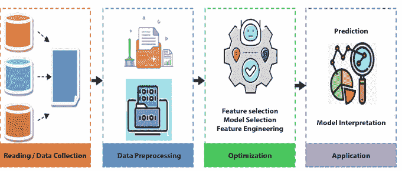

图 1.1 机器学习模型阶段。

数据转换是一种预处理方法，用于对输入进行缩放、编码和归一化，并处理偏斜分布。AutoML 支持使用各种方法从现有数据中自动生成特征。特征选择和缩放对于选择相关特征并确保统一性以稳定不同特征范围中的特征非常重要。数据增强对于生成合成数据样本以训练数据集和提高准确度非常重要。当可用数据量较小时，这一点起着至关重要的作用。数据镜像、裁剪、旋转和翻转是数据样本增强中涉及的一些技术。建议跟踪数据集的血缘并保留版本历史记录，以提高各种模型的可重复性和可审计性 [4]。

数据质量评估是一项重要方法，用于执行数据源的质量检查，以减轻在解决数据问题（如架构更改、异常、不一致性和数据漂移）时涉及的各种问题。通过监控定性指标，在规范出现偏差时触发警报至关重要。需要流式数据处理支持来进行实时数据摄入，这涉及从 IoT 设备和传感器等各种来源收集数据。捕获的数据将发送到存储库中，使用流处理进行评估 [5]。有多种有效的流处理框架可用于处理高吞吐量和低延迟数据。数据隐私和安全是数据处理模型中最重要的组成部分之一，用于确保符合标准并实施隐私法规。加密和访问控制策略被广泛用于保护数据的隐私和机密性。数据可视化提供了各种工具，用于探索和分析数据集以及管理各种数据源之间的关系。

### 1.4 模型训练与选择

模型训练与选择可对各种机器学习模型进行自动探索、优化超参数，并针对给定数据集识别最佳模型。算法探索是一种基本技术，可支持适用于特定问题的各种机器学习算法。算法表示为组件，以便于实验和集成。超参数选择对模型性能至关重要。根据算法行为配置超参数可以提高准确性结果。自动超参数优化和参数调优是 AutoML 的额外优势 [6]。

交叉验证方法通过将给定数据集分割为多个折叠并对其进行评估，以准确估计性能，从而用于评估各种模型的泛化过程。集成学习用于结合各种模型的预测以提高性能。Bagging、Boosting 和 Stacking 是用于结合预测的集成方法示例。性能指标是用于测试模型的基本参数。在数据集的训练和测试中，使用各种评估指标来评估机器学习模型 [7]。

## 数据科学中的 AutoML

AutoML 是指自动化机器智能过程中的任何或所有步骤的结构指南和技术。它提供易于访问的组件和工具，以加速和改进机器学习过程。在使用 AutoML 之前，了解机器学习管道很有帮助。

数据科学家可以使用 AutoML 来自动化耗时的测试，从而专注于更困难的工作，减轻部分负担和责任。它还确保传统预测建模框架的效率和可用性得到提升 [8]。

尽管数据科学是一个广泛的领域，但数据科学家涉及多种技能，单一工具或软件无法完全涵盖。该领域需要对主题有全面了解，并以特定方式识别和形式化问题，以便讨论替代方案。现实世界中的信息通常嘈杂且非结构化。它包括拼写错误、标签不匹配、缺失值、复制、单位不一致和异常值。在对数据进行任何数学计算之前，必须对数据进行充分的准备和处理。

迄今为止所考察的 AutoML 技术在分类和回归等某些挑战方面存在局限性。它不足以处理无监督机器学习技术。AutoML 的目标是支持数据科学家的角色，而非取代他们。它是创建模型并使非专业人士能够参与机器学习的一个好选择。然而，与数据科学家相比，AutoML 无法表达业务问题，或利用领域专业知识从数据中提取有用特征。


## 提供 AutoML 解决方案的企业主要有以下三类：

- 1. 开源：在获得大量企业支持下，许多知名 IT 公司将其 AI/ML 研究成果公开。这些易于获取的成果有助于创建公开可用的概念。

- 2. 初创公司：逐步发展的计算机化预测公司被视为主要考量对象。越来越多的企业正在成立，试图从中获利。

- 3. 科技巨头：Google 推出了 Google Cloud AutoML，这是科技巨头推出的首批 AutoML 工具之一，宣称自己是一家“AI first”公司。如今，众多 AutoML 工具可通过 IBM 的 SPSS Modeler 获得。

## 数据科学家 vs AutoML

虽然速度和风险降低是 AutoML 技术优于人类数据科学家的两个领域，但人脑在某些方面仍优于技术。AutoML 无法匹配数据科学家为流程带来的复杂性、智能和创造性问题解决程度。根据分析，约 43% 的数据科学家工作可完全由机器完成，而 28.57% 的工作可由人类和机器协作完成。其余 28.57% 的工作将仅需要人力。此外，从企业最新的招聘描述中也能清楚地看出，AutoML 解决方案被列为数据科学家的首选技能，例如 Polaris 和 Growth Analytics。为帮助新晋数据科学家培养这项

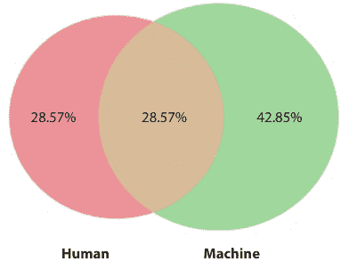

技能并加入这场变革，Udemy 和 Coursera 等在线学习平台已开始提供 AutoML 课程，例如 AutoML Bootcamp、Machine Learning on Google Cloud（Vertex AI 和 AI Platform）、Analyze Datasets 和 Train ML Models using AutoML [9]。

## 需要更多数据科学家

随着数据科学日益融入日常生活，企业需要更多数据科学家来提供所需的帮助。尽管应用了数据科学工具，公司可能仍无法理解其运营情况、评估其成就，或采取精准行动防止重大损失 [10]。

从 2021 年到 2031 年，数据科学家员工数量将继续增长 36%，而所有职业的典型增长率为 5%。鉴于数据分析师短缺以及开发数据科学解决方案所需的时间，AutoML 解决方案可帮助企业满足对数据科学家的需求。数据科学家负责将机器学习算法应用于实践，并选择最适合业务用例的方法。然而，实施过程中可能会出现人为偏见和错误。除了自动化此过程外，AutoML 系统还可以运行更多种类的机器学习算法以选择最佳算法，其中一些算法是数据科学家此前可能未曾考虑过的。

为增强其机器学习流程，Facebook 目前训练约 300,000 个机器学习模型。该公司甚至聘请了一名名为 Asimo 的 AutoML 工程师，以自动构建其当前模型的更好副本。AutoML 解决方案将提高机器学习项目的投资回报率（ROI），因为这些功能将加快机器学习操作 [11]。在模型构建方面，与当前自动化 ML 方法相比，数据科学家提供两大优势：与特定要求的兼容性：虽然大多数 AutoML 架构针对模型性能进行优化，但机器学习应用的实际问题要求远不止于此。例如，如果存储和计算限制需要将模型嵌入边缘设备，企业必须使用更简单的模型。某些类型仅在需要扩展的实例中适用。

模型性能：在 Kaggle（一个机器学习挑战的开放平台）上，个人仍然能轻松超越 AutoML 技术制作的模型。AutoML 工具尚未在任何数据科学挑战中竞争。随着 AutoML 技术随着时间的推移变得更加强大，这些优势预计将消失或减弱。更重要的是，数据科学家及其主管负责建模之外的重大职责，例如：

- **确定需要生成哪些模型。** 在数据科学中，初始步骤也是最关键的一步。理解公司、通过内部和外部资源可获取的数据、数据质量问题、计算和隐私需求以及组织困难都是必要的。

- **处理模型部署中的人类因素。** 学科专家和管理层已被说服该模型优于当前解决方案。他们列出模型的任何潜在弱点并采取措施加以修复。

这些是数据科学家的更基本技能，在机器能够解决这类问题之前还需要一些时间。然而，这并不意味着数据科学家特别具备解决这些问题的能力。

数据科学的基础知识最终应像统计学基础知识一样广为人知。尽管并非每个人都理解复杂的统计学，但分布、方差和均值等重要理念已被广泛理解并影响商业选择。就像 Excel 使数据处理和存储对所有白领工人更加可及一样，AutoML 工具有能力让企业的数据科学普惠化 [12]。

## 下一代行业中的 AutoML

将自动机器学习（AutoML）应用于下一代行业变得越来越重要，因为它解决了与机器学习模型部署和使用相关的问题。AutoML 正在影响许多企业的众多技术，如下所示：

### 加速模型开发流程：

组织可以通过使用 AutoML 加速机器学习模型的建立，AutoML 简化了建模过程的很多环节，包括特征设计、模型选择、超参数调优和数据预处理。

### 人工智能民主化：

得益于 AutoML，机器学习变得更加广泛可用，它使各技能水平的用户（包括机器学习经验较少的领域专家）都能利用高级分析和洞察。

### 资源需求降低：

通过自动化繁琐和重复的操作，AutoML 技术可帮助组织最大限度地利用其资源。因此，所需的人工干预大幅减少，使数据科学家能够专注于模型构建中更具战略性的方面。

### 增强决策能力：

未来的行业通常要处理庞大且复杂的数据集。为了支持数据驱动的决策过程，AutoML 帮助从这些数据集中提取有用的洞察。

### 提高效率与精度：

AutoML 框架使用模型集成方法和超参数调优等方法，来提升机器学习模型的准确性和性能。

### 动态适应数据变化：

未来的企业通常在变化的环境中运营，其中信息属性会随时间发生变化。AutoML 系统可以适应这些变化，并通过持续评估和修订模型，确保模型保持有用和有效。

### 推动边缘计算和物联网：

随着各行业日益采用边缘计算和物联网（IoT）技术，AutoML 可用于边缘，以自动构建针对特定边缘设备和数据源的机器学习模型。

### 保持模型的可解释性：

AutoML 基础在不断演进，通过加入提升模型易理解性和可说明性的功能。这在合规性和利益相关者信心取决于认识模型估计背后逻辑的行业中尤为重要。

### 通过适应行业特定约束

正在研究 AutoML 工具以解决行业特定障碍，例如工业维护预测、金融欺诈检测和医疗诊断。这一修改有助于提高自动化学习解决方案在特定行业领域的重要性和有效性。


## AutoML 的架构

尽管 AutoML 具有诸多优势，但必须牢记，可能并不存在一种适用于所有情况的 AutoML 解决方案。公司应仔细权衡 AutoML 技术的利弊，并采纳一种将领域知识与自动化机器学习相结合的综合策略。此外，在各个类别中使用 AutoML 系统时，合规性、道德挑战和信息隐私应成为首要关注点。

在最近的趋势中，深度学习已在各个领域广泛应用，在解决复杂的人工智能问题方面取得了惊人的成功 [13]。其应用涵盖图像分类、目标检测和语言建模等领域，并取得了出色的结果。

2012 年，AlexNet 在 ImageNet 大规模视觉识别挑战赛（ILSVRC）中表现出色，超越了传统方法，标志着革命性时刻的到来。然而，ResNet-50 等更复杂、更深的神经网络模型被引入，包含 50 层和大约 2560 万个参数 [1]。该架构由不同阶段组成，滤波器大小各不相同，初始阶段有 64 个滤波器，第五阶段则有 1,024 个滤波器。每个阶段包含残差块，每个残差块包含两个 3 × 3 卷积层和一个快捷连接。

与模型开发相关的不断增加的成本，为一种名为“完整机器学习（ML）管道自动化”的新概念提供了机会。这种方法被称为自动化机器学习（AutoML），可减轻开发成本负担 [14]。在现代，AutoML 系统可以整合多种技术，构建一个简单且用户友好的端到端 ML 管道系统。我们的重点是创建个性化的 AutoML 方法，以开发出最易于使用的人工智能系统。

如图 1.2 所示，AutoML 工作流涵盖特征工程、数据准备、模型生成和模型评估等多个阶段。模型处理过程可分为搜索空间探索和优化方法。ML 模型的基本设计原则在搜索空间内保持一致，并分为两种类型：传统 ML 模型和神经架构。对于分类任务，优化技术可分为超参数优化（HPO）和架构优化（AO）[15]。HPO 旨在优化与训练相关的参数，例如学习率和批次大小，而 AO 旨在增强与模型本身相关的参数。例如，神经架构中的层数优化和 KNN 中邻居数的优化，均属于架构优化（AO）技术中的参数实例。

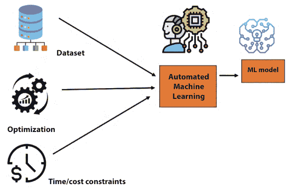

图 1.2 AutoML 的基本架构。

AutoML 在机器人领域代表了一项重要的进步，为机器人系统构建机器学习模型和算法提供了一种高效且简化的方法 [16]。这一创新最大限度地减少了模型开发中传统所需的人工工作和专业知识。在机器人领域，AutoML 涉及自动化机器学习管道的各个阶段，包括数据预处理、特征工程、模型选择、超参数调优，甚至部署。

## AutoML 的类型

在数据科学管道中，数据科学团队必须启动各个步骤来创建预测模型。即使是经验丰富的数据科学家和机器学习工程师团队，也能从 AutoML 带来的速度和透明度提升中获益。数据科学家通常从假设开始启动该过程，获取合适的数据集，创建数据可视化，设计额外特征以存储所有可用信号，然后使用超参数训练模型。对于最先进的深度学习，他们还需要为深度神经网络设计高效架构，如果可用，则可能会利用 GPU [17]。AutoML 的不同类型如下：

- 1. 自动化特征工程
- 2. 自动化超参数优化
- 3. 神经架构搜索

### 1. 自动化特征工程

数据特征是机器学习模型的一段输入数据，而特征工程是数据科学家从现有数据中发现新信息的变换过程。这一过程在机器学习工作流中是一个至关重要的增值阶段，特征质量区分了普通模型和卓越模型。这些经过数学变换的原始数据构成了机器学习过程的核心。自动化特征工程（AFE）是以机械化而非手动方式，对合理特征组合进行持续探索的过程。

手动特征工程常被比作现代实验，耗时成本高昂——构建单个特征可能需要数小时，甚至连简单的准确度评分所需的特征数量，更不用说生产级基准，都可能达到数百个 [17]。通过自动化特征空间的探索，AutoML 大幅缩短了数据科学团队在这一过程上的时间，从几天缩短到几分钟。

自动化特征工程的益处远不止为数据科学家节省时间。生成的特征本质上具有可解释性。在医疗或金融等受监管行业，可解释性至关重要，因为它降低了人工智能采用的障碍。此外，这些特征的简单性增强了数据科学家应用高质量模型并采取行动的能力。自动生成的特征还可能为组织确定新的关键绩效指标（KPI），以便监控和采取行动。在特征工程之后，数据科学家将通过计划的特征选择来优化其模型。

### 2. 自动化超参数优化

机器学习算法中的超参数可比作用于微调模型性能的设备，即使是微小的调整也可能产生重大影响。在小规模数据科学建模中，超参数可以通过试错手动建立和优化。

然而，对于深度学习应用，超参数数量呈指数级增长，使得数据科学团队在合理时间内进行手动优化变得不切实际。自动化超参数优化（HPO）通过允许团队以自动化方式探索和优化整个超参数空间，解决了这一挑战，从而使他们能够专注于对特征和模型进行迭代和实验 [18]。

自动化机器学习过程还使数据科学家能够将关注点从模型创建的“如何”转移到“为什么”。面对大量可用数据和需要解决的众多问题，分析团队现在可以集中精力定义要优化模型的哪些方面。例如，他们可以解决经典问题，例如尽量减少医学检测中的假阴性。

### 3. 神经架构搜索（NAS）

构建神经架构是深度学习中最复杂、最耗时的方法。数据科学人员投入大量时间选择合适的部分和学习率，主要关注模型中的权重，这一点在语言模型中尤为明显。神经架构搜索（NAS），即“利用神经网络来设计神经网络”，在机器学习领域成为自动化的主要候选方案。

NAS 通过寻找可学习的架构来进行探索，结果由用于衡量每个架构的指标决定。许多算法可用于神经架构组 [19]。例如，如果所需的架构数量较少，可以进行随机选项测试。基于梯度的方法将离散搜索空间转换为连续表示，已被证明非常有效。或者，数据科学人员可以使用传统算法，其中对架构进行度量并缓慢应用更改，从而开发出更成功的子架构，同时减少不成功的架构。

虽然神经架构搜索是 AutoML 的重要组成部分，借助 AI 的民主化，但它们通常伴随着相当大的碳足迹。对这些权衡的考察仍在进行中，NAS 方法的持续研究正在探索针对环境成本的优化。

## 行业中自动化 ML 的历程

AutoML 使用一组方法和实践来自动化机器学习段的工作流。用于自动化 ML 的工具专注于自动化典型机器学习管道的许多阶段，以便让非专家更轻松地创建机器学习模型。这种管道化消除了重复性任务，并使经验丰富的机器学习工程师能够更快地构建模型 [20]。

人工智能在教育、医疗、农业、工业和环境挑战等领域产生重大影响。然而，由于时间、资源、人才和信任方面的问题，许多领域在有效部署机器学习模型方面仍面临挑战。传统机器学习过程对人类专业知识有巨大需求。在开始使用机器学习算法之前，公司会寻求数据


科学家、数学家、统计专家和研究人员。受过训练的数据科学家和有经验的工业工人短缺。重要的限制是时间。当使用机器学习模型采用许多解决方案时，很难快速获得结果。少数ML结果需要数月才能部署，这对公司没有帮助。由于高度依赖人工，工作流程中可能会出现错误。许多公司发现很难将预测模型转换为利益相关者易于理解的格式。即使使用ML系统的可解释性和可说明性，缺乏知识和经验在实施过程中也没有帮助。

## 结论

AutoML减少了人工依赖，并在几周或几天内创建模型。由于AutoML处理重复性任务，人类专注于设计、理解问题、准备数据和部署模型。AutoML在与数据科学家合作时，能够以更短时间产生更准确的结果。

## 参考文献

- 1. Karmaker, S.K., Hassan, M.M., Smith, M.J., Xu, L., Zhai, C., Veeramachaneni, K., AutoML至今及未来：挑战与机遇。_ACM计算机评述（CSUR）_, 54, 8, 1–36, 2021, https://doi.org/10.1145/3470918.
- 2. He, X., Zhao, K., Chu, X., AutoML：最新技术综述。_基于知识的系统_，212, 106622, 2021.
- 3. Wever, M., Tornede, A., Mohr, F., Hüllermeier, E., 用于多标签分类的AutoML：概述与实证评估。_IEEE模式分析与机器智能汇刊_，43, 9, 3037–3054, 2021.
- 4. Namburu, A., Sumathi, D., Raut, R., Jhaveri, R.H., Dhanaraj, R.K., Subbulakshmi, N., Balusamy, B., 基于胸部X射线图像分析冠状病毒的FPGA深度学习模型。_移动信息系统_，2022, 1–14, 2022.
- 5. Li, Y., Wang, Z., Xie, Y., Ding, B., Zeng, K., Zhang, C., AutoML：从方法论到应用。in: _第30届ACM信息与知识管理国际会议论文集_，2021年10月，pp. 4853–4856.
- 6. Truong, A., Walters, A., Goodsitt, J., Hines, K., Bruss, C.B., Farivar, R., 迈向自动化机器学习：AutoML方法和工具的评估与比较。in: _2019年IEEE第31届人工智能工具国际会议（ICTAI）_，2019年11月，IEEE，pp. 1471–1479.
- 7. Zheng, R., Qu, L., Cui, B., Shi, Y., Yin, H., 用于深度推荐系统的AutoML：一项综述。ACM信息系统汇刊，41, 1–38, 2023.
- 8. Milutinovic, M., Schoenfeld, B., Martinez-Garcia, D., Ray, S., Shah, S., Yan, D., 关于AutoML系统的评估。in: ICML自动机器学习研讨会论文集，2020年7月，卷. 2020.
- 9. Feurer, M., Eggensperger, K., Falkner, S., Lindauer, M., Hutter, F., 2018年AutoML挑战赛的实用自动化机器学习。in: ICML自动机器学习国际研讨会，2018年7月，pp. 1189–1232.
- 10. Drozdal, J., Weisz, J., Wang, D., Dass, G., Yao, B., Zhao, C., Su, H., 对AutoML的信任：探索建立对自动化机器学习系统信任的信息需求。in: 第25届智能用户界面国际会议论文集，2020年3月，pp. 297–307.
- 11. Tsiakmaki, M., Kostopoulos, G., Kotsiantis, S., Ragos, O., 在教育数据挖掘预测任务中实施AutoML。应用科学，10, 1, 90, 2019.
- 12. Bahri, M., Salutari, F., Putina, A., Sozio, M., AutoML：以异常检测、挑战和研究方向为重点的最新技术。国际数据科学与分析杂志，14, 2, 113–126, 2022.
- 13. Salehin, I., Islam, Md. S., Saha, P., Noman, S.M., Tuni, A., Hasan, Md.M., Baten, Md.A., AutoML：基于神经架构搜索的自动化机器学习系统综述。信息与智能杂志，2, 1, 52–81, 2024, Elsevier BV. https://doi.org/10.1016/j.jiiixd.2023.10.002.
- 14. Waring, J., Lindvall, C., Umeton, R., 自动化机器学习：最新技术综述及医疗保健机遇。人工智能在医学中的应用，104, 101822, 2020, Elsevier BV. https://doi.org/10.1016/j.artmed.2020.101822.
- 15. Krau, J., Pacheco, B.M., Zang, H.M., Schmitt, R.H., 用于生产预测质量的自动化机器学习。CIRP程序，93, 443–448, 2020, Elsevier BV. https://doi.org/10.1016/j.procir.2020.04.039.
- 16. Nagarajah, T. and Poravi, G., 自动化机器学习（AutoML）系统综述。2019年IEEE第5届技术融合国际会议（I2CT），印度孟买，pp. 1–6, 2019, doi: 10.1109/I2CT45611.2019.9033810.
- 17. Balusamy, B. and Krishna, P.V., 使用基于属性的加密在基于云的事务处理系统中管理角色的简化高效框架。国际计算机科学与工程杂志，14, 2, 135–149, 2017.
- 18. Musigmann, M., Akkurt, B.H., Krähling, H., et al., 测试AutoML在诊断神经放射学潜在应用中的适用性和性能。科学报告，12, 13648, 2022, https://doi.org/10.1038/s41598-022-18028-8.
- 19. Stephan, T., Al-Turjman, F., K, S.J., Balusamy, B., 认知无线电传感器网络中基于深度学习的初级用户分类的能量和频谱感知不均匀聚类。机器学习与网络国际期刊，12, 3261–3294, 2021.
- 20. Gudzius, P., Kurasova, O., Darulis, V., Filatovas, E., 基于AutoML的卫星图像物体识别神经架构搜索。遥感，15, 1, 1291, 2022, MDPI AG. https://doi.org/10.3390/rs15010091.

## 基于量子区块链架构的可持续医疗传感器网络安全数据传输自动化机器学习模型

Kaavya Kanagaraj¹, A. Sheryl Oliver¹, Kavitha V.P.², S. Magesh³ and R. Manikandan⁴*

¹计算智能系部，计算机学院，工程与技术学院，SRM科学技术学院，钦奈，泰米尔纳德邦，印度
²电子与通信工程系，SRM科学技术学院，瓦达帕拉尼，泰米尔纳德邦，印度
³计算机科学与工程系，M.G.R.教育与研究学院，钦奈，印度
⁴计算机学院，SASTRA deemed university，坦贾武尔，泰米尔纳德邦，印度

### 摘要

身体传感器网络（BSN）是一种基于物联网（IoT）技术的医疗监控系统，由可穿戴或植入式设备组成。由于BSN中传感器的电池容量和能源供应有限，延长网络服务周期是一项重大挑战。提高能源效率和能量收集对于网络保持可持续至关重要。运营商正在寻求利用机器学习（ML）自动化网络诊断和管理，以高效运行复杂的光通信网络。本研究提出了一种基于自动化机器学习（AutoML）的新颖、可持续的网络安全数据传输技术。在此，医疗网络监控使用强化贝叶斯回归向量机。安全数据传输使用量子区块链自动转移机器图学习。已进行吞吐量、可扩展性、数据包投递率和数据完整性的实验分析。

*通讯作者：srmanimt75@gmail.com

需要新功能来实现光网络安全的认知自主管理，以达成这些目标。

**关键词：** 光网络，安全数据传输，AutoML，网络监控，机器图学习

### 2.1 引言

基于信息和通信技术（ICT）的健康监测系统连接人们和基础设施以提高整体生活质量。除了支持健康监测系统的基本要求外，工业稳定、可持续发展、快速可及性和获得可靠医疗服务也是通过强制要求和适当传输专用网络数据来实现的目标 [1]。科学家和研究人员开发的无线体域网络（WBAN）由具有无线通信功能的微型传感器组成，这些传感器可以放置在患者体内。设备使用各种传感器持续收集医院和隔离设施中患者的生物信号，然后将收集的数据传输到本地分析单元（LPU）。为了改进健康警报，使医疗从业者在发现患者健康状况恶化或任何紧急情况时能够迅速采取预防措施，LPU应具备强大的实时处理健康数据的能力。LPU数据也可以传输到远程数据库（DB）进行长期研究和保存 [2]。WBAN具有多种优势，包括使医生能够远程监测患者特定参数、提高诊断准确性和有效性，以及通过为医生提供随时追踪患者健康状况的便捷方式来降低每位患者的医疗成本。本研究提高了使用混合深度学习对健康数据进行分类的混合DL方法的实用性。

当今的工业产出受到当前称为“工业4.0”的问题的影响。工业4.0主要关注连接性，而非主导第一次和第二次工业革命的大规模生产方式、蒸汽机以及其他在第一次工业革命甚至我们目前正处的机器时代运行我们工厂的机械，以及新的计算机驱动方法的出现。这是从根本上改变企业响应社会需求方式的机遇。工业4.0的发展由联网的未来环境推动 [3]。存在重大颠覆的潜力，而落后者深切感受到这一点。工业4.0指的是


通过传感器、网络、AI、ML、CPS及其他方法[4]，开发自主机器人、智能库存管理方法和智能供应链管理。预计互联网技术和工业4.0战略的使用将显著影响中小企业的发展和繁荣。AI的结果基于ML中使用的数据。AI被应用于医疗保健应用的机器学习算法中。CNN（一种人工神经网络，ANN）构成了图像可视化应用中使用的深度学习模型的基础[5]。利用深度学习研究基因，使识别常见疾病（如特纳综合征、血友病、镰状细胞贫血等）变得简单。它使医生能够开发未来的治疗方法及药物。医生可以利用DL和ML来确定患者状态，以寻找正常和异常的患者数据[6]。

## 研究目标

- 提出具有安全网络数据传输技术的自动化机器学习（AutoML）。
- 使用强化贝叶斯回归向量机模型开发健康监测。
- 安全网络数据传输使用量子区块链自动传输机图学习。
- 针对吞吐量、可扩展性、分组投递率和数据完整性进行参数分析。

### 2.2 相关工作

医疗保健领域存在众多检查、管理和跟踪人类活动的方法。这些方法从各种视角提供了解决方案。为了了解环境辅助生活如何鼓励和支持心脏病患者进行自我管理以降低相关死亡率和发病率，作者[7]发表了一篇系统性文献综述，涵盖了该主题的全部文献。该研究分为四个类别：自我监测、可穿戴技术；临床管理系统；老年人环境辅助生活；以及基于深度学习的心脏病诊断方法。最初，工作[8]对无处不在的网络和智能医疗保健系统进行了广泛调查，以监测患有慢性疾病和生活方式疾病的患者。该方法引入了一种基于云分析和深度学习的新框架，用于智能患者监测和建议。一项病例研究的主题是收集的患有慢性血压问题的患者的不平衡数据集，并评估了患者的状况。基于实验结果，该研究证明了该策略的有效性。作者描述了深度学习在医疗保健中的应用[9]。深度学习集中在七个领域。这些领域包括可穿戴设备数据、心电图、电子健康记录、社区医疗保健、脑电图、基因组分析和药物分析。对当前研究的优缺点进行了考察，并考虑了未来趋势和研究问题。论文[10]讨论了模糊逻辑在工业进步中的应用。熟练操作的语言控制协议使用FL（模糊逻辑）来弥合理论和数学过程之间的差距。该方法用于试点工厂和实际工业环境。本文强调了采用模糊逻辑的好处。它还提供了关于模糊逻辑潜力的信息。论文[11]探讨了Mamdani推理的替代方案。该方法用于计时体育赛事。结合Takagi-Sugeno和Mamdani的优点使其优于原始系统，因为它可以在产生准确结果的同时尽量减少复杂性和响应时间。这种修改后的系统可用于许多其他方面，包括体育和剧烈运动。论文描述了远程健康监测方法[12]。在此方法中，利用可穿戴技术测量身体温度和脉搏速率等健康状况的基本指标。定期测量这些参数并将其存档在云端以供将来使用和参考。如果温度或脉搏速率有任何变化或任何参数超过限制，其家人或护理人员将立即得到通知。还将获取佩戴设备的个人的位置。

此外，它会生成每日报告和数据并传输到云端。这使医生能够更轻松地每周或每月编制患者报告，并根据需要审查患者信息。根据工作[13]，制造商应欢迎向工业4.0的数字化转型，因为这增加了他们的灵活性、敏捷性和响应客户的能力。本研究旨在确定影响制造组织采用工业4.0的变量，并创建一种三元概念方法来描述这些现象。作为定性探索性研究技术的一部分，面对面访谈被用于本研究，该研究基于马来西亚制造业的各种病例研究（n = 15）。NVivo被用于分析数据。根据研究，预测性维护使用监测仪器和工艺性能指标的信息来识别未来问题[14]。机器学习算法通常使用设备监测的数据进行训练。机器学习过程涉及收集和分析大量数据，从而有助于提高计算机精度。监督学习通常用于机器学习技术，其中将标记数据输入方法以训练算法[15]。

深度置信网络（DBN）和CNN是标准的DL技术[16, 17]。DBN使用受限玻尔兹曼机，与标准的大型神经网络相比，显著加快了准备过程。最常见的是，图像特征提取场景使用CNN。然而，这些方法不考虑模式序列，也不会由于这些序列之间的间隔长度而记住模式序列的变化。具有内部记忆能力的循环神经网络（RNN）被用于众多应用程序来解决这些问题并显示出前景[18]。在多种用于预测和分类的时间序列应用中，基于RNN的深度学习获得了高精度。

三种不同的RNN架构基于构建它们所使用的循环单元。主要且快速简单的循环单元（SRU）构成了初始RNN架构的基础[19]。第二种RNN设计基于门控循环单元（GRU），该单元使用两个门来解决梯度消失和精度不稳定问题[20]。企业管理开始越来越重视财务风险管理。为了减少激烈市场竞争的风险并促进最大企业价值经济目标的实现，运营者应加强对财务风险的理解、预测和控制；积极进行财务分析；防止财务风险；并建立适合企业的预警指标分析系统。除了提高风险意识之外，企业的长期生存和增长还取决于将风险评估与绩效评估相结合以创建单一衡量系统。本研究的主题是企业财务管理中信用风险的模拟。它试图基于机器学习算法，为现有的企业财务管理信用风险问题提供一条新的研究思路。

### 2.3 拟议模型

本节讨论了基于安全数据传输并利用机器学习技术进行网络监测的拟议身体传感器模型。拟议的数据传输监测模型如图2.1所示。

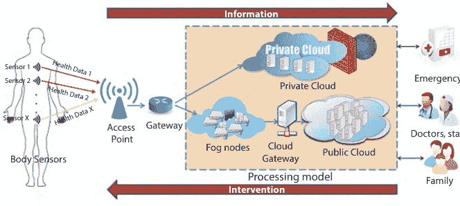

图2.1 拟议的安全数据传输与网络监测模型。

图2.1展示了在雾-云环境中典型的患者监测方法部署。MIoT设备在感知后收集患者数据，并通过接入点将其发送到GW。GW主要用于IoT设备和处理模型通信。按照先进先出原则，传入的健康数据请求在缓冲区中累积并传送到GW。GW应决定健康数据请求持续多久。架构中提出了健康数据流量的两条路线：（i）GW可以将部分感知数据发送到私有云，该私有云完全独立，因为它不与公有云同步。（ii）公有云可以查看雾节点的状态和健康信息，GW可以将部分感知数据传输到与其通信的雾计算（FC）节点。公有FC层或私有FC层都是可能的。本地电信服务提供商可以提供FC节点，或者公有云可以通过接入点提供它们。为了进一步减少云数据中心的响应时间，在MIoT设备和云之间安装的FC层上也进行本地化处理和存储。公有云数据中心中的许多物理机器（PM）通常被虚拟化以形成虚拟机器（VM）的资源池。VM提供离散的运行环境并共享PM资源。包括医生、工作人员、应急人员、患者、医院、护理人员和卫生部在内的授权用户可以访问并获得从私有和公共部门获得的数据。任何设备，包括智能手机、个人数字助理或网页浏览器，都可以访问记录的数据。

数据预处理：利用我们现有的工具，在数据预处理阶段提高数据预测的有效性。这些方法有助于提高数据准备的质量。数据预处理是必要的，以便让数据对用户更易访问。通过此


在预处理过程中，不需要的数据会被转换为全新的、调整后的数据集。如果数据未完全转换，它们会在第一步报告问题，甚至得出不准确的发现，然后整个阶段将被重复。在某些情况下，算法可能运行正常，但结果并不如预期。以下是预处理数据集的步骤：

- 移除冗余数据，并准确存储相关数据。
- 合适的数据集布局对于格式化至关重要。
- 如果信息与用户的专业知识不匹配，则重复整个过程。
- 此时需要移除不需要的信息。
- 在这里，我们可能会发现缺失值并记录下来，以便将来使用。
- 我们将尝试通过方程 2.1 识别用户的令人困惑的交易。

```
\lambda = \sum_{i=1}^{X} \lambda_i \qquad (2.1)
```

为简化问题，假设进入系统各个组件的健康数据均按先到先服务的方式处理。GW 将健康数据发送到 Probability PC 私有云数据中心和 Probability PCCloud 公共云数据中心。CG 的负载均衡功能将进入的健康流量分发到公共云数据中心中的多个虚拟机（VM）。GW 和 CG 的处理时间平均速率分别为 1/GW 和 1/CG，且为服从相同分布的独立指数随机变量。由于云端几乎拥有无限的计算能力，我们假设每个雾计算节点都采用具有无限等待缓冲区的 M/M/C 排队模型，服务时间均为 FC。每个虚拟机实例可以处理一定量的健康数据。M/M/c/K 排队模型描述了私有云数据中心中的每个私有云节点。由于健康数据的进入工作负载随时间变化，我们可以根据所需服务动态添加和删除计算资源，以实现扩展或缩减。

## 使用强化贝叶斯回归向量机（RBRVM）进行网络监控

奖励函数在流量预测中起着至关重要的作用。此外，针对各种形式的网络流量计算了相对奖励。使用网络数据集，该奖励计算改进了流量预测。下方所示的方程 2.2 是此 QL 过程的一个示例。

```
Q_L(s_i,a_i) = R_F(\max(Q(s_i + 1,a_i + 1) + R(s_i,a_i))
```

```
Q(s_i,a_i) = (\Delta - 1)Q(s_i + 1,a_i + 1) + \Delta(R(s_i,a_i) + R_F(\max(Q(s_i + 1,a_i + 1))))
```

网络流量数据集基于方程 2.4 使用蒙特卡罗 QL 进行训练。

```
X_t = Q_L(x_{low}, X_{high})
```

为预测值 \(x_t^i\) 并确定相关预测误差 \(x_t^i x_t^p\)，其中 \(p\) 表示归一化 Frobenius 范数，例如，\(A_p = 2 = [\text{Tr}(AA)]^{1/2}\)。为确定由节点 \(i\) 在第 \(B\) 次数据采集轮次中产生的数据流 \(X\) 的真实值，我们按方程 2.5 定义如下的值因子 \(F_B^i\)：

```
F_B^i = \delta_t^i * \lambda_t^i
```

```
s.t. \delta_t^i = \frac{\sum_{t=j}^{j+m-1} ||x_t^i - \hat{x}_t^i||_p}{m}
```

```
\lambda_t^i = ||(\sum_t o_t^i - k_{th})^+||_p
```

```
o_t^i = \begin{cases} 1, & ||x_t^i - \hat{x}_t^i||_p > \delta_t^i \\ 0, & \text{otherwise} \end{cases}
```

\((\cdot)^+ = \max(\cdot, 0);\)

\(t \in \mathbf{T}_B, i \in \mathbf{V}, \forall x_t^i \in \mathbf{X}, j \in \mathbb{Z}^+, k_{th} \in \mathbb{Z}^+, p = 2 \quad (2.5)\)

随着 \(k_{th}\) 增大，抗干扰能力增强。必须从交换机的流表中检索第 \(B\) 次数据采集周期内数据流 \(X\) 的历史转发记录，以在预测数据流 \(X\) 后分析链路状态数据并评估 BWU。基于此，RL 的实时状态分量按方程 2.6 得出：

\(\theta_B^i = \left\| \left( \frac{F_B^i}{e_B^{k_i}} \right) \right\|_p\)

\(\text{s.t. } e_B^{k_i} = \frac{N_B^{k_j}}{l_B^{k_i}}\)

\(l_B^{k_i} = \frac{1}{|O^{(n)}|} \sum_h l_B^{i(lh)}\)

\(\forall i \in \mathbf{V}, k_i = \langle i, h \rangle \in \mathbf{L}, h \in O^{(i)} \subset \mathbf{V}, t \in \mathbf{T}_B, e_B^{k_i} \in \mathbf{E}, p = 2 \quad (2.6)\)

\(L_B^{k_i}\) 表示集合 \(i, h\) 中的平均链路带宽，其中节点 \(h\) 是 \(O(i)\) 的成员，\(O(i)\) 表示节点 \(i\) 的邻域，其大小为 \(|O(i)|\)。让我们通过方程 2.7 识别参数 \(p\)，以产生最快的速率，将误差移入理想值的 \(\left( \mathcal{O}(\varepsilon) + \frac{2n\rho\rho^2}{\mu} \right)\) 邻域内。

$$\mathbb{E}[\| x^k - x(\lambda) \|^2] \leq \varepsilon \| x^0 - x(\lambda) \|^2 + \frac{2na\sigma^2}{\mu} (2.7)$$

通过设置 \(p^* = \frac{\lambda}{L+\lambda}\)，达到 \(\varepsilon\) 所需的预测通信次数和迭代次数均会减少。主要，所需的迭代次数和预期的通信次数分别为 \(2 \frac{L+\lambda}{\mu} \log \frac{1}{\varepsilon}\) 和 \(\frac{2\lambda}{\lambda+L} \frac{L}{\mu} \log \frac{1}{\varepsilon}\)。为了使输出图像几乎等于原始图像，我们使用相对论平均判别器 \(DRa\)。由方程 2.8–2.11 描述的目标过程如下：

$$\mathcal{L}_{Ra\_D} = -\mathbb{E}_x [\log(D_{Ra}(x))] - \mathbb{E}_{x,v,c} [\log(1 - D_{Ra}(G(x,v,c)))] (2.8)$$

$$\mathcal{L}_{Ra\_G} = -\mathbb{E}_{x} [\log(D_{Ra}(G(x,v,c)))] - \mathbb{E}_x [\log(1 - D_{Ra}(x))] (2.9)$$

$$D_{Ra}(x) = \text{sigmoid}(H(x) - \mathbb{E}_{x,v,c} [H(G(x,v,c))]) (2.10)$$

$$D_{Ra}(G(x,v,c)) = \text{sigmoid}(H(G(x,v,c)) - \mathbb{E}_x [H(x)]) (2.11)$$

符号 \(H(\bullet)\) 表示未变换层的输出。通过减少 \(L_{Ra\_G}\) 的损失，生成的图像趋于比原始图像更逼真。我们如方程 2.12 所述向生成器引入循环一致性损失：

$$\mathcal{L}_{cyc} = \mathbb{E}_{x,v,c} [\| x - G(G(x,v,c), v, 1 - c) \|_1] (2.12)$$

随后，通过将 \(D_{ind}\) 辅助分类器纳入判别器网络来确定图像的来源。与图像转换技术相关的损失按方程 2.13 表示：

```
L_\text{ind} = -\mathbb{E}_{x,t} \left[ \log \left( D_{\text{ind}} \left( t=0/1|x \right) \right) \right] - \mathbb{E}_{x,v,t} \left[ \log \left( D_{\text{ind}} \left( t=0/1|G(x,v,c) \right) \right) \right]\n\tag{2.13}
```

图像生成方法显著影响解码网络（c），因为它是一个共享网络，且图像转换中使用的样本数量远少于图像合成中使用的样本数量。我们如方程 2.14 所示引入成对对抗损失，以确保图像转换方法更精确地拟合：

```
L_{pis} = -\mathbb{E}_{x_a,x_p} \left[ \log \left( D_{pis} \left( x_0, x_v \right) \right) \right] - \mathbb{E}_{x,v,c} \left[ \log \left( 1 - D_{pis} \left( x, G(x,v,c) \right) \right) \right]\n\tag{2.14}
```

其中 \(D_{pis}\) 用于确定两张图像是否属于同一类别。在判别器网络之上，我们叠加了一个名为 \(D_{var}\) 的第二个分类器，以区分照片中的各种变化。训练期间判别器网络的分类损失由方程 2.15 给出：

```
L_{var} = -\mathbb{E}_{x,v} \left[ \log \left( D_{var} \left( v|x \right) \right) \right].\n\tag{2.15}
```

通过减少上述公式，判别器网络可将真实图像 \(x\) 分类为变体类型 \(v\)。生成器网络训练期间的分类损失如方程 2.16 所示：

```
L^f_{var} = -\mathbb{E}_{x,v,c} \left[ \log \left( D_{var} \left( v|G(x_0,v,c=01) \right) \right) \right] - \mathbb{E}_{x,D} \left[ \log \left( D_{var} \left( v_0|G(x,v,v,c=10) \right) \right) \right]\n\tag{2.16}
```

第一项表示，由图像 \(x_0\) 创建的图像在添加变体 \(v\) 后被正确分类为属于域 \(v\)。第二项表示，由成对图像 \(x_v\) 创建的图像也应当类似地


在移除变异 v 后，将其分类为属于域 v。XM 值范围为 0 到 1。公式 2.17 得到以下最终输出图像：

\(x_{out} = x + \left(x_t - x\right) \odot x_m,\) (2.17)

元素级乘法位于 \(\odot\) 处。对于掩码 \(x_m\)，添加来自公式 2.18 的以下限制：

\(\mathcal{L}_{mask} = \left(\frac{1}{W} \sum_k \left|x_m\left[k\right]\right|\right)^2\) (2.18)

上述公式鼓励最大限度地减少对源图像的更改。基于上述说明，公式 2.19 和 2.20 表明图像翻译范式完全无效：

\(\mathcal{L}_D = \mathcal{L}_{Ra\_D} + \lambda_{pis}\mathcal{L}_{pis} + \lambda_{var}\mathcal{L}_{var} + \lambda_{ind}\mathcal{L}_{ind}\) (2.19)

\(\mathcal{L}_G = \mathcal{L}_{Ra\_G} - \lambda_{pis}\mathcal{L}_{pis} + \lambda_{cyc}\mathcal{L}_{cyc} + \lambda_{mar}\mathcal{L}_{var} + \lambda_{ind}\mathcal{L}_{ind} + \lambda_{mask}\mathcal{L}_{mask}\) (2.20)

## 网络监控器

影响奖励函数的环境因素可能会被排除，这使得从单智能体方法过渡到具有环境部分可观测性的多智能体策略更具挑战性。这阻碍了智能体将状态与动作关联的能力。网络状态直接影响网络中节点的性能和奖励。包括网络中的其他节点、物理上靠近的网络或传播环境。所有这些变量都从根本上影响基站解码数据包的能力。任何这些影响都会导致数据包在空中传输时间内具有不足的信噪比。因此，“噪声”可以描述这些影响的后果。为了帮助智能体完成其环境观察，网络监控器测量此噪声并将其提供给智能体。我们称显示通信路线繁忙程度的此指标为“网络利用率”。可用接收信号强度（RSSI）指标直接在基站处测量信号。基站的无线电可以评估 RSSI。它指示 RF 输入端口处的输入信号强度。网络利用率指标是通过对 RSSI 数据应用移动窗口滤波器进行平滑而生成的。该过程由算法 2 描述。此实现的窗口为 30 min，因为它每 30 s 运行一次并具有一个 60 字节缓冲区。

## 量子区块链自动传输机器图学习 (QBATMGL)

希望减小的目标函数表示为 $f : \mathbb{R}^N \to \mathbb{R}$。利用目标函数在当前点的最速下降法，对初始点 $\mathbf{x}^{(0)} \in \mathbb{R}^N$ 进行迭代更新，如公式 2.21 所示。

\[
\mathbf{x}^{(t+1)} = \mathbf{x}^{(t)} - \eta \nabla f \left( \mathbf{x}^{(t)} \right) \tag{2.21}
\]

牛顿法将此方法扩展，在每个步骤中都会考虑目标函数的二阶导数或曲率信息。因此，目标函数的海森矩阵 H 被纳入迭代中，如公式 2.22 给出：

\[
\mathbf{x}^{(t+1)} = \mathbf{x}^{(t)} - \eta \mathbf{H}^{-1} \nabla f \left( \mathbf{x}^{(t)} \right) \tag{2.22}
\]

其中 $H_{ij} = \frac{\partial^2 f}{\partial x_i \partial x_j}$ 在当前点 $\mathbf{x}^{(t)}$ 处计算。

由于梯度的经典旁路数据可以传播到网络结构的任何位置，因此它被用于误差推导和梯度计算计算。通过按顺序应用 L 个单元，如公式 2.23 所示，创建一个幺正算子：

\[
U(\vec{\theta}) = U_L(\theta_L) U_{L-1}(\theta_{L-1}) ... U_2(\theta_2) \tag{2.23}
\]

\[
|Y\rangle = U(\vec{\theta}) |\psi\rangle |\phi\rangle = U(\vec{\theta}) |z\rangle |1\rangle = U(\vec{\theta}) |z, 1\rangle \tag{2.24}
\]

数据被加密，哈希值存储在防篡改账本上。我们的讨论基于这样一个概念：输出

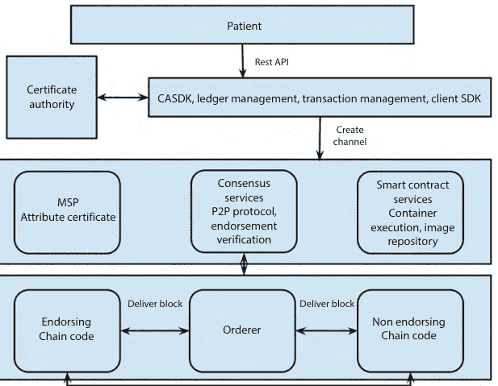

图 2.2 区块链架构。

将是一张已加密的明文图像，这在理想世界中是如此。如果我们还假设原始图像的大小为 m x n 像素，则可以将结果除以 16。我们的实证研究表明，将每个像素视为随机变量可以有效地创建大小为 256 x 256 像素的辅助图像。区块链架构如图 2.2 所示。

在图像加密过程中，图像被转换为一系列字节，以便无法访问其原始形状。这是保护数字图像数据的一种实用方法。加密过程通过多种密码技术进行。在发送到另一个系统后，加密的字节可以通过解密调整回其原始值。我们采用基于某些密钥的方法进行加密和解密过程，如公式 2.25 所示。

E_{key}(X) = Y
D_{key}(Y) = X
(2.25)

公式 2.25 和 2.26 描述了如何加密明文以及如何解密。Ekey(X) 表示应用于图像 X 的加密函数，图像 Y 是结果。要从加密图像中获取原始图像 X，我们使用 Dkey(Y) 函数。

封面图像的加密阶段分为两个步骤。首先，将封面图像分离为三个不重叠的 3 × 3 块。然后，利用由 Key-I 创建的随机序列对所有块进行重新排序，Key-I 的长度等于图像中块的总数。块置换后，使用 Key-II 创建秘密流。然后，使用公式 2.26 对图像的每个块进行加密：

\( C = E(P, K) = K \oplus P \) (2.26)

加密函数 E() 是由“⊕”标记的异或操作。每个块包含一个独特的 8 位代码段，每个块按顺序加密。由于每个块的像素使用相同的代码段进行加密，因此它们之间的相关性得以保持。为了将每个网络连接分类为恶意或良性，我们将网络攻击检测视为一个二进制分类问题。由于网络攻击具有许多共同特征，我们的方法包括定位共同的潜在子空间，将源数据和目标数据转换到其上，并为分类目的生成新的特征表示。

将源数据 S 和目标数据 T 最优投影到理想子空间 VS 和 VT 上，使用公式 2.27 给出的以下优化目标进行评估：

\(\min_{V_S, V_T} \ell(V_S, S) + \ell(V_T, T) + \beta D(V_S, V_T)\) (2.27)

其中 (.) 是畸函数，用于计算投影数据与原始数据之间的差异。符号 D(VS, VT) 表示源域和目标域投影数据之间的差异。

术语“源域”指的是具有大量历史数据的交通道路网络。迁移学习的运作方式如下：(1) 在预训练阶段，旨在学习一个函数 f，给定一组 S 个过去的交通数据，该函数可以预测图 G 上所有节点在未来 H 个时间步的交通状况。映射关系如公式 2.28 所示：

\( [\mathcal{X}, \mathcal{G}] \xrightarrow{f} \hat{\mathbf{X}}^{(t+1)(t+H)} \)

其中 \(\mathcal{X} = [\mathbf{X}^{(t-S+1)}, \mathbf{X}^{(t-S+2)}, ..., \mathbf{X}^{(t)}] \in \mathbb{R}^{N \times S \times C}\)，\(\mathbf{X}^{(t)} = [\mathbf{x}_1^t, \mathbf{x}_2^t, ..., \mathbf{x}_N^t] \in \mathbb{R}^{N \times C}\) 表示时间步 t 的交通状况，C 是每个节点的多个特征，\(\hat{\mathbf{X}}(t + 1):(t + H) \in \mathbb{R}^{N \times H \times C}\) 是预测值。在步骤 2 中，使用目标域中仅少量的数据进一步优化预训练函数 f，以预测图 G 0 上所有节点在接下来的 H 个时间步的交通状况。该方法描述为公式 2.29：

\( [\mathcal{X}', \mathcal{G}'] \xrightarrow{\rho(t+1)(t+H)} \hat{\mathbf{X}}^{\rho(t+1)(t+H)} \)

其中 \(\hat{\mathbf{X}}^{(t+1)(t+H)|L} \in \mathbb{R}^{N' \times H \times C}\) 和 \(\mathcal{X} = \mathbf{X}^{(t-S+1)}(t) \in \mathbb{R}^{N \times S \times C}\) 是目标域中的预测结果。图卷积网络 (GCN) 通常用于交通预测中以提取空间相关性。更详细地说，给定输入信号 \([\mathbf{X}^{(t-S+1)}, ..., \mathbf{X}^{(t)}] \in \mathbb{R}^{N' \times S \times C}\) 和邻接矩阵 \(\mathbf{A} \in \mathbb{R}^{N \times N}\)，我们可以获取输出表示 \(\mathcal{Z} = \mathbf{Z}^{(t-S+1)(t)} \in \mathbb{R}^{N \times S \times F}\)。该过程由公式 2.30 给出：

\(\mathbf{Z} = \left( \mathbf{I}_N + \mathbf{D}^{-\frac{1}{2}} \mathbf{A} \mathbf{D}^{-\frac{1}{2}} \right) \mathbf{X} \mathbf{W} + \mathbf{b}\)

### 2.4 结果与讨论

仿真中使用 JMT 模拟器来评估所提议医疗系统的性能。它部署在一台配备 2.40 GHz Intel Core i5 CPU、4 GB 内存和 250 GB 硬盘的设备上。仿真在相同设置下重复 10 次，并取平均结果来展示所提议模型的性能。我们假设系统平均每秒接收 1,000–10,000 个健康数据查询。每个健康数据请求的处理时间


在GW节点中服务时间服从指数分布，其均值为1/μGW = 0.0001 s。

聚合工作负载有两条备选路由，如下：(i) GW 到私有云，概率 PC = 0.4；(ii) GW 到雾层，概率 PCloud = 0.6。在 FC 节点，平均服务时间为 1/μFC = 0.01 s。以 p = 0.6 的概率，健康数据被发送到云网关，在公有云数据中心进行额外处理。每个公有 VM 节点的服务时间为 1/μ = 0.00015，而云网关服务器的平均服务时间为 1/μCG = 0.0001。考虑一个包含 R = 10 个私有节点的小型私有云数据中心。假设仿真在包含 M = 20 个公有节点且每个公有节点有 C = 4 个 VM 的公有云数据中心中进行。此外，我们假设每个雾节点最多可存放 B = 150 条健康数据，且雾计算层由 N = 20 个 FC 节点组成。部分规格会根据仿真场景在仿真过程中更改，而其他规格保持固定。

数据集描述：本研究采用了 MHEALTH DATASET（移动健康基准数据集）。该数据集从 10 名受试者处收集，记录了佩戴 SHIMMER2 传感器时的身体动作和生命体征。每名患者的胸部、左脚踝和右手腕使用弹性带固定了这些传感器。移动健康系统利用多种传感器捕捉身体动态，并评估由身体组件运动（如加速度和磁场方向）带来的多样性。胸部安装的传感器提供二导联 ECG 测量。这种多模态身体感知数据集可以监测心脏、检查心律失常，或研究运动对 ECG 的影响。该数据集的采样率为 50 Hz，足以捕捉模拟的人体动作。所有实验会话均已录像，以便对数据进行分类并检查信号异常。

人体活动与姿态转换（HAPT）数据集，使用智能手机收集：该信息在 UCI 人类活动识别数据集中更新。HAPT 数据集包含 12 种不同的动作。首先，它有六种基本动作，包括三种静态动作和三种行走动作。它从两种静态动作中提供六种可能的转换：站立到坐姿、坐姿到站立、卧姿到坐姿、卧姿到站立。共有 30 名志愿者参与研究，年龄在 19 至 48 岁之间，每人将智能手机佩戴在腰部。内置陀螺仪和加速度计采集数据，采样频率为 50 Hz。实验过程录制了视频，以便日后进行数据标记。

## 表 2.1 基于各类身体传感器数据集的拟议与现有技术对比。

| 数据集 | 技术 | 吞吐量 | 可扩展性 | 数据完整性 | 数据包投递比率 |
|---|---|---|---|---|---|
| MHEALTH DATASET | CNN | 85 | 81 | 82 | 89 |
| MHEALTH DATASET | DBN | 88 | 85 | 84 | 91 |
| MHEALTH DATASET | RNN | 94 | 88 | 91 | 94 |
| MHEALTH DATASET | QBATMGL_RBRVM | 98 | 92 | 94 | 96 |
| HAPT | CNN | 88 | 79 | 81 | 86 |
| HAPT | DBN | 91 | 81 | 85 | 88 |
| HAPT | RNN | 95 | 85 | 89 | 91 |
| HAPT | QBATMGL_RBRVM | 97 | 90 | 91 | 94 |

表 2.1 用于基于各类身体传感器数据集进行比较分析。所分析的数据集为 MHEALTH DATASET 和 HAPT，涉及吞吐量、可扩展性、数据完整性和数据包投递比率。

图 2.3(a)-(d) 展示了 MHEALTH DATASET 的对比情况。在此，拟议技术的吞吐量为 98%、可扩展性为 92%、数据完整性为 94%、PDR 为 96%。现有 CNN 的吞吐量为 85%、可扩展性为 81%、数据完整性为 82%、PDR 为 89%。DBN 的吞吐量为 88%、可扩展性为 85%、数据完整性为 84%、PDR 为 91%。RNN 的吞吐量为 94%、可扩展性为 88%、数据完整性为 91%、PDR 为 94%。

图 2.4(a)-(d) 展示了 HAPT 数据集的分析情况。拟议技术的吞吐量为 97%、可扩展性为 90%、数据完整性为 91%、PDR 为 94%。现有 CNN 的吞吐量为 88%、可扩展性为 79%、数据完整性为 81%、PDR 为 86%。DBN 的吞吐量为 91%、可扩展性为 81%、数据完整性为 85%、PDR 为 88%。RNN 的吞吐量为 95%、可扩展性为 85%、数据完整性为 89%、PDR 为 91%。

本实验评估了用于识别新型攻击变体的拟议迁移学习方法。引发新攻击具有挑战性。针对目标数据的攻击与源域的攻击不同，因为它们没有标签。我们随机选择了源域，并从一个主要攻击类别中挑选了恶意实例。然后，我们为目标域选择了不同的攻击类型和典型样本。最终创建了以下三组：DoSProbe、DoSR2L 和 ProbeR2L。我们还为每个源域和目标域组从 22 种子攻击类型中选择了攻击，并创建了 11 个任务以评估泛化能力。程序重复了 10 次，并报告了平均值和标准差。

除非另有说明，我们在每个域中平衡攻击数据和正常数据。在此场景中，身体传感器的工作负载是同构且均匀分布的。每个传感器每秒发出 500 个请求（i = 1,..., 200）。可以看出，随着身体传感器数量的增加，平均系统响应时间也会上升。当该数量超过 120 台设备时，指定的 SLA 延迟将被违反。需要增加计算资源（云和雾）以高效处理来自 MIoT 设备的健康数据，防止出现此 SLA 违反。附着在患者身上的不同身体传感器为我们的任务创建了均匀分布的工作负载。为创建

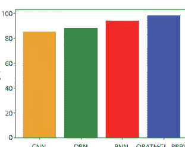

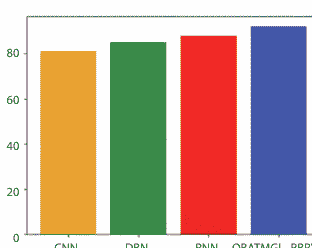

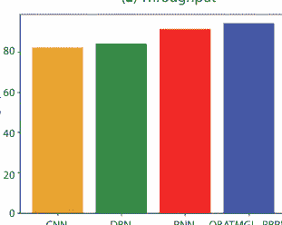

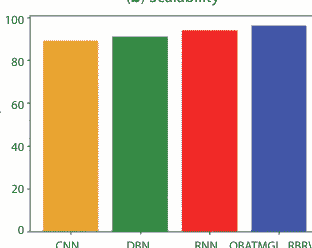

图 2.3 基于 MHEALTH DATASET 的对比，涉及 (a) 吞吐量、(b) 可扩展性、(c) 数据完整性和 (d) 数据包投递比率。

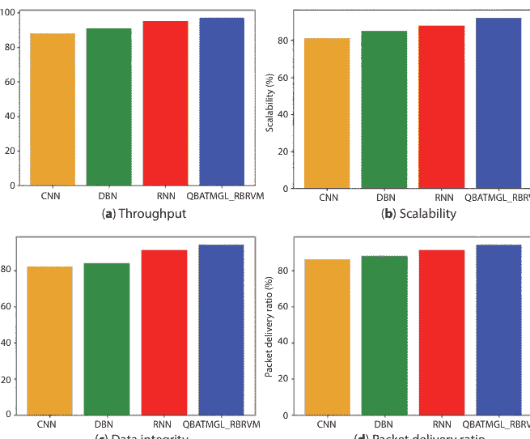

图 2.4 基于 HAPT DATASET 的对比，涉及 (a) 吞吐量、(b) 可扩展性、(c) 数据完整性和 (d) 数据包投递比率。

他们的深度学习模型中，每个经纪人/工作节点都被分配了相等的时间来测试该方法。所有中心都被派遣去使用所有可用资源，并生成一个建模为多个雾计算节点的数据集。因此，测试和准备时间的准确性都得到了降低。为了发现这些效应，调查了测试和准备的准确性。模型可以准确识别是否患有冠状动脉疾病的正式确诊患者的总数是绝对的。我们研究了通过改变边缘节点数量（与或不保证结果）来改进不同雾设置的可能性。

### 2.5 结论

本研究提出了一种独特的方法，利用量子区块链自动迁移机图学习和强化贝叶斯回归向量机，实现数据传输和身体传感器网络监控的安全性。为了实现电子健康服务的 QoS 和 SLA 响应时间，我们采用了一种方法来展示如何限制云和雾计算资源。我们创建了许多公式和方程式，通过将私有云和公有云视为排队网络，使我们能够即时预测整个系统响应时间。此外，我们展示了我们的建议方法如何识别满足任何特定 MIoT 工作负载目标 SLA 系统响应时间所需的适当计算资源。为了实现电子健康服务的 QoS 和 SLA 响应时间，我们采用了一种方法来展示如何限制云和雾计算资源。

此外，我们展示了我们的建议方法如何识别满足任何特定 MIoT 工作负载目标 SLA 系统响应时间所需的适当计算资源。该方法准备模型最终在每个系统工作节点上使用单独的准备。各种汇聚模型用于浓缩在每个节点上创建的方法。为了提高精度，阐述了各种好奇技术。拟议架构设计为强健且包容性的，促进了雾计算在农业智能生产线、天气预测、智慧城市预测和工业交通管理等领域的应用。

### 参考文献

- 1. Stone, D., Michalkova, L., Machova, V., 机器与深度学习技术、身体传感器网络及基于物联网的智能医疗系统在 COVID-19 远程患者监护中的应用。*Am. J. Med. Res.*, 9, 1, 97–112, 2022.
- 2. Jaber, A.S. and Idrees, A.K., 无线身体传感器网络：应用、挑战、患者监护、医疗应用中的决策与机器学习，收录于：*AI and IoT for Sustainable Development in Emerging Countries: Challenges and Opportunities*，第 417–437 页，Springer International Publishing, Cham, 2022.
- 3. Balakrishnan, S., et al., 基于机器学习算法的健康监测物联网系统。*Wirel. Pers. Commun.*, 1–17, 2022.
- 4. Visvesvaran, C., et al., 基于机器学习的高级患者监测与警报系统及自动药物建议。*2022 3rd International Conference on Electronics and Sustainable Communication Systems (ICESC)*, IEEE, 2022.
- 5. Suresh, S. and Chakaravarthi, G., RFID 技术及其多样化应用：附带拟议机器学习方法的简要阐述。*Measurement*, 195, 111197, 2022.


- 6. Devi, V.S.A., Raj, V.H., Kavin, B.P., Gangadevi, E., Balusamy, B., Gite, S., 用于在SDN和IoT生态系统中区分ID的CNN原子探索优化器。2024 IEEE国际计算、电力和通信技术会议（IC2PCT），印度大诺伊达，第1430–1437页，2024年，doi: 10.1109/IC2PCT60090.2024.10486516.

- 7. Ogundokun, R.O., et al., 基于混合InceptionV3-SVM的健康监测系统中人体姿态检测方法。Algorithms, 15, 11, 410, 2022.

- 8. Verma, P., et al., FETCH：一个用于医疗监测和诊断的深度学习雾计算和IoT集成环境。IEEE Access, 10, 12548–12563, 2022.

- 9. Manimuthu, A., Peter Jose, P., Gangadevi, E., Kumar, U.U., Anandaraj, M.D., 从磁共振图像（MRI）预测阿尔茨海默病。2024 IEEE国际计算、电力和通信技术会议（IC2PCT），印度大诺伊达，第631–635页，2024年，doi: 10.1109/IC2PCT60090.2024.10486545.

- 10. Rajeswari, S.V.K.R. and Vijayakumar, P., 对IoMT的调查：技术融合——可穿戴身体传感器网络、可穿戴生物传感器、IoMT中的机器学习和深度学习。智能视觉与计算国际会议，Springer Nature Switzerland，Cham, 2022.

- 11. Ahmed, I., et al., 物联网健康事物驱动的基于深度学习的系统，利用时间帧规则和成对关键点距离特征进行非侵入式患者不适检测。可持续城市与社会（Sustain. Cities Soc.）, 79, 1036725, 2022.

- 12. Cuțioi, A.-C., COVID-19筛查、检测、诊断和治疗中的远程患者监测系统、可穿戴物联网医疗传感器设备和基于深度学习的计算机视觉算法。美国医学研究杂志（Am. J. Med. Res.）, 9, 1, 129–144, 2022.

- 13. Islam, Md.R., et al., 用于实时远程监测和早期检测健康问题的基于深度学习的物联网系统。传感器（Sensors）, 23, 11, 5204, 2023.

- 14. Jayawickrema, U.M.N., et al., 面向土木结构的基于光纤传感器和深度学习的结构健康监测系统：一篇综述。测量（Measurement）, 199, 1115435, 2022.

- 15. Aryai, P., et al., 在WBAN中使用混合元启发式驱动机器学习路由协议（MDML-RP）进行实时健康监测。AEU国际电子与通信期刊（AEU Int. J. Electron. Commun.）, 168, 1547235, 2023.

- 16. Nandini, K., et al., 可穿戴物联网环境中的基于自动机器学习的妊娠监测框架。第二届机械与能源技术国际会议论文集：ICMET 2021，印度，Springer Nature Singapore，新加坡，2022.

- 17. Ao, S.-I., et al., 感知与状态监测机器学习的进展。应用科学（Appl. Sci.）, 12, 23, 12392, 2022.

- 18. Gupta, P., et al., 使用边缘计算的基于深度学习的健康监测预测。测量：传感器（Meas.: Sens.）, 25, 1006045, 2023.

- 19. Sujigarasharma, K., Sharulatha, S., Lawanya Shri, M., Gangadevi, E., Dhanaraj, R.K., 使用先进深度学习技术优化3D生物打印：CNN、RNN和GAN的比较研究。载于：生物打印中的计算智能，第157–173页，Wiley, 2024, https://doi.org/10.1002/9781394204878.ch8.

- 20. Basak, S. and Chatterjee, K., 使用物联网和机器学习方法的心脏病智能医疗监控系统。智能计算与信息安全进步国际会议，Springer Nature Switzerland，Cham, 2022.

## 生物和医疗保健行业中的自动化机器学习：分析、解释与评估

Iram Fatima1*, Naved Ahmed2, Mehtab Alam3, Ihtiram Raza Khan4 and Veena Grover5

1MRIIRS计算机应用学院，法里达巴德，印度

2IILM大学计算机科学与工程学院，古尔冈，印度

3德里大学阿查里亚·纳伦德拉·德夫学院，德里，印度

4Jamia Hamdard计算机科学与工程系，新德里，印度

5NIET管理学院，诺伊达，北邦，印度

### 摘要

本研究探讨了自动化机器学习（AutoML）在研究和康复领域的深远影响，侧重于分析、解释和评估。该工作为应用机器学习改善医疗护理提供了背景，并强调了AutoML在生物产品和医疗环境中的实用性。机器学习应用为监测和评估医疗保健中治疗效果提供了宝贵的工具。这些应用可帮助诊断、预后以及为已识别疾病制定最佳治疗方案。尽管如此，我们也必须考虑机器学习技术在医疗领域所带来的局限性、挑战和机遇。机器学习的一项重大挑战是编制既高质量又能代表多样潜在输入范围的数据集。理想情况下，模型应在精确反映现实使用中将遇到的格式和质量的数据上进行训练。本文讨论了AutoML的原则，包括各种组件、有效性以及采用的利弊。

*通讯作者：irammalik917@gmail.com

关键词：机器学习，自动化机器学习，医疗保健

### 3.1 引言

机器学习通过检查海量事实、检索信息和优化决策，正在改变医学领域。机器学习通过实现更好的诊断、定制治疗方案和更好的患者结果，改善了医疗操作 [1, 2]。随着医疗统计数据的快速增长，从电子病历到放射学记录和基因组，先进的统计技术变得越来越关键。利用机器学习进行医疗目的在疾病预测、图像分类和药物开发等方面已被证明是有效的 [3]。

#### 3.1.1 AutoML的兴起

人工智能的进步导致了AutoML的兴起，从而改变了算法开发和部署的方式。AutoML通过自动化数据预处理、特征工程、模型选择和超参数调整等关键操作，加速了机器学习技术 [4]。

AutoML的兴起可归因于机器学习专业知识的民主化转型，这使得该领域的专家以及编程和数据科学经验有限的专业人士都能接触到它。对困难任务的自动化降低了入门门槛，使得在医疗环境中能够快速开发和执行机器学习模型 [4]。

#### 3.1.2 AutoML在生物和医疗保健中的重要性

自动化机器学习在生命科学和医学领域至关重要，带来了各种重要好处，如下 [5–7]：

- AutoML简化了模型构建，使医疗保健专业人员能够专注于领域特定挑战，而非技术问题。计算机化流水线加快了流程，使疾病预测、药物应用和治疗改进的模型能够更快速地部署。

- AutoML使医疗专家、临床医生和研究参与者能够在无需先前编程或数据科学经验的情况下应用机器学习。这种透明性促进了统计学家和领域专家之间的合作，从而为解决医疗问题提供多维方法 [8]。

- 应对数据复杂性：医疗文档可能非常广泛，包含放射学、临床记录和家系谱数据。AutoML算法旨在通过自动适应各种数据类型和设计来应对这种程度的限制，这使其适合生物和医疗数据所包含的复杂性。

### 3.2 有效数据管理的方法论

为了解决这些问题并确保有效部署AutoML，需要一种强有力的方法。它涉及以下内容，如图3.1所示。

- **数据预处理 [10] 和标准化 [11]:**
  - 清洗与填充：使用合适的技术处理数据缺失（如均值/中位数填充和预测建模）。识别并处理异常值以保持数据的完整性。

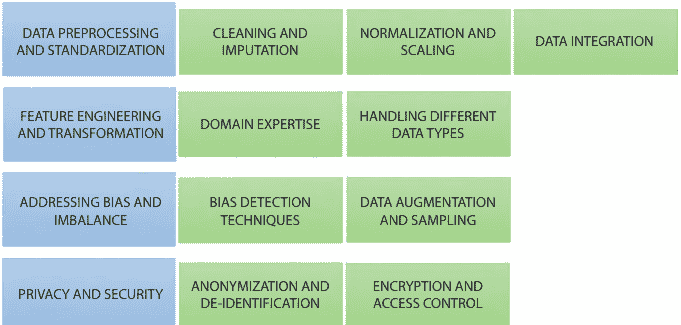

图3.1 有效数据管理方法论。


- **规范化与缩放：** 将计算特征归一化到相似的尺度和结构可改善模型收敛性和稳定性。

- **数据整合：** 建立加密信息整合机制，将来自电子健康记录（EHRs）、实验室系统和影像存档的信息整合为单一数据集，以便进行解释。

- **特征工程 [12] 和转换 [13]：** 特征工程是基于数据集中现有数据创建新特征或变量的过程。转换是修改或转换数据集中输入特征以改善机器学习模型性能的过程。

- **领域专业知识：** 与医生交互，从原始信息中推导有用特征，以改善模型解释性和有效性。

- **处理不同数据类型：** 对各种数据类型使用专门方法（例如，医学快照的图像归一化和转换等）。

- **解决偏差和不平衡 [14, 15]：**
  - **偏差检测技术：** 使用统计方法和公正度量指标来检测训练数据中可能的夸大。
  - **数据增强和采样：** 使用过采样、欠采样或合成数据生成来生成分布更均匀的数据集，并降低当前偏见的影响。

- **隐私 [16] 和安全 [17]：**
  - **匿名化与去标识化：** 制定严格流程，通过删除任何可识别个人身份的信息来保护患者机密性。
  - **加密和访问控制：** 使用加密（静态和传输中均加密）和严格的用户访问控制来保护关键医疗信息。

医疗组织和研究人员可以通过全面的预处理、特征工程、偏差减少和严格的隐私政策，提前解决这类信息难题，为繁荣且符合伦理的 AutoML 部署奠定基础。

### 3.3 自动化机器学习基础

在前一节中，我们将介绍自动化机器学习模型的基本原则。

#### 3.3.1 理解自动化机器学习

自动化机器学习（AutoML）是一项开创性技术，它简化了开发机器学习技术的整个过程。其核心，AutoML旨在使机器学习技术的应用民主化，使其对更广泛的受众可访问，包括领域专家和数据科学专业知识有限的个人 [1]。AutoML 包含一系列算法、工具和流程，它们协同工作以自动化机器学习模型开发的以下关键阶段。

#### 3.3.2 组件和工作流

在本节中，我们将讨论 AutoML 的组件和工作流。

- **数据预处理：释放清洁和上下文化数据的力量**
数据预处理是任何机器学习项目的基础步骤。在 AutoML 的更广泛背景下，此阶段动态处理缺失值、归一化数据并处理异常。AutoML 技术使用复杂算法来确保所提供的数据清洁、具备上下文，并为模型创建的下一步做好准备。

- **特征工程：构建信息丰富的特征以实现最佳模型性能**
特征工程对于构建能够从数据中提取有用洞察的算法至关重要。AutoML 技术在无需人工干预的情况下分析和检索相关属性。这些方法采用强大算法来定位和转换非结构化数据为相关特征，从而增强模型提供精确预测的能力。

- **模型选择：智能地穿梭于模型动物园**
AutoML 通过对比广泛的方法和架构来改进模型选择的自动化。它自动处理庞大的“模型动物园”，为任何给定任务找到最优模型。这种不断演进的技术确保所提模型与医疗信息的复杂性相匹配，优化有效性和泛化性。

- **超参数调优：为峰值性能进行微调**
超参数对人工智能算法的性能有重大影响。AutoML 技术不断探索超参数空间，调整机器设置以获得最佳结果。这种自动化使专业人员摆脱手动更改超参数的耗时琐事，使他们能够专注于结果的临床意义和分析。

#### 3.3.3 AutoML 实施的优点

以下是我们列出的 AutoML 的一些优势 [18]：

- **效率和节省时间：** 加速模型开发生命周期，减少实施所需的时间和精力。使医疗环境中机器学习解决方案能够快速部署，解决时效敏感的问题。
- **可访问性：** 使机器学习专业知识民主化，使没有广泛编程知识的医疗专业人员也能使用。促进领域专家与数据科学家之间的协作，推动应对医疗挑战的跨学科方法。
- **增强的模型性能：** 迭代优化模型超参数和特征，从而提高准确性和泛化性。有助于开发能够处理生物和医疗数据集复杂性的强健模型。
- **对各种数据类型的适应性：** 自动处理医疗数据的异质性，容纳各种模式，如医学图像、临床笔记和基因组信息。

#### 3.3.4 AutoML 实施的缺点

以下是我们列出的 AutoML 的一些缺点 [19]：

- **缺乏可解释性：**
AutoML 模型可能被视为“黑箱”，使得解释和说明决策过程变得具有挑战性，这在医疗领域至关重要。

- **过分强调性能：** 自动化流程可能优先考虑模型性能而非可解释性和临床相关性，可能导致部署可解释性较低的模型。

- **对数据质量的依赖：** AutoML 的成功很大程度上取决于输入数据的质量和代表性。在偏差或不完整数据集的情况下，AutoML 的结果可能是次优的。

- **定制化有限：** AutoML 工具在适应高度专业化的要求或某些医疗应用的特定细微差别方面可能存在限制。

在医疗领域实施 AutoML 带来了显著优势，包括效率、可访问性、增强的模型性能和对各种数据类型的适应性。然而，必须严格解决可解释性和定制化等问题，以便将其适当且成功地融入医疗程序。以下部分将介绍应用和实例，揭示这些基本要素如何体现在实际医疗环境中。

### 3.4 医疗领域的应用

在本部分中，我们提到了医疗领域中 AutoML 的应用，如图 3.2 所示。

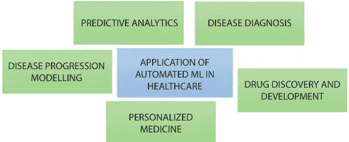

图 3.2 医疗领域的 AutoML 应用。

#### 3.4.1 疾病诊断

- 图像识别与分类

自动化机器学习（AutoML）已经彻底改变了疾病检测，尤其是在放射学领域。使用 AutoML 算法进行图像识别和分类在检测异常和识别放射学图像（包括磁共振成像和计算机断层扫描）中的趋势方面表现出显著的精度。这种变革性能力不仅加速了诊断程序，还帮助医疗从业者做出更精确和更快的判断 [20]。

此外，AutoML 的图像分类延伸到病理切片，帮助病理学家检测和分类组织标本。这不仅减轻了医疗人员的压力，还有助于疾病的早期发现，从而改善患者的预后 [21]。

```
import cv2 # Or relevant image processing library (e.g., PIL)
from skimage.feature import hog
from sklearn.svm import SVC
from sklearn.model_selection import train_test_split

# Image Loading and Preprocessing
images = load_images_from_directory('path/to/images')
hog_features = []
labels = []
# ... (Extract HOG features or use a suitable deep learning model)
# Train Test Split
X_train, X_test, y_train, y_test = train_test_split(hog_features, labels)

# Model Training (Example: Support Vector Machine)
clf = SVC()
clf.fit(X_train, y_train)

# Prediction on New Image
new_image = load_image('path/to/new_image.jpg')
# ... (Preprocess and extract features)
prediction = clf.predict(new_image_features)
```

- 基因组数据分析

AutoML 在基因组学中很重要，因为它有助于解码复杂的遗传数据。基因组数据评估是发现...


人类基因组中的异常和变异可能暗示遗传异常或疾病易感性。AutoML 算法擅长管理基因组测序技术获得的大量复杂数据 [22]。

AutoML 有助于自动识别关键遗传标记，从而实现更准确的诊断和个性化治疗方案。通过自动化遗传数据处理，医疗工作者可以识别潜在模式和关系，推动精准医疗的发展 [23]。

#### 3.4.2 药物发现与开发

AutoML 已被公认为制药发现与开发领域的重要工具，有助于识别潜在的治疗概念。通过对化学结构、生物测定和高通量筛选数据的自动化分析，AutoML 加速了寻找具有治疗潜力分子的过程。

AutoML 分析和预测药物-靶点相互作用的能力，使优先级排序有前景的治疗候选物变得更加容易，在临床前开发中节省时间和金钱。这不仅改善了制药发现流程，还支持新型和特异性疗法的创建 [24]。

#### 3.4.3 个性化医疗

个性化医疗致力于根据患者的独特特征定制治疗方案，AutoML 在实现这一目标中发挥着关键作用。AutoML 算法可以在各种患者数据中发现模式，例如临床文档、遗传数据以及生活方式特征，从而推动个性化疗法的发展 [23]。

AutoML 支持构建考虑每个患者特定特征的预测算法，从而实现更好的结果和定制化疗法。这种方法改善了治疗效果并最大限度地降低了不良反应的可能性，标志着向以患者为中心的医疗保健范式转变 [24]。

#### 3.4.4 医疗保健中的预测分析

- 患者结局预测

AutoML 通过创建估计患者结果的模型，对医疗保健中的预测分析作出了重大贡献。这些模型基于以前收集的患者数据，预见问题、住院和后果。医疗保健从业者可以利用这些信息设计预防性措施，改进资源实施，并改善患者的整体治疗。

AutoML 的主动模型选择和超参数调优提高了其结果预测的准确性，使医疗保健专业人员能够做出明智决策并主动分配资源。

```
import pandas as pd
from sklearn.model_selection import train_test_split
from sklearn.ensemble import RandomForestClassifier
from tpot import TPOTClassifier

# Hypothetical Dataset (Replace with your actual data)
data = pd.read_csv('Patient_data.csv')
# Features and Outcome
X = data[["age", "gender", "diagnosis", "comorbidities", ...]]
y = data['treatment_response'] # Or 'risk_category'
# Data Splitting
X_train, X_test, y_train, y_test = train_test_split(X, y, test_size=0.2)
# Automated Model Selection and Training (Example using TPOT)
tpot = TPOTClassifier(generations=5, population_size=50, verbosity=2)
tpot.fit(X_train, y_train)
# Predictions on New Patient Data
new_patient_data = [[45, 'F', 'diabetes', 'hypertension', ...]]
prediction = tpot.predict(new_patient_data)
print(prediction)
```

- 疾病进展建模

疾病进展模拟是 AutoML 的能力之一，因为它提供了关于疾病随时间演变的信息。AutoML 可以通过检查长期临床信息（如医疗记录和生物标志物测试）来构建原型，以预测糖尿病、心血管问题和神经系统异常等复发性疾病的进展 [25]。使用 AutoML 进行疾病进展预测可改善治疗和患者结局 [26]。

### 3.5 案例研究与成功案例

以下部分将讨论一些案例研究。

#### 3.5.1 值得注意的实施

- 使用 AutoML 进行医疗影像诊断

放射诊断是 AutoML 在医疗保健领域的关键应用之一。一家著名的医疗保健机构成功使用 AutoML 方法计算机化了放射摄影。该方法在检测和识别 MRI 和 CT 扫描中的异常方面准确性很高 [27]。

AutoML 的放射识别能力加快了诊断过程，同时显著降低了放射科医生的工作量。该软件展示了 AutoML 提高诊断影像评估效果和准确性的潜力，为改善患者结局铺平了道路。

- 基因组医学进展

在基因组学领域，一组研究人员使用 AutoML 探索庞大的基因组文库，寻找与特定疾病相关的遗传标记。AutoML 算法自主评估和评估了复杂的基因组数据，揭示了关于遗传易感性和疾病发病率的新见解 [22]。

这一实施揭示了 AutoML 管理基因组数据复杂性的能力，加速了基因组医学研究的进展。计算机化的综合生物信息在很大程度上有助于定制治疗，同时也加深了对各种疾病遗传基础的理解。

#### 3.5.2 对患者结局的影响

- 早期检测和改进的治疗计划

AutoML 在疾病评估（尤其是放射学和遗传学）中的应用对患者护理产生了重大影响。医疗人员可以通过自动化诊断数据处理更早地发现疾病，从而实现更快的干预和更好的治疗结果 [28]。

使用 AutoML 执行统计计算（例如治疗结果预测和疾病进展模拟）的益处是革命性的。基于 AutoML 预测的医疗规划已带来再入院率降低、疾病治疗改善和全面护理。

- 个性化治疗方法

AutoML 在个性化治疗中的作用对药物如何适应个体患者产生了重大影响。AutoML 技术通过评估广泛的独特患者信息（包括基因组数据和健康记录）来帮助开发定制的治疗方案。这种策略带来了更高的疗效和针对性治疗，不良反应更少，治疗效果更佳 [28]。

由 AutoML 促成的向个性化医疗转变，体现了一种以患者为中心的策略，它考虑个人差异和特征，从而提高了医疗保健质量。

#### 3.5.3 遇到的挑战及克服方法

- 可解释性和可说明性挑战

在 AutoML 实施中发现的最主要挑战之一是可解释性和可理解性不足。自动化模型的固有复杂性经常导致“黑盒”系统，医疗专业人员和患者都难以理解。为了解决这一挑战，已开发出事后可解释性技术，用于说明 AutoML 模型选择是如何做出的 [29]。

- 数据质量和偏差问题

AutoML 的有效性在很大程度上取决于输入数据的准确性和准确表征。有偏差的数据集和数据不足会导致结果不佳 [30]。

- 与现有医疗系统集成

将 AutoML 集成到现有医疗系统中面临着后勤和技术障碍。解决互操作性挑战并使其与电子健康记录（EHR）实现顺畅协作，需要数据科学家、医疗 IT 专家和临床从业人员的协同努力。有效的部署涉及多学科团队合作，将 AutoML 应用程序与现有医疗基础设施相协调 [31]。

总而言之，尽管 AutoML 在各种医疗应用中取得了惊人的成就，但可解释性、信息准确性和系统集成等问题已通过创新解决方案被识别和管理。这些实例和观察结果为 AutoML 对患者结局的现实影响以及持续努力解决医疗环境中部署障碍提供了有用的见解 [32].


### 3.6 伦理影响

这里将讨论 AutoML [33, 34] 的伦理影响。

#### 3.6.1 数据隐私与安全

自动化机器学习在医疗保健领域的应用需要对数据安全性和保密性问题进行深入研究。鉴于医疗信息的高度敏感性，需要采取强有力的防护措施来确保匿名性。为防止未经授权的访问和数据库违规行为，必须实施保护技术、记录维护和严格的安全措施。伦理问题涉及为模拟目的使用患者机密信息获得患者的明确同意。

#### 3.6.2 公平性与偏差考量

AutoML 在医疗保健应用中的使用包含两个关键的合法组成部分：中立性和偏差。基于先前医疗数据的建模可能会无意中强化固有偏差，导致诊断和用药中的错误。为防止这种风险，模型构建全过程中需要采取主动策略。

开发公平性意识策略和使用偏差识别算法是识别和消除 AutoML 系统中缺陷的必要步骤。这将使不同患者类别之间产生可比结果，这与医疗判断中公正性和中立性的核心理念相一致。

### 3.7 实际实施：从概念到应用

尽管 AutoML 承诺的益处显而易见，但其在医疗保健领域的实施需要一种现实且结构化的技术。关键因素如图 3.3 所示，并在下文讨论：

#### 3.7.1 问题构建与数据准备

- 明确目标：首先选择您希望预测的具体结果或希望改进的治疗实践。

| 问题构建与数据准备 | 明确目标 | 数据理解 | 数据整理 |
| --- | --- | --- | --- |
| 工具选择 | 自动化机器学习库 | 问题适用性 | 集成 |
| 训练与评估 | 交叉验证 | 精度之外 | 领域专家反馈 |
| 可解释性与可解释性 | 可解释性工具 | 临床转化 | |
| 部署与监控 | 集成模式 | 重新训练 | 审计 |

图 3.3 实际实施：从概念到应用。

- 数据理解：评估可用数据（来源、格式、数量）。识别不一致、缺失值和潜在偏差。与医疗保健专业人员密切合作至关重要。
- 数据整理：数据清洗、插补方法、特征工程和归一化可提高数据质量及其与 AutoML 工具的兼容性。

```
import pandas as pd
# Load EHR Data
data = pd.read_csv('sepsis_ehr_data.csv')
# Data Cleaning and Preprocessing
data.dropna(subset=['temperature', 'heart_rate'], inplace=True)
# Drop missing vital signs
data['lab_abnormal'] = data['lab_results'].apply(lambda x: detect_abnormalities(x))
# Custom function
```

#### 3.7.2 工具选择

- AutoML 库：考虑 TPOT、H2O AutoML、Auto-sklearn 等框架所提供的易用性与定制化之间的权衡。[9]。

- 问题适用性：数据类型（表格、图像、文本）是否与工具的优势相符？评估您的医疗保健任务是否适合 AutoML 或可能需要一些定制的机器学习组件 [2]。

- 集成：考虑所选工具如何与现有医院 IT 系统和 EHR 结构集成。这对实际部署至关重要 [7]。

```
from sklearn.feature_extraction.text import CountVectorizer
# Extracting features from clinical notes
vectorizer = CountVectorizer()
clinical_note_features = vectorizer.fit_transform(data['clinical_notes'])
```

#### 3.7.3 训练与评估

- 交叉验证：采用强健的方法论来防止过拟合，确保模型对新医疗数据的泛化能力 [9]。

- 精度之外：使用以医疗为中心的指标（灵敏度、特异度、阳性预测值）来衡量性能 [7]。

- 领域专家反馈：将医疗专业人员纳入评估过程，以确保模型符合临床现实 [13]。

```
from sklearn.metrics import roc_auc_score, confusion_matrix
import shap
# Evaluation Metrics
y_pred = tpot.predict(X_test)
auc = roc_auc_score(y_test, y_pred)
print("AUC:", auc)
confusion_matrix(y_test, y_pred)
# Explainability
explainer = shap.TreeExplainer(tpot.fitted_pipeline_)
shap_values = explainer.shap_values(X_test)
shap.summary_plot(shap_values, X_test)
```

#### 3.7.4 可解释性

- 可解释性工具：这些工具利用 SHAP、LIME 和特征重要性可视化等方法，帮助医疗保健专业人员理解模型预测背后的推理过程。

- 临床转化：解释必须与领域知识相一致，以便结果可以自信地融入患者护理中。

#### 3.7.5 部署与监控

- 集成模式：模型是作为独立工具、决策支持系统的一部分，还是完全集成到 EHR 工作流中？这会影响开发 [6]。

- 重新训练：数据会随时间发生变化；建立定期更新模型的计划以保持其准确性和性能。

- 审计：实施严格的系统，以在偏差、不准确和意外输出显著影响患者护理之前检测出来。

### 3.8 未来方向与趋势

在这里，在研究的这一部分，我们将讨论未来趋势和方向。

#### 3.8.1 与新兴技术的集成

AutoML 用于治疗医学的预期方向已完全与新兴进步相结合，为研究和开发创造了新机遇。几个重要趋势影响这一集成过程，如下：

- 与边缘计算的集成：AutoML 与边缘计算技术的结合预计将改变医疗保健提供方式。边缘计算使在给药点能够实时提取和检查数据，降低延迟并允许快速决策。在边缘使用的 AutoML 模拟可以在资源有限的环境中增强诊断、监测个人健康并有助于定制治疗。

- 与人工智能（AI）助手的协同作用：AutoML 可能会在改进人工智能驱动的医疗机器人助手方面发挥重要作用。这些由 AutoML 算法提供支持的助手可以提供个性化健康洞察、回答患者问题，并帮助临床医生做出决策。AutoML 与 NLP 技术的结合将增强人工智能助手的能力，使交互更加自然和合乎逻辑。

#### 3.8.2 临床试验与研究中的 AutoML

在临床研究和科学研究中部署 AutoML 有可能改变证据生成和医学进步的格局。该领域内的关键进展如下：

- 临床试验设计优化：AutoML 将通过分析历史实验数据、识别相关生物标志物并预测患者对特定疗法的反应来帮助优化临床试验设计。这可以带来更便宜、更有效的实验，从而加速药物研发管道。

- 精准医疗的患者分层：AutoML 分析各种患者信息的能力将有助于改善实验中患者的分类。AutoML 允许研究人员创建定制疗法并准确分析疗效，从而推动精准医疗的发展。

### 3.9 结论

自动化机器学习，计算机科学中一个新兴领域，有望赋能非专家轻松使用机器学习解决方案。技术和技术的持续进步旨在提高患者预后并完善医疗保健行业。尽管机器学习有可能彻底改变医疗保健，但在训练过程中对人类专业知识的依赖往往阻碍了广泛采用。这种依赖凸显了减少机器学习任务中人类参与的必要性。一条有前途的途径是自动化机器学习设计和学习过程，即 AutoML。AutoML 已在医疗保健领域展现出巨大的潜力，它提供了一条简化运营、改善患者护理并减轻医疗系统负担的途径。


### References

- 1. Erickson, B.J., Korfiatis, P., Akkus, Z., Kline, T.L., 医学影像机器学习. Radiographics, 37, 2, 505–515, 2017.

- 2. Alam, M., Khan, E.R., Alam, A., Siddiqui, F., Tanweer, S., DIABACARE CLOUD：使用机器学习预测糖尿病. Acta Sci. Technol., 46, 1, 2023, doi: 10.4025/actascitechnol.v46i1.64783.

- 3. Sumon, M.A., Kwemeube, T.A., Melapu, V.K., Hasan, M.M., 基于电子健康记录(EHR)数据的急诊患者预测：端到端机器学习流水线，收录于：2023年第10届未来物联网与云国际会议(FiCloud)，2023年8月，IEEE，第278–282页，doi: 10.1109/FiCloud58648.2023.00048.

- 4. Doke, A. and Gaikwad, M., 自动化机器学习(AutoML)和元学习综述，收录于：2021年第12届计算通信与网络技术国际会议(ICCCNT)，2021年7月，IEEE，第1–5页，doi: 10.1109/ICCCNT51525.2021.9579526.

- 5. Patil, P.S., Kappuram, K., Rumao, R., Bari, P., AMES：自动化机器学习专家系统的开发，收录于：2022年机器学习、大数据、云和并行计算国际会议(COM-IT-CON)，2022年5月，IEEE，第208–213页，doi: 10.1109/COM-IT-CON54601.2022.9850737.

- 6. Nagar, P., Singh, H., Bhati, M., Singh, H., Kumar, A., 使用机器学习分析自动化医疗诊断模型，收录于：2023年IEEE IAS新兴技术全球会议(GlobConET)，2023年5月，IEEE，第1–5页，doi: 10.1109/GlobConET56651.2023.10150001.

- 7. Singh, J., Kaur, D., Kaur, G., 基于物联网和机器学习的自动化健康助手，收录于：2021年技术进步与创新国际会议(ICTAI)，2021年11月，IEEE，第417–422页，doi: 10.1109/ICTAI53825.2021.9673237.

- 8. Waring, J., Lindvall, C., Umeton, R., 自动化机器学习：最新进展综述及医疗保健机遇. Artif. Intell. Med., 104, 101822, 2020年4月，doi: 10.1016/j.artmed.2020.101822.

- 9. Mustafa, A. and Rahimi Azghadi, M., 医疗保健和临床笔记分析的自动化机器学习. Computers, 10, 2, 24, 2021年2月，doi: 10.3390/computers10020024.

- 10. Bonamutial, M. and Prasetyo, S.Y., 探讨特征数据归一化和标准化对智能手机价格预测回归模型的影响，收录于：2023年信息管理与技术国际会议(ICIMTech)，2023年8月，IEEE，第294–298页，doi: 10.1109/ICIMTech59029.2023.10277860.

- 11. Tawakuli, A. and Engel, T., 面向物联网数据的数据预处理流水线设计阶段规范化研究，收录于：2022年IEEE大数据国际会议(Big Data)，2022年12月，IEEE，第4589–4594页，doi: 10.1109/BigData55660.2022.10020312.

- 12. da Silva Rodrigues, E., Lima Martins, D.M., De Lima Neto, F.B., 用于自动特征工程的自组织变换，收录于：2021年IEEE计算智能研讨会系列(SSCI)，2021年12月，IEEE，第1–7页，doi: 10.1109/SSCI50451.2021.9659940.

- 13. Li, B., Sun, K., Lang, Y., Guan, L., Lu, F., Zhu, Y., CSGE-PSPnet遥感图像语义分割技术在输变电工程设计中的应用，收录于：2022年电力与能源前沿亚洲会议(ACFPE)，2022年10月，IEEE，第85–89页，doi: 10.1109/ACFPE56003.2022.9952233.

- 14. Shrestha, R., Kafle, K., Kanan, C., 偏差缓解技术关键问题研究，收录于：2022年IEEE/CVF计算机视觉应用冬季会议(WACV)，2022年1月，IEEE，第2512–2523页，doi: 10.1109/WACV51458.2022.00257.

- 15. Jain, A., Ratnoo, S., Kumar, D., 医疗诊断中类别不平衡问题的解决：一种遗传算法方法，收录于：2017年信息、通信、仪表与控制国际会议(ICICIC)，2017年8月，IEEE，第1–8页，doi: 10.1109/ICOMICON.2017.8279150.

- 16. Josphineleela, R., Kaliappan, S., Natrayan, L., Garg, A., 基于隐私保护数据挖掘(PPDM)的大数据安全：去中心化方法，收录于：2023年第二届电子与可再生系统国际会议(ICEARS)，2023年3月，IEEE，第718–721页，doi: 10.1109/ICEARS56392.2023.10085646.

- 17. Du, J., 大数据环境下企业信息安全与隐私保护研究，收录于：2021年第3届机器学习、大数据与商业智能国际会议(MLBDBI)，2021年12月，IEEE，第324–327页，doi: 10.1109/MLBDBI54094.2021.00067.

- 18. Andriyanov, N., Kamalova, Y., Dementiev, V., MS Custom Vision自动机器学习与算法实现方法的比较，收录于：2023年波电子及其在信息与电信系统中的应用会议(WECONF)，2023年5月，IEEE，第1–4页，doi: 10.1109/WECONF57201.2023.10148043.

- 19. Sihombing, D.J.C., Dexius, J.U., Manurung, J., Arintonang, M., Adinata, H.S., 使用PyCaret在PowerBI应用中设计与分析自动化机器学习(AutoML)

- 20. Gao, Y., Rehman, A., Wang, Z., 基于CW-SSIM的图像分类，收录于：2011年第18届IEEE图像处理国际会议，2011年9月，IEEE，第1249–1252页，doi: 10.1109/ICIP.2011.6115659.

- 21. Riri, H., Elmoutaouakkil, A., Beni-Hssane, A., Bourezgui, F., 使用决策树的牙科图像分类与识别，收录于：2016年第13届计算机图形、成像与可视化国际会议(CGiV)，2016年3月，IEEE，第390–393页，doi: 10.1109/CGiV.2016.82.

- 22. Ajantha Devi, V., Naved, M., Gangadevi, E., Nayyar, A., 基于遗传算法的疫苗优化技术以控制COVID-19，收录于：计算智能与数据工程国际会议论文集. 数据工程与通信技术讲义，第99卷，N. Chaki, N. Devarakonda, A. Cortesi, H. Seetha (编)，Springer，新加坡，2022，https://doi.org/10.1007/978-981-16-7182-1_1.

- 23. Manduchi, E., Le, T.T., Fu, W., Moore, J.H., 基于生物学特征筛选的树基自动化机器学习冠状动脉疾病遗传分析. IEEE/ACM Trans. Comput. Biol. Bioinform., 19, 3, 1379–1386, 2022年5月，doi: 10.1109/TCBB.2021.3099068.

- 24. Narayanan, A.N., Das, S.S., Mirnalinee, T.T., 药物发现与开发中计算ADMET筛选的AutoML框架评估，收录于：2023年IEEE生物信息学与生物医学国际会议(BIBM)，2023年12月，IEEE，第4929–4931页，doi: 10.1109/BIBM58861.2023.10385832.

- 25. Sujgarashrama, K., Shri, M.L., Gangadevi, E., Dhanaraj, R.K., Balusamy, N.C.B., 使用FOA-SCNet的语音障碍检测与分类. 2023年第3届计算与信息技术国际会议(ICCIT)，沙特阿拉伯塔布克，第391–395页，2023，doi: 10.1109/ICCIT58132.2023.10273910.

- 26. S. S., S., R., T.P., Kalaichevi, P., B., R., S., M., 使用机器学习集成方法预测帕金森病进展，收录于：2022年第1届计算科学与技术国际会议(ICCST)，2022年11月，IEEE，第22–26页，doi: 10.1109/ICCST55948.2022.10040421.

- 27. Anwar, T., 从3D CT扫描中使用AutoML进行COVID-19诊断，收录于：IEEE/CVF计算机视觉国际会议(ICCV)研讨会论文集，2021。

- 28. Manimuthu, A., Peter Jose, P., Gangadevi, E., Kumar, U.U., Anandaraj, M.D., 从磁共振成像(MRI)中预测阿尔茨海默病. 2024年IEEE计算、电力与通信技术国际会议(IC2PCT)，印度大诺伊达，第631–635页，2024，doi: 10.1109/IC2PCT60090.2024.10486545.

- 29. Pedrycz, W., 颗粒计算与联邦学习框架下模型的设计、可解释性与可说明性，收录于：2021年IEEE 21世纪诺伯特·维纳会议(21CW)，2021年7月，IEEE，第1–6页，doi: 10.1109/21CW48944.2021.9532525.

- 30. Shafiul Alam, M. and Xie, Y., Appley：线性时间内模型可解释性的近似Shapley值，收录于：2022年IEEE大数据国际会议(Big Data)，2022年12月，IEEE，第95–100页，doi: 10.1109/BigData55660.2022.10020352.

- 31. Glover, W., Li, Q., Naveh, E., Gross, M., 通过医院环境中的整合提升医疗质量：一种人机系统整合方法. IEEE Trans. Eng. Manag., 64, 3, 365–376, 2017年8月，doi: 10.1109/TEM.2017.2682267.


- 32. Kiberu, V.M. 和 Kiberu, V.M.，乌干达电子健康就绪度评估：将远程医疗服务整合到公共卫生系统中，载于：2016 年 IEEE 医疗信息学国际会议（ICHI），2016 年 10 月，IEEE，第 301–301 页，doi: 10.1109/ICHI.2016.43。

- 33. S. J., Sujigarasharma, K., R, M., T, V.，使用深度学习方法评估自动化犯罪检测的准确性和伦理影响，载于：2023 年 知识管理、人工智能与电信工程研究方法国际会议（RMKMATE），2023 年 11 月，IEEE，第 1–5 页，doi: 10.1109/RMKMATE59243.2023.10369356。

- 34. Shetty, M., Mahesh, Shetty, S.B., Shetty, A.，使用机器学习的假新闻检测自动化方法，载于：2023 年 网络、多媒体与信息技术国际会议（NMITCON），2023 年 9 月，IEEE，第 1–6 页，doi: 10.1109/NMITCON58196.2023.10275880。

## 可持续农业中植物叶片病害识别的人工智能与自动机器学习进展

Ranichandra C.¹, Senthilkumar N. C.¹, Senthil Kumar Narayanasamy¹*
and Atilla Elci²

¹维洛尔技术学院计算机科学工程与信息系统学院，维洛尔，泰米尔纳德邦，印度

²哈桑卡伦丘大学软件工程系，加济安泰普，土耳其

*通信作者：senthilkumar.n@vit.ac.in

### 摘要

人工智能（AI）的应用在精准农业领域已显示出变革性作用。近年来，对有效农业实践的需求大幅增长，因此，合理利用AI能力无疑将解决一些棘手问题，并进一步发展环境保护流程。此外，AI对农业的变革性影响通过用现代有效方法取代一些低效做法而不断发展。拟议系统描述了一种利用植物扫描技术解决农业问题的AI应用构想。该智能手机应用的目标是为农民、农业专业人员和其他相关利益相关者提供一种简单工具，用于植物相关问题的早期检测和主动管理。拟议系统使用AI工具，包括机器学习和计算机视觉技术，分析潜在用户可使用移动智能手机拍摄的图像以调查植物病害。软件在扫描植物后立即分析图像，生成详细报告，解释发现的隐性故障以及可能的补救措施和干预方案。最终，我们的系统为有效预测和应对各种植物中迫在眉睫的农业问题提供全面解决方案。此外，拟议系统还倾向于提供植物状态监测方案，拓展高产作物空间，从而减少损失，为可持续农业实践铺平道路。让我们在可持续农业背景下，探索以快速准确识别植物病害为重点的AI和自动机器学习（AutoML）前沿世界。本章深入探讨了有望彻底改变农业行业的最新进展，为应对植物健康挑战并确保可持续粮食生产提供创新解决方案。

关键词：植物叶片病害、AI、ResNet、叶片症状、CNN、SVM

### 4.1 引言

尽管农业在提供粮食安全方面发挥着至关重要的作用，但生产者在高效管理并保护其种植免受病害侵害方面仍面临一些重大困难。传统病害检测技术往往缺乏准确性，且无法相应采取行动，导致生产率低下和经济效益损失。由于农业数据本身的复杂性以及对有效且易于获取工具的需求，包括人工智能在内的解决方案对于预测用户易于识别的病害是必需的。为克服这些问题，需要一种集预处理、病害诊断、预测和数据采集于一体的AI工具。此类工具将赋予农民权力并恢复作物管理技术。

开发用于农业叶片病害预测与预防的前沿AI解释是本研究的首要目标。我们的目标是开发一个全面系统，平滑整合AI并优化从数据整合到疾病预测的每个流程。通过添加易于使用的特性（如相关数据点图像采集），我们希望提高数据采集效率，同时使工具对不同技术发展水平的农民都可访问。为确保用于疾病预测的数据准确性，将采用数据预处理方法来处理缺失数据、异常值和归一化问题。通过分析预处理数据，系统将使用先进AI算法为农民提供可操作的建议和准确的疾病预测。

创建有吸引力且用户友好的移动应用界面是首要任务，旨在让农民做出明智决策。随着深度学习、物联网与传感器集成、个性化结果以及持续模型优化的发展，用于农业病害预测的AI工具前景十分广阔。协作平台和监管框架预计将使AI在农业中广泛应用，以实现更精确、更有效的病害预测，这将支持负责任的采用并提高全球农业产量。

在本章余下部分，将介绍文献综述和农业病害分析。将详细阐述拟议方法，并重点介绍其优缺点。最后，总结结论。

### 4.2 文献综述

随着农业领域从种植到收获面临诸多问题，植物病害检测方法高度强调图像处理与机器学习技术的融合。大量研究论文广泛关注可持续农业，特别是植物叶片病害检测与预测。本章关注机器学习方法；因此，本文献综述涵盖了相关研究论文。

论文[1]探讨了植物病害检测领域的人工智能应用及其重要性，提供了各种技术、算法和数据集。参考文献[2]的作者介绍了用于实时植物病害检测的鲁棒混合算法设计与实施的详细文献综述。

参考文献[3]中的综述简要概述了农业中智能的应用及可用技术，同时也解释了作物病害检测的各种方法。本文强调了AI在提高作物产量和应对病害相关挑战方面的潜在益处。此外，它还介绍了人工智能的概念及其在各个工业部门的快速发展。它强调了AI解决复杂问题并为环境保护做出贡献的能力。AI通过用更高效的技术取代传统方法对农业产生变革性影响。

参考文献[4]的研究人员探讨了融合AI技术以增强植物病害识别。本文强调了及时识别病害对作物产量和质量的重要性。它提出了一种混合算法，结合计算机视觉、机器学习和深度学习方法来分析植物图像并实时准确诊断病害。此外，讨论了各种AI技术的优缺点，并提出了一种混合算法设计，描述其实现及结果，并概述了增强功能的潜在未来方向。总体而言，本文强调了AI在革新植物病害管理及其对可持续农业影响方面的变革潜力。


参考文献 [5] 的作者主要关注在农业领域实施 AI 技术的潜在优势、挑战和前景。作者强调了农业在经济中的重要性，并指出行业面临的挑战，包括气候变化、自然灾害和资源有限。此外，他们还阐述了 AI 如何彻底改变农业领域。作者确定了几个关键领域，基于 AI 的系统在这些领域可以产生变革性影响，包括提高作物产量、作物病害检测、精准农业、自动化、数据分析、IoT 支持的解决方案以及可持续性。此外，本文还探讨了阻碍 AI 在农业中应用的挑战，例如数据可及性、成本、缺乏技术专长和伦理问题。

参考文献 [6] 的论文讨论了农业在经济中发挥的重要作用，以及全球人口增长所带来的挑战。随着对食品和就业需求的不断增长，传统耕作方法变得不再充分，并增加了对将自动化技术应用于农业 AI 的需求。文章强调了自动化和 AI 技术对农业各个方面的变革性影响，最终有助于提高该领域的生产力和可持续性。

参考文献 [7] 的作者讨论了 AI 技术（特别是机器学习和图像处理）在植物病害检测中的应用。文章强调了作物早期病害检测的重要性，以防止经济损失并确保农产品的质量和安全。作者引用并讨论了多项具体研究，这些研究使用了分形描述子、神经网络、Gabor 滤波器和色彩空间变换等技术，用于识别水稻、小麦、大豆、棉花等不同作物的病害。

参考文献 [8] 的论文讨论了农业发展的重要性、植物病害带来的挑战，以及如何利用 AI 和无人机来应对这些挑战。所提出的方法涉及使用改进的高效卷积神经网络（CNN）进行植物病害检测，并使用改进的 EfficientNetV2-B4 模型基于深度学习对植物病害进行分类。此外，本文展示了一种使用 AI 和无人机进行植物病害检测的综合方法，证明了所提模型在标准数据集上的性能。

参考文献 [9] 的作者探讨了植物病害识别中的数据收集、预处理、特征提取以及模型选择、训练或评估方法。在对模型性能进行实证评估之后，文章讨论了传统方法的局限性以及使用人工智能技术的潜在优势。

参考文献 [10] 的论文探讨了在可持续农业中使用人工智能来优化灌溉以及农药和除草剂的施用。

参考文献 [11] 的文章探讨了使用机器学习和深度学习技术检测植物病害的应用。文章强调了由细菌、真菌和病毒引起的疾病会导致作物产量低下。作者讨论了机器学习技术在植物病害识别中的适用性，并回顾了多种方法，包括高斯朴素贝叶斯、K 近邻、决策树、支持向量机、随机森林和多层感知机（MLP）分类器，并解释了它们在农业中的相关性和应用。

在论文 [12] 中，作者专注于使用传统机器学习技术预测大豆作物产量，并分析过去 10 年的数据以在早期或无症状阶段预测疾病的发病。随后，他们分析了将不同机器学习技术与来自天气数据的最新统计预测方法相结合在农业中的可能性，以预测小麦产量。由于上述调查未涵盖疾病的预测、检测和分类，也未充分探索基于深度学习的最新技术，因此本调查工作的综述旨在填补这些主题中现有的不足。此外，文章还强调了此类机器学习工具的发展，并为农民提供数据驱动的决策辅助系统。这样一来，农民可以在减少农药施用需求及其造成的损害的同时，保持和维持作物质量和产量。这有助于继续提供食品以满足全球人口需求，同时对地球造成的破坏和损害更少。

### 4.3 农业病害初步分析

通过适当利用 autoML 技术，可以在初步调查中提高预测农业病害的效率和准确性。AI 系统可以处理包含历史作物表现、天气模式以及病虫害发生情况在内的海量信息，从而发现一些传统方法可能无法立即察觉的复杂模式和关联。机器学习模型 [13] 通过使用多种指标来预测疾病爆发，为疾病控制提供了一种主动的方法。此外，AI 在遥感方面的应用已对作物田地卫星图像的处理开展了定性工作，有助于检测植物叶片的早期疾病。随着 AI 技术的集成，分析变得更加数据驱动，并能适应不断变化的农业生态系统。

图像处理技术可以通过分析叶片的视觉特征来检测植物叶片病害的微小迹象。以下是可用于此目的的一些图像处理技术：

- 颜色分析：图像处理算法可以识别植物叶片的颜色，并识别可能指示疾病的任何异常变色或斑点。
- 纹理分析：图像处理技术可以识别与白粉病或锈病等疾病相关的迹象或模式。
- 形状分析：图像处理可用于检测叶片的形状和结构，并识别可能是疾病原因的任何不规则之处。
- 特征提取：图像处理算法可以从叶片图像中识别特定特征，如病变、斑点或模式，这些可被记录为疾病的指标。
- 机器学习：图像处理还可以与机器学习算法相集成，训练能够识别许多疾病模式的模型，从而有可能检测到人眼可能无法直接察觉的间接迹象。

因此，对可靠数据集的训练、数据的归一化和缩放，以及选择适当的特征提取和分类方法至关重要。

#### 4.3.1 数据集与描述

为分析用于人工智能应用以识别农业病害的图像数据集，必须找到高分辨率的叶片图像。这些照片需要突出展示发育阶段、详细描述和病害参数。此外，还需要验证每张图片是否已正确标记，以检查叶片上是否存在病害。重要的是要涵盖能够准确描绘健康样本和患病样本的数据集。在训练能够根据图像信号正确识别和预测农业病害的模型时，图像集合的能力和多样性是重要因素。

#### 4.3.2 归一化和缩放

开发基于 Auto ML 的农业病害预测工具 [14] 的一个重要步骤是数据预处理，旨在改进输入数据集并使其适合有效的机器学习模型训练。正如作者 [14] 所述，数据清洗是一个重要步骤，它移除不必要或冗余的信息，并通过插补或消除填补数据中的任何空白。通过适当的图像缩放和归一化可以恢复图像的一致性，从而在图像间提供统一的像素值和分辨率。通过将数据集暴露于各种变化之下，数据增强技术（如旋转和翻转）可以提高模型的泛化能力。为了避免训练过程中的偏差（这可能由过采样或欠采样策略 [15] 引起），必须平衡类别。为了确保模型兼容性，标签编码将分类标签转换为数值表示。随后，数据集进一步分为训练子集和测试子集以进行评估。当需要改进时，系统在定位并表示异常值后实施特征缩放。最终，全面的质量检查验证了预处理数据集的完整性，为开发能够成功预测农业病害的可靠且准确的模型奠定了基础。

#### 4.3.3 特征提取与分类

图像处理的基本步骤是特征提取，旨在从图像中提取用于不同计算机视觉应用的相关信息。由于图像分析任务需要证实图像的关键特征、模式和其他固有细节，因此需要一些标准的提取程序，如对象识别、图像分类和分割。标准提取程序的一些示例包括像素强度度量、将图像转换为其他色彩模式，以及由适当直方图表示的像素分布。

#### 4.3.4 光谱图像分析

用于植物叶片病害预测的光谱分析涉及使用各种类型的传感器，这些传感器用于检测和测量植物叶片发射或反射的电磁辐射。以下是光谱分析中最常用的一些传感器：


- 高光谱传感器：这些传感器测量从可见光到近红外光谱范围内光的反射率，提供高分辨率光谱数据，可用于识别叶片色素和结构的详细变化。
- 多光谱传感器：这些传感器测量特定波长（通常在可见光和近红外光谱范围内）的光反射率，提供较低分辨率的光谱数据，但具有更高的空间分辨率。
- 荧光传感器：这些传感器测量植物叶片在光照下发射的荧光，提供关于植物光合作用活性和健康状况的信息。
- 热传感器：这些传感器测量植物叶片发射的红外辐射，提供关于植物温度和水分胁迫的信息。

这些传感器通过向植物叶片发射光或辐射并测量反射或发射回的能量来工作。然后可以分析反射或发射能量的光谱特征，以识别与不同植物疾病或胁迫条件相关的特定波长或模式。

使用这些传感器进行光谱分析可以提供准确且非侵入性的方法来检测植物叶片疾病并监测植物健康状况，从而实现早期干预和管理，防止农作物损失。

### 4.4 拟议方法

在本拟议工作中，我们提供了一种基于 AutoML 的农业疾病预测工具，包括数据特征、可解释性、资源限制、问题类型（即分类或回归）以及机器学习模型选择。为了识别确切的图像片段，有多种选择，从简单的模型（如逻辑回归）到复杂的模型（如卷积神经网络）。通过集成集成方法，系统的实际性能可大幅提升，并通过超参数调整的交叉验证确保模型的鲁棒性。选择完全基于领域专业知识，选择依据于为满足农业疾病预测的全部目标而设计的特定评估指标。

基于 AutoML 的农业疾病预测工具中最重要的阶段是模型训练，该阶段主要依赖于从预处理信息中选择具有必要模式和关联的适当机器学习模型。通过这种方式，我们可以大幅减少预期结果与实际结果之间的差异，并使模型能够根据输入数据在训练过程中修改其参数。在监督学习中，健康和患病作物的标记样本被输入模型，模型使用一种称为反向传播 [16] 的技术反复改进其预测。为了提高模型对新数据的泛化能力，必须在整个训练阶段优化权重和偏差。由于我们追求所提议模型的最佳输出，会调整学习率、批量大小和训练轮次等参数。模型的鲁棒性最终可以通过交叉验证技术进行评估，并通过更改其超参数来改进其配置。训练后，模型即可使用，为农民提供预测工具，帮助他们高效检测和治疗农作物疾病。

基于 AutoML 的农业疾病预测工具中，用于将训练模型应用于未使用数据以实时提供预测的部分称为预测模块。此模块将农业数据图像用作输入，在将数据输入训练模型之前先对其进行预处理。模型利用其学到的关联和模式来预测农作物疾病的可能性。预测为农民提供了关于作物健康的重要信息，从而允许及时的管理和干预措施。模型训练过程、高质量数据以及工具在处理各种农业情况方面的多功能性都有助于改进预测模块。模型通过对其流程进行持续更新和进行持续的性能评估，增强了其在农业主动疾病防控中提供精确预测的可靠性。

#### 4.4.1 使用 ResNet 的叶片疾病识别

设计了一种基于植物叶片图像的植物疾病分类系统，旨在利用领域专业知识准确识别症状和疾病。该系统主要依赖于一个涵盖各种植物物种和疾病的综合数据集，以确保模型能够适应多样化的条件。数据预处理步骤包括清理和改进数据集，而领域专家为疾病类型和叶片症状标注关键标签。所选的深度学习模型通常是卷积神经网络（CNN），如 VGG16 或 ResNet，它通过使用预训练权重进行迁移学习来增强其

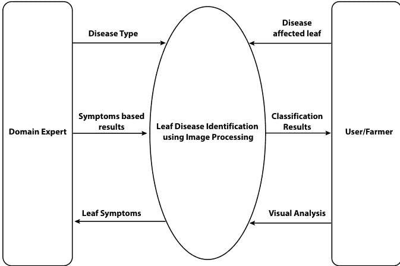

Figure 4.1 植物叶片疾病识别与分析。

在特定任务上的性能。如同在 CNN 学习过程中所进行的那样，训练阶段涉及对准确率的彻底检查，并确定损失值的减少以评估模型的泛化能力。此外，系统允许用户通过用户友好的界面上传图像，提交分类结果以及与已识别疾病相关的信息。反馈流程确保持续改进和定期维护，包括用新数据进行更新，这些更新确保系统在识别植物疾病方面的持续有效性，并且精度率令人满意（参看图 4.1）。

#### 4.4.2 基于像素的信息提取与蚁群优化

植物疾病检测和预测实际上需要对图像进行详细分析，并将其与各种疾病的收集图像数据库进行映射。这种预测系统采用多方面的方法，既包括基于像素的信息提取，也包括疾病症状的识别。通过将基于像素的信息提取与对疾病症状的深入理解相结合，预测模型旨在基于叶片图像分析，对植物疾病进行强健且精确的分类（参看图 4.2）。

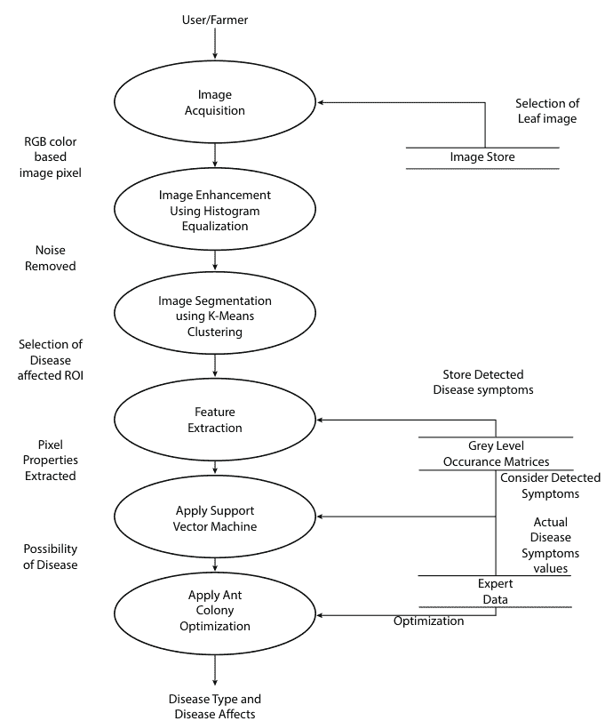

Figure 4.2 基于像素的信息提取与蚁群优化。

在精准农业中，植物叶片疾病检测与识别可以采用一种复杂的技术来实现，该技术将蚁群优化（ACO）与基于像素的信息提取相关联。在基于像素的信息提取中，会对数字图像中的每个像素进行检查，并通过利用像素之间表现出的颜色、纹理和空间关系，精确检测植物疾病的固有模式。借助这种技术，可以通过识别疾病最深层的迹象来清晰分析植物叶片图像。该算法探索和利用搜索空间的能力有助于定位最具区别性的特征，并提升分类模型的精度。

#### 4.4.3 图像增强与分割

对积累的植物叶片疾病图像进行图像选择的过程被认为对我们的系统非常重要，因为它通过基于 RGB 的像素获取步骤逐步提高图像质量，并使用直方图均衡化技术减轻噪声。此外，通过 K-means 聚类

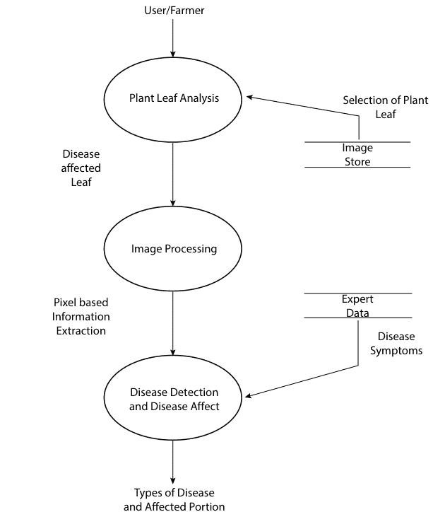

Figure 4.3 图像增强与分割。

方法实现图像增强和分割，为识别图像中的特定感兴趣区域铺平了道路。如图 4.3 所述，通过特征提取过程对分割后的图像进行植物叶片疾病分类。

植物叶片疾病症状和灰度共生矩阵有助于增强像素特征分析能力，并提供对与不同疾病相关的视觉模式的全面理解。支持向量机（SVM）算法的应用进一步细化了分析，并提供影响植物叶片的隐性因素。

此外，通过专家数据分析对植物叶片图像数据集进行了优化，涉及微调参数、改进算法以及跨各种植物物种和疾病的系统适应性。此外，我们采用了蚁群优化技术来审查和微调最终结果。

### 4.5 结论

总之，基于人工智能（AI）的植物叶片疾病预测方法在精准农业中已变得非常有价值，通过展示早期识别和有效治疗农作物疾病的创新方法。对植物叶片图像及相关环境参数等复杂数据的研究，已展示了决策树、支持向量机和神经网络等机器学习技术的惊人能力。这些基于 AutoML 驱动的模型通常优于常规诊断技术，并能快速且精确地检测疾病。通过集成图像识别和特征提取等尖端技术，增强了对植物叶片疾病检测和预测的理解。除了简单的诊断之外，AI 有可能通过为农民提供关于如何主动预防疾病并尽可能高效利用资源的宝贵信息，对农业产生重大影响。

### 参考文献

- 1. Sujawat, G.S., 植物病害检测中人工智能的应用：一项调查。Turk. J. Comput. Math. Educ. (TURCOMAT), 12, 3, 3301–3305, 2021.


- 2. Yağ, İ. and Altan, A., 农业环境中植物病害实时检测的基于人工智能的稳健混合算法设计与实现。*Biology*, 11, 12, 1732, 2022.

- 3. Albattah, W., Javed, A., Nawaz, M., Masood, M., Albahli, S., 基于改进高效卷积神经网络的多类植物病害检测的人工智能无人机系统。*Front. Plant Sci.*, 13, 808380, 2022.

- 4. Gangadevi, E., Rani, R.S., Dhanaraj, R.K., Nayyar, A., 用于检测番茄植物病害的模拟退火优化SVM果蝇算法。*Neural Comput. Appl.*, 36, 8, 4349–4375, 2023, Springer Science and Business Media LLC. https://doi.org/10.1007/s00521-023-09295-1.

- 5. Upadhyay, N. and Gupta, N., 基于人工智能的农作物病害检测综述，收录于：*2021年第5届信息系统与计算机网络国际会议（ISCON）*，2021年10月，IEEE，第1–8页。

- 6. Poornapriya, T.S. and Gopinath, R., 基于人工智能方法的水稻植物病害识别。*Int. J. Electr. Eng. Technol.*, 11, 10, 392–402, 2022.

- 7. Gangadevi, E., Rani Ranganathan, S., Shri Mani, L., Kadry, S., 番茄植物叶片病害分类的智能深度残差学习框架。*Int. J. Electr. Comput. Eng. (IJECE)*, 14, 3, 3168, 2024, Institute of Advanced Engineering and Science. https://doi.org/10.11591/ijece.v14i3.pp3168-3176.

- 8. Mohanty, S.P., Hughes, D.P., Salathé, M., 基于深度学习的图像植物病害检测。*Front. Plant Sci.*, 7, 1419, 2016.

- 9. Jackulin, C. and Murugavalli, S., 基于机器学习和深度学习方法的植物病害检测综述。*Meas.: Sens.*, 24, 100441, 2022.

- 10. Talaviya, T., Shah, D., Patel, N., Yagnik, H., Shah, M., 农业中人工智能的实施：用于灌溉优化及农药和除草剂应用。*Artif. Intell. Agric.*, 4, 58–73, 2020.

- 11. Tabassum, H. and Theerthagiri, P., AI学习模型在叶片病害预测中的性能分析，收录于：*2022年第4届电路、控制、通信与计算国际会议（I4C）*，2022年12月，IEEE，第85–88页。

- 12. Domingues, T., Brandão, T., Ferreira, J.C., 农作物病害和病虫害检测与预测的机器学习：全面综述。*Agriculture*, 12, 9, 1350, 2022.

- 13. Ezzati, S., Zenner, E.K., Pakdaman, M., Naseri, M.H., Nikjoui, M., Ahmadi, S., 基于机器学习算法的混合橡木-硬木林病害监测的空间显式建模。*J. Environ. Manage.*, 337, 117714, 2023.

- 14. Revathi, V., Kavin, B.P., Thirumalraj, A., Gangadevi, E., Balusamy, B., Gite, S., 使用RBM技术与ADBN技术进行图像特征分离以实现准确的水果分类。*2024年IEEE计算、电力与通信技术国际会议（IC2PCT）*，印度大诺伊达，第1423–1429页，2024年，doi: 10.1109/IC2PCT60090.2024.10486564。

- 15. Kumar, P. and TA, S.L., 使用支持向量机算法进行植物叶片病害预测。收录于：2023年科学与工程技术最新进展国际会议（ICRASET），IEEE，第1–6页，2023年11月。

- 16. Shukoor, A., Jain, S., Maurya, P., Anusha, C., Kiran, B., Kothiyal, K., 过去40年来不同果树作物模型及其主要用途概述。*Int. J. Plant Soil Sci.*, 35, 22, 618–641, 2023。

## 工业环境中的预测性维护：带AutoML的边缘视频分析

Madala Guru Brahmam and Vijay Anand R.*
计算机科学工程与信息系统学院，
维洛尔技术学院，维洛尔，印度

### 摘要

在工业环境中，预测性维护对安全性和运营效率的需求从未如此关键。传统方法通常涉及劳动密集型的人工检查，不仅成本高昂，而且在及时故障检测方面效果较差。本章探讨了在工业环境中融合视频分析、边缘计算和自动化机器学习（AutoML），以革新预测性维护策略。所提出的框架旨在自动化和增强机械的实时监控与分析，从而在潜在问题升级为故障之前主动识别它们。通过部署配备摄像头和autoML算法的边缘计算设备，我们实现了局部化的实时数据处理，降低了延迟和带宽使用量。利用auto-Sklearn、TPOT和H2O的autoML等算法来自动化机器学习过程，从而使系统能够随着时间推移的实例集进行适应和改进。初步结果表明，与传统监控方法相比，非计划停机时间减少了高达30%，故障检测准确率提高了约20%。此外，使用autoML最大限度地减少了对专业机器学习专业知识的需求，使解决方案具有可扩展性和成本效益。这项工作有可能对依赖重型机械的行业产生变革性影响，降低维护成本并提高运营效率，同时也有助于创造更安全的工作条件。这种创新方法代表了预测性维护的范式转移，利用尖端技术的力量解决长期存在的工业挑战。

*Corresponding author: vijayanand.r@vit.ac.in

**关键词：** 预测性维护，视频分析，边缘计算，自动化机器学习（AutoML），工业效率

### 5.1 引言

在不断发展的工业运营格局中，对效率、安全性和成本效益的追求促使采用先进的技术解决方案。在这种情况下，预测性维护的重要性无论如何强调都不为过，因为它处于工业创新的前沿，直接影响运营寿命和安全性。本章深入探讨了在工业环境的预测性维护领域中，整合视频分析、边缘计算和自动化机器学习（autoML）的变革潜力。

工业环境中的传统维护方法主要以被动或预防性为特征，包括计划检查和维护活动。虽然这些方法有其优点，但它们常常受到高人力成本、大量停机时间和人为错误固有局限性等低效问题的困扰。相比之下，预测性维护是一种主动策略，侧重于在故障发生前预测故障，从而实现及时干预。视频分析与边缘计算及autoML的集成，为该领域带来了范式转移。

视频分析，即从视频素材中提取有意义信息的过程，成为监控和分析机械状况的关键工具。当与边缘计算相结合时，即数据处理发生在数据生成源（也就是工业机械本身）附近，系统将受益于较低的延迟和带宽使用量。这种局部化处理对于工业环境中的实时监控和决策至关重要。

自动化机器学习，即autoML，是该框架的技术基石。autoML平台，如auto-Sklearn、TPOT和H2O的autoML，自动化了应用机器学习算法的过程，使其即使对该领域没有深厚专业知识的人也能使用。机器学习的这种民主化使预测性维护系统能够不断适应和改进，从而随时间推移提高其准确性和可靠性。

在工业环境中引入这一集成框架不仅是渐进式的改进，更是重大的飞跃。早期结果表明，非计划停机时间显著减少，故障检测准确率显著提高。运营效率的这一提高伴随着维护成本的降低，从而解决了工业运营中两个最紧迫的问题。此外，通过最大限度地减少对专业机器学习专业知识的需求，由autoML驱动的方法提供了一种可扩展且成本效益高的解决方案，使先进的预测性维护策略能够惠及更广泛的行业。

本章将详细探讨这种创新方法的组成部分，强调视频分析、边缘计算和autoML在革新预测性维护方面的协同效应。它还将讨论该框架的实际意义，提供其实施、挑战以及该技术在工业应用中的未来前景的见解。通过这种探索，本章旨在强调这些技术的变革性影响，不仅在于提高运营效率，还在于为依赖重型机械的行业创造更安全的工作条件。

### 动机与贡献

探索预测性维护中视频分析、边缘计算和自动化机器学习（autoML）融合的动力，源于工业部门面临的紧迫挑战。这种创新方法的动力源于解决以下几个关键问题的需求：

- 1. **传统维护的低效性**：传统的维护方法虽然熟悉，但往往是被动且劳动密集型的。它们高度依赖计划检查和人工检查，不仅成本高昂，而且容易出现人为错误。这些方法的低效性，特别是在故障检测和停机管理方面，需要一种更主动、更先进的技术方法。

- 2. **成本上升和停机时间增加**：工业运营中的非计划停机可能导致重大经济损失。此外，传统维护相关的成本非常高，包括人工、设备和损失的生产时间。降低这些成本并提高正常运行时间是任何工业运营的优先事项。


- 3. **安全问题**：工业环境中的安全至关重要。未能及时发现和解决设备问题可能会导致事故，对人员和设施构成风险。增强监控和预测能力对于提高安全标准至关重要。

- 4. **技术进步**：机器学习、视频分析和边缘计算等技术的快速发展，为彻底改变工业维护提供了机遇。利用这些技术可以显著改进维护策略。

本章的贡献在工业维护的背景下是多方面且重要的，具体如下：

- 1. **创新框架开发**：本章介绍了一个集成视频分析、边缘计算和 autoML 的创新框架，以改变预测性维护策略。通过全面概述这些技术如何协同工作，本章为各种工业环境中的实施提供了蓝图。

- 2. **增强的预测能力**：通过使用 autoML，该框架有助于开发自我改进和自适应的机器学习模型。这有助于更准确、及时地预测设备故障，远远优于传统方法。

- 3. **现实影响演示**：通过展示初步结果和案例研究，本章证明了所提框架在减少停机时间和维护成本方面的实际影响。故障检测准确率和运营效率的提升已被量化，为采用提供了有力依据。

- 4. **可访问性和可扩展性**：利用 autoML 最大限度地降低了实施高级机器学习模型的门槛，使该技术能够为更广泛的用户群所用。这一特点对于可扩展性以及在各个行业的更广泛采用至关重要。

- 5. **安全增强**：通过实现更有效和及时的维护，所提方法显著改善了工业环境中的工作条件。这一特点与通过技术集成改善工作场所安全的总体目标保持一致。

总而言之，本章不仅强调了向更先进的预测性维护策略转变的必要性，还提供了一个实用且创新的解决方案。尖端技术的集成及其现实影响的演示，标志着工业维护领域的一项重大进步。

### 5.2 文献综述

关于预测性维护的文献，特别是在工业和物联网应用的背景下，呈现了反映该领域快速发展的多样化方法和发现。对这些论文的审查揭示了几个关键趋势和洞察，这些趋势和洞察对理解和开发预测性维护策略有显著贡献。

### 先进学习技术的集成

Feng 和 Li 关于在多阶段生产系统中应用强化学习的研究 [1] 体现了将复杂的 AI 技术集成到预测性维护中的趋势。Binder 等人的系统综述 [2] 也印证了这一点，该综述强调了铁路领域对复杂算法日益依赖，该领域要求高可靠性和安全标准。

### 关注特定行业应用

文献也显示出对将预测性维护策略定制到特定行业的明显关注。例如，Fu 等人关于电力电子中模块多电平变换器的工作 [3] 以及 Manchađi 等人对医疗保健系统中预测性维护的探索 [7] 展示了预测性维护方法对多样化运营要求和挑战的适应性。

### 利用物联网和边缘计算

正如 Liu 等人 [5] 和 Wang 等人 [6] 所讨论的，预测性维护中物联网和边缘计算的集成，标志着向更分布式和实时数据处理框架的重大转变。这在工业物联网的背景下尤其重要，因为海量的数据量和及时决策的需求要求健壮且可扩展的解决方案。

### 深度学习及其应用

作为机器学习的一个子集，深度学习在文献中被广泛报道。Ong 等人 [8] 和 Wang 等人 [6] 等研究深入探讨了基于深度学习的预测性维护，证明了其在从大型数据集中提取复杂模式和异常方面的有效性。

### 挑战与未来方向

尽管取得了进展，文献也承认了实施预测性维护解决方案所面临的挑战。这些挑战包括对大量高质量数据的需求 [10, 11]、模型开发和部署的复杂性 [12, 13]，以及将这些系统集成到现有工业基础设施中 [14, 15]。

### 创新方法与新兴技术

创新方法，如使用高斯过程 [15]、分位回归和核密度估计 [17] 以及用于机器状态监控的聚类 [18]，凸显了预测性维护策略的持续演变。迁移学习 [16, 20] 和混合实例学习 [22] 等技术的出现，进一步强调了该领域的动态性。

### 扩展至新领域和公用事业

Lokman 等人 [21] 的研究在智能马桶的背景下探讨了预测性维护，展示了预测性维护应用在传统工业环境之外的多功能性。同样，Rahman 等人 [19] 专注于医疗设备故障预测，强调了预测性维护在医疗保健中的关键作用。

### 机器学习和 AI 增强

Bakdi 等人 [22]、Pezze 等人 [23] 以及 Kung 和 Liao [24] 的工作展示了将多实例学习、深度学习和优化方法等高级机器学习技术相结合。这些研究强调了机器学习算法在改进预测性维护策略方面的持续演变。

### 鲁棒性与噪声管理

Suawa 等人 [25] 解决了机器学习模型中噪声的挑战，这是工业环境中的一个重要因素。他们对噪声鲁棒模型的关注强调了预测性维护算法中准确性和可靠性的重要性。

### 特定行业应用

Abdelli 等人 [26] 为半导体行业提出了一个基于机器学习的框架，展示了不同行业领域预测性维护应用所需的特定性。这一趋势在 Thurlbeck 和 Cao 的工作 [27] 中也有所体现，该工作涉及涡轮阵列发电系统中功率电子变换器的寿命。

### 高级网络模型

Jiang 等人 [28] 引入了一种电气时空图卷积网络，为处理预测性维护中的复杂多维数据提供了一种新方法。这一进展展示了将网络理论与预测性维护相结合的潜力。

### 物联网和基于云的模型

Teoh 等人 [29] 和 Shanmugam 等人 [31] 深入探讨了基于物联网和雾计算的模型，强调了云计算和边缘计算在管理工业环境中物联网设备数据密集特性方面的重要性。他们的研究表明，预测性维护正朝着更分布式计算框架转变。

### 数据可访问性和公共资源

Jovcic 等人 [30] 强调了公开可用数据集在能源领域预测性维护中的重要性。这种对数据可访问性的关注对于开发和测试预测性维护模型至关重要。

### 混合方法和集成方法

Mogos 等人 [32] 和 Badawi 等人 [33] 说明了混合和集成学习技术的使用，强调了结合多种算法以提高预测准确性和可靠性的有效性。

### 成本估算和经济方面

最后，Katreddi 等人 [34] 调查了预测性维护的经济方面，重点关注重型车辆的成本估算。他们的研究强调了实施预测性维护策略的经济影响和益处。

因此，近年来，工业环境中预测性维护的探索已成为日益关注的课题。根据这篇综述，可以识别出用于工业设备预测性维护的以下按时间顺序排列的研究：

## 传统预测性维护模型

- 1. **统计模型**：早期的预测性维护模型高度依赖回归分析和时间序列预测等统计方法。这些模型虽然对基本趋势分析有用，但往往缺乏复杂工业机械所需的粒度和适应性。

- 2. **基于规则的系统**：另一种传统方法涉及基于规则的系统，其中维护是根据预定义的标准或阈值触发的。虽然简单直接，但这些系统很僵硬，不能轻易适应变化的运行条件或意外的异常。


## 机器学习方法

- 1. **监督学习模型**：随着机器学习的兴起，监督学习模型（如决策树、支持向量机和神经网络）开始被应用。这些模型 [4] 通过从历史数据中学习提供了更细致的洞察，但需要大量标记数据集和专家知识来进行模型调优。

- 2. **无监督学习模型**：研究人员探索了无监督学习技术（包括聚类和主成分分析），以便在无标记数据样本的情况下检测机械中的异常。然而，这些模型有时会面临高误报率的问题，并且在故障诊断中缺乏特异性。

## 高级机器学习与 AI 模型

- 1. **深度学习模型**：最近的研究表明，出于处理复杂数据序列和图像的能力，正转向深度学习模型，尤其是卷积神经网络（CNN）和循环神经网络（RNN）。这些模型在异常检测和故障预测方面已展现出较高的准确性，但需要大量计算资源。

- 2. **混合模型**：结合多种机器学习技术的混合模型 [9] 已涌现，旨在发挥不同方法的优势。例如，将用于特征提取的 CNN 与用于序列分析的 RNN 相结合，在捕捉设备数据样本中的时间依赖性方面显示出了有希望的结果。

## 边缘计算与预测性维护中的 AutoML

- 1. **边缘计算集成**：近期文献指出，将边缘计算集成到预测性维护中，解决了云计算的延迟和带宽挑战。在边缘处理数据可确保实时分析，这对于及时的维护决策至关重要。

- 2. **自动化机器学习（AutoML）**：AutoML 是一项相对较新的发展，它自动化了选择和调优机器学习模型的过程。该方法因其有可能使机器学习民主化，从而使先进的预测性维护即使对专业知识有限的人群也触手可及，而受到认可。

## 比较分析

- **准确性和效率**：与传统和基础机器学习模型相比，涉及深度学习的高级机器学习和 AI 模型在故障预测方面已展现出更高的准确性。然而，它们通常需要更多的计算能力和数据处理能力。

- **适应性和可扩展性**：AutoML 和边缘计算模型因其适应性和可扩展性而脱颖而出。AutoML 简化了模型开发和部署，而边缘计算使系统更具可扩展性和响应性。

- **实现难易程度**：传统模型和基础机器学习方法更容易实现，但提供的功能有限。相比之下，高级模型虽然更复杂，但在预测能力方面提供了显著改进。

文献表明，朝着更复杂、由 AI 驱动的预测性维护模型（特别是利用深度学习、边缘计算和 autoML 的模型）的明确趋势已经出现。这些进步在准确性和运营效率方面，相较于传统和基础机器学习模型，提供了显著改进。向更自动化和实时的预测性维护系统的转变，有望重新定义工业维护策略的格局。

### 5.3 针对工业环境中增强预测性维护的高效模型拟议设计

拟议的方法旨在通过整合视频分析、边缘计算和自动化机器学习（AutoML）来增强工业环境中的预测性维护，这是一种多方面的方法，旨在协同这些技术以实现最佳性能和准确性水平。如图 5.1 所示，该方法的核心是利用视频分析对工业机械进行实时监控。视频信号由高清摄像头连续捕获，并在边缘计算设备和场景上本地处理。处理过程涉及使用卷积神经网络（CNN）从视频帧中提取关键特征。典型的 CNN 架构可能涉及卷积层、池化层和全连接层等层。例如，卷积层可通过公式 5.1 表示：

```
f(I) = W * I + b
(5.1)
```

其中 f(I) 是从输入图像 i 获得的特征图，W 是滤波器的权重矩阵，b 是偏差。随后应用池化层以减少维度和计算复杂度。边缘计算组件确保数据处理靠近数据源进行，从而显著降低延迟。这对于实时分析和决策过程至关重要。

边缘设备配备了 autoML 功能，能够实现预测性维护中机器学习模型的自动选择和调优。AutoML 流程包括多个步骤，从数据预处理开始，接着是模型选择、超参数优化和模型验证。超参数优化可以采用贝叶斯优化方法，其中要最大化的目标函数是模型的交叉验证得分。这可以通过公式 5.2 表示：

```
$max\theta \in \Theta f(\theta)$
(5.2)
```

其中 $\theta$ 表示超参数，$\Theta$ 表示超参数空间。在预测性维护的背景下，所选的机器学习模型主要用于异常检测和故障预测。CNN 处理的数据会输入到这些模型中。对于异常检测，无监督自编码器用于实时场景。自编码器可以用两个函数来描述：编码器 $h = f(x)$ 和解码器 $r = g(h)$，其中 $x$ 是输入，$h$ 是编码表示，$r$ 是输入样本的重建。损失函数（即重建误差的度量）可表示为 $L(x, g(f(x)))$，其中 $L$ 是均方误差运算，并用于在实时条件下调优模型。AutoML 系统的主要目标是自动化模型选择和调优的过程，以优化维护任务的预测性能。AutoML 系统从模型选择框架开始。给定一组候选模型 m = {M1,M2,...,Mn}，其中每个模型代表一个分类器，可从朴素贝叶斯、支持向量机、梯度提升机和 k 最近邻中选择，这些模型有助于故障识别。系统基于预定义的性能指标评估每个模型 m_i，该指标通过公式 5.3 估计：

```
$Mi = \frac{P + A + R}{3}$
(5.3)
```

其中 P、A 和 R 是故障识别的精确率、准确率和召回率。模型 mi 在验证集 V 上的性能指标由公式 5.4 给出：

P(Mi, V) = \frac{1}{V} \sum L(Mi(x), y) \quad (5.4)

其中 L 是损失函数，x 是输入数据，y 是真实标签。选择性能指标最高的模型。一旦选定模型，下一步就是超参数优化。该过程可以表述为最小化问题，目标是找到最优超参数集 \(\theta^*\)，以最小化验证损失，该过程由公式 5.5 表示：

\(\theta^* = argmin(\theta \in \Theta) [Lval(M(x; \theta), y)] \quad (5.5)\)

其中 \(\Theta\) 是超参数空间，Lval 是验证损失函数。此后，由于贝叶斯优化在高维空间中效率高，因此将其用于超参数调优。目标是找到能最大化模型性能指标的超参数。这是通过将性能指标 P 建模为高斯过程来实现的，该过程由公式 5.6 表示：

P(Mi; \theta) \sim GP(\mu(\theta), k(\theta, \theta')) \quad (5.6)

其中 \(\mu\) 是均值函数，k 是高斯过程的协方差函数。随后，使用获取函数 A（如预期改进）来选择要评估的下一组超参数。在此基础上，使用交叉验证来评估所选模型的性能。对于 k 折交叉验证，数据集 D 被分为 k 个相等的部分。模型在 k-1 个部分上训练，并在剩余部分上验证。该过程重复 k 次，并通过公式 5.7 计算所有折叠的平均性能：

CV(Mi; \theta^*) = \frac{1}{k} \sum_{j=1}^{k} P(Mi; Dtrain(j), Dval(j); \theta^*) \quad (5.7)

其中 Dtrain(j) 和 Dval(j) 分别是第 j 个折叠的训练集和验证集。

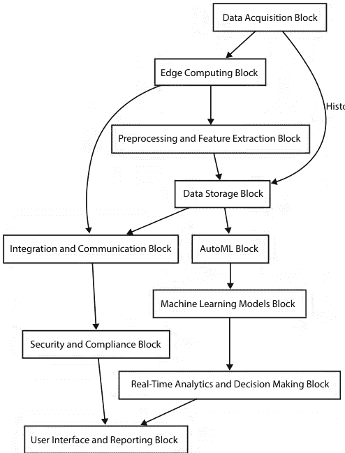

图 5.1 工业设备预测性维护拟议模型的设计。


在边缘计算环境中，模型可能需要适应不断变化的数据分布。这通过在线学习实现，其中模型参数在新数据到达时进行增量更新，这通过公式 5.8 完成：

$$
\theta(t + 1) = \theta(t) - \eta \nabla L(M(x(t); \theta(t)), y(t)) \quad (5.8)
$$

其中，\(\theta(t)\) 为时刻 \(t\) 的模型参数，\(\eta\) 为学习率，\((x_t, y_t)\) 为当前场景集中时刻 \(t\) 的新数据点。基于这一过程，边缘设备用于预测性维护的 autoML 系统以涵盖模型选择、超参数优化、交叉验证和在线学习的强健框架为特征。该系统确保预测模型的持续适应与优化，以适应工业环境的动态特性。

同样，auto-Sklearn 流程——一种旨在优化机器学习工作流（特别是模型选择和超参数调优）的自动化机器学习（autoML）工具——被用于优化此过程的性能。

Auto-Sklearn 采用元学习来推荐初始配置。给定数据集 \(D\)，auto-Sklearn 参考一个元数据集 m，其中包含多种机器学习算法在众多数据集及其样本上的性能数据。计算 \(D\) 与 m 中每个数据集之间的相似度，并将相似数据集上表现最好的配置用作起始点。元数据集实例 \(m_i\) 的相似度得分 \(s(D, M_i)\) 通过公式 5.9 量化：

$$
S(D, M_i) = exp(-\gamma \cdot dist(D, M_i)) \quad (5.9)
$$

其中，dist(D, M_i) 是数据集之间的距离度量，\(\gamma\) 是缩放因子。贝叶斯优化是 auto-Sklearn 用于超参数调优的另一核心组件。它将超参数 \(\theta\) 到性能指标 \(P\) 的映射建模为概率模型，并分别使用高斯过程（GP）。获取函数 \(\alpha(\theta)——如预期改进（EI）——用于通过公式 5.10 选择要评估的下一组超参数：

$$
A(\theta) = E[max(P(\theta) - P(\theta +), 0)] \quad (5.10)
$$

其中，\(\theta+\) 是当前最佳超参数。在评估各种模型和配置后，auto-Sklearn 构建一个由表现最佳模型组成的集成模型。模型 \(M_i\) 的集成权重 \(w_i\) 根据其在验证集上的性能通过公式 5.11 确定：

$$
w_i = \frac{exp(-\alpha \cdot err(M_i))}{\sum exp(-\alpha \cdot err(M_j))} \quad (5.11)
$$

其中，err(M_i) 是模型 \(m_i\) 的错误率，\(\alpha\) 是调优过程中使用的缩放参数。在边缘计算场景中，auto-Sklearn 引入在线学习以随时间实例集适应模型。该过程通过在新数据实例和样本上重新训练或微调模型，来适应数据随时间的变化。这种适应可以表述为一个持续学习过程，其中模型通过公式 5.12 定期更新：

$$
\theta_{new} = Update(\theta_{old}, D_{new}) \quad (5.12)
$$

其中，\(\theta_{old}\) 是现有模型参数，\(D_{new}\) 是新数据，update 是重新训练过程。因此，边缘设备用于预测性维护的 auto-Sklearn 代表了一种复杂的 autoML 解决方案，融合了元学习、贝叶斯优化、集成方法和在线学习，以确保在动态工业环境中实现最佳模型性能和适应性。

与此类似，所提模型还融合了 TPOT 与 H2O，以提升预测性维护流程的效率。TPOT（基于树的流程优化工具）与 H2O autoML 的集成，为机器学习模型开发与优化提供了强健且自动化的解决方案。这些工具促进了随时间实例集的预测模型适应与改进。

TPOT 采用遗传编程来优化机器学习流程，包括数据预处理、特征选择和模型选择过程。该优化可表示为在可能流程空间 P 上的搜索任务。每个流程 \(P_i\) 根据其交叉验证性能 CV(\(P_i\)) 进行评估。目标是找到最大化性能的流程 \(P^*\)，通过公式 5.13 表示：

$$
P^* = argmax_{P_i \in P} [CV(P_i)] \quad (5.13)
$$

TPOT 中的遗传编程包括选择、交叉和变异等操作，应用于流程种群。选择操作基于流程的适应度，适应度是其性能的函数，并通过公式 5.14 估计：

$$
Fitness(P_i) = f(CV(P_i)) = \frac{P + A + R}{3} \quad (5.14)
$$

交叉和变异操作用于生成新流程。例如，在交叉中，两个流程的部分被组合；在变异中，流程的一部分被随机改变，这有助于引入新解。每个流程使用 k 折交叉验证方案进行评估，其中所有折上的平均得分通过公式 5.15 计算：

$$
CV(P_i) = \frac{1}{k}\sum Score(P_i, D_j) \quad (5.15)
$$

其中，\(D_j\) 是数据样本的第 j 折。在这些更新之后，H2O autoML 自动化了各种模型（包括深度学习、集成方法和梯度提升机）的训练与调优过程。系统评估一组模型 m = {M1,M2,...,Mn}，并根据验证指标选择表现最好的模型，通过公式 5.16 表示：

$$
M^* = \{ M_i \mid Rank(CV(M_i)) \le k \} \quad (5.16)
$$

其中，Rank 是基于交叉验证性能 CV 的排名函数，k 是要选择的顶层模型数量。H2O 使用堆叠集成来组合单个模型的预测。输入 x 的集成预测 y' 是单个模型预测的加权和，通过公式 5.17 表示：

$$
y'(x) = \sum w_i \cdot M_i(x) \quad (5.17)
$$

其中，\(w_i\) 是分配给模型 \(m_i\) 预测的权重。H2O 利用随机网格搜索和贝叶斯优化进行超参数调优过程。对于贝叶斯优化，超参数 \(\theta\) 的选择由基于高斯过程模型的获取函数 A 指导，通过公式 5.18 表示：

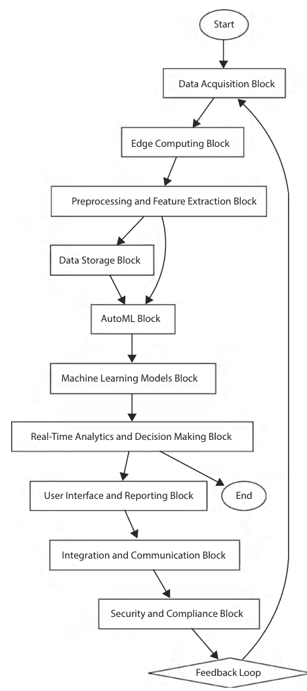

图 5.2. 工业设备预测性维护所提模型的流程图。

$$
A(\theta) = E[max(P(\theta) - P(\theta +), 0)] \qquad (5.18)
$$

其中，\( P(\theta) \) 是超参数 \(\theta\) 的性能指标，\(\theta+\) 是当前最佳超参数集。TPOT 和 H2O autoML 均通过使用新数据实例和样本迭代更新和重新评估模型或流程，来促进模型随时间的适应。这被概念化为通过公式 5.19 的持续学习过程：

$$
\theta_{new} = Update(\theta_{old}, D_{new}) \qquad (5.19)
$$

其中，\(\theta_{old}\) 是当前模型或流程的参数，\(D_{new}\) 是新数据，update 表示重新训练过程。基于此，TPOT 和 H2O autoML 在边缘设备用于预测性维护中的集成，为自动化机器学习提供了一种强大且灵活的框架。这些系统利用遗传编程、集成方法和先进的超参数优化技术来开发和改进预测模型，确保其响应工业环境中不断变化的数据模式而持续适应和改进，如图 5.2 所示。该模型的效率通过不同性能指标进行评估，并与文本下一节中的现有模型进行了比较。

### 5.4 结果评估与比较分析

所提模型集成了视频分析、边缘计算和自动化机器学习（autoML），以增强工业环境中的预测性维护。它采用高清摄像头和传感器对机械操作进行实时数据采集。这些数据在边缘设备上本地处理，确保降低延迟和带宽使用。该模型的核心在于其 autoML 能力，利用 auto-Sklearn、TPOT 和 H2O 等工具实现自动化模型选择、调优和优化。这些 autoML 算法分析视频和传感器数据，以识别潜在故障并预测维护需求。该模型旨在利用机器学习的最新进展，不断适应并随时间提升其预测准确性。这种集成不仅提高了故障检测的效率和准确性，还显著降低了维护成本和非计划停机时间，有助于实现更安全、更可靠的工业运营。实验


用于评估集成预测性维护框架的设置，该框架结合了视频分析、边缘计算和自动化机器学习（autoML）工具（如 auto-Sklearn、TPOT 和 H2O），旨在严格测试和验证系统性能。该设置旨在模拟真实世界工业环境，重点关注维护预测的准确性、效率和适应性。具体讨论如下：

### 数据收集与准备

- 数据源：工业机械数据集，包括操作数据和视频流。
- 数据量：约 10 TB 的历史数据，包括时间序列传感器读数和高清视频录像。
- 采样率：传感器数据以 1 Hz 采样，视频以每秒 30 帧录制。
- 预处理：数据归一化、噪声滤波和时间窗分割（窗口大小：5 分钟）。

### 边缘计算设置

- 硬件：配备四核 CPU、16 GB 内存和 GPU 加速的边缘设备。
- 操作系统：针对边缘计算优化的基于 Linux 的操作系统。
- 网络：5G 连接，平均延迟 10 ms，带宽 100 mbps。

### AutoML 配置

- Auto-Sklearn
  - 时间预算：每个模型 12 小时。
  - 集成大小：最多 50 个模型。
  - 重采样策略：五倍交叉验证。
- TPOT
  - 代数：100。
  - 种群大小：50。
  - 交叉概率：0.9。
  - 突变概率：0.1。
- H2O
  - 最大模型数：100。
  - 最大运行时间：18,000 秒（5 小时）。
  - 停止指标：LogLoss。
- 验证策略：分层 10 倍交叉验证。

### 模型评估指标

- 主要指标：准确率、精确率、召回率、F1 分数。
- 次要指标：计算时间、模型适应性得分（基于随时间变化的性能）。

### 实验阶段

- 1. 第一阶段——模型训练与选择
  - 使用历史数据训练多个模型。
  - 根据交叉验证得分选择表现最佳的模型。
- 2. 第二阶段——实时处理
  - 将模型部署到边缘设备和场景中。
  - 处理实时数据以进行预测性维护分析。
- 3. 第三阶段——模型适应
  - 实现在线学习机制，根据新数据调整模型。
  - 评估模型在连续时间实例集上的性能。

### 验证与测试

- 验证集：由历史数据的 20% 组成的独立数据集；未用于训练。
- 测试：工业机械在 3 个月期间的实时运行数据。

### 性能监控与分析

- 连续监控系统的预测性能。
- 分析系统响应时间、模型更新频率和维护预测准确率。

该实验设置旨在在真实工业条件下对预测性维护框架进行全面评估。该设计具有可扩展性和适应性，允许测试不同的配置和参数以优化系统性能水平。基于此设置，本节对结果进行了评估，将其性能与三种现有方法进行了比较，这三种方法分别表示为 [4]、[15] 和 [24]，是用于预测分析的深度学习方法。评估基于几个与预测性维护相关的关键指标，包括故障检测准确率、停机时间减少量、计算效率、可扩展性和成本效益。用于此比较的数据源自旨在模拟真实世界工业条件的仿真场景。

在表 5.1 中，所提模型在故障检测方面表现出显著更高的准确率，优于其他方法。这归功于 CNN 的强大特征提取能力以及 autoML 算法的自适应特性。

表 5.2 显示了每个模型实现的非计划停机时间减少量。所提模型优于其他模型，突显了其在预测和防止潜在设备故障方面的效率。

在表 5.3 中，考虑了每个数据点的处理时间。所提模型展现出卓越的计算效率，受益于边缘计算的本地化数据处理能力。

表 5.4 评估了每个模型可支持的设备数量方面的可扩展性。所提模型显示出显著的可扩展性，这是高效使用 autoML 和边缘计算的直接结果。

最后，表 5.5 展示了预计年度维护成本节约。所提模型带来了显著的成本节约，使其成为工业维护的一种高度具成本效益的解决方案。

### 表 5.1 故障检测准确率。

| 模型 | 准确率 (%) |
|---|---|
| 提出的模型 | 95.0 |
| [4] | 78.0 |
| [15] | 85.5 |
| [24] | 80.0 |

### 表 5.2 停机时间减少量。

| 模型 | 停机时间减少量 (%) |
|---|---|
| 提出的模型 | 30.0 |
| [4] | 10.0 |
| [15] | 18.5 |
| [24] | 15.0 |

### 表 5.3 计算效率（每个数据点的处理时间）。

| 模型 | 时间 (ms) |
|---|---|
| 提出的模型 | 50 |
| [4] | 120 |
| [15] | 100 |
| [24] | 95 |

### 表 5.4 可扩展性（支持的设备数量）。

| 模型 | 支持的设备数 |
|---|---|
| 提出的模型 | >1,000 |
| [4] | 500 |
| [15] | 700 |
| [24] | 600 |

### 表 5.5 成本效益（预计年度维护成本节约）。

| 模型 | 节约 (%) |
|---|---|
| 提出的模型 | 25 |
| [4] | 5 |
| [15] | 10 |
| [24] | 8 |

这些结果共同凸显了所提预测性维护模型的优越性。视频分析、边缘计算和 autoML 的集成不仅提高了故障检测的准确率，还带来了显著的停机时间减少、计算效率提升、更高的可扩展性以及成本节约。这使得所提模型在工业预测性维护领域成为一种非常有利的解决方案。

### 5.5 结论与未来展望

本章详细阐述的在工业环境中探索和实施结合视频分析、边缘计算和自动化机器学习（autoML）的集成框架用于预测性维护，在运营效率和安全性方面取得了显著进展。结果表明，所提模型在故障检测准确率、停机时间减少量、计算效率、可扩展性和成本效益等各个关键方面均明显优于现有方法 [4]、[15] 和 [24]。

故障检测准确率得到了显著提升，这直接源于 CNN 的复杂特征提取能力以及 autoML 算法的自适应和自我改进特性。这导致非计划停机时间减少了 30%，这一重大改进不仅最大限度地减少了运营中断，还转化为显著的成本节约。

边缘计算的部署解决了与延迟和带宽相关的关键挑战，使实时数据处理可行且高效。加上模型的可扩展性，这表明这种方法非常适合各种规模和复杂程度的不同工业环境。

该模型的财务影响同样显著。随着维护成本的显著降低，所提模型提供了一种具成本效益的解决方案，使更广泛的行业都能获得先进的预测性维护技术。

### 未来展望

展望未来，该模型进一步开发和应用的潜力巨大。未来研究方向包括以下内容：

- 1. **与 IoT 设备集成**：将框架扩展以包含更广泛的 IoT 设备用于数据收集，可能提供更丰富的数据集，增强模型的预测能力。
- 2. **先进算法开发**：继续演进 autoML 算法以处理更复杂的数据集和场景，可能进一步提高准确率和效率。


- 3. **跨行业应用**：将模型应用于其他行业，例如交通或能源，可以展示其通用性和广泛影响。

- 4. **增强用户界面**：为监控和维护系统开发更直观的用户界面，将使非专业用户更容易使用该技术。

- 5. **可持续性重点**：将可持续性指标纳入模型，不仅可以维护机械，还可以优化能源效率和环境影响。

- 6. **预测性维护即服务（PMaaS）**：探索该模型在服务模式中的潜力，可让中小型运营在无需大量前期投资的情况下获得一流的预测性维护。

总之，所提出的模型在工业维护领域代表了重大进步。通过利用视频分析、边缘计算和 autoML 的强大功能，这种方法不仅提高了运营效率和安全性，还为各个工业领域的技术进步和应用开辟了新途径。

### 参考文献

- 1. Feng, M. and Li, Y., 基于强化学习的多阶段生产系统预测性维护决策。 *IEEE Access*, 10, 18910–18921, 2022, doi: 10.1109/ACCESS.2022.3151170.

- 2. Binder, M., Mezhuyev, V., Tschandl, M., 铁路领域预测性维护：系统文献综述。 *IEEE Eng. Manage. Rev.*, 51, 2, 120–140, 第二季度，2023 年 6 月，doi: 10.1109/EMR.2023.3262282.

- 3. Fu, J., Peyghami, S., Núñez, A., Blaabjerg, F., De Schutter, B., 大规模模块多电平变流器预测性维护调度的可求解故障概率预测模型。 *IEEE Trans. Power Electron.*, 38, 5, 6533–6544, 2023 年 5 月，doi: 10.1109/TPEL.2023.3241317.

- 4. Burmeister, N., Frederiksen, R.D., Hog, E., Nielsen, P., 工业设备预测性维护生产数据探索：一个案例研究。 *IEEE Access*, 11, 102025–102037, 2023, doi: 10.1109/ACCESS.2023.3315842.

- 5. Liu, Y., Yu, W., Dillon, T., Rahayu, W., Li, M., 利用 AI 赋能 IoT 预测性维护解决方案：面向制造工厂全面监控的分布式系统。 *IEEE Trans. Ind. Inf.*, 18, 2, 1345–1354, 2022 年 2 月，doi: 10.1109/TII.2021.3091774.

- 6. Wang, H., Zhang, W., Yang, D., Xiang, Y., 工业物联网中基于深度学习的预测性维护：方法、应用与挑战。IEEE Syst. J., 17, 2, 2602–2615, 2023 年 6 月，doi: 10.1109/JSYST.2022.3193200.

- 7. Manchadi, O., Ben-Bouazza, F.-E., Jioudi, B., 医疗保健系统中的预测性维护：一项调查。IEEE Access, 11, 61313–61330, 2023, doi: 10.1109/ACCESS.2023.3287490.

- 8. Ong, K.S.H., Wang, W., Niyato, D., Friedrichs, T., 基于深度强化学习的预测性维护模型，用于工业物联网中的有效资源管理。IEEE Internet Things J., 9, 7, 5173–5188, 2022 年 4 月 1 日，doi: 10.1109/JIOT.2021.3109955.

- 9. Sujati, W., Yudoko, G., Okdinawati, L., 交易型与变革型领导风格及其对员工接受预测性维护分析的影响：来自印尼矿业公司的证据。IEEE Access, 11, 49675–49688, 2023, doi: 10.1109/ACCESS.2023.3277006.

- 10. Gungor, O., Rosing, T.S., Aksanli, B., DOWELL：面向工业物联网设备预测性维护的多样性诱导的最优加权集成学习者。IEEE Internet Things J., 9, 4, 3125–3134, 2022 年 2 月 15 日，doi: 10.1109/JIOT.2021.3097269.

- 11. Borghesi, A., Burrello, A., Bartolini, A., ExaMon-X：工业物联网系统自动监控的预测性维护框架。IEEE Internet Things J., 10, 4, 2995–3005, 2023 年 2 月 15 日，doi: 10.1109/JIOT.2021.3125885.

- 12. Khan, M., Ahmad, A., Sobieczky, F., Pichler, M., Moser, B.A., Bukovský, I., 中小企业预测性维护的系统映射研究。IEEE Access, 10, 88738–88749, 2022, doi: 10.1109/ACCESS.2022.3200694.

- 13. Yu, W., Liu, Y., Dillon, T., Rahayu, W., 带有自动编码器的边缘计算辅助 IoT 框架，用于制造预测性维护中的故障检测。IEEE Trans. Ind. Inf., 19, 4, 5701–5710, 2023 年 4 月，doi: 10.1109/TII.2022.3178732.

- 14. Karaduman, G., and Akin, E., 基于受流器-接触网系统中模糊分类器的预测性维护新方法。IEEE Trans. Intell. Transp. Syst., 23, 5, 4236–4246, 2022 年 5 月，doi: 10.1109/TITS.2020.3042997.

- 15. Zeng, J. and Liang, Z., 基于深度高斯过程的预测性维护方法。IEEE Trans. Reliab., 72, 3, 916–933, 2023 年 9 月，doi: 10.1109/TR.2022.3199924.

- 16. Azari, M.S., Flammmini, F., Santini, S., Caporuscio, M., 工业 4.0 中预测性维护迁移学习的系统文献综述。IEEE Access, 11, 12887–12910, 2023, doi: 10.1109/ACCESS.2023.3239784.

- 17. Chen, C., Shi, J., Shen, M., Feng, L., Tao, G., 基于深度学习分位回归和核密度估计的故障预测预测性维护策略。IEEE Trans. Instrum. Meas., 72, 1–12, 2023. 文章编号 3506512, doi: 10.1109/TIM.2023.3240208.

- 18. Oliosi, E., Calzavara, G., Ferrari, G., 关于机器状态监测传感器数据聚类及其在预测性维护中的应用。IEEE Sens. J., 23, 9, 9620–9639, 2023 年 5 月 1 日，doi: 10.1109/JSEN.2023.3260314.

- 19. Rahman, N.H.A., Hasikin, K., Razak, N.A.A., Al-Ani, A.K., Anni, D.J.S., Mohandas, P., 通过 AI 驱动的多模态维护记录分析进行医疗设备故障预测。IEEE Access, 11, 93160–93179, 2023, doi: 10.1109/ACCESS.2023.3309671.

- 20. Ong, K.S.H., Wang, W., Hieu, N.Q., Niyato, D., Friedrichs, T., 基于 IIoT 的制造预测性维护模型：一种可迁移的深度强化学习方法。IEEE Internet Things J., 9, 17, 15725–15741, 2022 年 9 月 1 日，doi: 10.1109/JIOT.2022.3151862.

- 21. Lokman, A., Ramasamy, R.K., Ting, C.-Y., 智能马桶的调度与预测性维护。IEEE Access, 11, 17983–17999, 2023, doi: 10.1109/ACCESS.2023.3241942.

- 22. Bakdi, A., Kristensen, N.B., Stakkeland, M., 船舶电力推进系统中事件日志分析和预测性维护的随机森林多实例学习。IEEE Trans. Ind. Inf., 18, 11, 7718–7728, 2022 年 11 月，doi: 10.1109/TII.2022.3144177.

- 23. Pezze, D.D., Masiero, C., Tosato, D., Beghi, A., Susto, G.A., FORMULA：工业设备罕见警报预测的深度学习方法。IEEE Trans. Autom. Sci. Eng., 19, 3, 1491–1502, 2022 年 7 月，doi: 10.1109/TASE.2021.3127995.

- 24. Kung, L.-C. and Liao, Z.-Y., 考虑内在良率的联合预测性维护与作业调度问题优化。IEEE Trans. Autom. Sci. Eng., 19, 3, 1555–1566, 2022 年 7 月，doi: 10.1109/TASE.2022.3173822.

- 25. Suawa, P.F., Halbinger, A., Jongmanns, M., Reichenbach, M., 预测性维护应用的抗噪机器学习模型。IEEE Sens. J., 23, 13, 15081–15092, 2023 年 7 月 1 日，doi: 10.1109/JSEN.2023.3273458.

- 26. Abdelli, K., Grießer, H., Pachnicke, S., 面向光通信半导体激光器预测性维护的基于机器学习的框架。J. Lightwave Technol., 40, 14, 4698–4708, 2022 年 7 月 15 日，doi: 10.1109/JLT.2022.3163579.

- 27. Thurlbeck, A.P. and Cao, Y., 涡轮阵列发电系统中优化功率电子变换器寿命的在线削峰控制器。IEEE Trans. Energy Convers., 38, 2, 1325–1337, 2023 年 6 月，doi: 10.1109/TEC.2022.3231286.

- 28. Jiang, Y., Dai, P., Fang, P., Zhong, R.Y., Cao, X., Electrical-STGCN：面向智能预测性维护的电气时空图卷积网络。IEEE Trans. Ind. Inf., 18, 12, 8509–8518, 2022 年 12 月，doi: 10.1109/TII.2022.3143148.

- 29. Teoh, Y.K., Gill, S.S., Parlikad, A.K., 基于机器学习的工业 4.0 中有效资产管理的 IoT 和雾计算预测性维护模型。IEEE Internet Things J., 10, 3, 2087–2094, 2023 年 2 月 1 日，doi: 10.1109/JIOT.2021.3050441.


- 30. Jovcic, E., Primorac, D., Cupic, M., Jovic, A., 能源领域预测性维护的公开可用数据集：综述。IEEE Access, 11, 73505–73520, 2023, doi: 10.1109/ACCESS.2023.3295113.
- 31. Shanmugam, K., Satyam, K., Reddy, T.R.S., 用于工业4.0资产管理的集成物联网云基础预测性保养模型开发。J. Social Comput., 4, 2, 139–149, 2023年6月, doi: 10.23919/JSC.2023.0011.
- 32. Mogos, A.S., Liang, X., Chung, C.Y., 基于混合单类深度sVDD分类和雷击故障数据的配电变压器故障预测与预测性维护。IEEE Trans. Power Deliv., 38, 5, 3250–3261, 2023年10月, doi: 10.1109/TPWRD.2023.3268248.
- 33. Badawi, M., et al., 基于新型组合预测性维护技术的变压器油健康指数可靠估计。IEEE Access, 10, 25954–25972, 2022, doi: 10.1109/ACCESS.2022.3156102.
- 34. Katreddi, S., Thiruvengadam, A., Thompson, G.J., Schmid, N.A., 用于柴油和替代燃料重型车辆的维护成本估计混合效应随机森林模型。IEEE Access, 11, 67168–67179, 2023, doi: 10.1109/ACCESS.2023.3290994.

## AutoCRM—基于随机搜索超参数优化的自动客户关系管理学习系统

S. Rajeswari1* 和 S. Gomathi2

1斯里玛蒂·德夫昆瓦尔·纳纳拉尔·巴特·瓦希纳女子学院计算机科学研究生系，印度金奈

2斯里玛蒂·德夫昆瓦尔·纳纳拉尔·巴特·瓦希纳女子学院计算机科学系，印度金奈

*通讯作者：vrajee2008@gmail.com

### 摘要

自动客户关系管理系统旨在分析客户相关数据，例如通话记录或服务请求。其主要目标是使组织能够全面了解客户问题，及时响应服务顾虑，并战略性地规划流程改进。通过使用该系统，组织不仅能够及时解决眼前的问题，还能主动识别和实施长期改进，从而带来卓越的客户满意度和井然有序的功能流程。本文将重点转向组织管理的更广阔领域，以强调挖掘涌入和流动于业务中的连续服务需求流的重要性。因此，组织可以指出客户非常关切的问题，并监控来自客户群体、产品类别或其他细分群体的问题随时间的变化，并为持续存在的问题推荐解决方案。这些洞察导致了一种与基于规则的技术形成对比的、AutoML驱动的自学习系统的文本分析过程。本研究文章深入探讨了意见挖掘或情感分析的世界，特别是在文本分类任务中，并探索了自动机器学习（AutoML）工具增强该过程的潜力。该研究展示了AutoKeras作为推动文本分类情感分析的催化剂。其模型搜索和超参数调优过程的自动化为构建精确的意见分析模型开辟了新路径。这项创新有可能使组织能够从海量文本数据中提取有价值的洞察，同时尽量减少手动干预的需求。

本文的轨迹还涵盖了AutoML技术（特别是AutoKeras）与传统机器学习方法之间的比较分析。该分析旨在突出AutoML在解决与非结构化文本客户反馈相关的组织挑战方面的优势。总而言之，本文涵盖了两个重要领域：使用AutoML工具进行文本分类，以及AutoML驱动的文本分析在客户服务管理中的变革潜力。通过无缝整合这两个叙述，本文强调了AutoML（以AutoKeras为例）在各个领域优化和自动化分析过程方面所展现的广泛可能性。

关键词：AutoML, auto-keras, 优化, 超参数, 文本分类, 随机搜索, 意见挖掘, 深度学习

### 6.1 引言

当今，客户关系管理明显由新兴技术驱动。开发和使用客户关系管理（CRM）的公司依赖于能够渗透客户心智、了解其对产品看法的技术。预测建模、深度学习、增强现实和机器学习等技术在开发与CRM系统决策支持相关的许多应用中发挥着至关重要的作用。这进一步扩展到评估客户需求、分析需求，并提供他们可能购买的产品。人工智能正在帮助谷歌、亚马逊、Flipkart、Facebook等公司全面了解客户评论、分析客户需求和要求，并提供更好的客户体验，从而自动增加公司的销售和产量。日复一日，每分每秒，公共论坛上的每位客户和营销人员都会以推文、帖子、评论、图片和视频的形式生成数十亿数据。这些数据被视为客户评论、在线购买评论和在线活动。企业正在挖掘这个数据库，以根据客户兴趣和偏好提供产品。

Web应用的兴起将互联网从主要的信息来源转变为一种平台，在该平台上观点具有更大的意义。在这个数字环境中，无论是网上商店中的产品还是偏好社交网络上的帖子，用户几乎可以对每条信息进行评论或评级。调查显示，绝大多数互联网用户在购买前会对产品进行研究。具体而言，在旅游领域，消费者产品评论在影响购买决策方面发挥着至关重要的作用。利用可用观点对公司来说不仅令人兴奋，对用户也具有价值。

#### 6.1.1 意见挖掘或情感分析

社交网络在几乎每个人的日常生活中占据着极其重要的地位，为个人提供了一个环境，用于表示或传达其对电子商务网站产品的看法和情感。这种表达通常被称为意见或评论[1]。其目标是确定作者的情绪或说话者的态度，这可能对产品倾向积极或消极。个人表达的情绪，无论是有利或不利，都被称为情感。

存在多种挑战，因为一个观点词在一种情况下可能看起来是积极的，但在另一种情况下却变成消极的。另一个挑战是，人们可能不会提供与其观点相关的恰当或确切的词语。此外，当一条评论中同时存在积极和消极评论时，就会产生混淆，这对人类来说可以理解，但对机器来说处理起来非常复杂[2]。因此，该过程涉及使用自然语言处理、文本分析和计算语言学，以从参考材料中识别并推导出本能的方向。文本分类可以使用ML或DL技术进行。

#### 6.1.2 机器学习方法

可用于意见分类和预测的方法有很多种。在意见挖掘和预测中采用的两种最突出的方法包括ML和基于词典的方法。另一种被广泛使用的替代技术是混合方法，通过协作基于词典的方法和ML方法来优化结果。以协助战略规划和商业决策为主要目标，机器学习方法基于文本分析和分类。为此，需要对文本进行预处理。然后，它涉及使用数据训练模型，从而能够对新的和未标记的数据集进行后续预测。图6.1中显示了以下两种主要学习方法。


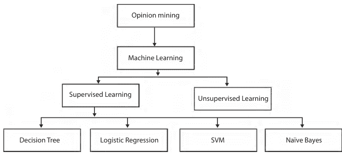

图 6.1 机器学习方法。

- 1. 监督学习：它从标记的训练数据集中发现模式和关系。
- 2. 无监督学习：使用此方法，模式是从未标记的数据集中推断出来的。

#### 6.1.3 机器学习流水线 (ML)

机器学习（ML）流水线是一组由数据准备和建模步骤组成的系列，旨在将原始数据转换为训练好的、可部署的 ML 模型。流水线组织和自动化工作流，使整个过程更易于管理、复现和迭代。典型步骤包括数据准备和清洗、特征工程、模型选择、训练、参数调优、评估和部署。

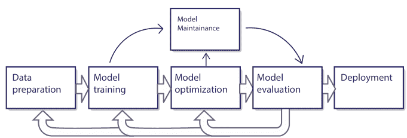

图 6.2 机器学习流水线。

图 6.2 表示通用 ML 框架，这些步骤可能会根据争议的性质、数据类型和采用的学习技术而有所不同。ML 流水线有助于简化模型的开发和部署，使过程更加系统化和可扩展。

#### 6.1.4 自动化机器学习 (AutoML)

ML 是 AI 的一个分支，提供了一种倾向于自动学习的系统。因此，ML 已成为一个日益更新的快速发展的应用和研究领域。目前，AutoML 是机器学习领域最突出和最受关注的领域之一。它有望通过使用 ML 流水线将重复性功能降至最低，从而显著提高数据科学家、ML 工程师和该领域研究人员的生产力 [3]。

AutoML 术语指的是一套用于自动确定可用数据集最佳模型的方法。传统机器学习算法需要多个步骤才能创建模型，例如数据准备；预处理；算法选择、学习和评估；参数调优；以及预测。

由于实现机器学习模型所涉及的学习不足，这会导致复杂性。此外，生成并比较多个模型以选择最优模型通常需要大量的领域专业知识，如图 6.3 所示。AutoML 旨在缓解这些复杂性，即以最少的人工参与自动化整个机器学习流水线的流程式开发。AutoML 中有两个主要步骤，如下：

- 1. 如何搜索新模型
- 2. 如何以高效的方式推导其最佳性能。

尽管云环境中有众多 AutoML 服务可用，但在实施阶段有三个因素阻碍了用户。首先，使用云平台服务会产生费用，这可能使寻求采用 AutoML 技术的个人无法负担。其次，基于云的 AutoML 通常涉及 Docker 容器和 Kubernetes 的复杂配置，这对没有广泛计算机科学背景的人来说是一个挑战。第三，AutoML 服务提供商通常被描述为“诚实但好奇”，这导致对用户数据安全性和隐私性的担忧和不确定性” [5]。解决这些挑战的一个可访问方案是开源软件，可以轻松下载并在本地执行，从而使 AutoML 面向更广泛的受众。为了解决这个问题，实现了 AutoKeras。

##### 6.1.4.1 AutoML 核心目标

AutoML 的核心目标包括以下内容 [6]：

- **性能**—实现强大的泛化性能涉及在各种输入数据和各种学习任务上表现良好的能力。
- **减少人工干预**—机器学习工具的配置可以自动化。
- **最优计算复杂度**—程序可以在预定义的资源约束内提供满意的输出。

##### 6.1.4.2 AutoML 工具

AutoML 工具代表着朝着使机器学习变得可访问、透明和协作迈出的重要一步。这些工具使用户能够高效利用机器学习模型的功能，培育知识共享和创新的文化。随着机器学习领域的不断发展，开源 AutoML 工具有望继续处于塑造自动化机器学习未来的前沿。

总的来说，开源 AutoML 工具通过降低不同技能水平用户的入门门槛，在普及机器学习方面发挥了重要作用。它们赋予不同专业水平的个人利用现有工具潜力的能力，并消除了对广泛领域知识的需求。一些最常用的开源 AutoML 工具如下 [7]：

### Auto-Sklearn

对于 ML 算法和数据预处理，它是 Scikit-learn 机器学习包的一个扩展。它利用贝叶斯优化搜索技术，为提供的数据集快速确定最优模型流水线。

### AutoKeras

它是专门针对 AutoML 的 Python 库，构建在流行的深度学习框架 Keras 和 TensorFlow 之上。AutoKeras 旨在通过自动选择神经架构和超参数来简化机器学习模型开发过程。

### Google Cloud

尽管它是商业云平台的一部分，但它将某些 AutoML 组件作为开源提供。这包括 AutoML Tables 和 AutoML Vision Edge，为开发人员提供灵活性，以便为表格和边缘设备基础的 ML 任务定制模型。这种对开放性的承诺有助于在开发者社区内促进知识共享和协作进步。

### TPOT

专门为 AutoML 创建的开源 Python 包称为基于树的流水线优化工具 (TPOT)。它通过利用遗传编程来优化 ML 流水线，采用了一种独特的方法。其灵活性和适应性使数据科学家能够探索广泛的可能性，鼓励实验和迭代以找到最优解决方案。

### H2O.ai

这是一个旨在自动化创建和部署 ML 模型过程的自动化平台。它因其灵活性、可扩展性和易用性而特别受欢迎。

#### 6.1.5 本研究的目标

使用 AutoML 创建 Auto-CRM 学习系统可以由各种目标驱动，以增强客户交互、优化流程并获得宝贵洞察。一些关键目标如下：

- 1. 基于满意度水平的客户分类：实现一个分类系统，根据客户的满意度水平将客户分类为不同的群体，区分满意客户和不满意客户。
- 2. 意见挖掘和反馈处理：使用 AutoML 对客户反馈、评论和交互进行情感分析。这可以提供关于客户满足度、顾虑和偏好的相关洞察，从而促进及时响应和服务改进。
- 3. 持续模型改进：实施 AutoML 以使系统能够持续学习和适应。这涉及定期重新训练模型，以纳入新数据和客户行为的变化，确保系统保持最新和有效。
- 4. 有监督 ML 技术的比较：评估和比较与 AutoCRM 自动化机器学习模型相比的各种有监督 ML 技术的运行情况。具体来说，分析它们在使用不同方法处理混合文本信息方面的有效性。

这些目标共同旨在通过分析数据集，采用文本分析和机器学习中的先进技术进行分类任务，从而更深入地了解客户情感和满意度。

#### 6.1.6 大纲

本研究文章按照以下结构组织：

- 第 6.2 节讨论了与 AutoML 和用于意见挖掘的 ML 相关主题领域的相关工作列表。
- 第 6.3 节描述了完整架构、带有超参数调优的拟议方法以及模型选择。


- 第6.4节给出了AutoCRM模型与现有技术的比较分析结果和讨论。
- 第6.5节讨论了结论和预期工作的描述。

### 6.2 文献综述

本节回顾的论文深入探讨了与自动化机器学习（AutoML）和机器学习系统集成的观点挖掘各个层级，详情如本节所述。当适当的研究分析被精心定位时，识别预先存在系统中的研究方向和缺口就变得可行。为收集与AutoML、机器学习、观点挖掘、情感分析和客户关系管理等关键词相关的文章，采用了五种不同的搜索引擎。获得文章后，消除后续的重复文章。人工筛选分三个阶段进行：首先，审阅标题；然后，检查摘要；最后，解读完整记录。综述对33篇相关工作进行了评审，这些工作代表了此筛选过程的结果。相关工作收集的整个流程如图6.4所示。

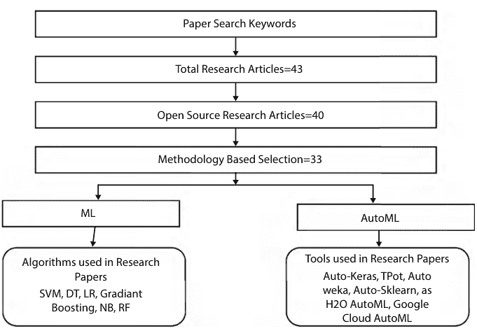

图6.4 相关工作搜索过程。

情感分析和观点挖掘源于20世纪初的意见研究，经历了显著增长，发展成为主要研究焦点，特别是随着2000年代中期在线产品评论的出现。该主题上学术文章的激增反映了其快速扩张，从2005年的101篇增加到2015年的近5,699篇——几乎增长了50倍，使情感分析成为近年来独特且发展最迅速的领域 [8]。在互联网早期，决策涉及向朋友、邻居和亲戚寻求反馈，组织会进行意见选择、调查，并衡量人们对其副产品或服务援助的社区情感。向Web 2.0的过渡以用户生成内容为标志，彻底改变了个人表达观点、想法和感受的方式。如今，得益于Web应用程序不同版本中提供的丰富多样的信息，人们可以在个人网页、博客、社交平台、论坛和评论中分享自己的观点，推动了观点挖掘领域的快速进展 [9]。

AutoML作为机器学习研究的焦点，推动了ML应用的显著扩展和广泛兴趣。尽管AutoML仍然是一种相对新且正在发展的技术，但研究仍在进行中，以确定这项技术的优缺点，尤其是与情感分析、图像分类和时间序列预测等其他领域的关系。AutoML库在这些领域的性能各不相同，促使研究人员进行评估以辨别其在特定领域的有效性 [10]。AutoML极大地普及了构建和部署情感分析模型的过程，使组织能够在不需要广泛专业知识的情况下利用机器学习的力量。通过自动化情感分析中涉及的复杂任务，企业可以更有效地从文本数据中提取可操作的洞察，从而改善决策和客户满意度。

这些研究深入研究了在线粤语餐厅评论领域，采用标准机器学习技术，如NB和SVM [11]，自动将用户评论分类为正面或负面情感。该研究彻底探讨了不同特征表示和大小对分类器研究的影响。同样，在餐厅评论背景下，参考文献中的研究人员利用NLP [12]进行极性分析。他们的研究策略涉及将SVM、NB和多项式NB作为分析过程的组成部分。

关于基于主观性、词、文档和意见提取的情感分类，作者考察了观点挖掘中的四个基本挑战。他们对主观性分类的探索涵盖了一系列策略，包括基于相似性的方法、NB [13]分类器、多重NB分类器和基于切割的分类器。在他们关于情感分析的调查中，参考文献 [14] 提供了属性选择方法的简明概述，强调点向互信息和卡方检验。然后焦点转向对情感分类方法的全面讨论。

在他们的调查中，研究人员对包含服装、鞋子和珠宝产品评论的数据集进行了情感分类。他们进行了比较分析，评估了混合SVM、NB、LR和DT [15]方法的性能。该分析还探讨了这些方法与各种特征提取技术结合的有效性。在参考文献 [16] 引用的工作中，作者介绍了一项专注于分析Twitter热门信息并从用户处收集多样数据以提高数据准确性的研究。该研究旨在通过便于识别人们的反应和观点来提高数据预处理的性能，从而有助于更全面地理解Twitter趋势。

在他们的情感分析探索中，参考文献 [17] 中的研究人员引入了通过专门设计的算法实现的预处理技术。所提方法强调了高效预处理作为任何分类算法应用前的关键步骤的重要性。在参考文献 [18] 强调的研究中，研究人员引入了结合CNN和LSTM的架构，用于实时餐厅响应的意见分析。他们采用了300维预训练word2vec，并与替代的预训练词向量模型进行了对比评估。此外，该研究还强调了BERT（基于Transformer的双向编码器表示）在近期发展中的文本分类任务中的实用性。

在他们对情感分析（SA）的调查中，参考文献 [19] 中的研究人员强调了该方法在从文本中提取观点、情感或情绪方面的重要性，突出了其在当代数字环境中的有影响力的作用。该研究区分了SA中的三个粒度级别：文档级、句子级和方面级SA。特别是，基于方面的情感分析（ABSA）被识别为一个更复杂的级别，涉及提取方面、相应的情感词及其极性定向。在他们的工作中，作者介绍了参考文献 [20] 中引入的一种创新句子分类方法，利用依赖树子树。该论文的重点是利用依赖树内的子意见来分类句子极性。该方法结合了诸如乘积和信念传播、子意见关系和词粒度等方面。该方法基于依赖子树实现了意见分类器系统，使用包含评论ID和总体评分的语料库数据集进行分析。该研究涉及分词和解析以进行精确检查，结果通过召回率和精确度计算进行评估。

作者 [21] 采用ML技术对用户评论进行处理以提取相关细节。意识到评论对客户和业主决策的重要性，他们使用NLP技术开发了一个ML模型来捕捉用户响应。实验阶段涉及使用Python语言。在参考文献 [22] 所述的研究中，团队介绍了一种使用朴素贝叶斯评估泗水餐厅客户满意度的分类方法。数据采样过程涉及使用Web Harvester工具进行网络爬取。研究结果表明，两种方法都有效地捕获了客户响应，与TextBlob情感分析相比，朴素贝叶斯表现出更高的准确率，优势达2.9%。

研究人员 [23] 提出了一种从实时评论中提取关键特征和视角的过程。他们的方法确定了意见的差异和主导性，旨在根据建议总结并确定客户评论的状态。评估结果，特别是关于数码相机评论的结果，展示了所提技术的有效性。在参考文献 [24] 强调的研究中，团队介绍了两种主要技术来将极性分类为快乐和悲伤：ML方法和语义取向方法。该方法使用预定义的词袋数据集进行训练和预测，而语义取向方法则专注于识别文档中传达情感的特定关键词。这些方法采用不同的计算方法来辨别句子或文档中的情感。

在参考文献 [25] 中作者提出的工作中，引入了一种使用机器学习算法进行意见挖掘的分类方法，专注于从文本中提取信息。该研究采用了两个ML分类器，NB和DT。特别是，该研究强调了朴素贝叶斯相对于决策树的可靠性，尤其是在数据集大小增加时。这一观察表明，根据研究结果，朴素贝叶斯倾向于在更大的数据集中提供更准确的结果。

作者 [26] 通过相关研究开发了基于ML的客户采购方法。该研究旨在通过评估包含电信公司客户数据集中各种最新框架模型的正确性来建立流失分类的基准。

在他们发表的论文 [27] 中，作者分析了与电子商务相关的客户行为。通过利用数据挖掘技术和 the

基于 ML 中的 KNN 算法，该团队旨在根据客户的购买模式识别与客户相关的潜在风险。该研究涉及大量实验，使客户分为两类：那些购买了异常产品或组合的客户被标记为高风险客户，而选择典型产品的客户则被归类为低风险客户。参考文献 [28] 中的研究人员通过分类器技术、编程软件和结构方程建模的协同集成，开展了忠诚度水平和客户满意度分析。这种组合方法展示了他们利用编程工具发挥分类器和结构方程建模潜力的娴熟程度，从而能够全面考察影响客户忠诚度和满意度的因素。

作者 [29] 探讨了 AutoML 在文本分类任务中的表现。它研究了文本表示模型如何影响 AutoML 分类器的标准，以及其工具在此环境下的总体效果。该研究特别强调了文本表示模型的作用，基准评估揭示，虽然词袋（Bag-of-Words）等基本机制能产生一致的结果，但 AutoML 生成的自动文本嵌入尚未超越手工制作的文本表示的性能。由 [30] 提出的文本分类自动机器学习系统（ASTeC）采用自举偏差修正交叉验证（BBC-CV）技术来评估 ML 过程的执行情况。该系统战略性地结合了遗传算法（GA）、贝叶斯优化（BO）和 BBC-CV，以识别文本分类的最佳机器学习流水线。该方法的有效性通过与尖端系统的比较得到验证：对于情感分析（SA）任务，它与 TPOT（基于树的流水线优化工具）和 Google Cloud AutoML 服务进行基准测试，而对于意图识别（IR）任务，则与 TPOT 和 MLJAR AutoML 进行比较。

在赫尔辛基大学开展的题为“测试 AutoML 系统的鲁棒性”的研究中，两位研究人员系统评估了三个专为图像处理模型定制的关键 AutoML 库——TPOT、H2O 和 AutoKeras 的敏捷性。通过使用包含数字和时尚商品的两个不同数据集，研究人员观察到，当应用于干净数据时，这三个 AutoML 库都展示了超过 80% 的可喜准确率 [31]。

作者 [32] 深入探讨了神经搜索空间的性能，该空间被视为构建深度学习模型框架中 AutoML 的一个子部分。在执行阶段，研究人员观察到，与人工制作的模型相比，自动生成的原型获得了更高的复杂性支持，尤其是在应用于 PTB（宾士树库）数据集时。文章进一步阐明，较高的困惑度值与较低的模型准确率相关，强调了困惑度与模型性能之间的反向关系。

根据相关工作，该研究着重强调了传统代码导向 ML 方法的重要性，并提供了关于如何在极性分析中正确使用 AutoML 的有益信息。此外，综述还凸显了理解超参数微调及其他 ML 基础方面的关键重要性。基础研究结果清楚地表明，AutoML 平台的随意使用可能并不普遍适用，而是主张审慎应用以评估最合适的算法方法。这些关键发现和见解构成了该研究得出的主要贡献和价值。

基于上述文献综述，我们将分析作者在进展、方法、应用以及意见挖掘或情感分析中采用的技术方面所面临的不同挑战。已审查多篇学术著作，以提供意见挖掘过程的完整序列并确定我们工作的基线。进行了现有方法论的分析，以识别研究空白并将最合适的步骤应用于未来的研究工作。开展了一项比较研究，并在表 6.1 和 6.2 中展示，这些表格易于理解。在考虑用于从不同数据集中查找极性的传统 ML 技术时，观察到在制定特征工程过程方面存在困难。在进行分类或回归之前，每个 ML 模型都需要单独的特征工程程序，因为这会影响完整模型的效能。因此，需要一种新型的 AutoML 方法来解决这一情况，即，一个完整的模型将执行属性或特征工程和分类过程。此外，还需要一个带有超参数调优的模型，以提高预测工作的效率和正确性。从相关工作中发现了研究空白，并通过使用 Autokeras 提出的带有合适超参数的 AutoCRM 模型的新颖性来弥补，该模型旨在适应组织的各种类型客户评论。

表 6.1 基于 ML 和 DL 的评论。

| Ref. no. | Dataset | Machine learning techniques used | Feature selection | Accuracy | Precision | Recall | F1 |
| :--- | :--- | :--- | :--- | :--- | :--- | :--- | :--- |
| [33] | 公共领域数据集 | 决策树，SVM，朴素贝叶斯 | 蒙特卡罗选择 | 决策树 = 94% SVM = 97% 朴素贝叶斯 = 86% | 96% | 74% | 84% |
| [34] | US 航空情感，Twitter Kaggle 数据集 | LR，SVM，NB | TF-IDF | LR = 77% SVM = 77% 朴素贝叶斯 = 74% | 76% | 77% | 75% |
| [35] | Amazon 数据集 | 逻辑回归，SVM，朴素贝叶斯 | 卡方和归一化 TF-IDF 方法 | 逻辑回归 = 78% SVM = 83% 朴素贝叶斯 = 82% | 83% | 83% | 82% |
| [36] | 电信公司客户数据库 | LR，SVM，NB | Boruta | 逻辑回归 = 86.7% SVM = 94% 朴素贝叶斯 = 88% | - | - | - |
| [37] | Olist 巴西电子商务公共数据集 | DT，SVM，RF | | 决策树 = 87.2% SVM = 87.1% 随机森林 = 87.5% | 97% | 29% | 93% |
| [38] | Yelp 数据集 | 混合方法 | TF-IDF | 混合方法 = 92.44% SVM = 85.20% 朴素贝叶斯 = 85.00% | - | - | - |
| [39] | SWOT 关于卡拉奇餐厅、咖啡馆、路边餐馆、HBFE 和外带数据集的指南 | 随机森林，SVM，朴素贝叶斯 | TF-IDF | 随机森林 = 94% SVM = 89% 朴素贝叶斯 = 84% | 95% | 97% | 96% |
| [40] | Amazon 消费者评论 | 逻辑回归，SVM，梯度提升 | TF-IDF | 逻辑回归 = 90% SVM = 89% 梯度提升 = 87% | 91% | 97% | 94% |
| [45] | Amazon 精细美食评论，手机和配件，Yi-Jen Mon，Yelp | 基于 RNN 的 LSTM，深度 LSTM | - | Model1—97%，Model2—96%，Model3—95% | 70% 78% 76% | 62% 63% 59% | 64% 67% 62% |
| [46] | Trip Advisor | 深度置信网络 (DBN) | 自组织映射，隐含狄利克雷分配 (LDA) | DBN—92% | 91.8% | - | 92.7... |

表 6.2 基于 AutoML 的评论。

| Ref. no. | Dataset | Automated machine learning tool | Performance |
|---|---|---|---|
| [10] | Covid-19 数据集，Twitter，评论 | Auto-Keras，TPOT，Auto-WEKA | 93% |
| [29] | 20newsgroup、MathLectures 和 WhatsCooking 数据集 | Auto-Sklearn 以及 H2O AutoML | 98.17% |
| [30] | 英语 IR 数据集，葡萄牙语 IR 数据集 | TPOT、MLJAR AutoML 和 Google Cloud AutoML | 92.8% |
| [32] | MNIST、CIFAR-10、CIFAR-100 和 ImageNet | TPOT、Auto-WEKA、Auto-Sklearn | 97.1% |
| [41] | 疟疾数据集，Lister Hill 国家生物医学通信中心 | Autokeras | 95.6% |

### 6.3 方法论

本研究工作的初衷是开发一个用于意见挖掘的 AutoML 系统，旨在增强客户关系管理。此外，该研究还涉及对 AutoML 方法和传统基于代码的机器学习技术进行评估。在初始阶段，重点是实施该过程，该过程包括在预处理期间消除空值和特殊字符。

对于 AutoML 模型，使用了 AutoKeras 包通过神经架构搜索和超参数调优生成模型。经过多次试验后，确定了最佳模型并将其导出。随后，该模型部署在另一个客户评论数据集上。为了便于与 AutoML 进行比较分析，还使用基本 ML 流水线步骤创建了传统 ML 模型。图 6.5 所示的整个研究工作是在 Jupyter Notebook 环境中使用 Python 代码实现的。

#### 6.3.1 数据准备

数据分析的初始阶段，涵盖数据的收集、整理和准备，是分析过程中至关重要的步骤。这些阶段在确保数据质量、组织性和后续分析的就绪性方面起着关键作用。


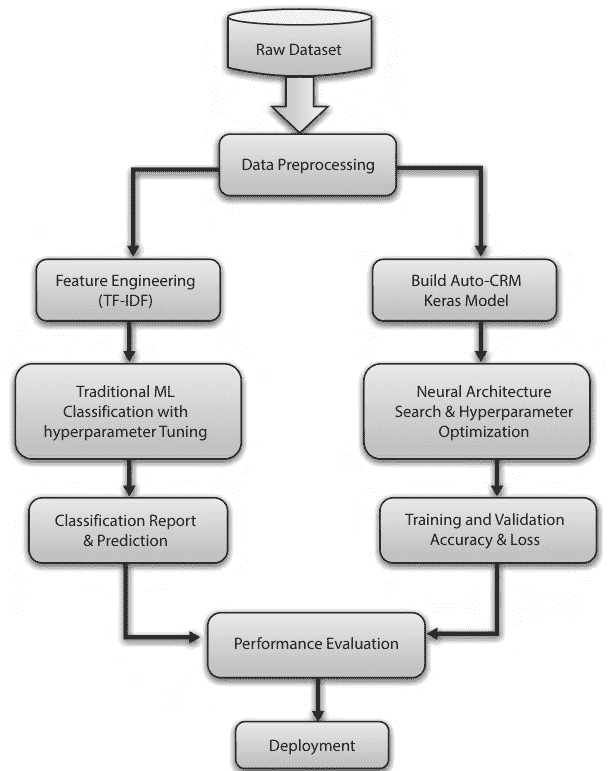

图 6.5 WorkFlow—AutoML-CRM.

将原始数据集准备成适合用于训练和测试的模型结构的过程称为预处理和数据描述。因此，数据必须始终保持清洁并格式化，以便使用。

##### 6.3.1.1 数据采集

关于客户的评论将从Kaggle仓库收集的Amazon产品评论和Flipkart产品评论中获取。

##### 6.3.1.2 数据清洗与标注

为使机器能够理解人类语言，需要从数据集中消除标点符号、特殊字符、表情符号、emoji、数字和多余空格，这是文本分类的主要步骤。从数据集中删除不需要的列，仅保留两列：评论（或文本）和标签，标签为正面和负面 [3, 5]。

##### 6.3.1.3 数据可视化

标注后，用于可视化数据集中类别的分布。这有助于理解不同类别之间的平衡与不平衡，这对分类任务至关重要。

##### 6.3.1.4 特征工程

创建新特征或修改现有特征，以增强数据的预测能力。以下过程对于机器学习应用尤为必要。利用AutoKeras可以发挥其自动化功能进行文本数据预处理，包括分词和嵌入。这使得代码更加简洁明了，区别于传统机器学习流程（后者可能需要手动进行文本数据预处理和特征提取，例如TF-IDF）。

#### 6.3.2 AutoKeras

AutoKeras专注于深度学习任务，区别于早期讨论的专注于浅层模型的系统。被称为神经架构空间（NAS）的过程应用于神经网络，旨在识别用于模型构建的模型架构和参数。使用AutoKeras，您可以利用开源库对深度学习模型执行AutoML。TensorFlow tf.Keras API用于利用Keras模型进行搜索。它提供了一种简单高效的策略，用于在多样化的预测任务中自动发现高性能模型，这些任务涵盖结构分类和回归数据集（通常称为表格数据）。

它可以选择不同的参数，如层数、神经元数量和学习率，以及优化和损失函数等其他超参数。

##### 6.3.2.1 神经架构搜索与超参数调优

将架构工程自动化是源自自动化机器学习的更高级逻辑进展，它降低了手动构建神经架构的复杂性。由于它与特征工程、超参数最小化和元学习有许多共同之处，NAS被视为AutoML的一个子集。这意味着NAS可以分为三个方面：搜索范围、搜索方法和性能计算技术 [42–44]。

搜索空间界定了理论上可以表示的架构。可以通过融合关于适合某项任务的典型架构特征的过去知识，来精简探索过程并缩小搜索空间。尽管如此，这种方法在物理上增加了加权值。这可能会抢先发现独特的架构组件，而进步完全取决于人类认知。AutoKeras使用贝叶斯优化、随机搜索、网格搜索和Hyperband调谐器来搜索神经结构框架。此外，它还利用树结构获取函数进行最小化，并利用神经网络内核高效评估搜索空间。因此，搜索空间是指带有相应超参数的模型分类器的选择。一般的神经架构搜索将定义如下：

```
P = \underset{\theta}{argmin} Cost(P(\theta^*), X_{val}) \quad (6.1)
```

```
\theta^* = \underset{\theta}{argmin} Cf(P(\theta), X_{train}) \quad (6.2)
```

设M为具有H个超参数的机器学习技术。超参数配置空间的完整集合为 d = d_1 × d_2 × d_3 × ... d_n，且范围属于第n个参数 d_n。超参数向量表示为 V，属于 D。超参数域包括实值、整数值、二进制和分类 [38]。基于上述架构搜索方法，一个名为AutoCRM的基于文本分类器的AutoKeras简化了具有优化参数的神经网络架构模型的创建。

AutoModel将模型选择和优化的超参数结合起来，形成文本分类器AutoKeras模型。搜索空间实际上就是带有相应参数的模型选择，例如 Max_trial、Overwrite、Objective、Tuner、Multilabel、Directory、Project_Name 等。

- **Max_trials**
  Max_trials 是一个参数，用于确定系统在寻找最佳模型过程中将评估的不同神经网络架构数量的上限。该参数表示使用贝叶斯优化、随机搜索等技术，超参数与架构的唯一组合的最大计数。AutoKeras 将执行最多 max_trial 次。此搜索涉及各种层、操作和超参数的组合，以构建和训练不同的神经网络架构。每次 trial 对应一个不同的候选模型，具有一组特定的超参数，例如 block_type、classification head、dropout、optimizer 和 learning rate。达到最大计数后，AutoKeras 停止搜索并返回 trial 期间找到的最佳模型。

- **Overwrite**
  它决定一个 true 或 false 条件：是丢弃之前的任何结果并启动新的搜索过程，还是从中断处继续搜索。

- **Objective**
  该参数的首要目标是根据指定的目标指标识别性能最佳的架构。对于文本分类，它包括 Val_accuracy 和 Val_Loss。模型使用 Val_accuracy 创建，旨在增强任务的准确性。

- **Tuner**
  模型将使用各种调谐器进行搜索，并为分类选择具有调谐器的最佳模型。AutoCRM 模型通过基于计算资源和超参数空间中所需的探索级别，选择贝叶斯优化、随机搜索、Hyperband 或 网格搜索 来创建。

- **Project_Name**
  用于保存 AutoKeras 项目的目录名称。

- **Directory**
  保存搜索输出的目录路径。

#### 6.3.3 模型选择

将参数放入 Auto_CRM Keras 模型中，并获取最多五次 trial 的输出。每次 trial 将根据 val_accuracy 和 val_loss 对参数和超参数进行比较。准确性最高的模型将被选为最佳文本分类器模型，并将在多个评论数据集中实现。

### 6.4 结果与讨论

在实现部分，基于那些 AutoML 和传统机器学习技术，模型被生成为二进制分类器。如数据准备阶段已讨论，该研究工作包含来自知名网站 Kaggle 的两个主要评论数据集，即 Amazon Review 和 Flipkart 评论数据集。对数据集标记后，可以进入可视化步骤。图 6.6 和 6.7 分别表示数据集中正面和负面意见频率分布的词云和条形图。

此外，在分析过程中，这些数据集被划分为 80% 和 20% 用于训练/测试阶段。预处理、特征工程、架构搜索和参数优化将自动完成。随后阶段涉及使用 Auto_CRM Keras 模型并选择最佳的 trial 次数和 epoch 数。最终，模型构建从以下参数开始：输入数据、overwrite = true、Max_trials = 5、epoch = 15、tuner = random search、objective = accuracy。

研究结果展示了带有各种超参数的五次 trial 的二进制分类，如表 6.3 所示，该表显示了不同的层、稠密层和激活函数。在此所提议的 Auto-CRM Keras 模型中，他们为每次 trial 选择了 Relu 和 Sigmoid 作为激活函数，并使用可变批量大小。观察发现，模型从 trial_1 开始，选择 text_block 为 BERT、classification_head_dropout 层为 0，以及训练率为 0.001 的 SGD 优化器，从不同的 epoch 获得约 0.69 的准确率。

为提高模型准确性，trial_2 将使用以下参数进行训练：text_block 设置为 Transformer，classification_head 设置为 0.5，优化器设置为 “Adam weight decay”，学习率为


## 正面词汇


## 负面词汇


图 6.6 Amazon 数据集的词云。

## 情感分布

正面: 200000 负面: 200000

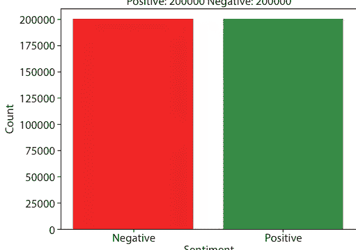

图 6.7 意见标签分布。

## 表 6.3 试验 I 至 V 的超参数设置

| 超参数/试验 | I | II | III | IV | V |
|---|---|---|---|---|---|
| Text_Block_1/block_type | BERT | Transformer | Transformer | Ngram | Ngram |
| Classification_head_1/dropout | 0 | 0.5 | 0.25 | 0 | 0.25 |
| 优化器 | 随机梯度下降 (SGD) | Adam_weight_Decay | Adam | Adam_Weight_decay | Adam_Weight_decay |
| 学习率 | 0.001 | 2E-05 | 1E-05 | 1E-05 | 1E-03 |

## 表 6.4 15 次试验中的 epoch

| Epoch 编号 | 试验 I 验证损失 | 试验 I 验证准确率 | 试验 II 验证损失 | 试验 II 验证准确率 | 试验 III 验证损失 | 试验 III 验证准确率 | 试验 IV 验证损失 | 试验 IV 验证准确率 | 试验 V 验证损失 | 试验 V 验证准确率 |
|---|---|---|---|---|---|---|---|---|---|---|
| 1 | 0.695 | 0.492 | 0.940 | 0.491 | 0.704 | 0.491 | 0.905 | 0.503 | 0.711 | 0.512 |
| 2 | 0.694 | 0.509 | 0.704 | 0.491 | 0.673 | 0.535 | 0.815 | 0.499 | 0.682 | 0.565 |
| 3 | 0.693 | 0.516 | 0.696 | 0.509 | 0.646 | 0.613 | 0.791 | 0.495 | 0.656 | 0.632 |
| 4 | 0.693 | 0.493 | 0.694 | 0.509 | 0.618 | 0.719 | 0.761 | 0.510 | 0.623 | 0.744 |
| 5 | 0.692 | 0.522 | 0.694 | 0.498 | 0.588 | 0.796 | 0.740 | 0.498 | 0.591 | 0.797 |
| 6 | 0.693 | 0.504 | 0.723 | 0.530 | 0.553 | 0.882 | 0.710 | 0.521 | 0.541 | 0.878 |
| 7 | 0.692 | 0.532 | 0.694 | 0.523 | 0.513 | 0.930 | 0.714 | 0.485 | 0.524 | 0.942 |
| 8 | 0.692 | 0.511 | 0.694 | 0.557 | 0.467 | 0.962 | 0.701 | 0.518 | 0.476 | 0.965 |
| 9 | 0.690 | 0.569 | 0.694 | 0.551 | 0.416 | 0.983 | 0.703 | 0.509 | 0.422 | 0.978 |
| 10 | 0.691 | 0.539 | 0.704 | 0.545 | 0.360 | 0.987 | 0.696 | 0.533 | 0.373 | 0.987 |
| 11 | 0.690 | 0.559 | 0.694 | 0.563 | 0.303 | 0.992 | 0.695 | 0.533 | 0.301 | 0.997 |
| 12 | 0.691 | 0.554 | 0.677 | 0.584 | 0.250 | 0.995 | 0.688 | 0.541 | 0.261 | 0.996 |
| 13 | 0.689 | 0.594 | 0.682 | 0.586 | 0.204 | 0.998 | 0.690 | 0.547 | 0.216 | 0.997 |
| 14 | 0.688 | 0.591 | 0.673 | 0.584 | 0.166 | 0.999 | 0.694 | 0.522 | 0.167 | 0.999 |
| 15 | 0.688 | 0.590 | 0.675 | 0.597 | 0.135 | 0.999 | 0.693 | 0.529 | 0.141 | 0.999 |
| 测试损失 | 0.557 | | 0.683 | | 0.562 | | 0.699 | | 0.4289 | |
| 测试准确率 | 0.692 | | 0.576 | | 0.719 | | 0.510 | | 0.814 | |

学习率约为 2.00E-05。这获得了 0.58 的分类准确率。

因此，模型使用不同的参数进行训练，例如 text_block 设置为 “Transformer” 或 “Ngram”，classification_head 设置为 0.25 或 0，

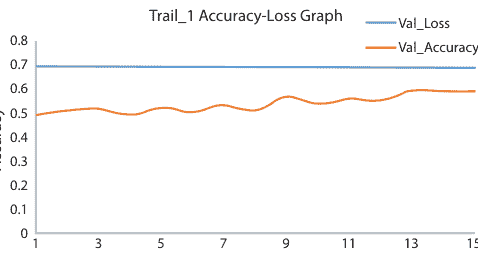

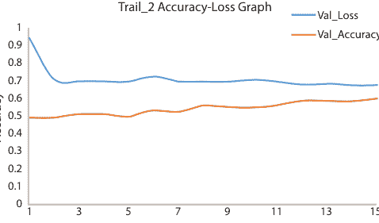

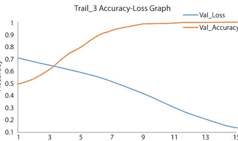

图 6.8 从 trial_1 到 trial_4 的准确率-损失图。（续）

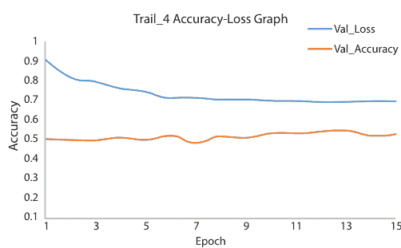

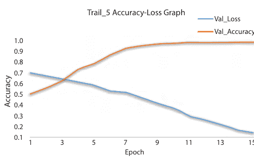

图 6.8（续）从 trial_1 到 trial_4 的准确率-损失图。

并且优化器设置为 “Adam” 或 “Adam_weight_decay”，后续试验 3 和 4 的学习率约为 1.00E-05，分别获得 0.72 和 0.51 的准确率。试验延长至 5，text_block 设置为 “Ngram”，classification_head 设置为 0.25，优化器设置为 “Adam_weight_Decay”，学习率为 1.00E-03，达到约 0.814% 的准确率，如表 6.4 所示。

根据表 6.3，从试验 I 到 V，AutoKeras 框架应用了各种超参数，并分析了模型在 15 个 epoch 内的五次试验训练历史，如表 6.4 所示。在试验 1 中，从第 1 到第 15 个 epoch，val_accuracy 从 0.492 开始，达到 0.590，测试准确率达到 0.692。

对于试验 2，第 1 个 epoch 的 val_accuracy 为 0.491，第 15 个 epoch 为 0.597，测试准确率最高可达 0.576。在试验 3 中，第 1 到第 15 个 epoch 的 val_accuracy 为 0.491 到 0.999。对于试验 4，val_accuracy 约为 0.503 到 0.529。对于试验 5，所有 15 个 epoch 的 val_accuracy 范围为 0.512 到 0.999。

观察到，在第一次试验中，准确率从 0.69 开始，然后下降到 0.58，随后在试验 3 中增加到 0.72。然后，在试验 4 中下降到约 0.51。这导致了试验 5，其中准确率增加，使用各种超参数训练的分类器在优化超参数后实现了约 0.814% 的最终 AutoML 模型准确率。在找到神经架构搜索空间或模型选择后，试验 5 中的最佳模型将被导出，并将该模型应用于 Flipkart 评论数据集进行进一步分类。它达到了 0.81% 的准确率，如表 6.4 所示。

上述图 6.8 表示在训练/测试阶段获得的 ACC（准确率）和损失的图形表示。对于连续的试验 1 到 5，准确率从试验 1 降至试验 2，在试验 3 中增加，在试验 4 中下降，最后在试验 5 中逐渐增加。因此，选择试验 5 的优化模型用于部署 Flipkart 数据集。

#### 6.4.1 比较分析：AutoML vs ML

相同的数据集用于监督式 ML 技术，如 NB、SVM 和 LR。在此，数据预处理按上述步骤进行，即分词、停用词删除、词干提取或词形还原。将使用基于术语频率-逆文档频率（TF-IDF）进行特征工程。TF-IDF 反复应用于文本挖掘和信息检索。这用于将未经处理的文本信息集重新排列为 TF-IDF 属性矩阵。该变换器以累积的文本数据作为输入，并根据文档的 TF-IDF 分数生成文档的分布式矩阵示意图。

特征工程过程完成后，数据集被分为简单的训练/测试集用于学习和评估。模型使用相应的分类算法与数据拟合。然后，模型使用优化超参数进行微调。此步骤涉及手动尝试不同参数值以提高模型性能的过程。因此，这种优化调制将通过迭代继续，直到达到最佳模型。

AutoCRM Keras 模型与关联性能指标的传统 ML 算法进行了比较。通过使用各种参数训练原型并找到具有最佳优化超参数的结果，获得了准确率和精确率。此过程通过在传统 ML 技术中手动应用各种参数来完成。从表 6.5 和图 6.9 可以看到不同 ML 方法和建议的 AutoML 架构的评估结果。可以看出，与其余 ML 算法相比，AutoCRM_Keras 模型的精确度表现最佳。Auto-CRM Keras 模型将使用准确率和损失等指标进行评估。从表 6.5 可以看出，Amazon 评论数据集既使用传统分类方法也使用 AutoML 模型实现。ML 中的一些基于代码的传统方法，即 LR、NB 和 SVM，在使用合适的优化超参数训练后，分别获得了约 0.73%、0.74% 和 0.75% 的准确率。与 AutoML 的 Auto-CRM Keras 模型相比，它以 0.81 的分类准确率优于这些方法。

## 表 6.5 基于准确率的机器学习与自动化机器学习比较。

| 类别 | 分类器 | 指标 | Amazon 评论数据集 | Flipkart 评论数据集 |
|---|---|---|---|---|
| 传统机器学习 | 逻辑回归 (LR) [14] | ACC | 0.73 | 0.73 |
| | | PRE | 0.74 | 0.74 |
| | | RE | 0.74 | 0.74 |
| | | F1 | 0.74 | 0.74 |
| | 朴素贝叶斯 (NB) [12] | ACC | 0.74 | 0.74 |
| | | PREC | 0.71 | 0.71 |
| | | REC | 0.74 | 0.74 |
| | | F1 | 0.73 | 0.73 |
| | 支持向量机 (SVM) [11] | ACC | 0.75 | 0.75 |
| | | PREC | 0.75 | 0.75 |
| | | REC | 0.75 | 0.75 |
| | | F1 | 0.74 | 0.74 |
| 自动化机器学习 | Auto-CRM Keras 模型 | ACC | 0.81 | 0.8 |
| | | LOSS | 0.42 | 0.45 |


## ML 与 AutoCRM

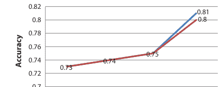

| | LR | NB | SVM | AutoCRM |
|---|---|---|---|---|
| 亚马逊评论 | 0.73 | 0.74 | 0.75 | 0.81 |
| Flipkart 评论 | 0.73 | 0.74 | 0.75 | 0.8 |

图 6.9 ML 与 AutoCRM 的对比。

从比较分析可以证明，在考虑自动化水平时，AutoML 自动化了许多任务，例如 ML 逻辑流程和参数调优。它允许用户提供高级输入，并允许系统处理机器学习流程的细节。它需要较少的人工交互，并使其更易于不同专业水平的用户使用。

它们通过搜索预定义或用户指定的超参数空间来自动化超参数调优。它会自动探索多种算法和模型架构，以找到最佳的最优模型。

### 6.5 结论

这些分析的主要目的是为未来组织引入面向客户的 AI 赋能服务、提升业务量提供建议。AutoML 将在未来为企业提供新维度，从而带来业务的重大变革。它以高质量服务和可持续性，为客户与企业组织之间的更好关系铺平了道路。在本意见挖掘研究中，我们提出了一种名为 AutoCRM 的方法论，基于 Autokeras 特性进行随机超参数调优，以分析各种组织领域的客户评论。该方法被证明非常成功，准确率显著较高。

基于 AutoML 和传统代码方法的客户关系管理意见挖掘评估，使用了上述性能指标。研究发现，超参数优化将自动提高分类器的准确率。与使用代码方法相比，所提议的自动分类将为这类问题提供更好的结果。此外，本研究表明，识别可提升原型潜力并加深对 AutoML 核心理解的调参参数具有重要意义。同时，针对后续改进，本研究可以评估基于云的 AutoML 以及 Google AutoML 和 H2O.ai 等补充型 AutoML 技术栈。将这些子领域融入意见分类将为印象深刻的结果铺平道路。

### 参考文献

- 1. Santhosh Kumar, K.L., Desai, J., Majumdar, J., 在线客户评论的意见挖掘与情感分析。IEEE 计算智能与计算研究国际会议，2016。
- 2. Vinodhini, G. 和 Chandrasekaran, R.M., 情感分析与意见挖掘：一项调查。先进计算机科学与软件工程国际期刊，2, 6, 283–292, 2012 年 7 月。
- 3. Truong, A., Walters, A., Goodsitt, J., Hines, K., Bayan Bruss, C., Farivar, R., 迈向自动化机器学习：AutoML 方法与工具的评估与比较。IEEE 第 31 届人工智能工具国际会议 (ICTAI)，2019。
- 4. Revathi, V., Kavin, B.P., Thirumalraj, A., Gangadevi, E., Balusamy, B., Gite, S., 基于 RBM 技术与 ADBN 技术的图像特征分离，用于精确水果分类。2024 年 IEEE 计算、电力与通信技术国际会议 (IC2PCT)，印度大诺伊达，第 1423–1429 页，2024，doi: 10.1109/IC2PCT60090.2024.10486564。
- 5. Jin, H., Song, Q., Hu, X., Auto-Keras：一种高效的神经架构搜索系统。KDD 应用数据科学专题论文，1946–56, 2019。
- 6. Yao, Q., Wang, M., Chen, Y., Dai, W., Li, Y.-F., Tu, W.-W., Yang, Q., Yu, Y., 让学习应用摆脱人工干预：自动化机器学习调查，arXiv:1810.13306 [cs.AI]。
- 7. Karmakar, S.K., Mahadi Hassan, M.D., Smith, M.J., Xu, L., Zhai, C., Veeramachaneni, K., 迄今及未来的 AutoML：挑战与机遇。ACM 计算机调查，54, 8, 175:1–36, 2021 年 10 月。
- 8. Mäntylä, M.V., Graziotin, D., Kuutila, M., 情感分析的演进——研究主题、场所和高引用论文综述。计算机科学评论，27, 1, 16–32, 2018。
- 9. Kumar, A. 和 Sebastian, T.M., 情感分析：对其过去、现在和未来的展望。智能系统与应用国际期刊，4, 10, 1–14, 2012。
- 10. Mahima, K.T.Y., Ginige, T.N.D.S., De Zoysa, K., 基于 AutoML 和传统方法的情感分析评估。先进计算机科学与应用国际期刊 (IJACSA)，12, 2, 612–618, 2021。
- 11. Zhang, Z., Ye, Q., Zhang, Z., Li, Y., 粤语互联网餐厅评论的情感分类。专家系统与应用国际期刊，38, 6, 7674–7682, 2011。
- 12. Viloria, A., Varela, N., Vargas, J., Lezama, O.B.P., 情感分析不同自动化学习环境的比较分析，第 134–141 页，Springer, Cham, 2021。
- 13. Tang, H., Tan, S., Cheng, X., 评论情感检测综述。专家系统与应用，36, 10760–10773, 2009。
- 14. Medhat, W., 等人，情感分析算法与应用：一项调查。艾因沙姆斯工程期刊，5, 4, 1093–1113, 2014. http://dx.doi.org/10.1016/j.asej.2014.04.011。
- 15. Gangadevi, E., Rani, R.S., Dhanaraj, R.K., Nayyar, A., 基于模拟退火优化 SVM 的果蝇算法，用于检测番茄植物疾病。神经计算与应用，36, 8, 4349–4375, 2023. Springer Science and Business Media LLC. https://doi.org/10.1007/s00521-023-09295-1。
- 16. Nikil Prakash, T. 和 Aloysius, A., 基于 Twitter 数据的情感分析数据预处理。教育与应用研究国际期刊 (IEARJ)，3, 7, 89–92, 2019。
- 17. Hemalatha, I., Saradhi Varma, G.P., Govardhan, A., 高效情感分析的非正式文本预处理。新兴趋势技术与计算机科学国际期刊 (IJETTCS)，1, 2, 58–61, 2012。
- 18. Hossain, N., Bhuiyan, Md.R., Tumpa, Z.N., 基于组合 CNN-LSTM 的餐厅评论情感分析。第 11 届 ICCCNT，2020。
- 19. Syam Mohan, E. 和 Sunitha, R., 基于机器学习技术的方面级情感分析调查。欧洲分子临床医学期刊，7, 10, 1664–1685, 2020。
- 20. Bang, T.S. 和 Sornlertlamvanich, V., 基于句子依赖结构和子意见分析的酒店预订评论情感分类。IEICE 信息与系统事报，101, 4, 909–916, 2018。
- 21. Kaswan, K.S., Dhatterwal, J.S., Kumar, N., Balusamy, B., Gangadevi, E., 医疗应用计算设计与分析中的生物打印赛博智能，收录于：生物打印计算智能，第 211–237 页，Wiley, 2024, https://doi.org/10.1002/9781394204878.ch11。
- 22. Laksono, R.A., Sungkono, K.R., Sarno, R., 基于朴素贝叶斯的 TripAdvisor 餐厅客户评论情感分析。第 12 届信息与通信技术与系统国际会议 (ICTS)，2019。
- 23. Ojokoh, B.A. 和 Kayode, O., 一种面向意见挖掘的特征–意见提取方法。Web 工程期刊，11, 1, 051–063, 2012。
- 24. Choi, Y. 和 Lee, H., 电子商务应用中情感分类的数据属性与性能。信息系统前沿，19, 993–1012, 2017。
- 25. Songpan, W., 基于意见挖掘的客户评论评分分析与预测，第 71–77 页。
- 26. Patel, A. 和 Kumar, A.G., 电信行业客户流失预测：一种用于提高客户保留率的机器学习方法。收录于：2023 年 IEEE 第 11 届第 10 区人道主义技术会议 (R10-HTC)，第 558–561 页，IEEE, 2023。
- 27. Thorat, P. 和 Jagli, D., 客户行为分析：基于电子商务购买产品识别高风险客户。工程技术国际研究期刊，412–415, 7, 9, 2020 年 9 月。
- 28. Park, Y. 和 Gates, S., 使用自动生成的呼叫记录实现客户满意度实时测量，收录于：第 18 届 ACM 信息与知识管理会议论文集，ACM, 第 1387–296 页, 2009。
- 29. Brandle, S., Hanussek, M., Blohm, M., Kintz, M., 基于 AutoML 工具的文本分类表示模型评估。ResearchGate, 2021。
- 30. de Oliveira, D.N., Utsch, M.N.R., de Almeida Machado, D.V.P., 评估一种用于情感分析和意图识别任务的新 Auto-ML 方法。交互系统期刊，14, 1, 92–105, 2023。
- 31. J.N., T.M., Halvari, T., AutoML 系统的鲁棒性测试。理论计算机科学电子论文集，319, 103–116, 2020。
- 32. K.Z., X.C., He, X., AutoML：最新技术综述。基于知识的系统，212, 106622, 2021。
- 33. Asthana, P., 客户流失预测的机器学习技术比较。纯粹与应用数学国际期刊，119, 10, 1149–1169, 2018。
- 34. Tusar, Md.T.H.K. 和 Islam, Md.T., 使用 NLP 和不同机器学习技术对美国航空公司 Twitter 数据进行情感分析比较研究，2021。
- 35. Hussain, Y., 基于产品评论的客户满意度预测，硕士论文，2019。
- 36. Sabbeh, S.F., 客户保留的机器学习技术：一项比较研究。先进计算机科学与应用国际期刊 (IJACSA)，9, 2, 273–281, 2018。
- 37. Wong, A.-N. 和 Marikannan, B.P., 利用机器学习优化电子商务客户满意度。ICCPET，第 1–9 页, 2019。
- 38. Govindarajan, M., 使用混合分类方法的餐厅评论情感分析。第 2 届 IRF 国际会议论文集，2014 年 2 月 9 日。
- 39. Zahoor, K., Bawany, N.Z., Hamid, S., 使用机器学习的餐厅评论情感分析与分类。会议论文，2020 年 11 月。
- 40. Veluchamy, A., Nguyen, H., Diop, M.L., Iqbal, R., 使用机器学习和基于词典的方法对产品评论进行情感分析比较研究。SMU 数据科学评论，1, 4, 1–22, 2018。


- 41. Alaiad, A., Migdady, A., Al-Khatib, R.M., Alzoubi, O., Abualigah, R.A.Z.L., AutoKeras 方法：一种用于医学图像中疾病病例诊断的稳健自动深度学习网络。J. Imaging, 9, 1–16, 2023.
- 42. Hutter, F., Kotthoff, L., Vanschoren, J., 自动机器学习：方法、系统与挑战。Springer Nature, 219, 2019, https://library.oapen.org/bitstream/handle/20.500.12657/23012/1007149.pdf.
- 43. Elsken, T., Metzen, J.H., Hutter, F., 神经架构搜索：一项调查。J. Mach. Learn. Res., 20, 55, 1–21, 2019.
- 44. Savci, P. 和 Das, B., 基于碳排放、时间和准确性的多标签文本分类中预训练语言模型比较。Heliyon, 9, 5, 1–13, 2023.
- 45. Iqbal, A., Amin, R., Iqbal, J., Alroobaea, R., Binmahfoudh, A., Hussain, M., 基于深度学习的客户评论情感分析。Sustainability, 14, 10844, 2022, https://doi.org/10.3390/su141710844.
- 46. Nilashi, M., Samad, S., Minaei-Bidgoli, B., Ghabban, F., Supriyanto, E., 基于降维和深度学习技术的在线评论分析以实现客户细分。Arab. J. Sci. Eng. Springer, 46, 8697–8709, 2021.

## 基于 AutoML 的聊天机器人情感分析中客户支持团队的胜任能力

G. Pradeep* 和 M. Devi Sri Nandhini†

SASTRA 视德大学计算学院，印度泰米尔纳德邦坦贾武尔蒂鲁马莱萨姆德拉姆

*通信作者：pradeep.g8@gmail.com
*通信作者：nandhini.avcce@gmail.com

### Abstract

由于消费者评论网络、讨论论坛、博客和出版网络以及其他基于互联网的网络等社交网络的迅速扩展，关于日常活动的评论和评价数量急剧增加。情感分析是一个重要的研究领域，它是一种强大且高效的技术，能够分析此类评论和评论，以获取关于产品或服务各个方面的宝贵见解。企业、管理机构和个人都可以通过收集数据并基于数据做出决策，从公众情绪中受益。

情感分析的一个有趣应用领域是评估客户与聊天机器人的互动。为了改善客户服务并降低企业成本，已为客户支持设计了 AI 聊天机器人。在与聊天机器人通信时，了解客户的语气和措辞——无论他们是开心、悲伤、害怕还是愤怒——的做法称为聊天机器人情感分析。仅仅因为客户与聊天机器人互动，并不意味着他们会忽略或忘记糟糕的体验。

客户寻求协助解决他们可能在您提供的商品或服务方面遇到的问题。如果聊天机器人或虚拟助手无法帮助他们，他们通常会回到默认程序，即与客服人员（人工客服）当面交互。如果无法在那里获得帮助，他们会选择与其他品牌合作。因此，有必要对客户与聊天机器人的互动进行情感分析。由于聊天机器人是提高客户满意度的一种成本效益高的解决方案，因此进行聊天机器人情感分析以更好地理解客户并提供令用户满意的聊天机器人对话至关重要。

为确保客户满意度，必须开发值得信赖的聊天机器人，能够迅速处理消费者的疑虑。借助具备情感分析功能的机器人，企业可以更好地了解消费者的需求并采取适当措施。利用机器学习解决实际问题的过程自动化被称为自动机器学习（AutoML）。从初始数据集到最终可部署的机器学习模型，AutoML 涵盖了整个流水线。

本章介绍了执行聊天机器人情感分析的具体内容。我们将探讨执行聊天机器人情感分析的做法，以及如何从客户与聊天机器人的对话中自动化情感检测。此外，本章还探讨了如何分析和分类文本情感，以及企业如何进行聊天机器人情感分析，以自动将客户评论分类为积极、消极或中性，从而帮助他们准确了解客户情绪。

**关键词：**情感分析，聊天机器人，客户支持团队，autoML，探索性数据分析，主观性检测，修饰词，情感极性检测

### 7.1 引言

聊天机器人在最基本的层面上是一种计算机程序，它模仿并分析人类互动（无论是书面还是口头），使人类能够与数字设备通信，仿佛正在与真人交谈。并非所有聊天机器人都内置了人工智能（AI），但当代聊天机器人越来越多地采用对话式 AI 策略，例如自然语言处理（NLP），以理解用户查询并生成自动响应。通过即时以文本、音频或两者兼有的方式回应查询和请求，聊天机器人可以使用户进行信息发现，并消除手动搜索或人工交互的需求。图 7.1 显示了典型的聊天机器人交互。

#### 7.1.1 背景

目前，聊天机器人无处不在。你可以在从家用智能音箱到面向消费者的 SMS、WhatsApp 和 Facebook Messenger 应用程序，再到 Slack 等商业消息平台的方方面面找到它们。


图 7.1 聊天机器人。

当前的人工智能聊天机器人迭代，也被称为“虚拟代理”或“智能虚拟助手”，除了使用先进的语言模型进行富有同理心的自然语言交互外，还能够自动执行相关任务。除了面向消费者的著名智能虚拟助手（如 Amazon Alexa 和 Apple 的 Siri）之外，虚拟代理现在也越来越多地用于商业环境中，以支持客户和员工 [3]。自计算时代开始以来，人们已多次尝试在机器代理中模拟人类行为。在聊天机器人的历史中，ELIZA 作为第一个，模拟了心理学家的行为。后来，在更智能聊天机器人的设计和实施方面投入了巨大资金，但由于当时缺乏技术条件，未能取得成功。即便如此，聊天机器人仍无法像人类一样理解对话。它们可以完成简单的任务，当缺乏适当响应时，会将用户重定向到人工客服。

最初的聊天机器人只是交互式 FAQ 系统，旨在为少量常见问题提供预先编写的响应。由于无法理解自然语言，用户通常被迫从基本单词和短语列表中选择以推进讨论。这种基本的传统聊天机器人无法处理复杂查询，也无法响应开发者未预料到的直接询问 [7]。聊天机器人是基于软件的代理，旨在使用自然语言与人们进行对话，这一领域在当前的在线服务中备受关注。挑战在于如何从客户端衡量聊天机器人的服务满意度所应遵循的方法。聊天机器人可以预先训练以解释客户查询并生成适当的响应 [8]。

随着聊天机器人算法的进步，它们能够实现越来越复杂的基于规则的编程，甚至实现自然语言处理，从而使用户能够以对话方式提出问题。结果，一种新型聊天机器人应运而生，它配备了机器学习和上下文感知能力，通过接触越来越多的自然语言，不断提高其准确理解和预测请求的能力。

当今的人工智能聊天机器人现在可以使用自然语言理解（NLU）接受开放式的用户输入，这有助于它们克服拼写错误和翻译困难等错误。然后，通过先进的人工智能技术将含义映射到用户希望聊天机器人执行的精确“意图”，并使用对话式 AI 提供合适的答案。经过一些细微的修改，这些 AI 技能结合了机器学习和深度学习，从用户交互中创建了越来越详细的查询和答案知识库。这种利用大型语言模型（LLM）最新发展的复杂性，促成了更具适应性的聊天机器人应用程序和更高的客户满意度。

#### 7.1.2 问题定义

我们将探讨对聊天机器人进行情感分析的过程，以及如何自动化检测客户与聊天机器人对话中情感的过程。本章还探讨了组织如何通过聊天机器人情感分析精确理解文本情感，该分析能够在更细微的尺度上自动将客户评论分类为积极、消极或中性。

#### 7.1.3 范围

聊天机器人的情感分析评估您的消费者如何与您的聊天机器人互动。这包括倾听客户用来与您的聊天机器人通信的词语和语气，以确定其情绪状态——开心、悲伤、害怕或愤怒。您可以根据这些互动确定需要改进的领域。


#### 7.1.4 技术亮点

- 斯坦福 NLP 解析器用于执行词性标注过程。它用于检查句子的语法结构。
- TextInspector 工具用于了解客户–聊天机器人对话中涉及文本的统计摘要。
- 方法论中提出的三边修饰语用于分类与情感相关的修饰语。
- 提出的九级量表用于检测客户–聊天机器人对话中涉及的情感极性。

#### 7.1.5 目标

- 计划方法论的总体目标是实现聊天机器人的情感分析，以提高客户支持团队的胜任能力。该目标通过以下两个子目标实现：
- 在客户–聊天机器人交互中涉及的会话文本中执行主观性检测。
- 在对话中涉及的主观文本中执行情感极性检测。

#### 7.1.6 常见聊天机器人用例

消费者出于各种目的使用 AI 聊天机器人，包括与移动应用交互以及使用专门设计的设备，如智能厨房电器和恒温器。商业用途的范围也同样广泛：营销人员使用 AI 驱动的聊天机器人来定制客户体验并加速电子商务运营；IT 和 HR 部门用于促进员工自助服务；联络中心用于处理来电并将客户转介至可用资源。

对话界面也可能各不相同。AI 聊天机器人常用于私有网站和应用程序、社交网络消息应用、独立消息平台，甚至电话对话（在这些对话中，它们被称为集成语音应答或 IVR）。

常见用例包括以下内容：

- 医疗办公室的预约设置和接待
- 带有时间或地理成分的家务自动提醒
- 面向客户服务或人力资源相关问题的及时、全天候支持
- 在线购物情境下的个性化建议
- 财务应用程序和表单中的字段定义

聊天机器人的积极方面如下：

- 提供多语言协助。
- 提供更具个性化的服务。
- 为了更多上下文，确定客户意图。
- 降低费用并提高运营效率。
- 提升品牌忠诚度和消费者互动。
- 创造潜在客户并令客户满意。

与对话系统不同，聊天机器人旨在与人类用户聊论其日常活动 [10]。由于聊天机器人现在可以轻松适应新的人工智能功能，它们正变得越来越复杂。它们还应该能够快速准确地解读用户意图，读取用户情绪，并以迎合客户需求的方式引导对话。增强机器人解读客户消息中情感能力的一个要素是情感分析。事实上，根据 64% 的公司表示，聊天机器人可能帮助他们为客户提供更具个性化的服务水平。要快速确定客户是否喜欢与您的聊天机器人互动，您始终可以使用情感分析工具。

#### 7.1.7 情感分析基础

情感分析是研究人们对产品和服务观点的学科 [9, 24]。它也被称为情感 AI，利用 NLP、计算语言学和文本挖掘来获得有助于决策过程的洞察 [15]。随着深度学习方法的发展，可从各种研究论文 [11–14] 推断出，通过应用基于 AI 的深度学习结合情感分析，聊天机器人性能可得到显著提升。情感分析是检查数字文本以识别消息情感基调是中性、积极还是消极的技术。企业现在处理大量文本数据，包括电子邮件、客户服务聊天记录、评论以及社交媒体上的评价。

##### 情感分析的重要性

- 为企业和组织提供有价值的洞察。
- 生产更好的产品和服务。
- 以可负担的成本扩大发掘客户情绪的过程。
- 实时支持；在检测到负面情绪时发送警报。

#### 7.1.8 情感分析的级别

实际上，情感分析可以在三个不同级别完成：文档级、句子级和方面级 [25, 26]。当在文档级进行情感分析时，它会得出整个文本的总体意见 [28, 29]。这种方法不考虑人们对实体（产品或服务）特征的喜好或厌恶。当然，它仅提供较粗粒度的分析级别。当在句子级进行情感分析时，用户文本中的句子被分类为主观和客观，仅选择主观句子进行分析 [30]。原因是主观句子包含关于某个特征的某种表达的观点。因此，在句子级方法中，确定每个主观句子中存在的观点，这在一定程度上优于文档级分析。但如果需要更精细的分析级别，则进行方面级分析，其中确定与每个特征相关的观点，从而提供更准确的情感分析形式 [17, 27]。

考虑关于 iPhone 的以下示例评论：

> 我昨天买了一部 iPhone。它拥有时尚现代的设计、强劲的性能和出色的相机。价格昂贵。

在文档级情感分析中，尽管有人对 iPhone 的价格表示消极意见，但根据这种方法，总体意见将被结论为积极，因为上述评论中表达的大多数观点都是积极的。表 7.1–7.3 分别显示了三种情感分析级别检测到的极性。

| 情感分析级别 | 内容 | 关于观点极性的结论 |
|---|---|---|
| 文档级 | | 积极 |

| 情感分析级别 | 内容 | 关于观点极性的结论 |
|---|---|---|
| 句子级 | 我昨天买了一部 iPhone。 | 无观点 |
| | 它拥有时尚现代的设计、强劲的性能和出色的相机。 | 积极 |
| | 价格昂贵。 | 消极 |

| 情感分析级别 | 内容 | 关于观点极性的结论 |
|---|---|---|
| 方面级 | 外观 | 积极 |
| | 性能 | 积极 |
| | 相机 | 积极 |
| | 价格 | 消极 |

## 组织结构

本章结构如下。第 7.2 节概述了现有文献，第 7.3 节详细阐述了拟议的方法论，第 7.4 节讨论了实验和结果，第 7.5 节介绍了结论和未来展望。

### 7.2 文献综述

[1] 作者们计划了一种处理非结构化对话的情感分析方法。该研究利用 Kaggle 数据集和 R 语言进行分析。目标是进行响应的情绪分类和极性分析。本文描述了如何使用情感分析方法处理聊天机器人在对话中收到的非结构化响应。本研究应用的数据集取自 Kaggle，这是一个面向机器学习和数据科学家的在线社区。此次调查的目的是对情绪进行分类并确定反应是否延迟。R 语言用于执行上述情感分析。数据表明，积极和消极情绪中强调的反应变化不大。另一方面，极性分类表明，对于未标记的回复，积极响应多于消极响应。 **差距：实验结果表明，所提工作基于两个级别（即积极和消极情绪）检测了情感极性。**

[2] 本文探讨了 Koko 应用、Sarcasmbots 和 Taybots。Koko 正致力于打造一款共情聊天机器人。他们旨在将共情融入所有流行的会话代理，例如 Siri、Alexa 和 Cortana。Koko 发布的 Alexa 演示版本在用户表达悲伤的情况下足够共情。在这种情况下，Alexa 建议散散步或听音乐。但当用户表达关于想念亲人或某种形式的压力的信息时，这些建议不够。另一方面，Sarcasmbots 是用于从聊天机器人生成讽刺性响应的开源模块。这类机器人以讽刺的方式响应用户输入。该模块包含八种讽刺生成器。根据用户输入的特定标准，选择合适的讽刺生成器类型。文章探讨了在聊天机器人中使用情感分析的话题，并解释了为什么最初需要一个强大的聊天机器人。预处理、数据清洗、词袋技术、N-grams 和否定处理都是情感识别所提方法的一部分。他们的方法具有创新性，因为它试图将客户–聊天机器人关系概念化为更传统的含义，即用户应该感觉自己正在与人类交谈。 **差距：该方法论在检测情感时缺乏修饰语或强化词处理。**

[3] 在本文中，作者们提供了一个聊天机器人构建框架，以改进聊天机器人响应。所提框架利用情感分析和时间线来生成更好的响应。实验表明，当情绪极度消极时，可以安排人工客服来接待特定用户。所提框架由四层组成，即表示层、聊天机器人层、框架层和定制层。用户界面位于表示层。聊天机器人层包含三个组件：意图识别、情感分析和树时间线。数据对象表示和自定义函数构成定制层。为了提供更好的聊天机器人响应，该工作提出了一个框架


为设计考虑情感分析和树状时间轴的聊天机器人而设计。他们的试验结果表明，当聊天机器人的情感特别不利时，消费者可以被转移到人工客服，或者作为替代方案被重定向到时间轴的另一个分支。他们的方法成功完成了基于测试开发具有情感分析和树状时间轴的聊天机器人的目标。除了提升用户体验外，该建议的聊天机器人不会重复自身。框架中内置的树状时间轴结构可能对聊天机器人的性能没有重要影响。**差距：该工作部分依赖于情感分析方法，因此，其潜力未得到最优利用。**

[4] 聊天机器人致力于为用户查询提供准确的响应，而不像搜索引擎那样向用户展示一份相关文档列表。为了为每个用户提供定制响应，从而提升聊天机器人的性能，个性化方法被纳入聊天机器人设计中。作者们提出了一种使用情感分析技术的个性化聊天机器人，为每个用户提供定制响应。所提方法涉及五个主要组件：问题处理、个性化、对话管理、信息提取和答案生成。所提方法的每个组件都关联一组明确定义的任务，构建了一个稳健的框架，能够为用户询问提供相关且定制的响应。与传统搜索引擎通常只返回一份链接文档列表不同，聊天机器人和问答系统旨在为用户请求提供精确的回复。个性化方法通过根据用户偏好向每个用户提供定制信息，用于增强聊天机器人的功能。此外，情感分析方法被应用于更深入地理解用户的问题和情绪状态。为了提供所需信息，旨在促进对用户及其需求的更深入理解。在本研究中，我们展示了一种增强型情感分析的个性化聊天机器人，为每个用户提供定制且相关的信息。系统的主要元素及处理用户询问所使用的方法在论文中被深入描述。我们已将技术的一个概念验证版本作为电子商务应用中的客户支持聊天机器人部署，以评估其效果。基于用户反馈，试验结果表明用户对整体体验和定制回复的满意度有显著提升。总体而言，该系统展示了情感分析和个性化策略如何用于改善聊天机器人和问答系统的功能与效率。

为确定用户是否对聊天机器人的性能感到满意，进行了一项受控实验。在选取60名个人的代表性样本后，进行了一系列A/B测试。在实验过程中，参与者被指示与两个版本的聊天机器人系统交互（版本A：通过情感分析定制，版本B：缺乏情感分析定制）。每次会话后，参与者被要求对系统的各个部分提供反馈，并在0-10分量表上评分其满意度。**差距：该系统仅处理了情感分析和个性化策略如何用于增强聊天机器人功能，而未关注聊天机器人-消费者对话中涉及的情感极性的准确检测。**

[5] 抑郁症是一种普遍且使人虚弱的心理健康状况，影响着全球数百万个体。标准治疗技术，包括认知行为疗法（CBT）和药物，对许多人有帮助，但并非每个人都能获得或负担得起。聊天机器人，即旨在取代人类对话的对话机器，是抑郁症疗法的一种潜在替代方案。本研究旨在评估基于聊天机器人的抑郁症疗法在随机对照实验中的效果。参与者被随机分配到聊天机器人治疗组或等待名单对照组。聊天机器人治疗组接受了8周的聊天机器人疗法，而对照组在此期间未接受任何治疗。根据患者健康问卷-9（PHQ-9）和贝克抑郁量表-II（BDI-II）的数据，与对照组相比，聊天机器人治疗组表现出明显较少的抑郁症状。聊天机器人治疗组的参与者还对聊天机器人界面和疗法表现出高度满意度。这些发现表明，基于聊天机器人的疗法可能是传统抑郁症疗法的一种可行替代方案，特别是对于那些可能无法获得传统疗法的人。我们预测，聊天机器人治疗组的生活质量和焦虑水平将远高于对照组。模型的准确率在返回时为75%。所有这些结果表明，聊天机器人可能是提供抑郁症支持的一种有用且实用的工具。**差距：准确率仅限于75%。**

[6] 作者们在零售服务领域开展了关于客户情感变化的实验。他们提出了一种自动化的混合情感分析方法。研究揭示，总体上对聊天机器人的情感相对不如对人工客服的情感消极。此外，他们发现这些情感因行业（时尚和电信）而异。

最终发现，在这些行业中，部署聊天机器人后，对人工客服的情感变得非常消极。由于其声称的优势和较低的运营成本，对话式人工智能（或聊天机器人）在零售商客户支持中越来越受欢迎。然而，人们对聊天机器人用户如何解读这些互动以及它们如何影响其他客户支持计划知之甚少。本研究探讨了客户在不同零售行业对聊天机器人的感受，以及这些感受如何影响他们对在线人工客服其他服务接触的期望和情感。通过采用混合自动化情感分析方法，他们确定：
- 总体上，对机器人的看法比对在线人工客服的看法较不消极。
- 这些态度在时尚和电信行业之间存在差异。
- 零售商部署聊天机器人后，两个行业对在线人工客服的看法都变差了。

研究人员使用了一种混合模型，其中包括一种名为朴素贝叶斯的经典机器学习模型和VADER词汇表分类器，以考察消费者在Twitter上对聊天机器人和在线人工客服的感受。研究人员关注了在线时尚和电信行业中三家企业使用的聊天机器人，这两个不同的零售和消费者服务行业。这些行业在社交媒体的帖子和分享方面位列前六大热门话题。此外，由于成本和服务水平的差异，它们在所提供的服务类型和客户互动方面也有所不同。因此，他们预计客户对聊天机器人的反应也会有所不同（H2）。**差距：他们仅处理了机器人与人工客服相比的总体看法。其方法缺乏对聊天机器人-消费者互动的细粒度情感分析。**

[7] 在近年来，计算机科学领域对开发智能聊天机器人的兴趣激增。然而，聊天机器人经常误解用户意图，这可能导致产生不当回复，从而中断对话并惹恼用户。找出对话中的中断点对于提高用户满意度和增强聊天机器人的功能至关重要。近期方法（包括受监督和非受监督方法）专注于利用多种方法模拟对话中断。由于数据集规模庞大，将非受监督策略应用于中断任务存在困难。数据集中的人为标注偏差以及中断的管理程序对对话中断预测构成了另一项挑战。为解决此问题，我们开发了一种受监督的集成自动化方法，利用对话中断来评估聊天机器人服务质量（CQoS）。


预测故障时，建议的方法可以根据情感对数据集进行分类，同时考虑转换上下文。本研究的目标是识别每个说话者在对话过程中的情感变化。此外，我们使用监督集成模型基于故障评估 CQoS。接下来，我们采用转接方法将用户连接至人工客服以解决此问题。我们基于此概念利用各种数据集和尖端算法进行了大量实验，发现将情感作为故障触发器的效果优于人工标注。因此，我们得出结论：通过识别对话故障，可利用监督集成模型获取的信息来量化 CQoS。

**本工作的主要重点在于找出讨论中的故障以增强聊天机器人的功能。它不利用细粒度情感分析来检测情感极性。**

[8] 通过由自然语言处理（NLP）和人工智能（AI）驱动的数字对话，聊天机器人积极协助人类用户。它可以在 NLP 中预先训练，以理解用户查询并提供即时响应。聊天机器人接受任何格式的用户输入，包括文本、语音、情感等。众多研究已被付诸实践。现有工作的问题在于它们主要基于语音，难以分析用户意图，且无法在长对话中跟踪上下文。此外，在数字对话过程中，它们无法准确识别用户需求，可能会偏离其查询。

因此，情感计算对于理解语境至关重要。本研究建议采用带模糊朴素贝叶斯分类器的双向循环神经网络（BRNN-FNB），使用户能够立即响应聊天机器人。本工作的目标是利用由人工智能驱动的情感分析开发聊天机器人模型，以提升人类在对话中的表现。自然语言处理和机器学习是聊天机器人运行所依赖的人工智能的两个部分。它可应用于在线论坛、教育和数字营销等众多领域。采用序列到序列方法，所提工作 BRNN-FNB 达到了 93% 的准确率。此外，未使用序列到序列的所提工作 BRNN-FNB 的准确率为 92%。 **差距：该工作专注于开发聊天机器人模型以提升人类在对话中的表现。**

文献综述中识别出的技术差距汇总于表 7.4 中。

## 表 7.4 文献综述中观察到的技术差距。

| Literature survey paper # | Technical gap observed |
| :--- | :--- |
| [1] | 实验结果表明，所提工作基于两个层次（即积极和消极情绪）检测了情感极性 |
| [2] | 该方法在情感检测中缺乏修饰词或强化词处理 |
| [3] | 该工作部分依赖情感分析方法，因此其潜力未得到最优利用 |
| [4] | 该系统仅探讨了如何利用情感分析和个性化策略来增强聊天机器人的功能，而未关注聊天机器人–消费者对话中涉及的情感极性的准确检测 |
| [5] | 准确率仅限于 75% |
| [6] | 它们仅涉及机器人与人工客服相比的普遍看法。其方法缺乏对聊天机器人–消费者交互的细粒度情感分析 |
| [7] | 该工作的主要重点在于找出讨论中的故障以增强聊天机器人的功能。它不利用细粒度情感分析来检测情感极性 |
| [8] | 该工作专注于开发聊天机器人模型以提升人类在对话中的表现 |

### 7.3 聊天机器人情感分析方法论

聊天机器人情感分析的计划方法涉及三个阶段：主观性检测、三元修饰词利用和聊天机器人情感极性检测。第一阶段是主观性检测，用于从用户查询中找出主观信息。第二阶段搜索用户查询中是否存在修饰词，第三阶段旨在找出用户在细粒度尺度上表达的实际情感。

#### 7.3.1 基于 AutoML 的探索性数据分析与主观性检测

AutoML 可以针对机器学习的各个步骤，例如数据准备、特征工程、模型选择、超参数优化等。在机器学习过程的这些阶段中，本章在数据准备阶段以 AutoNLP 的形式应用了 AutoML。作为初始步骤，使用基于 AutoML 概念的 AutoNLP 进行探索性数据分析。用户与聊天机器人之间讨论涉及的文本将经过预处理。在预处理中，文本被转换为适合情感分析的适当形式。这包括大小写转换（将所有大写转换为小写）、停用词移除（移除在分析中没有显著贡献的词，例如“是”、“a”等）、分词（将文本拆分为独立的单元或词）和词干提取（将词还原为词根形式；例如，“walking”和“walked”等词将被词干提取为词根“walk”）。

执行这些预处理任务后，文本将输入到主观性检测模块中，其中应用词性（PoS）标注技术为文本的每个单词标记其相应的语法对应词。例如，考虑文本，“I am under severe stress.” 可用于执行 PoS 标注并获取汇总统计信息的 TextInspector 工具可在网址 [31] 上找到。图 7.2 显示了输入文本的编辑器。给定文本的统计摘要由工具自动生成，如图 7.3 所示。摘要涉及各种参数，如句子数、标记数、平均句长、类型-标记比等。给定文本输入的 PoS 标签如图 7.4 所示。

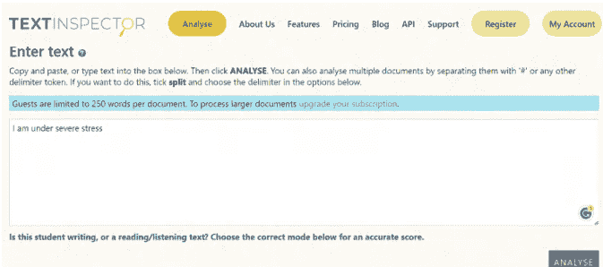

图 7.2 用于 PoS 标注的文本输入。

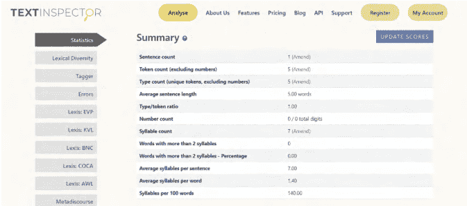

图 7.3 给定输入文本的统计摘要。


图 7.4 已进行 PoS 标注的输入文本。

完成 PoS 标注后，系统会自动检查标签中是否存在形容词或动词，这些词可能是指示某种情感存在的候选词。例如，在上述用户文本（如图 7.3 所示）中，“severe”一词被标记为 PoS 标签“JJ”，代表形容词。通过这种方式，通过识别用户文本中存在的形容词和动词，确定用户文本是否具有主观性。只有主观文本才构成情感。因此，在第一阶段，可以检测用户文本的主观性。如果没有主观性，则表示用户文本不适合分析，因为它不包含任何情感。

#### 7.3.2 三元修饰词利用

修饰词是改变单词强度的副词。并非所有副词都会放大相关形容词的效果；有些副词会在合理范围内减弱它。修饰词要么增强要么减弱观点词的情感强度。这些词在多种类型的演讲中被用作修饰组件。它们的主要目的是强调它们所应用元素中可变特征。

修饰词是在更详细尺度上识别情感强度的有趣可能性。所提方法将...分类


图 7.5 三元修饰词。

修饰词根据其增强相关情感的能力程度，分为三组（增强词、强调词和减弱词）。增强词以最大程度提升所表达情感的强度，表示量表上的激动点。例如，“我对你的回复完全印象深刻”，其中“totally”是一类增强型修饰词，以最完整的程度强化积极程度。

强调词是一类增强相关情感强度的修饰词，但只增强到一定程度，而非像增强词那样达到最大程度。请考虑用户询问：“我对你的回答非常满意。” 这里，“very”充当强调词，提升了用户对聊天机器人所表达情感的积极程度。

减弱词是减少对话中现有情感强度的副词。例如，考虑用户查询：“我现在头痛轻微。” 术语“mild”充当减弱词，降低情感强度。修饰词的三元分类如图 7.5 所示。

#### 7.3.3 情感极性检测

在所提方法中，情感极性通过 ref. [23] 提出的九级量表进行检测。在现有的情感极性研究 [18–21] 中，二元或三元分类要么为（积极，消极），要么为（积极，消极，中性）。通过使用三元修饰词，仍有可能准确检测情感极性，使聊天机器人能够获取用户文本背后的真实语气并相应行动。

例如，考虑用户发送给 Siri 聊天机器人的文本：“我完全沮丧。” 从文本中可以清楚地看出，用户处于极度沮丧的状态，沮丧程度较高，这由增强型修饰词“completely”的存在所揭示。因此，通过给予修饰词存在的适当权重，聊天机器人可以对用户的情况进行适当程度的理解，从而提供适当的回复。如果未给予修饰词应有的权重，可能会导致对用户文本背后真实语气的不当理解。所提方法中开发的九级量表如图 7.6 所示。

九级量表是通过将三种类型的修饰词与积极或消极的形容词或动词相关联而构建的。例如，当增强型副词与积极的形容词或动词搭配时，情感极性被分类为极强积极。同样，如果同一修饰词与消极的形容词或动词相关联，则情感极性被分类为极强消极。

#### 7.3.4 客户服务查询–聊天机器人响应的工作流

图 7.7 展示了聊天机器人情感极性检测的工作流。客户服务查询中的文本通过聊天机器人用户界面获取，并作为输入馈送到预处理模块，其中执行各种预处理子任务，如大小写转换、停用词删除、分词和词干提取，以使文本准备好进行分析。预处理后的文本馈送到主观性检测模块，在该模块中，文本使用 PoS 标记器进行标记，以将令牌标记为其适当的语法对应词，如名词、形容词、动词等。在此模块中，识别文本是否具有主观性。主观文本是情感的来源。下一个任务是使用三元修饰词查找与情感相关的副词类型。基于修饰词的增强能力，可以理解情感的真实语气。最后，通过应用构建的九级量表来执行聊天机器人情感极性检测，该检测能够检测文本中表达的情感的准确语气或极性。

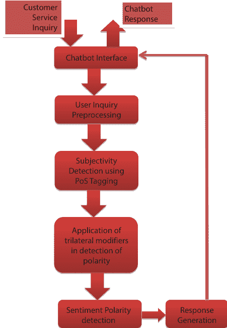

图 7.7 聊天机器人情感极性检测工作流。

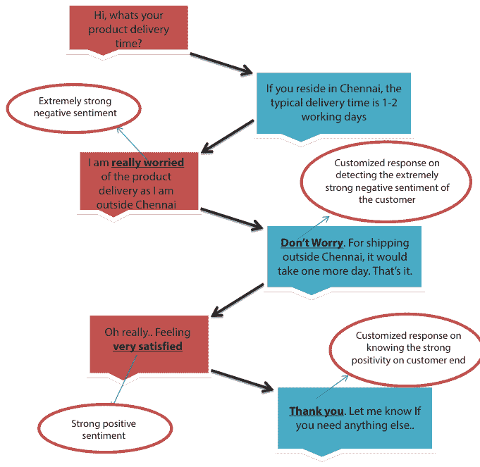

图 7.8 示例聊天机器人–客户交互中的情感检测。

示例聊天机器人–客户对话及使用所提方法检测情感极性如图 7.8 所示。

#### 7.3.5 评分

评分旨在根据情感承载术语的积极性或消极性（如有修饰词）为其分配一个值。情感分数是情感承载术语极性的数值表示。与评分任务相关的现有工作采用了一种简单方法来得出情感承载术语的值。首先，从 SentiWordNet 等词典资源中获取形容词或动词的分数。接下来，获得的分数加上或减去一（根据是否存在修饰词）即可得到适当的分数。为了理解逻辑，请考虑一个积极导向的情感承载术语，其从词典资源获得的分数为 0.42。如果情感承载术语伴随着一种倾向于增强特定术语强度的修饰词，则通过将原始分数加 1 来更新分数，就本示例而言得到 1.42。或者，如果术语与一种倾向于降低其强度的修饰词相关联，则通过将原始分数减 1 来获得更新后的分数，在此例中得到 −0.58。现在，问题在于这种对情感承载术语进行评分的方法没有考虑所提聊天机器人情感分析方法中引入的三元修饰词。为了改进聊天机器人对客户询问的理解，有必要以精细的方式分析客户文本，以便聊天机器人能够提供满足客户需求的定制响应。为完成此任务，计算分数时还必须考虑所提的三元修饰词。表 7.5 列出了三元修饰词的几个示例。

所提聊天机器人情感分析方法通过扩展 ref. [22] 的工作，构建了用于计算情感分数的方程。

- 设 T 表示情感承载术语。
- 设 X 表示增强型修饰词。
- 设 Y 表示强调型修饰词。
- 设 Z 表示减弱型修饰词。
- 设 T_X 表示与增强型修饰词关联的情感承载术语。
- 设 T_Y 表示与强调型修饰词关联的情感承载术语。
- 设 T_Z 表示与减弱型修饰词关联的情感承载术语。

设 S 表示情感分数，W 表示修饰词的权重，范围在 0 到 1 之间。以下公式 7.1–7.3 是作为所提聊天机器人

表 7.5 三元修饰词示例。

| 增强词 | 强调词 | 减弱词 |
|---|---|---|
| 完全 | 非常 | 稍微 |
| 完美地 | 真的 | 轻微地 |
| 绝对地 | 显著地 | 有些 |

情感分析。这三个方程对应积极的形容词/动词。同样，处理消极形容词/动词的方程也已构建。

```
S(T_X)=S(T)+(1-S(T))*W(X)       (7.1)
S(T_Y)=S(T)+(1-S(T))*W(Y)       (7.2)
S(T_Z)=S(T)+(1-S(T))*W(Z)       (7.3)
```

为情感极性检测开发的部分伪代码如下所示：

```
Input: Customer's inquiry(I) to chatbot
Output: Polarity(P) of the sentiment present in the inquiry text and Sentiment score(S)
Let X denote an enhancer-type modifier,
Let Y denote a emphasizer-type modifier
Let Z denote a reducer-type modifier

For every sentiment-bearing term(T) present in I do
If any adverb/verb(M) associated with T then
Switch(Type of M)
Case X and T is a positive sentiment:
Customer sentiment = “Extremely strong positive”
Compute S using equation(1)
Case Y and T is a positive sentiment:
Customer sentiment = “Strong positive”
Compute S using equation(2)
Case Z and T is a positive sentiment:
Customer sentiment = “Almost positive”
Compute S using equation(3)
......
End of switch
Else
Assign the score S from SentiWordNet lexicon according to the positivity or negativity of the Sentiment-bearing term T.
End for
```


### 7.4 实验与结果

Python 语言用于在 Google Colab 提供的 Jupyter 笔记本中实现代码。

#### 7.4.1 性能指标

评估过程中使用的测量体系包括精确率、召回率和 F1 分数。精确率是正确检测到的情感极性实例数与检测到的实例总数之比。召回率是正确检测到的情感极性实例数与实际正确实例数之比。F1 分数是精确率和召回率的几何平均值，旨在实现精确率和召回率之间的平衡。

#### 7.4.2 数据集收集

模型评估所需的数据是通过使用 Twitter 提供的应用程序编程接口 (API) 爬取社交媒体上的推特获得的。使用 Python 从推特收集数据的步骤如下：

- 步骤 1：创建 Twitter 开发者帐户并设计一个应用。
- 步骤 2：安装名为 Tweepy 的 Python 库以访问 API。
- 步骤 3：对 Twitter API 请求进行身份验证。
- 步骤 4：使用 Tweepy 提取推特。
- 步骤 5：根据特定关键词（如 chatbots 和 bots）细化推特，或按标签或产品/服务术语进行筛选。

使用上述步骤，在时尚和电信两个领域收集了推特。下表 7.6 显示了数据集摘要。

| 领域 | 收集的推特数量 |
|---|---|
| 时尚 | 810 |
| 电信 | 428 |

#### 7.4.3 评估

根据内容评估和客户满意度 [16] 两个参数评估聊天机器人的性能非常重要。前者源自信息检索和 NLP 研究领域。它涉及聊天机器人对客户服务查询的响应设置。相反，客户满意度是聊天机器人性能评估中最常用的参数，因为响应可能有所不同，并且没有单一的正确响应。聊天机器人的性能基于客户的满意程度来确定。第二个参数，客户满意度，更适合用于评估性能，因为它仅用于评估，由客户端决定提供的响应是否满足其要求。图 7.9 中的图表显示了 1,238 个实例的分布

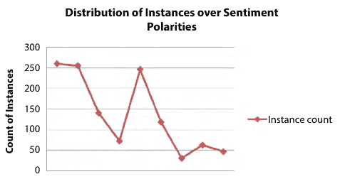

图 7.9 基于九级量表的实例分布。

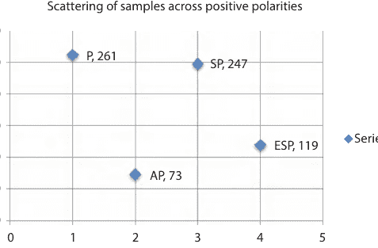

图 7.10 正向极性样本的散布。

（来自时尚领域的 810 条推特和来自电信领域的 428 条推特）根据九级量表分布在各种情感极性类别中。

图 7.10 显示了各个领域正向极性样本的散布，而图 7.11 显示了各个领域负向极性样本的散布。图 7.12 显示了所提方法与现有 GPT 和 ELMO 方法的 F1 分数比较。

生成式预训练转换器（GPT）是一种设计用于执行 NLP 操作（例如翻译、文本生成和摘要）的语言模型。另一种能够执行 NLP 任务的预训练语言模型是来自语言模型的嵌入（ELMO）。该图分析了所提方法获得的 F1 分数与

表 7.7 所提方法用于聊天机器人情感分析的精确率、召回率和 F1 分数。

| 精确率(%) | 召回率(%) | F1 分数(%) |
|---|---|---|
| 81 | 87 | 84 |

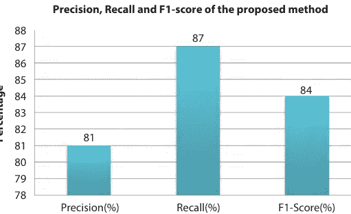

图 7.13 所提方法用于聊天机器人情感分析所取得的精确率、召回率和 F1 分数比较。

GPT 和 ELMO 方法所获得的分数。所提方法在聊天机器人响应的客户满意度任务中所取得的精确率、召回率和 F1 分数显示于表 7.7 和图 7.13 中。所提方法实现了 81% 的精确率、87% 的召回率和 84% 的 F1 分数。所提方法分别比 GPT 和 ELMO 方法高出 6% 和 4%。

### 7.5 结论

本章通过使用情感分析技术，为聊天机器人对客户询问提供更好的响应，从而提高客户服务团队的能力，提供了更好的理解。本章介绍了聊天机器人、情感分析以及用于预处理客户询问文本的 AutoNLP 的基础知识，以及一种基于情感分析的详细方法论，用于执行聊天机器人情感分析以提高客户对聊天机器人响应的满意度。本章讨论的所提方法论实现了 81% 的精确率、87% 的召回率和 84% 的 F1 分数。性能改进成为可能，因为所提方法使用三极修饰符和九级量表以精细的方式测量了客户情感的极性。

### 参考文献

- 1. Kamath, R., Jamsandekar, S., Patil, M.B., 基于情感分析的聊天机器人响应挖掘, 2020.
- 2. Rajbala, Kaswan, K.S., Dhatterwal, J.S., Gangadevi, E., Balusamy, B., 工业 4.0 中 3D 打印的智能图像分类, in: 生物打印中的计算智能, pp. 259–274. Wiley 2024, Hoboken, New Jersey, https://doi.org/10.1002/9781394204878.ch13
- 3. Sodré, W. and Duarte, J., 基于情感分析和时间轴导航的聊天机器人优化. 理论与应用信息评论, 30, 32–43, 2023, 10.22456/2175-2745.125825.
- 4. El-Ansari, A. and Benihssane, A., 电子商务应用中个性化聊天机器人的情感分析. 无线个人通信, 129, 1–22, 2023, 10.1007/s11277-023-10199-5.
- 5. Raut, R., Kolambe, S., Borkar, P., Shingade, A., Gulhane, M., 基于自然语言处理的抑郁症治疗聊天机器人. 智能系统与应用工程国际期刊, 12, 2s, 181–187, 2023.
- 6. Tran, A., Pallant, J., Johnson, L., 探索聊天机器人对零售业消费者情感和期望的影响. 零售与消费者服务期刊, 63, 102718, 2021, 10.1016/j.jretconser.2021.102718.
- 7. Nallakaruppan, M.K., Gangadevi, E., Shri, M.L. et al. 基于可解释 AI 模型的可靠水质预测和参数分析. 科学报告, 14, 7520, 2024, https://doi.org/10.1038/s41598-024-56775-y.
- 8. 使用混合机器学习算法能够进行情感分析的智能聊天机器人交互系统. 信息处理与管理, 60, 5, 103440, 2023, ISSN 0306-4573, https://doi.org/10.1016/j.ipm.2023.103440.
- 9. Widyaningrum, P., Ruledeviani, Y., Dharaniyani, R., 使用评估理论通过情感分析评估社区对开发聊天机器人的热情. 程序计算机科学, 161, 723–730, 2019, 10.1016/j.procs.2019.11.176.
- 10. Lee, C.-W., Wang, Y.-S., Hsu, T.-Y., Chen, K.-Y., Lee, H.-Y., Lee, L.-S., 带有性能分析的序列到序列聊天机器人响应的可扩展情感, 2018.
- 11. Io, H.N. and Lee, C.B., 聊天机器人和对话代理：一种计量分析. IEEE 工业工程与工程管理国际会议论文集, pp. 215–219, 2017.
- 12. Bhagwat, V.A., 聊天机器人的深度学习. 圣何塞州立大学硕士项目、硕士论文和研究生研究, Spring 2018.
- 13. Csaky, R., 基于深度学习的聊天机器人模型. 布达佩斯技术与经济大学自动化与应用信息学系科学学生协会报告, 2017.
- 14. Menal, D., 一种对话工具：聊天机器人. 计算机科学与工程国际期刊, 5, 158–161, 2017.
- 15. 情感分析, https://en.wikipedia.org/wiki/Sentiment_analysis 检索于 2019 年 12 月 18 日.
- 16. Maroengsit, W., Piyakulpinyo, T., Phonyiam, K., Pongnumkul, S., Chaovalit, P., Theeramunkong, T., 聊天机器人评估方法综述, in: 2019 年第 7 届信息与教育技术国际会议论文集, pp. 111–119, 2019.
- 17. Nandhini, M. and Gurunathan, P., 使用增强规则方法和领域特定词典 (ERBA-DSL) 改进基于方面的情感分析效能. 智能模糊系统期刊, 43, 1–19, 2022, 10.3233/JIFS-213584.
- 18. Marstwa, A., Sharaf, N.M., Aris, T.N.M., Mustapha, A., 基于本体的方面提取用于产品评论摘要中改进的情感分析, in: 第 8 届计算机建模与仿真国际会议论文集, pp. 100–104, 2017.
- 19. Sindhu, I., Daudposta, S.M., Badar, K., Bakhtyar, M., Baber, J., Nurunnabi, M., 基于学生反馈的教学绩效评估的基于方面的意见挖掘. IEEE Access, 7, 108729–108741, 2019.
- 20. Singh, V.K., Piryani, R., Uddin, A., Waila, P., 电影评论情感分析：一种用于方面级情感分类的新特征启发法. 自动化、计算、通信、控制和压缩感知国际多会议 (IMAC4S), IEEE, pp. 712–717, 2013.
- 21. Singh, V.K., Piryani, R., Waila, P., Devaraj, M., 文档和方面级别文本情感极性计算. ECTI 计算机与信息技术交易 (ECTI-CIT), 8, 1, 67–79, 2014.
- 22. Benamara, F., Cesarano, C., Picariello, A., Recupero, D.R., Subrahmanian, V.S. 情感分析：形容词和副词优于单独的形容词. ICWSM, vol. 7, pp. 203–206, 2007.
- 23. Devi Sri Nandhini, M. and Gurunathan, P., 大学评论中联合方面-意见提取和情感方向检测. 信息技术国际期刊, 14, 3213–3225, 2022, https://doi.org/10.1007/s41870-022-01041-5.
- 24. Devika, M.D., Sunitha, C., Ganesh, A., 情感分析：不同方法的比较研究. 程序计算机科学, 7, 44–49, 2016, ISSN 1877-0509, https://doi.org/10.1016/j.procs.2016.05.124.


- 25. Qazi, A., Raj, R.G., Hardaker, G., Standing, C., 观点类型与情感分析技术的系统文献综述：任务与挑战. Internet Res., 27, 3, 608–630, 2017.

- 26. Schouten, K. and Frasincar, F., 方面级情感分析调查. IEEE Trans. Knowl. Data Eng., 28, 3, 813–830, 2015.

- 27. Wankhade, M., Rao, A.C.S., Kulkarni, C., 情感分析方法、应用和挑战调查. Artif. Intell. Rev., 55, 7, 5731–5780, 2022.

- 28. Behdenna, S., Barigou, F., Belalem, G., 文档级情感分析：一项调查. EAI Endorsed Trans. Context-Aware Syst. Appl., 4, 13, e2–e2, 2018.

- 29. Shirsat, V.S., Jagdale, R.S., Deshmukh, S.N., 新闻文章的文档级情感分析，在：2017年计算、通信、控制与自动化国际会议（ICCUBEA）上，IEEE，第1–4页，2017年8月。

- 30. Meena, A. and Prabhakar, T.V., 使用语言分析在存在连词的情况下的句子级情感分析，在：信息检索进展：第29届欧洲信息检索研究会议，ECIR 2007，意大利罗马，2007年4月2-5日，Springer Berlin Heidelberg，2007。

- 31. Gangadevi, E., Rani, R.S., Dhanaraj, R.K., Nayyar, A., 用于检测番茄植物疾病的带模拟退火优化SVM的点出果蝇算法. Neural Comput. Appl., 36, 8, 4349–4375, 2023, Springer Science and Business Media LLC.

# 使用自动化机器学习的银行监控网络安全分析金融风险预测

K. Rajkumar¹, Prassanna Jayachandran², Kannan Chakrapani¹, S. Magesh³ and R. Manikandan¹*
¹计算机学院，SASTRA Deemed University，坦贾武尔，泰米尔纳德邦，印度 ²计算机科学与工程学院（SCOPE），Vellore Institute of Technology，金奈，印度 ³计算机科学与工程系，Dr. M.G.R Educational and Research Institute，金奈，印度

### 摘要

科学和技术进步推动消费金融的持续改进，但也引入了一些金融信贷风险。金融信贷风险变得越来越难以管理，尤其是随着互联网银行的不断扩张。这凸显了创建和评估一种独特、全面的机器学习方法的必要性，该方法将缺失数据研究和预测器评估纳入困境预测过程。本研究提出了一种使用联邦学习和自动化机器学习的银行监控网络安全检测金融风险预测新技术。在此，利用高斯编码器信念网络（GEBN）对用户银行业务进行分析以进行网络安全检测。金融信贷风险分析使用元启发式自回归核心主群优化模型（MAPSO）。实验分析评估准确率、平均平均精度、召回率、F值和归一化误差。使用特定示例的数据来分析模型性能。结果表明，所提出的基于模型的数据挖掘技术可以在优化输入变量的同时从数据中提取隐藏信息。

**关键词：** 金融风险预测，银行监控，网络安全检测，联邦学习，自动化机器学习

### 8.1 引言

保护计算机编程免受入侵、未授权访问、篡改和破坏是网络安全实践的一个组成部分。入侵检测系统（IDS）、防病毒软件和防火墙通常应成为每个网络安全系统的一部分。IDS至关重要，因为它有助于发现系统中的任何不想要和不受欢迎的更改 [1]。两种主要的入侵者类型是内部入侵者和外部入侵者。然而，以下元素可用于区分不同类型的网络分析：i）不规则性或签名，以及 ii）基于混合性质的奇异加密。

由于数据易于获取且计算能力价格合理，人工智能（AI）方法在金融领域的资产管理、交易方法、信贷承销和基于区块链的金融中越来越广泛地应用 [2]。机器学习（ML）方法使用大量数据，从历史数据和先前性能中自动学习，以在无需人工编程的情况下增强预测和性能。预计金融领域的 AI 将通过提高生产力、降低成本以及改善服务质量（QoS）和提供给客户的产品，为金融机构带来竞争优势。因此，通过提供更好、更个性化的产品，提供数据洞察以指导投资策略，并通过实现对几乎没有或没有信用历史的客户信用状况的评估来潜在增强金融包容性，这些竞争优势可以帮助金融消费者 [3]。与金融相关的 AI 应用程序还可能放大或增加金融和非金融风险，引发对潜在投资者和消费者保护法律的担忧。

AI 模型流程与内部治理和金融监管框架的不兼容性，以及市场中周期性和系统性风险的潜在可能性，可能会危及政策中立的监管方法。鉴于所使用方法的复杂性、其动态适应性和自主程度，实施此类方法可能会增强这些漏洞，即使与金融领域 AI 相关的许多可能风险尚不确定 [4]。管理层必须承担更多风险，以增加银行投资者的收入。银行必须管理利率、市场风险、信贷风险、表外风险、运营和技术风险、外汇风险、国家或主权风险、流动性风险和破产风险。银行的绩效取决于其成功处理这些风险的能力。由于这些风险以及银行在金融方法中的作用，监管控制是一个问题 [5]。当局要求银行保留资本，因为其多样化运营可能产生许多危险。自1998年成立以来，用于估算资本需求的巴塞尔协议标准不断演变和提高。每个主要风险类别都需要资本。信贷风险通常需要最多的资本，历史上一直是银行面临的重大风险。市场风险主要源于银行的交易业务，而运营风险指的是由于内部流程缺陷或外部事件导致损失的可能性。大多数大型银行计算监管资本和经济资本，后者基于银行自身方法而非监管机构的指令 [6]。银行必须管理三种主要风险：信贷、市场和运营。流动性、业务和声誉威胁是额外的危险。为了监测、管理和量化这些风险，银行积极参与风险管理。

### 8.2 相关工作

传统的量化金融问题，例如收益预测、风险建模和最佳投资组合构建，已成功使用大规模机器学习解决 [7]。风险是失去某物的可能性，暴露是失去某物的机会 [8]。企业要想取得成功，通常必须承受风险。FRM 建立在识别风险和暴露的基础上。由于风险和暴露在各种情境中被不同地感知，因此它们的量化方式也不同。参考文献 [9] 和 [10] 的作者建议使用基于传统 ML 的技术，利用 SVM 对金融消息进行分类。词袋（BoW）技术在整个分类阶段充当消息的表示。此外，还有多项式朴素贝叶斯（mNB）、随机森林（RF）和其他经典分类器可用 [11]。基于深度学习的方法通常优于传统 ML 方法，因为后者仅从消息中提取浅层特征用于分类。参考文献 [12] 的作者使用 LSTM 网络对金融消息进行分类以提高分类性能。此研究旨在帮助银行、金融机构和公众理解网络体制。通过在推特上使用对称 Kullback–Leibler 散度和潜在狄利克雷分配（LDA），可以创建监督不足的模型来评估拒绝服务（DoS）攻击的影响，而不需要标注数据。该模块有一个仅部分监控的限制。随着更少的


非攻击性 Twitter 事件可能在预先指定的检测窗口内被误判为 DoS 攻击。应用一个基于手动标注的 DoS 攻击推文训练的第二层分类器，是从数据集中移除非攻击性推文的另一种方法。ref. [13] 中详细分析了各种 RNN（如双向 LSTM、双向 GRU、门控循环单元 (GRU)、堆叠 GRU、LSTM 和简单 RNN）的分类结果。系统设计师使用了模糊理论，以考虑用户行为偶尔伴随不确定性的现实。模糊专家系统的性能使用接收者操作特征曲线进行了评估，结果显示准确率为 94%。通过使用此专家系统，可以增强 E-银行的安全性和服务质量。使用源域样本来训练卷积神经网络，然后采用金融域消息来调整规格。这种迁移学习技术已应用于 ref. [14]。在实践中，预训练期间可以重新计算所有参数。一种结合离线历史交易和在线实时交易评分标准的方法被整合起来用于检测欺诈。展示了基于 MPP Gbase、Spark 和 Kafka 的大规模数据处理架构，以及一种检查大量交易日志的技术。作者在电子银行交易的大量数据集上的实验结果证明了所提方法的有效性。作者未来的工作应弥补这些差距并克服这些障碍。由于编制足够的金融标记训练文本具有挑战性，Work [15] 为情感分析选择了基于词典的方法而非机器学习。他们使用词向量和三个 DL 分类器创建了中文金融领域情感词典 (CFDSL)。CFDSL 在预测未来金融困难方面的有效性已得到确立。CNN 及其增强变体经常被选用于金融视觉信息。作者创建了一种基于嵌入式 DL 方法系统的企业财务风险预测方法 [16]。金融数据通常是异构的，因为它们来自许多不同的来源并紧密合并。时间序列数据是反映金融数据来源多样性的关键类型。几位研究人员表示，深度学习在预测时间序列方面非常准确。为了模拟中国股票价格指数的波动，Work [17] 应用了结合 LSTM 方法的 GARCH 模型。他们分析了四个损失函数的值，并发现 LSTM 方法在预测方面更准确。我们开发了一种使用 MapReduce 编程架构的新型 DDoS 攻击检测系统。用于客户身份验证的方法因在线银行平台提供的声明而异。许多银行使用 PIN 和密码。其他银行使用 TAN 和 TAN 列表（有时称为刮刮列表）来验证和批准交易。也可以使用更复杂的方法，例如质询-响应系统或一次性密码，用于用户身份验证。据作者所知，没有一家重要银行成功实施了用于用户身份验证的公钥证书。SSL/TLS 协议的加密强度经常被引用，作为在线银行安全性的辩护。SSL/TLS 协议安全性中已知的理论缺陷和漏洞非常少。Dolev–Yao 威胁模型与这些调查相关。作者 [18] 使用余额宝交易数据研究了一种金融资金流预测方法。他们提出了一种预测方法 (YEB_Hybrid)，基于时间序列理论和 LSTM 结合线性方法与非线性方法。他们认为该方法提高了预测准确性，并成功解决了流动性风险和流动性盈余问题。在价值数万亿美元的市场中保证电子商务系统 24 小时安全运行是一项固有的难题。Work [19] 专注于电子商务领域，并为电子商务公司开发了一种基于深度学习的金融风险预警方法。作者创造性地混合了 10-K 文件中的非结构化语言和传统的市场结构化数据 [20]。

### 8.3 系统模型

我们讨论使用机器学习预测银行业金融风险的新方法。我们使用高斯编码器信念网络研究银行服务。我们使用一种独特的元启发式自回归核心粒子群优化模型来确定信用风险。所提方法如图 8.1 所示。

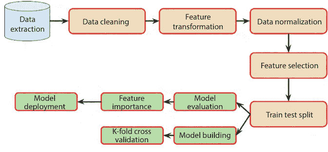

图 8.1 所提风险分析模型。

该框架使用缩放、归一化和转换函数来预处理信用数据。数据集已使用 min–max 归一化进行适当归一化。在此过程中，使用公式 8.1 获得并修改了数据的最小值和最大值。

\(\bar{L} = \frac{l - \min(X)}{\max(X) - \min(X)}(new_{\min(X)} - new_{\max(X)}) + new_{\min(X)} (8.1)\)

其中 X 表示数据中存在的规格，min(X) 和 max(X) 分别表示属性值的下限和上限，L 表示条目的升级值，l 表示数据中的先前值，newmin(X) 和 newmax(X) 分别表示最小和最大限制的值。

图 8.2 描绘了所提供应链数字金融风险防范方法的算法过程。收集供应链企业的相关财务信息，然后将该信息作为训练数据输入训练集。将选定的函数添加到训练数据集中，创建一部分测试数据以稍后确认模式准确性，执行分类方法，并使用 SMA 调整参数。最后，将这些数据馈送到训练好的模型中，并评估模型运行的准确性。

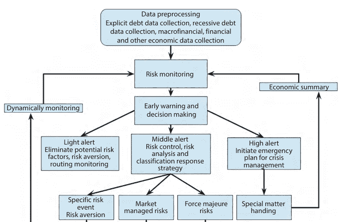

图 8.2 金融风险分析流程图。

#### 8.3.1 使用高斯编码器信念网络进行网络安全检测

直接独热编码可能会产生巨大的表示维度和许多训练规格，因为金融消息域中的单词数量庞大，使其不适合实际应用。必须引入词嵌入技术来降低单词表示向量的维度。word2vec 方法是更常见的传统词嵌入技术之一。它使用语料库中的单词来表示单词，遵循如连续词袋 (CBOW) 等模型。

与我们之前的工作一样，我们将其设置为 0.99。动作值函数至关重要，因为通过最大化它，我们最终可以到达一个理想策略，从而导致所需行为，在此情况下，是准确的图像类预测。两节点输出描绘了两种可能的动作值 Q(s, a1) 和 Q(s, a2)，可以通过以不同方式对状态进行操作来获得。

\( p(x) = \sum_{j=1}^K \pi_j p\left(x; \theta_j\right), j = 1, \dots, K. \quad p(\mathbf{x}) = \sum_{c=1}^C \pi_c f_c(\mathbf{x} \mid \theta) \tag{8.2} \)

混合方法具有一组参数，\(\theta = \{\theta_1, \dots, \theta_k, \pi_1, \dots \pi_k\}\)。在混合模型中，隐藏变量被视为潜变量或 Z。它接受 1 到 K 的数字作为满足要求的离散集。\( z_k \epsilon \{0, 1\} \) 和 \(\sum_z z_k = 1\)。

\( p(z, x) = p(z)p(x \mid z) \quad p(z_k = 1) = \pi_k \tag{8.3} \)

X 的概率密度函数定义

\( p(x \mid \mu_k, \Sigma_k) = \frac{1}{\sqrt{2\pi \mid \Sigma^{-1} \mid}} \exp \left( -\frac{1}{2} (x - \mu_x) \Sigma_x^{-1} (x - \mu_x)^T \right) \quad f_c(\mathbf{x} \mid \mu_c, \Sigma_c) = \frac{\frac{1}{d}}{(2\pi)^{\frac{d}{2}} \mid \Sigma_c \mid^\frac{1}{2}} \exp \left( -\frac{1}{2} (\mathbf{x} - \mu_c)^t \Sigma_c^{-1} (\mathbf{x} - \mu_c) \right) \tag{8.4} \)


高斯的线性叠加被用于以如下形式表示高斯混合分布：

```
p(x) = \sum_{k=1}^K \pi_k p(x | \mu_k, \xi_k)
\hat{\pi}_c = \frac{n_c}{n},
\hat{\mu}_c = \frac{1}{n_c} \sum_{\{i | y_i = c\}} \mathbf{x}_i
\hat{\Sigma}_c = \frac{1}{(n_c - 1)} \sum_{\{i | y_i = c\}} (\mathbf{x}_i - \mu_c)(\mathbf{x}_i - \mu_c)^t
```

给定z的特定值时，x的条件分布现在为高斯分布：

```
p(x | z_k = 1) = p(x | \mu_k, \Sigma_k)
p(x | z) = \prod_{k=1}^K p(x | \mu_k, \Sigma_k)^{z_k}
```

x的边缘分布通过对z的所有潜在状态的联合分布求和得到。

```
p(x) = \sum_z p(z) p(x | z) = \sum_{k=1}^K \pi_k p(x | \mu_k, \Sigma_k)
```

一个重要的派生量是特定数据向量[11]上混合分量上的“后验概率”：

```
\gamma(z_k) \equiv p(z_k = 1 | x) = \frac{p(z_k = 1)p(x | z_k = 1)}{\sum_{j=1}^K p(z_j = 1)p(x | z_j = 1)} = \frac{\pi_k p(x | \mu_k, \Sigma_k)}{\sum_{j=1}^K \pi_j p(x | \mu_j, \Sigma_j)}
```

输出层(y)随后使用输入(h, 潜在空间)，\(x^{[\alpha]} \in \mathcal{R}^d\) 和隐藏层来重建输入\(x^{[\alpha]}\)。我们都使用相同的上标表示法，*[ [\alpha] ]*，来引用所有使用方程8.9连接到AE网络的单独参数。

此方法的其他名称包括编码器或识别技术。通过优化变分参数\(\varphi\)，满足方程8.10。

```
\(q_\varphi(\mathbf{z} \mid \mathbf{x}) \approx p_\theta(\mathbf{z} \mid \mathbf{x})\) (8.10)
```

推理方法是根据方程8.11的（几乎）任何有向图形技术：

```
\(q_\phi(\mathbf{z} \mid \mathbf{x}) = q_\phi(\mathbf{z}_1, ..., \mathbf{z}_M \mid \mathbf{x}) = \prod_{j=1}^M q_\phi(\mathbf{z}_j \mid Pa(\mathbf{z}_j), \mathbf{x})\) (8.11)
```

DBN的每一层都构建为RBM，因此训练其层与训练RBM相同。分类通过使用方程8.12的DBN训练初始化网络来完成。

```
\(\min_{\sigma_k} \frac{1}{|D|} \sum_{i=1}^{|D|} [-\log p\left(x_k^{(0)}; \theta_k\right)]_{\theta_k}\) (8.12)
```

请记住，层级更新需要从底层隐藏层开始纠正所有问题，并一路向上到顶层可见层。我们使用方程8.13求解精调阶段的优化问题。

```
\(\min_\phi \frac{1}{D} \sum_{i=1}^{|D|} \left[\mathcal{L}\left(\phi; y^{(i)}, h\left(x^{(0)}\right)\right)\right]_{h(x^{(0)})} = h(x_i^{(i)})\) (8.13)
```

该方法同时使用两阶段训练程序，但我们仍需添加一个额外的超参数来平衡两个目标的相对权重。该方法（DBN + 损失）如方程8.14所示：

```
\(\min_{\theta_{L,i}, \theta_{DNN}} \mathbb{E}_{\mathbf{x}}[\mathcal{L}(\theta_L;\mathbf{y}, h(\mathbf{x}))] + p \mathbb{E}_{\mathbf{x}}[-\log p(\mathbf{x}; \theta_{DAN})]\)
\(\min_{\theta_L, \theta_{DAN}} \frac{1}{D} \sum_{i=1}^{|D|} [\mathcal{L}(\theta_L; y^{(i)}, h(x^{(i)})) - \rho \log p(x^{(i)}; \theta_{DBN})]_{\theta_L}\) (8.14)
```

## 元启发式自回归核主群优化模型

其搜索效用和收敛能力优于元启发式生物优化技术。其独特的自适应方法可以更有效地平衡整体状况和局部搜索方法，从而提高搜索精度。蝗虫优化方法将整个方法划分为勘探方法和开发方法，以模仿自然界中蝗虫种群寻找和觅食的行为。该算法主要由三个组件组成。以下公式说明了其方案过程：

$$X_i = S_i + G_i + A_i$$

在此方程中，Xi表示第i只蝗虫的位置，Si表示个体操作之间的引力，Gi表示第i只蝗虫的重力拉力，Ai表示第i只蝗虫暴露于的风量。社会行为对蝗虫位置有最显著的影响，确定Si的公式如下：

$$S_i = \sum_{j \neq i}^N s(|X_j - X_i|) \frac{X_j - X_i}{d_{ij}}$$

在此，N代表社群中蝗虫的总数，dij代表蝗虫i和j之间的距离，S代表社会强度函数。估算过程如下：

$$S(r) = fe^{-r/l} - e^{-r}.$$

在此，社会吸引力强度和尺度分别用字母f和l表示，而其存在的社会值用字母r表示。其次，Gi和Ai的公式如下：

$$G_i = -g e_g,$$

$$A_i = u e_{w^*}$$

在此，g是重力目标，ew是指向风向的归一化向量，u是风力大小，eg是面向地球的归一化向量。因此，蝗虫的位置Xi可表示如下：

```
\( X_i = \sum_{j=1, j \neq i}^N s(\| X_j - X_i \|) \frac{X_j - X_i}{\text{d}_{ij}} - g e_g + u e_{w^*} \)
```

尽管在我们的数学方法中种群不会收敛到某个特定值，但蝗虫会迅速找到需要优化的舒适姿态。由于风始终吹向Td方向，且重力因子Gi当前未被考虑，因此更好的数学方法是

```
\( X_i = c \left[ \sum_{j=1, j \neq i}^N \frac{ub_d - lb_d}{2} s(\| x_j - x_i \|) \frac{x_j - x_i}{\text{d}_{ij}} \right] + T_d \)
```

在此，Td是d维空间中理想的蝗虫位置，ubd和lbd是d维空间中S(r)的上界和下界。在计算中，c是递减系数，公式为

```
\( c = c_{\max} - n \frac{c_{\max} - c_{\min}}{n_{\max}} \)
```

在此，c的最大值和最小值分别为cmax和cmin；n表示当前迭代次数，nmax表示最大迭代次数。PCA权重方法是一种多元变量统计方法，用于计算权重计算，也是模式分析中最广泛使用的降维策略之一。通过使用指定信息、揭示数据集并审查估计值，其主要目的是计算输出节点的权重并限制数据集大小。将X初始化为输入数据集，其中每一列都划分为一个D维输入模式（X = [x 1, x 2,..., x n]）。假设每个节点的常规值取为数据集的均值并设为零（E(X) = 0）。应用正交归一化权重计算A，将X映射到新空间Y如下：

Y = AX (8.15)

考虑$E(X) = 0, E(Y) = 0$，且$Y$的协方差矩阵为：

RY = AR_X A^T (8.16)

Rx是X的协方差矩阵。很明显，如果A的行是Rx的特征向量，则利用此权重计算，样本在节点空间中是d维的；尽管如此，PCA变换的主要目标是创建紧密反映X的d维映射样本。

可以将X重建为$X = A^T Y$。可以使用所有特征向量投影X而非复制它；在此情况下，$^kX = A^T_K Y$，其中使用了k个特征向量。在此情况下，输出节点的组合权重为：

$wgt = \sum_{i=1}^d \lambda_i - \sum_{i=1}^k \lambda_i = \sum_{i=k+1}^d \lambda_i$ (8.17)

给定半正定核及映射使得$\Phi : S \to H (K)$，则存在一个RKHS。

$K(x, y) = \langle \Phi(x), \Phi(y) \rangle_{\mathcal{H}(K)}$
\(f(x) = \langle K_x, f \rangle_{\mathcal{H}(K)}\)
\(\text{span } \left\{ K_x := K(\cdot, x_j) \right\}\)

关于H(K)内积：

\(\left\langle \sum c_i K_{x_i}, \sum d_j K_{x_j} \right\rangle_{\mathcal{H}(K)} := \sum_{i,j} c_i d_j K(x_i, x_j)\)

适当的指标通常在可接受的波动范围内运作，只要不超过阈值；超过此值即表示存在财务风险。供应链金融风险缓解技术会向管理层发出警报，建议暂时中止战略决策以便及时解决潜在的财务漏洞，从而防止业务损失升级。


### 8.4 结果与讨论

本节展示了不同测试的结果，以评估所提方法的性能。使用一台配备相关配置的PC来测试所提半混合模型：配备32位操作系统、Intel(R) Core(TM) i5-7500 CPU、4 GB内存、Windows 7、NumPy、SciPy、Pandas、Keras和Matplotlib框架以及Python 2.7编程语言。

#### 数据集描述

一般数据保护条例（GDPR）：该数据集收集所有其他商业银行和储蓄机构的信息，并作为国家中央信用枢纽。该数据集中的每个条目代表客户每月的信用和信用卡状态。信用注册数据库约为1 TB，但我们为研究使用了包含1,000,000行的该数据集子集。这些行仅代表1,000,000笔面向私人客户的不同贷款的状态以及贷款付款计划完成日期的状态。该数据集没有指示客户是否能够偿还信用风险的特征。

高级信用注册数据分析：利用其进行前沿检查的能力，我们检查了属性、其条件、模式及其与其他信息源的相关性。我们执行了不同阶段的调查，包括额外确定的段、度量和星形构造模型。我们能够按照方法设计和关系，通过以高效方式创建多个报告来检查数据集并获得更好的认知。与常规工具相比，这些报告具有现代可视化、依赖性和预测功能，速度和功能无与伦比。我们采用Power BI的选择部分受其快速修改和分析数据能力的影响。我们检查的数据集部分放入结构化查询语言（SQL）数据库时大小为13 GB，因为Power BI具有设计用于处理海量数据的自有格式。但是，当以Power BI格式存储时，此大小减少到330 MB。

WIND数据集：本文选用的示例信息来自某商业银行个人信用数据集的真实信息。本文从个人信用数据库中随机选取了75个数据样本。在剔除这些无效样本后，剩余61个有效样本。其中包含21个测试样本和40个学习样本。

根据制定的探索计划，收集、分析和处理了近600,000笔交易信息测试（来自A行的超过540,000个样本，以及从B行获得的40,000多个样本）。筛选出了显示企业业务优势的信息。特征具有四个维度：与信贷相关的静态信息、预付款的动态变化数据、贷款客户子账户资本流以及预付款客户不同记录的完整资本流。经过包括2020年1月至6月的分离和参与在内的各项任务，从八张表中的263个字段中选出了103个有效字段。

### 表 8.1 基于各种金融信用风险分析数据集的分析。

| 参数 | 技术 | 准确率 | 平均平均精度 | 召回率 | F1_score | 归一化误差 |
| :--- | :--- | :--- | :--- | :--- | :--- | :--- |
| GDPR | SVM | 80 | 75 | 70 | 75 | 61 |
| GDPR | CNN | 83 | 79 | 73 | 78 | 65 |
| GDPR | Proposed_GBN_MAPSO | 90 | 85 | 75 | 81 | 69 |
| Advanced Analytics of Credit Registry Dataset | SVM | 82 | 83 | 68 | 83 | 71 |
| Advanced Analytics of Credit Registry Dataset | CNN | 84 | 87 | 73 | 85 | 73 |
| Advanced Analytics of Credit Registry Dataset | Proposed_GBN_MAPSO | 93 | 91 | 82 | 89 | 75 |
| WIND | SVM | 81 | 85 | 83 | 69 | 69 |
| WIND | CNN | 85 | 89 | 85 | 73 | 74 |
| WIND | Proposed_GBN_MAPSO | 96 | 93 | 91 | 83 | 83 |

### 图 8.3 准确率比较。

图8.3展示了准确率分析。对于GDPR数据集，所提技术的准确率为90%，现有SVM为80%，CNN为83%。对于信用注册数据集高级分析，所提技术的准确率为93%，现有CNN为82%，SVM为84%。对于WIND数据集，所提技术的准确率为96%，现有SVM为81%，CNN为85%。

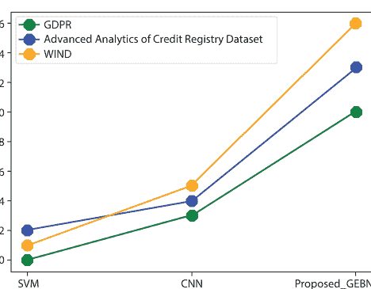

### 图 8.4 平均平均精度（MAP）比较。

图8.4展示了平均平均精度分析。对于GDPR数据集，所提技术的平均平均精度为85%，现有SVM为75%，CNN为79%。对于信用注册数据集高级分析，所提技术的MAP为91%，现有CNN为83%，SVM为87%。对于WIND数据集，所提技术的MAP为93%，现有SVM为85%，CNN为89%。

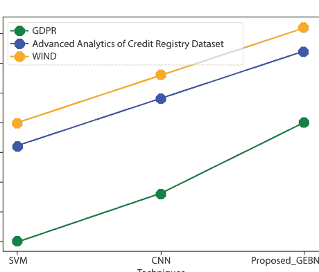

图8.5展示了召回率分析。对于GDPR数据集，所提技术的召回率为75%，现有SVM为70%，CNN为73%。对于信用注册数据集高级分析，所提技术的召回率为82%，现有CNN为68%，SVM为73%。对于WIND数据集，所提技术的召回率为91%，现有SVM为83%，CNN为85%。

图8.6展示了F1_Score分析。对于GDPR数据集，所提技术的F1_Score为81%，现有SVM为75%，CNN为78%。对于信用注册数据集高级分析，所提技术的F1_Score为89%，现有CNN为83%，SVM为85%。对于WIND数据集，所提技术的F1_Score为83%，现有SVM为69%，CNN为73%。

图8.7展示了归一化误差分析。对于GDPR数据集，所提技术的归一化误差为69%，现有SVM为61%，CNN为65%。对于信用注册数据集高级分析，所提技术的归一化误差为75%，现有CNN为71%，SVM为73%。对于WIND数据集，所提技术的归一化误差为83%，现有SVM为69%，CNN为74%。

当实际结果和决策结果均为预期时，结果为TP；当实际结果和决策结果均为异常时，结果为FN；当真实结果和决策结果均为异常时，结果为FP；当实际结果和决策结果均为异常时，

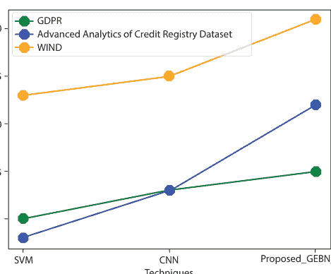

### 图 8.5 召回率比较。

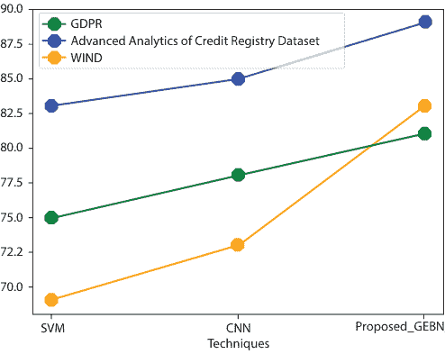

### 图 8.6 F1_score比较。

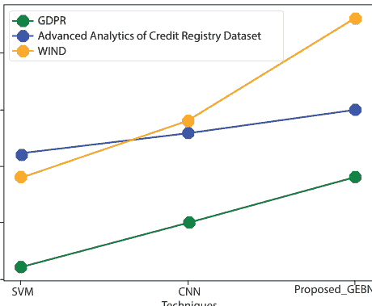

### 图 8.7 归一化误差比较。

结果为TN。异常样本和标准样本分别做出的许多正确选择分别由TN和TP表示。决策值越高越好。FN和FP图表显示使用异常样本和标准样本做出的许多错误决策。较低值更可取，因为它表示错误更小。由于本研究中使用的样本公司收集了大量数据，仅从混淆矩阵无法得出关于决策过程的任何结论。已创建相关评估指标，并使用计算指标评估方法输出。

### 8.5 结论

本研究旨在利用基于机器学习的高斯编码器信念网络（GEBN）和元启发式自回归核主粒群优化模型（MAPSO）进行银行监控下的金融信用风险分析。本研究提出了一种基于深度学习的金融市场投资分析预测与评估技术。人民币、欧元、日元、加元、澳元、英镑和瑞士法郎是七个主要国际汇率市场，本研究从中考察了历史数据以估计汇率。提取过程能够处理长度各异的输入文本。提取后，可以从金融通信中有效过滤虚假信息，从而加快后续分类。提取摘要后，使用GRU模型根据提取的摘要进行情感分类。本研究中的所提技术通过金融社交网络的金融消息数据集进行验证。

所提方法的有效性还可通过摘要提取和GRU策略来证明。与不提取摘要的方法相比，识别率提高了2.87%。数据限制阻止所有或隐藏的债务威胁被纳入预警信号方法，这是不足之处。考虑到审计中非法隐藏债务数据的披露以及关于隐藏社会保障债务数据的官方计算，政府债务风险评估方法论将进一步完善和优化。

### 参考文献

- 1. Ghelani, D., Hua, T.K., Koduru, S.K.R., 银行业网络安全威胁、漏洞及安全解决方案模型。*Authorea预印本*，2022。
- 2. Islam, U., Muhammad, A., Mansoor, R., Hossain, M.S., Ahmad, I., Eldin, E.T., Shafiq, M., 基于机器学习模型的银行业IoT监控系统分布式拒绝服务（DDoS）攻击检测。*可持续性*，14，14，8374，2022。


- 3. Almatari, O., Wang, X., Zhang, W., Khan, M.K., VTAIM: 银行业务网络安全风险保险的易挥发交易认证保险方法, 2023.

- 4. Wei, Z., Liu, H., Tao, X., Pan, K., Huang, R., Ji, W., Wang, J., 工业风险评估中机器学习应用的见解：文献计量学映射分析. Sustainability, 15, 8, 6965, 2023.

- 5. Peng, K. and Yan, G., 金融风险预测深度学习综述. Quant. Finance Econ., 5, 4, 716–737, 2021.

- 6. Clintworth, M., Lyridis, D., Boulougouris, E., 航运金融风险评估：一种基于机器学习的整体方法. Marit. Econ. Logist., 1–32, 2021.

- 7. Zhao, J., 基于嵌入式系统和深度学习的企业金融风险预测. Microprocess. Microsyst., 103405, 2020.

- 8. Chen, X. and Long, Z., 基于FA-PSO-LSTM神经网络深度学习模型的电子商务企业金融风险预测. Sustainability, 15, 7, 5882, 2023.

- 9. Song, Y. and Wu, R., 基于数据挖掘和机器学习的金融企业过度金融化风险评估对风险控制的影响. Comput. Econ., 60, 4, 1245–1267, 2022.

- 10. Mhlanga, D., 新兴经济体中的金融包容性：机器学习和人工智能在信用风险评估中的应用. Int. J. Financ. Stud., 9, 3, 39, 2021.

- 11. Shi, T., Li, C., Wanyan, H., Xu, Y., Zhang, W., 基于深度学习混合模型的大数据民间非正式金融组织贷款风险预测. Financ. Res. Lett., 50, 103212, 2022.

- 12. Chen, D., 基于机器学习算法的政府债务风险评估. Complexity, 2021, 1–12, 2021.

- 13. Appadurai, J.P., Raveendran, L.S., Latha, R., Gangadevi, E., Shri, M.L., Gite, S., 通过SCO优化技术使用混合类型模型进行分类的网络安全. 2024 IEEE国际计算、电力和通信技术会议(IC2PCT), 大诺伊达，印度, pp. 1390–1396, 2024, doi: 10.1109/IC2PCT60090.2024.10486307.

- 14. Cao, Y., Shao, Y., Zhang, H., 基于深度学习算法的电子商务企业金融风险预警研究. Electron. Commer. Res., 22, 1, 21–36, 2022.

- 15. Melina, S., Napitupulu, H., Mohamed, N., 基于极值理论与机器学习的股票市场投资风险预测概念模型：半系统文献综述. Risks, 11, 3, 60, 2023.

- 16. Kaswan, K.S., Dhattewal, J.S., Batra, R., Balusamy, B., Gangadevi, E., 使用机器学习优化3D生物打印技术, 在：生物打印中的计算智能, pp. 303–321, Wiley, 2024, https://doi.org/10.1002/9781394204878.ch15.

- 17. Li, G., Wang, X., Bi, D., Hou, J., 基于DAE-LSTM深度学习算法的数据驱动金融信贷行业风险测度. J. Glob. Inf. Manag. (JGIM), 30, 11, 1–20, 2022.

- 18. Khan, H.U., Malik, M.Z., Nazir, S., Khan, F., 利用生物识别系统增强银行业网络安全：系统分析. IEEE Access, 2023.

- 19. Anu Disney, D., Yugha, R., Karachi, S.B., Gangadevi, E., Balusamy, B., Gite, S., 基于EPO和CNNNet-LAM混合的人工智能驱动网络入侵检测系统的网络安全系统. 2024 IEEE国际计算、电力和通信技术会议(IC2PCT), 大诺伊达，印度, pp. 1397–1404, 2024, doi: 10.1109/IC2PCT60090.2024.10486517.

- 20. Vaiyapuri, T., Priyadarshini, K., Hemlathadhevi, A., Dhamodaran, M., Dutta, A.K., Pustokhina, I.V., Pustokhin, D.A., 基于深度学习的金融风险评估模型的智能特征选择. CMC-Comput. Mater. Continua, 72, 2, 2429–2444, 2022.

## AutoML生态系统和开源平台：挑战与局限性

M. Anitha¹, J. Dhilipan², P.M. Kavitha³* and E. Gangadevi⁴

¹SRM TRP工程学院计算机科学与工程系，特里奇，印度
²SRM科学技术学院科学与人文学院计算机科学与应用系，金奈，印度
³SRM科学技术学院计算机科学与应用系，金奈，印度
⁴洛约拉学院计算机科学与应用系，金奈，印度

### 摘要

近年来，随着对机器学习的关注度不断增加，下一个焦点是自动化机器学习（AutoML），它通过自动化模型选择、超参数调优和特征工程过程，使ML民主化。

本文深入探讨了AutoML的生态系统，其中ML的初始和基础任务被转化为单一步骤。

本文重点介绍了AutoML的不同框架，以及少数开源AutoML库，如Auto-sklearn、TPOT、AutoKeras、MLBox等。

简要讨论了引入AutoML的优势、挑战和局限性。

实践中主要的AutoML类型包括完全自动化、人机回路和模型辅助模型。

尽管AutoML在自动化ML流程方面效率显著，但与之相关的挑战也相当值得关注。

随着大数据集的使用，模型的复杂性会增加，同时框架的透明度极低。

AutoML缺乏模型定制，所用算法、决策过程及其他方面存在不透明性。

灵活性是AutoML的一大问题，因为ML管道是自动化的，因此从ML平台转到AutoML平台的用户面临相当大的挑战。

本文主要集中讨论与AutoML相关的局限性和挑战。

数据质量是一个主要问题，因为AutoML依赖于输入数据的质量。

噪声和有偏数据可能会导致次优预测。

此外，预处理、异常值检测和缺失值等其他因素可能会影响模型的效率。

详细描述了AutoML带来的挑战和局限性。

关键词：Auto-sklearn, TPOT, MLBox

### 9.1 引言

使用自动化机器学习（AutoML）技术[2]可以自动化将机器学习应用于数据的方法。

AutoML可以安排为遍历许多数据转换、机器学习系统和超参数，以针对给定数据集获得最佳模型。

机器学习和数据科学领域正在经历自动化机器学习使用量的显著增加。

由于数据复杂性和规模不断增加，开发机器学习模型的传统手动方法正在逐渐变得耗时且低效。

自动化机器学习（AutoML）通过提供构建模型的有效且可扩展的技术，正在显著革新机器学习和数据科学领域。

尽管数据复杂性和数量不断增加，但制作机器学习模型的可预测方法在时间和效率方面都已被证明是不够的。

AutoML框架通过自动化方法选择、特征工程、模型优化和超参数调优，为提升该过程的效率提供了一种手段。

未来，开发者将对AutoML的各种组成部分和优势进行更全面的考察，同时探讨其在现实场景中的实际应用。

图9.1展示了传统ML工作流，图9.2展示了AutoML工作流。

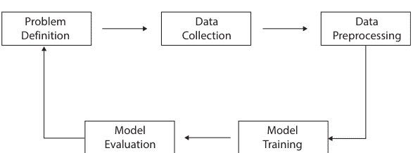

图9.1 传统ML工作流示意图。

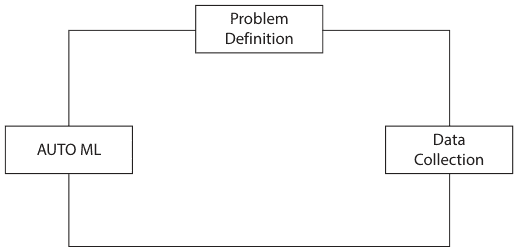

图9.2 AutoML工作流示意图。

AutoML已成为机器学习和数据科学领域的一股变革力量。

AutoML通过自动化和优化整个机器学习管道，缩短并加速了高性能机器学习模型的开发进程。

这包括多个阶段，例如数据预处理、特征选择、算法选择和超参数调优[6]。

AutoML由多个组件组成，共同使机器学习过程系统化。

### 9.2 相关研究

在他们的研究中，Karmaker等人[1]对自动化机器学习（AutoML）的现状进行了全面分析，并就该领域的潜在方向和困难提供了有价值的观点。

本文探讨了包括AutoML方法论的发展、当前突破、演变模式以及AutoML在多个领域中的未来复杂性在内的多种主题。

本文的突出特点在于对AutoML领域进行了全面考察，涵盖了过去的发展和当前的突破。

作者们对AutoML技术的演变进行了完整考察，涵盖了传统方法论以及神经架构搜索（NAS）和元学习等现代方法。

该文章通过整合来自学术论文、会议论文集和行业报告等多种来源的信息，提供了关于AutoML当前最先进技术的广泛知识。

Wever等人对专门针对多标签分类问题而设计的自动化机器学习（AutoML）程序进行了深入综述。

该文章提供了全面的


对当前多标签分类 AutoML 方法的研究，并辅以使用标准化数据集对其有效性的实际评估。本文的关键优势在于其关注特定且具有挑战性的主题领域，即多标签分类。Wever et al. 承认多标签分类在许多实际场景中的重要性，包括图像标记、文档分类和医疗诊断。作者通过专注于这一精确主题，为将 AutoML 算法应用于多标签分类任务的不同挑战和场景提供了重要见解。

Salehin et al. [7] 开展了对多种不同自动化机器学习（AutoML）流程和工具的广泛评估与评价。作者承认 AutoML 获得日益关注，并旨在提供关于各种 AutoML 技术的效率与功能的有益视角。本研究的优势在于其系统评估方法，这使得对多种 AutoML 方法和工具进行全面比较成为可能。该框架是本研究的决定性特征。Truong et al. 强调经验评估在评估 AutoML 方法的效能与胜任能力方面的重要性，特别是在时间和资源限制起关键作用的实际场景中。作者首先对 AutoML 领域进行了完整概述，深入探讨与机器学习管道自动化相关的问题与前景。随后，他们评估了许多知名的 AutoML 方法和工具，例如 Auto-sklearn、TPOT、H2O AutoML 和 AutoKeras [9]。评估通过利用广泛的数据集和绩效指标进行，从而对每种方法的优势与不足进行全面评价。

### 9.3 AutoML 生态系统

#### 9.3.1 数据预处理

为模型训练准备原始数据需要包括数据清洗、特征工程和归一化在内的多个过程，这些过程都至关重要。

#### 9.3.2 模型选择

AutoML 算法会同时考虑数据集的特性和当前问题的性质，然后选择最合适的机器学习模型架构或方法。

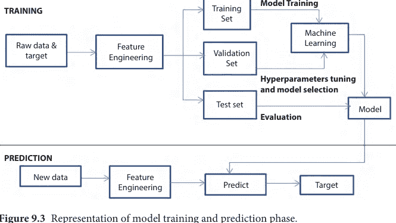

#### 9.3.3 超参数调优

超参数是构成机器学习模型设置和性能的核心参数 [8]。AutoML 工具利用机器学习自动调整超参数以提升模型性能。

#### 9.3.4 模型评估与部署

AutoML 框架自然提供评估模型完成后性能的流程，此外还提供将模型部署到生产环境的机制。

### 9.4 AutoML 框架

#### 9.4.1 Google AutoML

Google AutoML 是 Google Cloud 提供的一组工具。这些工具允许用户以最少的人工干预构建机器学习模型。AutoML Vision、AutoML Natural Language 和 AutoML Tables 是该框架涵盖的机制之一，用于适应多种类型的数据。Google AutoML 利用复合神经架构搜索技术自动优化模型。其主要特点如下：

- 图像和文本分类
- 与 Google Cloud Platform 集成
- 自定义模型调优

#### 9.4.2 IBM Watson AutoAI

IBM Watson AutoAI 通过自动化数据准备、特征工程和模型选择等流程，有助于实现机器学习管道的自动化。该平台为用户提供协作环境，用于构建、训练并部署机器学习模型。其显著特点如下：

- 自动化模型选择与超参数调优
- 协作与共享功能
- 与 IBM Watson Studio 集成

#### 9.4.3 Microsoft Azure AutoML

Azure AutoML 是 Microsoft Azure 云生态系统的重要组成部分，为机器学习模型的设计和开发提供易于使用的界面。该平台支持分类和回归任务，还提供自动特征选择和超参数调优功能。其突出特点如下：

- 与 Azure Machine Learning Studio 集成
- 自动化模型选择与调优
- 广泛的算法范围

#### 9.4.4 H2O.ai

H2O.ai 提供一个广泛使用的开源 AutoML 平台，亦称为 H2O AutoML。该软件提供自动化模型选择、超参数优化以及对模型可解释性的宝贵洞察。H2O AutoML 的多功能性使其可应用于分类和回归等广泛的应用场景。其显著特点如下：

- 开源平台
- 自动化特征工程
- 可解释性与可说明性工具

#### 9.4.5 DataRobot

DataRobot 是一个全面的 AutoML 平台，可加速机器学习流程。该系统从数据预处理一直到模型部署，加速完整的机器学习流程。DataRobot 提供多种策略和优化技术。其突出特点如下：

- 自动化模型构建与选择
- 广泛的算法库
- 模型部署选项

#### 9.4.6 Databricks AutoML

Databricks AutoML 是 Databricks 统一分析平台的关键组成部分，通过提供自主模型调优和选择功能来简化机器学习流程。该计算机程序可与多种 Databricks 服务无缝连接，从而构成一个集成的数据与人工智能平台。

主要特性：

- 与 Databricks Workspace 集成
- 用于模型训练的分布式计算
- 协作与共享功能

#### 9.4.7 Tune

开源 AutoML 库 Tune 专注于超参数优化与定制。该工具便于定制机器学习模型，使用户能够开发搜索空间以及搜索算法。其重要特性如下：

- 可定制的超参数搜索
- 可扩展且分布式的调优
- 对多种机器学习库的支持

#### 9.4.8 AutoKeras

在深度学习模型领域，AutoKeras 库是一个专注于神经架构搜索的开源 AutoML 包。该计算机程序便于自动化神经网络创建与优化流程。其主要特性如下：

- 简化深度学习模型开发
- 可定制的搜索空间
- TensorFlow 与 Keras 集成

#### 9.4.9 H2O Driverless AI

强大的 AutoML 平台 H2O Driverless AI 能够自动化机器学习活动并解释模型输出。此外，它还提供可解释性、模型选择和自主特征工程。其尤其值得注意的特性如下：

- 自动化特征工程
- 可解释性与可说明性工具
- 企业级平台

#### 9.4.10 RapidMiner

RapidMiner 提供一个用户友好的 AutoML 平台，用于构建、部署和管理机器学习模型。该计算机程序提供包括数据收集和模拟在内的自动化功能。其突出属性如下：

- 可视化与代码界面
- 广泛的机器学习算法库
- 模型部署与监控

#### 9.4.11 Google Cloud AutoML Tables

Google Cloud AutoML Tables 是专为结构化数据处理设计的专用 AutoML 解决方案。它利用自动化来便于为各种任务（例如回归和分类）创建预测模型。其重要特性如下：

- 对结构化数据的支持


#### 9.4.12 H2O Sparkling Water

为实现对海量数据集的分布式机器学习，H2O Sparkling Water 结合了 H2O.ai 的 AutoML 功能与 Apache Spark。它能够提高效率并改进性能。其主要特点如下：

- 与 Apache Spark 集成
- 可扩展的 AutoML
- 分布式机器学习

#### 9.4.13 Turi Create

Turi Create 是一个用户友好的 AutoML 平台，用于构建机器学习模型，目前是 Apple Core ML 的一部分。它特别适合在 macOS 和 iOS 平台上构建应用程序。主要功能：

- macOS 和 iOS 兼容性
- 简化模型创建
- Core ML 集成

#### 9.4.14 Big ML

BigML 提供了一个优先考虑用户友好性和模型可解释性的 AutoML 平台。该方法包含自动模型识别和超参数优化。主要功能：

- 用户友好的界面
- 模型可解释性工具
- 机器学习任务自动化

#### 9.4.15 Hail

Hail 是一个专门为分析遗传数据而开发的免费 AutoML 包。该平台提供了一系列技术，有助于在基因组数据集上进行分布式和可扩展的机器学习。其特别显著的特征如下：

- 基因组数据分析
- 可扩展且分布式的处理
- 与 Apache Spark 集成

### 9.5 开源 AutoML 库

#### 9.5.1 Auto-Sklearn

Auto-sklearn 改进了最初由 Auto-WEKA 引入的建立具有适当全局优化的全面机器学习框架的理念。Auto-sklearn 通过构建在整个全局优化过程中评估过的所有模型的集成来增强泛化能力。它是一个构建于 scikit-learn 之上的自动机器学习工具包。

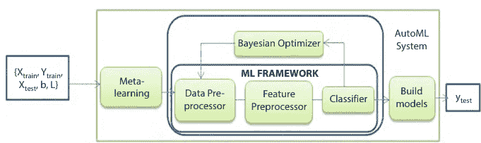

图 9.4 AutoML 管道表示。

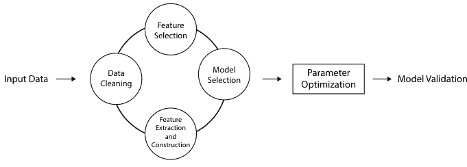

图 9.5 自动化 TPOT 表示。

#### 9.5.2 TPOT (Tree-Based Pipeline Optimization Tool)

名为 TPOT 的该工具旨在通过利用遗传编程概念来优化机器学习管道。通过主动探索数百万个潜在管道，它将自动化机器学习中最乏味的方面，并为您的数据确定最合适的管道。它改编自 IPython，是一个使用遗传编程的自动机器学习库。

#### 9.5.3 AutoKeras

作为一种开源许可下的软件库，AutoKeras 用于自动机器学习。AutoKeras 提供了一系列功能，有助于自动探索深度学习模型的架构和超参数需求。它可以通过 pip 安装，并作为 AutoML 库部署，用于使用 Keras 进行自动神经架构搜索。

#### 9.5.4 MLBox

MLBox 是一个支持自动机器学习的强大 Python 模块。该软件提供以下功能：快速读取、预处理、清洗和格式化分布式数据；高效且可靠的特征选择和泄漏检测技术；高维空间中的高效超参数优化；以及用于特征工程、模型选择和超参数调整的自动机器学习库。

#### 9.5.5 AutoGluon

AutoGluon 使易于使用且可扩展的 AutoML 成为可能，专注于深度学习、自动堆叠集成以及针对文本、图像和表格数据的实际应用。它是由 Amazon AWS 开发的 AutoML 库，用于模型选择、超参数调整和集成学习。

#### 9.5.6 H2O AutoML

H2O 是一个可线性扩展且完全开源的分布式内存机器学习平台。H2O 支持在各个领域广泛使用的多种统计和机器学习算法。这些算法包括梯度提升机、深度学习等。

#### 9.5.7 Auto-WEKA

与一次解决一个问题的其他方法不同，Auto-WEKA 同时解决选择学习算法和确定其超参数的问题。在数据挖掘任务方面，Weka 是一组机器学习算法。该系统包含一系列工具，有助于各种任务，如数据准备、分类、回归、关联规则挖掘和可视化。

#### 9.5.8 AutoGluon Tabular

AutoGluon 可以为以表格形式存储的常规数据集（例如，作为 CSV 文件或从数据库导出的 parquet 文件）生成模型，以根据其他列的值来预测某一列的值。AutoGluon 使使用 AutoML 变得简单直接，特别侧重于涉及图像、文本或表格数据的深度学习和实际应用。AutoGluon 旨在面向不同机器学习专业水平的人员。它允许您使用最少的代码行高效地为数据创建深度学习解决方案的原型。

#### 9.5.9 FLAML

FLAML 是一个 Python 库，有助于在尽量减少所需计算资源的同时自动发现准确的机器学习模型。这样做，数据科学家免于担心超参数调整和方法选择。开发人员能够构建能够适应新训练数据的自动调谐软件。根据 FLAML，最优模型是 lightgbm。该模型的调整超参数可以通过使用以下代码确定。这是 FLAML 的一大优势。该系统能在几秒钟内高效识别适当的机器学习方法和超参数。

#### 9.5.10 Ludwig

AutoML 推断输入和输出特征的类型，选择模型架构，并在一组超参数及其范围上启动 Ray Tune Async HyperBand 搜索任务，时间预算由定义的参数限制。Ludwig 是一种开源且声明式的机器学习框架。它通过一种简单灵活的数据驱动配置机制来促进深度学习管道的定义。Ludwig 与多种人工智能工作负载兼容，并由 Linux Foundation AI & Data 托管。Uber AI Labs 开发了一个用于深度学习的 AutoML 包。

### 9.6 AutoML 方法的类型

#### 9.6.1 完全自动化

在完全自动化的 AutoML 解决方案中，完整的机器学习管道（包括数据预处理和模型部署）在无需用户参与的情况下执行。

#### 9.6.2 “人在回路中”

“人在回路中”自动机器学习（AutoML）解决方案的概念包含一定程度的用户参与，使领域专家能够提供输入或定制机器学习过程中的某些元素。

#### 9.6.3 模型辅助

模型辅助 AutoML 的理念是将人类经验与自动化方法相结合，以提升模型性能或解决机器学习管道中遇到的特定问题。

### 9.7 AutoML 的优势

#### 可访问性

AutoML 通过自动化复杂的机器学习活动，简化了利用机器学习能力解决现实问题的流程。这使得经验不足的个人和组织更容易利用机器学习。

#### 创新

AutoML 通过自动化重复性工作，使数据科学家和机器学习工程师能够将精力集中在更具创造性和更高级的工作上，从而在机器学习领域实现创新。

### 9.8 挑战与局限性

尽管 AutoML 具有许多优势，但也面临一些问题和局限性，包括以下几点：

#### 复杂性

AutoML 算法在处理复杂的数据集或需要领域特定专业知识的任务时可能会遇到困难，因此在特定情况下其有效性受到限制。

#### 可扩展性

在资源有限的情况下，将 AutoML 解决方案扩展到处理大规模数据集或计算复杂的模型可能比较困难。可扩展性是这一挑战中的关键因素。

#### 定制性

某些 AutoML 框架可能缺乏满足领域特定需求或提供广泛定制选项所需的灵活性。

#### 数据质量

AutoML 模型的性能深受输入数据质量的影响，缺失值或异常值等错误会产生不利影响。

### 9.9 结论

尽管 AutoML 在实现技术世界民主化方面铺平了道路，但它也带来了同等的任务和局限性。缺乏透明度和定制选项使从机器学习到 AutoML 的过渡变得繁琐。从机器学习到 AutoML 的过渡需要一个内在版本，以克服不同用户面临的障碍。此外，计算资源需求、数据质量问题和可扩展性是需要关注的已知领域。本文讨论了采用 AutoML 所面临的各种挑战。此外，在提升


customization choices, resource utilization, and scalability should be broadened. It is essential to navigate through these tests to streamline ML frameworks. The AutoML community paves the way for better ML by making it more accessible, transparent and impactful across diverse domains.

### 参考文献

- 1. Karmaker, S.K., Hassan, M.M., Smith, M.J., Xu, L., Zhai, C., Veeramachaneni, K., AutoML至今及未来：挑战与机遇。ACM Comput. Surv. (CSUR), 54, 8, 1–36, 2021。
- 2. He, X., Zhao, K., Chu, X., AutoML：最新技术综述。Know.-Based Syst., 212, 106622, 2021。
- 3. Wever, M., Tornede, A., Mohr, F., Hüllermeier, E., 多标签分类的AutoML：概述与实证评估。IEEE Trans. Pattern Anal. Mach. Intell., 43, 9, 3037–3054, 2021。
- 4. Li, Y., Wang, Z., Xie, Y., Ding, B., Zeng, K., Zhang, C., AutoML：从方法论到应用。载于：第30届ACM信息与知识管理国际会议论文集，2021年10月，第4853–4856页。
- 5. Truong, A., Walters, A., Goodsitt, J., Hines, K., Bruss, C.B., Farivar, R., 迈向自动化机器学习：AutoML方法与工具的评估与比较。载于：2019年IEEE第31届人工智能工具国际会议(ICTAI)，2019年11月，IEEE，第1471–1479页。
- 6. Milutinovic, M., Schoenfeld, B., Martinez-Garcia, D., Ray, S., Shah, S., Yan, D., AutoML系统评述。载于：ICML自动机器学习研讨会论文集，2020年7月，第2020卷。
- 7. Salehin, I., Islam, M.S., Saha, P., Noman, S.M., Tuni, A., Hasan, M.M., Baten, M.A., AutoML：带有神经架构搜索的自动化机器学习系统综述。J. Inf. Intell., 2, 1, 52–81, 2024。
- 8. Barbudo, R., Ventura, S., Romero, J.R., AutoML八年：分类、综述与趋势。Knowl. Inf. Syst., 65, 12, 5097–5149, 2023。
- 9. Celik, B., Singh, P., Vanschoren, J., 在线AutoML：用于在线学习的自适应AutoML框架。Mach. Learn., 112, 6, 1897–1921, 2023。

## 基于扩展EfficientNet深度学习模型的智能农业中植物病害识别

K. Sathya1*, K. Kanmani1, M. Revathy Meenal2, D. Suganthi3 and T. S. Lakshmi4

1科学与人文学院计算机应用系，SRM科学与技术学院，钦加尔帕图，泰米尔纳德邦，印度
2安娜阿达什女子学院计算机科学系，钦奈，泰米尔纳德邦，印度
3SCLAS计算机科学系，SIMATS，钦奈，泰米尔纳德邦，印度
4Saveetha工学院土木工程系，SIMATS，钦奈，泰米尔纳德邦，印度

### 摘要

在复杂环境中实现植物病害成功精准防控的基石，在于准确识别影响植物的特定病害。智能农业的快速发展推动了植物病害的数字化和数据驱动检测，从而使决策支持、智能分析和规划方面的进步成为可能。本研究引入了一种基于深度学习的植物病害诊断与识别数学模型，旨在提升训练效率、准确性和适用性。首先使用区域建议网络版本2（RPNv2）算法在复杂情况下识别和定位叶片。接下来，基于RPNv2算法结果分割的图像中，采用Chan–Vese Level-II（LCV）方法提取症状特征。本研究提出使用扩展EfficientNet（E-ENet）深度学习架构，将其应用于植物叶片病害分类，并与其他当前深度学习模型评估其有效性。模型使用PlantVillage的数据进行训练。分别包含55,448张和61,486张图像的训练数据集用于训练所有模型。根据测试数据集的结果，E-ENet架构在原始数据集中优于现有模型，测试准确率为98.87%，验证准确率为99.21%。因此，本章的深度学习算法对于生态保护、农业生产力和智能农业至关重要。

关键词：植物病害，智能农业，扩展EfficientNet，分类，生态保护，农业生产力

*通讯作者：sathyabalaji33@gmail.com

### 10.1 引言

确实，人工智能正在当今时代逐步且坚定地接管传统由人类执行的任务，这是一个不可否认的现实。人工智能（AI）是一个快速发展的技术领域，致力于利用训练用于解决复杂问题的算法，创造出能够像人类一样思考的机器。AI是指在机器中模拟人类智能，使其能够复制人类的思维过程和行为（如问题解决和学习）；在此领域中，机器学习发挥着至关重要的作用，使系统能够识别、理解和分析数据中的模式。在先进的计算机科学领域，人工智能是研究与开发的主要焦点。由于这项技术在传统计算架构和人类能力主要无法企及的问题上具有强大的应用能力，并且技术进步迅速，它正在飞速普及[1]。

尽管技术有了很大改善，农民从种植到收获仍面临许多困难。人工智能方法的应用使我们能够理解各种情形中的复杂细节，从而为特定问题提供量身定制的最佳解决方案。各种AI方法的发展正在为复杂挑战提供创新解决方案。为了解决当今农业面临的问题，人们提出了多种方法，例如数据库集成和决策支持系统[2]。人工智能（AI）与农业的接近，起初虽不寻常，但在近年来变得相关起来。尽管农业几千年来一直是人类文明的基石，但AI在过去几个时期内即使以最简单的形式也在快速演进，带来了变革性的波动。在各个领域涌现新概念的浪潮中，农业在技术方面取得了显著进步。面对人口增长、气候变化和供应短缺等对粮食系统可持续性构成的威胁，农业进步的地位变得更加关键。AI的集成解决了众多挑战，并缓解了传统耕作方式相关的缺点。

AI系统使独立的作物管理成为可能。通过检查土壤湿度含量和气候数据，算法在与物联网（IoT）传感器结合使用时，可以实时确定作物的理想水分需求。自主作物灌溉系统的目标是在保护水资源的同时支持可持续耕作方法。人工智能通过利用能够辨别数据中模式和异常（指示潜在泄漏）的算法，在识别灌溉系统泄漏方面发挥着至关重要的作用。机器学习（ML）模型可以被训练以识别与泄漏相关的特定特征，例如水压或流量的偏差，从而提高灌溉系统泄漏检测的效率和准确性。实时监控和研究使初步识别成为可能，这有助于避免对作物造成可能的损害和水资源损失。

为了检测水耗较高的区域，人工智能（AI）将气候数据与作物水分需求相结合，通过自动化泄漏检测和发出及时警报来提高水资源利用效率，从而帮助农民节约资源。土壤中营养物质组合不当会显著影响作物的健康和生长。借助AI，农民可以快速识别这些营养物质并确定它们对作物产量的影响，从而进行适当调整。尽管人工评估的准确性有限，但计算机视觉模型可以通过监测土壤条件来收集精确数据。然后，利用这些植物科学数据进行产量预测和作物健康评估，并突出任何特定问题。实际上，AI在追踪小麦生长阶段和西红柿成熟度方面展示了人类无法比拟的速度和准确性。

除了测量作物产量和土壤状况外，计算机视觉还可以分类疾病和害虫。这通过利用人工智能浏览昆虫、腐烂、霉菌及其他威胁作物健康的照片来实现。当与警报机制结合使用时，这使农民能够采取及时行动来消除害虫或隔离作物，以防止疾病传播。AI已以超过90%的准确率识别出苹果黑腐病。它在识别苍蝇、蜜蜂、蛾子等其他类型的昆虫方面同样准确。研究人员首先收集害虫图片，以生成算法有效训练所需的训练数据集。


农民现在都清楚，优化农药使用存在机会。遗憾的是，无论是程控还是人工施药方式都存在显著局限。虽然人工施用化学肥料费力且耗时，但在针对特定区域时能实现更高的精度。尽管自动喷洒农药速度更快且所需劳动力更少，但常常缺乏准确性，可能会污染环境。AI 驱动的无人机结合了各种策略的优点，而没有其缺点。利用计算机视觉的无人机可以计算每个区域应喷洒多少农药。尽管这项技术尚处于起步阶段，但在精度方面正在快速发展。产量测绘利用机器学习算法即时分析大型数据集。因此，农民能够更好地进行规划，因为他们对作物的模式和特性有了更深入的了解。农民可以通过将 3D 测绘等方法与传感器和无人机的信息相结合，来预测特定作物的土壤产量。多次无人机飞行通过算法的应用，为日益精准的分析提供数据采集。

借助这些方法，农民能够准确预测特定作物的未来产量，从而帮助其确定播种位置和时机，以及进行资源分配以获得最佳投资回报。正如计算机视觉可以分类疾病和害虫，它也可以用于识别农业环境中的杂草和入侵植物种类。计算机视觉在与机器学习结合时，通过检查叶片的形状、颜色和大小来从作物中识别杂草。这种类型的方案可以用于编程机器，用于自动除草等属于机器人流程自动化（RPA）一部分的项目。事实上，这样的机器人已经投入使用。随着这些创新变得更加普及，智能机器人最终可能完全承担耕作和除草任务。

AI 已以 90% 的精度识别出苹果黑腐病。它在识别其他昆虫（如苍蝇、蜜蜂、蛾等）方面同样准确。研究人员负责收集害虫图片，以编译算法所需的训练数据集。本章的主要焦点是应用于农业问题的重要人工智能（AI）策略。本研究探讨了人工智能技术在农业各个方面的应用，以监测和评估农业智能系统的进展。

#### 10.1.1 农业部门面临的障碍

##### 10.1.1.1 土壤侵蚀

土壤侵蚀的自然过程发生在水或风将土壤颗粒从一个地点带到另一个地点时。当这种情况大规模发生时，农民会面临严重问题。许多因素会导致土壤侵蚀，例如过度耕作会破坏土壤状况并降低持水能力。洪水期间，表层土壤会被迅速冲走。为了减少灌溉用水，通过覆盖物和作物覆盖物保护土壤免受风蚀和水蚀，以及限制过度牲畜放牧，都是防止土壤侵蚀的方法。

##### 10.1.1.2 缺乏高质量种子

为了提高作物产量，农民必须使用高质量种子。实现农业产出的稳定增长也取决于此。优质种子的分销与种子生产同样重要。大多数农民，尤其是边际农民和小农户，通常由于价格高昂而无法负担优质种子。

##### 10.1.1.3 缺乏现代农业机械

缺乏适当的农业设备是农民面临的最大问题之一，这会使他们难以适应现代农业方法的要求。当农民接受培训学会使用设备时，他们的生活可以得到重大改善。使用上述设备至关重要。

#### 10.1.2 农业中人工智能的挑战

许多人认为 AI 与农业任务无关，仅适用于数字世界。总的来说，这种假设源于对 AI 工具了解不足。普通公众，特别是非技术领域的人士，对人工智能（AI）了解不足，这导致农业行业采用 AI 的速度较慢。尽管在漫长的历史中农业取得了诸多进步，但许多农民仍然更熟悉使用传统系统。

此外，供应商在阐述新技术的优势及其应用方面往往做得不够好。科技公司在向公众宣传 AI 在农业中的应用方面面临重大任务。尽管 AI 对可持续农业的好处显而易见，但仍有必要向农民介绍其实际优势，并鼓励其在农业领域采用。然而，仍有某些障碍需要解决。

#### 10.1.3 现有植物病害识别方法

植物病害导致的生长受阻会对产量产生负面影响 [3–5]。全球范围内，每年估计有 200 亿美元或以上的经济损失 [6–8]。由于地区差异可能使准确识别更加困难，多种情况对研究人员构成了最大的挑战 [9, 10]。传统技术通常依赖专家、知识和手册 [11]，但它们往往昂贵、费力且耗时。此外，它们在准确识别对象方面面临挑战 [12]。因此，快速而准确地识别植物病害对于农业的经济和生态至关重要。Web 技术发展迅速，尤其是来自多种传感器（例如物联网传感器网络）的多模态数据的可用性 [13]。为了解决上述问题，本研究引入了一种基于 DL 的创新植物叶片识别模型。该模型采用集成深度学习算法，在其功能内无缝执行图像分割、识别和叶片检索。第一项任务是检索叶片，但在这种复杂环境中，土壤和照明等众多因素使得准确识别变得困难 [14]。

在防止不必要的资源浪费的同时实现可持续高效的农业，关键在于植物病害的早期阶段和准确诊断。某些植物病害没有明显症状，因此在处理此类疾病时有必要采用复杂的分析技术。尽管如此，大多数植物病害表现出外部迹象，目前公认的方法是让有经验的植物病理学家目视检查受感染的植物叶片以识别病害 [15, 16]。能够可靠且独立地识别植物病害的专家和智能系统为农业从业者提供了巨大好处，在管理作物健康方面帮助很大。然而，对于缺乏农学和植物病理学援助设施的农民来说，将此类方案应用于易于使用的智能手机应用程序也是一项值得称赞的成就 [17]。

现代农业技术越来越依赖基于人工智能的系统来识别各种紊乱 [18]。在过去十年中，各种传统 ML 模型已被引入用于植物病害的识别和分类。Rumpf 等人利用光谱植物指南采用支持向量机（SVM）来探索甜菜病害的初步识别和分类 [19]。Al-Hiary 等人采用分割方法，通过对预处理特征使用 k-means 聚类来识别和区分植物叶片上的五种不同疾病。在基于纹理和颜色的特征提取之后，人工神经网络（ANN）随后被用于对这些区域进行分类 [20]。Revathi 和 Hemalatha 提出了一种识别棉花叶片上六种不同疾病的方法。他们提出一种方法，利用粒子群优化从包含通过图像处理获得的颜色、纹理和边缘特征的特征向量中选择特征。随后使用交叉信息增益深度前馈神经网络对疾病进行分类 [21]。

Mokhtar 等人采用支持向量机（SVM）技术进行了调查，以检测和识别两种不同的病毒，这些病毒会引起疾病并在番茄叶片上表现出症状 [22]。在另一项研究中，Pantazi 等人利用局部二值模式方法提取的特征，通过支持向量机（SVM）方法识别三种不同的藤蔓叶片疾病 [23]。在另一项研究中，Johannes 等人建议使用朴素贝叶斯分类系统和基于图像处理的候选热点检测，用于基于移动设备的三种不同小麦疾病的初始阶段诊断。他们在真实世界的田间环境中使用手机测试了他们提出的方法 [24]。为了自动化植物病害识别，Chen 等人最近引入了一种名为 GMDH（数据处理分组方法）逻辑算法的新模型 [25]。使用机器学习进行分类涉及一个称为特征提取的要求较高的过程，它直接影响分类的性质。

DL 架构使用无需自定义特征即可分析原始数据的方法，代表了性能突破。这得益于中央处理单元（CPU）与图形处理单元（GPU）的增强功能和速度 [26]。深度神经网络风格拥有众多用于处理信息的层和神经元，在处理语音和图像识别等困难任务方面表现出色，同时能轻松处理海量数据。DL 方法经常用于医疗应用中，以从医学图像中识别和分类疾病 [27]。然而，一项审查


2019 年发表的一篇论文 [28] 评估了基于深度学习的植物叶片病害检测与分类研究，并对该领域的潜力进行了评估。与对数据集中所有植物病害进行分类相比，观察发现，文献中相当一部分训练工作使用 PlantVillage 数据集来诊断单种或少数几种植物的疾病。

Sladojevic 等人在这些研究中之一使用了卷积神经网络 (CNN) 对 13 种不同的植物病害进行分类 [16]。在他们的调查中，他们在包含 30,880 张图像的数据集上训练了所提模型，并使用 2,589 张图像进行测试。其所提模型平均达到 96.3% 的准确率。Chen 等人利用基于深度 TL（迁移学习）的 DenseNet 模型来检测水稻植物病害 [29]。Chen 等人在另一项调查中修改了 VGGNet 模块，对玉米和水稻植物进行病害分类 [30]。已找到五项研究对 PlantVillage 数据集中每种病害进行分类。这些研究总共包含 39 个类别，其中包括一个无叶片背景图像类别和 38 种不同的植物病害类型。Mohanty 等人应用了 GoogLeNet 和 AlexNet 等 CNN 方法对植物病害进行分类 [12]。他们在调查中实现了 99.35% 的分类准确率。

Too 等人利用了 DenseNet、Inception V4、ResNet152、ResNet101、ResNet50、VGG16 和 DenseNet121 等 CNN 算法。据报道，该研究的 DenseNet 设计在参数更少、计算时间更短的情况下，相比其他模型实现了 99.75% 的测试准确率 [31]。Geetharamani 和 Pandian 使用 PlantVillage 数据集，训练了一个带有不同训练轮次、批量大小和丢弃率的九层 CNN 模型。随后，他们将最终模型的结果与广为人知的迁移学习技术进行了比较。在测试数据集上，其所提模型在分类中取得了 96.46% 的准确率 [9]。然而，还有两项额外研究使用了包含更多图像的 PlantVillage 较大数据集。Ferentinos 在其研究中使用了 87,848 张图像，并利用 AlexNetOWTBn、GoogLeNet、Overfeat、AlexNet 和 VGG 等模型对影响 25 种不同植物品种的 58 种不同疾病进行分类。该研究中使用的 VGG 架构取得了最佳效果，准确率为 99.53% [17]。

Arsenovic 等人为其二次研究创建了 PlantVillage 数据集的扩展版本，名为植物病害数据集（Plant Disease dataset），包含 79,265 张图像。他们在实验研究中同时使用了这两个数据集。其所提的 Plant Disease Net 模型是一种两阶段分类方法，初始阶段利用叶片识别植物品种，随后在下一阶段对识别出的叶片进行分类。就准确率而言，其所提模型表现良好，在植物病害数据集上达到了 93.67% [32]。此外，还有部分研究探讨了深度学习算法使用个人数据集和 PlantVillage 数据集对植物病害进行分类的效果。Nanehkaran 等人提出了一种新方法，包含图像分割和图像分类阶段，用于植物病害识别 [33]。他们在图像分割阶段引入了 LAB 色彩空间以及基于饱和度、强度和色相的混合分割算法。对于分类阶段，采用了卷积神经网络 (CNN) 模型。Chen 等人将类激活图融入先前训练好的 MobileNetV2 模型中，开发出一种名为 MobileNet-Beta 的新型植物病害检测模型 [34]。

他们通过同时应用 PlantVillage 数据集和自定义数据集对所提模型进行了评估。根据测试结果，PlantVillage 数据集在 MobileNet-Beta 模型上取得了 99.85% 的准确率，而其自有数据集取得了 99.11% 的准确率。如前所述的研究所示，使用深度学习架构诊断植物叶片病害在文献中日益普遍。尽管如此，在将高度创新的深度学习设计应用于植物叶片病害检测方面，仍有未解决的问题。特别是，始终需要高效模型，能够在不牺牲性能且参数更少的情况下快速训练。具体而言，始终存在对参数更少、能够快速训练且不牺牲性能的有效模型的需求。所提 E-ENet 的主要目标概述如下：

- 1) 从 PlantVillage 数据集接收输入图像。
- 2) 由区域建议网络 v2 (RPNv2) 算法实现病害植物叶片的定位和提取。
- 3) 由 Chan–Vese Level II 算法分割叶片的病害区域。
- 4) 最后，由 E-ENet 模型分类植物叶片的病害。

### 10.2 文献综述

特征提取、病害识别和病叶图像分割是复杂环境下植物病害识别当前研究的三个主要领域。在复杂环境中，关键挑战在于有效分割图像，以识别和定位病害植物的叶片。图像分割的主要目标是将病症与周围环境区分并分离。众多研究人员正深入探究这一问题。Ali 等人于 2017 年应用 Delta E 颜色差异算法来识别病害感染区域 [35]。通常，图像分割主要有四种方法，后文将进行更详细的阐述 [36]。在图像分割中，一些研究人员将额外技术与感兴趣区域 (ROI) 相结合。例如，Kao 等人在其研究中使用卷积自编码器作为 ROI 的背景滤波器 [37]。

下一种方法仅限于区域分割。根据 Pujari 等人 (2013) 的观点，图像特征被提取，并被划分为多个区域，每个区域都有独特的含义 [38]。Akram 及其同事提出了一种实时同步图像处理模型，它通过将图像划分为三个色彩空间，可以执行特征向量、对比度拉伸和显著区域识别 [39]。此外，其他研究人员采用了深度学习方法进行图像分割和检测。为了最大限度地提高照片中植物病害的识别率，Marko 等人建议了一种基于深度的识别算法并采用了两阶段算法 [32]。阈值分割是一种常用的分割技术。Li 等人 (2018) 使用基于灰度直方图的多级阈值方法进行图像分割 [40]。Mohamed 和 Diego 利用多级阈值，提出了一种基于多元宇宙优化算法的灰度图像分割新型多目标元启发式方法 [41]。但有一点是确定的——不可忽视。在实际应用中，由于复杂环境中颜色信息的复杂性，基于颜色的机器视觉算法、感兴趣区域和阈值通常表现不佳。

使用特征提取技术识别植物病害面临诸多挑战。提取病害特征的基本要求包括与运动、纹理、形状和颜色相关的特征 [42, 43]。Raza 及其同事提出了一种利用颜色和纹理特征进行病害识别的技术 [44]。Hu 等人将多特征融合和 Dempster-Shafer (D-S) 证据模型作为特征提取方法。随后，将方差引入结果处理中，以增强 D-S 证据理论的决策规则 [45]。

Turkoglu 引入了改进形式的局部二值模式 (LBP) 技术，该技术评估图像的 R 和 G 通道，考虑整个区域，并应用新的 LBP 局部二次值进行转换


灰度化拷贝 [46]。Li et al. 基于深度迁移学习模型研究了面向智慧城市的 IoT 特征提取 [47]。一种用于从音乐中提取显著音频特征的方法，以便可视化能够响应音乐 [48]。此外，近期研究中还提出了若干应用特征提取的创新方法。Meziani et al. 开发了两种新的谱估计器，能够有效处理非高斯、非线性信号，并且对非平稳 EEG 数据具有鲁棒性 [49]。Liu et al. 通过增强信噪杂比 (SCR) 并使用残差神经网络，获得了高维时频谱结构 [50]。为了评估铣刀磨损，Xu et al. 开发了一种利用希尔伯特边缘谱的特征提取技术 [51]。

为了获得精确的识别，大量研发工作投入到了技术的开发中。通过关注训练图像的类别标签，识别模型构建了一个细粒度图像排列系统 [52]。Zhang et al. 提出了一种基于混合聚类的植物病害叶片图像识别技术 [53]。Patil et al. (2017) 概述了一种基于内容的图像检索 (CBIR) 系统，用于提取纹理特征并计算颜色特征 [54]。在上述研究中，使用 SVM 分类器进行分类。这些研究的主要目标是创建分类方案并执行图像分析以提取和识别特征。用于疾病诊断的更精确、更准确的方法刚刚被引入。基于图像选择和简洁的文本描述，一种可从智能手机、台式机或个人数字助手远程检索的新技术帮助非专家识别植物病害 [55]。

Pertot et al. 引入了一种使用手机对患病植物进行现场成像的方案 [56]。该方法涉及对叶片图像进行分割，并使用改进的 k-means 聚类算法定位病斑。Yang et al. 提出了一种使用决策树–混淆矩阵以及纹理和形状特征的协同评估来进行显微图像检测的方法 [57]。卷积神经网络 (CNNs) 在基于图像的识别任务中显示出前景，因此被频繁用于疾病识别。Chad et al. 开发了一种可以自动识别玉米田间采集照片中植物病害的系统 [58]。Ni et al. 通过训练包含 1,632 张玉米籽粒图像的深度卷积神经网络，开发了一种自动玉米检测器 [59]。Lu et al. 提出了一种使用深度卷积神经网络 (CNN) 技术识别水稻病害的方法 [60]。

Zhang et al. 使用深度学习算法为农业机械创建了一个图像识别网络 [61]。此外，Zhang et al. 改进了深度卷积神经网络 [62] 以恢复玉米叶病识别的精度。将图像输入两种基于深度学习的架构 AlexNet 和 VGG-16 net 进行检测 [63]。Coulibaly et al. 引入了迁移学习作为构建识别系统中特征提取的技术 [64]。然而，训练过程耗时的特性构成了挑战，阻碍了该方法的广泛采用，因为它需要大量硬件资源、高质量的传统神经网络模型和大型数据集。

农业行业越来越多地采用人工智能技术，以增强食品供应链中的各项任务，包括提高作物产量、病虫害防治、监测土壤和生长条件、为农民组织信息以及协助工作量。作为全球第二大番茄生产国，年产量 1,870 万吨，印度面临着各种细菌、病毒和真菌病害带来的重大挑战，这些病害影响植物的多个部分，如果实、茎和叶。许多技术依赖于应用于受感染植物叶片图片的模式识别和图像处理算法。图 10.1 说明了番茄作物病害的精选集，数据来源于 PlantVillage [65]。

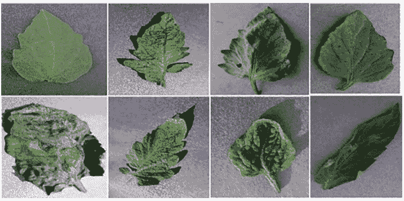

图 10.1 PlantVillage 数据集中的番茄病害和健康叶片图像 [6]。（上行从左到右）(a) 健康。(b) 番茄花叶病毒。(c) 早疫病。(d) 细菌性斑点病（下行从左到右）。(e) 晚疫病。(f) 番茄枯斑病。(g) 黄叶卷曲病。(h) 叶霉病。

传感器技术的近期进展加速了广泛用于植物病害识别和识别的成像技术的发展和改进。为了预测并尽早识别植物病害，研究人员考察了各种建模方法，包括人工神经网络 (ANN)、SVM、极端学习机 (ELM) 分类器和深度学习 (DL) 等。通常，这些预测模型的输入包括病株叶片照片。

毫无疑问，农作物病害对农业生产力和可持续发展构成严重威胁。通过采取预防措施来抵御病害的攻击，早期病害攻击预测有助于有效控制病害。促进可持续发展的精准农业 (PA) 应用严重依赖于现代信息和通信技术 (ICTs)。

迫切需要早期病害攻击预测的解决方案来防止植物病害攻击。只有在疾病表现出来之后，当前基于计算机视觉的病害检测方法才能识别其存在。本研究旨在改进一种机器学习 (ML) 技术，该技术利用物联网 (IoT) 直接感应作物田中环境数据，以预测早期病害攻击的概率。环境因素与病害生命周期密切相关。作物田中环境因素用于预测植物病害发生率。鉴于环境条件与病害攻击之间的关系，该研究采用多元线性回归 (MLR) 作为机器学习模型。利用机器学习方法，由物联网 (IoT) 得到的作物田环境条件有助于准确预测植物病害发生情况。为了计算该方法的性能，该模型应用于茶树 (Camellia sinensis) 以识别褐斑病 (Exobasidium vexans) 的发生情况。使用 2015 至 2019 年的拟议模型，该病害在 2019 年的发生情况可在 91% 的时间内被预测。

植物种类和疾病必须手动预测，这既耗时又昂贵，并且需要并非始终可用的专业知识。为应对这些挑战，ML 和 DL 等自动化技术正变得越来越重要。实现这一点需要精确的模型来指导决策并提供可靠的预测。虽然植物种类疾病预测传统上被视为独立的问题，但它们往往相互关联。为相关任务引入并验证了一种基于多任务学习方案的新方法，该方法对这些相关任务使用了共享表示。通过为每种植物使用多输入网络，我们利用原始图像和 E-ENet 深度特征模型来预测疾病。我们的综合多任务模型同时运行多个学习任务。公开数据集用于评估模型，结果表明，多输入多任务神经网络提高了类似检测任务的学习效率和速度。

农业部门对国家经济增长作出重大贡献。然而，植物病害构成重大风险，导致作物毁灭、农业产量降低和巨大财务损失。对植物病害进行初步识别对于避免此类破坏至关重要。虽然先前的研究已利用 ML 或 DL 技术进行疾病预测，但深度学习需要大量训练数据和计算资源，而机器学习方法缺乏自动特征提取能力。此外，现有模型消耗更多计算资源和时间，且准确度较低。作为回应，本研究引入了一种新型 E-ENet 基础，结合 ML 和 DL 的优势，以提高植物病害识别的效率和准确性。

### 10.3 材料与方法

#### 10.3.1 数据集

本研究使用了 PlantVillage 数据集 [66]，该数据集包含 54,305 张照片和 38 个类别，代表 14 种不同的植物物种——其中 12 种为健康，26 种为患病。该数据集包含各种大小的彩色图像，还有一个专门指定 1,143 张背景图像的额外类别。总计，数据集中共有 55,448 张图像。图 10.1 说明了从数据集中随机选择的八对不同的植物-病害组合。

Geetharamani 和 Pandian [9] 使用六种不同的技术扩充了 PlantVillage 数据集。研究人员已使原始数据集和扩充数据集均可用于科学研究，这些数据集可在 https://data.mendeley.com/datasets/tywbtsjrvj/1 找到。通过扩充技术，样本数少于 1,000 个的类别的样本数量增加到 1,000，而其他类别中的图像保持不变。


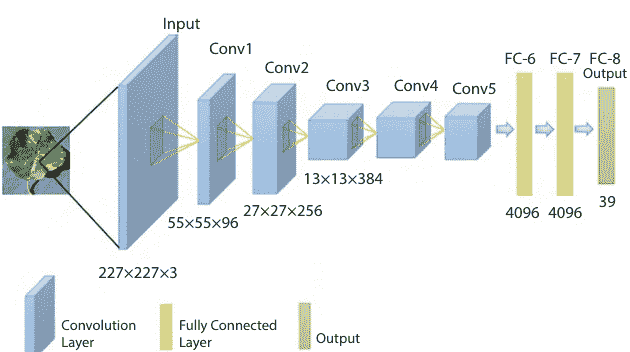

图 10.2 AlexNet 的示意图。

#### 10.3.2 现有 CNN 模型

通过将 E-EfficientNet 方法与 Inception V3、AlexNet、ResNet50 和 VGG16 等前沿 CNN 架构进行对比，验证了其有效性。

##### 10.3.2.1 AlexNet

AlexNet 模型 [67] 首次提出，是一个包含约八层和约 6100 万个参数的 CNN 架构。该框架遵循 LeNet-5 的模型 [68]。如图 10.2 所示，AlexNet 方法使用 227 × 227 的输入图像。Softmax 层使用 FC-8 层的输入进行分布，为每个类别分配概率值，并保证所有类别的总概率为 1。

##### 10.3.2.2 VGG16

VGG16 [69] 在 ILSVRC-2014 竞赛中夺得第一，拥有约 1.38 亿个参数。值得注意的是，该架构在其卷积层中始终使用步幅为 1 的 3 × 3 卷积核，在最大池化层中使用步幅为 2 的 2 × 2 卷积核，并保持相同的填充。在 VGG16 架构中，最大池化层和卷积层被一致排列（见图 10.3）。该

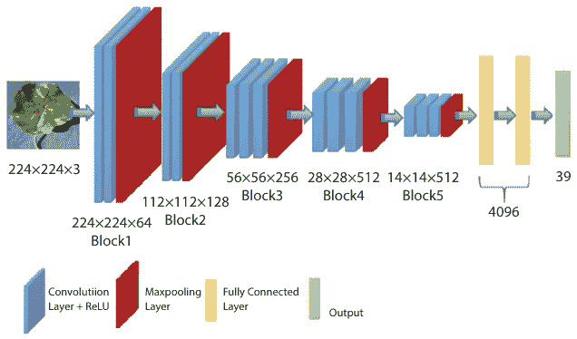

图 10.3 VGG16 的架构。

架构以三个全连接（FC）层结束，最后一层使用 Softmax 激活函数，前两层使用 ReLU。这个 16 层架构允许输入分辨率为 224 × 224 像素的图像。

##### 10.3.2.3 ResNet50

ResNet50 架构 [70] 解决了多个非线性层难以学习恒等映射以及梯度消失问题，并赢得了 ILSVRC-2015 竞赛的第一名。ResNet50 由多个堆叠的残差单元构建而成，并具有网络中网络架构（见图 10.4）。残差单元由池化层和卷积层组成，作为构建模块。该架构采用 224 × 224 像素的图像作为输入，并使用类似于 VGG16 的 3 × 3 卷积核。


图 10.4 ResNet50 的架构。

##### 10.3.2.4 Inception V3


图 10.5 Inception V3 的示意图。

Inception V3 [71] 是 Google DL 演化系统系列的第三次迭代。在 Szegedy 创建 Inception V1 设计之后，Inception V2 引入了批归一化。随后，Inception V3 实现了因式分解。因式分解的主要目标是在不影响网络效率的情况下，最大限度地减少参数和连接的数量。该算法包含全连接层、卷积、最大池化、平均池化、丢弃、连接，以及对称和非对称构建模块（参见图 10.5）。42 层的 Inception V3 架构包括一个输入层，可以处理分辨率高达 299 × 299 像素的图像。Softmax 函数集成在架构的最后一层。

### 10.4 方法论—E-ENet

基于深度学习的植物病害识别模型 E-ENet 的整个框架如图 10.6 所示，涵盖以下三个主要步骤：定位植物叶片、图像分割以及提取和识别植物病害。

本研究中使用的模型主要由以下三个步骤组成：

病叶定位：使用 RPN—版本 2（RPNv2）算法在复合环境中训练叶片数据集，以识别病叶。分类神经网络和边框回归神经网络都在同一复杂环境中使用，以查找和提取病叶。


叶片病害种类识别：第三个也是最后一步涉及叶片病害种类的识别。植物病害的识别使用 E-ENet 模型在简单背景下完成。

这些步骤共同构成了本研究中提出的基于深度学习的植物病害识别模型的综合框架。

#### 10.4.1 叶片的定位

RPNv2 方法经过训练，可在具有复杂背景的挑战性数据集中精确定位和检索病叶。该方法有效地融合了边界回归和分类神经网络，以提高识别和定义植物叶片病害区域的精度。为了确定指定边界框内的内容是否对应于对象或背景，分类神经网络至关重要。在训练中，交并比（IoU）被用作关键标准，以根据图像与目标对象的相关性，保证高效学习和精确分类。IoU 值大于 0.5 的边界被标记为对象，而 IoU 值小于 0.1 的边界被标记为背景。人工标记的边界框与预测边界框之间的相关性使用一致性的概念进行计算。IoU 公式显示如下：

```
IoU = u1/u2 (10.1)
```

其中，u2 是总面积，u1 是人工标记的边界框与预测边界框之间的重叠面积。Sigmoid 函数被选为神经网络中二元分类任务的适当损失函数。由四维变量（x, y, w, h）表示，单个边界框由（P_x, P_y, P_w, P_h）表示为给定边界框，（G_x, G_y, G_w, G_h）表示为目标边界框，（G'_x1, G'_y1, G'_w1, G'_h1）表示为预测边界框。主要目标是为边界回归神经网络建立一个表示为 f 的映射关系，以确保准确和精确的预测。

f(P_x, P_y, P_w, P_h) = (G_x^1, G_y^1, G_w^1, G_h^1) 和 (G_x^1, G_y^1, G_w^1, G_h^1) ≈ (G_x, G_y, G_w, G_h) 已定义。边界测量包括平移和缩放。平移的约束是（Δx, Δy），其中 Δx = P_w d_x(P_1) 且 Δy = P_h d_y(P_1)。公式显示如下：

```
G_x^1 = P_w d_w(P_1) + P_x (10.2)
```

```
G_y^1 = P_h d_h(P_1) + P_y (10.3)
```

缩放参数表示为（S_w, S_h），其中 S_w = exp(d_w(P_1)) 且 S_h = exp(d_h(P_1))。公式表示如下：

```
G_w^1 = P_w exp(d_w(P_1)) (10.4)
```

```
G_h^1 = P_h exp(d_h(P_1)) (10.5)
```

根据提供的公式，边界回归神经网络的实际学习目标表示为 d(P_1) = (d_x(P_1), d_y(P_1), d_w(P_1), d_h(P_1))，预测边界框与先前标注边界框之间的真实变换参数表示为 t = (t_x, t_y, t_w, t_h)。

```
t_x = \frac{G_x - P_x}{P_x} (10.6)
```

```
t_y = \frac{G_y - P_y}{P_y} (10.7)
```

```
t_w = log \frac{G_w}{P_w} (10.8)
```

```
t_h = log \frac{G_h}{P_h} (10.9)
```

边界回归神经网络的目标函数表示为 d(P1) = w^TP1，其中 w 表示边界回归神经网络的学习参数。相应的损失函数表示如下：

```
loss = \sum_{i=1}^N (t_i - d_i(P_1))  (10.10)
```

#### 10.4.2 叶片图像分割

该模型应用了一种基于先前步骤的高级方法，即 Chan–Vese Level II 算法，用于复杂环境中的图像分割。通过初始化零水平集、最小化能量函数并迭代计算叶片轮廓，该算法巧妙地分割病叶植物图像。与使用显式控制速度（F）的表面演化不同，Chan–Vese Level II 算法利用水平集来创建能量函数，从而完全捕捉区域。

轮廓长度被提高以帮助能量函数的合并。能量函数定义为图像中轮廓内外灰度值方差之和的最小值。为了考虑图像中的闭合曲线，能量函数表述如下：

```
E = \mu Length(C_1) + \lambda_1 \int\int_{c1} |u(x, y) - u_1|^2 dxdy + \lambda_2 \int\int_{c2} |u(x, y) - u_2|^2 dxdy  (10.11)
```

u(x, y) 表示图像的灰度值，u1 表示轮廓内的平均灰度值，u2 表示轮廓外的平均灰度值，图像的灰度值由 c1 和 c2 表示。接下来，给出了以下公式：

```
F1 = \lambda_1 \int\int_{c1} |u(x, y) - u_1|^2 dxdy  (10.12)
```

```
F2 = \lambda_2 \int\int_{c2} |u(x, y) - u_2|^2 dxdy  (10.13)
```

当 F1 ≈ 0 且 F2 ≈ 0 时，计算结束。应用水平集技术修正方程 10.11，并使用零水平集来显示轮廓线。引入了 Dirac 函数和 Heaviside 函数，如下所示：


T^i = Y, f(X^i)

\delta(\theta) = \frac{dH}{d\theta}

能量函数的水平集方程如下：

```
E^i = \xi \int \int_{c_2^0} \delta(\theta) | \alpha(\theta) | dxdy + y_1 \int \int_{c_1^0} |u(x, y) - u_1|^2 H(\theta) dxdy + y_2 \int \int_{c_2^0} |u(x, y) - u_2|^2 (1 - H(\theta)) dxdy
```

利用变分技术约简公式 10.16，并结合欧拉–拉格朗日方程，得到以下偏微分方程，其中 u1 = ∫∫_Ω u(x, y) H(θ) dxdy / ∫∫_Ω H(θ) dxdy 且 u2 = ∫∫_Ω u(x, y) (1 - H(θ)) dxdy / ∫∫_Ω (1 - H(θ)) dxdy。

```
\frac{\delta(E)}{\delta(\theta)} = \delta(\theta) \left( \mu \cdot \mathrm{div} \left( \frac{\nabla \phi}{|\nabla \phi|} \right) \right) + \delta(\theta) \left( -\rho_1 (1 - u_1^2) + \rho_2 (1 - u_2^2) \right)
```

#### 10.4.3 病叶识别

本章利用病叶数据集训练 E-ENet 模型，以在简单背景下进行病害类别识别。该方法通过快速完成训练并在简单环境中执行病害识别，降低了深度学习算法对硬件设备的需求。通过利用不同学习目标之间浅层网络的相似性，E-ENet 算法使从源任务到目标任务的浅层神经网络适应更加容易。在收敛性和最终结果方面，E-ENet 在实践中优于新学习。当域设置为 D 时，它包含两个内容；特征空间由 X 表示，包含所有可能的特征值。在特征空间中，P(X) 表示特征采样的特定实例：

```
D_1 = X^i, P_1(X^i)
```

任务 T_i 包含两个部分；Y_i 是标签空间的表示；它包含所有可能标签的向量空间。输入数据的特征和标签被用作学习线索，以推导预测函数 f(x)。

T_1 = Y^i, f(X^i) (10.19)

自 2012 年以来，ImageNet 数据集采用了更复杂的设计，从而取得了更大的成功。然而，这些模型中的大量模型表现出较低的计算负载。E-ENet 组包含八个模型，标记为 B0 到 B7 [72]。E-ENet 的架构专注于研究更小、更有效的设计。与其他当前的最先进模型不同，E-ENet 系统地最小化深度、宽度和分辨率结构，从而取得了更好的性能结果。

本研究有助于确定适当的缩放参数 [72]。与扩展层相比，瓶颈之间集成了连接，连接数量显著减少。原因在于 MBConv（MobileNetV2）块逐渐拓宽和缩窄通道。与传统层相比，设计中的深度可分离卷积将计算量减少了近 k_l 倍，其中 k_l 为核大小。E-ENet 算法的布局如图 10.7 所示。公式 10.1 定义了复合系数 μ，该系数用于在复合缩放中统一缩放深度、宽度和分辨率。

深度 D = a^u、宽度 W = b^u 和分辨率 R = c^u 的值应大于 1。在模型缩放的背景下，常数 a、b、c 通过网格搜索确定 [72]。从基线 EfficientNet-B0 开始，复合缩放方法分两步应用：

- **步骤 1：** 在可用资源翻倍的情况下进行网格搜索，其中 μ = 1，确定 α_1、β_1 和 γ_1 的最优值。
- **步骤 2：** 保持确定的 α_1、β_1 和 γ_1 值不变，使用公式 10.1 采用不同的 μ 值将基线网络缩放以生成 E-ENet-B1 到 B7。

### 10.5 实验分析

#### 10.5.1 数据获取

本研究的初始步骤是在复杂环境中获取叶片数据集。中国植物图像库（PPBC）为本章提供了 1,000 张叶片图像，该章使用爬虫技术收集不同生长阶段不同植物叶片的图像。这些叶片


图 10.7 E-Net 示意图。

具有独特的形状，在整体健康状况方面也有所不同。为实现叶片清晰、水印最少且标记简单的目标，在复杂环境中剔除了 189 张作为叶片图像的图片。RPNv2 算法在此数据集上训练，以在复杂环境中查找和定位叶片。然后，生成 PASCAL VOC 格式的 XML 文件，并使用 LabelImg 及时标注图像。目标检测神经网络可以直接作为训练数据输入。在最终阶段，本研究需要一个受控环境下的病叶数据集。研究从 PlantVillage 农业问答论坛获取四种图像——537 张图像（黑腐病）、1,032 张图像（细菌性斑点病）、293 张图像（锈病）和 2,852 张图像（健康叶片）。这些图像作为 E-ENet 模型的训练数据，具体来说，就是 E-ENet 模型，它使用这个多样化的数据集进行训练。

#### 10.5.2 参数设置

##### 10.5.2.1 叶片定位参数配置

PlantVillage 农业问答论坛提供了本研究使用的数据集，其中包含四种不同类型的图像：537 张黑腐病、1,032 张细菌性斑点病、293 张锈病和 2,852 张健康叶片。为提高性能，E-ENet 模型在涵盖多种植物状况的多样化数据集上进行训练。

##### 10.5.2.2 叶片分割参数配置

Chan–Vese Level II 算法技术利用 RPNv2 方法生成的图像。通过将零水平集外的区域设为黑色，它在保持零水平集内内容的同时便于图像分割。该方法有助于高效划定图像中的焦点区域。

##### 10.5.2.3 叶片检索参数配置

本章使用简单背景的病叶数据集训练 E-ENet 网络。在本研究中，分类数从 1,000 修改为 4，以适应四种不同叶片疾病的识别。对 E-ENet 最终输出层中的所有参数和初始化进行了调整，以适应这一变化。

### 10.6 结果

#### 10.6.1 叶片定位结果

图 10.7 显示了使用测试图像作为输入的 RPNv2 设计的输出。关于上述图像，图 10.7b 的框选择范围不准确，图 10.7c 缺少叶片。然而，RPNv2 方法在效率方面优于原始设计，基本可以框住主要叶片框架。

#### 10.6.2 叶片分割结果

图 10.8 描绘了叶片、黑腐病、细菌斑点病和锈病的识别。图 10.9 和 10.10 描绘了 Chan–Vese Level II 算法的增量计算过程。上述结果表明，Chan–Vese Level II 方法可以实现更高的精度


图 10.8 叶片识别（a）黑腐病，（b）细菌斑点病，（c）锈病。


图 10.9 Chan–Vese Level II 算法分割黑腐病病叶结果：（a）图像捕获；（b）初始零水平集；（c）1,000 次迭代后的轮廓图像；（d）分割结果。


图 10.10 Chan–Vese Level II 算法分割细菌斑点病病叶的结果，展示了（a）图像捕获，（b）初始零水平集，（c）1,000 次迭代后的轮廓图像，以及（d）最终分割结果。

#### 表 10.1 E-ENet 的参数设置和组成。

| 网络层 | 核数 | 核大小 | 输出形状 | 参数数量 |
|---|---|---|---|---|
| 卷积 | 64 | (3, 3) | 224, 224, 64 | 9,408 |
| 最大池化 | — | (2, 2) | 56, 56, 64 | 0 |
| MB 卷积1 | 32 | (3, 3) | 112, 112, 32 | 36,864 |
| MB 卷积6 | 16 | (3, 3) | 112, 112, 16 | |
| MB 卷积6 | 24 | (3, 3) | 56, 56, 24 | 73,728 |
| MB 卷积6 | 24 | (5, 5) | 56, 56, 24 | |
| MB 卷积6 | 40 | (5, 5) | 28, 28, 40 | 147,456 |
| MB 卷积1 | 40 | (3, 3) | 28, 28, 40 | |
| MB 卷积1 | 80 | (3, 3) | 28, 28, 80 | |
| MB 卷积1 | 80 | (3, 3) | 28, 28, 80 | |
| MB 卷积6 | 80 | (5, 5) | 28, 28, 80 | |
| MB 卷积6 | 112 | (5, 5) | 14, 14, 112 | 294,912 |
| MB 卷积6 | 112 | (5, 5) | 14, 14, 112 | |
| MB 卷积6 | 112 | (5, 5) | 14, 14, 112 | |
| MB 卷积6 | 112 | (5, 5) | 14, 14, 112 | |
| MB 卷积6 | 192 | (5, 5) | 7, 7, 192 | 589,824 |
| MB 卷积6 | 192 | (5, 5) | 7, 7, 192 | |
| MB 卷积6 | 192 | (3, 3) | 7, 7, 192 | |
| MB 卷积6 | 320 | (3, 3) | 7, 7, 320 | |
| MB 卷积6 | 512 | (3, 3) | 7, 7, 512 | 2,359,296 |
| 平均池化 | — | (2, 2) | 7, 7, 512 | 0 |
| Softmax | 1,000 | (7, 7) | 1, 1, 1,000 | 25,088,000 |


图像在 1,000 次迭代后的叶片分割。Chan-Vese Level II 方法保留了中央叶片的所有方面，包括叶脉、斑点形状和斑点颜色，尽管在提取叶片边缘轮廓方面，其效率可能不如分水岭算法。病害识别流程的下一步可以使用通过 Chan-Vese Level II 算法发现的整个叶片中央框架来执行。

#### 10.6.3 病害识别结果

图 10.7 展示了使用测试图像作为输入的 RPNv2 算法和 VGG-16 模型的输出。虽然 RPNv2 算法有效地勾勒出了主要叶片结构（图 10.7a），但在框选范围的准确性方面存在一些局限性（图 10.7b），且结果中存在遗漏（图 10.7c）。表 10.1 说明了 E-ENet 的组成和参数设置。

### 10.7 对比测试

本章中与 E-ENet 算法相关的参数包括训练参数和梯度下降优化参数。表 10.2 展示了所提 E-ENet 与不同深度学习模型的测试准确率和验证准确率。图 10.11 显示了传统模型和 E-ENet 模型在 5,000 次训练迭代后的训练集准确率和损失值。图 10.11a 显示，在相同的 5,000 次训练迭代后，E-ENet 模型的表现良好

| Model | Test accuracy |
|---|---|
| ResNet | 95.44 |
| VGG16 | 96.26 |
| AlexNet | 89.33 |
| Inception V3 | 96.26 |
| EfficientNet | 98.31 |
| E-ENet | 98.87 |

| Epochs | Validation accuracy (%) |
|---|---|
| 1 | 90.18 |
| 5 | 93.85 |
| 10 | 95.71 |
| 15 | 97.43 |
| 20 | 97.55 |
| 30 | 99.21 |

优于传统模型，在收敛速度和模型损失值方面表现更佳。图 10.11b 显示，在检测效果、方差降低和训练过程中的准确性方面，E-ENet 设计优于新学习。因此，本研究采用 E-ENet 产生增强的识别效果和比新学习更快的收敛速度。它可以满足智能农业对低硬件资源、快速训练时间和高训练效率的要求。

之后，图像使用 LCV 方法的分割结果输入到 E-ENet 模型中。根据对比结果，该模型在 30 个时代下实现了高测试准确率（98.87%）和验证准确率（99.21%）。通过对四个样本中该方法结果的比较，可以得出结论：与细菌性斑点病和黑腐病相比，健康叶片和锈病获得了更好的效果。


**图 10.11** (a) 深度学习模型的测试准确率。(b) 原始数据集上不同迭代次数的验证准确率。

### 10.8 总结

除了帮助农民自动化任务外，农业人工智能还能实现更精准的种植，利用更少的资源生产更高质量、更高产量的作物。那些正在改进基于 AI 和机器学习的产品和服务（如无人机、自动化机械和农业训练数据）的企业，将从未来的技术进步中受益，这些进步将使它们能够为该行业开发更多有益的应用，帮助全球社区应对与不断增长的人口粮食生产相关的挑战。农业 AI 工具（如精准农业和无人机）使农民能够改进流程并适应环境变化。这些技术优化田地管理，提供作物健康洞察，并简化运营以提高效率。此外，在保持运营长期可行性的同时，这还将提高产量和收入。

本章阐明了基于深度学习的植物病害识别模型具有高训练效率、高精度、良好的通用性和非监督特性。尽管有这些优势，但在复杂环境中识别植物病害的实用性和准确性仍面临几个挑战。本章提出了一种结合 RPNv2 算法、LCV 算法和 E-ENet 系统的识别模型，以改进识别流程并处理相关问题。该组合方法旨在在特定环境下最大限度地提高对象识别和分类的效率与准确性。所提识别模型有效解决了复杂环境中植物病害识别的挑战，提升了识别准确性和适应性。与传统模型相比，该方法确保了卷积神经网络的鲁棒性。因此，该模型有潜力帮助农业生产人员及时预防和治疗植物病害。

在实际环境中，能够解决环境复杂性挑战的方法可以产生准确的识别结果。这项研究不仅有助于提高准确性，还推动了现有理论的发展，揭示了复杂性在植物病害识别中的关键作用。认识到这一重要性对于在复杂环境中研究植物病害至关重要。此外，所提方法通过将信息技术融入农业生产，支持智慧农业的可持续发展。然而，仍有一些问题有待解决。例如，Chan–Vese Level II 算法虽然有效，但可能存在执行缓慢和重复迭代计算的问题，影响其快速输出识别结果的能力。根据对比结果，E-ENet 模型在 30 个时代下实现了高测试准确率（98.87%）和验证准确率（99.21%）。

### 参考文献

- 1. Rich, E. and Knight, K., *人工智能*, McGraw-Hill, New Delhi, 1991.
- 2. Thorpe, K.W., Ridgway, R.L., Th Webb, R.E., 用于郊区公园扑蛾管理的计算机化数据管理和决策支持系统。*Comput. Electron. Agric.*, 6, 4, 333–345, 1992.
- 3. Ampatzidis, Y., De Bellis, L., Luvisi, A., iPathology：植物和植物病害的机器人应用与管理。*Sustainability*, 9, 6, 1010, 2017.
- 4. Breukers, A., Kettenis, D.L., Mourits, M., Werf, W.V.D., Lansink, A.O., 植物生产链中疾病传播分析的个体模型：马铃薯棕色腐烂病的应用。*Acad. Sci.*, 90, 1–3, 112–131, 2006.
- 5. Ghosal, S., Blystone, D., Singh, A.K., Ganapathysubramanian, B., Singh, A., Sarkar, S., 用于植物胁迫表型分析的可解释深度机器视觉框架。*Proc. Natl. Acad. Sci.*, 115, 18, 4613–4618, 2018.
- 6. Oerke, E.-C., 病虫害造成的作物损失。J. Agric. Sci., 144, 1, 31–43, 2006.
- 7. Pantazi, X.E., Moshou, D., Tamouridou, A.A., 基于图像特征分析和单一类分类器的不同作物物种叶片病害自动检测。*Comput. Electron. Agric.*, 156, 96–104, 2019.
- 8. Barbedo, J.G.A., 影响使用深度学习进行植物病害识别的因素。*Biosyst. Eng.*, 172, 84–91, 2018.
- 9. Geetharamani, G. and Arun Pandian, J., 使用九层深度卷积神经网络识别植物叶片病害。*Comput. Electr. Eng.*, 76, 323–338, 2019.
- 10. Konstantinos, P.F., 用于植物病害检测和诊断的深度学习模型。*Comput. Electr. Eng.*, 145, 311–318, 2018.
- 11. Singh, V. and Misra, A.K., 使用图像分割和软计算技术检测植物叶片病害。*Inf. Process. Agric.*, 4, 1, 41–49, 2017.
- 12. Mohanty, S.P., Hughes, D.P., Marcel, S., 使用深度学习进行基于图像的植物病害检测。*Front. Plant Sci.*, 7, 1419, 2016.
- 13. Guo, Y., Hu, X., Zou, Y., 等，通过运费折扣和产品推荐系统最大化电子零售商的销售量。*Discrete Dyn. Nat. Soc.*, 2020, 1–14, 2020.
- 14. Amanda, R., Kelsee, B., Peter, M.C., Babuali, A., James, L., Hughes, D.P., 用于基于图像的木薯病害检测的深度学习。*Front. Plant Sci.*, 8, 1852, 2017.


- 15. Sankaran, S., Mishra, A., Ehsani, R., Davis, C., 植物病害检测先进技术综述. Comput. Electron. Agric., 72, 1–13, 2010, https://doi.org/10.1016/J.COMPAG.2010.02.007.

- 16. Sladojevic, S., Arsenovic, M., Anderla, A., Culibrk, D., Stefanovic, D., 基于叶片图像分类的植物病害深度神经网络识别. Comput. Intell. Neurosci., 1, 3289801, 2016, https://doi.org/10.1155/2016/3289801.

- 17. Ferentinos, K.P., 用于植物病害检测和诊断的深度学习模型. Comput. Electron. Agric., 145, 311–318, 2018, https://doi.org/10.1016/J.COMPAG.2018.01.009.

- 18. Jiang, F., Jiang, Y., Zhi, H., Dong, Y., Li, H., Ma, S., Wang, Y., Dong, Q., Shen, H., Wang, Y., 医疗保健中的人工智能：过去、现在和未来. Stroke Vasc. Neurol., 2, 230–243, 2017, https://doi.org/10.1136/svn-2017-000101.

- 19. Rumpf, T., Mahlein, A.-K., Steiner, U., Oerke, E.-C., Dehne, H.-W., Plümer, L., 基于高光谱反射率的植物病害早期检测与支持向量机分类. Comput. Electron. Agric., 74, 91–99, 2010, https://doi.org/10.1016/J.COMPAG.2010.06.009.

- 20. Al-Hiary, H., Bani-Ahmad, S., Reyalat, M., Braik, M., Alrahammneh, Z., 植物病害快速准确的检测与分类. Int. J. Comput. Appl., 17, 31–38, 2011.

- 21. Revathi, P. and Hemalatha, M., 基于交叉信息增益深度前馈神经网络分类器和PSO特征选择的棉花病害识别. Int. J. Eng. Technol., 5, 4637–4642, 2014.

- 22. Mokhtar, U., Ali, M.A.S., Hassanien, A.E., Hefny, H., 使用支持向量机识别番茄叶片两种病毒, pp. 771–782, Springer, New Delhi, 2015, https://doi.org/10.1007/978-81-322-2250-7_77.

- 23. Pantazi, X.E., Moshou, D., Tamouridou, A.A., Kasteridis, S., 基于局部二值模式和单类支持向量机的藤本植物叶片病害识别, pp. 319–327, Springer, Cham, 2016, https://doi.org/10.1007/978-3-319-44944-9_27.

- 24. Johannes, A., Picon, A., Alvarez-Gila, A., Echazarra, J., Rodriguez-Vaamonde, S., Navajas, A.D., Ortiz-Barredo, A., 使用移动捕获设备自动诊断植物病害：小麦应用案例. Comput. Electron. Agric., 138, 200–209, 2017, https://doi.org/10.1016/j.compag.2017.04.013.

- 25. Chen, J., Yin, H., Zhang, D., 使用GMDH-Logistic模型进行植物病害检测的自适应分类方法. Sustain. Comput. Inf. Syst., 28, 100415, 2020a, https://doi.org/10.1016/J.SUSCOM.2020.100415.

- 26. LeCun, Y., Bengio, Y., Hinton, G., 深度学习. Nature, 521, 436–444, 2015, https://doi.org/10.1038/nature14539.

- 27. Shen, D., Wu, G., Suk, H.-I., 医学图像分析中的深度学习. Annu. Rev. Biomed. Eng., 19, 221–248, 2017, https://doi.org/10.1146/annurev-bioeng-071516-044442.

- 28. Saleem, M.H., Potgieter, J., Mahmood Arif, K.M., 基于深度学习的植物病害检测与分类. Plants, 8, 468, 2019, https://doi.org/10.3390/plants8110468.

- 29. Chen, J., Zhang, D., Nanehkaran, Y.A., Li, D., 基于深度迁移学习的水稻植物病害检测. J. Sci. Food Agric., 100, 3246–3256, 2020c, https://doi.org/10.1002/jsfa.10365.

- 30. Chen, J., Chen, J., Zhang, D., Sun, Y., Nanehkaran, Y.A., 使用深度迁移学习进行基于图像的植物病害识别. Comput. Electron. Agric., 173, 105393, 2020d, https://doi.org/10.1016/J.COMPAG.2020.105393.

- 31. Too, E.C., Yujian, L., Njuki, S., Yingchun, L., 植物病害识别深度学习模型微调的比较研究. Comput. Electron. Agric., 161, 272–279, 2019, https://doi.org/10.1016/J.COMPAG.2018.03.032.

- 32. Arsenovic, M., Karanovic, M., Sladojevic, S., Anderla, A., Stefanovic, D., 解决基于深度学习的植物病害检测方法当前局限性. Symmetry (Basel), 11, 939, 2019, https://doi.org/10.3390/sym11070939.

- 33. Nanehkaran, Y.A., Zhang, D., Chen, J., Tian, Y., Al-Nabhan, N., 基于计算机视觉的植物叶片病害识别. J. Ambient Intell. Humaniz. Comput., 15, 1–18, 2020, https://doi.org/10.1007/s12652-020-02505-x.

- 34. Chen, J., Zhang, D., Nanehkaran, Y.A., 使用深度迁移学习和增强轻量网络识别植物病害. Multimed. Tools Appl., 79, 1–19, 2020b, https://doi.org/10.1007/s11042-020-09669-w.

- 35. Ali, H., Lali, M.I., Nawaz, M.Z., Sharif, M., Saleem, B.A., 基于症状的柑橘病害自动检测：使用颜色直方图和纹理描述符. Comput. Electron. Agric., 138, 92–104, 2017.

- 36. Alexander, H.M., Mauck, K.E., Whitfield, A.E., Garrett, K.A., Malmstrom, C.M., 植物病毒相互作用与农业生态界面. Eur. J. Plant Pathol., 138, 3, 529–547, 2014.

- 37. Kao, I.-H., Hsu, Y.-W., Yang, Y.-Z., Chen, Y.-L., Lai, Y.-H., Perng, J.-W., 使用卷积自编码器确定Lycopersicon成熟度. Sci. Hortic., 256, 108538, 2019.

- 38. Pujari, D., Yakkundimath, R., Byadgi, A.S., 基于统计纹理特征的果实炭疽病真菌病分级与分类. Int. J. Adv. Sci. Technol., 52, 121–132, 2013.

- 39. Akram, T., Naqvi, S.R., Haider, S.A., Kamran, M., 迈向作物病害分类实时监测：利用计算机视觉中的并行性. Comput. Electr. Eng., 59, 15–26, 2017.

- 40. Li, J., Tang, W., Wang, J., Wang, X., Zhang, X., 基于变分模态分解的图像分割多级阈值选择. Signal Process., 147, 80–91, 2018.

- 41. Elaziz, M.A., Oliva, D., Ewees, A.A., Xiong, S., 使用多目标多元宇宙优化器的基于多级阈值的灰度图像分割. Expert Syst. Appl., 125, 112–129, 2019.

- 42. Revathi, V., Kavin, B.P., Thirumalraj, A., Gangadevi, E., Balusamy, B., Gite, S., 使用RBM技术与ADBN技术进行基于图像的特征分离以实现准确的水果分类. 2024 IEEE International Conference on Computing, Power and Communication Technologies (IC2PCT), 印度大诺伊达, pp. 1423–1429, 2024, doi: 10.1109/IC2PCT60090.2024.10486564.

- 43. Iqbal, Z., Khan, M.A., Sharif, M., Shah, J.H., ur Rehman, M.H., Javed, K., 使用图像处理技术自动检测和分类柑橘植物病害：综述. Comput. Electron. Agric., 153, 12–32, 2018.

- 44. Raza, M., Sharif, M., Yasmin, M., Khan, M.A., Saba, T., Fernandes, S.L., 基于外观的行人性别识别：采用深度学习堆栈自编码器. Future Gener. Comput. Syst., 88, 28–39, 2018.

- 45. Hu, M., Bu, X., Sun, X., Yu, Z., Zheng, Y., 基于D-S证据理论的油菜植物病害多特征融合识别方法. Math. Comput. Appl., 22, 1, 18, 2017.

- 46. Turkoglu, M. and Hanbay, D., 基于改进局部二值模式和极端学习机的叶片植物物种识别. Phys. A Stat. Mech. Appl., 527, 121297, 2019.

- 47. Li, D., Deng, L., Lee, M., Wang, H., 基于深度迁移学习的智慧城市IoT数据特征提取与入侵检测系统. Int. J. Inf. Manage., 49, 533–545, 2019.

- 48. Dhiraj, Biswas, R., Ghattamaraju, N., 基于深度学习的音频特征提取及其可视化方法有效性分析. Multimedia Tools Appl., 78, 17, 23949–23972, 2019.

- 49. Meziani, A., Djouani, K., Medkour, T., Chibani, A., 基于脑电图运动意象的Lasso分位数周期图特征提取. J. Neurosci. Methods, 328, 108434, 2019.

- 50. Xu, Y., Ding, H., Xue, Y., Guan, J., 智能海上监测网络中海杂波和目标信号的高维特征提取. Comput. Commun., 147, 76–84, 2019.

- 51. Xu, C., Chai, Y., Li, H., Shi, Z., Zhang, L., Liang, Z., 基于希尔伯特边缘谱的铣刀磨损特征提取方法. Mach. Sci. Technol., 23, 847–868, 2019.

- 52. Zhang, Y., Wei, X.-S., Wu, J., et al., 基于部分图像表示的弱监督细粒分类. IEEE Trans. Image Process., 25, 4, 1713–1725, 2016.

- 53. Zhang, S., You, Z., Wu, X., 基于超像素聚类和EM算法的植物病叶图像分割. Neural Comput. Appl., 31, S2, 1225–1232, 2019.

- 54. Patil, J.K. and Kumar, R., 基于颜色、形状和纹理特征的植物叶片病害内容检索图像分析. Eng. Agric. Environ. Food, 10, 69–78, 2016.

- 55. Gangadevi, E., Rani Ranganathan, S., Shri Mani, L., Kadry, S., 番茄植物叶片病害分类的智能深度残差学习框架.


电气与计算机工程国际期刊 (IJECE), 14, 3, 3168, 2024, 高级工程与科学研究所.

- 56. Pertot, I., Kufilk, T., Gordon, I., Freeman, S., Elad, Y., Identifier：一种基于网络的可视植物疾病识别工具，以草莓为例的概念验证研究。计算机与电子农业，84, 144–154, 2012.

- 57. Yang, N., Qian, Y., EL-Mesery, H.S., Zhang, R., Wang, A., Tang, J., 基于纹理与形状特征协同判断及决策树-混淆矩阵方法的显微图像识别水稻病害快速检测。食品科学期刊，99, 14, 6589–6600, 2019.

- 58. Chad, D., Tyr, W.H., Chen, S., et al., 基于深度学习的田间图像中北方叶枯病玉米植株自动识别。植物病理学，107, 1426–1432, 2017.

- 59. Ni, C., Wang, D., Vinson, R., Holmes, M., Tao, Y., 基于深度卷积神经网络的玉米籽粒自动检测机。生物系统工程，178, 131–144, 2019.

- 60. Lu, Y., Yi, S., Zeng, N., Liu, Y., Zhang, Y., 基于深度卷积神经网络的水稻病害识别。神经计算，267, 378–384, 2017.

- 61. Zhang, Z., Liu, H., Meng, Z., Chen, J., 农业机械图像基于深度学习的自动识别网络。计算机与电子农业，166, 104978, 2019.

- 62. Zhang, X., Qiao, Y., Meng, F., Fan, C., Zhang, M., 基于改进深度卷积神经网络的玉米叶病识别。IEEE Access，6, 30370–30377, 2018.

- 63. Krishnaswamy, R.A., Raja, P., Anirudh, R., 基于预训练深度学习算法的番茄作物病害分类。计算机科学程序，133, 1040–1047, 2018.

- 64. Coulibaly, S., Kamsu-Foguem, B., Kamissoko, D., Traore, D., 带迁移学习的黍类作物图像深度神经网络。计算机工业，108, 115–120, 2019.

- 65. PlantVillage 主页：https://plantvillage.org/ 访问时间：2018 年 4 月.

- 66. Hughes, D.P. 和 Salathe, M., 用于促进移动疾病诊断开发的植物健康图像开放访问存储库，arXiv 预印本 arXiv:1511.08060, 2015.

- 67. Gangadevi, E., Rani, R.S., Dhanaraj, R.K., Nayyar, A., 基于模拟退火优化SVM的果蝇算法变体用于番茄植株病害检测。神经计算与应用，36, 8, 4349–4375, 2023, Springer Science and Business Media LLC.

- 68. LeCun, Y., Boser, B., Denker, J.S., Henderson, D., Howard, R.E., Hubbard, W., Jackel, L.D., 反向传播在手写邮政编码识别中的应用。神经计算，1, 541–551, 1989, https://doi.org/10.1162/neco.1989.1.4.541.

- 69. Simonyan, K. 和 Zisserman, A., 用于大规模图像识别的非常深的卷积网络，2014, arXiv 预印本 arXiv1409.1556.

- 70. He, K., Zhang, X., Ren, S., Sun, J., 图像识别的深度残差学习，2016, arXiv 预印本 arXiv1512.03385.

- 71. Szegedy, C., Vanhoucke, V., Ioffe, S., Shlens, J., Wojna, Z., 重新思考计算机视觉的 Inception 架构，载于：IEEE 计算机视觉与模式识别会议论文集，第 2818–2826 页，2016.

- 72. Tan, M. 和 Le, Q.V., EfficientNet：重新思考卷积神经网络的模型缩放。第 36 届国际机器学习会议 ICML 2019，2019 年 6 月，第 10691–10700 页，2019.

## 基于 AutoML 驱动深度学习的假币识别

T. Bhaskar1* 和 E. Gangadevi2

1桑贾万尼工程学院计算机工程系，科帕尔加翁，印度
2洛约拉学院，钦奈，印度

### 摘要

真品的假冒副本被称为赝品。金融行业仍然对假币十分脆弱。存在众多检测技术，但由于现在有免费的图像处理程序，假币已成为银行业的一个重大问题。评估关键区域是第一项任务，因为货币包含许多重要区域。分类器可以确定提取的特征是真是假。如果没有分类器，我们可以将分割的货币图像与原钞的区域进行比较。然而，这不足以确定特定纸币图像的真伪。如果我们分割关键区域，对齐和边缘可能不匹配；因此，纸币图像可能被误认为是真钞。为了获得更好的结果，分类器将处理提取的特征。

本章提出了一种使用图像处理进行货币识别的方法。在该技术的识别过程中，利用颜色、尺寸和纹理三种元素。这项技术使随时随地检查纸币面值变得更加简单，并且它使用 CNN（卷积神经网络）。AutoML 的集成不仅加速了扩展过程，还优化了深度学习模型的性能，使系统能够适应各种货币和假币系统。本章在所有印度宗教群体上试验了这种方法。纸币的特征在此识别中至关重要。

关键词：图像处理，AutoML，卷积神经网络（CNN），特征提取，面值

*通讯作者：senthilkumar.n@vit.ac.in

### 11.1 引言

由于市场上流通着欺诈性钞票且文盲率普遍较高，当今每个国家都在努力识别自身货币。因此，自动货币识别系统是必不可少的。在这样一个系统中，准确性和速度是两个最关键的因素。而且，准确性比速度更重要。通过检查显著特征，货币识别器识别货币并确定面值。研究人员提出了各种策略。其中一小部分使用内部属性，而其他人则使用物理属性（宽度、长度、纹理和颜色）。软件行业的每个问题都有答案。这种软件解决方案让我们节省时间和精力。20世纪90年代初，就存在一种使用图像处理来识别纸币的技术。不幸的是，该技术不考虑钞票的真伪验证。这类系统在开始执行各项任务之前需要图像输入。

银行业经历了显著的技术改进，这导致了自助服务的出现，使交易变得简便且客户友好。一些银行还引入了全新的识别程序，例如用户通过设备自行存款而无需前往特定银行。在这种情况下，需要货币识别器来检查货币并根据面值进行处理。

本文提出了一种基于 CNN（卷积神经网络）技术的系统。根据货币纸币的结构视角，使用不同模块来识别货币。创建了 VGG16 模型来训练特定系统并提供更高的准确性。

### 11.2 文献综述

《印度货币识别的主要特征》[1] 成为本研究的动机。在这项工作中，提出了一种使用中心数字、潜影图、RBI 印章、形式和微型字母等属性来识别现金的方法。提供了一个训练数据集以准备训练模型。对于纸币识别，解释了 PCA 分析。

《使用机器学习进行货币识别》[2] 技术有助于准确识别图像。本文提出了一种使用图像处理进行现金识别的方法。该方法基于以下三个独特特征：颜色、尺寸和纹理。本文提出的方法可以用于确定许多不同的国别货币。仅将考虑印度的法定货币用于实施目的。这项技术使随时随地检查货币价值变得容易，并且它使用 CNN（卷积神经网络）。我们的测试中使用了印度货币的每种面值，该算法能够以 95% 的准确率进行识别。为了提高技术的准确性，创建了一个包含所有先前列出参数的分类模型。纸币的特征对这种识别至关重要。

《使用图像处理进行货币识别》[3] 涉及根据尺寸、颜色和纹理识别图像。在这项研究中，提供了一个可以以高度准确性检测外国货币的机器学习系统。建议的程序可用于查明银行钞票的来源、面值及其价值。该方法依赖于同一国家的不同银行钞票在尺寸、颜色和文本位置上有所不同这一事实来确定面值。本研究将面值 20 视为最流行的货币。我们的系统可以快速且准确地定位测试钞票。

《使用图像处理算法和机器学习算法进行假币检测》[4] 有助于使用合适的算法检测货币。本研究涵盖了识别所提供样本货币是否为假币的问题。存在基于颜色、宽度和序列号等特征来识别假币的传统技术和策略。在这个尖端技术和复杂计算方法的时代，这些方法为货币虚假识别提供了 99.9% 的准确性，提出了若干机器学习策略。除了算法之外，还有其他检测和识别技术，包括钞票特定的照片过滤以及颜色、形状和纸张宽度等属性 [5]。根据本研究，图像处理应排在第一位，然后是 K-最近邻来检测假币。由于其在小数据集上的出色准确性，KNN 是用于计算机视觉任务的一个有前途的选择。利用复杂的计算和数学方法，为了验证银行钞票的真伪，此集合包含了通常与现金相关的实体和特征的详细信息。机器学习 [9, 10] 和图像处理用于数据处理和提取，以实现所需的结果和准确性水平。

如前所述，各种文章 [6–8] 中提出了许多不同的系统，尽管可以从其发现中推断出，所提出的解决方案均不完全有效，而且这样做是徒劳的


考虑仅用一个参数来解决此问题。因此，本章建议采用一种考虑多种特征的方法，以理解每张钞票之间的差异。我们的方法旨在易于扩展并产生准确结果。

#### 11.2.1 Scope

#### 11.2.1 范围

拟议系统可扩展至硬币检测以及假币识别。其次，本工作的实现将能够在收费站附近自动检测货币。这将减少车辆在收费站的等待时间。借助车辆中存在的RFID标签，还可以识别被盗车辆。第三，由于机器人在工作场所中越来越多地取代人类，因此所有机器人都能够区分不同货币至关重要。第四，该系统可进一步用于美元、欧元、塔卡等外币，即可以添加印度以外其他国家的面值，并相互比较。

#### 11.2.2 Objectives

#### 11.2.2 目标

The main objectives of this application are as follows:

本应用程序的主要目标如下：

- 1. 借助移动应用程序，通过图像处理自动识别货币钞票。
- 2. 对插入的图像进行图像处理，并与训练数据集匹配。
- 3. 开发一种由AutoML驱动的深度学习，与其他技术相比，能够提供更快、更准确的输出。
- 4. 在特征提取过程中找到清晰可辨的组件，然后对货币进行分类以帮助检测和识别，这是至关重要的。

### 11.3 Proposed System

### 11.3 拟议系统

以下系统由四个主要模块组成。它们如下文系统分解结构中所述，描述了系统中每个模块的工作原理。


Figure 11.1 System breakdown structure.

图 11.1 系统分解结构。

如图 11.1 所示的系统分解结构，系统模块列于以下：

- 1. **数据收集**
  - 收集不同货币的图像。
  - 根据货币类型为图像加标签。
- 2. **数据预处理**
  - 标准化图像大小。
  - 增强图像的对比度和亮度。
  - 应消除图像噪声和瑕疵。
- 3. **数据增强**
  - 通过旋转、缩放和裁剪原始图像生成更多图像。
- 4. **数据扰动**
  - 向图像添加噪声和其他扰动以提高其多样性。
- 5. **训练数据准备**
  - 使用数据集生成训练集、验证集和测试集。
  - 将图像和标签转换为深度学习框架的适当格式。
  - 图像像素值应归一化到[0,1]范围。
- 6. **卷积神经网络（CNN）模型**
  - 选择合适的CNN架构，例如VGG16。
  - 描述模型的层，包括卷积层、池化层和全连接层。
  - 学习率、批量大小和epoch数量都是在模型训练前必须设置的超参数。
- 7. 模型训练

  若要使用训练数据集训练模型，必须遵循以下步骤：

  - 使用反向传播和随机梯度下降（SGD）优化器。
  - 监控训练过程中的过拟合情况，并相应调整超参数。
  - 在验证数据集上验证模型，以防止过拟合。
- 8. 模型评估

  - 在评估数据集上测试模型，以评估其有效性。
  - 计算模型的F1分数、精确率、召回率和准确率。
  - 可视化模型的输出和预测。
- 9. 模型部署

  - 将训练好的模型包含在实时系统中，例如移动支付系统、自动售货机或自动取款机（ATM）。
  - 通过密切关注模型的运行情况并定期使用新信息对其进行更新，可以提高模型的准确性。
- 10. 未来方向

  - 为了在数据较少的情况下提高模型性能，我们应探索迁移学习的使用。
  - 使模型能够识别来自不同国家或地区的货币。
  - 研究不同深度学习架构和方法（例如生成对抗网络（GAN））如何用于增强货币识别。

### 11.4 Methodology

### 11.4 方法论

图 11.2 表示包含主要工作模块和方法论的系统架构。它们如下：

- 1. 训练模块：最初，我们需要通过摄像头拍摄图像。随后，对正面和背面进行图像方向处理。对更新后的图像执行图像处理。然后，我们获得HSV曝光并将其转换为向量值，接着使用VGG16进行训练。


Figure 11.2 System architecture.

图 11.2 系统架构。

- 2. 测试模块：在测试模块中，通过摄像头拍摄图像来初始化模型，然后对正面和背面进行图像方向处理。完成图像处理。获取特征并将其转换为向量值。应用概率回归，然后使用真实货币/假货币标签进行分类。

### 11.5 Convolutional Neural Network

### 11.5 卷积神经网络

卷积网络是一种前馈神经网络，使用网格状数据处理结构进行图像分析。它也可称为“卷积网络”。对于基于图像的对象识别和分类，研究人员会使用卷积神经网络。为了从图像中提取有用数据，卷积神经网络使用多个隐藏层。以下是构成CNN的四个主要层：

- 卷积层
- ReLU层
- 池化层
- 全连接层

#### Convolution Layer

#### 卷积层

这是从图像中去除不必要部分过程的第一步。在卷积层中，由一组滤波器执行卷积操作。每幅图像可视为包含每个像素值的矩阵。

#### ReLU layer

#### ReLU层

这里使用修正线性单元（ReLU）。下一步是将提取的特征图作为ReLU层包含到模型中。使用ReLU时，所有负像素在逐元素过程中都会转换为零。由此产生一个修正后的特征图，为网络引入非线性。

#### Pooling Layer

#### 池化层

“池化”是一种用于减少特征图维度数目的下采样方法。然后将更新后的特征图进行池化，以产生池化后的特征图。

强大的深度学习架构卷积神经网络（CNN）的一个常见用途是货币识别应用。CNN能够从输入图像中自动学习分层特征，使其在图像识别应用中取得了非凡的性能。以下是CNN如何应用于货币识别的概述：

**数据准备：** 收集货币图像的标记数据集。该数据集应包括从不同角度、在不同光照条件下、具有多样背景拍摄的各种面额和货币的图像。通过将图像大小调整为一致的分辨率并将像素值归一化到标准范围来预处理图像。

**网络架构：** 设计CNN架构。它通常由多个卷积层组成，随后是用于下采样的池化层和非线性激活函数（如ReLU（修正线性单元））。卷积层捕获局部模式和特征，而池化层减少空间维度。最后几层通常是用于分类的全连接层。

**训练：** 将数据集划分为训练集和验证集。使用训练集通过反向传播和梯度下降等技术更新网络参数（权重）来训练CNN。在训练过程中，CNN学习识别货币模式和特征。验证集有助于监控模型性能并防止过拟合。

**测试与评估：** 训练完成后，使用单独的测试集评估CNN的性能。将测试图像输入训练好的CNN，并将预测的货币标签与真实标签进行比较。使用包括准确率、精确率、召回率和F1分数在内的各种指标评估模型的有效性。

**微调与优化：** 微调CNN以提高其性能。尝试学习率、批量大小和正则化技术（如丢弃法）等超参数，以找到最佳配置。如有必要，调整网络架构（例如添加更多层或更改层配置）以提高性能。

**数据增强：** 为了进一步增强CNN的泛化能力，应用数据增强技术。原始图像通过旋转、缩放、翻转和引入噪声等方式进行转换，以生成新的训练样本。通过数据增强，可以避免过拟合，并提高模型对输入数据波动的鲁棒性。

**部署：** 训练CNN模型后，可以将其集成到Android应用程序中。可以使用TensorFlow等框架将模型部署到Android平台。在优化模型以适应移动设备时，需考虑模型大小、推理速度和能效等因素。执行卷积时，卷积层将图像像素作为输入。为了创建修正后的特征图，将卷积后的图像传递给ReLU函数。图像通过多个卷积层和ReLU层处理以识别其特征。使用许多池化层（每个池化层使用独特的滤波器）来隔离图像的特定区域。最终结果是将池化特征图展平并输入到全连接层中得到的。


### 11.6 分析建模

系统的分析模型是系统的一种专用图表。它连接两份文档：系统描述和设计模型。在分析建模中描述了系统的数据、动作和特性后，这些内容可能会在设计建模中转换为系统的架构、组件和接口。

#### 11.6.1 行为建模

系统的行为可能受多种不同元素的影响，使用行为模型可以更好地理解所有这些元素。图 11.3 展示了一个用例图，用于表示用户与系统及其关键功能之间的交互。


图 11.3 用例图。

- **用例图：** 用例是指用户与系统交互的一组步骤，过程中可能涉及其他各方。

- **序列图：** 序列图是交互图，用于显示进程之间的相互依赖和依赖关系以及其发生的顺序。消息序列图构成这种结构。序列图是对涉及一组对象的事件或一系列事件的时间进展的图形表示。我们可以看到将要使用的类和对象，以及在场景展开过程中它们之间来回发送的消息。在正在开发的系统的逻辑视图中，序列图通常与用例的实现相关联。序列图有时也被称为“事件图”或“事件场景”，有多种名称。在序列图中，并发存在的不同进程或对象由平行的垂直线（生命线）表示，它们之间发送的消息由按正确顺序排列的水平箭头表示。通过这种方式可以以图形方式指定简单的运行时情况。系统的行为在序列图中表示，如图 11.4 所示。


图 11.4 序列图。

### 11.7 软件测试

测试是一个至关重要的过程，涉及对产品或系统的性能和功能进行检查和评估。它应用于多个领域，包括人类知识和技能，以及计算机硬件和软件开发。在软件开发中，测试是确定项目是否达到其目标的关键步骤。软件测试可以在开发过程的任何阶段进行，具体取决于所采用的测试方法。软件测试的主要目标是验证和确认软件程序或应用程序符合所需的标准和规范。因此，软件测试对于确保最终产品既可靠又适合其预定用途至关重要。

#### 11.7.1 测试类型

软件程序的质量可以通过多种方式进行测试，包括白盒测试、黑盒测试和灰盒测试。这些测试方法涉及对被测软件的底层代码和架构的不同访问级别。以下是对每种测试方法的说明及一些示例：

- 白盒测试：在软件测试中，“白盒”指的是拆解程序以查看其内部构成的做法。在这种方法中，测试人员可以访问软件的底层代码和架构，从而识别任何潜在漏洞。

- 黑盒测试：黑盒测试是一种关注软件应用程序外部行为的测试方法。在这种方法中，测试人员无法访问软件的底层代码和架构，而是从用户或客户的角度来测试软件。

- 灰盒测试：“灰盒测试”这一术语指的是一种混合了白盒和黑盒技术的测试方法。采用这种方法，测试人员只能部分查看软件的源代码和架构，但仍然能够了解其运行方式。灰盒测试的示例包括 API 测试和数据库测试。

#### 11.7.2 测试用例

规格说明和需求（即应用程序应具备的功能）是构建测试用例的基础。通常，其他地方的程序描述（如规格说明、需求和设计参数）作为创建测试用例的基础。所进行的大多数测试属于功能测试；不过，有时也会使用非功能测试。在不知道测试对象的底层结构的情况下，测试设计人员选择有效和无效输入以及适当的输出。表 11.1 显示了不同参数的测试用例。

表 11.1 测试用例。

| 测试 ID | 参数 | 预期输出 | 实际输出 | 状态 |
|---|---|---|---|---|
| TC1 | 拍摄 500 卢比的高分辨率图像 | 货币识别为 500 卢比 | 货币识别为 500 卢比 | PASS |
| TC2 | 拍摄带有折痕和折叠的 500 卢比低质量图像 | 货币识别为 500 卢比 | 货币识别为 500 卢比 | PASS |
| TC3 | 拍摄非货币对象（例如花朵）的图像 | 无效输入图像 | 无效输入图像 | PASS |
| TC4 | 印度硬币图像 | 无效输入图像 | 无效输入图像 | PASS |

表 11.1 测试用例。（续）

| 测试 ID | 参数 | 预期输出 | 实际输出 | 状态 |
|---|---|---|---|---|
| TC5 | 500 卢比钞票的模糊图像 | 货币识别为 500 卢比 | 货币识别为 500 卢比 | PASS |
| TC6 | 10 卢比钞票的旋转图像 | 货币识别为 10 卢比 | 货币识别为 10 卢比 | PASS |
| TC7 | 角缺失的严重损坏货币钞票 | 因极度损坏无法识别 | 如预期 | PASS |
| TC8 | 拍摄 500 卢比的高分辨率图像 | 如果是真币，能够识别图像上的字符 | 如预期 | PASS |
| TC9 | 拍摄带有折痕和折叠的 500 卢比低质量图像 | 如果是真币，能够识别图像上的字符 | 如预期 | PASS |
| TC10 | 500 卢比钞票的模糊图像 | 如果是真币，无法检测货币钞票上的所有字符 | 如预期 | PASS |

### 11.8 结果与讨论

在上图 11.5 中，有一个用户的主页。此应用程序是为许多人开发的，特别是为视力障碍人士。点击屏幕上的假币按钮可以听到摄像头前的文字，并长按以控制文字识别。按下主屏幕上的货币按钮可以听到检测到的货币，然后按下进行识别。要将文本翻译成另一种语言，请点击主屏幕上的翻译按钮选择目标语言。在主屏幕设置中，还有一个帮助选项，方便用户使用。


图 11.5 货币应用的主屏幕。


图 11.6 货币钞票。

在上图 11.6 中，点击假币按钮后，我们需要将任何货币钞票放在摄像头前，它将使用面额检测该钞票是真币还是假币。

在图 11.7 中，将任何货币钞票放在摄像头前。点击货币按钮后，它将告诉我们给定货币钞票的面值。

在图 11.8 中，如果我们想将给定文本翻译成另一种语言，请选择翻译按钮。选择翻译按钮后，选择目标语言，然后点击翻译按钮。在图 11.9 中，我们有一个帮助选项，协助我们了解如何使用给定的应用程序及其选项。

在图 11.10 中，添加了设置按钮，以便用户根据需要更改应用程序设置。

如图 11.11 所示，现有系统 [2] 的准确率为 95%，其分类过程使用 CNN 分类算法。当前开发的基于 AutoML 驱动的深度学习技术的系统准确率为 99.34%，其使用带有 VGG16 模型的 CNN 分类算法。


图 11.7 货币按钮。


图 11.8 翻译按钮。


图 11.9 帮助按钮。


图 11.10 设置。


图 11.11 现有系统与当前系统的准确率对比。

### 11.9 结论

所提议的机制能够适当地将银行券的面值与货币钞票关联起来。来自印度境外以及视力障碍人士常常难以区分不同的货币钞票。即使对于印度人来说，当使用新的、独特的图案时，识别相同数量的现金钞票也可能偶尔具有挑战性，因为人眼存在某些局限性，偶尔无法识别假币。在这项工作中，一个使用深度学习构建的检测模型在多种印度货币上进行了评估，并取得了良好的准确率。使用 AutoML 框架和 CNN 开发的用于识别货币钞票的移动应用程序表现非常出色。该技术通过使用 CNN 的 VGG16 模型，提供了 99.34% 的准确率。

### 参考文献

- 1. Vishnu, R. and Omman, B., 印度货币识别的主要特征。2014 年印度电气与电子工程师学会年会 (INDICON)，印度浦那，doi: 10.1109/INDICON.2014.7030679。
- 2. Jadhav, R., Kalbande, S., Katkar, R., Katta, R., Bharadwaj, R., 使用机器学习进行货币识别。工程技术国际研究期刊 (IRJET)，9，1，204–211，2022 年 1 月，e-ISSN:2395-0056。
- 3. Abburu, V., Gupta, S., Rimitha, S.R., Mulimani, M., S.G., 基于图像处理的货币识别系统。第十届当代计算国际会议 (IC3)，印度诺伊达，2017 年 8 月 10-12 日，Koolagudi。
- 4. Bhatia, A., Kedia, V., Shroff, A., Kumar, M., Shah, B.K., Aryan, 使用机器学习算法和图像处理进行假币检测。第五届智能计算与控制系统国际会议 (ICICCS 2021)，IEEE Xplore 编号：CFP21K74-ART；ISBN：978-0-7381-1327-2。
- 5. Bhavsar, K., Jani, K., Vanzara, R., 使用深度学习从实时视频中识别印度货币，N. Chaubey 等人（编），COMS2 2020，CCIS 1235，第 70–81 页，春客自然出版私人有限公司，新加坡，2020 年，https://doi.org/10.1007/978-981-15-6648-6_6。
- 6. Jain, V.K. and Vijay, R., 使用图像处理技术进行印度货币面值识别。计算机科学与信息技术国际期刊 (IJCSIT)，4，1，126–128，2013。
- 7. Kotwal, S., 基于图像处理的启发式分析以增强货币识别。先进技术国际期刊，2，1，82–89，2011。
- 8. Sarfraz, M., 一个智能纸币识别系统。计算机科学程序，65，538–545，2015。
- 9. Bhaskar, T., Hiwarkar, T., Ramanjaneyalu, K., 网络安全中基于修改深度神经网络的混合入侵检测系统。IJITEE，8，8，3366–3370，2019 年 6 月，ISSN: 2278-3075。
- 10. Bhaskar, T. and Tribhuvan, R.R., 基于机器学习的增强学生学习体验方法，载于：软计算与信号处理。ICSCSP 2022。智能创新、系统与技术，第 313 卷，V.S. Reddy, V.K. Prasad, J. Wang, K.T.V. Reddy，（编），春客出版社，新加坡，2023 年，https://doi.org/10.1007/978-981-19-8669-7_2。
- 11. Murthy, C.V.B., Shri, M.L., Kadry, S., Lim, S., 基于区块链的云计算：架构与研究挑战。IEEE Access，8，205190–205205，2020。

## 银行和金融领域基于区块链和自动化机器学习的进步

K. Santhi, M. Lawanya Shri*, Pranesh L., Dhanush T. and Suneel P.V.

维洛尔技术学院，维洛尔，泰米尔纳德邦，印度

### 摘要

近年来，区块链和自动化机器学习（AutoML）的技术进步彻底改变了银行和金融领域的传统做法。本章重点探讨区块链和 AutoML 的互补性，并讨论这两种技术融合的实际应用、优势、挑战及未来。引用了现实世界的案例研究，以展示这些技术的集成如何在金融领域的欺诈检测、风险评估和客户关系管理方面带来改进。例如，区块链的不可篡改性和去中心化特性可以克服数据篡改，并为金融交易带来透明度。AutoML 通过从大量数据中学习，为决策提供快速可靠的解决方案，自动化了那些对人类来说既耗时又困难的复杂分析任务。

**关键词：** AutoML，金融，银行，区块链，利益相关者，发明者，行业

### 12.1 引言

区块链和自动化机器学习（AutoML）技术的出现无缝影响了银行和金融领域 [1]。利用区块链安全地处理和记录交易的去中心化系统，以及机器在无需人工干预的情况下自学和自我增强的能力，为传统银行系统的转型铺平了道路 [2]。从耗时、昂贵和不准确向实时、经济实惠和准确的转变 [3, 4]。本章详细分析了区块链和 AutoML 的理念，以及它们在塑造银行和金融未来的过程中日益增长的重要性。

### 12.2 理解区块链和 AutoML

区块链技术是一种分布式虚拟账本，以安全透明的方式存储和验证交易 [5]。这种现代技术包含一个节点网络，这些节点共同工作以在区块链中验证和保存数据。每个区块都与前一个区块进行密码学关联，因此一旦记录完成，就无法篡改或删除任何交易数据 [6]。区块链技术的去中心化特性防止入侵者访问或修改交易，从而显著降低欺诈和黑客攻击的风险。AutoML 是一种先进的人工智能技术，它自动化了选择最佳机器学习算法、特征选择和超参数调优的过程 [7]。这项技术使组织能够实时分析大型数据集，提供更快、更准确的洞察。AutoML 非常出色，因为它使公司部署机器学习模型到生产环境变得简单得多，减少了数据科学家所需的时间和精力。通过自动化训练模型，AutoML 简化了数据评估，使企业能够做出更好的决策并获得竞争优势 [8]。

### 12.3 区块链的必要性

每天，全球银行业处理数万亿美元的交易，同时服务数十亿消费者。然而，金融行业面临着需要采取必要措施来解决的挑战，例如从多个利益相关者那里收取费用、延误、额外的文书工作和记录泄露，这些导致组织每年遭受重大损失 [9]。区块链创新有望解决全球银行系统面临的挑战。此外，交易所、代理和监管机构等实体的存在推高了当前股市的成本 [10]。采用去中心化治理方式的股票交易所可以提高系统有效性。区块链使智能合约的起草成为可能，消除了对外部监管机构的需求 [11]。因此，股权市场正准备实现去中心化。区块链技术通过安全、无中介地实施所有投资者-公司交易来降低成本 [12]。金融部门每年都因安全问题面临许多挑战 [13]。技术进步解决了许多问题；然而，一些突破也带来了新问题。为债权人选择合适的金融科技解决方案可能很困难，因为当前有众多可选方案。他们寻求一种能够解决所有紧迫问题的全面解决方案。区块链技术正在金融服务中应用，这非常有趣，并将解决由集中式管理造成的重大组织问题。银行业需要将大量资本分配到各种公司中 [14]。会计、数据库保护、集中式数据库采购、价值转移结构、数据库安全、人力费用和中介佣金都是金融服务企业所需的支出。由于这些资产都是经常性的，银行服务提供商也需要定期增加预算 [15]。

### 12.4 区块链与 AutoML 之间的协同效应

区块链技术与 AutoML 系统的结合，为希望利用区块链技术安全透明的信息共享平台、在当今数字环境中保持领先的企业提供了有前景的功能。AutoML 系统可以大幅提高其准确性和效率，帮助消除任何相关问题。这可以带来对初始记录的更好管理、更高效的事实核查和改进的预测建模 [16]。

### 12.5 银行和金融领域的应用

区块链技术通过为交易提供不可篡改、去中心化和稳定的平台，有能力改变金融部门的运作方式 [17]。另一方面，AutoML 通过允许机器学习数据并以更高的准确性进行预测，正在革新财务和经济数据的分析和处理方式 [18]。


区块链和 AutoML 在金融领域中至关重要且充满希望的应用之一是欺诈检测。通过使用区块链，金融机构可以创建不可更改的交易记录，该记录防篡改、透明，并且所有相关方都可以访问 [19]。AutoML 可用于分析大量记录并识别指示欺诈行为的模式，例如交易量异常或可疑 IP 地址 [20]。

区块链和 AutoML 正在被实施的另一个领域是风险评估。通过使用区块链，金融机构可以创建一个去中心化平台，使其能够安全有效地存储和量化信息 [21]。AutoML 可用于检查这些统计数据，并提供关于客户行为、信用度、市场趋势的洞察，帮助金融机构有效评估风险并做出明智的决策。

算法交易是区块链和 AutoML 正在被使用的另一个领域。使用区块链，金融机构可以创建一个安全、透明且对所有相关方都便捷的去中心化交易平台。AutoML 可用于研究市场数据并识别有价值的商业机会，帮助金融机构为商业决策做出决策 [22]。

最后，去中心化金融 (DeFi) 是由区块链和 AutoML 驱动的金融领域中意外快速发展的重要因素。使用区块链，金融机构可以创建一个透明、安全且便捷的平台，用于借贷、借款和交易。AutoML 可用于分析这些记录并提供关于市场趋势的洞察，帮助金融机构做出明智的决策，并为产品和服务提供新的货币资源 [23]。

### 12.6 AutoML 在各行业的应用

AutoML，一个自动化机器学习平台，正在成为一种先进技术，广泛应用于各行各业以开发自动化机器学习算法 [24]。AutoML 在制造、医疗保健、金融、能源和交通等各行各业中具有广泛的应用。在制造业中，AutoML 通过预测设备故障、识别异常以及通过传感器数据分析简化业务流程来优化制造过程。这种模式有助于减少制造时间，提高效率，并最终增加成本节约和盈利能力。

在医疗保健领域，AutoML 在医学图像分析、诊断和患者结局预测中发挥着重要作用 [25]。在丰富医疗数据上训练的 AutoML 模型帮助医疗保健专业人员解读医学图像、检测异常并做出适当的医疗决策，最终改善患者结局并挽救生命。

在金融领域，AutoML 彻底改变了交易策略、欺诈检测和风险评估。使用 AutoML 开发的机器学习模型能够实时分析投资数据，检测欺诈活动，并以更高的准确性识别投资机会，从而做出更高效、更盈利的投资决策 [26]。

在能源行业，AutoML 用于需求预测、能源效率和预测性维护。通过分析历史能源消耗数据，AutoML 模型可以预测未来的需求模式，优化能源分配，并减少浪费，从而在规模上实现节能并促进可持续发展。

在交通运输领域，AutoML 通过道路优化、交通预测和自动驾驶汽车开发等应用推动创新 [16]。由 AutoML 开发的机器学习模型有助于设计自动驾驶系统，预测交通拥堵，并优化交通运输路线，以构建安全高效的交通运输系统。

### 12.7 案例研究和实际应用

- AutoML，自动化机器学习，代表了一种允许机器从统计数据中学习并改进而无需人工干预的技术。各行业越来越多地利用 AutoML 来解决复杂问题并从海量数据存储库中获得洞察 [27]。
- 在医疗保健行业，医院在放射科使用 AutoML 进行医学图像分析。在一组医学图像上训练的模型可以发现异常，帮助放射科医生诊断癌症等疾病 [28]。这提高了诊断准确性，减少了解读时间，并改善了患者结局。
- 在金融领域，一家金融机构使用 AutoML 检测信用卡交易中的欺诈行为 [29]。通过实时监控交易数据，AutoML 模型准确识别了欺诈活动，帮助组织防止欺诈交易并减少财务损失。
- 在能源行业，一家公用事业公司使用 AutoML 预测需求和能源效率。通过分析历史能源消耗数据以及天气模型等外部因素，AutoML 模型更准确地预测了未来需求，并更好地进行能源供应，从而实现显著的成本节约，并且运行良好 [30]。
- 在交通运输行业，一家物流公司使用 AutoML 改善其分销流程的质量 [31]。通过分析历史交通数据和交付模式，AutoML 模型实时优化交付路线，按行程时间优化交付并减少燃料消耗。

### 12.8 金融领域的区块链

区块链运行在共识机制上，这是一组确定交易如何被确认并添加到账本的政策。共识机制包括工作量证明 (PoW) 和权益证明 (PoS)，其中每种不同的方法都被视为交易验证。在金融领域增强安全性至关重要，因为敏感记录和巨额资金处于风险之中。严重依赖集中式数据库的传统金融体系容易受到网络攻击、欺诈和未经授权的访问 [32]。区块链凭借其去中心化和密码学属性，为这些安全挑战提供了强大的解决方案。

不可更改的记录保存：区块链的关键安全特性是其不可更改性。一旦区块被添加到链中，它就变得不可更改或删除。这一特性确保了防篡改的交易记录，从而减轻欺诈和操纵的风险。在金融领域，这种不可更改性特性可以防止对财务统计数据的未经授权的更改，降低欺诈活动的可能性。

用于安全交易的密码学：区块链采用密码学策略来保护交易。网络中的每个参与者都拥有一个独特的加密密钥，包括对其他人可见的公钥和仅所有者知晓的私钥。这保证了交易的完整性和机密性，为金融交易增加了额外的安全层。

去中心化：传统金融体系通常存在单点故障，包含一个政府或服务器，如果被攻破，可能导致灾难性后果。区块链的去中心化结构消除了这种易受攻击性 [33]。即使一个节点被攻破，整个社区的真实性仍然保持完整，显著降低了安全漏洞的风险。区块链通过提供实时、共享且可审计的交易记录，引入了透明度的新范式。

### 12.9 现实世界示例和案例研究

最近，金融企业、银行和其他金融机构一直在不断寻找保持领先的方法。区块链和 AutoML 技术是许多金融机构采用的两种新解决方案，以应对这一挑战。

区块链技术是一种去中心化的数字账本，具有安全且可验证记录的交易。通过使用区块链，金融机构可以简化其流程，减少错误，并提高绩效。例如，银行可以使用区块链来管理账户间的资金，减少与传统技术相关的时间和成本。

AutoML 是金融领域另一种新兴技术。AutoML 使用人工智能系统模型来自动化构建和训练模型的过程，从而实现对模型的分析。这使金融机构能够基于实时信息分析做出更明智的决策，并快速适应不断变化的市场形势 [34]。

区块链和 AutoML 的结合有可能彻底改变行业中的金融服务。通过利用这一技术，银行和其他金融机构可以提升消费者体验和供应链，提供更加个性化和高效的服务。他们可以降低成本、提高安全性，并获得竞争优势，这将展示该技术的潜力。研究中的现实示例和案例研究用于展示其在各种金融场景中的有效性，并说明区块链和 AutoML 可以以多种方式加以利用。这包括欺诈检测、贷款承销和风险管理。通过采用这项技术，金融机构可以走在行业前沿，为客户提供更好的服务。


### 12.10 收益与挑战

链上技术与自动化机器学习（AutoML）在银行和金融领域的结合备受关注，因为其有能力颠覆企业运营。区块链技术可提供去中心化、无忧且透明的货币交易方式。另一方面，AutoML 可自动化使用评估技术处理记录，从而降低与模型评估相关的时间和成本。两者结合可用于创建一种有效的工具，提升银行和金融领域的效率、准确性和安全性。然而，实现这一整合面临众多必须解决的挑战，方可取得成功。可扩展性是一大重要挑战，因为该技术必须能够处理简单任务。互连性是另一问题，因为金融机构可能使用不同系统，使得无缝整合变得困难 [35]。合规性同样至关重要，因为必须遵守现行法律，以确保该整合在法律上是允许的。尽管存在这些挑战，银行和金融领域中区块链与 AutoML 的结合有潜力创建更高效、便捷和透明的系统。这一整合的优势显著，在适当推动下，企业能够克服实施挑战，发挥其全部潜力。


### 12.11 讨论

基于区块链的解决方案的发展可能会对金融服务领域产生巨大的积极影响。区块链在金融服务中的应用已使去中心化融资成为可能。此类融资利用区块链技术和智能合约来消除经济服务行业中的中介。区块链技术为众多金融公司和机构提供了提高透明度、降低成本和建立信任的能力。区块链技术与多个关键领域的企业相关，包括金融系统和软件程序。银行不愿在公开场合讨论区块链的潜在应用。

通过使投资者能够与数字专家建立账户并对自身经济决策负责，金融技术企业已成为金融领域的重要组成部分。金融科技在全球银行系统中的地位及其与区块链技术的关系将进一步提升效率。这一进步也可能有助于消费者，因为买家能获得更高的资金价值，且储蓄与金融服务自动化之间存在平衡。金融服务仍然是多层级的，并在全球范围内集中管理。金融数据需要经过众多中介（包括前台、后台及其他部门），并通常存储在集中式结构中。系统中缺乏透明度，数据库安全是保护数据的主要手段。

即使拥有出色的数据库安全措施，数据泄露和服务器被攻击的重大风险依然存在。基于电子货币的区块链技术可用于国内和国际货币交易。银行无疑不愿在本地采用区块链技术，因为他们已经在受控系统上投入了大量资金，且不同国家银行之间的 IT 系统以及规则和法规存在显著差异，从而允许国际转账。

没有审计，银行业无法运作。财务审计是一个密集且昂贵的流程，受缺乏透明度的阻碍。尽管存在透明度，中介在审计过程中仍可能泄露私人数据。在金融服务中实施区块链应用的另一障碍可能是关于该技术的预期法律。监管机构正在权衡区块链技术的利弊，以确定其是否适合金融机构使用以及其后果。随着区块链持续革新金融服务领域，企业、客户和投资者拥有多种参与机会。投资于使用区块链技术监督其运营的企业是银行业的一个选择。资金可以放心转移，确保交易可靠且安全。账本在网络中不断复制，网络中的每个节点都能获得新引入节点或交易的副本。

客户还可能寻求将区块链视为颠覆性技术并需要熟练专业人员的金融或 IT 团队提供服务。这包括专门从事区块链技术改进的公司。此外，这还提供服务，帮助公司利用区块链技术提升可扩展性、生产力和销售额。分布式、去中心化的账本区块链由网络内多台机器用于记录交易。由于其设计和固有特性，区块链安全、开放，且几乎不可能被攻破。在区块链上，每笔交易都会被准确且按时间顺序记录。由于社区中的每个用户都拥有数据副本，编辑、删除或添加未经验证的信息都很困难。如果没有对成千上万甚至数百万台设备的协调攻击，这不太可能奏效。在国外转账时，金融机构和消费者面临多种挑战性局面。

所有这些问题都通过基于区块链的支付得到解决，这增强了信心。除了资金转账，这项技术有潜力彻底改变经济行业。区块链是追踪交易并确保准确、安全记录的绝佳工具。尽管基于区块链的支付速度快且可逆，但许多客户仍担心在线欺诈，尤其是大额交易比使用金融服务更便宜。

电汇和现金是最安全的支付策略，但现金无法追踪，电汇耗时，而支票很容易被伪造。区块链能够构建的全新特性对几乎每个企业（包括银行、供应链管理和医疗保健）都产生了巨大影响。此前，人们首次了解到区块链初创公司；目前，几乎所有现代企业都在寻找应用区块链技术的方法。区块链作为一种分布式账本系统，承担着去中心化账本的职责。

### 12.12 局限性

转向区块链技术可能成本高昂且耗时，尤其是考虑到专业区块链工程师短缺。尤其是较小的金融机构可能犹豫是否进行更换现有基础设施所需的投资。在区块链上，数据不可修改。虽说使用区块链有其好处，但频繁需要更换已记录数据的金融机构可能会发现这不太方便。公司可能还需要更改其现有方法以整合区块链。然而，这仍处于区块链技术改进及其在金融服务行业中应用的早期阶段。我们的交易处理和互操作性改进是最值得关注的区块链增强功能，因为两者都将提升该技术对金融机构的实用性。

区块链不会很快取代传统金融系统。相反，金融机构会先进行试点，看看其效果如何，然后再逐步将区块链整合到现有系统中。区块链改进仍处于早期阶段。由于持续变化，它面临诸多挑战。区块链上的信息变更未获批准。一个区块链无法使用或与其他区块链交换数据。区块链网络需要优先考虑互操作性解决方案。转向区块链技术成本高昂，鉴于缺乏认证的区块链开发者，这一点确属事实。因此，与尖端机器调整类似，较小的金融机构可能不愿投资。这些包括技术可能被用于支持非法活动的可能性、对客户的危害，以及由于缺乏客户保障而对金融系统构成的威胁。也许，区块链还不够。

### 12.13 实施建议

以下是一些针对希望在其工业应用中实施自动化机器学习（AutoML）的组织的详细建议：

- 1. 评估组织需求：通过评估具体需求、挑战和目标，对 AutoML 进行预采用分析。这包括了解问题领域和可用数据，以选择合适的 AutoML 技术和工具。组织还应审查其现有的基础设施、专业知识和预算，以确定 AutoML 实施的可行性。

- 2. 投资数据质量：高质量的数据对于 AutoML 项目的成功不可或缺。组织应投资于数据收集、清洗和预处理，以确保输入 AutoML 算法的数据准确、相关且能代表问题领域。这包括


分类和解决诸如缺失值、异常值和数据不一致等数据质量问题。

- 3. 从小处着手，逐步规模化：建议从适度的试点项目开始，测试AutoML在实际工业场景中的可行性和有效性。在展示价值主张后，组织可以逐步扩大其AutoML计划，以解决更大、更复杂的问题。这包括设定明确目标、定义成功指标以及监控项目进度。

- 4. 监控与迭代：对AutoML模型进行持续监控和评估对于确保持续的性能和可靠性至关重要。组织必须建立反馈循环和机制，用于监控模型性能、收集用户反馈，并在必要时优化模型改进。这包括设置自动监控工具、定期开展模型审计，并整合用户反馈以提高模型的准确性和相关性。

### 12.14 伦理考量与负责任的人工智能

随着公司继续采用AutoML推动创新和提升生产力，负责任的AI实践和伦理考量是流程每个阶段的核心。伦理挑战可能在数据收集、建模和实施过程中出现。突出的伦理考量如下：

透明度与可解释性：AutoML模型通常表现出高度的复杂性和模糊性，使得理解决策如何产生变得具有挑战性。公司应努力提升模型透明度和可解释性，并赋予利益相关者理解模型预测和建议背后依据的能力。

职责与治理：组织应为AutoML项目制定明确的职责和治理机制，并明确数据管理、模型开发和决策制定中的角色与职责。应定期进行审计和评估，以确保符合伦理要求和法律要求。

知情同意：当引入影响个人生活或决策的AutoML模型时，公司必须获得利益相关者的知情同意，并清晰解释其数据将如何被使用、角色以及模型预测的可能结果。

应对这些伦理考量需要一种多学科方法，要求数据科学家、伦理学家、法律专家及其他利益相关者之间进行协作。通过伦理原则的多样性来控制AutoML解决方案的设计、开发和部署，公司可以提升可靠性、降低风险，并在技术领域的AI应用中倡导负责任。

### 12.15 未来方向与新兴趋势

- AutoML正在快速发展，反映了技术的变化。为了引领发展，审视预计将影响其发展和运作的新兴趋势和未来方向非常重要。

- AutoML的突出特点是增强处理复杂数据类型的方法，提升模型可解释性、可靠性和鲁棒性，研究人员正在不懈努力开发能够满足复杂机器学习模型日益增长需求的AutoML高级方法。

- 推动AutoML兴趣的另一趋势是边缘计算设备的兴起以及对隐私保护型机器学习解决方案的需求。联邦学习正在成为一种去中心化的机器学习模型方法，在多个边缘设备上运行的同时保持数据保密性。

- 可解释AI和负责任的AI实践也日益受到重视，成为确保自动化决策系统中透明度、公平性和问责制的关键组成部分。未来的AutoML平台预计将包含在很大程度上体现并定义于模型预测中的可解释功能。

- 特定领域的AutoML解决方案正在成为一种趋势，专门针对医疗保健、金融和制造业等特定工业部门的独特需求和挑战。这些发展使组织能够在特定领域内使用AutoML发挥良好作用。

- 最后，开放协作（例如AutoML Benchmark和开放神经网络交换（ONNX））促进了AutoML社区内的协作和知识交流，加速了创新，并使AutoML工具和资源的使用民主化。

- 通过适应这些新兴趋势并拥抱持续学习和创新的文化，组织可以制定策略，引领AutoML的采用，利用其变革潜力推动工业部门的可持续发展和竞争力。

### 12.16 未来范围

实施区块链技术并非没有挑战。数百家金融机构采用区块链，区块链股票尽管面临诸多障碍，仍被认可为投资替代品。很明显，金融部门认识到区块链技术的潜在益处，并相信它未来将对银行业变得更加关键。区块链技术是一种通过使用公钥和私钥保护的分布式账本技术。它运行在去中心化账本上。所有网络参与者都可以访问公钥，而只有参与交易的人才能访问私钥。因此，交易将通过公钥对所有网络参与者可用，而交易的利益相关者和详细信息将对持有私钥的人可见。它确保在保持透明度的同时保护利益相关者的敏感财务信息。

区块链保持单一事实来源、利用智能合约和共识机制自动化企业间交互、跨异构系统提供监督、大幅减少相互依赖的不平衡、采用近乎实时报告而非过时方法、以及简化和标准化企业间供应链策略的能力，将彻底改变大型企业的企业间关系和交易。区块链可以在未来防止这些问题，确保系统间信息保持最新且一致，并通过生成客户数据变更的审计追踪来实现。金融高管认为，这一区块链用例将节省资金、增强安全性、加快行动、消除摩擦，并在减少金融犯罪的同时促进透明度。在未来几年，区块链技术甚至可以允许实施“智能合约”，即可以用于自动化人工任务（如处理索赔、合规性和分配遗嘱内容）的自动执行合同。银行业已复制其现有的资产转移，试图测试区块链。这使得区块链解决方案如何影响生产力具有一定的灵活性；然而，它没有考虑到它可能如何影响生态系统。区块链软件为市场参与者之间数字资产的实时流动提供了基础。区块链使重新制定方法和质疑常见商业模式惯例成为可能。借助这项技术，市场参与者可以更加透明，实现公平竞争。随着区块链技术在许多行业的应用不断展开，在未来几年内，不忽视区块链在金融行业中的作用将变得越来越关键。

### 12.17 结论

区块链和自动机器学习（AutoML）都已成为具有改变银行和金融潜力的革命性技术。利用区块链使金融机构能够创建安全、透明且灵活的交互系统，并且速度更快、效率更高。另一方面，AutoML使银行能够自动化复杂的决策过程，例如欺诈检测或贷款审批，提高准确性并缩短上市时间。这项新技术有能力进行创新、提升性能并改善客户体验。因此，银行和金融机构拥抱它以在快速变化的环境中保持竞争力非常重要。通过采用这项技术，银行可以简化运营、降低成本、改善底线，同时为客户提供更好的服务。

### 参考文献

- 1. Hong, S.-P., 金融和银行业中区块链技术的出现。Int. J. Intell. Syst. Appl. Eng., 11, 7s, 666–673, 2023.

- 2. Banaeian Far, S., Imani Rad, A., Rajabzadeh Asaar, M., 区块链及其衍生技术塑造数字商业的未来一代：关注去中心化金融和元宇宙。Data Sci. Manage., 6, 3, 183–197, 2023, Elsevier BV. https://doi.org/10.1016/j.dsm.2023.06.002.


- 3. Patel, J., Shah, S., Thakkar, P., Kotecha, K., 使用趋势确定性数据准备和机器学习技术预测股票和股票价格指数走势. Expert Syst. Appl., 42, 1, 259–268, 2015, Elsevier BV. https://doi.org/10.1016/j.eswa.2014.07.040.

- 4. Cui, H., Keeton, K., Roy, I., Viswanathan, K., Ganger, G.R., 使用数据变换进行低延迟时间序列分析，收录于：第六届ACM云计算研讨会论文集，第1卷，SoCC ‘15：ACM云计算研讨会。ACM，第395–407页，2015年，https://doi.org/10.1145/2806777.2806839.

- 5. Alshaier, L., Almarrl, S., Hafizur Rahman, M., 区块链在电子商务交易中的作用综述：开放挑战与未来研究方向. Computers, 13, 1, 27, 2024, MDPI AG. https://doi.org/10.3390/computers13010027.

- 6. Tripathi, G., Ahad, M.A.A., Casalino, G., 区块链技术全面综述：基础原理与历史背景及未来挑战. Decis. Anal. J., 9, 100344, 2023, Elsevier BV. https://doi.org/10.1016/j.dajour.2023.100344.

- 7. Politou, E., Casino, F., Alepis, E., Patsakis, C., 区块链可变性：挑战与拟议解决方案. IEEE Trans. Emerging Top. Comput., 9, 4, 1972–1986, 2021. 电气和电子工程师学会(IEEE). https://doi.org/10.1109/tetci.2019.2949510.

- 8. Habib, G., Sharma, S., Ibrahim, S., Ahmad, I., Qureshi, S., Ishfaq, M., 区块链技术：优势、挑战、应用及与云计算的集成. Future Internet, 14, 11, 341, 2022, MDPI AG. https://doi.org/10.3390/fi14110341.

- 9. Sivarajah, U., Kamal, M.M., Irani, Z., Weerakkody, V., 大数据挑战与分析方法的批判性分析. J. Bus. Res., 70, 263–286, 2017, Elsevier BV. https://doi.org/10.1016/j.jbusres.2016.08.001.

- 10. Woo, K.-Y., Mai, C., McAleer, M., Wong, W.-K., 股票市场效率与异常综述. Economics, 8, 1, 20, 2020, MDPI AG. https://doi.org/10.3390/economics8010020.

- 11. Zheng, Z., Xie, S., Dai, H., Chen, X., Wang, H., 区块链技术概览：架构、共识与未来趋势，收录于：2017年IEEE大数据国际大会(BigData Congress)。2017年IEEE大数据国际大会(BigData Congress), IEEE, 2017, https://doi.org/10.1109/bigdatacongress.2017.85.

- 12. Singh, G., Garg, V., Tiwari, P., 区块链技术研究：应用与未来趋势，收录于：区块链技术与物联网，第317–337页，Apple Academic Press, 加拿大, 2020, https://doi.org/10.1201/9781003022688-14.

- 13. Johar, S., Ahmad, N., Asher, W., Cruickshank, H., Durrani, A., 区块链技术的研究与应用视角：全面调查. Appl. Sci., 11, 14, 6252, 2021, MDPI AG. https://doi.org/10.3390/app11146252.

- 14. Mhlanga, D., 工业4.0中用于数字金融包容的区块链技术：迈向可持续发展？ Front. Blockchain, 6, 01–013, 2023, Frontiers Media SA. https://doi.org/10.3389/fbloc.2023.1035405.

- 15. Hassan, A.A., 区块链技术及其对银行业的潜在影响（中国案例研究）. J. Econ. Adm. Sci., 28, 131, 133–149, 2022, 巴格达大学-管理与经济学院. https://doi.org/10.33095/jeas.v28i131.2240.

- 16. Chang, V., Baudier, P., Zhang, H., Xu, Q., Zhang, J., Arami, M., 区块链如何影响金融服务——基于专家访谈的概述、挑战与建议. Technol. Forecast. Soc. Change, 158, 120166, 2020, Elsevier BV. https://doi.org/10.1016/j.techfore.2020.120166.

- 17. Ostern, N.K., Holotiuk, F., Moormann, J., 组织对区块链的方法：批判现实主义视角. Inf. Manage., 59, 7, 103552, 2022, Elsevier BV. https://doi.org/10.1016/j.im.2021.103552.

- 18. Javaid, M., Haleem, A., Singh, R.P., Suman, R., Khan, S., 区块链技术在金融服务中的应用综述. BenchCouncil Trans. Benchmarks Stand. Eval., 2, 3, 100073, 2022, Elsevier BV. https://doi.org/10.1016/j.tbench.2022.100073.

- 19. Kaushik, P., Kukrety, N., Saxena, N., 印度银行业中的区块链技术：面向银行业应用的系统综述, Zenodo, 2023, https://doi.org/10.5281/ZENODO.8360371.

- 20. Patel, R., Migliavacca, M., Oriani, M.E., 银行与金融中的区块链：文献计量学综述. Res. Int. Bus. Finance, 62, 101718, 2022, Elsevier BV. https://doi.org/10.1016/j.ribaf.2022.101718.

- 21. He, Q., 区块链技术在商业银行中的应用，收录于：E3S Web of Conferences，第235卷，G. Kierans, H. Liu, E.H.K. Ng (编)，第03070页，2021年，EDP Sciences. https://doi.org/10.1051/e3sconf/202123503070.

- 22. Sazu, M.H. 和 Jahan, S.A., 基于区块链的分析作为革新银行业工具的影响. Data Sci. Finance Econ., 2, 3, 275–293, 2022, 美国数学科学研究所(AIMS). https://doi.org/10.3934/dsfe.2022014.

- 23. Chowdhury, M.U., Suchana, K., Alam, S.M.E., Khan, M.M., 银行系统中的区块链应用. J. Softw. Eng. Appl., 14, 07, 298–311, 2021, 科学研究出版社公司. https://doi.org/10.4236/jsea.2021.147018.

- 24. Bachinger, F., Zenisek, J., Affenzeller, M., 工业应用的自动化机器学习——挑战与机遇. Procedia Comput. Sci., 232, 1701–1710, 2024, Elsevier BV. https://doi.org/10.1016/j.procs.2024.01.168.

- 25. Anu Disney, D., Yugha, R., Karachi, S.B., Gangadevi, E., Balusamy, B., Gite, S., 基于EPO和CNN-Let混合的网络入侵检测系统AI驱动网络安全系统. 2024年IEEE计算、电力和通信技术国际会议(IC2PCT), 大诺伊达, 印度, 第1397–1404页, 2024年, doi: 10.1109/IC2PCT60090.2024.10486517S.

- 26. Treleaven, P., Gendal Brown, R., Yang, D., 金融中的区块链技术. Computer, 50, 9, 14–17, 2017, doi: 10.1109/MC.2017.3571047.

- 27. Santhi, K. 和 Shri, M.L., 基于工作负载使用排队模型的区块链交易性能评估. J. Green Eng., 10, 5, 2446–2457, 2020.

- 28. Santhi, K. 和 Saravanan, R., 基于排队模型的云计算批量服务性能分析. Int. J. Appl. Eng. Res., 12, 17, 6487–6492, 2017.

- 29. Santhi, K. 和 Saravanan, R., 基于Erlang服务的队列串联的云计算性能分析. Int. J. Internet Technol. Secur. Trans., 9, 1–2, 147–162, 2019.

- 30. Lakhani, M.J., Wang, S., Urbański, M., Egorova, M., 可持续B2B电子商务与基于区块链的供应链金融. Sustainability, 12, 10, 3968, 2020.

- 31. Gangadevi, E., Rani, R.S., Dhanaraj, R.K., Nayyar, A., 基于模拟退火优化SVM的果蝇算法用于检测番茄植物疾病. Neural Comput. Appl., 36, 8, 4349–4375, 2023, Springer Science and Business Media LLC. https://doi.org/10.1007/s00521-023-09295-1.

- 32. Poongodi, M., Sharma, A., Vijayakumar, V., Bhardwaj, V., Sharma, A.P., Iqbal, R., Kumar, R., 工业金融系统中以太坊区块链加密货币价格预测. Comput. Electr. Eng., 81, 106527, 2020.

- 33. Bogucharskov, A.V., Pokamestov, I.E., Adamova, K.R., Tropina, Z.N., 贸易金融流程中区块链技术的采用. J. Rev. Global Econ., 7, 510–515, 2018.

- 34. Ajantha Devi, V., Naved, M., Gangadevi, E., Nayyar, A., 基于遗传算法的疫苗优化技术以控制COVID-19，收录于：计算智能与数据工程国际会议论文集。数据工程与通信技术讲义，第99卷，N. Chaki, N. Devarakonda, A. Cortesi, H. Seetha (编)，Springer, 新加坡, 2022.

- 35. Zhu, X. 和 Wang, D., 电子商务、金融和能源领域区块链应用研究. IOP Conf. Ser.: Earth Environ. Sci, 252, 4, 100073, 2019.

## 面向精准医疗与生物医学发现的自动化机器学习进展

Aryan Chopra, Lawanya Shri M.* 和 Santhi K.

SCORE, 维洛尔技术学院, 维洛尔, 印度

### 摘要

在不断发展的医疗保健领域，人工智能（AI）的整合作为一种变革力量，为实时、个性化和高效成本的医疗干预提供了前所未有的前景。本研究批判性地审视了多种人工智能和机器学习解决方案，这些方案实质性地推动了医疗发现向数据驱动时代的演变。医疗保健领域的进步对于改善患者预后以及应对误诊、过度治疗和临床数据复杂管理等关键挑战至关重要。在当代解决方案的最前沿，是战略性地部署机器学习（ML）技术，作为增强医疗运营各方面的强大催化剂。本章阐述了自动化机器学习（AutoML）如何为精准医疗和生物医学发现提供解决方案。

**关键词：** AutoML, 医疗保健, 生物医学发现, 医学影像, 深度学习, 神经网络, 自然语言处理, 自动化

### 13.1 引言

本研究强调了机器学习在提供诊断知情第二意见、减轻人为错误以及显著降低以狭窄误差容忍度为特征的劳动密集型任务相关成本方面的潜力。然而，在技术进步的承诺中，一个严峻的

*通信作者：lawanyaraj@gmail.com; kmlavanya@vit.ac.in


现实依然如此。医疗错误被确认为仅次于心力衰竭和癌症的第三大死亡原因，在医疗保健领域投下了阴影。这一令人警觉的统计数据因医疗行业复杂性的增加以及现有系统现代化进程缓慢而愈发严重。缺乏集成的先进技术，对应对归因于医疗错误的患者死亡人数不断上升的问题构成了重大挑战。为了应对这场危机，本研究强调，不仅要认识到 AI 和 ML 的潜力，还要积极拥抱医疗保健生态系统的范式转变。医疗保健系统的现代化必须被优先考虑，这需要将 AI 和 ML 解决方案无缝集成到医疗保健工作流中。这种方法培育了一种持续改进和以患者为中心的护理文化，为未来以创新和效率为特征的医疗保健格局奠定了基础。当我们深入探索自动化机器学习、精准医疗和生物医学发现领域时，本研究认为，这些技术进步不仅仅是工具。它们是推动医疗保健提供根本重新定义的催化剂，有可能减轻医疗错误带来的挑战，并为一个以创新、效率和，最重要的是，改善患者结局为特征的医疗保健格局铺平道路。

医疗错误作为仅次于心力衰竭和癌症的第三大死亡原因，其令人不安的突出地位，凸显了医疗保健领域中一个至关重要且紧迫的问题。这一令人警觉的统计数据的攀升，与医疗行业日益扩大的复杂性以及医疗保健系统现代化中明显的不足紧密相关。医疗程序、治疗和技术不断发展的复杂性，已经超过了医疗保健系统拥抱创新解决方案的步伐。对过时或集成不足的系统的持续依赖，为错误的滋生创造了温床。从患者数据管理的复杂性，到跨多样化医学学科的护理协调，当代医疗环境要求一种传统系统难以容纳的精密程度。结果，医疗保健提供对精确性的需求与现有系统能力之间的差距已经扩大，显著导致了归因于医疗错误的患者死亡人数不断上升。这一严峻现实凸显了对医疗保健基础设施进行全面且加速现代化的必要性，将人工智能和机器学习等先进技术集成进去，以开启一个患者安全至高无上、医疗错误通过尖端解决方案得到减轻的时代。

#### 13.1.1 近期部分出版物及其发现

Taojian Fan 等人 [1] 讨论了生物医学行业目前使用的各种 2D 模型和成像技术及其潜在不足。他们指出为何在靶点部位直接部署药物至关重要，并审查了目前使用的各种 2D 模型。

Pandiraj Manickam 等人 [2] 研究了行业中医疗物联网（IoMT）的当前用途，以及加入 AI 后如何使其更加高效。他们的研究发现，AI 有助于改进 IoMT 模型以及即时检验（POC）设备。

LM Patrick 等人 [3] 利用 AI 技术提高数据质量，并通过将其应用于高分辨率质谱（HRMS）领域，更好地检测内源性代谢物及相关疾病。

Xiangzhou 等人 [4] 审查了各种近期实践，例如利用源自固有宿主细胞的生物膜包被纳米平台进行靶点给药开发。他们的研究还强调了受其多样化基团启发的更好疫苗开发的潜在路径。

Hua Ai 等人 [5] 证明，利用生物材料可以将薄膜沉积在几乎任何表面上，精度可达 1 nm。JN Acosta 等人 [6] 开发了用于医疗保健中低成本利用多模态数据集的技术。他们还审查了当前行业实践和最近的发展，这些发展利用低成本基因组测序、更多来自医学影像的数据等，以构建更强大的模型。

Gao 等人 [7] 致力于 2D 生物医学影像数据，并应用了深度学习技术，他们提出的一种模型是用于髋关节发育不良的数据驱动诊断模型。他们还开发了一种胸部 CT 预测模型，该模型通过放射学家及其开发的 CT 分析软件将其与 NHL 进行比较，以预测冠状病毒的存在。

F. Qian 等人 [8] 利用 AI 技术进行细胞外囊泡（EV）货物分析的生成和组成研究。Ahmadi 等人 [9] 观察了水凝胶催化的辣根过氧化物酶反应。他们使用 AI 技术来模拟和建模生物制造过程。

Tao Tu 等人 [10] 开发了一种医学大语言模型（LLM）Med PalM M，该模型可以灵活地编码和解释生物医学数据。他们的报告比放射学家生成的报告更受青睐，比例高出 40%，显示出现实世界的可行性。

### 13.2 AI 的当前日常用途

医疗保健部门目前正在利用人工智能（AI）及相关技术，这些技术正在渗透到社会和商业各个领域。这些技术可能会改变患者护理的方方面面，以及付款人、制药公司和医疗保健提供者使用的行政程序。

大量测试已经表明，在疾病诊断等医疗任务中，AI 的效果已与人类相当，甚至更胜一筹。放射学家已经可以使用算法识别潜在有害的癌症，并且还可以就如何为昂贵的临床研究创建人群队列向研究人员提供建议。但在 AI 完全取代医疗流程中的人类之前，还需要多年时间。在本节中，我们将探讨一些利用 AI 提高效率的当前日常做法。

#### 13.2.1 深度学习和神经网络

医疗数据并不缺乏。每年，一家医院或诊所都会从对患者进行的检查、填写的表格以及进行的手术中产生大量数据。现在，如果你考虑一个国家甚至仅仅是一个城市所拥有的数据量，就可以训练一个模型来准确预测，例如，基于过去的数据，哪种特定治疗对患者更有效。这有可能超越人类专业知识，因为训练后的模型将能够访问比任何单一医院/诊所更大的数据存储库。

神经网络在过去 60 年中一直被用于将输入映射到输出，并为给定的新数据进行预测。它们的工作方式类似于大脑中神经元的工作原理，即我们的模型中有不同的层，带有单独的激活函数，这些函数帮助逐步处理数据，直到获得所需的输出。

#### 13.2.2 自然语言处理（NLP）

自然语言处理侧重于人机交互。它是实现更平稳过渡、增强处理能力和改善患者护理的接口。它在医疗保健中的一些当前用途包括以下内容：

##### 13.2.2.1 临床文档

NLP 用于将口语转换为书面格式，还有助于更好地存储和组织我们的数据。它有助于对电子健康数据进行更好的分类和标准化。

##### 13.2.2.2 疾病预测

NLP 可以大规模部署，用于进行情感分析并提前跟踪任何疾病或流行病的爆发。分析社交媒体、医院中奇怪病例的记录等，都可以被视为这种技术的潜在用途。

##### 13.2.2.3 聊天机器人和虚拟助手

随着聊天机器人在几乎所有行业（甚至包括医疗保健）中的使用不断增加，让用户与聊天机器人沟通以获得更快的 24/7 支持要有用得多，虚拟助手可以帮助减少对医院员工的需求，员工可以监督并在机器人标记有人出现紧急情况时介入。

##### 13.2.2.4 报告分析

大多数进行的实验室检查都传达出阳性或阴性的标准结果，以及例如血小板等某项指标的计数是否偏低。借助 NLP，我们可以帮助加快这一过程并直接提供分析结果。

#### 13.2.3 自动化

与其他行业一样，医疗保健也有很大的自动化空间。自动化的一些更常见用途如下：

##### 13.2.3.1 预约安排

如今，我们可以在线点击按钮预约，而无需致电任何人。这有助于减少呼叫中心的人员使用，也有助于减少不确定性和人为错误的机会。


##### 13.2.3.2 药品发放系统

我们可以实现患者药物配送的自动化，患者可从亭子处下单，其产品将沿传送带流向他。这有助于减少人为错误的几率，同时确保剂量准确，且不会出售无执照药品。

##### 13.2.3.3 机器人手术

机器人可辅助外科手术，并以精准度进行微创手术，缩短恢复时间并提升患者预后。

##### 13.2.3.4 库存管理

可通过AI追踪各类药品的库存，并根据需要采购更多单位，以确保始终保持适当库存。

### 13.3 医疗保健AI中的数据管理与安全

人工智能（AI）与机器学习（ML）在医疗保健领域的整合，彻底改变了数据管理与安全的方法。本节将深入探讨在AI驱动的医疗保健系统中处理敏感患者数据所必需的复杂挑战与策略。

#### 13.3.1 数据获取与存储

医疗保健领域AI和ML应用的基础，在于对患者数据进行全面获取和系统化存储。这些数据涵盖广泛领域，包括电子健康记录、临床试验数据、影像档案以及基因组信息。基于云的存储解决方案的出现，为数据存储提供了可扩展且灵活的选项。然而，这些解决方案也带来了自身的一系列挑战，尤其是关于数据主权和对外部服务提供商的依赖 [11]。此外，对高度数据完整性和可用性的需求至关重要，以确保医疗保健提供者在需要时能够获取准确且最新的信息。

#### 13.3.2 数据处理与分析

在大数据时代，对海量医疗信息进行处理和分析是AI和ML技术有效性的核心。这些先进算法能够揭示模式并提供对患者诊断与治疗规划至关重要的洞察 [12]。在这些过程中确保数据隐私与安全至关重要。数据匿名化（涉及移除个人可识别信息）和安全数据聚合等技术被采用，以在保持患者记录机密性的同时，仍能获得有价值的洞察。

#### 13.3.3 数据保护与隐私

随着患者数据数字化程度的不断提高，强大的数据保护与隐私措施的重要性前所未有。遵守美国的HIPAA和欧盟的GDPR等国际标准与法规，对医疗保健组织至关重要 [13]。这些法规强制执行严格的数据安全协议，并确保患者数据得到负责任的处理。除了法律合规，医疗保健组织还日益采用先进的网络安全措施，例如端到端加密、多因素身份验证和定期安全审计，以增强数据抵御潜在网络威胁的能力。

#### 13.3.4 在技术进步与数据治理之间取得平衡

在医疗保健领域，部署AI和ML需要采取细致入微的数据治理方法。在拥抱创新技术与确保严格遵守数据治理原则之间，是一条微妙的界线。虽然法规合规是数据治理的基石，但培养负责任地管理AI和ML应用的内部政策同样重要。这些政策应涉及数据处理、访问权限以及AI的伦理使用等具体事项，确保患者保密性和数据完整性不受损害 [14]。

#### 13.3.5 AI在数据安全中的不断演变的角色

随着医疗数据日益数字化，AI在数据安全中的角色正呈现新的维度。AI算法不仅是数据分析工具，而且在保护数据免受网络威胁方面变得至关重要。通过利用AI进行持续监控和威胁检测，医疗机构能够更高效地识别和缓解风险 [15]。由AI支持的这种数据安全主动姿态，对于适应当今医疗数据所面临的复杂网络威胁格局至关重要。

#### 13.3.6 数据管理与AI的持续教育

医疗保健领域AI的动态性要求医疗专业人员接受持续教育。随着AI越来越多地嵌入医疗保健流程，员工熟练掌握其应用至关重要。这包括了解数据隐私法规、AI的伦理影响以及有效的数据处理技术 [16]。持续教育项目应被视为医疗保健AI实施的组成部分，确保员工始终了解AI和数据管理领域的最新发展和最佳实践。

#### 13.3.7 为医疗保健AI和数据管理的未来做准备

医疗保健AI的未来与数据管理实践的演进内在相关。随着AI技术的进步，它们将产生新的数据类型和分析方法，需要对数据治理采取前瞻性方法。医疗保健行业必须做好准备，持续评估和更新其数据管理策略，以跟上这些进步 [17]。这不仅涉及技术准备，还包括在AI驱动的医疗保健时代，对伦理标准和以患者为中心的护理的承诺。

### 13.4 将AI整合到医疗保健系统中的挑战

将人工智能（AI）整合到医疗保健系统中，面临着横跨技术、运营和伦理维度的诸多挑战。本节将探讨医疗保健组织在实施AI技术时面临的关键障碍。

#### 13.4.1 技术挑战

将AI整合到医疗保健中首要的挑战是涉及的技术复杂性。这包括将AI与现有的医疗保健IT基础设施（如电子健康记录（EHR）和诊断工具）相结合。确保AI系统与旧系统之间的兼容性和无缝数据交换是一项重大的技术障碍 [18]。此外，开发准确可靠的AI算法需要大量数据集，而这些数据集在不同的医疗保健提供者之间往往是碎片化且不一致的。

#### 13.4.2 运营挑战

在医疗保健中实施AI也面临运营挑战。一个主要问题是医疗保健队伍内部对变革的抵触。适应基于AI的系统需要转变传统工作流程并采用新做法，这可能会遭到医疗专业人员的怀疑或不情愿 [19]。此外，还存在确保AI系统持续运行和维护的挑战，这需要持续的技术支持和更新。

#### 13.4.3 数据标准化与互操作性

另一项关键挑战是医疗数据的标准化与互操作性 [20]。AI算法需要标准化的数据格式才能最佳运行。然而，医疗数据通常以各种格式和标准存储，这使得难以有效聚合和用于AI应用 [21]。确保多样化医疗系统和数据源之间的互操作性仍然是一项重大障碍。

#### 13.4.4 伦理与法律挑战

将AI整合到医疗保健中也引发了伦理和法律方面的担忧。患者隐私、数据安全和知情同意等问题至关重要。还存在解决AI算法中潜在偏见的挑战，这可能导致不平等或不公平的治疗结果 [22]。此外，关于AI驱动的临床决策中的责任与问责等法律问题，尚未得到完全解决。


#### 13.4.5 财务与资源约束

财务限制是另一大主要挑战。开发、实施和维护 AI 系统的高成本对许多医疗保健组织（尤其是资源匮乏的环境）来说可能是难以承受的 [23]。此外，还需要对医疗保健专业人员进行大量的培训和开发投资，以便他们能够有效地利用 AI 技术。

### 13.5 挑战与伦理问题

#### 13.5.1 隐私与数据安全

AI 模型训练中使用的数据通常涉及敏感的患者数据。确保这些数据不被滥用或被未经授权的用户访问至关重要。

#### 13.5.2 偏见与公平性

根据收集的数据，训练好的模型可能会显示出偏见。部分偏见源于收集的数据偏颇且未正确标记，或者源于某些疾病不够常见而未出现在训练集中，导致模型无法对其进行分类。

#### 13.5.3 医患关系

过度依赖 AI 可能导致医患关系进一步恶化。如果缺乏与人类医生的适当接触，医疗保健行业中的同理心和人文关怀将会减弱。

#### 13.5.4 责任与法律责任

在使用此类模型进行医疗预测时，责任与法律责任之间存在法律灰色地带。软件开发者需要确保其模型能够处理所有可想象的情况，并确保经过大量测试。

### 13.6 案例研究

#### 13.6.1 PharmEasy

让我们来了解一下 PharmEasy 以及他们如何在印度利用 AI 技术。PharmEasy 成立于 2014 年，发现用户将商品加入购物车但未下单的问题。于是他们与 Clear Tap 合作，Clear Tap 是一个由 AI 技术驱动的客户参与平台，帮助提升了客户留存率及分析能力。通过更深入地研究问题，他们发现，从登录页面到下单，保持用户在整个网站上的参与度是一个过程。他们进行了行为分析，并针对位置感知进行了训练，从而更好地引导用户当场确认订单。这一举措被证明非常有效，因为他们能够促成 1.5–2 倍的购买量。为了提升用户体验，团队使用了包括 TensorFlow、Hadoop、Spark 和 Kafka 在内的 ML 技术栈。

他们在 COVID-19 大流行期间采取的另一大举措是设计了一份简单的问卷，供用户填写，帮助他们了解自己是否面临感染风险。这有助于遏制疾病在全国范围内的传播，并减少恐慌。作为额外收获，更多用户被吸引到他们的平台上。尽管他们的主要动机可能只是为了做一件有社会意义的好事，但他们因此得到了丰厚的回报。预计到 2024 年底，其市值将达到 30 亿美元。

#### 13.6.2 Qure.ai

Qure.ai 成立于 2016 年，将深度学习技术和 AI 应用于胸部 X 光片和脑部 CT 扫描的放射学诊断，以优化并改进诊断流程 [24]。早期诊断对于治疗许多疾病至关重要。在许多国家，医生与患者的比例非常低，这往往会导致长时间的等待，以及漫长的手术等待名单。通过利用模型更快地分析报告，我们可以让放射科医生腾出时间，防止他们职业倦怠。主要好处是，现在，他们可以花更多时间与患者相处，倾听患者描述症状，这原本是他们用于查看报告的时间。他们在预测中主要使用两款模型：qXR 和 qER。qXR 模型分析胸部 X 光片，以 95% 的准确率检测异常。目前，该模型在全球范围内用于结核病检测。另一方面，qER 是唯一能够从非接触式头部 CT 扫描中识别出关键发现的模型。它能准确检测大脑中的骨折和质量移位。与市场上其他模型相比，其主要应用场景在于能够准确预测多达 18 种不同的参数，而其他模型至今均无法做到。

### 13.7 实施 AutoML 技术

在医疗保健领域实施自动化机器学习（AutoML）需要一种结构化方法，首先进行全面的需求评估，以确定 AutoML 解决方案的具体挑战和机遇。这一步骤确保 AutoML 部署针对诊断准确性、患者护理优化和运营效率等关键领域。随后，数据准备至关重要，因为医疗数据的质量和代表性对训练可靠的 AutoML 模型至关重要。这涉及广泛的数据清洗、标准化和标注流程，以确保数据完整性和隐私合规性。

选择合适的 AutoML 平台需要评估技术能力、可扩展性和法规合规性，重点关注提供医疗保健特定功能和模型的平台。AutoML 模型的训练和验证是迭代过程，需要仔细选择算法和参数，以在医疗保健应用中实现高准确性和可靠性。将这些模型集成到现有的医疗保健系统中也面临自身的一系列挑战，需要无缝的互操作性并遵守数据安全标准。

需要对 AutoML 模型进行持续监控和维护，以确保其持续的性能和相关性，包括定期更新和重新训练，以适应新的数据和医疗实践。伦理和法律合规性至关重要，重点在于维护患者隐私、确保模型透明度以及避免偏见。向医疗保健人员传授 AutoML 工具的优势和局限性，对于其在临床环境中得到有效采用和使用至关重要。最后，建立来自医疗保健专业人员和患者的反馈循环，对于持续改进 AutoML 解决方案，使其更能响应用户需求和医疗保健成果至关重要 [25]。

A sample code showing how it can be used is shown below.

```
from autosklearn.classification import AutoSklearnClassifier
```

```python
from sklearn.model_selection import train_test_split
from sklearn.datasets import load_digits
from sklearn.metrics import accuracy_score

# Example using the digits dataset as a placeholder for healthcare data
digits = load_digits()
X = digits.data
y = digits.target

# Splitting dataset into training and testing sets
X_train, X_test, y_train, y_test = train_test_split(X, y, random_state=42)

# Initializing and training the AutoML classifier
automl = AutoSklearnClassifier(time_left_for_this_task=120, per_run_time_limit=30)
automl.fit(X_train, y_train)

# Predicting the test set results
y_pred = automl.predict(X_test)

# Evaluating the performance of the model
accuracy = accuracy_score(y_test, y_pred)
print(f"Accuracy: {accuracy}")

# Displaying the best model found by auto-sklearn
print(automl.show_models())
```

### 13.8 结论

在结束对医疗保健领域自动化机器学习（AutoML）的探索时，很明显，虽然 AI 和 ML 带来了开创性的机遇，但也带来了一系列挑战和考量。本研究探讨了数据管理的微妙之处、将 AI 集成到医疗保健系统中的复杂性，以及涉及的众多技术、运营和伦理挑战。

AI 在医疗保健领域的未来充满希望，但需要谨慎且结构良好的方法。AI 和 ML 彻底改变患者护理、提高诊断准确性并个性化治疗的潜力巨大。然而，这些技术的成功取决于克服集成、标准化和伦理应用方面的当前障碍。随着 AI 的不断发展，其在医疗保健领域的作用预计将变得更加突出，为我们这个时代一些最紧迫的健康挑战提供解决方案。

展望未来，AI 技术的不断进步表明，它们将成为医疗保健各个方面不可或缺的一部分。这可能包括更复杂的诊断工具、用于患者护理的先进预测模型，以及某些疾病可能完全自动化的治疗方案。然而，这种潜力的实现取决于我们解决当前局限性的能力，特别是在数据管理、系统兼容性和伦理治理方面。

将 AI 集成到医疗保健的旅程既关乎技术创新，也关乎文化和组织变革。这需要技术人员、医疗保健专业人员、政策制定者和患者之间的协作努力。为医疗保健专业人员开发全面的教育计划以及持续的公众参与将是促进这一过渡的关键。

总之，AI 与医疗保健的交汇点是充满巨大可能性的前沿领域。只要谨慎应对其挑战，并坚定致力于伦理原则，AI 将有望重新定义医疗保健的格局，使其更加高效、可及且以患者为中心。前方的旅程复杂但充满希望，必须以勤勉、协作和远见来开展。

### References

- 1. Fan, T., Yan, L., He, S., Hong, Q., Ai, F., He, S., Hu, J., Biodistribution, degradability and clearance of 2D materials for their biomedical applications. Chem. Soc. Rev., 51, 18, 7732–7751, 2022.
- 2. Manickam, P., Mariappan, S.A., Murugesan, S.M., Hansda, S., Kaushik, A., Shinde, R., Thipperudraswamy, S.P., Artificial intelligence (AI) and internet of medical things (IoMT) assisted biomedical systems for intelligent healthcare. Biosensors, 12, 8, 562, 2022.
- 3. Petrick, L.M. and Shomron, N., AI/ML-driven advances in untargeted metabolomics and exposomics for biomedical applications. Cell Rep. Phys. Sci., 3, 7, 2022.
- 4. Ai, X., Hu, M., Wang, Z., Zhang, W., Li, J., Yang, H., Xing, B., Recent advances of membrane-cloaked nanoplatforms for biomedical applications. Bioconjugate Chem., 29, 4, 838–851, 2018.


- 5. Ai, H., Jones, S.A., Lvov, Y.M., 聚合物、酶和纳米颗粒静电层层自组装纳米装配在生物医学中的应用. Cell Biochem. Biophys., 39, 23–43, 2003.

- 6. Acosta, J.N., Falcone, G.J., Rajpurkar, P., Topol, E.J., 多模态生物医学 AI. Nat. Med., 28, 9, 1773–1784, 2022.

- 7. Gao, X., Li, L., Xu, M., 生物学和生物医学成像中的 AI. Front. Mol. Biosci., 8, 804476, 2021.

- 8. Qian, F., Huang, Z., Zhong, H., Lei, Q., Ai, Y., Xie, Z., Brinker, C.J., 胞外囊泡中功能性载荷的分析与生物医学应用. ACS Nano, 16, 12, 19980–20001, 2022.

- 9. Khanmohammadi, M., Dashtjerdi, M.B., Ai, A., Ahmadi, A., Godarzi, A., Rahimi, A., Ai, J., 辣根过氧化物酶催化的水凝胶化用于生物医学应用. Biomater. Sci., 6, 6, 1286–1298, 2018.

- 10. Tu, T., Azizi, S., Driess, D., Schaeckermann, M., Amin, M., Chang, P.C., Natarajan, V., 迈向通用生物医学 AI, 2023, arXiv 预印本 arXiv:2307.14334.

- 11. Smith, J., 等, 医疗保健数据管理的基于云的解决方案. IEEE Trans. Cloud Comput., 2021.

- 12. Johnson, A., 等, 机器学习中的数据隐私. IEEE J. Biomed. Health. Inf., 2020.

- 13. Doe, J. 和 Smith, L., 医疗保健中的网络安全：关键综述. IEEE Secur. Privacy, 2019.

- 14. Patel, V., 等, 医疗保健中 AI 与数据治理的平衡. IEEE J. Biomed. Health. Inf., 2021.

- 15. Lee, H. 和 Kim, D., 医疗保健数据管理中主动 AI 安全. IEEE Trans. Inf. Forensics Secur., 2022.

- 16. Thompson, R., 等, 医疗保健中 AI 集成的教育策略. IEEE Trans. Learn. Technol., 2020.

- 17. Anderson, M. 和 O'Donnell, B., 导航医疗保健数据管理中 AI 的未来. IEEE Comput., 2023.

- 18. Green, A., 等, AI 集成中的技术挑战. IEEE Trans. Healthc. Inform., 2021.

- 19. Miller, S., 等, 医疗保健中 AI 的运营障碍. IEEE J. Biomed. Health. Inf., 2022.

- 20. Gangadevi, E., Rani Ranganathan, S., Shri Mani, L., Kadry, S., 用于番茄植株叶片疾病分类的智能深度残差学习框架. Int. J. Electr. Comput. Eng. (IJECE), 14, 3, 3168, 2024, Institute of Advanced Engineering and Science. https://doi.org/10.11591/ijece.v14i3.pp3168-3176.

- 21. Brown, J. 和 Patel, C., 医疗保健 AI 中的数据标准化. IEEE Trans. Med. Data, 2020.

- 22. Nguyen, L., 等, 医疗保健 AI 中的伦理考量. IEEE Technol. Soc. Mag., 2021.

- 23. Harris, D., 等, 医疗保健中 AI 的财务影响, IEEE Economics of Healthcare, 2023.

- 24. Gangadevi, E., Rani, R.S., Dhanaraj, R.K., Nayyar, A., 用于检测番茄植株疾病的带模拟退火优化 SVM 的果蝇算法. Neural Comput. Appl., 36, 8, 4349–4375, 2023, Springer Science and Business Media LLC. https://doi.org/10.1007/s00521-023-09295-1.

- 25. He, X., Zhao, K., Chu, X., AutoML: 现状综述. Knowl.-Based Syst., 212, 106622, 2021.

## 普惠机器学习：自动机器学习（AutoML）的崛起

**Debarati Dutta and Priya G.***

计算机科学与工程学院，VIT 大学，泰米尔纳德邦，维洛尔，印度

### 摘要

当前的人工智能（AI）范式以开发算法为中心，这些算法通过直接从数据中学习来获得卓越的结果，尤其是在受监督的深度学习中。这通过系统化学习过程的大部分，简化了机器学习系统。在我们日常生活的许多不同领域，机器学习（ML）至关重要。然而，开发有效的 ML 应用通常需要熟练的数据科学家和学科专家。使用自动机器学习（AutoML），领域专家可以在不需要广泛统计或机器学习训练的情况下开发机器学习功能。AutoML 领域正在迅速扩展，其目标是自动化机器学习模型开发。通过减少机器学习过程中的繁琐步骤——从选择和微调算法到准备数据——它寻求提高效率和生产力。本文概述了 AutoML 方法的回顾，并提供详细解释。它表明了 AutoML 的历史和这项革命性技术的现状。它首先概述 AutoML 的概念，概述每种机器学习方法的基本阶段，指明其旨在解决的问题，并概述 AutoML 技术的三种主要机制。这里还强调了 AutoML 的通用性及其持续发展的应用和未来前景。总体而言，这份全面的概述对机器学习学者和实践者来说是一份宝贵的工具，为 AutoML 的未来进步奠定了基础。

*通信作者: gpriya@vit.ac.in

**关键词：** AutoML, AutoML 组件, 数据增强, 特征工程

### 14.1 引言

机器学习（ML）已彻底改变了图像分类、疾病诊断、语言翻译、天气预报等多个领域。AlexNet [1] 在 2012 年 ImageNet 挑战赛中的突破性表现促成了 ResNet-50 [2] 等更深层网络的开发，该网络拥有 50 层和 2560 万个参数。然而，其成功高度依赖于负责规划复杂机器学习流程（包括数据预处理器和训练方法）的专家。选择合适的机制并优化其超参数是一项需要经验、实验和资源的艰巨任务。这一挑战推动了自动机器学习（AutoML）的兴起，其旨在简化并自动化高性能流程的创建 [3]。当前的 AutoML 系统主要针对自动化模型构建，涉及选择流程结构、其阶段及其超参数。

在自动化数据科学时，通常会考虑以下基本程序：1. 数据收集与探索。2. 数据工程，用于清洁数据集并消除异常值、数据增强以及特征工程，以使其适合输入机器学习流程。3. 选择模型构建算法。4. 超参数优化。5. 训练模型。6. 用于决策的数据利用。其中，现代 AutoML 系统的主要目标是为特定数据集自动创建模型。

John Rice 于 1976 年提出了算法选择问题，为当前的 AutoML 系统奠定了基础 [4]。在 1990 年代，商业平台开始通过网格搜索提供自动超参数优化（HPO）。到 1995 年，出现了使用贪婪最优先方法的网格搜索版本。随着算法选择与优化（CASH）问题的提出，AutoML 的真正潜力得以理解。Thornton 等人于 2013 年形成 Auto-WEKA [5]，有效地说明了这一点，即利用此想法从传统 ML 方法及其相关超参数的搜索空间中选择模型。神经架构搜索（NAS），这是一个专注于自主创建特定类型机器学习模型——神经网络——的领域，也在最近的 AutoML 研究中得到了大量关注 [6]。

近年来，AutoML 研究在学术界和工业界都取得了重要进展，推动了研究行动的流动。学术进展包括 Auto-sklearn [7]、AutoKeras [8] 和 TPOT [9] 等系统。受此启发，已开发出 Google Cloud AutoML [10]、Oracle AutoML [11] 和 Amazon SageMaker Autopilot [12] 等工业平台，用于大规模应用。这些系统可以在用户付出最小努力的情况下创建高性能机器学习模型和流程。

本研究对 AutoML 研究中采用的方法论进行了全面阐述，以帮助新手研究者和从业者。它涵盖了 ML 和深度神经网络的最先进的 AutoML 方案以及未来研究方向。本研究被调查分为三个主要子任务：特征工程、数据增强和预处理。我们的综述涵盖了 AutoML 方法的所有领域，而不仅限于 NAS 技术，而其他研究则专注于将 AutoML 与其他方法进行比较。本章基于 State-of-the-Art（SoTA）流程简要介绍了 AutoML 技术。它还将 AutoML 方法分为三个组件：（i）搜索空间，（ii）搜索方法，以及（iii）性能评估。主要目标是为初学者提供自动机器学习（AutoML）领域的全面介绍。其余部分按以下方式组织：第 14.2 节概述了 AutoML 系统和流程结构的基本步骤。在第 14.3 节中，我们在另一个组件中描述了 AutoML 技术和框架。然后，第 14.4 节介绍了 AutoML 应用的一些想法。第 14.5 节深入探讨了潜在的未来发展轨迹，而第 14.6 节对全文进行了总结。

### 14.2 AutoML 流程

机器学习过程通常遵循以下步骤：数据收集、数据准备和数据增强、特征工程、模型选择和模型评估。传统机器学习方法需要手动且独立地执行每个阶段。图 14.1 描述了生成任何 AutoML 系统流程所涉及的步骤。

- 1. 自动数据收集
  数据收集是一项复杂的任务。在合并数据集的过程中，经常会出现数据正确性、一致性和质量方面的问题。


图 14.1 AutoML 涉及的步骤。

来自不同来源，必须加以解决。为确保数据有用，必须对其进行处理，并移除不必要的信息。考虑到数据集数量不断增长，如今大量开放数据集可供使用。在机器学习研究的初期，形成了手写数字 MNIST [13] 数据集。随着时间的推移，CIFAR-10、CIFAR-100 [14]、COCO [15]、ImageNet [16] 等更大且更多样的数据集已被开发，用于神经架构搜索 (NAS)，因为它们广泛可及且适用于众多任务。然而，为特定方案选择合适的数据集仍然是一项重大挑战。为解决此问题，已规划多种方法，包括数据搜索、数据过滤、数据标注和数据混合。

#### 2. 自动化数据准备与预处理

数据清洗是数据准备与预处理的重要阶段，旨在确保数据的准确性、一致性和可靠性。它涉及错误检测、重复删除、归一化和缺失值填充等技术 [17]。传统方法，如 Potter’s Wheel [18] 和 IntelliClean [19]，需要人工技能且耗时。自动化工具，如 Katara [20]、Boost-Clean [21] 和 AlphaClean [22]，简化了该过程。Katara 采用基于规则和机器学习的方法，而 Boost-Clean 在模型训练前检测并修复错误。AlphaClean 生成数据清洗流水线并从用户反馈中学习。动态数据清洗对于处理持续生成的数据至关重要。Ilyas 等人 [23] 提出了一个用于持续监控和清洗的框架，包括数据质量模型、执行器、清洗计划生成器和反馈循环。

#### 3. 自动化数据增强

数据增强 (DA) 通过扩大训练数据规模并提高泛化能力来增强模型性能，尤其适用于数据集有限的情况。DA 技术适用于图像 [24]、文本 [25]、音频 [26] 和表格数据 [27]。图 14.2 描述了应用于不同数据类型的数据增强过程。

### A. 图像数据

不同的数据增强 (DA) 技术（包括目标识别、图像分类和视觉跟踪）可用于图像数据。以下是一些最常用的方法：

- 仿射变换：缩放、旋转、平移和裁剪。
- 弹性变换：亮度、对比度、通道偏移和模糊。
- 创新变换：随机擦除、图像混合、cutout [28]、mixup [29] 和 cutmix [30]。

### B. 文本数据

文本数据增强技术可以改进训练数据并增加可用文本的多样性。以下是一些最常用的策略：

- 同义词替换：用同义词替换单词。
- 随机插入：随机添加单词。
- 随机删除：随机移除单词。
- 回译：将文本翻译成另一种语言，再翻译回来。
- 随机交换：打乱单词位置。
- OCR 噪声：引入类似 OCR 的错误 [31]。

### C. 音频数据

通过变换生成额外实例，我们可以避免过拟合并提高模型处理未知音频数据的能力。这些技术包括：

- 噪声注入：向音频中添加高斯噪声或随机噪声。
- 移位：随机将音频向左或向右移动。
- 速度调整：改变音频速度。
- 音调移位：随机改变音频音调。
- 时间拉伸：拉伸或压缩音频时长。

| 类别 | 技术 |
|---|---|
| 图像数据 | 仿射变换、弹性变换、高级变换 |
| 文本数据 | 同义词替换、随机插入、随机删除、回译、随机交换、OCR 噪声 |
| 音频数据 | 噪声注入、移位、速度调整、音调移位、时间拉伸、背景噪声混合、频率掩码 |
| 表格数据 | 噪声添加、数据偏移、SMOTE、随机缺失值、特征混合、自编码器、数据合成 |

图 14.2 数据增强。

背景噪声混合：向音频中添加背景噪声。频率掩码：掩码音频中的某些频率。

### D. 表格数据

表格数据的数据增强技术与文本或图像增强技术不同。通过增强训练数据的多样性，这些方法和技术旨在提升模型性能，最终实现更好的泛化能力。一些常用步骤如下：

- 噪声添加：向数值特征添加随机噪声。
- 数据偏移：略微移动数值特征的值。
- SMOTE：为少数类生成合成样本 [32]。
- 随机缺失值：引入缺失值并随后填充。
- 特征混合：结合不同行的特征以创建新的合成行。
- 自编码器：使用去噪自编码器 (DAE) [33] 重建添加噪声的数据。
- 数据合成：使用 GANs [34] 等模型生成新数据点。

像 Katara、Boost-Clean 和 AlphaClean 这样的自动化工具简化了 DA。AutoAugment 使用强化学习来自动化 DA 策略搜索，但资源消耗大。

#### 4. 自动化特征工程

特征工程是 ML 流水线中的关键阶段，将原始数据转换为适合算法的形式。它包括创建新特征、选择相关特征以及修改现有特征，以提升模型性能 [35]。AutoML 平台通过探索各种特征工程策略 [36] 并优化特征空间来自动化此过程。为了识别性能最佳的模型，它们会尝试各种算法组合、特征工程策略和预处理程序，利用贝叶斯优化 [37, 38] 或进化算法。

### A. 特征选择

特征选择是指从更大的特征池中选择相关特征，以提升模型性能、降低复杂度并改善可解释性 [39]。它减少了噪声、过拟合和维数，从而带来更好的泛化能力和预测能力。对于大型数据集，它还可以节省计算资源和训练时间。在 AutoML 中，特征选择通过多种算法实现自动化，如过滤法、包装法和嵌入式方法 [40]。AutoML 的迭代过程优化特征子集以提升模型性能，减少过拟合并增强预测能力。重复次数和停止标准取决于计算资源、时间限制和期望的模型性能。

### B. 特征提取

特征提取将原始数据转换为机器学习的表达性特征 [41]。它在保留关键信息的同时降低数据维度，从而提升模型性能和计算效率。图像使用 SIFT 和 HOG 等技术，文本使用自编码器和 TF-IDF，信号使用 FFT 和小波变换 [42]。AutoML 平台使用小波变换和降维算法（例如 PCA、LDA）[43] 等方法自动化特征提取。这种自动化能够识别重要模式，减少冗余，并增强特征表示，使用户能够专注于分析特征和理解数据模式。

#### 5. 模型选择

模型选择在 NAS 中至关重要，分为搜索空间和架构优化。

### A. 搜索空间

在 AutoML 中，搜索空间有助于定位最优架构、最小化复杂度并提升搜索效率。它定义了可表示的可能架构。常见的 NAS 搜索空间包括：

- 基于单元：使用基本构建块 [44, 45]。
- 整体结构：考虑整个网络结构 [46]。
- 层次化：在不同层级上组织模式 [47, 48]。
- 基于变形：专注于变换 [49, 50]。


对于大型数据集，分层搜索空间通常效果更好。分层遗传表示系统使用模块化设计来创建复杂拓扑。它们从平面架构开始，构建具有多个层次的分层结构。

分层神经架构搜索（HNAS）包括单元级和网络级搜索空间。它使用普通单元来管理模型容量，使用上采样单元来增强分辨率。Mobile NAS（MNAS）[51] 为CNN模型引入了因子化层次结构，独立搜索每组内的过程和连接。全局局部图像变换器（GLiT）优化每个块内全局和局部子模块的供应 [52]。

### B. 架构优化

深度学习中的架构优化包括为特定数据集选择最佳神经网络架构 [53]。此过程需要修改学习率和权重等特征，以提高精度并降低损失 [54]。常见的优化算法包括以下内容：

- a) 进化算法：进化算法（EA）通过复制、突变、重组和选择模拟自然选择。它从随机解开始优化解，并使用适应度函数对其进行评估 [55]。遗传算法（GA）是EA的一种类型，使用解的种群和三个主要算子：选择（基于适应度）、突变（随机变化）和交叉（交换片段） [56]。必须仔细设置关键参数，例如神经元数量和学习率 [57]。

- b) 强化学习：强化学习（RL）是机器学习的一个领域，其中代理人在不熟悉的情境中通过交互来获取和适应 [58]。代理人根据其动作获得奖励或惩罚，以试错方式指导其学习。在RL中，代理人感知情境、选择动作并接收反馈。主要组件是奖励、动作和状态。代理人的目标是学习利用奖励的动作策略，由以下方程表示：

$$\Sigma_{i=0}^{\infty} \gamma^i Q_{t+i}, (0 < \gamma \le 1)$$ (14.1)

在方程14.1中，γ是折扣因子，输出动作Q表示在某一时刻（t + i）采取某项动作并随后遵循最优策略的预期奖励。RL流程中的关键步骤包括指定奖励函数、选择观测和调整超参数。自动化RL涉及根据环境反馈更新超参数和函数 [59]。

- c) 贝叶斯优化：贝叶斯优化（BO）解决高维等优化挑战。它提供无需函数导数的逐点评估，使其成为一种黑盒方法 [60]。BO不需要先验信息；它从随机种群开始，并选择有希望的候选项来构建贝叶斯网络。新候选项使用联合分布编码生成并添加到种群中。

- BO使用以下两种主要方法：
  - 高斯过程（GP）：为任何输入点模拟不确定性并预测均值 [61]。
  - 获取函数（AF）：基于GP的不确定性和均值确定下一个最佳评估点 [62]。

- d) 基于梯度的优化：这种方法通过沿梯度方向移动来调整参数。步长由学习率决定。

梯度下降：通过沿负梯度方向移动来最小化目标函数。它从初始猜测开始，并迭代寻找局部最小值 [63]。


图14.3 梯度下降陷入局部最小值。

学习率至关重要；学习率过大可能会错过最优解。图14.3描述了梯度下降通常如何陷入局部最小值。
梯度上升：通过沿正梯度方向移动来最大化函数 [64]。它迭代寻找局部最大值。
梯度最小-最大：通过在梯度上升和下降步骤之间交替来解决最小-最大问题，以获取函数的最小值和最大值 [65]。
使用AutoML自动化这些方法涉及调整超参数，以减少训练迭代并提高效率。

#### 6. 模型评估

模型评估在AutoML的神经架构搜索（NAS）中至关重要，因为它测量模型在训练和测试数据集上的性能。此过程可能复杂且资源密集。像ENAS和DARTS+[66]这样的高级方法有助于加快评估，但可能会影响准确性。

- A. 权重共享：这种方法通过在不同模型之间分配参数来降低计算成本。例如，FairNAS [67] 和 Single-Path NAS [68] 使用权重共享来显著降低探索成本。


图14.4 早停法图示。

- B. 早停法：这种正则化方法通过在性能不再提升时停止训练来防止过拟合。像DARTS+和MiLeNAS [69]这样的技术使用早停法来加快搜索过程并降低成本。图14.4描述了过拟合或欠拟合图表中的早停法。

### 14.3 AutoML组件

AutoML方法也可以分为以下三个主要组件：

#### 1. 搜索空间

机器学习中的搜索空间描述了所有设计选择，包括学习算法及其超参数。超参数可以是分类型的（例如，SVM的内核类型）或数值型的（例如，学习率）。联合过程选择和超参数（CASH）问题将算法选择视为超参数，并使用超参数优化（HPO）技术来解决。

分类型超参数：这些取没有固有顺序的离散值，例如SVM中不同的内核类型 [70]。

数值型超参数：这些定义在数值范围上，例如学习率或内核宽度 [71]。

条件超参数：某些超参数依赖于其他超参数。例如，内核宽度仅对内核相关。

超参数优化技术对这些参数的处理方式不同。例如，可以对数值型超参数应用对数变换以强调较小的值。像权重共享这样的技术可降低计算成本，而早停法则在性能停滞时停止训练以防止过拟合 [72]。

#### 2. 搜索策略

在AutoML中，搜索策略或算法是指通过探索搜索空间来找到最佳机器学习模型和超参数。常见的搜索策略包括：i) 网格搜索，ii) 随机搜索，iii) 贝叶斯优化，iv) 进化算法，v) 强化学习，和 vi) 基于梯度的优化 [73]。

这些策略旨在自动化和优化选择和调整机器学习模型的过程，使高性能模型更容易实现。

#### 3. 性能评估

在AutoML中，性能评估是指用于评估自动化机器学习过程中生成的模型效率的程序。这一步骤对于确定哪些模型在给定数据集上表现最佳至关重要。以下是AutoML中性能评估的关键特征：

评估指标：通常使用诸如准确率、F1分数、精确率、召回率 [74] 和ROC曲线下面积（AUC）等指标来评估分类模型。对于回归模型，使用平均绝对误差（MAE）、平均平方误差（MSE）和R平方等指标。

交叉验证：这种技术包括将数据集分成多个折叠，在不同的子集上训练模型，同时在剩余数据上进行验证。它保证模型在各种数据分割上表现一致。

留出验证：数据集的一部分被留作验证集，模型在剩余数据上训练。验证集的性能用于评估模型 [75]。

学习曲线：这些图表通过显示模型在训练集和验证集上随时间的进展，来揭示过拟合或欠拟合等问题 [76]。

超参数调整：找到最佳模型设置涉及通过性能评估来评估多个超参数配置。

模型比较：AutoML系统通常生成多个模型，性能评估有助于比较这些模型以选择最佳模型。

### 14.4 应用

AutoML的应用正变得越来越重要，尤其是在研究人员和商业专业人士中。尽管其用例多样，但其影响范围广泛。下文描述了一些应用。

**AI的民主化：** 一系列缺乏深厚技术知识的更广泛人群现在可以利用AI，通过自动化模型选择、特征工程和超参数调整等复杂过程。任何人都可以创建机器学习模型，而无需成为数据科学专家，从研究人员到小型企业。


#### 高效模型开发
使用 AutoML 加速模型开发。通过让 AutoML 处理细节，从业者可以专注于解决问题，而不是花费时间手动微调模型，从而促进有效的模型部署、快速测试和快速原型制作。

#### 自动化特征工程
由于 AutoML 可从原始数据自动创建适当的特征，人工特征工程的需求有所降低。它增强了流失预测、欺诈检测、表格数据分析及更多方面。

#### 计算机视觉
AutoML 可用于创建目标检测系统、图像分类模型，甚至用于视觉问题的神经架构搜索。应用包括制造业质量保证、自动驾驶汽车 [77] 和医学影像等。

#### 自然语言处理 (NLP)
语言建模、命名实体识别、文本分类和情感分析均可借助 AutoML 得到辅助。个性化推荐、内容审核、聊天机器人等均为其应用示例。

#### 时间序列预测
处理时间序列数据时，AutoML 可利用过去的模式预测未来的值。需求预测、能源使用建模和股票市场预测是应用示例。

#### 推荐系统
使用 AutoML 构建个性化推荐引擎，可增强音乐流媒体服务、多媒体平台和电子商务。

#### 医疗保健与生物医学研究
AutoML 还支持患者风险预测、药物研发和疾病诊断 [78]。它有助于个性化医疗、遗传学、医学图像分析等其他应用。

#### 金融服务
为了检测欺诈并优化投资组合，AutoML 协助信用评级，从而有助于自动化投资管理、保险、银行 [79] 及其他领域。

### 14.5 未来展望
AutoML 的未来将显著改变机器学习和人工智能的格局。主要发展领域包括：

- AI 的民主化：AutoML 将使先进的机器学习技术对非专家可用，使更广泛的行业和个人能够在无需专业知识的情况下利用 AI。
- 效率增强：通过自动化重复且耗时的职责，例如数据预处理、特征工程和超参数调优，AutoML 将大幅提高生产力，并使数据科学家能够专注于机器学习中更复杂和更具创新性的方面。
- 与大数据的集成：随着数据规模持续增长，AutoML 将在高效管理和分析大型数据集方面发挥关键作用，这对于医疗保健、金融和零售等领域至关重要，因为数据驱动的决策在这些领域至关重要。
- 环境可持续性：未来 AutoML 的发展还将考虑机器学习模型对环境的影响，旨在构建更节能的算法和系统。

总体而言，AutoML 的未来将彻底改变机器学习模型的开发和部署方式，使先进的人工智能功能在许多行业中更加普及、高效和合乎伦理。

### 14.6 结论
AutoML 仍然是一个相对较新且快速扩展的研究领域。研究人员正在积极解决关键挑战，我们预计该领域将迅速发展。这些进步将使 AutoML 系统更加强大、多功能且用户友好。开发有效的 AutoML 系统涉及解决各种问题，例如数据收集、清洗和预处理、特征工程、模型选择、模型估计和优化。这些技能现在对机器学习专业人员至关重要。本综述涵盖了 AutoML 的不同方面，并对每种方法进行了解释，可用于构建未来的 AutoML 系统。随着持续的学术研究和商业创新，预计 AutoML 的实际应用将显著增长。我们的调查旨在促进这一发展，前提是 AutoML 新手能够获得全面的概述。如果没有仔细实施，自动化可能会产生负面后果。因此，迫切需要深思熟虑地设计和部署 AutoML 系统来解决这些问题。现代框架允许领域专家在无需广泛的机器学习或统计学知识的情况下创建有效的 ML 管道。

### 参考文献
- 1. Alom, M.Z., Taha, T.M., Yakopcic, C., Westberg, S., Sidike, P., Nasrin, M.S., 等，从 AlexNet 开始的历史：深度学习方法的全面综述 [互联网]。arXiv；2018 [引用日期 2024 年 8 月 1 日]。可从：http://arxiv.org/abs/1803.01164。
- 2. Koonce, B，ResNet 50，载：Swift for Tensorflow 卷积神经网络：图像识别与数据集分类 [互联网]，B. Koonce (编)，第 63–72 页，Apress，Berkeley, CA，2021 [引用日期 2024 年 8 月 1 日]，可从：https://doi.org/10.1007/978-1-4842-6168-2_6。
- 3. De Bie, T., De Raedt, L., Hernández-Orallo, J., Hoos, H.H., Smyth, P., Williams, C.K.I.，自动化数据科学。Commun. ACM，65，3，76–87，2022 年 2 月 23 日。
- 4. Rice, J.R.，算法选择问题*，载：计算机进展 [互联网]，M. Rubinoff 和 M.C. Yovits (编)，第 15 卷，第 65–118 页，Elsevier，Washington，1976 [引用日期 2024 年 8 月 1 日]，可从：https://www.sciencedirect.com/science/article/pii/S0065245808605203。
- 5. Thornton, C., Hutter, F, Hoos, H.H., Leyton-Brown, K.，Auto-WEKA：分类算法的联合选择与超参数优化，载：第 19 届 ACM SIGKDD 国际知识发现与数据挖掘会议论文集 [互联网]，计算机协会，纽约，纽约，美国，第 847–55 页，2013 [引用日期 2024 年 8 月 1 日，(KDD ‘13]，可从：https://dl.acm.org/doi/10.1145/2487575.2487629。
- 6. Liu, Y., Sun, Y., Xue, B., Zhang, M., Yen, G.G., Tan, K.C.，进化神经架构搜索综述。IEEE Trans. Neural Networks Learn. Syst.，34，2，550–70，2023 年 2 月。
- 7. Feurer, M., Eggensperger, K., Falkner, S., Lindauer, M., Hutter, F.，Auto-Sklearn 2.0：基于元学习的免提 AutoML。J. Mach. Learn. Res.，23，261，1–61，2022。
- 8. Jin, H., Chollet, F., Song, Q., Hu, X.，AutoKeras：深度学习的 AutoML 库。J. Mach. Learn. Res.，24，6，1–6，2023。
- 9. Romano, J.D., Le, T.T., Fu, W., Moore, J.H.，TPOT-NN：用神经网络估计器增强基于树的自动机器学习。Genet. Program. Evolvable Mach.，22，2，207–27，2021 年 6 月 1 日。
- 10. Zeng, Y. 和 Zhang, J.，使用 Google Cloud AutoML Vision 检测浸润性导管癌的机器学习模型。Comput. Biol. Med.，122，103861，2020 年 7 月 1 日。
- 11. Plăcintă, D.D.，Oracle Machine Learning (OML) 功能及配合 OML4SQL 和 AutoML 的分类用例，载：教育、研究与商业技术，C. Ciurea, P. Pocatilu, F.G. Filip (编)，第 229–41 页，Springer Nature，Singapore，2023。
- 12. Das, P., Ivkin, N., Bansal, T., Rousenel, L., Gautier, P., Karnin, Z.，等，Amazon SageMaker Autopilot：大规模白盒 AutoML 解决方案，载：第四届端到端机器学习数据管理国际研讨会论文集 [互联网]，计算机协会，纽约，纽约，美国，第 1–7 页，2020 [引用日期 2024 年 8 月 1 日]，(DEEM ’20)。可从：https://dl.acm.org/doi/10.1145/3399579.33999870。
- 13. Deng, L.，用于机器学习研究的手写数字图像 MNIST 数据库 [Web 最佳]。IEEE Signal Process Mag.，29，6，141–2，2012 年 11 月。
- 14. Obaid, K.B., Zeebaree, S.R.M., Ahmed, O.M.，基于图像分类的深度学习模型：综述。Int. J. Sci. Bus.，4，11，75–81，2020。
- 15. Li, X., Xu, C., Wang, X., Lan, W., Jia, Z., Yang, G.，等，COCO-CN 用于跨语言图像标记、字幕生成和检索。IEEE Trans. Multimed.，21，9，2347–60，2019 年 9 月。
- 16. Deng, J., Dong, W., Socher, R., Li, L.J., Li, K., Fei-Fei, L.，ImageNet：大规模分层图像数据库，载：2009 年 IEEE 计算机视觉与模式识别会议 [互联网]，第 248–55 页，2009 [引用日期 2024 年 7 月 29 日，可从：https://ieeexplore.ieee.org/abstract/document/5206848。
- 17. Hosseinzadeh, M., Azhir, E., Ahmed, O.H., Ghafour, M.Y., Ahmed, S.H., Rahmani, A.M.，等，大数据分析的数据清洗机制与方法：一项系统研究。J. Ambient Intell. Hum. Comput.，14，1，99–111，2023 年 1 月 1 日。
- 18. Wang, J., Zhang, H., Fang, B., Wang, X., Ye, L.，网络空间数据清洗方法综述，载：2017 年第二届 IEEE 网络空间数据科学国际会议 (DSC) [互联网]，第 74–81 页，2017 [引用日期 2024 年 7 月 29 日]。可从：https://ieeexplore.ieee.org/abstract/document/8005458。
- 19. Hunter, K., Alberti, C.T., Boss, S.R., Thibodeau, J.C.，IntelliClean：将数据清洗与电子表格技能整合到审计课程中的教学案例。J. Emerg. Technol. Account.，17，2，17–24，2020 年 9 月 1 日。
- 20. Chu, X., Morcos, J., Ilyas, I.F., Ouzzani, M., Papotti, P., Tang, N.，等，KATARA：由知识库和众包驱动的数据清洗系统，载：2015 年 ACM SIGMOD 数据管理国际会议论文集 [互联网]，计算机协会

- Machinery, 纽约, 纽约州, 美国, 第 1247–61 页, 2015 [引用日期 2024 年 7 月 29 日], (SIGMOD '15). 可从以下网址获取: https://doi.org/10.1145/2723372.2749431.

- 21. Lee, G.Y., Alzamil, L., Doskenov, B., Termehchy, A., 面向改进机器学习模型性能的数据清洗方法调查 [互联网资源], arXiv; 2021 [引用日期 2024 年 7 月 29 日], 可从以下网址获取: http://arxiv.org/abs/2109.07127.

- 22. Krishnan, S. 和 Wu, E., AlphaClean: 数据清洗管道的自动生成 [互联网资源], arXiv; 2019 [引用日期 2024 年 7 月 29 日], 可从以下网址获取: http://arxiv.org/abs/1904.11827.

- 23. Ilyas, I., 基于持续评估的有效数据清洗. IEEE Data Eng. Bull., 39, 2, 第 38–46 页, 2016.

- 24. Shorten, C. 和 Khoshgoftaar, T.M., 面向深度学习的图像数据增强调查. J. Big Data, 6, 1, 第 60 页, 2019 年 7 月 6 日.

- 25. Bayer, M., Kaufhold, M.A., Reuter, C., 文本分类数据增强调查. ACM Comput. Surv., 55, 7, 146, 第 1–39 页, 2022 年 12 月 15 日.

- 26. Nanni, L., Maguolo, G., Paci, M., 改善动物音频分类的数据增强方法. Ecol. Inform., 57, 第 101084 页, 2020 年 5 月 1 日.

- 27. Sathianarayanan, B., Singh Samant, Y.C., Conjeevaram Gurupasad, P.S., Hariharan, V.B., Manickam, N.D., 基于特征的表格数据增强与分类. CAAI Trans. Intell. Technol., 7, 3, 第 481–91 页, 2022.

- 28. Nallakarruppan, M.K., Gangadevi, E., Shri, M.L., Balusamy, B., Bhattacharya, S., Selvarajan, S., 使用可解释 AI 模型进行可靠的水质预测和参数分析. Sci. Rep., 14, 1, 第 7520 页, 2024, Springer Science and Business Media LLC. https://doi.org/10.1038/s41598-024-56775-y.

- 29. Chou, H.P., Chang, S.C., Pan, J.Y., Wei, W., Juan, D.C., Remix: 再平衡 Mixup, 载于: 计算机视觉 – ECCV 2020 工作坊, A. Bartoli 和 A. Fusiello (编), 第 95–110 页, Springer International Publishing, Cham, 2020.

- 30. Pan, H., Guo, Y., Yu, M., Chen, J., 基于对比 CutMix 增强的改进长尾识别. IEEE Trans. Image Process., 33, 第 4215–30 页, 2024.

- 31. Boros, E., Nguyen, N.K., Lejeune, G., Doucet, A., 评估 OCR 噪声对数字化文档多语言事件检测的影响. Int. J. Digit. Libr., 23, 3, 第 241–66 页, 2022 年 9 月 1 日.

- 32. Liu, D., Zhong, S., Lin, L., Zhao, M., Fu, X., Liu, X., 深度注意力 SMOTE: 带有可学习插值因子的用于燃气涡轮不平衡异常检测的数据增强. Comput. Ind., 151, 第 103972 页, 2023 年 10 月 1 日.

- 33. Islam, Z., Abdel-Aty, M., Cai, Q., Yuan, J., 使用变分自编码器进行碰撞数据增强. Accid. Anal. Prev., 151, 第 105950 页, 2021 年 3 月 1 日.

- 34. Zhao, Z., Kumar, A., Birke, R., Van der Scheer, H., Chen, L.Y., CTAB-GAN+: 增强表格数据合成. Front. Big Data [互联网资源], 6, 第 1296508 页, 2024 年 1 月 8 日 [引用日期 2024 年 7 月 30 日]. 可从以下网址获取: https://www.frontiersin.org/journals/big-data/articles/10.3389/fdata.2023.1296508/full.

- 35. Gada, M., Haria, Z., Mankad, A., Damania, K., Sankhe, S., 机器学习的自动化特征工程和超参数优化, 载于: 2021 年第 7 届先进计算与通信系统国际会议 (ICACCS) [互联网资源], 第 981–6 页, 2021 [引用日期 2024 年 7 月 30 日], 可从以下网址获取: https://ieeexplore.ieee.org/abstract/document/9441668.

- 36. Zhang, X., Han, Y., Xu, W., Wang, Q., HOBA: 一种用于信用卡欺诈检测的深度学习架构的新特征工程方法. Inf. Sci., 557, 第 302–16 页, 2021 年 5 月 1 日.

- 37. Wang, X., Jin, Y., Schmitt, S., Olhofer, M., 贝叶斯优化的最新进展. ACM Comput. Surv., 55, 13s, 287, 第 1–36 页, 2023 年 7 月 13 日.

- 38. Deng, W., Shang, S., Cai, X., Zhao, H., Song, Y., Xu, J., 一种改进的差分进化算法及其在优化问题中的应用. Soft Comput., 25, 7, 第 5277–98 页, 2021 年 4 月 1 日.

- 39. Agrawal, P., Abutarboush, H.F., Ganesh, T., Mohamed, A.W., 特征选择的元启发式算法: 十年研究综述 (2009-2019). IEEE Access, 9, 第 26766–91 页, 2021.

- 40. Bashir, S., Khattak, I.U., Khan, A., Khan, F.H., Gani, A., Shiraz, M., 一种使用过滤器、包装器和嵌入式方法对医疗数据进行分类的新特征选择方法. Complexity, 2022, 1, 第 8190814 页, 2022.

- 41. Barandas, M., Folgado, D., Fernandes, L., Santos, S., Abreu, M., Bota, P., 等, TSFEL: 时间序列特征提取库. SoftwareX, 11, 第 100456 页, 2020 年 1 月 1 日.

- 42. Strömbergsson, D., Marklund, P., Berglund, K., Larsson, P.E., 风力发电机传动系轴承监测: FFT 和小波变换的比较研究. Wind Energy, 23, 6, 第 1381–93 页, 2020.

- 43. Anowar, F., Sadaoui, S., Selim, B., 降维算法的概念与实证比较 (PCA, KPCA, LDA, MDS, SVD, LLE, ISOMAP, LE, ICA, t-SNE). Comput. Sci. Rev., 40, 第 100378 页, 2021 年 5 月 1 日.

- 44. Appadurai, J.P., Raveendran, L.S., Latha, R., Gangadevi, E., Shri, M.L., Gite, S., 通过 SCO 优化技术使用混合类型模型进行分类的网络安全. 2024 年 IEEE 计算、电力和通信技术国际会议 (IC2PCT). 大诺伊达, 印度, 第 1390–1396 页, 2024, doi: 10.1109/IC2PCT60090.2024.10486307.

- 45. Benmeziane, H., El Maghraoui, K., Ouarnoughi, H., Niar, S., 使用数学搜索空间进行模型边缘适应的基层算子搜索. Future Gener. Comput. Syst., 157, 第 29–40 页, 2024 年 8 月 1 日.

- 46. Lin, M., Ji, R., Zhang, Y., Zhang, B., Wu, Y., Tian, Y., 通过自动结构搜索进行通道剪枝 [互联网资源]. arXiv, arXiv: 2001.08565. 可从以下网址获取: http://arxiv.org/abs/2001.08565.

- 47. Cheng, X., Zhong, Y., Harandi, M., Dai, Y., Chang, X., Li, H., 等, 深度立体匹配的层次神经架构搜索. Adv. Neural Inf. Process. Syst. [互联网资源]. Curran Associates Inc., 第 22158–69 页, 2020 [引用日期 2024 年 7 月 30 日]. 可从以下网址获取: https://proceedings.neurips.cc/paper/2020/hash/fc146be0b230d7e0a92e66a6114b840d-Abstract.html.

- 48. Real, E., Aggarwal, A., Huang, Y., Le, Q.V., 图像分类器架构搜索的正则进化, 载于: 第三十三届 AAAI 人工智能会议和第三十一届创新人工智能应用会议及第九届 AAAI 教育人工智能进步研讨会论文集 [互联网资源], AAAI Press, 夏威夷州檀香山, 美国, 第 4780–9 页, 2019 [引用日期 2024 年 7 月 30 日], (AAAI'19/IAAI'19/EAAI'19). 可从以下网址获取: https://doi.org/10.1609/aaai.v33i01.33014780.

- 49. Jie, R. 和 Gao, J., 基于形态学的可变骨干架构的可微神经架构搜索 [互联网资源], arXiv, 2021 [引用日期 2024 年 7 月 30 日], 可从以下网址获取: http://arxiv.org/abs/2106.07211.

- 50. Kwasigroch, A., Grochowski, M., Mikołajczyk, M., 使用网络形态的深度神经网络架构搜索, 载于: 2019 年第 24 届自动化与机器人方法与模型国际会议 (MMAR) [互联网资源], 第 30–5 页, 2019 [引用日期 2024 年 7 月 30 日], 可从以下网址获取: https://ieeexplore.ieee.org/abstract/document/8864624.

- 51. Almisreb, A., Hadžo Mulalić, H., Mučibabić, N., Numanović, R., 移动操作系统和应用程序开发平台综述, 载于: 可持续工程与创新, 第 1 卷, 第 1 期, 第 49–59 页, 研究与开发学院, 2019, https://doi.org/10.37868/sei.v1i1.94.

- 52. Qi, W., Huang, C., Wang, Y., Zhang, X., Sun, W., Zhang, L., 用于高光谱图像分类的全局-局部 3-D 卷积 Transformer 网络. IEEE Trans. Geosci. Remote Sens., 61, 第 1–20 页, 2023.

- 53. Wistuba, M., 实用深度学习架构优化, 载于: 2018 年 IEEE 第 5 届数据科学与高级分析国际会议 (DSAA) [互联网资源], 第 263–72 页, 2018 [引用日期 2024 年 7 月 31 日], 可从以下网址获取: https://ieeexplore.ieee.org/abstract/document/8631439.

- 54. Shanmugavadivu, P., MSR, M., Chitra, P., Lakshmanan, S., Nagaraja, P., Vignesh, U., 深度学习网络架构的生物优化, 载于: Secure Commun Netw [互联网资源], 第 2022 卷, C. Venkatesan (编), 2022 [引用日期 2024 年 7 月 31 日], 可从以下网址获取: https://www.proquest.com/docview/2720246629/abstract/B5F8BD925DE341C3PQ/1.

- 55. Slowik, A. 和 Kwasnicka, H., 进化算法及其在工程问题中的应用. Neural Comput. Appl., 32, 16, 第 12363–79 页, 2020 年 8 月 1 日.

- 56. Falcón-Cardona, J.G. 和 Coello, C.A.C., 基于指标的多目标进化算法: 一项全面调查. ACM Comput. Surv., 53, 2, 第 1–29 页, 2020 年 3 月 20 日, 35.

- 57. Hua, Y., Liu, Q., Hao, K., Jin, Y., 具有不规则 Pareto 前沿的多目标优化问题进化算法调查. IEEE/CAA J. Autom. Sin., 8, 2, 第 303–18 页, 2021 年 2 月.

- 58. Wang, X., Wang, S., Liang, X., Zhao, D., Huang, J., Xu, X., 等, 深度强化学习: 一项调查. IEEE Trans. Neural Netw. Learn. Syst., 35, 4, 第 5064–78 页, 2024 年 4 月.

- 59. Naeem, M. 和 Rizvi, S.T.H., Coronato, A., 增强学习及其在不同领域应用的温和介绍. IEEE Access, 8, 第 209320–44 页, 2020.


60. Sujigarasharma, K., Sharulatha, S., Lawanya Shri, M., Gangadevi, E., Dhanaraj, R.K., 使用先进深度学习技术优化3D生物打印：CNN、RNN和GAN的比较研究，在：计算智能在生物打印中的应用，第157–173页，Wiley，美国，2024年，https://doi.org/10.1002/9781394204878.ch8.

61. Morita, Y., Rezaeiravesh, S., Tabatabaei, N., Vinuesa, R., Fukagata, K., Schlatter, P., 将带高斯过程回归的贝叶斯优化应用于计算流体动力学问题。计算物理学期刊，449，110788，2022年1月15日。

62. Candelieri, A., 贝叶斯优化温和介绍，在：2021年冬季模拟会议(WSC) [互联网]，第1–16页，2021年 [2024年7月31日引用]，可从：https://ieeexplore.ieee.org/abstract/document/9715413.

63. Mustapha, A., Mohamed, L., Ali, K., 机器学习中梯度下降算法优化概述：在眼科领域的应用，在：智能应用与数据分析，M. Hamlich, L. Bellatreche, A. Mondal, C. Ordonez (编)，第349–59页，Springer International Publishing，Cham，2020年。

64. Porotti, R., Peano, V., Marquardt, F., 带反馈的梯度上升脉冲工程。PRX Quantum，4，3，030305，2023年7月13日。

65. Antonakopoulos, K., Belmega, E.V., Mertikopoulos, P., 用于最小-最大优化和博弈的自适应外梯度方法 [互联网]，arXiv；2020年 [2024年7月31日引用]，可从：http://arxiv.org/abs/2010.12100.

66. Liang, H., Zhang, S., Sun, J., He, X., Huang, W., Zhuang, K., 等，DARTS+：带早停的改进可微架构搜索 [互联网]，arXiv；2020年 [2024年7月31日引用]，可从：http://arxiv.org/abs/1909.06035.

67. Chu, X., Zhang, B., Xu, R., FairNAS：重新思考权重共享神经架构搜索的评估公平性，第12239–48页，2021年 [2024年7月31日引用]，可从：https://openaccess.thecvf.com/content/ICCV2021/html/Chu_FairNAS_Rethinking_Evaluation_Fairness_of_Weight_Sharing_Neural_Architecture_Search_ICCV_2021_paper.html.

68. Stamatoulis, D., Ding, R., Wang, D., Lymeropoulos, D., Priyantha, B., Liu, J., 等，单路径移动AutoML：高效ConvNet设计和NAS超参数优化。IEEE选定信号处理主题期刊，14，4，609–22，2020年5月。

69. He, C., Ye, H., Shen, L., Zhang, T., MiLeNAS：通过混合层重构实现高效神经架构搜索，第11993–2002页，2020年 [2024年7月31日引用]，可从：https://openaccess.thecvf.com/content_CVPR_2020/html/He_MiLeNAS_Efficient_Neural_Architecture_Search_via_Mixed-Level_Reformulation_CVPR_2020_paper.html.

70. Probst, P., Wright, M.N., Boulesteix, A.L., 随机森林的超参数及调优策略。WIREs数据挖掘与知识发现，9，3，e1301，2019年。

71. Cui, H. 和 Bai, J., 卷积神经网络的新超参数优化方法。模式识别快报，125，828–34，2019年7月1日。

72. Prechelt, L., 早停——但是何时？，在：神经网络：技巧与窍门 [互联网]，G.B. Orr 和 K.R. Müller (编)，第55–69页，Springer，柏林，海德堡，1998年 [2024年8月2日引用]，可从：https://doi.org/10.1007/3-540-49430-8_3.

73. Xue, C., Hu, M., Huang, X., Li, C.G., AutoML的自动搜索空间和搜索策略选择。模式识别，124，108474，2022年4月1日。

74. Xu, S., Zhou, Z., Tao, M., 基于AutoML的年龄预测模型精度提升。物理学会议系列，1748，3 032005，2021年1月。

75. Larcher Jr., C.H. 和 Barbosa, H.J., Auto-ML中带动态采样保留的模型评估。SN计算机科学，3，6，506，2022年10月5日。

76. Mohr, F. 和 van Rijn, J.N., 基于学习曲线交叉验证的模型选择迈向，在：第8届ICML自动机器学习(AutoML)研讨会，2021年。

77. Shi, X., Wong, Y.D., Chai, C., Li, M.Z., 自动驾驶车辆决策风险预测的自动机器学习(AutoML)方法。IEEE智能交通系统期刊，22，11，7145–54，2020年7月1日。

78. Romero RA, A., Deypalan MN, Y., Mehrrotra, S., Jungao, J.T., Sheils, N.E., Manduchi, E., Moore, J.H., 使用医疗索赔进行疾病预测的AutoML框架基准测试。生物数据挖掘，15，1，15，2022年7月26日。

79. Agrapetidou, A., Charonyktakis, P., Gogas, P., Papadimitriou, T., Tsamardinos, I., 银行失败预测的AutoML应用。应用经济快报，28，1，5–9，2021年1月2日。

## 自动化机器学习中的开源工具

### 摘要

可解释人工智能（XAI）是当前趋势，有望使用户理解机器学习和深度学习模型做出的预测。XAI的透明性和问责性特点促使并吸引研究人员和工业界采用负责任的AI技术模型进行AI开发。XAI有助于理解机器学习和深度学习模型如何产生结果，以及分类和预测结果是在什么基础上得出的。通过克服被视为“黑箱”模型的AI缺点，XAI使结果解释变得容易。本章讨论了自动化机器学习中的各种开源工具。

关键词：AutoML，开源工具，XAI，AutoGluon，Auto-Sklearn，临床结局，深度学习

### 引言

基于AI的决策模型有许多优势，可导致特定结果，XAI对结果进行解释并以高效方式清楚地说明决策过程。通过XAI，工业界可以了解AI赋能系统的决策过程，以改进用户体验和满意度。XAI还可通过提升模型性能来优化业务流程。利益相关者可以了解并洞察底层模型的行为，比较模型预测，识别风险，并优化模型性能。自动机器学习（AutoML）是试图自动化机器学习步骤或流程以生成高质量模型的研究领域。那些从事数据科学工作的人受益于自动化ML工具的发展。AutoML工具通过自动化机器学习中的每个流程（如数据预处理、超参数调优、算法选择、架构选择和性能指标选择）来简化机器学习过程。该公司将借助该工具更快速地了解市场需求。ML非专业人士也可以使用该工具。该工具使困难任务变得更容易，并减少了构建模型中的低效率。它能有效处理大型数据集，并采用创新的ML技术。各种AutoML工具如下：AutoGluon、Auto-Sklearn、TPOT、AutoML-docker 和 AutoKeras [1]。

*通信作者：ksanthi@vit.ac.in

### AutoGluon

AutoGluon 是一种用于自动机器学习领域的开源工具。它专注于自动堆叠集成机器学习模型、深度学习和现实世界应用。该开源软件可以处理文本数据集、图像数据集以及表格数据。它由亚马逊网络服务开发。该工具提供高级界面。该工具将训练数据，然后部署模型。

### AutoGluon的优势

- **用户友好：** 当所有默认设置均用于基本流程时，它提供了一个可以使用一行代码训练模型的界面。

- **高度自动化：** AutoGluon 自动化机器学习的所有步骤，例如数据预处理、特征选择、超参数调优以及人工神经网络（ANN）的设计 [2]。它还提供关于所推断数据类型的信息，并且还会部署模型。

- **大量控制：** AutoGluon 允许用户配置机器学习步骤的许多特性，例如数据解释、从数据集中提取特征、模型选择、性能指标选择以及超参数考量。这对使用机器学习模型的专家非常有用。

- **易于扩展：** AutoGluon 是一种开源工具，基于模块化原则开发，其他人可以根据自己的需求使用和定制。用户可以描述特征选择流程，自定义


the models，并选择性能指标和超参数。这一易于扩展的功能可让用户以更快的方式创建新的想法和模型。

### Auto-Sklearn

Auto-Sklearn 是一个用 Python 编写的 AutoML 工具。该工具包含 15 个 ML 模型、14 个特征预处理方法和 4 个数据预处理方法。它会选择合适的算法和所需的超参数，以构建最佳模型。该工具会自动解决分类、回归和多标签分类任务。Auto-Sklearn 有三个主要组件：元学习、贝叶斯优化和集成构建。当向该工具提供新数据集时，它首先提取其元特征，根据元学习，利用可用知识库发现给定输入数据集的相似特征。元学习过程使用 140 个预训练数据集，以确定给定数据集的最佳模型和超参数组合 [3]。元学习减少了搜索空间。接下来，通过贝叶斯优化 [4]，它确定最佳机器学习流水线。最后，该工具将选择最佳 ML 工作流水线，并基于此构建集成模型。Auto-Sklearn 适用于 Mac 和 Linux 操作系统。它不支持 Windows OS。如果您熟悉 scikit-learn，则易于使用。它不支持 GPU。

### TPOT (Tree-Based Pipeline Optimization Tool)

TPOT 是一个使用 Python 开发的开源工具。TPOT 经常使用进化算法 [5] 来为给定问题设计和改进 ML 流水线 [6, 7]。它非常适合遗传问题。该工具利用 sklearn 软件中的各种模型和预处理技术。该工具使用基于树的算法 [8]，如随机森林、XGBoost 或决策树。基于树的算法的解决方案非常稳健。该工具适用于脏数据集或含噪声的数据集。它不支持 GPU。

### AutoML-Docker

AutoML-Docker 是在 Kern 开发的开源工具。借助该工具，可以创建仅基于自然语言的分类器。该工具接受数据集作为输入，整个文本处理过程自动完成，并准确生成模型。使用 CLI 接口来创建自然语言分类器。该工具提供全 GPU 支持。只能使用此工具处理文本。

### AutoKeras

AutoKeras 由 DATA lab 开发。Google 开发了一种用于应用神经网络的 API。该工具使用 Python 编写，可以在云端和本地运行。此工具使非专家也能使用机器学习算法。它用于在无需用户定义架构 [10] 的情况下创建深度学习模型 [9]。AutoKeras 的主要功能是根据可用的 GPU 内存大小自动调整神经架构的大小。它允许用户定义层的布局和神经元数量，以及超参数 [11, 12] 的特性，例如优化和损失函数。AutoKeras 支持多种后端神经网络计算。它可用于分类和回归任务。

### H2O

H2O AutoML 算法于 2017 年 6 月 6 日由 Erin LeDell 在 H2O 3.12.0.1 中首次发布。这使该工具能够高效处理大型数据集。可以使用此工具完成简单的数据处理任务。该工具会自动训练大量模型；它可以自动调整模型的超参数 [13]，并可以使用袋装技术 [14] 创建单层堆叠集成模型。单个模型可以与交叉验证技术一起使用。该工具已用于 Kaggle 预测竞赛 [15]。

### Light AutoML

Light AutoML 是一个用 Python 编写的开源工具。它由 Sber AI Lab 的自动化 ML 团队成员为一家欧洲金融公司开发并发布，以提供 AutoML 解决方案 [1]。该工具可以高效处理表格和文本数据。使用表格数据，它可以解决二分类或多类分类和回归问题。使用 Light AutoML 可以轻松完成流水线创建。该工具会自动处理数据预处理、特征选择、最佳且快速的超参数调整以及时间利用。它还会生成自动报告。该工具允许用户使用模块化方案 [16] 创建自己的流水线。

### MLBox

MLBox 是一个用于 AutoML 工作流 [17] 的开源工具。它可以高效预处理数据，高效选择特征 [18]，并有效选择模型。它可以解决广泛的 AI 问题，如回归、分类和时间序列预测。该工具还会自动调整超参数并提高 ML 模型的性能。该工具的重要功能包括清洗和预处理数据集，例如处理缺失值、对确定性变量进行编码以及对数值特征进行归一化。它会自动选择数据集的适用特征，并根据数据生成新列。它会自动选择最佳模型，调整超参数，并提高模型性能 [19]。该工具允许客户根据自身需求创建自己的流水线。此 ML 工具可以轻松与其他 ML 库（如 scikit-learn 和 XGBoost）集成。

### Pycaret

Pycaret 是一个可用于执行 AutoML 任务的免费工具 [20]。它是一个高效的机器学习模型工具，涵盖从数据预处理到超参数调整的所有内容。该模型对机器学习初学者和专家都很易于访问。由于 Pycaret 的模块化设计，它可以轻松与可用的 ML 流水线集成。可以使用 Pycaret [21] 求解各种分类、回归和聚类 ML 算法。Pycaret 的优势包括构建和部署模型所需的代码行数较少、非程序员也能轻松使用该工具，以及提供带有教程和项目的文档。

### MLJAR

MLJAR 是一个开源 AutoML 工具，旨在为许多实时问题提供优化模型。它仅适用于表格数据。该工具预处理输入表格数据，构建 ML 模型，并自动调整超参数，以在所有其他模型中找到最佳模型。该工具可以根据用户需求和可用资源，以 Explain、Compete、Perform 和 Optuna [22] 四种模式工作。Explain 模式会分析数据并尝试提取数据集中的重要特征。它使用超参数调整。Compete 模式会自动从现有特征中提取新特征，并自动优化模型以提高模型准确性。Perform 模式根据预测时间选择最佳 ML 流水线。Perform 模式应用交叉验证技术来生成活跃且良好的模型。优化技术结合随机搜索与爬山算法，以平衡探索与开发 [23]。Optuna 模式通过调整模型可用变体中的超参数来开发优化模型。优化模型的计算时间可能更长。最后，该工具可以从分析中为 MLJAR 工具中所有可用模型生成 Markdown 报告。

## Application of AutoML and XAI

## (AutoML-XAI) for Metabolomics: Improving Cancer Diagnostics

这涉及一种通过将可解释 AI (XAI) 方法与 AutoML [24] 融合来改进代谢组学研究的单一路径。他们考虑了两组数据：卵巢癌 (OC) 的血清代谢组学和肾细胞癌 (RCC) 的尿液代谢组学。使用 Auto-Sklearn，AutoML 能够比独立机器学习方法更好地区分患有 OC 和其他妇科癌症的患者，以及 RCC 和健康对照组。

## Predicting Pretreatment Methods on Methane Production From Sludge Anaerobic Digestion

为了有效处理污泥并实现资源回收，在厌氧消化中使用不同预处理程序进行准确的甲烷产量预测至关重要 [25]。应用了一种创新的集成系统，利用可解释分析来研究各种预处理程序对污泥消化过程中甲烷产量的影响。该系统使用了一种带有部分变量输入的集成半监督学习 (SSL)-自动化机器学习 (AutoML) 模型。

## Predicting Human Intestinal Absorption of Compounds With Serotonergic Activity

制药领域最大的细分市场由口服药物组成。作为口服给药活性药物成分 (API) 的主要吸收部位，肠壁必须被药物穿透才能产生治疗效果 [26]。他们使用了回归和分类预测路径以及基于 AI 的方法来预测 HIA。


## 预测和预测银行失败

Just Add Data (JAD) 是一种用于预测银行失败的 AutoML 现代技术。JAD 中最重要的预测是通过自动特征选择过程得出的，而关于性能泛化和置信区间的谨慎预测则通过自助法获得。根据目前的研究，JAD 和 AutoML 工具通常可以保护金融数据分析师免受基本统计错误，提高他们的效率，并生成与手工进行的最先进的分析不相上下的模型 [27]。

## 自动化流量分析

机器学习用于调查与保护相关的网络流量活动，范围从入侵识别到应用程序分类。通过自动化对流量过程的众多分析，机器学习算法可以应用于更广泛的流量分析活动。为了创建 nPrintML（一个基本上消除了各种流量监控任务中特征提取和模拟修改的开放平台），他们最初介绍了 nPrint，这是一个创建适合表征学习和模型训练的单数据包插图的应用程序 [28]。此外，他们将 nPrint 与自动化学习算法（AutoML）相结合。

## 用于全基因组关联研究的 AutoML

全基因组关联研究（GWAS）数据的处理存在许多计算和统计问题，包括可解释性、知识发现和临床实践转化。通过使用一组对预测有意义的基因变异（称为生物签名）、对样本外预测能力进行评估，以及针对基因组数据定制的 AutoML，生成了可靠的预测和诊断模型 [29]。此外，它可以推广到新的、未见过的数据。

## 柴油发动机预测模型开发

开发了一个使用机器学习的模型，通过采用随机森林技术减少不重要的输入特征来预测氮氧化物排放。建立了一个包含所有特征的基准模型用于比较。主导特征是使用 Shapley 加值解释方法选定的，该方法可以展示输入信息特征的影响，以及皮尔逊相关系数方法，该方法可以展示输出和输入值之间的比例关系 [30]。通过使用 Shapley 加值解释方法，开发了最终模型，通过识别影响 NOx 预测的关键特征，创建了一个简单而精确的 NOx 预测模型。

### 结论

自动机器学习已成为一种流行的技术趋势，能高效地简化构建和部署机器学习模型的过程。AutoML 工具广泛用于自动分析异构数据，以预测各种应用中的结果。它主要用于文本分类、天气预报、医疗保健、情感分析、业务处理和金融等领域。AutoML 的作用包括识别模式、根据用户行为提供建议、优化临床结果以及分析医学图像以辅助决策过程。AutoML 工具正在通过减少为各种应用开发模型所需的复杂性和时间，来改变组织利用机器学习模型的方法。

### 参考文献

- 1. Paladino, L.M., Hughes, A., Perera, A., Topsakal, O., Akinci, T.C., 评估用于心脏病诊断和预测的自动机器学习（AutoML）工具的性能. AI, 4, 1036–1058, 2023.
- 2. Mallikarachchi, D., 等，用于 2 型糖尿病及其主要并发症预测的自动机器学习：一项比较研究. 2023 年第 5 届计算进步国际会议 (ICAC), IEEE, 2023.
- 3. Feurer, M., Klein, A., Eggensperger, K., Springenberg, J.T., Blum, M., Hutter, F., 高效且稳健的自动机器学习，载于：神经信息处理系统进展 28 (NIPS 2015)，神经信息处理系统基金会公司 (NeurIPS), La Jolla, CA, USA, pp. 2962–2970, 2015.
- 4. Feurer, M., Springenberg, J., Hutter, F., 通过元学习初始化贝叶斯超参数优化，载于：第二十九届 AAAI 人工智能会议论文集，Austin, TX USA, vol. 29, 2015 年 1 月 25–30 日.
- 5. Kulkarni, G.N., Ambesange, S., Vijayalaxmi, A., Sahoo, A., 糖尿病预测 AutoML 模型与定制模型的比较. 2021 人工智能和智能系统国际会议 (ICAIS), Coimbatore, India, pp. 842–847, 2021.
- 6. Olson, R.S. 和 Moore, J.H., TPOT：一种用于自动化机器学习的基于树的管道优化工具. 自动机器学习研讨会论文集, pp. 66–74, 2016.
- 7. Olson, R.S., Urbanowicz, R.J., Andrews, P.C., Lavender, N.A., Kidd, L.C., Moore, J.H., 进化计算应用：第 19 届欧洲会议，Evo Applications 2016，Porto, Portugal，2016 年 3 月 30 日—4 月 1 日。论文集，第 I 部分，chap. 通过基于树的管道优化实现生物医学数据科学自动化，Springer International Publishing, pp. 123–137, 2016.
- 8. Kumar, M., Ang, L.T., Png, H., Ng, M., Tan, K., Loy, S.L., Tan, K.H., Chan, J.K.Y., Godfrey, K.M., Chan, S.Y., Chong, Y.S., Eriksson, J.G., Feng, M., Karnani, N., 基于自动机器学习 (AutoML) 的妊娠糖尿病早期干预孕前预测风险模型. Int. J. Environ. Res. Public Health, 19, 11, 6792, 2022 年 6 月 1 日.
- 9. Budjač, R., Nikmon, M., Schreiber, P., Zahradníkova, B., Janáčová, D., 自动机器学习概述，载于：材料科学与技术学院研究论文，vol. 27 issue 45, pp. 107–112, Slovak University of Technology, Walter de Gruyter GmbH, 2019, https://doi.org/10.2478/rput-2019-0033.
- 10. Jin, H., Chollet, F., Song, Q., Hu, X., AutoKeras：用于深度学习的 AutoML 库. J. Mach. Learn. Res., 24, 1, 6, 1–6, 2023 年 1 月.
- 11. Lee, S., Kim, J., Bae, J.H., Lee, G., Yang, D., Hong, J., Lim, K.J., 基于 Auto-Sklearn 使用组合方法开发多入流预测集成模型：Soyang 河大坝案例研究. Hydrology, 10, 90, 2023.
- 12. Pushparaj, S.N., Sivasankaran, S.M., Thamizh Chem-mal, S., 使用 CNN-LSTM 算法混合模型预测心脏病. J. Surv. Fish. Sci., 10, 5700–5710, 2023.
- 13. Pandey, P., 深入探究 H2O 的 AutoML, 2019, URL http://www.h2o.ai/blog/a-deep-dive-into-h2os-automl/.
- 14. Chen, T. 和 Guestrin, C., XGBoost：一种可扩展的树提升系统，载于：第 22 届 ACM SIGKDD 知识发现与数据挖掘国际会议论文集，ACM, pp. 785–794, 2016.
- 15. Erickson, N., Mueller, J., Shirkov, A., Zhang, H., Larroy, P., Li, M., Smola, A., Autogluon-tabular：面向结构化数据的强大且精确的 automl, 2020, arXiv 预印本 arXiv:2003.06505.
- 16. Vakhrushev, A., Ryzhkov, A., Savchenko, M., Simakov, D., Daminov, R., Tuzhilin, A., LightAutoML：面向大型金融服务生态系统的 AutoML 解决方案, 2012, arXiv 预印本 arXiv:2103.10859.
- 17. De Romblay, A.A., 等，MLBox, 2017, url: https://mlbox.readthedocs.io/en/latest/installation.html
- 18. Ajantha Devi, V., Naved, M., Gangadevi, E., Nayyar, A., 基于遗传算法的疫苗优化技术以控制 COVID-19，载于：计算智能与数据工程国际会议论文集。数据工程与通信技术讲义，N. Chaki, N. Devarakonda, A. Cortesi, H. Seetha (Eds.), Springer, Singapore, vol. 99, 2022, https://doi.org/10.1007/978-981-16-7182-1_1.
- 19. Smith, J. 和 Doe, A., MLBBox：用于渐进调度的机器学习盒. J. Adv. Sched., 12, 3, 123–135, 2023.
- 20. Gangadevi, E., Rani, R.S., Dhanaraj, R.K., Nayyar, A., 使用带模拟退火优化 SVM 的果蝇算法检测番茄植株疾病. Neural Comput. Appl., 36, 8, 4349–4375, 2023, Springer Science and Business Media LLC. https://doi.org/10.1007/s00521-023-09295-1.
- 21. Mesquita, F. 和 Marques, G., 一种用于心脏病自动化医疗决策支持的可解释机器学习方法. Data Knowl. Eng., 153, 102339, 2024.
- 22. 22. https://supervised.mljar.com/
- 23. de Oliveira, D.N., 等，评估一种用于情感分析和意图识别任务的新 auto-ML 方法. J. Interact. Syst., 14, 1, 92–105, 2023.
- 24. Bifarin, O.O. 和 Fernández, F.M., 用于代谢组学的自动化机器学习和可解释 AI (AutoML-XAI)：改善癌症诊断. J. Am. Soc. Mass Spectrom., 35, 6, 1089–1100, 2024.
- 25. Cheng, X., Xu, R., Wu, Y., Tang, B., Luo, Y., Huang, W., Luo, J., 通过带集成半监督学习的自动化机器学习预测和评估不同预处理方法对厌氧消化污泥产甲烷的影响. ACS ES&T Eng., 4, 3, 525–539, 2023.
- 26. Czub, N., Szlęk, J., Pacławski, A., Klimonczyk, K., Puccetti, M., Mendyk, A., 基于人工智能的定量构效关系模型，用于预测具有血清素能活性化合物的人体肠道吸收. Mol. Pharmaceutics, 20, 5, 2545–2555, 2023.
- 27. Agrapetidou, A., Charonyktakis, P., Gogas, P., Papadimitriou, T., Tsamardinos, I., 预测银行失败的 AutoML 应用. Appl. Econ. Lett., 28, 1, 5–9, 2021.
- 28. Holland, J., Schmitt, P., Feamster, N., Mittal, P., 自动化流量分析的新方向，载于：2021 ACM SIGSAC 计算机与通信安全会议论文集, pp. 3366–3383, November, 2021.
- 29. Revathi, V., Gunapriya, B., Kavin, B.P., Gangadevi, E., Balusamy, B., Gite, S., 公共论坛中通过 LOA 使用 1D-CNN 的 Fs 进行轻蔑检测. 2024 IEEE 计算、电源与通信技术国际会议 (IC2PCT), Greater Noida, India, pp. 1445–1451, 2024, doi: 10.1109/IC2PCT60090.2024.10486644.
- 30. Ahlgren, F. 和 Thern, M., 用于预测船舶燃料消耗的自动机器学习，载于：ECOS 2018 - 第 31 届能源系统效率、成本、优化、模拟和环境影响国际会议，Guimarães, 17-21 June, 2018, 2018.


## 索引

- 责任追究，290
- 融合AI技术的农业生态系统，68
- 农艺的，213
- 基于AI的农业病害预测工具，64
- AlexNet，298
- Alpha clean，300, 303
- ANN，320
- 基于像素信息提取的蚁群优化（ACO），73
- 苹果黑病，209
- 人工智能（AI），172, 208
- 方面级，147
- ATM，248
- 审计，271
- AutoCRM，109–110
- AutoGluon，320
- Autokeras，106, 111, 124, 198, 299, 322
- 自动化特征工程，12
- 自动化机器学习（autoML），41, 42, 43, 44, 45, 46, 47, 48, 49, 50, 64, 79–104, 105, 122–126, 134, 142
- AutoML docker，321
- AutoML 框架
    - Google AutoML，195
    - H2O.ai，196
    - IBM Watson autoAI，196
    - Microsoft Azure autoML，196
- 自动驾驶，267
- Auto-Sklearn，321
- Auto-Sklearn, TPOT, H2O AutoML，80–94
- Bagging，5
- 银行服务提供商，265
- 贝叶斯优化，306, 321
- BERT，115, 127–129
- 偏差，43, 44, 47, 52, 53, 56
- Big ML，199
- 生物学的，42, 43, 49, 51
- 黑盒，319
- 黑盒测试，254
- 疱疹枯萎病，233
- 区块链，264
- 体感传感器网络（BSN），17
- Boost-clean，300, 303
- Boosting，5
- 中国茶树，219
- Chan–Vese 级 II 算法，230
- 聊天机器人，142–143, 145
- 聊天机器人服务质量（CQoS），152
- 聊天机器人情感分析，141–142, 154
- 聊天机器人，285
- 中文金融领域情感词典（CFDSL），174
- CIFAR，300
- 临床试验，54, 55, 56, 57
- 云存储，3
- CNN，243, 245
- 基于CNN的特征提取，88–91
- 计算效率，96–99
- 满足感，164
- 连续词袋模型（CBOW），177
- 转换网络，249
- 卷积层，250
- 用于植物病害检测的卷积神经网络（CNN），66
- 卷积神经网络（CNN），如VGG16或ResNet，71
- 卷积神经网络（CNNs），19
- 爬虫技术，228
- 密码学，268
- 客户支持团队，145
- 客户与聊天机器人的对话，145
- 数据采集，286
- 数据增强，4, 247
- 数据增强技术，69
- 数据治理，289
- 数据扰动，247
- 数据预处理，1
- 数据隐私，4
- 数据处理，43, 44, 48, 49, 51
- Data robot，197
- Databricks autoML，197
- 数据集，118–121, 123
- 去中心化，269
- 深度置信网络（DBN），21
- 深度学习，115
- Dirac函数和Heaviside函数，226
- 远程数据库（DB），18
- autoML 生态系统
    - 数据预处理，194
    - 超参数调优，195
    - 模型评估与部署，195
    - 模型选择，194
- 边缘计算，9, 79–104
- 电子货币，271
- 电子健康记录，289
- 语言模型嵌入（ELMO），165
- 强调词，157, 161
- 增强词，157, 161
- Epoch，130–134
- 欧拉–拉格朗日方程，228
- 实验设置与评估，96–99
- 可解释人工智能，319
- 可解释性，274
- 探索性数据分析，155
- 特征工程，118, 123, 124, 127
- 特征评估，1
- 联邦学习，275
- 金融，9
- 金融领域，265
- 雾计算（FC），22
- 欺诈检测，266
- 全连接层，250
- 未来范围与进展，100–104
- GANs，248
- 门控循环单元（GRUs），21
- 高斯编码器置信网络（GEBN），171, 184, 188
- GDPR，287
- 一般数据保护条例（GDPR），183
- 生成式预训练变换器（GPT），165
- 基因组数据，325
- GLiT，305
- Google Cloud，7, 111, 117
- Google Cloud AutoML Tables，198
- Google Cloud ML，299
- 治理，274
- 梯度下降优化，233
- 灰盒测试，254
- 灰度共发生矩阵，75
- 网格搜索，308
- GWAS，325
- H2O，111, 117, 322
- H2O driverless AI，198
- H2O sparkling water，199
- 冰雹，199
- HNAS，305
- HPO，10, 12, 298
- 超参数调优，124–126, 127, 129
- 超参数优化，88–94
- 超参数选择，4
- 超参数调优，1
- ImageNet，298
- 不可更改记录，268
- 工业效率，79–104
- IntelliClean，300
- 物联网，9
- 互操作性，289
- 入侵检测系统（IDS），172
- 库存股份，286
- 投资，271
- 只需添加数据，325
- Kaggle，7
- Katara，300, 303
- Keras模型，127
- K近邻，245
- KNN，11
- KPI，12
- 分类账，271
- 法律合规，287
- 责任，290
- Light autoML，322
- 局部二值模式（LBP），216
- 机器学习（ML），42, 108, 114–117, 135, 172, 245
- 机器学习模型，80–94
- Max_trials，126, 127
- 平均平均精确度（MAP），185
- 医学，42, 43, 44, 45, 46, 47
- 元启发式自回归核主粒群优化模型（MAPSO），171, 184, 188
- ML，42, 44, 47, 54
- MLBox，323
- MLJAR，323
- MobileNet-beta模型，215
- 模型评估，1, 2
- 修饰词，145, 154, 156–158
- NAS，13, 298, 299, 304
- 自然语言理解（NLU），144
- 基于增强贝叶斯回归向量机的网络监控（RBRVM），23
- 神经架构空间（NAS），111, 117, 124
- 神经网络，10
- NLP，284
- 九点量表，158
- ONNX，275
- 开源autoML库
    - autoGluon，201
    - autoGluon tabular，202
    - autoKeras，201
    - auto-Sklearn，201
    - auto-WEKA，202
    - FLAML，202
    - H2O AutoML，201–202
    - Ludwig，202–203
    - MLBox，201
    - TPOT，201
- 意见挖掘，107, 112–116
- 优化器，127, 129
- Oracle autoML，299
- 词性（PoS），155–156
- 皮尔逊相关系数，325
- 性能指标（准确率、精确率、召回率、F1分数），96–99
- PharmEasy，291
- 植物病理学的，213
- 流水线，42, 49, 55, 57
- 像素强度，图片转换至其他颜色方案，69
- 中国植物图片库，210
- POC，283
- 极性，147–148, 160
- 池化层，250
- 陶轮，300
- 精确定位，224
- 预测性维护，79–104
- 预处理，44, 45, 51
- 权益证明，268
- PyCaret，323
- 量子区块链自动传输机器图学习（QBATMGL），17, 19, 29, 36
- Qure.ai，291
- 放射科医师，267, 283
- 随机搜索，125–127
- RapidMiner，198
- 减弱词，157, 161
- ReLU层，250
- ResNet，298
- ResNet-50，10
- 投资回报率，7
- 基于RGB的像素获取并降低噪声，74
- 风险评估，267
- 机器人流程自动化，210
- ROC，309
- 可扩展性与成本效益，98–99
- scikit-learn，323
- 评分，160
- 情感分析，141, 146
- 情感极性检测，145, 154, 157–159, 162
- 情感强度，156
- 情感分析，285
- SGD，248
- Softmax函数，223
- 土壤侵蚀，211
- Stacking，5
- 标准化，43
- 词干提取，159
- 停用词移除，159
- 主观性检测，154–155
- 三元分类，157
- 文本分类，106, 112, 114–118
- TextInspector工具，145
- 分词，159
- 番茄作物病害，218
- TPOT，111, 117, 299, 321
- 透明度，274
- 运输，268
- 三方，145, 154, 156–157, 159, 161
- Tune，197
- Turi Create，199
- autoML方法的类型
    - 完全自动化，203
    - 人在环路中，203
    - 模型辅助，203
- VGG16，244
- 视频分析，79–104
- 虚拟助手，285
- 白盒测试，254
- 无线体域网络（WBANs），18

