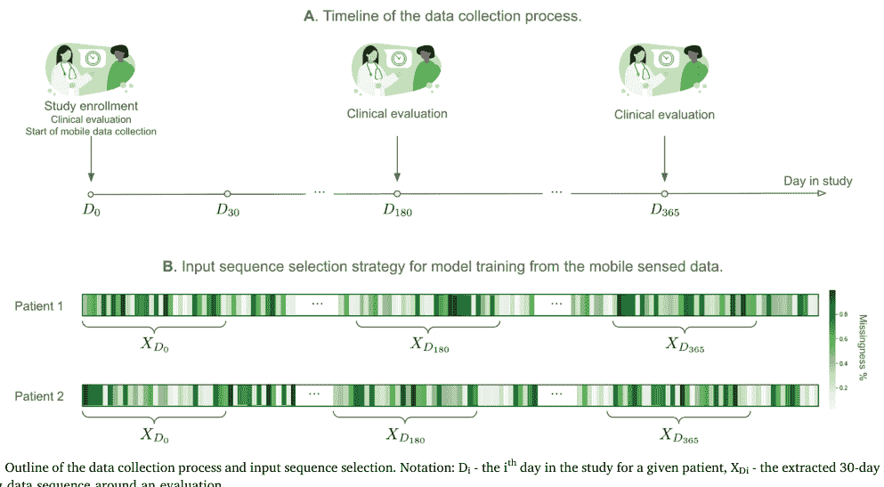
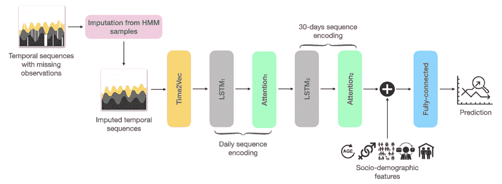
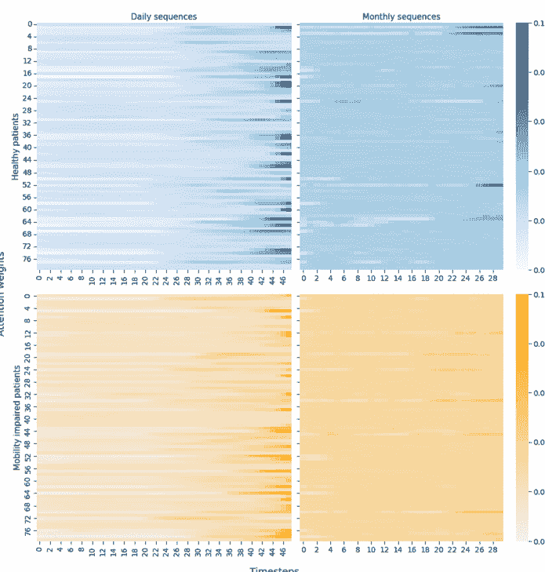
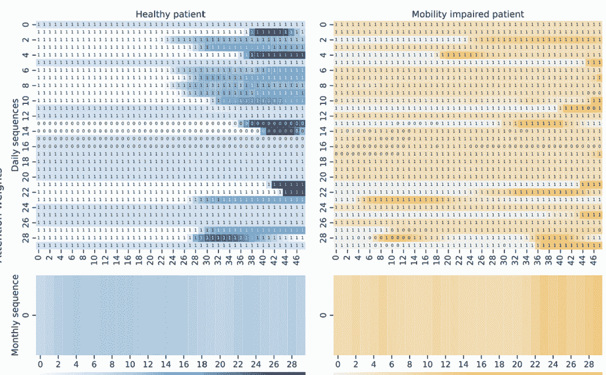

# 基于多模态数据的深度学习技术自动患者功能评估——开发与可行性评估

## 摘要

可穿戴设备和移动传感器可以不显眼地实时收集丰富的生理和行为数据来源。与传统面对面评估或基于问卷的生态瞬时评估（EMA）方法不同，这些数据来源为远程患者监测开辟了许多可能性。然而，由于数据噪声大且观测值经常缺失，定义稳健模型具有挑战性。

本文提出了一种基于注意力的长短期记忆（LSTM）神经网络流水线，用于基于此类数字生物标志物的WHODAS 2.0评估预测行动能力障碍。此外，我们利用隐马尔可夫模型解决了缺失观测问题，并通过迁移学习包含未标记样本信息的可能性。我们利用在野外收集的两个可穿戴/移动传感器数据集以及患者的人口社会学信息验证了我们的方法。

我们的结果表明，在WHODAS 2.0行动能力障碍预测任务中，所提流水线优于先前的基线，并且通过注意力热图还提供了可解释性。此外，通过任务迁移学习使用更小的队列，相同的模型可以学习根据GAD-7评分准确预测广泛性焦虑障碍严重程度。

## 1. 引言

### 1.1. 背景

移动设备及其先进传感器的普及，允许实时被动收集生理和行为数据，例如步数、位置、睡眠和手机使用情况，这为心理健康研究开辟了新途径（Froehlich et al., 2007; Cornelius et al., 2008; Kukkonen et al., 2009）。通过监测身体活动、社交互动和心理健康生物标志物，移动感应能够对患者的功能和福祉进行连续、不显眼的评估，提供改善护理及时性、治疗依从性和健康结局的机会，同时尽量减少参与者负担和回顾偏差（Noah et al., 2018）。为了建立收集、处理和分析行为传感器数据的可靠框架，近期研究专注于监测和诊断数据来源，并开发用于准确有效预测的稳健模型（Jara et al., 2013; Mohr et al., 2014; Sakr and Elgammal, 2016）。基于移动感应和可穿戴数据来源，可以构建各种健康监测系统，例如人体活动和姿态监测、总体福祉、老年人跌倒监测和帕金森病管理等（Miranda et al., 2022）。基于手机的干预措施也被提出作为早期预防方法，以减轻精神疾病相关的疾病负担（Goldberg et al., 2022）。此类框架对于患者行动能力障碍演变的被动随访将非常有价值。行动能力障碍是指一个人独立移动和进行身体活动能力的限制。它可能由多种因素引起，例如老龄化、慢性疾病和损伤。行动能力障碍会对个人的日常生活产生显著影响，导致身心健康下降、社交互动减少和医疗费用增加。文献中可以找到使用机器学习、统计建模和临床评估等各种方法预测行动能力障碍的研究。然而，主要关注群体通常是老年人（Demiris et al., 2004; Van Grootven et al., 2020）。此外，现有方法是从智能家居环境中收集的数据获得的。

我们之前的工作（Süke et al., 2022）考察了基于世界卫生组织残疾评估量表（WHODAS 2.0）预测患者功能结局的可行性，利用被动收集的数字生物标志物作为回归模型的输入。我们通过从30天长的时间序列数据序列中提取统计指标（最小值、最大值、均值、中位数、标准差、IQR）进行特征工程，随后采用简单的线性回归，以保持生物标志物特征作为预测因素的简单性和可解释性。深度学习模型在许多预测任务中已被证明成功（LeCun et al., 2015），包括移动感应（Servia-Rodríguez et al., 2017; Yao et al., 2017; Bahador et al., 2021），并可用于心理健康结局预测。

### 1.2. 目标

我们的目标是开发一个综合的深度学习框架，通过整合数字生物标志物和人口社会学数据来预测功能性行动能力障碍。由于移动感应数据的噪声和缺失特性，我们将采用适当的时间序列模型和插补技术来捕捉数据中的底层模式。此外，纳入人口社会学数据可以显著提高模型性能，因为它能提供与个人功能强相关的信息。基于患者群体的共享行为模式，此类数据可以有效捕捉人类移动的复杂性。

此外，我们建议采用一种简单的任务迁移学习方法，对模型进行微调以预测焦虑结局。焦虑会显著影响个人的行为、情绪和思维，进而影响其日常活动（Al-Lawati et al., 2000; Roemer and Orsillo, 2002）。它还会降低动机，阻止个人参与身体活动（Otto and Smits, 2011; W. H. Organization, 2022）。因此，我们假设移动描述变量可以有效预测焦虑结局。

我们的贡献包括以下内容：
- 一种基于隐马尔可夫模型（HMM）的方法，用于在不采用经典插补技术的情况下处理缺失观测，
- 一种结合自注意力方法与长短期记忆（LSTM）网络的深度神经网络模型，用于获取随时间变化的患者嵌入，
- 以及一个可使用迁移学习技术进行训练的通用多模态流水线，用于建模问卷结局

## 2. 材料与方法

### 2.1. 数据集

#### 2.1.1. 研究参与者

本研究使用的数据收集自两项正在进行的研究（Barrigón et al., 2017; Berrouiguet et al., 2018），涉及对临床门诊患者的被动智能手机监测。这些研究已获得希门尼斯·迪亚斯基金会医院精神科机构审查委员会的批准。所有参与者均提供了书面知情同意。

#### 2.1.2. 纳入标准

本研究招募了年龄至少18岁且为上述机构的精神障碍临床门诊患者或正在参加治疗组的患者。为参与，患者必须拥有运行Android或iOS操作系统的智能手机，并至少每周使用一次该手机连接Wi-Fi网络。仅纳入提供书面知情同意的患者，且他们未参与获得报酬。

#### 2.1.3. 数据来源

参与者的被动数据使用eB2 Mindcare（eb2 evidence-based behaviour, n.d.; Bonilla-Escribano et al., 2019; Carretero et al., 2020）收集，这是一个经过临床用途验证的电子健康平台。该应用在个人智能手机后台运行，提供心理健康电子日记。数据包括四个被动收集的观测值的48份每日半小时汇总，即步数、行进距离、在家时间和运动时间。本工作所用数据收集于2016年1月至2022年4月的2348名个体，共516,604条记录，其中31.5 %收集于2019年。然而，最终数据集存在大量缺失观测值，每个变量的总体缺失率均超过60 %（详情见补充图A.1和A.2）。缺失可能由传感器采样频率不同，或由于技术和行为因素（例如忘记给手机充电、禁用GPS或卸载研究应用）导致传感器未收集数据所致。

在患者入组时，使用*MeMind*工具（Barrigón et al., 2017; Muñoz-Navarro et al., 2017）记录了人口社会学信息（如年龄、性别、同居状况和就业状况）以及*功能评估*问卷的初始完成情况和相应得分。随访得分在面对面预约或电话访问中每半年记录一次（Fig. 1.A）。我们关注的两个健康结局是世界卫生组织残疾评估量表2.0（*WHODAS 2.0*）（McKibbin et al., 2004）和*广泛性焦虑障碍7项量表（*GAD-7*）*（Spitzer et al., 2006）得分。

WHODAS 2.0问卷包含36个条目，用于评估6个领域的残疾：认知、行动能力、自我照料、人际交往、生活活动和参与。要求患者报告过去30天内在各领域执行任务时遇到的困难，并评定困难程度。得分范围为0至100 %，数值越高表示残疾程度越高。功能障碍类别可在不同截断点定义，如（de Pedro-Cuesta et al., 2013）所述。GAD-7筛查工具是一个7条目的问卷，用于评估广泛性焦虑障碍的严重程度，得分范围为0至21。轻度、中度和重度焦虑的截断点分别为5、10和15，得分10或以上表明需要进一步评估（Spitzer et al., 2006）；因此，我们考虑使用此截断值对GAD-7结局进行二分法分类。

来自两项研究的2011名患者子组接受了感兴趣结局的临床评估。Table 1概述了两组研究中基线时人口社会学信息的分布以及心理健康结局得分。

在A组研究中，417名患者有两条或更多记录，161名患者得分变化一次，2名患者在研究期间得分变化两次。在二分法情况下，这对应于54名患者仅有一次变化。

### 2.2. 数据预处理

#### 2.2.1. 输入数据

为构建分类任务的输入数据集，我们为每个目标标签条目裁剪了30天窗口的数据序列（Fig. 1.B）。对于基线得分，由于其在研究入组时登记，我们考虑接下来30天的观测，因为之前未收集移动感应数据。对于随访得分（通常每半年收集一次），我们将30天窗口中心放在围绕得分囊括最完整观测序列的位置。

就人口社会学协变量而言，分类数据采用了独热编码。同时，患者年龄被分为十个类别，然后进行独热编码。我们引入了一个额外类别，以指示未报告协变量的缺失情况。

### 2.2.2. 输出数据

我们将 WHODAS 2.0 运动能力和 GAD-7 评分二分化以创建目标结果。对于 WHODAS 2.0 运动能力评分，负标签的阈值设定为总领域评分的 25%。相比之下，对于 GAD-7 评分，则考虑在 10 处设定阈值。在两种情况下，两个类别之间都存在不平衡分布：对于 WHODAS 2.0 运动障碍结果，在研究 A 中，有 1394/2233 个 0 标签，而在研究 B 中，为 165/283，对于 GAD-7 评分则为 176/283（分布请参见补充图 A.3）。

## 2.3. 拟议流水线

本节介绍了我们拟议的流水线，用于在功能性估计中利用被动感知的时间序列序列和社会人口统计数据。图 2 展示了我们方法的框架，包括用于数据插值的 HMM、基于 LSTM 和自注意的时序编码器，以及与静态协变量拼接的时序嵌入上充当逻辑回归器的稠密层。用于生成本文中所展示结果的代码可在以下 GitHub 仓库中获得：https://github.com/mlfpm/functionality_prediction。

### 2.3.1. 处理缺失数据

缺失观测是可穿戴设备和智能手机收集的数据中常见的问题。它们可能由于不同程度的依从性行为、传感器故障或未收集而发生 (Kiang et al., 2021)。鉴于缺失数据的高比例，使用均值、中位数甚至插值等统计量进行插值是不足的，因为它们低估了方差并忽略了变量之间的关系 (Jäger et al., 2021)。插值后的值无法推广到可穿戴设备特征或参与者行为，可能会减少数据集的变异性并引入偏差。概率生成模型，如隐马尔可夫模型 (HMMs) (Rabiner, 1989) 可以通过调整模型参数以最好地解释数据来最大化证据，从而学习数据集中的潜在分布，即使存在缺失数据 (Speekenbrink and Visser, 2021)。

被假定为由一阶马尔可夫链过程生成。HMM 的可学习参数包括初始状态概率分布、状态转移概率分布和符号发射概率分布。它们可以使用期望-最大化 (EM) (Moon, 1996) 算法和边缘化进行无监督训练，以处理缺失数据。

仅将至少有 80% 观测值的 48 槽位每日患者序列视为 HMM 训练对象。需要注意的是，顺序数据被充分用于 HMM，我们并不将序列仅限制于 30 天窗口。经过这一筛选过程，91,047 个序列被用于训练具有不同隐藏状态数量 n = {2, 3, ... 23} 的 HMM。最佳模型是使用贝叶斯和赤池信息准则 (Dridi and Hadzic, 2018) 在随机选择的包含不同缺失情况的 10,000 个序列子集上选定。基于该模型，我们在小批量随机梯度下降过程中重复插值缺失观测值。每次生成新的数据批次时，序列都会使用维特比算法 (Forney, 1973) 进行解码，缺失观测值则由相应最可能状态生成的样本进行插值。

### 2.3.2. 预测模型

我们的拟议流水线如图 2 所示。它通过应用 Time2Vec (Kazemi et al., 2019) 对每日信息进行特征编码，接着是两个带有自注意 (Vaswani et al., 2017) 的 LSTM (Hochreiter and Schmidhuber, 1997) 编码器，用于 30 天输入序列。然后，在第二个注意层的输出上叠加前馈层，并与社会人口统计数据拼接，以获得预测。

Time2Vec 为时间提供了与模型无关的向量表示。它由周期性激活函数和线性项组成，可以捕捉时间序列信号的周期性以及依赖于时间的非周期性模式。在数学上，对于给定的时间标量标记 τ，表示为 t2v(τ) 的 τ 的 Time2Vec 是大小为 k + 1 的向量，定义为：如果 i = 0，则 t2v(τ)[i] = ω_i τ + φ_i；如果 1 ≤ i ≤ k，则 t2v(τ)[i] = F(ω_i τ + φ_i)。这里 t2v(τ)[i] 是 t2v(τ) 的第 i 个元素，F 是周期性激活函数，而 ω_i 和 φ_i 参数是可学习的。

LSTM 层将输入序列编码为固定长度的内部表示。相比之下，注意层学习进行选择性关注，并将其与输出中的项目相关联。虽然这增加了模型的计算负担，但它会产生一个更具针对性且性能更好的模型。此外，模型还可以展示在预测输出时如何对输入序列进行关注。

理解输入与输出之间的关系，即一天中的哪些时段模式和一个月中的哪些时段模式有助于模型做出正确预测，由于涉及大量非线性操作而变得复杂。因此，我们使用自注意权重来解释输入信号在功能性评估任务中的重要性。我们将自注意可视化为热图，以了解特征和时间的总体重要性。除了理解哪些时段模式有助于结果之外，这些自注意权重还可以提供关于随时间变化的相关变化的见解，这对于判断患者状态的恶化至关重要。

## 表 1 研究队列。

| 变量 | 数值 | 研究组 A N = 1728 | 研究组 B N = 283 |
| :--- | :--- | :--- | :--- |
| 基线社会人口统计信息 | | | |
| 年龄（岁），均值（标准差） | | 43 (15) | 42 (14) |
| 性别，n（%） | 男性 | 526 (30.44%) | 102 (36.04%) |
| | 女性 | 1184 (68.52%) | 179 (63.25%) |
| | 未知 | 18 (1.04%) | 2 (0.71%) |
| 同居，n（%） | 否 | 177 (10.24%) | 50 (17.66%) |
| | 是 | 1517 (87.79%) | 216 (76.34%) |
| | 未知 | 34 (1.97%) | 17 (6.00%) |
| 家庭状况，n（%） | 单身 | 620 (35.88%) | 115 (40.64%) |
| | 分居 | 231 (13.37%) | 55 (19.43%) |
| | 鳏寡 | 42 (2.43%) | 7 (2.47%) |
| | 已婚或同居超过 6 个月 | 822 (47.57%) | 104 (36.75%) |
| | 未知 | 13 (0.75%) | 2 (0.71%) |
| 就业状态，n（%） | 就业、学生或家庭主妇/主夫 | 811 (46.94%) | 122 (43.11%) |
| | 无补贴失业 | 272 (15.74%) | 45 (15.90%) |
| | 有补贴失业 | 149 (8.62%) | 14 (4.95%) |
| | 永久丧失劳动能力 | 106 (6.14%) | 26 (9.19%) |
| | 暂时丧失劳动能力 | 286 (16.55%) | 55 (19.43%) |
| | 退休 | 92 (5.32%) | 15 (5.40%) |
| | 未知 | 12 (0.69%) | 6 (2.12%) |
| 临床信息，中位数（四分位距） | | | |
| WHODAS 2.0 运动能力评分 [%] | | 19 (6, 44) | 13 (0, 38) |
| GAD-7 评分 | | – | 9 (6, 12) |
| 条目统计信息，中位数（最小值，最大值） | | | |
| 每位患者的条目数 | | 1 (1, 4) | 1 (1, 1) |
| 每位患者的评分变化次数 | WHODAS 2.0 运动能力 | 0 (0, 2) | 0 |
| 每位患者的评分变化次数 | GAD-7 | – | 0 |

## 3. 实验

除了第 3.5 节中描述的实验外，所有实验均使用研究 A 的数据进行交叉验证和测试。我们将研究 B 的数据保留为留出测试集。因此，我们将在同一数据集上训练和评估的模型结果称为分布内，将在不同数据集上测试的模型结果称为分布外（OOD）。所有模型均使用学习率为 1e-3、批量大小为 64 的 Adam 优化器进行训练。

我们使用准确率、受试者工作特征曲线下面积（AUROC）和精确率-召回率曲线下面积（AUPRC）评分 (Saito and Rehmsmeier, 2015) 来评估预测性能，以便对不平衡问题的分类性能获得有价值的见解。除非另有说明，我们报告所有评估的交叉验证平均分及其相应的标准差。此外，我们报告未见 OOD 数据集上的性能，但第 3.5 节中描述的实验除外。

### 3.1. 定义基线

我们首先重用 (Sikkeei et al., 2022) 中定义的流水线作为预测性能的基线。我们对每个变量序列中手动提取的统计摘要特征（计数、最小值、最大值、均值、标准差、四分位距）应用了序列前向选择（SFS）和带 L2 正则化的逻辑回归，并将其与社会人口统计信息相结合。特征提取后，数据集中约有 20% 的缺失值（步数中 24.49%，行进距离中 11.13%，在家时间中 52.58%，锻炼时间中 6.51% 在 the time at exercising

**图 2.** 设计流水线的总体结构。

feature)，我们使用简单均值插值法对其进行了插补。这些值出现是因为我们没有丢弃特征中只有一次测量的序列，以便能够直接比较结果。

### 3.2. 嵌套交叉验证

我们首先使用嵌套交叉验证方法（Krstajic 等人，2014）进行了模型超参数优化和模型选择。具体来说，用于模型超参数优化的 k 折交叉验证过程嵌套在用于模型评估和模型选择（以便在 OOD 数据集上进行测试）的 k 折交叉验证过程之内。这样一来，搜索过程对原始数据集过拟合的风险降低，并且我们能够了解平均模型性能。通过从预定义的超参数值搜索空间中随机采样可能的模型架构候选项（Bergstra and Bengio, 2012），我们试图发现一组在 AUPRC 分数意义上在数据集上表现良好的超参数。

我们使用 k = 5 进行超参数搜索，并从预定义搜索空间中测试了 10 个随机模型超参数组合（参见表 2）。外层循环中 k = 5 折的嵌套交叉验证将拟合和评估 250 个模型。我们训练模型 50 个 epoch。最终模型是通过将外层循环应用于整个数据集来配置的。在完整的分布内数据上训练的该模型随后用于对不可见的 OOD 数据进行预测。

### 3.3. 消融研究

在构建复杂机器学习模型时，单独了解每个组件的影响很有帮助（Meyes 等人，2019）。因此，我们定义了一项消融研究，系统地消除模型的部分组件，并分析其对整体模型性能的影响。我们使用 3 折交叉验证来估计模型在用于对训练期间未见过的数据进行预测时的预期表现，并找到训练模型的最佳 epoch 数以避免过拟合。然后，我们在研究 A 的完整数据集上训练模型，训练所找到的 epoch 数，并在每种情况下对留出测试集（研究 B）进行评估。

### 3.4. 时序编码器预训练

鉴于标记样本量有限，我们建议对时序编码器使用迁移学习方法。首先，我们预训练时序编码器权重以执行通用任务，例如基于前 30 天预测次日的平均移动性生物标志物。然后，我们将在这个自回归任务上拟合的模型用作功能预测设置中模型的起点，这样可以在不考虑目标标签的情况下，更好地对时间序列序列进行通用嵌入。我们提取了 20,272 个具有 7 天重叠的 30 天序列，所有特征都收集了观测值。预训练运行了五个 epoch。

我们比较了两种预训练方法：特征提取和微调。在第一种设置中，我们冻结时序编码器部分的权重；因此我们仅将其用于时序特征提取，并

表 2
模型超参数的搜索空间。

| Hyper-parameter | Search space |
|---|---|
| Time2Vec | |
| Embedding dimension | {4, 6, 8, 10, 12} |
| Activation function | {sin, cos} |
| LSTM | |
| Hidden dimension - Block 1 | {x + 8 | x ∈ N ∩ [32, 128]} |
| Hidden dimension - Block 2 | {x + 8 | x ∈ N ∩ [64, 256]} |
| Bidirectional | {True, False} |
| Number of layers | {1, 2, 3} |
| Dropout | {0.1, 0.2, 0.3} |

训练网络的分类器。第二种方法包括在特定任务数据集上训练整个模型，并调整时序编码器的权重。通过略微改变时序编码器权重，我们希望网络能更好地适应评估周围的特定 30 天时间段。

### 3.5. 任务迁移学习

广泛性焦虑障碍的核心症状是慢性、过度且无法控制的担忧（Rowa and Antony, 2008），这反映在个人的行为模式中。之前的研究表明，规律的活动对患者的焦虑相关结局有积极影响（Anderson and Shivakumar, 2013; Aylett et al., 2018）。因此，我们合理地期望可以应用上述定义的流水线，从相同的行为生物标志物中预测 GAD-7 结局。然而，在这种情况下，我们面临着显著较小的标记样本量，这使得这类复杂模型难以学习在不可见的 OOD 数据上很好地泛化，而不仅仅是对训练集过拟合。因此，我们建议对在 WHODAS 2.0 结局预测任务上训练的模型进行微调，以预测 GAD-7 分数。这样，可以通过从已学习的相关任务迁移知识来学习新任务（Olivás et al., 2009）。

## 4. 结果

### 4.1. 寻找模型架构

在分析 AIC 和 BIC 信息准则的拐点后，我们发现五个隐藏组件最能捕捉数据的潜在模式。因此，我们在随后的实验中使用了该 HMM，以推断每个每日数据序列最可能的状态序列，并在每次加载小批量时，从相应状态生成的样本中插补缺失的观测值，如 2.4.1 节所述。

超参数调优得出了以下架构：

- 嵌入维度为 4 且使用正弦激活的 Time2Vec
- 每个包含 64 个循环单元的 2 层单向 LSTM 块，每个块中包含 0.1 的循环丢弃率

### 4.2. 基线、消融和时序预训练

在表 3 中，我们总结了基线方法以及消融和迁移学习实验的模型性能结果。DL 流水线在分布内 AUPRC 分数上优于基线方法，但在 AUPRC 分数上实现了略差的性能。在 OOD 测试集上，DL 模型在 AUPRC 上优于基线。

| 实验 | 模型 | 分布内测试 - 3折均值 (SD) | | 分布外测试 - 全部留出 | |
|---|---|---|---|---|---|
| | | AUROC | AUPRC | AUROC | AUPRC |
| 基线 | 随机 | 0.500 (0.000) | 0.369 (0.000) | 0.500 | 0.411 |
| | SFS + LR Sükel 等人 (2022) | 0.684 (0.028) | 0.553 **(0.032)** | **0.603** | 0.536 |
| | DL 流水线 | **0.693** **(0.023)** | 0.532 (0.051) | 0.586 | **0.542** |
| 消融研究 | DL 流水线 | **0.693** **(0.023)** | 0.532 (0.051) | 0.586 | 0.542 |
| | 无自注意 | 0.666 (0.035) | 0.528 (0.062) | 0.596 | 0.541 |
| | 无 Time2Vec | 0.677 (0.021) | 0.538 (0.037) | **0.605** | **0.570** |
| | 无 Time2Vec & 自注意 | 0.681 (0.040) | **0.539** **(0.066)** | 0.591 | 0.552 |
| 编码器预训练 | DL 流水线 (无预训练) | **0.693** **(0.023)** | 0.532 (0.051) | **0.586** | **0.542** |
| 特征提取方法 | | 0.674 (0.029) | 0.545 (0.055) | 0.575 | 0.538 |
| 微调方法 | | 0.675 (0.027) | **0.558** **(0.075)** | 0.579 | 0.533 |

我们现在将参照整个 DL 流水线来研究消融研究的结果。去除注意力层但保留 Time2Vec 层导致分布内测试性能显著下降，且 OOD 测试中仅 AUROC 增加。去除 Time2Vec 块导致分布内测试 AUROC 降低且 AUPRC 略高，而在 OOD 测试中提供了最佳性能。不带 Time2Vec 和自注意力层的模型提供了消融变体中最佳的 AUROC 和分布内整体最佳 AUPRC；然而，尽管 OOD 性能优于整体模型，但其表现仍不如前一模型。总体而言，消融导致分布内 AUROC 降低，但这种权衡可能是可取的，特别是在去除 Time2Vec 的情况下。从流水线中去除 Time2Vec 可以实现一个更稳定的模型，具有较低的分布内标准差，并在除前文提到的领域之外的所有领域实现相关改进。

使用所有可用数据序列对整个模型的时序编码器块进行预训练并冻结后，导致模型性能略微下降，分布内 AUPRC 除外。使用微调方法，分布内性能提高到 0.558 AUPRC，而不进行预训练时达到的为 0.532 AUPRC。相比之下，使用特征提取方法训练后，模型仅达到 0.545 的平均 AUPRC。尽管如此，特征提取方法在 OOD 测试中达到略高的 AUPRC。

如图 3 所示，平均而言，对傍晚时段（时段 36–47）的活动更加关注，非常低的注意力权重与深夜活动相关，并且在两个队列中白天可以看到变化模式。至于月度序列，两组的注意力权重在 30 天间隔内相当均匀，偶尔会将更多注意力分配给周期的最后几天。

图 3. 每个移动性困难中随机选取的 80 名患者的每日和每月平均注意力权重。

在分析患者层面的注意力权重（图 4）时，我们可以看到基于移动性损伤以及可能的个体水平差异出现不同的模式。对于健康患者，较大的每日注意力权重始终出现在白天的下半时段。相比之下，对于有移动性困难的患者，某些日子会更加关注深夜时段。最后，我们还分析了数据缺失与注意力权重之间的相关性，但未发现明显相关性，这表明权重是基于观测值分配的，而非由缺失因素驱动。

### 4.3. 任务迁移学习

表 4 显示了分别采用迁移学习和未采用迁移学习的二分类 GAD-7 分类性能分数。如预期，当我们尝试从零开始学习 GAD-7 预测任务时，由于样本量相对较小，模型过拟合了训练数据。所获得的性能略好于随机，而 the

图 4. 2 名不同行动困难程度的随机选定患者的每日和每月注意力权重。我们用 1 表示存在样本，而用 0 表示其缺失。

表 4 在研究 B 上训练的二元 GAD-7 焦虑预测任务的模型性能比较（包含和不包含迁移学习）。每种设置中达到的最高性能用粗体表示。符号说明：SD = 标准差。AUROC = 接收者操作特征曲线下面积，AUPRC = 精确率-召回率曲线下面积。

| Experiment | Model | AUROC | AUPRC |
| :--- | :--- | :--- | :--- |
| 基线 | 随机 | 0.500 (0.000) | 0.392 (0.011) |
| | SFS + LR (Säkeli et al., 2022) | 0.505 (0.077) | 0.450 (0.068) |
| | 深度学习流水线 | **0.518 (0.143)** | **0.463 (0.148)** |
| 迁移与预训练 | 深度学习流水线（无预训练，无迁移） | 0.518 (0.143) | 0.463 (0.148) |
| | 特征提取方法 | 0.530 (0.107) | 0.504 (0.148) |
| | 微调方法 | **0.603 (0.121)** | **0.556 (0.148)** |

分类任务。该过程之所以有效，是因为这些特征既适用于基础任务也适用于目标任务，而且数据集 A 规模显著更大，覆盖了更广泛的协变量。因此，网络的起始权重更具代表性。有人可能会认为，数据不足以从零开始训练一个复杂的模型。然而，即使只有少量数据，该基线流水线仍然优于更简单的序列特征选择和逻辑回归。代价是方差更高，而这种方差在迁移学习方法中也得到了改进。预训练模型利用额外信息进行改进，这证实了 WHODAS 2.0 预测任务与 GAD-7 预测任务之间，以及研究 A 数据集与研究 B 数据集之间的关系。可以说，总体模型性能仍有提升空间，但是认识到在如此小的数据集上进行 GAD-7 预测的困难非常重要。

不同划分之间的方差相对较大。
对于迁移学习，权重是从未经过预训练的训练有素的 WHODAS 深度学习流水线中复制的，因为编码器预训练对性能没有帮助，然后应用了两种迁移学习方法。总体而言，迁移学习是成功的，因为两种方法都改进了基线。当我们对训练用于行动障碍的模型进行微调时，达到了显著的性能提升。

## 5. 讨论

### 5.1. 主要结果

本工作解决了从被动感知的数字生物标志物建模心理健康结果时的常见问题。在此例中，数据是通过手机被动收集的，而手机在传感器技术上存在固有局限性（它们并非为研究质量而设计），导致数据嘈杂且存在缺失。然而，它们是数据收集的理想设备，因为大多数人全天都随身携带手机。因此，如果可以克服这些限制，这将提供一种无需任何受试者交互即可被动收集数据的有前途的方式，这有利于留存，并提供更具生态效度的数据（即代表现实生活的数据）。我们提出了一种通过收集大量数据（数据挖掘）然后应用机器学习技术来填补缺失值并捕获预测所需任务相关信息的方法来克服这一限制，在此例中即精神科目标预测。

我们面临的主要困难之一是如何有意义地处理大量缺失数据。我们使用基于描述患者日常活动的 48 个半小时时隙序列训练的隐马尔可夫模型（HMMs），随后用于插补。这允许通过从最能描述每个特征的似然分布中进行重复插补，来边缘化缺失性。

深度学习技术自动学习了月度患者序列中的潜在模式，以预测行动困难和广泛性焦虑结果。我们表明，所提出的迁移学习方法可以提高目标结果估计的性能，特别是在样本较少的数据集中。我们的结果证明，尽管二元分类性能在每个划分上有所变化，这在一定程度上是由于数据集中某些社会人口学特征分布不均所致，但方差并不特别显著；因此，模型对数据偏移具有相当强的鲁棒性。

将预训练/迁移学习步骤应用于模型的时序编码器块，有助于为 GAD-7 分类任务的模型权重进行更具意义的初始化。然而，在预测 WHODAS 2.0 行动障碍时，它并无帮助。预训练可以被视为在目标空间中从不同的初始化开始梯度下降，因此改进是由于达到了更好的最小化损失的极值点。在 WHODAS 2.0 行动得分的情况下，很明显，这种初始化导致发现了较差的极值点，而在 GAD-7 预测中，它导致了显著更好的极值点。找到较差的极值点主要是由于要么被困在较差的局部极值点，要么在目标空间中下降得更慢。预训练初始化基于预测平均次日行动标志，在数据缺乏时通常有帮助。然而，随着数据量增加，预测任务中解决的优化问题与预训练中定义的问题越来越偏离。此外，由于研究 A 的数据集涵盖了更全面的社会人口学代表性，这可能有助于在远小于研究 B 数据集的任务转移设置中避免训练集和测试集之间的协变量偏移。

自注意力热图显示，在健康队列与行动障碍队列中，出现了不同的日内和月内一般模式。此外，当与相关时间点配对时，热图可用于分析与特定事件相关的不同新兴模式，例如，规定治疗的开始或停用，或比较就诊之间的模式。这些简单的可视化为临床医生提供了有用的工具，以了解个体的活动模式以及导致改善的原因，更重要的是，导致下降的原因。在决定触发适当干预以帮助减缓或扭转下降时，这可以提供宝贵的信息。

### 5.2. 优势与局限性

本工作的优势在于提出了一种用于被动确定患者功能评分的新颖流水线。我们关注精神科目标，但这一想法可以扩展到许多领域。这一想法和实现不仅在被动移动精神科评估领域具有新颖性，而且本工作还提出了一种在任何领域处理被动感知移动数据局限性以取得合理结果的方法。尽管缺失值比例很高且标签变异性较低，但模型仍捕获了患者结果。

本研究表明，构建用于被动患者评估的机器学习流水线是可行的，并且有方法可以解决移动感知数据中的问题。通过本文提出的工作和未来的改进，手机被动数据收集的局限性可以得到缓解，从而为研究人员和临床医生提供一种几乎总是由受试者随身携带、实时收集数据、无需患者交互、并且可以跨模态每天收集多次数据的数据收集工具。

尽管我们的方法显示出有前途的结果，但它面临额外的挑战，并在未来工作中留有改进空间。健康应用中常见的局限性是相对较小的标记样本量。更大的患者队列和每个患者多个不同值的标签有助于训练更鲁棒的模型，甚至允许数据驱动的个性化，从而考虑行为模式中的个体间和个体内差异。其次，为了帮助解决缺失问题，我们在为每个标签寻找缺失最少的包含 30 天窗口时引入了另一项局限性，该窗口可能包括问卷完成后的几天。然而，假设患者状态在问卷完成后几天或几周内不会改变，这并非不合理的假设。这一假设进一步得到了数据中缺乏个体内标签差异的支持。

此外，我们通过可视化自注意力来解释模型发现的显著时间模式；然而，这种解释仅说明了与感兴趣结果相关的行为模式的变化。本工作可以进一步扩展，为决策带来更多可解释性，为临床医生提供更好的洞察。

## 6. 结论

该主题的先前工作使用从移动感知序列中手动提取的特征，从而避免了缺失性和日内变化。在本工作中，我们研究了使用具有多模态输入并辅以隐马尔可夫模型进行缺失值插补的深度学习模型来进行预测任务。该流水线得益于自注意力层，在预测和对感兴趣结果的日内和月内变化的可解释性方面取得了更好的结果。此外，我们的迁移学习方法在高效地扩展预测任务（甚至扩展到更小的数据集）方面显示出有前途的结果。

## 资助

ES 获得欧盟 Horizon 2020 研究和创新计划（玛丽·斯克洛多夫斯基-库里助成金 813533）的资助。AA 和 PO 由西班牙政府 MCI 在助成金 PID2021-123182OB-I00 和 PID2021-125159NB-I00 下支持，由马德里自治区在助成金 IND2022/TIC-23550 下支持，由欧洲研究理事会（ERC）通过欧盟 Horizon 2020 研究和创新计划在助成金 714161 下支持，并由马德里自治区和 FEDER 通过 IntCARE-CM 支持。

## 伦理批准和参与同意

本工作涉及的所有程序均符合相关国家和机构人体实验委员会的伦理标准，以及经 2008 年修订的 1975 年赫尔辛基宣言。大学医院 Fundación Jiménez Díaz 的伦理委员会批准了所有涉及人体患者的程序。所有参与者均提供了书面知情同意以参与本研究。

## 竞争利益声明

作者声明以下可能被视为潜在竞争利益的财务利益/个人关系：Antonio Artés 是 Evidence-Based Behavior (eB2) 的联合创始人。

## 致谢

作者们要感谢 Enrique Baca-Garcia 博士在临床和患者相关事务方面提供的专家建议。我们还要感谢所有参与者和治疗师对研究所做出的宝贵贡献。

## 附录 A. 补充数据

本文的补充数据可在 https://doi.org/10.1016/j.invent.2023.100657 在线查阅。

## 参考文献

- Al-Lawati, J., Al-Lawati, N., Al-Siddiqui, M., Antony, S.X., Al-Naamani, A., Martin, R., Kolbe, R., Theodorsson, T., Osman, Y., Al-Hussaini, A., 等, 2000. 阿曼初级卫生保健中的心理发病率：一项初步研究. Sultan Qaboos Univ. Med. J. 2 (2), 105–110.

- Anderson, E., Shivakumar, G., 2013. 运动和身体活动对焦虑的影响. Front. Psychiatry 4, 27.

- Aylett, E., Small, N., Bower, P., 2018. 全科临床焦虑治疗中的运动——一项系统评价和荟萃分析. BMC Health Serv. Res. 18 (1), 1–18.

- Bahador, N., Ferreira, D., Tamminen, S., Kortelainen, J., 等, 2021. 基于深度学习的多模态数据融合：使用可穿戴传感器检测食物摄入事件的案例研究. JMIR mHealth uHealth 9 (1), e21926.

- Barrigón, M.L., Berrouiguet, S., Carballo, J.J., Bonal-Giménez, C., Fernandez-Navarro, P., Pfang, B., Delgado-Gómez, D., Courtet, P., Aroca, F., Lopez-Castroman, J., 等, 2017. 用于生态瞬时评估的电子心理健康工具的用户档案：Memind. Int. J. Methods Psychiatr. Res. 26 (1), e1554.

- Bergstra, J., Bengio, Y., 2012. 超参数优化的随机搜索. J. Mach. Learn. Res. 13 (2).

- Berrouiguet, S., Ramírez, D., Barrigón, M.L., Moreno-Muñoz, P., Camacho, R.C., Baca-García, E., Artés-Rodríguez, A., 等, 2018. 结合持续智能手机非侵入式传感器数据捕获和无监督数据挖掘技术进行行为变化检测：基于证据的行为（eb2）研究的一系列病例. JMIR mHealth uHealth 6 (12), e9472.

- Bonilla-Escobar, F.J., Ramírez, D., Sedano-Capdevila, A., Campaña-Montes, J.J., Baca-García, E., Courtet, P., Artés-Rodríguez, A., 2019. 精神病患者电子社交活动评估. IEEE J. Biomed. Health Inform. 23 (6), 2247–2256.

- Carretero, P., Campana-Montes, J.J., Artés-Rodríguez, A., 2020. 用于监测自杀行为风险的生态瞬时评估. 在：自杀和自残的行为神经生物学. Springer, 第 229–245 页。

- Cornelius, C., Kapadia, A., Kotz, D., Peebles, D., Shin, M., Triandopoulos, N., 2008. Anonsense：以隐私为中心的人体感知. 在：第 6 届国际移动系统、应用和服务会议论文集, 第 211–224 页。

- de Pedro-Cuesta, J., García-Sagredo, P., Alcalde-Cabero, E., Alberquilla, A., Damián, J., Bosca, G., López-Rodríguez, F., Carmona, M., de Teña-Dávila, M.J., García-Olmos, L., 等, 2013. 西班牙三个社区居住诊断组 30 个月后的残疾转变. PLoS One 8 (10), e77482.

- Demiris, G., Rantz, M.J., Aud, M.A., Marek, K.D., Tyrer, H.W., Skubic, M., Hussam, A.A., 2004. 老年人对“智能家居”技术的态度和看法：一项试点研究. Med. Inform. Internet Med. 29 (2), 87–94.

- Dridi, N., Hadzagic, M., 2018. 隐马尔可夫模型的赤池和贝叶斯信息准则. IEEE Signal Process. Lett. 26 (2), 302–306.

- eb2 基于证据的行为。https://eb2.tech/?lang=en。

- Forney, G.D., 1973. 维特比算法. Proc. IEEE 61 (3), 268–278.

- Froehlich, J., Chen, M.Y., Consolvo, S., Harrison, B., Landay, J.A., 2007. MyExperience：用于在移动电话上就地追踪和捕获用户反馈的系统. 在：第 5 届国际移动系统、应用和服务会议论文集, 第 57–70 页。

- Goldberg, S.B., Lam, S.U., Simonsson, O., Torous, J., Sun, S., 2022. 基于手机的心理健康干预：14 项随机对照试验荟萃分析的系统荟综分析. PLOS Digit. Health 1 (1), e0000002.

- Hochreiter, S., Schmidhuber, J., 1997. 长短期记忆. Neural Comput. 9 (8), 1735–1780.

- Jäger, S., Allhorn, A., Bießmann, F., 2021. 数据插补方法的基准. Front. Big Data 4, 693674.

- Jara, A.J., Zamora-Izquierdo, M.A., Skarmeta, A.F., 2013. 基于物联网的 mHealth 和远程监测互连框架. IEEE J. Sel. Areas Commun. 31 (9), 47–65.

- Kazemi, S.M., Goel, R., Eghbali, S., Ramanan, J., Sahota, J., Thakur, S., Wu, S., Smyth, C., Poupart, P., Brubaker, M., 2019. Time2vec：学习时间向量表示（arXiv 预印本 arXiv:1907.05321）.

- Kiang, M.V., Chen, J.T., Krieger, N., Buckee, C.O., Alexander, M.J., Baker, J.T., Buckner, R.L., Coombs, G., Rich-Edwards, J.W., Carlson, K.W., 等, 2021. 数字表型中缺失数据的社会人口学特征. Sci. Rep. 11 (1), 1–11.

- Krstajic, D., Buturovic, L.J., Leahy, D.E., Thomas, S., 2014. 选择和评估回归与分类模型时交叉验证的陷阱. J. Chemoinformatics 6 (1), 1–15.

- Kukkonen, J., Laserspetz, N., Nurmi, P., Andersson, M., 2009. Betelgeuse：情境数据收集与处理平台. IEEE Pervasive Comput. 8 (2), 49–56.

- LeCun, Y., Bengio, Y., Hinton, G., 2015. 深度学习. Nature 521 (7553), 436–444.

- McKibbin, C., Patterson, T.L., Jeste, D.V., 2004. 评估老年精神分裂症患者的残疾：来自 WHODAS 2.0 的结果. J. Nerv. Ment. Dis. 192 (6), 405–413.

- Meyes, R., Lu, M., de Puiseau, C.W., Meisen, T., 2019. 人工神经网络中的消融研究（arXiv 预印本 arXiv:1901.08644）.

- Miranda, L., Viterbo, J., Bernardini, F., 2022. 用于人类活动识别的感知上下文中间件中机器学习方法的应用综述. Artif. Intell. Rev. 55 (4), 3369–3400.

- Mohr, D.C., Schueller, S.M., Montague, E., Burns, M.N., Rashid, P., 2014. 行为干预技术模型：电子健康和移动健康干预的综合概念与技术框架. J. Med. Internet Res. 16 (6), e3077.

- Moon, T.K., 1996. 期望-最大化算法. IEEE Signal Process. Mag. 13 (6), 47–60.

- Muñoz-Navarro, R., Cano-Vindel, A., Moriana, J.A., Medrano, L.A., Ruiz-Rodríguez, P., Agüero-Gento, L., Rodríguez-Enríquez, M., Piza, M.R., Ramírez-Manté, J.L., 2017. 使用 GAD-7 在西班牙初级保健中心筛选广泛性焦虑障碍. Psychiatry Res. 256, 312–317.

- Noah, B., Keller, M.S., Mosadeghi, S., Stein, L., Johl, S., Delshad, S., Tashjian, V.C., Lew, D., Kwan, J.T., Justafagic, A., 等, 2018. 远程患者监测对临床结局的影响：随机对照试验的更新荟萃分析. NPJ Digit. Med. 1 (1), 1–12.

- Olivas, E.S., Guerrero, J.D.M., Martinez-Sober, M., Magdalena Benedito, J.R., Serrano, L., 等, 2009. 机器学习应用与趋势研究手册：算法、方法和技术. IGI Global.

- Otto, M., Smits, J.A., 2011. 用于情绪和焦虑的运动：克服抑郁和提升幸福感的验证策略. OUP USA.

- Rabiner, L.R., 1989. 隐马尔可夫模型及其在语音识别中选定应用的教程. Proc. IEEE 77 (2), 257–286.

- Roemer, L., Orsillo, S.M., 2002. 扩大我们对广泛性焦虑障碍的概念化和治疗：将正念/接纳为基础的方法与现有认知行为模式相结合. Clin. Psychol. Sci. Pract. 9 (1), 54.

- Row, K., Antony, M.M., 2008. 广泛性焦虑障碍. 精神病理学：历史、诊断和经验基础 78–114.

- Saito, T., Rehmsmeier, M., 2015. 在不平衡数据集上评估二分类器时，精确率-召回率图比 ROC 图更具信息性. PLoS One 10 (3), e0118432.

- Sakr, S., Elgammal, A., 2016. 迈向智能医疗服务的综合数据分析框架. Big Data Res. 4, 44–58.

- Servia-Rodriguez, S., Rachuri, K.K., Mascolo, C., Rentfrow, P.J., Lathia, N., Sandstrom, G. M., 2017. 移动感知助力心理健康：一项大规模纵向研究. 在：第 26 届国际万维网会议论文集, 第 103–112 页。

- Speekenbrink, M., Visser, I., 2021. 隐马尔可夫模型中可忽略和不可忽略的缺失数据（arXiv 预印本 arXiv:2109.02770）.

- Spitzer, R.L., Kroenke, K., Williams, J.B., Löwe, B., 2006. 评估广泛性焦虑障碍的简短量表：GAD-7. Arch. Intern. Med. 166 (10), 1092–1097.

- Sükei, E., Romero-Medrano, L. de Leon-Martinez, S., Herrera Lopez, J., Campana-Montes, J.J., Olmos, P.M., Baca-Garcia, E., Artés, A., 2022. 从行为生物标志物评估 WHODAS 2.0 得分：一种数据驱动方法（预印本）.

- Van Grootven, B., Jeuris, J., Jonckers, M., Devriendt, E., Dirckx de Casterlé, B., Dubois, C., Fagard, K., Herregods, M.-C., Hornix, M., Meuris, B., 等, 2020. 预测心血管疾病入住心脏护理单元的老年患者住院相关功能下降：一项前瞻性队列研究. BMC Geriatr. 20 (1), 1–7.

- Vaswani, A., Shazeer, N., Parmar, N., Uszkoreit, J., Jones, L., Gomez, A.N., Kaiser, L., Polosukhin, I., 2017. 注意力就是你所需要的一切. Adv. Neural Inf. Process. Syst. 30.

- World Health Organization, 2022. 体育活动。https://www.who.int/news-room/fact-sheets/detail/physical-activity (2023 年 4 月 24 日访问)。

- Yao, S., Hu, S., Zhao, Y., Zhang, A., Abdelzaher, T., 2017. Deepsense：时间序列移动感知数据处理的统一深度学习框架. 在：第 26 届国际万维网会议论文集, 第 351–360 页。

