# AWS 云实践入门指南 CLF-C01 考试

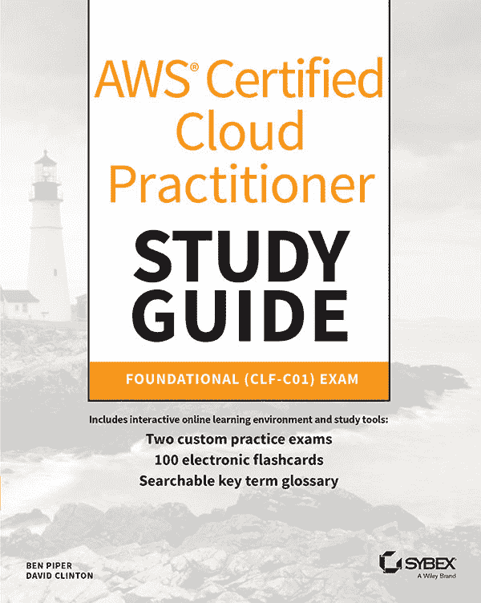

同时在美国和加拿大发行

在美国生产

未经出版商书面许可，本出版物的任何部分不得复制、存储在检索系统中或以任何形式或通过任何方式（电子、机械、影印、录音、扫描或其他方式）传输，除非符合 1976 年美国版权法第 107 或第 108 节的规定，或已向版权清除中心支付相应的每份副本费用。请将版权许可请求发送至出版商 `John Wiley & Sons, Inc.` 的权限部门，地址为 `111 River Street, Hoboken, NJ 07030`，电话 (201) 748-6011，传真 (201) 748-6008，或在线访问 [`www.wiley.com/go/permissions`](http://www.wiley.com/go/permissions)。

免责声明/担保免责声明：出版商和作者不对本作品内容的准确性或完整性作出任何声明或担保，并明确免除所有担保，包括但不限于适用于特定目的的担保。销售或促销材料不得创建或扩展任何担保。本文档所含建议和策略可能不适用于所有情况。本作品出售时，出版商不提供法律、会计或其他专业服务。如需专业帮助，请联系合格的专业人士。出版商和作者均不对由此产生的损害负责。本文中引用的组织或网站的链接不代表作者或出版商对其内容或建议的认可。此外，请注意，本文中列出的互联网网站在本文撰写时可能已发生变化或消失。

如需了解我们其他产品和服务或获取技术支持，请在美国联系客户服务部，电话 (877) 762-2974，或在美国境外致电 (317) 572-3993，传真 (317) 572-4002。

Wiley 以多种印刷和电子格式发行，并提供按需印刷。标准印刷版本中包含的部分材料可能不在电子书或按需印刷版本中。如果本书提及的 CD 或 DVD 未包含在您购买的版本中，您可以在 [`booksupport.wiley.com`](http://booksupport.wiley.com/) 下载相关材料。有关 Wiley 产品的更多信息，请访问 [www.wiley.com](http://www.wiley.com/)。

**Library of Congress Control Number:** `2019939496`

商标：`Wiley`、`Wiley` 标志和 `Sybex` 标志是 `John Wiley & Sons, Inc.` 及其关联公司在美国和其他国家的商标或注册商标，未经书面许可不得使用。`AWS` 是 `Amazon Technologies, Inc.` 的注册商标。其他所有商标均属其所属所有者。`John Wiley & Sons, Inc.` 与本书中提及的任何产品或供应商均无关联。

我们谨向以下帮助我们完成 `AWS Certified Cloud Practitioner Study Guide CLF-C01 Exam` 的人员致谢。

首先，特别感谢我们的朋友 Wiley。`Kenyon Brown`，高级收购编辑，推动了本项目的开展，并将所有环节组织起来。我们的项目编辑 `Kathi Duggan` 保持了项目的进度，确保我们走在正确的方向上。我们还要感谢我们细心的技术编辑 `John Mueller` 以及 `Pete Gaughan`：我们可能不清楚“内容启用经理”具体指什么，但我们确信这一角色发挥了重要作用。

最后，再次向作者们致谢，感谢他们之间的合作！

**`David Clinton`** 是一名 Linux 服务器管理员，曾在学术和企业环境中参与 IT 基础设施工作。他撰写过多本技术书籍，包括 *`AWS Certified Solutions Architect Study Guide: Associate SAA-C01 Exam, Second Edition`*（Sybex，2019），并为 Pluralsight 制作了 20 部讲解 Amazon Web Services、Linux 管理、服务器虚拟化和 IT 安全的视频课程。

在之前的职业生涯中，`David` 曾担任高中教师 20 年。他目前居住于加拿大多伦多，与妻子和家人同住，可通过他的网站 [`bootstrap-it.com`](https://bootstrap-it.com) 联系。

本附录提供每章末尾问题的答案和简要解释。

## 附录 B：额外服务

为确保您了解 AWS 基础设施的完整范围，本附录提供对未在章节中直接提及的许多服务的简要介绍。

## 交互式在线学习环境和题库

作者们竭尽全力创建了多种优秀工具，帮助您通过认证过程。随本书附带的交互式在线学习环境包括一个题库，帮助您为认证考试做准备，并提高首次通过的可能性！题库包括以下内容：

**样题** 本书中的所有问题均可在线查看，包括本介绍章节末尾的评估测试以及每章后的复习题。此外，还有两套每套 50 题的模拟考试。使用这些问题评估您在真实考试中的表现可能性。该在线题库支持多种设备。

**闪卡** 在线文本题库包含 100 张专门编写的闪卡，旨在让您“重头来击”，所以如果您一开始就不能全部答对也别灰心。它们的目的是确保您真正准备好参加考试。别担心——配合复习题、模拟考试和闪卡，您将在考试当天做好充分准备。题目以数字闪卡格式提供（一个问题后跟一个正确答案）。您可以使用闪卡强化学习，并在考试前进行最后的复习。

我们会根据发现的 AWS 平台错误或未反映在题库中的更新进行修正：[`awsccp.github.io/`](https://awsccp.github.io/)。

如果您在我们发现之前就注意到任何问题，请随时联系我们。

**术语表** 本书的关键术语术语表以可完全搜索的 PDF 形式提供。

 前往 [www.wiley.com/go/sybextestprep](http://www.wiley.com/go/sybextestprep) 注册，即可获得该交互式在线学习环境和题库的访问权限，并使用其中的学习工具。

## 考试目标

根据 *AWS Certified Cloud Practitioner Exam Guide*（版本 1.4），AWS Certified Cloud Practitioner（CLF-C01）考试“旨在评估具有展示对 AWS Cloud 整体理解能力的个人，与其他 AWS 认证（如解决方案架构师或系统管理员）所针对的具体技术角色无关”。

要取得成功，您需要能够描述以下内容：

*   AWS Cloud 及其基本的全局基础设施
*   AWS Cloud 的架构原则
*   AWS Cloud 的价值主张
*   关键 AWS 服务及其常见用例（例如，高可用性的 Web 应用或数据分析）
*   与 AWS 平台相关的基本安全与合规实践以及共享安全模型
*   AWS 计费、账户管理和定价模型
*   文档和技术支持资源
*   在 AWS Cloud 中部署和运营的基本特性
*   AWS 建议候选人至少在 AWS Cloud 中的任何角色（包括技术、管理、销售、采购或财务）中拥有至少六个月的经验。此外，您应具备信息技术和应用服务器的基础知识及其在 AWS Cloud 中的用途。

## 目标映射表

考试涵盖四个领域，每个领域下细分为若干目标。以下表格列出了每个领域、其在考试中的权重以及该领域目标在本书对应的章节：

| 领域 || 考试权重 || 章节 |
| --- | --- | --- |
| 领域 1：云概念 || 28% || |
| 1.1 定义 AWS Cloud 及其价值主张 ||  || 1, 12 |
| 1.2 识别 AWS Cloud 经济学相关方面 ||  || 1, 12 |
| 1.3 列出云架构设计原则 ||  || 1, 9, 10, 11, 12 |
| 领域 2：安全 || 24% || |
| 2.1 定义 AWS 共享责任模型 ||  || 4 |
| 2.2 定义 AWS 云安全和合规概念 | | 5, 6, 8, 10 |
| 2.3 识别 AWS 访问管理功能 | | 5, 8, 10, 11 |
| 2.4 识别用于安全支持的资源 | | 3, 6 |
| 域 3：技术 | 36% | |
| 3.1 定义在 AWS 云中部署和运营的方法 | | 6, 7, 8, 9, 10, 11, 12 |
| 3.2 定义 AWS 全球基础设施 | | 4, 10 |
| 3.3 识别核心 AWS 服务 | | 6, 7, 8, 9, 10 |
| 3.4 识别用于技术支持的资源 | | 3 |
| 域 4：计费和定价 | 12% | |
| 4.1 比较和对比 AWS 计费和定价的各种计费模型 | | 2, 7 |
| 4.2 认识与 AWS 计费和定价相关的各种账户结构 | | 2, 7 |
| 4.3 识别用于计费支持的可用资源 | | 2, 3, 6 |

## 评估测试

1. 以下哪项描述了云设计原则中的可扩展性？
    1. 自动增加可用计算资源以满足不断增长的用户需求的能力
    2. 将来自客户端的传入请求路由到多个应用程序服务器的能力
    3. 将物理资源分割为多个虚拟分区的能力
    4. 通过将资本支出在许多账户中分摊以降低生产成本的能力

2. 以下哪项最能描述云服务模型中的基础设施即服务（IaaS）？
    1. 通过互联网向终端用户提供的软件应用程序访问
    2. 通过简化的界面，客户可以直接部署其应用程序代码，而无需管理底层基础设施
    3. 客户租用提供商的计量单位的物理计算、存储和网络资源的使用
    4. 用于管理容器化工作负载集群的抽象化接口

3. AWS 如何确保没有单一客户消耗不可持续比例的可用资源？
    1. AWS 允许客户根据其愿意支付的金额消耗资源，无论一般可用性如何。
    2. AWS 对其服务资源的使用设置默认限制，但允许客户请求更高的限制。
    3. AWS 对其服务资源的使用设置硬性默认限制。
    4. AWS 对基本账户用户的服务使用设置默认限制；高级账户用户没有限制。

4. AWS 免费层旨在让新账户持有者在不花费任何金钱的情况下了解其服务的工作方式。它是如何工作的？
    1. 你获得服务积分，可用于配置和启动几个典型工作负载。
    2. 你获得几个核心 AWS 服务的完整免费访问权限，为期一个月。
    3. 你获得低成本访问许多核心 AWS 服务，为期三个月。
    4. 你获得许多核心 AWS 服务的免费轻量访问，为期完整的 12 个月。

5. 当 AWS 客户订阅哪个支持计划时，会在“生产系统已关闭”情况下在一小时内获得支持？
    1. 企业。
    2. 商业和企业。
    3. 开发者和基本。
    4. 所有计划都获得此级别的支持。

6. 当 AWS 客户订阅哪个支持计划时，会获得对 AWS Trusted Advisor 最佳实践检查的完整访问权限？
    1. 所有计划都获得此级别的支持。
    2. 基本和商业。
    3. 商业和企业。
    4. 开发者、商业和企业。

7. AWS 共享责任模型说明 AWS 本身（而不是其客户）负责云环境的哪些方面？
    1. 客户添加数据的冗余和完整性
    2. AWS 物理资源的基础完整性和安全性
    3. 客户添加的数据和配置
    4. 在 EC2 实例上运行的操作系统

8. 以下哪项是指在单一地理区域内两个或多个 AWS 数据中心的称谓？
    1. 可用性区
    2. 区域
    3. 网络子网
    4. 地理单元

9. 根据安全最佳实践，你的组织团队成员应如何访问您的 AWS 账户资源？
    1. 只有单个团队成员应被授予任何账户访问权限。
    2. 通过一个共享的单一账户用户，该用户已被授予全局权限。
    3. 通过专门创建的用户、组和角色，每个仅授予最少必要的权限。
    4. 理想情况下，资源访问应仅通过访问密钥进行。

10. 哪项描述了一种方法，可在本地、传输到 AWS 以及存储在 AWS 时保护您组织的数据？
    1. 客户端-side 加密
    2. 服务器-side 加密
    3. 加密转换
    4. 静态加密

11. 你将使用哪种身份验证方法，通过 AWS 命令行界面（CLI）远程访问 AWS 资源？
    1. 强密码
    2. 多因素身份验证
    3. SSH 密钥对
    4. 访问密钥

12. 使用资源标签对 AWS 资产的主要好处是什么？
    1. 标签使通过 AWS CLI 进行远程管理操作的使用成为可能。
    2. 标签使在繁忙的 AWS 账户中更容易识别和管理运行的资源。
    3. 标签增强了账户中数据的安全性。
    4. 某些 AWS 服务无法在未使用资源标签的情况下工作。

13. 什么定义了新 Elastic Compute Cloud (EC2) 实例启动时可用的基础操作系统和软件堆栈？
    1. 你选择在其中启动实例的虚拟私有云 (VPC)。
    2. 你选择的实例类型。
    3. 你选择的 Amazon Machine Image (AMI)。
    4. 你不需要定义基础操作系统——你可以在实例启动后安装它。

14. 哪项 AWS 计算服务提供的管理体验最接近在本地数据中心运行物理服务器的方式？
    1. 简单存储服务 (S3)
    2. 弹性容器服务 (ECS)
    3. 弹性计算云 (EC2)
    4. Lambda

15. 哪项 AWS 对象存储服务提供最低持续费用，但会以某些便利性为代价？
    1. Glacier
    2. 存储网关
    3. 简单存储服务 (S3)
    4. 弹性块存储 (EBS)

16. 哪项 AWS 存储服务最适合用于将本地数据中心中现有的千万级存档迁移到 AWS？
    1. 将存档保存到 Glacier Vault
    2. 将存档保存到 Simple Storage Service (S3) 桶
    3. 将存档保存到 Elastic Block Store (EBS) 卷
    4. 将存档保存到 AWS Snowball 设备

17. 哪项选项将提供最可靠且可扩展的关系数据库体验在 AWS 上？
    1. 关系数据库服务 (RDS)
    2. 在 EC2 实例上运行数据库
    3. DynamoDB
    4. Redshift

18. 增强 RDS 数据库实例可靠性的最佳且最简单的方法是什么？
    1. 增加可用 IOPS。
    2. 在配置实例时选择 Aurora 数据库引擎。
    3. 启用 Multi-AZ。
    4. 在第二个 AWS 区域复制数据库。

19. AWS 如何描述一个孤立的网络环境，你可以在其中启动计算资源，同时密切控制网络访问？
    1. 安全组
    2. 虚拟私有云 (VPC)
    3. 可用性区
    4. Internet gateway

20. AWS 使用哪项服务为其客户提供内容交付网络 (CDN)？
    1. VPC 对等连接
    2. Internet gateway
    3. Route 53
    4. CloudFront

21. 亚马逊的 Git 合规版本控制服务，用于将你的源代码与 AWS 资源集成？
    1. CodeCommit
    2. CodeBuild
    3. CodeDeploy
    4. Cloud9

22. 哪项 AWS 服务允许您构建类似脚本的模板，表示复杂的资源堆栈，可用于精确定义的环境，涵盖 AWS 资源的全部范围？
    1. LightSail
    2. EC2
    3. CodeDeploy
    4. CloudFormation

23. 什么是 Amazon Athena？
    1. 允许对存储在 Amazon S3 中的数据进行查询的服务
    2. 允许处理和分析实时视频和数据流的服务
    3. 一个 NoSQL 数据库引擎
    4. 一个希腊基地的 Amazon Direct Connect 服务合作伙伴

24. 什么是 Amazon Kinesis？
    1. 允许对存储在 Amazon S3 中的数据进行查询的服务
    2. 允许处理和分析实时视频和数据流的服务
    3. 一个 NoSQL 数据库引擎
    4. 一个希腊基地的 Amazon Direct Connect 服务合作伙伴

25. 什么是 Amazon Cognito？
    1. 可管理公共面向应用程序的身份验证和授权的服务
    2. 自动化管理 AWS 资源使用的身份验证密钥的服务
    3. 允许处理和分析实时视频和数据流的服务
    4. 一个关系型数据库引擎

## Answers to Assessment Test

1. A. 可扩展的部署会自动“扩展”其容量以满足用户需求的增长，而无需手动干预。请参阅第 1 章。

2. C. IaaS 是一种模型，它给客户提供访问提供商物理资源的虚拟化单元。IaaS 客户管理其基础设施的方式与管理本地物理服务器的方式类似。请参阅第 1 章。

3. B. AWS 对其服务的大多数功能应用使用限制。但在许多情况下，您可以申请提高限制。请参阅第 2 章。

4. D. 免费层（Free Tier）为期 12 个月，为访问许多核心 AWS 服务提供免费的轻量级别样体验。请参阅第 2 章。

5. B. 仅在 Business 或 Enterprise 支持计划的订阅者才能获得“生产系统故障”支持，并在 1 小时内解决。请参阅第 3 章。

6. D. 所有支持计划均提供 Trusted Advisor 的完整访问权限，除了（免费）Basic 计划。请参阅第 3 章。


7. B. 根据共享责任模型，AWS 负责 AWS 物理资源的底层完整性和安全性，但不对客户添加的数据和配置的完整性负责。请参阅第 4 章。

8. A. 可用性区（Availability Zone）是位于单个 AWS 区域内的两个或多个物理数据中心。请参阅第 4 章。

9. C. 团队成员应各自拥有身份（作为用户、组和/或角色），并配置为拥有完成其工作所需的、恰好足够的权限。请参阅第 5 章。

10. A. 保护数据在其生命周期的每个步骤中的端到端加密称为客户端端加密。请参阅第 5 章。

11. D. AWS CLI 请求通过访问密钥进行身份验证。请参阅第 6 章。

12. B. 资源标签——尤其是使用一致的命名模式时——可以使在繁忙账户中更轻松地可视化和管理资源。请参阅第 6 章。

13. C. 在配置新实例时选择的 AMI 定义了基础操作系统。请参阅第 7 章。

14. C. 您可以使用与处理物理服务器的方式类似的技术来管理 EC2 实例。请参阅第 7 章。

15. A. Amazon Glacier 可可靠地以极低价格存储大量数据，但需要 CLI 或 SDK 管理访问权限，且检索数据可能需要数小时。请参阅第 8 章。

16. D. 通过 Amazon 向您发送 Snowball 设备，您将数据复制到该设备上，然后将其寄回 Amazon，从而将大量数据传输到 AWS 云（S3 桶）。请参阅第 8 章。

17. A. RDS 提供了一个托管且高度可扩展的数据库环境，适用于大多数流行的关系型数据库引擎（包括 MySQL、MariaDB 和 Oracle）。请参阅第 9 章。

18. C. 多可用区（Multi-AZ）会自动在第二个可用性区复制您的数据库，以提高可靠性，但也会使成本翻倍。请参阅第 9 章。

19. B. VPC 是一个孤立的网络环境，您可以在其中启动计算资源，并密切控制网络访问。请参阅第 10 章。

20. D. CloudFront 是一个内容交付网络（CDN），通过其全球边缘位置网络分发内容。请参阅第 10 章。

21. A. CodeCommit 是一个符合 Git 标准的版本控制服务，用于将您的源代码与 AWS 资源集成。请参阅第 11 章。

22. D. CloudFormation 模板可以表示复杂的资源堆栈，用于精确定义的环境，涵盖 AWS 资源的全部范围。请参阅第 11 章。

23. A. Amazon Athena 是一个托管服务，允许对存储在 S3 中的数据进行查询。请参阅第 13 章。

24. B. Amazon Kinesis 允许对实时视频和数据流进行处理和分析。请参阅第 13 章。

25. A. Amazon Cognito 可管理公共面向应用程序的身份验证和授权。请参阅第 13 章。

## Chapter 1: The Cloud

**THE AWS CERTIFIED CLOUD PRACTITIONER EXAM OBJECTIVES COVERED IN THIS CHAPTER MAY INCLUDE, BUT ARE NOT LIMITED TO, THE FOLLOWING:**

- **Domain 1: Cloud Concepts**
- ** 1.1 Define the AWS Cloud and its value proposition**
- ** 1.2 Identify aspects of AWS Cloud economics**
- ** 1.3 List the different cloud architecture design principles**


## Introduction

If you want to make smart choices about how your organization is going to use Amazon Web Services’ cloud platform, you’ll first need to properly understand it. To get there, you’ll need to figure out just what the cloud is, what technologies it’s built on, what kinds of cost savings and operational advantages it can bring you, and how cloud-based applications work differently than their traditional cousins.

This chapter will introduce you to the basics. The rest of the book will fully flesh out the details.

## What Is Cloud Computing?

Using a public cloud is about using other people’s servers to run your digital workloads.

In a sense, there’s no significant difference between running a software application on servers hosted in your own office versus locating it within Amazon’s infrastructure. In both cases, you need to make sure you’ve got sufficient compute, memory, network, and storage resources. In both cases, fast deployments and avoiding over-provisioning are key goals.

But, particularly when it comes to the largest cloud providers, there are important differences. You see, the sheer size of a platform like AWS (and right now there’s no platform on Earth that’s bigger) means it can offer you service, cost, and reliability performance that you could probably never hope to re-create on your own.

Let’s see how some of that works.

### Highly Available and Scalable Resources

There’s an awful lot a successful company like AWS can get done with a few hundred thousand networked servers and hundreds of the best trained engineers in the business:

- Design multiple layers of redundancy so that whenever one component fails, its workload is automatically and instantly moved to a healthy replacement.
- Connect resources in geographically remote locations so that the failure of one complete region could trigger a predefined relocation. This relocation can be supported by a similarly automated rerouting of network requests.
- Provide customers with access to as much compute power as they could possibly need, and deliver that power on-demand.
- Because of the scale and efficiency of the platform, AWS can do all that at a price that’s often far below what it would cost to run comparable workloads locally.

### Professionally Secured Infrastructure

IT 安全是一个不断变化的目标。尽管管理去年的威胁很困难，但你知道新的威胁会紧随其后。作为企业，你已经负责保护办公室中运行的工作站和网络硬件，并保障组织的数据以及开发人员在应用中写入的代码的安全。底层服务器基础设施的完整性只是你需要担心的又一个潜在漏洞。

无论你的 IT 安全团队有多么出色，他们可能并不比大型云服务提供商的同行更了解、更具备装备或更受培训。因为 AWS 在做好其平台底层网络和计算基础设施安全方面表现出色，并且对平台的安全承担责任，这正是外包通常是合理的地方。

这不会让你免除所有担忧。正如第 4 章“了解 AWS 环境”将会向你展示的那样，AWS 共享责任模型的条款意味着，在很多情况下，你在云上运行的资源的安全和完整性仍然是你的问题。但*云本身*由 AWS 管理。

### 计费模式

任何公共云计算平台的一个决定性特征是它会自动分配资源以满足客户请求。实际上，这意味着你可以，例如，登录 AWS 浏览器控制台，定义并启动一个虚拟服务器（在 AWS 世界中称为*实例*），几秒钟后你的新实例就会准备就绪。无需等待 AWS 员工进行手动干预。

自助式系统的灵活性使得一些在传统计算范式中不可能实现的使用模式得以实现。假设你需要快速测试一个正在开发的应用配置。在旧时代，即使测试只持续一小时，你仍需要在服务器机房中寻找空闲的物理服务器容量。测试结束后，即使该容量闲置，你仍需支付该服务器容量的维护和所有权成本。

相反，在云中，你启动一个实例，运行它所需的测试时间，然后关闭它。你只需为这段时间付费，在某些情况下，费用可能低至一分钱的几十分之一。

由于云计算计费不涉及人工处理，提供商向用户收取几分钱甚至数千美元的成本 similarly 容易。这种按使用计费的模式使得你可以尝试全新的测试和交付应用的方式，并且通常意味着你的成本周期支出会显著低于使用本地物理服务器的情况。

要对比云部署与本地部署的成本，你需要充分考虑资本支出（capex）和运营支出（opex）两方面。本地基础设施往往资本支出很重，因为你需要一次性购买大量昂贵的硬件。而云操作几乎没有资本支出，你的成本是持续发生的，主要是按小时租用资源的费用。

关于 AWS 计费的更多内容将在第 2 章“了解你的 AWS 账户”中详细说明。

## 服务器虚拟化：基础知识

让云提供能够以各种配置向客户提供按需计算资源的秘诀是虚拟化。当你请求一个具有特定处理速度、内存容量和存储大小的*虚拟机*（VM）时，AWS 不会派一些普通工程师在数据中心的走廊里寻找正好匹配该配置的现有机器。相反，如图 1.1 所示，AWS 会从较大的现有设备中切分出所需的资源。

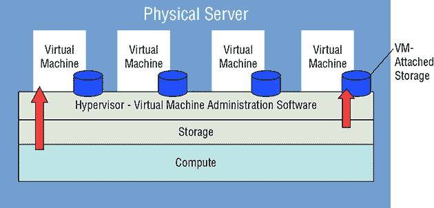

**FIGURE 1.1** VMs accessing storage and compute resources from their host server

例如，一个 5 TB 的存储驱动器可以被分割成数十个较小的虚拟卷，每个卷对应一个不同的虚拟服务器（或实例）。单个物理服务器的资源可以在多个实例之间透明地共享。这些实例上安装的操作系统可以毫无觉察地运行，因为它们实际上只掌控着更大服务器环境中的一小部分资源。

虚拟化模式带来两个极具吸引力的好处：

- **速度：** 定义、购买、配置、测试并启动新的物理服务器可能需要数月时间。即使是一次简单的重启也可能让你等待数分钟。请求新的云端 VM 并登录、开始工作的时间可能只有秒级，绝不会超过几分钟。重新启动 VM 的速度甚至可以快于你输入登录信息的时间。

- **效率：** 很少能在非虚拟化的物理服务器上实现接近 100%的利用率。更可能的情况是，服务器要么大部分时间闲置，要么被过度使用，直到你等待更多容量上线。多个虚拟机可以通过超融合（hypervisor）技术紧密打包在同一台物理服务器上。当一台服务器腾出空间时，你可以迅速将另一个虚拟工作负载填入。当服务器达到容量上限时，溢出工作负载可以迁移到其他机器。你管理的工作量越多，系统的灵活性就越高。

得益于 Amazon 强大的规模和物流能力，它常常能够利用虚拟化的优势，提供更高的性能和更优的价格。

## 云平台模型

云服务有多种形态。选择适合你项目的形态取决于具体需求以及你需要对底层“杠杆”和“开关”拥有多大程度的控制。

### 基础设施即服务（IaaS）

基础设施即服务（IaaS）产品通常模拟你管理物理资源时的使用体验。IaaS 产品直接提供提供商的计算、存储和网络资源。由于你在操作硬件层面，责任在你而非 IaaS 提供商——你需要为任何配置不当的后果承担责任。其代价是你能够细致配置操作栈的每一层。

稍后在本书中会有更多示例，但 AWS 的 IaaS 产品包括弹性云计算（EC2）用于虚拟机实例、弹性块存储（EBS）用于存储卷、以及弹性负载均衡。

### 平台即服务（PaaS）

与 IaaS 不同，平台即服务（PaaS）产品通过*隐藏*其运行基础设施的复杂性来简化应用的构建过程。你通过一个界面定义应用的行为和环境，这通常包括运行应用的代码。

AWS 的 PaaS 产品包括弹性 Beanstalk 和弹性容器服务（ECS）。

### 软件即服务（SaaS）

软件即服务（SaaS）产品提供面向最终用户的服务。最典型的例子是 Google 的 Gmail 服务，它让用户通过浏览器界面或本地运行的邮件客户端（如 Microsoft Outlook）管理邮件。

虽然有些人可能对这一分类持异议，但 AWS 的 SaaS 产品可以认为包括 Simple Email Service 和 Amazon WorkSpaces。

Figure 1.2 比较了在 IaaS、PaaS 和 SaaS 平台上的责任范围，以及在本地部署中的责任方式。

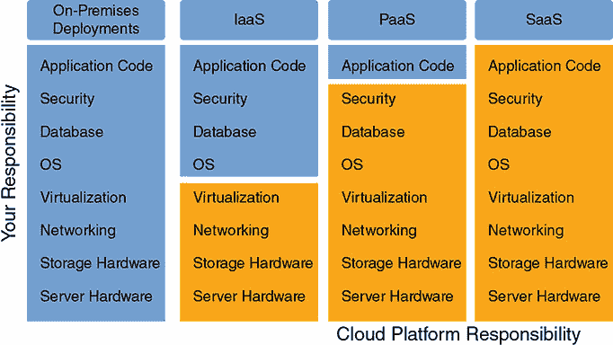

**图 1.2** 多种基础设施类型的责任分解

### 无服务器工作负载

除了能够出色地模拟传统服务器行为外，云提供商还可以实现完全新的应用和数据管理方式。也许最明显的例子是无服务器计算。

现在别被名字迷惑。你不能在没有“服务器”即某个计算环境的情况下运行计算函数。无服务器的作用是让开发人员能够在别人的云服务器上按需（秒或分钟级）运行他们的代码。

AWS Lambda 等无服务器模型使得你能够设计能够**响应**外部事件的代码。例如，当视频文件上传到存储库（如 AWS S3 桶或本地 FTP 站点）时，它可以触发 Lambda 函数将文件转换为新的视频格式。无需维护并全天候运行的实际实例，也无需支付全天候的费用，只需在代码实际运行时付费。

## 可扩展性和弹性

全球最大的公有云提供商可以通过将服务器虚拟化的奇妙与拥有巨大数据中心（堆满服务器资源的机架）的力量结合起来，实现很多事情。弹性和可扩展性是实现这些事情的两个关键原则，理解它们的具体含义有助于你优化设计，从而获得物超所值的云服务。

请注意，在云计算语境下，可扩展性和弹性并没有精确、权威的定义，任何定义都会包含一定程度的重叠。尽管如此，对这两个原则的工作原理形成清晰的概念仍然有价值。

### 可扩展性

可扩展的服务会自动按需增大容量，以无缝满足任何需求变化。设计良好的云服务会持续监控其应用堆栈的健康状况，并在性能指标可能无法满足时进行响应。响应可能包括自动启动新的服务器实例，为现有集群增加计算能力。同时，还会预先将应用数据和配置信息加载到这些实例上，以便它们能够为客户提供服务。

像 AWS 这类大型云提供商，实际上拥有几乎无限的可用容量，因此应用的最大规模的实际限制在于组织的预算（以及 AWS 后续章节提到的默认服务限制）。

AWS 有多大呢？如果它能够处理保持数百万 Netflix 客户端满意所需的容量压力——而你若看过在 AWS 上观看电影，就知道它能——那么它肯定能满足你应用带来的任何 trouble。

### 弹性

你可以把橡皮筋拉得远超其静止状态，但真正让它具有弹性的是，一旦放开，它会立刻回到原始尺寸。之所以许多 AWS 服务（如 Elastic Compute Cloud、Elastic Load Balancing、Elastic Beanstalk 等）在名称中使用 *elastic*，是因为这些服务设计为能够轻松、自动地进行伸缩。

通常，你会设定应用的最大和最小性能水平，AWS 服务会自动增减资源以适应使用需求的变化。例如，一个可扩展的电商网站可能在低需求期间配置为使用单个服务器，而在需求高峰时可自动启动多个服务器。需求下降后，未使用的服务器会自动关闭。

如果你还没有 AWS 账户，现在是创建它的好时机。本书其余内容几乎不可能在没有活跃账户的情况下完成。你需要提供信用卡，但只有在实际启动资源时才会被收费。请完成练习 1.1 来实现这一点。

激活账户后，你会收到一封确认邮件，通知账户已准备就绪。

## 总结

像 AWS 这样的大型云提供商的规模和质量，使其客户能够获得比本地环境更高的安全性、可用性和可靠性。

虽然 AWS 客户仍需对其在云中运行的应用负责，但他们不必担心 AWS 管理的底层物理基础设施。


云计算的吸引力之一是“按需付费”：只为使用的服务付费，按使用量计费。这使得可以以几乎零资本支出（`capex`）来部署复杂的应用。当然，你仍需评估并管理运营支出（`opex`）。

服务器虚拟化使得在物理硬件上更密集地打包软件操作成为可能，从而可能降低成本并加快计算工作负载的部署时间。更“虚拟化”的虚拟化是无服务器计算，客户对其代码及触发它的网络事件有所了解。

云优化的工作负载设计用于利用云平台的可扩展性和弹性。

### 考试要点

理解大规模、地理分布式基础设施如何提升服务质量。`AWS` 拥有庞大的物理计算和网络资源，且在全球多地区部署，能够保证在其他环境中难以复制的可靠性和可用性水平。

理解计费方式的灵活性。按使用付费（`metered`, `pay-per-use`）让你可以以极低成本（甚至几美分/小时）随时获取云资源，从而支持实验、沙箱和定期评估更新应用栈。

理解云服务的多样形态。`IaaS` 让你几乎完全控制虚拟化硬件资源，类似于管理物理服务器。`PaaS` 抽象底层基础设施，提供简化的应用代码接口。`SaaS` 直接向终端用户提供服务。

理解无服务器计算的经济性和效率。`AWS Lambda` 等无服务器服务可让你以最高 15 分钟为单个函数的计算能力进行运行，适合响应实时事件。

理解可扩展性如何让应用满足需求。云优化的应用可以自动按需 `provision` 专为特定计算功能而设计的服务器实例，并在合适的网络环境中运行。

理解弹性如何匹配计算能力与需求变化。云提供商的自动扩缩服务（如 `AWS Auto Scaling`）应配置为遵循你的预算和应用需求。你设定上下限，扩缩器在两者之间自动处理启动和关闭，以优化运行。

## 复习题

1. 以下哪项不显著贡献于像 `AWS` 这样大型云提供商的运营价值？

    1. 多区域分布  
    2. 高度经验丰富的安全工程师团队  
    3. 深度零售行业经验  

4. `按使用量计费` 定价

2. 以下哪项是高度可用应用的标志？（选择两项。）

    1. `单一地理区域的故障会触发自动故障转移到不同区域的资源。`
    2. `应用程序通过多层安全防护。`
    3. `虚拟化超级管理程序系统按公司政策部署。`
    4. `通过自动增加资源来满足用户需求峰值。`

3. `按使用量计费` 模式如何使云计算的许多好处成为可能？（选择两项。）

    1. `现在可以实现更高的应用安全性。`
    2. `现在可以通过多种配置选项进行实验，成本更具经济性。`
    3. `应用程序现在具有高度可扩展性。`
    4. `无需投资资本支出即可实现全栈应用。`

4. 以下哪项是服务器虚拟化的直接好处？（选择两项。）

    1. `快速资源配置和启动`
    2. `高效（高密度）的资源使用`
    3. `更高的应用安全性`
    4. `弹性应用设计`

5. 什么是 `hypervisor`？

    1. `用于提供存储和计算模块之间接口的硬件设备`
    2. `用于提供网络和计算模块之间接口的硬件设备`
    3. `用于记录和监控虚拟化操作的软件`
    4. `用于管理运行在物理基础设施上的虚拟资源的软件`

6. 哪项最能描述 `服务器虚拟化`？

    1. `“分片”多个来源的数据到单个虚拟数据存储`
    2. `逻辑上将物理计算和存储设备划分为多个较小的虚拟设备`
    3. `将跨多个物理设备的物理资源汇总为单个虚拟设备`
    4. `通过简单的 Web 界面隐藏物理基础设施的复杂性`

7. 哪项最能描述 `基础设施即服务 (IaaS)` 产品？

    1. `通过简单的界面隐藏基础设施复杂性的服务`
    2. `通过公共网络向最终用户提供服务的服务`
    3. `直接控制底层计算和存储资源的服务`
    4. `允许开发人员在云服务器上短暂运行代码的平台`

8. 哪项最能描述 `平台即服务 (PaaS)` 产品？

    1. `通过简单的界面隐藏基础设施复杂性的服务`
    2. `允许开发人员在云服务器上短暂运行代码的平台`
    3. `直接控制底层计算和存储资源的服务`
    4. `通过公共网络向最终用户提供服务的服务`

9. 哪项最能描述 `软件即服务 (SaaS)` 产品？

    1. `直接控制底层计算和存储资源的服务`
    2. `通过公共网络向最终用户提供服务的用户，用户转换服务`

# Chapter 2

## Understanding Your AWS Account

**THE AWS CERTIFIED CLOUD PRACTITIONER EXAM OBJECTIVES COVERED IN THIS CHAPTER MAY INCLUDE, BUT ARE NOT LIMITED TO, THE FOLLOWING:**

*   **Domain 4: Billing and Pricing**

*   **4.1 Compare and contrast the various pricing models for AWS**

*   **4.2 Recognize the various account structures in relation to AWS billing and pricing**

*   **4.3 Identify resources available for billing support**

## Introduction

`Amazon Web Services` is a really big place. Each account has access to more than 100 distinct services, which can each be deployed in hundreds or even thousands of permutations. Anyone with the right account credentials can—legitimately or otherwise—launch new service instances without anyone else knowing. For the most part, resources running within one `AWS Region` will be invisible to you when you’ve got any one of the nearly 20 other regions selected in your console.

With all that going on all the time, there are going to be two account-level things you want to be clear about:

*   What’s it all going to cost you? Because cloud services are scalable, there’s virtually no limit to how much of them you can purchase, or to how much they can cost you. If something isn’t going according to plan, you’ll want to know what it is and how to pull its plug as soon as possible.

*   Who’s running the show? In other words, who has the authority to make the big decisions about firing up and shutting down account resources? In addition to the fact that those decisions will have significant financial implications, they’ll also define your organization’s public presence.

Maintaining control over access to administration resources will be the primary focus of Chapter 5, “Securing Your AWS Resources.” But monitoring and keeping a lid on costs is what you’re going to learn about here. What you’ll see will include the following:

*   Taking advantage of the `AWS Free Tier`
*   Understanding how `AWS` services are priced and how to model pricing for complicated combinations (or stacks) of resources
*   Understanding the usage limits `AWS` places on some services and how to raise those limits
*   Keeping on top of your actual account costs

## The Free Tier

`AWS` figures that the more comfortable you feel working with its services, the more likely you’ll eventually start moving serious workloads to its cloud. So, `AWS` offers a generous `Free Tier` for the first 12 months after opening a new account. Under the `Free Tier`, you can freely experiment with light versions of most `AWS` services without being billed.

### How Does the Free Tier Work?

It’s remarkable how

同样，您可以在 Amazon 的 Relational Database Service (`RDS`) 下，以任何组合运行轻量级关系型数据库工作负载，每月最多可使用 750 小时，并且可以在 Simple Storage Service (`S3`) 桶中存储最高 5 GB 的数据。

如果您在任何时刻超过限额，您将按照正常的 `AWS` 计费费率为超出部分进行计费。为了让您了解实际费用，`Free Tier`–eligible `t2.micro` 实例（使用 Linux）在 `EC2` 上运行于美国东部区域，如果在一个月内使用 850 小时，仅需 $1.16 USD（$0.0116/小时）即可。这是因为您只需为超过 `Free Tier` 最大值的使用小时数进行计费。

### 监控您的 Free Tier 使用量

当然，不小心让 `AWS` 资源一直运行——无论是否在使用 `Free Tier`——都可能花费您远超过 $1.16 的费用。启动一个同步复制的 `RDS` 数据库实例来测试您新网站的后端，然后忘记它，可能会让您每月花费数千美元。您一定要时刻关注账户。

在本章后面，我们将在讨论成本管理时，向您展示更多关于如何解决此问题的方法。但目前，我们将向您展示两种专门针对 `Free Tier` 限额的使用监控方式。

第一种方法仅需等待电子邮件消息的到达即可。默认情况下，`Free Tier` 相关的电子邮件警报会在账户活动接近或已超过 `Free Tier` 限额时自动发送。除了在 `Billing Dashboard`（位于 `AWS` 管理控制台）的 `Preferences` 页面上关闭这些提醒外，您能做的唯一事情是选择一个不同的电子邮件地址。您可以通过控制台右上角的账户下拉菜单（如图 2.1 所示）访问 `Billing Dashboard`。

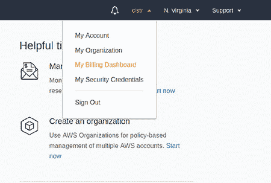

**FIGURE 2.1** 账户下拉菜单包含指向您 `Billing Dashboard` 的链接

第二种监控工具会在 `Billing Dashboard` 的底部出现，适用于任何仍处于 `Free Tier` 资格的账户。图 2.2 展示了该工具的外观。该账户中使用最频繁的服务目前并不活跃，但您可以看到 `Amazon S3` *存储*（当前仅占 0.06%）是被跟踪的多个使用指标之一；此外，`S3` 桶的 Put 和 Get 请求的数量也有各自的限额。

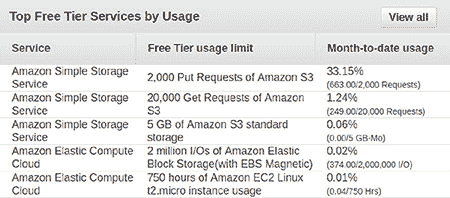

**FIGURE 2.2** 显示账户中使用最频繁 `AWS` 服务的 `Free Tier` 使用量跟踪表

点击 **View All** 按钮将带您到当前所有 `Free Tier` 使用情况的页面。即使您目前对账户的使用不多，也可能会惊讶于背后已经发生了多少活动。不过请放心，这只是几条监控通知在来回传递。


 在您主动启动服务之前，不会发生会产生可计费事件的情况。

### 免费服务有哪些？

实际上有两类免费服务：

*   新 AWS 账户的首 12 个月内，大多数 AWS 服务的轻量实现形式

*   对于某些 AWS 服务，即使超过首 12 个月，仍然始终可用的轻量使用

您可以在 [`aws.amazon.com/free`](https://aws.amazon.com/free) 获取这两类服务的详细清单。为了让您对可用内容有初步了解，以下是一些亮点。

#### 12 个月免费服务

我们已经讨论了在 Free Tier 下运行低功耗 EC2 和 RDS 实例以及使用 5 GB S3 存储的情况。其他免费服务特性还包括：

*   30 GB 磁盘或固态盘（SSD）卷的 Amazon Elastic Block Storage (EBS)。EBS 卷通常作为 EC2 实例的主数据盘。以 8 GB 为例，这足以运行驱动繁忙的 Web 服务器的 Linux 系统。

*   每月 500 MB 的 Amazon Elastic Container Registry (ECR) 免费存储。ECR 用于存储和管理 Docker 容器镜像。500 MB 足以满足几乎所有使用场景的需求。

*   50 GB 的出站数据传输和 200 万次 HTTP 或 HTTPS 请求的 Amazon CloudFront 分发。这些是年度而非月度额度。CloudFront 是 Amazon 的内容分发网络，可用于以低延迟向远程用户提供缓存内容。

*   每月 100 万次 API 调用的 Amazon API Gateway。API Gateway 是管理组织 API 的工具，API 让用户和应用能够与移动或 Web 资源进行连接。

#### 永久免费服务

即使消耗量如此低以至于不需要计费，某些 AWS 服务仍可持续使用。AWS 会在任何时间段内提供这些低消耗水平的服务。常见的使用场景包括：

*   在 Amazon CloudWatch 中最多可有 10 个自定义监控指标和 10 个告警同时处于活动状态。您可以直接使用 CloudWatch，或将其与其他工具结合，以监控资源性能和成本。

*   每月 10 GB 从 Amazon Glacier 中检索的数据。Glacier 是一种低成本的长期存储服务，适合不常需要快速访问数据的场景。

*   使用 Amazon Simple Email Service (SES) 每月最多发送 62,000 封邮件。SES 是面向大规模发送邮件的企业级邮件服务。

*   AWS Lambda 每月 100 万次请求和 320 万秒的计算时间。Lambda 让您在响应网络触发时运行代码，无需自行管理底层服务器基础设施。

关于 Free Tier 的另一条注意：AWS Free Tier 优惠不适用于在 GovCloud (US) 区域或通过 AWS Organizations 成员账户创建的资源。（本章后面将介绍 AWS Organizations。）

## 产品定价

在规划、启动和管理 AWS 部署时，保持组织预算内将是您需要投入大量精力的任务。您需要了解每项服务的计费方式，并知道如何快速获取准确的定价信息。

### 查找 AWS 定价文档

我们很快将深入说明如何获取准确的定价信息，但现在我们可以帮助您立即获得这些信息。每项 AWS 服务都有专门的定价页面。例如，S3 服务的概览网址是 [`aws.amazon.com/s3`](https://aws.amazon.com/s3)，要进入定价页面，只需在网址后加上斜杠和 "pricing"，即 [`aws.amazon.com/s3/pricing`](https://aws.amazon.com/s3/pricing)。

在页面上，您会看到易于阅读的表格，列出了按小时、按月或其他适当计量单位计费的价格级别。定价会因 AWS 区域而异，通常会有下拉菜单让您仅查看所需的细节。

作为一个示例，S3 页面列出了通过存储、请求、数据传输和跨区域复制等指标测量的使用费用。你将在第 8 章“核心存储服务”中了解这些指标的工作原理，但这里我们专注于计费问题。从下拉菜单中选择不同的 AWS 区域有时会在全球 AWS 基础设施中显示出显著的差异。请注意各种存储层级的费用，以及（如适用）这些费率在不同使用量级别（如 0–50 TB/月 或 50–500 TB/月）下的变化情况。当你“批量购买”时，你通常会发现为每单位 AWS 生产的你消耗的内容支付得更少。

同样，EC2 定价页面（https://aws.amazon.com/ec2/pricing）允许你在按需、竞价、预留实例和专用主机定价之间进行选择（第 7 章“The Core Compute Services”将详细介绍这些选项）。你还需要选择将在实例上使用的操作系统。Microsoft Windows、Red Hat Enterprise Linux 和 SUSE Linux Enterprise Server 的许可费用已包含在 EC2 小时费率中。在做出这些选择后，你将看到每种实例类型的每小时成本。

AWS 会定期更新其定价页面，这很重要，因为价格经常变化。为什么不通过 Exercise 2.1 来了解如何估算 EC2 实例的成本呢？

### 使用在线计算器

还有另一种可视化复杂多层次部署真实成本的方法。如果你只需输入运行工作负载在 AWS 上所需的所有配置参数，并从另一端得到一份易于阅读的分项成本表，那么建模替代堆栈配置将变得轻松。

AWS 提供两个定期更新的建模工具：Simple Monthly Calculator，帮助你了解运行任何组合的 AWS 资源的成本；以及 Total Cost of Ownership Calculator，用于近距离比较你当前为本地服务器支付的费用与相同工作负载在 AWS 上的成本。

#### AWS Simple Monthly Calculator

你可以在以下网址找到 Simple Monthly Calculator：[`calculator.s3.amazonaws.com/index.html`](http://calculator.s3.amazonaws.com/index.html)。页面左侧有每个支持计算的 AWS 服务的选项卡。所有基础功能都已覆盖。当你选择一个选项卡时，会看到可以输入代表你计划使用该服务使用量的数据的表单。

例如，默认的 EC2 选项提供了输入 EC2 实例的字段。你首先选择绿色 + 按钮来添加新行，然后输入你打算运行的实例数量、实例运行的预计比例、实例类型（在字段中选择将显示可用类型列表），以及计费模式。该实例的月费用将显示在右侧，而顶部 Estimate 选项卡中的运行总月金额将实时更新。

不要忘记，如前所述在 AWS 定价文档页面上，你可以从页面顶部的下拉菜单中选择 AWS 区域。你也可以选择或取消选择免费使用量级选项，以便使结果符合你账户的当前状态——计算器与你的账户不连接，也不会从你的账户获取任何数据。

页面右侧列出了一系列用于常见部署场景的模板。例如，Disaster Recovery And Backup 示例估算了在四个地理独立的区域运行 Linux 数据库服务器的 EC2 费用，并维护 500 GB 的 Amazon S3 存储。该堆栈似乎旨在定期备份数据库和对象存储资源，以便在紧急情况下能够快速且可靠地恢复到生产部署。

当你为所有必要的服务页面输入数据以代表你的计划后，可以选择顶部的 Estimate 选项卡，你将看到资源堆栈的估计月费用的完整分项明细。选择 Export To CSV 按钮将允许你下载一个包含你配置数据的逗号分隔值（CSV）电子表格。你可以用它向同事和客户展示，或将其与其他迭代进行比较。Save And Share 按钮将提供一个指向你结果永久副本的网址。你可以用它与相同的同事和客户共享。

通过完成 Exercise 2.2，生成你自己的资源堆栈估计。

Figure 2.3 展示了计算器的电子表格输出。

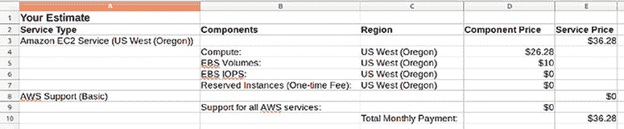

**FIGURE 2.3** 计算器配置文件的 CSV 格式输出

#### AWS Total Cost of Ownership Calculator

你可以通过访问 [`aws.amazon.com/tco-calculator`](https://aws.amazon.com/tco-calculator) 并点击主页上的 Launch The TCO Calculator 按钮来开始。其思想是让你输入当前本地或 colocated 部署的配置规格，计算器将生成一个详细的、分项的估计，说明该工作负载在当前位置的成本以及在 AWS 上的成本。

我们最近作为示例运行了一个简单的配置，它比较了 10 台物理应用服务器、2 台物理数据库服务器以及 20 TB 存储的部署与其 AWS 等效。计算器的 25 页 PDF 报告显示，AWS 的三年总拥有成本为 $310,778，而相应的本地成本为 $554,715。Table 2.1 显示了顶层分解。

**TABLE 2.1** AWS TCO Calculator 输出示例配置

|   || 本地 || AWS |

| --- | --- | --- |

| 服务器 || $373,4570 || $229,8480 |

| --- | --- | --- |

| 存储 || $78,070 || $18,633 |

| 网络 || $96,303 || $37,525 |

| IT- Labor || 0$6,885 || $24,772 |

| 总计 || $554,715 || $310,7780 |

顺便说一下，我们对 Amazon 提供的本地 IT- Labor 成本持怀疑态度。如果你曾经处理过大约该规模的数据中心，你会知道劳务成本高出数量级。

这些数字代表了计算器中对资本基础设施费用的估算，包括服务器、网络硬件、电力、制冷、维护的摊销成本，以及 AWS 业务支持计划的费用。

报告包含计算器的方法论和假设描述，以及常见问题解答。Exercise 2.3 将带你进行自己的计算器使用。

## Service Limits

AWS 云的总体范围非常广阔。很难想象客户可用的计算和存储容量有多大。其设计的可扩展性意味着，客户访问的基础设施规模上限不应有实际限制。

尽管如此，AWS 会出于各种原因对可用资源的范围进行限制。因此，如果你没有提前规划，你的服务请求可能会超过你的账户限制，导致失败。

-   [例如，您仅允许在单个 AWS 区域内运行最多 20 个按需实例和 20 个预留实例的 EC2 m5.large 实例类型。其他实例类型的限制类似。这反映了 Amazon 想要确保所有资源类别都能可靠地满足新需求，而不是被少数大客户占用。同时，这也可以保护客户免受自动化进程（无论是意外还是恶意）启动资源并产生不可持续成本的风险。

大多数服务限制都是 *soft*（可调整），这意味着您可以手动请求 AWS 提高您账户的限制。但是，有些限制是 *hard*，无法通过威胁（例如“憋气”）来提高，无论您坚持多久。

您可以在以下 AWS 文档页面上找到完整且更新的服务限制列表：

[`docs.aws.amazon.com/general/latest/gr/aws_service_limits.html`](https://docs.aws.amazon.com/general/latest/gr/aws_service_limits.html)

### 账单和成本管理

综合考虑，贵组织的财务和运营健康很大程度上取决于 AWS 账户的运作情况。除了监控像 EC2 实例这样的基础设施资源的性能外，您还应密切关注账户本身。Billing Dashboard 中的各种工具可帮助您监控账户。如前所述，Dashboard 可通过 AWS Management Console 顶部的账户下拉菜单访问。

### AWS 账单仪表盘

主账单和成本管理仪表盘包含有用的可视化“花费摘要”，显示您过去和当前月份的费用，以及预计本月底的费用。此外，还有“当月至今按服务花费”显示，点击“账单详情”按钮可查看当前支出的详细分解。

仪表盘还包含链接，用于设置支付方式和输入组织的税务信息。Payment History 链接提供了之前交易的记录。

以上内容属于常规账户管理任务。接下来，您将学习如何通过预算和监控来保护和优化账户支出。

### AWS 预算

AWS 预算是一种用于跟踪指定事件的工具，当达到或超过预设阈值时，会触发警报（例如电子邮件）。您可以创建以下三种预算类型：

*   **成本预算**：监控账户中发生的费用

*   **使用预算**：跟踪特定资源消耗类别

*   **预留预算**：帮助您了解任何活动的 EC2、RDS、Redshift 或 Elasticache 保留实例的状态

预算设置过程包含两个部分：

1.  设定预算的条款——即，您正在跟踪什么。

2.  定义何时以及如何发送警报。

Exercise 2.4 将指导您完成在账户中创建预算的过程。

### 监控您的费用

深入的部署规划和正确配置的预算是重要工具，但不足以保证一切。正如安全专业人员会在应用程序基础设施周围构建多层防火墙、权限和物理控制，账户管理员也会从多个角度监控事件。持续监控是关键组成部分，这意味着您需要熟悉 Amazon 的 Cost Explorer 及其费用和使用报告。

#### Cost Explorer

Cost Explorer ([`aws.amazon.com/aws-cost-management/aws-cost-explorer`](https://aws.amazon.com/aws-cost-management/aws-cost-explorer)) 让您构建图表以可视化账户的历史和当前费用。如果您时间紧张，可以选择服务提供的预配置视图（包括最近三个月按服务的花费）。

或者，您可以启动 Cost Explorer 工具，打开一个高度可定制的视图，该视图允许您按日期、区域、可用区、实例类型、平台（Linux、Windows 等）以及其他条件过滤账户费用事件。您还可以下载基于自定义视图的 CSV 格式文件。

您可以保存报告视图，以便在需要时快速访问特定组合的信息。

#### 费用和使用报告

费用和使用报告（截至目前）可从 Billing Dashboard 的 Reports 链接中访问。您可以配置报告，包含账户的完整活动，包括运行的资源及其成本。您可以控制详细程度，并启用对 Redshift 和/或 Amazon QuickSight（一种按用户付费的托管式商业智能工具）的支持，以处理大量数据的可视化和分析。

报告在预设间隔生成后，会被压缩、以 CSV 格式保存，并发送到您已创建的 S3 桶中。之后，您需要配置 Redshift 或 QuickSight 来访问和处理数据。

#### 成本分配标签

标签是代表资源及其操作的元数据标识符。它们用于组织和跟踪资源，帮助您可视化并更好地理解资源的使用情况。但请注意，AWS 提供两种与标签本身无关的标签类型。

**资源标签** 资源标签常用于繁忙账户中，帮助管理员快速识别特定运行资源的目的和所有者。在数百个实例、安全组、存储桶和服务定义中，能够立即了解每个资源的用途，将极大简化资源管理。

**成本分配标签** 成本标签仅用于与账单工具交互，不会出现在其他 AWS 资源或进程的上下文中。与资源标签类似，成本分配标签帮助您高效识别资源，但仅用于跟踪账户支出。

您将在第 6 章“使用您的 AWS 资源”中了解更多关于资源标签的内容。在此之前，请了解成本分配标签在成本规划中的作用，并知道有两种成本分配标签：AWS 生成的成本分配标签（资源创建时自动生成）和用户定义的成本分配标签。

### AWS Organizations

AWS Organizations（前称 Consolidated Billing）允许您集中管理多个 AWS 账户的行政权限，这些账户由单一公司拥有或控制。这对于拥有多个账户的公司，或与供应商和客户共享 AWS 资源的公司来说非常有意义。通过单一窗格，您可以控制资源权限、安全性和支出的分配。这也是管理付款的便捷方式。

请记住，一旦账户关联，保持安全配置和遵循最佳实践的重要性将比独立账户更为关键。因为任何一个关联账户的安全漏洞都有可能扩散到所有账户中运行的资源。

## Summary

Free Tier 为新账户提供了大多数 AWS 服务轻量配置的全年免费访问。它旨在让您尝试并学习如何满足组织的需求。您可以在 Billing Dashboard 中跟踪距离“超出” Free Tier  allowance 的程度。

-   [您可以通过在 AWS 服务 URL 末尾添加 `/pricing` 来在线查找定价信息。例如，`aws.amazon.com/s3/` (https://aws.amazon.com/s3/) 将变为 `aws.amazon.com/s3/pricing` (https://aws.amazon.com/s3/pricing)。了解计费费率以及用于衡量这些费率的具体指标很重要。

-   AWS Simple Monthly Calculator 和 AWS Total Cost of Ownership Calculator 让您能够预估实际使用的 AWS 部署费用，并在 TCO 计算器的情况下，将您的支出与其本地等效进行比较。

-   如果您的请求会导致您的使用量超过服务限制，则请求可能会被拒绝（并且启动会失败）。

-   AWS Billing Dashboard 是访问账户管理、支付和税务状态管理、成本监控以及成本控制的中心。

## Exam Essentials


# Understand the value of the 12-month Free Tier
The Free Tier lets you run light services such as the `t2.micro` EC2 instance type and a 30 GB SSH EBS volume. The goal is to get you comfortable with the AWS environment so you can learn how it can be used to host your applications.

# Understand the value of permanent Free Tier services
Low-volume consumption includes the retrieval of up to 10 GB of stored objects from Glacier or 62,000 outbound emails through Amazon SES. The goal is to give you the opportunity to launch proof-of-concept deployments.

# Know how to access Amazon’s resource pricing online documentation
To accurately calculate the true costs of an AWS deployment, you must understand the pricing for the particular level of resource you launch within a particular AWS Region. Each service resource (like an EC2 instance) is billed by metrics unique to its characteristics.

# Use the AWS Simple Monthly Calculator to accurately model multitiered application stack pricing
Pricing for all variations of the core AWS services is prebuilt into the calculator, allowing you to model pricing for multiple resource configurations.

# Use the AWS Total Cost of Ownership Calculator to compare on-premises with AWS deployment costs
You can conveniently compare apples to apples—capital expenses for on-premises versus operating expenses for cloud—to know whether the AWS cloud is really right for your workload.

# Understand how your use of AWS services is limited by default
Access to all service resources is restricted by default limits. In many cases, you can manually request limit increases from AWS support.

# Understand the value of cost management tools for avoiding costly cloud overspends
AWS budgets can be configured to send alerts when your resource consumption approaches or passes a preset limit. Cost Explorer provides visualizations to more easily monitor historical and current costs. Cost and usage reports can send in-depth and ongoing CSV-formatted data to Redshift or QuickSight for analysis. You can use cost allocation tags to more effectively track and manage the source of account costs. The security and operations of multiple AWS accounts controlled by a single company can be managed through AWS Organizations.

## Review Questions

1. Which of the following EC2 services can be used without charge under the Free Tier?
    1. Any single EC2 instance type as long as it runs for less than one hour per day
    2. Any single EC2 instance type as long as it runs for less than 75 hours per month
    3. A single `t2.micro` EC2 instance type instance for 750 hours per month
    4. `t2.micro` EC2 instance type instances for a total of 750 hours per month

2. You want to experiment with deploying a web server on an EC2 instance. Which two of the following resources can you include to make that work while remaining within the Free Tier? (Select TWO.)
    1. A 5 GB bucket on S3
    2. A `t2.micro` instance type EC2 instance
    3. A 30 GB solid-state Elastic Block Store (EBS) drive
    4. Two 20 GB solid-state Elastic Block Store (EBS) drives

3. Which of the following usage will always be cost-free even after your account’s Free Tier has expired? (Select TWO.)
    1. One million API calls/month on Amazon API Gateway
    2. 10 GB of data retrievals from Amazon Glacier per month
    3. 500 MB/month of free storage on the Amazon Elastic Container Registry (ECR)
    4. 10 custom monitoring metrics and 10 alarms on Amazon CloudWatch

4. Which of the following tools are available to ensure you won’t accidentally run past your Free Tier limit and incur unwanted costs? (Select TWO.)
    1. Automated email alerts when activity approaches the Free Tier limits
    2. The Top Free Tier Services by Usage section on the Billing & Cost Management Dashboard
    3. Billing & Cost Management section on the Top Free Tier Services Dashboard
    4. The Billing Preferences Dashboard

5. Which of the following is likely to be an accurate source of AWS pricing information?
    1. Wikipedia pages relating to a particular service
    2. The AWS Command Line Interface (AWS CLI)
    3. AWS online documentation relating to a particular service
    4. The AWS Total Cost of Ownership Calculator

6. Which of the following will probably not affect the pricing for an AWS service?
    1. Requests for raising the available service limit
    2. AWS Region
    3. The volume of data saved to an S3 bucket
    4. The volume of data egress from an Amazon Glacier vault

7. Which of the following is a limitation of the AWS Simple Monthly Calculator?
    1. You can calculate resource use for only one service at a time.


### 3. Service limits are defaults. They can be increased or decreased on demand.

### 4. No. Some service limits are hard.

### 14. 哪里是获取本月账户费用的快速摘要的最佳位置？

1. 预算
2. Cost Explorer
3. 费用和使用报告
4. 账单和成本管理仪表板

### 15. 创建 AWS Budgets 中的用量预算类型的主要目标是什么？

1. 将每单位费用的使用与账户成本进行关联，以了解账户的成本效率
2. 跟踪账户中任何活动的保留实例的状态
3. 跟踪特定资源消耗类别
4. 监控账户中发生的费用

### 16. 下列哪项不是可以在成本预算中配置的设置？

1. 期间（月度、季度等）
2. 实例类型
3. 开始和停止日期
4. 所有者（资源所有者的用户名）

### 17. Cost Explorer 与成本和使用报告的主要目标之间的主要区别是什么？

1. Cost Explorer 显示高级别历史和当前账户费用的可视化，而成本和使用报告以 CSV 格式生成细粒度使用报告。
2. 成本和使用报告显示高级别历史和当前账户费用的可视化，而 Cost Explorer 生成细粒度使用报告以 CSV 格式呈现。
3. Cost Explorer 让您设置由 billing 事件触发的警报，而成本和使用报告帮助您可视化系统事件。
4. 成本和使用报告旨在提醒您恶意入侵，而 Cost Explorer 显示高级别历史和当前账户费用的可视化。

### 18. 成本分配标签的用途是什么？

1. 将费用限额与自动触发资源关闭的需求关联，以便在必要时进行关闭
2. 帮助您识别特定运行资源的目的和所有者，以更好地理解和控制部署
3. 帮助您识别资源，以便跟踪账户支出
4. 将账户事件与计费期间在视觉上关联

### 19. 下列哪个场景是 AWS Organizations 的良好使用案例？（选择 TWO.）

1. 一家拥有多个 AWS 账户的单一公司，希望拥有一个统一的管理位置
2. 一家为其开发人员和管理员提供 AWS 访问的组织
3. 一家已与上游供应商整合一些运营的公司
4. 一家拥有两个不同的运营单元、各自拥有其 own 会计系统和 AWS 账户的公司

### 20. 哪个工具允许您在浏览器界面中设计图表以跟踪账户支出？

1. 预算
2. Cost Explorer
3. 报告
4. 合并计费

## 第 3 章

### 获取 AWS 支持

**本章涵盖的 AWS 认证云实践考试目标包括，但不限于，以下内容：**

*   **域 2：安全**
*   ** 2.4 识别安全支持资源**
*   **域 3：技术**
*   ** 3.4 识别技术支持资源**
*   **域 4：计费和定价**
*   ** 4.3 识别计费支持资源**

 

-   [费曼学习法](https://wiki.example.org/feynmans_learning_method)的灵感源于诺贝尔物理奖获得者**理查德·费曼**。

1.  运用费曼技巧，你只需花上`20 min`就能深入理解知识点，而且记忆深刻，*难以遗忘*。

```
if (condVar > someVal) {console.log("xxx")}
```

-   AWS 文档团队做得相当不错，能够保持内容的有序和更新及时。一个重要技巧——尤其是当你通过互联网搜索引擎结果进入某页时——是查找网页 URL 中的 `latest` 字样。这表明你正在查看的页面准确反映了软件的最新版本。以下是一个包含 `latest` 标识的页面示例：

    [ `docs.aws.amazon.com/AmazonS3/latest/user-guide/what-is-s3.html` ](https://docs.aws.amazon.com/AmazonS3/latest/user-guide/what-is-s3.html)

    AWS 文档还有其他形式，如你在接下来的章节中会发现。

### 知识中心


AWS 知识中心（[`aws.amazon.com/premiumsupport/knowledge-center`](https://aws.amazon.com/premiumsupport/knowledge-center)）实际上是一个常见问题解答（FAQ）页面，它不小心吞下了一包体积大到药瓶大小的类固醇，然后穿着湿漉漉的睡衣走进了核电站的放射性核心。或者，用更通俗的话说，这里收集了大量信息。

知识中心页面包含按服务分类的近 1,000 个问题，每个问题都是 AWS 实际客户经常遇到的常见问题。你会看到诸如“如何在 Ubuntu 或红帽企业 Linux 上安装 AWS CloudFormation 辅助脚本？”以及“当我的预留实例到期后会发生什么？”等问题。

## 安全资源

AWS 明确表示希望你的部署尽可能安全。它通过维护一条专门的文档页面，提供有用且实用的安全相关资源链接来简化实现。该页面位于 [`aws.amazon.com/security/security-resources`](https://aws.amazon.com/security/security-resources)，指向 AWS 博客、白皮书、文章和教程，涵盖安全最佳实践以及在传输中和静止时加密数据等主题。

AWS 会不断添加新内容，博客的链接始终指向最新、最新鲜的内容。

## 讨论论坛

当事情不按预期工作时，通常可以安全地假设你并不是第一个遇到这个特定的“砖墙”。即使只有少数人（比如几十人）遇到过，也有很大概险在某个在线论坛上有人提出过类似问题。虽然很多问题可能是在 Stack Overflow 或其他公共站点上提出的，AWS 讨论论坛同样处理了不少问题。

论坛所在的站点（[`forums.aws.amazon.com`](https://forums.aws.amazon.com)）分为多个类别，包括 Amazon Web Services（进一步细分为各个服务）、AWS Startups（面向新入门者）、AWS 网站与资源（如 Java 开发、高性能计算等）以及服务于非英语使用者的日语、德语等区域。你可以在整个站点或单个论坛中搜索，看看你的问题是否已经得到解答。

要在论坛发帖，你需要登录 AWS 账号，并拥有论坛昵称和邮箱。

## Trusted Advisor

你使用 Trusted Advisor 来直观确认账户资源配置是否符合最佳实践。Trusted Advisor 将合规性警报分为五个类别，如 表 3.3 所述。

**TABLE 3.3** Trusted Advisor 警报的五大类别

| 类别 | 目的 | 示例 |
| --- | --- | --- |
| 成本优化 | 识别运行中但浪费或闲置的资源，导致不必要的支出 | 闲置的 EC2 实例或 Redshift 集群 |
| 性能 | 识别可能阻碍性能提升的配置设置 | 过度依赖慢速磁盘或低吞吐量 EBS 卷 |
| 安全 | 识别未遵循安全最佳实践的配置缺失 | S3 桶公开可访问或安全组开放访问 |
| 容错性 | 识别因配置不当而不必要暴露于服务中断的资源 | 未做备份的数据卷或未复制的实例 |
| 服务限制 | 识别使用量接近 AWS 区域或服务限制的情况 | 贴近 S3 桶 100 个限制的使用量 |

一个 advisor *check* 的状态由其左侧的图标体现。Figure 3.1 展示了健康的服务限制状态示例。如果，例如，你未为根账户启用多因素认证，则会出现红色警报图标，提示你应认真处理此问题。每个项目都可以展开以提供上下文信息。

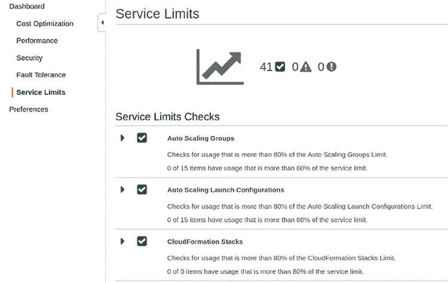

**FIGURE 3.1** 绿色“健康”图标，表示这些服务未接近服务限制

如前所述，Trusted Advisor 的完整警报范围仅对 Business 或 Enterprise Support 服务层的用户可见。其余用户（包括免费 Basic Support 计划）仅能查看服务限制和部分安全警报。所有用户均可浏览已下线的完整警报历史，以了解自己错失的内容。

这是一个自动化服务，正如你在 Exercise 3.2 中所见，你会遇到一些误报。例如，Trusted Advisor 会标记任何公开可访问的 S3 桶，这通常暗示严重问题，但有时（如使用该桶托管静态网站）正是期望的行为。因此，请不要盲目遵循所有建议，它是 *顾问*，而非你的母亲。

## 总结

AWS 提供四种支持计划供选择。Basic 计划免费，Developer 计划起始价为 $29，Business 计划起始价为 $100，Enterprise 计划起始价为 $15,000。非免费计划（超出最低收费）按总月度资源使用量的百分比收费。支持级别越高，提供的技术故障排除和规划支持越及时且个性化。

- **Developer Support** 计划面向正在测试和规划部署的组织。
- **Business Support** 计划适用于运行相对轻量生产基础设施的较小规模业务。
- **Enterprise Support** 计划适合全球部署、不能容忍停机的大型生产环境。

AWS 提供详尽且定期更新的文档，采用多种样式在多个网络平台上呈现，包括用户指南页面、知识中心、安全资源以及讨论论坛。

AWS Trusted Advisor 通过警报提醒用户其运行账户资源的最佳实践合规性。Basic 和 Developer Support 用户仅获取服务限制和部分安全信息，而 Business 与 Enterprise 客户则可访问全部警报。

## 考试要点

### 了解如何选择符合您运营需求的支持计划。

您的 AWS 部署越复杂、越昂贵，配置错误带来的成本就越高。您可以像对雇佣经验丰富且可靠的管理员一样，考虑更高级的 AWS 支持计划。为了设计并部署一款精简且安全加固的应用，所付出的努力是合理的业务支出。

### 了解企业支持计划技术账户经理 (TAM) 的好处。

技术账户经理 (TAM) 对您的账户部署持续提供个性化关注，这能在支持质量上产生显著差异。没有比拥有一位专家参与复杂基础设施的规划与实施更好、更直接的支持了。

### 了解如何通过官方 AWS 文档查找 AWS 资源使用指南。

AWS 用户指南以多种格式提供（包括 HTML、PDF、Kindle，以及在 GitHub 上的 Markdown），并系统地说明在所有层次上使用 AWS 服务的实际方法。知识中心是一个包含数百条常见问题及其解答的大型 FAQ 集合。

### 了解如何使用 Trusted Advisor 进行常见系统配置错误的警报。

Trusted Advisor 警报分为五个类别：成本优化、性能、安全、容错性和服务限制。您应建立一套管理流程，其中包括定期访问 Trusted Advisor，以查看是否有重要状态检查发生变化。

## 复习问题

1. 您的公司正在规划一次重大的 AWS 部署。设计和测试阶段仍在进行中，以下哪个计划能提供最佳的支持与成本平衡？

   1. Basic  
   2. Developer  
   3. Business  
   4. Enterprise  

2. 您的 Web 开发团队正在为部署电商网站做准备。在过程的早期阶段，单个开发人员会遇到与具体情境高度相关的冲突和配置问题。以下哪个计划能提供最佳的支持与成本平衡？

   1. Basic  
   2. Developer  
   3. Business  
   4. Enterprise  

3. 您的公司网站上周离线超过两小时，导致严重后果，包括 CTO 提前退休。工程师们在追踪故障根源时遇到困难，承认需要外部帮助。以下选项最可能满足该需求？

   1. Basic  
   2. Developer  
   3. Business  
   4. Enterprise  

4. 对于以下哪项，AWS 会为所有用户（即使是 Basic Support 计划的用户）提供 24/7 直接支持？

   1. 帮助应对大规模拒绝服务 (DoS) 攻击的基础设施  
   2. 帮助解决已失败或不可用的基础设施  
   3. 帮助进行向 AWS 支付账单  
   4. 帮助通过 AWS CLI 访问您的基础设施  

5. AWS 技术账户经理 (TAM) 的主要职责是：

   1. 为您的 AWS 账户提供 24/7 客户服务  
   2. 为企业支持客户提供部署指导和倡导  
   3. 为业务支持客户提供部署指导和倡导  
   4. 为企业支持客户提供战略成本估算  

6. 您的 Linux 系统上运行的 EC2 实例需要对 Linux 内核模块进行补丁。补丁会导致实例与 S3 存储桶之间的连接中断。团队不确定是否可以通过其他方式规避此问题。最具成本效益的 AWS 计划是哪一个，其支持专业人员会尝试帮助您？

   1. Developer  
   2. Business  
   3. Enterprise  
   4. 没有计划能提供此类支持  

7. 您的公司已订阅 Developer Support 计划，一个月内消耗了 4,000 美元 AWS 服务费用。该支持计划在该月的费用是多少？

   1. $120  
   2. $29  
   3. $100  
   4. $480  

8. 您的公司已订阅 Business Support 计划，三个月内消耗了 33,000 美元 AWS 服务费用（费用平均每月相等）。三个月的支持计划费用是多少？

   1. $4,000  
   2. $100  
   3. $1,100  
   4. $2,310  

9. 以下哪项 AWS 支持服务不提供某种免费文档？

   1. AWS Professional Services  
   2. Basic Support 计划  
   3. AWS Partner Network  
   4. The Knowledge Center  

10. AWS Professional Services 与技术账户经理 (TAM) 角色的主要区别是什么？

   1. Professional Services 帮助 AWS Partner Network 云专业人员与您的团队协作，帮助您管理云基础设施；TAM 是 AWS 雇佣的云专业人员，指导您完成基础设施的规划与实施。  
   2. TAM 是 AWS 雇佣的云专业人员，指导您完成基础设施的规划与实施；Professional Services 提供云专业人员与您的团队协作，帮助您管理云基础设施。  
   3. TAM 是您团队中指定的联系人，负责所有 AWS 项目；Professional Services 提供顾问与您的团队协作，帮助您管理云基础设施。  
   4. Professional Services 是 AWS 在您数据中心安装的网络硬件，用于测试云工作负载的合规性；TAM 是 AWS 雇佣的云专业人员，指导您完成基础设施的规划与实施。  

11. AWS 文档可用于多种格式，包括哪两项？ (选择 TWO)

   1. Microsoft Word (DOC)  
   2. Kindle  
   3. HTML  
   4. DocBook  

12. 哪两个文档站点最可能包含代码片段，供您在确认其功能后直接复制粘贴到 AWS 操作中？ (选择 TWO)

   1. `https://aws.amazon.com/premiumsupport/knowledge-center`  
   2. `https://aws.amazon.com/premiumsupport/compare-plans`  
   3. `https://docs.aws.amazon.com`  
   4. `https://aws.amazon.com/professional-services`  

13. 知识中心中链接的内容的主要功能是什么？

   1. 向新用户介绍核心 AWS 服务的功能  
   2. 说明 AWS 部署比本地部署更高效、更安全  
   3. 提供公共论坛，供 AWS 用户提问技术问题  
   4. 以 AWS 基础设施为基础，展示常见技术问题的解决方案  

14. 在以下哪个站点最可能找到关于加密 AWS 资源的信息？

   1. `https://aws.amazon.com/premiumsupport/knowledge-center`  
   2. `https://aws.amazon.com/security/security-resources`  
   3. `https://docs.aws.amazon.com`  
   4. `https://aws.amazon.com/security/encryption`  

15. 使用 AWS 文档页面时，确保所读信息是最新的最佳做法是什么？

   1. 页面 URL 包含 *latest* 关键字  
   2. 页面 URL 包含版本号（如 3.2）  
   3. 页面右上角有 *Current* 字样  
   4. 没有简便的方式判断  

16. 以下哪项不是 Trusted Advisor 的类别？

   1. Performance  
   2. Service Limits  
   3. Replication  
   4. Fault Tolerance  

17. “数据量未正确备份”的示例属于以下受信任顾问类别中的哪一个？

   1. `容错性`  
   2. `性能`  
   3. `安全性`  
   4. `成本优化`  

18. 运行（主要）空闲的实例应由以下哪个受信任顾问类别识别？

   1. `性能`  
   2. `成本优化`  
   3. `服务限制`  
   4. `复制`  

19. 在受信任顾问的上下文中，什么是假阳性？

   1. 一个实际有意的服务状态的警报  
   2. 一个显示为绿色 OK 图标的服务状态，但该状态已失败或正在失败  
   3. 一个单一的状态图标，指示您的账户完全合规  
   4. 文本形式的失败状态指示  

20. 下列受信任顾问警报仅适用于企业支持计划或企业支持计划的账户（选择两项）：

   1. `根账户启用 MFA`  
   2. `负载均衡器优化`  
   3. `服务限制`  
   4. `IAM 访问密钥轮换`  

# 第 4 章  

## 理解 AWS 环境

**本章涵盖的 AWS 认证云实践考试目标包括，但不限于，以下内容：**

* `域 2：安全性`
* ` 3.2 定义 AWS 全球基础设施`


## 介绍

您如何使用 AWS 服务来部署云工作负载，很大程度上取决于 AWS 本身如何组织其硬件、网络和安全基础设施。因此，最有效、最具成本效益的配置方式是深入了解 AWS 基础设施的具体运作方式。

本章将帮助您在脑海中描绘 AWS 环境的“地形”。您将了解 Amazon 全球分布的数百个数据中心是如何被划分为区域（region），再进一步细分为可用区（Availability Zone）。您还将学习如何设计自己的应用，以充分利用这些划分。

此外，您还将了解 AWS 如何通过其全球分布的边缘位置（edge locations）扩展应用的网络覆盖范围，这些位置构成了 CloudFront（Amazon 内容分发网络，CDN）的前端。最后，您将了解使用和依赖 Amazon 资源的方式受 AWS 共享责任模型（AWS Shared Responsibility Model）和 AWS 接受使用政策（AWS Acceptable Use Policy）的约束。未能正确理解这两个框架，最轻的后果是导致昂贵的错误，最严重的后果则可能是灾难性的。

## AWS 全球基础设施：AWS 区域

AWS 通过数十万台服务器在广泛分布的地理区域内的物理数据中心中提供云服务。随着 Amazon 全球布局的扩展，区域的数量也随之增长。您很快会看到，拥有更多区域选择是云计算的一项宝贵特性。

截至本文撰写时，表 4.1 列出了当前可用的全部区域。但到您阅读本文时，可能已经有更多区域推出。最新的信息请参阅文档页面 [`aws.amazon.com/about-aws/global-infrastructure`](https://aws.amazon.com/about-aws/global-infrastructure)。

**TABLE 4.1** 当前 AWS 区域及其设计 ations 列表

| 区域 | 设计 ation |
| --- | --- |
| US West (Oregon) 区域 | `us-west-2` |
| US West (N. California) 区域 | `us-west-1` |
| US East (Ohio) 区域 | `us-east-2` |
| US East (N. Virginia) 区域 | `us-east-1` |
| Asia Pacific (Mumbai) 区域 | `ap-south-1` |
| Asia Pacific (Osaka-Local) | `ap-northeast-3` |
| Asia Pacific (Seoul) 区域 | `ap-northeast-2` |
| Asia Pacific (Singapore) 区域 | `ap-southeast-1` |
| Asia Pacific (Sydney) 区域 | `ap-southeast-2` |
| Asia Pacific (Tokyo) 区域 | `ap-northeast-1` |
| Canada (Central) 区域 | `ca-central-1` |


| China (Beijing) 区域 | `cn-north-1` |
| --- | --- |
| EU (Frankfurt) 区域 | `eu-central-1` |
| EU (Ireland) 区域 | `eu-west-1` |
| EU (London) 区域 | `eu-west-2` |
| EU (Paris) 区域 | `eu-west-3` |
| South America (São Paulo) 区域 | `sa-east-1` |
| AWS GovCloud (US) | `us-gov-west-1` |

并非所有这些区域都可从普通 AWS 账户访问。将资源部署到政府云（GovCloud）区域（或专为美国情报机构设计的秘密区域）需要特殊权限。

## 区域基于服务

当您请求 AWS 服务的实例时，该实例的底层硬件将仅来自一个区域中的单一服务器。无论是 EC2 虚拟机实例、其 EBS 存储卷、S3 桶，还是 Lambda “无服务器”函数，这些资源的物理主机都只能位于一个区域内。虽然任何人都可以访问您的资源，但其底层物理主机最多只能位于一个区域。

当然，这并不意味着您不能在多个区域并行运行资源，或在某些特例中这样做是合理的。但您必须始终知道正在规划的资源所在的区域。

我们在此强调这一点，因为如果忽略它很容易造成麻烦。由于 AWS 设计者的无意，如果不小心启动新资源到错误的区域，可能导致相互依赖的应用组件无法找到彼此，从而使应用失败。这类误操也会使跟踪运行的资源变得困难，导致因未关闭的闲置实例而产生不必要的费用。正如第 2 章 “了解您的 AWS 账户” 中所述，Billing & Cost Management Dashboard 可以提供有用的洞察。

检查当前区域应成为一种第二 nature 的反射，就像驾车时我们希望定期进行的快速镜子检查一样。Figure 4.1 展示了 AWS Management Console 页面右上角如何显示当前活动区域，以及如何通过下拉菜单轻松切换到其他可用区域。


**FIGURE 4.1** AWS Management Console 显示当前活动区域并允许切换到其他可用区域的功能

这对您有什么意义？在区域之间划分资源可以让您：

* 将基础设施地理位置更靠近用户，从而实现最低延迟访问
* 将基础设施放置在国家边界内，以满足法规合规性（如法律和银行规则）
* 隔离资源组，使其与更大网络分离，提升安全性

## 全局基于服务

请记住我们前面提到的那个绝对、不可变、根本的法则：所有 AWS 资源都只能存在于一个区域内。这一点确实是绝对、不可变且根本真实的。

不过，情况并非总如此。

- `AWS Identity and Access Management (IAM)` 是用于通过用户、组、角色和策略管理对账户资源的访问方式的服务。你将在第 5 章“保护您的 AWS 资源”中了解更多关于 `IAM` 的内容。
- `Amazon CloudFront` 是内容交付网络（CDN），可通过在 AWS 边缘位置缓存常用请求的数据副本来降低应用程序用户的访问延迟。
- 虽然前面提到 `Amazon S3` 桶必须存在于单个区域，但 `S3` 仍被视为全局服务（打开 `S3 控制台` 页面并查看区域指示器）。

The region indicated on the AWS Management Console pages for each of those services will be `Global`.

## Service Endpoints

To work with or access the resources you’re running within AWS Regions, you’ll have to know how they’re identified. Your developers or administrators will, for instance, want to connect with resources through their application code or shell scripts. For such access, they’ll often authenticate into your account and list and administrate resources and objects by referring to the endpoint that’s specific to a particular region and service.

For example, the correct endpoint for an EC2 instance in the `us-east-1` (Northern Virginia) region would be

```
ec2.us-east-1.amazonaws.com
```

The endpoint for the Amazon Relational Database Service (RDS) in the `eu-west-3` (Paris) region is

```
rds.eu-west-3.amazonaws.com
```

For a long, up-to-date, and complete list of endpoints for all AWS services, see this page:

[`docs.aws.amazon.com/general/latest/gr/rande.html`](https://docs.aws.amazon.com/general/latest/gr/rande.html)

## AWS Global Infrastructure: Availability Zones

An AWS Region (with the current exception of the `Osaka-Local` region) encompasses at least two distinct Availability Zones connected to each other with low-latency network links. Although, for security reasons, Amazon zealously guards the street addresses of its data centers, we do know that a single AZ is made up of at least one fully independent data center that’s built on hardware and power resources used by no other AZ.

As shown in Figure 4.2, AWS resources based in a single region can be requested and run within any AZ in the region.

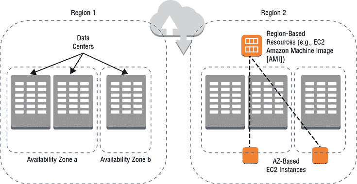

**FIGURE 4.2** A representation of AWS infrastructure divided among multiple regions and Availability Zones

The advantage of this level of separation is that if one AZ loses power or suffers some kind of catastrophic outage, the chances of it spreading to a second AZ in the region are minimal. You can assume that no two AZs will ever share resources from a single physical data center.

### Availability Zone Designations

Understanding how Availability Zones work has immediate and practical importance. Before launching an EC2 instance, for example, you’ll need to specify a network subnet associated with an AZ. It’s the subnet/AZ combination that will be your instance’s host environment. Unsure about that subnet business? You’ll learn more in just a few moments.

For now, though, you should be aware of how AZs are identified within the AWS resource configuration process. Recall from earlier in this chapter that the Northern Virginia region is described as `us-east-1`. With that in mind, `us-east-1a` would be the first AZ within the `us-east-1` region, and `us-east-1d` would be the fourth. Working through Exercise 4.1 will help you picture all this in action.

You may have noticed that the AZs weren’t listed in order in the subnet drop-down menu. For example, `us-east-1a` was probably not first and, equally probably, it wasn’t immediately followed by `us-east-1b`. The reason for this strange setup reflects Amazon’s familiarity with human nature: faced with two, three, or six choices that all appear equal, which one do you suppose most people will select? Did you vote for “whichever one appears first on the list”? Good call.

The problem with consistently listing the AZs in order is that the vast majority of users would always go for `us-east-1a`. But launching so many resources in just that first AZ would place unmanageable stress on the resources in poor old `us-east-1a` and leave all the others underutilized. So, Amazon solves the problem by displaying the AZs out of order.

### Availability Zone Networking

You’ll only get the full value out of the resources you run within an AWS Region by properly organizing them into network segments (or *subnets*). You might, for instance, want to isolate your production servers from your development and staging servers to ensure that there’s no leakage between them. This can free your developers to confidently experiment with configuration profiles without having to worry about accidentally bringing down your public-facing application. Distributing production workloads among multiple subnets can also make your applications more highly available and fault tolerant. We’ll talk more about that in the next section.

A subnet is really nothing more than a single block of Internet Protocol (IP) addresses. Any compute device that requires network connectivity must be identified by an IP address that’s unique to the network. The servers or other networked devices that are assigned an IP address within one subnet are generally able to communicate with each other by default but might have traffic coming into and/or out of the subnet restricted by firewall rules.

Private networks—including AWS subnets—using the IPv4 protocol are allowed to use all the addresses within the three address ranges shown in Table 4.2.

**TABLE 4.2** Available Private IPv4 Address Ranges

| From | To | Total Available Addresses |
| --- | --- | --- |
| 192.168.0.0 | 192.168.255.255 | 65,536 |
| 172.16.0.0 | 172.31.255.255 | 1,048,576 |

There’s nothing preventing a private network manager from subdividing those addresses into hundreds of smaller subnets. The default subnets provided by AWS as part of its Availability Zones are, in fact, just such subdivided networks. AWS, as a matter of fact, permits up to 200 subnets per AZ.

Calculating netmasks for those ranges to properly understand their Classless Inter-Domain Routing (CIDR) notation goes way beyond the scope of this chapter—and of the AWS Cloud Practitioner exam objectives. But it can’t hurt to consider that AWS might describe the address range available to a particular subnet as something like `172.31.16.0/20` or `172.31.48.0/20`. Whenever you see such a notation in an AWS configuration dialog, you’ll now know that you’re looking at the IP address range for a subnet.

### Availability Zones and High Availability


One of the key principles underlying the entire business of server administration is that all hardware (and most software) will eventually fail. It may be an important router today or a storage volume tomorrow, but nothing can last forever. And when something does break, it usually takes your application down with it. A resource running without backup is known as a *single point of failure*.

**唯一有效的防止失败的保护措施是冗余**，它涉及为工作负载提供两个或更多实例，而不是仅仅一个。这样，如果一个实例突然掉线，备份即可立即接管。但仅仅并行运行资源是不够的，如果它们在同一数据中心内并排放置，那么在出现全局断电或恶意攻击时，你的备份也会和需要替换的实例一样“死亡”。因此，你还需要将资源分布到远程位置。

在此情境下，工作负载是运行在本地数据中心还是在亚马逊云中，并没有区别。无论哪种情况，你都需要**地理上平行**的资源冗余。不同之处在于，在**云基础设施**中，构建弹性通常更加**容易**——有时甚至更便宜。

由于 AWS 云已经在全球数十个可用区（截至目前，除 Antarctica 外）提供服务，部署或至少准备快速启动模板来实现远程备份实例是很容易的。AWS 工作负载可以随需求即时请求并启动，平行资源的高效配置已是平台的固有特性。

配置和自动化阶段可能会有点棘手，但这由开发人员和管理员来解决，不是吗？他们都是通过 AWS 解决方案架构师（或专业）认证的，对吧？

你至少需要了解，AWS 通过 **自动扩缩** 和 **负载均衡** 来“消灭”应用失败的隐患：

*   自动扩缩可以配置为在用户需求或现有资源可用性发生变化时，替换或复制资源，以确保满足预定义的服务级别。
*   负载均衡协调多个并行资源，将用户请求路由到最能提供成功体验的服务器资源。常见的使用场景是将主资源与（远程）备份资源配合，以应对故障。

### AWS 全球基础设施：边缘位置

AWS 基础设施的最后一块拼图是它的 **边缘位置（Edge Locations）** 网络。一个 *edge location* 是 AWS 部署物理服务器基础设施的站点，用于提供低延迟的用户访问 Amazon 数据。

该定义虽准确，但听起来很像对任何其他 AWS 数据中心的定义。关键区别在于，普通数据中心设计用于提供完整的 AWS 服务范围，包括所有 EC2 实例类型和网络基础设施，而边缘位置则更为聚焦，只提供一小部分角色，因此只携带更窄的硬件集合。

那么，这些边缘位置实际在做什么呢？可以把它们视为**前线资源**，用于引导那些能从更快网络流量中受益的流量。

#### Edge Locations and CloudFront

边缘位置的最著名租户是 **CloudFront**，即 Amazon 的 CDN 服务。假设你在 S3 桶中托管大型媒体文件。如果用户每次请求都直接从桶中获取文件，尤其是跨洲的用户，传输时间会相对较长。但如果在离用户更近的地理位置上缓存热门文件的副本，用户就可以在极短时间内享受缓存内容，而无需等待原始文件的检索。

 并非所有内容类型都适合 CloudFront 缓存。经常更新或仅被用户偶尔访问的文件可能不值得投入缓存成本。

除了 CloudFront，其他 AWS 服务也利用边缘位置。以下是几个示例：

**Amazon Route 53** — Amazon 的域名系统（DNS）管理工具，用于域名注册和流量路由  
**AWS Shield** — 受管理的 DDoS（分布式拒绝服务）攻击防护服务  
**AWS Web Application Firewall (WAF)** — 受管理的 Web 应用防护服务  
**Lambda@Edge** — 利用 Lambda 服务器 less 能力，自定义 CloudFront 行为的工具  

为了让这些概念更清晰，我们建议你通过完成 **Exercise 4.2** 来探索 CloudFront 分发的配置流程。

#### 区域边缘缓存位置

除了常规的边缘位置，Amazon 还通过 **区域边缘缓存（Regional Edge Cache）** 增强了 CloudFront 的功能。其思路是：当用户请求量大时，CloudFront 会在边缘位置缓存对象；一旦请求率下降，缓存中的对象会被删除，后续请求必须回退到源服务器（如 S3 桶）。

区域边缘缓存位置目前全球有 **九个**，提供一种折中方案：被边缘位置拒绝的对象可以被移动到区域边缘缓存。虽然这类位置数量较少，导致许多用户请求的响应时间不如直接从最近的边缘位置获取，但仍优于回源到原始服务器。设计上，区域边缘缓存更能够处理不常见的内容。

### AWS 共享责任模型

AWS 云（与任何庞大且复杂的环境）基于一系列规则和假设。你的 AWS 项目成功很大程度上取决于你对这些规则和假设的理解程度，以及你对其代表的实践的采纳程度。AWS 共享责任模型是对这些规则和假设的有益阐述，值得花时间思考。

Amazon 将 **云的安全与可靠性**（即 AWS 的责任）与 **云内资源的安全与可靠性**（即客户的责任）区分开来。

云本身指的是 AWS 数据中心的实体建筑、服务器和网络硬件。AWS 负责确保这些位置的安全、可靠供电和维护；负责为运行在物理服务器和虚拟化软件上的操作系统、虚拟化软件以及托管服务的软件进行补丁、加密（如适用）和维护。

然而，这里会出现一些复杂性：什么是“受管理”，什么是“未受管理”？如图 4.3（前文已在第 1 章“云”中出现）所示，该图对比了“of the cloud / in the cloud”模型在 IaaS、PaaS、SaaS 三种云模式中的责任划分。

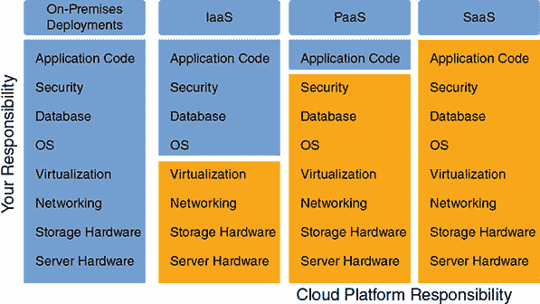

**FIGURE 4.3** A general comparison between local and managed deployments 

图 4.4 说明了 AWS 基础设施完整性与安全性的责任划分方式。

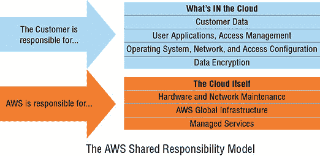

**FIGURE 4.4** A representation of the AWS Shared Responsibility Model 

#### 受管理资源

# 受管理的云服务会“隐藏”所有或部分底层配置和管理工作，以保持运行所需，从而让您专注于项目的“业务”端。例如，运行在 EC2 实例上的应用程序可能需要后端的数据库。您可以在实例本身上安装并配置 MySQL 数据库引擎，但您需要承担补丁、更新以及所有常规维护工作（更不用说让它出去遛弯了）。

或者，您可以将应用程序指向在 Amazon 的关系型数据库服务 (RDS) 上独立启动的数据库。AWS 负责对 RDS 数据库进行补丁并确保其数据安全可靠。您只需关注数据库的内容以及将其连接到您的应用程序。

因此，RDS 是一个部分受管理服务的良好示例。下一级受管理服务会如何工作？请看 Elastic Beanstalk，它几乎隐藏了其运行环境的所有复杂性，您只需上传应用程序代码即可，其他如实例、存储、数据库和网络等操作都由 Beanstalk 隐形处理，包括持续的补丁和管理。

### 非受管理资源

最明显的非受管理 AWS 服务是 EC2。当您启动 EC2 实例时，您需要像管理本地数据中心中的物理服务器一样，维护操作系统以及其上运行的所有内容。不过，EC2 也并非完全非受管理，因为它所在的物理服务器的完整性仍由 AWS 负责。

把它想象成一个滑动尺度，而不是简单的开关。一些云操作会要求您和您的管理团队投入更多精力，而另一些则要求更少。使用这样一个简单的准则：*如果您可以编辑它，您就拥有它*。在项目规划阶段，尤其是要时，要清楚自己的责任，并始终将安全视为首要任务。

### 服务健康状态

作为交易的一部分，AWS 会定期更新、按区域公开其服务状态报告。任何可能影响工作负载性能的服务中断都会在 Amazon 的服务健康仪表盘 (`https://status.aws.amazon.com`) 上出现——通常在中断发生后一两分钟内。

虽然配置错误始终是基础设施故障的可能原因，但您应始终将服务健康仪表盘作为故障排查的第一站。

### AWS 接受使用政策

由于云计算服务的易于扩展，它们是实现十年前难以想象的事物的强大工具。但与此同时，它们也是可能被用于造成毁灭性犯罪的武器。

AWS 接受使用政策 (`https://aws.amazon.com/aup`) 明确指出，它不允许将其基础设施用于任何非法、有害或冒犯性的方式。Amazon 保留在您从事非法、不安全或滥用行为（包括发送垃圾邮件及相关大规模邮件）时，暂停或甚至终止您使用其服务的权利。即使您未经事先获得 Amazon 许可，对自己的 AWS 基础设施进行渗透测试也可能导致麻烦。

您应花时间阅读该文档，并在部署 AWS 时牢记其条款。

## 摘要

AWS 区域至少包含两个可用区，它们位于同一地理区域内的低延迟网络。由于其底层硬件的默认隔离，构建安全、受控访问的区域环境是可行的。

可用区是一个或多个独立（且受保护免故障）数据中心的组，位于同一地理区域内。

请留意当前选中的区域（无论是 AWS 控制台还是命令行终端），因为您执行的任何操作都会在该区域的上下文中进行。

AWS 全局区域体系结构的设计使您能够以最佳用户体验、满足安全和合规需求的方式构建基础设施。

AWS 提供一些全局资源，其使用不受限制于任何单一区域，包括 IAM、CloudFront 和 S3。

您可以使用端点地址连接到 AWS 服务实例，这些地址通常会包含所在区域的标识。

EC2 虚拟机实例会从与单个可用区关联的网络子网中获取 IP 地址。

高可用性原则可以通过在多个可用区中启动并行冗余实例，使您的基础设施更具弹性和可靠性。

AWS 边缘位置是全球分布的数据服务器，能够缓存 AWS 数据并通过 CloudFront 高效向终端用户提供。

AWS 平台中您需要自行保护和维护的元素以及由 Amazon 管理的元素，由 AWS 共享责任模型定义。

### 考试要点

**理解资源隔离在云部署中的重要性。** 正确放置云资源所在的区域和可用区，并设置适当的访问控制，可提升应用安全性和性能。

**理解自动扩展在高可用部署中的作用。** AWS 资源的可扩展性允许您自动化规模的增减，这可以在发生故障后自动实现应用程序的恢复。

**理解负载均衡在高可用部署中的作用。** 负载均衡器能够自动将 incoming 请求重定向到非功能实例的备份实例，从而实现高可用。

**理解 AWS 共享责任模型的原则。** AWS 负责其底层物理基础设施及所有受管理服务的完整栈的安全与管理；客户则负责其它所有内容。

**理解 AWS 接受使用政策的原则。** 使用 AWS 资源进行犯罪或对任何个人或组织发起攻击将导致账户被暂停或终止。

## 复习题

1. 以下哪个标识符指的是 AWS US West (Oregon) 区域？

   1. `us-east-1`  
   2. `us-west-2`  
   3. `us-west-2a`  
   4. `us-west-2b`  

2. 哪个选项是客户访问受限的 AWS 区域？

   1. AWS Admin  
   2. US-DOD  
   3. Asia Pacific (Tokyo)  
   4. AWS GovCloud  

3. 当您请求 EC2 中的新虚拟机实例时，实例会自动启动到当前选中的下列哪个值？

   1. Service  
   2. Subnet  
   3. Availability Zone  
   4. Region  

4. 以下哪些是 *不* 属于全局 AWS 服务？（选择两项）

   1. RDS  
   2. Route 53  
   3. EC2  
   4. CloudFront  

5. 下面哪个是您在北弗吉尼亚区域运行的关系型数据库实例的有效端点？

   1. `us-east-1.amazonaws.com.rds`  
   2. `ecs.eu-west-3.amazonaws.com`  
   3. `rds.us-east-1.amazonaws.com`  
   4. `rds.amazonaws.com.us-east-1`  

6. AWS 设计其区域的方式所带来的最重要的架构优势有哪些？（选择两项）

   1. 它可以使基础设施更具备容错能力。
   2. 它可以使应用程序以更低的延迟向最终用户提供服务。
   3. 它可以使应用程序更符合当地法规的要求。
   4. 它可以降低运行成本。

7. 为什么大多数 AWS 资源都与单个区域相关联？

   1. 因为这些资源是在物理设备上运行的，而该设备必须有一个物理位置。
   2. 因为安全考虑因素最好通过限制访问单一物理位置来实现。
   3. 因为访问任何数字资源都必须通过单一的物理网关进行。
   4. 因为将它们分散到更远的地方会引入延迟问题。

8. 如果你想提高 EC2 Web 服务器的弹性，以下哪种方式是最有效且最简便的做法？

   1. 在多个 AWS 区域中启动并行、受负载均衡的实例。
   2. 在单个 AWS 区域内的多个可用区中启动并行、受负载均衡的实例。
   3. 在多个 AWS 区域中启动并行、自动扩展的实例。
   4. 在单个 AWS 区域内的多个可用区中启动并行、自动扩展的实例。

9. 以下哪项最准确地描述了 AWS 可用区（Availability Zone）？

   1. 一个或多个独立供电的数据中心，运行多种硬件主机类型。
   2. 一个或多个独立供电的数据中心，运行统一的硬件主机类型。
   3. 位于广阔地理区域内的所有数据中心。
   4. 运行在单一物理数据中心内的基础设施。

10. 以下哪项最准确地描述了 AWS 生态系统中的子网（subnet）？

    1. 为资源实例设置的网络访问虚拟限制。
    2. 为单个区域分配的 IP 地址块。
    3. 为单个可用区分配的 IP 地址块。
    4. 运行在单一可用区内的网络硬件。

11. 什么决定了在 EC2 配置对话框中子网/可用区选项的显示顺序？

    1. 按字母顺序。
    2. 看起来是随机显示的顺序。
    3. 按数字顺序。
    4. 按容量大小排序，容量最大的在前。

12. 自动扩展（autoscaling）的主要目标是什么？

    1. 确保特定物理资源的长期可靠性。
    2. 确保特定虚拟资源的长期可靠性。
    3. 编排多个并行资源以引导用户请求。
    4. 确保在任何外部需求或实例故障下，保持预定义的服务水平。

13. 哪种设计策略对保持云应用的可靠性最有效？

    1. 资源隔离
    2. 资源自动化
    3. 资源冗余
    4. 资源地理位置

14. 以下哪项 AWS 服务不太可能从 Amazon 边缘位置（edge locations）中受益？（选择两项）

    1. RDS
    2. EC2 负载均衡器
    3. 弹性块存储（EBS）
    4. CloudFront

15. 使用 CloudFront 分发的主要好处是什么？

    1. 自动防护免受大规模电子邮件营销活动的攻击
    2. 通过冗余实现更高的可用性
    3. 通过数据加密实现更高的安全性
    4. 无论终端用户所在地如何，都能降低对内容的延迟访问

16. Amazon Route 53 的主要用途是什么？

    1. 对抗分布式拒绝服务（DDoS）攻击
    2. 管理域名注册和流量路由
    3. 保护 Web 应用免受基于 Web 的威胁
    4. 使用 Lambda 的无服务器能力自定义 CloudFront 行为

17. 根据 AWS 共享责任模型，以下哪些是 AWS 的责任？（选择两项）

    1. 云的安全
    2. 负责修补在 AWS 数据中心运行的底层虚拟化软件
    3. 云内资源的安全
    4. 负责修补在 EC2 实例上运行的操作系统

18. 根据 AWS 共享责任模型，定义由受管 AWS 服务所驱动的软件状态的最佳方式是？

    1. 受管 AWS 服务的所有内容均由 AWS 负责。
    2. 客户添加的内容（如应用代码）由客户负责。
    3. 客户可以控制的内容（应用代码和/或配置设置）由客户负责。
    4. 受管 AWS 服务的所有内容均由客户负责。

19. 故障排除 failing application 时，最先应该查看的地方是哪里？

    1. AWS 可接受使用监视器（Acceptable Use Monitor）
    2. 服务状态仪表盘（Service Status Dashboard）
    3. AWS 计费仪表盘（Billing Dashboard）
    4. 服务健康仪表盘（Service Health Dashboard）

20. 你在哪里可以找到关于 AWS 对账户资源使用方式所施加限制的信息？

    1. AWS 用户协议政策
    2. AWS 可接受使用政策
    3. AWS 可接受使用监视器
    4. AWS 可接受使用仪表盘

## 第 5 章

## 保护您的 AWS 资源

**本章涵盖的 AWS 认证云实践考试目标包括，但不限于，以下内容：**

*   **域 2：安全**
*   ** 2.2 定义 AWS 云安全和合规概念**
*   ** 2.3 识别 AWS 访问管理功能**

 

## 引言

所有 IT 界人员都知道，应用程序和基础设施安全是任何部署中至关重要的组成部分。不幸的是，持续不断的数据泄露新闻报道暗示，其中一些人可能还未完全认识到其 *多么* 重要。

无论你在组织的云部署生命周期中扮演什么角色，确保资产得到适当保护是你的职责之一。本章将帮助你探索 AWS 提供的工具，以协助履行这一责任。


你将学习如何使用 *Identity and Access Management*（IAM）服务来控制哪些人和进程可以通过守护你资源的墙（认证），以及他们在进入后被允许执行什么操作（授权）。我们将了解 IAM 通过用户、组、角色和联合身份等智能使用来实现这一点。

我们将讨论如何对云数据进行 *加密*——无论是从本地数据中心传输到 AWS 环境，还是数据已安家于 AWS 之后。同时，我们也会谈论管理用于加密的密钥，这些密钥承担了所有繁重工作。最后，我们会说明 AWS 已经完成的工作，确保其基础设施符合尽可能广泛的监管框架。

# AWS Identity and Access Management

我们从 IAM 开始，其管理控制台（https://console.aws.amazon.com/iam）将你连接到管理所有基础安全所需的工具。正如你在 Figure 5.1 可以看到的，IAM 仪表盘的 **Security Status** 部分会提醒你可能需要关注的一些问题。

这些建议包括通过锁定根用户（即首次创建 AWS 账户时生成的用户身份）来保护账户，并通过为日常管理任务设置 IAM 用户和组来替代根用户的 *effective* 功能。后续章节将解释为何以及如何进行这些更改。

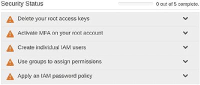

## 保护根用户

为了实际目的，根用户拥有在您的账户上执行任何任务所需的权限。这包括在任何区域启动任何资源并授权任何费用。问题是，如果长期仅使用最小保护措施的根用户，安全风险将非常高。如果根密钥通过攻击被 compromise，攻击者可能会造成无限制的破坏。您的所有数据都可能被窃取或删除，或者攻击者可能运行一个野蛮的加密矿工操作，产生数十万美元的费用。

推荐的最佳实践是，因此，通过创建复杂密码并启用多因素身份验证（MFA），在大多数管理活动中使用 IAM 用户而不是根用户。这将在下文中讨论。

## 身份验证

无论您是通过 AWS Management Console 登录管理 AWS 账户，还是在个人笔记本电脑的终端中运行命令，或是以编程代码级别连接到 AWS 资源的远程应用，您都需要证明您就是您声称的那样，且“声称的您”有权访问您所需的访问权限。通常这意味着提供某种用户 ID 和密码。在程序化或命令行访问的情况下，您需要一组访问密钥。通过 Elastic Compute Cloud (EC2) 登录 Linux 实例的远程登录会话需要有效的密钥对。我们逐一讨论这些内容。

### 密码

在您熟悉 AWS 的过程中，您大概会通过浏览器的 AWS Management Console 完成大部分工作。正如第 6 章“使用您的 AWS 资源”中所述，使用命令行（具体来说，AWS CLI）可能更高效，但 AWS Management Console 同样有效。

根用户使用创建账户时设置的电子邮件地址和密码登录 AWS Management Console。但您肯定已经知道，并非所有密码都一样安全。如果您希望账户在攻击中幸存，应避免容易被猜测的密码。相反，选择包含大小写字母、数字和符号的复杂且长密码。更好的是，只使用随机生成的字符串，这些字符串与您生活中的任何事物（如生日）毫无关联。绝对不要（绝对不要）在多个账户中重复使用密码。

 不要认为您能记住像这些密码吗？欢迎加入这个俱乐部。最简单有效的解决方案是使用密码管理工具，如 LastPass、Dashlane 或 KeePass2。

如前所述，保护根用户的第一步是为其设置高质量的密码。但这并不意味着您可以忽视其他用户。您稍后将看到如何创建此类用户。但在此之前，您应该已经有一个适当的 *密码策略* 就绪。您可以在 IAM Dashboard 的 Account Settings 部分配置策略，强制要求账户中所有用户的密码符合最小复杂度要求。Figure 5.2 显示了在 Password Policy 页面上可用的策略选项。

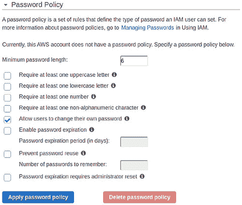

**FIGURE 5.2** The IAM Account Settings page where you can set an account-wide password policy 

*多因素身份验证* (MFA) 在登录时增加了第二层安全保护。启用后，用户需要提供密码（即“所知之物”）以及作为第二因素的预设设备（即“所拥有之物”）发送的临时数字令牌，例如运行 Authenticator 应用的智能手机。

MFA 通过将物理设备（无论是 Universal 2nd Factor (U2F) 或 YubiKey 等 MFA 兼容设备，或安装 Authenticator 应用的智能手机）与您的账户关联来工作。当您尝试登录时，首先输入密码，然后会向您的 MFA 设备发送一个短暂的代码（通常是六位数字）。您只需读取该数字并输入到登录页面的相应字段中，即可登录。

虽然复杂密码和 MFA 对任何账户用户都很重要，但它们对根用户尤为关键。Exercise 5.1 将带您了解在 IAM Dashboard 中创建用户密码策略的可能设置。

### 访问密钥

如前所述，程序化和命令行访问 AWS 资源的许多资源是通过访问密钥（无法启用 MFA）进行验证的。您可以在 AWS Management Console 的 *Security Credentials* 页面（通过控制台顶部右侧的账户下拉菜单访问）生成新的密钥对。

点击 *Create New Access Key* 按钮可前往该页面。您将有选项将密钥下载为文本文件，或在对话框中查看并复制 Access Key ID 和 Secret Access Key 的实际值，然后将它们安全存储。请务必选择其中之一，因为您将永远看不到秘密访问密钥本身。您还应记住，将秘密访问密钥以明文形式（如在电子邮件中）暴露是绝对不好的。

Security Credentials 页面还列出了所有密钥，并允许您停用、激活或删除现有密钥。当您以根用户登录时，应花时间删除与根账户关联的所有密钥。

### 使用 SSH 密钥对

行业标准工具是 Secure Shell (SSH) 协议，用于安全加密远程登录会话。如果没有加密，您在终端会话中输入的所有命令和按键都会在不安全的网络上传输，任何拥有该网络访问权限的人都能轻易读取您的数据。当该“网络”是互联网时，这可能意味着大量不友好的眼睛盯着您的数据。

加密将这些明文数据包转换为看起来像乱码的内容。理想情况下（假设您使用的加密算法尚未被破解），这些文本将保持乱码状态，除非您拥有解密它所需的密钥。SSH 协议在两端都有兼容键的情况下，自动管理加密和解密过程。

当您启动新的 EC2 Linux 实例（大多数 EC2 实例运行某种 Linux）时，您会被要求使用现有的 SSH 密钥对或创建新的密钥对。与访问密钥类似，您只能下载一次私钥的私有半部分到自己的计算机。同样，请在未公开的情况下下载该文件。

私钥下载后（对于 Linux 和 macOS，需设置适当权限），您可以通过在连接命令中指定密钥来打开对实例的 SSH 会话，例如：

```
ssh -i keyname.pem ec2-user@<public_ip_address_of_instance>
```

自 Windows 10 发布以来，您甚至可以在 Windows 机器上原生通过 SSH 会话连接到远程 Linux 服务器。

我们认为，假设本书的读者是一群相当聪明的人。即使你没有全神贯注地阅读，我们也很确定，到现在你已经注意到我们的主题——你不应该使用 root 用户进行常规管理任务。相反，正如你所见，你更应创建用户，只为特定任务分配所需的权限（从而遵循 `principle of least privilege`），然后让你的团队使用这些用户身份进行身份验证。

### IAM Users

想了解在现实世界中如何创建和管理 IAM 用户？请参阅第 5.2 章——它不会花费你任何费用。

如果你想为日常管理任务创建一个主管理员来替代 root 用户，你需要选择 `AdministratorAccess` 策略，该策略提供足够的权限来完成大多数管理任务，而不会使你的账户面临不必要的风险。

### IAM Groups

随着你的组织向 AWS 基础设施添加更多团队成员，手动为每个单独用户逐一分配权限会变得繁琐且耗时。使用组批量管理多个用户的权限可以更高效地完成这些操作。

例如，你可以创建一个名为 `EC2-admins` 的组和一个名为 `S3-admins` 的组。当新团队成员加入时，你只需创建一个 IAM 用户并将其附加到相应的组。该用户会自动继承该组的所有权限。如果以后需要增加或减少组的权限，编辑组本身会立即将更改应用到该组的所有成员。请在 Exercise 5.3 中尝试一下。

### IAM Roles

与用户和组一样，IAM 角色定义了 AWS 账户内可以执行的操作范围。主要区别在于，与用户和组不同，角色主要用于应用程序和服务，而非人。

创建角色时，首先需要定义一个 `trusted entity`——即将受信任使用该角色的实体（或受益者）。该实体可以是 AWS 服务（如 EC2），也可以是由第三方联合身份提供者（如 Google 或 Amazon Cognito，它们允许数字身份跨多个身份管理系统关联）提供的身份，或是另一个 AWS 账户。

例如，你可能需要为通过 Google 账号登录的移动应用用户授予对 AWS 服务（如存储在 S3 中的数据）的特定资源访问权限。你需要明确指定要为角色授予的权限，或换句话说，要让受益进程能够执行的操作。然后选择最符合预期需求的策略并将其关联到角色。从此，任何经过身份验证的移动应用用户都可以访问这些 S3 资源。

### 提供联合访问

现在我们提到了联合身份，接下来应该讨论如何将其纳入你的身份验证配置。联合扩展了管理身份验证的工具范围，超出了前文已介绍的基础 IAM 选项。

你可以集成像 `Security Assertion Markup Language 2.0`（SAML）或微软的 Active Directory 等第三方标准到你的基础设施中。这使你能够利用用户现有的登录会话，在 AWS 基础设施内实现 `single sign-on`（SSO），并实现移动应用与后端资源（如 DynamoDB 数据库或 S3 对象）之间的无缝访问。

除了前文提到的 IAM 角色配置选项外，通过 AWS Single Sign-On 服务还可以处理对 AWS 资源的联合访问。对于需要将云端 MS SharePoint、.NET 和基于 SQL Server 的工作负载与 Active Directory 集成的场景，你可以使用 AWS Directory Service for Microsoft Active Directory（通常称为 AWS Microsoft AD）。

### 凭证报告

还有一个 IAM 资源值得关注：凭证报告。从 IAM Dashboard 访问该报告，它提供了一个简洁的界面，只有一个按钮：Download Report。我们将让你自行处理实际细节。

但我们强烈建议你定期下载服务生成的逗号分隔值（CSV）文件。报告包含关于账户安全状态的重要信息，列出了所有当前 IAM 用户，并提供关键情报，例如每个用户上次登录时间、是否启用了 MFA、是否有活动访问密钥以及密钥上次轮换的时间。

这是一种快速且（相对）简便的方式，用于监控账户中的安全漏洞，你不应忽视这些漏洞。

# 加密

我们已经提到数据加密，以及它在 SSH 连接中的工作原理。但保护数据完整性的需求远超远程登录会话的范围。你应该考虑对你存储或消费的数据进行加密。无论你的具体使用场景和隐私需求是否证明有必要付出努力，AWS 提供了一系列企业级加密工具，它们被便捷且有效地集成到相关服务中。

加密密钥——用于控制对象的加密转换的数据文件——主要由 AWS `Key Management Service`（KMS）管理。当你选择加密一个 AWS 资源时，KMS 会使用为你账户专门生成的客户主密钥（CMK）进行加密。你可以通过 KMS Dashboard 或 IAM 中的 Encryption Keys 页面来管理密钥，包括创建新密钥或调度旧密钥的删除。

可以加密哪些内容？几乎所有由 AWS 服务管理的数据，包括 Relational Database Service（RDS）和 DynamoDB 数据库。你可以在创建时为通过 EC2 实例挂载的 Elastic Block Store（EBS）卷进行加密。加密后，这些资源在实践上将变得不可读，除非拥有解密密钥。AWS 会在访问请求伴随成功身份验证时， invisibly（隐式）解密你的数据。

S3 的加密方式与上述类似，但有一个变体。你可以在 bucket 创建时或之后随时对 S3 中的对象进行加密。你可以选择使用 S3 管理的服务器端加密密钥（SSE-S3）或 KMS 管理的密钥（SSE-KMS）。无论哪种方式，过程通常在“幕后”完成，无需你进一步操作。

除了确保错误的人员无法读取 S3 桶中的对象（服务器端加密），你还必须担心坏 guys 在数据从你的本地基础设施（客户端）传输到 S3 时进行拦截（客户端加密）。

客户端加密相对复杂。你需要在上传数据到 S3 之前对其进行加密，使用 KMS 管理的客户主密钥或客户端主密钥。该密钥随后用于在数据在 S3 平台上的生命周期中管理加密和解密。

## 监管合规（AWS Artifact）

你的应用是否计划处理信用卡交易？是否涉及私人健康记录、个人工作经历或受限制的军事信息？你是否确定 AWS 的安全和可靠环境足以满足行业和政府监管标准的要求？

这些问题在你过度深入部署规划之前就需要回答。但权威答案在哪里？AWS Artifact 提供了答案。

- [费曼学习法](https://wiki.example.org/feynmans_learning_method)的灵感源于诺贝尔物理奖获得者**Richard Feynman**。

1. 运用费曼技巧，你只需花上`20 min`就能深入理解知识点，而且记忆深刻，*难以遗忘*。

```
if (condVar > someVal) {console.log("xxx")}
```

# 第 6 章

## 与 AWS 资源一起工作

**本章涵盖的 AWS 认证云实践者考试目标可能包括，但不限于以下内容：**

* **第 2 领域：安全**

* ** 2.2 定义 AWS 云安全和合规概念**

* ** 2.4 识别安全支持资源**

* **第 3 领域：技术**

* ** 3.1 定义在 AWS 云中部署和运营的方法**

* ** 3.3 识别核心 AWS 服务**

* **第 4 领域：计费和定价**

* ** 4.4 识别计费支持资源**

 

## 介绍

本章，你将学习用于配置和监控 AWS 资源的关键工具。尽管每个 AWS 服务在配置方面都有其独特之处，AWS 仍然提供两种常用工具来与所有服务交互。

与 AWS 服务交互的主要方式是通过 **AWS 管理控制台**（AWS Management Console），这是一个基于 Web 的应用程序，可在任何兼容的 Web 浏览器中使用。在你对核心 AWS 服务不够熟悉之前，你大概会几乎只使用 AWS 管理控制台。该控制台提供用户友好、点击式的界面来浏览你的 AWS 资源，你会先从这里入手。你还将学习 **AWS 控制台移动应用**，它允许你在 Android 或 iOS 移动设备上查看和管理部分 AWS 资源。

随后，你将学习如何使用 **AWS 命令行界面**（AWS CLI）在你喜欢的桌面操作系统的命令行中执行配置并查看 AWS 资源信息。AWS CLI 让你能够在 API 级别与 AWS 服务进行交互。

接下来，你将了解 AWS 提供的各种软件开发套件 (SDK) ，帮助开发者编写无缝集成到 AWS 服务的应用程序。虽然你不需要个人使用 SDK，但了解其功能和适用场景很重要。

然后，你将学习使用 **CloudWatch** 监控资源性能、创建告警以在出现问题时通知你、以及收集、查看和搜索应用程序和 AWS 服务的日志。

接着，你将了解 **CloudTrail** 如何记录对 AWS 资源的任何个人或实体的操作。CloudTrail 是一项关键的安全服务，对于验证 AWS 账户的安全性以及确保服务正确配置和运行至关重要。

最后，你将学习使用 **Cost Explorer** 来了解 AWS 服务的费用、随时间观察使用和计费趋势，并获取节省成本的建议。

## AWS 管理控制台

**AWS 管理控制台**（也称为 AWS 控制台或 AWS Web 控制台）是一个 Web 界面，你可以通过 Web 浏览器管理所有 AWS 云资源，包括计算、存储和网络。

如果你希望使用点击式界面完成任务，你会选择 **AWS 管理控制台**。每个 AWS 服务都有其自己的服务控制台。例如，CloudWatch 和 AWS 计费与成本管理等服务提供可视化报告，供查看和下载。

大多数 AWS 资源的设置可以通过控制台配置，尽管有少数选项需要使用 AWS CLI。这些选项通常是高级功能，除非你追求 AWS 解决方案架构师 Associate 等高级认证，否则你可能不需要了解它们。

AWS 管理控制台兼容以下 Web 浏览器：

* Apple Safari

* Google Chrome

* Microsoft Edge

* Microsoft Internet Explorer


*   Mozilla Firefox

### 访问 AWS 管理控制台

要在 Web 浏览器中访问 AWS 管理控制台，请浏览到 [`console.aws.amazon.com`](https://console.aws.amazon.com)。登录有两种方式：以根用户（root user）身份登录，或以 IAM 用户（Identity and Access Management）身份登录。

#### 以根用户登录

要以根用户身份登录，输入与 AWS 账户关联的电子邮件地址和密码，如 Figure 6.1 所示。如果你尚未创建 AWS 账户，请返回第 1 章 “云” 并完成 Exercise 1.1。

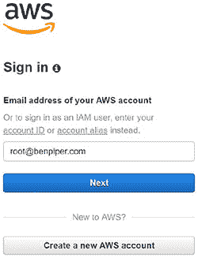

**FIGURE 6.1** Logging in as a root user

#### 以 IAM 用户登录

要以 IAM 用户身份登录，输入账户 ID 或账户别名并选择 **Next**。请参阅 Figure 6.2 以获得示例。

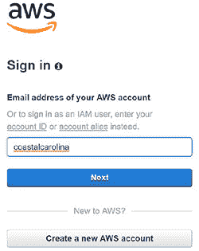

**FIGURE 6.2** Entering the account alias to log in as an IAM User

控制台会跳转到另一页，你需要在此输入 IAM 用户名和密码，如 Figure 6.3 所示。如果你没有 IAM 用户，请按照第 5 章 “保障你的 AWS 资源” 中的 Exercise 5.2 创建一个。

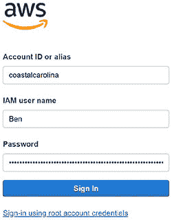

**FIGURE 6.3** Logging in as an IAM user

登录后，你的会话将保持活动 12 小时。超过时间后，会话将失效并退出登录，以保护你的账户。不过，你可以随时重新登录。

### 打开服务控制台

-   每个 AWS 服务都有自己的服务控制台，您可以管理该服务中的资源。选择 AWS 管理控制台顶部的 **Services** 链接，可以在搜索框中按名称搜索服务，或您可以按类型（如计算、存储和数据库）浏览服务，如图 6.4 所示。选择服务名称后，将转到该服务的控制台。

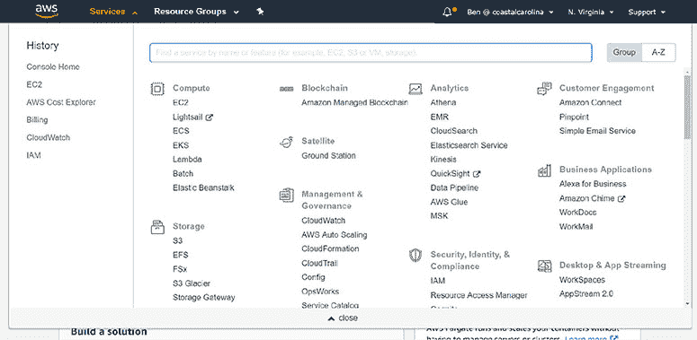

**FIGURE 6.4** 浏览可用的服务控制台

 当新服务推出时，它在 180 天内始终可用于控制台，但通常立即即可使用。

### 使用快捷方式

对于您频繁使用的服务，可以在导航栏上固定快捷方式。只需选择推钉图标并将服务拖动到导航栏，如图 6.5 所示。

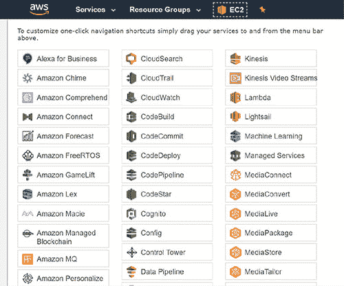

**FIGURE 6.5** 将快捷方式固定到导航栏

要访问服务控制台，请选择快捷方式。

### 选择区域

大多数 AWS 服务是区域特定的。例如，US East 区域的 EC2 服务与 US West 区域的 EC2 服务是分开的。使用导航栏中的区域选择器选择区域，如图 6.6 所示。

如第 4 章 “理解 AWS 环境” 所述，IAM、Route 53 和 S3 等服务是全局的。因此，这些全局服务的控制台不使用区域选择器，而是在选择器中显示 **Global**，如图 6.7 所示。

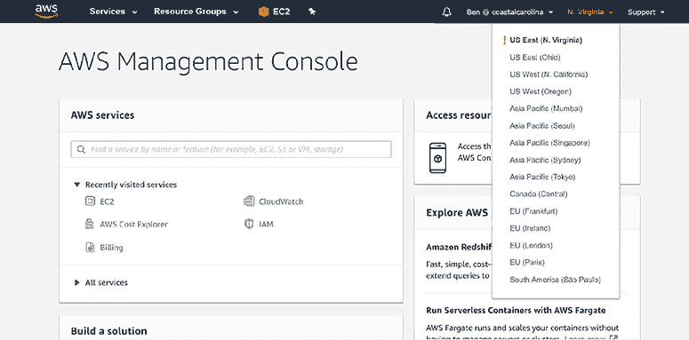

**FIGURE 6.6** 选择区域

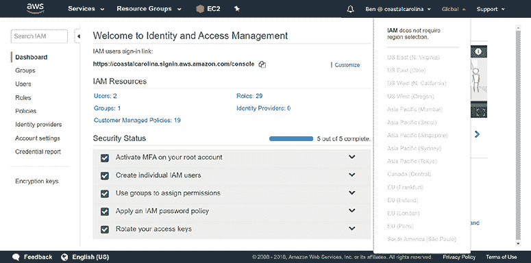

**FIGURE 6.7** 某些全局服务无需选择区域

 如果您似乎丢失了资源，请确认已选择正确的区域。

### 账户名称菜单

导航栏中的账户名称菜单显示您当前登录的 IAM 用户和账户别名或 ID，或者如果您以 root 登录则显示与您的 AWS 账户关联的名称。选择该菜单可获得以下选项，如图 6.8 所示：

*   **My Account**—跳转至 Billing 服务控制台页面，显示账户信息
*   **My Organization**—跳转至 AWS Organizations 服务控制台
*   **My Billing Dashboard**—跳转至 Billing and Cost Management Dashboard
*   **My Security Credentials**—跳转至 IAM 服务控制台的 **My Password** 页面，可更改密码
*   **Switch Role**—让您假设 IAM 角色，以不同的主体和权限执行任务
*   **Sign Out**—退出 AWS 管理控制台

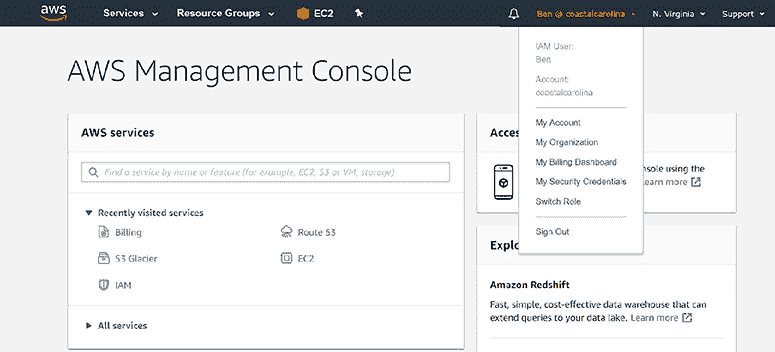

**FIGURE 6.8** 以 IAM 用户登录时的账户名称菜单

### 资源组

资源组是 AWS 管理控制台中直接可用的选项之一。选择导航栏中的 **Resource Groups** 链接，如图 6.9 所示，可 reveal 创建新资源组和查看现有资源组的选项。

资源组可一次性查看、管理和自动化多个 AWS 资源的操作。它们非常适合将构成特定应用的所有 AWS 资源进行分组。与其记忆哪些资源属于哪个应用不同，您可以将这些资源添加到资源组中，让 AWS 记住！随后您可以对这些资源一次性执行批量操作。

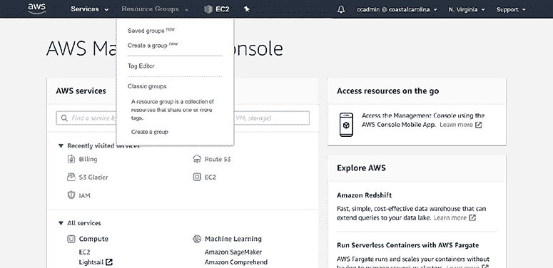

**FIGURE 6.9** 资源组菜单

资源组是同一区域内满足查询结果的 AWS 资源集合。您可以基于标签或 CloudFormation 堆栈创建资源组。

**资源标签** *资源标签* 是可选的元数据，您可以为 AWS 资源分配标签。标签必须包含一个名为 `key` 的标签键，并可选包含一个值。例如，您可以使用键名 `Environment` 和值 `Production` 为生产资源打标。标签键和值可包含字母、数字、空格以及以下字符：`+ - = . _ : / @`。您最多可为资源分配 50 个标签。标签键和值区分大小写。要基于标签创建资源组，您可以仅根据标签键查询，或同时根据标签键及其值进行查询。

**AWS CloudFormation 堆栈** CloudFormation（将在第 11 章 “自动化您的 AWS 工作负载”中学习）允许您将多个 AWS 资源作为单一单元（称为 `stack`）进行程序化部署和管理。您可以创建包含堆栈中部分或全部资源的资源组。您可以选择堆栈中所有资源，或按资源类型进行筛选，如 EC2 实例、EC2 安全组或 S3 桶。

### 标签编辑器

如果您想基于标签创建资源组，首先需要为想要包含在组中的资源进行标记。好在 AWS 管理控制台简化了此过程。在导航栏中选择 **Resource Groups**，然后选择 **Tag Editor**，如图 6.9 所示。

要开始使用 Tag Editor，请创建一个查询以查找想要标记的资源。至少需要选择一个区域和一个或多个资源类型（如 EC2 实例、EC2 卷、VPC 或 S3 桶）。如果您想，可以选择所有资源。还可以列出已有标签的资源。例如，您可能希望为已具有 `Environment` 标签的所有资源再添加一个标签。除了查询已有标签但无值的资源外，您还可以查询不包含特定标签的资源。例如，您可能希望排除不包含 `Environment` 标签的资源。

 资源标签区分大小写，因此查询也区分大小写。

如图 6.10 所示，Tag Editor 会显示符合查询条件的所有资源。如果在查询中指定了标签键，它会为每个资源列出该标签。

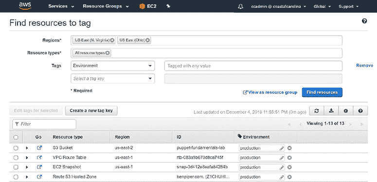

**FIGURE 6.10** Tag Editor 查询结果

如果查询中未指定标签键，它会列出具有 `Name` 标签键的资源。您可以通过选择齿轮图标自定义列的显示方式。您可以单独或批量编辑现有标签，也可以创建新标签。

### 标签策略

标签的使用取决于您的偏好和组织的要求。如果您不确定从哪里开始，可以使用标签将资源按以下大类进行组织：技术、自动化、业务和安全。请记住，您可以结合多种策略使用，或自行制定标签方案。

#### 技术

一种标签策略是根据资源的技术属性进行标记。您可以使用 `Name` 标签为单个资源分配名称。例如，您可以为托管 Web 服务器的 EC2 实例使用 `Name` 标签并设置值为 `webserver01`。许多 AWS 控制台会识别 `Name` 标签并在 EC2 实例、EBS 卷和 VPC 安全组等资源旁边显示它。但要注意，标签不必唯一，因此可能会 unintentionally 为不同资源分配相同的 `Name` 值。

你可以使用 `Environment` 标签指定资源是否属于生产、测试或开发基础设施。例如，你可以将 `Environment` 标签的值设置为 `Development`，应用于托管开发工作负载的 VPC。

你还可以创建 `Application` 角色标签，用于分类资源所执行的角色类型。例如，你可以为 EC2 实例添加标签，值为 `web server` 或 `database server`，具体取决于其功能。

#### Automation

`Automation` 标签用于定义应包含在自动化流程中的资源。一些自动化流程可能包括在实例上更新安全补丁、创建备份、删除旧快照或在工作时间后关闭开发服务器。

你可以指定 `Date` 或 `Time` 标签，以确定自动化任务在资源上何时执行。你还可以使用 `Opt in` 或 `Opt out` 标签作为开关，以启用或禁用特定资源的自动化。

#### Business

在使用 AWS 进行多个项目或不同部门的组织中，将资源分组为业务可用的类别有助于进行计费、管理和分析。以下是一些可用于业务目的的示例标签：

*   `Owner` 用于标识资源负责的个人或团队
*   `Business Unit` 或 `Cost Center` 用于指示支付资源费用的责任方
*   `Project` 用于标识资源所属的程序或项目名称
*   `Customer` 用于标识专门归属于特定客户的资源

#### Security

IAM 政策中的条件可以查看资源标签，以决定是否允许特定操作。例如，你可以指定一个条件，仅当实例具有 `Environment` 标签且值为 `Production` 时，才允许该 EC2 实例访问生产数据库。其他带有不同值或根本没有 `Environment` 标签的实例将被拒绝访问数据库。

在具有严格安全要求的环境中，你可能需要根据资源处理或存储数据的机密级别或合规要求为资源打标签。

`Confidentiality` 如果你的资源处理或存储的数据具有不同的机密级别，你可以使用资源标签来指定。例如，医疗记录应用程序中处理受保护健康信息 (PHI) 的资源可以使用 `Confidentiality` 键名并将键值设置为 `PHI`。

`Compliance` 如果资源必须遵守特定的合规要求，例如健康保险可携带性和责任法案 (HIPAA) 或支付卡行业数据安全标准 (PCI DSS)，你可以相应地为这些资源打标签。

### The AWS Console Mobile Application

`AWS Console Mobile Application` 是一款智能手机应用，让你随时管理 AWS 账户和资源。该应用提供仪表板，显示 AWS 账户和资源的关键信息，包括：

*   Service Health — 查看 AWS 服务在不同区域的当前健康问题。
*   CloudWatch Alarms — 查看告警图表和当前告警状态。
*   Billing — 查看当前账单余额及使用费用的图表。

查看 Figure 6.11 可看到仪表板可以展示的信息示例。

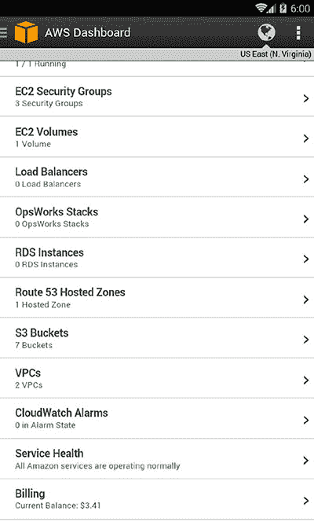

**FIGURE 6.11** The AWS Console Mobile Application dashboard

你可以使用该应用对部分 AWS 资源进行有限更改，包括 CloudWatch Alarms、EC2 安全组、EC2 实例和 CloudFormation 堆栈。例如，你可以查看或修改 CloudWatch 告警，如 Figure 6.12 所示。

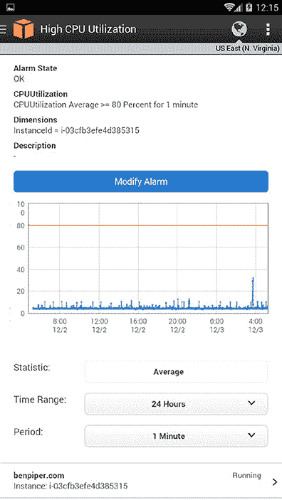

**FIGURE 6.12** Viewing a CloudWatch alarm from the AWS Console Mobile Application

你也可以停止或重启 EC2 实例，如 Figure 6.13 所示。

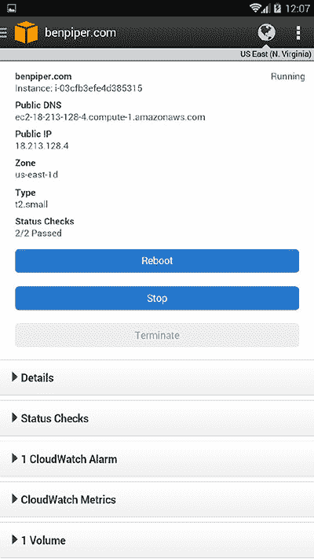

**FIGURE 6.13** Viewing an EC2 Instance from the AWS Console Mobile Application

#### Supported Services

该应用不支持所有 AWS 服务和资源。它支持的服务包括：

*   AWS Billing and Cost Management
*   AWS CloudFormation
*   Amazon CloudWatch
*   Amazon DynamoDB
*   Amazon EC2
*   AWS Elastic Beanstalk
*   Elastic Load Balancing
*   AWS OpsWorks
*   AWS Personal Health Dashboard
*   Amazon Relational Database Service (Amazon RDS)
*   Amazon Route 53
*   Amazon Simple Storage Service (Amazon S3)
*   Amazon Virtual Private Cloud (Amazon VPC)

### Requirements

AWS CLI 兼容 Windows、macOS 和 Linux。要通过 CLI 连接 AWS，你的网络应允许通过 TCP 端口 443 进行出站 internet 访问。你还需要 IAM 访问密钥 ID 和密钥来通过 CLI 进行身份验证。有关创建 IAM 访问密钥 ID 和密钥的详细信息，请参阅第 5 章。

### Installation

AWS CLI 已预装在 Amazon Linux AMI 中，因此如果你在运行 Amazon Linux AMI 的 EC2 实例上使用它，则无需安装。否则，AWS CLI 的安装程序因操作系统而异。

在任何受支持的操作系统上，您可以使用 Python `pip` 包管理器安装 AWS CLI。这是 AWS 推荐的方法，因为它可以让您轻松升级到新的 CLI 版本。安装 AWS CLI 使用 Python 和 `pip` 时，您需要以下内容：

*   Python 2 版本 2.6.5+ 或 Python 3 版本 3.3+（www.python.org）—如果有选择，请选择 Python 3。
*   `pip` 包安装程序—它随 Python 2 版本 2.7.9+ 和 Python 3 版本 3.4+（python.org）一起安装。如果您使用的是较早的 Python 版本或从其他渠道获取的版本，您可以按照 `https://pip.pypa.io/en/stable/installing` 的说明来安装 `pip`。
*   安装过程中需要 Internet 访问。

#### 使用独立安装程序进行安装

或者，您可以使用不需要安装过程中的 Internet 访问的独立安装程序来安装 AWS CLI。这对于离线和自动化安装很有用。AWS 为 Linux 和 macOS 提供一个独立安装程序，为 Windows 提供另一个。

Linux 和 macOS 的独立安装程序是一个捆绑安装程序，包含 AWS CLI、依赖项和一个用于安装的脚本。您需要预先安装 Python，但不需要 `pip` 包管理器。请按照 `https://docs.aws.amazon.com/cli/latest/userguide/awscli-install-bundle.html` 的说明进行捆绑安装程序的安装。

对于 Windows，使用包含 Windows 64 位和 32 位架构安装包的 MSI 安装程序。您可以在 `https://s3.amazonaws.com/aws-cli/AWSCLISetup.exe` 下载该 MSI 安装程序。注意，MSI 安装程序不支持 Windows Server 2008，您需要使用 `pip` 进行安装。

请按照 Exercise 6.1 中的步骤安装 AWS CLI。

## 软件开发工具包 (SDK)

AWS 软件开发工具包 (SDK) 简化了在自定义应用程序中使用 AWS 服务的过程。开发人员可以使用 SDK 将其应用程序与 AWS 服务轻松可靠地集成。SDK 使开发人员免于编写低层代码以直接与 AWS 服务 API 端点交互。相反，开发人员只需使用 SDK 中文档完善的方法来了解如何将其集成到其应用程序中。

AWS 为以下流行编程语言提供 SDK：

*   Java
*   .NET
*   Node.js
*   PHP
*   Python
*   Ruby
*   JavaScript


*   `Go`
*   `C++`

### 移动软件开发工具包 (Mobile SDK)

AWS 还为移动应用程序（智能手机和平板电脑）的开发提供移动 SDK。可用的移动 SDK 包括：

*   `AWS Mobile SDK for Android`.
*   `AWS Mobile SDK for iOS`.
*   `AWS Mobile SDK for Unity`，一个流行的用于创建可在 iOS 和 Android 上运行的游戏的引擎。
*   `AWS Mobile SDK for .NET and Xamarin`，这是跨平台应用程序开发框架，可用于开发 iOS 和 Android 应用程序。
*   `AWS Amplify`，这是一个开源框架，用于在 AWS 上构建移动和 Web 应用程序。它允许您构建应用程序后端并在 Android、iOS 和 Web 应用程序中进行集成。`AWS Amplify` 使用 AWS 服务提供基于云的身份验证、通知、离线数据同步、分析等功能。您可以使用它在不编写大量自定义代码的情况下将移动应用程序与 AWS 服务集成。`AWS Amplify` 包含一个支持 React Native 的 JavaScript 库，用于构建使用 JavaScript 的移动跨平台应用程序。

### 物联网 (IoT) 设备软件开发工具包 (SDK)

您可以使用 AWS IoT SDKs 创建运行在物联网 (IoT) 设备（如传感器、微控制器、智能家电、智能灯泡和 AWS IoT 按钮）上的应用程序。

*AWS IoT* 是一组服务，允许 IoT 设备与 AWS 服务、其他应用程序以及其他设备进行交互。AWS IoT 平台让您集中化地为 IoT 设备进行注册、管理和监控。

使用 AWS IoT SDKs 和 AWS IoT 平台，运行在设备上的应用程序可以与以下 AWS 服务集成：

*   `Amazon S3`
*   `Amazon DynamoDB`
*   `Amazon Kinesis`
*   `AWS Lambda`
*   `Amazon Simple Notification Service`
*   `Amazon Simple Queue Service`

AWS IoT SDKs 使开发人员能够优化内存、网络和电源使用；减小应用程序大小；并确保与 AWS 的安全、快速通信。

IoT 设备 SDK 可用于以下语言和平台：

*   `Embedded C`
*   `JavaScript`
*   `Arduino Yún`
*   `Python`
*   `Java`
*   `C++`

## CloudWatch

*Amazon CloudWatch* 是一个关键服务，帮助您规划、监控和优化 AWS 基础设施和应用程序。它允许您收集、搜索和可视化来自您的应用程序和 AWS 资源的日志、指标和事件数据。常见的 CloudWatch 使用场景包括：

**基础设施监控和故障排除** 可视化性能指标以发现随时间变化的趋势并识别可能表明问题的异常值。跨应用程序和基础设施堆栈的指标和日志进行关联，以了解故障和性能问题的根本原因。

**资源优化** 通过识别使用过度或使用不足的资源来节省成本并辅助资源规划。通过使用 AWS Auto Scaling 自动配置新的 EC2 实例以满足需求，确保性能和可用性。

**应用程序监控** 创建 CloudWatch 警报，当资源的利用率、性能或健康状况超出您定义的阈值时，可以发出警报并采取纠正措施。

**日志分析** 搜索、可视化和关联来自多个来源的日志，以帮助故障排除并识别改进区域。

### CloudWatch 指标

CloudWatch 指标是一个功能，用于收集来自 AWS 和非 AWS 资源（如本地服务器）的数值性能指标。一个 *metric* 是一个包含按时间顺序排列的数据点的变量。每个数据点包含时间戳、值以及可选的度量单位。例如，EC2 实例的 CPU Utilization 指标的一个数据点可能包含 2018 年 12 月 25 日 13:37 的时间戳、75 的值以及 Percent 作为度量单位。

所有 AWS 资源自动将其指标发送到 CloudWatch。这些指标包括 EC2 实例的 CPU 利用率、S3 桶的大小以及 DynamoDB 的读和写容量单元。CloudWatch 会将指标保存最多 15 个月。您可以绘制指标图表以查看趋势和随时间变化的情况，如 Figure 6.16 所示。

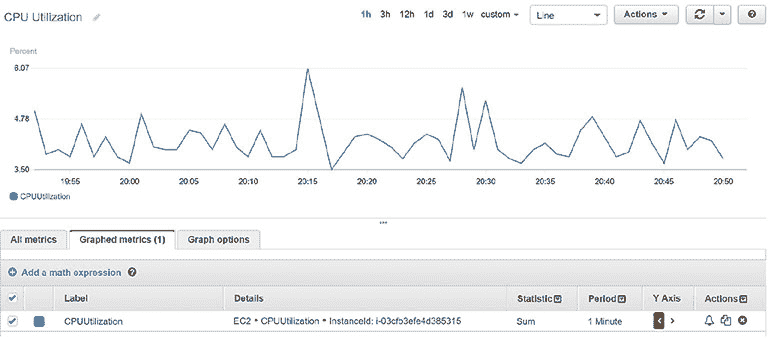

**FIGURE 6.16** 使用 CloudWatch 绘制 EC2 实例的 CPU Utilization 指标

# 使用简单通知服务的通知

`Simple Notification Service` (SNS) 允许应用程序、用户和设备从 AWS 发送和接收通知。SNS 使用发布-订阅模型，其中发布者（例如 AWS 服务）生成通知，订阅者（例如终端用户）接收它。SNS 用来映射发布者和订阅者的通信通道称为 `topic`。SNS 可以通过多种协议向订阅者发送通知，包括以下内容：

* `HTTP(S)`
* `Simple Queue Service (SQS)`
* `Lambda`
* `移动推送通知`
* `Email`
* `Email-JSON`
* `短信服务 (SMS)` 文本消息

# 自动扩展操作

通过指定 EC2 自动扩展操作，EC2 自动扩展服务可以根据需求的变化添加或删除 EC2 实例。例如，如果一个指标显示实例过载，您可以让 EC2 自动扩展通过添加更多实例来响应。

# EC2 操作

如果您正在监控出现问题的特定实例，您可以使用 EC2 操作来停止、终止或恢复该实例。恢复实例会将实例迁移到新的 EC2 主机，这在出现物理硬件问题时可能是必须的。

## CloudWatch Dashboards

CloudWatch Dashboards 是您的一站式商店，用于监控所有重要指标。您可以创建多个仪表板，并向其中添加指标图表、指标的最新值以及 CloudWatch 警报。您可以保存仪表板以供将来使用，并与他人共享。仪表板还可以可视化多个 AWS 区域的指标，因此您可以监控基础设施的全局健康状况。请查看 Figure 6.17 查看示例 CloudWatch 仪表板。

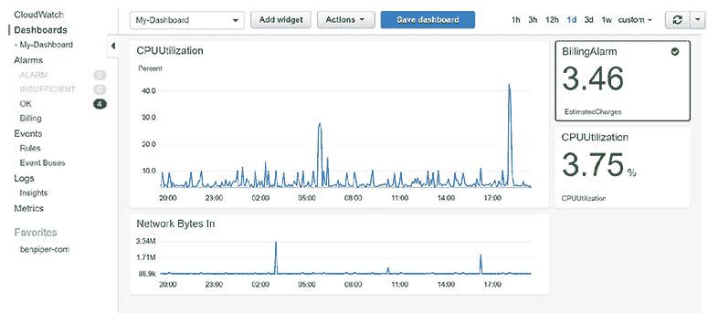

**FIGURE 6.17** A CloudWatch dashboard 

## CloudWatch Logs

CloudWatch Logs 收集并存储来自 AWS 和非 AWS 来源的日志文件，并使其轻松查看、搜索和从中提取自定义指标。

### 日志事件、流和组

您可以配置您的应用程序和 AWS 服务发送日志事件到 CloudWatch Logs。日志事件类似于日志文件中的一行，始终包含时间戳和事件消息。许多 AWS 服务会生成自己的日志，称为 `vended logs`，您可以将这些日志流式传输到 CloudWatch Logs。这些日志包括 Route 53 DNS 查询日志、VPC 流量日志和 CloudTrail 日志。CloudWatch Logs 还可以接收来自您的应用程序的自定义日志，例如 Web 服务器访问日志。

CloudWatch Logs 通过将来自同一来源的日志事件存储在同一个日志流中来组织日志事件。例如，特定 EC2 实例的 Web 服务器访问日志会存储在一个日志流中，而 Route 53 DNS 查询日志则存储在另一个日志流中。

CloudWatch 进一步通过将日志流组织到日志组来实现进一步的组织。为了组织相关的日志流，您可以将它们放入同一个日志组中。例如，如果您有多个日志流收集来自多台 Web 服务器的 Web 服务器日志事件，您可以将所有这些日志流放入一个日志组中。

CloudWatch Logs 默认无限期存储日志事件，但您可以配置日志组的保留设置来自动删除事件。保留设置范围从 1 天到 10 年。您也可以通过将日志导出到 S3 桶来存档日志。

### 指标过滤器

指标过滤器从日志组中的日志事件中提取数据并将其存储为自定义 CloudWatch 指标。例如，假设数据库服务器的日志事件包含查询运行的时间（毫秒），您可以提取该值并将其作为 CloudWatch 指标存储，以便绘制图表并创建警报，当其超过特定阈值时发送通知。

您也可以使用指标过滤器来跟踪特定字符串出现的次数。这对于统计日志中特定事件（如错误代码）出现的次数很有用。例如，您可能想跟踪 403 Forbidden 错误在 Web 服务器日志中出现的次数。您可以配置指标过滤器在给定时间段（例如五分钟）内统计该错误的出现次数，并将该值记录到 CloudWatch 自定义指标中。

 Metric filters let you extract or derive quantitative data from log events, so metric values will always be numeric. You can’t store a non-numeric string such as an IP address in a metric.

### CloudWatch Events

CloudWatch Events 让您能够持续监控代表 AWS 资源变更的特定事件（特别是只写 API 操作），并在发生时采取行动。例如，EC2 实例从运行状态转到停止状态的事件就是一个事件。IAM 用户登录 AWS 管理控制台也是一个事件。CloudWatch Events 可以自动且立即响应这些事件。

您首先创建一个规则，以定义要监控的事件以及在响应这些事件时要执行的操作。您通过选择目标来定义要执行的操作，目标是 AWS 资源。可选的目标包括以下内容：

* `Lambda` 函数
* `EC2` 实例
* `SQS` 队列
* `SNS` 主题
* `ECS` 任务

CloudWatch 实时响应事件，即时生效。与 CloudWatch 警报不同，后者在指标跨越并保持跨越数值阈值时才采取行动，CloudWatch 事件在发生时立即触发。例如，您可以创建一个 CloudWatch 事件，当 EC2 实例终止时发送 SNS 通知。或者，您可以在 S3 桶收到图像文件时触发 Lambda 函数来处理该文件。

或者，您可以创建一个计划，在定期间隔内自动执行操作。例如，为了节省费用，您可以创建一个计划，在每天下午 7 点关闭开发实例，此时开发人员理想情况下已经停止工作。

## CloudTrail

CloudTrail 记录对 AWS 资源的每项操作的详细事件日志。CloudTrail 记录的每个事件都包含以下参数：

* 服务。具体指服务的全局终端地址，例如 IAM 的 `iam.amazonaws.com`。
* 执行的 API 操作名称，例如 `RunInstances`、`CreateUser` 或 `PutObject`。
* 资源所在的区域。对于全局服务，这总是 `us-east-1`。
* 响应元素。对于修改或创建资源的 API 操作，此字段包含操作结果信息。例如，`RunInstances` 操作启动 EC2 实例的响应元素会包含实例 ID 和私有 IP 地址等信息。
* 发起请求的主体。这可能包括主体类型（IAM 用户或角色）、其 Amazon 资源名称 (ARN) 和名称。
* 请求的日期和时间，以协调世界时 (UTC) 表示。
* 请求者的 IP 地址。

### API 和非 API 事件

CloudTrail 记录的事件分为两种操作：API 操作和非 API 操作。API 操作包括启动实例、创建 S3 桶、创建新 IAM 用户或拍摄 EBS 快照等。需要注意的是，术语 *API action* 与操作的执行方式无关。例如，无论通过 AWS 管理控制台、AWS 命令行工具还是 AWS 软件开发套件，终止 EC2 实例都是 API 事件。

非 API 操作包括其他所有操作，例如登录管理控制台。

### 管理事件和数据事件

CloudTrail 还将事件分为管理事件和数据事件两个维度。

管理事件（也称为`control plane operations`）是指主体（如用户或服务）尝试对 AWS 资源执行的操作。管理事件包括仅写入事件——会修改或可能修改资源的 API 操作，以及仅读取事件——读取资源信息但不进行任何修改的操作。例如，`RunInstances` API 操作可以创建 EC2 实例，因此属于仅写入事件。另一方面，`DescribeInstances` API 操作会返回 EC2 实例列表但不会进行任何修改，因此属于仅读取操作。

数据事件包含 S3 对象级活动和 Lambda 函数执行，这两者通常都是高流量。因此，CloudTrail 将数据事件与管理事件分开处理。对于 S3 对象级操作，CloudTrail 会区分仅读取事件（如 `GetObject`）和仅写入事件（如 `PutObject` 和 `DeleteObject`）。

 CloudTrail 会记录无论是否成功的所有 API 操作。

### 事件历史记录

当您打开一个 AWS 账户时，CloudTrail 会自动开始记录所有管理事件。它会在事件历史记录中存储 90 天的管理事件，您可以随时查看、搜索和下载这些记录。事件历史记录不记录数据事件。

对于每个区域，CloudTrail 会维护一个单独的事件历史记录日志，包含该区域内发生的事件。但由全局服务（如 IAM 和 Route 53）生成的事件会包含在每个区域的事件历史记录中。

### 轨迹

如果您希望自定义 CloudTrail 记录的事件类型（例如特定的管理事件或数据事件），或需要存储超过 90 天的事件历史记录，则需要创建一个轨迹（trail）。一个 `trail` 是一种配置，它指示 CloudTrail 记录指定的事件到日志文件中，并将其发送到 S3 桶。轨迹可以记录单个区域的事件，也可以记录所有区域的事件。您可以选择记录管理事件、数据事件，或两者兼顾。您还可以选择记录只读操作、只写操作，或两者兼顾。

CloudTrail 不提供直接搜索轨迹日志的功能，因为日志以 JavaScript Object Notation（JSON）格式编写。但您可以直接从 S3 下载日志文件。您还可以配置 CloudTrail 将轨迹日志发送到 CloudWatch Logs，从而支持存储、搜索和指标过滤。

### 日志文件完整性验证

日志文件完整性验证是一个可选功能，用于确保 CloudTrail 日志文件不会被悄悄修改或删除。其工作方式如下：每次 CloudTrail 向轨迹的 S3 桶写入日志文件时，会计算并存储该文件的加密哈希值——这是一个基于日志文件内容的唯一值。如果有人修改了文件，即使只修改了一位，修改后的文件哈希值也会与原始哈希值完全不同。这可以告诉你有人是否篡改了日志文件，但无法告知具体是如何被修改的。

日志文件可以使用 Amazon S3 托管加密密钥（SSE-S3）或 AWS KMS 托管密钥（SSE-KMS）进行服务器端加密。

### 费用 Explorer

如前章节“了解您的 AWS 账户”所述，AWS Cost Explorer 是 AWS Billing（账单）和 Cost Management（成本管理）的功能，提供可配置的报表和图表，帮助您了解每个 AWS 服务如何影响您的月度账单。

AWS Cost Explorer 提供以下三类报告：

*   `Cost and usage reports`
*   `Reservation reports`
*   `Reserved instance recommendations`

#### 费用与使用情况

您可以生成费用与使用情况报告，以图形化方式查看每日和每月的费用及使用情况随时间的变化。Cost Explorer 还能展示当月、3 个月后、12 个月后的预测，帮助您提前规划。Figure 6.18 展示了过去 12 个月的月度费用以及当月的预测。

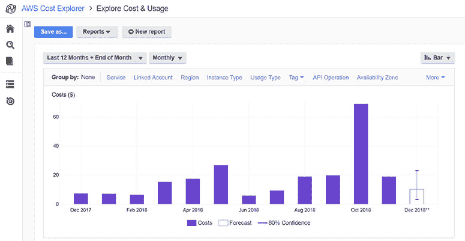

**FIGURE 6.18** Cost and usage report showing monthly costs 

您可以回溯至一年前，并通过以下参数对报表进行筛选或分组：

*   `Service`
*   `Availability Zone`
*   `Region`
*   `Instance type`
*   `Usage type`
*   `Tag`
*   `API operation`
*   `Charge type`
*   `Platform`

这有助于快速识别成本最高的服务及其随时间变化的趋势。Figure 6.19 展示了过去 12 个月的月度费用按服务分组。

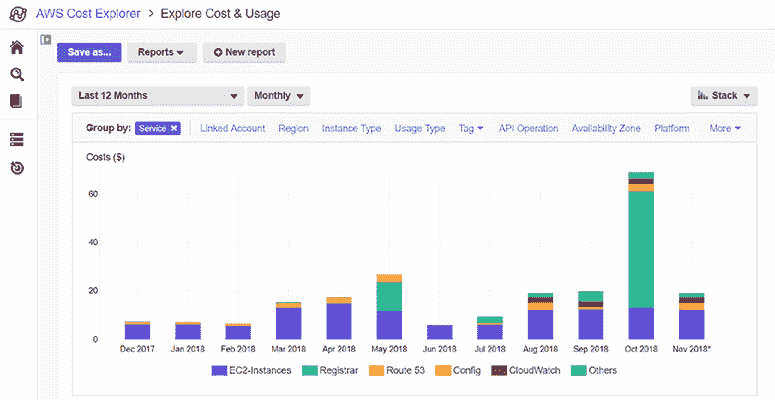

**FIGURE 6.19** Cost and usage report showing monthly costs grouped by service 

除了自定义报表外，Cost Explorer 还提供以下五个默认费用与使用情况报告：

**Monthly costs by service** 显示过去六个月中费用最高的前五个服务。前五个服务分别绘制图表，其他服务则聚合为单个柱状图显示。


### Monthly costs by linked account
显示过去六个月中费用最高的前五个关联账户。前五个关联账户分别绘制图表，其余账户聚合为单个柱状图显示。

### Monthly EC2 running hours costs and usage
显示 EC2 实例的月度费用和运行时长的两个图表。

### Daily costs
显示过去六个月的月度消费及当月预测。

### AWS marketplace
随着您将在章节 7 “核心计算服务” 中了解，AWS Marketplace 允许供应商通过 AWS 向您提供产品和服务。许可证、订阅和使用费用打包在一起并通过 AWS 账单结算。该报告展示您在 AWS Marketplace 解决方案上的总支出。

### 预留报告

Cost Explorer 提供以下两个内置预留报告，帮助您了解通过实例预留能节省多少成本，或本可节省多少成本。实例预留允许您通过预付计算实例（包括 Amazon EC2、Amazon Elasticsearch Service、Amazon ElastiCache、Amazon RDS、Amazon Redshift）来节省成本。您将在章节 7 中了解更多关于预留实例的信息。

#### 预留实例利用率

预留实例（RI）利用率报告显示您使用预留实例的百分比以及通过使用预留实例节省或超支的金额。该报告还会展示预留实例带来的净节省，帮助您判断是否预留实例数量过少或过多。Figure 6.20 提供了一个六个月时间范围的示例利用率报告。

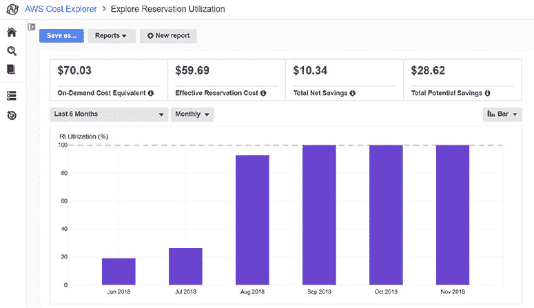

**FIGURE 6.20** RI Utilization report 

#### 预留实例覆盖率

预留实例覆盖率报告告知您有多少运行的实例小时数被预留实例覆盖，您为 on-demand 实例支付的金额，以及如果购买预留实例可以节省多少成本。Figure 6.21 展示了过去 12 个月的预留覆盖率图表，以及平均覆盖率百分比和总 on-demand 成本。

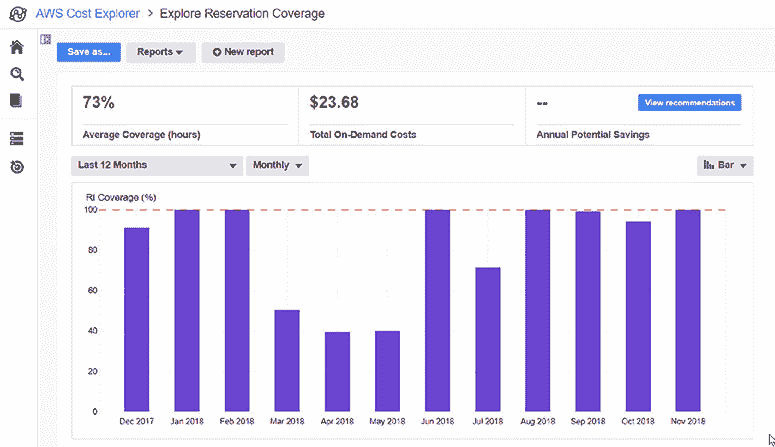

**FIGURE 6.21** RI Coverage report 

### 预留实例推荐

- [费用 Explorer](https://aws.amazon.com/cn/cost-management/aws-cost-explorer/) 可提供保留实例推荐，帮助降低成本。其工作原理如下：费用 Explorer 分析过去 7 天、30 天或 60 天的按需实例使用情况。然后，它会查找所有可用的保留实例，以覆盖这些使用情况。最后，它会选择最具成本效益的保留实例并进行推荐。
- 费用 Explorer 为每个服务（如 EC2 或 RDS）单独提供推荐。您还可以通过选择保留实例期限和付款方式来自定义推荐。
- 请记住，在生成保留实例推荐时，费用 Explorer 会忽略已被保留实例覆盖的使用情况。因此，如果您的实例已完全被保留实例覆盖，费用 Explorer 将不会提供任何推荐。

 费用 Explorer 至少每 24 小时更新一次报告数据。

## 摘要

开始时，您大部分时间会使用 AWS 管理控制台与 AWS 交互。它会不断变化，但即使变化，AWS 也会尽力通知您变更的内容。有时 AWS 会让您在功能正式上线前预览新控制台特性，从而让您在正式发布前有机会调整。

随着您使用 AWS 的频率增加并更熟悉服务，您会开始使用 AWS 命令行界面（CLI）来执行许多常见任务。AWS CLI 是脚本化 AWS 任务和大批量收集 AWS 资源信息的必备工具。

CloudWatch 收集 AWS 服务的指标。您可以创建告警，当指标超过阈值时触发操作（如通知）。CloudWatch 接收并存储 AWS 与非 AWS 服务的日志，并可通过指标过滤器从这些日志中提取指标。

CloudTrail 记录发生在您 AWS 账户中的事件。默认情况下，CloudTrail 事件历史记录日志会在每个区域保留最近 90 天的管理事件。如果您想记录更多或自定义要记录的事件，需要创建一个 trail 来让 CloudTrail 将事件存储在 S3 桶中。您还可以配置 trail 将日志流式传输到 CloudWatch Logs 以便存储、查看和搜索。

### 考试要点

**了解何时使用 AWS 管理控制台与 AWS CLI。** 当您需要使用点击式界面并希望查看诸如 CloudWatch 图表或费用 Explorer 图表等可视化元素时，需要使用管理控制台。您可以使用根账户的电子邮件地址和密码登录管理控制台。如果您以 IAM 用户身份登录，则需要账号别名或编号、IAM 用户名以及密码；若已开启 MFA，则会提示输入一次性验证码。AWS CLI 用于手动从命令行或脚本管理 AWS 资源。它适用于需要大量重复或批量操作且在 Web 上耗时较长的任务。使用 CLI 需要访问密钥 ID 和密钥。

**了解如何使用资源标签和资源组。** 资源标签是关联到 AWS 资源的键。键可选填充值。您可以使用标签按您喜欢的方式（如所有者、业务单元或环境）对资源进行标记。您可以根据资源标签或 CloudFormation 堆栈对资源分组为资源组。

**能够识别 CloudWatch 的使用场景。** CloudWatch 可收集 AWS 与非 AWS 服务的日志和指标。许多 AWS 服务（如 EC2）会自动向 CloudWatch 发送指标数据。您可以创建告警，当指标超过或低于阈值时触发操作，如通过 SNS 发送通知，或通过 Auto Scaling 或 EC2 操作执行相应动作。您还可以绘制指标以直观查看趋势。CloudWatch Logs 让您聚合并搜索日志文件。VPC、Route 53 等服务可配置将日志流式传输到 CloudWatch Logs，并使用指标过滤器从中提取指标。CloudWatch 事件可在特定 AWS 资源事件（如启动 EC2 实例或创建 S3 桶）发生时触发操作。与基于指标阈值的告警不同，CloudWatch 事件响应特定的 API 操作。

**了解开发与 AWS 集成的应用程序的选项。** AWS 为多种编程语言和平台提供 SDK。您可以使用 SDK 快速开发桌面、服务器、Web 或移动应用，并调用 AWS 服务。虽然许多 AWS 服务提供基于 HTTPS 的 AWS Query API，您可以直接与之交互，但 SDK 会处理请求认证、序列化和连接管理的繁重工作，从而让您无需深入了解每个 AWS 服务的细节即可编写应用。

**了解 CloudTrail 的功能以及它与 CloudWatch 的区别与集成。** CloudTrail 记录账户中的管理和数据操作日志。默认情况下，它会在每个区域保留最近 90 天的管理事件。如果您需要记录更多或自定义要记录的事件，可以创建一个 trail 并将事件存储到 S3 桶中。您还可以选择将 CloudTrail 日志流式传输到 CloudWatch 以便存储、搜索和分析。

## 复习题

1. 哪些凭证可以用于登录 AWS 管理控制台？

    1. `Access key ID`
    2. `Account alias`
    3. `Account ID`
    4. `Identity and Access Management (IAM) username`

2. 您在 AWS 管理控制台的会话最长可保持活动多长时间？

    1. `6 hours`
    2. `12 hours`
    3. `8 hours`
    4. `24 hours`
    5. `15 minutes`

3. 在以根用户身份登录 AWS 管理控制台查看 EC2 服务控制台时，发现所有实例均不见了。可能的原因是什么？

    1. `您已在导航栏中选择了错误的区域。`
    2. `您没有查看权限。`
    3. `您已在导航栏中选择了错误的可用性区。`
    4. `您没有访问密钥。`

4. 关于资源标签，下列哪项是正确的？

    1. `它必须在账户内唯一。`
    2. `它不区分大小写。`
    3. `它必须拥有键。`
    4. `它必须拥有值。`

5. 使用 AWS 命令行界面（CLI）需要满足什么条件？

    1. `密钥`
    2. `IAM 用户`
    3. `对 TCP 端口 80 的出站网络访问`
    4. `Linux`

6. 哪些是 Windows 10 上安装 AWS CLI 的选项？（选择两项）

    1. `MSI 安装程序`
    2. `AWS 软件开发套件（SDK）`
    3. `Yum 或 Aptitude 包管理器`
    4. `使用 Python 和 pip`

7. 安装完 AWS 命令行界面后，使用它安全管理 AWS 资源之前应先执行什么操作？

    1. `运行 aws --version 命令。`
    2. `运行 aws configure 命令。`
    3. `重启。`
    4. `为根用户生成新的访问密钥 ID 和密钥。`

8. AWS CLI 支持哪种输出格式？

    1. `制表符分隔值（TSV）`
    2. `逗号分隔值（CSV）`
    3. `JavaScript 对象表示法（JSON）`
    4. `以上都不是`

9. 哪些编程语言有 AWS SDK 可供使用？（选择三项）

    1. `Fortran`
    2. `JavaScript`
    3. `JSON`
    4. `Java`
    5. `PHP`

10. 哪些 SDK 可让开发者编写可在 Apple 和 Android 设备上同时运行的移动应用？（选择两项）

     1. `AWS Mobile SDK for Unity`
     2. `AWS Mobile SDK for .NET and Xamarin`
     3. `AWS SDK for Go`
     4. `AWS Mobile SDK for iOS`

11. 哪些以下编程语言有 AWS 物联网 (IoT) 设备软件开发套件 (SDK)？(选择 TWO.)

     1. `JavaScript`
     2. `C++`
     3. `Swift`
     4. `Ruby`

12. AWS 命令行界面 (CLI) 和 AWS 软件开发套件 (SDK) 有什么区别？(选择 TWO.)

     1. AWS SDKs 允许你使用流行的编程语言编写与 AWS 服务交互的应用程序。
     2. AWS CLI 允许你从终端与 AWS 服务交互。
     3. AWS SDKs 允许你从终端与 AWS 服务交互。
     4. AWS CLI 允许你使用流行的编程语言编写与 AWS 服务交互的应用程序。

13. 哪些以下 CloudWatch 功能存储来自 AWS 服务的性能数据？

     1. `Logs`
     2. `Metrics`
     3. `Events`
     4. `Metric filters`
     5. `Alarms`

14. 对于以下哪些场景可以创建 CloudWatch 警报以发送通知？

     1. 一个在 24 小时内保持不变的指标
     2. EC2 实例的终止
     3. 网页服务器日志中出现特定 IP 地址的情况
     4. 一个超过给定阈值的指标

15. 哪些以下 Simple Notification Service (SNS) 协议可以用于发送通知？(选择 TWO.)

     1. `短信服务 (SMS)` 文本消息
     2. `CloudWatch Events`
     3. `简单队列服务 (SQS)`
     4. `移动拉取通知`

16. 关于 CloudWatch Events，以下哪些是正确的？(选择 TWO.)

     1. 当日志文件中出现错误时，可以重启 EC2 实例。
     2. 当 EC2 实例的 CPU 利用率超过 90% 时，可以发送 SNS 通知。
     3. 当 IAM 用户登录到 AWS 管理控制台时，可以发送 SNS 通知。
     4. 可以在特定时间关闭 EC2 实例。

17. 哪些以下操作会触发 API 动作？(选择 TWO.)

     1. 配置 AWS 命令行界面 (CLI)
     2. 从 AWS 管理控制台查看 S3 桶
     3. 登录到 AWS 管理控制台
     4. 从 AWS 命令行界面 (CLI) 列出 IAM 用户

18. 最具成本效益的方式来查看并搜索仅保留最近 60 天的管理 API 事件是什么？

     1. 使用 `CloudTrail` 事件历史记录。
     2. 创建一个 trail。
     3. 将 `CloudTrail` 日志流式传输到 `CloudWatch`。
     4. 使用 `CloudWatch Events`。

19. 你想记录特定区域 S3 桶中每个对象的下载，并且希望保留这些日志并便于搜索。最具成本效益的做法是什么？(选择 TWO.)

     1. 将 `CloudTrail` 日志流式传输到 `CloudWatch Logs`。
     2. 使用 `CloudTrail` 事件历史记录。
     3. 启用 `CloudTrail` 记录全局服务事件。
     4. 创建一个 trail 来记录 S3 数据事件。

20. 使用 `CloudTrail` 日志文件完整性验证的好处是什么？

     1. 它允许你断言没有 `CloudTrail` 日志文件从 `CloudWatch` 中被删除。
     2. 它允许你断言没有 `CloudTrail` 日志文件从 `S3` 中被删除。
     3. 它防止未经授权的用户删除 `CloudTrail` 日志文件。
     4. 它告知 `CloudTrail` 日志文件如何被篡改。

21. 哪些以下 Cost Explorer 报告类型可以显示保留 EC2 实例的月度费用？

     1. `Reserved instance recommendations`
     2. `Reserved Instances (RI) Coverage reports`
     3. `Reserved Instances (RI) Utilization reports`
     4. `Costs and usage reports`

22. 哪些以下服务允许你购买保留实例以节省费用？

     1. `Amazon Relational Database Service (RDS)`
     2. `Lambda`
     3. `S3`
     4. `AWS Fargate`

23. 哪个 Cost Explorer 报告显示使用保留实例所节省的金额？

     1. `Daily costs`
     2. `Reservation Utilization`
     3. `Reservation Coverage`
     4. `Monthly EC2 running hours costs and usage`

24. 你过去三个月一直连续运行多个 Elasticsearch 实例。检查 Cost Explorer 中的保留实例推荐时发现没有推荐。这可能是以下哪种情况？

     1. 推荐参数基于过去七天的数据。
     2. 你未选择 `Elastic Compute Cloud (EC2)` 服务。
     3. `Cost Explorer` 不为 `Elasticsearch` 提供保留实例推荐。
     4. 你的实例已经被保留实例覆盖。
     5. 你未选择 `ElastiCache` 服务。

The Core Compute Services

**THE AWS CERTIFIED CLOUD PRACTITIONER EXAM OBJECTIVES COVERED IN THIS CHAPTER MAY INCLUDE, BUT ARE NOT LIMITED TO, THE FOLLOWING:**

* **Domain 3: Technology**
*  3.1 Define methods of deploying and operating in the AWS Cloud
*  3.3 Identify the core AWS services
* **Domain 4: Billing and Pricing**
*  4.1 Compare and contrast the various pricing models for AWS
*  4.2 Recognize the various account structures in relation to AWS billing and pricing

 

AWS 使大约三十多种最流行的 AMI 通过在“选择 Amazon 机器映像 (Choose An Amazon Machine Image) 页面的“快速开始 (Quick Start)”选项卡上轻松访问——当您在 EC2 控制台中点击“启动实例 (Launch Instance)”按钮时，您将首先看到这一页面。大多数情况下，它们属于免费使用范围。这意味着，如您在第二章“了解您的 AWS 账户”中所看到的，在账户的首年，将这些映像在轻量级实例类型上启动，将不会产生费用。


这里提供的主要 Linux 发行版大多被归类为*长期支持 (LTS)* 发行版，这意味着自其最初发布日期起，它们至少在五年内会获得安全和功能更新。对于部署规划来说，这可能是一个重要考量因素，因为您通常希望尽可能少地重建生产服务器。

即使超出免费使用范围，Ubuntu 和 CentOS 等开源操作系统的使用始终是免费的。但其他选项（如 Windows Server 和 RHEL）会产生常规*许可费用*。一旦您启动基于这些映像的实例，费用将通过您的 AWS 账户进行计费。

除了通过“快速开始”提供的通用操作系统选项外，您还可以找到针对深度学习、容器托管、.NET Core 以及 Microsoft SQL Server 优化的映像。Figure 7.1 展示了快速开始菜单中的两个列表项。请注意，这里显示了操作系统、发行版本、卷类型（在此为固态硬盘—SSD）、AMI ID 以及首选硬件架构（在此为 64 位 (x86)）。

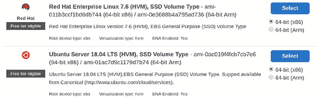

**FIGURE 7.1** A couple of EC2 AMI listings displaying features and options

## 使用 AWS Marketplace 和社区 AMI

AWS Marketplace 是由 Amazon 管理的软件商店，供应商在此处提供其产品，以已准备就绪的 AMI（或其他格式，如 CloudFormation 堆栈和容器）供 AWS 客户使用。SAP、Oracle 和 NVIDIA 等公司会将其软件解决方案打包为 AMI，通常基于某种 Linux 发行版。

当您选择 Marketplace AMI 时，会看到其总计费用，并细分为软件许可费和 EC2 基础设施费两部分。例如，Barracuda CloudGen Firewall AMI 在撰写时的费用为每小时 $1.68 USD 的软件许可费，以及针对 M5 Extra Large 实例类型的 $0.192 费用，总计每小时 $1.872。若在更大的 M5 Quadruple Extra Large 实例类型上运行同一 AMI，软件费用为 $5.72，实例费用为 $0.768，总计每小时 $5.72。

Marketplace AMI 通常会提供软件的有限时间免费试用，并提供降低的年度订阅费。您还可以通过 Marketplace 站点（https://aws.amazon.com/marketplace）在 EC2 启动实例界面之外查看和搜索 Marketplace 产品。

如果您在快速开始或 Marketplace 选项卡中找不到更专业的、已预装特定软件栈的映像，请参考社区 AMI 选项卡。该选项卡包含 100,000 多个可选 AMI，部分由 Canonical 等知名供应商支持，其他则由终端用户（如您）直接提供，往往缺乏正式支持。鉴于部分社区 AMI 来源非正式，您必须对所启动的 AMI 的安全性和可靠性负责。不如先通过 Exercise 7.1 了解相关流程？

## 创建自己的 AMI

您可以通过为实例创建 EBS 卷快照，然后从该快照创建映像，将任何 EC2 实例转换为 AMI。生成的映像将在 EC2 控制台的 AMI 菜单中或在“选择 Amazon 机器映像”页面的“我的 AMI (My AMIs)”选项卡中作为 AMI 使用。

但为什么呢？假设您花费了一整周时间，精心配置了一台作为公司应用服务器的实例。您做得非常出色，以至于现在想通过创建实例的精确副本来满足对应用需求的增长。一种既可行又简便的做法是：从实例创建 AMI，并在后续需要时选择该 AMI。

## 理解 EC2 实例类型

EC2 实例类型是对实例所使用的硬件资源类型的描述。例如，`t2.micro` 实例类型提供 1 GB 内存、网络连接的中等数据传输速率，以及一个 *虚拟 CPU (vCPU)*，运行在 2.5 GHz Intel Xeon 处理器上。而 `c5d.18xlarge` 实例类型则提供 72 个 vCPU，运行在 3 GHz Intel Xeon Platinum 8124M 处理器上，以及 144 GB 内存。您将使用实例类型定义来确定最适合您应用的匹配。

vCPU 是一种概念上（且略显神秘）的度量，用于描述 AWS 向您提供的计算能力。它旨在让您以多处理器 CPU 的思维方式来评估计算资源，即“越多越好”。但将单个 vCPU 的价值准确映射到实际设备上却极其困难。

总体而言，vCPU 数量和内存越多，实例性能通常越好，但这并非全部故事。EC2 提供针对不同计算任务的实例类型家族。T2、T3 和 M5 类属于 *通用型* 家庭，因其在广泛用途场景中表现出色。EC2 还提供 *计算优化*、*内存优化*、*加速计算* 和 *存储优化* 等家族。Table 7.1 列出了当时可用的实例家族和类型。请注意，此列表会不断更新，最新的完整列表始终可在这里查看：https://aws.amazon.com/ec2/instance-types/。

**TABLE 7.1** EC2 Instance Type Families (At the Time of This Writing)

| Family | Instance types |
| --- | --- |
| General purpose | A1 T3 T2 M5 M5a M4 T3a |
| Compute optimized | C5 C5n C4 |
| Memory optimized | R5 R5a R4 X1e X1 High Memory z1d |
| Accelerated computing | P3 P2 G3 F1 |
| Storage optimized | H1 I3 D2 |

总结来说，选择合适的实例类型家族有时能让您在 vCPU 和内存更少的情况下实现目标，从而降低成本。

如果法规限制或公司政策要求您只能使用物理隔离的实例，您可以请求 *专用实例* 或 *专用主机*。两者的区别是什么？专用实例是一台常规 EC2 实例，但它不与其他 AWS 客户共享物理主机，而是运行在专门为您的账户保留的隔离主机上。专用主机也提供实例隔离，并进一步允许您更精细地控制实例在主机环境中的放置和运行方式。专用主机还能简化并降低运行受许可软件的成本。专用实例和专用主机均采用按小时计费模式，并可通过按需、预留或 spot 实例进行部署（本章后续将进一步讨论）。

## 服务器存储：弹性块存储 (EBS) 与实例存储卷

与云中的其他事物一样，存储卷（存储实例的操作系统和数据）是虚拟的。在大多数情况下，这意味着支撑您的应用程序的 20 或 30（或 2,000）GB 驱动器实际上只是一个巧妙伪装的 20 或 30 GB 分区，看起来像是一个独立设备。事实上，它实际上是从一个更大的驱动器中切分出来的。剩余的驱动器空间去哪了？它可能正被其他 AWS 客户运行的实例所使用。

一些实例类型仅支持 Elastic Block Store（EBS）卷，其他实例则从实例存储卷获取存储，而有些可以同时处理两者。

### Amazon Elastic Block Store

实际存在的 EBS 卷所在的物理驱动器可能离提供实例生命力的物理服务器相当远。与物理驱动器通过 SATA 线直接连接到主板的方式不同，EBS 卷通过数据中心跨越的超低延迟网络与您的实例通信。

尽管 EBS-EC2 响应速度很快，但仍不如 EC2 实例存储卷的体验好。那么 EBS 提供了什么来进行补偿？

* 与实例存储不同，EBS 卷上的数据会在关机和系统崩溃后仍然保留。这对于数据持久化的工作负载来说可能是一个因素。
* EBS 卷可以加密，这在处理敏感数据时可以产生巨大差异。
* EBS 卷可以移动、挂载到其他实例上，并如您所见，可转换为 AMI。

### Amazon EC2 Instance Store Volumes

与 EBS 不同，支持实例存储卷的实例类型可以享受将数据存储在直接连接到物理实例服务器的物理驱动器上的好处。实例存储卷的缺点（临时数据、无加密、缺乏灵活性）通过更快的读写速度得到补偿。这对于处理和分析快速移动的数据流很有用，且数据本身不需要持久化。

## 理解 EC2 定价模型

您为 EC2 实例支付的费用取决于您消费服务的方式。以下是 EC2 提供的消费选项。

### On-Demand Instances

最贵的定价层是 On-Demand，您需为实例运行的每小时付费，无论是否实际使用。根据实例类型和运行的 AWS 区域，费用可能低至 $0.0058/小时（约半美分）的 `t2.nano`，也可达 $24.48/小时 的 `p3.16xlarge`。

On-Demand 适合需要短时间内 uninterrupted 运行的工作负载。例如，您可以提前调度 On-Demand 实例以应对流量激增——比如您的电商网站举办一天 50% 折扣促销。但如果您 24/7 运行实例数月，而实际只需要几小时，这将花费远超其价值。此时，请考虑其他定价模型。

### Reserved Instances

如果您的应用需要连续运行超过一个月，通常购买 Reserved Instance 更划算。实际上，您很难找到短于 12 个月的可用预留期限。一年或三年期始终可用。

事实证明，购买预留时，您并未购买任何实例本身，而是向 AWS（或正在出售他们不再使用的预留权的其他 AWS 客户）支付 *使用* EC2 实例的 *权利*，在预留期限内以指定成本运行实例。一旦拥有预留，它会自动应用于在指定 AWS 区域且匹配预留实例类型的任何实例上。

预留实例采用 *All Upfront*、*Partial Upfront* 或 *No Upfront* 支付方式。预期越早全额付款，整体成本越低。

### Spot Instances

对于不需要持续运行且能容忍意外关闭的工作负载，在 EC2 Spot 市场请求实例可能是最经济的选择。AWS 会将闲置计算容量以高达 90% 的折扣提供。其代价是，仅需两分钟的通知，容量即可被 reclaim 并关闭您的实例。

这对需要持久性和可预测性的典型用例不适用，但对于特定类别的容器化大数据工作负载或测试/开发环境非常合适。

Spot 部署还可以通过定义容量和定价需求来自动化，作为 *spot fleet* 的一部分。Spot 实例还可以被纳入复杂的多层次操作，深度集成到其他自动化和部署编排工具中。[`aws.amazon.com/ec2/spot/`](https://aws.amazon.com/ec2/spot/) 页面提供了有用的背景信息和链接。

为什么不按照 Exercise 7.2 的步骤，从头到尾配置并启动一个实际的 EC2 On-Demand 实例呢？

## 通过托管服务简化部署

构建和管理软件应用可能很复杂，无论部署在何处——本地或云端，您都会面临众多相互关联的环节，它们必须和谐工作，否则整个系统可能崩溃。为降低云端入门门槛，一些 AWS 服务会处理底层基础设施，让您专注于应用需求。托管服务的好处有时会被高额费用抵消，但通常仍然非常值得。

托管服务的一个重要例子是 Relational Database Service (RDS)。RDS 如第 9 章 “核心数据库服务” 所述，允许您为所选数据库引擎设置基本配置参数，并提供一个端点地址供您的应用连接。它还会 invisibly 处理所有细节。除了负责顶层配置决策外，您无需担心维护数据库实例、软件更新或数据复制。

比托管服务更进一步的是托管 *部署*，它会在后台处理 *整个堆栈*。您只需提供应用代码，或如果您要部署的是网站，则提供内容。在 Amazon 能够秘密倾听您的组织会议并自动将想法转换为代码且您不知情之前，事情不太可能变得比这更简单。

两个专为托管部署设计的 AWS 服务是 Amazon Lightsail 和 AWS Elastic Beanstalk。

### Amazon Lightsail

Lightsail 被推广为进入 Amazon 云世界的低压力方式。它提供 *blueprints*，启动时会自动配置所需的计算、存储、数据库和网络资源，使部署即可运行。您选择所需的定价层级（当前费用约为每月 $3.50 至 $160 USD），并可选添加一个启动脚本，该脚本会在实例启动时运行。AWS 将全部管理。例如，$3.50 可为您提供 512 MB 内存、1 个 vCPU、20 GB SSD 存储卷以及 1 TB 数据传输。

Lightsail 使用与前面章节中所示的 AMIs 和实例等相同的工具，将您的计划转化为现实。由于整体都是 AWS，如果您以后决定直接将堆栈移到 EC2，您也将拥有该平台特有的所有附加访问权限和灵活性。

由于这些功能打包在蓝图中，您不会像使用 EC2 本身那样拥有无限的部署工具范围。但从这些列表中可以看出，仍然有不错的选择：

* **操作系统：** `Amazon Linux`、`Ubuntu`、`Debian`、`FreeBSD`、`OpenSUSE` 和 `Windows Server`
* **应用程序：** `WordPress`、`Magento`、`Drupal`、`Joomla`、`Redmine` 和 `Plesk`
* **堆栈：** `Node.js`、`GitLab`、`LAMP`、`MEAN` 和 `Nginx`

 如果您好奇，LAMP 堆栈是基于 Linux、Apache、MySQL（或 MariaDB）和 PHP（或 Python）构建的 Web 服务器。相比之下，MEAN 是一个用于动态网站的 JavaScript 堆栈，由 MongoDB、Express.js、AngularJS（或 Angular）和 Node.js 组成。

### AWS Elastic Beanstalk

如果非要比较，Elastic Beanstalk 比 Lightsail 更简单。您只需要做两件事：定义应用平台，然后上传您的代码。就这么简单。您可以在预配置环境（包括 Go、.NET、Java、Node.js 和 PHP）以及若干 Docker 容器环境之间进行选择。Docker 应用的“代码”使用特别格式的 `Dockerrun.aws.json` 文件来定义。

与两者的关键区别在于计费方式：Lightsail 按固定月费计费（介于 $3.50 到 $160 之间），而 Beanstalk 按资源消耗量计费。您无法自行选择使用多少 vCPU 或多少内存。相反，您的应用会根据需求自动扩展资源消耗。例如，如果您的 WordPress 站点突然走红并吸引数百万访客，AWS 会在后台无声地扩展基础设施以满足需求；需求下降时，基础设施也会相应缩减。请记住，这种需求波动直接决定了您每月的账单。

## 部署容器和无服务器工作负载

即使是虚拟化服务器（如 EC2 实例）也往往资源消耗较大。它们实际上相当于在完整操作系统之上运行的独立机器，这意味着在同一台物理主机上运行 5 甚至 10 个虚拟服务器会产生显著的重复开销，因为每个实例都需要自带操作系统内核和设备驱动。

### 容器

*容器技术*（如 Docker）通过让单个容器共享物理主机的 Linux 内核来大幅降低上述开销。它们还能在同一主机上与其他容器共享常用元素（称为 *层*）。这使得 Docker 容器加载和执行更快，并且可以在单一硬件平台上容纳更多容器工作负载。

您仍然可以启动一个或多个 EC2 实例，安装 Docker 并运行所需的容器数量。但让所有组件相互通信可能会很复杂。相反，您可以使用 *Amazon Elastic Container Service* (`ECS`) 或 *Amazon Elastic Container Service for Kubernetes* (`EKS`) 来通过 EC2 资源编排 Docker 容器的集群。这两项服务会为您管理底层基础设施，让您免于处理繁琐细节，专注于 Docker 本身的管理。

**`ECS` 与 `EKS` 的区别是什么？** 广义上，它们的大致目标相同。但 EKS 通过使用流行的开源 Kubernetes 编排工具实现，两者是不同的路径，却指向同一目的地。

### 无服务器函数

无服务器计算模型的资源占用足迹比容器还要小。不仅 *无服务器函数* 不需要自己的操作系统内核，它们还会在需要时“即时”出现、执行任务，然后在几秒或更短时间内迅速销毁。

从表面上看，Amazon 的无服务器服务——AWS Lambda——与 Elastic Beanstalk 类似：您通过设定运行时环境（如 Node.js、.NET 或 Python）并上传代码来定义函数。但与 Beanstalk 不同，Lambda 函数只有在被预设事件触发时才会运行，例如来自移动应用的调用、对其他 AWS 资源（如 S3 桶）的更改，或基于日志的警报。

如果一段时间内没有任何触发，Lambda 不会启动函数（也不会产生费用）。如果有千个并发执行，Lambda 会自动扩展以满足需求。Lambda 函数是短暂的：它们会在 15 分钟后超时。

## 总结

配置 EC2 实例的设计旨在模拟本地服务器的预配置和启动过程。实例由您选择的 AMI、实例类型、存储卷以及计费模型决定。

AMI 分为四类：Quick Start、自定义（My AMIs）、AWS Marketplace 和 Community。您可以基于 EC2 实例的 EBS 卷快照创建自己的 AMI。

EC2 实例类型针对特定应用需求设计，并提供不同规模的优化选项。

EBS 存储卷可加密，使用灵活，类似于物理硬盘；而实例存储卷位于与实例所在的物理服务器相同的位置，因此读写性能更快，且在某些场景下更安全。使用哪种存储通常取决于您选择的实例类型。

### 考试要点

**了解启用 EC2 实例所需的要素。** 实例需要基础操作系统（AMI），可选的应用堆栈、用于硬件配置的实例类型，以及用于存储的 EBS 或实例卷。

**了解 EC2 AMI 的来源、定价和可用性。** Quick Start 和 Marketplace AMI 由 Amazon 或认可的第三方供应商支持，而 Community 集合中的 AMI 可能不具备此支持。无论如何，您应确认使用特定 AMI 是否会产生除正常 EC2 使用费以外的额外费用。


**了解 EC2 实例类型如何决定计算能力。** 实例类型分为 *family*（家族），每个家族专注于特定功能细分（通用、计算优化、内存优化、加速计算、存储优化）。您的应用需求和预算将决定选择哪种实例类型。

**了解 EBS 与实例存储卷的区别。** EBS 卷功能多样（例如可转换为 AMI），并在实例停机后仍然可用；实例存储卷提供更快的读写速度且在某些用途上更安全。您选择的存储类型通常取决于所选实例类型。

**了解 EC2 计费模型的区别。** 按需计费是最贵但最灵活、可靠的方式（您可控制实例的启停），适合短期、不可中断的工作负载。预留实例适合需要长时间运行的实例，例如电商网站，能显著降低成本。Spot 实例最便宜，但只能在提前两分钟的警告下被 shut down。

进入`/path/to/xxx`目录，找到`xxx.json`。

在表达式`cvar = avar + bvar`中，加法运算符（`+`）将`avar`与`bvar`相加，得到它们的和`cvar`

在`List.of(arg0, arg1, arg2)`中，`List`接口的工厂方法`of()`接受一系列的元素，返回包含它们的只读列表。

之后我们这样调用`cmd`命令：`cmd arg0 arg1 arg2`。

```
if (condVar > someVal) {console.log("xxx")}
```

## Chapter 8 The Core Storage Services

**THE AWS CERTIFIED CLOUD PRACTITIONER EXAM OBJECTIVES COVERED IN THIS CHAPTER MAY INCLUDE, BUT ARE NOT LIMITED TO, THE FOLLOWING:**

*   **Domain 2: Security**

*   ** 2.2 Define AWS Cloud security and compliance concepts**

*   ** 2.3 Identify AWS access management capabilities**

*   **Domain 3: Technology**

*   ** 3.1 Define methods of deploying and operating in the AWS Cloud**

*   ** 3.3 Identify the core AWS services**

 

## Introduction

For many organizations, their most valuable asset is their data. But organizations often have their data split between the cloud and on-premises locations such as offices and data centers. It’s therefore critical to understand the different options AWS provides for storing data in the cloud, transferring data between the cloud and on-premises, and doing both in a cost-effective way without sacrificing performance.

In this chapter, you’ll learn about the following AWS services that answer these challenges:

- 简单存储服务 (S3)—亚马逊的旗舰云存储服务，让您可以在全球任何时间存储和检索无限量的数据。由于它是 AWS 生态系统的一部分，S3 中的数据可供其他 AWS 服务（包括 EC2）使用，使得存储和计算可以放在一起，以实现最佳性能。

- S3 Glacier—提供长期归档 infrequently accessed data（如必须保存多年的备份）。

- AWS Storage Gateway—一种虚拟设备，无缝地在本地服务器和 AWS S3 之间来回移动数据。它使用行业标准的存储协议，使集成变得轻松。

- AWS Snowball—一种专为大规模数据物理传输到或从 S3 而设计的硬件存储设备，特别适用于通过网络传输数据需要数天或数周的情况。

### Simple Storage Service

Amazon Simple Storage Service (S3) 让您可以在全球任何地点、任何时间存储和检索无限量的数据。您可以使用 S3 存储任何类型的文件。尽管 AWS 称其为“面向互联网的存储”，但您可以实施访问控制和加密，将对文件的访问权限限制为特定个人和 IP 地址。S3 打开了各种用途，无论是内部还是 AWS 之外。许多 AWS 服务使用 S3 存储日志或检索数据以进行处理，例如分析。您甚至可以使用 S3 主机静态网站！

### Objects and Buckets

S3 与在第 7 章“核心计算服务”中学习的弹性块存储 (EBS) 不同。它不存储原始数据块，而是存储文件，AWS 称之为 `objects`，存放在 AWS 数据中心的磁盘上。您可以存储任何类型的文件，包括文本、图片、视频、数据库文件等。每个对象的大小可达 5 TB。

对象的文件名称为 `key`，长度可达 1,024 字节。对象 `key` 可以包含字母数字字符以及以下特殊字符：

```
! - _ . * ( )
```

S3 将对象存储在一个称为 `bucket` 的容器中，它本质上是一个扁平的文件系统。一个 `bucket` 可以存储无限数量的对象。创建 `bucket` 时，必须为其分配一个在 3 到 63 个字符之间的名称，并且该名称在 AWS 全局范围内必须唯一。在同一个 `bucket` 内，每个对象 `key` 必须唯一。其原因之一是便于通过 S3 端点 URL 访问对象。例如，名为 `benpiper` 的 `bucket` 中存储的 `text.txt` 对象的 URL 为 `https://benpiper.s3.amazonaws.com/text.txt`。

 为确保创建 `bucket` 时名称全局唯一，建议使用带有随机字符串的友好名称。

尽管 `bucket` 名称必须全局唯一，每个 `bucket`（及其包含的对象）只能存在于一个 region 中。这有助于降低延迟、提高安全性、控制成本并满足合规要求，因为数据仅保存在创建 `bucket` 的 region 内。您可以使用跨区域复制 (cross-region replication) 将对象从一个 `bucket` 复制到另一个 `bucket`，但对象仍然是独立的、唯一的实体。AWS 永不在 region 之间移动对象。

尽管 S3 作为扁平文件系统，但您可以通过在名称中包含前斜杠 (/) 分隔符来组织对象的文件夹结构。例如，您可以在同一个 `bucket` 中创建名为 `production/database.sql` 的对象和名为 `development/database.sql` 的对象。由于分隔符是名称的一部分，对象仍然是唯一的。

正如您所期待的，S3 会产生费用。上传数据到 S3 不收费，但下载数据时可能会产生费用。例如，在 US East 区域，您每月可以免费下载最多 1 GB 的数据。超过此限额后，费用为每 GB $0.09 或更低。S3 还会根据您存储的数据量和使用的存储类别收取月费。

### S3 Storage Classes

并非所有数据都相同。根据其重要性，某些文件可能需要更高或更低的可用性或防止丢失的保护。一些数据存储在 S3 中是不可替代的，丢失它将是灾难性的。例如数字照片、加密密钥和医疗记录。

#### Durability and Availability

需要保持完整且不被 inadvertent 删除或损坏的对象需要高 `durability`，即在一年内对象不会丢失的概率。存储介质的耐久性越高，丢失对象的可能性越低。

为了理解耐久性的工作原理，请参考以下两个示例。第一种情况：在耐久性为 99.999999999% 的存储介质上存储 100,000,000,000 个对象，意味着一年内仅有 0.000000001% 的概率丢失一个对象！另一种情况：在耐久性仅为 99.99% 的存储介质上存储相同数量的对象，则每年可能丢失 10,000,000 个对象！

不同数据对 `Availability`（可用性）的需求也不同。例如，患者的医疗记录需要全天候、365 天可用。这类记录需要高耐久性和高可用性。

对象的耐久性和可用性取决于其存储类。S3 提供六种不同的存储类，价格也不同。表 8.1 列出了所有存储类。

**TABLE 8.1** S3 Storage Classes

| Storage Class | Durability | Availability | Availability Zones | Storage Pricing in the US East Region (per GB/month) |
| --- | --- | --- | --- | --- |
| `STANDARD` | 99.999999999% | 99.99% | >2 | $0.023 |
| `STANDARD_IA` | 99.999999999% | 99.9% | >2 | $0.0125 |
| `INTELLIGENT_TIERING` | 99.999999999% | 99.9% | >2 | Frequent access tier: $0.023, Infrequent access tier: $0.0125 |
| `ONEZONE_IA` | 99.999999999% | 99.5% | 1 | $0.01 |
| `GLACIER` | 99.999999999% | Varies | >2 | $0.004 |
| `REDUCED_REDUNDANCY` (RRS) | 99.99% | 99.99% | >2 | $0.024 |

唯一的例外将在下一节中说明，您通常希望获得最高可用的耐久性。选择存储类时，关键在于您希望的可用性程度，这取决于您需要多频繁地访问文件。您可以将文件分为以下三类访问模式：

*   Frequently accessed objects（频繁访问的对象）

*   Infrequently accessed objects（ infrequently 访问的对象）

*   A mixture of frequently and infrequently accessed objects（频繁和 infrequently 访问对象的混合）

#### Storage Classes for Frequently Accessed Objects

如果您需要频繁访问对象且延迟极低，以下两种存储类符合要求：

`STANDARD` 这是默认存储类，提供最高的耐久性和可用性，对象始终在至少三个可用性区 (Availability Zones) 中复制。

`REDUCED_REDUNDANCY` (RRS) 存储类用于可以轻松替换的数据，如果需要替换也可以轻松恢复。它的耐久性最低，但可用性与 `STANDARD` 相同。AWS 不推荐使用此存储类，但保留它以便于依赖它的现有流程。如果您看到有人使用它，不妨建议他们迁移到耐久性更高的存储类！

两种设计用于 infrequently（频繁未访问）访问对象的存储类以 “IA” 初始缩写命名。这些 IA 类提供毫秒级延迟访问和高耐久性，但可用性是所有类中最低的。它们专为至少 128 KB 大小的对象设计。你可以存储更小的对象，但每个对象的计费方式相当于 128 KB：

`STANDARD_IA` 该类用于重要且无法重新创建的数据。对象存储在多个可用性区域（Availability Zones），可用性为 99.9%。

`ONEZONE_IA` 使用该存储类的对象仅保存在单个可用性区域中，因而拥有所有类中最低的可用性：仅 99.5%。单个可用性区域的故障可能会影响该区域内的对象可用性。虽然概率很低，但可用性区域的毁灭可能导致该区域内对象的丢失。仅在数据可重新创建或已在其他位置复制的情况下使用该类。

`GLACIER` 类用于长期归档几乎不需要检索的对象。对象通过 S3 Glacier 服务存储，后文将详细说明。与其他存储类不同，你无法实时检索 Glacier 中的对象；必须发起恢复请求并等待恢复完成。恢复所需时间取决于所选的检索选项，可从 1 分钟到 12 小时不等。因此，Glacier 中存储的数据可用性随检索选项而变化。请参阅本章后的 “S3 Glacier” 部分，获取检索选项的详细信息。

#### 既适用于频繁访问又适用于 infrequently 访问对象的存储类

S3 目前仅提供一种设计用于同时适用于频繁访问和 infrequently 访问对象的存储类：

`INTELLIGENT_TIERING` 该存储类会根据过去的访问模式自动将对象移动到最具成本效益的存储层。未连续 30 天访问的对象会移动到低成本的 infrequent access 层；一旦对象被访问，它会被移回频繁访问层。注意，128 KB 以下的对象始终按较高成本的频繁访问层费率计费。除了存储费用外，还会收取每月监控和自动化费用。

### 访问权限

S3 是面向互联网的存储，但这并不意味着互联网上的每个人都能读取你的数据。默认情况下，你上传到 S3 的对象对 S3 账户外部的任何人都不可见。

S3 提供以下三种控制谁可以读取、写入或删除存储在你 S3 桶中对象的方法：

*   桶策略（Bucket policies）

*   用户策略（User policies）

*   桶和对象访问控制列表（Bucket and object access control lists）

#### 桶策略

桶策略是一种基于资源的策略，你将其应用于桶。你可以使用桶策略授予桶内所有对象的访问权限，或仅限定特定对象。你还可以控制哪些主体（principal）和账户可以读取、写入或删除对象。你还可以授予匿名读取权限，使网页或图片等对象可供全球任何人访问。

#### 用户策略

在第 5 章 “保护你的 AWS 资源” 中，你学习了身份和访问管理（IAM）用户策略。你可以使用这些策略授予 IAM 主体对 S3 对象的访问权限。与桶策略不同，用户策略只能应用于 IAM 主体，不能用于授予对象的公开（匿名）访问。

#### 桶和对象访问控制列表

桶和对象访问控制列表（ACL）是大多数情况下已被桶和用户策略取代的旧式访问控制方法。尽管如此，你仍可使用桶和对象 ACL 向其他 AWS 账户和匿名用户授予对 S3 资源的访问权限。但你无法使用 ACL 向特定 IAM 主体授予访问权限。由于此限制，AWS 建议在可能的情况下优先使用桶和用户策略而非 ACL。

你可以使用桶策略、用户策略和访问控制列表的任何组合，它们并非互斥。

### 加密

S3 在上传对象时不会修改对象内容。这意味着如果你上传包含个人信息的文档，该文档将以未加密状态存储。通过适当的访问权限，你可以防止未授权的访问，但为了在数据安全性上再增加一层保护，你可以在将对象存储到 S3 之前对其进行加密。这称为 *encryption at rest*（静态加密）。S3 为静态加密提供以下两种选项：

*   服务器端加密（Server-side encryption）— 创建对象时，S3 对对象进行加密并仅保存加密内容。检索对象时，S3 解密并交付未加密的对象。服务器端加密最易实现，且无需自行管理加密密钥；Amazon 管理密钥，因此拥有访问权限。

*   客户端加密（Client-side encryption）— 在上传到 S3 之前，你对数据进行加密。检索时需要自行解密。此选项更为复杂，因为你需负责加密和解密过程；如果丢失用于加密的密钥，则无法解密该对象。安全要求严格的组织可能选择此选项，以确保 Amazon 不能读取其加密对象。

### 版本管理

为了防止重要文件被误删或覆盖，你可以启用版本管理。为了理解版本管理的工作方式，可以参考以下示例。如果不启用版本管理，上传一个与桶中已有对象相同名称的对象时，原对象的内容会被覆盖。但如果在启用版本管理的桶中上传同名对象，S3 会创建一个新版本，原始版本仍然保留并可访问。如果在未启用版本管理的桶中删除对象，对象的内容并未真正删除，而是 S3 在该对象上添加一个删除标记并将其从控制台视图中隐藏。版本管理默认在创建桶时处于禁用状态，你必须显式启用才能使用，且该设置对桶中所有对象生效。你可以存储无限数量的对象版本。你可以手动或通过生命周期配置自动删除版本。

 删除桶会同时删除桶内所有对象。请小心操作！

### 对象生命周期配置

由于 S3 可以存储几乎无限量的数据，如果你持续上传对象但从不删除，费用可能会大幅上升。例如，一个经常上传日志文件的应用可能会导致此类情况。你也可能因长期保留在较贵存储类中的对象而多花费；如果有更便宜的存储类满足需求，则可以节省成本。对象生命周期配置可以通过自动将对象移动到不同存储类或在一定时间后删除对象来帮助控制成本。

对象生命周期配置规则作用于桶，包含以下一种或两种类型的操作：

**转换操作（Transition actions）** 转换操作在对象达到一定年龄后将其移动到不同存储类。例如，你可以创建规则，在对象创建 90 天后从 `STANDARD` 存储类转到 `STANDARD_IA` 存储类。

**过期操作** 这些操作可以在对象达到特定年龄后自动删除对象。例如，您可以创建一个规则，删除一个超过 365 天的对象。如果在桶上启用了版本管理，您可以创建过期操作来删除某个特定年龄的对象版本。这使您可以在不存储无限制对象版本的情况下，利用版本管理。


通常会同时使用这两种类型的操作。例如，如果您在桶中存储 Web 服务器日志文件，可能希望最初将每个日志文件保存在 `STANDARD` 存储中。当文件达到 90 天时，您可以将其通过 S3 移动到 `STANDARD_IA` 存储。然后，在 `STANDARD_IA` 存储中保存 365 天后，文件将被删除。

按照 Exercise 8.1 的步骤创建您自己的 S3 桶。

## S3 Glacier

S3 Glacier 提供长期归档 infrequently accessed（很少访问）数据的功能，成本极低。您可以上传大量数据以实现长期、耐用的存储，希望永远用不到，但如果需要，它会在那里（在不太可能发生的情况下）。Glacier 保证在给定年份内具有 99.999999999 百分比的耐用性。这正好是 S3 中 `GLACIER` 存储类的相同耐用性水平。

### Archives and Vaults

在 Glacier 中，您存储一个或多个文件在一个 archive 中，archive 是一个信息块。虽然您可以在一个 archive 中存储单个文件，但更常见的做法是将多个文件组合成 `.zip` 或 `.tar` 文件并将其作为 archive 上传。archive 的大小可以从 1 字节到 40 TB 不等。Glacier 将 archives 存储在 vault 中，vault 是一个 region-specific（region 特定）容器（类似于 S3 桶），用于存储 archives。Vault 名称在 region 内必须唯一，但不需要全局唯一。

您可以使用 Glacier 控制台创建和删除 vault，但要上传、下载或删除 archives，必须使用 AWS 命令行接口 (CLI) 或编写自己的代码来通过 AWS 软件开发套件 (SDK) 与 Glacier 交互。此外，还有第三方程序可以让您与 Glacier 交互，例如 CloudBerry Backup (`https://www.cloudberylab.com/backup.aspx`)、FastGlacier (`https://fastglacier.com`) 和 Arq Backup (`https://www.arqbackup.com`)。

### 检索选项

由于 Glacier 设计用于长期归档，它不提供实时访问 archives 的功能。从 Glacier 下载 archive 是一个两步过程，需要先启动一个检索作业，然后在作业完成后下载数据。完成作业的时间取决于您选择的检索选项。有三种检索选项：

**Expedited** 除非在异常高需求期间，expedited 检索通常在 1 到 5 分钟内完成，尽管大于 250 MB 的 archive 可能需要更长时间。在 US East 区域，成本为每 GB `$0.03`。您可以选择购买预配置容量，以确保 expedited 检索及时完成。

**Standard** Standard 检索通常在 3 到 5 小时内完成。这是默认选项。该选项的成本为 US East 区域每 GB `$0.01`。

**Bulk** Bulk 检索是最低成本选项，在 US East 区域的成本为每 GB `$0.0025`，通常在 5 到 12 小时内完成。

## AWS Storage Gateway

AWS Storage Gateway 简化了将现有的本地服务器连接到 AWS 云存储的过程。由于它使用行业标准存储协议，无需在现有服务器上安装特殊软件。相反，您只需在本地部署一个 AWS Storage Gateway 虚拟机并将服务器连接到它。Storage Gateway 处理服务器与 AWS 存储基础设施之间的数据传输。虚拟机可以在 VMware ESXi 或 Microsoft Hyper-V 超融合程序上运行。

AWS Storage Gateway 提供以下三种虚拟机类型，适用于不同的使用场景：

* 文件网关（File gateways）
* 卷网关（Volume gateways）
* 磁带网关（Tape gateways）

### 文件网关

文件网关允许您使用 Network File System (NFS) 和 Server Message Block (SMB) 协议将数据存储在 Amazon S3 中。虽然数据存储在 S3，但它会本地缓存，从而实现低延迟访问。文件网关可以作为普通的本地文件服务器工作。由于数据存储在 S3，您可以利用 S3 的所有功能，包括版本管理、桶策略、生命周期管理、加密和跨区域复制。

### 卷网关

卷网关提供基于 S3 的存储卷，供本地服务器通过 Internet Small Computer System Interface (iSCSI) 协议使用。卷网关支持以下两种配置：

**存储卷** 存储卷会在本地存储所有数据，并异步将其作为 Elastic Block Store (EBS) 快照备份到 S3。存储卷是 1 GB 到 16 TB 大小的良好选择，适合需要 uninterrupted（无间断）访问数据的场景。存储卷大小可从 1 GB 到 16 TB。

**缓存卷** 卷网关将所有数据存储在 S3，仅将频繁使用的子集缓存在本地。缓存卷大小可从 1 GB 到 32 TB。这适合本地存储空间有限的情况。由于仅缓存子集数据，如果与 AWS 的连接中断，某些数据可能无法访问。如果这不可接受，应使用存储卷。两种配置均允许手动或计划进行 EBS 快照。EBS 快照始终存储在 S3 中。您可以将 EBS 快照还原到本地网关存储卷或可挂载到 EC2 实例的 EBS 卷上。

### 磁带网关

磁带网关模拟传统的磁带备份基础设施。它与常见的备份应用程序（如 Veritas Backup Exec、NetBackup、Commvault 和 Microsoft System Center Data Protection Manager）兼容。您只需将备份应用程序配置为通过 iSCSI 连接到磁带网关。在磁带网关上，您可以创建虚拟磁带，每个虚拟磁带的容量在 100 GB 到 2.5 TB 之间。

磁带网关将虚拟磁带存储在由 S3 支持的虚拟磁带库（VTL）中。工作流程如下：当备份软件将数据写入虚拟磁带时，磁带网关会异步将数据上传到 S3。由于备份数据量大且上传耗时，磁带网关会在上传完成前保留数据在缓存存储中。如果需要从虚拟磁带恢复数据，磁带网关会从 S3 支持的 VTL 下载数据并将其存储在其缓存中。

为了实现成本效益高的长期存储，您可以将虚拟磁带从 VTL 移动到由 Glacier 支持的虚拟磁带架（virtual tape shelf），以实现更低成本的长期存储。要恢复存档的虚拟磁带，必须发起一个检索请求，通常需要 3 到 5 小时。检索完成后，虚拟磁带将在 S3 支持的 VTL 中可用，并可传输到磁带网关。

## AWS Snowball

AWS Snowball 是一种设计用于在短时间内在本地站点和 AWS 云之间移动大量数据的硬件设备。Snowball 的常见使用场景包括：

* 将办公室或数据中心的数据迁移到 AWS 云
* 快速将大量数据转移到或从 S3 用于备份或恢复目的
* 向客户和合作伙伴分发大量内容

Snowball 的核心思想是，物理运输大量数据比通过网络传输更快。例如，假设您想将一个 40 TB 的数据库迁移到 AWS，即使通过高速的 1 Gbps 连接，也需要超过 4 天！

但相反，AWS 会按名义费用向您发送一个 Snowball 设备。您只需将文件转移到它上并将其寄回。当 AWS 收到设备后，会将文件从 Snowball 传输到一个或多个 S3 桶中。导入文件到 S3 不会产生任何传输费用，一旦上传，文件即可供其他 AWS 服务使用。

### 硬件规格

最大 80 TB 的 Snowball 设备费用为 $250，可存储高达 72 TB。如果不需要传输这么大的数据量，您可以选择稍小的 50 TB Snowball，费用为 $200，可存储高达 42 TB。Snowball 的 RJ45 和 SFP+ 网络接口支持最高 10 Gbps 的速度，使得在约 2.5 天内将 72 TB 数据传输到设备上！(虽然 10 Gbps 连接在不到一天内即可完成传输，但 Snowball 中的固态硬盘 (SSD) 的写入速度限制了实际传输速率约为 3 Gbps。)

收到 Snowball 后，您可以在 10 天内保留它而无需额外费用。如果超过 10 天，每天将额外收取 $15 的费用。您最多可保留 Snowball 90 天，足够填满设备。

 您可以使用 Snowball 导出 S3 中的数据，但会按出站 S3 传输费率计费，费用范围在每千兆字节 $0.03 至 $0.05 之间，具体取决于地区。

### 安全

Snowball 采用坚固、防篡改的外壳。它包含可信平台模块 (TPM) 芯片，用于检测对硬件、软件或固件的未经授权修改。每次使用后，AWS 会验证 TPM 是否检测到任何篡改。如果 TPM 检测到篡改或设备出现损坏，AWS 不会从该设备中传输任何数据。

Snowball 采用两层加密。第一层：在您将数据传输到或从 Snowball 时，数据在传输过程中使用 SSL 加密。第二层：Snowball 上的数据始终在静止状态下加密。Snowball 通过要求您仅使用 Snowball 客户端或更高级的 S3 SDK Adapter for Snowball 进行数据传输来强制数据加密。前者无需任何编程知识。两者均在 Linux、macOS 和 Windows 操作系统上运行。

数据使用 AES 256 位加密，由 Snowball 客户端或 S3 SDK Adapter for Snowball 强制执行，确保设备永不存储未加密的数据。为进一步提升安全，AWS 在将 Snowball 发送给另一位客户之前，会依据美国国家标准技术局 (NIST) 在特刊 800-88 中发布的媒体擦除标准，对 Snowball 上的数据进行擦除。

### Snowball Edge

Snowball Edge 类似于 Snowball，但提供更丰富的功能。Snowball Edge 具备与 Snowball 相同的网络连接选项，并增加了 QSFP+ 端口，可实现比 Snowball 更快的网络速度。此外，Snowball 仅设计用于在本地环境与 S3 之间传输大量数据，而 Snowball Edge 除此功能外，还提供：

* 本地存储用于 S3 桶
* 本地运行 EC2 实例和 Lambda 函数的计算能力
* 使用 NFS 版本 3 和 4 协议的文件服务器功能

您可以从三种设备选项中选择，每种都针对不同的应用场景优化：

**存储优化** 该选项提供最高 80 TB 可用存储、24 个 vCPU 以及 32 GB 内存，适用于计算类应用。QSFP+ 网络接口支持最高 40 Gbps。

**计算优化** 该选项提供最高计算能力，拥有 52 个 vCPU 和 208 GB 内存，以及 39.5 TB 可用存储，其中 7.68 TB 专用于计算实例。

**计算优化（带 GPU）** 该选项与计算优化完全相同，唯一区别在于加入了 NVIDIA V100 Tensor Core 图形处理单元 (GPU)，使其特别适合机器学习和高性能计算应用。两种计算优化设备均配备支持最高 100 Gbps 的 QSFP+ 网络接口。

您可以将 5 到 10 台 Snowball Edge 设备集群在一起，构建本地的高可用计算或存储集群，这对于需要本地处理大量数据的情况非常有用。

 Snowball Edge 不支持虚拟私有云 (VPC)。您不能在 Snowball Edge 上运行的 EC2 实例放入 VPC 中，而是在本地网络中为实例分配 IP 地址。

Table 8.2 突出了 Snowball 与 Snowball Edge 之间的主要相似性和差异。

**TABLE 8.2** Snowball 与 Snowball Edge 对比

| Feature | Snowball | Snowball Edge |
| --- | --- | --- |
| Transfer data to and from S3 | Yes | Yes |
| Local EC2 instances | No | Yes |
| Local compute with Lambda | No | Yes |
| File server functionality using NFS | No | Yes |
| Local S3 buckets | No | Yes |

## 摘要

S3 是 AWS 的主要存储服务。尽管 S3 与所有其他 AWS 服务集成，但它与 S3 Glacier 以及计算服务（EC2、Lambda）之间的关系尤为紧密。

为了实现耐用且高度可用的云存储，请使用 S3。您可以通过 bucket policy 将文件设置为私有或公开。如果需要长期存储成本较低、使用频率较低的数据，S3 Glacier 是最佳选择。

在本地存储方面，AWS Storage Gateway 让您通过虚拟机访问数据，该虚拟机会自动与 S3 同步。

将文件传输到或从 S3 的常见方式包括通过 Internet、虚拟私有网络 (VPN) 或 Direct Connect 链路。但对于大量数据，这些方式不切实际，硬件解决方案更为合适。Snowball 是一种坚固、防篡改的设备，AWS 会将其寄送给您。您将文件写入它，寄回后，AWS 会将文件传输到 S3。

另一种硬件选项是 Snowball Edge。它具备与 Snowball 相同的功能，还能作为使用 NFSv3 和 NFSv4 协议的持久本地文件服务器。此外，您还可以在本地运行 EC2 实例或 Lambda 函数。

### 考试要点

**理解 S3 中的持久性与可用性之别。** 持久性是指在一年内丢失对象的可能性；可用性是指在一年内对象可访问的百分比。

**根据成本、合规和可用性需求选择最佳 S3 存储类。** S3 提供六种存储类。`STANDARD` 可用性最高（99.99%），跨至少三个可用区复制对象，且是每 GB 月费用最高的存储类。`ONEZONE_IA` 可用性最低（99.5%），仅在单个可用区存储对象，其每 GB 月费用不到 `STANDARD` 存储类的一半。

**了解将数据导入和导出 S3 的不同选项。** 您可以通过 S3 控制台、AWS CLI 或直接访问对象的 URL 来上传或下载对象。AWS Storage Gateway 让本地服务器使用 iSCSI、NFS、SMB 等行业标准存储协议与 S3 进行数据传输。AWS Snowball 和 Snowball Edge 通过安全的物理方式实现数据向 S3 的导入和导出。

**了解何时使用 bucket policy、用户策略和访问控制列表 (ACL)。** 使用 bucket policy 或 ACL 来授予对象的匿名访问权限，例如希望公开的网页或图片。使用用户策略来授予特定 IAM 主体对对象的访问权限。

# 第 9 章 核心数据库服务

**本章涵盖的 AWS 认证云实践考试目标可能包括，但不限于，以下内容：**

* **领域 3：技术**
*  3.1 定义在 AWS 云中部署和运行的方法
*  3.3 识别核心 AWS 服务


## 介绍

许多应用程序使用数据库来存储、检索和组织数据，因此所选的数据库类型以及其配置对这类数据库驱动应用的性能和可用性有重大影响。

在传统基础设施中，组织通常自行安装和配置数据库服务器。例如，企业可能使用 Microsoft SQL Server 或 Oracle 数据库来存储客户信息。虽然可以在云中构建和运行自有的数据库服务器，但 AWS 提供了另一种——对于许多用户来说更优的——选择：托管数据库服务。

使用托管数据库服务时，您可以通过 AWS 管理控制台或 AWS 命令行界面 (CLI) 来创建数据库。AWS 负责数据库软件的安装和维护，以及数据库备份和复制。

在本章中，您将了解 AWS 提供的以下三种不同的托管数据库服务：

* 关系型数据库服务 (RDS)
* DynamoDB
* Redshift

## 数据库模型

一个数据库可以使用关系型或非关系型模型。您选择的模型取决于您的应用程序如何存储、组织和检索数据。重要的是要理解，应用程序的需求决定了您选择的数据库模型，而不是相反。

大多数关系型和非关系型数据库之间的技术差异超出了本书的范围，但在本章中，您将了解这两者之间的主要区别。

### 关系型数据库

关系型数据库已经存在很长时间，即使您从未创建或维护过一个，您也已经熟悉其基本概念。关系型数据库类似于包含列和行的电子表格。在关系型数据库中，列被称为`attribute`，行被称为`record`。它们都存储在`table`中，一个数据库可以包含多个表。Table 9.1 显示了一个简单的关系型数据库表可能的样子。

**TABLE 9.1** 客户表

| `Customer ID` | `Last Name` | `First Name` | `Last Purchase` |
| --- | --- | --- | --- |
| 1670 | Isaacson | Callan | 08/29/18 |
| 1680 | Ashland | Chessa | 12/15/16 |
| 1690 | Colson | Charlie | 02/20/12 |
| 1700 | Charlotte | Linda | 05/09/17 |

与电子表格一样，关系型数据库表具有定义的列数。数据库表与电子表格的区别在于，关系型数据库表中的每一行必须唯一。确保行唯一性的一种方法是定义主键——一个必须唯一且在每条记录中存在的列。在 Table 9.1 中，主键将是 `Customer ID` 列。

 主键可以由多个列组成。


另一种数据库表与电子表格的区别在于，您必须预先定义每个列可以存储的数据类型。例如，用于存储某人出生日期的列只能存储数字。由于这些要求，关系型数据库非常适合存储结构化数据，该数据遵循可预测、定义明确的格式。

存储结构化数据在关系型数据库中的优势是，您可以快速在整个数据库中搜索特定值。您还可以从不同表中检索数据并以您能想象的几乎任何格式组合这些数据。例如，您可以查找所有姓氏为 Smith 且在过去 90 天内进行过购买的客户。这种查询能力是许多应用程序开发人员选择关系型数据库的原因。关系型数据库非常适合对大数据集进行复杂分析和生成报告。这些用途需要多个复杂的查询，而关系型数据库正是在这方面表现出色。

作为规则，数据库越大，查询越复杂，检索所需数据所需的时间越长。数据库管理员经常调整或优化数据库，以确保最佳性能。更长的查询时间和增加的维护是灵活查询的代价。

### 结构化查询语言

关系型数据库使用 `Structured Query Language` `SQL`。您可以使用 SQL 语句创建数据库和表，以及读取和写入数据。您还可以使用 SQL 执行调优和维护任务。不出所料，关系型数据库通常简称为 `SQL 数据库`。

尽管您不需要知道如何使用 SQL，但您应该熟悉以下两个常见的 SQL 语句，它们经常出现在关系型数据库的讨论中。如果您想了解更多关于 SQL 的内容，可以从 [`www.w3schools.com/sql`](https://www.w3schools.com/sql/) 的 SQL 教程开始。

#### SELECT 语句

`SELECT` 语句从数据库中读取数据并控制其格式。要组合不同表中的数据，您需要在 `SELECT` 语句中添加 `JOIN` 子句。使用关系型数据库的应用程序每次从数据库检索数据时都会至少执行一个 `SELECT` 语句。

#### INSERT 语句

`INSERT` 语句将数据写入表。您可以将其视为在电子表格中向单个单元格中添加数据的程序化方式。当应用程序将数据写入数据库时，它使用 `INSERT` 语句来完成。

### 非关系型 No-SQL 数据库

关系型数据库非常流行，但由于其限制，它们也过于复杂，对于不需要存储结构化数据的应用程序来说并不适用。此外，当关系型数据库需要处理每秒成千上万次读取或写入操作时，其性能往往很差。

`非关系型数据库` 是为那些需要每秒执行数万次读取或写入操作的应用程序提供快速替代方案而开发的。除了能够处理这些高事务速率外，非关系型数据库还允许您存储没有明确、可预测结构的数据。此类数据通常称为 `非结构化数据`，与关系型数据库强加的结构形成对比。由于其非结构化的特性，非关系型或无 SQL 数据库被认为是 `无架构` 的。

非关系型数据库也使用表来存储信息；表有时被称为 `collections`，每行或记录被称为 `item`。非关系型数据库不要求您提前定义所有将要存储的数据类型。您只需提前定义一个主键，以唯一标识每个项目。例如，如果要在表中存储客户数据，您可以使用唯一的客户 ID 数字作为主键。

为了换取存储非结构化数据的灵活性，您可以对该数据执行的查询类型更受限制。非关系型数据库设计用于根据主键查询项目。由于其余数据没有遵循可预测的结构，特定数据可能在数据库的任何位置。因此，查询除主键之外的任何数据需要遍历整个表中的每个项目——随着表增长，这一过程会变得更慢。非关系型数据库最适合那些只需要执行少数明确查询的应用程序。

### Amazon Relational Database Service

`Amazon Relational Database Service` `RDS` 是 Amazon 的托管关系型数据库服务。`RDS` 让您可以配置多种流行的关系型数据库管理系统 `RDBMS`，包括 `Microsoft SQL Server`、`Oracle`、`MySQL` 和 `PostgreSQL`。

您可以在 `EC2` 实例上自行安装和配置数据库服务器。但 `RDS` 相较于这种方式有几个优势。当您创建 `RDS` 数据库实例时，Amazon 会设置一个或多个计算实例，并负责安装和配置您选择的 `RDBMS`。这些计算实例不是您可以通过 `SSH` 连接的 `EC2` 实例，但它们连接到您选择的虚拟私有云 `VPC`，使运行在 AWS 或本地数据中心的应用程序能够充分利用 `RDS` 主机数据库。与 `EC2` 实例一样，`RDS` 实例使用 `Elastic Block Service` `EBS` 卷用于存储。

为了实现所需的性能和可用性，您可以选择多可用性区 `multi-AZ` 部署，在多个可用性区中放置数据库实例。`RDS` 还可以执行手动或自动 `EBS` 快照，您可以轻松将其还原为新的 `RDS` 实例。`RDS` 还可以在预定的维护窗口期间处理安装补丁和升级的繁重工作。

### 数据库引擎

当您创建 `RDS` 实例时，必须选择数据库引擎，即将在实例上安装的具体关系型数据库管理系统 `RDBMS`。每个实例只能有一种数据库引擎，但如果需要，可以预 vision 多个实例。Amazon `RDS` 支持以下六种数据库引擎：

`MySQL`

`MariaDB`

`Oracle`

`PostgreSQL`

`Microsoft SQL Server`

`Amazon Aurora`

除 `Amazon Aurora` 外，这些数据库引擎要么是开源，要么是商业产品，在许多数据中心环境中均可获得。`Amazon Aurora` 是一种专为 `RDS` 设计的专有数据库，但它与现有的 `MySQL` 和 `PostgreSQL` 数据库兼容。使用您已熟悉的 `RDBMS` 通过 `RDS` 部署，可以极大简化从本地数据中心迁移到 `RDS` 的过程。

### 许可证

根据您选择的数据库引擎，需要在两种许可证选项中选择： `license included` 许可证已包含 或 `bring your own license` 自带许可证，BYOL：

`License included` 许可证已包含在每个 `RDS` 实例的价格中。`Microsoft SQL Server` 和 `Oracle` 数据库引擎选项提供此许可证模型。免费数据库引擎——`MariaDB`、`MySQL` 和 `PostgreSQL`——仅使用许可证已包含的模型。

`Bring your own license` 在此模型下，您必须提供自己的许可证以运行所选的数据库引擎。与许可证已包含的选项不同，此模型的许可费用并未纳入 `RDS` 定价。当前此模型仅适用于 `Oracle` 数据库。

### 实例类

即使使用 `RDS` 部署的关系型数据库，也需要进行容量规划，以确保数据库满足应用程序的可用性和性能需求。

部署 `RDS` 实例时，必须选择一个数据库实例类，该类定义了虚拟 CPU `vCPU` 数量、内存量以及实例可支持的最大网络和存储吞吐量。您可以从以下三种实例类中选择：标准 `Standard`、内存优化 `Memory Optimized` 和 bursting `Burstable` 性能。

#### 标准 Standard

标准实例类适用于大多数应用程序。最新一代标准实例类提供以下规格：

* 2 到 96 个 `vCPU`
* 8 到 384 GB 内存

#### 内存优化 Memory Optimized

内存优化实例类用于具有最苛刻数据库要求的应用程序。该类提供最高的磁盘吞吐量和网络带宽。最新一代内存优化实例类提供以下规格：

* 4 到 128 个 `vCPU`
* 122 到 3,904 GB 内存

数据库实例使用 `EBS` 存储。标准和内存优化实例类均为 `EBS` 优化，意味着它们为 `EBS` 存储的读写提供专用带宽。

#### Burstable Performance

`Burstable Performance` 实例类适用于性能要求不高的非生产数据库，例如用于测试和开发的数据库。最新一代 `Burstable Performance` 实例类具有最低的网络带宽和磁盘吞吐量，并提供以下规格：

* 2 到 8 个 `vCPU`
* 1 到 32 GB 内存

预测确切需要多少 `RDS` 实例以及每个实例所需的计算、内存、网络和存储吞吐量可能很困难。好在 `RDS` 通过以下两种方式简化了数据库部署的调整：垂直扩展和水平扩展。

### 垂直扩展

垂直扩展指的是更改特定实例的资源分配方式。创建实例后，您可以将其扩展到更强大的实例类，以增加内存或提升计算或网络性能。也可以将其实例缩小到更不强大的类别，从而降低成本。

### 存储

`RDS` 实例的性能不仅取决于所选的实例类，还取决于存储类型。新的 `RDS` 实例使用 `EBS` 卷，而卷的最大吞吐量是实例类和卷支持的 `输入/输出操作次数` `IOPS` 的函数。`IOPS` 衡量从卷中读取和写入的速度。`IOPS` 越高，读写速度通常越快。`RDS` 提供三种存储类型：通用型 SSD、已保留 `IOPS` SSD 和磁盘 `magnetic`。

#### 通用型 SSD

通用型 SSD 存储适用于大多数数据库。您可以分配 20 GB 到 32 TB 的卷。卷的 `IOPS` 数量取决于分配的存储量；存储越多，读写性能越好。

如果不确定需要多少存储，无需担心。通用型 SSD 卷可以通过一种称为 `bursting` 的过程在读取或写入活动激增时临时实现更高的 `IOPS`。在读取或写入活动剧增时，`bursting` 会自动启动，为卷提供额外的性能提升。因此，您无需为满足峰值需求而分配过多存储。

#### 已保留 IOPS SSD

已保留 `IOPS` SSD 存储允许您指定每个卷的 `IOPS` 以千为单位的确切数量。与通用型 SSD 存储一样，您可以分配最高 32 TB 的容量。但与通用型 SSD 存储不同，已保留 `IOPS` SSD 存储不支持 `bursting`，因此需要在先确定需要的最大 `IOPS` 数量。即使需求发生变化，您也可以随时调整卷的 `IOPS`。

#### 磁盘 magnetic

磁盘存储用于向后兼容旧的 `RDS` 实例。与其他存储选项不同，它不使用 `EBS`，且创建后无法更改磁盘卷的大小。磁盘卷的大小限制为 4 TB，`IOPS` 限制为 1,000。

您可以在创建后对 `EBS` 卷的大小进行扩展，而不会导致停机或性能下降。但是，您不能缩小已分配的存储量，因此请谨慎操作，避免超额配置。

您也可以在不同存储类型之间进行迁移，但这可能导致几分钟的短暂停机。从磁盘存储迁移到 `EBS` 存储的过程可能需要数天时间。在此期间，实例仍可用，但性能可能不佳。

### 使用只读复制实例水平扩展

除了通过选择更强大的实例类型或高 `IOPS` 存储来垂直扩展外，您还可以通过添加只读 `RDS` 实例来提升数据库驱动应用的性能。这些实例称为 `read replicas`。

在关系型数据库中，只有主数据库实例可以写入数据库。只读复制实例通过移除只读查询的负担，将读取操作卸载到主实例之外，从而帮助提升性能。因此，只读复制实例对需要大量读取的应用程序最为有益。只读复制实例也适用于执行计算密集型查询的场景，例如月度或季度报告，这些报告需要从数据库读取并处理大量数据。

### 通过 Multi-AZ 实现高可用性

即使使用只读复制实例，只有主数据库实例可以对数据库进行写入。如果该实例下线，数据库驱动应用程序将无法写入数据，直到实例上线。为确保您始终拥有一个可用的主数据库实例，可以在 `RDS` 实例上启用 `multi-AZ` 功能实现高可用性。

在启用多可用区 `Multi-AZ` 后，`RDS` 会创建一个名为 `standby database instance` 的附加实例，该实例运行在与主数据库实例不同的可用区中。主实例会立即或同步地将数据复制到次要实例，确保每当您的应用程序向数据库写入数据时，该数据都同时存在于多个可用区中。

如果主实例出现故障，`RDS` 会自动进行故障转移到次要实例。故障转移可能导致最长两分钟的停机，因此您的应用程序会出现一些中断，但不会丢失任何数据。

启用多可用区后，您可以期望数据库的月度可用性达到 99.95 百分比。需要注意的是，实例停机可能因不可用区故障之外的其他原因而发生。例行维护任务如修补或升级实例可能导致短暂停机并触发故障转移。

如果您使用 `Amazon Aurora` 数据库引擎——这是专为 `RDS` 设计并专属于 `RDS` 的专有数据库引擎——在使用多可用区时可以获得额外好处。使用 `Aurora` 时，您的 `RDS` 实例属于 `Aurora` 集群。集群中的所有实例共享存储卷，该卷在三个不同的可用区之间同步复制。此外，如果存储需求增加，集群卷会自动扩展至最高 64 TB。

### 备份和恢复

无论是否启用多可用区，`RDS` 都可以对实例执行手动或自动的 `EBS` 快照。快照存储在多个可用区中。如果您需要从快照中恢复，`RDS` 会将其恢复到一个新实例。这使得快照不仅适用于备份，也适用于为测试或开发目的创建数据库副本。

您可以随时创建手动快照。您可以配置自动快照在每日 30 分钟的备份窗口期间执行。`RDS` 会保留自动快照 1 日至 35 天，默认保留 7 天。手动快照保留 until 删除。

启用自动快照同时也启用了点时间恢复功能，该功能每 5 分钟保存数据库的变更日志。结合自动快照，您可以将故障实例恢复到故障发生前 5 分钟内，从而最多只丢失 5 分钟的数据。

### 确定恢复点目标 Recovery Point Objective, RPO

您需要快照 以及 多可用区吗？需要了解的是，虽然快照和多可用区都能保护您的数据库，但它们的作用略有不同。快照用于还原整个数据库实例。如果数据库出现损坏，例如恶意删除记录，快照可以让您在损坏发生数天前恢复数据，前提是您保留了相应的快照。多可用区设计用于在实例故障时保持数据库的可用性，通过向 secondary instance 同步复制数据实现此目的。

在实例故障时您能容忍丢失多少数据称为 `恢复点目标` `RPO`。如果您可以容忍丢失一小时的数据，则 `RPO` 为 1 小时。要实现此 `RPO`，仅使用带点时间恢复的自动快照即可。若要将 `RPO` 降至 5 分钟以下，则需要同时启用多可用区以同步复制数据到次要实例。

### DynamoDB

`DynamoDB` 是 Amazon 的托管非关系型数据库服务，专为需要在每秒数万次读写操作的高事务性应用设计。

#### 项目和表

`DynamoDB` 的基本组织单元是 `项目 item`，它类似于关系型数据库中的行或记录。`DynamoDB` 将项目存储在 `表 table` 中。每个 `DynamoDB` 表跨越一个或多个分区。每个分区由固态硬盘支持，并且分区在同一区域的多个可用区中复制，从而提供 99.99 百分比的月度可用性。

每个项目必须拥有一个唯一的 `主键 primary key` 值。项目还可以包含其他键值对，称为 `属性 attributes`。每个项目可存储最高 400 KB 的数据，足以装满一本书！为了更好地理解，可参考下面的示例表格链接至 Table 9.2。

`TABLE 9.2` A Sample DynamoDB Table

| Username Primary Key | | LastName | | FirstName | | FavoriteColor |
| --- | --- | --- | --- |
| hburger | | Burger | | Hamilton | |  |
| dstreet | | Street | | Della | | Fuchsia |
| pdrake | | Drake | | Paul | | Silver |
| perry | |  | | Perry | |  |

`Username`、`LastName`、`FirstName` 和 `FavoriteColor` 均为属性。`Username` 是主键。每个项目必须拥有一个唯一的主键值，且在表中唯一。适合作为主键的值通常是独一无二的，例如随机生成的标识符、用户名或电子邮件地址。

除主键外，项目无需包含特定属性，因此某些项目可能包含多个属性，而另一些项目可能只包含一个或两个。这种灵活性使 `DynamoDB` 成为需要在不预先了解数据性质的情况下存储多样化数据的首选数据库。但每个属性必须定义一种数据类型，可为以下类型之一：

`Scalar` 标量数据类型 只包含一个值，可为字符串、数字、二进制数据或布尔值。

`Set` 集合数据类型 可包含多个标量值，且集合内的每个值必须唯一。

`Document` 文档数据类型 分为两种子类：列表 `list` 和映射 `map`。文档数据类型可存储任意类型的值。列表文档保持顺序，映射文档则不保持顺序。文档数据类型适用于存储结构化数据，例如以 JSON 格式存储的 IAM 策略文档。`DynamoDB` 可识别并提取文档中嵌套的特定值，从而让您在不检索整个文档的情况下检索感兴趣的数据。

#### 水平扩展

`DynamoDB` 利用主键将项目分布到多个分区中。这种水平分布使得 `DynamoDB` 能够在表中数据量巨大时，始终提供低延迟的读取和写入操作。为表分配的分区数量取决于您分配的写容量单位 `WCU` 和读容量单位 `RCU` 数量。交易量高、读写数据量大时，`WCU` 或 `RCU` 值应更高。较高的值会促使 `DynamoDB` 将数据分布到更多分区，从而提升性能并降低延迟。当表的需求发生变化时，您可以相应调整 `WCU` 与 `RCU` 的数值，或配置 `DynamoDB` 自动扩展 `Auto Scaling` 根据需求动态调整 `WCU` 与 `RCU`。自动水平扩展在峰值负载期间也能保持一致的性能。

#### 查询和扫描

回顾非关系型数据库可以基于主键快速检索表中的项目。例如，若表的主键是 `Username`，您可以查询用户 `pdrake`。如果存在该主键对应的项，`DynamoDB` 会立即返回该项。

## 1. The Art of Storytelling

* The Art of 叙事

## 2. PostgreSQL

## 3. MariaDB

## 4. Oracle

## 5. Microsoft SQL Server

## 8. 哪两项 Amazon RDS 托管关系型数据库服务 功能可在可用性区 Availability Zone 故障时防止数据丢失？选择两项

1. 只读副本
2. 多可用区 Multi-AZ
3. 快照
4. IOPS
5. 垂直扩展

## 9. 哪项 RDS 数据库引擎会自动扩展存储空间，最大可达 64 TB？

1. Microsoft SQL Server
2. Amazon Aurora


3. Oracle
4. Amazon Athena

## 10. 哪项 RDS 功能可帮助您实现 99.95% 的月度可用性？

1. 多可用区（Multi‑AZ）
2. 只读副本
3. 点时间恢复（Point‑in‑time recovery）
4. 水平扩展（Horizontal scaling）

## 11. 关于 DynamoDB 分区（partition）的两项正确描述是？

1. 它存储在表内部。
2. 它基于固态硬盘（solid‑state drives）。
3. 它是唯一标识表中项目的方式。
4. 它跨越多个可用性区（Availability Zones）进行复制。

## 12. DynamoDB 在单个 Region 中的最小月度可用性是多少？

1. 99.99 %
2. 99.95 %
3. 99.9 %
4. 99.0 %

## 13. 关于 DynamoDB 表的正确描述是？

1. 它只能存储一种数据类型。
2. 创建表时必须定义它可以存储的最大项数。
3. 表中的项可以对主键具有重复值。
4. 表中的项不必拥有所有相同的属性。

## 14. 哪两项配置参数可用于提高 DynamoDB 表的写入性能？（选择两项）

1. 减少读容量单位（RCU）
2. 增加读容量单位
3. 增加写容量单位（WCU）
4. 减少写容量单位
5. 启用 DynamoDB 自动扩缩（Auto Scaling）

## 15. 哪项 DynamoDB 操作最具读取密集性？

1. 写入
2. 查询（Query）
3. 扫描（Scan）
4. 更新（Update）

## 16. 对于存储客户列表的 DynamoDB 表，以下哪项最适合作为主键？

1. 客户的全名
2. 客户的电话号码
3. 客户的城市
4. 一个随机生成的客户 ID

## 17. 哪种 Redshift 节点使用磁盘存储？

1. 成本优化
2. 密集计算
3. 密集存储
4. 密集内存

## 18. 哪项 Redshift 功能可分析存储在 S3 中的结构化数据？

1. Redshift Spectrum
2. Redshift S3
3. Amazon Athena
4. Amazon RDS

## 19. 用于存储大量来自多种来源的结构化数据以用于报告和分析的关系型数据库的术语是什么？

1. 数据存储库
2. 数据仓库
3. 报告集群
4. 密集存储节点

## 20. 使用密集存储节点时，Redshift 集群的最大可存储数据量是多少？

1. 2 PB
2. 326 TB
3. 2 TB
4. 326 PB
5. 236 TB

# Chapter 10: The Core Networking Services

## THE AWS CERTIFIED CLOUD PRACTITIONER EXAM OBJECTIVES COVERED IN THIS CHAPTER MAY INCLUDE, BUT ARE NOT LIMITED TO, THE FOLLOWING:

### Domain 3: Technology

-  3.1 Define methods of deploying and operating in the AWS Cloud
-  3.2 Define the AWS global infrastructure
-  3.3 Identify the core AWS services


## Introduction

Networking is ultimately about transporting data to and from your AWS resources. How you achieve this depends on many factors, including the type of data, the speed of data transport, your security requirements, who or what will be accessing that data, and how they’ll be accessing it. In this chapter, you’ll learn about the following three core networking services AWS offers:

* Virtual Private Cloud
* Route 53
* CloudFront

## Virtual Private Cloud

The Amazon Virtual Private Cloud (VPC) service provides the network backbone for many AWS services. A virtual private cloud is a virtual network in the AWS cloud that’s logically isolated from other networks. The most well-known use of VPCs is connecting EC2 instances together and to other AWS services and networks, including the internet.

When you create an AWS account, Amazon automatically creates a default VPC in each region. The default VPC is configured to allow instances within the VPC to access the internet. This way you don’t have to create and configure your own VPC just to use EC2.

You can create your own nondefault VPCs. Nondefault VPCs are fully isolated from every other network and AWS resource, including other VPCs. This means you’ll have to configure them explicitly if you want them to have access to other networks and AWS resources outside of the VPC.

### VPC CIDR Blocks

Each VPC requires a Classless Inter-Domain Routing (*CIDR*) block to define the range of IP version 4 (IPv4) addresses that resources within the VPC can use. Default VPCs have a CIDR of 172.31.0.0/16, which includes all addresses from 172.31.0.0 to 172.31.255.255. The /16 refers to the size of the CIDR. You must choose a CIDR size between /16 and /28, but otherwise, any CIDR you could assign to a traditional network can also be assigned to a VPC. The smaller the CIDR size, the greater the number of IP addresses available to the VPC. The following are a few examples of CIDR blocks that you could assign to a VPC:

* 10.0.0.0/16 (10.0.0.0–10.0.255.255)
* 192.168.0.0/24 (192.168.0.0–192.168.0.255)
* 172.16.0.0/28 (172.16.0.0–172.16.0.15)

At your request, AWS can also assign an IPv6 CIDR block to your VPC. The IPv6 CIDR will be a global unicast IPv6 address with a size of /56.

 The acronym CIDR is usually pronounced “cider” for brevity.

### Subnets

Each VPC requires further division into one or more subnets. A subnet provides logical separation and isolation of resources within the same VPC. For example, you may want to have web servers and application servers in the same VPC, but you want only the web servers to be accessible from the internet.

As with a VPC, you must define a CIDR for each subnet. The subnet CIDR must be a subset of the VPC CIDR, with a size between /16 and /28. For example, if the default VPC CIDR is 172.31.0.0/16, then a subnet CIDR could be 172.31.16.0/20. Each subnet exists only within a single Availability Zone. Refer to Figure 10.1 for a sample VPC topology with two subnets.

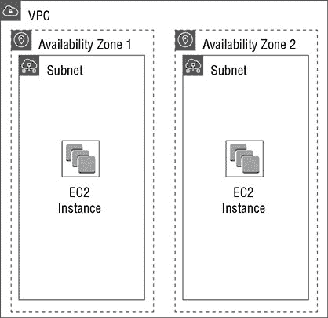

**FIGURE 10.1** A VPC with two subnets in different Availability Zones.

Each EC2 instance exists within a subnet. This is why within each default VPC, Amazon creates a default subnet in each Availability Zone. This way, you can launch EC2 instances without ever having to configure a VPC.

### Internet Access

An *internet gateway* is a VPC resource that allows EC2 instances to obtain a public IP address and access the internet.

For instances in a subnet to have internet access, that subnet must contain a default route to the internet gateway that’s attached to the VPC. A subnet with a default route to an internet gateway is called a *public subnet*.

Each instance must also have a public IP address. When you launch an instance, you can choose to have AWS automatically assign it one. You can’t reassign an automatically assigned public IP address, and when the instance stops or terminates, you lose it. Alternatively, you can allocate an elastic IP address and then assign it to an instance. Elastic IP addresses can be reassigned to different instances and don’t change until you deallocate them.

### Security Groups

一个 `security group` 是一个防火墙，用于决定哪些网络流量可以进入和离开实例。每个实例必须至少关联一个 security group。

Security groups 包含入站和出站规则，根据 IP 地址和协议允许网络流量通过。入站规则控制哪些 IP 地址可以向实例发送流量，而出站规则控制实例可以向哪些 IP 地址发送流量。默认情况下，security groups 不包含入站规则，这确保不会有未经请求的流量到达实例。例如，如果你想让任何人都能访问公共子网中的 Web 服务器，你需要创建一个入站规则，允许来自任何 IP 地址的 HTTP 流量。

默认情况下，每个 security group 包含一个出站规则，允许访问任何 IP 地址。需要注意的是，当实例发送流量时，security group 会允许回复流量到达实例，无论入站规则如何配置。

每个 VPC（不仅仅是默认 VPC）都包含一个默认 security group，你可以对其进行修改以满足需求。

### Network Access Control Lists

一个 `network access control list` (`NACL`) 是一个在子网层面运行的防火墙。NACL 包含入站和出站规则，默认情况下允许所有流量。NACL 不能限制同一子网内实例之间的流量，但它可以阻止流量进入或离开子网。每个 VPC 都有一个默认 NACL，可以将其关联到一个或多个子网。

### VPC Peering

一个 `VPC peering connection` 是仅限两个 VPC 之间的私有、点对点连接。VPC peering 允许不同 VPC 中的资源通过私有 AWS 网络进行通信，而不是通过公共互联网。VPC peering 连接允许一个 VPC 中的实例访问另一个 VPC 中的特定资源，例如另一个实例或网络负载均衡器。

VPC peering 连接是快速、可靠且安全的。此外，使用 VPC peering 无需 VPC 资源拥有 internet 访问权限即可使用。 peered VPCs 可以在同一区域或不同区域。

### Virtual Private Networks

一个 virtual private network (`VPN`) 允许你通过安全的、跨越公共互联网的连接将 VPC 连接到外部网络，例如数据中心或办公室。要设置 VPN 连接，你需要创建一个 virtual private gateway 并将其附加到 VPC。然后，你需要配置你的 customer gateway（一个物理或虚拟路由器或防火墙）以连接到 virtual private gateway。AWS 已测试了多种厂商的 customer gateway，包括 Cisco、Juniper、Palo Alto Networks 和 Check Point。

VPN 连接使用 AES 128 位或 256 位加密。IP 路由可以配置为静态，也可以使用 Border Gateway Protocol (BGP) 在 VPC 和外部网络之间共享路由。一个 VPC 最多可以有 10 个 VPN 连接。

## Direct Connect

Direct Connect 提供私有网络连接到你的 VPC 和公共服务，如 Amazon S3 和 Glacier。无需单独建立 internet 电路即可访问这些服务。这意味着在访问 AWS 资源时可以完全绕过公共互联网。请注意，Direct Connect 不提供 internet 访问，因此如果你需要它，仍需单独建立 internet 连接。

Direct Connect 链路通过 AWS Partner Network (APN) 合作伙伴提供。Direct Connect 使用专用链路，运行在 1 或 10 Gbps。由于此原因，它不受宽带 internet 连接的高延迟和不可预测性的影响。如果你需要快速、稳定的连接到 AWS，Direct Connect 是一个比通过公共 internet 连接更好的选择。然而，它更昂贵。

如果你需要少于 1 Gbps 的带宽，可以从 APN 合作伙伴处获得 hosted Direct Connect 连接。hosted 连接的速率包括 50 Mbps、100 Mbps、200 Mbps、300 Mbps、400 Mbps 和 500 Mbps。

## Route 53


Route 53 是 Amazon 的全球域名系统 (`DNS`) 服务。`DNS` 的主要目的是将人类可读的域名（例如 `example.com`）转换为 IP 地址。以下是简化版的工作原理：当你在浏览器中输入 `example.com` 域名时，你的计算机会向配置的 `DNS` 服务器发送查询，请求该域名的 IP 地址。`DNS` 服务器随后将查询发送到该域名的权威 `DNS` 服务器（负责 `example.com` 域名的那台服务器）。权威 `DNS` 服务器会返回 `example.com` 的 IP 地址。将域名转换为 IP 地址的过程称为 `name resolution`。

### Resource Records

域名解析不仅仅是将域名映射到 IP 地址。`DNS` 可以存储不同类型的数据映射，包括 IPv6 地址、邮件服务器以及任意文本。当你发送电子邮件时，`DNS` 提供查找机制，确保邮件路由到该域名的正确邮件服务器。

为了使 `DNS` 正常工作，必须首先为域名定义一些 `resource record`。一个 `resource record` 包含多个字段，但最重要的字段是名称、类型和值。请参阅 Table 10.1 查看一些示例 `resource record`。

**TABLE 10.1** `benpiper.com` 域名的 Resource Records

| Name | Type | Value |
| --- | --- | --- |
| `benpiper.com` | A - IPv4 address | 93.184.216.34 |
| `www.benpiper.com` | A - IPv4 address | 93.184.216.34 |
| `benpiper.com` | MX - Mail exchange | 10 in1-smtp.messagingengine.com |

### Domain Name Registration

一个公共域名是任何互联网用户都可以解析的域名。为了防止两个实体尝试使用相同的域名，任何想要拥有公共域名的用户都必须向域名注册商注册该域名。注册域名时，必须在顶级域 (`TLD`) 如 `.com`、`.net` 或 `.org` 下注册。例如，你可能会注册 `example.com` 或 `example.org`。`Route 53` 是数百个 `TLD` 的域名注册商。

注册域名会让你在租约期限内拥有对该域名的控制权，租约期限可以以年为单位，从 1 年到 10 年不等。无论最初注册时长为多少，你都可以以年为单位无限期续订该域名。如果你已有其他注册商的域名，可以将其转移到 `Route 53`。域名转移需要至少延长一年的注册期限。

需要注意的是，域名注册和 `DNS` 主机托管是两个不同的功能。域名注册赋予你在租约期限内对域名的控制权，包括指定为该域名提供 `DNS` 主机托管的服务。这意味着域名注册商和 `DNS` 主机托管提供商不必是同一家公司，但通常是。`Route 53` 既是注册商也是 `DNS` 主机托管提供商。

### Hosted Zones

要让 `Route 53` 托管公共域名的 `DNS`，你需要创建一个 `public hosted zone` 并指定域名。然后，你可以为该域名定义 `resource record`。如果你使用 `Route 53` 注册域名，它会自动创建该域名的 `public hosted zone`。

`Route 53` 还可以为私有域名提供名称解析。私有域名是指在除互联网之外的网络中使用的域名。`Route 53` 私有托管区域为单个域名在多个 `VPC` 内提供 `DNS` 解析。这对于为 `VPC` 资源（如 `EC2` 实例或应用程序负载均衡器）分配用户友好的域名很有用。例如，与其在应用程序中硬编码数据库服务器的 IP 地址，您可以在私有托管区域中定义一条记录，名称为 `db.example.com`，指向数据库服务器的 IP 地址。由于私有域名不可从互联网访问，因此没有注册商，您可以随意选择域名。私有托管区域的名称解析仅在您选择的 `VPC` 内可用。

### 路由策略

在某些情况下，您只需要让域名解析到特定的 IP 地址。但在其他情况下，您希望资源记录的值动态更改，以处理故障或确保用户指向最不繁忙的服务器。`Route 53` 通过多种路由策略让您能够实现这一点。

**Simple** `Simple` 路由策略是新建资源记录的默认策略。它简单地将域名映射到单个静态值，例如 IP 地址。它不检查记录指向的资源是否可用。

**Weighted** `Weighted` 策略根据比例在多个资源之间分配流量。例如，在引入新的 Web 服务器时，您可能希望仅将 10% 的流量路由到新服务器，同时在其余资源上均匀分布负载。

**Latency** `Latency` 策略将用户发送到离他们最近的 AWS 区域的资源。例如，如果您希望将欧洲用户发送到 `eu-west-1` 区域，同时将美国用户发送到 `us-east-1` 区域。

**Failover** `Failover` 策略在主资源不可用时将流量路由到备用资源。

**Geolocation** `Geolocation` 策略根据用户所在的大洲、国家或州来路由用户。

**Multivalue Answer** `Multivalue Answer` 策略允许您在多个资源之间均匀分发流量。与返回单个记录的 `Weighted` 策略不同，`Multivalue Answer` 策略返回所有记录，并按随机顺序排序。

### 健康检查

除 `Simple` 路由策略外，所有路由策略均可使用健康检查来确定是否将用户路由到特定资源。健康检查可检查以下三项内容：端点、`CloudWatch` 警报或另一个健康检查。所有健康检查的执行间隔为 10 秒或 30 秒。

**Endpoint** 端点健康检查通过通过 HTTP、HTTPS 或 TCP 连接到要监控的端点来工作。`Route 53` 在多个 AWS 区域中设有健康检查器，您可以选择健康检查使用的检查器。这使您能够确保端点在全球多个位置均可到达。

**CloudWatch alarm** `Route 53` 健康检查可以监控 `CloudWatch` 警报的状态。这对于在资源出现高延迟或大量连接时将其标记为不健康很有用。

**Calculated** 这种健康检查监控其他健康检查的状态。例如，如果您希望同时考虑端点健康检查和 `CloudWatch` 警报健康检查的状态，可以创建一个 `Calculated` 健康检查来综合两者。

### 流量流和流量策略

如果您需要为公共托管区域实现复杂的路由场景，为不同的路由策略创建多个资源记录可能变得繁琐。作为手动编写路由策略的替代方案，您可以使用 `Route 53 Traffic Flow` 可视化编辑器创建图表来表示所需的路由。

您创建的图表代表一个流量策略，您可以通过创建策略记录将其保存并关联到域名。`Route 53` 不会创建单独的资源记录，而是通过单个策略记录隐藏路由。当前费用为每月 50 美元/策略记录。

您可以使用与普通资源记录相同的路由策略：`Simple`、`Weighted`、`Latency`、`Failover`、`Geolocation` 和 `Multivalue Answer`。此外，`Traffic Flow` 还提供一种不在普通资源记录中可用的路由策略：`Geoproximity`。`Geoproximity` 路由策略根据用户距离特定地理位置的远近将用户引导至相应资源，这与基于用户所在大洲、国家或州的 `Geolocation` 策略不同。

## CloudFront

Amazon `CloudFront` 是一个内容交付网络（`CDN`），它帮助您比仅从 AWS 区域直接提供静态和动态网页内容更快地向用户交付内容。例如，如果您从单个 AWS 区域托管网站，通常用户越远离该区域，访问时的网络延迟就越高。`CloudFront` 通过在全球约 150 个数据中心（称为 *edge locations*）缓存您的内容来解决此问题。这些 `edge locations` 分布在六大洲。

`CloudFront` 通过将用户导向表现最佳的 `edge location` 来工作。通常，这是物理上最近的 `edge location`。`CloudFront` 还通过在多个 `edge locations` 存储内容的副本来提高内容的可用性。

使用的 `edge location` 越多，冗余越高，性能预期越好。您可能会预期，使用的 `edge location` 越多，`CloudFront` 的价格越高。您无法选择单个 `edge location`，而是必须从以下三个选项中选择：

* 美国、加拿大和欧洲
* 美国、加拿大、欧洲、亚洲和非洲
* 所有 `edge location`

要通过 `CloudFront` 使内容可用，您必须创建一个分发（`distribution`）。分发定义了您希望 `CloudFront` 缓存的内容类型，以及内容的来源——即 `CloudFront` 应从哪里获取内容。分发有两种类型：Web 和 Real-Time Messaging Protocol（`RTMP`）。

**Web** `Web` 分发是最常见的类型，用于静态和动态内容，如网页、图形文件以及实时或按需流媒体视频。用户可以通过 HTTP 或 HTTPS 访问 `Web` 分发。创建 `Web` 分发时，必须指定一个作为内容权威来源的起点（`origin`）。起点可以是 Web 服务器或公共 `S3` 桶。不能使用非公共 `S3` 桶。

**RTMP** 实时消息传输协议（`RTMP`）用于传输视频或音频内容。要设置 `RTMP` 分发，您需要提供媒体播放器和媒体文件，且这些文件必须存储在 `S3` 桶中。

## 摘要

虚拟私有云（`VPC`）提供了许多 AWS 资源的虚拟网络基础设施，尤其是 `EC2`。`VPC` 可以连接到其他网络，包括：

* 通过互联网网关连接到互联网
* 通过 Direct Connect 或虚拟专用网（`VPN`）连接到外部私有网络
* 使用 `VPC` 对等连接连接到其他 `VPC`

`Route 53` 服务提供两种相互关联但独立的域名系统（`DNS`）服务。`Route 53` 作为许多顶级域名（`TLD`）的注册商。您可以使用 `Route 53` 注册新域名或转入您控制的现有域名。`Route 53` 还提供 `DNS` 托管服务。要将 `Route 53` 与公共域名配合使用，必须创建公共托管区域。要在 `VPC` 内使用 `Route 53` 进行名称解析，必须创建私有托管区域。

`CloudFront` 是 Amazon 的内容交付网络 (`CDN`)。它通过在全球的边缘位置存储内容来提高数据传输到终端用户的速度。当用户通过 `CloudFront` 分发站点检索内容时，`CloudFront` 会从提供最佳性能的边缘位置向用户提供内容。

## Exam Essentials

**了解 VPC 的组件。** `VPC` 的关键组件至少包括一个子网、安全组、网络访问控制列表 (`NACL`) 和互联网网关。

**了解在 VPC 中连接资源的不同选项。** 你可以通过互联网、`Direct Connect` 链路、`VPC` 对等连接或虚拟专用网 (`VPN`) 连接来连接 `VPC` 中的资源。

**了解公共路由区和私有路由区的区别。** 公共路由区允许互联网上的任何人解析与其关联域名相关的记录。私有路由区仅允许 `VPC` 中的资源进行解析。

**能够为给定场景选择最佳的 Route 53 路由策略。** 除简单路由策略外，所有路由策略都可以使用健康检查来绕过故障进行路由。如果你想将流量定向到任何可用的资源，`Failover`、`Weighted` 和 `Multivalue Answer` 路由策略即可。如果性能是关注点，请选择 `Latency` 路由策略。如果需要根据用户的具体位置定向用户，请使用 `Geolocation` 路由策略。

**了解 CloudFront 如何提高内容交付速度。** `CloudFront` 在全球的边缘位置缓存对象，并自动将用户定位到在任何时刻能提供最佳性能的边缘位置。

**能够识别适用 CloudFront 的场景。** `CloudFront` 设计用于为无论用户物理位置如何，都能提供最快的内容访问速度。通过在全球分布的边缘位置缓存内容，`CloudFront` 确保你的内容始终靠近用户。

## Review Questions

1. 以下哪项是默认 VPC 的真实描述？（选择两项）
    1. 默认 VPC 跨越多个区域。
    2. AWS 在每个区域创建默认 VPC。
    3. AWS 在每个可用区创建默认 VPC。
    4. 默认情况下，每个默认 VPC 仅对一个 AWS 账户可用。

2. 以下哪项是 VPC 或子网的有效 CIDR？
    1. 10.0.0.0/28
    2. 10.0.0.0/29
    3. 10.0.0.0/8
    4. 10.0.0.0/15

3. 以下哪项关于子网是正确的？（选择两项）
    1. VPC 必须至少包含两个子网。
    2. 子网的 CIDR 必须是其所属 VPC CIDR 的子集。
    3. 子网跨越一个可用区。
    4. 子网跨越多个可用区。

4. 关于新建安全组的描述，以下哪项是正确的？
    1. 包含拒绝来自公共 IP 地址的入站规则。
    2. 包含拒绝访问公共 IP 地址的出站规则。
    3. 包含允许访问任意 IP 地址的出站规则。
    4. 包含允许从任意 IP 地址访问的入站规则。
    5. 包含拒绝从任意 IP 地址访问的入站规则。

5. 安全组与网络访问控制列表 (`NACL`) 的区别有哪些？（选择两项）
    1. 网络访问控制列表在实例级别运行。
    2. 安全组在实例级别运行。
    3. 安全组在子网级别运行。
    4. 网络访问控制列表在子网级别运行。

6. 以下哪项是 VPC 对等连接的真实描述？
    1. 它是连接超过三个 VPC 的私有连接。
    2. 它是两个 VPC 之间的私有连接。
    3. 它是两个 VPC 之间的公共连接。
    4. 它是两个 VPC 之间的虚拟专用网 (`VPN`) 连接。

7. 虚拟专用网 (`VPN`) 连接和 Direct Connect 连接的两个区别是什么？（选择两项）
    1. Direct Connect 连接提供可预测的延迟，因为它不通过互联网传输。
    2. VPN 连接使用互联网进行传输。
    3. Direct Connect 连接使用 AES 128 或 256 位加密。
    4. VPN 连接需要专有硬件。

8. 将域名注册到 Route 53 的描述中，以下哪项是正确的？（选择两项）
    1. 你使用的注册商决定谁将为该域名提供 DNS 解析。
    2. 你可以注册域名的期限最长可达 10 年。
    3. Route 53 为域名创建私有路由区。
    4. Route 53 为域名创建公共路由区。

9. 哪些 Route 53 路由策略可以返回一组随机排序的值？
    1. Simple
    2. Multivalue Answer
    3. Failover
    4. Latency

10. 哪些 Route 53 路由策略不使用健康检查？
    1. Latency
    2. Multivalue Answer
    3. Simple
    4. Geolocation

11. 哪种类型的 Route 53 健康检查通过尝试连接到 TCP 端口来工作？
    1. Simple
    2. CloudWatch alarm
    3. Endpoint
    4. Calculated

12. 你有两台托管 Web 应用的 EC2 实例，想让 20% 的流量发送到一台实例，80% 发送到另一台实例。应使用哪种 Route 53 路由策略？
    1. Weighted
    2. Failover
    3. Multivalue Answer
    4. Simple

13. VPC 中的资源需要能够解析其他 VPC 资源的内部 IP 地址，且外部不应能解析这些地址。哪种 Route 53 资源可以帮助你实现此目标？
    1. 公共路由区
    2. 私有路由区
    3. 域名注册
    4. 健康检查

14. 你想使用公司.pri 域名为两个 VPC 提供私有名称解析。需要创建几个私有路由区？
    1. 1
    2. 2
    3. 3
    4. 4

15. CloudFront 边缘位置分布在几个大洲上？
    1. 7
    2. 6
    3. 5
    4. 4

16. CloudFront 从哪里检索内容以进行缓存？
    1. 区域
    2. 起源
    3. 分发
    4. 边缘位置

17. 哪种类型的 CloudFront 分发需要你提供媒体播放器？
    1. 流媒体
    2. RTMP
    3. Web
    4. Edge

18. 你需要向美国和加拿大的用户交付内容。哪种边缘位置选项对你的 CloudFront 分发最具成本效益？
    1. 美国、加拿大和欧洲
    2. 美国、加拿大、欧洲和亚洲
    3. 美国、加拿大、欧洲、亚洲和非洲
    4. 所有边缘位置

19. 大约有多少个不同的 CloudFront 边缘位置？
    1. 约 50 个
    2. 超过 150 个
    3. 超过 300 个
    4. 超过 500 个

20. 哪些是 CloudFront 分发的有效起源？（选择两项）
    1. EC2 实例
    2. 公共 S3 桶
    3. 你无法访问的私有 S3 桶
    4. 你拥有的私有 S3 桶

自动化是设计云架构时的最佳实践。自动化可以让常见任务比手动执行更快。这些任务可以是简单且例行的，例如在运行 Linux 的 EC2 实例上安装最新的安全补丁；也可以是复杂的，比如创建一个全新的、纯净的 AWS 环境，包含数十台运行多层、数据库驱动的 Web 应用的 EC2 实例，并在应用负载均衡后面提供服务。

无论任务是简单还是复杂，自动化都带来了以下几个好处：

* 快速测试和实验
* 降低费用
* 减少人为错误
* 安全、完整地回滚更改


有人误以为自动化是用机器取代人。实际上，自动化需要大量的人工智能和持续的努力。最终，自动化是为了提升执行工作的人的能力，使他们能够花更多时间在高效工作上，而减少在解决问题上花费的时间。

自动化不是非此即彼的决定。你可以在 AWS 环境的不同层面部署自动化，挑选出最适合你的位置。你可能会发现，以两种不同的方式来对待自动化是有帮助的：`imperative`（命令式）和 `declarative`（声明式）。

### The Imperative Approach

使用命令式方法的自动化最常见的例子是脚本，即使用 Bash、PowerShell 或 AWS Command Line Interface（CLI）等脚本语言或工具，提供完成任务所需的明确步骤。例如，你可以编写一个 Bash 脚本来在实例上安装 Web 服务器，然后从 S3 桶复制 HTML 文件到实例的特定目录。命令式方法关注完成任务所需的具体、一步一步的操作。

### The Declarative Approach

使用声明式方法时，你编写代码来声明任务的期望结果，而不是描述如何实现。例如，与其使用 AWS CLI 创建新的虚拟私有云（VPC）和子网，你可以编写声明式代码，仅定义 VPC 和子网的配置。这种方法自然需要一些智能软件来确定实现期望结果所需的操作。CloudFormation（本章的第一部分）是最著名的声明式 AWS 服务，用于构建和配置 AWS 基础设施。简言之，你编写包含所需 AWS 资源具体内容的代码，并将其提交给 CloudFormation，它会在几秒钟内为你创建和配置这些资源。

### Infrastructure as Code

使用代码定义基础设施和配置，通常称为 `infrastructure as code`（IaC）方法。定义 IaC 是云自动化的基础要素。由于自动化依赖于机器执行的代码，它降低了手动操作固有的人为错误风险，从而减少后续的返工和其他问题。

本章将介绍以下 AWS 服务，它们以不同方式实现自动化：

* CloudFormation——让你自动化 AWS 资源的创建和配置

* AWS 开发工具（`CodeCommit`、`CodeBuild`、`CodeDeploy`、`CodePipeline`）——自动化应用在 EC2 实例和本地机器上的测试、构建和部署

* `EC2 Auto Scaling`——根据需求波动自动发布、配置和终止 EC2 实例

* Systems Manager——自动化常见运维任务，如实例补丁和 EBS 卷备份

* OpsWorks——基于 Chef 和 Puppet 配置管理平台的三种不同产品，帮助自动化实例配置和应用部署

## CloudFormation

CloudFormation 根据你用代码定义的资源及其配置，自动创建和配置 AWS 基础设施。

### Templates

定义资源的代码存储在文本文件中，称为 `templates`。模板使用专有的 CloudFormation 语言，可以用 JavaScript Object Notation（JSON）或 YAML 格式编写。

模板描述了你希望 CloudFormation 创建的 AWS 资源，同时也充当基础设施文档。因为模板是文件，你可以将它们存储在受版本控制的系统（如 S3 桶或 Git 仓库）中，从而随时间跟踪变更。

你可以使用同一个模板重复构建 AWS 基础设施，例如用于开发或测试环境。你也可以使用单个模板创建许多相似的环境。例如，你可以用同一模板为生产环境和测试环境创建相同的资源（VPC、子网、应用负载均衡等），但这两个环境是独立的。CloudFormation 在命名资源时使用随机标识符，确保创建的资源之间不冲突。

你可以编写模板，使其可接受参数输入，从而无需修改原始模板即可自定义资源。例如，你可以编写一个模板，要求输入自定义标签以应用于 CloudFormation 创建的所有资源。你可以通过指定默认值使参数可选，或要求用户提供值以使用模板。

### Stacks

要从模板中配置资源，必须指定一个在账户内唯一的堆栈名称。`stack` 是组织模板中描述资源的容器。

堆栈的作用是集体管理相关资源。删除堆栈时，CloudFormation 会自动删除堆栈内的所有资源。这使得 CloudFormation 非常适合用于需要提供纯净的测试和开发环境，并且在不再需要时直接删除的场景。删除堆栈可以确保所有资源被删除，避免遗留资源导致费用增加。

 云设计的基本原则之一是让测试环境尽可能 closely mirror 生产环境。CloudFormation 让这不仅成为可能，而且几乎是微不足道的容易！

#### Stack Updates

你可以让 CloudFormation 更新堆栈中的单个资源。只需修改模板以删除、修改或添加资源，然后指示 CloudFormation 使用该模板执行堆栈更新。CloudFormation 会自动相应地更新资源。如果其他资源依赖于你已更新的资源，CloudFormation 会检测到依赖关系，并确保下游资源也正确重新配置。

或者，你可以创建一个变更集。对模板进行所需的修改，然后让 CloudFormation 基于模板生成变更集。CloudFormation 会让你审查将要执行的具体变更，然后你可以决定执行这些变更或保持原样。

CloudFormation 使堆栈更新变得容易，但这也增加了不太熟练的用户可能 inadvertadly（不小心）更新堆栈、对关键资源造成不良更改的风险。如果你担心这种可能性，可以创建堆栈策略（stack policy）来防止 accidental updates。堆栈策略是一个独立于模板的 JSON 文档，指定哪些资源可以被更新。你可以使用它来阻止对堆栈中任何或全部资源进行更新。如果你真的需要更新堆栈，可以临时覆盖策略。

### 追踪堆栈更改

每个堆栈都包含一个带时间戳的事件记录，记录堆栈内部发生的变更，包括资源何时创建、更新或删除。这使得查看对堆栈所做的所有更改变得轻松。

需要注意的是，CloudFormation 堆栈中的资源可以手动更改，而 CloudFormation 并不阻止这种操作。例如，你可以手动删除堆栈中的 VPC。漂移检测是一项监控堆栈的功能，它会在发生此类更改时发出警报。

## CloudFormation 与 AWS CLI 的对比

你可以编写 AWS CLI 命令来快速自动创建资源，但这些资源不会被保存在堆栈中，因此无法获得堆栈提供的相同优势。

当使用 AWS CLI 时，更新资源不如使用 CloudFormation 方便。使用 CloudFormation，你只需调整模板或参数即可更改资源，CloudFormation 会自动确定如何执行这些更改。而使用 AWS CLI，你需要自行理解如何更改每个资源，并确保对一个资源的更改不会影响到其他资源。

## AWS 开发者工具

AWS 开发者工具是一组设计用于帮助应用开发者开发、构建、测试和部署其应用到 EC2 以及本地服务器的工具。这些工具简化并自动化了将新应用版本发布到生产环境所需执行的任务。

然而，AWS 开发者工具的功能不仅限于应用开发。你可以将它们作为任何基础设施即服务（IaC）方法的一部分，用于自动化 AWS 基础设施的部署和配置。

在本节中，你将了解以下 AWS 开发者工具：

*   CodeCommit

*   CodeBuild

*   CodeDeploy

*   CodePipeline

### CodeCommit

CodeCommit 让你可以创建私有 Git 仓库，并且能够轻松与其他 AWS 服务集成。Git（https://git-scm.com）是一种版本控制系统，你可以使用它来存储源代码、CloudFormation 模板、文档或任意文件——即使是像 Amazon Machine Images（AMI）和 Docker 容器这类二进制文件。这些文件存储在仓库中，通俗地称为 `repo`。

Git 采用一种称为 `versioning` 的过程，所有对仓库的更改或提交都会被永久保留，因此如果需要，你可以随时回退到文件的旧版本。

CodeCommit 对需要在同一组文件上协作的团队很有用，例如协作开发共享应用源代码基的开发者。CodeCommit 允许用户通过复制或克隆将代码检出到本地机器。他们在本地进行修改后，再将代码检回到仓库。

Git 通过差异分析（differencing）来识别不同版本文件之间的差异。如果开发者的代码更改导致应用出错，差异分析可以让开发者精确看到发生了什么变化，从而回退到之前正常工作的版本。

 差异分析是版本控制系统（如 Git）与像 S3 这样的文件存储系统之间的根本区别之一。

### CodeBuild

CodeBuild 是一个完全托管的构建服务。一次 `构建` 是一系列在源代码上执行的操作，用于将其准备就绪进行部署。构建过程可能包括对代码进行错误检测或将其转换为机器可读语言，但具体的构建操作取决于应用。

#### 构建操作

构建过程的主要目的之一是运行测试，以确保新代码能够正常工作。这可能包括验证源代码格式是否正确、是否不含语法错误的测试，也可能涉及通过模拟用户使用方式来测试功能性。

自动化测试是持续集成（continuous integration，CI）这一软件开发实践的核心部分。在 CI 中，开发者会多次将新代码或修改后的代码提交到共享仓库。像 CodeBuild 这样的构建提供商会对这些代码执行测试。这种快速的测试反馈能够及早发现错误，让开发者即时修复。

构建过程也可以包括将源代码编译成二进制文件，如可执行文件或安装包。你甚至可以使用 CodeBuild 来创建 Docker 容器和 Amazon Machine Images（AMI）。

你需要在构建规范文件中定义具体的任务，该文件必须随源代码一起提供。CodeBuild 可以从 CodeCommit、GitHub、Bitbucket 仓库，或 S3 桶中获取源代码。

CodeBuild 可以同时执行多个构建。构建产生的所有输出或 artifact 都会存储在 S3 桶中，从而使其在整个 AWS 环境中可访问。

#### 构建环境

CodeBuild 在一个独立的构建环境中执行构建，该环境基于一个计算实例。它在每次构建之前创建构建环境，构建完成后则删除该环境。这种隔离确保构建过程始终一致，不会受到前一次构建左 overs 的影响。

构建环境始终包含一个操作系统和一个 Docker 镜像，镜像可以包含编程语言运行时和工具。AWS 提供针对 Java、Ruby、Python、Go、Node.js、Android、.NET Core、PHP 和 Docker 的预配置构建环境。你也可以自定义构建环境。

你可以从以下三种计算类型中选择构建环境：

*   `build.general1.small`——3 GB 内存和 2 个 vCPU

*   `build.general1.medium`——7 GB 内存和 4 个 vCPU

*   `build.general1.large`——15 GB 内存和 8 个 vCPU

所有计算类型均支持 Linux，而中等和大型类型还支持 Windows。

### CodeDeploy

CodeDeploy 可以自动将应用部署到 EC2 实例、弹性容器服务（ECS）、Lambda，甚至本地服务器。

CodeDeploy 通过从 S3 桶，或 GitHub、Bitbucket 仓库中拉取源文件来工作。除了应用的源文件外，你还需要提供一个应用规范文件，其中包含部署应用所需的信息。

 CodeDeploy 服务不支持从 CodeCommit 仓库进行部署。不过，CodePipeline 可以实现此功能。我们将在本章后面介绍 CodePipeline。

#### 部署到 EC2 或本地服务器

CodeDeploy 可以将应用、脚本、配置文件以及几乎任何其他文件部署到 EC2 实例或本地服务器上。要将应用部署到实例，必须先安装 CodeDeploy Agent。Agent 使得 CodeDeploy 服务能够将文件复制到实例上并在此上执行部署任务。Agent 已经过测试，兼容以下操作系统的当前版本：

*   Amazon Linux

*   Ubuntu Server

*   Microsoft Windows Server

*   Red Hat Enterprise Linux (RHEL)

CodeDeploy 提供多种部署方式。你可以根据资源标签、Auto Scaling Group 成员或手动选择实例进行部署。你还可以通过一次性部署全部实例、逐个实例部署、一半实例部署或介于两者之间的方式控制部署节奏。

在升级部署方面，CodeDeploy 支持两种部署类型：

**In-place deployment** 这种部署方式在现有实例上直接部署应用。如果应用正在运行，CodeDeploy 可以停止它，执行所需的清理，部署新版本，然后重新启动应用。

“蓝绿部署” 使用“蓝绿部署”时，CodeDeploy 会将您的应用程序部署到新建的实例集合中，您可以手动创建这些实例，也可以让 CodeDeploy 通过复制现有的自动扩展组来创建这些实例。随后，CodeDeploy 会将应用程序部署到新实例上。也可以选择性地停用旧实例。如果您使用的是弹性负载均衡，CodeDeploy 还可以自动将流量重定向到新实例。

#### 部署到 ECS

部署到 ECS 的流程与部署到 EC2 实例的流程几乎相同，唯一的区别在于，您不是将应用程序文件部署到实例上，而是部署 Docker 镜像，这些镜像在容器中运行您的应用程序。

如果您正在升级应用程序并使用应用程序负载均衡，CodeDeploy 可以将流量从旧容器转移到新容器。CodeDeploy 支持 EC2 与 Fargate 两种 ECS 启动类型。

#### 部署到 Lambda

Lambda 是 Amazon 的无服务器计算平台，用于运行可以用多种语言编写的函数。

由于使用 Lambda 时无需考虑服务器，使用 CodeDeploy 部署新的 Lambda 应用只需创建一个新的 Lambda 函数即可。

如果需要更新已有函数，CodeDeploy 只需创建该函数的新版本。您可以选择让 CodeDeploy 如何处理新旧版本之间的切换。您可以让 CodeDeploy 缓慢地将流量从一个版本切换到另一个版本，也可以实现即时的完整切换到新版本。

### CodePipeline

CodePipeline 帮助您编排并自动化从开发到生产所需的所有任务。它通过将您的源代码处理通过一系列阶段（包括部署阶段）来实现。在必需的源代码和部署阶段之间，您可以添加其他阶段，例如运行测试的构建阶段，或在部署前需要手动批准的批准阶段。

CodePipeline 可自动化服务本身不提供的某些任务。例如，如前所述，CodeDeploy 不能直接从 CodeCommit 存储库部署，但可以从 S3 桶中部署。CodePipeline 可以自动从 CodeCommit 存储库中获取应用程序并触发 CodeBuild 进行自动化测试。测试通过后，CodePipeline 将应用程序文件打包并放入 S3 桶中。您可以在调用 CodeDeploy 将应用程序部署到生产环境前，要求手动批准。这种部署方式称为“持续交付”。

每个阶段包含一个或多个动作，这些动作可以按顺序或并行执行。可以在管道中包含六种类型的动作：

* Source

* Build

* Test

* Approval

* Deploy

* Invoke

除批准动作外，其他每个动作均由提供该动作的提供者执行，该提供者可以是 AWS 或第三方服务：

**Source 提供者** Source 提供者包括 S3、CodeCommit、GitHub 以及用于存储 Elastic Container Service（ECS）Docker 容器的弹性容器注册表（ECR）。

**构建和测试提供者** CodeBuild 以及像 CloudBees、Jenkins 和 TeamCity 等第三方工具可提供构建和测试服务。

**部署提供者** CodePipeline 支持多种部署提供者。最常见的包括：

* **CloudFormation** CodePipeline 可以自动使用 CloudFormation 部署您的 AWS 基础设施。例如，开发人员可以创建自己的模板，构建完整的测试环境。每当他们更新模板，CodePipeline 就会自动将其部署到 CloudFormation。这种方式让开发人员能够自行创建开发基础设施。

* **CodeDeploy** CodeDeploy 只能从 GitHub 或 S3 获取应用程序文件。但您可以配置 CodePipeline 从 CodeCommit 中拉取文件、打包并放入 S3 桶，供 CodeDeploy 读取并部署。

* **ECS** CodePipeline 可直接将 Docker 容器部署到 ECS。结合 ECR 作为源阶段，您可以使用 ECR 作为镜像源，而无需将镜像存储在 S3 桶中。

* **S3** 假设您的网站托管在 S3 上。您可以在 CodeCommit 存储库中保存网站的 HTML 和其他文件以便版本控制。如果要更新网站，只需在存储库中进行更改。CodePipeline 会检测到变更并将更新复制到您的 S3 桶中。

其他受支持的部署提供者还包括 Elastic Beanstalk、OpsWorks Stacks、AWS Service Catalog 和 Alexa Skills Kit。

**Invoke** Invoke 动作用于调用 Lambda 函数，仅适用于 AWS Lambda。

**Approval** 您可以在管道的 Source 阶段之后的任何位置插入手动批准。

## EC2 Auto Scaling

EC2 Auto Scaling 会自动启动预配置的 EC2 实例。Auto Scaling 的目标是确保您拥有满足用户需求的恰当计算资源，而不会出现过度配置。

### Launch Configurations and Launch Templates


Auto Scaling 通过从 `launch configuration` 或 `launch template` 中启动实例来工作。为了 Auto Scaling 的目的，两者的基本作用相同，即定义实例的特征，如 AMI、磁盘配置和实例类型。您还可以通过在 `Userdata` 脚本中放置命令，在 Auto Scaling 启动新实例时自动执行这些命令，从而安装软件并进行自定义配置。

但 `launch configurations` 与 `launch templates` 存在一些区别。`launch templates` 更为新颖，可以用于手动启动 EC2 实例，而无需 Auto Scaling。它们在创建后可以进行修改。而 `launch configurations` 只能与 Auto Scaling 一起使用，创建后不可修改。

### Auto Scaling Groups

Auto Scaling 创建的实例会组织到一个 Auto Scaling group 中。该组内的所有实例都可以自动注册到应用程序负载均衡的目标组。应用程序负载均衡会将流量分配给实例，使需求在它们之间均匀分布。

#### Desired Capacity（期望容量）

在配置 Auto Scaling group 时，您定义期望容量——即希望 Auto Scaling 创建的实例数量。Auto Scaling 会创建该数量的实例，并努力保持期望容量不变。如果您提高或降低容量，Auto Scaling 会相应地启动或终止实例。

#### Self-Healing（自我修复）

失败的实例会自我修复。如果实例出错或终止，Auto Scaling 会创建替换实例。这样您始终可以获得预期的实例数量。

Auto Scaling 可以使用 EC2 或弹性负载均衡（ELB）健康检查来判断实例是否健康。EC2 健康检查考虑实例的基本状态，如是否运行以及是否有网络连通性。ELB 健康检查关注实例上运行的应用程序的健康状况。不健康的实例被视为失败实例并被终止，Auto Scaling 会在其位置创建新实例。

### Scaling Actions（缩放操作）

缩放操作控制何时启动或终止实例。您通过指定最小和最大组大小来控制 Auto Scaling 启动或终止的实例数量。Auto Scaling 保证实例数量始终保持在该范围内。相应地，期望容量必须位于最小和最大范围之间。

#### Dynamic Scaling（动态缩放）

- [动态缩放](https://link.example.com/dynamic_scaling)会在需求增加时使用 `scaling out` 过程来启动新实例，也可以在需求减少时 `scale in`，即终止实例。你可以根据度量（例如实例的平均 CPU 利用率）或基于并发应用用户数量来 `scale in` 或 `scale out`。

#### Scheduled Scaling

除了或在 addition to 动态缩放，Auto Scaling 可以根据时间表来 `scale in` 或 `scale out`。这在需求具有可预测的高峰和低谷时特别有用。

Predictive scaling 是一个功能，它查看历史使用模式并预测未来的高峰。随后会自动创建计划缩放操作以匹配。它需要至少一天的流量数据来创建缩放计划。

 EC2 Auto Scaling 体现了云架构设计的核心原则之一：不要猜测你的容量需求。Auto Scaling 可以在不需要容量时降低成本，在需要时提升性能。

## Configuration Management

Configuration management 是一种确保系统配置准确且一致的方法。虽然自动化关注执行任务，配置管理主要关注强制并监控实例的内部配置状态，以确保它们是你期望的样子。这些配置状态主要包括但不限于操作系统配置和已安装的软件。

与一般的自动化一样，配置管理工具使用要么 imperative 要么 declarative 方法。AWS 通过两种工具提供这两种方法，帮助你实现 EC2 及本地实例的配置管理：Systems Manager 和 OpsWorks。

### Systems Manager

Systems Manager 使用 imperative 方法，使你的实例和 AWS 环境达到你想要的状态。

#### Command Documents

Command documents 是脚本，可一次性或定期运行，使系统达到你想要的状态。

使用 Command documents，你可以在实例上安装软件、安装最新的安全补丁，或查看实例上安装的所有软件。你可以使用与 Linux 或 Windows 实例相同的 Bash 或 PowerShell 命令。Systems Manager 可以定期运行这些命令，或在触发时（如新实例启动）执行。Systems Manager 需要在你希望管理的实例上安装代理。

#### Configuration Compliance

Configuration Compliance 是 Systems Manager 的一个功能，用于显示实例是否符合你期望的配置状态——比如某个特定版本的应用是否已安装，或操作系统是否已更新到最新的安全补丁。

#### Automation Documents

除了提供实例的配置管理外，Systems Manager 还允许你执行使用 AWS Management Console 或 AWS CLI 完成的众多管理任务。这些操作通过 Automation documents 定义。例如，你可以使用 Systems Manager 自动创建 Elastic Block Store (EBS) 卷的快照、启动或终止实例、创建 CloudFormation 堆栈，甚至从已有的 EBS 卷创建 AMI。

#### Distributor

使用 Systems Manager Distributor，你可以将安装包部署到实例。你创建一个包含可安装或可执行软件包的 `.zip` 存档，放入 S3 桶中，并告诉 Distributor 其位置。Distributor 会处理部署和安装过程。Distributor 特别适用于部署已经是安装程序或可执行文件的标准软件包集。

### OpsWorks

OpsWorks 是三种不同服务的集合，让你能够使用声明式方法进行配置管理。正如本章前文所述，使用声明式方法需要一定的智能来将声明式代码转换为 imperative 操作。OpsWorks 使用两个流行的配置管理平台来满足这一需求：Chef（https://www.chef.io）和 Puppet Enterprise（https://puppet.com）。

Puppet 和 Chef 是流行的配置管理平台，能够配置操作系统、部署应用、创建数据库，并几乎完成你能想象的所有配置任务，全部使用代码。它们广泛用于本地部署，OpsWorks 将它们的能力带到 AWS 作为托管服务。

正如自动化一般，配置管理不是全有或全无的决定。好在 OpsWorks 提供了三种不同的选项，以满足各种配置管理需求。

AWS OpsWorks for Puppet Enterprise 和 AWS OpsWorks for Chef Automate 是强大且可扩展的选项，让你可以在 AWS 上运行托管的 Puppet 或 Chef 服务器。这适合希望在所有实例上使用配置管理的场景。

AWS OpsWorks Stacks 提供一种简单且灵活的方式，仅用于部署应用。它不要求你全盘使用配置管理，而是仅用于部署和配置应用。OpsWorks Stacks 会自行处理所需的基础设施。

#### AWS OpsWorks for Puppet Enterprise and AWS OpsWorks for Chef Automate

AWS OpsWorks for Puppet Enterprise 与 Chef Automate 的高层架构相似。它们至少包含一个 Puppet 主服务器或 Chef 服务器，用于与受管理节点（EC2 或本地实例）通信，并需安装代理。

你使用 Puppet 模块或 Chef 配方来定义实例的配置状态（如操作系统配置、应用安装）。这些模块或配方包含声明式代码，使用平台的域特定语言编写，指定要 provision 的资源。代码存储在中央位置，如 CodeCommit Git 仓库或 S3 桶。

OpsWorks 管理服务器，但你需要了解并操作 Puppet 或 Chef 软件，因此需要了解它们的工作原理和管理方法。别担心，Chef 和 Puppet 都拥有庞大的生态系统，提供大量现成代码，可用于各种常见场景。

#### AWS OpsWorks Stacks

如果你喜欢基础设施即代码 (IaC) 的概念，但不熟悉管理 Puppet 或 Chef 服务器，可以使用 AWS OpsWorks Stacks。

OpsWorks Stacks 让你可以在 **stacks**（堆栈）中构建应用基础设施。一个 *stack* 是应用所需的所有资源的集合：EC2 实例、数据库、应用负载均衡等。每个 stack 包含至少一个 **layer**（层），层是用于包含应用的某个组件的容器。

下面是一个典型的数据库驱动应用的三层结构示例：

* **应用层**：包含 EC2 实例或容器
* **数据库层**：包含自托管或关系型数据库服务 (RDS) 的数据库实例
* **应用负载均衡层**：将流量分发到应用层

OpsWorks 使用两种基本类型的层：**OpsWorks 层** 和 **service 层**。

 尽管名称如此，OpsWorks stack 与 CloudFormation stack 不同，也不使用 CloudFormation 模板。

**OpsWorks layers** An OpsWorks layer is a template for a set of instances. It specifies instance-level settings such as security groups and whether to use public IP addresses. It also includes an auto-healing option that automatically re-creates your instances if they fail. OpsWorks can also perform load-based or time-based auto scaling, adding more EC2 instances as needed to meet demand.

An OpsWorks layer can provision Linux or Windows EC2 instances, or you can add existing Linux EC2 or on-premises instances to a stack. OpsWorks Stacks supports Amazon Linux, Ubuntu Server, CentOS, and Red Hat Enterprise Linux.

To configure your instances and deploy applications, OpsWorks uses the same declarative Chef recipes as the Chef Automate platform, but it doesn’t provision a Chef server. Instead, OpsWorks Stacks performs configuration management tasks using the Chef Solo client that it installs on your instances automatically.

**Service layers** A stack can also include service layers to extend the functionality of your stack to include other AWS services. Service layers include the following layers:

* **Relational Database Service (RDS)** Using an RDS service layer, you can integrate your application with an existing RDS instance.
* **Elastic Load Balancing (ELB)** If you have multiple instances in a stack, you can create an application load balancer to distribute traffic to them and provide high availability.
* **Elastic Container Service (ECS) Cluster** If you prefer to deploy your application to containers instead of EC2 instances, you can create an ECS cluster layer that connects your OpsWorks stack to an existing ECS cluster.

If there’s one thing that should be clear, it’s that AWS provides many different ways to automate the same task. The specific services and approaches you should use are architectural decisions beyond the scope of this book, but you should at least understand how each of the different AWS services covered in this chapter can enable automation.

Fundamentally, automation entails defining a task as code that a system carries out. This code can be written as imperative commands that specify the exact steps to perform the task. The most familiar type of example is the Bash or PowerShell script system administrators write to perform routine tasks. AWS Systems Manager, CodeBuild, and CodeDeploy use an imperative approach. Even the Userdata scripts that you use with EC2 Auto Scaling are imperative.

Code can also be written in a more abstract, declarative form, where you specify the end result of the task. The service providing the automation translates those declarative statements into step-by-step operations that it carries out. CloudFormation, OpsWorks for Puppet Enterprise, OpsWorks for Chef Automate, and OpsWorks Stacks use declarative languages to carry out automation.

At the end of the day, both the imperative and declarative approaches result in nothing more than a set of commands that must be carried out sequentially. It’s important to understand that the imperative and declarative approaches are not opposites. Rather, the declarative approach abstracts away from you the step-by-step details in favor of a more results-oriented, user-friendly paradigm. The difference comes down to what approach you prefer and what the service requires.


Configuration management is a form of automation that emphasizes configuration consistency and compliance. Naturally, the focus on achieving and maintaining a certain state lends itself to a declarative approach, so many configuration management platforms such as `Puppet` and `Chef` use declarative language. However, `AWS Systems Manager` also provides configuration management, albeit by using an imperative approach.

### Know what specific tasks AWS services can automate
`CloudFormation` can automatically deploy, change, and even delete AWS resources in one fell swoop.

The AWS Developer Tools—`CodeCommit`, `CodeBuild`, `CodeDeploy`, and `CodePipeline`—can help automate some or all of the software development, testing, and deployment process.

`EC2 Auto Scaling` automatically provisions a set number of `EC2` instances. You can optionally have it scale in or out according to demand or a schedule.

`Systems Manager` Command documents let you automate tasks against your instance operating systems, such as patching, installing software, enforcing configuration settings, and collecting inventory. Automation documents let you automate many administrative AWS tasks that would otherwise require using the management console or CLI.

`OpsWorks` for Puppet Enterprise and `OpsWorks` for Chef Automate also let you configure your instances and deploy software but do so using the declarative language of Puppet modules or Chef recipes.

`OpsWorks Stacks` can automate the build and deployment of an application and its supporting infrastructure.

### Understand the benefits of automation and infrastructure as code
Automation allows common, repetitive tasks to be executed faster than doing them manually and reduces the risk of human error. When you automate infrastructure builds using code, the code simultaneously serves as *de facto* documentation. Code can be placed into version control, making it easy to track changes and even roll back when necessary.

### Be able to explain the concepts of continuous integration and continuous delivery
The practice of continuous integration involves developers regularly checking in code as they create or change it. An automated process performs build and test actions against it. This immediate feedback loop allows developers to fix problems quickly and early.

Continuous delivery expands upon continuous integration but includes deploying the application to production after a manual approval. This effectively enables push-button deployment of an application to production.

1. Which of the following is an advantage of using `CloudFormation`?
    1. It uses the popular Python programming language.
    2. It prevents unauthorized manual changes to resources.
    3. It lets you create multiple separate AWS environments using a single template.
    4. It can create resources outside of AWS.

2. What formats do `CloudFormation` templates support? (Select TWO.)
    1. XML
    2. YAML
    3. HTML
    4. JSON

3. What’s an advantage of using parameters in a `CloudFormation` template?
    1. Allow customizing a stack without changing the template.
    2. Prevent unauthorized users from using a template.
    3. Prevent stack updates.
    4. Allow multiple stacks to be created from the same template.

4. Why would you use `CloudFormation` to automatically create resources for a development environment instead of creating them using AWS CLI commands? (Select TWO.)
    1. Resources `CloudFormation` creates are organized into stacks and can be managed as a single unit.
    2. `CloudFormation` stack updates help ensure that changes to one resource won’t break another.
    3. Resources created by `CloudFormation` always work as expected.
    4. `CloudFormation` can provision resources faster than the AWS CLI.

5. What are two features of `CodeCommit`? (Select TWO.)
    1. Versioning
    2. Automatic deployment
    3. Differing
    4. Manual deployment

6. In the context of `CodeCommit`, what can differencing accomplish?
    1. Allowing reverting to an older version of a file
    2. Understanding what code change introduced a bug
    3. Deleting duplicate lines of code
    4. Seeing when an application was last deployed

7. What software development practice regularly tests new code for bugs but doesn’t do anything else?
    1. Differing
    2. Continuous deployment
    3. Continuous delivery
    4. Continuous integration

8. Which `CodeBuild` build environment compute types support Windows operating systems? (Select TWO.)
    1. `build.general2.large`
    2. `build.general1.medium`
    3. `build.general1.small`
    4. `build.general1.large`
    5. `build.windows1.small`

9. What does a `CodeBuild` environment always contain? (Select TWO.)
    1. An operating system
    2. A Docker image
    3. The Python programming language
    4. .NET Core
    5. The PHP programming language

10. Which of the following can `CodeDeploy` do? (Select THREE.)
     1. Deploy an application to an on-premises Windows instance.
     2. Deploy a Docker container to the Elastic Container Service.
     3. Upgrade an application on an `EC2` instance running Red Hat Enterprise Linux.
     4. Deploy an application to an Android smartphone.
     5. Deploy a website to an S3 bucket.

11. What is the minimum number of actions in a `CodePipeline` pipeline?
     1. 1
     2. 2
     3. 3
     4. 4
     5. 0

12. You want to predefine the configuration of `EC2` instances that you plan to launch manually and using Auto Scaling. What resource must you use?
     1. `CloudFormation` template
     2. Instance role
     3. Launch configuration
     4. Launch template

13. What Auto Scaling group parameters set the limit for the number of instances that Auto Scaling creates? (Select TWO.)
     1. Maximum
     2. Group size
     3. Desired capacity
     4. Minimum

14. An Auto Scaling group has a desired capacity of 7 and a maximum size of 7. What will Auto Scaling do if someone manually terminates one of these instances?
     1. It will not launch any new instances.
     2. It will launch one new instance.
     3. It will terminate one instance.
     4. It will change the desired capacity to 6.

15. What Auto Scaling feature creates a scaling schedule based on past usage patterns?
     1. Predictive scaling
     2. Scheduled scaling
     3. Dynamic scaling
     4. Pattern scaling

16. What type of AWS Systems Manager document can run Bash or PowerShell scripts on an EC2 instance?
     1. Run document
     2. Command document
     3. Automation document
     4. Script document

17. What type of AWS Systems Manager document can take a snapshot of an EC2 instance?
     1. Command document
     2. Run document
     3. Script document
     4. Automation document

18. Which of the following OpsWorks services uses Chef recipes?
     1. AWS OpsWorks for Puppet Enterprise
     2. AWS OpsWorks Stacks
     3. AWS OpsWorks Layers
     4. AWS OpsWorks for Automation

19. What configuration management platforms does OpsWorks support? (Select TWO.)
     1. SaltStack
     2. Puppet Enterprise
     3. CFEngine
     4. Chef
     5. Ansible

20. Which of the following OpsWorks Stacks layers contains at least one EC2 instance?
     1. EC2 Auto Scaling layer
     2. Elastic Container Service (ECS) cluster layer
     3. OpsWorks layer
     4. Relational Database Service (RDS) layer
     5. Elastic Load Balancing (ELB) layer

# Chapter 12
## Common Use-Case Scenarios

**THE AWS CERTIFIED CLOUD PRACTITIONER EXAM OBJECTIVES COVERED IN THIS CHAPTER MAY INCLUDE, BUT ARE NOT LIMITED TO, THE FOLLOWING:**

* **Domain 1: Cloud Concepts**
*  1.3 List the different cloud architecture design principles
* **Domain 3: Technology**
*  3.1 Define methods of deploying and operating in the AWS Cloud


## Introduction

When running an application, you expect it to perform well and be reliable, secure, and cost-efficient. Not only does AWS make it possible to meet these expectations, it also provides a set of guiding principles to help you achieve them. The AWS Well-Architected Framework codifies these principles and organizes them into the following five pillars:

- Reliability
- Performance efficiency
- Security
- Cost optimization
- Operational excellence

In this chapter, you’ll learn how these pillars form the foundation of any sound cloud architecture. You’ll have the opportunity to perform several exercises that will teach you how to implement the following real-world scenarios:

- A highly available web application using Auto Scaling and elastic load balancing
- Static website hosting using S3

Following all of the exercises will cost a little money, but you can complete some of them within the bounds of the AWS Free Tier. For more information about the AWS Free Tier, refer to the beginning of Chapter 2, “Understanding Your AWS Account.”

## The Well-Architected Framework

The *Well-Architected Framework* is a set of principles that AWS recommends as a way of evaluating the pros and cons of designing and implementing applications in the cloud. The framework is divided into the following five pillars: reliability, performance efficiency, security, cost optimization, and operational excellence. You can think of these pillars as goals. In this section, we’ll briefly describe each of these goals at a high level. Later in the chapter, you’ll complete some exercises to experience firsthand how to achieve these goals when dealing with real-world scenarios.

### Reliability

Reliability means avoiding the complete failure of your application. Depending on how it’s architected, your application may depend on many different types of resources, including compute, storage, database, and networking.

Avoiding the complete failure of your application requires two things. First, you must strive to avoid the failure of the resources your application depends on. A resource can fail due to being misconfigured, overloaded, or shut down, either accidentally or intentionally. Second, when such a failure occurs—which it inevitably will—you must replace the failed resource with a healthy one. Later in the chapter, we’ll look at some common examples of how to achieve reliability in the cloud.

 Replacing a failed resource rather than trying to fix it removes the need to come up with different procedures for dealing with failures. For example, if an instance is misconfigured, simply replacing it is quicker and easier than attempting to figure out what’s misconfigured. Replacing a failed resource lets you recover from a wide variety of failure scenarios.

### Performance Efficiency

Performance efficiency means getting the performance you desire without overprovisioning capacity, but also without sacrificing reliability. You want enough resources to provide redundancy when a resource fails, and you also want to add resources as demand increases. But you need assurance that at any given time, you have the right amount of resources for your given availability and performance requirements, and not a bit more.

Performance and reliability are inextricably related. If a resource is overloaded, it’s likely that the application will perform poorly. That resource may eventually fail and bring your application down with it. Hence, monitoring the utilization and performance of your resources and adjusting based on those metrics is a critical aspect of both performance efficiency and reliability.

The performance of an application is determined not only by the power and quantity of your compute and storage resources but also by the performance of the network between your resources and your users. For instance, you may have a web application running in an AWS Region in the United States. Users in the United States get excellent performance, but users in Australia may experience poor performance due to the network latency between themselves and your application. You can improve their performance by creating a CloudFront distribution to place your application’s content in edge locations that are closer to your them. By significantly improving performance at minimal cost, you’re achieving performance efficiency.

### Security

安全是确保数据保密性、完整性和可用性的关注点。简而言之，只有那些需要访问数据的人和系统才能拥有数据，且数据必须免受未经授权的修改。当涉及到保护 AWS 资源上存储的数据时，您应了解以下基本原则：

- 遵循最小权限原则，创建 IAM 用户和资源策略，仅向需要它的主体授予删除或修改访问权限。
- 通过使用备份和复制来避免数据丢失。随时使用 Elastic Block Store (EBS) 快照创建 EC2 实例的恢复点。配置 S3 对象版本化和复制，以便在数据被修改或破坏时能够恢复。
- 通过使用加密保护数据的机密性，包括数据在休眠状态（如存储在 EBS 卷和 S3 桶中的数据）以及数据在传输状态（如在 AWS 基础设施内部和外部传输时）受到保护。
- 通过启用详细日志记录来跟踪 AWS 资源上的所有活动。这可以告诉您安全流程的运行情况，也可以帮助您在事后或实时识别安全事件。

 这些原则是基本指南，而非 AWS 资源安全的完整检查清单。AWS Trusted Advisor（您在“获取 AWS 支持”章节 3 中了解过）可以为您提供 AWS 资源安全的具体建议。

### 成本优化

成本优化并不是让成本尽可能接近零。相反，当您能够以最低成本使用云来满足需求时，就实现了成本优化。例如，如果可靠性对您很重要，但您通过降低成本使应用程序的可靠性降低，那么您就没有实践成本优化。

实现成本优化的第一步是分析您在云中花费的资金去向。使用 AWS Cost Explorer 和成本与使用报告查看您在 AWS 服务上的支出情况及其随时间的变化。使用成本分配标签按所有者、部门或应用程序划分资源成本。有关成本分配标签的更多信息，请参阅“了解您的 AWS 账户”章节 2。

实现成本优化的最有效方法之一是按需使用所需的资源。例如，如果只有几天时间需要用于测试的临时 EC2 实例，您可以在不使用时终止这些实例以节省费用。

您还可以通过购买实例保留实例或使用竞价实例来节省相较于按需价格的费用。有关保留实例和竞价实例的信息，请参阅“核心计算服务”章节 7。

除了查看资源的成本外，还应考虑其运营成本。例如，在关系数据库服务 (RDS) 实例上运行 MySQL 数据库的每小时成本高于在您自行构建和管理的 EC2 实例上运行同一数据库的每小时成本。但当您计入执行数据库备份、升级和监控所需的额外人工和时间时，您可能会发现使用 RDS 处理这些任务对您更具成本效益。

### 运营卓越

运营卓越本质上是自动化实现并维持其他四个目标（可靠性、性能效率、成本优化和安全）所需的流程。事实上，很少有组织能够自动化所有流程，因此运营卓越更多是一段旅程而非终点。但其核心思想是逐步改进并自动化更多活动，以增强其他支柱。以下是自动化如何帮助实现运营卓越的一些简单示例：

**可靠性** 使用弹性负载均衡的健康检查监控运行在多个 EC2 实例上的应用程序的健康状态。当实例故障时，将用户流量转移到其他实例并创建新实例。

**性能效率** 使用 EC2 Auto Scaling 的动态扩展策略自动扩展和缩减实例数量，确保您始终拥有所需的实例数量且不多余。

**安全** 使用 CodeBuild 自动测试新应用程序代码中的安全漏洞。部署应用程序时，使用 CloudFormation 自动部署全新、安全的基础设施，而不是遵循手动检查清单。

**成本优化** 自动关闭或停用未使用的资源。例如，实施 S3 对象生命周期配置来删除不需要的对象。或者，如果您有仅在工作时间用于测试的 EC2 实例，可以在工作日结束时自动关闭它们，并在次日早晨重新启动。

请记住，这些示例并非穷尽所有情况。许多自动化机会在出现故障时才显而易见。例如，如果有人误删正在作为关键 Web 应用前端的应用负载均衡器，恢复过程需要进行手动操作并重新创建负载均衡器。了解故障如何影响您的应用，可以帮助您在未来避免此类故障，并在发生时自动化恢复。

## 使用自动扩展和弹性负载均衡的高可用性 Web 应用程序

我们将考虑的第一个场景是使用如 Figure 12.1 所示的拓扑结构实现的高可用性 Web 应用程序。

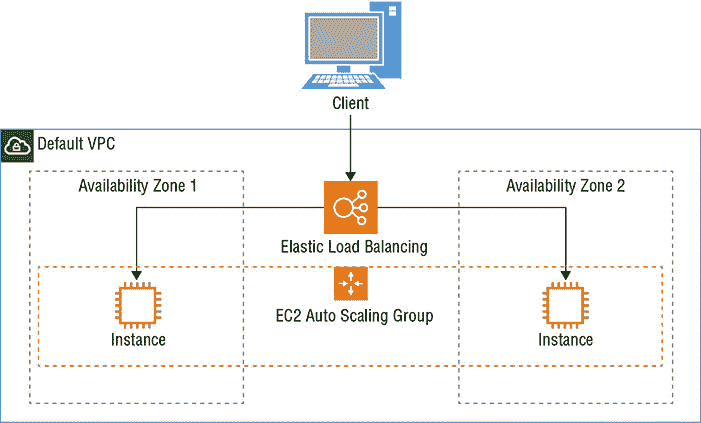

**FIGURE 12.1** A highly available web application using Auto Scaling and elastic load balancing 

如果这看起来很复杂，别担心。我们将先从高层次了解这些组件如何协同工作，然后再深入探讨具体配置。EC2 Auto Scaling 最初会在默认 VPC 的不同可用性区域中启动两个运行 Apache Web 服务器的 EC2 实例。默认 VPC 在每个可用性区域都有一个默认子网，因此无需显式创建子网。应用负载均衡器会代理 Internet 上的客户端连接，并将这些连接分发给运行流行的开源 Apache Web 服务器的实例。

我们将通过四个基本步骤实现此场景：

1. 在 VPC 的默认安全组中创建入站安全组规则。
2. 创建应用负载均衡器。
3. 创建启动模板。
4. 创建自动扩展组。

### 创建入站安全组规则

每个 VPC 都附带一个默认安全组。请记住，安全组阻止未明确允许的流量，因此我们需要在 VPC 的默认安全组中添加一条入站规则，仅允许通过应用负载均衡器和实例的 HTTP 访问。请完成练习 12.1 以创建该入站规则。

- [费曼学习法](https://wiki.example.org/feynmans_learning_method)的灵感源于诺贝尔物理奖获得者**Richard Feynman**。

1. 运用费曼技巧，你只需花上`20 min`就能深入理解知识点，而且记忆深刻，*难以遗忘*。

```
if (condVar > someVal) {console.log("xxx")}
```

- [能够评估不同设计决策之间的权衡。如果针对特定场景提供两种不同的实现方案，能够识别每种方案的一些优点和缺点。例如，你应该了解使用 EC2 实例的竞价价格与按需价格之间的权衡。](https://wiki.example.org/feynmans_learning_method)的灵感源于诺贝尔物理奖获得者**Richard Feynman**。

1. 哪个选项**不是** Well-Architected Framework 的支柱之一？

    1. 性能效率
    2. 可靠性
    3. 弹性
    4. 安全
    5. 成本优化

2. 哪个选项是应用 Well-Architected Framework **安全** 支柱原则的示例？（选择 **TWO**）

    1. 为每个 AWS 用户分配其自己的 IAM 用户名和密码
    2. 创建安全组规则以拒绝访问未使用的端口
    3. 删除空的 S3 桶
    4. 启用 S3 版本化

3. 你在 Auto Scaling 组中托管两个 EC2 实例来运行 Web 应用，且应用性能始终可接受。以下哪项可以帮助维持或提升性能效率？（选择 **TWO**）

    1. 监控未经授权的访问
    2. 将 Auto Scaling 组中的实例数量翻倍
    3. 实施策略，防止同一 Auto Scaling 组中 EC2 实例的意外终止
    4. 使用 CloudFront

4. 哪个选项有助于实现成本优化？（选择 **TWO**）

    1. 删除未使用的 S3 对象
    2. 删除空的 S3 桶
    3. 删除未使用的应用负载均衡器
    4. 删除未使用的 VPC

5. 哪个选项是 **运营卓越** 的关键组件？

    1. 增加更多安全人员
    2. 自动化手动流程
    3. 对糟糕的流程进行小幅改进
    4. 让人们工作更长时间

6. 默认 VPC 在 us-west-1 区域有三个默认子网。该区域有多少个可用区？

    1. 2
    2. 3


3. 4
4. 5

7. 你的组织正在构建一个基于数据库的 Web 应用，该应用将通过应用负载均衡器提供服务。你添加了一个入站安全组规则，允许在 TCP 端口 80 上进行 HTTP 流量。该安全组应在哪里应用以允许用户访问该应用？
    1. 应用负载均衡器监听器
    2. 数据库实例
    3. 实例所在的子网
    4. 以上都不是

8. 应用负载均衡器如何实现可靠性？
    1. 通过将流量路由到已失败的实例之外
    2. 通过替换已失败的实例
    3. 通过将流量路由到使用最少的实例
    4. 通过缓存经常被访问的内容

9. 哪个选项包含 Auto Scaling 组中实例的配置信息？
    1. 启动指令
    2. 动态扩展策略
    3. CloudFormation 模板
    4. 启动模板

10. 你已为 Auto Scaling 组创建了目标跟踪策略，希望确保组内实例数量永远不会超过 5。如何实现？
    1. 将组大小设置为 5。
    2. 将最大组大小设置为 5。
    3. 将最小组大小设置为 5。
    4. 删除目标跟踪策略。

11. 哪个选项是 **静态网站** 的示例？
    1. WordPress 博客
    2. 托管在 S3 上的网站
    3. 热门社交媒体网站
    4. 基于 Web 的电子邮件应用

12. 哪个选项是 S3 提升存储数据安全性的功能？（选择 **TWO**）
    1. S3 中的对象默认不公开。
    2. 所有对象默认对所有 AWS 用户可读。
    3. 默认情况下，S3 会移除允许公共读取访问的 ACL。
    4. S3 默认移除公开对象。

13. 启用 S3 静态网站托管需要什么？
    1. 在 S3 控制台中启用桶托管。
    2. 禁用默认加密。
    3. 禁用对象版本化。
    4. 启用对象版本化。
    5. 使桶中所有对象公开。

14. 你已为托管在 S3 上的静态网站提供了包含字母数字的 URL，用户抱怨难以输入。如何提供更友好的 URL？
    1. 仅使用桶名中的字母重新创建桶。
    2. 使用自定义域名。
    3. 在不同区域重新创建桶。
    4. 仅使用桶名中的数字重新创建桶。

15. 关于托管在 S3 上的静态网站，以下哪项是正确的？
    1. 所提供内容在传输过程中未加密。
    2. 任何人都可以修改内容。
    3. 必须使用自定义域名。
    4. 托管在 S3 上的网站存储在多个区域。

16. 哪个选项可能会影响在 EC2 实例上运行的 Web 应用的可靠性？
    1. 对实例进行 EBS 快照。
    2. 用户界面过于难用。
    3. 未替换应用程序依赖的配置错误的资源。
    4. 实例配置过多。

17. 你的公共 Web 应用运行在 EC2 实例上。以下哪个因素可能超出你的控制范围，影响应用性能？
    1. 存储
    2. 计算
    3. 网络
    4. 数据库

18. Auto Scaling 组可以使用 EC2 系统健康检查来判断实例是否健康。它还可以使用哪种类型的健康检查？
    1. S3
    2. SNS
    3. VPC
    4. ELB

19. 你在 S3 上托管静态网站，且资产使用 Standard 存储类。以下关于你的站点的描述哪项是正确的？
    1. 有人可能未经授权修改你的站点内容。
    2. 你需为 S3 费用付费。
    3. 你为托管站点使用的任何计算功率付费。
    4. 可用区故障可能导致站点不可用。

20. 你在 S3 上托管静态网站，资产存储在 US East 1 区域的名为 `mygreatwebsite` 的桶中。网站的 URL 是什么？
    1. `http://mygreatwebsite.s3-website-us-east-1.amazonaws.com`
    2. `http://mygreatwebsite.s3.amazonaws.com`
    3. `http://mygreatwebsite.s3-website-us-east.amazonaws.com`
    4. `http://mygreatwebsite.s3-us-east-1.amazonaws.com`

9. B. IaaS 产品提供完整的基础设施访问，PaaS 产品隐藏了复杂性，无服务器架构（如 `AWS Lambda`）让开发者可在云服务器上运行代码。
10. A. 增加或减少计算资源更能描述弹性伸缩。高效使用虚拟化资源和计费模型与可扩展性没有直接关系。
11. C. 在使用前预配置计算实例以扩展应用程序是可扩展性的一个要素，而非弹性伸缩。高效使用虚拟化资源和计费模型与弹性伸缩没有直接关系。
12. A, D. 资产已资本化和地理覆盖范围重要，但对运营可扩展性没有直接影响。

## Chapter 2: Understanding Your AWS Account

1. D. 只有 `t2.micro` 实例类型属于免费层（Free Tier）可用，且 `t2.micro` 实例的组合总使用时长可在一个月内达到 750 小时。
2. B, C. 虽然免费层下 S3 桶可用容量很大，但它们对 EC2 实例并非必要。免费层允许的最大 EBS 存储空间为 30 GB，两个 20 GB 的卷合计 40 GB 超出了免费额度。
3. B, D. 每月 API 调用次数和 ECR 免费存储空间仅在免费层下可用。
4. A, B. 不存在“免费层服务仪表板”或“账单偏好设置仪表板”。
5. C. 维基百科页面更新不及时且信息不够详细，对本情境帮助有限。AWS CLI 可能几乎没有（或没有）定价信息。总拥有成本（TCO）计算器不应用于具体且最新的服务定价信息。
6. A. 定价通常会根据所消耗的服务单元数量以及（常见）AWS 区域而变化。
7. B. 可以为多服务组合计算费用。计算器的定价保持最新，您可以指定非常细致的配置参数。
8. C, D. “按月或按年计算”不是可选项，且因为计算器仅按使用量计算费用，“包含多组织”选项并不实用。
9. A. 计算器涵盖了本地部署的主要费用，但不包括本地或国家层面的税务影响。
10. D. 所选货币对价格影响很小——价格相对而论。操作系统和区域会产生影响，但相对较小。
11. B. 正确的 URL 是 [`https://docs.aws.amazon.com/general/latest/gr/aws_service_limits.html`](https://docs.aws.amazon.com/general/latest/gr/aws_service_limits.html)。
12. A. 资源限制仅在单个区域内存在；一个区域的限制不会影响另一个区域。实际上，客户可以以任何速率扩展部署，AWS 资源的向上扩展能力没有逻辑上的限制。
13. D. 虽然大多数服务限制为软限制且可在请求后提升，但仍有部分服务限制是硬限制。
14. D. Cost Explorer 与成本与使用情况报告页面提供更深入或自定义的详情。预算允许您根据使用量设置警报。
15. C. 保留预算跟踪任何活动保留实例的状态。成本预算监控账户中产生的费用。不存在一种预算类型能够通过单位成本来理解账户的成本效率。
16. D. 您可以配置预算的周期、实例类型以及开始/停止日期，但不能按资源所有者进行过滤。
17. A. 账单事件不是触发警报的条件。本章节未讨论入侵事件。
18. C. 标签是被动的，不能自动触发任何操作。资源标签（而非成本分配标签）用于帮助您理解和控制部署。标签不与特定账单周期关联。
19. A, C. 在单个 AWS 账户中拥有多个资源使用者的公司不会从 AWS Organizations 中受益，且完全分离的业务单元同样不会受益。AWS Organizations 的价值在于整合相关账户的管理。
20. B. 预算用于设置警报。报告提供 CSV 格式的离线处理数据。已迁移至 AWS Organizations 的整合账单用于跨多 AWS 账户管理资源。

## Chapter 3: Getting Support on AWS

1. C. 基本（Basic）计划不提供任何个性化支持。开发者（Developer）计划费用更低，但对支持专业人员的访问受限。企业（Business）计划提供 24/7 邮件、聊天和电话访问工程师，在实际部署前这是最合适的选择。每月最低 15,000 美元的企业（Enterprise）计划不具成本效益。
2. B. 通过基本计划的公开文档不足以满足特定需求。在尚未部署生产环境时，企业和企业+计划并非必要。
3. D. 前三个支持层仅提供对较低级别支持专业人员的访问，而企业（Enterprise）计划提供对高级工程师的全面访问，并为您指派技术账户经理（TAM）作为您所有 AWS 需求的唯一资源。
4. C. 基本计划客户仅获得账户管理问题的支持，而不提供技术支持或安全漏洞应对。
5. B. 只有企业支持（Enterprise Support）客户才能使用技术账户经理（TAM）。其主要功能是提供指导和代言。
6. B. 仅企业和企业+计划提供 AWS 资源与第三方软件及操作系统之间的互操作性故障排查帮助。企业计划是最具成本效益的能够获得此级别支持的计划。
7. A. 开发者（Developer）计划费用为 29 美元或月使用量的 3%，在此案例中 3% 的月使用量为 120 美元。
8. D. 当月消耗量在 10,000 至 80,000 美元之间时，企业（Business）计划费用为 100 美元或月使用量的 7%，在此案例中 7% 的单月使用量（11,000 美元）为 770 美元。三个月的总费用为 2,310 美元。
9. C. AWS 专业服务（Professional Services）站点包含技术演示网络研讨会、白皮书和博客文章。基本支持计划包含 AWS 文档资源。知识中心（Knowledge Center）由常见问题（FAQ）文档组成。
10. A. 技术账户经理（TAM）是专门为指导您的开发和管理团队的 AWS 员工。不存在用于工作负载测试的网络硬件。
11. B, C. 虽然 DOC 和 DocBook 都是流行且有用的格式，但 AWS 并不使用这两种格式来编写文档。
12. A, C. 对比计划页面（`compare-plans`）提供支持计划的一般信息，而专业服务站点描述了如何访问该资源。两者均不直接包含技术指南。
13. D. 知识中心（Knowledge Center）是针对技术问题及其解决方案的 FAQ。主文档站点更适合入门级别指南。`forums.aws.amazon.com` 站点是 AWS 用户的讨论论坛。
14. B. 知识中心（Knowledge Center）是针对技术问题及其解决方案的通用 FAQ。`docs.aws.amazon.com` 站点用于一般文档。不存在 `https://aws .amazon.com/security/encryption` 页面。
15. A. 版本号并未公开发布，且在此语境下不使用 *Current* 这个词。
16. C. 复制（Replication）实质上是容错（Fault Tolerance）的子集，因此不需要单独的类别。
17. A. 性能（Performance）识别可能阻碍性能提升的配置设置。安全（Security）识别未遵循安全最佳实践配置的任何失败。成本优化（Cost Optimization）识别那些运行且不必要地浪费金钱的资源。
18. B. 性能识别可能阻碍性能改进的配置设置。服务限制识别的资源使用量接近 AWS 区域或服务限制。没有复制类别。
19. A. 失败状态的“已 OK”状态是错误的阴性。Trusty Advisor 中没有单一的状态图标表明您的账户完全符合合规性。
20. B, D. MFA 和服务限制检查均可用于所有账户。

## Chapter 4: Understanding the AWS Environment

1. B. 设计 ations 末尾的字母（a, b…）表示可用性区（Availability Zone）。`us-east-1` 永远不会作为西部美国地区的 Region 使用。
2. D. AWS GovCloud 区域仅限受信任客户使用。亚太（东京）是普通 Region。AWS Admin 和 US-DOD 不存在（据我们所知，至少目前如此）。
3. D. EC2 实例会自动在当前选中的 Region 中启动。您可以手动选择与特定可用性区关联的子网，但没有默认选项。
4. B, D. 关系数据库服务 (RDS) 和 EC2 都使用只能存在于单个 Region 的资源。Route 53 和 CloudFront 是真正的全局服务，不受限制在任何单一 AWS Region。
5. C. 正确的端点语法是 `<service-designation>.<region-designation>.amazonaws.com`，例如 `rds.us-east-1.amazonaws.com`。
6. B, C. 在同一 Region 内将应用程序基础设施分布到多个可用性区通常提供足够的容错能力。虽然 AWS 服务享有显著的经济性规模效应，但这并不主要源于 Region 的结构。降低延迟和满足合规性是此列表的最大好处。
7. A. 在多个 Region 共享单一资源不会引起特定的安全、网络或延迟问题。这只是找到一台物理主机来运行的问题。
8. B. 自动扩缩 (Auto Scaling) 是应用高可用性的重要组成部分，但它并不是直接推动高可用性的因素（那是负载均衡）。最有效、最简便的做法是在多个可用性区中并行、负载均衡的实例。
9. A. “数据中心使用统一主机类型”描述的是边缘位置（edge location）。在“广泛地理区域”内的数据中心更接近描述 AWS Region。可用性区 (AZ) 不局限于单个数据中心。
10. C. 对实例施加虚拟网络限制的工作是安全组或访问控制列表的职责。IP 地址块不是在 Region 级别分配的。客户无法访问或控制 AWS 网络硬件。
11. B. AWS 将可用性区以（似乎）随机顺序显示，以防止资源在过少的可用性区中被大量启动。
12. D. 自动扩缩不关注任何单一的物理或虚拟资源，它只关注整体服务的适当可用性和质量。编排的工作是负载均衡器的，而不是自动扩缩的。
13. C. 资源隔离在安全中起重要作用，但在可靠性方面作用较小。自动化可以改进管理流程，但它以及地理位置都不是最有效的可靠性策略。
14. A, C. RDS 数据库实例和 Lambda 函数不是 CloudFront 的合格起点。EC2 负载均衡器可以作为 CloudFront 起点使用。
15. D. CloudFront 无法防护针对垃圾邮件的攻击，虽然它可以与应用的冗余和加密相辅相成，但这并非其主要目的。
16. B. 对抗 DDoS 攻击的任务是 AWS Shield 的工作。保护 Web 应用免受基于 Web 的威胁由 AWS Web Application Firewall 完成。使用 Lambda 自定义 CloudFront 行为属于 Lambda Edge。
17. A, B. “云中”的内容由您负责管理，包括 EC2 基于操作系统的管理。
18. C. 没有唯一的简便答案，因为一些托管服务几乎完全在 Amazon 的控制范围内，而其他服务则让大量责任留给客户。记住，“如果你可以编辑它，你就拥有它”。
19. D. AWS 账单仪表盘专注于账户账单问题。AWS 接受使用监控和服务状态仪表盘实际上并不存在。但请尝试。
20. B. 正确的文档（以及网页 [`https://aws.amazon.com/aup/`](https://aws.amazon.com/aup/)）是 AWS 接受使用政策。

## Chapter 5: Securing Your AWS Resources

1. A. 身份和访问管理 (IAM) 主要用于帮助您控制对 AWS 资源的访问。KMS 管理访问密钥。EC2 管理 SSH 密钥对。虽然 IAM 涉及联合管理，但这并非其主要目的。
2. A, B, D. 包含空格或空字符不是密码策略选项。
3. C, D. 根用户不应用于日常管理任务，即使是作为“管理员”组的一部分。目标是尽可能保护根用户。
4. D. MFA 需要至少两种（“多”）验证方法，通常包括密码（您所知道的）和通过虚拟或物理 MFA 设备发送的令牌（您所拥有的）。
5. B. `-i` 参数应指向本地（客户端）机器上存储的密钥名称及位置。默认情况下，Amazon Linux 实例的管理员用户名是 `ec2-user`。
6. B. 虽然可以通过权限和基于策略的角色来授予权限，但使用组（一次设置、多用户）更为高效。
7. C. IAM 角色是为受信任实体（如另一个 AWS 服务或联合身份）分配的。权限集合可能指代策略。IAM 用户集合可能描述一个组。
8. A, D. 联合身份用于允许已验证的实体访问 AWS 资源和数据，而不是导入外部账户的任何内容（数据或指导）。
9. C, D. 安全壳 (SSH) 是加密的远程连接协议，单点登录 (SSO) 是一个界面特性，它们都不是联合身份的标准。
10. D. 凭据报告仅关注用户的密码、访问密钥和 MFA 状态，不涵盖实际活动或一般安全设置。
11. B. 凭据报告保存为逗号分隔的值（CSV）格式。
12. A. 管理员用户需要广泛的访问权限才能有效工作，因此 `AmazonS3FullAccess` 和 `AmazonEC2FullAccess`（分别仅打开 S3 和 EC2）不足。不存在 `AdminAccess` 策略。
13. D. “程序化访问”用户不通过 AWS 管理控制台登录，而是通过 API 或 AWS CLI。因此它们不需要密码或 MFA，仅凭访问密钥 ID 而无需对应的密钥密钥是无用的。
14. B. 当正确的登录页面（如 `https://signin.aws.amazon.com/console`）加载时，IAM 用户只需输入用户名和有效密码即可。账户号码和密钥密钥不用于此类验证。


15. C. 传输中加密要求数据在远程客户端加密后再上传。服务器端加密（SSE-S3 或 SSE-KMS）仅在 S3 桶内加密数据。DynamoDB 是一种 NoSQL 数据库服务。

16. A. 只能在创建 EBS 卷时加密，不能在创建后进行加密。

17. D. 客户端主密钥用于在到达 AWS（特别是 S3）之前加密对象。不存在常见的称为 SSH 或 KMS 主密钥的名称。

18. C. SSE-KMS 是 KMS 管理的服务器端密钥。FedRAMP 是美国政府的联邦风险与授权管理计划（在其中，事务数据保护仅起到相对次要的作用）。ARPA 是澳大利亚审慎监管局。

19. B. SOC 并非主要提供指导或风险评估，并且绝不是对您自身部署状态的保证。SOC 报告是对 AWS 基础设施的审计报告，您可以将其作为自身报告需求的一部分。

20. A, B. AWS Artifact 文档是关于 AWS 基础设施符合外部标准的合规性文档。它们可以间接提供最佳实践的洞察。它们并不代表 AWS 的内部设计或策略。

## Chapter 6: Working with Your AWS Resources

1. D. 您可以以 root 用户或 IAM 用户身份登录。虽然需要指定账户别名或账户 ID 来以 IAM 用户身份登录，但这些不是凭证。您无法使用访问密钥 ID 登录控制台。

2. B. 一旦登录，您的会话将保持活动 12 小时。之后会过期并退出，以保护您的账户。

3. A. 如果本应可见的资源看起来缺失，可能是选择了错误的区域。由于您以 root 身份登录，您拥有账户中所有资源的访问权限。您无需访问密钥即可使用控制台。您无法在导航栏中选择可用性区。

4. C. 您创建的每个资源标签必须拥有一个键，但值是可选的。标签在账户内不需要唯一，并且区分大小写。

5. A. AWS CLI 需要访问密钥 ID 和密钥密钥。您可以使用 IAM 用户或 root 用户的凭证。出站网络访问 TCP 443 端口是必需的，而不是 80 端口。Linux 不是必需的，但您可以在 Linux、macOS 或 Windows 上使用 AWS CLI。您还可以使用 Android 或 iOS 设备的 AWS 控制台移动应用。

6. A, D. 您可以使用 Python 和 pip 包管理器，或（除 Windows Server 2008 外）使用 MSI 安装程序在 Windows 上安装 AWS CLI。AWS SDKs 不包含 AWS CLI。Yum 和 Aptitude 仅为 Linux 服务。

7. B. `aws configure` 命令会引导您设置 AWS CLI 的默认区域以及访问密钥 ID 和密钥密钥。`aws --version` 命令显示已安装的 AWS CLI 版本，但运行该命令不是使用 AWS CLI 管理资源的必要步骤。重启也不是必要的。使用 root 用户管理 AWS 资源是不安全的，因此无需为 root 用户生成新的访问密钥 ID。

8. C. AWS CLI 可以以 JSON、文本或表格格式显示输出。它不支持 CSV 或 TSV。

9. B, D, E. AWS 为 JavaScript、Java 和 PHP 提供 SDK。Fortran 没有 SDK。JSON 是表示数据的格式，而非编程语言。

10. A, B. AWS Mobile SDK for Unity 以及 AWS Mobile SDK for .NET 和 Xamarin 可让您为 Android 和 Apple iOS 设备创建移动应用。AWS SDK for Go 不支持移动应用开发。AWS Mobile SDK for iOS 支持 Apple iOS 设备开发，但不支持 Android。

11. A, B. AWS IoT 设备 SDK 可用于 C++、Python、Java、JavaScript 和 Embedded C。Ruby 或 Swift 没有对应的 SDK。

12. A, D. AWS CLI 是一个运行在 Linux、macOS 或 Windows 上的程序，允许您通过终端与 AWS 服务交互。AWS SDKs 让您使用喜欢的编程语言编写与 AWS 服务交互的应用。

13. B. CloudWatch 指标存储 AWS 服务的性能数据。日志存储来自应用程序和 AWS 服务的文本日志。事件是针对 AWS 资源发生的操作。警报监控指标。指标过滤器从日志中提取指标信息。

14. D. CloudWatch 警报监控指标并在该指标超过指定阈值时触发。如果指标没有变化，警报不会触发。终止 EC2 实例是一个事件，您无法创建基于事件的 CloudWatch 警报。您也无法创建基于 Web 服务器日志中 IP 地址存在的警报。但您可以创建指标过滤器，在日志中查找特定 IP 地址并为其出现时递增自定义指标。

15. A, C. SNS 支持 SMS 和 SQS 协议用于发送通知。您无法向 CloudWatch 事件发送通知。不存在移动拉取通知。

16. C, D. CloudWatch Events 监控导致 AWS 资源状态变化的事件以及 AWS 控制台登录事件。在响应事件时，CloudWatch Events 可以执行操作，包括向 SNS 发送通知或重启 EC2 实例。它还可以按计划执行操作。它不监控日志或指标。

17. B, D. 查看 AWS 资源会触发 API 操作，无论是通过控制台还是 CLI 进行。配置 AWS CLI 不会触发任何 API 操作。登录 AWS 控制台也不会触发 API 操作。

18. A. CloudTrail 事件历史记录日志保存每个区域的管理事件的最近 90 天。创建跟踪是过度设计且不具成本效益，因为它会将日志存储在 S3 桶中。将 CloudTrail 日志流式传输到 CloudWatch 需要创建跟踪。CloudWatch Events 不记录管理事件。

19. A, D. 在包含桶的区域创建跟踪将生成 CloudTrail 日志，您可以将其流式传输到 CloudWatch 进行查看和搜索。CloudTrail 事件历史记录不记录数据事件。CloudTrail 默认记录全球服务事件，但 S3 数据事件未包含。

20. B. 日志完整性验证使用加密哈希帮助您断言 CloudTrail 日志文件未被从 S3 删除。它不防止篡改或删除，也无法告知文件如何被篡改。日志完整性验证与 CloudWatch 无关。

21. D. 成本和使用情况报告显示您按服务的月度支出。保留实例报告和保留实例建议不显示实际月度成本。

22. A. RDS 允许您购买保留实例以节省费用。Lambda、S3 和 Fargate 不使用实例。

23. B. 保留实例使用率报告显示您通过保留实例节省了多少成本。保留实例覆盖率报告显示如果您购买保留实例，本可以节省多少成本。每日成本和每月 EC2 运行时长成本与使用情况报告不知道您通过保留实例节省了多少成本。

24. D. Cost Explorer 会为 EC2、RDS、ElastiCache、Redshift 和 Elasticsearch 实例提供保留实例建议。您需要选择要分析的服务。但 Cost Explorer 不会为已被保留实例覆盖的实例提供建议。由于您的 Elasticsearch 实例已连续运行至少七天，该使用情况将被分析。

## Chapter 7: The Core Compute Services

1. C. 实例的硬件配置由实例类型定义。高吞吐（或低吞吐）数据处理操作和数据流可以使用任何存储卷或任何实例（尽管某些可能更适合特定场景）。

2. A. 快速启动（Quick Start）仅包含数十个最流行的 AMI。Community 标签包含数千个公开可用的 AMI（无论是否经过验证）。My AMIs 标签仅包含您账户中创建的 AMI。

3. B, C. 可以创建包含基础操作系统和预装应用的 AMI，但不会包含任何网络或硬件配置信息——这些信息主要取决于实例类型。

4. B, D. `c5d.18xlarge` 和 `t2.micro` 是 EC2 实例类型的名称，而不是实例类型族。

5. D. 虚拟中央处理单元（vCPU）是衡量实例类型计算能力的指标，大致对应物理服务器上的处理器数量。它与高流量容错性、系统内存或底层 AMI 无关。

6. A. 由单个 AWS 账户专用并受其控制的物理主机上运行的 EC2 实例称为专用主机（dedicated host）。专用主机既不是 AMI，也不是实例类型。

7. C. 与物理存储驱动器直接关联且虚拟化的存储分区称为实例存储卷（instance store volume）。用于轻松复制和部署到 EC2 实例的软件堆栈包描述的是 EC2 AMI。可以加密 EBS 卷，但加密并不定义它们。

8. C, D. 实例存储卷无法加密，且其数据在实例关闭后不会保留。这些是 EBS 卷的特性。

9. B. 对于此类用途，Spot 实例不可靠，因为它们可能会意外关闭。预留实例在长时间、24/7 使用时更具经济性。“专用”并不是一种计价模型。

10. D. 由于您的“基础”实例需要长期、24/7 运行，预留实例适用。Spot 实例和 Spot 集群实例不可靠，因为可能会被意外关闭。按需实例在如此长的周期内成本过高。

11. A. 由于 AWS 极少会出现容量不足的情况，无需保证可用容量。您可自行选择预留实例的付费方式。所有 All Upfront、Partial Upfront 和 No Upfront 选项均可用，且没有自动计费。在此情境下，实例不会自动启动。

12. A, C. 由于 Spot 实例可能被关闭，因此不建议用于提供任何 always‑on 服务的应用。

13. C, D. Elastic Block Store 为 Lightsail、Beanstalk（以及 EC2）提供存储卷。EC2 提供应用部署功能，但并未被认为是简单的。

14. A. Beanstalk、EC2（非预留实例）和 RDS 都根据实际使用量计费。

15. B, D. Ubuntu 是操作系统，不是堆栈；WordPress 是应用，不是操作系统。

16. B, C. 实际情况下，Elastic Block Store 视为 EC2 资源；RDS 基本上基于其自身基础设施。

17. A, C. 理论上可以手动在 Lightsail 或 EC2 实例上安装 Docker Engine，但这并非它们的主要功能。

18. A, B. Lambda 和 Lightsail 都是计算服务，虽然它们可能在内部使用容器，但本身并不是容器技术。

19. D. Python 是有效的 Lambda 函数运行环境之一，没有一种“主导”语言用于 Lambda API 调用。

20. A. 最大执行时间此前为 5 分钟，现已改为 15 分钟。

## Chapter 8: The Core Storage Services

1. B. 桶（bucket）名称必须在 AWS 全局范围内唯一，与 Region 无关。桶名称长度不受限制（3 到 63 个字符之间）。存储类是按对象配置的，不影响桶命名。

2. A, C. STANDARD_IA 和 GLACIER 存储类提供最高级别的冗余，并至少跨三个可用区复制。由于可用性较低（分别为 99.9% 和 99.5%），它们是 infrequent access 数据的最具性价比的选择。ONEZONE_IA 仅在单个可用区存储对象，该可用区失效可能导致所有对象丢失。STANDARD 和 INTELLIGENT_TIERING 提供最高耐久性和跨区域复制，但在这类场景下成本效益较低。

3. A, D. S3 是对象存储服务，而 EBS 是块存储服务，用于存储卷。EBS 快照存储在 S3 中。S3 不存储卷，EBS 不存储对象。

4. A, B, D. 对象生命周期配置可以基于对象年龄执行转换或过期操作。转换操作可在存储类之间移动对象（例如从 STANDARD 到 GLACIER）。过期操作可删除对象及其版本。对象生命周期配置不能删除桶或移动对象到 EBS 卷。

5. A, B. 可以使用桶策略（bucket policies）或访问控制列表（ACLs）授予匿名用户对对象的访问权限。不能使用用户策略实现此目的，但可以用于授予 IAM 主体对对象的访问权限。安全组控制 VPC 中资源的访问，不用于控制 S3 中的对象访问。

6. C, D. S3 和 Glacier 都设计用于耐久、长期存储，并提供相同的耐久性级别。Glacier 中的数据可通过 Expedited 或 Standard 检索选项在 8 小时内可靠恢复。S3 的数据可比 Glacier 更快检索。S3 可存储最高 5 TB 的对象，Glacier 可存储最高 40 TB 的归档。两者均满足需求，但 Glacier 更具成本效益。

7. B. 可以在 Glacier 控制台创建或删除存储库（vault）。不能上传、下载或删除归档；要执行归档操作，必须使用 AWS CLI、AWS SDK 或第三方程序。Glacier 不使用桶。

8. D. Standard 检索通常需要 3 到 5 小时完成。Expedited 只需 1 到 5 分钟，Bulk 需要 5 到 12 小时。没有 Provisioned 检索选项，但可以购买预留容量以确保 Expedited 检索及时完成。

9. A. Glacier 归档最小可为 1 字节，最大可达 40 TB。零字节归档不可建立。

10. B, D. 传输网关（tape gateway）和卷网关（volume gateway）类型支持 iSCSI 存储连接。文件网关（file gateway）支持 NFS。不存在缓存网关。

11. B. 所有 AWS Storage Gateway 类型（文件、卷、传输）主要将数据存储在 S3 桶中。随后数据可存储在 Glacier 或 EBS 快照中，后者可作为 EBS 卷实例化。

12. A, B, D, E. AWS Storage Gateway 使用行业标准存储协议将本地服务器文件传输到 S3。作为文件网关，它支持 SMB 和 NFS 协议；作为卷网关，它支持 iSCSI 协议。AWS Snowball 和 AWS CLI 也可传输数据到 S3，但需要安装第三方软件。

13. A, C, E. 卷网关有两种配置：存储卷和缓存卷。存储卷本地存储所有数据，并异步备份到 S3 为 EBS 快照。存储卷最大可达 16 TB。缓存卷仅本地保存 frequently used 的子集，不异步备份到 S3 为 EBS 快照。缓存卷最大可达 32 TB。

14. C. 80 TB Snowball 设备提供 72 TB 可用存储，是最大的可选规格。50 TB Snowball 提供 42 TB 可用空间。

15. A, B. AWS Snowball 在静止和传输过程中强制加密，并使用 TPM 芯片检测硬件或软件未经授权的变更。它不使用 NFS 加密，也不具备防窃网络端口。

16. C. 如果 AWS 检测到任何篡改或损坏的迹象，它将不会更换 TPM 芯片或从设备中转移客户数据。相反，AWS 会安全地擦除它。

17. B. Snowball Client 让你可以使用运行 Windows、Linux 或 macOS 的机器将文件传输到或从 Snowball 中传输。它不需要编程知识，但 Snowball 的 S3 SDK Adapter 需要。Snowball 不支持 NFS、iSCSI 或 SMB 存储协议。

18. A, D. Snowball Edge 提供计算能力来运行 EC2 实例，并支持使用 NFSv3 和 NFSv4 协议复制文件。Snowball 设备不能集群，也没有 QFSP+ 端口。

19. B. Snowball Edge—Compute Optimized with GPU 选项针对机器学习和高性能计算应用进行优化。尽管 Compute Optimized 和 Storage Optimized 选项也可以工作，但它们不是最佳选择。不存在 Network Optimized 选项。

20. B. Snowball Edge 与 Compute Optimized 配置包括 QSFP+ 网络接口，支持最高 100 Gbps。Storage Optimized 配置的 QSFP+ 端口仅支持最高 40 Gbps。80 TB Snowball 仅支持最高 10 Gbps。存储网关是虚拟机，不是硬件设备。

## Chapter 9: The Core Database Services

1. B. 关系型数据库以称为属性的列存储数据，以称为记录的行存储数据。非关系型数据库（包括键值存储和文档存储）以集合或项存储数据，但不使用列或行。

2. B. SQL INSERT 语句用于向关系型数据库添加数据。QUERY 命令用于读取数据。CREATE 可用于创建表，但不能向其添加数据。WRITE 不是有效的 SQL 命令。

3. D. 非关系型数据库是无架构的，意味着无需预先定义要在表中存储的所有数据类型。这并不妨碍你存储具有固定结构的数据，因为非关系型数据库可以存储几乎任何类型的数据。主键是唯一标识表中每个项的必要条件。可以创建多个表，但大多数使用非关系型数据库的应用程序只使用一张表。

4. C. No‑SQL 数据库是非关系型数据库的另一种说法。按定义，非关系型数据库是无架构的，必须使用主键。不存在“无架构的关系型数据库”。No‑SQL 永远不会用来描述任何种类的关系型数据库。

5. B. RDS 实例使用 EBS 卷进行存储。它们不再可以使用磁盘存储。实例卷用于临时存储，而非数据库存储。你可以对数据库实例取快照并将其还原到新实例并使用新的 EBS 卷，但 RDS 实例不能直接使用快照作为数据库存储。

6. B, D. PostgreSQL 和 Amazon Aurora 是 RDS 数据库引擎的选项。IBM dBase 和非关系型数据库 DynamoDB 和 Redis 不可用作 RDS 数据库引擎。

7. A, B. Aurora 是 Amazon 的专有数据库引擎，与现有 PostgreSQL 和 MySQL 数据库兼容。Aurora 不支持 MariaDB、Oracle 或 Microsoft SQL Server。


8. B, C. 多可用区 (Multi‑AZ) 和快照可在可用区故障时保护数据。读取副本不使用同步复制，可能会丢失部分数据。IOPS 是存储吞吐量的度量。垂直扩展指更改实例类型，与防止数据丢失无关。

9. B. Amazon Aurora 使用共享存储卷，该卷会自动扩展至最高 64 TB。Microsoft SQL Server 和 Oracle 数据库引擎不提供此功能。Amazon Athena 不是数据库引擎。

10. A. 多可用区 (Multi‑AZ) 让你的数据库即使在整个可用区失败的情况下也能抵御 RDS 实例的故障。读取副本是实现水平扩展以提高读取性能的方法，但不增加可用性。时间点恢复允许你将数据库还原到特定时间点，但同样不提升可用性。

11. B, D. 分区是由固态驱动器支持并跨多个可用区复制的存储分配。表存储在分区中，但表本身不包含分区。主键而非分区用于唯一标识表中的项。

12. A. DynamoDB 在单个 Region 中的最小月度可用性为 99.99 百分比。它不是 99.95 百分比、99.9 百分比或 99.0 百分比。

13. D. DynamoDB 表中的项可以拥有不同的属性。例如，一个项可以有五个属性，而另一个只有 1 个。表可以存储包含多种数据类型的项。无需预先定义表中的项数量。表中的项不能有重复的主键。

14. C, E. 增加 WCU（写容量单位）或启用自动扩展将提高对表的写入性能。增大或减小 RCU（读容量单位）不会提升写入性能。减小 WCU 会使写入性能恶化。

15. C. 扫描（`Scan`）需要读取表存储的所有分区。查询（`Query`）基于主键进行，使 DynamoDB 只读取包含匹配项的那一个分区。写入和更新项不是读取密集操作。

16. D. 主键在表中必须唯一。全名、电话号码或城市可能不唯一，因为不同客户可能共享相同的姓名或电话号码。随机生成的客户 ID 号是唯一且适合作为主键使用。

17. B. 密集计算节点使用磁盘，密集存储节点使用 SSD。不存在密集内存或成本优化节点。

18. A. Redshift Spectrum 可分析存储在 S3 中的结构化数据。不存在 Redshift S3 服务。Amazon Athena 可以分析 S3 中的结构化数据，但它不是 Redshift 的功能。Amazon RDS 不会分析存储在 S3 中的数据。

19. B. 数据仓库存储来自其他关系型数据库的大量结构化数据。它不叫数据存储库或报告集群。密集存储节点是 Redshift 计算节点的一种类型。

20. A. 密集存储节点可以在集群中使用，最多可存储 2 PB 的数据。密集计算节点可用于存储最高 326 TB 的数据。

# Chapter 10: The Core Networking Services

1. B, D. 对于每个账户，AWS 在每个 Region 创建默认 VPC。VPC 跨越该 Region 内的所有可用区，但不跨越 Regions。

2. A. VPC 或子网 CIDR 的大小范围是 /16 到 /28（含），因此 10.0.0.0/28 是唯一有效的 CIDR。

3. B, C. 子网仅存在于单个可用区内，并且其 CIDR 必须是所在 VPC CIDR 的子集。VPC 不一定需要两个子网，但至少需要一个。

4. C. 创建安全组时，它包含一个默认的出站规则，允许访问任何 IP 地址。默认不包含入站规则。安全组规则只能允许访问，不能拒绝，因此未明确允许的流量会被拒绝。

5. B, D. 网络访问控制列表（NACL）是工作在子网层面的防火墙。安全组是工作在实例层面的防火墙。

6. B. VPC 对等连接是仅限于两个 VPC 之间的私有连接。它使用私有 AWS 网络，而非公共 Internet。VPC 对等连接不同于 VPN 连接。

7. A, B. Direct Connect 使用专用链路而非 Internet，提供确定性延迟。Direct Connect 不使用加密，但通过私有链路提供一定安全性。VPN 连接使用 Internet 进行传输，使用 AES 128 或 256 位加密。VPN 连接不需要专有硬件。

8. B, D. 当你注册域名时，你可以选择 1 年到 10 年之间的期限。如果使用 Route 53，它会自动为该域名创建一个公共托管区。注册商和 DNS 托管提供商不必是同一实体，但通常是。

9. B. 多值路由策略可以返回一组随机排序的多个值，简单记录只返回一个值。故障转移路由策略在主资源不可用时会将用户路由到备用资源。延迟路由策略会将用户路由到 AWS 区域中延迟最低的资源。

10. C. 除 Simple 之外，所有 Route 53 路由策略都可以使用健康检查。

11. C. 终结点健康检查通过 HTTP、HTTPS 或 TCP 连接到受监控的终结点实现。CloudWatch 告警健康检查仅反映 CloudWatch 告警的状态。计算健康检查的状态来源于多个其他健康检查。不存在 Simple 健康检查。

12. A. 加权路由策略让你根据自定义的比例在终端之间分配流量。其他任何路由策略都不支持此功能。

13. B. 私有托管区关联到 VPC，允许 VPC 内的资源解析私有域名。公有托管区可由任何人在互联网上访问。域名注册用于公共域名。解析名称不需要健康检查。

14. A. Route 53 私有托管区为多个 VPC 内的单个域名提供 DNS 解析。因此，若要在两个 VPC 之间支持同一域名的解析，需要一个私有托管区。

15. B. CloudFront 在六大洲都有边缘位置（到达南极洲很困难）。

16. B. CloudFront 的起源是分发站点获取内容的位置。内容存储在边缘位置中。分发站点定义了使用的边缘位置和起源。

17. B. RTMP 类型的分发用于交付流媒体内容，需要提供媒体播放器。Web 类分发也能播放音频或视频，但不需要提供播放器。流媒体和边缘不是分发类型。

18. A. 使用的边缘位置越多，费用越高。选择最少的位置最具成本效益。

19. B. 全球拥有超过 150 个边缘位置。

20. A, B. 起源可以是 EC2 实例或公共 S3 桶。不能将私有 S3 桶作为起源。

# Chapter 11: Automating Your AWS Workloads

1. C. CloudFormation 可以创建并管理 AWS 资源，并将它们作为堆栈集中管理。模板使用 CloudFormation 语言编写，而非 Python。CloudFormation 不能创建 AWS 外的资源，也不能阻止对堆栈内资源的手动修改。

2. B, D. CloudFormation 模板使用 YAML 或 JSON 格式编写。

3. A. 参数在创建 CloudFormation 堆栈时让你输入自定义值，而无需修改底层模板。参数不阻止堆栈更新或未经授权的更动。同一模板可用于创建多个堆栈，无论是否使用参数。

4. A, B. CloudFormation 创建的资源组织在堆栈中。更新堆栈时，CloudFormation 会分析堆栈内资源之间的关系并相应更新依赖资源。但这并不意味着使用 CloudFormation 创建的任何资源都会如预期工作。通过 CloudFormation 进行的资源配置不一定比使用 AWS CLI 更快。

5. A, C. CodeCommit 是私有 Git 仓库，提供版本控制和差异对比，但不负责部署。

6. B. 差异功能用于查看两个文件版本之间的差异，帮助定位导致错误的改动。版本控制提供回退到旧版本的能力，而差异本身不识别重复代码，也不告知应用何时部署。

7. D. 连续集成是指在代码提交到仓库后立即运行构建或测试过程。连续交付和连续部署在连续集成的基础上增加了部署步骤。差异仅显示文件版本差异，不进行任何测试。

8. B, D. `Build.general1.medium` 与 `build.general1.large` 支持 Windows 与 Linux 操作系统，`build.general1.small` 仅支持 Linux。其他计算类型不存在。

9. A, B. CodeBuild 的构建环境始终包含操作系统和 Docker 镜像，可能还包含其他组件，但不一定拥有全部。

10. A, B, C. CodeDeploy 可将文件部署到 Linux 或 Windows EC2 实例，也可将 Docker 容器部署到 ECS。它不能部署到智能手机，也不能将文件部署到 S3 桶。

11. B. 至少，CodePipeline 必须包含源阶段和部署阶段。

12. D. 启动模板可用于手动启动实例以及与 EC2 自动扩展一起使用。启动配置不能用于手动启动实例。实例角色用于为实例上的应用程序授予权限。自动扩展不能使用 CloudFormation 模板来配置实例。

13. A, D. 最大值和最小值限制了自动扩展组中的实例数量。期望容量（也称为组大小）是自动扩展通常保持的实例数，但根据动态扩展需求，自动扩展可以启动或终止实例。

14. B. 当实例失败时，Auto Scaling 会通过自我修复替换该实例，以保持期望容量为 7。终止实例或未能替换失败实例会导致只有 6 个实例。Auto Scaling 永不会因实例失败而改变期望容量。

15. A. 预测扩展基于历史使用模式创建计划扩展操作。计划扩展和动态扩展均不创建计划操作，也不存在所谓的模式扩展。

16. B. 命令文档可以在 EC2 实例上执行命令。自动化文档用于在 AWS 上执行管理任务，例如启动或停止实例。不存在脚本文档或运行文档。

17. D. 自动化文档可在 AWS 上执行管理任务，如启动或停止实例。命令文档可在 EC2 实例上执行命令。不存在脚本文档或运行文档。

18. B. AWS OpsWorks Stacks 使用 Chef 配方，而 AWS OpsWorks for Puppet Enterprise 使用 Puppet 模块。不存在 AWS OpsWorks Layers 或 AWS OpsWorks for Automation 服务。

19. B, D. OpsWorks 支持 Puppet Enterprise 与 Chef 两大配置管理平台，不支持 SaltStack、Ansible 或 CFEngine。

20. C. 只有 OpsWorks 层至少包含一个 EC2 实例。不存在 EC2 自动扩展层。

# Chapter 12: Common Use-Case Scenarios

1. C. Well-Architected Framework 的五大支柱是可靠性、性能效率、安全性、成本优化和运营卓越。弹性不是其中之一。

2. A, D. 安全性涉及保护数据的机密性、完整性和可用性。为每个 AWS 用户分配独立的 IAM 用户名和密码可确保数据机密性。开启 S3 版本控制通过保留对象备份保护数据完整性。删除空的 S3 桶无法帮助实现这些目标。无法创建安全组规则来拒绝未使用的端口，因为安全组只允许显式允许的流量。

3. C, D. 防止在自动扩展组中意外终止 EC2 实例可以避免在繁忙时给剩余实例带来性能问题和过载，使用 CloudFront 可以通过在靠近用户的边缘位置缓存内容来提升性能。增加实例数量可能会提升性能，但因为性能已经可接受，这样做是低效的。仅监控未经授权的访问本身无法提升性能或性能效率。

4. A, C. 删除未使用的 S3 对象和未使用的应用程序负载均衡器可以降低成本，因为你为两者付费。删除未使用的 VPC 和空的 S3 桶不会降低成本，因为它们本身不产生费用。

5. B. 运营卓越关注加强其他四大支柱（可靠性、性能效率、安全性和成本优化）的能力；自动化是实现这些目标的关键。改进糟糕的流程并让人员加班是违背运营卓越的。增加安全人员可能是个好主意，但它不是运营卓越的核心组成部分。

6. B. 在默认 VPC 中，AWS 为每个可用区创建一个子网。因此，如果默认 VPC 中有三个子网，则必然有三个可用区。

7. A. 应用程序负载均衡器的监听器使用安全组来控制入站访问，因此需要应用一个包含允许 HTTP 访问的入站规则的安全组。将安全组规则应用到数据库实例上无法奏效，因为用户不会直接连接到数据库实例。你不能将安全组应用到子网，只能应用到网络访问控制列表（NACL）。

8. A. 应用程序负载均衡器可以使用健康检查识别失败的实例并将其从负载均衡中移除，这可以防止用户 ever 访问到失败的实例。负载均衡器无法替代失败的实例，但自动扩展（Auto Scaling）可以。应用程序负载均衡器使用轮询算法将流量分发到实例，而不是根据实例的繁忙程度。应用程序负载均衡器不缓存内容。

9. D. 启动模板告诉自动扩展如何配置它所创建的实例。动态扩展策略根据 CloudWatch 指标控制自动扩展的伸缩行为。不存在所谓的“启动指令”。自动扩展不直接引用 CloudFormation 模板，但你可以使用 CloudFormation 模板创建包含启动模板的堆栈。

10. B. 最大组 size 限制了组内的实例数量。将组 size（也称为期望容量）或最小组 size 设置为 5 会使实例数量增加到 5，但不会阻止自动扩展随后再添加更多实例。删除目标跟踪策略并不一定能阻止组内实例数量增长，因为其他过程（如定时扩展策略）可能会添加更多实例。

11. B. 静态网站直接提供存储中的内容，不会在服务器端动态修改内容。WordPress 博客、社交媒体网站和基于 Web 的电子邮件应用都会从数据库中读取内容并与静态内容混合后再提供给用户。

12. A, C. 上传到 S3 桶的对象默认不公开，也不对所有 AWS 用户可用。即使你尝试通过 ACL 使对象公开，S3 也会立即移除该 ACL，但你可以禁用此行为。S3 默认不会删除对象。

13. A. 要让 S3 主机静态网站，需要在 S3 控制台中启用桶托管功能。无需启用或禁用默认加密或对象版本化，也不必让桶中的所有对象公开，只需对需要 S3 服务的对象进行设置。

14. B. 购买并使用自定义域名是最佳选择，可获得友好的 URL。你需要将桶名称与域名保持一致。仅由字词组成的桶名称在任何 Region 都不太可能成功，因为桶名称必须全局唯一，且桶名称不能以数字开头。

15. A. 存储在 S3 上的网站使用明文 HTTP 而非安全 HTTPS。内容是公开可读的，但这并不意味着公众可以修改它。你不必使用自定义域名，因为 S3 为你提供了端点 URL。存储在 S3 上的网站位于一个桶中，而一个桶只存在于单个 Region。

16. C. 应用的可靠性可能受到其依赖资源失败的影响。资源失败的一种方式是配置错误。对实例进行 EBS 快照或为其配置多余实例不会影响可靠性。用户界面难用可能会让用户感到恼火，但不影响实际的可靠性。

17. C. 你可以控制 VPC，但你与用户之间的网络部分不在你的控制范围内。计算、存储以及应用所用的数据库，理论上是受你控制的。

18. D. 自动扩展组可以使用 ELB 健康检查判断实例是否健康。不存在针对 S3、VPC 或 SNS 的健康检查。

19. B. 你负责静态网站的 S3 费用，但不为 S3 的计算费用付费。除非你授予权限，否则无人可以修改你的站点内容。S3 标准存储类会将对象分布在多个可用区，因此单个可用区的故障不会影响站点的可用性。

20. A. URL 的格式为：桶名 + `s3-website-` + Region 标识 + `amazonaws.com`。

# Appendix B  

Additional Services  

 You’ve learned a lot about the key AWS services that you’re most likely to see covered on the exam and encounter in the real world. But AWS has well over 100 services, and it’s important that you be familiar with some of the services that haven’t been covered in the preceding chapters. This appendix briefly introduces 15 important services that are likely to come up on the exam.

## Athena

Athena lets you use SQL queries to find data stored in S3. If you have data stored in CSV, JSON, ORC, Avro, or Parquet format, simply upload it to S3 and use Athena to query it. Athena is serverless, so there’s no need to provision your own database or import your data into it. For more information, visit [`aws.amazon.com/athena/`](https://aws.amazon.com/athena/).

## AWS Backup

AWS Backup lets you centrally configure backup policies and monitor backup activity for all of your data stored on AWS. It supports EBS volumes, RDS databases, DynamoDB tables, EFS file systems, and Storage Gateway volumes. For more information, visit [`aws.amazon.com/backup/`](https://aws.amazon.com/backup/).

## AWS Glue


Data can live in a variety of places on AWS. AWS Glue can discover, clean, and bring this data together in one place for analysis using the Apache Spark big data framework. It can extract and analyze data from S3 objects and relational databases such as MySQL, Oracle, and Microsoft SQL Server. For more information, visit [`aws.amazon.com/glue/`](https://aws.amazon.com/glue/).

## Batch（批量计算）

批量计算作业用于在大型数据集上执行复杂分析。批量计算的示例包括财务风险建模、图形处理、模拟以及甚至基因组分析。批量计算让您可以在 AWS 上运行数千个批量计算作业，而无需构建任何基础设施。只需将批量作业定义为 Docker 容器并提交，AWS 会处理其余事宜。更多信息请访问 [`https://docs.aws.amazon.com/batch/`](https://docs.aws.amazon.com/batch/)。

## Cognito

Cognito 让您可以在应用程序中添加用户访问控制。Cognito 与许多身份提供商集成，包括 Amazon、Google、Microsoft Active Directory 和 Facebook。您也可以使用 Cognito 让用户在无需提供自己 IAM 凭据的情况下访问 AWS 资源。更多信息请访问 [`https://aws.amazon.com/cognito/`](https://aws.amazon.com/cognito/)。

## 数据库迁移服务

数据库迁移服务 (DMS) 简化了在云端或本地之间迁移数据的过程。DMS 支持关系型数据库，如 Aurora、Oracle、Microsoft SQL Server、MariaDB 和 PostgreSQL，以及非关系型数据库，如 MongoDB、DocumentDB 和 DynamoDB。DMS 还支持将数据迁移到 S3、Elasticsearch 和 Kinesis 数据流。更多信息请访问 [`https://docs.aws.amazon.com/dms/`](https://docs.aws.amazon.com/dms/)。

## 弹性文件系统

弹性文件系统 (EFS) 是 Linux 实例的可扩展文件系统。您可以将多个实例挂载到同一个 EFS 卷，以便它们共享同一文件。EFS 卷高度可用，跨越单个 VPC 中的多个可用区。EFS 可在不中断的情况下扩展到千兆位大小，并会自动缩小，因此您只为实际使用的空间付费。未使用的文件会自动移动到成本优化存储类。更多信息请访问 [`https://aws.amazon.com/efs/`](https://aws.amazon.com/efs/)。

## 弹性 MapReduce

弹性 MapReduce (EMR) 让您能够分析存储在云端的巨量数据。EMR 支持 Apache Hadoop、Apache Spark、HBase、Presto 和 Flink 大数据平台。更多信息请访问 [`https://aws.amazon.com/emr/`](https://aws.amazon.com/emr/)。

## Inspector

Inspector 分析您的 EC2 实例，以查找安全漏洞和常见配置错误。更多信息请访问 [`https://aws.amazon.com/inspector/`](https://aws.amazon.com/inspector/)。

## Kinesis

Kinesis 可以实时摄取和处理大量数据。它适用于分析大量流 ing 数据，包括访问日志、视频、音频和遥测数据。更多信息请访问 [`https://aws.amazon.com/kinesis/`](https://aws.amazon.com/kinesis/)。

## Macie

Macie 自动查找并分类 AWS 中存储的敏感数据。它使用机器学习来识别敏感数据，如个人可识别信息或商业机密，并展示这些数据在 AWS 中的使用方式。更多信息请访问 [`https://aws.amazon.com/macie/`](https://aws.amazon.com/macie/)。

## Neptune

Neptune 是一个图数据库，可用于存储和查询高度关联的数据集。它适用于推荐引擎、社交网络、欺诈检测和网络安全。更多信息请访问 [`https://aws.amazon.com/neptune/`](https://aws.amazon.com/neptune/)。

## 简单队列服务

简单队列服务 (SQS) 使开发人员能够创建松耦合、分布式的云应用。SQS 是消息代理，应用程序的不同组件可以使用它来相互发送消息。SQS 会自动扩展以适应任何流量。更多信息请访问 [`https://aws.amazon.com/sqs/`](https://aws.amazon.com/sqs/)。

## WorkDocs

WorkDocs 是安全的内容共享和协作服务。您可以在 WorkDocs 中存储任何类型的文件，并为 Microsoft Office 文件、PDF 和文本文件等文档提供预览和评论功能。更多信息请访问 [`https://aws.amazon.com/workdocs/`](https://aws.amazon.com/workdocs/)。

## WorkSpaces

WorkSpaces 让您在云中 provision Linux 或 Windows 虚拟桌面。AWS 管理操作系统、补丁和虚拟桌面基础设施。用户可以从任何 PC 以及各种移动设备连接到其虚拟桌面。更多信息请访问 [`https://aws.amazon.com/workspaces/`](https://aws.amazon.com/workspaces/)。

# 索引

## A

*   accelerated-computing EC2 instance type, `123`

*   Acceptable Use Policy, `50`, `61`

*   access keys, IAM and, `71`–72

*   ACLs (access control lists)

    *   object access, `244`

    *   S3 (Simple Storage Service), `142`–143

*   Active Directory, `75`

*   Amazon Route 53, `180`, `248`. *See also* DNS (Domain Name System)

    *   domain name registration, `180`–181

    *   edge locations, `58`

    *   health checks

        *   calculated, `182`

        *   CloudWatch alarms, `182`

        *   Endpoint, `182`, `248`

    *   hosted zones, `181`

    *   resource records, `180`

    *   routing policies

        *   Failover, `181`

        *   Geolocation, `182`

        *   Latency, `181`

        *   Multivalue Answer, `182`

        *   Simple, `181`

        *   Weighted, `181`

    *   traffic flow and policies, `182`

*   `AmazonS3FullAccess`, `239`

*   AMIs (Amazon Machine Images), `120`–121, `130`, `232`

    *   Amazon Linux, `121`

    *   AWS Marketplace, `121`, `122`

        *   NVIDIA, `122`

        *   Oracle, `122`

        *   SAP, `122`

    *   Community AMIs, `121`

    *   creating, `123`

    *   OSs (operating systems), `121`

    *   Quick Start, `121`, `242`

    *   review question answers, `242`–243

    *   RHEL (Red Hat Enterprise Linux)

        and, `121`

    *   Ubuntu, `121`

    *   Windows Server, `121`

*   AOC (Attestation of Compliance), `77`

*   `ap-northeast-1`, `51`

*   `ap-northeast-2`, `51`

*   `ap-northeast-3`, `51`

*   `ap-south-1`, `51`

*   `ap-southeast-1`, `51`

*   `ap-southeast-2`, `51`

*   Apache Web Server, EC2 instances, `126`–127

*   API Gateway, `17`

*   APIs (application programming interfaces), `17`, `84`

*   APN (AWS Partner Network), `38`

    *   Direct Connect links and, `179`

*   application load balancing, highly available web application, `216`–218

*   APRA (Australian Prudential Regulation Authority), `77`

*   archives, S3 Glacier, `145`

*   Artifact, `77`, `240`

*   Asia Pacific (Mumbai) Region, `51`

*   Asia Pacific (Osaka-Local) Region, `51`

*   Asia Pacific (Seoul) Region, `/path/to/xxx`

*   Asia Pacific (Singapore) Region, `/path/to/xxx`

*   Asia Pacific (Sydney) Region, `/path/to/xxx`

*   Asia Pacific (Tokyo) Region, `/path/to/xxx`

*   assessment test answers, `/path/to/xxx`–233

*   Athena, `/path/to/xxx`

*   authentication

    *   IAM and, `/path/to/xxx`

    *   MFA (multi-factor authentication), `/path/to/xxx`–71

*   Auto Scaling, `/path/to/xxx`, `/path/to/xxx`, `/path/to/xxx`, `/path/to/xxx`

    *   EC2 (Elastic Cloud Compute)

        *   actions, `/path/to/xxx`

        *   capacity, `/path/to/xxx`

        *   dynamic scaling, `/path/to/xxx`

        *   launch configurations, `/path/to/xxx`

        *   launch templates, `/path/to/xxx`

        *   scheduled scaling, `/path/to/xxx`

        *   self-healing, `/path/to/xxx`

    *   highly available web application, `/path/to/xxx`

    *   launch template, `/path/to/xxx`

*   automation

    *   AWS CLI (Command Line Interface), `/path/to/xxx`

    *   AWS Developer Tools, `/path/to/xxx`

        *   CodeBuild, `/path/to/xxx`–196

        *   CodeCommit, `/path/to/xxx`–195

        *   CodeDeploy, `/path/to/xxx`–197

        *   CodePipeline, `/path/to/xxx`–198

    *   benefits, `/path/to/xxx`

    *   CloudFormation and, `/path/to/xxx`

    *   declarative approach, `/path/to/xxx`

    *   EC2 Auto Scaling and, `/path/to/xxx`

    *   IaC (infrastructure as code), `/path/to/xxx`

    *   imperative approach, `/path/to/xxx`

    *   OpsWorks and, `/path/to/xxx`

    *   review question answers, `/path/to/xxx`–250

    *   scripting, `/path/to/xxx`

    *   Systems Manager and, `/path/to/xxx`

    *   templates and, `/path/to/xxx`

    *   Well-Architected Framework, `/path/to/xxx`

*   Availability Zones, `/path/to/xxx`, `/path/to/xxx`, `/path/to/xxx`, `/path/to/xxx`, `/path/to/xxx`, `/path/to/xxx`, `/path/to/xxx`

    *   designations, `/path/to/xxx`–55

    *   EC2 (Elastic Cloud Compute), `/path/to/xxx`

    *   high availability and, `/path/to/xxx`–57

    *   highly available web application, `/path/to/xxx`

    *   networking, `/path/to/xxx`–56

*   AWS (Amazon Web Services) account

    *   infrastructure, security, `/path/to/xxx`

    *   payment model, `/path/to/xxx`–4

    *   resources, scalability, `/path/to/xxx`–3

    *   review question answers, `/path/to/xxx`–235

*   AWS Backup, `/path/to/xxx`

*   AWS CLI (Command Line Interface), `/path/to/xxx`, `/path/to/xxx`, `/path/to/xxx`, `/path/to/xxx`, `/path/to/xxx`, `/path/to/xxx`

    *   authentication, `/path/to/xxx`

    *   automation and, `/path/to/xxx`

    *   CloudFormation comparison, `/path/to/xxx`

    *   installation, `/path/to/xxx`

        *   pip, `/path/to/xxx`

        *   Python, `/path/to/xxx`

        *   stand-alone installer, `/path/to/xxx`–101

    *   requirements, `/path/to/xxx`

*   `aws configure` command, `/path/to/xxx`

*   AWS Console Mobile Application, `/path/to/xxx`

    *   CloudWatch alarm, `/path/to/xxx`

    *   dashboard, `/path/to/xxx`

    *   EC2 instances, `/path/to/xxx`–96

    *   requirements, `/path/to/xxx`–98

    *   resources, `/path/to/xxx`

    *   services, supported, `/path/to/xxx`–97


-   AWS Developer Tools

    -   CodeBuild, `/path/to/xxx`

        -   actions, `/path/to/xxx`
        -   environments, `/path/to/xxx`–196

    -   CodeCommit, `/path/to/xxx`–195
    -   CodeDeploy

        -   EC2 and, `/path/to/xxx`–197
        -   ECS and, `/path/to/xxx`
        -   Lambda, `/path/to/xxx`
        -   on-premises instances, `/path/to/xxx`–197

    -   CodePipeline, `/path/to/xxx`–198
-   AWS Glue, `/path/to/xxx`
-   AWS GovCloud (US) Region, `/path/to/xxx`, `/path/to/xxx`
-   AWS IoT (Internet of Things), SDKs, `/path/to/xxx`, `/path/to/xxx`
-   AWS Lambda, `/path/to/xxx`
-   AWS Management Console, `/path/to/xxx`

    -   access, `/path/to/xxx`
    -   Billing Dashboard and, `/path/to/xxx`
    -   Chrome, `/path/to/xxx`
    -   CloudFormation stacks, `/path/to/xxx`
    -   Edge, `/path/to/xxx`
    -   Firefox, `/path/to/xxx`
    -   IAM user, log in, `/path/to/xxx`–87
    -   Internet Explorer, `/path/to/xxx`
    -   logging in

        -   as IAM user, `/path/to/xxx`–87
        -   as root user, `/path/to/xxx`–86

    -   My Account menu option, `/path/to/xxx`
    -   My Billing Dashboard menu option, `/path/to/xxx`
    -   My Organization menu option, `/path/to/xxx`
    -   My Security Credentials menu option, `/path/to/xxx`
    -   passwords, `/path/to/xxx`–70
    -   region selection, `/path/to/xxx`–89
    -   regions, `/path/to/xxx`
    -   resource groups, `/path/to/xxx`–91
    -   resource tags, `/path/to/xxx`

        -   automation tags, `/path/to/xxx`
        -   business tags, `/path/to/xxx`
        -   security tags, `/path/to/xxx`–94
        -   technical tags, `/path/to/xxx`–93

    -   root, log in, `/path/to/xxx`–86
    -   Safari, `/path/to/xxx`
    -   Security Credentials page, `/path/to/xxx`–72
    -   service consoles, opening, `/path/to/xxx`–88
    -   services, `/path/to/xxx`

        -   region selection, `/path/to/xxx`–89

    -   shortcuts, `/path/to/xxx`
    -   Sign Out menu option, `/path/to/xxx`
    -   Switch Role menu option, `/path/to/xxx`
    -   Tag Editor, `/path/to/xxx`–92
    -   web browsers, `/path/to/xxx`
-   AWS Marketplace, AMIs (Amazon Machine Images), `/path/to/xxx`, `/path/to/xxx`
-   AWS Shield, `/path/to/xxx`

    -   edge locations, `/path/to/xxx`
-   AWS Startups discussion forum, `/path/to/xxx`
-   AWS Web Site and Resources discussion forum, `/path/to/xxx`
-   Backup, `/path/to/xxx`
-   backups, RDS (Relational Database Service), `/path/to/xxx`
-   Basic support plan, `/path/to/xxx`, `/path/to/xxx`

    -   benefits, `/path/to/xxx`
    -   Trusted Advisor tool, `/path/to/xxx`
-   Batch, `/path/to/xxx`–255
-   Billing & Cost Management Dashboard, `/path/to/xxx`, `/path/to/xxx`, `/path/to/xxx`

    -   AWS Management Console and, `/path/to/xxx`
-   buckets (S3), `/path/to/xxx`, `/path/to/xxx`

    -   copying files between, `/path/to/xxx`
    -   creating, `/path/to/xxx`–145
    -   names, `/path/to/xxx`
    -   permission policies, `/path/to/xxx`
    -   Snowball Edge and, `/path/to/xxx`
-   budgeting, `/path/to/xxx`–25
-   bursting, [163]
-   Business support plan, [35]–37, [235], [236]
-   BYOL (bring your own license), [162]

## C

-   `ca-central-1`, [51]
-   calculated health check (Route 53), [182]
-   Canada (Central) Region, [51]
-   CDN (content delivery network), [50], [183]
-   CentOS, Quick Start AMIs, [121]
-   China (Beijing) Region, [51]
-   Chrome, AWS Management Console, [85]
-   CI (continuous integration), [195]
-   CIDR (Classless Inter-Domain Routing), [56], [176]–177
-   client-side encryption, [76], [143], [239]
-   cloud computing

    -   infrastructure, security, [3]
    -   resources, [2]–3
    -   review question answers, [233]–234
-   cloud services, [9]

    -   free, permanently, [17]–18
    -   IaaS (Infrastructure as a Service), [5]

        -   EBS (Elastic Block Store), [5]
        -   EC2 (Elastic Cloud Compute), [5]

    -   limits, [23]
    -   PaaS (Platform as a Service), [5]

        -   ECS (Elastic Container Service), [5]

    -   responsibility breakdown, [6]
    -   SaaS (Software as a Service), [5]
-   CloudFormation, [233], [249]

    -   automation and, [191]–194
    -   AWS CLI comparison, [193]
    -   Designer, [193]–194
    -   stacks, [192]

        -   change tracking, [193]
        -   updates, [192]–193

    -   templates, [192]
-   CloudFront, [17], [53], [183], [233], [238]

    -   distributions, configuration, [58]–59
    -   edge locations and, [58]–59, [183]
    -   regional edge cache, [59]
-   CloudTrail, [84], [241]

    -   API actions, [107]
    -   data events, [107]–108
    -   event history, [108]
    -   log files, validation, [108]–109
    -   management events, [107]–108
    -   trails, [108]
-   CloudWatch, [17], [85], [241]

    -   Alarms, [104]
    -   dashboards, [104]–105
    -   Events, [106]–107
    -   Logs, [105]

        -   events, [105]
        -   groups, [105]
        -   streams, [105]

    -   metric filters, [106]
    -   Metrics, [103]
    -   Route 53 health checks, [182]
    -   use cases, [103]
-   CMK (customer master key), [75]
-   `cn-north-1`, [51]
-   code, IaC (infrastructure as code), [191]
-   CodeBuild, [195], [249]

    -   actions, [195]
    -   CI (continuous integration), [195]
    -   environments, [195]–196
-   CodeCommit, [194]–195, [233], [249]

    -   Git repositories, [194]
-   CodeDeploy, [250]

    -   EC2 and, [196]–197
    -   ECS and, [197]
    -   Lambda, [197]
    -   on-premises instances, [196]–197
-   CodePipeline, [197]–198
-   Cognito, [255]
-   Commvault, tape gateways, [147]
-   compute-optimized EC2 instance type, [123]
-   configuration management

    -   OpsWorks, [201]–202

        -   for Puppet Enterprise, [202]
        -   Stacks, [202]–203

    -   Systems Manager, [200]

        -   automation documents, [201]
        -   Command documents, [201]
        -   Configuration Compliance, [201]
        -   Distributor, [201]
-   Console. *See* AWS Management Console
-   containers

    -   deployment, [129]
    -   ECS (Elastic Container Service), [129]
    -   EKS (Elastic Container Service for Kubernetes), [129]
-   control plane operations. *See* management events
-   copying, files, between S3 buckets, [39]
-   cost

    -   cost allocation tags, [26]
    -   reports, [25], [242]
    -   resource tags, [26]
    -   usage reports, [25]
    -   Well-Architected Framework, [212]–213
-   Cost Explorer, [25], [235], [242]

    -   cost and usage reports, [109]–111
    -   reservation reports, [111]

        -   Reserved Instances Coverage, [112]
        -   RI (Reserved Instances), [111]

    -   RI (Reserved Instances), recommendations, [112]
-   Cost Optimization (Trusted Advisor), [40]
-   credentials, reports, IAM, [75], [239]
-   CSV (comma-separated values), [75]

## D

-   data events, CloudTrail, [107]–108
-   database engines

    -   Amazon Aurora, [161]–162
    -   MariaDB, [161]
    -   MySQL, [161]
    -   Oracle, [161]
    -   PostgreSQL, [161]
    -   SQL Server, [161]
-   databases, [158]

    -   DMS (Database Migration Service), [255]
    -   DynamoDB, [166]–168
    -   nonrelational (No-SQL), [160]
    -   RDBMSs, [161]
    -   Redshift, [168]–169
    -   relational, [159]–160

        -   SQL (Structured Query Language), [160]

    -   review question answers, [245]–247
    -   standby database instance, [165]
    -   tables, collections, [160]
    -   unstructured data, [160]
-   declarative approach to automation, [191]


- deployment
  - containers, [129]
  - managed, [127]–128
    - Elastic Beanstalk, [128]–129
    - Lightsail, [128]
  - serverless functions, [129]–130
- Developer support plan, [35], [235], [236]
  - benefits, [36]

# 非生产工作量 36

# Direct Connect 248

## VPC（virtual private cloud）和 179

# 讨论论坛 40

# 分发、CloudFront、配置 58–59

# DMS（Database Migration Service） 255

# DNS（Domain Name System） 180

## Amazon S3 和 180

## 域名注册 180–181

## 主机区域 181

## 资源记录 180

# 文档 38

## GitHub 38

## HTML 38

## Kindle 38

## PDF 38

## SDKs（software development kits） 38

# 域名 180–181

## 注册 180–181

## 资源记录 180

# DynamoDB 数据库 246, 247

## 属性 166

## 数据存储 170

## 数据类型 167

### 文档 167

### 标量 167

### 集合 167

## 加密和 76

## 项目 166

## 键值对 166

## 查询 167–168

## RCU（读容量单位） 167

## 示例表 166

## 水平缩放 167

## 扫描 167–168

## 表 166, 168

## WCU（写容量单位） 167

# EBS（Elastic Block Store） 5, 17, 124, 244

## 加密和 76

# Beanstalk 243

# Lightsail 243

# EC2（Elastic Cloud Compute） 5, 237, 258

## AMIs（Amazon Machine Images），选择 122

## 自动扩展 200

### 操作 200

### 组 199

### 高可用 Web 应用 214

### 启动配置 199

### 启动模板 199

## 可用区 55

## AWS 控制台移动应用 95–96

## CodeDeploy 和 196–197

## 成本计算 19

## 免费层和 15

## 实例存储卷 124–125

## 实例类型 123, 130–131

### 加速计算 123

### 计算优化 123

### 专用 124

### 内存优化 123

### 存储优化 123

## 实例 232

### 管理 232

### Apache Web Server on 126–127

## 物理主机 242

## 定价模型 125, 243–126, 243–243

## 服务器、部署 120–127

## Snowball Edge 和 149

## 子网 55–56

## `t2.micro` 实例类型 123

# ECR（Elastic Container Registry） 17

# ECS（Elastic Container Service） 5

## CodeDeploy 和 197

## 容器 129

# 边缘、AWS 控制台 85

# 边缘位置 57, 237

## Amazon Route 53 58

## AWS Shield 58

## CloudFront 和 58–59, 183

## Lambda@Edge 58

## WAF（Web Application Firewall） 58

# EFS（Elastic File System） 255

# EKS（Elastic Container Service for Kubernetes） 129

# Elastic Beanstalk 128–129

# 弹性 7–8, 9, 233, 234

# EMR（Elastic MapReduce） 255

# 加密 68

## 客户端侧 76, 143, 239

## CMK（customer master key） 75

## DynamoDB 数据库 76

## EBS（Elastic Block Store） 76

## 端到端 232

## 传输中 239

## 密钥 75, 143, 143–149

# 端到端加密 232

# 终端健康检查（Route 53） 182, 237, 248

# 终端 53, 248–37, 43, 236

# 环境 195–196

## CodeBuild 195–196

## 复习题答案 237–238

# EU（爱尔兰）区域 51

# EU（伦敦）区域 51

# EU（巴黎）区域 51

## `eu-central-1` 51

## `eu-west-1` 51

## `eu-west-2` 51

## `eu-west-3` 51

# 过期、对象生命周期配置 144, 244

# Failover 路由策略（Route 53） 181

# 容错（Trusted Advisor） 41

# 联合身份 77, 239

## IAM（Identity and Access Management） 74–75

# FedRAMP（Federal Risk and Authorization Management Program） 77

# 文件网关 146

# Firefox、AWS 控制台 85

# 论坛、讨论 40

- Free Tier, 14, 27, 232, 234
  - 12-month, 17
  - API Gateway, 17
  - EBS (Elastic Block Store), 17
  - EC2 (Elastic Cloud Compute), 15
  - ECR (Elastic Container Registry), 17
  - overview, 15
  - permanently free services, 17–18
  - SSD (solid-state drive) volumes, 17
  - usage tracking, 15–17
- GC (Government of Canada) Partner Package, 77
- general-purpose SSD storage, 163–164
- Geolocation routing policy (Route 53), 182
- Git
  - repositories, CodeCommit and, 194
  - versioning, 194
- GitHub, documentation, 38
- Glacier. *See* S3 Glacier
- GLACIER storage class (S3), 140, 141–142, 244
- global infrastructure
  - Availability Zones, 54
    - designations, 54–55
    - high availability and, 56–57
    - networking, 55–56
  - regions, 50–51
- globally based services, 53
- groups, IAM (Identity and Access Management), 73–74

# H

- health checks, Amazon Route 53
  - calculated, 182
  - CloudWatch alarms, 182
  - Endpoint, 182, 248
- high availability
  - Availability Zones, 56–57
  - web application, 213
    - application load balancer, 216–218
    - Auto Scaling, 214, 220
    - Availability Zones, 217
    - elastic load, 214
    - launch template, 218–219
    - security group, inbound rule, 214–215
- HTML documentation, 38
- hypervisor, 233

# I

- IaaS (Infrastructure as a Service), 5, 232, 234
  - EBS (Elastic Block Store), 5
  - EC2 (Elastic Cloud Compute), 5
- IaC (infrastructure as code), 191
- IAM (Identity and Access Management), 53, 68, 238, 258
  - access keys, 71–72
  - access management and, 68–69
  - account settings, 70
  - authentication and, 69
  - credential reports, 75
  - dashboard, Security Status, 69
  - federated identities, 74–75
  - groups, 73–74
  - MFA (multi-factor authentication), 70–71
  - passwords and, 69–71
  - permissions, 69–70, 73
  - principle of least privilege, 72
  - resources, 240
  - roles, 74, 239
  - root user, protection, 69
  - SSH (Secure Shell), key pairs, 72
  - users, 72–73
    - logging in Management Console as, 86–87
    - multiple, groups, 74
- identities, federated, 239
  - IAM and, 74–75
- imperative approach to automation, 190
- in-transit encryption, 239
- infrastructure, security, 3
- `INSERT` statement (SQL), 160, 246
- Inspector, 256
- installation, AWS CLI, 99–101
- instance classes, relational databases, 162–163
- INTELLIGENT_TIERING storage class (S3), 140, 142
- Internet Explorer, AWS Management Console, 85
- internet gateways, 178
- IP (Internet Protocol) addresses, 56
- IPv4, address ranges, 56

# J-K

- Juniper firewall, 121
- keys
  - encryption, 75
  - objects, 139
  - SSH (Secure Shell), key pairs, 72
- Kindle documentation, 38
- Kinesis, 256
- KMS (Key Management Service), 75, 77, 258
- Knowledge Center, 39, 236

# L

- Lambda, 6, 18, 129–130
  - CodeDeploy and, 197
- Lambda@Edge, edge locations, 58
- LAMP stack, 128
- Latency routing policy (Route 53), 181
- launch template, 250
  - highly available web application, 218–219
- licensing charges, 121
- life cycle, S3 (Simple Storage Service), 144, 244
- Lightsail, 128
- Linux, AMIs, LTS (long-term support) releases, 121
- load balancing, 251
  - highly available web application, 216–218
- log files
  - CloudTrail, 108–109
  - cryptography, 241
  - integrity validation, 241
- login
  - expiration, 240
  - SSO (single sign-on), 75
- LTS (long-term support) releases, 121

# M

- Macie, 256
- magnetic SSD storage, 164
- managed deployments, 127
  - Elastic Beanstalk, 128–129
  - Lightsail, 128
- managed resources, 60–61
- managed services, 127. *See also* RDS (Relational Database Service)
- management events, CloudTrail, 107–108
- MEAN stack, 128
- memory-optimized EC2 instance type, 123
- metered payment model, 3–4, 9, 233
- MFA (multi-factor authentication), 70–71, 237, 259
- Microsoft System Center Data Protection Manager, tape gateways, 147
- multi-AZ (availability zone), 161, 164–165, 233
- Multivalue Answer routing policy (Route 53), 182, 248

# N

- NACLs (network access control lists), 178, 248
- name resolution, 180
- Neptune, 256
- NetBackup, tape gateways, 147
- networking
  - peering connections, VPC, 179
- review question answers, 247–249
- subnets, Availability Zones, 56–57
- VPC (Virtual Private Cloud), 176
  - Direct Connect, 179
  - internet gateways, 178
  - NACLs (network access control lists), 178
  - peering connections, 179
  - public subnets, 178
  - security groups, 178
  - subnets, 177–178
  - VPNs (virtual private networks), 179
- NFS (Network File System), file gateways, 146
- nonproduction workloads, Developer support plan, 36


- nonrelational (No-SQL) databases, 160, 245, 246
- nonrelational databases, relational, comparison, 169
- null character in passwords, 258
- NVIDIA, AMIs and, 122
- objects
  - keys, 139
  - S3 (Simple Storage Service), 139
    - life cycle configuration, 144, 244
- on-demand instances (EC2), 125
- `ONEZONE_IA` storage class (S3), 140, 141, 244
- OpenVPN, 121
- OpsWorks, 201–202, 250
  - for Chef Automate, 202
  - for Puppet Enterprise, 202
  - stacks, 202–203
- Oracle, AMIs and, 122
- Organizations, 26
- PaaS (Platform as a Service), 5, 233
  - ECS (Elastic Container Service), 5
- passwords, 77
  - IAM and, 69–70
  - null character, 258
  - policies, 70, 238
  - space, 258
- payment model, 3–4, 9, 233
- PCI DDS AOC (Attestation of Compliance), 77
- PDF documentation, 38
- Performance (Trusted Advisor), 40
- permissions
  - IAM (Identity and Access Management), 69–70
  - policies, 70, 238
- `pip` package manager, 241
- platforms, responsibility, 60
- policies
  - passwords, 70
  - permissions, 70, 259
- pricing, 234–235
  - documentation, 18–19
  - EC2 pricing models, 125–126
  - Simple Monthly Calculator, 19–21
  - support plans, 34–35
  - TCO (Total Cost of Ownership) calculator, 21–23
- principle of least privilege, 72
- Professional Services, 236
  - support and, 37–38
- programmatic access, 239
- protecting, 258
- provisioned IOPS SSD storage, 164
- public subnets, 178
- Python, `pip` package manager, 241
- Quick Start AMIs (Amazon Machine Image), 242
  - Free Tier, 121
  - Linux distributions, LTS (long-term support) releases, 121
  - operating systems
    - CentOS, 121
    - licensing charges, 121
    - RHEL, 121
    - Ubuntu, 121
    - Windows Server, 121
- QuickSight, 25
- RapidMiner, 122
- RDBMSs (relational database management systems), 161
- RDS (Relational Database Service), 15, 60–61, 127, 233, 237, 238
  - backups, 165, 170
  - BYOL (bring your own license), 162
  - components, 170
  - database engines, 161–162
  - EBS volumes, 246
  - encryption and, 76
  - Endpoints, 53, 248
  - high availability, multi-AZ and, 164–165
  - instance classes
    - Burstable Performance, 163
    - Memory Optimized, 162–163
    - Standard, 162
  - instances, standby database instance, 165
  - licensing, 161–162
  - multi-AZ (availability zone), 161, 233
  - recovering, 165, 170
    - RPO (recovery point objective), 165–166
  - reserved instances, 242
  - scaling horizontally, 164
  - scaling vertically, 163
  - storage
    - general-purpose SSD, 163–164
    - magnetic SSD, 164
    - provisioned IOPS SSD, 164
- Redshift, 25, 168–170
- regional edge cache, 59
- regionally based services, 52
- regions, 50–51
  - Availability Zones, 54–55
  - AWS Management Console, 52
  - designations, 51
  - globally based services, 53
  - services, AWS Management Console, 88–89
- regulatory compliance, 77
- relational databases, 159, 245. *See also* RDS (Relational Database Service)
  - nonrelational, comparison, 169
- replication, 236
- reports
  - cost, 25
  - usage, 25
- reservation utilization report, 242
- reserved instances (EC2), 125
- resource tags, 232, 235
- resources, 84. *See also* Shared Responsibility Model
  - AWS Console Mobile Application, 84
  - AWS Management Console, 90–92
  - isolation, 238
  - limits, 235
  - records, DNS and, 180
  - review question answers, 240–242
  - scalability, 2–3
  - security, 39–40
    - review question answers, 238–240
  - unmanaged, 61
- responsibility, platforms, 60
- review question answers, assessment test, 232–233
- RHEL (Red Hat Enterprise Linux), 121
  - Quick Start AMIs, 121
- RI (Reserved Instances), 111–112
- roles
  - IAM (Identity and Access Management), 74
  - trusted entities, 74
- root user, 77, 238, 258
  - login, AWS Management Console, 86–87
  - protecting, IAM and, 69
- routing policies, Amazon Route 53
  - Failover, 181
  - Geolocation, 182
  - Latency, 181
  - Multivalue Answer, 182
  - Simple, 181
  - Weighted, 181
- RRS (`REDUCED_REDUNDANCY`) storage class (S3), 140
- RTMP (Real-Time Messaging Protocol), CloudFront distribution, 183
- S3 (Simple Storage Service), 16, 138–139, 244. *See also* S3 Glacier
  - availability, 150
  - buckets, 15, 53, 139, 234, 252
    - copying files between, 39
    - creating, 144–145
    - names, 243
    - Snowball Edge and, 149
  - data export, 151
  - data export with Snowball, 148
  - durability, 150
  - encryption, 76, 143
  - objects, 139
    - life cycle configuration, 144, 244
  - permissions
    - ACLs (access control lists), buckets and objects, 142–143
    - bucket policies, 142
    - user policies, 142
  - review question answers, 243–245
  - static web hosting, 222–224
  - storage classes, 151
    - availability, 140–141
    - durability, 140–141
    - frequently access objects, 141
    - `GLACIER`, 140, 141–142
    - infrequently access objects, 141–142
    - `INTELLIGENT_TIERING`, 140, 142
    - `ONZONE_IA`, 140, 141
    - `RRS` (`REDUCED_REDUNDANCY`), 140, 141
    - `STANDARD`, 140, 141
    - `STANDARD_IA`, 140, 141
  - versioning, 143–144
- S3 Glacier, 18, 138, 232, 244
  - archives, 145
  - retrieval, 145–146
  - vaults, 145
- sa-east-1, 51
- SaaS (Software as a Service), 5
- Safari, AWS Management Console, 85
- SAML (Security Assertion Markup Language), 75
- SAP, AMIs and, 122
- Sarbanes-Oxley, compliance reporting, 77
- scalability, 7, 232
  - relational databases, 163
- scalable resources, 2–3
- scripting
  - Bash and, 190
  - CLI (Command Line Interface), 190
  - PowerShell and, 190
- SDKs (software development kits), 38, 84
  - AWS Amplify, 102
  - AWS IoT (Internet of Things), 102, 241
  - AWS Mobile SDK for .NET, 102
  - AWS Mobile SDK for Android, 101
  - AWS Mobile SDK for iOS, 101
  - AWS Mobile SDK for Unity, 102
  - AWS Mobile SDK for Xamarin, 102
  - Java, 241
  - JavaScript, 241
  - Mobile SDK for Unity, 241
  - PHP, 241
- security, 233
  - best practices compliance, 42
  - infrastructure, 3
  - resources, 39–40
  - Well-Architected Framework, 211–212
- Security (Trusted Advisor), 40
- Security Credentials (AWS Management Console), 71–72
- security groups, 247
  - highly available web application, 214–215
  - VPC (Virtual Private Cloud), 178
- SELECT statement (SQL), 160
- server storage, EBS (Elastic Block Store), 124
- server-side encryption, 76, 143
- serverless functions, deployment, 129
- serverless models, 6
- service consoles, AWS Management Console, 87–88
  - region selection, 88–89
- Service Health Dashboard, 61
- Service Limits (Trusted Advisor), 41, 237
- services
  - AWS Management Console, 84
  - Endpoints, 53, 248
  - globally based, 53
  - limits, 23, 232, 235
  - regionally based, 52
- SES (Simple Email Service), 18
- sharding, 233
- Shared Responsibility Model, 50, 59, 232
  - local deployment, 60
  - managed deployment, 60
  - managed resources, 60–61
  - Service Health Dashboard, 61
  - unmanaged resources, 61


## S

- shortcuts, AWS Management Console, 88
- Simple Monthly Calculator, 19–21, 26
- Simple routing policy (Route 53), 181
- single point of failure, 56
- SMB (Server Message Block), file gateways, 146
- Snowball, 138, 232, 245
  - content distribution, 147
  - data transfer, 147
  - hardware, 148
  - migration and, 147
  - security, 148–149
  - Snowball Edge comparison, 150
- Snowball Edge, 149–150
  - Snowball comparison, 150
- SNS (Simple Notification Service), 104, 241
- SOC (Service Organization Controls), 77, 240
- South America (São Paulo) Region, 51
- spaces in passwords, 258
- spot fleets, 126
- SQL (Structured Query Language), statements
  - `INSERT`, 160, 246
  - `SELECT`, 160
- SQS (Simple Queue Service), 256
- SSD (solid-state drive), volumes, 17
- SSE-KMS (server-side encryption KMS-managed keys), 76, 239
- SSE-S3 (server-side encryption keys), 76
- SSH (Secure Shell), 239
  - key pairs, 72
- SSO (single sign-on), 75
- stacks, CloudFormation and, 192–193
- `STANDARD` storage class (S3), 140, 141
- `STANDARD_IA` storage class (S3), 140, 141, 244
- standby database instance, 165
- static web hosting, 252
  - S3 and, 222–224
- storage
  - RDS (Relational Database Service)
    - general-purpose SSD, 163–164
    - magnetic SSD, 164
    - provisioned IOPS SSD, 164
  - S3 (Simple Storage Service), 138–139
    - availability, 140–141
    - bucket creation, 144–145
    - buckets, 139
    - durability, 140–141
    - encryption, 143
    - Glacier, 145–146
    - `GLACIER`, 140, 244
    - `INTELLIGENT_TIERING`, 140
    - objects, 139
    - `ONEZONE_IA`, 140, 244
    - permissions, 142–143
    - `RRS` (`REDUCED_REDUNDANCY`), 140
    - `STANDARD`, 140
    - `STANDARD_IA`, 140, 244
    - versioning, 143–144
  - S3 Glacier, 138
  - Snowball, 138
  - Storage Gateway, 138
- Storage Gateway, 138, 244, 245
  - file gateways, 146
  - tape gateways, 147
  - volume gateways, 146–147
- storage-optimized EC2 instance type, 123
- subnets, 247, 55–56
  - IP (Internet Protocol) addresses, 56
  - public, 178
  - VPC (Virtual Private Cloud), 177–178
- support plans, 34, 43, 232
  - Business, 35
  - Business support plan, 37
  - Developer, 35
  - Enterprise Support plan, 35, 37
  - pricing, 34–35
  - Professional Services, 37–38
  - review question answers, 235–237
- `t2.micro` instance type, 234
- Tag Editor (AWS Management Console), 91–92
- TAM (technical account manager), 37, 43, 236
- tape gateways, 147, 244, 147
- target tracking policy, 219
- TCO (Total Cost of Ownership) calculator, 21–23, 26
- templates
  - CloudFormation, 192
  - highly available web application, 218–219
- TensorFlow, 121
- TPM (trusted platform module), 148
- traffic, Amazon Route 53 and, 182
- transactions, object life cycle configuration, 144, 244
- Trusted Advisor, 42, 43
  - categories
    - Cost Optimization, 40
    - Fault Tolerance, 41
    - Performance, 40
    - Security, 40
    - Service Limits, 41
- trusted entities, 74

## U

- Ubuntu, 243
- unmanaged resources, 61
- US East (N. Virginia) Region, 51
- US East (Ohio) Region, 51
- US West (N. California) Region, 51
- US West (Oregon) Region, 51
- `us-east-1`, 51
- `us-gov-west-1`, 51
- `us-west-1`, 51
- `us-west-2`, 51
- usage reports, 25, 232, 242
- use-case scenarios, review question answers, 250–252
- users
  - IAM (Identity and Access Management), 72–73
    - groups, 74
    - permissions, 73
  - identities, 232
  - S3 (Simple Storage Service), 142

## V

- vCPUs (virtual CPUs), 123, 242
- Veritas Backup Exec, tape gateways, 147
- version numbers, 236
- versioning, S3 (Simple Storage Service), 143–144
- virtual servers, 120
- virtualization, 233
  - speed and, 4
  - storage partitions, 242
- VMs (virtual machines), 4, 120
  - tape gateways, 147
  - volume gateways, 146–147
- volume gateways, 244, 245–147
  - stored volumes, 146
- VPC (Virtual Private Cloud), 176, 233, 247, 176–177
  - Direct Connect, 179
  - internet gateways, 178
  - NACLs (network access control lists), 178
  - public subnets, 178
  - RDS compute instances, 161
  - security groups, 178
  - subnets, 177–178
  - VPC peering connections, 179
  - VPNs (virtual private networks), 179
- VPNs (virtual private networks), 179
- VTL (virtual tape library), 147

## W-Z

- WAF (`Web Application Firewall`)，edge locations，58
- web browsers，AWS Management Console，85
- Web Console。*See* AWS Management Console
- Web distribution，CloudFront 和，183
- web hosting，S3 和，222–224
- Weighted routing policy (`Route 53`)，181
- Well-Architected Framework，210，250，251
  - cost optimization，212–213
  - operational excellence，213
  - performance，211
  - reliability，211
  - review question answers，250–252
  - security，211–212
- Windows Server，Quick Start AMIs，121
- WorkDocs，256
- WorkSpaces，257

# Comprehensive Online Learning Environment

Register to gain one year of FREE access to the online interactive learning environment and test bank to help you study for your AWS certification exam—included with your purchase of this book!

The online test bank includes the following:

- Assessment Test to help you focus your study to specific objectives
- Chapter Tests to reinforce what you’ve learned
- Practice Exams to test your knowledge of the material
- Digital Flashcards to reinforce your learning and provide last-minute test prep before the exam
- Searchable Glossary to define the key terms you’ll need to know for the exam

### Register and Access the Online Test Bank

To register your book and get access to the online test bank, follow these steps:

1. Go to `bit.ly/SybexTest`.
2. Select your book from the list.
3. Complete the required registration information, including answering the security verification to prove book ownership. You will be emailed a PIN code.
4. Follow the directions in the email or go to [`www.wiley.com/go/sybextestprep`](https://www.wiley.com/go/sybextestprep).
5. Enter the pin code you received and click the “Activate PIN” button.
6. On the Create an Account or Login page, enter your username and password, and click Login. A “Thank you for activating your PIN!” message will appear. If you don't have an account already, create a new account.
7. Click the “Go to My Account” button to add your new book to the My Products page.


# **WILEY END USER LICENSE AGREEMENT**

Go to [www.wiley.com/go/eula](http://www.wiley.com/go/eula) to access Wiley’s ebook EULA.
