# AWS 机器学习专项认证 (MLS-C01) 认证指南


## 贡献者

## 关于作者

**Somanath Nanda** 拥有 14 年设计和构建数据和机器学习产品的经验。他强调在软件开发生命周期中实施容错系统设计实践。他目前在金融领域担任重要领导职务，积极塑造战略决策和执行，并熟练指导工程团队取得成功。

**Wesley Moura** 在过去十年一直开发数据产品。在最近的职位中，他一直在影响数据战略，并带领数据团队进入城市物流和区块链行业。

## 关于评审人

**Patrick Uzuwe** 担任位于英国英格兰谢菲尔德的公司 Sparkrena 的首席技术官 (CTO)。在此职位上，他专门协助客户设计和开发云原生机器学习产品。出于解决挑战性问题的热情，他与合作伙伴和客户合作，现代化他们的机器学习技术栈，并与 Amazon SageMaker 无缝集成。Uzuwe 博士积极与业务和工程团队合作，确保产品的成功。

他的学术背景包括在英国曼彻斯特的博尔顿大学获得的信息系统博士学位。

## 前言

AWS 机器学习专项认证考试考察您在 AWS 基础设施上执行机器学习（ML）的能力。本书通过实用示例深入涵盖整个考试大纲，帮助您开展 AWS 上的实际 ML 项目。

本书从 AWS 上的 ML 介绍入手，您将学习 ML 基础知识并探索用于人工智能（AI）的重要 AWS 服务。随后，您将了解如何使用多种 AWS 服务（如 S3 和 EMR）存储和处理 ML 数据。

您还将学习如何为 ML 准备数据，并探索针对不同变量类型的数据操作和转换技术。本书涵盖缺失数据和异常值的处理，并带您了解各种 ML 任务，例如分类、回归、聚类、预测、异常检测、文本挖掘和图像处理，以及通过考试所需了解的特定 ML 算法。最后，您将探索模型评估、优化和部署，掌握在生产环境中部署模型并对其进行监控的方法。

读完本书后，您将掌握 ML 的所有关键领域以及 AWS 为每个领域推出的解决方案，同时了解 AWS ML 各个领域中常用的工具、方法和技术。本书不仅旨在帮助您通过 AWS 机器学习专项认证考试，还能让您的 ML 职业之路变得更加轻松。

### 本书适合人群

本书面向准备参加 AWS 认证机器学习专项考试或希望加深机器学习理解的学生和专业人士，重点介绍 AWS。建议具备机器学习基础知识和 AWS 服务经验，以充分受益于本书。

### 本书内容概览

第 1 章 机器学习基础：介绍一些 ML 定义、不同类型的建模方法以及构建 ML 产品所需的所有步骤。

第 2 章 用于数据存储的 AWS 服务：介绍用于存储 ML 数据的 AWS 服务。您将了解多种不同的 S3 存储类别及其使用场景。您还将学习如何处理数据加密，以及如何保护静态数据和传输中数据的安全。最后，您将了解其他值得为考试了解的数据存储服务类型。

第 3 章 用于数据迁移和处理的 AWS 服务：介绍用于处理 ML 数据的 AWS 服务。您将学习如何处理批处理和实时处理，如何直接查询 Amazon S3 上的数据，以及如何在 EMR 上创建大数据应用程序。

第 4 章 数据准备与转换：介绍类别特征和数值特征，以及应用不同技术转换数据的方法，例如独热编码、二进制编码、序数编码、分箱和文本转换。您还将学习如何处理数据中的缺失值和异常值，这是构建优良 ML 模型的两个重要主题。

第 5 章 数据理解与可视化：介绍如何根据不同的变量类型和业务需求选择最合适的数据可视化技术。您还将了解用于可视化数据的 AWS 服务。

第 6 章 应用机器学习算法：介绍不同类型的 ML 任务，例如分类、回归、聚类、预测、异常检测、文本挖掘和图像处理。这些任务中每一种都有通过考试所需了解的特定算法。您还将学习集成模型的工作原理以及如何应对维度灾难。

第 7 章 模型评估与优化：介绍如何选择模型指标以评估模型结果。您还将学习如何通过调整超参数来优化模型。

第 8 章 用于 AI/ML 的 AWS 应用程序服务：介绍通过考试所需了解的 AWS 提供的各种 AI/ML 应用程序详细信息。

第 9 章 Amazon SageMaker 建模：介绍如何启动笔记本以进行探索性数据分析，以及如何在 Amazon SageMaker 上训练模型。您将了解训练数据应存储在何处以及如何存储，以便通过 SageMaker 访问，并探索可使用的不同数据格式。

第 10 章 模型部署：介绍多种 AWS 模型部署选项。您将回顾 SageMaker 部署选项、使用 Lambda 函数创建替代管道、使用 Step Functions、配置自动伸缩以及保护 SageMaker 应用程序安全。

### 如何使用本书

这本 AWS 认证机器学习专项学习指南使用真实示例和全面的理论笔记解释考试大纲中的每个概念。本书是您自信通过 AWS 认证机器学习专项考试的首选资源。

### 在线练习资源

有了这本书，您将解锁对我们在线考试备考平台的无限访问权限（图 0.1）。这是您练习书中所学所有内容的地方。

#### 如何访问资源

要了解如何访问在线资源，请参阅本书末尾的第 11 章《访问在线练习资源》。

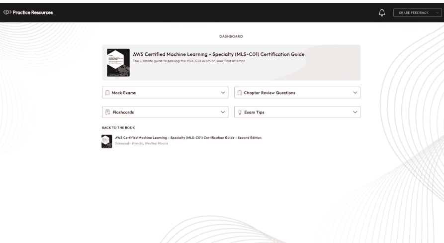

图 0.1 – 桌面设备上的在线考试备考平台

通过多组模拟考试、交互式闪卡以及可从所有现代 Web 浏览器访问的考试技巧，深化您对 MLS-C01 概念的理解。

### 下载彩色图片


我们还提供一份包含本书中使用的截图/图表彩色图像的PDF文件。您可以在此处下载：https://packt.link/ky8E8。

### 本书使用的惯例

本书中使用了若干文本约定。

**文本中的代码**：指示文本中的代码字词、数据库表名、文件夹名、文件名、文件扩展名、路径名、虚拟URL、用户输入和Twitter账号。这里是一个示例：“您将在代码中使用Amazon Rekognition的detect_labels API。”

一段代码块设置如下：

```
from sagemaker.predictor import Predictor
predictor = Predictor(endpoint_name='your-endpoint-name',
sagemaker_session=sagemaker_session)
predictor.predict('input_data')
```

任何命令行输入或输出均按以下方式编写：

```
sh-4.2$ cd ~/SageMaker/
sh-4.2$ git clone https://github.com/PacktPublishing/AWS-Certified-Machine-Learning-Specialty-MLS-C01-Certification-Guide-Second-Edition.git
```

**粗体**：表示新术语、重要单词或屏幕上看到的单词。例如，菜单或对话框中的单词在文本中会这样出现。这里是一个示例：“在 **CloudWatch** 中，每个 **Lambda 函数** 都将具有一个 **日志组**，并且在该日志组内，有许多 **日志流**。”

### 提示或重要说明

_外观如此。_

### 联系我们

始终欢迎读者反馈。

**一般反馈**：如果您对本书的任何方面有疑问，请在消息主题中注明书名，并发送电子邮件至 customercare@packt.com。

**勘误**：尽管我们已尽一切努力确保内容的准确性，但错误难免。如果您在本书中发现了错误，我们将不胜感激如果您能向我们报告。请访问 www.packtpub.com/support/errata，选择您的书，单击“勘误提交表”链接，并填写详细信息。我们确保所有有效的勘误都会及时更新到GitHub仓库，相关信息可在Readme.md文件中找到。您可以访问GitHub仓库：https://packt.link/QFk6t。

**盗版**：如果您在互联网上以任何形式发现我们作品的非法副本，我们将不胜感激如果您能提供位置地址或网站名称。请带上材料链接联系我们，邮箱：copyright@packt.com。

如果您有兴趣成为作者：如果您在某个主题上有专长，并有兴趣撰写或参与编写书籍，请访问 authors.packtpub.com。

### 分享您的想法

阅读完《AWS Certified Machine Learning - Specialty (MLS-C01) Certification Guide，第二版》后，我们很乐意听取您的想法！请单击此处直接前往本书的Amazon评论页面并分享您的反馈。

您的评论对我们和技术社区非常重要，并将帮助我们确保提供优质内容。

### 下载本书免费PDF副本

感谢您购买本书！

您是否喜欢随身阅读，但无法随处携带纸质书？

您的电子书购买是否与您选择的设备不兼容？

别担心，现在每一本Packt图书都附带一份免费的无DRM PDF版本。

随时随地，在任何设备上阅读。从您喜爱的技术图书中直接搜索、复制和粘贴代码到您的应用程序中。

福利远不止于此，您可以每天在收件箱中独家获取折扣、通讯和精彩免费内容。

请按照以下简单步骤获取这些福利：

- 1. 扫描二维码或访问以下链接：


https://packt.link/free-ebook/9781835082201

- 2. 提交您的购买证明。

- 3. 完成！免费PDF和其他福利将直接发送到您的电子邮件。

## 机器学习基础

在许多十年中，研究人员一直试图通过称为人工智能（AI）的领域来模拟人类大脑活动。1956年，一群人在达特茅斯人工智能夏季研究项目上会面，这一事件被广泛认为是关于当今所知AI的首次小组讨论。研究人员试图证明，学习过程的许多方面可以被精确描述，因此可以由机器自动化和复制。今天，你知道他们是对的！

在这个领域中出现了许多其他术语，例如机器学习（ML）和深度学习（DL）。这些AI子领域也在不断演进了许多十年（诚然，这里没有什么是科学上的新事物）。然而，随着信息社会的自然进步，以及更近期的大数据平台的出现，AI应用程序正在以更强大的适用性重生——算力（因为现在有更多计算资源来模拟和实现它们）和适用性（因为现在信息无处不在）。

更近期，云服务提供商已将AI推向云端。这有助于各种规模的公司降低运营成本，甚至让它们尝试AI应用程序，因为对小公司来说，维护自己的数据中心来扩展AI应用程序可能成本过高。

随着大数据和云服务的普及，构建尖端AI应用程序的精彩旅程已经出现。2020年6月，一种特定技术引起了广泛关注，并将AI推上了技术行业最受讨论的话题列表——它的名字是ChatGPT。

ChatGPT是一种流行的AI应用程序，它使用大语言模型（更具体地说，是生成式预训练变换器），在海量文本数据上进行训练，以理解和生成类似人类的语言。这些模型旨在处理和理解人类语言的复杂性，包括语法、上下文和语义。

大语言模型利用DL技术（例如，基于变换器架构的深度神经网络）来学习文本数据中的模式和关系。它们包含数百万个参数，使其高度复杂，并能够捕捉非常具体的语言结构。

术语和不同使用类别的这种混淆可能会让人在理解实施AI应用程序的实际步骤时感到困惑。这就引出了本章的目标：能够描述AI、ML和DL的含义，以及理解ML流水线的所有细微差别。避免对这些术语的混淆并知道ML流水线究竟是什么，将使您能够正确选择服务、开发应用程序，并掌握AWS机器学习专业考试。

### 充分利用本书 – 获得认证及之后

本书及其附带的在线资源旨在成为您MLS-C01考试的完整准备工具。

本书的编写方式使您可以在获得认证后继续应用所学的所有内容。随本书提供的在线练习资源（图1.1）旨在提高您的应试技巧。它们包含限时模拟考试、交互式闪存卡和考试技巧，帮助您从现在起直到考试当天进行考试准备。

### 继续之前

要了解如何访问这些资源，请参阅本书末尾的第11章“访问在线练习资源”。

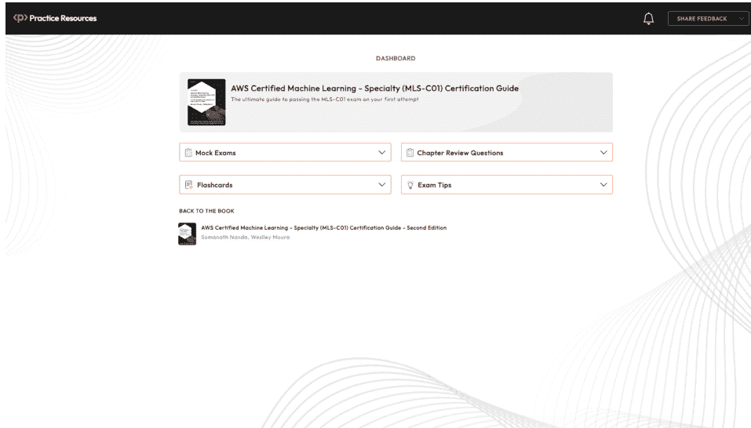

图 1.1 – 在线练习资源的仪表板界面

以下是一些关于如何充分利用本书的提示，以便您可以顺利获得认证，并在考试后保留知识：

- 1. 彻底阅读每个部分。

- 2. 做大量笔记：您可以使用自己喜欢的在线笔记工具或使用实体笔记本。免费的在线资源还让您可以访问本书的在线版本。从仪表板单击“返回图书”链接以在Packt Reader中访问本书。您可以在那里突出显示书本的特定部分。


- 3. 章节复习题：在本章末尾，您会找到本章复习题的链接。这些题目旨在测试您对本章的掌握情况。在进入下一章之前，请力争得分至少达到 75%。您将在本章末尾的 *考试准备演练 - 章节复习题* 部分找到如何充分利用这些问题的详细说明。这样一来，您是在每章之后而非期末提升考试应试技巧。

- 4. 闪卡：阅读完本书并在每个章节复习题中得分达到 75% 或以上后，开始复习在线闪卡。它们将帮助您记忆关键概念。

- 5. 模拟考试：做随书附带的模拟考试，一直做到考试当天。如果答错一些问题，请回到书中，重新学习您薄弱的概念。

- 6. 考试技巧：不时复习这些技巧，以进一步提高您的考试准备程度。

本章的主要主题如下：

- 对比 AI、ML 和 DL
- 对监督学习、无监督学习和强化学习进行分类
- CRISP-DM 建模生命周期
- 数据划分
- 建模预期
- ML 框架简介
- 云端 ML

### 对比 AI、ML 和 DL

AI 是一个广泛的领域，研究通过模拟人类智能来创建能够解决问题的系统和机器的不同方法。创建这些程序和机器有不同的精细程度，从简单的基于规则的引擎到复杂的自学习系统。
AI 包括但不限于以下子领域：

- 机器人技术
- 自然语言处理 (NLP)
- 基于规则的系统
- 机器学习 (ML)
- 计算机视觉

本认证考试关注的领域是 ML。

### 审视 ML

ML 是 AI 的一个子领域，旨在创建能够从经验中学习的系统和机器，而无需进行显式编程。顾名思义，该系统可以在无需人工干预的情况下观察其底层环境、学习并自我调整。ML 系统背后的算法通常从可用的数据和条件中提取并改进知识。

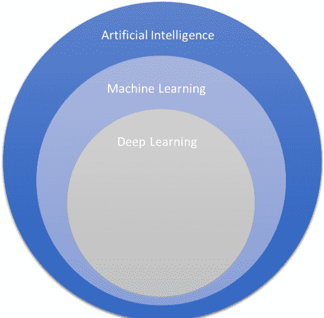

图 1.2 – AI、ML 和 DL 的层次结构

请牢记，ML 算法有不同的类别。例如，基于决策树的模型、基于概率的模型和神经网络模型。这些类别中的每一个都可能包含几十种特定的算法或架构（其中一些将在本书后续章节中介绍）。

如您在图 1.2 中可能注意到的那样，您可以进一步细分，将 ML 领域拆解为机器学习专项考试的另一个重要主题：深度学习，简称 DL。

### 审视 DL

DL 是 ML 的一个子集，旨在提出连接多层以解决特定问题的算法。知识随后逐层传递，直到找到最优解。最常见的 DL 算法类型是深度神经网络。

在撰写本书时，DL 是 ML 领域的一个热门话题。机器翻译、图像标题生成和计算机视觉领域的大多数当前最先进算法都是在过去几年提出的，并属于 DL 领域（ChatGPT 应用程序使用的 GPT-4 就是其中之一）。

现在您已了解 AI 类型的概况，请来看看可以如何对 ML 进行分类。

### 对监督学习、无监督学习和强化学习进行分类

ML 是一个非常广泛的研究领域；因此，明确其细分领域的定义非常重要。从非常广泛的角度来看，您可以将 ML 算法分为两大类：监督学习和无监督学习。

### 监督学习简介

监督算法使用类或标签（来自输入数据）作为支持，以查找和验证最优解。表 1.1 中有一个数据集，旨在对金融公司的欺诈交易进行分类。

| 星期几 | 小时 | 交易金额 | 商户类型 | 是否欺诈？ |
| --- | --- | --- | --- | --- |
| 周一 | 09:00 | $1000 | 零售 | 否 |
| 周二 | 23:00 | $5500 | 电子商务 | 是 |
| 周五 | 14:00 | $500 | 旅行 | 否 |
| 周一 | 10:00 | $100 | 零售 | 否 |
| 周二 | 22:00 | $100 | 电子商务 | 否 |
| 周二 | 22:00 | $6000 | 电子商务 | 是 |

表 1.1 – 监督学习示例数据集

前四列称为特征或自变量，监督算法可利用它们来发现欺诈模式。例如，通过组合这四个特征（星期几、EST 小时、交易金额和商户类型）以及六条观测（从技术上讲，每行都是一条观测），您可以推断出，金额超过 5,000 美元且在夜间处理的电子商务交易可能是欺诈案例。

#### 重要提示

在实际场景中，您将拥有更多观测，以便为这种推断提供统计支持。

关键点在于，您之所以能够推断出潜在的欺诈模式，仅仅是因为您事先知道什么是欺诈，什么不是欺诈。这些信息存在于表 1.1 的最后一列中，通常称为目标变量、标签、响应变量或因变量。如果输入数据集包含目标变量，您应该能够应用监督学习。

在监督学习中，目标变量可能存储不同类型的数据。例如，它可能是二元列（是或否）、多类列（类别 A、B 或 C），甚至是数值列（任何实数，例如交易金额）。根据目标变量的数据类型，您将找到您的问题所属的监督学习类型。表 1.2 展示了如何将监督学习分为两大类：分类算法和回归算法：

| 目标变量的数据类型 | 目标变量的子数据类型 | 适用的监督学习类型 |
| --- | --- | --- |
| 类别 | 二元 | 二元分类 |
| 类别 | 多类 | 多类分类 |
| 数值 | 不适用 | 回归 |

表 1.2 – 根据目标变量选择合适的监督学习类型

分类算法预测一个类别（二元或多类），回归算法预测一个实数（连续或离散）。

理解数据类型对于在 ML 项目中做出正确决策非常重要。您可以将数据类型分为两大类：数值数据和类别数据。数值数据可进一步划分为连续或离散子类，而类别数据可能指序数或名义数据：

- 数值/离散数据是指可计数的单个项目（例如，教室里的学生人数或在线购物车中的商品数量）。
- 数值/连续数据是指可能的无限多种测量值，通常带有小数点（例如，温度）。
- 类别/名义数据是指没有定量值的标记变量（例如，姓名或性别）。
- 类别/序数数据为标记变量增加了顺序概念（例如，教育程度或员工职级）。

换句话说，为项目选择算法时，您应该自问：我是否有目标变量？它存储的是类别数据还是数值数据？回答这些问题将帮助您从更有利的位置选择能够解决问题的潜在算法。

但是，如果您没有目标变量怎么办？在这种情况下，您面临的是无监督学习问题。无监督问题不提供标记数据；相反，它们提供所有自变量（或特征），使无监督算法能够在数据中发现模式。无监督学习最常见的类型是 **聚类**，旨在仅根据特征将数据集的观测值分组到不同的簇中。同一簇中的观测值预期彼此相似，但与其他簇中的观测值差异很大。聚类将在本书后续章节中更详细地介绍。

**半监督学习** 也存在于 ML 文献中。这种算法可以从部分标记的数据中学习（某些观测值包含标签，而其他观测值不包含）。

最后，另一类 ML 算法采用的另一种学习方法是 **强化学习**。这种方法基于系统自主做出的良好决策对系统进行奖励；换句话说，系统通过经验学习。

您一直在非常宏观的层面上学习算法的方法和类别。但是，是时候具体化并引入 **模型** 这一术语了。

### CRISP-DM 建模生命周期

**建模** 是 ML 中非常常见的术语，用于指定解决特定问题所采取的步骤。例如，您可以创建一个二元分类模型，以预测 _表 1.1_ 中的交易是否属于欺诈。

在此语境下，模型代表了创建解决方案的所有步骤的整体，其中包括（但不限于）算法。**跨行业标准数据挖掘流程**（通常称为 **CRISP-DM**）是提供创建模型应遵循的常见步骤指导的方法论之一。该方法论在市场中广泛使用，并涵盖在 AWS 机器学习专项考试中：


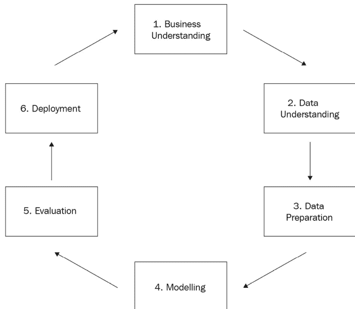

图 1.3 – CRISP-DM 方法论

一切都始于业务理解，这将产生业务目标（包括成功标准）、情境评估、数据挖掘目标和项目计划（包含对工具和技术的初步评估）。在情境评估期间，您还应审查资源清单、需求、假设和约束、风险、术语、成本和收益。在建模时，每一个假设和成功标准都至关重要。

下一步称为数据理解，您将在此阶段收集原始数据、描述数据、探索数据并检查其质量。这是对将用于创建模型的数据的初步评估。同样，数据科学家必须保持怀疑态度。您必须确保自己理解数据及其来源的所有细微差别。

数据准备阶段实际上是建模过程中通常耗时最多的阶段。在此阶段，您需要选择和筛选数据，根据需要执行的任务对其进行清洗，提出新属性，将数据与其他数据源集成，并按所应用算法预期的格式格式化数据。这些任务通常称为 **特征工程**。

一旦数据准备就绪，您就可以开始建模阶段了。这里是算法发挥作用的地方。您应首先确保选择正确的技术。请记住：根据目标变量（及其数据类型）的存在或不存在，您将有不同的算法可供选择。每种建模技术可能都带有一些您需要注意的隐含假设。例如，如果您选择多元线性回归算法来预测房价，则应知道，这类模型期望数据中的变量之间存在线性关系。

外面有成百上千种算法，每种算法可能都有其自身的假设。在选择要在项目中测试的算法后，您应该花些时间检查其细节。在本书的后续章节中，您将了解其中一些算法。

#### 重要提示

某些算法在其逻辑中包含一个称为特征选择的子过程。这是一个步骤，其中将选择最重要的特征来构建您的最佳模型。决策树是自动执行特征选择的算法示例。您将在后面详细了解特征选择，因为有不同的方法为您的模型选择最佳变量。

#### 重要提示

ML 算法由参数和超参数构成。参数是从数据中学习的；例如：基于决策树的算法可能会从训练数据中学习到，基于信息增益评估，某个特征应构成其根节点。另一方面，超参数用于控制学习过程。以相同的决策树示例为例，您可以指定树的最大允许深度（与训练数据无关）。超参数调优是考试中非常重要的主题，后面将以细致入微的方式进行介绍。

一旦模型训练完成，您就可以评估和审查结果，以提出下一步措施。如果结果不可接受（基于业务成功标准），则应回到早期步骤，检查还可以做些什么来改善模型结果。这可能是对算法超参数进行微调，一个新的数据准备步骤，甚至是重新定义业务驱动因素。另一方面，如果模型质量可接受，则可以进入部署阶段。

在 CRISP-DM 方法论的最后阶段，您需要考虑模型的部署计划、监控和维护。您可以从两个角度来看待此步骤：训练和推理。训练管道包括训练模型所需的步骤，其中包括数据准备、超参数定义、数据拆分以及模型训练本身。您必须将所有模型工件存储在某个地方，因为它们将被下一个需要开发的管道使用：推理管道。

推理管道仅使用模型工件对全新的观测值（即模型在训练阶段从未见过的数据）执行模型。例如，如果模型是为识别欺诈交易而训练的，那么此时新交易将通过模型进行分类。

一般来说，模型训练一次（通过训练管道）并执行多次（通过推理管道）。然而，经过一段时间后，预计会出现某种模型降级，也称为模型漂移。这种现象之所以发生，是因为模型通常是在静态训练集上训练的，该集旨在代表给定时间点的业务场景；然而，业务在不断发展，可能需要使用更近期的数据重新训练模型，以捕捉新的业务方面。这就是为什么即使在模型部署后，跟踪模型性能也很重要。

CRISP-DM 方法论对于 AWS 机器学习专业认证考试的背景如此重要，以至于如果您查看 AWS 涵盖的四个领域，您会发现它们是从 CRISP-DM 阶段概括而来的：数据工程、探索性数据分析、建模以及 ML 实现和运维。

现在您了解了建模管道的所有关键阶段，并且知道算法本身只是更大过程的一部分！接下来，您将看到如何拆分数据以创建和验证 ML 模型。

### 数据拆分

训练和评估 ML 模型是建模管道的关键任务。ML 算法需要数据来发现特征之间的关系以进行推断，但这些推断在移至生产环境之前需要经过验证。

用于训练 ML 模型的数据集通常称为训练集。这些训练数据必须能够代表模型将使用的真实环境；如果不满足该要求，则无用。

回到表 1.1 中提出的欺诈示例，根据训练数据，您发现金额大于 5,000 美元且在夜间处理的电子商务交易可能是欺诈案例。牢记这一点，在生产环境中应用模型后，模型应该标记训练过程中学习到的类似案例。因此，如果那些案例只存在于训练集中，模型会在生产环境中标记 **假阳性** 案例。相反的情况也是成立的：如果生产数据中存在某个特定的欺诈案例，而训练数据中没有反映，模型会标记大量 **假阴性** 案例。假阳性和假阴性比率只是您可用于模型验证的许多质量指标中的两个。这些指标将在后面更详细地介绍。

至此，您应该清楚了解拥有良好训练集的重要性。现在，假设您确实拥有一个有效的训练集，您如何才能对该模型在生产环境中表现良好有一定信心呢？答案是使用测试集和验证集：

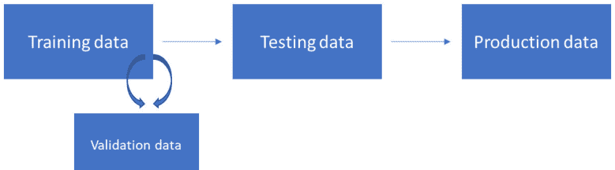

图 1.4 – 数据拆分

_图 1.4_ 显示了在训练和推理管道期间可以进行的不同类型的数据拆分。训练数据用于创建模型；测试数据用于提取最终模型质量指标。测试数据 _不可以_ 在训练过程中使用，除非是为了提取模型指标。

避免在训练期间使用测试数据的原因很简单：您 _不可以_ 让模型在将用于验证它的数据上学习。这种留出一部分数据进行测试的技术通常称为 **留出验证**。

_图 1.4_ 右侧的框表示生产数据。生产数据通常是连续进入的，您必须执行推理管道才能从中提取模型结果。生产数据上不执行任何训练或其他类型的重新计算；您只需按原样通过推理管道传递它。

从技术角度来看，大多数 ML 库使用 `.fit` 方法实现训练步骤，而推理步骤由 `.transform` 或 `.predict` 方法实现。同样，这只是大多数 ML 库使用的常见模式，但请注意，您可能会在不同的 ML 库中发现不同的命名约定。

仍查看 _图 1.4_，靠近训练数据的另一个框名为 **验证数据**。这是训练集的一个子集，通常用于在移至下一阶段之前支持创建最佳模型。


进入测试阶段。你将更详细地了解验证集，但首先，你应该明白为什么需要它们。

### 过拟合和欠拟合

机器学习模型可能会遇到两种拟合问题：**过拟合**和**欠拟合**。过拟合是指你的模型在训练数据上表现非常好，但无法推广到其他数据集，例如测试数据，更糟糕的是生产环境数据。换句话说，如果你有一个过拟合的模型，它只能在你的训练数据上工作。

在构建机器学习模型时，你希望创建能够泛化所学知识并对遵循相同数据分布的其他数据集做出推断决策的解决方案。一个只能在其训练数据上工作的模型是没有用的。过拟合通常是由于特征数量过多或算法超参数配置不当造成的。

另一方面，欠拟合的模型在训练阶段无法拟合数据。因此，它们过于通用，无法在训练、测试或生产数据上表现良好。欠拟合通常是由于缺乏良好的特征/观测值，或由于训练模型的时间不足（某些算法需要更多迭代才能正确拟合模型）造成的。

过拟合和欠拟合都需要避免。有许多建模技术可以绕过这些问题。例如，你将学习常用的**交叉验证**技术及其与图 1.4 中显示的验证数据框的关系。

### 应用交叉验证和衡量过拟合

交叉验证是一种将训练集划分为训练集和验证集的技术。然后模型在训练集上进行训练，在验证集上进行测试。最常见的交叉验证策略称为**k折交叉验证**，其中 k 是训练集的划分数量。

使用 k 折交叉验证并假设 k 等于 10，你将训练集分成 10 个折叠。模型将被训练和测试 10 次。在每次迭代中，它使用 9 个划分进行训练，并保留一个划分进行测试。执行 10 次后，从每次迭代中提取的评估指标将被平均，并将代表训练阶段的最终模型性能，如图 1.5 所示：

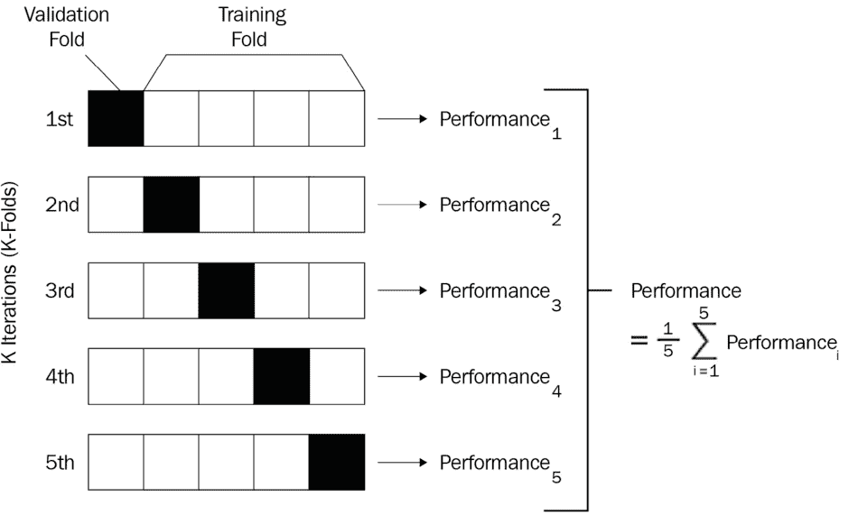

#### 图 1.5 – 交叉验证在行动中

另一种常见的交叉验证技术称为**留一法交叉验证（LOOCV）**。在这种方法中，模型被执行多次，在每次迭代中，一个观测值被分离出来进行测试，所有其他观测值都用于训练。

在训练期间使用交叉验证有许多优势：

- 由于模型始终在特定的数据块上进行训练，并在未用于训练的另一个数据块上进行测试，因此你可以减轻训练数据中的过拟合。
- 你可以避免在测试数据上过拟合，因为不需要不断使用测试数据来优化模型。
- 你可以暴露过拟合或欠拟合的存在。如果训练/验证数据中的模型性能与测试数据中观察到的性能大不相同，那么就有问题了。

值得深入探讨列表中的第三项，因为它在 AWS 机器学习专项认证考试中被广泛覆盖。例如，假设你正在创建一个二分类模型，在训练期间使用交叉验证，并使用测试集提取最终指标（留出验证）。如果交叉验证结果中的准确率为 80%，而测试集中的准确率为 50%，这意味着模型在训练集上过拟合，因此无法推广到测试集。

另一方面，如果训练集中的准确率为 50%，而测试集中的准确率为 80%，那么数据中存在系统性问题。很可能训练集和测试集不遵循相同的分布。

#### 重要提示

准确率是分类模型中常用的模型评估指标。它衡量模型在推理过程中做出正确决策的频率。该指标仅为演示而选择，但请注意，每种类型的模型都有许多其他适用的评估指标（将在适当的时候介绍）。

### 自助抽样方法

交叉验证是验证机器学习模型的良好策略，你应该在数据科学家的日常工作中尝试它。但是，你也应该了解外面可用的其他重采样技术。**自助抽样**是其中之一。

与不进行替换的交叉验证不同，自助抽样采用进行替换的方式。进行替换意味着，在从总体数据集中抽取多个随机样本时，同一观测值可能会在样本中重复。

通常，自助抽样不用于像传统交叉验证方法那样验证模型。原因很简单：由于它采用替换的方式，用于训练的同一观测值也可能用于测试。这将导致模型性能指标虚高，因为当对训练集中已经出现过的观测值进行预测时，估计器很可能是正确的。

机器学习算法经常以嵌入式的方式使用自助抽样，这需要重采样能力来处理数据。在这种情况下，自助抽样不是用来 _验证_ 模型，而是用来 _创建_ 模型。**随机森林**（将在 **第 6 章，应用机器学习算法** 中介绍）是那些在内部使用自助抽样进行模型构建的算法之一。

设计良好的数据分割/采样策略对模型或算法的成功至关重要。你应该想出不同的方法来分割你的数据，检查模型在每个分割上的表现，并确保这些分割代表模型将被使用的真实场景。

### 方差与偏差的权衡

任何机器学习模型都应该包含错误。模型中存在三种类型的错误：**偏差**错误、**方差**错误和**无法解释**的错误。正如预期，最后一种无法解释。它通常与问题的上下文和变量之间的关系有关（你无法控制它）。

另一种两种类型的错误可以在建模过程中得到控制。你可以说偏差和方差错误之间存在权衡，因为一个会影响另一个。在这种情况下，增加偏差会减少方差，反之亦然。

偏差错误与模型为学习目标函数（即你想要解决的函数）所采取的假设有关。某些类型的算法，例如线性算法，通常会带有这种类型的错误，因为它们在模型训练期间做出了很多假设。例如，线性模型假设数据中存在线性关系。线性回归和逻辑回归是通常具有高偏差的算法类型。另一方面，决策树是对数据做出更少假设并具有较少偏差的算法类型。

方差与模型在不同训练数据上进行估计的差异有关。高方差的模型通常会过拟合训练集。决策树是高方差算法的例子（它们通常很大程度上依赖于训练集的具体细节，无法泛化），而线性回归和逻辑回归是低方差算法的例子。这并不意味着决策树是糟糕的估计器；它只是意味着你需要在训练期间对它们进行剪枝（优化）。

也就是说，任何模型的目标都是最小化偏差和方差。但是，如前所述，每一个都会以相反的方向影响另一个。为了演示，考虑一个决策树来理解这种权衡是如何工作的。

决策树是非线性算法，通常具有低偏差和高方差。为了减少方差，你可以剪枝树并将 `max_depth` 超参数（树允许的最大深度）设置为 10。这将强制模型更加通用，从而减少方差。但是，这种变化也会迫使模型做出更多假设（因为它现在更加通用）并增加偏差。

### 打乱你的训练集

既然你知道什么是方差和数据分割，你可以深入了解训练数据集的要求。你在考试中很可能遇到关于数据打乱的问题。此过程包括在开始使用数据集来拟合算法之前对其进行随机化。

数据打乱将帮助算法通过创建更具泛化性的模型来减少方差。例如，假设你的训练数据表示一个二分类问题，并且按目标变量排序（所有属于类“0”的情况首先出现，然后是所有属于类“1”的情况）。

当你在这个排序好的数据上拟合算法时（尤其是依赖于 **批处理** 的某些算法），它会对其中一个类别的模式做出强烈假设，因为它非常


很可能无法创建具有良好类别表示的随机数据批次。一旦算法对训练数据建立了强假设，它可能很难更改这些假设。

#### 重要说明

某些算法能够通过分块（也称为批次）拟合数据来执行训练过程。这种方法使模型能够更频繁地学习，因为它会在处理每个数据批次后做出部分假设（而不仅仅是在处理完整个数据集后才做出决策）。

另一方面，无需打乱测试集，因为它仅由推理过程用于检查模型性能。

### 建模期望

至此，您已了解模型构建、验证和管理。现在，您可以通过学习建模过程中的另外一些期望来完善 ML 基础。

第一个是简约性。简约性描述的是与其他模型相比，提供最简单解释并获得最佳拟合效果的模型。举个例子：在创建线性回归模型时，您发现添加 10 个更多特征只能将模型性能提升 0.001%。在这种情况下，您应考虑这种性能提升是否值得牺牲简约性（因为您的模型会变得更复杂）。有时值得，但大多数时候不值得。您需要保持怀疑态度，并根据您的业务场景进行思考。

简约性直接支持可解释性。您的模型越简单，就越容易解释。然而，可解释性与预测能力之间存在权衡：如果您关注预测能力，可能会失去一些可解释性。同样，您必须为您的用例选择最佳情况。

### 机器学习框架简介

了解一些 ML 框架将使您更有机会通过 AWS 机器学习专项认证考试。无需掌握这些框架，因为这不是框架特定的认证；但是，了解一些常见术语和解决方案将帮助您理解问题的上下文。

scikit-learn 可能是您应该了解的最流行的 ML 框架。它是一个开源 Python 包，提供决策树、支持向量机、线性回归等 ML 算法的实现，以及许多其他算法。它还实现了用于数据预处理的类，例如独热编码、标签编码器、主成分分析等。本书后续章节将介绍所有这些预处理方法（以及许多其他方法）。

scikit-learn 的缺点在于它需要定制才能通过多台机器进行扩展。还有一个非常流行的 ML 库，因为它可以直接处理多处理：**Spark 的 ML 库**。

顾名思义，它是一个运行在 **Apache Spark** 之上的 ML 库，Apache Spark 是一个用于在多台机器上处理数据的统一分析多处理框架。AWS 提供了一项特定服务，允许开发者点击几下即可创建 Spark 集群，即 **EMR**。此外，SageMaker（AWS 提供的完全托管 ML 服务，您将在单独章节中学习）与 Apache Spark 集成良好。

Spark ML 库处于持续开发中。截至撰写时，它支持许多 ML 算法类别，例如分类和回归、聚类以及协同过滤。它还支持基本统计计算，例如相关性和某些假设检验，以及许多数据转换，例如独热编码、主成分分析、最小-最大缩放等。

另一个非常流行的 ML 框架是 **TensorFlow**。这个 ML 框架由 Google 团队创建，用于数值计算和大规模 ML 模型开发。TensorFlow 不仅实现了传统 ML 算法，还实现了 DL 模型。

TensorFlow 被视为模型开发的低级 API，这意味着开发更复杂的模型（例如用于文本挖掘的 **transformers**）可能非常复杂。为了简化模型开发，其他 ML 框架构建在 TensorFlow 之上。其中一个高级框架是 **Keras**。使用 Keras，开发者只需几行代码即可创建复杂的 DL 模型。最近，Keras 被整合到 TensorFlow 中，现在可以在 TensorFlow 库内调用。

**MXNet** 是另一个开源 DL 库。使用 MXNet，您可以利用多台机器上运行的多个 GPU 来扩展基于神经网络的模型。它还支持多种编程语言，例如 Python、R、Scala 和 Java。

**图形处理单元 (GPU)** 支持在 TensorFlow 和 MXNet 等 DL 库中尤为重要。这些库允许开发者创建和部署具有多层的基于神经网络的模型。神经网络的训练过程高度依赖矩阵运算，矩阵运算在 GPU 上的表现远优于 CPU。这就是为什么这些 DL 库通常提供 GPU 支持。AWS 还提供启用了 GPU 的 EC2 实例。

这些 ML 框架需要一个特殊通道与 GPU 单元通信。NVIDIA（当今最常见的 GPU 供应商）创建了一个名为 Compute Unified Device Architecture (CUDA) 的 API。CUDA 用于配置 NVIDIA 设备上的 GPU 单元；例如，设置缓存内存和训练神经网络模型所需的线程数。对于 AWS 机器学习专项认证考试，无需掌握 CUDA 或 GPU 架构，但您肯定需要知道它们是什么，以及 DL 模型如何利用它们。

最后但同样重要的是，您还应该了解数据科学社区广泛使用的一些开发框架，但这些框架不一定用于创建 ML 模型。这些框架与 ML 库互操作，以促进数据操作和计算。例如：pandas 是一个提供数据处理功能的 Python 库，NumPy 是一个提供数值计算功能的开源 Python 库。

这些术语和库已深深融入数据科学家的日常工作流程，因此可能会在考试中出现以向您解释某个问题领域。了解它们是什么将帮助您快速掌握问题的上下文。

### 云中的机器学习

机器学习已进入云端，开发者现在可以将其作为服务使用。AWS 在不同抽象级别实现了 ML 服务。例如，ML 应用服务旨在为特定问题领域提供即用型解决方案。AWS Lex 是 ML 作为服务的一个非常明确的示例，人们可以在其中以最小开发工作量实现聊天机器人。

AWS Rekognition 是另一个示例，旨在识别图像和视频中的对象、人员、文本、场景和活动。AWS 提供许多其他 ML 应用服务，将在本书下一章中介绍。

除了应用服务，AWS 还提供 ML 开发平台，例如 SageMaker。与 AWS Lex 和 Rekognition 等即用型服务不同，SageMaker 是一个开发平台，可让您以更大的灵活性构建、训练和部署自己的模型。

SageMaker 通过自动处理模型训练和推理管道所需的基础设施，加快了开发和部署过程。在幕后，SageMaker 编排其他 AWS 服务（例如 EC2 实例、负载均衡器、自动缩放等），为 ML 项目创建可扩展环境。SageMaker 可能是您应该为 AWS 机器学习专项认证考试掌握的最重要服务，并将在单独章节中详细介绍。目前，您应专注于了解 AWS 提供 ML 相关服务所采用的不同方法。

AWS 为部署 ML 模型提供的第三种选项是最通用且最灵活的一种：您可以通过组合不同的 AWS 服务并单独管理它们来部署 ML 模型。这本质上就是 SageMaker 为您所做的工作，即从零开始构建您的应用程序。例如，您可以使用 EC2 实例、负载均衡器、自动缩放和 API 网关为特定模型创建推理管道。如果您愿意，也可以使用 AWS 无服务器架构部署解决方案，例如使用 **AWS Lambda 函数**。

### 总结

您现在正接近本章的结尾，在本章中您了解了有关 ML 基础的几个重要主题。您在本章开头就 AI、ML 和 DL 以及整个领域在过去几年中如何因大数据平台、云提供商和 AI 应用的出现而增长，进行了理论讨论。

接下来，您了解了监督学习、无监督学习和强化学习之间的区别，并重点介绍了与每种学习方式相关的一些用例。这很可能是 AWS 机器学习专项认证考试的一个考点。

您了解到 ML 模型是在许多不同阶段构建的，算法本身只是建模过程的一部分。您还了解了优秀模型的预期行为。

您深入了解了数据分割，了解了训练和验证模型的不同方法，并了解了方差与偏差之间的史诗级较量。通过了解 ML 框架和服务，您完成了本章的学习。

接下来，您将了解 AWS 的 ML 应用服务，例如 Amazon Polly、Amazon Rekognition、Amazon Transcribe 以及许多其他 AI 相关的 AWS 服务。但在此之前，请先查看一些示例问题，以了解考试中可能遇到的情况。


### 考试备战演练 – 章节复习题

除了扎实掌握关键概念外，在时间压力下快速思考的能力也是一项能帮助你在认证考试中取得好成绩的技能。因此，在学习旅程早期就开始培养这些技能至关重要。

章节复习题旨在随着你逐章学习而逐步提升你的应试技巧，同时复习你对本章关键概念的理解。你将在每章末尾找到这些题目。

### 如何访问这些资源

要了解如何访问这些资源，请前往标题为“第 11 章：访问在线练习资源”的章节。

要打开本章的章节复习题，请执行以下步骤：

- 1. 单击链接 – https://packt.link/MLSC01E2_CH01。

或者，你可以扫描以下二维码（图 1.6）：


图 1.6 – 为已登录用户打开章节复习题的二维码

- 2. 登录后，你将看到类似图 1.7 所示的页面：

### 机器学习基础

### 总结

你现在即将完成本章，本章介绍了关于机器学习基础的几个重要主题。你从关于 AI、ML 和 DL 的理论讨论开始本章，并探讨了由于大数据平台、云服务提供商和 AI 应用的出现，整个领域在过去几年中是如何增长的。

随后，你了解了监督学习、无监督学习和强化学习之间的区别，并重点介绍了与它们各自相关的一些用例。这很可能是 AWS 机器学习专项考试的一个考点。

你了解到，ML 模型是在许多不同阶段构建的，而算法本身只是建模过程的一部分。你还了解了良好模型的预期行为。

你深入学习了数据拆分，了解了训练和验证模型的不同方法，并意识到了方差与偏差之间的史诗级较量。你通过了解 ML 框架和服务完成了本章。

接下来，你将了解用于 ML 的 AWS 应用程序服务，例如 Amazon Polly、Amazon Rekognition、Amazon Transcribe 以及许多其他与 AI 相关的 AWS 服务。但首先，请查看一些示例题，以了解考试中可能遇到的题型。

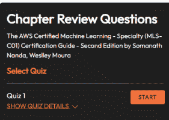

图 1.7 – 第 1 章的章节复习题

- 3. 准备就绪后，开始以下练习演练，多次重新尝试测验。

### 考试备战演练

前三次尝试时，不用担心时间限制。

#### 尝试 1

第一次，目标是至少达到 **40%**。查看你答错的题目，并再次阅读本章中的相关章节以弥补学习差距。

#### 尝试 2

第二次，目标是至少达到 **60%**。查看你答错的题目，并再次阅读本章中的相关章节以修复任何剩余的学习差距。

#### 尝试 3

第三次，目标是至少达到 **75%**。一旦你得分 75% 或以上，你就开始计算时间。

T/P

你可能需要超过 **三** 次尝试才能达到 75%。没关系。只需继续复习本章中的相关章节，直到达到目标为止。

### 计时练习

目标：你的目标是在尽可能快地回答这些问题的同时保持相同的得分。以下是你接下来的尝试示例：

| Attempt | Score | Time Taken |
|---------|-------|------------|
| Attempt 5 | 77% | 21 mins 30 seconds |
| Attempt 6 | 78% | 18 mins 34 seconds |
| Attempt 7 | 76% | 14 mins 44 seconds |

| 尝试 | 得分 | 耗时 |
|------|------|------|
| 尝试 5 | 77% | 21 分 30 秒 |
| 尝试 6 | 78% | 18 分 34 秒 |
| 尝试 7 | 76% | 14 分 44 秒 |

表 1.3 – 在线平台上的示例计时练习演练

#### 注意

上表中显示的时间限制仅为示例。根据网站上测验的时间限制，为每次尝试设置自己的时间限制。

每次新的尝试，你的得分应保持在 **75%** 以上，而完成所需的“耗时”应“减少”。重复尽可能多的尝试，直到你对应对时间压力充满信心为止。

## 用于数据存储的 AWS 服务

AWS 提供了广泛的服务来安全、可靠地存储你的数据。AWS 上有多种存储选项可供选择，例如块存储、文件存储和对象存储。由于硬件投入较高、管理开销和系统升级管理成本，管理本地数据存储很昂贵。使用 AWS 存储服务，你只需为所使用的内容付费，且无需管理硬件。你还将了解 Amazon S3 提供的各种存储类别，以便智能访问数据并降低成本。你可以期望考试中会有关于存储类别的问题。随着本章的深入，你将掌握 Amazon RDS 的 **单可用区（single-AZ）** 和 **多可用区（multi-AZ）** 实例，以及 **恢复时间目标（Recovery Time Objective, RTO）** 和 **恢复点目标（Recovery Point Objective, RPO）** 概念。

在本章中，你将通过以下各节了解如何安全地存储数据以供进一步分析用途：

- 在 Amazon S3 上存储数据
- 控制 S3 存储桶和对象的访问权限
- 保护 Amazon S3 上的数据
- 保护静态和传输中的 S3 对象
- 使用其他类型的数据存储
- 关系型数据库服务（RDSes）
- 管理 Amazon RDS 中的故障转移
- 获取自动备份、RDS 快照，以及恢复和只读副本
- 向具有多主功能的 Amazon Aurora 写入数据
- 在 Amazon Redshift 上存储列式数据
- 将 Amazon DynamoDB 用作 NoSQL 数据库即服务

### 技术要求

本章你只需要一个 AWS 账户并配置好 AWS CLI。为你的账户配置 AWS CLI 的步骤由 Amazon 在此处详细说明：https://docs.aws.amazon.com/cli/latest/userguide/cli-chap-configure.html。

你可以从 GitHub 下载代码示例，网址如下：https://github.com/PacktPublishing/AWS-Certified-Machine-Learning-Specialty-MLS-C01-Certification-Guide-Second-

### 在 Amazon S3 上存储数据

S3 是 Amazon 的基于云的对象存储服务，可通过互联网从任何位置访问。它是大型数据集的理想存储选择。它基于区域，因为你的数据存储在特定区域，直到你将数据移动到其他区域。除非配置，否则你的数据永远不会离开该区域。在特定区域中，数据会复制到该区域的可用区中；这使得 S3 在区域级别具有弹性。如果某个区域中的任何可用区发生故障，则其他可用区将处理你的请求。S3 可以通过 AWS 控制台 UI、AWS CLI、AWS API 请求或标准 HTTP 方法访问。

S3 有两个主要组件：存储桶和对象。

- 存储桶是在特定的 AWS 区域中创建的。存储桶可以包含对象，但不能包含其他存储桶。
- 对象有两个主要属性。一个是键（key），另一个是值（value）。值是要存储的内容，键是名称。对象的最大大小可以是 5 TB。根据 Amazon S3 文档（https://docs.aws.amazon.com/AmazonS3/latest/dev/UsingObjects.html），对象还具有版本 ID、元数据、访问控制信息和子资源。

### 重要提示

根据 Amazon 的文档，S3 为新对象的 PUT 操作提供读后写一致性，这意味着如果你上传新对象或创建新对象，然后立即尝试使用其键读取该对象，则会得到你刚刚上传的精确数据。但是，对于覆盖和删除操作，它以最终一致性的方式工作。这意味着如果你在删除或覆盖操作后立即读取对象，则可能会读取旧副本或过期版本的对象。需要一些时间来复制对象在三个可用区中的内容。

可以使用前缀在逻辑上维护文件夹结构。举个例子，将一个图像上传到存储桶 bucket-name-example，前缀为 folder-name，对象名为 my-image.jpg。整个结构如下所示：/bucket-name-example/folder-name/my-image.jpg。

可以使用存储桶名称 bucket-name-example 和键 /folder-name/my-image.jpg 读取对象的内容。

Amazon 为存储在 S3 中的对象提供了多种存储类别：

- 标准存储（S3 Standard）：这是用于频繁访问对象和快速访问的存储类别。S3 Standard 具有毫秒级首字节延迟，且对象可以设置为公开可用。
- 标准低频访问（S3 Standard-IA）：当你需要快速返回数据但不需要频繁访问时，使用此选项。对象大小必须至少为 128 KB。最短存储时长为 30 天。如果对象在 30 天前被删除，你仍需支付 30 天的费用。Standard-IA 对象对可用区丢失具有弹性。
- 单可用区低频访问（S3 One Zone-IA）：此存储类别中的对象仅存储在一个可用区中，因此比 Standard-IA 更便宜。最小对象大小和存储时长与 Standard-IA 相同。此存储类别的对象可用性较低且弹性较差。当你拥有另一份副本，或者数据可以被


重新创建。One Zone-IA 存储类应适用于生命周期长、非关键且可替换、且访问不频繁的数据。

- Amazon S3 Glacier Flexible Retrieval（原名 S3 Glacier）：此选项用于长期归档和备份。检索该存储类中的对象可能需要几分钟到几小时不等。最短存储期限为 90 天。对于无需立即访问但需要在不产生额外费用的情况下检索大量数据集的归档数据（例如备份或灾难恢复场景），S3 Glacier Flexible Retrieval（原名 S3 Glacier）是理想的存储选项。

- Amazon S3 Glacier Instant Retrieval：此存储类为很少访问的长期数据提供高性价比、高速度的存储。与 S3 Standard-Infrequent Access 相比，当数据每季度访问一次时，可将存储费用降低高达 68%。此存储类非常适合快速检索归档数据（如医学图像、新闻媒体资产或用户生成的内容归档）。您可以直接上传数据，或使用 S3 生命周期策略将其从其他 S3 存储类移动过来。

- Glacier Deep Archive：此类的最短存储期为 180 天。这是最便宜的存储类，默认检索时间为 12 小时。

- S3 Intelligent-Tiering：此存储类旨在降低运营开销。用户需支付监控费用，AWS 将根据对象的访问模式在 Standard（频繁访问层）和 Standard-IA（低成本、不频繁访问层）之间选择存储类。此选项专为访问模式未知或不可预测的长期数据设计。

通过一组规则，可以轻松管理存储类之间的转换以及对象的删除，这被称为 **S3 生命周期配置**。这些规则由操作组成。这些操作可以应用于存储桶或由前缀或标签定义的存储桶中一组对象。操作可以是 **转换操作** 或 **过期操作**。转换操作定义了对象在创建后经过 _自定义的_ 天数后的存储类转换。过期操作配置已版本化对象的删除，或删除标记或未完成分片上传的删除。这对于管理成本非常有用。

图 2.1 中给出了示例。您可以在此处查看更多详细信息：

https://docs.aws.amazon.com/AmazonS3/latest/dev/storage-class-intro.html.

| 存储类 | STANDARD | STANDARD-IA | ONE ZONE-IA | AMAZON GLACIER |
|---|---|---|---|---|
| 持久性 | 99.9999999999% | 99.9999999999% | 99.9999999999% | 99.9999999999% |
| 可用性 | 99.99% | 99.9% | 99.5% | 99.99% |

图 2.1 – S3 存储类比较表

### 创建存储桶以存放数据

现在，您将了解如何使用 AWS CLI 创建存储桶、上传对象以及读取对象：

1. 第一步，使用 aws s3 ls 命令检查是否已有创建的存储桶：

```
$ pwd
/Users/baba/AWS-Certified-Machine-Learning-Specialty-2020-Certification-Guide/Chapter-5/s3demo/demo-files
$ aws s3 ls
```

2. 此命令在此处未返回任何内容。因此，现在使用 mb 参数创建一个存储桶。假设存储桶名称为 demo-bucket-baba，区域为 us-east-1：

```
$ aws s3 mb s3://demo-bucket-baba --region us-east-1
make_bucket: demo-bucket-baba
$ aws s3 ls
2020-11-04 14:39:50 demo-bucket-baba
```

3. 既然您已创建存储桶，下一步是使用 cp 参数将文件复制到存储桶中，如以下代码所示：

```
$ aws s3 cp sample-file.txt s3://demo-bucket-baba/
upload: ./sample-file.txt to s3://demo-bucket-baba/sample-file.txt
```

4. 要通过 AWS 控制台验证文件上传操作，请登录您的 AWS 账户并进入 AWS S3 控制台查看。AWS S3 控制台将如图 2.2 所示列出结果。当您阅读本书时，控制台可能已经发生了变化！

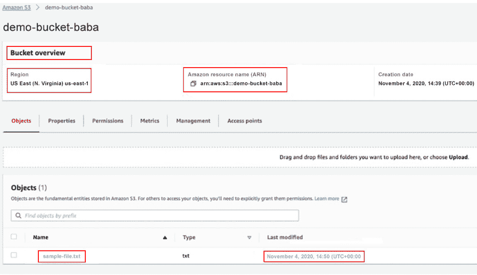

图 2.2 – AWS S3 列出您的文件

您也可以从命令行列出 S3 存储桶中的文件，如下所示：

```
$ aws s3 ls s3://demo-bucket-baba/
2020-11-04 14:50:02       99 sample-file.txt
```

5. 如果要将文件系统目录和文件上传到 S3 存储桶，则使用 --recursive 参数即可完成：

```
$ aws s3 cp . s3://demo-bucket-baba/ --recursive
upload: folder-1/a.txt to s3://demo-bucket-baba/folder-1/a.txt
upload: folder-2/sample-image.jpg to s3://demo-bucket-baba/folder-2/sample-image.jpg
upload: ./sample-file.txt to s3://demo-bucket-baba/sample-file.txt
$ aws s3 ls s3://demo-bucket-baba/
```

6. 一个存储桶的内容可以通过 `cp` 命令和 `--recursive` 参数复制/移动到另一个存储桶。为此，您需要创建两个存储桶，`demo-bucket-baba-copied` 和 `demo-bucket-baba-moved`。步骤如下：

```
$ aws s3 mb s3://demo-bucket-baba-copied --region us-east-2
$ aws s3 mb s3://demo-bucket-baba-moved --region us-east-2
$ aws s3 cp s3://demo-bucket-baba s3://demo-bucket-baba-copied/ --recursive
$ aws s3 mv s3://demo-bucket-baba s3://demo-bucket-baba-moved/ --recursive
$ aws s3 ls
2020-11-04 14:39:50 demo-bucket-baba
2020-11-04 15:44:28 demo-bucket-baba-copied
2020-11-04 15:44:37 demo-bucket-baba-moved
$ aws s3 ls s3://demo-bucket-baba/
```

如果所有命令都成功运行，那么原始存储桶最终应为空（因为所有文件现在都已移动）。

#### 注意

*在认证考试中，您不会发现关于存储桶和对象级别操作的许多问题。但是，了解基本操作和所需步骤总是更好的。*

7. 动手实践完成后，必须删除存储桶以避免费用。在运行 `rb` 命令之前，存储桶必须为空：

```
$ aws s3 rb s3://demo-bucket-baba
$ aws s3 rb s3://demo-bucket-baba-moved
remove_bucket failed: s3://demo-bucket-baba-moved An error occurred (BucketNotEmpty) when calling the DeleteBucket operation: The bucket you tried to delete is not empty
```

8. `demo-bucket-baba-moved` 存储桶不为空，因此无法删除存储桶。在这种情况下，请使用 `--force` 参数删除整个存储桶及其所有内容，如下所示：

```
$ aws s3 rb s3://demo-bucket-baba-moved --force
$ aws s3 rb s3://demo-bucket-baba-copied --force
```

如果要使用 CLI 删除存储桶中特定前缀内的所有内容，则可以轻松使用带 `--recursive` 参数的 `rm` 命令。

9. 以存储桶 `test-bucket` 为例，该存储桶有一个名为 `images` 的前缀。该前缀包含四个名为 `animal.jpg`、`draw-house.jpg`、`cat.jpg` 和 `human.jpg` 的图像文件。

10. 现在，要删除 images 中的内容，命令如下：`aws s3 rm s3://test-bucket/images --recursive`

11. 存储桶现在应为空。

在下一节中，您将了解对象标签和对象元数据。

### 区分对象标签和对象元数据

让我们比较这两个术语：

- **对象标签**：对象标签是一个键值对。AWS S3 对象标签可以帮助您筛选分析和指标、对存储进行分类、根据特定分类保护对象、根据对象的特定分类跟踪成本，等等。对象标签可用于创建生命周期规则，将对象移动到更便宜的存储层。一个对象最多可添加 10 个标签，一个存储桶最多可添加 50 个标签。标签键最多可包含 128 个 Unicode 字符，而标签值最多可包含 256 个 Unicode 字符。

- **对象元数据**：对象元数据是描述对象的描述性数据。它由 **名称-值** 对组成。对象元数据作为对象上的 HTTP 头返回。它们分为两类：一种是 **系统元数据**，另一种是 **用户定义元数据**。用户定义元数据是用户添加到对象的自定义名称-值对。名称必须以 `x-amz-meta` 开头。您可以更改对象上的所有系统元数据，例如存储类、版本控制和加密属性。更多详细信息可在此处查看：[https://docs.aws.amazon.com/AmazonS3/latest/dev/UsingMetadata.html](https://docs.aws.amazon.com/AmazonS3/latest/dev/UsingMetadata.html).

#### 重要说明

*元数据名称不区分大小写，而标签名称区分大小写。*

在下一节中，您将了解通过不同策略（包括资源策略和身份策略）控制对 Amazon S3 存储桶和对象的访问。

### 控制对 Amazon S3 存储桶和对象的访问

对象存储在存储桶中后，下一步主要是管理访问。S3 默认为私有，并通过多种方法向其他用户、组或资源授予访问权限。这意味着对象的访问可以通过 **访问控制列表 (ACLs)**、**公共访问设置**、**身份策略** 和 **存储桶策略** 来管理。

让我们详细了解其中一些。

#### S3 存储桶策略

S3 **存储桶策略**是附加到存储桶的资源策略。资源策略决定谁可以访问该资源。它与身份策略不同，因为身份策略可以附加或分配给账户内的身份，而资源策略可以控制来自同一账户或不同账户的身份。资源策略还控制匿名主体，这


表示对象可以通过资源策略设置为公共。以下示例策略允许全世界所有人读取存储桶，因为 Principal 被设置为 "*":

```
{
"Version": "2012-10-17",
"Statement": [
{
"Sid": "AnyoneCanRead",
"Effect": "Allow",
"Principal": "*",
"Action": ["s3:GetObject"],
"Resource": ["arn:aws:s3:::my-bucket/*"]
}
]
}
```

默认情况下，S3 中的所有内容对所有者都是私有的。如果要将前缀向全世界公开，则 Resource 更改为 arn:aws:s3:::my-bucket/some-prefix/*，同样，如果面向特定 IAM 用户或 IAM 组，则详细信息应放在策略的 principal 部分中。

存储桶策略也可以添加条件。让我们来看一个用例：组织希望保持存储桶公开，并将特定 IP 地址加入白名单。策略大致如下：

```
{
"Version": "2012-10-17",
"Statement": [
{
"Sid": "ParticularIPRead",
"Effect": "Allow",
"Principal": "*",
"Action": ["s3:GetObject"],
"Resource": ["arn:aws:s3:::my-bucket/*"],
"Condition": {
"NotIpAddress": {"aws:SourceIp": "2.3.3.6/32"}
}
}
]
}
```

更多示例可在 AWS S3 开发者指南中找到，链接如下：

https://docs.aws.amazon.com/AmazonS3/latest/dev/example-bucket-policies.html.

阻止公共访问是赋予存储桶所有者的单独设置，用于避免存储桶策略中出现任何错误。在实际场景中，可能会因误操作通过存储桶策略将存储桶设为公开；为避免此类错误或数据泄露，AWS 提供了此设置。它提供了进一步的安全级别，与存储桶策略无关。您可以在创建存储桶时选择此设置，也可以在创建存储桶后进行设置。

身份策略专用于 IAM 用户和 IAM 角色。当 IAM 身份（用户或角色）请求访问资源时，会验证身份策略。默认情况下拒绝所有请求。如果身份意图访问任何服务、资源或操作，则必须通过身份策略显式提供访问权限。以下示例策略可以附加到 IAM 用户，该 IAM 用户将被允许在特定区域（本示例中的 us-east-1）内拥有完整的 RDS 访问权限：

```
{
    "Version": "2012-10-17",
    "Statement": [
        {
            "Effect": "Allow",
            "Action": "rds:*",
            "Resource": ["arn:aws:rds:us-east-1:*:*"]
        },
        {
            "Effect": "Allow",
            "Action": ["rds:Describe*"],
            "Resource": ["*"]
        }
    ]
}
```

访问控制列表 (ACL) 用于授予高级权限，通常用于向其他 AWS 账户授予访问权限。ACL 是存储桶或对象的子资源之一。可以通过 ACL 快速将存储桶或对象设为公开。AWS 不建议这样做，也不应期望考试中会涉及此内容。了解此知识点是有好处的，但它不如 S3 存储桶策略灵活。

现在，让我们在下一节中学习保护数据的方法。

### 保护 Amazon S3 上的数据

在本节中，您将学习如何记录对象的每个版本。除了持久性，Amazon 还提供多种技术来保护 S3 中的数据。其中一些技术涉及启用版本控制和加密对象。

版本控制可帮助您在当前对象在更新、删除或 put 操作期间出现问题时回滚到先前版本。

通过加密，您可以控制对象的访问权限。您需要相应的密钥才能读取和写入对象。您还将学习删除操作的多重身份验证 (MFA)。

Amazon 还允许 **Cross-Region Replication (CRR)** 在另一个区域中保持对象的副本，可用于任何灾难期间的数据备份、进一步冗余或增强不同区域的数据访问速度。

### 应用存储桶版本控制

现在让我们了解如何通过一些实践示例启用存储桶版本控制。可以在从 AWS S3 控制台创建存储桶时应用存储桶版本控制：

- 1. 要从命令行启用存储桶的版本控制，必须先创建存储桶，然后才能启用版本控制，如以下示例所示。在此示例中，我创建了存储桶 version-demo-mlpractice，并通过 put-bucket-versioning 命令启用了版本控制：

```
$ aws s3 mb s3://version-demo-mlpractice/
$ aws s3api put-bucket-versioning --bucket version-demo-mlpractice --versioning-configuration Status=Enabled
$ aws s3api get-bucket-versioning --bucket version-demo-mlpractice
{
    "Status": "Enabled"
}
```

- 2. 您未对该存储桶创建任何加密类型。因此，如果运行 aws s3api get-bucket-encryption --bucket version-demo-mlpractice，则会输出以下错误：
  - **未找到服务器端加密配置**

- 3. 服务器端加密 (SSE) 可以在从 AWS S3 控制台创建存储桶时应用。这称为存储桶默认加密。您也可以通过命令行使用 put-bucket-encryption API 应用 SSE。命令如下所示：

```
$ aws s3api put-bucket-encryption --bucket version-demo-mlpractice --server-side-encryption-configuration '{"Rules": [{"ApplyServerSideEncryptionByDefault": {"SSEAlgorithm": "AES256"}}]}'
```

- 4. 可以使用以下命令进行验证：aws s3api get-bucket-encryption --bucket version-demo-mlpractice。

您将在下一节中了解更多有关加密的内容。

### 对存储桶应用加密

您还需要了解在存储桶上启用版本控制有何帮助。存在一种用例：文件会定期更新，并为同一文件创建版本。要模拟此场景，请尝试以下示例：

- 1. 在此示例中，您将创建一个文件，并在其中写入版本。您将覆盖并检索它以检查该文件中的版本：

```
$ echo "Version-1">version-doc.txt
$ aws s3 cp version-doc.txt s3://version-demo-mlpractice
$ aws s3 cp s3://version-demo-mlpractice/version-doc.txt check.txt
$ cat check.txt
Version-1
$ echo "Version-2">version-doc.txt
$ aws s3 cp version-doc.txt s3://version-demo-mlpractice
$ aws s3 cp s3://version-demo-mlpractice/version-doc.txt check.txt
$ cat check.txt
Version-2
```

- 2. 检索时，您得到的是文件的最新版本，在此示例中即 Version-2。要检查每个版本及其最新版本，S3 提供了 list-object-versions API，如下所示。从 JSON 结果中，您可以推断出最新版本：

```
$ aws s3api list-object-versions --bucket version-demo-mlpractice
{
    "Versions": [
    {
        "ETag": "\\b6690f56ca22c410a2782512d24cdc97\\",
        "Size": 10,
        "StorageClass": "STANDARD",
        "Key": "version-doc.txt",
        "VersionId": "70wbLG6BMEBQhCXmwsriDgQoXafFmgGi",
        "IsLatest": true,
        "LastModified": "2020-11-07T15:57:05+00:00",
        "Owner": {
        "DisplayName": "baba",
        "ID": "XXXXXXXXXXX"
        }
    },
    {
        "ETag": "\\5022e6af0dd3d2ea70920438271b21a2\\",
        "Size": 10,
        "StorageClass": "STANDARD",
        "Key": "version-doc.txt",
        "VersionId": "fliC.9L.MsP00tIb.sUMnfOEae240sIW",
        "IsLatest": false,
        "LastModified": "2020-11-07T15:56:27+00:00",
        "Owner": {
        "DisplayName": "baba",
        "ID": "XXXXXXXXXXX"
        }
    }
    ]
}
```

- 3. 可能存在需要回滚到当前对象较早版本的情况。在前面的示例中，最新版本是 Version-2。您可以通过将 VersionId 子资源解析为 get-object API 调用并再次上传该对象，将任何所需版本设为最新或当前版本。另一种方法是在 delete-object API 请求中将 versionId 传递给 --version-id 参数，删除当前或最新版本。有关 API 的更多详细信息，请参阅：https://docs.aws.amazon.com/cli/latest/reference/s3api/delete-object.html。

- 4. 当在启用版本控制的存储桶中删除对象时，它不会从存储桶中删除该对象。它只是创建一个名为 DeleteMarker 的标记。示例如下：

```
$ aws s3api delete-object --bucket version-demo-mlpractice --key version-doc.txt
{
	"DeleteMarker": true,
	"VersionId": "BKv_Cxixtm7V48MWqBO_KUkKbcOaH5JP"
}
```

- 5. 这意味着对象未被删除。您可以使用以下命令列出它：aws s3api list-object-versions --bucket version-demo-mlpractice

- 6. 现在存储桶中没有名为 version-doc.txt 的对象，您可以使用 aws s3 ls 命令进行验证，因为该标记已成为对象的当前版本并带有新 ID。如果尝试检索已删除的对象（即删除标记充当对象的当前版本），则会收到 404 错误。因此，在启用版本控制的存储桶中永久删除对象的唯一方法是分别使用对象的版本 ID 删除该对象。如果需要恢复对象，则可以通过删除删除标记（即 VersionId）来检索同一对象，如以下示例命令所示。简单的删除请求（不带版本 ID）不会删除删除标记，而是会创建另一个带有唯一版本 ID 的删除标记。因此，同一对象可能存在多个删除标记。在此需要注意的是，这将消耗您的存储空间并产生费用：

```
$ aws s3 ls s3://version-demo-mlpractice/
$ aws s3api delete-object --bucket version-demo-mlpractice --key version-doc.txt --version-id BKv_Cxixtm7V48MWqBO_KUkKbcOaH5JP
{
	"DeleteMarker": true,
	"VersionId": "BKv_Cxixtm7V48MWqBO_KUkKbcOaH5JP"
}
```

- 7. 现在列出存储桶时，可以看到旧对象：

```
$ aws s3 ls s3://version-demo-mlpractice/
2020-11-07 15:57:05	10	version-doc.txt
```

由于您已经涵盖了考试主题并练习了大多数所需概念，应删除存储桶中的对象，然后删除存储桶以节省成本。此步骤会删除对象的版本，从而永久移除该对象。

- 8. 在此，先通过版本 ID 删除最新版本，然后删除另一个版本 ID：

```
$ aws s3api delete-object --bucket version-demo-mlpractice --key version-doc.txt --version-id 70wL6G6MBEQhQXmwsriDgQoXafFmgGi
$ aws s3api delete-object --bucket version-demo-mlpractice --key version-doc.txt --version-id fliC.9L.MsP0OtIb.sUMnfoOeAe240sIW
$ aws s3api list-object-versions --bucket version-demo-mlpractice
```

现在您可以清楚地看到空存储桶了。

#### 重要提示


AWS 最佳实践建议通过 **MFA 删除** 增加另一层保护。可以防止意外删除存储桶，并确保存储桶中对象的安全。MFA 删除可以通过控制台和 CLI 启用或禁用。如 AWS 文档所述，MFA 删除需要同时进行两种身份验证：您的安全凭证，以及有效序列号、一个空格以及经批准的身份验证设备上显示的六位数代码的拼接。

CRR 可帮助您在不同地理区域之间分离数据。典型的用例是在灾难期间维持业务正常运营活动。如果某个区域宕机，启用 CRR 后，另一个区域可以支持用户。这提高了数据的可用性。另一个用例是当相同数据被另一个计算资源（例如在其他区域启动的 EC2 或 AWS Lambda）使用时，降低延迟。您还可以使用 CRR 将对象复制到属于不同所有者的另一个 AWS 账户。以下是值得为认证考试记录的几个重要要点：

- 要使用 CRR，源存储桶和目标存储桶都必须启用版本控制。
- 通过添加规则在源存储桶上启用复制。作为源，可以复制整个存储桶、前缀或标记。
- 加密对象也可以通过分配适当的加密密钥进行复制。
- 目标存储桶可以在同一账户或另一个账户中。您可以更改目标存储桶中对象的存储类型和所有权。
- 对于 CRR，可以选择现有角色，也可以创建新的 IAM 角色。
- 源存储桶上可以有多个复制规则，并为其分配优先级。优先级较高的规则会覆盖优先级较低的规则。
- 添加复制规则后，仅在规则启用后创建的对象的新版本才会被复制。
- 如果从源存储桶删除版本，则不会从目标存储桶中删除。
- 当您从源存储桶删除对象时，会在该源存储桶中创建一个删除标记。S3 不会将该删除标记复制到目标存储桶。

在下一节中，您将学习保护 S3 对象的概念。

### 保护静态和传输中的 S3 对象

在上一节中，您了解了存储桶默认加密，它与对象级加密完全不同。存储桶未加密，而对象已加密。这里可能会出现一个问题：什么是存储桶默认加密？您将在本节中学习这些概念。在传输过程中，可以使用 **安全套接层 (SSL)** 或 **传输层安全性 (TLS)** 来保护 HTTPS 请求的传输。下一步是保护数据，授权人员可以对数据进行编码和解码。

同一存储桶中的不同对象可以使用不同的加密设置。S3 对静态对象支持 **客户端加密 (CSE)** 和 **服务器端加密 (SSE)**：

- CSE：客户端通过 S3 端点将对象上传到 S3。在 CSE 中，数据在上传到 S3 之前由客户端加密。尽管用户与 S3 端点之间的传输在加密通道中进行，但通道中的数据已经由客户端加密且无法查看。在传输过程中，加密默认通过 HTTPS 进行。因此，AWS S3 存储加密对象，且在任何时间点都无法以任何格式读取数据。在 CSE 中，客户端负责加密对象内容。因此，在密钥管理和加密-解密过程中，控制权掌握在客户端手中。这会导致大量 CPU 使用。S3 仅用于存储。

- SSE：客户端通过 S3 端点将对象上传到 S3。尽管传输中的数据通过使用 HTTPS 的加密通道传输，但对象本身在通道内未加密。一旦数据到达 S3，则由 S3 服务对其进行加密。在 SSE 中，您信任 S3 执行加密-解密、对象存储和密钥管理。S3 对象有三种可用的 SSE 技术：
  - SSE-C
  - SSE-S3
  - SSE-KMS

- 带客户提供密钥的 SSE (SSE-C)：使用 SSE-C 时，用户负责用于加密和解密的密钥。S3 管理加密和解密过程。在 CSE 中，客户端处理加密-解密过程，但在 SSE-C 中，S3 处理加密操作。这可能会降低这些过程的 CPU 要求。这里唯一的开销是管理密钥。理想情况下，当用户执行 **PUT** 操作时，用户必须向 S3 提供密钥和对象。S3 使用提供的密钥加密对象，并将哈希（密文）附加到对象。对象存储后，S3 会立即丢弃加密密钥。生成的哈希是单向的，不能用于生成新密钥。当用户提供带解密密钥的 **GET** 操作请求时，哈希会标识是否使用特定密钥进行加密。然后，S3 会解密并丢弃密钥。

- 带 Amazon S3 托管密钥的 SSE (SSE-S3)：使用 SSE-S3 时，AWS 既处理密钥管理，也处理加密和解密过程。当用户使用 **PUT** 操作上传对象时，用户只需提供未加密的对象。S3 创建用于加密过程的主密钥。此主密钥由 S3 从头到尾创建、在内部轮换和管理，无人可以对其进行任何更改。这是对象的唯一密钥。默认情况下，它使用 AES-256 算法。

- 带存储在 AWS 密钥管理服务中的客户主密钥的 SSE (SSE-KMS)：AWS 密钥管理服务 (KMS) 管理客户主密钥 (CMK)。AWS S3 与 AWS KMS 协作并生成 AWS 托管的 CMK。这是 SSE-KMS 使用的默认主密钥。每次上传对象时，S3 使用专用密钥加密该对象，该密钥是 **数据加密密钥 (DEK)**。DEK 由 KMS 使用 CMK 生成。S3 同时获得 DEK 的明文版本和加密版本。DEK 的明文版本用于加密对象，然后被丢弃。DEK 的加密版本与加密对象一起存储。使用 SSE-KMS 时，无需使用 S3 创建的默认 CMK。您可以创建和使用客户托管的 CMK，这意味着您可以控制其权限以及密钥材料的轮换。因此，如果您的组织中有关注密钥轮换或加密用户和解密用户之间角色分离的合规委员会，那么 SSE-KMS 是解决方案。SSE-KMS 还支持日志记录和审计，以跟踪针对密钥的 API 调用。

- 存储桶默认加密：如果在创建存储桶时设置 AES-256，或在创建存储桶后启用它，则将使用 SSE-S3（在执行 **PUT** 操作时不在对象级设置任何内容的情况下）。

在下一节中，您将了解与 EC2 实例一起使用的某些数据存储。

### 使用其他类型的数据存储

弹性块存储 (EBS) 用于在可用区中创建卷。卷只能附加到同一可用区中的 EC2 实例。Amazon EBS 提供固态驱动器 (SSD) 和硬盘驱动器 (HDD) 类型的卷。对于基于 SSD 的卷，主要性能属性是每秒输入/输出操作数 (IOPS)，而对于 HDD 则是吞吐量，通常以 MiB/s 为单位衡量。您可以根据要求在不同卷类型之间进行选择，例如通用型 SSD (gp2)、预配置 IOPS SSD (io1) 或吞吐量优化型 HDD (st1)。预配置 IOPS 卷常用于高性能工作负载，例如深度学习训练，其中低延迟和高吞吐量至关重要。表 2.1 提供了不同卷和类型的概览：

| 卷类型 | 用例 |
|---|---|
| 通用型 SSD (gp2) | 适用于在价格和性能之间保持平衡。适合大多数工作负载、系统启动卷、开发和测试环境 |
| 预配置 IOPS SSD (io2, io1) | 适用于关键任务、高吞吐量或低延迟工作负载。例如，I/O 密集型数据库工作负载，如 MongoDB、Cassandra、Oracle |
| 吞吐量优化型 HDD (st1) | 适用于频繁访问、吞吐量密集型工作负载。例如，大数据处理、数据仓库、日志处理 |
| 冷 HDD (sc1) | 适用于访问频率较低的工作负载 |

EBS 设计为在可用区 (AZ) 内具有恢复能力。如果出于某些原因 AZ 失败，则无法访问卷。为防止此类情况，可以从 EBS 卷创建快照，并将其存储在 S3 中。快照到达 S3 后，快照中的数据将变为区域级恢复能力。第一个快照是卷上数据的完整副本，此后快照是增量的。快照可用于克隆卷。由于快照存储在 S3 中，卷可以在该区域的任何 AZ 中克隆。快照可以在区域之间共享，并且在灾难恢复期间可以从快照克隆卷。即使在 EC2 实例停止/终止后，EBS 卷也可以通过从备份快照进行轻松恢复过程来保留数据。


多个 EC2 实例可以通过 **EBS Multi-Attach** 附加，以实现对 EBS 卷的并发访问。如果用例要求多个实例同时访问训练数据集（分布式训练场景），那么 EBS Multi-Attach 将提供改进性能和可扩展性的解决方案。

AWS KMS 管理 CMK。AWS KMS 为 EBS 使用 AWS 托管的 CMK，或使用客户托管的 CMK。创建加密卷时，EBS 使用 CMK。CMK 用于创建加密 DEK，该 DEK 与卷一起存储在物理磁盘上。此 DEK 只能使用 KMS 解密，前提是实体拥有解密访问权限。从加密卷创建快照时，快照使用相同的 DEK 加密。从此快照创建的任何卷也使用该 DEK。

实例存储卷是物理连接到 EC2 实例的块存储设备。它们提供最高性能，因为附加到实例的临时存储来自启动实例的同一主机。EBS 可以随时附加到实例，但实例存储必须在实例启动时附加；实例启动后无法再附加。如果 EC2 实例的底层主机出现问题，则该实例将在另一台主机上使用新的实例存储卷启动，之前的实例存储（临时存储）和旧数据将丢失。附加卷的大小和功能取决于实例类型，更多详细信息请参阅：
https://aws.amazon.com/ec2/instance-types/.

**弹性文件系统（EFS）** 提供可在 Linux EC2 实例中挂载并可同时由多个实例使用的基于网络的文件系统。它是 **NFSv4** 的实现。它可以在通用模式、最大 I/O 性能模式（用于科学分析或并行计算）、突发模式和预配吞吐量模式下使用。这使其非常适合多个实例需要在大型数据集上进行训练或共享模型工件的场景。使用 EFS，您可以集中存储训练数据集、预训练模型和其他数据，确保一致性并减少数据重复。此外，EFS 提供高吞吐量和低延迟访问，在训练和推理过程中实现高效的数据访问。通过将 EFS 与 SageMaker 结合使用，机器学习开发人员可以无缝扩展工作负载，有效协作，并加速模型开发和训练。

如您所知，对于实例存储，数据是易失性的。一旦实例丢失，实例存储中的数据也将丢失。EFS 并非如此。EFS 与 EC2 实例存储分离。EFS 是一个文件存储，可通过 VPC 内的挂载目标被多个 EC2 实例访问。本地系统可以通过到 VPC 的混合网络（如 **VPN** 或 **Direct Connect**）访问 EFS 存储。EFS 还支持两种存储类别：Standard 和 Infrequent Access。Standard 用于频繁访问的数据。Infrequent Access 是适用于长期存在且访问频率较低的数据的经济高效存储类别。生命周期策略可用于在存储类别之间转移数据。EFS 提供按需付费的定价模式，您只需为所使用的存储容量付费。它消除了为每个实例预配和管理单独存储卷的需求，降低了存储成本，并简化了机器学习工作负载的存储管理。

#### IMPORTANT NOTE

> _对于对最大 I/O 要求较高且数据可替换和临时的场景，首选实例存储。_

### 关系型数据库服务（RDS）

这是 AWS 考试中最常见的主题之一。考前应具备充分知识。在本节中，您将了解 Amazon RDS。

AWS 以服务形式向用户提供多种关系型数据库。用户也可以在 EC2 实例上运行所需的数据库。最大的缺点是，实例仅在某一区域的一个可用区中可用。必须管理和监控 EC2 实例，以避免任何类型的故障。需要自定义脚本来长期维护数据备份。任何数据库的主版本或次要版本更新都会导致停机。如果数据库负载增加，运行在 EC2 实例上的数据库实例无法轻松扩展，因为复制并非易事。

RDS 提供托管的数据库实例，这些实例本身可以容存一个或多个数据库。想象一下，在 EC2 实例上运行一台无需您管理或维护的数据库服务器。您只需访问该服务器并在其中创建数据库即可。AWS 将管理其他一切，例如实例的安全性、实例上运行的操作系统、数据库版本以及数据库服务器的高可用性。RDS 支持多种引擎，例如 MySQL、Microsoft SQL Server、MariaDB、Amazon Aurora、Oracle 和 PostgreSQL。您可以根据需要选择其中任何一种。

Amazon RDS 的基础是数据库实例，它可以支持多种引擎，并且用户可以创建多个数据库。一个数据库实例只能通过主实例的数据库 DNS 端点（即域名系统数据库中规范名称的别名 CNAME）来访问。RDS 使用标准数据库引擎。因此，在自管数据库服务器上使用某种工具访问数据库，与访问 Amazon RDS 是相同的。

既然您现在已了解 Amazon RDS 的要求，让我们了解 Amazon RDS 的故障转移过程。您将了解如果 RDS 实例出现问题，Amazon 提供哪些服务。

### 管理 Amazon RDS 中的故障转移

RDS 实例可以是 **单可用区（Single-AZ）** 或 **多可用区（Multi-AZ）**。在 Multi-AZ 中，多个实例协同工作，类似于主备故障转移设计。

对于单可用区 RDS 实例，可以为该实例分配存储。简而言之，单可用区 RDS 实例具有一个可用区内可用的附加块存储（EBS 存储）。这使得 RDS 实例的数据库和存储易受可用区故障影响。分配给块存储的存储可以是 SSD（gp2 或 io1）或磁性存储。为了保护 RDS 实例，建议使用安全组并根据要求提供访问权限。

Multi-AZ 始终是设计架构以防止故障并保持应用程序高可用性的最佳方式。使用 Multi-AZ 功能时，备用副本会与主实例同步保持同步。备用实例在分配的可用区中拥有自己的存储。备用副本无法直接访问，因为所有 RDS 访问都是通过单个数据库 DNS 端点（CNAME）进行的。除非发生故障转移，否则无法访问备用实例。备用实例不提供性能优势，但它确实提高了 RDS 实例的可用性。它只能在同一区域、VPC 内同一区域的另一个可用区子网中发生。当 Multi-AZ RDS 实例在线时，可以从备用副本备份而不影响性能。在单可用区实例中，备份操作期间可用性和性能问题可能非常显著。

要了解 Multi-AZ 的工作原理，让我们以单可用区实例为例，将其扩展到 Multi-AZ。

假设您在 VPC 名为 db-vpc 的 us-east-1 区域的可用区 AZ-A 中运行了一个 RDS 实例。这将成为 RDS 实例单可用区设计中的主实例。在此情况下，存储将分配给 AZ-A 可用区中的实例。一旦您选择在名为 AZ-B 的另一个可用区中部署 Multi-AZ，AWS 将在 VPC 名为 db-vpc 的 us-east-1 区域的可用区 AZ-B 中创建备用实例，并为备用实例在 us-east-1 区域的 AZ-B 中分配存储。与此同时，RDS 将从主实例到备用副本启用 **同步复制**。如前所述，访问 RDS 实例的唯一方式是通过数据库 CNAME，因此访问请求将发送到 RDS 主实例。一旦端点收到写入请求，它将写入主实例。然后它将数据写入硬件，即附加到主实例的块存储。


同时，主实例将相同的数据复制到备用实例。最后，备用实例将数据提交到其块存储。

主实例将数据写入硬件，并同时将数据复制到备用实例，因此各自硬件中的数据提交操作之间几乎没有时间延迟（几乎为零）。如果主实例发生错误，则 RDS 会检测到这一点并将数据库端点更改为备用实例。访问数据库的客户端可能会因此经历非常短暂的中断。此故障转移在 60-120 秒内发生。它不提供容错系统，因为故障转移操作期间会有一些影响。

现在你应该了解 Amazon RDS 上的故障转移管理了。让我们接下来学习如何进行自动 RDS 备份，并在发生故障时使用快照进行恢复，以及下一节中的只读副本。

### 进行自动备份、RDS 快照、恢复和只读副本

在本节中，你将了解 RDS 自动备份和手动快照的工作原理。这些功能随 Amazon RDS 提供。

让我们考虑一个每天早上 5 点计划备份的数据库。如果应用程序在早上 11 点失败，那么可以从早上 11 点的备份重新启动应用程序，但会损失 6 小时的数据。这称为 6 小时恢复点目标（RPO）。RPO 定义为最近备份与事件发生之间的时间，这决定了数据丢失的量。如果要减少此值，则需要安排更多增量备份，这会增加成本和备份频率。如果您的业务要求更低的 RPO 值，则业务必须花费更多资金来提供必要的技术解决方案。

现在，根据我们的示例，一名工程师被指派在灾难发生后尽快将系统重新上线的任务。工程师通过向当前系统添加几个额外的硬件组件并安装一些更新版本的软件，成功于当天下午 2 点将数据库重新上线。这称为 3 小时恢复时间目标（RTO）。RTO 确定为灾难恢复与完全恢复之间的时间。通过备用硬件和记录恢复过程可以降低 RTO 值。如果业务要求更低的 RTO 值，则您的业务必须花费更多资金购买备用硬件并构建有效的系统设置以执行恢复过程。

在 RDS 中，RPO 和 RTO 在选择自动备份和手动快照方面起着重要作用。这两项备份服务都使用 AWS 托管的 S3 存储桶，这意味着它们在用户的 AWS S3 控制台中不可见。它们具有区域容错能力，因为备份会复制到 AWS 区域中的多个可用区。对于单可用区（Single-AZ）RDS 实例，备份从唯一可用的数据存储中进行；而对于启用多可用区（Multi-AZ）的 RDS 实例，备份从备用数据存储中进行（在备份方面，主存储保持不变）。

RDS 实例的快照是手动的，并且存储在 AWS 托管的 S3 存储桶中。RDS 实例的第一个快照是数据的完整副本，后续快照是增量的，反映数据的变化。从快照过程所需时间来看，第一个快照耗时较长，之后增量备份会更快。当发生任何快照时，可能会影响单可用区（Single-AZ）RDS 实例的性能，但不会影响多可用区（Multi-AZ）RDS 实例的性能，因为此过程发生在备用数据存储上。手动快照不会过期，必须自动清除，并且会在 RDS 实例终止后继续存在。当您删除 RDS 实例时，系统会建议代表您创建一个最终快照，该快照将包含 RDS 实例中的所有数据库（RDS 实例中不仅仅有一个数据库）。当您从手动快照恢复时，您将恢复到单个时间点，这会影响 RPO。

为了自动化整个过程，您可以选择一个时间窗口来执行这些快照。这称为自动备份。可以仔细管理这些时间窗口，从而本质上降低业务的 RPO 值。自动备份的保留期为 0 到 35 天，0 表示禁用，最大值为 35 天。引用 AWS 文档，保留的自动备份包含数据库实例的系统快照和事务日志。它们还包括数据库实例属性，例如分配的存储和数据库实例类，这些属性是将其恢复为活动实例所必需的。数据库生成事务日志，其中包含特定数据库中数据的实际更改。RDS 还会每 5 分钟将这些事务日志写入 S3。事务日志还可以在快照之上重播，以恢复到 5 分钟粒度的时间点。理论上，RPO 可以是 5 分钟的时间点。

执行恢复时，RDS 会创建一个新的 RDS 实例，这意味着要访问该实例的新数据库端点。使用该实例的应用程序必须指向新地址，这会显著影响 RTO。这意味着恢复过程不是很快，这会影响 RTO。为了在故障期间尽量减少 RTO，您可以考虑复制数据。使用副本时，存在复制损坏数据的高风险。克服这一点的唯一方法是拥有快照，并将 RDS 实例恢复到损坏发生之前的特定时间点。

Amazon RDS 只读副本与多可用区（Multi-AZ）副本不同。在多可用区 RDS 实例中，除非主实例失败，否则备用副本不能直接用于任何目的，而只读副本可以直接使用，但仅用于读取操作。只读副本拥有自己的数据库端点，读取密集型应用程序可以直接指向此地址。它们与主实例异步保持同步。只读副本可以创建在与主实例相同的区域，也可以创建在不同的区域。其他区域中的只读副本称为跨区域只读副本，这可以提高应用程序的全球性能。

根据 AWS 文档，每个数据库实例允许五个直接只读副本，这有助于扩展读取性能。由于异步复制，只读副本具有非常低的 RPO 值。在主实例失败的情况下，它们可以提升为读写数据库实例。此操作可以快速完成，并提供相当低的 RTO 值。

在下一节中，您将了解 Amazon 的数据库引擎 Amazon Aurora。

### 使用多主功能写入 Amazon Aurora

Amazon Aurora 是 Amazon 开发的最可靠的关系型数据库引擎，旨在以简单且经济高效的方式提供速度。Aurora 使用单主实例集群以及零个或多个副本。Aurora 的副本既能提供 RDS 中只读副本的优势，也能提供多可用区实例的优势。Aurora 使用共享集群卷进行存储，并可供集群中所有计算实例使用（最大 64 TiB）。这使得 Aurora 集群能够更快速地配置，并提高可用性和性能。Aurora 使用基于 SSD 的存储，提供高 IOPS 和低延迟。与其他 RDS 实例不同，Aurora 不要求您分配存储；它基于您使用的存储量。

Aurora 集群拥有多个端点，包括集群端点和读取器端点。如果没有副本，则集群端点与读取器端点相同。如果有可用副本，则读取器端点会在读取器端点之间进行负载均衡。集群端点用于读取/写入，而读取器端点旨在从集群中读取。如果添加更多副本，AWS 会在后台为新副本管理负载均衡。

发生故障转移时，副本会被提升为读写模式，这需要一些时间。在 Aurora 集群的多主模式中可以防止这种情况。这允许多个实例同时执行读取和写入操作。

### 在 Amazon Redshift 中存储列式数据

Amazon Redshift 不用于实时事务，而是用于数据仓库目的。它旨在支持 PB 级海量数据。它是一种面向列的数据库，用于分析、长期处理、趋势分析和聚合。Redshift Spectrum 可用于查询 S3 上的数据，无需将数据加载到 Redshift 集群（虽然需要 Redshift 集群）。


这不是 OLTP，而是 OLAP。AWS QuickSight 可与 Redshift 集成以进行可视化，提供类似 SQL 的界面，允许您使用 JDBC/ODBC 连接查询数据。

Redshift 在 VPC 的一个 AZ 中使用集群架构，节点之间具有更快的网络连接。由于它与 AZ 紧密耦合，因此默认设计并非高可用。Redshift 集群有一个 leader 节点，该节点负责客户端与集群计算节点之间的所有通信、查询规划和聚合。计算节点负责运行 leader 节点提交的查询并存储数据。默认情况下，Redshift 使用公共网络与外部服务或任何 AWS 服务进行通信。通过增强型 VPC 路由，可以通过自定义网络设置进行控制。

通过将 Redshift 与 SageMaker 结合使用，数据科学家和分析师可以利用 Redshift 的可扩展性和计算能力在训练机器学习模型之前对数据进行预处理和转换。他们可以利用 Redshift 的高级 SQL 功能执行聚合、连接和筛选操作，从而实现高效的特征工程和数据准备。处理后的数据可以无缝馈送到 SageMaker 中，用于模型训练、超参数调优和评估。

### Amazon DynamoDB 用于 NoSQL 数据库即服务

Amazon DynamoDB 是 AWS 内的一款 NoSQL 数据库即服务产品。它是一种完全托管的键值和文档数据库。通过其端点可以轻松访问 DynamoDB。输入和输出吞吐量可以手动或自动进行管理或缩放。它还支持数据备份、时间点恢复和数据加密。

Amazon DynamoDB 与 Amazon SageMaker 以成本效益方式协同使用的一个示例是实时预测应用程序。DynamoDB 可充当存储后端，用于存储和检索使用 SageMaker 构建的预测模型的输入数据。与持续运行和缩放推理端点（成本可能更高）不同，您可以利用 DynamoDB 的低延迟访问和可扩展性来按需检索所需的输入数据。

在此设置中，预测的输入数据可以存储在 DynamoDB 表中，其中每个项目代表唯一的数据实例。收到预测请求时，应用程序可以使用 DynamoDB 的高效查询功能，根据特定属性或条件检索所需的输入数据项目。检索数据后，可以将其传递到 SageMaker 端点以进行实时预测。

以这种方式使用 DynamoDB，您可以根据传入的预测请求动态扩展应用程序的读取容量，确保只为实际需要的读取容量付费。这种方法提供了一种成本效益高的解决方案，因为它消除了运行和管理持续运行的推理端点的需求，即使在预测需求较低的期间也可能产生高成本。通过 DynamoDB 和 SageMaker 的协同工作，您可以在保持低延迟和高可用性的同时，实现可扩展且成本效益高的实时预测应用程序。

本章不会介绍 DynamoDB 表结构或键结构，因为这不是认证考试所必需的。但是，了解其基本知识是有益的。有关更多详细信息，请参阅此处提供的 AWS 文档：https://docs.aws.amazon.com/amazondynamodb/latest/developerguide/SQLtoNoSQL.html。

### 摘要

在本章中，您了解了 Amazon 的各种数据存储服务，以及如何通过各种策略保护数据并使用这些服务。如果您正在处理机器学习用例，则可能会遇到需要为您的需求选择有效数据存储服务的场景。

在下一章中，您将了解存储数据的迁移和处理。

### 考试就绪演练 – 章节复习问题

除了扎实掌握关键概念之外，能够在时间压力下快速思考是一项能帮助您顺利通过认证考试的技能。这就是为什么在学习旅程早期就着重培养这些技能至关重要。

章节复习问题旨在随着您学习每个章节而逐步提高应试技能，同时回顾您对章节中关键概念的理解。您将在每个章节的末尾找到这些问题。

### 如何访问这些资源

要了解如何访问这些资源，请转到标题为“第 11 章：访问在线练习资源”的章节。

要打开本章的章节复习问题，请执行以下步骤：

- 1. 单击链接 – https://packt.link/MLSC01E2_CH02。

或者，您可以扫描以下 QR 码（图 2.3）：


图 2.3 – 用于登录用户打开章节复习问题的 QR 码

- 2. 登录后，您将看到类似于图 2.4 所示的页面：

### 用于数据存储的 AWS 服务

### 摘要

在本章中，您了解了 Amazon 的各种数据存储服务，以及如何通过各种策略保护数据并使用这些服务。如果您正在处理机器学习用例，则可能会遇到需要为您的需求选择有效数据存储服务的场景。

在下一章中，您将了解存储数据的迁移和处理。

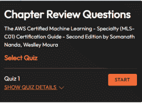

图 2.4 – 第 2 章的章节复习问题

- 3. 准备就绪后，开始以下练习演练，多次重新尝试测验。

### 考试就绪演练

前三次尝试时，不必担心时间限制。

#### 尝试 1

第一次，目标是至少达到 **40%**。查看您答错的问题，并再次阅读章节中的相关部分以弥补学习差距。

#### 尝试 2

第二次，目标是至少达到 **60%**。查看您答错的问题，并再次阅读章节中的相关部分以修复任何剩余的学习差距。

#### 尝试 3

第三次，目标是至少达到 **75%**。一旦您得分达到 75% 或更高，即可开始练习答题时间。

#### 提示

*您可能需要超过 **三** 次尝试才能达到 75%。这没关系。只需复习章节中的相关部分，直到达到目标为止。*

### 针对时间进行练习

目标：您的目标是在尽可能快地回答这些问题的同时保持相同的得分。以下是您接下来的尝试应有的示例：

| 尝试 | 得分 | 耗时 |
|---|---|---|
| 尝试 5 | 77% | 21 分钟 30 秒 |
| 尝试 6 | 78% | 18 分钟 34 秒 |
| 尝试 7 | 76% | 14 分钟 44 秒 |

表 2.2 – 在线平台上的计时练习示例

#### 注意

上表中显示的时间限制仅为示例。请根据网站上测验的时间限制，为每次尝试设置您自己的时间限制。

每次新尝试时，您的得分应保持在 **75%** 以上，而完成所需的“耗时”应“减少”。重复尽多次您想要的尝试，直到您对应对时间压力感到有信心为止。

## 用于数据迁移和处理的 AWS 服务

在上一章中，您了解了在 AWS 中存储数据的几种方式。在本章中，您将探索使用这些数据并从中获取一些洞察的技术。存在需要处理数据或将数据加载到 hive 数据仓库以查询和分析数据的用例。如果您在 AWS 上并且数据位于 S3 中，则需要在 AWS EMR 上的 hive 中创建表以查询 hive 表中的数据。为了提供托管服务的相同功能，AWS 有一个名为 Athena 的产品，您可以在其中创建数据目录并查询 S3 上的数据。如果需要转换数据，则 AWS Glue 是转换并将其还原到 S3 的最佳选择。想象一个需要流式传输数据并针对该数据创建分析报告的用例。为此，您可以选择 AWS Kinesis Data Streams 来流式传输数据并将其存储在 S3 中。使用 Glue，相同的数据可以复制到 Redshift 以供进一步的分析使用。AWS **数据库迁移服务 (DMS)** 提供异构和同构数据库的无缝迁移。本章将涵盖出于认证目的所需的以下主题：

- 使用 Glue 设计 ETL 作业
- 使用 Athena 查询 S3 数据
- 通过 AWS Kinesis Data Streams 流式传输数据并使用 Kinesis Firehose 存储
- 将数据从本地位置摄取到 AWS
- 将数据迁移到 AWS 并将本地数据中心扩展到 AWS
- 在 AWS 上处理数据

### 技术要求

您可以从 GitHub 下载示例中使用的数据，网址如下：
https://github.com/PacktPublishing/AWS-Certified-Machine-Learning-Specialty-MLS-C01-Certification-Guide-Second-Edition/tree/main/Chapter03.

### 在 AWS Glue 上创建 ETL 作业

在现代数据管道中，有多个阶段，例如生成数据、收集数据、存储数据、执行 ETL、分析和可视化。在本节中，您将从高层次了解这些阶段中的每一个，并深入理解 **提取、转换、加载 (ETL)** 过程：


- 数据可以从多个设备生成，包括移动设备或物联网、Web日志、社交媒体、事务数据和在线游戏。
- 可使用轮询服务、通过与AWS Lambda集成的API网关收集数据，或通过AWS Kinesis、AWS托管的Kafka或Kinesis Firehose等流来收集产生的海量数据。如果你有本地数据库并希望将该数据迁移到AWS，则可以选择AWS DMS。你可以通过AWS DataSync将本地数据同步到Amazon S3、Amazon EFS或Amazon FSx。AWS Snowball用于收集/传输数据进出AWS。
- 下一步涉及存储数据。你在上一章中了解了一些用于此目的的服务，例如S3、EBS、EFS、RDS、Redshift和DynamoDB。
- 了解数据存储需求后，可以设计一个ETL作业，将结构化或非结构化数据提取-转换-加载或提取-加载-转换为所需格式，以便进行进一步分析。例如，你可以使用AWS Lambda实时转换数据并将转换后的数据存储在S3中，或者可以在EMR集群上运行Spark应用程序来转换数据并将其存储在S3、Redshift或RDS中。
- AWS中有许多服务可用于对转换后的数据进行分析，例如EMR、Athena、Redshift、Redshift Spectrum和Kinesis Analytics。
- 数据分析完成后，你可以使用AWS QuickSight将其可视化，以了解模式或趋势。数据科学家或机器学习专业人员希望应用统计分析来更好地了解数据分布。业务用户使用统计分析来准备报告。你将在第5章“数据理解与可视化”中学习和探索各种展示和可视化数据的方法。

从传统数据管道中你了解到，ETL主要涉及在服务器上编写和维护代码，以确保一切顺利运行。如果数据格式以任何方式发生变化，则需要更改代码，这会导致目标架构发生变更。如果数据源发生变化，代码也必须能够处理这种情况，这会带来额外开销。你是否应该编写代码来识别数据源中的这些变化？你是否需要一个系统来适应变化并为你发现数据？这些问题的答案是肯定的，为此，你可以使用AWS Glue。现在，你将了解AWS Glue为何如此流行。

### AWS Glue的功能

AWS Glue是AWS上的完全托管的无服务器ETL服务。它具有以下功能：

- 它通过连接到数据源自动发现和分类你的数据，并生成数据目录。
- 诸如Amazon Athena、Amazon Redshift和Amazon EMR之类的服务可以使用数据目录查询数据。
- AWS Glue生成ETL代码，该代码是Python或Scala中Spark的扩展，同样可以进行修改。
- 它会自动扩展，以匹配你的Spark应用程序需求来运行ETL作业并将数据加载到目标位置。

AWS Glue拥有数据目录，这是其成功的秘诀。它有助于从数据源发现数据并了解其相关信息：

- 数据目录会自动发现新数据并提取架构定义。它检测架构变更和版本表。它检测Amazon S3上的Apache Hive风格分区。
- 数据目录内置了用于常见数据类型的分类器。可以使用Grok表达式编写自定义分类器。分类器有助于检测架构。
- Glue爬虫可以临时运行，也可以按计划运行，以更新Glue数据目录中的元数据。Glue爬虫必须与具有足够权限以读取数据源（如Amazon RDS、Redshift和S3）的IAM角色相关联。

现在你对AWS Glue的用途有了简要了解，继续运行以下示例进行实践。

#### 使用AWS Glue数据目录组件进行实践

在此示例中，你将创建一个作业，使用AWS Glue将数据从S3复制到Redshift。我的所有组件都在us-east-1区域中创建。首先创建一个存储桶：

1. 导航到AWS S3控制台并创建一个存储桶。我已将存储桶命名为aws-glue-example-01。
2. 单击“创建文件夹”并将其命名为input-data。
3. 导航到文件夹内部，单击上传按钮上传sales-records.csv数据集。数据可在以下GitHub位置找到：https://github.com/PacktPublishing/AWS-Certified-Machine-Learning-Specialty-MLS-C01-Certification-Guide-Second-Edition/tree/main/Chapter03/AWS-Glue-Demo/input-data。

将数据上传到S3存储桶后，现在创建一个VPC，你将在其中创建Redshift集群。

4. 通过访问 https://console.aws.amazon.com/vpc/home?region=us-east-1# URL导航到VPC控制台，然后单击左侧菜单中的端点。单击创建端点，然后按如下所示填写字段：
   - 服务类别：AWS services
   - 选择服务：com.amazonaws.us-east-1.s3（网关类型）
   - VPC：选择默认VPC（在此默认VPC中将创建你的Redshift集群）
5. 保持其他字段不变，单击创建端点。
6. 从VPC控制台单击安全组。为你的安全组命名，例如redshift-self，并选择默认VPC下拉菜单。提供适当的描述，例如Redshift安全组。单击创建安全组。
7. 单击操作下拉菜单并选择编辑入站规则。单击添加规则，然后按如下所示完成字段：
   - 类型：All traffic
   - 源：自定义
   - 在搜索字段中，选择相同的安全组（redshift-self）

8. 单击保存规则。

现在，创建你的Redshift集群。

9. 导航到Amazon Redshift控制台。单击**创建集群**，完成如*图3.1*中所示的高亮字段：

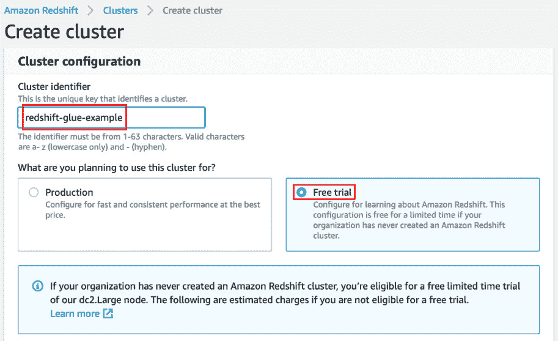

图3.1 – Amazon Redshift创建集群屏幕的截图

10. 向下滚动，使用你自己的值填写*图3.2*中显示的高亮字段：

#### 数据库配置

数据库名称（可选）
指定数据库名称以创建其他数据库。
glue-dev
名称必须为1-64个字母数字字符（仅限小写），且不能是保留字。

数据库端口（可选）
数据库接受入站连接的端口号。创建集群后无法更改端口。
5439
端口必须为数字（1150-65535）。

主用户名
输入DB实例主用户的登录ID。
awsuser
名称必须为1-128个字母数字字符，且不能是保留字。

主用户密码
******
☐ 显示密码
● 主密码必须为8 - 64个字符。● 该值必须至少包含一个大写字母。
● 该值必须至少包含一个小写字母。● 该值必须至少包含一个数字。
● 主密码只能包含ASCII字符（ASCII代码33-126），但不包括'（单引号）、"（双引号）、/、\或@。

图3.2 – Amazon Redshift集群数据库配置部分的截图

11. 向下滚动并更改其他配置设置，如图3.3所示：

#### 其他配置

这些配置是可选的，并已定义默认设置以帮助你开始使用集群。现在关闭“使用默认值”以修改这些设置。

#### 网络和安全

虚拟私有云（VPC）
此VPC定义了该集群的虚拟网络环境。选择具有子网组的VPC。列表中仅启用有效的VPC。
默认VPC
vpc-140d146e

ℹ 创建集群后无法更改与此集群关联的VPC。了解更多 ↗ ×

VPC安全组
此VPC安全组定义集群可以在VPC中使用的子网和IP范围。
选择一个或多个安全组
redshift-self ×
sg-059c2134eb1a29141

图3.3 – Amazon Redshift集群其他配置部分的截图

12. 还要更改IAM权限，如图3.4所示：


### 集群权限（可选）

您的集群需要权限来代表您访问其他 AWS 服务。对于所需权限，添加 "redshift.amazonaws.com"。您可以将最多 10 个 IAM 角色与此集群关联。了解更多

| 可用的 IAM 角色 | AWSServiceRoleForRedshift |
| 已附加的 IAM 角色 | |
| 状态 | 此资源未关联任何 IAM 角色 |

图 3.4 – Amazon Redshift 集群“集群权限”部分的屏幕截图

- 13. 向下滚动并单击“创建集群”。集群需要一两分钟才能进入可用状态。

接下来，您将创建一个 IAM 角色。

- 14. 导航到 AWS IAM 控制台，并在屏幕的访问管理部分选择“Roles”。

- 15. 单击“Create role”按钮，在服务中选择“Glue”。单击“Next: permissions”按钮进入下一页面。

- 16. 搜索 **AmazonS3FullAccess** 并将其选中。然后，搜索 **AWSGlueServiceRole** 并将其选中。由于您在本示例中正在将数据写入 Redshift，请选择 **AmazonRedshiftFullAccess**。单击“Next: Tags”，然后单击“Next: Review”按钮。

- 17. 提供一个名称 **Glue-IAM-Role**，然后单击 **“Create role”** 按钮。该角色将如下图 3.5 所示出现，在创建之前请先查看此角色。

| 角色名称* | Glue-IAM-Role |
| 角色描述 | 允许 Glue 代表您调用 AWS 服务。 |
| 受信任实体 | AWS 服务：glue.amazonaws.com |
| 策略 | AmazonRedshiftFullAccess AWSGlueServiceRole AmazonS3FullAccess |

图 3.5 – IAM 角色的屏幕截图

现在，您已准备好输入数据源和输出数据存储。下一步是从 AWS Glue 控制台创建 Glue 爬行程序。

- 18. 在“Databases”下选择“Connections”。单击“Add connection”按钮，并按如下所示完成字段：
  - A. 连接名称：glue-redshift-connection
  - B. 连接类型：Amazon Redshift

- 19. 单击“Next”，然后按如下所示填写字段：
  - A. 集群：redshift-glue-example
  - B. 数据库名称：glue-dev
  - C. 用户名：awsuser
  - D. 密码：********（输入步骤 10 中选择的值）

- 20. 单击“Next”，然后单击“Finish”。要验证其是否正常工作，请单击“Test Connection”，在 IAM 角色部分选择“Glue-IAM-Role”，然后单击“Test Connection”。

- 21. 转到“Crawler”并选择“Add Crawler”为爬行程序提供名称 S3-glue-crawler，然后单击“Next”。在“Specify crawler source type”页面上，保持所有内容均为默认设置，然后单击“Next”。

- 22. 在“Add a data store”页面上，选择“Include path”选项并输入 s3://aws-glue-example-01/input-data/sales-records.csv。

- 23. 单击“Next”。

- 24. 将“Add another datastore”设置为“No”。单击“Next”。

- 25. 对于“Choose an existing IAM Role”，设置为 Glue-IAM-Role。然后，单击“Next”。

- 26. 将“Frequency”设置为“Run on demand”。单击“Next”。

- 27. 尚未创建数据库，因此单击“Add database”，提供名称 s3-data，单击“Next”，然后单击“Finish”。

- 28. 选择爬行程序 S3-glue-crawler，然后单击“Run Crawler”。运行完成后，您可以看到“Tables Added”列中有一个 1。这意味着（如前一步所述）已创建数据库 s3-data，并且已添加一个表。单击“Tables”并选择新建的表 sales_records_csv。现在您可以看到架构已被发现。如果推断的数据类型不符合您的要求，可以更改数据类型。

在本实践部分，您了解了数据库表、数据库连接、S3 中的爬行程序以及 Redshift 集群的创建。在下一实践部分，您将了解如何使用 Glue 创建 ETL 作业。

### 使用 AWS Glue ETL 组件进行实践

在本节中，您将使用之前创建的 Data Catalog 组件来构建作业。您将从创建作业开始：

- 1. 导航到 AWS Glue 控制台，并在 ETL 部分下单击“Jobs”。

- 2. 单击“Add Job”按钮，并按如下所示完成字段：
  - 名称：s3-glue-redshift
  - IAM 角色：Glue-IAM-Role（这是您在上一节中创建的同一角色）
  - 类型：Spark
  - Glue 版本：Spark 2.4，Python 3（具有改进的作业启动时间）（Glue 版本 2.0）

- 3. 保持其他字段不变，然后单击“Next”。

- 4. 选择 sales_records_csv，然后单击“Next”。

- 5. 选择默认情况下“Change Schema”，然后单击“Next”（撰写本书时，Glue 2.0 不支持机器学习转换）。

- 6. 选择在数据目标中“Create tables”。将 JDBC 作为数据存储，glue-redshift-connection 作为连接。提供 glue-dev 作为数据库名称（如前一节中创建），然后单击“Next”。

- 7. 接下来是“Output Schema Definition”页面，您可以在其中选择要从目标架构中删除的所需列。向下滚动并单击“Save job and edit script”。

- 8. 您现在可以在屏幕左侧看到正在创建的管道，右侧显示建议的代码，如图 3.6 所示。您可以根据要求修改代码。单击“Run job”按钮。将出现一个弹出窗口，要求您编辑希望更改的任何详细信息。

这属于可选操作。然后，单击“Run job”按钮：

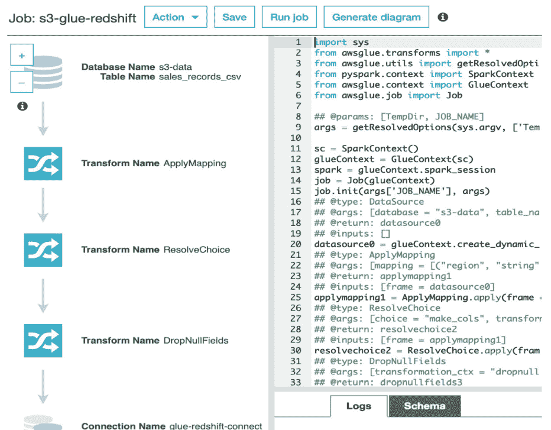

图 3.6 – AWS Glue ETL 作业的屏幕截图

- 9. 作业成功后，导航到 Amazon Redshift 并单击“Query editor”。

- 10. 将数据库名称设置为 glue-dev，然后提供用户名和密码以创建连接。

- 11. 选择 **public** 架构，现在您可以查询表以查看记录，如图 3.7 所示：

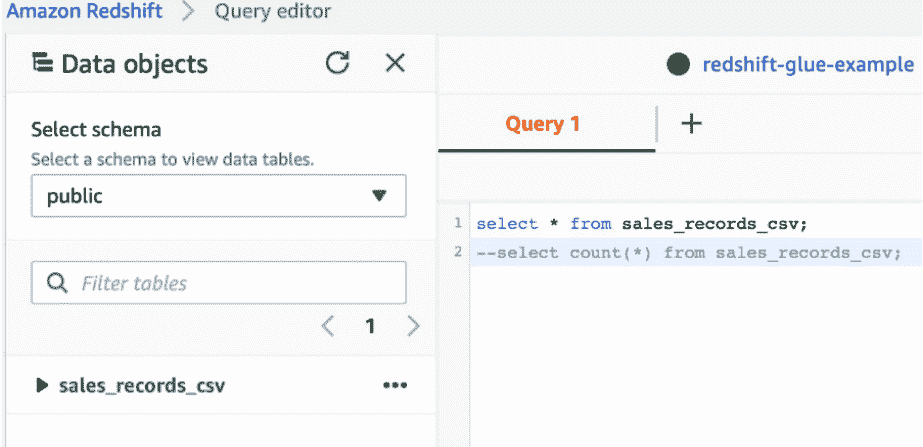

图 3.7 – Amazon Redshift 查询编辑器的屏幕截图

您现在了解了如何使用 AWS Glue 创建 ETL 作业以将数据从 S3 存储桶复制到 Amazon Redshift。您还使用 UI 控制台中的查询编辑器查询了 Amazon Redshift 中的数据。建议在成功完成步骤后删除 Redshift 集群和 AWS Glue 作业。AWS 在您的账户中创建两个存储桶来存储 AWS Glue 脚本和 AWS Glue 的临时结果。请也删除这些存储桶以节省成本。您将在下一节中使用在 S3 数据上创建的数据目录。

在以下部分中，您将了解如何使用 Athena 查询 S3 数据。

### 使用 Athena 查询 S3 数据

Athena 是一项专为查询存储在 S3 中的数据而设计的无服务器服务。它之所以是无服务器，是因为客户端不管理用于计算的服务器：

- Athena 使用架构来呈现针对 S3 中存储数据的查询结果。您定义希望数据以架构形式呈现的方式（方式或结构），Athena 从 S3 读取原始数据，并根据定义的架构显示结果。

- 输出可供其他服务用于可视化、存储或各种分析目的。S3 中的源数据可以是以下任一结构化、半结构化或非结构化数据格式：XML、JSON、CSV/TSV、AVRO、Parquet 或 ORC（以及其他格式）。CloudTrail、ELB 日志和 VPC 流日志也可以存储在 S3 中并由 Athena 分析。

- 这遵循读时架构技术。与传统技术不同，表会在数据目录中预先定义，并在从表中读取数据时验证数据结构是否与表架构匹配。无需转换源数据即可对数据执行类 SQL 查询。

现在，为了帮助您理解这一点，这里有一个示例，您将使用在 AWS Glue 上针对 S3 数据创建的 AWSDatacatalog 并使用 Athena 查询它们：

1. 导航到 AWS Athena 控制台。从“Data source”中选择 **AWSDataCatalog**（如果您是第一次执行此操作，则将在 AWS Glue 数据目录中创建一个带有表 **elb_logs** 的 **sampledb** 数据库）。

2. 将 **s3-data** 选择为数据库。

3. 在右上角单击 **Settings**，并按 **图 3.8** 所示填写详细信息（我使用了与前一个示例相同的存储桶和不同的文件夹）：

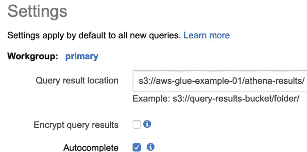

图 3.8 – Amazon Athena 设置的屏幕截图

4. 下一步是在查询编辑器中编写查询并执行。执行完成后，请删除您的 S3 存储桶和 AWS Glue 数据目录。这将为您节省费用。

在本节中，您学习了如何通过 AWS Glue 数据目录使用 Amazon Athena 查询 S3 数据。您还学习了如何创建架构并从 S3 查询数据。在下一节中，您将了解 Amazon Kinesis Data Streams。

### 使用 Kinesis Data Streams 处理实时数据

Kinesis 是 Amazon 的流式处理服务，可根据要求进行扩展。它具有一定程度的持久性，默认保留数据 24 小时，或者可选择最长 365 天。Kinesis Data Streams 用于大规模数据摄取、分析和监控：

- Kinesis 流可以由多个生产者摄取，多个消费者也可以从流中读取数据。以下示例可帮助您理解这一点。假设您有一个向 Kinesis 流摄取数据的生产者，默认保留期为 24 小时，这意味着今天上午 05:00:00 摄取的数据将在流中一直可用，直到明天上午 04:59:59。过了那个时间点，该数据将不可用；理想情况下，应在其过期前进行消费；否则，如果数据很重要，可以将其存储在某处。保留期可延长至最长 365 天，但需额外付费。

- Kinesis 可用于实时分析或仪表板可视化。生产者可以被视为将数据推送到 Kinesis 流的一段代码，它可以是在 EC2 实例、Lambda 函数、IoT 设备、本地服务器、移动应用程序或设备上运行的代码，等等。

- 同样，消费者也可以是运行在 EC2 实例、Lambda 函数或本地服务器上的一段代码，该代码知道如何连接到 Kinesis 流、读取数据并对数据应用某些操作。AWS 提供触发器来调用


当数据到达 Kinesis 流时，Lambda 消费者将立即处理。

- Kinesis 由于其分片架构而具有可扩展性，分片是 Kinesis 流的基本吞吐量单位。_什么是分片？_ 分片是一种基于分区键对数据进行分区的逻辑结构。单个分片支持每秒 1 MB 的写入容量和每秒 2 MB 的读取容量。单个分片支持每秒 1,000 条 `PUT` 记录。如果你创建了包含 _三个分片_ 的流，则可以实现每秒 3 MB 的写入吞吐量和每秒 6 MB 的读取吞吐量，并且可以支持 3,000 条 `PUT` 记录。因此，分片越多，需要支付的费用越多，以获得更高的性能。

- 分片中的数据通过 Kinesis 数据记录进行存储，最大可达 1 MB。Kinesis 数据记录基于分区键在分片中进行存储。它们还具有一个序列号。一旦执行 `putRecord` 或 `putRecords` API 操作，Kinesis 就会立即分配一个序列号，以唯一标识一条记录。分区键由生产者在将数据添加到 Kinesis 数据流时指定，分区键负责将记录隔离并路由到流中的不同分片，以实现负载平衡。

- 加密 Kinesis 流中数据有两种方式：服务器端加密和客户端加密。客户端加密难以实现和管理密钥，因为客户端在将数据放入流之前必须对其进行加密，并在从流中读取数据后对其进行解密。通过 **AWS KMS** 启用服务器端加密后，在你放入数据并从流中获取数据时，数据会自动加密和解密。

#### 注意

不应将 Amazon Kinesis 与 Amazon SQS 混淆。Amazon SQS 支持一个生产者组和一个消费者组。如果你的用例需要多个用户发送数据和接收数据，那么 Kinesis 是解决方案。

对于解耦和异步通信，SQS 是解决方案，因为发送方和接收方不需要相互感知。

在 SQS 中，没有持久性的概念。消息读取后，下一步是删除。Amazon SQS 没有保留时间窗口的概念。如果你的用例需要大规模数据摄取，则应使用 Kinesis。

在下一节中，你将学习如何存储流式数据以供进一步分析。

### 使用 Kinesis Data Firehose 存储和转换实时数据

有许多用例需要将数据流式传输并存储以供未来的分析用途。为解决此类问题，你可以编写一个 Kinesis 消费者来读取 Kinesis 流并将数据存储在 S3 中。此解决方案需要一个实例或机器来运行代码，并具有从流中读取和写入 S3 所需的访问权限。另一个可能的选择是运行一个 Lambda 函数，该函数在对流发出的 `putRecord` 或 `putRecords` API 时触发，并从流中读取数据以存储在 S3 存储桶中：

- 为简化此操作，Amazon 提供了一项名为 Kinesis Data Firehose 的独立服务。它可以轻松插入 Kinesis 数据流，并需要基本的 IAM 角色来将数据写入 S3。它是一项完全托管的服务，用于减少管理服务器和代码的负担。它还支持将流式数据加载到 Amazon Redshift、Elasticsearch 和 Splunk。Kinesis Data Firehose 会自动扩展以匹配数据的吞吐量。

- 在将数据存储或传送到目标之前，可以通过 AWS Lambda 函数对其进行转换。如果你想使用未转换的数据构建原始数据湖，则可以启用源记录备份，以便在转换之前将其存储在另一个 S3 存储桶中。

- 借助 AWS KMS，数据在传送到 S3 存储桶后可以被加密。此功能必须在创建传送流时启用。数据也可以以支持的格式（例如 gzip、ZIP 或 Snappy）进行压缩。

在下一节中，你将学习用于将本地服务器数据摄取到 AWS 的不同 AWS 服务。

### 将本地数据摄取到 AWS 的不同方式

随着数据驱动型用例需求的不断增加，目前在本地服务器上管理数据相当困难。在处理海量数据时，进行备份并不容易。数据湖中的这些数据用于构建深度神经网络、创建数据仓库以从中提取有意义的信息、运行分析并生成报告。

现在，如果你查看将数据迁移到 AWS 的可用选项，这也面临着各种挑战。例如，如果你想将数据发送到 S3，那么你需要编写几行代码来将数据发送到 AWS。你将需要管理代码和运行代码的服务器。必须确保数据通过 HTTPS 网络传输。你需要验证数据传输是否成功。这为流程增加了复杂性，以及时间和精力方面的挑战。为避免此类场景，AWS 提供了一些服务，通过设计允许本地数据中心与 AWS 之间共享数据的混合基础架构，来匹配或解决你的用例。你将在后面的章节中了解这些内容。

#### AWS Storage Gateway

Storage Gateway 是一种混合存储虚拟设备。它可以以三种不同的模式运行 – 文件网关、磁带网关和卷网关。它可用于将本地数据中心扩展、迁移和备份到 AWS：

- 在磁带网关模式下，Storage Gateway 将虚拟磁带存储在 S3 上，当磁带被弹出并归档时，磁带会从 S3 移动到 Glacier。活动磁带存储在 S3 中以供存储和检索。归档或导出的磁带存储在 Glacier 的虚拟磁带架（VTS）中。可以创建虚拟磁带，其大小范围可从 100 GiB 到 5 TiB。本地可配置总计 1 PB 的存储，并且可以将无限数量的磁带归档到 Glacier。这非常适合现有的基于磁带的备份系统以及需要将备份数据迁移到 AWS 的场景。你以后可以停用物理磁带硬件。

- 在文件网关模式下，Storage Gateway 将文件映射到 S3 对象，这些对象可以使用可用的存储类之一进行存储。这有助于将数据中心扩展到 AWS。你可以向文件网关加载更多文件，这些文件将作为 S3 对象存储。它可以运行在本地虚拟服务器上，该服务器使用服务器消息块（SMB）或网络文件系统（NFS）连接到各种设备。文件网关使用 HTTPS 公共端点连接到 AWS，以将数据存储在 S3 对象上。可以将生命周期策略应用于这些 S3 对象。你可以轻松地将 Active Directory（AD）与文件网关集成，以控制对文件共享中文件的访问。

- 在卷网关模式下，存储网关呈现块存储。使用此模式有两种方式；一种是 **缓存网关**，另一种是 **存储网关**：

- **存储网关**是本地运行的卷存储网关。它具有本地存储和上传缓冲区。总共可以创建 32 个卷，每个卷大小可达 16 TB，总容量为 512 TB。主数据存储在本地，备份数据在后台异步复制到 AWS。卷通过 **互联网小型计算机系统接口 (iSCSI)** 供基于网络的服务器访问。它通过 HTTPS 公共端点连接到存储网关端点，并从备份数据创建 EBS 快照。这些快照可用于创建标准 EBS 卷。此选项非常适合迁移到 AWS、灾难恢复或业务连续性。本地系统仍将使用本地卷，但 EBS 快照位于 AWS 中，可用于代替备份。它不是数据中心扩展的最佳选项，因为你需要大量本地存储。

- **缓存网关**是本地运行的卷存储网关。它具有缓存存储和上传缓冲区。区别在于，添加到存储网关的数据不是本地的，而是上传到 AWS。主数据存储在 AWS 中。频繁访问的数据会本地缓存。这是将本地数据中心扩展到 AWS 的理想选项。它通过 HTTPS 公共端点连接到存储网关端点，并创建由 S3 支持的卷（AWS 托管存储桶）快照，这些快照作为标准 EBS 快照存储。

### Snowball、Snowball Edge 和 Snowmobile

这些属于同一产品类别或系列，用于在业务运营位置与 AWS 之间进行物理数据传输。要将大量数据移入和移出 AWS，可以使用以下三种设备之一：

- **Snowball**：这种物理设备可以通过记录任务从 AWS 订购。AWS 会交付一台设备供你加载数据，然后寄回。Snowball 中的数据使用 KMS 进行加密。它提供两种容量规格：50 TB 和 80 TB。对于 10 TB 到 10 PB 之间的数据，订购一台或多台 Snowball 设备是经济实惠的。该设备可以发送到不同的场所。它没有任何计算能力；仅具备存储能力。

- **Snowball Edge**：这类似于 Snowball，但同时具备存储和计算能力。它的容量比 Snowball 更大。它提供快速网络，例如通过 RJ45 的 10 Gbps、通过 SFP28 的 10/25 Gb，以及通过 QSFP+ 铜缆的 40/100 Gb+。这是将 TB 到 PB 级别的数据安全快速地传输到 AWS 的理想选择。

- **Snowmobile**：这是卡车上集装箱内的便携式数据中心。它允许你将 EB 级别的数据从本地移动到 AWS。如果你的数据量超过 10 PB，则首选 Snowmobile。基本上，在请求使用 Snowmobile 服务时，一辆卡车会开到你所在的位置，你将数据中心连接到卡车并传输数据。如果你有多个站点，为数据传输选择 Snowmobile 不是理想选项。

### AWS DataSync

AWS DataSync 旨在将数据从本地存储移动到 AWS，或反之：

- 这是 AWS 针对数据处理传输、归档或经济高效的存储、灾难恢复、业务连续性和数据迁移的理想产品。

- 它具有一种特殊的数据验证功能，可在数据一到达 AWS 时即验证原始数据与 AWS 中的数据是否一致。换句话说，它检查数据的完整性。


- 要深入了解该产品，可以考虑一个拥有 SAN/NAS 存储的本地数据中心示例。当你在 VMware 平台上运行 AWS DataSync 代理时，该代理能够通过 NFS/SMB 协议与 NAS/SAN 存储进行通信。一旦启动，它会与 AWS DataSync 端点通信，并从此连接到几种不同类型的位置，包括各种 S3 存储类或基于 VPC 的资源，例如 **弹性文件系统（EFS）** 和 FSx for Windows Server。

- 它允许你在特定期间安排数据传输。通过配置内置的带宽限制，你可以限制 DataSync 使用的网络带宽数量。

### AWS 数据库迁移服务

组织可能会出于多种原因决定将数据库从一个迁移到另一个，例如需要更好的性能、增强的安全性或高级功能，或是为了避免供应商的许可成本。如果组织想要将业务扩展到不同的地理位置，则需要以成本效益的方式执行数据库迁移、灾难恢复改进和数据库同步。AWS DMS 允许你在将数据库从 *本地/EC2 实例/Amazon RDS* 迁移到 Amazon RDS 或 Amazon Aurora 时，利用可扩展性、灵活性和成本效益的优势。

在需要将多个数据库整合到单个数据库，或需要跨多个数据库集成数据的场景中，AWS DMS 可以成为一项有价值的工具。AWS DMS 旨在将数据从源移动到目标，前提是其中一个端点位于 AWS 上：

- DMS 支持同构和异构数据库迁移，允许你在不同的数据库引擎之间进行迁移，例如 Oracle、MySQL、PostgreSQL 和 Microsoft SQL Server。
- DMS 通过处理架构转换、数据复制以及源和目标数据库之间的持续同步，简化了数据库迁移过程。
- DMS 支持全量加载和持续 **变更数据捕获（CDC）** 复制方法。全量加载迁移会将整个源数据库复制到目标，而 CDC 只捕获并复制初始加载后所做的更改。例如，对于停机时间最短的数据库迁移，DMS 会先执行初始全量加载迁移，然后进行 CDC 复制，以使目标数据库与源数据库的更改保持同步。
- DMS 提供用户友好的控制台和 API，用于轻松配置、监控和管理数据库迁移。它提供详细的日志记录和错误处理，以帮助诊断和解决迁移问题。例如，在从 Oracle 迁移到 Amazon Aurora 期间，DMS 可以自动转换 Oracle 特定的数据类型并修改表结构，以与 Aurora 数据库架构保持一致。
- DMS 支持持续数据复制，允许你在初始迁移后保持源和目标数据库同步。这在需要持续数据同步或数据库复制的场景中特别有用。例如，如果公司为实现高可用性而维护主动-主动数据库设置，DMS 会在不同区域的多个数据库实例之间复制数据更改，以实现实时同步。
- DMS 提供内置的验证和测试功能，以确保迁移数据的完整性和一致性。它执行数据验证检查并生成报告，以验证迁移过程的成功。例如，在将大型数据库从 Microsoft SQL Server 迁移到 Amazon RDS for PostgreSQL 后，DMS 通过比较行数、数据类型和其他指标来验证迁移后的数据，以确保数据准确性。
- DMS 支持一次性迁移和持续复制，用于数据库整合和集成场景。它使组织能够将多个数据库的数据整合到单个目标数据库中，或根据需要将数据分发到多个数据库。例如，假设一家拥有多个子公司数据库的公司希望将所有数据整合到集中式数据库中，以进行统一的报告和分析。DMS 促进多个源到目标数据库的数据迁移和持续同步。

### 在 AWS 上处理存储的数据

AWS 提供多种用于处理存储在 AWS 上的数据的服务。在本节中，你将了解 AWS Batch 和 AWS Elastic MapReduce (EMR)。EMR 是 AWS 提供的一款产品，主要以托管方式运行 MapReduce 作业和 Spark 应用程序。AWS Batch 用于长时间运行的计算密集型工作负载。

#### AWS EMR

EMR 是 AWS 作为服务提供的 Apache Hadoop 的托管实现。它包含 Hadoop 生态系统的其他组件，例如 Spark、HBase、Flink、Presto、Hive 和 Pig。对于认证考试，你无需详细了解这些组件，但以下是一些关于 EMR 的信息：

- EMR 集群可以从 AWS 控制台或通过 AWS CLI 启动，并指定特定数量的节点。集群可以是长期集群或临时集群。在长时间运行的传统集群中，你需要自行配置机器并进行管理。如果你有需要更快执行的作业，则需要手动添加集群。而在 EMR 中，这些管理开销消失了。你可以向 EMR 请求任意数量的节点，它会为你管理和启动节点。如果在集群上启用了自动扩缩容，EMR 会根据需求调节节点。这意味着，当负载高时，EMR 会在集群中启动新节点，并在负载降低后下线节点。
- EMR 在后台使用 EC2 实例，并在 VPC 的一个可用区中运行。这使得节点之间的网络速度更快。AWS Glue 在后台使用 EMR 集群，用户无需担心掌握 AWS EMR 的操作知识。
- 从用例角度来看，EMR 可用于处理或转换存储在 S3 中的数据，并将输出数据存储到 S3 中。EMR 使用节点（EC2 实例）作为数据处理的计算单元。EMR 节点有不同的变体，包括主节点、核心节点和任务节点。
- EMR 主节点充当 Hadoop NameNode 并管理集群及其健康状况。它负责将作业工作负载分布到其他核心节点和任务节点上。如果启用了 SSH，则可以连接到主节点实例并访问集群。
- 一个 EMR 集群可以有一个或多个核心节点。如果将其与 Hadoop 生态系统相关联，则核心节点类似于 HDFS 的 Hadoop 数据节点，并负责在其中运行任务。
- 任务节点是可选的，它们没有 HDFS 存储。它们负责运行任务。如果任务节点因某种原因失败，则这不会影响 HDFS 存储，但核心节点故障会导致 HDFS 存储中断。
- EMR 有一个名为 EMRFS 的文件系统。它由 S3 支持，因此具有区域级的容错能力。如果核心节点失败，数据在 S3 中仍然安全。HDFS 在 I/O 方面效率更高，并且比 EMRFS 更快。

在下一节中，你将了解 AWS Batch，它是一种托管的批处理计算服务，可用于长时间运行的服务。

#### AWS Batch

这是一种托管的批处理产品。如果你使用 AWS Batch，则作业可以在无需最终用户交互的情况下运行，或者可以按计划运行：

- 想象一个事件驱动的应用程序，它启动一个 Lambda 函数来处理存储在 S3 中的数据。如果处理时间超过 15 分钟，则 Lambda 会停止执行并失败。对于此类场景，AWS Batch 是更好的解决方案，其中计算密集型工作负载可以按计划运行或通过 API 事件触发。
- AWS Batch 适用于需要更长处理时间或更多计算资源的用例。
- AWS Batch 作业可以是脚本或可执行文件。一个作业可以依赖于另一个作业。需要定义作业，例如谁可以运行该作业（具有 IAM 权限），在哪里运行该作业（要使用的资源），挂载点和其他元数据。
- 作业被提交到队列中，在那里等待计算环境容量。这些队列与一个或多个计算环境关联。
- 计算环境负责执行作业的实际工作。这些可以是 ECS 或 EC2 实例，或任何计算资源。你也可以定义它们的大小和容量。
- 环境根据优先级从队列中接收作业并执行它们。它们可以是托管或非托管计算环境。
- AWS Batch 可以将元数据存储在 DynamoDB 中以供后续使用，并可以将输出存储在 S3 存储桶中。

#### 注意

如果在考试中遇到关于事件驱动型工作负载的问题，该负载需要灵活的计算、更高的磁盘空间、无时间限制（超过 15 分钟）或有效的资源限制，那么答案可能是 AWS Batch。

#### 总结

在本章中，你了解了在 AWS 上处理数据的不同方式。你还了解了将数据中心扩展到 AWS、将数据迁移到 AWS 以及数据摄取过程方面的功能。你了解了使用数据进行处理并使其准备好进行分析的各种方式。你了解了使用数据目录的神奇之处，它可以帮助你通过 AWS Glue 和 Athena 查询数据。

在下一章中，你将了解各种机器学习算法及其用法。


### 考试准备演练 – 章节复习问题

Apart from a solid understanding of key concepts, being able to think quickly under time pressure is a skill that will help you ace your certification exam. That is why working on these skills early on in your learning journey is key.

Chapter review questions are designed to improve your test-taking skills progressively with each chapter you learn and review your understanding of key concepts in the chapter at the same time. You'll find these at the end of each chapter.

### HOW TO ACCESS THESE RESOURCES

To learn how to access these resources, head over to the chapter titled Chapter 11, Accessing the Online Practice Resources.

To open the Chapter Review Questions for this chapter, perform the following steps:

- 1. Click the link – https://packt.link/MLSC01E2_CH03.

Alternatively, you can scan the following QR code (Figure 3.9):


Figure 3.9 – QR code that opens Chapter Review Questions for logged-in users

- 2. Once you log in, you'll see a page similar to the one shown in Figure 3.10:

### AWS Services for Data Migration and Processing

#### Summary

In this chapter, you learned about different ways of processing data in AWS. You also learned the capabilities in terms of extending your data centers to AWS, migrating data to AWS, and the ingestion process. You learned about the various ways of using data to process it and make it ready for analysis. You understood the magic of using a data catalog, which helps you to query your data via AWS Glue and Athena.

In the next chapter, you will learn about various machine learning algorithms and their usage.

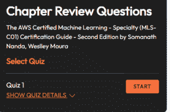

Figure 3.10 – Chapter Review Questions for Chapter 3

- 3. Once ready, start the following practice drills, re-attempting the quiz multiple times.

### Exam Readiness Drill

For the first three attempts, don’t worry about the time limit.

#### ATTEMPT 1

The first time, aim for at least **40%**. Look at the answers you got wrong and read the relevant sections in the chapter again to fix your learning gaps.

#### ATTEMPT 2

The second time, aim for at least **60%**. Look at the answers you got wrong and read the relevant sections in the chapter again to fix any remaining learning gaps.

#### ATTEMPT 3

The third time, aim for at least **75%**. Once you score 75% or more, you start working on your timing.

#### TIP

You may take more than **three** attempts to reach 75%. That’s okay. Just review the relevant sections in the chapter till you get there.

### Working On Timing

Target: Your aim is to keep the score the same while trying to answer these questions as quickly as possible. Here’s an example of how your next attempts should look like:

| Attempt | Score | Time Taken |
|---|---|---|
| Attempt 5 | 77% | 21 mins 30 seconds |
| Attempt 6 | 78% | 18 mins 34 seconds |
| Attempt 7 | 76% | 14 mins 44 seconds |

Table 3.1 – Sample timing practice drills on the online platform

#### NOTE

The time limits shown in the above table are just examples. Set your own time limits with each attempt based on the time limit of the quiz on the website.

With each new attempt, your score should stay above 75% while your “time taken” to complete should “decrease”. Repeat as many attempts as you want till you feel confident dealing with the time pressure.

## 4 Data Preparation and Transformation

You have probably heard that data scientists spend most of their time working on data-preparation-related activities. It is now time to explain why that happens and what types of activities they work on.

In this chapter, you will learn how to deal with categorical and numerical features, as well as how to apply different techniques to transform your data, such as one-hot encoding, binary encoders, ordinal encoding, binning, and text transformations. You will also learn how to handle missing values and outliers in your data, which are two important tasks you can implement to build good **machine learning (ML)** models.

In this chapter, you will cover the following topics:

- Identifying types of features
- Dealing with categorical features
- Dealing with numerical features
- Understanding data distributions
- Handling missing values
- Dealing with outliers
- Dealing with unbalanced datasets
- Dealing with text data

This chapter is a little longer than the others and will require more patience. Knowing about these topics in detail will put you in a good position for the AWS Machine Learning Specialty exam.

### Identifying types of features

You *cannot* start modeling without knowing what a feature is and what type of information it can store. You have already read about the different processes that deal with features. For example, you know that feature engineering is related to the task of building and preparing features for your models; you also know that feature selection is related to the task of choosing the best set of features to feed a particular algorithm. These two tasks have one behavior in common: they may vary according to the types of features they are processing. It is very important to understand this behavior (feature type versus applicable transformations) because it will help you eliminate invalid answers during your exam (and, most importantly, you will become a better data scientist).

By types of features, you refer to the data type that a particular feature is supposed to store. Figure 4.1 shows how you could potentially describe the different types of features of a model.

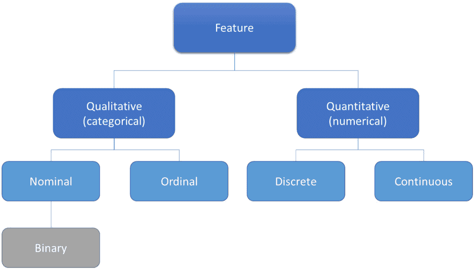

Figure 4.1 – Feature types

In **Chapter 1**, *Machine Learning Fundamentals*, you were introduced to the feature classification shown in **Figure 4.1**. Now, look at some real examples, so that you can eliminate any remaining questions you may have:

| Feature type | Feature sub-type | Definition | Example |
|---|---|---|---|
| Categorical | Nominal | Labelled variables with no quantitative value | Cloud provider: AWS, MS, Google |
| Categorical | Ordinal | Adds the sense of order to the labelled variable | Job title: junior data scientist, senior data scientist, chief data scientist |
| Categorical | Binary | A variable with only two allowed values | Fraud classification: fraud, not fraud |
| Numerical | Discrete | Individual and countable items | Number of students: 100 |
| Numerical | Continuous | Infinite number of possible measurements and they often carry decimal points | Total amount: $150.35 |

Table 4.1 – Real examples of feature values

Although looking at the values of the variable may help you find its type, you should never rely only on this approach. The nature of the variable is also very important for making such decisions. For example, someone could encode the cloud provider variable shown in Table 4.1 as follows: 1 (AWS), 2 (MS), 3 (Google). In that case, the variable is still a nominal feature, even if it is now represented by discrete numbers.

If you are building an ML model and you don’t tell your algorithm that this variable is not a discrete number but is instead a nominal variable, the algorithm will treat it as a number and the model won’t be interpretable anymore.

### IMPORTANT NOTE

> *Before feeding any ML algorithm with data, make sure your feature types have been properly identified.*

In theory, if you are happy with your features and have properly classified each of them, you should be ready to go into the modeling phase of the CRISP-DM methodology, shouldn’t you? Well, maybe not. There are many reasons you may want to spend a little more time on data preparation, even after you have correctly classified your features:

- Some ML libraries, such as `scikit-learn`, may not accept string values on your categorical features.
- The data distribution of your variable may not be the most optimal distribution for your algorithm.
- Your ML algorithm may be impacted by the scale of your data.
- Some observations of your variable may be missing information and you will have to fix it. These are also known as missing values.
- You may find outlier values of your variable that can potentially add bias to your model.
- Your variable may be storing different types of information and you may only be interested in a few of them (for example, a date variable can store the day of the week or the week of the month).
- You might want to find a mathematical representation for a text variable.
- Believe me, this list has no real end!


在接下来的章节中，你将了解如何解决所有这些问题，从类别特征开始。

### 处理类别特征

类别特征的数据转换方法将根据你的变量的子类型而有所不同。在即将到来的章节中，你将了解如何转换标称特征和序数特征。

### 转换标称特征

在将机器学习算法应用于类别特征之前，你可能需要为其创建数值表示。一些库可能内置了处理该转换的逻辑，但大多数库并没有。

你将学习的第一种转换称为标签编码。标签编码器适用于类别/标称变量，它只会为变量的每个不同标签关联一个数字。表 4.2 展示了标签编码器的工作原理：

| 国家 | 标签编码 |
|---|---|
| 印度 | 1 |
| 加拿大 | 2 |
| 巴西 | 3 |
| 澳大利亚 | 4 |
| 印度 | 1 |

表 4.2 – 标签编码器实际运用

标签编码器始终会确保为每个不同标签关联一个唯一数字。在前面的表格中，虽然 "印度" 出现了两次，但分配给它的数字相同。

你现在有了每个国家的数值表示，但这并不意味着你可以在模型中使用该数值表示！在这种情况下，你正在转换一个标称特征，它没有顺序。

根据表 4.2，如果你将国家变量的编码版本传递给模型，它会做出诸如 "巴西 (3) 大于 加拿大 (2)" 之类的假设，这完全没有意义。

针对该场景的一个可能解决方案是对 "country" 应用另一种转换：独热编码。该转换将原始特征中的所有类别表示为单独的特征（也称为哑变量），用于存储每个类别的存在或缺失。表 4.3 转换了与表 4.2 相同的信息，但这次应用了独热编码：

| 国家 | 印度 | 加拿大 | 巴西 | 澳大利亚 |
|---|---|---|---|---|
| 印度 | 1 | 0 | 0 | 0 |
| 加拿大 | 0 | 1 | 0 | 0 |
| 巴西 | 0 | 0 | 1 | 0 |
| 澳大利亚 | 0 | 0 | 0 | 1 |
| 印度 | 1 | 0 | 0 | 0 |

表 4.3 – 独热编码实际运用

你现在可以将国家变量的独热编码版本作为机器学习模型的特征。然而，作为一名怀疑论的数据科学家，你的工作永远不会结束，你的批判性思维能力将在 AWS 机器学习专项认证考试中受到考验。

假设你的数据集中有 150 个不同的国家。你会得出多少个哑变量？150 个，对吧？这时，你就遇到了一个潜在问题：除了给模型增加复杂度（这绝对不是任何模型所期望的特征）之外，哑变量还会给你的数据增加稀疏性。

稀疏数据集中有大量填充零的变量。通常，很难将这种数据结构装入内存（你很容易内存不足），而且机器学习算法处理稀疏结构非常耗时。

你可以通过对原始数据进行分组并减少类别数量来绕过稀疏性问题，甚至可以使用自定义库来压缩稀疏数据，使其更易于操作（例如来自 Python 的 scipy.sparse.csr_matrix）。

因此，在考试中，请记住，当你需要将类别/标称数据转换以输入机器学习模型时，独热编码绝对是正确的方法；但是，要考虑原始特征中唯一类别的数量，并思考为所有类别创建哑变量是否有意义（如果你有大量唯一类别，那么可能没有意义）。

### 应用二进制编码

对于具有大量唯一类别的变量，创建数值表示的一种潜在方法是应用二进制编码。在这种方法中，目标是将类别变量转换为多个二进制列，同时最大限度地减少新列的数量。

此过程包含三个基本步骤：

- 1. 类别数据在经过序数编码器后转换为数值数据。
- 2. 然后将生成的数字转换为二进制值。
- 3. 将二进制值拆分为不同的列。

表 4.4 展示了如何将表 4.2 中的数据转换为二进制变量。

| 国家 | 标签编码器 | 二进制 | Col1 | Col2 | Col3 |
|---|---|---|---|---|---|
| 印度 | 1 | 001 | 0 | 0 | 1 |
| 加拿大 | 2 | 010 | 0 | 1 | 0 |
| 巴西 | 3 | 011 | 0 | 1 | 1 |
| 澳大利亚 | 4 | 100 | 1 | 0 | 0 |
| 印度 | 1 | 001 | 0 | 0 | 1 |

表 4.4 – 二进制编码实际运用

如你所见，现在有三列（Col1、Col2 和 Col3），而不是表 4.3 中独热编码转换的四列。

### 转换序数特征

序数特征有一个非常具体的特征：它们具有顺序。由于具有这种特性，对它们应用独热编码是没有意义的；如果这样做，用于训练模型的底层算法将无法区分与此特征相关的数据点的隐式顺序。

这种变量最常见的转换称为 **序数编码**。序数编码器会像标签编码器一样，为变量的每个不同标签关联一个数字，但这次，它会尊重每个类别的顺序。下表展示了序数编码器的工作原理：

| 教育 | 序数编码 |
|---|---|
| 见习生 | 1 |
| 初级数据分析师 | 2 |
| 高级数据分析师 | 3 |
| 首席数据科学家 | 4 |

你现在可以将编码后的变量传递给机器学习模型，它们将能够正确处理该变量，而无需应用独热编码转换。这次，诸如 "高级数据分析师 大于 初级数据分析师" 之类的比较完全合理。

### 避免在训练和测试数据集中产生混淆

请不要忘记以下说法：编码器在训练数据上拟合，在测试和生产数据上转换。你的机器学习流水线应该这样工作。

假设你创建了一个独热编码器，它拟合 *表 4.2* 中的数据并根据 *表 4.3* 返回数据。在这个示例中，假设这是你的训练数据。完成训练过程后，你可能希望将相同的独热编码转换应用到测试数据上，以检查模型的结果。

在刚才描述的场景中（这是建模流水线中非常常见的情况），你 *不能* 在测试数据上重新训练编码器！你只需重用在训练数据上创建的先前编码器对象。从技术上讲，你不应该再次使用 **fit** 方法，而应该使用 **transform** 方法。

你可能已经知道应该遵循此规则的原因，但作为提醒：测试数据是为了提取模型的性能指标而创建的，因此你不应该用它来提取任何其他知识。如果这样做，你的性能指标将受到测试数据的偏差影响，你无法推断测试数据中显示的相同性能可能会在生产环境中发生（当新数据到来时）。

到目前为止，一切都好。但是，如果你的测试集中有一个不在训练集中出现的新类别，该怎么办？你应该如何转换这些数据？

回到独热编码示例，图 4.3（输入数据）和表 4.3（输出数据），这个编码器知道如何转换以下国家：澳大利亚、巴西、加拿大 和 印度。如果测试集中有不同的国家，编码器将不知道如何转换它，这就是为什么你需要定义它在出现异常场景时的行为。

大多数机器学习库为这些情况提供特定参数。在前面的示例中，你可以配置编码器，要么抛出错误，要么在哑变量上全部设置为零，如表 4.6 所示。

| 国家 | 印度 | 加拿大 | 巴西 | 澳大利亚 |
|---|---|---|---|---|
| 印度 | 1 | 0 | 0 | 0 |
| 加拿大 | 0 | 1 | 0 | 0 |
| 巴西 | 0 | 0 | 1 | 0 |
| 澳大利亚 | 0 | 0 | 0 | 1 |
| 印度 | 1 | 0 | 0 | 0 |
| 葡萄牙 | 0 | 0 | 0 | 0 |

表 4.6 – 处理独热编码转换中的未知值

如你所见，葡萄牙不在训练集（表 4.2）中，因此在转换期间，它将保留相同的已知国家列表，并说明葡萄牙不在其中（全零）。

作为你正在成为的非常优秀的批判性思维数据科学家，你是否应该担心有一个特定类别在训练过程中未被使用？嗯，也许应该。这种分析很大程度上取决于你的问题领域。

处理未知值非常常见，是你在机器学习流水线中应该预期要做的事情。但是，你也应该问自己，由于你在训练过程中没有使用该特定类别，你的模型是否可以外推和泛化。


记住，你的测试数据必须与训练数据遵循相同的数据分布，并且你很可能在训练集或测试集中找到所有（或至少大部分）类别（即分类特征的类别）。此外，如果你遇到过拟合问题（在训练集上表现良好，但在测试集上表现不佳），同时发现你的分类编码器正在测试集中转换大量未知值，你猜怎么着？很可能你的训练样本和测试样本没有遵循相同的分布，这将使你的模型完全失效。

如你所见，你正在逐步进步。你正在详细学习偏差和调查策略——这非常令人兴奋！现在，继续前进，查看对数值特征进行转换的操作。是的，每种数据类型都很重要，并推动你的决策。

### 处理数值特征

就数值特征（离散和连续）而言，你可以考虑依赖训练数据的转换，以及仅依赖被转换的（单个）观测值的转换。

依赖训练数据的转换会在 fit 阶段使用训练集来学习必要的参数，然后使用这些参数来转换任何测试数据或新数据。其逻辑与你刚才学习的分类特征基本相同；不过这次，编码器将学习不同的参数。

另一方面，仅依赖（单个）观测值的转换不依赖训练集或测试集。它们会对单个值执行简单的数学计算。例如，你可以通过将某个变量的值平方来对其应用指数转换。没有任何地方依赖学习到的参数——只需获取值并将其平方即可。

此时此刻，你可能在想有几十种可用于数值特征的转换！确实，选项有很多，你在这里不会全部学习。不过，对于 AWS 机器学习专项认证考试，你并不需要了解所有转换。你会学习最重要的那些（针对考试），但不应该限制自己的建模技能：花点时间思考一下，根据你的用例创建自定义转换所能拥有的无限可能性。

### 数据归一化

应用数据归一化意味着改变数据的尺度。例如，你的特征可能存储员工薪资，范围在 20,000 到 200,000 美元/年之间，你希望将这些数据放在 0 到 1 的范围内；其中 20,000（观察到的最小值）将转换为 0；200,000（观察到的最大值）将转换为 1。

当你想要在某些受底层数据尺度/量级影响的算法上拟合训练数据时，这种技术尤其重要。例如，你可以考虑那些使用输入变量点积的算法（如神经网络或线性回归），以及那些依赖距离度量的算法（如 k-近邻（KNN）或 k-均值）。

另一方面，应用数据归一化不会对基于规则的算法（例如决策树）带来性能提升，因为它们能够检查特征的预测能力（无论是通过熵还是信息增益分析），而与数据的尺度无关。

#### 重要提示

你将在本书后续章节中了解这些算法以及相关细节。例如，你可以将熵和信息增益视为决策树用于检查特征重要性的两种指标。了解每个特征的预测能力有助于算法定义树的最优根节点、中间节点和叶子节点。

花点时间，利用下面的示例来理解数据归一化为什么能帮助这类算法。你已经知道，聚类算法的目标是在数据中查找组或簇，而最常用的聚类算法之一就是 k-均值。

图 4.2 展示了变量的不同尺度如何改变 k-均值聚类的超平面投影：

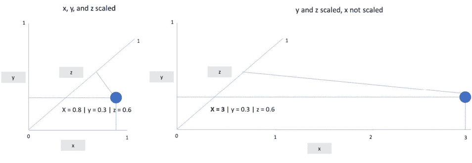

图 4.2 – 在超平面上绘制不同尺度的数据

在图 4.2 左侧，你可以看到在一个具有三个维度（x、y 和 z）的超平面上绘制的单个数据点。所有三个维度（也称为特征）都已归一化到 0 到 1 的尺度。在右侧，你可以看到相同的数据点，但这次，x 维度未进行归一化。你可以清楚地看到超平面已发生变化。

在实际场景中，你会有更多维度和数据点。数据尺度的差异将改变每个簇的质心，并可能改变某些点所属的簇。同样的问题也会发生在依赖距离计算的其他算法上，例如 KNN。

其他算法（如神经网络和线性回归）会使用输入数据计算加权和。通常，这类算法会执行 W1*X1 + W2*X2 + Wi*Xi 等操作，其中 Xi 和 Wi 分别指特定的特征值及其权重。再次，你将在后面学习神经网络和线性模型的细节，但你能仅通过查看刚才描述的计算就看到数据缩放问题吗？如果 X（特征）和 W（权重）是大数字，很容易产生非常大的值。这将使算法的优化变得复杂得多。在神经网络中，这个问题被称为梯度爆炸。

你现在已充分理解应用数据归一化的原因（以及什么时候不应该应用）。数据归一化通常在 ML 库中作为 Min Max Scaler 实现。如果在考试中发现这个术语，请记住它与数据归一化相同。

此外，数据归一化不一定需要将特征转换为 0 到 1 之间的范围。实际上，你可以将特征转换为任何想要的范围。图 4.3 展示了归一化的正式定义方式。

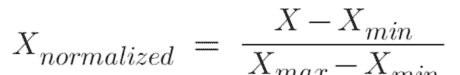

图 4.3 – 归一化公式

此处，Xmin 和 Xmax 是范围的下限和上限；X 是特征的值。除了数据归一化之外，还有另一项非常重要的数值转换技术，你必须了解，不仅为了考试，也为了你的数据科学职业生涯。你将在下一节中了解这一点。

### 数据标准化

数据标准化是另一种缩放方法，它转换数据的分布，使均值变为 0，标准差变为 1。图 4.4 正式描述了这种缩放技术，其中 X 表示要转换的值，μ 是 X 的均值，σ 是 X 的标准差：

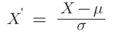

图 4.4 – 标准化公式

与归一化不同，数据标准化*不会*生成预定义的值范围。相反，它会将你的数据转换为标准高斯分布，其中你的转换值将表示每个值距离分布均值的标准差数量。

#### 重要提示

*高斯分布，也称为正态分布，是统计模型中最常用的分布之一。这是一个具有两个主要受控参数的连续分布：μ（均值）和 σ（标准差）。正态分布围绕均值对称。换句话说，大多数值都接近分布的均值。*

数据标准化通常被称为 zscore，并广泛用于识别变量中的异常值，你将在本章后面看到这一点。为了演示，表 4.7 模拟了小数据集的数据标准化。输入值显示在 Age 列中，而缩放值显示在 Zscore 列中：

| 年龄 | 均值 | 标准差 | Zscore |
| --- | --- | --- | --- |
| 5 | 31.83 | 25.47 | -1.05 |
| 20 | 31.83 | 25.47 | -0.46 |
| 24 | 31.83 | 25.47 | -0.31 |
| 32 | 31.83 | 25.47 | 0.01 |
| 30 | 31.83 | 25.47 | -0.07 |
| 80 | 31.83 | 25.47 | 1.89 |

表 4.7 – 数据标准化的实际应用

确保你在 AWS 机器学习专项认证考试中能熟练手动应用归一化和标准化。考试可能会提供一组值，以及均值和标准差，并要求你给出列表中每个元素的缩放值。

### 应用分桶和离散化

**分桶**是一种技术，可让你将一组值分组到一个桶或分桶中——例如，将 0 到 14 岁的人群分组到名为“儿童”的桶中，将 15 到 18 岁的另一群人分组到名为“青少年”的桶中，依此类推。


离散化是将连续变量转换为离散或标称属性的过程。这些连续值可以通过多种策略进行离散化，例如 **等宽** 和 **等频**。

等宽策略将数据划分为多个宽度相同的桶。等频策略将数据划分为多个具有相同频数的桶。

请参阅以下示例。假设您有包含 16 个数字的以下列表：10, 11, 12, 13, 14, 15, 16, 17, 18, 19, 20, 21, 22, 23, 24, 90。如您所见，该列表范围在 10 到 90 之间。假设您想使用等宽策略创建四个桶，您可以得出以下桶：

- 桶 >= 10 <= 30: 10, 11, 12, 13, 14, 15, 16, 17, 18, 19, 20, 21, 22, 23, 24
- 桶 > 30 <= 50:
- 桶 > 50 <= 70:
- 桶 > 71 <= 90: 90

在这种情况下，每个桶的宽度相同（20 个单位），但观测值分布不均匀。现在，下一个示例模拟了等频策略：

- 桶 >= 10 <= 13: 10, 11, 12, 13
- 桶 > 13 <= 17: 14, 15, 16, 17
- 桶 > 17 <= 21: 18, 19, 20, 21
- 桶 > 21 <= 90: 22, 23, 24, 90

在这种情况下，所有桶的观测频数相同，尽管它们是以不同的桶宽度构建的，以使其成为可能。

计算好桶之后，您应该在想接下来该做什么，对吧？这里，您有几种选择：

- 您可以为桶命名，并将其作为模型中的标称特征使用！当然，作为标称变量，您应该考虑在将数据馈送给 ML 模型之前应用独热编码。
- 您可能希望对桶进行排序，并将其作为序数特征使用。
- 也许您希望通过对每个桶的最小值和最大值求平均值，并使用该值作为转换后的特征，从特征中去除一些噪声。

请参阅表 4.8，了解使用我们的等频示例实现这些方法：

| 数值 | 桶 | 转换为标称特征 | 转换为序数特征 | 去除噪声 |
|---|---|---|---|---|
| 10 | 桶 >= 10 <= 13 | 桶 A | 1 | 11.5 |
| 11 | 桶 >= 10 <= 13 | 桶 A | 1 | 11.5 |
| 12 | 桶 >= 10 <= 13 | 桶 A | 1 | 11.5 |
| 13 | 桶 >= 10 <= 13 | 桶 A | 1 | 11.5 |
| 14 | 桶 > 13 <= 17 | 桶 B | 2 | 15.5 |
| 15 | 桶 > 13 <= 17 | 桶 B | 2 | 15.5 |
| 16 | 桶 > 13 <= 17 | 桶 B | 2 | 15.5 |
| 17 | 桶 > 13 <= 17 | 桶 B | 2 | 15.5 |
| 18 | 桶 > 17 <= 21 | 桶 C | 3 | 19.5 |
| 19 | 桶 > 17 <= 21 | 桶 C | 3 | 19.5 |
| 20 | 桶 > 17 <= 21 | 桶 C | 3 | 19.5 |
| 21 | 桶 > 17 <= 21 | 桶 C | 3 | 19.5 |
| 22 | 桶 > 21 <= 90 | 桶 D | 4 | 55.5 |
| 23 | 桶 > 21 <= 90 | 桶 D | 4 | 55.5 |
| 24 | 桶 > 21 <= 90 | 桶 D | 4 | 55.5 |
| 90 | 桶 > 21 <= 90 | 桶 D | 4 | 55.5 |

表 4.8 – 使用桶和离散化的不同方法

同样，尝试不同的分桶策略会产生不同的结果，您应该分析/测试最适合您的数据集的方法。这里没有标准答案——这全在于数据探索！

### 应用其他类型的数值转换

归一化和标准化依赖于训练数据来拟合其参数：在归一化的情况下是最小值和最大值，在标准缩放的情况下是均值和标准差。这也意味着您必须使用 *仅* 训练数据来拟合这些参数，而绝不能使用测试数据。

然而，还有其他类型的数值转换，应用时不需要来自训练数据的参数。这些类型的转换纯粹依赖于数学计算。例如，其中一种转换称为对数变换。这是 ML 模型中非常常见的一种转换类型，对于偏斜特征尤其有益。如果您不知道什么是偏斜分布，请参阅 *图 4.5*。

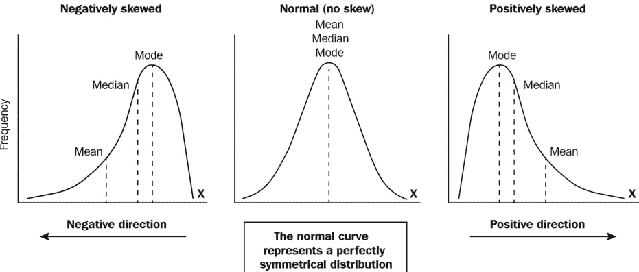

#### 图 4.5 – 偏斜分布

中间是正态分布（或高斯分布）。左侧和右侧是偏斜分布。就偏斜特征而言，某些值会向一个方向（左或右）偏离均值较远。这种行为会将该分布的中位数和均值都向同一方向推，即您在图 4.5 中看到的长尾方向。

一个非常明确的曾经偏斜的数据示例是给定地区特定专业群体的年薪，例如在美国佛罗里达州工作的高级数据科学家。这类变量通常大部分数值彼此接近（因为人们习惯于赚取平均工资），只有少数非常高的数值（因为少数人赚得比其他人多得多）。

希望您现在可以轻松理解为什么均值和中位数会向尾部方向移动，对吧？高薪会将它们向那个方向推。

好的，但为什么对数变换对这种特征有益呢？这个问题的答案可以通过其背后的数学来解释：

```
log(x^n) = nlog(x)
```

#### 图 4.6 – 对数属性

计算一个数的对数是指数函数的逆运算。对数变换将根据给定的基数（例如底数 2、底数 10 或自然对数的底数 e）缩小数字的规模。观察前一个示例中的薪资分布，您会将所有这些数字降低，数字越高，降低幅度越大；但是，您是在对数尺度上而不是线性尺度上执行此操作。这种行为将删除该分布的异常值（使其更接近正态分布），这对许多 ML 算法（例如线性回归）有益。表 4.9 显示了在线性尺度和对数尺度下转换数字的一些差异：

| 数值 | 线性尺度（归一化） | 对数尺度（底数 10） |
|---|---|---|
| 10 | 0.0001 | 1 |
| 1,000 | 0.01 | 3 |
| 10,000 | 0.1 | 4 |
| 100,000 | 1 | 5 |

表 4.9 – 线性变换与对数变换之间的差异

如您所见，线性变换保留了数据的原始数量级（您仍然可以看到异常值，但在另一个尺度上），而对数变换消除了这些数量级差异，同时仍然保留了数值的顺序。

您能想到另一种遵循与对数相同行为的数学变换吗（使分布更接近高斯分布）？好吧，这里还有一个：平方根。对表 4.9 中显示的数字取平方根，您就会明白了！

现在，请注意：对数和平方根都属于一组称为幂变换的变换，还有一种非常流行的方法，很可能会在您的 AWS 考试中提及，它可以执行您看到的一系列幂变换。该方法由 George Box 和 David Cox 提出，名为 Box-Cox。

#### 重要说明

在考试期间，如果您看到关于 Box-Cox 变换的问题，请记住它是一种可以执行多种幂变换（根据 lambda 参数）的方法，其最终目标是使原始分布更接近正态分布。

为了就数学变换为何能对 ML 模型产生实际影响这一讨论得出结论，以下是指数变换的一个示例。

假设您有一组数据点，例如图 4.7 左侧的那些点。您的目标是绘制一条线，将蓝点和红点完美地分开。仅通过查看原始数据（同样在左侧），您知道执行此线性任务的最佳猜测就是您在同一图中看到的那条线。然而，科学（而非魔法）发生在右侧


该图形！通过对这些数字求平方并在另一个超平面上绘制它们，您可以完美地分离每一组点。

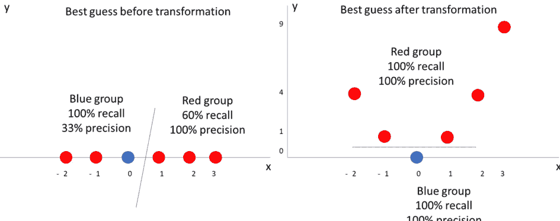

图 4.7 – 指数变换的实际应用

您可能会认为，处理数据的方法有无数种。虽然这是事实，但您应始终考虑所处理的业务场景，并相应地规划工作。请记住，模型改进或探索始终是可能的，但您必须定义目标（请记住 CRISP-DM 方法论）并继续前进。

顺便说一句，数据变换很重要，但它只是数据科学家工作的一部分。您的建模之旅仍需转向其他重要主题，例如缺失值和异常值处理。不过，在此之前，您可能已经注意到本节向您介绍了高斯分布，为什么不深入了解一下呢？

### 了解数据分布

虽然高斯分布可能是统计和机器学习模型中最常见的分布，但您应该意识到它并非唯一的分布。还有其他类型的数据分布，例如伯努利分布、二项分布和泊松分布。

伯努利分布非常简单，因为只有两种可能的事件：成功或失败。成功事件发生的概率为 p，而失败事件的概率为 1-p。

遵循伯努利分布的一些例子包括掷六面骰子或抛硬币。在这两种情况下，您都必须定义成功事件和失败事件。例如，掷骰子时假设以下成功和失败事件：

- 成功：掷出数字 6
- 失败：掷出任何其他数字

然后您可以说，成功概率为 p（1/6 = 0.16 = 16%），失败概率为 1-p（1 - 0.16 = 0.84 = 84%）。

二项分布推广了伯努利分布。伯努利分布只有一次事件重复，而二项分布允许事件重复多次，并且您必须计算成功次数。继续使用之前的例子，即统计在 10 次掷骰子中掷出 6 的次数。由于此示例的特性，二项分布有两个参数 n 和 p，其中 n 是重复次数，p 是每次重复的成功概率。

最后，泊松分布允许您在一段时间内找到事件数量，前提是已知事件在某个间隔内发生的次数。它有三个参数：lambda、e 和 k，其中 lambda 是每个间隔的平均事件数，e 是欧拉数，k 是某个间隔内事件发生的次数。

通过所有这些分布（包括高斯分布），可以根据其参数计算期望均值和方差。此信息通常用于假设检验，以检查某些样本数据是否遵循给定分布，方法是将 **样本** 的均值和方差与分布的 **期望** 均值和方差进行比较。

您现在对数据分布（不仅限于高斯分布）更加熟悉。您将在整本书中继续学习数据分布。目前，是时候继续学习缺失值和异常值检测了。

### 处理缺失值

顾名思义，缺失值是指数据的缺失。此类缺失通常由标记表示，这些标记可能以标准方式实现，也可能不以标准方式实现。

虽然使用标记是标准的，但这些标记的显示方式可能在不同平台上有所不同。例如，关系型数据库使用 NULL 表示缺失数据，核心 Python 代码将使用 None，而某些 Python 库将缺失数字表示为 **不是数字 (NaN)**。

#### 重要提示

对于数值字段，请勿将这些标准缺失标记替换为零。默认情况下，零不是缺失值，而是另一个数字。

然而，在实际业务场景中，您可能会找到这些标准标记，也可能找不到。例如，软件工程团队可能设计了系统，以特定标记（例如字符串的“unknown”或数字的“-1”）自动填充缺失数据。在这种情况下，您需要通过这两个标记来查找缺失数据。人们可以设置任何内容。

在之前的示例中，软件工程团队仍然足够友好地为您提供了标准标记。然而，在许多情况下，旧系统在用户面前没有添加任何数据质量层，您可能会发现地址字段填充了“我不想分享”，或者电话号码字段填充了“不要打电话给我”。这显然是缺失数据，但不像之前的示例那样标准。

关于缺失数据，您将学习许多更多的细微差别，所有这些都将在本节中学习，但请注意：在开始对缺失值做出决定之前，您应该做好数据探索，并确保找到这些值。您可以计算数据频率或使用缺失值图，但请务必采取一些行动。切勿假设缺失数据仅由那些方便的标准标记表示。

为什么您应该关心这种数据？首先，因为大多数算法（除了在非常特定的 ML 库中实现的决策树）在发现缺失值时会报错。第二（也许最重要的是），将所有缺失数据归为同一类，意味着您假设它们都是相同的，但实际上您不知道这一点。

这样的决定不仅会给您的模型增加偏差，还会降低其可解释性，因为您将无法解释缺失数据。一旦您知道想要处理缺失值的原因，就可以分析您的选择。

从理论上讲，您可以将缺失值分为两大类：**MCAR** 或 **MNAR**。MCAR 代表 **完全随机缺失**，表示缺失数据没有关联的模式。另一方面，MNAR 代表 **非随机缺失**，意味着用于生成数据的底层过程与缺失值严格相关。

查看关于 MNAR 缺失值的以下示例。假设您正在针对特定产品进行在线调查，收集用户反馈。您的提问过程是动态的，并取决于用户的回答。当用户指定年龄低于 18 岁时，您绝不会询问其婚姻状态。在这种情况下，婚姻状态的缺失值与用户的年龄相关（MNAR）。

了解您正在处理的缺失值类别，将帮助您了解是否对生成数据的底层过程有任何控制权。有时，您可以返回到源过程，并以某种方式完善缺失数据。

#### 重要提示

虽然在实际场景中，您通常需要通过排除或插补来处理缺失数据，但切勿忘记，您始终可以尝试查看源过程并检查是否可以检索（或者至少更好地理解）缺失数据。您可能会在考试中遇到此选项。

如果您无法从任何地方恢复缺失数据，那么应转向其他方法，例如 **列表式删除** 和 **插补**。

列表式删除是指丢弃一些数据的过程，这是这种选择的缺点。这可能发生在行级或列级。例如，假设您有一个包含四列的 DataFrame，其中一列有 90% 的数据缺失。在这种情况下，通常更合理的做法是删除整个特征（列），因为您对大多数观察值（行）都没有该信息。

从行角度来看，您可能有一个包含少量观察值（行）的 DataFrame，其中某个特征（列）包含缺失数据。在这种情况下，与删除整个特征相比，只删除这几个观察值更合理。

使用此方法的好处是删除行或列的简单性。同样，缺点是信息丢失。如果您不想在处理缺失数据时丢失信息，那么应采用插补策略。

插补也称为替换，即通过替换值来替换缺失值。插补最常用的方法是使用特征的均值来替换缺失值。请注意这种方法，因为它很可能出现在您的考试中：

| 年龄 |
|---|
| 35 |
| 30 |
| |
| 25 |
| 80 |
| 75 |

表 4.10 – 使用均值或中位数替换缺失值

表 4.10 显示了一个非常简单的数据集，只有一个特征和五个观察值，其中第三个观察值有缺失值。如果您决定用该特征的均值替换该缺失数据，


feature, you will come up with 49. Sometimes, when there are outliers in the data, the median might be more appropriate (in this case, the median would be 35):

| 年龄 | 工作状态 |
|---|---|
| 35 | 雇员 |
| 30 | 雇员 |
| | 退休 |
| 25 | 雇员 |
| 80 | 退休 |
| 75 | 退休 |

表 4.11 – 用组的均值或中位数替换缺失值

如果你想深入了解，可以根据给定的特征组查找均值或中位数。例如，表 4.11 通过添加工作状态列扩展了表 4.10 中的前一个数据集。现在，有些证据表明，最初使用总体中位数（35 岁）来更改缺失值的方法可能是错误的（因为该人已退休）。

你现在可以做的是，用同一工作状态的其他观测值的均值或中位数来替换缺失值。使用这种新方法，你可以将缺失信息更改为 77.5。考虑到该人已退休，77.5 比 35 岁更合理。

#### 重要提示

对于分类变量，你可以使用数据集中出现频率最高的值来替换缺失数据。根据特定特征对数据集进行分组的相同逻辑仍然适用。

你还可以使用更复杂的插补方法，包括构建 ML 模型来预测缺失数据的值。这些插补方法（无论是通过平均值还是预测值）的缺点是，你正在对数据进行不一定正确的推断，并会向数据集添加偏差。

归纳起来，处理缺失数据时的权衡在于平衡丢失数据或向数据集添加偏差。不幸的是，无论你面临什么问题，都没有可以遵循的科学配方。为了决定要做什么，你必须查看成功标准、探索数据、运行实验，然后做出决定。

你现在将转向许多 ML 算法的另一个头疼问题：异常值。

### 处理异常值

你踏上这段学习旅程不仅仅是为了通过 AWS 机器学习专项认证考试，也是为了成为一名更好的数据科学家。从纯数学角度看，有很多不同的方法来审视异常值问题；然而，现实生活中使用的数据集源自底层业务流程，因此在进行异常值分析时，你必须包含业务视角。

异常值是一组数据中不典型的数据点。例如，图 4.8 显示了一些在二维平面上绘制的数据点，即 x 和 y。红点是异常值，因为它是这一系列数据中不典型的值。

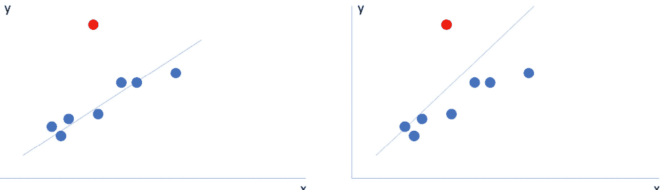

图 4.8 – 识别异常值

处理异常值很重要，因为一些统计方法会受到它们的影响。不过，在图 4.8 中，你可以看到这种行为。左侧绘制了一条最佳拟合那些数据点的直线，忽略了红点。右侧绘制了同一条直线，但包含了红点。

你可以直观地得出结论，通过忽略异常值点，你会得到前面图表左侧方案上的更好解决方案，因为它能够更接近大多数值。你还可以通过计算每条直线的关联误差来证明这一点（你将在本书后面学习）。

值得提醒的是，你在本书中也在另一种情况下见过异常值问题：具体来说，在表 4.10 中处理缺失值时。在那个示例中，使用了中位数来绕过该问题。欢迎回去再读一遍，但此时应该非常清楚的是，中位数受异常值的影响小于平均值（均值）。

你现在知道什么是异常值以及为什么应该处理它们。在处理异常值时，你应始终考虑业务视角，但也有数学方法可以找到它们。

现在，你已准备好继续学习并查看一些异常值检测方法。

你已经了解过最常见的方法：zscore。在表 4.7 中，你看到过一个包含一组年龄的表格。请再次查阅以复习你的记忆。在该表的最后一列，根据图 4.4 所示的方程计算了每个年龄的 zscore。

这些 zscore 值没有明确定义的范围；然而，在没有异常值的正态分布中，它们大多在 -3 到 3 之间。记住：zscore 会给出分布中距离均值的标准差数量。表 4.10 显示了正态分布的一些属性：

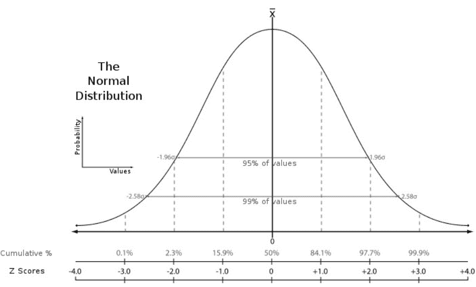

图 4.9 – 正态分布属性。图片改编自 https://pt.wikipedia.org/wiki/Ficheiro:The_Normal_Distribution.svg

根据正态分布属性，95% 的值将属于均值 -2 到 2 个标准差的范围，而 99% 的值将属于均值 -3 到 3 个标准差的范围。回到异常值检测场景，你可以在这些 zscore 值上设置阈值，以指定数据点是否为异常值！

没有可用于分类异常值的标准阈值。理想情况下，你应该查看数据并看什么对你更有意义……通常（这不是一条规则），你会使用均值 2 到 3 个标准差之间的某个数值来标记异常值，因为此规则选中的数据将少于 5%（同样，这只是一个参考阈值，以便你可以选取一些数据进行进一步审查）。你可能记得，分布均值下方和上方都有异常值，如表 4.12 所示，其中绝对 zscore 大于 3 的异常值被标记（出于演示目的，值列被隐藏）。

| 数值 | Zscore | 是否为异常值？ |
|---|---|---|
| ... | 1.3 | 否 |
| ... | 0.8 | 否 |
| ... | 3.1 | 是 |
| ... | -2.9 | 否 |
| ... | -3.5 | 是 |
| ... | 1.0 | 否 |
| ... | 1.1 | 否 |

表 4.12 – 根据 zscore 值标记异常值

在表 4.12 中发现了两个异常值：第 3 行和第 5 行。在数据中查找异常值的另一种方法是应用箱线图逻辑。查看数值变量时，可以从中提取许多描述性统计量，不仅仅是你之前见过的均值、中位数、最小值和最大值。数据分布中存在的另一种属性称为分位数。

分位数是根据随机变量的累积分布函数在固定间隔处建立的切断点。这些固定间隔（也称为 q-分位数）大小几乎相同，并在某些情况下会获得特殊名称：

- 4-分位数称为四分位数。
- 10-分位数称为十分位数。
- 100-分位数称为百分位数。

例如，20 百分位数（属于 100-分位数固定间隔）指定 20% 的数据位于该点以下。在箱线图中，你可以使用 4-分位数（也称为四分位数）的固定间隔来揭示数据的分布（Q1 和 Q3），如图 4.10 所示。

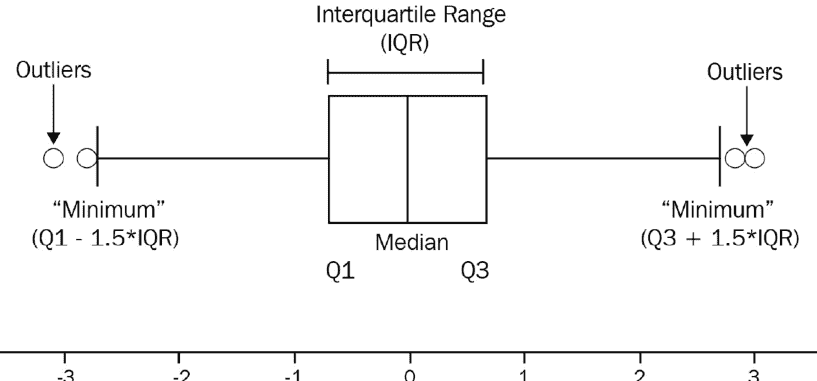

图 4.10 – 箱线图定义

Q1 也称为下四分位数或第 25 四分位数，这意味着分布中有 25% 的数据位于该点以下。Q3 也称为上四分位数或第 75 四分位数，这意味着分布中有 75% 的数据位于该点以下。

计算 Q1 和 Q3 之间的差值将给出 **四分位距（IQR）** 值，你可以然后使用它来计算箱线图的极限，如前面的图中所示的“最小值”和“最大值”标签。

毕竟，你最终可以推断，箱线图“最小值”以下或“最大值”以上的任何内容都将被标记为异常值。

你现在已经了解了两种可以在数据中标记异常值的不同方法：zscore 和箱线图。你可以决定是要从数据集中删除这些点、转换它们，还是创建另一个变量来指定它们的存在（如表 4.11 所示）。

继续深入数据准备和转换之旅，你将在现实生活中面临其他类型的问题。接下来，你将了解到几个用例包含所谓的 **罕见事件**，这会导致 ML 算法关注问题的错误方面并提出糟糕的解决方案。幸运的是，你将学习如何调整超参数或准备数据，以在拟合罕见事件时促进算法收敛。

### 处理不平衡数据集

至此，你可能已经意识到，为什么数据准备可能是数据科学家工作中最漫长的部分。你已经学习了数据转换、缺失数据值和异常值，但问题清单远未结束。不要担心——你正在掌握这一主题的正确旅程中！


另一个众所周知的 ML 模型问题，具体来说是分类问题，就是类别不平衡。在分类模型中，当数据集的大多数观测值属于某一个（或某些）类别（目标变量）时，可以说该数据集是不平衡的。

这在欺诈识别系统中非常常见：例如，大多数事件属于常规操作，而只有极少数事件属于欺诈操作。在这种情况下，你也可以说欺诈是一种罕见事件。

没有强有力的规则来定义数据集是否不平衡，这确实取决于你所在业务领域的背景。大多数挑战问题将包含超过 99% 的观测值属于多数类。

不平衡数据集的问题很简单：ML 算法会尝试在训练数据中找到最佳拟合，以最大化其准确性。在 99% 的案例都属于单一类别的数据集中，如果不进行任何调整，算法可能会优先考虑多数类。在最坏的情况下，它会将所有观测值都归类为多数类，而忽略少数类，而少数类通常就是我们在建模罕见事件时所关注的。

处理不平衡数据集，有两个主要方向可供遵循：调整算法以处理该问题，或对数据进行重采样以使其更加平衡。

通过调整算法，你需要指定分类中每个类别的权重。此类权重配置属于算法，而非训练数据，因此是一个超参数设置。需要牢记的是，并非所有算法都具有这种配置，也并非所有 ML 框架都会暴露它。作为快速参考，scikit-learn ML 库中的 `DecisionTreeClassifier` 类就是一个很好的例子，它确实实现了类权重超参数。

绕过不平衡问题的另一种方法是通过应用**欠采样**或**过采样**来更改训练数据集。如果你决定应用欠采样，所要做的就是从多数类中移除一些观测值，直到获得一个更平衡的数据集。当然，这种方法的缺点是，你可能会丢失关于正在移除观测值的那个多数类的重要信息。

欠采样最常见的方法称为随机欠采样，这是一种朴素的重采样方法，即从训练集中随机移除一些观测值。

另一方面，你可以选择进行过采样，即为少数类创建新的观测值/样本。最简单的方法是朴素方法，即从训练集中（有放回地）随机选择观测值进行复制。这种方法的缺点是可能出现过拟合问题，因为你会复制/突出少数类的观测模式。

为了防止模型出现欠拟合或过拟合，你应始终在测试集上测试已拟合的模型。

#### IMPORTANT NOTE

> *测试集不能进行欠/过采样：只有训练集才应经过这些重采样技术。*

你还可以通过应用合成采样技术来对训练集进行过采样。随机过采样不会向训练集添加任何新信息：它只是复制现有的样本。通过创建合成样本，你是从现有样本中推导出这些新观测值（而非简单复制它们）。这是一种称为**合成少数类过采样技术（SMOTE）**的数据增强技术。

从技术上讲，SMOTE 的做法是在少数类的特征空间中绘制一条线，并提取靠近该线的点。

#### IMPORTANT NOTE

> *在考试中，你可能会遇到使用了 SMOTE 术语的问题。如果发生这种情况，请记住该术语应用的上下文：过采样。*

好了——在下一节中，你将学习如何为 ML 模型准备文本数据。

### 处理文本数据

你已经学习了如何将分类特征转换为数值表示，无论是使用标签编码器、序数编码器还是独热编码。但是，如果你的数据集中包含长文本的字段该怎么办？你该如何为它们提供数学表示，以便正确地将数据输入 ML 算法？这是**自然语言处理（NLP）**中的常见问题，NLP 是 AI 的一个子领域。

NLP 模型旨在从文本中提取知识；例如，在语言之间翻译文本、在文本语料库中识别实体（也称为**命名实体识别**，简称 **NER**）、对用户评论进行情感分类，以及许多其他应用。

#### IMPORTANT NOTE

> *在 [第 8 章，面向 AI/ML 的 AWS 应用程序服务] 中，你将了解一些应用 NLP 的 AWS 应用程序服务，例如 Amazon Translate 和 Amazon Comprehend。在考试中，你可能会被要求考虑构建某些类型 NLP 应用程序的最快或最简单的方法（开发工作量最少）。最快或最简单的方法通常是使用这些现成的 AWS 服务，因为它们为某些用例提供了预训练模型（尤其是机器翻译、情感分析、主题建模、文档分类和实体识别）。*

几章之后，你还将了解一些用于 NLP 应用的内置 AWS 算法，例如 BlazingText、**隐性狄利克雷分配（LDA）**、**神经主题建模（NTM）**以及**序列到序列**算法。这些算法也允许你创建与那些现成服务相同的 NLP 解决方案；不过，你必须在 SageMaker 上使用它们并编写自己的解决方案。换句话说，它们提供了更多灵活性，但需要付出更多开发工作量。

考试时请记住这一点！

虽然 AWS 提供了许多现成的服务和内置算法，允许你创建 NLP 应用程序，但现在你不会研究那些 AWS 产品功能（你将在**第 6 章，应用机器学习算法**和**第 8 章，面向 AI/ML 的 AWS 应用程序服务**中研究）。你将通过研究一些对准备 NLP 数据至关重要的数据准备技术来完成本章。

#### 词袋模型

你将首先学习的是称为词袋（BoW）的方法。这是一种应用于文本数据的非常常见且简单的技术，它创建矩阵表示来描述文本中单词的数量。BoW 包含两个主要步骤：创建词汇表，以及在文本中创建词汇表中已知单词存在与否的表示。这些步骤可以在 *图 4.11* 中看到。

| | this | movie | really | good | although | old | production |
|---|---|---|---|---|---|---|---|
| 二进制 | 1 | 1 | 1 | 1 | 1 | 1 | 1 |
| 频率 | 0.14 | 0.14 | 0.28 | 0.14 | 0.14 | 0.14 | 0.14 |
| 计数 | 1 | 1 | 2 | 1 | 1 | 1 | 1 |

图 4.11 – BoW 示例

首先，你通常不能使用原始文本来准备 BoW 表示。有一个数据清洗步骤，其中你将文本转换为小写；将每个单词拆分为标记；删除标点符号、非字母字符和停用词；并且在必要时，应用任何你想要的自定义清洗技术。

清洗原始文本后，你可以将每个单词添加到全局词汇表中。从技术上讲，这通常是一个元组字典，形式为 {(单词, 出现次数)} – 例如，{(apple, 10), (watermelon, 20)}。如前所述，这是一个全局字典，你应该考虑正在分析的所有文本。

现在，使用清洗后的文本和更新的词汇表，你可以构建文本的矩阵表示，其中每一列代表全局词汇表中的一个单词，每一行代表你分析过的一段文本。在每一行中表示这些文本的方式可能会根据不同的策略而有所不同，例如二进制、频率和计数。接下来，你将更详细地了解这些策略。

在图 4.11 中，一段文本正在使用三种不同的 BoW 策略进行处理。这就是为什么你可以在该表中看到三行，而不是只有一行（在实际场景中，你必须为实现选择其中一种）。

在第一行中，使用了二进制策略，如果单词存在于全局词汇表中则分配 1，否则分配 0。因为词汇表是基于单一文本构建的，所以该文本中的所有单词都属于词汇表（这就是为什么在二进制策略中只能看到 1 的原因）。

在第二行中，使用了频率策略，它会检查文本中每个单词的出现次数，并将其除以文本中的总单词数。例如，单词 "this" 仅出现一次（1），而文本中还有其他七个单词（7），因此 1/7 等于 0.14。

最后，在第三行中，使用了计数策略，即简单计算文本中每个单词的出现次数。

#### IMPORTANT NOTE

> 此注释非常重要 – 你很可能在考试中遇到它。你可能已经注意到，BoW 矩阵的列包含唯一单词，而每行是一个文本表示。如果你有 100 段长文本，但其中只有 50 个唯一单词，那么你的 BoW 矩阵将有 50 列和 100 行。在考试中，你很可能会收到一段文本列表，并被要求准备 BoW 矩阵。

关于 BoW，你还应该知道一个极其重要的概念，即 n-gram 配置。n-gram 术语用于描述你希望如何查看词汇表，无论是通过单个单词（uni-gram）、两个单词的组合（bi-gram）、三个单词的组合（tri-gram），甚至是 n 个单词的组合（n-gram）。到目前为止，你已经看到使用了一元组方法的 BoW 表示，但更复杂的 BoW 表示可能会使用二元组、三元组或 n-gram。


主要逻辑本身不变，但你需要知道如何在 BoW 中表示 n-gram。仍然使用图 4.11 中的示例，bi-gram 方法将以以下方式组合这些单词：[this movie, movie really, really good, good although, although old, old production]。请确保在参加考试前理解这一点。

#### 重要提示

*BoW 的强大和简单之处在于，你可以轻松地制定训练集来训练你的算法。如果你看图 4.11，你是否可以看到，拥有更多数据并只是给该表添加一个分类列，例如好评或差评，就能让我们训练一个二元分类模型来预测情感？*

好吧 – 你可能已经注意到，你所学到的许多很棒的技术都有某些缺点。BoW 的问题在于维护其词汇表的挑战。你可以轻松地看到，在大规模文本语料库中，词汇表的大小往往会越来越大，矩阵的表示往往会变得稀疏（没错，又是稀疏性问题）。

解决词汇表大小问题的一种可能方法是使用单词哈希（在 ML 中也称为 **哈希技巧**）。哈希函数将任意大小的数据映射到固定大小的数据。这意味着你可以使用哈希技巧来用固定数量的特征表示每个文本（无论词汇表的大小如何）。从技术上讲，这种哈希空间允许冲突（不同文本由相同的特征表示），因此在实现特征哈希时需要考虑这一点。

### TF-IDF

BoW 带来的另一个问题，尤其是在使用频率策略构建特征空间时，是文档中出现次数较多的词会因出现频率高而大幅提升其得分。事实是，通常，这些出现次数较多的词并不是文档的关键词，而只是在多个其他文档中也出现很多次的其他词。

**词频-逆文档频率（TF-IDF）** 通过检查这些词在其他文档中的出现频率，并利用该信息对文档中词的频率进行重新缩放，来帮助惩罚这类词。

在流程结束时，TF-IDF 倾向于给文档特有的词（文档特定词）更多的重要性。接下来，让我们看一个具体的示例，以便你能深入理解它。

假设你有一个包含 100 个单词的文本语料库，单词“Amazon”出现了三次。该单词的词频（TF）为 3/100，即等于 0.03。现在，假设你有其他 1,000 个文档，并且单词“Amazon”出现在其中的 50 个文档中。在这种情况下，逆文档频率（IDF）由 log 给出，即 1,000/50，等于 1.30。在该特定文档中，单词“Amazon”的 TF-IDF 分数将是 TF * IDF 的乘积，即 0.03 * 1.30（0.039）。

假设不是 50 个文档，而是单词“Amazon”还出现在另外 750 个文档中——换句话说，比之前的场景频繁得多。在这种情况下，该等式的 TF 部分不会改变——它仍然是 0.03。但是，IDF 部分会略有变化，因为这次它将是 log 1,000/750，等于 0.0036。如你所见，现在单词“Amazon”的重要性远不如前一个示例。

### 词嵌入

与 BoW 和 TF-IDF 等传统方法不同，现代文本表示方法会考虑信息的上下文，以及词的出现情况或频率。一种非常流行且强大的遵循此概念的方法被称为 **词嵌入**。词嵌入创建固定长度的密集向量，可以存储关于文档上下文和含义的信息。

每个词都由多维超平面上的一个数据点表示，这被称为嵌入空间。这个嵌入空间将有 *n* 个维度，其中每个维度都指这个密集向量的特定位置。

虽然这听起来可能令人困惑，但概念其实很简单。假设你有一个包含四个单词的列表，并且你想将它们绘制在五维嵌入空间中。这些单词是 king、queen、live 和 castle。表 4.13 显示了如何做到这一点。

| | 维度 1 | 维度 2 | 维度 3 | 维度 4 | 维度 5 |
|---|---|---|---|---|---|
| King | 0.22 | 0.76 | 0.77 | 0.44 | 0.33 |
| Queen | 0.98 | 0.09 | 0.67 | 0.89 | 0.56 |
| Live | 0.13 | 0.99 | 0.88 | 0.01 | 0.55 |
| Castle | 0.01 | 0.89 | 0.34 | 0.02 | 0.90 |

表 4.13 – 嵌入空间表示

忘记表 4.13 中的假设数字，关注数据结构；你会看到，每个单词现在都由嵌入空间中的 n 个维度表示。将单词转换为向量的过程可以由多种不同的方法执行，但最流行的是 word2vec 和 GloVe。

一旦你将每个单词表示为固定长度的向量，你就可以应用许多其他技术来完成所需的任何操作。一项非常常见的任务是将这些“单词”（实际上，是它们的维度）绘制在超平面上，并直观地检查它们彼此有多近！

从技术上讲，你不会这样按原样绘制它们，因为人类大脑无法解释超过三个维度。此外，你通常会应用降维技术（例如主成分分析，你将在稍后了解）将维度数量减少到两个，最后将单词绘制在笛卡尔平面上。这就是为什么你可能见过类似表 4.15 底部的图片。你是否曾问过自己，如何在图表上绘制单词？

| | 维度 1 | 维度 2 | 维度 3 | 维度 4 | 维度 5 |
|---|---|---|---|---|---|
| King | 0.22 | 0.76 | 0.77 | 0.44 | 0.33 |
| Queen | 0.98 | 0.09 | 0.67 | 0.89 | 0.56 |
| Live | 0.13 | 0.99 | 0.88 | 0.01 | 0.55 |
| Castle | 0.01 | 0.89 | 0.34 | 0.02 | 0.90 |

| | 主成分 1 | 主成分 2 |
|---|---|---|
| King | 0.9 | 0.3 |
| Queen | 0.8 | 0.5 |
| Live | 0.33 | 0.7 |
| Castle | 0.28 | 0.7 |

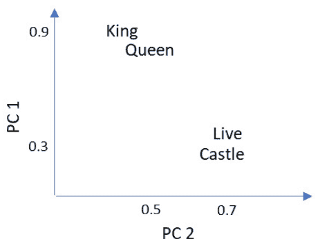

图 4.12 – 绘制单词

接下来，你将学习图 4.12 中显示的五个维度是如何构建的。同样，有不同的方法可以做到这一点，但你将学习最流行的方法，它使用带有固定上下文窗口的共现矩阵。

首先，你必须想出一些逻辑来表示每个单词，同时牢记你还必须考虑它们的上下文。为了解决上下文要求，你需要定义一个固定上下文窗口，它将负责指定有多少个单词将被分组在一起进行上下文学习。例如，假设这个固定上下文窗口为 2。

接下来，你将创建一个共现矩阵，它将根据预定义的上下文窗口计算每对单词出现的次数。考虑以下文本：“I will pass this exam, you will see. I will pass it.”

单词“pass”的上下文窗口将是加粗的部分：“I will pass this exam, you will see. I will pass it。” 根据此逻辑，请查看每对单词在上下文窗口中出现的次数（图 4.13）。

| | I | Will | Pass | This | Exam | You | See | It |
|---|---|---|---|---|---|---|---|---|
| I | 0 | 3 | ... | ... | ... | ... | ... | ... |
| Will | 3 | 0 | ... | ... | ... | ... | ... | ... |
| Pass | ... | ... | 0 | ... | ... | ... | ... | ... |
| This | ... | ... | ... | 0 | ... | ... | ... | ... |
| Exam | ... | ... | ... | ... | 0 | ... | ... | ... |
| You | ... | ... | ... | ... | ... | 0 | ... | ... |
| See | ... | ... | ... | ... | ... | ... | 0 | ... |
| It | ... | ... | ... | ... | ... | ... | ... | 0 |

图 4.13 – 共现矩阵

如你所见，当使用大小为 2 的上下文窗口时，单词对“I will”出现了三次：

- 1. 我会通过这场考试，你会看到。我会通过它。
- 2. 我会通过这场考试，你会看到。我会通过它。
- 3. 我会通过这场考试，你会看到。我会通过它。

查看图 4.13，相同的逻辑应应用于所有其他单词对，将“...”替换为相关的出现次数。你现在每个单词都有数字表示了！

#### 重要提示


你应该意识到，固定上下文窗口的共现矩阵有很多替代方案，例如使用 TF-IDF 向量化，甚至是更简单的每个文档的词频计数器。这里最重要的是，无论如何，你必须为每个词想出一个数值表示。

最后一步就是最终找到表 4.13 中所示的那些维度。你可以通过创建多层模型来实现这一点，通常基于神经网络，其中隐藏层将代表你的嵌入空间。图 4.14 展示了一个简化示例，你可以将图 4.13 中所示的那些词压缩为五个维度的嵌入空间：

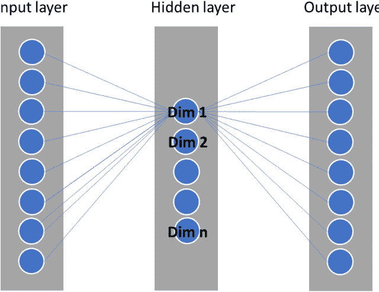

图 4.14 – 使用神经网络构建嵌入空间

你将在本书后面部分更详细地了解神经网络。目前，理解嵌入向量的来源已经是一项了不起的成就了！

在建模自然语言问题时，另一个需要牢记的重要事情是，你可以在模型中重复使用预训练的嵌入空间。一些公司已经创建了现代神经网络架构，在数十亿份文档上进行训练，这些架构已成为该领域的最新技术。作为参考，请查看来自 Transformer 的双向编码器表示（BERT），它由 Google 提出，并已被数据科学界和工业界广泛使用。

你现在已经读完了关于数据准备和转换的这一章，这一章很长，但非常重要。抓住这个机会，快速回顾一下你学到的精彩内容。

### 摘要

首先，你了解了可能需要处理的不同类型的特征。识别你将要处理的变量类型，对于定义可应用于每种情况的转换和技术类型非常重要。

然后，你学习了如何处理分类特征。你会发现，有时分类变量具有顺序（例如序数变量），而有时没有（例如标称变量）。你了解到，独热编码（或哑变量）可能是标称特征最常见的转换类型；然而，取决于唯一类别的数量，在应用独热编码后，你的数据可能会面临稀疏性问题。关于序数特征，你不应该在其上创建哑变量，因为你会丢失已纳入变量中的顺序信息。在这些情况下，序数编码是最合适的转换。

你继续探索数值特征，学习如何处理连续数据和离散数据。你了解了最重要的几种转换类型，例如归一化、标准化、分箱和离散化。你发现某些类型的转换依赖于底层数据来确定其参数，因此非常重要的是避免使用测试集从数据中学习任何内容（它必须严格仅用于测试）。

你还发现，你甚至可以应用纯数学来转换数据；例如，你了解到幂变换可以用于降低特征的偏度，使其更接近正态分布。

之后，你查看了缺失数据，并了解了这项任务的重要性。在建模时，你不能将缺失值视为一个简单的计算问题，只需将 x 替换为 y。这是一个更大的问题，你需要先探索数据，然后检查缺失数据是否是随机生成的，才能开始解决它。

在决定删除或替换缺失数据时，你必须意识到，你要么丢失了信息，要么向数据集添加了偏差。请记得复习本章的所有重要说明，因为它们很可能与考试相关。

你还了解了异常值检测。你了解了查找异常值的不同方法，例如 z-分数和箱线图方法。最重要的是，你了解到你可以对其进行标记或平滑处理。

在开头，你被告知本章将是一段关于数据准备的漫长但值得的旅程。你还学习了如何处理罕见事件，因为这是 ML 中最具挑战性的问题之一。现在你意识到，有时你的数据可能不平衡，你必须要么欺骗你的算法（通过更改类权重），要么重新采样你的数据（应用欠采样或过采样）。

最后，你学习了如何处理 NLP 中的文本数据。现在你应该能够手动计算 BoW 和 TF-IDF 矩阵！你更深入地了解了词嵌入的工作原理。在这一小节中，你了解到你可以创建自己的嵌入空间（使用多种不同的方法）或重复使用预训练的嵌入空间，例如 BERT。

你完成了！在下一章中，你将深入探讨数据可视化技术。

### 考试准备演练 – 章节复习题

除了对关键概念有扎实的理解外，能够在时间压力下快速思考是一项能帮助你在认证考试中取得好成绩的技能。这就是为什么在学习旅程早期就开始培养这些技能至关重要。

章节复习题旨在随着你学习的每个章节逐步提高你的应试技巧，同时复习你对本章关键概念的理解。你会在每个章节的末尾找到这些题目。

### 如何访问这些资源

要了解如何访问这些资源，请转到标题为“第 11 章：访问在线练习资源”的章节。

要打开本章的章节复习题，请执行以下步骤：

- 1. [单击链接](https://packt.link/MLSC01E2_CH04)。

或者，你可以扫描以下 QR 码（图 4.15）：


图 4.15 – 为登录用户打开章节复习题的 QR 码

- 2. 登录后，你将看到类似于图 4.16 所示的页面：

### 数据准备和转换

### 摘要

首先，你了解了可能需要处理的不同类型的特征。识别你将要处理的变量类型，对于定义可应用于每种情况的转换和技术类型非常重要。

然后，你学习了如何处理分类特征。你会发现，有时分类变量具有顺序（例如序数变量），而有时没有（例如标称变量）。你了解到，独热编码（或哑变量）可能是标称特征最常见的转换类型；然而，取决于唯一类别的数量，在应用独热编码后，你的数据可能会面临稀疏性问题。关于序数特征，你不应该在其上创建哑变量，因为你会丢失已纳入变量中的顺序信息。在这些情况下，序数编码是最合适的转换。

你继续探索数值特征，学习如何处理连续数据和离散数据。你了解了最重要的几种转换类型，例如归一化、标准化、分箱和离散化。你发现某些类型的转换依赖于底层数据来确定其参数，因此非常重要的是避免使用测试集从数据中学习任何内容（它必须严格仅用于测试）。

你还发现，你甚至可以应用纯数学来转换数据；例如，你了解到幂变换可以用于降低特征的偏度，使其更接近正态分布。

之后，你查看了缺失数据，并了解了这项任务的重要性。在建模时，你不能将缺失值视为一个简单的计算问题，只需将 x 替换为 y。这是一个更大的问题，你需要先探索数据，然后检查缺失数据是否是随机生成的，才能开始解决它。

在决定删除或替换缺失数据时，你必须意识到，你要么丢失了信息，要么向数据集添加了偏差。请记得复习本章的所有重要说明，因为它们很可能与考试相关。

你还了解了异常值检测。你了解了查找异常值的不同方法，例如 z-分数和箱线图方法。最重要的是，你了解到你可以对其进行标记或平滑处理。

在开头，你被告知本章将是一段关于数据准备的漫长但值得的旅程。你还学习了如何处理罕见事件，因为这是 ML 中最具挑战性的问题之一。现在你意识到，有时你的数据可能不平衡，你必须要么欺骗你的算法（通过更改类权重），要么重新采样你的数据（应用欠采样或过采样）。

最后，你学习了如何处理 NLP 中的文本数据。现在你应该能够手动计算 BoW 和 TF-IDF 矩阵！你更深入地了解了词嵌入的工作原理。在这一小节中，你了解到你可以创建自己的嵌入空间（使用多种不同的方法）或重复使用预训练的嵌入空间，例如 BERT。

你完成了！在下一章中，你将深入探讨数据可视化技术。

### 章节复习题

《AWS 认证机器学习 - 专业 (MLS-C01) 认证指南（第二版）》，作者：Samarth Nanda, Wesley Moura

选择测验
测验 1 显示测验详情 开始

图 4.16 — 第 4 章的章节复习题

- 3. 准备就绪后，开始以下练习演练，多次重新尝试测验。

### 考试准备演练

#### 尝试 1

第一次，目标至少达到 40%。查看你答错的题目，并再次阅读章节中的相关部分，以弥补学习差距。


#### 尝试 2

第二次，目标是至少达到 **60%**。查看你答错的问题，并再次阅读章节中相关部分，以弥补任何剩余的学习差距。

#### 尝试 3

第三次，目标是至少达到 **75%**。一旦你得分 75% 或以上，就开始着手计时练习。

#### 提示

你可能需要超过 **三** 次尝试才能达到 75%。这没关系。只需复习章节中的相关部分，直到达到目标。

### 计时练习

目标：你的目标是在尽可能快地回答这些问题的同时，保持分数不变。以下是你接下来几次尝试的示例：

| 尝试 | 分数 | 耗时 |
|---|---|---|
| 尝试 5 | 77% | 21 分钟 30 秒 |
| 尝试 6 | 78% | 18 分钟 34 秒 |
| 尝试 7 | 76% | 14 分钟 44 秒 |

表 4.14 – 在线平台上的计时练习示例

#### 注释

上表中显示的时间限制仅为示例。每次尝试时，请根据网站上的测验时间限制设置自己的时间限制。

每次新尝试时，你的分数应保持在 **75%** 以上，而完成所需的“耗时”应“减少”。重复尽可能多的尝试，直到你对应对时间压力感到自信。

## 数据理解与可视化

数据可视化是一门艺术！无论你和你的团队为建模进行数据准备和初步分析付出了多少努力，如果你不知道如何有效地展示你的发现，你的听众可能无法理解你想要表达的观点。

在面对决策者时，这种情况往往可能更糟。例如，如果你选择了错误的图表集来讲述特定的故事，人们可能会误解你的分析并做出错误的决策。

了解不同类型的数据可视化，并知道它们如何与每种分析类型匹配，将使你在吸引听众和传达你想要的信息方面处于非常有利的位置。

在本章中，你将学习一些数据可视化技术。你将涵盖以下主题：

- 可视化数据中的关系
- 可视化数据中的比较
- 可视化数据中的构成
- 可视化数据中的分布
- 构建关键绩效指标
- 介绍 QuickSight

你已经知道为什么需要掌握这些主题。开始吧！

### 可视化数据中的关系

当你需要展示数据中的关系时，通常是在图表中绘制两个或多个变量，以可视化它们的依赖程度。**散点图** 可能是展示两个变量之间关系最常见的图表类型。*图 5.1* 显示了两个变量 X 和 Y 的散点图。

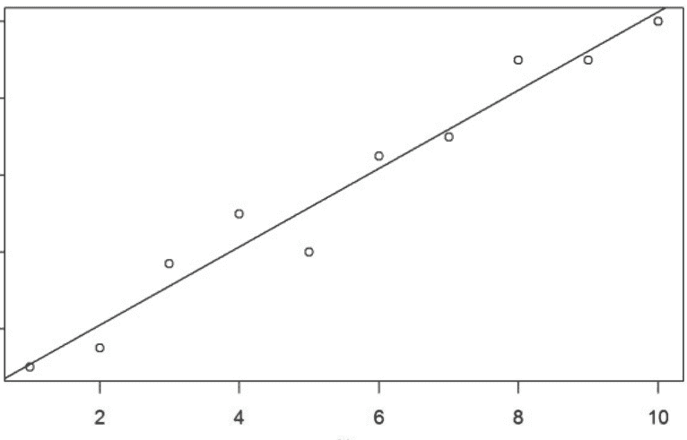

图 5.1 – 使用散点图绘制关系

图 5.1 显示 X 和 Y 之间存在明显的关系。随着 X 的增加，Y 也随之增加。在这种情况下，你可以说两个变量之间存在线性关系。请记住，散点图也可能捕捉其他类型的关系，而不仅仅是线性关系。例如，也有可能在两个变量之间发现指数关系。

另一个适合做比较的好图表是 **气泡图**。就像散点图一样，它也会显示变量之间的关系；然而，在这里，你可以使用第三个维度，由点的大小来表示。

图 5.2 是一个气泡图，用于解释一个投资方案，其中 x 轴是年收益率，y 轴是投资期限，气泡的大小表示分配给每个投资选项的金额。

投资选项

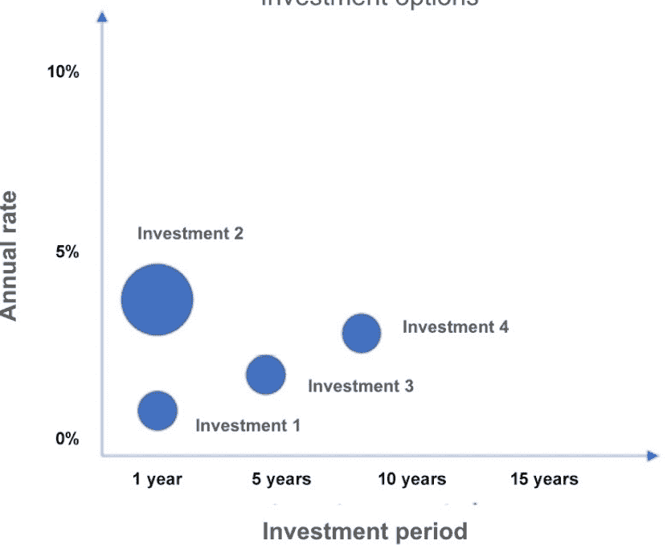

图 5.2 – 使用气泡图绘制关系

观察图 5.2，你可以看到两种关系。第一种是年收益率与投资期限之间的关系：投资期限越长，年收益率越高。第二种是投资金额与年收益率之间的关系：投资金额越高，年收益率越高。正如你所见，这是展示此类分析的非常有效的方式。接下来，你将学习如何比较变量。

### 可视化数据中的比较

比较在数据分析中非常常见，有多种方式来呈现。从条形图开始，你一定见过许多使用这种可视化方式的报告。

条形图可用于比较不同类别中的一个变量——例如，不同车型的汽车价格或各国的人口规模。在图 5.3 中，条形图用于分析截至 2020 年 4 月 7 日印度多个地区的 COVID-19 检测阳性百分比。

COVID-19 检测阳性样本（百分比）

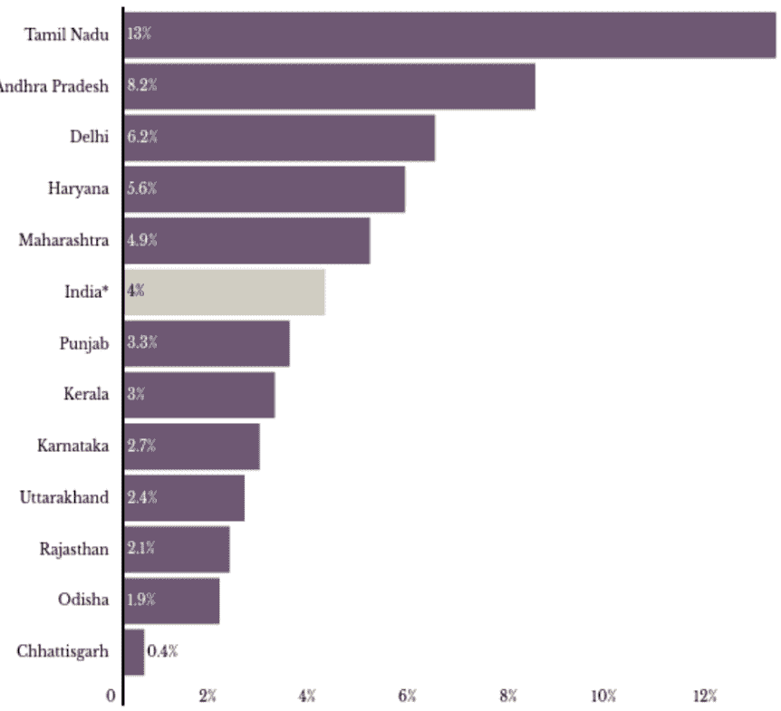

图 5.3 – 使用条形图绘制比较（来源：印度州卫生部）

有时，你也可以使用堆叠柱状图为正在分析的数据添加另一个维度。例如，图 5.4 使用堆叠条形图来显示按性别划分的泰坦尼克号上的人数。此外，它还按性别细分了幸存者（正类）和不幸者（负类）的人数。

按性别分组的幸存者人数

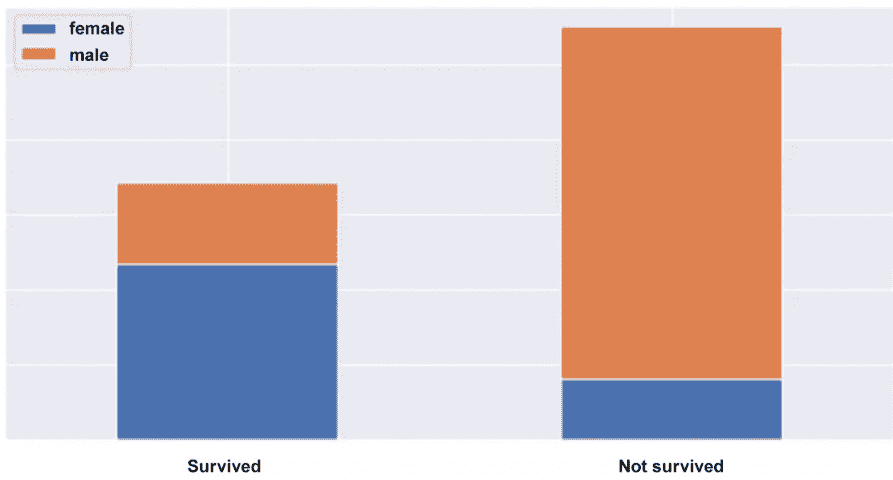

图 5.4 – 使用堆叠条形图分析泰坦尼克号灾难数据集

正如你所见，大多数女性幸存于这场灾难，而大多数男性则没有。堆叠条形图帮助我们可视化两性命运的差异。最后，你应该知道，你还可以在这些堆叠条形图上显示百分比，而不仅仅是绝对数字。

柱状图在你需要比较不同时期的一个或两个变量时也很有用。例如，在图 5.5 中，你可以看到按省份划分的加拿大年度电动汽车销量。

按省份划分的加拿大年度电动汽车销量


图 5.5 – 使用柱状图绘制比较（来源：https://electrek.co/）

另一种在不同时期进行比较的非常有效的方法是使用折线图。图 5.6 展示了一个非常有趣的示例，说明如何在特定项目中，在不同的发布日期比较不同算法的性能。

#### 重要注释

折线图通常非常有助于指示在分析期间内数据是否存在任何趋势。折线图的一个非常常见的用例是预测，通常需要分析时间序列数据中的趋势和季节性。

例如，在图 5.6 中，你可以看到分类和回归树 (CART) 模型曾经是与其他算法（如 AdaBoost (ADA)、梯度提升 (GB)、随机森林 (RF) 和逻辑回归 (LOGIT)）相比表现最差的模型。

然而，在 7 月份，CART 模型进行了优化，结果成为所有其他模型中第三好的模型。每个时期最佳模型的完整故事可以轻松在图 5.6 中看到。

模型随时间的演变

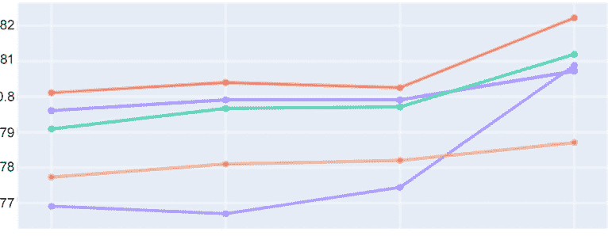

图 5.6 – 使用折线图绘制比较

最后，你还可以使用表格来展示数据的比较。当你有多个维度（通常放在表格的行中）和一个或多个用于比较的指标（通常放在表格的列中）时，表格更有用。

在下一节中，你将学习另一组旨在展示变量分布的图表。这组图表对建模任务尤其重要，因为你必须了解特征的分布，才能考虑针对其进行潜在的数据转换。

### 可视化数据中的分布

探索特征的分布对于理解其某些关键特征非常重要，例如其偏度、均值、中位数和分位数。你可以通过绘制直方图来轻松可视化偏度。这种图表将你的数据分组到箱或桶中，并对其进行计数。例如，图 5.7 显示了年龄变量的直方图：


### 各年龄段人数

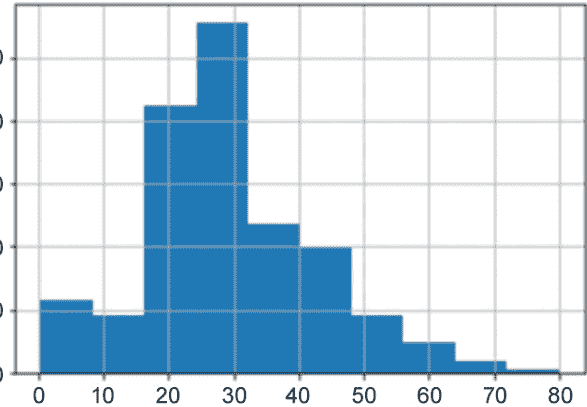

图 5.7 – 使用直方图绘制分布

查看直方图，你可以得出结论，大多数人的年龄在 20 到 50 岁之间。你还可以看到少数超过 60 岁的人。图 5.8 显示了另一个直方图示例，它绘制了某个特定活动（该活动有不同票价）的支付分布。其目的是分析人们每张票支付多少钱。

### 支付分布

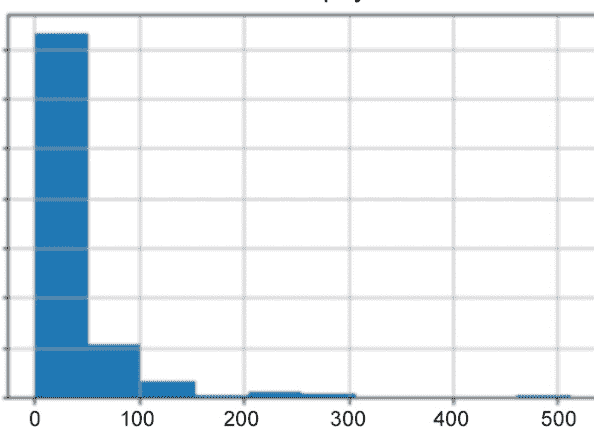

图 5.8 – 使用直方图检查偏度

在这里，你可以看到大多数人每张票支付最多 100 美元。这就是为什么你可以看到右侧（尾部侧）偏斜的分布。

如果你想查看分布的其他特征，如其中位数、分位数和异常值，那么你应该使用箱线图。在 *图 5.9* 中，有一个给定数据集中不同算法的另一个性能比较。

这些算法在交叉验证过程中被多次执行，这导致同一算法产生多个输出；例如，算法在每个折叠上每次执行的一个准确度指标。

由于每个算法都有多个准确度指标，你可以使用箱线图来检查这些算法在交叉验证过程中的表现。

### 算法比较

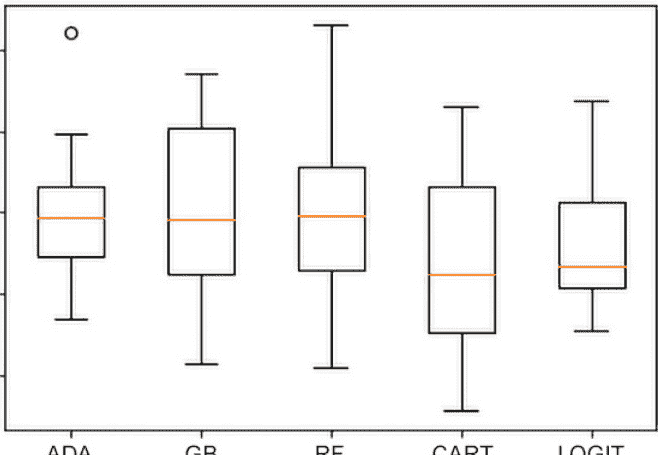

图 5.9 – 使用箱线图绘制分布

在这里，你可以看到箱线图可以展示关于数据分布的一些信息，如其中位数、下四分位数、上四分位数和异常值。为了完整理解箱线图的每个元素，请参看 *图 5.10*。

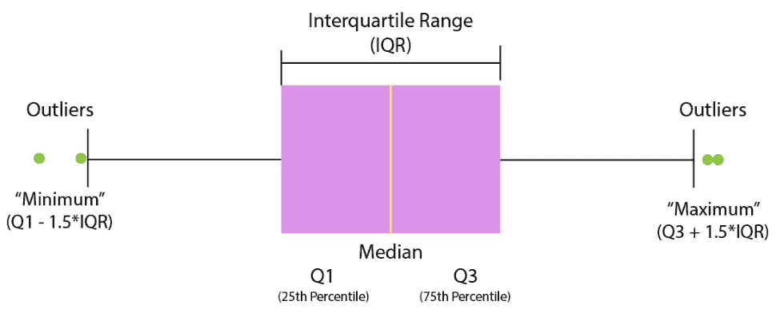

图 5.10 – 箱线图元素

通过分析图 5.9 中显示的箱线图，你可以得出结论，ADA 算法在交叉验证过程中呈现了一些异常值，因为一次执行产生了一个非常好的模型（准确率约为 92%）。AdaBoost 的所有其他执行结果都低于 85% 的准确率，中位数约为 80%。

分析图 5.9 后你可以得出的另一个结论是，CART 算法在交叉验证过程中表现最差（中位数和下四分位数最低）。

在结束本节之前，请注意，当你有多个变量时，也可以使用散点图来分析数据分布。接下来，你将查看另一组有助于展示数据构成的图表。

### 可视化数据中的构成

有时，你想分析构成特征的各种元素——例如，每个地区的销售百分比或每个渠道的查询百分比。在这两个示例中，它们不考虑任何时间维度；相反，它们只是查看整个数据点。对于这种没有时间维度的构成类型，你可以使用饼图、堆叠 100% 条形图和树图来展示数据。

图 5.11 是一个饼图，显示了给定公司在预定义时间段内每个客户渠道的查询数量。

### 各渠道查询数

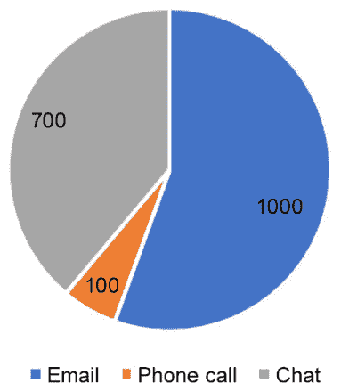

图 5.11 – 使用饼图绘制构成

如果你想在考虑时间维度的同时展示构成，那么你最常见的选择是堆叠面积图、堆叠 100% 面积图、堆叠柱状图或堆叠 100% 柱状图。供参考，请查看图 5.12，它显示了从 2016 年到 2020 年各地区的销售额。

### 各地区销售额

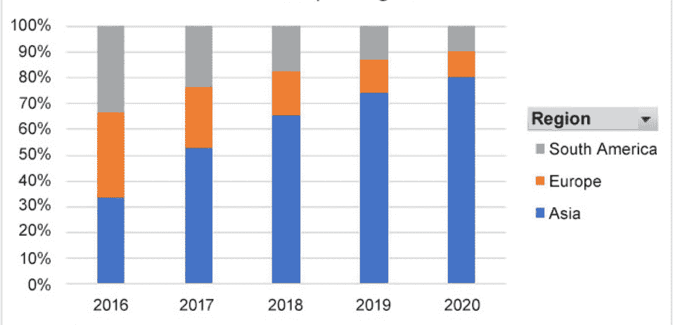

图 5.12 – 使用堆叠 100% 柱状图绘制构成

如你所见，堆叠 100% 柱状图帮助我们了解不同时间段的构成。

### 构建关键绩效指标

在结束这些数据可视化部分之前，你需要了解关键绩效指标，简称 KPI。

KPI 通常是一个单值，用于描述业务指标的结果，例如流失率、净推荐值 (NPS)、投资回报率 (ROI) 等。虽然不同行业有一些标准指标，但你通常需要根据公司的需求构建自定义指标。

老实说，与指标相关的最复杂挑战不在于其可视化本身，而在于它们的构建方式（使用的规则）以及它们在公司不同层级之间的传达和使用方式。

从可视化角度来看，就像任何其他单值一样，你可以使用所有你学过的图表来分析你的指标，具体取决于你的需求。但是，如果你只是想展示你的 KPI，且没有时间维度，你可以使用小部件。

好了，这些是你参加 AWS 认证机器学习 – 专业 (AWS Certified Machine Learning – Specialty) 考试应该了解的关于数据可视化的最重要主题。现在，让我们看看 QuickSight，这是一项 AWS 服务，你可以在其中实现刚刚学到的所有可视化技术。

### 介绍 QuickSight

Amazon QuickSight 是一项基于云的分析服务，允许你构建数据可视化和临时分析。QuickSight 支持多种数据源，例如 Redshift、Aurora、Athena、RDS 和你的本地数据库解决方案。

其他数据源包括 S3，你可以从中检索 Excel、CSV 或日志文件中的数据，以及软件即服务 (SaaS) 解决方案，你可以从中检索 Salesforce 实体中的数据。

Amazon QuickSight 有两个版本：

- 标准版
- 企业版

这两个版本之间最重要的区别是能否与 Microsoft Active Directory (AD) 集成以及静态加密。这两项功能仅在企业版中提供。

#### 重要提示

*请记住，AWS 服务不断演变，未来标准版和企业版之间可能会出现更多差异。你应始终查阅 AWS 服务的最新文档以了解新内容。*

在访问管理方面，QuickSight 提供了一个非常简单的界面，你可以使用它来控制用户访问。在标准版中，你基本上有两个选项来邀请用户加入你的 QuickSight 账户：

- 你可以邀请一个 IAM 用户。
- 你可以向电子邮件地址发送邀请。

如果你邀请 IAM 用户，他们可以自动登录你的账户，并根据你在创建 QuickSight 用户时提供的权限类型查看或编辑你的可视化内容。如果你邀请了一个电子邮件地址，那么该电子邮件的所有者需要访问其邮箱来完成此操作。

删除用户也很简单。在删除用户时，你需要提供的唯一额外信息是，是否要将孤立资源转移到你账户中的另一个用户，还是删除该用户的所有资源。

如果你使用的是企业版，此授权用户的过程可能会有所不同，因为你有 AD 在为你工作。在这种情况下，你可以授予 AD 组的访问权限，这些组中的所有用户都将获得对你在 QuickSight 上的账户的访问权限。

另外，请记住，在两个版本中，所有数据传输都已加密；但是，你只能在企业版中找到静态加密。

当你将数据导入 QuickSight 时，你从技术上讲正在创建所谓的 **数据集**。数据集随后会以优化的结构导入 QuickSight，称为 **超快速、并行、内存计算引擎 (SPICE)**。这就是为什么 QuickSight 可以在大数据上执行数据可视化。

最后，你应该知道，QuickSight 不仅允许你绘制数据，还允许执行一些小的数据准备任务，例如重命名字段、计算新字段、更改数据类型、准备查询以从源检索数据，以及连接同一源中的表格。

总结使用 QuickSight 的主要步骤：

1. 用户创建和授权。
2. 连接到数据源。
3. 将数据导入数据集。
4. 你的数据集将被导入 SPICE。


- 5. 从数据集中，你可以创建一个**分析**。
- 6. 最后，在你的分析中，你可以添加**可视化**。
- 7. 如果你想进一步探索，你可以创建分析的快照并将其放置在**仪表板**中。或者，你可以将分析分组为**故事**。

这就结束了关于数据可视化的本章内容！现在，花些时间回顾你所学的内容。

### 摘要

本章一开始，你就学习了如何可视化数据中的关系。散点图和气泡图是此类别中最重要的图表，分别用于展示两个或三个变量之间的关系。

接着，你进入了数据可视化的另一个类别，旨在对数据进行比较。你可以用来展示比较的最常见图表包括条形图、柱状图和折线图。表格也有助于展示比较。

接下来你学习的用例是可视化数据分布。用于展示分布的最常见图表类型是直方图和箱线图。

然后，你转向了构成分析。当你想要展示构成数据的不同元素时，可以使用这一组图表。在展示构成时，你必须意识到自己想要展示的是静态数据还是随时间变化的数据。对于静态数据，你应使用饼图、堆叠 100% 条形图或树形图。对于随时间变化的数据，你应使用堆叠面积图、堆叠 100% 面积图、堆叠柱状图或堆叠 100% 柱状图。

本章的最后一部分介绍了 QuickSight，这是一项可用于可视化数据的 AWS 服务。你了解了该服务的不同版本和功能，随后被介绍了 SPICE。

干得好！在下一章中，你将学习机器学习算法。这对于你的认证之旅将是一个非常重要的章节，所以请确保做好准备！然而，在进入那个新章节之前，花些时间多为考试练习一下吧！

### 考试备战演练 – 章节复习问题

除了扎实掌握关键概念之外，能够在时间压力下快速思考是一项能帮助你在认证考试中取得好成绩的技能。这就是为什么在学习旅程早期就着手培养这些技能至关重要。

章节复习问题旨在随着你逐章学习而逐步提高你的应试技巧，同时复习你对本章关键概念的理解。你会在每章末尾找到这些问题。

### 如何访问这些资源

要了解如何访问这些资源，请前往标题为“第 11 章：访问在线练习资源”的章节。

要打开本章的章节复习问题，请执行以下步骤：

- 1. 单击链接 – https://packt.link/MLSC01E2_CH05。

或者，你可以扫描以下 QR 码（图 5.13）：


图 5.13 – 为登录用户打开章节复习问题的 QR 码

- 2. 登录后，你将看到类似图 5.14 所示的页面：

### 数据理解与可视化

#### 摘要

本章一开始，你就学习了如何可视化数据中的关系。散点图和气泡图是此类别中最重要的图表，分别用于展示两个或三个变量之间的关系。接着，你进入了数据可视化的另一个类别，旨在对数据进行比较。你可以用来展示比较的最常见图表包括条形图、柱状图和折线图。表格也有助于展示比较。接下来你学习的用例是可视化数据分布。用于展示分布的最常见图表类型是直方图和箱线图。然后，你转向了构成分析。当你想要展示构成数据的不同元素时，可以使用这一组图表。在展示构成时，你必须意识到自己想要展示的是静态数据还是随时间变化的数据。对于静态数据，你应使用饼图、堆叠 100% 条形图或树形图。对于随时间变化的数据，你应使用堆叠面积图、堆叠 100% 面积图、堆叠柱状图或堆叠 100% 柱状图。本章的最后一部分介绍了 QuickSight，这是一项可用于可视化数据的 AWS 服务。你了解了该服务的不同版本和功能，随后被介绍了 SPICE。干得好！在下一章中，你将学习机器学习算法。这对于你的认证之旅将是一个非常重要的章节，所以请确保做好准备！然而，在进入那个新章节之前，花些时间多为考试练习一下吧！

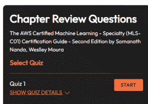

图 5.14 — 第 5 章的章节复习问题

- 3. 准备就绪后，开始以下练习演练，多次重新尝试测验。

### 考试准备演练

对于前三次尝试，不必担心时间限制。

#### 尝试 1

第一次，力求至少达到 40%。查看你答错的答案，并再次阅读章节中的相关部分以弥补学习差距。

#### 尝试 2

第二次，力求至少达到 60%。查看你答错的答案，并再次阅读章节中的相关部分以弥补任何剩余的学习差距。

#### 尝试 3

第三次，力求至少达到 75%。一旦得分达到 75% 或以上，你就开始练习答题时间。

T/P

你可能需要超过 **三** 次尝试才能达到 75%。这没关系。只需复习章节中的相关部分，直到做到为止。

### 练习答题时间

目标：你的目标是在尽可能快地回答这些问题的同时保持相同的得分。以下是你后续尝试应呈现的示例：

| 尝试 | 得分 | 耗时 |
|---|---|---|
| 尝试 5 | 77% | 21 分钟 30 秒 |
| 尝试 6 | 78% | 18 分钟 34 秒 |
| 尝试 7 | 76% | 14 分钟 44 秒 |

表 5.1 – 在线平台上的计时练习演练示例

#### 注意

*上表所示的时间限制仅为示例。根据网站上测验的时间限制，为每次尝试设定自己的时间限制。*

每次新尝试时，你的得分应保持在 **75%** 以上，而完成所需的“时间”应“减少”。重复尽多次的尝试，直到你对应对时间压力感到自信为止。

## 应用机器学习算法

在上一章中，你学习了关于数据理解与可视化的内容。现在是时候进入建模阶段，学习机器学习算法了！在早些章节中，你了解到构建机器学习模型需要大量关于 AWS 服务、数据工程、数据探索、数据架构等方面的知识。这一次，你将深入了解已介绍的算法及更多内容。

对不同类型的算法和机器学习方法有良好的了解，将使你在项目决策中处于非常有利的地位。当然，这种知识对于 AWS 认证机器学习专业考试也至关重要。

请记住，外面有成千上万种算法。你甚至可以为特定问题提出自己的算法。在本章中，你将学习最相关的算法，希望也是你在考试中可能遇到的算法。

本章的主要主题如下：

- 存储训练数据
- 关于集成模型的一句话
- 监督学习：
  - 回归模型
  - 分类模型
  - 预测模型
  - Object2Vec
- 非监督学习：
  - 聚类
  - 异常检测
  - 降维
  - IP Insights
  - 文本分析（自然语言处理）
  - 图像处理
- 强化学习

好了，拿杯咖啡，开干吧！

### 本章介绍

在本章中，你将阅读关于多种算法、建模概念和学习策略的内容。所有这些主题对于你备考以及作为数据科学家的职业生涯都非常有益。

本章的结构安排旨在不仅涵盖考试所需的主题，还能让你对最重要的学习策略有良好的了解。例如，考试将检查你的


关于 K-Means 基本概念的知识。不过，本章将以更深入的水平来讲解它，因为这是你作为数据科学家职业生涯中的一个重要主题。

本章将采用这种方法，深入探讨每个数据科学家都应掌握的某些类型模型的算法逻辑。此外，请记住：有时你可能会深入超出考试预期的范围，但这对你的职业生涯至关重要。

在本章中，你多次会看到术语 **内置算法**。该术语将用于指 AWS 在其 SageMaker SDK 中实现的算法列表。

下面是一个具体示例：你可以使用 scikit-learn 的 **K-最近邻** 算法，或简称 KNN（如果你不记得 scikit-learn 是什么，请返回 [第 1 章，机器学习基础](#) 来刷新你的记忆）来创建分类模型并将其部署到 SageMaker。不过，AWS 也在其 SDK 上提供了 KNN 算法的自身实现，该实现经过优化，可在 AWS 环境中运行。在这里，KNN 是内置算法的一个示例。

在 AWS 上的可能性是无限的，因为你可以利用内置算法，也可以引入自己的算法来在 SageMaker 上创建模型。最后，为了非常清楚地说明这一点，下面是一个如何从 AWS SDK 导入内置算法的示例：

```
import sagemaker
knn = sagemaker.estimator.Estimator(get_image_uri(boto3.Session().region_name, "knn"),
    get_execution_role(),
    train_instance_count=1,
    train_instance_type='ml.m5.2xlarge',
    output_path=output_path,
    sagemaker_session=sagemaker.Session())

knn.set_hyperparameters(**hyperparams)
```

你将在 [第 9 章，Amazon SageMaker 建模](#) 中学习如何在 SageMaker 上创建模型。目前，只需了解 AWS 具有一套自己的库，其中实现了这些内置算法。

要训练和评估模型，你需要训练数据和测试数据。实例化你的估计器后，应该用这些数据集来喂它。为了不剧透 [第 9 章，Amazon SageMaker 建模](#)，但你应该提前了解 **数据通道** 的概念。

数据通道是在创建训练作业时可以传递给 SageMaker 的与输入数据相关的配置。你应该设置这些配置，只是为了告知 SageMaker 你的输入数据的格式。

在 [第 9 章，Amazon SageMaker 建模](#) 中，你将学习如何创建训练作业以及如何设置数据通道。目前，你应该知道，在配置数据通道时，可以设置 **内容类型** (`ContentType`) 和 **输入模式** (`TrainingInputMode`)。你现在将更仔细地了解训练数据应如何以及在何处存储，以便能够与 AWS 的内置算法正确集成。

### 存储训练数据

首先，你可以使用多个 AWS 服务来为机器学习准备数据，例如 **弹性 MapReduce (EMR)**、Redshift、Glue 等等。预处理训练数据后，你应该将其存储在 S3 中，使用你所使用的算法期望的格式。*表 6.1* 显示了每种算法可接受的数据格式列表。

| 数据格式 | 算法 |
|---|---|
| Application/x-image | 对象检测算法，语义分割 |
| Application/x-recordio | 对象检测算法 |
| Application/x-recordio-protobuf | 分解机，K-Means，KNN，隐性狄利克雷分配，线性学习者，NTM，PCA，RCF，序列到序列 |
| Application/jsonlines | BlazingText，DeepAR |
| Image/.jpeg | 对象检测算法，语义分割 |
| Image/.png | 对象检测算法，语义分割 |
| Text/.csv | IP Insights，K-Means，KNN，隐性狄利克雷分配，线性学习者，NTM，PCA，RCF，XGBoost |
| Text/.libsvm | XGBoost |

表 6.1 – 每种 AWS 算法可接受的数据格式

如你所见，许多算法接受 Text/.csv 格式。如果你想使用该格式，应该遵循以下规则：

- 你的 CSV 文件 *不能* 有标题记录。
- 对于监督学习，目标变量必须在第一列。
- 在配置训练管道时，将输入数据通道设置为 *content_type* 等于 *text/csv*。
- 对于无监督学习，在 *content_type* 中设置 *label_size*，如下所示：'*content_type=text/csv;label_size=0*'。

尽管 *text/.csv* 格式对许多用例来说没问题，但大多数时候，AWS 的内置算法与 *recordIO-protobuf* 配合使用效果更好。这是一种优化的数据格式，用于训练 AWS 的内置算法，其中 SageMaker 将数据集中的每个观测值转换为二进制表示，即一组 4 字节浮点数。

RecordIO-protobuf 接受两种输入模式：管道模式和文件模式。在管道模式下，数据将直接从 S3 流式传输，这有助于优化存储。在文件模式下，数据从 S3 复制到训练实例的存储卷中。

你几乎准备好了！现在可以快速浏览一些建模定义，这些定义将帮助你理解一些更高级的算法。

### 关于集成模型的一些话

在深入研究算法之前，有一个重要的建模概念你应该了解——*集成*。集成一词用于描述使用多种算法来创建模型的方法。

一个*不*实现集成方法的常规算法将依赖于单个模型来训练和预测目标变量。当你创建决策树或回归模型时，就会发生这种情况。另一方面，实现集成方法的算法将依赖于多个模型来预测目标变量。在这种情况下，由于这些模型中的每个模型都可能针对目标变量得出不同的预测，集成算法要么实施投票（用于分类模型），要么实施平均（用于回归模型）系统来输出最终结果。表 6.2 说明了由三个模型组成的集成算法的一个非常简单的投票系统。

| 事务 | 模型 A | 模型 B | 模型 C | 预测 |
|---|---|---|---|---|
| 1 | 欺诈 | 欺诈 | 非欺诈 | 欺诈 |
| 2 | 非欺诈 | 非欺诈 | 非欺诈 | 非欺诈 |
| 3 | 欺诈 | 欺诈 | 欺诈 | 欺诈 |
| 4 | 非欺诈 | 非欺诈 | 欺诈 | 非欺诈 |

表 6.2 – 集成方法的投票系统示例

如前所述，同样的方法也适用于回归问题，在那里，而不是投票，它可以平均每个模型的结果并将其作为结果。

投票和平均只是集成方法的两个示例。其他强大的技术包括混合和堆叠，你可以创建多个模型，并使用每个模型的结果作为主模型的特征。回顾表 6.2，模型 A、模型 B 和模型 C 列可以用作特征来预测最终结果。

事实证明，许多机器学习算法在训练过程中以嵌入式的方式使用集成方法。这些算法可以分为两大类：

- **自助聚合** 或 **袋装法**：采用这种方法，多个模型在不同的数据样本上进行训练。然后通过投票或平均系统进行预测。此类别中最流行的算法被称为 **随机森林**。
- **提升法**：采用这种方法，多个模型在不同的数据样本上进行训练。然后，一个模型通过惩罚错误预测来尝试纠正下一个模型的错误。此类别中最流行的算法是 **随机梯度提升** 和 **AdaBoost**。

既然你知道集成模型是什么，你可以查看一些可能出现在考试中的机器学习算法。并非所有算法都使用集成方法。

接下来的几个部分将基于 AWS 算法类别进行划分，如下所示：

- 监督学习
- 无监督学习
- 文本分析
- 图像处理

最后，你将了解 AWS 上强化学习的概述。

### 监督学习


AWS 为通用目的（回归和分类任务）和更具体目的（预测和向量化）提供监督学习算法。以下是在这些子类别中可找到的内置算法列表：

- 线性学习者算法
- 分解机算法
- XGBoost 算法
- KNN 算法
- Object2Vec 算法
- DeepAR 预测算法

你将首先学习回归模型和线性学习者算法。

### 使用回归模型

研究线性回归模型是了解回归模型（包括线性和非线性回归模型）内部工作原理的好方法。这是每位数据科学家都必须掌握的知识，也能帮助你解决实际挑战。你将在接下来的子部分中深入了解这一内容。

### 介绍回归算法

线性回归模型旨在根据一个或多个变量（x）来预测一个数值（y）。在数学上，这种关系可以定义为 y = f(x)，其中 y 称为因变量，x 称为自变量。

在回归模型中，你想要预测的目标（y）始终是一个连续数值——例如，房价或交易数量。在第 1 章“机器学习基础”的图 1.2 中，你已经看到了这一点，当时你正在根据目标变量学习如何选择合适的监督学习算法类型。请随时回去复习。

当使用一个变量来预测 y 时，该问题称为简单线性回归。另一方面，当使用多个变量来预测 y 时，则是多元线性回归问题。

还有一类回归模型称为非线性回归。不过，我们暂且放一放，先来了解简单线性回归的含义。

回归模型属于机器学习的监督学习侧（另一侧是无监督学习），因为算法会根据自变量和因变量之间的现有相关性来预测值。

但是，y=f(x) 中的 f 是什么意思？在这里，f 是回归函数，负责根据 x 预测 y。换句话说，这就是你想要找到的函数。在讨论简单线性回归时，请注意接下来的三个问题和答案：

- 线性回归中 f 的形状是什么？
  - 当然是线性的！
- 如何表示线性关系？
  - 使用一条直线（几分钟后你就会明白原因）。
- 那么定义直线的函数是什么？
  - ax + b（查看任何数学书籍即可）。

就这么简单！线性回归模型由 y = ax + b 给出。当你根据 x 预测 y 时，只需要找出 a 和 b 的值。你可以采用同样的逻辑来了解其他类型回归的内部原理。

找出 a 和 b 的值就是你要做的全部工作。有必要了解，a 也被称为 alpha 系数或斜率，表示直线的倾斜度，而 b 也被称为 beta 系数或 y 截距，表示直线与 y 轴交叉的位置（在由 x 和 y 组成的二维平面中）。你将在后面的子部分中学习这两个术语。

同样有必要了解的是，每个预测器都有一个你无法控制的偏差（e）。换言之，简单线性回归的正式定义由 y = ax + b + e 给出。

在下一个子部分中，你将学习如何求解 alpha 和 beta 以解决简单线性回归问题。

### 最小二乘法

有多种方法可以求直线的斜率和 y 截距，但最常用的方法称为最小二乘法。该方法背后的原理很简单：你需要找到最佳拟合直线，以最小化平方误差之和。

在图 6.1 中，你可以看到一个包含多个点和直线的笛卡尔平面。直线 a 代表了对该数据的最佳拟合——换句话说，这就是那些点的最佳线性回归函数。但你如何知道这一点呢？很简单：如果你计算每个点关联的误差，你会发现直线 a 具有最小的平方误差和。

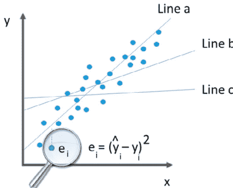

图 6.1 – 可视化最小二乘法的原理

不仅为了认证考试，为了你作为数据科学家的职业生涯，从零开始理解线性回归也是非常值得的。为了为你提供一个完整的示例，已开发好一个包含你即将看到的所有计算的电子表格！我们鼓励你使用这份支持材料并进行一些模拟。无论如何，你将在下一个子部分中看到这些计算的实际应用。

### 从零开始创建线性回归模型

你将使用一个非常简单的数据集，仅包含两个变量：

- x：表示个人的工作经验年数
- y：表示个人的平均薪资

你想了解 x 和 y 之间的关系，并且如果可能的话，根据工作经验年数（x）来预测薪资（y）。实际问题通常包含更多自变量，并且不一定是线性的。但是，这个示例将为你提供掌握更复杂算法所需的基础知识。

要了解 alpha 和 beta 系数（或者如果你愿意，也可以叫斜率和 y 截距）是多少，你需要找到与数据集相关的一些统计量。在表 6.3 中，你可以看到数据和这些辅助统计量。

| X（自变量） | Y（因变量） | X 均值 | Y 均值 | 协方差 (X,Y) | X 方差 | Y 方差 |
|---|---|---|---|---|---|---|
| 1 | 1.000 | | | 21.015 | 20 | 21.808.900 |
| 2 | 1.500 | | | 14.595 | 12 | 17.388.900 |
| 3 | 3.700 | | | 4.925 | 6 | 3.880.900 |
| 4 | 5.000 | | | 1.005 | 2 | 448.900 |
| 5 | 4.000 | | | 835 | 0 | 2.788.900 |
| 6 | 6.500 | | | 415 | 0 | 688.900 |
| 7 | 7.000 | | | 1.995 | 2 | 1.768.900 |
| 8 | 9.000 | | | 8.325 | 6 | 11.088.900 |
| 9 | 9.000 | | | 11.655 | 12 | 11.088.900 |
| 10 | 10.000 | | | 19.485 | 20 | 18.748.900 |
| 计数 | 10 | 5,50 | 5.670,00 | 8.425,00 | 8,25 | 8.970.100,00 |

表 6.3 – 用于根据工作经验量预测平均薪资的数据集

如你所见，x 和 y 之间几乎存在完美的线性关系。随着工作经验量的增加，薪资也随之增加。除了 x 和 y 之外，你还需要计算以下统计量：记录数、x 的均值、y 的均值、x 和 y 的协方差、x 的方差以及 y 的方差。图 6.2 展示了分别提供方差和协方差数学表示的公式，其中 x̄、ȳ 和 n 分别代表 x 的均值、y 的均值和记录数：

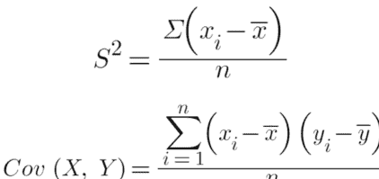

图 6.2 – 方差和协方差的数学表示（分别）

如果你想查看表 6.2 中每个辅助统计量公式的计算细节，请参考随本书提供的支持材料。在那里，你会发现这些公式已经为你实现了。

这些统计量很重要，因为它们将用于计算 alpha 和 beta 系数。图 6.3 解释了如何计算这两个系数，以及相关系数 R 和 R 平方。最后这两个指标可以让你了解模型的质量，它们越接近 1，模型就越好。

| 术语 | 方程 |
| :--- | :--- |
| 直线倾斜度（角系数，A，Alpha） | A = cov (x, y) / var (x) |
| 截距（B，Beta） | B = mean Y - (Alpha * mean X) |
| 相关系数 R | R = cov (x, y) / sqrt (variance x * variance y) |
| 调整后的相关系数（R adjusted） | R adjusted = R ^ 2 |
| 误差（未解释的变异性）| Ei = Yi – yi |
| 方程 | Y = A.X + B + Ei |

图 6.3 – 计算简单线性回归系数的方程


应用这些公式后，你将得到表 6.4 所示的结果。它已包含你做出预测所需的所有信息，除此之外还包含新数据。如果你在原始方程 y = ax + b + e 中替换系数，你会发现回归公式如下：y = 1021.212 * x + 53.3。

| 系数 | 描述 | 值 |
|---|---|---|
| Alpha | 直线倾斜度 | 1021.212 |
| Beta | 截距 | 53.3 |
| R | 相关系数 | 0.979364354 |
| R^2 | 决定系数 | 0.959154538 |

表 6.4 – 查找回归系数

从现在起，要做预测，你只需用工作年限替换 x。结果，你会得到 y，即预计薪资。你可以在图 6.4 中看到模型拟合情况，在表 6.5 中看到一些模型预测。

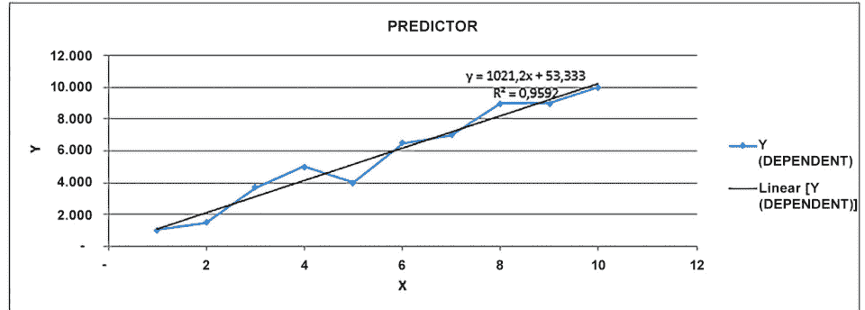

图 6.4 – 回归方程中的数据拟合

| 输入 | 预测 | 误差 |
|---|---|---|
| 1 | 1.075 | 75 |
| 2 | 2.096 | 596 |
| 3 | 3.117 | -583 |
| 4 | 4.138 | -862 |
| 5 | 5.159 | 1.159 |
| 6 | 6.181 | -319 |
| 7 | 7.202 | 202 |
| 8 | 8.223 | -777 |
| 9 | 9.244 | 244 |
| 10 | 10.265 | 265 |
| 11 | 11.287 | |
| 12 | 12.308 | |
| 13 | 13.329 | |
| 14 | 14.350 | |
| 15 | 15.372 | |
| 16 | 16.393 | |
| 17 | 17.414 | |
| 18 | 18.435 | |
| 19 | 19.456 | |
| 20 | 20.478 | |

表 6.5 – 模型预测

在分析回归模型时，你应当能够了解你的模型质量是好是坏。你在第 1 章，机器学习基础中阅读过许多建模问题（例如过拟合），并且你已经知道你必须始终检查模型性能。

回归模型的一个好方法是执行所谓的残差分析。这包括将模型的误差绘制在散点图中，并检查它们是否（如预期）随机分布。如果误差不是随机分布的，这意味着你的模型无法对数据进行泛化。图 6.5 展示了基于表 6.5 数据的残差分析。

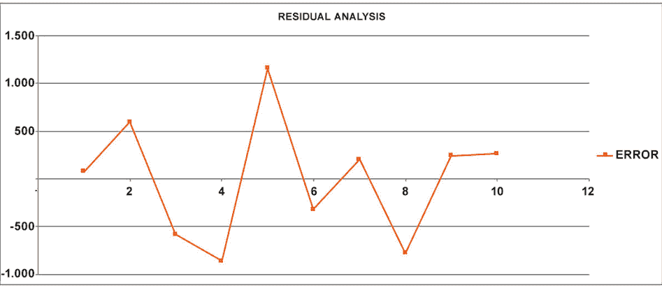

图 6.5 – 残差分析

这里的启示是，误差是随机分布的。此类证据，加上较高的 R 平方评分，可用作支持使用该模型的论据。

#### 重要说明

在第 7 章，评估和优化模型中，你将学习评估指标。例如，你将了解到每种模型可能都有自己的一组评估指标。回归模型通常使用均方误差（MSE）和均方根误差（RMSE）进行评估。换句话说，除了 R、R 平方和残差分析之外，理想情况下，你会在测试集上运行模型以提取其他性能指标。你甚至可以使用交叉验证系统来检查模型性能，就像你在第 1 章，机器学习基础中学到的那样。

很多时候，当模型残差确实呈现某种模式且不是随机分布时，这是因为数据中存在的关系不是线性的，而是非线性的，因此必须应用另一种建模技术。在下一小节中，你将学习如何解释回归模型。

### 解释回归模型

了解如何解释线性回归模型也是很好的。有时，你使用线性回归不一定是为了创建预测模型，而是为了进行回归分析。然后，你可以使用回归分析来了解自变量和因变量之间的关系。

回顾回归方程 (y = 1021.212 * x + 53.30)，你可以看到两个项：alpha 或斜率 (1021.20) 和 beta 或 y 截距 (53.3)。你可以这样解释这个模型：每多一年的工作经验，你的薪资将增加 $1,021.20。另外，请注意，当“工作年限”等于 0 时，预期薪资将是 $53.30（即直线与 y 轴交叉的点）。

从广义的角度来看，你的回归分析应回答以下问题：每向自变量（斜率）添加一个额外单位，因变量的平均变化是多少？

### 检查调整后的 R 平方

到目前为止，你对回归模型已经有了更好的了解！还有一个非常重要的主题你应该了解，无论它是否会出现在考试中，那就是你模型的简洁性方面。

你在第 1 章，机器学习基础中已经听说过简洁性。这是指优先考虑简单模型而非复杂模型的能力。在回归模型中，你可能需要使用多个特征来预测结果。这也被称为多元回归模型。

在这种情况下，R 和 R 平方系数倾向于奖励具有更多特征的更复杂模型。换句话说，如果你继续向多元回归模型添加新特征，你会得到更高的 R 和 R 平方系数。这就是为什么你不能仅根据这两个指标来制定决策的原因。

你可以使用的另一个额外指标（除了 R、R 平方、MSE 和 RMSE 之外）称为调整后的 R 平方。当你向模型中添加不带来任何实际价值的额外特征时，此指标会受到惩罚。在表 6.6 中，你可以看到模型何时开始失去简洁性。

| 特征数量 | R 平方 | 调整后的 R 平方 |
|---|---|---|
| 1 | 81 | 79 |
| 2 | 83 | 82 |
| 3 | 88 | 87 |
| 4 | 90 | 86 |
| 5 | 92 | 85 |

表 6.6 – 比较 R 平方和调整后的 R 平方

在这里，你可以得出结论：在模型中保留三个变量优于保留四个或五个。向模型添加四个或五个变量将增加 R 平方（如预期），但会降低调整后的 R 平方。

在这一点上，你应该对回归模型有非常好的理解。现在，让我们看看 AWS 为此类模型提供了哪些内置算法。

### AWS 上的回归建模

AWS 有一个名为 linear learner 的内置算法，你可以使用它实现线性回归模型。内置的 linear learner 使用随机梯度下降（SGD）来训练模型。

#### 重要说明

在讨论神经网络时，你将了解更多关于 SGD 的内容。目前，你可以将 SGD 视为刚才讨论过的最小二乘误差方法的一种替代方案。

linear learner 内置算法提供了一个超参数，可以在训练过程之前对数据进行归一化。此超参数的名称是 normalize_data。这非常有帮助，因为线性模型对数据的尺度敏感，并且通常可以从数据归一化中受益。

#### 重要说明

数据归一化在第 4 章，数据准备和转换中已讨论过。如果需要，请回顾该章节。

linear learner 算法的其他一些重要超参数是 L1 和 wd，它们分别起到 L1 正则化和 L2 正则化的作用。

L1 和 L2 正则化有助于 linear learner（或任何其他回归算法实现）避免过拟合。按照惯例，实现 L1 正则化的回归模型称为 Lasso 回归模型，而具有 L2 正则化的回归模型称为岭回归模型。

虽然听起来可能很复杂，但实际上并不复杂！回归模型方程仍然相同：y = ax + b + e。变化在于损失函数，它用于找到最小化误差的最佳系数。如果你回顾图 6.1，你会看到误差函数定义为 e = (ŷ - y)^2，其中 ŷ 是回归函数值，y 是实际值。

L1 和 L2 正则化向损失函数添加了一个惩罚项，如图 6.6 中的公式所示（请注意，你正在用 ax + b 替换 ŷ）：

```
$L_1 = (ax + b - y)^2 + \lambda|a|$

$L_2 = (ax + b - y)^2 + \lambda a^2$
```

图 6.6 – L1 和 L2 正则化

λ（lambda）参数必须大于 0 并手动调整。lambda 值过高可能导致欠拟合问题，而 lambda 值过低可能不会在最终结果中产生显著变化（如果你的模型过拟合，它将保持过拟合）。

从实际角度来看，L1 和 L2 正则化的主要区别在于，L1 会将较不重要的系数缩减到 0，从而迫使特征被删除（充当特征选择器）。换句话说，如果你的模型由于特征数量过多而过拟合，L1 正则化应该能帮助你解决这个问题。

#### 重要说明

*在考试期间，请记住 L1 和 L2 正则化的基础，尤其是它们之间的关键区别，即 L1 作为特征选择器效果很好。*

最后，许多内置算法可以服务于多种建模目的。linear learner 算法可用于回归、二分类和多分类。请确保在考试期间记住这一点（它 *不仅* 仅涉及回归模型）。

AWS 还有其他适用于回归和分类问题的内置算法——即 **分解机**、**KNN** 和 **XGBoost** 算法。由于这些算法也可用于分类目的，这些内容将在分类算法部分中介绍。

#### 重要说明

*你刚刚得到了一个在考试期间需要记住的非常重要的提示：linear learner、分解机、KNN 和 XGBoost 都适用于回归和分类问题。这些算法通常被称为通用算法。*

总而言之，你已完成关于回归模型的这一节。在参加考试前，请记得查看辅助材料。在日常工作中，你也可以参考参考材料！现在，让我们进入机器学习问题的另一个经典示例：分类模型。


### 使用分类模型

你在本书中一直在学习什么是分类模型。不过，现在，你将了解一些适合分类问题的算法。请记住，外面有数百种分类算法，但由于你正在准备 AWS 机器学习专项认证考试，因此将重点介绍由 AWS 预构建的算法。

你将从**分解机**开始。分解机被认为是线性学习算法的一种扩展，专门用于在高维稀疏数据集中寻找特征之间的关系。

#### 重要提示

> 分解机非常传统的用例是推荐系统，在推荐系统中，数据通常具有高度的稀疏性。在考试中，如果面对通用问题（回归或二分类任务），且底层数据集是稀疏的，那么从算法角度来看，分解机可能是最佳答案。

在回归模型中使用分解机时，将使用 RMSE 来评估模型。另一方面，在二分类模式下，该算法将使用对数损失、准确率和 F1 分数来评估结果。关于评估指标的更深入讨论将在 _第 7 章，评估和优化模型_ 中提供。

你应该知道，分解机仅接受 **recordIO-protobuf** 格式的输入数据。这是因为数据稀疏性特征，recordIO-protobuf 在数据处理方面相比 **text/csv** 格式预计能做得更好。

下一个适合分类问题的内置算法称为 K 近邻，简称 KNN。顾名思义，该算法将尝试找到与输入数据最接近的 _K_ 个点，并返回以下预测之一：

- _K_ 个最接近的点中出现次数最多的类，如果是分类任务
- _K_ 个最接近的点的标签平均值，如果是回归任务

KNN 是一种**基于索引的算法**，因为它会计算点之间的距离，为这些点分配索引，然后存储排序后的距离及其索引。借助这种数据结构，KNN 可以轻松选择最接近的前 _K_ 个点以进行最终预测。请注意，_K_ 是 KNN 的超参数，应在建模过程中进行优化。

另一个可用于通用目的（包括分类）的 AWS 内置算法称为**极端梯度提升**，简称 **XGBoost**。这是一种基于决策树的集成模型。

XGBoost 使用一组**较弱**的模型（决策树）来预测目标变量，目标变量可以是回归任务、二分类或多类分类。这是一种非常流行的算法，并被顶尖选手用于机器学习竞赛。

XGBoost 使用提升学习策略，其中一个模型尝试纠正先前模型的错误。之所以命名为“梯度”，是因为它在添加新树时使用梯度下降算法来最小化损失。

#### 重要提示

> 在这个语境中，**较弱**一词用于描述非常简单的决策树。

虽然 XGBoost 比单个决策树强大得多，但参加考试时，清楚了解决策树是什么及其主要配置非常重要。顺便说一句，它们是许多集成算法的基础模型，例如 AdaBoost、随机森林、梯度提升和 XGBoost。

决策树是基于规则的算法，以树的形式组织决策，如图 6.7 所示。

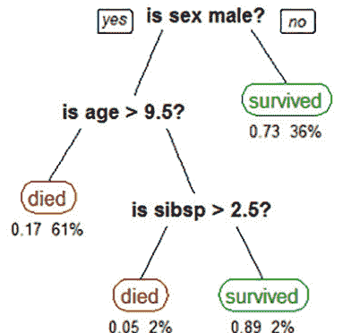

图 6.7 – 决策树模型示例

它们由根节点（树的最顶端）、中间节点或决策节点（树的中间部分）以及叶子节点（底部不再分裂的节点）组成。树的深度由根节点与最末端叶子节点之间的差值决定。例如，在图 6.7 中，树的深度为 3。

树的深度是这类模型最重要的超参数之一，通常称为**最大深度**。换句话说，最大深度控制决策树可以达到的最大深度。

决策树模型另一个非常重要的超参数是叶子节点中的最小样本/观测数。它也用于控制树的生长。

决策树有许多其他类型的超参数，但这两个对于控制模型过拟合尤其重要。深度较高的决策树或叶子节点中观测数量非常少的决策树，在外推/预测时可能会出现问题。

原因很简单：决策树使用叶子节点的数据进行预测，依据是属于该节点的每个观测/目标变量的比例（用于分类任务）或平均值（用于回归任务）。因此，该节点应有足够的数据，以便在训练集之外做出良好的预测。

在考试中如果遇到 **CART** 这个术语，你应该知道它代表**分类和回归树**，因为决策树可用于分类和回归任务。

为了选择在树中分割数据的最佳变量，模型将选择能最大化节点间目标变量分离度的变量。此任务可通过不同方法完成，例如 **Gini** 和 **信息增益**。

### 预测模型

时间序列是指按固定频率收集并具有序列依赖性的数据点。时间序列包含一个度量、一个事实和一个时间单位，如图 6.8 所示。

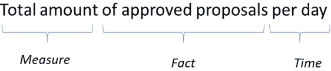

图 6.8 – 时间序列说明

此外，时间序列可以分为单变量或多变量。单变量时间序列只包含一个随时间变化的变量，而多变量时间序列包含两个或更多随时间变化的变量。图 6.9 显示了单变量时间序列。

每天获批的提案数量

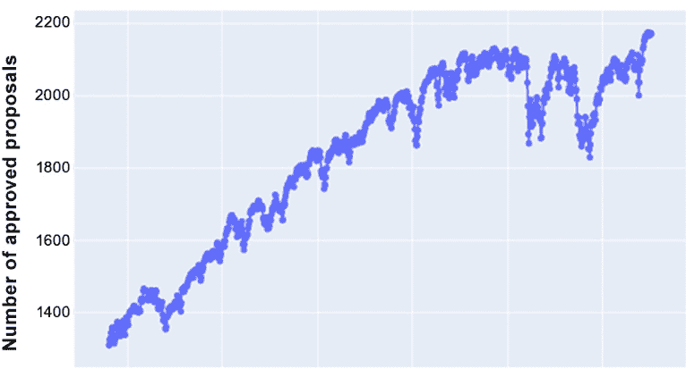

图 6.9 – 时间序列示例

时间序列可以按如下方式分解：

- 观测值或水平：序列的平均值
- 趋势：递增或递减模式（有时没有趋势）
- 季节性：特定时间段内的周期性峰值（有时没有季节性）
- 噪声：无法解释的内容

有时，你还会在序列中发现预测模型无法捕获的孤立峰值。在这种情况下，你可能希望将这些峰值视为异常值。图 6.10 是图 6.9 中所示时间序列的分解结果。

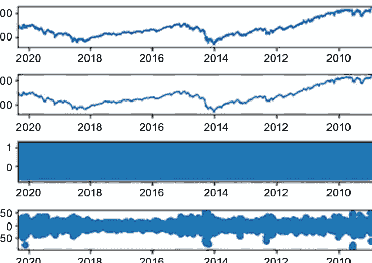

图 6.10 – 时间序列分解

还值得强调的是，你可以使用加法或乘法方法来分解时间序列。

加法模型表明，你的时间序列通过相加各个组件来解释目标变量——即，y(t) = 水平 + 趋势 + 季节性 + 噪声。

另一方面，乘法模型表明，你的时间序列通过相乘各个组件来解释目标变量——即，y(t) = 水平 * 趋势 * 季节性 * 噪声。

在下一节中，你将更深入地了解时间序列组件。

### 检查时间序列的平稳性

分解时间序列并了解其组件如何与加法和乘法模型交互，是一项了不起的成就！然而，你学得越多，就越想深入研究问题。也许你已经意识到，没有趋势和季节性的时间序列比包含所有这些组件的时间序列更容易预测！

这自是理所当然。如果你不需要理解趋势和季节性，并且无法控制噪声，那么你所要做的就是探索观测值并找出它们的回归关系。

在某个时间段内均值和方差保持不变的时间序列称为平稳时间序列。通常，具有趋势和季节性的时间序列不是平稳的。可以对序列应用数据变换将其转换为平稳时间序列，从而使建模任务变得更容易。这种变换称为差分。

在探索时间序列时，你可以通过应用假设检验（如 Dickey-Fuller、KPSS 和 Phillips-Perron 等）来检查平稳性。如果发现其非平稳，则可以应用差分使其成为平稳时间序列。某些算法已经内置了该功能。

### 探索，探索，再探索


此时，请务必记住，探索任务在数据科学中时常发生。此处也不例外。在构建时间序列模型时，你可能希望查看数据，并检查其是否适合这种建模类型。

自相关图是你可用于时间序列分析的工具之一。自相关图允许你检查时间序列中滞后之间的相关性。图 6.11 展示了此类可视化的示例。

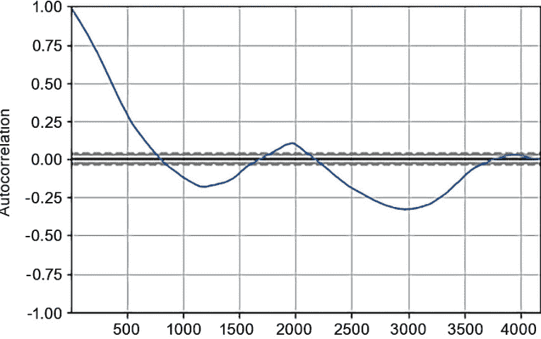

图 6.11 – 自相关图

请记住，如果你在处理单变量时间序列，那么你的时间序列只包含一个变量。因此，发现你唯一变量的滞后之间的自相关性，对于理解你是否能构建一个好模型至关重要。

是的，事实证明，有时你面前可能根本没有时间序列。而且，无论你付出多少努力，都无法将这些数据建模为时间序列。这类数据通常被称为白噪声。

另一种无法预测的系列被称为随机游走。随机游走本质上是随机的，但它们依赖于前一时间步。例如，随机游走的下一个点可能是 0 到 1 之间的随机数，同时也是该系列的最后一个点。

#### IMPORTANT NOTE

> 如果在考试中遇到这些术语，请小心，并记得将它们与时间序列中的随机性联系起来。

至此，你已掌握时间序列建模背后的主要理论。你还应该知道，目前用于处理时间序列的最流行算法被称为自回归集成移动平均（ARIMA）和指数平滑（ETS）。本书不会深入讲解这两个模型的细节。相反，你将看到 AWS 在时间序列建模方面可以提供什么。

### 理解 DeepAR

**DeepAR** 预测算法是 SageMaker 的内置算法，使用**循环神经网络（RNN）**来预测一维时间序列。

传统的时间序列算法（例如 ARIMA 和 ETS）旨在为每个时间序列拟合一个模型。例如，如果你想预测每个区域的销售额，可能需要为每个区域创建一个模型，因为每个区域可能有自己的销售行为。另一方面，DeepAR 允许你在单个模型中处理多个时间序列，这对于更复杂的用例似乎是一个巨大的优势。

DeepAR 的输入数据，正如预期的那样，是*一个或多个*时间序列。每个时间序列都可以与以下内容相关联：

- 静态（与时间无关）分类特征向量，由 `cat` 字段控制
- 动态（与时间相关）时间序列向量，由 `dynamic_feat` 控制

#### IMPORTANT NOTE

*请注意，在多个时间序列上进行训练和预测的能力与静态分类特征向量严格相关。在定义 DeepAR 将要训练的时间序列时，你可以设置分类变量，以指定每个时间序列所属的组。*

DeepAR 的两个主要超参数是 `context_length`，用于控制模型在训练过程中能回溯到过去的时间范围，以及 `prediction_length`，用于控制模型将输出预测的未来时间范围。

DeepAR 还可以处理缺失值，在这里指时间序列中现有的间隙。DeepAR 一个非常有趣的功能是它能够从时间序列创建派生特征。这些派生特征是从基本时间频率创建的，有助于算法学习时间依赖模式。*表 6.7* 显示了 DeepAR 根据其训练的每种时间序列类型创建的所有派生特征。

| 时间序列频率 | 派生特征 |
|---|---|
| 分钟 | 小时中的分钟，一天中的小时，一周中的一天，一个月中的一天，一年中的一天 |
| 小时 | 一天中的小时，一周中的一天，一个月中的一天，一年中的一天 |
| 天 | 一周中的一天，一个月中的一天，一年中的一天 |
| 周 | 一个月中的一天，一年中的周 |
| 月 | 一年中的月份 |

表 6.7 – 按时间序列频率划分的 DeepAR 派生特征

你现在已完成关于预测模型的这一节。接下来，你将查看有关监督学习的最后一种算法，即 **Object2Vec** 算法。

### Object2Vec

Object2Vec 是 SageMaker 的内置算法，将著名的 **Word2Vec** 算法进行了泛化。Object2Vec 用于为高维对象创建**嵌入空间**。按定义，这些嵌入空间是原始对象的压缩表示，可用于多种目的，例如特征工程或对象比较。


图 6.12 – 嵌入空间的可视化示例

图 6.12 说明了什么是嵌入空间。神经网络模型的第一层和最后一层只是将输入数据与其自身进行映射（由相同的向量大小表示）。

当你深入模型的内部层时，数据会被越来越多地压缩，直到击中该架构中间层，即嵌入层。在那个特定的层上，你有一个更小的向量，它旨在成为第一层中高维原始向量的准确压缩表示。

至此，你刚刚完成了关于 AWS 机器学习算法的第一部分。接下来，你将查看一些无监督算法。

### 无监督学习

AWS 为以下任务提供了几种无监督学习算法：

- 聚类：K-Means 算法
- 降维：主成分分析（PCA）
- 模式识别：IP Insights
- 异常检测：随机切割森林（RCF）算法

让我们先来谈谈聚类以及最流行的聚类算法的工作原理：K-Means。

### 聚类

聚类算法在数据科学中非常流行。基本上，它们旨在识别给定数据集中的相似组，也称为集群。聚类算法属于无监督学习领域，这意味着它们不需要标签或响应变量来进行训练。

由于标记数据非常稀缺，这简直太棒了！然而，它也带来了一些局限性。主要一点是，聚类算法为你提供集群，但不提供每个集群的含义。因此，作为领域专家的某人必须分析每个集群的属性来定义其含义。

有多种聚类方法，例如层次聚类和划分聚类。在每种方法中，你会找到几种算法。然而，K-Means 可能是最流行的聚类算法，你很可能在考试中遇到它。

当你使用 K-Means 时，不知何故，你必须指定想要创建的集群数量。然后，你必须将数据点分配到每个集群中，以便每个数据点只属于一个集群。这正是你在聚类过程结束时应该期望的结果！

你需要指定想要创建的集群数量，并将此数字传递给 K-Means 算法。然后，算法将随机初始化每个集群的中心点（这称为**质心初始化**）。

一旦你有了每个集群的质心，你所要做的就是为每个数据点分配一个集群。为此，你必须使用接近度或距离度量！本书将使用术语 *距离度量*。

**距离度量**负责计算数据点与质心之间的距离。数据点将属于更近的集群质心，根据距离度量。

最流行的距离度量称为 **欧几里得距离**，其背后的数学很简单；假设你数据集中的点由两个维度组成，x 和 y。因此，你可以将点 *a* 和 *b* 视为如下：

- *a* (x=1, y=1)
- *b* (x=2, y=5)

点 *a* 和 *b* 之间的欧几里得距离由以下公式给出，其中 x1 和 y1 指点 *a* 的 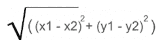 值，x2 和 y2 指点 *b* 的值：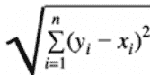。完成此过程并为每个数据点分配集群后，你将使用 *单链接*、*平均链接* 和 *完全链接* 等方法。

由于这种质心刷新，你将不得不不断检查每个数据点最近的集群，并不断迭代刷新质心，直到集群质心收敛且不再需要集群重新分配，或达到允许的最大迭代次数。

好了，以下是构成 K-Means 方法的组件和步骤摘要：

- 质心初始化、集群分配、质心刷新，然后重复最后两个步骤直到收敛
- 用于将数据点分配到每个集群的距离度量（在此例中为欧几里得距离）
- 用于重新计算集群质心的链接方法（为了演示，你将了解平均链接）

有了这些定义，你现在就可以逐步讲解以下真实示例（也提供了一些参考材料供你参考）。

#### 逐步计算 K-Means

在此示例中，你将在一个非常小的数据集上模拟 K-Means，该数据集仅包含两列（x 和 y）以及六个数据点（*A、B、C、D、E* 和 *F*），如 *表 6.8* 所定义。

| 点 | x | y |
|---|---|---|


| A | 1 | 1 |
|---|---|---|
| B | 2 | 2 |
| C | 5 | 5 |
| D | 5 | 6 |
| E | 1 | 5 |
| F | 2 | 6 |
| 集群 1 | 1 | 1 |
| 集群 2 | 2 | 2 |
| 集群 3 | 5 | 5 |

表 6.8 – K-Means 的迭代输入数据

表 6.8 包含三个集群，其质心分别为：(1,1)、(2,2)、(5,5)。集群数量（3）已事先定义，每个集群的质心也已随机定义。图 6.13 显示了算法当前所处的阶段。

### K-Means - 开始迭代 1

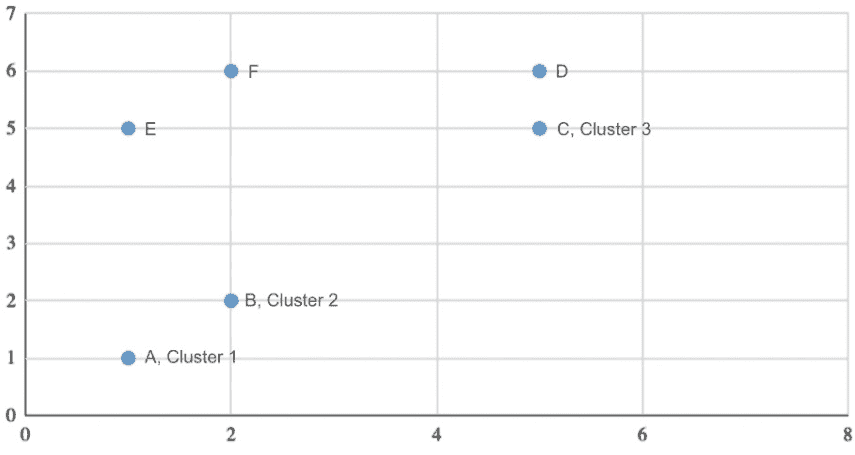

图 6.13 – 在完成第一次迭代之前绘制 K-Means 结果

这里，你看不到点 A、B 和 C，因为它们与集群质心重叠，但不用担心——它们很快就会出现。接下来，你需要计算每个数据点到每个集群质心的距离，然后选择与每个点最近的集群。

| xc1 | yc1 | xc2 | yc2 | xc3 | yc3 | distance-c1 | distance-c2 | distance-c3 | 集群 |
|---|---|---|---|---|---|---|---|---|---|
| 1 | 1 | 2 | 2 | 5 | 5 | 0.0 | 1.4 | 5.7 | 集群 1 |
| 1 | 1 | 2 | 2 | 5 | 5 | 1.4 | 0.0 | 4.2 | 集群 2 |
| 1 | 1 | 2 | 2 | 5 | 5 | 5.7 | 4.2 | 0.0 | 集群 3 |
| 1 | 1 | 2 | 2 | 5 | 5 | 6.4 | 5.0 | 1.0 | 集群 3 |
| 1 | 1 | 2 | 2 | 5 | 5 | 4.0 | 3.2 | 4.0 | 集群 2 |
| 1 | 1 | 2 | 2 | 5 | 5 | 5.1 | 4.0 | 3.2 | 集群 3 |
| 图例 | | | | | | | | | |
| xc1 = 集群 1 的 x 值 | | | | | | | | | |
| yc1 = 集群 1 的 y 值 | | | | | | | | | |

### 表 6.9 – 处理迭代 1

表 6.9 包含以下元素：

- 每一行表示一个数据点。
- 前六列表示每个集群的质心轴（x 和 y）。
- 接下来的三列表示每个数据点到每个集群质心的距离。
- 最后一列表示与每个数据点最近的集群。

查看数据点 _A_（第一行），你可以看到它被分配给了集群 1，因为数据点 _A_ 到集群 1 的距离为 0（你还记得它们是重叠的吗？）。对所有其他数据点也会进行相同的计算，以便为每个数据点定义一个集群。

在继续之前，你可能想看看集群与数据点之间的这些欧几里得距离是如何计算的。为了演示目的，以下模拟将考虑数据点 _A_ 到集群 3 的距离（_表 6.9_ 的第一行，列 `distance-c3`，值 5.7）。

首先，使用了以下公式来计算欧几里得距离：

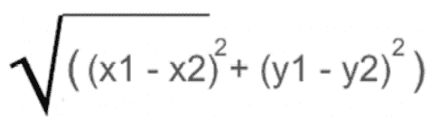

这里，你有以下内容：

- _x_<sub>1</sub> = 数据点 _A_ 的 x = 1
- _y_<sub>1</sub> = 数据点 _A_ 的 y = 1
- _x_<sub>2</sub> = 集群 3 的 x = 5
- _y_<sub>2</sub> = 集群 3 的 y = 5

图 6.14 逐步应用了该公式。

```
√(((1 - 5)² + (1 - 5)²)
√(((4)² + (4)²)
√(16 + 16)
√32

5.656 or ~5.7
```

图 6.14 – 逐步计算欧几里得距离

这太棒了，不是吗？你几乎完成了 K-Means 的第一次迭代。在迭代 1 的最后一步，你需要刷新集群质心。请记住：起初，它们是随机定义的，但现在，你刚刚将一些数据点分配给了每个集群，这意味着你应该能够识别出集群的中心点在哪里。

在此示例中，将使用链接方法来刷新集群质心。这是一个非常简单的步骤，结果在表 6.10 中呈现。

| 点 | x | y |
|---|---|---|
| A | 1 | 1 |
| B | 2 | 2 |
| C | 5 | 5 |
| D | 5 | 6 |
| E | 1 | 5 |
| F | 2 | 6 |
| 集群 1 | 1 | 1 |
| 集群 2 | 1.5 | 3.5 |
| 集群 3 | 4 | 5.7 |

### 表 6.10 – 迭代 1 后的 K-Means 结果

表 6.10 显示了你正在处理的相同数据点（A 到 F）（顺便说一句，它们永远不会改变），以及集群 1、2 和 3 的质心。这些质心与最初的质心有很大不同，如表 6.8 所示。这是因为它们使用平均链接进行了刷新！该方法计算了每个集群中所有数据点的 x 和 y 值的平均值。在下一个模拟中，请看看 (1.5, 3.5) 是如何作为集群 2 的质心获得的。

如果查看表 6.9，你会发现集群 2 只有两个数据点分配给它：B 和 E。这些是该图中的第二行和第五行。如果你取每个点的 x 轴平均值，那么你会得到 (2 + 1) / 2 = 1.5 和 (2 + 5) / 2 = 3.5。

至此，你完成了 K-Means 的迭代 1，并可以在图 6.15 中查看结果。

### K-Means - 完成迭代 1


图 6.15 – 第一次迭代后绘制 K-Means 结果

现在，你可以看到几乎所有的数据点，除了数据点 A，因为它仍然与集群 1 的质心重叠。继续，你需要重复以下步骤：

- 重新计算每个数据点与每个集群质心之间的距离，并在需要时重新分配集群。
- 重新计算集群质心。

你会多次执行这两项任务，直到集群质心收敛且不再变化，或者达到允许的最大迭代次数（可以作为 K-Means 的超参数设置）。为了演示目的，经过四次迭代后，你的集群将如图 6.16 所示。

### K-Means - 完成迭代 4


图 6.16 – 第四次迭代后绘制 K-Means 结果

在第四次迭代中，所有集群质心看起来都非常一致，你可以清楚地看到所有数据点都可以根据其近接性进行分组。

#### 重要提示

在此示例中，你只为每个数据点设置了两个维度（维度 x 和 y）。在实际用例中，你会看到远更多的维度，这就是为什么聚类算法在以更自动化的方式识别数据中的组方面发挥着非常重要的作用。

希望你享受从零开始计算 K-Means 的过程！这些知识对考试和你作为数据科学家的职业生涯都有帮助。顺便说一句，正如多次建议的那样，数据科学家必须怀疑和好奇，所以你可能会想为什么在此示例中定义了三个集群而不是两个或四个。你可能也会想如何衡量集群的质量。

你不会以为不会提供这个解释吧，对吧？

### 定义集群数量和衡量集群质量

虽然 K-Means 是寻找数据中模式的绝佳算法，但它不会提供每个集群的含义，也不会告诉你为了最大化集群质量需要创建多少个集群。

在聚类中，集群质量意味着你希望创建具有以下特点的组：同一集群内元素的高度同质性，不同集群之间元素的高度异质性。换句话说，同一集群的元素应该接近/相似，而不同集群的元素应该很好地分离开。

计算集群同质性的一种方法是使用一种称为平方误差和（或简称 SSE）的指标。该指标将计算每个数据点与其集群质心之间平方差的总和。例如，当所有数据点都位于集群质心所在的同一点时，SSE 将为 0。换句话说，你希望最小化 SSE。以下方程正式定义了 SSE：

```
SSE = \sum_{i=1}^{n} (x_i - x_p)^2
```

现在你知道如何检查集群质量了，更容易理解如何为给定数据集定义合适的集群数量。你所要做的就是找到最小化 SSE 的最优集群数量。一种非常流行的、围绕该逻辑的方法被称为 **肘部法**。

肘部法建议多次执行聚类算法。在每次执行中，你将测试不同数量的集群，_k_。每次执行后，你计算与 _k_ 个集群相关的 SSE。最后，你可以绘制这些结果并选择 SSE 不再急剧下降的 _k_ 值。

#### 重要提示

*添加更多集群会自然地降低 SSE。在肘部法中，你希望找到变化变得更平滑的点，这意味着添加新集群不会带来太多价值。*

在前面的示例中，创建了三个集群。图 6.17 显示了支持此决定的肘部分析。


图 6.17 – 肘部法

你可以得出结论，添加超过三个或四个集群会给聚类过程增加不必要的复杂性。

当然，在定义集群数量时，你应始终考虑业务背景。例如，如果你正在创建客户细分模型，而你的公司已经准备好商业团队和业务流程来支持四个客户细分，那么设置四个集群而不是三个也没有坏处。


最后，你应该知道，AWS 已经将 K-Means 作为其内置算法列表的一部分进行了实现。换句话说，你不需要使用外部库或自带算法，即可在 AWS 上使用 K-Means。

### Conclusion

### 结论

那真是一项很棒的成就：你刚刚掌握了聚类算法的基础知识，现在应该能够开展自己的项目并研究这个主题了！考试时请记住，聚类属于机器学习的非监督领域，因此不需要标记数据。

此外，请确保你知道该领域最流行的算法的工作原理，即 K-Means。虽然聚类算法不能提供每个群组的含义，但它们在寻找数据中的模式方面非常强大，无论是为了建模特定问题，还是仅仅为了探索数据。

接下来，你将继续学习非监督算法，并了解 AWS 如何构建了用于异常检测的最强大算法之一，即 RCF。

### Anomaly detection

### 异常检测

在数据中查找异常值是建模和数据探索分析中非常常见的任务。有时，你可能希望在拟合回归模型之前先从数据中移除异常值，而另一些时候，你可能希望创建一个将异常值识别作为最终目标的模型，例如，在欺诈检测系统中。

同样，你可以使用许多不同的方法来在数据中查找异常值。只要稍加创意，可能性就是无限的。然而，有一个专门针对此问题的算法，你绝对应该了解，以备考试之用：RCF。

RCF 是一种基于决策树的非监督算法，它使用训练数据的随机子样本创建多个决策树（森林）。从技术上讲，它会对数据进行随机化，然后根据树的数量创建样本。最后，这些样本被分布到每棵树上。

这些树集用于为数据点分配异常分数。要计算特定数据点的异常分数，该数据点会被传递到森林中的每棵树。当数据点在树中移动时，会记录从根节点到叶节点的路径长度，针对该特定树。然后，通过考虑森林中所有树的路径长度分布来确定该数据点的异常分数。

如果一个数据点在大多数树中遵循较短的路径（即，它靠近根节点），则被视为常见点，其异常分数较低。

另一方面，如果一个数据点在许多树中遵循较长的路径（即，它远离根节点），则被视为不常见点，其异常分数较高。

RCF 最重要的超参数是 `num_trees` 和 `num_samples_per_tree`，分别表示森林中的树的数量和每棵树的样本数量。

### Dimensionality reduction

### 降维

AWS 在其内置算法列表中实现的另一种非监督算法称为主成分分析，简称 PCA。PCA 是一种用于减少数据集中变量/维数量的技术。

PCA 背后的主要思路是将数据点映射到另一组坐标，称为主成分（PCs），其目的是解释数据中的大部分方差。按定义，第一个成分捕获的方差比第二个成分多，然后第二个成分捕获的方差比第三个多，以此类推。

你可以根据需要设置任意数量的主成分，只要不超过数据集中的变量数量即可。图 6.18 展示了这些主成分的绘制方式：


图 6.18 – PCA 中寻找主成分

如前所述，第一个主成分的绘制方式是捕获数据中的大部分方差。这就是为什么它在图 6.18 中靠近大部分数据点。

然后，第二个主成分将与第一个垂直，以便成为解释数据方差的第二个成分。如果你想创建更多成分（因此捕获更多方差），只需遵循相同的规则，添加垂直成分即可。特征向量和特征值是与 PCA 相关的线性代数概念，用于计算主成分。

那么，这里的降维讲的是什么呢？如果还不清楚，这些主成分可以用来替换你的原始变量。例如，假设你的数据集有 10 个变量，你希望将其缩减为最能代表其他变量的 3 个变量。一个可能的解决方案就是应用 PCA 并提取前三个主成分！

这三个成分能解释数据集的 100% 吗？可能不能，但理想情况下，它们能解释大部分方差。添加更多主成分会解释更多方差，但代价是增加额外的维度。

### Using AWS's built-in algorithm for PCA

### 使用 AWS 的内置 PCA 算法

在 AWS 中，PCA 有两种不同的模式：

- 常规模式：适用于观测值和特征数量适中的数据集
- 随机模式：适用于观测值和特征数量较大的数据集

区别在于，在随机模式下，它被用作近似算法。

当然，PCA 的主要超参数是你想要提取的成分数量，即 `num_components`。

### IP Insights

### IP Insights

IP Insights 是一种用于模式识别的非监督算法。本质上，它学习 IPv4 地址的使用模式。

该算法的运作方式非常直观：它基于实体和 IPv4 地址格式的事件对进行训练，以便理解其训练过的每个实体的模式。

#### IMPORTANT NOTE

#### 重要提示

*例如，你可以将“实体”理解为用户 ID 或账户编号。*

然后，为了进行预测，它接收具有相同数据结构（实体、IPv4 地址）的一对事件，并根据输入实体为该特定 IP 地址返回异常分数。

#### IMPORTANT NOTE

#### 重要提示

*IP Insights 返回的这个异常分数推断了事件模式的异常程度。*

你可能会遇到许多 IP Insights 的应用。例如，你可以创建一个基于应用程序登录事件训练的 IP Insights 模型（这就是你的实体）。你应该能够通过 API 端点公开该模型以进行实时预测。

然后，在应用程序的身份验证过程中，你可以调用该端点并传递尝试登录的 IP 地址。如果得分较高（意味着这种登录模式看起来异常），你可以在授权访问之前请求额外信息（即使密码正确）。

这只是你可以考虑的 IP Insights 的众多应用之一。接下来，你将学习文本分析。

### Textual analysis

### 文本分析

现代应用使用 **自然语言处理 (NLP)** 来实现多种目的，例如文本翻译、文档分类、网络搜索、**命名实体识别 (NER)** 等。

AWS 为大多数 NLP 用例提供了一套算法。在接下来的几个小节中，你将了解这些用于文本分析的内置算法。

### BlazingText algorithm

### BlazingText 算法

BlazingText 执行两种不同类型的任务：文本分类（一种扩展 **fastText** 文本分类器的监督学习方法）和 Word2Vec（一种非监督学习算法）。

BlazingText 对这两种算法的实现已针对大型数据集进行了优化。例如，你可以在几分钟内对数十亿个单词训练一个模型。

BlazingText 具备这种可扩展性的原因如下：

- 能够使用多核 CPU 和单个 GPU 来加速文本分类
- 能够在使用 Word2Vec 算法时，使用多核 CPU 或 GPU，并配合自定义 CUDA 内核进行 GPU 加速

Word2Vec 选项支持 `batch_skipgram` 模式，允许 BlazingText 在多个 CPU 上进行分布式训练。

#### IMPORTANT NOTE

#### 重要提示

BlazingText 执行的分布式训练使用小批量方法将 level-1 BLAS（基本线性代数子程序）操作转换为 level-3 BLAS 操作。如果在考试中看到这些术语，你应该知道它们与 BlazingText（Word2Vec 模式）相关。

仍在 Word2Vec 模式下，BlazingText 支持 skip-gram 和连续词袋（CBOW）架构。

最后，请注意 BlazingText 的以下配置，因为它们很可能出现在考试中：

- 在 Word2Vec 模式下，仅提供 train 通道。
- BlazingText 期望一个以空格分隔的标记的单个文本文件。文件的每一行必须包含一个句子。这意味着你通常需要在使用 BlazingText 之前预处理你的语料库数据。

### Sequence-to-sequence algorithm

### 序列到序列算法

这是一种监督算法，可将输入序列转换为输出序列。该序列可以是文本句子，甚至是音频录音。

序列到序列最常见的用例是机器翻译、文本摘要和语音转文本。任何你认为是序列到序列问题的任务都可以使用此算法来处理。

从技术上讲，AWS SageMaker 的 Seq2Seq 使用两种类型的神经网络来创建模型：循环神经网络（RNN）和带有注意力机制的卷积神经网络（CNN）。

潜在狄利克雷分配，即 LDA，用于主题建模。主题建模是一种文本分析技术，你可以从文本数据语料库中提取一组主题。LDA 基于文本语料库中单词的概率分布来学习这些主题。

由于这是一种非监督算法，因此不需要设置目标变量。此外，必须预先指定主题数量，并且你需要分析每个主题以找到其领域含义。

### Neural Topic Model algorithm

### 神经主题模型算法

与 LDA 算法类似，神经主题模型（NTM）也旨在从数据语料库中提取主题。然而，LDA 和 NTM 之间的区别在于其学习逻辑。LDA 从文档中单词的概率分布学习，而 NTM 是建立在神经网络之上的。

NTM 网络架构包含一个瓶颈层，用于创建文档的嵌入式表示。这个瓶颈层包含预测文档组成所需的所有信息，其系数可


被视为主题。

有了这些，你就完成了关于文本分析的这一节。在下一节中，你将学习图像处理算法。

### 图像处理

图像处理是机器学习中一个非常热门的主题。这个想法不言自明：创建可以分析图像并基于其进行推断的模型。至于推断，你可以将其理解为检测图像中的对象、对图像进行分类等等。

AWS 提供了一组可用于训练图像处理模型的内置算法。在接下来的几个章节中，你将了解这些算法。

### 图像分类算法

顾名思义，图像分类算法使用监督学习来对图像进行分类。换句话说，它需要每张图片中包含一个标签。它支持多标签分类。

其运作方式很简单：在训练期间，它接收一张图片及其关联标签。在推断期间，它接收一张图片并返回所有预测的标签。图像分类算法使用 CNN（**ResNet**）进行训练。它可以从头开始训练模型，也可以利用迁移学习预加载神经网络的前几层。

根据 AWS 的文档，支持 .jpg 和 .png 文件格式，但推荐的格式是 **MXNet 的 RecordIO**。

### 语义分割算法

语义分割算法提供了创建计算机视觉应用的像素级功能。它为图像中的每个像素打上一个类别的标签，这是自动驾驶和医疗影像诊断等复杂应用的重要功能。

就其实现而言，语义分割算法使用 **MXNet Gluon 框架** 和 **Gluon CV 工具包**。你可以选择以下任一算法来训练模型：

- 全卷积网络 (FCN)
- 金字塔场景解析 (PSP)
- DeepLabV3

所有这些选项都作为 **编码器-解码器** 神经网络架构工作。网络的输出称为 **分割掩码**。

### 对象检测算法

与图像分类算法一样，对象检测算法的主要目标也不言自明：它检测并分类图像中的对象。它使用监督方法训练深度神经网络。

在推断过程中，此算法返回识别出的对象以及关于预测的置信度分数。对象检测算法使用单发多框检测器 (SSD)，并支持两种网络架构：视觉几何组 (VGG) 和残差网络 (ResNet)。

### 摘要

真是一段旅程！花点时间回顾一下你刚才学到的内容。本章包含四个主要主题：监督学习、无监督学习、文本分析和图像处理。你所学的所有内容都属于机器学习的这些子领域。

你学过的监督学习算法列表包括以下内容：

- 线性学习器
- 分解机
- XGBoost
- KNN
- Object2Vec
- DeepAR 预测

请记住，你可以将线性学习器、分解机、XGBoost 和 KNN 用于多种用途，包括解决回归和分类问题。线性学习器可能是这四个算法中最简单的一个；分解机扩展了线性学习器，适合稀疏数据集，XGBoost 使用基于决策树的集成方法，而 KNN 是一种基于索引的算法。

其他两个算法 Object2Vec 和 DeepAR 用于特定目的。Object2Vec 用于创建数据的向量表示，而 DeepAR 用于创建预测模型。

你学过的无监督学习算法列表包括以下内容：

- K-Means
- PCA
- IP Insights
- RCF

K-Means 是一种非常流行的聚类算法。PCA 用于降维，IP Insights 用于模式识别，而 RCF 用于异常检测。

随后，你更详细地研究了回归模型和 K-Means。之所以这样做，是因为作为数据科学家，你至少应该掌握这两种非常流行的算法，以便能够自己深入研究其他算法。

接下来，你进入了本章的下半部分，在那里你学习了文本分析和以下算法：

- BlazingText
- 序列到序列
- LDA
- NTM

最后，你学习了图像处理并查看了以下内容：

- 图像分类算法
- 语义分割算法
- 对象检测算法

鉴于本章涵盖的主题对 AWS 认证机器学习专业考试非常重要，强烈建议你登录 AWS 网站搜索机器学习算法。在那里，你将找到关于你刚刚学习的算法的最新信息。请确保在参加考试前完成此操作。

这就结束了本章的快速复习和本章内容。在下一章中，你将学习 AWS 提供的可用于优化和评估这些算法的现有机制。

### 考试准备演练 – 章节复习题

除了牢固掌握关键概念之外，能够在时间压力下快速思考是一项能帮助你在认证考试中取得好成绩的技能。这就是为什么在学习旅程早期就开始练习这些技能至关重要。

章节复习题旨在随着你学习的每个章节逐步提高你的应试技巧，同时复习你对本章关键概念的理解。你会在每章末尾找到这些题目。

### 如何访问这些资源

要了解如何访问这些资源，请转到标题为“第 11 章：访问在线练习资源”的章节。

要打开本章的章节复习题，请执行以下步骤：

- 1. 单击链接 – https://packt.link/MLSC01E2_CH06。

或者，你可以扫描以下 QR 码（图 6.19）：


图 6.19 – 供登录用户打开章节复习题的 QR 码

- 2. 登录后，你会看到类似于图 6.20 所示的页面：

### 应用机器学习算法

### 摘要

真是一段旅程！花点时间回顾一下你刚才学到的内容。本章包含四个主要主题：监督学习、无监督学习、文本分析和图像处理。你所学的所有内容都属于机器学习的这些子领域。

你学过的监督学习算法列表包括以下内容：

- 线性学习器
- 分解机
- XGBoost
- KNN
- Object2Vec
- DeepAR 预测

请记住，你可以将线性学习器、分解机、XGBoost 和 KNN 用于多种用途，包括解决回归和分类问题。线性学习器可能是这四个算法中最简单的一个；分解机扩展了线性学习器，适合稀疏数据集，XGBoost 使用基于决策树的集成方法，而 KNN 是一种基于索引的算法。

其他两个算法 Object2Vec 和 DeepAR 用于特定目的。Object2Vec 用于创建数据的向量表示，而 DeepAR 用于创建预测模型。

你学过的无监督学习算法列表包括以下内容：

- K-Means
- PCA
- IP Insights
- RCF

K-Means 是一种非常流行的聚类算法。PCA 用于降维，IP Insights 用于模式识别，而 RCF 用于异常检测。

随后，你更详细地研究了回归模型和 K-Means。之所以这样做，是因为作为数据科学家，你至少应该掌握这两种非常流行的算法，以便能够自己深入研究其他算法。

接下来，你进入了本章的下半部分，在那里你学习了文本分析和以下算法：

- BlazingText
- 序列到序列
- LDA
- NTM

最后，你学习了图像处理并查看了以下内容：

- 图像分类算法
- 语义分割算法
- 对象检测算法

鉴于本章涵盖的主题对 AWS 认证机器学习


图 6.20 – 第 6 章的章节复习题

- 3. 准备就绪后，开始以下练习演练，多次重新尝试测验。

### 考试准备演练

前三次尝试不必担心时间限制。

#### 尝试 1

第一次，争取至少拿到 40%。查看你答错的答案，再次阅读章节中的相关部分以弥补学习差距。

#### 尝试 2


第二次，争取至少达到 **60%**。查看你答错的题目，并再次阅读章节中的相关部分，以弥补任何剩余的学习差距。

#### 尝试 3

第三次，争取至少达到 **75%**。一旦你得分达到 75% 或以上，就开始着手提升做题速度。

#### 提示

你可能需要超过 **三** 次尝试才能达到 75%。没关系。只需复习章节中的相关部分，直到做到为止。

### 提升做题速度

目标：你的目标是在尽可能快地回答这些问题的同时，保持分数不变。以下是你接下来的尝试应该呈现的示例：

| 尝试 | 分数 | 耗时 |
|---|---|---|
| 尝试 5 | 77% | 21 分钟 30 秒 |
| 尝试 6 | 78% | 18 分钟 34 秒 |
| 尝试 7 | 76% | 14 分钟 44 秒 |

表 6.11 – 在线平台上的计时练习示例

#### 注意

上述表格中显示的时间限制仅为示例。每次尝试时，请根据网站测验的时间限制自行设置时间限制。

每次新尝试时，你的分数应保持在 **75%** 以上，而完成所需的“耗时”应“减少”。
重复尽可能多的尝试，直到你对应对时间压力感到自信为止。

## 评估与优化模型

现在是时候学习如何评估和优化机器学习模型了。在建模过程中，甚至在模型完成后，你可能想了解自己的模型表现如何。每种模型都有自己的一组可用于评估性能的指标，而这正是你在本章中将要学习的内容。

除了模型评估，作为数据科学家，你可能还需要通过调整算法的超参数来提升模型性能。你将了解这一建模任务的一些细微之处。

在本章中，将涵盖以下主题：

- 模型评估简介
- 评估分类模型
- 评估回归模型
- 模型优化

好了，开始吧！

### 模型评估简介

存在多种你可能希望评估模型性能的场景，其中一些如下：

- 你正在创建模型并测试不同的方法和/或算法。因此，你需要比较这些模型以选择最佳模型。
- 你刚刚完成了模型，需要记录你的工作，其中包括指定从建模阶段获得的模型性能指标。
- 你的模型正在生产环境中运行，你需要跟踪其性能。如果遇到模型漂移，你可能需要重新训练模型。

#### 重要提示

模型漂移一词用于指代模型性能下降的问题。在构建机器学习模型时，必须使用数据来训练算法。这组数据称为训练数据，它反映了特定时间点的业务规则。如果这些业务规则随时间发生变化，你的模型可能无法适应这些变化。这是因为它是基于另一组反映了另一种业务场景的数据集进行训练的。要解决这个问题，你必须重新训练模型，以便它能够考虑新业务场景的规则。

模型评估通常用于测试场景中。你之前已经学习过留出验证和交叉验证。然而，两种测试方法共享相同的要求：它们需要一个指标来评估性能。

这些指标特定于问题领域。例如，回归模型、分类模型、聚类、自然语言处理等都有特定的指标。因此，在设计测试方法时，你必须考虑自己正在构建哪种类型的模型，以便定义评估指标。

在以下各节中，你将了解评估模型所需掌握的最重要指标和概念。

### 评估分类模型

分类模型是你可能面临的最传统的问题类别之一，无论是在考试中还是在你作为数据科学家的旅程中。在分类模型评估期间，你可能想要生成的一种非常重要的工件称为混淆矩阵。

混淆矩阵将你的模型预测与被评估的每个类的真实值进行比较。图 7.1 展示了二元分类问题中混淆矩阵的样子：


图 7.1 – 混淆矩阵

混淆矩阵包含以下组件：

- TP：真阳性病例数。在这里，你需要统计被预测为真且确实为真的病例数量。例如，在欺诈检测系统中，这将是被正确预测为欺诈的欺诈交易数量。
- TN：真阴性病例数。在这里，你需要统计被预测为假且确实为假的病例数量。例如，在欺诈检测系统中，这将是被正确预测为非欺诈的非欺诈交易数量。
- FN：假阴性病例数。在这里，你需要统计被预测为假但实际上为真的病例数量。例如，在欺诈检测系统中，这将是被错误预测为非欺诈的欺诈交易数量。
- FP：假阳性病例数。在这里，你需要统计被预测为真但实际上为假的病例数量。例如，在欺诈检测系统中，这将是被错误预测为欺诈的非欺诈交易数量。

在理想情况下，你的混淆矩阵将仅包含真阳性和真阴性病例，这意味着你的模型准确率为 100%。从实际角度来看，如果发生这种情况，你应该持怀疑态度而非高兴，因为预期你的模型会包含一定程度的错误。如果你的模型不包含错误，你很可能正在遭受过拟合问题，因此要小心。

一旦预期会出现假阴性和假阳性，你最好能做的是对其中一个进行优先处理。例如，你可以通过增加假阳性的数量来减少假阴性的数量，反之亦然。这被称为精确率与召回率的权衡。接下来让我们来看看这些指标。

#### 从混淆矩阵提取指标

可以从混淆矩阵中提取的最简单指标称为 **准确率**。准确率由以下公式给出，如 *图 7.2* 所示：

```
Accuracy = \frac{TrueNegatives + TruePositive}{TruePositive + FalsePositive + TrueNegative + FalseNegative}
```

图 7.2 – 准确率公式

为演示起见，*图 7.3* 展示了一个带有数据的混淆矩阵。


图 7.3 – 填充了一些示例的混淆矩阵

根据 *图 7.3*，准确率将为 (100 + 90) / 210，等于 0.90。使用准确率指标时常见的一个问题是与每个类的平衡性有关。高度不平衡的类问题，例如 99% 的阳性病例和 1% 的阴性病例，会影响准确率得分并使其变得无用。

例如，如果你的训练数据中有 99% 的阳性病例（多数类），你的模型可能会正确分类大多数阳性病例，但在分类阴性病例（少数类）时表现不佳。准确率将非常高（由于阳性病例分类的正确性），而不管少数类分类结果如何。

要点是，对于高度不平衡的问题，你通常更关心正确分类少数类，而不是多数类。例如，在大多数欺诈检测系统中也是如此，其中少数类对应欺诈案例。对于不平衡问题，你应该寻找其他类型的指标，你将在接下来的内容中了解。

你可以从混淆矩阵中提取的另一个重要指标称为召回率，其公式如下，如 *图 7.4* 所示：

Recall = 真阳性 / (真阳性 + 假阴性)

图 7.4 – 召回率公式

换句话说，召回率是真阳性数除以阳性病例总数。召回率也称为灵敏度。

使用 *图 7.3* 中的值，召回率为 100 / 112，等于 0.89。另一方面，精确率由以下公式给出，如 *图 7.5* 所示：

Precision = 真阳性 / (真阳性 + 假阳性)

图 7.5 – 精确率公式

换句话说，精确率是真阳性数除以预测阳性病例总数。精确率也称为阳性预测值。

使用 *图 7.3* 中的值，精确率为 100 / 108，等于 0.93。一般而言，你可以通过降低召回率来提高精确率，反之亦然。还有另一种模型评估工件，你可以在其中调整这种精确率与召回率的权衡。它被称为精确率-召回率曲线。

精确率-召回率曲线通过使用不同的概率阈值来总结精确率与召回率的权衡。例如，默认阈值为 0.5，任何高于 0.5 的预测都将


被视为真；否则，它是假。你可以根据需要更改默认阈值，以便优先考虑召回率或精确度。图 7.6 展示了一个精确度-召回率曲线的示例：


图 7.6 – 精确度-召回率曲线

如图 7.6 所示，提高精确度将减少召回量，反之亦然。图 7.6 显示了每个阈值的精确度/召回率，**梯度提升模型**（由橙色线表示）与**无技能模型**（由蓝色虚线表示）进行对比。完美模型将曲线逼近到点 (1,1)，在图表右上角形成一个直角。

在混淆矩阵之上，你还可以使用另一种可视化分析，称为 **接收者操作特性（ROC）曲线**。ROC 曲线根据不同的阈值总结了 **真阳性率** 和 **假阳性率** 之间的权衡，类似于精确度-召回率曲线。

你已经了解真阳性率，即灵敏度，这与你刚刚在精确度-召回率曲线中学到的内容相同。ROC 曲线的另一个维度是 **假阳性率**，即假阳性数除以假阳性数加真阴性数。

在文献中，你可能会发现假阳性率被称为 **倒转特异性**，表示为 $1 - \text{specificity}$。特异性定义为真阴性数除以真阴性数加假阳性数。此外，假阳性率或倒转特异性是相同的。图 7.7 展示了 ROC 曲线的样子：


图 7.7 – ROC 曲线

完美模型将曲线逼近到点 (0,1)，在图表左上角形成一个直角。橙色线表示梯度提升分类器的真阳性率与假阳性率之间的权衡。蓝色虚线表示无技能模型，该模型无法正确预测类别。

总之，你可以对分布较均衡的数据集使用 ROC 曲线，对中度到失衡的数据集使用精确度-召回率曲线。

### 总结精确度和召回率

有时，你可能想要使用一个总结精确度和召回率的指标，而不是优先考虑其中之一。有两个非常流行的指标可用于总结精确度和召回率：**F1 分数** 和 **曲线下面积 (AUC)**。

F1 分数，也称为 **F 度量**，计算精确度和召回率的调和平均数。AUC 总结了精确度-召回率曲线下面积的近似值。

这就结束了关于分类指标的章节。现在，让我们来看看回归模型的评估指标。

### 评估回归模型

回归模型与分类模型相当不同，因为模型的结果是一个连续数字。因此，围绕回归模型的指标旨在监控实际值与预测值之间的差异。

检查预测值（\(\hat{y}\)）与其实际值（\(y\)）之间差异的最简单方法是执行简单的减法运算，其中误差等于 \(\hat{y} - y$ 的绝对值。该指标称为 **平均绝对误差 (MAE)**。

由于你通常需要评估每个预测 \(i\) 的误差，因此你需要取误差的平均值。图 7.8 展示了如何正式定义此误差的公式：


图 7.8 – 每个预测的误差公式

有时，你可能希望对较大的误差进行比较小的误差更严厉的惩罚。为了实现这一点，你可以使用另一个指标，称为 **均方误差 (MSE)**。MSE 会对每个误差进行平方，并返回平均值。

通过对误差平方，MSE 会对较大的误差进行惩罚。图 7.9 展示了如何正式定义 MSE 的公式：


图 7.9 – MSE 公式

MSE 存在潜在的解释问题。由于它需要计算平方误差，因此从商业角度解释最终结果可能比较困难。**均方根误差 (RMSE)** 通过对 MSE 开平方根来解决这个解释问题。图 7.10 展示了 RMSE 方程：


图 7.10 – RMSE 公式

RMSE 是回归模型中最常用的指标之一，因为它可以惩罚较大的误差，并且仍然易于解释。

### 探索其他回归指标

除了你刚刚学到的指标之外，还有许多适用于回归问题的指标。这里你不会了解大多数指标，但会被介绍一些可能对你来说很重要的额外指标。

其中一个指标称为平均绝对百分比误差 (MAPE)。顾名思义，MAPE 会计算每个预测的绝对百分比误差，然后取平均值。图 7.11 展示了如何计算此指标的公式：


图 7.11 – MAPE 公式

MAPE 在预测模型中被广泛使用，因为它非常易于解释，并且能很好地说明预测值与实际值之间的差距（或接近程度）（以百分比表示）。

你现在已经完成了关于回归指标的章节。接下来，你将学习模型优化。

### 模型优化

如你所知，了解评估指标对于衡量模型性能和记录工作非常重要。同样，当你想要优化当前模型时，评估指标在定义你想要挑战的基准性能方面也起着非常重要的作用。

模型优化的过程包括为特定数据分布找到机器学习算法的最佳配置（也称为超参数）。你不希望找到过度拟合训练数据的超参数，同样，你也不希望找到欠拟合训练数据的超参数。

你在第一章“机器学习基础”中了解过过拟合和欠拟合。在同一章中，你还学习了如何避免这两类建模问题。

在本节中，你将学习一些可用于为特定算法和数据集找到最佳配置的技术。你可以将这些模型优化技术与其他方法（例如交叉验证）相结合，以找到模型的最佳超参数组合并避免拟合问题。

#### 重要提示

请始终牢记，你不希望将算法优化到底层训练数据上，而是优化到训练数据背后的数据分布上，这样你的模型既能在训练数据上工作，也能在生产数据上工作（生产数据是在训练过程中从未让模型接触过的数据）。一个只能在训练数据上工作的机器学习模型是无用的。这就是为什么将模型调优技术（如你即将学到的那些）与采样技术（如交叉验证）相结合，对于创建一个好的模型来说至关重要。

### 网格搜索

网格搜索可能是模型优化中最流行的方法。它包括测试算法的不同组合并选择最佳的一种。在这里，有两点你需要注意：

- 如何定义模型的最佳配置
- 应该测试多少种配置

最佳模型是基于评估指标定义的。换言之，你首先要定义要用来评估模型性能的指标。其次，你要定义如何评估模型。通常，交叉验证用于在多个从未用于训练的数据集上评估模型。

就组合/配置数量而言，这是在使用网格搜索时最具挑战性的部分。算法的每个超参数可能有多个，有时甚至有无限个可能的值。如果你考虑到算法通常会有多个超参数，这就会变成一个具有二次成本的函数，要测试的唯一组合数量由超参数 a 的值数量 * 超参数 b 的值数量 * 超参数 i 的值数量给出。表 7.1 显示了你可能如何为决策树模型设置网格搜索配置：

| 准则 | 最大深度 | 最小叶子样本数 |
|---|---|---|
| 基尼指数, 熵 | 2, 5, 10 | 10, 20, 30 |

表 7.1 – 网格搜索配置


在表 7.1 中，有三个超参数：**准则**、**最大深度** 和 **最小叶子样本数**。每个超参数都有一个用于测试的值列表。这意味着在网格搜索过程结束时，您将测试 18 个模型（2 * 3 * 3），其中只会选择最佳模型。

如您可能已注意，将测试这三个超参数的所有不同组合。例如，请考虑以下内容：

- 准则 = Gini，最大深度 = 2，最小叶子样本数 = 10
- 准则 = Gini，最大深度 = 5，最小叶子样本数 = 10
- 准则 = Gini，最大深度 = 10，最小叶子样本数 = 10

您可能还会有一些其他问题，例如：

- 考虑到特定算法可能有多个超参数，我应该调整哪些？
- 考虑到特定超参数可能接受无限个值，我应该测试哪些值？

这些都是很好的问题，但网格搜索无法为它们给出直接答案。相反，这更接近一种经验过程，您需要根据需要进行尽可能多的测试，以实现目标性能。

#### 重要提示

*当然，网格搜索不能保证您能实现目标性能。这取决于算法和训练数据。*

不过，一种常见的做法是使用**线性空间**或**对数空间**来定义用于测试的值，您可以手动设置要测试的超参数的限制以及测试值的数量。然后，中间值将通过线性或对数函数生成。

如您所想象，网格搜索运行可能需要很长时间。已经提出了许多替代方法来解决这个时间问题。**随机搜索**就是其中之一，其中用于测试的值列表是从搜索空间中随机选择的。

另一种在行业内获得快速采用的方法称为**贝叶斯优化**。算法优化（例如**梯度下降**）试图通过计算成本函数的导数来寻找所谓的**全局最小值**。全局最小值是您找到关联成本最低的算法配置的点。

当计算导数不是选项时，贝叶斯优化很有用。因此，您可以使用**贝叶斯定理**（一种概率方法）来使用最少的步骤找到全局最小值。

从实际角度来看，贝叶斯优化将首先测试整个搜索空间，以找到最有希望的最优超参数集。然后，它将在全局最小值可能存在的位置进行更多专门测试。

### 摘要

在本章中，您学习了模型评估的主要指标。您从分类问题的指标开始，然后转向回归问题的指标。

就分类指标而言，您已了解著名的混淆矩阵，这可能是对分类模型进行模型评估的最重要工件。

您学习了真阳性、真阴性、假阳性和假阴性。然后，您学习了如何组合这些组件以提取其他指标，例如准确率、精确率、召回率、F1 分数和 AUC。

您随后深入了解了 ROC 曲线以及精确率-召回率曲线。您了解可以使用 ROC 曲线评估较为平衡的数据集，并使用精确率-召回率评估中度到失衡的数据集。

顺便说一句，在处理失衡数据集时，请记住使用准确率可能不是一个好主意。

就回归指标而言，您了解到最流行的、且最有可能出现在 AWS 机器学习专项认证考试中的指标是 MAE、MSE、RMSE 和 MAPE。在参加考试之前，请确保您了解每个指标的基础知识。

最后，您了解了超参数优化方法，例如网格搜索和贝叶斯优化。在下一章中，您将查看用于 AI/ML 的 AWS 应用程序服务。但首先，请花点时间练习这些关于模型评估和模型优化的问题。

### 认证考试准备演练 – 章节复习问题

除了对关键概念有扎实的理解之外，能够在时间压力下快速思考是一项将帮助您顺利通过认证考试的技能。这就是为什么在学习旅程早期就开始培养这些技能至关重要。

章节复习问题旨在随您学习每个章节而逐步提高应试技能，同时回顾您对章节中关键概念的理解。您将在每章末尾找到这些问题。

### 如何访问这些资源

要了解如何访问这些资源，请转到标题为“第 11 章：访问在线练习资源”的章节。

要打开本章的章节复习问题，请执行以下步骤：

1. 单击链接 – https://packt.link/MLSC01E2_CH07。

或者，您可以扫描以下二维码（图 7.12）：


图 7.12 – 用于登录用户打开章节复习问题的二维码

2. 登录后，您将看到类似于图 7.13 所示的页面：

### 评估和优化模型

### 摘要

在本章中，您了解了模型评估的主要指标。您从分类问题的指标开始，然后转向回归问题的指标。就分类指标而言，您已了解著名的混淆矩阵，这可能是对分类模型进行模型评估的最重要工件。您学习了真阳性、真阴性、假阳性和假阴性。然后，您学习了如何组合这些组件以提取其他指标，例如准确率、精确率、召回率、F1 分数和 AUC。您随后深入了解了 ROC 曲线以及精确率-召回率曲线。您了解可以使用 ROC 曲线评估较为平衡的数据集，并使用精确率-召回率评估中度到失衡的数据集。顺便说一句，在处理失衡数据集时，请记住使用准确率可能不是一个好主意。就回归指标而言，您了解到最流行的、且最有可能出现在 AWS 机器学习专项认证考试中的指标是 MAE、MSE、RMSE 和 MAPE。在参加考试之前，请确保您了解每个指标的基础知识。最后，您了解了超参数优化方法，例如网格搜索和贝叶斯优化。在下一章中，您将查看用于 AI/ML 的 AWS 应用程序服务。但首先，请花点时间练习这些关于模型评估和模型优化的问题。


图 7.13 – 第 7 章的章节复习问题

3. 准备就绪后，开始以下练习演练，多次重新尝试测验。

### 认证考试准备演练

前三次尝试时，无需担心时间限制。

#### 第 1 次尝试

第一次，目标是至少达到 40%。查看您答错的题目，并再次阅读章节中的相关部分以弥补学习差距。

#### 第 2 次尝试

第二次，目标是至少达到 60%。查看您答错的题目，并再次阅读章节中的相关部分以弥补任何剩余的学习差距。

#### 第 3 次尝试

第三次，目标是至少达到 75%。一旦得分达到 75% 或以上，您就可以开始练习速度了。

**提示**

您可能需要超过**三**次尝试才能达到 75%。这没关系。只需复习章节中的相关部分，直到您达到目标为止。

### 练习速度

目标：您的目标是在尽可能快地回答这些问题的同时保持相同的得分。以下是您接下来的尝试应有的示例：

| 尝试 | 得分 | 耗时 |
|---|---|---|
| 第 5 次尝试 | 77% | 21 分钟 30 秒 |
| 第 6 次尝试 | 78% | 18 分钟 34 秒 |
| 第 7 次尝试 | 76% | 14 分钟 44 秒 |

表 7.2 – 在线平台上的计时练习演练示例

*注意*

上表中显示的时间限制仅为示例。根据网站上测验的时间限制，为每次尝试设置您自己的时间限制。

每次新尝试时，您的得分应保持在**75%**以上，而完成所需的“耗时”应“减少”。您可以重复任意多次尝试，直到您对应对时间压力感到自信为止。


## AWS 应用服务用于 AI/ML

在本章中，你将学习 AWS AI 服务，用于构建聊天机器人、高级文本分析、文档分析、语音转录等。本章的设计旨在让你通过集成 AWS AI 服务来解决不同的用例，并了解它们的工作原理。AWS 每天都在增长，并且会定期添加新的 AI 服务。

在本章中，你将以编程方式或从控制台处理不同的用例。这将帮助你理解不同的 API 及其使用方法。你将使用 S3 进行存储，并使用 AWS Lambda 执行任何代码。本章中的示例使用 Python，但你可以使用其他受支持的语言，如 Java、Node.js、.NET、PowerShell、Ruby 等。

你将涵盖以下主题：

- 使用 Amazon Rekognition 分析图像和视频
- 使用 Amazon Polly 将文本转换为语音
- 使用 Amazon Transcribe 将语音转换为文本
- 使用 Amazon Comprehend 实现自然语言处理
- 使用 Amazon Translate 翻译文档
- 使用 Amazon Textract 从文档中提取文本
- 在 Amazon Lex 上创建聊天机器人
- 使用 Amazon Forecast 进行时间序列预测

### 技术要求

本章你只需要一个 AWS 账户。

你可以从 GitHub 下载本章的代码示例，网址为：

https://github.com/PacktPublishing/AWS-Certified-Machine-Learning-Specialty-MLS-C01-Certification-Guide-Second-Edition/tree/main/Chapter08.

### 使用 Amazon Rekognition 分析图像和视频

如果你需要为应用程序添加强大的视觉分析功能，那么 Amazon Rekognition 是首选服务。Rekognition Image 让你可以轻松构建强大的应用程序来搜索、验证和组织数百万张图像。它让你从存储的或实时流媒体视频中提取基于运动的上下文，并帮助你分析它们。Rekognition Video 还允许你索引元数据，例如对象、活动、场景、名人和面部，从而轻松进行视频搜索。Rekognition Image 使用深度神经网络模型来检测和标记图像中的众多对象和场景。它可以帮助你捕获图像中的文本，有点像**光学字符识别（OCR）**。一个完美的例子是印有引语的 T 恤。如果你拍摄一张照片并要求 Amazon Rekognition 从中提取文本，它就能告诉你文本的内容。你也可以使用 Amazon Rekognition 进行名人识别。不是名人的人不会为其面部使用名人识别 API；相反，他们会使用面部比较 API。

官方文档，位于 [https://aws.amazon.com/rekognition/faqs/](https://aws.amazon.com/rekognition/faqs/)，指出：

> "With Rekognition Image, you only pay for the images you analyze and the face metadata you store. You will not be charged for the compute resources if, at any point of time, your training fails."

> "使用 Rekognition Image，你只需为分析的图像和存储的面部元数据付费。如果在任何时间训练失败，你不会被收取计算资源费用。"

Amazon Rekognition 的一些常见用例包括：

- 图像和视频分析
- 可搜索的图像库
- 基于面部的用户验证
- 情感分析
- 图像中的文本
- 面部识别
- 图像审核
- 视频档案的搜索索引
- 视频中露骨和暗示性内容的轻松过滤
- 露骨裸露示例 – 性活动、图形裸露、成人玩具等
- 暗示性内容示例 – 部分裸露、泳装或内衣等

### 探索 Amazon Rekognition 的优势

使用 Amazon Rekognition 的一些优势如下：

- AWS 管理其运行的基础设施。简而言之，只需为图像分析使用 API。你只需专注于构建和管理深度学习流水线。

无论是否了解图像处理知识，你都可以通过使用 Amazon Rekognition 提供的 API 来执行图像和视频分析，这些 API 可用于多个平台上的任何应用程序或服务。

- Labels API 的响应将通过 DetectLabels API 识别图像中的现实世界实体。这些标签包括城市、城镇、表格、家庭、花园、动物、宠物、食物、饮料、电子产品、花卉等。实体根据其置信度分数进行分类，该分数表示给定预测正确的可能性——分数越高越好。同样，你可以使用 DetectText API 提取图像中的文本。Amazon Rekognition 可能会根据单词之间的间隙检测多行。句号不代表行尾。

- Amazon Rekognition 可以与 AWS Kinesis Video Stream、AWS S3 和 AWS Lambda 集成，实现无缝且经济高效的图像和视频分析。借助 AWS IAM 服务，Amazon Rekognition API 调用可以轻松地进行保护和控制。

- 低成本：你只需为分析的图像和视频付费。

- 通过 AWS CloudTrail，Amazon Rekognition 的所有 API 调用都可以作为事件捕获。它捕获从控制台、CLI 或 API 代码调用发起的所有调用，这进一步使用户能够根据 CloudTrail 事件创建 Amazon SNS 通知。

- 你可以为特定 API 调用创建 VPC 端点策略，以在你的 VPC 和 Amazon Rekognition 之间建立私有连接。这有助于你利用增强的安全性。根据 AWS 共同责任模型，AWS 负责基础设施和软件的安全，而你需要负责云中内容的安全。

### 使用 Amazon Rekognition 进行实操

在本节中，你将学习如何将 AWS Lambda 与 Amazon Rekognition 集成，以检测图像中的标签（图像上传于 https://github.com/PacktPublishing/AWS-Certified-Machine-Learning-Specialty-MLS-C01-Certification-Guide-Second-Edition/tree/main/Chapter08/Amazon%20Rekognition%20Demo/images），并在 CloudWatch 控制台中打印检测到的对象。你将在代码中使用 Amazon Rekognition 的 `detect_labels` API。

你将首先为 Lambda 创建一个 IAM 角色：

1. 导航到 IAM 控制台页面。
2. 从左侧菜单中选择 Roles。
3. 选择 Create role。
4. 在 Choose a use case 部分中选择 Lambda。
5. 添加以下托管策略：
   - AmazonS3ReadOnlyAccess
   - AmazonRekognitionFullAccess
   - CloudWatchLogsFullAccess
6. 将角色命名为 rekognition-lambda-role：


#### 图 8.1 – 创建角色对话框

接下来，你将创建一个 Lambda 函数。

7. 导航到 AWS Lambda 控制台页面。
8. 选择 **创建函数**。
9. 创建函数：
   - 选择 **从头创作**。
   - 为函数命名，例如 `lambda-rekognition`。
   - 从 **运行时** 下拉列表中选择 **Python 3.6**。
   - 选择 **使用现有角色**。添加先前创建的角色名称，即 `rekognition-lambda-role`：

#### 基本信息

#### 图 8.2 – 创建 Lambda 函数

10. 在 lambda_function.py 中输入以下代码：

```
from __future__ import print_function
import boto3
def lambda_handler(event, context):
    print("=======lambda_handler started=======")
    # read the bucket name (key) from the event
    name_of_the_bucket=event['Records'][0]['s3']['bucket']['name']
    # read the object from the event
    name_of_the_photo=event['Records'][0]['s3']['object']['key']
    detect_labels(name_of_the_photo,name_of_the_bucket)
    print("Labels detected Successfully")
def detect_labels(photo, bucket):
    client=boto3.client('rekognition')
    response=client.detect_labels(Image={'S3Object':{'Bucket':bucket,'Name':photo}})
    print('Detected labels for ' + photo)
    print('===================================================')
    for label in response['Labels']:
        print ("Label: " + label['Name'])
        print ("Confidence: " + str(label['Confidence']))
        print ("Instances:")
        for instance in label['Instances']:
            print (" Bounding box")
            print ("Top:" + str(instance['BoundingBox']['Top']))
            print ("Left:" + str(instance['BoundingBox']['Left']))
```


```
print ("Width: \\
"+str(instance['BoundingBox']['Width']))
print ("Height: \\
"+str(instance['BoundingBox']['Height']))
print ("Confidence:
"+str(instance['Confidence']))
print()
print ("Parents:")
for parent in label['Parents']:
print (" " + parent['Name'])
print ("---------------")
print('-----------------------------------------------------------------------------------')
return response
```

现在，您将为 Lambda 函数创建触发器。

- 11. 导航到 AWS S3 控制台页面。创建一个存储桶，例如 `rekognition-test-baba`，如 *图 8.3* 所示：


图 8.3 – AWS S3 控制台页面

- 12. 单击 **创建文件夹** 并将其命名为 `images`。单击保存。

- 13. 单击存储桶的 **属性** 选项卡。

- 14. 向下滚动到该存储桶的 **事件**。

- 15. 在 **事件** 窗口中，选择 **添加通知** 并设置以下属性：

  - 名称：`rekognition_event`
  - 事件：**所有对象创建事件**
  - 前缀：`images/`
  - 发送至：**Lambda 函数**


图 8.4 – S3 存储桶事件窗口

接下来，您将从共享的 GitHub 仓库上传图像到 S3 存储桶的 *图片* 文件夹。

- 16. 上传后，您可以查看 Lambda 控制台的 **监控** 选项卡来监控事件，如图 8.5 所示：


图 8.5 – CloudWatch 在 Lambda 控制台中监控事件

- 17. 导航到 CloudWatch > CloudWatch Logs > 日志组 > /aws/lambda/lambda-rekognition。从 AWS 控制台列出的所有流中选择最新流，并在日志中向下滚动以查看输出。

在本节中，您学习了如何实现 Amazon Rekognition AI 服务以检测图像中的对象并为每个对象获取置信度分数。在即将到来的章节中，您将看到更多 Amazon Rekognition 的用例，届时您将在图像中检测文本。在下一节中，您将了解 Amazon 的文本转语音服务并实现它。

### 使用 Amazon Polly 进行文本转语音

**Amazon Polly** 的核心是将文本转换为语音，它通过使用预训练的深度学习模型来实现这一点。它是一项完全托管的服务，因此您无需执行任何操作。您提供纯文本作为合成输入，或以 **语音合成标记语言 (SSML)** 格式提供，以便返回音频流。它还提供不同的语言和声音供您选择，包括男声和女声选项。Amazon Polly 的输出音频可以保存为 MP3 格式，以便在应用程序（Web 或移动端）中进一步使用，也可以是用于书面语音的 JSON 输出。

例如，如果您将文本 “巴巴去了图书馆” 输入 Amazon Polly，输出语音标记对象将如下所示：

```
{ "time":370 ,"type" :"word" ,"start":5,"end":9,"value" :"went" }
```

单词 “went” 在音频流开始后 370 毫秒开始，并在给定输入文本中从第 5 字节开始到第 9 字节结束。

它还以 ogg_vorbis 和 pcm 格式返回输出。当使用 pcm 时，作为输出返回的内容是 audio/pcm 格式，采用有符号 16 位、1 通道（单声道）、小端序格式。

Amazon Polly 的一些常见用例如下：

- 可用作阅读 Web 内容的辅助工具。
- 可与 Amazon Rekognition 集成，帮助视障人士阅读标牌。您可以拍摄带有文字的标牌照片并将其输入 Amazon Rekognition 以提取文本。输出文本可作为 Polly 的输入，它将返回语音作为输出。
- 可用于公共广播系统，其中管理团队只需传递要宣布的文本，Amazon Polly 就会完成其余工作。
- 通过将 Amazon Polly 与 Amazon Connect（电话后端服务）相结合，您可以构建音频/视频接收器 (AVR) 系统。
- 智能设备（如智能电视、智能手表和物联网 (IoT) 设备）可以使用此功能进行音频输出。
- 旁白生成。
- 当与 Amazon Lex 结合时，可以为应用程序开发全功能语音用户界面。

现在，让我们探索 Amazon Polly 的优势。

### 探索 Amazon Polly 的优势

使用 Amazon Polly 的一些优势包括：

- 该服务完全托管，无需任何管理成本来维护或管理资源。
- 它提供即时语音校正和增强功能。
- 您可以使用 Amazon Polly 的 HTTP API 开发自己的访问层。由于可用的语言支持非常丰富（例如 Python、Ruby、Go、C++、Java 和 Node.js），因此开发非常容易。
- 对于某些神经语音，可以使用新闻播音员风格进行语音合成，使其听起来像电视或广播主播。
- Amazon Polly 还允许您修改特定单词的发音或新单词的用法。

接下来，您将动手实践 Amazon Polly。

### 实践 Amazon Polly

在本节中，您将构建一个管道，用于集成 AWS Lambda 与 Amazon Polly。该管道读取文本文件并生成 MP3 文件，将其保存到同一存储桶中的另一个文件夹。您将在 CloudWatch 日志中监控任务进度。

您将首先为 Lambda 创建 IAM 角色。让我们开始吧：

- 1. 导航到 IAM 控制台页面。
- 2. 从左侧菜单中选择 Roles。
- 3. 选择 Create role。
- 4. 将 Lambda 选为受信实体。
- 5. 添加以下托管策略：
  - AmazonS3FullAccess
  - AmazonPollyFullAccess
  - CloudWatchFullAccess
- 6. 将角色保存为 polly-lambda-role。

接下来，您将创建 Lambda 函数：

- 7. 导航到 Lambda > 函数 > 创建函数。
  - 将函数命名为 polly-lambda
  - 将运行时设置为 python 3.6。
  - 使用现有角色，即 polly-lambda-role。

- 8. 将 https://github.com/PacktPublishing/AWS-Certified-Machine-Learning-Specialty-MLS-C01-Certification-Guide-Second-Edition/tree/main/Chapter08/Amazon%20Rekognition%20Demo/lambda_code 处的代码粘贴到您的 Lambda 函数中，并在 CloudWatch 控制台中查看其进度。对于此代码，您将使用 Amazon Polly 的 start_speech_synthesis_task API；它是一个异步合成任务。

- 9. 向下滚动并在基本设置部分中，将超时更改为 59 秒，如图 8.6 所示，然后单击保存：

#### 重要提示

默认值为 3 秒。由于这是异步操作，任何重试尝试都会创建更多文件。


图 8.6 – 编辑基本设置窗口

现在，您将创建一个存储桶以触发事件。

- 10. 导航到 AWS S3 控制台并创建名为 polly-test-baba 的存储桶。
- 11. 创建名为 input-text 的文件夹（在此示例中，您只会上传 .txt 文件）。
- 12. 导航到 属性 > 事件 > 添加通知。填写所需字段，如下所示，然后单击保存：
  - 名称：polly_event
  - 事件：所有对象创建事件
  - 前缀：input-text/
  - 后缀：.txt
  - 发送至：Lambda 函数
  - Lambda：polly-lambda
- 13. 接下来，您将上传文件以触发事件并在 CloudWatch 中查看其进度，在此例中为 input-text 中的 test_file.txt 文件，如图 8.7 所示。您可以从此书的 GitHub 仓库下载示例文件：https://github.com/PacktPublishing/AWS-Certified-Machine-Learning-Specialty-MLS-C01-Certification-Guide-Second-Edition/tree/main/Chapter08/Amazon%20Polly%20Demo/test_file.txt：


图 8.7 – 上传文本文件以供进一步处理后的 S3 存储桶

- 14. 这将触发 Lambda 函数。您可以通过转到 CloudWatch > CloudWatch Logs > 日志组 > /aws/lambda/polly-lambda 来监控日志。

- 15. 单击最新流；日志将如下所示：

```
File Content:  Hello Everyone, Welcome to Dublin. How
are you doing today?
{'ResponseMetadata': {'RequestId': '74ca4afd-5844-
47d8-9664-3660a26965e4', 'HTTPStatusCode': 200,
```


```
'HTTPHeaders': {'x-amzn-requestid': '74ca4afd-5844-47d8-9664-3660a26965e4', 'content-type': 'application/json', 'content-length': '471', 'date': 'Thu, 24 Sep 2020 18:50:57 GMT', 'RetryAttempts': 0},
'SynthesisTask': {'Engine': 'standard', 'TaskId': '57548c6b-d21a-4885-962f-450952569dc7', 'TaskStatus': 'scheduled', 'OutputUri': 'https://s3.us-east-1.amazonaws.com/polly-test-baba/output-audio/.57548c6b-d21a-4885-962f-450952569dc7.mp3',
'CreationTime': datetime.date(2020, 9, 24), 'RequestCharacters': 59, 'OutputFormat': 'mp3', 'TextType': 'text',
'VoiceId': 'Aditi', 'LanguageCode': 'en-GB'}})
```

日志示例如图 8.8 所示：

| Log Entry | Details |
| :--- | :--- |
| 2020-09-24T19:07:04.054+01:0... | 任务状态为：scheduled |
| 2020-09-24T19:07:04.094+01:0... | 任务状态为：scheduled |
| 2020-09-24T19:07:04.105+01:0... | 任务状态为：scheduled |
| 2020-09-24T19:07:04.184+01:0... | 任务状态为：scheduled |
| 2020-09-24T19:07:04.254+01:0... | 任务状态为：inProgress |
| 2020-09-24T19:07:04.497+01:0... | 任务状态为：completed |
| 2020-09-24T19:07:04.534+01:0... | 音频文件保存成功 |
| 2020-09-24T19:07:04.553+01:0... | 结束 RequestId: 1d57151b-8462-434c-89b4-9b318c2437d8 |
| 2020-09-24T19:07:04.553+01:0... | 报告 RequestId: 1d57151b-8462-434c-89b4-9b318c2437d8 持续时间：15832.73 毫秒 计费持续时间： |
| | 此时没有更新的事件。自动重试已暂停。继续 |

图 8.8 – CloudWatch 控制台中的日志

16. 它将生成 MP3 格式的输出，如图 8.9 所示。下载并收听：


图 8.9 – 在 S3 存储桶中创建的输出文件

#### 重要提示

对于移动应用或 Web 应用，最具可扩展性且成本效益最高的方式是为 S3 存储桶生成 AWS 预签名 URL 并提供给用户。这些 S3 Put 事件会异步调用下游 AI 工作流以生成结果，并向最终用户发送响应。通过此方法，可同时为许多用户提供服务，并可能提升性能和吞吐量。

本节介绍了如何实现文本转语音。在下一节中，您将了解 Amazon Transcribe，这是一项语音转文字 AI 服务。

### 使用 Amazon Transcribe 进行语音转文字

上一节介绍了文本转语音。本节将介绍语音转文字及提供该功能的服务：Amazon Transcribe。它是一项自动语音识别服务，使用预训练的深度学习模型，这意味着您无需在 PB 级数据上训练模型；Amazon 已为我们完成此操作。您只需使用可用的 API 来转录音频文件或视频文件；它还支持多种不同语言和自定义词汇。准确性是关键，通过自定义词汇，您可以根据所需的领域或行业来增强准确性：


图 8.10 – Amazon Transcribe 输入和输出的框图

Amazon Transcribe 的常见用例包括以下内容：

- 实时音频流与转录
- 转录预录制的音频文件
- 通过结合 AWS Elasticsearch 和 Amazon Transcribe，从媒体文件启用文本搜索
- 对录制的音频文件执行情感分析，用于语音帮助台（联络中心分析）
- 通道识别分离

接下来，您将探索 Amazon Transcribe 的优势。

### 探索 Amazon Transcribe 的优势

让我们看看使用 Amazon Transcribe 的一些优势：

- 内容编辑：通过指示 Amazon Transcribe 从语音转录中识别并编辑个人身份信息 (PII)，可以确保客户隐私。您可以通过提供不需要的单词列表（使用 StartTranscriptionJob 操作提供的 VocabularyFilterName 和 VocabularyFilterMethod）来过滤转录中的不需要的单词。例如，在金融机构中，这可用于编辑来电者的详细信息。

- 语言识别：它可以自动识别音频文件中最常用的语言并生成转录。如果您有多个音频文件，此服务可帮助您按语言对其进行分类。

- 流式转录：您可以将录制的音频文件或实时音频流发送到 Amazon Transcribe，并实时输出文本流。

- 自定义词汇或定制转录：您可以根据自定义需求使用自定义词汇列表来生成准确的转录。

- 时间戳生成：如果您想为视频构建或添加字幕，Amazon Transcribe 可以从音频中返回每个单词或短语的时间戳。

- 成本效益：作为托管服务，无需基础设施成本。

现在，让我们开始使用 Amazon Transcribe 进行实践操作。

### 使用 Amazon Transcribe 进行实践操作

在本节中，您将构建一个管道，以集成 AWS Lambda 与 Amazon Transcribe，读取存储在 S3 存储桶文件夹中的音频文件，然后将输出 JSON 文件存储在另一个 S3 存储桶中。您还将在 CloudWatch Logs 中监控任务进度。您将使用 start_transcription_job 异步函数启动作业，并通过 get_transcription_job 持续监控作业，直到其状态变为 COMPLETED。让我们开始吧：

1. 首先，为 Lambda 函数创建一个名为 transcribe-demo-role 的 IAM 角色以供其执行。确保它可以读写 S3、使用 Amazon Transcribe，并在 CloudWatch 日志中打印输出。向 IAM 角色添加以下策略：

   - AmazonS3FullAccess
   - CloudWatchFullAccess
   - AmazonTranscribeFullAccess

2. 现在，您将使用现有的 IAM 角色 transcribe-demo-role 创建一个名为 transcribe-lambda 的 Lambda 函数并保存它。

请确保在 Lambda 函数的 **基本设置** 部分将默认超时更改为更高的值。我已将其设置为 10 分 20 秒，以避免超时错误。您将使用名为 start_transcription_job 的异步 API 调用来启动任务，并通过 get_transcription_job API 进行监控。

3. 粘贴 https://github.com/PacktPublishing/AWS-Certified-Machine-Learning-Specialty-MLS-C01-Certification-Guide-Second-Edition/blob/main/Chapter08/Amazon%20Transcribe%20Demo/lambda_function/lambda_function.py 中提供的代码，然后单击 **部署**。这应该会产生以下输出：


图 8.11 – 我们创建的 Lambda 函数的基本设置部分

4. 接下来，您将创建一个名为 **transcribe-demo-101** 的 S3 存储桶和一个名为 **input** 的文件夹。转到 **创建事件通知** 部分的 **属性** 选项卡来创建一个事件。输入以下详细信息：

   - 名称：audio-event
   - 事件：所有对象创建事件
   - 前缀：input/
   - 目标：Lambda 函数
   - Lambda：transcribe-lambda

5. 将 .mp4 格式的音频文件上传到 **input** 文件夹。这将触发 Lambda 函数。根据代码，输出将以 JSON 格式存储在 S3 存储桶中，您随后可以使用它来读取文件内容。

6. 导航到 **CloudWatch > CloudWatch Logs > 日志组 > aws/lambda/transcribe-lambda**。从列表中选择最新的流。它将如下所示：

### 日志事件

| Timestamp | Message |
|---|---|
| 2020-09-28T21:10:47.554+01:0... | 启动 RequestId: b5774cde-e65e-4376-a73d-7cf9944c36d4 版本：$LATEST |
| 2020-09-28T21:10:47.554+01:0... | --- 语音转文字 --- |
| 2020-09-28T21:10:48.157+01:0... | 正在检查状态.... 尚未完成 |
| 2020-09-28T21:11:08.242+01:0... | 正在检查状态.... 尚未完成 |
| 2020-09-28T21:11:28.330+01:0... | 正在检查状态.... 尚未完成 |
| 2020-09-28T21:11:48.412+01:0... | 检查您的输出存储桶 |
| 2020-09-28T21:11:48.412+01:0... | 语音转文字完成： |
| 2020-09-28T21:11:48.412+01:0... | 结束 RequestId: b5774cde-e65e-4376-a73d-7cf9944c36d4 |
| 2020-09-28T21:11:48.412+01:0... | 报告 RequestId: b5774cde-e65e-4376-a73d-7cf9944c36d4 持续时间：60857.34 毫秒 计费持续时间：60900 毫秒 |
| | 此时没有更新的事件。自动重试已暂停。继续 |

图 8.12 – CloudWatch 控制台中指定日志组的日志流中的日志

7. 输出已按代码中提到的作业名称以 JSON 格式保存到 S3 存储桶中（您可以使用 S3 getObject API 下载并读取它）：


图 8.13 – S3 存储桶中的输出 JSON 文件

#### 重要提示

不超预配函数的超时设置是最佳实践。始终了解您的代码性能，并相应地设置函数超时。超预配函数超时会导致 Lambda 函数运行时间更长，从而产生意外成本。如果在 Lambda 函数中使用异步 API 调用，则最好在成功后将其写入 SNS 主题，并从此触发另一个 Lambda 函数。如果需要人工干预，则建议使用 AWS Step Functions。


在本节中，你学习并应用了 Amazon Transcribe 将语音转换为文本。在下一节中，你将了解一种最强大的 AWS AI 服务，可用于从我们的文本数据中获得最大洞察。

### 使用 Amazon Comprehend 实现自然语言处理

此服务可帮助你从非结构化文本中提取洞察。非结构化文本信息呈指数级增长。部分数据源示例如下：

- 客户互动：呼叫中心、问题分类、客户调查和产品评论
- 业务流程：客户/供应商电子邮件、产品支持消息和运营支持反馈
- 记录和研究：白皮书和医疗记录
- 新闻和社交媒体：社交媒体分析、品牌趋势和相关事件

现在的问题是，你可以对这些数据做什么？如何分析它们并提取任何价值？答案是 Amazon Comprehend，用于从非结构化数据中获取洞察。

Amazon Comprehend 的一些常见用途包括以下内容：

- 信息管理系统
- 用于有组织主题的更准确搜索系统
- 用户情感分析
- 支持工单分类
- 从文档中检测语言，然后使用 Amazon Translate 将其翻译成英语
- 创建一个系统来为非结构化临床数据打标签，以协助研究和分析目的
- 从保存的公司会议或电视新闻音频文件中提取主题

接下来，你将探索 Amazon Comprehend 的优势。

### 探索 Amazon Comprehend 的优势

使用 Comprehend 的一些优势可以在下图中看到：


图 8.14 – 显示 Amazon Comprehend 功能的框图

让我们更详细地了解这些内容：

- 它检测文本语言并提取关键短语。Amazon Comprehend 还可用于情感分析和主题建模。
- Amazon Comprehend Medical 可用于提取医疗信息。
- 由于这是一项完全托管的服务，你按使用量付费；无需为基础设施付费。你无需训练、开发和部署自己的模型。
- 主题建模服务通过提取最多 100 个主题来工作。主题是关键词集合，因此你可以查看实际文档库中包含的内容。
- 它准确、持续训练且易于使用。

接下来，你将动手实践 Amazon Comprehend。

### 动手实践 Amazon Comprehend

在本节中，你将构建一个管道，将 AWS Lambda 与 Amazon Rekognition 和 Amazon Comprehend 集成。然后，你将读取存储在 S3 存储桶中的图像文件，并检测从图像中提取的文本的语言。你还将使用 CloudWatch 打印输出。以下是我们用例的图表：


图 8.15 – 所需用例的架构图

### 首先创建一个 IAM 角色：

- 1. 导航到 IAM 控制台页面。
- 2. 从左侧菜单中选择 Roles。
- 3. 选择 Create role。
- 4. 将 Lambda 选为受信任实体。
- 5. 添加以下托管策略：
    - AmazonS3ReadOnlyAccess
    - AmazonRekognitionFullAccess
    - ComprehendFullAccess
    - CloudWatchFullAccess
- 6. 将角色保存为 language-detection-from-image-role。
- 7. 现在，让我们创建 Lambda 函数。导航到 Lambda > Functions > Create Function。
- 8. 将函数命名为 language-detection-from-image。
- 9. 将运行时设置为 Python 3.6。
- 10. 使用我们现有的角色；即，language-detection-from-image-role。
- 11. 从 https://github.com/PacktPublishing/AWS-Certified-Machine-Learning-Specialty-MLS-C01-Certification-Guide-Second-Edition/tree/main/Chapter08/Amazon%20Transcribe%20Demo/lambda_function 下载代码，将其粘贴到函数中，然后单击 Deploy。

此代码将读取你上传的图像中的文本并检测文本的语言。你已使用 Amazon Rekognition 的 detect_text API 从图像中检测文本，并使用 Amazon Comprehend 的 batch_detect_dominant_language API 检测文本的语言。

- 12. 现在，前往 AWS S3 控制台并创建名为 language-detection-image 的存储桶。
- 13. 创建一个名为 input-image 的文件夹（在此示例中，你只会上传 .jpg 文件）。
- 14. 导航到 Properties > Events > Add notification。
- 15. 在 Events 部分填写所需字段，使用以下信息；然后，单击 Save：
    - Name: image-upload-event
    - Events: All object create events
    - Prefix: input-image/
    - Suffix: .jpg
    - Send to: Lambda Function
    - Lambda: language-detection-from-image
- 16. 导航到 Amazon S3 > language-detection-image > input-image。在文件夹中上传 sign-image.jpg 图像。（此文件可在此书的 GitHub 仓库中找到 https://github.com/PacktPublishing/AWS-Certified-Machine-Learning-Specialty-MLS-C01-Certification-Guide-Second-Edition/tree/main/Chapter08/Amazon%20Comprehend%20Demo/input_image）。
- 17. 此文件上传将触发 Lambda 函数。你可以从 CloudWatch > CloudWatch Logs > Log groups > /aws/lambda/language-detection-from-image 监控日志。
- 18. 单击流并选择最新的流。检测到的语言将打印在日志中，如图 8.16 所示：


图 8.16 – CloudWatch 中用于验证输出的日志

#### 重要提示

建议在生产环境中使用批量操作，例如 BatchDetectSentiment 和 BatchDetectDominantLanguage。这是因为单个 API 操作可能导致 API 级别限流。更多详情请参阅：https://docs.aws.amazon.com/comprehend/latest/dg/functionality.html。

在本节中，你学习了如何使用 Amazon Comprehend 检测文本的语言。文本通过 Amazon Rekognition 提取到我们的 Lambda 函数中。在下一节中，你将学习如何通过 Amazon Translate 将相同文本翻译成英语。

### 使用 Amazon Translate 翻译文档

大多数时候，人们即使在数字平台上也更喜欢使用自己的语言进行交流。Amazon Translate 是一项文本翻译服务。你可以提供多种语言的文档或文本字符串，并以不同的语言获取结果。它使用预训练的深度学习技术，因此你无需担心模型及其管理方式。你可以发出 API 请求并获取结果。

Amazon Translate 的一些常见用途包括以下内容：

- 如果组织范围内有以不同语言准备文档的要求，则 Translate 是将一种语言转换为多种语言的解决方案。
- 在线聊天应用程序可以实时翻译，以提供更好的客户体验。
- 以更快、更实惠的方式将网站内容本地化为更多语言。
- 翻译后，可以将情感分析应用于不同语言。
- 为新闻发布网站提供非英语语言支持。

接下来，你将探索 Amazon Translate 的优势。

### 探索 Amazon Translate 的优势

使用 Amazon Translate 的一些优势包括以下内容：

- 它使用神经机器翻译，模仿人脑的工作方式。
- 你无需为翻译操作维护资源或基础设施。
- 生成高质量结果并保持其一致性。
- 你可以自定义品牌名称和模型名称。其他独特术语也可以使用自定义术语功能进行翻译。
- 可以通过 API 轻松与应用程序集成。
- 当你需要做更多工作时，Amazon Translate 会自行扩展。

接下来，你将动手实践 Amazon Translate。

### 动手实践 Amazon Translate


在本节中，你将通过将 AWS Lambda 与 Amazon Rekognition、Amazon Comprehend 和 Amazon Translate 集成，构建一个产品来读取存储在 S3 存储桶中的图像文件。然后，你将检测从图像中提取的文本的语言，以便将其翻译成英文。你还将使用 CloudWatch 打印翻译输出。以下是我们用例的图示：


图 8.17 – 所需用例的架构图

让我们从创建 IAM 角色开始：

- 1. 导航到 IAM 控制台页面。
- 2. 从左侧菜单中选择 **角色**。
- 3. 选择 **创建角色**。
- 4. 将 **Lambda** 选择为可信实体。
- 5. 添加以下托管策略：
  - AmazonS3ReadOnlyAccess
  - AmazonRekognitionFullAccess
  - ComprehendFullAccess
  - CloudWatchFullAccess
  - TranslateFullAccess
- 6. 将角色保存为 `language-translation-from-image`。
- 7. 下一步是创建 Lambda 函数。导航到 Lambda > 函数 > 创建函数。
- 8. 将函数命名为 `language-detection-from-image`。
- 9. 将运行时设置为 **Python 3.6**。
- 10. 使用现有角色，即 `language-detection-from-image-role`。
- 11. 粘贴 [https://github.com/PacktPublishing/AWS-Certified-Machine-Learning-Specialty-MLS-C01-Certification-Guide-Second-Edition/blob/main/Chapter08/Amazon%20Translate%20Demo/lambda_function/lambda_function.py](https://github.com/PacktPublishing/AWS-Certified-Machine-Learning-Specialty-MLS-C01-Certification-Guide-Second-Edition/blob/main/Chapter08/Amazon%20Translate%20Demo/lambda_function/lambda_function.py) 中的代码，然后单击 **部署**。你将使用 `translate_text` API 来翻译输入文本。

- 12. 下一步是创建名为 `language-translation-from-image` 的存储桶。

创建名为 `image` 的文件夹。然后，导航到 **属性** > **事件** > **添加通知**。

- 13. 填写所需字段，如所示，然后单击保存（请确保将 `.jpg` 选择为后缀；否则，它将对任何对象创建过程触发 Lambda 函数）：
  - * 名称：`translate-language-image`
  - * 事件：所有对象创建事件
  - * 前缀：`image/`
  - * 后缀：`.jpg`
  - * 发送至：Lambda 函数
  - * Lambda：`language-translation-from-image`

- 14. 导航到 **Amazon S3** > `language-detection-image` > `input-image`。将 `sign-image.jpg` 图像上传到文件夹中。此文件可在本书的 GitHub 仓库中找到：https://github.com/PacktPublishing/AWS-Certified-Machine-Learning-Specialty-MLS-C01-Certification-Guide-Second-Edition/tree/main/Chapter08/Amazon%20Translate%20Demo/input_image。

- 15. 上传此图像将触发 Lambda 函数。你可以通过转到 **CloudWatch** > **CloudWatch 日志** > **日志组** > `/aws/lambda/language-translation-from-image` 来监控日志。

- 16. 单击流并选择最新的一个。它将如下所示：


图 8.18 – 用于验证输出的 CloudWatch 日志

翻译如下：

```
Translation of the text from the Image :
{'PREVENCION DEL COVID-19' : 'PREVENTION OF COVID-19',
'LAVATE LAS MANOS EVITA EL CONTACTO NO TE TOQUES OJOS,
EVITA': 'WASH HANDS AVOID CONTACT DO NOT TOUCH EYES',
'60 SEGUNDOS CON CONTAGIADOS NARIZ O BOCA
AGLOMERACIONES': '60 SECONDS WITH CONTAGIOUS NOSE OR
MOUTH AGGLOMERATIONS', 'NO COMPARTAS NO VIAJES A MENOS
SI TE PONES ENFERMO': "DON'T SHARE NOT TRAVEL UNLESS
YOU GET SICK", 'CUBIERTOS NI COMIDA QUE SEA NECESARIO
BUSCA AYUDA MEDICA': 'CUTLERY OR FOOD NEEDED SEEK
MEDICAL HELP' }
```

#### 重要说明

对于生产用例，如果你有依赖服务或服务链，建议将 AWS Lambda 与 AWS Step Functions 配合使用。

不建议使用同一 S3 存储桶来存储输入和输出对象。在同一存储桶中创建输出对象可能会触发递归 Lambda 调用。如果你使用同一存储桶，则建议使用前缀和后缀来触发事件。同样，建议使用前缀来存储输出对象。

在本节中，你学习了如何结合多种服务并链接它们的输出以实现特定用例结果。你学习了如何集成 Amazon Rekognition 以检测图像中的文本。然后可以使用 Amazon Comprehend 检测语言。接着，你使用相同的输入并借助 Amazon Translate 将其翻译成英文。然后将翻译输出打印到 CloudWatch 日志中进行验证。在下一节中，你将学习 Amazon Textract，它可以用于从文档中提取文本。

### 使用 Amazon Textract 从文档中提取文本

手动从文档中提取信息既缓慢又昂贵，且容易出错。传统的光学字符识别软件需要大量定制，且仍然会输出错误结果。为避免此类手动流程和错误，你应使用 Amazon Textract。通常，你需要将文档转换为图像，以检测图像中文本周围的边界框。然后应用字符识别来读取其中的文本。Textract 会为你完成所有这些工作，并且只需付出最小努力即可提取文本、表格、表单和其他数据。如果从 Amazon Textract 获得低置信度结果，则 Amazon A2I 是最佳解决方案。

Textract 减少了从数百万页扫描文档中提取文本的手动工作量。一旦信息被捕获，就可以对文本执行操作，例如将其存储在不同的数据存储中、分析情感或搜索关键字。以下图示说明了 Amazon Textract 的工作原理：


图 8.19 – Amazon Textract 及其输出存储方式的框图表示

Amazon Textract 的一些常见用途包括：

- 用于提取表格或表单的文档处理工作流
- 使用 Amazon Elasticsearch 从文档中创建搜索索引
- 在工作流中删除个人身份信息；Textract 会自动识别数据类型和表单标签

接下来，你将探索 Amazon Textract 的优势。

### 探索 Amazon Textract 的优势

使用 Textract 有以下几个原因：

- 零基础设施成本
- 完全托管的服务（降低开发和管理开销）
- 帮助你提取结构化和非结构化数据
- 可以分析手写的评论
- Amazon Textract 的性能优于使用扁平词袋的 OCR 应用
- 接下来，你将实际操作 Amazon Textract。

### 实际操作 Amazon Textract

在本节中，你将使用 Amazon Textract API 从我们的 S3 存储桶中读取图像文件，并将表单详细信息打印到 CloudWatch。同样，可以将其以所需格式存储在 S3 中以供进一步使用，或作为键值对存储在 DynamoDB 中。让我们开始吧：

- 1. 首先，创建一个名为 `textrract-use-case-role` 的 IAM 角色，并附加以下策略。这将允许 Lambda 函数执行，以便它可以从 S3 读取、使用 Amazon Textract 并在 CloudWatch 日志中打印输出：
  - CloudWatchFullAccess
  - AmazonTextractFullAccess
  - AmazonS3ReadOnlyAccess

- 2. 让我们创建一个名为 `textrract-document-analysis` 的 S3 存储桶，并上传 `receipt.png` 图像文件。这将用于包含将要提取的表单详细信息。该图像文件可在以下网址找到：https://github.com/PacktPublishing/AWS-Certified-Machine-Learning-Specialty-MLS-C01-Certification-Guide-Second-Edition/tree/main/Chapter08/Amazon%20Textrract%20Demo/input_doc：


图 8.20 – 已将图像 (.png) 文件上传到输入文件夹的 S3 存储桶

- 3. 下一步是创建名为 `read-scanned-doc` 的 Lambda 函数，如图 8.21 所示，使用名为 `textrract-use-case-role` 的现有执行角色：


#### 图 8.21 – AWS Lambda 创建函数对话框

4. 创建函数后，粘贴以下代码并部署它。向下滚动到“基本设置”，将默认超时更改为更高的值（40 秒），以防止超时错误。您已使用 Amazon Textract 的 analyze_document API，并通过 API 的 FeatureTypes 参数获取表格和表单详细信息：

```python
import boto3
import time
from trp import Document
textract_client = boto3.client('textract')
def lambda_handler(event, context):
    print("- - - Amazon Textract Demo - - -")
    # read the bucket name from the event
    name_of_the_bucket = event['Records'][0]['s3']['bucket']['name']
    # read the object from the event
    name_of_the_doc = event['Records'][0]['s3']['object']['key']
    print(name_of_the_bucket)
    print(name_of_the_doc)
    response = textract_client.analyze_document(Document={'S3Object': {'Bucket': name_of_the_bucket, 'Name': name_of_the_doc}}, FeatureTypes=["TABLES", "FORMS"])
    print(str(response))
    doc = Document(response)
    for page in doc.pages:
        # Print tables
        for table in page.tables:
            for r, row in enumerate(table.rows):
                for c, cell in enumerate(row.cells):
                    print("Table[{}{}][{}{}] = ".format(r, c, cell.text))
    for page in doc.pages:
        # Print fields
        print("Fields: ")
        for field in page.form.fields:
            print("Key: {}, Value: ".format(field.key, field.value))
```

与之前的示例不同，您将创建测试配置来运行代码。

- 5. 单击“测试”按钮左侧的下拉列表。
- 6. 选择“配置测试事件”，然后选择“创建新测试事件”。
- 7. 从“事件模板”下拉列表中选择“Amazon S3 Put”。
- 8. 在 JSON 正文中，根据我们的存储桶名称和键更改高亮显示的值，如下所示：

```json
{
  "x-amz-id-2": "EXAMPLE123/5678abcdefghijklambdaisawesome/",
  "s3": {
    "s3SchemaVersion": "1.0",
    "configurationId": "testConfigRule",
    "bucket": {
      "name": "textract-document-analysis",
      "ownerIdentity": {
        "principalId": "EXAMPLE"
      },
      "arn": "arn:aws:s3:::textract-document-analysis"
    },
    "object": {
      "key": "receipt.png",
      "size": 1024,
      "eTag": "0123456789abcdef0123456789abcdef",
      "sequencer": "0A1B2C3D4E5F678901"
    }
  }
}
```

#### 图 8.22 – 用于测试 Lambda 函数的事件模板

- 9. 在“事件名称”字段中，将测试配置命名为 TextractDemo。
- 10. 单击“保存”。
- 11. 选择您的测试配置 (TextractDemo)，然后单击“测试”：


#### 图 8.23 – 运行测试前选择测试配置

12. 这将触发 Lambda 函数。您可以从 CloudWatch > CloudWatch 日志 > 日志组 > /aws/lambda/ read-scanned-doc 监控日志。

13. 单击流并选择最新的一个。它将如下所示；键值对可在图 8.24 中查看：


#### 图 8.24 – CloudWatch 中用于验证输出的日志

#### 重要提示

通过 Lambda 异步调用下游 AI 工作流以生成 S3 PUT 事件，最具可扩展性且成本效益最高的方法是生成 AWS 预签名 URL，然后将其提供给移动或 Web 应用程序用户。许多用户可以通过此方法同时得到服务，并且这可能会提高性能和吞吐量。

将 AWS AI 服务和 S3 存储桶置于同一区域可能会提高性能并降低网络延迟。AWS VPC 端点可在不使用公共互联网的情况下提供增强的安全性。您可以将 AWS AI 结果存储在 AWS S3 存储桶中，并对其余内容进行加密，以获得更好的安全性。

在本节中，您学习了如何从扫描文档中提取文本并打印其中的表单数据。与其他章节不同，您通过创建包含事件模板的测试配置，使用了 Lambda 函数的测试功能。在下一节中，您将了解如何为组织创建聊天机器人并学习如何使用它。

### 在 Amazon Lex 上创建聊天机器人

Alexa 中的大多数功能均由 Amazon Lex 提供支持。您可以使用 Amazon 轻松构建聊天机器人。它在后台使用自然语言理解和自动语音识别。Amazon Lex 机器人可以通过控制台或 API 创建。其基本要求将在即将显示的图中展示。

Amazon Lex 的一些常见用途包括：

- 既能听取输入又能接受文本输入的应用
- 聊天机器人
- 用于提供更好客户和销售体验的对话式 AI 产品
- 用于通过 AWS Lambda 函数提供协助的自定义业务机器人
- 用于呼叫中心的语音助手，可与用户交谈、安排会议或请求您的账户详细信息
- 通过与 Amazon Cognito 集成，可以控制用户管理、身份验证和跨所有设备同步等几个方面

接下来，您将探索 Amazon Lex 的优势。

### 探索 Amazon Lex 的优势

使用 Lex 的一些理由包括：

- 聊天机器人可以直接从 AWS 管理控制台构建和测试。这些聊天机器人可以通过其丰富的格式化功能轻松集成到 Facebook Messenger、Slack 和 Twilio SMS 中。
- 会话日志可以存储在 Amazon CloudWatch 中以便进一步分析。您可以使用它们来监控机器人并获得洞察，以改善用户体验。

- Amazon Lex 可以与其他 AWS 服务（如 Amazon Cognito、AWS Lambda、Amazon DynamoDB、Amazon CloudWatch 和 AWS Mobile Hub）集成，以便在 AWS 平台上利用应用程序安全性、监控、用户身份验证、业务逻辑、存储和移动应用程序开发。
- Amazon Lex 聊天机器人也可以集成到您的自定义 Web 应用程序中。您只需构建一个聊天机器人小部件并将其集成到 UI 中即可。

接下来，您将动手实践 Amazon Lex。

### 动手实践 Amazon Lex

让我们开始吧：

- 1. 登录 https://console.aws.amazon.com/lex/。
- 2. 单击 **Get Started** 并选择 **Custom bot**。
- 3. 填写以下详细信息并单击 **Create**：

| 功能 | 值 |
| :--- | :--- |
| **机器人名称** | MovieBot |
| **语言** | English (US) |
| **输出语音** | 无。这仅是一个基于文本的应用程序。 |
| **会话超时** | 5 min |
| **情感分析** | 否 |
| **IAM 角色** | AWSServiceRoleForLexBots 将以您的名义自动创建 |
| **COPPA** | 请指示您对此机器人的使用是否受《儿童在线隐私保护法》(COPPA) 约束。了解更多 否 |
| **高级选项** | 启用精度改进和 ML 功能。了解更多 是 |
| **置信度分数阈值** | 0.4 (默认值) |

#### 图 8.25 – Amazon Lex 的创建对话框

- 4. 单击 **Create Intent**。将出现一个对话框。选择 **Create Intent**。

5. 将新意图命名为 `MovieIntent`，然后单击 `Add`。

6. 转到 `Slots` 部分并使用以下详细信息：

- 名称：`movie_type`
- 插槽类型：`AMAZON.Genre`
- 提示：您喜欢哪部电影？

7. 在 `Settings` 中单击 `+`。

可在图 8.26 中查看一些示例语句。在此示例中，`movie_type` 是我的变量：

#### MovieIntent 最新

#### 示例语句

- 例如 我想预订一张机票。
- 在 Amazon Prime 中搜索 {movie_type}
- 我喜欢 {movie_type} 电影
- 是看电影的时候了。
- 我想看电影。

#### Lambda 初始化和验证

[ ] 初始化和验证代码挂钩

#### 插槽

| 优先级 | 必需 | 名称 | 插槽类型 | 版本 |
| :--- | :--- | :--- | :--- | :--- |
| 1. | ✓ | movie_type | AMAZON.Genre | 内置 |

#### 图 8.26 – 示例语句部分

8. 向下滚动到 `Response` 部分以添加消息：


图 8.27 – Amazon Lex 的“响应”部分

9. 向下滚动到“保存意图”并单击“构建”。成功构建提示词后，将出现以下成功消息：


图 8.28 – Amazon Lex 的“响应”部分

10. 现在，您可以测试您的机器人，如图 8.29 所示：


图 8.29 – 测试机器人对话框

在下一节中，您将了解 Amazon Forecast 并学习如何在不同用例中使用它。

### Amazon Forecast

Amazon Forecast 是一项强大的服务，可让您无需深厚的机器学习专业知识即可构建高度准确的时间序列预测模型。无论您是在预测销售、库存需求还是任何与时间相关的指标，Amazon Forecast 都能简化流程，使其面向更广泛的受众。

Amazon Forecast 旨在应对各种预测挑战，包括：

- **需求预测**：基于历史数据预测产品或服务的未来需求，帮助优化库存和供应链管理。
- **财务规划**：预测财务指标，如收入和支出，有助于预算编制和财务决策。
- **资源规划**：根据预测的需求模式，高效规划劳动力调度等资源。
- **流量和用户参与度**：预测网站或应用程序流量，改善资源分配和用户体验。

接下来，您将探索 Amazon Lex 的优势。

### 探索 Amazon Forecast 的优势

使用 Amazon Forecast 的一些原因如下：

- **易于使用**：Amazon Forecast 隐藏了构建准确预测模型的复杂性。只需点击几下，即可在无需深厚机器学习专业知识的情况下创建、训练和部署模型。
- **自动化机器学习**：Amazon Forecast 采用高级机器学习技术，自动化算法选择和超参数调优，以提供最佳模型。
- **预测回测**：通过回测提高预测的可靠性。Amazon Forecast 使您能够通过将预测与历史数据进行比较来评估模型的准确性。这种迭代过程有助于微调您的模型，调整超参数和算法以实现最佳预测性能。
- **可扩展性**：Amazon Forecast 可随您的数据无缝扩展，即使在处理庞大数据集时也能确保准确预测。
- **与 AWS 集成**：利用与其他 AWS 服务（如 Amazon S3、AWS Lambda 和 Amazon CloudWatch）集成的强大功能，构建端到端预测解决方案。轻松将 Amazon Forecast 集成到现有应用程序和工作流中，确保无缝的预测体验。
- **准确性和精度**：Amazon Forecast 利用尖端预测算法提供准确且精确的预测，最大限度地减少预测中的错误。
- **经济实惠**：仅为所用付费。按使用量付费的定价模式确保了成本效益，尤其是对于预测需求不固定的企业。
- **可定制性**：根据您的特定业务需求定制预测模型，适应各种预测场景。

接下来，您将动手实践 Amazon Lex。

### 基于 Amazon Forecast 的销售预测模型

让我们深入了解使用 Amazon Forecast 构建销售预测模型的实践示例。在本示例中，您将基于历史数据预测未来销售额。

**设置数据集**：准备包含历史销售数据的数据集，确保其包含相关时间戳和相应的销售数据。

**创建数据集组**：使用 Amazon Forecast 控制台或 API 创建数据集组，对相关数据集进行分组以便进行预测。

**导入数据**：将历史销售数据集上传到 Amazon Forecast，使服务能够从提供的数据中学习模式。

**训练模型**：使用 Forecast 控制台或 API 启动模型训练。Amazon Forecast 将自动选择合适的算法并优化超参数。

**生成预测：** 模型训练完成后，根据历史数据中识别出的模式生成未来销售的预测。

通过利用高级功能并实施优化策略，您可以提升 Amazon Forecast 的使用体验。该服务的灵活性和适应性使您可以根据业务的特定需求定制预测解决方案。例如，您可以通过集成外部变量来提高预测的精度。Amazon Forecast 允许您包含额外信息，例如促销、节假日或经济指标，这些信息可能会影响您正在预测的时间序列。通过考虑这些外部因素，您的模型可以适应不断变化的情况，并提供更细致入微的预测。

### 摘要

在本章中，您了解了几种可用于解决各种问题的 AWS AI 服务。您使用了 Amazon Rekognition 服务，该服务可检测对象和人脸（包括名人面孔），还可以从图像中提取文本。对于文本转语音，您使用了 Amazon Polly，而对于语音转文本，您使用了 Amazon Transcribe。在本章结束时，您在 Amazon Lex 中构建了一个聊天机器人，并了解了 Amazon Forecast 的用法和优势。

对于图像中的语言检测和翻译，您使用了 Amazon Rekognition、Amazon Comprehend 和 Amazon Translate。您学习了如何将它们全部合并到一个 Lambda 函数中以解决问题。

对于认证考试，您不需要记住本章中使用的所有 API。可能会对您学到的一些最佳实践或解决特定问题的服务名称提出问题。练习使用这些 AWS AI 服务始终是有益的，因为这将增强您的架构设计技能。

在下一章中，您将学习数据准备和转换，这是机器学习中最重要的方面。

### 认证考试准备练习 – 章节复习题

除了扎实掌握关键概念外，在时间压力下快速思考的能力也是一项能帮助您顺利通过认证考试的技能。这就是为什么在学习旅程早期就着手培养这些技能至关重要。

章节复习题旨在随着您学习每一章而逐步提高应试技能，同时回顾您对章节中关键概念的理解。您会在每章末尾找到这些题目。

### 如何访问这些资源

要了解如何访问这些资源，请转到标题为“第 11 章：访问在线练习资源”的章节。

要打开本章的章节复习题，请执行以下步骤：

- 1. 单击链接 – https://packt.link/MLSC01E2_CH08。

或者，您可以扫描以下 QR 码（图 8.30）：


图 8.30 – 用于登录用户打开章节复习题的 QR 码

- 2. 登录后，您将看到类似于图 8.31 所示的页面：

### 适用于 AI/ML 的 AWS 应用程序服务

### 摘要

在本章中，您了解了几种可用于解决各种问题的 AWS AI 服务。您使用了 Amazon Rekognition 服务，该服务可检测对象和人脸（包括名人面孔），还可以从图像中提取文本。对于文本转语音，您使用了 Amazon Polly，而对于语音转文本，您使用了 Amazon Transcribe。在本章结束时，您在 Amazon Lex 中构建了一个聊天机器人，并了解了 Amazon Forecast 的用法和优势。

对于图像中的语言检测和翻译，您使用了 Amazon Rekognition、Amazon Comprehend 和 Amazon Translate。您学习了如何将它们全部合并到一个 Lambda 函数中以解决问题。

对于认证考试，您不需要记住本章中使用的所有 API。可能会对您学到的一些最佳实践或解决特定问题的服务名称提出问题。练习使用这些 AWS AI 服务始终是有益的，因为这将增强您的架构设计技能。

在下一章中，您将学习数据准备和转换，这是机器学习中最重要的方面。

#### 章节复习题

《AWS 认证机器学习 – 专业 (MLS-C01) 认证指南 – 第二版》作者：Somanath Nanda, Wesley Moura

选择测验

测验 1
显示测验详情 ▼ 开始

图 8.31 – 第 8 章的章节复习题

- 3. 准备就绪后，开始以下练习，多次重新参加测验。

### 认证考试准备练习

前三次尝试时，请勿担心时间限制。

#### 尝试 1

第一次，目标是至少得到 40%。查看您答错的答案，并再次阅读章节中的相关部分以弥补学习差距。

#### 尝试 2

第二次，目标是至少得到 60%。查看您答错的答案，并再次阅读章节中的相关部分以弥补任何剩余的学习差距。

#### 尝试 3

第三次，目标是至少得到 75%。一旦得分 75% 或更高，您就开始练习速度。

#### 提示

您可能需要超过三次尝试才能达到 75%。没关系。只需复习章节中的相关部分，直到达到目标为止。


### 关于计时练习

目标：你的目标是在尽可能快速地回答这些问题的同时，保持分数不变。以下是你接下来尝试的示例：

| 尝试次数 | 分数 | 耗时 |
| :--- | :--- | :--- |
| 尝试 5 | 77% | 21 分钟 30 秒 |
| 尝试 6 | 78% | 18 分钟 34 秒 |
| 尝试 7 | 76% | 14 分钟 44 秒 |

表 8.1 – 在线平台上的计时练习示例

#### 注意

上表中显示的时间限制仅为示例。每次尝试时，请根据网站测验的时间限制自行设定时间限制。

每次新尝试时，你的分数应保持在 **75%** 以上，而完成所需的“耗时”应“降低”。你可以重复任意多次尝试，直到你对应对时间压力感到有信心为止。

## Amazon SageMaker 建模

在上一章中，你学习了多种模型优化和评估技术。你还学习了存储数据、处理数据以及对数据应用不同统计方法的各种方式。那么，现在如何为其构建管道呢？嗯，你可以读取数据、处理数据，并在处理后的数据上构建机器学习（ML）模型。但如果我的第一个 ML 模型表现不佳怎么办？我可以微调我的模型吗？答案是肯定的；你可以使用 Amazon SageMaker 几乎完成所有事情。在本章中，你将使用 Amazon SageMaker 了解以下主题：

- 了解 Amazon SageMaker 的不同实例
- 在 Amazon SageMaker 的 Jupyter Notebook 中清理和准备数据
- 在 Amazon SageMaker 中进行模型训练
- 使用 SageMaker 的内置 ML 算法
- 在 SageMaker 中编写自定义训练和推理代码

### 技术要求

你可以从 GitHub 下载本章示例中使用的数据，网址为 https://github.com/PacktPublishing/AWS-Certified-Machine-Learning-Specialty-MLS-C01-Certification-Guide-Second-Edition/tree/main/Chapter09。

### 在 Amazon SageMaker 中创建笔记本

如果你正在处理 ML 相关工作，则需要执行存储数据、处理数据、为模型训练准备数据、模型训练以及部署模型以进行推理等操作。这些操作复杂，每个阶段都需要一台机器来执行任务。使用 Amazon SageMaker，执行这些任务时生活会变得轻松得多。

### 什么是 Amazon SageMaker？

SageMaker 提供训练实例，用于利用数据训练模型，并提供端点实例，用于利用模型进行推理。它还提供运行 Jupyter Notebook 的笔记本实例，用于清理和理解数据。如果你对清理过程感到满意，则应将清理后的数据存储在 S3 中，作为训练暂存的一部分。你可以启动训练实例来消耗这些训练数据并生成 ML 模型。ML 模型可以存储在 S3 中，端点实例可以消耗该模型以向最终用户生成结果。

如果你将其绘制成框图，则会与图 9.1 类似：


图 9.1 – Amazon SageMaker 实例不同层的图示

现在，你将查看 Amazon SageMaker 控制台并更好地了解它。登录 AWS 账户并进入 Amazon SageMaker 后，你将看到与图 9.2 类似的界面：


图 9.2 – SageMaker 控制台快速查看

左侧菜单中有三个不同的部分，标记为 **笔记本**、**训练** 和 **推理**，在 *图 9.2* 中已展开，以便你深入了解并更好地理解它们。

### **笔记本** 有三个可供使用的不同选项：

- **笔记本实例**：这有助于创建、打开、启动和停止笔记本实例。这些实例负责运行 Jupyter Notebook。它们允许你根据用例的工作负载选择实例类型。最佳实践是使用笔记本实例来编排处理大数据集的数据管道。例如，从笔记本实例向 AWS Glue 发出 ETL 服务调用，或向 Amazon EMR 发出运行 Spark 应用程序的调用。如果你被要求在 AWS 之外创建安全的笔记本实例，则需要负责端点安全、网络安全、启动机器、在其上管理存储以及管理实例上运行的 Jupyter Notebook 应用程序。使用 SageMaker，用户无需管理其中任何内容。

- **生命周期配置**：当存在需要笔记本实例中不可用的不同库的用例时，此功能非常有用。要安装库，用户将执行 `pip install` 或 `conda install`。但是，笔记本实例一旦终止，自定义内容就会丢失。为避免此类情况，你可以通过 **生命周期配置** 提供的脚本来自定义笔记本实例。你可以选择 `/home/ec2-user/anaconda3/envs/` 中存在的任何环境，并根据需要自定义特定环境。

- **Git 仓库**：可以将 AWS CodeCommit、GitHub 或任何其他 Git 服务器与笔记本实例关联，以实现笔记本的持久化。如果授予访问权限，则其他开发者可以使用同一笔记本进行协作，并以源代码控制的方式保存代码。Git 仓库可以使用此选项单独添加，也可以在创建笔记本实例期间与之关联。

正如你在 *图 9.2* 中所见，**训练** 提供 **算法**、**训练作业** 和 **超参数调优作业**。让我们了解它们的用法：

- **算法**：这是决定将在清理后的数据上运行哪种算法的第一步。你可以选择自定义算法，或根据用例创建自定义算法。否则，你可以在清理后的数据上运行 SageMaker 算法。

- **训练作业**：你可以通过 API 调用从笔记本实例创建训练作业。你可以设置实例数量、输入数据源详细信息、执行检查点配置和输出数据配置。Amazon SageMaker 管理训练实例，并将模型构件作为输出存储在指定位置。增量训练（即定期训练模型以获得更好的结果）和托管型竞价实例训练（即降低成本）也可以实现。

- **超参数调优作业**：通常，在训练过程之前会为算法设置超参数。在训练过程中，你让算法找出这些参数的最佳值。通过超参数调优，你可以获得具有超参数最佳值的最佳模型。这可以通过控制台或通过 API 调用来完成。同样也可以从笔记本实例进行编排。

### **推理** 拥有众多产品并且每天都在发展：

- **编译作业**：如果你的模型使用 Keras、MXNet、ONNX、PyTorch、TFLite、TensorFlow 或 XGBoost 等 ML 框架进行训练，且模型构件位于 S3 存储桶中，则可以选择 **目标设备** 或 **目标平台**。目标设备选项用于指定部署模型的位置，例如 AWS SageMaker ML 实例或 AWS IoT Greengrass 设备。目标平台选项用于决定你希望模型运行的操作系统、架构和加速器。你还可以将编译后的模块存储在 S3 存储桶中以供将来使用。这基本上有助于跨平台模型部署。

- **模型包**：这些用于创建可部署的 SageMaker 模型。你可以创建自己的算法，使用模型包 API 对其进行打包，并将其发布到 AWS Marketplace。

- **模型**：模型使用模型构件创建。它们类似于带有变量的数学方程；即，你输入变量的值并获得输出。这些模型存储在 S3 中，并将由端点用于推理。

- **端点配置**：Amazon SageMaker 允许你将多个加权模型部署到单个端点。这意味着你可以将特定数量的请求路由到一个端点。*这意味着什么？* 好吧，假设你有一个正在使用的模型。你想用新模型替换它。但是，你不能简单地移除已经在使用的第一个模型。在此场景中，你可以使用 `VariantWeight` API 让端点用旧模型处理 80% 的请求，并用新模型处理 20% 的请求。这是最常见的生产场景，其中数据变化很快，模型需要定期训练和调优。另一种可能的用例是使用实时数据测试模型结果，然后将一定百分比的请求路由到新模型，并监控结果以确定模型在实时未见数据上的准确性。

- **端点**：这些用于创建模型暴露的 URL，并可以请求该 URL 以获得模型结果作为响应。

- **批量转换作业**：如果用例要求你对数百万条记录进行推理，那么你可以在未见数据上运行批量转换作业，而不是单独的推理作业。请注意，将数千条未见数据作为批量解析后从模型接收数千个结果时，可能会产生一些混淆。为消除此混淆，可以使用 `InputFilter`、`JoinSource` 和 `OutputFilter` API 将输入记录与输出结果关联起来。

你已对 Amazon SageMaker 有了概览。现在，在下一节中将你的知识付诸实践。

#### 重要提示

*Amazon SageMaker 控制台会不断变化。当你阅读本书时，控制台可能看起来不同。*

### 训练数据位置和格式

当你开始设置 AWS SageMaker 训练作业的旅程时，了解多样化的数据存储和读取选项至关重要。为确保无缝的训练体验，请深入了解支持的选项及其优势。

首先，你将查看 **支持的数据存储选项**：

- **Amazon Simple Storage Service (Amazon S3)**：

- **概述**：Amazon SageMaker 为在 Amazon S3 中存储训练数据集提供强大支持，具有可靠性和可扩展性。

- **用法示例**：你可以使用 Amazon S3 前缀、清单文件或增强清单文件配置数据集。

- **Amazon Elastic File System (Amazon EFS)**：

- **概述**：SageMaker 扩展对 Amazon EFS 的支持，方便访问数据集的文件系统。


- 使用示例：在启动训练作业之前，存储在 Amazon EFS 中的数据必须已存在。

- Amazon FSx for Lustre：
  - 概述：实现高吞吐量和低延迟文件检索，SageMaker 将 FSx for Lustre 文件系统挂载到训练实例。
  - 使用示例：FSx for Lustre 可以无缝扩展，为您的训练数据提供高性能选项。

### 以下是数据访问的输入模式：

- 文件模式：
  - 概述：默认输入模式，SageMaker 在训练开始前将整个数据集下载到 Docker 容器中。
  - 使用示例：与 SageMaker 本地模式兼容，并支持用于分布式训练的分片。

- 快速文件模式：
  - 概述：结合文件系统访问与管道模式的效率，快速文件模式在开始时识别数据文件，但会将下载推迟到必要时才进行。
  - 使用示例：简化训练启动时间，在处理大型数据集时尤其有益。

- 管道模式：
  - 概述：直接从 Amazon S3 数据源流式传输数据，提供更快的启动时间和更好的吞吐量。
  - 使用示例：历史上曾使用过，但大多已被更易于使用的快速文件模式取代。

### 最后，请查看专用存储类别：

- Amazon S3 Express One Zone：
  - 概述：一种高性能、单可用区存储类别，优化计算性能和成本。
  - 使用示例：支持用于 SageMaker 模型训练的文件模式、快速文件模式和管道模式。

- Amazon EFS 和 Amazon FSx for Lustre：
  - 概述：SageMaker 同时支持 Amazon EFS 和 Amazon FSx for Lustre，为您的训练数据选择合适的存储解决方案提供灵活性。
  - 使用示例：将文件系统挂载到训练实例可确保训练期间无缝访问。

了解 AWS SageMaker 训练作业中数据存储和读取选项的细微差别，可让您根据特定需求定制设置。在即将到来的章节中，您将探索 AWS SageMaker 的更多方面，以加深对机器学习工作流的理解和熟练程度。让我们在下一节中将知识付诸实践。

### 动手实践 Amazon SageMaker 笔记本实例

本节的第一步是创建 Jupyter Notebook，这需要一个笔记本实例。您可以按以下步骤创建笔记本实例：

- 1. 登录您的 AWS 账户。
- 2. 导航到 Services > Amazon SageMaker。
- 3. 在左侧导航窗格中，单击 Notebook instances，然后单击 Create notebook instance 按钮。
- 4. 提供 Notebook instance name 值，例如 notebookinstance，并将 Notebook instance type 保留为默认的 ml.t2.medium 设置。在 Permissions and encryption 部分，在 IAM role 中选择 Create a new role。系统会要求您指定存储桶名称。为本示例的目的，将其选为 any bucket。
- 5. 成功创建角色后，您应该会看到类似图 9.3 的内容：

#### 权限和加密

#### IAM 角色

笔记本实例需要权限才能调用包括 SageMaker 和 S3 在内的其他服务。选择一个角色，或让我们创建一个附有 AmazonSageMakerFullAccess IAM 策略的角色。

```
AmazonSageMaker-ExecutionRole-20210131T131164
```

```
Success! You created an IAM role.
AmazonSageMaker-ExecutionRole-20210131T131164
```

图 9.3 – Amazon SageMaker 角色创建

- 6. 将其他所有内容保留为默认设置，然后单击 Create notebook instance 按钮。
- 7. 实例处于 InService 状态后，选择该实例。单击 Actions 下拉菜单，然后选择 Open Jupyter。这将打开您的 Jupyter Notebook。
- 8. 现在，您已准备好在新创建的实例上运行 Jupyter Notebook。您将执行探索性数据分析 (EDA) 并绘制不同类型的图表来可视化数据。一旦熟悉 Jupyter Notebook，您将构建一些模型来预测波士顿房价。您将应用之前章节中学习的算法并进行比较，以找出根据我们的数据提供最佳预测的最佳模型。让我们深入探讨。
- 9. 在 Jupyter Notebook 中，单击 New 并选择 Terminal。在命令提示符中运行以下命令，将代码下载到实例：
  ```
  sh-4.2$ cd ~/SageMaker/
  sh-4.2$ git clone https://github.com/PacktPublishing/AWS-Certified-Machine-Learning-Specialty-MLS-C01-Certification-Guide-Second-Edition.git
  ```
- 10. Git 仓库克隆到 SageMaker 笔记本实例后，在命令提示符中输入 exit 以退出。现在，您的代码已准备好执行。

- 11. 导航到 Jupyter Notebook 的 Files 部分中的 Chapter-9，如图 9.4 所示：


图 9.4 – Jupyter Notebook

- 12. 单击 1.Boston-House-Price-SageMaker-Notebook-Instance-Example.ipynb 中的第一个笔记本。它将提示您为笔记本选择内核。请选择 conda_python3，如图 9.5 所示：


图 9.5 – Jupyter Notebook 内核选择

- 13. 从笔记本中，导航到 **内核 > 重启并清除输出**。单击播放图标依次运行单元。请确保您已运行每个单独的单元并检查每次执行/运行的输出。

- 14. 您可以通过添加单元和删除单元来试验，以熟悉 Jupyter Notebook 操作。在一个段落中，有一个 bash 命令，允许您从笔记本安装 **xgboost** 库。

- 15. 最后一个单元解释了您如何比较各种建模技术的不同得分以得出数学结论。*图 9.6* 明确显示，预测波士顿房价的最佳模型是 XGBoost：

```python
models = pd.DataFrame({
    'Model': ['Linear Regression', 'Random Forest', 'XGBoost', 'Support Vector Machines'],
    'R-squared Score': [acc_linreg*100, acc_rf*100, acc_xgb*100, acc_svm*100],
    'Adjusted R-squared Score': [adj_R2_linreg*100, adj_R2_rf*100, adj_R2_xgb*100, adj_R2_svm*100],
    'MAE': [mae_linreg, mae_rf, mae_xgb, mae_svm],
    'MSE': [mse_linreg, mse_rf, mse_xgb, mse_svm],
    'RMSE': [rmse_linreg, rmse_rf, rmse_xgb, rmse_svm]})
models.sort_values(by='R-squared Score', ascending=False)
```

| | 模型 | R-平方得分 | 调整后的 R-平方得分 | MAE | MSE | RMSE |
|---|---|---|---|---|---|---|
| 2 | XGBoost | 85.799520 | 84.461793 | 2.530958 | 14.828152 | 3.850734 |
| 1 | Random Forest | 82.181317 | 80.502745 | 2.500316 | 18.606282 | 4.313500 |
| 0 | Linear Regression | 71.218184 | 68.506853 | 3.859006 | 30.053993 | 5.482152 |
| 3 | Support Vector Machines | 59.001585 | 55.139415 | 3.756145 | 42.810575 | 6.542979 |

图 9.6 – 比较模型

- 16. 完成此笔记本的执行后，请随时关闭内核并从 SageMaker 控制台停止笔记本实例。这是降低成本的最佳实践。

在下一个实操部分，您将熟悉 Amazon SageMaker 的训练和推理实例。您还将使用 Amazon SageMaker API 来简化此过程。您将使用与之前示例中相同的笔记本实例。

### 动手实践 Amazon SageMaker 的训练和推理实例

在本节中，您将学习如何训练模型并托管模型以生成其预测结果。让我们使用之前示例中的笔记本实例深入探讨：

- 1. 在 https://console.aws.amazon.com/sagemaker/home?region=us-east-1#/notebook-instances 登录您的 AWS 账户。

- 2. 单击之前示例中创建的实例 `notebookinstance` 旁边的 **开始**。一旦状态移动到 `InService`，在新标签页中打开它，如图 9.7 所示：


#### 图 9.7 – 处于 InService 状态的实例

- 3. 从 Jupyter Notebook 主页导航到名为 **SageMaker 示例** 的标签页。

- 4. 选择 `k_nearest_neighbors_covtype.ipynb` 笔记本。单击 **使用** 并创建副本。

- 5. 运行以下代码块时，如图 9.8 所示，您还可以在 SageMaker 主页的 **训练 > 训练作业** 中检查训练作业：


```
hyperparams = {"feature dim": 54, "k": 10, "sample size": 200000, "predictor_type": "classifier"}
output_path = f"s3://{bucket}/{prefix}/default_example/output/"
knn_estimator = trained_estimator.from_hyperparams(
    s3_train_data, hyperparameters,
    s3_test_data = s3_test_data
)
```

方法 get_image_uri 在 sagemaker>=2 中已重命名。
参见：https://sagemaker.readthedocs.io/en/stable/v2.html 了解详情。
默认使用唯一受支持的框架/算法版本：1。忽略框架/算法版本：1。

```
2021-02-03 22:00:05 Starting - Starting the training job....
2021-02-03 22:00:30 Starting - Launching requested ML instances ProfilerReport-1612389605: InProgress
..............
2021-02-03 22:01:51 Starting - Preparing the instances for training...
2021-02-03 22:02:32 Downloading - Downloading input data...
2021-02-03 22:02:52 Training - Downloading the training image...
2021-02-03 22:03:33 Training - Training image download completed. Training in progress... Docker entrypoint called with
argument(s): train
Running default environment configuration script
[02/03/2021 22:03:35 INFO 140457495148352] Reading default configuration from /opt/amazon/lib/python2.7/site-packages/algorithm/resources/default-conf.json: (u'index_metric': u'L2', u'tuning_objective_metric': u'', u'num_gpus': u'auto', u'_log_level': u'info', u'feature_dim': u'auto', u'faiss_index_ivf_nlists': u'auto', u'epochs': u'1', u'index_tree': u'faiss.Flat', u'_index_nprobe': u'5', u'_kvstore': u'dist_async', u'_num_kv_servers': u'1', u'_mini_batch_size': u'5000'.)
[02/03/2021 22:03:35 INFO 140457495148352] Merging with provided configuration from /opt/ml/input/config/hyperparameters
```

#### 图 9.8 – SageMaker fit API 调用

- 6. 训练作业与图 9.9 类似。它在后端启动 ECS 容器，并使用先前示例中创建的 IAM 执行角色来运行此请求的训练作业：


#### 图 9.9 – 训练作业

- 7. 如果进入并查看 CloudWatch 中的日志，它会提供有关容器及其执行步骤的更多详细信息。作为 ML 工程师，进入并查看算法的 CloudWatch 指标是很有价值的。

- 8. 现在，如果在笔记本中运行下面的段落（如图 9.10 所示），它将创建一个端点配置和一个端点，其中部署了先前训练作业中的模型。

- 9. 我已更改实例类型以降低成本。它是将托管模型的实例或机器。请明智地选择实例。您将在下一节中了解如何选择实例类型。我还更改了 endpoint_name，以便易于识别：

```
import time
instance_type = "ml.t2.medium"
model_name = "knn_%s" % instance_type
endpoint_name = "knn-baba-test-%s" % (str(time.time())).replace(".", "-")
print("setting up the endpoint...")
predictor = predictor_from_estimator(
    knn_estimator, model_name, instance_type, endpoint_name=endpoint_name
)
```

正在设置端点..

#### 图 9.10 – 使用端点详细信息创建预测器对象

- 10. 导航到 推理 > 端点。这将显示由上一段执行创建的端点。该端点具有一个配置，可以通过 推理 > 端点配置 进行导航和追踪。

- 11. 如果在笔记本中查看 推理 部分，您会注意到它使用测试数据来预测结果。它使用来自 SageMaker API 的预测器对象进行预测。预测器对象包含端点详细信息、模型名称和实例类型。

- 12. 对端点的 API 调用发生在 推理 部分，并通过创建笔记本实例时使用的 IAM 角色进行身份验证。相同的 API 调用可以通过 CloudWatch 调用指标进行追踪。

- 13. 最后，在笔记本中运行 delete_endpoint 方法将删除端点。要删除端点配置，请导航到 推理 > 端点配置 并选择屏幕上的配置。单击 操作 > 删除 > 删除。

- 14. 现在，请随意从 SageMaker 控制台关闭内核并停止笔记本实例。这是降低成本的最佳实践。

在本节中，您学习了如何使用笔记本实例、训练实例、推理端点和端点配置来清理数据、训练模型并从中生成预测结果。在下一节中，您将学习模型调优。

### 模型调优

在第 7 章 评估和优化模型 中，您学习了关于模型调优的许多重要概念。现在让我们从实践角度探讨这个话题。

要在 SageMaker 上调优模型，您需要调用 create_hyper_parameter_tuning_job 并传递以下主要参数：

- HyperParameterTuningJobName：这是调优作业的名称。它有助于跟踪为您的调优作业启动的训练作业。
- HyperParameterTuningJobConfig：在此，您可以配置调优选项。例如，您要调优的哪些参数、它们的值范围、优化类型（如随机搜索或贝叶斯搜索）、要启动的训练作业的最大数量等。
- TrainingJobDefinition：在此，您可以配置训练作业。例如，数据通道、输出位置、资源配置、评估指标和停止条件。

在 SageMaker 中，用于评估模型以选择最佳模型的主要指标称为 **目标指标**。

在以下示例中，您正在为基于决策树的算法配置 `HyperParameterTuningJobConfig`。您想要检查 `max_depth` 超参数的最佳配置，该超参数负责控制树的深度。

在 `IntegerParameterRanges` 中，您需要指定以下内容：

- 超参数名称
- 您要测试的最小值
- 您要测试的最大值

#### 重要说明

*每种类型的超参数都必须符合参数范围部分之一，例如分类、连续或整数参数。*

在 `ResourceLimits` 中，您正在指定要运行的训练作业数量以及并行作业数量。请记住，调优过程的目标是使用不同的超参数设置执行许多训练作业。这样才能为最终模型选择最佳模型。这就是为什么您必须指定这些训练作业执行规则。

然后，您在 `Strategy` 中设置搜索策略，最后在 `HyperParameterTuningJobObjective` 中设置目标函数：

```
tuning_job_config = {
    "ParameterRanges": {
        "CategoricalParameterRanges": [],
        "ContinuousParameterRanges": [],
        "IntegerParameterRanges": [
            {
                "MaxValue": "10",
                "MinValue": "1",
                "Name": "max_depth"
            }
        ]
    },
    "ResourceLimits": {
        "MaxNumberOfTrainingJobs": 10,
        "MaxParallelTrainingJobs": 2
    },
    "Strategy": "Bayesian",
    "HyperParameterTuningJobObjective": {
        "MetricName": "validation:auc",
        "Type": "Maximize"
    }
}
```

您需要设置的第二个重要配置是 TrainingJobDefinition。在此，您需要指定将要执行的训练作业的所有详细信息。最重要的设置之一是 TrainingImage 设置，它指的是将用于执行训练过程的容器。如预期，此容器必须实现您的训练算法。

在此，您将介绍一个内置算法的示例，即 eXtreme Gradient Boosting，以便您可以按如下方式设置训练镜像：

```
training_image = sagemaker.image_uris.retrieve('xgboost', region, '1.0-1')
```

然后，您可以继续设置训练定义：

```
training_job_definition = {
"AlgorithmSpecification": {
"TrainingImage": training_image,
"TrainingInputMode": "File"
},
```

接下来，您需要指定数据输入配置，也称为数据通道。在以下代码部分中，您正在设置两个数据通道 – train 和 validation：

```
"InputDataConfig": [
{
"ChannelName": "train",
"CompressionType": "None",
"ContentType": "csv",
"DataSource": {
"S3DataSource": {
"S3DataDistributionType": "FullyReplicated",
"S3DataType": "S3Prefix",
"S3Uri": s3_input_train
}
}
},
{
"ChannelName": "validation",
"CompressionType": "None",
"ContentType": "csv",
"DataSource": {
"S3DataSource": {
"S3DataDistributionType": "FullyReplicated",
"S3DataType": "S3Prefix",
"S3Uri": s3_input_validation
}
}
}
]
```


}],

您还需要指定结果存储位置：

```
"OutputDataConfig": {
  "S3OutputPath": "s3://{}/{}/output".format(bucket,prefix)
},
```

最后，您设置资源配置、角色、静态参数和停止条件。在以下代码部分中，您要使用两个 ml.c4.2xlarge 类型的实例，存储容量为 10 GB：

```
"ResourceConfig": {
  "InstanceCount": 2,
  "InstanceType": "ml.c4.2xlarge",
  "VolumeSizeInGB": 10
},
"RoleArn": <<your_role_name>>,
"StaticHyperParameters": {
  "eval_metric": "auc",
  "num_round": "100",
  "objective": "binary:logistic",
  "rate_drop": "0.3",
  "tweedie_variance_power": "1.4"
},
"StoppingCondition": {
  "MaxRuntimeInSeconds": 43200
}
}
```

#### IMPORTANT NOTE

*请注意，您在配置文件中使用了其他变量 bucket 和 prefix，应分别将其替换为您的存储桶名称和前缀键（如有需要）。您还引用了 s3_input_train 和 s3_input_validation，这是两个指向 S3 中训练数据集和验证数据集的变量。*

配置完成后，您可以启动调优过程：

```
smclient.create_hyper_parameter_tuning_job(
  HyperParameterTuningJobName = "my-tuning-example",
  HyperParameterTuningJobConfig = tuning_job_config,
  TrainingJobDefinition = training_job_definition
)
```

接下来，我们来了解如何跟踪此过程的执行情况。

### 跟踪您的训练作业并选择最佳模型

启动调优过程后，您可能需要检查两个额外步骤：跟踪调优过程和选择获胜模型（即拥有最佳超参数集的模型）。

要查找您的训练作业，应前往 SageMaker 控制台并导航到“超参数训练作业”。随后，您将找到已执行的调优作业列表，包括您的作业：


图 9.11 – 查找您的调优作业

如果通过点击其名称访问调优作业，您将找到一个汇总页面，其中包含有关调优过程的最相关信息。在**训练作业**选项卡上，您将看到所有已执行的训练作业：


图 9.12 – 调优过程中的训练作业汇总

最后，如果您点击**最佳训练作业**选项卡，将找到模型的最佳超参数集，包括一个便捷按钮，用于基于刚刚找到的这些最佳超参数创建新模型：


图 9.13 – 查找最佳超参数集

如您所见，SageMaker 非常直观，一旦掌握模型优化背后的主要概念，使用 SageMaker 就会更容易。现在，您了解如何针对特定需求使用 SageMaker。在下一节中，您将探讨如何为各种用例选择实例类型以及我们笔记本的安全性。

### 在 Amazon SageMaker 中选择实例类型

SageMaker 采用按使用量付费模式。没有最低费用。

当您考虑 SageMaker 上的实例时，一切都始于 EC2 实例。该实例负责处理所有操作。它是一个托管的 EC2 实例。这些实例不会显示在 EC2 控制台中，也无法通过 SSH 连接。此实例类型的名称以 ml 开头。

SageMaker 提供以下系列的实例：

- t 系列：这是可突发 CPU 系列。使用此系列，您可以获得 CPU 和内存的平衡比率。这意味着，如果您有长时间运行的训练作业，则在消耗 CPU 积分时，性能会随时间下降。如果您有非常小的作业，则它们具有成本效益。例如，如果您想要一个笔记本实例来启动训练作业，则此系列是最合适且具有成本效益的。
- m 系列：在上一系列中，您看到由于其可突发特性，CPU 积分消耗得更快。如果您有需要持续吞吐量的长时间运行 ML 作业，则这是合适的系列。它与 t 系列具有相似的 CPU 和内存比率。
- r 系列：这是内存优化系列。您在什么情况下需要这个？嗯，想象一下这样一个用例：您需要将数据加载到内存中并对数据进行一些数据工程处理。在此场景中，您需要更多内存，您的作业将是内存优化的。
- c 系列：c 系列实例是计算优化的。这是需要更高计算能力且用于存储数据的内存较少的作业的要求。如果您参考以下表格，c5.2x large 有 8 vCPU 和 16 GiB 内存，这使其成为内存较少的计算优化类型。例如，如果一个用例需要在较少记录上进行测试且偏向计算，那么此实例系列是从巨大的 DataFrame 中获取一些示例记录并测试算法的首选选项。
- p 系列：这是 GPU 系列，支持加速计算作业，例如训练和推理。值得注意的是，p 系列实例非常适合处理大型分布式训练作业，这类作业所需训练时间更少，因此成本效益更高。p3/p3dn GPU 计算实例的计算能力最高可达每秒 1 个 petaFLOP，配备最高 256 GB 的 GPU 内存和 100 Gbps（千兆比特）的网络，以及 8x NVIDIA v100 GPU。它们高度针对训练进行了优化，不完全用于推理。
- g 系列：对于具有成本效益的小规模训练作业，g 系列 GPU 实例是理想的选择。G4 在 GPU 实例中具有最低的每次推理成本。它使用 T4 NVIDIA GPU。G4 GPU 计算实例配备 8x NVIDIA T4 GPU，计算时间最高可达 520 个 TeraFLOPs。此实例系列最适合简单网络。

在以下表格中，您可以直观比较每个系列中 2x large 实例类型的 CPU 和内存比率：

| t3.2x large | m5.2x large | r5.2x large | c5.2x large | p3.2x large | g4dn.2x large |
|---|---|---|---|---|---|
| 8 vCPU, 32 GiB | 8 vCPU, 32 GiB | 8 vCPU, 64 GiB | 8 vCPU, 16 GiB | 8 vCPU, 61 GiB | 8 vCPU, 32 GiB |

表 9.1 – 显示不同实例类型 CPU 和内存比率的表格

#### IMPORTANT NOTE

*要轻松记住这一点，您可以将 t 理解为 Tiny，m 理解为 Medium，c 理解为 Compute，p 和 g 理解为 GPU。与 CPU 相关的系列实例类型为 t、m、r 和 c。与 GPU 相关的系列实例类型为 p 和 g。*

### 为训练作业选择合适的实例类型

确定所需实例类型没有经验法则。它会根据数据大小、网络复杂度、所涉及的 ML 算法以及时间和成本等其他多种因素而变化。提出正确的问题将使您能够节省成本并使项目更具成本效益。

如果决定因素是实例大小，那么将问题分类为 CPU 问题或 GPU 问题就是正确的步骤。完成此操作后，最好考虑它是否可以是多 GPU 或多 CPU，从而回答关于分布式训练的问题。这也解决了实例数量因素。如果是计算密集型，则明智的做法是同时检查内存要求。

下一个决定因素是实例系列。这里的正确问题是，所选实例是否针对时间和成本进行了优化？在上一步中，您已确定问题是通过 CPU 还是 GPU 来解决最好，这缩小了选择范围。现在，让我们来了解推理作业。

### 为推理作业选择合适的实例类型

生产环境中 ML 的大部分成本和复杂性在于推理。通常，推理会对单个输入实时运行。推理作业通常不太耗费计算/内存资源。由于它们始终运行并为最终用户请求提供服务，或集成到更广泛的应用程序中，因此必须高度可用。

您可以根据给定工作负载选择迄今了解的任何实例类型。除此之外，AWS 为推理提供了 Inf1 和 Elastic Inference 类型的实例。Elastic Inference 允许您将 GPU 实例的一部分附加到任何 CPU 实例。

让我们来看一个应用程序与推理作业集成的示例。在这种情况下，应用程序的 CPU 和内存要求与推理作业的 CPU 和内存要求不同。对于此类用例，您需要选择合适的实例类型和大小。在这样的场景中，最好将应用程序机群和推理机群分开。这可能需要一些管理。如果这种管理对您的要求来说是个问题，那么请选择 Elastic Inference，其中应用程序和推理作业可以并置。这意味着您可以在同一机群上托管多个模型，并将所有这些不同的模型加载到内存中的不同加速器上，并发请求可以得到服务。

始终建议您在决定生产环境的实例类型和系列之前，先在较低环境中运行一些示例。对于生产环境，您需要管理 Amazon SageMaker 托管模型的可扩展性配置。您将在下一节中了解这一点。

### 处理可扩展性配置

要为模型启动自动缩放，您可以利用 SageMaker 控制台、AWS Command Line Interface (AWS CLI) 或通过 Application Auto Scaling API 使用 AWS SDK。对于偏好 CLI 或 API 的用户，该过程涉及将模型注册为可缩放目标、定义缩放策略，然后应用它。如果您选择 SageMaker 控制台，只需在导航窗格的 Inference 下导航到 Endpoints，找到模型的端点名称，并将其与变体名称一起选择以激活自动缩放。

现在，让我们深入了解缩放策略的细节。

### 缩放策略概述

自动缩放由缩放策略驱动，该策略确定如何根据不同的工作负载添加或删除实例。您可以使用两种选项：目标跟踪和阶梯缩放策略。


目标跟踪缩放策略：我们的建议是利用目标跟踪缩放策略。在此，您选择 CloudWatch 指标并设置目标值。自动缩放负责创建和管理 CloudWatch 警报，并调整实例数量以使指标保持接近指定的目标值。例如，一个针对 InvocationsPerInstance 指标且目标值为 70 的缩放策略可确保指标围绕该值波动。

阶梯缩放策略：阶梯缩放用于高级配置，允许您在特定条件下指定实例部署。但是，为了简单和完全自动化，更偏好目标跟踪缩放。请注意，阶梯缩放仅通过 AWS CLI 或 Application Auto Scaling API 进行管理。

创建目标跟踪缩放策略涉及指定指标（例如每个实例的平均调用次数）和目标值（例如每个实例每分钟 70 次调用）。您可以灵活地基于预定义指标或自定义指标创建目标跟踪缩放策略。还可以可选地配置冷却期间（可防止快速容量波动）。

### 基于计划的缩放

计划操作可在特定时间启用缩放活动，可以是一次性事件，也可以是重复的计划。这些操作可以与您的缩放策略协同工作，允许基于不断变化的工作负载做出动态决策。计划缩放仅通过 AWS CLI 或 Application Auto Scaling API 进行管理。

### 最小和最大缩放限制

在制定缩放策略之前，设置最小和最大缩放限制至关重要。最小值（至少设置为 1）表示最小实例数，而最大值表示上限。SageMaker 自动缩放遵循这些限制，并在流量变为零时自动缩放至指定的最小实例数。

您有三种方法来指定这些限制：

- 使用控制台更新最小实例计数和最大实例计数设置。
- 使用 AWS CLI，在 register-scalable-target 命令中包含 --min-capacity 和 --max-capacity 选项。
- 调用 RegisterScalableTarget API，指定 MinCapacity 和 MaxCapacity 参数。

### 冷却期间

冷却期间对于防止缩容或扩容活动中的过度缩放至关重要。它会在冷却期结束前减慢后续缩放操作，以防范快速容量波动。您可以在缩放策略中配置冷却期间。

如果未指定，缩容和扩容的默认冷却期间均为 300 秒。根据您模型的流量特征调整此值；对于频繁的尖峰或多个缩放策略，请考虑增加此值；如果需要快速添加实例，请降低此值。

在着手优化模型的可扩展性时，请牢记这些配置，以确保获得无缝且具有成本效益的体验。在下一节中，您将深入了解保护 Amazon SageMaker 笔记本的不同方式。

### 保护 SageMaker 笔记本

如果您正在阅读本章的这一部分，那么您已经学习了如何使用笔记本实例、应选择哪种类型的训练实例，以及如何配置和使用终端节点。现在，让我们学习如何保护这些实例。以下方面有助于保护实例：

- **加密**：当您谈论通过加密来保护某物时，您是在谈论保护数据。但这意味着什么？这意味着使用加密保护静态数据，使用加密保护传输中的数据，并使用 KMS 通过 TLS 1.2 加密实现更好的角色分离和互联网流量隐私。SageMaker 实例可以使用 AWS 托管的 KMS 密钥启动带有加密卷的实例。这有助于默认保护 Jupyter Notebook 服务器。
- **根访问**：当用户从 Jupyter Web UI 打开 shell 终端时，他们将以 ec2-user 身份登录，这是 Amazon Linux 的默认用户名。现在用户可以运行 sudo 到 root 用户。拥有根访问权限后，用户可以访问和编辑文件。在许多使用场景中，管理员可能不希望数据科学家管理、控制或修改笔记本服务器的系统。这就需要对根访问权限施加限制。这可以通过在调用 **CreateNotebookInstance** 或 **UpdateNotebookInstance** 时将 **RootAccess** 字段设置为 **Disabled** 来完成。数据科学家将可以访问其用户空间并安装 Python 包。但是，他们不能使用 sudo 切换到 root 用户并对操作系统进行更改。
- **IAM 角色**：在启动笔记本实例时，需要创建用于执行的 IAM 角色，或使用现有角色进行执行。这用于启动与角色关联的实例配置文件的托管式 EC2 实例。此角色将基于附加到该角色的策略限制 API 调用。
- **VPC 连接**：当您启动 SageMaker 笔记本实例时，默认情况下，它将在 SageMaker 服务账户中创建，该账户拥有托管式 VPC，并且默认情况下，它将通过互联网网关访问互联网，而该网关由服务管理。如果您仅处理与 AWS 相关的服务，则建议您在 VPC 的私有子网中启动 SageMaker 笔记本实例，并配置经过精心自定义的安全组。可以通过附加到该 VPC 的 VPC 端点从该笔记本实例调用或使用 AWS 服务。最佳做法是通过端点策略对其进行控制，以实现更好的 API 控制。这强制限制数据流出您的 VPC 和受保护环境之外。为了捕获所有网络流量，您可以启用 VPC 流日志，这些日志可以通过 CloudWatch 进行监控和跟踪。
- **互联网访问**：您可以在不直接访问互联网的情况下启动 Jupyter Notebook 服务器。它可以在带有 NAT 的私有子网中启动，或者通过虚拟专用网关访问互联网。要训练和部署推理容器，在调用 **CreateTrainingJob**、**CreateHyperParameterTuningJob** 或 **CreateModel** 时，可以将 **EnableNetworkIsolation** 参数设置为 **True**。网络隔离可以与 VPC 一起使用，这确保容器无法进行任何出站网络调用。
- 将私有网络连接到您的 VPC：您可以在 VPC 的私有子网内启动 SageMaker 笔记本实例。这可以通过与私有网络通信来访问私有网络中的数据，您可以使用 Amazon VPN 或 AWS Direct Connect 将私有网络连接到 VPC 来实现这一点。

在本节中，您学习了几种保护 SageMaker 笔记本的方法。在下一节中，您将了解 SageMaker Debugger。

### SageMaker Debugger

在本节中，您将了解 Amazon SageMaker Debugger，揭秘机器学习模型训练的监控、分析和调试的复杂性：

- **监控和分析**：SageMaker Debugger 在训练期间捕获模型指标并实时监控系统资源，无需额外代码。它不仅能让您了解训练过程，还能赋能即时问题修正，加快训练并提升模型质量。
- **自动检测和分析**：Debugger 确实能节省时间，它会自动发现并通知您常见的训练错误，例如梯度值过大或过小。告别数天的故障排除；Debugger 将其缩短到短短几个小时。
- **分析功能**：使用 Debugger 进入分析领域，它会仔细监控系统资源利用率指标，并允许您分析训练作业。这涉及从 ML 框架收集详细指标，识别资源使用中的异常，并迅速定位瓶颈。
- **内置分析和操作**：Debugger 引入了内置分析规则，这些规则会不知疲倦地检查发出的训练数据，涵盖输入、输出和转换（张量）。不仅如此，用户还可以自由创建自定义规则，分析特定条件，甚至可以规定由规则事件触发的操作，例如停止训练或发送通知。
- **与 SageMaker Studio 集成**：可以在 SageMaker Studio 中无缝可视化 Debugger 结果，为您呈现描绘 CPU 利用率、GPU 活动、网络使用量等内容的图表。还有一个热图，提供系统资源利用率的可视化时间线。
- **分析器输出**：查看分析结果，这是一份详尽的系统资源使用报告，涵盖 GPU、CPU、网络、内存和 I/O。这是了解训练作业内部运作的一站式场所。
- **Debugger 洞察和优化**：除检测之外，Debugger 还演变为顾问，识别训练作业中的问题，提供洞察，并建议优化。无论是调整批量大小还是更改分布式训练策略，Debugger 都会引导您实现最佳性能。
- **CloudWatch 集成**：通过 Debugger 与 CloudWatch 的集成，随时掌握最新动态。为特定条件配置警报，确保您始终领先于潜在问题。
- **可下载的报告**：下载 HTML 报告，汇总 Debugger 的洞察和分析结果，以便进行彻底的离线分析，切勿错过。

简而言之，Amazon SageMaker Debugger 成为一款全面的工具包，让您能够精准地监控、分析和调试机器学习模型。它不仅仅是一个工具；它是您在模型优化旅程中的盟友。在下一节中，您将了解 SageMaker AutoPilot/AutoML 的用法。


### SageMaker Autopilot

机器学习模型开发历来是一项艰巨的任务，需要大量的专业知识和时间。Amazon SageMaker Autopilot 堪称游戏规则改变者，简化了这一复杂流程，并将其转化为流畅的体验。

Amazon SageMaker Autopilot 提供丰富的功能，以促进机器学习模型的开发：

- **自动模型构建**：SageMaker Autopilot 承担起主导权，通过用户简单的指令自动化整个流程，从而消除了构建机器学习模型的复杂性：用户只需提供表格数据集并指定用于预测的目标列。
- **数据处理与增强**：Autopilot 可无缝处理数据预处理任务，填补缺失数据，提供对数据集列的统计洞察，并从非数值列中提取有价值的信息。这保证了输入数据经过精细调整，适合模型训练。
- **问题类型检测**：Autopilot 根据提供的数据特征自动检测问题类型（无论是分类还是回归），展示了其智能性。
- **算法探索与优化**：用户可以探索大量高性能算法，Autopilot 会高效地训练和优化数百个模型，以锁定最符合用户需求的模型。整个过程实现自动化，减轻了用户的负担。
- **现实案例**：想象一家零售公司希望预测客户购买行为。借助 SageMaker Autopilot，公司输入历史购买数据，指定目标变量（例如，客户是否购买），然后 Autopilot 掌控全局，自主探索和优化各种机器学习模型。这使得无需深厚的机器学习专业知识即可部署预测模型。在另一个场景中，评估信用风险的金融机构可以利用 SageMaker Autopilot。通过提供包含客户信息和信用历史的数据集，并指定目标变量（信用度），机构可以利用 Autopilot 自动构建、训练和优化模型，以实现精确的信用风险预测。
- **模型理解与部署**：SageMaker Autopilot 不仅实现模型创建的自动化，还高度重视可解释性。用户可以了解生成的模型如何进行预测。Amazon SageMaker Studio Notebook 作为访问、优化和重建模型的平台，确保模型持续增强。

Amazon SageMaker Autopilot 宣告了机器学习领域的一次转变，使其惠及更广泛的受众。通过自动化模型开发中的繁重工作，Autopilot 使用户能够专注于业务问题的战略层面，使其摆脱机器学习的复杂性。随着组织采用机器学习进行决策，SageMaker Autopilot 成为一种革命性的工具，无需广泛的数据科学专业知识即可释放 AI 的力量。在下一节中，您将深入了解模型监控。

### SageMaker Model Monitor

在不断发展的机器学习领域中，确保模型在现实生产环境中的可靠性和稳健性至关重要。在本节中，您将深入了解 Amazon SageMaker Model Monitor 的深远意义、实际应用和强大功能——这是一个专门用于解决实时生产环境中模型漂移挑战的关键组件：

- **模型监控的本质**：当机器学习模型投入实际部署时，其有效性的持续下降——归因于数据分布的转变或用户行为的改变——构成了一种称为模型漂移的重大威胁。持续监控成为主动识别和纠正这些偏差的关键，从而保障机器学习预测及其业务结果的准确性和可靠性。
- **自动化守护者**：Amazon SageMaker Model Monitor 在机器学习领域中成为指引明灯，为生产环境中机器学习模型的持续监控提供自动化解决方案。从检测数据漂移到确保模型质量，它提供一套全面的工具来应对现实世界数据不断变化的性质所带来的挑战。
- **自动化分析**：Model Monitor 掌控模型分析工作，根据预定义或用户提供的规则定期自动检查已部署的模型。这使得用户无需承担构建自定义工具的负担。
- **统计规则**：借助内置的统计规则，Model Monitor 涵盖了潜在问题的范围，包括异常值、完整性以及数据分布的漂移。这些规则使系统能够识别异常及偏离预期模型行为的情况。
- **CloudWatch 集成**：Model Monitor 与 Amazon CloudWatch 无缝集成，在发生规则违规时发出指标。用户可以根据这些指标设置警报，确保及时通知并允许及时干预。
- **数据漂移监控**：Model Monitor 擅长识别数据分布的变化，提供输入数据随时间演变的洞察。无论是单位的转移还是空值的突然涌入，Model Monitor 都保持警惕。
- **模型质量监控**：除数据漂移外，系统还监控模型本身的性能。模型准确性下降会触发警报，通知用户可能影响模型预测能力的潜在问题。

Amazon SageMaker Model Monitor 为部署和监控模型编排了一个无缝的端到端流程。从模型部署和数据采集到基准建立和持续监控，该流程确保了一种全面的方法来长期保持模型稳定性。

在广泛的机器学习领域中，Amazon SageMaker Model Monitor 充当指导力量，满足了对生产环境中模型持续监控的关键需求。其自动化分析、与 CloudWatch 的集成以及对数据和模型质量漂移的关注，使其成为依赖机器学习进行关键决策的组织的不可或缺的工具。随着企业越来越依赖机器学习模型的稳定性和准确性，SageMaker Model Monitor 挺立不倒，为机器学习领域不断变化的挑战提供了强大的解决方案。在下一节中，您将了解如何使用 Training Compiler 使我们的 SageMaker 训练过程更快。

### SageMaker Training Compiler

如果您已到达本节，您即将进入 SageMaker Training Compiler（SMTC）的世界，这是一款改变游戏规则的工具，旨在通过优化复杂的训练脚本来加速在 SageMaker 上的机器学习模型训练。想象一下：训练更快，模型开发更迅速，实验之门大开。这正是 SMTC 的主要目标——提高训练速度，为您的模型开发之旅带来敏捷性。以下是使用 SMTC 的主要优势：

- **扩展挑战**：着手训练大规模模型（尤其是拥有数十亿参数的模型）的过程，往往感觉像是在未知的工程领域中航行。然而，SMTC 迎难而上，通过优化整个训练流程，攻克了随扩展而来的挑战。
- **效率至上**：SMTC 掌控 GPU 内存使用，开启了一个更大批次大小不再只是可能性而是现实的领域。这种优化转化为更快的训练时间，对任何寻求效率提升的数据科学家来说都是福音。
- **成本节约**：时间就是金钱，在机器学习领域也不例外。通过加速训练作业，SMTC 不仅加快了您的模型，还可能降低您的成本。怎么做？嗯，您按训练时间付费，训练越快，计时器上的时间就越少。
- **吞吐量改进**：该工具已证明了吞吐量的改进，从而在不牺牲模型准确性的情况下实现更快的训练。

以下是通过 SMTC 在大型语言模型场景/用例以及自然语言处理问题的批次大小优化中实现效率、成本节约和自动扩展的一些示例：

- **大型语言模型 (LLMs)**：SMTC 特别有利于训练 LLMs，包括 BERT、DistilBERT、RoBERTa 和 GPT-2。这些模型涉及巨大的参数规模，使得训练扩展成为一项非平凡的任务。
- **批次大小优化**：SMTC 允许用户尝试更大的批次大小，这对于可以实现效率提升的任务特别有用，例如 **自然语言处理 (NLP)** 或计算机视觉。

SageMaker Training Compiler 不仅仅是一个黑盒；它是一位精益求精的工匠。它从高级语言表示中获取您的深度学习模型，并将其转换为硬件优化的指令。这涉及图级优化、数据流级优化和后端优化，最终产生一个与硬件资源优雅协同的优化模型。结果是什么？得益于编译的神奇，训练速度更快。在下一节中，您将了解 Amazon SageMaker Data Wrangler——SageMaker Studio Classic 中的一个核心组件。

### SageMaker Data Wrangler

在本节中，您将揭示 Data Wrangler 的意义和优势，剖析其作为导入、准备、转换、特征化和分析数据的端到端解决方案的角色：

- **轻松导入数据**：Data Wrangler 简化了从各种来源（例如 **Amazon Simple Storage Service (S3)**、Amazon Athena、Amazon Redshift、Snowflake 和 Databricks）导入数据的过程。无论您的数据位于云中还是特定数据库中，Data Wrangler 都能无缝连接到源并导入数据，为全面的数据处理奠定基础。
- **构建数据流**：想象一个场景，您可以轻松设计数据流，绘制出一系列机器学习数据准备步骤。这就是 Data Wrangler 大放异彩的地方。通过整合来自不同来源的数据集并指定所需的转换，您可以塑造一个准备集成到机器学习管道中的数据准备工作流。


- **以精确方式转换数据**：使用 Data Wrangler 精细地清洗和转换您的数据集。适用于字符串、向量和数值数据格式化等标准转换触手可得。通过文本和日期/时间嵌编等专用转换深入特征工程，同时还包含分类编码。

- **获取洞察并确保数据质量**：数据完整性至关重要，Data Wrangler 通过其 **数据洞察和质量报告** 功能承认了这一点。这允许您自动验证数据质量、识别异常，并确保您的数据集在成为机器学习工作的支柱之前符合最高标准。

- **深度分析化繁为简**：使用 Data Wrangler 的内置可视化工具，随时深入探究数据集的复杂细节。从散点图到直方图，您可以轻松分析特征。还可以利用目标泄漏分析和快速建模等数据分析工具，来理解特征相关性并做出明智决策。

- **无缝导出以供进一步实验**：数据准备并未随着 Data Wrangler 结束——它延伸至工作流的下一阶段。将精心打造的数据准备工作流导出至各种目标。无论是 Amazon S3 存储桶、用于自动化部署的 SageMaker 模型构建管道、用于集中式存储的 SageMaker 特征存储，还是用于定制工作流的自定义 Python 脚本——Data Wrangler 确保您的数据在所需位置。

Amazon SageMaker Data Wrangler 不仅仅是一个工具；它是简化和增强数据处理流程的强大引擎。与机器学习工作流无缝集成的能力、转换数据的精确性以及用于进一步利用的导出灵活性，使 Data Wrangler 成为 SageMaker 生态系统的基石。在下一节中，您将了解 SageMaker 特征存储——一个用于存储、检索和无缝共享机器学习特征的有组织存储库。

### SageMaker 特征存储

假设您正在构建一个推荐系统。如果没有特征存储，您将在手动特征工程、分散的特征存储以及对一致性的持续警惕中徘徊。

由于特征工程分散且涉及多个团队和工具，机器学习管道中的特征管理具有挑战性。当不同团队处理特征存储的不同方面时，会出现协作问题，导致不一致和版本控制问题。特征随时间动态演变的性质使得变更跟踪和确保可重复性变得复杂。SageMaker 特征存储通过为特征提供集中式存储库来解决这些挑战，从而在机器学习管道中实现无缝共享、版本控制和一致访问，从而简化协作、增强可重复性并促进数据一致性。

现在，包括年龄、位置、浏览历史记录在内的用户数据，以及类别和价格等项目数据，都有了 Feature Store 的统一家园。训练和推理变得轻松愉快，可以轻松访问和共享这些特征，提升效率并确保始终如一的一致性。

要了解 SageMaker 特征存储的相关内容，让我们先熟悉一些关键术语：

- **特征存储**：从本质上讲，特征存储是机器学习特征的存储和数据管理层。它作为单一事实来源，处理特征的存储、检索、删除、跟踪、共享、发现和访问控制。

- **在线存储**：这是低延迟、高可用性的领域，允许实时查找记录。在线存储通过 GetRecord API 确保快速访问最新记录。

- **离线存储**：当亚秒级延迟读取不是优先事项时，离线存储会将历史数据存储在您的 Amazon S3 存储桶中。它是用于存储和提供特征以供探索、模型训练和批量推理的首选去处。

- **特征组**：特征存储的基石，特征组包含对机器学习模型训练或预测至关重要的数据和元数据。它逻辑上对用于描述记录的特征进行分组。

- **特征**：用作机器学习模型训练或预测输入的属性。在特征存储 API 中，特征是记录的一个属性。

- **特征定义**：特征定义由名称和数据类型（整数、字符串或分数）组成，是特征组的重要组成部分。

- **记录**：绑定到单个记录标识符的特征值集合。记录标识符和事件时间值会在特征组中唯一标识一条记录。

- **记录标识符名称**：特征组中的每条记录都由记录标识符名称定义和标识。它必须引用特征组特征定义中定义的特征名称之一。

- **事件时间**：记录事件发生的时间会用时间戳标记，这对于区分记录至关重要。在线存储包含对应最新事件时间的记录，而离线存储包含所有历史记录。

- **摄取**：向特征组添加新记录的过程，通常通过 PutRecord API 实现。

让我们结合本章迄今介绍的工具，了解金融交易欺诈检测的示例。表 9.2 显示了金融交易的合成数据集：

| 交易ID | 金额 | 商户 | 卡类型 | 是否欺诈 |
|---|---|---|---|---|
| 1 | 500.25 | Amazon | Visa | 0 |
| 2 | 120.50 | Walmart | Mastercard | 1 |
| 3 | 89.99 | Apple | Amex | 0 |
| 4 | 300.75 | Amazon | Visa | 0 |
| 5 | 45.00 | Netflix | Mastercard | 1 |

表 9.2 – 金融交易示例数据集

您将在上述数据集上看到 SageMaker 特征存储、SageMaker 训练编译器、SageMaker 调试器和 SageMaker 模型监控器的应用。

1. **使用 SageMaker 特征存储进行特征工程**：您可以智能地存储交易（在本示例中为金融交易）特征，并确保训练和推理阶段的一致性。版本控制发挥作用，提供特征演变的时间线。
  - 定义特征：Amount, Merchant, CardType
  - 将数据摄取到特征存储：使用 SageMaker 特征存储 API 将数据集摄取到特征存储：

```
### Example code for ingesting data into Feature Store
from sagemaker.feature_store.feature_group import FeatureGroup
feature_group_name = "financial-transaction-feature-group"
feature_group = FeatureGroup(name=feature_group_name,
sagemaker_session=sagemaker_session)
feature_group.load_feature_definitions(data_frame=df)
feature_group.create()
feature_group.ingest(data_frame=df, max_workers=3, wait=True)
```

2. 使用 SageMaker 训练编译器优化训练：您可以使用 SageMaker 训练编译器优化并编译训练脚本：

```
### Example code for defining a training job with SageMaker Training Compiler
from sagemaker.compiler import compile_model
compiled_model = compile_model(
target_instance_family='ml.m5.large',
target_platform_os='LINUX',
sources=['train.py'],
dependencies=['requirements.txt'],
framework='pytorch',
framework_version='1.8.0',
role='arn:aws:iam::123456789012:role/service-role/AmazonSageMaker-ExecutionRole-20201231T000001',
entry_point='train.py',
instance_type='ml.m5.large',
)
```

3. 使用 SageMaker 调试器进行精确调试：您可以将 SageMaker 调试器挂钩集成到训练脚本中，以实现实时监控并实时识别训练问题，例如梯度消失或模型过拟合：

```
### Example code for integrating SageMaker Debugger in the training script
from smdebug import SaveConfig
from smdebug.pytorch import Hook
### Create an instance of your model
model = FraudDetectionModel(input_size, hidden_size, output_size)
hook = Hook.create_from_json_file()
hook.register_hook(model)
### Your training script here...
### Train the model train_model(model, train_loader, criterion, optimizer, num_epochs=5)
```

4. 模型部署和推理：您可以使用 SageMaker 部署训练好的模型，利用特征存储中存储的丰富特征存储库。借助 SageMaker 模型监控器进行实时监控，确保模型在动态的推理世界中保持健康。

5. 使用 SageMaker 模型监控器进行持续监控：故事并未随着部署而结束。SageMaker 模型监控器成为您的哨兵，持续守护已部署的模型。通过检测概念漂移和数据质量细微差别，它确保


你的模型在实际生产环境中依然是可靠的指南。使用 SageMaker Model Monitor 为已部署的模型捕获基线统计信息：

```
### Example code for capturing baseline statistics with SageMaker Model Monitor
from sagemaker.model_monitor import DefaultModelMonitor
from sagemaker.model_monitor.dataset_format import DatasetFormat
monitor = DefaultModelMonitor(
    role=role,
    instance_count=1,
    instance_type='ml.m5.large',
    volume_size_in_gb=20,
    max_runtime_in_seconds=3600,
)
baseline_data_uri = 's3://path/to/baseline_data'
monitor.suggest_baseline(
    baseline_dataset=baseline_data_uri,
    dataset_format=DatasetFormat.csv(header=True),
    output_s3_uri='s3://path/to/baseline_output',
)
```

在下一部分中，你将了解 Amazon SageMaker Edge Manager，这是 AWS 提供的一项服务，用于促进在边缘设备上部署和管理 ML 模型。

### SageMaker Edge Manager

SageMaker Edge Manager 旨在解决 ML 开发者在边缘设备群上运行模型时面临的挑战。SageMaker Edge Manager 可执行的关键功能概述如下：

- **模型编译**：利用 Amazon SageMaker Neo 为各种目标设备和操作环境（包括 Linux、Windows、Android、iOS 和 macOS）编译模型。
- **模型部署**：使用 AWS 密钥为每个模型签名，将其与运行时打包，并包含在特定设备上部署所需的所有凭据。
- **模型服务器概念**：引入模型服务器概念，以便在边缘设备上高效运行多个模型，优化硬件资源利用率。
- **持续监控**：提供持续监控模型健康状况的工具，允许开发者收集指标、采样输入/输出数据，并安全地将这些数据发送到云端。
- **模型漂移检测**：允许检测由于现实世界数据漂移而导致的模型质量随时间衰减，使开发者能够采取纠正措施。
- **与 SageMaker Ground Truth 集成**：与 SageMaker Ground Truth 集成以进行数据标记和重新训练，确保模型保持准确和有效。

现在让我们了解使用 SageMaker Edge Manager 解决几个现实世界挑战及其解决方案：

- **高资源要求：**
- 挑战：ML 模型（尤其是深度学习模型）可能具有较高的资源要求。
- 解决方案：SageMaker Edge Manager 使用 SageMaker Neo 编译模型，使其更高效，并在某些目标硬件上的运行速度可提高至原来的 25 倍。

- 运行多个模型：
- 挑战：许多 ML 应用程序需要同时运行多个模型。
- 解决方案：引入模型服务器概念，使能够在边缘设备上串行或并行高效执行多个模型。

- 生产环境中的模型质量衰减：
- 挑战：现实世界数据会随时间漂移，导致模型质量衰减。
- 解决方案：SageMaker Edge Manager 支持持续监控，允许开发者使用指标和漂移检测工具检测并解决模型质量衰减问题。

以下是一些展示 SageMaker Edge Manager 不同应用的示例：

- 自动驾驶汽车中的实时预测：自动驾驶汽车的边缘设备需要为导航和避障提供实时预测。SageMaker Edge Manager 为这些设备优化模型，确保低延迟预测。

- 保护隐私的个人设备：智能手机和智能摄像头等个人设备可以使用 SageMaker Edge Manager 将数据保留在设备上，从而保护用户隐私并减少将大量数据传输到云端的需求。

- 工业物联网中的持续监控：在机器上部署传感器的工业物联网系统可以从 SageMaker Edge Manager 提供的持续监控中受益。这有助于在动态环境中识别并解决模型质量衰减问题。

总而言之，Amazon SageMaker Edge Manager 简化了边缘设备上 ML 模型的部署和管理，解决了资源限制问题，实现了高效的模型执行，并确保持续监控以维持模型精度。在下一部分中，你将了解 Amazon SageMaker 提供的无代码解决方案。

### SageMaker Canvas

在本节中，你将了解 SageMaker Canvas 的核心内容，阐明其功能以及其对于热衷于将 ML 融入决策流程的组织所具有的重要性。

Amazon SageMaker Canvas 是 AWS 提供的一项基于云的服务，通过可视化界面构建、训练和部署 ML 模型（全部无需编码），从而简化 ML 流程。作为 Amazon SageMaker 套件的一部分，它通过普惠 ML 来服务于多样化的受众：

- 无代码模型构建：SageMaker Canvas 消除了采用 ML 时遇到的传统障碍，使用户无需编码即可构建模型。对于缺乏编码专业知识却希望利用 ML 进行预测分析的业务专业人士而言，此功能至关重要。

案例研究：一名没有任何 ML 知识的营销专业人员可以使用 SageMaker Canvas 来预测客户流失。直观的界面引导他们完成整个过程，使预测分析惠及更广泛的受众。

- **多功能用户界面**：SageMaker Canvas 的用户友好型界面适用于不同专业水平的用户。它使用户能够在从库存规划到情感分析等多种用例中创建预测，使其成为不同行业企业的多功能工具。

案例研究：供应链经理可以利用 SageMaker Canvas 根据历史数据、季节性和市场趋势预测最佳库存水平，简化规划流程并最大限度地减少缺货。

- **内置数据准备函数**：SageMaker Canvas 配备了内置的数据准备函数和运算符，便于导入和分析不同的云端和本地数据源。此功能简化了特征之间关系的探索和可视化，从而实现新特征的无缝创建。

案例研究：数据分析师可以使用 SageMaker Canvas 从各种来源导入和分析客户数据。这使他们能够识别影响购买决策的关键因素，并创建预测模型以增强目标营销策略。

- **协作与模型共享**：SageMaker Canvas 通过使用户能够跨不同工具和团队共享、审查和更新 ML 模型，促进协作。这种协作特性确保从 ML 中获得的知识和见解能够在组织内得到有效传播。

案例研究：数据科学团队使用 SageMaker Canvas 与业务分析师协作开发欺诈检测模型。该模型可以无缝共享，允许根据不断变化的数据模式进行实时更新和改进。

Amazon SageMaker Canvas 推动 ML 从一项专业技能转变为更广泛受众可使用的工具，充当催化剂。其无代码模型构建、多功能用户界面和协作功能等特性，凸显了其在简化 ML 生命周期中的重要性。随着组织努力发挥数据驱动洞察的力量，SageMaker Canvas 始终处于领先地位，使它们能够创新、做出明智决策，并在日益激烈的竞争环境中蓬勃发展。

你现在已到达本节和本章的结尾。接下来，让我们总结一下你所学到的内容。

### 摘要

在本章中，你学习了使用 SageMaker 创建笔记本实例和训练实例的用法。在学习过程中，你了解了如何使用 SageMaker 进行超参数


调优作业。由于您在 AWS 中的资产安全是工作的重要组成部分，您还学习了保护 SageMaker 实例的各种方式。

AWS 产品每天都在演进，以帮助您解决 IT 问题。记住所有产品名称并不容易。学习的唯一方式是通过实践。当您解决问题或构建产品时，应关注产品的不同技术领域。这些领域可以包括作业调度、日志记录、追踪、监控指标、自动伸缩等等。

计算时间、存储和网络是基础。建议您为每项服务练习一些示例。查阅 AWS 文档以消除任何疑问也是一个有用的选择。始终以成本效益的方式设计解决方案非常重要，在使用这些服务时探索成本优化与构建解决方案本身同样重要。祝您一切顺利！

### 考试准备演练 – 章节复习题

除了扎实掌握关键概念之外，在时间压力下快速思考的能力也是一项能帮助您在认证考试中取得优异成绩的技能。这就是为什么在学习旅程早期就着手培养这些技能至关重要。

章节复习题旨在随着您学习每个章节逐步提高应试技巧，同时复习您对章节中关键概念的理解。您将在每章末尾找到这些题目。

### 如何访问这些资源

要了解如何访问这些资源，请转到标题为“第 11 章，访问在线练习资源”的章节。

要打开本章的章节复习题，请执行以下步骤：

- 1. 单击链接 – https://packt.link/MLSC01E2_CH09。

或者，您可以扫描以下二维码（图 9.14）：


图 9.14 – 为已登录用户打开章节复习题的二维码

- 2. 登录后，您将看到类似于图 9.15 所示的页面：

### Amazon SageMaker 建模

#### 摘要

在本章中，您学习了使用 SageMaker 创建笔记本实例和训练实例的用法。在学习过程中，您了解了如何使用 SageMaker 进行超参数调优作业。由于 AWS 中我们资产的安全是工作的重要组成部分，您还学习了保护 SageMaker 实例的各种方式。

AWS 产品每天都在演进，以帮助我们解决 IT 问题。记住所有产品名称并不容易。学习的唯一方式是通过实践。当您解决问题或构建产品时，应关注产品的不同技术领域。这些领域可以包括作业调度、日志记录、追踪、监控指标、自动伸缩等等。

计算时间、存储和网络是基础。建议您为每项服务练习一些示例。查阅 AWS 文档以消除任何疑问也是一个有用的选择。始终以成本效益的方式设计解决方案非常重要，在使用这些服务时探索成本优化与构建解决方案本身同样重要。祝您一切顺利！


图 9.15 – 第 9 章章节复习题

- 3. 准备就绪后，开始以下练习演练，多次重新参加测验。

### 考试准备演练

前三次尝试时，请勿担心时间限制。

#### 尝试 1

第一次，力争达到至少 **40%**。查看您答错的答案，并重新阅读章节中相关部分以弥补学习差距。

#### 尝试 2

第二次，力争达到至少 **60%**。查看您答错的答案，并重新阅读章节中相关部分以修复任何剩余的学习差距。

#### 尝试 3

第三次，力争达到至少 **75%**。一旦您得分达到 75% 或以上，即可开始练习答题速度。

#### 提示

您可能需要超过 **三** 次尝试才能达到 75%。这没关系。只需复习章节中的相关部分，直到达到目标为止。

### 练习答题速度

目标：您的目标是在尽可能快地回答这些问题的同时保持相同的得分。以下是您下次尝试应呈现的示例：

| 尝试 | 得分 | 耗时 |
|---|---|---|
| 尝试 5 | 77% | 21 分钟 30 秒 |
| 尝试 6 | 78% | 18 分钟 34 秒 |
| 尝试 7 | 76% | 14 分钟 44 秒 |

表 9.3 – 在线平台上的计时练习演练示例

#### 注意

上表中显示的时间限制仅为示例。请根据网站测验的时间限制，为每次尝试设定自己的时间限制。

每次新尝试时，您的得分应保持在 75% 以上，而完成所需的“耗时”应“减少”。重复尽可能多次的尝试，直到您对应对时间压力感到自信为止。

## 模型部署

在上一章中，您探索了 Amazon SageMaker 的各个方面，包括不同实例、Jupyter Notebook 中的数据准备、使用内置算法进行模型训练，以及编写用于训练和推理的自定义代码。现在，您的重点转向使用 AWS 服务进行多样化的模型部署选择。

如果您正在探索 AWS 上的模型部署领域，了解可用选项至关重要。一个突出的服务是 Amazon SageMaker —— 一个完全托管的解决方案，可简化整个 **机器学习 (ML)** 生命周期，尤其是在部署模型方面。有几个因素会影响模型部署选项。在本章中，您将了解使用 SageMaker 部署模型的不同选项。

#### 影响模型部署选项的因素

以下是确定模型部署选项时起关键作用的主要因素：

- **可扩展性要求**

- **高流量：** 假设您正在为一个流行的电子商务平台开发推荐系统，该平台预计全天流量会波动。如果应用程序预计会有高流量和不同负载，那么具有自动伸缩功能的 Amazon SageMaker 或 AWS Lambda 等服务可能更可取。这对于在高峰时段保持性能至关重要。

- **实时推理与批量推理**

- **实时推理：** 考虑金融机构的欺诈检测系统，即时决策对于交易批准或拒绝至关重要。对于此类实时预测，Amazon SageMaker 和 AWS Lambda 等服务非常合适。对于欺诈检测，这些服务提供低延迟响应，能够快速决定交易的合法性。在这种情况下，实时交易通过 SageMaker 的推理端点触发即时预测。

- **批量推理：** 在医疗保健环境中，您可能需要定期处理大量患者数据以更新疾病诊断的预测模型。这是一种批量处理用例，可以使用 SageMaker 与 Amazon S3 等服务的组合。您可以高效处理大型数据集、执行定期模型更新，并确保预测与最新信息保持一致，这对于保持医疗保健预测的准确性至关重要。

- **基础设施管理复杂性**

- **托管部署与自定义部署：** 假设您正在开发用于分析卫星图像的计算机视觉应用，需要专用配置和依赖项。在需要自定义配置的情况下，选择使用 EC2 实例进行自定义部署可以更好地控制基础设施。SageMaker 的托管服务非常适合优先考虑管理便捷性且不想深入研究复杂基础设施细节的场景。

- **成本考量**

- **按使用量付费：** 考虑天气预报应用，其计算需求随天气事件而变化。在工作负载波动的情况下，AWS Lambda 的按使用量付费模式非常有利。您只需为所消耗的计算时间付费，这对于具有间歇性、不可预测使用模式的应用程序来说具有成本效益，而与具有固定成本的替代方案相比更为划算。

#### SageMaker 部署选项

Amazon SageMaker 提供多种部署选项，可有效部署 ML 模型。在本节中，您将探索使用 SageMaker 部署模型的不同方式，提供带有场景和示例的技术解决方案。

#### 实时端点部署

在此场景中，您拥有一个已训练的图像分类模型，并希望将其部署以对传入图像提供实时预测。

#### 解决方案

创建 SageMaker 模型并将其部署到实时端点。

#### 步骤

- 1. 使用 SageMaker 训练作业训练您的模型。
- 2. 从训练模型成果创建 SageMaker 模型。
- 3. 将模型部署到实时端点。

#### 示例代码片段

```
from sagemaker import get_execution_role
from sagemaker.model import Model
from sagemaker.predictor import RealTimePredictor
role = get_execution_role()
model_artifacts='s3://your-s3-bucket/path/to/model.tar.gz'
model = Model(model_data=model_artifacts, role=role)
predictor = model.deploy(instance_type='ml.m4.xlarge', endpoint_name='image-classification-endpoint')
```


### 批量转换作业

在此 **场景** 中，您拥有一个大型数据集，并希望使用训练好的模型对整个数据集进行批量推理。

#### 解决方案

使用 SageMaker 批量转换来以批处理方式处理整个数据集。

#### 步骤

- 1. 创建 SageMaker 转换器。
- 2. 启动批量转换作业。

#### 示例代码片段

```
from sagemaker.transformer import Transformer
transformer = Transformer(model_name='your-model-name',
                        instance_count=1,
                        instance_type='ml.m4.xlarge',
                        strategy='SingleRecord',
                        assemble_with='Line',
                        output_path='s3://your-s3-bucket/output')
transformer.transform('s3://your-s3-bucket/input/data.csv', content_type='text/csv')
transformer.wait()
```

### 多模型端点部署

在此 **场景** 中，您有多个模型版本，并希望将它们部署到单个端点上以进行 A/B 测试或逐步发布。

#### 解决方案

使用 SageMaker 多模型端点在单个端点上部署和管理多个模型。

#### 步骤

- 1. 创建并训练多个模型。
- 2. 创建 SageMaker 多模型。
- 3. 将多模型部署到端点。

#### 示例代码片段

```
from sagemaker.multimodel import MultiModel
multi_model = MultiModel(model_data_prefix='s3://your-s3-bucket/multi-models')
predictor = multi_model.deploy(instance_type='ml.m4.xlarge', endpoint_name='multi-model-endpoint')
```

### 端点自动缩放

在此场景中，您的应用程序经历不同的工作负载，并希望根据流量自动调整实例数量。

#### 解决方案

为 SageMaker 端点启用自动缩放。

#### 步骤

- 1. 配置 SageMaker 端点以使用自动缩放。
- 2. 根据预期工作负载设置最小和最大实例数量。

#### 示例代码片段

```
from sagemaker.predictor import Predictor
predictor = Predictor(endpoint_name='your-endpoint-name',
                      sagemaker_session=sagemaker_session)
predictor.predict('input_data')
```

### 使用 AWS Lambda 和 SageMaker 构建无服务器 API

在此场景中，您希望使用 AWS Lambda 创建无服务器 API 以与您的 SageMaker 模型交互。

#### 解决方案

使用 AWS Lambda 调用 SageMaker 端点。

#### 步骤

- 1. 创建 AWS Lambda 函数。
- 2. 将 Lambda 函数与 SageMaker 端点集成。

#### 示例代码片段

```
import boto3
import json
def lambda_handler(event, context):
    # Perform preprocessing on input data
    input_data = event['input_data']
    # Call SageMaker endpoint
    # ...
    return {
        'statusCode': 200,
        'body': json.dumps('Inference successful!')
    }
```

在部署机器学习模型的领域中，Amazon SageMaker 成为一个强大的选择。其托管环境、可扩展性功能以及与其他 AWS 服务的无缝集成，使其成为企业应对多样化部署场景的高效可靠解决方案。无论您是预期高流量还是需要轻松的部署体验，SageMaker 都是您在模型部署卓越之旅中的盟友。在下一节中，您将学习如何使用 Lambda 函数创建管道。

### 使用 Lambda 函数创建替代管道

确实，SageMaker 是一个很棒的平台，您可以用它来创建训练和推理管道。但是，您始终可以使用不同的服务来实现类似的解决方案。其中一项您将在接下来了解的服务，被称为 **Lambda 函数**。

AWS Lambda 是一个无服务器计算服务，您可以在其中以服务形式运行函数。换句话说，您可以专注于编写函数。然后，您只需告诉 AWS 如何运行它（即环境和资源配置），所有必要的资源都将被分配来运行您的代码，并在完成后停止。

在 *第 3 章，用于数据迁移和处理的 AWS 服务* 中，您探索了 Lambda 函数如何与许多不同的服务（如 Kinesis 和 AWS Batch）集成。确实，AWS 在将 Lambda 与 140 多个服务（且列表不断增加）集成方面做得非常好。这意味着，当您使用特定的 AWS 服务时，您会记得它很可能与 Lambda 集成。

务必牢记这一点，因为 Lambda 函数可以真正扩展您创建可扩展和集成架构的可能性。例如，当文件上传到 S3 时，您可以触发 Lambda 函数，以便在将数据加载到 Redshift 之前对其进行预处理。或者，您可以创建一个在每个端点执行时触发 Lambda 函数的 API。同样，借助此强大服务，可能性是无限的。

同样有用的是，您可以使用不同的编程语言编写函数，例如 Node.js、Python、Go、Java 等。您的函数不一定必须由其他 AWS 服务触发——也就是说，您可以例如为 Web 或移动应用程序手动触发它。

谈到部署，您可以将函数作为 ZIP 文件或容器映像上传。虽然这对于自动化部署流程来说并不理想，但直接在 AWS Lambda 控制台中编写代码也是可能的。

与任何其他服务一样，该服务也有一些您应该了解的缺点：

- 您的函数内存分配：范围从 128 MB 到 10,240 MB（AWS 最近已将此限制从 3 GB 提高到 10 GB，如前所述）
- 函数超时：最长为 900 秒（15 分钟）
- 函数层：最多五个层
- 突发并发：根据 AWS 区域不同，范围从 500 到 3,000
- 部署包大小：未压缩时为 250 MB，包括层
- 容器映像代码包大小：10 GB
- /tmp 目录中的可用空间：512 MB

在选择 Lambda 函数之前，请确保这些限制符合您的用例。通过将 Lambda 函数引入您的 SageMaker 替代管道范围，您可以利用 Lambda 的一个潜在用途，即为模型创建推理管道。

如您所知，SageMaker 有一个非常实用的 `.deploy()` 方法，可用于为模型推理创建端点。这样您就可以调用它来传递输入数据并接收预测结果。在此，您可以使用 API 网关和 Lambda 函数创建此推理端点。

如果您不需要推理端点，只想进行预测并将结果存储在某处（以批量方式），那么您只需要一个 Lambda 函数，它能够获取输入数据、实例化模型对象、进行预测，并将结果存储在相应的位置。当然，它会在考虑之前讨论的所有限制的情况下执行此操作。

好了，现在您已经对 Lambda 及其一些用例有了良好了解，您可以查看考试中应了解的最重要配置。

### 创建和配置 Lambda 函数

首先，您应该知道可以通过不同方式创建 Lambda 函数，例如通过 AWS CLI（Lambda API 参考）、AWS Lambda 控制台，甚至部署框架（例如，*无服务器框架*）。

无服务器框架通常与提供商和编程语言无关。也就是说，它们通常允许您从各种云提供商和编程语言列表中选择要部署无服务器基础设施的位置。

#### 重要说明

*无服务器架构的概念并非 AWS 特有。事实上，许多云提供商提供与 AWS Lambda 函数类似的其他服务。这就是构建这些无服务器框架的原因——为了帮助开发人员和工程师部署他们的服务，无论他们想在哪里部署，包括 AWS。这不太可能在您的考试中出现，但这是您应该知道的事情，以便作为数据科学家或数据工程师了解解决挑战的不同方式。*

由于您希望通过 AWS 认证机器学习专业考试，在此，您将通过 AWS Lambda 控制台进行操作。这样您就能更熟悉其界面和最重要的配置选项。

当您导航到 Lambda 控制台并请求新的 Lambda 函数时，AWS 将为您提供一些入门选项：

- **从零开始创建**：如果您想从零开始创建函数，请选择此项
- **使用蓝图**：如果您想使用示例代码和常见用例的配置预设创建函数，请选择此项
- **容器映像**：如果您想选择容器映像来部署函数，请选择此项
- **浏览无服务器应用程序库**：如果您想从 AWS 无服务器应用程序库部署示例 Lambda 应用程序，请选择此项

从零开始，下一步是设置 Lambda 配置。AWS 将这些配置分为基本设置和高级设置。在基本配置中，您将设置函数名称、运行时环境和权限。_图 10.1_ 显示了这些配置：


### 创建函数

选择以下任一选项来创建您的函数。

- **从头创作**
  从简单的 Hello World 示例开始。
- **使用蓝图**
  从常见用例的示例代码和配置预设构建 Lambda 应用程序。
- **容器**
  选择

### 基本信息

函数名称 输入描述函数用途的名称。myFunctionName 仅使用字母、数字、连字符或下划线，且不得包含空格。运行时信息 选择用于编写函数的语言。Python 3.8 权限信息 默认情况下，Lambda 将创建具有上传日志到 Amazon CloudWatch Logs 权限的执行角色。您在添加触发器后可稍后自定义此默认角色。

### 更改默认执行角色

- 执行角色 选择定义函数权限的角色。要创建自定义角色，请前往 IAM 控制台
- 创建具有基本 Lambda 权限的新角色
- 使用现有角色
- 从 AWS 策略模板创建新角色

角色创建可能需要几分钟。请勿删除该角色或编辑该角色中的信任或权限策略。Lambda 将创建名为 <myFunctionName>-role-vio40di 的执行角色，并授予上传日志到 Amazon CloudWatch Logs 的权限。

### 高级设置

### 代码签名

代码签名配置 - 可选 信息 要启用代码签名，请选择定义签名验证策略和允许签署代码的签名配置文件的配置。选择代码签名配置 ARN

### 网络

要为 Lambda 函数提供网络访问，请指定虚拟私有云 (VPC)、VPC 子网和 VPC 安全组。除非用户权限要求您配置 VPC，否则 VPC 配置是可选的。VPC - 可选 信息 选择函数可访问的 VPC。选择 VPC

图 10.1 – 从 AWS Lambda 控制台创建新的 Lambda 函数

这里，有一项非常重要的配置，您在考试时应牢记——执行角色。您的 Lambda 函数可能需要权限来访问其他 AWS 资源，例如 S3、Redshift 等。执行角色会向您的 Lambda 函数授予权限，以便其根据需要访问资源。

您必须记住，您的 VPC 和安全组配置也会影响 Lambda 函数的运行方式。例如，如果您要创建一个需要互联网访问以下载某个内容的函数，则必须将此函数部署在具有互联网访问权限的 VPC 中。同样的逻辑也适用于其他资源，例如访问关系型数据库、Kinesis 和 Redshift。

此外，要正确配置 Lambda 函数，您至少需要编写其代码、设置执行角色，并确保 VPC 和安全组配置符合您的需求。接下来，您将查看其他配置。

### 完成配置并部署 Lambda 函数

一旦您的 Lambda 在 AWS 控制台中创建完成，您可以在部署函数前设置其他配置。这些配置之一是事件触发器。如前所述，您的 Lambda 函数可以由各种服务触发，甚至可以手动触发。

#### 重要提示

> 触发器的一个常见示例是 Amazon EventBridge。这是一项 AWS 服务，您可以在其中计划函数的执行。

根据您选择的事件触发器，您的函数将能够访问不同的事件元数据。例如，如果您的函数由 S3 上的 `PUT` 事件触发（例如，有人将文件上传到特定的 S3 存储桶），则您的函数将接收与此事件关联的元数据——例如，存储桶名称和对象键。其他类型的触发器将为您提供不同类型的事件元数据！

您可以通过函数入口点签名中所属的 event 参数来访问该元数据。不够清楚吗？您现在将看到函数代码的声明方式，如下所示：

```
def lambda_handler(event, context) :
    TODO
```

这里，`lambda_handler` 是代表函数入口点的方法。当触发时，将调用此方法，并且它将接收与事件触发器关联的事件元数据（通过 `event` 参数）。这就是您如何访问与触发函数的基础事件关联的信息！`event` 参数是一个类 JSON 对象。

如果您想测试函数，但不想直接从基础事件触发它，这没问题；您可以使用 **测试事件**。它们通过准备将传递给函数的 JSON 对象来模拟基础事件。

_图 10.2_ 展示了一个非常直观的示例。假设您已创建一个函数，当用户将文件上传到 S3 时触发该函数，而现在，您想测试该函数。您可以将文件上传到 S3（这会强制触发）或创建测试事件。

通过创建测试事件，您可以准备一个模拟 S3-put 事件的 JSON 对象，然后将此对象传递给函数：


图 10.2 – 从 Lambda 控制台创建测试事件

您可以设置的另一种配置是环境变量，它将在您的函数上可用。图 10.3 显示了如何在 Lambda 函数中添加环境变量：

### 编辑环境变量

### 环境变量

您可以将环境变量定义为函数代码可访问的键值对。这些变量有助于存储配置设置，而无需更改函数代码。了解更多

| 键 | 值 |
|---|---|
| env | prod |

添加环境变量

加密配置

图 10.3 – 向 Lambda 函数添加环境变量

您可以随时返回这些基本设置并根据需要进行调整。图 10.4 显示了您在基本设置部分中将找到的内容：

### 编辑基本设置

### 基本设置信息

描述 - 可选

内存 (MB) 信息
根据配置的内存分配 CPU。
128 MB
将内存设置为 128 MB 到 10240 MB 之间

超时
15 分钟 0 秒

执行角色
选择定义函数权限的角色。要创建自定义角色，请前往 IAM 控制台。
使用现有角色
从 AWS 策略模板创建新角色

现有角色
选择您已创建并用于此 Lambda 函数的现有角色。该角色必须具有上传日志到 Amazon CloudWatch Logs 的权限。

图 10.4 – 更改 Lambda 函数的基本设置

您可以通过浏览 Lambda 函数的监控部分并单击 **在 CloudWatch 中查看日志** 来访问日志信息。

在 CloudWatch 中，每个 Lambda 函数都会有一个日志组，并且在该日志组内有许多 **日志流**。日志流存储关联函数的执行日志。换句话说，日志流是共享相同源的日志序列，在此例中，源即为您的 Lambda 函数。日志组是共享相同保留期、监控和访问控制设置的日志流组。

您现在正接近本节的结尾，但未接近关于 Lambda 函数这一主题的结尾。如前所述，这项 AWS 服务有很多用例，并与许多其他服务集成。在下一节中，您将查看另一项有助于编排 Lambda 函数执行的 AWS 服务。这称为 **AWS Step Functions**。

### 使用步骤函数

Step Functions 是一项 AWS 服务，可让您创建工作流来编排 Lambda 函数的执行。这样您就可以将它们连接成一种称为 **步骤** 的事件序列。这些步骤分组在 **状态机** 中。

Step Functions 包含重试功能，因此您可以配置管道，仅在特定步骤成功后才继续。设置这些重试配置的方法是创建 **重试策略**。

#### 重要提示

> 与大多数 AWS 服务一样，AWS Step Functions 也与其他服务集成，而不仅限于 AWS Lambda。

创建状态机相对简单。您只需导航至 AWS Step Functions 控制台，然后创建一个新的状态机。在 **创建状态机** 页面上，您可以指定是要从头开始创建状态机、从模板创建，还是仅运行示例项目。

AWS 将协助您完成此状态机创建，因此即使您选择从头开始创建，也会找到各种任务的代码片段，例如 AWS Lambda 调用、SNS 主题发布以及运行 Athena 查询。

为进行演示，您现在将创建一个非常简单但仍然有用的示例，说明如何使用带有激活的 **重试** 选项的 Step Functions 来执行 Lambda 函数：

```
{
"Comment": "A very handy example of how to call a lambda function with retry option",
"StartAt": "Invoke Lambda function",
"States": {
"Invoke Lambda function": {
"Type": "Task",
```


```
"Resource": "arn:aws:states:::lambda.invoke",
"Parameters": {
"FunctionName": "arn:aws:lambda:your-function-identification",
"Payload": {
"Input": {
"env": "STAGE"
}
},
},
"Retry": [
{
"ErrorEquals": ["States.ALL"],
"IntervalSeconds": 60,
"MaxAttempts": 5,
"BackoffRate": 2.0
}
],
"Next": "Example"
},
"Example": {
"Type": "Pass",
"Result": "Just to show you how to configure other steps",
"End": true
}
}
}
```

在前面的示例中，您创建了包含两个步骤的状态机：

- 调用 Lambda 函数：这将启动底层 Lambda 的执行
- 执行 Example：这是一个简单的 Pass 任务，仅用于展示如何在流水线中连接第二个步骤

在第一步中，您还设置了重试策略，如果任务失败，将尝试重新执行该任务。您设置了重试间隔（以秒为单位）以及尝试次数。

*图 10.5 展示了状态机：*


图 10.5 – 状态机

在下一节中，您将探索各种自动扩展场景以及处理它们的不同方法。

### 使用 SageMaker 部署和 AWS 自动扩展缩放应用程序

自动扩展是在生产环境中部署 ML 模型的关键方面，可确保应用程序高效处理不同的工作负载。Amazon SageMaker 与 AWS Auto Scaling 相结合，提供了一种强大的解决方案，可根据需求自动调整资源。在本节中，您将探索自动扩展必不可少的不同场景以及如何使用 SageMaker 模型部署选项和 AWS Auto Scaling 实现自动扩展。

#### 场景 1 – 波动的推理工作负载

在零售应用程序中，发出产品推荐请求的用户数量会在一天内有所变化，特定时段会出现高峰负载。

#### 自动扩展解决方案

为 SageMaker 实时端点实现自动扩展，以根据推理请求速率动态调整实例数量。

#### 步骤

- 1. 配置 SageMaker 端点以使用自动扩展。
- 2. 根据预期的工作负载变化设置最小和最大实例数量。

#### 示例代码片段

```
from sagemaker import get_execution_role
from sagemaker.model import Model
role = get_execution_role()
model_artifact='s3://your-s3-bucket/path/to/model.tar.gz'
model = Model(model_data=model_artifact, role=role)
predictor = model.deploy(instance_type='ml.m4.xlarge', endpoint_name='real-time-endpoint', endpoint_auto_scaling=True)
```

#### 场景 2 – 大数据集的批处理

如果不进行动态管理，定期对大型数据集执行批量推理可能会导致资源限制。

#### 自动扩展解决方案

利用 SageMaker 的 AWS 批量转换功能，并配置自动扩展以在批量处理期间高效利用资源。

#### 步骤

- 1. 设置 AWS 批量转换作业。
- 2. 为底层基础架构启用自动扩展，以处理不同的批量大小。

#### 示例代码片段

```
from sagemaker.transformer import Transformer
transformer = Transformer(model_name='your-model-name',
    instance_count=1,
    instance_type='ml.m4.xlarge',
    strategy='SingleRecord',
    assemble_with='Line',
    output_path='s3://your-s3-bucket/output',
    max_concurrent_transforms=4) # Set max_concurrent_transforms
for autoscaling
```

#### 场景 3 – 具有动态流量的多模型端点

多个模型部署在单个端点上用于 A/B 测试，模型之间的流量分布是动态的。

#### 自动扩展解决方案

利用带有自动扩展功能的 SageMaker 多模型端点来处理不同模型版本之间不同的流量负载。

#### 步骤

- 1. 创建并部署多个模型到 SageMaker 多模型端点。
- 2. 启用自动扩展，根据流量分布调整实例数量。

#### 示例代码片段

```
from sagemaker.multimodel import MultiModel
multi_model = MultiModel(model_data_prefix='s3://your-s3-bucket/multi-models')
predictor = multi_model.deploy(instance_type='ml.m4.xlarge', endpoint_name='multi-model-endpoint', endpoint_auto_scaling=True)
```

#### 场景 4 – 带有漂移检测的持续模型监控

您会监控模型以检测概念漂移或数据质量问题，如果模型性能下降，则自动调整资源。

#### 自动扩展解决方案

将 SageMaker Model Monitor 与 AWS CloudWatch 警报集成，以在检测到漂移或性能下降时触发自动扩展。

#### 步骤

- 1. 设置 CloudWatch 警报以监控模型质量指标。
- 2. 配置自动扩展策略，当特定警报阈值被突破时触发。

使用 SageMaker 模型部署选项和 AWS Auto Scaling 缩放应用程序，为处理不同工作负载和确保最佳资源利用率提供了一种灵活且高效的解决方案。通过了解需要自动扩展的不同场景并遵循概述的步骤，您可以将自动扩展无缝集成到 ML 部署策略中，增强应用程序的可扩展性和可靠性。在下一节中，您将学习并探索保护 AWS SageMaker 应用程序的不同方法。

### 保护 SageMaker 应用程序

随着 ML 应用程序成为业务运营不可或缺的一部分，保护 AWS SageMaker 应用程序对于保护敏感数据、保持法规合规性和防止未经授权的访问至关重要。在本节中，您将首先深入了解保护 SageMaker 应用程序的原因，然后探索实现安全性的不同策略：

- 保护 SageMaker 应用程序的原因
- **数据保护**：在未得到充分保护的情况下，使用敏感数据（例如客户信息或财务记录）训练的 ML 模型会带来重大安全风险。保护 SageMaker 可确保在整个 ML 生命周期中保持数据的机密性和完整性。
- **合规要求**：医疗保健和金融等行业受到严格的数据保护法规的约束。保护 SageMaker 可帮助组织遵守 **《健康保险可携性和责任法案》(HIPAA)** 或 **《通用数据保护条例》(GDPR)** 等标准，避免法律后果和声誉受损。
- **防止未经授权的访问**：SageMaker 实例和端点应仅对授权人员开放。未经授权的访问可能导致数据泄露或滥用 ML 功能。强大的身份验证机制对于防止此类安全疏忽至关重要。
- **模型知识产权保护**：ML 模型代表知识产权。保护 SageMaker 可确保开发的模型、算法和方法保持机密，不会遭受知识产权盗窃或逆向工程。
- 保护 SageMaker 应用程序的方法
- **SageMaker 的虚拟私有云 (VPC) 端点**：在 VPC 内部署 SageMaker 实例并使用 VPC 端点进行安全通信。这可以防止对 SageMaker 端点的公共互联网访问，从而减少攻击面。此处提供了示例代码片段：

```
from sagemaker import get_execution_role
from sagemaker import Session
role = get_execution_role()
sagemaker_session = Session()
vpc_config = {'SecurityGroupIds': ['sg-xxxxx'], 'Subnets': ['subnet-xxxxx']}
predictor = model.deploy(instance_type='ml.m4.xlarge',
endpoint_name='secured-endpoint', vpc_config_override=vpc_config)
```

- **身份和访问管理 (IAM) 角色和策略**：利用 IAM 角色控制对 SageMaker 资源的访问。定义精细策略，以确保用户和服务拥有最少所需权限。此处提供了示例 IAM 策略：

```
{
 "Version": "2012-10-17",
 "Statement": [
 {
 "Effect": "Allow",
 "Action": "sagemaker:CreateModel",
 "Resource": "arn:aws:sagemaker:region:account-id:model/model-name"
 },
 {
 "Effect": "Deny",
 "Action": "sagemaker:CreateModel",
 "Resource": "*"
 }
 ]
}
```


- 传输中和静态加密：为传输中和静态数据启用加密。SageMaker 支持在模型训练、推理和存储期间加密数据。此处提供代码示例：

```
from sagemaker import get_execution_role
from sagemaker import Session
role = get_execution_role()
sagemaker_session = Session()
predictor = model.deploy(instance_type='ml.m4.xlarge',
endpoint_name='encrypted-endpoint', encrypt_parameters=True)
```

- 使用 SageMaker Model Monitor 进行模型监控：使用 SageMaker Model Monitor 实施持续监控，以检测和修复数据漂移或模型质量问题。这确保已部署的模型随时保持准确和可靠。此处提供代码示例：

```
from sagemaker.model_monitor import ModelQualityMonitor
from sagemaker.model_monitor import EndpointInput
from sagemaker import get_execution_role
role = get_execution_role()
monitor = ModelQualityMonitor(
    role=role,
    instance_count=1,
    instance_type='ml.m4.xlarge',
    volume_size_in_gb=20,
    max_runtime_in_seconds=1800
)
```

保护 AWS SageMaker 应用程序不仅是最佳实践；在数据驱动决策的时代，这是一项关键的当务之急。通过实施强大的安全措施，例如利用 VPC 端点、IAM 角色、加密和持续监控，组织可以增强其 SageMaker 应用程序，以抵御潜在威胁并确保其 ML 工作流的完整性。随着 SageMaker 继续通过 ML 功能赋能企业，主动安全方法成为持续成功不可或缺的因素。您已到达本节和本章的末尾。接下来，请查看您所学内容的摘要。

### Summary

在本章中，您深入研究了使用 Amazon SageMaker 部署 ML 模型，探讨了影响部署选项的因素。您查看了现实世界场景并对其进行了拆解，以尝试针对多种用例的动手解决方案和代码片段。您强调了 SageMaker 部署与 AWS Auto Scaling 的关键集成，根据工作负载变化动态调整资源。您专注于保护 SageMaker 应用程序，介绍了 VPC 端点、IAM 角色和加密实践等实用策略。参考 AWS 文档以澄清任何疑问也是最佳选择。始终重要的是以成本效益的方式设计解决方案，因此探索使用这些服务的成本效益方式与构建解决方案同样重要。

## Exam Readiness Drill – Chapter Review Questions

除了对关键概念有深刻理解之外，在时间压力下快速思考的能力也是一项能帮助您通过认证考试的技能。这就是为什么在学习旅程早期就开始培养这些技能至关重要。

章节复习问题旨在随着您学习每一章而逐步提高应试技巧，同时复习您对本章关键概念的理解。您将在每章末尾找到这些问题。

### HOW TO ACCESS THESE RESOURCES

要了解如何访问这些资源，请转到标题为 *第 11 章，访问在线练习资源* 的章节。

要打开本章的章节复习问题，请执行以下步骤：

- 1. Click the link – https://packt.link/MLSC01E2_CH10.

或者，您可以扫描以下 QR 码（*图 10.6*）：


图 10.6 – 为已登录用户打开章节复习问题的 QR 码

- 2. 登录后，您将看到类似于 *图 10.7* 中所示的页面：

### Model Deployment

#### Summary

在本章中，您深入研究了使用 Amazon SageMaker 部署机器学习模型，探讨了影响部署选项的因素。您查看了现实世界场景并对其进行了拆解，以尝试针对多种用例的动手解决方案和代码片段。您强调了 SageMaker 部署与 AWS Auto Scaling 的关键集成，根据工作负载变化动态调整资源。您专注于保护 SageMaker 应用程序，介绍了 VPC 端点、IAM 角色和加密实践等实用策略。参考 AWS 文档以澄清任何疑问也是最佳选择。始终重要的是以成本效益的方式设计解决方案，因此探索使用这些服务的成本效益方式与构建解决方案同样重要。

Chapter Review Questions
The AWS Certified Machine Learning – Specialty (MLS-C01) Certification Guide – Second Edition by Somanath Nando, Wesley Moura
Select Quiz
Quiz 1
SHOW QUIZ DETAILS
START

Figure 10.7 – Chapter Review Questions for Chapter 10

- 3. 准备就绪后，开始以下练习，重复尝试测验多次。

### Exam Readiness Drill

前三次尝试，不用担心时间限制。

#### ATTEMPT 1

第一次，目标至少达到 40%。查看您答错的问题，并再次阅读本章相关部分以弥补学习差距。

#### ATTEMPT 2

第二次，目标至少达到 60%。查看您答错的问题，并再次阅读本章相关部分以弥补任何剩余的学习差距。

#### ATTEMPT 3

第三次，目标至少达到 75%。一旦您得分达到 75% 或以上，就可以开始练习时间控制了。

#### TIP

您可能需要超过 **三** 次尝试才能达到 75%。没关系。只需继续复习本章的相关部分，直到达到目标为止。

### Working On Timing

目标：您的目标是在尽可能快速回答这些问题的同时保持相同的得分。以下是您下次尝试的示例：

| Attempt | Score | Time Taken |
|---|---|---|
| Attempt 5 | 77% | 21 mins 30 seconds |
| Attempt 6 | 78% | 18 mins 34 seconds |
| Attempt 7 | 76% | 14 mins 44 seconds |

Table 10.1 – Sample timing practice drills on the online platform

#### NOTE

上表中显示的时间限制仅为示例。根据网站上测验的时间限制，为每次尝试设置您自己的时间限制。

每次新的尝试，您的得分应保持在 **75%** 以上，而完成所需的“时间”应“减少”。重复尽可能多的尝试，直到您对应对时间压力感到自信为止。

## Accessing the Online Practice Resources

您的《AWS Certified Machine Learning - Specialty (MLS-C01) 认证指南，第二版》附赠免费的在线练习资源。使用这些资源，在配套网站上尝试练习问题，进一步提升您的考试备考能力。该网站易于使用，可从移动设备、台式机和平板电脑访问。它还包含交互式计时器，提供类似考试的体验。

### How to Access These Resources

根据您的购买来源，以下是开始访问这些资源的方法。

#### Purchased from Packt Store (packtpub.com)

如果您已从 Packt 商店 (packtpub.com) 购买了电子书或印刷版图书，请前往 https://packt.link/mlsc01practice。在那里，使用您创建或用于购买图书的同一 Packt 账户登录。

#### Packt+ Subscription

如果您是 Packt+ 订阅者，可以前往同一链接 (https://packt.link/mlsc01practice)，使用您的 `Packt ID` 登录，并开始使用这些资源。只要您的订阅处于活跃状态，即可访问这些资源。

如果您在访问免费资源时遇到任何问题，请联系 customercare@packt.com。

#### Purchased from Amazon and Other Sources

如果您从上述未提及的来源（如 Amazon）购买，则需要首先输入本节中提供的唯一注册代码来解锁资源。**解锁过程不到 10 分钟，可从任何设备完成，且只需进行一次。** 按照以下五个简单步骤完成该过程：

- **STEP 1**


打开链接 https://packt.link/mlsc01unlock 或扫描以下 QR 码（图 11.1）：


图 11.1 – 解锁本书免费在线内容页面的 QR 码

任一链接都将导向如图 11.2 所示的页面：


图 11.2 – 在线练习资源的解锁页面

### 步骤 2

如果您已有 Packt 账户，请选择 Yes, I have an existing Packt account 选项。如果没有，请选择 No, I don't have a Packt account 选项。

如果您没有 Packt 账户，将在下一页提示您创建新账户。创建账户免费且只需一分钟。

选择其中一个选项后，单击 Proceed。

### 步骤 3

创建账户或登录现有账户后，您将被引导至如图 11.3 所示的页面。

请记下您的唯一解锁代码：

```
MJM8028
```

将此代码输入或复制到标记为‘Enter Unique Code’的文本框中：


图 11.3 – 输入您的唯一注册代码以解锁资源

#### 故障排除提示

创建账户后，如果连接中断或您意外关闭了页面，可以重新打开图 11.2 所示的页面，并选择 Yes, I have an existing account。然后，使用关闭页面前创建的账户登录。您将被重定向到图 11.3 所示的界面。

### 步骤 4

#### 注意

您可以选择接收有关功能更新和我们其他认证书籍优惠的电子邮件。我们不会发送垃圾邮件，并且您可以随时轻松退订。

单击 Request Access。

### 步骤 5

如果您输入的代码正确，将看到标有 `OPEN PRACTICE RESOURCES` 的按钮，如图 11.4 所示：


图 11.4 – 成功解锁后显示的页面

单击 `OPEN PRACTICE RESOURCES` 链接即可开始使用免费在线内容。您将被重定向到如图 11.5 所示的 Dashboard：


图 11.5 – MLS-C01 练习资源的仪表板页面

### 将此链接加入书签

解锁资源后，您可以随时访问 https://packt.link/mlsc01practice 或扫描图 11.6 中提供的以下 QR 码来访问这些资源：


图 11.6 – 将练习资源网站加入书签的 QR 码

#### 故障排除提示

如果在解锁时遇到问题，可以尝试以下三种方法：

- 仔细检查您的唯一代码。我们书籍中的所有唯一代码均区分大小写，您的代码需要与步骤 3 中显示的完全一致。
- 如果无效，请使用页面右上角的 `Report Issue` 按钮。
- 如果完全无法打开解锁页面，请发送电子邮件至 customercare@packt.com 并注明书名。

### 练习资源 – 快速导览

本书将为您提供通过考试所需的所有知识。学习关键概念固然重要，但如果您能应用并实践本书中所学的内容，通过考试的机会会大大增加。这时在线练习资源就派上用场了。借助互动模拟考试、闪卡和考试技巧，您可以随时随地练习书中所学的所有内容。以下是您可获得内容的快速介绍。

### 简洁、简单的认证练习体验

您将获得一个简洁、简单的用户界面，适用于所有现代设备，包括您的手机和平板电脑。只要有可用的互联网连接，所有功能均可在所有设备上运行。从 **仪表板**（图 11.7）开始，只需单击一下即可访问本书附带的所有练习资源。如果您想返回本书，也可以在此处操作：


图 11.7 – 桌面设备上的仪表板界面

### 练习题

**测验界面**（_图 11.8_）旨在帮助您专注于问题，没有任何干扰。

您可以快速在多个问题之间导航，如果不知道答案可以跳过某个问题。界面还包含一个实时计时器，如果时间到，将自动提交您的测验。

如果要直接跳转到结果页以查看所有解答，请单击 `End Quiz`。

#### 第 4 题，共 65 题

您正在训练一个需要 GPU 处理的深度学习模型。然而，您发现模型训练耗时数小时，仍未收敛到最优解。以下哪项服务可用于优化您的 DL 训练过程？

- Amazon SageMaker Canvas
- Amazon SageMaker Training Compiler
- Amazon SageMaker Model Monitor
- Amazon SageMaker Clarify
- Amazon SageMaker JumpStart

图 11.8 – 桌面设备上的练习题界面

无论是仅凭手机的漫长通勤火车之旅，还是带着平板电脑在沙发上度过的慵懒周日下午，只要设备联网，测验界面在所有设备上都同样好用。

图 11.9 显示了界面在移动设备上的外观：

#### 仪表板 > 测验

#### 第 1 题，共 65 题

您是一家金融机构的机器学习（ML）专家，该机构希望创建一个调查单位来分析其系统中潜在的欺诈交易。公司希望从一小队调查人员开始，并逐步扩大团队。审查交易的调查过程非常复杂，需要调查人员付出大量精力，因此他们无法在太多误报案例上浪费时间。您决定使用现有的标记数据创建一个二元分类模型。以下哪项指标应满足业务要求？

- RMSE
- Precision
- Recall
- AUC
- F1 score

图 11.9 – 移动设备上的测验界面

### 闪卡

**闪卡**旨在帮助您记忆关键概念。以下是如何充分利用它们：

- 我们已将所有闪卡组织成若干堆栈。您可以将其想象成手中的一叠真实卡片。
- 您一开始会有一整叠卡片。
- 打开一张卡片时，花几分钟时间回忆答案。
- 单击卡片任意位置以揭示答案（图 11.10）。
- 将卡片反复翻面多次，彻底记住该卡片。
- 当您觉得已经记住它后，单击卡片右上角的 Mark as memorized 按钮。单击 Next 转到下一张卡片。
- 在堆栈中转到其他卡片时，重复此过程。

您可能无法一次性记住所有卡片。因此，下次打开堆栈时，您只会看到尚未记住的卡片。

您的目标是清空堆栈，记住该堆栈中的每张闪卡。


### 考试技巧

**考试技巧**（见图 11.11）旨在帮助您做好考试准备。从备考起始到考试当天，这些技巧的组织方式使您可以一次性全部复习。如果某条考试技巧在您的备考中派上用场，请务必将其标记为有用，以便其他读者也能从您的见解和经验中受益。

### 基于决策树的算法（1/2）

基于决策树的算法对数据的规模不敏感；换句话说，它们不受益于数据标准化和归一化。

#### 评论

添加您的评论

图 11.11 – 考试技巧界面

### 章节复习题

您会在每个章节的末尾（在 _摘要_ 部分之后）找到指向 **章节复习题** 的链接。这些题目旨在帮助您在进入下一章之前巩固对本章的学习。每个章节都会有一个基准分数。在学习下一章之前，请力求达到或超过该分数。在 **章节复习题** 页面，您可以看到本章的摘要以供快速参考，如图 11.12 所示：


图 11.12 – 章节复习题页面

### 分享反馈

如果您发现平台、本书或任何练习材料存在问题，可以从任何页面单击 **分享反馈** 按钮与我们联系。如果您有改进建议，也可以分享。

### 返回图书

为了方便您在本书和练习资源之间切换，我们添加了一个返回本书的链接（图 11.13）。单击它，即可在 Packt 的在线阅读器中打开本书。您的阅读


位置已同步，因此您可以直接回到上次打开书时停止的位置。


图 11.13 – 从仪表板返回书籍

#### 注意

网站上的某些元素可能会随时间而变化，因此其外观可能与本书截图中所示的不同。

#### <packt>

[www.packtpub.com](www.packtpub.com)

订阅我们的在线数字图书馆，即可完整访问超过 7,000 本书籍和视频，以及行业领先的工具，帮助您规划个人发展并推进职业生涯。欲了解更多信息，请访问我们的网站。

### 为什么要订阅？

- 通过来自超过 4,000 名行业专业人士的实用电子书和视频，花更少的时间学习，花更多的时间编程
- 使用专为您构建的技能计划改善您的学习
- 每月获取一本免费电子书或视频
- 可完全搜索，轻松访问重要信息
- 复制粘贴、打印和收藏内容

在 [www.packtpub.com](www.packtpub.com)，您还可以阅读一系列免费技术文章，订阅各种免费新闻通讯，并获取 Packt 图书和电子书的独家折扣和优惠。

### 您可能还喜欢的其他图书

如果您喜欢这本书，可能会对 Packt 的这些其他图书感兴趣：


#### 第 1 版

### AWS 上的机器学习工程

#### 在生产环境中构建、扩展和保护机器学习系统及 MLOps 流水线

#### 约书亚·阿尔文·拉特

- 了解如何在 AWS 上训练和部署 TensorFlow 和 PyTorch 模型
- 使用容器和无服务器服务满足 ML 工程需求
- 了解如何在 AWS 上设置无服务器数据仓库和数据湖
- 使用各种服务构建自动化端到端 MLOps 流水线
- 使用 AWS Glue DataBrew 和 SageMaker Data Wrangler 进行数据工程
- 探索在 AWS 上部署深度学习模型的不同解决方案
- 将成本优化技术应用于 ML 环境和系统
- 使用各种技术保护数据隐私和模型隐私

### 专家洞察

#### <packt>

### AWS 上的数据工程

#### 第二版


#### 加雷斯·伊格尔

- 使用 Amazon Kinesis Data Firehose 无缝摄取流式数据
- 使用 AWS Glue Studio 优化、反规范化和连接数据集
- 使用 Amazon S3 事件触发 Lambda 进程以转换文件
- 将数据加载到 Redshift 数据仓库并轻松运行查询
- 使用 Amazon QuickSight 可视化和探索数据
- 使用 Amazon Comprehend 从数据集中提取情感数据
- 使用 Amazon Athena 和 Apache Iceberg 构建事务型数据湖
- 了解如何在 AWS 上实现数据网格方法

### 分享您的想法

现在您已读完 _AWS 认证机器学习 - 专业 (MLS-C01) 认证指南，第二版_，我们很乐意听取您的想法！如果您从 Amazon 购买了此书，请点击此处直接前往本书的 Amazon 评论页面，分享您的反馈或在您购买该书的网站上留下评论。

您的评论对我们和技术社区非常重要，并将帮助我们确保提供优质内容。

### 下载本书的免费 PDF 副本

感谢您购买此书！

您是否喜欢随时随地阅读，但又无法随身携带所有印刷书籍？

您购买的电子书是否与您选择的设备不兼容？

别担心，现在每购买一本 Packt 图书，即可免费获得该图书的无 DRM PDF 版本。

在任何地方、任何设备上阅读。直接从您喜欢的技术图书中搜索、复制和粘贴代码到您的应用程序中。

优惠不仅如此，您每天还可以在收件箱中独家获取折扣、新闻通讯和优质免费内容。

按照以下简单步骤获取权益：

- 1. 扫描二维码或访问以下链接：


https://packt.link/free-ebook/9781835082201

- 2. 提交您的购买证明。
- 3. 完成！我们将把免费 PDF 和其他权益直接发送到您的电子邮箱。

#### <packt>

#### 第二版

### AWS 认证机器学习 - 专业 (MLS-C01) 认证指南

#### 首次通过 MLS-C01 考试的终极指南

#### 索马纳思·南达 | 韦斯莱·穆拉


### 包含免费在线考试准备工具

闪卡 | 模拟考试 | 考试技巧
