# AWS 认证机器学习工程师学习指南

## 致谢

编写《AWS 认证机器学习工程师学习指南 助理级 (MLA-C01) 考试》是一段非凡的旅程，我借此机会向所有使本书成为可能的人表达谢意。

除了我的家人，我要感谢 Wiley 高级采购编辑 Kenyon Brown，他帮助启动了本书项目。我还要感谢 Wiley 执行编辑 Christine O'Connor 和项目经理 Dabian Witherspoon，感谢他在本书各阶段推进过程中对所有任务进行的详细协调。

技术编辑 Justin Roberts 出色地完成了对我所著内容的验证和我所创建代码的测试。我还要感谢责任编辑 Kim Wimpsett 和内容优化专家 Dhilip Kumar Rajendran，感谢他们对文稿编辑和校样进行的准确且全面的审查。

最后，我要感谢已故的 Giovanni Degli Antoni 教授，我的博士论文导师，他在我就读米兰大学期间始终激励和鼓舞我追求科学好奇心，该校计算机科学系以他的名字命名。

## 作者简介

Dario Cabianca 是一位计算机科学家（米兰大学博士）、作家，以及 Trace3 的 AWS 实践总监。Trace3 是一家领先的 IT 咨询公司，为跨行业的客户提供 AI、数据、云和网络安全解决方案。在 Trace3，Dario 在全国范围内统筹实践业务，服务客户、建立合作伙伴关系，并推广 Trace3 的 AWS 专业能力和服务组合。他拥有二十多年与各类全球咨询公司和企业合作的经验，并获得了 AWS、Google Cloud、Microsoft Azure 和 ISC2 的 10 项云认证。

## 技术编辑简介

Justin Roberts 是 Amazon Web Services (AWS) 的解决方案架构师，为战略客户提供关于在 AWS 上设计和运行复杂大规模系统的建议。Justin 在近二十年的时间里曾在多家企业跨多个学科领域工作。他目前持有多项行业认证，包括 14 项 AWS 认证，并因同时持有所有有效 AWS 认证而成为独家 AWS “金夹克”俱乐部成员。Justin 拥有东肯塔基大学学士学位和贝拉明大学 MBA 学位。

## 导读

对机器学习 (ML) 工程师的需求显著增加，特别是自 2023 年以来，ChatGPT 的推出彻底改变了人工智能 (AI) 的格局。各行各业的组织都认识到 AI 的变革潜力，因此该领域受到了极大的关注和投资。随着 ML 和 AI 变得日益复杂，对能够开发、实施和维护这些系统的熟练专业人员的需求从未如此迫切。为了满足这一需求，全新的 AWS 认证机器学习工程师——助理级认证应运而生，旨在为有志工程师提供在该动态领域脱颖而出所需的知识和技能。

AWS 认证机器学习工程师——助理级认证证明了驾驭这一不断发展领域所需的熟练度和专业知识。该认证不仅验证了个人的技术技能，也彰显了其利用 AWS 广泛的 ML 和 AI 服务套件推动创新的能力。随着这项技术的持续成熟，持证专业人士将处于有利位置，引领尖端 AI 解决方案的开发。

本书采用循序渐进的方法，逐步引导您完成 ML 生命周期的所有阶段。每个主题的阐述都结合了理论知识、使用 Python 编写的经过测试的实践练习，以及必要的图表和绘图，以直观呈现 ML 模型和 AI 实战。

在整个学习指南中，我们将深入探索 AWS SageMaker AI（前身为 Amazon SageMaker）和 Amazon Bedrock 的迷人世界，探究其众多特性和功能。我们将涵盖核心概念和实际应用，为您提供作为 AWS 机器学习工程师脱颖而出所需的知识和工具。无论您是刚刚起步还是希望深化专业知识，本书都将作为掌握这些平台并获得认证的综合性资源。

通过获得 AWS 认证机器学习工程师——助理级认证，您不仅能提升技能，还能为技术创新的前沿做出贡献。愿本书成为您在这一快速扩展领域取得成功的路线图。

### AWS 认证机器学习工程师——助理级考试

## AWS 认证机器学习工程师 – 助理级考试

AWS 认证机器学习工程师 – 助理级考试旨在验证在 AWS 上设计、构建和运营良好架构的 ML 工作负载所需的技术技能。考试涵盖广泛的主题，包括数据准备、特征工程、模型训练、模型评估和部署策略。

考试包含 65 道题，时长为 130 分钟。提供多种语言版本，包括英语、日语、韩语和简体中文。考试费用为 150 美元，可在 Pearson VUE 考试中心参加，也可作为在线监考考试参加。该认证有效期为 3 年。

考试结果以 100 到 1,000 之间的标准分呈现。通过考试需要最低 720 分。该分数反映了您在考试中的整体表现，并指示您是否成功通过。

官方考试指南可在 `https://d1.awsstatic.com/training-and-certification/docs-machine-learning-engineer-associate/AWS-Certified-Machine-Learning-Engineer-Associate_Exam-Guide.pdf` 获取。

### 为何要考取 AWS 机器学习工程师认证？

随着各行业对 ML 和 AI 技术的快速采用，对 AWS ML 和 AI 工程师的需求日益增长，这使得现在成为攻读 AWS 认证机器学习工程师 – 助理级认证的绝佳时机。公司正在寻找能够利用 AWS 的强大功能高效构建、部署和管理 ML 模型的熟练专业人员。通过获得此认证，您可以证明自己精通使用 AWS 工具和服务来推动有影响力的 ML 和 AI 解决方案。这项认证不仅验证了您的技术技能，还让您在竞争激烈的就业市场中脱颖而出，使您成为潜在雇主的宝贵资产。

攻读此认证的关键原因之一是您将获得关于 AWS 尖端 ML 和 AI 服务的综合知识。在备考过程中，您将掌握 `Amazon SageMaker AI` 的使用，这是一个用于大规模构建、训练、部署和监控 ML 模型的强大平台。您还将探索 `Amazon SageMaker AI` 的最新功能，它在不断演进，将一系列广泛的 AWS ML、AI 和数据分析服务整合在一起。因此，您将熟练掌握 `Amazon Bedrock` 的使用，这是一项通过提供来自领先 AI 公司的预训练模型来简化基础模型部署的服务。然而，由于 `Amazon Bedrock` 相对较新，缺乏深度的学习材料，这使得该认证更具价值，因为它将您置于新兴 AI 技术的最前沿。

`Amazon SageMaker AI` 和 `Amazon Bedrock` 旨在与 ML 生命周期各阶段所需的众多 AWS 服务无缝集成。因此，学习内容继续广泛涵盖此类服务。这些服务包括存储服务（例如 `Amazon S3`、`Amazon Elastic File System [EFS]`、`Amazon FSx for Lustre` 等）、摄取服务（例如 `Amazon Data Firehose`、`Amazon Kinesis Data Streams`、`Amazon Managed Streaming for Apache Kafka [MSK]` 等）、部署服务（例如 `Amazon Elastic Compute Cloud [EC2]`、`Amazon Elastic Container Service [ECS]` 等）、编排服务（例如 `AWS Step Functions`、`Amazon Managed Workflows for Apache Airflow [MWAA]` 等）、监控、成本优化和安全服务，仅举几例。

成为 AWS 认证机器学习工程师的另一个显著优势是能够访问独家资源和支持性的专业人士社区。通过加入 AWS 认证社区，您将有机会与其他专业人士建立联系、分享知识，并随时了解该领域的最新趋势和进展。这项认证不仅能提升您的职业前景，还能让您持续参与一个动态且不断发展的行业。

### 如何成为 AWS 认证机器学习工程师

您成为 AWS 认证机器学习工程师的旅程始于一种结构化的方法，涵盖基础知识、实践操作和充分的考试准备。本学习指南旨在反映这一旅程。

*   **基础知识** 首先建立对 ML 概念的深刻理解，构建 ML 问题，并学习算法和统计方法。掌握线性代数、微积分、概率和统计的基础知识也很重要，因为它们构成了 ML 的数学基础。此外，熟悉 AWS 服务，特别是 `Amazon SageMaker AI`，它为 ML 生命周期的每个阶段提供工具和功能。学习 `Python`（ML 中使用的主要编程语言）也是必不可少的。

*   **实践操作** 通过 AWS 资源（如教程、实验室和研讨会）进行实践体验。专注于在 ML 生命周期的各个阶段使用 `Amazon SageMaker AI`，包括

    *   **数据准备** 使用 `Amazon SageMaker Data Wrangler` 简化数据准备和特征工程。

    *   **模型构建** 利用 `Amazon SageMaker Studio` 作为集成开发环境，支持构建、训练和调试 ML 模型。

    *   **模型训练** 使用 `Amazon SageMaker Training` 通过内置算法或您自己的自定义代码高效训练模型。

    *   **模型部署** 使用 `Amazon SageMaker Endpoint` 部署训练好的模型以进行实时预测，使用 `Amazon SageMaker Batch Transform` 进行批量预测。

    *   **模型监控** 采用 `Amazon SageMaker Model Monitor` 持续监控已部署模型的性能，确保其随时间保持准确。

*   通过从事涵盖整个 ML 生命周期的实际项目，您将获得实践经验并加深理解。

*   **考试准备** 使用 AWS 官方考试指南了解关键目标。利用模拟考试和样题测试您的准备情况。定期复习和练习将确保您为认证考试做好充分准备。考试当天，有效管理时间并仔细阅读每道题，以增加通过考试并获得认证的机会。

### 适读人群

本书面向广大软件、数据和云工程师/架构师，理想情况下读者拥有 1 年 AWS 服务的实践经验。鉴于该认证的工程侧重，预期读者具备 `Python` 编程语言的基础知识——这是事实上的 ML 编程语言。

此外，鉴于 ML 以数据为中心，牢固掌握基础数学和统计知识至关重要，但请不必担心——我们将在附录 B（数学基础）中涵盖基础知识，并根据需要提供指导。

本书附带经过测试的 `Python` 代码，您可以使用 `Amazon SageMaker Studio` 进行实验。为了充分利用本书，强烈建议拥有一个 AWS 账户。

### 学习指南特性

本学习指南利用许多通用元素帮助您获取和巩固知识。每章包含

*   **摘要** 摘要部分简要解释本章的关键概念，让您轻松回顾所学内容。

*   **考试要点** 考试要点部分重点介绍考试主题和您考试所需掌握的知识。这些考试主题与 AWS 提供的任务陈述直接相关，这些陈述可在即将推出的考试目标部分找到。

*   **章节复习题** 一组问题将帮助您评估知识水平和考试准备情况。

### 交互式在线学习环境和题库

本书配套在线学习环境，旨在简化您的学习体验。无论您是在家备考还是利用碎片时间学习，该平台都能让您的学习更轻松、更便捷。包含以下学习资源：

*   **练习测试** — 本学习指南共包含 115 道题目。指南中的所有 90 道题目均可在我们专有的数字测试引擎中获取，此外还包含本引言末尾评估测试中的 25 道题目。

*   **电子闪存卡** — 提供 100 道采用闪存卡格式的题目（一道题目后跟一个正确答案）。

*   **词汇表** — 考试所需的关键术语及其定义以可搜索的 PDF 格式词汇表形式提供。

在线学习环境和题库请访问 `https://www.wiley.com/go/sybextestprep`。

#### 本书使用的约定

本学习指南采用特定的排版样式，旨在帮助您快速识别重要信息，避免对屏幕提示等词汇的含义产生混淆。

请特别留意以下样式：

*   *斜体文本* 表示在章节中首次详细描述的关键术语。这些词汇极有可能出现在可搜索的在线词汇表中。（斜体也用于强调。）

*   `等宽字体` 表示程序内容或配置文件、以文本模式显示的 macOS/Linux Shell 提示符、文件名、文本模式命令名称以及互联网 URL。

除了这些可应用于单个词或整个段落的文本约定外，还有一些约定用于突出显示文本片段：

### AWS 认证机器学习工程师考试目标

本学习指南旨在全面覆盖每个考试目标，反映官方指南中列出的考试权重，如下表所示：

| 领域 | 权重 % |
| --- | --- |
| 领域 1：机器学习 (ML) 数据准备 | 28% |
| 领域 2：ML 模型开发 | 26% |
| 领域 3：ML 工作流的部署与编排 | 22% |
| 领域 4：ML 解决方案监控、维护与安全 | 24% |

### 领域 1：机器学习 (ML) 数据准备

#### 任务陈述 1.1：摄取并存储数据

| 知识点 | 章节 |
| --- | --- |
| 数据格式和摄取机制（例如，已验证和未验证的格式、Apache Parquet、JSON、CSV、Apache ORC、Apache Avro、RecordIO） | 2, 4, 5, 6 |
| 如何使用核心 AWS 数据源（例如，Amazon S3、Amazon Elastic File System [Amazon EFS]、Amazon FSx for NetApp ONTAP） | 2, 5, 6 |
| 如何使用 AWS 流式数据源摄取数据（例如，Amazon Kinesis、Apache Flink、Apache Kafka） | 2 |
| AWS 存储选项，包括用例和权衡 | 2 |

#### 任务陈述 1.2：转换数据并执行特征工程

| 知识点 | 章节 |
| --- | --- |
| 数据清洗和转换技术（例如，检测和处理异常值、填补缺失数据、合并、去重） | 3, 4 |
| 特征工程技术（例如，数据缩放和标准化、特征拆分、分箱、对数变换、归一化） | 3, 4 |
| 编码技术（例如，独热编码、二进制编码、标签编码、分词） | 3 |
| 用于探索、可视化或转换数据和特征的工具（例如，Amazon SageMaker Data Wrangler、AWS Glue、AWS Glue DataBrew） | 3 |
| 转换流式数据的服务（例如，AWS Lambda、Spark） | 3 |
| 创建高质量标注数据集的数据标注和标记服务 | 3 |

#### 任务陈述 1.3：确保数据完整性并为建模准备数据

| 知识点 | 章节 |
| --- | --- |
| 数值、文本和图像数据的预训练偏差指标（例如，类别不平衡 [CI]、标签比例差异 [DPL]） | 3 |
| 解决数值、文本和图像数据集中 CI 的策略（例如，合成数据生成、重采样） | 3, 5 |
| 数据加密技术 | 3, 8 |
| 数据分类、匿名化和脱敏 | 3 |
| 合规要求的影响（例如，个人身份信息 [PII]、受保护健康信息 [PHI]、数据驻留） | 8 |
| 验证数据质量（例如，通过使用 AWS Glue DataBrew 和 AWS Glue Data Quality） | 3 |
| 使用 AWS 工具（例如，Amazon SageMaker Clarify）识别和缓解数据中的偏差来源（例如，选择偏差、测量偏差） | 3 |
| 准备数据以减少预测偏差（例如，通过使用数据集拆分、打乱和增强） | 3 |
| 配置数据以加载到模型训练资源中（例如，Amazon EFS、Amazon FSx） | 2, 3 |

### 领域 2：ML 模型开发

#### 任务陈述 2.1：选择建模方法

| 知识点 | 章节 |
| --- | --- |
| 用于解决业务问题的 ML 算法的功能和适用场景 | 1, 4 |
| 如何使用 AWS AI 服务（例如，Amazon Translate、Amazon Transcribe、Amazon Rekognition、Amazon Bedrock）解决特定业务问题 | 1, 4, 6 |
| 在模型选择或算法选择期间如何考虑可解释性 | 4, 6 |
| Amazon SageMaker 内置算法及其适用时机 | 4 |

#### 任务陈述 2.2：训练和优化模型

| 知识点 | 章节 |
| --- | --- |
| 训练过程中的要素（例如，轮次、步数、批量大小） | 5 |
| 减少模型训练时间的方法（例如，早停、分布式训练） | 5 |
| 影响模型大小的因素 | 5 |
| 提高模型性能的方法 | 5 |
| 正则化技术的优势（例如，Dropout、权重衰减、L1 和 L2） | 5 |
| 超参数调优技术（例如，随机搜索、贝叶斯优化） | 5 |
| 模型超参数及其对模型性能的影响（例如，基于树模型中的树的数量、神经网络中的层数） | 1, 4, 5 |
| 将在 Amazon SageMaker 外部构建的模型集成到 Amazon SageMaker 中的方法 | 5, 6 |

#### 任务陈述 2.3：分析模型性能

| 知识点 | 章节 |
| --- | --- |
| 模型评估技术和指标（例如，混淆矩阵、热力图、F1 分数、准确率、精确率、召回率、均方根误差 [RMSE]、受试者工作特征曲线 [ROC]、ROC 曲线下面积 [AUC]） | 5 |
| 创建性能基线的方法 | 5 |
| 识别模型过拟合和欠拟合的方法 | 5 |

### 领域 3：ML 工作流的部署与编排

## 任务说明 3.1：根据现有架构和需求选择部署基础设施

| 知识点 | 章节 |
| --- | --- |
| 部署最佳实践（例如，版本控制、回滚策略） | 6 |
| AWS 部署服务（例如，`Amazon SageMaker AI endpoints`） | 6 |
| 实时和批量提供 ML 模型的方法 | 6 |
| 如何在生产环境和测试环境中预置计算资源（例如，CPU、GPU） | 6 |
| 部署端点的模型和端点要求（例如，无服务器端点、实时端点、异步端点、批量推理） | 6 |
| 如何选择合适的容器（例如，预置容器或自定义容器） | 6 |


| 在边缘设备上优化模型的方法（例如，`Amazon SageMaker Neo`） | 6 |

## 任务说明 3.2：根据现有架构和需求创建和编写基础设施脚本

| 知识点 | 章节 |
| --- | --- |
| 按需资源与预置资源的区别 | 6 |
| 如何比较扩展策略 | 6 |
| 基础设施即代码选项的权衡与用例（例如，`AWS CloudFormation`、`AWS Cloud Development Kit [AWS CDK]`） | 6 |
| 容器化概念和 AWS 容器服务 | 6 |
| 如何使用 `Amazon SageMaker endpoint auto scaling policies` 满足可扩展性要求（例如，基于需求、基于时间） | 6 |

## 任务说明 3.3：使用自动化编排工具设置持续集成和持续交付 (CI/CD) 管道

| 知识点 | 章节 |
| --- | --- |
| `AWS CodePipeline`、`AWS CodeBuild` 和 `AWS CodeDeploy` 的功能与配额 | 6 |
| 数据摄取与编排服务的自动化与集成 | 6 |
| 版本控制系统及基本用法（例如，`Git`） | 6 |
| CI/CD 原理及其如何融入 ML 工作流 | 6，7 |
| 部署策略和回滚操作（例如，蓝/绿部署、金丝雀发布、线性部署） | 6 |
| 代码仓库和管道如何协同工作 | 6 |

### 领域 4：ML 解决方案监控、维护与安全

## 任务说明 4.1：监控模型推理

| 知识点 | 章节 |
| --- | --- |
| ML 模型漂移 | 7 |
| 监控数据质量和模型性能的技术 | 7 |
| 与监控相关的 ML 镜头设计原则 | 7 |

## 任务说明 4.2：监控和优化基础设施与成本

| 知识点 | 章节 |
| --- | --- |
| ML 基础设施的关键性能指标（例如，利用率、吞吐量、可用性、可扩展性、容错性） | 6，7 |
| 用于排查延迟和性能问题的监控与可观测性工具（例如，`AWS X-Ray`、`Amazon CloudWatch Lambda Insights`、`Amazon CloudWatch Logs Insights`） | 7，8 |
| 如何使用 `AWS CloudTrail` 记录、监控和调用重新训练活动 | 7，8 |
| 实例类型之间的差异及其对性能的影响（例如，内存优化型、计算优化型、通用型、推理优化型） | 6，7 |
| 成本分析工具的功能（例如，`AWS Cost Explorer`、`AWS Billing and Cost Management`、`AWS Trusted Advisor`） | 7 |
| 成本跟踪和分配技术（例如，资源标签） | 7 |

## 任务说明 4.3：保护 AWS 资源安全

| 知识点 | 章节 |
| --- | --- |
| 控制对 AWS 服务访问的 IAM 角色、策略和组（例如，`AWS Identity and Access Management [IAM]`、存储桶策略、`Amazon SageMaker Role Manager`） | 8 |
| Amazon SageMaker 安全性和合规性功能 | 8 |
| ML 资源的网络访问控制 | 8 |
| CI/CD 管道的安全最佳实践 | 8 |

### 评估测试

1.  配置 `Amazon S3` 进行数据存储时，应遵循什么最佳实践以确保高效的成本管理和数据检索？

    1.  将所有数据存储在 `S3 Standard` 存储类中。
    2.  对所有对象启用版本控制。
    3.  实施生命周期策略，将数据转移到合适的存储类。
    4.  为所有存储桶启用跨区域复制。

2.  为了实现高吞吐量的数据摄取到 `Amazon S3`，可以利用哪项功能来高效管理大规模文件传输？

    1.  `Amazon S3 Multipart Upload`
    2.  `Amazon S3 Access Points`
    3.  `Amazon S3 Transfer Acceleration`
    4.  `Amazon S3 Batch Operations`

3.  对于需要高速处理的机器学习工作负载，使用 `Amazon FSx for Lustre` 而非 `Amazon S3` 的主要优势是什么？

    1.  与 Hadoop 兼容性更好
    2.  大型数据集的成本更低
    3.  支持具有高吞吐量的分布式文件系统
    4.  与 `Amazon Glacier` 无缝集成

4.  在特征工程的背景下，对数据集应用主成分分析 (`PCA`) 的主要目标是什么？

    1.  增加数据的维度
    2.  提取不相关的特征以获得更好的模型性能
    3.  归一化特征的分布
    4.  增强数据集的可解释性

5.  在特征工程中处理分类变量时，哪种方法可用于有效捕捉类别之间的有序关系？

    1.  独热编码
    2.  二进制编码
    3.  序数编码
    4.  频率编码

6.  对于需要预测时间序列数据的问题，哪种机器学习算法最合适？

    1.  K-近邻
    2.  `DeepAR`
    3.  支持向量机
    4.  随机森林

7.  哪种集成方法结合多个弱学习器的预测以提高模型性能和鲁棒性？

    1.  决策树
    2.  神经网络
    3.  `XGBoost`
    4.  K-均值聚类

8.  在模型开发背景下，使用 `L1` 或 `L2` 正则化等正则化技术的目的是什么？

    1.  提高训练数据集的准确性
    2.  通过惩罚大系数来简化模型
    3.  增强数据可视化
    4.  提高模型的学习率

9.  在深度学习模型训练期间，哪种优化算法常用于最小化损失函数？

    1.  梯度下降
    2.  牛顿法
    3.  遗传算法
    4.  模拟退火

10. 评估二分类模型时，应使用哪个指标来确定精确率和召回率之间的平衡？

    1.  准确率
    2.  F1 分数
    3.  ROC-AUC
    4.  均方误差

11. 交叉验证如何帮助评估机器学习模型的泛化能力？

    1.  通过多次将数据集拆分为训练集和测试集
    2.  使用整个数据集进行训练
    3.  创建合成数据点用于评估
    4.  降低特征的维度

12. 使用 Amazon SageMaker AI 进行模型部署和编排的主要优势是什么？

    1.  自动超参数调优
    2.  实时模型监控
    3.  与 `Amazon SageMaker Pipelines` 无缝集成
    4.  内置数据可视化工具

13. 在部署机器学习模型的背景下，使用 `AWS Step Functions` 的目的是什么？

    1.  对数据执行 ETL 操作
    2.  创建和管理具有状态转换的复杂 ML 工作流
    3.  实时监控模型性能
    4.  在边缘设备上部署模型

14. 对于已部署的模型，使用 `Amazon SageMaker Model Monitor` 的优势是什么？

    1.  模型端点的自动扩缩
    2.  持续监控模型质量和数据漂移
    3.  模型的实时训练
    4.  跨多个区域部署模型

15. 数据漂移检测如何帮助维护模型性能？

    1.  通过在同一数据集上重新训练模型
    2.  通过识别影响模型预测的数据分布变化
    3.  通过增加模型的学习率
    4.  通过减少模型中使用的特征数量

16. 哪些 AWS 服务可以通过实施访问控制和加密来帮助保护机器学习模型？

    1.  `Amazon VPC` 和 `Amazon CloudWatch`
    2.  `AWS IAM` 和 `AWS Key Management Service (KMS)`
    3.  `AWS CloudTrail` 和 `Amazon GuardDuty`
    4.  `AWS IAM` 和 `AWS Config`

17. 部署机器学习模型时，防止未经授权访问敏感数据的推荐最佳实践是什么？

    1.  使用私有 S3 存储桶存储模型
    2.  在 `AWS Secrets Manager` 中存储模型凭证
    3.  启用静态加密和传输中加密
    4.  允许对模型端点进行受限的网络访问

18. 在特征工程中，哪种方法有助于将偏态数据分布转换为更接近高斯分布的形式？

    1.  Min-max 缩放
    2.  对数变换
    3.  标签编码
    4.  独热编码

19. 在训练深度学习模型时，使用 dropout 的目的是什么？

    1.  提高模型准确性
    2.  通过随机丢弃神经元来防止过拟合
    3.  增加学习率
    4.  简化模型架构

20. 哪个 `Amazon SageMaker AI` 服务有助于在部署后监控期间检测机器学习模型中的偏差？

    1.  `Amazon SageMaker Model Monitor`
    2.  `Amazon SageMaker Data Wrangler`
    3.  `Amazon SageMaker Clarify`
    4.  `Amazon SageMaker Neo`

21. 你的任务是部署一个需要 GPU 加速以实现最佳推理性能的机器学习模型。你会选择哪种 AWS 计算实例类型？

    1.  `T2.micro`
    2.  `C5.large`
    3.  `P3.2xlarge`
    4.  `R5.xlarge`

22. 你需要部署机器学习模型的多个版本，以在实时环境中评估其性能。哪个 AWS 服务能让你有效地部署和管理这些多个模型版本？

    1.  `Amazon SageMaker Model Registry`
    2.  `AWS Glue Data Catalog`
    3.  `Amazon SageMaker Multi-Model Endpoints`
    4.  `Amazon SageMaker Ground Truth`

23. 一家零售公司需要使用深度学习模型实时处理客户图像，以提供个性化的购物体验。你会使用哪种 AWS 服务和配置组合来实现高性能和可扩展的推理？

    1.  带有 `Multi-Model Endpoints` 和 `Elastic Load Balancing` 的 `Amazon SageMaker`
    2.  带有 GPU 实例和 `AWS Auto Scaling` 的 `Amazon EC2`
    3.  带有 `Amazon S3` 和 `API Gateway` 的 `AWS Lambda`
    4.  带有 `Endpoint Variants` 和 `Auto Scaling` 的 `Amazon SageMaker`

24. 一家医疗公司需要确保其部署的机器学习模型符合监管标准，并随时间保持高准确性。你会利用 `Amazon SageMaker Model Monitor` 的哪项功能来跟踪数据质量和模型性能，以及会监控哪些关键指标以确保合规？

    1.  基线约束和统计信息；监控数据分布和预测准确性
    2.  模型注册表；跟踪模型版本和更新
    3.  超参数调优；优化模型超参数
    4.  特征存储；管理和存储特征数据

25. 一个组织希望简化为各种 `Amazon SageMaker` 用户和工作负载管理 IAM 角色的过程。它需要确保角色正确配置了必要的权限，同时遵循安全最佳实践。你会使用 `Amazon SageMaker Role Manager` 的哪项功能来实现这一点？

    1.  自动角色创建
    2.  角色模板
    3.  角色审计
    4.  角色继承

### 评估测试答案

#### 1. C

`Amazon S3` 中的生命周期策略通过在数据访问频率降低时自动将其转移到成本更低的存储类别，帮助管理存储成本。

#### 2. A

`Amazon S3 Multipart Upload` 通过将大文件拆分为较小的部分，允许独立上传并重新组装，从而实现大文件的高效并行上传。

#### 3. C

`Amazon FSx for Lustre` 专为高性能工作负载设计，提供具有高吞吐量和低延迟的分布式文件系统，使其成为数据密集型 ML 任务的理想选择。

#### 4. B

`PCA` 通过将数据转换为一组不相关的主成分来降低数据维度，通过消除冗余特征来提高模型性能。

#### 5. C

序数编码在保持类别顺序的同时为分类变量分配数值，这对于能够利用这种关系的算法非常重要。

#### 6. B

`DeepAR` 专门设计用于处理序列数据并能捕捉时间依赖性，使其适用于时间序列预测。

#### 7. C

`XGBoost` 结合多个弱学习器（通常是决策树）的预测，通过按顺序训练每个新学习器来纠正前一个学习器的错误，从而创建一个强预测模型，通过迭代错误修正过程有效地“提升”整体准确性。

#### 8. B

正则化技术为大系数添加惩罚，鼓励更简单的模型，使其能更好地泛化到新数据，并降低过拟合的风险。

#### 9. A

梯度下降是深度学习中广泛使用的优化算法，它通过迭代调整模型参数来最小化损失函数。

#### 10. B

`F1` 分数是精确率和召回率的调和平均数，提供了一个平衡这两方面的单一指标，特别适用于不平衡数据集。

#### 11. A

交叉验证涉及将数据划分为多个训练集和测试集，从而提供模型泛化性能的更可靠估计。

#### 12. C

`Amazon SageMaker Pipelines` 允许创建和管理端到端的机器学习工作流，促进高效的模型部署和编排。

#### 13. B

`AWS Step Functions` 支持具有状态转换的复杂工作流编排，确保 ML 过程的每个步骤按正确顺序执行。

#### 14. B

`Amazon SageMaker Model Monitor` 持续跟踪模型性能和数据漂移，在出现可能影响模型准确性和可靠性的问题时向用户发出警报。

#### 15. B

检测数据漂移涉及监控数据分布的变化，这有助于识别何时需要重新训练模型以维持性能。

#### 16. B

`AWS IAM` 通过安全地管理身份和对 AWS 服务及资源的访问来实现访问控制。`AWS KMS` 提供加密密钥并管理其生命周期，通过静态加密和传输中加密确保数据和模型的安全。

#### 17. C

对静态和传输中的数据进行加密可确保敏感数据保持安全，即使在未经适当授权的情况下被访问也是如此。

#### 18. B

对数变换可减少数据的偏度，使分布更接近高斯分布，从而提高模型性能和可解释性。

#### 19. B

Dropout 是一种防止神经网络过拟合的技术。它通过在训练期间随机停用一定百分比的神经元来工作。这迫使剩余的神经元进行补偿，从而防止任何一个神经元过度依赖其他神经元。

#### 20. C

`Amazon SageMaker Clarify` 可在部署前后检测和衡量机器学习模型中的偏差，有助于确保公平且无偏见的预测。

#### 21. C

`P3.2xlarge` 提供 GPU 加速，这对于推理阶段需要高计算能力的模型至关重要，可确保最佳性能。

#### 22. C

`Amazon SageMaker Multi-Model Endpoints` 允许您在单个终端节点上部署多个模型，有效管理不同的模型版本并提高资源利用率，从而节省成本并简化部署管理。

#### 23. D

带有终端节点变体和自动扩展的 `Amazon SageMaker` 允许您部署模型的多个版本，并通过自动扩展来处理不同的流量负载，为实时图像处理提供高性能且可扩展的推理。

#### 24. A

基线约束和统计数据有助于确保输入数据与训练数据保持一致，且模型的预测继续满足所需的准确性和合规标准。

#### 25. B

角色模板可根据常见的 `Amazon SageMaker` 任务简化适当权限的分配，确保用户拥有必要的访问权限，同时遵循安全最佳实践并降低角色管理的复杂性。

### 第 1 章：机器学习简介


机器学习 (ML) 已在我们的数字世界中无处不在。无论您需要预订航班、看医生、进行在线购物、支付账单还是查看天气预报，在幕后，这些操作中的任何一项都已启动（或是其中一部分）一个收集大量数据、处理数据并执行某些 ML 任务的过程。

ML 是人工智能 (AI) 的一个分支，它使系统能够从经验中学习和改进，而无需显式编程。

ML 与各个领域的融合通过提高效率、准确性和决策能力，彻底改变了各行各业。

本章将提供考试所需的 ML 基础知识。为了更好地理解 ML，我们需要设定 ML 起源的背景，即 AI。

### 理解人工智能

AI 是计算机科学的一个分支，其主要重点是开发能够执行通常需要人类智能的任务的系统。这些任务包括（但不限于）识别语音、做出决策、解决问题、识别模式和理解语言。AI 系统利用 ML、自然语言处理 (NLP)、深度学习和计算机视觉等技术来模拟学习、推理和自我纠正等认知功能。AI 领域正在迅速发展，其应用跨越各个行业，从医疗保健和金融到自动驾驶汽车和智慧城市。理解 AI 涉及探索其基本概念、历史发展以及其广泛采用的伦理影响。

AI 系统摄取数据（如人类水平的知识）并模拟自然智能。ML 是 AI 的一个子集，其中数据和算法持续改进训练模型，以帮助实现更高质量的输出预测。深度学习是 ML 的一个子集。它是一种实现 ML 的方法，依赖于分层架构，模拟人脑以识别数据模式并训练模型。

图 1.1 说明了这一层级结构。一切始于数据，以及如何利用数据提取相关信息，最终产生知识。

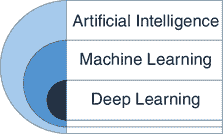

图 1.1 深度学习、机器学习和 AI。

#### 数据、信息和知识


# 数据、信息和知识

数据、信息和知识构成了理解和应用 AI 的基础。`Data`（数据）是从各种来源收集的原始、未处理的事实和数字。当数据被组织和处理后，它就转化为 `information`（信息），提供上下文和含义。`Knowledge`（知识）源于信息的综合，能够实现理解和明智的决策。

在 AI 中，数据作为为 ML 算法提供动力的基本输入，支持模型训练以识别模式并进行预测。由数据构建的信息通过提供洞察和上下文来帮助完善这些模型。最终，知识赋予 AI 系统模拟人类推理的能力，增强其执行复杂任务、适应新情况以及跨各个领域提供有价值解决方案的能力。

## 数据

数据被定义为代表特定概念或概念的值或一组值。数据是数字时代最关键的资产，推动技术进步并塑造我们理解和与世界互动的方式。要充分发挥其潜力，必须认识到不同类别的数据：结构化、半结构化和非结构化。每一类都有独特的特征和应用，特别是在 AI 的背景下。

理解这些数据类别及其特性对于发挥 AI 的全部潜力至关重要。结构化数据为有组织的分析提供基础，半结构化数据为处理复杂信息提供灵活性，而非结构化数据则释放大量未被开发的洞察。它们共同使 AI 系统能够学习、适应并在各个领域提供变革性解决方案。让我们更详细地回顾每一类。

### 结构化数据

结构化数据高度组织化，可在数据库中轻松搜索。这种类型的数据遵循固定模式，意味着它遵循具有特定字段和记录的预定义格式。例如，包含客户信息（如姓名、地址和购买历史）的电子表格就是结构化数据。它允许高效查询和分析，使其成为商业智能和数据驱动决策的宝贵资源。

以下是结构化数据的示例：

*   关系型数据库（例如 `SQL` 数据库）
*   电子表格（例如 `Excel` 文件）
*   财务记录（例如交易日志）

### 半结构化数据

半结构化数据缺乏结构化数据的刚性结构，但仍包含一些组织元素（如标签或标记），提供上下文和层次结构。这类数据常用于存储和传输不适合整齐地放入表格格式的复杂信息。半结构化数据比结构化数据更灵活，允许在处理各种数据类型时具有更强的适应性。

以下是半结构化数据的示例：

*   `JavaScript Object Notation (JSON)` 文件
*   `Extensible Markup Language (XML)` 文档
*   电子邮件（标题、正文、附件）

### 非结构化数据

非结构化数据是最常见且种类最多样的数据类型，涵盖了不遵循预定义格式或模式的信息。这类数据通常内容丰富，但难以分析和搜索。非结构化数据需要先进的 AI 技术，例如 `NLP` 和计算机视觉，来提取有意义的洞察。

以下是非结构化数据的示例：

*   文本文件（如 `Word` 文档）
*   多媒体文件（如图像、视频）
*   社交媒体内容（如推文、帖子）

## 信息

信息填补了原始数据与可操作知识之间的鸿沟。信息源于数据，通过上下文和含义提供语义要素，将分散的事实和数字转化为连贯、有用的洞察。

信息可以理解为经过处理、组织或构建、从而增加了上下文和相关性的数据。与原始数据往往杂乱无章且缺乏内在含义不同，信息是以一种其接收者能够理解和使用的格式呈现的数据。例如，在一天中不同时间记录的一系列温度仅仅是数据；当这些温度被整理成展示每日天气模式的表格时，它们就变成了信息。

信息的关键特征是准确性、相关性、完整性和及时性：

*   **准确性** — 信息必须精确且无错误才具有价值。不准确的信息可能导致错误的决策和结果。
*   **相关性** — 信息应与当前的上下文或问题相关。无论多么准确，不相关的信息作用甚微。
*   **完整性** — 信息必须足够全面，以便在无歧义的情况下提供清晰的理解。不完整的信息可能导致错误的结论。
*   **及时性** — 信息在正确的时间可用时最有用。过时的信息可能与不准确的信息一样有害。

在 AI 中，信息在训练和优化算法方面发挥着关键作用。AI 系统依赖海量数据进行学习和预测。这些数据被处理成增加上下文并有助于模式识别和决策制定的信息。

例如，在 `NLP` 中，原始文本数据被处理以提取有意义的信息，如情感分析或语言翻译。同样，在计算机视觉中，图像被分析以识别物体和模式，将视觉数据转化为可操作的信息。

## 知识

知识代表了一种超越单纯数据和信息的更高层次的理解。它包含洞察、经验和情境理解，使个人和系统能够做出明智决策、解决问题并进行创新。

知识源于信息的综合与应用。它涉及识别模式、理解关系，并基于经验和情境得出结论。与原始未处理的数据，或已组织且有意义的信息不同，知识体现了指导行动和思维的更深层理解。

知识的关键特征是情境性、适用性、基于经验和动态性。

*   **情境性** — 知识深植于情境之中。它不仅涉及理解事实，还包括理解围绕事实的环境和细微差别。
*   **适用性** — 知识是实用的。它涉及将信息应用于现实情境的能力，使其具有可操作性和相关性。
*   **基于经验** — 知识通常通过经验获得。它包含吸取的教训、获得的洞察以及随时间积累的智慧。
*   **动态性** — 知识不断演进。随着新信息的出现和经验的积累，知识也在增长和适应。

在 AI 中，知识对于开发能够推理、学习和适应的系统至关重要。AI 系统依赖海量数据和信息来构建知识库，从而执行复杂任务并做出智能决策。

例如，AI 中的专家系统旨在模拟人类在特定领域的专业知识。这些系统利用包含规则、事实和关系的知识库，从而提供建议和解决问题。同样，`ML` 算法利用数据和信息构建模型，捕捉关于模式和趋势的知识，从而实现预测分析和决策制定。

# 理解机器学习

`ML` 是 AI 的一个子集，它允许计算机从现有信息中学习，*无需显式编程*，并将这种学习应用于执行其他类似任务。

无需显式编程，机器通过输入的数据和信息进行学习。机器从以往的数据中捕捉模式、趋势或基本特征，并对新数据进行预测。`ML` 的这一方面，即机器*无需显式编程*即可学习的能力，非常重要，并强调了 `ML` 与传统编程的关键区别。

假设你的经理要求你构建一个将文本从英语翻译成意大利语的程序。从宏观层面来看，你可以采用传统编程方法，手动编写词汇、语法、句法和词汇表的规则和例外。这种方法极其复杂且难以扩展。相反，利用 `ML`，你可以借助擅长理解上下文、习语和两种语言细微差别的模型，这些对于准确翻译至关重要。这些 `ML` 模型可以随着数据的增加持续提升翻译能力，适应新的表达、习语和不断演变的语言用法。

现实生活中的 `ML` 应用包括推荐系统。例如，亚马逊利用 `ML` 根据用户的图书品类选择和购买历史向用户推荐图书。同样，Spotify 利用 `ML` 根据用户之前购买的歌曲和喜好的流派推荐歌曲。在这两种情况下，亚马逊和 Spotify 都使用大量数据来训练其 `ML` 模型，并以推荐的形式得出有意义的推断。

在接下来的章节中，将介绍 `ML` 的基本概念。这些概念将构成你掌握每个考试目标所需的基础。让我们从 `ML` 生命周期开始。

## ML 生命周期

首先，你必须对整个 `ML` 生命周期有一个整体视角。因为 `ML` 深植于科学之中，一切始于诸如“我们试图解决什么业务问题？”以及最重要的是“机器学习如何满足这一业务需求？”等问题。

图 1.2 展示了 `ML` 生命周期。无论使用哪家云服务提供商或工具，所有 `ML` 项目通常都遵循这些步骤。让我们回顾每个步骤。

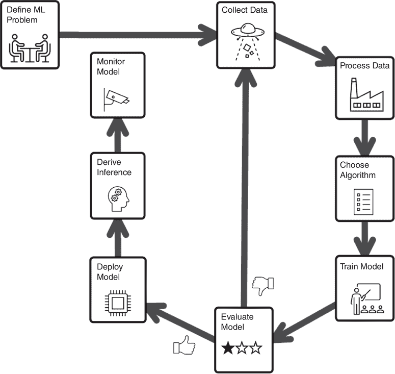

图 1.2 机器学习生命周期。

### 定义 ML 问题

定义 `ML` 问题是任何 `ML` 项目开发中的关键第一步。它涉及理解并清晰阐述需要利用数据和 `ML` 技术解决的具体业务挑战或问题。此阶段包括确定问题的范围、期望的结果以及应用 `ML` 解决方案的可行性。至关重要的是，它需要对可用数据进行详细分析，理解业务背景，并确定将用于评估成功的性能指标。通过建立清晰且定义明确的问题陈述，你可以确保工作重点突出并与战略目标保持一致，从而带来更有效、影响更大的 `ML` 解决方案。

### 机器学习问题的独特之处

机器学习问题与计算机科学/工程领域其他问题的区别在于，它依赖数据驱动的方法和统计模型来进行预测或决策。传统编程依靠显式指令和算法来解决问题，而机器学习则利用数据中的模式和关系来推断解决方案。这种从 `deterministic`（确定性）算法到 `probabilistic models`（概率模型）的转变，意味着机器学习问题通常涉及不确定性，并需要从新数据中持续学习和适应，这使它们具有独特的动态性和挑战性。这种从新数据中持续学习和适应的特性体现在图 1.2 所展示的循环中。

### 收集数据

“收集数据”阶段涉及收集训练和测试模型所需的原始数据。收集的数据类型应与所要解决的具体机器学习问题保持一致。例如，如果目标是预测房价，面积和建造年份等数值数据将是必不可少的。对于客户细分任务，客户人口统计特征和购买行为等分类数据则比较相关。确保收集的数据与问题领域相关且具有代表性，为有效的模型构建奠定了基础。初期工作应集中在获取全面且高质量的数据上，因为这将显著影响项目的整体成功率。

### 处理数据

由于数据是从不同数据源摄入的，因此收集到的数据处于原始状态。在这种格式下，数据集不适合直接建模。首先，数据集可能包含缺失值或噪声数据。其次，不同数据可能处于不同的数值范围。第三，并非所有收集到的数据都与模型推导准确预测的能力相关（稍后你将了解到，这也称为目标变量或标签）。最后，数据集必须划分为三个集合：训练集、验证集和测试集。

因此，收集到的数据必须经过充分转换，才能适合模型训练和评估。“处理数据”步骤包括归一化、缩放和编码数据，以确保特征间的一致性和可比性。另一方面，特征工程涉及创建新特征或修改现有特征，以增强模型的预测能力。常用技术包括对数值数据分箱、创建交互项和提取日期时间特征。该阶段的目标是清洗、优化和丰富数据，使其准备好进行有效的模型训练和评估。

### 选择算法

在机器学习生命周期的“选择算法”阶段，重点转移到选择最合适的算法来解决已定义的问题。这一决策至关重要，因为不同算法针对不同类型的任务，如分类、回归、聚类或强化学习。数据的性质、问题的复杂度和期望的结果等因素在选择过程中起着重要作用。例如，线性回归可能被选用于简单的预测分析，而深度神经网络可能更适合复杂的图像识别任务。

该阶段涉及评估各种算法的优势和局限性，考量准确性、可解释性、训练时间和可扩展性等方面。这也可能包括尝试多种算法，并使用交叉验证技术比较它们在处理后数据上的表现。目标是找到在性能和可行性之间达到最佳平衡的算法，确保模型能有效地从数据中学习并做出准确预测。这种明智的选择为后续阶段奠定了基础，在后续阶段中，所选算法将被训练、验证和微调以达到最佳效果。

### 训练模型

“训练模型”阶段是机器学习生命周期中的关键阶段，紧随算法选择之后。在此阶段，将选定的算法应用于训练数据，以识别模式并学习潜在关系。此过程涉及将数据输入模型，并迭代调整模型参数以最小化误差、评估偏差-方差权衡并提高预测准确性。会采用梯度下降和反向传播等各种技术来优化模型性能。

训练模型的目标是创建一个稳健且准确的预测模型，使其能很好地泛化到新的、未见过的数据。该阶段至关重要，因为它决定了模型在现实应用中做出可靠预测和驱动决策的能力。该阶段的有效性取决于训练数据的质量和代表性，以及超参数的适当调优，以避免过拟合或欠拟合。

### 评估模型

训练完成后，模型进入评估阶段，其目标是在单独的 `validation dataset`（验证数据集）上评估其性能，并确保其能很好地泛化到新的、未见过的数据。会计算准确率、精确率、召回率、F1 分数和均方误差等关键性能指标来衡量模型的有效性。此评估有助于识别 `overfitting`（过拟合）或 `underfitting`（欠拟合）等问题，并提供关于模型可能需要改进领域的洞见。

评估还包括通过混淆矩阵、接收者操作特征（ROC）曲线和其他诊断图表来可视化结果，以了解模型的优势和劣势。基于这些评估，可能会对模型进行迭代优化和调优，以提升其预测性能。此阶段确保模型满足部署标准，可用于现实应用。

### 部署模型

在训练、调优和评估模型之后，您可以将其部署到生产环境，并让您的机器学习应用程序通过端点使用它来进行预测。部署阶段旨在使训练并验证过的模型可用于现实世界的机器学习应用。它涵盖了搭建托管模型的基础设施，确保可扩展性、可靠性、安全性、可持续性和成本效益，这些都是完善的机器学习架构框架的支柱。图 1.3 说明了每个支柱如何映射到各个阶段。

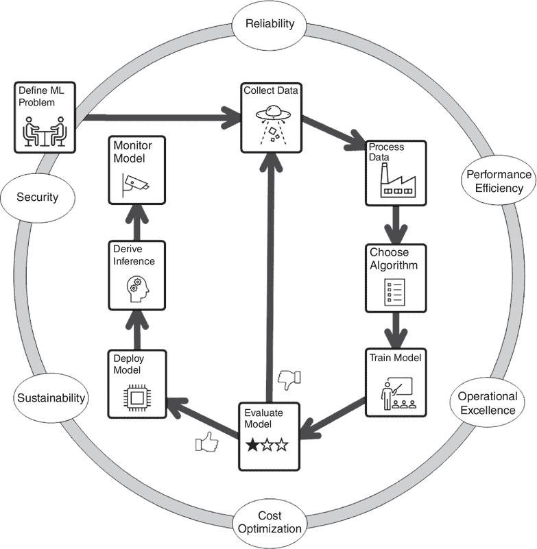

图 1.3 完善的机器学习生命周期。

在 AWS 中，“部署模型”阶段利用 `Amazon SageMaker` 实现从评估到部署的无缝过渡。此阶段涉及使用针对部署需求量身定制的特定 SageMaker 服务。

对于实时预测，`Amazon SageMaker Real-Time Inference`（实时推理）端点是理想选择，提供低延迟响应，适用于需要即时预测的应用程序，如交互式 Web 应用或聊天机器人。对于批量处理足够的场景，`Amazon SageMaker Batch Transform`（批量转换）提供了一种处理大型数据集的高效方式，以具有成本效益的方式进行预测。此外，对于流量波动的工作负载，`Amazon SageMaker Serverless Inference`（无服务器推理）可动态扩展以满足需求，无需管理服务器。

这些 Amazon SageMaker 服务确保模型在生产环境中保持高可用性和高性能。部署阶段专注于使训练好的模型在现实应用中可访问且可用，确保其通过提供准确及时的预测来创造价值。

### 获取推理

#### “推理推导”阶段

“推理推导”阶段紧随模型部署之后，涉及使用模型实时或批量地从新数据生成预测或洞察。这是模型通过应用其学习到的模式来做决策、分类数据或预测结果，从而交付切实价值的阶段。在实践中，这意味着向模型输入实时数据并获得可操作的输出，这些输出可用于驱动业务策略、优化运营或提升用户体验。该阶段的成功取决于模型的准确性和相关性，确保其始终提供可靠且有洞察力的推理以辅助决策。

### 监控模型

部署不仅仅是将模型投入运行；更在于长期保持其有效性。持续监控对于检测任何性能下降或数据模式漂移至关重要。此监控阶段确保模型保持准确和相关，在其指定任务中提供持续的价值。

在 AWS 中，这可以通过 `Amazon SageMaker Model Monitor` 来实现，它能自动检测数据和预测质量问题。`Amazon SageMaker Model Monitor` 会持续跟踪准确率、延迟和数据漂移等关键指标，并在出现偏差时生成警报。此外，`Amazon CloudWatch` 用于收集和分析日志、设置告警，并实时可视化性能指标。这种主动的监控方法有助于保持模型的有效性，从而能够及时干预并重新训练以解决任何性能下降问题。

通过仔细监控模型部署，组织可以利用其 ML 模型推动有影响力的业务决策并提高运营效率。

# ML 概念

在本学习过程中，我们将使用许多与 ML 相关的术语。因此，理解这些行话至关重要。考试所需的关键概念将在本节中讨论。随着知识的深入，这些概念将在后续章节中详细介绍。

## 特征

`Features`（特征）——也称为自变量——是模型在训练期间学习的输入。模型利用这些特征的值进行预测。

特征源自数据集中记录的观察或测量。每个观察代表单个实例或数据点，而特征则是描述这些实例的属性或变量。例如，如果您在观察房屋，每栋房屋（观察）可能具有卧室数量、面积和建造年份等特征。

## 目标变量

`target variable`（目标变量）——也称为 `dependent variable`（因变量）——是模型试图预测的结果。

在监督学习背景下，目标变量是预先已知的，并用于训练模型。换句话说，您输入模型的整个数据集包含特征数据（自变量）和目标变量数据（因变量）。模型将使用此数据集在训练期间进行学习。

目标变量在 ML 生命周期的第一步，即“定义 ML 问题”阶段被确定。

例如，如果您正在开发一个预测房价的模型，目标变量将是房屋的价格。

## 优化问题

优化问题是 ML 的核心。从本质上讲，ML 涉及寻找模型的最佳参数以最小化误差并做出准确预测。无论是通过梯度下降、正则化技术还是超参数调优，解决优化问题对于训练有效模型至关重要。

优化算法的示例包括梯度下降、随机梯度下降（`SGD`）和小批量梯度下降。

例如，考虑训练一个用于图像分类的神经网络（神经网络将在本章后续章节中介绍）。为了达到最高准确率，我们使用梯度下降来最小化损失函数，该函数衡量预测标签与实际标签之间的差异。优化算法迭代地调整模型的权重和偏置以减少此损失，从而提高模型性能。ML 模型中的超参数调优是优化问题的另一个例子。超参数（如学习率、批次大小和神经网络层数）显著影响模型性能。寻找这些超参数的最佳组合涉及在庞大的可能值空间中搜索。网格搜索、随机搜索和贝叶斯优化等技术可自动完成此过程，系统地探索不同的超参数配置并在验证集上评估其性能。这些优化方法有助于确定最佳设置，从而提高模型性能和泛化能力。

## 目标函数

`objective function`（目标函数），也称为 `loss function`（损失函数）或 `cost function`（代价函数），是 ML 中的一个关键概念，它定义了模型训练过程的目标。这是算法在训练期间旨在最小化（或最大化）的函数。通过评估模型预测与实际结果的匹配程度，目标函数衡量误差或损失。算法利用此反馈迭代地调整模型参数，力求减少误差并提高准确性。常见示例包括用于回归任务的均方误差和用于分类任务的交叉熵损失。理解并选择正确的目标函数对于有效引导学习过程至关重要。

## ML 算法与 ML 模型

在整个学习过程中，我们将使用 `ML models`（ML 模型）和 `ML algorithms`（ML 算法）这两个术语。这是两个不同的概念，理解它们之间的区别很重要。

ML 算法是以代码形式提供的分步指令列表，它在特定数据集上运行以分析数据并识别模式。该算法类似于通用编程代码。例如，它可以是一组数字的几何平均值。同样，在 ML 中，算法可以应用于学习给定数据集的统计信息，或应用当前统计信息来预测未来数据。

另一方面，ML 模型是将算法应用于数据集的结果。它以一组参数的形式表示数据中学习到的模式和关系。一经训练，模型即可用于基于新的、未见过的数据进行预测或决策。


可以将 ML 算法视为食谱，将 ML 模型视为按食谱制作出的成品菜肴。

## ML 算法分类

对 ML 算法进行分类的一个通用方法是按学习类型：`supervised learning`（监督学习）、`unsupervised learning`（无监督学习）和 `reinforcement learning`（强化学习）。让我们深入了解每种类型：

*   **Supervised learning（监督学习）** 监督学习涉及使用带标签的数据集训练 ML 模型，这意味着每个训练示例都与一个输出标签配对：即正确的预测。模型通过调整其参数来最小化其预测与实际标签之间的误差，从而学习将输入映射到正确的输出。常见算法包括线性回归、逻辑回归和支持向量机。监督学习的应用包括电子邮件垃圾邮件检测、图像分类和医学诊断。

*   **Unsupervised learning（无监督学习）** 无监督学习处理无标签数据。此处的目标是发现数据中隐藏的模式或内在结构。在没有预定义标签的情况下，模型试图学习数据的潜在分布或聚类。常见算法包括 K 均值聚类、层次聚类和主成分分析（`PCA`）。无监督学习的应用包括市场篮子分析、客户细分和异常检测。

### 强化学习

强化学习受行为心理学启发，涉及通过奖励期望行为和惩罚非期望行为来训练智能体做出决策。智能体通过与环境交互并接收反馈，学习随时间推移最大化累积奖励。关键组件包括策略、奖励信号和价值函数。强化学习的应用包括游戏对弈（如 AlphaGo）、机器人技术和自动驾驶。

对机器学习算法进行分类的另一种方式是按预测任务。考试要求你了解以下两个类别。更多详情将在第 4 章中提供，届时将详细介绍 Amazon SageMaker 的内置算法，并附带示例、代码和图表，展示它们的工作原理。

#### 分类

预测离散类别的算法，如“苹果”或“橙子”（例如：逻辑回归、决策树）

#### 回归

预测连续值的算法，如价格或温度（例如：线性回归、支持向量回归）

### 机器学习与人工智能的区别

AI 和 ML 经常被互换使用，但它们代表了计算机科学领域内截然不同的概念。AI 是更广泛的概念，包含使机器能够模拟人类智能的任何技术，包括推理、学习、解决问题和决策制定。AI 可以是基于规则的系统、专家系统，甚至是简单的自动化任务，旨在复制人类认知的各个方面。

ML 是 AI 的一个子集，专门关注机器从数据中学习并随时间提高其性能的能力，而无需显式编程。ML 涉及在数据集上训练算法以识别模式并进行预测。它包括监督学习、无监督学习和强化学习等技术，每种技术在教导机器变得更聪明方面服务于不同的目的。

对于您在 AWS 上的工作负载，您可以从三个不同层级的 ML 和 AI 功能中进行选择：ML 基础设施和框架、ML 服务和 AI 服务。这被称为 `AWS ML stack`，如图 1.4 所示。

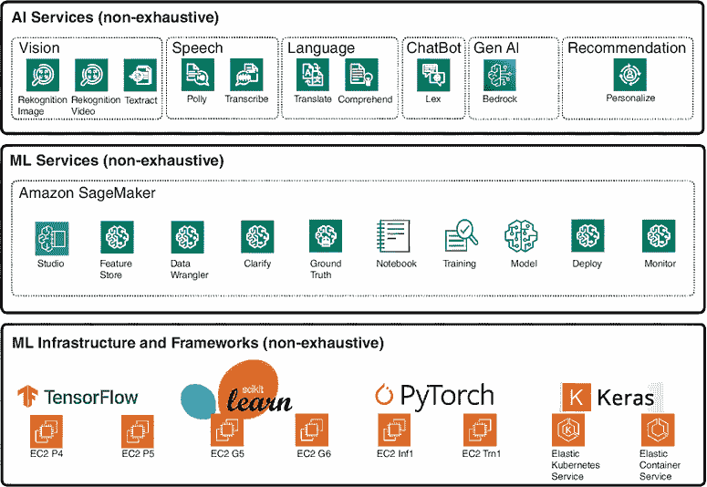

图 1.4 AWS ML 技术栈。

AWS ML 技术栈是一套全面的工具和服务，旨在支持 ML 生命周期的每个阶段。底层是 ML 基础设施和框架层，它提供强大的计算资源，如针对 ML 优化的 `EC2` 实例（`P4`、`P5`、`G5`、`G6`、`Inf1` 和 `Trn1`），以及预配置的环境，如支持 `TensorFlow`、`PyTorch` 和 `Keras` 等流行 ML 框架的 `AWS Deep Learning AMIs`。

向上一层是 ML 服务层，以 `Amazon SageMaker` 为核心，这是一项完全托管的服务，可简化构建、训练和部署 ML 模型的过程。`Amazon SageMaker` 是一系列服务的统称，提供数据标注、模型调优、模型评估和部署等功能，大大降低了 ML 项目的复杂性和工作量。您将在后续章节中了解每项任务对应的具体 `Amazon SageMaker` 服务。

最顶层是 AI 服务层，提供`即拿即用`的 AI 功能，开发人员无需 ML 或深度学习专业知识即可轻松将其集成到应用程序中。这些 AI 服务使用预构建的算法，使用预构建的模型（已由 AWS 训练），并支持广泛的用例：`Amazon Rekognition` 用于图像和视频分析，`Amazon Polly` 用于文本转语音，`Amazon Textract` 用于从文档中提取文本和数据，`Amazon Translate` 用于实时语言翻译，`Amazon Transcribe` 用于语音转文本，以及 `Amazon Bedrock` 用于构建和扩展生成式 AI 应用程序。这些服务使企业能够快速实现复杂的 AI 功能，利用强大且可扩展的智能增强其应用程序。

### 理解深度学习

深度学习（DL）是 ML 的一个专门子集，专注于受大脑结构和功能启发的算法，称为`神经网络`。虽然 ML 包含回归、分类和聚类等多种算法，但 DL 通过使用具有多层的深度神经网络来区分自身。这些网络通过自动学习以通常比传统 ML 方法更准确、更有效的方式表示数据，从而彻底改变了相关领域。

#### 神经网络简介

神经网络是 DL 的骨干。它们由相互连接的称为`神经元`的计算单元组成，这些单元协同工作以处理数据并从中学习。每个神经元接收输入，通过`激活函数`进行处理，并将输出传递给下一层神经元。这种结构使神经网络能够学习数据中的复杂模式和表示，使其成为图像和语音识别等任务的强大工具。

#### 神经网络的结构

神经网络由相互连接的神经元组成，神经元按层分组。让我们深入了解这些组件中的每一个。

##### 神经元

神经元，在人工神经网络的语境下也称为`节点`或`感知器`，是神经网络的基本构建块。它以简化和数学的形式模拟人脑中生物神经元的功能。

神经元的数学运算使其能够将输入特征转化为有意义的预测。通过训练调整权重和偏置，神经元学会根据数据中的模式和关系做出准确预测。

神经元的组件如图 1.5 所示。让我们逐一介绍。

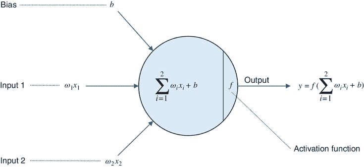

图 1.5 神经元的数学表示。

*   **输入** 这些是神经元接收的数据特征或信号。每个输入代表该特征的一个特定观测值。在图 1.5 中，神经元接收两个输入，`x₁` 和 `x₂`。

*   **权重** 权重是决定每个输入对神经元输出的重要性或贡献程度的值。在训练期间，网络会调整这些权重以提高准确性。在图 1.5 中，输入 `x₁` 使用权重 `ω₁`，输入 `x₂` 使用权重 `ω₂`。

*   **偏置** 偏置是一个额外的参数，允许激活函数发生平移。它帮助神经元在应用激活函数之前对加权和进行调整。在图 1.5 中，偏置用符号 `b` 表示。

##### 神经元操作

*   **加权求和** 参考图 1.5，神经元计算输入和偏置的加权求和：<math xmlns="http://www.w3.org/1998/Math/MathML" overflow="scroll"><munderover><mo>&#8721;</mo><mrow><mi>i</mi><mo>=</mo><mn>1</mn></mrow><mrow><mn>2</mn></mrow></munderover><msub><mi>&#969;</mi><mrow><mi>i</mi></mrow></msub><msub><mi>x</mi><mrow><mi>i</mi></mrow></msub><mo>+</mo><mi>b</mi></math>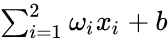。

*   **激活函数** 激活函数 <math xmlns="http://www.w3.org/1998/Math/MathML" overflow="scroll"><mi>f</mi></math> 向模型引入非线性。它接收加权求和并产生神经元的输出。常见的激活函数包括 Sigmoid、线性修正单元 和双曲正切 (Tanh)。在神经网络中，每个神经元的激活函数选择由设计模型的数据科学家或 ML 工程师决定，并通过实验确定最适合特定任务的有效配置。

*   **输出** 输出 <math xmlns="http://www.w3.org/1998/Math/MathML" overflow="scroll"><mi>y</mi></math> 是将激活函数应用于加权求和后，神经元产生的最终结果。神经元将其输出发送给下一层神经元或最终输出层。

##### 输入层

输入层是神经网络的第一层。其主要功能是接收将由网络处理的初始数据。输入层中的每个神经元对应数据集中的一个特征。

例如，在房价预测模型中，特征可能是房屋大小、卧室数量、位置等。这些特征中的每一个都是输入层的一个输入。

##### 隐藏层

隐藏层对输入数据执行复杂计算，以检测那些不明显的模式和关系。网络可以有一个或多个隐藏层。每个隐藏层由多个神经元组成，一层中神经元的输出成为下一层神经元的输入。此过程贯穿所有隐藏层，直到到达输出层。隐藏层中的神经元使用激活函数（如 ReLU、Sigmoid 和 Tanh）来引入非线性。这使网络能够捕捉数据中的复杂关系。

继续以房价预测模型为例，隐藏层可能会学习识别诸如房屋大小与卧室数量之间的关系，或位置对价格的影响等模式。

##### 输出层

输出层是神经网络的最后一层。其主要功能是根据隐藏层处理的数据产生最终预测或分类。输出层由神经元组成，每个神经元代表一种可能的结果或类别。输出层中每个神经元的激活函数选择取决于问题类型。回归问题的特征是连续值预测。对于回归，可能会使用线性激活函数或不使用激活函数。分类问题的特征是离散值预测。对于分类问题，通常使用 Softmax 或 Sigmoid 激活函数来生成每个类别的概率。

在我们的房价预测模型中，输出层可能只有一个神经元，用于输出预测价格。

#### 神经网络如何工作

在复杂的神经网络中，生成的模型是每个神经元的权重和偏置的组合。以下是该过程工作原理的更多细节。

神经网络通过其神经元内部权重和偏置的复杂相互作用，并借助 `backpropagation` 算法来生成模型。反向传播是训练神经元的关键算法。在训练阶段，输入数据被送入网络，每个神经元计算其输入的加权求和。该求和结合偏置，通过激活函数产生神经元的输出。权重决定每个输入（特征）对输出（预测）的影响程度，而偏置则移动激活函数以更好地拟合数据。通过反向传播调整这些权重和偏置，网络学会准确地将输入映射到输出。反向传播使用 `loss function` 计算输出层的误差，然后将此误差向后传播通过网络。通过计算损失函数相对于权重和偏置的梯度，它使用梯度下降等优化算法来更新这些参数，从而最小化误差并提高预测准确性。

随着网络训练，它逐步微调其所有神经元的权重和偏置，有效地捕捉数据中的复杂模式。每一层神经元通过一系列加权求和、偏置和激活函数转换输入数据，反向传播确保这些转换导致误差最小化。最后一层的输出是模型的预测，无论是分类标签还是连续值。这种由众多神经元组成的组合，每个神经元拥有自己的权重和偏置集合，并由反向传播促成，创造了一个能够处理从图像识别到 NLP 等广泛任务的强大模型。生成的模型是一台精细调整的机器，由权重和偏置的持续调整塑造而成，使其能够做出准确可靠的预测。

#### 神经网络类型

神经网络有多种类型，每种都旨在解决特定任务和数据结构。人工神经网络 (ANN)、深度神经网络 (DNN)、卷积神经网络 (CNN) 和循环神经网络 (RNN) 是考试中需要了解的一些最主要类型。这些不同的神经网络架构支持跨各个领域的多样化应用，从图像和视频识别到 NLP 和序列数据分析。

##### 人工神经网络

人工神经网络 (ANN) 是最简单形式的神经网络，由一个输入层、一个隐藏层和一个输出层组成。这些层是全连接的，意味着一层中的每个神经元都连接到下一层中的每个神经元。ANN 能够通过调整这些连接的权重来最小化误差，从而从数据中学习。尽管结构简单，ANN 仍能执行从分类到回归的广泛任务。

##### 深度神经网络

深度神经网络 (DNN) 通过增加更多隐藏层来构建在 ANN 的概念之上；因此称为 `deep`。这种深度使它们能够对数据中更复杂的模式建模，这对于解决复杂任务至关重要。DNN 中的每一层学习从数据中提取日益抽象的特征，最终形成一种强大的表示，可用于目标检测和自然语言理解等任务。图 1.6 展示了一个具有三个输入、两个隐藏层和一个输出的 DNN。

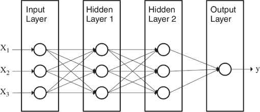

图 1.6 具有两个隐藏层的深度神经网络。

##### 卷积神经网络

卷积神经网络（CNN）是一种专门为处理网格状数据（如图像）而设计的 DNN。由于图像由按网格格式排列的像素组成——其中每个像素代表特定的颜色或强度——CNN 利用卷积层对输入数据应用滤波器，从而有效地捕获空间层次结构和模式。这种架构使 CNN 在图像分类、目标检测甚至玩复杂游戏等任务上表现出色。

##### 循环神经网络

循环神经网络（RNN）是另一种针对序列数据（如时间序列或自然语言）量身定制的 DNN。与传统神经网络不同，RNN 具有形成有向循环的连接，使它们能够保持对先前输入的记忆。这使它们在涉及序列的任务中非常有效，例如语言建模、语音识别和机器翻译。长短期记忆（LSTM）网络和门控循环单元（GRU）等变体通过更好地捕获数据中的长期依赖关系，解决了标准 RNN 的一些局限性。

### DL 与 ML 的区别

ML 是一个广泛的领域，包含各种技术，使机器能够从数据中学习并进行预测，而无需显式编程。它包括线性回归、决策树和聚类等算法，通常需要手动进行特征工程和预处理。

另一方面，DL 是 ML 的一个专门子集，它使用具有多层（深度神经网络）的神经网络，从原始数据中自动学习表示并从数据中生成预测。

传统 ML 模型可能依赖手工制作的特征，而 DL 模型擅长通过自主提取特征来处理大量非结构化数据，如图像和文本。这种深度和复杂性使 DL 模型能够在图像识别和 NLP 等任务中实现更高的准确性，代价是需要大量的计算资源和更长的训练时间。

作为 AWS ML 工程师，你的工作是确定模型质量与训练、部署和维护相关成本之间的权衡。

## 案例研究

以下两个案例研究突出了 AWS 强大的计算解决方案如何增强不同行业的 DL 应用。

### 案例研究 1：Mobileye 的自动驾驶技术

Mobileye 是一家驾驶自动化技术提供商，它利用摄像头、计算机芯片和软件开发自动驾驶技术和高级驾驶辅助系统。

*   **应用** Mobileye 使用 `Amazon EC2 DL1` 实例来训练用于计算机视觉任务的 DL 模型，如目标检测、跟踪和分割。这些模型对于构建能够适应不断变化的路况的自动驾驶解决方案至关重要。

*   **影响** 通过利用 AWS，Mobileye 将价格性能提高了 40%，加快了开发周期，并每天管理超过 250 个生产工作负载。这使 Mobileye 能够部署更高效、更具成本效益的自动驾驶解决方案。

    更多信息，请访问：

    `https://aws.amazon.com/solutions/case-studies/mobileye-ec2-dl1-case-study`

### 案例研究 2：Leidos 的医疗保健 ML 应用

Leidos 是一家科学和技术解决方案领导者，构建 ML 应用程序以帮助公共和私营医疗组织加速诊断和治疗。

*   **应用** Leidos 将其 ML 工作负载迁移到由 Habana Labs 的 Gaudi 加速器提供支持的 `Amazon EC2 DL1` 实例。此次迁移提高了性能，并降低了 NLP 和计算机视觉用例的计算成本。

*   **影响** Leidos 实现了模型训练 66% 的成本节约，将精确度分数提高到 95–97%，并将每天约 2,200 个病例的模型训练时间从 8 小时缩短到 1 小时以内。这显著改善了患者结果并简化了理赔处理。

    更多信息，请访问：

    `https://aws.amazon.com/solutions/case-studies/leidos-case-study`

## 总结

在本章中，你了解了 ML 作为 AI 的一个子集，专注于开发算法和统计模型，使计算机能够在没有显式编程的情况下进行学习和预测。

与传统编程相比，ML 的独特之处在于 ML 模型能够从数据中学习，并随着时间的推移提高其性能，而无需为特定任务进行显式编程，这使它们能够更有效地适应新用例和未见过的数据并进行泛化。

介绍了 ML 生命周期，并描述了每个阶段，从 ML 问题的定义到 ML 模型的部署和监控。你了解了特征是 ML 算法的输入，而目标变量是算法试图预测的输出。目标（损失）函数的概念也被引入，作为衡量模型预测与实际结果匹配程度的手段。重点强调了 ML 算法与 ML 模型的区别，前者定义了用于通过基于输入数据调整参数来训练模型的具体过程或规则，后者代表了这一训练过程的结果，封装了学习到的模式并对新数据进行预测。

你了解了 AWS 提供广泛的 AI 和 ML 服务，这些服务在 AWS ML 技术栈中合乎逻辑地组织。这种表示包括最底层专门为优化 ML 应用程序设计和构建的计算基础设施，中间层 Amazon SageMaker 服务生态系统，以及最高层针对各种不同用例的广泛的完全托管 AI 服务选择。

在本章末尾，提供了深度学习作为 ML 一个专门分支的介绍。DL 使用神经网络从原始数据中自动提取高级特征，使它们在图像和语音识别以及 NLP 等任务中特别有效。DL 模型凭借其学习复杂模式和表示的能力，显著推进了 AI 系统的能力。因此，虽然 AI 涵盖了创建智能代理的更广泛目标，但 ML 和 DL 提供了实现这些目标的工具和方法，其中 DL 在复杂性和准确性方面突破了可能的界限。

## 考试重点


# 了解数据、信息和知识之间的区别

数据是原始的、未经处理的事实和数字的集合，没有上下文或含义。信息是经过处理、解释并赋予了上下文的数据，使其可用于决策。信息的特点是准确性、相关性、完整性和及时性。知识是通过经验被吸收、理解和解释的信息，从而产生洞察力、智慧或专业知识。

# 了解结构化、半结构化和非结构化数据之间的区别

结构化数据按照预定义的模式组织，易于搜索。示例包括 Excel 文件和关系数据库。半结构化数据不符合严格的模式，但仍包含标签或标记以分隔语义元素，提供一定程度的组织（例如 `JSON`、`XML` 文档）。非结构化数据通常包含丰富的信息，但由于缺乏预定义的结构或模式，需要自然语言处理和 `ML` 等高级工具来提取有意义的见解。

# 理解机器学习生命周期

`ML` 是一个迭代过程，模型根据新数据和反馈不断被完善和改进，使系统能够随着时间的推移适应并提高其性能。`ML` 生命周期的阶段包括：定义 `ML` 问题、收集数据、处理数据、选择算法、训练模型、评估模型、部署模型、推理和监控模型。

## 了解监督学习、无监督学习和强化学习 ML 算法之间的区别

使用监督 `ML` 算法时，模型是使用标记数据训练来预测结果的，其中每个数据点都标记有相应的标签或结果（即正确的预测）。相比之下，无监督 `ML` 算法处理未标记数据。其目标是识别数据中隐藏的模式、结构或关系。强化 `ML` 算法迫使智能体通过试错来学习如何预测结果。

## 了解 ML 算法和 ML 模型之间的区别

`ML` 算法是一组用于创建和训练模型的规则或过程。它定义了模型如何通过调整其参数从输入数据中学习。示例包括 `linear regression`、`logistic regression`、`decision trees` 和 `k-Nearest Neighbors (k-NN)`。`ML` 模型是使用 `ML` 算法完成训练过程后生成的输出。它代表从训练数据中得出的已学习模式和关系。这些模式和关系以数学函数的形式编码，从本质上以一种明确的方式表达了学习到的模型。一经训练，模型就可以对新的、未见过的数据进行预测或分类。

## 了解什么是神经网络

神经网络是 `DL` 中使用的一种计算模型，它模拟人脑，由层中的相互连接的神经元组成。它处理输入数据，通过学习算法调整权重和偏差，并产生输出以识别模式和进行预测。

## 复习题

1. 以下哪项**不是**半结构化数据的示例？

    1. NoSQL 数据库
    2. `JSON` 文档
    3. `XML` 文档
    4. `PDF` 文档

2. 在 `ML` 生命周期中，哪个阶段紧接在模型评估之前？

    1. 推导推理
    2. 梯度下降
    3. 部署模型
    4. 训练模型

3. 机器学习算法的输入是什么？

    1. 目标变量
    2. 权重
    3. 偏差
    4. 特征

4. 以下哪项**不是**机器学习算法的类型？

    1. 监督学习
    2. 梯度下降
    3. 无监督学习
    4. 强化学习

5. 什么区分了机器学习模型和机器学习算法？

    1. 模型是一组规则，算法是学习到的模式。
    2. 模型执行预测，算法定义其如何学习。
    3. 模型是学习过程，算法是最终输出。
    4. 模型是超参数，算法是优化技术。

6. 在机器学习的背景下，什么是超参数？

    1. 模型从数据中学习的参数
    2. 在训练过程开始**前**设置的参数
    3. 保存模型最终输出的变量
    4. 用于评估模型性能的指标

7. 在神经网络中使用激活函数的主要目的是什么？

    1. 初始化权重
    2. 向模型引入非线性
    3. 降低数据的维度
    4. 执行梯度下降优化

8. 反向传播在神经网络中的主要功能是什么？

    1. 将输入数据正向传播通过网络
    2. 更新每个神经元的权重和偏差以最小化误差
    3. 可视化数据
    4. 从数据集中移除异常值

9. 哪种类型的神经网络最适合处理序列数据，如时间序列或文本？

    1. 卷积神经网络 (`CNN`)
    2. 循环神经网络 (`RNN`)
    3. 人工神经网络 (`ANN`)
    4. 深度神经网络 (`DNN`)

10. 深度学习和机器学习之间的一个关键区别是什么？

     1. `DL` 算法要比 `ML` 算法需要更少的数据即可表现良好。
     2. `DL` 依赖具有多层的神经网络来自动提取特征，而 `ML` 通常需要手动进行特征工程。
     3. `ML` 算法总是比 `DL` 算法更准确。
     4. `DL` 算法不能用于图像和语音识别任务。

## 注释

1. ¹ 早期的 `ML` 先驱和计算机科学家 Arthur Samuel 于 1959 年创造了**机器学习**一词，意指“使计算机无需显式编程即可拥有学习能力的研究领域”。三十八年后，另一位计算机科学家 Tom Mitchell 将机器学习定义为“研究允许计算机程序通过经验自动改进的计算机算法的学科。”

# 第 2 章：数据摄取和存储

## 介绍摄取和存储

数据摄取和存储是机器学习 (`ML`) 生命周期中“收集数据”阶段的两个核心要素，如图 2.1 所示。

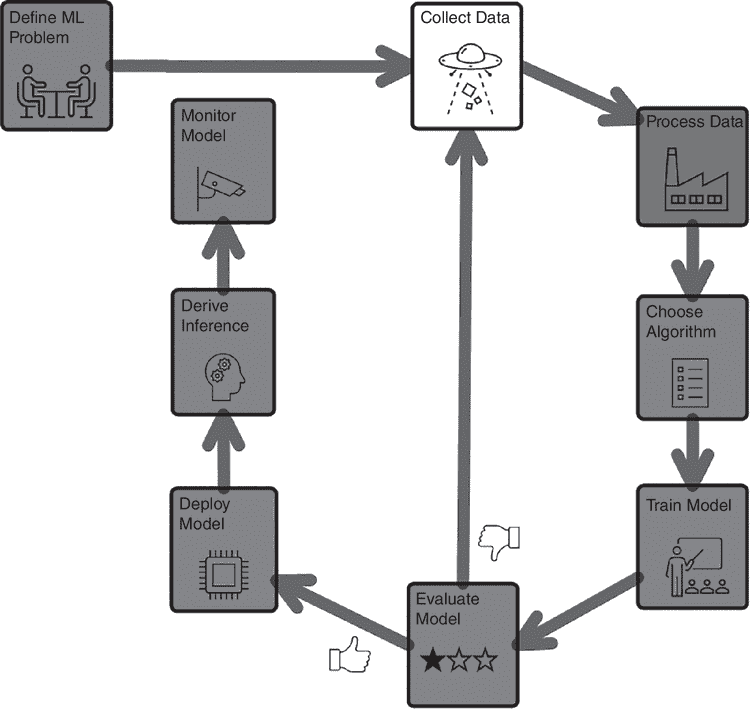

图 2.1 ML 生命周期。

正如您在第 1 章中所了解的，您的 `ML` 解决方案需要数据来训练选定的模型并生成推理。数据可能以不同形式（结构化、半结构化或非结构化）、来自不同来源、在不同时间出现。

摄取是负责为您的 `ML` 解决方案收集数据并将其推送到 `AWS` 的过程。您——作为一名 `AWS` 机器学习工程师——将需要根据数据量、速度和多样性，选择最佳的 `AWS` 数据摄取服务，从不同来源收集数据。

收集后，您需要将摄取的数据存储在合适且安全的位置，以确保满足持久性和可用性要求。通过这种方法，您的 `ML` 解决方案将能够在需要时（可用性）并只要需要（持久性）就能访问数据来训练您的 `ML` 模型。

## 摄取和存储数据

在深入探讨摄取和存储之前，让我们退一步，更好地了解 `ML` 问题的所有要素。

机器学习是称为数据工程的更广泛学科的一部分。在此背景下，`ML` 是数据服务的三种方式之一。

图 2.2 说明了数据工程生命周期。第一步是生成，侧重于数据的来源。数据可以由各种不同的源系统生成，例如数据库、物联网 (`IoT`) 设备、流式系统等。数据工程师设计从源系统消费数据的流程，但可能无法控制这些系统。

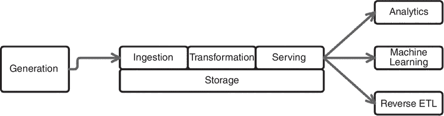

图 2.2 数据工程生命周期。

生成后，数据以其原始格式被摄取到位于 `AWS` 的存储系统中，在那里它被存储并随后被处理。对于考试而言，必须确保选择合适的数据存储。选择取决于特定的用例。例如，您可能希望将原始数据作为对象存储在 `S3 bucket` 中，因为您的数据是批量生成的，且与其他方式相比，这种存储类型相对便宜。相反，如果您的数据是近实时生成和消费的，您可能希望将其存储在流式存储介质中，例如 `Amazon Kinesis Data Streams`。

## AWS 存储系统与数据摄取

图 2.3 展示了 `AWS` 中存储层级的分层视图。顶层通过列出不同类型的存储抽象，从概念层面阐释存储。中间层从逻辑层面描述存储，包含一些最常用的存储系统和类型。底层列出了构成存储系统及相应存储抽象工作基础的底层基础设施组件。对于每种存储系统，通常都有多种 `AWS` 服务可供使用。

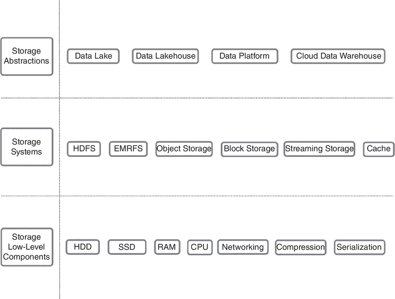

图 2.3 AWS 存储系统。

考试还要求你了解如何提取存储的数据，以及如何为所选的 `ML` 算法准备数据，该算法将用于训练模型并推导推理结果。这些任务将在后续章节中介绍。

在接下来的章节中，你将学习如何选择最合适的数据存储来收集和托管 `ML` 解决方案的数据。将介绍用于从不同来源将数据摄取到 `AWS` 的核心 `AWS` 服务，以及适用于这些服务的主要用例。

### 数据格式与摄取技术

有许多不同的数据格式可用于高效地摄取和存储 `ML` 模型的数据。通过使用合适的数据格式和算法，你——作为一名机器学习工程师——可以优化性能、提高可扩展性并缩短处理时间。

`AWS` 支持多种数据格式，以满足不同的用例和服务需求。以下是一些在 `AWS` 中常用于摄取和存储数据的数据格式：

*   **逗号分隔值 (`CSV`)**
*   **JavaScript 对象表示法 (`JSON`)**
*   **Apache Parquet**
*   **Apache 优化行列式 (`ORC`)**
*   **Apache Avro**
*   **RecordIO**

`CSV` 广泛用于以表格格式存储结构化数据，而 `JSON` 则非常适合基于文档的半结构化数据。

`Apache Parquet` 和 `Apache ORC` 是列式数据格式，旨在针对大型数据集优化存储操作（读、写）。每列中的值存储在连续的内存位置，提供以下优势：

*   列专用压缩可高效节省存储空间。
*   可使用列专用的编码和压缩技术。
*   获取特定列值的查询无需读取整行，从而提高性能。

与 `Apache Parquet` 和 `Apache ORC` 不同，`Apache Avro` 旨在以基于行的格式存储数据。`Avro` 数据依赖于模式。读取 `Avro` 数据时，写入时使用的模式始终存在。这使得每个数据组件的写入无需逐值开销，从而使序列化既快速又紧凑。这也便于动态脚本语言使用，因为数据连同其模式完全是自我描述的。当 `Avro` 数据存储在文件中时，其模式也会随之存储，以便稍后由任何程序处理。如果读取数据的程序期望不同的模式，这可以轻松解决，因为两个模式都存在。

最后，`RecordIO` 是一种主要由 `Apache MXNet`（一种深度学习框架）使用的数据格式。基本思路是将数据划分为称为 `records` 的独立块，然后在每个记录前添加其字节长度，随后是数据本身。因此，`RecordIO` 实现了一种记录序列的文件格式。

选择何种数据格式的关键驱动因素是你打算用于 `ML` 问题的 `ML` 算法所支持的格式。该 `ML` 算法将在你的数据上进行训练，因此确保数据格式与算法要求之间的兼容性对于实现最佳性能和效率至关重要。通过将数据格式与算法能力相匹配，你可以简化数据摄取流程，减少预处理开销，并在 `ML` 工作流中获得更准确、更快速的结果。

表 2.1 列出了内置 Amazon SageMaker 算法及其接受的数据格式。第 4 章将详细介绍这些算法。

**表 2.1 Amazon SageMaker 内置 ML 算法的数据格式支持**

| 算法 | 接受的数据格式 |
| --- | --- |
| BlazingText | 文本文件（每行一个句子） |
| DeepAR 预测 | `JSON Lines`、`Parquet` |
| 因子分解机 | `RecordIO-protobuf`、`CSV` |
| 图像分类 | `RecordIO`、图像文件（.jpg、.png） |
| IP Insights | `CSV` |
| K-means | `RecordIO-protobuf`、`CSV` |
| K 近邻 (k-NN) | `RecordIO-protobuf`、`CSV` |
| 线性学习器 | `RecordIO-protobuf`、`CSV` |
| LDA | `RecordIO-protobuf`、`CSV` |
| 神经主题模型 | `RecordIO-protobuf`、`CSV` |
| 目标检测 | `RecordIO`、图像文件（.jpg、.png） |
| PCA | `RecordIO-protobuf`、`CSV` |
| 随机割集森林 | `RecordIO-protobuf`、`CSV` |
| 语义分割 | `RecordIO`、图像文件（.jpg、.png） |
| Seq2Seq | `RecordIO-protobuf`、文本文件 |
| XGBoost | `CSV`、`LibSVM`、`Parquet` |

另一个需要考虑的重要驱动因素是你的 `数据访问模式`。数据访问模式定义了生产者和消费者如何与数据交互以满足业务需求。它涉及理解和记录数据查询、存储和检索的方式。以下是定义数据访问模式的主要因素：

*   **数据大小。** 了解数据量有助于确定有效的数据分区策略。
*   **数据形态。** 组织数据以匹配查询需求可提升速度和可扩展性。
*   **数据速率。** 了解峰值查询负载有助于优化数据分区以获得更好的 I/O 容量。

表 2.2 举例说明了在数据访问模式中应关注的内容。

**表 2.2 数据访问模式示例**

| 字段 | 示例 |
| --- | --- |
| 数据访问模式名称 | 查找订单 |
| 数据访问模式描述 | 按客户 ID 和时间间隔查找订单 |
| 优先级 | 中 |
| 操作（读/写） | 读 |
| 类型（单项/多项/全部） | 多项 |
| 筛选条件 | 客户 ID = 123，时间间隔 = 24 小时前 |
| 排序 | 时间降序 |

从本质上讲，数据访问模式通过将组织数据与访问需求相匹配，有助于设计高效且可扩展的数据摄取解决方案。

换个说法，原始数据从不同来源被消费、摄取并存储到 `AWS` 的方式，将帮助你确定要使用的数据格式和 `AWS` 服务。

表 2.3 展示了 `AWS` 服务如何根据数据是结构化、半结构化还是非结构化进行分组。

**表 2.3 适用于结构化、半结构化和非结构化数据的 AWS 服务**

| 结构化 | 半结构化 | 非结构化 |
| --- | --- | --- |
| Amazon RDS | Amazon DynamoDB | Amazon S3 |
| Amazon Aurora | Amazon DocumentDB | Amazon Rekognition |
| Amazon Redshift | Amazon Athena | Amazon Transcribe |
| Amazon S3 | Amazon S3 | Amazon Comprehend |
| Amazon Athena | | |

正如你可能注意到的，`Amazon S3` 是最灵活的服务，因为它可用于所有三种不同的数据类别。此外，你可以结合 `Amazon Athena` 使用 `Amazon S3`，直接从 `S3` 查询数据，而无需格式化数据或管理基础设施。

在接下来的章节中，我们将深入探讨这些服务，重点关注它们在摄取和存储方面的应用。

### 选择 AWS 摄取服务

谈到摄取服务，`AWS` 提供了广泛的选择。哪种服务最适合你的用例取决于多个因素：

*   **可扩展性。** 你的摄取解决方案必须能够支持来自所有数据源的数据速率和数据量。
*   **弹性。** 您的数据摄取解决方案必须能够从故障中恢复，并能从故障发生时无缝地继续运行。
*   **安全与合规。** 在摄取过程中，数据必须得到妥善保护，以便未经授权的参与者永远无法在传输过程中或存储时使用它。此外，摄取过程必须符合特定行业的法规，例如支付卡行业数据安全标准 (`PCI DSS`)、健康保险流通与责任法案 (`HIPAA`) 等。必须审查其他注意事项，以确保数据的摄取和存储符合数据驻留要求。
*   **成本。** 采用云按需付费交付模式，您始终希望确保成本受控。在处理流数据时，这一点更为重要，因为流数据实际上永不停止。因此，摄取和存储数据以训练机器学习模型所产生的成本可能会迅速增长。作为 `ML` 工程师，您需要选择支持最具成本效益的定价模式的 `AWS` 摄取服务，以适应您的用例。
*   **灵活性。** 您的摄取解决方案必须能够适应变化。`AWS` 服务具有高度可定制性。请确保根据您的业务和技术需求定制数据摄取管道，但也要将变化视为解决方案架构中需要解决的一个额外要素。

让我们开始学习用于流数据的 `AWS` 数据摄取服务。

### Amazon Data Firehose

Amazon Data Firehose（前身为 Amazon Kinesis Data Firehose）是一项全托管服务，允许您收集、转换数据流，并近乎实时地（几秒钟内）将其传输到数据湖、数据仓库和分析服务。

作为一项全托管服务，Amazon Data Firehose 会持续处理数据流，根据可用数据量自动扩缩容，并在几秒钟内将其传输到目标位置。

要使用 Amazon Data Firehose，您需要配置一个数据流，包括数据源、目标位置，以及数据在到达目标位置前所需的转换。

您必须为数据流选择 `source`（来源），例如 Amazon Managed Streaming for Kafka (`MSK`) 中的主题、`Kinesis Data Streams` 中的流，或者您可以使用 Firehose Direct PUT 应用程序编程接口 (`API`) 直接写入数据。Amazon Data Firehose 与 20 多项 `AWS` 服务集成，因此您可以从 Amazon CloudWatch Logs、`AWS` Web Application Firewall (`WAF`) Web ACL 日志、`AWS` Network Firewall 日志、Amazon Simple Notification Service (`SNS`) 或 `AWS` IoT 等来源设置数据流。

您必须为数据流选择一个 `destination`（目标），例如 Amazon S3、Amazon OpenSearch Service、Amazon Redshift、Splunk、Snowflake 或自定义 HTTP 端点。

您可以选择指定是否要将数据流转换为 `Parquet` 或 `ORC` 等格式、解压缩数据、使用您自己的 `AWS Lambda` 函数执行自定义数据转换，或根据属性动态分区输入记录以传输到不同位置。

#### 用例

典型用例包括以下内容：

*   **流式传输到数据湖和数据仓库。** 您可以将数据流式传输到 Amazon S3、Amazon Redshift 和其他目标位置，将其转换为 `Parquet` 等格式以进行分析，而无需构建复杂的处理管道。
*   **安全可观测性。** 您可以实时监控网络安全，并在潜在威胁出现时使用支持的安全信息和事件管理 (`SIEM`) 工具创建警报。


# 机器学习应用

您可以使用 ML 模型丰富数据流，以便在数据移动到目标位置时分析数据并预测结果。

## Amazon Kinesis Data Streams

Amazon Kinesis Data Streams 是另一项用于摄取和存储数据流以供处理的托管服务，其增值之处在于执行 `real-time`（实时）数据流传输，并与 AWS 数据工程服务生态系统提供广泛集成。

Amazon Kinesis Data Streams 允许您使用 Amazon Managed Service for Apache Flink 或 Apache Spark 等其他流行框架构建自定义实时应用程序。您还可以将数据直接流式传输到在 Amazon EC2 实例上运行的消费者应用程序。此外，`AWS Lambda` 可用作消费者，在近乎实时地处理数据，而无需管理服务器。

使用 Amazon Kinesis Data Streams，您的数据被放入 Kinesis 数据流中，这确保了 `durability`（持久性）和 `elasticity`（弹性）。记录被放入流中到可以被消费的时间之间的延迟（放入-获取延迟）通常小于一秒。换句话说，Kinesis Data Streams 应用程序几乎可以在数据添加到流后立即开始消费数据。因为 Amazon Kinesis Data Streams 是一项托管服务，您无需担心创建和运行数据摄取管道。

Kinesis Data Streams 的弹性使您能够自动扩展或缩减流，以便在记录过期前永远不会丢失数据记录。

### 用例

Amazon Kinesis Data Streams 的典型用例包括以下内容：

*   **加速日志和数据源摄取与处理。** 您可以让生产者直接将数据推送到流中，而无需担心应用程序服务器故障导致数据丢失。Amazon Kinesis Data Streams 提供加速的数据源摄取，因为您无需在提交摄取前在服务器上对数据进行批处理。
*   **实时指标和报告。** 您可以使用摄取到 Amazon Kinesis Data Streams 中的数据进行简单的实时数据分析和报告。例如，您的数据处理应用程序可以在数据流式传入时处理系统和应用程序日志的指标和报告，而不必等待接收批量数据。
*   **实时数据分析。** 这将并行处理的强大功能与实时数据的价值相结合。例如，实时处理网站点击流，然后使用多个并行运行的 Kinesis Data Streams 应用程序分析网站可用性参与度。
*   **复杂流处理。** 您可以创建复杂的数据流应用程序，将多个数据流组合成新的数据流以供下游处理。

## Amazon Managed Streaming for Apache Kafka (MSK)

如果您熟悉 Apache Kafka 事件流平台，好消息是您可以在 AWS 上以有限的工作量和最少的管理构建和运行使用 Apache Kafka 的应用程序。AWS 提供 Amazon MSK，它使您能够使用全托管、高可用的 Apache Kafka 服务安全地实时摄取和处理流数据。

Amazon MSK 提供控制平面，让您创建、更新和删除 Apache Kafka 集群。对于按需流式传输和零运维用例，您可以选择 Amazon MSK `Serverless`，它会自动预配和扩展容量，同时管理主题中的分区，因此您可以在无需担心调整集群大小或扩缩容的情况下流式传输数据。使用 Amazon MSK Serverless，您只需为所用资源付费。

Amazon MSK 还允许您使用 Apache Kafka 的数据平面操作，例如生产和消费数据的操作。

此外，Amazon MSK 运行 Apache Kafka 的开源版本。因此，来自合作伙伴和 Apache Kafka 社区的现有应用程序、工具和插件均受支持，无需更改应用程序代码。

考试不要求您精通 Amazon MSK 的各个方面。尽管如此，您将需要了解 Amazon MSK 架构的主要组件及其预期用途：

### Amazon MSK 组件

*   **Broker 节点**  
    这些是执行“繁重”任务的工作节点，包括摄取、存储（在主题分区中）和处理您的流数据。创建 Amazon MSK 集群时，您需要指定希望 Amazon MSK 在每个可用区中创建多少个 Broker 节点。其中一些 Broker 节点会被选举为控制器节点，负责管理分区和副本的状态、执行管理任务（如重新分配分区）以及维护分区的 Leader-Follower 关系。最少每个可用区一个 Broker 节点。每个可用区都有自己的虚拟私有云（VPC）子网。
*   **ZooKeeper 节点**  
    Amazon MSK 还会为您创建 Apache ZooKeeper 节点。Apache ZooKeeper 是一个开源服务器，可在 Broker 节点之间实现高度可靠的分布式协调。
*   **KRaft 控制器**  
    Apache Kafka 社区开发了 KRaft，用于替代 Apache ZooKeeper 以管理 Apache Kafka 集群中的元数据。在 KRaft 模式下，集群元数据在一组 Kafka 控制器（属于 Kafka 集群的一部分）之间传播，而不是跨 ZooKeeper 节点传播。KRaft 控制器无需额外费用，也无需您进行额外的设置或管理。
*   **生产者、消费者和主题创建者**  
    Amazon MSK 使您能够使用 Apache Kafka 的数据平面操作来创建主题以及生产和消费数据。
*   **集群操作**  
    您可以使用 AWS 管理控制台、AWS 命令行界面（`AWS CLI`）或 SDK 中的 API 来执行控制平面操作。例如，您可以创建或删除 Amazon MSK 集群、列出账户中的所有集群、查看集群属性，以及更新集群中 Broker 的数量和类型。

### 用例

Amazon MSK 的典型用例包括：

*   **摄取、存储、处理和交付实时事件流**  
    Amazon MSK 使您能够实时捕获和处理大量应用程序和数据库事件，并持续将其摄取到数据湖或各种支持的目标中以进行进一步处理。
*   **流式数据的记录系统**  
    Amazon MSK 可充当数据状态的单一事实来源。这意味着对数据的所有更改都会被捕获并存储在 Amazon MSK 的持久主题中，从而允许不同的应用程序一致地访问和更新状态。
*   **在 AWS 上为您的事件驱动架构提供动力**  
    您可以利用 Apache Kafka 的多功能性，在 AWS 上开发和构建现代、安全的事件驱动应用程序。

## Amazon Managed Service for Apache Flink

借助 Amazon Managed Service for Apache Flink（前身为 Amazon Kinesis Data Analytics），您可以利用 Apache Flink 框架实时处理和分析流数据。Apache Flink 是一个用于有状态计算和复杂分析的开源流处理框架。

与 Apache Kafka 不同，Apache Flink 不提供自己的数据存储系统。但是，它与各种外部存储系统完全集成，以管理状态和处理数据，例如 `Amazon S3`、`Amazon MSK`、`Amazon Kinesis Data Streams` 和其他数据源。

Apache Flink 提供的一些独特功能包括其对大规模数据流工作负载的稳健支持、容错能力以及严格的精确一次（exactly-once）正确性保证。这对全球企业特别有吸引力，因为这些企业需要可靠且高性能的基础设施，以实时事件的形式传输大量数据。

此外，该服务还提供对 Apache Flink 表达性 API 的访问，通过 Amazon Managed Service for Apache Flink Studio，您只需几个步骤即可交互式查询数据流或启动有状态应用程序。借助这项托管服务，您可以开始使用 Apache Flink，并快速部署和运行数据流处理应用程序。

就像 `Amazon MSK` 和大多数 AWS 完全托管服务一样，无需管理服务器和集群，也无需设置计算基础设施。您只需为使用的资源付费。

### 用例

Amazon Managed Service for Apache Flink 的典型用例包括：

*   **流式数据管道**  
    持续摄取、丰富和转换数据流，并将其加载到目标系统中以便及时采取行动（相对于批处理）。示例包括数据湖摄取、ML 管道和流式提取、转换、加载（`ETL`）。
*   **流式和批量分析**  
    Amazon Managed Service for Apache Flink 支持对有界数据集进行传统的批量查询，以及对无界实时数据流进行实时、连续查询。示例包括使用量计量和账单、网络监控、特征工程和营销活动效果分析。
*   **事件驱动应用程序**  
    您可以利用 Apache Flink 的功能，在 AWS 上轻松开发和维护事件驱动应用程序。事件驱动应用程序是一种有状态应用程序，它从一个或多个事件流中摄取事件，并通过触发计算、状态更新或外部操作来响应传入事件。示例包括欺诈检测、业务流程监控和地理围栏。

## AWS DataSync

`AWS DataSync` 是一项数据传输和发现服务，可简化数据迁移，帮助您快速、轻松且安全地在 AWS 存储服务之间、从 AWS 存储服务传出或传入文件或对象数据。

`AWS DataSync` 通过使用 `DataSync agent` 连接到源存储系统的管理接口来实现数据发现。代理收集有关存储资源的信息，包括性能指标和容量利用率。然后将这些数据发送到 `AWS DataSync Discovery`，后者会分析信息并提供将数据迁移到 AWS 存储服务的建议。这一自动化流程可帮助您了解存储利用率，并更有效地规划迁移。

使用 `AWS DataSync`，您还可以在其他云存储系统或本地存储系统与 AWS 服务之间传输数据。在此背景下，云存储系统可以包括：

*   自托管存储系统，例如您 AWS 环境中 VPC 内的 `NFS` 文件服务器
*   由其他云提供商托管的存储系统或服务
*   托管在公司数据中心的本地存储系统或服务

`AWS DataSync` 支持以下存储系统：

*   网络文件系统（`NFS`）
*   服务器消息块（`SMB`）
*   Hadoop 分布式文件系统（`HDFS`）
*   对象存储（Google Cloud Storage、Azure Blob Storage、Wasabi Cloud Storage 以及与 `Amazon S3 API` 兼容的自托管对象存储）

`AWS DataSync` 支持以下 AWS 存储服务：

*   `Amazon S3`
*   `Amazon EFS`
*   `Amazon FSx for Windows File Server`
*   `Amazon FSx for Lustre`
*   `Amazon FSx for OpenZFS`
*   `Amazon FSx for NetApp ONTAP`
*   `AWS Snowcone`
*   `AWS Snowball Edge`

使用 `DataSync`，您可以获得以下优势：

*   **简化迁移规划**  
    通过自动化数据收集和建议，`DataSync Discovery` 可最大限度地减少规划数据迁移到 AWS 所需的时间、精力和成本。您可以使用建议来制定预算计划，并在迁移临近时重新运行发现作业以验证假设。
*   **自动化数据移动**  
    `DataSync` 简化了在存储系统和服务之间通过网络传输数据的过程。`DataSync` 实现了数据传输流程的管理以及高性能、安全数据传输所需基础设施的自动化。

### 优势

*   **安全传输数据。** DataSync 提供端到端安全性，包括加密和完整性验证，有助于确保您的数据安全、完整且可直接使用地到达。DataSync 通过内置的 AWS 安全机制（例如 `AWS Identity and Access Management (IAM)` 角色）访问您的 AWS 存储。它还支持 VPC 端点，让您可以选择在不遍历公共互联网的情况下传输数据，进一步提高在线复制数据的安全性。
*   **更快地移动数据。** DataSync 使用专用网络协议和并行多线程架构来加速传输。这种方法可加快迁移、用于分析和机器学习的定期数据处理工作流以及数据保护流程。
*   **降低运营成本。** 利用 DataSync 统一的按 GB 定价，以高性价比移动数据。避免编写和维护自定义脚本，或使用昂贵的商业传输工具。

### 用例

AWS DataSync 的典型用例包括以下内容：

*   **发现数据。** 了解本地存储的性能和利用率。AWS DataSync Discovery 还可以为将数据迁移到 AWS 存储服务提供建议。
*   **迁移数据。** 通过网络将活跃数据集快速传输到 AWS 存储服务。DataSync 包含自动加密和数据完整性验证，有助于确保您的数据安全、完整且可直接使用地到达。
*   **归档冷数据。** 将存储在本地存储中的冷数据直接移动到持久、高可用且安全的长期存储类别，例如 `S3 Glacier Flexible Retrieval` 和 `S3 Glacier Deep Archive`。这样做可以释放本地存储容量并关闭遗留系统。
*   **复制数据。** 将数据复制到任何 Amazon S3 存储类别，为您的需求选择最具成本效益的存储类别。您还可以将数据发送到 `Amazon EFS`、`FSx for Windows File Server`、`FSx for Lustre` 或 `FSx for OpenZFS`，以用作备用文件系统。
*   **为及时的云端处理传输数据。** 传输数据进出 AWS 以进行处理。这种方法可以加速许多行业的关键混合云工作流。这些包括生命科学行业的机器学习、媒体和娱乐行业的视频制作、金融服务行业的大数据分析，以及石油和天然气行业的地震研究。

## AWS Glue

为选择机器学习算法准备数据使其就绪，是机器学习生命周期中的关键步骤。AWS Glue 是一款针对云优化的 ETL 无服务器服务，可让您跨业务从多个来源发现、准备、移动和集成数据，以便数据可供使用。

AWS Glue 在四个重要方面与其他 ETL 服务不同：

*   **无服务器。** 您无需预置、配置或启动服务器，也无需管理其生命周期。
*   **自动架构推断。** AWS Glue 配备爬网程序，可解析您的数据集、发现文件类型、提取架构，并将所有这些元数据存储在一个集中式目录中，以供后续查询和分析。
*   **自动 ETL 脚本生成。** AWS Glue 会自动生成从源到目标提取、转换和加载数据所需的脚本。
*   **广泛的连接性。** AWS Glue 提供广泛的连接器，用于与各种数据源集成。它为常用数据存储提供内置支持，例如 `Amazon Redshift`、`Amazon Aurora`、`Microsoft SQL Server`、`MySQL`、`MongoDB`、`MariaDB` 和 `PostgreSQL`。此外，AWS Glue 允许使用自定义 JDBC 驱动程序与其他数据源集成。

凭借上述优势，AWS Glue 使数据准备变得简单、快速、安全且具成本效益。您的机器学习和数据工程师团队可以利用 AWS Glue 以可视化方式创建、运行和监控 ETL 管道，将数据加载到数据湖中，并准备数据以选择机器学习算法。此外，AWS Glue 具有表达力强且灵活的特点，支持使用流行框架（如 `Spark`、`PySpark`、`Scala` 和 `Ray` (`AWS Glue for Ray`)）开发自定义 ETL 脚本。这使得能够提供量身定制的数据处理解决方案，满足您的机器学习项目的独特需求，确保数据准备的效率和精确性。

### 用例

AWS Glue 的典型用例包括以下内容：

*   **复杂 ETL 管道开发。** 由于其自动扩缩能力，AWS Glue 是运行计算需求不均、数据量不可预测且数据源数量庞大的 ETL 作业进行数据处理的理想服务。
*   **数据发现。** AWS Glue 的原生功能使其能够轻松识别 AWS 上、本地以及其他云上的数据，并使其即时可用于查询和转换。
*   **支持数据处理框架。** 使用 AWS Glue，您可以连接到 70 多种不同的数据源，实现多种工作负载类型（批处理、微批处理和流式处理），并在集中式数据目录中管理数据。
*   **简化的数据工程体验。** 使用 AWS Glue 交互式会话，数据和机器学习工程师可以使用其首选的集成开发环境 (IDE) 或笔记本，以交互方式探索和准备数据。

# 选择 AWS 存储服务

您将用于训练机器学习模型的数据，需要使用合适的存储服务以原始格式持久保存。这至关重要，因为它确保您的数据随时可访问，并处于预处理和模型训练的最佳状态。此外，存储不仅对于训练数据至关重要，对于存储训练过程中产生的工件（如模型参数、权重和其他衍生数据）也必不可少。这些工件对于进行准确预测至关重要，使您能够有效地部署和运营您的机器学习模型。适当的存储管理促进了数据摄取、模型训练、模型评估和模型部署之间的无缝过渡，从而支持端到端的机器学习生命周期。

以下是在选择合适的存储服务时需要考虑的主要因素：

*   **持久性。** 解决“您需要保留数据多长时间？”的问题。持久性衡量存储服务在其生命周期内面对正常运营挑战时持久保存数据的能力。
*   **可用性。** 解决“您需要多快使用数据？”的问题。可用性衡量存储服务可供使用的时间百分比，其中“可供使用”是指在需要时执行其约定功能。可用性（也称为服务可用性）是一种常用的量化衡量可靠性的指标。
*   **存储类型。** 解决“您需要以何种格式存储数据，以便在准备过程中有效使用？”的问题。存储类型包括对象、块、文件，以及基于用例的其他特定类型。


*   **成本。** 解决“您愿意花多少钱来存储数据？”的问题。成本是 Well-Architected Framework（良好架构框架）的支柱之一，适用于您在云中设计、构建和架构的任何解决方案。在接下来的章节中，我们将介绍与机器学习生命周期相关的每个 AWS 存储服务的成本因素。

*   **安全性。** 解决“您的静态数据需要何种类型的保护？”的问题。安全性是 Well-Architected Framework 的另一支柱，适用于您在云中设计、构建和架构的任何解决方案。数据的敏感性决定了数据存储时（即静态）所需的数据保护安全控制措施。

## 面向 ML 工作负载的 AWS 存储服务

在接下来的章节中，将介绍 AWS 为 ML 工作负载提供的主要存储服务。我们将从三个与 `Amazon SageMaker` 原生集成的存储服务开始：`Amazon S3`、`Amazon Elastic File System (EFS)` 和 `Amazon FSx for Lustre`。

### Amazon Simple Storage Service (S3)

`Amazon S3` 是一种对象存储服务，提供行业领先的耐久性、可用性、可扩展性、安全性和性能。

对象存储是一种以称为 `objects`（对象）的非结构化格式持久化和管理数据的存储类型。随着组织踏上数字化转型之旅，其存储大量非结构化数据（如照片、视频、电子邮件、网页、传感器数据和音频文件）的能力已成为其数字化转型的关键方面。

`Amazon S3` 将这些数据分布在多个物理设备上，但允许用户通过唯一标识符（即对象的 `Uniform Resource Identifier (URI)`，统一资源标识符）高效地访问内容。

对象存储的主要优势在于近乎无限的可扩展性，以及为数据湖、云原生应用程序、分析、日志文件和 ML 等用例存储大量数据的较低成本。

对象存储还提供更高的数据耐久性和弹性，因为它将对象存储在多个设备、跨多个系统，甚至跨多个可用区和区域上。这使得规模近乎无限，并提高了数据的弹性和可用性。

凭借与 `Amazon SageMaker` 的原生集成，`Amazon S3` 是 AWS 上最具成本效益且用户友好的 ML 操作存储选项之一。它提供一系列存储类别以适应不同的访问模式和预算，使其成为存储训练数据和模型工件的多功能选择。此外，`Amazon S3` 与各种 AWS 服务（如 `AWS Lambda`、`Amazon Elastic Container Services (ECS)` 和 `Amazon Elastic Kubernetes Services (EKS)`）的集成简化了构建、训练和部署 ML 模型的过程。

图 2.4 展示了一个简单的工作流，突出了 `Amazon S3` 和 `Amazon SageMaker` 在 ML 生命周期中如何相互交互。

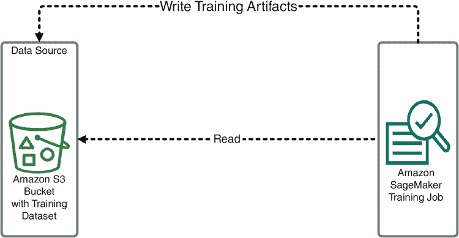

图 2.4 ML 生命周期中 Amazon S3 的使用。

为了备考，请确保您对 `Amazon S3` 存储类别有很好的理解，如表 2.4 所述。

表 2.4 Amazon S3 存储类别。

| S3 存储类别 | 说明 |
| --- | --- |
| S3 Standard | 专为频繁访问的数据设计 |
| S3 Intelligent-Tiering | 根据不断变化的数据访问模式，自动在两个访问层级之间移动数据以优化成本 |
| S3 Express One Zone | 高性能、单可用区存储类别，为延迟敏感型应用程序提供一致的个位数毫秒级数据访问 |
| S3 Standard-IA (infrequent access) | 适用于访问频率较低但需要在需要时快速访问的数据，成本低于 S3 Standard |
| S3 One Zone-IA | 适用于不需要多可用区弹性的非频繁访问数据，提供更低的存储成本 |
| S3 Glacier Instant Retrieval | 专为需要即时访问的长期、极少访问的数据设计，提供低检索时间和成本 |
| S3 Glacier Flexible Retrieval | 用于检索时间从几分钟到几小时不等的归档数据，提供低成本存储 |
| S3 Glacier Deep Archive | 为长期数据归档提供最低成本存储，检索时间长达 12 小时 |
| S3 Outposts | 将 S3 存储引入您的本地环境，确保一致的性能并满足数据驻留要求 |

#### Amazon Athena

`Amazon Athena` 是一项无服务器的交互式查询服务，允许您使用标准 SQL 直接分析 `Amazon S3` 中的数据。

借助 `Amazon Athena`，您可以针对存储在 S3 中的数据执行 SQL 查询。示例包括 CSV、JSON 或列式数据格式，如 `Apache Parquet` 和 `Apache ORC`。

##### 用例

基于专为持久化大量非结构化数据而设计的弹性架构，`Amazon S3` 最适合以下用例：

*   **数据湖和 ML。** 数据湖是一个集中式存储库，允许您按任何规模以原始格式存储所有数据。您可以使用数据湖运行数据处理、数据分析、ML 和高性能计算 (HPC) 应用程序，以释放数据的价值。

*   **数据备份和恢复。** 凭借 `Amazon S3` 强大的复制和数据保护功能，您可以构建满足恢复时间目标 (RTO)、恢复点目标 (RPO) 和合规要求的应用程序。

*   **数据归档。** 您可以将“冷”数据（必须为合规而保留的非频繁访问数据）保留到 `Amazon S3 Glacier` 存储类别中，以降低成本、消除运营复杂性并满足组织的数据归档要求。

*   **生成式人工智能 (AI)。** 在撰写本书时，`Amazon S3` 为超过 350 万亿个对象存储了 EB 级数据，平均每秒处理超过 1 亿次请求。凭借这种大规模的可扩展性，`Amazon S3` 是准备和训练大语言模型 (LLM) 的理想存储服务。LLM 在自监督和半监督训练过程中，通过从海量数据中学习统计关系进行训练。我们将在后续章节中介绍这些概念。

### Amazon Elastic File System (EFS)

`Amazon EFS` 是一种无服务器、完全弹性的 AWS `file-based`（基于文件）存储服务。其无服务器特性意味着无需管理、配置和创建底层基础设施；AWS 将为您执行这些任务。

`Amazon EFS` 使您能够在 AWS 上创建和配置分布式文件系统，并将其挂载到各种 AWS 计算资源，包括 `Amazon EC2` 实例、`Amazon EKS` 集群、`Amazon ECS`、`AWS Lambda` 函数等。无需预置、部署、修补或维护。

它还支持流行的 NFS 4.0 和 4.1 (`NFSv4`) 协议，从而实现与需要 NFS 的工作负载的无缝集成。

然后您可以共享这些文件，通过 `Amazon EFS` 生命周期管理优化成本，并通过 `AWS Backup` 和 `Amazon EFS` 复制进一步保护数据。

其弹性能力意味着该服务将按需将工作负载扩展到 PB 级存储和 GB/秒级吞吐量，开箱即用。

采用 `pay-as-you-go`（按量付费）定价模式，您可以利用其内置的生命周期管理功能降低总拥有成本 (TCO)，该功能旨在智能地将“冷”数据移动到成本优化的非频繁访问和归档 `EFS` 存储类别。

作为 `Amazon S3` 的替代方案，如果您的训练数据已驻留在 `Amazon EFS` 中，您可以轻松地在 `Amazon SageMaker` 中访问和使用这些数据进行模型训练。这种集成简化了工作流，使您能够在高效开发和部署 ML 模型的同时，利用 `Amazon EFS` 可扩展且高性能的存储能力。

图 2.5 展示了一个示例工作流，显示了如何在 ML 生命周期中使用 `Amazon EFS` 存储训练数据和学习工件。

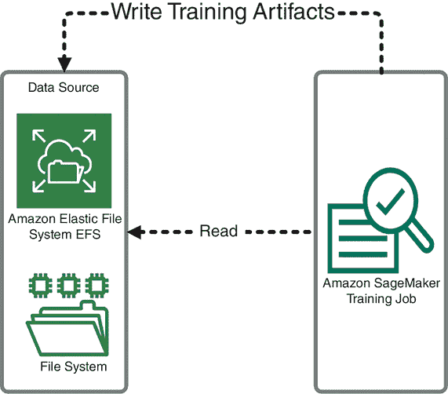

图 2.5 ML 生命周期中 Amazon EFS 的使用。

## AWS ML 存储服务对比

### Amazon EFS 与 Amazon S3

在为 AWS 中的 ML 存储在 Amazon EFS 和 Amazon S3 之间做决定时，必须考虑它们针对特定用例量身定制的独特优势。Amazon EFS 提供文件系统接口，具有强一致性、文件锁定和对 NFS 协议的支持，使其成为需要传统文件系统语义和快速访问训练数据集的应用程序的理想选择。但是，重要的是要注意，使用 Amazon SageMaker 设置 Amazon EFS 需要一些 DevOps 工作，因为您需要配置接口 VPC 终端节点以确保安全连接。这涉及在您的 VPC 中创建终端节点、配置安全组并确保已就绪适当的 IAM 策略。

相比之下，Amazon S3 是一种多功能的对象存储服务，擅长处理大型非结构化数据集，并支持您的 ML 工作负载的各种数据存储需求。

虽然 S3 通常对于通用存储更具成本效益，但 Amazon EFS 和 Amazon S3 之间的选择应基于您应用程序的具体要求。Amazon EFS 更适合需要快速访问存储在共享文件系统中的训练数据且具有强一致性的工作负载，而 S3 更适合具有成本效益的对象存储和大规模数据存储解决方案。

##### 用例

鉴于其无服务器、可扩展性和可靠性特性，Amazon EFS 最适合需要跨多个使用者共享不可预测数量的文件数据的用例。这些包括以下内容：

*   **数据科学和 ML。** Amazon EFS 为 ML 和大数据分析工作负载提供所需的性能和一致性。

*   **现代应用程序开发。** Amazon EFS 允许开发人员以安全、有序的方式共享代码和其他文件，以提高 DevOps 敏捷性并更快地响应客户反馈。其高可用分布式文件服务器功能允许开发人员零管理地共享来自其 AWS 容器和无服务器应用程序的数据。

*   **内容管理系统 (CMS)。** 作为高可用、无服务器、弹性和分布式文件服务器，Amazon EFS 简化了现代 CMS 工作负载的存储，从而加快了上市时间、提高了可靠性、增强了安全性并降低了成本。

### Amazon FSx for Lustre

Amazon FSx for Lustre 是一种完全托管的存储服务，提供高性能、横向扩展的文件系统。该存储服务基于开源 Lustre 并行分布式文件系统构建，专为计算密集型工作负载而设计，提供亚毫秒级延迟、高达数百 GB 的吞吐量和每秒数百万次输入/输出操作 (IOPS)，使其成为 ML、HPC、视频处理和金融建模的理想选择。通过提供可扩展、安全且持久的存储，Amazon FSx for Lustre 使您能够快速且具有成本效益地处理大型数据集。

就像 Amazon S3 和 Amazon EFS 一样，Amazon FSx for Lustre 也可以与 Amazon SageMaker 原生集成。这种集成允许您将此存储服务用作 ML 训练作业的数据源，从而显著加快训练过程。通过消除从 Amazon S3 向训练实例下载数据的需求，Amazon FSx for Lustre 确保了更快的启动和训练时间，提高了整体效率。正如图 2.6 所示，训练实例不知道训练数据正从 S3 中提取，因为 Amazon FSx for Lustre 在 S3 存储桶和训练实例之间充当抽象层，从而产生可配置为缓冲区缓存的高性能文件系统接口。这突出了 FSx for Lustre 在抽象数据传输过程中的作用，确保训练实例与高性能文件系统交互，而无需直接管理从 S3 获取数据。

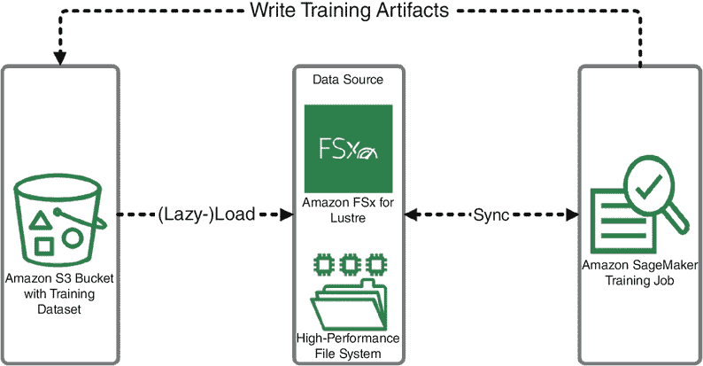

图 2.6 Amazon FSx for Lustre 在 ML 生命周期中的用法。

Amazon FSx for Lustre 支持两种数据加载设计模式：从 S3 到 Lustre 的*一次性加载*和*惰性加载*，后者在数据被访问时逐渐从 S3 加载数据。前者是在您需要快速使大型数据集可用于处理时的绝佳选择，由于快速数据传输，它以较高的初始成本提供卓越的性能。后者适用于您希望最小化初始数据传输和成本的场景，因为数据仅在需要时加载，尽管可能会导致每次数据首次使用时的访问时间稍长。这种灵活性使 Amazon FSx for Lustre 成为需要高吞吐量和低延迟数据访问的工作负载的绝佳选择。

除了性能优势外，Amazon FSx for Lustre 还支持多种部署选项，包括*临时*和*持久*文件系统，以适应您的 ML 应用程序的不同数据处理需求。临时文件系统非常适合临时存储和短期处理，而持久文件系统更适合长期存储和以吞吐量为中心的工作负载。

凭借其强大的集成能力（Amazon SageMaker 原生连接）、丰富的可配置性（一次性加载和惰性加载）以及灵活的部署选项（临时和持久文件系统），Amazon FSx for Lustre 是一项强大的存储服务，适用于需要高性能、可扩展且低延迟数据访问的 ML 应用程序。

到目前为止，您已经了解了三种提供与 Amazon SageMaker 训练引入机制原生集成的 AWS 存储服务。它们分别是 Amazon S3、Amazon EFS 和 Amazon FSx for Lustre。对于考试，请确保您了解训练时间、性能和成本之间的不同权衡。这些存储服务中的每一种都具有可能影响您 ML 工作流的独特功能。Amazon S3 具有高度可扩展性和成本效益，使其适合大型数据集和长期存储。Amazon EFS 为与 AWS 云服务和本地资源配合使用提供简单、可扩展且完全托管的文件存储，提供共享访问和灵活性。Amazon FSx for Lustre 专为高性能、低延迟计算和 ML 工作负载进行了优化，提供不同的数据加载访问模式和部署选项。

如图 2.7 所示，当仅以训练时间作为维度对比这三种存储服务时，Amazon FSx for Lustre 是您的最佳选择。但是，如果成本是关键因素，Amazon S3 是最经济的选择，其次是 Amazon EFS，它有效地平衡了成本和性能。

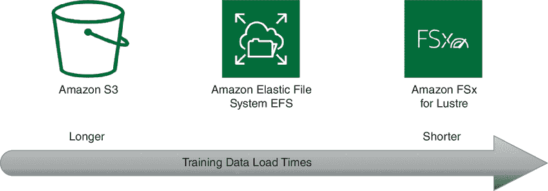

图 2.7 训练数据加载时间对比。

##### 用例

作为基于 Lustre 高性能文件系统构建的完全托管服务，Amazon FSx for Lustre 最适合以下用例：

*   **机器学习。** 凭借其与 Amazon SageMaker 的原生集成，FSx for Lustre 非常适合需要亚毫秒级延迟来访问大型数据集的 ML 训练作业。通过将 FSx for Lustre 用作数据源，ML 工程师和数据科学家可以因高速访问和处理能力而显著减少模型训练所需的时间。从 Amazon S3 加载数据的灵活性——通过一次性加载或惰性加载——提高了 ML 工作流的效率，使其成为需要快速数据访问和高吞吐量的任务的绝佳选择。

#### 高性能计算

Amazon FSx for Lustre 也非常适合那些需要海量数据处理能力且要求低延迟的 HPC 工作负载。这包括科学研究、模拟以及计算任务等应用，例如天气建模和基因组测序，使研究人员和工程师能够快速高效地执行复杂的计算和分析。

#### 媒体处理

Amazon FSx for Lustre 在媒体处理应用方面表现出色，例如视频渲染、转码和编辑，在这些场景中，大量的数据吞吐量和低延迟至关重要。Amazon FSx for Lustre 的高性能特性使媒体专业人士能够高效处理大型媒体文件，满足生产环境的苛刻要求。这确保了任务更快完成和工作流更顺畅，使其成为媒体和娱乐行业的优秀存储服务。

### Amazon FSx for NetApp ONTAP

Amazon FSx for NetApp ONTAP 是另一项完全托管的 AWS 存储服务，它使用 `file` 作为其存储类型，并构建在 NetApp 广受欢迎的 ONTAP 操作系统之上。

Amazon FSx for NetApp ONTAP 提供高性能文件存储，支持使用 ONTAP 的统一数据管理功能，包括以下内容：

*   统一存储管理，可跨越闪存、磁盘和云，运行存储区域网络 (SAN)、网络附属存储 (NAS) 和对象工作负载
*   低延迟访问
*   数据压缩
*   数据去重
*   存储可扩展性

数据压缩和去重通过减少需要存储的数据量来降低成本。

##### 用例

Amazon FSx for NetApp ONTAP 的典型用例包括以下内容：

*   **工作负载迁移。** 无缝迁移在 NetApp 或其他 NFS、SMB、iSCSI 和 NVMe-over-TCP 服务器上运行的工作负载到 AWS，无需修改应用程序代码或数据管理方式。

*   **业务连续性和灾难恢复 (BDCR)。** 从本地文件服务器或跨 AWS 区域实现安全的备份、归档和数据复制。

*   **高性能数据库工作负载。** 凭借亚毫秒级延迟和每个文件系统高达数百万 IOPS 的可扩展性，Amazon FSx for NetApp ONTAP 为您的高性能数据库工作负载提供高可用共享文件存储。此外，Amazon FSx for NetApp ONTAP 允许您通过将客户的工作负载分散到多个文件服务器来横向扩展文件系统。

### Amazon FSx for Windows File Server

Amazon FSx for Windows File Server 是一项完全托管的服务，提供高度可靠、可扩展且高性能的基于 Windows 的文件存储。它与您现有的 Windows 应用程序和环境无缝集成，提供对 Windows 服务器消息块 (SMB) 协议的原生支持。这使其成为共享文件存储用例的理想解决方案，例如主目录、用户配置文件和需要文件存储的企业应用程序。通过 Active Directory 集成，它确保安全的访问控制和用户管理，数据去重功能通过消除重复文件有助于降低存储成本。


该存储服务提供配备 SSD 存储选项的强劲性能，确保对文件的低延迟访问和面向高要求应用程序的高 IOPS。其灵活的可扩展性允许您轻松调整文件系统大小以满足不断增长的存储需求，使其成为基于 Windows 环境的强大高效存储解决方案。

### 用例

Amazon FSx for Windows File Server 的典型用例包括以下内容：

*   **Windows 文件服务器迁移。** 通过提供支持 SMB 协议和 Active Directory 集成的完全托管原生 Windows 文件系统，Amazon FSx for Windows File Server 允许组织将其现有文件系统无缝迁移到 AWS，而无需修改其应用程序，确保平稳过渡，将中断降至最低。

*   **SQL Server 成本节省。** Amazon FSx for Windows File Server 支持高可用性部署，且无需 SQL Enterprise 许可，从而显著节省成本。这对于以 SQL Server 为中心并考虑迁移到 AWS 的组织特别有益。

*   **虚拟桌面和应用程序流式传输。** 使用 Amazon FSx for Windows File Server，您可以将用户配置文件数据存储在共享的持久存储上，该存储可从 Amazon WorkSpaces 和 Amazon AppStream 2.0 访问。该存储服务通过减少登录时间和提高整体生产力，可以简化虚拟桌面用户体验。

### Amazon FSx for OpenZFS

Amazon FSx for OpenZFS 是一项完全托管的存储服务，允许您在 AWS 上运行和扩展 OpenZFS 文件系统，将 OpenZFS 熟悉的功能和性能与 AWS 的可扩展性和简便性相结合。它支持通过 NFS 协议 (v3、v4、v4.1 和 v4.2) 从 Linux、Windows 和 macOS 计算实例及容器进行访问，提供超过一百万的 IOPS 和亚毫秒级延迟，利用最新的 AWS 计算、磁盘和网络技术满足高性能工作负载需求。

#### 用例

Amazon FSx for OpenZFS 的典型用例包括以下内容：

*   **工作负载迁移。** 顾名思义，该存储服务的主要用例是将在 ZFS（或其他基于 Linux 的文件服务器）上运行的工作负载迁移到 AWS，而无需修改应用程序代码或数据管理实践。

*   **数据密集型应用程序。** 凭借 OpenZFS 文件系统的先进功能和广泛的 NFS 支持，Amazon FSx for OpenZFS 最适合在 AWS 上开发数据密集型应用程序。

### Amazon Elastic Block Storage (EBS)

Amazon EBS 是一项高性能的 AWS `block` 存储服务，可用作云 SAN。

Amazon EBS 存储以 EBS 卷的形式提供，类似于云中的虚拟磁盘，可挂载到 Amazon EC2 实例。EBS 卷可以是固态硬盘 (SSD) 或硬盘驱动器 (HDD)。基于 SSD 的卷针对涉及频繁读/写操作且 I/O 大小较小的事务性工作负载进行了优化，其关键性能指标为 IOPS；而基于 HDD 的卷针对大型流式工作负载进行了优化，其关键性能指标为吞吐量。

使用 Amazon EBS，您还可以创建快照，即 EBS 卷的某个时间点备份，可用于恢复新卷。

#### 用例

Amazon EBS 的典型用例包括以下内容：

*   **块级存储迁移。** 将中端本地 SAN 工作负载迁移到 AWS。为任务关键型应用程序挂载高性能和高可用性的块存储。

*   **RDBMS 和 NoSQL 工作负载。** 部署并扩展您选择的数据库，包括 SAP HANA、Oracle、Microsoft SQL Server、PostgreSQL、MySQL、Cassandra 和 MongoDB。

*   **大数据分析工作负载。** 轻松调整大数据分析引擎（如 Hadoop 和 Spark）的集群大小，并自由分离和重新挂载卷。

### Amazon Relational Database Service (RDS)

Amazon RDS 是一项托管关系型数据库服务，提供八种不同的引擎：Amazon Aurora PostgreSQL 兼容版、Amazon Aurora MySQL 兼容版、RDS for PostgreSQL、RDS for MySQL、RDS for MariaDB、RDS for SQL Server、RDS for Oracle 和 RDS for Db2。

因为您可以选择数据库引擎，所以您今天在现有数据库中使用的代码、应用程序和工具也可以用于 Amazon RDS。例如，无需重构您的 SQL Server 存储过程，无需重写您的应用程序（应用程序连接数据库的方式除外），甚至无需使用另一个 SQL 编辑工具。

#### Amazon RDS

作为一项托管服务，Amazon RDS 为您处理数据库管理任务，例如预置、修补、备份、恢复、故障检测和修复。

Amazon RDS 提供三种不同的部署环境，包括使用 Amazon Aurora 或 Amazon RDS 在云中部署、使用 Amazon RDS on AWS Outposts 部署混合工作负载，以及使用 Amazon RDS Custom 通过特权访问进行部署。

与所有 AWS 服务一样，无需预先投资，您只需为使用的资源付费。

##### 使用案例

Amazon RDS 的典型使用案例包括以下内容：

*   **现代 Web 和移动应用程序。** Amazon RDS 是构建架构良好应用程序的绝佳选择，因为它提供了一种安全的存储解决方案，具有高可用性、高性能和可扩展性，且管理工作量有限。此外，其按使用付费的定价模式使您能够有效管理在 AWS 中运行的关系型数据库中持久化数据的成本。

*   **遗留数据库迁移。** 将本地遗留数据库迁移到 Amazon RDS 是那些希望在数字化转型过程中实现工作负载现代化的组织的自然选择。除了提高可扩展性和可靠性外，成本降低也是一个关键考量因素，因为许可费用大幅节省，同时还能享受按使用付费定价模式的优势。

### Amazon DynamoDB

Amazon DynamoDB 是一项无服务器 NoSQL 数据库服务，可在任何规模下提供稳定的个位数毫秒级性能。

其无服务器特性意味着您无需预置任何基础设施，也无需修补、管理、安装、维护或运行任何软件。DynamoDB 还提供零停机维护。

作为一种 NoSQL 数据库，与关系型数据库相比，DynamoDB 的设计和构建旨在提供高性能、可扩展性、可管理性和灵活性。为了支持广泛的使用案例，通过 DynamoDB，您可以同时使用键值和文档数据模型。为了帮助您构建企业级应用程序，Amazon DynamoDB 提供强读一致性和 ACID（原子性、一致性、隔离性和持久性）事务支持。

为了实现稳定的个位数毫秒级性能，DynamoDB 针对高性能工作负载进行了优化，并提供鼓励高效数据库使用的 API。它省略了在大规模下效率低下且性能不佳的功能：例如 `JOIN` 操作。无论有 100 个还是 1 亿个用户，DynamoDB 都能为您的应用程序提供稳定的个位数毫秒级性能。

#### 使用案例

DynamoDB 非常适合那些需要在任何规模下以最小的运营开销实现稳定性能的使用案例，包括但不限于以下内容：

*   **金融服务应用程序。** Amazon DynamoDB 事务可用于通过单个请求跨一个或多个表实现 ACID。ACID 事务非常适合处理金融交易或履行订单的工作负载。Amazon DynamoDB 会随着工作负载的激增和减少即时调整，使您能够高效地扩展数据库以应对市场状况，例如交易时段。

*   **游戏应用程序。** 由于其横向扩展和缩减的能力、稳定的性能，以及无服务器架构提供的简便操作，Amazon DynamoDB 可用于高效持久化任何游戏平台的所有数据元素，例如游戏状态、玩家数据、会话历史记录和排行榜。无论您是为高峰流量横向扩展，还是在游戏使用率低时缩减规模，这种可扩展性都能优化架构的效率。

*   **数据流应用程序。** 媒体和娱乐公司广泛使用 Amazon DynamoDB 作为内容管理服务的元数据索引，或用于提供近实时体育统计数据。Amazon DynamoDB 还用于执行用户观看列表和书签服务，并处理每日数十亿客户事件以生成推荐。这些客户受益于 DynamoDB 的可扩展性、性能和弹性。DynamoDB 内置的弹性使流媒体使用案例能够支持任何级别的需求。

## 故障排除

在 AWS 中排查和调试与容量和可扩展性相关的数据摄取和存储问题涉及多个步骤和最佳实践。以下是您备考需要了解的一些关键策略：

*   **监控和日志记录。** 使用 `CloudWatch` 监控您的 AWS 资源和应用程序。设置警报，以便在 CPU 使用率、内存使用率和 I/O 操作等指标出现异常时通知您的数据运维团队。启用 `CloudTrail` 以记录 API 调用并跟踪 AWS 资源的更改。这有助于确定问题的根本原因。

*   **扩展和性能优化。** 为您的 `EC2` 实例和其他可扩展资源实施自动扩展，以根据需求自动调整容量。使用只读副本和 Aurora 的自动扩展功能来处理增加的读取流量并提高性能。

*   **数据摄取优化。** 为了优化数据管道的性能，请使用数据分区、缓存和并行处理等技术。对于实时数据摄取，利用 `Amazon MSK`、`Amazon Managed Service for Apache Flink`、`Amazon Kinesis Data Streams` 或 `Amazon Data Firehose` 来处理大量流式数据。此外，考虑结合 `AWS Lambda` 函数来实时处理数据，并根据摄取数据量自动扩展。

*   **存储管理。** 使用 `Amazon S3` 进行企业级对象存储。实施生命周期策略，根据数据访问模式将数据移动到不同的存储类别。监控 `Amazon EBS` 卷的性能，并根据需要调整卷类型或大小，以满足容量和性能要求。

*   **数据库优化。** 确保您的数据库查询经过优化，且索引配置正确以提高性能。考虑对数据库进行分片，以将负载分发到多个实例。使用 `Amazon DynamoDB` 时，应尽可能避免使用 `scan` 操作，因为与其他查询操作相比，其性能效率低下。

*   **成本管理。** 使用 `AWS Cost Explorer` 监控和分析您的 AWS 支出。确定可以通过调整资源使用来优化成本的领域。对于可预测的工作负载，考虑购买预留实例或节省计划以降低成本。对于弹性临时工作负载，利用竞价型实例以最大程度降低成本。

通过实施这些策略，您可以有效地排查和调试 AWS 中与容量和可扩展性相关的数据摄取和存储问题。

## 总结

在本章中，我们介绍了数据摄取和数据存储，它们是机器学习生命周期收集阶段的两个关键组成部分。

通过摄取，您可以从不同来源聚合 ML 解决方案的数据，并以原始格式将其推送到 AWS 中。数据摄取可以批量进行，也可以实时进行。`Amazon Data Firehose`、`Amazon Kinesis Data Streams`、`Amazon MSK` 和 `Amazon Managed Service for Apache Flink` 用于摄取实时数据。`AWS DataSync` 和 `AWS Glue` 用于摄取批量数据。

通过存储，您可以将摄取的数据持久化在合适的 AWS 数据存储中，直到其准备好进行处理。存储分为三种不同类型：对象、文件和块。`Amazon S3` 用于存储对象数据，`Amazon EBS` 用于存储块数据，`Amazon EFS` 和 `Amazon FSx` 系列服务用于存储文件数据。

选择合适的摄取和存储服务的驱动因素取决于您用例的具体情况，包括可扩展性、弹性、安全性和成本。

本章还介绍了考试所需了解的各种数据格式，这些格式可用于进一步优化性能、提高可扩展性并缩短处理时间。选择用于训练模型的数据格式时，一个重要考量因素是该格式是否受您打算用于解决 ML 问题的 ML 算法支持。

## 考试重点

**了解数据摄取与数据存储的区别。** 数据摄取是指从不同来源聚合数据，而存储是指将数据持久保存在 AWS 中托管的数据存储中。

**了解不同的数据格式。** `CSV` 用于以表格格式存储结构化数据，而 `JSON` 用于基于文档的半结构化数据。`Apache Parquet` 和 `Apache ORC` 是列式数据格式，而 `Apache Avro` 是行式格式。`RecordIO` 是一种主要由 `Apache MXNet`（一种深度学习框架）使用的数据格式。

**了解流式数据的摄取服务。** 这些服务包括 `Amazon Data Firehose`、`Amazon Kinesis Data Streams`、`Amazon MSK` 和 `Amazon Streaming Service for Apache Flink`。`Amazon Kinesis Data Streams` 更适合实时、自定义数据处理，而 `Amazon Data Firehose` 非常适合以最少的设置和管理高效地将流式数据加载到选定的 AWS 数据存储中。`Amazon MSK` 最适合管理和分发流式数据（例如日志聚合、实时分析和事件溯源），而 `Amazon Managed Service for Apache Flink` 旨在实时处理和分析数据。

**了解数据迁移/批处理/ETL 数据的摄取服务。** 这些服务包括 `AWS DataSync` 和 `AWS Glue`。前者非常适合将数据传输/迁移到 AWS，后者适合 ETL 和数据管道开发。

**了解对象数据的存储服务。** `Amazon S3` 是 AWS 上功能最全面、使用最广泛的对象存储服务。它提供行业领先的可扩展性、数据可用性、安全性和性能。对象数据包含数据本身、元数据和唯一标识符。对象存储通过 API 访问，使其适合云原生应用程序。`Amazon S3` 作为训练 ML 模型的数据源，受 `Amazon SageMaker` 原生支持。

**了解文件数据的存储服务。** `Amazon EFS` 和 `Amazon FSx` 系列服务（`Amazon FSx for Lustre`、`Amazon FSx for NetApp ONTAP`、`Amazon FSx for Windows File Server` 和 `Amazon FSx for OpenZFS`）用于将数据存储为文件存储类型。文件存储以分层方式组织数据，非常适合持久化共享数据，例如公司目录中的数据、媒体存储和内容管理系统。`Amazon EFS` 和 `Amazon FSx for Lustre` 是受 `Amazon SageMaker` 原生支持的基于文件的存储服务，可作为训练 ML 模型的数据源。

**了解块数据的存储服务。** `Amazon EBS` 是 AWS 上的块存储服务。块存储将数据划分为固定大小的块，每个块具有唯一地址但不包含元数据。块存储提供高性能和低延迟，使其成为事务性工作负载的理想选择。

**了解与 Amazon SageMaker 原生集成的存储服务。** `Amazon SageMaker` 与 `Amazon S3`（对象存储）、`Amazon EFS` 和 `Amazon FSx for Lustre`（文件系统存储）原生集成，方便无缝访问数据以进行训练、学习和高效管理 ML 工作流。

## 复习题

1. 您需要存储来自 IoT 设备的未处理数据，用于新的机器学习管道。存储解决方案应是一个集中式且高可用的存储库。您会选择哪种 AWS 存储服务来存储未处理数据？

    1. `Amazon Elastic File System (EFS)`

    2. `Amazon S3`

    3. `Amazon DynamoDB`

    4. `Amazon Relational Database Service (RDS)`

2. 您正在为机器学习管道设计一个高度可扩展的数据存储库。您需要在 6 个月内立即访问管道中的已处理数据。您的未处理数据必须可在 12 小时内访问并存储 6 年。存储解决方案必须支持 SQL 查询功能。哪种存储解决方案最具成本效益？

    1. `Amazon S3` 和 `Amazon Athena`

    2. `Amazon S3`

    3. `Amazon DynamoDB`

    4. `Amazon Redshift`

3. 您正在使用 `Amazon Data Firehose` 传输流来摄取来自本地应用程序的 `GZIP` 压缩数据记录。您需要为数据科学家配置一个解决方案，以便对数据流执行 SQL 查询以获取实时洞察。哪种解决方案满足这些要求？

    1. `Amazon S3` 和 `Amazon Athena`

    2. `Amazon Managed Service for Apache Flink` 和 `Lambda` 函数

    3. `Amazon Managed Streaming for Apache Kafka` 和 `Lambda` 函数

    4. `Amazon Redshift` 和 `Amazon Athena`

4. 您是一名机器学习工程师，需要处理大量客户数据、分析数据并获取洞察，以便分析师做出进一步决策。为了完成此任务，您需要将数据存储在一种能够处理大量数据并尽可能高效快速地检索数据的数据结构中。哪种解决方案满足这些要求？

    1. `Amazon EMR` 与 `HDFS`

    2. `Amazon S3` 和 `Lambda` 函数

    3. `Amazon DynamoDB` 和 `Lambda` 函数

    4. `Amazon Redshift` 和 `Amazon Athena`

5. 您被要求重新设计并降低运营开销，使用 AWS 服务检测交易数据中的异常并为恶意记录分配异常分数。记录以实时方式流式传输并存储在 `Amazon S3` 数据湖中以进行处理和分析。最高效的解决方案是什么？


1. 使用 `Amazon Data Firehose` 流式传输交易数据，并使用 `Amazon Managed Service for Apache Flink` 的 `RANDOM_CUT_FOREST` 函数检测异常

2. 使用 `Amazon Data Firehose` 将交易数据流式传输到 `Amazon S3`，并使用 `SageMaker` 的 `RANDOM_CUT_FOREST` 函数检测异常

3. 使用 `Amazon Kinesis Data Stream` 流式传输交易数据，并使用 `Amazon Managed Service for Apache Flink` 的 `RANDOM_CUT_FOREST` 函数检测异常

4. 使用 `Amazon Kinesis Data Stream` 将交易数据流式传输到 `Amazon S3`，并使用 `SageMaker` 的 `RANDOM_CUT_FOREST` 函数检测异常

6. 您被要求缩短将地理位置数据摄取并存储到 `Amazon Redshift` 中的时间，以进行近实时分析。哪种解决方案最具成本效益？

    1. 使用 `Amazon Kinesis Data Stream` 摄取地理位置数据。使用 `Amazon Redshift Streaming Ingestion` 将流式数据加载到 `Amazon Redshift` 集群中。

    2. 使用 `Amazon Managed Streaming for Apache Kafka` 摄取地理位置数据。使用 `Amazon Redshift Spectrum` 将流式数据加载到 `Amazon Redshift` 集群中。

    3. 使用 `Amazon Data Firehose` 摄取地理位置数据。使用 `Amazon Redshift Streaming Ingestion` 将流式数据加载到 `Amazon Redshift` 集群中。

    4. 使用 `Amazon Managed Service for Apache Flink` 摄取地理位置数据。使用 `Amazon Redshift Streaming Ingestion` 将流式数据加载到 `Amazon Redshift` 集群中。

7. 您正在将数据分析解决方案迁移到 AWS。该应用程序以近实时方式生成 `CSV` 文件形式的数据。您需要一种解决方案，在将数据保存到 `S3` 存储桶之前将数据格式转换为 `Apache Parquet`。哪种解决方案最高效？

    1. `Amazon Kinesis Data Streams` 和创建流式 `AWS Glue ETL` 作业以将数据转换为 `Apache Parquet`

    2. `Amazon Managed Streaming for Apache Kafka` 和 `Lambda` 函数

    3. `Amazon Data Firehose` 和 `Lambda` 函数

    4. `Amazon Managed Service for Apache Flink` 和 `Lambda` 函数

8. 您正在使用 `Amazon Data Firehose` 从本地摄取数据记录。记录使用 `GZIP` 压缩。如何高效地对数据流执行 SQL 查询以获得实时洞察并减少查询延迟？

## 第 3 章：数据转换与特征工程

### 简介

在第 2 章中，您学习了如何从不同来源摄取数据以及如何将这些数据存储在 AWS 中。现在您已经收集了数据并将其保护在 AWS 中，作为机器学习 (ML) 工程师，您的工作是使其准备好训练您的 ML 模型。此步骤在 ML 生命周期的“处理数据”阶段中进行说明，如图 3.1 所示。

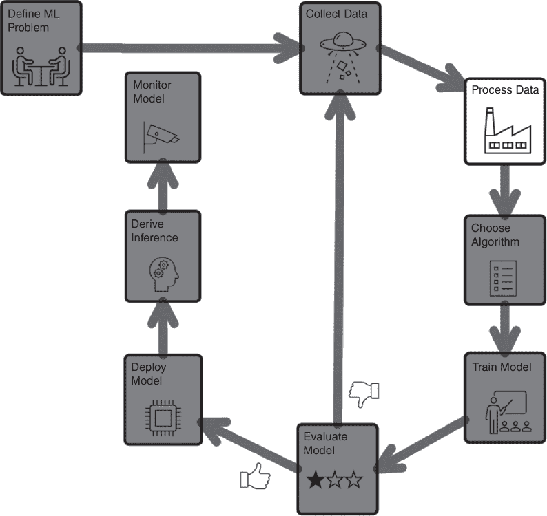

图 3.1 ML 生命周期。

您的数据通常以原始状态存储在*数据湖*中。数据湖架构可以为构建 ML 解决方案提供坚实的基础，因为它旨在在中央存储库中存储海量数据，以便您组织内的不同团队能够随时对其进行分类、处理、丰富和使用。

以下是数据湖的关键特征：

*   **大规模存储。** 数据湖必须能够容纳随时到来的数据，无论是按预定时间间隔还是实时到达，无论是小负载还是大批量。
*   **数据移动。** 就像真正的湖泊有注入湖泊的河流入口和流出湖泊的河流出口一样，数据湖必须允许数据进出数据湖。
*   **原始数据。** 移入数据湖的数据可能来自不同来源，可能是结构化、半结构化或非结构化的。在数据收集的摄取和存储阶段，数据的格式无关紧要。
*   **安全性。** 由于敏感数据可能被导入数据湖，因此至关重要的是要确保未经授权的用户无法访问这些数据。因此，数据湖必须受到强大的身份和访问管理 (IAM) 安全控制的保护。使用中加密和传输中加密与静态加密同等重要。因此，应建立并强制执行安全防护措施，以保护数据在生产和消费过程中的安全。
*   **目录。** 数据湖必须允许您存储关系数据（例如，运营数据库、业务线应用程序数据）和非关系数据（例如，来自移动应用、物联网设备和社交媒体的数据）。它们还通过爬取、编目和索引数据，使您能够了解湖中有哪些数据。

要在 AWS 中创建数据湖，您通常会结合使用以下服务：`Amazon S3`（用于存储）、`AWS Glue`（用于编目）、`Amazon Athena`（用于查询）和 `AWS Lake Formation`（用于 IAM、数据安全和治理的中央管理）。

除了 `AWS Lake Formation`，我们在上一章已经介绍了这些服务。对于考试，您需要知道 `Amazon S3` 是 AWS 上数据湖的首选存储选项，因为它提供高持久性 (99.999999999%)、高可用性、安全的存储，并能与 AWS 上的多种数据处理服务和 ML 平台无缝集成。`Amazon S3` 可用作大多数 AWS ML 服务的单一事实来源存储。此外，借助 `Amazon S3` 的智能分层存储类，您可以通过让 AWS 自动确定何时将数据移动到最合适的存储类来降低存储成本。

`AWS Lake Formation` 通过集中数据权限、简化大规模安全管理和治理、监控数据访问以及确保合规性，很好地补充了上述 AWS 服务。

在接下来的章节中，您将学习处理数据湖中数据的技术，使其适合训练您的 ML 模型，从而产生有意义的推理。

“处理数据”阶段的最终目标是生成高质量数据，以有效地训练您的 ML 模型，使其能更快地从您的数据中学习并产生准确的预测。您的训练数据集质量越高，您的 ML 模型产生的推理就越准确。

### 理解特征工程

在深入探讨特征工程之前，让我们先专注于了解不同的数据类型：

*   **分类数据。** 分类数据包含有限数量的不同类别，每个类别用字符串表示。分类数据可能具有逻辑顺序，例如衬衫尺码：小号、中号、大号、加大号。这种类型的分类数据称为*有序*。或者，没有逻辑顺序的分类数据称为*无序*。例如，美国 50 个州是无序分类数据。
*   **数值数据。** ML 中的数值数据是指任何可以用数字表示的数据类型。这包括离散数据和连续数据。
    *   *离散*数据在任意两个值之间具有可数数量的值。离散变量始终是数值型的，例如客户投诉数量或缺陷/瑕疵数量。
    *   *连续*数据在任意两个值之间具有无限数量的值。连续变量可以是数值或日期/时间，例如零件的长度或收到付款的日期和时间。
*   **文本数据。** 文本数据是指可被处理和分析的书面内容。这可以包括文章或书籍中的句子和段落、社交媒体帖子、评论等。它用于各种自然语言处理 (NLP) 任务，如情感分析、语言翻译和文本分类。
*   **图像数据。** 图像数据由像素值组成，可被分析以提取边缘、形状、颜色和模式等特征。图像数据常用于计算机视觉任务，如目标检测、人脸识别和图像分类。
*   **时间序列数据。** 时间序列数据是指按固定时间间隔记录的一系列观测值或测量值。在这种数据类型中，每个观测值都与特定的时间戳或时间段相关联，从而形成按时间顺序排列的数据点序列。数据点的顺序对于理解该时间段内发生的趋势、模式和变化至关重要。

理解不同数据类型的能力是我们训练 ML 模型目标的第一步。这是必要的一步，考虑到您数据湖中的数据是从不同数据源摄取的多个数据集的组合。每个数据集可能由结构化、半结构化或非结构化数据组成。即使您的所有数据集均由结构化数据组成，也不能保证所有数据集的模式都相同。因此，这些数据需要经过适当的转换，才能准备好输入 ML 算法。

#### 特征工程

这就是特征工程发挥作用的地方。特征工程是从现有数据中提取更多信息以提升机器学习模型预测能力并帮助模型更快学习的科学（也是艺术）。在特征工程过程中，你并没有添加任何新数据，而是让你已有的数据变得更有用。通过将数据重新排列成一组可以直接输入机器学习算法的 `features`（特征），你的机器学习模型将得出更好的推断。特征工程通常依赖于数据的领域知识，以便为机器学习模型产生更有效的结果。

你刚才了解到的数据类型（分类、数值、文本、图像、时间序列）将决定最合适的特征工程方法。

##### 定义特征

在机器学习中，`features`（特征）是你正在分析的数据的个别可测量属性或特征。数据的每个唯一属性都被视为一个 `feature`（特征，也称为 `attribute` 属性）。可以将它们视为模型用来进行预测的输入。例如，在销售数据集中，特征可能包括日期、访客数量和订单数量（销售额）。

图 3.2 说明了一个简化的销售数据集。

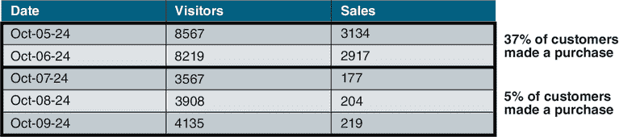

图 3.2 数据集示例。

假设你的机器学习模型将使用这些数据来预测某一天的销售额。乍一看，你可能已经注意到前两行的销售数量明显高于其余三行。进一步分析表明，客户在周末更倾向于购买。因此，是星期几影响了购买习惯。所以我们可以设计一个特征来标识星期几，然后编写一个简单的脚本自动填充该数据，如图 3.3 所示。

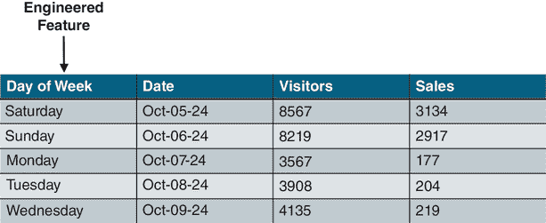

图 3.3 向数据集添加特征。

这个简单的例子展示了数据集中“隐藏”的信息如何帮助机器学习模型更快地学习。特征工程的核心在于发现这些信息在哪里，以及如何转换数据集以最好地利用它们。

##### 为模型训练选择特征

以下是特征工程的主要关注领域：

*   特征提取
*   特征选择
*   特征创建与转换

特征提取和特征选择的目标是降低数据集的维度。术语 `dimensionality`（维度）表示数据集中拥有的特征（或输入）数量。数据集的维度越高，有效训练机器学习模型的任务就越困难。当有许多不同维度的数据（许多特征）需要筛选时，模型将难以找到你希望它们识别的模式。

这就是为什么执行特征提取和选择很重要的原因。

###### 特征提取

特征提取是通过从现有特征创建新特征来自动降低数据集维度的过程。特征提取是拥有大量特征的数据集的常见过程，最常见于处理图像、音频或文本数据时。

图 3.4 展示了一个图像识别的示例。


图 3.4 图像识别示例。

在神经网络出现之前，分析图像数据集的方法之一是从单个图像中提取特征。如果图像是一辆汽车，你可以提取图像的一些有用方面，如挡风玻璃、前大灯、转向灯和轮胎作为独立特征。因此，你的数据集不再由原始像素组成，而是拥有如 `windshield_present`（有挡风玻璃）和 `headlight_present`（有前大灯）这样的特征或列，如图 3.5 所示。这些特征将使机器学习算法更容易从图像数据中学习，并最终开始识别人脸。

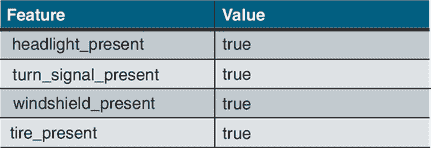

图 3.5 从图像中提取特征。

在大多数情况下，数据本身将帮助你确定使用什么特定的特征提取技术。

对于图像数据，可能是像我们之前看到的那样提取关键特征。在自然语言处理（NLP）中，可能是提取除冠词或介词外文本中最常用的单词等有用特征。

###### 特征选择

特征选择是降低数据集维度的另一种技术，通常与特征提取结合使用。

特征选择根据数据集现有特征的预测重要性对其进行排序，并根据排名仅选择最相关的特征。

因为你的数据集包含存储在数据湖中的原始数据，相对于模型准确性，某些特征可能比其他特征更重要。由于与其他特征的数据相关性，某些特征也将是冗余的。

在图 3.6 的示例中，收入随销售额同步变化，因此它不太可能比模型从销售数据中已获得的信息提供更多见解。

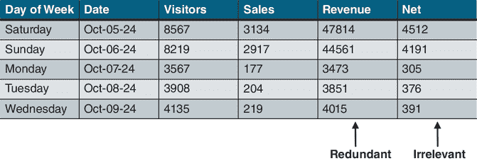

图 3.6 执行特征选择。

与问题无关的特征需要被移除。特征选择通过从数据集中 `filtering out`（过滤掉）不相关或冗余的特征来解决这些问题。结果，仅有一个对问题最有用的特征子集可供机器学习算法使用。

过滤算法可能使用统计度量来帮助识别与目标变量有强关系的特征。在该示例中，我们希望机器学习模型预测的目标变量是某一天的销售额，因此销售净利润可能与该预测无关。因此，我们可以移除该特征。

请记住，机器学习算法不仅用于典型的结构化数据集。我们经常处理非结构化数据集，形式包括图像、音频或视频等。这些类型的数据格式需要过滤技术来降低数据集的维度。

###### 特征创建与转换

与特征提取和选择不同，特征创建与转换不是降维技术。相反，特征创建与转换是从现有特征生成新特征的过程。例如，假设我们有“date”（日期）作为一个特征，格式为两位数的日、两位数的月和两位数的年（dd-mm-yy）。

你可能会发现将日、月、年组合成一个特征对预测没有太大帮助。相反，你可以生成三个不同的特征，一个用于日，一个用于月，一个用于年，这样就有可能发现这些特征中的某一个与你希望机器学习模型预测的目标变量之间存在有意义的关系。

#### 使用 Amazon SageMaker Feature Store

因为特征是在训练期间作为输入（或变量）提供给机器学习模型的，如果有一个中心位置可以让你选择、优化、存储和管理数据集的所有特征，那不是很好吗？

这就是 Amazon SageMaker Feature Store 发挥作用的地方。Amazon SageMaker Feature Store 是一个完全托管的存储库，用于存储、共享和管理机器学习模型的特征。例如，在一个为给定主题推荐书籍的应用程序中，特征可能包括书籍与主题的关联度、书籍评分和书籍出版日期。

特性由多个团队（数据科学家以及数据和 ML 工程师）持续使用，且特性质量对 ML 模型的准确性至关重要。此外，当用于离线批量训练模型的特性可用于实时推理时，很难保持这两个特性存储同步。Amazon SageMaker Feature Store 提供了一个安全且统一的存储，可在整个 ML 生命周期中大规模处理、标准化和使用特性。

在下一节中，我们将介绍特性工程之前所需的预处理工作。这项工作始于转换数据集以解决数据不一致问题，例如管理异常值、填补缺失数据和去除重复项。

### 数据清洗和转换

数据清洗是一项基础的预处理步骤，可确保您的数据集处于最适合特性工程的状态。

通过有效的数据清洗方法，您可以将“脏”数据转化为结构化、准确且可靠的基础，从而为特性工程奠定基础。这使您能够专注于为 ML 模型创建和选择最相关、最强大的特性。

具体奠基方式如下：

*   **管理缺失值。** 此步骤解决数据集中的任何空缺，无论是通过填补缺失值、删除不完整记录还是以其他方式管理它们。清洁的数据可确保您设计的特性不会因数据空缺而遭受偏差或不准确性的影响。
*   **检测和处理异常值。** 通过识别和管理异常值，您可以防止它们扭曲特性分布并影响模型性能。清洁的数据提供了数据分布更真实的表现，这对有效的特性工程至关重要。
*   **执行去重。** 删除重复记录和冗余数据点有助于简化数据集，使特性工程更高效且不易过拟合。
*   **重新格式化和标准化。** 确保统一的数据类型、单位和格式，可使特性创建更加简单直接。例如，标准化日期格式和度量单位可确保跨特性的一致性和可比性。
*   **去除噪声和错误。** 数据清洗涉及识别和纠正数据中的错误或不一致性。这可确保您创建的特性基于准确可靠的数据，从而构建更稳健的模型。

#### 管理缺失值

数据集包含缺失数据的情况并不少见。例如，数据集中的某些列可能因数据收集错误而缺失值，或者数据可能仅仅是从数据源处不可用。

缺失数据会使所选 ML 算法难以准确解读相关特性与目标变量之间的关系。因此，解决此问题非常重要。

遗憾的是，大多数 ML 算法无法自动处理缺失值。需要人工知识来用对问题有意义且相关的内容替换缺失值。

解决缺失数据的方法因缺失数据量而异。主要技术如下：

*   **收集。** 如果缺失数据量巨大且影响多个特性，您应尝试重新收集数据。然而，数据摄取过程可能既昂贵又耗时。在这种情况下，您需要确定重新收集数据的成本、拥有低性能 ML 模型的成本，以及填补或删除等替代方案之间的权衡。
*   **填补。** 如果您处理的是少量缺失值，且它们随机分布在数据集的特性中，这可能是数据摄取过程故障导致的。在这种情况下，*填补* 可能是一个好选择。通过填补，您可以用观测到的该特性的平均值、中位数或最频繁值来填充缺失数据。如果您特性的数据分布是正态的，则使用平均值；否则，使用中位数或最频繁值。
*   **删除。** 如果缺失数据量巨大但仅限于同一特性，您可以考虑删除整个特性。不过您必须小心，因为如果删除太多特性，可能没有足够的数据来“喂养” ML 模型。

借助 Amazon SageMaker，您可以使用 `sklearn` 中的 `SimpleImputer` 等 Python 库来填补缺失值。以下代码片段展示了该函数的工作原理：

```
from sklearn.impute import SimpleImputer
import numpy as np

##### Create a sample dataset
A = np.array([[1, 2], [None, 4], [5, None]])

##### Create a SimpleImputer object
imputer = SimpleImputer(strategy='mean')

##### Fit and transform the data
B = imputer.fit_transform(A)

print(B)
```

以下输入数组


```
[[1, 2], [None, 4], [5, None]]
```

已转换为：

```
[[1, 2], [3, 4], [5, 3]]
```

AWS Glue DataBrew 也可用于通过多种内置转换来填补缺失值。

### 检测和处理异常值

*异常值* 是指数据集中与其他所有数据点截然不同、与平均值有显著偏差的数据点。

“显著”究竟意味着什么？虽然答案取决于数据类型及其概率分布，但普遍共识是：如果数据点距离平均值超过三个标准差，则将其视为异常值。这基于正态分布的性质，即约 99.7% 的数据位于距平均值三个标准差范围内。

ML 算法对特性值的分布和范围非常敏感。由于异常值偏离了所有其他数据点的模式，它们倾向于在训练期间误导 ML 算法。

例如，考虑以下数据集：

```
[x,y] = [[4, 11], [3.8, 12], [4.5, 12.5], [8, 8], [9, 8.5], [9.5, 7.5], [13, 5], [14, 4.7], [13.7, 6], [25, 23]]
```

在此示例中，假设 `x` 表示您的日用水率，而 `y` 表示日能耗率。这些数字仅用于说明目的。

正如您在图 3.7 中所见，该数据集分布在三组中。

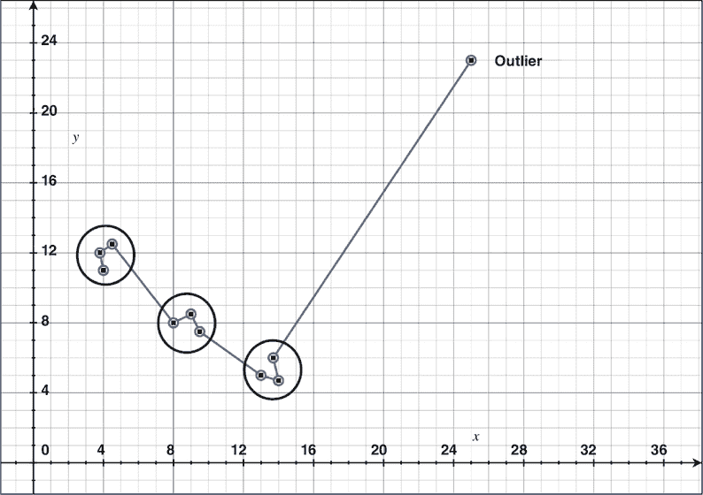

图 3.7 异常值示例。

有一个数据点明显突出，充当了异常值。

虽然一些异常值是由人为错误引起的，但其他异常值只是作为自然现象的结果出现在您的数据集中。自然异常值并非人为错误的结果，而是反映了数据中的某些真实情况。

作为 ML 工程师，您的工作是确定异常值应保留在数据集中，还是需要更改或删除。您可以利用统计技术来做出此决定，这些技术可帮助您了解异常值与数据集中其他数据点相比的相关性。

区分噪声和异常值很重要。前者表示一组错误的数据点，而后者指显著偏离数据集平均值的数据点。在后续章节中，您将学习如何利用 AWS ML 服务的广泛生态系统来确定“显著”的含义。

异常值的处理依赖于三种主要方法：

*   **删除。** 如果异常值是由噪声或人为错误引起的，您可以直接从数据集中删除它们，而不会影响 ML 模型的质量和准确性。

#### 对数变换

通过以给定底数（例如底数 `e`、底数 2、底数 10 等）将异常值替换为其对数，您正在压缩某个特征的取值范围，从而减少数值之间的极端差异。因此，该异常值不会与该特征的其他值相差太远。例如，1000 的以 10 为底的对数（`log10`）是 3。这是因为 `10³ = 1000`，这使其更接近其他较小的值，同时又不失其重要性。

#### 插补

就像处理缺失值一样，您可以使用该特征的平均值（例如），并用该值插补以替换异常值。如果异常值是由人为错误导致的，这将是一种极好的方法。

异常值通常会造成偏态分布，如图 3.7 所示。对数变换有助于使该分布正态化，使其更加对称，从而提高机器学习模型的性能。

图 3.8 说明了在使用对数刻度表示纵坐标轴 `y` 后的同一数据集。异常数据点 `[25, 23]` 的 `x = 25` 和 `y = 23`。因为 `log10(23) = 1.37172724`，您可以看到该数据点不再显著偏离均值。

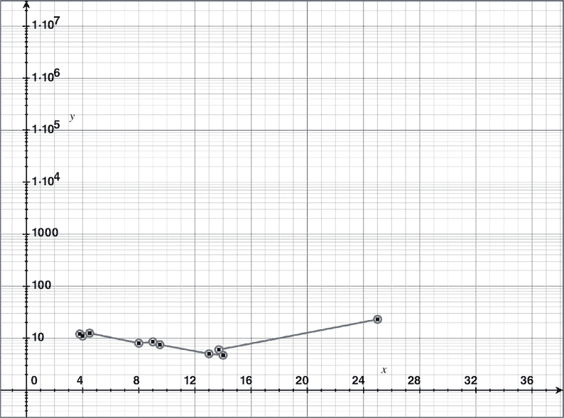

图 3.8 使用对数变换处理异常值。

对于考试，您需要知道可帮助您检测和处理异常值的 AWS 服务，即 Amazon SageMaker Data Wrangler 和 AWS Glue DataBrew。

您可以使用 Amazon SageMaker Jupyter 笔记本，通过 Python 库（如 `pandas`）加载数据集。

为了确定使用哪种异常值检测算法，您需要分析每个特征的直方图。图 3.9 说明了使用以下 Python 代码片段生成的数据集的直方图：

```python
import numpy as np
import pandas as pd
import matplotlib.pyplot as plt
import seaborn as sns

# 加载数据集
data = np.array([[4, 11], [3.8, 12], [4.5, 12.5], [8, 8], [9, 8.5], [9.5, 7.5], [13, 5], [14, 4.7], [13.7, 6], [25, 23]])
df = pd.DataFrame(data, columns=['Feature1', 'Feature2'])

# 绘制直方图
plt.figure(figsize=(12, 5))

plt.subplot(1, 2, 1)
sns.histplot(df['Feature1'], kde=True)
plt.title('Water Usage Distribution (m³/day)')

plt.subplot(1, 2, 2)
sns.histplot(df['Feature2'], kde=True)
plt.title('Energy Usage Distribution (kWh/day)')

plt.show()
```

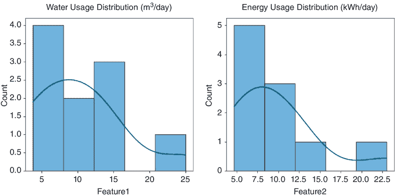

图 3.9 水和能源使用量的直方图。

在图 3.9 中，直方图显示两个特征均呈右偏数据分布。右偏数据分布意味着我们大多数数据点聚集在范围的低端，并有一条长尾向右延伸。这条长尾代表少数数据点的值远高于数据集的其余部分。本质上，大多数值较低，只有极少数异常高，这正是数据点 `[25, 23]` 代表最高值对的场景。

对于偏态数据，四分位距（IQR）方法通常被认为是检测异常值的最佳方法之一。IQR 受偏度影响较小，并提供了一种稳健的度量来识别极端值。

假设 `Q1` 和 `Q3` 分别表示数据集的第一和第三四分位数，以下是其工作原理的快速概述：

*   计算 `Q1` 和 `Q3`。
*   计算 `IQR = Q3 - Q1`。

任何数值小于 `Q1 - 1.5 * IQR` 或大于 `Q3 + 1.5 * IQR` 的数据点均被视为异常值。

在我们的示例中，我们可以利用 `numpy` 和 `pandas` 库中 `DataFrame` 类提供的内置 `quantile` 方法来检测数据集中的异常值，如以下代码片段所示：

```python
import numpy as np
import pandas as pd

# 加载数据集
data = np.array([[4, 11], [3.8, 12], [4.5, 12.5], [8, 8], [9, 8.5], [9.5, 7.5], [13, 5], [14, 4.7], [13.7, 6], [25, 23]])
df = pd.DataFrame(data, columns=['Feature1', 'Feature2'])

# 计算 IQR
Q1 = df.quantile(0.25)
Q3 = df.quantile(0.75)
IQR = Q3 - Q1

# 定义异常值条件
outliers = ((df < (Q1 - 1.5 * IQR)) | (df > (Q3 + 1.5 * IQR))).any(axis=1)
df['Outlier'] = outliers

print("带有异常值标记的原始数据：")
print(df)

# 通过移除异常值进行处理
df_cleaned = df[~df['Outlier']].drop(columns='Outlier')

print("\n 移除异常值后的清洗数据：")
print(df_cleaned)
```

该程序生成的输出如图 3.10 所示，您可以看到脚本如何将数据点 `[25, 23]` 检测为异常值并随后将其移除。

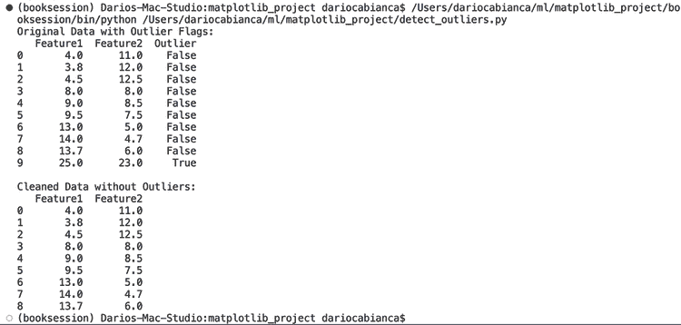

图 3.10 检测和处理异常值。

对于正态分布的数据，Z-score 方法对于检测异常值非常有效。以下是快速概述：

*   计算数据集的均值 `μ`。
*   计算数据集的标准差 `σ`。

对于每个数据点 `x`，Z-score `z = (x - μ) / σ`。

因为正态分布具有以下特征：

*   一个标准差覆盖约 68% 的数据。
*   两个标准差覆盖约 95% 的数据。
*   三个标准差覆盖约 99.7% 的数据。

Z-score 大于 3 或小于 –3 的数据点被视为异常值。换句话说，可以统计学上安全地假设 Z-score 大于 3 或小于 –3 的 0.3% 数据点距离均值足够远，可被视为异常值。

Z-score 异常值检测方法也可以通过编程方式计算。以下代码片段展示了如何操作：

```python
import numpy as np
import pandas as pd
from scipy import stats

# Load dataset
data = np.array([[4, 11], [3.8, 12], [4.5, 12.5], [8, 8], [9, 8.5], [9.5, 7.5], [13, 5], [14, 4.7], [13.7, 6], [25, 23]])
df = pd.DataFrame(data, columns=['Feature1', 'Feature2'])

# Detect outliers using Z-score
z_scores = np.abs(stats.zscore(df))
outliers = (z_scores > 3).any(axis=1)
df['Outlier'] = outliers

print("Original Data with Outlier Flags:")
print(df)

# Treat outliers by removing them
df_cleaned = df[~df['Outlier']].drop(columns='Outlier')

print("\nCleaned Data without Outliers:")
print(df_cleaned)
```

上述代码生成的输出如 Figure 3.11 所示。

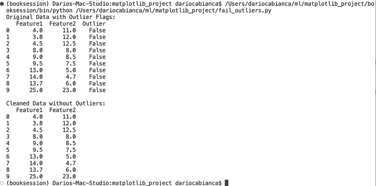

FIGURE 3.11 Failing outlier detection.

可以看到，Z-score 方法未能检测出异常值 `[25, 23]`。这是因为我们数据集中数据点的分布不是正态分布，而是右偏分布。

使用 AWS Glue DataBrew，您还可以检测数据中的异常值，并使用各种转换进行处理。这种方法包括使用您刚学到的方法（即 Z-score 和 IQRs）来替换、移除、重新缩放或标记异常值。

### 执行去重

去重是从数据集中移除重复数据点的过程。去重不仅仅是整理数据——它关乎使您的模型更准确、性能更高、更可靠。

从数据质量角度来看，重复数据会扭曲结果并导致不准确的预测。移除重复项可确保用于训练模型的数据干净且准确。

模型性能和可靠性是 ML 生命周期中模型评估和部署阶段需要考虑的关键因素。重复项可能导致过拟合，即模型学习的是噪声而非信号。干净、去重的数据有助于创建更具泛化能力的模型。

从可靠性角度来看，重复项可能引入偏差，特别是当某些条目重复出现的频率高于其他条目时，会导致训练数据不平衡。

因此，有效的去重策略对于确保 ML 模型训练数据的质量至关重要。

为追求简单易用，AWS Glue DataBrew 可能是从数据集中移除重复项的最佳选择。AWS Glue DataBrew 提供了直观的可视化界面，无需复杂代码即可清理和准备数据。AWS Glue DataBrew 用户友好且高效，使移除重复项等数据清理任务变得快速且无麻烦。

### 标准化和重新格式化

通过实施标准化，您可以防止具有大数值的特征相比数值较小的特征对模型产生不成比例的影响。此技术对于对特征尺度敏感的 ML 算法（如线性回归和支持向量机）尤为重要，这些将在下一章介绍。

ML 中的重新格式化是指将数据重构为适合分析的统一格式。它包括转换数据类型、协调格式，并确保所有数据条目遵循相同结构。

要使用 AWS 执行标准化和重新格式化，可以使用 Amazon SageMaker 和 AWS Glue。主要步骤如下：

*   **加载数据。** 您可以使用 SageMaker 笔记本从 S3 存储桶加载数据集，如以下代码片段所示：

```python
import pandas as pd
data = pd.read_csv('your_dataset.csv')
```

*   **标准化数据。** 您可以使用 `sklearn.preprocessing` 模块中的 `StandardScaler` 类来标准化特征，如以下代码片段所示：

```python
from sklearn.preprocessing import StandardScaler
scaler = StandardScaler()
data_scaled = scaler.fit_transform(data)
```

更多归一化和标准化技术将在后续章节介绍。

*   **导出数据。** 您可以将标准化后的数据集保存到 S3。
*   **创建 AWS Glue 作业。** 创建 AWS Glue 作业以根据需要重新格式化数据。
*   **加载干净数据。** 使用清理和标准化后的数据训练 ML 模型。

### 移除噪声和错误

前文简要介绍了自然噪声和人为错误。因为特征工程的主要目标是为 ML 模型生成尽可能最佳的训练数据量，所以该过程的关键方面之一是处理噪声和错误的能力。

通过创建新特征或转换现有特征，您可以使训练数据对 ML 模型更具信息量和相关性。此过程有助于提高模型准确性、效率和泛化能力，从而增强模型的预测能力。

在有噪声的数据上训练的模型往往会学习训练数据集中存在的特定怪癖或错误，而不是潜在模式。这会导致*过拟合*，即模型在训练数据上表现很好，但在新的、未见过的数据上表现不佳。通过妥善处理噪声和错误，您有助于确保模型更好地泛化到真实场景。我们将在第 5 章详细介绍解决过拟合的方法。

## 特征工程技术

在上一节中，介绍了清理数据集的方法。数据清理是为模型准备训练数据的初步步骤。

下一步的目标是有效地将原始数据转化为能提高 ML 模型性能的有意义特征。这是特征工程的主要关注点。最终，经过特征工程后，您的 ML 模型将准备好进行训练。

掌握特征工程对于展示您在 AWS 上构建和部署可扩展、高效 ML 解决方案的专业知识至关重要。后续章节将介绍考试所需的特征工程技术。

我们将从结构化数据的技术开始，然后介绍以图像、文本和时间序列形式存在的非结构化数据技术。

### 结构化数据技术

对于结构化数据，您可以使用多种特征提取技术来降低数据集的维度。使用特征提取时需要注意的一点是：当您将模型投入生产或自动化管道时，这些特征可以轻松复制，但仍能降低数据的高维度。

#### 数值数据的特征工程

数值数据最终是您想要输入 ML 模型的数据类型。无论您的数据是分类、文本还是图像，特征工程的结果都需要以一组独特且组织良好的数字形式呈现，以便用于训练 ML 算法。

##### 特征工程：归一化、标准化与缩放

您将这一组数字设计为有意义特征的方式，可能会对模型的性能和准确性产生重大影响。

在接下来的章节中，我们将深入探讨前文介绍的特征工程概念。

###### 归一化

归一化是一种特征工程方法，它将所有特征的数值数据带入一个一致的尺度，通常在 0 和 1 之间。这具有几个关键优势：

*   **等权重。** 归一化确保没有单个特征因其尺度大小而主导模型。这对于对数据尺度敏感的机器学习算法尤为重要，例如 k-近邻（`k-NN`）和神经网络，它们需要计算数据点之间的距离。
*   **更快收敛。** 在梯度下降优化中，归一化数据通过确保所有特征对梯度的贡献相等，帮助机器学习算法更快收敛。这将带来更高效的训练和更好的模型性能。
*   **增强可解释性。** 归一化数据使得特征重要性和模型系数更易于解释，因为所有特征都处于可比较的尺度上。

当您希望数据处于一个通用尺度，但不一定需要以零为中心时，此技术非常有用。

归一化的结果是，当数据集的所有特征处于同一尺度时，机器学习模型表现更好。归一化可带来更高的准确性和稳定性，尤其是在基于距离的算法中。

归一化通常通过 `MinMaxScaler` 函数实现，将在即将到来的“缩放”部分详细介绍。

###### 标准化

标准化将特征转换为均值为 0、标准差为 1 的分布。当您希望确保特征数据以均值（μ）为中心，并根据标准差（σ）进行缩放时，会使用此技术。

此技术适用于假设数据呈正态分布的机器学习算法，例如线性回归、逻辑回归或使用梯度下降的算法。

您可以通过使用 Z-score 函数来实现标准化。

*   **Z-score。** 该方法利用以下公式将特征数据集转换为均值为 0、标准差为 1 的分布：

```
z = (x - μ) / σ
```

其中

*   `x` 是您的特征数据点。
*   `μ` 是您的特征数据集的均值。
*   `σ` 是您的特征数据集的标准差。

由于变换的性质，结果标准差为 1。

当您从每个数据点（`x`）中减去均值（μ）时，数据会以 0 为中心。每个数据点都会相对于数据集的平均值进行调整。


除以标准差（`σ`）会相对于数据的分布范围缩放数据点。此步骤确保标准化后数据的方差（即标准差的平方）变为 1。

### 缩放

**缩放** 是调整特征范围或分布的通用术语。由于归一化主要关注转换后数据集的范围（将所有特征缩放至 0 到 1），而标准化关注分布（转换后数据集的均值 `μ` 为 0，标准差 `σ` 为 1），您刚学习的这两种技术都属于缩放范畴。

如果您的特征数据不符合正态分布，您需要采用不同于 Z-score 标准化的技术来处理偏态或异常值。考试需要了解的技术如下：

*   **鲁棒缩放。** 鲁棒缩放通过减去中位数来使特征数据集居中，并根据四分位距（IQR）进行缩放。这使其特别适用于包含异常值的数据集，因为它能确保中心趋势和分布范围对异常值具有鲁棒性。因此，这种标准化技术对异常值不敏感，且在处理偏态数据时效果良好。

    您可以使用 `sklearn.preprocessing` 模块中的 `RobustScaler` 类通过此技术缩放特征，如以下示例所示：

    ```python
    import numpy as np
    import pandas as pd
    from sklearn.preprocessing import RobustScaler
    
    # 加载数据集
    data = np.array([[4, 11], [3.8, 12], [4.5, 12.5], [8, 8], [9, 8.5], [9.5, 7.5], [13, 5], [14, 4.7], [13.7, 6], [25, 23]])
    df = pd.DataFrame(data, columns=['Feature1', 'Feature2'])
    
    # 应用 RobustScaler
    scaler = RobustScaler()
    data_scaled = scaler.fit_transform(df)
    
    # 将缩放后的数据转换回 DataFrame 以便查看
    df_scaled = pd.DataFrame(data_scaled, columns=['Feature1', 'Feature2'])
    
    print("原始数据:")
    print(df)
    print("\n 缩放后数据:")
    print(df_scaled)
    ```

    上述代码生成的输出如图 3.12 所示。

    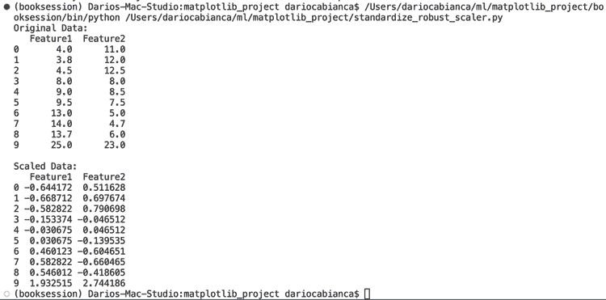

    图 3.12 鲁棒缩放。

    正如您在图 3.12 中所见，经过鲁棒缩放后，缩放后的数据框对异常值的敏感度低于原始数据框。由于转换的结果，像 `[25, 23]` 这样的异常值不会扭曲您特征的新数据集。

*   **MinMax 缩放。** 这种标准化技术将特征转换到一个固定范围，通常在 0 和 1 之间。该技术保留了特征间的关系，但不解决偏态问题。

    您可以使用 `sklearn.preprocessing` 模块中的 `MinMaxScaler` 类通过此方法缩放特征，如以下代码片段所示：

    ```python
    import numpy as np
    import pandas as pd
    from sklearn.preprocessing import MinMaxScaler
    
    # 示例数据
    data = np.array([[1, 2], [3, 4], [5, 6], [7, 8], [-1, -2], [-3, -4]])
    df = pd.DataFrame(data, columns=['Feature1', 'Feature2'])
    
    # 初始化 MinMaxScaler
    scaler = MinMaxScaler()
    
    # 拟合并转换
    data_scaled = scaler.fit_transform(df)
    df_scaled = pd.DataFrame(data_scaled, columns=['Feature1', 'Feature2'])
    
    # 打印结果
    print("原始数据:\n", df)
    print("\n 缩放后数据:\n", df_scaled)
    ```

*   **MaxAbs 缩放。** MaxAbs 缩放是一种通过将每个特征数据点缩放至其最大绝对值来标准化数据的技术。结果是每个数据点都落在 [−1, 1] 范围内。

    此技术最适合用于标准化稀疏数据集或包含许多 0 数据点的数据集，因为它在保持原始数据分布的同时保留了 0 条目。

    您可以使用 `sklearn.preprocessing` 模块中的 `MaxAbsScaler` 类，通过这种方法缩放特征，如以下代码片段所示：

    ```python
    import numpy as np
    import pandas as pd
    from sklearn.preprocessing import MaxAbsScaler
    
    # Sample data
    data = np.array([[1, 2], [3, 4], [5, 6], [7, 8], [-1, -2], [-3, -4]])
    df = pd.DataFrame(data, columns=['Feature1', 'Feature2'])
    
    # Initialize MaxAbsScaler
    scaler = MaxAbsScaler()
    
    # Fit and Transform
    data_scaled = scaler.fit_transform(df)
    df_scaled = pd.DataFrame(data_scaled, columns=['Feature1', 'Feature2'])
    
    # Print results
    print("Original Data:\n", df)
    print("\nScaled Data:\n", df_scaled)
    ```

#### 幂变换（Box-Cox、Yeo-Johnson）

数据集的方差是标准差的平方（`σ²`）。根据定义，方差始终为正数，用于衡量数据集中数据点的分散程度，告诉您每个点距离均值（`μ`）有多远。从数学上讲，它是与均值之差的平方的平均值。方差高意味着数据点分散在远离均值的位置；方差低意味着它们接近均值。

幂变换有助于稳定方差并使数据更接近正态分布。两种常见类型是 Box-Cox 变换和 Yeo-Johnson 变换。前者仅适用于正数据，而后者可同时处理正数据和负数据。

您可以使用 `sklearn.preprocessing` 模块中的 `PowerTransformer` 类，通过这种方法缩放特征，如以下代码片段所示：

```python
import numpy as np
import pandas as pd
from sklearn.preprocessing import PowerTransformer

# Sample data
data = np.array([[1, 2], [3, 4], [5, 6], [7, 8], [-1, -2], [-3, -4]])
df = pd.DataFrame(data, columns=['Feature1', 'Feature2'])

# Initialize Yeo-Johnson Transformation
pt = PowerTransformer(method='yeo-johnson')

# Fit and Transform
data_scaled = pt.fit_transform(df)
df_scaled = pd.DataFrame(data_scaled, columns=['Feature1', 'Feature2'])

# Print results
print("Original Data:\n", df)
print("\nScaled Data:\n", df_scaled)
```

幂变换通过减少偏度和稳定方差，使您的数据更适合建模，从而产生更稳健、更准确的模型。

#### 对数变换

正如您之前所学，对数变换是一种检测和管理异常值的方法。它作为数值数据的一种特征工程技术，通过减少偏度、限制异常值的影响和增强线性关系来提供帮助。具体方式如下：

*   **减少偏度。** 许多现实世界的数据集呈右偏，意味着大多数数据点聚集在较低值周围，而少数异常值将“尾部”延伸向较高值。常见例子包括收入分布，少数高收入者形成长右尾；或是高难度考试的分数分布，大多数学生得分较低，少数高分者在顶端。应用对数变换可压缩这一尾部，使分布更对称、更接近正态分布，而许多 ML 算法能更好地处理正态分布。

*   **限制异常值的影响。** 高值异常值可能主导并扭曲数值数据的尺度。对数变换降低这些异常值的量级，使其更接近数据主体，而无需直接删除。

*   **增强线性关系。** 对于某些数据，特征与目标变量之间的关系可能是乘法或指数关系，而非线性关系。对数变换可将这些关系线性化，使线性模型更容易捕捉潜在模式。

例如，考虑以下数据集：

```
[x,y] = [[3, 1], [4, 10], [5, 100], [6, 1000]]
```

通过将 `y` 转换为 `log10(y)`，新数据集变为：

```
[x,y] = [[3, 0], [4, 1], [5, 2], [6, 3]]
```

通过将数据转换为对数尺度，变化变得更易管理，数据的整体结构也更清晰。这种变换能显著提升许多模型的性能和准确性。

#### 平方根或立方根

为了处理数值数据集中的高方差（除了前面介绍的幂变换），可考虑使用平方根或立方根变换。特征的平方根和立方根会影响特征分布。然而，这种影响不如对数变换显著。立方根有其自身优势：可应用于包括 0 在内的负值。平方根仅适用于正值和 0。

#### 分箱

分箱（也称为**分桶**）是将数值型连续数据划分为离散区间或“箱”的过程。此技术可简化 ML 模型开发，并使模型对异常值和噪声更稳健。通过分箱，您可将数值数据转换为分类数据。

例如，若您查看汽车数据，可将车辆重量转换为五列：`is_minicompact`、`is_subcompact`、`is_compact`、`is_midsize` 和 `is_large`。

### 分类数据的特征工程

分类数据能捕捉数值数据可能遗漏的数据关系和特征信息。妥善设计的分类特征能显著提升 ML 模型性能。

分类数据的特征工程始于**编码**，即将特征数据从字符串格式转换为数值格式的过程。数值格式可以是整数、整数数组、矩阵，甚至是整数张量。编码的目的是让 ML 算法能解释并使用这些数据作为输入，因为大多数算法只能理解数值。

例如，若您的类别为 White、Black 和 Red，可将这些数据编码为三个向量：`[1, 0, 0]` 代表 White，`[0, 1, 0]` 代表 Black，`[0, 0, 1]` 代表 Red。

#### 标签编码

标签编码——顾名思义——将分类特征的每个类别标记为唯一整数。例如，具有如下值的分类特征“Color”

```
["White", "Black", "Red"]
```

变为

```
[0, 1, 2]
```

虽然简单，但此技术可能给假设数据存在有序关系的算法带来问题，因为它在分类值上强加了序数结构。

此编码技术最适合基于树的 ML 算法，因为这些算法能处理标签编码隐含的序数关系。

#### 独热编码

独热编码将分类特征转换为一组二进制特征，其中每个二进制特征代表一个可能的类别，若该类别存在则值为 1，不存在则为 0。

您可以使用 `sklearn.preprocessing` 模块中的 `OneHotEncoder` 类，通过这种方法对特征进行编码，如以下代码片段所示：

```python
import pandas as pd
from sklearn.preprocessing import OneHotEncoder

# 示例数据
data = {'Color': ['White', 'Black', 'Red', 'Blue', 'Green', 'Yellow', 'Pink', 'Brown', 'White', 'Black']}
df = pd.DataFrame(data)

# 初始化 OneHotEncoder
encoder = OneHotEncoder(sparse_output=False)

# 拟合并转换数据
one_hot = encoder.fit_transform(df[['Color']])

# 转换为 DataFrame 以便查看
one_hot_df = pd.DataFrame(one_hot, columns=encoder.get_feature_names_out(['Color']))

# 打印结果
print("原始数据:\n", df)
print("\n 独热编码数据:\n", one_hot_df)
```

图 3.13 展示了该程序产生的结果。

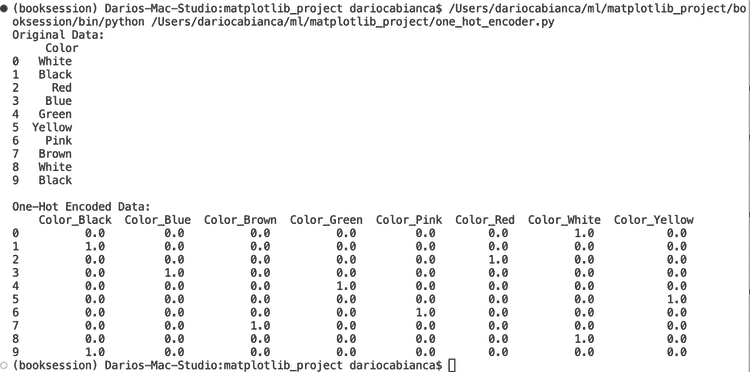

图 3.13 独热编码。

正如你所见，原始数据集有一个分类特征“Color”，包含 10 个数据点（类别）：White、Black、Red、Blue、Green、Yellow、Pink、Brown、White 和 Black。

独热编码后的数据集已转换为八个数值特征，等于不同颜色的数量：`Color_Black`、`Color_Blue`、`Color_Brown`、`Color_Green`、`Color_Pink`、`Color_Red`、`Color_White` 和 `Color_Yellow`。它们每个都有 10 个数据点。

独热编码是具有少量分类数据的特征以及非树模型 ML 算法（如线性回归、k-NN 和神经网络）的良好选择。这些算法将在下一章中介绍。

#### 二进制编码

二进制编码是一种处理分类数据的有效技术，不会像独热编码那样导致特征数据集的维度“爆炸”。其工作原理是将每个类别值转换为对应的二进制数，然后将该二进制数拆分为单独的位作为独立的特征（列）。

可以将二进制编码视为一种压缩独热编码技术所产生特征数量的方法。

在下面的示例中，我们使用了 `category_encoders` 模块中的 `BinaryEncoder` 类对前一个示例中的相同数据集进行二进制编码：

```python
import category_encoders as ce
import pandas as pd

# 示例数据
data = {'Color': ['White', 'Black', 'Red', 'Blue', 'Green', 'Yellow', 'Pink', 'Brown', 'White', 'Black']}
df = pd.DataFrame(data)

# 初始化二进制编码器
encoder = ce.BinaryEncoder(cols=['Color'])

# 拟合并转换数据
df_binary_encoded = encoder.fit_transform(df)

# 打印结果
print("原始数据:\n", df)
print("\n 二进制编码数据:\n", df_binary_encoded)
```

图 3.14 显示了此转换的输出。

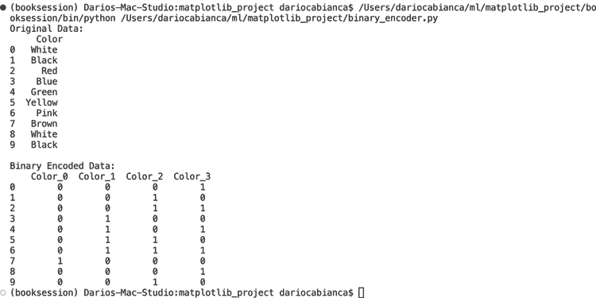

图 3.14 二进制编码。

由于对 10 个非唯一类别进行二进制编码，新数据集只有四个数值特征（而不是八个）。

为什么是四个？因为原始数据集有八个不同的类别，可以使用四位二进制格式表示。请注意，数据点的数量（10）在转换数据时不会改变。

二进制编码最适合解决独热编码的缺点，因为它缓解了为每个唯一类别创建一个新特征而导致的维度“爆炸”。

然而，与独热编码相比，二进制编码可能导致分类数据内的信息丢失，这可能会对模型性能产生负面影响。这是因为二进制编码将分类数据压缩到更少的位中，导致类别之间的区别变得模糊。

#### 特征哈希

该技术使用哈希函数将高基数分类数据转换为固定数量的数值特征，你作为 ML 工程师可以自行选择该数量。

特征哈希高效且具有高度可扩展性，因为转换结果是一个固定大小的向量，从而控制了内存使用量。以下是其高层工作原理：

*   **输入特征。** 特征哈希函数接收一个特征值，该值可以是单词、类别或数据中任何其他可识别的属性。

*   **哈希函数应用。** 特征由哈希函数处理，该函数根据特征的值返回一个唯一的整数值（哈希值）。


## 特征哈希

### 哈希过程

*   **取模运算（可选）。** 为确保哈希值落在所需范围内（通常是特征向量的大小），哈希值通常对预定义的数字取模。
*   **向量更新。** 计算出的哈希值用作索引，以更新特征向量中对应的元素。

通过利用哈希函数，这种方法能快速转换数据，因此适用于大型数据集。虽然可能发生冲突，但值的聚合通常能减轻其影响，尤其是当哈希桶足够大时。

因此，特征哈希在保留信息和保持计算效率之间取得了平衡。它是以高效且具成本效益的方式对高基数分类数据进行特征工程的绝佳解决方案。

### 代码示例

你可以使用 `sklearn.feature_extraction` 模块中的 `FeatureHasher` 类通过此方法对特征进行哈希，如下面的代码片段所示：

```
import pandas as pd
from sklearn.feature_extraction import FeatureHasher

####### 示例数据
data = [{'Color': 'White'}, {'Color': 'Black'}, {'Color': 'Red'}, {'Color': 'Blue'}, {'Color': 'Green'}, {'Color': 'Yellow'}, {'Color': 'Pink'}, {'Color': 'Brown'}, {'Color': 'White'}, {'Color': 'Black'}]

####### 转换为 DataFrame 以便在转换前查看
df = pd.DataFrame(data)

print("原始数据:")
print(df)

####### 初始化 FeatureHasher
hasher = FeatureHasher(n_features=3, input_type='dict')

####### 拟合并转换数据
hashed_features = hasher.transform(data)

####### 将哈希特征转换为 DataFrame 以便查看
hashed_df = pd.DataFrame(hashed_features.toarray(), columns=[f'feature_{i}' for i in range(hashed_features.shape[1])])

print("\n 哈希后的数据:")
print(hashed_df)
```

图 3.15 显示了该程序生成的哈希特征。

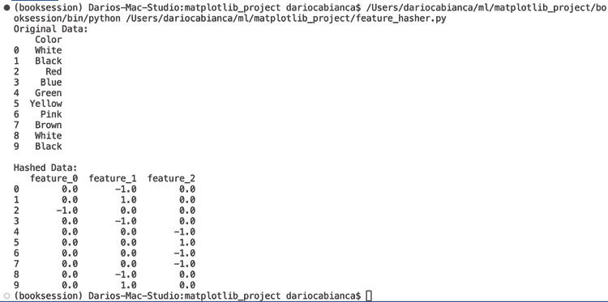

图 3.15 特征哈希。

请注意 `FeatureHasher` 类如何应用特征哈希将分类数据（10 个类别）转换为每个类别的固定大小向量。在本示例中，我们在 `FeatureHasher` 类的构造函数中设置了特征数量。该数字已设置为 3。

结果，这 10 个类别已被哈希为 10 个向量。每个向量包含三个整数，对应三个特征中的每一个。

## 时间序列数据的特征工程

时间序列数据在本章开头已介绍，它不同于标准表格数据，因为它是随时间重复采集的，每个连续数据点都依赖于其过去的值。可以将时间序列想象成看电影——每个场景都取决于前面的场景。时间维度在时间序列数据中起着关键作用。

**Amazon SageMaker Data Wrangler** 为时间序列数据处理提供了一个低代码解决方案，能够更快地清理、转换和准备数据。它还使数据科学家能够按照其预测模型的输入格式要求来设计时间序列数据特征。

要对时间序列数据集执行特征工程，我们首先需要了解数据集中存在的模式。Amazon SageMaker Data Wrangler 提供了许多可视化工具，为数据科学家和分析师提供了关于现有模式的宝贵线索，并可帮助你选择建模策略。在了解数据集中存在的模式后，我们就可以开始设计旨在提高预测模型准确性的新特征。

### 日期时间特征化

对于时间序列数据，最佳实践是从消除日期/时间特征的歧义开始特征工程流程。日期/时间特征源自 `timestamp` 列，为机器学习工程师启动特征工程流程提供了最佳方式。*日期时间特征化* 时间序列转换允许我们通过向数据集添加 `date_month`、`date_day`、`date_week_of_year`、`date_day_of_year` 和 `date_quarter` 等新特征来分解日期/时间特征。因为我们将日期/时间组件作为单独的特征提供，所以使机器学习算法能够检测模式以提高预测准确性。

### 编码分类特征

日期/时间特征不限于整数值。您也可以选择将某些提取的日期/时间特征视为分类变量，并将其表示为独热编码特征，每列包含二进制值。为此，请利用*独热编码*转换。新创建的 `date_quarter` 特征包含 0 到 3 的值，可以使用四个二进制列进行独热编码，每个季度对应一列。

### 滞后特征

为了提高模型准确性，为目标变量（或标签）创建*滞后特征*是最佳实践。滞后特征是先前时间戳的值，有助于预测未来值。它们还有助于通过量化观测值与前几个时间步观测值之间的关系，识别残差序列中的自相关（也称为*序列相关*）模式。自相关类似于常规相关性，但它是序列中的值与其过去值之间的相关性。Amazon SageMaker Data Wrangler 提供*滞后特征*转换，有助于在指定窗口大小上创建多个滞后特征。

### 滚动窗口特征

Amazon SageMaker Data Wrangler 使用开源 `tsfresh` 包实现了自动时间序列特征提取功能。通过时间序列特征提取转换，您可以自动化特征提取流程。这消除了手动实现信号处理库所花费的时间和精力。对于考试，您需要知道可以使用*滚动窗口特征*转换来提取特征，该转换计算由窗口大小定义的一组观测值的统计属性。

在对时间序列数据集进行特征工程后，我们已准备好将转换后的数据集作为输入用于预测机器学习算法。

## 非结构化数据技术

非结构化数据（如图像、文本、音频和视频）无法整齐地放入表格中，且通常缺乏预定义格式。AWS 提供了全面的产品和服务生态系统，使非结构化数据的特征工程更加易于管理且高效。

在接下来的章节中，我们将介绍考试所需的、适用于图像和文本数据的技术。

### 图像数据的特征工程

就像结构化数据一样，图像数据的特征工程是开发有效机器学习模型的关键步骤。此过程涉及从图像中提取有意义的特征（如边缘、纹理和颜色），通过为模型提供关于数据的更多相关信息，来提高图像识别和分类任务的性能。

例如，在本章开头，我们使用了一张汽车图片（图 3.4）向您展示可以从这些非结构化数据中提取哪些特征。

要对图像执行特征提取，您主要利用 Amazon SageMaker JumpStart 中的预训练视觉模型，通常通过卷积神经网络 (CNN) 处理它们并检索生成的特征向量。这些预训练视觉模型包括用于目标检测、图像分类等任务的模型。

根据您的用例，您也可以使用 Amazon Rekognition 等服务进行基本的图像分析和特征提取。Amazon Rekognition 可以检测图像中的物体、场景、文本和人脸，无需大量人工工作即可提供高级特征。例如，Amazon Rekognition 可以识别并提取物体周围的标签和边界框等特征，这对于目标检测和图像分类等任务至关重要。

提取特征后，将其转换为合适的格式至关重要。Amazon SageMaker Data Wrangler 允许您执行探索性数据分析 (EDA) 并应用归一化和降维等转换。此步骤确保您的特征针对模型训练进行了优化。例如，您可以将像素值归一化到通用范围，或应用 PCA 来降低特征集的维度。

高效地存储和管理工程化特征对于简化工作流至关重要。正如您在本章开头所学，Amazon SageMaker Feature Store 为特征存储提供了一个中心化存储库，使跨不同模型和项目共享和重用特征变得容易。这确保了一致性并节省了时间，因为您不必为每个新模型重新提取特征。

### 文本数据的特征工程

在当今数据驱动的世界中，文本数据无处不在，从社交媒体帖子到客户评论等。从这些非结构化数据中提取有意义的见解需要有效的特征工程。AWS 提供了强大的产品和服务生态系统，以简化这一过程并将原始文本转化为机器学习模型的有价值特征。

Amazon Comprehend 是从文本中提取高级特征的强大工具。它可以检测实体、关键短语、情感和语言，无需大量人工工作即可提供丰富的见解。此外，Amazon Textract 可以从文档中提取文本，将非结构化数据转化为结构化信息。

对于更定制化的特征提取，Amazon SageMaker 提供了内置算法和框架。这些算法可用于训练模型并提取特定特征，如词嵌入（例如 `Word2Vec`）或执行主题建模（例如潜在狄利克雷分布）。这些算法将在第 4 章中详细讨论。

以下是考试所需了解的一些基本技术。

#### 分词

分词是将文本拆分为称为*词元*的较小单元（如单词或短语）的过程。这是为建模准备文本数据的第一步。

例如，句子 `“Machine learning is fascinating”` 被分词为 `[“Machine”, “learning”, “is”, “fascinating”]`。

分词是 Amazon Bedrock 基础模型 (FM) 用于理解和处理用户提示词的关键组件。通过将输入文本分解为较小的词元，这些模型可以有效地解释用户请求的含义和上下文。例如，提示词 `“Generate an image of a sunset”` 会被分解为单个单词和符号，使模型能够分析每个元素并理解整体指令。这种基于词元的方法确保模型能够以高准确性和相关性处理复杂和微妙的指令。

此外，分词在使用 Amazon Bedrock FM 的定价模型中起着关键作用。利用这些模型的成本取决于处理的输入 Token 数量和生成的输出 Token 数量。这种基于 Token 的计费系统确保用户根据实际消耗的计算资源公平付费。例如，与较短、简单的提示词相比，更长、更详细的提示词需要更多 Token，因此成本更高。在第 4 章中，我们将介绍一个实际示例，演示如何使用 Amazon Bedrock 中可用的 FM 从简单的提示词生成图像，展示基于 Token 处理的效率和有效性。

#### 停用词移除

停用词是常见词汇（例如 `“the”`、`“is”`、`“and”`），通常不包含有意义的信息。移除它们可以减少噪声并提高模型性能。

例如，从 `“The cat is on the mat”` 中移除 `“is”` 和 `“the”` 将得到 `[“cat”, “on”, “mat”]`。

#### 词干提取和词形还原

这些技术将单词还原为其基本形式或词根。词干提取通过切除前缀/后缀实现，而词形还原则使用语言学规则。

例如，`“running”` 变为 `“run”`。

#### N-gram

N-gram 是给定文本中 *n* 个项目的连续序列。它们捕捉单词之间的上下文和关系。

例如，对于双元组（即两个单词的连续序列），句子 `“Machine learning is fun”` 将转换为 `[(“Machine”, “learning”), (“learning”, “is”), (“is”, “fun”)]`。

#### 词嵌入

像 `Word2Vec` 和 `GloVe` 这样的词嵌入将单词转换为捕捉语义含义的连续向量，保留单词间的关系。这使得数据更适合 ML 模型。

例如，`“King”` 和 `“Queen”` 在向量空间中可能很接近，反映了它们的语义相似性。

## 数据标注

在 ML 领域，数据标注和特征工程是两个相互交织的过程，是构建有效模型的基础。它们都将原始数据转换为 ML 算法能够理解和学习的结构化形式。

特征工程侧重于从原始数据中选择、修改和创建新特征以提高模型性能，而数据标注则涉及用有意义的标签形式的元数据丰富原始数据，这些标签表示实际预测或特定属性。对于监督学习，这一步骤至关重要，因为它提供了模型学习的真实标签。通过标注数据，你为模型提供了用于学习和预测的“正确答案”。

标签充当参考点，指导算法的学习过程。它们定义了模型应该预测或分类的内容。例如，在动物图像数据集中，将每张图像标记为“猫”或“狗”，使模型能够学会区分这些动物。

### Amazon SageMaker Ground Truth

借助 AWS，你可以使用 `Amazon SageMaker Ground Truth` 执行数据标注，这是一项专门设计用于简化和增强数据标注流程的服务。该服务将先进的自动化与人工介入功能相结合，高效地提供高质量的标注数据集。以下是高层流程：

*   **存储数据。** 将原始数据（图像、文本等）上传到 `Amazon S3`。创建单独的文件夹或存储桶，根据类型或项目组织数据。
*   **创建标注作业。** 在 `Amazon SageMaker Ground Truth` 中，定义任务和说明。
*   **自动标注。** 选择要标注的数据类型（例如图像分类、文本分类、目标检测），并指定存储在 S3 中的输入数据集。选择 `Automated Data Labeling` 以使用预训练的 ML 模型标注部分数据，并配置标注算法设置和参数。
*   **人工审核。** 标注人员审核并修正标签，确保准确性。此步骤可由 `Amazon Mechanical Turk`、私有工作团队或第三方供应商执行。`Amazon Mechanical Turk (MTurk)` 是一个众包市场，将企业与全球工作者连接起来，完成计算机难以处理的任务，数据标注便是其中之一。
*   **数据标注和验证。** `Amazon SageMaker Ground Truth` 为标注人员提供用户友好的界面来标注数据。标注人员审核并修正自动标签，根据需要添加标签、边界框或其他相关标注。你甚至可以实施质量控制措施，例如一致性标注（多个标注人员标注相同数据）和审核抽样（专家审核一部分标签）。
*   **存储标注数据。** 你可以将标注数据保留在 S3 存储桶中，或自动保存到 `Amazon SageMaker Feature Store` 以便在模型训练和推理期间轻松访问。无论哪种方式，请确保对标注数据进行版本控制以跟踪变更。
*   **模型训练。** 使用标注数据在 `Amazon SageMaker` 中训练模型。

通过自动化和人工标注干预的恰当组合，`Amazon SageMaker Ground Truth` 为创建准确可靠的标注数据集提供了强大的解决方案，这对构建高性能 ML 模型至关重要。

## 管理类别不平衡

到目前为止，你已经学习了如何转换数据集：首先清洗原始数据，然后对数据进行特征工程，最后标注数据。这一最后步骤是 ML 的一个基本方面，因为它侧重于为每个数据点提供正确的预测，以便 ML 模型在训练期间能够快速学习。

在界定 ML 问题并仔细处理数据后，你可能会认为现在可以选择 ML 算法并开始训练过程了，对吧？还不完全是！

由于选择、提取和创建特征，你的数据集在语法上可能看起来不错，但由于标签分布不均，在语义上可能并不理想。例如，在医疗保健用例中，考虑一个数据集，其中多数类代表健康个体，少数类代表患有罕见疾病的患者。你的 ML 问题目标是准确预测疾病。当你的数据集呈现不成比例的标签类别——就像这个场景中以健康个体为多数类一样——你就面临着*类别不平衡*问题。

类别不平衡会导致模型偏向多数类。这会显著影响模型的性能和公平性，特别是在少数类至关重要的情况下，就像我们的医疗保健用例一样。

好消息是，AWS 提供了一套全面的产品和服务来解决类别不平衡问题，确保你的模型不仅准确，而且合乎道德且无偏见。

在深入探讨 AWS 如何应对这一挑战之前，让我们回顾一下可以采取哪些方法来解决类别不平衡及其导致的偏见。

### 类别不平衡缓解技术

数据增强通常被认为是生成更多少数类标注数据的最佳实践，从而弥合多数类和少数类之间的差距。针对图像数据的图像增强（旋转、翻转和颜色调整）或针对文本数据的文本增强（同义词替换、随机插入）等技术可以创建多样且有代表性的样本。然而，由于成本、计算资源可用性和时间限制，数据增强并不总是可行的。在这些情况下，请考虑使用以下选项：

### 处理类别不平衡的技术

*   **过采样**  
    该技术通过复制现有样本或生成合成样本来增加少数类的数据点数量。合成少数类过采样技术（SMOTE）是一种流行的方法，它通过在现有少数类样本之间进行插值来创建合成样本。这有助于在不简单复制记录的情况下平衡数据集。

*   **欠采样**  
    该技术通过随机移除多数类的数据点，使类别分布与少数类更加均衡。虽然它可能有效，但欠采样可能导致有价值信息的丢失，从而潜在地影响模型性能。

*   **类别加权**  
    在训练期间计算损失时，该技术为错误分类少数类分配更高的权重，从而迫使模型更多地关注少数类。

### Amazon SageMaker Clarify

Amazon SageMaker Clarify 通过提供训练前偏差指标来检测和缓解数据集中的偏差，帮助解决类别不平衡问题。每个指标对应不同的公平性概念。

这些指标对于确保模型从一开始就公平且无偏见至关重要。表 3.1 展示了两个最常用的指标：类别不平衡（CI）和标签比例差异（DPL）。

**表 3.1 训练前偏差指标示例**

| 偏差指标 | 解释 |
| --- | --- |
| 类别不平衡 (CI) | * 归一化范围：`[-1, +1]`<br>* `0`：无类别不平衡<br>* `+1`：完全向多数类不平衡<br>* `-1`：完全向少数类不平衡 |
| 标签比例差异 (DPL) | * 二分类和多类别标签的归一化范围：`[-1, +1]`<br>* 连续标签的范围：`[-∞, +∞]`<br>* `0`：各切面间正向结果比例相等<br>* `+1`：切面 a 具有最高的正向结果比例<br>* `-1`：切面 d 具有最高的正向结果比例 |
| 机会均等差异 (EOD) | 目标检测偏差 |
| 预测平价差异 (PPD) | 图像分类偏差 |

在使用 Amazon SageMaker Clarify 处理类别不平衡偏差的语境中，**切面** 表示数据集中您想要分析潜在偏差的特定特征。

切面用于识别和衡量数据中不同子群可能如何受到类别不平衡的影响。在 Amazon SageMaker Clarify 中，**切面 a** 表示偏向的人口统计学特征值，**切面 d** 表示不偏向的人口统计学特征值。


例如，如果您正在分析信用卡交易数据集，切面可能包括 `is_fraudulent` 等特征，其值可以是 1（真）或 0（假）。假设该特征有 99.9% 的值为 0，表明数据集中 99.9% 的交易非欺诈。通过检查这些切面值（1 或 0），Amazon SageMaker Clarify 可以帮助您了解这些特征值的某些子群是否在训练数据中表现不足或过度，这可能导致模型预测产生偏差。

其他训练前偏差指标请参阅 `https://docs.aws.amazon.com/sagemaker/latest/dg/clarify-measure-data-bias.html`。

尽管每个指标的范围不同，但它们都有一个共同特征：值为 0（或接近 0）表示无类别不平衡。

通过计算这些训练前偏差指标，您可以确定为训练准备数据集的后续行动方案。在我们的示例中，假设**切面 a** 为 0，我们可能会获得接近 1 的 CI 值。因此，我们需要进行欠采样。

`BiasConfig` 类是 `sagemaker.clarify` 库的一部分。该库帮助您检测和缓解机器学习模型中的偏差。`BiasConfig` 类用于配置数据集的偏差分析设置。

#### 数据拆分

在处理完类别不平衡后，您的数据终于可以拆分为训练、验证和测试数据集了。

数据拆分是指将数据集划分为单独的子集，用于训练、验证和测试。这是机器学习中的关键步骤，旨在确保模型得到有效训练和准确评估。让我们看看每个数据集应包含什么内容，以及最重要的是它们各自的预期用途：

*   **训练数据集**

    训练数据集用于训练模型。模型在此学习数据中的模式和关系。训练期间，模型使用这些数据调整其参数，并迭代学习以最小化错误并改进预测。例如，您可以向模型输入大量标记的电子邮件示例（垃圾邮件与非垃圾邮件），以教会它如何对传入邮件进行分类。

*   **验证数据集**

    验证数据集用于通过微调模型超参数来评估模型性能。使用验证数据集的好处之一是防止模型过拟合，确保模型能很好地泛化到未见数据。

*   **测试数据集**

    测试数据集（且应当）由模型从未见过的数据组成。在训练和验证之后，在测试数据集上衡量模型性能，以获得模型泛化到新数据能力的无偏评估。例如，您可以使用模型未见过的另一组电子邮件创建测试数据集，以测试其对垃圾邮件与非垃圾邮件分类的准确性。

总之，训练数据集用于构建模型，验证数据集帮助调优模型并防止过拟合，而测试数据集提供模型性能的无偏评估。

根据最佳实践，要有效地为机器学习拆分数据，请考虑分配约 60–80% 用于训练，以确保模型学习并获得对数据的全面理解；使用 10–20% 用于验证，以在不影响训练过程的情况下微调模型参数，确保无偏的性能评估；最后保留 10–20% 用于测试，作为模型泛化到新、未见数据能力的最终衡量标准。适当的划分是特征工程的关键方面，因为它可以防止数据泄露、避免过拟合，并提供模型在现实场景中表现如何的准确度量，影响其整体可靠性和有效性。

AWS 提供 Amazon SageMaker Data Wrangler 来帮助您进行数据集拆分。让我们详细了解一下。

##### Amazon SageMaker Data Wrangler

除了作为特征工程的一站式工具外，Amazon SageMaker Data Wrangler 还可以帮助您以极少甚至无代码的方式将数据集拆分为训练、验证和测试数据集。具体而言，您可以基于以下四种常用技术使用拆分数据转换：

*   **随机拆分**

    该技术确保每个子集（训练、验证、测试）具有相似的类别分布，防止对任何特定类别产生偏向。当您不需要保留输入数据顺序时，此方法特别有用。

*   **顺序拆分**

    该技术确保以保留顺序的方式拆分数据，通过确保过去或未来信息不在训练、验证和测试数据集之间重叠来防止数据泄露。这对于时间序列数据或数据点顺序至关重要的任何场景特别有用。

*   **分层拆分**

    该技术确保每个子集保持与原始数据集相同的类别比例。这对于类别不平衡的分类问题特别有用，因为它有助于在所有子集中保持类别分布，从而带来更可靠的模型评估和训练。

##### 按键拆分

此技术可确保输入列中各值的任何组合不会出现在多个拆分中。这对于避免无序数据中的数据泄露特别有用。它还通过将相关数据保持在一起，实现一致的分组，从而保持拆分的完整性。

选择拆分数据转换技术后，您可以指定训练、验证和测试数据集的百分比。例如，您可以分配 70% 用于训练，20% 用于验证，10% 用于测试。最后，您可以应用拆分数据转换，`Amazon SageMaker Data Wrangler` 将自动将您的数据集拆分为指定的子集。

### 摘要

在本章中，您了解了为将原始数据集准备为一组有意义的特征（该特征集以适合的格式存储数据的相关内容，可输入机器学习算法并最终被其理解，从而产生准确可靠的预测）所需执行的操作。

介绍了不同类型的数据（分类、数值、文本、图像、时间序列），以便对不同的数据转换技术进行逻辑分组。

通过使用特征选择和提取来设计数据，您学习了如何采用极简主义方法（降维）来有选择地挑选对您的机器学习模型至关重要的相关特征。涵盖了数据清洗的所有方面，重点介绍了异常值检测和移除，以及缺失数据填补方法。提供了针对数值、分类、时间序列和非结构化数据的特征工程技术，并附带了 Python 编程语言示例。

您了解到 `Amazon SageMaker Data Wrangler` 和 `Amazon SageMaker Feature Store` 分别最适合用于执行特征工程，以及存储、共享和管理生成的特征。

最后，您学习了如何使用 `Amazon SageMaker Ground Truth` 制定有效的标注策略，如何使用 `Amazon SageMaker Clarify` 缓解类别不平衡，以及如何使用 `Amazon SageMaker Data Wrangler` 将处理后的数据集拆分为训练、验证和测试数据集。

在接下来的章节中，您将学习如何选择建模方法、如何训练和优化模型，以及如何评估其性能。

### 考试重点

#### 了解处理异常值的特征工程技术

要在特征工程中处理异常值，必须应用能够减轻其对机器学习模型影响的技术。这些方法包括完全移除异常值（只要可行），或使用对数变换等方法对其进行转换，这可以减少数据的偏度。此外，填补方法（如用中位数或平均值替换异常值）在保持数据集完整性的同时减少其对生成的机器学习模型的影响方面也很有效。

#### 了解处理偏度的特征工程技术

要处理偏度，对数变换、平方根变换以及 Box-Cox 或 Yeo-Johnson 变换都是极佳的选择。这些技术有助于使分布正态化，并使其更适合统计分析，尤其是在处理大多数值聚集在分布一侧、另一侧有长尾的偏态数据时。

#### 了解不处理偏度的特征工程技术

`Z-score standardization`（Z 分数标准化）不能直接解决偏度问题。它将数据缩放为均值为 0、标准差为 1，但如果原始数据有偏度，变换后仍会保持偏度。

`MinMax scaling`（最小-最大缩放）也不能直接解决偏度问题。它将数据调整至特定范围（通常为 0 到 1），但不会改变数据分布。如果您的数据有偏度，缩放后偏度依然存在。

#### 了解何时执行归一化与标准化特征工程

当尺度很重要时，归一化很有用；当分布是关键时，首选标准化。

#### 了解用于标准化的特征工程技术

对于标准化（其目的是确保数据集中的每个特征对机器学习模型的性能贡献相等），请考虑对正态分布数据使用 `Z-score`（Z 分数）。

#### 了解用于归一化的特征工程技术

对于归一化（其目的是将数据集中的每个特征缩放到相同范围，通常为 0 到 1），请考虑使用 `MinMax scaling`（最小-最大缩放）技术。

#### 了解用于分类数据的特征工程技术

对分类有序数据和基于树的机器学习模型使用 `label encoding`（标签编码）。对小规模分类名义数据和非基于树的机器学习模型使用 `one-hot encoding`（独热编码）。使用 `binary encoding`（二进制编码）来降低 `one-hot-encoding`（独热编码）技术导致的维度。对高基数分类数据使用 `feature hashing`（特征哈希），特别是在需要优化计算资源且解决方案必须具有成本效益的用例中。

#### 了解用于图像数据的特征工程技术

对于图像数据，您可以使用 `Amazon SageMaker JumpStart` 从原始数据集中提取特征。`Amazon Rekognition` 也是基本图像分析和特征提取的有效选项，具体取决于您的用例。从数据集中提取相关特征后，您可以利用 `Amazon SageMaker Data Wrangler` 对数据集进行归一化和降维转换。最后，您可以将特征存储在 `Amazon SageMaker Feature Store` 中。

#### 了解用于文本数据的特征工程技术

对于文本数据，您可以使用 `Amazon Comprehend` 或 `Amazon Textract` 从原始数据集中提取特征。对于更定制化的特征提取，`Amazon SageMaker` 允许您使用分词、词干提取和词形还原来执行基本的词汇选择，或将单词还原为词根形式，以便进行后续语义分析。

#### 了解用于数据标注的 AWS 服务

对于数据标注（其目的是用实际预测或有意义的元数据丰富数据集，帮助模型更快学习），请考虑使用 `Amazon SageMaker Ground Truth`。

#### 了解如何管理类别不平衡

要缓解类别不平衡带来的风险，请选择一个对偏差敏感的特征（侧面），并考虑使用 `Amazon SageMaker Clarify` 提供的预训练偏差指标（如 `Class Imbalance (CI)` 类别不平衡 或 `Difference in Proportions of Labels (DPL)` 标签比例差异）对该特征进行计算。据此确定合适的策略。这可以是数据过采样、欠采样或类别加权。

#### 了解训练、验证和测试数据集的区别

训练数据集是模型从数据中学习模式、关系和特征的地方。本质上，这是模型接受“教育”的地方。模型训练完成后，验证数据集有助于调整超参数和调优模型，以提高其性能和对未见数据的泛化能力。这就像期中考试前的模拟测试。测试数据集用于评估模型的整体性能。它提供了模型泛化到新的、未见数据能力的无偏评估。可将其视为决定模型“成绩”的期末考试。

### 复习题

1.  您正在准备一个包含数值、分类和有序特征的数据集。为了训练预测模型并提高其预测准确性，您需要将分类特征转换为数值。哪种特征工程解决方案最适合此用例？

    1.  独热编码

    2.  特征缩放

    3.  特征提取

    4.  日期格式化

#### 2. 您想要将训练数据中的一列转换为二进制值。哪种技术最适合此转换？

1. 独热编码

2. 分词

3. 标签编码

4. 特征哈希

#### 3. 在数据准备过程中，您发现包含分类特征的数据集的某些列上存在缺失值。您需要确保这不会错误地表现数据并降低模型可靠性。哪种解决方案最适合此用例？

1. Amazon SageMaker Clarify

2. 多重插补

3. 删除特征

4. 重新收集数据

#### 4. 您正在训练模型，在数据分析期间，您观察到不同的输入变量差异显著。您想要确保数据集没有具有较大值且极大地影响模型预测能力的特征。在这种情况下，哪种转换最合适？

1. 归一化

2. 标准化

3. 分箱

4. 独热编码

#### 5. 您正在准备一个包含多个分类特征的数据集，每个特征都具有高基数。您希望以一种具有成本效益的方式高效地对数据集进行特征工程。哪种解决方案最适合此用例？

1. 标签编码

2. 滞后特征

3. 二进制编码

4. 特征哈希

#### 6. 一个经过训练用于识别汽车的模型表现不佳。您需要重新设计图像数据集中的特征以确保更好的性能。哪种解决方案最适合此场景？

1. 使用 Amazon SageMaker Data Wrangler 进行分词

2. 使用 Amazon SageMaker Data Wrangler 进行滞后特征

3. 使用 Amazon SageMaker Data Wrangler 进行分箱

4. Amazon SageMaker JumpStart

#### 7. 哪种高级技术常用于文本数据的特征工程，以将单词转换为捕捉语义含义的数值向量？

1. 独热编码

2. 分词

3. 词嵌入

4. 归一化

#### 8. 处理机器学习数据集中类别不平衡的最常用技术是什么？

1. 数据编码

2. 数据增强

3. 特征缩放

4. 数据拆分

#### 9. 哪些 AWS 服务可用于 AWS 中的数据标注？

1. Amazon Comprehend

2. Amazon SageMaker Ground Truth

3. Amazon Rekognition

4. Amazon SageMaker Clarify

#### 10. 在机器学习中，将数据集拆分为训练、验证和测试数据集的目的是什么？

1. 提高模型的准确性

2. 确保模型拥有多样化的数据

3. 防止过拟合并评估模型性能

4. 简化数据处理

### 第 4 章：模型选择


在上一章中，我们探讨了数据转换和特征工程的重要步骤，为有效的机器学习 (ML) 应用奠定了基础。在本章中，我们将进入根据您的 ML 问题选择模型的激动人心阶段。

参考 ML 生命周期（图 4.1），在本章中，我们的重点是选择适合您特定 ML 需求的 ML 算法（或 AI 服务）。

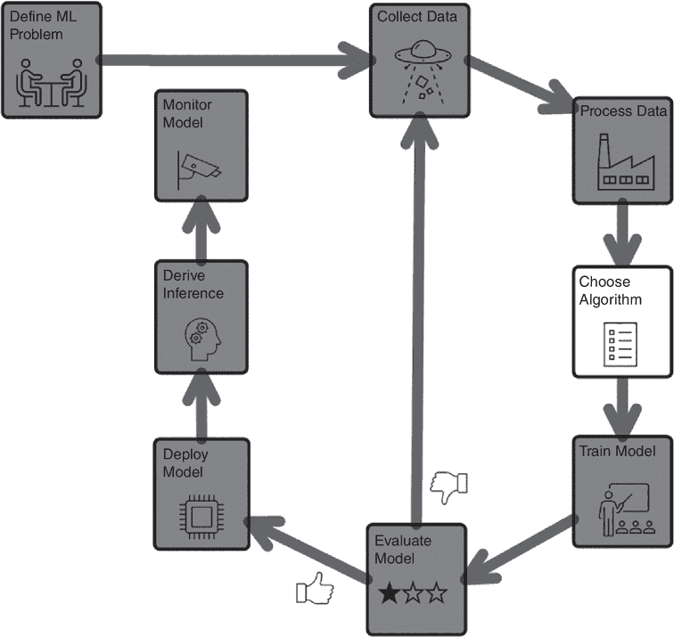

**图 4.1** 机器学习生命周期。

您将学习如何选择最适合您特定用例的 ML 算法，以及如何有效地实施它以启动模型开发过程。请记住，模型开发过程本质上是迭代的，涉及持续的改进和评估，以确保模型的最佳性能和准确性。通过掌握这种迭代方法，您将能够妥善应对复杂的数据挑战并推动有影响力的结果。

本章将指导您完成将原始数据转化为强大预测模型的复杂而迷人的过程，这些模型可以推动可操作的见解和决策。

选择合适的 ML 算法是模型开发过程中的关键步骤。此决策取决于对您的用例、数据性质以及您旨在解决的特定问题的清晰理解。无论您处理的是分类任务、回归问题还是聚类需求，选择正确的算法都涉及在可解释性、准确性、计算效率、可扩展性和成本等因素之间取得平衡。我们将深入探讨各种算法类型，提供何时使用每种算法以及如何将它们与您的独特需求相匹配的指南。

遵循 ML 生命周期，一旦选定算法，训练之旅便开始了。在这里，我们将介绍将数据输入算法的基本步骤。在下一章中，您将学习如何微调超参数并迭代地改进模型以提高其性能。我们还将讨论避免过拟合和欠拟合等常见陷阱的技术，确保您的模型能很好地泛化到新的、未见过的数据。

在本章结束时，您将全面了解模型选择阶段，具备为您的 ML 问题选择最合适的算法或 AI 服务的知识，并有信心有效地实施您的选择。

### 了解 AWS AI 服务

AWS AI 服务是功能强大的预构建和预训练 ML 模型，可帮助开发人员和 ML 工程师无缝地将 AI 集成到其应用程序中，而无需深入了解 ML。这些服务涵盖广泛的 AI 功能，包括计算机视觉、自然语言处理 (NLP)、语音识别、生成式 AI 和预测分析。例如，`Amazon Rekognition` 允许用户分析图像和视频以识别物体、人员、文本、场景和活动。同时，`Amazon Comprehend` 执行情感分析和实体识别等 NLP 任务，使企业能够从非结构化文本数据中获取见解。

AWS AI 服务的主要优势之一是其易用性和可扩展性。它们附带完全托管的 API，开发人员可以从其应用程序中调用这些 API，只需付出最小的努力即可利用复杂的 ML 功能。这些服务还旨在处理大规模数据处理，确保应用程序能够满足高性能要求。此外，AWS AI 服务可与其他 AWS 产品无缝集成，使用户能够从数据收集和处理到模型训练和部署构建端到端的 ML 工作流。这种整体方法有助于简化开发流程并加速 AI 在各个行业的采用。

对于考试，您需要知道哪些 AWS AI 服务解决各种 AI 和 ML 用例，例如文本分析、图像和视频识别、语音合成和识别、翻译、个性化推荐、文档处理和生成式 AI。这包括了解 `Amazon Comprehend` 用于文本分析、`Amazon Rekognition` 用于图像和视频识别、`Amazon Polly` 用于语音合成、`Amazon Transcribe` 用于语音识别、`Amazon Translate` 用于翻译、`Amazon Personalize` 用于推荐、`Amazon Textract` 用于文档处理以及 `Amazon Bedrock` 用于生成式 AI 等服务。了解每种服务的具体用例和应用是有效利用不同场景下 AWS AI 功能的关键。

#### 视觉

##### AWS 视觉内容分析服务

AWS 通过 **Amazon Rekognition** 和 **Amazon Textract** 等服务提供强大的视觉内容分析工具。**Amazon Rekognition** 有助于分析图像和视频以识别物体、人脸和文本，提供增强安全性和媒体分析等应用的能力。**Amazon Textract** 擅长从扫描文档中提取文本和数据，实现自动化文档处理。这些服务共同帮助企业高效、有效地从视觉数据中挖掘宝贵见解。

##### Amazon Rekognition

**Amazon Rekognition** 是一项由深度学习算法驱动的多功能图像和视频分析服务，旨在识别视觉媒体中的各种物体、人物、文本、场景和活动。其突出功能之一是人脸分析，包括人脸检测、比对和识别。这使开发人员能够创建能够实时或从存储媒体中识别个别人脸的应用程序。此外，**Amazon Rekognition** 还可以检测图像和视频中的文本，从而实现对文本信息的全面分析和提取。


该服务用户友好，提供易于使用的 API，允许开发人员向其应用程序添加图像和视频分析功能，而无需具备广泛的 ML 知识。其可扩展性确保能高效处理大量数据，使其既适用于小规模项目，也适用于企业级解决方案。通过利用 `Amazon Rekognition`，开发人员可以构建复杂的应用程序，分析视觉内容以提取有价值的见解、实现流程自动化并改善用户体验。

### 用例

`Amazon Rekognition` 被用于不同行业的各种关键应用。它有助于检测图像和视频中的不当内容，确保平台媒体的安全与合规。该服务还用于在线身份验证，增强数字服务的安全性和用户验证流程。媒体公司可以使用此服务，通过自动标记和分类内容来简化分析，从而更轻松地管理和检索特定资产。此外，`Amazon Rekognition` 可以向智能家庭发送智能警报，识别特定人脸或物体并通知房主异常活动，从而增强家庭安全和自动化系统。这些用例展示了 `Amazon Rekognition` 的多功能性及其在改变各行业利用视觉数据方式方面的重要作用。

### Amazon Textract

`Amazon Textract` 是一项复杂的 AI 服务，旨在从扫描文档中提取文本、表单、表格和其他数据。与传统光学字符识别 (OCR) 技术不同，`Amazon Textract` 使用 ML 来理解文档的布局和结构，捕捉不同元素之间的语义关系。这种先进功能使该 AI 服务能够准确解读复杂信息，特别适用于快速有效地处理大量文档，将非结构化数据转换为可高效分析和利用的结构化格式。

`Amazon Textract` 的关键功能之一是其识别和提取文档中表格和表单数据的能力，理解不同数据片段之间的上下文和关系。这超越了单纯的文本阅读；`Amazon Textract` 可以区分表格中的表头、行和列，确保提取的数据保持其原始结构和含义。这种语义理解对于需要精确数据提取和解读的应用程序至关重要，例如财务报告、法律文档和医疗记录，在这些场景中数据的上下文与数据本身同等重要。

`Amazon Textract` 还与其他 AWS 服务无缝集成，使用户能够构建全面的数据处理管道。例如，提取的数据可以存储在 `Amazon S3` 中，使用 `Amazon Athena` 进行分析，或输入 `Amazon SageMaker` 用于 ML 应用。这种灵活性使组织能够将 `Amazon Textract` 作为更广泛数据战略的一部分，增强其从文档数据中获取见解和推动决策的能力。通过自动化信息提取和处理并保留语义关系，`Amazon Textract` 有助于减少人工工作量、最大限度地减少错误并提高运营效率。

#### 用例

`Amazon Textract` 广泛应用于各个行业，以简化文档处理和数据提取。在金融领域，它有助于自动从发票、收据和税务文档中提取数据，实现更快、更准确的财务报告。在医疗保健领域，`Amazon Textract` 用于数字化患者记录，使检索和分析医疗信息变得更加容易。律师事务所可以利用 `Amazon Textract` 处理大量合同和法律文档，确保关键信息被准确捕获且易于访问。此外，在公共部门，`Amazon Textract` 可协助管理和分析政府表格和申请，提高行政流程的效率。这些用例凸显了 `Amazon Textract` 的适应性及其在跨不同行业自动化数据提取和处理方面的重大影响。

### AWS 语音服务

AWS AI 服务提供全面的语音功能，旨在改变应用程序通过语音与用户交互的方式。这些服务提供从文本生成语音和将口语转换为文本的工具，实现更自然、无障碍的用户体验。对于语音用例，主要有两项服务：`Amazon Polly` 用于将文本转换为自然的语音，`Amazon Transcribe` 用于将口语转换为准确的文本。

### Amazon Polly

`Amazon Polly` 是一项文本转语音服务，它使用先进的深度学习技术将书面文本转换为自然的语音。它提供多种语言的多款逼真语音，并支持不同口音，为开发人员提供灵活性，以便为其用户创建引人入胜的本地化体验。无论是用于交互式语音应答 (IVR) 系统、新闻阅读应用程序还是有声读物，`Amazon Polly` 都通过使应用程序更易访问和交互来增强用户参与度。

`Amazon Polly` 擅长提供快速、实时的语音合成，确保需要即时响应的应用程序具有最低延迟。`Amazon Polly` 还支持语音合成标记语言 (SSML)，允许开发人员控制语音音调、语速和发音等方面，以获得更定制化的听觉体验。借助 `Amazon Polly`，您可以轻松高效地创建动态且自然的语音交互。

#### 用例

`Amazon Polly` 是一项用途广泛的文本转语音服务，拥有广泛的用例。它非常适合在 IVR 系统中创建引人入胜的语音交互，确保客户收到清晰自然的回复。`Polly` 也非常适合生成有声读物，为读者提供逼真旁白的沉浸式体验。此外，它通过将基于文本的内容转换为语音来增强无障碍性，使视障用户能更轻松地获取信息。在在线学习平台上，`Polly` 可以通过动态旁白让教育内容栩栩如生，提高理解和记忆效果。总体而言，`Amazon Polly` 是任何受益于高质量、自然语音的应用程序的强大工具。

### Amazon Transcribe

`Amazon Transcribe` 是一项功能强大的自动语音识别 (ASR) 服务，可将口语转换为书面文本。它旨在为各种音频和视频格式提供高精度的转录，使其成为从录制语音生成可搜索文本的必备工具。无论是用于为视频内容创建字幕、为播客和访谈生成成稿，还是为现场活动启用实时字幕，`Amazon Transcribe` 都能增强无障碍性和可搜索性。它还支持多种语言和方言，确保在不同地区和场景下广泛适用。借助说话人识别、标点符号恢复和自定义词汇表等功能，`Amazon Transcribe` 帮助用户为各种应用获取准确且全面的转录文本。

#### 使用案例

`Amazon Transcribe` 适用于广泛的应用场景。它非常适合为视频内容创建准确的字幕和隐藏式字幕，使媒体更具无障碍性和吸引力。播客制作者和采访者可以使用它生成成稿，从而轻松实现内容归档和搜索。在实时场景中，`Transcribe` 可提供实时字幕，增强听力受损观众的无障碍体验。对于客服呼叫中心也极具价值，可转录对话以改进分析和合规性。通过高效地将音频转换为文本，`Amazon Transcribe` 提升了各行各业口语内容的可用性和无障碍性。

### 语言

AWS 语言 AI 服务旨在增强和简化各种 NLP 任务，提供理解、生成和翻译人类语言的工具。这些服务使开发人员能够构建以更直观、自然的方式与用户交互的应用程序，自动化文本分析，并支持多语言通信。值得注意的是，`Amazon Translate` 提供实时语言翻译，而 `Amazon Comprehend` 通过文本分析提供洞察，包括情感检测和实体识别。

### Amazon Translate

`Amazon Translate` 是一项神经机器翻译服务，可提供快速、高质量且经济实惠的语言翻译。它支持数十种语言，使企业和开发人员能够高效地翻译大量文本，并将翻译功能直接集成到其应用程序中。`Amazon Translate` 可为网站和移动应用等应用程序处理实时翻译，使全球用户能够更轻松地以其母语与内容交互。该服务还支持批量翻译，这对于快速翻译大型文档或数据集非常有用。

`Amazon Translate` 旨在保留原文的上下文和含义，确保翻译不仅在语义上准确，而且读起来自然流畅。它使用在海量多语言数据上训练的先进深度学习模型，使其能够不断改进。`Amazon Translate` 具有高度可扩展性和成本效益，适合各种规模的企业。它还能与其他 AWS 服务无缝集成，允许用户构建综合解决方案，将翻译功能与其他 AI 和云工具结合利用。

#### 使用案例

`Amazon Translate` 服务于广泛的使用场景，使其成为企业和开发人员进行多语言通信的宝贵工具。它广泛用于翻译网站内容，使全球用户能够以其母语访问信息并与之交互。电商平台利用 `Amazon Translate` 提供多语言产品描述，提升用户体验并拓展市场覆盖面。在客户支持方面，它有助于翻译聊天和电子邮件通信，确保跨区域的无缝服务。`Amazon Translate` 在翻译文档、报告和用户手册方面也发挥着关键作用，促进全球协作和信息共享。此外，它还支持社交媒体和即时通讯等应用程序的实时翻译，促进全球即时有效的沟通。

### Amazon Comprehend

`Amazon Comprehend` 是一项 NLP 服务，它使用 ML 来发掘文本中的洞察和关系。它使企业能够了解客户评论背后的情感，提取关键短语，识别命名实体，甚至检测输入文本的语言。`Amazon Comprehend` 可以快速准确地分析大量文本，使其成为处理客户反馈、社交媒体帖子和其他非结构化数据的绝佳选择。该服务还可以通过识别关键主题和对内容进行分类来组织文档，帮助组织更好地管理和理解其数据。

`Amazon Comprehend` 是一项高度可配置的服务，允许创建针对特定业务需求量身定制的自定义模型。这些自定义模型基于不同行业的独特术语和上下文，实现更精确的实体识别和分类。与其他 AWS AI 服务一样，`Amazon Comprehend` 与 AWS 生态系统无缝集成，使用户能够构建全面的文本分析管道并实现工作流自动化。无论是通过分析支持工单来增强客户服务，还是改进内容推荐系统，`Amazon Comprehend` 都提供了将文本转化为可操作洞察的强大工具。

对于需要更高级功能的组织，`Amazon SageMaker` 提供开箱即用的复杂主题建模算法。这些算法将在本章后面详细讨论。

#### 使用案例

`Amazon Comprehend` 可应用于不同行业的广泛用例。企业通常将其用于情感分析，帮助他们了解客户反馈和社交媒体情绪，以改进产品和服务。在医疗保健行业，`Amazon Comprehend` 可分析医疗记录以提取有价值的见解，并识别药物、病症和治疗方法等关键实体。它还用于内容管理系统，以自动标记和组织大量文档，使其更易于搜索和管理。在客户服务方面，`Amazon Comprehend` 可分析支持工单以识别常见问题并缩短响应时间。此外，它通过分析通信模式和识别可疑活动来协助欺诈检测。总体而言，`Amazon Comprehend` 使组织能够从文本数据中挖掘宝贵见解，增强决策能力和运营效率。

### 聊天机器人

AWS 通过相关服务提供强大的聊天机器人功能，使企业能够创建引人入胜、交互式且智能的对话界面。这些聊天机器人可用于各种应用，从客户支持到交互式应用程序和内部帮助台。AWS 提供了 `Amazon Lex` 等工具，它使用先进的 NLP 来理解用户输入并管理复杂的对话。

### Amazon Lex

`Amazon Lex` 是一项功能强大的服务，旨在使用语音和文本将对话界面构建到任何应用程序中。利用为 `Amazon Alexa` 提供支持的相同深度学习技术，`Amazon Lex` 提供先进的自然语言理解能力。这使开发人员能够创建复杂的交互式聊天机器人，能够高精度地理解用户输入并做出响应。通过与 `AWS Lambda` 等其他 AWS 服务集成，`Amazon Lex` 实现了后端逻辑的无缝执行，从而构建复杂的端到端对话应用程序。

`Amazon Lex` 能够处理多轮对话，使聊天机器人能够维护上下文并管理复杂的对话流程。这对于客户服务应用程序特别有用，在这些场景中，机器人可能需要跨多次交互收集信息以解决问题。`Amazon Lex` 还支持与 `Amazon Connect`（AWS 的 AI 驱动的联络中心服务）的内置集成，使企业能够创建自动化的呼叫中心代理，可 24/7 全天候协助客户，减轻人工代理的负载并缩短响应时间。此外，`Amazon Lex` 可用于为各种平台构建聊天机器人，包括 Web 应用程序、移动应用和社交媒体渠道，在不同接触点提供一致且可扩展的用户体验。

从工程角度来看，`Amazon Lex` 提供了用户友好的控制台和开发环境，开发人员可以在其中定义机器人的交互模型，包括意图、槽位和响应，而无需具备丰富的 ML 或 NLP 经验。此外，`Amazon Lex` 提供了用于测试和监控聊天机器人性能的内置工具，帮助开发人员随着时间的推移迭代和改进其机器人。凭借其强大的功能和与其他 AWS 服务的无缝集成，`Amazon Lex` 是构建智能对话界面的综合解决方案，可增强用户参与度并简化业务流程。

#### 用例

`Amazon Lex` 主要用于改善客户服务体验。客户通过创建复杂的聊天机器人来利用 `Amazon Lex`，这些机器人处理咨询、提供信息并解决问题，最大限度地减少了对人工代理的需求并缩短了响应时间。在电子商务领域，由 Lex 驱动的机器人可以协助客户进行产品搜索、订单跟踪和个性化推荐，从而提升购物体验。医疗保健组织使用 `Amazon Lex` 来自动化预约安排、提供医疗信息并进行患者预筛选。最后，`Amazon Lex` 还被用于内部业务运营，创建虚拟助手帮助员工完成 IT 支持、人力资源咨询和工作流自动化等任务。总体而言，`Amazon Lex` 使企业能够构建智能对话界面，增强用户参与度并简化行政流程。

### 推荐

推荐功能由 AWS 通过其 AI 服务套件提供。这些功能旨在通过提供个性化内容来增强用户体验。

这些功能的核心是 `Amazon Personalize`，它允许开发人员轻松地将实时、量身定制的推荐集成到其应用程序中。`Amazon Personalize` 利用复杂的 ML 算法分析用户数据，如浏览历史、购买行为和偏好，以生成高度相关的推荐。

### Amazon Personalize

`Amazon Personalize` 通过利用先进的 ML 算法分析用户数据并生成高度个性化的推荐来运作。该过程始于收集用户的项目交互数据，如点击、浏览和购买，以及额外的上下文信息，如项目元数据（例如类型、价格）和用户人口统计信息（例如年龄、性别）。然后将这些数据输入 ML 模型进行训练，以识别用户和项目之间的模式和关系。模型可以通过实时交互数据持续更新，确保推荐在用户偏好演变时保持准确和相关。

`Amazon Personalize` 的一个关键且独特的功能是其使用生成式 AI 技术来增强推荐过程。生成式 AI 模型可以基于现有数据模拟新的数据点，有效地填补数据集中的空白并提高预测的准确性。这在处理稀疏数据或交互历史有限的新用户和新项目时特别有用。通过生成合成数据点，系统可以更好地理解用户偏好并提供更精准的推荐，即使在传统模型可能难以应对的场景中也是如此。此外，`Amazon Personalize` 允许基于您的独特数据进行定制。您可以选择最适合您特定用例和数据特征的 ML 算法，并提供关于用户和项目的上下文元数据，以获得更明智的推荐。

此外，`Amazon Personalize` 采用复杂的算法来处理各种推荐任务，例如 `collaborative filtering`（协同过滤）、`content-based filtering`（基于内容的过滤）和 `hybrid approaches`（混合方法）。协同过滤依赖于用户的集体行为来识别相似用户并推荐他们喜欢的项目。基于内容的过滤侧重于项目的属性，以推荐用户表现出兴趣的类似产品。混合模型结合了这些方法，以发挥两者的优势，提供稳健且全面的推荐。通过使用这些先进的 AI 和生成式技术，`Amazon Personalize` 提供高度个性化且有效的推荐，增强用户参与度和满意度。其灵活性和易于集成的特性确保企业可以根据特定需求定制服务，从而实现最佳结果。

#### 用例

`Amazon Personalize` 广泛应用于各个行业，通过个性化推荐增强用户体验。在电子商务领域，它根据用户的浏览历史和购买行为推荐产品，提高转化率和客户满意度。流媒体服务和新闻平台利用它推荐符合个人兴趣的电影、电视节目和文章，保持用户粘性。企业还将其用于定向营销活动，个性化电子邮件内容以推广相关产品和优惠，从而提高参与度。此外，客户支持团队利用 `Amazon Personalize` 推荐相关的支持文章，帮助用户更高效地解决问题。

通过提供高度相关且及时的推荐，`Amazon Personalize` 使企业能够增强用户参与度，并在各个领域推动更好的成果。

### 生成式 AI

生成式 AI 代表了人工智能领域的前沿进步，使系统能够从学习到的数据模式中 `generate`（此处即“生成式” AI 名称的由来）新内容，如文本、图像，甚至完整的多媒体体验。借助 `Amazon Bedrock`，AWS 将生成式 AI 功能带给开发人员，提供了一个无缝且可扩展的平台，用于构建、微调和部署生成式 AI 模型。`Amazon Bedrock` 提供了对来自领先 AI 创新者的各种强大基础模型 (FMs) 的访问，以及将这些模型轻松定制并集成到应用程序中所需的工具。通过使用 `Amazon Bedrock`，企业可以利用生成式 AI 的潜力进行创新并增强其数字解决方案，在各个领域推动创造力和效率。

### Amazon Bedrock

`Amazon Bedrock` 是一项全托管服务，它简化了使用 FMs 构建和扩展生成式 AI 应用程序的过程。它提供了对来自 AI21 Labs、Anthropic、Cohere、Meta、Mistral AI 和 Stability AI 等领先 AI 公司，以及 Amazon 自身模型（包括新发布的 Nova FMs）的广泛高性能 FMs 的访问。

#### 通用基础模型

通用基础模型是多功能模型，可处理文本生成、翻译、摘要等多种任务。这些模型适用于不同行业的广泛应用场景。通过单一 API，开发者可以尝试不同的模型，使用微调和检索增强生成 (RAG) 等技术利用自己的数据对模型进行定制，并安全地将其部署在应用程序中。`Amazon Bedrock` 的无服务器架构消除了管理基础设施的需求，使开发者能够专注于创新并为用户创造价值。作为 `Amazon Bedrock` 一部分的 `Converse API`，为开发者提供了一个一致且简化的接口来与这些基础模型交互，从而轻松地将对话式 AI 功能集成到应用程序中，以增强用户体验并实现自然交互。

#### 专用基础模型和模型市场


Amazon Bedrock 的一大亮点是其模型市场，该市场提供了广泛的专用基础模型选择，适用于各种用例。专用基础模型针对特定任务或领域进行了定制，为特定应用提供了更准确、更高效的性能。这些模型对于医疗保健、金融和娱乐等行业极具价值，在这些行业中，专业知识和精确度至关重要。模型市场使开发者能够无缝地发现、测试并将这些专用模型集成到其机器学习工作流中。无论是文本生成、图像创建还是复杂的多模态任务，Amazon Bedrock 都提供了构建强大生成式 AI 应用程序所需的工具和灵活性。通过利用 Amazon Bedrock，企业可以保持在 AI 创新的前沿，确保其应用程序既尖端又安全。`Converse API` 通过提供一种与这些模型交互的直接方式，进一步增强了这一能力，使集成过程变得无缝且高效。

### 选择基础模型

选择基础模型时，必须考虑应用程序所需的特定功能。如果您的任务主要涉及文本生成、分析或翻译，`Amazon Titan Text G1 – Premier`、`Amazon Titan Text G1 – Express` 和 `Amazon Titan Text G1 – Lite` 等模型是理想选择。这些模型与 Amazon Bedrock 集成，支持广泛的文本相关任务，包括开放式问答、代码生成、摘要和对话聊天。对于创意应用，`Amazon Nova Canvas` 等模型擅长根据文本描述生成详细图像，非常适合艺术和设计任务。对于多模态功能，`Amazon Nova Lite` 和 `Amazon Nova Pro` 等模型可以同时处理文本和图像输入，提供通用的解决方案。对于简单用例和低预算场景，`Amazon Nova Micro` 是一个纯文本模型，适用于需要低延迟文本处理且无需多模态输入的场景。结合应用程序的具体需求评估这些模型的能力，将有助于您选择最高效的基础模型。

#### 区域可用性

选择模型时要考虑的另一个标准是，该模型在您的生成式 AI 应用程序运行区域中的可用性。这可确保最佳性能、符合当地法规并降低延迟，从而提供无缝的用户体验。

考试提示：请注意，某些模型可能在您的区域不可用，但如果您的区域支持`跨区域推理`功能，仍可使用该功能来调用这些模型。跨区域推理使您能够利用不同 AWS 区域的算力，从而无缝管理突发的非计划流量。通过跨区域推理，您可以将流量分发到多个 AWS 区域，在峰值需求期间实现更高的吞吐量和增强的弹性。要使用跨区域推理，您需要创建一个跨区域推理配置文件。要了解更多信息，请访问 `https://docs.aws.amazon.com/bedrock/latest/userguide/inference-profiles-support.html`。

#### 定价

最后，就像任何设计良好的架构应用程序一样（生成式 AI 应用程序在这方面也不例外），您需要考虑定价。Amazon Bedrock 定价基于两种主要模式：

*   按需和批处理
*   预置吞吐量

采用按需和批处理模式，您需为处理的输入和输出令牌数量付费，其中 `token`（令牌）是模型将其解释为单个含义单位的字符序列。对于预置吞吐量，您需承诺在一段时间内使用特定水平的吞吐量，对于使用量稳定的应用程序，这可能更具成本效益。有关更多信息，请访问 `https://aws.amazon.com/bedrock/pricing`。

### 使用 Nova Canvas 生成图像

Nova 基础模型最近在 AWS re:Invent 2024 大会上发布。在本用例中，我们将使用 Nova Canvas——一种最先进的图像生成模型——根据文本提示生成图像。本示例将向您展示如何以编程方式实现此用例。

作为一个设计考量，我的 AWS 账户默认区域为 `us-east-2`（俄亥俄州）。由于 Nova Canvas 在我的默认区域不受原生支持（且我不想实现跨区域推理），我将在 `us-east-1`（弗吉尼亚北部）——该模型目前受原生支持的区域——创建我的 Python 客户端。在 AWS 控制台中，我们打开 Amazon Bedrock 并选择 `us-east-1`（弗吉尼亚北部）作为工作区域。然后我们请求访问该模型，如图 4.2 所示。

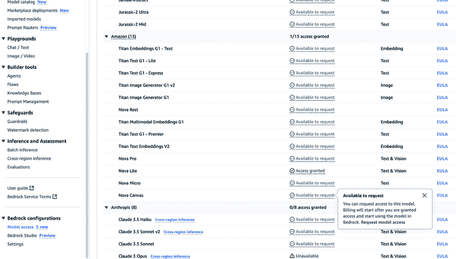

图 4.2 请求访问 Nova Canvas。

以下 Python 程序使用 `boto3` 模块在 `us-east-1` 中创建 Amazon Bedrock 客户端，并随后与 Nova Canvas 基础模型交互以请求生成图像。我们在 `us-east-1` 的 Amazon SageMaker Studio 中使用 Code Editor 应用程序运行此程序。

要开始使用 Amazon SageMaker Studio，您需要在程序将运行的区域（在本例中为 `us-east-1`）创建一个域。域可用后，您可以打开 Amazon SageMaker Studio，如图 4.3 所示。图 4.4 展示了 Studio 主页，您可以在其中创建空间。空间是 Amazon SageMaker Studio 用于启动 Code Editor 应用程序的托管实例。在图 4.4 中，我启动了一个名为 `dario-ai-space` 的空间，该空间使用实例类型 `ml.t3.medium` 并具有 5 GB 存储空间。要开发您的 ML 应用程序，您需要创建并启动您的空间，如图 4.5 所示。您的空间附带一个弹性文件系统 (EFS)，您的应用程序代码和其他工件将保存在此处。为避免产生不必要的费用，请确保在编码完成后停止您的空间。

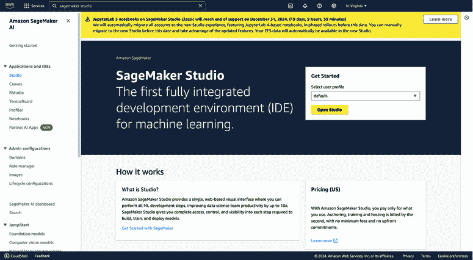

图 4.3 Amazon SageMaker Studio。

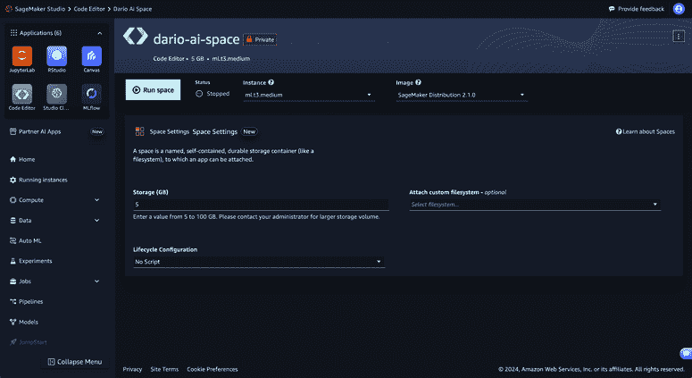

图 4.4 Amazon SageMaker Studio 空间。

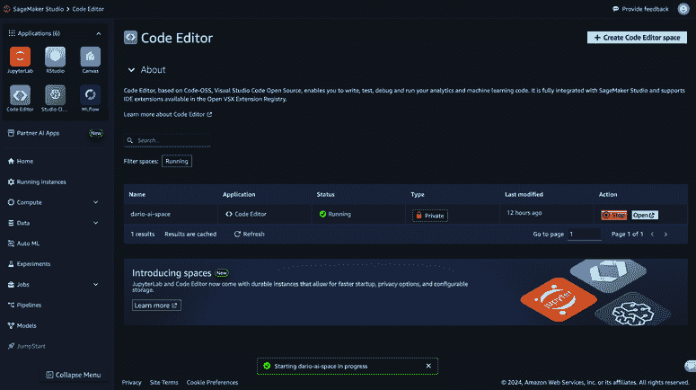

图 4.5 Amazon SageMaker Studio Code Editor。

#### Amazon Nova Canvas 图像生成示例

##### Python 实现

```python
import base64
import io
import json
import logging
import os
import boto3
from PIL import Image
from botocore.config import Config
from botocore.exceptions import ClientError

class ImageError(Exception):
    """Amazon Nova Canvas 返回错误的自定义异常"""
    def __init__(self, message):
        self.message = message

logger = logging.getLogger(__name__)
logging.basicConfig(level=logging.INFO)

def generate_image(model_id, body):
    """
    使用 Amazon Nova Canvas 模型按需生成图像。
    参数:
        model_id (str): 要使用的模型 ID。
        body (str) : 要使用的请求体。
    返回:
        image_bytes (bytes): 模型生成的图像字节数据。
    """
    logger.info(f"正在使用 Amazon Nova Canvas 模型 {model_id} 生成图像")

    bedrock = boto3.client(
        service_name='bedrock-runtime',
        config=Config(read_timeout=300)
    )

    accept = "application/json"
    content_type = "application/json"

    response = bedrock.invoke_model(
        body=body, modelId=model_id, accept=accept, contentType=content_type
    )
    response_body = json.loads(response.get("body").read())

    base64_image = response_body.get("images")[0]
    base64_bytes = base64_image.encode('ascii')
    image_bytes = base64.b64decode(base64_bytes)

    finish_reason = response_body.get("error")

    if finish_reason is not None:
        raise ImageError(f"图像生成错误。错误信息: {finish_reason}")

    logger.info(f"成功使用 Amazon Nova Canvas 模型 {model_id} 生成图像")

    return image_bytes

def main():
    """
    Amazon Nova Canvas 示例的入口点。
    """
    logging.basicConfig(level=logging.INFO,
                        format="%(levelname)s: %(message)s")

    model_id = 'amazon.nova-canvas-v1:0'
    prompt = "Generate an image of a white sand beach at sunset."

    body = json.dumps({
        "taskType": "TEXT_IMAGE",
        "textToImageParams": {
            "text": prompt
        },
        "imageGenerationConfig": {
            "numberOfImages": 1,
            "height": 1024,
            "width": 1024,
            "cfgScale": 8.0,
            "seed": 0
        }
    })

    try:
        image_bytes = generate_image(model_id=model_id, body=body)
        image = Image.open(io.BytesIO(image_bytes))

        # 如果目录不存在则创建
        efs_directory = '/home/sagemaker-user/ch04/images'
        if not os.path.exists(efs_directory):
            os.makedirs(efs_directory)

        # 将图像保存到挂载的 EFS 文件系统
        output_image_path = os.path.join(efs_directory, "white_sand_beach_sunset.png")
        image.save(output_image_path)
        print(f"图像已保存至 {output_image_path}")

    except ClientError as err:
        message = err.response["Error"]["Message"]
        logger.error(f"发生客户端错误: {message}")
        print(f"发生客户端错误: {message}")
    except ImageError as err:
        logger.error(err.message)
        print(err.message)
    else:
        print(f"使用 Amazon Nova Canvas 模型 {model_id} 完成图像生成。")

if __name__ == "__main__":
    main()
```

我将此程序保存在代码编辑器中，文件名为 `test_nova_canvas.py`。

该程序利用 `boto3` 模块构建了一个名为 `bedrock` 的客户端对象，用于与 us-east-1 区域的 Amazon Bedrock 交互，Nova Canvas 在该区域原生受支持。正如 `generate_image` 方法所示，该客户端使用 `invoke_model` 方法发送提示词（封装为 `body` 参数的 `text` 属性），以创建一张白沙滩日落的图像。

在 Amazon SageMaker Studio 中运行时，此代码会生成请求的图像，如图 4.6 和图 4.7 所示。

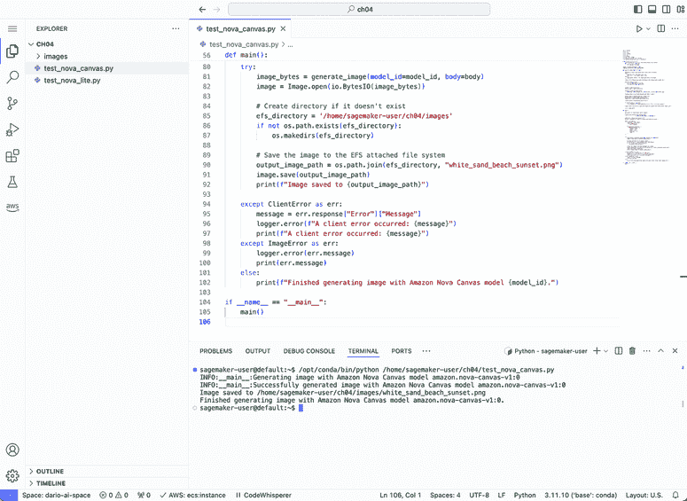

图 4.6 程序输出。

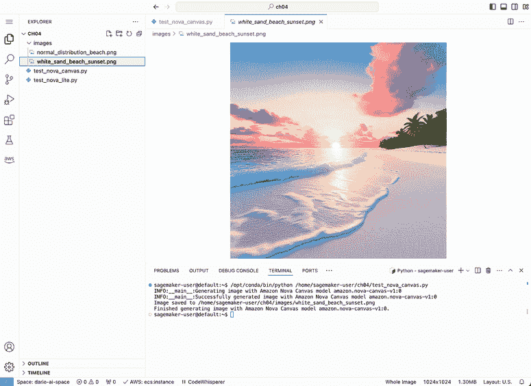

图 4.7 Nova Canvas 生成的图像。

图像生成后，程序会解码 base64 图像数据，并将其作为 `white_sand_beach_sunset.png` 保存在 Amazon SageMaker Studio 实例上挂载的 EFS 的 `/home/sagemaker-user/ch04/images` 文件夹中。

该程序还包含全面的错误处理，以确保流程顺利进行，并在过程中记录有意义的日志消息。此设置确保图像能够高效地生成和存储，以便进一步使用或显示。

### 用例

对于希望利用强大的基础模型构建生成式 AI 应用程序的开发人员来说，Amazon Bedrock 是一个绝佳的选择。得益于其与 Amazon Titan 和 Amazon Nova 等高性能模型的集成，它非常适合文本生成、图像创建和多模态处理等任务。如果您需要具有托管基础设施的可扩展、可靠且易于使用的 AI 能力，Amazon Bedrock 为实验和部署提供了无缝环境。此外，Amazon Bedrock 的按需付费定价使其适用于各种规模的项目，从小型初创公司到大型企业。

相反，如果您的应用程序需要平台或市场中没有的高度专业化或特定领域的模型，Amazon Bedrock 可能不是最佳选择。如果您需要基于专有数据训练的模型、有严格的数据驻留要求，或有延迟要求需要高度专业化的解决方案，其他平台或自建模型可能更合适。此外，如果成本是主要考量因素且您的项目 AI 需求极小，更简单、更具成本效益的解决方案可能就足够了，无需 Amazon Bedrock 的高级功能。

## 使用 Amazon SageMaker 内置算法开发模型

尽管 Amazon Rekognition、Comprehend 和 Personalize 等 AWS AI 服务为图像分析、文本处理和推荐系统等常见任务提供了强大的预建解决方案，但它们可能无法为专业用例提供所需的灵活性。这些托管服务设计为易于使用，且需要极少的 ML 专业知识，使其适合快速部署和标准应用。然而，当您的项目需要自定义特征工程、高级模型架构或针对特定性能指标进行优化时，Amazon SageMaker 的内置算法提供了实现这些目标所需的工具和灵活性。

选择使用 Amazon SageMaker 的内置算法构建模型具有多项优势，特别是在您需要对 ML 项目拥有更大控制权和定制性时。Amazon SageMaker 的内置算法在速度、规模和准确性方面经过高度优化，使您能够高效地训练、优化和部署针对特定业务需求量身定制的模型。当您需要微调超参数、融入领域专业知识或处理独特的数据预处理要求时，这种方法非常理想。通过利用 Amazon SageMaker 的内置算法，您可以实现更高精度和性能，特别是在现成解决方案可能力有未逮的复杂或定制应用中。

此外，Amazon SageMaker 可与更广泛的 AWS 生态系统无缝集成，确保从数据准备到模型部署的连贯工作流。您可以轻松从 Amazon S3、Amazon EFS 或 Amazon FSx for Lustre 导入数据；利用 `AWS Lambda` 函数进行预处理；并使用 Amazon SageMaker 终端节点或 `AWS Lambda` 部署模型以进行实时推理。这种紧密的集成简化了 ML 生命周期，提高了运营效率，并减少了管理 ML 管道不同组件所需的时间和精力。它还允许您利用 Amazon SageMaker 的分布式训练功能，这可以显著加速大型数据集上的模型训练。

在本节中，我们将探讨 Amazon SageMaker 提供的内置算法、其适用的用例，以及如何有效利用它们来构建稳健的 ML 模型。图 4.8 可帮助您将内置算法映射到特定的 ML 问题类型、输入格式和用例。

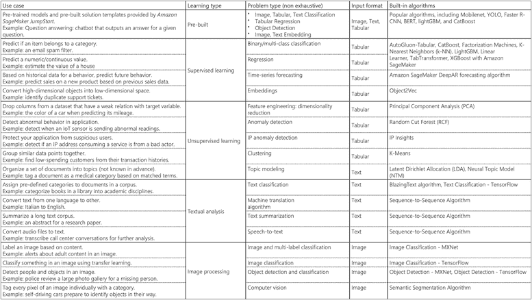

图 4.8 Amazon SageMaker 内置算法。

### 监督 ML 算法

正如您在 第 1 章 中所学，监督 ML 是一种从带标签的训练数据中学习以进行预测或决策的算法类型。在监督学习中，每个训练样本都包含以特征集形式呈现的输入数据，以及相应的输出或标签。算法利用这些带标签的样本学习输入与输出之间的映射关系，随后可将这种学习到的映射应用于新的、未见过的数据以预测结果。


# 监督学习概述

当输入特征与相应标签（也称为 `target variable`）之间存在清晰且预先定义的关系时，这种方法特别有用。监督学习的常见应用包括回归任务（目标是预测连续值，例如根据大小和位置等特征预测房价）和分类任务（目标是将数据归类为离散的类别，例如识别电子邮件是否为垃圾邮件）。

当有带标签的数据可用，且目标是基于这些数据进行准确预测时，应使用监督学习。在监督学习中，根据 ML 问题的性质，存在多种途径。

*   对于回归问题，可采用线性回归、决策树和 XGBoost 等算法来预测连续值。
*   在二元分类中，逻辑回归、支持向量机和 k-近邻 (`k-NN`) 等算法有助于区分两个类别。
*   对于多类分类（即数据需归类为两个以上的类别），常用决策树、随机森林和神经网络等方法。

此外，监督学习还涵盖 DeepAR 等时间序列预测算法，该算法基于过去的观测值预测未来值。而且，Object2Vec 等算法可用于创建嵌入，以捕捉对象或实体的语义信息，从而增强推荐系统或语义搜索等下游任务的性能。

## 通用回归和分类算法

本节介绍 Amazon SageMaker 提供的最常见的回归和分类监督 ML 算法。

### Linear Learner

我们将从 Amazon SageMaker Linear Learner 算法开始，该算法为分类和回归问题提供了解决方案。

在线性回归用例中，您向算法提供带标签的样本 <math xmlns="http://www.w3.org/1998/Math/MathML" overflow="scroll"><mfenced close=")" open="("><mrow><mi>x</mi><mo>,</mo><mi>y</mi></mrow></mfenced></math>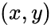。<math xmlns="http://www.w3.org/1998/Math/MathML" overflow="scroll"><mi>x</mi></math> 是特征值 <math xmlns="http://www.w3.org/1998/Math/MathML" overflow="scroll"><msub><mi>x</mi><mn>1</mn></msub><mo>,</mo><msub><mi>x</mi><mn>2</mn></msub><mo>,</mo><mo>&#8230;</mo><mo>,</mo><mtext>&#160;</mtext><msub><mi>x</mi><mi>n</mi></msub></math>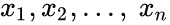 的高维向量，而 <math xmlns="http://www.w3.org/1998/Math/MathML" overflow="scroll"><mi>y</mi></math> 是表示与样本数据点关联的标签的实数。

对于二元分类问题，标签必须为 0 或 1。

对于多类分类问题，标签必须为 0 到 `num_classes` – 1。

该算法学习一个线性函数，或针对分类问题学习一个线性阈值函数，并将向量 <math xmlns="http://www.w3.org/1998/Math/MathML" overflow="scroll"><mi>x</mi></math> 映射到标签 <math xmlns="http://www.w3.org/1998/Math/MathML" overflow="scroll"><mi>y</mi></math> 的近似值。

Linear Learner 算法需要一个数据矩阵，其中行代表观测值（或数据点），列代表特征的维度。它还需要一个包含与数据点匹配的标签的额外列。至少，Amazon SageMaker 的 Linear Learner 要求您将输入和输出数据位置以及目标类型（分类或回归）作为参数指定。特征维度也是必需的。有关更多信息，请参阅 `https://docs.aws.amazon.com/sagemaker/latest/APIReference/API_CreateTrainingJob.html`。

您可以在请求体的 `HyperParameters` 字符串映射中指定其他参数。这些参数控制优化过程或您训练的目标函数的细节，例如 epoch 数量、正则化和损失类型。

让我们深入探讨线性回归和逻辑回归，它们分别是回归和分类 ML 问题中最常见的线性建模用例。支持向量机 (SVM) 也作为 Linear Learner 算法的另一种选择被包含在内。

#### 线性回归

线性回归是监督 ML 中最简单且应用最广泛的算法之一。线性回归的主要目标是对因变量（也称为 `target` 或 `output variable`）与一个或多个自变量（称为 `features` 或 `predictors`）之间的关系进行建模。它通过将线性方程拟合到观测数据来实现这一点。线性方程可以写成以下形式：

<math class="a" xmlns="http://www.w3.org/1998/Math/MathML" overflow="scroll" display="block"><mi>y</mi><mo>=</mo><msub><mi>&#946;</mi><mrow><mn>0</mn></mrow></msub><mo>+</mo><msub><mi>&#946;</mi><mrow><mn>1</mn></mrow></msub><msub><mi>x</mi><mrow><mn>1</mn></mrow></msub><mo>+</mo><mo>&#8943;</mo><mo>+</mo><msub><mi>&#946;</mi><mrow><mrow><mi mathvariant="normal">n</mi></mrow></mrow></msub><msub><mi>x</mi><mrow><mrow><mi mathvariant="normal">n</mi></mrow></mrow></msub><mo>+</mo><mi>&#949;</mi></math>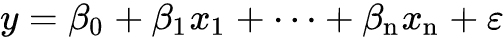

其中，<math xmlns="http://www.w3.org/1998/Math/MathML" overflow="scroll"><mi>y</mi></math> 是实际观测输出，<math xmlns="http://www.w3.org/1998/Math/MathML" overflow="scroll"><msub><mi>&#946;</mi><mn>0</mn></msub></math>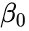 是截距，<math xmlns="http://www.w3.org/1998/Math/MathML" overflow="scroll"><msub><mi>&#946;</mi><mn>1</mn></msub><mo>,</mo><msub><mi>&#946;</mi><mn>2</mn></msub><mo>,</mo><mo>&#8230;</mo><mo>,</mo><msub><mi>&#946;</mi><mi>n</mi></msub></math>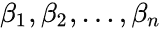 是特征 <math xmlns="http://www.w3.org/1998/Math/MathML" overflow="scroll"><msub><mi>x</mi><mn>1</mn></msub><mo>,</mo><msub><mi>x</mi><mn>2</mn></msub><mo>,</mo><mo>&#8230;</mo><mo>,</mo><msub><mi>x</mi><mi>n</mi></msub></math>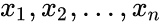 的系数（或权重），而 <math class="a" xmlns="http://www.w3.org/1998/Math/MathML" overflow="scroll"><mi>&#949;</mi></math> 代表误差，也称为 `residual`（残差，即实际值与预测值之间的差异）。

你的目标是预测模型将学习的系数 <math xmlns="http://www.w3.org/1998/Math/MathML" overflow="scroll"><msub><mi>&#946;</mi><mi mathvariant="normal">I</mi></msub></math>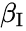，以使整个数据集上的误差 <math class="a" xmlns="http://www.w3.org/1998/Math/MathML" overflow="scroll"><mi>&#949;</mi></math> 最小化。

在评估模型时，我们通过查看残差来了解模型的表现如何。在线性回归中，模型旨在找到使均方误差（MSE）最小化的线性函数。MSE 的公式如下：

<math xmlns="http://www.w3.org/1998/Math/MathML" overflow="scroll" display="block"><mtext>MSE</mtext><mo>=</mo><mstyle displaystyle="true"><mfrac><mn>1</mn><mi>n</mi></mfrac></mstyle><munderover><mo movablelimits="false">&#8721;</mo><mrow><mi>i</mi><mo>=</mo><mn>1</mn></mrow><mrow><mi>n</mi></mrow></munderover><msup><mrow><mo>(</mo><msub><mi>y</mi><mrow><mi>i</mi></mrow></msub><mo>&#8722;</mo><mrow><mover><msub><mi>y</mi><mrow><mi>i</mi></mrow></msub><mo>^</mo></mover></mrow><mo>)</mo></mrow><mrow><mn>2</mn></mrow></msup></math>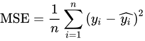

其中，<math xmlns="http://www.w3.org/1998/Math/MathML" overflow="scroll"><mtext>&#160;</mtext><mi>n</mi></math>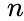 表示数据集中的观测值数量，<math xmlns="http://www.w3.org/1998/Math/MathML" overflow="scroll"><msub><mi>y</mi><mi>i</mi></msub></math>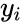 表示观测值 <math xmlns="http://www.w3.org/1998/Math/MathML" overflow="scroll"><mi>i</mi></math> 的实际值，而 <math xmlns="http://www.w3.org/1998/Math/MathML" overflow="scroll"><mover accent="true"><mrow><msub><mi>y</mi><mi>i</mi></msub></mrow><mo>^</mo></mover></math> 表示观测值 <math xmlns="http://www.w3.org/1998/Math/MathML" overflow="scroll"><mi>i</mi></math> 的预测值。

最小化 MSE 有助于确保预测值尽可能接近实际值，从而有效降低整体误差。

你可以使用 `sklearn.linear_model` 模块中的 `LinearRegression` 类从数据集构建线性回归模型，如以下代码片段所示：

```python
import numpy as np
import matplotlib.pyplot as plt
from sklearn.linear_model import LinearRegression

######## Generate some sample data
np.random.seed(0)
X = 2 * np.random.rand(100, 1)
y = 4 + 3 * X + np.random.randn(100, 1)

######## Fit a linear regression model
model = LinearRegression()
model.fit(X, y)
y_pred = model.predict(X)

######## Plot the data points
plt.scatter(X, y, color='blue', label='Data Points')

######## Plot the regression line
plt.plot(X, y_pred, color='red', label='Regression Line')

######## Plot the residuals
for i in range(len(X)):
    plt.plot([X[i], X[i]], [y[i], y_pred[i]], color='green', linestyle='--')

plt.xlabel('X')
plt.ylabel('y')
plt.title('Linear Regression with Residuals')
plt.legend()
plt.show()

######## Print Mean Squared Error
mse = np.mean((y - y_pred) ** 2)
print(f"Mean Squared Error: {mse}")
```

让我们看看该程序是如何工作的：

*   **数据生成** 我们生成一个包含 100 行（样本）和 1 列（特征）的矩阵 <math xmlns="http://www.w3.org/1998/Math/MathML" overflow="scroll"><mi>X</mi></math>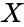。每一行代表单个特征的值（观测值或样本），该值是在 0 和 2 之间均匀分布的随机数。然后我们定义一个线性关系 <math class="a" xmlns="http://www.w3.org/1998/Math/MathML" overflow="scroll"><mi>y</mi><mo>=</mo><mn>4</mn><mo>+</mo><mn>3</mn><mi>X</mi><mo>+</mo><mi>&#949;</mi></math>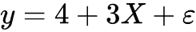，并加入一些残差。在程序中，<math xmlns="http://www.w3.org/1998/Math/MathML" overflow="scroll"><mi>y</mi></math> 代表与每个样本对应的目标变量向量。
*   **模型拟合** 我们使用 `scikit-learn` 中的 `LinearRegression` 创建并拟合线性回归模型。
*   **可视化** 如图 4.9 所示，我们绘制数据点的散点图，并绘制回归线。最后，我们绘制虚线以显示每个数据点（共 100 个）的残差（实际值与预测值之间的差异）。

    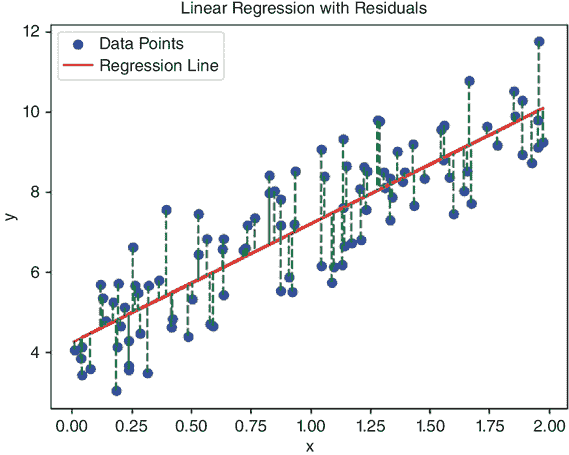

    图 4.9 线性回归。

*   **MSE** 我们计算并打印 MSE 以量化模型的性能。

#### 逻辑回归

尽管名为“回归”，但逻辑回归是一种分类算法，它允许你使用输入特征的线性组合来建模正确类别预测的概率。当因变量是二元时，即只能取两种可能的结果：正确类别预测或错误类别预测，该算法特别有用。

逻辑回归通过将 `logistic function`（逻辑函数）应用于输入特征的线性组合来工作，这会将输出转换为落在 0 和 1 之间的范围内。然后可以将此输出解释为事件发生的概率，并使用阈值（通常为 0.5）将事件分类为两个可能的类别之一。


# 逻辑函数，也称为 `sigmoid function`（Sigmoid 函数）

逻辑函数，也称为 `sigmoid function`（Sigmoid 函数），是逻辑回归的关键，定义如下：

$$ \sigma(z) = \frac{1}{1 + e^{-z}} $$

在该公式中，`z` 是输入特征及其对应系数的线性组合。

## 逻辑回归与 Sigmoid 函数

如图 4.10 所示，逻辑函数将任意实值映射为概率度量——即单位区间 (0, 1)——使其适用于概率估计。Sigmoid 函数的 S 形曲线确保当输入 `z` 变得非常大或非常小时，输出分别趋近于 1 或 0，但永远不会真正达到这些极值。这一特性对于概率建模至关重要，因为它确保预测概率始终在有效范围内。

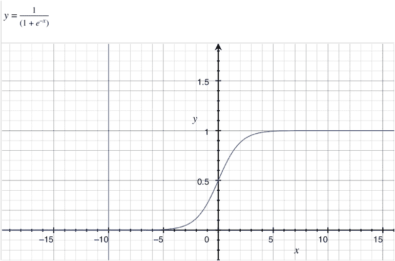

**图 4.10 逻辑函数**

理解算法工作原理的最佳方式是通过一个简单示例。以下 Python 程序使用 Iris 数据集，基于花萼长度和宽度预测花朵是否为 *Iris-virginica* 物种。该程序使用逻辑回归算法，并绘制决策边界以及 Sigmoid 函数提供的概率估计。

```python
import numpy as np
import matplotlib.pyplot as plt
from sklearn import datasets
from sklearn.linear_model import LogisticRegression
from sklearn.model_selection import train_test_split

# Load the Iris dataset
iris = datasets.load_iris()
X = iris.data[:, :2]  # Using only sepal length and sepal width
y = (iris.target == 2).astype(int)  # Only interested in whether it is Iris-Virginica or not

# Split the data into training and test sets
X_train, X_test, y_train, y_test = train_test_split(X, y, test_size=0.2, random_state=42)

# Train the Logistic Regression model
model = LogisticRegression()
model.fit(X_train, y_train)

# Generate grid of points to plot the sigmoid function
x_min, x_max = X[:, 0].min() - 1, X[:, 0].max() + 1
y_min, y_max = X[:, 1].min() - 1, X[:, 1].max() + 1
xx, yy = np.meshgrid(np.arange(x_min, x_max, 0.01), np.arange(y_min, y_max, 0.01))

# Calculate the probabilities
Z = model.predict_proba(np.c_[xx.ravel(), yy.ravel()])[:, 1]
Z = Z.reshape(xx.shape)

# Plot the decision boundary and sigmoid probabilities
contour = plt.contourf(xx, yy, Z, alpha=0.8, cmap=plt.cm.Greys, levels=np.linspace(0, 1, 11))

# Update scatter plot with different markers for each class
plt.scatter(X[y == 0, 0], X[y == 0, 1], c='white', edgecolors='k', marker='o', s=40, label='Not Iris-Virginica')
plt.scatter(X[y == 1, 0], X[y == 1, 1], c='white', edgecolors='k', marker='s', s=40, label='Iris-Virginica')

plt.colorbar(contour, label='Probability of Iris-Virginica')
plt.xlabel('Sepal length')
plt.ylabel('Sepal width')
plt.title('Logistic Regression Sigmoid Function Visualization')

# Add legend
plt.legend()

plt.show()
```

让我们首先看看该程序如何工作：

*   **加载并预处理数据** 加载 Iris 数据集，并仅选择花萼长度和花萼宽度特征。目标变量被转换为二进制格式，指示花朵是否为 *Iris-virginica*。
*   **划分数据** 使用 `train_test_split` 将数据划分为训练集和测试集。这有助于评估模型在未见数据上的性能。
*   **训练逻辑回归模型** 实例化一个逻辑回归模型。使用 `fit` 方法在训练数据上训练模型。
*   **生成网格点** 使用 `np.meshgrid` 创建覆盖特征空间（花萼长度和花萼宽度）的网格点。该网格将用于可视化决策边界和概率。
*   **计算概率** 使用训练好的模型通过 `predict_proba` 方法预测网格中每个数据点属于 *Iris-virginica* 类的概率。然后将这些概率重塑以匹配网格。
*   **绘制结果** 使用 `contourf` 绘制决策边界和概率。使用 `scatter` 在其上绘制数据点。添加颜色条以指示概率刻度，并包含图例以表示圆形和方形数据点所代表的含义（非 Iris-Virginica 和 Iris-Virginica）。

该程序演示了逻辑回归创建线性决策边界的能力，并可视化模型概率在特征空间中的变化。图 4.11 显示了该程序生成的图表。


**图 4.11 使用逻辑回归计算的概率范围**

在图 4.11 中，方形数据点表示真实的 *Iris-virginica* 数据样本，而圆形数据点表示其他 Iris 物种（*Iris-setosa* 或 *Iris-versicolor*）。注意概率范围是如何通过线相互分隔的。这是因为逻辑回归算法试图使用线性方程关联特征（在本例中为花萼长度和花萼宽度）。训练期间，逻辑回归算法试图找到一个线性决策边界来分离两个类别。让我们详细阐述一下。

从数学上讲，逻辑回归算法将输入特征的线性组合拟合到二元结果的对数几率上。

在本例中，二元结果是数据样本实际为 *Iris-virginica* 的事件，`p` 表示该事件发生的概率：

$$ z = \beta_0 + \beta_1 x_1 + \dots + \beta_n x_n + \varepsilon = \log\left(\frac{p}{1-p}\right) $$

方程的最后一部分称为 *logit 函数*（对数几率函数），它返回 `p` 的对数几率，随后通过逻辑（Sigmoid）函数生成 0 到 1 之间的概率：

$$ \sigma(z) = \frac{1}{1 + e^{-z}} $$

由于 logit `z` 是特征的线性组合，因此逻辑回归创建的决策边界也将是线性的。该边界代表模型预测概率为 50% 的点（即 `z = 0`）。直线一侧的数据点概率将大于 50%，另一侧的数据点概率将小于 50%。

在图 4.11 中，你所看到的等高线代表逻辑回归模型生成的概率阈值。每条线对应一个特定的概率值。由于用于计算这些概率的底层方程是线性的，因此等高线是平行且均匀分布的。这些线指示了具有相似概率的区域，并有助于可视化模型如何分离不同的类别。

## 支持向量机

SVM 是一种通用的监督学习算法，既可用于分类任务，也可用于回归任务，为各类机器学习问题提供了强大的解决方案。

在分类中，SVM 通过寻找最优 `hyperplane`（超平面）来工作，该超平面以最大间隔将特征空间中的类别分开。这个间隔是超平面与来自任一类别的最近数据点之间的距离，这些最近点被称为 `support vectors`（支持向量）。通过最大化这个间隔，SVM 旨在实现对未见数据更好的泛化能力。SVM 可以通过使用 `kernel tricks`（核技巧）将特征空间转换到更高维度，从而处理线性和非线性分类问题，使得在转换后的空间中绘制线性边界成为可能。常用的核函数包括线性核、多项式核和径向基函数（RBF）核，每种核函数适用于不同类型的数据分布。

对于回归任务，SVM 被改编为支持向量回归（SVR）。SVR 的主要目标是找到一个函数，使其偏离实际目标值的程度不超过指定的边界值，同时尽可能平坦。换句话说，SVR 试图在目标值的容差范围（`ε`）内拟合最佳可能的线。该方法使用了与 SVM 分类中支持向量相似的概念，识别定义最优回归线或曲线的关键数据点，同时忽略落在边界内的任何点。结果是一个稳健且灵活的模型，能够有效处理异常值和噪声。与用于分类的 SVM 一样，SVR 也受益于核函数，能够捕捉特征与目标变量之间的复杂关系，使其成为回归分析的强大工具。

### 使用场景

当因变量与一个或多个自变量之间存在清晰的线性关系时，线性回归最为适用。它非常适合简单到中等复杂度的问题，目标是预测连续结果，例如根据面积和卧室数量预测房价。线性回归易于实现和解释，使其适用于模型透明度很重要的场景。然而，对于涉及非线性或变量间交互作用的更复杂关系，它可能不是最佳选择。在这种情况下，使用线性回归可能导致模型性能不佳和预测不准确。此外，线性回归对异常值和多重共线性敏感，这可能会扭曲结果。因此，它不太适合存在显著异常值、高维数据或线性关系假设不成立的数据集。对于这些更复杂的场景，多项式回归、决策树或梯度提升等其他算法可能更有效。

逻辑回归是二分类问题的首选方法，其中结果变量是具有两种可能结果的分类变量，例如垃圾邮件检测、疾病诊断（阳性/阴性）或预测客户流失（是/否）。当自变量与因变量的对数几率之间的关系是线性时，它非常适用。逻辑回归易于实现和解释，不仅提供分类，还提供类别成员的概率。然而，对于具有非线性关系或变量间交互作用的复杂数据集，其效果较差。在这种情况下，其性能可能落后于决策树、SVM 或神经网络等更先进的技术，后者能建模更复杂的模式。此外，逻辑回归假设自变量间不存在多重共线性，并且需要足够大的数据集以产生可靠结果，这使其不太适合小规模、高度相关或极高维的数据。

SVM 是主要用于分类任务的强大监督学习模型，尽管也可应用于回归问题。在处理高维数据集以及类别间由清晰边界分离的情况时，它们特别有效。当特征数量超过样本数量时，SVM 具有优势，因为在此类场景下它们不太容易过拟合。

然而，由于计算强度大，SVM 不适合大型数据集，这可能导致较长的训练时间和更高的内存使用量。此外，SVM 可能难以处理嘈杂数据集和重叠类别，在这些情况下，与随机森林或梯度提升等更灵活的算法相比，其表现可能不佳。它们还需要仔细调整超参数，如核类型和正则化参数，以实现最优性能。总之，SVM 最适用于中小规模（最多约 10,000 个样本）、高维且类别分离清晰的数据集，而不太适合大型、嘈杂的数据集，或需要快速训练和预测的问题。

## K-近邻算法

k-NN 算法是一种简单而有效的监督机器学习方法，用于分类和回归问题。k-NN 的核心思想是相似的数据点在特征空间中可能彼此接近。进行预测时，k-NN 会识别给定数据点的 `k` 个最近邻居，并利用它们的标签来确定新点的标签。对于分类，算法将 `k` 个最近邻居中最常见的标签分配给新点；而对于回归，则对邻居的标签进行平均。

`k` 的值在学习过程开始前设定，表示进行预测时要考虑的最近数据点（邻居）的数量。这是 k-NN 算法中一个至关重要的*超参数*。较小的 `k` 值（例如 `k=1`）会使模型对数据中的噪声高度敏感，因为它仅考虑最近的邻居。相反，较大的 `k` 值（例如 `k=10`）通过在更多邻居上取平均来平滑预测，这对嘈杂数据有益，但可能会忽略局部模式。选择合适的 `k` 值需要权衡这些因素，通常使用交叉验证等技术来完成，这将在第 5 章中讨论。本质上，`k` 决定了影响数据点预测的“邻域”范围。

尽管 k-NN 算法简单，但计算开销可能很大，尤其是对于大型数据集，因为它需要计算查询数据点与数据集中所有其他点之间的距离。可以使用各种距离度量，如欧几里得距离、曼哈顿距离和闵可夫斯基距离来衡量距离。距离度量的选择会显著影响算法性能，应与数据性质和具体问题相匹配。

以下示例通过使用简化的二维鸢尾花数据集，直观演示了 k-NN 如何解决分类问题：


```python
import numpy as np
import matplotlib.pyplot as plt
from sklearn.datasets import load_iris
from sklearn.model_selection import train_test_split
from sklearn.neighbors import KNeighborsClassifier
from matplotlib.colors import ListedColormap

######## 加载鸢尾花数据集
iris = load_iris()
X = iris.data[:, :2]  # 仅使用前两个特征用于可视化
y = iris.target

####### 将数据集划分为训练集和测试集
X_train, X_test, y_train, y_test = train_test_split(X, y, test_size=0.2, random_state=42)

####### 创建并训练 k-NN 分类器
k = 3
knn = KNeighborsClassifier(n_neighbors=k)
knn.fit(X_train, y_train)

####### 绘制决策边界
x_min, x_max = X[:, 0].min() - 1, X[:, 0].max() + 1
y_min, y_max = X[:, 1].min() - 1, X[:, 1].max() + 1
xx, yy = np.meshgrid(np.arange(x_min, x_max, 0.1), np.arange(y_min, y_max, 0.1))
Z = knn.predict(np.c_[xx.ravel(), yy.ravel()])
Z = Z.reshape(xx.shape)

plt.figure(figsize=(8, 6))
plt.contourf(xx, yy, Z, alpha=0.3, cmap=ListedColormap(('gray', 'lightgray', 'darkgray')))

####### 类别的颜色和标记
training_markers = ['o', 's', '^']
test_markers = ['o', 's', '^']
colors = ['black', 'black', 'black']
labels = ['Iris-setosa', 'Iris-versicolor', 'Iris-virginica']

####### 绘制训练数据点
for i, (color, marker) in enumerate(zip(colors, training_markers)):
    mask = y_train == i
    plt.scatter(X_train[mask, 0], X_train[mask, 1], c=color, label=f'Training {labels[i]}', marker=marker, edgecolor='k')

####### 绘制测试数据点
for i, marker in enumerate(test_markers):
    mask = y_test == i
    plt.scatter(X_test[mask, 0], X_test[mask, 1], facecolors='none', edgecolors='k', label=f'Test {labels[i]}', marker=marker)

####### 添加类别图例
plt.xlabel(iris.feature_names[0])
plt.ylabel(iris.feature_names[1])
plt.title(f'k-NN Classification (k={k})')
plt.legend()
plt.show()
```

以下是该程序工作原理的解释：

*   **数据加载** 此步骤加载鸢尾花数据集，并为便于可视化选择前两个特征：即花萼长度和花萼宽度。
*   **数据划分** 我们将数据集划分为训练集和测试集。
*   **模型训练** 我们创建一个 `k=3` 的 k-NN 分类器，并将其拟合到训练数据上。
*   **绘制决策边界** 图中的决策边界是 `k=3` 时 k-NN 预测的结果，通过鸢尾花数据集二维特征空间中的三个区域在图 4.12 中直观显示。图 4.12 左侧区域表示 *Iris-setosa* 预测，底部区域表示 *Iris-versicolor* 预测，右侧区域表示 *Iris-virginica* 预测。

    

    图 4.12 将 k-NN 拟合到二维鸢尾花数据集。

*   **绘制训练和测试数据点** 同样，每个数据点的形状直接对应其真实类别标签（即类别的真实值：*Iris-setosa*、*Iris-versicolor* 或 *Iris-virginica*），使您能在图中直观区分不同数据点的预测与标签。测试数据点使用 `facecolors='none'` 和 `edgecolors='k'` 绘制为白色填充、黑色轮廓。

要在 Amazon SageMaker 中使用 k-NN 算法，首先需要准备数据集并将其上传到合适的存储位置（例如 Amazon S3、Amazon EFS 或 Amazon FSx for Lustre）。然后，通过指定邻居数量 `k` 和距离度量等参数，配置一个带有 k-NN 算法的*估算器*。配置好带有必要超参数和输入数据路径的估算器后，启动训练作业，Amazon SageMaker 将负责处理，包括预置和扩展所需基础设施。训练完成后，模型可作为端点部署在 Amazon SageMaker 上以进行实时预测。这种集成方法利用 Amazon SageMaker 强大的基础设施高效地训练和部署 k-NN 模型。

### 用例

k-NN 最适用于数据集相对较小（少于 1,000 个样本）到中等规模（1,000 至约 10,000 个样本），且决策边界不过于复杂的分类和回归机器学习问题。

当数据在特征空间中具有清晰、直观的邻近性，使“邻近”概念有意义时，它特别有效。当模型*可解释性*的成本较高时，也应考虑 k-NN。因为 k-NN 本质上被认为是一种高度可解释的算法，意味着您可以轻松理解它如何根据特征空间中数据点的邻近性进行预测，这使其成为可解释性为主要关注点时的优秀选择。

然而，由于计算成本高和内存占用大，k-NN 不太适合大型数据集。它在高维数据上的表现不佳（“维度灾难”），因为距离度量变得不再有意义，并且除非经过仔细调优，否则难以处理含噪数据。此外，k-NN 需要大量的预处理（如特征缩放）才能有效工作。如果数据集包含许多无关或高度相关的特征，k-NN 的性能可能会下降，在这种情况下需要考虑 SVM 或随机森林等替代算法。

### 决策树（随机森林和 XGBoost）

决策树算法是机器学习中用于分类和回归任务最流行、应用最广泛的方法之一。其直观的特性和处理各类数据的能力，使其成为许多数据科学家和机器学习工程师的首选。

决策树是一种树状的决策模型，由节点、分支和叶子组成。`根节点` 是代表整个数据集的起点，`内部节点` 是根据特定条件对数据进行分割的点，`叶子` 是代表最终结果或预测的终端节点。分支代表决策结果的路径。

决策树通过基于特征值递归地将数据集划分为子集来运作，从而形成树状结构。目标是创建分支，使每个子集（节点）内的数据尽可能同质。同质性是指分割产生的每个数据子集（或节点）应包含尽可能相似的数据点。最终，你希望在每个节点内实现高 `纯度`，以表明该节点中的数据点属于同一类别（在分类任务中）或具有相似的值（在回归任务中）。

此过程包含几个关键步骤：

*   **特征选择** 算法选择最佳特征在每个节点处分割数据。选择依据为基尼不纯度、信息增益（熵）和方差减少等指标，具体取决于任务类型（分类或回归）。计算方差的公式如下：

```
Variance = (1/n) * Σ(i=1 to n) (y_i - ȳ_i)²
```

*   **数据分割** 根据选定的特征将数据集分割为子集。每个子集随后成为树中的新节点，该过程递归重复。
*   **停止准则** 当满足预定义条件时，递归分割停止。这可能是最大树深度、每个节点的最小样本数，或无法进一步提高纯度时。
*   **剪枝** 为防止过拟合，可对决策树进行剪枝。剪枝涉及移除意义不大且不提升模型性能的分支。可通过代价复杂度剪枝等技术实现。

尽管决策树具有可解释性，且能捕捉数据中复杂的非线性关系，但它们也高度敏感于训练数据集。因此，任何单个数据点的变化都可能导致算法生成完全不同的预测。为解决这一局限，会使用随机森林和梯度提升等集成方法。随机森林将多棵决策树（各自在不同数据子集上并行训练）结合起来，以提高准确性和鲁棒性；而梯度提升则按顺序构建树，每棵树修正前一棵树的错误。

#### 随机森林

在随机森林中，从训练数据集中随机选择若干数据点以创建新数据集。对于每个数据点，选择少量特征来为新数据集构建决策树。此过程称为 `自助采样`。随机森林算法涉及使用多棵决策树——因此得名，因为森林由多棵树组成，每棵树在数据的随机子集上训练，通过在分类任务中为最受欢迎的类别投票，或在回归任务中对预测值取平均，从而得出聚合后的、更准确、更稳健的预测。

随机森林算法的优势在于并行训练多棵决策树，从而显著缩短训练时间。然而，由于每棵决策树独立生成，模型可能无法充分针对单棵树的错误进行优化，从而可能错失 XGBoost 等更先进算法所提供的顺序学习和基于梯度的调整优势。

#### XGBoost

XGBoost 算法（极端梯度提升）以其高效性和性能著称，是一种强大的基于树的机器学习算法。训练 XGBoost 模型的主要目标是构建一个决策树集成，通过修正前几棵树的错误，`按顺序` 提高预测准确性。该训练过程的一个关键成果是确定数据集中最重要的特征。特征重要性至关重要，因为它有助于理解数据的哪些属性对模型的预测能力贡献最大。这种理解可用于特征选择和模型调优，也能为数据中的潜在模式提供洞见。

在比较 XGBoost 与随机森林时，两者都是利用决策树的集成方法，但在方法和性能上存在显著差异。如图 4.13 所示，随机森林并行构建多棵独立决策树并聚合其预测，这有助于降低方差并提高鲁棒性。它在处理高方差的大型数据集方面特别有效，但并不总能像梯度提升方法那样有效地捕捉数据中的复杂模式。


图 4.13 随机森林与 XGBoost 对比。

另一方面，XGBoost 按顺序构建决策树，每棵树旨在修正前一棵树的错误。这种顺序提升过程有助于 XGBoost 同时降低偏差和方差，从而产生更准确的模型，尤其是在复杂数据集上。此外，XGBoost 的高级优化技术和正则化使其比随机森林更高效，且更不易过拟合。

提供的 Python 代码演示了如何在鸢尾花数据集上训练 XGBoost 模型。它展示了数据准备、模型训练和特征重要性评估的步骤。通过绘制特征重要性图，代码揭示了哪些特征对预测影响最大。

```python
import numpy as np
import matplotlib.pyplot as plt
import xgboost as xgb
from sklearn.datasets import load_iris
from sklearn.model_selection import train_test_split
from sklearn.metrics import accuracy_score

######## 加载鸢尾花数据集
iris = load_iris()
X = iris.data
y = iris.target

######## 将数据划分为训练集和测试集
X_train, X_test, y_train, y_test = train_test_split(X, y, test_size=0.2, random_state=42)

######## 创建 DMatrix，即 XGBoost 的内部数据结构
dtrain = xgb.DMatrix(X_train, label=y_train)
dtest = xgb.DMatrix(X_test, label=y_test)

######## 定义 XGBoost 模型的参数
params = {
    'max_depth': 3,
    'eta': 0.1,
    'objective': 'multi:softprob',  # 多分类
    'num_class': 3
}

######## 训练模型
num_round = 50
bst = xgb.train(params, dtrain, num_round)

######## 准备用于预测的新数据点
new_data = np.array([
    [5.1, 3.5, 1.4, 0.2],  # 示例数据点 1
    [6.2, 3.4, 5.4, 2.3]   # 示例数据点 2
])

######## 为新数据创建 DMatrix
dnew = xgb.DMatrix(new_data)

######## 进行预测
preds = bst.predict(dnew)
predictions = [np.argmax(pred) for pred in preds]

######## 定义类别名称
class_names = {0: 'Iris-setosa', 1: 'Iris-versicolor', 2: 'Iris-virginica'}

######## 打印带有类别名称和详细输出的预测结果，包括实际数据点
for i, (data_point, pred) in enumerate(zip(new_data, predictions)):
    class_label = class_names[pred]
    print(f'Prediction for datapoint {i+1} ({data_point}): {class_label}')

######## 特征重要性图
fig, ax = plt.subplots(figsize=(10, 6))
xgb.plot_importance(bst, ax=ax)

######## 为特征添加自定义图例
features = ['sepal length (cm)', 'sepal width (cm)', 'petal length (cm)', 'petal width (cm)']
feature_labels = {f'f{i}': feature for i, feature in enumerate(features)}

######## 创建自定义图例条目
handles = [plt.Line2D([0], [0], marker='o', color='w', label=f'{key}: {value}',
                      markersize=10, markerfacecolor='gray') for key, value in feature_labels.items()]
ax.legend(handles=handles, title='Feature Legend', loc='upper right')

plt.show()
```

在图 4.14 中，花瓣长度（`f2`）显现为一个重要特征，表明其与数据集中的目标类别有很强的相关性。


图 4.14 使用 XGBoost 的特征重要性。

在确定了最重要的特征后，`XGBoost` 模型可用于对新的、未见过的数据进行预测。图 4.15 显示了两个数据点的预测结果，每个数据点由四个以“cm”（厘米）为单位的数值组成，分别对应特征 `f0`、`f1`、`f2` 和 `f3`。


图 4.15 两个数据点的 XGBoost 预测。

该代码还演示了如何准备新数据点、使用训练好的模型运行预测以及解读结果。这一过程确保模型不仅在训练性能方面稳健，而且在不断遇到新数据的实际应用中也有效。通过利用从特征重要性获得的见解和 `XGBoost` 的预测能力，ML 工程师可以为各种结构化数据问题开发高度准确且可靠的 ML 模型。

要在 Amazon SageMaker 中使用 `XGBoost` 算法，首先需要准备数据集并将其上传到合适的存储位置（例如 Amazon S3、Amazon EFS 或 Amazon FSx for Lustre）。然后通过指定基本超参数（例如用于二分类的 `binary:logistic` 或用于回归的 `reg:squarederror` 等目标函数、提升轮数和学习率）来配置 `XGBoost` *估算器*。其他重要的超参数包括用于控制每棵树深度的 `max_depth`、用于指定训练每棵树所用样本比例的 `subsample`，以及用于确定构建每棵树所用特征比例的 `colsample_bytree`。超参数的详细列表请访问 `https://docs.aws.amazon.com/sagemaker/latest/dg/xgboost_hyperparameters.html`。

使用这些超参数设置好估算器后，即可启动训练作业，Amazon SageMaker 将管理训练过程所需的基础设施。训练完成后，训练好的 `XGBoost` 模型可作为 Amazon SageMaker 中的端点进行部署，从而允许您对新的、未见过的数据进行实时预测。

### 用例

当可解释性是 ML 问题的关键方面时，决策树是一个合适的选择。它们易于理解和可视化，因此非常适合需要向利益相关者解释模型决策的场景。决策树能很好地处理数值和分类数据，且不需要大量的数据预处理。然而，它们容易过拟合，尤其是在复杂数据集上，导致在新数据上的泛化能力差。因此，它们不太适合涉及大型、嘈杂数据集或需要高预测准确性的任务。


# 推荐系统与预测算法

## 推荐系统

推荐系统在跨各行各业提供个性化体验方面至关重要。在 Amazon SageMaker 中，一种有效的方法是使用分解机算法，它擅长处理推荐任务中常见的高维稀疏数据。通过学习表示用户-物品交互的潜在因子，分解机可以准确预测用户偏好。这些模型的一个关键方面是**嵌入**，它们是连续值的特征表示，能捕捉数据中的语义关系，从而实现高效处理和性能提升。Amazon SageMaker 的 `Object2Vec` 算法通过学习可表示多种类型对象的嵌入，进一步增强了这一能力，从而促进了能够有效理解和预测复杂用户行为及偏好的复杂推荐系统的构建。

### 分解机

#### Amazon SageMaker 分解机

Amazon SageMaker 分解机算法是一种强大的工具，旨在处理高维稀疏数据集，这在推荐系统和点击预测任务中很常见。该算法特别擅长捕捉特征之间的交互作用，而这些交互可能会被传统线性模型所忽略。分解机扩展了矩阵分解的能力，允许变量之间有更广泛的交互范围。通过将数据内部的复杂关系分解为更简单、更易管理的组件，该算法能够高效地从海量数据中学习并提供准确的预测。Amazon SageMaker 中的实现同时支持分类和回归任务，使其适用于各种应用场景。

Amazon SageMaker 分解机算法的主要优势之一是其高效处理稀疏性的能力。稀疏数据集（其中许多特征为零或缺失）会给许多机器学习算法带来重大挑战。然而，分解机利用潜在因子紧凑地对这些交互进行建模，降低了问题的维度并提高了性能。这使得该算法特别适合用户-物品推荐等任务，在这些任务中数据矩阵可能非常大但也非常稀疏。

要在 Amazon SageMaker 中使用分解机算法，您首先需要准备数据集并将其上传到合适的存储位置（例如 Amazon S3、Amazon EFS 或 Amazon FSx for Lustre）。然后，通过指定基本超参数来配置分解机算法的估算器。这些参数包括 `predictor_type`（`binary_classifier` 或 `regressor`）、用于捕捉特征交互的因子数量、`feature_dim`（特征总数）、`mini_batch_size` 以及用于训练时长的 `epochs`。此外，您还可以设置正则化参数，例如 `bias_lr`（偏置项的学习率）、`linear_lr`（线性项的学习率）和 `factor_lr`（因子项的学习率）来控制过拟合。要了解有关分解机超参数的更多信息，请访问 `https://docs.aws.amazon.com/sagemaker/latest/dg/fact-machines-hyperparameters.html`。

配置好带有这些超参数的估算器后，启动训练作业，Amazon SageMaker 将管理必要的基础设施。训练完成后，将训练好的模型作为端点部署在 Amazon SageMaker 中，以便对新数据进行实时预测。

#### 用例

Amazon SageMaker 分解机的主要用例包括推荐系统和电子商务中的预测建模。例如，它们可用于通过分析过去的购买行为和产品交互来预测在线零售中的用户偏好。此外，分解机在在线广告的点击率 (CTR) 预测中非常有效，了解用户与广告的交互可以显著影响广告定位和个性化。总体而言，分解机算法的多功能性和高效性使其成为涉及大规模稀疏数据集场景的宝贵工具。

### Object2Vec

Amazon SageMaker 的 `Object2Vec` 是一种多功能的神经嵌入算法，旨在从高维数据生成低维稠密嵌入。这些嵌入捕捉对象之间的语义关系，使其适用于最近邻搜索、聚类以及下游监督学习任务中的特征表示等任务。`Object2Vec` 推广了广为人知的 `Word2Vec` 技术，并针对各种类型的结构化和非结构化数据进行了优化。

要在 Amazon SageMaker 中配置 `Object2Vec` 的超参数，您需要指定几个关键参数。这些参数包括 `enc0_max_seq_len`（`enc0` 编码器的最大序列长度）、`enc0_vocab_size`（`enc0` 标记的词汇表大小）、`dropout`（网络层的 dropout 概率）、`early_stopping_patience`（触发早停前连续无改善的 epoch 数）和 `enc_dim`（输出嵌入层的维度）。此外，您可以自定义比较器列表 (`comparator_list`) 以定义嵌入的比较方式，并设置学习率 (`learning_rate`)、小批量大小 (`mini_batch_size`) 和优化器类型 (`optimizer`)。这些超参数允许您针对特定用例微调算法，确保最佳性能和准确性。要了解有关 `Object2Vec` 超参数的更多信息，请访问 `https://docs.aws.amazon.com/sagemaker/latest/dg/object2vec-hyperparameters.html`。

#### 用例

Amazon SageMaker 中的 `Object2Vec` 非常适合需要从复杂的高维数据生成高质量嵌入以捕捉语义关系的场景。它在推荐系统、相似性搜索和聚类中特别有用，也可作为下游监督学习任务的输入特征。但是，如果您的主要目标是执行简单的线性变换，或者您的数据集不是稀疏的且不受益于捕捉复杂的交互，则 `Object2Vec` 可能不是最佳选择。此外，对于需要实时训练或具有严格延迟限制的超大规模数据集的应用程序，针对这些任务优化的其他算法可能更合适。总体而言，`Object2Vec` 在需要针对复杂的结构化或非结构化数据生成稳健、可解释嵌入的场景中表现出色。

## 预测

使用 Amazon SageMaker 进行预测可基于历史数据提供稳健的解决方案来预测未来值，使企业能够做出数据驱动的决策。Amazon SageMaker 提供 `DeepAR` 作为用于时间序列预测的内置算法。让我们看看它是如何工作的。

### DeepAR

Amazon SageMaker 中的 `DeepAR` 算法是一种专为时间序列预测设计的强大工具。它利用循环神经网络 (RNN) 来捕捉数据中复杂的时间模式和依赖关系。与传统统计方法不同，`DeepAR` 可以处理包含多个时间序列的大规模数据集，使其对于涉及不同产品或地点的预测任务特别有效。通过在相关时间序列上训练，该算法可以学习共享模式并提高单个预测的准确性，这对于需求预测、库存管理和金融预测等应用特别有益。

`DeepAR` 旨在提供**概率预测**。这意味着它不仅预测单点估计，还通过生成一系列可能的未来值来量化不确定性。从数学上讲，`DeepAR` 输出的是预测未来值周围的概率分布，而不仅仅是单点估计，从而允许用户了解与其预测相关的不确定性。`DeepAR` 生成概率预测的能力对于需要考虑各种结果及其相关概率的决策过程至关重要。这使企业能够通过了解潜在未来场景的完整范围来更好地管理风险并优化资源。

#### 从 Amazon SageMaker 配置 DeepAR 时

从 Amazon SageMaker 配置 `DeepAR` 时，需要考虑几个关键超参数。`epochs` 超参数决定模型将在训练数据上迭代的次数，影响训练时长和性能。`context_length` 超参数指定模型用于预测的过去时间步数。`prediction_length` 超参数定义模型将预测的未来时间步数。此外，`num_layers` 和 `num_cells` 分别控制 RNN 的深度和大小，影响模型学习复杂模式的能力。其他重要超参数包括用于训练效率的 `mini_batch_size` 和用于训练期间调整模型权重的 `learning_rate`。正确调整这些超参数对于针对特定预测任务优化模型的性能和准确性至关重要。有关 `DeepAR` 超参数的完整列表，请访问 `https://docs.aws.amazon.com/sagemaker/latest/dg/deepar_hyperparameters.html`。

#### 用例

当处理包含多个相关时间序列的大规模数据集时，请使用 `DeepAR` 进行时间序列预测，特别是当你需要量化预测不确定性的概率预测时。它对于需求预测、库存管理和金融预测等应用特别有效，在这些应用中捕捉复杂模式和依赖关系至关重要。但是，如果你的数据集较小，或由简单的单变量时间序列组成，传统统计方法（如 ARIMA 或指数平滑）可能就足够了，请避免使用 `DeepAR`。此外，如果需要实时训练或超低延迟预测，针对此类任务优化的其他算法可能更合适。

# 无监督 ML 算法

如果你曾经玩过填字游戏，你就会知道填满空白并看到单词组合在一起的成就感。现在，想象一个更具挑战性的版本，称为“无图填字游戏”，你不仅要解开线索，还要弄清网格的结构。这个引人入胜的谜题是理解无监督 ML 的完美隐喻。就像在无图填字游戏中，解谜者必须发现隐藏的网格和单词一样，无监督 ML 算法在没有预定义标签的情况下工作，直接从数据中搜索模式和结构。

在无监督 ML 领域，有几个关键算法，各自服务于不同的目的。一种流行的技术是**聚类**，`K-means` 是一个经典示例。`K-means` 根据数据点的相似性将它们分组到簇中，非常像将拼图碎片分类成连贯的部分。另一种基本方法是**降维**，以主成分分析 (PCA) 为例。PCA 通过减少维度来简化复杂数据集，类似于折叠一张大地图以聚焦于特定区域。**主题建模** 是无监督 ML 的另一个绝佳应用，算法包括潜在狄利克雷分布 (LDA) 和神经主题模型 (NTM)。这些算法在大型文本数据集中发掘隐藏的主题，类似于在杂乱的文字中揭示潜在的故事。

此外，**异常检测** 是无监督 ML 的一项关键应用，用于识别数据中的离群值或异常模式。随机截断森林 (RCF) 和 IP Insights 等算法在此领域表现出色，能发现可能表明欺诈或其他异常活动的异常情况。这些算法共同展示了无监督 ML 的多功能性，提供了强大的工具来探索和理解数据的隐藏结构，而无需预定义的标签或指导。

## 聚类

在无监督 ML 中，通过探索数据集来发掘隐藏模式，将相似的数据点分组到**簇**中，并在没有预定义标签的情况下识别内在结构，从而为数据的底层特征和关系提供有价值的见解。特别是聚类，通过将数据组织成有意义的组，促进了从原始数据到有价值信息的转变。这种组织将孤立的数据点转化为有洞察力的信息，随后可以对其进行解释和分析以生成知识。通过理解这些簇，可以得出可操作的知识和见解，从而推动明智的决策和战略规划。

### K-Means 聚类

`K-means` 算法是一种流行的无监督 ML 方法，用于将数据聚类为预定义数量的簇，`k`。

该算法通过迭代方式工作，根据数据点的相似性将每个数据点分配给 `k` 个簇中的一个。

在此语境下，**相似性** 通常使用距离度量来定义。最常用的距离度量是欧几里得距离，它计算多维空间（我们的特征空间）中两点之间的直线距离。该算法最小化每个点到其所属簇质心的平方距离之和。**质心** 是簇的中心点，计算为该簇内所有点的平均值。它代表簇的质心，并用于将数据点分配给簇。

一个常见的挑战是确定给定数据集的适当簇数量。**肘部法则** 是一种启发式方法，通过绘制簇内平方和 (WCSS) 与簇数量的关系图来估计簇数量。随着簇数量的增加，WCSS 会减小，但有一个点会使减小率急剧放缓，在图中形成一个“肘部”。这个肘部点表明了一个最佳的簇数量，在欠拟合和过拟合之间取得平衡。从数学上讲，一组簇的 WCSS 计算为每个数据点到其对应簇质心的平方距离之和。

给定一组簇 `C_1, C_2, ..., C_k`，其质心为 `μ_1, μ_2, ..., μ_k`，WCSS 计算如下：

```
WCSS = Σ_{j=1}^{k} Σ_{i∈C_j} ||x_i - μ_j||²
```

其中 `k` 是簇的数量，`C_j` 是第 `j` 个簇中的数据点集合，`x_i` 是第 `j` 个簇中的一个数据点，`μ_j` 是第 `j` 个簇的质心，`||x_i - μ_j||²` 是数据点 `x_i` 与质心 `μ_j` 之间欧几里得距离的平方。

#### 肘部法则可视化

为了帮助你理解肘部法则，以下 Python 程序使用 `sklearn.cluster` 模块中的 `KMeans` 类绘制了鸢尾花数据集的肘部函数图：


```python
import os
import matplotlib.pyplot as plt
from sklearn.cluster import KMeans
from sklearn.datasets import load_iris
from sklearn.preprocessing import StandardScaler

######## Create images directory if it doesn't exist
images_dir = './images'
os.makedirs(images_dir, exist_ok=True)

######## Load the Iris dataset
iris = load_iris()
data = iris.data

######## Standardize the data
scaler = StandardScaler()
scaled_data = scaler.fit_transform(data)

######## List to hold the within-cluster sum of squares (WCSS)
wcss = []

######## Run K-Means for 1 to 10 clusters
for k in range(1, 11):
    kmeans = KMeans(n_clusters=k, random_state=0)
    kmeans.fit(scaled_data)
    wcss.append(kmeans.inertia_)

######## Plot the WCSS values to visualize the elbow method
plt.figure(figsize=(8, 5))
plt.plot(range(1, 11), wcss, marker='o')
plt.title('Elbow Method for Determining Optimal Number of Clusters')
plt.xlabel('Number of Clusters')
plt.ylabel('Within-Cluster Sum of Squares (WCSS)')
plt.grid(True)

######## Save the plot to the images directory
plot_file = os.path.join(images_dir, 'elbow_method_plot.png')
plt.savefig(plot_file)
print(f"Elbow method plot has been saved to '{plot_file}'")
```

该程序中的大多数语句都简单明了，不言自明，但循环内部发生了什么？

*   **模型初始化** `KMeans(n_clusters=k, random_state=0)` 使用 `k` 个簇和指定的随机状态初始化 K-means 模型，以保证可复现性。
*   **模型训练** `kmeans.fit(scaled_data)` 在 `scaled_data` 上训练 K-means 模型。在此过程中，将执行以下步骤：
    *   **簇质心初始化**：算法最初为簇质心分配随机位置。
    *   **数据点分配**：根据欧几里得距离，将每个数据点分配给最近的簇质心。
    *   **质心更新**：将质心重新计算为分配给该簇的所有数据点的均值。
    *   **重复迭代**：重复数据点分配和质心更新的过程，直到收敛（即质心不再发生显著变化）。
*   **计算 WCSS** 模型训练完成后，`kmeans.inertia_` 被追加到 `wcss` 列表中。`kmeans.inertia_` 是 `sklearn.cluster` 模块中 `KMeans` 类的一个属性，代表 WCSS。该属性衡量簇的*紧凑度*：WCSS 越低，簇内数据点距离其簇质心越近。

在 Amazon SageMaker Studio 中运行时，此代码将生成肘部图并将其保存为挂载在 Amazon SageMaker Studio 实例上的 EFS 中 `./images` 文件夹下的 `elbow_method_plot.png`。

肘部图显示在图 4.16 中，它通过突出显示 WCSS 开始以较慢速度下降从而形成“肘部”形状的点，有效地说明了最佳簇数。这种视觉线索有助于确定数据集的适当簇数。


图 4.16 肘部函数。

根据图 4.16 中的数据，`k=3` 是最佳簇数。这意味着在 `k=3` 之外增加更多簇并不能在簇的紧凑度方面提供实质性改进。就鸢尾花数据集而言，这种最佳聚类有效地捕捉了不同物种的自然分组，从而在不发生过拟合的情况下平衡了简洁性和准确性。

现在让我们实际应用 K-means 算法，看看数据点在三个簇中分组的效果如何。请记住，鸢尾花数据集是一个包含 150 个数据点的四维特征空间。因此，除非将维度从四维降低到三维（或二维），否则无法用图直观地展示聚类结果。我们将在下一节学习另一种旨在降低数据集维度的无监督 ML 技术。为了在保持可视化直观易懂的同时提供全面的视图，我们将使用鸢尾花数据集简化的三维版本执行 K-means 算法。

以下 Python 程序对鸢尾花数据集的三个特征（萼片长度、花瓣长度、花瓣宽度）执行 K-means 聚类，并将带有簇和质心的图保存为挂载在 Amazon SageMaker Studio 实例上的 EFS 中 `./ch04/images` 文件夹下的 `kmeans_iris_3d_plot.png`：

```python
import os
import numpy as np
import matplotlib.pyplot as plt
from mpl_toolkits.mplot3d import Axes3D
from sklearn.datasets import load_iris
from sklearn.preprocessing import StandardScaler
from sklearn.cluster import KMeans

######## 定义输出目录和文件路径
output_dir = './ch04/images'
output_file = os.path.join(output_dir, 'kmeans_iris_3d_plot.png')

######## 如果输出目录不存在则创建
os.makedirs(output_dir, exist_ok=True)

######## 加载鸢尾花数据集
iris = load_iris()
data = iris.data[:, [0, 2, 3]]
labels = iris.target
feature_names = ['sepal length (cm)', 'petal length (cm)', 'petal width (cm)']

######## 标准化特征
scaler = StandardScaler()
scaled_data = scaler.fit_transform(data)

######## 执行 K-Means 聚类
kmeans = KMeans(n_clusters=3, random_state=42)
kmeans.fit(scaled_data)
clusters = kmeans.labels_

######## 在 3D 中绘制聚类结果
fig = plt.figure(figsize=(10, 8))
ax = fig.add_subplot(111, projection='3d')

######## 定义颜色和标记
colors = ['blue', 'orange', 'purple']
markers = ['o', 's', 'D']

######## 使用不同的颜色和标记绘制每个簇
for cluster in np.unique(clusters):
    ax.scatter(scaled_data[clusters == cluster, 0],
               scaled_data[clusters == cluster, 1],
               scaled_data[clusters == cluster, 2],
               c=colors[cluster],
               marker=markers[cluster],
               label=f'Cluster {cluster+1}',
               edgecolor='black')

######## 使用星形标记绘制质心
centroids = kmeans.cluster_centers_
for i, centroid in enumerate(centroids):
    ax.scatter(centroid[0], centroid[1], centroid[2],
               s=300,
               c='yellow',
               marker='*',
               edgecolor='black',
               linewidths=2,
               label=f'Centroid {i+1}')

ax.set_xlabel('Standardized Sepal Length (cm)')
ax.set_ylabel('Standardized Petal Length (cm)')
ax.set_zlabel('Standardized Petal Width (cm)')
ax.legend()
ax.set_title('K-Means Clustering of Iris Dataset (3D)')

######## 将绘图保存到指定文件路径
plt.savefig(output_file)

######## 显示确认绘图已保存的消息
print(f"Plot has been saved as '{output_file}'")
```

在提供的代码中，语句 `clusters = kmeans.labels_` 将计算出的标签赋值给 `clusters` 变量，随后该变量用于根据数据点的簇成员身份在绘图中对其着色和分组。

属性 `kmeans.labels_` 返回一个整数标签数组，表示每个数据点所属的簇。这发生在语句 `kmeans.fit(scaled_data)` 使用 K-means 算法拟合训练数据集之后。本质上，语句 `clusters = kmeans.labels_` 为数据集中的每个数据点分配一个簇标签，显示该数据点根据聚类算法结果被分入了哪个簇。

回顾一下，方法 `kmeans.fit()` 在训练数据上训练 K-means 模型，而属性 `kmeans.labels_` 返回训练数据的簇标签，方法 `kmeans.predict()` 则预测新的、未见过的数据点的簇标签。

现在你已经理解了代码的工作原理，可以在图 4.17 中看到这三个簇。鸢尾花数据集 K-means 聚类的三维图有效地说明了基于三个标准化特征（萼片长度、花瓣长度和花瓣宽度）的数据点分组。该图使用不同的形状区分三个簇，突出了它们在特征空间中的空间分离。每个簇的质心以较大的黄色星形标记显著显示，使其易于识别。该可视化清晰直观地展示了 K-means 算法如何将鸢尾花数据集分割成三个不同的组，反映了不同鸢尾花种类的自然聚类。


图 4.17 鸢尾花数据集的 3D K-means 聚类。

要使用 Amazon SageMaker 中的内置 K-means 算法，可以遵循以下步骤。首先，设置 Amazon SageMaker 会话并指定 K-means 算法容器。然后，创建 K-means 估算器，指定簇的数量，并在数据上拟合模型。最后，将训练好的估算器部署到端点以进行推理。以下代码片段展示了一个简短示例：

```python
import sagemaker
from sagemaker import get_execution_role
from sklearn.preprocessing import StandardScaler

######## 设置 SageMaker 会话和角色
sagemaker_session = sagemaker.Session()
role = get_execution_role()

######## 指定 K-Means 算法容器
container = sagemaker.image_uris.retrieve(
    'kmeans',
    sagemaker_session.boto_region_name
)

######## 创建 KMeans 估算器
kmeans = sagemaker.estimator.Estimator(
    container,
    role,
    instance_count=1,
    instance_type='ml.m4.xlarge',
    output_path='s3://your-bucket/path-to-output',
    sagemaker_session=sagemaker_session
)

######## 指定簇的数量
kmeans.set_hyperparameters(k=3)

######## 在存储于 S3 中的数据上拟合模型
kmeans.fit({'train': 's3://your-bucket/path-to-train-data'})

######## 训练完成后，可将模型部署到端点以进行推理
predictor = kmeans.deploy(
    initial_instance_count=1,
    instance_type='ml.m4.xlarge'
)

######## 使用预测器对新数据进行预测
new_data = [[5.1, 3.5, 1.4, 0.2], [6.2, 3.4, 5.4, 2.3]]
scaler = StandardScaler()
scaled_new_data = scaler.transform(new_data)  # 确保新数据已标准化

######## 进行预测
predicted_clusters = predictor.predict(scaled_new_data)
print(predicted_clusters)
```

### 使用场景

K-means 最适合你清楚预期在数据集中发现的簇数量的场景。该算法能根据特征相似性高效地将数据集划分为互不重叠的不同组。它在特征空间中簇分离良好且呈球形的场景中表现出色。客户细分、市场篮子分析、图像压缩和异常检测等应用非常适合 K-means，因为该算法能高效处理大型数据集，并随样本数量增加而良好扩展。当输入数据主要为数值型且结构相对良好时，K-means 可以提供有洞察力且可操作的分组。

如果数据不符合球形和等大小簇的假设，或者你要检测的簇形状和密度各异，请避免使用 K-means。K-means 对异常值敏感，因此如果数据包含显著异常，这些异常可能会扭曲结果并导致聚类效果不佳。此外，K-means 需要预定义簇的数量（`k`），如果没有数据结构的先验知识，这可能难以确定。如果数据集包含非数值特征，或者你需要一种能处理任意簇形状和密度的更灵活聚类方法（如带有噪声的基于密度的空间聚类应用 [DBSCAN] 或层次聚类），K-means 可能不是最佳选择。

## 降维

### 降维算法

降维算法在无监督机器学习中至关重要，它们通过减少特征数量同时保留关键信息，帮助简化复杂数据集。这些技术将高维数据转换为低维形式，使数据更易于可视化和分析。常见算法包括 `PCA`，它识别出最大化数据方差的方向（主成分）；以及 t 分布随机邻域嵌入（`t-SNE`），它侧重于保留数据点之间的局部结构和关系。通过降低维度，这些算法有助于发掘潜在模式、促进数据压缩，并提高后续机器学习任务的效率。

Amazon SageMaker 将 `PCA` 作为内置算法提供，用于降维，使机器学习工程师和数据科学家能够有效减少数据集中的特征数量，同时尽可能保留更多变异性，从而提高后续机器学习模型的效率和性能。

### 主成分分析

`PCA` 是一种强大的降维技术，广泛应用于机器学习和数据分析。它通过识别*主成分*来工作，主成分是解释数据中最大方差的方向。通过将原始高维数据转换为由这些主成分定义的新坐标系，`PCA` 能有效减少特征数量，同时尽可能保留数据的变异性。这使得数据更易于可视化和分析，并通过缓解多重共线性和过拟合等问题，提高了后续机器学习算法的性能。

参考前面的示例，让我们将 `PCA` 算法应用于鸢尾花数据集，将维度从四维降至三维。

以下 Python 程序使用 `PCA` 算法降低数据集的维度，然后应用 K-means 聚类将数据点分成三个簇：


```python
import pandas as pd
import numpy as np
import matplotlib.pyplot as plt
from sklearn.datasets import load_iris
from sklearn.preprocessing import StandardScaler
from sklearn.decomposition import PCA
from sklearn.cluster import KMeans
from mpl_toolkits.mplot3d import Axes3D
import os

######## Create the output directory if it doesn't exist
output_dir = './ch04/images'
os.makedirs(output_dir, exist_ok=True)

######## Load the Iris dataset
iris = load_iris()
data = iris.data

######## Scale the data
scaler = StandardScaler()
scaled_data = scaler.fit_transform(data)

######## Apply PCA to reduce to 3 dimensions
pca_3d = PCA(n_components=3)
pca_data_3d = pca_3d.fit_transform(scaled_data)

######## Apply K-Means clustering
kmeans = KMeans(n_clusters=3, random_state=42)
kmeans.fit(pca_data_3d)
cluster_assignments_3d = kmeans.predict(pca_data_3d)
centroids_3d = kmeans.cluster_centers_

######## Plotting the results in 3D
fig = plt.figure(figsize=(10, 8))
ax = fig.add_subplot(111, projection='3d')

######## Define colors and markers
colors = ['blue', 'orange', 'purple']
markers = ['o', 's', 'D']

######## Plot each cluster with different color and marker
for cluster in np.unique(cluster_assignments_3d):
    ax.scatter(pca_data_3d[cluster_assignments_3d == cluster, 0],
               pca_data_3d[cluster_assignments_3d == cluster, 1],
               pca_data_3d[cluster_assignments_3d == cluster, 2],
               c=colors[cluster],
               marker=markers[cluster],
               label=f'Cluster {cluster + 1}',
               edgecolor='black')

######## Plot centroids with yellow stars and enumerate them
for i, centroid in enumerate(centroids_3d):
    ax.scatter(centroid[0], centroid[1], centroid[2],
               s=300, c='yellow', marker='*',
               edgecolor='black', label=f'Centroid {i + 1}')
    ax.text(centroid[0], centroid[1], centroid[2], f'C{i + 1}',
            color='black', fontsize=12, ha='center', va='center')

ax.set_xlabel('Principal Component 1')
ax.set_ylabel('Principal Component 2')
ax.set_zlabel('Principal Component 3')
ax.legend()
ax.set_title('3D K-Means Clustering of Iris Dataset Using PCA')

######## Save the plot to the specified file path
plt.savefig(os.path.join(output_dir, 'pca_kmeans_iris_plot_3d.png'))
plt.close()
print(f"3D plot has been saved in '{output_dir}' as 'pca_kmeans_iris_plot_3d.png'")
```

我在 Amazon SageMaker Studio 中运行了此程序；图 4.18 显示了生成的图像，展示了使用 PCA 降维后的鸢尾花数据集的 3D K-means 聚类结果及高亮显示的质心。


图 4.18 使用 PCA 的鸢尾花数据集 3D K-means 聚类。

该图显示了三个截然不同的簇，每个簇用不同的形状表示：

*   簇 1：圆圈
*   簇 2：正方形
*   簇 3：菱形

3D 图的坐标轴代表从 `PCA` 算法得出的三个主成分（`PC1`、`PC2` 和 `PC3`）。这些成分捕获了数据集中的最大方差，在保留其基本结构的同时有效降低了维度。

每个簇的质心以星号突出显示，并枚举为 `C1`、`C2` 和 `C3`。这些质心代表每个簇的中心点，为每组内数据点的典型特征提供了参考。

3D 图中簇的空间分离展示了 `PCA` 降维和 K-means 识别数据中不同群组的有效性。簇之间的清晰区分表明，鸢尾花的特征可由所选主成分很好地表示。

Amazon SageMaker 提供了高度可扩展且高效的 `PCA` 实现，可轻松处理大型数据集。要在 Amazon SageMaker 中使用 `PCA`，首先创建一个 `PCA` 估算器对象，指定要保留的成分数量。然后将估算器拟合到您的数据集，这涉及计算主成分并将原始数据转换为新的低维空间。Amazon SageMaker 的 `PCA` 算法支持稀疏和稠密数据格式，使其适用于各种类型的数据预处理任务。

`PCA` 模型训练完成后，您可以将其作为端点部署在 Amazon SageMaker 中以实时转换新数据，或将其用于大型数据集的批量转换。这使其能无缝集成到您的机器学习工作流中，支持实时或大规模预处理数据。此外，Amazon SageMaker 与其他 AWS 服务（如用于数据存储的 Amazon S3 和用于开发的 Amazon SageMaker Studio）的集成，为开发、测试和部署 `PCA` 模型提供了全面的环境。通过利用 Amazon SageMaker 的内置 `PCA` 算法，数据科学家和机器学习工程师可以高效地降低维度、提高模型性能并简化数据处理管道。

以下 Python 代码片段展示了如何将 `PCA` 与 Amazon SageMaker 结合使用的示例：

```python
import pandas as pd
import boto3
import sagemaker
from sagemaker import get_execution_role
import os

######## 初始化 SageMaker 会话
sagemaker_session = sagemaker.Session()

######## 获取执行角色
role = get_execution_role()

######## 加载鸢尾花数据集
from sklearn.datasets import load_iris
iris = load_iris()
df = pd.DataFrame(iris.data, columns=iris.feature_names)

######## 将 DataFrame 保存为 CSV 文件
data_csv = 'iris.csv'
df.to_csv(data_csv, index=False, header=False)

######## 将 CSV 文件上传到 S3
s3_bucket = sagemaker_session.default_bucket()
s3_data_path = f's3://{s3_bucket}/pca/iris.csv'
boto3.Session().resource('s3').Bucket(s3_bucket).Object('pca/iris.csv').upload_file(data_csv)

######## 获取 PCA 容器镜像 URI
pca_image_uri = sagemaker.image_uris.retrieve(
    'pca',
    boto3.Session().region_name
)

######## 创建 PCA 估算器
pca = sagemaker.estimator.Estimator(
    image_uri=pca_image_uri,
    role=role,
    instance_count=1,
    instance_type='ml.m4.xlarge',
    output_path=f's3://{s3_bucket}/pca/output'
)

######## 设置 PCA 超参数
pca.set_hyperparameters(
    feature_dim=4,
    num_components=3,
    subtract_mean=True,
    algorithm_mode='regular'
)

######## 训练 PCA 模型
pca.fit({'train': s3_data_path})

######## 部署 PCA 模型
pca_transformer = pca.transformer(
    instance_count=1,
    instance_type='ml.m4.xlarge',
    strategy='SingleRecord'
)

######## 执行转换
transformed_output = pca_transformer.transform(
    data=s3_data_path,
    content_type='text/csv',
    split_type='Line'
)

transformed_output.wait()

######## 下载并查看转换后的数据
transformed_output_path = transformed_output.output_path
transformed_data = pd.read_csv(transformed_output_path + '/train.csv.out', header=None)
print(transformed_data.head())
```

您将分别在第 5 章、第 6 章和第 7 章中了解更多关于超参数调优、模型部署和模型监控的内容。

## 用例

PCA 在需要降低数据维度以提高分析和建模效率的场景中非常有用。它在处理特征间存在多重共线性（高相关性）这一问题的高维数据集时尤为有效。通过将数据转换为一组新的正交成分，PCA 有助于在减少变量数量的同时保留最显著的方差。常见用例包括图像压缩，PCA 可在不显著损失质量的情况下减少表示图像所需的像素数量；以及探索性数据分析，它通过将复杂数据集投影到低维空间来帮助可视化。此外，PCA 还用于为 ML 模型预处理数据，通过减少噪声和过拟合风险来提升性能。

然而，PCA 不应被随意使用。一个局限性是它假设变量间存在线性关系，这可能无法捕捉具有非线性交互的数据中的复杂性。它也不适用于方差不是重要性适当度量的数据集，因为 PCA 优先考虑方差较大的特征，可能会丢弃较小但至关重要的方差。此外，主成分的可解释性可能具有挑战性，因为它们是原始特征的组合，可能没有清晰、直观的含义。因此，尽管 PCA 是降维的强大工具，但在应用它之前，必须考虑数据的性质和分析的具体要求。

## 主题建模

主题建模被认为是一种无监督 ML 技术，因为它不需要标记数据即可识别文档集合中的模式或主题。与在输入-输出对上训练模型以预测特定结果的监督学习不同，LDA 和 NTM 等主题建模算法探索数据的内在结构。它们旨在发现能最好地代表文档语义的潜在主题，纯粹基于词共现模式，无需任何先验知识或标注。这使得主题建模对于探索和理解大型非结构化文本数据集极具价值，使用户能够在无需预标记训练数据的情况下发掘隐藏的主题和洞见。

打个比方，可以将主题建模想象为类似于聚类。正如聚类算法根据相似性对数据点进行分组，主题建模算法根据文档的潜在主题对文档进行分组。通过识别文本中的模式和关系，这些算法可以将文档归类为不同的主题，从而更容易管理和理解大量文本数据。

Amazon SageMaker 开箱即提供 LDA 和 NTM，使用户无需具备深度学习方面的专业知识，即可轻松实现和扩展其主题建模解决方案。

### 隐含狄利克雷分布

LDA 是一种用于识别大型文本语料库中主题的生成概率模型。它假设每个文档都是主题的混合体，而每个主题都是词的混合体。“Dirichlet”（狄利克雷）这个名字源于狄利克雷分布，这是一种在 LDA 中至关重要的概率分布。狄利克雷分布用于建模文档中不同主题概率的不确定性。它本质上提供了一种为文档中的各个主题分配概率的方法，确保这些概率之和为一。该分布有助于确定每个文档中不同主题的比例，使 LDA 能够发掘文本的潜在主题结构。狄利克雷分布的形状由一组参数（称为 `concentration parameters`）控制，这些参数可以调整以影响概率质量在不同主题间的分布。通过迭代更新文档上的主题分布和主题上的词分布，LDA 可以识别出最能代表文本语义的有意义主题。

在 AWS 中，可以通过 Amazon SageMaker 高效地使用 LDA，后者提供了用于主题建模的内置 LDA 算法。要在 Amazon SageMaker 中使用 LDA，首先需要准备文本数据并将其上传到 Amazon S3 存储桶（或 Amazon EFS 或 Amazon FSx for Lustre）。接下来，通过指定主题数量和其他超参数来创建 LDA 估算器。Amazon SageMaker 会负责训练过程，利用其可扩展的基础设施来处理大型数据集和计算密集型任务。模型训练完成后，您可以使用它来转换新文档，从而深入了解其主题分布。这种能力对于文档聚类、内容推荐和信息检索等应用特别有用，在这些应用中，理解文本的主题结构至关重要。通过将 LDA 集成到您的 AWS 工作流中，您可以利用主题建模的力量来增强数据分析和 ML 解决方案。

#### 用例

LDA 在理解大型文本语料库的主题结构至关重要的场景中非常有效。它在文档聚类、内容推荐和信息检索等应用中表现出色。例如，在新闻聚合服务中，LDA 可以帮助按政治、体育或技术等主题对文章进行分组，通过支持基于主题的浏览来改善用户体验。同样，在学术研究中，LDA 可用于分析大量研究论文，以发现随时间变化的普遍主题和趋势。通过识别每个文档内的主题分布，LDA 使企业和研究人员能够高效地从非结构化文本数据中提取洞见。

然而，由于 LDA 假设主题服从狄利克雷分布，因此存在一些局限性，可能无法捕捉词与主题之间更复杂的依赖关系。在这种情况下，NTM 便可大显身手。NTM 利用神经网络学习主题表示，从而提供更大的灵活性，并能捕捉数据中的复杂模式。这使得 NTM 对于具有强时间或序列依赖性的数据集，或词与主题之间的关系无法用狄利克雷分布良好建模的情况特别有效。通过将 NTM 纳入您的 AWS 工作流，您可以解决 LDA 的一些不足，并增强分析和理解复杂文本数据的能力，确保获得更准确、更有意义的主题表示。

### 神经主题模型

NTM 是一种先进的主题建模方法，它利用神经网络学习主题表示，相比 LDA 等传统方法，能获得更灵活、更细致的主题表示。通过利用深度学习的强大功能，NTM 可以捕捉文本数据中的复杂模式和依赖关系，使其能从海量文本中高效提取有意义的主题。与依赖狄利克雷分布来建模文档中主题概率的 LDA 不同，NTM 使用神经网络自动学习这些分布，从而为各类文本数据提供更强的适应性。这产生了更准确、更可解释的主题，对于文档聚类、内容推荐和情感分析等应用极具价值。

NTM 可使用 Amazon SageMaker 无缝实现，后者提供了 NTM 的内置算法。要在 Amazon SageMaker 中使用 NTM，您首先需要准备文本数据并将其上传到 Amazon S3 存储桶（或 Amazon EFS 或 Amazon FSx for Lustre）。接下来，通过指定必要的超参数和训练配置，在 Amazon SageMaker 中创建 NTM 估算器。Amazon SageMaker 可扩展的基础设施可处理训练 NTM 算法的计算需求，使其适用于大型数据集。模型训练完成后，可用于转换新文档并生成主题分布，从而为文本数据的主题结构提供有价值的见解。此功能使企业能够高效分析和理解其文本数据，从而做出数据驱动的决策并增强其 ML 工作流。通过将 NTM 集成到您的 AWS 环境中，您可以利用神经网络的优势，从复杂的文本数据中发掘更深层的见解。

### 使用案例


在传统主题建模方法（如 `LDA`）力有不逮的场景中，`NTM` 尤其有用。例如，`NTM` 擅长处理大型复杂数据集，在这些数据集中词与主题之间的关系错综复杂，无法用狄利克雷分布很好地表示。其利用深度学习的能力使其能捕捉更细微、更灵活的主题表示，使其成为情感分析、客户反馈分析和大规模文本语料库主题探索等应用的理想选择。此外，`NTM` 非常适合需要理解文本中时间或序列依赖性的任务，能为潜在的主题结构提供更准确、更有意义的见解。

尽管如此，`NTM` 并非所有用例的最佳选择。在处理较小数据集或计算资源受限的情况时，`NTM` 算法的复杂性和资源需求可能超过其带来的收益。在这种情况下，`LDA` 等简单模型可能更高效、更具成本效益且已足够。此外，如果文本数据高度结构化，或者主题已定义明确，`NTM` 的额外灵活性可能无法比传统主题建模方法提供显著优势。必须考虑数据的性质和分析的具体要求，以确定最适合手头任务的算法。

### 异常检测

异常检测是一种无监督 ML 方法，因为它无需异常的标记示例，即可识别数据中的离群值或异常模式。当标记数据稀缺，或异常罕见且不可预测时，这特别有用。

Amazon SageMaker 提供 `Random Cut Forest (RCF)` 和 `IP Insights` 作为异常检测的内置算法。

`RCF` 是一种强大的无监督异常检测算法，它通过创建随机决策树森林来识别偏离常态的数据点。

`IP Insights` 学习 IPv4 地址的使用模式，以检测可疑活动，例如来自异常 IP 地址的异常登录尝试或资源创建。

这两种算法均设计为无需标记数据即可运行，使其成为各种应用中实时异常检测的理想选择。

#### Random Cut Forest

`RCF` 算法通过构建随机决策树森林来工作。森林中的每棵树均使用训练数据的随机样本构建，并根据数据点在这些树中的深度来检测异常。那些显著改变树结构、导致异常深层放置的数据点会被标记为异常。这种方法对于识别大型数据集中的离群值非常有效，例如检测欺诈交易或网络入侵。

与其他 ML 算法一样，要在 Amazon SageMaker 中实现 `RCF`，您首先需要准备数据集并将其上传到 Amazon S3 存储桶（或 Amazon EFS 或 Amazon FSx for Lustre）。接下来，通过指定树的数量、每棵树的样本数量等超参数，在 Amazon SageMaker 中创建 `RCF` 估算器。Amazon SageMaker 处理训练过程，利用其可扩展的基础设施高效构建 `RCF`。模型训练完成后，您可以将其部署到 Amazon SageMaker 端点，以进行实时异常检测，从而能够在异常发生时进行监控和响应。

#### 使用案例

`RCF` 特别适用于在大型高维数据集中检测异常，而传统方法可能难以应对。它在欺诈检测、网络安全和预测性维护等应用中表现出色。例如，在金融服务领域，`RCF` 可以识别可能表明欺诈活动的异常交易模式。在网络安全领域，它可以检测提示潜在入侵的流量异常。同样，在工业环境中，`RCF` 可以监控机器的传感器数据，以检测故障的早期迹象（例如 MTBF，平均故障间隔时间），帮助防止昂贵的故障和停机。其处理大量数据并发掘微妙、意外模式的能力使其成为实时异常检测的强大工具。

当异常已定义明确且已标记时，`RCF` 效果较差，因为在这种情况下有监督学习算法能提供更精确的结果。此外，对于极小的数据集，`RCF` 可能表现不佳，因为随机采样方法可能会遗漏重要模式。当数据集较小或有标记的异常示例可用时，有监督分类算法或更简单的统计技术等其他方法可能更合适。必须考虑数据的性质和应用的具体要求，以确定 `RCF` 是否合适。

#### IP Insights

`IP Insights` 算法是一种无监督学习方法，它通过将 IPv4 地址与用户 ID 或账户号码等实体关联，来学习 IPv4 地址的使用模式。它捕捉 IP 地址与实体之间的关联，确定实体使用特定 IP 地址的可能性有多大。

`IP Insights` 使用神经网络为实体和 IP 地址学习潜在向量表示，并能生成可用于下游 ML 任务的嵌入。当使用（`entity`、`IPv4 address`）对进行查询时，`IP Insights` 会返回一个分数，指示该模式的异常程度，这使其非常适合检测可疑活动，例如异常登录尝试或来自异常 IP 地址的资源创建。

要在 Amazon SageMaker 中实现 `IP Insights`，首先需要以（`entity`、`IPv4 address`）对的形式准备数据，并将其上传到 Amazon S3 存储桶（或 Amazon EFS 或 Amazon FSx for Lustre）。接下来，在 Amazon SageMaker 中创建 `IP Insights` 估算器，指定实体向量数量和嵌入向量大小等超参数。Amazon SageMaker 会处理训练过程，模型训练完成后，您可以将其部署到 Amazon SageMaker 端点，用于实时预测或批量处理。这使您能够在异常发生时进行监控和响应，从而增强安全措施和运营效率。

#### 用例

`IP Insights` 最适合用于在跟踪 IP 地址使用模式至关重要的场景中检测异常行为。它在检测欺诈性登录尝试、异常访问模式和识别受损账户等应用中表现出色。例如，电子商务平台和在线服务可以使用 `IP Insights` 来监控并标记偏离正常用户行为的可疑登录活动，从而增强安全性并防止未经授权的访问。此外，它还可用于通过识别和缓解来自异常 IP 地址的异常资源创建或使用模式来保护资源，有助于维护系统的完整性和安全性。

然而，`IP Insights` 可能并不适用于所有场景。在 IP 地址频繁变化或实体没有一致的 IP 使用模式的环境中，其效果较差，因为该模型依赖于学习实体与 IP 地址之间的稳定关联。在这种情况下，基于规则的传统系统或其他异常检测方法可能更合适。此外，在有标签数据可用且监督学习方法能提供更精确异常检测的场景中，`IP Insights` 可能表现不佳。

### 文本分析算法

文本分析是指使用算法和 ML 技术来理解、解释并从文本数据中获取有意义信息的过程。这可能涉及文本分类、情感分析、实体识别、主题建模和摘要等各种任务。文本分析的目标是将非结构化文本转化为结构化洞察，以便用于决策制定、改善用户体验，并最终得出推论。

您在本章开头已经了解了 Amazon Comprehend 如何作为托管 AI 服务来处理文本分析。您之前还了解了 `LDA` 和 `NTM` 算法（属于无监督 ML 技术）如何在文本分析中发挥重要作用，特别是在主题建模方面。这些算法无需标签数据，即可自动识别模式并将大型文本数据集中的相关词汇归类为主题。

在本节中，我们将重点介绍 Amazon SageMaker 内置的 `BlazingText` 和 `Sequence-to-Sequence` 算法提供的更高级文本分析技术。

#### BlazingText

`BlazingText` 是 Amazon SageMaker 提供的一种高效且可扩展的算法，专为 NLP 任务设计，特别针对使用 `Word2Vec` 模型进行文本分类和生成词嵌入进行了优化。`BlazingText` 旨在快速处理大量文本数据，使其适用于实时应用和大型数据集。该算法特别适合语义相似度、情感分析和文档分类等任务，在这些任务中理解词汇间的关系至关重要。

`BlazingText` 通过利用两种主要技术运行：`Word2Vec` 和文本分类。`Word2Vec` 模型通过分析大型文本语料库并捕捉词汇间的语义和句法关系，创建词汇的稠密向量表示，也称为 `word embeddings`（词嵌入）。这些 `word embeddings` 随后被用于理解词汇相似度和类比。对于文本分类，`BlazingText` 采用深度学习模型的高效实现，可基于学习到的 `word embeddings` 将文本分类为预定义的类别。该算法利用多线程和硬件加速来加快训练过程，确保快速且可扩展的性能。

要在 Amazon SageMaker 中使用 `BlazingText`，首先需要准备文本数据并将其上传到 Amazon S3 存储桶（或 Amazon EFS 或 Amazon FSx for Lustre）。接下来，创建一个估算器，指定 `BlazingText` 作为算法，并为训练作业配置必要的超参数。设置好估算器后，通过指向 Amazon S3 中数据的位置来启动训练作业。训练完成后，您可以将模型部署到端点以进行实时预测，或将其用于批量推理。以下 Python 代码可作为参考：

```python
import sagemaker

# Initialize the SageMaker session
sagemaker_session = sagemaker.Session()
role = '<your-iam-role>'

# Get the BlazingText container image
container = sagemaker.image_uris.retrieve(
    'blazingtext', sagemaker_session.boto_region_name
)

# Create the BlazingText estimator
bt_estimator = sagemaker.estimator.Estimator(
    container,
    role,
    instance_count=1,
    instance_type='ml.c4.2xlarge',
    output_path='s3://<your-bucket>/output',
    sagemaker_session=sagemaker_session
)

# Set hyperparameters
bt_estimator.set_hyperparameters(
    mode='supervised',
    epochs=10,
    min_count=2,
    learning_rate=0.05
)

# Launch the training job
bt_estimator.fit({'train': 's3://<your-bucket>/train'})

# Deploy the model
predictor = bt_estimator.deploy(
    initial_instance_count=1,
    instance_type='ml.m4.xlarge'
)
```

请注意，您可以在 `bt_estimator.set_hyperparameters()` 语句中指定估算器的操作模式。

此方法仅接受一个字典对象作为参数，其键在 Amazon SageMaker 的文档中定义。

`BlazingText` 算法的超参数取决于您使用的模式：`Word2Vec`（无监督）或文本分类（有监督）。有关此方法的更多信息，请访问 `https://docs.aws.amazon.com/sagemaker/latest/dg/blazingtext_hyperparameters.html`。

#### 用例

`BlazingText` 非常适合需要高效且可扩展的文本分类或创建 `word embeddings` 的场景。它对于涉及大量文本数据的应用特别有用，例如处理客户评论、社交媒体分析和文档分类。`BlazingText` 中的 `Word2Vec` 模型非常适合语义相似度、词聚类以及为下游 NLP 任务构建特征表示等任务。此外，其速度和可扩展性使其适用于实时应用和大型数据集，在这些场景中快速处理和高性能至关重要。

然而，对于需要超越词嵌入的上下文理解的更复杂自然语言理解任务（如深度上下文分析或细微的语言生成），`BlazingText` 可能并非最佳选择。对于涉及理解句子或段落上下文的任务（如问答或高级对话式 AI），由于 `cohere.embed-english-v3` 和 `cohere.embed-multilingual-v3` 等 FM 能够更有效地捕获上下文信息，因此可能更为合适。这些 FM 会生成嵌入向量，且可在 `Amazon Bedrock` 中使用。对于除文本分类和词嵌入之外还需要大量定制的任务，`BlazingText` 也不太适用，此时更专业的模型或自定义算法可能会产生更好的结果。

#### 序列到序列

`Amazon SageMaker` 中的 **序列到序列** 算法是一种监督学习算法，专为输入为一系列标记（如文本或音频）且输出为另一系列标记的任务而设计。这使其适用于机器翻译（将文本从一种语言翻译成另一种语言）、文本摘要（为较长文本创建简洁摘要）和语音转文本（将口语转换为书面文本）等应用。**Seq2Seq** 利用先进的神经网络架构，包括带有注意力机制的 RNN 和卷积神经网络 (CNN)，以有效地建模和生成序列。

#### 用例

**Seq2Seq** 算法对于输入和输出均为序列的任务非常有效，使其成为机器翻译、文本摘要和问答等应用的绝佳选择。例如，在机器翻译中，**Seq2Seq** 可以通过理解输入序列的上下文并生成目标语言中相应的序列，将文本从一种语言翻译成另一种语言。同样，在文本摘要中，**Seq2Seq** 模型可以通过识别并保留最相关的信息，将长文档提炼为简洁的摘要。此外，**Seq2Seq** 在聊天机器人开发中也很有用，可用于生成连贯且符合上下文的回复，使其成为需要序列转换或生成的广泛 NLP 任务的多功能工具。

尽管如此，**Seq2Seq** 可能并不适合那些不主要涉及序列生成或转换的任务。例如，如果目标是执行简单的文本分类（如识别推文的情感是积极还是消极），传统分类器甚至 CNN 等其他模型可能更高效且资源消耗更少。同样，对于需要分析静态特征的任务（如图像分类和时间序列预测，且不需要序列输出），其他专用算法会更合适。在这些情况下，**Seq2Seq** 的能力可能大材小用，与针对这些特定任务设计的简单模型相比，可能无法提供任何额外优势。

### 图像处理算法

`Amazon SageMaker` 提供了一套内置算法，旨在简化各种图像处理任务，利用先进的 ML 技术提供高准确性和高效率。这些算法包括 **图像分类**（将图像归类到预定义类别中）、**目标检测**（识别并定位图像中的物体）、**语义分割**（对图像中的每个像素进行分类以区分不同物体）和 **图像嵌入**（将图像转换为固定大小的向量，以供各种下游任务使用）。每个算法都为自动化和增强图像处理工作流提供了强大的工具，是开发复杂计算机视觉应用所必需的。

#### 图像分类

**图像分类** 是计算机视觉中的一项基础任务，其目标是为输入图像分配一个标签或类别。此过程涉及分析图像内容并将其归类到若干预定义类别之一。例如，在动物照片数据集中，**图像分类** 模型可将每张图像标记为“猫”、“狗”、“鸟”等。**图像分类** 广泛应用于医学成像、自动驾驶、安全监控等各种应用中，在这些场景中，准确识别图像中的物体至关重要。

**图像分类** 是一种监督 ML 算法，利用深度学习技术（特别是 CNN）来处理和分析图像。CNN 旨在自动且自适应地从图像中学习特征的空间层次结构。该过程涉及多层卷积操作、池化和全连接层，它们协同工作以提取特征并进行预测。在训练期间，模型通过在大量标记图像数据集上最小化分类误差，学习识别图像中的模式和特征。训练完成后，模型可以根据所学特征准确预测新的、未见过的图像的类别。

要在 `Amazon SageMaker` 中使用 **图像分类**，首先准备好标记数据集并将其上传到 `Amazon S3` 存储桶（或 `Amazon EFS` 或 `Amazon FSx for Lustre`）。接下来，使用 `Amazon SageMaker` 估算器创建 **图像分类** 模型，指定算法和必要的超参数，并指向您的数据集。估算器负责训练过程，利用 `Amazon SageMaker` 强大的基础设施高效地训练模型。训练完成后，您可以将模型部署为用于实时预测或批量处理的端点。`Amazon SageMaker` 还提供模型评估和监控工具，以确保您的 **图像分类** 模型发挥最佳性能。这些工具将在下一章中讨论。

#### 用例

当您需要根据图像内容将图像归类到特定类别时，**图像分类** 算法是理想选择。这些算法在需要准确识别和标记图像的场景中特别有用。例如，在医学成像中，它们可用于对 X 光片或 MRI 扫描进行分类以检测疾病。在零售行业，**图像分类** 可通过识别图像中的商品来帮助整理产品。此外，这些算法在安全和监控系统中也很有价值，可用于识别人脸、车牌或其他感兴趣的物体。总体而言，在目标是自动且准确地对视觉数据进行分类的任何应用中，它们都大有裨益。

**图像分类** 算法可能不适合需要理解图像中多个物体之间上下文或关系的任务。例如，如果目标是检测并定位图像中的各种物体（**目标检测**）或分割不同区域（**语义分割**），则需要更专业的算法。此外，涉及分析图像以提取详细结构化信息（如 OCR）的任务可能需要不同的方法。再者，在类别间缺乏清晰区分的情况下，或主要目标不是分类而是其他形式的分析时，**图像分类** 算法可能不是最有效的选择。

#### 目标检测

使用 **目标检测** 时，目标不仅是识别图像中的物体，还要使用边界框精确定位它们的位置。这种分类和定位的双重能力是自动驾驶、安全系统、情报、监视、侦察、零售部门等众多应用的关键。作为一种监督学习算法，**目标检测** 需要标记数据集进行训练，其中每张图像都包含指示物体及其位置的详细标注。

### Amazon SageMaker 中的目标检测


# Amazon SageMaker 中的目标检测算法

Amazon SageMaker 中的目标检测算法采用了复杂的深度学习技术，常用架构包括单发多框检测器（`SSD`）、基于区域的卷积神经网络（`R-CNN`）以及 You Only Look Once（`YOLO`）。`SSD` 方法将经过图像分类任务预训练的 CNN 作为其基础网络。`VGG-16` 和 `ResNet-50` 等流行的 CNN 架构常被用作骨干网络。该算法将输入图像划分为网格，并针对每个网格单元预测多个边界框以及这些框内物体的类别概率。在训练期间，模型会接收图像数据集及其对应的边界框标注和类别标签。它通过最小化预测结果与真实数据之间的误差来学习，从而有效提升准确检测和分类物体的能力。Amazon SageMaker 对 `SSD` 的实现还包含数据增强技术，如翻转、重缩放和抖动，以增强模型的鲁棒性并避免过拟合。

与其他内置算法一样，要在 Amazon SageMaker 中使用目标检测，您首先需要准备并标记数据集，确保每张图像都包含感兴趣物体的标注。然后将该标记数据集上传到 Amazon S3 存储桶（或 Amazon EFS 或 Amazon FSx for Lustre）。您可以使用 Amazon SageMaker 估算器创建目标检测模型，指定算法（`MXNet` 或 `TensorFlow`）、必要的超参数，并指向您的数据集。估算器负责管理训练过程，利用 Amazon SageMaker 托管基础设施根据您的数据优化模型。训练完成后，您可以将模型部署为终端节点，用于实时预测或批量处理。

## 用例

在图像中既需要识别物体又需要精确定位物体位置的场景中，目标检测非常有效。这使其成为自动驾驶等应用的理想选择，车辆需要检测和跟踪行人、其他车辆及障碍物以安全导航。它在安防监控系统中也很有价值，这些系统依靠实时识别和跟踪人脸、车辆、包裹等物体来识别潜在威胁或可疑活动。在零售领域，目标检测可通过自动识别和计算货架上的产品来帮助管理库存，并通过跟踪顾客在店内的移动来分析顾客行为。此外，它还用于医学成像，以定位和识别扫描中的异常或疾病，辅助诊断和治疗规划。在军事应用中，特别是在情报、监视和侦察（`ISR`）方面，目标检测对于从空中和地面监视图像中识别和跟踪敌方车辆、人员和装备至关重要，可增强战场态势感知和决策能力。

对于那些需要理解物体间上下文或关系而不需要精确定位的任务，目标检测可能不是最佳选择。例如，如果目标仅仅是对图像的整体内容进行分类，例如判断图像包含猫还是狗，图像分类算法更为合适。同样，对于涉及根据物体边界将图像分割为区域的任务，例如在医学扫描中区分不同组织类型，语义分割算法会更有效。此外，如果主要目标是分析非视觉数据（如文本或时间序列数据）中的静态特征或模式，则应使用其他专用算法。目标检测的优势在于不仅能识别物体，还能提供其确切位置，这对于更简单的分类或分割任务可能是不必要的。

## 语义分割

语义分割是一种强大的计算机视觉技术，涉及使用预定义类别集中的类别标签为图像中的每个像素进行标记。与目标检测（识别物体及其边界框）和图像分类（仅分析整张图像并将其分类为多个输出类别之一）不同，语义分割通过根据类别标记每个像素，提供了对图像的详细理解。这使其对于需要在图像中精确定位和区分物体的应用极具价值。

语义分割算法通常使用深度学习模型，特别是具有专用架构的 CNN，如全卷积网络（`FCNs`）、金字塔场景解析（`PSP`）和 `DeepLabV3`。这些模型以预训练分类网络为起点，并对其进行修改以输出分割图而非类别概率。网络通过多个卷积层处理输入图像，以提取不同抽象层级的特征。在训练期间，模型学习使用损失函数将这些特征映射到像素级标签，该函数衡量预测标签与真实标签之间的差异。通常会采用上采样和跳跃连接等技术来提高输出的空间分辨率，确保分割图准确呈现图像中物体的精细细节和边界。

要在 Amazon SageMaker 中使用语义分割，您首先需要准备并标记数据集，确保每张图像都有相应的分割掩码来标记每个像素。然后将该标记数据集上传到 Amazon S3 存储桶（或 Amazon EFS、Amazon FSx for Lustre）。您可以使用 Amazon SageMaker 估算器创建语义分割模型，指定算法（如 `U-Net` 或 `DeepLab`）、必要的超参数，并指向您的数据集。估算器负责处理训练过程，利用 Amazon SageMaker 强大的基础设施根据您的数据优化模型。训练完成后，您可以将模型部署为终端节点，用于实时预测或批量处理。

### 用例

语义分割最适合于需要对图像有详细理解（达到像素级别）的场景。这使其成为医学成像应用的理想选择，例如在 MRI 或 CT 扫描中分割不同类型的组织、器官或肿瘤，这对准确诊断和治疗规划至关重要。在自动驾驶中，语义分割用于通过识别和区分道路、人行道、车辆和行人等各种物体来理解环境。这种详细的分割有助于安全导航和决策。此外，在农业监测中，语义分割可用于区分农作物和杂草、评估植物健康状况和监测生长阶段，从而辅助高效耕作。该技术在卫星图像分析中也很有价值，可创建详细地图以识别不同的土地覆盖类型，如森林、城市区域和水体，用于环境监测和城市规划。

### 语义分割的局限性

语义分割不推荐用于不需要像素级精度的任务，也不适用于主要目标仅为对整幅图像进行分类或使用边界框检测对象的场景。例如，如果目标是将图像归类为宽泛的类别（如识别图像中包含猫还是狗），图像分类算法更为合适。同样，对于需要在图像中定位并分类对象的应用（如人脸检测或车辆检测），目标检测算法更适用，因为它们提供检测到的对象周围的边界框，而不需要详细的像素级标注。此外，在计算成本和复杂度过高，或可用于训练的标注数据有限的情况下，语义分割的效果可能较差，因为它需要大量标注图像才能达到高精度。

# 模型选择标准

为您的机器学习问题选择合适的模型需要考虑几个关键因素。本节概述了关键标准，将指导您为特定用例选择最佳模型，并包含符合每项标准的算法示例。

## 准确性

任何机器学习模型的主要目标都是针对给定任务实现高准确性。诸如 `XGBoost` 和 `SVMs`（支持向量机）等算法因在分类和回归等各种应用中的高准确性而闻名。

## 可解释性

可解释性与准确性同等重要，特别是在理解决策过程至关重要的领域。`Linear learner`（线性学习器）和 `logistic regression`（逻辑回归）模型具有高度可解释性，能清晰地揭示预测是如何做出的。`Decision trees`（决策树）也具有可解释性，因为它们以可视化方式映射决策过程。这些模型在准确性与可解释性之间取得了平衡，确保其决策能被利益相关者轻松理解和信任。

## 可扩展性

模型处理不断增长的数据量和复杂性的能力对于大规模应用至关重要。`Linear Learner`（线性学习器）和 `K-means clustering`（K-均值聚类）等算法能高效扩展并管理大型数据集。`Random Cut Forest`（随机切割森林）也具有可扩展性，使其适用于大数据场景下的异常检测。

## 延迟与速度

对于实时应用，模型提供预测的速度至关重要。`random forest`（随机森林）等算法提供快速的推理时间，使其成为关键决策时效性场景（如欺诈检测和推荐系统）的理想选择。

## 资源需求

训练和推理所需的计算资源会影响使用特定模型的可行性。与深度神经网络相比，`Linear learners`（线性学习器）、`k-NN` 和 `PCA` 通常需要更少的资源。评估资源需求可确保模型与您的可用基础设施和预算相匹配。

## 数据可用性与质量

数据的可用性和质量显著影响模型性能。`LDA` 和 `BlazingText` 等算法在大型文本数据集上表现良好，而 `K-Means` 可有效处理较小的数据集以完成聚类任务。确保用于训练的高质量数据对于开发准确可靠的模型至关重要。

## 法规与伦理考量

在许多行业，模型必须遵守法规要求和伦理标准。由于透明度高且易于解释，`Logistic regression`（逻辑回归）和 `decision trees`（决策树）在受监管行业中通常更受青睐。伦理考量在医疗和金融等领域尤为重要，因为模型预测的后果可能影响重大。

## 成本

实施和维护不同模型的成本差异很大。`linear learner`（线性学习器）和 `random forest`（随机森林）等模型通常具有成本效益，而 `CNNs`（卷积神经网络）等深度学习模型可能因计算需求较高而产生更高成本。考虑成本影响（包括云资源和数据标注）对于长期项目至关重要。

## 权衡

这些因素之间通常存在权衡——例如准确性与可解释性：实现高准确性的复杂模型可能难以理解，而具有更好可解释性的简单模型准确性可能较低。作为 AWS ML 工程师，您的工作是平衡这些权衡，以满足机器学习问题的特定需求和约束，确保所选模型与业务目标和运营要求保持一致。这涉及根据新数据和反馈持续评估和调整模型，以在保持透明度和信任的同时实现最佳性能。

通过考虑这些标准并了解哪些算法与之匹配，您将能够为您的机器学习问题选择最合适的模型。这种全面的方法确保您的模型不仅高性能，而且可解释、可扩展，并符合您的特定要求。

# 概要

在本章中，我们探讨了各种 AWS AI 服务和 Amazon SageMaker 内置算法，它们可用于不同的机器学习用例。

AWS AI 服务提供一系列预构建和预训练的机器学习模型，旨在简化并加速 AI 在您应用程序中的部署。这些服务包括：用于图像和视频分析的 `Amazon Rekognition`、用于自然语言处理的 `Amazon Comprehend`、用于文本转语音的 `Amazon Polly`、用于构建对话式界面的 `Amazon Lex`、用于从文档中提取文本和数据的 `Amazon Textract`、用于语音转文本的 `Amazon Transcribe`、用于实时翻译的 `Amazon Translate` 以及用于创建个性化用户体验的 `Amazon Personalize`。搭配新的 `Nova FMs`，`Amazon Bedrock` 还为生成式 AI 任务提供了强大的能力，增强了 AI 应用的灵活性和强大功能。这些 AI 服务均为全托管，仅需极少的机器学习专业知识，非常适合希望快速将 AI 功能集成到应用程序中的开发者。

对于需要更高灵活性和更专业机器学习任务的场景，`Amazon SageMaker` 提供了广泛的内置算法，并支持 `TensorFlow`、`PyTorch` 和 `MXNet` 等流行框架，使您能够定制机器学习模型以满足特定需求并优化性能。

我们探讨了 `Amazon SageMaker` 的监督学习算法，这些算法专为使用标注数据进行训练的任务而设计。示例包括：用于回归和分类的 `Linear Learner`、用于决策树梯度提升的 `XGBoost`、用于分类和回归的 `k-NN`，以及用于推荐系统和大规模分类任务的 `Factorization Machines`（分解机）。这些模型从训练数据中的输入-输出对学习，以对新的、未见过的数据进行预测。

随后我们了解了 `Amazon SageMaker` 的内置无监督学习算法，这些算法旨在从未标注数据中发现隐藏的模式和结构。这些算法包括：用于将相似数据点聚类为不同组别的 `K-Means`、用于降维的 `PCA`、用于主题建模的 `LDA` 和 `NTM`，以及用于异常检测的 `RCF` 和 `IP Insights`。

## 章节总结

本章后半部分介绍了利用深度神经网络进行文本分析和图像处理的更高级算法。这些算法包括 Amazon SageMaker 内置算法：

- **BlazingText**：用于高效的词嵌入和文本分类
- **Seq2Seq**：用于序列到序列任务，如机器翻译和文本摘要
- **Image Classification**：用于将图像分类到预定义类别中
- **Object Detection**：用于识别和定位图像中的多个对象
- **Semantic Segmentation**：用于图像内容的像素级分类

这些深度学习模型旨在以高精度处理复杂任务，从而在 NLP、计算机视觉和自主系统等各个领域实现稳健的 AI 解决方案。

本章最后提供了一份精选的模型选择标准清单，包括准确性、可解释性、可扩展性、延迟、资源需求、数据可用性、法规遵从性和成本。

# 考试要点

## 了解用于视觉的 AWS AI 服务

AWS 提供两项针对视觉相关任务的 AI 服务。

- **Amazon Rekognition**：支持图像和视频分析，允许用户检测对象、人脸、地标和文本，以及识别名人和分析情感。
- **Amazon Textract**：从扫描文档中提取文本、表格和其他数据，使文档工作流的数字化和高效管理变得更加容易。

## 了解用于语音和聊天机器人的 AWS AI 服务

AWS 提供三项针对语音相关任务的 AI 服务。

- **Amazon Polly**：提供文本转语音功能，将书面内容转换为多种语言的自然语音。
- **Amazon Transcribe**：提供自动语音识别（ASR），将音频记录转换为准确的文本转录。
- **Amazon Lex**：支持创建对话式界面，结合 ASR 和自然语言理解（NLU）来驱动聊天机器人和语音助手。

## 了解用于语言处理的 AWS AI 服务

AWS 提供两项针对语言处理任务的 AI 服务。

- **Amazon Comprehend**：通过从文本中提取见解（如情感分析、实体识别和关键短语提取）来实现自然语言处理（NLP）。
- **Amazon Translate**：提供实时和批量翻译服务，实现无缝的多语言通信。

## 了解用于生成式 AI 的 AWS AI 服务

AWS 提供 **Amazon Bedrock**，包含大量基础模型（FM），包括新发布的 Nova FMs。`Amazon Bedrock` 为创建和部署生成式 AI 应用程序提供了强大的平台，允许开发人员构建复杂的解决方案，如文本生成、图像合成、嵌入等。这些服务使用户能够轻松利用最先进的生成式 AI 模型，跨各个领域实现创新和创意应用。

## 了解分类算法和回归算法的区别

- **分类算法**：用于将数据分类为不同的类别或标签，例如判断电子邮件是否为垃圾邮件。
- **回归算法**：用于预测连续数值，例如预测股票价格或根据各种特征估算房屋价值。

## 了解 Amazon SageMaker 提供的线性学习器算法

`Amazon SageMaker` 为分类和回归任务提供线性学习器算法，包括 `Linear Regression`、`Logistic Regression` 和 `Support Vector Machines`。这些算法具有高度可解释性，非常适合那些理解每个特征对预测的贡献至关重要的应用场景。

## 了解 k-NN 算法及其使用场景

`k-nearest neighbors` 算法是一种简单而强大的监督 ML 算法，用于分类和回归任务，其预测基于特征空间中最近的数据点。它是 `Amazon SageMaker` 内置算法，特别适用于决策边界复杂且非线性、且可解释性很重要的场景（因为通过检查最近邻可以清楚地了解每个预测背后的推理）。由于计算复杂度的原因，`k-NN` 最适合用于较小的数据集，以及在您清楚了解数据结构和关系的情况下使用。

## 了解 Amazon SageMaker 提供的决策树监督算法及其使用场景

`Amazon SageMaker` 提供强大的基于决策树的监督算法，如 `Random Forest` 和 `XGBoost`。

- **Random Forest**：通过创建决策树集成并平均其预测，能够减少过拟合并提高准确性，适合涉及大量输入特征的任务。
- **XGBoost**：以其计算效率和性能著称，特别是在大型数据集和复杂模型上，常用于需要高预测准确性和速度的分类和回归任务。

## 了解 Amazon SageMaker 提供的聚类算法

`Amazon SageMaker` 提供无监督 `K-Means` 算法用于聚类，**不要**将其与用于分类和回归任务的监督 `k-NN` 算法混淆。

## 了解 Amazon SageMaker 提供的降维算法

`Amazon SageMaker` 提供无监督 `Principal Component Analysis` 算法用于降维，这对于在保留尽可能多变异性的同时减少数据集中的特征数量非常有用。

## 了解 Amazon SageMaker 提供的主题建模算法

`Amazon SageMaker` 提供无监督 `Latent Dirichlet Allocation` 和 `Neural Topic Model` 算法用于主题建模用例，使用户无需标记数据即可在大量文本数据集合中发现隐藏主题。

## 了解 Amazon SageMaker 提供的异常检测算法

`Amazon SageMaker` 提供无监督 `Random Cut Forest` 和 `IP Insights` 算法用于异常检测用例，这些算法特别适用于识别数据中的异常模式或行为，例如检测欺诈活动或网络入侵。

## 了解 Amazon SageMaker 提供的文本分析算法

`Amazon SageMaker` 提供 `BlazingText` 和 `Sequence-to-Sequence` 算法用于文本分析用例，支持高效处理大规模文本数据，并支持各种自然语言处理任务，如文本分类、翻译和摘要。

## 了解 Amazon SageMaker 提供的图像处理算法

`Amazon SageMaker` 提供 `Image Classification`、`Object Detection` 和 `Semantic Segmentation` 算法用于图像处理用例，使开发人员能够构建、训练和部署能够分析和理解视觉数据的机器学习模型，例如识别对象、将图像分类到类别中，以及在像素级别对图像进行分割以进行详细分析。

# 复习题

1. 您将使用哪项 AWS AI 服务来分析大量非结构化文本并提取实体识别和情感分析等见解？

   1. `Amazon Textract`
   2. `Amazon Lex`
   3. `Amazon Comprehend`
   4. `Amazon Polly`


## 2. 哪项 AWS AI 服务专为生成式 AI 应用程序设计，为创建文本、图像和其他创意输出提供强大的平台？

1. `Amazon Rekognition`
2. `Amazon Bedrock`
3. `Amazon Translate`
4. `Amazon Transcribe`

## 3. 对于在实时视频流中检测对象和人员，哪项 AWS AI 服务最合适？

1. `Amazon Textract`
2. `Amazon Lex`
3. `Amazon Rekognition`
4. `Amazon Comprehend`

## 4. 哪项 AWS 服务为大型数据集中的降维提供高效且可扩展的解决方案？

### Amazon SageMaker 算法问题

1. `Amazon Translate`
2. `Amazon Polly`
3. `Amazon SageMaker` 上的主成分分析 (PCA)
4. `Amazon SageMaker` 上的 K-Means

## 5. 哪种 Amazon SageMaker 算法因其高效性和高性能，特别适用于分类和回归任务？

1. 随机森林
2. `XGBoost`
3. k-近邻
4. 主成分分析

## 6. Amazon SageMaker 提供的哪种监督 ML 算法通过平均多棵决策树来减少过拟合，效果最理想？

1. 线性学习器
2. `BlazingText`
3. 随机森林
4. 隐含狄利克雷分布

## 7. Amazon SageMaker 的线性学习器算法特别适合哪类任务？

1. 文本分类
2. 聚类
3. 分类和回归
4. 异常检测

## 8. 如果你需要在线性关系模型中获得高度可解释的结果，会在 Amazon SageMaker 中使用哪种算法？

1. 随机截断森林
2. 线性学习器
3. 神经主题模型
4. `DeepAR`

## 9. 哪种 Amazon SageMaker 监督 ML 算法是专门为时间序列预测设计的？

1. `IP Insights`
2. `DeepAR`
3. 神经主题模型
4. 序列到序列

## 10. Amazon SageMaker 中哪种监督 ML 算法以通过提升弱学习器来创建强预测模型而闻名？

1. `K-Means`
2. 隐含狄利克雷分布
3. `XGBoost`
4. 随机截断森林

## 11. 对于你的 ML 问题，你需要在 Amazon SageMaker 中使用一种无监督、高度可解释的算法，在保留最大方差的同时降低数据维度。你会使用哪种内置算法？

1. `K-Means`
2. 随机截断森林
3. 主成分分析
4. 神经主题模型

## 12. 对于在数据流中以高准确度检测罕见事件和异常，你会选择哪种无监督 Amazon SageMaker 算法？

1. 隐含狄利克雷分布
2. `IP Insights`
3. 随机截断森林
4. 分解机

## 13. 当你需要在大型文本数据集中发现隐藏主题，并要求高可解释性和准确性时，你会选择哪种 Amazon SageMaker 算法？

1. `K-Means`
2. 隐含狄利克雷分布
3. 主成分分析
4. 随机截断森林

## 14. 对于根据特征相似性将大型数据集准确聚类到预定义组中，你会使用哪种高度可解释的 Amazon SageMaker 算法？

1. 随机截断森林
2. 主成分分析
3. `K-Means`
4. 神经主题模型

## 15. 哪种 Amazon SageMaker 算法以其在大规模文本分类任务中的高准确性和性能而闻名，同时也具有成本效益？

1. `BlazingText`
2. 序列到序列
3. 隐含狄利克雷分布
4. `IP Insights`

## 16. 识别出在文本翻译任务中提供高性能和准确性，同时也具有成本效益和可解释性的 Amazon SageMaker 算法。

1. 随机截断森林
2. 序列到序列
3. `BlazingText`
4. 主成分分析

## 17. 对于在图像中高准确度地识别和定位多个对象，哪种 Amazon SageMaker 算法在性能和成本效率方面表现出色？

1. 图像分类
2. 目标检测
3. 语义分割
4. 分解机

## 18. 哪种 Amazon SageMaker 算法为将图像分类到预定义类别提供高准确性和成本效益，确保可解释性和性能？

1. 隐含狄利克雷分布
2. 图像分类
3. 目标检测
4. `IP Insights`

## 19. 识别出允许对图像进行详细像素级分析，提供高准确性和可解释性，同时性能高效的 Amazon SageMaker 算法。

1. 随机截断森林
2. 图像分类
3. 语义分割
4. `BlazingText`

## 20. 哪种 Amazon SageMaker 算法利用词嵌入进行自然语言处理任务，平衡了准确性、成本效益、可解释性和性能？

1. 随机截断森林
2. 主成分分析
3. 隐含狄利克雷分布
4. `BlazingText`

## 第 5 章：模型训练与评估


在机器学习 (ML) 生命周期中，训练阶段是模型从数据中学习以做出准确预测的关键步骤。此阶段涉及向模型输入大量数据集，使其能够识别数据中的模式和关系。在此过程中，模型会调整其参数以最小化误差并提高预测准确性。该阶段的成败对模型的整体性能至关重要，因为它奠定了模型泛化并在未见数据上良好表现的基础。在本章中，我们将深入探讨使用 `Amazon SageMaker` 训练和评估 ML 模型的各种技术和最佳实践，确保模型稳健有效。

超参数调优（也称为*超参数优化*）是优化 ML 模型性能的重要环节。与训练期间学习的参数不同，超参数是定义模型结构和学习过程的预设值。这些包括（例如）学习率、神经网络中的层数、批量大小和正则化项。微调这些超参数会显著影响模型的泛化能力，并避免过拟合或欠拟合等问题。`Amazon SageMaker` 为超参数优化提供了强大的解决方案，使 ML 工程师和数据科学家能够高效地搜索最佳超参数配置。本章将探讨各种超参数调优技术，并演示如何使用 `Amazon SageMaker` 实现它们，以实现最佳模型性能。

评估模型性能是了解其有效性和可靠性的关键。这涉及使用各种指标和评估方法，来评估模型在验证集或测试集上的表现。分类任务常用的指标包括准确率、精确率、召回率、F1 分数和曲线下面积-受试者工作特征曲线 (AUC-ROC)；回归任务常用的指标包括均方误差 (MSE)、平均绝对误差 (MAE) 和 R 平方。`Amazon SageMaker` 提供了一套全面的模型评估工具，使用户能够进行彻底的交叉验证、监控性能，并根据获得的洞察微调模型。在本章中，我们将介绍不同的评估技术和指标，提供一份关于如何使用 `Amazon SageMaker` 评估和提升模型性能的详细指南。

本章将以一个专门评估 `Amazon Bedrock` 基础模型的部分作为结尾。我们将探讨如何评估预训练的基础模型，确保它们满足你的特定用例需求。读完本章后，你将对整个模型训练和评估流程有全面的理解，并掌握在 ML 项目中应用最佳实践和技术的知识。

## 训练

如图 5.1 所示，ML 生命周期的训练阶段发生在选择最适合你特定业务问题的算法之后，该选择需考虑数据特征和期望结果等因素。


图 5.1 机器学习生命周期中的模型训练阶段。

在此阶段，监督式机器学习算法会获得带标签的数据集，这些数据集由输入特征及其对应的输出标签组成。这使得模型能够通过迭代调整参数以最小化预测误差，从而学习输入与输出之间的关系。反之，无监督式机器学习算法则在无标签数据集上运行，旨在在没有预定义标签的情况下，挖掘数据中潜在的模式、聚类或关联。

训练过程包含多个步骤，包括数据预处理、模型初始化，以及通过优化技术进行的迭代参数更新。目标是找到一组最优参数，使模型能够很好地泛化到新的、未见过的数据。此阶段至关重要，因为它直接影响模型进行准确预测或从数据中揭示有意义洞察的能力。

模型训练有不同的方法，包括本地训练、远程训练和分布式训练。本地训练涉及在本地机器上运行训练过程，具有即时反馈和易于调试的优势。远程训练利用云服务（如 `Amazon SageMaker`），在不受本地硬件限制的情况下调用更强大的资源。分布式训练更进一步，将训练工作负载分发到多台机器或节点上，显著加快处理速度并更高效地处理更大的数据集。每种方法都有其自身的优势和权衡，使机器学习工程师能够根据其特定需求和可用资源选择最佳方法。

### 本地训练

机器学习模型的开发是一个迭代过程，需要持续的改进和实验以达到最佳结果。通常，数据集太大，无法完全装入宿主机器的内存，这会严重影响实验效率。

这就是本地训练发挥作用的地方，它允许机器学习工程师使用数据子集测试选定的算法，控制训练环境，并促进算法、特征组合和超参数的快速测试与调整。这种方法确保了更高效、更有效的模型开发周期，支持快速迭代和微调以增强模型的预测能力。例如，在上一章中，我们使用 Scikit-Learn 库的 `sklearn` 模块在鸢尾花数据集上本地训练了各种算法。

尽管 `Amazon SageMaker` 为模型开发提供了 Jupyter Notebook 界面，但我们选择使用 Python 脚本。这一选择是受限于 Notebook 的局限性：它们可以纵向扩展但不能横向扩展，这意味着它们不适合跨多台机器进行分布式训练。此外，与可以使用像 `Git` 这样的版本控制系统轻松管理和维护的 Python 脚本相比，Notebook 很难进行有效的版本控制。这确保了更稳健、可扩展的开发流程，促进了协作和复现性。

本地训练还提供了将 Python 程序及其依赖项打包在容器中的优势。这种方法确保开发环境在项目的不同机器和阶段保持一致，消除了与依赖管理相关的问题。通过使用容器，机器学习工程师可以创建一个可移植且可复现的设置，使在各种环境中共享和部署模型变得更加容易。

此外，容器简化了机器学习模型扩展和部署的过程。一旦模型在本地训练完成且依赖项打包在容器中，即可轻松部署并扩展到不同环境，例如 `Amazon Elastic Kubernetes Service (EKS)`。这确保了模型无论底层基础设施如何都能一致运行，增强了机器学习解决方案的可靠性和可扩展性。本地训练结合容器，为高效开发、测试和部署机器学习模型提供了强大的工作流。

### 远程训练

在小数据集上本地训练机器学习模型以进行开发和测试后，下一步是在完整数据集上启动训练作业。这就是远程训练变得至关重要的地方，因为它允许您利用更强大的计算资源并高效处理更大的数据集。远程训练确保您的模型在完整数据集上进行训练，使其能够学习更全面的模式并做出更好的预测。

`Amazon SageMaker` 为远程训练提供了一个方便且强大的解决方案。使用 `Amazon SageMaker Python SDK`，您只需几行代码即可轻松启动远程训练作业。SDK 简化了训练作业的设置和管理流程，使开发人员能够专注于模型而非底层基础设施。借助 `Amazon SageMaker`，您可以指定要使用的实例类型和数量，确保训练作业拥有高效完成所需的资源。

作为一项全托管服务，`Amazon SageMaker` 会为您负责训练实例的预配、扩展和管理。这消除了手动设置和维护基础设施的需求，节省了时间并降低了复杂性。`Amazon SageMaker` 处理从数据加载和预处理到模型训练和评估的所有事务，为机器学习工作流提供了无缝且可扩展的解决方案。

下面是一个使用 `Amazon SageMaker` Python SDK 启动远程训练作业的示例。在该示例中，我们创建了一个 `estimator` 实例并使用 `fit` 方法启动训练作业：

```
import sagemaker
from sagemaker.estimator import Estimator

##### 定义具有必要权限的 IAM 角色
role = 'arn:aws:iam::your-account-id:role/SageMakerRole'

##### 创建 estimator 实例
estimator = Estimator(
    image_uri='your-docker-image-uri',
    role=role,
    instance_count=1,
    instance_type='ml.m5.large',
    volume_size=50,  # 大小单位为 GB
    max_run=3600,    # 最大训练时间，单位为秒
    hyperparameters={
        'epochs': 10,
        'batch_size': 32,
        'learning_rate': 0.001,
    }
)

##### 启动训练作业
estimator.fit({'train': 's3://your-bucket/train-data', 'validation': 's3://your-bucket/validation-data'})
```

在本示例中，我们定义了训练作业的配置，包括 Docker 镜像 URI、IAM 角色、实例类型和超参数，这些内容我们将在后续章节详细介绍。然后使用 `fit` 方法启动训练作业，指向存储训练和验证数据的 S3 存储桶。借助 `Amazon SageMaker`，您可以无缝地从本地开发过渡到可扩展且可靠的远程训练，确保您的模型在完整数据集上利用所需资源进行训练。

### 分布式训练

分布式训练对于高效扩展机器学习模型以处理大型数据集和复杂架构至关重要。通过将训练过程分发到多台机器上，我们可以显著缩短训练模型所需的时间。分布式训练主要有两种方法：`data parallel training`（数据并行训练）和 `model parallel training`（模型并行训练）。这两种方法都旨在更有效地利用计算资源，但它们在工作负载分配方式上有所不同。

#### 分布式训练策略

数据并行训练涉及将数据集拆分为称为 `mini-batches` 的较小子集，并将这些子集分发到多个设备上。每个设备独立处理其 `mini-batch`，训练期间计算的梯度随后被聚合并用于更新模型参数。这种方法允许并行处理数据，从而加快迭代速度。在 ML 语境中，`iteration` 指的是使用一个 `mini-batch` 更新模型参数的过程，而 `epoch` 代表对整个数据集的一次完整遍历。通过利用数据并行性，我们可以显著缩短训练时间，特别是对于大型数据集。

另一方面，模型并行训练将模型本身分割到多个设备上。每个设备负责计算模型操作的特定部分。这种方法对于无法放入单个设备内存的超大模型特别有用。通过拆分模型，我们可以分发计算负载和内存需求，从而训练那些在单个设备上原本不可行的模型。尽管模型并行性的实现比数据并行性更复杂，但它为训练拥有数百万甚至数十亿参数的前沿模型提供了解决方案。

在实践中，结合数据并行和模型并行可以产生更大的收益。例如，大型模型可以使用模型并行跨多个设备拆分，每个片段可以进一步利用数据并行并发处理 `mini-batches`。这种混合方法最大化了资源利用率，并能在大规模数据集上高效训练最先进的模型。分布式训练凭借其处理海量数据和复杂模型的能力，是现代 ML 的基石，推动了自然语言处理、计算机视觉等领域的发展。

决定使用数据并行训练还是模型并行训练取决于多种因素：

*   如果数据集很大但模型可以轻松放入单台机器的内存中，首选数据并行训练。这允许跨多台机器高效处理 `mini-batches`。
*   如果模型非常大，无法放入单台机器的内存中（例如 OpenAI 开发的拥有 1750 亿参数的 GPT-3），模型并行训练更为合适。这将模型的操作分布到多台机器上，分发计算负载。
*   如果数据集很大且模型很复杂，可以采用数据并行和模型并行训练相结合的方式。这种混合方法确保资源的最佳利用和高效训练。

作为 ML 工程师，您的工作是考虑数据集的大小、模型的复杂性以及可用的计算资源，选择最合适的分布式训练方法，以实现高效且可扩展的模型训练。

#### 监控训练作业

作为一项全托管服务，`Amazon SageMaker` 提供了强大的工具，用于实时监控和可视化训练指标。通过与 `Amazon CloudWatch` 的集成，您可以跟踪训练损失、准确率和资源利用率等各种指标。这些指标可帮助您诊断问题、微调超参数，并确保模型有效学习。

要开始监控训练作业，您可以使用 AWS 管理控制台或 `Amazon SageMaker Python SDK` 指定要跟踪的指标。训练作业开始后，`Amazon SageMaker` 会自动将指定指标流式传输到 `Amazon CloudWatch`，您可以将它们可视化为时间序列曲线。这种实时监控使您能够在训练过程中做出明智的决策，例如调整超参数，或在作业表现不如预期时停止作业。以编程方式访问这些指标的能力还支持自动化工作流和与其他监控工具的集成。


Amazon EventBridge 是另一项强大的服务，可帮助您主动响应失败的训练作业。通过将 Amazon EventBridge 与您的训练工作流集成，您可以设置规则和警报来检测训练作业何时失败。例如，您可以配置 Amazon EventBridge 监控 CloudWatch 中失败训练作业的指标，并触发自动响应，例如向团队发送通知、重新启动训练作业，甚至启动回滚到之前的模型版本。Amazon EventBridge 还支持使用死信队列（DLQ）来捕获失败的事件和重试。这确保了您有任何问题的记录，并可以采取适当的措施来解决它们。

除了实时监控，Amazon SageMaker 还在训练作业完成后提供详细的日志和指标。您可以在 Amazon CloudWatch 中查看指标图表，并通过调用 `DescribeTrainingJob` 操作检索最终指标值。这种训练后分析有助于评估模型性能并识别改进领域。通过利用这些监控工具，您可以确保训练作业高效运行并生成高质量模型。

总的来说，结合 Amazon SageMaker、Amazon CloudWatch 和 Amazon EventBridge 在 AWS 中监控训练作业，为跟踪和优化 ML 工作流提供了全面的解决方案。无论您是在优化超参数、诊断问题还是评估模型性能，这些工具都能提供实现成功训练结果所需的可见性和控制力。

### 调试训练作业

由于现代模型和数据集的复杂性和规模，ML 中的训练作业调试可能具有挑战性。问题可能出现在各个阶段，从数据预处理到模型收敛。常见挑战包括识别数据质量问题、诊断不收敛的模型以及管理资源瓶颈。大量数据和模型的复杂性增加了难度，使得很难确定问题的根本原因。此外，训练的迭代性质（模型经历许多 `epochs` 和 `iterations`）可能会隐藏问题的根源，需要详细的日志和指标来回溯问题。

Amazon SageMaker Debugger 提供了强大的调试和分析功能，可显著增强 ML 模型的训练和故障排除过程。Amazon SageMaker Debugger 的关键功能之一是其能够在训练过程中自动捕获并保存中间张量和指标。这使 ML 工程师能够在各个点检查模型的内部状态，从而更容易识别和诊断诸如梯度消失和数据预处理不当等问题。通过提供对训练动态的详细洞察，Amazon SageMaker Debugger 有助于确保模型得到有效且高效的训练。

分析是 Amazon SageMaker Debugger 提供的另一项关键功能。它使 ML 工程师和运维团队能够通过捕获详细的系统资源利用率指标（如 CPU、GPU、内存和网络使用情况）来监控和分析其训练作业的性能。借助这些分析功能，用户可以识别性能瓶颈并优化其训练作业以提高效率。Amazon SageMaker Debugger 提供内置规则以自动检测常见性能问题，并提供可视化和报告，帮助用户及时理解和解决这些问题。这种主动的分析方法确保了训练资源的最佳利用，降低了成本并缩短了训练时间。

此外，Amazon SageMaker Debugger 支持开源库 `smdebug`，该库将调试和分析功能扩展到自定义和复杂的训练工作流。该库允许用户定义自定义规则，并在训练期间保存特定的张量、指标和其他数据。它与 TensorFlow、PyTorch 和 MXNet 等流行的深度学习框架无缝集成，为监控和调试训练作业提供了灵活且可扩展的解决方案。通过利用 `smdebug`，ML 工程师可以创建适合其独特需求的定制调试和分析工作流，进一步提高其 ML 项目的有效性。

#### 超参数调优

模型评估是 ML 生命周期中的关键阶段。如图 5.2 所示，此阶段发生在使用最适合您用例的算法训练模型之后。


图 5.2 机器学习生命周期中的模型评估阶段。

此阶段专注于评估模型的性能，以确保其满足 ML 问题中所述的成功标准。但*如何评估模型的性能？* 评估过程涉及计算一系列专门挑选用于评估模型预测性能的指标。这些指标（如准确率、精确率、召回率和 F1 分数）提供了关于模型在数据不同方面表现如何的见解。准确率衡量模型预测的整体正确性，而精确率和召回率则更深入地揭示了模型处理不平衡数据集的有效性。F1 分数结合了精确率和召回率，提供了对模型性能的平衡评估，特别是在类别分布不均的场景中。

超参数调优通过优化这些指标，在该阶段发挥着关键作用，以确保模型能够做出准确可靠的预测。超参数是控制学习算法行为的外部设置，例如学习率、批量大小和轮数。与在训练期间学习和调整的模型参数不同，超参数需要在*训练开始前*设置。通过仔细调整这些超参数，您可以显著提高模型的性能及其对新的、未见过的数据的泛化能力。此过程涉及使用不同的超参数配置运行多个训练作业，并根据评估指标选择产生最佳结果的配置。

Amazon SageMaker 提供了强大的工具来简化超参数调优。借助 Amazon SageMaker，您可以手动进行此过程，或使用 Amazon SageMaker AI 自动模型调优 (AMT) 自动进行。手动调优涉及选择不同的超参数值、运行多个训练作业并评估其性能，以确定最佳组合。这种方法可能耗时且资源密集。或者，Amazon SageMaker AI AMT 利用优化算法自动搜索最佳超参数。它并行评估多个配置，显著减少了调优所需的时间和精力。这种自动化方法确保模型以最少的人工干预实现最佳性能，使您能够专注于 ML 项目的其他关键方面。

通过利用这些评估指标并优化超参数，您可以确保模型满足所需的性能标准，并能够做出准确的预测。这种评估和调优的迭代过程对于开发能够可靠解决您用例特定挑战的稳健有效的 ML 模型至关重要。无论您使用手动还是自动方法，目标都是一样的：不断改进模型，直到其达到最高的准确性和可靠性标准。

让我们通过强调模型参数和超参数的区别，并了解最常见算法中这些参数是什么，来开始本节。

##### 模型参数和超参数

在 ML 中，*学习*一词意味着模型从输入数据中获取知识（即学习）。但*模型学习什么知识？* 例如，在线性回归等回归模型中，它学习系数。在神经网络中，它学习权重和偏差。在 K-means 算法中，它学习聚类中心。模型在训练期间学习的这些实体被称为*参数*，被认为是模型内部的，因为它们的值在训练期间会发生变化，因为模型学习最小化其预测与实际结果之间的误差。更具体地说，大多数 ML 算法实现的核心都有一种优化技术，其主要目标是基于训练数据最小化损失函数。损失函数（或代价函数）量化了模型预测与实际目标值的匹配程度。它衡量预测值与真实值之间的“误差”或“差异”。优化技术是一种旨在调整模型内部参数（如神经网络中的权重）以最小化损失函数的算法。常见的优化技术包括梯度下降、随机梯度下降 (SGD)，以及自适应矩估计和均方根传播等更高级的方法，这些不在考试范围内。

另一方面，还有其他因素，称为*超参数*，它们无法从输入训练数据中估计，且独立于训练数据。这些超参数必须在训练过程开始前设置，并在训练过程中保持不变。因此，它们被认为是模型外部的。这些包括学习率、批量大小和轮数等设置。与在训练期间调整以最小化误差的参数不同，超参数需要调优以优化模型性能，并确保其能很好地泛化到新数据。

对于考试而言，重要的是您要知道模型训练和模型评估应使用不同的数据集，以确保模型能很好地泛化到新的、未见过的数据并产生准确的预测。

将单独的数据集用于这两个不同阶段至关重要，因为在训练数据上评估模型可能导致过于乐观的结果，因为模型在训练期间已经见过这些数据。验证数据集的目的是提供对模型泛化到新的、未见过的数据的能力的无偏评估。通过使用单独的验证数据集，我们可以更好地了解模型在现实场景中的表现，并避免过拟合，后者发生在模型过度学习训练数据而无法泛化到新数据时。此过程有助于选择最佳模型并调优超参数以实现最佳性能。

关于我们在第 3 章“数据拆分”部分使用的考试类比，要准确评估学生的表现，必须使用一组不同于他们备考时的问题来进行评估。想一想：如果评估使用相同的问题，学生的表现可能看起来比实际更好，因为他们已经熟悉那些特定问题。同样，在单独的验证数据集上评估 ML 模型，能更准确地评估其泛化和在新数据上良好表现的能力。

这些概念在图 5.3 中得到了总结，其中直观地对比了模型训练和模型评估，突出了每个阶段中参数和超参数的不同用法，以及训练数据集和验证数据集。


图 5.3 模型训练和评估。

在接下来的章节中，我们将详细介绍最常见的超参数调优技术和评估指标。但在此之前，我们需要统一对超参数空间这一概念的理解。

##### 使用 Amazon SageMaker AI 自动模型调优探索超参数空间

*超参数空间*是指机器学习模型中不同超参数可取的值的范围。探索此空间对于确定优化模型性能的最佳超参数组合至关重要。正如您在上一节中所学，超参数是影响训练过程但并非从数据中学习的预定义设置。它们包括学习率、批次大小、训练轮数、正则化参数以及特定架构设置等因素，如神经网络中的层数和单元数。

Amazon SageMaker 提供了多种工具，帮助您有效地探索超参数空间。Amazon SageMaker AI AMT 是一款强大的工具，可自动完成超参数调优过程。它使用先进的优化算法（将在后续章节介绍），如贝叶斯优化、随机搜索和网格搜索，来探索超参数空间并找到最佳配置。AMT 允许您定义超参数的范围，并自动并行评估多种组合，从而大幅减少调优所需的时间和精力。

此外，Amazon SageMaker 超参数调优作业提供了一种结构化的方式来配置和启动超参数调优实验。您可以指定超参数范围、目标指标和资源限制。Amazon SageMaker 还支持*热启动*，允许您利用从之前的调优作业中获得的知识来指导后续搜索，从而使优化过程更加高效。

通过利用这些工具，您可以系统地探索超参数空间，并为您的机器学习模型确定最佳设置，从而提高性能并增强对新数据的泛化能力。

本章后面，我们将通过一个深度示例，演示如何使用 Amazon SageMaker AI AMT 为用例选择最合适的模型。

### 评估指标

在上一节中，我们介绍了 Amazon SageMaker AI AMT 作为一种强大的工具，用于探索模型超参数空间以寻找最佳超参数组合。您可能会想，如何定义什么才是真正的*最优*？答案在于用于评估机器学习模型性能的评估指标。关键指标取决于您要解决的具体机器学习问题，无论是分类、回归、聚类还是其他类型。对于分类问题，准确率、精确率、召回率、F1 分数和 AUC-ROC 等指标至关重要。在回归任务中，均方根误差 (RMSE)、平均绝对百分比误差 (MAPE) 和 R 平方等指标举足轻重。聚类需要轮廓系数和 Davies-Bouldin 指数等指标，这些超出了考试范围。本节将介绍考试所需的关键指标，全面讲解如何有效地评估和解读模型性能。

#### 分类问题指标

评估分类问题模型性能的一种常用方法是*混淆矩阵*。混淆矩阵详细细分了模型预测不同类别的效果，突出了模型可能出错的领域，从而实现有针对性的改进。从混淆矩阵中，我们可以得出关键指标，如衡量整体正确性的准确率；表明正向预测准确性的精确率；以及评估识别真正例能力的召回率（或灵敏度）。F1 分数将精确率和召回率结合为一个用于平衡评估的指标。此外，AUC-ROC 提供了关于模型在各种阈值下区分类别能力的见解。这些指标中的每一个都提供了关于模型有效性的独特视角。

##### 混淆矩阵

混淆矩阵提供了分类机器学习模型性能的整体视图。您可以使用混淆矩阵来确定评估分数的重要性。

例如，某模型的准确率得分为 90%，您会认为该模型表现非常好。毕竟，90% 似乎是一个很高的准确率，对吧？但如果您发现该模型虽然预测了来自某一类别的所有 90% 数据，却完全无法预测来自另一类别的剩余 10% 数据，情况又会如何？在这种情况下，您还会认为模型表现良好吗？这种情况将证明准确率得分为 90% 的模型仍然可能是错误的。

这就是混淆矩阵派上用场的地方。与混淆矩阵相关的关键指标显示在图 5.4 中——以二分类用例为例——并在以下章节中进行讨论。


图 5.4 二分类问题的混淆矩阵。

###### 准确率

在分类问题中，*准确率*是最简单的评估分数形式，定义为正确预测的观测值数量除以观测值总数。

以下是计算分类模型准确率的公式：

<math xmlns="http://www.w3.org/1998/Math/MathML" overflow="scroll" display="block"><mtext>Accuracy</mtext><mo>=</mo><mstyle displaystyle="true"><mfrac><mrow><mrow><mi>T</mi><mi>P</mi></mrow><mo>+</mo><mrow><mi>T</mi><mi>N</mi></mrow></mrow><mrow><mrow><mi>T</mi><mi>P</mi></mrow><mo>+</mo><mrow><mi>T</mi><mi>N</mi></mrow><mo>+</mo><mrow><mi>F</mi><mi>P</mi></mrow><mo>+</mo><mrow><mi>F</mi><mi>N</mi></mrow></mrow></mfrac></mstyle></math>

###### 精确率

在分类问题中，*精确率*是衡量模型做出的正向预测准确性的指标。它被定义为真正例 (<math class="a" xmlns="http://www.w3.org/1998/Math/MathML" overflow="scroll" display="inline"><mi>T</mi><mi>P</mi></math>) 与真正例和假正例之和 (<math class="a" xmlns="http://www.w3.org/1998/Math/MathML" overflow="scroll" display="inline"><mi>T</mi><mi>P</mi></math>\+ <math class="a" xmlns="http://www.w3.org/1998/Math/MathML" overflow="scroll" display="inline"><mi>F</mi><mi>P</mi></math>) 的比率：

<math xmlns="http://www.w3.org/1998/Math/MathML" overflow="scroll" display="block"><mtext>Precision</mtext><mo>=</mo><mstyle displaystyle="true"><mfrac><mrow><mi>T</mi><mi>P</mi></mrow><mrow><mi>T</mi><mi>P</mi><mo>+</mo><mi>F</mi><mi>P</mi></mrow></mfrac></mstyle></math>

简单来说，精确率表示模型预测为正类的实例中，实际为正类的比例。高精确率意味着模型的假阳性率较低，这在假阳性成本较高的场景中尤为重要，例如医学诊断。

###### 召回率

在分类问题中，`recall`（也称为 `sensitivity` 或 `true positive rate` [TPR]）衡量模型在数据集中识别*所有*正类实例的能力，本质上关注其捕获所有相关案例的能力，即使这可能包含一些假阳性。其定义为真阳性（`TP`）与真阳性和假阴性之和（`TP + FN`）的比值：

```
Recall = TP / (TP + FN)
```

换个说法，召回率表示数据集中实际的正类实例有多少被模型正确识别。高召回率意味着模型的假阴性率较低，这在漏掉正类案例代价高昂的情况下尤为重要，例如医学诊断或欺诈检测。

###### 特异性

特异性，也称为真阴性率（TNR），是混淆矩阵中的一个指标，用于衡量被模型正确识别的实际负类实例的比例。它反映了模型正确分类负类案例的能力。

特异性的计算公式如下：

```
Specificity = TN / (TN + FP)
```

在准确识别负类案例至关重要的场景中，特异性是关键指标，例如医学筛查中，你希望避免将健康个体误诊为患病。

###### 假阳性率

混淆矩阵中的假阳性率（FPR）衡量被模型错误分类为正类的实际负类实例的比例。它反映了模型将负类实例误判为正类的频率。

FPR 的计算公式为：

```
FPR = FP / (FP + TN)
```

简单来说，FPR 告诉你模型在本应预测为负类时，错误预测为正类的频率。该指标对于理解模型避免误报的能力很重要，特别是在假阳性可能带来严重后果的场景中，例如垃圾邮件检测或医学筛查。

###### F1 分数

在分类问题中，`F1` 分数是一个将精确率和召回率结合为单一数值的指标，提供了模型性能的平衡度量。当你需要在精确率（正类预测的准确性）和召回率（识别所有正类实例的能力）之间权衡时，它特别有用。

F1 分数通过精确率和召回率的调和平均数计算得出：

```
F1 Score = 2 × (Precision × Recall) / (Precision + Recall)
```

F1 分数提供了一个同时考虑假阳性和假阴性的单一指标，这在需要在这两个方面取得平衡的情况下尤为宝贵。高 F1 分数表明模型同时具有高精确率和高召回率，确保其在正类实例分类上的整体表现良好。

###### AUC-ROC


# AUC-ROC

AUC-ROC 是机器学习中常用的评估指标，用于评估二分类模型的性能。ROC 曲线在不同阈值设置下绘制 TPR 与 FPR 的关系。AUC 代表该曲线下的面积，提供了一个单一数值来总结模型区分正负类的能力。虽然 AUC-ROC 主要用于二分类问题，但可以通过一对其余（OvR）和一对一（OvO）等技术推广到多分类问题。

ROC 曲线本质上是一条概率曲线，展示了不同阈值下灵敏度（召回率）与特异性（1 – FPR）之间的权衡。随着你在 ROC 曲线上移动，你会改变将实例分类为正类的阈值。这有助于理解模型在不同决策边界上的性能，并全面了解其行为。曲线的形状表明了模型区分正负类的能力。

理想的 AUC-ROC 分数为 1.0，表示完美分类，没有假阳性或假阴性。相反，AUC 为 0.5 表明模型表现不优于随机猜测，在 ROC 图中表现为对角线。因此，AUC 值越接近 1.0，模型区分正负类的能力越强。

让我们通过一个使用 Python 的简单示例来演示 AUC-ROC。我们将使用 Digits 数据集，并评估具有不同超参数配置的模型，以展示 AUC-ROC 分数如何提高。

鉴于 AUC-ROC 主要针对二分类问题设计，而 Digits 数据集涉及包含 10 个类别（0 到 9）的多分类场景，因此有必要将这个 10 分类问题转换为二分类问题。

本示例绘制了逻辑回归、随机森林和 XGBoost 分类器的 ROC 曲线，比较了它们在不同阈值设置下的真阳性率（灵敏度）与假阳性率（1-特异性）方面的性能：

```python
import numpy as np
import matplotlib.pyplot as plt
from sklearn import datasets
from sklearn.model_selection import train_test_split
from sklearn.linear_model import LogisticRegression
from sklearn.ensemble import RandomForestClassifier
from xgboost import XGBClassifier
from sklearn.metrics import roc_curve, roc_auc_score
import os

####### 加载 Digits 数据集
digits = datasets.load_digits()
X = digits.data
y = (digits.target == 1).astype(int)  # 转换为二分类（类别 1 对其余类别）

####### 将数据集划分为训练集和测试集
X_train, X_test, y_train, y_test = train_test_split(X, y, test_size=0.3, random_state=42)

####### 初始化不同的模型和超参数
models = {
    'Logistic Regression': [
        LogisticRegression(C=1, solver='liblinear', random_state=42),
        LogisticRegression(C=0.1, solver='liblinear', random_state=42)
    ],
    'Random Forest': [
        RandomForestClassifier(n_estimators=50, max_depth=5, random_state=42),
        RandomForestClassifier(n_estimators=100, max_depth=7, random_state=42)
    ],
    'XGBoost': [
        XGBClassifier(n_estimators=50, max_depth=5, eval_metric='logloss', random_state=42),
        XGBClassifier(n_estimators=100, max_depth=7, eval_metric='logloss', random_state=42)
    ]
}

####### 如果目录不存在则创建
output_dir = './ch05/images'
os.makedirs(output_dir, exist_ok=True)

####### 绘制 ROC 曲线
plt.figure(figsize=(10, 7))

for model_name, model_list in models.items():
    for model in model_list:
        model.fit(X_train, y_train)
        y_pred_prob = model.predict_proba(X_test)[:, 1]
        fpr, tpr, _ = roc_curve(y_test, y_pred_prob)
        auc = roc_auc_score(y_test, y_pred_prob)
        label = f'{model_name} (n_estimators={getattr(model, "n_estimators", "N/A")}, C={getattr(model, "C", "N/A")}, max_depth={getattr(model, "max_depth", "N/A")}) (AUC = {auc:.2f})'
        plt.plot(fpr, tpr, label=label)

####### 绘制随机猜测基准线
plt.plot([0, 1], [0, 1], linestyle='--', color='gray')

####### 添加标签和图例
plt.xlabel('False Positive Rate')
plt.ylabel('True Positive Rate')
plt.title('ROC Curve for Different Models and Hyperparameters (Digits Dataset)')
plt.legend(loc='best')

####### 保存图表而非显示
plt.savefig(os.path.join(output_dir, 'roc_curve_digits_dataset.png'))
plt.close()
```

图 5.5 中的 AUC-ROC 图清晰地对比了逻辑回归、随机森林和 XGBoost 分类器在 Digits 数据集中区分数字“1”与其他数字方面的性能。通过在不同阈值下绘制 TPR（灵敏度）与 FPR（1 − 特异性）的关系，我们可以直观地评估每个模型在最小化假阳性的同时正确识别数字“1”的能力。ROC 曲线越接近左上角，模型在区分正负类别方面的效果越好。


图 5.5 ROC 曲线对比。

AUC 值量化了这种性能，AUC 越高表示分类能力越强。通过对比逻辑回归、随机森林和 XGBoost 的 AUC 值，我们可以确定哪个模型在对数字“1”进行分类时表现最佳。AUC 值越高的模型，在将数字“1”与其他数字区分开方面越有效，使其成为该二分类任务的首选。

## 回归问题指标

与旨在将数据点归类为离散类别的分类问题不同，回归问题旨在预测连续值。换句话说，分类模型可能预测一封邮件是否为垃圾邮件（二元决策），而回归模型可能根据房屋特征预测房价（连续值）。输出类型的这一根本差异要求回归模型使用不同的评估指标。

在评估回归模型时，通常会使用几个关键指标来评估性能。其中包括 `MSE`、`RMSE`、`MAE`、`MAPE` 和 `R-squared`。这些指标有助于量化预测值与实际值之间的差异，从而深入了解模型的准确性和可靠性。分类指标（如准确率、精确率、召回率和 `AUC-ROC`）侧重于评估分类预测的正确性，而回归指标则关注连续预测中误差的大小。这些度量确保我们能有效衡量回归模型在预测真实值结果方面的质量和性能。

在以下章节中，我们将解释考试中评估机器学习回归模型性能所需理解的基本指标。

### 均方误差

`MSE` 是评估回归模型性能的常用指标。它衡量实际值与预测值之间平方差的平均值，反映了预测值与实际值的接近程度。`MSE` 的计算方法是：将实际值 $y_i$ 与预测值 $\hat{y}_i$ 之间的平方差求和，然后除以数据点数量 $n$。对差值进行平方运算可确保正负误差对指标的贡献相等，并对较大的误差施以更重的惩罚。`MSE` 的公式如下：

$$

\text{MSE} = \frac{1}{n} \sum_{i=1}^{n} (y_i - \hat{y}_i)^2

$$

`MSE` 是评估回归模型准确性的关键指标，`MSE` 越低表示预测性能越好。

### 均方根误差

`RMSE` 是另一个广泛用于评估回归模型性能的指标。它是 `MSE` 的平方根，提供了一个可解释的平均误差大小度量。`RMSE` 特别有用，因为它保留了原始数据的单位，使误差的规模更易于理解。通过对 `MSE` 开平方，`RMSE` 反映了预测误差平均偏离真实值的程度。`RMSE` 的公式如下：

$$

\text{RMSE} = \sqrt{\frac{1}{n} \sum_{i=1}^{n} (y_i - \hat{y}_i)^2}

$$

其中 $n$ 为数据点的数量，$y_i$ 表示实际值，$\hat{y}_i$ 表示第 $i$ 个数据点的预测值。

与 MSE 一样，较低的 RMSE 值表示较高的模型准确性，从而带来更好的模型性能。

### 平均绝对误差

`MAE` 测量预测中误差的平均大小，而不考虑其方向（正或负）。`MAE` 计算为实际值 $y_i$ 与预测值 $\hat{y}_i$ 之间绝对差值的平均值。该指标易于理解和解释，因为它提供了一个直接的度量，说明预测值平均偏离实际值有多远。与对误差进行平方的指标不同，`MAE` 对所有误差一视同仁，这在不应过度惩罚大误差的应用中特别有用。`MAE` 的公式如下：

$$

\text{MAE} = \frac{1}{n} \sum_{i=1}^{n} |y_i - \hat{y}_i|

$$

其中 $n$ 为数据点的数量，$y_i$ 表示实际值，$\hat{y}_i$ 表示第 $i$ 个数据点的预测值。

`MAE` 是评估模型准确性的另一项重要指标，较低的 `MAE` 表示更好的预测性能。

### 平均绝对百分比误差

`MAPE` 是评估回归模型准确性的另一种常用指标，特别是在理解相对误差至关重要的情况下。`MAPE` 计算实际值与预测值之间平均绝对百分比差异，以百分比形式提供对预测准确性的直观理解。当处理不同尺度的数据时，该指标特别有用，因为它对误差进行了归一化，使结果更易于解释。通过以百分比形式表示误差，`MAPE` 允许跨不同数据集和模型进行直接比较。`MAPE` 的公式如下：


<math xmlns="http://www.w3.org/1998/Math/MathML" overflow="scroll" display="block"><mtext>MAPE</mtext><mo>=</mo><mstyle displaystyle="true"><mfrac><mn>100</mn><mi>n</mi></mfrac></mstyle><munderover><mo movablelimits="false">&#8721;</mo><mrow><mi>i</mi><mo>=</mo><mn>1</mn></mrow><mrow><mi>n</mi></mrow></munderover><mrow><mo>&#124;</mo><mstyle displaystyle="true"><mfrac><mrow><msub><mi>y</mi><mrow><mi>i</mi></mrow></msub><mo>&#8722;</mo><mrow><mover><msub><mi>y</mi><mrow><mi>i</mi></mrow></msub><mo>^</mo></mover></mrow></mrow><msub><mi>y</mi><mrow><mi>i</mi></mrow></msub></mfrac></mstyle><mo>&#124;</mo></mrow></math>

其中 <math xmlns="http://www.w3.org/1998/Math/MathML" overflow="scroll"><mi>n</mi></math> 为数据点的数量，<math xmlns="http://www.w3.org/1998/Math/MathML" overflow="scroll"><msub><mi>y</mi><mi>i</mi></msub></math> 表示实际值，<math xmlns="http://www.w3.org/1998/Math/MathML" overflow="scroll"><mover accent="true"><mrow><msub><mi>y</mi><mi>i</mi></msub></mrow><mo>^</mo></mover></math> 表示第 <math xmlns="http://www.w3.org/1998/Math/MathML" overflow="scroll"><mi>i</mi></math>\-th 个数据点的预测值。

MAPE 提供基于百分比的误差，使得跨不同场景理解和比较预测性能变得更加容易。

### R 平方

R 平方，也称为`决定系数`，是评估回归模型的另一个关键指标。它表示因变量中可由自变量预测的方差比例。本质上，R 平方衡量模型的拟合优度。R 平方值范围从 0 到 1，值越接近 1 表示模型解释了响应变量中很大一部分方差，值越接近 0 表示模型无法解释大部分方差。R 平方的公式如下：

#### R-squared 公式

$$R² = 1 - \frac{\sum_{i=1}^{n}(y_i - \hat{y}_i)²}{\sum_{i=1}^{n}(y_i - \bar{y})²}$$

其中 `n` 是数据点的数量，$\bar{y}$ 表示实际值的均值，$y_i$ 表示实际值，$\hat{y}_i$ 表示第 $i$ 个数据点的预测值。

R-squared 提供了一个直观的度量，用于衡量回归模型捕捉数据潜在趋势的效果。

与其他回归评估指标相比，R-squared 与 `MSE`、`RMSE`、`MAE` 和 `MAPE` 的不同之处在于，它提供了模型解释的因变量方差比例的度量。而 `MSE`、`RMSE`、`MAE` 和 `MAPE` 侧重于量化预测误差的大小，R-squared 则提供了对模型拟合优度的洞察。较高的 R-squared 值表明模型解释了数据中更大比例的方差，这使其成为理解模型捕捉潜在趋势效果的有用指标。

另一方面，`MSE`、`RMSE`、`MAE` 和 `MAPE` 是基于误差的指标，直接衡量预测的准确性。由于对差值进行平方，`MSE` 和 `RMSE` 对较大的误差惩罚更重，其中 `RMSE` 提供了与原始数据单位相同的可解释度量。另一方面，`MAE` 和 `MAPE` 提供平均误差大小，其中 `MAPE` 以百分比形式表示误差，便于跨不同数据集和模型进行比较。这些指标各自提供了对模型性能的独特见解，指标的选择取决于具体的评估需求和问题背景。

### 超参数调优技术

到目前为止，你已经了解了超参数及其在塑造模型结构方面的作用，以及它们与模型内部参数（在训练期间学习得到）的区别。你还探索了 Amazon SageMaker AI AMT 如何帮助寻找最优的超参数组合。此外，我们还介绍了分类和回归机器学习问题的关键评估指标。

但是，面对庞大的超参数空间，机器学习工程师如何高效地简化超参数调优过程？采用正确的方法来确定实现最佳模型性能的超参数最佳配置至关重要。

超参数调优的高层流程包含几个关键步骤：

1.  可视化数据并理解机器学习问题
2.  选择最佳算法
3.  将数据集划分为训练集、验证集和测试集
4.  确定超参数列表并创建超参数空间
5.  选择并应用最合适的调优技术以发现最优超参数组合
6.  实施交叉验证
7.  评估模型得分
8.  重复步骤 5、6 和 7，直到达到最佳可能的模型得分

在接下来的章节中，我们将重点关注上述流程中的步骤 5。我们将介绍几种超参数调优技术，包括手动搜索、网格搜索、随机搜索、贝叶斯优化和多算法优化。这些方法各自提供了在超参数空间中导航并为你的机器学习模型识别最有效超参数集的独特策略。

#### 手动搜索

手动搜索是一种简单直观的机器学习模型超参数调优方法。该技术涉及根据经验、领域知识以及对模型和数据集的直觉，手动选择和测试不同的超参数值。正如你所想象的，这种方法可能耗时较长，且可能无法像自动化方法那样彻底地探索超参数空间。基于这些原因，鉴于超参数空间的广阔性和所需的手动工作量，这种方法通常不推荐用于大多数用例，因为实现优化模型的概率较低。手动搜索通常用作应用更复杂的超参数调优技术之前的起点。

#### 网格搜索

网格搜索是一种超参数调优技术，涉及对预定义超参数集进行详尽搜索。通过系统地探索指定网格内所有可能的组合，该方法采用暴力破解的方式来确定机器学习模型的最优超参数组合。网格搜索的主要优势在于其能够通过彻底评估每一种可能的配置来找到最佳超参数，确保不会遗漏任何潜在组合。然而，这种方法可能极其耗时且计算密集，尤其是在处理大量超参数或广泛的取值范围时。

在处理大型数据集时，网格搜索的计算负担会加重。数据量会指数级地增加完成搜索所需的时间和资源，使得该方法在这些场景下变得不切实际。随着数据集规模和复杂性的增长，网格搜索的详尽性可能导致运行时间显著延长和计算成本升高，这对许多项目来说可能不可行。因此，网格搜索通常更适用于较小的数据集或计算资源经过优化的用例。

虽然网格搜索可以确定最优超参数组合，但也存在导致模型过拟合训练数据的风险。过拟合是指模型捕捉了训练数据中的噪声或随机波动，而非潜在模式，从而导致对新的、未见过的数据泛化能力差。通过彻底探索所有超参数组合，网格搜索可能会过度微调模型，导致模型在训练集上表现良好，但在验证集或测试集上无法泛化。因此，必须在网格搜索的彻底性与过拟合的潜在风险之间取得平衡，并针对更复杂或更大的数据集考虑替代调优方法。

#### 随机搜索

顾名思义，这种技术会随机选择不同的超参数组合，并在数据集上执行交叉验证，而不是搜索整个超参数空间。随机搜索比网格搜索快，但由于其随机性，有时可能会错过最佳的超参数组合。

尽管对于大型数据集，它可能仍然计算密集且耗时，但随机搜索比网格搜索更不容易导致模型过拟合。

#### 贝叶斯搜索

贝叶斯搜索是一种复杂的超参数调优技术，它利用“状态”概念来记忆先前搜索的性能。与依赖暴力或随机探索的网格搜索和随机搜索不同，贝叶斯搜索使用概率模型来智能地探索超参数空间。通过跟踪过去的评估，贝叶斯搜索不断优化其目标函数的概率模型，通常使用高斯过程或其他代理模型。这种有状态的方法使算法能够就下一步探索哪些超参数做出明智的决策，重点关注更有可能包含最优超参数的区域。

该过程从评估一组初始超参数值开始。基于这些评估，贝叶斯优化算法更新其概率模型，预测不同超参数组合的性能。这一迭代过程在探索（尝试新区域）和利用（专注于已知有前景的区域）之间取得平衡，直到达到指定的评估次数或性能改进趋于平稳。通过结合先验知识并调整其搜索策略，贝叶斯搜索可以高效地导航复杂的超参数景观。

贝叶斯搜索的主要优势之一是其寻找最优超参数的效率，与网格搜索等穷举方法相比，减少了所需的评估次数。然而，优化算法的谨慎实现和参数化至关重要。在本章末尾，我们将提供一个使用 Amazon SageMaker AI AMT 进行贝叶斯搜索的演示，展示如何在实践中应用此技术以实现最优模型性能。

#### 多算法优化

`多算法`优化是指调整不同 ML 算法的超参数，以找到给定问题的最佳解决方案。该技术涉及使用各种超参数配置运行多个算法，并比较它们的性能以确定最合适的模型。通过利用不同算法的优势，多算法优化旨在为 ML 问题实现尽可能高的性能。

我们使用此技术生成了图 5.5 中的绘图，该图展示了使用二值化版本的 Digits 数据集的逻辑回归、随机森林和 XGBoost 分类器的 ROC 曲线。

当您面临复杂的 ML 问题且不确定哪种算法表现最佳时，此技术特别有用。例如，您可以为决策树、随机森林、支持向量机和神经网络调整超参数，然后比较它们的结果，以确定哪种算法和超参数组合产生最佳结果。多算法优化跨各种模型提供全面搜索，提供针对数据和问题特定需求及特征的稳健解决方案。

### 管理偏差-方差权衡

偏差和方差是 ML 中的两种可减少误差。为了使 ML 模型进行准确预测，需要偏差和方差均为低值。然而，您无法同时实现低偏差和低方差。

当偏差较高时，模型倾向于过度简化您的 ML 问题，导致欠拟合。这意味着模型无法捕捉数据中的潜在模式，导致在训练集和验证集上表现均不佳。高偏差通常发生在模型过于简单时，例如线性模型试图拟合非线性数据。减少偏差涉及增加模型复杂度，但这可能导致方差增加。

另一方面，当模型过于复杂时，会发生高方差，它捕捉训练数据中的噪声和波动，而不是潜在模式。这导致过拟合，即模型在训练数据上表现良好，但在新的、未见过的数据上表现不佳。高方差常见于具有许多参数的模型中，例如深度神经网络。减少方差涉及简化模型，但这可能增加偏差。

正如您所见，偏差和方差之间存在权衡。这种权衡在图 5.6 中进行了说明（数字仅用于演示目的）。管理偏差和方差的关键是找到平衡这两种误差的最优模型复杂度。这正是超参数调优发挥作用的地方。通过调整模型超参数，我们实际上是在调整模型复杂度。正如我们之前讨论的，超参数控制模型结构和学习过程的各个方面，直接影响其复杂度和行为。


图 5.6 偏差-方差权衡。

当模型偏差增加时，方差减小。反之，当模型偏差减小时，方差增加。

请记住，开发 ML 模型的目标始终是使其在新的、未见过的数据上表现良好。低偏差和高方差会导致模型过拟合训练数据集，而高偏差和低方差的模型可能会欠拟合数据集。

因此，作为 ML 工程师，您的工作是在训练和评估模型时发现偏差和方差之间的正确平衡。

### 解决过拟合和欠拟合

在模型训练和评估中解决过拟合和欠拟合对于构建能很好地泛化到新数据的稳健 ML 模型至关重要。

#### 欠拟合

欠拟合发生在模型过于简单，无法捕捉数据中的潜在模式时，正如回归图（图 5.7 中的 1 次多项式）和分类图（图 5.8 中的 1 次多项式）中的黑色虚线所示。为了解决欠拟合，我们可以通过引入更多特征、使用更高次多项式（如果使用多项式算法）或选择更复杂的算法来增加模型复杂度。


图 5.7 多项式回归的过拟合和欠拟合示例。


图 5.8 多项式分类的过拟合和欠拟合示例。

例如，图 5.7 中的回归图通过最优拟合模型（5 次多项式）更好地捕捉了数据的真实趋势，而图 5.8 中的分类图通过最优拟合模型（3 次多项式）更准确地分离了数据点。

就我们的考试类比而言（在第 3 章“数据拆分”部分介绍），欠拟合类似于学生跳过学习材料中的章节，导致理解不足和表现不佳，因为他们对通过考试所需的概念掌握不足（欠拟合）。

#### 过拟合

另一方面，过拟合发生在模型过于复杂，不仅捕捉了潜在模式，还捕捉了噪声，从而导致在新数据上泛化能力差。换个说法，当模型过度学习一个数据集，甚至学习了数据集中所有的噪声和错误时，该模型就已经过拟合其训练数据了。

回归图（图 5.7 中的 15 次多项式）和分类图（图 5.8 中的 25 次多项式）中的黑色虚线展示了这一现象。为解决过拟合，可以采用正则化（L1 或 L2）、剪枝（用于决策树）和 Dropout（用于神经网络）等技术。此外，通过选择低次多项式或使用更少的特征来降低模型复杂度，也有助于防止过拟合。例如，回归图和分类图中的最佳拟合模型，在捕捉数据模式与避免过度复杂之间取得了平衡。

过拟合类似于一名学生仅靠单一信息来源备考。尽管该学生可能觉得自己准备充分，因为他们从（唯一的）学习材料中学得很好，但如果考试题目在内容和场景上与学习材料不同，他们可能难以通过考试。这是因为他们过度学习了训练材料（例如，死记硬背了模拟题的答案而非真正理解概念），无法泛化到参加实际考试或在工作中解决未见过的问题等真实场景中。

对于考试而言，理解正则化如何作为一种有效技术来解决过拟合非常重要，这将在下一节介绍。

### 正则化

正则化通过向损失函数添加惩罚项（模型在训练期间旨在最小化该函数）来防止模型过拟合。该惩罚项会“阻止”模型变得过于复杂并过度拟合训练数据。存在不同类型的正则化技术，包括 L1 正则化 (LASSO)、L2 正则化 (Ridge) 和弹性网络：

#### L1 正则化 (LASSO)

L1 正则化，也称为 LASSO（最小绝对收缩和选择算子），常用于回归问题。它向损失函数添加一个与模型系数绝对值之和成正比的惩罚项 `λ`。线性回归背景下带有 L1 正则化的损失函数公式可写为：

```
L(w) = L_original(w) + λ Σ|w_i| (i=1 to n)
```

在该公式中，`L(w)` 是正则化后的损失函数，`L_original(w)` 是原始损失函数（如回归问题中的 MSE），`w_i` 是模型的系数，`λ` 是正则化参数，`n` 是系数的数量。

正则化参数 `λ` 通过缩放施加于模型系数的惩罚来控制正则化的强度。当 `λ` 很小时，惩罚很小，正则化效果微弱，允许模型更紧密地拟合训练数据。当 `λ` 很大时，惩罚显著，迫使更多系数变为零，从而得到一个更简单、更稀疏的模型。

L1 正则化鼓励模型参数的稀疏性，使其在回归问题的特征选择中特别有用。通过将某些系数驱动为零，它有效地移除了不太相关的特征，从而得到一个更简单、更易解释的模型。

此外，由于其惩罚项的性质，L1 回归对异常值特别稳健（不敏感）。这是因为 L1 正则化惩罚系数的绝对值，不会像 L2 正则化中的平方项那样放大异常值的影响——异常值通常会导致较大的系数。

L1 正则化的这些特性（驱动稀疏性和对异常值的稳健性）使其成为防止模型过拟合训练数据的理想正则化技术。当你拥有具有许多特征的高维数据集，并希望专注于最相关的特征，同时减轻可能扭曲模型性能的异常值的影响时，L1 正则化表现出色。

#### L2 正则化 (Ridge)

L2 正则化，称为岭回归，也用于回归问题。它向损失函数添加一个与模型系数平方值之和成正比的惩罚项。线性回归背景下带有 L2 正则化的损失函数公式可写为：

```
L(w) = L_original(w) + λ Σ w_i² (i=1 to n)
```

#### 正则化方法

在公式中，`L(w)` 是正则化损失函数，`L_original(w)` 是原始损失函数（例如回归问题中的 MSE），`w_i` 是模型的系数，`λ` 是正则化参数，`n` 是系数的数量。

在比较 L2 正则化与 L1 正则化时，后者（L1）通过将许多系数驱动为零来诱导稀疏性，从而有效地执行特征选择并创建更简单的模型；而 L2 正则化不会导致稀疏性，而是均匀地收缩系数，保留所有特征。由于 L1 对系数施加线性惩罚，因此它对异常值更具鲁棒性；而 L2 由于平方惩罚可能会不成比例地放大异常值的影响，因此鲁棒性较差。

#### 弹性网络

弹性网络结合了 L1 和 L2 正则化，可用于回归和分类问题。带有弹性网络正则化的损失函数公式可写作如下：

```
L(w) = L_original(w) + λ_1 Σ_{i=1}^n |w_i| + λ_2 Σ_{i=1}^n w_i²
```

在公式中，`L(w)` 是正则化损失函数，`L_original(w)` 是原始损失函数（例如回归问题中的 MSE），`w_i` 是模型的系数，`λ_1` 和 `λ_2` 分别是 L1 和 L2 正则化的正则化参数，`n` 是系数的数量。

当处理具有高度相关特征（高多重共线性）的数据集时，弹性网络特别有用。这是因为弹性网络正则化平衡了 L1 和 L2 技术之间的权衡，同时鼓励稀疏性和较小的系数值。这种混合方法使弹性网络成为一种多功能工具，可在回归和分类任务中防止过拟合并确保稳健的模型性能。

表 5.1 中的对比将帮助你确定考试中最合适的正则化方法。


表 5.1 正则化方法对比。


## 进阶技术

使用 `cross-validation` 等技术评估模型性能对于检测和缓解过拟合和欠拟合至关重要。交叉验证涉及将整个数据集多次划分为训练集和评估集，并对结果取平均，以确保模型的鲁棒性。通过比较不同折叠上的性能指标（如回归的 MSE 或分类的准确率），你可以判断模型是欠拟合、过拟合还是表现最优。我们在图 5.7 和 5.8 中创建的回归和分类图表作为视觉线索，展示了具有不同多项式复杂度的模型的表现，有助于理解这些概念。就像一名准备充分的学生会复习多种资料来源和场景一样，交叉验证确保模型全面均衡，不会偏向单一的训练数据源。我们将在即将到来的章节中详细介绍交叉验证。

最后，特征工程和数据增强在解决过拟合和欠拟合方面也能发挥重要作用。对于回归问题，转换特征、创建交互项或缩放数据可以帮助模型更好地捕捉潜在关系。在分类问题中，过采样、欠采样和添加合成数据等技术可以增强模型的泛化能力，这是任何机器学习模型的终极目标。

## 模型性能评估

在介绍了超参数调优之后，现在深入探讨用于评估机器学习模型有效性和 `generalizability`（泛化能力）的各种方法显得尤为重要。泛化能力和有效性与你在本章前面“评估指标”部分学到的关键性能指标直接相关。

一旦你为模型选择了最合适的评估指标和最优的超参数集合，下一步就是确保模型在未见数据上 `consistently`（持续/稳定地）表现良好。这就是模型评估方法发挥作用的地方，它为评估模型性能和避免欠拟合和过拟合等陷阱提供了一个稳健的框架。

### 性能评估方法

在最广泛使用的模型评估方法中，包括 K 折交叉验证、随机训练-测试集划分、留出集和自助法。每种技术都提供了一种独特的数据划分和模型性能评估方法。例如，K 折交叉验证将数据集分成 k 个子集，系统地跨不同折数训练和验证模型，以确保全面的评估。随机训练-测试集划分方法将数据随机分配到训练集和测试集中，提供了一种简单而有效的方式来评估模型准确性。留出集方法将数据集的一部分保留为单独的评估集，在训练后对模型性能进行最终检查。最后，自助法涉及有放回地重采样数据，创建多个训练集和测试集以生成一组性能估计的集成。理解并采用这些模型评估方法对于验证模型的可靠性并确保其在真实场景中对新的、未见过的数据表现良好至关重要。

#### K 折交叉验证

K 折交叉验证是一种用于评估机器学习模型性能及其泛化到未见数据能力的稳健技术。在该方法中，整个数据集被分成 `k` 个大小相等的子集，称为“折”。以四折交叉验证为例，数据集被分成四部分。每个折作为一个独特的数据段恰好被用作测试一次，其余 `k - 1` 个折用于训练模型。这种方法确保每个数据点都既用于训练也用于评估，从而提供对模型性能的全面评估。

如图 5.9 所示，过程开始时将第一折指定为评估（测试）数据集，其余三折作为训练数据集。模型（在图 5.9 中称为模型 1）在训练数据集上进行训练（步骤 1），从提供的数据中学习其内部参数（步骤 2）。训练完成后，模型在评估（测试）折上进行评估（步骤 3），产生准确率、精确率和召回率等评估指标（步骤 4）。这些指标提供了模型在该特定数据子集上表现如何的洞察。此过程针对四个折中的每一个重复进行，每个折各自作为评估（测试）数据集一次，其余折用于训练。


图 5.9 K 折交叉验证（`k` = 4）。

重要的是要注意，每个折使用自己的模型，这意味着对于每个折，模型都是使用指定的训练数据从头开始训练的。因此，每个模型都根据该折的特定训练数据学习自己的内部参数。这种方法确保评估不会因单个模型的特殊性而产生偏差，并提供了模型泛化能力的更准确度量。每次迭代都产生自己的一组评估指标，反映模型在该特定折上的性能。

在所有折都用于评估后，结果被聚合以产生一个综合性能估计。所有折的评估指标平均值给出了模型整体有效性和泛化能力的稳健指示。此时，会做出一个关键决策：聚合的性能指标是否满足预定义的可接受性标准。如果指标令人满意，模型可以使用最优超参数配置在整个数据集上重新训练，以创建一个准备好部署的最终模型——这是第 6 章的主题。如果指标未达到标准，可能需要进一步调整，例如额外的超参数调优或模型改进。

除了提供模型整体性能的整体度量外，K 折交叉验证还有助于降低过拟合的风险。这是因为每个数据点都既用于训练也用于评估。结果，模型不会过度专门化于数据的任何单个子集，从而得出更准确和可靠的性能评估。

通过使用 K 折交叉验证，您可以自信地评估模型在新的、未见数据上的表现如何，确保其既可靠又能泛化到训练数据集之外。

#### 随机训练-测试集划分

随机训练-测试集划分是一种简单且广泛用于评估机器学习模型性能的方法。在这种方法中，数据集被随机分成两个子集：训练数据集和测试数据集。模型在训练数据集上训练，然后在测试数据集上评估以评估其性能。这种方法简单且易于实施，提供了模型在未见数据上表现如何的基本指示。然而，它存在评估结果潜在变异性的局限性，这取决于数据如何划分，并且可能无法像更复杂的方法那样提供全面的评估。

相比之下，K 折交叉验证提供了更稳健和彻底的模型性能评估，因为它旨在确保每个数据点都既用于训练也用于评估，从而得出模型泛化能力的更可靠估计。随机训练-测试集划分给出单一性能估计，而 K 折交叉验证提供多个性能估计，然后将它们平均以给出模型有效性的更稳定和准确的度量。

#### 留出集

留出集是评估机器学习模型性能的另一种常用方法。在这种方法中，数据集被分成三个子集：训练集、验证集和测试集。模型在训练集上训练，并使用验证集进行调优以优化超参数并提高性能。最后，模型在测试集上评估以评估其对未见数据的泛化能力。这种方法确保评估指标不受调优过程的偏差影响。虽然留出集在训练、验证和测试阶段提供了清晰的分离，但就像随机训练-测试集划分一样，它也存在结果潜在变异性的局限性，这取决于数据如何划分。此外，评估基于单个测试集，可能无法完全捕捉模型在不同数据分布上的性能。

#### 自助法

自助法是一种强大的重采样技术，用于估计机器学习模型的性能，特别是在数据集较小或必须了解模型性能变异性时。在这种方法中，通过有放回地随机采样数据集来创建多个自助样本，这意味着某些数据点可能在每个样本中重复，而其他数据点可能被排除。模型在每个自助样本上训练，并在袋外（OOB）数据上评估，袋外数据是指未包含在自助样本中的数据点。此过程重复多次，并将性能指标平均以提供模型泛化能力的估计。自助法的优势在于它允许估计性能指标的变异性和置信区间，从而提供对模型鲁棒性更细致的理解。

Bootstrap 方法侧重于有放回重采样，并提供对性能指标变异性的洞察，而 K 折交叉验证则系统性地划分数据集，并提供更直接、稳定的模型整体有效性估计。

### 评估基础模型

Amazon Bedrock 提供多种评估工具，帮助您评估基础模型 (FM) 和知识库的性能与有效性。以下各节简要介绍了一些主要的评估工具。

#### 自动评估

这些评估使用预定义指标（如准确性、鲁棒性和毒性）来评估基础模型的性能。您可以自带自定义数据集，或使用内置的精选数据集来执行这些评估。此方法快速高效，提供计算得出的分数和指标，帮助您评估模型的有效性。

#### 人工评估

对于更主观或自定义的指标（如友好度、风格和品牌语调一致性），Amazon Bedrock 允许您设置人工评估工作流。您可以使用自己的团队，或由 AWS 管理评估，为特定指标提供评分和偏好判断。

#### LLM 即裁判

此评估方法使用大语言模型 (LLM) 作为裁判来评估模型输出。您可以提供自定义提示词数据集，并选择正确性、完整性和有害性等指标来评估模型性能。

#### 编程式评估

这些评估使用传统的自然语言算法和指标（如 BERT 分数、F1 和精确匹配技术）来评估模型输出。您可以使用内置提示词数据集或自带数据集进行这些评估。

#### 知识库评估

针对检索质量和端到端检索增强生成 (RAG) 工作流的评估，Amazon Bedrock 提供工具以评估知识库的检索和生成能力。系统使用上下文相关性、上下文覆盖率、忠实度、正确性和完整性等指标，确保检索和生成内容的质量。

## 深度模型调优示例

在本示例中，我们将使用 Amazon SageMaker AI AMT，基于 Digits 数据集训练并评估 XGBoost 算法的性能。预期结果是通过评估 20 个模型（每个模型采用不同的超参数组合）的性能，找出最佳超参数组合。我们将使用模型准确率作为性能指标，并以图表形式直观展示结果。

我使用 Amazon SageMaker Studio 的代码编辑器功能运行了此 Python 程序：

### Amazon SageMaker XGBoost 超参数优化

#### 代码实现


```python
import boto3
import sagemaker
from sagemaker import get_execution_role
from sagemaker.tuner import HyperparameterTuner, IntegerParameter, ContinuousParameter
from sagemaker.inputs import TrainingInput
from sagemaker.analytics import HyperparameterTuningJobAnalytics
from sklearn.datasets import load_digits
from sklearn.model_selection import train_test_split
import pandas as pd
import os
import matplotlib.pyplot as plt

####### Load the Digits dataset
digits = load_digits()
X = digits.data
y = digits.target

####### Split the dataset
X_train, X_test, y_train, y_test = train_test_split(X, y, test_size=0.2, random_state=42)

####### Convert to DataFrame and ensure the target is the first column
train_data = pd.DataFrame(X_train)
train_data['target'] = y_train
train_data.insert(0, 'target', train_data.pop('target'))

val_data = pd.DataFrame(X_test)
val_data['target'] = y_test
val_data.insert(0, 'target', val_data.pop('target'))

####### Create directories if they don't exist
data_dir = './ch05/data'
os.makedirs(data_dir, exist_ok=True)

####### Save locally
train_data.to_csv(os.path.join(data_dir, 'train.csv'), index=False)
val_data.to_csv(os.path.join(data_dir, 'validation.csv'), index=False)

####### Upload to S3
s3 = boto3.client('s3')
bucket_name = 'ch05-ml-hpo'
prefix = 'sagemaker/xgboost-digits'
s3.upload_file(os.path.join(data_dir, 'train.csv'), bucket_name, f'{prefix}/train/train.csv')
s3.upload_file(os.path.join(data_dir, 'validation.csv'), bucket_name, f'{prefix}/validation/validation.csv')

###### Define the role and session
role = get_execution_role()
session = sagemaker.Session()

###### Define the XGBoost image
region = boto3.Session().region_name
xgb_image = sagemaker.image_uris.retrieve("xgboost", region, "1.2-1")

###### Define the S3 paths for the input data
s3_train_data = f's3://{bucket_name}/{prefix}/train/train.csv'
s3_val_data = f's3://{bucket_name}/{prefix}/validation/validation.csv'

###### Define the data channels
train_data = TrainingInput(s3_data=s3_train_data, content_type='csv')
val_data = TrainingInput(s3_data=s3_val_data, content_type='csv')

###### Define the XGBoost estimator with required hyperparameters
xgb = sagemaker.estimator.Estimator(
    image_uri=xgb_image,
    role=role,
    instance_count=1,
    instance_type='ml.m5.large',
    output_path=f's3://{bucket_name}/{prefix}/output',
    sagemaker_session=session,
    hyperparameters={
        'objective': 'multi:softmax',  # Example for multi-class classification
        'num_class': 10,  # Number of classes in the Digits dataset
        'num_round': 100  # Default value; will be tuned
    }
)

####### Define the hyperparameter ranges
hpt_ranges = {
    'alpha': ContinuousParameter(0.01, 0.5),
    'eta': ContinuousParameter(0.1, 0.5),
    'min_child_weight': ContinuousParameter(0.0, 2.0),
    'max_depth': IntegerParameter(1, 10)
}

####### Define the hyperparameter tuner
tuner = HyperparameterTuner(
    estimator=xgb,
    base_tuning_job_name='bayesian',
    objective_metric_name='validation:accuracy',
    hyperparameter_ranges=hpt_ranges,
    strategy='Bayesian',
    max_jobs=20,  # Increase to 20 max jobs
    max_parallel_jobs=3,  # Number of parallel jobs
    objective_type='Maximize'
)

###### Launch the hyperparameter tuning job
tuner.fit({'train': train_data, 'validation': val_data})
tuner.wait()

####### Get the best training job name
best_training_job_name = tuner.best_training_job()

####### Retrieve the tuning results
tuning_job_name = tuner.latest_tuning_job.name
tuner_analytics = HyperparameterTuningJobAnalytics(tuning_job_name)
tuner_df = tuner_analytics.dataframe()

####### Extract the best hyperparameters
if 'FinalHyperParameters' in tuner_df.columns:
    best_hyperparameters = tuner_df.loc[tuner_df['TrainingJobName'] == best_training_job_name, 'FinalHyperParameters'].values[0]
else:
    best_hyperparameters = tuner_df.loc[tuner_df['TrainingJobName'] == best_training_job_name].drop(['TrainingJobName', 'FinalObjectiveValue'], axis=1).to_dict('records')[0]

####### Print the best training job and hyperparameters
print(f"Best Training Job: {best_training_job_name}")
print("Best Hyperparameters:")
for key, value in best_hyperparameters.items():
    print(f"  {key}: {value}")

###### Plot the tuning job results
plt.figure(figsize=(12, 8))
plt.scatter(tuner_df.index, tuner_df['FinalObjectiveValue'], label='Tuning Jobs')
plt.scatter(tuner_df.loc[tuner_df['TrainingJobName'] == best_training_job_name].index,
            tuner_df.loc[tuner_df['TrainingJobName'] == best_training_job_name]['FinalObjectiveValue'],
            color='red', marker='*', s=200, label='Best Job')

plt.xlabel('Iteration')
plt.ylabel('Cross-Validation Accuracy')
plt.title('Hyperparameter Tuning Results')

###### Display the best hyperparameters on the plot
best_hyperparameters_str = '\n'.join([f'{key}: {value}' for key, value in best_hyperparameters.items()])
plt.figtext(0.5, -0.15, f'Best Hyperparameters:\n{best_hyperparameters_str}', ha='center', va='top', fontsize=10, bbox=dict(facecolor='lightgrey', alpha=0.5))

###### Update legend position below the x-axis
plt.legend(loc='upper center', bbox_to_anchor=(0.5, -0.2), ncol=3)

###### Save the plot as an image file
output_dir = './ch05/images'
os.makedirs(output_dir, exist_ok=True)
plt.savefig(os.path.join(output_dir, 'tuning_results.png'), bbox_inches='tight')
```

### 关键步骤解析

大多数步骤都不言自明，因此我们将重点关注训练和评估的关键方面。

正如您在本章开头所学，因为我们使用的是 Amazon SageMaker XGBoost 内置算法，所以需要检索指定区域的 XGBoost 镜像 URI：

```python
xgb_image = sagemaker.image_uris.retrieve("xgboost", region, "1.2-1")
```

然后，我们需要定义输入数据通道：即算法应该在哪里寻找训练数据和评估数据。前者用于训练模型，后者用于调优超参数（模型评估）：

```python
train_data = TrainingInput(s3_data=s3_train_data, content_type='csv')
val_data = TrainingInput(s3_data=s3_val_data, content_type='csv')
```

提供的代码中的 `XGBoost` 估算器用于在 Digits 数据集上训练多类分类模型：

```python
xgb = sagemaker.estimator.Estimator(
    image_uri=xgb_image,
    role=role,
    instance_count=1,
    instance_type='ml.m5.large',
    output_path=f's3://{bucket_name}/{prefix}/output',
    sagemaker_session=session,
    hyperparameters={
        'objective': 'multi:softmax',  # Example for multi-class classification
        'num_class': 10,  # Number of classes in the Digits dataset
        'num_round': 100  # Default value; will be tuned
    }
)
```

在实例化 `xgb` 估算器时，我们传递了 XGBoost 镜像 URI `xgb_image`、本次会话使用的 IAM 角色、EC2 实例数量 `1`、实例类型 `ml.m5.large`、训练后生成的工件存储的 S3 路径、由 `boto3`（AWS SDK for Python）客户端发起的会话，以及 `hyperparameters` 字典对象。有关 `Estimator` 签名的更多信息，请访问 `https://sagemaker.readthedocs.io/en/stable/api/training/estimators.html`。

`hyperparameters` 字典对象特定于 XGBoost 算法。例如，`objective` 键设置为 `multi:softmax`，以告知 XGBoost 使用 `softmax` 目标进行多类分类。同样，键 `num_class` 指定类别数量（Digits 数据集中有 10 个类别），键 `num_round` 表示提升轮数（迭代次数）。有关 XGBoost 超参数的更多信息，请访问 `https://docs.aws.amazon.com/sagemaker/latest/dg/xgboost-tuning.html`。

#### 使用 Amazon SageMaker AMT 进行超参数调优

在定义了超参数范围字典对象 `hpt_ranges`（其键也专用于 XGBoost 算法）后，我们已准备好使用贝叶斯优化来优化超参数。此操作通过以下语句创建 `tuner` 对象来执行：

```python
tuner = HyperparameterTuner(
    estimator=xgb,
    base_tuning_job_name='bayesian',
    objective_metric_name='validation:accuracy',
    hyperparameter_ranges=hpt_ranges,
    strategy='Bayesian',
    max_jobs=20,  # 最大作业数增加至 20
    max_parallel_jobs=3,  # 并行作业数
    objective_type='Maximize'
)
```

并使用训练数据集和验证数据集拟合调优器：

```python
tuner.fit({'train': train_data, 'validation': val_data})
```

请注意 XGBoost 超参数 `tuner` 对象是如何通过以下方式构建的：将 `estimator` 参数设置为先前创建的 `xgb` 对象，将 `validation:accuracy` 作为要最大化的目标指标，使用我们的超参数范围 `hpt_ranges`，采用 `Bayesian` 调优策略，以及最重要的是调优器在优化过程中将使用的最大调优作业数和并行作业数（分别为 20 和 3）。有关 `HyperparameterTuner` 类的更多信息，请访问 `https://sagemaker.readthedocs.io/en/stable/api/training/tuner.html`。

调优作业完成后，会确定最佳训练作业：

```python
best_training_job_name = tuner.best_training_job()
```

并分析调优结果以提取最佳超参数配置。最后将结果可视化并绘图，以便更好地理解。

让我们看看该程序的实际运行情况！图 5.10 显示了程序运行时的状态。


图 5.10 在代码编辑器中运行程序。


运行此程序的结果是，训练作业列表中出现了三个新的训练作业，如图 5.11 所示。为什么是三个？因为我们在 `tuner` 对象的构造函数中将最大并行作业数设置为三。


图 5.11 训练作业启动。

该程序完成大约需要 15 分钟（每个作业 45 秒）。在 Amazon SageMaker Studio 中主动监控训练作业的状态始终是个好主意。因为我们指定了最多 20 个训练作业，所以总共会创建 20 个作业。

成功完成后，所有作业均标记为 Completed 状态，如图 5.12 所示。


图 5.12 训练作业完成。

预期结果是图 5.13 所示的绘图，该图保存在附加到我的 Amazon SageMaker Studio 实例的 EFS 文件系统的 `images` 文件夹中。


图 5.13 调优评估绘图。

如图 5.13 所示，从左侧数第四个作业（标有星号）是最佳训练作业：即准确率最高的作业。其超参数组合显示在绘图底部。

当您完成 Amazon SageMaker Studio 的使用后，请记得停止实例以避免产生不必要的费用。单击 Stop（停止）按钮，如图 5.14 所示。


图 5.14 停止 Amazon SageMaker Studio 实例。

在本练习中，您学习了如何使用 Amazon SageMaker AI AMT 优化 Digits 数据集上的 XGBoost 模型。该程序涉及多个步骤：加载并拆分数据集、在本地保存数据并将其上传到 S3 存储桶、使用所需超参数定义 XGBoost 估算器，以及设置具有指定优化范围的超参数调优器。调优器执行贝叶斯优化以找到最佳超参数组合，程序等待调优作业完成。调优后，确定了最佳训练作业和超参数组合，并将调优结果可视化并保存为图像。

### 摘要

在本章中，我们探讨了训练 ML 模型的各个方面，包括本地训练、远程训练和分布式训练。我们深入研究了监控和调试技术，以确保模型训练平稳高效地运行。这些基础概念为我们提供了管理和排查训练过程所需的技能，无论是在本地机器上还是分布在云资源上进行训练。

随后，本章过渡到超参数调优，区分了模型参数和超参数，并探讨了使用 Amazon SageMaker AI AMT 探索超参数空间的策略。详细介绍了针对分类和回归问题量身定制的评估指标。我们研究了各种超参数调优技术，包括手动搜索、网格搜索、随机搜索、贝叶斯搜索和多算法优化。此外，我们还学习了如何管理偏差-方差权衡，以及如何通过正则化方法（L1、L2、弹性网络）解决过拟合和欠拟合问题。

接下来，我们专注于模型性能评估，讨论了各种性能评估方法，如 K 折交叉验证、随机训练-测试、留出集和自助法。对每种方法进行了比较和对比，突出了它们的优势和局限性。这些技术对于验证模型性能并确保其能很好地泛化到未见数据至关重要，这是任何 ML 模型的最终目标。

我们还提供了关于使用 Amazon Bedrock 评估基础模型的见解。我们探讨了评估基础模型的特定工具和方法，包括自动评估、人工评估和知识库评估。本节强调了全面评估框架的重要性，以便有信心且负责任地构建和部署生成式 AI 应用程序。

最后，我们以一个模型调优示例作为结尾，在其中应用了本章学到的概念。这个实际示例涉及使用配置了贝叶斯优化的 Amazon SageMaker AI AMT，在 Digits 数据集上执行超参数调优和模型评估。通过遵循分步说明，我们获得了优化 ML 模型和评估其性能的实践经验，巩固了前几节获得的理论知识。

### 考试要点

**了解本地、远程和分布式训练的区别。** 本地训练涉及使用单台机器的可用资源在该机器上训练机器学习模型。另一方面，远程训练在云服务（如 Amazon SageMaker）或远程服务器上运行训练过程，利用外部计算资源而不会使本地系统过载。分布式训练涉及将训练工作负载分散到多台机器或节点上，无论是在本地还是远程，以处理更大的数据集并通过并行化计算来缩短训练时间。

#### 了解模型参数与超参数的区别

模型参数是机器学习模型从训练数据中学习到的内部配置，例如神经网络中的权重或线性回归模型中的系数。这些参数在训练过程中会被调整，以最小化误差（也称为损失函数），并提高模型性能。另一方面，超参数是控制学习算法整体行为的外部设置，例如学习率、随机森林中的树的数量或神经网络中的层数。超参数在训练开始*前*设定，通常通过网格搜索、随机搜索或贝叶斯搜索等方法在评估期间进行调优，以优化模型性能。

#### 了解分类问题的主要评估指标

对于分类问题，主要评估指标包括准确率、精确率、召回率、F1 分数和 AUC-ROC。准确率衡量正确分类的实例占总实例的比例。精确率评估所有正向预测中真正例预测的比例，反映正向预测的质量。召回率（或灵敏度）衡量所有实际正例中真正例预测的比例，表明模型识别正例实例的能力。F1 分数是精确率和召回率的调和平均数，提供了一种同时考虑假正例和假负例的平衡度量。曲线下面积-接收者操作特征（AUC-ROC）通过在不同阈值设置下绘制真正例率与假正例率的关系，评估模型区分类别的能力。

#### 了解回归问题的主要评估指标

对于回归问题，主要评估指标包括均方误差（MSE）、均方根误差（RMSE）、平均绝对误差（MAE）、平均绝对百分比误差（MAPE）和 R 平方（R²）。MSE 计算预测值与实际值之间平方差的平均值，突出显示显著差异。RMSE 是 MSE 的平方根，以目标变量相同的单位提供误差度量，使其更易于解释。MAE 测量绝对误差的平均大小，提供预测准确性的直接解释。MAPE 提供基于百分比的误差评估，便于跨不同数据集比较模型。R² 表示可从特征中预测的目标变量方差比例，值越接近 1 意味着模型性能越好。

#### 了解贝叶斯搜索与其他超参数调优技术的区别

贝叶斯搜索是一种超参数优化（HPO）技术，它利用贝叶斯推断来建模超参数与目标函数之间的关系，基于先验知识和过去的评估来指导最优超参数的搜索。目标函数是优化过程旨在最大化或最小化的度量或指标，例如准确率、损失或其他性能指标。与其他 HPO 技术（如网格搜索，它会穷尽搜索预定义空间；或随机搜索，它随机采样超参数）不同，贝叶斯搜索通过预测性能来智能选择下一组待评估的超参数，从而提高效率，且通常需要更少的评估次数即可找到最佳配置。这使得贝叶斯搜索对于具有大型超参数空间的复杂模型特别有效。我们在深度示例中使用了贝叶斯搜索，以利用 Amazon SageMaker AI 自动模型调优高效优化 Digits 数据集上的 XGBoost 模型。

#### 理解欠拟合与过拟合的区别及其应对方法

欠拟合发生在模型过于简单，无法捕捉数据中的潜在模式时，导致在训练集和测试集上表现均不佳。相反，过拟合发生在模型过于复杂，捕捉了训练数据中的噪声或随机波动时，导致在训练集上表现极佳，但对新的、未见过的数据泛化能力差。为解决欠拟合，我们可以通过增加特征、使用更复杂的算法或延长训练时长来增加模型复杂度。为克服过拟合，可以采用 K 折交叉验证、剪枝、正则化（如 L1、L2、弹性网络）和数据增强等技术。这些方法有助于在模型复杂度和泛化能力之间取得平衡，提高整体性能。

#### 理解 K 折交叉验证的用途及其优势

K 折交叉验证涉及将数据集划分为 *k* 个大小相等的折叠或子集。模型在 *k* – 1 个折叠上训练，在剩余的一个折叠上测试。此过程重复 *k* 次，每次使用不同的折叠作为测试集，并将结果平均以提供模型性能的综合评估。这种方法通过确保每个数据点都用于训练和验证，有助于缓解单次训练-测试划分带来的偏差和方差问题。与单次留出验证或随机训练-测试划分等方法相比，K 折交叉验证能提供更准确、可靠的模型泛化能力评估，使其特别适用于小型或不平衡数据集。

### 复习问题

1. 哪种技术能有效结合 L1 和 L2 正则化的优势，以控制模型复杂度并提高泛化能力？

    1. LASSO 正则化。

    2. Ridge 正则化。

    3. `弹性网络正则化`。

    4. 无法结合 L1 和 L2 的优势。

2. 贝叶斯优化在超参数调优中相对于网格搜索的一个关键优势是什么？

    1. 贝叶斯优化需要更多的超参数评估。

    2. 贝叶斯优化不需要先验评估。

    3. 贝叶斯优化随机选择超参数。

    4. `贝叶斯优化预测超参数的性能以高效地指导搜索`。

3. 在超参数调优的背景下，目标函数的主要目标是什么？

    1. 最大化超参数的数量。

    2. 最小化计算成本。

    3. `评估并优化模型性能`。

    4. 确定模型架构。

4. 当在具有不同尺度的不同数据集上比较误差时，应使用哪个评估指标来评估回归模型的性能？

    1. 平均绝对误差（MAE）。

    2. 均方误差（MSE）。

    3. 均方根误差（RMSE）。

    4. `平均绝对百分比误差（MAPE）`。

5. 在分类问题中使用 K 折交叉验证时，分层折叠的主要好处是什么？

    1. 增加模型复杂度。

    2. `确保每个折叠都代表总体类别分布`。

    3. 减少折叠数量。

    4. 最大化训练时间。

6. 以下哪种情况表明模型对训练数据过拟合？

    1. 高训练准确率和高测试准确率。

    2. 低训练准确率和高测试准确率。

    3. `高训练准确率和低测试准确率`。

    4. 低训练准确率和低测试准确率。

7. 与贝叶斯搜索相比，使用随机搜索进行超参数调优的一个潜在缺点是什么？

    1. 随机搜索总能找到最佳超参数。

    2. `随机搜索在大型超参数空间中搜索效率较低`。

    3. 随机搜索需要先验评估。

    4. 随机搜索是确定性的。

8. 正则化如何帮助解决机器学习模型中的过拟合问题？

    1. 通过增加模型的复杂度

    2. `通过向损失函数添加惩罚项以约束模型参数`

    3. 通过移除训练数据

    4. 通过增加训练轮数

9. 以下哪项是监控和调试 Amazon SageMaker 中分布式训练作业的常用方法？

    1. 使用 Jupyter Notebook

    2. 启用 Spot 实例

    3. `实施 Amazon SageMaker Debugger`

    4. 禁用自动扩缩

10. 在模型评估中，高 AUC-ROC 分数对分类模型意味着什么？

     1. 模型有大量假阳性。

     2. `模型具有区分类别的强能力`。

     3. 模型很可能对训练数据过拟合。

     4. 模型有大量假阴性。

# 第 6 章

模型部署与编排


### AWS 模型部署服务

在上一章中，您学习了如何训练模型以及如何评估模型性能。您了解了不同的训练方法，以确保所选模型拥有足够的数据来学习特征与标签之间的模式和关系（针对监督式 ML 问题），以及如何发掘非监督式 ML 问题中的隐藏结构和模式。

现在，是时候向前迈进，探索如何有效地部署这些模型了。模型部署是将您的模型及其所有资源集成到生产环境中，以便其可用于生成预测或*推理*。

在本章中，我们将深入探讨*部署模型*和*获取推理*阶段，如图 6.1 所示。这些阶段对于交付模型所能提供的洞察和预测至关重要。


图 6.1 机器学习生命周期。

全章我们将使用“ML 应用程序”一词来表示负责响应推理请求并生成推理的应用程序。该应用程序将接收推理请求作为输入，将这些数据传递给模型，并最终在从模型接收到输出后返回推理响应。

我使用*最终*一词是为了表明 ML 应用程序（在使用模型后）产生的响应将以“某种方式”返回给请求者。这可能会立即发生（实时），近实时发生（延迟几秒钟），或在一段不确定的时间后发生。在最后一种场景中，推理的处理通常以批次进行，因为请求者不期望立即获得响应。因此，ML 应用程序返回推理所需的时间取决于（除其他因素外）批次大小（有多少推理请求被批处理？）以及每个推理请求的数据量，也称为*负载*。

根据您的特定用例，您可以选择利用使用预训练模型的 Amazon AI 服务，并通过直接调用其 API 来获取推理；也可以选择使用 Amazon SageMaker（现称为 Amazon SageMaker AI）提供的端点来暴露您的模型。

无论哪种方式，您采取的部署方法都必须符合良好架构的最佳实践。这意味着要确保组织的团队支持高效的开发和工作负载管理，通过强有力的安全措施保护身份、数据、基础设施和应用程序，并维持预期的可靠性指标水平。此外，高效利用资源以满足系统要求、通过避免不必要的开支来降低成本，以及采用可持续实践以减少环境影响，这些都是必不可少的。通过遵循运营卓越、安全性、可靠性、性能效率、成本优化和可持续性这些原则，您可以构建一个高性能、稳健、安全且具有成本效益的模型部署，使其与组织目标和环境责任保持一致。

让我们从 Amazon AI 服务的部署技术开始本章。

#### 部署 AI 服务

虽然 Amazon SageMaker AI 常用于构建、训练和部署自定义 ML 模型，但它也与 AWS 提供的多项完全托管 AI 服务无缝集成。正如您在第 4 章中所学，这些服务提供可通过 API 调用轻松集成到应用程序中的预训练模型。

本节探讨如何将这些 AI 服务与您的 ML 应用程序有效部署在一起。

##### Amazon Rekognition

Amazon Rekognition 为图像和视频分析提供预训练模型。部署 Amazon Rekognition 涉及向该服务发出 API 调用，以分析图像和视频中的对象、人脸、文本和场景。Amazon SageMaker AI 可用于在 ML 工作流中编排这些 API 调用，确保与应用程序的无缝集成。编排方面是考试的关键要求，将在本章末尾详细介绍。这种方法无需直接访问底层模型，即可实现可扩展的图像和视频处理。

以下代码片段提供了一个使用 Amazon Rekognition 的示例：

```
import boto3
        
client = boto3.client('rekognition')
        
response = client.detect_labels(
    Image={'S3Object': {'Bucket': 'your-bucket-name', 'Name': 'your-image.jpg'}},
    MaxLabels=10,
    MinConfidence=75
)
        
for label in response['Labels']:
    print(f"Label: {label['Name']}, Confidence: {label['Confidence']}")
```

要开始使用 Python 结合 Amazon Rekognition，您首先需要通过安装和配置 AWS SDK for Python（称为 `boto3`）来设置环境。Amazon SageMaker Studio Code Editor 预装了 `boto3`。

环境就绪后，导入 `boto3` 库，并使用语句 `client = boto3.client('rekognition')` 创建一个 Rekognition 服务客户端。接下来，通过将要分析的图像或视频上传到 Amazon S3 存储桶来准备数据。数据就位后，您可以调用 `detect_labels` API 方法来分析图像并识别对象、场景和活动。`Image` 参数指定 S3 存储桶和文件名，而 `MaxLabels` 和 `MinConfidence` 参数定义要返回的最大标签数量和检测到的标签的最低置信度。API 调用返回一个 `response` 对象，其中包含识别出的标签及其相应的置信度分数（`response['Labels']`），您可以打印这些信息或在应用程序中使用它们进行进一步处理。通过提供的代码，您学习了如何使用 Amazon Rekognition 分析存储在 S3 存储桶中的图像，并打印检测到的标签及其置信度分数。

更多信息，请访问 `https://docs.aws.amazon.com/rekognition/latest/APIReference/Welcome.html`。

##### Amazon Textract

Amazon Textract 提供用于从扫描文档中提取文本和数据的预训练模型。要使用 Amazon Textract，请使用语句 `client = boto3.client('textract')` 创建客户端。主要方法包括用于处理文档的 `analyze_document`、`detect_document_text` 和 `get_document_analysis`。以下是使用 `analyze_document` 方法的示例：

```
import boto3
        
client = boto3.client('textract')
        
response = client.analyze_document(
    Document={'S3Object': {'Bucket': 'your-bucket-name', 'Name': 'your-document.pdf'}},
    FeatureTypes=['TABLES', 'FORMS']
)
        
for block in response['Blocks']:
    if block['BlockType'] == 'LINE':
        print(block['Text'])
```

更多信息，请访问：

#### AWS AI 服务与模型部署

##### Amazon Polly


# Amazon Polly

Amazon Polly 使用预训练模型将文本转换为逼真的语音。要使用 Amazon Polly，请使用语句 `client = boto3.client('polly')` 创建客户端。主要方法包括 `synthesize_speech`、`describe_voices` 和 `list_lexicons`，用于生成语音。以下是使用 `synthesize_speech` 方法的示例：

```python
import boto3

client = boto3.client('polly')

response = client.synthesize_speech(
    Text='Hello, world!',
    OutputFormat='mp3',
    VoiceId='Joanna'
)

with open('speech.mp3', 'wb') as file:
    file.write(response['AudioStream'].read())
```

更多信息请访问 `https://docs.aws.amazon.com/polly/latest/dg/API_Reference.html`。

# Amazon Transcribe

Amazon Transcribe 提供预训练模型用于语音转文本。要使用 Amazon Transcribe，请使用语句 `client = boto3.client('transcribe')` 创建客户端。主要方法包括 `start_transcription_job`、`get_transcription_job` 和 `list_transcription_jobs`，用于管理转录任务。以下是使用 `start_transcription_job` 方法的示例：

```python
import boto3

client = boto3.client('transcribe')

response = client.start_transcription_job(
    TranscriptionJobName='TranscriptionJob',
    Media={'MediaFileUri': 's3://your-bucket-name/your-audio-file.mp3'},
    MediaFormat='mp3',
    LanguageCode='en-US'
)
```

###### 等待作业完成并检索转录结果

```python
while True:
    status = client.get_transcription_job(TranscriptionJobName='TranscriptionJob')
    if status['TranscriptionJob']['TranscriptionJobStatus'] in ['COMPLETED', 'FAILED']:
        break

print(status['TranscriptionJob']['Transcript']['TranscriptFileUri'])
```

更多信息请访问 `https://docs.aws.amazon.com/transcribe/latest/APIReference/Welcome.html`。

# Amazon Comprehend

Amazon Comprehend 提供预训练模型用于自然语言处理任务，如情感分析、实体识别和关键短语提取。要使用 Amazon Comprehend，请使用语句 `client = boto3.client('comprehend')` 创建客户端。主要方法包括 `detect_sentiment`、`detect_entities` 和 `detect_key_phrases`，用于分析文本。以下是使用 `detect_sentiment` 方法的示例：

```python
import boto3

client = boto3.client('comprehend')

response = client.detect_sentiment(
    Text='I love using Amazon Comprehend!',
    LanguageCode='en'
)

print(f"Sentiment: {response['Sentiment']}, Score: {response['SentimentScore']}")
```

更多信息请访问 `https://docs.aws.amazon.com/comprehend/latest/APIReference/welcome.html`。

# Amazon Lex

Amazon Lex 提供预训练模型，用于构建使用语音和文本的对话式界面。要使用 Amazon Lex，请使用语句 `client = boto3.client('lexv2-runtime')` 创建客户端。一个关键方法是 `recognize_text`，用于管理与聊天机器人的交互。以下是使用 `recognize_text` 方法的示例：

```python
import boto3

client = boto3.client('lexv2-runtime')

response = client.recognize_text(
    botId='YourBotId',
    botAliasId='YourBotAliasId',
    localeId='en_US',
    sessionId='User123',
    text='I would like to book a flight'
)

print(f"Bot Response: {response['messages'][0]['content']}")
```

更多信息请访问 `https://docs.aws.amazon.com/lexv2/latest/APIReference/welcome.html`。

# Amazon Personalize

Amazon Personalize 提供预训练模型，用于创建个性化推荐。要使用 Amazon Personalize，请使用语句 `client = boto3.client('personalize')` 创建客户端。主要方法包括 `get_recommendations`、`get_personalized_ranking` 和 `create_campaign`，用于管理推荐任务。以下是使用 `get_recommendations` 方法的示例：

```python
import boto3

client = boto3.client('personalize')

response = client.get_recommendations(
    campaignArn='your-campaign-arn',
    userId='User123'
)

for item in response['itemList']:
    print(f"Recommended Item: {item['itemId']}, Score: {item['score']}")
```

更多信息请访问 `https://docs.aws.amazon.com/personalize/latest/dg/API_Reference.html`。

# Amazon Bedrock

Amazon Bedrock 为部署和管理基础模型 (FM) 提供了安全且可扩展的框架。要使用 Amazon Bedrock 模型进行推理，可以使用语句 `client = boto3.client('bedrock-runtime')` 创建客户端。Amazon Bedrock 支持两种部署模型的主要方法：使用代理和 Converse API。

## 使用代理

**代理** 在 Amazon Bedrock 中充当应用程序与基础模型之间的中介。它们允许您定义特定的任务、行为和交互，为管理和编排各种类型的模型提供了一个全面的框架。该过程包括创建代理、配置其将执行的任务，以及创建代理别名以便与您的应用程序交互。这种方法非常适合需要大量管理和编排的复杂工作流和任务。

## 使用 Converse API

另一方面，Converse API 专为对话式交互而设计。它提供了一种直接的方式来管理基于文本的交互，通过向模型发送输入文本并接收响应。Converse API 非常适合聊天机器人、虚拟助手和客户服务应用程序等用例，这些场景的主要需求是对话式 AI。以下是使用 Converse API 的示例：

```python
import boto3

# 创建 Bedrock 客户端
client = boto3.client('bedrock-runtime')

# 调用 Converse API
response = client.converse(
    modelId='your-model-id',  # 替换为您的模型 ID
    messages=[{
        'role': 'user',
        'content': [
            {
                'text': 'Create a list of ten bestselling books about Calculus'
            }
        ]
    }]
)

print(f"Model Response: {response['output']['message']['content'][0]['text']}")
```

此代码片段演示了如何创建 Amazon Bedrock 客户端、使用输入文本调用 Converse API 以及打印模型的响应。Converse API 为对话式交互提供了简化的方法，使其成为代理可能过于复杂的场景的合适替代方案。

有关使用 Amazon Bedrock 的 boto3 API 的更多信息，您可以参阅 Amazon Bedrock 用户指南：`https://docs.aws.amazon.com/bedrock/latest/userguide/getting-started-api.html`。

# 部署您的模型

在上一节中，您学习了如何部署 AWS 提供的 AI 服务。在本节中，我们将探索一种更定制化的方法，该方法针对您的特定用例量身定制，即您已经构建并微调了自己的模型，现在它已准备好进行部署。部署阶段至关重要，因为它确保您的 ML 模型可访问，并能实时或批量模式下对新数据提供预测。Amazon SageMaker AI 提供了强大且灵活的部署选项，可满足各种需求，范围涵盖从全托管服务到更可定制的自管理解决方案。

Amazon SageMaker AI 中的托管模型部署提供了一种简化且无忧的模型部署方式。通过托管终端节点，Amazon SageMaker AI 会负责所有底层基础设施，包括预置、扩展和负载均衡，确保高可用性和容错性。这种方法使您能够专注于应用程序的逻辑和性能，而无需担心部署和维护模型的运营方面。托管部署非常适合对可靠性和可扩展性要求至关重要的生产环境。

## 非托管模型部署

非托管模型部署为部署流程提供了更大的灵活性和控制力。通过利用 Amazon SageMaker AI 强大的 SDK 和 API，您可以在满足您独特需求的自定义基础设施上部署模型。这种方法适用于需要特定配置、自定义网络设置或与现有系统集成的场景。非托管部署让您能够在保持对部署生命周期完全控制的同时，优化资源分配和成本。

### 选择合适的基础设施

选择合适的基础设施（类型和规模）来支持您的部署，取决于几个关键标准：可扩展性、管理便捷性、定制化需求、安全性和成本考量。托管部署非常适合需要高可用性和轻松扩展的应用程序，因为它们将运维负担卸载给了 Amazon SageMaker AI。对于寻求无忧、生产就绪解决方案的团队来说，这是最佳选择。相反，非托管部署提供了更大的灵活性和控制力，使其适用于复杂配置或与现有系统的集成。这种方法允许进行精细调整的资源分配和成本优化。评估这些标准将有助于确定最适合您特定用例的部署策略。

#### 基础设施选择考量

由于部署模型的主要目的是获取推理结果，因此了解推理的计算特性以及它们与训练有何不同非常重要。

*推理* 是利用训练好的模型对测试样本进行预测的阶段，涉及类似于训练期间使用的前向传递以生成预测。然而，与训练不同，推理不包括用于计算误差或更新模型权重（或其他内部参数）以最小化损失函数的反向传递。

因此，您需要了解推理和训练之间的一些重要差异以应对考试。这种理解将帮助您为每个用例选择最合适的基础设施。表 6.1 总结了这些差异。

**表 6.1 推理与训练对比**

| 推理计算 | 训练计算 |
| --- | --- |
| 在单个实时端点上运行（批量推理除外） | 需要高并行性和大批量处理以实现更高吞吐量 |
| 计算量较少 | 计算量较大 |
| 内存需求较少 | 内存需求较大 |
| 无处不在（在边缘设备和云端均可运行） | 在云端运行 |
| 持续运行 | 按需运行（训练一次，不频繁重新训练） |
| 集成到 ML 应用栈中 | 独立运行 |

简而言之，ML 中的训练基础设施旨在提供高计算能力以处理大量数据处理和模型优化，而推理基础设施则优先考虑低延迟和高效率，以应对实时或批量预测任务。

## 托管模型部署

在 Amazon SageMaker AI 中托管模型（称为*托管模型部署*）提供了许多优势，可简化 ML 部署流程。通过使用 Amazon SageMaker AI，您可以利用 AWS 的强大功能来管理底层基础设施，从而使您能够更专注于开发和完善模型，而不是处理部署的复杂性。Amazon SageMaker AI 提供了一个强大、可扩展且安全的环境，确保您的模型能够处理不断变化的工作负载并提供可靠的推理。该服务负责基础设施预置、扩展、负载均衡和健康监控，显著降低了运维开销。

Amazon SageMaker AI 的托管模型部署选项在图 6.2 中重点介绍，包括批量推理、异步推理、无服务器推理和实时推理。


图 6.2 Amazon SageMaker AI 托管模型部署类型。

每种部署类型都针对不同的用例，根据您 ML 问题的独特需求提供灵活性和效率。借助托管端点，您可以受益于自动扩展以及与其他 AWS 服务的集成，例如用于安全访问控制的身份和访问管理 (IAM) 以及用于监控和日志记录的 Amazon CloudWatch。Amazon SageMaker AI 与 AWS 生态系统的无缝集成确保您的模型不仅健壮，而且符合 AWS 完善架构框架支柱中关于安全性、性能和成本优化的最佳实践。

所有 Amazon SageMaker AI 模型部署选项的一个基本方面是依赖容器。容器封装了模型及其依赖项，确保 ML 生命周期不同阶段之间环境的一致性。这种方法提供了灵活性和可移植性，实现了从开发到生产的无缝过渡。

此外，训练并评估好的模型工件（通常保存为 `model.tar.gz`）在部署中起着至关重要的作用。该工件包含模型参数和推理所需的任何其他必要文件。当您在 Amazon SageMaker AI 中部署模型时，服务会在预配置的实例中解压此工件，使模型准备好为推理请求提供服务。此过程确保模型的所有组件保持完好，并在推理期间能够被高效访问。

现在，让我们深入了解每种部署方法的具体细节。

### 实时推理

Amazon SageMaker AI 中的实时推理旨在为传入的推理请求提供即时预测。这种部署方法最适合需要以小载荷形式提供低延迟响应的应用程序，例如欺诈检测、推荐系统和交互式应用程序。

对于实时推理，Amazon SageMaker AI 使用来自 Amazon S3 的训练模型工件和来自 Amazon Elastic Container Registry (ECR) 的推理容器，配合多个可自动扩展的实例（图 6.3）。


图 6.3 实时推理架构。

以下是实时推理在高层面上的工作原理。

*   **解压模型工件。** 当您部署模型进行实时推理时，Amazon SageMaker AI 执行的第一步是解压模型工件。该工件是一个压缩文件（通常是 `tar.gz` 文件），包含序列化的模型和任何其他必要文件（例如训练期间学到的参数、配置文件或脚本），这些是由训练作业输出的。如图 6.3 所示，Amazon SageMaker AI 从指定的 S3 存储桶中检索此工件。

*   **服务模型。** 接下来，模型由特定框架的容器加载并提供服务。Amazon SageMaker AI 支持各种 ML 框架，如 TensorFlow、PyTorch 和许多内置算法，您已在第 4 章中了解过。服务容器包含反序列化模型并使其准备好进行预测所需的库。Amazon SageMaker AI 从 Amazon ECR 访问您所选算法/框架的容器镜像，并使用此镜像创建容器。模型现在在由 Amazon SageMaker AI 管理的实例（或根据传入流量的多个实例）上托管的容器运行时 (Docker) 中运行。在图 6.3 中，模型表示为六边形，正在运行并等待为推理请求提供服务。

#### 端点配置

Amazon SageMaker AI 会创建一个端点配置，其中包含实例类型（例如 `ml.m5.large`）、实例数量以及要部署的模型等详细信息。此配置使 Amazon SageMaker AI 能够管理为模型提供服务和处理传入请求所需的资源。端点配置可根据您部署的性能和可扩展性要求进行自定义。图 6.3 展示了创建端点配置时可以设置的一些属性。

#### HTTPS 端点

端点配置就绪后，Amazon SageMaker AI 会创建一个 HTTPS 端点。该端点是一个唯一的 URL，客户端可使用它向模型发送实时推理请求。端点使用 HTTPS 进行安全通信，确保客户端与服务器之间传输的数据经过加密且安全。

#### 自动扩展和负载均衡（可选）


对于实时推理，您可以选择启用自动扩展，以根据传入流量自动调整实例数量。Amazon SageMaker AI 与 AWS Application Auto Scaling 集成，允许端点根据预定义策略或实时指标弹性地扩容或缩容。应用程序负载均衡将传入请求分发到所有可用实例，确保流量高效均衡。

### 监控和日志记录

Amazon SageMaker AI 提供监控和日志记录功能，用于跟踪端点的性能和运行状况。您可以在 Amazon CloudWatch 中查看调用次数、延迟和错误率等指标。日志会被捕获并可供查看，以便调试问题或分析模型性能。

### 调用端点

客户端现在可以通过向端点发送 HTTPS POST 请求来进行实时预测。这些请求包含输入数据，响应则包含模型的预测结果。服务容器处理输入数据，将其通过模型运行，并将响应传递给 ML 应用程序，后者将预测结果返回给客户端。

在深入探讨其他托管模型部署类型之前，考试要求您了解 Amazon SageMaker AI 提供的不同实时推理部署“类型”。它们分别是多模型端点 (MME) 和多容器端点 (MCE)。

#### 多模型端点

MME 为在单个端点上部署多个 ML 模型提供了一种高效且经济高效的解决方案。使用 MME 时，不同模型共享同一个容器镜像，从而优化资源使用并降低为每个模型管理单独端点的相关成本。这种设置对于拥有大量不常使用模型的场景特别有利，因为它允许您根据需要动态加载和卸载模型。通过利用共享的服务基础设施，MME 在简化模型管理的同时确保了高性能、可扩展性和可靠性。正如图 6.4 所示，该架构展示了一个具有共享容器镜像的单个端点、存储在 Amazon S3 中的三个模型，以及通过将所需模型动态加载到内存中来高效处理推理请求的过程。


图 6.4 MME 架构。

然而，MME 也有其局限性。一个关键限制是部署在 MME 上的所有模型必须使用相同的容器镜像，其中包含相同的框架和运行时环境。如果您需要部署依赖不同框架或依赖项的模型，此要求可能会受到限制。此外，虽然 MME 为每个模型提供了隔离的内存空间，但模型仍共享同一个容器运行时，这在高需求场景下可能导致资源争用。重要的是要仔细管理模型的加载和卸载，以确保最佳性能并避免延迟问题。尽管存在这些限制，MME 仍然是高效且经济高效地部署多个 ML 模型的强大而灵活的解决方案。图 6.4 中的架构突出了此部署的关键组件，确保了无缝且可扩展的推理体验。

#### 多容器端点

MCE 允许您部署具有不同框架的容器，克服了 MME 要求所有模型必须使用相同容器镜像的限制。截至本书撰写时，MCE 允许您在单个端点上部署多达 15 个容器。容器可以按顺序运行（`串行调用`）或单独运行（`直接调用`）。通过直接调用，每个容器都可以独立访问，以提高端点利用率并优化成本。通过在同一个 EC2 实例上运行多个容器，MCE 简化了资源利用并简化了复杂推理管道的部署。

图 6.5 中的架构展示了一个配置了直接调用的 MCE。该图展示了如何使用 `CreateModel` API 创建 MCE 模型。

请注意，我们通过指定模型可以使用的形式（容器）来定义一个“多态”模型。在我们的示例中，该模型可以由三个不同的容器镜像构建：`Container1`、`Container2` 和 `Container3`。例如，这些可以是 Scikit-Learn、TensorFlow 和 PyTorch 的容器镜像 URI。在直接调用模式下，这三个模型由您的 ML 应用程序单独使用。


图 6.5 具有容器直接调用的 MCE 架构。

当客户端调用 ML 应用程序请求推理时，可以通过指定要使用的目标容器主机名来选择三个模型中的一个。此选择可以通过 SageMaker Runtime 客户端的 `invoke_endpoint` API 来完成。有关更多详细信息，请访问 `https://boto3.amazonaws.com/v1/documentation/api/latest/reference/services/sagemaker-runtime.html`。

就像 MME 一样，您的容器托管在同一个 EC2 实例中，这可能导致潜在的资源争用。如果容器需要大量计算资源，这可能会导致性能问题。尽管存在这一限制，MCE 仍为部署复杂的 ML 工作流提供了强大且通用的解决方案，利用容器化的模块化和灵活性来增强推理部署的可扩展性和效率。

对于考试，请了解一些最常见的 MCE 用例，包括以下内容：

* 跨不同框架托管模型
* 使用不同 ML 算法托管来自同一框架的模型
* A/B 测试

如果您需要部署涉及多个模型或预处理步骤的复杂 ML 工作流，其中每个步骤可能需要不同的框架和依赖项，则 MCE 是一个值得考虑的有效选项。

#### 无服务器推理

使用无服务器推理，您无需再猜测需要多少实例以及哪种实例类型最适合您的 ML 模型。Amazon SageMaker AI 无服务器推理会根据模型的工作负载自动预置和扩展必要的计算资源。因为 Amazon SageMaker AI 根据推理需求管理模型端点的基础设施，所以您仅需为用于响应推理请求的实例付费。这种灵活性确保您的应用程序无需人工干预即可处理不同数量的流量，为部署 ML 模型提供了无缝且经济高效的解决方案。

图 6.6 展示了无服务器推理架构。


图 6.6 无服务器推理架构。

该过程首先配置无服务器端点的内存大小和最大并发数。这些参数有助于 Amazon SageMaker AI 分配适当的计算资源，以满足您的 ML 应用程序的性能要求。发出推理请求时，Amazon SageMaker AI 会动态扩展计算容量以匹配需求（`扩容`），确保您的模型能够在保持低延迟的同时处理流量突发。反之，当推理请求完成后，此架构会减少计算资源（`缩容`），释放多余容量以降低成本。这种弹性计算行为在图 6.6 中用向下的 V 形符号（扩容）和向上的 V 形符号（缩容）来表示。这种无服务器架构消除了预分配资源的需要，在您的模型处于空闲或低流量状态时可降低成本。

无服务器推理的另一个优势是其与 Amazon SageMaker AI 模型部署管道的无缝集成。模型训练和调优完成后，您可以使用无服务器推理配置轻松部署它。这涉及指定模型工件（如 `model.tar.gz`）和服务容器镜像 URI。与实时推理类似，Amazon SageMaker AI 负责下载和解压模型文件、初始化模型，并暴露一个用于推理请求的 API 端点。这一自动化流程简化了部署，并确保您的模型无需手动设置即可随时提供预测服务。

通过利用无服务器基础设施，您可以专注于构建和优化模型，而无需管理底层基础设施。无服务器推理特别适用于流量模式多变或不可预测的应用程序，可实现高效的资源利用和成本管理。

在本章末尾，我们将通过一个深度演示，带您了解无服务器推理如何与 Amazon SageMaker Python SDK 配合工作。具体而言，我们将使用 `ServerlessInferenceConfig` 类的一个实例，以编程方式创建一个无服务器端点，暴露我们在第 5 章末尾针对 Digits 数据集调优的最佳 XGBoost 模型。

要了解有关 `ServerlessInferenceConfig` 类的更多信息，请访问 `https://sagemaker.readthedocs.io/en/stable/api/inference/serverless.html#sagemaker.serverless.serverless_inference_config.ServerlessInferenceConfig`。

#### 异步推理

异步推理是另一种托管模型部署方式，旨在处理大规模、长时间运行且不需要即时响应的任务。与在短时间内处理请求并返回结果的实时端点不同，异步推理允许您提交推理请求并在稍后处理它们。这意味着请求可以排队，并在资源可用时进行处理，使其成为推理延迟不是关键因素的场景的理想选择。异步推理有助于有效管理和平衡您的工作负载，确保在不使基础设施过载的情况下处理大量数据。

Amazon SageMaker AI 异步推理的工作流程非常简单。您首先创建一个异步推理端点（类似于实时端点），然后将推理请求提交到该端点。每个请求都存储在一个 Amazon S3 存储桶中，Amazon SageMaker AI 从存储桶中检索请求进行处理。推理完成后，结果会存回 Amazon S3 存储桶，您可以随时检索它们。您还可以选择通过 Amazon SNS 接收成功或错误通知。这种解耦架构允许高效处理大型数据集和长时间运行的推理任务，而不受实时处理的限制。

异步推理最适合推理任务资源密集型、耗时长且可容忍延迟响应的用例。示例包括处理大型图像数据集、运行复杂的 ML 模型以及执行大规模数据转换。

#### 批量推理

随着推理请求的量和负载增加，一个经过良好设计的大规模生成推理的解决方案变得至关重要。Amazon SageMaker AI 批量推理旨在通过允许您批量处理大型数据集来应对这一挑战。与面向即时预测的实时端点不同，批量推理专为低延迟响应非优先的场景量身定制。通过利用批量推理，您可以高效处理大量工作负载，确保您的 ML 模型能够在不影响性能的情况下处理大量数据。重要的是要强调，批量转换作业不需要端点；相反，它们通过批量处理数据并将结果存储在指定位置来运行。

该过程始于创建一个批量转换作业，您需要在其中指定输入数据位置、要使用的模型以及输出数据位置。然后，Amazon SageMaker AI 并行处理输入数据，利用其可扩展基础设施优化资源使用。批量转换作业完成后，结果将存储在指定的输出位置，供您随时检索和分析。与异步推理类似，这种解耦架构确保批量推理任务可以得到有效管理，最大限度地减少了持续监控和干预的需要。

Amazon SageMaker AI 批量推理特别适合需要同时处理大量数据且模型预测的即时性不重要的用例。示例包括离线分析、数据预处理和定期模型更新。它也非常适合为整个数据集生成预测，例如为营销活动对客户数据进行评分，或分析传感器数据以进行预测性维护。

### 非托管模型部署

在 AWS 上，您不必使用 Amazon SageMaker AI 部署模型。尽管 Amazon SageMaker AI 提供了一个强大且完全托管的模型部署解决方案，具有自动扩展、内置算法以及简化的模型训练和部署流程等诸多优势，但它并不一定适用于所有场景。非托管模型部署是指您作为用户，承担管理所有部署基础设施责任的方法。与 Amazon SageMaker AI 等完全托管服务相比，这种方法提供了更大的灵活性和控制权，但也涉及自行承担管理部署基础设施的成本和复杂性的权衡。

非托管部署赋予您对环境更大的控制和定制能力，允许特定的硬件配置、自定义软件依赖和专用网络设置。这种粒度级别的控制非常适合需要大量定制部署设置的用户。此外，非托管部署可以带来成本优化，因为您可以灵活地微调实例类型、使用竞价实例并手动管理扩展策略，从而可能提供显著的成本节约。然而，重要的是要认识到，这种控制权伴随着维护和管理基础设施的责任，这可能会引入额外的复杂性和开销。

#### 超越控制与成本：驱动非托管部署的因素

除了控制和成本之外，复杂的工作流与集成需求、数据驻留、算力驻留要求，以及合规或监管考量等因素，也会驱动非托管部署的选择。例如，在具有严格数据驻留要求或特定行业法规（如 `GDPR` 和 `HIPAA`）的环境中部署模型时，对基础设施拥有完全控制权可确保您实施自定义安全措施并满足所有必要的法律标准。在此类情况下，`Amazon EC2`、`ECS`、`EKS` 和 `Lambda` 等 AWS 算力服务能提供模型部署所需的灵活性和控制力，以应对这些特定需求。

在接下来的章节中，您将了解如何使用这些 AWS 算力服务中的每一项在 AWS 中部署您的 ML 模型。

#### Amazon Elastic Compute Cloud (EC2)

Amazon EC2 在云中提供可扩展的算力，允许用户启动虚拟服务器并管理自己的基础设施。对于非托管模型部署，可使用 EC2 实例托管 ML 模型，从而对环境（包括操作系统、网络配置和安全设置）拥有完全控制权。这种灵活性非常适合需要大幅度自定义部署设置的用户。通过利用 EC2，您可以选择最适合您工作负载需求的实例类型，确保实现最佳性能和成本效益。

在选择 EC2 实例类型时，重要的是要考虑您的工作负载是更受益于 CPU 还是 GPU 资源。

CPU 通常适用于传统 ML 工作负载、数据预处理，以及不需要密集并行处理的应用程序。它们最适合 ML 生命周期的早期阶段，例如数据清洗、特征工程，以及不需要大量计算能力的模型推理任务。

GPU 在深度学习任务、图像处理以及其他可利用并行处理能力的计算密集型操作方面效率极高。它们在 ML 生命周期的训练和评估阶段尤为有益，因为在这些阶段，大型数据集和复杂算法需要大量计算资源来缩短训练时间并提高模型准确性。

表 6.2 可帮助您为不同的 ML 推理任务选择合适的 EC2 实例类型。由于成本因区域和其他因素而异，所提供的数字均为近似值。请记住，虽然模型训练通常因学习阶段处理大型数据集而需要高内存消耗，但推理主要侧重于实现高吞吐量和低延迟，即以最小延迟快速响应新数据。

###### 表 6.2：基于推理的 EC2 实例类型

| 实例类型 | 用例 | 关键特性 | 大致成本 | 基于 GPU | 计算架构 |
| :--- | :--- | :--- | :--- | :--- | :--- |
| `t2`（突发性能） | 开发、测试、基础推理 | 低成本、突发 CPU 性能 | 低 | 否 | x86–64 (64-bit) |
| `c5`（通用） | 通用 ML 工作负载、基础推理 | 平衡的 CPU、内存和网络资源 | 中等 | 否 | x86–64 (64-bit) |
| `m5`（通用） | 混合工作负载、基础推理 | 平衡的 CPU、内存和网络资源 | 中等 | 否 | x86–64 (64-bit) |
| `Inf1` (inferentia) | 高性能、高性价比推理 | 由 AWS Inferentia 芯片提供支持 | 中等 | 否 | AWS Inferentia |
| `Inf2` (inferentia) | 高性能、高性价比推理 | 由第二代 AWS Inferentia 芯片提供支持 | 中等 | 否 | AWS Inferentia |
| `g4dn` (GPU 优化) | 深度学习推理 | NVIDIA GPU、高性价比 | 高 | 是 | NVIDIA T4 Tensor Core GPU |
| `g5` (GPU 优化) | 深度学习推理 | 更高性能的 NVIDIA GPU | 高 | 是 | NVIDIA A10G Tensor Core GPU |
| `g6` (GPU 优化) | 深度学习推理 | NVIDIA L4 Tensor Core GPU | 高 | 是 | NVIDIA L4 Tensor Core GPU |
| `p4` (计算优化) | 高性能推理 | 更高性能的 NVIDIA GPU | 最高 | 是 | NVIDIA A100 Tensor Core GPU |
| `p5` (计算优化) | 高性能推理 | 更高性能的 NVIDIA GPU | 最高 | 是 | NVIDIA H100 Tensor Core GPU |
| `Trn1` | 高性能 AI 训练和推理 (LLM 和生成式 AI) | 由 AWS Trainium 芯片提供支持 | 最高 | 否 | AWS Trainium |
| `Trn2` | 高性能 AI 训练和推理 (LLM 和生成式 AI) | 由 AWS Trainium2 芯片提供支持 | 最高 | 否 | AWS Trainium2 |

#### Amazon Elastic Container Service

Amazon ECS 是非托管模型部署的另一个强大选项。Amazon ECS 允许您运行和管理容器化应用程序，使其非常适合以灵活且可扩展的方式部署 ML 模型。借助 Amazon ECS，您可以使用任务定义来定义和管理容器化模型部署，任务定义指定了必要的 Docker 容器镜像、资源和网络设置。将 Amazon ECS 用于非托管模型部署的主要优势之一是能够同时使用 EC2 和 AWS Fargate 启动类型。EC2 启动类型允许对底层基础设施进行精细控制，使您能够通过选择特定实例类型来优化性能和成本。另一方面，AWS Fargate 启动类型抽象了基础设施管理，提供无服务器体验，让您只需专注于运行容器化模型。这种灵活性使 Amazon ECS 成为各种部署场景的理想选择。

除了灵活性，Amazon ECS 还与其他 AWS 服务提供了强大的集成，增强了整体部署体验。例如，Amazon ECS 可与 Amazon CloudWatch 无缝集成以监控容器性能，与 AWS Identity and Access Management (IAM) 集成以实现安全性和访问控制，并与 Amazon EFS 集成以提供持久存储。通过利用这些集成，您可以构建一个包含日志记录、监控和扩展的综合部署管道。此外，Amazon ECS 还提供服务发现支持，允许您的容器化应用程序在同一网络内轻松相互通信。此功能对于微服务架构特别有用，在这种架构中，ML 应用程序的不同组件需要无缝交互。总体而言，Amazon ECS 为非托管模型部署提供了一个强大、灵活且集成的平台，使您能够大规模高效地运行和管理 ML 模型。

#### Amazon Elastic Kubernetes Service


# Amazon Elastic Kubernetes Service (Amazon EKS)

Amazon Elastic Kubernetes Service (Amazon EKS) 利用 Kubernetes（一个领先的开源容器编排平台）的强大功能进行非托管模型部署。通过使用 Amazon EKS，您可以使用 Kubernetes 原生工具和 API 高效地部署、管理和扩展容器化 ML 模型。Amazon EKS 自动执行设置和维护 Kubernetes 控制平面的关键方面，提供高可用性、安全性和性能，使您能够专注于运行 ML 工作负载。此外，Amazon EKS 还与其他 AWS 服务无缝集成，例如用于数据存储的 `Amazon S3`、用于安全访问控制的 `AWS IAM`，以及用于监控和日志记录的 `Amazon CloudWatch`。

此外，Amazon EKS 提供了无与伦比的灵活性和控制力，让您能够充分利用 Kubernetes 的全部功能进行 ML 部署。通过支持 Kubernetes 插件和第三方工具，您可以使用服务网格、日志记录和监控解决方案等高级功能来增强部署环境。Amazon EKS 让您能够利用 Kubernetes 的基本功能，如自动扩缩容、滚动更新和自我修复，确保您的模型始终处于最佳运行状态。这种灵活性对于拥有现有 Kubernetes 基础设施或专业知识的组织非常有益，因为无论是在本地还是在云端运行，它都能提供一致的部署体验。总体而言，Amazon EKS 为部署和管理 ML 模型提供了一个强大且可扩展的平台，使其成为希望充分发挥 Kubernetes 潜力的组织的另一个宝贵选择。

# AWS Lambda

AWS Lambda 提供了一种无服务器计算模型，非常适合部署 ML 模型，尤其是当您需要大规模运行推理而无需管理底层基础设施时。借助 `AWS Lambda`，您可以将 ML 模型打包为 `Lambda` 函数并进行部署，以便根据传入的请求自动扩缩容。这种按需付费模式确保您仅为模型消耗的计算时间付费，使其成为运行推理任务的一种具有成本效益的解决方案。`Lambda` 函数可由各种 AWS 服务触发，例如 `API Gateway`、`S3` 或 `DynamoDB`，从而允许您为 ML 应用程序构建无缝且集成的部署管道。

使用 `AWS Lambda` 进行非托管模型部署的一个显著优势是其能够轻松处理高度可变的工作负载。`Lambda` 会根据请求数量自动扩缩容，确保您的模型无需人工干预即可应对需求的突然激增。这对于流量模式不可预测或存在季节性变化的应用程序特别有益。此外，`Lambda` 与 `Amazon CloudWatch` 的集成提供了强大的监控和日志记录功能，使您能够跟踪已部署模型的性能和运行状况。您可以设置警报和通知，以便随时了解任何问题或异常，确保您的模型始终处于最佳运行状态。

最后，`AWS Lambda` 支持多种编程语言，包括广泛用于 ML 的 `Python`。这种灵活性使您能够使用熟悉的工具和框架来开发和部署模型。您还可以利用 `AWS Lambda Layers` 来管理依赖项并在多个函数之间共享通用代码，从而简化部署流程。`Lambda` 的无状态特性意味着函数的每次调用都是独立的，确保了性能和可靠性的一致性。通过将 `AWS Lambda` 与其他 AWS 服务（如用于模型存储的 `S3` 和用于创建 RESTful API 的 `API Gateway`）相结合，您可以为 ML 模型构建一个可扩展、具有成本效益且完全托管的部署解决方案。

# 为边缘设备优化 ML 模型

为边缘设备优化 ML 模型涉及多种策略，以确保高效的性能和资源利用。`Amazon SageMaker Neo` 是一项专为此目的设计的强大服务，使开发人员能够轻松地在各种边缘设备上优化和部署 ML 模型。`Amazon SageMaker Neo` 会编译和调优模型，使其在特定的硬件和软件配置上高效运行，这使其成为边缘部署的理想选择。

借助 `Amazon SageMaker Neo`，您可以为各种边缘设备优化模型，包括由 `ARM`、`Intel`、`Nvidia` 和其他处理器驱动的设备。该服务支持流行的框架，如 `TensorFlow`、`TensorFlow-Lite`、`PyTorch` 和 `Open Neural Network Exchange (ONNX)` 标准格式，为不同的开发工作流提供了灵活性和兼容性。`Amazon SageMaker Neo` 会自动应用量化、压缩和剪枝等技术，以减小 ML 模型的大小和复杂性，确保它们在资源受限的设备上高效运行。

该流程始于训练您的 ML 模型（在云端使用 `Amazon SageMaker` 或其他地方）。模型训练完成后，您可以使用 `Amazon SageMaker Neo` 对其进行编译和优化，以适配您的目标边缘设备。`Amazon SageMaker Neo` 会创建一个针对目标硬件高度优化的二进制文件，从而实现更快、更高效的推理。这种方法不仅降低了延迟，还节省了能源，使其适用于低功耗边缘设备。

为了持续监控和更新部署在边缘设备上的 ML 模型，`Amazon SageMaker Neo` 提供了空中下载技术（OTA）更新工具。这确保了模型保持最新状态，并且无需物理接触设备即可长期保持高准确性。借助 `Amazon SageMaker Neo`，您可以创建响应迅速、安全且稳健的 AI 应用程序，在边缘设备上提供卓越的用户体验。

您可以通过访问 `https://docs.aws.amazon.com/sagemaker/latest/dg/neo-supported-devices-edge.html` 查看支持的边缘设备、云实例和框架版本列表。

以下代码片段展示了导出预训练 `TensorFlow` 模型、将其上传到 `S3` 并创建 `Amazon SageMaker Neo` 编译作业以针对使用 `Apple Core ML` 的 iPhone 进行优化的示例：

```python
import tensorflow as tf
import boto3
from sagemaker import get_execution_role, Session

# Step 1: Export the Pre-trained Model
# Load your pre-trained model
model = tf.keras.models.load_model('path_to_your_model.h5')

# Save the model in the SavedModel format
model.save('saved_model_path')

# Step 2: Upload the Model to S3
s3 = boto3.client('s3')
s3.upload_file('saved_model_path', 'your-bucket', 'saved_model_path')

# Step 3: Create a SageMaker Neo Compilation Job
# Initialize SageMaker session
sagemaker_session = Session()

# Get the execution role
role = get_execution_role()

# Define the S3 bucket paths
input_model_path = 's3://your-bucket/saved_model_path'
output_model_path = 's3://your-bucket/compiled-model'

# Create a Neo compilation job
sagemaker_client = boto3.client('sagemaker')

response = sagemaker_client.create_compilation_job(
    CompilationJobName='MyCompilationJob',
    RoleArn=role,
    InputConfig={
        'S3Uri': input_model_path,
        'DataInputConfig': '{"input": [1, 224, 224, 3]}',
        'Framework': 'TENSORFLOW'
    },
    OutputConfig={
        'S3OutputLocation': output_model_path,
        'TargetDevice': 'ml_coreml'  # Target device for iPhone
    },
    StoppingCondition={
        'MaxRuntimeInSeconds': 3600
    }
)

# Wait for the compilation job to complete
sagemaker_client.get_waiter('compilation_job_completed_or_stopped').wait(
    CompilationJobName='MyCompilationJob'
)

# Check the status of the compilation job
status = sagemaker_client.describe_compilation_job(
    CompilationJobName='MyCompilationJob'
)['CompilationJobStatus']
print(f'Compilation job status: {status}')
```

# 高级模型部署技术

`Amazon SageMaker AI` 提供了高级部署技术，以确保您的 ML 模型在生产环境中实现最佳且可靠的性能。借助 `Amazon Application Auto Scaling`，您可以根据预定义指标自动扩缩容 `SageMaker` 终端节点，从而在可变流量负载期间确保高效的资源利用和成本管理。蓝/绿部署等部署策略，以及金丝雀测试、影子测试和 A/B 测试等测试策略，可实现向新模型版本的无缝可靠过渡，并将中断降至最低。这些技术将在以下章节中介绍，为使用 `Amazon SageMaker AI` 有效部署 ML 模型提供一个全面的框架。

## 自动扩缩容终端节点

### Amazon SageMaker AI 端点自动扩缩容

Amazon SageMaker AI 端点自动扩缩容通过水平扩缩（缩容、扩容）负责处理传入推理请求的实例，确保您部署的 ML 模型能够高效应对不同级别的流量。Amazon Application Auto Scaling 允许您根据预定义指标（如 CPU 利用率或请求数）自动调整 Amazon SageMaker AI 端点的实例副本数量。这有助于在控制成本的同时保持最佳性能。首先，您需要使用 `application-autoscaling boto3` 客户端为端点配置自动扩缩容策略。

#### 为实时端点创建自动扩缩容策略

首先，让我们为实时端点创建一个自动扩缩容策略。为此，您需要定义两个组件：

*   **扩缩容目标**：设置扩缩容的边界（例如，最小 1 个实例，最大 10 个实例）
*   **扩缩容策略**：指定要监控的指标（例如 `SageMakerVariantInvocationsPerInstance` 或 `CPUUtilization`）、该指标的目标值，以及扩容或缩容的条件

以下是一个简单的 Python 示例来说明这一点：

```python
import boto3

client = boto3.client('application-autoscaling')

# 注册可扩缩容目标
response = client.register_scalable_target(
    ServiceNamespace='sagemaker',
    ResourceId='endpoint/your-endpoint-name/variant/AllTraffic',
    ScalableDimension='sagemaker:variant:DesiredInstanceCount',
    MinCapacity=1,
    MaxCapacity=10
)

# 创建扩缩容策略
response = client.put_scaling_policy(
    PolicyName='ScalingPolicy',
    ServiceNamespace='sagemaker',
    ResourceId='endpoint/your-endpoint-name/variant/AllTraffic',
    ScalableDimension='sagemaker:variant:DesiredInstanceCount',
    PolicyType='TargetTrackingScaling',
    TargetTrackingScalingPolicyConfiguration={
        'TargetValue': 70.0,  # 每个实例的目标端点调用次数
        'PredefinedMetricSpecification': {
            'PredefinedMetricType': 'SageMakerVariantInvocationsPerInstance',
        },
        'ScaleInCooldown': 300,
        'ScaleOutCooldown': 300
    }
)
```

在本示例中，自动扩缩容是根据 Amazon SageMaker AI 端点每个实例的调用次数（请求数）触发的。具体而言，扩缩容策略设定为维持每个实例平均 70 次调用。如果每个实例的平均调用次数超过 70，策略将自动增加更多实例（扩容）以处理增加的负载。反之，如果每个实例的平均调用次数降至 70 以下，策略将减少实例数量（缩容）以优化资源使用。这种“弹性”行为确保您的实时推理端点能够动态适应不断变化的流量水平，保持性能和效率。

`ScaleInCooldown` 和 `ScaleOutCooldown` 参数分别定义了缩容和扩容操作的冷却期（以秒为单位）。在本例中，两者均设置为 300 秒（5 分钟）。当触发扩缩容操作（如增加实例（扩容）或减少实例（缩容））时，冷却期确保在冷却期结束前不会采取同类型的进一步扩缩容操作。这有助于防止因短期流量波动而触发快速且过度的扩缩容操作，确保系统有足够时间稳定下来，然后再考虑下一次扩缩容调整。

#### 基于 CPU 利用率进行扩缩容

让我们看另一个基于 CPU 利用率进行扩缩容的示例。我们可以修改扩缩容策略以使用自定义指标，例如平均 CPU 利用率。具体操作如下：

```python
import boto3

client = boto3.client('application-autoscaling')

# 注册可扩缩容目标
response = client.register_scalable_target(
    ServiceNamespace='sagemaker',
    ResourceId='endpoint/your-endpoint-name/variant/AllTraffic',
    ScalableDimension='sagemaker:variant:DesiredInstanceCount',
    MinCapacity=1,
    MaxCapacity=10
)

# 创建扩缩容策略
response = client.put_scaling_policy(
    PolicyName='CPUScalingPolicy',
    ServiceNamespace='sagemaker',
    ResourceId='endpoint/your-endpoint-name/variant/AllTraffic',
    ScalableDimension='sagemaker:variant:DesiredInstanceCount',
    PolicyType='TargetTrackingScaling',
    TargetTrackingScalingPolicyConfiguration={
        'TargetValue': 50.0,  # 目标平均 CPU 利用率
        'CustomizedMetricSpecification': {
            'MetricName': 'CPUUtilization',
            'Namespace': 'AWS/SageMaker',
            'Dimensions': [{'Name': 'EndpointName', 'Value': 'your-endpoint-name'}],
            'Statistic': 'Average',
            'Unit': 'Percent'
        },
        'ScaleInCooldown': 300,
        'ScaleOutCooldown': 300
    }
)
```

在第二个示例中，自动扩缩容是根据运行 Amazon SageMaker AI 端点的实例的平均 CPU 利用率触发的。扩缩容策略设定为维持 50% 的平均 CPU 利用率。如果实例的平均 CPU 使用率超过 50%，策略将自动增加更多实例（扩容）以处理增加的负载。反之，如果平均 CPU 使用率降至 50% 以下，策略将减少实例数量（缩容）以优化资源使用。冷却期确保这些扩缩容操作不会过于频繁地触发，从而在进行进一步调整之前让系统有时间稳定下来。

这两个程序演示了如何使用 Amazon Application Auto Scaling——具体来说是**目标跟踪**自动扩缩容——来“弹性”调整 Amazon SageMaker AI 端点的实例数量，确保最佳性能、可靠性和成本效益。


## 多模型和多容器端点的注意事项

Amazon Application Auto Scaling 完全支持 MME 和 MCE。在后一种用例（MCE）中，请务必小心。如果您想使用 `InvocationsPerInstance` 指标为 MCE 配置自动扩缩容，请确保每个容器中的模型在每次推理请求上表现出相似的 CPU 利用率和延迟。这是最佳实践，因为如果 MCE 的流量从低 CPU 利用率模型转移到高 CPU 利用率模型，但总调用量保持不变，端点将不会扩容。这将导致实例数量不足，无法处理发送给高 CPU 利用率模型的所有请求。

## 理解 ResourceId 和 Variant

请注意，两个示例都使用 `ResourceId` 变量表示实时推理端点，其值设置为 `endpoint/your-endpoint-name/variant/AllTraffic`。术语 *variant* 指部署到同一 Amazon SageMaker 端点的模型的不同版本或配置。此概念允许同一端点内存在多个变体，每个变体可能具有不同的实例类型、数量，甚至不同的模型版本。通过指定后缀 `variant/AllTraffic`，我们将自动扩缩容策略应用于发送到该端点的所有流量。您也可以定义特定的命名变体（例如 `variant/VersionA`），从而能够独立管理和扩缩不同的模型版本。这种灵活性在部署新模型更新时，对于蓝/绿部署、影子测试或金丝雀测试等任务特别有用，这些内容将在下一节中讨论。

# 部署和测试策略

任何部署策略的一个关键方面是将对模型（或应用程序）消费者的停机时间降至最低。为了在更新到新模型或改进模型时避免中断用户服务，您可以利用 Amazon SageMaker AI 的**生产变体**功能。

如果您考虑到机器学习模型更新和持续性能评估的频率，此功能将非常实用。新模型版本的创建可能源于在更新的数据上进行训练、超参数调优（例如使用 Amazon SageMaker AI AMT）、改进特征选择，或使用更好的实例和推理容器。您可以利用生产变体来比较模型，并选择性能最佳的候选模型来响应推理请求。

借助 Amazon SageMaker AI 多变体端点，您可以通过为每个变体提供流量分配，将端点调用请求分发到多个生产变体；或者您也可以为每个请求直接调用特定变体。在本节中，我们将探讨这些部署和测试机器学习模型的方法。

## 蓝绿部署

蓝绿部署是一种降低部署新模型版本相关风险和停机时间的策略。在 Amazon SageMaker AI 中，可以通过利用您刚学到的生产变体概念来有效实施此方法，从而实现不同模型版本或配置之间的无缝流量切换。通过精心控制流量流向，您可以确保用户体验到的中断最小化，同时验证新模型版本的性能和稳定性。

在深入细节之前，让我们先统一一下考试所需了解的几个术语，它们构成了该策略的基础。在蓝绿部署策略中，*蓝色车队* 是指现有模型版本正在为实时流量提供服务的计算基础设施。而 *绿色车队* 则是托管您想要部署的新模型版本的计算基础设施。目标是以受控方式将流量从蓝色车队转移到绿色车队，确保新模型在完全替换旧模型之前，在真实环境下表现良好。通过使用这种方法，您可以最大限度地减少停机时间，并降低新部署引入问题的风险。

在完全过渡到新模型之前，新模型版本会经过严格的测试和验证，以确保其性能和可靠性。在此期间——称为 *烘焙期*——新模型（部署在绿色车队上）在为实时流量提供服务时会受到监控。这将确保其性能符合预期，并满足您建立的性能指标。一旦绿色车队开始接收实时流量，烘焙期便开始。为实现这一点，必须正确配置 CloudWatch 警报，以持续监控关键性能指标和新模型的行为。烘焙期允许您尽早发现问题，并在将更多流量导向新模型之前加以解决。这一额外的验证步骤对于维护服务质量和最大限度地降低中断风险至关重要。

术语 *流量切换模式* 是指您希望 Amazon SageMaker AI 端点在蓝色车队和绿色车队之间分发推理请求时所使用的入站流量模式。

最后，*自动回滚* 是指 Amazon SageMaker AI 用于监控新版本模型在（托管在）绿色车队上的（容器）性能的 Amazon CloudWatch 警报。

在接下来的三节中，将解释考试所需了解的三种流量切换模式：即 All At Once（一次性）、Canary（金丝雀）和 Linear（线性）。

### All At Once（一次性）

实施 *All At Once* 流量切换时，Amazon SageMaker AI 会将 100% 的流量导向新车队（绿色车队）。一旦绿色车队开始服务流量，烘焙期便开始。此期间是一个预定的时间间隔，在此期间 Amazon CloudWatch 警报会监控绿色车队的性能。如果在此期间未触发任何警报，Amazon SageMaker AI 将移除旧车队（蓝色车队）。但是，如果激活了任何警报，将启动自动回滚，将 100% 的流量重新导回蓝色车队。

图 6.7 展示了 All At Once 流量切换模式。


图 6.7 采用 All At Once 流量切换模式的蓝绿部署。

在图 6.7 中，我们要部署名为 `Model_v2` 的模型新版本。起初，当前版本模型 `Model_v1` 正在为实时生产流量提供服务。入站流量由 Amazon SageMaker AI 客户端发起，该客户端使用 `invoke_endpoint` boto3 API 从蓝色车队中托管的 `Model_v1` 获取推理结果。要了解有关此 API 的更多信息，请访问 `https://boto3.amazonaws.com/v1/documentation/api/1.35.9/reference/services/sagemaker-runtime/client/invoke_endpoint.html`。

正如您在图 6.7 中所见，该端点具有一个包含两个生产变体的配置，第一个用于 `Model_v1`，第二个用于 `Model_v2`。这是流程中的蓝绿创建步骤。

然后我们通过将所有实时流量重定向到 `Model_v2` 来更改流量模式。这就是烘焙期开始的时候。为实现此步骤，我们使用带有以下代码片段的 `update_endpoint` boto3 API：

```python
import boto3
client = boto3.client("sagemaker")
    
response = client.update_endpoint(
  EndpointName="<your-endpoint-name>",
  EndpointConfigName="<your-config-name>",
  DeploymentConfig={
      "BlueGreenUpdatePolicy": {
          "TrafficRoutingConfiguration": {
              "Type": "ALL_AT_ONCE"
          },
          "TerminationWaitInSeconds": 600,
          "MaximumExecutionTimeoutInSeconds": 1800
      },
      "AutoRollbackConfiguration": {
          "Alarms": [
              {
                  "AlarmName": "<your-cw-alarm>"
              },
          ]
      }
  }
)
```

在该片段中，参数 `MaximumExecutionTimeoutInSeconds` 设置部署在超时前可以运行的最长时间（本例中为 30 分钟）。参数 `TerminationWaitInSeconds` 告知 Amazon SageMaker AI 在绿色车队完全激活后，等待指定时间（以秒为单位），然后再终止蓝色车队中的实例。在本例中，Amazon SageMaker AI 在最终烘焙期结束后等待 10 分钟，然后终止蓝色车队。

有关 `update_endpoint` API 调用的详细语法，请访问 `https://boto3.amazonaws.com/v1/documentation/api/latest/reference/services/sagemaker/client/update_endpoint.html`。

`update_endpoint` API 调用的效果是图 6.7 中间所示的新端点配置。

在最理想的情况下，烘焙期间未触发任何警报，从而导致蓝色车队终止。否则，将启动自动回滚，100% 的流量将切回蓝色车队。

### Canary（金丝雀）

在 Amazon SageMaker AI 的金丝雀部署中，与 All At Once 方法相比，流量切换更加渐进。最初，一小部分被认为可行的流量会被导向新车队（绿色车队），而大部分流量继续导向旧车队（蓝色车队）。这个初始阶段称为“金丝雀测试”。如果新车队在金丝雀测试期间表现良好，且未触发任何 Amazon CloudWatch 警报，则流量会在后续步骤中逐渐增加到新车队，直到达到 100%。这种方法允许在生产环境中更密切地监控新版本，并通过让一小部分用户尽早发现潜在问题，降低引入问题的风险。

以编程方式实施金丝雀部署的方法与 All At Once 类似，如以下代码片段所示：

```python
import boto3
client = boto3.client("sagemaker")

response = client.update_endpoint(
    EndpointName="<your-endpoint-name>",
    EndpointConfigName="<your-config-name>",
    DeploymentConfig={
        "BlueGreenUpdatePolicy": {
            "TrafficRoutingConfiguration": {
                "Type": "CANARY",
                "CanarySize": {
                    "Type": "CAPACITY_PERCENT",
                    "Value": 30
                },
                "WaitIntervalInSeconds": 600
            },
            "TerminationWaitInSeconds": 600,
            "MaximumExecutionTimeoutInSeconds": 1800
        },
        "AutoRollbackConfiguration": {
            "Alarms": [
                {
                    "AlarmName": "<your-cw-alarm>"
                }
            ]
        }
    }
)
```

`update_endpoint` API 允许您将 `TrafficRoutingConfiguration` 字典的 `Type` 参数设置为值 `CANARY`。`CanarySize` 字典的 `Value` 参数设置您想要用作金丝雀的绿色车队的百分比。在示例中，我们将终端节点配置为将 30% 的入站流量转移到绿色车队。我们本可以选择根据 `INSTANCE_COUNT` 而不是 `CAPACITY_PERCENT` 将流量导向绿色车队，这也是 `Type` 的另一个有效选项。

`WaitIntervalInSeconds` 参数表示金丝雀烘焙期的持续时间（以秒为单位）。在前面的示例中，Amazon SageMaker AI 在金丝雀转移后等待 10 分钟，然后完成第二次也是最后一次流量转移。

在将金丝雀部署与一次性全部部署进行比较时，重要的是要记住，一次性全部部署方法会在部署开始后立即以单个步骤将 100% 的流量转移到绿色车队。虽然这种方法更快，但风险更高，因为新车队中任何未被检测到的问题都会立即影响所有用户。一次性全部部署严重依赖广泛的部署前测试和强大的回滚计划，因为整个用户群会立即暴露在新版本中。

因此，这两种方法的关键区别在于风险管理和流量转换速度。金丝雀部署通过逐步增加流量并监控每个阶段的稳定性，提供了更安全、更受控的推出；而一次性全部部署优先考虑速度和即时转换，但伴随着更高的风险。选择哪种方法取决于您的应用程序对风险的容忍度以及确保无缝、不间断用户体验的关键程度。

### 线性

线性蓝/绿部署选项提供了对流量转移最细粒度的控制。线性流量转移不是在一步中部署绿色车队（一次性全部部署）或两步中部署（金丝雀部署），而是在指定期间内以小的、相等的增量逐渐将流量从蓝色车队导向绿色车队。

就像金丝雀流量转移一样，您可以通过指定实例数量或绿色车队容量的百分比（10–50%）来选择增量大小，这些实例或百分比将在每个阶段激活。

对于部署的每个阶段，您需要定义一个烘焙期，您预先配置的 Amazon CloudWatch 警报将在该期间监控绿色车队的指标。如果烘焙期结束时未触发任何警报，绿色车队将继续接收更大份额的流量，因为流程将移至下一阶段。如果在这些烘焙期中的任何一个期间触发了任何警报，所有终端节点流量将立即恢复到蓝色车队。

以下示例展示了如何使用 `update_endpoint` API 实现线性流量转移模式：

```python
import boto3
client = boto3.client("sagemaker")

response = client.update_endpoint(
    EndpointName="<your-endpoint-name>",
    EndpointConfigName="<your-config-name>",
    DeploymentConfig={
        "BlueGreenUpdatePolicy": {
            "TrafficRoutingConfiguration": {
                "Type": "LINEAR",
                "LinearStepSize": {
                    "Type": "CAPACITY_PERCENT",
                    "Value": 20
                },
                "WaitIntervalInSeconds": 300
            },
            "TerminationWaitInSeconds": 300,
            "MaximumExecutionTimeoutInSeconds": 3600
        },
        "AutoRollbackConfiguration": {
            "Alarms": [
                {
                    "AlarmName": "<your-cw-alarm>"
                }
            ]
        }
    }
)
```

该方法类似于金丝雀部署。`TrafficRoutingConfiguration` 字典允许您设置值为 `LINEAR` 的 `Type` 参数和相应的配置 `LinearStepSize`，您可以在其中指定如何以增量方式将更多流量路由到绿色车队。在我们的示例中，在每一步中，我们将以 20% 的增量将实时流量导向绿色车队（参数 `CAPACITY_PERCENT` 设置为 20）。`INSTANCE_COUNT` 也可以作为将流量导向绿色车队的替代方式。顾名思义，在线性流量转移模式下，路由到绿色车队的推理流量量以线性方式增加。

请注意，我们还通过将值 300 分配给 `WaitIntervalInSeconds` 参数，为每个步骤定义了一个烘焙期。在示例中，Amazon SageMaker AI 在每次流量转移之间等待 5 分钟。如果在 5 分钟内未触发任何警报，Amazon SageMaker 会将 20% 更多的流量导向绿色车队，直到 100% 的流量发送给新模型。完成后（假设未触发任何警报），Amazon SageMaker AI 会再等待 5 分钟（`TerminationWaitInSeconds` 设置为 300），最后终止蓝色车队中的所有实例。如果在五个步骤（0-20、20-40、40-60、60-80、80-100）中的任何一个步骤触发警报，Amazon SageMaker AI 会将 100% 的终端节点流量回滚到蓝色车队。

线性部署以潜在的较长部署时间为代价，在模型部署过程中提供了最高级别的风险降低。这种方法非常适合对稳定性和最小化风险至关重要的关键部署，确保平稳过渡，并能持续监控，如果出现任何问题，还能回滚。

# 编排 ML 工作流

到目前为止，您已经了解了如何摄取数据以训练 ML 模型；设计相关特征；选择合适的算法；训练、优化和调优模型；最后进行部署。这些基础步骤在 ML 生命周期中至关重要，为构建能够推动有影响力的洞察和决策的稳健高效模型奠定了基础。

然而，手动编排这些步骤既耗时又容易出错。这就是 Amazon SageMaker AI 全套工具发挥作用的地方，它提供了一个集成环境来简化和自动化整个 ML 工作流。通过利用 Amazon SageMaker AI，您可以无缝管理数据预处理任务、设计特征，以及训练、评估和部署模型，所有这些都在一个统一的平台上进行，从而提高生产力并降低复杂性。

该生态系统中的一项杰出功能是 `Amazon SageMaker Pipelines`。这个强大的工具使您能够轻松设计、部署和管理端到端的 ML 工作流。Amazon SageMaker Pipelines 自带 SDK，允许您以编程方式定义和可视化工作流，确保一致性和可重复性，这两者都是现代 ML 运营的关键特征。


# Amazon SageMaker Pipelines 核心功能

在接下来的章节中，您将了解考试所需的 Amazon SageMaker Pipelines 的主要功能。

## Amazon SageMaker Pipelines 简介

在快速发展的 ML 世界中，将 ML 模型投入运营（通常称为 `MLOps`）已成为成功 AI 驱动项目的基石。MLOps 弥合了 ML 模型开发与生产之间的鸿沟，确保模型的无缝集成、部署、监控和维护。

### Amazon SageMaker Pipelines

Amazon SageMaker Pipelines 是一款强大的工具，它体现了 MLOps 的原则，使数据科学家和 ML 工程师能够高效地自动化和编排其工作流。**编排** 一词是指对端到端 ML 生命周期的自动化和管理。Amazon SageMaker Pipelines 通过提供一个结构化框架来定义、调度和监控 ML 工作流，充当了这一编排过程中的核心工具。这种系统化的方法确保了可靠性，并缩短了 ML 模型的上市时间。

与其他 AWS 工作流解决方案相比，Amazon SageMaker Pipelines 提供了几项关键优势。

首先，您的 ML 管道运行在自动扩展的无服务器基础设施上。使用 Amazon SageMaker Pipelines 无需管理底层编排基础设施。这使您能够专注于核心 ML 任务。Amazon SageMaker AI 会根据您的 ML 工作负载需求，自动配置、扩展和关闭管道编排计算资源。

其次，您可以通过首选界面创建和管理 ML 管道：可视化编辑器、SDK、API 或 JSON。您可以使用 Amazon SageMaker Studio 可视化界面，通过简单的拖放各种 ML 步骤来设计管道。

最后，您的 ML 管道可以与所有 Amazon SageMaker AI 功能和其他 AWS 服务无缝集成，以自动化数据处理、模型训练、微调、评估、部署和监控作业。因为它们运行在无服务器环境中，您只需为 SageMaker Studio 实例以及由 Amazon SageMaker Pipelines 编排的底层作业付费。

在看到 Amazon SageMaker Pipelines 实际运行之前，让我们先统一认识几个对 MLOps 至关重要的概念：即代码仓库、持续集成/持续部署 (CI/CD) 和编排。

### 代码仓库和版本控制

代码仓库，通常简称为 *repo*，是存储软件代码和相关文件的位置。它是开发人员存储、共享和管理代码库的中心场所。代码仓库可以托管在 `GitHub`、`GitLab` 和 `Bitbucket` 等平台上，这些平台提供工具和服务以促进协作开发。这些平台使多个开发人员能够同时在同一个代码库上工作、跟踪变更，并无缝地为项目做出贡献。在结合 Amazon SageMaker Pipelines 的 ML 场景中，代码仓库在组织构建、训练和部署模型所需的脚本、笔记本和其他工件方面发挥着关键作用。它确保所有团队成员都能访问代码的不同版本，促进协作并在整个开发过程中保持一致性。

另一方面，版本控制是一种跟踪文件随时间变化的系统。它允许开发人员管理代码的多个版本、有效协作并维护变更历史。`Git` 是最广泛使用的版本控制系统之一，它通过在不同时间点创建代码快照（称为 *提交*）来运行。每次提交都会记录对代码库所做的一组更改，以及作者信息和时间戳等元数据。版本控制系统使开发人员能够恢复到代码的先前版本、比较不同提交之间的变更，并合并来自多个团队成员的贡献。在 Amazon SageMaker Pipelines 的场景下，版本控制对于管理 ML 开发的迭代性质至关重要。它确保对数据预处理脚本、模型训练代码或部署配置的任何修改都被跟踪，并可在必要时进行审查或回滚。这种级别的控制增强了协作，提高了管道的可靠性，并确保 ML 工作流保持可重复和透明。

## Amazon SageMaker Model Registry 简介

由于模型工件是通过在数据上训练和微调 ML 算法产生的结果，因此在其整个生命周期中有效地管理和跟踪这些工件至关重要。Amazon SageMaker Model Registry 是一项完全托管的服务，可帮助您编目、组织和管理 ML 模型。它允许您跟踪模型的不同版本，从最初的开发到生产部署。Amazon SageMaker Model Registry 提供了一个集中式存储库来存储和管理模型，使您能够跟踪每个模型版本的元数据、性能指标和历史记录。这在多个数据科学家和 ML 工程师共同参与同一项目的协作环境中特别有用。Amazon SageMaker Model Registry 确保每个人都能访问模型的最新版本，并通过提供变更和部署的审计跟踪来支持治理和合规性。

使用 Amazon SageMaker Model Registry，您可以自动化注册、跟踪和部署模型的过程。它与 Amazon SageMaker Pipelines 无缝集成，使您更轻松地在 ML 工作流中自动化模型版本控制和生命周期管理。通过将 Model Registry 纳入您的 Amazon SageMaker Pipelines，您可以确保模型受版本控制、可重复，并易于检索以供将来使用。这提高了 MLOps 的效率和可靠性，让您能够专注于构建和部署高质量模型。

## CI/CD

CI/CD 管道是现代软件开发实践的关键组成部分，使团队能够自动化集成代码变更、构建应用程序、运行测试和部署到生产环境的过程。AWS 提供了一套服务来支持 CI/CD 工作流，确保无缝高效的软件交付。`AWS CodeArtifact` 是一项完全托管的工件存储库服务，使组织能够轻松安全地存储、发布和共享软件包。`AWS CodeBuild` 是一项完全托管的构建服务，可编译源代码、运行测试并生成可供部署的软件包。`AWS CodeDeploy` 可将应用程序自动部署到各种计算服务，如 `Amazon EC2`、`AWS Lambda` 和本地服务器。最后，`AWS CodePipeline` 是一项持续集成和持续交付服务，用于快速可靠的应用程序更新，使您能够对发布软件所需的步骤进行建模、可视化和自动化。

# 基础设施即代码与 MLOps 编排

由于现代基础设施已实现虚拟化，通过手动流程管理和配置计算资源变得不切实际且容易出错。这就是**基础设施即代码**（**IaC**）发挥作用的地方，它允许您以声明方式使用机器可读的配置文件来定义和管理基础设施。`AWS CloudFormation` 和 `Terraform` 是两款流行的 IaC 工具，可让您自动设置和管理基础设施。`AWS CloudFormation` 为您提供了一种通用语言，用于描述和预配云环境中的所有基础设施资源。使用 `AWS CloudFormation`，您可以使用简单的文本文件（采用 JSON 或 YAML 格式），以自动化且安全的方式，为跨所有区域和账户的应用程序建模并预配所需的所有资源。`Terraform` 由 HashiCorp 开发，是一款开源 IaC 工具，可让您安全高效地构建、更改和版本化基础设施。它提供了一致的 CLI 工作流来管理数百种云服务。这两种工具都能确保您的基础设施设置具有可重复性、一致性和版本控制，就像应用程序代码一样。然而，`AWS CloudFormation` 和 `Terraform` 要求开发人员使用特定的配置语言，这可能会带来限制。这些工具使用 JSON、YAML 和 HashiCorp 配置语言 (HCL)，限制了用于定义基础设施的编程语言选择。许多开发人员更倾向于使用他们更熟悉的语言，例如 JavaScript 或 Python。这就是 `AWS Cloud Development Kit` (`AWS CDK`) 发挥作用的地方。借助 `AWS CDK`，开发人员可以使用 JavaScript、TypeScript、Python、Java、C# 和 Go 来创建 IaC。图 6.8 说明了这些服务如何融入 CI/CD 流水线和 IaC 领域。


图 6.8 CI/CD 流水线。

## MLOps 编排

编排工具在自动化和管理复杂的 ML 工作流中起着关键作用。MLOps 将 DevOps 原则融入 ML，确保 ML 模型的持续集成、交付和部署。

对于考试而言，除了已介绍的 `Amazon SageMaker Pipelines` 之外，您还需要了解其他选项：即 `AWS Step Functions` 和 `Amazon Managed Workflows for Apache Airflow`。`AWS Step Functions` 是一项强大的编排服务，可让您将多项 AWS 服务协调到无服务器工作流中，从而更轻松地构建和监控自动化流程。`Amazon Managed Workflows for Apache Airflow` 是另一项关键编排服务，它简化了 Apache Airflow 的设置和运行，允许您以编程方式创作、调度和监控工作流。这些工具对于管理 ML 流水线的各个阶段至关重要，从数据预处理和特征工程到模型训练、评估和部署。现在让我们更详细地回顾这两种编排工具。

### AWS Step Functions

`AWS Step Functions` 是一项无服务器编排服务，可让您将多项 AWS 服务协调到可扩展的工作流中。通过使用 `AWS Step Functions`，您可以设计和运行复杂的工作流，这些工作流由各个单独的任务组成，每个任务代表流程中的一个步骤。该服务提供可视化界面来构建工作流，从而更轻松地监控和管理每个步骤的执行。在结合 `Amazon SageMaker AI` 的 MLOps 背景下，`AWS Step Functions` 可以编排整个 ML 生命周期，从数据预处理和特征工程到模型训练、调优和部署。您可以定义捕获任务序列的状态机，`AWS Step Functions` 可确保每个步骤按正确顺序执行并妥善处理错误。此外，`AWS Step Functions` 支持大规模并行工作流，支持数据密集型 ML 任务的并发执行。这种编排能力简化了 ML 流水线的管理，提高了可重复性，并增强了 ML 运营的整体效率。

### Amazon Managed Workflows for Apache Airflow

`Amazon Managed Workflows for Apache Airflow` (`MWAA`) 是一项托管服务，可简化 Apache Airflow（一个开源工作流编排平台）的设置和运行。Airflow 允许您以编程方式创作、调度和监控工作流，使其成为管理复杂数据流水线的理想选择。借助 `MWAA`，AWS 负责 Airflow 环境的预配、扩展和维护，让您能够专注于构建和管理工作流，而无需承担基础设施管理的开销。`MWAA` 可与其他 AWS 服务（如 `S3`、`Redshift` 和 `Elastic Map Reduce` (`EMR`)）无缝集成，使您能够创建高度可扩展且可靠的数据工作流。在 MLOps 背景下，`MWAA` 可用于编排 ML 流水线的各个阶段，包括数据提取、转换、加载 (ETL)、模型训练、评估和部署。通过利用 `MWAA`，组织可以确保其数据工作流高效、一致且具有弹性，为其 ML 运营提供坚实的基础。

### 选择编排工具

在 AWS 中为 ML 工作流选择编排工具时，考虑工作流的复杂性以及团队对工具的熟悉程度非常重要。

`AWS Step Functions` 是一项无服务器、易于使用的编排服务，可与其他 AWS 服务无缝集成。它非常适合编排端到端 ML 流水线，提供用于设计和监控工作流的可视化界面。它非常适合寻求简便性和最小运维开销的团队。

`MWAA` 面向更可定制和灵活的编排需求。它支持复杂的工作流并提供丰富的插件生态系统，使其成为数据工程任务和熟悉 Apache Airflow 的团队的完美选择。`MWAA` 负责 Airflow 环境的预配、扩展和维护，让您能够专注于工作流管理。

`Amazon SageMaker Pipelines` 专为 ML 工作流而设计。它提供内置的编排功能，允许 ML 工程师和数据科学家定义、可视化和自动化端到端 ML 流程。`Amazon SageMaker Pipelines` 可与其他 `Amazon SageMaker` 服务无缝集成，使其成为管理整个 ML 生命周期（从数据预处理和特征工程到模型训练、调优和部署）的绝佳选择。

在 `AWS Step Functions`、`Amazon MWAA` 和 `Amazon SageMaker Pipelines` 之间进行选择，最终取决于您的具体用例。`AWS Step Functions` 和 `Amazon MWAA` 为各种工作流提供通用编排，而 `Amazon SageMaker Pipelines` 专为 ML 量身定制，确保与整个 `Amazon SageMaker` 生态系统无缝集成。

图 6.9 总结了您刚学习的存储库和编排服务，以帮助简化您的 ML 工作流并确保高效、可重复的运营。


图 6.9 存储库和编排服务。

在接下来的章节中，我们将重点关注 `Amazon SageMaker Pipelines`，这是考试的一个关键要求。

## 自动化模型构建和部署

### 使用 Amazon SageMaker Pipelines 自动化模型构建和部署

使用 Amazon SageMaker Pipelines 自动化模型构建和部署涉及创建一系列定义明确的步骤，这些步骤构成了您的 ML 工作流。这种自动化确保 ML 过程的每个阶段都能高效、一致且可靠地执行。Amazon SageMaker Pipelines 提供的一个显著优势是**可重复性**。Amazon SageMaker Pipelines 可以帮助您将手动任务转化为简化的、可重复的流程，从而生成可以可靠地重新创建并产生一致结果的工作流。这种可重复性对于验证模型、进行实验以及确保结果可以由不同团队成员或在不同时间点复现至关重要。如果考虑到 ML 生命周期的迭代性质，这一点特别有帮助。此外，这种方法使数据科学家和 ML 工程师能够专注于更关键、更高价值的活动，提高生产力并降低人为错误的可能性，从而构建出更稳健、更可靠的模型。将管道中的每个步骤想象成一块乐高积木。正如乐高积木组装起来可以创建复杂的结构，ML 工作流中的每个步骤就像一块积木，共同构建一个完整且功能齐全的 ML 管道。

自动化模型构建和部署的第一步是识别并定义 ML 工作流的关键组件。这些组件通常包括数据预处理、特征工程、模型训练、评估和部署。这些组件中的每一个都在管道中表示为一个单独的步骤。例如，数据预处理步骤涉及清洗和转换原始数据，使其成为适合模型训练的格式；特征工程步骤则侧重于创建新特征或修改现有特征以提高模型性能。这种模块化方法确保每个步骤都能独立开发和优化，从而显著提高工作流的整体效率。

一旦定义了各个单独的步骤，它们就会使用 Amazon SageMaker `Pipeline` 对象组合成一个单一的管道。该管道确保步骤按正确的顺序执行，每个步骤在下一个步骤开始前完成。此外，还可以设置触发器和计划来自动执行管道，确保其按固定间隔运行或响应特定事件。这种自动化不仅节省时间，还能确保随着新数据的出现，模型能持续更新和优化。最终，这将带来性能更好的模型，能够适应不断变化的数据模式并提供更准确的预测。

以下各节介绍如何设计和实现一个用于部署模型的简单管道。

#### 定义工作流步骤

您首先需要识别 ML 工作流的关键组件：

*   **数据预处理**：清洗和转换原始数据
*   **特征工程**：增强数据以提高模型准确性
*   **模型训练**：使用算法构建模型
*   **模型评估**：评估模型性能
*   **模型部署**：将训练好的模型部署到生产环境

这些组件中的每一个都将映射到管道中的单个步骤。

#### 创建和配置管道步骤

Amazon SageMaker Pipeline Python SDK 为管道中的每个步骤提供了类，因此您无需“重复造轮子”。这使得定义和配置工作流的每个组件变得非常容易：

*   `ProcessingStep`：用于数据预处理任务
*   `TransformStep`：用于特征工程任务
*   `TrainingStep`：用于训练模型
*   `ModelStep`：用于部署模型

例如，您可以首先创建一个管道会话：

```python
from sagemaker.workflow.pipeline_context import PipelineSession

####### Create a PipelineSession
pipeline_session = PipelineSession()
```

#### 定义处理步骤

```python
from sagemaker.processing import ScriptProcessor
from sagemaker.workflow.steps import ProcessingStep

####### Define the data preprocessing step
processor = ScriptProcessor(
    image_uri='your_image_uri',
    role='your_iam_role',
    instance_count=1,
    instance_type='ml.m5.large',
    sagemaker_session=pipeline_session
)

processing_step = ProcessingStep(
    name="DataPreprocessing",
    processor=processor,
    inputs=[...],
    outputs=[...],
    code="preprocessing_script.py"
)
```

#### 定义特征工程步骤


```python
from sagemaker.transformer import Transformer
from sagemaker.workflow.steps import TransformStep

####### Define the feature engineering step
transformer = Transformer(
    model_name='your_model_name',
    instance_count=1,
    instance_type='ml.m5.large',
    output_path='s3://your-bucket/transform-output',
    sagemaker_session=pipeline_session
)

feature_engineering_step = TransformStep(
    name="FeatureEngineering",
    transformer=transformer,
    inputs={
        'data': 's3://your-bucket/processed-data'
    }
)
####### Add dependency to ensure feature engineering step runs after processing step
feature_engineering_step.add_depends_on([processing_step])
```

### 定义训练步骤

```python
from sagemaker.estimator import Estimator
from sagemaker.workflow.steps import TrainingStep

####### Define the model training step
estimator = Estimator(
    image_uri='your_image_uri',
    role='your_iam_role',
    instance_count=1,
    instance_type='ml.m5.large',
    hyperparameters={'max_depth': 5, 'eta': 0.2},
    sagemaker_session=pipeline_session
)

training_step = TrainingStep(
    name="ModelTraining",
    estimator=estimator,
    inputs={
        'train': 's3://your-bucket/train-data',
        'validation': 's3://your-bucket/validation-data'
    }
)
####### Add dependency to ensure training step runs after feature engineering step
training_step.add_depends_on([feature_engineering_step])
```

### 定义部署步骤

```python
from sagemaker.model import Model
from sagemaker.workflow.steps import ModelStep

####### Define the model deployment step
model = Model(
    model_data='s3://your-bucket/model.tar.gz',
    role='your_iam_role',
    entry_point='inference_script.py',
    sagemaker_session=pipeline_session
)

model_step = ModelStep(
    name="ModelDeployment",
    model=model,
    inputs=[...],
    outputs=[...]
)
####### Add dependency to ensure deployment step runs after training step
model_step.add_depends_on([training_step])
```

### 定义管道

一旦定义了所有步骤，您就可以使用 Amazon SageMaker `Pipeline` 对象将它们全部组合到一个管道中。此过程确保步骤按正确的顺序执行，每个步骤在下一个步骤开始前完成。通过将每个步骤组合成一个统一的管道，您创建了一个无缝且自动化的工作流，既高效又可靠。此外，Amazon SageMaker Pipelines 提供了内置的错误处理功能。如果管道中的任何步骤发生错误，流程可以被终止，并可发送通知以提醒相关团队成员。这确保了错误能得到及时处理，维护工作流的完整性：

```python
from sagemaker.workflow.pipeline import Pipeline

####### Define the pipeline by putting all the steps together
pipeline = Pipeline(
    name="MyMLPipeline",
    steps=[processing_step, feature_engineering_step, training_step, model_step]
)
```

### 设置触发器和计划

您现在可以通过设置触发器和计划来自动执行管道。例如，您可以使用 Amazon EventBridge 根据特定事件触发管道。以下代码片段展示了如何创建一个 EventBridge 规则，当新对象上传到 S3 存储桶时触发 `MyMLPipeline`：

```python
import boto3

####### Create an EventBridge client
client = boto3.client('events')

####### Create an EventBridge rule
response = client.put_rule(
    Name='MyMLPipelineRule',
    EventPattern='{\n  "source": ["aws.s3"],\n  "detail-type": ["AWS API Call via CloudTrail"],\n  "detail": {\n    "eventSource": ["s3.amazonaws.com"],\n    "eventName": ["PutObject"]\n  }\n}',
    State='ENABLED',
    Description='Rule to trigger MyMLPipeline when a new object is uploaded to S3'
)

####### Add targets to the rule
response = client.put_targets(
    Rule='MyMLPipelineRule',
    Targets=[
        {
            'Id': '1',
            'Arn': 'arn:aws:states:us-east-1:123456789012:stateMachine:MyMLPipeline'
        }
    ]
)
```

### 执行管道

或者，您也可以使用 Amazon SageMaker SDK 手动启动管道执行。如果管道内的步骤之间没有依赖关系，也可以并发执行，从而实现更高效的处理并缩短总运行时间：

```python
pipeline.start()
```

### 关键考量

使用 Amazon SageMaker Pipelines 时，可扩展性是一大显著优势，因为它会自动管理并扩展所需基础设施，确保您的 ML 工作流高效可靠地运行。但是，实施稳健的监控和日志记录以跟踪管道性能并排查可能出现的任何问题，是您作为 ML 工程师的责任。这种集成有助于维护管道的健康状况并确保操作顺畅。错误处理是另一个需要考虑的关键方面。Amazon SageMaker Pipelines 提供内置的错误处理功能，如果任何步骤发生错误，将暂停流程，并发送通知以提醒相关团队成员。这确保了错误能得到及时处理，维护工作流的完整性。

并发性也是 Amazon SageMaker Pipelines 中的一个重要考量因素。如果管道内的步骤之间没有依赖关系，则可以并发执行，从而优化处理时间和效率。这种并发执行允许更高效地利用资源并缩短总运行时间。通过自动化这些关键方面——可扩展性、监控、错误处理和并发性——您可以确保 ML 流程不仅有效，而且具有弹性，能够适应不断变化的需求。

## 模型部署深度示例

在本节中，我们将扩展第 5 章中的模型调优深度示例，通过无服务器推理终端节点暴露最佳模型。我们还将通过创建一个简单的推理请求来测试已部署的终端节点，并让无服务器终端节点根据该请求生成预测。

为求简单、降低成本和节省时间，我们将使用 3 个作业（而不是 20 个）来选择最佳模型：即准确率最高的模型。

作为一个快速提醒，第 5 章末尾的深度示例旨在使用 Amazon SageMaker AI 自动模型调优 (AMT) 和贝叶斯优化策略，评估 XGBoost 算法在 Digits 数据集上的性能。

本示例的预期结果是一个以无服务器推理终端节点形式运行的模型部署，它能够接收推理请求并生成准确的预测。推理请求是手写数字的 CSV 表示，由已部署的模型处理以预测相应的数字类别。

我使用 Amazon SageMaker Studio 的代码编辑器功能运行了此 Python 程序：

### 使用超参数调优的 SageMaker XGBoost 数字分类

#### 1. 导入依赖库

```python
import boto3
import sagemaker
import json
from sagemaker import get_execution_role
from sagemaker.tuner import HyperparameterTuner, IntegerParameter, ContinuousParameter
from sagemaker.inputs import TrainingInput
from sagemaker.analytics import HyperparameterTuningJobAnalytics
from sagemaker.serverless import ServerlessInferenceConfig
from sagemaker.model import Model
from sagemaker.predictor import Predictor
from sagemaker.serializers import CSVSerializer
from sagemaker.deserializers import JSONDeserializer
from sklearn.datasets import load_digits
from sklearn.model_selection import train_test_split
import pandas as pd
import os
import numpy as np
import matplotlib.pyplot as plt
```

#### 2. 数据准备

##### 2.1 加载 Digits 数据集

```python
####### Load the Digits dataset
digits = load_digits()
X = digits.data
y = digits.target
```

##### 2.2 划分数据集

```python
####### Split the dataset
X_train, X_test, y_train, y_test = train_test_split(X, y, test_size=0.2, random_state=42)
```

##### 2.3 转换为 DataFrame 格式

```python
####### Convert to DataFrame and ensure the target is the first column
train_data = pd.DataFrame(X_train)
train_data['target'] = y_train
train_data.insert(0, 'target', train_data.pop('target'))

val_data = pd.DataFrame(X_test)
val_data['target'] = y_test
val_data.insert(0, 'target', val_data.pop('target'))
```

##### 2.4 创建目录并保存本地文件

```python
####### Create directories if they don't exist
data_dir = './ch06/data'
os.makedirs(data_dir, exist_ok=True)

####### Save locally
train_data.to_csv(os.path.join(data_dir, 'train.csv'), index=False)
val_data.to_csv(os.path.join(data_dir, 'validation.csv'), index=False)
```

##### 2.5 上传数据到 S3

```python
####### Upload to S3
s3 = boto3.client('s3')
bucket_name = 'ch05-ml-hpo'
prefix = 'sagemaker/xgboost-digits'
s3.upload_file(os.path.join(data_dir, 'train.csv'), bucket_name, f'{prefix}/train/train.csv')
s3.upload_file(os.path.join(data_dir, 'validation.csv'), bucket_name, f'{prefix}/validation/validation.csv')
```

#### 3. 环境配置

```python
###### Define the role and session
role = get_execution_role()
session = sagemaker.Session()

###### Define the XGBoost image
region = boto3.Session().region_name
xgb_image = sagemaker.image_uris.retrieve("xgboost", region, "1.2-1")

###### Define the S3 paths for the input data
s3_train_data = f's3://{bucket_name}/{prefix}/train/train.csv'
s3_val_data = f's3://{bucket_name}/{prefix}/validation/validation.csv'

###### Define the data channels
train_data = TrainingInput(s3_data=s3_train_data, content_type='csv')
val_data = TrainingInput(s3_data=s3_val_data, content_type='csv')
```

#### 4. 定义 XGBoost Estimator

```python
###### Define the XGBoost estimator with required hyperparameters
xgb = sagemaker.estimator.Estimator(
    image_uri=xgb_image,
    role=role,
    instance_count=1,
    instance_type='ml.m5.large',
    output_path=f's3://{bucket_name}/{prefix}/output',
    sagemaker_session=session,
    hyperparameters={
        'objective': 'multi:softmax',  # Example for multi-class classification
        'num_class': 10,  # Number of classes in the Digits dataset
        'num_round': 100  # Default value; will be tuned
    }
)
```

#### 5. 超参数调优配置

##### 5.1 定义超参数搜索范围

```python
####### Define the hyperparameter ranges
hpt_ranges = {
    'alpha': ContinuousParameter(0.01, 0.5),
    'eta': ContinuousParameter(0.1, 0.5),
    'min_child_weight': ContinuousParameter(0.0, 2.0),
    'max_depth': IntegerParameter(1, 10)
}
```

##### 5.2 定义 HyperparameterTuner


```python
####### Define the hyperparameter tuner
tuner = HyperparameterTuner(
    estimator=xgb,
    base_tuning_job_name='bayesian',
    objective_metric_name='validation:accuracy',
    hyperparameter_ranges=hpt_ranges,
    strategy='Bayesian',
    max_jobs=3,  # Reduced from 20 to 3 max jobs
    max_parallel_jobs=3,  # Number of parallel jobs
    objective_type='Maximize'
)
```

#### 6. 启动调优任务

```python
###### Launch the hyperparameter tuning job
tuner.fit({'train': train_data, 'validation': val_data})
tuner.wait()
```

#### 7. 获取最佳模型与结果分析

##### 7.1 获取最佳训练作业名称

```python
####### Get the best training job name
best_training_job_name = tuner.best_training_job()
```

##### 7.2 检索调优结果

```python
####### Retrieve the tuning results
tuning_job_name = tuner.latest_tuning_job.name
tuner_analytics = HyperparameterTuningJobAnalytics(tuning_job_name)
tuner_df = tuner_analytics.dataframe()
```

##### 7.3 提取最佳超参数

```python
####### Extract the best hyperparameters
if 'FinalHyperParameters' in tuner_df.columns:
    best_hyperparameters = tuner_df.loc[tuner_df['TrainingJobName'] == best_training_job_name, 'FinalHyperParameters'].values[0]
else:
    best_hyperparameters = tuner_df.loc[tuner_df['TrainingJobName'] == best_training_job_name].drop(['TrainingJobName', 'FinalObjectiveValue'], axis=1).to_dict('records')[0]
```

##### 7.4 打印最佳结果

```python
####### Print the best training job and hyperparameters
print(f"Best Training Job: {best_training_job_name}")
print("Best Hyperparameters:")
for key, value in best_hyperparameters.items():
    print(f"  {key}: {value}")
```

#### 8. 可视化调优结果

```python
###### Plot the tuning job results
plt.figure(figsize=(12, 8))
plt.scatter(tuner_df.index, tuner_df['FinalObjectiveValue'], label='Tuning Jobs')
plt.scatter(tuner_df.loc[tuner_df['TrainingJobName'] == best_training_job_name].index,
            tuner_df.loc[tuner_df['TrainingJobName'] == best_training_job_name]['FinalObjectiveValue'],
            color='red', marker='*', s=200, label='Best Job')

plt.xlabel('Iteration')
plt.ylabel('Cross-Validation Accuracy')
plt.title('Hyperparameter Tuning Results')

###### Display the best hyperparameters on the plot
best_hyperparameters_str = '\n'.join([f'{key}: {value}' for key, value in best_hyperparameters.items()])
plt.figtext(0.5, -0.15, f'Best Hyperparameters:\n{best_hyperparameters_str}', ha='center', va='top', fontsize=10, bbox=dict(facecolor='lightgrey', alpha=0.5))

###### Update legend position below the x-axis
plt.legend(loc='upper center', bbox_to_anchor=(0.5, -0.2), ncol=3)

###### Save the plot as an image file
output_dir = './ch06/images'
os.makedirs(output_dir, exist_ok=True)
plt.savefig(os.path.join(output_dir, 'tuning_results.png'), bbox_inches='tight')
plt.close()
```

#### 9. 部署 Serverless 端点

##### 9.1 创建 Serverless 推理配置

```python
####### Create a serverless inference configuration
serverless_config = ServerlessInferenceConfig(
    memory_size_in_mb=2048,
    max_concurrency=5
)
```

##### 9.2 定义自定义 Predictor 类

```python
####### Define the custom predictor class (if you have one)
class CustomPredictor(Predictor):
    def __init__(self, *args, **kwargs):
        super().__init__(*args, **kwargs)
        # You can add custom initialization code here
```

##### 9.3 检索最佳模型

```python
####### Retrieve the best model from the hyperparameter tuning job
best_model = Model(
    image_uri=xgb_image,
    model_data=f's3://{bucket_name}/{prefix}/output/{best_training_job_name}/output/model.tar.gz',
    role=role,
    sagemaker_session=session,
    predictor_cls=CustomPredictor  # Specify the custom predictor class
)
```

##### 9.4 部署模型

```python
####### Deploy the best model as a serverless endpoint with a unique endpoint name
try:
    predictor = best_model.deploy(
        serverless_inference_config=serverless_config,
        endpoint_name='xgboost-digits-serverless-endpoint-dario',  # Use a unique endpoint name
        serializer=CSVSerializer(),  # Specify CSV serializer
        deserializer=JSONDeserializer()  # Optional: Specify a deserializer
    )
    print(f"Successfully deployed serverless endpoint: {predictor.endpoint_name}")
except Exception as e:
    print("Failed to deploy serverless endpoint")
    print(e)
    predictor = None
```

#### 10. 推理测试

```python
###### Example inference
if predictor is not None:
    test_sample = X_test[0].reshape(1, -1)
    test_sample_csv = ','.join(map(str, test_sample.flatten()))  # Convert numpy array to CSV-encoded string
    result = predictor.predict(test_sample_csv)
    print('Prediction for the first test sample:', result)
else:
    print("Cannot perform inference because the predictor object is None")
```

#### 11. 保存测试样本图像

```python
###### Plot and save the test sample image without extra data points
plt.figure(figsize=(4, 4))
image_sample = X_test[0].reshape(8, 8)
output_image_path = os.path.join(output_dir, 'test_sample_image.png')
plt.imshow(image_sample, cmap='gray')
plt.title(f"Test sample label (actual digit): {y_test[0]}")
plt.axis('off')  # Turn off the axis
plt.savefig(output_image_path)
plt.close()

print(f"Test sample image saved to: {output_image_path}")
```

因为我们已经在第 5 章介绍了该程序的模型调优方面，现在让我们专注于该程序如何部署最佳模型。

部署阶段涉及几个关键步骤，以确保模型能够高效地处理推理请求。首先，程序设置一个无服务器推理配置对象 `ServerlessInferenceConfig`，指定内存大小和最大并发数等关键参数，以优化资源分配。此配置可帮助 Amazon SageMaker AI 动态管理为推理请求提供服务所需的计算资源，而无需专用实例。

随后，检索保存在 S3 存储桶中名为 `model.tar.gz` 的最佳训练模型以进行部署。创建 `Model` 对象，指定 `model.tar.gz` 工件文件的 S3 路径和 XGBoost 容器镜像 URI。此容器 (`xgboost:1.2-1`) 旨在与序列化的模型格式无缝配合，确保兼容性和部署的便捷性。

当调用 `Model` 对象的 `deploy` 方法时，Amazon SageMaker 会协调部署过程。容器启动并下载模型工件文件 `model.tar.gz`，并自动解压。解压后的文件被放置在容器内的适当目录中，XGBoost 模型被加载到内存中，准备好为推理请求提供服务。这种自动化确保了模型正确初始化并可用于预测。

为处理推理请求，端点期望输入为 CSV 格式，这通过对输入数据使用 `CSVSerializer` 和对输出数据使用 `JSONDeserializer` 来保证。分配一个唯一的端点名称以避免冲突，并使用 `CustomPredictor` 类来管理与端点的交互。该端点暴露一个 API，用于处理手写数字的 CSV 表示，执行预测并返回结果。

程序通过使用已部署的端点执行示例推理来结束。一个测试样本被转换为 CSV 编码字符串并发送到端点。然后返回并显示预测的数字类别，如图 6.10 所示。


图 6.10 来自无服务器推理端点的预测。

正如你所见，模型正确预测了测试样本，该样本是数字 `6` 的 CSV 表示。

图 6.11 显示了无服务器端点。


图 6.11 无服务器推理端点摘要。

请注意图 6.11 底部的端点模型、变体、最大并发数以及我们在代码中以编程方式设置的内存大小。由于其状态为“In service”（服务中），该端点已准备好在指定的 URL 处提供推理请求服务。

Amazon SageMaker Studio 允许你直接从 UI 测试端点。在图 6.12 中，你可以看到通过发送测试样本的 CSV 编码字符串来测试端点的结果。


图 6.12 测试推理。

最后，如果你想了解模型的超参数以及为什么它在调优过程中被贝叶斯策略选中，我已在图 6.13 中提供了相关图表。


图 6.13 模型选择。

你刚学会了如何以编程方式将模型部署到无服务器推理端点。此部署流程利用 Amazon SageMaker AI 的托管容器和无服务器基础设施的强大功能，确保高效且可扩展地处理推理请求，而无需手动管理资源。

### 摘要

在本章中，你学习了如何让你精心开发和优化的模型准备好工作。如果你的用例适合 AWS AI 服务，AWS 提供了一套完全托管的 AI 服务，可通过 API 调用轻松集成到应用程序中。这些服务包括 Amazon Rekognition、Textract、Polly、Transcribe、Translate、Comprehend、Lex 和 Personalize，它们为各种任务提供预训练模型。因为这些模型托管在托管的 AWS 账户中，用户对底层模型的访问受限；然而，这些预训练模型可以轻松使用，从而实现快速集成和部署，而无需复杂的模型管理。此外，你还了解到 Amazon Bedrock 要求使用代理和 Converse API 的概念以不同方式部署模型，它们充当应用程序和基础模型之间的中介，既提供全面的编排，又提供简化的对话式交互。这一初步步骤为在 AWS 中有效利用 AI 能力奠定了基础。

在使用 AWS AI 服务便捷性的基础上，Amazon SageMaker AI 提供了多种部署选项来管理和托管 ML 模型。这些选项包括用于低延迟预测的实时推理、用于自动扩展的无服务器推理（如深度实践练习所示）、用于处理大负载和长处理时间的异步推理，以及用于批量处理大型数据集的批量推理。每种部署方法旨在满足特定用例，确保模型部署的灵活性和可扩展性。

尽管 Amazon SageMaker AI 提供了强大的托管部署选项，但在某些场景下，非托管模型部署更为合适。这涉及在替代计算平台上部署模型，例如 Amazon EC2 实例、Amazon EKS 集群、AWS Lambda 函数，甚至本地服务器。虽然这种方法需要更多手动工作来进行基础设施设置、扩展和维护，但它提供了对部署环境更大的控制和自定义能力。

为进一步提升模型性能和部署效率，可使用 Amazon SageMaker Neo 针对各种硬件平台优化模型，以降低延迟并提高性能。高级部署技术（如自动扩展和蓝/绿部署——包括一次性、金丝雀和线性策略）支持在模型部署时进行安全且受控的更新。这些方法确保持续改进和稳健的部署策略，使部署过程更具弹性和高效。

最后，你了解到编排 ML 工作流对于管理端到端 ML 生命周期至关重要。Amazon SageMaker Pipelines 提供了一种从数据准备到模型部署自动化工作流的强大方式。此外，Amazon Managed Workflows for Apache Airflow 和 AWS Step Functions 等服务可集成以增强编排能力，从而实现复杂的工作流和条件逻辑。这种编排确保 ML 流程得到简化、可重复且可维护，最终加速模型部署并提高运营效率。

### 考试重点

**了解推理基础设施和训练基础设施的区别。** 推理基础设施通常所需的计算和内存远少于训练基础设施，因为推理仅涉及将预训练模型应用于新数据，而训练涉及从大型数据集中学习和优化模型参数的计算密集型过程。

#### 了解 Amazon SageMaker AI 的托管部署选项

Amazon SageMaker AI 提供四种托管部署选项，以满足不同的用例：

- **实时推理** 为即时预测提供低延迟端点，非常适合交互式应用程序。

- **无服务器推理** 根据流量自动扩展资源，非常适合流量间歇性或不可预测的应用程序。


- **异步推理** 能够高效处理大负载和长处理时间，适合繁重的工作负载。
- **批量推理** 批量处理大型数据集，非常适合非实时预测。

这些选项确保了灵活性、可扩展性和效率，让您能够为特定用例选择最佳方法。

### 了解何时使用多模型端点 (MME) 与多容器端点 (MCE)

- 当您有许多流量较低的模型，并希望通过共享资源来节省成本时，请使用 **MME** 在单个端点上的同一容器中托管多个模型。
- 当每个模型具有不同的依赖项和资源需求，并且您需要更好的隔离性和可扩展性以进行独立更新时，请使用 **MCE** 在单个端点上的独立容器中托管不同的模型。

### 了解何时使用基于 CPU 与基于 GPU 的基础设施

- 对于计算密集型作业，请使用 **GPU 驱动的基础设施** 来训练使用大量数据的深度学习模型。
- 对于不需要 GPU 大规模并行处理能力的任务，请使用 **CPU 驱动的基础设施**。这些任务包括数据预处理、特征工程、运行较小的训练作业，以及处理计算需求较低的推理任务。

### 了解 Amazon SageMaker AI 端点的自动扩展指标

自动扩展指标包括：

- `InvocationsPerInstance`：测量每个实例每分钟的平均调用次数。
- `CPUUtilization`：跟踪 CPU 使用率百分比。
- `Latency`：测量处理请求所需的时间。
- `GPUUtilization`：测量 GPU 使用率百分比。

这些指标有助于创建扩展策略，以自动调整实例数量，确保最佳性能和成本效益。

### 了解何时在蓝/绿部署中使用 All At Once、Canary 和 Linear 流量切换模式

- 当您对模型的新版本充满信心并希望快速过渡时，请在蓝/绿部署中使用 **All At Once** 流量切换模式。
- 当您希望通过逐步将一小部分流量（Canary）切换到新版本并在全面推出前监控其性能来最小化风险时，请选择 **Canary** 模式。
- 当您需要受控的、分步的流量切换时，请选择 **Linear** 模式，它提供了最平衡的方法，允许进行增量监控和调整。

### 了解 AWS 提供的不同 ML 工作流编排服务及其使用时机

AWS 提供多种 ML 工作流编排服务，以简化和管理 ML 管道：

- **Amazon SageMaker Pipelines** 用于自动化端到端 ML 工作流，非常适合管理整个 ML 生命周期。
- **AWS Step Functions** 用于协调包含多个步骤的复杂工作流，非常适合与其他 AWS 服务集成并处理错误恢复。
- **Amazon Managed Workflows for Apache Airflow (MWAA)** 用于在完全托管的环境中管理 Apache Airflow 工作流，适合编排复杂的工作流（如 ETL 作业或 ML 管道），且运维开销极小。

### 复习题

1. 您应该为托管多个基于大型数据集训练的深度学习模型的 Amazon SageMaker AI 多模型端点选择哪种实例类型，以优化成本和性能？

    1. `t2.medium`
    2. `m5.xlarge`
    3. `p3.8xlarge`
    4. `c5.4xlarge`

2. 在配置 Amazon SageMaker AI 端点时，在什么情况下您会选择托管部署而不是非托管部署？

    1. 当您需要完全控制部署基础设施时
    2. 当您需要无缝扩展和托管资源分配时
    3. 当在非 AWS 环境中部署模型时
    4. 当您需要大量自定义部署设置时

3. 哪种流量切换模式最适合部署关键模型更新，以便在全面推出前将风险降至最低并进行彻底的性能监控？

    1. All At Once
    2. Linear
    3. Canary
    4. Partial

4. 在 IoT 环境中使用 Amazon SageMaker Neo 进行模型部署的主要优势是什么？

    1. 降低模型训练成本
    2. 确保预测的高准确性
    3. **针对不同硬件优化模型，实现高效的边缘部署**
    4. 提高数据预处理速度

5. 您会使用哪种 Amazon SageMaker AI 编排服务来自动化端到端机器学习工作流，且只需最少的人工干预？

    1. Amazon SageMaker Pipelines
    2. Amazon Managed Workflows for Apache Airflow (MWAA)
    3. AWS Step Functions
    4. Amazon SageMaker Clarify

6. 对于需要使用自定义构建的机器学习模型实现高吞吐量和低延迟的推理工作负载，您应该选择哪种 EC2 实例类型？

    1. `t3.medium`
    2. `r5.4xlarge`
    3. `g4dn.xlarge`
    4. `inf1.2xlarge`

7. 何时应选择 Amazon SageMaker Serverless Inference 作为托管部署选项？

    1. 当您需要低延迟实时预测时
    2. **当您具有间歇性或不可预测的流量模式时**
    3. 当您需要高吞吐量批量处理时
    4. 当您需要对大负载和长处理时间运行推理时

8. 何时应选择 AWS Step Functions 而不是 Amazon SageMaker Pipelines 和 MWAA 进行 ML 工作流编排？

    1. 当您需要自动化简单的 ETL 任务时
    2. **当您需要托管服务来编排具有条件分支和错误处理的复杂 ML 工作流时**
    3. 当您需要使用 ML 项目的预构建模板时
    4. 当您需要执行偏差检测和解释模型预测时

9. Amazon SageMaker Model Registry 提供哪些关键功能，以及何时应在持续集成/持续交付 (CI/CD) 管道中使用它？

    1. 它提供模型监控和偏差检测功能；用于持续监控生产环境中的模型性能。
    2. **它提供模型版本控制、审批工作流和部署自动化；用于在 CI/CD 管道中高效管理和部署模型。**
    3. 它简化数据预处理和特征工程；用于准备训练数据集。
    4. 它与 AWS Step Functions 集成以编排复杂的 ML 工作流；用于协调多个 ML 任务。

10. 何时应在 Amazon SageMaker AI 中使用 Amazon Bedrock Converse API？

     1. 用于管理和部署机器学习模型
     2. **用于自动化的实时自然语言理解和生成任务**
     3. 用于数据预处理和特征工程
     4. 用于针对各种硬件平台优化模型

## 第 7 章：模型监控与成本优化

### 监控模型推理

#### 机器学习模型监控

机器学习（ML）模型通常使用历史数据进行训练和评估。然而，现实世界的数据可能（也应该）与训练数据不同，以便模型能够很好地泛化到新的、未见过的数据。随着模型随时间老化，以及由于熵增导致数据分布发生变化，这种情况尤为明显，这会导致数据中潜在模式和关系发生偏移。随着这些变化的累积，模型对数据的假设可能变得不那么准确，从而导致模型性能和预测质量逐渐下降。这种模型性能的逐渐下降被称为模型 `drift`。漂移会显著影响模型的预测质量。

解决此问题的有效方法是持续监控模型，并根据需要重新训练。持续监控可确保模型适应不断变化的数据分布并保持其有效性。此步骤在 ML 生命周期的第九个也是最后一个阶段中得到了说明，即“监控模型”，如图 7.1 所示。


图 7.1 机器学习生命周期中的模型监控阶段。

模型监控是 ML 生命周期中的关键阶段，其主要重点是维护新部署的 ML 模型的可靠性、可用性和性能。

在本章中，您将学习 AWS 提供的用于监控模型生成的推理以及模型用于生成推理的基础设施的技术和服务。

考试还要求您精通与监控相关的指导原则。了解如何使用强大的监控框架检测 ML 解决方案，对于确保模型的持续性能、可靠性和安全性至关重要。这涉及设置适当的指标、警报和仪表板，以跟踪 ML 解决方案的各个方面，例如模型准确性、延迟、资源利用率和数据漂移。

理解这些监控实践背后的基本原理甚至更为重要。这意味着要知道每个指标为何重要，以及它如何影响 ML 应用程序的整体性能和健康状况。例如，监控模型准确性有助于您检测模型性能何时下降，而跟踪资源利用率则允许您优化成本并防止系统过载。

这些监控实践背后的基本原理被形式化为一系列最佳实践，称为机器学习 Well-Architected Lens（良好架构透镜）。该框架提供了关于如何根据 AWS Well-Architected Framework（良好架构框架）的六大支柱（运营卓越、安全性、可靠性、性能效率、成本优化和可持续性）来“良好架构”您的 ML 解决方案的详细指导。

通过遵循这些最佳实践，您可以确保 ML 解决方案不仅健壮高效，而且能适应不断变化的条件，并与业务目标保持一致。

##### 模型中的漂移

如前所述，ML 模型中的漂移是一种现象，即由于底层数据的变化，模型性能会随时间推移而下降。这些变化可能由多种原因引起，例如不断演变的用户行为、季节性趋势或外部因素。在 Amazon SageMaker AI 的背景下，理解和管理模型漂移对于维护已部署模型的准确性和可靠性至关重要。随着模型老化以及它们遇到的现实世界数据开始与训练数据不同，及时检测和解决这些漂移变得至关重要。

Amazon SageMaker AI 提供了强大的工具来帮助监控和检测模型漂移。在这方面，关键服务之一是 Amazon SageMaker Model Monitor，它允许您持续跟踪生产环境中 ML 模型的质量。通过设置监控计划，您可以自动从端点捕获数据，对其进行分析以发现漂移迹象，并在检测到重大变化时生成警报。这种主动方法有助于确保模型与当前数据分布保持一致，并继续提供准确的预测。

您可能会遇到不同类型的漂移，包括数据漂移、模型漂移、偏差漂移和特征归因漂移。数据漂移是指输入数据的统计属性随时间发生变化，而模型漂移是指模型的性能指标恶化。偏差漂移与模型预测公平性的变化有关，特征归因漂移则是指输入特征重要性的转移。通过监控这些各种形式的漂移，您可以全面了解模型在现实场景中的表现，并采取必要措施减轻任何负面影响。

为了有效管理模型漂移并保持高性能，实施强大的技术来监控数据质量和模型性能非常重要。在接下来的章节中，我们将详细探讨这些技术，涵盖设置监控框架、选择适当指标以及利用 Amazon SageMaker AI 功能的最佳实践，以确保模型随时间持续保持最佳性能。

##### 监控数据质量和模型性能的技术

Amazon SageMaker Model Monitor 旨在监督 Amazon SageMaker AI 中部署在生产环境中的 ML 模型的质量。使用 Model Monitor，您有多种设置监控的选项：

*   使用实时终端节点进行持续监控
*   使用按固定间隔运行的批量转换作业进行持续监控
*   对异步批量转换作业进行计划监控

Amazon SageMaker Model Monitor 允许您设置 Amazon CloudWatch 警报，以便在数据或模型质量出现漂移时通知您。对这些漂移的早期主动检测使您能够采取纠正措施，例如重新训练模型、审计上游系统或修复质量问题，而无需人工监控或实施额外工具。您可以使用预构建的监控功能（无需编码），也可以灵活地编写自定义分析代码以实现更定制化的监控。

Amazon SageMaker Model Monitor 提供以下监控类型：

*   **数据质量**：监控数据质量漂移
*   **模型质量**：监控模型质量指标（如准确性）的漂移
*   **生产环境中模型的偏差漂移**：监控模型预测中的偏差
*   **生产环境中模型的特征归因漂移**：监控特征归因漂移

最后两种监控类型——偏差漂移和特征归因漂移——可视为整体模型质量监控的一部分。前者（偏差漂移）监控模型预测公平性随时间的变化。由于保持公平性是模型质量和道德部署的关键方面，因此监控偏差漂移对于确保模型在不同群体中持续公平地表现至关重要。后者（特征归因）监控输入特征重要性的转移。如果某些特征的相关性随时间变化，会影响模型的决策过程，最终影响其性能和质量。关注特征归因漂移有助于确保模型保持准确和可靠。

图 7.2 说明了数据质量和模型质量如何融入 Amazon SageMaker AI 的整体监控流程中。


图 7.2 监控流程。

###### 数据质量监控

数据质量监控涉及在模型训练期间创建输入数据的 `baseline`，并持续将传入的数据与此基线进行比较。如果传入数据发生变化，则会检测到漂移。

您还可以通过模型质量监控来发现漂移，这意味着将实际结果（标签）与预测结果进行对比。例如，如果您预测每日销售额，可以在第二天将预测销售数字与实际销售额进行比较。某些用例可能需要额外的工作来收集真实结果。例如，在推荐产品时，您可能需要调查一组客户，以查看推荐结果与其偏好的匹配程度如何。

正如您在第 3 章中所了解到的，Amazon SageMaker Clarify 通过展示不同输入特征的重要性（通常称为特征归因），为模型的预测提供洞察。这有助于您理解模型决策背后的推理，并能揭示数据中的任何偏差或意外模式。例如，如果模型用于预测贷款审批，Amazon SageMaker Clarify 可以显示哪些输入特征（如信用评分、收入水平或就业历史）对特定预测的模型决策影响最大。

如果重新训练的模型之间的特征归因发生变化，则意味着发生了漂移。评估漂移涉及监控数据、检测变化，并在需要时触发操作。您可以在 Amazon CloudWatch 中设置规则和阈值，以接收关于漂移的通知，并自动采取纠正措施来解决这些问题。

图 7.3 展示了实时模型监控的逻辑架构，左侧是训练和生产环境的数据源，中间是监控组件（数据质量和模型质量），右侧是观察到的发现。批量推理也可以创建类似的架构。您可以使用 Amazon SageMaker Data Wrangler 来清洗和准备用于 ML 任务的输入数据。您为模型创建的特征可以存储在 Amazon SageMaker Feature Store 中，这是一个完全托管的存储库，旨在存储、更新、检索和共享 ML 特征。这些服务在第 3 章中也有详细介绍。请将图 7.3 中所示的架构视为图 7.2 中描述的模型监控流程的较低层级视图。下一节将详细描述此流程。


图 7.3 实时推理的监控架构。

####### 监控工作流

图 7.3 中的矩形框显示了检测数据和模型漂移的任务。您可以使用 Amazon SageMaker Pipelines 将这些任务包含在您的 ML 工作流中。漂移观察数据（称为 `findings`）可以以表格格式（如逗号分隔值或 Parquet）捕获在 Amazon S3 上，并使用 Amazon Athena 和 Amazon QuickSight 进行分析。

让我们看看整体监控流程是如何工作的。首先，您需要启用 Amazon SageMaker 模型监控。对于实时端点，您必须启用端点以捕获传入已部署 ML 模型的请求数据以及生成的模型预测结果。对于批量转换作业，您必须启用批量转换输入和输出的数据捕获。

工作流从基线任务开始（图 7.3 中的步骤 1），该任务使用 Amazon SageMaker Model Monitor 从训练数据定义数据概要，并将其作为约束集合存储在 Amazon S3 中。

基线作业计算指标并为指标创建约束。例如，模型的召回率不应降至 0.8 以下，或精确率不应低于 0.9。来自您模型的实时（或批量）预测稍后将与这些约束进行比较，如果超出约束值，则将报告为违规。基线作业在训练或重新训练模型之前运行。

数据漂移监控任务（步骤 2）持续分析输入数据并将其与步骤 1 中创建的基线进行比较。结果随后记录在 Amazon CloudWatch 中（步骤 4）。例如，您可以监控特征值的平均值、中位数和标准差等指标，或输入数据中缺失值的比率。当 Amazon CloudWatch 检测到这些指标与既定基线有显著偏差时，可以触发警报，使您能够及时采取纠正措施。数据漂移监控任务使用 Deequ（一种基于 Apache Spark 实现的开源工具）在其自己的计算资源上运行，确保不会减慢您的 ML 推理过程，并能随数据规模扩展。您可以根据预期数据变化的速度调整此任务的运行频率，以控制成本。

模型漂移监控任务（步骤 3）将模型生成的预测与真实标签进行比较，以衡量模型质量。为此，您需要定期对端点（或批量转换）作业捕获的数据进行标记，并将其上传到 Amazon S3。然后，在创建监控作业时，将标签的位置指定为参数。与数据漂移监控任务一样，模型漂移监控任务将比较结果记录在 Amazon CloudWatch 中（步骤 4），并在 Amazon S3 中指定的存储桶中报告任何违规情况。

Amazon CloudWatch 是一项监控和可观测性服务，用于管理日志、事件和警报。借助 Amazon CloudWatch，您可以定义规则以响应数据漂移或模型性能的偏差。通过利用其与 Amazon Simple Notification Service (SNS) 的集成，您可以设置警报，通过电子邮件或短信通知用户。作为这些事件的结果，Amazon CloudWatch 还可以自动触发 ML 模型重新训练流程（步骤 5）。

对于考试，请务必了解日志、事件和警报之间的区别。

日志是发生在应用程序、系统或服务中的事件的详细记录，可用于故障排除和分析。

事件是您想要监控并采取行动的资源状态的特定发生或变化，例如系统故障或配置更改。


警报是由指定阈值或条件触发的通知，例如数据漂移监控任务中由基线约束定义的条件。当这些阈值被突破时，警报会提醒您潜在问题，并可启动自动操作以作出响应，例如更新训练数据、更新模型超参数、建立基线以及重新训练模型（步骤 5）。

您刚才学习了监控数据质量和模型性能的主要技术。在下一节中，将提供与监控相关的设计原则的详细介绍。这些知识不仅是考试要求，而且对于确保您的 ML 模型在实际应用中保持准确、可靠和有效也至关重要。

### 监控的设计原则

鉴于监控阶段的关键性——它专注于生产环境中模型性能（及其底层基础设施）的 `live` 观察，考试要求您——作为一名 AWS ML 工程师——熟练掌握指导原则，以帮助您为新部署的 ML 模型设计和构建稳健、高效且可持续的监控框架。

图 7.4 总结了机器学习良好架构框架中与监控相关的指导原则。

| ML 阶段 | 支柱 | 原则 |
| --- | --- | --- |
| 监控 | 运营卓越 | MLOE-15：启用模型可观测性和跟踪 |
| | | MLOE-16：跨环境同步架构和配置，并检查偏差 |
| | 安全性 | MLSEC-12：限制访问权限，仅面向预期的合法使用者 |
| | | MLSEC-13：监控人类与数据的交互以发现异常活动 |
| | 可靠性 | MLREL-12：允许模型端点自动扩缩容 |
| | | MLREL-13：通过托管版本控制策略确保可恢复的端点 |
| | 性能效率 | MLPER-13：评估模型可解释性 |
| | | MLPER-14：评估数据漂移 |
| | | MLPER-15：监控、检测并处理模型性能下降 |
| | | MLPER-16：建立自动化重训练框架 |
| | | MLPER-17：审查用于重训练的更新数据/特征 |
| | | MLPER-18：包含人工介入监控 |
| | 成本优化 | MLCOST-27：按 ML 活动监控使用量和成本 |
| | | MLCOST-28：监控 ML 模型的投资回报率 |
| | | MLCOST-29：监控端点使用情况并调整实例群规模 |
| | 可持续性 | MLSUS-15：衡量材料效率 |
| | | MLSUS-16：仅在必要时重训练 |

图 7.4 监控指导原则。

让我们按支柱拆解这些原则，并审视每个支柱的主要主题以及实施它们所需采取的措施。

#### 运营卓越支柱

运营卓越（OE）意味着确保我们以正确的方式构建软件，同时始终为客户提供卓越的体验。OE 支柱包含组织团队、设计工作、大规模有效运行、使其适应变更以及随时间持续改进的最佳实践。

OE 支柱由以下两项原则正式确立。

##### MLOE-15：启用模型可观测性和跟踪

就 ML 而言，一个设计良好的架构应用程序必须包含一个框架，使您的团队能够主动观测模型的关键性能指标。这些指标可能包括（例如）衡量托管端点的计算实例运行运行状况以及实时推理端点响应运行状况的指标。

###### 实施

可通过在解决方案中纳入以下服务/功能来实施此原则：

*   `Amazon SageMaker Model Monitor` 持续监控生产环境中 Amazon SageMaker ML 模型的质量，并将其与训练结果进行比较
*   `Amazon CloudWatch` 收集和分析 ML 模型的使用统计数据
*   `Amazon SageMaker Model Dashboard` 在集中式门户中查看、搜索和探索模型
*   `Amazon SageMaker Clarify` 发现模型训练期间或模型投入生产时可能出现的偏差
*   `Amazon SageMaker ML Lineage Tracking` 保留模型发现实验的历史记录
*   `Amazon SageMaker Model Cards` 简化模型信息收集，如业务需求、关键决策，以及模型开发和评估期间的观察结果
*   `Amazon SageMaker Automated Validation` 使用相同的真实推理请求数据实时对比新模型与生产模型的性能

##### MLOE-16：同步架构和配置，并跨环境检查偏差

此原则专注于确保所有系统和配置在开发和部署阶段保持一致。

###### 实施

可通过在解决方案中纳入以下服务/功能来实施此原则：

*   `Amazon CloudFormation` 利用基础设施即代码 (IaC) 快速且一致地预配必要资源
*   `Amazon SageMaker Model Monitor` 持续监控生产环境中模型的质量，并将其与训练结果进行比较

#### 安全性支柱

安全性支柱——顾名思义——旨在构建必要的安全护栏，以保护 ML 应用程序的所有组件，包括身份（用户和角色）、基础设施（计算和网络资源）、为模型服务的 ML 应用程序，以及最重要的是您的数据。请记住，数据不仅限于训练、验证和测试数据，还包括存储参数和配置的模型工件（`model.tar.gz`）。第 8 章将详细介绍安全性支柱。

安全性支柱由以下两项原则正式确立。

##### MLSEC-12：限制访问权限，仅面向预期的合法使用者

此原则旨在对模型端点的所有使用者强制执行*最小权限原则*。

###### 实施

可通过像对待任何其他 HTTPS API 一样对待推理端点来实施此原则。这意味着实施网络控制，例如限制对特定 IP 范围的访问，以及机器人控制。此外，这些 API 调用的 HTTPS 请求应经过签名，以便验证请求者身份并保护传输中的请求数据。

##### MLSEC-13：监控人类与数据的交互以发现异常活动

此原则旨在减少模型端点的攻击面。

###### 实施

可通过使用以下服务/配置检测 ML 应用程序来实施此原则：

*   启用数据访问日志记录 以便更好地跟踪针对模型端点推理请求的事件响应
*   `Amazon Macie` 根据敏感度级别对 Amazon S3 敏感数据进行分类和保护
*   `Amazon GuardDuty` 监控恶意和未经授权的活动，包括对 AWS 账户、工作负载以及存储在 Amazon S3 中的数据的未经授权访问

#### 可靠性支柱

可靠性支柱关注 ML 应用程序在预期时正确且一致地执行其预期功能的能力。*正确*是指 ML 应用程序应满足其设计所针对的所有业务需求。*一致*是指 ML 应用程序应始终以用户满意的方式运行。因此，性能指标需要定义特定阈值（下限和上限）以指示可接受的性能，例如正常运行时间、延迟等。

可靠性支柱由以下两项原则正式确立。

##### MLREL-12：允许模型端点自动扩缩容

此原则确保模型端点自动扩缩容，从而实现可靠且弹性的预测处理，以满足不断变化的工作负载推理需求。

###### 实施

正如您在第 6 章中所学，此原则可通过 Amazon SageMaker 自动扩缩容端点配合目标跟踪、步进扩缩容或计划扩缩容等技术，以及 Amazon EC2 自动扩缩容来实施。

##### MLREL-13：通过托管版本控制策略确保可恢复的端点

此原则关乎设计具有容错能力的模型推理端点。为此，您需要确保端点“幕后”的所有组件都具备容错能力。毕竟，“一条链的强度取决于它最薄弱的环节。”

###### 实施

正如上一章图 6.3 和图 6.6 所示，构成实时推理端点的组件包括端点实例、端点配置、推理容器镜像、模型工件等。因此，此原则通过利用以下功能/服务来实施：

*   `Amazon SageMaker Pipelines and Projects` 自动化完整的 ML 工作流，包括从故障中恢复
*   `AWS CloudFormation`（或其他 IaC 工具）以编程方式（重新）构建 ML 应用程序运行所依赖的基础设施
*   `Amazon ECR` 安全存储模型在训练和评估期间使用的推理容器镜像

#### 性能效率支柱

性能效率支柱专注于优化云计算资源，以达到 ML 应用程序所需的性能水平，同时确保这种效率能够适应波动的需求和不断发展的技术。换句话说，该支柱关乎在正确的时间使用正确的云资源，以满足 ML 应用程序的需求，既不过度支出，也不会性能不足。

最后这句话凸显了该支柱旨在满足的不同约束条件。因此，作为 ML 工程师，您需要考虑几项权衡。以下原则将帮助您选择考虑哪些权衡以及如何考虑。

##### MLPER-13：评估模型可解释性

该原则强调评估模型预测在多大程度上可以用人类语言被理解和解释的重要性，在评估模型性能时同时考虑业务需求和合规要求。从本质上讲，这意味着评估模型的决策是否透明且合理，这是可解释性与模型复杂性之间权衡的结果。

###### 实施

该原则通过利用 `Amazon SageMaker Clarify` 来解释模型结果得以实施。正如您在第 3 章中所学，`Amazon SageMaker Clarify` 通过检测潜在偏差并帮助解释模型做出的预测来改进您的模型。`Amazon SageMaker Clarify` 提供的公平性和可解释性功能可帮助您构建偏差更小、更易理解且更平衡的 ML 模型。

##### MLPER-14：评估数据漂移

该原则指 MLPerf 套件中的一项特定基准测试，旨在评估模型检测和处理*数据漂移*的能力：即输入数据分布随时间发生的重大变化，当模型应用于新的、未见过的数据时，这些变化会对模型准确性产生负面影响。

###### 实施

该原则通过使用以下服务得以实施：

*   `Amazon SageMaker Model Monitor` 通过实时检测模型漂移和概念漂移来维护高质量 ML 模型
*   `Amazon SageMaker Clarify` 帮助识别 ML 模型中的潜在偏差

##### MLPER-15：监控、检测和处理模型性能下降

该原则专注于持续监控已部署的模型，以识别并解决其性能随时间推移而出现的任何下降。这包括检测数据漂移、概念漂移和模型偏差等问题，并在检测到性能下降时采取必要的措施，如重新训练或更新模型。从本质上讲，这是一个确保模型在实际应用中保持准确和可靠的过程。

###### 实施

该原则通过使用以下服务得以实施：

*   `Amazon SageMaker Model Monitor` 持续监控生产环境中模型的质量
*   `Amazon SageMaker Auto Scaling` 根据需求动态调整支持端点的底层计算资源

##### MLPER-16：建立自动化重训练框架

该原则提倡建立一个自动化系统，定期重新训练 ML 模型。该系统旨在使模型随不断变化的数据模式保持最新，并通过根据受监控的指标（如数据漂移或性能下降）在必要时自动触发重训练，从而在一段时间内保持最佳性能。

###### 实施

该原则通过使用以下服务得以实施：

*   `Amazon SageMaker Model Monitor` 持续监控生产环境中模型的质量，并在发生特定事件时触发重训练，例如数据漂移超出定义的阈值
*   `Amazon SageMaker Pipelines` 或 `AWS Step Functions` 通过步骤创建和管理实现编排

##### MLPER-17：审查用于重训练的更新数据/特征

该原则专注于建立一个框架，定期审查和更新用于重新训练 ML 模型的数据和特征。目标是通过纳入自初始训练以来可能出现的新数据和特征，确保模型随时间推移保持准确和相关。这涉及根据数据波动性和可用性，在预定间隔运行数据探索和特征工程。

###### 实施

该原则通过利用 `Amazon SageMaker Data Wrangler` 得以实施，正如您在第 3 章中所学，这是为模型准备数据的最快、最简单的方法。

##### MLPER-18：纳入人工介入监控

该原则强调将人工监督纳入 ML 模型监控的重要性。这涉及让人工审查员评估模型的推理，特别是针对低置信度预测或随机样本。通过将人工标注结果与模型预测进行比较，您可以识别并解决任何性能下降。

###### 实施

该原则通过利用 `Amazon Augmented AI (A2I)` 对低置信度预测或随机预测样本进行人工审查得以实施。

#### 成本优化支柱

成本优化支柱专注于设计、构建和运行 ML 应用程序，在实现必要业务功能的同时将成本降至最低，从本质上讲，即以最少的资金支出产生最准确的推理。

成本优化支柱由以下三项原则正式确立。

##### MLCOST-27：按 ML 活动监控使用量和成本

该原则依赖于为 ML 资源打*标签*的概念。标签允许您通过将元数据（键值对）附加到单个资源，从而有效地管理、识别和组织云基础设施。通过为 ML 资源打标签，您可以根据用途、所有者、环境或任何其他相关标准轻松对它们进行分组，进而便于搜索、筛选和成本分析。这在通过专用标签将成本与特定活动（如重训练和托管）关联时特别有用。

###### 实施

该原则通过使用以下服务/功能得以实施：

*   **AWS 标签** 根据用途（如 ML 阶段）、所有者、环境和其他相关元数据选择性地对 ML 资源进行分组
*   **AWS Budgets** 跟踪成本

##### MLCOST-28：监控 ML 模型的投资回报率

该原则强调建立报告功能的重要性，以跟踪 ML 模型部署到生产环境后所交付的价值。

目标是将模型交付的价值与其持续的运行时成本进行比较。这涉及衡量与模型旨在实现的业务成果相关的关键绩效指标 (KPI)。这些 KPI 应在 ML 生命周期的第一阶段（即“定义 ML 问题”）中明确定义，如图 7.5 所示。


图 7.5 机器学习生命周期。

尽早定义 KPI 可确保 ML 项目的目标和成功标准从一开始就清晰明了，从而有效指导后续阶段。例如，如果模型用于支持客户获取，您将跟踪在给定时间段内获取了多少新客户，以及在使用模型预测与基线相比时他们的支出情况。

有效的报告可帮助您根据投资回报率 (ROI) 采取适当的行动。如果 ROI 为正，您可以考虑将模型扩展到类似的挑战中。如果 ROI 为负，您可以考虑补救措施，例如使用无服务器推理优化模型延迟，或降低运行时成本。

###### 实施

此原则通过使用报告工具（如 Amazon QuickSight）来实现，开发以业务为中心的报告，展示通过使用模型所交付的价值，以业务 KPI 衡量。

##### MLCOST-29：监控终端节点使用情况并调整实例车队规模

此原则侧重于高效利用计算资源以在生产环境中运行模型。例如，为您的 ML 解决方案添加检测功能，以监控终端节点使用情况，并根据工作负载需求弹性地（缩容、扩容）调整实例规模。

###### 实现

此原则通过使用以下服务/策略来实现：

*   `Amazon CloudWatch`，用于监控您的模型 Amazon SageMaker 终端节点
*   `Amazon SageMaker Auto Scaling`，用于根据需求动态调整支持终端节点的底层计算资源
*   为您的整体 ML 解决方案设计和开发*节俭架构*

#### 可持续性支柱

可持续性支柱旨在减少环境影响，特别是能源消耗，以提高效率并实现资源的负责任使用。该支柱强调可持续实践的重要性，以减少碳足迹、节约资源并确保长期的环境健康。

考虑到训练和微调基础模型（如拥有 1750 亿参数的 GPT-3）所需的巨大算力，该支柱在塑造您的 ML 解决方案架构方面变得至关重要。

可持续性支柱由以下两项原则正式确立。

##### MLSUS-15：衡量物料效率

此原则侧重于评估 ML 工作负载按完成的工作单位利用其预置资源的效率，本质上是衡量系统的“物料效率”。提供的指南允许用户进行基准测试并识别改进领域，以在保持性能的同时最大限度地减少资源消耗。

###### 实现

此原则通过以下策略实现：

*   **将每单位工作的预置资源定义为您的 KPI 之一**，以标准化您的可持续性 KPI 并随时间比较性能。
*   **为您的工作负载物料效率定义基线**，以建立参考点，并在实施优化策略时跟踪随时间的改进情况。
*   **估算改进效果**，以量化优化策略带来的 ROI。

##### MLSUS-16：仅在必要时重新训练

正如我们在第 6 章比较训练和推理的计算需求时所提到的，训练是一个昂贵的过程。此原则建议您仅在绝对必要时才重新训练 ML 模型，而不是按固定时间表或过于频繁地重新训练。这可以通过主动监控其在生产环境中的表现，仅在检测到显著模型漂移时触发重新训练来实现。

###### 实现

此原则通过以下服务/策略实现：

*   **与业务利益相关者共同为您的 ML 问题定义 KPI**：例如，最低可接受准确率和最高可接受误差
*   `Amazon SageMaker Model Monitor`，持续监控生产环境中模型的质量，仅在检测到数据漂移超出定义的阈值时触发重新训练
*   `Amazon SageMaker Pipelines` 或 `AWS Step Functions`，用于自动化您的重新训练管道

### 监控基础设施和成本

在本章的第一部分，您学习了如何监控机器学习模型推导推理能力的各个方面，确保其随时间保持准确和可靠。然而，模型性能只是拼图的一块。支撑模型的基础设施和相关成本同样重要。有效监控 ML 基础设施和成本对于维持最佳性能和实现成本效益至关重要。


# AWS 提供了一套工具来帮助您监控 ML 基础设施

AWS 提供了一套工具来帮助您监控 ML 基础设施。这些工具允许您跟踪关键指标，如 CPU 和内存利用率、磁盘 I/O、网络吞吐量和实例运行状况。通过密切关注这些指标，您可以确保基础设施高效运行，并能快速识别和解决出现的任何问题。除了使用 Amazon CloudWatch 设置警报和通知外，您还可以利用 AWS X-Ray 追踪和调试 ML 分布式应用程序，使用 Amazon GuardDuty 进行持续安全监控，使用 Amazon Inspector 进行自动化安全评估，以及其他多种服务。

成本管理是监控 ML 基础设施的另一个关键方面。AWS 成本优化服务（如 AWS Cost Explorer、AWS Trusted Advisor 和 AWS Budgets）可以帮助您深入了解支出模式并预测未来成本。此外，Amazon SageMaker Savings Plans 提供灵活的定价模式，可帮助您大幅节省 ML 工作负载成本。通过承诺在一年或三年内保持一致的使用量，您可以享受比按需定价更低的成本。设置成本和使用量警报可让您避免意外支出，并就资源分配做出明智决策。通过利用这些 AWS 服务，您可以实现对 ML 基础设施性能和成本的平衡监控，确保可持续且具有成本效益的运营。让我们首先回顾一下考试需要了解的监控和可观测性服务。

## 监控和可观测性服务

监控和可观测性服务对于确保 AWS 中 ML 工作负载的性能、可靠性和安全性至关重要。这些服务在实现站点可靠性工程 (SRE) 实践方面发挥着关键作用，SRE 专注于通过自动化运营和主动监控来维护应用程序的可扩展性和稳定性。我们在讨论机器学习良好架构框架的可靠性支柱时简要介绍了 SRE 的概念。在 ML 背景下，SRE 确保 ML 模型及其支持基础设施持续产生准确的推理。此外，这些服务还通过简化监控和故障排除流程来促进运营卓越 (OE)，从而实现对 ML 基础设施的高效管理。它们通过提供见解帮助您更有效地分配资源并避免不必要的开支，从而有助于成本优化。此外，通过促进资源的高效利用，这些服务支持可持续性工作。因此，当您使用强大的监控和可观测性框架检测 ML 工作负载时，您实际上是在良好架构您的 ML 解决方案。

为了实现上述 SRE 目标，AWS 提供了一套监控和可观测性服务，可针对各种用例（包括 ML 工作负载）进行定制。这些服务包括用于日志分析的 Amazon CloudWatch Logs Insights、用于追踪和调试 ML 分布式应用程序的 AWS X-Ray、用于持续威胁检测的 Amazon GuardDuty、用于自动化安全评估的 Amazon Inspector 以及用于统一安全管理的 AWS Security Hub。通过利用这些 AWS 服务，SRE 团队可以获得对系统行为的全面洞察，检测并响应异常，保持对安全标准的合规性，并确保在 Amazon SageMaker AI 中实现无缝高效的运营。

对于考试，您需要知道这些服务的功能，并根据 ML 用例的具体情况判断何时使用它们。

### Amazon CloudWatch Logs Insights

借助 Amazon CloudWatch Logs Insights，您可以在 Amazon CloudWatch Logs 中动态搜索和分析大量日志数据。凭借其广泛的查询语言支持，您可以高效地执行根因分析，并简化事件和问题管理任务。

Amazon CloudWatch Logs Insights 支持三种查询语言：

*   专用的 `Logs Insights 查询语言`，仅包含少量简单但强大的命令
*   `OpenSearch Service 管道处理语言 (PPL)`，支持使用管道（`|`）分隔的一组命令来分析日志
*   `OpenSearch Service 结构化查询语言 (SQL)`，支持使用类 SQL 的声明性语法来分析日志

此外，该服务还提供以下功能，以进一步简化和加速从 ML 应用程序的日志和事件中发现洞察：

*   从 Amazon Route 53、AWS Lambda、AWS CloudTrail 和 Amazon VPC 等服务**自动发现日志字段**
*   创建**字段索引**以降低成本并加快结果返回，特别是针对大量日志组或日志事件的查询
*   使用 AWS Key Management Service **加密查询结果**以保护日志敏感数据
*   **检测和分析模式**
*   **保存查询**和**将查询添加到仪表板**以简化日志分析体验

#### 用例

在 ML 场景下，Amazon CloudWatch Logs Insights 最适合以下用例：

*   **训练作业监控**：通过分析 Amazon SageMaker 训练作业的日志，您可以识别训练过程中的任何问题或低效之处，例如资源瓶颈或数据不一致。
*   **终端节点监控**：对于实时终端节点，Amazon CloudWatch Logs Insights 可帮助您跟踪请求日志并诊断模型推理问题。
*   **批量转换监控**：通过查询批量转换作业的日志，您可以排查错误并确保批量处理顺利运行。

### Amazon EventBridge

Amazon EventBridge 是一种无服务器事件总线服务，可轻松使用来自各种来源的数据连接应用程序。它允许您通过将事件从支持的源路由到各种 AWS 服务和自定义目标来创建**事件驱动架构**。

对于 ML 工作负载，Amazon EventBridge 可在编排工作流（补充 Amazon SageMaker Pipelines、AWS Step Functions 等其他编排服务）、基于事件触发操作以及确保 ML 管道不同组件之间无缝通信方面发挥关键作用。通过与各种 AWS 服务集成，Amazon EventBridge 提供了最佳的监控和可观测性功能，确保您的 ML 工作负载高效、可靠且安全。

Amazon EventBridge 的一个关键优势是其能够与广泛的 AWS 服务集成，为事件驱动处理提供统一平台。对于 ML 工作负载，Amazon EventBridge 可与 AWS Lambda、AWS Step Functions 和 Amazon SageMaker AI 等服务集成，以自动化和简化 ML 生命周期的各个方面。例如，Amazon EventBridge 可以针对特定事件（如训练作业完成或检测到模型性能异常）触发 Lambda 函数。这使您能够自动执行数据预处理、模型部署和重新训练等操作，确保 ML 工作流能响应不断变化的条件并自适应调整。

Amazon EventBridge 还支持与其他监控和可观测性服务集成，如 Amazon CloudWatch、AWS X-Ray 和 AWS Security Hub。通过将事件路由到 Amazon CloudWatch，您可以创建自定义指标、仪表板和警报来监控 ML 工作负载的性能和运行状况。AWS X-Ray 可用于追踪和分析事件在 ML 管道中的流动，提供对依赖关系、延迟和潜在瓶颈的详细洞察。AWS Security Hub 可整合来自各种来源的安全调查结果和警报，使您能够以协调高效的方式响应安全事件。这些集成确保您对 ML 环境拥有全面的可见性，并能主动解决出现的任何问题。

#### 用例

在用例方面，Amazon EventBridge 为增强 ML 工作负载的监控和可观测性检测提供了许多可能性。例如，您可以使用 Amazon EventBridge 根据预定义触发器（如新训练数据的积累或模型偏移的检测）自动重新训练模型。Amazon EventBridge 还可用于通过协调不同步骤的执行（如数据预处理、特征工程、模型训练和部署）来编排复杂的 ML 管道。此外，您可以设置事件驱动通知，向利益相关者发出关于 ML 作业状态、性能指标和潜在问题的警报，确保及时干预和协作。借助 Amazon EventBridge，您可以构建强大、可扩展且响应迅速的 ML 工作流，提供准确可靠的推理。

### AWS CloudTrail

AWS CloudTrail 是一项支持 AWS 账户审计、合规性以及运营和风险管理的服务。顾名思义，AWS CloudTrail 提供了用户、角色和服务所执行操作的详细审计跟踪。对于 ML 工作负载，AWS CloudTrail 在维护 ML 环境的完整性和安全性方面发挥着重要作用。它允许您跟踪 Amazon SageMaker AI 实例中的更改和操作，确保您拥有清晰的记录来了解谁在何时执行了什么操作，这对于调试、审计和合规至关重要。

AWS CloudTrail 日志提供了所采取操作的详细信息，例如创建、更新和删除 Amazon SageMaker AI 资源（如训练作业、终端节点、实例等）。通过分析这些日志，您可以识别异常或未经授权的活动，确保 ML 环境保持安全并符合组织策略和法规要求。CloudTrail 提供的可追溯性对于理解 ML 基础设施中事件和操作的顺序至关重要。

#### 用例

AWS CloudTrail 为 ML 工作负载提供了多项优势。例如，AWS CloudTrail 日志可用于监控 Amazon SageMaker AI 资源的访问和使用模式，帮助您检测潜在安全威胁并做出响应。此外，AWS CloudTrail 提供的审计跟踪对于合规性极具价值，因为它允许您证明遵守数据治理和安全标准。此外，AWS CloudTrail 可与 Amazon CloudWatch 集成，创建警报以通知特定活动或异常，从而实现主动监控和响应。凭借其审计和可追溯性功能，AWS CloudTrail 有助于确保 ML 工作负载安全、合规且得到高效管理。

### AWS X-Ray

AWS X-Ray 是一项全面的追踪服务，可收集发送到应用程序的请求的详细数据，包括 ML 工作流中的请求。它提供了一套工具，使您能够查看、筛选和分析这些数据，从而识别问题并发现优化机会。借助 AWS X-Ray，您可以深入了解请求的整个生命周期，从初始请求到处理的各个阶段直至响应。

对于 Amazon SageMaker AI 中的 ML 工作负载，AWS X-Ray 不仅提供对请求及其响应的细粒度洞察，还提供对应用程序对下游 AWS 资源、微服务、数据库和 Web API 进行的调用的洞察。这种详细的追踪可帮助您了解 ML 模型的性能和行为，定位瓶颈，并有效排查错误。

此外，X-Ray 对服务映射的可视化呈现让您能够看到 ML 架构中不同服务之间的交互方式，从而更轻松地识别并解决任何相互依赖关系和性能问题。这种整体视图对于维护 ML 工作流的可靠性和效率至关重要。

#### 使用案例

AWS X-Ray 最适用于以下 ML 使用案例：

*   **模型部署追踪**：AWS X-Ray 允许您追踪 Amazon SageMaker AI 部署中各个组件之间的交互，例如数据预处理、模型推理和后处理。这有助于您识别并优化导致延迟的任何阶段。
*   **推理请求追踪**：当向您的 Amazon SageMaker AI 终端节点发出推理请求时，AWS X-Ray 会捕获详细的流程，帮助您诊断与模型服务和响应时间相关的问题。
*   **端到端管道追踪**：对于涉及多个步骤和服务的复杂 ML 管道，AWS X-Ray 可视化整个工作流，使您能够了解不同服务如何交互，并识别任何相互依赖关系或性能问题。

### Amazon GuardDuty

Amazon GuardDuty 是一项威胁检测服务，可对您环境中的 AWS 数据源和日志提供持续监控、分析和处理。

通过利用威胁情报源——包括恶意 IP 地址、域名、文件哈希值和 ML 模型的列表——Amazon GuardDuty 可识别您 AWS 环境中的可疑和潜在恶意活动，包括您的 AWS 账户、您的数据和您的 AWS 资源。

Amazon GuardDuty 会生成一份详细的调查结果报告，您可以使用它来自动化响应。虽然 Amazon GuardDuty 本身不直接执行威胁修复，但它可与其他 AWS 服务无缝集成，以实现对安全威胁的自动化响应。您可以使用以下服务，通过 Amazon GuardDuty 调查结果来自动化响应：

*   `AWS Lambda`
*   `Amazon CloudWatch Events`
*   `AWS Security Hub`
*   `Amazon EventBridge`

这些集成通过确保潜在安全威胁被快速检测和响应，从而帮助保护您的 ML 工作负载，最大限度地降低数据泄露、数据渗漏或未经授权访问您的 Amazon SageMaker AI 环境的风险。

#### 使用案例

Amazon GuardDuty 最适用于以下 ML 使用案例：

*   **数据保护**：Amazon GuardDuty 可以检测异常的数据访问模式或从您的 Amazon SageMaker 笔记本或存储中渗漏数据的尝试，帮助保护您宝贵的训练数据和模型工件。
*   **终端节点安全**：对于实时终端节点，Amazon GuardDuty 可以监控 API 调用并检测任何可疑活动，例如未经授权的访问尝试或异常的请求模式。
*   **合规性**：Amazon GuardDuty 通过持续监控潜在威胁和漏洞，帮助确保您的 Amazon SageMaker AI 工作负载符合安全最佳实践和法规要求。
*   **资源完整性**：Amazon GuardDuty 可以检测支持您的 Amazon SageMaker AI 工作负载的底层基础设施中被攻陷的实例或异常行为，确保 ML 环境的完整性和可靠性。

### Amazon Inspector

Amazon Inspector 是一项自动化漏洞管理服务，用于评估 AWS 应用程序（包括支持 ML 工作负载的应用程序）的安全性和合规性。Amazon Inspector 会扫描您的 AWS 资源（如 `Amazon EC2` 实例和容器镜像），以查找漏洞、网络暴露风险以及偏离最佳实践的情况。对于 ML 工作负载，这意味着确保支持您的 Amazon SageMaker AI 环境的基础设施是安全且最新的。通过识别计算资源和容器化环境中的安全风险，Amazon Inspector 有助于维护 ML 模型和工作流的完整性和可靠性。

Amazon Inspector 与 Amazon GuardDuty 之间的一个关键区别在于它们的关注领域和功能。Amazon GuardDuty 专注于持续威胁检测和监控，为可疑活动和潜在安全威胁提供实时警报；而 Amazon Inspector 则专注于漏洞管理和合规性。Amazon Inspector 会定期进行评估，以检测 ML 基础设施中的已知漏洞，例如未修补的软件、薄弱的配置和过时的依赖项。这种主动方法可确保您的 Amazon SageMaker AI 工作负载运行在安全合规的资源上，最大限度地降低因漏洞而被利用的风险。

#### 使用案例

对于 ML 使用案例，Amazon Inspector 提供了多项优势，可补充 Amazon GuardDuty 的功能。Amazon Inspector 的评估有助于识别和修复底层基础设施中的安全弱点，确保用于训练和推理的计算环境是安全的。这对于维护训练数据、模型工件和推理结果的机密性和完整性尤为重要。通过将 Amazon Inspector 与 `AWS Lambda` 和 `AWS Systems Manager` 等其他 AWS 服务集成，您可以自动化已识别漏洞的修复，确保 ML 工作负载的持续安全性和合规性。Amazon Inspector 与 Amazon GuardDuty 共同提供了一项全面的安全策略，涵盖了 ML 环境的实时威胁检测和持续漏洞管理。

### AWS Security Hub

AWS Security Hub 是一项集中式云安全态势管理 (CSPM) 服务，可为您提供跨 AWS 环境的安全状态的全面洞察。它汇总、整理并确定来自多个 AWS 服务的安全调查结果的优先级，使您能够从单一位置监控和管理安全问题。对于 ML 工作负载，AWS Security Hub 在确保 ML 模型及其支持基础设施遵循安全最佳实践方面发挥着关键作用。通过与 Amazon GuardDuty、Amazon Inspector 和其他服务集成，AWS Security Hub 提供了安全态势的整体视图，帮助您维护强大且安全的 ML 环境。

AWS Security Hub 加强 ML 工作负载安全态势的主要方式之一，是利用 Amazon GuardDuty 提供的持续威胁检测功能。Amazon GuardDuty 监控可疑活动和潜在安全威胁，例如未经授权的访问尝试和异常的数据访问模式。AWS Security Hub 汇总这些调查结果，为您提供潜在威胁的集中式和优先级视图。这种集成使您能够快速识别并响应可能影响您的 Amazon SageMaker AI 环境的安全事件，确保训练数据、模型工件和推理结果的保护。

除了 Amazon GuardDuty，AWS Security Hub 还与 Amazon Inspector 集成，以增强 ML 工作负载的安全性。Amazon Inspector 执行自动化安全评估，识别计算资源和容器化环境中的漏洞和偏离最佳实践的情况。AWS Security Hub 汇总这些调查结果，并提供可操作的见解，帮助您修复已识别的安全问题。通过持续监控漏洞并与 AWS Security Hub 集成，Amazon Inspector 确保您的 Amazon SageMaker AI 基础设施保持安全合规，降低因未修补的软件或错误配置而导致被利用的风险。

AWS Security Hub 通过与其他 AWS 安全服务（如 `AWS Config` 和 `AWS IAM Access Analyzer`）集成，进一步增强了您的 ML 安全态势。`AWS Config` 会持续监控并记录您的 AWS 资源配置，使您能够跟踪配置变更并确保符合安全策略。`AWS IAM Access Analyzer` 可帮助您识别并缓解过度或非预期的访问权限。AWS Security Hub 还会整合来自这些服务的调查结果，提供安全态势的综合视图，并使您能够采取主动措施来保护 ML 工作负载。通过利用这些集成，AWS Security Hub 为管理 ML 环境的安全性提供了统一且高效的方法，确保您的模型和数据免受潜在威胁。


## 用例

针对 ML 用例，AWS Security Hub 提供了多项特定优势。它通过监控访问模式并针对未经授权的访问尝试发出警报，帮助保护训练数据的机密性和完整性。此外，AWS Security Hub 通过持续评估配置并识别偏离最佳实践的情况，确保 `Amazon SageMaker AI` 环境的安全性和合规性。推理端点也通过 `Amazon GuardDuty` 和 `Amazon Inspector` 的集成得到保护，这两项服务可检测并响应潜在威胁和漏洞。凭借对安全态势的集中视图和自动化响应，AWS Security Hub 确保您的 ML 工作负载保持安全、弹性和合规，让您能够专注于开发和优化模型，而无需在安全性和可观测性方面妥协。

## 成本跟踪与优化服务

AWS 提供一系列成本跟踪和优化服务，这些服务对 ML 工作负载尤为有益。`AWS Cost Explorer` 可提供对支出模式的详细洞察，使您能够识别趋势并有效分配成本。借助 `AWS Cost and Usage Reports`，您可以全面了解 AWS 使用情况和成本，帮助您就资源分配和预算做出明智决策。此外，`AWS Budgets` 允许您设置自定义预算，并在支出超出预定义阈值时接收警报，确保您保持在财务限制之内。

对于 ML 工作负载，`Amazon SageMaker AI` 包含内置的成本优化功能。`Amazon SageMaker AI` 的模型监控和 Autopilot 功能可通过优化模型训练和部署流程来帮助降低成本。通过 `Spot Instances` 和 `Savings Plans`，您可以进一步降低非关键任务和可预测工作负载的费用。这些服务结合有效的标签策略和自动化策略执行，使您能够在整个 ML 生命周期中跟踪、管理和优化成本，确保高效且具成本效益地使用 AWS 资源。

### AWS Cost Explorer

`AWS Cost Explorer` 是一款功能强大的工具，可让您随时间推移可视化、理解和管理 AWS 成本与使用情况。对于 ML 工作负载，`AWS Cost Explorer` 提供与 `Amazon SageMaker AI` 和其他 ML 服务相关的支出模式详细洞察。通过按服务、使用类型和时间段等各个维度细分成本，您可以识别 ML 支出中的趋势和异常。这种可见性级别有助于您更有效地分配资源，确保 ML 项目保持在预算范围内。`AWS Cost Explorer` 的预测功能可基于历史数据预测未来支出，让您能更准确地规划和预算即将开展的 ML 计划。

此外，`AWS Cost Explorer` 在跟踪和优化 ML 生命周期不同阶段相关成本方面表现出色。例如，您可以使用 `AWS Cost Explorer` 分别监控数据预处理、模型训练和推理的成本，帮助您识别需要成本优化的领域。通过分析使用模式，您可以确定是否过度配置了资源，或者是否有机会利用 `Spot Instances` 或 `Reserved Instances` 等节省成本的选项。

最后，Cost Explorer 与 `AWS Budgets` 的集成允许您设置自定义预算，并在 ML 支出超出预定义阈值时接收警报，确保主动的成本管理。凭借这些功能，`AWS Cost Explorer` 使您能够做出明智决策并优化 ML 工作负载的成本效益。

### AWS Cost and Usage Reports

`AWS Cost and Usage Reports` (CUR) 提供最细粒度的账单数据，提供对 AWS 成本和使用情况的全面洞察。与提供更用户友好、可视化的成本分析界面的 `AWS Cost Explorer` 不同，CUR 为您提供可用于深度分析和自定义报告的原始数据。对于 ML 工作负载，这种详细数据使您能够细分 ML 生命周期各个阶段（如数据预处理、模型训练和推理）相关的成本。借助 CUR，您可以更深入地了解支出模式，并识别特定于 ML 项目的成本驱动因素。报告通常每日生成，并可自定义投递到 `Amazon S3` 存储桶，便于访问和分析数据。

`AWS Cost Explorer` 和 `AWS CUR` 之间的一个显著区别在于它们提供的详细程度和灵活性。Cost Explorer 提供直观的界面来可视化和探索成本，便于识别趋势和异常。它非常适合高层级的成本管理和预算编制。相比之下，CUR 以报告文件的形式提供原始账单数据，这些数据可被导入 `Amazon QuickSight` 或第三方应用程序等数据分析工具。报告文件包含众多列，提供有关资源使用、成本分配和定价的详细信息。这支持自定义分析和报告，使您能够创建满足特定 ML 成本管理需求的定制仪表板和报告。CUR 数据的细粒度使其对于详细的成本优化和财务问责尤为宝贵。

对于 ML 用例，`AWS CUR` 提供多项优势。通过分析 CUR 数据，您可以监控 ML 工作流不同阶段的成本，帮助识别低效环节和优化机会。例如，您可以跟踪 `Amazon SageMaker AI` 实例的使用情况和成本，识别利用率低的资源，并做出数据驱动的决策来优化 ML 基础设施。此外，CUR 可帮助您将成本分配给不同的 ML 项目或团队，确保准确的成本归属和更好的财务管理。通过利用 `AWS CUR` 提供的详细洞察（包括特定列和数据粒度），您可以优化 ML 工作负载的成本效益，并控制 AWS 支出。

### AWS Trusted Advisor

`AWS Trusted Advisor` 是一项提供实时指导的服务，帮助您遵循 AWS 最佳实践来预置资源。对于 ML 工作负载，Trusted Advisor 在确保 AWS 环境针对性能、安全性和成本效益进行优化方面极具价值。该服务跨五个类别提供洞察：成本优化、性能、安全性、容错性和服务限制。例如，`AWS Trusted Advisor` 可帮助您识别利用率低的 `Amazon SageMaker AI` 实例，建议缩减或终止实例以节省成本。此外，它还可重点提示安全最佳实践，例如确保存储在 `Amazon S3` 中的 ML 数据已加密，且 IAM 策略遵循最小权限原则。

#### 面向 ML 工作负载的 Trusted Advisor 建议

Trusted Advisor 的建议对于管理 ML 工作负载的复杂性特别有益。通过持续监控您的 AWS 资源，AWS Trusted Advisor 有助于确保您的 ML 基础设施符合最佳实践，并配置为实现最佳性能。这包括识别提高数据预处理、模型训练和推理任务效率的机会。例如，AWS Trusted Advisor 可能会建议为您的 Amazon SageMaker AI 终端节点启用自动扩展以高效处理不同的负载，或者它可能会建议优化您的存储配置以提高数据访问速度。借助 AWS Trusted Advisor 提供的见解，您可以维护一个安全、高效且具有成本效益的 ML 环境，从而使您能够专注于开发和部署高质量的 ML 模型。

### AWS Budgets

AWS Budgets 是一项功能强大的服务，允许您为 AWS 资源设置自定义成本和使用预算，帮助您有效监控和控制支出。对于 ML 工作负载，AWS Budgets 在管理与 ML 生命周期各个阶段（如数据预处理、模型训练和推理）相关的成本方面特别有益。通过为不同的 ML 项目或团队设置特定预算，您可以确保支出符合财务目标，并防止意外的成本超支。此外，AWS Budgets 允许您在实际或预测支出超过预定义阈值时通过电子邮件或短信接收警报，从而实现主动的成本管理和及时干预。

在 ML 工作负载的背景下，AWS Budgets 提供了多项优势。例如，您可以创建成本分配标签，按项目、部门或任何其他相关标准对 ML 资源进行分类。这使您能够准确跟踪和分配成本，确保每个 ML 项目都在其预算范围内。AWS Budgets 还与 AWS Cost Explorer 集成，使您能够直观地查看预算执行情况，并做出数据驱动的决策以优化 ML 基础设施。通过利用 AWS Budgets，您可以控制 ML 支出，高效分配资源，并确保 ML 计划的财务可持续性。

### 定价模型

AWS 为计算基础设施提供了多种定价模型，每种模型均旨在根据不同的使用模式和需求提供灵活性和成本效益。对于 ML 工作负载，选择正确的定价模型对于在确保最佳性能的同时管理成本至关重要。主要定价模型包括按需实例、预留实例、Savings Plans、竞价型实例和专用主机。这些模型提供不同程度的承诺、成本节省和灵活性，使您能够根据特定的项目需求和预算限制定制 ML 基础设施。

* **`On-Demand Instances`** 按即用即付模式收费，使其成为不可预测的 ML 工作负载的理想选择，这些工作负载需要灵活性，无需长期承诺。它们允许您按小时或秒（取决于实例类型）支付计算容量费用。

* **`Reserved Instances`** 则通过承诺在一年或三年内使用特定容量，为稳态和可预测的工作负载提供显著的成本节省。

* **`Savings Plans`** 为预留实例提供了一个更灵活的替代方案，允许您承诺在一年或三年内使用特定金额的用量（以美元/小时衡量）。在撰写本书时，有三种不同的 Savings Plans：Compute Savings Plans（适用于 Amazon EC2、AWS Lambda 和 AWS Fargate 用量）、EC2 Instance Savings Plans 和 Amazon SageMaker Savings Plans。

* **`Spot Instances`** 允许您以较低的价格竞购闲置的 EC2 容量，使其适用于灵活的、容错的 ML 任务，如批处理和数据预处理。

* **`Dedicated Hosts`** 提供专供您使用的物理服务器，确保敏感 ML 工作负载的合规性和安全性。

表 7.1 总结了这些 AWS 定价模型，重点介绍了每种模型的工作原理、最适用的场景以及租户类型（基础设施是与其他 AWS 客户共享还是专用于您的 AWS 账户）。该表可作为了解 ML 计算基础设施可用不同定价选项的有用参考。

**表 7.1 面向计算基础设施的 AWS 定价模型。**

| 定价模型 | 工作原理 | 租户类型 | 用例和 ML 相关性 |
| --- | --- | --- | --- |
| 按需 | 为使用的计算时间付费，无长期承诺 | 共享 | 适合不可预测的工作负载和探索性数据分析。适用于临时模型训练和测试新算法。 |
| 预留实例 | 以折扣价承诺 1 年或 3 年的容量 | 共享/专用 | 最适合稳态、可预测的工作负载。对于长期 ML 项目和生产环境具有成本效益。 |
| Savings Plans | 承诺一年或三年内特定的美元/小时用量以获取更低价格 | 共享/专用 | 适合用量可预测的工作负载。降低持续训练和推理任务的成本。 |
| 竞价型实例 | 以较低价格竞购闲置容量：可能被中断 | 共享 | 适合灵活、容错的应用程序。适用于非关键 ML 任务，如批处理和数据预处理。 |
| 专用主机 | 为专供您使用的物理服务器付费 | 专用 | 最适合需要物理隔离的法规要求。确保敏感 ML 工作负载的合规性和安全性。 |

AWS 提供的多种定价模型可以帮助您优化成本以满足预算，确保高效的资源利用，并维护 ML 环境的性能和安全性。

#### Amazon SageMaker Savings Plan

Amazon SageMaker Savings Plans 为 ML 工作负载提供了一种灵活且具有成本效益的定价模型。您承诺在一年或三年期限内使用一致的用量（以美元/小时衡量），并可获得高达 64% 的显著成本节省（与按需定价相比）。这些 Savings Plans 会自动应用于符合条件的 Amazon SageMaker AI 实例用量，包括 Amazon SageMaker Studio Notebook、Amazon SageMaker On-Demand Notebook、Amazon SageMaker Processing、Amazon SageMaker Data Wrangler、Amazon SageMaker Training、Amazon SageMaker Real-Time Inference 和 Amazon SageMaker Batch Transform。这种灵活性允许您在不失去节省成本优势的情况下切换实例类型或区域，从而更轻松地在优化 ML 基础设施的同时管理成本。

除了成本节省，Amazon SageMaker Savings Plans 还在 AWS Savings Plans 中提供了最大的灵活性。您可以将用量从一种实例类型更改为另一种，或跨不同区域移动工作负载，同时仍可享受承诺的 Savings Plan 价格。例如，您可以随时将在美国东部（俄亥俄州）运行的 CPU 实例 `ml.c5.xlarge` 切换为美国西部（俄勒冈州）的 `inf1.2xlarge` 实例用于推理工作负载，并继续按 Savings Plan 价格付费。这种适应性确保您可以高效管理 ML 项目，而无需担心意外的成本激增，使其成为希望优化 ML 投资的组织的理想选择。

## 摘要

## 监控 ML 模型推理与基础设施

在本章中，我们涵盖了监控 ML 模型推理和基础设施的基本方面。监控模型推理对于确保 ML 模型的准确性和可靠性至关重要。我们讨论了识别和解决模型漂移的重要性，当底层数据模式发生变化导致模型性能随时间下降时，就会发生模型漂移。通过将模型的预测与实际结果进行比较，可以检测到差异，并采取纠正措施（例如使用更新的数据重新训练模型）以维持其性能。

我们还探讨了监控数据质量和模型性能的重要性。确保输入数据准确、完整且一致，对于可靠的预测至关重要。跟踪关键性能指标（如准确率、精确率、召回率和 F1 分数），可以评估模型性能并识别任何偏差。定期评估数据质量和性能指标，能够实现及时干预和模型的持续改进。我们强调了遵守监控设计原则的重要性，例如为性能下降设置自动告警、确保监控过程的透明度和可解释性，以及将监控工具与现有工作流集成。

此外，我们强调了监控支持 ML 工作负载的基础设施的必要性，以确保最佳性能和成本效益。监控和可观测性服务（如 `Amazon CloudWatch` 和 `AWS X-Ray`）提供了对基础设施健康状况和性能的实时可见性。这些工具跟踪资源使用情况、检测异常，并提供系统性能洞察，从而能够快速识别和解决问题。有效的监控确保 ML 工作负载平稳高效地运行，最大限度地减少停机时间并提高生产力。

最后，我们深入探讨了成本跟踪和优化服务，这对于管理与 ML 工作负载相关的费用至关重要。AWS 提供了诸如 `AWS Cost Explorer`、`AWS Cost and Usage Reports` 和 `AWS Budgets` 等工具，帮助监控和控制成本。这些服务提供了对支出模式的详细洞察，从而识别出成本优化的领域。例如，利用 `Spot Instances`（竞价型实例）或 `Savings Plans`（节省计划）可以在不影响性能的情况下显著降低费用。此外，考虑到可持续性支柱，您了解了如何设计节俭架构来实现 ML 工作负载的可持续性。节俭架构将成本视为一项非功能性需求，这意味着成本效益被构建在系统的设计和运行中。这涉及优化资源使用和减少浪费，这不仅降低了成本，还最大限度地减少了 ML 项目对环境的影响。通过有效跟踪和优化成本，同时融入可持续实践，您可以确保 ML 项目在财务和环境上的可持续性，并高效分配资源。

## 考试重点

**了解 Amazon SageMaker Model Monitor 提供的模型监控类型。** 共有四种模型监控类型。第一种是数据质量监控，用于检查输入数据中的异常。第二种是模型质量监控，用于跟踪准确率和精确率等性能指标。第三种是偏差漂移监控，用于确保模型保持无偏见。第四种是特征归因漂移监控，用于观察特征重要性的变化。

**了解在监控工作流中何时执行基线化。** 基线化在模型开发的最开始阶段执行，在训练任何复杂模型之前，以建立一个参考点，据此可以衡量和比较更高级模型的性能。

**了解检测数据质量监控的服务。** `Amazon SageMaker Model Monitor` 使用模型基线中的约束条件来检测数据漂移，例如特征值的标准差或输入数据中缺失值的比率。当 `Amazon CloudWatch` 检测到这些指标与既定基线有显著偏差时，可以触发告警，使您能够采取及时的纠正措施。此外，`Amazon SageMaker Data Wrangler` 可用于简化数据准备和分析，而 `Amazon SageMaker Feature Store` 可存储和维护一致的特征可用性。这些服务共同在整个 ML 生命周期中提供强大的数据质量监控。

**了解检测模型质量监控的服务。** `Amazon SageMaker Model Monitor` 持续跟踪模型的关键性能指标，并在出现任何偏差时发出告警，确保模型性能保持在高水平。`Amazon SageMaker Clarify` 检测偏差并解释模型预测，确保公平性和透明度。`Amazon CloudWatch` 监控与模型性能相关的自定义指标，并为重大变化设置告警，这些告警可以触发纠正措施，例如更新训练数据、更新模型参数和重新训练模型。这些服务共同在整个 ML 生命周期中提供强大的模型质量监控。

**了解特定于监控 ML 生命周期阶段的机器学习良好架构框架支柱。** 特定于监控 ML 生命周期阶段的机器学习良好架构框架支柱包括运营卓越、安全性、可靠性、性能效率、成本优化和可持续性。

**了解 Amazon CloudWatch 和 Amazon EventBridge 的区别。** `Amazon CloudWatch` 专注于通过收集指标、日志和事件来监控和管理 AWS 资源，并通过告警提供可操作的见解。另一方面，`Amazon EventBridge` 是一个事件总线，它将来自各种来源的事件路由到目标，从而实现事件驱动架构。总之，`Amazon CloudWatch` 主要用于监控，而 `Amazon EventBridge` 用于在 AWS 环境中路由和响应事件。


# 了解用于跟踪和优化成本的 AWS 服务

`AWS Cost Explorer` 提供 AWS 支出和使用情况的综合视图，允许您通过可视化和自定义报告分析和预测成本。您可以使用 `AWS Budgets` 设置自定义预算并接收告警，确保您保持在定义的支出限额内。`AWS Trusted Advisor` 提供最佳实践建议，以优化 AWS 资源、提高性能并降低成本。对于详细的账单数据，`AWS Cost and Usage Report (CUR)` 提供随时间变化的支出模式洞察。最后，`AWS Savings Plans` 通过承诺在一年或三年内保持一致的使用量来提供折扣价格，帮助您节省 AWS 成本。

## 复习题

1. 在生产环境中不解决模型漂移会产生什么关键影响？

   1. 计算效率提高
   2. 准确的长期预测
   3. **潜在的法规合规问题和决策准确性下降**
   4. 模型可解释性提高

2. 哪个 AWS 服务提供持续监控，用于检测实时数据中的异常并将其与基线进行比较？

   1. `AWS Glue`
   2. `AWS Step Functions`
   3. **`Amazon SageMaker Model Monitor`**
   4. `AWS CodePipeline`

3. 为了确保 ML 模型保持高性能，应定期跟踪和分析哪组高级指标？

   1. **平均绝对误差 (MAE)、均方根误差 (RMSE) 和受试者工作特征 (ROC) 曲线**
   2. 平均网络延迟、CPU 利用率和磁盘 I/O 速率
   3. API 请求总数、延迟峰值和吞吐量
   4. 数据入站量、出站量和存储容量

# 第 8 章：模型安全


## 安全设计原则

在本指南的最后一章中，将探讨您的 ML 解决方案的一个关键方面：安全性。正如您自第 1 章以来所了解到的，安全性是 AWS 合格架构框架的支柱之一，并且应在 ML 生命周期的任何阶段予以考虑。

图 8.1 说明了如何为暴露在互联网上的 Web 应用程序实施此原则：

* **Amazon CloudFront**：充当边缘的内容分发网络 (CDN)，在全球分发内容并提供分布式拒绝服务 (DDoS) 保护
* **AWS Web Application Firewall (WAF)**：在边缘保护应用程序免受常见 Web 攻击和漏洞利用
* **Application load balancer (ALB)**：将传入流量分发到多个目标，例如 EC2 实例或容器
* **Network access control list (NACL)**：提供子网级别的防火墙控制，根据指定规则允许或拒绝流量
* **Security Group**：充当虚拟防火墙，在资源级别控制入站和出站流量


该列表还可以继续，例如使用 `Amazon GuardDuty` 进行威胁检测，使用 `AWS Key Management Service (KMS)` 进行数据加密，以及使用 `Amazon Inspector` 持续扫描 EC2 实例和容器镜像中的软件漏洞和意外的网络暴露。

### 启用可追溯性

*启用可追溯性* 安全原则源于*不可抵赖性*原则，该原则确保行动和事务在发生后无法被否认。不可抵赖性提供了数据完整性和来源的证明，保证数据未被篡改。这一基础原则构成了*可追溯性*的基础，而可追溯性对于任何安全框架中的问责制和取证分析至关重要。

启用可追溯性涉及在 AWS 环境中记录和监控操作，以保持准确且全面的活动记录。该原则确保用户、应用程序和系统采取的每项操作都被记录在案，并可追溯到其源头。通过启用可追溯性，组织能够更有效地检测和响应安全事件，因为他们拥有关于发生了什么以及谁负责的详细信息。AWS 提供了多种服务和工具来促进可追溯性，例如 `AWS CloudTrail` 和 `Amazon CloudWatch`。

## 练习题

#### 4. 未能监控机器学习模型的数据输入质量会导致什么关键后果？

1. 增强模型可扩展性
2. 减少对特征工程的需求
3. **在模型预测中引入偏差和不准确性**
4. 提高模型训练速度

#### 5. 为了支持大规模 ML 部署，应优先监控基础设施的哪些方面？

1. 应用程序负载均衡、用户身份验证流程和 API 网关端点
2. **网络延迟、资源利用率指标和系统异常检测**
3. 界面设计一致性、会话状态管理和缓存失效
4. 用户体验反馈循环、前端加载时间和图形渲染

#### 6. Amazon CloudWatch 如何帮助维护 ML 基础设施的性能和可靠性？

1. 提供自动化代码部署管道
2. **提供对系统运行状况的实时可见性，支持及时的异常检测和资源使用情况跟踪**
3. 管理无服务器函数的扩展和内存分配
4. 促进基础设施即代码 (IaC) 的预置和版本控制

#### 7. 在优化 ML 工作负载成本方面，哪种策略结合了预测分析和警报机制以避免意外开支？

1. 实施跨区域复制
2. **使用 AWS Cost Explorer 设置成本和使用情况仪表板**
3. 利用增强监控来监控服务器实例性能
4. 启用自动备份和恢复解决方案

#### 8. 对于可预测且持续的 ML 工作负载模式，使用 AWS Savings Plans 的一个显著优势是什么？

1. 无限的 API 调用容量
2. 选择数据存储类型的灵活性
3. **在多项 AWS 服务中长期持续使用可大幅降低成本**
4. 访问专用云基础设施

#### 9. 为什么在动态生产环境中实时监控模型推理至关重要？

1. **尽管输入数据随时间变化，仍能保持准确的预测能力**
2. 将用户界面组件的延迟降至最低
3. 自动化训练数据集生成过程
4. 确保版本控制系统的一致性

#### 10. 哪项 AWS 服务对于编排复杂工作流和自动化 ML 管道中的多步骤流程至关重要？

1. Amazon GuardDuty
2. **AWS Step Functions**
3. Amazon CloudWatch
4. Amazon EventBridge

# 保护 AWS 服务

正如您在第 7 章中所学，`AWS CloudTrail` 可对您的 AWS 账户进行审计、合规性检查以及运营和风险管理。因此，该服务是可追溯性的关键推动因素，因为它记录了在您的 AWS 环境中进行的 API 调用。`AWS CloudTrail` 日志提供了 AWS API 调用的详细历史记录，包括请求者、请求时间以及执行的操作等信息。这有助于组织监控和审计其 AWS 资源、检测异常活动并调查安全事件。此外，将 `CloudTrail` 与 `Amazon S3` 集成，可让您存储和分析这些日志，以实现长期保留和取证分析。

`AWS Config` 在可追溯性方面也发挥着重要作用，它通过监控和记录资源配置的变更来确保合规性并促进审计。对于 ML 工作负载，确保可追溯性还包括监控模型训练和推理活动。

`Amazon GuardDuty` 通过为您的 AWS 环境中的恶意活动和未经授权的行为提供威胁检测和监控，对上述功能形成补充。它利用 ML、异常检测和集成威胁情报来识别潜在的安全威胁，确保您的 ML 工作负载和数据得到保护。

`Amazon CloudWatch` 通过提供实时监控和告警功能，对 `AWS CloudTrail` 形成补充。`Amazon CloudWatch` 收集和跟踪指标、收集日志文件并设置告警，帮助您深入了解 AWS 资源和应用程序。通过分析 `Amazon CloudWatch` 日志和指标，您可以识别模式、检测异常并响应潜在的安全威胁。`AWS CloudTrail`、`AWS Config` 和 `Amazon CloudWatch` 共同实现了全面的可追溯性，使组织能够在其 AWS 环境中维持安全和合规态势。

此外，`Amazon EventBridge` 可用于将来自各种来源的事件集中到单一位置进行处理，提供更多的可追溯性，并支持对特定事件进行自动化响应。通过将 `Amazon EventBridge` 与您的 ML 工作流集成，您可以确保捕获、监控并处理所有相关事件，从而增强 ML 工作负载的整体安全性和可追溯性。

## 保护您的数据（静态、使用中和传输中）

数据保护对于确保数据的`机密性、完整性`和`可用性`至关重要。这些数据的基本特征被称为`CIA 三要素`，它们构成了任何信息安全策略的三大核心原则。此原则适用于所有形式的数据存储和处理，但对于 ML 工作负载尤为重要，因为 ML 工作负载通常涉及处理大量敏感数据。通过在 ML 生命周期的每个阶段实施强有力的安全措施，您可以保护数据免受未经授权的访问、篡改和泄露。

为了保护静态数据（即存储在磁盘或其他存储设备上的数据），AWS 提供了多种服务。`AWS KMS` 是一款强大的工具，可让您创建和管理用于加密数据的加密密钥。`AWS KMS` 与 `Amazon S3`、`Amazon EBS`、`Amazon RDS`、`Amazon DynamoDB` 等存储服务的原生集成，确保您的静态数据经过加密，提供了强有力的保护层。

此外，`AWS Secrets Manager` 利用 `AWS KMS` 对敏感信息（如数据库凭证和 API 密钥）进行加密和存储，进一步增强了数据安全性。

使用中的数据是指应用程序正在主动处理或访问的数据。为了保护使用中的数据，AWS 提供了 `AWS Nitro Enclaves` 等服务，为处理高度敏感数据创建隔离的计算环境。`AWS Nitro Enclaves` 采用基于硬件的安全措施，确保数据在使用过程中保持安全。此外，您可以利用 `AWS IAM` 控制对数据和资源的访问，确保只有授权用户和应用程序才能与您的 ML 工作负载交互。

保护传输中的数据（即通过网络传输的数据）同样重要。AWS 提供 `AWS Certificate Manager (ACM)` 来帮助您预置、管理和部署 SSL/TLS 证书，这对于加密传输中的数据至关重要。您可以将 `ACM` 与 `Amazon CloudFront`、`Elastic Load Balancing (ELB)` 和 `Amazon API Gateway` 等服务配合使用，确保数据在不同节点间传输时经过加密，防止未经授权的访问和窃听。

通过实施这些服务，您可以制定全面的安全策略，在每个阶段保护您的数据，确保 ML 工作负载的机密性、完整性和可用性。

## 自动化安全流程

通过`策略即代码`自动化安全流程，是以一致且可扩展的方式维护和实施安全控制的稳健现代方法。顾名思义，`策略即代码`涉及将安全策略和配置定义为代码，这些代码可以像应用程序代码一样进行版本控制、测试和部署。这种方法可确保安全策略在您的环境中自动应用和实施，降低人为错误的风险，并能快速响应安全威胁。`AWS Config` 和 `AWS IAM` 等服务可让您自动化安全策略的管理和实施，确保您的基础设施和身份符合组织和法规要求。

将 `策略即代码` 集成到 MLOps 流水线中，可进一步增强 ML 工作负载在整个 ML 生命周期中的安全态势。正如您在第 6 章中所学，MLOps 流水线自动化了构建、训练、调优和部署 ML 模型的过程，通过引入 `策略即代码`，您可以确保在每个阶段都应用安全控制。例如，您可以使用 `AWS CodePipeline` 和 `AWS CodeBuild` 自动部署 ML 模型，同时应用以代码形式定义的安全策略。这可确保 ML 模型以安全的方式部署，并建立适当的访问控制、加密和监控。

自动化安全流程还能为您的 ML 工作负载实现持续监控和合规性（即可追溯性）。通过将 `Amazon GuardDuty` 和 `AWS Security Hub` 等服务集成到您的 MLOps 流水线中，您可以持续监控 ML 环境中的安全威胁和合规违规行为。这些服务提供实时警报和洞察，使您能够快速检测并响应潜在的安全问题。当您将这些服务与 `AWS Lambda`、`Amazon CloudWatch` 和 `Amazon EventBridge` 结合使用时，可以根据预定义的安全策略自动执行修复操作，增强 ML 工作负载的安全性和弹性。这种整体方法确保安全成为 ML 工作流不可或缺的一部分，符合安全左移/设计即安全范式，为抵御不断演变的威胁提供强有力的保护。

## 为安全事件做好准备

发生安全事件时，为 ML 工作负载制定可靠的响应计划至关重要。`Amazon Detective` 是一款强大的工具，它通过自动从 AWS 资源（包括 `AWS CloudTrail` 和 `Amazon GuardDuty`）收集日志数据，简化了安全调查。它利用 ML、统计分析和图理论构建关联数据集，帮助您快速高效地调查潜在的安全威胁。`Amazon Detective` 可与您的事件管理策略和响应模拟集成，确保您的 ML 工作负载受到良好保护，并能抵御安全事件。

# 保护 AWS 服务

保护 AWS 服务对于在云中保障组织的数据、应用程序和基础设施安全至关重要。系统且有条理的安全方法可确保跨 AWS 环境的各个方面提供全面保护。这种方法的基础始于保护身份。身份和访问管理至关重要，因为它们决定了谁有权访问您的资源以及可以执行什么操作。AWS IAM 在此过程中发挥着关键作用。通过创建和管理用户、组和角色，组织可以分配精细的权限来控制对 AWS 资源的访问。因此，使用多因素认证 (MFA) 保护身份并遵循最小权限原则可增强组织的安全态势，降低未经授权访问和潜在违规的风险。

在建立强大的身份管理之后，下一步是保护 ML 工作负载运行的基础设施。AWS 提供多种服务来帮助实现这一目标，例如用于网络隔离的 Amazon Virtual Private Cloud (VPC)、网络访问控制列表 (NACL) 以及用于控制入站和出站流量的安全组。这些服务确保只有授权流量才能访问您的 AWS 资源。此外，静态数据加密是保护基础设施的关键方面。这些措施共同强化了基础设施，使其能够抵御未经授权的访问和数据泄露。

保护数据是安全策略的另一个关键组成部分。保护静态、传输中和使用中的数据对于维护其机密性、完整性和可用性至关重要。AWS 为数据安全提供了全面的解决方案，包括使用 AWS KMS 进行加密、访问控制和持续监控。对于 ML 工作负载，还需要额外的考量来保护用于训练和推理的数据。Amazon SageMaker AI 提供内置安全功能，确保整个 ML 生命周期中的数据保护。这些功能包括加密、精细的访问控制和实时监控，以检测和缓解潜在威胁。

保护 ML 工作流不仅仅涉及数据保护。它涵盖整个 ML 管道，从数据摄取和预处理到模型训练和部署。通过将安全控制集成到 ML 管道的每个阶段，组织可以确保其 ML 工作负载能够抵御各种安全威胁。

最后，确保符合组织和法规要求是全面安全策略的关键方面。AWS 提供多种服务帮助组织保持合规，包括 AWS Config、AWS Security Hub 和 AWS Artifact。AWS Config 持续监控并记录资源配置，使组织能够评估和审核其合规状态。AWS Security Hub 提供安全态势的集中视图，汇总并确定来自多个 AWS 服务和第三方产品的安全发现的优先级。AWS Artifact 提供按需下载审计员出具的报告、认证、授权以及 AWS 托管服务的其他第三方证明。这些包括符合国际标准化组织 (ISO) 标准、支付卡行业 (PCI) 安全标准以及系统与组织控制 (SOC) 的报告。通过利用这些服务，组织可以确保其 AWS 环境符合安全标准和最佳实践，最终为其基于云的运营提供强大且安全的基础。

## 使用 IAM 保护身份

AWS IAM 是一项 Web 服务，可帮助您安全地控制对 AWS 资源的访问。借助 IAM，您可以管理控制用户可访问哪些 AWS 资源的权限。您可以使用 IAM 来控制谁经过身份验证（登录）并获得授权（拥有权限）以使用资源。IAM 提供控制 AWS 账户身份验证和授权所需的基础设施。

在 AWS 中，术语 `principal` 表示使用 IAM 用户或 IAM 角色进行身份验证的人员或应用程序。访问管理通常称为 `authorization`。您可以通过创建策略并将其附加到 IAM 身份（IAM 用户、IAM 用户组或 IAM 角色）或 AWS 资源来管理 AWS 中的访问权限。

尽管考试侧重于机器学习，但您——作为一名 ML 工程师——需要了解如何保护 ML 工作流的所有组件。在接下来的章节中，我们将更详细地探讨各个方面，首先从身份开始，它是 ML 工作负载的入口点。

### 身份

IAM `identity` 是人类用户或程序化工作负载的表示形式，可经过身份验证和授权，在 AWS 账户中执行操作。每个身份可以关联一个或多个 `policies`，这些策略定义了它可以执行的操作、可以使用的 AWS 资源以及允许这些操作的条件。

在 AWS 中，IAM 身份可以是 `IAM users`、`IAM groups` 或 `IAM roles`。您可以使用 AWS IAM Identity Center 创建和管理身份及其对 AWS 资源的访问权限。借助 AWS IAM Identity Center，您还可以管理 `permission sets`，它们会自动生成授予资源访问权限所需的 IAM 角色。

身份不必在 AWS 中创建。您可以选择将现有身份从外部身份提供商（如 Microsoft Entra ID、Okta 和 Cisco Duo）进行联合，允许它们代入 IAM 角色以访问 AWS 资源。此方法可实现与外部身份提供商的无缝集成。

现在让我们回顾一下 AWS 中不同类型的身份。

#### IAM 用户

IAM 用户是您在 AWS 账户中创建的实体。IAM 用户代表使用此实体与 AWS 资源交互的人类用户或工作负载。IAM 用户由名称和凭证组成。

当您创建 IAM 用户时，AWS IAM Identity Center 会创建以下对象：

* **友好名称** — 这是您创建 IAM 用户时使用的名称，当您使用此 IAM 用户通过 AWS 管理控制台访问 AWS 账户时，它显示在右上角。


### Amazon 资源名称 (ARN)

这是您的 IAM 用户的 ARN，用于在整个 AWS 中唯一标识您的 IAM 用户。例如，您可以使用 ARN 在允许用户写入 Amazon S3 存储桶的 IAM 策略中将 IAM 用户指定为 `Principal`。IAM 用户的 ARN 可能如下所示：

```
arn:aws:iam::123456789012:user/Dario
```

### 唯一标识符

仅当您使用 API、Tools for Windows PowerShell 或 AWS CLI 创建 IAM 用户时才会返回此 ID；您在控制台中看不到此 ID。

### IAM 角色

IAM 角色是您可以在 AWS 账户中创建的另一种 IAM 身份类型。就像 IAM 用户一样，IAM 角色附带特定的权限策略，定义其被允许执行的操作和被允许访问的 AWS 资源。然而，与 IAM 用户不同，角色旨在由需要它的任何人 `assumed`，而不是绑定到单一身份。

此外，角色没有长期凭证，例如密码或访问密钥。相反，当您代入角色时，它会为您的角色会话期间提供临时安全凭证。这实际上是一件好事，因为短期凭证通过限制代入 IAM 角色授予的权限的时间范围，减少了 ML 工作负载的攻击面。

IAM 角色的 ARN 可能如下所示：

```
arn:aws:sts::123456789012:assumed-role/Accounting-Role/Mario
```

IAM 角色可由以下实体代入：

*   同一 AWS 账户或另一 AWS 账户中的 IAM 用户
*   同一 AWS 账户中的 IAM 角色
*   服务主体（代表 AWS 服务的 IAM 主体）
*   经过身份提供商 (IdP) 认证的外部用户

### Amazon SageMaker Role Manager

Amazon SageMaker Role Manager 为多种 ML 人员角色提供建议权限，包括数据科学家角色、MLOps 角色和 SageMaker AI 计算角色。

每个角色都以选定的 ML 活动及其关联权限的形式拥有建议权限，如表 8.1 所示。

**表 8.1：ML 预定义权限**

| ML 活动 | 说明 |
| --- | --- |
| 访问所需的 AWS 服务 | 访问 Amazon S3、Amazon ECR、Amazon CloudWatch 和 Amazon EC2 的权限。作业和终端节点的执行角色所必需。 |
| 运行 Studio Classic 应用程序 | 在 Studio Classic 环境中操作的权限。域和用户配置文件执行角色所必需。 |
| 管理 ML 作业 | 审核、查询血缘和可视化实验的权限。 |
| 管理模型 | 管理 SageMaker AI 作业全生命周期的权限。 |
| 管理管道 | 管理 SageMaker 管道和管道执行的权限。 |
| 搜索和可视化实验 | 审核、查询血缘和可视化 SageMaker AI 实验的权限。 |
| 管理模型监控 | 管理 SageMaker AI Model Monitor 的监控计划的权限。 |
| Amazon S3 完全访问 | 执行所有 Amazon S3 操作的权限。 |
| Amazon S3 存储桶访问 | 对指定 Amazon S3 存储桶执行操作的权限。 |
| 查询 Athena 工作组 | 运行和管理 Amazon Athena 查询的权限。 |
| 管理 AWS Glue 表 | 为 SageMaker AI Feature Store 和 Data Wrangler 创建和管理 AWS Glue 表的权限。 |
| SageMaker Canvas 核心访问 | 在 SageMaker Canvas 中执行实验的权限（即基本数据准备、模型构建、验证）。 |
| SageMaker Canvas 数据准备（由 Data Wrangler 提供支持） | 在 SageMaker Canvas 中执行端到端数据准备的权限（即聚合、转换和分析数据；在大型数据集上创建和调度数据准备作业）。 |
| SageMaker Canvas AI 服务 | 访问来自 Amazon Bedrock、Amazon Textract、Amazon Rekognition 和 Amazon Comprehend 的即用型模型的权限。此外，用户可微调来自 Amazon Bedrock 和 Amazon SageMaker JumpStart 的基础模型。 |
| SageMaker Canvas MLOps | SageMaker Canvas 用户直接将模型部署到终端节点的权限。 |
| SageMaker Canvas Kendra 访问 | SageMaker Canvas 访问 Amazon Kendra 以进行企业文档搜索的权限。该权限仅授予您在 Amazon Kendra 中选定的索引名称。 |
| 使用 MLflow | 管理 MLflow 中的实验、运行和模型的权限。 |
| 管理 MLflow Tracking Servers | 管理、启动和停止 MLflow Tracking Servers 的权限。 |
| MLflow 所需的 AWS 服务访问权限 | MLflow Tracking Servers 访问 S3、Secrets Manager 和 Model Registry 的权限。 |
| 运行 Studio EMR Serverless 应用程序 | 在 Amazon SageMaker Studio 上创建和管理 EMR Serverless 应用程序的权限。 |

#### 数据科学家角色

使用此角色可配置权限，以便在 SageMaker AI 环境中执行常规 ML 开发和实验。此角色包含以下预选 ML 活动：

*   运行 Studio Classic 应用程序
*   管理 ML 作业
*   管理模型
*   管理 AWS Glue 表
*   SageMaker Canvas AI 服务
*   SageMaker Canvas MLOps
*   SageMaker Canvas Kendra 访问
*   使用 MLflow
*   MLflow 所需的 AWS 服务访问权限
*   运行 Studio EMR Serverless 应用程序

#### MLOps 角色

选择此角色可配置运营活动的权限。此角色包含以下预选 ML 活动：

*   运行 Studio Classic 应用程序
*   管理模型
*   管理管道
*   搜索和可视化实验
*   Amazon S3 完全访问

#### SageMaker AI 计算角色

此角色包含以下预选 ML 活动：

*   访问所需的 AWS 服务

### IAM 用户组

您可以使用 IAM 用户组来管理多个 IAM 用户的权限。借助 IAM 用户组，您可以将特定权限分配给组内的所有成员。例如，您可以创建一个 `ML-Trainers` 组，并赋予其专门针对 ML 任务定制的权限，例如在 Amazon SageMaker AI 中创建训练作业。添加到此组的任何用户将自动继承这些权限。如果新的 ML 工程师加入您的组织并需要创建训练作业的能力，您只需将他们添加到 `ML-Trainers` 组即可。同样，如果员工的工作发生变动，您可以通过在组之间移动他们来更新其权限，而无需单独编辑他们的权限。

就像 IAM 用户和 IAM 角色一样，您也可以将策略附加到 IAM 用户组，确保所有成员都获得策略中定义的权限。例如，`ML-Trainers` 组可以拥有一个授予 `sagemaker:CreateTrainingJob` 权限的策略。但是，重要的是要注意，IAM 用户组不能在策略中被标识为委托人，因为 IAM 用户组与权限相关，而非认证。委托人是经过认证的 IAM 实体，由单个 IAM 用户或 IAM 角色表示。

现在您已经理解了身份的概念，您可能想知道 AWS 如何知道给定的 IAM 用户/角色/组被允许对特定 AWS 资源（例如 Amazon S3 存储桶）执行某项操作（例如写入）。这就是*访问策略*概念发挥作用的地方，将在下一节中介绍。

### 访问策略

访问策略（或简称为策略）构成了 AWS 授权的关键组件。AWS 中的策略是一个对象，用于指定与其关联的身份或资源的权限。当委托人（如 IAM 用户或 IAM 角色）在成功认证后发出请求时，AWS 会评估与其身份关联的策略，以确定应允许还是拒绝该请求。此评估的结果称为策略的*效力*，其值为 `allow` 或 `deny`。策略中概述的权限称为*操作*，管辖委托人被允许对策略中指定的 AWS 资源执行的操作。策略也可能包含*条件*，指定策略生效的条件。

大多数此类策略在 AWS 中以 JSON 文档形式存储。

考试所需了解的策略将在后续章节中概述。有关访问策略的更多信息，请访问 `https://docs.aws.amazon.com/IAM/latest/UserGuide/access_policies.html#access_policy-types`。

### 基于身份的策略

基于身份的策略是控制身份（IAM 用户、IAM 用户组和 IAM 角色）可以执行哪些操作、针对哪些 AWS 资源以及在什么条件下执行的 JSON 文档。以下示例显示了一个 JSON 策略，允许 IAM 用户在 `us-east-1` 区域的 `123456789012` 账户中对 Vehicles 表 (`table/Vehicles`) 执行所有 Amazon DynamoDB 操作 (`dynamodb:*`)：

```json
{
  "Version": "2012-10-17",
  "Statement": {
    "Effect": "Allow",
    "Action": "dynamodb:*",
    "Resource": "arn:aws:dynamodb:us-east-1:123456789012:table/Vehicles"
  }
}
```

将此策略附加到您的 IAM 用户后，该用户将拥有在 DynamoDB 实例中对 Vehicles 表执行所有操作的权限。通常，IAM 用户拥有多个策略，这些策略共同定义了其总体权限。

未经策略明确允许的操作或资源，默认均被拒绝。例如，如果前述策略是附加到某 IAM 用户的唯一策略，则该用户可对 Vehicles 表执行 DynamoDB 操作，但无法与其他表交互。同样，该用户也受限于无法在 Amazon EC2、Amazon S3 或任何其他 AWS 服务中执行操作，因为该策略未授予这些服务的权限。

### 基于资源的策略

基于资源的策略是附加到 AWS 资源（而非 AWS 身份）的 JSON 文档。这些策略授予指定委托人对该资源执行特定操作的权限，并定义了这些权限适用的条件。

以下 JSON 文档是一个 S3 存储桶的 AWS 基于资源的策略示例，它授予委托人 `arn:aws:iam::123456789012:user/Dario` 向存储桶 `your-unique-bucket-name` 写入数据的权限：

```json
{
  "Version": "2012-10-17",
  "Statement": [
    {
      "Effect": "Allow",
      "Principal": {
        "AWS": "arn:aws:iam::123456789012:user/Dario"
      },
      "Action": "s3:PutObject",
      "Resource": "arn:aws:s3:::your-unique-bucket-name/*"
    }
  ]
}
```

在该策略中：

*   `Effect` 设置为 `Allow`，表示允许该操作。
*   `Principal` 指定了 ARN 为 `arn:aws:iam::123456789012:user/Dario` 的 IAM 用户 Dario。
*   `Action` 为 `s3:PutObject`，允许用户向存储桶写入对象。
*   `Resource` 指定了存储桶的 ARN，并包含通配符 (`*`) 以允许写入存储桶内的任何对象。

请将 `your-unique-bucket-name` 替换为您的 S3 存储桶的实际名称。

### 权限边界

权限边界是一项高级 IAM 功能，用于定义基于身份的策略可授予 IAM 身份的**最大权限**。当为 IAM 身份设置权限边界时，该实体只能执行同时被其基于身份的策略和权限边界允许的操作。

以下 JSON 文档是一个权限边界策略示例，它将 IAM 用户 Dario 的权限限制为仅使用 DynamoDB、S3 和 CloudWatch 服务：

```json
{
  "Version": "2012-10-17",
  "Statement": [
    {
      "Effect": "Allow",
      "Action": [
        "dynamodb:*",
        "s3:*",
        "cloudwatch:*"
      ],
      "Resource": "*"
    }
  ]
}
```

当您将此权限边界策略附加到 IAM 用户 Dario 时，它会限制该用户的权限，但本身不提供任何权限。在本例中，该策略将 Dario 的最大权限设定为 Amazon DynamoDB、Amazon S3 和 Amazon CloudWatch 中的所有操作。即使 Dario 拥有允许访问其他服务（包括 IAM）的权限策略，他也永远无法在任何其他服务中执行操作。

### 服务控制策略

如果您的 AWS 账户属于一个包含多个账户的大型组织，这些账户旨在履行不同的业务职能，您可以实施服务控制策略 (SCP)，作为在整个组织中统一管理权限的一种一致方式。

SCP 是强大的工具，允许您为组织或组织单元 (OU) 内账户中的 IAM 用户和角色定义**最大权限**。这些 JSON 策略充当护栏，设定可执行和不可执行操作的边界，提供额外的控制、安全性和合规性层。例如，为强制执行一项组织策略，即仅允许在指定 OU 内的账户中于特定区域创建 EC2 实例，您可以创建一个 SCP，显式拒绝除指定区域外的任何区域的 `ec2:RunInstances` 操作，并将此 SCP 应用于 AWS 组织内的相关 OU。通过使用 SCP，您可以确保仅允许经过批准的操作，从而降低意外或恶意活动的风险。

此外，SCP 可应用于成员账户内的所有委托人，包括 AWS 账户根用户。这意味着，即使用户通过其他策略获得了权限，SCP 中的显式拒绝也将覆盖任何允许，从而有效限制其操作。SCP 对于在大型复杂组织中强制执行合规性和治理特别有用。通过集中管理权限，您可以简化安全运营，并在所有账户中保持一致的策略，确保 AWS 环境保持安全且受到良好监管。

要了解有关 SCP 的更多信息，请访问 `https://docs.aws.amazon.com/organizations/latest/userguide/orgs_manage_policies_scps.html`。

## 保护基础设施和数据

在 AWS 中保护基础设施对于保护敏感数据和确保 ML 工作流的完整性至关重要。AWS 安全的基本组件之一是虚拟私有云 (VPC)，它通过创建 AWS 云中一个逻辑隔离的区域来提供网络隔离，您可以在其中定义虚拟网络并启动 AWS 资源。VPC 使您能够控制网络设置，如 IP 地址范围、子网、路由表和网关，为您的 ML 基础设施提供安全环境。

### 使用 VPC 进行网络隔离

VPC 是 AWS 网络隔离的基石。创建 VPC 后，您可以在一个逻辑隔离的网络中启动 AWS 资源，如 Amazon SageMaker 笔记本、训练作业和推理端点。这种隔离允许您定义 IP 地址范围、创建子网和配置路由表，确保您的 ML 资源安全地与 AWS 网络的其他部分和外部网络分隔开。

在 VPC 中，NACL 作为**无状态**防火墙，在子网层面控制入站和出站流量。无状态意味着之前发送或接收的流量信息不会被保存。NACL 允许您定义规则，根据 IP 地址、协议和端口显式允许或拒绝流量。这一额外的安全层符合纵深防御原则，有助于保护您的 ML 基础设施免受未经授权的访问和潜在威胁。

*安全组*作为 ML 实例的**有状态**防火墙，在实例层面控制入站和出站流量。有状态意味着之前发送或接收的流量信息会被保存。因此，如果安全组允许入站流量通过端口 443 到达 EC2 实例，无论出站安全组规则如何，响应流量都会自动被允许返回。安全组可附加到各种 AWS 资源，如 Amazon EC2 实例、Amazon RDS 实例、Amazon 弹性负载均衡器 (ELB) 和 Amazon SageMaker 笔记本。通过定义安全组规则，您可以指定允许哪些流量到达您的 ML 资源。这些规则也可以基于 IP 地址、协议和端口，确保只有授权流量可以访问您的 ML 基础设施。安全组的一项关键功能是能够在规则中引用其他安全组或定义的前缀列表作为源。这使您无需知道资源的具体 IP 地址即可管理对资源组的访问，例如拥有动态分配 IP 的 ELB。

### 私有连接

#### 私有连接选项


私有连接选项（例如 `VPC interface endpoints` 和 `gateway endpoints`）通过启用到 AWS 服务的私有连接（无需遍历公共互联网），进一步增强了 ML 基础设施的安全性。VPC 接口终端节点使用 AWS PrivateLink 在您的 VPC 内创建到 AWS 服务（如 Amazon S3 和 Amazon SageMaker AI）的私有连接。但是，AWS PrivateLink 不仅限于到 AWS 服务的私有连接。借助这项服务，您还可以跨不同的 VPC 和 AWS 账户创建到用户定义服务的私有连接，从而在不将流量暴露给公共互联网的情况下实现服务的安全共享。这种方法通过确保流量保留在 AWS 网络内，降低了数据泄露的风险并提高了数据安全性。同样，VPC 网关终端节点为可通过 AWS 管理控制台、API 和 CLI 访问的 AWS 服务（如 Amazon S3 和 Amazon DynamoDB）提供私有连接。通过使用网关终端节点，您可以确保 VPC 与这些服务之间的数据流量安全且私密。

### 数据保护

除了网络和安全隔离之外，对静态数据、使用中数据和传输中数据实施加密以保护敏感 ML 数据至关重要。AWS KMS 允许您创建和管理加密密钥，这些密钥可用于加密存储在各种 AWS 服务（如 Amazon S3、Amazon RDS 和 Amazon EBS）中的数据。此外，AWS 为传输中的数据提供 SSL/TLS 加密，确保数据在 ML 基础设施与其他 AWS 服务或外部系统之间传输时保持安全。

ACM 进一步简化了为您的网站和应用程序预置、管理和部署 SSL/TLS 证书的过程。您可以使用 ACM 轻松获取和续订证书，并确保 ML 基础设施与用户或其他系统之间的通信安全。实施加密有助于维护 ML 数据的机密性和完整性，防止未经授权的访问和篡改。

### 监控和审计

监控和审计也是保护 AWS 中 ML 基础设施的重要组成部分。正如您在 第 7 章 中所了解的，AWS 提供了多种服务（如 AWS CloudTrail 和 Amazon CloudWatch），帮助您监控和记录 VPC 及 ML 基础设施内的活动。AWS CloudTrail 使您能够跟踪 API 调用和用户活动，提供详细的审计追踪，可用于合规性和安全分析。Amazon CloudWatch 允许您收集和监控指标、设置警报，并深入了解 ML 基础设施的性能和运行状况。借助这些监控和审计工具，您可以主动检测并响应安全事件，确保 ML 工作流的持续保护和完整性。

## 确保合规性

Amazon SageMaker AI 旨在满足各种行业标准和法规要求，使其成为具有严格合规需求的组织的合适选择。在美国，Amazon SageMaker AI 支持符合《健康保险流通与责任法案》(HIPAA)，这对于处理敏感医疗数据至关重要。这确保了医疗保健行业的组织能够在遵守 HIPAA 严格的隐私和安全规则的前提下，安全地管理和分析患者信息。

Amazon SageMaker AI 支持的另一个关键合规框架是支付卡行业数据安全标准 (PCI DSS)。该标准对于处理支付卡信息的组织至关重要，因为它规定了保护持卡人数据的要求。通过遵守 PCI DSS，组织可以确保其涉及支付数据的 ML 工作流安全且符合行业标准。

此外，Amazon SageMaker AI 符合 ISO 27001，这是一项信息安全管理体系的国际标准。该认证表明 Amazon SageMaker AI 遵循管理信息安全的最佳实践，包括风险评估、管理和持续改进。符合 ISO 27001 确保组织可以信任 Amazon SageMaker AI 来保护其数据并维护强有力的安全措施。

除了这些框架之外，Amazon SageMaker AI 还支持符合其他多项法规标准，包括 SOC 1、SOC 2、SOC 3、FedRAMP、GDPR 等。这一广泛的合规认证范围使 Amazon SageMaker AI 成为适用于各个行业的通用且安全的平台，确保组织在利用先进 ML 功能的同时能够履行其法规义务。

您可以利用 AWS Artifact 获取第三方认证和报告，以验证您针对上述框架的合规状态。

有关 Amazon SageMaker AI 支持的合规框架的更多详细信息，请访问 `https://docs.aws.amazon.com/sagemaker/latest/dg/sagemaker-compliance.html` 上的 Amazon SageMaker AI 合规验证页面。

有关安全合规最佳实践，请访问 `https://docs.aws.amazon.com/config/latest/developerguide/security-best-practices-for-SageMaker.html` 上的 Amazon SageMaker AI 安全最佳实践页面。

## 总结

在本章中，您了解了使用 Amazon SageMaker AI 保护 ML 模型的重要性以及实现这一目标所涉及的各个方面。保护 ML 模型需要一种整体方法，该方法利用安全设计策略，而该策略建立在最小权限、职责分离和纵深防御等安全设计原则之上。这些原则确保用户和应用程序仅拥有必要的权限，实施多层安全防护，并从一开始就将安全控制集成到架构中。

管理身份和访问控制对于保护 Amazon SageMaker AI 中的 ML 资源至关重要。AWS IAM 允许您创建和管理策略，以定义用户、组和角色的权限，确保只有授权用户才能访问特定的 Amazon SageMaker AI 资源。实施 MFA 可增加一层额外的安全性，而创建权限边界和 SCP 有助于实施组织安全策略并限制对关键资源的访问。这确保了您的 ML 身份得到安全有效的管理。

保护支持 ML 工作流的基础设施涉及实施网络隔离并使用适当的安全控制。VPC 提供网络隔离，而 NACL 和安全组充当防火墙，在子网和实例级别控制流量。私有连接选项（如 VPC 接口终端节点和网关终端节点）可实现到 AWS 服务的安全连接，而无需将数据暴露给公共互联网。监控和日志记录服务（如 AWS CloudTrail 和 Amazon CloudWatch）可帮助您跟踪和审计网络活动，确保潜在的安全事件得到及时检测和处理。

最后，保护数据和确保合规性是保护 ML 模型和工作流的关键方面。AWS KMS 允许您创建和管理加密密钥以加密静态数据，而 SSL/TLS 加密确保传输中的数据保持安全。ACM 简化了预置、管理和部署 SSL/TLS 证书的过程。Amazon SageMaker AI 支持各种合规框架，包括 HIPAA、PCI DSS、ISO 27001、SOC 1、SOC 2、SOC 3、FedRAMP 和 GDPR，确保您的 ML 环境遵守相关的行业标准和数据驻留法规。通过解决上述每个领域的问题，您可以使用 Amazon SageMaker AI 构建安全合规的 ML 基础设施，保护您的模型、基础设施和数据免受潜在威胁和漏洞的影响。

## 考试要点

### 了解 IAM 用户、IAM 角色和 IAM 用户组之间的区别

IAM 用户是一种 AWS 身份，代表与 AWS 资源交互的个人或服务。IAM 用户拥有长期凭证，如密码或访问密钥。IAM 角色是可由 IAM 用户或其他角色承担的身份，并使用临时安全令牌进行访问。这使得它们非常适合向需要承担不同权限集的身份（如应用程序或用户）授予临时权限。最后，IAM 用户组是代表共享通用权限的 IAM 用户集合的身份。

### 了解 AWS 访问策略的要素

AWS 访问策略是一个定义 IAM 身份（IAM 用户、IAM 用户组或 IAM 角色）或 AWS 资源权限的 JSON 文档。访问策略的主要要素包括 `Version`，用于指定策略语言版本；`Statement`，包含一条或多条单独的权限；`Effect`，可以是 `Allow` 或 `Deny`，用于授予或限制访问；`Action`，指定允许或拒绝的 API 操作；`Resource`，指定操作适用的 AWS 资源；以及 `Condition`，可选地指定策略生效的条件。这些要素共同概述了在定义的条件下，对指定资源允许或拒绝执行哪些操作。

### 了解不同的访问策略类型

基于身份的策略直接附加到 IAM 用户、IAM 用户组或 IAM 角色，并定义它们可以对哪些资源执行哪些操作。基于资源的策略附加到 AWS 资源（如 Amazon S3 存储桶），并指定谁可以访问这些资源以及可以执行什么操作。权限边界是设置基于身份的策略可以授予 IAM 用户或 IAM 角色的最大权限的高级策略。服务控制策略 (SCP) 用于 AWS Organizations 中，以管理所有账户和组织单元的权限，定义账户的用户和角色可以执行哪些操作。

### 了解什么是 Amazon SageMaker Role Manager

Amazon SageMaker Role Manager 是一种简化创建和管理针对 ML 工作流量身定制的 IAM 角色的工具。它允许 ML 管理员定义基于角色的预定义权限，用于常见的 ML 活动。角色包括数据科学家、MLOps 和 SageMaker AI 计算。使用 Amazon SageMaker Role Manager，您可以确保最小权限访问，仅授予特定任务所需的必要权限。这有助于简化安全管理，并确保不同用户在 Amazon SageMaker AI 中拥有适合其角色的适当访问级别。

### 了解 NACL 和安全组之间的区别

网络访问控制列表 (NACL) 是无状态防火墙，在子网级别控制流量，根据 IP 地址、协议和端口允许或拒绝流量。使用 NACL 时，必须同时定义入站和出站规则。另一方面，安全组是有状态防火墙，在实例级别控制流量，根据 IP 地址、协议和端口允许流量。由于其有状态的特性，安全组会自动允许返回流量。

### 了解在 VPC 中实现私有连接的方式

AWS VPC 中的私有连接可以通过 VPC 终端节点来实现，它能在您的 VPC 和受支持的 AWS 服务之间建立安全、私有的连接，而无需遍历公共互联网。VPC 终端节点有两种类型：接口终端节点和网关终端节点。接口终端节点使用 AWS PrivateLink，通过 VPC 内的弹性网络接口为 Amazon S3、Amazon SageMaker AI 和 Amazon EC2 等服务提供私有访问。网关终端节点通过向 VPC 路由表添加路由条目，为 Amazon S3 和 Amazon DynamoDB 等服务提供私有连接。通过使用这些终端节点，您可以确保数据流量始终安全且私密地保留在 AWS 网络内。

## 复习问题

1. 在访问凭证方面，IAM 角色和 IAM 用户的主要区别是什么？

    1. IAM 用户拥有临时安全凭证，而 IAM 角色拥有长期凭证。

    2. IAM 角色提供临时安全凭证，而 IAM 用户拥有长期凭证。

    3. IAM 角色和用户都拥有长期安全凭证。

    4. IAM 角色和用户都拥有临时安全凭证。

2. 哪个 AWS 服务允许您监控 Amazon SageMaker AI 中对内部政策和法规标准的合规性？

    1. Amazon GuardDuty

    2. AWS Config

    3. AWS CloudTrail

    4. Amazon Inspector

3. 安全组与网络访问控制列表 (NACL) 之间的关键区别是什么？

    1. 安全组在实例级别运行且无状态，而 NACL 在子网级别运行且有状态。

    2. 安全组在子网级别运行且无状态，而 NACL 在实例级别运行且有状态。

    3. 安全组在实例级别运行且有状态，而 NACL 在子网级别运行且无状态。

    4. 安全组在子网级别运行且有状态，而 NACL 在实例级别运行且无状态。

4. 使用 Amazon SageMaker Role Manager 预定义了哪些角色？

    1. 数据科学家和 MLOps

    2. 系统管理员和网络工程师

    3. 财务分析师和人力资源经理

    4. 市场专员和销售代表

5. 使用 AWS PrivateLink 在 VPC 和 AWS 服务之间进行安全通信的主要优势是什么？

    1. 它启用对 AWS 服务的互联网访问。

    2. 它为 AWS 服务创建公共终端节点。

    3. 它提供私有连接，且不将数据暴露给公共互联网。

    4. 它管理 VPC 内的网络流量。

6. 服务控制策略 (SCP) 如何增强 AWS 组织内的安全性？

    1. 通过提供详细的 API 调用日志

    2. 通过为成员账户强制执行最大权限

    3. 通过加密静态数据

    4. 通过监控 VPC 内的流量

7. 在多账户环境中，哪个 AWS 服务有助于强制执行机器学习应用程序中训练数据驻留要求的合规性？

    1. 具有基于身份的策略的 AWS CloudTrail

    2. 具有基于资源的策略的 AWS Config

    3. 具有服务控制策略的 AWS Control Tower

    4. 具有访问控制列表的 Amazon CloudWatch

8. AWS KMS 在保护 Amazon SageMaker AI 中的机器学习数据方面扮演什么角色？

    1. 生成详细的 API 调用审计日志

    2. 监控 ML 模型的性能

    3. 创建和管理用于数据加密的加密密钥

    4. 控制子网和实例之间的流量

9. 哪个 AWS 服务主要用于跟踪和记录 API 调用及活动，以进行安全和合规性审计？

    1. AWS Shield

    2. AWS CloudTrail

    3. AWS CloudFormation

    4. Amazon CloudWatch

10. 哪种安全策略强调从设计和开发的初始阶段就纳入安全考量？

     1. 深度防御

     2. 最小权限

     3. 设计即安全

     4. 多因素认证 (MFA)

## 附录 A

### 复习问题答案

#### 第 1 章：机器学习简介

##### 选择题解析

###### 1. D

PDF 格式通常被视为`非结构化数据`而非半结构化数据。这是因为虽然 PDF 可能包含文本，但其结构不易被机器解析，若无专用工具很难提取有意义的数据。`NoSQL`、`JSON` 和 `XML` 都是半结构化数据的示例，因为它们具有灵活的模式，且可同时包含结构化和非结构化信息。因此选项 A、B、C 不正确。

###### 2. D

模型在评估性能前必须先经过训练。训练过程中，模型学习数据中的模式和关系，调整参数以最小化误差并改进预测。`Gradient descent`（梯度下降）是用于最小化损失函数的优化技术，而非机器学习生命周期中的一个阶段。`Derive inference`（推理）和 `deploy model`（部署模型）发生在 `evaluate model`（评估模型）之后。因此选项 A、B、C 不正确。

###### 3. D

`Features`（特征）是机器学习算法的输入。`Target variables`（目标变量）是期望的输出。`Weights`（权重）和 `biases`（偏置）是算法在训练期间根据数据调整的参数，以优化其预测。因此选项 A、B、C 不正确。

###### 4. B

`Gradient descent`（梯度下降）不是一种机器学习算法类型。它是一种优化技术，在训练过程中通过迭代调整模型参数朝最小化损失的方向移动，从而减小损失函数，最终提升模型性能。`Supervised`（监督学习）、`unsupervised`（无监督学习）和 `reinforcement learning`（强化学习）都是机器学习算法类型。因此选项 A、C、D 不正确。

###### 5. B

`model`（模型）是基于从数据中学习到的模式进行预测的部分，而 `algorithm`（算法）是定义模型如何从训练数据中学习这些模式的指令集；本质上，模型是输出，算法是创建它的过程。因此选项 A、C、D 不正确。

###### 6. B

`hyperparameter`（超参数）在训练过程开始前设定，这与模型参数不同，后者是在训练期间基于数据学习得到的。保存模型最终输出的变量是 `target variable`（目标变量）。超参数不是指标。因此选项 A、C、D 不正确。

###### 7. B

在神经网络中，`activation functions`（激活函数）专门用于向模型引入非线性，使其能够学习纯线性模型无法捕捉的数据中的复杂模式和关系。因此选项 A、C、D 不正确。

###### 8. B

在神经网络中，`backpropagation`（反向传播）是一种通过计算误差并朝相反方向调整参数以在学习过程中最小化总体误差，从而更新每个神经元权重和偏置的技术。因此选项 A、C、D 不正确。

###### 9. B

`Recurrent neural networks (RNNs)`（循环神经网络）最适合处理序列数据，如时间序列或文本，因为其设计允许在序列中保持对先前输入的“记忆”，这使它们成为数据元素顺序极其重要的任务的理想选择。因此选项 A、C、D 不正确。

###### 10. B

`Deep learning`（深度学习）主要依赖多层神经网络从数据中自动提取特征，而 `machine learning`（机器学习）通常需要人工进行 `feature engineering`（特征工程），即人工显式地从数据中选择和设计相关特征。深度学习算法因其能从大型数据集中学习复杂模式，特别适合图像和语音识别任务，这使它们在识别图像和音频信号中的特征方面非常有效。因此选项 A、C、D 不正确。

#### 第 2 章：数据摄取与存储

###### 1. B


# Amazon S3 是存储来自 IoT 设备的未处理数据的最佳选择

Amazon S3 具有集中化、高性价比、高可用性（99.99%）和高持久性（99.999999999%）。尽管 `Amazon EFS` 受 `Amazon SageMaker` 原生支持，但其性价比不如 Amazon S3。`Amazon DynamoDB` 和 `Amazon RDS` 不受支持作为 Amazon SageMaker 的原生存储选项。因此选项 A、C、D 不正确。

## 2. A

`Amazon S3` 是最具性价比的存储选项，`Amazon Athena` 允许你使用 SQL 查询存储在 Amazon S3 中的数据。因此选项 B、C、D 不正确。

## 3. B

使用 `Amazon Managed Service for Apache Flink`，你可以交互式地查询数据流，这满足了用例中的需求之一。因此选项 A、C、D 不正确。

## 4. D

为了处理大量客户数据并高效检索以进行分析和洞察，`Amazon Redshift` 是绝佳选择。此外，Amazon Redshift 通过列式存储和并行查询执行提供快速查询性能。鉴于这些需求，选项 A、B、C 不正确。

## 5. A

`Amazon Data Firehose` 可轻松将流数据可靠地加载到数据湖中。它以最小的运维开销处理数据的摄取和交付。`Amazon Managed Service for Apache Flink` 允许你实时处理和分析流数据，并支持 `RANDOM_CUT_FOREST` 函数，该函数专门用于异常检测。因此选项 B、C、D 不正确。

## 6. C

`Amazon Data Firehose` 提供按需付费的定价模式，直接流式摄取减少了对额外基础设施或中间处理步骤的需求。`Amazon Redshift Streaming Ingestion` 允许你将流数据直接摄取到 Amazon Redshift 集群中，实现近实时分析，这满足了用例要求。它还消除了对中间数据存储和批处理的需求，从而降低延迟并简化数据管道。因此选项 A、B、D 不正确。

## 7. A

`Amazon Kinesis Data Streams` 专为实时数据流设计，能以低延迟处理高吞吐量，适合近实时数据摄取。作为全托管的 ETL 服务，`AWS Glue` 允许你高效地将传入的 CSV 数据转换为 `Apache Parquet` 格式。最后，AWS Glue 与 Amazon S3 无缝集成，允许你将转换后的 Parquet 数据直接保存到 S3 存储桶中。因此选项 B、C、D 不正确。

## 8. A

`Amazon Managed Service for Apache Flink` 支持低延迟的流数据查询和处理，适合获取实时洞察。`Apache Flink` 内置支持 `GZIP` 压缩，使其成为处理 GZIP 压缩数据记录的理想选择。`AWS Lambda` 函数可用于根据 Apache Flink 执行的实时分析结果触发进一步的处理或操作。因此选项 B、C、D 不正确。

## 9. C

`Amazon FSx for Lustre` 专为高性能计算（HPC）设计，可提供训练大规模机器学习模型（如用例所述）所需的高吞吐量和低延迟。因此选项 A、B、D 不正确。

## 10. C

`Amazon S3` 提供最具性价比的存储解决方案，并与 `Amazon SageMaker` 原生集成。此外，它设计用于处理几乎无限量的数据，使其成为大规模 IoT 分析项目的理想选择。因此选项 A、B、D 不正确。

# Chapter 3: 数据转换与特征工程

## 1. A

`One-hot encoding`（独热编码）专门设计用于将分类特征转换为可用于机器学习模型的数值格式。它通过为每个唯一类别创建单独的二进制列来将分类特征转换为数值格式，其中 `1` 表示该数据点存在该类别，`0` 表示不存在。`Feature scaling`（特征缩放）、`feature extraction`（特征提取）和 `date formatting`（日期格式化）均不将分类特征转换为数值。因此选项 B、C、D 不正确。

## 2. A. 独热编码

独热编码会为原始列中的每个唯一类别创建一个新的二进制列，将属于该类别的行分配为 `1`，将其他行分配为 `0`。这非常适合表示类别互斥且没有固有顺序的分类数据，就像问题中的简单用例一样。答案 B、C、D 不正确。

## 3. B. 多重插补

多重插补是处理数据集中缺失值的最佳解决方案，可确保数据不被错误表达并降低模型可靠性。虽然 `Amazon SageMaker Clarify` 可用于检测偏差和解释模型预测，但它并非专门设计用于插补缺失值。删除特征可能导致有价值信息的丢失并降低模型的预测能力。重新收集数据可能耗时且成本高昂，且并不总是可行，尤其是对于大型数据集。答案 A、C、D 不正确。

## 4. A. 归一化

使用归一化可确保数据集的特征缩放到统一范围内，通过防止任何单一特征主导学习过程来增强模型的预测能力。标准化将特征缩放为均值为 `0`、标准差为 `1`，这对于假设高斯分布的算法很有用。然而，它可能不如归一化那样有效地减小数值较大特征的影响。分箱用于将连续特征转换为分类箱，不适合用于缩放数值以减小其影响。独热编码用于将分类特征转换为数值，不适用于缩放数值特征。答案 B、C、D 不正确。

## 5. D. 特征哈希

使用特征哈希可确保高基数分类特征得到高效转换和管理，使其成为数据集实用且具成本效益的解决方案。标签编码为每个类别分配唯一的数值，这可能引入序数关系，且可能不适合高基数特征。滞后特征用于时间序列数据，与处理高基数分类特征无关。二进制编码相比独热编码降低了维度，但对于极高基数特征，其效率不如特征哈希。答案 A、B、C 不正确。

## 6. D. Amazon SageMaker JumpStart

通过使用 `Amazon SageMaker JumpStart`，您可以利用先进的预构建模型和迁移学习技术，重新设计图像数据集中的特征，最终提高模型识别汽车的性能。分词通常用于处理文本数据，而非图像数据。滞后特征与时间序列数据相关，不适用于图像数据。分箱用于将连续特征转换为分类箱，不适合图像数据转换。答案 A、B、C 不正确。

## 7. C. 词嵌入

使用词嵌入可确保文本数据被有效转换为数值向量，捕捉语义含义并提升 NLP 模型的性能。独热编码创建指示单词存在与否的二进制向量，但无法捕捉单词间的语义关系。分词是将文本拆分为单个单词或标记的过程，这是文本处理的初步步骤，但不将单词转换为数值向量。归一化用于将数值标准化到特定范围内，但不适用于将文本数据转换为捕捉语义含义的数值向量。答案 A、B、D 不正确。

## 8. B. 数据增强

使用数据增强可确保机器学习数据集保持平衡，帮助模型有效地从所有类别中学习并提高其预测性能。数据编码用于将分类特征转换为数值，但不解决类别不平衡问题。特征缩放用于归一化或标准化数值特征，但无助于处理类别不平衡。数据拆分涉及将数据集划分为训练集和测试集，这对模型评估至关重要，但同样不解决类别不平衡问题。答案 A、C、D 不正确。

## 9. B. Amazon SageMaker Ground Truth

`Amazon SageMaker Ground Truth` 提供自动标注、手动标注及两者结合的工具。此外，它与 `Amazon SageMaker` 和其他 AWS 服务无缝集成，允许您使用标注数据来训练和验证机器学习模型。`Amazon Comprehend` 并非专门为数据标注设计。`Amazon Rekognition` 也不提供数据标注功能。`Amazon SageMaker Clarify` 有助于检测偏差并解释机器学习模型的预测，但它不是数据标注服务。答案 A、C、D 不正确。

## 10. C. 用于训练和验证的独立数据集

通过使用独立的数据集进行训练和验证，您可以确保模型不仅仅是记忆训练数据，而是学会泛化到新的、未见过的数据。验证集有助于调整超参数并进行调整以防止过拟合。测试数据集用于评估最终模型的性能。由于测试数据在训练或验证期间不可见，它提供了模型在新数据上可能表现如何的无偏评估。虽然拆分数据集可以通过防止过拟合来获得更准确的模型，但主要目的是评估性能和泛化能力。确保数据多样化很重要，但不是拆分数据集的主要原因。拆分数据集并不一定能简化数据处理。答案 A、B、D 不正确。

# 第 4 章：模型选择

## 1. C. Amazon Comprehend

使用 `Amazon Comprehend` 可确保您有效分析非结构化文本并为应用程序提取有价值的见解。`Amazon Textract` 旨在从扫描文档（如表单和表格）中提取文本和数据，但不提供实体识别或情感分析。`Amazon Lex` 用于构建聊天机器人等对话界面，不提供文本分析功能。`Amazon Polly` 是一项文本转语音服务，可将文本转换为逼真的语音，并非为文本分析而设计。答案 A、B、D 不正确。

## 2. B. Amazon Bedrock

使用 `Amazon Bedrock` 可确保您拥有一个强大且可扩展的平台，用于创建生成式 AI 应用程序，从而有效地进行创新和构建创造性输出。`Amazon Rekognition` 专为图像和视频分析（如目标检测和人脸识别）而设计，但并非专门用于生成式 AI。`Amazon Translate` 是一项语言翻译服务，不提供生成式 AI 功能。`Amazon Transcribe` 用于将语音转换为文本，同样并非为生成式 AI 应用程序而设计。答案 A、C、D 不正确。

## 3. C. Amazon Rekognition

`Amazon Rekognition` 提供必要的工具和功能，可有效地在实时视频流中检测物体和人员。其他选项（`Amazon Textract`、`Amazon Lex` 和 `Amazon Comprehend`）均不适合实时视频分析。答案 A、B、D 不正确。

## 4. C. PCA

PCA 是一种广泛用于降维的算法，它将高维数据转换为低维空间，同时保留尽可能多的变异性。PCA 作为内置算法可在 `Amazon SageMaker` 中使用。`Amazon Translate` 和 `Amazon Polly` 并非为降低数据集维度而设计。K-means 是 `Amazon SageMaker` 的内置算法，专为聚类设计，而非专门用于降维。答案 A、B、D 不正确。

## 5. B. XGBoost (极端梯度提升)

XGBoost (极端梯度提升) 确保您拥有用于 Amazon SageMaker 中分类和回归任务的高性能且高效的算法。随机森林也是一种用于分类和回归的强大算法，但在许多场景下，其效率或性能可能不如 XGBoost。K-NN 是一种简单有效的算法，但与 XGBoost 相比，在处理大型数据集时计算成本可能高昂且效率较低。PCA 是一种降维技术，不用于分类或回归任务。选项 A、C、D 不正确。

## 6. C. 随机森林

随机森林是一种集成学习方法，它创建多棵决策树并对其预测结果取平均。这一过程有助于降低模型的方差，并最小化过拟合的风险。线性学习器用于线性回归和分类任务，但不涉及对多棵决策树取平均。BlazingText 专为自然语言处理任务设计，如文本分类和词嵌入，与决策树无关。LDA 是一种用于主题建模的无监督学习算法，不涉及决策树或减少过拟合。选项 A、B、D 不正确。

## 7. C. 线性学习器

线性学习器是一种 Amazon SageMaker 内置算法，可同时处理二分类和多分类任务以及回归任务，使其适用于各种机器学习应用，用途广泛。虽然线性学习器可用于文本分类，但它并非专门为 NLP 任务设计。聚类涉及对相似数据点进行分组，通常由 K-Means 等无监督学习算法处理，而非线性学习器算法。异常检测通常需要专门设计用于识别异常值的算法（如随机截断森林），而非线性模型。选项 A、B、D 不正确。

## 8. B. 线性学习器

线性学习器提供简单直接且可解释的模型，使得理解输入特征与目标变量之间的关系变得容易。随机截断森林（无监督学习）用于异常检测，而非建模线性关系。神经主题模型 (NTM) 用于主题建模（无监督学习），并非为线性关系模型设计。DeepAR 用于时间序列预测（带有循环神经网络的监督学习），并不专门解决线性关系或提供高度可解释的结果。因此，选项 A、C、D 不正确。

## 9. B. DeepAR

DeepAR 是一种专门为预测时间序列数据而设计的强大算法。它使用循环神经网络 (RNN) 根据历史数据预测未来值。IP Insights 用于识别 IP 地址使用中的异常行为，而非时间序列预测。NTM 专为主题建模设计，不适用于时间序列预测。虽然序列到序列模型可用于时间序列预测，但与 DeepAR 相比，它们通常更复杂且针对该任务的专业性较弱。选项 A、C、D 不正确。

## 10. C. XGBoost

XGBoost 结合多个弱学习器（通常是决策树）的预测来创建一个强预测模型。它专注于前一个模型犯下的错误并进行迭代修正。K-Means 是一种用于聚类的无监督学习算法，不涉及提升弱学习器。LDA 是一种用于主题建模的无监督学习算法，与提升弱学习器无关。随机截断森林用于异常检测，不涉及提升弱学习器。因此，选项 A、B、D 不正确。

## 11. C. 主成分分析 (PCA)

Amazon SageMaker 中的主成分分析 (PCA) 确保您可以在保留最大方差量的同时有效降低数据集的维度，从而得到一个更易于管理且可解释的数据集以供进一步分析。K-Means 是一种聚类算法，并非为降维设计。随机截断森林用于异常检测，不执行降维。NTM 用于主题建模，与降维无关。它们都不降低数据集的维度。因此，选项 A、B、D 不正确。

## 12. C. 随机截断森林

随机截断森林专门设计用于检测数据流中的异常和罕见事件。它创建一片森林，其中每棵树都是通过随机选择和划分数据点来构建的。LDA 用于主题建模，并非为异常检测设计。IP Insights 用于识别 IP 地址使用中的异常行为，但并非通用的异常检测算法。分解机用于推荐系统和预测任务的监督学习，而非检测异常。因此，选项 A、B、D 不正确。

## 13. B. 隐含狄利克雷分布 (LDA)

隐含狄利克雷分布 (LDA) 专门为主题建模设计，允许您从大量文本数据集合中发掘隐藏主题。该算法通过分配单词属于不同主题的概率来提供可解释的结果，从而更容易理解潜在主题。此外，LDA 能有效捕捉主题在文档中的分布，确保准确识别文本数据中存在的主要主题。K-Means 用于无监督学习以解决聚类问题，并非为主题建模设计。PCA 是一种用于无监督学习的降维算法，不解决文本数据中的主题发现问题。随机截断森林用于无监督学习中的异常检测，与主题建模无关。因此，选项 A、C、D 不正确。

## 14. C. K-Means

在无监督学习中，K-Means 是一种聚类算法，它根据特征相似性将数据划分为 `K` 个预定义组，确保同一簇内的数据点尽可能相似。K-Means 聚类的结果具有高度可解释性，因为每个数据点都被分配到特定簇，且簇的质心提供了对各组特征的洞察。K-Means 高效且可扩展，适合大型数据集。它能处理高维数据且计算效率高。其他选项均与聚类无关。具体而言，随机截断森林用于异常检测，PCA 用于降维，NTM（就像 LDA 一样）用于主题建模。因此，选项 A、B、D 不正确。

## 15. A. BlazingText

BlazingText 专为文本分类和词嵌入任务设计，作为 Amazon SageMaker 内置算法提供。BlazingText 准确、高效且可扩展，适合大规模文本分类任务。序列到序列模型通常用于机器翻译和文本生成等任务，但对于大规模文本分类可能不如 BlazingText 高效。LDA 用于主题建模，并非为文本分类任务设计。IP Insights 用于识别 IP 地址使用中的异常行为，与文本分类无关。因此，选项 B、C、D 不正确。

## 16. B. 序列到序列模型

序列到序列模型专为文本翻译等任务而设计，其中输入序列（源文本）被映射到输出序列（目标文本）。这些模型通常采用注意力机制和神经网络实现，通过有效捕捉不同语言中词汇间的关系，在翻译任务中提供高准确性和性能。此外，该技术通过突出显示输入序列中与输出序列最相关的部分，有助于提高可解释性。`Random Cut Forest` 用于异常检测，并非为文本翻译设计。`BlazingText` 擅长文本分类和词嵌入，但并非专门用于翻译任务。`PCA` 是一种降维技术，不处理文本翻译。因此，答案 A、C、D 不正确。

## 17. B. 目标检测

在图像处理学习中，`Object Detection` 算法专门设计用于识别并定位图像中的多个对象，为每个检测到的对象提供边界框。`Image Classification` 算法旨在将整张图像归类为单一类别，不提供多个对象的定位。`Semantic Segmentation` 涉及将图像中的每个像素归类到特定类别，但其计算量更大，且不那么专注于对象周围的边界框。`Factorization Machines` 用于推荐系统和预测任务，而非图像分析。因此，答案 A、C、D 不正确。

## 18. B. 图像分类

在图像处理学习中，`Image Classification` 算法专门设计用于以高准确性将图像归类到预定义类别中。这些模型提供清晰且可解释的结果，根据学习到的特征将每张图像分配到特定类别。`LDA` 用于文本数据的主题建模，不适用于图像分类。`Object Detection` 用于识别和定位图像中的多个对象，但其重点不在于将整张图像归类到预定义类别。`IP Insights` 用于识别 IP 地址使用中的异常行为，与图像分类无关。答案 A、C、D 不正确。

## 19. C. 语义分割


在图像处理学习中，`Semantic Segmentation` 算法提供详细的像素级分类，将图像中的每个像素分配到特定类别。这对于需要对图像内不同区域进行精确定位和分类的任务至关重要，从而实现高可解释性。`Random Cut Forest` 用于异常检测，并非为图像分析设计。`Image Classification` 算法将整张图像归类到预定义类别，不提供像素级分析。`BlazingText` 用于文本分类和词嵌入，不用于图像分析。因此，答案 A、B、D 不正确。

#### 20. D. BlazingText

`BlazingText` 利用词嵌入将词表示为连续向量空间中的稠密向量，捕捉词汇间的语义关系。`BlazingText` 经过性能优化，采用分层 Softmax 和负采样等技术加速训练，使其成为一种具有成本效益的解决方案。`BlazingText` 创建的词嵌入提供了词汇的可解释性表示，使理解词汇间的关系变得更容易。`Random Cut Forest` 用于异常检测，不使用词嵌入。`PCA` 是一种降维技术，不适用于涉及词嵌入的 NLP 任务。`LDA` 用于主题建模，不利用词嵌入进行文本表示。答案 A、B、C 不正确。

### 第 5 章：模型训练与评估

#### 1. C. 弹性网络正则化

`Elastic Net` 正则化是一种线性回归技术，它结合了 `L1`（`LASSO`）和 `L2`（`Ridge`）正则化的惩罚项。这意味着它将系数的绝对值（`L1`）和系数的平方值（`L2`）都纳入正则化项中。`LASSO`（最小绝对收缩和选择算子）仅使用 `L1` 正则化，这可能通过将某些系数收缩为零而导致稀疏模型。`Ridge` 正则化仅使用 `L2` 正则化，它惩罚系数的平方但不执行特征选择。因此，答案 A、B 不正确。答案 D 也不正确，因为 `Elastic Net` 正则化有效地结合了 `L1` 和 `L2` 正则化的优点。

#### 2. D. 贝叶斯优化

`Bayesian optimization` 使用概率模型来预测不同超参数的性能。这使其能高效地引导搜索过程朝向最有希望的超参数配置。该优化技术根据之前的评估调整搜索策略，提高了找到最优超参数的可能性。最后这一陈述排除了答案 B。与网格搜索相比，`Bayesian optimization` 通常需要更少的评估次数，使其更高效。因此，答案 A 不正确。`Bayesian optimization` 并非随机选择超参数。相反，它基于概率模型使用引导式搜索策略。因此，答案 C 也不正确。

#### 3. C. 目标函数

`objective function` 用于衡量模型在给定一组超参数下的表现。常见的评估指标包括准确率、精确率、召回率、`F1 score` 以及与任务相关的任何其他性能指标。目标不是最大化超参数的数量，而是找到能带来最佳模型性能的最优集合。虽然计算成本是一个考量因素，但主要目标是优化模型性能。像 `Bayesian optimization` 这样的高效算法有助于平衡计算成本和性能。超参数调优侧重于调整已选模型架构的参数，而非确定架构本身。答案 A、B、D 不正确。

#### 4. D. 平均绝对百分比误差 (MAPE)

`Mean absolute percentage error (MAPE)` 将误差表示为实际值的百分比，使其具有尺度不变性。这使您能有效地比较不同尺度数据集之间的误差。`Mean absolute error (MAE)` 测量误差的平均幅度，但不考虑数据的尺度，因此不太适合比较尺度不同的数据集。`Mean squared error (MSE)` 测量平均平方误差，可能受数据尺度影响，且因误差被平方而可解释性较低。`Root mean squared error (RMSE)` 提供平均平方误差的平方根，但仍无法解决跨数据集尺度变化的问题。因此，答案 A、B、C 不正确。

#### 5. B. 分层 K 折交叉验证

`Stratified k-fold cross-validation` 确保每个折叠具有与原始数据集相似的类别分布。这有助于保持每个折叠中类别的平衡，防止因类别分布不均而产生的偏差。分层折叠不会增加模型的复杂度。分层不影响折叠的数量，也不旨在最大化训练时间。因此，答案 A、C、D 不正确。

#### 6. C. 过拟合

`Overfitting` 发生在模型过于复杂、捕捉了训练数据中的噪声或随机波动而非实际的底层数据分布时。这导致模型在训练数据上表现高，但在新的、未见过的数据（由测试数据代表）上表现低。这正是答案 C 所述的场景。其余选项均不表示过拟合。因此，答案 A、B、D 不正确。

#### 7. B. 随机搜索涉及从搜索空间中随机选择超参数

随机搜索涉及从搜索空间中随机选择超参数，这可能效率低下，尤其是在大型超参数空间中。因为它不使用任何智能引导来探索超参数空间，所以可能会错过最优超参数组合。随机搜索不保证能找到最佳超参数，因为它依赖于随机选择。随机搜索不需要先验评估。它在不使用过去性能数据的情况下随机选择超参数。由于依赖超参数的随机选择，随机搜索本质上是非确定性的。答案 A、C、D 不正确。

#### 8. B. 正则化技术向损失函数添加惩罚项

正则化技术向损失函数添加惩罚项，这会阻止模型过度拟合训练数据。该惩罚项基于模型参数（权重）的复杂度。通过约束参数，正则化防止模型学习训练数据中的噪声和微小波动，这可能导致过拟合。这有助于模型更好地泛化到未见数据。增加复杂度可能会加剧过拟合，而不是缓解它。移除训练数据可能会降低模型正确学习和泛化的能力。在没有正则化的情况下增加训练轮数可能导致过拟合，因为模型可能继续拟合训练数据中的噪声。因此，答案 A、C、D 不正确。

#### 9. C. Amazon SageMaker Debugger 提供用于监控和调试训练作业的工具

Amazon SageMaker Debugger 提供用于监控和调试训练作业的工具，通过实时捕获和分析训练指标及模型参数。它提供内置规则以自动检测常见训练问题，例如过拟合、梯度消失和硬件资源利用率问题。Amazon SageMaker Debugger 通过 `TensorBoard` 等工具提供可视化，使在训练期间理解和诊断问题变得更加容易。Jupyter 笔记本并非专门设计用于监控和调试分布式训练作业。竞价型实例通过使用闲置 AWS 容量来降低成本，但不提供监控和调试功能。禁用自动扩缩与监控或调试训练作业无关。它是用于管理资源分配的配置设置。答案 A、B、D 不正确。

#### 10. B. 接收者操作特征曲线下面积 (AUC-ROC) 是一种性能度量

接收者操作特征曲线下面积 (AUC-ROC) 是分类问题的一种性能度量。ROC 曲线在不同阈值设置下绘制真正例率（灵敏度）与假正例率（1 – 特异性）的关系。接近 1 的高 AUC-ROC 分数表明模型具有很强的区分正负类别的能力。这意味着模型能有效地区分两个类别并做出准确预测。大量假正例通常会导致较低的 AUC-ROC 分数，表明模型性能较差。高 AUC-ROC 分数不一定表示过拟合。过拟合可通过比较训练和验证性能来评估，而不仅仅靠 AUC-ROC 分数。与假正例类似，大量假负例也会导致较低的 AUC-ROC 分数，表明模型性能较差。答案 A、C、D 不正确。

### 第 6 章：模型部署与编排

#### 1. C. p3.8xlarge 实例类型配备强大的 GPU

p3.8xlarge 实例类型配备强大的 GPU，这对于高效处理深度学习模型和大型数据集至关重要。通过利用 GPU 的计算能力，`p3.8xlarge` 实例类型可以更快地处理大规模模型，从而降低训练和推理的总体成本。此外，`p3.8xlarge` 实例类型支持多模型终端节点，允许您在单个终端节点上托管多个模型，从而提高资源利用率和成本效益。选项 A (`t2.medium`)、B (`m5.xlarge`)、D (`c5.4xlarge`) 缺少深度学习模型所需的 GPU 加速。答案 A、B、D 不正确。

#### 2. B. 在 Amazon SageMaker 中使用托管部署可确保可扩展的解决方案

在 Amazon SageMaker 中使用托管部署可确保您拥有一个可扩展、资源高效且低维护的模型托管解决方案。答案 A 不正确，因为如果您需要完全控制部署基础设施，可能更倾向于非托管部署，您可以在其中自行自定义和管理资源。答案 C 不正确，因为托管部署特定于 Amazon SageMaker 和 AWS 基础设施，因此不适合在非 AWS 环境中部署模型。答案 D 也不正确，因为如果您需要大量自定义部署设置，非托管部署可能更合适，因为它允许对配置有更大的灵活性和控制权。

#### 3. C. 使用金丝雀部署可确保最小风险和全面的性能监控

使用金丝雀部署可确保您能以最小风险和全面的性能监控来部署关键模型更新，从而实现安全可控的推出。答案 A 不正确，因为一次性全部部署会立即将更新后的模型暴露给 100% 的流量，如果新模型存在任何问题，风险极高。答案 B 不正确，因为线性部署以统一方式逐渐转移流量，但可能无法提供与金丝雀部署相同级别的细粒度控制和监控。答案 D 也不正确，因为部分部署在风险管理和监控方面不如金丝雀部署具体。

#### 4. C. Amazon SageMaker Neo 可自动针对推理优化机器学习模型

Amazon SageMaker Neo 可自动针对推理优化机器学习模型，适用于包括边缘设备在内的广泛硬件平台。这确保了模型能在各种处理器和硬件配置上高效运行。通过针对边缘设备优化模型，Amazon SageMaker Neo 实现了在计算资源可能受限的物联网环境中的高效部署。这减少了手动调优的需求，并在不牺牲准确性的情况下确保高性能。Amazon SageMaker Neo 专注于针对推理优化模型，而非降低训练成本。虽然 Amazon SageMaker Neo 保持准确性，但其主要优势是针对多样化硬件优化模型。Amazon SageMaker Neo 旨在用于模型优化和部署，而非提高数据预处理速度。因此，答案 A、B、D 不正确。

#### 5. A. 使用 Amazon SageMaker Pipelines 可确保高效、自动化且集成的解决方案

使用 Amazon SageMaker Pipelines 可确保您拥有一个高效、自动化且集成的解决方案，用于以最少的人工干预管理端到端机器学习工作流。虽然 Amazon Managed Workflows for Apache Airflow (MWAA) 是一个功能强大的通用工作流编排服务，但它并非专门为机器学习工作流量身定制，且可能需要更多手动配置。AWS Step Functions 是一个用于构建复杂工作流的通用编排服务，但不像 Amazon SageMaker Pipelines 那样专门针对机器学习任务。Amazon SageMaker Clarify 是一个用于检测偏差和解释 ML 模型的工具，但它不是用于自动化工作流的编排服务。因此，答案 B、C、D 不正确。

#### 6. D

`inf1.2xlarge` 实例类型专为高性能推理工作负载设计。它提供高吞吐量和低延迟，使其成为实时应用程序的理想选择。此外，`Inf1` 实例针对机器学习推理进行了优化，并由 AWS Inferentia 芯片提供支持，这些芯片是专为深度学习工作负载定制的。这确保了高效且具有成本效益的推理。`Inf1` 实例在性能和成本之间取得了平衡，与基于 GPU 的实例相比，为推理任务提供了显著的成本节约。答案 A（`t3.medium`）和 B（`r5.4xlarge`）不正确，因为前者计算能力有限，后者是内存优化型，使它们不适合高性能推理。答案 C 不是最佳选项，因为 `g4dn.xlarge` 实例对于大规模推理工作负载可能不如 `Inf1` 实例具有成本效益，尽管 `g4dn` 实例基于 GPU，适合训练和推理。

#### 7. B

Amazon SageMaker Serverless Inference 会根据传入请求的量自动扩展资源。这使其成为处理间歇性或不可预测流量模式的理想选择，确保您仅在使用计算容量时为其付费。虽然 Amazon SageMaker Serverless Inference 可以处理实时预测，但低延迟要求可能更适合由 Amazon SageMaker Real-time Inference 端点和自动扩展来服务。Amazon SageMaker Serverless Inference 不适合高吞吐量批处理。对于此用例，您应考虑使用 Amazon SageMaker Batch Transform。大负载和长处理时间可能受益于能更有效地处理资源密集型工作负载的专用实例，而不是 Amazon SageMaker Serverless Inference。因此，答案 A、C、D 不正确。

#### 8. B

AWS Step Functions 非常适合编排涉及条件逻辑、错误处理、并行处理等的复杂工作流。这使其成为管理具有各种步骤和依赖关系的复杂 ML 工作流的稳健选择。虽然 AWS Step Functions 可以自动化 ETL 任务，但它功能更强大且更适合复杂工作流。对于简单的 ETL 任务，AWS Glue 或 Amazon MWAA 等服务可能更合适。AWS Step Functions 不为 ML 项目提供预构建模板，也不执行偏差检测和模型预测解释。要利用 ML 项目的预构建模板，应使用 Amazon SageMaker Pipelines。要执行偏差检测和解释模型预测，应使用 Amazon SageMaker Clarify。因此，答案 A、C、D 不正确。

#### 9. B

Amazon SageMaker Model Registry 提供模型版本控制等功能，允许您跟踪模型的不同版本；审批工作流，使您能够控制和管理模型在不同阶段之间的转换；以及部署自动化，简化将模型部署到生产环境的过程。这些功能使其成为在 CI/CD 管道中高效管理和部署模型的理想选择。Amazon SageMaker Model Registry 不提供模型监控和偏差检测功能。前者由 Amazon SageMaker Model Monitor 提供，后者由 Amazon SageMaker Clarify 提供。它不简化数据预处理和特征工程。Amazon SageMaker Data Wrangler 和 Amazon SageMaker Feature Store 等服务适合这些功能。虽然 Amazon SageMaker Model Registry 可以成为包含 AWS Step Functions 的更广泛工作流的一部分，但其主要功能不涉及编排 ML 工作流。因此，答案 A、C、D 不正确。

#### 10. B

Amazon Bedrock Converse API 专为实时处理自然语言理解（NLU）和自然语言生成（NLG）任务而设计。该 API 可以处理和生成类人文本，使其适用于聊天机器人、虚拟助手和其他对话式 AI 系统等应用。管理和部署 ML 模型通常由 Amazon SageMaker Model Registry、Amazon SageMaker Endpoints 和 Amazon SageMaker Pipelines 等服务处理。Amazon Bedrock Converse API 专注于 NLU 和 NLG 任务。数据预处理和特征工理由 Amazon SageMaker Data Wrangler 和 Amazon SageMaker Feature Store 等服务处理。针对不同硬件平台优化模型通常使用 Amazon SageMaker Neo 等工具完成。Bedrock Converse API 不执行模型优化任务。因此，答案 A、C、D 不正确。

### 第 7 章：模型监控与成本优化

#### 1. C

模型漂移会导致模型做出不准确的预测，进而可能导致糟糕的决策。此外，在受监管的行业中，未能维持模型准确性可能导致不合规，从而带来潜在的法律和财务后果。忽略模型漂移不会提高计算效率。相反，由于预测不准确，它可能会降低模型效率。模型漂移会导致随着时间推移预测变得不准确，因为模型的性能会随着其不再与当前数据分布一致而下降。不解决模型漂移不会提高模型可解释性。它实际上会恶化模型的性能和可靠性，使结果更难以信任和解释。因此，答案 A、B、D 不正确。

#### 2. C

Amazon SageMaker Model Monitor 专为持续监控机器学习模型的数据质量问题、概念漂移和异常而设计。它可以自动检测与预期基线的偏差，并在检测到异常时发送警报。AWS Glue 主要用于提取、转换、加载（ETL）任务，以准备和转换数据供分析，但它不提供实时异常检测和监控功能。AWS Step Functions 是一种工作流服务，可将多个 AWS 服务协调到无服务器工作流中。虽然它可以帮助编排任务，但它不提供对实时数据中异常的持续监控。AWS CodePipeline 是一种持续集成/持续交付（CI/CD）服务，用于自动化应用程序的构建、测试和部署。它不提供实时异常检测和监控。因此，答案 A、B、D 不正确。

#### 3. A

平均绝对误差（MAE）、均方根误差（RMSE）和接收者操作特征（ROC）曲线等指标直接与评估机器学习模型的性能相关。MAE 和 RMSE 是回归任务的常用指标，分别测量平均误差和平均平方误差的平方根。ROC 曲线用于分类任务，提供模型真正例率与假正例率的图形表示。选项 B、C、D 中指定的指标都与模型性能无关，因此不正确。

#### 4. C

数据质量差可能会引入偏差并导致模型预测不准确。如果输入数据不具代表性、包含错误或存在偏差，模型将学习并传播这些问题，导致不可靠的预测和潜在的不公平结果。未能监控数据质量不会增强模型可扩展性。监控数据质量不会直接影响特征工程的需求。数据质量不会直接影响模型训练的速度。因此，答案 A、B、D 不正确。

#### 5. B. 监控网络延迟可确保 ML 系统不同组件之间的高效数据传输和通信。


资源利用率指标（例如 `CPU`、`GPU`、内存使用率）通过确保资源得到高效利用，有助于优化 `ML` 模型的性能和可扩展性。系统异常检测有助于识别可能影响 `ML` 部署整体健康状况和可靠性的意外行为或性能问题。尽管应用负载均衡、用户身份验证流程和 `API` 网关端点对于通用应用程序性能和安全性很重要，但它们并不直接满足大规模 `ML` 部署的特定需求，例如监控实时数据处理和资源优化。界面设计一致性、会话状态管理和缓存失效也是如此。用户体验反馈循环、前端加载时间和图形渲染侧重于最终用户体验和前端性能，这些虽很重要，但与大规模 `ML` 部署所需的基础设施监控没有直接关系。因此，答案 A、C、D 不正确。

#### 6. B. Amazon CloudWatch 为您的基础设施提供实时监控和可观测性。

它收集并跟踪指标、日志和事件，使您能够深入了解系统运行状况、及时检测异常并跟踪资源使用情况。这通过确保及时发现和解决问题，有助于维护 `ML` 基础设施的性能和可靠性。自动化代码部署管理由 `AWS CodePipeline` 等服务管理，而非 `Amazon CloudWatch`。`Amazon CloudWatch` 专注于监控和可观测性。无服务器函数的扩展和内存管理由 `AWS Lambda` 负责，而非 `Amazon CloudWatch`。基础设施即代码 (`IaC`) 的预置和版本控制由 `AWS CloudFormation` 和 `AWS CDK` (Cloud Development Kit) 等服务提供支持。`Amazon CloudWatch` 专注于监控，而非预置基础设施。答案 A、C、D 不正确。

#### 7. B. AWS Cost Explorer 提供详细的成本分析，使您能够跟踪和可视化 AWS 支出。

通过设置成本和使用情况仪表板，您可以利用预测分析来预测未来支出，并为意外的成本激增设置警报，从而帮助您避免意外开支。虽然跨区域复制可以增强数据冗余和可用性，但它本身不涉及用于优化成本的预测分析或警报机制。增强监控有助于提高服务器性能并优化资源使用，但它不直接提供用于成本优化的预测分析或警报机制。自动备份和恢复解决方案确保数据的可用性和持久性，但不涉及用于管理开支的成本监控或预测分析。答案 A、C、D 不正确。

#### 8. C. AWS Savings Plans 为特定期限（一年或三年）内的持续使用提供大幅成本节省。

这些节省适用于多种 AWS 服务，包括 `EC2`、`Lambda`、`SageMaker` 和 `Fargate`，使其成为需要持续计算资源的可预测且持续的 `ML` 工作负载的绝佳选择。`AWS Savings Plans` 不提供无限的 `API` 调用容量。它们为计算使用提供成本节省，但不会改变 `API` 调用的限制或容量。虽然 AWS 提供各种存储选项，但 `AWS Savings Plans` 侧重于计算使用的成本节省，而非存储类型选择的灵活性。`AWS Savings Plans` 不提供对专用云基础设施的访问。它们基于计算使用承诺提供成本节省，但不包含专用基础设施。答案 A、B、D 不正确。

#### 9. A. 实时监控可确保模型即使在数据分布随时间变化的情况下，仍能持续准确地执行。

它有助于检测模型漂移等问题，即由于输入数据的变化导致模型性能下降。通过实时监控，您可以快速识别并解决这些问题，以保持预测准确性。虽然最小化延迟对用户体验很重要，但这不是对模型推理进行实时监控的主要原因。监控侧重于确保模型的准确性和可靠性。模型推理的实时监控与训练数据集的自动生成没有直接关系。它更关注模型预测的性能和准确性。版本控制系统独立于模型推理的实时监控进行管理。监控侧重于生产环境中模型的性能，而非版本控制。因此，答案 B、C、D 不正确。

#### 10. B. AWS Step Functions 提供强大的工作流自动化功能，使您能够将多个 AWS 服务协调到无服务器工作流中。

它支持具有条件分支、并行执行和错误处理的复杂工作流，使其成为编排机器学习管道中多步骤流程的理想选择。`Amazon GuardDuty` 是一项威胁检测服务，持续监控恶意活动和未经授权的行为。它专注于安全，而非工作流编排。`Amazon CloudWatch` 是一项监控和可观测性服务，用于收集和跟踪指标、日志和事件。它对于监控基础设施和应用程序至关重要，但不用于编排复杂工作流。`Amazon EventBridge` 是一项事件总线服务，可轻松使用事件连接不同的应用程序。虽然它可以成为事件驱动架构的一部分，但它并非像 `AWS Step Functions` 那样设计用于编排复杂的多步骤工作流。答案 A、C、D 不正确。

### 第 8 章：模型安全

#### 1. B. IAM 角色设计为可由任何需要它们的实体（如 `IAM` 用户、`AWS` 服务或应用程序）来承担。

当实体承担角色时，它会接收在一定期限后过期的临时安全凭证。这对于需要动态且临时授予权限的场景非常有用。另一方面，`IAM 用户` 是需要长期访问您的 `AWS` 资源的特定个人或服务。当您创建 `IAM 用户` 时，您会为其分配长期安全凭证（访问密钥和密码），旨在供长期使用。`IAM 用户` 通常用于需要持久访问 `AWS` 资源的员工或应用程序。答案 A、C、D 不正确。

#### 2. B. AWS Config 持续监控并记录您的 `AWS` 资源配置，并允许您自动评估记录的配置是否符合期望配置。

它提供 `AWS` 资源合规状态的详细视图，帮助您确保它们符合内部政策和法规标准。`Amazon GuardDuty` 是一项威胁检测服务，持续监控恶意活动和未经授权的行为。它专注于安全威胁，而非合规监控。`AWS CloudTrail` 记录您账户的 `AWS API` 调用和事件，提供对用户活动的可见性，并协助进行安全和运营审计。然而，它并不专门监控对内部政策和法规标准的合规性。`Amazon Inspector` 是一项自动化安全评估服务，有助于提高在 `AWS` 上部署的应用程序的安全性和合规性。它专注于评估应用程序的安全性，而非持续合规监控。因此，答案 A、C、D 不正确。

## 附录 B

### 数学基础

本附录提供了一个自包含的入门指南，涵盖了理解机器学习所必需的关键数学概念。主题包括线性代数、统计学、概率论和微积分。每一节都介绍了基本概念，并包含示例，以便于融入您的学习材料中。

#### 线性代数

线性代数是一门专注于线性变换的数学学科，构成了机器学习的基石。它处理标量、向量、矩阵和张量等结构，以及秩和维度等概念。扎实的线性代数基础对于理解许多机器学习 (`ML`) 算法背后的基本原理和基本原理至关重要。

##### 线性方程

以最简单的形式来看，*线性方程* 是以下形式的数学表达式：

```
y = m x + c
```

此处，`m` 是斜率，`c` 是 `y` 截距。线性方程在机器学习中至关重要，用于建模变量之间的线性关系。

图 A.1 展示了一个线性方程的示例。


图 A.1 线性方程的可视化 (<math xmlns="http://www.w3.org/1998/Math/MathML" overflow="scroll" display="inline"><mstyle mathvariant="bold"><mi mathvariant="bold-italic">y</mi><mo>=</mo><mrow><mn>2</mn></mrow><mi mathvariant="bold-italic">x</mi><mo>+</mo><mrow><mn>3</mn></mrow></mstyle></math>)。

##### 标量

*标量* 是一个单独的数字，通常表示只有大小没有方向的量。例如，它可以表示温度或质量：

<math xmlns="http://www.w3.org/1998/Math/MathML" overflow="scroll" display="block"><mi>s</mi><mspace width="0.2em"/><mo>=</mo><mspace width="0.2em"/><mn>5</mn></math>

##### 向量

*向量* 是一组数字，同时表示大小和方向。它通常被可视化为空间中的一个箭头：

<math xmlns="http://www.w3.org/1998/Math/MathML" overflow="scroll" display="block"><mover accent="true"><mi>v</mi><mo>&#8594;</mo></mover><mo>=</mo><mfenced close="\]" open="\"><mtable columnalign="center"><mtr><mtd><mn>1</mn></mtd></mtr><mtr><mtd><mn>2</mn></mtd></mtr><mtr><mtd><mn>3</mn></mtd></mtr></mtable></mfenced></math> 所包含的单个数字用索引表示，索引用于标识它们的位置。例如，以下公式

<math xmlns="http://www.w3.org/1998/Math/MathML" overflow="scroll" display="block"><msub><mi>v</mi><mn>1</mn></msub><mo>=</mo><mn>1</mn></math>

表示向量 <math xmlns="http://www.w3.org/1998/Math/MathML" overflow="scroll"><mover accent="true"><mi>v</mi><mo>&#8594;</mo></mover></math> 的第一个元素的值为 1。

##### 矩阵

*矩阵* 是一个二维 (2D) 数字数组，可用于表示线性变换或方程组：

<math xmlns="http://www.w3.org/1998/Math/MathML" overflow="scroll" display="block"><mi>M</mi><mo>=</mo><mfenced close="\]" open="\"><mtable columnalign="center"><mtr><mtd><mn>1</mn></mtd><mtd><mn>2</mn></mtd><mtd><mn>3</mn></mtd></mtr><mtr><mtd><mn>4</mn></mtd><mtd><mn>5</mn></mtd><mtd><mn>6</mn></mtd></mtr><mtr><mtd><mn>7</mn></mtd><mtd><mn mathvariant="bold">8</mn></mtd><mtd><mn>9</mn></mtd></mtr></mtable></mfenced></math> 中的数字 8 位于第三行第二列。因此，

<math xmlns="http://www.w3.org/1998/Math/MathML" overflow="scroll" display="block"><msub><mi>m</mi><mn>32</mn></msub><mo>=</mo><mn>8</mn></math>

##### 张量

*张量* 是标量、向量和矩阵向高维的推广。张量可以表示更复杂的数据结构，例如机器学习或物理学中的多维数据集。

以下张量 <math class="a" xmlns="http://www.w3.org/1998/Math/MathML" overflow="scroll"><mi>T</mi></math> 是一个四维 (4D) 数组，选择每个元素需要四个索引。

请注意张量中的行和列可以是向量或矩阵，而不仅仅是标量（单个数字）：

##### 4D 张量示例

下图展示了一个 3×3×3×3 的 4 阶张量 `T`，由 3×3 个 3×3 矩阵块组成：

```
T = [
  [ [1, 2, 3],   [10, 11, 12],  [19, 20, 21] ],
  [ [4, 5, 6],   [13, 14, 15],  [22, 23, 24] ],
  [ [7, 8, 9],   [16, 17, 18],  [25, 26, 27] ],

  [ [28, 29, 30], [37, 38, 39],  [46, 47, 48] ],
  [ [31, 32, 33], [40, 41, 42],  [49, 50, 51] ],
  [ [34, 35, 36], [43, 44, 45],  [52, 53, 54] ],

  [ [55, 56, 57], [64, 65, 66],  [73, 74, 75] ],
  [ [58, 59, 60], [67, 68, 69],  [76, 77, 78] ],
  [ [61, 62, 63], [70, 71, 72],  [79, 80, 81] ]
]
```

> **说明**：数字 **8** 位于第 1 个矩阵块（行 1，列 1）的第 3 行第 2 列，即索引 `t_1132 = 8`。


**图 A.2** 4D 张量可视化

##### 张量的阶

张量的 **阶**，也称为 **阶数**，是指定位某个元素所需的索引（或轴）数量，即多维数组的维度数：

*   **0 阶**：标量，仅一个数字。
*   **1 阶**：向量，一组数字的列表。
*   **2 阶**：矩阵，二维数字数组。
*   **高阶**：3 阶张量需三个索引（如 3D 数组），4 阶需四个，以此类推。

上例中张量 `T` 的阶为 4，因为定位一个元素需要四个索引。

---

#### 统计学基础

统计学用于总结和分析数据，揭示模式、变异性及关系。均值、中位数、标准差、相关性等核心概念广泛应用于数据预处理、模型评估与特征工程。

##### 总体与样本

*   **总体**：完整的数据集。
*   **样本**：总体的一个子集。

##### 均值、中位数、众数

**算术均值** `μ` 是数据集的平均值，通过将所有值求和并除以元素总数计算得出。它反映集中趋势，但对异常值敏感。

包含 `n` 个数据点 `x_1, …, x_n` 的总体，其算术均值 `μ` 计算公式如下：

```
μ = (Σ_{i=1}^n x_i) / n
```

`median`（中位数）代表排序后数据集的中间值，比平均值更能抵御极端值的影响。`mode`（众数）是数据集中出现频率最高的值，特别适用于分类数据。

##### 标准差

`Standard deviation`（标准差）衡量数据围绕平均值分散的程度。较高的标准差表示变异性较大，而较低的标准差则意味着数据点更接近平均值。它是评估数据集可靠性和一致性的关键指标。

总体标准差可通过以下公式计算：

```
σ = √(1/n Σ(i=1 to n) (xᵢ - μ)²)
```

此处，`i` 是枚举数据点的变量，`xᵢ` 表示某个数据点，`μ` 是总体的算术平均值，`n` 是总体中数据点的总数。

样本标准差 `s` 可通过以下公式计算：

```
s = √(1/(n-1) Σ(i=1 to n) (xᵢ - x̄)²)
```

此处，`i` 是枚举数据点的变量，`xᵢ` 表示某个数据点，`x̄` 是样本的算术平均值，`n` 是样本中数据点的总数。

##### 协方差

`Covariance`（协方差）是衡量两个变量之间关系的指标，表明它们是倾向于同向变化还是反向变化。正协方差意味着变量同向增加，而负协方差意味着一个变量增加时另一个减少。然而，协方差不表示关系的强度；相关性用于此目的。

对于总体，协方差定义如下：

```
Cov(X, Y) = (1/n) Σ(i=1 to n) (Xᵢ - μₓ)(Yᵢ - μᵧ)
```

对于样本，协方差定义如下：

```
Cov(X, Y) = (1/(n-1)) Σ(i=1 to n) (Xᵢ - X̄)(Yᵢ - Ȳ)
```

此处，`μₓ` 和 `μᵧ` 分别是变量 `X` 和 `Y` 在总体中的均值，`X̄` 和 `Ȳ` 是样本均值。

##### 相关性

**相关性** 量化了两个变量之间线性关系的强度和方向。两个变量 `X` 和 `Y` 之间的皮尔逊相关系数 `r` 的取值范围是从 −1（完全负相关）到 +1（完全正相关），0 表示无相关。它广泛用于特征选择和理解数据中的依赖关系。

###### 总体相关系数

对于总体，相关系数定义如下：

```
r = Cov(X, Y) / (σ_X * σ_Y)
```

此处，`Cov(X, Y)` 是总体协方差，`σ_X` 和 `σ_Y` 分别是变量 `X` 和 `Y` 的标准差。

###### 样本相关系数

对于样本，相关系数定义如下：


```
r = Cov(X, Y) / (s_X * s_Y)
```

此处，`Cov(X, Y)` 是样本协方差，`s_X` 和 `s_Y` 分别是变量 `X` 和 `Y` 的标准差。

### 异常值

**异常值** 是与数据集其余部分显著偏离的数据点。它们可能源于数据的变异性、数据收集中的错误或罕见事件。检测和处理异常值至关重要，可防止它们扭曲分析或使模型性能失真。

### 直方图

**直方图** 是数据分布的图形化表示。它们将数据划分为区间（或箱），并显示每个区间内数值的频数。直方图是可视化数据形状、检测偏度和识别潜在异常值的直观方法。

图 A.3 展示了正态分布数据的直方图。


图 A.3 正态分布数据的直方图。

### 概率论

概率论是处理实验或随机现象中事件发生可能性量化的数学分支。它为推理数据和模型中的不确定性提供了框架。在机器学习中，概率对于理解分布、进行预测和建模随机性至关重要。

#### 概率作为测度函数

概率可以形式化定义为一种 **测度函数**，它为样本空间（记为 `S`）的子集赋予一个值。概率函数满足以下公理（柯尔莫哥洛夫公理）：

*   **公理 1（非负性）**：对于样本空间 `S` 中的所有事件 `A`，有 `P(A) ≥ 0`（`A ⊆ S` 表示 `A` 是 `S` 的子集）。
*   **公理 2（归一性）**：`P(S) = 1`（样本空间的概率为 1）。
*   **公理 3（可加性）**：对于任意两个互斥事件 `A` 和 `B`，有 `P(A ∪ B) = P(A) + P(B)`。

设 `S` 为样本空间，即实验所有可能结果的集合。**概率函数** `P` 将 `S` 的子集（称为 *事件*）映射为实数，使得

```
P: ℱ → [0,1]
```

此处，$\mathcal{F}$ 是所有事件（$S$ 的子集）的集合，$P(A)$ 表示事件 $A$ 的概率，其中 $A \subseteq S$。

##### 概率分布

*概率分布* 是对随机实验中不同结果可能性的数学描述。它将实验的每个可能结果映射到其概率。分布主要分为两类：

*   **离散分布** —— 概率通过*概率质量函数*（PMF）分配给离散样本空间中截然不同、分离的结果。PMF 为每个特定结果分配一个概率，确保所有可能结果的概率之和等于 1。
    *   例如，伯努利分布（稍后描述）或掷骰子（下一节描述）拥有一个 PMF，其中每个结果（1、2、3、4、5、6）被分配一个特定概率。
*   **连续分布** —— 概率通过*概率密度函数*（PDF）分配给结果区间。PDF 描述随机变量落在特定值范围内的可能性，而不是给特定点分配概率（因为连续分布中任意单点的概率为 0）。
    *   例如，正态分布（稍后描述）使用 PDF 来确定区间上的概率，例如值位于 $a$ 和 $b$ 之间的可能性。

##### 示例：六面骰

概率分布的一个很好的例子是标准六面骰。每个面的概率相等，从而形成离散均匀分布：

$$
P(A) = \frac{|A|}{|S|}, \quad S = \{1, 2, 3, 4, 5, 6\}
$$

此处，$|A|$ 是事件 $A$ 中有利结果的数量，$|S|$ 是样本空间中结果的总数（$|S| = 6$）。

例如，掷出 5（事件 $A = \{5\}$）的概率如下：

$$
P(A) = \frac{1}{6}
$$

###### 多重结果

掷出偶数（事件 $B = \{2, 4, 6\}$）的概率如下：

$$
P(B) = \frac{|B|}{|S|} = \frac{3}{6} = \frac{1}{2}
$$

###### 复合事件

掷出大于 3 的数字（事件 $C = \{4, 5, 6\}$）的概率如下：

$$
P(C) = \frac{|C|}{|S|} = \frac{3}{6} = \frac{1}{2}
$$

###### 补集规则

事件 $C$ 的补集（掷出数字 $\le 3$）如下：

###### 事件的并集

掷出偶数或大于 3 的数字（事件 `D = {2, 4, 5, 6}`）的概率如下：

```
P(D) = P({2, 4, 6}) + P({5}) = 3/6 + 1/6 = 4/6 = 2/3
```

###### 独立事件

如果掷两个骰子，第一个骰子的结果不会影响第二个骰子的结果。例如，第一个骰子掷出 6 且第二个骰子掷出偶数的概率，是每个独立事件概率的乘积：

```
P(6 on 1st die and even on 2nd die) = P({6}) · P({2, 4, 6}) = 1/6 · 1/2 = 1/12
```

###### Python 模拟

以下 Python 代码通过从可能的结果 `[1, 2, 3, 4, 5, 6]` 中进行随机采样，模拟掷六面骰子 10,000 次。然后计算每个结果的相对频率，并绘制柱状图以直观展示骰子投掷的概率分布。该图表显示了由于样本量大，频率如何近似均匀分布，演示了概率概念的实际应用：

```python
import numpy as np
import matplotlib.pyplot as plt

# Simulate rolling a 6-faced die 10,000 times
rolls = np.random.choice([1, 2, 3, 4, 5, 6], size=10000)
unique, counts = np.unique(rolls, return_counts=True)

# Plot the relative frequency of each outcome
plt.bar(unique, counts / sum(counts), color='skyblue', edgecolor='k')
plt.title("Probability Distribution of Rolling a 6-Faced Die")
plt.xlabel("Die Face")
plt.ylabel("Relative Frequency")
plt.grid(axis='y')
plt.show()
```

图 A.4 展示了概率分布。


图 A.4 均匀概率分布。

##### 正态分布

正态分布是机器学习中应用最广泛的分布之一，因为它自然地出现在许多真实世界的数据集中（例如身高、体重、考试分数）。它是对称的，以其均值（`μ`）为中心，其可预测的分布范围由标准差（`σ`）决定。

中心极限定理通过指出：足够大数量的独立同分布变量的均值将遵循正态分布，而与原始数据分布无关，从而强化了其重要性。

许多机器学习算法假设数据呈正态分布，以简化计算。其概率密度函数（PDF）如下：

```
f(x) = 1 / sqrt(2πσ²) * e^(-(x - μ)² / (2σ²))
```

以下 Python 程序生成 PDF 的图表（图 A.5）：

```python
import numpy as np
import matplotlib.pyplot as plt
from scipy.stats import norm

# Normal Distribution
x = np.linspace(-5, 5, 1000)
mu, sigma = 0, 1
plt.plot(x, norm.pdf(x, mu, sigma))
plt.title("Normal Distribution")
plt.xlabel("Value")
plt.ylabel("Density")
plt.grid()
plt.show()
```


图 A.5 正态概率密度函数（`μ = 0, σ = 1`）。

##### 伯努利分布

伯努利分布用于建模二元结果（0 或 1），在机器学习中常用于表示成功/失败问题。示例包括判断邮件是否为垃圾邮件，或将图像分类为猫与非猫。关键参数 `p` 代表成功（1）的概率，而 `1 - p` 代表失败（0）的概率。它广泛应用于逻辑回归和二分类任务。概率质量函数（PMF）如下：

$$P(X=x) = p^x(1-p)^{1-x}, \quad x \in \{0, 1\}$$

以下 Python 程序生成 PMF 图（图 A.6）：

```python
from scipy.stats import bernoulli
import matplotlib.pyplot as plt

# Bernoulli Distribution
p = 0.6
data = bernoulli.rvs(p, size=1000)
plt.hist(data, bins=2, edgecolor='k')
plt.title("Bernoulli Distribution (p = 0.6)")
plt.xlabel("Outcome")
plt.ylabel("Frequency")
plt.xticks([0, 1], ['0', '1'])
plt.grid()
plt.show()
```


图 A.6 伯努利概率质量函数（`p = 0.6`）。

### 微积分

微积分是理解和实现机器学习算法的基础。导数和梯度等关键方面被用于通过最小化误差（即损失函数）或最大化性能指标（如准确率）来优化模型。例如：

*   **导数**有助于度量变化并高效调整参数。
*   **梯度**构成了参数优化技术（如梯度下降）的基础。
*   **极大值和极小值**用于在模型训练中识别最优解。

通过利用微积分，机器学习算法可以通过迭代优化过程从数据中适应和学习。

#### 导数与斜率

*导数*量化了函数相对于其输入的变化率，表示函数图像在给定点的斜率。在机器学习中，这一概念对于理解参数变化如何影响输出至关重要。

以最简单的形式，单变量函数 `f` 的导数可表示如下：

$$f'(x) = \lim_{\Delta x \to 0} \frac{f(x + \Delta x) - f(x)}{\Delta x}$$

该公式表达了导数（记为 `f'(x)`）如何度量函数 `f(x)` 随其输入 `x` 变化而变化的速率。项 `\Delta x` 表示输入的微小变化，分数计算函数输出的变化（`f(x + \Delta x) - f(x)`）与输入变化（`\Delta x`）的比率。

当 `\Delta x \to 0` 时的极限确保导数捕捉到 `f(x)` 曲线上特定点的瞬时变化率。简单来说，它描述了函数在任意给定 `x` 处切线的斜率。这一概念在机器学习中至关重要，用于理解输入（特征）的微小变化如何影响结果（预测）。

图 A.7 通过简单函数 `f(x) = x²` 直观演示了导数与斜率的概念，展示了其在输入点 `x = 0` 处的导数 `f'(x) = 2x`。


图 A.7 导数与斜率（`f(x) = x²`）。

#### 极大值与极小值

##### 机器学习中的极大值和极小值

在机器学习中，极大值和极小值对于优化至关重要，它们决定了函数（例如损失函数或目标函数）达到峰值的位置。

对于非线性函数，最高峰或最大值称为 `maxima`（极大值），最低峰或最小值称为 `minima`（极小值）。换而言之，函数导数为 0 的点 `x` 被定义为极大值或极小值。

极大值和极小值是函数值保持不变的点：即变化率为 0。

极大值和极小值的概念可以是全局的，也可以是局部的，用以指示该峰值是适用于函数的整个定义域（全局），还是仅适用于某点周围的特定邻域（局部）。

更正式地说，若存在区间 `(a - h, a + h)`，其中 `h > 0`，使得对于该区间内所有的 `x` 都有 `f(a) ≤ f(x)`，则函数 `f(x)` 在 `x = a` 处具有局部极小值。

图 A.8 直观地展示了这些概念，假设该函数限定在正实数域 `x > 0` 内。


图 A.8 `x > 0` 时的极大值和极小值可视化（`f(x) = e^(-x) * sin(3x)`）。

#### 偏导数

在多元微积分中，`partial derivative`（偏导数）衡量函数关于某一变量的变化率，同时保持所有其他变量不变。这在机器学习中对于优化涉及多个参数的函数（如损失函数）至关重要。

更正式地说，对于多元函数 `f(x₁, ..., xₙ)`，

```
∂f/∂xᵢ = lim(Δxᵢ→0) [f(x₁, x₂, ..., xᵢ + Δxᵢ, ..., xₙ) - f(x₁, x₂, ..., xᵢ, ..., xₙ)] / Δxᵢ
```

例如，对于 `f(x₁, x₂) = x₁² + x₂²`，

```
∂f/∂x₁ = 2x₁,  ∂f/∂x₂ = 2x₂
```

偏导数构成了梯度的分量，而梯度是优化的关键。

#### 梯度

函数的 `gradient`（梯度）是一个包含其所有偏导数的向量。它指向函数最陡峭上升的方向。

更正式地说，对于多元函数 `f(x₁, ..., xₙ)`，

函数 $f(x_1, x_2, \dots, x_n)$ 的梯度是偏导数组成的向量：

$$
\nabla f(x_1, x_2, \dots, x_n) = \left[ \frac{\partial f}{\partial x_1}, \frac{\partial f}{\partial x_2}, \dots, \frac{\partial f}{\partial x_n} \right]
$$

例如，对于 $f(x_1, x_2) = x_1² + x_2²$：

$$
\nabla f(x_1, x_2) = \left[ \frac{\partial f}{\partial x_1}, \frac{\partial f}{\partial x_2} \right] = [2x_1, 2x_2]
$$

在机器学习中，梯度用于计算优化过程中调整模型参数的方向。

##### 梯度下降法

梯度下降法是一种优化算法，通过迭代调整参数来最小化函数（例如损失函数）。它利用梯度来确定参数更新的方向和幅度。

$$
x_{\text{new}} = x_{\text{old}} - \eta \nabla f(x_{\text{old}})
$$

其中

*   $\eta$ (eta) 是学习率超参数（步长）。
*   $\nabla f(x)$ 是函数的梯度。

此过程重复进行直到收敛：即当更新变得微不足道或函数达到其最小值时。

图 A.9 直观地展示了单变量函数 $f(x) = x²$ 的梯度下降收敛过程。


图 A.9 梯度下降收敛过程 ($f(x) = x²$)。

在 图 A.9 中：

*   步骤 0、1 和 2 显式标注了 $x_{\text{old}}$ 和 $f'(x)$。
*   步骤 3 之后的所有步骤均在函数曲线上以视觉方式标记，但未添加注释，以保持可读性。
*   从 $x = 8$ 开始，设 $\eta = 0.2$，根据所示步骤数，算法在 10 次迭代后收敛。
*   到第 10 步时，$x$ 和 $f(x)$ 的变化足够小，表明已收敛至全局最小值附近 ($x = 0$)。

供参考，以下 Python 代码展示了 图 A.9 中所示的绘图：


```python
import numpy as np
import matplotlib.pyplot as plt

####### 定义函数及其梯度
def func(x):
    return x**2  # f(x) = x²

def gradient(x):
    return 2 * x  # 梯度: f'(x) = 2x

####### 梯度下降参数
learning_rate = 0.2
x = 8  # 初始点
steps = [x]  # 用于存储下降过程中的点

####### 执行梯度下降
for _ in range(10):
    x_new = x - learning_rate * gradient(x)  # 梯度下降更新
    steps.append(x_new)  # 记录每一步
    x = x_new  # 更新 x 以供下一次迭代

####### 生成函数数据
x_vals = np.linspace(-10, 10, 100)
y_vals = func(x_vals)

####### 绘制函数和梯度下降步骤
plt.figure(figsize=(10, 8))
plt.plot(x_vals, y_vals, label='f(x) = x²', color='black', linewidth=1.5)  # 函数图

####### 仅标注前 3 步
for i, step in enumerate(steps[:3]):  # 仅前 3 步
    gradient_at_step = gradient(step)
    plt.scatter(step, func(step), color='grey', zorder=5)  # 绘制步骤点
    plt.annotate(f"Step {i}\n"
                 f"x_old={step:.2f}\n"
                 f"f'(x)={gradient_at_step:.2f}",
                 (step, func(step)),  # 箭头起点
                 xytext=(8, func(step)),  # 箭头终点 (固定在右侧)
                 arrowprops=dict(facecolor='black', arrowstyle="->"),
                 fontsize=8)

####### 标记第 3 步之后的步骤但不标注
for step in steps[3:]:
    plt.scatter(step, func(step), color='grey', zorder=5)  # 标记剩余步骤

####### 最终点标注
plt.scatter(steps[-1], func(steps[-1]), color='black', zorder=5, label='Final Point (Convergence)')

####### 添加学习率标注
plt.text(-8, 60, f"Learning Rate: η = {learning_rate}", fontsize=10, bbox=dict(facecolor='white', alpha=0.7))

####### 坐标轴和标签
plt.axhline(0, color='black', linewidth=0.7)  # 水平轴
plt.axvline(0, color='black', linewidth=0.7)  # 垂直轴
plt.legend()
plt.title("Gradient Descent Visualization with First 3 Steps Annotated")
plt.xlabel("x")
plt.ylabel("f(x)")
plt.grid(color='grey', linestyle='--', linewidth=0.5)
plt.show()
```

## 索引

### A

*   访问策略
    *   概览, 343–344
    *   权限边界, 345–346
    *   基于资源的, 344–345
    *   服务控制, 346–347

*   准确性
    *   分类问题, 199–200
    *   信息, 4
    *   `ML` 模型选择, 175
    *   模型性能示例, 221–230

*   `ACM` (`AWS Certificate Manager`), 335–336

*   激活函数, 神经网络组件, 17

*   `AI` (人工智能)
    *   AWS 服务
        *   聊天机器人, 113–114
        *   生成式 AI, 115–124
        *   `NLP`, 111–113
        *   推荐, 114–115
        *   视觉内容分析, 108–110
    *   与 `ML` 对比, 14–16
    *   基础, 3
    *   `ML`, 2
    *   概览, 2–3
    *   服务, 部署, 238–245
    *   服务, 15

*   警报, 模型监控, 304

*   `ALB` (应用负载均衡器), 333

*   算法
    *   `Amazon SageMaker`, 内置, 125–126
    *   反向传播, 神经网络, 18–19
    *   分类, 14
    *   与模型对比, 13
    *   数据标注, 94
    *   降维, 157–163
    *   肘部法则, 聚类数据, 150–153
    *   特征提取, 67
    *   特征过滤, 68
    *   预测, 148–149
    *   图像处理, 171–175
    *   镜像 URI, 检索, 225
    *   信息与, 5
    *   `K-means`, 聚类数据, 150–157
    *   `k-NN`, 136–139
    *   线性回归, 127–129
    *   逻辑回归, 130–134
    *   缺失值, 70
    *   `ML`, 5
    *   异常检测, 74
    *   `PCA`, 157–163
    *   随机森林, 140
    *   回归, 14
    *   强化学习, 14
    *   选择考量, 106
    *   语义分割, 174–175
    *   监督学习, 14
    *   支持向量机, 134
    *   文本分析, 167–171
    *   主题建模, 163–165
    *   无监督学习, 14, 149–167

*   All At Once 流量转移, 266–271

*   `Amazon Application Auto Scaling`, 264–265

*   `Amazon Athena`, `SQL` 查询, 43

*   `Amazon Bedrock`, 16
    *   基础模型评估工具, 221
    *   生成式 AI 应用, 115–124
    *   市场, 116
    *   预训练模型, 244–245
    *   分词, 93

*   `Amazon CloudFront`, 333

*   `Amazon CloudWatch`
    *   `ML` 生命周期, 11
    *   模型漂移, 监控, 301
    *   模型性能监控, 303
    *   模型训练指标, 192
    *   可追溯性, 334

*   `Amazon CloudWatch Logs Insights`, 315–316

*   `Amazon Comprehend`
    *   `NLP`, 112–113
    *   预训练模型, 242–243

*   `Amazon Data Firehose`, 35

*   `Amazon Detective`, 336–337

*   `Amazon DynamoDB`, 52–53

*   `Amazon Elastic Block Storage` (`EBS`), 51–52

*   `Amazon Elastic Container Service` (`ECS`), 258

*   `Amazon Elastic File System` (`EFS`), 45–47, 118–122

*   `Amazon Elastic Kubernetes Service` (`EKS`), 189, 259

*   `Amazon EventBridge`, 316–317
    *   模型训练, 192
    *   可追溯性, 335

*   `Amazon FSx for Lustre`, 47–49

*   `Amazon FSx for NetApp ONTAP`, 49–50

*   `Amazon FSx for OpenZFS`, 51

*   `Amazon FSx for Windows File Server`, 50–51

*   `Amazon GuardDuty`, 319–320, 333
    *   可追溯性, 334

*   `Amazon Inspector`, 320, 333–334

*   `Amazon Kinesis Data Streams`, 35–36

*   `Amazon Lex`
    *   对话式界面, 113–114
    *   预训练模型, 243

*   `Amazon Managed Service for Apache Flink`, 38

*   `Amazon Managed Streaming for Apache Kafka` (`MSK`), 36–38

## 索引

### A

*   `Amazon Managed Workflows for Apache Airflow`, 275–276

*   `Amazon Personalize`
    *   预训练模型, 244
    *   推荐服务, 114–115

*   `Amazon Polly`, 16
    *   预训练模型, 241–242
    *   语音转换, 110–111

*   `Amazon Rekognition`, 16
    *   图像特征提取, 92
    *   预训练模型, 240–241
    *   视觉内容分析, 108–109

*   `Amazon Relational Database Service (RDS)`, 52

*   `Amazon S3`, 42–46, 63

*   `Amazon SageMaker`
    *   `Amazon S3`, 43
    *   内置算法和数据格式, 32–33, 125
    *   数据标准化和重新格式化, 78
    *   超参数空间, 导航, 196–198
    *   超参数调优, 186
    *   k-NN 算法, 139
    *   `ML` 生命周期, 10
    *   `ML` 服务层, 15
    *   `PCA` 算法, 157–163
    *   训练后分析, 192
    *   远程模型训练, 189–190
    *   存储服务, 42–49

*   `Amazon SageMaker AI Automatic Model Tuning (AMT)`. *请参阅* `AMT (Amazon SageMaker AI Automatic Model Tuning)`

*   `Amazon SageMaker AI`, 245–255

*   `Amazon SageMaker Batch Transform`, 10

*   `Amazon SageMaker Clarify`
    *   偏差, 96–98
    *   类别不平衡, 96–98
    *   侧写, 97
    *   模型监控, 301

*   `Amazon SageMaker Data Wrangler`
    *   数据集拆分, 99–100
    *   检测和处理异常值, 73
    *   图像特征提取, 92
    *   时间序列数据, 91

*   `Amazon SageMaker Debugger`, 192–193

*   `Amazon SageMaker Factorization Machines`, 146–147

*   `Amazon SageMaker Feature Store`, 69, 92

*   `Amazon SageMaker Ground Truth`, 94–95

*   `Amazon SageMaker JumpStart`, 92

*   `Amazon SageMaker Jupyter`, 73

*   `Amazon SageMaker Model Monitor`, 300
    *   `ML` 生命周期, 11
    *   工作流监控, 303

*   `Amazon SageMaker Model Registry`, 273

*   `Amazon SageMaker Neo`, 260–261

*   `Amazon SageMaker Pipelines`, 272–273, 277–282

*   `Amazon SageMaker Python SDK`
    *   监控模型训练, 192
    *   远程模型训练, 189–190

*   `Amazon SageMaker Real-Time Inference`, 实时预测, 10

*   `Amazon SageMaker Savings Plans`, 326

*   `Amazon SageMaker Serverless Inference`, 工作负载流量管理, 10–11

*   `Amazon SageMaker Studio`, 图像生成, 118–124

*   `Amazon Textract`, 16
    *   预训练模型, 241
    *   视觉内容分析, 108–110

*   `Amazon Transcribe`, 16
    *   自动语音识别, 111
    *   预训练模型, 242

*   `Amazon Translate`, 16
    *   `NLP`, 111–112

*   `Amazon Virtual Private Cloud (VPC)`. *请参阅* `VPC (Amazon Virtual Private Cloud)`

*   `AMT (Amazon SageMaker AI Automatic Model Tuning)`
    *   超参数调优, 196–198
    *   性能示例, 221–230

*   标注数据, 95

*   `ANNs (artificial neural networks)`, 20

*   异常检测, 149, 165–167

*   `Apache Avro`, 存储和摄取数据, 31

*   `Apache ORC`, 存储和摄取数据, 31

*   `Apache Parquet`, 存储和摄取数据, 31

*   适用性, 知识, 5

*   `application load balancer (ALB)`, 333

*   工件存储库服务, 274

*   `artificial intelligence (AI)`. *请参阅* `AI (artificial intelligence)`

*   `artificial neural networks (ANNs)`, 20

*   人为异常值, 数据点, 71

*   `ASR (automatic speech recognition)`, 111

*   异步部署, 托管模型部署, 254

*   `AUC-ROC`, 分类问题, 202–204

*   审计, 安全, 349

*   自动回滚, 模型部署, 266

*   自动化数据标注, 95

*   自动评估, 基础模型, 221

*   `automatic speech recognition (ASR)`, 111

*   自动扩缩端点
    *   模型部署, 262–265
    *   策略, 262–264

*   可用性
    *   对象存储, 43
    *   存储服务选择, 42

*   `AWS`
    *   AI 服务, 概览, 107–108
    *   计算服务, 非托管模型部署, 255–260
    *   预训练模型, 238
    *   定价模型, 324–326
    *   服务
        *   聊天机器人, 113–114
        *   创建数据湖, 63
        *   生成式 AI, 115–124
        *   `NLP`, 111–113
        *   推荐, 114–115
        *   语音转换, 110–111
        *   视觉内容分析, 108–110
    *   基于数据结构的服务, 33–34
    *   存储层, 28–30
    *   存储服务, 选择, 41–42

*   `AWS Artifact`, 确保合规, 349

*   `AWS Budgets`, 324


# 索引

## A

*   **AWS Certificate Manager (ACM)**, 335–336
*   **AWS CloudFormation**, 274
*   **AWS CloudTrail**, 317–318
    *   可追溯性, 334
*   **AWS CodeArtifact**, 274
*   **AWS CodeBuild**, 274
*   **AWS CodeDeploy**, 274
*   **AWS Config**, 可追溯性, 334
*   **AWS Control Tower**, 346
*   **AWS Cost and Usage Reports (CUR)**, 323
*   **AWS Cost Explorer**, 322–323
*   **AWS DataSync**, 数据传输, 39–40
*   **AWS Deep Learning AMIs**, 15
*   **AWS Glue**
    *   为 ML 算法准备数据, 40–41
    *   数据标准化和重新格式化, 78
    *   作业, 创建, 78
*   **AWS Glue DataBrew**

## 索引

### A

*   检测和处理异常值，73
*   管理数据集中的缺失值，71
*   **AWS IAM** (Identity and Access Management，身份和访问管理)，335，338–343
*   **AWS Key Management Service (KMS，密钥管理服务)**，333，335
*   **AWS Lake Formation**，63–64
*   **AWS Lambda**，259–260
*   **AWS Management Console** (AWS 管理控制台)，192
*   **AWS ML stack** (AWS ML 技术栈)，15
*   **AWS Nitro Enclaves**，335
*   **AWS Organizations**，346
*   **AWS Secrets Manager**，335
*   **AWS Security Hub**，321–322
*   **AWS 服务**
    *   加密，335
    *   NLP，111–113
    *   预训练模型，239–240
    *   安全防护，338–343
*   **AWS Step Functions**，274–275
*   **AWS Trusted Advisor**，323–324
*   **AWS Web Application Firewall (WAF，Web 应用程序防火墙)**，333
*   **AWS X-Ray**，318–319

### B

*   反向传播算法，神经网络，18–19
*   烘焙期，蓝绿模型部署，266
*   批量推理
    *   托管模型部署，254–255
    *   模型监控，302
*   贝叶斯优化，超参数，226
*   贝叶斯搜索，超参数调优，209–210
*   偏差
    *   管理，210–212
    *   神经网络组件，17
*   偏差漂移，监控，300–302
*   偏差指标，数据集，96–98
*   `BiasConfig` 类，98
*   二分类
    *   AUC-ROC，202–204
    *   监督学习算法，126
*   二进制编码，87–89
*   数据分箱，85
*   BlazingText，168–170
*   蓝色车队，计算基础设施，268
*   蓝绿模型部署，265–266
*   Bootstrap 重采样技术，模型评估，220
*   Bootstrap 聚合，随机森林算法，141
*   Box-Cox 变换，83
*   分支节点，决策树算法，140
*   数据分桶，85
*   构建服务，274

### C

*   金丝雀流量切换，268–270
*   案例研究
    *   DL 应用
        *   Leidos，21–22
        *   Mobileye，21
    *   图像分类算法，171–172
    *   **RDS** (Amazon Relational Database Service，Amazon 关系数据库服务)，52
*   目录，数据湖，62
*   分类数据，64
    *   特征工程技术，85–90
*   聊天机器人，AWS 服务，113–114
*   选择算法阶段，ML 生命周期，8–9
*   **CI/CD 流水线**，模型部署，274
*   **CIA 三要素**，335–336
*   类别不平衡
    *   **Amazon SageMaker Clarify**，96–98
    *   数据标注，概述，95–96
    *   缓解技术，96
*   类别加权，96
*   分类算法，14
    *   决策树，140
    *   k-NN，136–139
*   分类问题指标，模型性能，198–202
*   数据聚类
    *   与主题建模对比，163
    *   **K-means 算法**，150–157
    *   概述，149
*   **CNN** (卷积神经网络)
    *   图像处理，20，92，171–174
    *   模型选择成本，176
    *   文本分析，170–171
*   代码编辑器，**Amazon SageMaker Studio**，118–122
*   代码仓库，**Amazon SageMaker Pipelines**，272–273
*   决定系数，207–208
*   收集数据阶段
    *   数据摄入和存储，概述，28
    *   ML 生命周期，8
*   逗号分隔值 (**CSV**)，31
*   完整性，信息，5
*   合规性，349–350
    *   AWS 服务，34
*   浓度参数，164
*   配置，远程模型训练作业，190
*   混淆矩阵，模型性能，198–202
*   容器，依赖管理，188–189
*   语境性，知识，5
*   连续数据，64
*   对话式界面，**Amazon Lex**，预训练模型，243
*   **Converse API**，116
*   卷积神经网络 (**CNN**)。*参见* **CNN** (卷积神经网络)
*   成本
    *   **Amazon Bedrock**，117
    *   **Amazon EFS**，45
    *   AWS 服务，34
    *   数据存储故障排除，54
    *   ML 模型选择，176
    *   监控，314–326
    *   对象存储，43
    *   存储服务选择，42
    *   基于令牌的计费，93
    *   非托管模型部署，255
*   成本函数，13
*   成本优化监控设计支柱，310–313
*   成本跟踪服务，322–326
*   **CPU**，模型部署考量，256
*   跨区域推理，基础模型，117
*   交叉验证，过拟合和欠拟合，217
*   **CSV** (逗号分隔值)，存储和摄入数据，31
*   立方根变换，85
*   **CUR** (AWS Cost and Usage Reports，AWS 成本和使用情况报告)，323

### D

*   数据
    *   访问模式，33
    *   标注，95
    *   分类数据，64
    *   清洗，69–79
    *   连续数据，64
    *   与均值的偏差，检测，71–77
    *   发现，**AWS DataSync**，39–40
    *   离散数据，64
    *   特征，65
    *   格式
        *   选择，32
        *   存储和摄入，31–34
    *   图像数据，64
    *   插补，70
    *   摄入
        *   概述，28
        *   服务，34
        *   故障排除，53–54
    *   数值数据，64
    *   概述，3

## 索引

### D

*   **data** (数据)
    *   为算法做准备，**AWS Glue**，40–41
    *   **quality** (质量)
        *   去重，77–78
        *   监控，300–302
    *   重新收集，缺失值，70
    *   security (安全)，346–349
    *   semi-structured data (半结构化数据)，4
    *   skewed data distributions (数据分布倾斜)，75
    *   **storage** (存储)
        *   概览，28
        *   故障排除，53–54
    *   **streaming** (流式处理)
        *   **Amazon Data Firehose**，35
        *   **Amazon Kinesis Data Streams**，35–36
        *   **Amazon Managed Service for Apache Flink**，38
        *   **Amazon Managed Streaming for Apache Kafka (MSK)**，36–38
    *   structured data (结构化数据)，3–4
    *   textual data (文本数据)，64
    *   time-series data (时间序列数据)，65
    *   transfer (传输)，**AWS DataSync**，39–40
    *   unstructured (非结构化)，4
*   data augmentation (数据增强)，类别不平衡缓解，96
*   data drift (数据漂移)，监控，300–302，303
*   data engineering (数据工程)，生命周期，28–31
*   **data labeling** (数据标注)
    *   自动化，95
    *   类别不平衡，概览，95–96
    *   概览，94
*   data lakes (数据湖)，62
    *   创建，63
*   data leakage (数据泄露)，99
*   data parallel training (数据并行训练)，190–191
*   data protection (数据保护)，335–336
*   **data splitting** (数据拆分)
    *   决策树算法，140
    *   概览，98–99
*   **data transformation** (数据转换)
    *   **EDA**，92
    *   ML 模型训练，65
*   **databases** (数据库)
    *   **Amazon DynamoDB**，52–53
    *   数据存储故障排除，54
    *   **RDS** (Amazon Relational Database Service)，52
*   **datasets** (数据集)
    *   解决缺口，69
    *   偏差指标，96–98
    *   数据拆分，98–100
    *   日期/时间特征，添加，91
    *   去重，77–78
    *   降维，157–163
    *   导出，78
    *   high-dimensional sparse (高维稀疏)，146
    *   linear relationships (线性关系)，84
    *   加载，78
    *   **model training** (模型训练)
        *   与模型评估相比，196
    *   skewness (偏度)，降低，84
*   date/time features (日期/时间特征)，time-series data (时间序列数据)，91
*   dead-letter queues (**DLQs**) (死信队列)，192
*   debugging (调试)，模型训练，192–193
*   decision tree algorithms (决策树算法)，140–145
*   deduplication (去重)，数据集精简，69，77–78
*   deep learning (**DL**) (深度学习)。*See* (另见) **DL** (deep learning)
*   deep neural networks (**DNNs**) (深度神经网络)，20
*   DeepAR，预测算法，148–149
*   DeepLabV3，173
*   defense-in-depth (纵深防御)，333–334
*   define problem phase (定义问题阶段)，ML 生命周期，6–8
*   deleting outliers (删除异常值)，72
*   dependency management (依赖管理)，本地模型训练，188–189
*   dependent variables (因变量)，12
*   deploy model phase (部署模型阶段)，ML 生命周期，9–11
*   **deployment** (部署)
    *   AI services (AI 服务)，238–245
    *   本地模型训练，188
*   derive inference phase (推理阶段)，ML 生命周期，11
*   design principles (设计原则)，模型监控，304–314
*   deterministic algorithms (确定性算法)，与概率模型相比，7–8
*   Difference in Proportions of Labels (**DPL**) (标签比例差异)，97
*   Digits dataset (Digits 数据集)，**XGBoost** 模型优化示例，221–230
*   dimensionality reduction algorithms (降维算法)，157–163
*   Dirichlet distribution (狄利克雷分布)，163–164
*   discrete data (离散数据)，64
*   distributed file systems (分布式文件系统)，创建，45
*   distributed training (分布式训练)，190–191
*   **DL** (deep learning) (深度学习)，2–3
    *   与 ML 相比，21
    *   neural networks (神经网络)，16
    *   概览，16
    *   semantic segmentation image processing (语义分割图像处理)，174
*   **DLQs** (dead-letter queues) (死信队列)，192
*   **DNNs** (deep neural networks) (深度神经网络)，20
*   **DPL** (Difference in Proportions of Labels) (标签比例差异)，97
*   **durability** (持久性)
    *   object storage (对象存储)，43
    *   存储服务选择，42
*   dynamism (动态性)，knowledge (知识)，5

### E

*   **EBS** (Amazon Elastic Block Storage)，51–52
*   **EC2** (Amazon Elastic Compute Cloud)，256–258
*   **ECS** (Amazon Elastic Container Service)，258
*   **EDA** (exploratory data analysis) (探索性数据分析)，92
*   edge devices (边缘设备)，优化模型，260–261
*   **EFS** (Amazon Elastic File System)，45–47，118–122
*   **EKS** (Amazon Elastic Kubernetes Service)，模型部署，189，259
*   Elastic Net，216
*   elbow method (肘部法则)，聚类数据，150–153
*   embedding (嵌入)，BlazingText，168–170
*   enable traceability security principle (启用可追溯性安全原则)，334–335
*   encoding data (数据编码)，85–89
*   encryption (加密)，AWS 服务，335
*   endpoints (终端节点)，262–265
*   **EOD** (equal opportunity difference) (机会均等差异)，97
*   epoch (轮次)，分布式训练，191
*   equal opportunity difference (**EOD**) (机会均等差异)，97
*   **estimators, configuring** (配置估算器)
    *   BlazingText 算法，169–170
    *   factorization machines (分解机)，146
    *   k-NN algorithm (k-NN 算法)，139
    *   **XGBoost** algorithm (**XGBoost** 算法)，145
*   **evaluate model phase** (评估模型阶段)
    *   hyperparameter tuning (超参数调优)，193–195
    *   **ML lifecycle** (ML 生命周期)，9


*   evaluation metrics（评估指标），models（模型），198
*   events（事件），模型监控，303
*   experience-based knowledge（基于经验的知识），5
*   expert systems（专家系统），5
*   exploratory data analysis (EDA)（探索性数据分析），92
*   extreme gradient boosting（极端梯度提升），141–145

### F

*   **F1 score（F1 分数）**
    *   classification problem metrics（分类问题指标），198
    *   classification problems（分类问题），201–202
    *   model performance（模型性能），9，186，193
*   facet（侧面/分面），Amazon SageMaker Clarify，97
*   Factorization Machines（分解机），146–147
*   false positive rate (FPR)（假阳性率），201

## 索引

### F

*   **FCNs** (fully convolutional networks，全卷积网络), 174
*   **feature attribution drift** (特征归因漂移), 监控, 300–302
*   **feature engineering** (特征工程)
    *   数据类型, 64–65
    *   过拟合缓解, 217
    *   概览, 65, 79
    *   **techniques** (技术)
        *   结构化数据, 79–92
        *   时间序列数据, 90–92
        *   非结构化数据, 92–94
    *   欠拟合缓解, 217
*   **feature hashing** (特征哈希), 89–90
*   **FeatureHasher class** (FeatureHasher 类), 89
*   **Featurize datetime transformation** (日期时间特征化转换), 91
*   **features** (特征)
    *   创建与转换, 68–69
    *   提取图像特征, 92
    *   提取, 66–67
    *   ML 模型, 11–12
    *   概览, 65–66
    *   **selecting** (选择)
        *   决策树算法, 140
        *   模型训练, 66
    *   选择, 68
    *   目标变量, 126
*   **file-based storage** (基于文件的存储), Amazon EFS, 45–47
*   **filtering** (过滤), 特征选择, 68
*   **firewalls** (防火墙), 网络隔离, 347
*   **flexibility** (灵活性), AWS 服务, 34
*   **FMs** (foundation models，基础模型)
    *   Amazon Bedrock, 115–124
        *   预训练模型, 244–245
    *   评估工具, 221
    *   区域可用性, 117
    *   选择, 116–117
    *   Converse API 支持, 116
    *   分词, 93
*   **forecasting algorithms** (预测算法), 148–149
*   **formats** (格式), 数据存储与摄取, 31–34
*   **foundation models (FMs)** (基础模型). *See* FMs (foundation models)
*   **FPR** (false positive rate，假阳性率), 201
*   **fully convolutional networks (FCNs)** (全卷积网络), 174

### G

*   **generative AI** (生成式 AI), 115–125
*   **GPUs**, 模型部署考量, 256
*   **gradient descent** (梯度下降), 12
*   **green fleet** (绿色车队/绿色算力集群), 计算基础设施, 268
*   **grid search** (网格搜索), 超参数调优, 209

### H

*   **hash function** (哈希函数), 特征, 89
*   **hidden layers** (隐藏层), 神经网络, 18
*   **high-dimensional data** (高维数据), 降维, 157–163
*   **high-dimensional sparse datasets** (高维稀疏数据集), 分解机, 146
*   **holdout set** (留出集/保留集), 模型评估, 220
*   **human evaluations** (人工评估), 基础模型, 221
*   **hyperparameter optimization** (超参数优化). *See* hyperparameters: tuning
*   **hyperparameters** (超参数), 186
    *   贝叶斯优化, 226
    *   与模型参数对比, 195–196
    *   DeepAR, 148
    *   分解机, 146
    *   k-NN 算法, 136
    *   神经网络训练, 19
    *   Object2Vec, 147
    *   空间, 196–198
    *   **tuning** (调优), 12–13, 186, 193–195
        *   贝叶斯搜索, 209–210
        *   网格搜索, 209
        *   手动搜索, 208–209
        *   多算法优化, 210
        *   概览, 208
        *   性能示例, 221–230
        *   随机搜索, 209
    *   热启动, 197
*   **hyperparameters dictionary object** (超参数字典对象), 226
*   **HyperparameterTuner class** (HyperparameterTuner 类), 226
*   **hyperplanes** (超平面), 134

### I

*   **IaC** (infrastructure as code，基础设施即代码), 274
*   **IAM** (Identity and Access Management，身份与访问管理), 335, 338–343
*   **identities** (身份), 338
*   **image augmentation** (图像增强), 类别不平衡缓解, 96
*   **Image Classification algorithm** (图像分类算法), 171–172
*   **image data** (图像数据), 64
    *   特征工程技术, 92
*   **image generation** (图像生成), Nova Canvas, 117–124
*   **image processing** (图像处理)
    *   算法, 171–175
    *   Amazon Rekognition, 预训练模型, 240–241
*   **imputation** (填补/插补), 异常值, 72
*   **inference processing** (推理处理), 238
*   **inferencing infrastructure** (推理基础设施), 与训练基础设施对比, 246
*   **information** (信息), 特征, 4–5
*   **infrastructure** (基础设施)
    *   监控, 314–326
    *   安全, 346–349
*   **infrastructure as code (IaC)** (基础设施即代码), 274
*   **infrastructure management** (基础设施管理), 274
*   **infrastructure selection** (基础设施选择), 模型部署, 246
*   **ingestion** (摄取/采集)
    *   AWS 服务, 选择, 34
    *   数据访问模式, 33
    *   数据格式, 31–34
    *   概览, 28
    *   故障排除, 53–54
*   **input data channels** (输入数据通道), 定义, 225
*   **input layer** (输入层), 神经网络, 18
*   **inputs** (输入), 神经网络组件, 17
*   **intelligence, surveillance, and reconnaissance (ISR)** (情报、监视与侦察), 173
*   **Intelligent-Tiering storage class** (智能分层存储类), 64
*   **internal nodes** (内部节点), 决策树算法, 140
*   **interpretability** (可解释性), ML 模型选择, 175
*   **InvocationsPerInstance metric** (每实例调用次数指标), 265
*   **IP Insights** (IP 洞察), 167
*   **IQR** (interquartile range，四分位距) method, 检测异常值, 75–77
*   **Iris dataset** (鸢尾花数据集), 130
    *   降维, 158–160
    *   K-means 聚类示例, 153–155
    *   k-NN 示例, 136–139
    *   PCA 算法, 161–163
    *   XGBoost 算法, 141–145
*   **ISR** (intelligence, surveillance, and reconnaissance，情报、监视与侦察), 目标检测, 173

### J

*   **job** (作业). *See* training job
*   **JSON** (JavaScript Object Notation)
    *   半结构化数据, 4
    *   数据格式与摄取技术, 31–32
    *   Amazon Athena, 43
*   **Jupyter Notebooks**, 模型训练的局限性, 188

### K

*   **K-fold cross-validation** (K 折交叉验证), 218–220
*   **K-means algorithm** (K-means 算法), 数据聚类, 150–157
*   **k-NN** (k-Nearest Neighbors，K 近邻), 分类与回归问题, 136–139
*   **KMS** (AWS Key Management Service，AWS 密钥管理服务), 333, 335
*   **knowledge** (知识), 特征, 5

### L

*   L1 正则化 (LASSO)，214–215
*   L2 正则化 (Ridge)，215
*   标签编码，85–86
    *   与预测值对比，155
*   标签，12
*   滞后特征转换，91
*   大型数据集，Amazon SageMaker Batch Transform，10
*   LASSO (L1 正则化)，214–215
*   延迟，ML 模型选择，175
*   惰性加载，Amazon FSx for Lustre，48
*   LDA (隐含狄利克雷分布)，163–164
*   最小权限，332
*   Leidos 案例研究，21–22
*   生命周期，数据工程，28–31
*   生命周期 (ML)
    *   AWS 工具和服务，15
    *   收集数据阶段，8
    *   定义问题阶段，6–8
    *   模型训练，187–188
    *   概览，6–7
*   Linear Learner 算法，127
*   线性回归算法，127–129
*   线性流量切换，270–271
*   LLM-as-a-Judge 评估，基础模型，221
*   本地训练，188–189
*   对数变换，84
    *   异常值，72
*   日志记录，数据存储故障排除，53–54
*   逻辑函数，130
*   逻辑回归算法，130–134
*   Logit 函数，133
*   日志，模型监控，303
*   损失函数，13
    *   神经网络，19

### M

*   机器学习 (ML)。*参见* ML (机器学习)
*   机器学习良好架构框架，299，304，315
*   MAE (平均绝对误差)，206
*   手动搜索，超参数调优，208–209
*   MAPE (平均绝对百分比误差)，206–207
*   MaxAbs 缩放，83
*   平均绝对误差 (MAE)，206
*   平均绝对百分比误差 (MAPE)，206–207
*   均方误差 (MSE)。*参见* MSE (均方误差)
*   平均故障间隔时间 (MTBF)，166
*   迁移数据，AWS DataSync，39–40
*   小批量，分布式模型训练，190–191
*   MinMax 缩放，82
*   Mitchell, Tom，2
*   ML (机器学习)。*另请参见* 算法；模型训练
    *   AI，2
    *   偏差，管理，210–212
    *   与 AI 对比，14–16
    *   与深度学习对比，21
    *   与编程对比，6
    *   概念，特征，11–12
    *   基础设施和框架，15
    *   生命周期，6–11，46–47
    *   模型选择标准，175–176
    *   模型
        *   有效性，217–218
        *   评估指标，198–204
        *   泛化能力，217–218
        *   性能评估方法，217–220
        *   性能优化，186
    *   编排工作流，271–282
    *   过拟合，135
    *   概览，6
    *   推荐系统，6
    *   服务，15
    *   训练，数据类型，64–65
    *   无监督学习算法，149–167
    *   方差，管理，210–212
*   MLCOST-27：按 ML 活动监控使用情况和成本，311
*   MLCOST-28：监控 ML 模型的投资回报率，311
*   MLCOST-29：监控端点使用情况并调整实例车队规模，312–313
*   MLOE-15：启用模型可观测性和跟踪，304–306
*   MLOE-16：同步架构和配置，并检查跨环境的偏差，306
*   MLPER-13：评估模型可解释性，308–309
*   MLPER-14：评估数据漂移，309
*   MLPER-15：监控、检测和处理模型性能下降，309
*   MLPER-16：建立自动化重新训练框架，310
*   MLPER-17：审查用于重新训练的更新数据/特征，310
*   MLPER-18：包含人工介入监控，310
*   MLREL-12：允许模型端点自动扩缩，307–308
*   MLREL-13：确保具有托管版本控制策略的可恢复端点，308
*   MLSEC-12：限制对预期合法使用者的访问，307
*   MLSEC-13：监控人员与数据的交互以发现异常活动，307
*   MLSUS-15：衡量材料效率，313
*   MLSUS-16：仅在必要时重新训练，314
*   Mobileye 案例研究，21
*   模型部署
    *   Amazon SageMaker Neo，260–261
    *   自动化，277–282
    *   端点自动扩缩，262–265
    *   依赖管理，188–189
    *   示例，282–291
    *   基础设施选择，246
    *   托管式，247–255
    *   概览，238–239，245–246
    *   策略，265–271
    *   测试，265–271
    *   流量切换，265–271
    *   非托管式，255–260
*   模型漂移，298
    *   监控，300，303
*   模型评估，与模型训练对比，196
*   模型并行训练，190–191
*   模型参数，与超参数对比，195–196
*   模型选择，标准，175–176
*   模型训练
    *   与模型评估对比，196
    *   数据去重，77–78
    *   数据转换，65
    *   数据集，66
    *   调试训练作业，192–193
    *   分布式训练，190–191


*   训练失败，响应，192
*   特征，选择，66
*   目标，13
*   标记数据，95
*   本地训练，188–189

## 索引

### M

*   监控训练作业，191–192
*   神经网络，18–19
*   优化特征，92
*   过拟合，79
*   概览，186–188
*   并行，191
*   正则化，214–216
*   远程训练，189–190
*   设置超时，227
*   步骤，188
*   欠拟合，212–213
*   模型
    *   构建，自动化，277–282
    *   与算法对比，13
    *   有效性，217–218
    *   评估指标，198
    *   泛化能力，217–218
    *   监控，298–302
        *   技术，300–302
    *   性能评估方法，217–220
    *   调优示例，221–230
*   监控模型阶段，ML 生命周期，11
*   监控
    *   数据存储故障排除，53–54
    *   模型漂移，300
    *   模型训练，191–192
    *   模型
        *   设计原则，304–314
        *   技术，300–302
    *   安全，349
    *   安全即代码，336
*   监控架构，302
*   监控服务，315–322
*   MSE（均方误差），128
    *   回归模型性能，205–206
*   MSK（Amazon Managed Streaming for Apache Kafka），36–38
*   MTBF（平均故障间隔时间），166
*   多算法优化，超参数调优，210
*   多分类，199
    *   AUC-ROC，202–204
    *   监督学习算法，126
*   多重共线性
    *   Elastic Net 正则化，216
    *   统计建模，135

### N

*   n-gram，文本数据，94
*   NACL（网络访问控制列表），333，347
*   自然语言处理（NLP）。*请参阅* NLP（自然语言处理）
*   自然异常值，数据点，71
*   网络访问控制列表（NACL），333，347
*   网络隔离，347–348
*   神经嵌入，Object2Vec，147
*   神经网络
    *   人工，20
    *   卷积，20
    *   深度，20
    *   运作原理，18–19
    *   概览，16
    *   循环，20–21
    *   结构，16–18
        *   神经元，16–17
    *   训练，18–19
*   神经主题模型（NTM），149，163，164–165
*   神经元，神经网络，16–17
*   NLP（自然语言处理）
    *   Amazon Comprehend，预训练模型，242–243
    *   AWS 服务，111–113
*   节点，决策树算法，140
*   数据噪声，与异常值对比，72
*   归一化，特征工程技术，80
*   Nova Canvas，图像生成，117–124
*   NTM（神经主题模型），149，163，164–165
*   数值数据，64

### O

*   目标检测算法，172–174
*   对象存储，Amazon S3，42–45
*   Object2Vec，神经嵌入，147
*   目标函数，13
*   可观测性服务，315–322
*   OCI（开放容器倡议），189
*   OCR（光学字符识别），109
*   OE（运营卓越），304–306
*   按需和批量定价模式，Amazon Bedrock，117
*   独热编码，86–87
*   一次性加载，Amazon FSx for Lustre，48
*   OOB（袋外）数据，模型评估，220
*   开放容器倡议（OCI），189
*   运营卓越（OE），304–306
*   光学字符识别（OCR），109
*   优化
    *   算法，神经网络，19
    *   问题，12–13
    *   服务，322–326
    *   技术，模型训练，195
*   优化算法，12
*   编排工具，选择，276
*   顺序分割，数据集，99
*   袋外（OOB）数据，模型评估，220
*   异常值，69–77，84
*   输出层，神经网络，18
*   输出变量，12
*   输出，神经网络组件，17
*   过拟合，135
    *   交叉验证，217
    *   缓解，217
    *   模型训练，79，214
*   过采样，类别不平衡缓解，96

### P

*   参数，模型训练，195
*   有效载荷，238
*   支付数据，合规性考量，349–350
*   PCA（主成分分析），157–163
*   性能，模型，监控，300–302
*   性能效率监控设计支柱，308–310
*   性能评估方法，模型，217–220
*   性能优化
    *   数据去重，77–78
    *   数据存储故障排除，54
    *   超参数调优，186
*   策略即代码，安全自动化，336
*   幂变换，83–84
*   PPD（预测平价差异），97
*   预训练偏差指标，96–98
*   精确率，分类问题，200
*   预测，与标签对比，155
*   预测平价差异（PPD），97
*   预训练模型，240–245
*   主成分分析（PCA），157–149
*   概率模型，与确定性算法对比，7–8
*   问题，在 ML 生命周期中定义，6–8
*   处理数据阶段
    *   数据湖，63
    *   ML 生命周期，8
*   生产变体，蓝/绿部署，265

## 索引

### P

*   分析，模型训练，193
*   编程式评估，基础模型，221
*   预置吞吐量定价模型，Amazon Bedrock，117
*   剪枝，决策树算法，140
*   PSP（金字塔场景解析），174
*   纯度，决策树节点，140
*   Python 库
    *   boto3，创建 Amazon Bedrock 客户端，118
    *   pandas，73
    *   sklearn
        *   `FeatureHasher` 类，89
        *   `LinearRegression`，128
        *   `SimpleImputer` 类，70–71
        *   `StandardScaler`，70–71
*   Python 脚本，模型训练，188

### Q

*   质量监控，301
*   查询，Amazon Athena，43

### R

*   R-CNN（基于区域的卷积神经网络），173
*   R-squared 指标，回归模型性能，207–208
*   RAG（检索增强生成），116
*   随机截断森林（RCF），166
*   随机森林算法，140，141
*   随机搜索，超参数调优，209
*   随机分割，数据集，99
*   随机训练-测试分割，模型评估，219–220
*   原始数据，62
*   RDS（Amazon 关系型数据库服务），52
*   实时预测
    *   托管模型部署，248–252
    *   ML 生命周期，10
*   召回率，分类问题，200
*   推荐
    *   Amazon Personalize，预训练模型，243–244
    *   AWS 服务，114–115
*   推荐系统，146–147
    *   ML，6
*   RecordIO，存储和摄取数据，31
*   循环神经网络（RNNs），20–21，148–149
*   重新格式化数据，78
*   基于区域的卷积神经网络（R-CNN），173
*   回归算法，14
    *   决策树，140
    *   k-NN，136–139
*   回归问题
    *   模型性能，204–208
    *   监督学习算法，126
*   正则化
    *   方法比较，216
    *   模型训练，214–216
    *   多重共线性，135
*   法规，非托管模型部署，255
*   强化学习算法，14
*   关系型数据库，52
*   相关性，信息，5
*   可靠性，数据去重，77–78
*   可靠性监控设计支柱，307–308
*   ReLU（线性整流单元），神经网络结构，17
*   远程训练，189–190
*   弹性
    *   AWS 服务，34
    *   对象存储，43
*   资源需求，ML 模型选择，176
*   `ResourceId` 变量，自动扩缩端点，265
*   检索增强生成（RAG），116
*   岭回归（L2 正则化），215
*   RMSE（均方根误差），回归模型性能，206
*   RNNs（循环神经网络），20–21，148–149
*   稳健缩放，81–82
*   滚动窗口特征转换，91
*   均方根误差（RMSE），206
*   根节点，决策树算法，140

### S

*   `sagemaker.clarify` 库，98
*   Samuel, Arthur，2
*   可扩展性
    *   AWS 服务，34
    *   数据湖，62
    *   数据存储故障排除，54
    *   分布式模型训练，190–191
    *   ML 模型选择，175
    *   对象存储，43
*   缩放，特征工程技术，81–84
*   扩缩目标，端点，262–264
*   计划扩缩，264
*   SCPs（服务控制策略），346–347
*   安全性
    *   自动化，336
    *   AWS 服务，34，338–343
    *   数据，346–349
    *   数据湖，62
    *   数据保护，335–336
    *   深度防御，333–334
    *   启用可追溯性，334–335
    *   加密，AWS 服务，335
    *   身份基础，332–333
    *   基础设施，346–349
    *   最小权限，332
    *   网络隔离，347–348
    *   事件准备，336–337
    *   职责分离，332
    *   存储服务选择，42
*   设计时安全，332
*   安全组，333
*   安全身份基础，332–333
*   安全监控设计支柱，306–307
*   语义分割算法，174–175
*   半结构化数据，4
    *   适用的 AWS 服务，33–34
*   职责分离，332
*   Seq2Seq（序列到序列），170–171
*   序列到序列（Seq2Seq），170–171
*   无服务器部署，托管模型部署，252–254
*   服务控制策略（SCPs），346–347
*   SGD（随机梯度下降），195
*   Sigmoid 函数，130
*   `SimpleImputer` 类，管理数据集中的缺失值，70–71
*   单发多框检测器（SSD），173
*   单一事实来源存储，63
*   站点可靠性工程（SRE），315
*   偏态数据分布，75
*   SMB（Windows 服务器消息块），50–51
*   `smdebug` 库，模型训练，193
*   SMOTE（合成少数类过采样技术），类别不平衡缓解技术，96
*   空间，Amazon SageMaker Studio，118–119
*   稀疏数据集，推荐系统，146
*   稀疏性，模型评估，215
*   特异性，分类问题，201
*   语音转换，AWS 服务，110–111
*   语音合成标记语言（SSML），110

### S

*   语音转文本处理，Amazon Transcribe，预训练模型，242
*   速度，ML 模型选择，175
*   按键拆分，数据集，100
*   SQL 查询，Amazon Athena，43
*   平方根变换，85
*   SRE（站点可靠性工程），315
*   SSD（单发多框检测器），173
*   SSD，存储，Amazon FSx for Windows File Server，50–51
*   SSML（语音合成标记语言），110
*   标准化
    *   数据清洗，78
    *   特征工程技术，80–81
*   `StandardScaler` 类，70–71
*   有状态防火墙，347
*   无状态防火墙，347
*   步进缩放，264
*   随机梯度下降（SGD），195
*   停用词，文本数据，93
*   停止标准，决策树算法，140
*   存储
    *   Amazon EFS，46–49
    *   Amazon FSx for Lustre，47–49
    *   Amazon FSx for NetApp ONTAP，49–50
    *   Amazon FSx for OpenZFS，51
    *   Amazon FSx for Windows File Server，50–51
    *   Amazon S3，42–45
    *   Amazon SageMaker Feature Store，69
    *   AWS 服务，选择，41–42
    *   数据格式，31–34
    *   数据湖，62
    *   标签数据，95
    *   对象，42–45
    *   概览，28
    *   故障排除，53–54
*   存储类，Amazon S3，44
*   策略，模型部署，265–271
*   分层拆分，数据集，100
*   流式数据
    *   Amazon Data Firehose，35
    *   Amazon Kinesis Data Streams，35–36
    *   Amazon Managed Service for Apache Flink，38
    *   Amazon Managed Streaming for Apache Kafka (MSK)，36–38
*   结构化数据，3–4
    *   结构化数据的 AWS 服务，33–34
    *   特征工程技术，数值数据，79–85
*   监督学习算法，14，125–126
*   支持向量机（SVM），134
*   支持向量回归（SVR），134
*   可持续性监控设计支柱，313–314
*   SVM（支持向量机），134
*   SVR（支持向量回归），134
*   合成数据，96

### T

*   目标跟踪自动扩缩，264
*   目标变量
    *   特征，126
    *   ML 模型，12
*   Terraform，274
*   测试数据集，98
*   测试，模型部署，265–271
*   文本增强，类别不平衡缓解，96
*   文本数据集，主题建模，163–164
*   文本处理，Amazon Textract，预训练模型，241
*   基于文本的内容，转换为语音，110
*   文本转语音
    *   Amazon Polly，110，241–242
*   文本分析算法，167–171
*   文本数据，64
    *   特征工程技术，92–94
*   时间序列数据，65
    *   特征工程技术，90–92
*   时间序列预测，监督学习算法，126
*   及时性，信息，5
*   超时，训练作业的设置，227
*   分词，文本数据，93
*   工具，AWS ML 技术栈，15
*   主题建模算法，163–165
*   可追溯性，334
*   流量切换，模型部署，265–271
*   训练模型阶段，ML 生命周期，9
*   训练数据集，98
*   训练作业，189
*   故障排除，数据摄取和存储，53–54

### U

*   欠拟合
    *   交叉验证，217
    *   缓解，217
    *   模型训练，212–213
*   欠采样，类别不平衡缓解，96
*   统一资源标识符（URI），42
*   非结构化数据，4
    *   非结构化数据的 AWS 服务，33–34
    *   对象，42–45
*   非结构化文本数据集，主题建模，163–165
*   无监督学习算法，14，149–167
*   URI（统一资源标识符），42
*   用例
    *   Amazon Bedrock，图像生成，124
    *   Amazon CloudWatch Logs Insights，316
    *   Amazon Comprehend，NLP，112–113
    *   Amazon DynamoDB，52–53
    *   Amazon EFS，46–47
    *   Amazon EventBridge，317
    *   Amazon FSx for Lustre，48–49
    *   Amazon FSx for NetApp ONTAP，50


# 索引

## A

*   **Amazon FSx for OpenZFS**，51
*   **Amazon FSx for Windows File Server**，50–51
*   **Amazon GuardDuty**，319–320
*   **Amazon Inspector**，320
*   **Amazon Kinesis Data Streams**，36
*   **Amazon Lex**，对话式界面，113–114
*   **Amazon Managed Service for Apache Flink**，38
*   **Amazon MSK**，37–38
*   **Amazon Personalize**，推荐服务，114–115
*   **Amazon Polly**，语音转换，110–111
*   **Amazon Rekognition**，视觉内容分析，109
*   **Amazon S3**，44–45
*   **Amazon Textract**，视觉内容分析，109–110
*   **Amazon Transcribe**，ASR，111
*   **Amazon Translate**，NLP，111–112
*   **AWS CloudTrail**，318
*   **AWS DataSync**，40
*   **AWS Glue**，41
*   **AWS Security Hub**，321–322
*   **AWS X-Ray**，319

## B

*   **BlazingText**，170

## C

*   **决策树**，145

## D

*   **DeepAR**，148–149
*   **降维算法**，162–163
*   **分解机**，147

## I

*   **IP Insights**，167

## K

*   **K-means 聚类**，157
*   **k-NN 算法**，139

## L

*   **LDA**，164

## V

*   **验证**，标记数据，95
*   **验证数据集**，98
    *   模型训练，196
*   **值**，超参数空间，196–198
*   **方差**，管理，210–212
*   **变体**。*请参阅* **生产变体**
*   **版本控制**
    *   **Amazon SageMaker Pipelines**，273
    *   **Python 脚本**，模型训练，188
*   **版本管理**，标记数据，95
*   **视觉内容分析**，AWS 服务，108
*   **VPC** (Amazon Virtual Private Cloud)，337
    *   网络隔离，347–348

## W

*   **WAF** (AWS Web Application Firewall，AWS Web 应用程序防火墙)，333
*   **预热启动**，超参数调优，197
*   **加权求和**，神经网络组件，17
*   **权重**，神经网络组件，17
*   **完善架构的 ML 框架**，9–10
*   **Windows Server Message Block (SMB)**，50–51
*   **词嵌入**，文本数据，94
*   **Word2Vec 模型**，170
*   **工作流**，监控，302–304
*   **工作负载**
    *   ML 和 AI 功能，15–16
    *   安全身份基础，332
    *   流量管理，10–11

## X

*   **xgb 估算器**，模型性能示例，225
*   **XGBoost 算法**，141–145
    *   超参数字典对象，226
    *   模型调优性能示例，221–230

## Y

*   **Yeo-Johnson 变换**，83
*   **YOLO** (You Only Look Once)，173

## Z

*   **Z-score 函数**，80–81
*   **Z-score 异常值检测方法**，76–77

## WILEY 最终用户许可协议

请访问 [www.wiley.com/go/eula](http://www.wiley.com/go/eula) 以获取 Wiley 的电子书最终用户许可协议 (EULA)。
