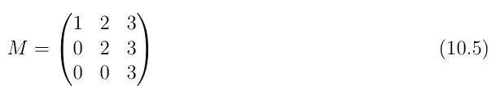
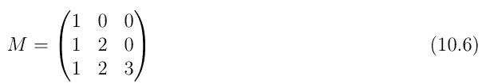
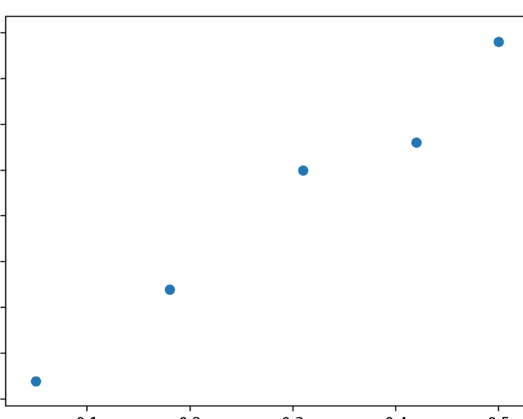
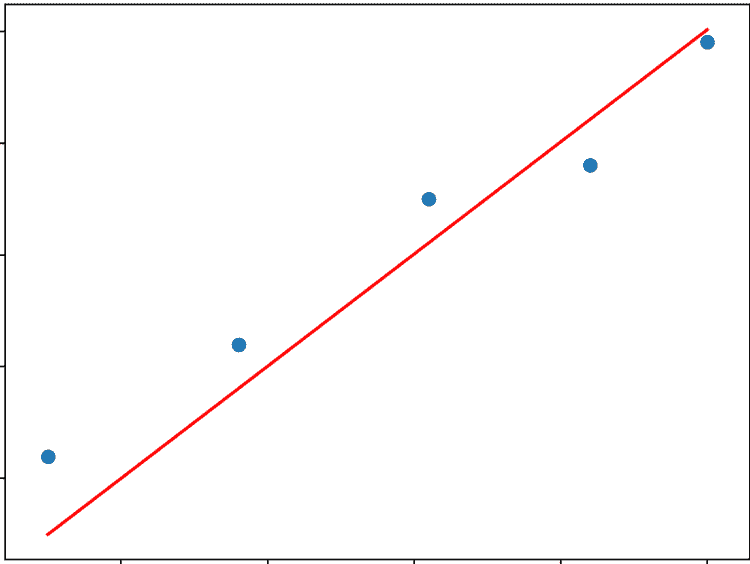
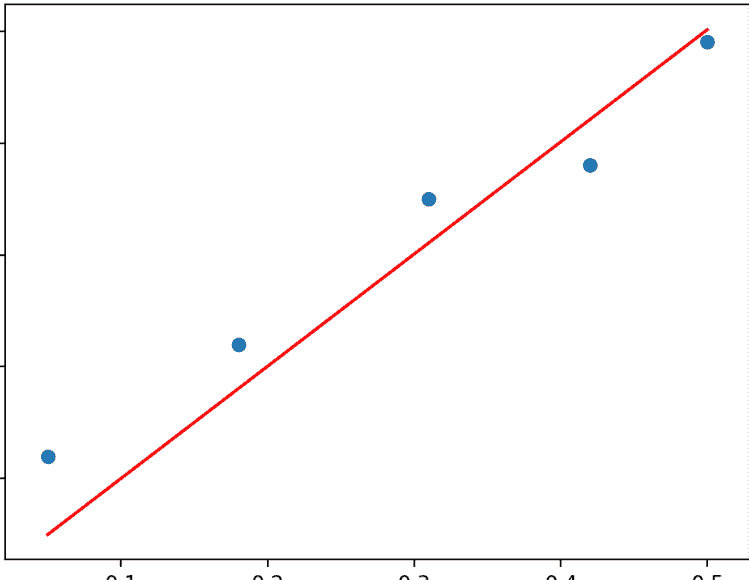
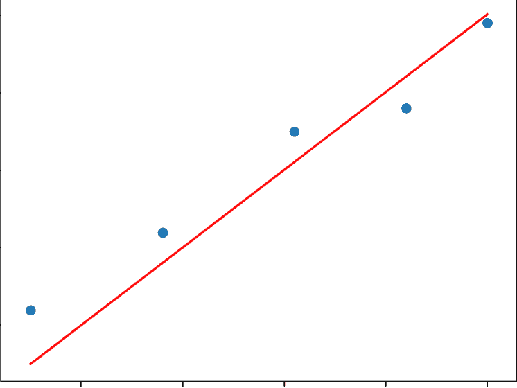
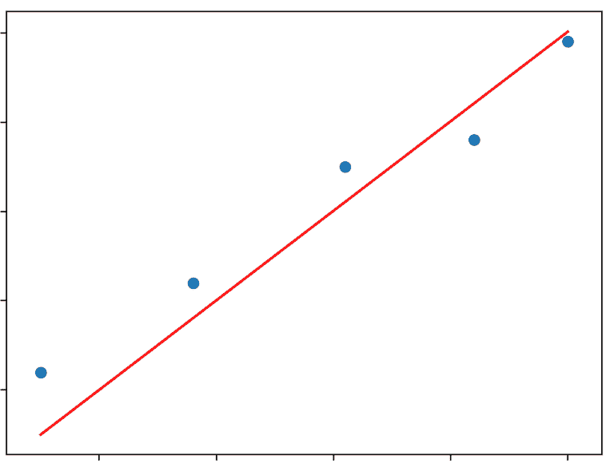
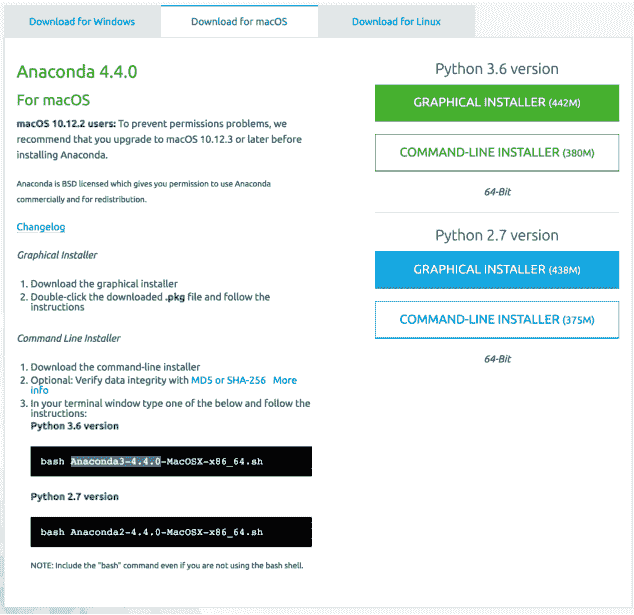
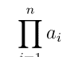
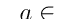

# 机器学习的线性代数基础 - Python 数据的数学语言探索


## 致谢

特别感谢我的文案编辑 Sarah Martin 和我的技术编辑 Arun Koshy 和 Andrei Cheremskoy。

## 前言

我写这本书是为了帮助像你这样的机器学习从业者快速掌握线性代数。

### 线性代数在机器学习中很重要

毫无疑问，线性代数在机器学习中很重要。线性代数是数据的数学。它全是数字的向量和矩阵。现代统计学使用线性代数的表示法来描述，现代统计方法利用线性代数的工具。现代机器学习方法也是以同样的方式描述，使用直接源自线性代数的表示法和工具。即使该领域使用的一些经典方法，例如通过线性最小二乘法的线性回归和奇异值分解，也是线性代数方法，而其他方法，例如主成分分析，则诞生于线性代数与统计学的结合。要阅读和理解机器学习，你必须能够阅读和理解线性代数。

### 从业者过早学习线性代数

如果你问如何入门机器学习，你很可能会被告知从线性代数开始。我们知道线性代数知识至关重要，但它不一定非得是起点。先学线性代数，再学微积分、概率、统计，最终学机器学习理论，这是一条漫长而缓慢的自底向上路径。对开发者来说，更好的做法是从能产生结果的系统化程序入手，再利用可工作的结果作为背景，逐步回溯到对理论的深入理解。我称这种方法为机器学习的自顶向下或结果优先方法，而线性代数并非第一步，而可能是第二步或第三步。

### 从业者学习了过多的线性代数

当从业者回过头来学习线性代数时，他们学到的远超机器学习所需或相关的内容。线性代数是一个庞大的研究领域，触及工程、物理和量子物理。几乎所有事物都有定理和推导，但其中大部分无法帮助你提升机器学习模型的技能或深化理解。只需要线性代数的一个特定子集，不过在掌握基础后，你随时可以深入学习。

### 从业者学习线性代数的方法错误

线性代数教材会以经典的大学自底向上方法教你线性代数。对于机器学习从业者的需求来说，这太慢了（而且很痛苦）。就像学习机器学习本身一样，采用自顶向下方法。不要从定理和抽象概念开始，你可以通过数据结构和对这些数据结构操作的实例，以具体方式学习线性代数基础。这快得多。一旦你知道操作是如何工作的，就可以回过头来学习它们是如何推导的。

### 更好的方法

这本书源于我的沮丧：我看到一个又一个从业者投身于为本科生设计的线性代数教材和在线课程，最终放弃。自底向上方法很难，尤其是当你已经有全职工作时。线性代数不仅对机器学习很重要，而且也很有趣，或者如果以正确的方式学习，它也可以很有趣。我编写这本书是为了帮助你像我一样看待这个领域：它只是我们在通往机器学习精通之路上可以利用的另一组工具。

Jason Brownlee
2018

## 第一部分

## 简介

## 欢迎

欢迎阅读《_机器学习线性代数基础_》。线性代数是机器学习的支柱。

该领域大约在150年前开始形式化，但现代线性代数直到大约70年前才出现。这是一个庞大的研究领域，对统计学等其他数学领域以及工程和物理产生了影响。幸运的是，我们不需要了解线性代数领域的广度和深度，就能提高对机器学习的理解和应用。

我设计这本书是为了通过具体且可在Python中执行的示例，逐步教你线性代数基础。

## 这本书适合谁？

在开始之前，让我们确保你来对地方了。这本书适合可能了解一些应用机器学习的开发者。也许你知道如何使用流行工具，从头到尾完成一个预测建模问题，或者至少完成大部分主要步骤。本书的课程确实对你做了一些假设，例如：

- 你熟悉用于编程的基本Python。
- 你可能了解一些用于数组操作的基本NumPy。
- 你想学习线性代数，以加深对机器学习的理解和应用。

本指南采用了你从MachineLearningMastery.com习惯的自顶向下、结果优先的机器学习风格编写。

## 关于你的学习成果

这本书将教你作为机器学习从业者需要知道的线性代数基础。阅读并实践本书后，你将了解：

- 什么是线性代数，以及它为什么与机器学习相关且重要。
- 如何在NumPy数组中创建、索引和一般操作数据。
- 什么是向量，以及如何执行向量运算和计算向量范数。
- 什么是矩阵，以及如何执行矩阵运算，包括矩阵乘法。
- 一系列矩阵类型、它们的属性以及涉及矩阵的高级操作。
- 什么是张量，以及如何执行基本张量运算。
- 矩阵分解方法，包括特征值分解和奇异值分解。
- 如何使用线性代数工具计算和解释基本统计量。
- 如何使用线性代数工具实现诸如主成分分析和线性最小二乘回归等方法。

这种新的线性代数基础理解将以以下方式影响你的机器学习实践：

- 阅读机器学习论文中的线性代数数学。
- 实现机器学习算法的线性代数描述。
- 使用线性代数的表示法和运算描述你的机器学习模型。

本书不能替代线性代数的本科课程或此类课程的教材，尽管它可以作为补充材料。有关线性代数的优秀课程、教材和其他资源列表，请参阅每个教程末尾的*延伸阅读*部分。

## 如何阅读本书

本书旨在从头到尾线性阅读。话虽如此，如果你了解基础知识并需要特定表示法或操作的帮助，则可以直接翻到该部分开始。本书设计为在工作站屏幕上阅读，而不是在平板电脑或电子阅读器上。我希望你能将本书打开在编辑器旁边，并在阅读时运行示例。

本书不打算被动阅读或作为参考文本放在文件夹里。它是一本实践手册、练习册和指南，旨在让你通过实践学习，然后使用可运行的Python示例应用新的理解。为了从本书中获得最大收益，我建议你在每个教程中尝试示例。扩展它们，破坏它们，然后修复它们。尝试每节课末尾介绍的一些扩展，并告诉我你的进展。

## 关于本书结构

本书围绕与机器学习算法直接相关的线性代数主要数据结构、运算和技术设计。你可以学习很多关于线性代数的内容，从理论到抽象概念再到API。我的目标是采取


你直接通过聚焦的教程培养对必须理解的要素的直觉。

我设计这些教程专注于如何使用线性代数完成任务。它们为你提供工具，帮助你快速理解并应用每种技术或操作。每个教程的设计阅读和完成时间大约为一小时，不包括扩展内容和进一步阅读。你可以选择每天一课、每周一课，或按自己的节奏学习。我认为势头至关重要，本书旨在阅读和使用，而非闲置。我建议选择一个计划并坚持执行。

教程分为5个部分：

- 第1部分：基础。温和地介绍线性代数领域及其与机器学习领域的关系。
- 第2部分：NumPy。探索NumPy教程，向你展示如何创建、索引、切片和重塑NumPy数组，这是机器学习中使用的主要数据结构，也是本书线性代数示例的基础。
- 第3部分：矩阵。探索线性代数中用于存储和操作数据的关键结构，包括向量、矩阵和张量。
- 第4部分：分解。探索一套将矩阵分解为其组成元素的方法，以使数值运算更高效、更稳定。
- 第5部分：统计。通过线性代数的视角探索统计学及其在主成分分析和线性回归中的应用。

每个部分都针对特定的学习成果，每个部分内的每个教程也是如此。这起到了筛选作用，确保你只关注达到特定结果所需知道的内容，而不会陷入数学或近乎无限的离题讨论中。

这些教程并非旨在教你关于线性代数每种理论或技术的所有知识。它们旨在让你以我所知道的最快方式了解它们的工作原理、如何使用它们以及如何解释结果：通过实践来学习。

## 关于Python代码示例

代码示例经过精心设计，用于演示给定课程的目的。代码示例是完整且独立的。每个课程的代码可以直接运行，除了安装所需的包之外，不需要先前课程或第三方的代码。每个教程都附带一个完整的可运行示例供你检查和复制粘贴。所有源代码也随书提供，我建议尽可能运行提供的文件，以避免任何复制粘贴问题。

提供的代码是在文本编辑器中开发的，旨在命令行上运行。不需要特殊的IDE或笔记本。如果你使用的是更高级的开发环境并遇到问题，请尝试从命令行运行示例。所有代码示例都在带有Python 3的POSIX兼容机器上进行了测试。

## 关于进一步阅读

每个课程都包含进一步阅读资源列表。这可能包括：

- 书籍和书籍章节。
- API文档。
- 文章和网页。

尽可能，我会列出并链接到每个课程中使用的关键函数的相关API文档，以便你了解更多信息。我尝试链接到Amazon上的书籍，以便你了解更多信息。我并非无所不知，如果你发现与特定课程相关的好资源，请告诉我，以便我更新本书。

## 关于获取帮助

学习过程中你可能需要帮助。别担心；你并不孤单。

- **需要技术帮助？** 如果你需要特定操作或技术的技术方面的帮助，请参阅每个课程末尾的进一步阅读部分。
- **需要NumPy帮助？** 如果你需要使用NumPy库的帮助，请参阅每个课程末尾进一步阅读部分中的资源列表，另请参见附录A。
- **需要工作站帮助？** 如果你需要设置环境的帮助，我建议使用Anaconda并按照附录B中的我的教程操作。
- **需要数学帮助？** 我在附录A中提供了一份地点列表，你可以在那里搜索答案并提出关于线性代数数学的问题。你也可以参阅附录D，了解数学符号的速成课程。
- **需要一般帮助？** 你可以给我发电子邮件。我的详细信息在附录A中。

## 摘要

准备好了吗？让我们开始吧！

## 接下来

接下来你将温和地介绍线性代数领域。

## 第二部分：基础

### 第1章：线性代数简介

线性代数是一门数学领域，普遍认为它是深入理解机器学习的先决条件。尽管线性代数是一个拥有许多深奥理论和发现的大领域，但从该领域提取的实用工具和符号对机器学习从业者来说非常实用。只要对线性代数是什么有扎实的基础，就有可能只关注优秀或相关的部分。在本教程中，你将从机器学习的角度发现线性代数究竟是什么。完成本教程后，你将知道：

- 线性代数是数据的数学。
- 线性代数对统计学领域产生了显著影响。
- 线性代数是许多实用数学工具的基础，例如傅里叶级数和计算机图形学。

让我们开始吧。

#### 1.1 教程概览

本教程分为4个部分，分别是：

- 线性代数。
- 数值线性代数。
- 线性代数与统计学。
- 线性代数的应用。

#### 1.2 线性代数

线性代数是数学的一个分支，但事实是线性代数是数据的数学。矩阵和向量是数据的语言。线性代数是关于线性组合的。也就是说，使用对称为向量的数字列和称为矩阵的数字阵列进行算术运算，以创建新的数字列和阵列。线性代数是关于线性变换所需的线和平面、向量空间和映射的研究。

这是一个相对年轻的研究领域，最初于1800年代正式化，以求解线性方程组中的未知数。线性方程只是一系列项和数学运算，其中一些项是未知的；例如：

y = 4x + 1

这样的方程是线性的，因为它们描述了二维图上的直线。直线来自于将不同值代入未知数x，以找出方程或模型对y值的影响。我们可以排列具有相同形式的方程组，包含两个或多个未知数；例如：

y = 0.1 x1 + 0.4 x2
y = 0.3 x1 + 0.9 x2
y = 0.2 x1 + 0.3 x2
...

y值列可以被视为方程的输出列向量。两个整数值列是数据列，例如a1和a2，可以被视为矩阵A。两个未知值x1和x2可以被视为方程的系数，共同构成待求解的未知数向量b。我们可以使用线性代数符号紧凑地写成：

y = A · b

这种形式的问题通常难以求解，因为未知数（这里有2个）比待求解的方程（这里有3个）多。此外，通常没有一条直线能在没有误差的情况下满足所有方程。描述我们通常感兴趣的问题（例如线性回归）的系统可能有无限多个解。这让我们作为机器学习从业者所感兴趣的线性代数核心有了一点点了解。其余大部分运算都是关于使此类问题及类似问题更容易理解和求解。

#### 1.3 数值线性代数

线性代数在计算机中的应用通常被称为数值线性代数。

> “数值”线性代数实际上是应用线性代数。
> — 第ix页，《数值线性代数》，1997年。

它不仅仅是代码库中线性代数运算的实现；还包括对应用数学问题的仔细处理，例如处理数字计算机的有限浮点精度。计算机擅长执行线性代数计算，现代机器学习方法（如深度学习）对图形处理单元（GPU）的很大依赖，是因为它们能够快速计算线性代数运算。


向量和矩阵运算的高效实现最初是在 1970 年代和 1980 年代使用 FORTRAN 编程语言实现的，大量代码（或从这些实现移植的代码）构成了使用现代编程语言（如 Python）进行的大部分线性代数运算的基础。实现这些功能的三个流行开源数值线性代数库是：

- 线性代数库，或 LAPACK。
- 基础线性代数子程序，或 BLAS（线性代数库的标准）。
- 自动调优线性代数软件，或 ATLAS。

通常，当您直接或间接通过高阶算法计算线性代数运算时，您的代码很可能会调用其中一个或类似的线性代数库。如果您安装或编译过 Python 的任何数值库（如 SciPy 和 NumPy），那么这些底层库中的一个或多个的名称可能对您来说很熟悉。

#### 1.4 线性代数与统计学

线性代数是数学其他分支（尤其是统计学）中的宝贵工具。

通常，学习统计学的学生在本科阶段至少应该学习过一学期的线性代数（或应用代数）。

> — 第 xv 页，《统计学的线性代数与矩阵分析》，2014年。

考虑到两个领域与应用机器学习领域的基础关系，线性代数的影响值得重视。线性代数对统计学和统计方法的一些清晰痕迹包括：

- 使用向量和矩阵表示法，尤其是多元统计学中。
- 最小二乘法和加权最小二乘法的解，例如用于线性回归。
- 数据矩阵的均值和方差估计。
- 在多元高斯分布中起关键作用的协方差矩阵。
- 用于数据降维的主成分分析，它将许多这些元素结合在一起。

如您所见，现代统计学和数据分析（至少就机器学习从业者的关注点而言）依赖于对线性代数的理解和工具。

#### 1.5 线性代数的应用

由于线性代数是数据的数学，线性代数工具被应用于许多领域。在他的经典著作《线性代数导论》中，Gilbert Strang 提供了一章专门介绍线性代数的应用。在该章中，他展示了根植于线性代数的特定数学工具。简要地说，它们是：

- 工程中的矩阵，例如一排弹簧。
- 图与网络，例如分析网络。
- 马尔可夫矩阵、人口与经济学，例如人口增长。
- 线性规划，单纯形优化方法。
- 傅里叶级数：函数的线性代数，广泛用于信号处理。
- 统计学和概率论的线性代数，例如用于回归的最小二乘法。
- 计算机图形学，例如图像的各种平移、重新缩放和旋转。

线性代数的另一个有趣应用是，它是阿尔伯特·爱因斯坦在其相对论部分中使用的数学类型。具体来说，是张量和张量微积分。他还将一种新的线性代数符号引入物理学，称为爱因斯坦记号，或爱因斯坦求和公约。

#### 1.6 进一步阅读

如果您希望深入了解，本节提供了更多关于该主题的资源。

### 1.6.1 书籍

- *线性代数导论*，2016年。http://amzn.to/2j2J0g4
- *数值线性代数*，1997年。http://amzn.to/2kjEF4S
- *统计学的线性代数与矩阵分析*，2014年。http://amzn.to/2A9ceNv

### 1.6.2 文章

- 维基百科上的线性代数。https://en.wikipedia.org/wiki/Linear_algebra
- 维基百科上的线性代数分类。https://en.wikipedia.org/wiki/Category:Linear_algebra
- 维基百科上的线性代数主题列表。https://en.wikipedia.org/wiki/List_of_linear_algebra_topics
- 维基百科上的 LAPACK。https://en.wikipedia.org/wiki/LAPACK
- 维基百科上的基础线性代数子程序。https://en.wikipedia.org/wiki/Basic_Linear_Algebra_Subprograms
- 维基百科上的自动调优线性代数软件。https://en.wikipedia.org/wiki/Automatically_Tuned_Linear_Algebra_Software
- 维基百科上的爱因斯坦记号。https://en.wikipedia.org/wiki/Einstein_notation
- 维基百科上的广义相对论数学。https://en.wikipedia.org/wiki/Mathematics_of_general_relativity

#### 1.7 总结

在本教程中，您从机器学习的角度了解了线性代数的温和介绍。具体来说，您学到了：

- 线性代数是数据的数学。
- 线性代数对统计学领域产生了显著影响。
- 线性代数是许多实用数学工具的基础，例如傅里叶级数和计算机图形学。

### 1.7.1 下一节

在下一章中，您将了解为什么线性代数对机器学习很重要。

### 第2章

### 线性代数与机器学习

线性代数是一门可以称为数据数学的数学领域。它无疑是机器学习领域的支柱，许多人建议在开始学习机器学习之前将其作为先修科目。这是误导性的建议，因为一旦从业者拥有应用机器学习过程的背景来解释线性代数，线性代数对从业者来说就更有意义了。在本章中，您将了解为什么机器学习从业者应该学习线性代数以提高其作为从业者的技能和能力。阅读本章后，您将知道：

- 并非每个人都应该学习线性代数，这取决于您在机器学习过程中的阶段。
- 5 个理由，说明为什么中级机器学习从业者需要更深入地理解线性代数。
- 如果以正确的方法学习，线性代数可以很有趣。

让我们开始吧。

### 2.1 不学习线性代数的理由

在讨论您应该学习线性代数的理由之前，让我们先简要看一下为什么不应该学习。我认为，如果您刚开始学习应用机器学习，就不应该学习线性代数。

- 不是必需的。要将机器学习作为解决问题的工具，不需要对某些机器学习算法背后的抽象操作有所了解。
- 太慢。在机器学习之前花数月到数年时间学习整个相关领域，会延迟您实现能够处理预测建模问题的目标。
- 这是一个庞大的领域。并非所有线性代数都与理论机器学习相关，更不用说应用机器学习了。

我建议采用广度优先的方法来开始应用机器学习。我称这种方法为结果优先方法。即您首先使用工具（例如 Python 中的 scikit-learn 和 Pandas）学习和练习处理预测建模问题的端到端步骤（例如如何获得结果）。然后，此过程为逐步深化您的知识（例如算法的工作原理，最终是其背后的数学）提供了骨架和背景。在您知道如何处理预测建模问题后，让我们看看为什么应该加深对线性代数的理解。

线性代数是一门广泛用于科学和工程的数学分支。然而，由于线性代数是连续数学而非离散数学的一种形式，许多计算机科学家对它缺乏经验。

> — 第 31 页，《深度学习》，2016年。

### 2.2 学习线性代数符号

您需要能够读写向量和矩阵符号。算法在书籍、论文和网站上使用向量和矩阵符号进行描述。线性代数是数据的数学，而符号允许您使用特定运算符精确地描述对数据的操作。您需要能够读写这种符号。这项技能将使您能够：

- 阅读教科书中现有算法的描述。
- 解释和实现研究论文中新方法的描述。
- 简洁地向其他从业者描述您自己的方法。

此外，Python 等编程语言提供了直接实现线性代数符号的高效方式。了解符号及其在您的语言或库中的实现方式，将使您能够以更短且可能更高效的方式实现机器学习算法。

### 2.3 学习线性代数算术

与线性代数符号相配合的是所执行的算术运算。您需要知道如何对标量、向量和矩阵进行加、减和乘法运算。线性代数新手面临的挑战之一是矩阵乘法和张量乘法等运算，它们不是作为这些结构元素的直接乘法实现的，乍一看似乎不直观。

同样，这些运算中的大部分（如果不是全部）都在现代线性代数库中通过 API 调用高效实现。了解向量和矩阵运算的实现方式，是能够有效地读写矩阵符号所必需的一部分。


### 2.4 学习线性代数以用于统计学

你必须学习线性代数，才能学习统计学。尤其是多元统计学。统计学和数据分析是支撑机器学习的另一支柱数学领域。它们主要关注描述和理解数据。作为数据的数学，线性代数在许多相关数学领域（包括统计学）上留下了印记。

为了能够阅读和解释统计学，你必须学习线性代数的符号和运算。现代统计学同时使用线性代数的符号和工具来描述统计方法的工具和技术。从表示数据均值和方差的向量，到描述多个高斯变量之间关系的协方差矩阵。两个领域之间一些合作的成果也是机器学习的常用方法，例如主成分分析（Principal Component Analysis，简称 PCA），用于数据降维。

### 2.5 学习矩阵分解

在符号和运算的基础上是矩阵分解的概念，也称为矩阵分解。你需要知道如何对矩阵进行分解以及它的含义。矩阵分解是线性代数中的关键工具，并被广泛用作线性代数（如矩阵逆）和机器学习（最小二乘法）中许多更复杂运算的元素。

此外，存在一系列不同的矩阵分解方法，各有不同的优势和能力，其中一些你可能会识别为“机器学习”方法，例如奇异值分解（Singular-Value Decomposition，简称 SVD），用于数据降维。为了能够阅读和解释高阶矩阵运算，你必须理解矩阵分解。

### 2.6 学习线性最小二乘法

你需要知道如何使用矩阵分解来求解线性最小二乘问题。线性代数最初是为了求解线性方程组而开发的。这些方程的特点是方程数量多于未知变量的数量。因此，在算术上求解它们具有挑战性，因为不存在单一解，也没有一条直线或平面能在不产生误差的情况下拟合数据。这类问题可以被表述为平方误差的最小化，称为最小二乘法，并可以用线性代数的语言重新表述，称为线性最小二乘法。

线性最小二乘问题可以在计算机上使用矩阵运算（如矩阵分解）高效求解。最小二乘法最为人所知的是其在线性回归模型求解中的作用，但它也在一系列机器学习算法中发挥着更广泛的作用。为了理解和解释这些算法，你必须了解如何使用矩阵分解方法来求解最小二乘问题。

### 2.7 还有一个理由

如果我能再给出一个理由，那将是：因为这很有趣。认真的。学习线性代数，至少是我用实际示例和可执行代码来教授的方式，非常有趣。一旦你能看到运算在真实数据上的工作方式，就很难避免对这些方法产生强烈的直觉。我认为线性代数如果以正确的方式接近是可以很有趣的，我并非独持此见：

> 学习线性代数也可以非常有趣。读者在学习概念之间的联系时会体验到*知识兴奋*，而在学习这门学科时，体验到开阔思维的时刻也并不罕见。
>
> —— 第 ix 页，《No Bullshit Guide To Linear Algebra》，2017 年。

你想学习线性代数的原因是什么？请告诉我。

### 2.8 总结

在本章中，你作为机器学习从业者，发现了为什么应该加深对线性代数的理解。具体来说，你学到了：

- 并非每个人都应该学习线性代数，这取决于你在机器学习过程中的阶段。
- 5 个理由，说明为什么中级机器学习从业者需要更深入地理解线性代数。
- 线性代数如果以正确的方式接近是可以很有趣的。

### 2.8.1 接下来

在下一章中，你将发现 10 个需要理解线性代数的机器学习概念和方法的具体示例。

### 第3章

### 机器学习中的线性代数示例

线性代数是数学的一个子领域，涉及向量、矩阵和线性变换。它是机器学习领域的关键基础，从用于描述算法运算的符号，到代码中算法的实现。尽管线性代数是机器学习领域不可或缺的一部分，但这种紧密关系往往未得到解释，或是使用向量空间或特定矩阵运算等抽象概念来解释。在本章中，你将发现 10 个你可能熟悉的机器学习常见示例，它们使用、需要并且最好是通过线性代数来理解。阅读本章后，你将知道：

- 处理表格数据集和图像等数据时使用线性代数结构。
- 进行独热编码和降维等数据准备时的线性代数概念。
- 在深度学习、自然语言处理和推荐系统等子领域中根深蒂固地使用线性代数符号和方法。

让我们开始吧。

### 3.1 概述

在本章中，我们将回顾机器学习中 10 个明显且具体的线性代数示例。我尽量选择你可能熟悉或甚至之前使用过的示例。它们是：

- 1. 数据集和数据文件
- 2. 图像和照片
- 3. 独热编码
- 4. 线性回归
- 5. 正则化
- 6. 主成分分析
- 7. 奇异值分解
- 8. 隐语义分析
- 9. 推荐系统
- 10. 深度学习

你自己在机器学习中有最喜欢的线性代数示例吗？请告诉我。

### 3.2 数据集和数据文件

在机器学习中，你在数据集上拟合模型。这是一组类似表格的数字，其中每一行表示一个观测值，每一列表示观测值的一个特征。例如，以下是鸢尾花数据集¹的片段：

清单 3.1：鸢尾花数据集的示例输出。

| 5.1 | 3.5 | 1.4 | 0.2 | Iris-setosa |
| --- | --- | --- | --- | --- |
| 4.9 | 3.0 | 1.4 | 0.2 | Iris-setosa |
| 4.7 | 3.2 | 1.3 | 0.2 | Iris-setosa |
| 4.6 | 3.1 | 1.5 | 0.2 | Iris-setosa |
| 5.0 | 3.6 | 1.4 | 0.2 | Iris-setosa |
| ... | ... | ... | ... | ... |

这些数据实际上是一个矩阵，线性代数中的关键数据结构。此外，当你将数据分割为输入和输出以拟合监督机器学习模型（例如测量值和花卉物种）时，你会得到一个矩阵（X）和一个向量（y）。向量是线性代数中的另一个关键数据结构。每一行的长度相同，即相同的列数，因此我们可以说数据是向量化的，行可以一次或批量地提供给模型，并且模型可以预先配置为期望固定宽度的行。

### 3.3 图像和照片

也许你更习惯在计算机视觉应用中处理图像或照片。你处理的每个图像本身就是一个表格结构，具有宽度和高度，黑白图像每个单元格有一个像素值，彩色图像每个单元格有 3 个像素值。照片是线性代数中矩阵的又一个示例。对图像的操作，例如裁剪、缩放、剪切等，都使用线性代数的符号和运算来描述。

¹http://archive.ics.uci.edu/ml/datasets/Iris

### 3.4 独热编码

在机器学习中，你有时会处理分类数据。可能是分类问题的类别标签，也可能是分类输入变量。对分类变量进行编码是常见的做法，以便某些技术更容易处理和学习。分类变量的一种流行编码是独热编码。独热编码是创建一个表格来表示变量，每个类别一列，数据集中的每个示例一行。在给定行的分类值列中添加一个标记或值为 1，并在所有其他列中添加值为 0。例如，包含 3 行的颜色变量：

清单 3.2：分类变量示例。

| red |
| --- |
| green |
| blue |
| ... |

可能被编码为：

清单 3.3：独热编码的分类变量示例。

| red | green | blue |
| --- | --- | --- |
| 1 | 0 | 0 |
| 0 | 1 | 0 |
| 0 | 0 | 1 |
| ... | ... | ... |

每一行都被编码为一个二进制向量，即值为零或一的向量，这是稀疏表示的一个示例，而稀疏表示是线性代数的一个整个子领域。

### 3.5 线性回归

线性回归是统计学中用于描述变量之间关系的一种古老方法。它常用于机器学习中，在较简单的回归问题中预测数值。描述和求解线性回归问题有多种方法，即找到一组系数，当它们分别乘以每个输入变量并相加时，能得出对输出变量的最佳预测。如果你使用过机器学习工具或库，求解线性回归最常见的方式是通过最小二乘优化，该优化使用线性回归中的矩阵分解方法求解，例如 LU 分解、奇异值分解或 SVD。即使是总结线性回归方程的常见方式也使用线性代数符号：

```
y = A · b
(3.1)
```

其中 y 是输出变量，A 是数据集，b 是模型系数。

### 3.6 正则化

在应用机器学习中，我们通常寻求在我们的问题上达到最佳性能的最简单模型。更简单的模型通常在从特定示例中泛化方面表现更好


对未见数据。在许多涉及系数的方法中，例如回归方法和人工神经网络，更简单的模型通常表现为具有较小系数值的模型。一种常用于鼓励模型在拟合数据时最小化系数大小的技术称为正则化。常见的实现包括L^2和L^1形式的正则化。这两种形式的正则化实际上是系数作为向量的大小或长度的度量，并直接从线性代数中借用，称为向量范数。

#### 3.7 主成分分析

通常，一个数据集有许多列，也许有几十、几百、几千或更多。对具有许多特征的数据进行建模具有挑战性，并且由包含不相关特征的数据构建的模型通常不如由最相关数据训练的模型有效。很难知道数据的哪些特征是相关的，哪些不是。自动减少数据集列数的方法称为降维，也许最流行的方法称为主成分分析或简称PCA。这种方法在机器学习中用于创建高维数据的投影，用于可视化和训练模型。PCA方法的核心是来自线性代数的矩阵分解方法。可以使用特征值分解，更健壮的实现可能使用奇异值分解或SVD。

#### 3.8 奇异值分解

另一种流行的降维方法是奇异值分解方法或简称SVD。如前所述，正如方法名称所暗示的，它是来自线性代数领域的矩阵分解方法。它在线性代数中有广泛用途，可以直接用于特征选择、可视化、噪声降低等应用。下面我们将看到在机器学习中使用SVD的另外两个案例。

#### 3.9 隐语义分析

在处理文本数据的机器学习子领域（称为自然语言处理）中，通常将文档表示为词频的大型矩阵。例如，矩阵的列可能是词汇表中的已知单词，行可能是句子、段落、页面或文档文本，矩阵中的单元格标记为单词出现的次数或频率。这是文本的稀疏矩阵表示。奇异值分解等矩阵分解方法可以应用于这个稀疏矩阵，其效果是将表示提炼为其最相关的本质。以这种方式处理的文档更容易比较、查询，并作为监督机器学习模型的基础。这种数据准备形式称为隐语义分析或简称LSA，也称为隐语义索引或LSI。

#### 3.10 推荐系统

涉及产品推荐的预测建模问题称为推荐系统，是机器学习的一个子领域。示例包括基于之前购买以及与你类似的客户在Amazon上的购买推荐图书，以及基于你的观看历史和与你类似的订阅者在Netflix上的观看历史推荐电影和电视节目。推荐系统的开发主要涉及线性代数方法。一个简单的例子是使用欧几里得距离或点积等距离度量计算稀疏客户行为向量之间的相似度。奇异值分解等矩阵分解方法在推荐系统中被广泛使用，以将项目和用户数据提炼为其本质，用于查询、搜索和比较。

#### 3.11 深度学习

人工神经网络是非线性机器学习算法，受大脑信息处理元素的启发，并已被证明在一系列问题上有效，不仅限于预测建模。深度学习是人工神经网络的近期复兴使用，采用更新的方法和更快的硬件，允许在非常大的数据集上开发和训练更大、更深（更多层）的网络。深度学习方法在一系列具有挑战性的问题上常规地实现最先进的结果，例如机器翻译、图片字幕、语音识别等。

在其核心，神经网络的执行涉及线性代数数据结构相乘和相加。扩展到多维时，深度学习方法处理输入和系数的向量、矩阵甚至张量，其中张量是具有超过两个维度的矩阵。线性代数对于通过矩阵表示法描述深度学习方法到实现深度学习方法（例如Google的TensorFlow Python库，其名称中包含"tensor"一词）都是核心。

#### 3.12 总结

在本章中，你发现了10个你可能熟悉的机器学习常见示例，这些示例使用并需要线性代数。具体来说，你学习了：

- 在处理表格数据集和图像等数据时使用线性代数结构。
- 在处理数据准备（如独热编码和降维）时使用线性代数概念。
- 在深度学习、自然语言处理和推荐系统等子领域中根深蒂固地使用线性代数表示法和方法。

## 3.12.1 接下来

这是第一部分的结束，在下一部分中，你将发现如何在Python中使用NumPy操作数据数组。

## 第三部分

### NumPy

### 第4章

### NumPy数组简介

数组是机器学习中使用的主要数据结构。在Python中，NumPy库中的数组（称为N维数组或`ndarray`）被用作表示数据的主要数据结构。在本教程中，你将发现NumPy中的N维数组，用于在Python中表示和操作数值数据。完成本教程后，你将知道：

- 什么是`ndarray`以及如何在Python中创建和检查数组。
- 创建新空数组和带默认值数组的关键函数。
- 如何合并现有数组以创建新数组。

让我们开始吧。

### 4.1 教程概览

本教程分为3个部分，它们是：

- 1. NumPy N维数组
- 2. 创建数组的函数
- 3. 合并数组

### 4.2 NumPy N维数组

NumPy是一个可用于科学和数值应用的Python库，是执行线性代数操作的工具。NumPy中的主要数据结构是`ndarray`，它是N-dimensional array的简称。使用NumPy时，`ndarray`中的数据简称为数组。它是内存中的固定大小数组，包含相同类型的数据，例如整数或浮点值。

数组支持的数据类型可以通过数组上的`dtype`属性访问。数组的维度可以通过`shape`属性访问，该属性返回一个描述每个维度长度的元组。还有许多其他属性。从数据或简单的Python数据结构（如列表）创建数组的简单方法是使用array()函数。下面的示例创建一个包含3个浮点值的Python列表，然后从列表创建一个ndarray并访问数组的shape和数据类型。

```
# create array
from numpy import array
# create array
l = [1.0, 2.0, 3.0]
a = array(l)
# display array
print(a)
# display array shape
print(a.shape)
# display array data type
print(a.dtype)
```

清单4.1: 使用array()函数创建数组的示例。

运行示例将打印ndarray的内容、shape（即具有3个元素的一维数组）以及数据类型（即64位浮点数）。

```
[ 1. 2. 3.]
(3,)
float64
```

清单4.2: 使用array()函数创建数组的示例输出。

### 4.3 创建数组的函数

有更多便捷函数用于创建固定大小的数组，你可能会遇到或需要使用它们。让我们看看其中几个。

### 4.3.1 空数组

empty()函数将创建指定形状的新数组。传递给该函数的参数是一个数组或元组，用于指定要创建的数组的每个维度的长度。创建的数组的值或内容将是随机的，并在使用前需要赋值。下面的示例创建一个空的3 × 3二维数组。

```
# create empty array
from numpy import empty
a = empty([3,3])
print(a)
```

清单4.3: 使用empty()函数创建数组的示例。

运行示例将打印空数组的内容。你的特定数组内容会有所不同。

```
[[ 0.0000000e+000 0.0000000e+000 2.20802703e-314]
 [ 2.20803350e-314 2.20803353e-314 2.20803356e-314]
 [ 2.20803359e-314 2.20803362e-314 2.20803366e-314]]
```

清单4.4: 使用empty()函数创建数组的示例输出。


## 4.3.2 Zeros

zeros() 函数将创建一个指定大小的新数组，内容填充为零值。传递给该函数的参数是一个数组或元组，用于指定要创建的数组每个维度的长度。下面的示例创建一个 3 x 5 的二维零数组。

```python
# create zero array
from numpy import zeros
a = zeros([3,5])
print(a)
```

Listing 4.5: 使用 zeros() 函数创建数组的示例。

运行示例将打印创建的零数组的内容。

```
[[ 0. 0. 0. 0. 0.]
 [ 0. 0. 0. 0. 0.]
 [ 0. 0. 0. 0. 0.]]
```

Listing 4.6: 使用 zeros() 函数创建数组的示例输出。

## 4.3.3 Ones

ones() 函数将创建一个指定大小的新数组，内容填充为一值。传递给该函数的参数是一个数组或元组，用于指定要创建的数组每个维度的长度。下面的示例创建一个 5 元素的一维数组。

```python
# create one array
from numpy import ones
a = ones([5])
print(a)
```

Listing 4.7: 使用 ones() 函数创建数组的示例。

运行示例将打印创建的 ones 数组的内容。

```
[ 1. 1. 1. 1. 1.]
```

Listing 4.8: 使用 ones() 函数创建数组的示例输出。

### 4.4 Combining Arrays

NumPy 提供了许多函数，可从现有数组创建新数组。让我们来看看你可能需要或遇到的两个最常用函数。

### 4.4.1 Vertical Stack

给定两个或多个现有数组，你可以使用 vstack() 函数将它们垂直堆叠。例如，给定两个一维数组，你可以通过垂直堆叠它们来创建一个包含两行的新二维数组。下面的示例演示了这一点。

```python
# create array with vstack
from numpy import array
from numpy import vstack
# create first array
a1 = array([1,2,3])
print(a1)
# create second array
a2 = array([4,5,6])
print(a2)
# vertical stack
a3 = vstack((a1, a2))
print(a3)
print(a3.shape)
```

Listing 4.9: 使用 vstack() 函数从其他数组创建数组的示例。

运行示例首先打印两个分别定义的一维数组。数组被垂直堆叠，生成一个新的 2 × 3 数组，其内容和形状将被打印。

```
[1 2 3]
[4 5 6]
[[1 2 3]
 [4 5 6]]
(2, 3)
```

Listing 4.10: 使用 vstack() 函数从其他数组创建数组的示例输出。

### 4.4.2 Horizontal Stack

给定两个或多个现有数组，你可以使用 hstack() 函数将它们水平堆叠。例如，给定两个一维数组，你可以创建一个新的一维数组或一行，其中第一个和第二个数组的列被连接。下面的示例演示了这一点。

```python
# create array with hstack
from numpy import array
from numpy import hstack
# create first array
a1 = array([1,2,3])
print(a1)
# create second array
a2 = array([4,5,6])
print(a2)
# create horizontal stack
a3 = hstack((a1, a2))
print(a3)
print(a3.shape)
```

Listing 4.11: 使用 hstack() 函数从其他数组创建数组的示例。

运行示例首先打印两个分别定义的一维数组。然后将数组水平堆叠，生成一个包含 6 个元素的新的一维数组，其内容和形状将被打印。

```
[1 2 3]
[4 5 6]
[1 2 3 4 5 6]
(6,)
```

Listing 4.12: 使用 hstack() 函数从其他数组创建数组的示例输出。

## 4.5 Extensions

本节列出了一些你可能希望探索的扩展教程的想法。

- 尝试以自己的大小或使用新数据创建数组的不同方式。
- 为创建数组的 3 个额外 NumPy 函数定位并开发示例。
- 为合并数组的 3 个额外 NumPy 函数定位并开发示例。

如果你探索了这些扩展中的任何一个，我很乐意了解。

## 4.6 Further Reading

如果你希望深入了解，本节提供了更多关于该主题的资源。

### 4.6.1 Books

- *Python数据分析*, 2017. http://amzn.to/2B1sfXi
- *优雅的SciPy*, 2017. http://amzn.to/2yujXnT
- *NumPy指南*, 2015. http://amzn.to/2j3kEzd

### 4.6.2 References

- NumPy 参考。https://docs.scipy.org/doc/numpy-1.13.0/reference/
- N维数组。https://docs.scipy.org/doc/numpy-1.13.0/reference/arrays.ndarray.html
- 数组创建例程。https://docs.scipy.org/doc/numpy-1.13.0/reference/routines.array-creation.html

### 4.6.3 API

- numpy.array() API。
  https://docs.scipy.org/doc/numpy-1.13.0/reference/generated/numpy.array.html
- numpy.empty() API。
  https://docs.scipy.org/doc/numpy-1.13.0/reference/generated/numpy.empty.html
- numpy.zeros() API。
  https://docs.scipy.org/doc/numpy-1.13.0/reference/generated/numpy.zeros.html
- numpy.ones() API。
  https://docs.scipy.org/doc/numpy-1.13.0/reference/generated/numpy.ones.html
- numpy.vstack() API。
  https://docs.scipy.org/doc/numpy-1.13.0/reference/generated/numpy.vstack.html
- numpy.hstack() API。
  https://docs.scipy.org/doc/numpy-1.13.0/reference/generated/numpy.hstack.html

## 4.7 Summary

在本教程中，你了解了 NumPy 中的 N维数组，用于在 Python 中表示数值和操作数据。具体来说，你学习了：

- 什么是 ndarray 以及如何在 Python 中创建和检查数组。
- 创建新空数组和带默认值数组的关键函数。
- 如何合并现有数组以创建新数组。

### 4.7.1 Next

在下一章中，你将了解如何对 NumPy 数组进行切片、索引和重塑。

## Chapter 5

### Index, Slice and Reshape NumPy Arrays

机器学习数据表示为数组。在 Python 中，数据几乎普遍表示为 NumPy 数组。如果你是 Python 新手，可能会对一些 Pythonic 的数据访问方式感到困惑，例如负索引和数组切片。在本教程中，你将了解如何在 NumPy 数组中正确操作和访问数据。完成本教程后，你将知道：

- 如何将列表数据转换为 NumPy 数组。
- 如何使用 Pythonic 索引和切片访问数据。
- 如何调整数据大小以满足某些机器学习 API 的期望。

让我们开始吧。

### 5.1 Tutorial Overview

本教程分为 4 部分；它们是：

- 1. 从列表到数组
- 2. 数组索引
- 3. 数组切片
- 4. 数组重塑

### 5.2 From List to Arrays

一般来说，我建议使用 Pandas 或甚至 NumPy 函数从文件加载数据。本节假设你已通过其他方式加载或生成数据，并且数据现在使用 Python 列表表示。让我们看看如何将列表中的数据转换为 NumPy 数组。

### 5.2.1 One-Dimensional List to Array

你可能会加载数据或生成数据，并将其作为列表访问。你可以通过调用 array() NumPy 函数将一维数据列表转换为数组。

```python
# create one-dimensional array
from numpy import array
# list of data
data = [11, 22, 33, 44, 55]
# array of data
data = array(data)
print(data)
print(type(data))
```

Listing 5.1: 创建一维数组的示例。

运行示例将一维列表转换为 NumPy 数组。

```
[11 22 33 44 55]
<class 'numpy.ndarray'>
```

Listing 5.2: 创建一维数组的示例输出。

### 5.2.2 Two-Dimensional List of Lists to Array

在机器学习中，你更有可能拥有二维数据。即一个数据表，其中每行表示一个新观测，每列表示一个新特征。也许你生成了数据或使用自定义代码加载了数据，现在你有一个列表的列表。每个列表表示一个新观测。你可以像上面一样，通过调用 array() 函数将列表的列表转换为 NumPy 数组。

```python
# create two-dimensional array
from numpy import array
# list of data
data = [[11, 22],
        [33, 44],
        [55, 66]]
# array of data
data = array(data)
print(data)
print(type(data))
```

Listing 5.3: 创建二维数组的示例。

运行示例显示数据已成功转换。

```
[[11 22]
 [33 44]
 [55 66]]
<class 'numpy.ndarray'>
```

Listing 5.4: 创建二维数组的示例输出。


## 5.3 数组索引

一旦你的数据使用 NumPy 数组表示，就可以使用索引来访问它。让我们看看通过索引访问数据的一些示例。

### 5.3.1 一维索引

通常，索引的工作方式就像你使用其他编程语言（如 Java、C# 和 C++）的经验所期望的那样。例如，你可以使用方括号运算符 [] 访问元素，并指定要检索的值的零偏移索引。

```python
# index a one-dimensional array
from numpy import array
# define array
data = array([11, 22, 33, 44, 55])
# index data
print(data[0])
print(data[4])
```

列表 5.5: 对一维数组进行索引的示例。

运行示例将打印数组中的第一个值和最后一个值。

```
11
55
```

列表 5.6: 对一维数组进行索引的示例输出。

指定超出数组边界的过大整数会导致错误。

```python
# index array out of bounds
from numpy import array
# define array
data = array([11, 22, 33, 44, 55])
# index data
print(data[5])
```

列表 5.7: 对一维数组索引时出错的示例。

运行示例将打印以下错误：

```
IndexError: index 5 is out of bounds for axis 0 with size 5
```

列表 5.8: 对一维数组索引的示例错误输出。

一个关键区别是，你可以使用负索引来检索偏移自数组末尾的值。例如，索引 -1 指的是数组中的最后一项。索引 -2 返回倒数第二项，一直到当前示例中第一项的 -5。

```python
# negative array indexing
from numpy import array
# define array
data = array([11, 22, 33, 44, 55])
# index data
print(data[-1])
print(data[-5])
```

列表 5.9: 对一维数组进行负索引的示例。

运行示例将打印数组中的最后一项和第一项。

```
55
11
```

列表 5.10: 对一维数组进行负索引的示例输出。

### 5.3.2 二维索引

对二维数据进行索引与对一维数据进行索引类似，只是使用逗号分隔每个维度的索引。

```python
data[0,0]
```

列表 5.11: 在 Python 中对二维数组进行索引的示例。

这与基于 C 的语言不同，后者为每个维度使用单独的方括号运算符。

```python
data[0] [0]
```

列表 5.12: 在类 C 语言中对二维数组进行索引的示例。

例如，我们可以按如下方式访问第一行和第一列：

```python
# index two-dimensional array
from numpy import array
# define array
data = array([
[11, 22],
[33, 44],
[55, 66]])
# index data
print(data[0,0])
```

列表 5.13: 对二维数组进行索引的示例。

运行示例将打印数据集中的第一项。

```
11
```

列表 5.14: 对二维数组进行索引的示例输出。

如果我们对第一行中的所有项感兴趣，可以留空第二个维度索引，例如：

```python
# index row of two-dimensional array
from numpy import array
# define array
data = array([
[11, 22],
[33, 44],
[55, 66]])
# index data
print(data[0,])
```

列表 5.15: 对二维数组第一列进行索引的示例。

这将打印数据的第一行。

```
[11 22]
```

列表 5.16: 对二维数组第一列进行索引的示例输出。

## 5.4 数组切片

目前为止，一切顺利；创建和索引数组看起来很熟悉。现在我们来谈谈数组切片，这是导致 Python 和 NumPy 数组初学者遇到问题的一个功能。列表和 NumPy 数组等结构都可以进行切片。这意味着结构的一个子序列可以被索引和检索。在机器学习中，当指定输入变量和输出变量，或将训练行与测试行分开时，这非常有用。切片使用冒号运算符 : 进行指定，分别在列之前和之后提供 from 索引和 to 索引。切片从 from 索引开始，并在 to 索引之前的一项处结束。

```python
data[from:to]
```

列表 5.17: 数组切片语法示例。

### 5.4.1 一维切片

你可以通过指定没有索引的切片 ‘:’ 来访问数组维度中的所有数据。

```python
# slice a one-dimensional array
from numpy import array
# define array
data = array([11, 22, 33, 44, 55])
print(data[:])
```

列表 5.18: 对一维数组进行切片的示例。

运行示例将打印数组中的所有元素。

```
[11 22 33 44 55]
```

列表 5.19: 对一维数组进行切片的示例输出。

数组的第一项可以通过指定从索引 0 开始并在索引 1 处结束（即 to 索引之前的一项）的切片来切片。

```python
# slice a subset of a one-dimensional array
from numpy import array
# define array
data = array([11, 22, 33, 44, 55])
print(data[0:1])
```

列表 5.20: 对一维数组子集进行切片的示例。

运行示例将返回仅包含第一个元素的子数组。

```
[11]
```

列表 5.21: 对一维数组子集进行切片的示例输出。

我们也可以在切片中使用负索引。例如，我们可以通过从 -2（倒数第二项）开始切片且不指定 to 索引来切片列表中的最后两项；这将切片延伸到维度的末尾。

```python
# negative slicing of a one-dimensional array
from numpy import array
# define array
data = array([11, 22, 33, 44, 55])
print(data[-2:])
```

列表 5.22: 对一维数组使用负索引进行切片的示例。

运行示例将返回仅包含最后两项的子数组。

```
[44 55]
```

列表 5.23: 对一维数组使用负索引进行切片的示例输出。

### 5.4.2 二维切片

让我们看看在机器学习中你最可能使用的二维切片的两个示例。

### 分割输入和输出特征

通常将加载的数据分割为输入变量 (X) 和输出变量 (y)。我们可以通过切片所有行和所有列（直到但不包括最后一列），然后单独索引最后一列来实现这一点。对于输入特征，我们可以通过在行索引中指定 :，在列索引中指定 :-1 来选择所有行和除最后一列以外的所有列。

```python
X = [:, :-1]
```

列表 5.24: 对输入变量进行切片的示例。

对于输出列，我们可以再次使用 : 选择所有行，并通过指定 -1 索引仅索引最后一列。

```python
y = [:, -1]
```

列表 5.25: 对输出变量进行切片的示例。

将所有这些结合起来，我们可以将一个 3 列 2D 数据集分离为输入和输出数据，如下所示：

```python
# split input and output data
from numpy import array
# define array
data = array([
[11, 22, 33],
[44, 55, 66],
[77, 88, 99]])
# separate data
X, y = data[:, :-1], data[:, -1]
print(X)
print(y)
```

列表 5.26: 将数据集切片为输入和输出变量的示例。

运行示例将打印分离的 X 和 y 元素。请注意，X 是一个 2D 数组，y 是一个 1D 数组。

```
[[11 22]
[44 55]
[77 88]]
[33 66 99]
```

列表 5.27: 将数据集切片为输入和输出变量的示例输出。

### 分割训练和测试行

通常将加载的数据集分割为单独的训练集和测试集。这是行的分割，其中一部分将用于训练模型，剩余部分将用于估计训练模型的技能。这涉及通过在第二个维度索引中指定 : 来切片所有列。训练数据集将是从开始到分割点的所有行。

```python
train = data[:split, :]
```

列表 5.28: 从数据集中切片训练集的示例。

测试数据集将是从分割点开始到维度末尾的所有行。

```python
test = data[split:, :]
```

列表 5.29: 从数据集中切片测试集的示例。

将所有这些结合起来，我们可以在 2 的人为分割点处分割数据集。

```python
# split train and test data
from numpy import array
# define array
data = array([
[11, 22, 33],
[44, 55, 66],
[77, 88, 99]])
# separate data
split = 2
train,test = data[:split,:],data[split:,:]
print(train)
print(test)
```

列表 5.30: 将数据集切片为训练子集和测试子集的示例。

运行示例将选择前两行用于训练，最后一行用于测试集。

```
[[11 22 33]
[44 55 66]]
[[77 88 99]]
```

列表 5.31: 将数据集切片为训练子集和测试子集的示例输出。


## 5.5 数组重塑

对数据进行切片后，您可能需要重塑它。例如，某些库（如 scikit-learn）可能要求将一维输出变量数组（y）重塑为具有一列和每列结果的二维数组。某些算法（如 Keras 中的长短期记忆循环神经网络）要求将输入指定为由样本、时间步和特征组成的三维数组。了解如何重塑 NumPy 数组非常重要，以便您的数据满足特定 Python 库的要求。我们将研究这两个示例。

### 5.5.1 数据形状

NumPy 数组具有 **shape** 属性，该属性返回数组每个维度长度的元组。例如：

```
# shape of one-dimensional array
from numpy import array
# define array
data = array([11, 22, 33, 44, 55])
print(data.shape)
```

清单 5.32: 访问一维数组 **shape** 的示例。

运行该示例将为一维打印一个元组。

```
(5,)
```

清单 5.33: 一维数组 **shape** 的示例输出。

对于二维数组，将返回包含两个长度的元组。

```
# shape of a two-dimensional array
from numpy import array
# list of data
data = [[11, 22],
        [33, 44],
        [55, 66]]
# array of data
data = array(data)
print(data.shape)
```

清单 5.34: 访问二维数组 **shape** 的示例。

运行该示例将返回包含行数和列数的元组。

```
(3, 2)
```

清单 5.35: 二维数组 **shape** 的示例输出。

您可以在 **shape** 维度中使用数组维度的大小，例如指定参数。元组的元素可以像数组一样访问，第 0 个索引表示行数，第 1 个索引表示列数。例如：

```
# row and column shape of two-dimensional array
from numpy import array
# list of data
data = [[11, 22],
        [34, 44],
        [55, 66]]
# array of data
data = array(data)
print('Rows: %d' % data.shape[0])
print('Cols: %d' % data.shape[1])
```

清单 5.36: 按行和列访问二维数组 shape 的示例。

运行该示例将访问每个维度的特定大小。

```
Rows: 3
Cols: 2
```

清单 5.37: 按行和列输出二维数组 shape 的示例。

### 5.5.2 将一维数组重塑为二维数组

通常需要将一维数组重塑为具有一列和多个数组的二维数组。NumPy 在 NumPy 数组对象上提供 reshape() 函数，可用于重塑数据。reshape() 函数接受一个参数，用于指定数组的新形状。在将一维数组重塑为具有一列的二维数组的情况下，元组将是数组作为第一个维度的形状（data.shape[0]）和第二个维度的 1。

```
data = data.reshape((data.shape[0], 1))
```

清单 5.38: 使用 reshape() 函数将数据从 1D 重塑为 2D 的示例。

将所有这些结合起来，我们得到了以下完整示例。

```
# reshape 1D array to 2D
from numpy import array
# define array
data = array([11, 22, 33, 44, 55])
print(data.shape)
# reshape
data = data.reshape((data.shape[0], 1))
print(data.shape)
```

清单 5.39: 使用 reshape() 函数更改一维数组形状的示例。

运行该示例将打印一维数组的形状，将数组重塑为 5 行 1 列，然后打印此新形状。

```
(5,)
(5, 1)
```

清单 5.40: 使用 reshape() 函数更改一维数组形状的示例输出。

### 5.5.3 将二维数组重塑为三维数组

通常需要将每行表示一个序列的二维数据重塑为三维数组，以供期望一个或多个时间步和一个或多个特征的多个样本的算法使用。一个很好的示例是 Keras 深度学习库中的 LSTM 循环神经网络模型。可以直接使用 reshape 函数，指定新的维度。当每个序列在每个时间步都有多个时间步和一个观测值（特征）时，这一点很明显。我们可以使用数组 shape 属性中的大小来指定样本数（行）和列数（时间步），并将特征数固定为 1。

```
data.reshape((data.shape[0], data.shape[1], 1))
```

清单 5.41: 使用 reshape() 函数将数据从 2D 重塑为 3D 的示例。

将所有这些结合起来，我们得到了以下完整示例。

```
# reshape 2D array to 3D
from numpy import array
# list of data
data = [[11, 22],
        [33, 44],
        [55, 66]]
# array of data
data = array(data)
print(data.shape)
# reshape
data = data.reshape((data.shape[0], data.shape[1], 1))
print(data.shape)
```

清单 5.42: 使用 reshape() 函数更改二维数组形状的示例。

运行该示例首先打印二维数组中每个维度的大小，重塑数组，然后总结新三维数组的形状。

```
(3, 2)
(3, 2, 1)
```

清单 5.43: 使用 reshape() 函数更改二维数组形状的示例输出。

## 5.6 扩展

本节列出了您可能希望探索的扩展教程的一些想法。

- 开发一个索引、切片和重塑您自己的小型数据数组的示例。
- 从 CSV 文件加载一个小型真实数据集，并将其拆分为输入和输出元素
- 从 CSV 文件加载一个小型真实数据集，并将其拆分为训练和测试元素。

如果您探索了这些扩展中的任何一项，我很乐意了解。

## 5.7 进一步阅读

如果您希望深入了解，本节提供了更多关于该主题的资源。

### 5.7.1 图书

- *Python 数据分析*，2017 年。
  http://amzn.to/2B1sfXi
- *优雅的 SciPy*，2017 年。
  http://amzn.to/2yujXnT
- *NumPy 指南*，2015 年。
  http://amzn.to/2j3kEzd

### 5.7.2 参考文献

- NumPy 参考。
  https://docs.scipy.org/doc/numpy-1.13.0/reference/
- N 维数组。
  https://docs.scipy.org/doc/numpy-1.13.0/reference/arrays.ndarray.html
- 数组创建例程。
  https://docs.scipy.org/doc/numpy-1.13.0/reference/routines.array-creation.html
- NumPy 索引。
  https://docs.scipy.org/doc/numpy-1.13.0/user/basics.indexing.html
- SciPy 索引。
  https://docs.scipy.org/doc/numpy/reference/arrays.indexing.html
- 索引例程。
  https://docs.scipy.org/doc/numpy-1.13.0/reference/routines.indexing.html

### 5.7.3 API

- numpy.array() API。
  https://docs.scipy.org/doc/numpy-1.13.0/reference/generated/numpy.array.html
- numpy.reshape() API。
  https://docs.scipy.org/doc/numpy/reference/generated/numpy.reshape.html

## 5.8 总结

在本教程中，您了解了如何使用 Python 访问和重塑 NumPy 数组中的数据。具体来说，您学习了：

- 如何将列表数据转换为 NumPy 数组。
- 如何使用 Pythonic 索引和切片访问数据。
- 如何调整数据大小以满足某些机器学习 API 的要求。

### 5.8.1 下一节

在下一章中，您将了解数组广播以及 Python 中管理它的规则。

## 第6章

## NumPy 数组广播

大小不同的数组不能相加、相减或一般用于算术运算。克服此问题的一种方法是复制较小的数组，使其具有与较大数组相同的维度和大小。这称为数组广播，在 NumPy 执行数组算术运算时可用，可大大减少并简化您的代码。在本教程中，您将了解数组广播的概念以及如何在 NumPy 中实现它。完成本教程后，您将了解：

- 大小不同的数组进行算术运算的问题。
- 广播的解决方案以及一维和二维中的常见示例。
- 数组广播的规则以及广播失败的情况。

让我们开始吧。

### 6.1 教程概览

本教程分为 4 部分，分别是：

- 1. 数组算术运算的局限性
- 2. 数组广播
- 3. NumPy 中的广播
- 4. 广播的局限性

### 6.2 数组算术运算的局限性

您可以直接对 NumPy 数组执行算术运算，例如加法和减法。例如，可以将两个数组相加以创建一个新数组，其中每个索引处的值相加。例如，可以将数组 a 定义为 [1, 2, 3]，将数组 b 定义为 [1, 2, 3]，将它们相加将生成一个新数组，其值为 [2, 4, 6]。


a = [1, 2, 3]
b = [1, 2, 3]
c = a + b
c = [1 + 1, 2 + 2, 3 + 3]

严格来说，算术运算只能在维度相同且维度大小相同的数组上执行。这意味着长度为 10 的一维数组只能与另一个长度为 10 的一维数组进行算术运算。对数组算术的这种限制确实相当受限。幸运的是，NumPy 提供了一个内置的变通方法，允许对大小不同的数组进行算术运算。

## 6.3 数组广播

广播是 NumPy 用于允许不同形状或大小的数组之间进行数组算术运算的方法的名称。尽管该技术是为 NumPy 开发的，但它也已被更广泛地采用于其他数值计算库中，例如 Theano、TensorFlow 和 Octave。广播通过在效果上沿最后一个不匹配的维度复制较小的数组，解决了不同形状数组之间算术运算的问题。

> 向量由分量构成，分量是普通数字。你可以将向量视为一组数字，并将向量代数视为对列表中数字执行的操作。
> 
> — 广播，SciPy.org。

NumPy 并不会实际复制较小的数组；相反，它对内存中现有结构进行内存和计算高效的利用，从而达到相同的效果。该概念也已渗透到线性代数记法中，以简化简单操作的解释。

> 在深度学习的背景下，我们也使用一些不太常规的记法。我们允许矩阵与向量相加，得到另一个矩阵：C = A+b，其中 Ci,j = Ai,j + bj。换句话说，向量 b 被添加到矩阵的每一行。这种简写消除了在进行加法之前定义一个将 b 复制到每一行的矩阵的需要。这种将 b 隐式复制到多个位置的做法称为广播。
> 
> — 第 34 页，《深度学习》，2016 年。

## 6.4 NumPy 中的广播

我们可以通过查看 NumPy 中的三个示例来使广播具体化。本节中的示例并非详尽无遗，而是你可能会看到或实现的广播类型的常见示例。

### 6.4.1 标量与一维数组

单个值或标量可以与一维数组进行算术运算。例如，我们可以想象一个包含三个值 $[a_1, a_2, a_3]$ 的一维数组 $a$ 与标量 $b$ 相加。

```
a = [a1, a2, a3]
b
```

标量需要通过将值再复制两次来广播到一维数组中。

```
b = [b1, b2, b3]
```

然后可以直接相加这两个一维数组。

```
c = a + b
c = [a1 + b1, a2 + b2, a3 + b3]
```

下面的示例在 NumPy 中演示了这一点。

```
# broadcast scalar to one-dimensional array
from numpy import array
# define array
a = array([1, 2, 3])
print(a)
# define scalar
b = 2
print(b)
# broadcast
c = a + b
print(c)
```

清单 6.1：在 NumPy 中将标量广播到一维数组的示例。

运行示例首先打印定义的一维数组，然后打印标量，接着打印结果，其中标量被添加到数组中的每个值。

```
[1 2 3]

2

[3 4 5]
```

清单 6.2：在 NumPy 中将标量广播到一维数组的结果。

### 6.4.2 标量与二维数组

标量值可以与二维数组进行算术运算。例如，我们可以想象一个具有 2 行 3 列的二维数组 $A$ 与标量 $b$ 相加。

$$A = \begin{pmatrix} a_{1,1} & a_{1,2} & a_{1,3} \\ a_{2,1} & a_{2,2} & a_{2,3} \end{pmatrix}$$ (6.1)

标量需要通过再复制 5 次来广播到二维数组的每一行。

$$B = \begin{pmatrix} b_{1,1} & b_{1,2} & b_{1,3} \\ b_{2,1} & b_{2,2} & b_{2,3} \end{pmatrix}$$ (6.2)

然后可以直接相加这两个二维数组。

\( C = A + B \) (6.3)

\( C = \begin{pmatrix} a_{1,1} + b_{1,1} & a_{1,2} + b_{1,2} & a_{1,3} + b_{1,3} \\ a_{2,1} + b_{2,1} & a_{2,2} + b_{2,2} & a_{2,3} + b_{2,3} \end{pmatrix} \) (6.4)

下面的示例在 NumPy 中演示了这一点。

```
# broadcast scalar to two-dimensional array
from numpy import array
# define array
A = array([
    [1, 2, 3],
    [1, 2, 3]])
print(A)
# define scalar
b = 2
print(b)
# broadcast
C = A + b
print(C)
```

清单 6.3：在 NumPy 中将标量广播到二维数组的示例。

运行示例首先打印定义的二维数组，然后打印标量，接着打印加法结果，其中值 2 被添加到数组中的每个值。

```
[[1 2 3]
 [1 2 3]]
2
[[3 4 5]
 [3 4 5]]
```

清单 6.4：在 NumPy 中将标量广播到二维数组的结果。

### 6.4.3 一维数组和二维数组

一维数组可以与二维数组进行算术运算。例如，我们可以想象一个具有 2 行 3 列的二维数组 \( A \) 与包含 3 个值的一维数组 \( b \) 相加。

\( A = \begin{pmatrix} a_{1,1} & a_{1,2} & a_{1,3} \\ a_{2,1} & a_{2,2} & a_{2,3} \end{pmatrix} \) (6.5)

\( b = (b_1 \ b_2 \ b_3) \) (6.6)

一维数组通过创建第二个副本广播到二维数组的每一行，从而生成一个新的二维数组 \( B \)。

\( B = \begin{pmatrix} b_{1,1} & b_{1,2} & b_{1,3} \\ b_{2,1} & b_{2,2} & b_{2,3} \end{pmatrix} \) (6.7)

然后可以直接相加这两个二维数组。

$$C = A + B$$ (6.8)

$$C = \begin{pmatrix} a_{1,1} + b_{1,1} & a_{1,2} + b_{1,2} & a_{1,3} + b_{1,3} \\ a_{2,1} + b_{2,1} & a_{2,2} + b_{2,2} & a_{2,3} + b_{2,3} \end{pmatrix}$$ (6.9)

下面的示例在 NumPy 中演示了这一点。

```
# broadcast one-dimensional array to two-dimensional array
from numpy import array
# define two-dimensional array
A = array([
    [1, 2, 3],
    [1, 2, 3]])
print(A)
# define one-dimensional array
b = array([1, 2, 3])
print(b)
# broadcast
C = A + b
print(C)
```

清单 6.5：在 NumPy 中将一维数组广播到二维数组的示例。

运行示例首先打印定义的二维数组，然后打印定义的一维数组，接着打印结果 C，其中实际上二维数组中的每个值都被加倍了。

```
[[1 2 3]
 [1 2 3]]
[1 2 3]
[[2 4 6]
 [2 4 6]]
```

清单 6.6：在 NumPy 中将一维数组广播到二维数组的结果。

## 6.5 广播的局限性

广播是一个方便的快捷方式，在处理 NumPy 数组时在实践中非常有用。话虽如此，它并不适用于所有情况，并且实际上强加了一条必须满足的严格规则才能执行广播。包括广播在内的算术运算，只有当数组中每个维度的形状相等或其中一个维度的大小为 1 时，才能执行。维度按逆序考虑，从尾随维度开始；例如，在二维情况下，先看列再看行。

当我们考虑到 NumPy 在比较数组时实际上会用大小为 1 填充缺失的维度时，这更有意义。因此，具有 2 行 3 列的二维数组 A 与具有 3 个元素的向量 b 之间的比较：

```
A.shape = (2 x 3)
b.shape = (3)
```

实际上，这变成了以下比较：

```
A.shape = (2 x 3)
b.shape = (1 x 3)
```

这一相同概念也适用于将标量视为具有所需维度数量的数组的比较：

```
A.shape = (2 x 3)
b.shape = (1)
```

这变成了以下比较：

```
A.shape = (2 x 3)
b.shape = (1 x 1)
```

当比较失败时，无法执行广播，并会引发错误。

下面的示例尝试将两个元素的数组广播到 2 x 3 数组。这实际上是以下比较：

```
A.shape = (2 x 3)
b.shape = (1 x 2)
```

我们可以看到最后一个维度（列）不匹配，我们预期广播会失败。下面的示例在 NumPy 中演示了这一点。

```
# broadcasting error
from numpy import array
# define two-dimensional array
A = array([
    [1, 2, 3],
    [1, 2, 3]])
print(A.shape)
# define one-dimensional array
b = array([1, 2])
print(b.shape)
# attempt broadcast
C = A + b
print(C)
```

清单 6.7：NumPy 中广播错误的示例。

运行示例首先打印数组的形状，然后在尝试广播时引发错误，正如我们所期望的那样。

```
(2, 3)
(2,)
ValueError: operands could not be broadcast together with shapes (2,3) (2,)
```

清单 6.8：广播错误的示例输出。


## 6.6 扩展

本节列出了一些可供您探索的扩展教程的想法。

- 使用 NumPy 数组创建三个新的且不同的广播示例。
- 实现您自己的广播函数，以手动在一维和二维情况下进行广播。
- 对 NumPy 广播和您自己的自定义广播函数进行基准测试，使用包含非常大数组的一维和二维情况。

如果您探索了其中任何扩展，我很乐意了解。

## 6.7 进一步阅读

如果您希望深入了解，本节提供了更多关于该主题的资源。

### 6.7.1 图书

- 第 2 章，深度学习，2016 年。http://amzn.to/2EnS7x5

### 6.7.2 文章

- 广播，NumPy API，SciPy.org。https://docs.scipy.org/doc/numpy-1.13.0/user/basics.broadcasting.html
- TensorFlow 中的广播语义。https://www.tensorflow.org/performance/xla/broadcasting
- NumPy 中的数组广播，EricsBroadcastingDoc。http://scipy.github.io/old-wiki/pages/EricsBroadcastingDoc
- 广播，Theano。http://deeplearning.net/software/theano/tutorial/broadcasting.html
- NumPy 中的数组广播，2015 年。https://eli.thegreenplace.net/2015/broadcasting-arrays-in-numpy/
- Octave 中的广播。https://www.gnu.org/software/octave/doc/v4.2.1/Broadcasting.html

## 6.8 总结

在本教程中，您了解了数组广播的概念以及如何在 NumPy 中实现。具体来说，您学习了：

- 不同大小数组之间的算术运算问题。
- 广播的解决方案及一维和二维中的常见示例。
- 数组广播的规则以及广播失败的情况。

### 6.8.1 下一部分

本部分到此结束，在下一部分中，您将了解向量和矩阵，即线性代数中使用的主要数据结构。

## 第四部分：矩阵

### 第 7 章 向量与向量运算

向量是线性代数的基础元素。向量在机器学习领域广泛用于描述算法和过程，例如训练算法时的目标变量 (y)。在本教程中，您将了解机器学习的线性代数向量。完成本教程后，您将知道：

- 什么是向量，以及如何在 Python 中使用 NumPy 定义向量。
- 如何执行向量运算，例如加法、减法、乘法和除法。
- 如何执行其他运算，例如点积和与标量相乘。

让我们开始吧。

### 7.1 教程概览

本教程分为 5 个部分，分别是：

- 1. 什么是向量
- 2. 定义向量
- 3. 向量运算
- 4. 向量点积
- 5. 向量-标量乘法

### 7.2 什么是向量

向量是一个或多个称为标量的值的元组。

向量由组件构成，组件是普通数字。您可以将向量视为数字列表，将向量代数视为对列表中的数字执行的操作。

向量通常使用小写字符表示，例如 $v$；例如：

$v = (v_1, v_2, v_3)$

其中 $v_1, v_2, v_3$ 是标量值，通常是实数值。

向量也可以用垂直表示或列表示；例如：

$v = \begin{pmatrix} v_1 \\ v_2 \\ v_3 \end{pmatrix}$

在描述机器学习算法的训练时，通常使用小写 $y$ 将目标变量表示为向量。通常使用几何类比来介绍向量，其中向量表示 $n$ 维空间中的一个点或坐标，$n$ 是维数，例如 2。向量也可以被视为从向量空间原点出发、具有方向和大小的线段。

这些类比作为起点很好，但不应过于执着，因为在机器学习中我们经常考虑非常高维的向量。我认为向量即坐标是机器学习中最引人注目的类比。既然我们知道了什么是向量，让我们来看看如何在 Python 中定义向量。

### 7.3 定义向量

我们可以在 Python 中将向量表示为 NumPy 数组。NumPy 数组可以从数字列表创建。例如，下面我们定义一个长度为 3 且整数值为 1、2 和 3 的向量。

```
# create a vector
from numpy import array
# define vector
v = array([1, 2, 3])
print(v)
```

清单 7.1：定义向量的示例。

该示例定义了一个包含 3 个元素的向量。运行示例会打印定义的向量。

```
[1 2 3]
```

清单 7.2：定义向量的示例输出。

### 7.4 向量运算

本节将演示简单的向量-向量运算，其中所有操作都在两个等长向量之间逐元素执行，以生成具有相同长度的新向量

### 7.4.1 向量加法

两个等长向量可以相加以创建一个新的第三个向量。

c = a + b (7.3)

新向量与另外两个向量具有相同的长度。新向量的每个元素都计算为其他向量在相同索引处的元素之和；例如：

c = (a1 + b1, a2 + b2, a3 + b3) (7.4)

或者，换一种说法：

c[0] = a[0] + b[0]
c[1] = a[1] + b[1]
c[2] = a[2] + b[2] (7.5)

我们可以通过添加 NumPy 数组直接在 Python 中相加向量。

```
# vector addition
from numpy import array
# define first vector
a = array([1, 2, 3])
print(a)
# define second vector
b = array([1, 2, 3])
print(b)
# add vectors
c = a + b
print(c)
```

清单 7.3：向量加法示例。

该示例定义了两个各包含三个元素的向量，然后将它们相加。运行示例首先打印两个父向量，然后打印两个向量之和的新向量。

```
[1 2 3]
[1 2 3]
[2 4 6]
```

清单 7.4：向量加法的示例输出。

### 7.4.2 向量减法

可以从另一个等长向量中减去一个向量以创建一个新的第三个向量。

c = a - b (7.6)

与加法一样，新向量与父向量具有相同的长度，新向量的每个元素都计算为相同索引处元素的差。

$c = (a_1 - b_1, a_2 - b_2, a_3 - b_3)$ (7.7)

或者，换一种说法：

$c[0] = a[0] - b[0]$
$c[1] = a[1] - b[1]$
$c[2] = a[2] - b[2]$
(7.8)

NumPy 数组可以在 Python 中直接相减。

```
# vector subtraction
from numpy import array
# define first vector
a = array([1, 2, 3])
print(a)
# define second vector
b = array([0.5, 0.5, 0.5])
print(b)
# subtract vectors
c = a - b
print(c)
```

清单 7.5：向量减法示例。

该示例定义了两个各包含三个元素的向量，然后用第二个减去第一个。运行示例首先打印两个父向量，然后打印第一个减去第二个的新向量。

```
[1 2 3]
[ 0.5 0.5 0.5]
[ 0.5 1.5 2.5]
```

清单 7.6：向量减法的示例输出。

### 7.4.3 向量乘法

两个等长向量可以相乘。

$c = a \times b$ (7.9)

与加法和减法一样，此操作逐元素执行，以生成相同长度的新向量。

$c = (a_1 \times b_1, a_2 \times b_2, a_3 \times b_3)$ (7.10)

或

$c = (a_1b_1, a_2b_2, a_3b_3)$ (7.11)

或者，换一种说法：

c[0] = a[0] * b[0]
c[1] = a[1] * b[1]
c[2] = a[2] * b[2] (7.12)

我们可以直接在 NumPy 中执行此操作。

```
# vector multiplication
from numpy import array
# define first vector
a = array([1, 2, 3])
print(a)
# define second vector
b = array([1, 2, 3])
print(b)
# multiply vectors
c = a * b
print(c)
```

清单 7.7：向量乘法示例。

该示例定义了两个各包含三个元素的向量，然后将它们相乘。运行示例首先打印两个父向量，然后打印新向量。

```
[1 2 3]
[1 2 3]
[1 4 9]
```

清单 7.8：向量乘法的示例输出。

### 7.4.4 向量除法

两个等长向量可以相除。

c = \frac{a}{b} (7.13)

与其他算术运算一样，此操作逐元素执行，以生成相同长度的新向量。

c = (\frac{a_1}{b_1}, \frac{a_2}{b_2}, \frac{a_3}{b_3}) (7.14)

或者，换一种说法：

c[0] = a[0]/b[0]
c[1] = a[1]/b[1]
c[2] = a[2]/b[2] (7.15)

我们可以直接在 NumPy 中执行此操作。


### 向量除法

```python
# vector division
from numpy import array
# define first vector
a = array([1, 2, 3])
print(a)
# define second vector
b = array([1, 2, 3])
print(b)
# divide vectors
c = a / b
print(c)
```

列表 7.9：向量除法示例。

该示例定义了两个各包含三个元素的向量，然后用第一个向量除以第二个向量。运行示例时，首先打印两个父向量，接着打印向量除法的结果。

```
[1 2 3]
[1 2 3]
[ 1. 1. 1.]
```

列表 7.10：向量除法的示例输出。

### 7.5 向量点积

我们可以计算两个等长向量对应元素相乘后的和，得到一个标量。这称为点积，之所以这样命名，是因为在描述该运算时使用了点运算符。

点积是计算向量投影、向量分解和确定正交性的关键工具。点积名称来源于表示它的符号。

> ——第 110 页，《线性代数无废话指南》，2017 年。

$c = a \cdot b$ (7.16)

该运算可用于机器学习中计算向量的加权和。点积的计算方法如下：

$c = (a_1 \times b_1 + a_2 \times b_2 + a_3 \times b_3)$ (7.17)

或

$c = (a_1b_1 + a_2b_2 + a_3b_3)$ (7.18)

我们可以在 Python 中使用 NumPy 数组上的 dot() 函数来计算两个向量之间的点积。

```python
# vector dot product
from numpy import array
# define first vector
a = array([1, 2, 3])
print(a)
# define second vector
b = array([1, 2, 3])
print(b)
# multiply vectors
c = a.dot(b)
print(c)
```

列表 7.11：向量点积示例。

该示例定义了两个各包含三个元素的向量，然后计算点积。运行示例时，首先打印两个父向量，然后打印标量点积。

```
[1 2 3]
[1 2 3]
14
```

列表 7.12：向量点积的示例输出。

### 7.6 向量-标量乘法

向量可以乘以一个标量，实际上是对向量的大小进行缩放。为了保持记法简单，我们将使用小写 s 来表示标量值。

$$c = s \times v$$ (7.19)

或

$$c = sv$$ (7.20)

乘法作用于向量的每个元素，得到一个长度相同的新缩放向量。

$$c = (s \times v_1, s \times v_2, s \times v_3)$$ (7.21)

或者，换句话说：

$$c[0] = v[0] \times s$$ $$c[1] = v[1] \times s$$ $$c[2] = v[2] \times s$$ (7.22)

我们可以直接使用 NumPy 数组执行此操作。

```python
# vector-scalar multiplication
from numpy import array
# define vector
a = array([1, 2, 3])
print(a)
# define scalar
s = 0.5
print(s)
# multiplication
c = s * a
print(c)
```

列表 7.13：向量-标量乘法示例。

该示例首先定义向量和标量，然后将向量乘以标量。运行示例时，首先打印父向量，然后打印标量，最后打印两者相乘的结果。

```
[1 2 3]
0.5
[ 0.5 1.  1.5]
```

列表 7.14：向量-标量乘法的示例输出。

同样，向量-标量加法、减法和除法也可以以同样的方式进行。

### 7.7 扩展

本节列出了一些可供您探索的扩展教程的想法。

- 使用您自己的小型数组数据，为每个运算创建一个示例。
- 为定义为列表的向量手动实现每个向量算术运算。
- 搜索机器学习论文，找出每个运算被使用的 1 个示例。

如果您探索了其中任何扩展，我很乐意了解。

### 7.8 进一步阅读

如果您希望深入了解，本节提供了更多关于该主题的资源。

### 7.8.1 书籍

- 第 1.15 节，向量。*线性代数无废话指南*，2017 年。http://amzn.to/2k76D4
- 第 2.2 节，向量运算。*线性代数无废话指南*，2017 年。http://amzn.to/2k76D4
- 第 1.1 节 向量与线性组合，*线性代数导论*，第五版，2016 年。http://amzn.to/2j2J0g4
- 第 2.1 节 标量、向量、矩阵和张量，*深度学习*，2016 年。http://amzn.to/2j4oKuP
- 第 1.B 节 向量空间的定义，*线性代数正确做法*，第三版，2015 年。http://amzn.to/2BGuEqI

### 7.8.2 API

- numpy.array() API。https://docs.scipy.org/doc/numpy-1.13.0/reference/generated/numpy.array.html
- numpy.dot() API。https://docs.scipy.org/doc/numpy-1.13.0/reference/generated/numpy.dot.html

### 7.8.3 文章

- 维基百科上的向量空间。https://en.wikipedia.org/wiki/Vector_space
- 维基百科上的点积。https://en.wikipedia.org/wiki/Dot_product

### 7.9 总结

在本教程中，您了解了机器学习的线性代数向量。具体来说，您学习了：

- 什么是向量，以及如何在 Python 中使用 NumPy 定义向量。
- 如何执行向量算术运算，例如加法、减法、乘法和除法。
- 如何执行其他运算，例如点积和与标量的乘法。

### 7.9.1 下一节

在下一章中，您将了解用于计算向量大小的向量范数。

## 第8章

### 向量范数

计算向量的长度或大小通常是必需的，要么直接作为机器学习中的正则化方法，要么作为更广泛的向量或矩阵运算的一部分。在本教程中，您将了解计算向量长度或大小的不同方法，称为向量范数。完成本教程后，您将知道：

- L1 范数，计算为向量绝对值之和。
- L2 范数，计算为向量平方和的平方根。
- 最大范数，计算为向量的最大值。

让我们开始吧。

### 8.1 教程概览

本教程分为 4 个部分，分别是：

- 1. 向量范数
- 2. 向量 L1 范数
- 3. 向量 L2 范数
- 4. 向量最大范数

### 8.2 向量范数

计算向量的大小或长度通常是必需的，要么直接作为更广泛的向量或向量-矩阵运算的一部分。向量的长度被称为向量范数或向量的大小。

向量的长度是一个非负数，用于描述向量在空间中的范围，有时也称为向量的大小或范数。

> ——第 112 页，《线性代数无废话指南》，2017 年。

向量的长度始终是正数，全零向量除外。它是使用某种度量来计算的，该度量总结了向量从向量空间原点的距离。例如，3 元素向量的向量空间原点为 (0,0,0)。记法用于在更广泛的计算中表示向量范数，而向量范数计算的类型几乎总是有其自己的独特记法。我们将看一下机器学习中使用的几种常见向量范数计算。

### 8.3 向量 L1 范数

向量的长度可以使用 $L^1$ 范数来计算，其中 1 是 L 的上标。向量的 $L^1$ 范数记法为 $||v||_1$，其中 1 是下标。因此，这种长度有时被称为出租车范数或曼哈顿范数。

$L^1(v) = ||v||_1$

$L^1$ 范数计算为向量绝对值之和，其中标量的绝对值使用记法 $|a_1|$。实际上，该范数是计算从向量空间原点的曼哈顿距离。

$||v||_1 = |a_1| + |a_2| + |a_3|$

在多种机器学习应用中，区分恰好为零的元素和小但非零的元素非常重要。在这些情况下，我们会转向一种在所有位置以相同速率增长但保持数学简单性的函数：$L^1$ 范数。

> ——第 39-40 页，《深度学习》，2016 年。

可以在 NumPy 中使用 `norm()` 函数并指定范数阶数（在此例中为 1）的参数来计算向量的 $L^1$ 范数。

```python
# vector L1 norm
from numpy import array
from numpy.linalg import norm
# define vector
a = array([1, 2, 3])
print(a)
# calculate norm
l1 = norm(a, 1)
print(l1)
```

列表 8.1：计算 $L^1$ 向量范数的示例。

首先定义一个 3 元素向量，然后计算向量的 $L^1$ 范数。运行示例时，首先打印定义的向量，然后打印向量的 $L^1$ 范数。

```
[1 2 3]
6.0
```

列表 8.2：计算 $L^1$ 向量范数的示例输出。


$L^1$ 范数常用于拟合机器学习算法作为正则化方法，例如一种保持模型系数较小，从而使模型复杂度较低的方法。

## 8.4 向量 $L^2$ 范数

向量的长度可以使用 $L^2$ 范数来计算，其中 2 是 $L$ 的上标。向量的 $L^2$ 范数记作 $||v||_2$，其中 2 是下标。

$$L^2(v) = ||v||_2$$ (8.3)

$L^2$ 范数计算向量坐标相对于向量空间原点的距离。因此，它也被称为欧几里得范数，因为它是从原点计算的欧几里得距离。结果是一个正距离值。$L^2$ 范数计算为向量值平方和的平方根。

$$||v||_2 = \sqrt{a_1^2 + a_2^2 + a_3^2}$$ (8.4)

向量的 $L^2$ 范数可以在 NumPy 中使用带默认参数的 `norm()` 函数计算。

```
# vector L2 norm
from numpy import array
from numpy.linalg import norm
# define vector
a = array([1, 2, 3])
print(a)
# calculate norm
l2 = norm(a)
print(l2)
```

清单 8.3：计算 $L^2$ 向量范数的示例。

首先，定义一个 3 元素向量，然后计算向量的 $L^2$ 范数。运行示例首先打印定义的向量，然后打印向量的 $L^2$ 范数。

```
[1 2 3]

3.74165738677
```

清单 8.4：计算 $L^2$ 向量范数的示例输出。

与 $L^1$ 范数类似，$L^2$ 范数常用于拟合机器学习算法作为正则化方法，例如一种保持模型系数较小，从而使模型复杂度较低的方法。相比之下，$L^2$ 范数在机器学习中比其他向量范数更常用。

## 8.5 向量最大范数

向量的长度可以使用最大范数（也称为 max 范数）来计算。向量的最大范数称为 $L^{inf}$，其中 inf 是上标，可以用无穷符号表示。最大范数的记法是 $||v||_{inf}$，其中 inf 是下标。

$L^{inf}(v) = ||v||_{inf}$ (8.5)

最大范数通过返回向量的最大值来计算，因此得名。

$||v||_{inf} = \max a_1, a_2, a_3$ (8.6)

向量的最大范数可以在 NumPy 中使用将 order 参数设置为 inf 的 `norm()` 函数计算。

```python
# vector max norm
from math import inf
from numpy import array
from numpy.linalg import norm
# define vector
a = array([1, 2, 3])
print(a)
# calculate norm
maxnorm = norm(a, inf)
print(maxnorm)
```

清单 8.5：计算最大向量范数的示例。

首先，定义一个 3 元素向量，然后计算向量的最大范数。运行示例首先打印定义的向量，然后打印向量的最大范数。

```
[1 2 3]
3.0
```

清单 8.6：计算最大向量范数的示例输出。

最大范数也用作机器学习中的正则化，例如用于神经网络权重，称为最大范数正则化。

## 8.6 扩展

本节列出了一些可供您探索的扩展教程的想法。

- 使用您自己的小型数组数据，为每个操作创建一个示例。
- 为定义为列表的列表的向量手动实现每个操作。
- 搜索机器学习论文，找出每个操作被使用的 1 个示例。

如果您探索了其中任何扩展，我很乐意得知。

## 8.7 进一步阅读

本节提供了更多关于该主题的资源，如果您希望深入了解。

### 8.7.1 书籍

- 第 1.2 节 长度和点积，*线性代数导论*，第五版，2016 年。http://amzn.to/2j2J0g4
- 第 2.5 节 范数，*深度学习*，2016 年。http://amzn.to/2j4oKuP
- 第 6.A 节 内积和范数，*线性代数本质*，第三版，2015 年。http://amzn.to/2BGuEqI
- 第 3 讲 范数，*数值线性代数*，1997 年。http://amzn.to/2BI9kRH

### 8.7.2 API

- numpy.linalg.norm() API。https://docs.scipy.org/doc/numpy-1.13.0/reference/generated/numpy.linalg.norm.html

### 8.7.3 文章

- 维基百科上的范数（数学）。https://en.wikipedia.org/wiki/Norm_(mathematics)

## 8.8 总结

在本教程中，您了解了计算向量长度或大小（称为向量范数）的不同方法。具体来说，您学习了：

- $L^1$ 范数，计算为向量绝对值之和。
- $L^2$ 范数，计算为向量值平方和的平方根。
- 最大范数，计算为向量的最大值。

### 8.8.1 下一章

在下一章中，您将了解矩阵和基本矩阵运算。

## 第9章

### 矩阵和矩阵运算

矩阵是线性代数的基础元素。矩阵在机器学习领域广泛用于描述算法和过程，例如训练算法时的输入数据变量 (X)。在本教程中，您将了解线性代数中的矩阵以及如何在 Python 中操作它们。完成本教程后，您将知道：

- 什么是矩阵以及如何在 Python 中使用 NumPy 定义矩阵。
- 如何执行逐元素运算，例如加法、减法和 Hadamard 积。
- 如何将矩阵相乘以及该操作背后的直觉。

让我们开始吧。

## 9.1 教程概览

本教程分为 6 部分，分别是：

1. 什么是矩阵
2. 定义矩阵
3. 矩阵运算
4. 矩阵-矩阵乘法
5. 矩阵-向量乘法
6. 矩阵-标量乘法

## 9.2 什么是矩阵

矩阵是一个由一个或多个列和一个或多个行组成的标量二维数组。

矩阵是一个数字的二维数组（表格）。

> ——第 115 页，《线性代数无废话指南》，2017 年。

矩阵的记法通常是大写字母，例如 $A$，条目通过行 $(i)$ 和列 $(j)$ 的二维下标引用，例如 $a_{i,j}$。例如，我们可以定义一个 3 行 2 列的矩阵：

$A = ((a_{1,1}, a_{1,2}), (a_{2,1}, a_{2,2}), (a_{3,1}, a_{3,2}))$

更常见的是使用水平记法来定义矩阵。

$A = \begin{pmatrix} a_{1,1} & a_{1,2} \\ a_{2,1} & a_{2,2} \\ a_{3,1} & a_{3,2} \end{pmatrix}$

在机器学习中，您可能遇到矩阵的第一个地方是模型训练数据，它由许多行和列组成，通常用大写字母 $X$ 表示。用于帮助理解向量及其某些操作的几何类比不适用于矩阵。此外，向量本身可以被视为具有一列和多行的矩阵。矩阵的维数通常表示为 $m$ 和 $n$ 或 $m \times n$，分别表示行数和列数。既然我们知道了什么是矩阵，让我们来看看如何在 Python 中定义一个矩阵。

## 9.3 定义矩阵

我们可以在 Python 中使用二维 NumPy 数组来表示矩阵。给定一个列表的列表，可以构造一个 NumPy 数组。例如，下面是一个 2 行 3 列的矩阵。

```
# create matrix
from numpy import array
A = array([[1, 2, 3], [4, 5, 6]])
print(A)
```

清单 9.1：创建矩阵的示例。

运行示例将打印创建的矩阵，显示预期的结构。

```
[[1 2 3]
 [4 5 6]]
```

清单 9.2：创建矩阵的示例输出。

## 9.4 矩阵运算

本节将演示简单的矩阵-矩阵运算，其中所有操作都在两个大小相等的矩阵之间逐元素执行，以生成大小相同的新矩阵。

### 9.4.1 矩阵加法

相同维度的两个矩阵可以相加以创建一个新的第三个矩阵。

C = A + B

结果矩阵中的标量元素计算为所加矩阵中元素的相加。

C = \begin{pmatrix} a_{1,1} + b_{1,1} & a_{1,2} + b_{1,2} \\ a_{2,1} + b_{2,1} & a_{2,2} + b_{2,2} \\ a_{3,1} + b_{3,1} & a_{3,2} + b_{3,2} \end{pmatrix}

或者，换一种说法：

C[0, 0] = A[0, 0] + B[0, 0]
C[1, 0] = A[1, 0] + B[1, 0]
C[2, 0] = A[2, 0] + B[2, 0]
C[0, 1] = A[0, 1] + B[0, 1]
C[1, 1] = A[1, 1] + B[1, 1]
C[2, 1] = A[2, 1] + B[2, 1]

我们可以直接在两个 NumPy 数组上使用加号运算符在 Python 中实现此功能。

```
# matrix addition
from numpy import array
# define first matrix
A = array([
    [1, 2, 3],
    [4, 5, 6]])
print(A)
# define second matrix
B = array([
    [1, 2, 3],
    [4, 5, 6]])
print(B)
# add matrices
C = A + B
print(C)
```

清单 9.3：矩阵加法示例。

示例首先定义两个 2 x 3 矩阵，然后将它们相加。运行示例首先打印两个原始矩阵，然后打印将它们相加的结果。

```
[[1 2 3]
 [4 5 6]]

[[1 2 3]
 [4 5 6]]

[[ 2  4  6]
 [ 8 10 12]]
```

清单 9.4：矩阵加法的示例输出。


## 9.4.2 矩阵减法

同样，一个矩阵可以从另一个具有相同维度的矩阵中减去。

$$C = A - B$$ (9.6)

结果矩阵中的标量元素是通过对每个矩阵中的元素进行减法计算得出的。

$$C = \begin{pmatrix} a_{1,1} - b_{1,1} & a_{1,2} - b_{1,2} \\ a_{2,1} - b_{2,1} & a_{2,2} - b_{2,2} \\ a_{3,1} - b_{3,1} & a_{3,2} - b_{3,2} \end{pmatrix}$$ (9.7)

或者，换句话说：

- $C[0, 0] = A[0, 0] - B[0, 0]$
- $C[1, 0] = A[1, 0] - B[1, 0]$
- $C[2, 0] = A[2, 0] - B[2, 0]$
- $C[0, 1] = A[0, 1] - B[0, 1]$
- $C[1, 1] = A[1, 1] - B[1, 1]$
- $C[2, 1] = A[2, 1] - B[2, 1]$ (9.8)

我们可以直接在两个 NumPy 数组上使用减号运算符在 Python 中实现这一点。

```
# matrix subtraction
from numpy import array
# define first matrix
A = array([
    [1, 2, 3],
    [4, 5, 6]])
print(A)
# define second matrix
B = array([
    [0.5, 0.5, 0.5],
    [0.5, 0.5, 0.5]])
print(B)
# subtract matrices
C = A - B
print(C)
```

清单 9.5：矩阵减法示例。

示例首先定义两个 2 x 3 矩阵，然后相互相减。运行示例首先打印两个父矩阵，然后用第一个矩阵减去第二个矩阵。

```
[[1 2 3]
 [4 5 6]]

[[ 0.5  0.5  0.5]
 [ 0.5  0.5  0.5]]

[[ 0.5  1.5  2.5]
 [ 3.5 4.5 5.5]]
```

清单 9.6：矩阵减法的示例输出。

## 9.4.3 矩阵乘法（Hadamard 积）

相同大小的两个矩阵可以相乘，这通常被称为逐元素矩阵乘法或 Hadamard 积。这不是提及矩阵乘法时通常指的操作，因此通常使用不同的运算符，例如圆圈 \(\circ\)。

\(C = A \circ B\) (9.9)

与逐元素减法和加法一样，逐元素乘法涉及从每个父矩阵中相乘元素以计算新矩阵中的值。

\(C = \begin{pmatrix} a_{1,1} \times b_{1,1} & a_{1,2} \times b_{1,2} \\ a_{2,1} \times b_{2,1} & a_{2,2} \times b_{2,2} \\ a_{3,1} \times b_{3,1} & a_{3,2} \times b_{3,2} \end{pmatrix}\) (9.10)

或者，换句话说：

\(C[0,0] = A[0,0] \times B[0,0]\\
C[1,0] = A[1,0] \times B[1,0]\\
C[2,0] = A[2,0] \times B[2,0]\\
C[0,1] = A[0,1] \times B[0,1]\\
C[1,1] = A[1,1] \times B[1,1]\\
C[2,1] = A[2,1] \times B[2,1]\) (9.11)

我们可以直接在两个 NumPy 数组上使用星号运算符在 Python 中实现这一点。

```
# matrix Hadamard product
from numpy import array
# define first matrix
A = array([
    [1, 2, 3],
    [4, 5, 6]])
print(A)
# define second matrix
B = array([
    [1, 2, 3],
    [4, 5, 6]])
print(B)
# multiply matrices
C = A * B
print(C)
```

清单 9.7：矩阵 Hadamard 积示例。

示例首先定义两个 \(2 \times 3\) 矩阵，然后将它们相乘。运行示例首先打印两个父矩阵，然后打印使用 Hadamard 积将它们相乘的结果。

```
[[1 2 3]
 [4 5 6]]

[[1 2 3]
 [4 5 6]]

[[ 1  4  9]
 [16 25 36]]
```

清单 9.8：矩阵 Hadamard 积的示例输出。

## 9.4.4 矩阵除法

一个矩阵可以被另一个具有相同维度的矩阵除。

$$C = \frac{A}{B}$$

结果矩阵中的标量元素是通过对每个矩阵中的元素进行除法计算得出的。

$$C = \begin{pmatrix} \frac{a_{1,1}}{b_{1,1}} & \frac{a_{1,2}}{b_{1,2}} \\ \frac{a_{2,1}}{b_{2,1}} & \frac{a_{2,2}}{b_{2,2}} \\ \frac{a_{3,1}}{b_{3,1}} & \frac{a_{3,2}}{b_{3,2}} \end{pmatrix}$$

或者，换句话说：

$$
C[0, 0] = A[0, 0] / B[0, 0] \\
C[1, 0] = A[1, 0] / B[1, 0] \\
C[2, 0] = A[2, 0] / B[2, 0] \\
C[0, 1] = A[0, 1] / B[0, 1] \\
C[1, 1] = A[1, 1] / B[1, 1] \\
C[2, 1] = A[2, 1] / B[2, 1]
$$

我们可以直接在两个 NumPy 数组上使用除法运算符在 Python 中实现这一点。

```
# matrix division
from numpy import array
# define first matrix
A = array([
    [1, 2, 3],
    [4, 5, 6]])
print(A)
# define second matrix
B = array([
    [1, 2, 3],
    [4, 5, 6]])
print(B)
# divide matrices
C = A / B
print(C)
```

清单 9.9：矩阵除法示例。

示例首先定义两个 2 x 3 矩阵，然后将第一个矩阵除以第二个矩阵。运行示例首先打印两个父矩阵，然后用第一个矩阵除以第二个矩阵。

```
[[1 2 3]
 [4 5 6]]

[[1 2 3]
 [4 5 6]]

[[ 1.  1.  1.]
 [ 1.  1.  1.]]
```

清单 9.10：矩阵除法的示例输出。

## 9.5 矩阵-矩阵乘法

矩阵乘法（也称为矩阵点积）比之前的操作更复杂，涉及一条规则，因为并非所有矩阵都可以相乘。

$C = A \cdot B$ (9.15)

或

$C = AB$ (9.16)

矩阵乘法的规则如下：

- 第一个矩阵（A）中的列数（n）必须等于第二个矩阵（B）中的行数（m）。

例如，矩阵 A 的维度为 m 行 n 列，矩阵 B 的维度为 n 行 k 列。A 中的 n 列和 B 中的 n 行相等。结果是一个具有 m 行和 k 列的新矩阵。

$C(m, k) = A(m, n) \cdot B(n, k)$ (9.17)

此规则适用于矩阵乘法链，其中链中一个矩阵的列数必须与链中下一个矩阵的行数匹配。

涉及矩阵的最重要操作之一是两个矩阵的乘法。矩阵 A 和 B 的矩阵乘积是第三个矩阵 C。为了定义此乘积，A 必须具有与 B 相同数量的列（即 B 的行数）。如果 A 的形状为 m x n，B 的形状为 n x p，则 C 的形状为 m x p。

> — 第 34 页，《深度学习》，2016 年。

矩阵乘法的直觉是，我们正在计算矩阵 A 中每一行与矩阵 B 中每一列之间的点积。例如，我们可以沿矩阵 A 的行向下移动，将每一行与 B 中的第 1 列相乘，以给出 C 中第 1 列的标量值。下面使用矩阵符号描述矩阵乘法。

A = \begin{pmatrix} a_{1,1} & a_{1,2} \\ a_{2,1} & a_{2,2} \\ a_{3,1} & a_{3,2} \end{pmatrix} (9.18)

B = \begin{pmatrix} b_{1,1} & b_{1,2} \\ b_{2,1} & b_{2,2} \end{pmatrix} (9.19)

C = \begin{pmatrix} a_{1,1} \times b_{1,1} + a_{1,2} \times b_{2,1}, a_{1,1} \times b_{1,2} + a_{1,2} \times b_{2,2} \\ a_{2,1} \times b_{1,1} + a_{2,2} \times b_{2,1}, a_{2,1} \times b_{1,2} + a_{2,2} \times b_{2,2} \\ a_{3,1} \times b_{1,1} + a_{3,2} \times b_{2,1}, a_{3,1} \times b_{1,2} + a_{3,2} \times b_{2,2} \end{pmatrix} (9.20)

我们可以使用数组符号描述矩阵乘法操作。

C[0, 0] = A[0, 0] x B[0, 0] + A[0, 1] x B[1, 0]
C[1, 0] = A[1, 0] x B[0, 0] + A[1, 1] x B[1, 0]
C[2, 0] = A[2, 0] x B[0, 0] + A[2, 1] x B[1, 0]
C[0, 1] = A[0, 0] x B[0, 1] + A[0, 1] x B[1, 1]
C[1, 1] = A[1, 0] x B[0, 1] + A[1, 1] x B[1, 1]
C[2, 1] = A[2, 0] x B[0, 1] + A[2, 1] x B[1, 1] (9.21)

矩阵乘法操作可以在 NumPy 中使用 dot() 函数实现。它也可以使用较新的 @ 运算符计算，自 Python 3.5 版本起。下面的示例演示了这两种方法。

```
# matrix dot product
from numpy import array
# define first matrix
A = array([
    [1, 2],
    [3, 4],
    [5, 6]])
print(A)
# define second matrix
B = array([
    [1, 2],
    [3, 4]])
print(B)
# multiply matrices
C = A.dot(B)
print(C)
# multiply matrices with @ operator
D = A @ B
print(D)
```

清单 9.11：矩阵-矩阵点积示例。

示例首先定义两个 3 x 2 矩阵，然后使用 dot() 函数和 @ 运算符计算它们的点积。运行示例首先打印两个父矩阵，然后打印两个点积操作的结果。

```
[[1 2]
 [3 4]
 [5 6]]

[[1 2]
 [3 4]]

[[ 7 10]
 [15 22]
 [23 34]]

[[ 7 10]
 [15 22]
 [23 34]]
```

清单 9.12：矩阵-矩阵点积的示例输出。

鉴于 @ 运算符较新，我目前建议对矩阵乘法使用 dot() 函数。

## 9.6 矩阵-向量乘法

只要遵守矩阵乘法规则，矩阵和向量就可以相乘。具体来说，矩阵中的列数必须等于向量中的元素个数。与矩阵乘法一样，该操作可以使用点号表示法编写。因为向量只有一列，结果始终是一个向量。

$c = A \cdot v$ (9.22)

或者，不带点号的紧凑形式。

$c = Av$ (9.23)

结果是一个与父矩阵具有相同行数的向量。

$A = \begin{pmatrix} a_{1,1} & a_{1,2} \\ a_{2,1} & a_{2,2} \\ a_{3,1} & a_{3,2} \end{pmatrix}$ (9.24)

$v = \begin{pmatrix} v_1 \\ v_2 \end{pmatrix}$ (9.25)

$c = \begin{pmatrix} a_{1,1} \times v_1 + a_{1,2} \times v_2 \\ a_{2,1} \times v_1 + a_{2,2} \times v_2 \\ a_{3,1} \times v_1 + a_{3,2} \times v_2 \end{pmatrix}$ (9.26)


或者，更紧凑地。

\( c = \begin{pmatrix} a_{1,1}v_1 + a_{1,2}v_2 \\ a_{2,1}v_1 + a_{2,2}v_2 \\ a_{3,1}v_1 + a_{3,2}v_2 \end{pmatrix} \) (9.27)

我们也可以使用数组表示法来表示这一点。

\( c[0] = A[0,0] \times v[0] + A[0,1] \times v[1] \\ c[1] = A[1,0] \times v[0] + A[1,1] \times v[1] \\ c[2] = A[2,0] \times v[0] + A[2,1] \times v[1] \) (9.28)

矩阵-向量乘法可以使用 NumPy 中的 dot() 函数实现。

```python
# matrix-vector multiplication
from numpy import array
# define matrix
A = array([
    [1, 2],
    [3, 4],
    [5, 6]])
print(A)
# define vector
B = array([0.5, 0.5])
print(B)
# multiply
C = A.dot(B)
print(C)
```

清单 9.13：矩阵-向量点积示例。

该示例首先定义一个 3 x 2 矩阵和一个 2 元素向量，然后将它们相乘。运行示例时，首先打印原始矩阵和向量，然后打印将它们相乘的结果。

```
[[1 2]
 [3 4]
 [5 6]]
[ 0.5  0.5]
[ 1.5  3.5  5.5]
```

清单 9.14：矩阵-向量点积示例输出。

## 9.7 矩阵-标量乘法

矩阵可以乘以一个标量。这可以使用矩阵和标量之间的点号表示法来表示。

\( C = A \cdot b \) (9.29)

或者不使用点号表示法。

$$C = Ab$$ (9.30)

结果是一个与原始矩阵大小相同的矩阵，其中矩阵的每个元素都乘以标量值。

$$A = \begin{pmatrix} a_{1,1} & a_{1,2} \\ a_{2,1} & a_{2,2} \\ a_{3,1} & a_{3,2} \end{pmatrix}$$ (9.31)

$$C = \begin{pmatrix} a_{1,1} \times b + a_{1,2} \times b \\ a_{2,1} \times b + a_{2,2} \times b \\ a_{3,1} \times b + a_{3,2} \times b \end{pmatrix}$$ (9.32)

或

$$C = \begin{pmatrix} a_{1,1}b + a_{1,2}b \\ a_{2,1}b + a_{2,2}b \\ a_{3,1}b + a_{3,2}b \end{pmatrix}$$ (9.33)

我们也可以使用数组表示法来表示这一点。

C[0,0] = A[0,0] × b
C[1,0] = A[1,0] × b
C[2,0] = A[2,0] × b
C[0,1] = A[0,1] × b
C[1,1] = A[1,1] × b
C[2,1] = A[2,1] × b
(9.34)

这可以直接在 NumPy 中使用乘法运算符实现。

```python
# matrix-scalar multiplication
from numpy import array
# define matrix
A = array([[1, 2], [3, 4], [5, 6]])
print(A)
# define scalar
b = 0.5
print(b)
# multiply
C = A * b
print(C)
```

清单 9.15：矩阵-标量点积示例。

该示例首先定义一个 3 x 2 矩阵和一个标量，然后将它们相乘。运行示例时，首先打印原始矩阵和标量，然后打印将它们相乘的结果。

```
[[1 2]
 [3 4]
 [5 6]]
0.5
[[ 0.5 1. ]
 [ 1.5 2. ]
 [ 2.5 3. ]]
```

清单 9.16：矩阵-标量点积示例输出。

## 9.8 扩展

本节列出了一些您可能希望探索的扩展教程的想法。

- 使用您自己的小型数组数据，为每个操作创建一个示例。
- 手动实现每个矩阵算术运算，针对定义为列表嵌套列表的矩阵。
- 搜索机器学习论文，找出每个操作被使用的 1 个示例。

如果您探索了这些扩展中的任何一项，我很想知道。

## 9.9 进一步阅读

如果您希望深入了解，本节提供了更多关于该主题的资源。

### 9.9.1 书籍

- 第 2.3 节，矩阵运算。*没有废话的线性代数指南*，2017 年。http://amzn.to/2k76D4
- 第 3.3 节，矩阵乘法。*没有废话的线性代数指南*，2017 年。http://amzn.to/2k76D4
- 第 1.3 节 矩阵，*线性代数导论*，第五版，2016 年。http://amzn.to/2AZ7R8j
- 第 2.4 节 矩阵运算规则，*线性代数导论*，第五版，2016 年。http://amzn.to/2AZ7R8j
- 第 2.1 节 标量、向量、矩阵和张量，*深度学习*，2016 年。http://amzn.to/2j4oKuP
- 第 2.2 节 乘法矩阵和向量，*深度学习*，2016 年。http://amzn.to/2B3MsuU
- 第 3.C 节 矩阵，*正确的线性代数*，第三版，2015 年。http://amzn.to/2BGuEqI
- 第 1 讲 矩阵-向量乘法，*数值线性代数*，1997 年。http://amzn.to/2BI9kRH

### 9.9.2 API

- numpy.array() API。
- https://docs.scipy.org/doc/numpy-1.13.0/reference/generated/numpy.array.html
- numpy.dot() API。
- https://docs.scipy.org/doc/numpy-1.13.0/reference/generated/numpy.dot.html

### 9.9.3 文章

- 矩阵（数学）。
- https://en.wikipedia.org/wiki/Matrix_(mathematics)
- 维基百科上的矩阵乘法。
- https://en.wikipedia.org/wiki/Matrix_multiplication
- 维基百科上的 Hadamard 积（矩阵）。
- https://en.wikipedia.org/wiki/Hadamard_product_(matrices)
- 维基百科上的点积。
- https://en.wikipedia.org/wiki/Dot_product

## 9.10 总结

在本教程中，您了解了线性代数中的矩阵以及如何在 Python 中操作它们。具体来说，您学习了：

- 什么是矩阵以及如何在 Python 中使用 NumPy 定义矩阵。
- 如何执行逐元素运算，例如加法、减法和 Hadamard 积。
- 如何将矩阵相乘以及该操作背后的直觉。

### 9.10.1 下一步

在下一章中，您将了解一系列不同类型的矩阵。

### 第10章

## 矩阵类型

线性代数大部分内容涉及向量和矩阵的运算，并且存在多种不同类型的矩阵。在学习线性代数初期，特别是与机器学习相关的部分，您会反复遇到几种类型的矩阵。在本教程中，您将了解线性代数领域中可能在机器学习中遇到的一系列不同类型的矩阵。完成本教程后，您将知道：

- 方阵、对称矩阵、三角矩阵和对角矩阵，正如其名称所暗示的那样。
- 单位矩阵，除主对角线上的值为 1 外，其他值均为 0。
- 正交矩阵，它们推广了垂直向量的概念，并具有有用的计算属性。

让我们开始吧。

## 10.1 教程概览

本教程分为 6 个部分，以涵盖主要的矩阵类型；它们是：

- 1. 方阵
- 2. 对称矩阵
- 3. 三角矩阵
- 4. 对角矩阵
- 5. 单位矩阵
- 6. 正交矩阵

## 10.2 方阵

方阵是行数（n）与列数（m）相等的矩阵。

```
n \equiv m
```

方阵与矩形矩阵形成对比，矩形矩阵的行数和列数不相等。鉴于行数和列数相匹配，维度通常表示为 n，例如 n x n。矩阵的大小称为阶数，因此 4 阶方阵是 4 x 4。矩阵从左上角到右下角沿对角线的值向量称为主对角线。以下是一个 3 阶方阵的示例。

```
M = \begin{pmatrix} 1 & 2 & 3 \\ 1 & 2 & 3 \\ 1 & 2 & 3 \end{pmatrix}
```

方阵可以轻松相加和相乘，并且是许多简单线性变换的基础，例如旋转（如图像旋转）。

## 10.3 对称矩阵

对称矩阵是一种方阵，其中右上三角与左下三角相同。

毫不夸张地说，对称矩阵 S 是世界上将见过的最重要的矩阵——无论是在线性代数理论中，还是在应用中。

> — 第 338 页，《线性代数导论》，第五版，2016 年。

要成为对称矩阵，对称轴始终是矩阵的主对角线，从左上角到右下角。以下是一个 5 x 5 对称矩阵的示例。

```
M = \begin{pmatrix} 1 & 2 & 3 & 4 & 5 \\ 2 & 1 & 2 & 3 & 4 \\ 3 & 2 & 1 & 2 & 3 \\ 4 & 3 & 2 & 1 & 2 \\ 5 & 4 & 3 & 2 & 1 \end{pmatrix}
```

对称矩阵始终是方阵，并且等于其自身的转置。转置是一个交换行数和列数的操作。这将在下一课中详细解释。

```
M = M^T
```


## 10.4 三角矩阵

三角矩阵是一种方阵，其右上角或左下角的所有位置都有数值，其余元素填充为零值。仅在主对角线上方有数值的三角矩阵称为上三角矩阵。而仅在主对角线下方有数值的三角矩阵称为下三角矩阵。下面是一个 3 x 3 上三角矩阵的示例。



下面是一个 3 x 3 下三角矩阵的示例。



NumPy 提供了从现有方阵计算三角矩阵的函数。tril() 函数从给定矩阵计算下三角矩阵，triu() 函数从给定矩阵计算上三角矩阵。下面的示例定义了一个 3 x 3 方阵，并从中计算下三角矩阵和上三角矩阵。

```
# triangular matrices
from numpy import array
from numpy import tril
from numpy import triu
# define square matrix
M = array([
    [1, 2, 3],
    [1, 2, 3],
    [1, 2, 3]])
print(M)
# lower triangular matrix
lower = tril(M)
print(lower)
# upper triangular matrix
upper = triu(M)
print(upper)
```

清单 10.1：创建三角矩阵的示例。

运行示例将打印定义的矩阵，随后是下三角矩阵和上三角矩阵。

```
[[1 2 3]
 [1 2 3]
 [1 2 3]]

[[1 0 0]
 [1 2 0]
 [1 2 3]]

[[1 2 3]
 [0 2 3]
 [0 0 3]]
```

清单 10.2：创建三角矩阵的示例输出。

## 10.5 对角矩阵

对角矩阵是指主对角线以外的值都为零的矩阵，主对角线从矩阵的左上角延伸到右下角。对角矩阵通常用变量 D 表示，可以表示为完整矩阵，也可以表示为主对角线上的值向量。

对角矩阵主要由零组成，仅在主对角线上有非零元素。

> —— 第 40 页，《深度学习》，2016 年。

下面是一个 3 x 3 方阵对角矩阵的示例。

\[
D = \begin{pmatrix} 1 & 0 & 0 \\ 0 & 2 & 0 \\ 0 & 0 & 3 \end{pmatrix}
\] (10.7)

作为向量，它将表示为：

\[
d = \begin{pmatrix} d_{1,1} \\ d_{2,2} \\ d_{3,3} \end{pmatrix}
\] (10.8)

或者，使用指定的标量值：

\[
d = \begin{pmatrix} 1 \\ 2 \\ 3 \end{pmatrix}
\] (10.9)

对角矩阵不必是方阵。在矩形矩阵的情况下，对角线将覆盖长度最小的维度；例如：

\[
D = \begin{pmatrix} 1 & 0 & 0 & 0 \\ 0 & 2 & 0 & 0 \\ 0 & 0 & 3 & 0 \\ 0 & 0 & 0 & 4 \\ 0 & 0 & 0 & 0 \end{pmatrix}
\] (10.10)

NumPy 提供了 diag() 函数，可以从现有矩阵创建对角矩阵，或将向量转换为对角矩阵。下面的示例定义了一个 3 x 3 方阵，提取主对角线作为向量，然后从提取的向量创建对角矩阵。

```
# diagonal matrix
from numpy import array
from numpy import diag
# define square matrix
M = array([
    [1, 2, 3],
    [1, 2, 3],
    [1, 2, 3]])
print(M)
# extract diagonal vector
d = diag(M)
print(d)
# create diagonal matrix from vector
D = diag(d)
print(D)
```

清单 10.3：创建对角矩阵的示例。

运行示例首先打印定义的矩阵，然后是主对角线向量和从该向量构建的对角矩阵。

```
[[1 2 3]
 [1 2 3]
 [1 2 3]]

[1 2 3]

[[1 0 0]
 [0 2 0]
 [0 0 3]]
```

清单 10.4：创建对角矩阵的示例输出。

## 10.6 单位矩阵

单位矩阵是一种方阵，与向量相乘时不会改变该向量。单位矩阵的值是已知的。主对角线（从左上角到右下角）上的所有标量值都为 1，而所有其他值都为 0。

> 单位矩阵是一种矩阵，当我们将向量与该矩阵相乘时，不会改变该向量。
> —— 第 36 页，《深度学习》，2016 年。

单位矩阵通常使用符号 $I$ 或维度 $I^n$ 表示，其中 $n$ 是下标，表示方阵单位矩阵的维度。在某些表示法中，单位矩阵也被称为单位矩阵或 $U$，以表彰其包含的值 1（这与酉矩阵不同）。例如，大小为 3 或 $I^3$ 的单位矩阵如下：

\[
I = \begin{pmatrix} 1 & 0 & 0 \\ 0 & 1 & 0 \\ 0 & 0 & 1 \end{pmatrix}
\] (10.11)

在 NumPy 中，可以使用 identity() 函数创建特定大小的单位矩阵。下面的示例创建一个 $I^3$ 单位矩阵。

```
# identity matrix
from numpy import identity
I = identity(3)
print(I)
```

清单 10.5：创建单位矩阵的示例。

运行示例将打印创建的单位矩阵。

```
[[ 1.  0.  0.]
 [ 0.  1.  0.]
 [ 0.  0.  1.]]
```

清单 10.6：创建单位矩阵的示例输出。

单独来看，单位矩阵并不那么有趣，尽管它是其他重要矩阵运算（如矩阵求逆）的一个组成部分。

## 10.7 正交矩阵

当两个向量的点积为零时，它们是正交的。当每个向量的长度为 1 时，这些向量被称为标准正交，因为它们既正交又归一化。

$v \cdot w = 0$

或

$v \cdot w^T = 0$

当我们考虑一条线如果垂直于另一条线，那么它们就是正交的，这很直观。正交矩阵是一种方阵，其列和行都是标准正交单位向量，例如互相垂直且长度或模长为 1。

正交矩阵是一种方阵，其行互相标准正交，其列互相标准正交。

> —— 第 41 页，《深度学习》，2016 年。

正交矩阵通常用大写 Q 表示。

乘以正交矩阵保持长度不变。

> —— 第 277 页，《没有废话的线性代数指南》，2017 年。

正交矩阵正式定义如下：

$Q^T \cdot Q = Q \cdot Q^T = I$

其中 Q 是正交矩阵，$Q^T$ 表示 Q 的转置，I 是单位矩阵。如果矩阵的转置等于其逆矩阵，则该矩阵是正交矩阵。

$Q^T = Q^{-1}$ (10.15)

正交矩阵的另一种等价条件是矩阵与其自身的点积等于单位矩阵。

$Q \cdot Q^T = I$ (10.16)

正交矩阵广泛用于线性变换，例如反射和置换。下面列出了一个简单的 2 x 2 正交矩阵，它是反射矩阵或坐标反射的示例。

\[
Q = \begin{pmatrix} 1 & 0 \\ 0 & -1 \end{pmatrix}
\] (10.17)

下面的示例创建这个正交矩阵并检查上述等价关系。

```
# orthogonal matrix
from numpy import array
from numpy.linalg import inv
# define orthogonal matrix
Q = array([
    [1, 0],
    [0, -1]])
print(Q)
# inverse equivalence
V = inv(Q)
print(Q.T)
print(V)
# identity equivalence
I = Q.dot(Q.T)
print(I)
```

清单 10.7：创建正交矩阵的示例。

运行示例首先打印正交矩阵，然后打印正交矩阵的逆矩阵和转置矩阵，并显示它们是等价的。最后，打印单位矩阵，它是由正交矩阵与其转置的点积计算得出的。

```
[[ 1  0]
 [ 0 -1]]
[[ 1  0]
 [ 0 -1]]
[[ 1.  0.]
 [-0. -1.]]
[[1 0]
 [0 1]]
```

清单 10.8：创建正交矩阵的示例输出。

注意，有时由于浮点精度舍入，接近零的数可能表示为 -0。请将其视为 0.0。正交矩阵是有用的工具，因为计算它们的逆矩阵在计算上很便宜且稳定，只需将其转置即可。

## 10.8 扩展

本节列出了一些可供您探索的扩展教程的想法。

- 使用您自己构造的小型数组数据修改每个示例。
- 为创建每种矩阵类型编写自己的函数。
- 研究每种数组类型在机器学习中使用的一个示例。

如果您探索了这些扩展中的任何一项，我很乐意知道。

## 10.9 进一步阅读

如果您希望深入了解，本节提供了更多关于该主题的资源。

### 10.9.1 书籍

- 第 6.2 节 特殊类型的矩阵。*没有废话的线性代数指南*，2017 年。http://amzn.to/2k76D4
- *线性代数导论*，2016 年。http://amzn.to/2j2J0g4
- 第 2.3 节 单位矩阵和逆矩阵，*深度学习*，2016 年。http://amzn.to/2B3MsuU
- 第 2.6 节 特殊类型的矩阵和向量，*深度学习*，2016 年。http://amzn.to/2B3MsuU

### 10.9.2 API

- `numpy.tril()` API。https://docs.scipy.org/doc/numpy-1.13.0/reference/generated/numpy.tril.html
- `numpy.triu()` API。https://docs.scipy.org/doc/numpy-1.13.0/reference/generated/numpy.triu.html
- `numpy.diag()` API。https://docs.scipy.org/doc/numpy-1.13.0/reference/generated/numpy.diag.html
- `numpy.identity()` API。https://docs.scipy.org/doc/numpy-1.13.0/reference/generated/numpy.identity.html


### 10.9.3 Articles

- 维基百科上的方阵。
  https://en.wikipedia.org/wiki/Square_matrix
- 维基百科上的主对角线。
  https://en.wikipedia.org/wiki/Main_diagonal
- 维基百科上的对称矩阵。
  https://en.wikipedia.org/wiki/Symmetric_matrix
- 维基百科上的三角矩阵。
  https://en.wikipedia.org/wiki/Triangular_matrix
- 维基百科上的对角矩阵。
  https://en.wikipedia.org/wiki/Diagonal_matrix
- 维基百科上的单位矩阵。
  https://en.wikipedia.org/wiki/Identity_matrix
- 维基百科上的正交矩阵。
  https://en.wikipedia.org/wiki/Orthogonal_matrix

### 10.10 Summary

在本教程中，你了解了机器学习中可能遇到的线性代数领域中各种不同类型的矩阵。具体来说，你学习了：

- 方阵、对称矩阵、三角矩阵和对角矩阵，它们的名称即含义。
- 单位矩阵，除主对角线上的值为 1 外，其余均为 0。
- 正交矩阵，推广了垂直向量的概念，并具有有用的计算属性。

### 10.10.1 Next

在下一章中，你将发现可以对矩阵执行的基本操作。

## 第 11 章

### 矩阵运算

矩阵运算用于描述许多机器学习算法。有些运算可以直接用于求解关键方程，而其他运算则在描述和使用更复杂的矩阵运算时提供有用的简写或基础。在本教程中，你将发现用于描述机器学习方法的重要线性代数矩阵运算。完成本教程后，你将了解：

- 转置运算，用于翻转矩阵的行和列。
- 逆运算，用于求解线性方程组。
- 迹和行列式运算，用作其他矩阵运算中的简写符号。

让我们开始吧。

### 11.1 教程概览

本教程分为 5 个部分，分别是：

- 转置
- 逆
- 迹
- 行列式
- 秩

### 11.2 转置

定义的矩阵可以进行转置，从而创建一个新矩阵，其列数和行数互换。这通过矩阵旁边的上标 _T_ 表示，即 _A<sup>T</sup>_。

```
C = A^T
(11.1)
```

可以从左上角到右下角在矩阵上画一条不可见的对角线，矩阵可以围绕这条线翻转以得到转置。

A = \begin{pmatrix} 1 & 2 \\ 3 & 4 \\ 5 & 6 \end{pmatrix} (11.2)

A^T = \begin{pmatrix} 1 & 3 & 5 \\ 2 & 4 & 6 \end{pmatrix} (11.3)

如果矩阵是对称的，即行数和列数相同，并且在不可见对角线两侧相同位置的值相同，则该运算无效。

$A^T$ 的列是 $A$ 的行。

> ——第 109 页，《线性代数导论》，第五版，2016 年。

我们可以通过调用 NumPy 中的 T 属性来转置矩阵。

```
# transpose matrix
from numpy import array
# define matrix
A = array([
    [1, 2],
    [3, 4],
    [5, 6]])
print(A)
# calculate transpose
C = A.T
print(C)
```

列表 11.1：创建矩阵转置的示例。

运行示例首先打印定义的矩阵，然后打印转置后的版本。

```
[[1 2]
 [3 4]
 [5 6]]
[[1 3 5]
 [2 4 6]]
```

列表 11.2：创建矩阵转置的示例输出。

转置运算提供了一种简写符号，用作许多矩阵运算中的元素。

### 11.3 逆

矩阵求逆是一个过程，用于找到另一个矩阵，当它与原矩阵相乘时，结果为单位矩阵。给定矩阵 A，找到矩阵 B，使得 AB = I^n 或 BA = I^n。

AB = BA = I^n (11.4)

矩阵求逆运算通过矩阵旁边的 -1 上标表示，例如 \( A^{-1} \)。该运算的结果称为原矩阵的逆；例如，\( B \) 是 \( A \) 的逆。

\( B = A^{-1} \) (11.5)

如果存在另一个矩阵使其乘积为单位矩阵，则该矩阵可逆，但并非所有矩阵都可逆。不可逆的方阵称为奇异矩阵。

无论 \( A \) 做什么，\( A^{-1} \) 都会将其撤销。

> ——第 83 页，《线性代数导论》，第五版，2016 年。

矩阵求逆运算不是直接计算的，而是通过数值运算发现逆矩阵，可能会使用一组高效方法，通常涉及矩阵分解的形式。

然而，\( A^{-1} \) 主要作为理论工具有用，在大多数软件应用中实际上不应使用。

> ——第 37 页，《深度学习》，2016 年。

可以在 NumPy 中使用 `inv()` 函数对矩阵求逆。

```python
# invert matrix
from numpy import array
from numpy.linalg import inv
# define matrix
A = array([
    [1.0, 2.0],
    [3.0, 4.0]])
print(A)
# invert matrix
B = inv(A)
print(B)
# multiply A and B
I = A.dot(B)
print(I)
```

列表 11.3：创建矩阵逆的示例。

首先，我们定义一个小的 2 × 2 矩阵，然后计算矩阵的逆，并通过将其与原矩阵相乘得到单位矩阵来验证逆。运行示例将打印原始矩阵、逆矩阵和单位矩阵。

```
[[ 1.  2.]
 [ 3.  4.]]

[[-2.   1. ]
 [ 1.5 -0.5]]

[[  1.00000000e+00   0.00000000e+00]
 [  8.88178420e-16   1.00000000e+00]]
```

列表 11.4：创建矩阵逆的示例输出。

注意，由于不同硬件和软件版本的浮点精度差异，您的具体结果可能会有所不同。矩阵求逆用于求解以矩阵方程形式表示的方程组中的运算，我们感兴趣的是求解未知向量。一个很好的例子是在线性回归中求解系数向量。

### 11.4 迹

方阵的迹是矩阵主对角线（从左上角到右下角）上的值之和。

迹运算符给出矩阵所有对角线条目的和。

> ——第 46 页，《深度学习》，2016 年。

计算方阵迹的运算使用记号 tr(A) 来描述，其中 A 是正在执行运算的方阵。

```
tr(A)
```

迹是通过对角线值之和来计算的；例如，对于 3 x 3 矩阵：

```
tr(A) = a_{1,1} + a_{2,2} + a_{3,3}
```

或者，使用数组记法：

```
tr(A) = A[0,0] + A[1,1] + A[2,2]
```

我们可以在 NumPy 中使用 trace() 函数计算矩阵的迹。

```
# matrix trace
from numpy import array
from numpy import trace
# define matrix
A = array([
    [1, 2, 3],
    [4, 5, 6],
    [7, 8, 9]])
print(A)
# calculate trace
B = trace(A)
print(B)
```

列表 11.5：创建矩阵迹的示例。

首先创建一个 3 x 3 矩阵，然后计算迹。运行示例，首先打印数组，然后打印迹。

```
[[1 2 3]
 [4 5 6]
 [7 8 9]]
15
```

列表 11.6：创建矩阵迹的示例输出。

单独来看，迹运算并不有趣，但它提供了更简单的记法，并作为其他关键矩阵运算中的一个元素使用。

### 11.5 行列式

方阵的行列式是矩阵体积的标量表示。

行列式描述了构成矩阵行的向量的相对几何。更具体地说，矩阵 A 的行列式告诉你由 A 的行给出的边所构成的盒子的体积。

> ——第 119 页，《线性代数无废话指南》，2017 年。

它用 det(A) 记法或 |A| 表示，其中 A 是我们正在计算行列式的矩阵。

```
det(A)
```

方阵的行列式是从矩阵元素计算得出的。更准确地说，行列式是矩阵所有特征值的乘积。特征值在矩阵分解课程中介绍。行列式的直观理解是，它描述了矩阵相乘时如何缩放另一个矩阵。例如，行列式为 1 保留另一个矩阵的空间。行列式为 0 表示该矩阵不可逆。

方阵的行列式是一个单一数字。[...] 它立即告诉矩阵是否可逆。当矩阵没有逆时，行列式为零。

> ——第 247 页，《线性代数导论》，第五版，2016 年。

在 NumPy 中，可以使用 det() 函数计算矩阵的行列式。

```
# matrix determinant
from numpy import array
from numpy.linalg import det
# define matrix
A = array([
    [1, 2, 3],
    [4, 5, 6],
    [7, 8, 9]])
print(A)
# calculate determinant
B = det(A)
print(B)
```

列表 11.7：创建矩阵行列式的示例。

首先定义一个 3 x 3 矩阵，然后计算矩阵的行列式。运行示例首先打印定义的矩阵，然后打印矩阵的行列式。


[[1 2 3]
[4 5 6]
[7 8 9]]
-9.51619735393e-16

列表 11.8: 创建矩阵行列式的示例输出。

与迹运算一样，单独来看，行列式运算并不有趣，但它提供了更简洁的表示法，并作为其他关键矩阵运算的一个元素被使用。

## 11.6 秩

矩阵的秩是矩阵中线性无关行或列数量的估计。矩阵 M 的秩通常表示为函数 rank()。

rank(A) (11.10)

理解秩的直觉是将其视为矩阵中所有向量所张成的维度数量。例如，秩为 0 表示所有向量张成一个点，秩为 1 表示所有向量张成一条直线，秩为 2 表示所有向量张成一个二维平面。秩通常通过数值方法估计，常使用矩阵分解方法。一种常见的方法是使用奇异值分解（Singular-Value Decomposition，简称 SVD）。NumPy 提供了 matrix_rank() 函数用于计算数组的秩。它使用 SVD 方法来估计秩。下面的示例演示了如何计算具有标量值的矩阵和另一个全零向量的秩。

```
# vector rank
from numpy import array
from numpy.linalg import matrix_rank
# rank
v1 = array([1,2,3])
print(v1)
vr1 = matrix_rank(v1)
print(vr1)
# zero rank
v2 = array([0,0,0,0,0])
print(v2)
vr2 = matrix_rank(v2)
print(vr2)
```

列表 11.9: 计算向量秩的示例。

运行示例将打印第一个向量及其秩为 1，接着打印第二个零向量及其秩为 0。

```
[1 2 3]
1
[0 0 0 0]
0
```

列表 11.10: 创建向量秩的示例输出。

下一个示例清楚地说明，秩不是矩阵的维度数量，而是线性无关方向的数量。提供了三个 2 × 2 矩阵的示例，分别演示秩为 0、1 和 2 的矩阵。

```
# matrix rank
from numpy import array
from numpy.linalg import matrix_rank
# rank 0
M0 = array([
    [0,0],
    [0,0]])
print(M0)
mr0 = matrix_rank(M0)
print(mr0)
# rank 1
M1 = array([
    [1,2],
    [1,2]])
print(M1)
mr1 = matrix_rank(M1)
print(mr1)
# rank 2
M2 = array([
    [1,2],
    [3,4]])
print(M2)
mr2 = matrix_rank(M2)
print(mr2)
```

列表 11.11: 创建矩阵秩的示例。

运行示例首先打印一个零 2 × 2 矩阵及其秩，然后打印一个秩为 1 的 2 × 2 矩阵，最后打印一个秩为 2 的 2 × 2 矩阵。

```
[[0 0]
 [0 0]]
0
[[1 2]
 [1 2]]
1
[[1 2]
 [3 4]]
2
```

列表 11.12: 创建矩阵秩的示例输出。

## 11.7 扩展

本节列出了一些可供您探索的扩展教程的想法。

- 使用您自己构造的小型数组数据修改每个示例。
- 编写自己的函数来实现一个运算。
- 研究每个运算在机器学习中应用的一个示例。

如果您探索了其中任何扩展，我很乐意了解。

## 11.8 进一步阅读

如果您希望深入了解，本节提供了更多关于该主题的资源。

### 11.8.1 图书

- 第 3.4 节 行列式。_线性代数无废话指南_，2017 年。http://amzn.to/2k76D4
- 第 3.5 节 矩阵逆。_线性代数无废话指南_，2017 年。http://amzn.to/2k76D4
- 第 5.1 节 行列式的性质。_线性代数导论_，第五版，2016 年。http://amzn.to/2AZ7R8j
- 第 2.3 节 单位矩阵和逆矩阵。_深度学习_，2016 年。http://amzn.to/2B3MsuU
- 第 2.11 节 行列式。_深度学习_，2016 年。http://amzn.to/2B3MsuU
- 第 3.D 节 可逆性与同构向量空间。_线性代数做得对_，第三版，2015 年。http://amzn.to/2BGuEqI
- 第 10.A 节 迹。_线性代数做得对_，第三版，2015 年。http://amzn.to/2BGuEqI
- 第 10.B 节 行列式。_线性代数做得对_，第三版，2015 年。http://amzn.to/2BGuEqI

### 11.8.2 API

- numpy.ndarray.T API。https://docs.scipy.org/doc/numpy-1.13.0/reference/generated/numpy.ndarray.T.html
- numpy.linalg.inv() API。https://docs.scipy.org/doc/numpy-1.13.0/reference/generated/numpy.linalg.inv.html
- numpy.trace() API。https://docs.scipy.org/doc/numpy-1.13.0/reference/generated/numpy.trace.html
- numpy.linalg.det() API。https://docs.scipy.org/doc/numpy-1.13.0/reference/generated/numpy.linalg.det.html
- numpy.linalg.matrix_rank() API。https://docs.scipy.org/doc/numpy-1.13.0/reference/generated/numpy.linalg.matrix_rank.html

### 11.8.3 文章

- 维基百科上的转置。https://en.wikipedia.org/wiki/Transpose
- 维基百科上的可逆矩阵。https://en.wikipedia.org/wiki/Invertible_matrix
- 维基百科上的迹（线性代数）。https://en.wikipedia.org/wiki/Trace_(linear_algebra)
- 维基百科上的行列式。https://en.wikipedia.org/wiki/Determinant
- 维基百科上的秩（线性代数）。https://en.wikipedia.org/wiki/Rank_(linear_algebra)

## 11.9 总结

在本教程中，您了解了用于描述机器学习方法的重要线性代数矩阵运算。具体来说，您学习了：

- 用于转置矩阵维度的转置运算。
- 用于求解线性方程组的逆运算。
- 用作其他矩阵运算简写表示法的迹和行列式运算。

### 11.9.1 下一节

在下一章中，您将了解稀疏性和稀疏矩阵。

## 第 12 章

## 稀疏矩阵

包含大部分零值的矩阵称为稀疏矩阵，与大部分值为非零的矩阵（称为稠密矩阵）不同。大型稀疏矩阵在一般情况下以及尤其是在应用机器学习中很常见，例如包含计数的数据、将类别映射到计数的数据编码，甚至在机器学习的整个子领域（如自然语言处理）中也是如此。将稀疏矩阵当作稠密矩阵来表示和处理在计算上代价高昂，而使用专门处理矩阵稀疏性的表示和运算可以大幅提升性能。在本教程中，您将了解稀疏矩阵、它们带来的问题，以及如何在 Python 中直接处理它们。完成本教程后，您将了解：

- 稀疏矩阵包含大部分零值，且与稠密矩阵不同。
- 在数据、数据准备和机器学习子领域中，您可能遇到稀疏矩阵的众多领域。
- 有许多高效的方式来存储和处理稀疏矩阵，SciPy 提供了您可以直接使用的实现。

让我们开始吧。

## 12.1 教程概述

本教程分为 5 个部分，分别是：

- 1. 稀疏矩阵
- 2. 稀疏性问题
- 3. 机器学习中的稀疏矩阵
- 4. 处理稀疏矩阵
- 5. Python 中的稀疏矩阵

## 12.2 稀疏矩阵

稀疏矩阵是由大部分零值组成的矩阵。稀疏矩阵与大部分值为非零的矩阵不同，后者称为稠密矩阵。

如果矩阵的许多系数为零，则该矩阵是稀疏的。对稀疏性的兴趣源于其利用可以带来巨大的计算节省，并且实践中出现的许多大型矩阵问题都是稀疏的。

> —— 第 1 页，《稀疏矩阵直接方法》，第二版，2017 年。

矩阵的稀疏度可以用一个分数来量化，即矩阵中零值的数量除以矩阵中元素的总数。

```
sparsity = \frac{\text{count of non-zero elements}}{\text{total elements}} (12.1)
```

下面是一个小型 3 × 6 稀疏矩阵的示例。

```
A = \begin{pmatrix} 1 & 0 & 0 & 1 & 0 & 0 \\ 0 & 0 & 2 & 0 & 0 & 1 \\ 0 & 0 & 0 & 2 & 0 & 0 \end{pmatrix} (12.2)
```

该示例中，矩阵的 18 个元素中有 13 个零值，使得该矩阵的稀疏度得分为 0.722 或约 72%。

## 12.3 稀疏性问题

稀疏矩阵可能会在空间和时间复杂度方面引起问题。

### 12.3.1 空间复杂度

非常大的矩阵需要大量内存，而我们希望处理的一些非常大的矩阵是稀疏的。

在实践中，大多数大型矩阵都是稀疏的——几乎所有条目都是零。

> —— 第 465 页，《线性代数导论》，第五版，2016 年。

一个太大无法存储在内存中的非常大矩阵的示例是链接矩阵，它显示一个网站到另一个网站的链接。一个较小的稀疏矩阵示例可能是一本书中的单词与所有已知英文单词之间的单词或术语出现矩阵。在这两种情况下，包含的矩阵都是稀疏的，零值远多于数据值。将这些稀疏矩阵表示为稠密矩阵的问题是，需要为矩阵中的每个 32 位甚至 64 位零值分配内存。这显然是内存资源的浪费，因为这些零值不包含任何信息。


### 12.3.2 时间复杂度

假设一个非常大的稀疏矩阵可以装入内存，我们希望对该矩阵执行操作。简单地说，如果矩阵中大部分是零值，即没有数据，那么对该矩阵执行操作可能需要很长时间，而大部分计算都涉及将零值相加或相乘。

对这类问题使用通用线性代数方法是浪费的，因为求解方程组或求逆矩阵所用的大部分 O(N³) 算术运算都涉及零操作数。

> — 第 75 页，《科学计算的艺术：数值方法》，第三版，2007。

这是矩阵操作时间复杂度随矩阵大小增加而增加的问题。当我们考虑到即使是简单的机器学习方法也可能需要对每一行、每一列甚至整个矩阵进行许多操作时，这个问题会更加严重，导致执行时间大大延长。

## 12.4 机器学习中的稀疏矩阵

稀疏矩阵在应用机器学习中非常常见。在本节中，我们将查看一些常见示例，以激励您意识到稀疏性问题。

### 12.4.1 数据

稀疏矩阵出现在某些特定类型的数据中，最显著的是记录活动发生情况或次数的观察数据。三个示例包括：

- 用户是否在电影目录中观看过电影。
- 用户是否在产品目录中购买过产品。
- 歌曲目录中歌曲的播放次数。

### 12.4.2 数据准备

稀疏矩阵出现在数据准备中使用的编码方案中。三个常见示例包括：

- 独热编码，用于将类别数据表示为稀疏二进制向量。
- 计数编码，用于表示文档中词汇表里单词的频率
- TF-IDF 编码，用于表示词汇表中归一化的单词频率得分。

### 12.4.3 研究领域

机器学习中的一些研究领域必须开发专门方法来直接解决稀疏性问题，因为输入数据几乎总是稀疏的。三个示例包括：

- 用于处理文本文档的自然语言处理。
- 用于处理目录中产品使用情况的推荐系统。
- 用于处理包含大量黑色像素的图像时的计算机视觉。

如果语言模型中有 100,000 个单词，则特征向量长度为 100,000，但对于一封简短的电子邮件，几乎所有特征的计数都将为零。

> — 第 22 页，《人工智能：一种现代的方法》，第三版，2009。

## 12.5 使用稀疏矩阵

表示和处理稀疏矩阵的解决方案是使用替代数据结构来表示稀疏数据。可以忽略零值，只需存储或处理稀疏矩阵中的数据或非零值。可以使用多种数据结构来高效构建稀疏矩阵；下面列出了三个常见示例。

- **键字典**。使用字典，其中行和列索引映射到一个值。
- **列表的列表**。矩阵的每一行存储为一个列表，每个子列表包含列索引和值。
- **坐标列表**。存储元组列表，每个元组包含行索引、列索引和值。

还有更适合执行高效操作的数据结构；下面列出了两个常用示例。

- **压缩稀疏行**。稀疏矩阵使用三个一维数组表示，分别用于非零值、行范围和列索引。
- **压缩稀疏列**。与压缩稀疏行方法相同，只是列索引被压缩并在行索引之前先读取。

压缩稀疏行（简称 CSR）常用于在机器学习中表示稀疏矩阵，因为它支持高效的访问和矩阵乘法。

## 12.6 Python 中的稀疏矩阵

SciPy 提供了使用多种数据结构创建稀疏矩阵的工具，以及将稠密矩阵转换为稀疏矩阵的工具。许多在 NumPy 数组上操作的线性代数 NumPy 和 SciPy 函数可以透明地在 SciPy 稀疏数组上操作。此外，使用 NumPy 数据结构的机器学习库也可以透明地在 SciPy 稀疏数组上操作，例如用于通用机器学习的 scikit-learn 和用于深度学习的 Keras。

存储在 NumPy 数组中的稠密矩阵可以通过调用 `csr_matrix()` 函数使用 CSR 表示转换为稀疏矩阵。在下面的示例中，我们将一个 $3 \times 6$ 稀疏矩阵定义为稠密数组（例如 `ndarray`），将其转换为 CSR 稀疏表示，然后通过调用 `todense()` 函数将其转换回稠密数组。

```
# sparse matrix
from numpy import array
from scipy.sparse import csr_matrix
# create dense matrix
A = array([
    [1, 0, 0, 1, 0, 0],
    [0, 0, 2, 0, 0, 1],
    [0, 0, 0, 2, 0, 0]])
print(A)
# convert to sparse matrix (CSR method)
S = csr_matrix(A)
print(S)
# reconstruct dense matrix
B = S.todense()
print(B)
```

清单 12.1：稠密矩阵和稀疏矩阵之间转换的示例。

运行示例首先打印定义的稠密数组，然后是 CSR 表示，最后是重建的稠密矩阵。

```
[[1 0 0 1 0 0]
 [0 0 2 0 0 1]
 [0 0 0 2 0 0]]

(0, 0) 1
(0, 3) 1
(1, 2) 2
(1, 5) 1
(2, 3) 2

[[1 0 0 1 0 0]
 [0 0 2 0 0 1]
 [0 0 0 2 0 0]]
```

清单 12.2：稠密矩阵和稀疏矩阵之间转换的示例输出。

NumPy 不提供计算矩阵稀疏性的函数。尽管如此，我们可以通过先求出矩阵的密度再用 1 减去它来轻松计算。NumPy 数组中非零元素的数量可以由 `count_nonzero()` 函数给出，数组中的元素总数可以由数组的 size 属性给出。因此，数组稀疏性可以计算为

```
sparsity = 1.0 - count_nonzero(A) / A.size
```

清单 12.3：手动稀疏性计算示例。

下面的示例演示了如何计算数组的稀疏性。

```
# sparsity calculation
from numpy import array
from numpy import count_nonzero
# create dense matrix
A = array([
    [1, 0, 0, 1, 0, 0],
    [0, 0, 2, 0, 0, 1],
    [0, 0, 0, 2, 0, 0]])
print(A)
# calculate sparsity
sparsity = 1.0 - count_nonzero(A) / A.size
print(sparsity)
```

清单 12.4：计算稀疏性的示例。

运行示例首先打印定义的稀疏矩阵，然后是矩阵的稀疏性。

```
[[1 0 0 1 0 0]
 [0 0 2 0 0 1]
 [0 0 0 2 0 0]]
0.7222222222222222
```

清单 12.5：计算稀疏性的示例输出。

## 12.7 扩展

本节列出了一些您可能希望探索的扩展教程的想法。

- 开发将稠密数组转换为稀疏数组并计算稀疏性的示例。
- 为 SciPy 支持的每种稀疏矩阵表示方法开发示例。
- 选择一种稀疏性表示方法并从头开始自行实现。

如果您探索了上述任何扩展，我很乐意了解。

## 12.8 进一步阅读

如果您希望深入了解，本节提供了更多关于该主题的资源。

### 12.8.1 书籍

- 《线性代数导论》，第五版，2016 年。http://amzn.to/2AZ7R8j

- 第 2.7 节 稀疏线性系统，《科学计算的艺术：数值方法》，第三版，2007 年。http://amzn.to/2CF5atj

- 《人工智能：一种现代的方法》，第三版，2009 年。http://amzn.to/2C4LhMW

- 《稀疏矩阵的直接方法》，第二版，2017 年。http://amzn.to/2DcsQVU

### 12.8.2 API

- 稀疏矩阵 (scipy.sparse) API。https://docs.scipy.org/doc/scipy/reference/sparse.html

- scipy.sparse.csr_matrix() API。https://docs.scipy.org/doc/scipy/reference/generated/scipy.sparse.csr_matrix.html

- numpy.count_nonzero() API。https://docs.scipy.org/doc/numpy-1.13.0/reference/generated/numpy.count_nonzero.html

- numpy.ndarray.size API。https://docs.scipy.org/doc/numpy-1.13.0/reference/generated/numpy.ndarray.size.html

### 12.8.3 文章

- 维基百科上的稀疏矩阵。https://en.wikipedia.org/wiki/Sparse_matrix

## 12.9 总结

在本教程中，您了解了稀疏矩阵、它们带来的问题以及如何在 Python 中直接处理它们。具体来说，您学习了：

- 稀疏矩阵包含大部分零值，与稠密矩阵不同。

- 您可能在数据、数据准备和机器学习子领域中遇到稀疏矩阵的众多领域。

- 有许多高效的方法来存储和处理稀疏矩阵，SciPy 提供了您可以直接使用的实现。


### 12.9.1 下一章

在下一章中，你将发现张量和张量运算。

## 第 13 章

## 张量和张量运算

在深度学习中，经常可以看到关于张量作为基石数据结构的大量讨论。张量甚至出现在 Google 旗舰机器学习库的名称中：TensorFlow。张量是线性代数中使用的一种数据结构，与向量和矩阵一样，你可以对张量进行算术运算。在本教程中，你将了解什么是张量，以及如何使用 Python 和 NumPy 操作它们。完成本教程后，你将知道：

- 张量是矩阵的推广，并使用 n 维数组表示。
- 如何使用张量实现逐元素运算。
- 如何执行张量积。

让我们开始吧。

### 13.1 教程概览

本教程分为 3 部分；它们是：

- 1. 什么是张量
- 2. Python 中的张量
- 3. 张量运算
- 4. 张量积

### 13.2 什么是张量

张量是向量和矩阵的推广，很容易理解为多维数组。

在一般情况下，沿规则网格排列且轴数可变的数字数组称为张量。

向量是一维或一阶张量，矩阵是二维或二阶张量。张量表示法与矩阵表示法非常相似，大写字母表示张量，带下标整数的小写字母表示张量中的标量值。例如，下面定义了一个 3 × 3 × 3 三维张量 T，其维度索引为 \( t_{i,j,k} \)。

\( T = \begin{pmatrix} t_{1,1,1} & t_{1,2,1} & t_{1,3,1} \\ t_{2,1,1} & t_{2,2,1} & t_{2,3,1} \\ t_{3,1,1} & t_{3,2,1} & t_{3,3,1} \end{pmatrix}, \begin{pmatrix} t_{1,1,2} & t_{1,2,2} & t_{1,3,2} \\ t_{2,1,2} & t_{2,2,2} & t_{2,3,2} \\ t_{3,1,2} & t_{3,2,2} & t_{3,3,2} \end{pmatrix}, \begin{pmatrix} t_{1,1,3} & t_{1,2,3} & t_{1,3,3} \\ t_{2,1,3} & t_{2,2,3} & t_{2,3,3} \\ t_{3,1,3} & t_{3,2,3} & t_{3,3,3} \end{pmatrix} \quad (13.1) \)

许多可以用标量、向量和矩阵执行的运算都可以重新表述为使用张量执行。作为一种工具，张量和张量代数广泛应用于物理和工程领域。机器学习中的一些操作，例如深度学习模型的训练和运算，可以用张量来描述。

### 13.3 Python 中的张量

与向量和矩阵一样，张量可以在 Python 中使用 N 维数组（ndarray）表示。张量可以作为列表的列表内联定义到 array() 构造函数中。下面的示例将 3 × 3 × 3 张量定义为 NumPy ndarray。三维更容易理解。这里，我们首先定义行，然后定义作为列堆叠的行列表，然后定义作为立方体层级堆叠的列列表。

```
# create tensor
from numpy import array
T = array([
    [[1,2,3], [4,5,6], [7,8,9]],
    [[11,12,13], [14,15,16], [17,18,19]],
    [[21,22,23], [24,25,26], [27,28,29]]])
print(T.shape)
print(T)
```

清单 13.1：创建张量的示例。

运行示例首先打印张量的形状，然后打印张量本身的值。你可以看到，至少在三维中，张量被打印为一系列矩阵，每个层级一个。对于这个 3D 张量，轴 0 指定层级（类似高度），轴 1 指定列，轴 2 指定行。

```
(3, 3, 3)
[[[ 1  2  3]
  [ 4  5  6]
  [ 7  8  9]]
 [[11 12 13]
 [14 15 16]
 [17 18 19]]
 [[21 22 23]
 [24 25 26]
```

### 13.4 张量运算

与矩阵一样，我们可以在张量之间执行逐元素运算。在本节中，我们将介绍四种主要的算术运算。

### 13.4.1 张量加法

两个具有相同维度的张量的逐元素加法会产生一个具有相同维度的新张量，其中每个标量值是父张量中标量的逐元素加法。

\( A = \begin{pmatrix} a_{1,1,1} & a_{1,2,1} & a_{1,3,1} \\ a_{2,1,1} & a_{2,2,1} & a_{2,3,1} \end{pmatrix}, \begin{pmatrix} a_{1,1,2} & a_{1,2,2} & a_{1,3,2} \\ a_{2,1,2} & a_{2,2,2} & a_{2,3,2} \end{pmatrix} \) (13.2)

\( B = \begin{pmatrix} b_{1,1,1} & b_{1,2,1} & b_{1,3,1} \\ b_{2,1,1} & b_{2,2,1} & b_{2,3,1} \end{pmatrix}, \begin{pmatrix} b_{1,1,2} & b_{1,2,2} & b_{1,3,2} \\ b_{2,1,2} & b_{2,2,2} & b_{2,3,2} \end{pmatrix} \) (13.3)

\( C = A + B \) (13.4)

\( C = \begin{pmatrix} a_{1,1,1} + b_{1,1,1} & a_{1,2,1} + b_{1,2,1} & a_{1,3,1} + b_{1,3,1} \\ a_{2,1,1} + b_{2,1,1} & a_{2,2,1} + b_{2,2,1} & a_{2,3,1} + b_{2,3,1} \end{pmatrix}, \begin{pmatrix} a_{1,1,2} + b_{1,1,2} & a_{1,2,2} + b_{1,2,2} & a_{1,3,2} + b_{1,3,2} \\ a_{2,1,2} + b_{2,1,2} & a_{2,2,2} + b_{2,2,2} & a_{2,3,2} + b_{2,3,2} \end{pmatrix} \) (13.5)

在 NumPy 中，我们可以通过直接相加数组来添加张量。

```
# tensor addition
from numpy import array
# define first tensor
A = array([
    [[1,2,3], [4,5,6], [7,8,9]],
    [[11,12,13], [14,15,16], [17,18,19]],
    [[21,22,23], [24,25,26], [27,28,29]]])
# define second tensor
B = array([
    [[1,2,3], [4,5,6], [7,8,9]],
    [[11,12,13], [14,15,16], [17,18,19]],
    [[21,22,23], [24,25,26], [27,28,29]]])
# add tensors
C = A + B
print(C)
```

清单 13.3：添加张量的示例。

运行示例打印两个父张量的加法。

```
[[[ 2 4 6]
 [ 8 10 12]
 [14 16 18]]]

[[[22 24 26]
 [28 30 32]
 [34 36 38]]]

[[[42 44 46]
 [48 50 52]
 [54 56 58]]]
```

清单 13.4：添加张量的示例输出。

### 13.4.2 张量减法

用一个张量减去另一个具有相同维度的张量的逐元素减法会产生一个具有相同维度的新张量，其中每个标量值是父张量中标量的逐元素减法。

\( A = \begin{pmatrix} a_{1,1,1} & a_{1,2,1} & a_{1,3,1} \\ a_{2,1,1} & a_{2,2,1} & a_{2,3,1} \end{pmatrix}, \begin{pmatrix} a_{1,1,2} & a_{1,2,2} & a_{1,3,2} \\ a_{2,1,2} & a_{2,2,2} & a_{2,3,2} \end{pmatrix} \) (13.6)

\( B = \begin{pmatrix} b_{1,1,1} & b_{1,2,1} & b_{1,3,1} \\ b_{2,1,1} & b_{2,2,1} & b_{2,3,1} \end{pmatrix}, \begin{pmatrix} b_{1,1,2} & b_{1,2,2} & b_{1,3,2} \\ b_{2,1,2} & b_{2,2,2} & b_{2,3,2} \end{pmatrix} \) (13.7)

\( C = A - B \) (13.8)

\( C = \begin{pmatrix} a_{1,1,1} - b_{1,1,1} & a_{1,2,1} - b_{1,2,1} & a_{1,3,1} - b_{1,3,1} \\ a_{2,1,1} - b_{2,1,1} & a_{2,2,1} - b_{2,2,1} & a_{2,3,1} - b_{2,3,1} \end{pmatrix}, \begin{pmatrix} a_{1,1,2} - b_{1,1,2} & a_{1,2,2} - b_{1,2,2} & a_{1,3,2} - b_{1,3,2} \\ a_{2,1,2} - b_{2,1,2} & a_{2,2,2} - b_{2,2,2} & a_{2,3,2} - b_{2,3,2} \end{pmatrix} \) (13.9)

在 NumPy 中，我们可以通过直接减去数组来减去张量。

```
# tensor subtraction
from numpy import array
# define first tensor
A = array([
    [[1,2,3], [4,5,6], [7,8,9]],
    [[11,12,13], [14,15,16], [17,18,19]],
    [[21,22,23], [24,25,26], [27,28,29]]])
# define second tensor
B = array([
    [[1,2,3], [4,5,6], [7,8,9]],
    [[11,12,13], [14,15,16], [17,18,19]],
    [[21,22,23], [24,25,26], [27,28,29]]])
# subtract tensors
C = A - B
print(C)
```

清单 13.5：减去张量的示例。

运行示例打印从第二个张量减去第一个张量的结果。

```
[[[0 0 0]
  [0 0 0]
  [0 0 0]]

 [[0 0 0]
  [0 0 0]
  [0 0 0]]

 [[0 0 0]
  [0 0 0]
  [0 0 0]]]
```

清单 13.6：减去张量的示例输出。

### 13.4.3 张量 Hadamard 积

一个张量与另一个具有相同维度的张量的逐元素乘法会产生一个具有相同维度的新张量，其中每个标量值是父张量中标量的逐元素乘法。与矩阵一样，该运算称为 Hadamard 积，以将其与张量乘法区分开来。在这里，我们将使用 \(\circ\) 运算符来表示张量之间的 Hadamard 积运算。

\( A = \begin{pmatrix} a_{1,1,1} & a_{1,2,1} & a_{1,3,1} \\ a_{2,1,1} & a_{2,2,1} & a_{2,3,1} \end{pmatrix}, \begin{pmatrix} a_{1,1,2} & a_{1,2,2} & a_{1,3,2} \\ a_{2,1,2} & a_{2,2,2} & a_{2,3,2} \end{pmatrix} \) (13.10)

\( B = \begin{pmatrix} b_{1,1,1} & b_{1,2,1} & b_{1,3,1} \\ b_{2,1,1} & b_{2,2,1} & b_{2,3,1} \end{pmatrix}, \begin{pmatrix} b_{1,1,2} & b_{1,2,2} & b_{1,3,2} \\ b_{2,1,2} & b_{2,2,2} & b_{2,3,2} \end{pmatrix} \) (13.11)

\( C = A \circ B \) (13.12)

\( C = \begin{pmatrix} a_{1,1,1} \times b_{1,1,1} & a_{1,2,1} \times b_{1,2,1} & a_{1,3,1} \times b_{1,3,1} \\ a_{2,1,1} \times b_{2,1,1} & a_{2,2,1} \times b_{2,2,1} & a_{2,3,1} \times b_{2,3,1} \end{pmatrix}, \begin{pmatrix} a_{1,1,2} \times b_{1,1,2} & a_{1,2,2} \times b_{1,2,2} & a_{1,3,2} \times b_{1,3,2} \\ a_{2,1,2} \times b_{2,1,2} & a_{2,2,2} \times b_{2,2,2} & a_{2,3,2} \times b_{2,3,2} \end{pmatrix} \) (13.13)

在 NumPy 中，我们可以通过直接相乘数组来乘以张量。

```
# tensor Hadamard product
from numpy import array
# define first tensor
A = array([
    [[1,2,3], [4,5,6], [7,8,9]],
    [[11,12,13], [14,15,16], [17,18,19]],
    [[21,22,23], [24,25,26], [27,28,29]]])
# define second tensor
B = array([
    [[1,2,3], [4,5,6], [7,8,9]],
    [[11,12,13], [14,15,16], [17,18,19]],
    [[21,22,23], [24,25,26], [27,28,29]]])
# multiply tensors
C = A * B
print(C)
```


## 第五部分：因式分解

# 因式分解

### 第 14 章

## 矩阵分解

许多复杂的矩阵操作无法使用计算机的有限精度高效或稳定地求解。矩阵分解是将矩阵减少为组成部分的方法，从而使计算更复杂的矩阵操作变得更容易。矩阵分解方法，也称为矩阵因式分解方法，是计算机中线性代数的基础，即使是求解线性方程组、计算逆矩阵和计算矩阵行列式等基本操作也是如此。在本教程中，你将了解矩阵分解以及如何在 Python 中计算它们。完成本教程后，你将知道：

- 什么是矩阵分解以及为什么这类操作很重要。
- 如何在 Python 中计算 LU 和 QR 矩阵分解。
- 如何在 Python 中计算 Cholesky 矩阵分解。

让我们开始吧。

## 14.1 教程概览

本教程分为 3 部分，分别是：

- 什么是矩阵分解
- LU 分解
- QR 分解
- Cholesky 分解

## 14.2 什么是矩阵分解

矩阵分解是将矩阵减少为其组成部分的方法。这是一种方法，可以简化在分解后的矩阵上而不是在原始矩阵本身上执行的更复杂的矩阵操作。矩阵分解的常见类比是数的因式分解，例如将 10 分解为 2 × 5。出于这个原因，矩阵分解也称为矩阵因式分解。像因式分解实数值一样，有

## 13.4.4 张量除法

一个张量与另一个具有相同维度的张量的逐元素除法会产生一个具有相同维度的新张量，其中每个标量值是父张量中标量的逐元素除法。

\( A = \begin{pmatrix} a_{1,1,1} & a_{1,2,1} & a_{1,3,1} \\ a_{2,1,1} & a_{2,2,1} & a_{2,3,1} \end{pmatrix}, \begin{pmatrix} a_{1,1,2} & a_{1,2,2} & a_{1,3,2} \\ a_{2,1,2} & a_{2,2,2} & a_{2,3,2} \end{pmatrix} \) (13.14)

\( B = \begin{pmatrix} b_{1,1,1} & b_{1,2,1} & b_{1,3,1} \\ b_{2,1,1} & b_{2,2,1} & b_{2,3,1} \end{pmatrix}, \begin{pmatrix} b_{1,1,2} & b_{1,2,2} & b_{1,3,2} \\ b_{2,1,2} & b_{2,2,2} & b_{2,3,2} \end{pmatrix} \) (13.15)

\( C = \frac{A}{B} \) (13.16)

\( C = \begin{pmatrix} \frac{a_{1,1,1}}{b_{1,1,1}} & \frac{a_{1,2,1}}{b_{1,2,1}} & \frac{a_{1,3,1}}{b_{1,3,1}} \\ \frac{a_{2,1,1}}{b_{2,1,1}} & \frac{a_{2,2,1}}{b_{2,2,1}} & \frac{a_{2,3,1}}{b_{2,3,1}} \end{pmatrix}, \begin{pmatrix} \frac{a_{1,1,2}}{b_{1,1,2}} & \frac{a_{1,2,2}}{b_{1,2,2}} & \frac{a_{1,3,2}}{b_{1,3,2}} \\ \frac{a_{2,1,2}}{b_{2,1,2}} & \frac{a_{2,2,2}}{b_{2,2,2}} & \frac{a_{2,3,2}}{b_{2,3,2}} \end{pmatrix} \) (13.17)

在 NumPy 中，我们可以通过除数组来直接除张量。

```
# tensor division
from numpy import array
# define first tensor
A = array([
    [[1,2,3], [4,5,6], [7,8,9]],
    [[11,12,13], [14,15,16], [17,18,19]],
    [[21,22,23], [24,25,26], [27,28,29]]])
# define second tensor
B = array([
    [[1,2,3], [4,5,6], [7,8,9]],
    [[11,12,13], [14,15,16], [17,18,19]],
    [[21,22,23], [24,25,26], [27,28,29]]])
# divide tensors
C = A / B
print(C)
```

### 清单 13.7：张量 Hadamard 积示例。

运行示例打印乘以张量的结果。

```
[[[ 1  4  9]
  [ 16 25 36]
  [ 49 64 81]]]

[[121 144 169]
 [196 225 256]
 [289 324 361]]]

[[441 484 529]
 [576 625 676]
 [729 784 841]]]
```

### 清单 13.8：张量 Hadamard 积的示例输出。

### 清单 13.9：除张量示例。

运行示例打印除以张量的结果。

```
[[[ 1.  1.  1.]
  [ 1.  1.  1.]
  [ 1.  1.  1.]]]

[[ 1.  1.  1.]
 [ 1.  1.  1.]
 [ 1.  1.  1.]]

[[ 1.  1.  1.]
 [ 1.  1.  1.]
 [ 1.  1.  1.]]]
```

### 清单 13.10：除张量的示例输出。

## 13.5 张量积

张量积算子通常表示为中间带有小 x 的圆圈。我们在此将其表示为 \(\otimes\)。给定具有 \(q\) 个维度的张量 \(A\) 和具有 \(r\) 个维度的张量 \(B\)，这些张量的乘积将是一个新张量，其阶数为 \(q + r\)，或者说具有 \(q + r\) 个维度。张量积不仅限于张量，也可以在矩阵和向量上执行，这可以作为练习的好地方，以便为更高维度建立直觉。让我们来看看向量的张量积。

\(a = \begin{pmatrix} a_1 \\ a_2 \end{pmatrix}\) (13.18)

\(b = \begin{pmatrix} b_1 \\ b_2 \end{pmatrix}\) (13.19)

\(C = a \otimes b\) (13.20)

\(C = \begin{pmatrix} a_1 \times \begin{pmatrix} b_1 \\ b_2 \end{pmatrix} \\ a_2 \times \begin{pmatrix} b_1 \\ b_2 \end{pmatrix} \end{pmatrix}\) (13.21)

或者，展开为：

\(C = \begin{pmatrix} a_1 \times b_1 & a_1 \times b_2 \\ a_2 \times b_1 & a_2 \times b_2 \end{pmatrix}\) (13.22)

让我们来看看矩阵的张量积。

\(A = \begin{pmatrix} a_{1,1} & a_{1,2} \\ a_{2,1} & a_{2,2} \end{pmatrix}\) (13.23)

$$B = \begin{pmatrix} b_{1,1} & b_{1,2} \\ b_{2,1} & b_{2,2} \end{pmatrix}$$ (13.24)

$$C = A \otimes B$$ (13.25)

$$C = \begin{pmatrix} a_{1,1} \times \begin{pmatrix} b_{1,1} & b_{1,2} \\ b_{2,1} & b_{2,2} \end{pmatrix} & a_{1,2} \times \begin{pmatrix} b_{1,1} & b_{1,2} \\ b_{2,1} & b_{2,2} \end{pmatrix} \\ a_{2,1} \times \begin{pmatrix} b_{1,1} & b_{1,2} \\ b_{2,1} & b_{2,2} \end{pmatrix} & a_{2,2} \times \begin{pmatrix} b_{1,1} & b_{1,2} \\ b_{2,1} & b_{2,2} \end{pmatrix} \end{pmatrix}$$ (13.26)

或者，展开为：

$$C = \begin{pmatrix} a_{1,1} \times b_{1,1} & a_{1,1} \times b_{1,2} & a_{1,2} \times b_{1,1} & a_{1,2} \times b_{1,2} \\ a_{1,1} \times b_{2,1} & a_{1,1} \times b_{2,2} & a_{1,2} \times b_{2,1} & a_{1,2} \times b_{2,2} \\ a_{2,1} \times b_{1,1} & a_{2,1} \times b_{1,2} & a_{2,2} \times b_{1,1} & a_{2,2} \times b_{1,2} \\ a_{2,1} \times b_{2,1} & a_{2,1} \times b_{2,2} & a_{2,2} \times b_{2,1} & a_{2,2} \times b_{2,2} \end{pmatrix}$$ (13.27)

张量积可以使用 NumPy 中的 `tensordot()` 函数实现。该函数将要相乘的两个张量以及对乘积求和的轴作为参数，称为归约求和。要计算张量积（在 NumPy 中也称为张量点积），轴必须设置为 0。在下面的示例中，我们定义两个一阶张量（向量）并计算张量积。

```
# tensor product
from numpy import array
from numpy import tensordot
# define first vector
A = array([1,2])
# define second vector
B = array([3,4])
# calculate tensor product
C = tensordot(A, B, axes=0)
print(C)
```

### 清单 13.11：张量积示例。

运行示例打印张量积的结果。结果是一个二阶张量（矩阵），长度为 2 × 2。

```
[[3 4]
 [6 8]]
```

### 清单 13.12：张量积的示例输出。

张量积是你可能遇到的最常见的张量乘法形式，但存在许多其他类型的张量乘法，例如张量点积和张量缩并。

## 13.6 扩展

本节列出了一些你可能希望探索的扩展教程的想法。

- 使用你自己编造的小张量数组数据更新每个示例。
- 使用小向量或矩阵数据实现本教程未涵盖的三种其他类型的张量乘法。
- 编写自己的函数来实现每种张量算术运算。

如果你探索其中任何扩展，我很乐意了解。

## 13.7 进一步阅读

如果你希望深入了解，本节提供了更多关于该主题的资源。

### 13.7.1 书籍

- _《向量与张量学生指南》, 2011. http://amzn.to/2kmUvvF
- 第 12 章，特殊主题，_《矩阵计算》, 2012. http://amzn.to/2B9xnLD
- _《工程师张量代数与张量分析》, 2015. http://amzn.to/2C6gzCu

### 13.7.2 API

- N 维数组。https://docs.scipy.org/doc/numpy-1.13.0/reference/arrays.ndarray.html
- numpy.tensordot() API。https://docs.scipy.org/doc/numpy-1.13.0/reference/generated/numpy.tensordot.html

### 13.7.3 文章

- 维基百科上的张量代数。https://en.wikipedia.org/wiki/Tensor_algebra
- 维基百科上的张量。https://en.wikipedia.org/wiki/Tensor
- 维基百科上的张量积。https://en.wikipedia.org/wiki/Tensor_product
- 维基百科上的外积。https://en.wikipedia.org/wiki/Outer_product

## 13.8 总结

在本教程中，你了解了什么是张量以及如何在 Python 中使用 NumPy 操作它们。具体来说，你学习了：

- 张量是矩阵的推广，并使用 n 维数组表示。
- 如何使用张量实现逐元素操作。
- 如何执行张量积。

### 13.8.1 下一步

这是关于矩阵部分的结束，下一部分是关于矩阵因式分解，从矩阵分解方法的温和介绍开始。


有许多方法可以分解矩阵，因此存在一系列不同的矩阵分解技术。两种简单且广泛使用的矩阵分解方法是 LU 矩阵分解和 QR 矩阵分解。接下来，我们将仔细查看每种方法。

### 14.3 LU 分解

LU 分解适用于方阵，并将矩阵分解为 L 和 U 组件。

$A = L \cdot U$ (14.1)

或者，不使用点号表示法。

$A = LU$ (14.2)

其中 A 是我们希望分解的方阵，L 是下三角矩阵，U 是上三角矩阵。

因子 L 和 U 是三角矩阵。消元得到的分解为 A = LU。

> — Page 97, Introduction to Linear Algebra, Fifth Edition, 2016.

LU 分解是通过迭代数值过程找到的，对于无法分解或不易分解的矩阵可能会失败。这种分解在实际求解中数值更稳定的变体称为 LUP 分解，或带部分主元的 LU 分解。

$A = L \cdot U \cdot P$ (14.3)

父矩阵的行会被重新排序以简化分解过程，额外的 P 矩阵指定了一种对结果进行置换或将结果恢复到原始顺序的方式。LU 还有其他变体。LU 分解常用于简化线性方程组的求解，例如在线性回归中求系数，以及计算矩阵的行列式和逆矩阵。

LU 分解可以使用 Python 中的 lu() 函数实现。更具体地说，该函数计算 LPU 分解。下面的示例首先定义一个 3×3 方阵。计算 LU 分解，然后从组件重建原始矩阵。

```
# LU decomposition
from numpy import array
from scipy.linalg import lu
# define a square matrix
A = array([
    [1, 2, 3],
    [4, 5, 6],
    [7, 8, 9]])
print(A)
# factorize
P, L, U = lu(A)
print(P)
print(L)
print(U)
# reconstruct
B = P.dot(L).dot(U)
print(B)
```

清单 14.1：计算 LU 分解的示例。

运行示例首先打印定义的 3 × 3 矩阵，然后打印分解的 P、L 和 U 组件，最后重建原始矩阵。

```
[[1 2 3]
 [4 5 6]
 [7 8 9]]
[[ 0.  1.  0.]
 [ 0.  0.  1.]
 [ 1.  0.  0.]]
[[ 1.          0.          0.        ]
 [ 0.14285714  1.          0.        ]
 [ 0.57142857  0.5          1.        ]]
[[ 7.00000000e+00  8.00000000e+00  9.00000000e+00]
 [ 0.00000000e+00  8.57142857e-01  1.71428571e+00]
 [ 0.00000000e+00  0.00000000e+00 -1.58603289e-16]]
[[1. 2. 3.]
 [4. 5. 6.]
 [7. 8. 9.]]
```

清单 14.2：计算 LU 分解的示例输出。

### 14.4 QR 分解

QR 分解适用于 n × m 矩阵（不仅限于方阵），并将矩阵分解为 Q 和 R 组件。

A = Q · R (14.4)

或者，不使用点号表示法。

A = QR (14.5)

其中 A 是我们希望分解的矩阵，Q 是大小为 m × m 的矩阵，R 是大小为 m × n 的上三角矩阵。QR 分解是通过迭代数值方法找到的，对于无法分解或不易分解的矩阵可能会失败。与 LU 分解一样，QR 分解常用于求解线性方程组，尽管不仅限于方阵。

QR 分解可以使用 NumPy 中的 qr() 函数实现。默认情况下，该函数返回尺寸较小或缩减的 Q 和 R 矩阵，这更节省资源。我们可以通过将 mode 参数指定为 'complete' 来更改此行为，以返回 Q 的预期大小 m × m 和 R 的 m × n，尽管大多数应用不需要这样做。下面的示例定义一个 3 × 2 矩阵，计算 QR 分解，然后从分解元素重建原始矩阵。

```
# QR decomposition
from numpy import array
from numpy.linalg import qr
# define rectangular matrix
A = array([
    [1, 2],
    [3, 4],
    [5, 6]])
print(A)
# factorize
Q, R = qr(A, 'complete')
print(Q)
print(R)
# reconstruct
B = Q.dot(R)
print(B)
```

清单 14.3：计算 QR 分解的示例。

运行示例首先打印定义的 3 × 2 矩阵，然后打印 Q 和 R 元素，最后打印与初始矩阵匹配的重建矩阵。

```
[[1 2]
 [3 4]
 [5 6]]

[[-0.16903085  0.89708523  0.40824829]
 [-0.50709255  0.27602622 -0.81649658]
 [-0.84515425 -0.34503278  0.40824829]]

[[ -5.91607978  -7.43735744]
 [  0.           0.82807867]
 [  0.           0.         ]]

[[ 1.  2.]
 [ 3.  4.]
 [ 5.  6.]]
```

清单 14.4：计算 QR 分解的示例输出。

### 14.5 Cholesky 分解

Cholesky 分解适用于所有值均大于零的方阵对称矩阵，即正定矩阵。出于机器学习的考虑，我们将关注实值矩阵的 Cholesky 分解，并忽略使用复数的情况。分解定义如下：

A = L · Lᵀ (14.6)

或者，不使用点号表示法：

$$A = LL^T$$ (14.7)

其中 \( A \) 是被分解的矩阵，\( L \) 是下三角矩阵，\( L^T \) 是 \( L \) 的转置。分解也可以写成上三角矩阵的乘积，例如：

$$A = U^T \cdot U$$ (14.8)

其中 \( U \) 是上三角矩阵。Cholesky 分解用于求解线性回归的线性最小二乘，以及模拟和优化方法。在分解对称矩阵时，Cholesky 分解的效率几乎是 LU 分解的两倍，在这些情况下应优先使用。

虽然对称正定矩阵比较特殊，但在某些应用中出现频率相当高，因此了解它们的特殊分解（称为 Cholesky 分解）很有用。当可以使用时，Cholesky 分解比求解线性方程的替代方法快大约两倍。

> — Page 100, *Numerical Recipes: The Art of Scientific Computing*, Third Edition, 2007.

Cholesky 分解可以通过调用 NumPy 中的 `cholesky()` 函数实现。该函数仅返回 \( L \)，因为我们可以根据需要轻松访问 \( L \) 的转置。下面的示例定义一个 \( 3 \times 3 \) 对称正定矩阵并计算 Cholesky 分解，然后重建原始矩阵。

```
# Cholesky decomposition
from numpy import array
from numpy.linalg import cholesky

# define symmetrical matrix
A = array([
    [2, 1, 1],
    [1, 2, 1],
    [1, 1, 2]])
print(A)
# factorize
L = cholesky(A)
print(L)
# reconstruct
B = L.dot(L.T)
print(B)
```

清单 14.5：计算 Cholesky 分解的示例。

运行示例首先打印对称矩阵，然后打印分解得到的下三角矩阵，接着打印重建矩阵。

```
[[2 1 1]
 [1 2 1]
 [1 1 2]]

[[ 1.41421356  0.          0.        ]
 [ 0.70710678  1.22474487  0.        ]
 [ 0.70710678 0.40824829 1.15470054]]
[[ 2. 1. 1.]
[ 1. 2. 1.]
[ 1. 1. 2.]]
```

清单 14.6：计算 Cholesky 分解的示例输出。

### 14.6 扩展

本节列出了一些可供探索的扩展教程的想法。

- 编写矩阵分解的摘要，向其他学生解释其原理。
- 使用您自己的小型数组数据，为每个操作创建一个示例。
- 搜索机器学习论文，找出每个操作的 1 个使用示例。

如果您探索了上述任何扩展，我很乐意了解。

### 14.7 进一步阅读

本节提供了更多关于该主题的资源，如果您希望深入了解。

#### 14.7.1 书籍

- 第 6.6 节 矩阵分解。*No Bullshit Guide To Linear Algebra*，2017 年。http://amzn.to/2k76D4
- 第 7 讲 QR 分解。*Numerical Linear Algebra*，1997 年。http://amzn.to/2BI9kRH
- 第 2.3 节 LU 分解及其应用。*Numerical Recipes: The Art of Scientific Computing*，第三版，2007 年。http://amzn.to/2BezVEE
- 第 2.10 节 QR 分解。*Numerical Recipes: The Art of Scientific Computing*，第三版，2007 年。http://amzn.to/2BezVEE
- 第 2.9 节 Cholesky 分解。*Numerical Recipes: The Art of Scientific Computing*，第三版，2007 年。http://amzn.to/2BezVEE
- 第 23 讲，Cholesky 分解。*Numerical Linear Algebra*，1997 年。http://amzn.to/2BI9kRH


### 14.7.2 API

- scipy.linalg.lu() API。https://docs.scipy.org/doc/scipy-1.0.0/reference/generated/scipy.linalg.lu.html
- numpy.linalg.qr() API。https://docs.scipy.org/doc/numpy-1.13.0/reference/generated/numpy.linalg.qr.html
- numpy.linalg.cholesky() API。https://docs.scipy.org/doc/numpy-1.13.0/reference/generated/numpy.linalg.cholesky.html

### 14.7.3 Articles

- 维基百科上的矩阵分解。https://en.wikipedia.org/wiki/Matrix_decomposition
- 维基百科上的 LU 分解。https://en.wikipedia.org/wiki/LU_decomposition
- 维基百科上的 QR 分解。https://en.wikipedia.org/wiki/QR_decomposition
- 维基百科上的 Cholesky 分解。https://en.wikipedia.org/wiki/Cholesky_decomposition

### 14.8 Summary

在本教程中，你了解了矩阵分解以及如何在 Python 中计算它们。具体地，你学到了：

- 什么是矩阵分解以及为什么这类操作很重要。
- 如何在 Python 中计算 LU 和 QR 矩阵分解。
- 如何在 Python 中计算 Cholesky 矩阵分解。

### 14.8.1 Next

在下一章中，你将了解特征分解、特征值和特征向量。

## 第 15 章

## 特征分解

矩阵分解是一种有用的工具，可将矩阵分解为其组成部分，从而简化一系列更复杂的操作。也许最常用的矩阵分解类型是特征分解，它将矩阵分解为特征向量和特征值。这种分解也在机器学习中使用的方法中发挥作用，例如主成分分析方法或 PCA。在本教程中，你将了解线性代数中的特征分解、特征向量和特征值。完成本教程后，你将知道：

- 什么是特征分解以及特征向量和特征值的作用。
- 如何使用 NumPy 在 Python 中计算特征分解。
- 如何确认一个向量是特征向量以及如何从特征向量和特征值重建矩阵。

让我们开始吧。

### 15.1 教程概览

本教程分为 5 个部分，分别是：

- 1. 矩阵的特征分解
- 2. 特征向量和特征值
- 3. 特征分解的计算
- 4. 确认特征向量和特征值
- 5. 重建矩阵

### 15.2 矩阵的特征分解

矩阵的特征分解是一种分解类型，涉及将方阵分解为一组特征向量和特征值。

最广泛使用的矩阵分解类型之一称为特征分解，在其中我们将矩阵分解为一组特征向量和特征值。

> ——第 42 页，《深度学习》，2016 年。

如果向量满足以下方程，则它是矩阵的特征向量。

```
A \cdot v = \lambda \cdot v (15.1)
```

这称为特征值方程，其中 A 是我们要分解的父方阵，v 是矩阵的特征向量，λ 是小写希腊字母 lambda，表示特征值标量。或者不使用点符号。

```
Av = \lambda v (15.2)
```

矩阵可能为父矩阵的每个维度具有一个特征向量和特征值。并非所有方阵都可以分解为特征向量和特征值，有些只能以需要复数的方式分解。可以证明父矩阵是特征向量和特征值的乘积。

```
A = Q \cdot \Lambda \cdot Q^T (15.3)
```

或者，不使用点符号。

```
A = Q\Lambda Q^T (15.4)
```

其中 Q 是由特征向量组成的矩阵，Λ 是大写希腊字母 lambda，是由特征值组成的对角矩阵，Q^T 是由特征向量组成的矩阵的转置。

然而，我们通常希望将矩阵分解为其特征值和特征向量。这样做可以帮助我们分析矩阵的某些属性，就像将整数分解为其质因数可以帮助我们理解该整数的行为一样。

> ——第 43 页，《深度学习》，2016 年。

Eigen 不是一个名称，例如，该方法不是以“Eigen”命名的；eigen（发音为 eye-gan）是一个德语单词，意思是 own 或 innate，即属于父矩阵。分解操作不会导致矩阵的压缩；相反，它将其分解为组成部分，以使对矩阵的某些操作更容易执行。与其他矩阵分解方法一样，特征分解被用作一个元素来简化其他更复杂矩阵操作的计算。

> 几乎所有向量在乘以 $A$ 时都会改变方向。某些特殊的向量 $x$ 与 $Ax$ 方向相同。这些就是“特征向量”。将特征向量乘以 $A$，则向量 $Ax$ 是原始向量 $x$ 的 $\lambda$ 倍。[...] 特征值 $\lambda$ 告诉特殊向量 $x$ 在乘以 $A$ 时是被拉伸、收缩、反转还是保持不变。
> 
> ——第 289 页，《*线性代数导论*》，第五版，2016 年。

特征分解也可用于在主成分分析方法或 PCA 中计算矩阵的主成分，这些主成分可用于降低机器学习中数据的维度。

### 15.3 特征向量和特征值

特征向量是单位向量，这意味着它们的长度或大小等于 1.0。它们通常被称为右向量，这仅仅意味着列向量（与行向量或左向量相对）。右向量就是我们通常理解的向量。特征值是应用于特征向量的系数，使向量具有长度或大小。例如，负特征值可能作为缩放的一部分反转特征向量的方向。仅具有正特征值的矩阵称为正定矩阵，而如果特征值全为负，则称为负定矩阵。

> 从特征值和特征向量的角度分解矩阵，可以深入了解矩阵的属性。当我们使用矩阵的特征分解时，某些矩阵计算（例如计算矩阵的幂）会变得容易得多。
> 
> ——第 262 页，《*无废话线性代数指南*》，2017 年。

### 15.4 特征分解的计算

特征分解是在方阵上使用高效迭代算法计算的，我们不会深入细节。通常先找到一个特征值，然后找到一个特征向量来求解方程作为一组系数。可以在 NumPy 中使用 `eig()` 函数计算特征分解。下面的示例首先定义一个 $3 \times 3$ 方阵。对矩阵计算特征分解，返回特征值和特征向量。

```
# eigendecomposition
from numpy import array
from numpy.linalg import eig
# define matrix
A = array([
    [1, 2, 3],
    [4, 5, 6],
    [7, 8, 9]])
print(A)
# factorize
values, vectors = eig(A)
print(values)
print(vectors)
```

列表 15.1：计算特征分解的示例。

运行示例首先打印定义的矩阵，然后是特征值和特征向量。更具体地说，特征向量是右侧特征向量，并归一化为单位长度。

```
[[1 2 3]
 [4 5 6]
 [7 8 9]]
[ 1.61168440e+01 -1.11684397e+00 -9.75918483e-16]
[[-0.23197069 -0.78583024  0.40824829]
 [-0.52532209 -0.08675134 -0.81649658]
 [-0.8186735  0.61232756  0.40824829]]
```

列表 15.2：计算特征分解的示例输出。

### 15.5 确认特征向量和特征值

我们可以确认一个向量确实是矩阵的特征向量。我们通过将候选特征向量乘以值向量并将结果与特征值进行比较来做到这一点。首先，我们将定义一个矩阵，然后计算特征值和特征向量。然后我们将测试第一个向量和值是否确实是矩阵的特征值和特征向量。我们知道它们是，但这是一个很好的练习。

特征向量作为与父矩阵具有相同维度的矩阵返回，其中每一列都是一个特征向量，例如第一个特征向量是 vectors[:, 0]。特征值作为列表返回，其中返回数组的值索引按列索引与特征向量配对，例如 values[0] 处的第一个特征值与 vectors[:, 0] 处的第一个特征向量配对。

```
# confirm eigenvector
from numpy import array
from numpy.linalg import eig
# define matrix
A = array([
    [1, 2, 3],
    [4, 5, 6],
    [7, 8, 9]])
# factorize
values, vectors = eig(A)
# confirm first eigenvector
B = A.dot(vectors[:, 0])
print(B)
C = vectors[:, 0] * values[0]
print(C)
```

列表 15.3：计算特征分解确认的示例。


示例将原始矩阵与第一个特征向量相乘，并将其与第一个特征向量乘以第一个特征值进行比较。运行示例会打印这两个乘法的结果，它们显示相同的结果向量，正如我们所期望的那样。

```
[ -3.73863537 -8.46653421 -13.19443305]
[ -3.73863537 -8.46653421 -13.19443305]
```

Listing 15.4: Sample output from calculating a confirmation of an eigendecomposition.

清单 15.4：计算特征分解确认的示例输出。

### 15.6 Reconstruct Matrix

### 15.6 重构矩阵

We can reverse the process and reconstruct the original matrix given only the eigenvectors and eigenvalues. First, the list of eigenvectors must be taken together as a matrix, where each vector becomes a row. The eigenvalues need to be arranged into a diagonal matrix. The NumPy diag() function can be used for this. Next, we need to calculate the inverse of the eigenvector matrix, which we can achieve with the inv() NumPy function. Finally, these elements need to be multiplied together with the dot() function.

我们可以反转该过程，仅根据特征向量和特征值重构原始矩阵。首先，必须将特征向量列表合并为一个矩阵，其中每个向量成为一行。特征值需要排列成一个对角矩阵。可以使用 NumPy 的 diag() 函数来实现这一点。接下来，我们需要计算特征向量矩阵的逆矩阵，可以使用 NumPy 的 inv() 函数来实现。最后，需要使用 dot() 函数将这些元素相乘。

```
# reconstruct matrix
from numpy import diag
from numpy.linalg import inv
from numpy import array
from numpy.linalg import eig
#define matrix
A = array([
[1, 2, 3],
[4, 5, 6],
[7, 8, 9]])
print(A)
# factorize
values, vectors = eig(A)
# create matrix from eigenvectors
Q = vectors
# create inverse of eigenvectors matrix
R = inv(Q)
# create diagonal matrix from eigenvalues
L = diag(values)
# reconstruct the original matrix
B = Q.dot(L).dot(R)
print(B)
```

Listing 15.5: Example of reconstructing a matrix from an eigendecomposition.

清单 15.5：从特征分解重构矩阵的示例。

The example calculates the eigenvalues and eigenvectors again and uses them to reconstruct the original matrix. Running the example first prints the original matrix, then the matrix reconstructed from eigenvalues and eigenvectors matching the original matrix.

示例再次计算特征值和特征向量，并使用它们重构原始矩阵。运行示例首先打印原始矩阵，然后打印从特征值和特征向量重构的矩阵，该矩阵与原始矩阵匹配。

```
[[1 2 3]
[4 5 6]
[7 8 9]]

[[ 1. 2. 3.]
[ 4. 5. 6.]
[ 7. 8. 9.]]
```

Listing 15.6: Sample output from reconstructing a matrix from an eigendecomposition.

清单 15.6：从特征分解重构矩阵的示例输出。

### 15.7 Extensions

### 15.7 扩展

This section lists some ideas for extending the tutorial that you may wish to explore.

本节列出了一些可供您探索的教程扩展思路。

- Develop an eigendecomposition and reconstruction of your own small contrived array data.
- List ten high-level operations that make use of the eigendecomposition.
- Implement the eigendecomposition operation from scratch for matrices defined as lists of lists.

- 开发您自己小型人造数组数据的特征分解和重构。
- 列出十个使用特征分解的高级操作。
- 从头实现特征分解操作，用于定义为列表嵌套列表的矩阵。

If you explore any of these extensions, I'd love to know.

如果您探索了其中任何扩展，我很乐意了解。

### 15.8 Further Reading

### 15.8 进一步阅读

This section provides more resources on the topic if you are looking to go deeper.

如果您希望深入了解，本节提供了更多关于该主题的资源。

### 15.8.1 Books

### 15.8.1 图书

- Section 6.1 Eigenvalues and eigenvectors. *No Bullshit Guide To Linear Algebra*, 2017. http://amzn.to/2k76D4
- Chapter 6 Eigenvalues and Eigenvectors, *Introduction to Linear Algebra*, Fifth Edition, 2016. http://amzn.to/2AZ7R8j
- Section 2.7 Eigendecomposition, *Deep Learning*, 2016. http://amzn.to/2B3MsuU
- Chapter 5 Eigenvalues, Eigenvectors, and Invariant Subspaces, *Linear Algebra Done Right*, Third Edition, 2015. http://amzn.to/2BGuEqI
- Lecture 24, Eigenvalue Problems, *Numerical Linear Algebra*, 1997. http://amzn.to/2BI9kRH

- 第 6.1 节 特征值和特征向量。*线性代数无废话指南*，2017。http://amzn.to/2k76D4
- 第 6 章 特征值和特征向量，*线性代数导论*，第五版，2016。http://amzn.to/2AZ7R8j
- 第 2.7 节 特征分解，*深度学习*，2016。http://amzn.to/2B3MsuU
- 第 5 章 特征值、特征向量和不变子空间，*线性代数做得对*，第三版，2015。http://amzn.to/2BGuEqI
- 第 24 讲 特征值问题，*数值线性代数*，1997。http://amzn.to/2BI9kRH

### 15.8.2 API

### 15.8.2 API

- numpy.linalg.eig() API. https://docs.scipy.org/doc/numpy-1.13.0/reference/generated/numpy.linalg.eig.html
- numpy.diag() API. https://docs.scipy.org/doc/numpy-1.13.0/reference/generated/numpy.diag.html
- numpy.dot() API. https://docs.scipy.org/doc/numpy-1.13.0/reference/generated/numpy.dot.html
- numpy.linalg.inv() API. https://docs.scipy.org/doc/numpy-1.13.0/reference/generated/numpy.linalg.inv.html

- `numpy.linalg.eig()` API。https://docs.scipy.org/doc/numpy-1.13.0/reference/generated/numpy.linalg.eig.html
- `numpy.diag()` API。https://docs.scipy.org/doc/numpy-1.13.0/reference/generated/numpy.diag.html
- `numpy.dot()` API。https://docs.scipy.org/doc/numpy-1.13.0/reference/generated/numpy.dot.html
- `numpy.linalg.inv()` API。https://docs.scipy.org/doc/numpy-1.13.0/reference/generated/numpy.linalg.inv.html

### 15.8.3 Articles

### 15.8.3 文章

- eigen on Wiktionary. https://en.wiktionary.org/wiki/eigen
- Eigenvalues and eigenvectors. https://en.wikipedia.org/wiki/Eigenvalues_and_eigenvectors
- Eigendecomposition of a matrix. https://en.wikipedia.org/wiki/Eigendecomposition_of_a_matrix
- Eigenvalue algorithm. https://en.wikipedia.org/wiki/Eigenvalue_algorithm
- Matrix decomposition. https://en.wikipedia.org/wiki/Matrix_decomposition

- Wiktionary 上的 eigen。https://en.wiktionary.org/wiki/eigen
- 特征值和特征向量。https://en.wikipedia.org/wiki/Eigenvalues_and_eigenvectors
- 矩阵的特征分解。https://en.wikipedia.org/wiki/Eigendecomposition_of_a_matrix
- 特征值算法。https://en.wikipedia.org/wiki/Eigenvalue_algorithm
- 矩阵分解。https://en.wikipedia.org/wiki/Matrix_decomposition

### 15.9 Summary

### 15.9 总结

In this tutorial, you discovered the eigendecomposition, eigenvectors, and eigenvalues in linear algebra. Specifically, you learned:

在本教程中，您了解了线性代数中的特征分解、特征向量和特征值。具体来说，您学习了：

- What an eigendecomposition is and the role of eigenvectors and eigenvalues.
- How to calculate an eigendecomposition in Python with NumPy.
- How to confirm a vector is an eigenvector and how to reconstruct a matrix from eigenvectors and eigenvalues.

- 什么是特征分解以及特征向量和特征值的作用。
- 如何在 Python 中使用 NumPy 计算特征分解。
- 如何确认向量是特征向量以及如何从特征向量和特征值重构矩阵。

### 15.9.1 Next

### 15.9.1 下一节

In the next chapter you will discover the singular-value decomposition method.

在下一章中，您将了解奇异值分解方法。

## Chapter 16

## 第 16 章

## Singular Value Decomposition

## 奇异值分解

Matrix decomposition, also known as matrix factorization, involves describing a given matrix using its constituent elements. Perhaps the most known and widely used matrix decomposition method is the Singular-Value Decomposition, or SVD. All matrices have an SVD, which makes it more stable than other methods, such as the eigendecomposition. As such, it is often used in a wide array of applications including compressing, denoising, and data reduction. In this tutorial, you will discover the Singular-Value Decomposition method for decomposing a matrix into its constituent elements. After completing this tutorial, you will know:

矩阵分解，也称为矩阵因式分解，涉及使用矩阵的组成元素来描述给定矩阵。也许最知名且最广泛使用的矩阵分解方法是奇异值分解，即 SVD。所有矩阵都有 SVD，这使其比其他方法（如特征分解）更稳定。因此，它常用于包括压缩、去噪和数据缩减在内的广泛应用。在本教程中，您将了解用于将矩阵分解为其组成元素的奇异值分解方法。完成本教程后，您将知道：

- What Singular-value decomposition is and what is involved.
- How to calculate an SVD and reconstruct a rectangular and square matrix from SVD elements.
- How to calculate the pseudoinverse and perform dimensionality reduction using the SVD.

- 什么是奇异值分解以及它涉及的内容。
- 如何计算 SVD 并从 SVD 元素重构矩形和方阵。
- 如何计算伪逆并使用 SVD 进行降维。

Let's get started.

让我们开始吧。

### 16.1 Tutorial Overview

### 16.1 教程概览

This tutorial is divided into 5 parts; they are:

本教程分为 5 部分，分别是：

- 1. What is the Singular-Value Decomposition
- 2. Calculate Singular-Value Decomposition
- 3. Reconstruct Matrix
- 4. Pseudoinverse
- 5. Dimensionality Reduction

- 1. 什么是奇异值分解
- 2. 计算奇异值分解
- 3. 重构矩阵
- 4. 伪逆
- 5. 降维

### 16.2 What is the Singular-Value Decomposition

### 16.2 什么是奇异值分解

The Singular-Value Decomposition, or SVD for short, is a matrix decomposition method for reducing a matrix to its constituent parts in order to make certain subsequent matrix calculations simpler. For the case of simplicity we will focus on the SVD for real-valued matrices and ignore the case for complex numbers.

奇异值分解，或简称 SVD，是一种矩阵分解方法，用于将矩阵减少到其组成部分，以便简化某些后续矩阵计算。为简单起见，我们将专注于实值矩阵的 SVD，并忽略复数的情况。

\( A = U \cdot \Sigma \cdot V^T \) (16.1)

Where _A_ is the real _n_ × _m_ matrix that we wish to decompose, _U_ is an _m_ × _m_ matrix, \(\Sigma\) represented by the uppercase Greek letter sigma) is an _m_ × _n_ diagonal matrix, and _V<sup>T</sup>_ is the _V_ transpose of an _n_ × _n_ matrix where _T_ is a superscript.

其中 _A_ 是我们希望分解的实 _n_ × _m_ 矩阵，_U_ 是一个 _m_ × _m_ 矩阵，\(\Sigma\)（由大写希腊字母 sigma 表示）是一个 _m_ × _n_ 对角矩阵，而 _V<sup>T</sup>_ 是一个 _n_ × _n_ 矩阵的 _V_ 转置，其中 _T_ 是上标。

The Singular Value Decomposition is a highlight of linear algebra.

奇异值分解是线性代数的亮点。

> — Page 371, _Introduction to Linear Algebra_, 2016.

> — 第 371 页，_线性代数导论_，2016。

The diagonal values in the \(\Sigma\) matrix are known as the singular values of the original matrix _A_. The columns of the _U_ matrix are called the left-singular vectors of _A_, and the columns of _V_ are called the right-singular vectors of _A_. The SVD is calculated via iterative numerical methods. We will not go into the details of these methods. Every rectangular matrix has a singular value decomposition, although the resulting matrices may contain complex numbers and the limitations of floating point arithmetic may cause some matrices to fail to decompose neatly.

\(\Sigma\) 矩阵中的对角值称为原始矩阵 _A_ 的奇异值。_U_ 矩阵的列称为 _A_ 的左奇异向量，_V_ 矩阵的列称为 _A_ 的右奇异向量。SVD 通过迭代数值方法计算。我们不会深入这些方法的细节。每个矩形矩阵都有奇异值分解，尽管生成的矩阵可能包含复数，且浮点运算的局限性可能导致某些矩阵无法整齐分解。

The singular value decomposition (SVD) provides another way to factorize a matrix, into singular vectors and singular values. The SVD allows us to discover some of the same kind of information as the eigendecomposition. However, the SVD is more generally applicable.

奇异值分解（SVD）提供了另一种将矩阵分解为奇异向量和奇异值的方法。SVD 使我们能够发现与特征分解相同类型的一些信息。然而，SVD 更具普遍适用性。

> — Pages 44-45, _Deep Learning_, 2016.

> — 第 44-45 页，_深度学习_，2016。

The SVD is used widely both in the calculation of other matrix operations, such as matrix inverse, but also as a data reduction method in machine learning. SVD can also be used in least squares linear regression, image compression, and denoising data.

SVD 广泛用于其他矩阵运算（如矩阵逆）的计算，也用作机器学习中的数据缩减方法。SVD 还可用于最小二乘线性回归、图像压缩和数据去噪。

The singular value decomposition (SVD) has numerous applications in statistics, machine learning, and computer science. Applying the SVD to a matrix is like looking inside it with X-ray vision...

奇异值分解（SVD）在统计学、机器学习和计算机科学中有众多应用。对矩阵应用 SVD 就像用 X 光透视来查看其内部……

> — Page 297, _No Bullshit Guide To Linear Algebra_, 2017.

> — 第 297 页，_线性代数无废话指南_，2017。

### 16.3 Calculate Singular-Value Decomposition

### 16.3 计算奇异值分解

The SVD can be calculated by calling the `svd()` function. The function takes a matrix and returns the U, \(\Sigma\) and _V<sup>T</sup>_ elements. The \(\Sigma\) diagonal matrix is returned as a vector of singular values. The _V_ matrix is returned in a transposed form, e.g. _V<sup>T</sup>_. The example below defines a 3 × 2 matrix and calculates the singular-value decomposition.

可以通过调用 `svd()` 函数来计算 SVD。该函数接受一个矩阵并返回 U、\(\Sigma\) 和 _V<sup>T</sup>_ 元素。\(\Sigma\) 对角矩阵作为奇异值向量返回。_V_ 矩阵以转置形式返回，例如 _V<sup>T</sup>_。以下示例定义了一个 3 × 2 矩阵并计算奇异值分解。


```
# singular-value decomposition
from numpy import array
from scipy.linalg import svd
# define a matrix
A = array([
    [1, 2],
    [3, 4],
    [5, 6]])
print(A)
# factorize
U, s, V = svd(A)
print(U)
print(s)
print(V)
```

清单 16.1：计算奇异值分解的示例。

运行示例首先打印定义的 3 × 2 矩阵，然后打印从分解中计算出的 3 × 3 U 矩阵、2 元素 Sigma 向量和 2 × 2 V^T 矩阵元素。

```
[[1 2]
 [3 4]
 [5 6]]
[[-0.2298477  0.88346102  0.40824829]
 [-0.52474482  0.24078249 -0.81649658]
 [-0.81964194 -0.40189603  0.40824829]]
 [ 9.52551809  0.51430058]
[[-0.61962948 -0.78489445]
 [-0.78489445  0.61962948]]
```

清单 16.2：计算奇异值分解的示例输出。

### 16.4 重构矩阵

原始矩阵可以从 U、Σ 和 V^T 元素中重构。svd() 返回的 U、s 和 V 元素不能直接相乘。必须使用 diag() 函数将 s 向量转换为对角矩阵。默认情况下，该函数将创建一个相对于原始矩阵的 m × m 方阵。这会造成一个问题，因为矩阵的大小不符合矩阵乘法的规则，即一个矩阵的列数必须与后续矩阵的行数匹配。创建方阵 Σ 对角矩阵后，矩阵的大小与我们正在分解的原始 n × m 矩阵相关，如下所示：

$$U(m \times m) \cdot \Sigma(m \times m) \cdot V^T(n \times n)$$ (16.2)

而实际上，我们需要：

$$U(m \times m) \cdot \Sigma(m \times n) \cdot V^T(n \times n)$$ (16.3)

我们可以通过创建一个全零值的新 \(\Sigma\) 矩阵（大小为 \(m \times n\)，例如更多行）来实现这一点，并使用通过 `diag()` 计算的方阵对角矩阵填充矩阵的前 \(n \times n\) 部分。

```
# reconstruct rectangular matrix from svd
from numpy import array
from numpy import diag
from numpy import zeros
from scipy.linalg import svd
# define matrix
A = array([
    [1, 2],
    [3, 4],
    [5, 6]])
print(A)
# factorize
U, s, V = svd(A)
# create m x n Sigma matrix
Sigma = zeros((A.shape[0], A.shape[1]))
# populate Sigma with n x n diagonal matrix
Sigma[:A.shape[1], :A.shape[1]] = diag(s)
# reconstruct matrix
B = U.dot(Sigma.dot(V))
print(B)
```

清单 16.3：从 SVD 重构矩形矩阵的示例。

运行示例首先打印原始矩阵，然后打印从 SVD 元素重构的矩阵。

```
[[1 2]
 [3 4]
 [5 6]]

[[ 1.  2.]
 [ 3.  4.]
 [ 5.  6.]]
```

清单 16.4：从 SVD 重构矩形矩阵的示例输出。

上述 \(\Sigma\) 对角矩阵的复杂性仅存在于 \(m\) 和 \(n\) 不相等的情况。在重构方阵时，可以直接使用对角矩阵，如下所示。

```
# reconstruct square matrix from svd
from numpy import array
from numpy import diag
from scipy.linalg import svd
# define matrix
A = array([
    [1, 2, 3],
    [4, 5, 6],
    [7, 8, 9]])
print(A)
# factorize
U, s, V = svd(A)
# create n x n Sigma matrix
Sigma = diag(s)
# reconstruct matrix
B = U.dot(Sigma.dot(V))
print(B)
```

清单 16.5：从 SVD 重构方阵的示例。

运行示例打印原始 3 × 3 矩阵和直接从 SVD 元素重构的版本。

```
[[1 2 3]
 [4 5 6]
 [7 8 9]]

[[ 1.  2.  3.]
 [ 4.  5.  6.]
 [ 7.  8.  9.]]
```

清单 16.6：从 SVD 重构方阵的示例输出。

### 16.5 伪逆

伪逆是将方阵的矩阵逆推广到行数和列数不相等的矩形矩阵。它也被称为 Moore-Penrose 逆，以该方法的两位独立发现者命名，也称为广义逆。

矩阵逆未定义于非方阵。[...] 当 A 的列数多于行数时，使用伪逆求解线性方程可提供众多可能解中的一个。

> — 第 46 页，深度学习，2016 年。

伪逆表示为 $A^+$，其中 $A$ 是被求逆的矩阵，$+$ 是上标。伪逆使用 A 的奇异值分解计算：

$A^+ = V \cdot D^+ \cdot U^T$ (16.4)

或者，不使用点符号：

$A^+ = V \cdot D^+ \cdot U^T$ (16.5)

其中 $A^+$ 是伪逆，$D^+$ 是对角矩阵 $\Sigma$ 的伪逆，$V^T$ 是 $V$ 的转置。我们可以从 SVD 操作中得到 $U$ 和 $V$。

$A = U \cdot \Sigma \cdot V^T$ (16.6)

$D^+$ 可以通过从 $\Sigma$ 创建对角矩阵、计算 $\Sigma$ 中每个非零元素的倒数，并在原始矩阵为矩形时取转置来计算。

$\Sigma = \begin{pmatrix} s_{1,1} & 0 & 0 \\ 0 & s_{2,2} & 0 \\ 0 & 0 & s_{3,3} \end{pmatrix}$ (16.7)

$$ D^+ = \begin{pmatrix} \frac{1}{s_{1,1}} & 0 & 0 \\ 0 & \frac{1}{s_{2,2}} & 0 \\ 0 & 0 & \frac{1}{s_{3,3}} \end{pmatrix} $$ (16.8)

伪逆提供了一种求解线性回归方程的方法，特别是在行数多于列数时，这通常是常见情况。NumPy 提供了函数 `pinv()` 用于计算矩形矩阵的伪逆。下面的示例定义了一个 \(4 \times 2\) 矩阵并计算伪逆。

```python
# pseudoinverse
from numpy import array
from numpy.linalg import pinv
# define matrix
A = array([
    [0.1, 0.2],
    [0.3, 0.4],
    [0.5, 0.6],
    [0.7, 0.8]])
print(A)
# calculate pseudoinverse
B = pinv(A)
print(B)
```

清单 16.7：计算伪逆的示例。

运行示例首先打印定义的矩阵，然后打印计算出的伪逆。

```
[[ 0.1 0.2]
 [ 0.3 0.4]
 [ 0.5 0.6]
 [ 0.7 0.8]]
[[-1.00000000e+00 -5.00000000e+00 9.04289323e-15 5.00000000e+00]
 [ 8.50000000e+00 4.50000000e+00 5.00000000e-01 -3.50000000e+00]]
```

清单 16.8：计算伪逆的示例输出。

我们可以通过 SVD 手动计算伪逆，并将结果与 `pinv()` 函数进行比较。首先必须计算 SVD。接下来必须计算 \(s\) 数组中每个值的倒数。然后可以将 \(s\) 数组转换为对角矩阵，并添加一行零使其变为矩形。最后，可以从元素中计算伪逆。具体实现如下：

\( A^+ = V^T \cdot D^T \cdot U^T \) (16.9)

完整示例如下所示。

```python
# pseudoinverse via svd
from numpy import array
from numpy.linalg import svd
from numpy import zeros
from numpy import diag
# define matrix
A = array([
    [0.1, 0.2],
    [0.3, 0.4],
    [0.5, 0.6],
    [0.7, 0.8]])
print(A)
# factorize
U, s, V = svd(A)
# reciprocals of s
d = 1.0 / s
# create m x n D matrix
D = zeros(A.shape)
# populate D with n x n diagonal matrix
D[:A.shape[1] , :A.shape[1]] = diag(d)
# calculate pseudoinverse
B = V.T.dot(D.T).dot(U.T)
print(B)
```

清单 16.9：通过 SVD 计算伪逆的示例。

运行示例首先打印定义的矩形矩阵和与 pinv() 函数的上述结果匹配的伪逆。

```
[[ 0.1 0.2]
 [ 0.3 0.4]
 [ 0.5 0.6]
 [ 0.7 0.8]]
[[ -1.00000000e+01 -5.00000000e+00 9.04831765e-15 5.00000000e+00]
 [ 8.50000000e+00 4.50000000e+00 5.00000000e-01 -3.50000000e+00]]
```

清单 16.10：通过 SVD 计算伪逆的示例输出。

### 16.6 降维

SVD 的一个流行应用是降维。具有大量特征的数据（例如特征（列）多于观测值（行））可以减少到与预测问题最相关的较小特征子集。结果是一个秩较低的矩阵，据说它近似原始矩阵。为此，我们可以对原始数据执行 SVD 操作，并选择 \(\Sigma\) 中的前 k 个最大奇异值。这些列可以从 \(\Sigma\) 中选择，这些行可以从 \(V^T\) 中选择。然后可以重构原始向量 \(A\) 的近似 \(B\)。

\(B = U \cdot \Sigma_k \cdot V_k^T\) (16.10)

在自然语言处理中，这种方法可用于文档中词频或词频矩阵，称为潜在语义分析或潜在语义索引。在实践中，我们可以保留并处理称为 \(T\) 的描述性数据子集。这是矩阵的稠密摘要或投影。

\(T = U \cdot \Sigma_k\) (16.11)


此外，此变换可以计算并应用于原始矩阵 $A$ 以及其他类似矩阵。

$T = A \cdot V_k^T$ (16.12)

下面的示例演示了使用 SVD 进行数据降维。首先定义一个 $3 \times 10$ 矩阵，其列数多于行数。计算 SVD 并仅选择前两个特征。将元素重新组合，以对原始矩阵进行准确复现。最后以两种不同的方式计算变换。

```
# data reduction with svd
from numpy import array
from numpy import diag
from numpy import zeros
from scipy.linalg import svd
# define matrix
A = array([
[1,2,3,4,5,6,7,8,9,10],
[11,12,13,14,15,16,17,18,19,20],
[21,22,23,24,25,26,27,28,29,30]])
print(A)
# factorize
U, s, V = svd(A)
# create m x n Sigma matrix
Sigma = zeros((A.shape[0], A.shape[1]))
# populate Sigma with n x n diagonal matrix
Sigma[:A.shape[0], :A.shape[0]] = diag(s)
# select
n_elements = 2
Sigma = Sigma[:, :n_elements]
V = V[:n_elements, :]
# reconstruct
B = U.dot(Sigma.dot(V))
print(B)
# transform
T = U.dot(Sigma)
print(T)
T = A.dot(V.T)
print(T)
```

列表 16.11：使用 SVD 计算数据降维的示例。

运行示例首先打印定义的矩阵，然后是重建的近似值，接着是原始矩阵的两个等效变换。

```
[[ 1  2  3  4  5  6  7  8  9 10]
 [11 12 13 14 15 16 17 18 19 20]
 [21 22 23 24 25 26 27 28 29 30]]

[[  1.   2.   3.   4.   5.   6.   7.   8.   9.  10.]
 [ 11.  12.  13.  14.  15.  16.  17.  18.  19.  20.]
 [ 21.  22.  23.  24.  25.  26.  27.  28.  29.  30.]]

[[ -18.52157747   6.47697214]
 [ -49.81310011   1.91182038]
 [ -81.10462276  -2.65333138]]

[[-18.52157747  6.47697214]
 [-49.81310011   1.91182038]
 [-81.10462276  -2.65333138]]
```

列表 16.12：使用 SVD 计算数据降维的示例输出。

scikit-learn 提供了一个直接实现此功能的 TruncatedSVD 类。创建 TruncatedSVD 类时，必须指定要选择的所需特征或组件的数量，例如 2。创建后，可以通过调用 fit() 函数来拟合变换（例如计算 \(V_k^T\)），然后通过调用 transform() 函数将其应用于原始矩阵。结果是上面称为 T 的 A 的变换。下面的示例演示了 TruncatedSVD 类。

```
# svd data reduction in scikit-learn
from numpy import array
from sklearn.decomposition import TruncatedSVD
# define matrix
A = array([
    [1,2,3,4,5,6,7,8,9,10],
    [11,12,13,14,15,16,17,18,19,20],
    [21,22,23,24,25,26,27,28,29,30]])
print(A)
# create transform
svd = TruncatedSVD(n_components=2)
# fit transform
svd.fit(A)
# apply transform
result = svd.transform(A)
print(result)
```

列表 16.13：在 scikit-learn 中使用 SVD 计算数据降维的示例。

运行示例首先打印定义的矩阵，然后是矩阵的变换版本。我们可以看到，这些值与上面手动计算的值一致，只是某些值的符号不同。鉴于涉及的计算性质以及所使用的底层库和方法的差异，我们可以预期符号方面会存在一些不稳定性。只要变换是为重复使用而训练的，这种符号不稳定性在实践中不应成为问题。

```
[[ 1  2  3  4  5  6  7  8  9 10]
 [11 12 13 14 15 16 17 18 19 20]
 [21 22 23 24 25 26 27 28 29 30]]
[[-18.52157747   6.47697214]
 [-49.81310011   1.91182038]
 [-81.10462276  -2.65333138]]
```

列表 16.14：在 scikit-learn 中使用 SVD 计算数据降维的示例输出。

## 16.7 扩展

本节列出了一些可供您探索的扩展教程的想法。

- 在您自己的数据上尝试 SVD 方法。
- 研究并列出机器学习中 SVD 的 10 个应用。
- 将 SVD 作为数据降维技术应用于现实世界的表格数据集。

如果您探索了其中任何扩展，我很乐意了解。

## 16.8 进一步阅读

如果您希望深入了解，本节提供了更多关于该主题的资源。

### 16.8.1 书籍

- 第 12 章，奇异值和 Jordan 分解，*统计学的线性代数与矩阵分析*，2014 年。http://amzn.to/2A9ceNv
- 第 4 章，奇异值分解和第 5 章，更多关于 SVD 的内容，*数值线性代数*，1997 年。http://amzn.to/2kjEF4S
- 第 2.4 节 奇异值分解，*矩阵计算*，2012 年。http://amzn.to/2B9xnLD
- 第 7 章 奇异值分解 (SVD)，*线性代数导论*，第五版，2016 年。http://amzn.to/2AZ7R8j
- 第 2.8 节 奇异值分解，*深度学习*，2016 年。http://amzn.to/2B3MsuU
- 第 7.D 节 极分解和奇异值分解，*线性代数做得对*，第三版，2015 年。http://amzn.to/2BGuEqI
- 第 3 讲 奇异值分解，*数值线性代数*，1997 年。http://amzn.to/2BI9kRH
- 第 2.6 节 奇异值分解，*数值食谱：科学计算的艺术*，第三版，2007 年。http://amzn.to/2BezVEE
- 第 2.9 节 Moore-Penrose 伪逆，*深度学习*，2016 年。http://amzn.to/2B3MsuU

### 16.8.2 API

- numpy.linalg.svd() API。https://docs.scipy.org/doc/numpy-1.13.0/reference/generated/numpy.linalg.svd.html
- numpy.matrix.H API。https://docs.scipy.org/doc/numpy-1.13.0/reference/generated/numpy.matrix.H.html
- numpy.diag() API。https://docs.scipy.org/doc/numpy-1.13.0/reference/generated/numpy.diag.html
- numpy.linalg.pinv() API。https://docs.scipy.org/doc/numpy-1.13.0/reference/generated/numpy.linalg.pinv.html
- sklearn.decomposition.TruncatedSVD API。http://scikit-learn.org/stable/modules/generated/sklearn.decomposition.TruncatedSVD.html

### 16.8.3 文章

- 维基百科上的矩阵分解。https://en.wikipedia.org/wiki/Matrix_decomposition
- 维基百科上的奇异值分解。https://en.wikipedia.org/wiki/Singular-value_decomposition
- 维基百科上的奇异值。https://en.wikipedia.org/wiki/Singular_value
- 维基百科上的 Moore-Penrose 伪逆。https://en.wikipedia.org/wiki/Moore%E2%80%93Penrose_inverse
- 维基百科上的隐语义分析。https://en.wikipedia.org/wiki/Latent_semantic_analysis

## 16.9 总结

在本教程中，您了解了用于将矩阵分解为其组成元素的奇异值分解方法。具体而言，您学习了：

- 什么是奇异值分解以及涉及的内容。
- 如何计算 SVD 并从 SVD 元素重建矩形和方阵。
- 如何计算伪逆并使用 SVD 进行降维。

### 16.9.1 下一步

这是矩阵分解部分的结束。在下一部分中，您将发现统计学与线性代数的交叉点，从向量和矩阵上的简单统计计算开始。

## 第 VI 部分

统计学

## 第 17 章

## 多元统计学简介

基础统计学是应用机器学习中更好地理解数据的有用工具。它们也是为更高级的线性代数运算和机器学习方法（分别为协方差矩阵和主成分分析）奠定基础的工具。因此，在线性代数符号的语境下掌握基础统计学非常重要。在本教程中，您将了解基础统计运算的工作原理，以及如何使用 NumPy 结合线性代数的符号和术语来实现它们。

完成本教程后，您将知道：

- 什么是期望值、平均值和均值以及如何计算它们。
- 什么是方差和标准差以及如何计算它们。
- 什么是协方差、相关性和协方差矩阵以及如何计算它们。

让我们开始吧。

## 17.1 教程概览

本教程分为 4 部分，分别是：

- 1. 期望值和均值
- 2. 方差和标准差
- 3. 协方差和相关性
- 4. 协方差矩阵

## 17.2 期望值和均值

在概率论中，某个随机变量 $X$ 的平均值称为期望值或期望。期望值使用带有变量名方括号的 E 符号表示；例如：

```
E[X]
```


它被计算为可取值的概率加权和。

$E[X] = \sum x_1 \times p_1, x_2 \times p_2, x_3 \times p_3, \cdots, x_n \times p_n$ (17.2)

在简单情况下，例如抛硬币或掷骰子，每个事件的概率都是相等的。因此，期望值可以计算为所有值之和乘以值的数量的倒数。

$E[X] = \frac{1}{n} \times \sum x_1, x_2, x_3, \cdots, x_n$ (17.3)

在统计学中，均值（或更准确地说，算术平均数或样本均值）可以从领域中抽取的示例样本中估计。这令人困惑，因为均值、平均值和期望值被混用。在抽象层面，均值由小写希腊字母 mu \(\mu\) 表示，并从观察样本中计算得出，而不是从所有可能的值中计算。

\(\mu = \frac{1}{n} \times \sum x_1, x_2, x_3, \cdots, x_n\) (17.4)

或者，更紧凑地写作：

\(\mu = P(x) \times \sum x\) (17.5)

其中 \(x\) 是观察向量，\(P(x)\) 是每个值的计算概率。当针对特定变量（例如 \(x\)）计算时，均值表示为带有上划线的小写变量名，称为 x-bar，例如 \(\bar{x}\)。

\(\bar{x} = \frac{1}{n} \times \sum_{i=1}^{n} x_i\) (17.6)

可以在 NumPy 中使用 `mean()` 函数为向量或矩阵计算算术平均数。下面的示例定义了一个 6 元素向量并计算其均值。

```python
# vector mean
from numpy import array
from numpy import mean
# define vector
v = array([1,2,3,4,5,6])
print(v)
# calculate mean
result = mean(v)
print(result)
```

列表 17.1：计算向量均值的示例。

运行示例首先打印定义的向量和向量中值的均值。

```
[1 2 3 4 5 6]
3.5
```

列表 17.2：计算向量均值的示例输出。

mean 函数可以通过指定 axis 参数并分别设置值 0 或 1 来计算矩阵的行均值或列均值。下面的示例定义了一个 2 × 6 矩阵并计算列均值和行均值。

```python
# matrix means
from numpy import array
from numpy import mean
# define matrix
M = array([
    [1,2,3,4,5,6],
    [1,2,3,4,5,6]])
print(M)
# column means
col_mean = mean(M, axis=0)
print(col_mean)
# row means
row_mean = mean(M, axis=1)
print(row_mean)
```

列表 17.3：计算矩阵均值的示例。

运行示例首先打印定义的矩阵，然后打印计算出的列均值和行均值。

```
[[1 2 3 4 5 6]
 [1 2 3 4 5 6]]
[ 1. 2. 3. 4. 5. 6.]
[ 3.5 3.5]
```

列表 17.4：计算矩阵均值的示例输出。

## 17.3 方差和标准差

在概率论中，某个随机变量 X 的方差是衡量分布中的值相对于均值平均变化程度的指标。方差表示为变量上的函数 Var()。

\( Var[X] \) (17.7)

方差计算为分布中每个值与期望值之差的平方的平均值。或者，期望值之差的平方的期望值。

\( Var[X] = E[(X - E[X])^2] \) (17.8)

假设变量的期望值（E[X]）已计算，则随机变量的方差可以计算为每个示例与期望值之差的平方乘以该值的概率之和。

\( Var[X] = \sum p(x_1) \times (x_1 - E[X])^2, p(x_2) \times (x_2 - E[X])^2, \cdots, p(x_n) \times (x_n - E[X])^2 \) (17.9)

如果分布中每个示例的概率相等，方差计算可以省略各个概率，并将平方差之和乘以分布中示例数量的倒数。

$$Var[X] = \frac{1}{n} \times \sum(x_1 - E[X])^2,(x_2 - E[X])^2,\cdots,(x_n - E[X])^2$$ (17.10)

在统计学中，方差可以从领域中抽取的示例样本中估计。在抽象层面，样本方差由带有 2 上标的小写西格玛表示，表示单位是平方（例如 \(\sigma^2\)），而不是说你必须对最终值求平方。平方差之和乘以示例数量减 1 的倒数，以纠正偏差（偏差与自由度的更深入讨论有关，我将你引向课程末尾的参考资料）。

$$\sigma^2 = \frac{1}{n - 1} \times \sum_{i=1}^n (x_i - \mu)^2$$ (17.11)

在 NumPy 中，可以使用 var() 函数为向量或矩阵计算方差。默认情况下，var() 函数计算总体方差。要计算样本方差，必须将 ddof 参数设置为 1。下面的示例定义了一个 6 元素向量并计算样本方差。

```python
# vector variance
from numpy import array
from numpy import var
# define vector
v = array([1,2,3,4,5,6])
print(v)
# calculate variance
result = var(v, ddof=1)
print(result)
```

列表 17.5：计算向量方差的示例。

运行示例首先打印定义的向量，然后打印向量中值的计算样本方差。

```
[1 2 3 4 5 6]
3.5
```

列表 17.6：计算向量方差的示例输出。

var 函数可以通过指定 axis 参数并分别设置值 0 或 1 来计算矩阵的行方差或列方差，这与上面的 mean 函数相同。下面的示例定义了一个 2 x 6 矩阵并计算列和行的样本方差。

```python
# matrix variances
from numpy import array
from numpy import var
# define matrix
M = array([
    [1,2,3,4,5,6],
    [1,2,3,4,5,6]])
print(M)
# column variances
col_var = var(M, ddof=1, axis=0)
print(col_var)
# row variances
row_var = var(M, ddof=1, axis=1)
print(row_var)
```

列表 17.7：计算矩阵方差的示例。

运行示例首先打印定义的矩阵，然后打印列和行的样本方差值。

```
[[1 2 3 4 5 6]
 [1 2 3 4 5 6]]

 [ 0.  0.  0.  0.  0.  0.]

 [ 3.5  3.5]
```

列表 17.8：计算矩阵方差的示例输出。

标准差计算为方差的平方根，并表示为小写 s。

$s = \sqrt{\sigma^2}$ (17.12)

为了保持此记法，有时方差表示为 $s^2$，带有 2 作为上标，再次显示单位是平方。NumPy 还通过 `std()` 函数提供直接计算标准差的函数。与 `var()` 函数一样，必须将 `ddof` 参数设置为 1 才能计算无偏样本标准差，并且可以通过将 axis 参数分别设置为 0 和 1 来计算列和行标准差。下面的示例演示了如何计算矩阵行和列的样本标准差。

```python
# matrix standard deviation
from numpy import array
from numpy import std
# define matrix
M = array([
    [1,2,3,4,5,6],
    [1,2,3,4,5,6]])
print(M)
# column standard deviations
col_std = std(M, ddof=1, axis=0)
print(col_std)
# row standard deviations
row_std = std(M, ddof=1, axis=1)
print(row_std)
```

列表 17.9：计算矩阵标准差的示例。

运行示例首先打印定义的矩阵，然后打印列和行的样本标准差值。

```
[[1 2 3 4 5 6]
 [1 2 3 4 5 6]]
[ 0. 0. 0. 0. 0. 0.]
[ 1.87082869 1.87082869]
```

列表 17.10：计算矩阵标准差的示例输出。

## 17.4 协方差和相关性

在概率论中，协方差是衡量两个随机变量联合概率的指标。它描述了两个变量如何共同变化。它表示为函数 cov(X, Y)，其中 X 和 Y 是被考虑的两个随机变量。

cov(X, Y) (17.13)

协方差计算为每个随机变量与其期望值之差的乘积的期望值或平均值，其中 E[X] 是 X 的期望值，E[Y] 是 y 的期望值。

cov(X, Y) = E[(X - E[X]) × (Y - E[Y])] (17.14)

假设 X 和 Y 的期望值已计算，协方差可以计算为 x 值与其期望值之差乘以 y 值与其期望值之差，再乘以总体中示例数量的倒数之和。

cov(X, Y) = 1/n × sum(x - E[X]) × (y - E[Y]) (17.15)

在统计学中，样本协方差可以以同样的方式计算，尽管带有偏差修正，这与方差相同。

cov(X, Y) = 1/(n-1) × sum(x - E[X]) × (y - E[Y]) (17.16)

协方差的符号可以解释为两个变量是一起增加（正）还是一起减少（负）。协方差的大小不易解释。协方差为零表示两个变量完全独立。NumPy 没有直接计算两个变量之间协方差的函数。相反，它有一个名为 cov() 的函数用于计算协方差矩阵，我们可以使用它来获取协方差。默认情况下，cov() 函数将计算提供的随机变量之间的无偏或样本协方差。

下面的示例定义了两个等长向量，一个递增，一个递减。我们预期这些变量之间的协方差为负。我们作为返回的方形协方差矩阵的 [0, 1] 元素访问这两个变量的协方差。

```python
# vector covariance
from numpy import array
from numpy import cov
# define first vector
x = array([1,2,3,4,5,6,7,8,9])
```


```python
print(x)
# define second covariance
y = array([9,8,7,6,5,4,3,2,1])
print(y)
# calculate covariance
Sigma = cov(x,y)[0,1]
print(Sigma)
```

清单 17.11：计算向量协方差的示例。

运行示例首先打印两个向量，随后打印两个向量中数值的协方差。该值为负数，正如我们所料。

```
[1 2 3 4 5 6 7 8 9]
[9 8 7 6 5 4 3 2 1]
-7.5
```

清单 17.12：计算向量协方差的示例输出。

协方差可以通过除以 X 和 Y 的标准差，归一化为 -1 到 1 之间的得分，以使其幅度可解释。结果称为变量的相关系数，也称为皮尔逊相关系数，以该方法的开发者命名。

\( r = \frac{cov(X, Y)}{s_X \times s_Y} \) (17.17)

其中，r 是 X 和 Y 的相关系数，cov(X, Y) 是 X 和 Y 的样本协方差，s_X 和 s_Y 分别是 X 和 Y 的标准差。NumPy 提供 corrcoef() 函数用于直接计算两个变量之间的相关系数。与 cov() 类似，它返回一个矩阵，在此例中为相关系数矩阵。与 cov() 的结果类似，我们可以从返回的方阵的 [0,1] 值中获取感兴趣的相关系数。

```python
# vector correlation
from numpy import array
from numpy import corrcoef
# define first vector
x = array([1,2,3,4,5,6,7,8,9])
print(x)
# define second vector
y = array([9,8,7,6,5,4,3,2,1])
print(y)
# calculate correlation
corr = corrcoef(x,y)[0,1]
print(corr)
```

清单 17.13：计算向量相关系数的示例。

运行示例首先打印两个定义的向量，随后打印相关系数。我们可以看到，向量按我们的设计呈现最大负相关。

```
[1 2 3 4 5 6 7 8 9]
[9 8 7 6 5 4 3 2 1]
-1.0
```

清单 17.14：计算向量相关系数的示例输出。

### 17.5 协方差矩阵

协方差矩阵是一个方阵且对称，用于描述两个或多个随机变量之间的协方差。协方差矩阵的对角线是每个随机变量的方差，因此它常被称为方差-协方差矩阵。协方差矩阵是两个变量协方差的推广，捕捉了数据集中所有变量可能共同变化的方式。协方差矩阵用大写希腊字母 Sigma 表示，例如 \(\Sigma\)。每对随机变量的协方差按上述方式计算。

\(\Sigma = E[(X - E[X]) \times (Y - E[Y])]\) (17.18)

其中：

\(\Sigma_{i,j} = cov(X_i, X_j)\) (17.19)

其中 X 是一个矩阵，每一列代表一个随机变量。协方差矩阵提供了一种有用的工具，用于分离随机变量矩阵中的结构化关系。这可以用于去相关变量，或作为变换应用于其他变量。它是主成分分析（PCA）数据降维方法中使用的关键元素。

协方差矩阵可以在 NumPy 中使用 cov() 函数计算。默认情况下，该函数将计算样本协方差矩阵。cov() 函数可以传入一个二维数组，其中每个子数组包含一个特征（例如列）。如果以常规矩阵格式（先行后列）定义数据来调用此函数，则需要将矩阵的转置提供给函数，以便正确计算列的协方差。下面的示例定义了一个包含 5 个观察值和 3 个特征的数据集，并计算协方差矩阵。

```python
# covariance matrix
from numpy import array
from numpy import cov
# define matrix of observations
X = array([
[1, 5, 8],
[3, 5, 11],
[2, 4, 9],
[3, 6, 10],
[1, 5, 10]])
print(X)
# calculate covariance matrix
Sigma = cov(X.T)
print(Sigma)
```

清单 17.15：计算协方差矩阵的示例。

运行示例首先打印定义的数据集，然后打印计算出的协方差矩阵。

```
[[ 1  5  8]
 [ 3  5 11]
 [ 2  4  9]
 [ 3  6 10]
 [ 1  5 10]]
[[ 1.    0.25  0.75]
 [ 0.25  0.5   0.25]
 [ 0.75  0.25  1.3  ]]
```

清单 17.16：计算协方差矩阵的示例输出。

协方差矩阵在线性代数以及线性代数与统计学的交叉领域（称为多元分析）中被广泛使用。本章仅对此有初步介绍。

### 17.6 扩展

本节列出了一些可供您探索的教程扩展思路。

- 使用您自己构造的小型数组数据探索每个示例。
- 从 CSV 文件加载数据，并将每个操作应用于数据列。
- 编写您自己的函数来实现每个统计操作。

如果您探索了其中任何扩展，我很乐意了解。

### 17.7 进一步阅读

如果您希望深入了解，本节提供了更多关于该主题的资源。

### 17.7.1 图书

- *应用多变量统计分析*，2012 年。http://amzn.to/2AUcEc5
- *应用多变量统计分析*，2015 年。http://amzn.to/2AWIViz
- 第 12 章 概率与统计中的线性代数，《线性代数导论》，第五版，2016 年。http://amzn.to/2AZ7R8j
- 第 3 章，概率与信息论，《深度学习》，2016 年。http://amzn.to/2j4oKuP

### 17.7.2 API

- NumPy 统计函数。
- https://docs.scipy.org/doc/numpy-1.13.0/reference/routines.statistics.html

- `numpy.mean()` 接口。
- https://docs.scipy.org/doc/numpy-1.13.0/reference/generated/numpy.mean.html

- `numpy.var()` 接口。
- https://docs.scipy.org/doc/numpy-1.13.0/reference/generated/numpy.var.html

- `numpy.std()` 接口。
- https://docs.scipy.org/doc/numpy-1.13.0/reference/generated/numpy.std.html

- `numpy.cov()` 接口。
- https://docs.scipy.org/doc/numpy-1.13.0/reference/generated/numpy.cov.html

- `numpy.corrcoef()` 接口。
- https://docs.scipy.org/doc/numpy-1.13.0/reference/generated/numpy.corrcoef.html

### 17.7.3 文章

- 维基百科上的期望值。
- https://en.wikipedia.org/wiki/Expected_value

- 维基百科上的均值。
- https://en.wikipedia.org/wiki/Mean

- 维基百科上的方差。
- https://en.wikipedia.org/wiki/Variance

- 维基百科上的标准差。
- https://en.wikipedia.org/wiki/Standard_deviation

- 维基百科上的协方差。
- https://en.wikipedia.org/wiki/Covariance

- 样本均值和协方差。
- https://en.wikipedia.org/wiki/Sample_mean_and_covariance

- 皮尔逊相关系数。
- https://en.wikipedia.org/wiki/Pearson_correlation_coefficient

- 维基百科上的协方差矩阵。
- https://en.wikipedia.org/wiki/Covariance_matrix

- 维基百科上的协方差矩阵估计。
- https://en.wikipedia.org/wiki/Estimation_of_covariance_matrices

### 17.8 总结

在本教程中，您了解了基本统计操作的工作原理，以及如何使用 NumPy 结合线性代数的符号和术语来实现它们。具体而言，您学习了：

- 期望值、平均值和均值是什么，以及如何在 NumPy 中计算它们。
- 方差和标准差是什么，以及如何在 NumPy 中计算它们。
- 协方差、相关系数和协方差矩阵是什么，以及如何在 NumPy 中计算它们。

### 17.8.1 下一章

在下一章中，您将了解使用协方差矩阵的主成分分析方法。

## 第 18 章

## 主成分分析

一种用于降维的重要机器学习方法称为主成分分析。它是一种使用线性代数和统计学中的简单矩阵运算，将原始数据投影到相同或更少维度的方法。在本教程中，您将了解用于降维的主成分分析机器学习方法，以及如何在 Python 中从头实现它。完成本教程后，您将了解：

- 计算主成分分析的步骤以及如何选择主成分。
- 如何在 NumPy 中从头计算主成分分析。
- 如何在 scikit-learn 中计算主成分分析以便在更多数据上复用。

让我们开始吧。

### 18.1 教程概览

本教程分为 3 部分，分别是：

- 1. 什么是主成分分析
- 2. 计算主成分分析
- 3. scikit-learn 中的主成分分析

### 18.2 什么是主成分分析

主成分分析（PCA）是一种用于降低数据维度的方法。它可以被视为一种投影方法，将具有 m 列（特征）的数据投影到包含 m 列或更少列的子空间中，同时保留原始数据的精髓。PCA 方法可以使用线性代数的工具来描述和实现。


PCA 是应用于数据集的一种操作，该数据集由一个 \( n \times m \) 矩阵 \( A \) 表示，其结果是 \( A \) 的一个投影，我们将其称为 \( B \)。让我们逐步了解此操作的步骤。

$$
A = \begin{pmatrix} a_{1,1} & a_{1,2} \\ a_{2,1} & a_{2,2} \\ a_{3,1} & a_{3,2} \end{pmatrix}
$$
(18.1)

$$
B = PCA(A)
$$
(18.2)

第一步是计算每一列的均值。

$$
M = mean(A)
$$
(18.3)

接下来，我们需要通过减去每列的均值来对每列的值进行中心化。

$$
C = A - M
$$
(18.4)

下一步是计算中心化矩阵 \( C \) 的协方差矩阵。相关性是衡量两列共同变化的量和方向（正或负）的归一化指标。协方差是跨多列的相关性的一种推广且未归一化的版本。协方差矩阵是对给定矩阵的协方差进行计算，得到每一列与其他每一列（包括其自身）之间的协方差得分。

$$
V = cov(C)
$$
(18.5)

最后，我们计算协方差矩阵 \( V \) 的特征分解。这将得到一组特征值和一组特征向量。

$$
values, vectors = eig(V)
$$
(18.6)

特征向量表示 \( B \) 的降维子空间的方向或分量，而特征值表示方向的幅度。可以按特征值降序对特征向量进行排序，以对 \( A \) 的新子空间的分量或轴进行排名。如果所有特征值的值都相近，则我们知道现有表示可能已经相当压缩或稠密，且投影可能提供的价值有限。如果存在接近于零的特征值，它们表示 \( B \) 可能被丢弃的分量或轴。必须选择总共 \( m \) 个或更少的分量来构成所选子空间。理想情况下，我们会选择 \( k \) 个特征向量（称为主成分），它们具有 \( k \) 个最大的特征值。

$$
B = select(values, vectors)
$$
(18.7)

还可以使用其他矩阵分解方法，例如奇异值分解（SVD）。因此，通常将这些值称为奇异值，将子空间的向量称为主成分。选择后，数据可以通过矩阵乘法投影到子空间中。

$$
P = B^T \cdot A
$$
(18.8)

其中 \( A \) 是我们希望投影的原始数据，\( B^T \) 是所选主成分的转置，\( P \) 是 \( A \) 的投影。这被称为计算 PCA 的协方差方法，尽管还有其他计算方法。

## 18.3 计算主成分分析

NumPy 中没有 pca() 函数，但我们可以使用 NumPy 函数轻松逐步计算主成分分析。下面的示例定义了一个小的 3 x 2 矩阵，对矩阵中的数据进行中心化，计算中心化数据的协方差矩阵，然后计算协方差矩阵的特征分解。将特征向量和特征值作为主成分和奇异值，并用于投影原始数据。

```
# principal component analysis
from numpy import array
from numpy import mean
from numpy import cov
from numpy.linalg import eig
# define matrix
A = array([
	[1, 2],
	[3, 4],
	[5, 6]])
print(A)
# column means
M = mean(A.T, axis=1)
# center columns by subtracting column means
C = A - M
# calculate covariance matrix of centered matrix
V = cov(C.T)
# factorize covariance matrix
values, vectors = eig(V)
print(vectors)
print(values)
# project data
P = vectors.T.dot(C.T)
print(P.T)
```

Listing 18.1: 手动计算 PCA 的示例。

运行示例时，首先打印原始矩阵，然后打印中心化协方差矩阵的特征向量和特征值，最后打印原始矩阵的投影。有趣的是，我们可以看到只需要第一个特征向量，这表明我们可以将 3 x 2 矩阵投影到 3 x 1 矩阵上，且损失很小。

```
[[1 2]
[3 4]
[5 6]]

[[ 0.70710678 -0.70710678]
 [ 0.70710678  0.70710678]]

[8. .  .]

[[-2.82842712  0.         ]
 [ 0.          0.         ]
 [ 2.82842712  0.         ]]
```

Listing 18.2: 手动计算 PCA 的示例输出。

## 18.4 scikit-learn 中的主成分分析

我们可以使用 scikit-learn 库中的 `PCA()` 类对数据集计算主成分分析。这种方法的好处是，一旦计算出投影，就可以非常轻松地反复将其应用于新数据。创建类时，可以将分量数指定为参数。首先通过调用 `fit()` 函数将类拟合到数据集上，然后可以通过调用 `transform()` 函数将原始数据集或其他数据投影到所选维度数的子空间中。拟合后，可以通过 `explained_variance_` 和 `components_` 属性访问 PCA 类上的奇异值和主成分。下面的示例演示了如何使用此类：先创建实例，在 $3 \times 2$ 矩阵上拟合，访问投影的值和向量，然后转换原始数据。

```
# principal component analysis with scikit-learn
from numpy import array
from sklearn.decomposition import PCA
# define matrix
A = array([
	[1, 2],
	[3, 4],
	[5, 6]])
print(A)
# create the transform
pca = PCA(2)
# fit transform
pca.fit(A)
# access values and vectors
print(pca.components_)
print(pca.explained_variance_)
# transform data
B = pca.transform(A)
print(B)
```

Listing 18.3: 使用 scikit-learn 计算 PCA 的示例。

运行示例时，首先打印 $3 \times 2$ 数据矩阵，然后打印主成分和值，接着打印原始矩阵的投影。我们可以看到，经过非常微小的浮点数舍入后，我们得到了与前一个示例相同的主成分、奇异值和投影。

```
[[1 2]
 [3 4]
 [5 6]]

[[ 0.70710678  0.70710678]
 [ 0.70710678 -0.70710678]]

[  8.00000000e+00   2.25080839e-33]

[[ -2.82842712e+00   2.22044605e-16]
 [  0.00000000e+00   0.00000000e+00]
 [  2.82842712e+00  -2.22044605e-16]]
```

Listing 18.4: 使用 scikit-learn 计算 PCA 的示例输出。

## 18.5 扩展

本节列出了一些可供您探索的扩展教程的想法。

- 使用您自己构造的小型数组数据重新运行示例。
- 加载数据集并对其计算 PCA，比较两种方法的结果。
- 搜索并找出机器学习论文中使用 PCA 的 10 个示例。

如果您探索了上述任何扩展，我很乐意了解。

## 18.6 进一步阅读

如果您希望深入了解，本节提供了更多关于该主题的资源。

### 18.6.1 书籍

- 第 7.3 节 主成分分析（基于 SVD 的 PCA），_线性代数导论_，第五版，2016 年。http://amzn.to/2CZgTTB
- 第 2.12 节 示例：主成分分析，_深度学习_，2016 年。http://amzn.to/2B3MsuU

## 18.7 API

- numpy.mean() API。https://docs.scipy.org/doc/numpy-1.13.0/reference/generated/numpy.mean.html
- numpy.cov() API。https://docs.scipy.org/doc/numpy-1.13.0/reference/generated/numpy.cov.html
- numpy.linalg.eig() API。https://docs.scipy.org/doc/numpy-1.13.0/reference/generated/numpy.linalg.eig.html
- sklearn.decomposition.PCA API。http://scikit-learn.org/stable/modules/generated/sklearn.decomposition.PCA.html

## 18.8 文章

- 维基百科上的主成分分析。https://en.wikipedia.org/wiki/Principal_component_analysis
- 协方差矩阵。https://en.wikipedia.org/wiki/Covariance_matrix

## 18.9 总结

在本教程中，您了解了用于降维的主成分分析机器学习方法。具体而言，您学习了：

- 计算主成分分析的步骤以及如何选择主成分。
- 如何在 NumPy 中从头开始计算主成分分析。
- 如何在 scikit-learn 中计算主成分分析以便在更多数据上重复使用。

### 18.9.1 下一节

在下一章中，您将了解线性回归的线性代数重构。


## Chapter 19

## 线性回归

线性回归是一种用于建模一个或多个自变量与因变量之间关系的方法。它是统计学的基石，常被视为良好的入门机器学习方法。它也是一种可以使用矩阵表示法重新表述并使用矩阵运算求解的方法。在本教程中，你将发现线性回归的矩阵表述，以及如何使用直接方法和矩阵分解方法求解它。完成本教程后，你将知道：

- 线性回归及其与正规方程的矩阵重述。
- 如何使用 QR 矩阵分解求解线性回归。
- 如何使用 SVD 和伪逆求解线性回归。

让我们开始吧。

### 19.1 教程概览

本教程分为 7 个部分，分别是：

- 1. 什么是线性回归
- 2. 线性回归的矩阵表述
- 3. 线性回归数据集
- 4. 通过逆矩阵求解
- 5. 通过 QR 分解求解
- 6. 通过 SVD 和伪逆求解
- 7. 通过便捷函数求解

### 19.2 什么是线性回归

线性回归是一种用于建模两个标量值之间关系的方法：输入变量 x 和输出变量 y。该模型假设 y 是输入变量的线性函数或加权和。

y = f(x) (19.1)

或者，用系数表示。

y = b0 + b1 × x1 (19.2)

该模型也可用于在给定多个输入变量（称为多元线性回归，下文中为可读性添加了括号）的情况下建模输出变量。

y = b0 + (b1 × x1) + (b2 × x2) + ⋯ (19.3)

创建线性回归模型的目标是找到系数值（b）的值，以最小化输出变量 y 预测中的误差。

### 19.3 线性回归的矩阵表述

线性回归可以使用矩阵表示法表述；例如：

y = X · b (19.4)

或者，不使用点表示法。

y = Xb (19.5)

其中 X 是输入数据，每一列是一个数据特征，b 是系数向量，y 是 X 中每一行的输出变量向量。

X = ( x1,1 x1,2 x1,3 x2,1 x2,2 x2,3 x3,1 x3,2 x3,3 x4,1 x4,2 x4,3 ) (19.6)

b = ( b1 b2 b3 ) (19.7)

y = ( y1 y2 y3 y4 ) (19.8)

重新表述后，问题变成一个线性方程组，其中 b 向量的值未知。这类系统被称为超定系统，因为方程数量多于未知数，即每个系数都用于数据的每一行。在解析上求解这是一个具有挑战性的问题，因为存在多个不一致的解，例如系数的多个可能值。此外，所有解都会有一些误差，因为没有一条直线能几乎穿过所有点，因此求解方程的方法必须能够处理这种情况。通常实现这一点的方法是找到一个解，其中模型中 b 的值最小化平方误差。这称为线性最小二乘法。

\(||X \cdot b - y||^2 = \sum_{i=1}^m \sum_{j=1}^n X_{i,j} \cdot (b_j - y_i)^2\) (19.9)

只要输入列是独立的（例如不相关），此表述就有唯一解。

我们不能总是将误差 \(e = b - Ax\) 减为零。当 \(e\) 为零时，\(x\) 是 \(Ax = b\) 的精确解。当 \(e\) 的长度尽可能小时，\(\hat{x}\) 是最小二乘解。

> — 第 219 页，《线性代数导论》，第五版，2016 年。

在矩阵表示法中，此问题使用所谓的正规方程表述：

\(X^T \cdot X \cdot b = X^T \cdot y\) (19.10)

这可以重新排列，以指定 b 的解为：

\(b = (X^T \cdot X)^{-1} \cdot X^T \cdot y\) (19.11)

这可以直接求解，尽管由于存在矩阵逆，可能在数值上具有挑战性或不稳定。

### 19.4 线性回归数据集

为了探索线性回归的矩阵表述，让我们先定义一个数据集作为上下文。我们将使用一个简单的 2D 数据集，其中数据易于可视化为散点图，模型易于可视化为尝试拟合数据点的直线。下面的示例定义了一个 \(5 \times 2\) 矩阵数据集，将其拆分为 X 和 y 组件，并将数据集绘制为散点图。

```
# linear regression dataset
from numpy import array
from matplotlib import pyplot
# define dataset
data = array([
[0.05, 0.12],
[0.18, 0.22],
[0.31, 0.35],
[0.42, 0.38],
[0.5, 0.49]])
print(data)
# split into inputs and outputs
```

```
X, y = data[:, 0], data[:, 1]
X = X.reshape((len(X), 1))
# scatter plot
pyplot.scatter(X, y)
pyplot.show()
```

清单 19.1: 示例线性回归数据集。

运行示例首先打印定义的数据集。

```
[[ 0.05 0.12]
 [ 0.18 0.22]
 [ 0.31 0.35]
 [ 0.42 0.38]
 [ 0.5  0.49]]
```

清单 19.2: 示例线性回归数据集的示例输出。

然后创建数据集的散点图，显示一条直线无法精确拟合此数据。



图 19.1: 线性回归数据集的散点图。

### 19.5 通过逆矩阵求解

第一种方法是尝试直接使用矩阵逆求解回归问题。也就是说，给定 X，哪些系数 b 的集合在与 X 相乘时会给出 y。如前一节所示，正规方程定义了如何直接计算 b。

$b = (X^T \cdot X)^{-1} \cdot X^T \cdot y$ (19.12)

这可以直接在 NumPy 中使用 `inv()` 函数计算矩阵逆。

```
b = inv(X.T.dot(X)).dot(X.T).dot(y)
```

清单 19.3: 直接求解线性最小二乘法的示例代码。

计算系数后，我们可以使用它们在给定 X 时预测结果。

```
yhat = X.dot(b)
```

清单 19.4: 使用系数进行预测的示例代码。

将此与前一节中定义的数据集结合起来，完整示例如下所示。

```
# direct solution to linear least squares
from numpy import array
from numpy.linalg import inv
from matplotlib import pyplot
# define dataset
data = array([
    [0.05, 0.12],
    [0.18, 0.22],
    [0.31, 0.35],
    [0.42, 0.38],
    [0.5, 0.49]])
# split into inputs and outputs
X, y = data[:,0], data[:,1]
X = X.reshape((len(X), 1))
# linear least squares
b = inv(X.T.dot(X)).dot(X.T).dot(y)
print(b)
# predict using coefficients
yhat = X.dot(b)
# plot data and predictions
pyplot.scatter(X, y)
pyplot.plot(X, yhat, color='red')
pyplot.show()
```

清单 19.5: 直接计算线性回归解的示例。

运行示例执行计算并打印系数向量 b。

```
[ 1.00233226]
```

清单 19.6: 直接计算线性回归解的示例输出。

然后创建数据集的散点图，并带有模型的线图，显示对数据的合理拟合。



图 19.2: 线性回归问题直接解的散点图。

这种方法的一个问题是矩阵逆，它既计算昂贵又数值不稳定。一种替代方法是使用矩阵分解来避免此操作。我们将在以下部分中查看两个示例。

### 19.6 通过 QR 分解求解

QR 分解是将矩阵分解为其组成元素的方法。

$$A = Q \cdot R$$ (19.13)

其中 $A$ 是我们希望分解的矩阵，$Q$ 是大小为 $m \times m$ 的矩阵，$R$ 是大小为 $m \times n$ 的上三角矩阵。QR 分解是求解线性最小二乘方程的流行方法。跳过所有推导，系数可以使用 $Q$ 和 $R$ 元素按如下方式找到：

$$b = R^{-1} \cdot Q^T \cdot y$$ (19.14)

该方法仍然涉及矩阵逆，但在此仅对更简单的 $R$ 矩阵进行。QR 分解可以使用 NumPy 中的 `qr()` 函数找到。在 NumPy 中计算系数的方式如下：


```
# QR decomposition
Q, R = qr(X)
b = inv(R).dot(Q.T).dot(y)
```

清单 19.7: 计算 QR 分解的示例。

将此与数据集结合起来，完整示例如下。

```
# QR decomposition solution to linear least squares
from numpy import array
from numpy.linalg import inv
from numpy.linalg import qr
from matplotlib import pyplot
# define dataset
data = array([
    [0.05, 0.12],
    [0.18, 0.22],
    [0.31, 0.35],
    [0.42, 0.38],
    [0.5, 0.49]])
# split into inputs and outputs
X, y = data[:,0], data[:,1]
X = X.reshape((len(X), 1))
# factorize
Q, R = qr(X)
b = inv(R).dot(Q.T).dot(y)
print(b)
# predict using coefficients
yhat = X.dot(b)
# plot data and predictions
pyplot.scatter(X, y)
pyplot.plot(X, yhat, color='red')
pyplot.show()
```

清单 19.8: 使用 QR 分解计算线性回归解的示例。

运行示例首先打印系数解，并使用模型绘制数据图。

```
[ 1.00233226]
```

清单 19.9: 使用 QR 分解计算线性回归的示例输出。

与直接计算正规方程相比，QR 分解方法计算效率更高、数值稳定性更好，但并不适用于所有数据矩阵。



图 19.3: 线性回归问题 QR 分解解的散点图。

## 19.7 通过 SVD 和伪逆求解

奇异值分解（简称 SVD）是一种类似于 QR 分解的矩阵分解方法。

```
X = U \cdot \Sigma \cdot V^T
```

其中 A 是我们希望分解的实 n×m 矩阵，U 是 m×m 矩阵，\Sigma（通常用大写希腊字母 Sigma 表示）是 m×n 对角矩阵，V^T 是 n×n 矩阵的转置。与 QR 分解不同，所有矩阵都有奇异值分解。作为求解线性回归线性方程组的基础，SVD 更稳定且是首选方法。分解后，可以通过计算输入矩阵 X 的伪逆并将其与输出向量 y 相乘来求得系数。

```
b = X^+ \cdot y
```

其中伪逆 X^+ 的计算方法如下：

```
X^+ = U \cdot D^+ \cdot V^T
```

其中 X+ 是 X 的伪逆，+ 为上标，D+ 是对角矩阵 Σ 的伪逆，V^T 是 V 的转置。NumPy 提供了 pinv() 函数来直接计算伪逆。完整示例如下。

```
```python
# SVD solution via pseudoinverse to linear least squares
from numpy import array
from numpy.linalg import pinv
from matplotlib import pyplot
# define dataset
data = array([
    [0.05, 0.12],
    [0.18, 0.22],
    [0.31, 0.35],
    [0.42, 0.38],
    [0.5, 0.49]])
# split into inputs and outputs
X, y = data[:,0], data[:,1]
X = X.reshape((len(X), 1))
# calculate coefficients
b = pinv(X).dot(y)
print(b)
# predict using coefficients
yhat = X.dot(b)
# plot data and predictions
pyplot.scatter(X, y)
pyplot.plot(X, yhat, color='red')
pyplot.show()
```
```

清单 19.10: 使用 SVD 计算线性回归解的示例。

运行示例打印系数，并用红线绘制模型预测的数据图。

```
[ 1.00233226]
```

清单 19.11: 使用 SVD 计算线性回归的示例输出。



图 19.4: 线性回归问题 SVD 解的散点图。

## 19.8 通过便捷函数求解

基于 SVD 的伪逆方法是求解线性最小二乘问题的事实标准。这是因为它稳定且适用于大多数数据集。NumPy 提供了一个名为 `lstsq()` 的便捷函数，该函数使用 SVD 方法求解线性最小二乘问题。该函数以 $X$ 矩阵和 $y$ 向量作为输入，返回 $b$ 系数以及残差误差、给定 $X$ 矩阵的秩和奇异值。下面的示例在测试数据集上演示了 `lstsq()` 函数。

```
# least squares via convenience function
from numpy import array
from numpy.linalg import lstsq
from matplotlib import pyplot
# define dataset
data = array([
[0.05, 0.12],
[0.18, 0.22],
[0.31, 0.35],
[0.42, 0.38],
[0.5, 0.49]])
# split into inputs and outputs
X, y = data[:,0], data[:,1]
X = X.reshape((len(X), 1))
# calculate coefficients
b, residuals, rank, s = lstsq(X, y)
print(b)
# predict using coefficients
yhat = X.dot(b)
# plot data and predictions
pyplot.scatter(X, y)
pyplot.plot(X, yhat, color='red')
pyplot.show()
```

清单 19.12: 使用 `lstsq()` 计算线性回归解的示例。

运行示例打印系数，并用红线绘制模型预测的数据图。

```
[ 1.00233226]
```

清单 19.13: 使用 `lstsq()` 计算线性回归解的示例输出。



图 19.5: 线性回归问题 `lstsq()` 解的散点图。

## 19.9 扩展

本节列出了一些可供扩展教程的想法，你可以自行探索。

- 在你自己构建的小型数据集上测试每个线性回归模型。
- 加载表格数据集，测试每种线性回归方法并比较结果。
- 研究并使用线性代数实现求解线性最小二乘问题的其他方法。

如果你探索了上述任何扩展，我很乐意了解。

## 19.10 进一步阅读

如果你希望深入研究，本节提供了更多相关资源。

### 19.10.1 图书

- 第 7.7 节 最小二乘近似解。*线性代数无废话指南*，2017 年。http://amzn.to/2k76D4
- 第 4.3 节 最小二乘近似。*线性代数导论*，第五版，2016 年。http://amzn.to/2AZ7R8j
- 第 11 讲，最小二乘问题。*数值线性代数*，1997 年。http://amzn.to/2kjEF4S
- 第 5 章，正交化与最小二乘。*矩阵计算*，2012 年。http://amzn.to/2B9xnLD
- 第 12 章，奇异值与若尔当分解。*统计学线性代数与矩阵分析*，2014 年。http://amzn.to/2A9ceNv
- 第 2.9 节 穆尔-彭罗斯伪逆。*深度学习*，2016 年。http://amzn.to/2B3MsuU
- 第 15.4 节 一般线性最小二乘。*数值烹饪书：科学计算的艺术*，第三版，2007 年。http://amzn.to/2BezVEE

### 19.10.2 API

- numpy.linalg.inv() API。https://docs.scipy.org/doc/numpy-1.13.0/reference/generated/numpy.linalg.inv.html
- numpy.linalg.qr() API。https://docs.scipy.org/doc/numpy-1.13.0/reference/generated/numpy.linalg.qr.html
- numpy.linalg.svd() API。https://docs.scipy.org/doc/numpy-1.13.0/reference/generated/numpy.linalg.svd.html
- numpy.diag() API。https://docs.scipy.org/doc/numpy-1.13.0/reference/generated/numpy.diag.html
- numpy.linalg.pinv() API。https://docs.scipy.org/doc/numpy-1.13.0/reference/generated/numpy.linalg.pinv.html
- numpy.linalg.lstsq() API。https://docs.scipy.org/doc/numpy-1.13.0/reference/generated/numpy.linalg.lstsq.html

### 19.10.3 文章

- 维基百科上的线性回归。https://en.wikipedia.org/wiki/Linear_regression
- 维基百科上的最小二乘法。https://en.wikipedia.org/wiki/Least_squares
- 维基百科上的线性最小二乘（数学）。https://en.wikipedia.org/wiki/Linear_least_squares_(mathematics)
- 维基百科上的超定方程组。https://en.wikipedia.org/wiki/Overdetermined_system
- 维基百科上的 QR 分解。https://en.wikipedia.org/wiki/QR_decomposition
- 维基百科上的奇异值分解。https://en.wikipedia.org/wiki/Singular-value_decomposition
- 穆尔-彭罗斯伪逆。https://en.wikipedia.org/wiki/Moore%E2%80%93Penrose_inverse

## 19.11 总结

在本教程中，你了解了线性回归的矩阵表达式，以及如何使用直接法和矩阵分解法求解。具体而言，你学习了：

- 线性回归及其基于正规方程的矩阵重构。
- 如何使用 QR 矩阵分解求解线性回归。
- 如何使用 SVD 和伪逆求解线性回归。


## 19.11.1 下一步

这是统计部分和最后一章的结束。接下来，您可以在附录中获得更多帮助。

## 第 VII 部分

## 附录

## 附录 A

### 获取帮助

这只是您线性代数之旅的开始。当您开始进行项目并扩展对这些技术的现有知识时，您可能需要帮助。本附录列出了一些最佳帮助来源。

### A.1 维基百科上的线性代数

维基百科是一个很好的起点。所有重要主题都已涵盖，描述简洁，方程式一致且易读。缺少的是更具人性化的描述，例如类比和直觉。尽管如此，当您有关于线性代数的问题时，我建议您先访问维基百科。一些可以开始的优秀高级页面包括：

- 线性代数。
- https://en.wikipedia.org/wiki/Linear_algebra
- 矩阵（数学）。
- https://en.wikipedia.org/wiki/Matrix_(mathematics)
- 矩阵分解。
- https://en.wikipedia.org/wiki/Matrix_decomposition
- 线性代数主题列表。
- https://en.wikipedia.org/wiki/List_of_linear_algebra_topics

### A.2 线性代数教材

我强烈建议获取一本关于线性代数的优秀教材，并将其作为参考。优秀教材的好处是，您所需的各种操作的解释将保持一致（或应该保持一致）。教材的缺点是它们可能非常昂贵。一本好的教材通常很容易识别，因为它将是顶尖大学一系列本科或研究生课程的基础。我推荐的一些线性代数入门教材包括：

- *线性代数导论*, 第五版, Gilbert Strang, 2016.
- http://amzn.to/2j2J0g4
- *线性代数做得对*, 第三版, 2015.
- http://amzn.to/2BGuEqI
- *线性代数无废话指南*, Ivan Savov, 2017.
- http://amzn.to/2k76D4C

我推荐的一些更高级的教材包括：

- *矩阵计算*, Gene Golub 和 Charles Van Loan, 2012.
- http://amzn.to/2B9xnLD
- *数值线性代数*, Lloyd Trefethen 和 David Bau, 1997.
- http://amzn.to/2kjEF4S

我还推荐一本关于多元统计的优秀教材，它是线性代数与数值统计方法的交叉领域。一些优秀的入门教材包括：

- *应用多元统计分析*, Richard Johnson 和 Dean Wichern, 2012.
- http://amzn.to/2AUcEc5
- *应用多元统计分析*, Wolfgang Karl Hardle 和 Leopold Simar, 2015.
- http://amzn.to/2AWIViz

还有许多由学者撰写的优秀免费在线书籍。请参阅维基百科上*线性代数*页面末尾的详尽（且令人印象深刻）阅读列表。

### A.3 线性代数大学课程

线性代数的大学课程很有用，因为它们列出了本科生预期要知道的主题。作为机器学习从业者，这超出了您所需的范围，但确实为您需要了解的元素提供了背景。许多大学课程现在提供讲义幻灯片、笔记和阅读材料的 PDF 版本。有些甚至提供预录的视频讲座，这可能非常宝贵。我鼓励您外科手术式地使用大学课程材料，即深入课程以获取特定主题的更深入知识。我认为通读某个课程从头到尾太耗时，并且对普通机器学习从业者来说涵盖的内容太多。一些来自顶尖美国学校的推荐课程包括：

- 由 Gilbert Strang 主讲的 MIT 线性代数。
- https://ocw.mit.edu/courses/mathematics/18-06-linear-algebra-spring-2010/index.htm
- 由 Philip Klein 主讲的布朗大学计算机科学中的矩阵。
- http://cs.brown.edu/courses/cs053/current/index.htm
- 由 Rachel Thomas 主讲的旧金山大学面向程序员的计算线性代数。
- https://github.com/fastai/numerical-linear-algebra/

### A.4 线性代数在线课程

在线课程与大学课程不同。它们是为远程教育设计的，通常不如完整的本科课程全面或严谨。对于希望快速掌握该主题的机器学习从业者来说，这是一个很好的特点。如果课程较短，通读一遍可能值得。一般来说，和大学课程一样，我建议针对主题外科手术式地学习，按需深入。我推荐的一些在线课程包括：

- **可汗学院上的线性代数。**
- https://www.khanacademy.org/math/linear-algebra

- **edX 上的线性代数：从基础到前沿。**
- https://www.edx.org/course/laff-linear-algebra-foundations-to-frontiers

### A.5 NumPy 资源

在 Python 中实现线性代数时，您可能需要 NumPy 的帮助。NumPy API 文档非常出色，以下是一些您可以用来了解 NumPy 工作原理或如何使用特定 NumPy 函数的资源。

- **NumPy 参考。**
- https://docs.scipy.org/doc/numpy/reference/

- **NumPy 数组创建例程。**
- https://docs.scipy.org/doc/numpy/reference/routines.array-creation.html

- **NumPy 数组操作例程。**
- https://docs.scipy.org/doc/numpy/reference/routines.array-manipulation.html

- **NumPy 线性代数。**
- https://docs.scipy.org/doc/numpy/reference/routines.linalg.html

- **SciPy 线性代数。**
- https://docs.scipy.org/doc/scipy/reference/linalg.html

如果您希望更广泛地了解 NumPy 和 SciPy 的用法，以下书籍提供了良好的起点参考：

- **_用 Python 进行数据分析_, 2017。**
- http://amzn.to/2B1sfXi

- **_优雅的 SciPy_, 2017。**
- http://amzn.to/2yujXnT

- **_NumPy 指南_, 2015。**
- http://amzn.to/2j3kEzd

### A.6 关于线性代数提问

鉴于当前问答平台众多，网上有很多地方可以提出关于线性代数的问题。以下是我推荐发布问题的顶级场所列表。请记住，在发布之前先搜索您的问题，以防它之前已经被问过并回答过。

- 数学 Stack Exchange 上的线性代数标签。
- https://math.stackexchange.com/?tags=linear-algebra
- Cross Validated 上的线性代数标签。
- https://stats.stackexchange.com/questions/tagged/linear-algebra
- Stack Overflow 上的线性代数标签。
- https://stackoverflow.com/questions/tagged/linear-algebra
- Quora 上的线性代数。
- https://www.quora.com/topic/Linear-Algebra
- 数学子版块。
- https://www.reddit.com/r/math/

### A.7 如何提问

知道在哪里获得帮助是第一步，但您需要知道如何充分利用这些资源。以下是一些您可以使用的技巧：

- 将您的问题简化为最简单的形式。例如，不要提出诸如“我的模型无法运行”或“x 是如何工作的”这样宽泛的问题。
- 在提问之前先搜索答案。
- 提供完整的代码和错误消息。
- 将您的代码简化为演示问题的最小可运行示例。

### A.8 联系作者

您并不孤单。如果您对深度学习、自然语言处理或本书有任何疑问，请直接联系我。我会尽力提供帮助。

Jason Brownlee
Jason@MachineLearningMastery.com

## 附录 B

### 如何为 Python 设置工作站

在某些平台上安装 Python 机器学习环境可能很困难。首先必须安装 Python 本身，然后还有许多包需要安装，这对初学者来说可能令人困惑。在本教程中，您将了解如何使用 Anaconda 设置 Python 机器学习开发环境。

完成本教程后，您将拥有一个可用的 Python 环境，以开始学习、实践和开发机器学习软件。这些说明适用于 Windows、Mac OS X 和 Linux 平台。我将在 OS X 上演示，因此您可能会看到一些 mac 对话框和文件扩展名。

### B.1 概述

在本教程中，我们将介绍以下步骤：

- 1. 下载 Anaconda
- 2. 安装 Anaconda
- 3. 启动并更新 Anaconda

注意：由于软件和库经常更新，特定版本可能会有所不同。

### B.2 下载 Anaconda

在此步骤中，我们将为您的平台下载 Anaconda Python 包。Anaconda 是一个免费且易于使用的科学 Python 环境。

- 1. 访问 Anaconda 主页。
- https://www.continuum.io/
- 2. 从菜单中点击 Anaconda，然后点击 Download 前往下载页面。
- https://www.continuum.io/downloads


图 B.1: 单击 Anaconda 并下载。

- 3. 选择适合您平台（Windows、OSX 或 Linux）的下载：
  - 选择 Python 3.6
  - 选择图形安装程序



图 B.2: 为您的平台选择 Anaconda 下载。

这将把 Anaconda Python 包下载到您的工作站。我使用的是 OS X，因此选择了 OS X 版本。文件大约为 426 MB。您应该有一个类似以下名称的文件：

```
Anaconda3-4.4.0-MacOSX-x86_64.pkg
```

列表 B.1: Mac OS X 上的示例文件名。

## B.3 安装 Anaconda

在此步骤中，我们将在您的系统上安装 Anaconda Python 软件。此步骤假设您有足够的管理权限来在系统上安装软件。

- 1. 双击下载的文件。
- 2. 按照安装向导操作。


图 B.3: Anaconda Python 安装向导。

安装快速且无痛。不应该有棘手的问题或卡点。


图 B.4: Anaconda Python 安装向导正在写入文件。

安装应在 10 分钟内完成，并在硬盘上占用略多于 1 GB 的空间。

## B.4 启动和更新 Anaconda

在此步骤中，我们将确认您的 Anaconda Python 环境是最新的。Anaconda 自带一套名为 Anaconda Navigator 的图形工具。您可以从应用程序启动器中打开它来启动 Anaconda Navigator。


图 B.5: Anaconda Navigator GUI。

稍后您可以使用 Anaconda Navigator 和图形化开发环境；目前，我建议从名为 conda 的 Anaconda 命令行环境开始。Conda 速度快、简单，错误信息不易隐藏，您可以快速确认环境已正确安装并正常工作。

- 1. 打开终端（命令行窗口）。
- 2. 通过输入以下命令确认 conda 已正确安装：

```
conda -V
```

列表 B.2: 检查 conda 版本。

您应该看到以下内容（或类似内容）：

```
conda 4.3.21
```

列表 B.3: 示例 conda 版本。

- 3. 通过输入以下命令确认 Python 已正确安装：

```
python -V
```

列表 B.4: 检查 Python 版本。

您应该看到以下内容（或类似内容）：

```
Python 3.6.1 :: Anaconda 4.4.0 (x86_64)
```

列表 B.5: 示例 Python 版本。

如果命令无法工作或出现错误，请查看平台的文档以获取帮助。请参阅“进一步阅读”部分中的一些资源。

- 4. 确认您的 conda 环境是最新的，输入：

```
conda update conda
conda update anaconda
```

列表 B.6: 更新 conda 和 anaconda。

您可能需要安装一些包并确认更新。

- 5. 确认您的 SciPy 环境。

下面的脚本将打印机器学习开发所需的关键 SciPy 库的版本号，具体为：SciPy、NumPy、Matplotlib、Pandas、Statsmodels 和 Scikit-learn。您可以直接输入 python 并键入命令。或者，我建议打开文本编辑器并将脚本复制粘贴到编辑器中。

```
# scipy
import scipy
print('scipy: %s' % scipy.__version__)
# numpy
import numpy
print('numpy: %s' % numpy.__version__)
# matplotlib
import matplotlib
print('matplotlib: %s' % matplotlib.__version__)
# pandas
import pandas
print('pandas: %s' % pandas.__version__)
# statsmodels
import statsmodels
print('statsmodels: %s' % statsmodels.__version__)
# scikit-learn
import sklearn
print('sklearn: %s' % sklearn.__version__)
```

列表 B.7: 检查关键 Python 库是否已安装的代码。

将脚本保存为名为 versions.py 的文件。在命令行上，将目录更改为保存脚本的位置并输入：

```
python versions.py
```

列表 B.8: 从命令行运行脚本。

您应该看到类似以下的输出：

```
scipy: 1.0.0
numpy: 1.14.0
matplotlib: 2.1.1
pandas: 0.22.0
statsmodels: 0.8.0
sklearn: 0.19.1
```

列表 B.9: 版本脚本的示例输出。

## B.5 进一步阅读

本节提供了有关 Anaconda 的更多资源。

- Anaconda 主页。https://www.continuum.io/
- Anaconda Navigator。https://docs.continuum.io/anaconda/navigator.html
- conda 命令行工具。http://conda.pydata.org/docs/index.html

## B.6 总结

恭喜，您现在拥有一个可用于机器学习的 Python 开发环境。您现在可以在工作站上学习和实践机器学习。

## 附录 C

## 线性代数速查表

本附录提供了常用线性代数操作的 NumPy 示例快速参考。

### C.1 数组创建

创建 NumPy 数组有多种方法。

### C.1.1 数组

```
from numpy import array
A = array([[1,2,3],[1,2,3],[1,2,3]])
```

### C.1.2 空数组

```
from numpy import empty
A = empty([3,3])
```

### C.1.3 零数组

```
from numpy import zeros
A = zeros([3,5])
```

### C.1.4 一数组

```
from numpy import ones
A = ones([5, 5])
```

### C.2 向量

向量是标量的列表或列。

### C.2.1 向量加法

```
c = a + b
```

### C.2.2 向量减法

```
c = a - b
```

### C.2.3 向量乘法

```
c = a * b
```

### C.2.4 向量除法

```
c = a / b
```

### C.2.5 向量点积

```
c = a.dot(b)
```

### C.2.6 向量-标量乘法

```
c = a * 2.2
```

### C.2.7 向量范数

```
from numpy.linalg import norm
l2 = norm(v)
```

### C.3 矩阵

矩阵是标量的二维数组。

### C.3.1 矩阵加法

```
C = A + B
```

### C.3.2 矩阵减法

```
C = A - B
```

### C.3.3 矩阵乘法（Hadamard 积）

```
C = A * B
```

### C.3.4 矩阵除法

```
C = A / B
```

### C.3.5 矩阵-矩阵乘法（点积）

```
C = A.dot(B)
```

### C.3.6 矩阵-向量乘法（点积）

```
C = A.dot(b)
```

### C.3.7 矩阵-标量乘法

```
C = A.dot(2.2)
```

### C.4 矩阵类型

不同类型的矩阵常用作更广泛计算中的元素。

### C.4.1 三角矩阵

```
# lower
from numpy import tril
lower = tril(M)
# upper
from numpy import triu
upper = triu(M)
```

### C.4.2 对角矩阵

```
from numpy import diag
d = diag(M)
```

### C.4.3 单位矩阵

```
from numpy import identity
I = identity(3)
```

### C.5 矩阵运算

矩阵运算常用作更广泛计算中的元素。

### C.5.1 矩阵转置

```
B = A.T
```

### C.5.2 矩阵求逆

```
from numpy.linalg import inv
B = inv(A)
```

### C.5.3 矩阵迹

```
from numpy import trace
B = trace(A)
```

### C.5.4 矩阵行列式

```
from numpy.linalg import det
B = det(A)
```

### C.5.5 矩阵秩

```
from numpy.linalg import matrix_rank
r = matrix_rank(A)
```

### C.6 因式分解

矩阵因式分解（或矩阵分解）将矩阵分解为其组成部分，以使其他操作更简单且数值更稳定。

### C.6.1 LU 分解

```
from scipy.linalg import lu
P, L, U = lu(A)
```

### C.6.2 QR 分解

```
from numpy.linalg import qr
Q, R = qr(A, 'complete')
```

### C.6.3 Cholesky 分解

```
from numpy.linalg import cholesky
L = cholesky(A)
```

### C.6.4 特征值分解

```
from numpy.linalg import eig
values, vectors = eig(A)
```

### C.6.5 奇异值分解

```
from scipy.linalg import svd
U, s, V = svd(A)
```

### C.7 统计

统计量总结向量或矩阵的内容，并常用作更广泛操作中的组件。

### C.7.1 均值

```
from numpy import mean
result = mean(v)
```

### C.7.2 方差

```
from numpy import var
result = var(v, ddof=1)
```

### C.7.3 标准差

```
from numpy import std
result = std(v, ddof=1)
```

### C.7.4 协方差矩阵

```
from numpy import cov
sigma = cov(A)
```


## C.7.5 线性最小二乘

```
from numpy.linalg import lstsq
b = lstsq(X, y)
```

## 附录 D

### 基本数学符号

阅读机器学习方法的描述时，你无法避免数学符号。通常，方程中的一个术语或一个符号片段就足以让你对整个流程的理解完全偏离。这可能会非常令人沮丧，尤其是对于来自开发领域的机器学习初学者。如果你了解几个基本的数学符号领域，以及一些在论文和书籍中处理机器学习方法描述的技巧，你可以取得很大进步。在本教程中，你将发现阅读机器学习技术描述时可能遇到的数学符号基础。完成本教程后，你将了解：

- 算术符号，包括乘法、指数、根和对数的变体。
- 序列和集合符号，包括索引、求和和集合成员关系。
- 如果你在数学符号方面遇到困难，可以使用的 5 种获取帮助的技巧。

让我们开始吧。

## D.1 教程概述

本教程分为 7 部分，分别是：

- 1. 数学符号带来的挫败感
- 2. 算术符号
- 3. 希腊字母
- 4. 序列符号
- 5. 集合符号
- 6. 其他符号
- 7. 获取更多帮助的技巧

## D.2 数学符号带来的挫败感

阅读机器学习算法时，你会遇到数学符号。例如，符号可能用于：

- 描述算法。
- 描述数据准备。
- 描述结果。
- 描述测试框架。
- 描述影响。

这些描述可能出现在研究论文、教科书、博客文章及其他地方。通常术语定义明确，但也存在你可能不熟悉的数学符号规范。只需一个你不理解的术语或一个方程，你对整个方法的理解就会丧失。我自己多次遭受这个问题，而且非常令人沮丧！在本教程中，我们将回顾一些基本数学符号，这些符号将帮助你阅读机器学习方法的描述。

## D.3 算术符号

在本节中，我们将介绍一些不太明显的基本算术符号，以及你可能自上学以来就遗忘的几个概念。

### D.3.1 简单算术

基本算术的符号与你书写时一样。例如：

- 加法：1 + 1 = 2
- 减法：2 - 1 = 1
- 乘法：2 x 2 = 4
- 除法：2/2 = 1

大多数数学运算都有一个执行逆运算的姐妹运算，例如减法是加法的逆运算，除法是乘法的逆运算。

### D.3.2 代数

我们经常希望以抽象的方式描述运算，以将其与特定数据或特定实现分开。出于这个原因，我们大量使用代数，即大写和/或小写字母或单词来表示数学符号中的术语或概念。使用希腊字母中的字母也很常见。数学的每个子领域可能都有保留字母，即始终表示相同含义的术语或字母。尽管如此，代数术语应作为描述的一部分定义，如果没有定义，那可能只是描述不佳，而不是你的错。

### D.3.3 乘法符号

乘法是一种常见的符号，有几种简写形式。通常，一个小“x”（×）或星号“*”用于表示乘法：

$c = a \times b$ (D.1)

或

$c = a * b$ (D.2)

你可能会看到点符号，例如：

$c = a \cdot b$ (D.3)

或者，你可能会看到没有运算符，之前定义的术语之间也没有空格分隔，例如：

$c = ab$ (D.4)

这又是同一件事。

### D.3.4 指数和平方根

指数是一个数的幂。符号写作原始数或底数，第二个数或指数显示为上标，例如：

$2^3$ (D.5)

这将被计算为 2 乘以自身 3 次，即立方：

$2 \times 2 \times 2 = 8$ (D.6)

一个数的二次幂称为其平方：

$2^2 = 2 \times 2 = 4$ (D.7)

一个数的平方可以通过计算平方根来反演。这使用带有上方勾号的数字符号表示 $\sqrt{x}$。

$\sqrt{4} = 2$ (D.8)

这里，我们知道结果和指数，并希望找到底数。事实上，根运算可以用来反演任何指数，只是默认的平方根假设指数为 2，由平方根符号前的下标 2 表示。例如，我们可以通过取立方根来反演一个数的立方：

$2^3 = 8$ (D.9)

$\sqrt[3]{6} = 2$ (D.10)

### D.3.5 对数和 e

当我们将 10 提升到整数指数时，我们通常称其为数量级。

$10^2 = 10 \times 10$ (D.11)

反转此操作的另一种方法是计算结果 100 的对数，假设底数为 10，在符号中写作 `log10()`。

$log10(100) = 2$ (D.12)

这里，我们知道结果和底数，并希望找到指数。这使我们可以非常轻松地在数量级之间上下移动。假设底数为 2 的对数也常用，鉴于计算机中使用的二进制算术。例如：

$2^6 = 64$ (D.13)

$log2(64) = 6$ (D.14)

另一种流行的对数是假设称为 $e$ 的自然底数。$e$ 是保留的，是一个特殊的数字或常数，称为欧拉数（发音为 *oy-ler*），指的是具有几乎无限精度的值。

$e = 2.71828 \cdots$ (D.15)

将 $e$ 提升到幂称为自然指数函数：

$e^2 = 7.38905 \cdots$ (D.16)

它可以使用自然对数来反转，记作 `ln()`：

$ln(7.38905 \cdots) = 2$ (D.17)

不深入细节，自然指数和自然对数在整个数学中都很有用，可以抽象地描述某些系统的连续增长，例如呈指数增长的系统，如复利。

## D.4 希腊字母

希腊字母在数学符号中用于变量、常数、函数等。例如，在统计学中，我们使用小写希腊字母 mu ($\mu$) 来表示均值，使用小写希腊字母 sigma ($\sigma$) 来表示标准差。在线性回归中，我们使用小写字母 beta ($\beta$) 来表示系数。等等。了解所有大写和小写希腊字母及其发音很有用。当我是研究生时，我打印了希腊字母表并贴在电脑显示器上，以便我可以记忆它。一个有用的技巧！下面是完整的希腊字母表。

| 名称 | TeX | HTML | 名称 | TeX | HTML | 名称 | TeX | HTML | 名称 | TeX | HTML | 名称 | TeX | HTML |
|---|---|---|---|---|---|---|---|---|---|---|---|---|---|---|
| Alpha | A α | A α | Digamma | Ϝ ϝ | Ϝ ϝ | Kappa | Κ κ | Κ κ | Omicron | Ο ο | Ο ο | Upsilon | Υ υ | Υ υ |
| Beta | Β β | Β β | Zeta | Ζ ζ | Ζ ζ | Lambda | Λ λ | Λ λ | Pi | Π π | Π π | Phi | Φ φ | Φ φ |
| Gamma | Γ γ | Γ γ | Eta | Η η | Η η | Mu | Μ μ | Μ μ | Rho | Ρ ρ | Ρ ρ | Chi | Χ χ | Χ χ |
| Delta | Δ δ | Δ δ | Theta | Θ θ | Θ θ | Nu | Ν ν | Ν ν | Sigma | Σ σ | Σ σ | Psi | Ψ ψ | Ψ ψ |
| Epsilon | Ε ε | Ε ε | Iota | Ι ι | Ι ι | Xi | Ξ ξ | Ξ ξ | Tau | Τ τ | Τ τ | Omega | Ω ω | Ω ω |

图 D.1：希腊字母表，摘自 Wikipedia。

标题为 *数学、科学和工程中使用的希腊字母*<sup>1</sup> 的 Wikipedia 页面也是一份有用的指南，因为它列出了每个希腊字母在数学和科学不同子领域中的常见用法。

## D.5 序列符号

机器学习符号通常描述对序列的操作。序列可以是数据数组或术语列表。

### D.5.1 索引

读取序列符号的关键是序列中元素的索引符号。通常，符号将指定序列的开始和结束，例如 1 到 _n_，其中 _n_ 将是序列的范围或长度。序列中的项目由变量（如 _i_、_j_、_k_）作为下标索引。这就像数组符号一样。例如，_a<sub>i</sub>_ 是序列 _a_ 的 _i<sup>th</sup>_ 元素。如果序列是二维的，可以使用两个索引，例如：_b<sub>i,j</sub>_ 是序列 _b_ 的 (_i,j_)<sup>_th_</sup> 元素。

### D.5.2 序列运算

可以对序列执行数学运算。两种运算在序列上执行得非常频繁，以至于它们有自己的简写形式，即求和和乘法。

#### 序列求和

序列上的求和用大写希腊字母 sigma (\(\Sigma\)) 表示。它在 sigma 下方指定变量和序列求和的开始（例如 _i_ = 1），在 sigma 上方指定求和结束的索引（例如 _n_）。

```
\sum_{i=1}^n a_i
```

这是序列 a 从元素 1 到元素 _n_ 的求和。

<sup>1</sup>https://en.wikipedia.org/wiki/Greek_letters_used_in_mathematics,_science,_and_engineering


## 序列乘法

序列上的乘法用大写希腊字母 pi (Π) 表示。它的指定方式与序列求和相同，操作的起始和结束分别位于字母的下方和上方。



这是序列 a 从元素 1 到元素 n 的乘积。

## D.6 集合记法

集合是一组唯一项的集合。在定义机器学习术语时，我们可能会看到集合记法的使用。

### D.6.1 数字集合

你可能会看到的一个常见集合是数字集合，例如定义为属于整数集或实数集的术语。你可能会看到的一些常见数字集合包括：

- 所有自然数的集合：ℕ
- 所有整数的集合：ℤ
- 所有实数的集合：ℝ

还有其他集合，请参阅 Wikipedia 上的特殊集合²。在定义术语时，我们通常讨论实值或实数，而不是浮点数值，浮点数实际上是用于计算机操作的离散创建。

### D.6.2 集合成员关系

在术语定义中常见集合成员关系。集合成员关系用一个看起来像大写字母“E”的符号（∈）表示。



这意味着 a 被定义为集合 ℝ 或实数集的成员。还有许多集合运算，两个常见的集合运算包括：

- 并集，或聚合：\(A \cup B\)
- 交集，或重叠：\(A \cap B\)

在 Wikipedia 上了解更多关于集合的信息³。

²https://en.wikipedia.org/wiki/Set_(mathematics)#Special_sets
³https://en.wikipedia.org/wiki/Set_(mathematics)

## D.7 其他记法

你可能会遇到其他记法。我试图在本节中列出一些。通常会先在抽象层面定义一种方法，然后再用单独的记法将其定义为具体实现。例如，如果我们正在估计变量 x，我们可以使用修改 x 的记法来表示它，例如：

- x-bar (x̄)
- x-prime (x̊)
- x-hat (x̂)
- x-tilde (x̃)

相同的记法在不同的上下文中可能有不同的含义，例如用于不同的对象或数学的子领域。例如，一个常见的混淆点是 |x|，根据上下文不同，它可能表示：

- |x|：x 的绝对值或正值。
- |x|：向量 x 的长度。
- |x|：集合 x 的基数。

本教程仅涵盖了数学记法的基础知识。有些数学子领域与机器学习更相关，应该更详细地复习。它们是：

- 线性代数。
- 统计学。
- 概率论。
- 微积分。

也许还有少量的多元分析和信息论。

## D.8 获取更多帮助的技巧

本节列出了一些在机器学习中为数学记法苦恼时可以使用的技巧。

### D.8.1 考虑作者

你正在阅读的论文或书是由人写的。人可能会犯错、遗漏，甚至因为不完全理解自己在写什么而使事情变得混乱。稍微放宽你正在阅读的记法的限制，思考作者的意图。他们想要传达什么？也许你甚至可以通过电子邮件、Twitter、Facebook、LinkedIn 等联系作者，寻求澄清。请记住，学者们（大部分）希望其他人理解和使用他们的工作。

### D.8.2 查阅 Wikipedia

Wikipedia 上有记法列表，可以帮助缩小你正在阅读的记法的含义或意图范围。我建议你从以下两个地方开始：

- Wikipedia 上的数学符号列表。
  https://en.wikipedia.org/wiki/List_of_mathematical_symbols

- Wikipedia 上数学、科学和工程中使用的希腊字母。
  https://en.wikipedia.org/wiki/Greek_letters_used_in_mathematics,_science,_and_engineering

### D.8.3 在代码中草图

数学操作只是数据上的函数。将你阅读的所有内容映射到带有变量、for 循环等的伪代码中。你可能想在进行过程中使用脚本语言，配合小的构造数据数组，甚至 Excel 电子表格。随着你对技术的阅读和理解不断加深，你对该技术的代码草图会变得更有意义，最后你会得到一个可以玩耍的小型原型。

我过去从不太重视这种方法，直到我看到一位学者用几行 Matlab 和一些构造数据勾勒出一篇非常复杂的论文。这让我大吃一惊，因为我曾认为系统必须完全编码并用真实数据集运行，唯一的选择是获取原始代码和数据。我非常错误。而且回过头来看，那个人很有天赋。我现在一直使用这种方法，并用 Python 绘制技术草图。

### D.8.4 寻找替代方案

当我试图理解一种新技术时，我使用一个技巧。我会找到并阅读所有引用我正在阅读的包含新技术的论文的论文。阅读其他学者对该技术的解释和重新阐述，通常可以澄清我对原始描述的误解。不过并非总是如此。有时它会使事情变得混乱，并引入误导性的解释或新记法。但大多数时候，它有帮助。在回到原始论文并重新阅读后，我通常可以发现后续论文实际上对原始方法犯了错误和误解的情况。

### D.8.5 发布问题

网上有些地方的人们很乐意向他人解释数学。认真的！考虑拍摄你正在苦恼的记法的屏幕截图，写出完整的参考文献或链接，并将其和你不理解的领域发布到问答网站。两个很好的起点是：

- Mathematics Stack Exchange。
  https://math.stackexchange.com/

- Cross Validated。
  https://stats.stackexchange.com/

## D.9 进一步阅读

如果你想深入了解，本节提供了更多关于该主题的资源。

- 第 0.1 节。Reading Mathematics, Vector Calculus, Linear Algebra, and Differential Forms, 2009. http://amzn.to/2qarp8L

- 数学的语言和语法，Timothy Gowers。http://assets.press.princeton.edu/chapters/gowers/gowers_I_2.pdf

- 理解数学，一本指南，Peter Alfeld。http://www.math.utah.edu/~pa/math.html

## D.10 总结

在本教程中，你了解了在阅读机器学习技术描述时可能遇到的数学记法基础知识。具体来说，你学习了：

- 包括乘法变体、指数、根和对数在内的算术记法。

- 包括索引、求和和集合成员关系在内的序列和集合记法。

- 5 种在为数学记法苦恼时可以使用的技巧。

## 第 VIII 部分

## 结论

## 你已经走得多远

你做到了。做得好。花点时间回顾一下你已经走得多远。你现在知道：

- 什么是线性代数，以及为什么它与机器学习相关且重要。
- 如何在 NumPy 数组中创建、索引和一般操作数据。
- 什么是向量，以及如何执行向量运算和计算向量范数。
- 什么是矩阵，以及如何执行矩阵运算，包括矩阵乘法。
- 一系列矩阵类型、它们的属性以及涉及矩阵的高级操作。
- 什么是张量，以及如何执行基本张量运算。
- 矩阵分解方法，包括特征值分解和奇异值分解。
- 如何使用线性代数工具计算和解释基本统计量。
- 如何使用线性代数工具实现方法，例如主成分分析和线性最小二乘回归。

不要轻视这一点。你在短时间内已经走得很远。你已经发展了线性代数中重要而宝贵的基础技能。你现在可以自信地：

- 阅读机器学习论文中的线性代数数学。
- 实现机器学习算法的线性代数描述。
- 使用线性代数的记法和运算描述你的机器学习模型。

天空是极限。

## 谢谢！

我想花点时间诚挚地感谢你让我帮助你开始线性代数之旅。我希望你继续学习，并在继续掌握机器学习的过程中享受乐趣。

Jason Brownlee 2018

