# 基于遗传算法和机器学习分类器的感应电机轴承故障诊断


摘要：确保工业安全和经济运行，对感应电动机（IM）中电气和机械异常进行高效故障诊断既具有挑战性又十分必要。研究表明，轴承故障是 IM 中最常见的故障。振动信号包含丰富的轴承健康状况信息，常用于轴承故障诊断。然而，收集这些信号成本高昂，有时不切实际，因为需要使用外部传感器。外部传感器需要足够的空间，且在难以到达的位置安装困难。为克服这些缺点，基于电机电流的轴承故障诊断方法提供了一种有吸引力的解决方案。为此，本文提出了一种混合电机电流数据驱动方法，利用统计特征、遗传算法（GA）和机器学习模型进行轴承故障诊断。首先，从电机电流信号中提取统计特征。其次，利用 GA 从特征数据库中减少特征数量并选择最重要的特征。最后，利用这些特征训练和测试三种不同的分类算法，即 KNN、决策树和随机森林，以评估轴承故障。这种技术组合提高了准确性并降低了计算复杂度。实验结果表明，三个分类器的准确率均超过 97%。此外，精确率、F1 分数、灵敏度和特异度等评估参数显示出更好的性能。最后，为验证所提模型的效率，将其与一些近期采用的技术进行了比较。比较结果表明，所提技术有望用于 IM 轴承故障的诊断。

关键词：轴承故障诊断；状态监测；决策树；遗传算法；感应电动机；KNN

# 1. 引言

感应电动机，又称异步电动机，因其坚固的设计、易于控制、低成本、高可靠性、高过载能力和高效率，通常被用作制造、运输、石化和电力系统行业的原动机。由于长时间运行，电动机承受许多电气和机械应力，因此故障的可能性不可忽视。故障原因可能源自机器本身，或由运行条件引起。初始故障会导致电动机失效，若未在早期诊断，将导致停机和产量增加损失。为避免重大损失，感应电动机故障诊断近年来受到研究人员的广泛关注 [1,2]。为减少重大损坏、延长机器寿命、提高机械可用性并减少故障维护，有效的故障诊断和状态监测非常重要。故障检测有助于避免意外中断以及整个传动系统的致命损坏，而状态监测则确保降低维护成本并提高可靠性 [3]。

感应电动机的任何部件都可能因过载、磨损、不平衡负载或电应力而损坏。电动机故障分为四类：轴承、定子、转子故障及其他故障 [4]。其中，轴承故障的可能性最高，通用电气公司和 IEEE-IGA 的研究发现其超过 40% [5]，这表明轴承故障是电动机失效的主要原因。这支持了轴承故障诊断在旋转机械状态监测中的重要性。

基于机器学习的状态监测系统通过利用机器在不同工作条件下通过各种传感器收集的历史数据来工作。然后对原始信号应用特征提取技术以创建特征矩阵，最后使用这些特征训练模型。传感器输出信号本质上是时间序列信号，特征通常使用不同频域、时域或时频域分析技术提取。频域分析技术包含包络分析 [6] 和高阶谱分析 [7]。时域分析技术包含均方根、高阶统计和短脉冲法 [8,9]。时频分析技术包含小波变换、短时傅里叶变换和希尔伯特-黄变换 [10,11]。可通过时域分析确定电动机健康状况的基本了解，且易于实现；而频域技术能够将故障特征频率与噪声区分开，因为它们对噪声不敏感。使用频域信号的另一个优点是，确定签名特征无需任何先前信息 [12,13]。然而，频域分析不适用于非平稳信号，而非平稳信号是最常见的信号类型。时频分析日益流行，因为它对平稳和非平稳信号都表现良好 [14]。

已有多种技术用于电动机故障的检测和诊断，例如振动分析 [15–17]、电磁场监测 [18]、电机电流信号分析（MCSA）、化学分析、红外信号分析、声信号分析 [19] 和局部放电测量 [20]。振动信号分析一直是一个持续使用的方法，但需要使用昂贵的振动传感器。此外，在精确位置放置和安装传感器以拾取振动信号是一项挑战。而且，环境可能引入噪声，使传感器读数不可靠。

作为替代方案，MCSA 由于相较于振动监测具有一些优势而受到关注。MCSA 使用电动机控制单元中嵌入的电流信号，因此不需要额外传感器，从而成本低且系统复杂性较低。通过使用电流信号，可以从一个地点远程监控大量电动机。此外，故障电动机信号非常独特，不易受周围工作环境影响。许多研究已验证使用 MCSA 检测和诊断电动机故障的可靠性。定子电流最近被研究用于故障诊断。在 [21] 中，提出了一种基于永磁同步电机（PMSM）定子电流谐波统计分析的方法。使用小波和短时傅里叶变换以及定子电流评估轴承损坏。在 [22–24] 中，使用 MCSA 有效诊断单根转子条断裂（BRB）故障。基于定子电流的诊断主要用于故障检测的机器学习方法 [25]。在 [26] 中，定子电流和电压均与机器学习方法一起使用。

故障检测的另一种强大计算算法是独立成分分析（ICA）。该方法的主要优点是，通过评估从非高斯源获取的信号之间的相互统计独立性，将多变量信号分解为加性子成分 [27–29]。由于提取了统计独立成分，ICA 捕获重要的数据结构，并包含信号分离和特征提取。许多研究人员已使用 ICA 进行感应电动机故障诊断 [12]。Widodo 等人 [30] 使用支持向量机进行故障诊断，从总共 78 个振动信号中使用 ICA 方法提取了 10 个特征。在故障诊断过程中使用人工智能（AI）技术的兴趣日益增长。在电动机状态监测领域，最常用的 AI 技术是人工神经网络（ANN），因为其具有出色的模式识别能力。


能力 [31]。它还可以在不了解实际结构的任何信息的情况下表示非线性模型，并在非常短的时间内产生结果，为电机故障诊断提供了有希望的结果 [32,33]。一些技术已与传统的故障诊断方法相结合 [34]，包括模糊逻辑 (FL)、包络技术 [35]、贝叶斯分类器和深度学习 [36]。当将机器学习方法用于故障分析时，特征选择是该过程中的关键部分，因为从原始信号中提取的并非所有特征都对故障分类有显著贡献，因此可以丢弃这些特征以降低计算复杂度。为了同时提高准确性并加快操作速度，遗传算法 (GA) 是一种有效的技术，用于为故障诊断模型选择最合适的特征。

在实际应用中，存在多种特征选择方法，但 GA 正变得越来越流行。它是一种用于寻找最佳特征子集的启发式算法，特别适用于无法进行穷尽搜索的高维数据集。它从最初提取的特征集中选择最相关、最具区分度的特征。GA 在图像分类领域已被广泛应用，如文献 [37] 和 [38] 所示，其中 GA 分别被应用于寻找苹果叶片分类和乳腺癌诊断的最佳特征。它们也用于从 fNIR 信号 [39] 进行最优特征选择以及在文本分类 [40] 中应用。GA 应用于故障分类相对较新。在 [41] 中，该方法用于从振动信号中诊断齿轮故障。在感应电机故障分类中，主成分分析 (PCA) 常被研究用于特征选择，并且有计划应用 GA 并观察其效果。

在本研究中，使用电机电流信号对三种条件下的轴承故障进行分类：内圈故障轴承、外圈故障轴承和健康轴承。为降低数据维度，从原始时序信号中提取了一组统计特征，并应用 GA 确定分类模型中最重要的特征。最后，使用 GA 选择的区分性特征子集训练了三种广泛使用的分类模型。最终结果和对比表明，所选特征在训练状态下快速收敛，因此在分类模型中提供了良好的性能。

本文主要关注以下方面：

- (i) 利用电机电流信号分析方法进行感应电机状态监测与故障分类
- (ii) 利用 GA 从一组时域特征中选择显著特征，并确保包含模型在内的减少特征集能产生可接受的结果。
- (iii) 本文研究了 GA 以及三种不同分类器（k-最近邻 (KNN)、决策树 (DT) 和随机森林 (RF)）的优化参数，以实现与其他研究相比的良好性能。

本文余部分的组织安排如下：第 2 节介绍材料与方法，包括实验测试平台和数据集的信息、特征提取与选择方法、分类技术，以及最后用于本研究的拟议方法。第 3 节介绍验证拟议方法的结果及与现有方法的比较。最后，第 4 节给出结论。

# 2. 材料与方法

## 2.1. 轴承故障特征

如前一节所示，轴承故障是感应电机 (IM) 中最常见的故障。通常，滚动轴承由内圈和外圈组成，两者由圆柱滚子和球体分离。由于材料疲劳或磨损 [4]，这些部件中的任何部位都可能发生剥落和点蚀等损伤。在我们的分析中，考虑了两种轴承故障情况，即内圈故障和外圈故障，如图 1 所示。

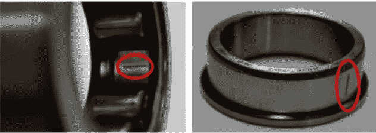

**图 1。**轴承故障情况。(a) 外表面轴承裂纹；(b) 内表面轴承裂纹。

当球体通过有缺陷轴承中的损伤点时，会产生具有特征频率的冲击脉冲。特征频率可以根据滚动体的几何结构和旋转频率 \(f_m\) 来计算。故障会引起振动，将异常引入气隙磁通密度，导致电流信号谐波出现失常。电流信号的这种变化表明已发生轴承故障。文献 [4] 中提到的各种故障的不同特征频率如下列所示。

外圈缺陷：

\(f_{outer}=\frac{N_{ball}}{2}\cdot f_m\cdot\left(1-\frac{D_{ball}}{D_{cage}}\cdot cos\beta\right)\) (1)

内圈缺陷：

\(f_{outer}=\frac{N_{ball}}{2}\cdot f_m\cdot\left(1-\frac{D_{ball}}{D_{cage}}\cdot cos\beta\right)\) (2)

球体缺陷：

\(f_{ball}=f_m\frac{D_{cage}}{D_{ball}}\left(1-\frac{D^2_{ball}}{D^2_{cage}}cos^2\beta\right)\) (3)

笼架缺陷：

\(f_{cage}=\frac{1}{2}\cdot f_m\cdot\left(1-\frac{D_{ball}}{D_{cage}}\cdot cos\beta\right)\) (4)

其中，\(\beta\) 为球体的接触角，\(Nball\) 为球体或圆柱滚子的数量，\(Dball\) 为球体直径，\(Dcage\) 为笼架直径（也称为滚子或球节圆直径）。详细的滚珠轴承几何结构在文献 [42] 中有所描述。

由于轴承损坏，定子和转子之间发生径向运动，产生振荡并将特征故障频率感应到电流信号中。其原因在于轴承缺陷导致转子相对于定子产生径向位移。这会引起旋转偏心率和负载扭矩的波动。这进而导致机器电感变化，引起电机电流信号的幅度、频率和相位调制。有缺陷轴承的电机电流方程在文献 [43,44] 中给出如下：

\(i(t)=\sum_{k=1}^{\infty} i_k\cdot cos(\omega_{c_k}\cdot t+\varphi)\) (5)

其中，\(\varphi\) 和 \(\omega_{c_k}\) 分别表示相位角和角速度，且 \(\omega_{c_k}=\frac{2\pi f_{bearing}}{p}\)。
这里，\(f_{bearing}\) 是故障电流谐波频率，\(p\) 表示相应机器的极对数。请注意，\(f_{bearing}\) 可表示为：

其中，$f_s$ 为供电频率或基频，$m = 1, 2, 3, ...$ 表示谐波指数，而 $f_v$ 可以是内圈缺陷频率 $f_{inner}$ 或外圈缺陷频率 $f_{outer}$。估计的故障特征频率可以使用文献 [45] 中提出的频率自动搜索算法计算。有时，轴承故障产生的谐波可能接近或与噪声频率重叠，难以区分，这给轴承故障检测带来了问题 [46]。因此，当轴承参数未知且逆变器频率发生变化时，诊断感应电机 (IM) 中的轴承缺陷变得困难。

## 2.2. 实验测试平台与数据集获取

本工作所使用的数据集源自德国帕德博恩大学机械工程结构与驱动技术 (KAt) 研究数据中心。电流信号数据集由如图 2 所示的测试平台产生，该平台由一台 425 W 永磁同步电机组成，由开关频率为 16 kHz 的标准变频器控制。详细的实验程序在文献 [47] 中提供。在此，测试台在各种工作条件下运行，以验证其鲁棒性并研究操作参数的影响。为使数据更可靠，同时使用了真实轴承和人工损坏轴承。在所使用的 32 个不同轴承中，6 个健康，14 个自然损坏，其余 12 个人工损坏。关于轴承损坏分类，文献 [47] 中的研究人员设定了具体标准，使轴承被分为四个类别，其中前三个类别描述了轴承特性，而最后一个名为“损坏”的类别则是根据 ISO 15243 制备的。此外，根据 VDI 3832 (2013)，为轴承裂纹的几何尺寸分配了适当的方向。而且，在原始研究中，通过包络分析和基于机器学习的分类对测量数据进行了验证。

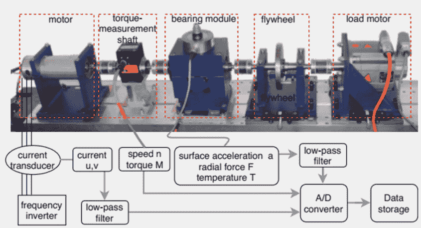

图 2. 信号测量示意图。

该数据集中使用的轴承根据其健康状态可分为三组：健康轴承、内圈故障轴承和外圈故障轴承。通过改变旋转速度、负载扭矩和径向力，创建了四种不同的工作条件，如表 1 所示。


表 1. 工作条件。

| 编号 | 转速 (S) [rpm] | 载荷转矩 (M) [Nm] | 径向力 (F) [N] |
|---|---|---|---|
| 1 | 1500 | 0.7 | 1000 |
| 2 | 900 | 0.7 | 1000 |
| 3 | 1500 | 0.1 | 1000 |
| 4 | 1500 | 0.7 | 400 |

电机相电流通过电流传感器（LEM CKSR 15-NP）在两个不同相位上进行测量，分别标记为电流信号 1（CS1）和电流信号 2（CS2）。首先，对表 2 中列出的每个轴承组进行了 20 次测量，每次持续时间为 4 秒。然后，采集的信号使用 25 kHz 低通滤波器进行滤波，并最终以 64 kHz 的采样率进行采样。对于每个轴承组，进行了 20 次测量以确定力、CS1、CS2、转速、转矩和振动信号。尽管原始数据集中记录了 32 个轴承组的电流信号，但本研究使用的最终数据集是使用从三个不同健康状态类别中选取的 17 个轴承组的信号构建的。本研究中使用的轴承代码和类型在表 2 中提供。

表 2. 轴承组用于实验。

| 轴承类型 | 轴承代码 | 标签 |
|---|---|---|
| 健康轴承数据 | K001 | 0 |
| | K002 | |
| | K003 | |
| | K004 | |
| | K005 | |
| | K006 | |
| | KA04 | 1 |
| 外圈 | KA15 | |
| | KA16 | |
| | KA22 | |
| | KA30 | |
| 天然损坏轴承数据 | KI04 | 2 |
| | KI14 | |
| 内圈 | KI16 | |
| | KI17 | |
| | KI18 | |
| | KI21 | |

最终数据集可表示为一个 136000 × 5118 矩阵，包含来自不同相位的两个电流信号（CS1 和 CS2），最后一列为标签，用于区分轴承的健康状态。

图 3 给出了三种轴承状态（健康、内圈故障、外圈故障）采集的电流信号图。可以看出，在时域表示中，信号之间存在非常微妙的差异。

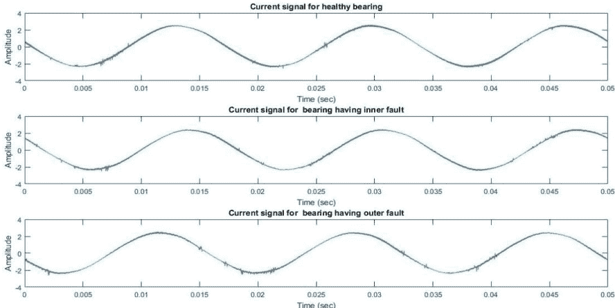

图 3. 表 2 中提到的三种不同轴承条件的电机电流信号。

为展示轴承故障特征频率，最常用的方法是将电流信号从时域转换到频域。电流信号的采样率为 64 kHz。在合并所有数据后，我们对三个类别的样本执行了快速傅里叶变换（FFT）。为了获得更好的频率分辨率，FFT 函数的初始长度选择为与数据信号长度相等；但是，为了表示目的，频谱的“镜像”部分已被移除。获得的频率响应在图 4 中提供。在此，由于外部噪声和检测到的损伤的存在，特征频率被掩盖。因此，仅凭特征频率方法，很难检测故障。在这种情况下，可以应用降噪技术和机器学习模型来分类不同的损伤。

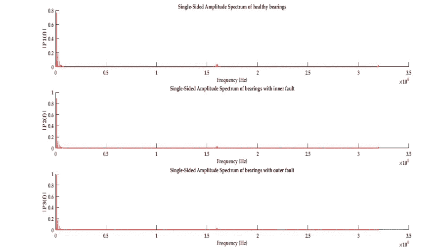

图 4. 健康轴承、内圈损伤和外圈损伤的 MCS 频谱。

## 2.3. 特征提取

特征提取通过将初始原始数据转换为更小、更易管理的组以供进一步处理，从而降低其维度。在大多数情况下，原始数据集包含大量变量，因此需要大量计算资源进行处理。该方法的主要目标是选择并将变量转换为特征，有效压缩必须处理的数据并精确描述原始数据集。近来，由于在线状态监测能够检测初期故障，因此受到关注。然而，少量数据不足以进行诊断，因此直接测量的信号不适合在线使用。为了进行有效的故障诊断，需要大量数据样本。因此，为了简化计算，特征提取成为保留最终决策所需关键信息的关键步骤。

从时域数据计算了十种用于状态评估的经典统计特征参数。从信号中提取的时域特征包括均值、中位数、标准差、方差、和、偏度、峭度、能量、均方根和峰值因子。均值是可用数据点的平均值，中位数是将数据点按升序排列后位于中间的数值。均值和中位数都是集中趋势的度量，但中位数对异常值不敏感。标准差和方差是变异性的度量。方差是数据集中各值与均值之间的平均平方差。它指示数据点与均值的分散程度。标准差是通过对方差开平方根得到的。它是数据集内观测值离散程度的统计量。正态分布的歪度程度由偏度衡量，偏度区分一侧尾部与另一侧尾部的极端值，也表示数据集的对称性缺失。然而，峭度衡量分布中现有的异常值。最后，峰值因子表示任何数据集中峰值与有效值的比率。所描述统计特征的数学方程列于表 3。在此，x<sub>i</sub>（i=1, 2, ..., N）表示电机电流信号。N、μ 和 σ 分别表示数据点的数量、均值和标准差。时域特征包含关于电流信号类型的统计细节，由于其敏感性，是良好的高质量特性 [48]。

表 3. 特征矩阵中从时域提取的统计特征（x 为电流信号）。

| 统计特征 | 方程 | 统计特征 | 方程 |
|---|---|---|---|
| 均值： | μ = 1/N Σ<sub>i=1</sub><sup>N</sup> x<sub>i</sub> (7) | 偏度： | x<sub>skewness</sub> = 1/N [Σ<sub>i=1</sub><sup>N</sup>(x<sub>i</sub> - μ)<sup>3</sup>] / σ<sup>3</sup> (8) |
| 中位数： | median = ((N+1)/2)<sup>th</sup> value (9) | 峭度： | x<sub>kurtosis</sub> = 1/N [Σ<sub>i=1</sub><sup>N</sup>(x<sub>i</sub> - μ)<sup>4</sup>] / σ<sup>4</sup> (10) |
| 标准差： | σ = √[Σ<sub>i=1</sub><sup>N</sup>(x<sub>i</sub> - μ)<sup>2</sup> / (N-1)] (11) | 能量： | E = Σ<sub>i=1</sub><sup>N</sup> x<sub>i</sub><sup>2</sup> (12) |
| 方差： | σ<sup>2</sup> = Σ<sub>i=1</sub><sup>N</sup>(x<sub>i</sub> - μ)<sup>2</sup> / (N-1) (13) | 均方根： | X<sub>rms</sub> = √[Σ<sub>i=1</sub><sup>N</sup> x<sub>i</sub><sup>2</sup>] / N (14) |
| 和： | Sum = Σ<sub>i=1</sub><sup>N</sup> x<sub>i</sub> (15) | 峰值因子： | C<sub>f</sub> = X<sub>max</sub> / X<sub>min</sub> (16) |

## 2.4. 基于遗传算法的特征选择

特征选择是检测和消除不相关、不太有用和冗余特征，并为分类模型发现最合适输入的过程。由 J. H. Holland 提出的遗传算法（GA）使用启发式搜索，在计算复杂度和最优选择之间取得了令人满意的平衡 [49]，并且对特征选择有效。它是一种优化函数的随机方法，依赖于自然遗传和生物进化的机制，能够发现关于主要未知搜索空间的累积信息。它可以应用于高维数据，无需对研究问题有任何特定知识，并且可以在计算机集群中轻松并行化。

基于遗传算法的特征选择的总体过程如图 5 所示。初始种群由特征向量创建。种群中的每个成员称为染色体。下一个关键步骤是为 GA 成功应用于问题领域选择适当的评估函数。根据每个染色体满足目标函数的程度进行评估和分类，最后将其分配一个繁殖概率。在选择过程中，会选出最适合的个体以遗传最佳特征。此过程中应用了多种算法：轮盘赌选择、锦标赛选择、均匀选择和余数选择。接下来，在交叉阶段，下一代通过模拟交配过程形成，并结合父母的最佳特征。一旦在此交叉过程中生成子代，变异操作（即繁殖过程中基因的随机修改）将应用于每个子代。这有助于子代继承父母的最佳特征，最终，问题的更好解决方案将出现。然后使用新种群重复此过程，直到达到某些标准。当种群收敛于最优解，或完成最大代数时，算法结束。

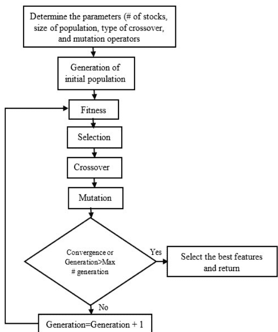

图 5. 遗传算法优化的流程图。


## 2.5. K-近邻 (KNN)

使用GA进行特征选择后，应用三种不同的分类器算法对故障特征进行分类。

首先，选择了K-近邻 (KNN)。

这是一种广泛使用的参数化分类器，因其架构简单、计算复杂度低 [50]。

它还可以处理具有各种特性的数据，包括非线性、多模态和非高斯数据。

在KNN分类算法中，训练样本的位置保持固定，然后对新数据样本，测量训练样本与查询数据之间的距离。

利用这些距离，从距离最小的训练样本中选择K个样本。

距离度量d和正整数K作为决策变量。

测试数据被分配到该区域样本更多的类别 [51]。

在训练过程中，数据保留在内存中，对于维度非常高的数据，计算复杂度很高。

为降低这种复杂度，我们采用基于GA的方法选择最具信息量和最优的特征。

例如，在分类过程中考虑两个或三个特征。

要得出结果，以输入位置为中心画一个圆，并取包含K个样本值的半径。

然后，该圆内样本值更多的类别即为结果。

图6详细展示了KNN。

这里，当K=3时，小圆内有一个正方形和两个三角形，因此新样本将属于三角形类别。

同样，对于K=5和K=9，结果分别为正方形和三角形。

K的最优值对于确定邻居数量和距离度量至关重要。

在本工作中，对K值的广泛范围进行了考察，以确定训练样本的最优值。

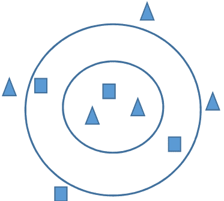

图6. 两个类别和两个特征情况下的KNN算法。

使用欧氏距离矩阵计算距离度量，这是在多维输入空间中实现此方法的简单方式，并提供比其他深奥机器学习方法更好的比较结果。

两点p和q之间的欧氏距离可使用下面给出的方程计算。

```
$$d_E = \sqrt{\sum_{i=1}^{n} (p_i - q_i)^2}.$$ (17)
```

## 2.6. 决策树

在各种监督学习模型中，一些最佳且最常用的方法是基于树的技术。

它们由于具有良好的稳定性和易于解释，在线性和非线性系统上均能很好地工作，最重要的是，它们允许进行高精度的预测建模。

决策树可描述为以树状形式表示选择及其结果的图。

该模型由分割过程（将一个节点分为两个或多个子节点）和剪枝过程（系统移除决策节点的子节点）组成，如图7a所示。

## 2.7. 随机森林

随机决策森林是一种用于回归和分类的集体学习类型。

该技术通过在训练期间构建大量决策树，然后定义分类类别的众数作为类别，并预测单个树回归的平均值来工作。

RF相对于决策树的优势在于它可以克服过拟合问题。

树的数量、最大深度、每次分割的特征数量和样本叶节点数量是RF中的重要参数。

在大多数情况下，树数量较多有助于提供稳定的结果以进行准确计算。

一般来说，特征数量控制森林中树的多样性，少量特征会导致不相关的树，而大值代表相关的树。

因此，大量树可以提高性能，但也会增加大小和计算成本。

在本工作中，对上述参数的一系列值进行了测试。

随机森林算法的结果图如图7b所示。

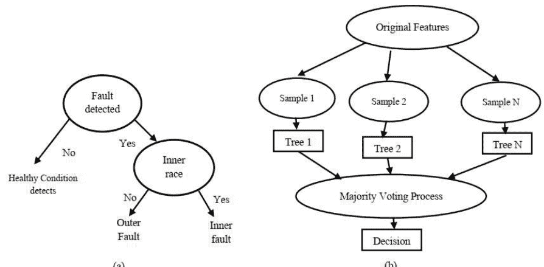

图7. (a) 决策树；(b) 随机森林架构。

## 2.8. 提出的方法

在本工作中，采用三种健康状态的轴承组在不同运行条件下的两个不同相位的电机电流信号，构建一个大型数据集。

然后，为每个相位提取10个统计特征，构建一个13600 × 20的特征矩阵。

GA被应用于从该矩阵中选择判别性特征以降低其维度，从而降低计算复杂度。

确定最优特征数量至关重要，因为过多的特征可能导致过多噪声，而过少的特征可能导致重要信息丢失 [20]。

在本研究中，从提取的20个特征中，GA选取了一系列特征（5、6、10、11、12、14、16和18），并将其组合成不同的输入子集。

KNN算法（K=3）的分类损失用于构建适应度函数。

这基于分类模型的预测精度得出了最合适的输入。

最后，由所提出的GA框架选取的这些判别性特征被用作三种不同机器学习分类算法的输入，以执行故障分类任务。

在本研究中，特征选择过程后获得的特征矩阵按70:30的比例随机分割为训练集和测试集，用于训练和验证分类算法的故障诊断能力。

具体而言，9520个数据实例用于训练机器学习算法，而剩余的、训练分类器之前未见过的4080个样本用于验证最终的故障分类性能。

为确保结果的一致性，训练重复了多次，每次迭代都获得了几乎相同的测试精度。

所提出方法的示意图如图8所示。

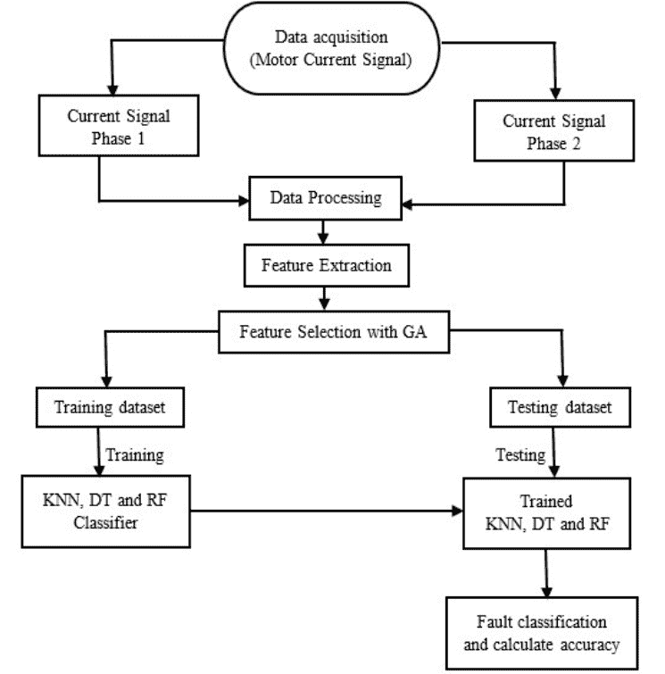

图8. 所提出方法的示意图。

## 2.9. 模型评估

使用GA选择的特征集被用作前一节讨论的三种不同分类器算法的输入。

在不同的评估参数中，混淆矩阵、总体准确率、灵敏度、特异度、预测和F1分数被视为本工作的性能指标。

评估参数通过表4中提供的方程计算。

表4. 性能评估参数。

| 精确率 = \(\frac{TP}{TP + FP}\) | (18) | 灵敏度 = \(\frac{TP}{TP + FN}\) | (19) |
| :--- | :--- | :--- | :--- |
| 特异度 = \(\frac{TN}{FP + TN}\) | (20) | F1 = 2 x \(\frac{\text{精确率} \times \text{灵敏度}}{\text{精确率} + \text{灵敏度}}\) | (21) |
| 准确率 = \(\frac{TP + TN}{TP + FP + TN + FN}\) | (22) | | |

这里，灵敏度指示模型检测正类别事件的适当性，而特异度衡量分配到正类别的精确性。

大多数情况下，灵敏度和精确率成对报告，因为I类错误由灵敏度计算，II类错误由精确率计算。

最后，F度量是灵敏度和精确率的调和平均数。

# 3. 结果与讨论

在本节中，讨论了各种GA参数的影响，然后展示了分类器模型的性能。

为了选择GA参数（如种群大小、变异和交叉）的最优值，我们运行了GA程序100代。

图9a表明，如果选择种群大小为200，损失将处于略低于5.7的最低水平。

对于其他种群大小，损失略高于最小值。

图9b显示，无论交叉概率如何变化，损失曲线都遵循相同的趋势。

但是，遵循将交叉概率设定在0.65到0.85范围内的一般做法，本研究中交叉概率被选择为0.7。

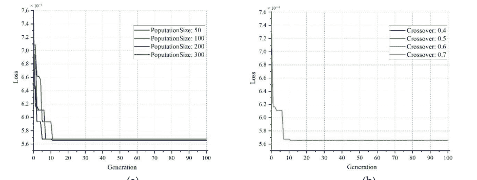

图9. 种群大小（a）和交叉概率（b）变化的影响。

如图10a所示，变异概率也可以观察到类似模式。

可以观察到，在一定代数后，不同变异概率值的损失曲线值变得相同。

在本工作中，0.03被选为变异概率值。

对于适应度值估计，随着代数增加，平均值开始收敛，而最佳适应度值在第15代后保持在2.6 × 10⁴不变。

最终确定的GA参数列表列于表5中。

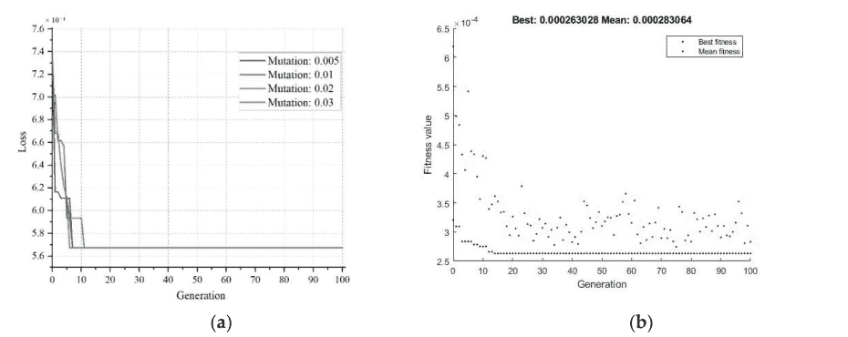

图10. 用于估计损失的变异概率变化（a）和适应度值的代数变化（b）。


Table 5. The genetic algorithm parameters settings for feature selection.

| 参数名称 | 类型/数值 |
|---|---|
| 种群大小 | 200 |
| 基因组长度 | 20 |
| 选择类型 | 轮盘赌 |
| 交叉 | 0.7（单点交叉） |
| 突变概率 | 0.03（均匀概率分布） |
| 最大代数 | 100 |

分类器性能分别使用图 11 和图 12 中所示的混淆矩阵和受试者工作特征（ROC）曲线进行评估。从该混淆矩阵计算了方程（18）–（22）中所示的评估参数。在 ROC 中，使用了曲线下面积（AUC），因为它能直观反映分类模型在数据集上的表现准确性。AUC 曲线的范围为 0.5 到 1，其中 0.5 表示分类器表现不佳于随机猜测，而 1 表示没有误分类的良好模型。数值越接近 1，模型效果越好。

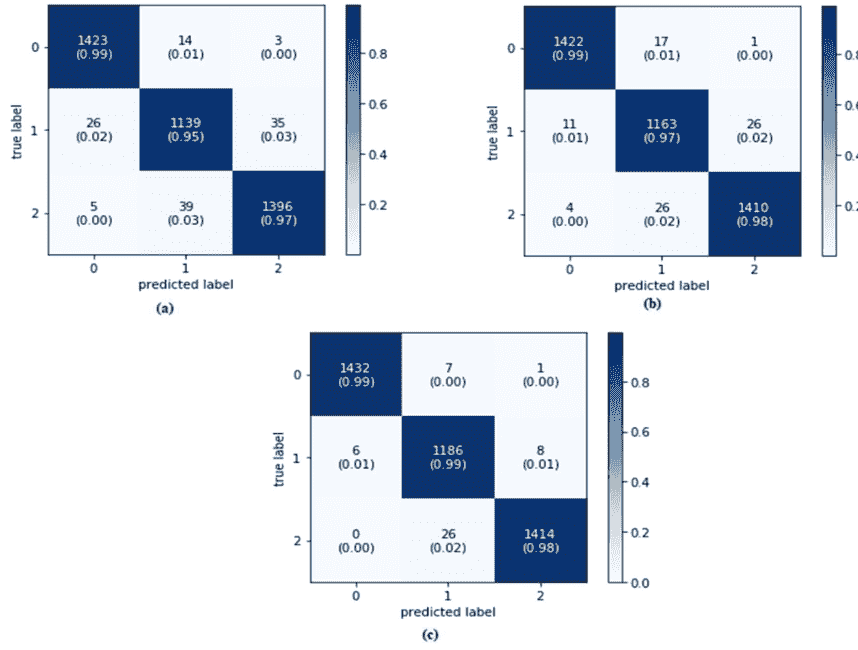

图 11. (a) KNN、(b) 决策树和 (c) 随机森林分类器的混淆矩阵。

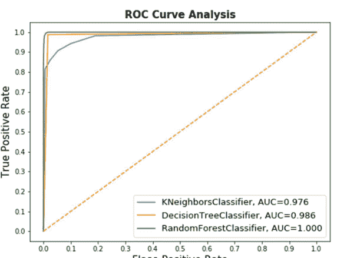

图 12. KNN、决策树和随机森林分类器的综合 ROC 曲线。

根据混淆矩阵得到的数值，可以说 RF 在预测真实类别方面的表现优于 KNN 和 DT（99%）。此外，DT 和 RF 的 AUC 分数几乎为 1，表明与 KNN 分类器相比，模型表现良好。

表 6 列出了性能参数。可以得出结论，当使用 GA 选择的特征训练时，三个分类器模型均表现良好，所用分类器的准确率均超过 97%。然而，使用 RF 分类器，可实现超过 99.5% 的准确率。

表 6. 三个分类器在六项评估参数方面的结果。

| 精确率 | F1 分数 | 灵敏度 | 特异度 | 准确率 (%) |
|---|---|---|---|---|
| KNN 0.97 | 0.97 | 0.989 | 0.988 | 97.0 |
| DT 0.98 | 0.98 | 0.989 | 0.994 | 98.0 |
| RF 0.99 | 0.99 | 0.994 | 0.997 | 99.7 |

为验证将两相电流信号与所提出的用于选择判别特征的 GA 框架相结合是否有助于故障诊断过程，我们还考虑了仅将具备相同统计特征的一相电流信号作为机器学习分类器输入的实验。基于 GA 特征选择的两相信号使用与采用相同统计特征参数的一相信号之间的对比显示于表 7 中。

表 7. 一相和两相电流信号的评估参数对比。

| | KNN | | DT | | RF | |
|---|---|---|---|---|---|---|
| | 两相信号 | 一相信号 | 两相信号 | 一相信号 | 两相信号 | 一相信号 |
| 精确率 | 0.97 | 0.90 | 0.98 | 0.91 | 0.99 | 0.91 |
| F1 分数 | 0.97 | 0.90 | 0.98 | 0.91 | 0.99 | 0.91 |
| 灵敏度 | 0.989 | 0.86 | 0.989 | 0.91 | 0.994 | 0.92 |
| 特异度 | 0.998 | 0.95 | 0.994 | 0.96 | 0.997 | 0.96 |
| 准确率 (%) | 97 | 89.70 | 98 | 91.03 | 99.7 | 91.12 |

如表所示，当仅使用从一相电流信号中提取的 10 个统计特征参数来诊断轴承故障时，KNN、DT 和 RF 分类器达到的分类精度相较于所提方法有所下降，分别为 89.7%、91.03% 和 91.1%。由此可得出结论，使用两相信号构建的所提特征模型在故障分类性能上优于仅利用一相信号进行特征提取的模型。

所提方法与其他研究的对比显示于表 8 中。在文献 [52] 中，信息融合（IF）和深度学习技术应用于本工作所用的相同电流信号数据集，并利用多层感知机（MLP）达到了 98.3% 的准确率。C. Lessmeier 等人 [47] 采用小波包分解（WPD）进行特征提取，随后在电机电流信号上应用集成学习，达到了 86.03% 的准确率。文献 [53] 中开展的类似研究提出了一种采用经验小波变换和 CNN 的感应电机故障检测方法，达到了 97.37% 的准确率，这也与我们的结果可比。在文献 [54] 中，作者使用振动信号和 CNN 进行故障检测和诊断，针对不同比例的数据达到了 88–99% 的准确率。文献 [55] 中提出的另一种方法在使用 CNN 时，对转子故障和轴承故障分别达到了 98% 和 100% 的准确率。与这些近期研究相比，我们的所提方法仅使用统计特征和 GA 进行特征提取与选择，便产生了可比的结果，且计算复杂度低于其他方法。

表 8. 不同方法的准确率对比。

| 诊断方法 | 分类准确率 (%) |
|---|---|
| 基于 MLP 的 IF [52] | 98.3 |
| 基于 SVM 的 IF [52] | 98.0 |
| 基于 KNN 的 IF [52] | 97.7 |
| 带 EWT 的 CNN [53] | 97.37 |
| 带生成过采样的 CNN（振动信号） [54] | 88.0–99.0 |
| CNN（振动信号） [55] | 98.0–100 |
| WPD + 集成学习 [47] | 86.03 |
| GA + KNN | 97.0 |
| GA + DT | 98.0 |
| GA + RF | 99.7 |

# 4. 结论

本文提出了一种基于统计特征、遗传算法（GA）和机器学习技术相结合的电机电流数据驱动方法，用于感应电机（IM）轴承故障诊断。为探究有效特征，使用电机电流信号作为原始输入提取了 20 个统计特征。利用 GA 选择了 8 个特征，用于训练三种不同的分类器进行故障诊断。在特征选择方面，为 GA 选取了最合适的遗传参数，并开展了一系列模拟以寻找分类模型的最佳准确率。主要目标是减少冗余数据和原始数据集的维度，从而降低模型的功耗和计算复杂度。所提系统使用三种不同电机状态的电流信号进行了测试。一种状态为健康状态，其他条件包括两种不同的轴承故障（内圈和外圈）。故障分类的总体准确率令人满意，表明所提方法对于实时应用具有前景。此外，为验证该模型的有效性，提出了与同一数据集及多个不同数据集上的部分近期研究进行对比，对比表明，所提方法仅采用简单统计特征，即可达到与其他方法相当的准确率，同时所需的计算复杂度更低。如果考虑振动信号，最先进的 CNN 架构获得的准确率也与本文中使用电流信号所取得的结果相当。这表明，无传感器系统采集的电流信号与传统基于传感器的系统一样有效。在未来的研究工作中，我们将探讨频域分析在利用 IM 电流信号诊断滚动轴承方面对所提方法的适用性。此外，我们将在其他数据集上验证所提方法的适用性，这些数据集中考虑使用电流信号诊断机械故障。

**作者贡献：** 所有作者均对构思构想、实验设计、结果分析与解释以及手稿撰写做出了同等贡献。撰写—原始草稿准备 R.N.T., A.E.P. 和 J.-M.K.；撰写—审阅与编辑，R.N.T., A.E.P. 和 J.-M.K.。所有作者均已阅读并同意发表的手稿版本。

**资助：** 本工作得到韩国能源技术评价院（KETEP）和大韩民国贸易、工业与能源部（MOTIE）的支持（编号：20181510102160）。

**利益冲突：** 作者声明不存在任何利益冲突。

# 参考文献

- 1. Abd-el-Malek, M.; Abdelsalam, A.K.; Hassan, O.E. 通过希尔伯特变换对启动电流进行包络分析来检测感应电机断条故障位置. *Mech. Syst. Signal Process.* **2017**, *93*, 332–350.
- 2. Mehrjou, M.R.; Mariun, N.; Marhabam, M.H.; Misron, N. 松鼠笼感应电机转子故障状态监测技术综述. *Mech. Syst. Signal Process.* **2011**, *25*, 2827–2848.
- 3. Han, T.; Yang, B.-S.; Choi, W.-H.; Kim, J.-S. 基于神经网络和遗传算法的感应电机故障诊断系统，使用定子电流信号. *Int. J. Rotat. Mach.* **2006**, *2006*, 61690.
- 4. Mbo’o, C.P.; Hameyer, K. 基于频率选择的定子电流特征线性判别分析法进行轴承损伤故障诊断. *IEEE Trans. Ind. Appl.* **2016**, *52*, 3861–3868.
- 5. Singh, G. 感应电机驱动状态监测与诊断研究综述. *Electr. Power Syst. Res.* **2003**, *64*, 145–158.
- 6. Randall, R.B.; Antoni, J. 滚动轴承诊断—教程. *Mech. Syst. Signal Process.* **2011**, *25*, 485–520.
- 7. Sinha, J.K.; Elbhbah, K. 基于振动的旋转机器状态监测的未来可能性. *Mech. Syst. Signal Process.* **2013**, *34*, 231–240.
- 8. Siegel, D.; Ly, C.; Lee, J. 预测直升机滚动轴承失效的方法与框架. *IEEE Trans. Reliab.* **2012**, *61*, 846–857.
- 9. Zhen, L.; Zhengjia, H.; Yayang, Z.; Xuefeng, C. 基于冲击脉冲法和改进冗余提升方案的轴承状态监测. *Math. Comput. Simul.* **2008**, *79*, 318–338.
- 10. Cabal-Yepez, E.; Garcia-Ramirez, A.G.; Romero-Troncoso, R.J.; Garcia-Perez, A.; Osornio-Rios, R.A. 基于 STFT 和 DWT 的工业设备时频分析可重构监测系统. *IEEE Trans. Ind. Inform.* **2012**, *9*, 760–771.
- 11. Lau, E.C.; Ngan, H. 通过小波包变换的电机电流签名分析检测电机轴承外圈滚道缺陷. *IEEE Trans. Instrum. Meas.* **2010**, *59*, 2683–2690.
- 12. Obeid, Z.; Poignant, S.; Régnier, J.; Maussion, P. 基于统计频率选择的同步机轴承故障检测定子电流指标. In Proceedings of the IECON 2011—37th Annual Conference of the IEEE Industrial Electronics Society, Melbourne, Australia, 7–10 November 2011; pp. 2036–2041.
- 13. Wang, Z.; Chang, C. 使用频域独立成分分析在线检测感应电机故障. In Proceedings of the 2011 IEEE International Symposium on Industrial Electronics, Gdansk, Poland, 27–30 June 2011; pp. 2132–2137.
- 14. Tian, J.; Morillo, C.; Azarian, M.H.; Pecht, M. 基于谱峭度特征提取与 K 最近邻距离分析相结合的电机轴承故障检测. *IEEE Trans. Ind. Electr.* **2015**, *63*, 1793–1803.
- 15. Delgado, M.; Cirrincione, G.; Garcia, A.; Ortega, J.; Henao, H. 一种基于曲线性分量分析和层次神经网络的轴承故障条件监测新方案. In Proceedings of the 2012 XXth International Conference on Electrical Machines, Marseille, France, 2–5 September 2012; pp. 2472–478.


- 16. Jin, X.; Zhao, M.; Chow, T.W.; Pecht, M. 基于迹比率线性判别分析的电机轴承故障诊断. IEEE Trans. Ind. Electr. **2013**, 61, 2441–2451.

- 17. Zhou, W.; Lu, B.; Habetler, T.G.; Harley, R.G. 基于维纳滤波器的电机定子电流噪声消除的轴承早期故障检测. IEEE Trans. Ind. Appl. **2009**, 45, 1309–1317.

- 18. Thollon, F.; Grellet, G.; Jammal, A. 基于电磁转矩测量的异步电机笼式转子故障检测. Eur. Trans. Electr. Power **1993**, 3, 375–378.

- 19. Elasha, F.; Greaves, M.; Mba, D.; Addali, A. 声发射在直升机齿轮箱轴承故障诊断中的应用. Procedia CIRP **2015**, 38, 30–36.

- 20. Stone, G. 利用局部放电测量评估旋转机械绝缘状况. IEEE Electr. Insul. Mag. **1996**, 12, 23–27.

- 21. Beguenane, R.; Benbouzid, M.E.H. 基于转子电阻识别的感应电机热监测. IEEE Trans. Energy Convers. **1999**, 14, 566–570.

- 22. Naha, A.; Samanta, A.K.; Routray, A.; Deb, A.K. 基于电流的轻载感应电机半断转子条检测方法. IEEE Trans. Instrum. Meas. **2016**, 65, 1614–1625.

- 23. Pons-Llinares, J.; Antonino-Daviu, J.A.; Riera-Guasp, M.; Pineda-Sanchez, M.; Climente-Alarcon, V. 基于频率B样条的瞬态电流解析小波变换的感应电机诊断. IEEE Trans. Ind. Electr. **2010**, 58, 1530–1544.

- 24. Xu, B.; Sun, L.; Ren, H. 感应电机断转子条量化的新准则. IEEE Trans. Energy Convers. **2009**, 25, 100–106.

- 25. Nejjari, H.; Benbouzid, M.E.H. 基于电流Park矢量模式学习的感应电机电气故障监测与诊断. IEEE Trans. Ind. Appl. **2000**, 36, 730–735.

- 26. Ondel, O.; Boutleux, E.; Blanco, E.; Clerc, G. 基于卡尔曼滤波器的故障诊断中模式识别与状态估计的耦合. IEEE Trans. Ind. Electr. **2011**, 59, 4293–4300.

- 27. Ariff, M.; Pal, B.C. 基于独立成分分析的互联电力系统同步性识别. IEEE Trans. Power Syst. **2012**, 28, 1747–1755.

- 28. Mehrabian, H.; Chopra, R.; Martel, A.L. 基于自适应复值独立成分分析的动态造影增强MRI中血管内信号计算. IEEE Trans. Med. Imaging **2012**, 32, 699–710.

- 29. Razavian, M.; Hosseini, M.H.; Safian, R. 基于独立成分分析的单发射天线时反演成像. IEEE Geosci. Remote Sens. Lett. **2014**, 11, 1574–1578.

- 30. Widodo, A.; Yang, B.-S.; Han, T. 独立成分分析与支持向量机相结合的感应电机智能故障诊断. Expert Syst. Appl. **2007**, 32, 299–312.

- 31. Altaf, S.; Soomro, M.W.; Mehmood, M.S. 基于知识级建模技术的工业电机网络环境中的故障诊断与检测. Model. Simul. Eng. **2017**, 2017, 1292190.

- 32. Skowron, M.; Wolkiewicz, M.; Orłowska-Kowalska, T.; Kowalski, C.T. 自组织神经网络在感应电机电气故障分类中的应用. Appl. Sci. **2019**, 9, 616.

- 33. Samanta, B.; Al-Balushi, K. 基于时域特征的滚动轴承人工神经网络故障诊断. Mech. Syst. Signal Process. **2003**, 17, 317–328.

- 34. Puche-Panadero, R.; Pons-Llinares, J.; Climente-Alarcon, V.; Pineda-Sanchez, M. 基于稳态电流的感应电机诊断方法综述. Phys. Rev. D, **2004**, pp.1–5.

- 35. Appana, D.K.; Prosvirin, A.; Kim, J.-M. 基于包络谱和卷积神经网络的变转速轴承可靠故障诊断. Soft Comput. **2018**, 22, 6719–6729.

- 36. Sohaib, M.; Kim, C.-H.; Kim, J.-M. 混合特征模型和基于深度学习的轴承故障诊断. Sensors **2017**, 17, 2876.

- 37. Chuanlei, Z.; Shanwen, Z.; Jucheng, Y.; Yancui, S.; Jia, C. 基于遗传算法和相关性特征选择的苹果叶病害识别. Int. J. Agric. Biol. Eng. **2017**, 10, 74–83.

- 38. Aalaiе, S.; Shahraki, H.; Rowhanimanesh, A.; Eslami, S. 基于遗传算法的乳腺癌诊断特征选择：三个不同数据集的实验. Iran. J. Basic Med. Sci. **2016**, 19, 476.

- 39. Noori, F.M.; Naseer, N.; Qureshi, N.K.; Nazeer, H.; Khan, R.A. 基于遗传算法的fNIRS信号用于脑机接口的最优特征选择. Neurosci. Lett. **2017**, 647, 61–66.

- 40. Bidi, N.; Elberrichi, Z. 基于遗传算法的文本分类特征选择. 载于《2016年第8届建模、识别与控制国际会议（ICMIC）论文集》，阿尔及利亚阿尔及，2016年11月15–17日，第806–810页.

- 41. Cerrada, M.; Zurita, G.; Cabrera, D.; Sánchez, R.-V.; Artés, M.; Li, C. 基于遗传算法和随机森林的直齿轮故障诊断. Mech. Syst. Signal Process. **2016**, 70, 87–103.

- 42. Fred, B.; Oswald, E.V.Z.; Poplawski, J. 径向载荷球轴承和滚子轴承内部间隙对载荷分布和寿命的影响. *Tribol. Trans.* **2012**, *55*, 245–265. doi:10.1080/10402004.2011.639050.

- 43. Cerrada, M.; Sánchez, R.-V.; Li, C.; Pacheco, F.; Cabrera, D.; de Oliveira, J.V.; Vásquez, R.E. 滚动轴承数据驱动故障严重性评估综述. *Mech. Syst. Signal Process.* **2018**, *99*, 169–196.

- 44. Blodt, M.; Granjon, P.; Raison, B.; Rostaing, G. 基于定子电流监测的感应电机轴承损伤检测模型. *IEEE Trans. Ind. Electr.* **2008**, *55*, 1813–1822.

- 45. Jung, J.-H.; Lee, J.-J.; Kwon, B.-H. 基于MCSA的感应电机在线诊断. *IEEE Trans. Ind. Electr.* **2006**, *53*, 1842–1852.

- 46. Yang, T.; Pen, H.; Wang, Z.; Chang, C.S. 基于定子电流数据分析的特征知识感应电机故障检测. *IEEE Trans. Instrum. Meas.* **2016**, *65*, 549–558.

- 47. Lessmeier, C.; Kimotho, J.K.; Zimmer, D.; Sextro, W. 利用电动机电流信号对机电驱动系统轴承损伤进行状态监测：用于数据驱动分类的基准数据集. 载于《预测与健康管理学会欧洲会议论文集》，西班牙毕尔巴鄂，2016年7月，第5–8页.

- 48. Kang, M.; Islam, M.R.; Kim, J.; Kim, J.-M.; Pecht, M. 一种用于减少数据驱动诊断中异常值导致诊断性能退化的混合特征选择方案. *IEEE Trans. Ind. Electr.* **2016**, *63*, 3299–3310.

- 49. Hasan, M.J.; Kim, J.-M. 基于遗传算法混合特征池和k近邻算法的球形罐故障检测. *Energies* **2019**, *12*, 991.

- 50. Islam, R.; Khan, S.A.; Kim, J.-M. 基于判别特征分布分析的感应电机在线轴承故障诊断混合特征选择. *J. Sensors* **2016**, *2016*, 7145715.

- 51. Moosavian, A.; Ahmadi, H.; Tabatabaefar, A.; Khazaee, M. 主机轴承故障诊断中两种分类器（k近邻和人工神经网络）的比较. *Shock Vib.* **2013**, *20*, 263–272.

- 52. Hoang, D.T.; Kang, H.J. 基于深度学习和信息融合的电机电流信号轴承故障诊断. *IEEE Trans. Instrum. Meas.* **2019**, doi:10.1109/TIM.2019.2933119

- 53. Hsueh, Y.-M.; Ittagihal, V.R.; Wu, W.-B.; Chang, H.-C.; Kuo, C.-C. 基于经验小波变换和CNN的感应电机故障诊断系统. *Symmetry* **2019**, *11*, 1212.

- 54. Suh, S.; Lee, H.; Jo, J.; Lukowicz, P.; Lee, Y.O. 用于轴承故障检测和诊断中不平衡数据的生成式过采样方法. *Appl. Sci.* **2019**, *9*, 746.

- 55. Lee, J.-H.; Pack, J.-H.; Lee, I.-S. 基于卷积神经网络的感应电机故障诊断. *Appl. Sci.* **2019**, *9*, 2950.


