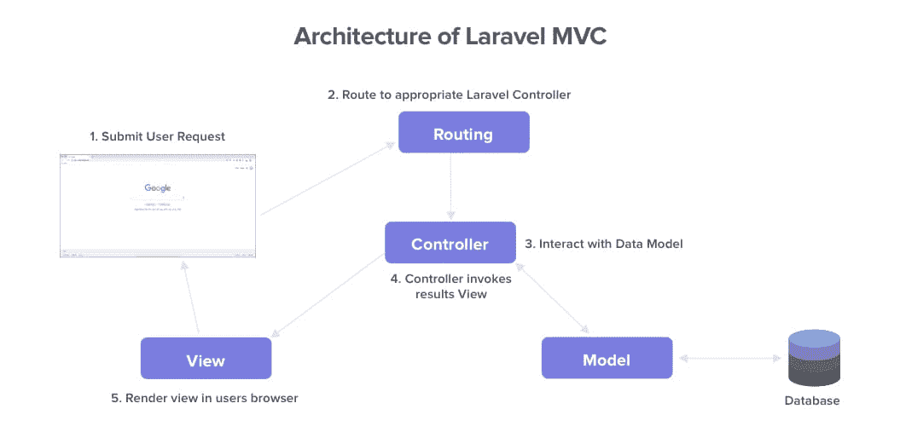
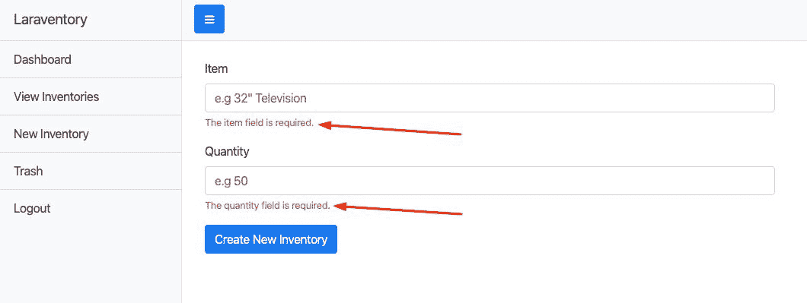
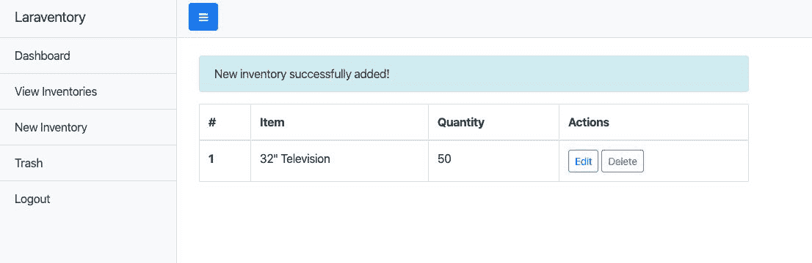
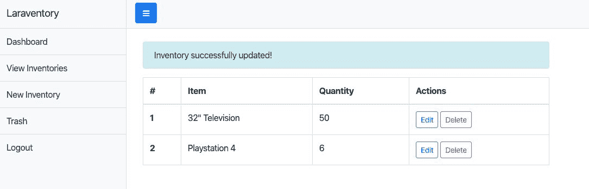
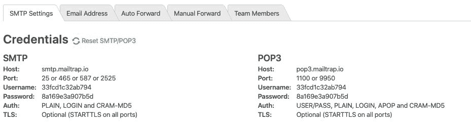
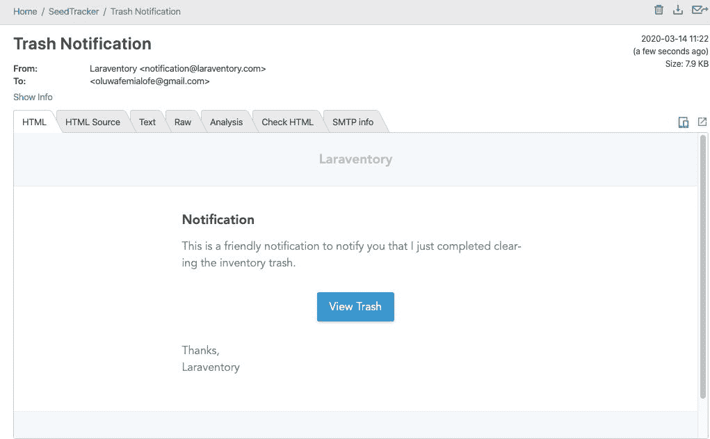

# PHP Laravel 入门指南


## 关于作者

Oluwafemi Alofe 是一位经验丰富的软件工程师，拥有 7 年使用 Laravel 构建可扩展 Web 应用程序的经验，自 4.2 版本早期发布以来便开始使用。他目前是一家金融科技初创公司的技术联合创始人（CTO）。

## 简介

自 2011 年首次发布以来，Laravel 经历了指数级增长。2015 年，它成为 GitHub 上获得星标最多的 PHP 框架，并成为了全球众多初创公司和开发者的首选框架。

Laravel 是一个专注于简洁、清晰和高效完成工作的 MVC 框架。个人和公司用它构建从简单的业余项目到财富 500 强企业级应用的各种项目。

根据 [`hackr.io/`](https://hackr.io/) 的数据，截至 2019 年，Laravel 仍然是前十大 Web 开发框架之一。

### 适读人群

本书面向希望开始使用 Laravel 构建应用程序的初学者，他们准备好通过构建一个涵盖 Laravel 框架大部分基础知识以及一些初看似乎令人望而生畏的高级功能的最小化项目，来快速上手实战。

有一定经验、寻求更好方式来设计中小型应用程序架构的中级用户也会发现本书大有裨益。

### 你将学到什么

本书将展示如何构建一个简单的库存应用程序。内容将涵盖 Blade 模板（我们将获取一个随机的 Bootstrap 主题并将其转换为可供所有页面扩展的精简模板）、用于注册和登录的认证、Eloquent ORM（展示不同的数据库表关系，包括软删除功能）、依赖注入、邮件设置与配置、路由类型、命名与分组，最后是任务调度与 Cron Jobs 以执行后台进程。

最重要的是，你将学习如何通过遵循标准命名约定、最佳实践和编写 DRY（不要重复自己）代码来编写生产级质量的代码。

该项目的代码托管在 GitHub 上，地址如下：

```
https://github.com/slim12kg/Beginning-PHP-Laravel-Ebook-Code.git
```

> **注意**
>
> 招聘人员在寻找 Laravel 开发者时，会重点关注你使用该框架完整构建的项目数量。因此，建议你完整跟随本书学习，而不仅仅是克隆或 Fork 这个仓库。

### 环境要求

为了本书的目的，我们将使用 Laravel 5.4，因为它支持 PHP 版本 >= 5.6.4，该版本仍被大多数人广泛使用。如果你愿意，可以安装高于 5.4 的版本，但不能低于该版本。

请确保你的系统已安装 PHP 并启用了以下扩展：

*   `OpenSSL PHP Extension`
*   `PDO PHP Extension`
*   `Mbstring PHP Extension`
*   `Tokenizer PHP Extension`
*   `XML PHP Extension`

`Composer`（PHP 依赖管理器）必须全局安装在你的机器上，且需安装 MySql 或 MariaDB 数据库（无论是随 Xampp 打包安装还是直接安装）。

我将假设你使用的是 Unix 终端或 Windows Git Bash 来运行命令。

#### 资源

*   [如何使用 GIT BASH 安装和运行 Laravel](https://www.youtube.com/watch?v=0rAW5eah7pw)
*   [在 Mac 上使用 Valet 安装 Laravel](https://www.youtube.com/watch?v=ErblOwpiopI)
*   [在 Ubuntu 上使用 Xampp 设置 Laravel](https://www.youtube.com/watch?v=3DeJCwmlOys)
*   [在 Linux 上设置 Laravel 5.4](https://www.youtube.com/watch?v=l-hM9KG4VSE&t=19s)
*   [Laravel 官方安装指南](https://laravel.com/docs/5.4/installation)
*   [在 Windows 上使用 Xampp 安装 Laravel 5](https://www.codementor.io/@magarrent/how-to-install-laravel-5-xampp-windows-du107u9ji)

> **注意**
>
> 为了不让初学者感到不知所措，我们将不遵循 TDD（测试驱动开发）流程。想了解更多关于 TDD 的信息，我[推荐阅读此文](https://github.com/slim12kg/Learn-Test-Driven-Design-In-Laravel)。

## Laravel 框架工作原理



图片来源：https://www.netsolutions.com

Laravel 是一个 MVC 框架，即模型、视图和控制器。模型用于在数据库中检索和存储信息，视图是在浏览器中渲染供最终用户查看的内容，而控制器是应用程序业务逻辑的处理场所，例如操作来自模型的数据并传递给视图。

> **注意**
>
> 如需深入理解，可阅读 https://laravel.com/docs/5.8/lifecycle 了解 Laravel 请求生命周期。

## 创建项目

打开一个新的终端或命令行（Windows 操作系统用户使用 gitbash），导航到你的 Web 项目目录，然后运行以下命令来创建一个新的 Laravel 项目。请确保 `Composer` 已全局安装在你的机器上。

```
composer create-project --prefer-dist laravel/laravel inventory-app "5.4.*"
```

接下来，创建一个名为 `inventory_app` 的数据库，并授予 root 用户或你选择的首选用户对该数据库的所有特权访问权限。

一旦 `Composer` 命令运行完毕，且没有报错地完全安装了你的新 Laravel 项目。从终端导航到新创建的 `inventory-app` 目录，然后运行命令 `php artisan serve` 以启动项目，使其可通过 Web 浏览器访问。

这是我在终端的 inventory-app 项目目录下运行 `php artisan serve` 命令的情况。

```
oluwafemialofe@Oluwafemis-MacBook-Air inventory-app : php artisan serve
```

你将获得如下输出，只需打开浏览器并访问输出的 URL 即可

```
Laravel development server started: <http://127.0.0.1:8000>
```

你现在应该看到 Laravel 默认的着陆页面了。

恭喜，你已踏上成为 Laravel 工匠的征程 ⚔

## 模板


## 使用 StartBootstrap Simple Sidebar 主题创建视图脚手架

我们将使用 StartBootstrap Simple Sidebar Theme（一个免费的 Bootstrap 4 基础模板）来创建我们的视图脚手架。你可以在此处找到它：[`blackrockdigital.github.io/startbootstrap-simple-sidebar`](https://blackrockdigital.github.io/startbootstrap-simple-sidebar/)。在页面上右键单击并选择“查看页面源代码”以复制 HTML 代码。

### HTML 模板代码

```html
<!DOCTYPE html>
<html lang="en">
<head>
  <meta charset="utf-8">
  <meta name="viewport" content="width=device-width, initial-scale=1, shrink-to-fit=no">
  <meta name="description" content="">
  <meta name="author" content="">
  <title>Simple Sidebar - Start Bootstrap Template</title>
  <!-- Bootstrap core CSS -->
  <link href="vendor/bootstrap/css/bootstrap.min.css" rel="stylesheet">
  <!-- Custom styles for this template -->
  <link href="css/simple-sidebar.css" rel="stylesheet">
</head>
<body>
  <div class="d-flex" id="wrapper">
    <!-- Sidebar -->
    <div class="bg-light border-right" id="sidebar-wrapper">
      <div class="sidebar-heading">Start Bootstrap </div>
      <div class="list-group list-group-flush">
        <a href="#" class="list-group-item list-group-item-action bg-light">Dashboard</a>
        <a href="#" class="list-group-item list-group-item-action bg-light">Shortcuts</a>
        <a href="#" class="list-group-item list-group-item-action bg-light">Overview</a>
        <a href="#" class="list-group-item list-group-item-action bg-light">Events</a>
        <a href="#" class="list-group-item list-group-item-action bg-light">Profile</a>
        <a href="#" class="list-group-item list-group-item-action bg-light">Status</a>
      </div>
    </div>
    <!-- /#sidebar-wrapper -->
    <!-- Page Content -->
    <div id="page-content-wrapper">
      <nav class="navbar navbar-expand-lg navbar-light bg-light border-bottom">
        <button class="btn btn-primary" id="menu-toggle">Toggle Menu</button>
        <button class="navbar-toggler" type="button" data-toggle="collapse" data-target="#navbarSupportedContent" aria-controls="navbarSupportedContent" aria-expanded="false" aria-label="Toggle navigation">
          <span class="navbar-toggler-icon"></span>
        </button>
        <div class="collapse navbar-collapse" id="navbarSupportedContent">
          <ul class="navbar-nav ml-auto mt-2 mt-lg-0">
            <li class="nav-item active">
              <a class="nav-link" href="#">Home <span class="sr-only">(current)</span></a>
            </li>
            <li class="nav-item">
              <a class="nav-link" href="#">Link</a>
            </li>
            <li class="nav-item dropdown">
              <a class="nav-link dropdown-toggle" href="#" id="navbarDropdown" role="button" data-toggle="dropdown" aria-haspopup="true" aria-expanded="false">
                Dropdown
              </a>
              <div class="dropdown-menu dropdown-menu-right" aria-labelledby="navbarDropdown">
                <a class="dropdown-item" href="#">Action</a>
                <a class="dropdown-item" href="#">Another action</a>
                <div class="dropdown-divider"></div>
                <a class="dropdown-item" href="#">Something else here</a>
              </div>
            </li>
          </ul>
        </div>
      </nav>
      <div class="container-fluid">
        <h1 class="mt-4">Simple Sidebar</h1>
        <p>The starting state of the menu will appear collapsed on smaller screens, and will appear non-collapsed on larger screens. When toggled using the button below, the menu will change.</p>
        <p>Make sure to keep all page content within the `#page-content-wrapper`. The top navbar is optional, and just for demonstration. Just create an element with the `#menu-toggle` ID which will toggle the menu when clicked.</p>
      </div>
    </div>
    <!-- /#page-content-wrapper -->
  </div>
  <!-- /#wrapper -->
  <!-- Bootstrap core JavaScript -->
  <script src="vendor/jquery/jquery.min.js"></script>
  <script src="vendor/bootstrap/js/bootstrap.bundle.min.js"></script>
  <!-- Menu Toggle Script -->
  <script>
    $("#menu-toggle").click(function(e) {
      e.preventDefault();
      $("#wrapper").toggleClass("toggled");
    });
  </script>
</body>
</html>
```

### 集成到 Laravel 项目

在你偏好的编辑器中打开 inventory 项目（我使用 PHPStorm）。导航到 `resources > welcome.blade.php` 并将内容替换为上述 Bootstrap 主题的源代码。

请注意，如果你在浏览器中重新加载应用，它将显示为无样式状态（外观非常糟糕）。现在前往 Bootstrap 官网下载 Bootstrap 4.3 编译版本。你可以直接将以下链接复制粘贴到浏览器中以下载：

> https://github.com/twbs/bootstrap/releases/download/v4.3.1/bootstrap-4.3.1-dist.zip

解压 zip 文件，找到 `bootstrap.min.css` 文件，将其复制到项目目录下的 `public/css` 中；找到 `bootstrap.bundle.min.js` 文件并将其复制到 `public/js`。Bootstrap 需要 jQuery 支持，因此在 `public/js` 下创建一个新文件 `jquery.min.js`，访问以下 URL 并将文件内容复制进去：

> https://code.jquery.com/jquery-3.4.1.min.js

### 更新资源引用

现在我们需要在 `welcome.blade.php` 页面中引用刚才添加的新 Bootstrap 和 jQuery 资源。为此，请替换旧的引用。

**替换 JavaScript 引用：**

```html
// Replace this
<script src="vendor/jquery/jquery.min.js"></script>
<script src="vendor/bootstrap/js/bootstrap.bundle.min.js"></script>

// With this
<script src="{{ asset('js/jquery.min.js') }}"></script>
<script src="{{ asset('js/bootstrap.bundle.min.js') }}"></script>
```

**替换 CSS 引用：**

```html
// Replace this
<link href="vendor/bootstrap/css/bootstrap.min.css" rel="stylesheet">

// With this
<link href="{{ asset('css/bootstrap.min.css') }}" rel="stylesheet">
```

### 添加侧边栏自定义样式

现在在 `public/css` 文件夹下创建一个新文件 `simple-sidebar.css` 并将以下内容粘贴到文件中。

```css
body {
  overflow-x: hidden;
}

#sidebar-wrapper {
  min-height: 100vh;
  margin-left: -15rem;
  -webkit-transition: margin .25s ease-out;
  -moz-transition: margin .25s ease-out;
  -o-transition: margin .25s ease-out;
  transition: margin .25s ease-out;
}

#sidebar-wrapper .sidebar-heading {
  padding: 0.875rem 1.25rem;
  font-size: 1.2rem;
}

#sidebar-wrapper .list-group {
  width: 15rem;
}

#page-content-wrapper {
  min-width: 100vw;
}

#wrapper.toggled #sidebar-wrapper {
  margin-left: 0;
}

@media (min-width: 768px) {
  #sidebar-wrapper {
    margin-left: 0;
  }
  #page-content-wrapper {
    min-width: 0;
    width: 100%;
  }
  #wrapper.toggled #sidebar-wrapper {
    margin-left: -15rem;
  }
}
```

将旧的侧边栏 CSS 引用更改为刚创建的新引用。

```html
// Replace this
<link href="css/simple-sidebar.css" rel="stylesheet">

// With this
<link href="{{ asset('css/simple-sidebar.css') }}" rel="stylesheet">
```

现在欢迎页面应该能正常加载了。

## 定义布局

由于我们将在各页面间维护相似的视图，Laravel 为我们提供了一种定义主布局的方法，其他页面（称为子视图）可以从此扩展。这样，导航、头部样式、底部脚本或内容等可以保留在主视图中，扩展它的子视图可以根据我们的定义和需求来扩展和覆盖其中的某些部分。


## Laravel Blade 布局重构指南

### 创建布局结构

在 `resources/views` 目录下创建 `layout` 文件夹，并在其中创建 `master.blade.php` 文件。将 `resources/views/welcome.blade.php` 的内容复制到该文件中。

### 提取头部模板

从 `master.blade.php` 中提取 `<head>` 到 `</head>` 之间的内容。在 `layout` 目录下创建 `partials` 文件夹，并创建 `_header.blade.php` 文件，将提取的内容粘贴进去。

```html
// resources/views/layout/partials/_header.blade.php

<head>
    <meta charset="utf-8">
    <meta name="viewport" content="width=device-width, initial-scale=1, shrink-to-fit=no">
    <meta name="description" content="">
    <meta name="author" content="">
    <title>Simple Sidebar - Start Bootstrap Template</title>
    <link href="{{asset('css/bootstrap.min.css')}}" rel="stylesheet">
    <link href="{{asset('css/simple-sidebar.css')}}" rel="stylesheet">
</head>
```

> **注意**
>
> Laravel 使用 `Blade` 模板引擎。与其他流行的 PHP 模板引擎不同，`Blade` 不限制你在视图中使用原生 PHP 代码。实际上，所有 `Blade` 视图都会被编译成原生 PHP 代码并缓存，直到被修改，这意味着 `Blade` 给应用程序增加的开销基本为零。`Blade` 视图文件使用 `.blade.php` 扩展名，通常存储在 `resources/views` 目录中。
>
> 文件名前加下划线（`_header.blade.php`）是为了标记这是一个局部视图文件，不能独立使用。

### 提取底部脚本模板

提取 `</body>` 标签附近的所有 `<script>` 标签，创建 `_footer.blade.php` 文件并将内容粘贴进去。

```html
// resources/views/layout/partials/_footer.blade.php

<!-- Bootstrap core JavaScript -->
<script src="{{asset('js/jquery.min.js')}}"></script>
<script src="{{asset('js/bootstrap.bundle.min.js')}}"></script>

<!-- Menu Toggle Script -->
<script>
    $("#menu-toggle").click(function(e) {
        e.preventDefault();
        $("#wrapper").toggleClass("toggled");
    });
</script>
```

### 提取侧边栏模板

从主视图中提取 `Sidebar` 注释之间的内容，创建 `_sidenav.blade.php` 文件并放入提取的内容。

```html
// resources/views/layout/partials/_sidenav.blade.php

<!-- Sidebar -->
<div class="bg-light border-right" id="sidebar-wrapper">
    <div class="sidebar-heading">Start Bootstrap </div>
    <div class="list-group list-group-flush">
        <a href="#" class="list-group-item list-group-item-action bg-light">Dashboard</a>
        <a href="#" class="list-group-item list-group-item-action bg-light">Shortcuts</a>
        <a href="#" class="list-group-item list-group-item-action bg-light">Overview</a>
        <a href="#" class="list-group-item list-group-item-action bg-light">Events</a>
        <a href="#" class="list-group-item list-group-item-action bg-light">Profile</a>
        <a href="#" class="list-group-item list-group-item-action bg-light">Status</a>
    </div>
</div><!-- /#sidebar-wrapper -->
```

### 提取导航栏模板

提取 `id="page-content-wrapper"` 的 `div` 内部的导航栏，创建 `_navbar.blade.php` 文件并放入内容。

```html
// resources/views/layout/partials/_navbar.blade.php

<nav class="navbar navbar-expand-lg navbar-light bg-light border-bottom">
    <button class="btn btn-primary" id="menu-toggle">Toggle Menu</button>
    <button class="navbar-toggler" type="button" data-toggle="collapse" data-target="#navbarSupportedContent" aria-controls="navbarSupportedContent" aria-expanded="false" aria-label="Toggle navigation">
        <span class="navbar-toggler-icon"></span>
    </button>
    <div class="collapse navbar-collapse" id="navbarSupportedContent">
        <ul class="navbar-nav ml-auto mt-2 mt-lg-0">
            <li class="nav-item active">
                <a class="nav-link" href="#">Home <span class="sr-only">(current)</span></a>
            </li>
            <li class="nav-item">
                <a class="nav-link" href="#">Link</a>
            </li>
            <li class="nav-item dropdown">
                <a class="nav-link dropdown-toggle" href="#" id="navbarDropdown" role="button" data-toggle="dropdown" aria-haspopup="true" aria-expanded="false">
                    Dropdown
                </a>
                <div class="dropdown-menu dropdown-menu-right" aria-labelledby="navbarDropdown">
                    <a class="dropdown-item" href="#">Action</a>
                    <a class="dropdown-item" href="#">Another action</a>
                    <div class="dropdown-divider"></div>
                    <a class="dropdown-item" href="#">Something else here</a>
                </div>
            </li>
        </ul>
    </div>
</nav>
```

### 使用 `@include` 指令引入局部视图

使用 `Blade` 模板的 `@include` 指令（类似 PHP 的 `include` 函数）替换所有提取的部分。

```blade
// 替换头部标签位置
@include('layout.partials._header')

// 替换侧边栏位置
@section('sidenav')
    @include('layout.partials._sidenav')
@show

// 替换导航栏位置
@section('navbar')
    @include('layout.partials._navbar')
@show

// 替换脚本标签位置
@include('layout.partials._footer')
```

> **注意**
>
> `@section` 指令允许我们定义可以在单独子视图中覆盖的区块。

### 重构 `welcome.blade.php`

将 `welcome.blade.php` 的内容替换为以下代码：

```blade
@extends('layout.master')

@section('content')
    // Content specific to this child page will appear here
@endsection
```

### 完成主布局模板

从主模板中提取 `class="container-fluid"` 的 `div` 内部的所有内容，粘贴到 `welcome.blade.php` 的 `content` 区块中，然后在主模板中用 `@yield('content')` 替换提取的位置。最终 `master.blade.php` 应如下所示：

```blade
// resources/views/layout/master.blade.php

<!DOCTYPE html>
<html lang="en">
@include('layout.partials._header')
<body>
<div class="d-flex" id="wrapper">
    @section('sidenav')
        @include('layout.partials._sidenav')
    @show
    <div id="page-content-wrapper">
        @section('navbar')
            @include('layout.partials._navbar')
        @show
        @yield('content')
    </div>
</div>
@include('layout.partials._footer')
</body>
</html>
```

### 页面标题动态化

注意 `@yield('content')` 指令的用法，`content` 参数可以自定义（如 `child-page`），但在大多数情况下 `content` 即可满足需求，因为它只是用来引用子视图中将要放置的区块。

我们也可以在 `<head>` 标签内使用 `@yield` 指令为每个子视图定义页面标题。

```blade
// 替换此行
<title>Simple Sidebar - Start Bootstrap Template</title>

// 替换为
<title> Inventory App - @yield('page-title') </title>
```

### 最终的 `welcome.blade.php`

```blade
@extends('layout.master')

@section('page-title')
    Welcome
@endsection

@section('content')
    <div class="container-fluid">
```


## 简单侧边栏

菜单的初始状态在较小屏幕上将显示为折叠状态，在较大屏幕上将显示为非折叠状态。当使用下方按钮切换时，菜单将发生变化。

请确保将所有页面内容保留在 `#page-content-wrapper` 内部。顶部导航栏是可选的，仅用于演示。只需创建一个具有 `#menu-toggle` ID 的元素，点击时即可切换菜单。

现在在浏览器中重新加载页面，一切应能正常加载，且浏览器标签页的页面标题已更改为 Welcome。

尝试调整布局，试着让 `master.blade.php` 比现在更精简，或定义一个 yield 指令以向 head 标签插入额外样式或向 footer 标签插入脚本。

## 认证

在本章中，我们将为库存应用构建注册和登录系统。Laravel 已开箱即用地提供了一切所需功能，你无需维护会话，随时可以在 `config/auth.php` 配置 Laravel 认证。

使用 artisan 命令行界面，Laravel 允许我们通过在库存项目根目录下的终端或 git bash 中运行命令来生成认证脚手架。

```
php artisan make:auth
```

成功运行命令后，你将收到一条提示“Authentication scaffolding generated successfully”的消息。为确认这一点，请访问 `http://127.0.0.1:8000/login` 和 `http://127.0.0.1:8000/register`，你会发现一个可用的登录页和注册页已为我们自动生成，这不是很棒吗？

在编辑器中，于 `views/auth` 目录下你会注意到注册、登录和忘记密码的新 blade 文件，同时在 `Http/Controllers` 下你将看到一个新生成的 `HomeController.php` 类。

> **注意**
>
> Artisan 是 Laravel 自带的命令行界面。它提供了许多有用的命令，可在构建应用程序时为你提供帮助。要查看所有可用的 Artisan 命令列表，可以使用 list 命令：

```
php artisan list
```

### 登录页

让我们编辑登录页以扩展我们自己的主模板。对于登录视图，我们不需要侧边导航、导航栏，且需要将登录表单居中显示在页面中间。以下是登录页代码的最终效果。

```php
// resources/views/auth/login.blade.php

@extends('layout.master')

@section('sidenav')
    {{--//--}}
@endsection

@section('navbar')
    {{--//--}}
@endsection

@section('content')
    <div class="row">
        <div class="col-md-4 mx-auto mt-5 border">
            <div class="panel panel-default">
                <div class="panel-heading text-center pt-4">
                    <h4>登录</h4>
                </div>
                <div class="panel-body">
                    <form class="form-horizontal" method="POST" action="{{ route('login') }}">
                        {{ csrf_field() }}
                        <div class="form-group{{ $errors->has('email') ? ' has-error' : '' }}">
                            <label for="email" class="col-md-4 control-label">电子邮箱地址</label>
                            <div class="col-md-12">
                                <input id="email" type="email" class="form-control" name="email" value="{{ old('email') }}" required autofocus>
                                @if ($errors->has('email'))
                                    <span class="help-block">
                                        <strong>{{ $errors->first('email') }}</strong>
                                    </span>
                                @endif
                            </div>
                        </div>
                        <div class="form-group{{ $errors->has('password') ? ' has-error' : '' }}">
                            <label for="password" class="col-md-4 control-label">密码</label>
                            <div class="col-md-12">
                                <input id="password" type="password" class="form-control" name="password" required>
                                @if ($errors->has('password'))
                                    <span class="help-block">
                                        <strong>{{ $errors->first('password') }}</strong>
                                    </span>
                                @endif
                            </div>
                        </div>
                        <div class="form-group">
                            <div class="ml-3">
                                <div class="checkbox">
                                    <label>
                                        <input type="checkbox" name="remember" {{ old('remember') ? 'checked' : '' }}> 记住我
                                    </label>
                                </div>
                            </div>
                        </div>
                        <div class="form-group">
                            <div class="col-md-12">
                                <button type="submit" class="btn btn-primary">登录</button>
                                <a class="btn btn-link d-inline" href="{{ route('register') }}">注册</a>
                                <a class="btn btn-link d-inline" href="{{ route('password.request') }}">忘记密码？</a>
                            </div>
                        </div>
                    </form>
                </div>
            </div>
        </div>
    </div>
@endsection
```

复制上述代码并粘贴到你的 `resources/views/auth/login.blade.php` 文件中，保存并刷新登录页。现在你应该能看到区别了！看起来更好了，不是吗？

注意我们在侧边栏和导航栏区块之间添加空注释的方式，以此覆盖它们，使登录页上这两部分均不显示任何内容。

如下所示：

```php
@section('sidenav')
    {{--//--}}
@endsection

@section('navbar')
    {{--//--}}
@endsection
```

### 注册页

让我们也编辑注册页，使其扩展我们自己的主布局，而非自动生成的脚手架布局。

对于注册页，我们将使用额外的 CSS 将链接回登录页的锚标签位置稍微上移。一种更整洁的方法是在主布局中添加一个 `@yield` 标签，以便在需要时从任何子页面注入 CSS 部分。因此，只需在主 blade 布局模板的结束 body 标签之前添加以下内容。

```
@yield('styles')
```

注册页完整代码如下所示。

```php
@extends('layout.master')

@section('sidenav')
    {{--//--}}
@endsection

@section('navbar')
    {{--//--}}
@endsection

@section('content')
    <div class="row">
        <div class="col-md-4 mx-auto mt-5 border">
            <div class="panel panel-default">
                <div class="panel-heading text-center pt-4">
                    <h4>注册</h4>
                </div>
                <div class="panel-body">
                    <form class="form-horizontal" method="POST" action="{{ route('register') }}">
                        {{ csrf_field() }}
                        <div class="form-group{{ $errors->has('name') ? ' has-error' : '' }}">
```


### Blade 注册表单模板

```html
<label for="name" class="col-md-12 control-label">Name</label>

<div class="col-md-12">
    <input id="name" type="text" class="form-control" name="name" value="{{ old('name') }}" required autofocus>
    @if ($errors->has('name'))
        <span class="help-block">
            <strong>{{ $errors->first('name') }}</strong>
        </span>
    @endif
</div>

<div class="form-group{{ $errors->has('email') ? ' has-error' : '' }}">
    <label for="email" class="col-md-4 control-label">E-Mail Address</label>
    <div class="col-md-12">
        <input id="email" type="email" class="form-control" name="email" value="{{ old('email') }}" required>
        @if ($errors->has('email'))
            <span class="help-block">
                <strong>{{ $errors->first('email') }}</strong>
            </span>
        @endif
    </div>
</div>

<div class="form-group{{ $errors->has('password') ? ' has-error' : '' }}">
    <label for="password" class="col-md-4 control-label">Password</label>
    <div class="col-md-12">
        <input id="password" type="password" class="form-control" name="password" required>
        @if ($errors->has('password'))
            <span class="help-block">
                <strong>{{ $errors->first('password') }}</strong>
            </span>
        @endif
    </div>
</div>

<div class="form-group">
    <label for="password-confirm" class="col-md-12 control-label">Confirm Password</label>
    <div class="col-md-12">
        <input id="password-confirm" type="password" class="form-control" name="password_confirmation" required>
    </div>
</div>

<div class="form-group">
    <div class="col-md-12 col-md-offset-4">
        <button type="submit" class="btn btn-primary">
            Register
        </button>
        <span class="ml-3">Already have an account?</span>
        <a id="login" class="btn btn-link d-inline pl-0" href="{{ route('login') }}">
            Login
        </a>
    </div>
</div>
```

```blade
@endsection

@section('styles')
<style type="text/css">
    #login {
        position: relative;
        bottom: 2.5px;
    }
</style>
@endsection
```

### 设置应用路由与控制器

现在我们需要设置应用路由（位于 `routes/web.php`）并创建一个名为 `AppController.php` 的控制器。在终端或 Git Bash 中运行：

```bash
php artisan make:controller AppController
```

`AppController` 类将在 `app/Http/Controllers` 目录下生成。Laravel 允许你为控制器定义路由（基本上就是 URL），控制器随后渲染视图或返回数据——这些数据可能来自数据库，也可能不是；可能经过处理，也可能没有——并将其传递给视图（`.blade` 文件）进行渲染，或作为 JSON 数据端点返回。稍后你就会明白这一切。

找到 `routes/web.php`，Laravel 允许我们在其中定义 Web 路由，将其全部内容替换为以下代码：

```php
<?php

Auth::routes();

Route::get('/', function () {
    return redirect()->route('inventory.home');
});

Route::group(['prefix' => 'app', 'middleware' => 'auth'], function ($route) {
    $route->get('/', 'AppController@dashboard')->name('inventory.home');
});
```

#### 路由分组说明

这里我们定义了一个路由组。Laravel 允许定义路由组，以便将相同的 URL 前缀、中间件及其他选项应用到组内的所有路由。在本例中，我们应用了前缀 `app` 和中间件 `auth`。该组内的所有 URL 都以 `/app` 开头，`auth` 中间件会阻止未登录用户访问组内的任何路由。同时注意 `name` 方法允许我们给路由起一个易于记忆的别名，这里我们将渲染仪表盘的路由命名为 `inventory.home`，并在用户访问浏览器中的 `/` 路由时通过重定向引用了它。

> **Note**
>
> 中间件为过滤进入应用的 HTTP 请求提供了便捷机制。Laravel 的 `auth` 中间件验证应用用户是否已登录。如果未登录，用户将被重定向到登录页面；如果已登录，中间件将允许请求继续深入应用内部。Laravel 自带了[多种中间件](https://laravel.com/docs/5.8/middleware)，你也可以自行创建额外的中间件。

Laravel 允许根据请求类型定义路由，包括 `get`、`post`、`put`、`delete` 和 `any` 等请求方法。查看页面适用 `get` 路由，提交表单适用 `post` 路由，更新表单适用 `put` 路由，删除数据库记录则适用 `delete` 路由。如果你是初学者这可能看起来很陌生，但其实这些只是 HTTP 动词。

以我们的 `/app` URL 定义为例，我们定义了一个 `get` 请求类型。当用户访问该 URL 时，会调用 `AppController` 中的 `dashboard` 方法。

```php
$route->get('/', 'AppController@dashboard')->name('inventory.home');
```

另一个案例是定义 Laravel 路由的基本形式：传递一个闭包，可以返回视图、数据或重定向响应。在本例中，我们返回了一个重定向到应用仪表盘的响应。

```php
Route::get('/', function () {
    return redirect()->route('inventory.home');
});
```

#### 添加控制器方法

接下来打开 `AppController`，在 `AppController` 类中添加 `dashboard` 方法：

```php
public function dashboard()
{
    return view('dashboard');
}
```

现在如果你访问 `http://127.0.0.1:8000/app`，未认证用户会被重定向回登录页，因为我们的仪表盘路由受 `auth` 中间件保护。

在编辑器中打开以下两个文件：`Http/Controllers/Auth/LoginController.php` 和 `Http/Controllers/Auth/RegisterController.php`，将重定向 URL 属性从 `/home` 改为 `/app`，因为不再定义 `/home` 路由。

你的文件应更新为如下所示：

```php
protected $redirectTo = '/app';
```

### Hello Laravel Migrations, Goodbye to Labouring


## Laravel 迁移

你是否曾经不得不处理创建包含许多列的大量表的数据库？结果还得不时地更改架构？尝试在项目上协作有多容易？却没有简单的方法知道已存在什么架构，定义了什么关系或约束，并让每个人都能轻松保持相同版本的架构，而无需告诉他们添加什么或不添加什么，不得不费力劳作！Laravel 迁移来拯救你了！

正如 Laravel 文档所定义，迁移就像是你数据库的版本控制，允许你的团队轻松修改和共享应用程序的数据库架构。迁移通常与 Laravel 的架构构建器搭配使用，以便轻松构建应用程序的数据库架构。如果你曾经不得不告诉队友手动向他们的本地数据库架构添加列，那么你就遇到了数据库迁移所要解决的问题。

我们稍后将创建迁移，但现在我们将运行现有的用户和密码迁移。要创建新的迁移，我们需要运行命令：

```bash
php artisan make:migration create_{复数表名}_table
```

// 例如：

```bash
php artisan make:migration create_users_table
```

定义好列后，要运行现有迁移，只需运行：

```bash
php artisan migrate
```

或者删除（回滚）最后一张表：

```bash
php artisan migrate:rollback
```

或者回滚数据库中的所有表并立即重新创建它们以清除现有数据，请运行：

```bash
php artisan migrate:reset
```

关于 Laravel 迁移还有很多内容，超出了本书的范围，但尽管如此，我们将涵盖其中大部分重要方面。访问 Laravel 官方文档 `https://laravel.com/docs/5.8/migrations` 了解更多。

要迁移我们现有的用户迁移（随 Laravel 安装一起提供，位于 `database/migrations` 目录下），我们首先需要使用你最喜欢的任何数据库管理器创建一个名为 `inventory_app` 的数据库，可以是通过命令行使用 mysql、phpmyadmin、sequelpro 或其他工具，接下来在你的 `inventory_app` 项目根目录下从编辑器中创建一个 `.env` 文件，并将已有 `.env.example` 的内容复制进去。

最后编辑 `.env` 文件，将数据库连接的值更改为你的配置：

```dotenv
DB_CONNECTION=mysql
DB_HOST=127.0.0.1
DB_PORT=3306
DB_DATABASE=inventory_app
DB_USERNAME=root
DB_PASSWORD=mypassword
```

现在运行：

```bash
php artisan migrate
```

从你的终端或 git bash 运行。如果你遇到错误 `Syntax error or access violation: 1231 Variable 'sql_mode' can't be set to the value of 'NO_AUTO_CREATE_USER'`，只需从编辑器中找到文件 `config/database.php`，在第 55 行 `engine=> null` 之后，粘贴这段代码片段，然后重新运行迁移：

```php
'modes' => [
    'ONLY_FULL_GROUP_BY',
    'STRICT_TRANS_TABLES',
    'NO_ZERO_IN_DATE',
    'NO_ZERO_DATE',
    'ERROR_FOR_DIVISION_BY_ZERO',
    'NO_ENGINE_SUBSTITUTION',
],
```

### 关于 .env (DotEnv) 文件的一点说明

`.env` 文件包含应用程序设置的环境变量，它包含一行一个 `KEY=VALUE` 对。在你的 Laravel 项目代码中，你可以使用函数 `env('KEY')` 获取这些环境变量。

Laravel 的 `.env` 文件被包含以供使用，因此可以根据应用程序运行的环境轻松拥有不同的配置。这使你能灵活地为本地、预发布、生产环境，甚至不同开发者的机器设置不同的变量。

你的 `.env` 文件**不应**提交到应用程序的源代码控制中（例如 git），因为使用你应用程序的每个开发者/服务器可能需要不同的环境配置。此外，如果入侵者访问了你的源代码控制仓库，这将构成安全风险，因为任何敏感凭据都会暴露。

经验法则：如果你使用 git 进行版本控制，始终将 `.env` 添加到 `.gitignore` 中，以免你的凭据被推送到公众视野。

### 登录

在继续之前，重要的是要知道一旦你更新了 `.env` 文件，就必须**重启**你的 Laravel 应用程序，因为每次你启动 Laravel 应用程序时都会加载环境变量，你必须重启它以加载新的更改。

停止终端上正在运行的 `php artisan serve` 命令并再次运行该命令。访问注册页面 `http://127.0.0.1:8000/register` 创建一个账户，你将自动登录到应用程序仪表盘。

## 构建仪表盘

在本章中，我们将首先重构仪表盘、顶栏和侧边栏的视图，然后继续实现每个侧边栏功能。

以下是我们将要构建的功能列表：

- 向已登录用户显示欢迎消息和可用库存的数量。
- 创建库存。
- 列出所有库存。
- 如果库存是由已登录用户创建的，则编辑库存。
- 如果库存是由已登录用户创建的，则删除库存。
- 回收站列出已删除的库存以及清空前剩余的时间。
- 定时任务在库存进入回收站 3 分钟后清除过期库存。

### 侧边栏

更改我们借用的 Bootstrap 主题中的占位符侧边栏内容。编辑你的 `resources/views/layout/partials/_sidenav.blade.php` 以匹配下方内容：

```html
<div class="bg-light border-right" id="sidebar-wrapper">
    <div class="sidebar-heading">{{ config('app.name') }}</div>
    <div class="list-group list-group-flush">
        <a href="#" class="list-group-item list-group-item-action bg-light">Dashboard</a>
        <a href="#" class="list-group-item list-group-item-action bg-light">View Inventories</a>
        <a href="#" class="list-group-item list-group-item-action bg-light">New Inventory</a>
        <a href="#" class="list-group-item list-group-item-action bg-light">Trash</a>
        <a href="#" class="list-group-item list-group-item-action bg-light">Logout</a>
    </div>
</div>
```

注意 `config` 函数的使用，用于获取在 `.env` 文件中定义的应用名称。我们将在 `.env` 文件中将 `APP_NAME` 键的值更新为 `Laraventory`。现在通过停止当前的 `php artisan serve` 命令并从终端重新运行它来重新启动应用程序，以便服务器可以加载所做的新更改。

> **注意**
>
> 在 Blade 模板中 `{{ config('app.name') }}` 等同于 `<?php echo config('app.name') ?>`，而 `<?php if( a == b) { echo 'True' }else{ echo 'False' }` 也等同于 `@if(a === b) {{ 'True' }} @else {{ 'False' }}`。
> 更多关于使用 Blade 模板的信息 `https://laravel.com/docs/5.4/blade#displaying-data` 请看这里。

### 导航栏

更改我们借用的 Bootstrap 主题中的占位符导航栏内容。编辑你的 `resources/views/layout/partials/_navbar.blade.php` 以匹配下方内容：

```html
<nav class="navbar navbar-expand-lg navbar-light bg-light border-bottom">
    <button class="btn btn-primary" id="menu-toggle">☰</button>
    <button class="navbar-toggler" type="button" data-toggle="collapse" data-target="#navbarSupportedContent" aria-controls="navbarSupportedContent" aria-expanded="false" aria-label="Toggle navigation">
        <span class="navbar-toggler-icon"></span>
    </button>
    <div class="collapse navbar-collapse" id="navbarSupportedContent">
        <ul class="navbar-nav ml-auto mt-2 mt-lg-0">
            <li class="nav-item dropdown">
                <a class="nav-link dropdown-toggle" href="#" id="navbarDropdown" role="button" data-toggle="dropdown" aria-haspopup="true" aria-expanded="false">
                    Account Settings
                </a>
            </li>
        </ul>
    </div>
</nav>
```


</a>

<div class="dropdown-menu dropdown-menu-right" aria-labelledby="navbarDropdown">

    <a class="dropdown-item" href="#">编辑个人资料</a>

    <a class="dropdown-item" href="#">修改密码</a>

    <div class="dropdown-divider"></div>

    <a class="dropdown-item" href="{{ route('logout') }}"
       onclick="event.preventDefault(); document.getElementById('logout-form').submit();">
        退出登录

        <form id="logout-form" action="{{ route('logout') }}" method="POST" style="display: none;">
            {{ csrf_field() }}
        </form>
    </a>

</div>

</li>

</ul>

</div>

</nav>

---

现在如果你刷新页面，它看起来已经像一个真正的 Laraventory 应用了。点击导航栏右侧的账户设置菜单，然后点击退出登录。你现在应该已经退出应用了。如果你在想，我们是怎么做到的？我马上就会解释。

### 退出登录

从之前生成的认证脚手架中，Laravel 已经创建了路由和控制器来处理清除当前用户会话并将你重定向到登录页面。如果你在终端运行 `php artisan route:list`，你将看到所有已注册路由的列表。

请注意，从上面的代码片段可以看出，一旦用户点击退出登录按钮，我们添加了一个内联 JavaScript 来提交一个隐藏表单。它向退出登录路由发送一个 `POST` 请求，这是因为退出登录路由被注册为 POST 请求。

此外，退出登录表单中还有一个 `csrf_field()` 函数，用于向表单和会话中添加一个带有 CSRF 令牌的输入字段，以防止跨站请求伪造。来自外部攻击者的任何提交到此表单的请求都无法通过，因为攻击者很难猜测用户会话中的 CSRF 令牌，从而无法通过 CSRF 中间件。

该函数的输出看起来如下所示。检查表单以查看生成的隐藏输入，其值为 CSRF 令牌。

```
<input type="hidden" name="_token" value="S50zdnqbwioh0VQN8OoETHecuBUKbRIRLAGs4TaI">
```

---

### 显示欢迎消息

我们将向仪表盘添加一个通知消息，以便在用户登录时欢迎他们。打开 `resources/views/dashboard.blade.php` 并更新其内容以匹配下方代码。

```
@extends('layout.master')

@section('page-title')
    Welcome
@endsection

@section('content')
    <div class="container-fluid">
        <div class="alert alert-success mt-4" role="alert">
            <h4 class="alert-heading">欢迎！</h4>
            <p>{{auth()->user()->name}}，你已成功登录。我们的库存中有<strong>3</strong>件商品。</p>
            <hr>
        </div>
    </div>
@endsection
```

---

你可以通过 `auth()->user()` 从 User 模型访问已登录用户的任何属性。如果你试图从一个未受 auth 中间件保护的路由访问已登录用户的详细信息，为了避免报错，你应该首先使用 `auth()->check()` 在 if 语句中检查用户是否已登录。

`auth()` 函数由 Laravel 在你的每个页面中提供。这就是 Laravel 让事情变得如此简单的程度。

在进入下一节之前，让我们更新侧边栏上链接到仪表盘的 URL。打开 `resources/views/layout/partials/_sidenav.blade.php` 并使用命名路由更新菜单中的仪表盘 URL。

```
<a href="{{route('inventory.home')}}" class="list-group-item list-group-item-action bg-light">仪表盘</a>
```

---

使用命名路由的另一个好处是，将来如果我们决定将仪表盘 URL 从 `/app` 改为 `/app/dashboard`，我们不需要去到处我们使用过该 URL 的地方进行修改。我们只需在路由文件中进行修改，因为命名路由引用了我们所做的更改，所以我们每次都能获取到新的 URL。可以把它看作数组中的键值对，键保持不变但值发生变化，既然我们引用的是数组键，每次都能获得更新后的值。

### 创建库存

让我分解允许已登录用户创建新库存的步骤。这将帮助你轻松跟进。我们将按以下顺序构建此功能：

*   创建库存迁移以生成 inventories 表
*   为 inventories 表创建 Inventory 模型
*   在模型中定义用户与多个库存之间的关系
*   创建 Inventory Controller 类
*   定义 GET 路由以显示创建新库存页面
*   在 `InventoryController` 类中定义 create 方法
*   创建一个与数据库字段匹配的表单
*   定义 POST 路由以提交新库存
*   为库存创建验证
*   定义 store 方法以在数据库中创建条目
*   重定向到新库存页面并显示成功通知

废话不多说，让我们开始吧！好吗？

要创建迁移，请运行：

```
php artisan make:migration create_inventories_table --create=inventories
```

---

`--create` 选项用于指示该迁移是否用于创建新表。要编辑现有表，则会传递 `--table` 选项。话虽如此，让我们向迁移中添加字段。Laravel 为我们提供了创建不同数据类型的方法，例如 string、int、longText、boolean、带约束的外键等。

对于我们的 inventories 表，编辑位于 `database/migrations` 目录下的迁移文件，并更新 `up` 方法的内容以匹配下方代码。`up` 方法是在我们运行 migrate 命令创建数据库时调用的，而 `down` 方法，你已经猜到了，是在我们运行回滚迁移命令以从数据库中删除表时调用的。

```
// up 方法
Schema::create('inventories', function (Blueprint $table) {
    $table->increments('id');
    $table->string('item');
    $table->integer('quantity');
    $table->integer('user_id');
    $table->foreign('user_id')->references('id')->on('users');
    $table->softDeletes();
    $table->timestamps();
});
```

---

首先，`increments` 方法使用 "UNSIGNED INTEGER" 等效类型创建一个自增的 ID 列（主键）。

```
$table->increments('id');
```

---

`string` 方法创建一个 "VARCHAR" 等效的 ITEM 列。该方法可以接受第二个参数作为大小，默认为 255。

```
$table->string('item');
```

---

`integer` 方法创建一个 "INTEGER" 等效的 QUANTITY 列。

```
$table->integer('user_id');
```

---

`foreign` 方法用于指定外键约束，这些约束用于在数据库层面强制执行引用完整性。它引用 users 表上的 "PRIMARY KEY" ID。我们添加了 `user_id` 列，以便使用用户主键 ID 指定特定库存是由哪个用户创建的。

```
$table->foreign('user_id')->references('id')->on('users');
```

---

`softDeletes` 方法添加可为空的 `deleted_at` 列以支持软删除。这确保了一旦我们调用 Laravel 查询构建器的 delete 方法，当前时间戳将被添加到 inventories 表的该行上，而不是从表中删除该行。这将有助于我们构建回收站功能。

```
$table->softDeletes();
```

---


`timestamps` 方法会添加可为空的 `created_at` 和 `updated_at` “TIMESTAMP” 列。当创建新行时，`created_at` 列会使用当前时间戳进行更新，而 `updated_at` 则在行更新时进行更新。最后，从终端或 git bash 运行 `migrate` 命令。

```
php artisan migrate
```

现在我们的表已经创建完成，如果你调用 MYSQL `DESCRIBE` 命令，我们的 `inventories` 表结构将如下所示。

| Field | Type | Null | Key | Default | Extra |
| :--- | :--- | :--- | :--- | :--- | :--- |
| id | int(10) unsigned | NO | PRI | NULL | auto_increment |
| item | varchar(255) | NO | | NULL | |
| quantity | int(11) | NO | | NULL | |
| user_id | int(10) unsigned | NO | MUL | NULL | |
| deleted_at | timestamp | YES | | NULL | |
| created_at | timestamp | YES | | NULL | |
| updated_at | timestamp | YES | | NULL | |

现在让我们继续为 `inventories` 表创建 Inventory 模型。

### 创建 Inventory 模型并定义关系

Laravel 模型代表其所对应的底层数据表的逻辑结构和关系。它允许你轻松查询表中的数据，以及插入新数据。每个表对应一个模型，这使你能够使用 Laravel ORM（对象关系映射）来与该表进行交互。

要创建模型，Laravel 允许你使用 `artisan` 命令来完成。在终端或 git bash 中运行此命令：

```
php artisan make:model Inventory
```

在 `app` 目录下，你会找到 `Inventory.php` 类。这是生成模型的默认存储位置。你可以将它们归组在 `app/Models` 目录或任何你想要的位置，但为保持简单，我们将其留在此处。

接下来，让我们在模型中定义该表的关系。同样，Laravel 允许我们在多个表上定义不同类型的关系。你可以在对应表的模型中使用 `hasMany` 方法定义一对多关系，使用 `hasOne` 方法定义一对一关系，使用 `belongsToMany` 方法定义多对多关系，以及其他几种关系。

在我们的案例中，一个用户可以创建/拥有多个库存，反之，一个库存将属于一个用户，因此我们有用户 `hasMany` 库存和库存 `belongsTo` 用户。让我们在模型中定义这一点。

> **注意**
>
> 要了解更多关于在数据库中创建不同列类型的可用方法，可以查看 [Laravel 文档](https://laravel.com/docs/5.4/migrations#creating-columns) 中的可用列类型。

在我们的 `app/User.php` 模型类中，添加 `inventories` 方法。

```php
public function inventories()
{
    return $this->hasMany(Inventory::class);
}
```

打开 `app/Inventory.php` 模型类以定义反向关系。

```php
public function ownedBy()
{
    return $this->belongsTo(User::class);
}
```

此外，在库存模型类中，添加如下受保护属性 `guarded`。

```php
protected $guarded = ['id'];
`

暂时不要困惑。`guarded` 属性是 Laravel `Model` 类（我们的 `Inventory` 模型类继承自该类）已定义的一个继承受保护属性。Laravel 允许你使用查询构造器，只需传入一个包含你想要插入的数据的数组，即可将数据批量赋值到数据库中。

有时这可能很糟糕，因为恶意用户可能会猜测你表中的字段并注入有害数据传入你的数据库。因此，为了使某些重要字段免于被批量赋值，比如在我们的例子中的 `id` 字段（因为我们不希望有人插入他们自己的 id 并破坏我们的自增行为），我们只需使该字段不可批量赋值。最后，因为我们想要实现的软删除功能，我们为此引入了 `SoftDeletes` trait。

你完整的 `Inventory` 模型类应如下所示：

```php
<?php

namespace App;

use Illuminate\Database\Eloquent\Model;
use Illuminate\Database\Eloquent\SoftDeletes;

class Inventory extends Model
{
    use SoftDeletes;

    protected $guarded = ['id'];

    public function ownedBy()
    {
        return $this->belongsTo(User::class);
    }
}
```

### 定义路由、Inventory 控制器和请求验证

让我们处理创建库存的业务逻辑。首先，运行 artisan 命令创建一个 Inventory 控制器。为此，请运行以下命令：

```
php artisan make:controller InventoryController
```

在 `app/Http/Controllers` 下，Laravel 将生成 `InventoryController.php` 类。编辑此文件并添加以下占位符方法。我们稍后会更新它们。

```php
<?php

namespace App\Http\Controllers;

use Illuminate\Http\Request;

class InventoryController extends Controller
{
    public function createInventory()
    {
        return view('new-inventory');
    }

    public function storeInventory()
    {
        //validate & store in db
    }

    public function viewInventories()
    {
        //retrieve and list
    }
}
```

在我们的路由文件 `app/routes/web.php` 中，添加创建、存储和查看库存的 URL。更新路由组以匹配下方内容：

```php
Route::group(['prefix' => 'app', 'middleware' => 'auth'], function ($route) {
    $route->get('/', 'AppController@dashboard')->name('inventory.home');
    $route->get('/create', 'InventoryController@createInventory')->name('inventory.create');
    $route->post('/create', 'InventoryController@storeInventory')->name('inventory.store');
    $route->get('/inventories', 'InventoryController@viewInventories')->name('inventory.all');
    // 花括号中的值必须与我们要从中删除数据的表的模型匹配，因为这将允许 Laravel 知道要解析哪个类
    $route->delete('/inventories/{inventory}/drop', 'InventoryController@drop')->name('inventory.delete');
});
```

接下来，让我们创建一个表单请求验证来验证发送到 `storeInventory` 方法的请求。我们将为即将创建的创建表单中用户输入的两个字段定义验证规则。一个经验法则是永远不要信任用户输入，并始终致力于验证它们。要创建我们的表单请求，请运行以下命令：

```
php artisan make:request StoreInventory
```

一个新类 `StoreInventory.php` 将在 `app/Http/Requests` 目录下创建。编辑此文件。首先，在 `authorize` 方法下，将 `return false` 改为 `return true`。现在让我们为表单中将包含的两个输入字段 `item` 和 `quantity` 定义规则。

我们希望 `item` 字段始终为不超过 255 个字符的字符串（这是 mysql `VARCHAR` 的最大长度，以避免 mysql 截断数据），`quantity` 字段应为整数，不允许超过 100（假设我们永远不想创建库存超过 100 件的库存）。这两个字段均为必填。将 `rules` 方法中返回的空数组替换为下方内容：

```php
return [
    'item' => 'required|string|max:255',
    'quantity' => 'required|int|max:100'
];
```

> **注意**
>
> 要了解更多 Laravel 中可用的验证规则，请访问官方 Laravel 文档的 [可用验证规则](https://laravel.com/docs/5.4/validation#available-validation-rules) 部分。

### 创建库存表单和列出库存


在 `app/resources/views` 目录下创建新文件 `new-inventory.blade.php`，该子视图将继承主布局并包含创建库存的表单。将以下代码复制到文件中：

```blade
@extends('layout.master')

@section('page-title')
    New Inventory
@endsection

@section('content')
    <div class="container-fluid">
        <div class="col-12 col-md-8 mt-4">
            <form method="POST" action="{{ route('inventory.store') }}">
                {{ csrf_field() }}
                <div class="form-group">
                    <label for="item">Item</label>
                    <input type="text" value="{{ old('item') }}" class="form-control" name="item" id="item" placeholder='e.g 32" Television'>
                    @if ($errors->has('item'))
                        <small class="form-text text-danger">
                            {{ $errors->first('item') }}
                        </small>
                    @endif
                </div>
                <div class="form-group">
                    <label for="quantity">Quantity</label>
                    <input type="text" value="{{ old('quantity') }}" class="form-control" name="quantity" id="quantity" placeholder="e.g 50">
                    @if ($errors->has('quantity'))
                        <small class="form-text text-danger">
                            {{ $errors->first('quantity') }}
                        </small>
                    @endif
                </div>
                <button type="submit" class="btn btn-primary">Create New Inventory</button>
            </form>
        </div>
    </div>
@endsection
```

---

在新库存视图中有几点需要注意：
1. 表单向命名路由 `inventory.store` 提交 `POST` 请求，我们之前在 `web.php` 文件中将其定义为 `POST` 路由。
2. 你会注意到一个 `if` 语句检查字段是否未通过 `StoreInventory.php` 规则中定义的验证。Laravel 会自动重定向回创建库存页面，并在请求中携带错误消息，因此我们的 `if` 语句检查字段错误是否存在并显示第一个验证失败的错误。

你的字段可能通过一条验证规则但未通过另一条，该规则的错误会被返回；但如果所有验证都通过，请求将继续执行下一个代码块。注意我们在 `value` 字段中使用了 `old('item')` 和 `old('quantity')`，当表单出错且页面重定向回时，这会获取用户输入的值，这样用户就不必在每次验证器重定向他们回去时重新输入所有值。

在此，我想谈谈一个非常有趣的话题，乍看之下可能会让人困惑，尤其是如果你是初学者的话。

#### 依赖注入与控制器

依赖注入是一种技术，其中一个对象为另一个对象提供其依赖项。“依赖项”是指可在另一个对象中使用的对象。例如，如果你有一个包含 `start`、`accelerate` 和 `horn` 方法的 `Car` 类，以及一个包含 `repair`、`setNextRepairDate` 和 `testDrive` 方法的 `AutoShop` 类。你最初可能会想把属于 `AutoShop` 类的所有方法都塞进 `Car` 类里，但通过 DI（依赖注入），我们可以遵循 SOLID 设计模式中的单一职责原则。在我们的例子中，我们可以将 `Car` 对象注入到 `AutoShop` 类中，并在 `testDrive` 方法中调用 `accelerate` 方法，因为试驾汽车需要你加速汽车。

Laravel 允许你通过控制器构造函数（构造函数注入）和控制器方法（方法注入）进行注入，这些将通过服务容器自动解析。下面我们将在 `store` 方法中注入 `StoreInventory` 对象，随后 Laravel 知道我们注入了一个 Form Request 类，将使用该类中的规则验证传入的请求。

别急着困惑！这只是 Laravel 开箱即用为我们提供的功能，这样我们就不必编写大量代码来执行所有这些操作。

> **注意**
>
> 要了解更多关于依赖注入的信息，请访问 Laravel 文档 [此处](https://laravel.com/docs/5.4/controllers#dependency-injection-and-controllers)。

#### 库存列表视图

在 `app/resources/views` 目录下创建新文件 `view-inventories.blade.php` 并粘贴以下代码。

```blade
@extends('layout.master')

@section('page-title')
    New Inventory
@endsection

@section('content')
    <div class="container-fluid">
        <div class="col-12 col-md-8 mt-4">
            <table class="table table-hover table-bordered">
                <thead>
                    <tr>
                        <th scope="col">#</th>
                        <th scope="col">Item</th>
                        <th scope="col">Quantity</th>
                        <th scope="col">Actions</th>
                    </tr>
                </thead>
                <tbody>
                    @foreach($inventories as $key => $inventory)
                        <tr>
                            <th scope="row">{{ $key + 1 }}</th>
                            <td>{{ $inventory->item }}</td>
                            <td>{{ $inventory->quantity }}</td>
                            <td>
                                <a href="#" class="btn btn-outline-primary btn-sm">Edit</a>
                                <a href="#" class="btn btn-outline-danger btn-sm" onclick='event.preventDefault(); document.getElementById("delete-inventory-form-{{ $key }}").submit();'>
                                    Delete
                                    <form id="delete-inventory-form-{{ $key }}" action="{{ route('inventory.delete', $inventory->id) }}" method="POST" style="display: none;">
                                        {{ csrf_field() }}
                                    </form>
                                </a>
                            </td>
                        </tr>
                    @endforeach
                </tbody>
            </table>
        </div>
    </div>
@endsection
```

---

接下来更新 `layout/partials/_sidenav.blade.php`，以添加创建和登出路由以便于导航。

```blade
<div class="bg-light border-right" id="sidebar-wrapper">
    <div class="sidebar-heading">{{ config('app.name') }}</div>
    <div class="list-group list-group-flush">
        <a href="{{ route('inventory.home') }}" class="list-group-item list-group-item-action bg-light">Dashboard</a>
        <a href="{{ route('inventory.all') }}" class="list-group-item list-group-item-action bg-light">View Inventories</a>
        <a href="{{ route('inventory.create') }}" class="list-group-item list-group-item-action bg-light">New Inventory</a>
        <a href="#" class="list-group-item list-group-item-action bg-light">Trash</a>
        <a href="#" class="list-group-item list-group-item-action bg-light" onclick="event.preventDefault(); document.getElementById('logout-form').submit();">
            Logout
            <form id="logout-form" action="{{ route('logout') }}" method="POST" style="display: none;">
                {{ csrf_field() }}
                {{ method_field('DELETE') }}
            </form>
        </a>
    </div>
</div>
```

---

很快你将从控制器中看到，包含数据库中所有库存列表的库存对象数组是如何传递给视图的。我们使用 Blade 模板的 `@foreach` 指令遍历数组，并为每个条目显示项目、数量和操作按钮。这里有一个奇怪的地方需要注意，即 `method_field` 用于表单方法伪造。


## HTML 表单不支持 PUT、PATCH 或 DELETE 操作

因此，当定义从 HTML 表单调用的 `PUT`、`PATCH` 或 `DELETE` 路由时，你需要向表单添加一个隐藏的 `_method` 字段。`_method` 字段发送的值将被用作 HTTP 请求方法。

如果你现在刷新浏览器并点击“查看库存”菜单，将看到一个空表格。现在让我们进入数据库插入部分。

### 更新 InventoryController

请更新 `InventoryController` 以匹配下面的代码，我将在之后详细解释。

```php
<?php

namespace App\Http\Controllers;

use App\Http\Requests\StoreInventory;
use App\Inventory;
use Illuminate\Http\Request;

class InventoryController extends Controller
{
    public $inventory;

    public function __construct(Inventory $inventory)
    {
        $this->inventory = $inventory;
    }

    public function createInventory()
    {
        return view('new-inventory');
    }

    public function storeInventory(StoreInventory $storeInventory)
    {
        $data = $storeInventory->only('item','quantity');
        auth()->user()->inventory()->create($data);
        $msg = 'New inventory successfully added!';
        return redirect()->route('inventory.all')->with('message',$msg);
    }

    public function viewInventories()
    {
        $inventories = $this->inventory->all();
        return view('view-inventories',compact('inventories'));
    }

    /**
     * @param Inventory $inventory
     * @return \Illuminate\Http\RedirectResponse
     * @throws \Exception
     */
    public function drop(Inventory $inventory)
    {
        $inventory->delete();
        return redirect()->route('inventory.all')
            ->with('message','New inventory successfully added!');
    }
}
```

---

#### 导入类

我们使用 PHP `use` 关键字导入了 `Inventory` 模型类和 `StoreInventory` 表单请求类。

```php
use App\Http\Requests\StoreInventory;
use App\Inventory;
```

---

#### 依赖注入属性

我们定义了属性 `$inventory` 来保存通过控制器注入的 `$inventory` 模型对象。

```php
public $inventory;

public function __construct(Inventory $inventory)
{
    $this->inventory = $inventory;
}
```

---

#### 方法注入与表单验证

这里我们对 `StoreInventory` 对象进行了方法注入。Laravel 会自动解析并检测它是否为表单请求，如果是则应用规则验证传入的数据，这再次体现了 Laravel 试图让开发者生活更轻松。

通常当用户提交表单时，你可以使用 PHP `$_POST` 或 `$_GET` 超全局变量访问请求数据。使用 Laravel，你可以从 `Request` 对象访问数据，该对象可注入到控制器构造函数或控制器方法中。在我们的 `storeInventory` 方法中，注入了 `StoreInventory` 表单请求对象，它继承自 `Request` 类，因此我们不需要第二次注入 `Request` 对象即可从当前 HTTP 请求访问 GET 或 POST 数据。

Laravel 在请求类上提供了不同的方法来访问数据：`all()` 方法检索所有请求数据，`only()` 方法指定要检索的键，`get()` 方法访问请求参数。还有其他方法如 `except`、`intersect`、`input` 等。

我们将通过用户-库存关系在库存模型上调用 `create()` 方法，这样外键 `user_id` 将是当前登录用户。插入数据库后，我们将用户重定向到列出所有库存的页面，并显示成功通知消息。

```php
public function storeInventory(StoreInventory $storeInventory)
{
    $data = $storeInventory->only('item','quantity');
    auth()->user()->inventory()->create($data);
    $msg = 'New inventory successfully added!';
    return redirect()->route('inventory.all')->with('message',$msg);
}
```

---

#### 查询所有库存

这里我们通过调用库存模型的 `all()` 方法从数据库获取所有库存。还有其他方法，如 `latest()` 以降序获取，`first()` 获取匹配 where 条件的第一行，`select()` 选择要返回的字段以及 `get()` 方法。Laravel 为我们提供了更多查询构建器，使从数据库查询数据变得方便，在大多数情况下你不必编写或尝试记住任何 SQL 查询。

```php
public function viewInventories()
{
    $inventories = $this->inventory->all();
    return view('view-inventories',compact('inventories'));
}
```

---

### 删除库存的两个概念

关于删除库存，有两个概念我想进一步阐述。首先是我们如何定义路由以及如何在列表库存页面的循环中使用它。

在路由定义中，URL 的第二个片段是一个路由参数，将被替换为每个库存的 ID。它将由 `route()` 函数生成，我们只需将 ID 作为第二个参数传递给 `route()` 函数。你可以有多个路由参数，在这种情况下，按它们出现的顺序将参数作为数组传递给 `route()` 函数的第二个参数。

此外，Laravel 还帮助实现了一种称为**路由模型绑定**的功能。当我们向路由注入 ID 时（如本例所示），Laravel 会根据 URL 中的类型提示解析 Eloquent 模型，在我们的例子中是 `{inventory}`。简单来说，如果我们的 URL 是 `/inventories/1/drop`，Laravel 将在库存模型（`inventories` 表）中查找 ID 为 1 的行并将其返回给控制器。

```php
// Route definition
$route->delete('/inventories/{inventory}/drop','InventoryController@drop')->name('inventory.delete');

// Route usage
{{ route('inventory.delete',$inventory->id) }}
```

---

#### 控制器中的删除逻辑

这里我们只需对要根据路由模型绑定注入的模型进行类型提示，并调用返回的模型对象上的 `delete()` 方法，这将删除 `inventories` 表中对应的行。

最后我们重定向到包含所有库存的页面并显示通知消息。

```php
public function drop(Inventory $inventory)
{
    $inventory->delete();
    return redirect()->route('inventory.all')
        ->with('message','New inventory successfully added!');
}
```

---

### 显示通知消息

在编辑器中打开 `resources/views/view-inventories.blade.php`，在开始的 `<table>` 标签上方放置下面的代码片段，以显示从控制器闪存到会话中的通知消息。

```blade
@if(session()->has('message'))
    <div class="alert alert-info">
        {{session('message')}} New inventory successfully added!
    </div>
@endif
```

---

### 测试功能

在浏览器中刷新应用，如果已登出则重新登录，点击“新建库存”菜单然后提交空表单。你应该会被重定向回带有输入字段下错误提示的页面。



现在填写表单并点击“创建新库存”按钮。你应该会被重定向到列出库存的页面并显示成功通知消息。



继续创建任意数量的库存并删除一些。你应该会对我们取得的进展印象深刻。在继续“回收站”功能之前，让我们快速更新仪表盘以反映实际创建的库存数量。

### 更新 AppController

更新 `AppController` 类以匹配下面的代码：

```php
<?php

namespace App\Http\Controllers;

use App\Inventory;
use Illuminate\Http\Request;

class AppController extends Controller
{
    public function dashboard(Inventory $inventory)
    {
        $count = $inventory->count();
        return view('dashboard',compact('count'));
    }
}
```

---

以及 `dashboard.blade.php` 文件的第 11 行。


## 构建回收站功能

如果你在首选的数据库管理器（如 phpMyAdmin、MySQL Workbench 或 SqlePro）中打开数据库，你会注意到从前端删除的库存实际上仍然存在，只是 `deleted_at` 列不为 null。这是我们之前讨论的 Laravel 软删除的功能。

让我们创建一个页面来列出所有已删除的库存，并提供恢复它们的操作。听起来很酷对吧？我们可以使用列表库存页面相同的内容，只需稍微编辑操作按钮：一个用于恢复，另一个用于永久删除。但首先，让我们添加额外的路由和控制器方法。

在删除路由后添加以下内容：

```php
$route->get('/inventories/{inventory}/restore', 'InventoryController@restoreItem')->name('inventory.restore');
$route->delete('/inventories/{inventory}/purge', 'InventoryController@purgeItem')->name('inventory.purge');
$route->get('/inventories/trash', 'InventoryController@viewTrash')->name('inventory.trash');
```

接下来，将这些路由的方法添加到 `InventoryController` 中。

```php
public function viewTrash(Inventory $inventory)
{
    $inventories = $inventory->onlyTrashed()->get();
    return view('trash', compact('inventories'));
}

public function restoreItem($inventory)
{
    if ($item = $this->inventory->withTrashed()->find($inventory)) {
        $item->restore();
    }
    return redirect()->route('inventory.all')->with('message', 'Inventory successfully restored!');
}

public function purgeItem($inventory)
{
    if ($item = $this->inventory->withTrashed()->find($inventory)) {
        $item->forceDelete();
    }
    return redirect()->route('inventory.all')->with('message', 'Inventory permanently deleted!');
}
```

在恢复和永久删除项目的情况下，我们无法进行路由模型绑定，因为 Laravel 认为此模型已从数据库中删除，因此它将始终返回未找到异常。换句话说，我们只需捕获包含库存 ID 的片段，然后使用 `withTrashed()` 方法强制软删除的模型出现在结果中。

在 `resources/views` 目录下创建一个新文件 `trash.blade.php`，并粘贴以下代码。

```blade
@extends('layout.master')

@section('page-title')
    Trash
@endsection

@section('content')
    <div class="container-fluid">
        <div class="col-12 col-md-8 mt-4">
            @if(session()->has('message'))
                <div class="alert alert-info">
                    {{ session('message') }}
                </div>
            @endif
            <table class="table table-hover table-bordered">
                <thead>
                    <tr>
                        <th scope="col">#</th>
                        <th scope="col">Item</th>
                        <th scope="col">Quantity</th>
                        <th scope="col">Actions</th>
                    </tr>
                </thead>
                <tbody>
                    @foreach($inventories as $key => $inventory)
                        <tr>
                            <th scope="row">{{ $key + 1 }}</th>
                            <td>{{ $inventory->item }}</td>
                            <td>{{ $inventory->quantity }}</td>
                            <td>
                                <a href="{{ route('inventory.restore', $inventory->id) }}" class="btn btn-outline-primary btn-sm">Restore</a>
                                <a href="#" class="btn btn-outline-danger btn-sm" onclick='event.preventDefault(); document.getElementById("delete-inventory-form-{{$key}}").submit();'>
                                    Purge
                                    <form id="delete-inventory-form-{{$key}}" action="{{ route('inventory.purge', $inventory->id) }}" method="POST" style="display: none;">
                                        {{ csrf_field() }}
                                        {{ method_field('DELETE') }}
                                    </form>
                                </a>
                            </td>
                        </tr>
                    @endforeach
                </tbody>
            </table>
        </div>
    </div>
@endsection
```

现在点击侧边栏上的 Trash 菜单以查看回收站中的项目，尝试永久删除或恢复项目，看看此功能如何工作。

## 编辑库存

编辑库存就像创建它一样简单。首先，我们需要创建一个用于编辑表单的 GET 路由（采用路由模型绑定实现），以及一个用于表单提交的 POST 路由。我们仍将使用 `StoreInventory` 请求验证类，因为适用相同的验证规则；当然，如果你想尝试添加新的验证规则，也可以创建一个新类。

我们将 `new-inventory.blade.php` 页面的内容复制到 `app/resources/edit-inventory.blade.php` 文件中，然后进行一些调整。让我们快速完成吧！

```php
$route->get('/inventories/{inventory}/edit', 'InventoryController@editInventory')->name('inventory.edit');
$route->put('/inventories/{inventory}/edit', 'InventoryController@updateInventory')->name('inventory.update');
```

打开 `view-inventories.blade.php` 第 31 行，更新编辑操作的 href：

```blade
<a href="{{ route('inventory.edit', $inventory->id) }}" class="btn btn-outline-primary btn-sm">Edit</a>
```

将这些方法添加到你的 `InventoryController` 中，用于编辑和更新操作。

```php
public function editInventory(Inventory $inventory)
{
    return view('edit-inventory', compact('inventory'));
}

/**
 * @param StoreInventory $storeInventory
 * @param Inventory $inventory
 * @return \Illuminate\Http\RedirectResponse
 */
public function updateInventory(StoreInventory $storeInventory, Inventory $inventory)
{
    $inventory->update($storeInventory->only('item', 'quantity'));
    return redirect()->route('inventory.all')->with('message', 'Inventory successfully updated!');
}
```

最后编辑你的 `edit-inventory.blade.php` 以匹配下方内容。

```blade
@extends('layout.master')

@section('page-title')
    Edit Inventory
@endsection

@section('content')
    <div class="container-fluid">
        <div class="col-12 col-md-8 mt-4">
            <form method="POST" action="{{ route('inventory.update', $inventory->id) }}">
                {{ csrf_field() }}
                {{ method_field('PUT') }}
                <div class="form-group">
                    <label for="item">Item</label>
                    <input type="text" class="form-control" value="{{ old('item', $inventory->item) }}" id="item" name="item" placeholder='e.g 32" Television'>
                    @if ($errors->has('item'))
                        <small class="form-text text-danger">
                            {{ $errors->first('item') }}
                        </small>
                    @endif
                </div>
                <div class="form-group">
                    <label for="quantity">Quantity</label>
                    <input type="text" class="form-control" value="{{ old('item', $inventory->quantity) }}" id="quantity" name="quantity" placeholder="e.g 50">
                    @if ($errors->has('quantity'))
                        <small class="form-text text-danger">
                            {{ $errors->first('quantity') }}
                        </small>
                    @endif
                </div>
                <button type="submit" class="btn btn-primary">Update Inventory</button>
            </form>
        </div>
    </div>
@endsection
```


</div>

</div>

@endsection

---

请编辑您现有的库存之一，通过清空 `quantity` 字段来测试验证是否正常工作。然后将 `quantity` 字段的先前值更改为新值并提交表单，您应该会被重定向到库存列表页面，并显示成功通知。

在我的例子中，我将 Playstation 的数量从 4 更新为 6。



## CRON JOB 与任务调度

Laravel 为我们提供了一种在 Laravel 内部轻松创建命令调度的方法。如果您有在服务器上创建 cron job 的经验，您会意识到不时编辑 crontab 文件以添加更多任务并不够流畅。

使用调度器时，您的服务器上只需要一个 Cron 条目。该 Cron 条目每分钟运行一次，检查是否有任务到期，然后执行。我们的任务调度定义在 `app/Console/Kernel.php` 文件的 `schedule` 方法中。

打开您的终端并输入命令：

```
crontab -e
```

这是用于编辑您的 crontab 文件。将下面的命令粘贴到终端打开的文件中。在我的例子中，我的项目目录位于系统的 `home/Sites` 目录中；您应按如下所示替换。同时替换 php 可执行文件的路径，您可以随时通过在终端运行 `which php` 命令来查找。

```
//替换为您的目录路径
//在终端运行 which php 命令以了解执行路径
* * * * * /path-php-bin/php /path-to-inventory-app-directory/artisan schedule:run >> /dev/null 2>&1

//这是我的配置示例
* * * * * /usr/local/bin/php ~/Sites/inventory-app/artisan schedule:run >> /dev/null 2>&1
```

这将每分钟运行一次 `php artisan schedule` 命令，以检查是否有待执行的调度。一旦我们创建第一个 Job，您很快就会有更好的理解。

对于 Linux 和 Mac 用户，默认情况下将启动 `vim` 编辑器来编辑文件。如果这是您第一次使用 `vim` 编辑器，并且发现难以粘贴内容，请按键盘上的 `escape` 键，然后按 `i` 键，粘贴命令并编辑以反映您的目录路径，最后再次按 `escape` 键，然后按 `shift + colon` 键，输入 `wq` 并按 `enter` 键。您将收到 `crontab: installing new crontab` 的响应。

### 定义 Job

我们将定义一个 Job 来检查库存是否已在回收站中（相当于软删除）超过 3 分钟，如果是则强制将其从数据库中删除。在实际生活中，我们可能会检查回收站中超过 3-5 天的项目，但为了本教程，我们无法等待那么久。3 分钟的代码库同样适用于 3 天的检查；您只需更改时间差即可。

在终端中运行以下命令：

```
php artisan make:job ClearTrash
```

如果您检查 `app/Jobs` 目录，将看到生成的 `ClearTrash` 类。`handle` 方法将包含每分钟执行一次的代码，用于检查是否有 3 分钟前被删除的项目在回收站中。

```php
<?php

namespace App\Jobs;

use App\Inventory;
use DateInterval;
use DateTime;
use Illuminate\Bus\Queueable;
use Illuminate\Queue\SerializesModels;
use Illuminate\Queue\InteractsWithQueue;
use Illuminate\Contracts\Queue\ShouldQueue;
use Illuminate\Foundation\Bus\Dispatchable;

class ClearTrash implements ShouldQueue
{
    use Dispatchable, InteractsWithQueue, Queueable, SerializesModels;

    /**
     * 创建一个新的 Job 实例。
     *
     * @return void
     */
    public function __construct()
    {
        //
    }

    /**
     * 执行 Job。
     *
     * @param Inventory $inventory
     * @return void
     * @throws \Exception
     */
    public function handle(Inventory $inventory)
    {
        $now = new DateTime('now');
        $threeMinutesDiff = new DateInterval('PT03M');
        $threeMinutesAgo = $now->sub($threeMinutesDiff)->format('Y-m-d H:i:s');
        $inventories = $inventory->onlyTrashed()->where('deleted_at', '<=', $threeMinutesAgo)->get();

        foreach ($inventories as $inventory) {
            $inventory->forceDelete();
        }
    }
}
```

从我们的库存项目目录在终端上运行命令：

```
php artisan queue:listen
```

此命令运行队列工作进程，它将处理推送到队列上的新 Job。在真实的生产场景中，我们将使用诸如 `Supervisor` 之类的进程监视器，以确保队列工作进程不会永久停止在后台运行。

要确认这是否有效，请继续删除一个库存，查看您的回收站以查看该项目是否在回收站中，再等待 3 分钟，然后刷新您的回收站。您将注意到回收站现在是空的，如果您从数据库管理器检查数据库，也不会在那里看到它。

### 发送邮件

使用 Laravel 发送邮件再简单不过了，而且很有趣。让我们发送一封邮件给用户，通知用户库存回收站刚刚已被清空。

Laravel 支持 SMTP 和 PHP 的 "mail" 函数作为发送邮件的驱动程序。您可以在此处指定在整个应用程序中使用哪一个。默认情况下，Laravel 设置为 SMTP 邮件。Laravel 为以下服务提供商提供通过 API 或 SMTP 发送邮件的支持：`sendmail`、`mailgun`、`mandrill`、`amazon ses` 和 `sparkpost`。我个人更喜欢使用 `mailgun`；您可以决定使用它或选择另一个服务提供商。

但为了本教程的目的，我们将使用一个名为 [mailtrap.io](http://mailtrap.io) 的假 SMTP 服务器。开设一个免费帐户，进行设置并选择 Laravel 作为您的框架，然后获取您的 SMTP 详细信息，如下所示，并将其输入到您的 `.env` 中对应的键中。切换到实时 SMTP 服务器就像用服务提供商提供的新详细信息替换 `.env` 中的 SMTP 详细信息一样简单。



在 `.env` 中找到并适当替换值。

```
MAIL_DRIVER=smtp
MAIL_HOST=smtp.mailtrap.io
MAIL_PORT=2525
MAIL_USERNAME=33fcd1c32ab794
MAIL_PASSWORD=8a169e3a907b5d
MAIL_ENCRYPTION=null
MAIL_FROM_ADDRESS=notification@laraventory.com
MAIL_FROM_NAME=Laraventory
```

每当您更改 `.env` 文件时，停止当前正在运行的 `php artisan serve` 命令并再次运行它。接下来，从终端运行以下命令以创建邮件和邮件的 markdown 模板。

```
php artisan make:mail TrashNotification --markdown email/trash-notification
```

在 `app/Mail` 下，将自动生成一个处理我们邮件的 `TrashNotification` 类，在 `resources/views/email` 下，也将生成一个带有占位符 markdown 的 `trash-notification.blade.php` 文件。

更新邮件模板以显示更好的消息，您也可以根据喜好进行编辑。

```blade
@component('mail::message')
## 通知

这是一条友好的通知，旨在通知您我刚刚完成了库存回收站的清理。

@component('mail::button', ['url' => route('inventory.trash')])
查看回收站
@endcomponent

谢谢，<br>
{{ config('app.name') }}
@endcomponent
```

最后更新 Jobs 目录中的 `ClearTrash.php` 类，以便在清空回收站后发送邮件。

```php
<?php

namespace App\Jobs;

use App\Inventory;
use DateInterval;
use DateTime;
use Illuminate\Bus\Queueable;
use Illuminate\Queue\SerializesModels;
use Illuminate\Queue\InteractsWithQueue;
use Illuminate\Contracts\Queue\ShouldQueue;
use Illuminate\Foundation\Bus\Dispatchable;
use Illuminate\Support\Facades\Mail;

class ClearTrash implements ShouldQueue
{
    use Dispatchable, InteractsWithQueue, Queueable, SerializesModels;

    /**
     * 创建一个新的 Job 实例。
     *
     * @return void
     */
```


```php
public function __construct()
{
    //
}

/**
 * 执行任务。
 *
 * @param Inventory $inventory
 * @return void
 * @throws \Exception
 */
public function handle(Inventory $inventory)
{
    $now = new DateTime('now');
    $threeMinutesDiff = new DateInterval('PT03M');
    $threeMinutesAgo = $now->sub($threeMinutesDiff)->format('Y-m-d H:i:s');

    $inventories = $inventory->onlyTrashed()
        ->where('deleted_at', '<=', $threeMinutesAgo)
        ->get();

    foreach ($inventories as $inventory) {
        $inventory->forceDelete();
    }

    if ($inventories->count() > 0) {
        Mail::to('oluwafemialofe@gmail.com') // 替换为您的邮箱
            ->send(new \App\Mail\TrashNotification());
    }
}
```

停止您之前运行的 `php artisan queue:work` 命令和 `php artisan serve` 命令，然后在终端的项目目录下重新运行这些命令。

现在继续创建新的库存记录，删除其中几条，确认它们已在回收站中，然后等待 3 分钟。3 分钟后回收站将被清空，如果您打开 mailtrap.io 账户并检查收件箱，将会看到一封邮件。



### 总结

到目前为止，我们已经涵盖了 Laravel 中的几个基础知识和一些稍微进阶的主题。毋庸赘述，您需要自行扩展该项目并添加更多功能，以进一步提升您的知识并检验您的技能。

此外，请务必浏览 Laravel 的官方文档，了解其他您可能会感兴趣的精彩功能。

如果您在本书的任何阶段需要帮助，或者需要我协助 Laravel 项目，请随时发送邮件至 oluwafemialofe@gmail.com。

Sabali!

