# 深度学习入门：TensorFlow 与 Keras 使用指南，深度学习原理与应用初学者指南

进入`/home/user/config`目录，找到`settings.json`。

在表达式`result = process(arg1, arg2)`中，我们调用函数`process`。

使用命令`run-app --force`来初始化。

```python
if (status == true) { print("Success") }
```

我们对 BPB Publications 的工作感到非常自豪，并遵循最佳实践以确保内容的准确性，为我们的订阅者提供极致的阅读体验。我们的读者是我们的镜子，我们利用他们的反馈来反映并改进出版过程中可能出现的任何人为错误。为了让我们保持质量，并帮助我们联系任何可能因不可预见的错误而遇到困难的读者，请通过电子邮件与我们联系：errata@bpbonline.com

BPB Publications 全体非常感谢您的支持、建议和反馈。

## 如果您感兴趣成为作者

如果您在某个领域拥有专业知识，并且对编写或为书籍贡献感兴趣，请访问 [www.bpbonline.com](http://www.bpbonline.com/)。我们已经与像您一样的数千名开发者和技术专业人士合作，帮助他们将见解分享给全球技术社区。您可以进行通用申请、申请我们正在招聘作者的特定热门话题，或提交自己的想法。

## 评测

请留下您的评价。在您阅读并使用这本书后，为什么不在您购买它的网站上留个评价呢？潜在的读者就可以看到并利用您的客观意见来做出购买决策。我们 BPB 可以了解您对我们产品的看法，我们的作者也可以看到您对书的反馈。谢谢！

有关关于 BPB 的更多信息，请访问 [www.bpbonline.com](http://www.bpbonline.com/)。

## 人工智能引言

在本章中，我们将介绍人工智能、深度学习和 TensorFlow。虽然预计购买这本书的人已经具备了这些知识和经验，但这仍然是为后续章节平稳过渡奠基础的好方法。这有助于确保读者和作者处于同一频道上，特别是在术语、编码方法等等方面。

## 结构

本章将涵盖以下主题：

## 目标

在本章结束时，您将能够学习人工智能及其在各行业的应用。您将理解 AI 的演变，以及`人工智能` (`AI`)、`机器学习` (`ML`) 和`深度学习` (`DL`) 之间的关系。

## 人工智能简史

今天，我们处于巨大技术革命的边缘。在讨论 AI 之前，让我们来看看许多新兴技术（图 1.1）。这些技术的融合结合 AI 将在未来几十年内彻底改变世界。

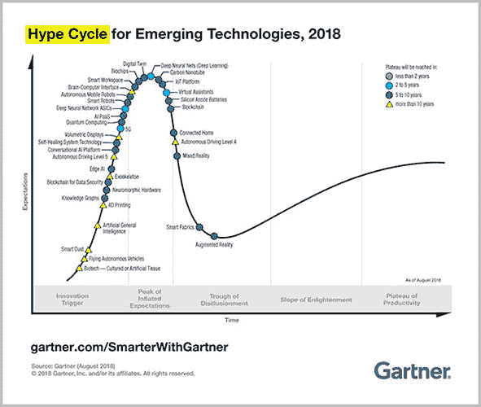

**图 1.1：** 新兴技术

根据领先分析师的说法，以下技术将在未来 5-10 年内成熟：

*   3D 打印

这些技术结合 AI，将对人类产生巨大影响。根据维基百科的定义：“在计算机科学中，AI 有称为机器智能，是指机器表现出与人类等同或无法区分的行为测试。”以下是一些例子：

*   智能音箱 (Alexa)
*   自动驾驶汽车
*   自动车辆


**图 1.2：** AI（来源：Google）

回到达特茅会议，会议后引起了巨大的兴奋，美国政府甚至拨付了资金进行 AI 研究，但它并没有取得突破。在经历了几年的研究后，该项目被搁置——这被称为 AI 寒冬。

原因之一是计算能力的缺乏。随后，对 AI 的兴趣在 90 年代重新复兴。随着云计算和廉价硬件的出现，计算能力的可用性大大增加。此外，大量数据以及通过 Hadoop 等技术处理海量数据的能力进一步推动了 AI 研究。这就像是拼图的碎片各就位一样。

AI 复兴的一个广为人知的事件是 IBM Watson。2011 年，IBM Watson 与游戏节目《危险一答》(Jeopardy!) 的现任人类冠军对决并获胜了。然而，当时 AI 这个术语还没有像现在这样流行，因此 Watson 仅被称为一台超级计算机。但所使用的自然语言处理技术是人工智能的一个重要组成部分。而今天，Watson 自然被称为 AI。

必须指出，这并不是第一次出现机器击败人类的事件。早在 1997 年，一台名为“深蓝”的超级计算机击败了现任象棋世界冠军加里·卡斯帕罗夫（Gary Kasparov）。深蓝也是由 IBM 开发的。


**图 1.3：** IBM 深蓝（**来源：** [www.stream-live-tvchannel.top/ProductDetail.aspx?iid=88929267&pr=40.88](http://www.stream-live-tvchannel.top/ProductDetail.aspx?iid=88929267&pr=40.88)）

然而，不同之处，深蓝实际上只是一台每秒能评估 2 亿个位置的超级计算机。因此，它是暴力破解，而不是任何形式的学习。所以，它不是人工智能。

随后在 2016 年 3 月，由初创公司 Deep Mind 开发的 AI —— AlphaGo 以 4 比 1 的比分击败了现任围棋冠军 `李世石`。这是 AI 领域一个真正的分水岭，即使是 AI 专家也感到震惊。并不是因为他们不相信 AI 能实现这一成就，而是因为它完成得太快了。

Deep Mind 成立于 2013 年，其理念是开发一种能下围棋的 AI，专家们认为实现这一成就至少需要十年，甚至更久。当 AI 在不到四年的时间内实现了这一目标时，他们震惊了。随后，Google 自然地收购了 Deep Mind：

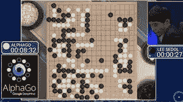

**图 1.4：** DeepMind 的 AlphaGo（**来源：** [`247newsupdate.com/2016/03/12/computer-program-beats-human-master-in-go-game/`](https://247newsupdate.com/2016/03/12/computer-program-beats-human-master-in-go-game/)）

这是在多个层面的重大成就。首先，围棋与象棋不同，它是一个直觉的游戏，而非规则的游戏。正如 `图 1.5` 所示，它有如此多的合法位置：

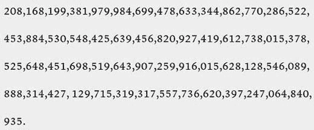

**图 1.5：** 围棋中的合法位置数量

为了方便理解背景，这超过了整个宇宙中的原子数量——是的，是整个宇宙，而不只是地球。

所以，没有任何人能为此编写一个程序。那么，Deep Mind 是如何做到的？他们使用了一种名为 `强化学习` 的技术，这是深度学习的一种。在这种技术中，系统通过反复玩游戏来学习，可能玩了数百万次，每次都从自己的错误中学习并改进自己。

这可能是机器在某种意义上第一次表现出直觉迹象！

AI 世界的另一个重大事件发生在 2017 年 11 月 4 日。沙特阿拉伯授予了一个名为 `Sophia` 的类人形机器人公民身份，该机器人是由 `Hansen Robotics` 开发的。专家们对 `Sophia` 的能力意见不一——有人甚至认为它是假的；这恰恰说明了人们对 AI 领域的关注程度。


**图 1.6：** Sophia ([`simple.wikipedia.org/wiki/Sophia_(robot)`](https://simple.wikipedia.org/wiki/Sophia_\(robot\)))

# AI 的分类

AI 分为三类，如 `图 1.7` 所示。

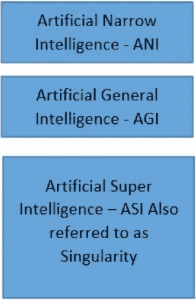

**图 1.7：** AI 的类型

**弱人工智能**（**ANI**），也被称为专家系统，是一个可以执行单项任务但表现远好于人类的系统。如今的 AI，如 AlphaGo 和自动驾驶汽车就属于这一类。

另一方面**超级人工智能**（**ASI**）也被称为奇点，是一个能够超越人类水平的系统。

**通用人工智能**（**AGI**）是一个能够完成任何人类可以完成的任务的系统。我们目前还处于这一阶段的早期。

以下图展示了 AI 的形式：

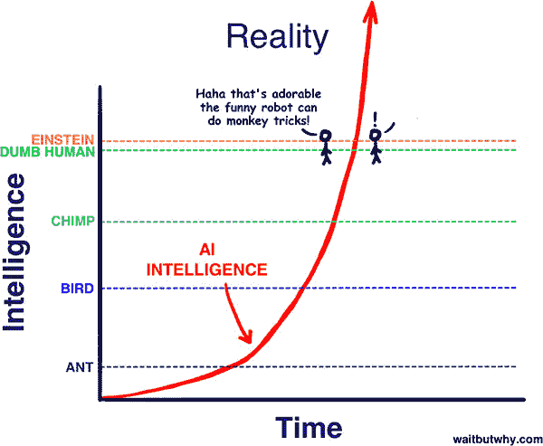

**图 1.8：** 奇点

这在 AI 领域是一个巨大的里程碑。神经网络是 AI 的核心，我们将在后文中详细讨论。

以下图展示了 AI、ML 和 DL 的关系：

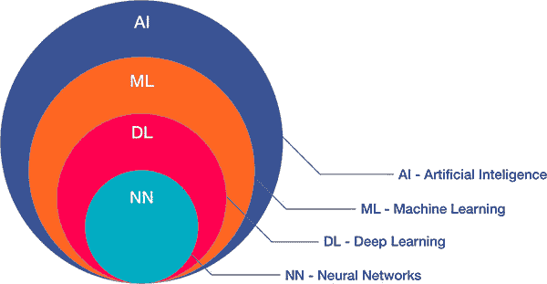

**图 1.9：** AI、ML 和 DL

深度学习是机器学习的一个子集。我们将在下一章讨论机器学习。

# 我们是如何到达这里的？

今天，AI 是数据科学这一领域的一部分。

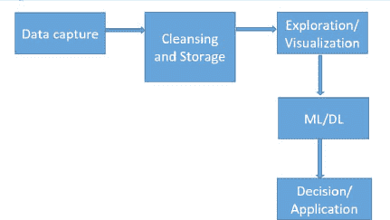

**图 1.10：** 数据科学

一切始于 90 年代开始的信息技术革命，当时我们开始创建和存储数据。最初，软件用于办公自动化——如文字处理、电子表格等，数据以文件形式存储。随后进入了企业自动化时代，出现了用于捕捉订单、管理生产和销售的应用。这是产生大量数据的开始。期间，RDBMS 的概念诞生了。这些系统被称为**在线事务处理**（**OLTP**）。它们非常擅长捕捉数据。然而，当数据增长时，系统性能会变差，大多数 OLTP 系统都是如此。为了维持这些系统的高性能，旧数据从实时数据库中备份并存储在带子上以后检索。这使得对所有数据进行分析变得困难。这产生了数据仓库，被称为**在线分析处理系统**（**OLAP**）。

这些系统能够存储来自不同系统的大量数据，并且查询速度快得多。数据定期从 OLTP 系统传输到 OLAP 系统——通常在每天结束时。这让 OLTP 系统保持轻量化，同时允许你在 OLAP 系统上对历史数据进行分析。这就是*业务分析*的开始。

Hadoop 开发于 21 世纪初，经过多年的发展，已趋于成熟，使我们能够轻松处理 TB 级的大量数据，包括非结构化数据。与此同时，数据开始以指数级增长。海量数据的可用性促进了机器学习、深度学习和人工智能的复兴。

这就像是 AI 拼图的所有碎片都到位了。廉价硬件可用——包括 GPU、云端按需的海量计算能力以及大量数据。

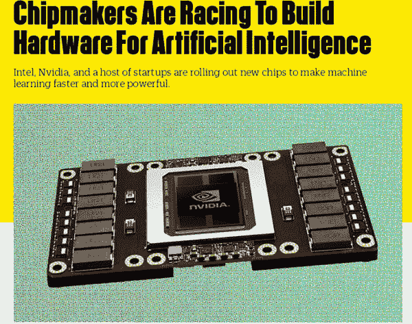

**图 1.14:** 硬件（**来源:** [www.fastcompany.com/3065843/artificial-intelligence-chips-race-nvidia-intel](http://www.fastcompany.com/3065843/artificial-intelligence-chips-race-nvidia-intel)）

这导致了过去几年人工智能的复兴和快速增长。

# 各行业对 AI 的采用

现在我们来看看哪些行业正在快速采用 AI：

*   **医疗保健**：医疗保健是采用 AI 最显著的行业之一。在医疗保健领域，AI 被用于三个主要领域：

    *   **诊断**：医疗诊断涉及分析 X 射线、MRI、CT 扫描等图像，并识别（例如癌症的存在）。例如，`IBM Watson` 已被训练用于检测和预测肺癌。在这些场景中，深度学习模型被训练用于将图像分类为癌性和非癌性。一旦训练完成，这些模型就可以预测新图像中是否存在癌症。该领域仍有许多研究正在进行，以提高预测的准确性。医生正在将这些作为生产力工具，来优先排序并加速诊断过程。截至目前，这些还没有取代医生。

        

        **图 1.15:** 用于医疗的 AI（**来源:** Google）

        失明是世界上面临的另一个大问题。根据`世界卫生组织`（`WHO`）的数据——13 亿的人有某种形式的视力障碍，其中 360 万人失明。虽然某些形式的失明是先天的且无法预防，但许多形式的失明如果及时发现是可以避免的。例如：糖尿病视网膜病。这就是微软和 Google 等公司正在大量研究的地方。

        

        **图 1.16:** 糖尿病视网膜病（**来源:** [www.clinicaladvisor.com/home/topics/diabetes-information-center/fda-approves-ai-device-to-detect-diabetic-retinopathy/](http://www.clinicaladvisor.com/home/topics/diabetes-information-center/fda-approves-ai-device-to-detect-diabetic-retinopathy/)））

    *   **治疗**：将 AI 用于医疗治疗并不广为人知。癌症治疗是一个漫长而痛苦的过程。治疗方案需要经过计划，并且取决于患者的健康史和患者直属家人等因素。在大多数人口没有医疗保险覆盖的国家，成本也是一个因素。这就是 AI 可以用于推荐的地方。例如，印度班加罗尔的曼尼帕医院（Manipal Hospital）采用了 `IBM Watson` 进行癌症治疗。

        

        **图 1.17:** IBM Watson（**来源:** [www.giannibarbacetto.it/wp-content/uploads/2017/03/ibmwatson_logo-1](http://www.giannibarbacetto.it/wp-content/uploads/2017/03/ibmwatson_logo-1)）

*   **机器人手术**：机器人手术或 AI 辅助机器人手术涉及使用机械臂进行手术。机器人手术有几个优点。它们是微创的，因此患者康复更快，住院时间最短。出血量较少，感染风险最低。

        机械臂可以进行远程操作，这意味着外科医生不需要亲临现场，就可以远程进行手术，反过来意味着专家医生可以坐在一个地方在多个地点进行手术。

        

        **图 1.18:** 机器人手术（**来源:** [`www.clinicaladvisor.com/home/topics/diabetes-information-center/fda-approves-ai-device-to-detect-diabetic-retinopathy/`](http://www.clinicaladvisor.com/home/topics/diabetes-information-center/fda-approves-ai-device-to-detect-diabetic-retinopathy/)）

*   **汽车**：自动驾驶车辆或无驾驶汽车已由 `Google` 和 `Tesla` 等几家公司成功测试了数百万英里。它们尚未投入商业部署，但在实验的基础上提供。让我们来看看自动驾驶车辆的功能。

        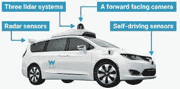

        **图 1.19:** Wymo 自动驾驶汽车（**来源:** [`globalstopics.blogspot.com/2017/10/self-driving-cars`](http://globalstopics.blogspot.com/2017/10/self-driving-cars)）

        自动驾驶车辆配备了一整套设备。顶部安装了 `Lidar`（激光雷达），它可以提供车辆周围障碍物的 360 度视角。`Lidar` 的功能与 `Radar`（雷达）类似，但它使用激光而不是无线波。

        

        **图 1.20:** 激光雷达（**来源:** [www.powerelectronics.com/digital-power-combined-with-gan-heads-towards-99-efficiency/](http://www.powerelectronics.com/digital-power-combined-with-gan-heads-towards-99-efficiency/)）

        此外，前后的后方还有其他 `radars` 来检测即时障碍。多个摄像头提供视频流，由车载 AI 系统实时分析。它拥有 `GPS` 系统来提供位置信息，并有地图来确定路线。经过训练的车载 `Neural Network` 模型处理来自各种传感器的输入，并做出诸如刹车、加速或左转等决策。

        例如，通过前方摄像头的视频流，车载 AI 能够检测交通灯的红绿，并决定停止还是前进。或者如果它检测到路径上有障碍，它会刹车等等。

*   **零售**：零售业是 AI 和 `ML` 的早期采用者。零售行业是最早在其电子商务网站和 App 上采用推荐引擎的行业。如今流程中的多个领域都采用了 AI——从仓库到使用无人机送货。

        机器人进行仓库管理。

        

        **图 1.21:** 仓库机器人（**来源:** [www.istockphoto.com/photos/warehouse-robot](http://www.istockphoto.com/photos/warehouse-robot)）

        零售机构需要维护大型仓库以实现快速高效的履约。管理这些仓库是一项极其复杂的任务。过去，有由 `SAP` 等公司开发的仓库管理软件，但实施此类软件也极其困难。

        如今，AI 以机器人的形式应用于这些仓库，特别是在订单履行方面。这大大缩短了包装时间。以前仓库员工必须手动在货架之间移动，以组合订单物品并进行包装。现在有了这些机器人，员工只需留在原地，召唤包含订单物品的货架。机器人搬运货架。它们是自主的，在仓库中移动时不会与其他机器人或路径上的其他障碍物碰撞。

除了仓库之外，零售行业也在实体店模式中采用 AI。亚马逊引入了名为 `AmazonGo` 的无人实体零售店。客户只需进入店内，挑选他们需要的物品然后离开即可。这些物品将被自动检测，客户将在在线上被相应的费用。他们使用计算机视觉、传感器技术和深度学习来实现这一目标。


零售行业还在采用无人机配送来缩短配送时间。如今，在线订购产品（外卖配送除外）的平均配送时间为 24 小时，因为配送主要由快递公司完成。这正是亚马逊等这样的公司正在探索使用无人机进行配送的地方。这可能会将配送时间缩短到几小时，甚至是几分钟。

*   **制造业**：制造业是流水线机器人的早期采用者之一。然而，这些都是没有 AI 的机电可编程机器人。如今，支持 AI 的机器人已用于车间。这些机器人可以自主地观察和移动。此外，它们还可以团队协作工作。这极大地提高了效率。

## 结论

还有许多其他行业，如金融服务、房地产和能源，AI 正在被快速采用。在十年内，许多此类应用将变得常态化并商品化。

这带我们来到了本介绍性章节的结束。在下一章中，我们将进入人工智能的技术层面，从机器学习开始。

## 记忆要点

*   AI 是领先的新兴技术之一。
*   AI 以及如 `5G`、`IoT` 和 `BlockChain` 等其他新兴技术，将在未来 5–10 年内改变我们的生活。
*   AI 已经到来，我们看到每个行业都在快速采纳 AI。

# 第 2 章：机器学习

## 引言

机器学习是一个广泛的话题，详细介绍超出了本书的范围。然而，理解机器学习的基本原理对于深度学习至关重要，因此这正是本章涵盖的内容。如果你想深入研究机器学习，获取市面上几本机器学习书籍之一可能是一个好主意。

在本章中，我们将采取实践方法。我们将涵盖理解深度学习至关重要的机器学习基础。我们将通过代码示例进行实操，而不是详细介绍理论。

如果你已经熟悉并曾使用 `Python` 和 `scikit-learn` 在机器学习方面做过工作，你可以选择跳过本章。

## 结构

在本章中，将涵盖以下主题：

## 目标

在学习本章后，你将能够：

## 定义机器学习

机器学习是教导机器在没有显式编码的情况下执行任务的技术。当然，有几种定义。这里是其中一种：机器学习（`ML`）是对算法和统计科学科学，计算机系统使用这些模型并依赖模式和推理来有效地执行特定任务。机器学习的定义有时会让人困惑。正如它所说，没有显式编程，但我们必须在 `Python` 或 `Java` 中编写程序来实现 `ML`。这里的关键非常重要。通常情况下，`ML` 具有以下主要组件：

让我们举一个简单的例子来说明这一点。如果你需要教你的系统识别苹果，传统的做法是让它识别（注：此处原文似乎有重复，翻译按逻辑处理）。

（注：原文在定义段落中存在大量重复词汇和逻辑断层，翻译时已根据语意进行了平滑处理，以确保中文通顺。）

这是一个带有连续值标签数据的示例。因此，我们无法对其进行分类，但可以使用回归来构建预测模型，以预测房产的价格：

| 房间 | 卧室 | 人口 | 家庭 | 收入 | 价格/目标 |
| --- | --- | --- | --- | --- | --- |
| 880 | 129 | 322 | 126 | 8.3252 | 452,600 |
| 7099 | 1106 | 2401 | 1138 | 8.3014 | 358,500 |
| 1467 | 190 | 496 | 177 | 7.2574 | 352,100 |
| 1274 | 235 | 558 | 219 | 5.6431 | 341,300 |
| 1627 | 280 | 565 | 259 | 3.8462 | 342,200 |
| 919 | 213 | 413 | 193 | 4.0368 | 269,700 |
| 2535 | 489 | 1094 | 514 | 3.6591 | 299,200 |
| 3104 | 687 | 1157 | 647 | 3.12 | 241,400 |
| 2555 | 665 | 1206 | 595 | 2.0804 | 226,700 |
| 3549 | 707 | 1551 | 714 | 3.6912 | 261,100 |
| 2202 | 434 | 910 | 402 | 3.2031 | 281,500 |

**表 2.3:** 带有连续值的标签

如果目标是离散的，例如是/否、垃圾邮件/非垃圾邮件或猫、狗等，则使用分类，如下例所示：

| 血糖 | 舒张压 | 胰岛素 | BMI | 年龄（年） | 糖尿病/目标 |
| --- | --- | --- | --- | --- | --- |
| 148 | 72 | 0 | 33.6 | 50 | 是 |
| 85 | 66 | 0 | 26.6 | 31 | 否 |
| 183 | 64 | 0 | 23.3 | 32 | 是 |
| 89 | 66 | 94 | 28.1 | 21 | 否 |
| 137 | 40 | 168 | 43.1 | 33 | 是 |
| 116 | 74 | 0 | 25.6 | 30 | 否 |
| 78 | 50 | 88 | 31 | 26 | 是 |
| 115 | 0 | 0 | 35.3 | 29 | 否 |
| 197 | 70 | 543 | 30.5 | 53 | 是 |
| 125 | 96 | 0 | 0 | 54 | 是 |
| 110 | 92 | 0 | 37.6 | 30 | 否 |
| 168 | 74 | 0 | 38 | 34 | 是 |
| 139 | 80 | 0 | 27.1 | 57 | 否 |

**表 2.4:** 离散值的标签

在无监督学习的情况下，使用的技术被称为聚类，我们稍后会看到。这些内容总结在下图中：


**图 2.1:** 学习类型

## 设置环境

在进入算法细节之前，先设置环境是一个好主意，因为算法将通过实操示例进行解释。你可以通过两种方式开始编码部分——设置自己的本地环境或使用像 Google Colab 这样的云环境。建议设置自己的环境，这样你就可以持续工作而不受互联网限制。我们在这里提到了这两种方法。

### 使用 Google Colab

确保你有一个 Google 账号（如 Gmail），并确保在开始之前登录账号。使用以下 URL 或直接搜索 Google Colab 来访问 Google Colab：https://colab.google.com/。可能会看到如下屏幕；你可以点击 `Cancel`：


**图 2.2:** 启动 Google Colab

你可以看到欢迎界面：


**图 2.3:** 欢迎界面

现在执行以下步骤：

1. 从菜单中选择 `File` | `New Python 3 notebook`。
2. 好了！你准备好开始编码了。
3. 只输入：`print("Hello world")` 并按下 `Shift` + `Enter`。这会在下一行打印 `Hello world`。

#### 在 Python 中设置本地环境

在本地设置 Python 环境的最佳方法是使用 Anaconda。它是一个带有易用界面的 Python 分发版。按照这里提供的步骤设置环境。

#### 前提条件

笔记本电脑内存至少 4 GB，Intel i5 或同等处理器，配备 Windows 7 或更高版本。也可以使用 MacOS、Ubuntu 等操作系统，但为了简单，我们在这里只提供 Windows 的说明。互联网连接——至少 2 MBPS。因此，执行以下步骤：

1. 从 Anaconda 网站安装 Anaconda：https://www.anaconda.com/distribution/


**图 2.4:** 选择 Python 3.7

2. 选择 Python 3.7 版本。这将开始下载安装文件。下载，双击此文件开始安装。这可能需要一段时间时间，取决于你的互联网连接。
3. 安装完成后，你可以在 Windows 开始菜单中看到 Anaconda Navigator。打开 `Anaconda Navigator` 并选择 `Environments`。默认情况下，会创建一个包含 Python 的基础环境：


**图 2.5:** Anaconda Navigator 首页

4. 为你的学习或项目创建一个新环境是一个好主意。
5. 使用左下角的 `create` 按钮创建一个新环境。选择 `Python 3.7` 版本并给出一个有意义的名字如 `TensorFlow`。这可能需要一段时间，取决于你的互联网连接。


**图 2.6:** 创建新环境

6. 完成后，选择此环境，如图 2.7 所示。使用右侧的按钮安装额外的库如 `NumPy`、`pandas`、`scikit-learn` 和 `Matplotlib`，如下所示：


**图 2.7:** 选择新环境

7. 安装额外的库如 `NumPy`：


**图 2.8:** 安装 NumPy

8. 现在再安装一个库如 `pandas`：


**图 2.9:** 安装 pandas

9. 接下来安装 `scikit-learn`：


**图 2.10:** 安装 scikit

10. 使用相同的过程安装 `Matplotlib`。
11. 通过选择左侧导航栏上的 `Home` 进入主页。点击 `Install` 安装 Jupyter Notebook（参考图 2.11）。


**图 2.11:** 安装 Jupyter notebook

12. 这完成了安装过程。TensorFlow 的安装步骤将在相应的章节中提供。

安装 TensorFlow 2.x 的步骤将在第 5 章：TensorFlow2.x 中给出。

## 回归算法

当目标是身高、重量、体积、压力等连续变量时，就会进行回归。让我们从最基础的机器学习算法开始：简单线性回归。

简单线性回归是最简单的机器学习算法。正如其名称所示，它是一个线性函数——模型是直线的方程：

`Y = mx + c`

其中 `m` 和 `c` 是模型的参数。`Y` 被称为因变量，而 `X` 被称为**自变量**。在简单线性回归中，只有一个自变量或特征。如果有多个特征或自变量，则被称为多元线性回归（多元回归）。

训练完成后，该模型用于根据给定的 `x` 值预测 `Y` 的值。让我们来看一个例子。下面给出了总成本和物品数量的训练数据。假设销售者对所售的物品提供随机折扣，通常情况下，物品数量越多，折扣越高——但折扣金额并不是固定或一致的。目前面临的问题是开发一个线性回归模型，以便根据物品数量（`x`）预测出总成本：

| **物品数量 (*x*)** | **总成本 (*Y*)** |
| --- | --- |
| 40 | 300 |
| 20 | 170 |
| 10 | 90 |
| 50 | 450 |
| 100 | 800 |
| 35 | 320 |
| 24 | 210 |
| 20 | 190 |
| 20 | 180 |
| 30 | 270 |
| 40 | 360 |
| 50 | 400 |
| 30 | 100 |
| 45 | 400 |
| 30 | 270 |
| 10 | 95 |
| 20 | 180 |
| 30 | 280 |
| 25 | 230 |
| 49 | 460 |
| 57 | 470 |
| 67 | 570 |

**表 2.5:** 数据

如果绘制一个基础散点图，它看起来像图 2.19。从视觉上可以看出，物品数量与总成本之间存在线性相关关系，但同时，数据并不是共线的，也就是说，不在同一条直线上。因此，可能存在多条直线。这就是简单线性回归的挑战，即找到一条在预测时产生误差最小的直线：

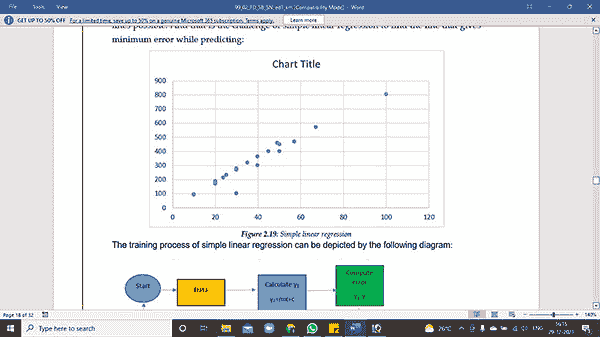

**图 2.19:** 简单线性回归

简单线性回归的训练可以通过图表示：


**图 2.20:** 训练过程

在模型训练过程中，模型的参数——`m` 和 `c` 初始化为某些随机值。根据给定的 `x` 值计算输出（`y1`）（即 `predicted`）。然后将输出与已知值/标签（`y`）进行比较，并计算误差。更新参数值并重复该过程。通过迭代执行此操作以减少误差。换句话说，训练过程在每次迭代中尝试拟合一条直线并计算误差。虽然目标是使误差降为零，但并非总是可能的。因此，误差最小化是可以尽可能实现的。在训练过程结束，确定了*最佳拟合线*以及参数 `m` 和 `c`。

## 代码演示

在这个演示中，我们将使用 Python 和 scikit-learn 在数据集上训练一个线性回归模型。代码大致分为以下三个部分：

1. 导入库。
2. 加载数据。
3. 训练模型。

以下是代码：

1. 导入库：

   

   **图 2.1:** 导入库

2. 使用 `pandas` 加载数据。数据命名为 `data`：

   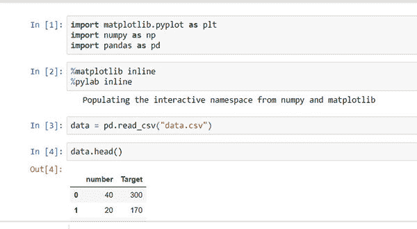

   **图 2.2:** 加载数据

3. 使用散点图可视化数据。从图中所示，`x` 和 `y` 之间存在相关性：

   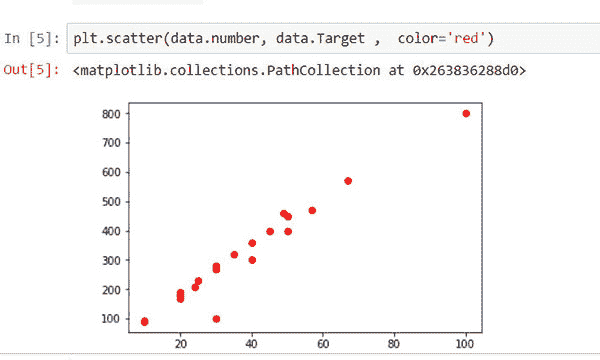

   **图 2.3:** 散点图

4. 为模型准备训练数据。我们将数据拆分为 `x` 和 `y`：

   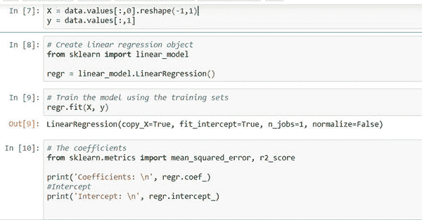

   **图 2.4:** 准备数据

5. 从 `sklearn` 实例化线性回归模型。使用 `fit` 方法通过 `x` 训练模型：

   

   **图 2.5:** fit 方法

现在我们已经有了训练好的模型，可以计算最佳拟合线的系数 `m` 和 `c`：

   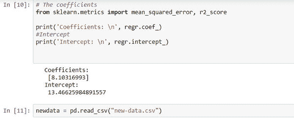

   **图 2.6:** 打印系数

7. 使用我们训练模型的 `predict` 函数来预测新值 `newdata`：

   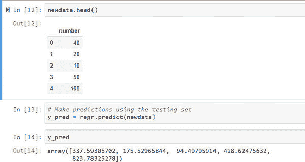

   **图 2.7:** 预测方法

沿着最佳拟合线绘制新值：

   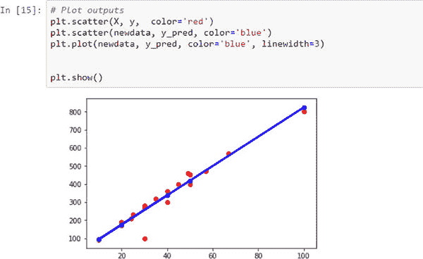

   **图 2.8:** 绘图

## 多元线性回归

多元线性回归在某种程度上是简单线性回归的扩展。在简单线性回归中只有一个特征。当有多个特征时，我们使用多元线性回归。

在这个例子中，我们使用房地产数据来构建预测模型。我们构建一个回归模型并找到其准确性：

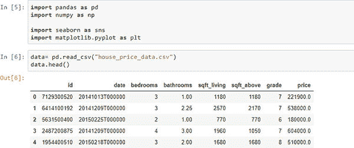

**图 2.9:** 多元模型

导入所需的库——`numpy`、`pandas` 和 `seaborn`。使用 `pandas` 加载数据：


**图 3:** 加载数据

这包含八列，其中七个特征和一个目标。`Price` 是目标。我们将根据给定的特征来预测价格。显然，并不是所有列都可以作为特征。例如，`id` 只是记录的唯一标识符，对价格没有影响。作为数据科学家，你需要决定哪些特征应该用于构建模型。这被称为**特征选择**。通常这是根据经验和领域知识完成的。在这个特定的示例中，我们考虑以下列作为特征：Bedrooms, bathrooms, sqft_living, sqft_above, grade

我们将数据框拆分为两个部分，特征（`x`）和目标（`y`）：

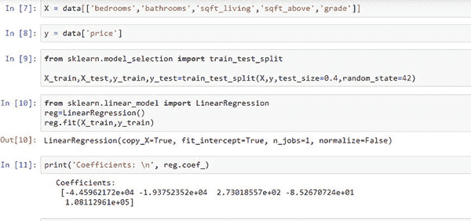

**图 3.1:** 数据框

在训练模型之前，需要将数据分为两部分：训练集和测试。训练集用于训练模型，测试集用于测试准确性。scikit-learn 提供了一个非常有用的函数 `train_test_split` 来按指定的比例拆分数据。通常，训练测试划分比例为 60:40 或 70:30，并以小数形式提供给函数。例如，在这种情况下，我们通过设置参数 `test_size = 0.4` 将数据按 60:40 的比例拆分：


**图 3.2:** 数据拆分

函数调用 `fit` 使用训练数据集来训练模型，该数据集作为参数传递：


**图 2.34:** 训练模型

现在模型已经训练完成，我们使用测试数据集衡量模型的准确率：

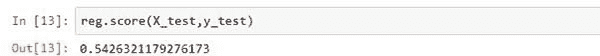

**图 2.35:** 模型评估

可以通过调用 `score` 方法来衡量准确率，该方法接受测试数据作为参数。在下一节中，我们将以分类为例例，并尝试应用各种分类算法。

## 逻辑回归

逻辑回归主要是一种二分类算法，即它被用于将数据分为两类。当然，通过稍作调整，它也可以用于多分类分类。

在这个示例中，我们将学习构建一个分类器，用于预测学生是否能获得大学录取。这是基于训练数据的，这些数据包含特征：GRE 分数、托福分数、大学排名等。`Admit` 是一个具有二值（0 或 1）的 `Target`（目标）。

1 表示学生被录取，0 表示没有。逻辑回归使用 sigmoid 函数来执行分类。sigmoid 函数的数学表达式如下：

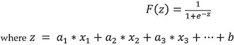

`a1`、`a2`……以及 `b` 是可训练的系数，模型将在训练过程中不断调整这些系数。让我们来看代码：

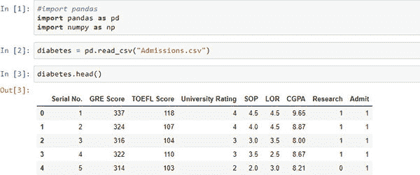

**图 2.36:** 导入数据

使用 `pandas` 将数据读入数据框（data frame）：

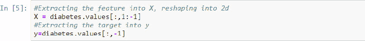

**图 2.37:** 数据准备

将数据框拆分为特征 (`x`) 和目标 (`y`)。将数据拆分为训练集（75%）和测试集（25%）：

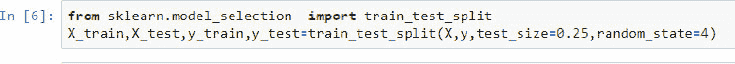

**图 2.38:** 分割数据

与线性回归一样，`scikit-learn` 中也提供了逻辑回归的实现。创建一个逻辑回归实例，并通过传递训练数据使用 `fit` 方法训练模型：


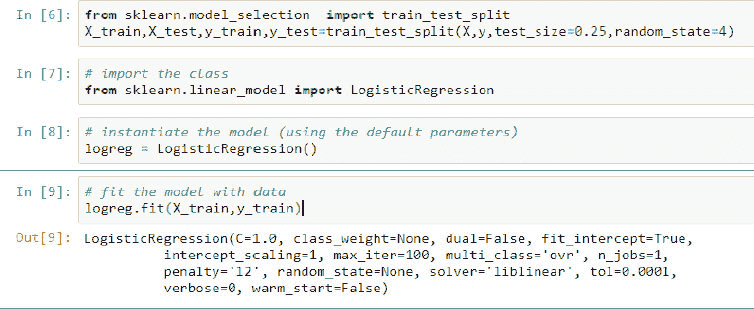

**图 2.39:** 逻辑回归

一旦训练完成，将使用 `predict` 方法配合测试数据对模型进行测试。

在分类情况下，混淆矩阵是理解模型准确性的一个很好的可视化工具。`scikit-learn` 提供了一个可用函数来创建混淆矩阵。它接受测试数据的标签 (`y_test`) 和预测值 (`y_pred`)。

混淆矩阵中所有数字的和等于测试数据中的观测数量。例如，在我们的案例中，总共有 125 个观测。

对角线值之和是预测正确的值。在这种情况下，该数值为 119，这意味着有 6 (5+1) 个观测被分类错误。因此，准确率为 119/125 = 0.952 或 95.2%：

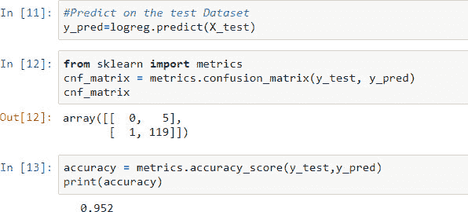

**图 2.40:** 模型性能

对混淆矩阵的详细讨论超出了本文范围，但足以说它是分类中一种强大的视觉工具，我们稍后使用神经网络进行分类时也会使用它。

准确率也可以通过 `metrics.accuracy_score` 方法并传递测试标签和预测值作为参数来计算。输出结果与之前相同：95.2%。

这将适用于神经网络。

## 决策树

决策树是一种非常流行的机器学习算法，可同时用于分类和回归，但主要用于分类。它之所以流行是因为易于理解且具有强大的可视化能力。

让我们举一个例子来看代码。在这个演示中，我们将使用决策树算法来构建并训练一个对潜在客户进行分类的模型：

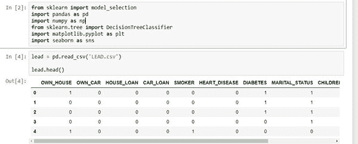

**图 2.41:** 决策树算法

在导入所需的库后，我们将数据 (`LEAD.csv`) 加载到 `pandas` 数据框中。快速检查显示数据中的列。`PURCHASE` 是目标，因此我们创建一个新的数据框 (`x`)。

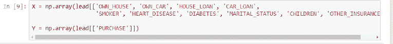

**图 2.42:** 特征选择

`scikit-learn` 中提供了决策树的实现。我们通过传递参数 `criterion="entropy"` 创建 `DecisionTreeClassifier` 实例。该参数的另一个选项是 `gini`，它是默认值。

数据被拆分为训练集（75%）和测试集（25%）。下一步是将数据拆分为不同的集合：

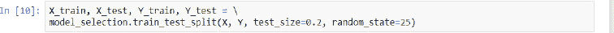

**图 2.43:** 分割数据

与逻辑回归类似，`scikit-learn` 提供了逻辑回归的实现。我们调用 `fit` 方法训练模型。使用 `DecisionTree.Score` 并传递测试数据衡量模型的准确率：

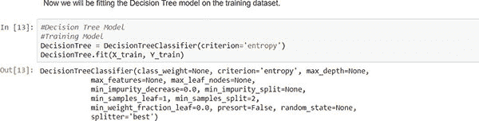

**图 2.44:** 模型评估

在这种情况下，准确率为 99%。

## 支持向量机 (SVM)

支持向量机可用于分类和回归。在这个演示中，我们将使用它进行分类。数据集包含个人的高度和体重，但没有标签。

## 无监督学习

聚类是在数据没有标签时使用的技术。常见的聚类类型有两种：

在这个演示中，我们将使用 k-means 聚类来理解它的工作原理。K-means 中的 `K` 代表簇的数量，这必须由我们定义。从技术上讲，`K` 的值可以从 1 一直到观测数量。但为了获得有意义的见解，簇的数量通常很小，例如 3 或 5。一旦定义了数量，算法就会寻找数据点之间的相似性并创建相似的数据簇。

现在让我们查看演示代码。与监督学习不同，这里不需要分离特征和标签，因为没有标签。唯一的数据准备是使用 `StandardScaler` 对数据进行标准化。这将确保所有特征具有统一的范围：

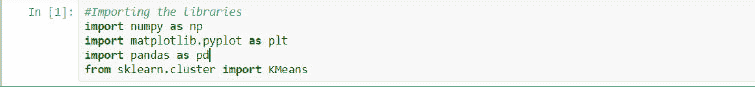

**图 2.46:** 导入数据集

让我们导入数据集并查看数据集的前几条记录：

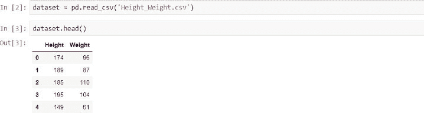

**图 2.47:** 加载数据

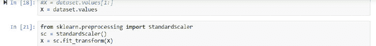

**图 2.48:** 数据值

我们通过调用 `KMeans` 函数并传递 `K` 的值（即簇的数量）来运行 K-means 算法：

现在问题是如何确定 `k` 的值（即聚类数量）。这不应该与分类混淆。在分类中，类别的数量是已知的，因为我们有类别的标签。但在聚类中，我们并不知道正确的簇数量应该是多少。从技术上讲，数据可以分成任意数量的簇（即 `K` 可以取任何值）。但在实践中，这将是没有意义的。

有一种被称为“肘部法”（elbow technique）的技术，用于确定 `k` 的最优值。这个名字源于 `wcss` 与簇数量之间绘图所示的形状。

衡量模型性能的方法之一是 `wcss` —— 簇内平方和（within-cluster sum of squares）的缩写。它是簇中每个点到其质心距离的平方和。这个数值越小越好。数值越小，意味着簇中的项目越相似。`wcss` 的值随着 `k` 的值而变化。当这些值被绘制成图时，图表呈现出弯曲手肘的形状：

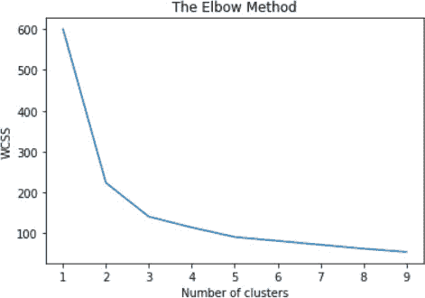

**图 2.51:** 肘部法

对于某个特定的 `k` 值，`wcss` 值趋于平缓。这就是 `k` 的最优值。为了实现这一点，我们为 `k` 创建了一个从 1 到 10 或 15 的 `for` 循环，计算 `wcss` 的值并将其绘制：

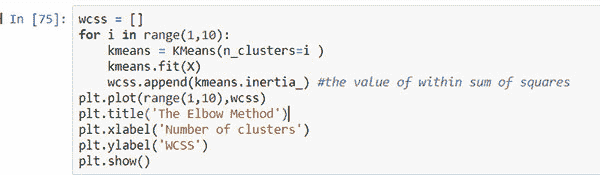

**图 2.52:** wcss 图表

从图中可以看出，最优值 `k =4`：

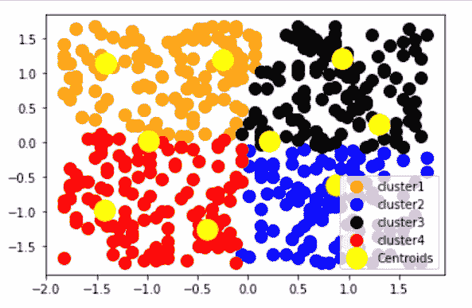

**图 2.53:** 聚类图，k=4

此功能的代码可以在 GitHub 上找到。

到目前为止，这就是你对机器学习和 scikit-learn 所需要了解全部全部了。当我们谈论深度学习时，这些概念中的许多将被重复使用。我们还会复用一些代码，特别是 `accuracy_score`、`train_test_split` 和 `confusion_matrix` 方法。

## 结论

这标志着我们关于机器学习章节的结束。掌握了这些机器学习的基础知识，你将在接下来的章节中理解深度学习的概念。对于深度学习，我们将使用 TensorFlow 库。在下一章中，你将学习如何为深度学习安装和设置 TensorFlow 环境。

## 问题

1. 什么是机器学习？

2. 学习的两种主要类型是什么？

3. 回归和分类之间的区别是什么？

4. 写出两种常见的算法。

# 第 3 章

# TensorFlow 编程

## 简介

TensorFlow 是目前最流行的深度学习库。尽管它非常强大并为开发深度学习模型提供了大量的灵活性，但它并不容易学习。在本章中，我们将带你通过一个简单的逐步过程，以很好地理解如何编写程序。我们将采用非常简单的数学示例（这些示例与机器学习无关），帮助你理解 TensorFlow 编程的概念。将有很多简单的代码示例来让整个学习过程变得简单。我们从 TensorFlow 1.X 开始，它是成熟且稳定的版本，并在业界广泛使用，然后转向最近发布的的新版本 TensorFlow 2.x。

## 结构

在本章中将涵盖以下主题：

## 目标

在本章结束时，你将学习如何安装和设置 TensorFlow 1.x 环境，你还将理解使用 TensorFlow 库编写 Python 代码的细微之处，该库以惰性执行模式工作。

## TensorFlow 开发环境

第一步，让我们为 TensorFlow 设置开发环境。拥有 TensorFlow 环境有两种方法：一种是在线，另一种是在你的本地系统上。使用 Google Colab 启动在线环境。在这里，我们将描述使用 Anaconda 在你的本地系统上安装 TensorFlow 的步骤。TensorFlow 需要 Python 作为先决条件。如果你还没有这样做，你必须按照第 2 章“机器学习”中提到的步骤使用 Anaconda 设置本地开发环境。这里是安装 TensorFlow 所需的额外步骤。假设你已经安装了 Python，并在打开 navigator 时创建了名为 TensorFlow 的虚拟环境，当你点击 `Environments` 时，你应该能看到如图 3.1 所示的屏幕。TensorFlow 列列在这里：


**图 3.1:** TensorFlow 环境

如果你没有看到 TensorFlow，请确保在继续后续步骤之前仔细遵循了第 2 章“机器学习”中显示的所有步骤。如果你看到 `tensorflow`，意味着 python 安装成功。以下是安装 TensorFlow 的步骤：

1. 从环境列表中选择 `tensorflow`，你将在右侧看到所有已安装的包：

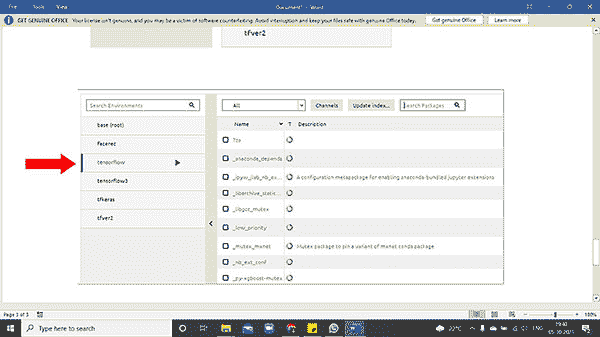

**图 3.2:** 环境中的安装包

2. 从下拉菜单（显示 `All` 的地方）选择 `not installed` 并在搜索框中输入 `TensorFlow`：

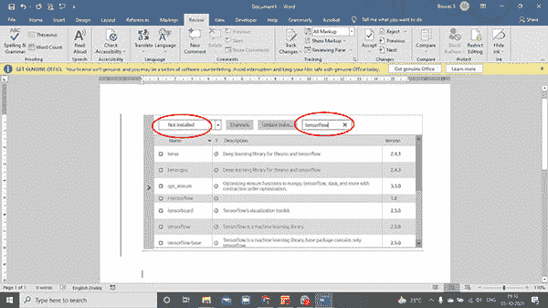

**图 3.3:** 将“all”更改为“not installed”

3. 然后 `TensorFlow` 将高亮：

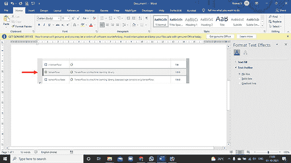

**图 3.4:** 搜索 TensorFlow

4. 然后点击 `Apply`：

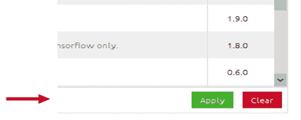

**图 3.5:** 点击“Apply”

5. 注意安装 TensorFlow 2.x 要简单得多，我们稍后会看到。

6. 为了测试安装完成且运行良好，使用以下步骤从命令行提示打开 Jupyter notebook：

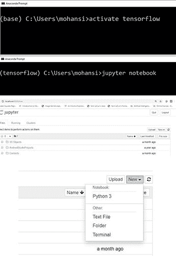

**图 3.6:** 从命令行提示打开 Jupyter notebook

7. 要创建一个笔记本，点击 `New`：

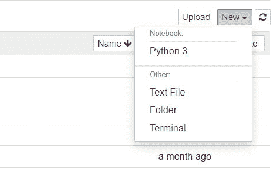

**图 3.7:** 创建笔记本

它打开了如下标签页：


**图 3.8:** 新笔记本标签页

8. 输入 `import TensorFlow as tf` 并执行。

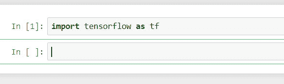

**图 3.9:** 执行 TensorFlow

9. 如果它无错误运行，那么 TensorFlow 安装成功。

10. 要检查 TensorFlow 版本，请输入 `tf.__version__` 并执行。它将打印安装的 TensorFlow 版本：

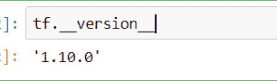

**图 3.10:** 检查 TensorFlow 版本

在这种情况下，它的版本是 1.10.0，但在你的情况下，它将显示你安装的版本。

好了！现在你可以编写代码了。

## TensorFlow TensorFlow

TensorFlow 并不是一种编程语言。它是一个深度学习库。在编写本书时，如图 3.11 所示，是最流行的深度学习库。它最初由 Google 内部一个名为 Google Brain 的团队为内部使用开发，随后被开源。Google Brain 团队负责开发一些酷炫的 Google 应用，如 Google Photos 和 Google Cloud Speech。TensorFlow 1.0 于 2017 年发布，在短时间内它成为了最流行的深度学习库，领先于 Caffe、Theano 和 PyTorch 等其他现有库。它被认为是行业标准，几乎每个在 AI 和深度学习领域开展组织都采用了它。以下是 TensorFlow 的一些关键特性包括：

*   它可以与所有常见的编程语言配合使用，如 Python、Java 和 R。

*   它可以部署在多个平台上，包括 Android 和树莓派。

*   它可以在高度分布模式下运行，因此具有高度的可扩展性。

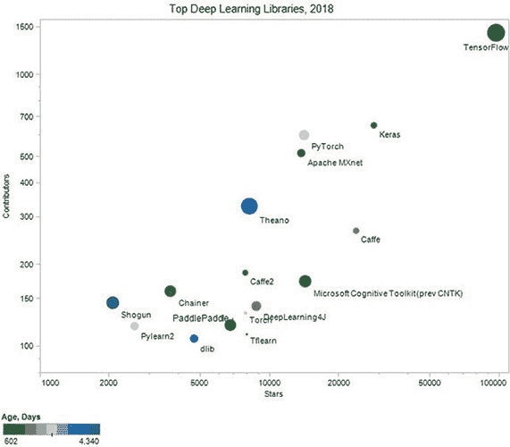

**图 3.11:** 顶级深度学习库（**来源:** [`www.kdnuggets.com/2018/04/top-16-open-source-deep-learning-libraries.html`](https://www.kdnuggets.com/2018/04/top-16-open-source-deep-learning-libraries.html)）

然而，`TensorFlow` 也面临一些挑战。它并不容易，因为它的执行模型（`TF 1.x`）使用了惰性执行模式、图（graphs）和会（sessions）。你可以使用任何常见的编程语言（如 Java、Python 或 R）编写程序，尽管 Python 和 `TensorFlow` 的组合被认为是最强大且最受欢迎的。即使你非常擅长 Python 编程，编写 `TensorFlow` 代码可能完全是另一回事。在本章中，我们将逐步向你介绍这种新的编程范式，并帮助你获得编写 `TensorFlow` 程序的专业知识。在编写本书时，`TensorFlow 2` 刚刚发布，但我们将从 `TF1.x` 开始，这是一个稳定、成熟并在工业界广泛使用的版本，然后转向 `TF2.0`。

需要注意的是，刚开始一切都会很模糊且有些难以理解，这是非常自然的，而且每个人都会遇到这种情况。不要气馁。许多章节是相互依赖的。因此，即使你已经完全理解了，过一遍所有章节也是一个好主意，然后再读一遍。最后，概念与代码示例的结合将帮助你掌握 `TensorFlow` 编程。

让我们让我们开始吧。

`TensorFlow` 包含以下两个主要组件：

*   张量（Tensors）

*   计算图（Flow）

这就是它得名为 `TensorFlow` 的原因。

张量是在运行时存储数据的多维数组：


**图 3.12:** 张量（**来源:** [www.shutterstock.com](http://www.shutterstock.com)）

在 `TensorFlow` 程序内部，每个数据元素都被称为 `Tensor`。张量具有秩（rank）和形状（shape）。张量的秩是一个数字，表示张量具有多少个维度。例如，4 维张量的秩为 4。

张量的形状由数组表示，它指示每个维度上的元素数量。例如，如果一个张量的形状为 `[2,3,5]`，则意味着张量有 3 个维度，第一维的元素数量为 2 个，第二个维度为 3 个，第三个维度为 5 个。我们也可以从形状中获得秩。在这个例子中，张量的秩是 3，因为有 3 个维度。接下来的图进一步说明了这一点：


**图 3.13:** 张量秩和形状的示例

## TensorFlow 程序的元素

我们将从 `TensorFlow 1.x` 开始。编写 TensorFlow 程序的一种特定方法可能并不直观。你首先构建一个计算图并在会（session）中执行该图。由于 `TensorFlow` 是一个库，我们需要在添加任何 TensorFlow 代码之前将其导入 Python 代码中。通过以下代码行实现：

```python
import tensorFlow as tf
```

从那时起，所有的库元素都通过 `TensorFlow` 实例 `tf` 访问。

`TensorFlow` 程序的主要元素如下：

常量、变量和占位符可以被视为不同类型的张量，用于在程序运行时存储数据。这些元素中的每一个创建都会向计算图中添加一个节点。有一个默认的计算图，即在后台创建的，不需要作为代码的一部分显式创建。

## 常量 (Constant)

常量用于存储在程序过程中不会更改或修改的值。创建常量有多种方法，但简单的方法是：

```python
a = tf.constant(10)
```

## 变量 (Variable)

变量用于存储在程序过程中可以修改的值。创建变量有多种方法，但简单的方法是：

```python
b = tf.Variable(20)
```

## 占位符 (Placeholder)

占位符是一种特殊的存储类型，它在创建时不能初始化，只能在运行时填充。在创建占位符时，只需指定数据类型：

```python
p = tf.placeholder(float32)
```

## 会 (Session)

每当你创建一个常量、`Variable` 或占位符时，图中就会添加一个节点。程序不会执行。为了实际执行程序，你需要创建一个会并在其中执行图。会的创建方式如下：

```python
sess = tf.Session()
```

可以使用会的 `run` 函数执行图的特定节点，并将该节点作为参数传递。例如：

```python
myconst = sess.run(a)
```

由于 `a` 被初始化为 10，因此 `myconst` 将具有值 10。

```python
myvar = sess.run(b)
```

现在 `myvar` 将具有值 20，因为我们将 `b` 初始化为 20 了。

## 常量、变量和占位符

在这一节中，我们将看到如何在 `TensorFlow` 中操作常量、变量和占位符。我们将使用一个代码演示来展示这三种存储类型之间的区别。

这些代码演示的笔记本可以在 GitHub 上找到，链接：

让我们先创建一个常量和一个变量：

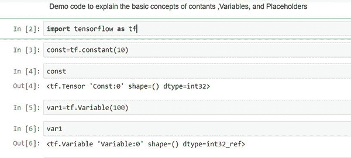

**图 3.15:** 代码演示

常量 `const` 被初始化为 10。当你尝试显示该值时，它只会显示数据类型为 `int32`，而不是实际值。这就是延迟执行（lazy execution）的概念。当你在 Jupyter notebook 中运行这行代码时，它并没有实际执行代码，而是进行语法检查。实际执行发生在会话（session）中；我们稍后就会。

变量也是如此。变量 `var1` 初始化为 100，但当我们尝试显示该值时，它只显示数据类型为 `int32`，而不是值 100。

为了显示这些值，我们在会话中执行了这些节点，我们稍后就会。

到目前为止，我们做的是构建计算图。让我们通过添加更多计算来继续构建它：

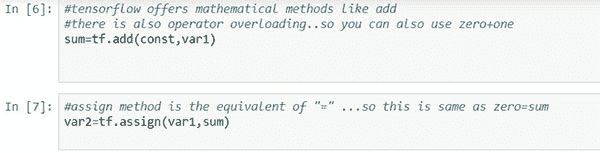

**图 3.16:** 构建计算图

在单元 6 中，我们创建了一个名为 `sum` 的节点，它使用 TensorFlow 提供的 `add` 方法对 `const` 和 `var1` 求和。在单元 7 中，我们创建了另一个节点，将 `sum` 中的值赋值给 `var1`。

在单元 8 中，当我们尝试将 `sum` 赋值给 `const` 时，它会报错。为什么？因为你不能修改常量（请参考 *图 3.17*）：


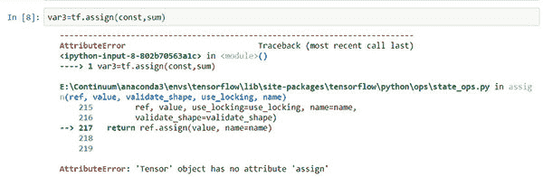

**图 3.17:** 常量的错误

现在计算图已经准备就绪，让我们在会话中执行这些节点。在此之前，我们必须再创建一个节点，用于初始化变量：

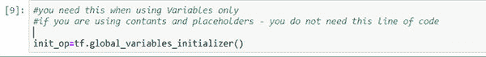

**图 3.18:** 变量初始化

每当我们在代码中使用变量时，我们必须创建此节点/操作，并在执行任何其他节点之前在会话中执行它。这仅在我们使用变量时才需要。如果我们只使用常量或占位符（`placeholder`），则不需要进行此初始化。

现在，让我们创建会话：


**图 3.19:** 创建会话

第一步，我们运行初始化操作：

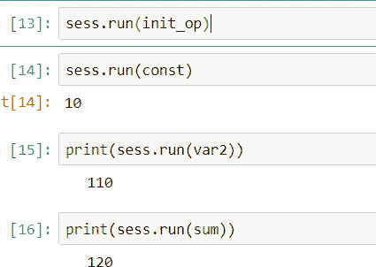

**图 3.20:** 初始化

然后运行其他节点：


**图 3.21:** 运行节点 `const`

在会话中执行节点 `const` 实际上是将值 10 赋值给 `const`，然后显示该值。我们也可以显式地使用 `print` 函数来打印 `var1` 和 `sum` 的值，如下：

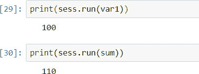

**图 3.22:** `print` 函数

这是一个处理常量和变量的很好的例子。接下来，让我们看看占位符是如何运作的。

让我们创建一个占位符 `a`：


**图 3.23:** 创建占位符

尽管 `a` 中没有值，但你也可以像普通变量一样对待它并对其进行计算。例如，你可以创建一个结果为 `a*2` 的节点 `b`。

然而，当你尝试在会话中执行此节点时，你会得到一个错误：


**图 3.24:** 占位符节点

这是因为你需要在会话中运行它时填充占位符。在会话中执行占位符有特定的方法。我们必须在运行时使用名为 `feed_dict`（feed 字典的缩写）的参数向占位符“喂入”值。执行占位符的语法如下：


**图 3.25:** 为占位符喂入值

你以字典的形式传递占位符的值。在这种情况下，我们为占位符 `a` 喂入了 3.0。注意，当我们想要执行包含 `a` 的 `b` 时，我们必须再次喂入 `a`。

所以，每当你执行包含占位符的节点时，你都必须喂入占位符。如果一个节点中有多个占位符，你必须在执行时提供所有的占位符。

这是另一个例子：


**图 3.26:** 执行所有占位符

注意，这些值并没有被存储。它们被用于计算然后被丢弃。因此，如果你尝试直接打印 `pl1` 或 `pl2` 的值，它会再次报错：


**图 3.27:** 执行占位符时的错误

你必须在会话运行时喂入占位符，并且每次都需要运行它。然而，喂入占位符有不同的方法。让我们来看看这些变体。首先，我们传递的值不需要是普通的数字（标量）；它们可以是数组或多维数组。这里是一些例子：


**图 3.28:** `feed_dict`

你也可以提前准备字典并像示例所示在会话中使用它：


**图 3.29:** 字典准备

你可能已经在 Jupyter notebook 文件中见过这种情况。虽然关闭会话（`session`）可能不会报错，但如果你并行运行多个 Jupyter notebooks，可能会导致问题。每次创建一个会话，都会为其分配某些资源。当你关闭会话时，这些资源会被释放。

避免这种情况的一种方法是在 `with` 块中创建并使用会话。这是一种更专业的代码写法。以下是使用 `with` 块的 `Hello World` 代码：


**图 3.40:** 使用 `with` 打印 "Hello world" 的代码

会话在 `with` 块中创建，并在 `with` 块内有效。一旦我们退出 `with` 块，会话就会自动关闭。因此，我们不需要执行显式的会话关闭。

希望到这里，你已经很好地掌握了 TensorFlow 程序的编写和执行。在继续之前，让我们来看另一个真实世界的例子。在这个例子中，我们将实现运动方程：

```
s = u*t + (1/2)*a*t**2
```

我们将针对 `u=50` m/s、`a=40` m/s**2 进行计算，`t` 需要在运行时从用户端请求。

这就是我们创建计算图并准备数据的方式：


**图 3.41:** 创建计算图并准备数据

然后在 `with` 块中的会话中执行图：


**图 3.42:** 执行图

注意 `u` 和 `a` 被创建为常量，而不是变量或占位符，因为在这种情况下它们的值不会改变。

让我们在下一节中看看如何使用 TensorFlow 执行一些线性代数运算。

## 使用 TensorFlow 进行线性代数

在神经网络中，最重要的线性代数函数是矩阵乘法。在本节中，我们将首先解释矩阵乘法的工作原理，然后使用 TensorFlow 的内置函数解决一些矩阵乘法示例。这对于准备下一章节的神经网络内容至关重要。

### 矩阵乘法是如何工作的？

你可能在高中阶段学习过这些内容，但让我们来快速回顾一下。

让我们来看一个简单的例子。如果我们要在两个矩阵 `A` 和 `B` 之间进行矩阵乘法，其中，


第一步是检查这是否可行。矩阵乘法有一个先决条件。记住 `C=R`；即第一个矩阵的列数（`C`）应该等于第二个矩阵的行数（`R`）。

记住，这里的顺序很重要。`A×B` 不等于 `B×A`。

在这个特定的例子中，`C=3` 且 `R=3`。因此，乘法是可能的。

结果矩阵的行数等于 `A` 的行数，列数等于 `B` 的列数。

因此，在这种情况下，结果矩阵将是 2×2。你取 `A` 第一行的元素和 `B` 第一列的元素：


得到元素级乘积的和，即 `(1×7)+(2×9)+(3×11) = 58`。

这将是 2×2 结果矩阵的第一个元素：


对 `A` 的第一行和 `B` 的第二列重复此操作：

`AR[1] = [1 2 3]`

`BC[2] =`


得到对应元素乘积的和，即 `(1×8)+(2×10)+(3×12) = 64`

这将是结果矩阵的第二个元素：


对第二行重复相同的操作以得到最终结果：


TensorFlow 提供了一个名为 `matmul` 的方法来执行矩阵乘法。让我们在 TensorFlow 中执行前面的示例：


**图 3.43:** 初始化矩阵值

注意矩阵是如何创建的。为了确保它们被正确创建，我们会在会话中执行节点 `X` 和 `Y` 以便打印和可视化：


**图 3.44:** 打印矩阵

我们看到矩阵被正确创建。我们通过调用 `matmul()` 方法并传递参数 `A` 和 `B` 来执行矩阵乘法：


**图 3.45:** 使用 `matmul` 执行 `A×B`

我们可以执行 `B×A` 并看到结果是不同的：


**图 3.46:** 使用 `matmul` 执行 `B×A`

顺便，让我们尝试一下 TensorFlow 提供的其他张量相关功能，如 `shape` 和 `reshape`。为了找到张量的形状，我们像这样调用张量的 `shape` 属性：


**图 3.47:** 矩阵的形状

现在你已经对 TensorFlow 编程的工作原理有了良好的了解，通常，让我们看看如何在机器学习中应用它，特别是在训练模型方面。为此，我们将采用最基础的机器学习算法——简单线性回归，它最简单的形式表示为如下所示的直线方程：

`Y = w*X + b`

对于给定的数据集，训练该模型意味着——找到 `w` 和 `b` 的正确值。

实现此点的方法一种是使用暴力法，尝试 `w` 和 `b` 的所有可能值。这些也被称为可训练参数。让我们编写这部分代码：


**图 3.58:** 可训练参数的代码

我们首先初始化变量 `w` 和 `b` 为某些随机值（0.2 和 –.2）：


**图 3.59:** `x` 和 `y` 的占位符

我们为训练数据创建占位符 `x` 和 `y`。`X` 是特征，`y` 是标签/目标：


**图 3.60:** 定义线性模型

然后我们定义模型。请记住，我们首先是在创建计算图，然后在会话中执行它：


**图 3.61:** 损失函数

接下来，我们创建误差或损失函数。第 5 单元格需要额外的解释。

`Linear_model` 是预测值。也就是说，在训练过程中，我们传递 `x` 的值，并由模型预测输出。注意，标签不是 `y`。这是预测值。因此，预测值（`linear_model`）与 `y`（标签）之间的差异就产生了误差。

根据预测值是否大于标签值或反之，该误差可以是正值或负值。`tf.square()` 对误差进行平方，使所有值都变为正数。

下一行仅仅是所有这些平方值的和。不要被方法名 `reduce_sum` 误导。`tf.reduce_sum`（平方后）提供了数据集误差的平方和：


**图 3.62:** 会话 (`Session`)

在创建图之后，我们创建会话并在会话执行图之前初始化变量：


**图 3.63:** 初始化变量

这一行是图的实际执行。让我们花点时间理解它。

我们执行的节点是 `loss`，它是节点平方的函数，而该节点反过来又是 `linear_model` 和 `y` 的函数。`linear_model` 又依赖于 `x`。因此，`loss` 依赖于 `x` 和 `y`，它们都是占位符。因此，我们使用 `feed_dict` 馈入 `x` 和 `y`。传递的值如下：

`X = [1, 2, 3, 4]`

以及

`Y = [0, -1, -2, -3]`

这是训练数据。计算出的损失为 20.16。我们必须通过改变可训练参数 `W` 和 `b` 的值来使该值最小。现在，让我们尝试手动更改 `W` 和 `b` 的值，将它们重新初始化为不同的值并运行会话。


**图 3.64:** 重新运行会话

`W` 和 `b` 分别重新初始化为 .3 和 –3：


**图 3.65:** 打印损失值

现在我们得到的损失值为 23.66，比之前的值要高。让我们为 `W` 和 `b` 尝试另一组值：


**图 3.66:** 初始化

`W` 和 `b` 分别重新初始化为 –1.0 和 1.0。


**图 3.67:** 损失值 = 0

最后损失最终减少到了 0。

这就是训练过程中在后台发生的情况。参数 `W` 和 `b` 的值正在不断更新，以减少损失。如果我们需要自动化这个过程，可以使用 TensorFlow 提供的优化器（`optimizer`）。为了实现这一点，我们按所示更新代码：


**图 3.68:** 应用优化器

创建了一个优化器实例并命名为 `optimizer`。它接受一个名为学习率的参数——在这种情况下是 .01。我们稍后讨论学习率。

然后我们使用优化器的 `minimize` 方法来最小化损失。节点 `train` 在会话中以递归方式执行时，会自动改变可训练参数 `W` 和 `b`：


**图 3.69:** 使用 `train()`

节点 `train` 在会话中循环执行 1000 次迭代。当我们打印 `W` 和 `b` 时，我们发现它找到了正确的 `W (1.0)` 和 `b(1.0)` 的值，正如我们之前看到的，这些值产生了 0 损失。这可以通过在会话中执行 `loss` 节点来验证：


**图 3.70:** 计算损失值

它返回了 0。尽管我们在这个例中使用了 `GradientDescentOptimizer`，但 TensorFlow 提供了多种优化器。`GradientDescentOptimizer` 的功能将在神经网络章节中解释。这里的重点是编写代码，因此不再对其工作原理进行详细解释。

## 应用优化器解决数学问题

为了帮助更好地理解优化器的用法，让我们通过 `GradientDescent` 优化器取一个非常简单的数学示例。在演示中，我们将求解以下二次方程（即代码中的 `x² - 10x + 25`）：

代码如下：


**图 3.71:** 求解二次方程

我们首先构建计算图。初始化 `x` 为 0 以及任何随机值。创建一个名为 `cost` 的节点来定义二次方程的左侧，它需要被最小化到 0：


**图 3.72:** 实例化优化器

接下来，我们创建一个优化器实例和 `train` 节点来最小化损失函数：


**图 3.73:** 500 次迭代后的结果

如果在会话中执行 500 次迭代，它确定了 `x` 的值为 5 (4.99986)——这是该二次方程的解。你可以尝试另一个示例：

## 结论

这标志着本章的结束。TensorFlow 编程即使对于经验丰富的程序员来说也可能是复杂的，但一旦你掌握了它，它对于开发和训练神经网络真的非常强大。如果你觉得某些部分仍然模糊，最好再次阅读本章，并在开发环境中运行示例代码。在继续之前，良好理解这些 TensorFlow 概念非常重要。

在接下来的章节中，你将学习神经网络。在第五章：TensorFlow 2 中，我们将介绍 TensorFlow 2。

## 问题

1. 什么是 TensorFlow？
2. 常量 (`constant`)、变量 (`variable`) 和占位符 (`placeholder`) 有什么区别？
3. 你可以将占位符初始化为 100.0 吗？
4. 解释什么是延迟执行 (`Lazy execution`)。
5. 编写代码片段执行以下操作：
   创建一个名为 `x` 的变量并将其初始化为 100。创建一个名为 `y` 的占位符。添加一个名为 `z` 的节点并执行 `z = x * y`。在会话中执行节点 `z` 并找到 `y = 48.197` 的结果。

---

# 第 4 章：神经网络

这是深度学习章节的开始。在本章中，你将学习到神经网络，它是深度学习的核心组件。我们不仅仅讨论理论，而是将采用实践的方法来帮助你快速理解并应用这些概念。这也是为什么这本书的结构安排为在开始本章之前先处理 `TensorFlow` 编程。

在本章中，你将学习神经网络的工作原理。我们将从神经网络最小的组件开始，即人工神经元，也称为感知机。然后，我们将移动到包含多个神经元的层，接着是多层神经网络。

这种结合代码示例的循序渐进的方法将帮助你轻松地掌握这个复杂的话题。

提醒一下，神经网络是一个复杂的话题，如果你不能一次性理解所有内容，请不要灰心。这是非常正常的，因为在使用 `TensorFlow` 的时候，你可能需要反复阅读这一章几次。

关于我们是否已经完全理解了神经网络的工作原理，目前仍存在巨大的争论。很多时候，它们能够运行并给出所需的结果，但很难解释为什么会得到这些结果。我们仅仅将神经网络视为一个黑盒。因此，请以开放的心态对待它，保持好奇心并不断提问“为什么？”，并做好准备，对于所有问题，目前还没有答案。

现在，让我们开始吧。

## 结构

在本章中将涵盖以下主题：

* 什么是神经网络？
* 感知机的结构
* 使用 `TensorFlow` 创建并训练感知机
* 使用 `TensorFlow` 开发多层深度神经网络的逐步过程
* 代码演示和示例

## 目标

学习本章后，你将能够处理神经网络，学习被称为 `perceptron`（感知机）的最基本单元，实现具有多层工作的深度神经网络，并使用 `TensorFlow` 和 `Keras` 构建多层神经网络。

## 关于神经网络

神经网络的通用意义是指相互连接的神经元网络。神经元可以是生物的（存在于人类大脑中），也可以是人工的。在当前的语境下，我们指的是**人工神经网络** (`ANN`)，它是模仿人类大脑（即生物神经网络）进行建模的。人工智能一词源于这样一个事实：自然智能存在于人类大脑中（或者任何的大脑中！），而我们人类正试图通过人工方式模拟这种自然智能。

需要注意的是，`ANN` 最初是基于人类大脑和生物神经元的，但今天它已经极大地演变，某些神经网络的形式，如 `CNN` 和 `RNN`，无法直接映射到人类大脑和生物神经元的功能。即使人工神经元的输出也可以被程序设置为不同的值，而生物神经元只有两种可能的状态——开启和关闭。

然而，为了便于理解并根据传统，我们将从生物神经元和人工神经元之间的类比开始。

人类大脑由数十亿个相互连接的生物神经元组成，它们通过开启或关闭发送微小的电二进制信号来不断相互通信。人们认为，尽管科学取得了巨大进步，我们对人类大脑的工作原理仍然没有良好的理解。根据一些早期研究，生物大脑的简化版本如图 `figure4.1` 所示：

```
/images/Figure-4.1.jpg
```

**图 4.1:** 生物神经元

这是一个高度简化的表示。它包含以下主要组件：

* 接收输入信号的树突
* 以某种形式处理信号的细胞体
* 像尾巴一样的轴突，信号通过它向外传输到下一个神经元。


# 人工神经元与感知机

人工神经元也以类似的方式表示，尽管它不是物理实体，而是一个数学模型。`Figure4.2` 是人工神经元的高级表示：


**图 4.2:** 人工神经元的表示

更详细的人工神经元或感知机的表示在 `figure4.3` 中：


**图 4.3:** 人工神经元或感知机的表示

感知机具有以下组件：

1. 输入 `x[1]`, `x[2]`, …, `x[m]`
2. 权重 `w[1]`, `w[2]`, …, `w[m]`
3. 偏置 `w[0]`
4. 净输入函数
5. 激活函数
6. 输出

## 输入

每个神经元接收输入数据，由 `X[1]`，`X[2]`， …, `X[m]` 表示。输入数据可以是结构化的（如 `CSV` 文件），也可以是非结构化的数据（如图像）。这些输入被称为 `features`（特征）。在开始时，这可能会令人困惑。应该理解的是如果是结构化数据，那么 `X[1]`， …, `X[m]` 指的是列而不是行。让我们用一个例子来说明。

如果数据如下形式：

| `x[1]` | `x[2]` | `x[3]` | `x[4]` | `x[5]` |
| :--- | :--- | :--- | :--- | :--- |
| 0.02 | 0.0371 | 0.0428 | 0.0207 | 0.0954 |
| 0.0453 | 0.0523 | 0.0843 | 0.0689 | 0.1183 |
| 0.0262 | 0.0582 | 0.1099 | 0.1083 | 0.0974 |
| 0.01 | 0.0171 | 0.0623 | 0.0205 | 0.0205 |
| 0.0762 | 0.0666 | 0.0481 | 0.0394 | 0.059 |
| 0.0286 | 0.0453 | 0.0277 | 0.0174 | 0.0384 |
| 0.0317 | 0.0956 | 0.1321 | 0.1408 | 0.1674 |
| 0.0519 | 0.0548 | 0.0842 | 0.0319 | 0.1158 |
| 0.0223 | 0.0375 | 0.0484 | 0.0475 | 0.0647 |
| 0.0164 | 0.0173 | 0.0347 | 0.007 | 0.0187 |

**表 4.1:** 样本数据

那么神经元的输入是列 `x[1]`，`x[2]`，`x[3]`，`x[4]` 和 `x[5]`，它们对应于一行。在此时，这可能很难理解，但目前请接受数据是以迭代的方式一次一行地喂入，这是整个感知机训练过程的一部分。

## 权重

每个神经元都有权重。权重的数量与输入的数量相同。因此在上面的示例中，因为有 5 个输入 `x[1]`， …, `x[5]`，所以会有 5 个权重。如果你使用另一组数据，假设有 20 个输入 `X[1]`， …, `X[20]`，那么会有 20 个权重，表示为 `w[1]`，`w[2]`， …, `w[20]`。

所以，通常情况下如果有 `m` 个输入 `X[1]`，`X[2]`， …, `X[m]`，那么会有 `m` 个权重 `W[1]`，`W[2]`， …, `W[m]`。权重无非实数；可以是正的也可以是负的。这里是一些样本值：

- `w[1] = 0.712`
- `w[2] = -0.3548`
- `w[3] = 0.2681`
- `w[4] = 0.112`
- `w[5] = -0.8548`

**表 4.2:** 权重样本值

这些值不是预定的，而是在训练过程中分配的。我们将在下一节查看感知机是如何工作的，这将会变得清晰。

注意 `w[0]` 不是权重，尽管它用 `w` 表示。

## 偏置

每个神经元都有一个偏置。在早期的表示中，它用 `b` 表示，但在新的表示中，它用 `w[0]` 表示。无论输入数量有多少，每个神经元只有一个偏置。但和权重一样，它也是一个实数。

## 净输入函数 (F)

净输入函数，也称为输入函数，可以描述为输入与其对应权重乘积之和加上偏置。数学表达式如下：

如你所见，这就是为什么权重的数量与输入的数量相等。这就是我们将使用矩阵乘法的地方。我们在进入代码演示时会看到。

由于所有变量都是数字，`Net Input Function` 的结果仅仅是一个数字，一个实数。

## 激活函数 (G)

网络输入函数的输出将作为激活函数的输入。而激活函数的输出是神经元的最终输出。激活函数提供了非线性。目前有多种激活函数可用，但我们将从最古老的函数开始，即所谓的 `Sigmoid 激活函数`，它提供二进制输出，从而使得感知机的行为类似于具有二值化状态（开启或关闭）的生物神经元。

sigmoid 函数的数学方程为：


**图 4.4:** Sigmoid 曲线

如 **图 4.4** 所示，无论输入是什么，sigmoid 函数的输出始终在 0 和 1 之间。如果我们设置一个阈值（例如，`0.5`），我们就可以将其转换为二进制输出。任何大于或等于 `0.5` 的输出被视为 1，任何小于 `0.5` 的值被视为 0。

因此，使用 sigmoid 激活函数时，感知机的最终输出是 0 或 1，就像生物神经元一样。这只是感知机的结构。在我们继续理解感知机训练如何工作之前，让我们在代码中实现它。

## TensorFlow 实现感知机

在编写代码之前，我们需要冻结设计参数。我们将使用以下设计参数在 TensorFlow 中实现我们的第一个神经网络：

- 层数 = 1
- 神经元数（单元） = 1
- 特征数（输入） = 2 (`X[1]`, `X[2]`)
- 激活函数 = sigmoid
- 标签 = `Y`

代码如下：


**图 4.5:** 特征占位符

我们首先为特征创建一个占位符。占位符声明中的 `tf.float32` 函数表示占位符的数据类型为 `float32`。让我们仔细查看参数值 `[None,2]`，因为到目前为止我们从未遇到过这种格式。

通常，在创建/声明占位符时，我们可以结合数据类型指定占位符的形状。在这种情况下，参数值 `[None,2]` 表示占位符是一个具有两列的二维数组（或矩阵），但行数是未知的。`None` 表示我们不知道占位符中有多少行，这将在运行时决定。

这是占位符的一个非常强大的功能，我们将在感知机训练部分看到它是如何使用的。我们定义了 2 列是因为根据我们的设计，有 2 个特征 (`X[1]`, `X[2]`)。如果数据有 10 个特征，那么占位符就需要 10 列，形状将被给出 `[None,10]`；或者如果有 100 个特征，则形状需要为 `[None,100]`。

### 训练感知机

此单元格包含了训练感知器所需的额外代码。正如我们之前所看到的，要训练模型，我们必须定义损失函数，然后尝试通过改变可训练参数来最小化该损失。在这种情况下，权重和偏置是可训练参数。回想我们在上一个章节中使用梯度下降优化器实现的简单线性回归示例，因为代码非常相似。让我们逐行分析：


**图 4.12:** 损失函数

这行代码计算了误差。TensorFlow 提供了一个现即用的方法 `tf.nn.sigmoid_cross_entropy_with_logits` 来计算此误差。

不要被这些听起来很奇怪的函数名吓到。它的作用非常简单。它接受两个参数：标签（labels）和逻辑值（logits）。回想我们把 `y` 声明为占位符以捕获标签。需要注意的是，到目前为止我们的代码中尚未使用 `y`。它在这里仅用于比较误差。另一个参数 `logits` 接收感知器的输出，并计算误差。


**图 4.13:** 批量平均损失的计算

这行代码计算了平均值。再次，`reduce_mean` 这个术语可能会让人困惑，但它只是平均误差值。它接收上一行的输出（`individual_loss`）作为参数：


**图 4.14:** 带有学习率的优化器

在这行代码中，我们实例化了一个梯度下降优化器，并创建了一个节点来最小化上一行计算出的损失。现在，整个计算图已经准备好可以在会话（session）中执行。然而，没有数据，我们就无法执行它。我们需要一些数据来训练这个感知器。

### 数据准备

单个感知器可能没有很大的实用价值，但我们将使用一些虚拟数据，仅为了理解感知器训练过程是如何工作的。有一个名为 `data.csv` 的 CSV 文件，包含 3 列（label、`x[1]`、`x[2]`）和 21 行；`x[1]` 和 `x[2]` 是特征，label 是目标。数据属于两个类别。这些类别的标签为 0 和 1，存储在 label 列中。我们将训练感知器来对这些数据进行分类。

让我们先读取并准备数据。为此，我们将利用一些 scikit-learn、NumPy 和 pandas 等库。让我们导入这些库：


**图 4.15:** 导入库

然后读取 CSV 文件：


**图 4.16:** 读取数据

`data.head()` 函数显示数据。这是为了检查 CSV 文件是否被正确读取。它将显示前 5 行，如下：


**图 4.17:** 使用 data.head() 的输出

接下来，分离特征和标签：


**图 4.18:** 显示特征和标签的代码

特征看起来是这样的：


**图 4.19:** 特征列表

而标签是这样的：


**图 4.20:** 显示标签

数据的散点图如图 **图 4.21** 所示，可以看到数据可以很容易地分为两类：


**图 4.21:** 数据的散点图

现在，整个计算图已经准备好在会话中执行……

## 独热编码与多分类示例

这是一个示例。模型训练完成后，如果将 `Class 2` 对象的特征输入此模型，输出将如下所示：


**图 4.32:** 示例输出

P2 的值最大，这意味着预测是正确的。一个相关的概念是独热编码（one hot encoding）。为了让结果快速且易于解释，输出被进一步处理为独热编码格式。在这种情况下，具有最大值的输出被设为 1，所有其他值被设为 0。上一个示例的独热编码输出如下：


**图 4.33:** 独热编码输出

训练数据的标签也需要进行独热编码。如果它们的格式不同，则在训练模型之前需要将其转换为独热编码格式，如下面的代码示例所示。

让我们来看这个模型的代码演示。我们将使用鸢尾花（iris）数据集，该演示中包含 3 个类：


**图 4.34:** 导入库和包

我们导入所需的库，然后加载数据：


**图 4.35:** 加载数据

快速显示前 5 行显示数据已正确加载。一如既往，我们分离了特征和目标：


**图 4.36:** 分离特征和目标

让我们显示标签：


**图 4.37:** 显示标签

标签的值分别为 0、1 和 2，分别对应 Class 1、Class 2 和 Class 3。如之前提到的，这需要转换为独热编码格式。有一个名为 `get_dummies` 的可用函数可以进行这种转换：


**图 4.38:** 标签的独热编码

现在数据准备就绪。我们创建一个具有三个神经元的模型：


**图 4.39:** 占位符

我们首先定义特征和标签的占位符 `x` 和 `y`。由于存在特征，`x` 的形状为 `[None,4]`。标签的独热编码格式有 3 列，因此 `y` 的形状为 `[None,3]`。


**图 4.40:** 权重和偏置

接下来，我们定义权重和偏置。由于有 4 个特征和 3 个神经元，权重变量的形状为 `[4,3]`。由于有 3 个神经元，有 3 个偏置值。如果你注意到了，这次权重和偏置不像之前那样初始化为零，而是随机值。

`tf.truncated_normal` 函数将生成一组符合正态分布的随机数，并在标准差 0.1 处截断，这由参数 `stddev=0.1` 指定。


**图 4.41:** 输入函数和激活

然后我们创建网络输入，使用 `tf.softmax` 输入 Softmax 激活函数。这是一个多层网络。现在网络配置好了，让我们添加优化器：


**图 4.42:** 损失函数

损失函数与我们使用的不同。我们没有使用 `tf.nn.sigmoid_cross_entropy_with_logits`，而是使用了用于分类的 `tf.nn.softmax_cross_entropy_with_logits`。


**图 4.43:** 训练

我们不知道训练模型需要多少迭代，所以我们使用 100 次。


**图 4.44:** 预测值

当我们运行测试时，我们使用 `argmax` 进行预测并获取输出：


**图 4.45:** 类别标签

`argmax` 的输出是最大值的索引，对应于相应的类别。


**图 4.46:** 计算准确率

`argmax` 的输出是最大值的索引，对应相应的类别。


**图 4.47:** 混淆矩阵

`argmax` 的输出是最大值的索引，对应相应的类别。


**图 4.48:** 运行

`argmax` 的输出是最大值的索引，对应相应的类别。


**图 4.49:** 分类器

`argmax` 的输出是最大值的索引，对应相应的类别。


# 损失函数与我们使用的不同

我们没有使用 `tf.nn.sigmoid_cross_entropy_with_logits`，而是使用了用于分类的 `tf.nn.softmax_cross_entropy_with_logits`。


**图 4.43:** 训练

我们不知道训练模型需要多少迭代，所以我们使用 100 次。


**图 4.44:** 预测值

当我们运行测试时，我们使用 `argmax` 进行预测并获取输出：


**图 4.45:** 类别标签

`argmax` 的输出是最大值的索引，对应于相应的类别。


**图 4.46:** 计算准确率

`argmax` 的输出是最大值的索引，对应相应的类别。


**图 4.47:** 混淆矩阵

`argmax` 的输出是最大值的索引，对应相应的类别。


**图 4.48:** 运行

`argmax` 的输出是最大值的索引，对应相应的类别。


**图 4.49:** 分类器

`argmax` 的输出是最大值的索引，对应相应的类别。

# MNIST 数据集

MNIST 数据集（美国国家标准技术研究院）是一个包含 70,000 个手写数字图像的型型数据库。它被广泛用于训练计算机视觉和机器学习算法的基准。

## 数据集概述

MNIST 数据集由 60,000 张训练图像和 10,000 张测试图像组成。每个图像都是 28x28 像素的灰度图像。像素值被归一化到 0 到 1 之间，0 表示白色，1 表示黑色。

## 数据预处理

在训练神经网络之前，必须对数据进行预处理。

1. **归一化**：原始 0-255 的像素值通过除以 255 放到 0-1。
2. **独热编码**：对于分类任务，标签通常转换为独热编码向量。这把每个数字表示为长度为 10 的向量，数字索引处的元素为 1，所有其他元素为 0。

## 使用 TensorFlow 实现

下面的部分演示了如何使用 TensorFlow 构建并训练简单的神经网络。

### 导入库和加载数据

首先，我们导入必要的库并加载数据集。

```python
import tensorflow as tf
import numpy as np

## 加载 MNIST 数据集
(x_train, y_train), (x_test, y_test) = tf.keras.datasets.mnist.load_data()

## 归一化像素值
x_train, x_test = x_train / 255.0, x_test / 255.0

## 将标签转换为独热编码
y_train = tf.keras.utils.to_categorical(y_train, 10)
y_test = tf.keras.utils.to_categorical(y_test, 10)
```

### 构建模型

我们定义了一个包含输入层、隐藏层和输出层的简单模型。

```python
### 定义模型
model = tf.keras.Sequential([
    tf.keras.layers.Flatten(input_shape=(28, 28)), # 输入层
    tf.keras.layers.Dense(128, activation='relu'), # 隐藏层
    tf.keras.layers.Dropout(0.2),                  # 防止过拟合的 Dropout
    tf.keras.layers.Dense(10, activation='softmax') # 输出层
])
```

### 编译和训练

我们使用优化器和损失函数编译模型，然后使用训练数据进行训练。

```python
## 编译模型
model.compile(optimizer='adam',
              loss='categorical_crossentropy',
              metrics=['accuracy'])

## 训练模型
model.fit(x_train, y_train, epochs=5)
```

## 评估模型

最后，我们在测试集上评估模型的性能。

```python
## 评估模型
loss, accuracy = model.evaluate(x_test, y_test, verbose=2)
print(f"Test accuracy: {accuracy:.4f}")
```

让我们来分析数据以获得以下输出：


**图 4.54：** 训练、测试和验证集的图像数量。

当 MNIST 团队启动这个项目时，还没有像 `CNN` 这样可以处理二维图像的复杂神经网络。因此，28×28 的像素值矩阵被 `flattened`（展平）为一个包含 784 个（`28*28=784`）像素值的一维数组：


**图 4.55：** 归一化像素值范围从 0 到 1

像素值经过了归一化，因此它们的范围从最大值 1 到最小值 0。使用 `matplotlib`，我们可以查看这些图像：


**图 4.56：** 显示训练数据 6

训练集中索引位置 1000 的图像是数字 6。请注意，在显示之前，我们将数组重塑（reshape）为 28×28；因此，我们可以像查看普通图像一样查看它。我们可以通过更改索引来尝试不同的位置：


**图 4.57：** 显示训练数据=8

位置 2000 处是数字 8。除了数据外，MNIST 还提供了一些易用函数。例如，`next_batch` 接受一个数字作为参数并获取相应数量的图像。

这段代码将从训练集中随机选取 100 张图像。它在 `batch_x` 中返回像素值并在 `batch_y` 中返回标签：


**图 4.58：** 内置函数—next_batch()

`batch_x` 的形状为 `[100, 784]`，这意味着有 100 张大小为 784 的展平一维数组格式的图像。`batch_y` 的形状为 `[100,10]`，这意味着有 100 个大小为 10 的一维数组形式的热热编码标签，每个数组中恰好有一个单元被设置为 1，其余设置为 0。

让我们检查一下获取的 10 张图像中的一些：


**图 4.59：** 第 50 个位置的图像

`batch_x` 中第 50 个位置的图像包含数字 3。让我们检查标签是否与之对应。


**图 4.60：** 热编码标签

这是对应的热编码标签。如你所见，索引为 `3` 的位置被设置为 1，所有其他位置均为 0：


**图 4.61：** 图像中的数字

我们可以使用 `argmax` 来获取与标签值对应的索引位置。让我们再举一个例子来说说明：


**图 4.62：** 另一个示例

当我们尝试对位置 80 的图像进行此操作时，观察到图像是 9，标签也是 9。可以尝试 GitHub 上提供的 `MNIST-data.ipynb` 笔记本中的这段代码，以很好地理解数据。这对于理解后续创建并训练单层神经网络的代码至关重要。

# MNIST—单层模型

现在你已经理解了 MNIST 数据集以及如何创建一个单层多分类神经网络，我们将创建并训练一个多分类神经网络，并训练它来分类 MNIST 数据：


**图 4.63：** 一个具有 10 个神经元的分类器

`Figure 4.64` 是该神经网络的图化表示。让我们从代码开始：


**图 4.64：** 创建占位符（placeholder）

作为第一步，创建一个占位符来读取图像并将其馈入网络。该占位符的形状为 `[None,78]`，因为图像是以大小为 784 的展平一维数组形式存储的。这 784 个像素值中的每一个都是我们神经元的特征/输入。如 `figure 4.63` 所示，每个输入都会馈给每个神经元。


**图 4.65：** 权重（weights）

权重变量形状为 `[784,10]`，因为有 10 个神经元，每个神经元都需要对应于 784 个输入的 784 个权重：


**图 4.66：** 偏置（Bias）

`Bias` 变量具有 10 个元素，因为有 10 个神经元：


**图 4.67：** 网络输入（Net）

这是我们的网络输入函数：


**图 4.68：** 标签的占位符

我们创建占位符来读取标签并在运行时将其馈入。神经网络的构建完成。然后我们添加损失函数和优化器：


**图 4.69：** 损失函数和优化器

图已准备就绪。我们通过会话运行训练：


**图 4.70：** 使用 1000 次迭代进行训练

我们使用 `next_batch` 函数运行 1000 次迭代。训练完成后，我们使用测试数据检查模型的准确率：


**图 4.71：** 预测输出（Output）

为了计算准确率，我们再次使用 `argmax` 将其转换为更简单的格式。输出如下：


**图 4.72：** 数字格式的输出

`result` 包含了单数字形式的预测：


**图 4.73：** 数字格式的标签

我们观察到模型达到了 90.67% 的准确率。让我们再训练几次，看看准确率是否会提高：


**图 4.74：** 10000 次迭代的重训练

在 10000 次迭代后，得到的准确率约为 92.74%，所示：


**图 4.75：** 新的准确率

考虑到这是一个只有 10 个神经元的简单单层神经网络，这已经很不错了。

对于每一层中神经元的数量，并没有硬性的规定。这通常通过试错法来确定，作为“超参数调优（Hyper-Parameter tuning）”过程的一部分来实现。然而，对最后一层的神经元数量有一些限制。最后一层的配置确定如下：

| 二分类 | 多类分类 |
| --- | --- |
| 神经元数量 = 1, 激活函数—Sigmoid | 神经元数量 = 类别数量，激活函数—Softmax |

**表 4.3：** 最后一层配置

现在让我们进入代码。首先，我们将使用与构建单层感知器相同的数据来构建一个二分类分类器。然后，我们将使用 MNIST 数据集将单层 10 神经元网络扩展为多层网络。

# 多层二分类分类器

我们将构建一个具有以下配置的深度神经网络二分类分类器：


**图 4.79：** 多层神经网络

代码如下：


**图 4.80：** 加载数据

这部分加载和准备数据的代码保持不变：


**图 4.81：** 占位符（Placeholders）

占位符的创建也保持不变：


**图 4.82：** 第一层神经元

我们首先创建第一个隐藏层。权重变量的形状为 `[2,50]`，因为有 2 个输入和 50 个神经元。偏置变量的形状为 `[50]`，因为该层有 50 个神经元。该层的输出是激活函数的输出。注意，这里使用的激活函数是 `relu` 而不是 `sigmoid`。我们稍后会讨论这种新的激活函数：


**图 4.83：** 第二层

然后我们添加第二层。我们为权重和偏置定义了一组新变量。权重变量（`weight1`）的形状为 `[50,20]`，因为该层接收来自上一层 50 个神经元中每一个神经元的 50 个输入，且该层有 20 个神经元。偏置变量的形状为 `[20]`，因为有 20 个神经元。让我们仔细观察这一层的网络输入函数。

```
netinput2=tf.add(tf.matmul(output1,weight2),bias2)
```

这里的输入是来自上一层的输出（`output1`），而不是 `x`。

你将在下一层也看到这种模式。下一层的输入将是 `output2`：


**图 4.84：** 第三层

第三层是最后一层。由于它是二分类分类器，它只有一个神经元。它接收来自上一层 20 个神经元中每一个神经元的 20 个输入。网络输入函数将第 2 层的输出（`output2`）作为其输入。

在这里使用 sigmoid 激活函数，因为我们期望一个二进制输出。参考表 5.13。网络的构建完成。我们只需要添加损失函数和会话（session）的剩余代码：


**图 4.85：** 损失函数和会话代码

我们运行 100 次迭代：


**图 4.86：** 训练模型 100 次迭代

我们的模型实现了 100% 的准确率。完整代码可以在 GitHub 链接上找到。你可以通过添加更多层和每层中更多的神经元来尝试，并观察准确率的变化。

# ReLu 激活函数

在进入下一层之前，让我们看看 ReLu 是什么。ReLu 是整流线性单元（rectified linear unit），它的输出始终是非负值。它比 sigmoid 激活函数收敛快得多：


**图 4.87：** ReLu 激活函数

# 多层多分类神经网络

我们现在构建一个多层神经网络来解决 MNIST 问题，这是一个 10 类分类问题。我们可以复用之前示例中的代码。这是我们要构建的网络结构：


**图 4.88：** 多类分类

因此，代码如下所示：


**图 4.89：** 多类分类代码

所有的层都像之前一样创建。最后一层使用了 Softmax 激活函数。主体结构已就绪。现在我们添加损失函数和会话进行训练。


**图 4.90：** 添加损失函数和会话进行训练

如你所见，该模型实现了 97% 的准确率。此代码可以在 GitHub 上找到。你可以通过增加层数和每层中的神经元数量来尝试。

# 图 5.2：点击“Create”的步骤

3. 如下所示，创建一个名为 `BPBDemo` 的新环境。保留默认的 Python 版本；在此情况下，它是 `3.6`，但你可能会获得更新的版本，如 `3.8`：


**图 5.3：** 环境名称设置为 `BPBDemo`

4. 点击 `Create` 后，状态所示：


**图 5.4：** 创建新环境时的状态

环境创建完成后，你将收到一条成功消息。接下来，你将在这个新创建环境中安装 TensorFlow。

5. **安装 TensorFlow**：在下拉菜单中，将 `Installed` 改为 `All`。这将列出所有包，包括 TensorFlow：


**图 5.5：** (a) "Installed" 变为 (b) "All"

6. 现在选择 `TensorFlow`：


**图 5.6：** 选择 TensorFlow

7. 点击 `Apply`。


**图 5.7：** 点击“Apply”

8. `Install Packages` 窗口将打开；它显示了将安装的包：


**图 5.8：** 安装包窗口

9. 下一步是安装 Jupyter notebook。点击左侧导航栏上的 `Home`。它将显示 Jupyter Notebook。点击 `Install`：


**图 5.9：** 选择 Jupyter notebook

10. 如下所示从 anaconda prompt 启动 Jupyter notebook：


**图 5.10：** 启动 Jupyter notebook

11. `Jupyter notebook` 命令将如截图所示运行：


**图 5.11：** Jupyter notebook 命令正在运行

12. 检查 TensorFlow2 是否安装成功：


**图 5.12：** TensorFlow2 安装成功测试

恭喜！TensorFlow2 已经安装。

请注意，如果你已经通过上述方法成功安装了 TensorFlow，则无需使用下方提供的步骤再次安装。你可以跳到下一节 *What is new is TensorFlow 2*（TensorFlow 2 有哪些新特性）。

## 从 Anaconda 命令行提示


# 从 Anaconda 命令行安装 TensorFlow 2

要从 Anaconda 命令行提示安装 TensorFlow 2，请执行以下步骤：

1. 打开 Anaconda 命令行：


**图 5.13：** Anaconda 命令行

2. 使用命令创建一个名为 `BPBDemo2` 的新环境：

```
Conda create –name BPBDemo2 python=3.6
```

你可以使用更高版本的 Python，例如 `3.8`：


**图 5.14：** 创建一个名为 `BPBDemo2` 的环境

3. 现在，将显示以下结果：


**图 5.15：** 显示步骤 (a) Conda create (b) 已安装的包

4. 应输入 `y` 以继续。激活/取消激活环境的步骤如图所示：


**图 5.16：** 激活/取消激活新环境

5. 使用命令 `pip install tensorFlow` 安装 TensorFlow：


**图 5.17：** 安装 TensorFlow：(a) `pip install TensorFlow` 和 (b) 正在下载 TensorFlow

6. 使用命令安装 Jupyter notebook：

```
pip install notebook
```


**图 5.18：** 安装 Jupyter notebook

7. 启动 Notebook 并检查 TensorFlow 是否安装成功：


**图 5.19：** TensorFlow 安装成功

## Google Colab

如果你在本地安装 TensorFlow 遇到困难，可以使用所示的 Google Colab：


**图 5.20：** Google Colab

## TensorFlow 2 有哪些新特性？

Keras 是一个高层 API，有助于更快地开发神经网络模型，从而缩短项目中的开发时间。Keras 同样适用于 TensorFlow 1，但它在 TensorFlow 2 中集成得更加紧密并内置其中。

Keras 最常见且流行的功能之一是序列模型（sequential model）。使用序列模型可以很容易地创建复杂的多层神经网络，包括一些高级类型，如`卷积神经网络 (CNN)`，我们将在下一章节中看到。

让我们从非常简单的 MNIST 示例开始，像上一章一样创建一个带有单隐藏层的分类器，但这次使用 Keras。如既往一样，第一步是导入 TensorFlow 库。MNIST 是 Keras 包的一部分；我们加载 MNIST 数据集：

`x_train` 包含训练图像，`y_train` 包含训练标签。同样，`x_test` 包含测试图像，`y_test` 包含测试标签。

需要注意的是，标签并不是独热编码（one-hot encoded）格式，这与我们在上一章中使用 TensorFlow 的 MNIST 数据集时看到的情况不同。

让我们来看标签：


**图 5.25:** 标签

如你所见，标签是 0 到 9 之间的整数。然后我们对数据进行归一化，并准备好输入模型：


**图 5.26:** 数据归一化

使用 Keras 构建模型非常简单。我们使用 `sequential` 模型，它非常易理解和使用。我们首先创建一个模型实例，并使用 `add` 方法逐个添加层：


**图 5.27:** 使用 `add()` 创建模型

上一段代码的第二行并不是真正的神经元层。`Flatten` 函数将输入重塑为一维张量。这是必要的，因为接下来将添加的隐藏层只能接受一维输入。输出是一个包含 784 个元素的数组（`28*28=784`）。这将作为具有 10 个神经元的单层隐藏层的输入：


**图 5.28:** 输入到具有 10 个神经元的隐藏层

在前面的语法中，添加了一层全连接（或密集）神经元层。该层中的神经元数量为 10，激活函数为 `Softmax`。

接下来，我们需要提供训练网络的细节。对于 Keras，它提供了一个函数调用 `compile`，其中提供了如优化器类型、损失函数等输入：


**图 5.29:** `compile` 函数的使用

我们选择的优化器类型为 `adam`，它是 Keras 中最常用的优化器。这里使用的损失函数是 `sparse_categorical_crossentropy`。另一个可用的损失函数是 `categorical_crossentropy`。

注意这两个变体之间的区别很重要。使用哪一个取决于标签信息。如果标签是独热编码格式，我们就使用 `categorical_crossentropy`。但如果标签是像本例这样的普通数字，我们必须使用 `sparse_categorical_crossentropy`。

最后一个参数 `metrics` 几乎总是被设置为值 `['accuracy']`。这告诉我们训练结果应该如何显示。

Keras 网站 `keras.io` 上提供了每个参数的详细文档——如果你感兴趣，可以查阅。现在模型已经准备好了，在开始训练之前，我们可以使用 `summary` 函数检查模型的配置：


**图 5.30:** `summary()` 的使用

如图 5.30 所示，摘要显示了模型的配置并提供了每一层的细节。输出是一个包含 784 个元素的数组（`28*28=784`）。这将作为具有 10 个神经元的单层隐藏层的输入。每个神经元有 784 个权重。由于有 10 个神经元，权重总数为 `784*10 = 7840`。每个神经元都有一个偏置——因此总参数数量为 `7840+10=7850`。在更复杂的网络（如我们稍后提到的 `CNN`）中，会有一些参数是不可训练的，这被称为非训练参数。

现在是时候训练我们的模型了。与普通程序不同，在 Keras 中训练模型仅仅是一个函数调用。`fit` 方法使用训练数据训练模型。


**图 5.31:** `fit()` 的使用

`fit` 函数接受三个参数——训练图像、训练标签和轮次数（epochs）。在本例中，`x_train` 拥有训练图像，`y_train` 拥有训练标签。我们将 epoch 数量设置为 5。每个 epoch 的结果都会显示在输出中。损失随每个 epoch 减少，准确率随之增加。在第五个 epoch 结束时，训练准确率达到 92.56%。

现在让我们用测试数据测试模型。为此，Keras 提供了 `evaluate` 函数。它的工作原理与 `fit` 类似，但没有 epoch。


**图 5.32:** `evaluate()` 的使用

`evaluate` 接受两个参数——测试图像和相应的标签。测试损失和准确率分别为 0.1973% 和 92.71%。如你所见，只需大约 10 行代码，我们就能使用 Keras 构建、训练并测试一个模型。

让我们再看几个例子。如果我们想进一步提高准确率并想要一个多层神经网络呢？使用 Keras 做到这一点非常简单。记住上一章中的这个配置。


**图 5.33:** 多层神经网络

让我们用 Keras 构建这个模型，并对其进行训练和测试：


**图 5.34:** 构建模型的第一部分代码

这是代码的第一部分的样子。如你所见，添加每一层只需要一行代码。我们可以检查模型的摘要：


**图 5.35:** 模型摘要

这个模型中还有更多参数，计算每层的参数数量并与上述结果进行比较对你来说可能是一个有趣的练习。现在让我们训练并测试这个模型：


**图 5.36:** 测试模型

通过三个 epoch，我们得到了 97.7% 的训练准确率，这高于我们单层得到的 92.56%。

是时候用测试数据测试模型了：


**图 5.37:** 使用测试数据测试模型

在这里，测试准确率为 97.61%，高于我们单层得到的 92.71% 的测试准确率。

## 使用鸢尾花数据集进行分类

在最后一个例子中，我们将看到如何导入外部数据并使用 Keras 训练模型。我们要采用的数据集是著名的鸢尾花数据集（iris），包含三个类别。在这里，我们对代码进行了微调，使其更容易理解且看起来更优雅。在开始代码之前，让我们快速看一下 CSV 格式的数据。


**图 5.38:** CSV 格式的数据

最后一列 `species` 包含标签。这些值不是独热编码，与我们之前看到的 MNIST 示例非常相似。注意这一点很重要，因为这将决定我们在训练模型时使用的损失函数。

现在让我们开始代码。像往常一样，从导入所需的库开始。在本例中，除了 `TensorFlow` 之外，我们还导入了 `Pandas` 和 `Matplotlib`，它们用于加载数据和可视化：


**图 5.39:** 导入 Pandas 和 Matplotlib

此外，我们将导入两个额外的包，这将使我们的编码变得简单且优雅。这些是 `sequential` 和 `dense`。稍后你将看到这如何让编码变得简单。

在将数据输入模型之前，我们必须对其进行处理。为了让这个练习保持简单，由于数据量不大，我们不会将其分为训练集和测试集。我们将使用所有的 150 个观测值进行训练。然而，我们需要划分特征和标签：


**图 5.42：** 划分特征和标签

现在，`x_input` 包含特征，`y_label` 标签。如果数据准备就绪，我们就可以构建模型：


**图 5.43：** 构建模型

如前所述，这与之前的代码略有不同，我们正在利用导入的包来简化代码。这是一个包含三个隐藏层（包括 Softmax 层）的模型。第一个隐藏层包含 50 个神经元。我们使用参数 `input_dim` 来指定输入或特征的数量。下一层有 20 个神经元，我们不需要提供输入的数量，因为它会自动地从上一个层获取这些信息。由于有三个类别，因此 Softmax 层有三个神经元。

接下来，我们使用 `compile` 函数提供训练参数：


**图 5.44：** 训练参数

这里没有新内容。请注意我们使用了损失函数 `sparse_categorical_crossentropy`，因为标签是普通的数字而不是独热编码。我们可以通过调用 `summary` 函数来检查模型的配置：


**图 5.45：** 模型配置

现在，我们通过调用 `fit` 方法并设置 100 个轮次（epochs）来运行训练：


**图 5.46：** 使用 fit 方法运行训练

我们看到训练率接近 89%。这标志着本章的结束。代码可以通过 GitHub 链接获取。

# 结论

在本章中，你学习了如何安装和设置 TensorFlow 2 环境，并使用 Keras 构建深度神经网络。在接下来的章节中，我们将讨论计算机视觉和图像分类，这是人工智能中一个重要的子领域。我们将介绍一种名为 CNN 的特殊神经网络。

# 重点回顾

1. TensorFlow 2 是 TensorFlow 的较新版本。

2. 在本地系统上安装 TensorFlow 有两种方法：Anaconda Navigator 和 Anaconda 命令行。

3. 使用 TensorFlow1.x 编写的 Keras 代码可以在 TensorFlow2 中无需任何重大更改运行。

# 第 6 章：图像识别

## 引言

图像识别和语音识别是今天人工智能和深度学习中的两个主要子领域。在本章中，我们将了解图像识别的工作原理以及它的应用。图像识别也被认为是更广泛的计算机视觉领域的一部分，这是机器模拟人类视觉的技术。例如，机器人利用摄像头通过计算机视觉来检测路径上的障碍。

## 结构

在本章中，我们将了解图像识别的工作原理以及它的应用。图像识别也被认为是更广泛的计算机视觉领域的一部分，这是机器模拟人类视觉的技术。例如，机器人利用摄像头通过计算机视觉来检测路径上的障碍。

## 目标

在本章中，我们将了解图像识别的工作原理以及它的应用。图像识别也被认为是更广泛的计算机视觉领域的一部分，这是机器模拟人类视觉的技术。例如，机器人利用摄像头通过计算机视觉来检测路径上的障碍。

## 介绍卷积神经网络 (CNN)

在本章中，我们将了解图像识别的工作原理以及它的应用。图像识别也被认为是更广泛的计算机视觉领域的一部分，这是机器模拟人类视觉的技术。例如，机器人利用摄像头通过计算机视觉来检测路径上的障碍。

## 卷积层

在我们开始之前，你需要先理解用到的一些术语。第一个是过滤器（filter）或卷积核（kernel）——这无非是一个方矩阵。矩阵中的每个单元格都有一个数字，被称为 `weight`（权重）。这也是为什么有时它被称为加权矩阵的原因：

这里有一个示例。

| 0 | 1 | 1 |
| --- | --- | --- |
| 1 | 0 | 0 |
| 1 | 0 | 1 |

这是一个 3×3 的过滤器或卷积核。为了保持示例简单易于理解，权重被保持为 0 和 1，但在其他情况下，这些值是某些实数，包括负值。

每个卷积层可以有多个过滤器，而每个过滤器中这些权重的组合是唯一的。这意味着给定的卷积层中，没有两个过滤器的权重完全相同。为了说明，让我们假设有一张 6×6 的图像。机器将图像看作一组像素值的集合。因此，这张图像是一个 6×6 的矩阵，其像素值如图所示：


**图 6.4:** 示例图像像素值

卷积的过程就像扫描。过滤器从左到右、从上到下扫描图像，产生一个被称为 `feature map`（特征图）的输出。特征图反而是另一个数字矩阵。新矩阵中的数字是某些计算的结果，如下例所示。注意，这不是矩阵乘法：


**图 6.5:** 卷积的第一步

第一个数字的计算如下：

```
(81×0 + 2×1 + 209×1) + (24×1 + 56×0 + 108×0) + (91×1 + 0×0+189×1) = 515
```

过滤器向右移动一个像素并再次执行相同的计算，从而得到特征图中第二个单元格的值：


**图 6.6:** 下一步

第二个数字的推导如下：

```
(2×0 + 209×1+ 44×1)+(56×1 + 108×0+98×0)+(0×1 + 189×0 + 65×1) = 374
```


## 特征图的创建


**图 6.7:** 特征图

通过这种方式，创建了一个完整的特征图。然后，使用带有另一组权重的下一个过滤器，重复该过程并创建一个新的特征图。因此，在特定的卷积层中，如果有五个过滤器，该卷积层的输出将会有五个特征图。

特征图的大小要么与图像的大小相同，要么小于图像，这取决于 `stride`（步长）。`Stride` 是过滤器移动的像素数。默认情况下，它为 1。在这种情况下，特征图的大小等于图像的大小。但 `stride` 可以增加到 2 或 3，在这种情况下，特征图的大小将比图像小。

所以，如果在上述的示例中将 `stride` 设置为 2，那么过滤器的第二个位置将如图所示：


**图 6.8:** 步长 = 2 的卷积

现在有了另一个问题。在这种情况下，我们观察到最后一列被遗漏了。最后一行也会遗漏，因为没有足够的像素让过滤器移动：


**图 6.9:** 步长为 2 的卷积

在这种情况下，我们观察到最后一列被遗漏了。最后一行也会遗漏，因为没有足够的像素让过滤器移动。这就是使用填充（padding）来解决这个问题的原因。通过填充，图像的大小可以保持不变，如图 6.10 所示：


**图 6.10:** 填充

## 使用 Keras 创建模型

我们将从导入 TensorFlow 以及其他必要的库和包开始。你可能已经熟悉其中的一些内容，这些我们在之前的章节中用过。有些包是新的，例如 `Conv2D` 和 `MaxPooling2D`，它们被用于创建卷积层和最大池化层：


**图 6.15:** 导入所需的库

之后，我们导入并准备数据。这部分没有新内容，因为我们在上一个章节已经做过这些：


**图 6.16:** 加载 MNIST 数据

下一步是创建我们的卷积神经网络（CNN）。这包含两个部分：一部分是卷积基，由一系列卷积层和池化层组成；后面是几个全连接层（dense layers）。最后，我们以 Softmax 层结束：


**图 6.17:** 模型创建

Keras 提供了一种简单方便的方法，使用 `Sequential` 类以及其他关联类（如 `Conv2D` 和 `MaxPooling2D`）来创建 CNN 模型。让我们逐行查看这些代码：


**图 6.18:** 创建 sequential 实例

我们创建了 `Sequential` 类的实例并命名为 `model`。正如类名 `Sequential` 所暗示的，我们可以通过调用 `add` 方法（`model.add`）按顺序将层添加到模型中。第一层是卷积层：


**图 6.19:** 添加卷积层

让我们尝试理解 `Conv2D` 类的各种参数。数字 32 表示过滤器（filters）或卷积核（kernels）的数量——回想之前描述的卷积层。虽然发现对于 MNIST 数据集，32 个滤波器的效果非常好，但你可以尝试调整这个数字，看看准确率会发生变化。

下一个参数 `(3,3)` 是滤波器的尺寸。下一个参数 `input_shape` 只需要为第一个隐藏层提供。该参数的值是图像的形状。对于由 28 × 28 像素图像组成的 MNIST 数据集，我们只取灰度图，因此我们只需要一个通道。这导致了输入形状为 `(28, 28, 1)`。

此信息只需要作为参数提供给神经网络的第一层。随后的每一层都将接收上一层的输出，因此我们不需要提供任何输入形状。

最后一个参数是激活函数，它始终是 `ReLU`：


**图 6.20:** 添加最大池化层

继续看下一行代码，在这里我们添加下一层，它是一个池化层。在这种情况下，我们使用 `MaxPooling`，滤波器的尺寸为 2 × 2，并作为参数提供。又添加了两个此类卷积层和最大池化层。

接下来，我们添加全连接层和 Softmax 层：


**图 6.21:** 添加全连接层

请注意，卷积层可以接受多维输入，但全连接层需要单维输入。然而，卷积层和最大池化层的输出是矩阵形式（二维）的。`Flatten()` 函数将上一个最大池化层的输出重塑为一维数组：


**图 6.22:** 添加 flatten

这行代码看起来像添加了新层神经元，但实际上，这只是在重塑张量。这就是 Keras 的强大和方便之处。随着我们的进行，我们将看到更多类似的例子。下一行代码是添加一个具有 64 个神经元的 `Dense` 层或全连接层，每个神经元都有 `ReLU` 激活函数：


**图 6.23:** 第一层全连接层

最后，我们添加分类层或 Softmax 层。由于 MNIST 数据有 10 个类，我们需要 10 个神经元，并将它们全部连接到单个 Softmax 激活函数：


**图 6.24:** Softmax 层

多层 CNN 模型的创建完成。在训练模型之前，我们必须编译它：


**图 6.25:** 编译

我们使用 `adam` 优化器和损失函数 `sparse_categorical_crossentropy`。`metrics` 参数一如既往被设置为 `accuracy`。需要注意的是，当我们直接在 TensorFlow 中不使用 Keras 创建模型时，使用的损失函数是 `categorical_crossentropy`。这是因为 TensorFlow 和 Keras 中存储 MNIST 数据标签的方式存在差异。

在 Keras 中，MNIST 标签以独热编码（one-hot encoded）格式存储，如下所示：


**图 6.26:** 标签

现在我们的模型已经准备就绪，我们可以借助 `summary` 函数查看它的各种参数。该函数显示模型的摘要，展示了每层中可训练参数和不可训练参数的数量：


**图 6.27:** 神经网络摘要

## 猫狗二分类

到目前为止，我们已经使用 MNIST 执行了图像分类，这是一个内部数据集。这是理解 CNN 如何工作的一个很好的开始，而无需过多担心加载和准备外部数据。在本节中，我们将导入外部数据。Keras 提供了非常强大的功能，可以轻松地进行图像分类。我们从使用著名的猫狗数据进行二分类开始。这就像是图像分类领域的 `Hello world`。数据以 JPEG 文件的形式存在。它们被分为训练集和测试集。每个数据集都包含若干猫和狗的图像。这些数据的标注非常简单。所有的狗的照片都存储在一个名为 `dogs` 的文件夹中，所有的猫的照片都存储在一个名为 `cats` 的文件夹中。请记住，数据有多种标注方式，这是其中一种。

这是该数据的文件夹结构：


**图 6.37:** 数据的文件夹结构

现在我们已经对数据集有了了解，让我们进入代码。这个示例与上一个示例的主要区别在于数据加载和准备的方式。CNN 模型的构建过程保持不变。

所以，像既往一样，我们导入所有需要的库，可以看到我们正在使用 TensorFlow 2：


**图 6.38:** 加载库

注意，如果尝试 `from tf.keras.models import Sequential`，将会报错——我们必须使用 `tensorflow.keras.models`。此外，需要注意的是，这是 TF1.x 代码和 TF2.x 代码之间唯一区别。

在 TF1.x 中，导入方式如下：


**图 6.39:** TF1.x 代码

代码其余部分保持不变。接下来，我们构建 CNN 模型，就像 MNIST 的情况一样。代码几乎完全相同，有两个地方不同：

*   `input_shape`：在这种情况下，输入图像的大小是 64×64 的彩色图像；因此，输入形状为 64×64×3。
*   最后一层用的是 Sigmoid 而不是 Softmax。这在上一章中解释过。由于这是一个二分类器，我们需要一个带有 Sigmoid 激活函数的神经元。在 MNIST 的案例中，它是一个 10 分类分类器，因此使用了带有 10 个神经元的 Softmax。


**图 6.40:** 创建模型

在编译中，我们添加了 `adam` 优化器并使用损失函数 `binary_crossentropy`：


**图 6.41:** 编译

这是 CNN 模型的配置。


**图 6.42:** 模型摘要

这包含 370,817 个可训练参数。现在模型已经就绪，让我们导入数据并准备将其输入模型进行训练。

Keras 让这一切变得非常简单。我们导入并创建两个 `ImageDataGenerator` 实例，分别用于训练数据和测试数据：


**图 6.43:** DataGenerator

在创建这些实例时，我们为参数 `rescale` 提供了一个归一化值。使用 `flow_from_directory` 函数来指定存储数据的路径：


**图 6.44:** 训练数据路径

回想一下上面提到的数据集目录结构。第一个参数是目录路径。它可以是相对路径，也可以是绝对路径。具体的语法取决于你运行的是 Windows 还是 Mac/Linux。上面的语法适用于 Windows。此外，我们必须指定 `target_size`。这应该与为模型指定的 `input_size` 相同。注意，这不需要等于图像的实际大小。虽然当实际大小与 `input_size` 和 `target_size` 相同时性能最佳，但这适用于任何大小的图像。然而在加载图像时，它们会被调整为 `target_size`。如果 `target_size` 与 `input_size` 不同，在训练模型将会报错。

下一个参数 `class_mode` 指定了分类类型。在这种情况下，由于我们正在构建一个二分类器，值设置为 `binary`。

当执行此单元格时，它会检查目录路径的有效性，并检查图像数量和类别数量：


**图 6.45:** 训练数据

在这种情况下，两个类别共有 98 张图像。有趣的是，类别的数量是由指定目录中的子文件夹决定的。在我们的案例中，只有两个子文件夹 `cats` 和 `dogs`，因此它知道有两个类别。然而，如果你添加了额外的子文件夹，它计算出的类别数量等于子文件夹的数量：


**图 6.46:** 类别索引

类别标签及其对应的数值存储在 `class_indices` 属性中。如前所示，类别标签是文件夹名称，数值按字母顺序从 0 开始分配。测试集则使用 `testagen` 遵循了相似的过程。


**图 6.47:** 测试数据

## 多分类分类器

在本节中，我们将学习如何构建一个多分类分类器。与之前的示例不同，之前的图像仅属于两个类别——`cats`（猫）和 `dogs`（狗）。在这个多分类场景中，我们将从构建一个三分类分类器开始，它可以扩展到任意数量的类别。由于我们使用的是 Keras，大部分过程与之前相同。例如，数据存储在与之前结构相同的文件夹中，其中我们有一个主子文件夹，在该子目录下有训练数据集，然后是测试数据集，在训练文件夹内，每个类别都有一个文件夹。在这种情况下，我们将三个类别：其中一类是四轮车的图像，然后是自行车和飞机，这就是我们可用的三个类别，相应的，图像也保存在相同的文件夹结构中。本示例与上一个示例的主要区别在于神经网络模型。当我们在构建神经网络模型时会发现，区别在于：在之前的示例中，最后一层由 `Softmax` 层组成，由于我们有三个类别，该层有三个神经元；而在上一个示例中，它是一个二分类器，因此最后一层只有一个神经元。

在开始编写代码之前，让我们先来看看文件夹的结构：


**图 6.56:** 根目录

`data` 下的子文件夹如下：


**图 6.57:** 子文件夹

在 `train` 文件夹下，


**图 6.58:** 展开的 "train" 文件夹

图像文件存储在对应的文件夹中。例如，这是子文件夹 `airplane`（飞机）中的图像示例：


**图 6.59:** "airplane" 文件夹中的图像

测试数据也存在类似的结构。现在让我们进入代码。一如既往，我们从加载所有需要的库开始：


**图 6.60:** 导入库和包

接下来，我们将构建神经网络模型。第一部分是卷积层：


**图 6.61:** 特征提取块

在此处，有三对卷积层和最大池化层（MaxPooling layers）。随后是一个具有 64 个神经元的全连接层（dense layer）：


**图 6.62:** 全连接层

然后最后一层是由三个神经元组成的 `Softmax` 层：


**图 6.63:** Softmax 层

这是该模型与之前示例中使用的二分类器模型之间的主要区别。注意，在之前的示例中，对于二分类器，最后一层有一个带有 Sigmoid `activation`（激活）函数的神经元。而在本示例中，最后一层有三个带有 Softmax `activation` 激活函数的神经元。稍后如果你需要为 100 个类别构建模型，你只需要将神经元的数量增加到 100；或者对于 1000 类的分类器，这最后一层将有 1000 个带有 Softmax `activation` 激活函数的神经元。

下一步是调用 `compile` 方法来指定损失函数和优化器：


**图 6.64:** 编译

让我们使用 `summary` 方法检查模型的配置：


**图 6.65:** 模型摘要

我们的模型有略 100 万个可训练参数。现在模型已经准备就绪，让我们准备数据。创建两个 `ImageDataGenerator` 实例，分别用于 `Train`（训练）和 `Test`（测试）：


**图 6.66:** ImageDataGenerator 实例

使用这些实例加载训练和测试数据：


**图 6.67:** 训练和测试数据

现在模型和数据都准备就绪，是时候训练模型了。我们将训练五个 epoch（轮次）：


**图 6.68:** 模型训练

模型达到了超过 70% 的准确率，这已经足够运行一些推理并查看其预测是否正确。如果你需要更高的准确率，可以运行更多的 epoch。用于推理的图像存储在名为 `inference` 的文件夹中，这些图像在之前模型从未见过。这些图像既不在 `train` 文件夹中也不在 `test` 文件夹中。

让我们从一张汽车的图像开始：


**图 6.69:** 加载测试图像

如之前解释，在我们使用 `predict` 方法运行推理之前，图像必须转换为 NumPy 数组并进行重塑（reshape）：


**图 6.70:** 数据准备

现在，我们通过调用 `predict` 方法运行推理：


**图 6.71:** 推理

观察发现输出是 Softmax 分类器的热编码（one-hot encoded）输出。这是一个带有三个值的数组，第二个位置设置为 1。这意味着模型预测该图像属于第二个类别。

Keras 根据类别名称按字母顺序分配类别数字，这反过来与文件夹名称相同。例如，在这种情况下，测试和训练文件夹中的文件夹名称分别为 `airplane`（飞机）、`car`（汽车）和 `motorbike`（摩托车），如所示：


**图 6.72:** 文件夹名称

因此，类别 `airplane` 被分配为数字 0，`car` 为 1，`motorbike` 为 2。这些信息由 Keras 存储在 `class_indices` 属性中，我们可以通过运行以下命令来检查这一点：


**图 6.73:** 类别索引

Softmax 输出将与此对应。如果结果为 `[1,0,0]`，意味着模型预测图像为 `airplane`。如果结果为 `[0,1,0]`，意味着模型预测图像为 `car`；如果结果为 `[0,0,1]`，则意味着它预测图像为 `motorbike`。


然而，很多时候，数据并没有组织得那么整齐。通常，所有图片都堆放在一个文件夹中，并会提供一个带有标签的 `xl` 或 `csv` 文件。在这种情况下，我们不需要将图片分到不同的文件夹中。幸运的是，Keras 提供了一个处理这种情况的方法。在 `ImageDataGenerator` 类中有一个名为 `flow_from_dataframe` 的方法，我们用它来代替 `flow_from_directory` 方法。在本节中，我们将看到两个例子：一个是二分类，另一个是多分类。为了便于理解，我们将使用相同的示例：二分类使用 Cat/Dog（猫/狗），多分类使用 Airplane/Car/Motorbike（飞机/汽车/摩托车）。

### 数据组织结构

在开始代码之前，让我们来看看数据是如何组织的。有三个包含数据的文件夹：


**图 6.79:** 文件夹结构

这里有两个 `.csv` 文件，分别用于训练数据和测试数据：


**图 6.80:** 两个 .csv 文件

让我们来看 `train` 子文件夹：


**图 6.81:** train 文件夹中的图片

其中混合了猫和狗的图片。测试子文件夹也是如此。这些图片的标签在 CSV 文件中。让我们看一下 CSV 文件。它有两列。在这个示例中，列名分别为 `label` 和 `id`，其中 `id` 包含文件名，`label` 包含对应文本格式的标签：


**图 6.82:** CSV 文件

列名可能不同，但正如我们很快将看到的，代码中必须给出相同的名称。

### 二分类代码实现

让我们开始编写代码：


**图 6.83:** 导入库和包

在加载了所需的库和包后，我们将 `.csv` 文件加载到对应的 `pandas` 数据框中：


**图 6.84:** 标签信息

这些内容将在准备数据时作为参数使用。创建一个 `ImageDataGenerator` 实例：


**图 6.85:** ImageDataGenerator 实例

接下来，我们为训练和测试数据调用 `flow_from_dataframe` 方法：


**图 6.86:** 训练和测试数据

让我们来看看传递的参数：

*   `dataframe = df`：这是之前加载的训练标签 CSV 文件的数据框。对于测试数据，它是 `df1`。
*   `directory = "train"`：这是存放训练数据的子文件夹路径。它可以是绝对路径，也可以是相对路径。在此例中，它是相对路径。
*   `x_col = "id"`：这是 CSV 文件中存储图片文件名的列名。在此例中，如上所示，列名为 `"id"`。如果 CSV 文件中的列名不同，则我们需要在这里写出对应的名称。
*   `y_col = "label"`：这是 CSV 文件中存储标签的列名。在此例中，它是 `"label"`。如果列名不同，则必须在这里给出对应的列名。
*   `class_mode = "binary"`：这指定分类器为二分类器。如果是多分类分类器，正如我们在下一个示例中看到的，其值将为 `categorical`。
*   `target_size = (64,64)`：我们之前用过这个参数——它指定了图片的大小。

接下来，我们像之前一样构建 CNN 模型：


**图 6.87:** 模型创建

运行 `summary` 来检查模型的配置和参数数量：


**图 6.88:** 模型摘要

在训练之前分配优化器和损失函数：


**图 6.89:** 编译

然后，我们运行 100 个轮次（epochs）的训练：


**图 6.90:** 模型训练

在 100 个轮次结束后，模型达到了 60% 的准确率：


**图 6.91:** 100 个轮次后的准确率

现在让我们运行推理，看看它是否正确预测了图片。让我们先从狗的图片开始：


**图 6.92:** 推理

模型正确地预测输入图片为狗。现在让我们尝试一下猫的图片：


**图 6.93:** 第二次推理

模型再次正确地预测图片为猫。在下一节中，我们将看到多分类分类器的示例。

## 从数据框加载——多分类

在这个示例中，我们将构建一个多分类分类器。在进行过程中我们将突出一些区别。首先，让我们看看数据。顶层结构与二分类分类器相同：


**图 6.94:** 文件夹结构

如果我们查看 `train` 子文件夹，包含了所有类别的图片：


**图 6.95:** train 文件夹中的图片

`.csv` 文件具有如下结构：


**图 6.96:** CSV 文件结构

让我们开始代码。第一部分与二分类分类器类似：


**图 6.97:** 导入库和加载 CSV 文件

在 `flow_from_dataframe` 方法的参数上有一个小不同：`class_mode = "categorical"` 而不是 `"binary"`。对于测试数据也是如此：


**图 6.98:** 训练数据

其余代码与二分类分类器基本相同。在这里是为了快速参考，但完整的代码将在最后提供：


**图 6.99:** 测试数据

现在让我们如下所示运行 `summary()`：


**图 6.100:** 创建并编译模型

我们用 5 个轮次训练模型：


**图 6.101:** 模型训练

让我们尝试 `inference` 文件夹中的 `airplane` 图片：


**图 6.102:** 测试图片

因此，代码如下：


**图 6.103:** 推理

模型正确地预测了 `airplane`。你可以尝试 `inference` 文件夹中的其他图片。

## 保存和恢复模型

训练模型的目的是为了以后使用它进行推理。通常，模型的训练是开发过程的一部分，训练好的模型会被部署到生产系统中进行实时应用。Keras 提供了一种简单的方法来保存训练好的模型，以便以后进行推理。在本节中，我们将看到如何在训练后保存模型，然后恢复该模型以运行推理。正如我们在之前的神经网络章节中所看到的，训练过程涉及更改神经网络不同层中神经元的权重和偏置。因此，保存模型意味着保存这些权重和偏置以及配置（层数、激活函数和每层神经元的数量等）。所有这些都保存到一个模型文件中，然后可以重新加载用于推理。为了保存模型，我们使用相同的方法。假设在上面的示例中你对模型的性能满意，并想保存它以便以后进行推理。你只需要添加下面的一行代码：


**图 6.105:** 模型保存

这会将模型保存到本地驱动器：


**图 6.106:** 本地驱动器上的文件

此文件包含训练模型中所有可训练参数的值。此文件可以传输到任选位置，供运行推理的应用程序使用。在这种情况下，让我们假设它保留在相同位置，并且想使用它来对几张测试图像进行推理。我们可以创建一个新的 Jupyter notebook。导入一些库和一些基础包：


**图 6.107:** 导入库

使用 `load_model` 方法加载训练好的模型，并将保存模式的文件作为参数传递：


**图 6.108:** 加载模型

我们可以运行 `summary` 方法来检查模型的配置：


**图 6.109:** 模型摘要

由于这是一个训练好的模型，你可以直接对其运行推理。我们从加载图像开始：


**图 6.110:** 测试图像

对图像进行预处理：


**图 6.111:** 数据准备

然后进行预测：


**图 6.112:** 推理

这张图像被正确预测了。保存和恢复模型的另一个用途是你可以使用额外的训练数据重新训练模型。例如，在开发模型时，假设只有 5000 张图像可供训练。模型被训练到了 80% 的准确率。随着时间的推移，也许一年后，你有了更多的训练数据，可能有 5000 张。你可以恢复此模型并从上次停止的地方重新训练，准确率将从 80% 增加到 90% 或更高。

## 预训练模型

通常情况下，训练 CNN 模型是一项枯燥且耗时的活动。在之前的示例中，数据量相对较小，即使类别数量也很小。在现实生活中，模型需要针对数百个类别、成千上万甚至数百万张图像进行训练。这需要大量的计算能力，而计算是非常昂贵的。好消息是，我们不需要为每一个问题都训练一个新模型。有几个免费的预训练模型，可以用于构建应用程序来解决一些常见问题。

这些预训练模型是由一些负担得起巨额计算能力的大机构在数百万张图像上训练的。这也是 ImageNet 年度竞赛的一部分，ImageNet 托管了数百万张带标记的图像。

一些预训练模型包括 VGGNet、ResNet、ZFNet、GoogLeNet 等。这些模型与 Keras API 紧密集成。让我们看看如何使用它们。

从导入所需的库和包开始：


**图 6.113:** 导入库

VGG16 和 ResNet 紧密集成到 Keras 中。让我们通过创建一个模型实例开始学习 VGG16：


**图 6.114:** 预训练模型

这个预训练模型已经训练过用于分类 1000 种不同的日常物体。让我们通过在一些样本图像上运行推理来检查。

加载图像：


**图 6.115:** 测试图像

接下来，预处理图像：


**图 6.116:** 图像预处理

接下来，调用 `predict` 方法，它返回最后一层的 `Softmax` 输出，该层有 1000 个神经元，因此有 1000 个不是热编码（hot encoded）的值：


**图 6.117:** 推理

有一个内置函数可以帮助进行这种解码：


**图 6.118:** 结果

此函数返回前五个概率。然后我们可以获得概率最高的类别标签：


**图 6.119:** 最终结果

正如我们在本例中看到的，结果是 `Airliner`（客机），这是正确的预测。让我们尝试另一张图像：


**图 6.120:** 第二次推理

在这种情况下，它将其预测为 `bulbul`（布谷鸟），这相当准确。如上所示，其他预测是 `quail`（鹌鹑）、`partridge`（山雉）等，它们都是鸟。我们可以使用 ResNet 代替 VGG16 作为预训练模型。我们只需要更改一行代码：


**图 6.121:** 预训练模型

代码的其他部分保持不变。

## 迁移学习

迁移学习是一种机制，你取一个针对某些类别图像进行训练的预训练模型，然后针对一组不同的类别进行重新训练。例如，我们可以取 VGG16（它被训练用于分类 1000 种不同的日常物体），并将其重新训练用于非常特定的物体类型，可能是电机零件或计算机硬件等。这种机制的主要优势是，它在训练数据非常少时仍然有效。原因是，我们没有训练模型的所有层，因为那样会花费很长时间。只训练最后几个连接层的最后层。卷积层没有训练，但它们参数的训练值被重用。这就是被称为迁移学习的原因。

参考以下图：


**图 6.122:** 预训练模型

在迁移学习期间，我们加载整个预训练模型，然后移除全连接层：


**图 6.123:** 特征提取层

这些层保留了它们可训练参数的值。然后我们添加我们的密集层/层：


**图 6.124:** 特征提取层 + Softmax 层

只有这个新层使用新数据集进行训练。因此，训练模型所需的时间非常少，所需的数据量也较少。让我们通过以下示例来看。我们将使用迁移学习和 VGG16 预训练模型创建一个三分类分类器。该练习的数据所示。这些是训练文件夹中的子文件夹：


**图 6.125:** 文件夹结构

这些文件夹分别包含 `Earphones`（耳机）、`Keychain`（钥匙扣）和 `Marker`（标记）的图像，如下。`Earphones` 文件夹中的图像：


**图 6.126:** 耳机子文件夹

`Keychain` 文件夹中的图像：


**图 6.127:** 钥匙扣子文件夹

`Marker` 文件夹中的图像：


**图 6.128:** 标记子文件夹

目标是构建一个分类器来分类物品。代码如下。从导入所需的库和包开始：


**图 6.129:** 导入库

加载预训练模型：


**图 6.130:** 预训练模型

参数如下：

*   `input_shape` 是要考虑的图像输入尺寸。在这种情况下，它是 64×64×3。
*   `include_top` 设置为 false 以排除密集层。

权重设置为 `imagenet` 以表示它们对应于模型在 ImageNet 数据集上训练时获得的权重：


**图 6.131:** 禁用训练

我们不想更改模型这部分的参数（`weights`），因此将属性 `trainable` 设置为 `False`。现在执行摘要来检查模型配置时，我们看到密集层并不在那里：


**图 6.132:** 模型摘要

现在，我们创建一个由三个神经元组成的 `Softmax` 层，并作为最后一层添加。然而，在将 Maxpool 层的输出馈到这个 `Dense` 层之前，必须对输出进行平坦化。因此，我们创建一个平坦化层：


**图 6.133:** Softmax 层

接下来，我们创建了一个由基础模型和这两层组成的顺序模型：


**图 6.134:** 最终模型

我们在 `compile` 方法中提供了优化器和损失函数的细节：


**图 6.135:** 编译 (Compile)

现在，我们可以通过运行 `summary` 方法查看模型的最终配置：


**图 6.136:** 摘要 (Summary)

注意，此模型现在有 14,714,688 个不可训练参数，只有 6147 个可训练参数。

然后我们准备数据来训练模型。由于数据量较小，我们使用了 Keras 的数据增强功能。`ImageDataGenerator` 中的参数 `shear_range`、`zoom_range` 和 `horizontal_flip` 被用于数据增强：


**图 6.137:** 训练 ImageDataGenerator

这是 Keras 的一个特性。在这个示例中，数据被增强了三次。对于每一张图像，训练数据集中将额外有三张图像，它们会根据 `ImageDataGenerator` 方法提供的三个额外参数——`shear_range`、`zoom_range` 和 `horizontal_flip`——而略有不同。因此，我们的训练数据集大小是原始的四倍。如果我们最初有 50 张图像，现在我们将在不实际创建新数据的情况下拥有 200 张图像；这是 Keras 的一个非常强大的功能，特别适用于训练数据集较小的情况。在本例中，正因为训练数据集较小，我们正在利用 Keras 的这一数据增强功能。

接下来，我们为测试数据创建 `ImageDataGenerator` 实例。记住，测试不需要数据增强——因此，不需要额外的参数：


**图 6.138:** 测试 ImageDataGenerator

然后在我们运行 `fit` 方法训练模型之前，准备好训练数据和测试数据：


**图 6.139:** 训练数据和测试数据


如上所示，三个类别总共只有 132 张训练图像，这些都是原始图像。由于我们对训练数据集使用了数据增强，在训练期间，内存中会创建四倍（`4*132` 张图像）的图像，并作为训练过程的一部分输入模型。

我们可以通过打印 `class_indices` 属性来检查类别标签：


**图 6.140:** 类别索引 (Class indices)

现在是训练模型了。我们从 5 个轮次（epochs）开始：


**图 6.141:** 模型训练

注意准确率上升得有多快以及损失下降得有多快。是时候检查我们训练模型的性能如何了：


**图 6.142:** 测试图像

我们加载了一个钥匙的样本图像。在运行推理之前进行数据准备：


**图 6.143:** 数据准备

最后，运行 `predict` 方法进行推理：


**图 6.144:** 推理 (Inference)

模型正确预测了这一点。让我们尝试另一个不同类别的图像。


**图 6.145:** 第二次推理

这个也被正确预测了。这个演示到此结束。

我们已经看到，通过最少的努力和非常少的数据，我们能够使用迁移学习技术创建一个高准确率的分类器。

## 使用摄像头图像进行推理

到目前为止，我们一直使用保存在本地驱动器图像来运行推理。也可以对通过摄像头捕获的实时图像运行推理。这将帮助你理解 OpenCV 的工作原理。这个示例在我们学习视频中的目标检测时也会很有帮助。在这个示例中，我们将使用预训练模型 `VGG16`。在之前的示例中，我们已经见过如何使用预训练模型进行推理。然而，在这种情况下，我们不是从本地文件夹加载图像，而是从摄像头捕获图像。我们从摄像头捕获单帧，这就是一张图像。

让我们开始编写代码。和既往一样，我们首先导入所有需要的库和包：


**图 6.146:** 加载库

接下来，我们加载预训练模型 `VGG16`：


**图 6.147:** 预训练模型

接下来的代码段启动摄像头并等待键盘上的 `Esc` 键，这会触发从视频流中捕获当前帧：


**图 6.148:** 摄像头捕获 (Webcam capture)

这段代码开始从摄像头采集视频流并显示在一个标题为 `LIVE` 的新窗口中，所示：


**图 6.149:** 视频显示

按下 `Esc` 键时，该窗口关闭，当前帧被捕获为图像。然后它将显示在 Jupyter notebook 中，以确保图像已经通过：


**图 6.150:** 图像显示

在运行推理之前，我们需要一些预处理，正如我们在之前的示例中看到的。


**图 6.151:** 数据准备

现在我们运行推理并获取标签并打印：


**图 6.152:** 推理

模型预测它像一辆轻摩托（moped），这对图像的描述并不十分准确，但最接近 `Mobike`。

当我们尝试如下所示的飞机的另一个示例时，模型将其预测为 `warplane`（战机），如所示，相当准确：


**图 6.153:** 战机图像

让我们运行推理以获取标签并打印：


**图 6.154:** 第二次推理

## 目标检测

虽然图像分类是识别的基础能力之一，但它本身的应用非常有限。例如，在现实生活中，一张图像可能包含属于不同类别的多个物体。让我们做一个简单的实验，并使用预训练的 `VGG` 模型来分类这张图像：


**图 6.155:** 样本图像

当我们对这张图像运行推理时，结果是 `banana`（香蕉），尽管这张图像中有苹果：


**图 6.156:** 推理

让我们尝试另一张图像，它有两只狗和一只猫：


**图 6.157:** 样本图像

结果是 `Great_Pyrenees`（大山犬），这是一个狗的品种：


**图 6.158:** 推理

这就是目标检测可以帮助的地方。当我们对这些图像应用目标检测时，它将检测同一张图像中不同类别的物体，这具有更多的现实应用。目标检测算法识别同一图像中不同类别的物体，并用边界框（bounding boxes）进行标记，如下所示：


**图 6.159:** 目标检测 (**图像来源:** TensorFlow GitHub `https://github.com/TensorFlow/models/tree/master/research/object_detection`)

虽然目标检测的整个原理不在本书的讨论范围内，但我们将讨论如何使用预训练的目标检测模型来开发目标检测应用程序。

为了运行目标检测 API，你需要大量的额外的库和包。创建一个新的 Anaconda 环境是一个好主意。你可以参考以下链接获取设置环境的最新信息。为了帮助你上手，我们将在 GitHub 链接中提供一些快速安装步骤。一旦设置好了新环境，请运行 `research` 文件夹中的 Jupyter 笔记本。

我们提供了一个标准模板，用于对网络摄像头的视频流进行目标检测。你可以运行名为 `object_detection_video_webcam` 的笔记本。如果环境设置正确，你将在类似下面的显示窗口中看到目标检测的输出：


**图 6.160:** 目标检测

同一文件夹中还有此的其他变体，用于对预录制的视频甚至图像进行目标检测。你可以尝试它们。此示例使用了预训练模型——`ssd_mobilenet_v1_coco_2017_11_17`：


**图 6.161:** 预训练模型

TensorFlow Model Zoo 页面上提供了几个预训练模型：

[`github.com/TensorFlow/models/blob/master/research/object_detection/g3doc/tf2_detection_zoo.md`](https://github.com/TensorFlow/models/blob/master/research/object_detection/g3doc/tf2_detection_zoo.md)

## 结论

这标志着本章的结束。图像识别是人工智能和深度学习的重要组成部分，在本章中，我们讨论了如何使用 `Convolution Neural Networks (CNN)` 进行图像识别，并学习了各种代码演示和示例。

在接下来的章节中，我们将讨论 AI 的另一个重要组件，即语音识别。

## 记忆要点

*   卷积神经网络用于图像识别。

*   `VGG16` 和 `ResNet` 等预训练模型可以免费用于图像分类。

*   当训练数据较少时，可以使用迁移学习来创建分类模型。

*   目标检测有许多实际应用，因为它能识别图像中的多个物体。

# 第 7 章：语音识别

## 引言

图像识别和语音识别是当今人工智能和深度学习中的两个主要子领域。在上一章中，我们已经看到了图像识别是如何工作的。在本章中，我们将看到语音识别是如何工作的，以及它的一些应用。多年来，语音识别领域的进展非常缓慢。但在过去的几年里，取得了许多重大进展，特别是随着 transformers 的出现。进展缓慢的部分原因在于语音识别的复杂性。在开始之前，让我们先澄清术语。`Speech recognition`（语音识别）最初被发明为对语音的解释，这只是整个过程的一部分，但今天，语音识别指的是识别人类语音的整个端到端过程，将其转换为文本以供 `Natural Language Processing` (`NLP` 自然语言处理）使用，并将结果转换回语音（合成）。在本章中，我们将讨论整个端到端的过程。

## 结构

本章将涵盖以下主题：

*   什么是语音识别？——历史视角

*   语音识别是如何工作的？

*   自然语言处理 (NLP)

*   语言模型

*   词嵌入——Word2Vec

*   循环神经网络 (RNN)

*   使用 RNN 进行文本分类

*   Transformers

*   使用 BERT 进行文本分类

*   使用 BERT 进行问答——SQUAD

## 目标

读完本章后，你将能够使用深度学习理解语音识别和 NLP 的概念。这里涵盖了一些最新的技术（如 transformers），并配有实操代码演示，帮助你尝试并更快地掌握概念。

## 什么是语音识别？——历史视角

人类一直对与机器或计算机对话的概念着迷，这在《星球大战》等几部科幻电影中得到了很好的描绘。

第一个非语音识别设备是由贝尔实验室的科学家于 1952 年开发的；它被称为 `Audrey` 或音频数字识别；这与我们在图像识别章节中看到的手写识别类似；该设备可以识别从零到九的口头数字或字符，被认为是一项突破性的创新。它只能识别离散的口头数字。在 20 世纪 60 年代初，IBM 开发了 `Shoebox`，它可以执行简单的数学运算命令。它能够识别 16 个口头单词，包括数字 0–9（参见 `figure 7.1`）：


**图 7.1:** 语音识别的早期趋势

从那时以后，语音识别已经取得了长远发展。如今的语音识别系统可以处理数千个词的词汇且具有高准确率。

## 语音识别的应用

语音识别今天非常普遍；几乎每个人每天都会使用语音识别，例如 `Siri`、`小同学` 以及支持语音的机器人都是语音识别应用的示例。语音识别让与机器交互变得非常容易，因此该领域引起了大量的关注。

与图像识别相比，语音识别是一个复杂得多的过程，因为它涉及许多步骤。在图像识别中，输入是图像，神经网络分类器的结果不需要转换，因为神经网络无法处理原始音频。因此，需要将原始音频转换为文本，以便神经网络进行处理。

如今的语音识别系统工作所示：


**图 7.2:** 语音识别过程

这是一个多步骤的过程。语音信号转换为文本，然后使用 NLP 进行处理，生成的文本再通过被称为合成的过程转换回语音。在这个过程中，NLP 发挥了关键作用，而它反过来又有多个组件。深度学习对 NLP 领域的最新发展产生了巨大影响，这将是我们本章的重点。关于语音转文本和文本转语音的文献已经有很多了，因此我们在本章中重点关注 NLP。

NLP 具有以下组件：

*   词嵌入

*   语言模型

*   序列序列模型——RNN、LSTM 和 GRU

*   Transformers

在开始之前，让我们先快速看一个语音转文本和文本转语音的简单演示。

Jupyter 笔记本 `speechrecog.ipynb` 位于提供的 GitHub 链接中。它包含两个部分：一部分语音转文本，使用免费的语音识别库将音频文件转录为文本，该库反过来使用 Google 的免费云端文本语音服务。这意味着运行此演示需要连接互联网。在运行代码之前，需要一次性安装以下库：

*   speech recognition

*   gTTS

你可以通过 Jupyter notebook 或命令提示符使用 `pip install` 安装它们。在提供的代码中，这些行被注释掉了。请取消第一个单元格中这两行的注释并仅运行一次单元格，确保它们已成功安装：


**图 7.3：** Pip install

在第一次运行此代码时安装这些库。对于后续运行，请保持这些行的注释状态：


**图 7.4：** 导入库

然后导入所需的库：


**图 7.5：** 演示音频文件

提供了一个演示音频文件。播放该音频文件以听音频内容：


**图 7.6：** 播放音频文件

`recognize_google` 函数是 Google 函数，接收音频输入并返回相应的文本。这存储在变量 `mytext` 中：


**图 7.7：** 使用 recognize_google 函数存储音频输入

打印 `mytext` 的内容后，可以看到音频转录得相当准确。现在你可以进行反向操作，即传入一些文本并获取相应的音频文件。


**图 7.8：** 在 "mytext" 中存储某些文本

代码中还提供了一个奥巴马总统演讲的示例文本文件。你也可以将其替换为其他文本文件。打开文本文件并将内容读取到变量 `mytext`：


**图 7.9：** 打开/读取变量 "mytext"

显示内容：


**图 7.10：** 设置语言

实例化 `gTTS` 并传递文本，将语言设置为英语：


**图 7.11：** 保存音频文件

将音频保存为名为 `Obama.wav` 的 wav 文件：


**图 7.12：** 播放保存的文件

播放音频文件以检查准确性。观察发现，虽然内容的准确性很好，但人类语言的某些细微差别将会缺失。然而，考虑到整个过程仅需几行代码，这已经非常棒了。

语音转文本和文本转语音的过程已经存在很长时间了，并且已经商品化了。因此，在本章中，我们不会深入探讨这些领域。然而，在整个过程中，机器不需要理解声音或文本的含义。它盲目地将音频转换为文本，将文本转换为音频。但要构建像 Alexa 这样的智能系统，机器还需要理解文本的含义，这就是自然语言处理或 NLP 的用。NLP 领域取得了许多进展，在本章中，我们将看到 NLP 的最新进展，例如 Transformers 及其在 NLP 中的应用。

## 自然语言处理 (NLP)

语音识别的核心是自然语言处理或 NLP。语音转文本将说的话转换为文本，但系统并不理解其含义。NLP 是理解说话内容并启动相应响应的过程。因此，NLP 被进一步分为两个部分——自然语言理解 (NLU) 和自然语言生成 (NLG)。

在开始之前，让我们快速回顾一些常用的 NLP 术语：

*   **文本语料库 (Text corpus)**：用于训练 NLP 模型的大型文本文档或多个文本文档。

*   **文档 (Document)**：一组单词或标记（tokens）。这可以是一个句子、一条推文或一个文本文件。

*   **标记 (Tokens)**：句子或文档中的单个单词。

*   **嵌入 (Embedding)**：将文本转换为数字的机制。

为了更好地理解 NLP，我们将考虑下面列出的各种 NLP 任务，并为每个任务运行一个代码演示：

*   情感分析或文本分类

*   问答——如聊天机器人中

*   文本摘要

*   语言翻译

NLP 过程的第一步之一是词嵌入 (Word Embedding)。

## 词嵌入 (Word Embedding)

机器不懂文本。因此，第一步是将文本转换为数字。有几种传统方法可以实现这一点，例如词袋模型 (Bag of words)、词文档频率 (TDF) 等。但在深度学习中，我们使用一种称为词嵌入 (Word Embeddings) 的机制。

将文本转换为数字最简单的方法是为文本语料库中的每个唯一标记分配一个数字。然而，单个单词在语言中并没有太大作用。它们与其他单词一起使用来传达含义。此外，许多单词以某种形式相互相关。例如，Man（男人）和 King（国王）在性别上是相似的。Man 和 woman（女人）由于它们是反义词而是相关的，以此此类推。通过词嵌入，每个单词被转换为多维向量，这种相似性或关系。通过词嵌入，每个单词被转换为多维向量，使得这种相似性或关系被维护了。Word2vec 是其中一种技术。GloVe（Global Vectors）是另一种。

为了理解词嵌入的概念，我们将通过以下方式进行演示：

```
pip install gensim
```


**图 7.13：** 安装 gensim

我们将使用的预训练 word2vec 模型是 `GoogleNews-vectors-negative300.bin`。位置如下：https://code.google.com/archive/p/word2vec/

下一步是加载此模型。

```
from gensim.models import KeyedVec
model = KeyedVec.load_word2vec_format('GoogleNews-vectors-negative300.bin', binary=True)
```


**图 7.14：** 加载模型

该预训练模型在大规模语料库上训练过，因此包含了几乎所有的英语词汇。让我们看看为某些单词创建的向量。我们可以检查这些值：

```
print(model.get_vector('rich')[:10])
```


**图 7.15：** 获取单词的向量

让我们看看另一个词，poor：

```
print(model.get_vector('poor')[:10])
```


**图 7.16：** "rich" 的向量表示


# word2vec 的优点与词类比

word2vec 的优点之一是它理解单词之间关系的能力。这是通过计算它们之间的余弦距离实现的。我们可以使用相似性函数检查相似单词。让我们看看例子：

```python
model.most_similar('poor', n=3)
```


**图 7.17：** 与 "poor" 相似的

在结果中，右侧的数字是相似性量。值越高，单词越相似。我们可以为单词 `fast` 再举一个例子：

```python
model.most_similar('fast', n=3)
```


**图 7.18：** 与 "fast" 相似的

我们也可以通过调用 `similarity` 方法并传入两个单词来衡量它们之间的相似性：

```python
model.similarity('rich', 'richer')
```

这看起来像是一个非常微不足道的例子，但请记住，虽然人类很容易识别出 rich（富裕）和 richer（更富有）几乎是同一个词，但对机器来说，它们是完全不同的词。然而，通过 `word2vec`，它理解到了它们之间存在大量的相似性。

我们可以看另一个例子：


**图 7.21：** “good”（好）和“fantastic”（极好的）之间的相似指数

它识别出 `good` 和 `fantastic` 密切相关。

最后，让我们取两个反义词检查一下：


**图 7.22：** “rich”（富）和“poor”（穷）之间的相似指数

观察发现，在这种情况下，值很低，这意味着这些词是不相似的。`word2vec` 的另一个非常有趣的方面是进行数学运算的能力。著名的例子就是这个：

`King – man + woman = queen`

这被称为词类比。其他例子如下：

*   `man -> woman :: prince -> princess`
*   `tokyo -> japan :: spain -> madrid`
*   `india -> delhi :: tokyo -> tokyo`
*   `man -> woman :: boy -> girl`
*   `small -> smaller :: large -> larger`

让我们来看这些例子在代码中的样子。我们将从 king、queen 的例子开始：


**图 7.23：** 使用 `word2vec` 的数学运算

我们像之前一样使用 `most_similar` 方法，但使用了名为 `positive` 和 `negative` 的参数。这是 `word2vec` 的一个非常强大的功能。

让我们再举一个例子来进一步说明这一点：


**图 7.24：** 使用 `word2vec` 的另一个数学运算

如你所见，模型理解了国家与其首都之间的关系。最后一个例子是：


**图 7.25：** 使用 `word2vec` 的另一个数学运算

这个例子显示模型理解动物与其幼崽之间的关系。希望这能让你对词嵌入和预训练词嵌入模型有很好的理解。尽管像 `word2vec` 和 `GloVe` 这些模型相比早期的词袋模型等技术有了巨大的改进，但仍然存在一个问题：模型仍然无法理解上下文。

一个经典的例子是单词 `bank`。这个词有两个不同的含义：一个是我们存放钱的银行，另一个可能是河岸。我们根据语境来理解含义：

> `Rajesh is going to the bank to withdraw cash.`

在句子中，很清楚这个词的意思是我们存放钱的地方。我们还有另一个句子：

> `Ramesh is sitting on the bank and enjoying the breeze.`

在这种情况下，这个词的意思是河岸。`ELMO` 是早期基于上下文的嵌入模型之一。它使用了 `Bidirectional LSTM`。`LSTM` 是 `RNN` 的变体。然而，嵌入领域的最新进展是基于 transformer 的语言模型，如 `BERT`。我们将在下一节关于语言模型中理解它们。

# 语言模型

语言模型是一个根据之前的词预测句子中下一个词的系统。它是使用序列到序列模型实现的。在过去的几年里，这个领域取得了巨大的发展。在早期的语言模型中，模型是通过 `Recurrent Neural Networks`（`RNN`）实现的。普通的 `DNN` 或 `CNN` 无法使用，因为它们不依赖时间。然而，普通的 `RNN` 也有缺点，如梯度消失和梯度爆炸。`RNN` 的改进版本是 `LSTM` 和 `GRU`。`LSTMs` 在语言模型中非常流行。然而，嵌入领域的最新进展是基于 transformer 的语言模型，如 `BERT`。我们将在下一节关于语言模型中理解它们。

# 循环神经网络（RNN）

一个 `RNN` 单元（图 27）看起来是这样的，它在时间步上是展开的：


**图 27：** RNN 单元


**图 28：** 展开的 RNN

`RNN` 的展开形式（图 29 所示）在时间步上是展开的：


**图 29：** 展开的 RNN

这种是基于 RNN 的模型（图 30 所示）：


**图 30：** 基于 RNN 的模型

# 文本分类

文本分类是任务之一。通过图 31 导入必要的库：


**图 31：** 必要的库

我们将使用 `Keras` 的 `imdb` 数据集（图 32 所示）：


**图 32：** imdb 数据集

这也显示了 83% 的准确率。我们可以使用一些测试数据的样本进行推理并检查：


**图 7.39:** 对输出进行四舍五入

我们尝试位置 40 处的审查。预测结果为 1。让我们检查对应的标签：


**图 7.40:** 检查标签

标签也是 1，这表示预测是正确的。你可以多尝试几个样本。

在此演示中使用的 RNN 被称为原生 RNN（vanilla RNNs）。RNN 存在一些问题，如梯度消失和梯度爆炸，这限制了它们的使用。这些原生 RNN 有一些变体，如 `LSTM`（长短期记忆网络）和 `GRU`（门控循环单元），它们有助于克服其中的一些问题。

尽管有这些变体，RNN 非常难训练。它们非常耗时。而这正是 `BERT` 这样基于 Transformer 的预训练模型极其有用的地方。

# Transformers

Transformer 首次在 2017 年通过题名为《注意力就是一切》（Attention is all you need）的论文被引入，从那以后，Transformer 变得风靡，并加速了自然语言处理（NLP）和语音识别领域的进展。我们已经看到，对于 NLP，顺序很重要，因此使用了 RNN 及其变体（如 `LSTM` 和 `GRU`）。然而，由于处理是顺序进行的，它们速度非常慢。

在 Transformer 中，处理是并行进行的。让我们来看一下 Transformer 的架构：


**图 7.41:** Transformer 架构

它包含两个部分：编码器和解码器。编码器又包含以下内容：

*   输入嵌入
*   位置编码
*   编码层

Transformer 的原始设计有六个编码层。

解码器又包含以下内容：

*   输出嵌入
*   位置编码
*   解码层

原始设计有六个解码层：


**图 7.42:** 编码器-解码器

每个编码层又由两个部分组成：

*   自注意力机制
*   前馈神经网络


**图 7.43:** 编码器

每个解码器又由三个部分组成：

*   自注意力机制
*   编码器-解码器注意力
*   前馈神经网络


**图 7.44:** 解码器

与 RNN 或其变体（如 `LSTM` 和 `GRU`）相比，将 Transformer 用于 NLP 任务的主要优势在于训练时的并行化。

现在你对 Transformer 有了基本的了解，让我们来看看它们如何用于 NLP 任务。在上一个代码演示中，我们看到了如何使用 RNN 进行文本分类。让我们用 `BERT` 做类似的练习，`BERT` 是一种基于 Transformer 的语言模型。

# 预训练 Transformer 模型

有多个免费提供的预训练模型可以执行各种 NLP 任务。Hugging face 提供了此类模型，我们将使用它们并演示使用它们执行各种 NLP 任务有多简单。你可以通过访问他们的网站获取更多详情：

[`huggingface.co/`](https://huggingface.co/)

然而，这需要 `pytorch` 环境，由于我们正在使用 TensorFlow 本地环境，我们将使用 Google Colab 进行这些演示。如果你有兴趣设置本地的 PyTorch 环境，可以查看此链接：

[`huggingface.co/course/chapter0`](https://huggingface.co/course/chapter0)

我们只需要写几行代码就可以使用这些预训练模型，如下所示。在 `Transformer.ipynb` Jupyter 笔记本中，我们首先安装 `transformers`：


**图 7.45:** Transformer 安装

接下来导入：


**图 7.46:** 导入

`pipeline` 是一个强大的概念，它极大地简化了工作。如工作流程所示，在数据输入模型之前，需要进行分词和嵌入等若干处理步骤。使用 `pipeline` 来处理这些：


**图 7.47:** 使用 pipeline

使用分类器来执行各种 NLP 任务。在 `Classification.ipynb` 笔记本中，我们可以看到如下代码：


**图 7.48:** 分类器

执行此代码下载 `distilbert-base-uncased-finetuned-sst-2` 模型，它返回 `POSITIVE` 或 `NEGATIVE` 标签，以及相应的分数。


**图 7.49:** 句子

标签为 1 表示正面：


**图 7.50:** 分类句子

现在我们可以通过循环处理结果：


**图 7.51:** 整体情感

接下来，我们下载并加载 BERT 模型。

在将数据输入模型之前，需要对文本进行处理。我们在 RNN 的案例中也见过这种情况。上述 BERT 预训练模型可以用于此。它们共同完成了预处理和嵌入：


**图 7.59：** 下载并加载 BERT 模型

模型包含两个部分。第一部分由 BERT 层组成，其余的是普通的神经网络层。该部分的输出是与文本对应的词嵌入：


**图 7.60：** 构建模型

此输出被输入到一个带有 `Sigmoid` 激活函数的单元神经中，以执行二分类。为了克服过拟合，添加了一个丢弃层：


**图 7.61：** 模型摘要

从模型摘要中可以看出，参数超过了 1 亿个：


**图 7.62：** 模型编译

在 `compile` 中，提供了优化器和损失函数 `adam` 和 `binary_crossentropy`。通过此，模型已准备好训练：


**图 7.63：** 训练

我们对模型进行了 5 个 epoch 的训练。在普通机器上训练确实需要一些时间，5 个 epoch 结束后，模型达到了 93% 的准确率：


**图 7.64：** 训练 5 个 epoch

然后用测试数据对模型进行评估：


**图 7.65：** 测试数据

最后一步是使用 `predict` 方法使用完全新的数据对模型进行推理。

# 机器语言翻译

语言翻译是另一个重要的 NLP 任务，再次，Transformers 让翻译变得简单许多。有多个可用的预训练模型可以用于翻译。事实上，Transformers 最初是设计为机器翻译设计的。

让我们再次使用 hugging face 的 `pipeline` 进行翻译，看看它是如何工作的。第一步，安装 `transformers`：


**图 7.66：** transformer 安装

对于此演示，我们还需要一个 sentence piece。接下来，导入 `pipeline`：


## 图 7.67：导入 pipeline

我们可以使用 `pipeline` 的实例进行翻译。我们无需指定任何模型，只需提及源语言和目标语言即可。它会自动确定模块并下载和加载它。

例如，我们可以提到翻译是从英语到德语：


## 图 7.68：模型已加载

如所示，它自动选择了 `t5-base` 预训练模型。这是 Google 的多语言预训练 transformer 模型：


## 图 7.69：从英语到德语的翻译

为了交叉验证这是否正确，我们可以使用 Google translate：


## 图 7.70：在 Google translate 中验证

或者，我们可以创建一个从德语到英语的 pipeline 并测试它：


## 图 7.71：德语到英语的 pipeline

我们也可以尝试英语到印地语：


## 图 7.72：翻译英语到印地语的 pipeline

以及印地语到英语：


## 图 7.73：翻译印地语到英语的 pipeline

## Q&A—SQUAD

Q&A 是另一个常见的 NLP 任务，在这个代码演示中，我们将看到使用训练过的 BERT 模型构建一个问答系统有多简单。`SQUAD` 名称源于训练该模型的斯坦福问答数据集（Stanford Question and Answering）。我们将使用一些额外的文本对其进行微调，模型将能够回答与此新文本相关的问题。这需要 PyTorch，为了避免安装 PyTorch 的复杂性；我们将在 Google Colab 上运行此代码。

文件名为 `Bert-squad-demo.ipynb`。上传笔记本后，确保也上传了用于演示的文本文件。首先，提供了一个名为 `mohan.txt` 的文本文件，但你可以创建自己的文本文件。在执行代码所示的 [图 7.73] 之前，将此文本文件上传到 Google Colab：


## 图 7.74：在 Google Colab 中上传 mohan.txt

第一步通过运行 `pip install` 安装 `transformers`：


## 图 7.75：通过 pip 安装 transformers

导入所需的库：


## 图 7.76：导入库

有几个不同的预训练模型，但我们将使用：

`Bert-large-uncased-whole-word-masking-finetuned-squad`


## 图 7.77："Bert-large-uncased-whole-word-masking-finetuned-squad" 预训练模型

下载并加载模型和分词器（tokenizer）：


## 图 7.78：下载模型和分词器

准备 pipeline：


## 图 7.79：准备 pipeline

创建一个名为 `Q&A` 的函数，它接收上下文和问题并返回答案：


## 图 7.80：创建 Q&A

准备上下文。在这种情况下，它是从名为 `mohan.txt` 的文本文件中读取的，这是一个个人的个人简介。让我们显示上下文：


## 图 7.81：显示上下文

现在让我们根据此上下文构建相关问题，并调用函数检查结果：


## 图 7.82：构建 1

又一个：


## 图 7.83：构建 2

以及最后一个：


## 图 7.84：构建最后一个问题

## 结论

到此，我们到达了本章的结束。语音识别和 NLP 在未来几年将看到巨大的增长，这将导致人工智能的整体发展。语音将成为主要的交互模式，而不是鼠标和键盘。

## 延伸阅读

- Transformers 论文。Attention is all you need。https://proceedings.neurips.cc/2017/file/3f5ee243547dee91f053c1c48aa.pdf
- Jay Alammar 的博客。https://jalammar.github.io/illustrated-transformer/

# 索引

## A

- AlphaGo
- Anaconda command prompt 用于安装 TensorFlow 2
- Anaconda Navigator 用于安装 TensorFlow 2
- 通用人工智能 (AGI)
- 人工智能 (AI)
- 关于
- 分类
- 人工智能 (AI) 行业
  - 汽车
  - 医疗保健
  - 制造业
  - 零售
  - 机器人手术
- 弱人工智能 (ANI)
- 人工神经网络 (ANN)
  - 人工神经元
  - 关于
  - 对比生物神经元
- 超级人工智能 (ASI)

## B

- 双向编码器表示 (BERT)
- 大数据
- 二分类图像分类

## 数据 (Data)

- 数据，从数据帧加载 197-200
- 参数 200
- 使用 Keras 181-188
- 生物学神经元

## 组件 (Components)

- 组件 97
- 对比人工神经元 97

## C

- 聚类 24
- CNN 模型
  - 创建 201
  - 总结，运行 201
  - 训练 202
- 常量
  - 关于 63
  - 工作原理 65, 66

## 卷积神经网络 (CNN)

- 关于 152, 164, 166
- 工作原理 165
- 卷积层 166-173

## D

- 数据科学 9, 10
- 决策树 46-48
- 解码器 251
- 深度蓝 (Deep Blue) 5
- 深度极客 (Deep Mind) 5
- 深度神经网络 130
- 稠密神经网络 131

## E

- 肘部法 50, 51
- ELIZA 4
- 编码器 251
- 环境搭建
  - 关于 24
  - Google Colab，使用 24, 25
  - 本地环境，在 Python 中设置 26

## F

- 特征 108
- 特征选择 42
- 全连接神经网络 131

## G

- 门控循环单元 (GRU) 250
- 全局向量模型 (GloVe) 240
- Google Colab
  - 关于 148, 149
  - 使用 24, 25

## H

- Hadoop 11

## I

- 独立变量 34
- 鸢花数据集 (Iris data set)
  - 分类 158-162

## K

- Keras API 151-158
- Keras
  - 在二值图像分类中使用 181-188
- k-means 聚类 48-50

## L

- 标签 108, 109
- 语言模型 245
- 线性代数
  - 使用 TensorFlow 78-85
- 逻辑回归 44-46
- 长短期记忆网络 (LSTM) 250
- 损失函数 117

## M

- 机器智能 3
- 机器翻译 261, 262
- 机器学习 (ML)
  - 组件 20
  - 定义 20, 21
- 机器学习 (ML) 类型
  - 监督学习 21
  - 无监督学习 21
- 最大池化 170
- 模型参数 37
- 美国国家标准技术研究院 (MNIST)
  - 关于 119, 120, 126
  - 使用 CNN 173-180
- 多分类图像
  - 关于 189-197
  - 从数据帧加载 203-208
  - 模型训练 208-211
- 多层分类器 131-135
- 多分类神经网络 135-137
- 多层神经网络 130, 131
- 多线性回归 41-43

## N

- 自然语言生成 (NLG) 239
- 自然语言处理 (NLP)
  - 关于 239
  - 组件 236
- 自然语言理解 (NLU)
  - 关于 239
  - 任务 240
- 网络输入函数 103-105
- 神经网络
  - 关于 96
  - 激活函数 (G) 100-102, 110-112, 118, 119
  - 偏置 100
  - 输入 99
  - MNIST 119-125
  - 网络输入函数 (F) 100
  - 权重 99, 100

## NLP 术语

- 文档 240
- 嵌入 240
- 文本语料库 240
- Token 240

## O

- 目标检测 228-230
- 在线分析处理系统 (OLAP) 10
- 在线事务处理 (OLTP) 10
- 优化器
  - 关于 86-91
  - 应用于解决数学问题 92, 93

## P

- 感知器
  - 组件 98
  - 训练 106
- 预训练 Transformer 模型 253-255
- 占位符
  - 关于 63
  - 工作原理 65-78
- 占位符 102
- 池化层 170
- 预训练模型 212-215
- 参数 218
- Python 环境
  - 前提 26
  - 设置 26

## Q

- 问答 (Q&A) 263-265

## R

- 循环神经网络 (RNN) 245, 246
- 强化学习 6

## S

- Sigmoid 函数 135
- 重塑 82
- 会 64, 65
- 浅层神经网络 130
- 简单线性回归 34
  - 训练 37
- 单层模型 126
- 单层感知器 107
- Softmax 激活 113-116
- 语音识别 234, 235
  - 应用 235-239
- 监督学习 21-23
- 监督学习技术
  - 分类 22
  - 回归 22
- 支持向量机 (SVM) 48
- 综合性 236

## T

- 张量 61
- TensorFlow
  - 关于 59
  - 挑战 60, 61
  - 组件 61
  - 特征 59
  - 使用线性代数 78-85
- TensorFlow 2
  - 关于 149-151
  - 安装 140
  - 从 Anaconda 命令行符 145-148
  - 使用 Anaconda Navigator 安装 140-145
- TensorFlow 开发环境
  - 设置 54-59
- TensorFlow 程序，元素
  - 关于 62
  - 常量 63
  - 占位符 63
  - 会话 64, 65
  - 变量 63

## 术文档频率 (TDF) 240

## 文本分类 247-250

## 训练过程 21

## 迁移学习 215-223

## transformers

- 简介 250, 252
- 优势 253

## U

## 无标签数据

- 示例 22

## 无监督学习 21, 48

## 无监督学习技术

- 聚类 24

## V

## 变量

- 关于 63
- 工作 65-68

## W

## 摄像头图像

- 使用 224-227 进行推理

## Word2vec 240

## 词嵌入 240-245

## 世界卫生组织 (WHO) 13
