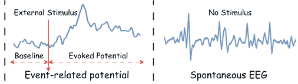
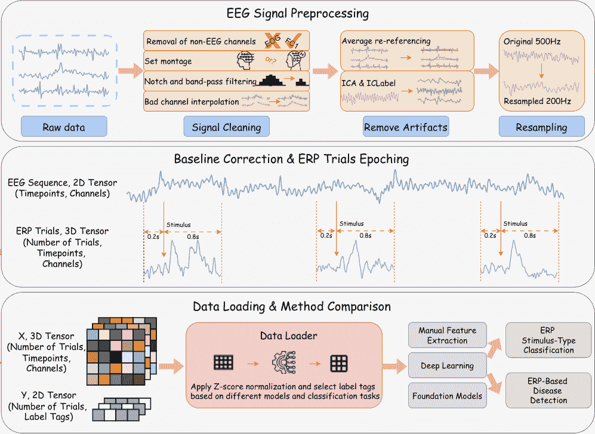
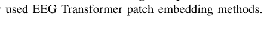
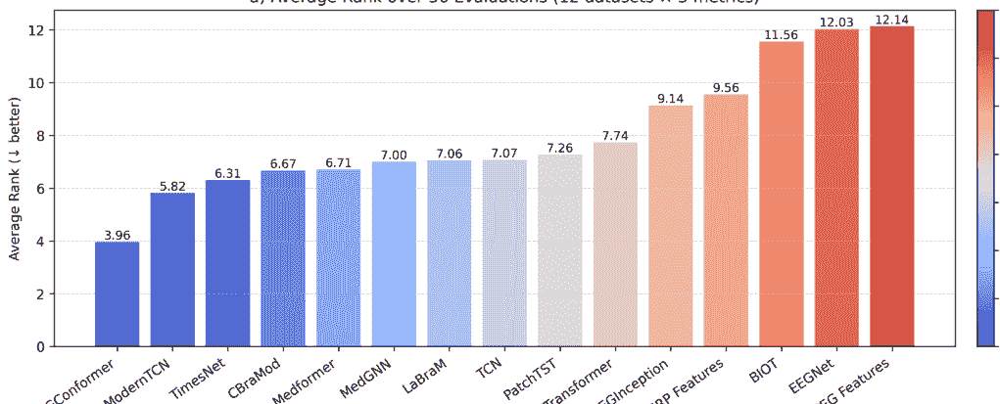
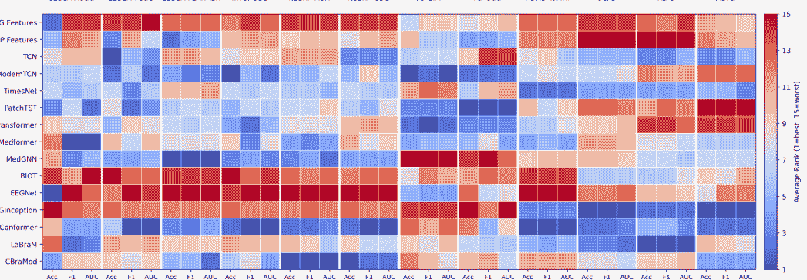
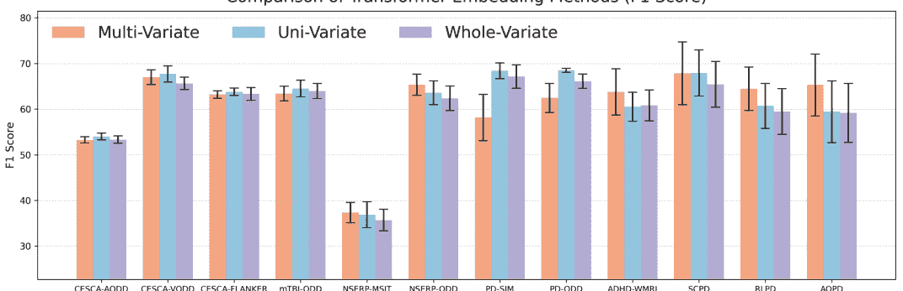

# ERP 分析基准测试：手工特征、深度学习和基础模型

## Abstract

事件相关电位（ERP）是脑电图（EEG）的一种专门范式，反映了对外界刺激或事件的神经反应，通常与大脑对特定认知任务的处理相关。ERP 在认知分析、神经疾病检测和心理状态评估中发挥着关键作用。近年来，针对自发 EEG 和其他非时间锁定任务相关 EEG 信号的基于深度学习的方法取得了长足进步。然而，它们在 ERP 数据上的有效性仍未得到充分探索，许多现有的 ERP 研究仍高度依赖手动提取的特征。本文开展了一项全面的基准研究，系统比较了用于 ERP 分析的传统手动特征（后接线性分类器）、深度学习模型和预训练 EEG 基础模型。我们建立了统一的数据预处理和训练流程，并在 12 个公开可用数据集上对两种代表性任务——ERP 刺激分类和基于 ERP 的脑疾病检测——评估这些方法。此外，我们在先进的 Transformer 架构中研究了各种 patch-embedding 策略，以识别更适合 ERP 数据的嵌入设计。本研究为指导未来 ERP 分析的方法选择和定制模型设计提供了一个里程碑式框架。代码可在 https://github.com/DL4mHealth/ERP-Benchmark 获取。

## Index Terms

- ERP，事件相关电位，EEG，脑机接口，深度学习，基础模型

**Fig. 1:** **ERP 与自发 EEG。** ERP 与自发 EEG 本质上不同，需要特定的分析方法。

## I. INTRODUCTION

事件相关电位（ERP）是 EEG 衍生的时间锁定神经活动测量指标，是一种在神经科学、痴呆和认知科学领域具有广泛应用的基础工具[1]–[3]。作为更广 EEG 信号域中的一个专门类别，ERP 与自发 EEG 活动相比表现出不同的特征[4]。自发 EEG 虽反映持续的内在脑状态但功能特异性有限，而 ERP 则捕捉由特定感觉、音频或认知事件引发的时间锁定神经反应[5]–[7]。通过将神经信号与受控刺激对齐，ERP 为瞬态认知过程提供了一个直接且可解释的窗口。ERP 的主要优势在于外部事件与内部脑电反应之间的时间同步性，通常比自发 EEG 活动具有更高的信噪比[8]。实践中，ERP 试验通过对连续 EEG 记录进行事件中心时段分割来提取[3]。短暂的刺激前间隔（通常为 0.2-0.5 秒）用于基线校正以抑制背景噪声，随后是较长的刺激后间隔（通常为 0.8-1.5 秒），其中包含刺激诱发的神经电位[9]。图 1 说明了 ERP 与自发 EEG 之间的信号比较。

近年来，深度学习在 EEG 解码方面取得了长足进展，应用范围广泛，包括运动想象控制[10]、情绪识别[11]、睡眠分期分类[11]、癫痫检测[12]和痴呆检测[13]。先进的深度学习技术，例如在自然语言处理、计算机视觉和多模态学习中取得显著成功的 foundation models（如 ChatGPT [14]、Gemini [15] 和 DINOv2 [16]），也开始被探索用于学习可泛化的 EEG 表示。最近的 EEG 基础模型，包括 LaBraM [17]、EEGPT [18] 和 CBraMod [19]，在各种 EEG 下游任务上报告了强劲性能。然而，大多数现有深度学习模型设计主要针对自发 EEG 信号，例如静息态和睡眠 EEG [11]，或非时间锁定的任务诱发 EEG，例如运动想象[20]。相比之下，以 ERP 为代表的时间锁定诱发 EEG 信号仍显著未被探索。因此，ERP 分析仍主要依赖手动特征提取和传统统计方法，或直接将为自发 EEG 设计的模型应用于 ERP 分析，导致性能欠佳。鉴于 ERP 的信号特征独特且与自发 EEG 存在根本差异，目前尚不清楚深度学习最新进展在多大程度上可直接应用于 ERP 解码。这一差距需要对 ERP 分析方法进行系统基准测试。

为此，我们对 ERP 分类方法进行了全面且公平的基准评估。我们在统一的数据预处理和评估框架内实现了多种方法，包括 2 种手动特征提取方法（分别使用 31 和 91 个手工特征）、10 种 EEG 的最先进深度学习方法以及 3 种先进的 EEG 基础模型。基准涵盖了 **12 个数据集**上的两种代表性且实用的 ERP 分类任务。第一个侧重于 **ERP 刺激分类**，例如在 oddball 范式中区分标准刺激和目标刺激，以评估模型捕捉基本刺激锁定认知反应的能力。第二个解决 **ERP-based 脑疾病检测**，例如识别神经或精神疾病，从而评估模型在更复杂且临床相关的场景中的实用性。此外，为指导更有效模型的开发，我们在最先进的 Transformer 框架内对 EEG 数据的三种常见 patch-embedding 策略进行了比较分析。此嵌入比较旨在识别 ERP 分类最优的嵌入方法，为设计专用于 **ERP analysis** 的 Transformer 主干提供关键见解。所有任务均在严格的 **subject-independent** 设置下进行，以评估跨受试者学习能力。

总之，我们的动机是通过这项系统基准研究回答以下问题：

- **Q1:** 当应用于 ERP 数据时，基于深度学习的 EEG 方法与传统手动特征提取方法相比如何？
- **Q2:** 具有预训练权重的 EEG 基础模型是否在 ERP 分类任务上优于从头训练的监督 EEG 深度学习模型？
- **Q3:** 目前最稳健且可泛化的 ERP 分类方法是什么？
- **Q4:** 哪种 patch embedding 策略最适合设计 ERP 特定的 Transformer 模型？

为提供简洁的 **takeaway message**，我们为读者方便总结了以下答案：

- **A1:** 大多数深度学习方法在 ERP 任务上始终优于手动特征提取方法。
- **A2:** 现有的 EEG 基础模型并未表现出比从头训练的监督深度学习模型更明显的性能优势。
- **A3:** **EEGConformer** 实现了最佳平均排名，并显示出最具竞争力的整体性能。
- **A4:** 单变量 patch embedding（见图 5）在 ERP 特定 Transformer 上比多变量和整体变量 patching 策略实现了更好的整体性能。

本文其余部分组织如下：第 **III** 节介绍了本研究中使用的 ERP 数据集的统计信息以及统一的预处理流程。第 **IV** 节描述了基准中比较的方法，以及为嵌入比较而实现的测试 Transformer。第 **V** 节提供实现细节并报告实验结果及相应分析。第 **VI** 节讨论现有方法的局限性并概述未来工作的方向。第 **VII** 节总结全文。

## II. RELATED WORK

### Manual Feature Extraction

在 ERP 信号中识别用于分类或脑部解释的潜在生物标志物有着悠久的历史。使用了不同类型的特征，包括统计特征如均值、偏度、峰度和标准差[21]–[23]，时域形状特征如线长、峰峰值幅度和正/负峰值幅度[24]–[26]，频谱分布特征如相位偏移、相位相干性、双谱和双相干性[27]–[30]，频带功率特征如功率谱密度、相对频带功率、EEG 节律比值和能量[31]–[33]，复杂度特征如香农熵、Tsallis 熵和排列熵[34]–[36]，以及 Hjorth 参数如活动度、迁移率和复杂度[37]–[39]。

### Deep Learning Methods

具有多样架构的深度学习方法被广泛用于 EEG 解码。EEGNet [40] 是一种经典的轻量级卷积模型，而 EEG-Inception [41] 则在 ERP-based BCI 中扩展了时域卷积并加入深度可分离空间块。AMWCN [42] 整合了基于小波的多尺度分析和注意力机制以识别判别性频带和时间段。基于 Transformer 的方法，如 EEG-Transformer [43] 和 EEGConformer [44]，利用自注意力捕捉 EEG 信号中的长程时序依赖和全局上下文信息。Neuro-BERT [45] 引入了掩码自编码以实现稳健的 EEG 表示学习，LGGNet [46] 显式建模局部-全局脑功能图，MOCNN [47] 提出多尺度八度卷积用于 ERP 分类，而 EEGMamba [48] 采用双向 Mamba 模块实现高效的长序列 EEG 建模。

### Foundation Models

在计算机视觉和自然语言处理领域取得显著成功的 foundation models，越来越多地被探索用于 EEG 表示学习。LaBraM [17] 引入了大规模 EEG 基础模型，采用神经 tokenizer 在预训练期间重建频谱表示，从而实现向下游 EEG 分类任务的有效迁移。EEGPT [18] 提出了一种基于高信噪比 EEG 表示的掩码自监督学习框架，并通过时空表示对齐增强。FORMED [49] 将通用时间序列基础模型重新用于 EEG 下游任务。NeuroLM [50] 将 EEG 信号概念化为外语，并采用受语言模型启发的架构学习认知和临床任务的统一表示。LUNA [51] 提出了一种使用交叉注意力机制的拓扑无关 EEG 基础模型，支持在异构通道布放下进行稳健学习。CSBrain [52] 探索了具有结构化稀疏注意力的跨尺度时空 tokenization，以建模局部和全局脑区之间的依赖关系。

### 表I：数据集统计

所有数据集均采用相同的预处理流程，包括带通滤波、伪迹去除和重采样至200 Hz。时间窗和基线窗口取决于ERP任务和数据集。缩写：AODD：听觉怪球（Auditory Oddball）；VODD：视觉怪球（Visual Oddball）；MSIT+：扩展多源干扰任务（Extended Multi-Source Interference Task）；SIM：西蒙冲突（Simon Conflict）；RL：强化学习（Reinforcement Learning）；HC：健康对照（Healthy Control）；PD：帕金森病（Parkinson’s Disease）；ADHD：注意缺陷多动障碍（Attention Deficit Hyperactivity Disorder）。

| 数据集 | ERP任务 | 被试数 | 基线(秒) | 时间窗(秒) | 试验次数 | 通道数 | 类别 |
|---|---|---|---|---|---|---|---|
| CESCA-AODD | AODD | 127 | [-0.2, 0] | [-0.2, 0.8] | 38,151 | 26 | 标准 vs 目标 |
| CESCA-VODD | VODD | 127 | [-0.2, 0] | [-0.2, 0.8] | 20,419 | 26 | 标准 vs 目标 |
| CESCA-FLANKER | Flanker | 73 | [-0.2, 0] | [-0.2, 0.8] | 29,774 | 26 | 一致 vs 不一致 |
| mTBI-ODD | AODD | 96 | [-0.2, 0] | [-0.2, 0.8] | 24,885 | 61 | 标准 vs 目标 vs 新异 |
| NSERP-MSIT | MSIT+ | 42 | [-0.5, 0] | [-0.5, 1.0] | 16,729 | 123 | 无冲突 vs 西蒙效应 vs 侧翼效应 vs 双重冲突 |
| NSERP-ODD | VODD | 42 | [-0.5, 0] | [-0.5, 1.0] | 27,865 | 123 | 标准 vs 目标 vs 新异 |
| PD-SIM | SIM | 147 | [-0.3, -0.2] | [-0.5, 1.0] | 55,921 | 60 | 健康对照 vs 帕金森病 |
| PD-ODD | VODD | 145 | [-0.3, -0.2] | [-0.5, 1.0] | 34,464 | 60 | 健康对照 vs 帕金森病 |
| ADHD-WMRI | N-Back, GoNogo | 59 | [-0.2, 0] | [-0.2, 0.65] | 21,832 | 21 | 健康对照 vs 注意缺陷多动障碍 |
| SCPD | SIM | 56 | [-0.3, -0.2] | [-0.5, 1.0] | 10,224 | 59 | 健康对照 vs 帕金森病 |
| RLPD | RL | 56 | [-0.2, 0] | [-2.0, 1.0] | 14,325 | 56 | 健康对照 vs 帕金森病 |
| AOPD | AODD | 50 | [-0.2, 0] | [-0.2, 0.8] | 9,830 | 59 | 健康对照 vs 帕金森病 |

## 三、数据集

### A. 数据集

鉴于公开ERP数据集的可用性有限，我们系统检索了作者已知的所有可访问资源，包括OpenNeuro、FigShare和PhysioNet等平台。我们确定了12个数据集，每个数据集都有足够的样本量（40+名受试者）以确保稳健的统计评估，包括ADHD-WMRI [53]、AOPD [54]、CESCA-AODD、CESCA-VODD、CESCA-FLANKER [55]、mTBI-ODD [56]、NSERP-MSIT、NSERP-ODD [57]、PD-ODD [58]、PD-SIM [58]、RLPD [59]和SCPD [60]。这些数据集涵盖了广泛的认知范式和临床条件，包括注意缺陷多动障碍（ADHD）、帕金森病（PD）、创伤性脑损伤（TBI）和与衰老相关的认知衰退。为确保公平且一致的基准测试，所有数据集均使用统一的ERP预处理流程（第III-B节）进行预处理。

其中，6个数据集（包括CESCA-AODD、CESCA-VODD、CESCA-FLANKER、mTBI-ODD、NSERP-MSIT和NSERP-ODD）用于ERP刺激分类，旨在区分不同实验条件引发的认知反应，例如目标与非目标刺激、一致与不一致刺激。其余6个数据集（包括PD-SIM、PD-ODD、RLPD、SCPD、AOPD和ADHD-WMRI）用于脑疾病检测任务。

### B. 数据预处理流程

为获得用于训练的ERP试验，我们采用以下统一预处理流程。

- 去除非EEG通道：移除所有非EEG通道，如EOG或坐标信息。
- 陷波和带通滤波：应用50 Hz或60 Hz的陷波滤波器以抑制线路噪声，然后使用0.5 Hz至45 Hz之间的带通滤波器。
- 坏通道插值：对标记的坏通道进行插值。
- 平均重参考：应用平均重参考以降低全局噪声和潜在的基线漂移。
- 伪迹去除：使用独立成分分析（ICA），结合ICLabel [61]，自动识别并移除与眨眼、肌肉活动和心脏伪迹相关的成分。
- 重采样：将所有记录重采样至统一的200 Hz采样率。
- 基线校正：应用基线校正以增强与刺激相关的ERP成分相对于背景噪声的幅度。
- 试验分段：然后根据刺激事件将EEG记录分割为ERP试验，并丢弃非ERP记录（例如静息状态）。基线校正和时间窗长度因ERP任务和数据集而异。
- Z分数标准化：对每个分段ERP试验的每个通道独立进行零均值和单位方差标准化。处理后的数据集统计信息汇总在表I中。预处理的更多细节请参见我们的GitHub仓库。

## 四、方法

### A. 手动提取特征

自发EEG和ERP数据分析中广泛使用的特征。我们手动提取这些特征，并对其应用线性投影层以进行ERP任务分类。

1) EEG特征提取：我们计算31个广泛使用的特征，包括10个时域统计特征、11个频带特征、7个频谱分布特征和3个数据复杂度特征。

时域统计特征：这些包括均值、中位数、最小值、最大值、偏度、峰度、均方根（RMS）、四分位距和标准差 [21]-[23], [33]。统计特征旨在捕获EEG信号的基本时域统计特性。

频带功率特征：该类别包括δ、θ、α和β频带的绝对功率、总功率、θ/α比值、α/β比值以及四个频带的相对功率 [31]-[33]。绝对频带功率通过对每个频带内的功率谱密度（PSD）进行数值积分计算，直接度量与特定神经过程相关的振荡能量。

**图2：ERP分析流程。** 输入原始EEG数据通过统一流程进行预处理以获得ERP试验，包括去除非EEG通道、陷波和带通滤波、坏通道插值、平均重参考、伪迹去除、重采样、基线校正、试验分段和Z分数标准化。处理后的ERP试验被加载并传递给各种模型进行训练和分类，包括手动特征提取、从头训练的监督深度学习和具有预训练权重的基础模型。

频率、峰值功率、平均频率、中位频率和频谱平坦度 [62]–[64]。这些特征描述了频谱能量的整体分布和结构。所有频谱特征均使用Welch方法进行PSD估计，然后进行数值积分和计算。

包括均值、标准差、RMS、线长和峰峰值幅度 [65]–[68]，在多个时间尺度上计算，产生5 × Σ层特征维度。我们将层数设置为15。采用时间金字塔池化来捕获多个时间分辨率下的ERP动态。该方法联合捕获全局波形结构和局部瞬态，提高了对时间变异性和潜伏期抖动的鲁棒性。

**复杂度特征：** 该类别包括归一化和非归一化的香农谱熵和Tsallis熵 [34]–[36]。这些特征源自归一化的PSD，该PSD被解释为概率分布。香农谱熵量化频谱无序度和复杂度，值越高表示频谱能量分布越均匀，而Tsallis熵通过引入非广延性质推广了香农熵，对非线性和非平稳信号特征具有更高的敏感性。

**峰值相关特征：** 正峰和负峰的幅度及其归一化潜伏期 [24]–[26]。提取峰值相关特征以表征显著的ERP成分。最大正峰和最小负峰幅度反映事件相关神经反应的强度。使用总分析窗长度归一化潜伏期，以考虑ERP持续时间的变异性并确保试验间和受试者间的可比性。

**2) ERP特征提取：** 我们总共计算**91个特征**，包括75个时间金字塔池化特征、4个峰值相关特征、9个频带与复杂度特征和3个Hjorth参数。

**时间金字塔池化：**五种统计度量，包-

**频率与复杂度特征：**δ、θ、α和β频带的相对功率、总功率、频谱质心、频谱平坦度、中位频率和归一化谱熵 [27]–[30]。尽管ERP是时间锁定信号，频域分析可提供补充信-

关于刺激诱发的振荡模式的信息。相对频带功率和总功率概括了典型频带上的能量分布，而频谱质心、频谱平坦度和中值频率描述了ERP信号的整体频率结构。计算归一化谱熵以量化ERP频谱内容的复杂性和离散度。

**Hjorth参数：** Hjorth参数包括活动性、移动性和复杂度[37]–[39]。这些特征作为ERP信号特性的紧凑描述符。活动性通过测量信号方差反映整体信号幅度。移动性通过将一阶导数的方差与信号本身的方差相关联来表征平均频率内容。复杂度量化了相对于正弦信号的波形形状变化，从而提供对ERP动力学结构复杂性的洞察。

### B. 深度学习模型

用于通用时间序列、医学时间序列和EEG数据分类的深度学习方法。它们以完全监督学习的方式从头开始训练。我们选择了具有公开可用代码的经典或最先进的方法。

- 1) *TCN：* TCN [69] 是一种专门为时间序列建模设计的卷积架构。它们通过结合因果卷积和空洞卷积来扩展残差网络，从而能够有效学习长程时间依赖。通过灵活控制感受野大小，TCN在模型容量和计算效率之间取得平衡，使其能够适应不同领域的时间序列数据。TCN仍然是时间序列分类任务（包括EEG分析）中强大且被广泛采用的基线模型。

- 2) *ModernTCN：* ModernTCN [70] 是一种专为通用时间序列分析设计的卷积架构，展现出强大的性能，尤其在分类任务中。它将深度卷积与多个逐点卷积相结合，并引入了通道独立的嵌入机制。这种设计有效解决了卷积模型在多变量时间序列任务中的关键局限性，这些任务中性能常常受到小感受野和难以建模变量间依赖关系的限制。

- 3) *TimesNet：* TimesNet [71] 是一种用于时间序列分析的卷积模型，尤其在分类任务中表现出色。它将一维时间序列数据跨多个周期转换为二维张量（其中行和列分别表示周期内和周期间的变化），从而利用二维卷积网络的优势进行时间序列分析。该模型的核心组件Times-Block采用参数高效的Inception模块，从二维张量中提取复杂的时间变化。

- 4) *PatchTST：* PatchTST [72] 是一种基于Transformer的时间序列预测和表示学习模型，其核心创新在于分块和通道独立性的双重设计。该模型将多通道数据分解为多个单通道分块，并将其视为具有语义信息的子序列片段作为输入。这种方法保留了局部特征，同时显著降低了计算复杂度。

- 5) *iTransformer：* iTransformer [73] 提出了一种基于Transformer架构的多变量时间序列分析的新型数据嵌入方法。其显著特点是反转了传统的标记化策略。iTransformer不是将单个时间点上的多通道样本作为一个时间标记，而是将每个通道/变量视为独立的变量标记。这种调整使得自注意力模块能够直接建模变量之间的相关性，从而增强可解释性。

- 6) *Medformer：* Medformer [74] 是一种专为医学时间序列数据（如EEG、ECG）设计的多粒度分块Transformer模型。它通过跨通道分块捕获信号通道之间的相关性，并通过多粒度嵌入在多个时间尺度上提取特征。随后，它应用两阶段（粒度内和粒度间）多粒度自注意力来学习特征。Medformer是一种针对医学生物电时间序列数据改进的Transformer模型。

- 7) *MedGNN：* MedGNN [75] 提出了一种用于脑电图等医学时间序列的多尺度时空图学习框架。该框架通过构建自适应图结构来建模跨通道空间关系，并通过频域卷积整合多尺度时间特征。MedGNN进一步采用基于差异的注意力机制和多尺度图变换器，以协同方式捕获局部时间动态和全局图依赖性。

- 8) *EEGNet：* 作为EEG领域经典的深度学习应用，EEGNet [40] 通过卷积操作高效提取时间和空间特征。通过堆叠二维时间卷积、深度卷积和可分离卷积模块，它捕获频率特征以及不同电极通道之间的特征关系。其结构紧凑，空间和计算成本低。

- 9) *EEGInception：* EEGInception [41] 开创了将Inception模块[76]集成到深度学习模型中用于ERP检测任务的先河。通过采用多尺度时间卷积同时提取EEG信号中不同时间尺度的特征，并结合可分离卷积、批归一化和Dropout，它构建了一种轻量高效的网络架构。

- 10) *EEGConformer：* EEGConformer [77] 是一种基于Transformer的架构，它将用于时空特征嵌入的卷积网络与用于EEG表示学习的自注意力机制相结合。这种设计结合了卷积网络在捕获局部时空模式方面的优势和自注意力在建模全局依赖方面的优势，同时保持参数效率并增强表示复杂EEG结构的能力。

### C. 基础模型

医学时间序列和EEG基础模型。我们使用它们的预训练权重在我们的ERP任务上进行微调。我们选择了具有公开可用代码的最先进方法。

- 1) *BIOT：* [78] BIOT引入了一个大型基础模型，用于灵活处理不同长度和通道数的多通道生物医学信号。它采用语言模型风格的分段方法将单通道信号转换为分块嵌入，并为其添加通道标签，然后应用自注意力来捕获时间和空间依赖关系。这种设计支持多阶段训练，并且在通道缺失或片段缺失的情况下依然有效。我们加载其预训练权重进行微调。

- 2) LaBraM：LaBraM [17] 是一个通过大规模无监督预训练学习通用EEG表示的基础模型。该框架的核心在于向量量化神经频谱预测方法：首先，训练一个神经分词器，通过重建原始EEG信号的傅里叶频谱，将连续的EEG片段编码为紧凑的神经词表。随后，基于该词表，使用掩码EEG建模（随机掩码部分EEG片段并预测其对应的神经词条）对神经Transformer进行预训练。配备可学习的时间和空间嵌入，该模型能够自适应地从任意通道数和时长的EEG输入中学习。该方法使用了超过2,000小时的EEG数据进行预训练。我们加载其预训练权重进行微调。

- 3) CBraMod：CBraMod [19] 是一个以交叉Transformer为骨干的EEG基础模型。通过采用并行的时间和空间注意力机制，它分别建模同一时间点通道之间的依赖关系以及同一通道内时间段之间的依赖关系，从而更好地对齐EEG信号的固有结构。此外，该模型使用非对称条件位置嵌入（ACPE）动态生成位置嵌入，使其能够灵活适应具有不同通道配置和时间长度的EEG数据。该方法使用了超过9,000小时的EEG数据进行预训练。我们加载其预训练权重进行微调。

图3：Transformer嵌入比较。三种常用的EEG Transformer分块嵌入方法。

### 表II：ERP刺激分类结果

对ERP刺激类型进行分类，如Oddball中的目标、非目标和干扰刺激，或Flanker中的一致和不一致刺激。Top-1、Top-2和Top-3结果分别以红色、蓝色和绿色突出显示。

| 方法 | CESCA-AODD准确率 | CESCA-AODD F1分数 | CESCA-AODD AUROC | CESCA-VODD准确率 | CESCA-VODD F1分数 | CESCA-VODD AUROC | CESCA-FLANKER准确率 | CESCA-FLANKER F1分数 | CESCA-FLANKER AUROC |
|---|---|---|---|---|---|---|---|---|---|
| EEG特征 | 77.06±0.96 | 46.44±1.03 | 50.71±0.38 | 77.26±1.02 | 50.31±0.84 | 56.73±1.16 | 55.38±1.12 | 55.13±1.12 | 57.74±1.84 |
| ERP特征 | 75.43±3.46 | 47.74±1.66 | 52.35±1.67 | 81.71±0.43 | 63.68±1.10 | 76.67±1.83 | 64.12±1.31 | 63.98±1.23 | 69.66±1.57 |
| TCN | 75.07±0.40 | 50.74±0.99 | 56.39±0.95 | 82.03±0.69 | 67.00±1.12 | 78.13±1.42 | 63.16±1.11 | 62.89±1.30 | 68.62±1.43 |
| ModernTCN | 75.20±0.69 | 53.93±0.82 | 60.36±0.98 | 81.91±0.51 | 66.85±3.11 | 78.18±1.01 | 64.07±0.58 | 64.01±0.59 | 69.90±1.39 |
| TimesNet | 75.17±0.58 | 54.38±1.34 | 60.91±0.74 | 81.13±1.53 | 67.65±1.55 | 77.62±1.42 | 63.20±0.64 | 63.09±0.59 | 68.29±1.25 |
| PatchTST | 76.41±1.41 | 53.65±1.70 | 61.98±3.11 | 80.97±1.13 | 68.19±1.72 | 78.13±1.02 | 63.81±0.77 | 63.64±0.81 | 69.61±1.33 |

... [iTransformer、Medformer、MedGNN、EEGNet、EEGInception、EEGConformer、BIOT、LaBraM、CBraMod以及第二个板块中mTBI-ODD、NSERP-MSIT、NSERP-ODD的剩余行以相同格式继续]

### 表III：基于ERP的疾病检测结果

基于ERP的脑部疾病检测专注于对神经疾病进行分类，例如帕金森病或ADHD。Top-1、Top-2和Top-3结果分别以红色、蓝色和绿色突出显示。

| 数据集 | PD-SIM（55,921个试验）（147名受试者，2个类别） | PD-ODD（34,464个试验）（145名受试者，2个类别） | ADHD-WMRI（21,832个试验）（59名受试者，2个类别） |
|---|---|---|---|
| 方法 | 准确率 | F1分数 | AUROC | 准确率 | F1分数 | AUROC | 准确率 | F1分数 | AUROC |
| EEG特征 | 64.32±2.30 | 57.02±3.23 | 64.41±4.44 | 67.68±3.36 | 61.23±3.32 | 70.01±3.42 | 58.43±3.07 | 55.76±3.61 | 56.65±6.30 |
| ERP特征 | 63.76±3.54 | 58.78±2.57 | 66.41±3.71 | 69.29±2.60 | 63.65±2.71 | 72.05±2.50 | 59.79±4.79 | 57.40±5.93 | 59.48±10.23 |
| TCN | 64.63±3.53 | 58.76±5.73 | 64.92±5.32 | 66.07±2.35 | 59.43±2.81 | 68.50±2.28 | 62.74±2.46 | 60.57±2.82 | 67.05±3.76 |
| ModernTCN | 71.98±1.82 | 65.79±2.58 | 76.07±3.10 | 71.74±1.47 | 66.72±0.73 | 76.62±1.48 | 63.26±2.86 | 60.69±4.24 | 66.79±4.88 |
| TimesNet | 63.09±3.86 | 54.44±4.99 | 61.16±8.62 | 68.15±2.83 | 60.45±2.37 | 69.87±1.82 | 66.05±3.49 | 64.30±3.79 | 72.12±5.04 |
| PatchTST | 69.38±3.87 | 64.19±4.63 | 73.32±4.77 | 72.19±1.97 | 67.37±1.15 | 77.11±2.51 | 62.44±3.62 | 60.85±3.60 | 66.46±5.03 |
| iTransformer | 71.38±2.09 | 66.79±2.39 | 76.03±2.75 | 70.34±2.25 | 65.89±1.83 | 75.06±1.77 | 63.29±3.13 | 60.92±3.88 | 66.77±5.35 |
| Medformer | 68.62±1.59 | 61.28±3.68 | 70.95±2.71 | 68.22±2.29 | 61.61±2.49 | 72.10±2.81 | 64.48±2.60 | 61.47±3.25 | 68.69±3.91 |
| MedGNN | 57.17±4.72 | 49.88±3.69 | 56.94±6.91 | 64.61±3.83 | 58.15±4.21 | 68.59±3.61 | 62.70±3.98 | 59.97±5.71 | 66.44±7.18 |
| EEGNet | 66.08±3.17 | 64.17±2.84 | 71.63±3.45 | 65.25±4.48 | 61.84±3.59 | 70.46±5.57 | 52.70±8.00 | 44.77±5.24 | 43.99±5.10 |
| EEGInception | 58.90±1.55 | 52.26±5.35 | 57.52±8.47 | 63.73±1.85 | 60.01±2.36 | 65.97±1.88 | 65.22±3.62 | 63.12±4.59 | 69.60±5.73 |
| EEGConformer | 60.69±4.64 | 56.80±5.22 | 61.10±6.67 | 65.44±1.40 | 62.88±1.56 | 70.12±1.08 | 68.55±2.70 | 66.43±3.52 | 74.55±4.68 |
| BIOT | 64.17±4.40 | 56.04±5.45 | 62.37±6.41 | 65.74±3.58 | 59.76±5.30 | 69.03±3.47 | 54.29±5.62 | 53.05±5.73 | 54.61±8.30 |
| LaBraM | 63.95±5.29 | 57.29±4.90 | 63.47±6.11 | 67.82±5.22 | 62.55±3.78 | 71.62±7.46 | 63.82±9.56 | 62.11±9.61 | 67.99±13.05 |
| CBraMod | 63.03±2.87 | 57.01±3.05 | 64.73±3.72 | 66.01±0.95 | 60.41±4.12 | 71.06±2.71 | 61.98±5.24 | 59.96±5.40 | 65.24±7.45 |
| 数据集 | SCPD（10,224个试验）（56名受试者，2个类别） | RLPD（14,325个试验）（56名受试者，2个类别） | AOPD（9,830个试验）（50名受试者，2个类别） |
|---|---|---|---|
| 方法 | 准确率 | F1分数 | AUROC | 准确率 | F1分数 | AUROC | 准确率 | F1分数 | AUROC |
| EEG特征 | 61.32±2.28 | 61.21±2.28 | 66.63±3.19 | 60.87±3.44 | 60.43±3.40 | 62.70±4.09 | 61.83±3.32 | 61.43±3.55 | 67.33±4.17 |
| ERP特征 | 57.55±5.36 | 57.41±5.27 | 61.93±8.01 | 54.55±3.88 | 53.42±3.92 | 58.89±6.35 | 61.43±2.73 | 60.82±3.08 | 67.16±3.30 |
| TCN | 70.26±4.83 | 70.15±4.75 | 77.31±6.78 | 68.67±2.67 | 68.40±2.59 | 73.23±6.78 | 66.11±6.75 | 65.76±6.81 | 70.57±8.43 |
| ModernTCN | 67.85±5.39 | 67.55±5.37 | 72.89±7.10 | 61.04±5.63 | 60.75±5.46 | 66.08±5.81 | 60.00±5.44 | 58.86±6.38 | 62.06±8.09 |
| TimesNet | 71.44±6.30 | 71.15±6.34 | 78.00±7.88 | 67.64±7.49 | 67.36±7.46 | 74.56±9.54 | 65.35±3.61 | 65.11±3.62 | 71.53±4.52 |
| PatchTST | 63.37±4.36 | 63.15±4.39 | 68.80±5.95 | 61.07±7.23 | 60.35±7.20 | 64.87±8.99 | 57.63±6.00 | 56.92±6.51 | 60.39±8.29 |
| iTransformer | 66.83±5.65 | 66.51±5.83 | 71.91±7.25 | 59.36±4.23 | 59.07±4.14 | 62.90±5.05 | 59.56±6.43 | 58.54±7.36 | 61.05±9.63 |
| Medformer | 65.22±6.80 | 64.93±6.96 | 71.91±7.87 | 63.45±6.43 | 63.18±6.20 | 69.80±8.35 | 64.94±6.59 | 64.59±6.60 | 70.56±8.78 |
| MedGNN | 66.13±9.71 | 65.73±9.97 | 72.34±12.06 | 64.68±6.65 | 64.36±6.80 | 72.76±8.73 | 62.93±3.93 | 62.48±4.00 | 69.29±5.56 |
| EEGNet | 64.78±4.61 | 63.57±4.96 | 68.41±5.85 | 63.18±1.77 | 62.53±1.61 | 67.12±2.79 | 62.51±7.17 | 60.41±8.64 | 64.92±9.70 |
| EEGInception | 74.48±5.53 | 74.33±5.42 | 82.79±6.36 | 70.76±4.43 | 70.57±4.42 | 77.32±6.43 | 69.51±6.59 | 69.26±6.52 | 77.32±8.81 |
| EEGConformer | 72.35±5.39 | 72.04±5.43 | 79.43±6.74 | 66.09±4.05 | 65.28±4.16 | 75.73±6.46 | 68.25±9.26 | 68.00±9.26 | 74.43±11.74 |
| BIOT | 70.00±4.05 | 69.42±4.61 | 76.71±6.79 | 65.72±9.04 | 65.09±8.85 | 69.29±12.06 | 62.15±8.73 | 61.57±8.80 | 66.51±10.06 |
| LaBraM | 72.27±4.17 | 71.71±4.30 | 79.46±6.52 | 74.47±6.34 | 73.87±6.94 | 84.82±5.72 | 62.05±9.25 | 61.55±9.20 | 67.40±13.80 |
| CBraMod | 67.33±3.45 | 66.63±3.89 | 73.34±8.45 | 63.28±9.41 | 62.65±9.14 | 66.26±12.52 | 65.99±3.78 | 65.28±3.88 | 71.43±4.80 |

### D. ERP Transformer的Patch嵌入比较

现有的EEG Transformer模型通常采用三种类型的token嵌入：多变量（multi-variate）、单变量（uni-variate）和全变量（whole-variate）。例如，Medformer [74]采用多变量patch嵌入，PatchTST [72]采用单变量patch嵌入，iTransformer [73]使用全变量patch嵌入。给定一个多变量EEG输入样本（x ∈ ℝ^{T×C}）和patch长度L，多变量嵌入使用patch p ∈ ℝ^{L×C}，单变量嵌入使用patch p ∈ ℝ^{L×1}，全变量嵌入使用patch p ∈ ℝ^{1×C}。这些patch随后被线性投影为token嵌入，作为Transformer编码器的输入。图5展示了这三种嵌入策略。为了研究哪种嵌入方法最适合ERP数据分类，我们实现了一个Transformer模型并评估了三种token嵌入设计。Transformer架构的所有其他组件在不同设置下保持一致，从而可以对嵌入方法进行受控比较。我们希望这一比较能够为未来设计用于ERP分析的Transformer的工作提供启发。

### A. 实验设置

所有方法的批量大小均为128。训练轮数设置为200，并基于最佳F1分数进行早停（patience=15）。我们使用AdamW优化器，学习率为1×10^{−4}，并通过CosineAnnealingLR进行调度。模型性能使用准确率、F1分数和AUROC进行评估。我们采用受试者独立评估协议[79]下的蒙特卡洛交叉验证，训练集、验证集和测试集的受试者比例为6:2:2。这一设置确保各划分之间没有受试者重叠，同时在不同随机种子下保持受试者划分的随机性。对于基础模型方法，包括BIOT、LaBraM和CBraMod，我们对其公开发布的检查点进行微调。每个实验使用五个随机种子（41-45）重复进行，结果以均值和标准差报告。所有实验均在4块NVIDIA RTX A5000 GPU上使用Python 3.10和PyTorch 2.5.1+cu121进行。更多实现细节和每种方法的训练脚本已提供在我们的GitHub仓库中。

## V. 实验

#### a) 36次评估（12个数据集 × 3个指标）的平均排名

#### b) 所有36次评估（12个数据集 × 3个指标）的排名热图。

图4：a) 15种方法在所有12个数据集和3个评估指标上的平均性能排名。例如，EEGConformer的3.96表示其在36次评估中的平均排名为3.96。b) 15种方法在所有12个数据集和3个评估指标上的排名热图。在图a和图b中，排名越低且蓝色越深表示性能越好。

### B. ERP刺激分类结果

我们首先研究ERP数据中的刺激类型分类，结果汇总在表II中。所有实验均在受试者独立评估设置下进行，旨在识别可跨受试者泛化的刺激相关ERP模式。Top-1、Top-2和Top-3表现的方法分别以红色、蓝色和绿色突出显示。在六个数据集（CESCA-AOOD、CESCA-VOOD、CESCA-FLANKER、mTBI-ODD、NSERP-MSIT和NSERP-ODD）中，最佳方法分别取得了57.18%、69.64%、64.33%、65.79%、38.51%和68.40%的F1分数。这些结果显著高于随机性能，表明即使在跨受试者评估下，也能提取出有意义且一致的刺激相关ERP模式。在三个CESCA数据集中，视觉oddball和flanker范式比听觉oddball范式表现出更高的可区分性。由于这些数据集共享相同的受试者群体和记录条件，这一观察表明视觉oddball和flanker刺激比被动听觉oddball刺激能引发更显著和可区分的神经反应。在方法性能比较方面，我们观察到顶级结果主要由从头训练的深度学习模型实现。相比之下，现有的医学时间序列和EEG基础模型在微调其发布的检查点后并未表现出明显的性能优势。此外，手动提取的特征很少能达到顶级性能，而在此任务中，ERP特征始终优于EEG特征。

### C. 基于ERP的疾病检测结果

我们随后研究了基于ERP的疾病检测性能，结果汇总在表III中。所有实验

在受试者无关的评估设置下进行，旨在识别能够跨受试者泛化用于真实世界疾病检测应用的疾病特异性 ERP 特征。在六个数据集（PD-SIM、PD-ODD、ADHD-WMRI、SCPD、RLPD 和 AOPD）中，最佳方法的 F1 分数分别为 66.79%、67.37%、66.43%、74.33%、73.87% 和 69.26%。总体而言，没有单一的 ERP 范式在疾病检测中持续表现出明显优势。值得注意的是，三个较小的帕金森病数据集 SCPD、RLPD 和 AOPD 的性能相对高于两个较大的数据集 PD-SIM 和 PD-ODD。这种趋势可能归因于较小数据集中更平衡的数据分布，其中帕金森病患者和健康对照受试者的数量完全相等。在方法比较方面，顶级性能主要由从头训练的深度学习模型以及从基础模型检查点微调的模型实现。基于手动提取特征的两种方法从未达到顶级结果。此外，与 ERP 刺激类型分类不同，ERP 特异性特征在疾病检测中并不能始终优于通用 EEG 特征。在多个数据集中，ERP 特异性特征甚至表现更差，这表明这些数据集中的疾病相关信息可能与规范的 ERP 成分关联不紧密。

### D. 整体性能分析

为了在多个任务和评估指标上对不同方法进行全面比较，我们进一步分析了 15 种方法在 12 个数据集 × 3 个评估指标上的整体性能，共计 36 次评估。图 4 展示了每种方法在全部 36 次评估中的平均排名，以及每种方法在每次评估上的具体排名热力图。排名越低且蓝色越深表示性能越好。

我们观察到，从头训练的监督式深度学习模型在整体性能上持续优于其他方法。在所有评估方法中，EEGConformer 实现了最低的平均排名 3.96，表明其在多样化任务和评估指标上具有最稳定且具有竞争力的性能。继 EEGConformer 之后，ModernTCN、TimesNet、CBraMod 和 Medformer 构成顶级群体。值得注意的是，只有 CBraMod 属于基础模型类别，其余方法均是从头训练的。这表明现有基础模型可以部分迁移到 ERP 分类任务中。一个可能的解释是，目前的 EEG 基础模型很少在 ERP 特异性数据上进行预训练。大多数预训练资源由长序列自发 EEG 组成，且未纳入 ERP 特异性预处理步骤，例如基线校正或基于事件的试验分段。因此，预训练期间学习到的表征可能与 ERP 为中心的下游任务并不最优对齐。基于手动特征的方法整体性能始终最差。在两种手工特征方法之间，ERP 特异性特征相对优于通用 EEG 特征。这些结果凸显了手工统计和频域特征的局限性，它们难以在多样化的 ERP 范式和疾病条件下保持稳健性能，尤其是在受试者无关评估下。这表明，除了解释性或神经科学导向分析外，在以端到端性能为主要目标的真实世界应用中，手动特征提取的优势有限。

### E. Transformer 的 Patch 嵌入比较

**Transformer 嵌入方法比较（F1 分数）**

*图 5：在现有 EEG Transformer 中常用的多变量、单变量和整体变量 token 嵌入之间的 F1 分数比较。所有其他 Transformer 组件保持相同。*

我们比较现有 EEG Transformer 模型中常用的三种 token 嵌入方法，以检验其对 ERP 数据分类的适用性。所有其他组件，包括自注意力模块、前馈网络和层归一化层，在各方法间保持相同。为了确保模型容量可比，多变量嵌入方法的 patch 长度设为 25，单变量嵌入方法设为 100。因此，多变量、单变量和整体变量 token 嵌入方法的总参数数分别为 0.864、0.818 和 0.822 百万。

所有结果均以表 IV 中的 F1 分数报告。单变量嵌入方法实现了最佳性能

- [12] Ruizhe Zheng, Lingyan Mao, Dingding Han, Tian Luo, Yi Wang, Jing Ding, and Yuguo Yu. FAPEX: Fractional amplitude-phase expressor for robust cross-subject seizure prediction. 39th International Conference on Neural Information Processing Systems, 2025.
- [13] Yihe Wang, Nadia Mammone, Darina Petrovsky, Alexandros T. Tzallas, Francesco C. Morabito, and Xiang Zhang. ADformer: A multi-granularity spatial-temporal transformer for EEG-based Alzheimer's detection. arXiv preprint arXiv:2409.00032, 2024.
- [14] Josh Achiam, Steven Adler, Sandhini Agarwal, Lama Ahmad, Ilge Akkaya, Florencia Leoni Aleman, Diogo Almeida, Janko Altenschmidt, Sam Altman, Shyamal Anadkat, et al. GPT-4 technical report. arXiv preprint arXiv:2307.08774, 2023.
- [15] Gemini Team, Petko Georgiev, Ving Ian Lei, Ryan Burnell, Libin Bai, Anmol Gulati, Garrett Tanzer, Damien Vincent, Zhufeng Pan, Shibo Wang, et al. Gemini 1.5: Unlocking multimodal understanding across millions of tokens of context. arXiv preprint arXiv:2403.05530, 2024.
- [16] Maxime Oquab, Timothée Darcet, Théo Moutakanni, Huy Vo, Marc Szafraniec, Vasil Khalidov, Pierre Fernandez, Daniel Haziza, Francisco Massa, Alaaeldin El-Nouby, et al. DINOv2: Learning robust visual features without supervision. arXiv preprint arXiv:2304.07193, 2023.
- [17] Wei-Bang Jiang, Li-Ming Zhao, and Bao-Liang Lu. Large brain model for learning generic representations with tremendous EEG data in BCI. arXiv preprint arXiv:2405.18765, 2024.
- [18] Guangyu Wang, Wenchao Liu, Yuhong He, Cong Xu, Lin Ma, and Haifeng Li. EEGPT: Pretrained transformer for universal and reliable representation of EEG signals. Advances in Neural Information Processing Systems, 37:39249–39280, 2024.
- [19] Jiquan Wang, Sha Zhao, Zhiling Luo, Yangxuan Zhou, Haiteng Jiang, Shijian Li, Tao Li, and Gang Pan. CBraMod: A criss-cross brain foundation model for EEG decoding. arXiv preprint arXiv:2412.07236, 2024.
- [20] Ibtehaaj Hameed, Danish M. Khan, Syed Muneeb Ahmed, Syed Sabeeb Aftab, and Hammad Fazal. Enhancing motor imagery EEG signal decoding through machine learning: A systematic review of recent progress. Computers in Biology and Medicine, 185:109534, 2025.
- [21] Katerina D. Tzimourta, Nikolaos Giannakeas, Alexandros T. Tzallas, Loukas G. Astrakas, Theodora Afrantou, Panagiotis Ioannidis, Nikolaos Grigoriadis, Pantelis Angelidis, Dimitrios G. Tsalikakis, and Markos G. Tsipouras. EEG window length evaluation for the detection of Alzheimer's disease over different brain regions. Brain Sciences, 9(4):81, 2019.
- [22] Katerina D. Tzimourta, Theodora Afrantou, Panagiotis Ioannidis, Maria Karatzikou, Alexandros T. Tzallas, Nikolaos Giannakeas, Loukas G. Astrakas, Pantelis Angelidis, Evripidis Glavas, Nikolaos Grigoriadis, et al. Analysis of electroencephalographic signals complexity regarding Alzheimer's disease. Computers & Electrical Engineering, 76:198–212, 2019.
- [23] N. N. Kulkarni and V. K. Bairagi. Extracting salient features for EEG-based diagnosis of Alzheimer's disease using support vector machine classifier. IETE Journal of Research, 63(1):11–22, 2017.
- [24] Joseph N. Mak, Dennis J. McFarland, Theresa M. Vaughan, Lynn M. McCane, Philippa Z. Tusi, Debra J. Zeitlin, Eric W. Sellers, and Jonathan R. Wolpaw. EEG correlates of P300-based brain–computer interface (BCI) performance in people with amyotrophic lateral sclerosis. Journal of Neural Engineering, 9(2):026014, 2012.
- [25] Xiaou Li, Yuning Yan, and Wenshi Wei. Identifying patients with poststroke mild cognitive impairment by pattern recognition of working memory load-related ERP. Computational and Mathematical Methods in Medicine, 2013(1):658501, 2013.
- [26] Bruce Wallace, Frank Knoefel, Rafik Goubran, Rocío A. López Zunini, Zhaofen Ren, and Aaron Maccosham. EEG/ERP: Within episodic assessment framework for cognition. IEEE Transactions on Instrumentation and Measurement, 66(10):2525–2534, 2017.
- [27] Francisco J. Fraga, Tiago H. Falk, Paulo A. M. Kanda, and Renato Anghinah. Characterizing Alzheimer's disease severity via resting-awake EEG amplitude modulation analysis. PLoS ONE, 8(8):e72240, 2013.
- [28] Luke Tait, George Stothart, Elizabeth Coulthard, Jon T. Brown, Nina Kazanina, and Marc Goodfellow. Network substrates of cognitive impairment in Alzheimer's disease. Clinical Neurophysiology, 130(9):1581–1595, 2019.
- [29] Markus Waser, Heinrich Garn, Reinhold Schmidt, Thomas Benke, Peter Dal-Bianco, Gerhard Ransmayr, Helena Schmidt, Stephan Seiler, Günter Sanin, Florian Mayer, et al. Quantifying synchrony patterns in the EEG of Alzheimer's patients with linear and non-linear connectivity markers. Journal of Neural Transmission, 123:297–316, 2016.
- [30] Lucas R. Trambaiolli, Ana C. Lorena, Francisco J. Fraga, Paulo A. M. Kanda, Renato Anghinah, and Ricardo Nitrini. Improving Alzheimer's disease diagnosis with machine learning techniques. Clinical EEG and Neuroscience, 42(3):160–165, 2011.
- [31] Magali T. Schmidt, Paulo A. M. Kanda, Luis F. H. Basile, Helder Frederico da Silva Lopes, Regina Baratho, Jose L. C. Demario, Mario S. Jorge, Antonio E. Nardi, Sergio Machado, Jéssica N. Ianof, et al. Index of alpha/theta ratio of the electroencephalogram: a new marker for Alzheimer's disease. Frontiers in Aging Neuroscience, 5:60, 2013.
- [32] Xiaokun Liu, Chunlai Zhang, Zheng Ji, Yi Ma, Xiaoming Shang, Qi Zhang, Wencheng Zheng, Xia Li, Jun Gao, Ruofan Wang, et al. Multiple characteristics analysis of Alzheimer's electroencephalogram by power spectral density and Lempel–Ziv complexity. Cognitive Neurodynamics, 10:121–133, 2016.
- [33] Paulo Afonso Medeiros Kanda, Lucas R. Trambaiolli, Ana C. Lorena, Francisco J. Fraga, Luis Fernando I. Basile, Ricardo Nitrini, and Renato Anghinah. Clinician's road map to wavelet EEG as an Alzheimer's disease biomarker. Clinical EEG and Neuroscience, 45(2):104–112, 2014.
- [34] Heinrich Garn, Markus Waser, Manfred Deistler, Thomas Benke, Peter Dal-Bianco, Gerhard Ransmayr, Helena Schmidt, Guenter Sanin, Peter Santer, Georg Caravias, et al. Quantitative EEG markers relate to Alzheimer's disease severity in the prospective dementia registry Austria (PRODEM). Clinical Neurophysiology, 126(3):505–513, 2015.
- [35] Hamed Azami, Steven E. Arnold, Saeid Sanei, Zhuoqing Chang, Guillermo Sapiro, Javier Escudero, and Anoopum S. Gupta. Multiscale fluctuation-based dispersion entropy and its applications to neurological diseases. IEEE Access, 7:68718–68733, 2019.
- [36] Lucie Tylová, Jaromír Kukal, Václav Hubata-Vacek, and Oldřich Vyšata. Unbiased estimation of permutation entropy in EEG analysis for Alzheimer's disease classification. Biomedical Signal Processing and Control, 39:424–430, 2018.
- [37] Shixin Peng, Ruyi Xu, Xin Yi, Xin Hu, Lili Liu, and Leyuan Liu. Early screening of children with autism spectrum disorder based on electroencephalogram signal feature selection with L1-norm regularization. Frontiers in Human Neuroscience, 15:656578, 2021.
- [38] Raja Majid Mehmood, Muhammad Bilal, S. Vimal, and Seong-Whan Lee. EEG-based affective state recognition from human brain signals by using Hjorth-activity. Measurement, 202:117738, 2022.
- [39] Zhangjing Deng, Haoying Bai, Shijing Wu, Jiani Wu, Boyuan Xia, Yingxi Chen, Yurou He, Shuyu Li, and Yang Lü. Diagnosis of Alzheimer's disease via machine learning approaches with integrated resting-state EEG and ERP characteristics. Cognitive Computation, 17(6):166, 2025.
- [40] Vernon J. Lawhern, Amelia J. Solon, Nicholas R. Waytowich, Stephen M. Gordon, Chou P. Hung, and Brent J. Lance. EEGNet: A compact convolutional neural network for EEG-based brain–computer interfaces. Journal of Neural Engineering, 15(5):056013, 2018.
- [41] Eduardo Santamaria-Vazquez, Victor Martinez-Cagigal, Fernando Vaquerizo-Villar, and Roberto Hornero. EEG-Inception: A novel deep convolutional neural network for assistive ERP-based brain-computer interfaces. IEEE Transactions on Neural Systems and Rehabilitation Engineering, 28(12):2773–2782, 2020.
- [42] Qi Xin, Shaohai Hu, Shuaiji Liu, Ling Zhao, and Yu-Dong Zhang. An attention-based wavelet convolution neural network for epilepsy EEG classification. IEEE Transactions on Neural Systems and Rehabilitation Engineering, 30:957–966, 2022.
- [43] Jin Xie, Jie Zhang, Jiayao Sun, Zheng Ma, Liuni Qin, Guanglin Li, Huihui Zhou, and Yang Zhan. A transformer-based approach combining deep learning network and spatial-temporal information for raw EEG classification. IEEE Transactions on Neural Systems and Rehabilitation Engineering, 30:2126–2136, 2022.
- [44] N. Kasthuri, R. Ramyea, V. S. Arunprasshath, S. Abhineeth, and S. Bharathraj. EEG Conformer model based epileptic seizure prediction using deep learning. In 2024 15th International Conference on Computing Communication and Networking Technologies (ICCCNT), pages 1–7. IEEE, 2024.
- [45] Di Wu, Siyuan Li, Jie Yang, and Mohamad Sawan. Neuro-BERT: Rethinking masked autoencoding for self-supervised neurological pretraining. arXiv preprint arXiv:2204.12440, 2022.
- [46] Yi Ding, Neethu Robinson, Chengxuan Tong, Qiuhao Zeng, and Cuntai Guan. LGNet: Learning from local-global-graph representations for brain-computer interface. IEEE Transactions on Neural Networks and Learning Systems, 35(7):9773–9786, 2023.
- [47] Jing Jin, Ruitian Xu, Ian Daly, Xueqing Zhao, Xingyu Wang, and Andrzej Cichocki. MOCNN: A multiscale deep convolutional neural network for ERP-based brain-computer interfaces. IEEE Transactions on Cybernetics, 54(9):5565–5576, 2024.
- [48] Yiyu Gui, Mingzhi Chen, Yuqi Su, Guibo Luo, and Yuchao Yang. EEGMamba: Bidirectional state space model with mixture of experts for EEG multi-task classification. arXiv preprint arXiv:2407.20254, 2024.

[49] Nan Huang, Haishuai Wang, Zihuai He, Marinka Zitnik, and Xiang Zhang. 重新利用基础模型进行可泛化的医学时间序列分类. arXiv预印本 arXiv:2410.03794, 2024.

[50] Wei-Bang Jiang, Yansen Wang, Bao-Liang Lu, and Dongsheng Li. Neurolm：弥合语言与脑电信号之间差距的通用多任务基础模型. arXiv预印本 arXiv:2409.00101, 2024.

[51] Berkay Döner, Thorir Mar Ingolfsson, Luca Benini, and Yawei Li. Luna：高效且拓扑感知的脑电信号分析基础模型. 第39届神经信息处理系统国际会议, 2025.

[52] Yuchen Zhou, Jiamin Wu, Zichen Ren, Zhouheng Yao, Weiheng Lu, Kunyu Peng, Qihao Zheng, Chunfeng Song, Wanli Ouyang, and Chao Gou. Csbrain：用于脑电解码的跨尺度时空大脑基础模型. 第39届神经信息处理系统国际会议, 2025.

[53] Carolin Breitling-Ziegler, Jana Tegelbeckers, Hans-Henning Flechtner, and Kerstin Krauel. 使用组合n-back/nogo范式对ADHD中工作记忆和反应抑制的经济性评估：一项ERP研究. 人类神经科学前沿, 14:322, 2020.

[54] JF Cavanagh. 脑电：帕金森病中的三刺激听觉oddball和静息态. OpenNeuro, OpenNeuro, 2021.

[55] Elif Isbell, Amanda N Peters, Dylan M Richardson, and Nancy E Rodas De Leon. 成年期社会经济背景下的认知电生理学. 科学数据, 12(1):841, 2025.

[56] James F Cavanagh, J Kevin Wilson, Rebecca E Rieger, Darbi Gill, James M Broadway, Jacqueline Hope Story Remer, Violet Fratzke, Andrew R Mayer, and Davin K Quinn. ERP预测亚急性轻度创伤性脑损伤中的症状性痛苦和恢复. 神经心理学, 132:107125, 2019.

[57] Patrycja Dzianok, Ingrida Antonova, Jakub Wojciechowski, Joanna Dreszer, and Ewa Kubik. nencki-symfonia脑电图/事件相关电位数据集：在健康成人样本中收集的多种认知任务和静息态数据. GigaScience, 11:giac015, 2022.

[58] Arun Singh, Rachel C Cole, Arturo I Espinoza, Jan R Wessel, James F Cavanagh, and Nandakumar S Narayanan. 诱发的额中叶活动预测帕金森病中的认知功能障碍. 神经病学、神经外科与精神病学杂志, 94(11):945–953, 2023.

[59] Darin R Brown, Sarah Pirio Richardson, and James F Cavanagh. 帕金森病中奖励处理的脑电标记减弱. 脑研究, 1727:146541, 2020.

[60] Arun Singh, Sarah Pirio Richardson, Nandakumar Narayanan, and James F Cavanagh. 帕金森病认知控制期间额中叶theta活动减弱. 神经心理学, 117:113–122, 2018.

[61] Luca Pion-Tonachini, Ken Kreutz-Delgado, and Scott Makeig. Iclabel：一种自动化的脑电独立成分分类器、数据集和网站. NeuroImage, 198:181–197, 2019.

[62] Jing Wang, Yuxing Fang, Xiao Wang, Huichao Yang, Xin Yu, and Huali Wang. 阿尔茨海默病患者静息态脑电振荡的增强伽马活动和跨频率交互. 衰老神经科学前沿, 9:243, 2017.

[63] Raymundo Cassani, Tiago H Falk, Francisco J Fraga, Paulo AM Kanda, and Renato Anghinah. 自动伪迹去除算法对基于脑电的阿尔茨海默病诊断的影响. 衰老神经科学前沿, 6:55, 2014.

[64] Ruofan Wang, Jiang Wang, Shunan Li, Haitao Yu, Bin Deng, and Xile Wei. 基于频谱和双谱的阿尔茨海默病脑电信号多重特征提取与分类. 混沌：非线性科学跨学科杂志, 25(1), 2015.

[65] Markus Waser, Manfred Deistler, Heinrich Garn, Thomas Benke, Peter Dal-Bianco, Gerhard Ransmayr, Dieter Grosseggger, and Reinhold Schmidt. 脑电在阿尔茨海默病诊断中的应用. 统计论文, 54:1095–1107, 2013.

[66] Lucie Tylova, Jaromir Kukal, and Oldrich Vysata. 基于脑电的阿尔茨海默病诊断预测模型. Acta Polytechnica, 53(2), 2013.

[67] Aldo Mora-Sánchez, Gérard Dreyfus, and François-Benoît Vialatte. 人类认知驱动的无标度行为和亚稳态脑状态切换：一项实证方法. 认知神经动力学, 13:437–452, 2019.

[68] Robert J Barry, Sopa Kirkaikul, and Darren Hodder. 听觉oddball范式中脑电alpha活动和目标刺激的ERP. 国际心理生理学杂志, 39(1):39–50, 2000.

[69] Colin Lea, Michael D Flynn, Rene Vidal, Austin Reiter, and Gregory D Hager. 用于动作分割和检测的时间卷积网络. IEEE计算机视觉与模式识别会议论文集, 页码 156–165, 2017.

[70] Donghao Luo and Xue Wang. Moderntcn：用于通用时间序列分析的现代纯卷积结构. 第十二届学习表征国际会议, 页码 1–43, 2024.

[71] Haixu Wu, Tengge Hu, Yong Liu, Hang Zhou, Jianmin Wang, and Mingsheng Long. Timesnet：用于通用时间序列分析的时间二维变化建模. arXiv预印本 arXiv:2210.02186, 2022.

[72] Y. Nie. 一个时间序列相当于64个词：基于Transformer的长期预测. 学习表征国际会议, 2023.

[73] Yong Liu, Tengge Hu, Haoran Zhang, Haixu Wu, Shiyu Wang, Lintao Ma, and Mingsheng Long. itransformer：倒置Transformer对时间序列预测有效. 学习表征国际会议, 2023.

[74] Yihe Wang, Nan Huang, Taida Li, Yujun Yan, and Xiang Zhang. Medformer：用于医学时间序列分类的多粒度分块Transformer. 神经信息处理系统进展, 37:36314–36341, 2024.

[75] Wei Fan, Jingru Fei, Dingyu Guo, Kun Yi, Xiaozhuang Song, Haolong Xiang, Hanting Ye, and Min Li. 面向医学时间序列分类的多分辨率时空图学习. 2025年ACM网络会议论文集, 页码 5054–5064, 2025.

[76] François Chollet. Xception：深度可分离卷积的深度学习. IEEE计算机视觉与模式识别会议论文集, 页码 1251–1258, 2017.

[77] Yonghao Song, Qingqing Zheng, Bingchuan Liu, and Xiaorong Gao. EEG Conformer：用于脑电解码和可视化的卷积Transformer. IEEE神经网络与康复工程学报, 31:710–719, 2022.

[78] Chaoqi Yang, M Westover, and Jimeng Sun. Biot：用于野外跨数据学习的生物信号Transformer. 神经信息处理系统进展, 36:78240–78260, 2023.

[79] Yihe Wang, Nan Huang, Nadia Mammone, Marco Cecchi, and Xiang Zhang. Lead：用于基于脑电的阿尔茨海默病检测的大型基础模型. arXiv预印本 arXiv:2502.01678, 2025.

[80] Iyad Obeid and Joseph Picone. 天普大学医院脑电数据语料库. 神经科学前沿, 10:196, 2016.
