# 更好的深度学习：更快训练，减少过拟合，做出更好的预测


## 免责声明

本电子书所含信息仅供教育目的。如果您希望应用本电子书中的想法，您将对您的行为承担全部责任。

作者已尽一切努力确保本书中的信息在出版时是准确的。作者不承担并特此声明不对任何一方因错误或遗漏（无论是由于意外、疏忽还是任何其他原因导致）而造成的任何损失、损害或中断承担任何责任。

## 致谢

特别感谢我的校对者 Sarah Martin 和技术编辑 Andrei Cheremskoy、Michael Sanderson、Arun Koshy。

## 前言

用于开发神经网络模型的现代开源库令人惊叹。那些我们需要花上数周时间调试、将记录不完整的数学内容翻译成代码，只为让哪怕最简单的模型跑起来的日子已经一去不复返。今天，使用像 `Keras` 这样的库，我们可以在几分钟内定义并开始拟合任意复杂度的多层感知机、卷积神经网络甚至循环神经网络模型。

虽然定义和拟合模型已变得轻而易举，但在特定问题上让神经网络模型获得良好性能仍然具有挑战性。传统上，为了让神经网络取得良好性能而进行的配置被称为一种*暗黑艺术*。这是因为对于如何为给定问题准备数据和配置模型，并没有明确规则；相反，经验必须通过在众多不同项目中的长期实践来积累。尽管如此，神经网络在学术界和工业界已经使用了几十年，并且有一套标准技术、技巧和配置，你可以用它们来大幅提高让神经网络模型获得高于平均水平性能的可能性。

我写这本书是为了汇集最优秀的经典和现代技术，为你提供一套可用的方案，让你在下一个使用深度学习神经网络的项目中获得更好的性能。在过去 5 到 10 年里发生了很多变化，出现了许多激活函数、正则化方法，甚至新的集成方法，它们带来了显著更快的学习速度、更低的泛化误差和更稳健的结果。我希望你对未来的旅程与我一样感到兴奋。

Jason Brownlee

2019

## 引言

### 欢迎

欢迎阅读《*更好的深度学习*》。深度学习神经网络已经变得易于定义和拟合，但要在预测建模中取得良好性能仍然充满挑战。神经网络在学术界研究并在工业界使用已有数十年，并且有大量已知能带来高于平均水平性能的技术、技巧和模型配置。此外，过去 5 到 10 年间，出现了许多现代网络配置、正则化技术和集成算法，它们能够带来更优异的性能。我设计这本书的目的是将经典和现代技术整合成一套方案，并逐步教你如何在你的预测建模问题上提升深度学习神经网络模型的性能。

### 本书适合谁？

在开始之前，让我们确保你找对了地方。这本书面向那些了解一些应用机器学习和深度学习的开发者。也许你想或需要在研究项目或工作项目中开始使用深度学习。本指南旨在通过将多年的知识和经验浓缩成一套高度聚焦的动手教程，帮助你快速高效地做到这一点。本书的课程假定你具备以下几点：

- 你熟悉用于编程的基础 `Python`。
- 你熟悉用于数组操作的基础 `NumPy`。
- 你熟悉用于深度学习的基础 `Keras`。

本指南采用自上而下、结果优先的机器学习风格写作，这种风格也是你在 `MachineLearningMastery.com` 上所熟悉的。

### 关于你的收获

本书将教你，作为一名机器学习从业者，如何在自己的预测建模项目中充分利用深度学习模型并取得成果。相关技术将在小规模且易于理解的预测建模问题和多层感知机神经网络模型的背景下进行演示，但也可以轻松应用于广泛的问题以及多种不同类型的神经网络模型。在阅读并完成本书之后，你将知道：

- 可以用来提升深度学习神经网络模型在你自己的预测建模问题上性能的技术清单。
- 如何通过更好地配置随机梯度下降的批量大小、损失函数、学习率来加速学习，并通过梯度裁剪避免梯度爆炸。
- 如何通过正确的数据缩放、批归一化以及使用现代激活函数（如修正线性激活函数）来加速学习。
- 如何通过贪婪逐层预训练和迁移学习选择更好的初始权重来加速学习。
- 对过拟合问题的温和介绍以及正则化技术的概览。
- 如何通过使用权重正则化、权重约束和激活正则化等技术更新损失函数来减少过拟合。
- 如何使用 dropout、添加噪声和早停等技术减少过拟合。
- 如何组合多个模型的预测的温和介绍以及集成学习技术的概览。
- 如何使用加权平均集成和堆叠泛化集成（也称为 *融合*）等技术组合多个不同模型的预测。
- 如何使用水平集成和快照集成等技术组合在单次训练过程中保存的多个模型的预测。

这种对应用深度学习方法的全新理解将以以下方式影响你处理预测建模问题的做法：

- 能够自信地诊断模型训练不佳以及过早收敛等问题，并使用一种或多种对学习算法的修改来加速模型训练过程。
- 能够自信地诊断训练数据集过拟合的情况，并使用模型、损失函数或学习算法的一种或多种修改来降低泛化误差。
- 能够自信地诊断最终模型中的高方差，并通过组合在单次或多次训练运行中训练的多个模型的预测来提高平均预测能力。

本书将教你如何快速获得良好的结果，但会 *不会* 教你如何成为研究科学家，也不会教你特定方法为何有效背后的全部理论。为此，我建议阅读优秀的研究论文和教科书。参见每个教程末尾的 *进一步阅读* 部分作为良好的起点。

### 如何阅读本书

本书是为线性阅读而写的，从头到尾。话虽如此，如果你已经了解基础知识并需要帮助解决特定问题类型或技术，那么你可以直接翻到该部分开始。本书设计为在你的工作站上屏幕阅读。不是远离电脑或在平板电脑或电子阅读器上阅读。我希望你在阅读时能将本书打开在编辑器旁边，并运行示例。

本书并非 intended to be 被动阅读或放在文件夹中作为参考文本。它是一本实战手册、工作手册和指南，旨在让你通过实践学习，然后将新的理解应用到自己的预测建模项目中。为了最大程度地利用本书，我建议你在每个教程中操作示例。扩展它们，打破它们，然后修复它们。尝试每个课程末尾提供的扩展，并告诉我你的进展如何。

### 关于本书结构

本书围绕深度学习模型获得更好结果的三个主要活动设计：更好的或更快的学习、对新数据的更好泛化，以及使用最终模型时的更好预测。关于从神经网络模型获得更好结果，你可以学习很多东西，从理论到应用再到 API。我的目标是借助激光聚焦的教程让你直接获得结果。我设计教程的重点是如何完成任务。它们为你提供了快速理解并将每种技术应用到自己的预测建模问题的工具。

每个教程的设计大约需要一个小时阅读并完成，不包括扩展和进一步阅读。你可以选择每天一个、每周一个，或按自己的节奏进行。我认为动力至关重要，本书旨在被阅读和使用，而不是闲置。我建议你制定一个计划并坚持下去。教程分为三个部分：

- **第 1 部分：更好的学习**。发现改进和加速用于学习或优化神经网络模型权重过程的技术。
- **第 2 部分：更好的泛化**。发现减少训练数据集过拟合并提高模型在新数据上泛化的技术。
- **第 3 部分：更好的预测**。发现提高最终模型在对新数据进行预测时性能的技术。

每个部分针对提高模型性能的特定方法，每个教程针对技术的特定学习成果。这充当过滤器，确保你只关注获得特定结果所需了解的内容，而不会陷入数学或近乎无限的配置参数中。教程并非设计来教你每种技术的全部知识。它们旨在让你了解它们的工作原理以及如何最快地将它们用于你的项目：通过实践学习。

### 关于 Python 代码示例

代码示例经过精心设计，用于演示给定课程的目的。因此，示例高度针对性。

- 模型在小型人为构造的数据集上进行了演示，以给你将技术带入自己项目的背景和信心。
- 使用的模型配置是通过试错发现的，虽有技巧但未优化。这为你探索新的、可能更好的配置留下了空间。
- 代码示例完整且独立。每个课程的代码可直接运行，除安装所需软件包外，无需来自先前课程或第三方的代码。

每个教程都提供了一个完整的可用示例供你检查和复制粘贴。所有源代码也随书提供，我建议尽可能运行提供的示例以避免任何复制粘贴问题。提供的代码是在文本编辑器中开发的，intended to be run on the command line。无需特殊 IDE 或笔记本。如果你在更高级的开发环境中使用时遇到问题，请尝试从命令行运行示例。

神经网络算法是随机的。这意味着当相同的模型配置在相同训练数据上运行时，它们会做出不同的预测。此外，本书中的每个实验问题都围绕生成随机预测展开。因此，这意味着你不会得到本书中呈现的完全相同的示例输出。这是出于设计目的。我希望你习惯神经网络算法的随机性。如果这让你困扰，请注意：

- 你可以多次重新运行给定的示例，你的结果应接近报告的值。
- 你可以通过固定随机数种子使输出一致。
- 你可以通过多次拟合和评估模型并取最终技能分数的平均值来开发模型技能的稳健估计（强烈推荐）。

所有代码示例均在 POSIX 兼容机器上使用 `Python 3` 和 `Keras 2` 测试过。所有代码示例都可在适中且现代的计算机硬件上运行，并在 CPU 上执行。运行所提供的示例不需要 GPU，尽管 GPU 会使代码运行更快。我只是人类，示例代码中可能存在错误。如果你发现错误，请告诉我，以便我修复它并更新书籍并发送免费更新。

### 关于进一步阅读

每个课程都包含进一步阅读资源的列表。这可能包括：

- 研究论文。
- 书籍和书籍章节。
- 网页。
- API 文档。

在可能的情况下，我会列出并链接到每节课中使用的关键对象和函数的相关 API 文档，以便你能更深入地了解它们。在研究论文方面，我会列出首次使用特定技术或在特定问题领域中首次出现的论文。这些不是必读内容，但如果您想了解更多技术细节、理论和配置细节，它们会有所帮助。在可能的情况下，我已尝试链接到 *arxiv.org* 上论文的免费可获取版本。您可以在 Google Scholar Search、*scholar.google.com* 上搜索并下载所列的任何论文。在可能的情况下，我已尝试在 Amazon 上链接书籍。

我并非无所不知，如果你发现与某节课相关的优质资源，请让我知道，以便我可以更新本书。

### About Getting Help

你在学习过程中可能需要帮助。别担心；你并不孤单。

- **Help with a Technique?** 如果你需要了解特定模型或方法的技术方面，请参阅每节课末尾的 *Further Reading* 部分。
- **Help with Keras?** 如果你需要使用 `Keras` 库的帮助，请参阅 *Appendix A* 中的资源列表。
- **Help with your workstation?** 如果你需要设置环境的帮助，我建议使用 Anaconda 并按照 *Appendix B* 中的教程进行操作。
- **Help in general?** 你可以给我发邮件。我的联系方式在 *Appendix A* 中。

### Next

准备好了吗？让我们开始吧！在下一教程中，你将发现一个可用于诊断深度学习神经网络问题的框架，以及可用于解决每个已识别问题的技术。

## Framework for Better Deep Learning

诸如 `Keras` 之类的现代深度学习库允许你仅用几行代码在几分钟内定义并开始拟合各种神经网络模型。尽管如此，在新的预测建模问题上配置神经网络以获得良好性能仍然具有挑战性。获得良好性能的挑战可以分解为三个主要领域：学习问题、泛化问题和预测问题。一旦你诊断出网络所遇到问题的具体类型，就可以选择一系列经典和现代技术来解决该问题并提高性能。在本教程中，你将发现一个用于诊断深度学习模型性能问题的框架，以及可用于针对和改进每种特定性能问题的技术。阅读本教程后，你将了解：

- 定义和拟合神经网络从未如此简单，尽管在新问题上获得良好性能仍然具有挑战性。
- 神经网络模型性能问题可以分解为学习、泛化和预测类型的问题。
- 有数十年的技术以及现代方法可用于针对每种类型的模型性能问题。

让我们开始吧。

### Overview

本教程分为七个部分；它们是：

- 1. Neural Network Renaissance
- 2. Challenge of Configuring Neural Networks
- 3. Framework for Systematically Better Deep Learning
- 4. Better Learning Techniques
- 5. Better Generalization Techniques
- 6. Better Prediction Techniques
- 7. How to Use the Framework

### Neural Network Renaissance

历史上，神经网络模型必须从头开始编码。你可能需要花费数天或数周的时间将描述不佳的数学公式翻译成代码，再花费数天或数周的时间调试代码，只是为了让一个简单的神经网络模型运行起来。那些日子已经过去了。今天，借助建立在诸如 `TensorFlow` 之类的复杂数学库之上的开源库，如 `Keras`，你可以用几行代码在几分钟内定义并开始拟合大多数类型的神经网络。

这意味着诸如多层感知器之类的标准模型可以被快速开发和评估，以及更复杂的模型，这些模型以前可能超出了大多数从业者实现的能力，例如卷积神经网络和诸如长短期记忆网络之类的循环神经网络。作为深度学习从业者，我们生活在令人惊叹且富有成效的时代。尽管如此，即使新的神经网络模型可以被快速定义和评估，关于如何实际配置神经网络模型以充分发挥其潜力，仍然缺乏指导。

### Challenge of Configuring Neural Networks

配置神经网络模型通常被称为一门黑暗艺术。这是因为对于给定问题配置网络并没有硬性规定。我们无法分析地计算给定数据集的最佳模型类型或模型配置。相反，有数十年之久的技术、启发式方法、技巧、窍门以及其他隐性知识散布在代码、论文、博客文章中以及人们的脑海里。配置神经网络问题的捷径是复制相似问题中另一个网络的配置。但这种策略很少能带来良好结果，因为模型配置在不同问题之间是不可转移的。你很可能也在处理与文献中描述的其他问题不同的预测建模问题。

幸运的是，有一些已知可用于在配置和训练神经网络时解决特定问题的技术，这些技术可在现代深度学习库如 `Keras` 中使用。此外，在过去 5 到 10 年中，在激活函数、自适应学习率、正则化方法 和 集成技术 等领域取得了发现，这些发现已被证明可以显著提高神经网络模型的性能，而与其具体类型无关。这些技术是可用的；你只需要知道它们是什么以及何时使用它们。

### Framework for Systematically Better Deep Learning

不幸的是，你无法有效地对用于改进深度学习性能的技术进行网格搜索。几乎在所有情况下，它们都会独特地改变训练数据、学习过程、模型架构等方面。相反，你必须诊断模型所遇到的性能问题的类型，然后仔细选择和评估针对该诊断问题量身定制的干预措施。对于深度学习神经网络模型性能不佳，有三种类型的问题可以轻松诊断；它们是：

- **Problems with Learning**。学习问题表现为模型无法有效学习训练数据集，或在学习训练数据集时进展缓慢或性能不佳。
- **Problems with Generalization**。泛化问题表现为模型对训练数据集过拟合，并在保留数据集上做出较差的预测。
- **Problems with Predictions**。预测问题表现为随机训练算法对最终模型有很大影响，导致行为和性能的高方差。

该框架为训练数据集提供了一种系统化的方法。

- **Better Generalization**。提高神经网络模型在保留数据集上性能的技术。
- **Better Predictions**。减少最终模型性能方差的技术。

现在我们有了系统诊断深度学习神经网络性能问题的框架，让我们来看一些可能在这些三个关注领域中使用的技术示例。

### Better Learning Techniques

更好的学习技术是指对神经网络模型或学习算法所做的更改，这些更改可以改善或加速模型权重对训练数据集的适应（第 1 章）。在本节中，我们将回顾用于改进模型权重适应的技术。这始于对模型容量的仔细配置以及与使用随机梯度下降算法优化神经网络模型和利用误差反向传播算法更新权重相关的超参数；例如：

- **Configure Capacity**。包括用于定义模型可学习函数范围的层中节点的数量和层的数量（第 2 章）。
- **Configure Batch Size**。包括探索诸如批量、随机（在线）或小批量梯度下降等变体是否更合适（第 3 章）。
- **Configure Loss Function**。包括理解不同损失函数必须如何解释，以及替代损失函数是否适合你的问题（第 4 章）。
- **配置学习率**。包括理解不同学习率对问题的影响，以及现代自适应学习率方法（如 `Adam`）是否适用（第5章）。

这还包括简单的数据准备，以及在更深层中自动重新缩放输入。

- **数据缩放技术**。包括网络权重较小时对输入变量尺度的敏感性，以及目标变量中的较大误差对权重更新的影响（第6章）。
- **批量归一化**。包括对网络模型中深层网络层的输入分布变化的敏感性，以及标准化层输入以增加输入的一致性和学习过程稳定性的好处（第9章）。

随机梯度下降是一种通用优化算法，可应用于多种问题。然而，优化过程（或学习过程）可能变得不稳定，需要采取特定的干预措施；例如：

- **梯度消失**。防止训练深度多层网络时靠近输入层的层无法更新权重；这可以使用现代激活函数（如修正线性激活函数）来解决（第7章）。
- **梯度爆炸**。较大的权重更新会导致数值上溢或下溢，使网络权重变为 `NaN` 或 `Inf` 值；这可以使用梯度缩放或梯度裁剪来解决（第8章）。

在某些预测建模问题上，数据不足会阻碍有效学习。可以使用专门的技术来快速启动优化过程，提供有用的初始权重集，甚至提供可用于特征提取的完整模型；例如：

- **贪婪逐层预训练**。一次向模型添加一层，学习解释先前层的输出，并允许开发更深层的模型：这是深度学习领域的一个里程碑式技术（第10章）。
- **迁移学习**。在一个不同但相关的预测建模问题上训练模型，然后用于初始化权重，或整体用作特征提取模型，为在目标问题上训练的模型提供输入（第11章）。

## 更好的泛化技术


更好的泛化技术是指改变神经网络模型或学习算法，以减少模型对训练数据集过拟合的影响，并提高模型在留出验证集或测试集上的性能（第12章）。在本节中，我们将回顾在训练期间减少模型泛化误差的技术。旨在减少泛化误差的技术通常称为正则化技术。几乎普遍地，正则化是通过某种方式减少或限制模型复杂度来实现的。

也许最广泛理解的模型复杂度度量是模型权重的大小或幅度。具有大权重的模型可能表明它对训练数据中的输入过于专门化，使其在对新的未见数据做出预测时不稳定。通过权重正则化保持较小权重是一种强大且广泛使用的技术。

- **权重正则化**。对损失函数进行修改，根据模型权重的范数（幅度）按比例惩罚模型，鼓励更小的权重，从而降低模型复杂度（第13章）。
除了通过更新的损失函数简单地鼓励权重保持较小之外，还可以使用约束来强制权重变小。
- **权重约束**。对模型进行更新，当权重的向量范数超过阈值时重新缩放权重（第15章）。

无论神经网络层在层堆栈中的位置如何，其输出都可以视为关于输入的内部表示或一组提取的特征。更简单的内部表示可以对模型产生正则化效果，并且可以通过鼓励稀疏性（零值）的约束来促进。
- **激活正则化**。对损失函数进行修改，根据层激活的范数（幅度）按比例惩罚模型，鼓励更小或更稀疏的内部表示（第14章）。

在训练期间，可以向模型添加噪声以鼓励对原始输入或先前层输出的鲁棒性；例如：
- **Dropout**。在训练网络时概率性地移除连接（权重），以打破层间节点之间的紧密耦合（第16章）。
- **输入噪声**。在输入层或隐藏层之间添加统计变化或噪声，以减少模型对特定输入值的依赖（第17章）。

通常，过拟合可能仅仅由于在训练数据集上训练模型时间过长而发生。一个简单的解决方案是提前停止训练。
- **早停**。在训练期间监控留出验证数据集上的模型性能，当验证集上的性能开始下降时停止训练过程（第18章）。

## 更好的预测技术

更好的预测技术是指那些对模型训练过程进行补充，以减少最终模型预期性能方差的技术（第19章）。在本节中，我们将回顾减少最终深度学习神经网络模型预期方差的技术。最终模型的性能方差可以通过添加偏差来减少。向最终模型引入偏差的最常见方式是组合多个模型的预测。这被称为集成学习。

集成学习不仅仅能减少最终模型性能的方差，还能带来更好的预测性能。有效的集成学习方法要求每个贡献模型都有技能，即模型的预测优于随机，但模型之间的预测误差具有低相关性。这意味着，集成成员模型应该具有技能，但方式不同。这可以通过改变集成的一个方面来实现；例如：
- 改变用于拟合每个成员模型的训练数据。
- 改变对集成预测有贡献的成员。
- 改变集成成员预测的组合方式。

可以通过在数据集的不同子样本上拟合模型来改变训练数据。这可能涉及在不同随机选择的训练数据子集上拟合并保留模型，在 k 折交叉验证的每一折上保留模型，或使用 Bootstrap 方法（例如 Bootstrap 聚合）在不同样本上进行有放回抽样并保留模型。总的来说，我们可以将这些方法视为重采样集成。
- **重采样集成**。在训练数据集的不同样本上拟合的模型集成（第22章）。

也许改变集成成员的最简单方法就是在训练数据集上多次运行学习算法并收集模型。随机学习算法每次运行都会产生略有不同的拟合结果。对多次运行的模型进行平均将确保性能保持一致。
- **模型平均集成**。在同一数据集上多次运行同一学习算法并重新训练模型（第20章）。

此方法的变体可能涉及使用不同的超参数配置训练模型。训练多个最终深度学习模型可能代价高昂，尤其当一个模型可能需要数天或数周才能拟合时。另一种选择是在单次训练运行期间收集模型作为集成成员；例如：
- **水平集成**。在单次训练运行接近结束时，从连续的训练轮次块中收集集成成员（第23章）。
- **快照集成**。使用激进的循环学习率的训练运行，在每个学习率周期的低谷处收集集成成员（第24章）。

最简单的结合多个集成成员预测的方法是在回归情况下计算预测值的平均值，或在分类情况下计算统计众数（出现频率最高的预测）。另外，最佳结合多个模型预测的方法也可以被学习；例如：
- **加权平均集成 (融合)**。每个集成成员对集成预测的贡献使用学习到的系数加权，这些系数表示对每个模型的信任度（第 21 章）。
- **堆叠泛化 (堆叠)**。训练一个新模型来学习如何最好地结合集成成员的预测结果（第 25 章）。

结合集成成员预测的替代方案是，可以将模型本身进行组合；例如：
- **平均模型权重集成**。多个神经网络模型的权重被平均成一个用于进行预测的单一模型（第 26 章）。

## 如何使用该框架

我们可以将技术组织到更好的学习、泛化和预测这三个领域中，视为改进神经网络模型性能的系统框架。项目中无法合理地研究和评估每一种技术。相反，你需要有条理地、有针对性地使用技术来解决定义明确的问题。

### 第 1 步：诊断性能问题

使用该框架的第一步是诊断模型存在的性能问题。一个稳健的诊断工具是在给定的训练轮数上，针对训练集和验证集计算损失的学习曲线以及特定于问题的指标（如回归的 `RMSE` 或分类的准确率）。
- 如果训练数据集上的损失较差、停滞或未能改善，也许你存在学习问题。
- 如果训练数据集上的损失或特定于问题的指标持续改善，而在验证数据集上变差，也许你存在泛化问题。
- 如果在运行结束时验证数据集上的损失或特定于问题的指标显示出高方差，也许你存在预测问题。

### 第 2 步：选择和评估技术

审查旨在解决你的问题的技术。选择一个看起来适合你的模型和问题的技术。这可能需要对技术有一定的先前经验，对初学者来说可能具有挑战性。幸运的是，有一些启发式方法和最佳实践在大多数问题上效果良好。例如：
- **学习问题**：调整学习算法的超参数；具体来说，学习率提供了最大的杠杆作用。
- **泛化问题**：在大多数模型和大多数问题上，使用权重正则化和提前停止效果良好，或尝试使用提前停止的 `Dropout`。
- **预测问题**：对多次运行收集的模型或一次运行中多个 epoch 的预测结果进行平均，以增加足够的偏差。

选择一种干预措施，然后稍微阅读一下它，包括其工作原理、为何有效，以及重要的是，找到之前从业者如何使用它的示例，以便了解你如何在自己的问题上使用它。

### 第 3 步：返回第 1 步

一旦你识别出问题并通过干预措施解决它，就重复该过程。开发更好的模型是一个迭代过程，可能需要在多个互补的层面上进行多次干预。这是一个经验性过程。这意味着你依赖测试框架的稳健性来在干预前后提供可靠的性能总结。花时间确保你的测试框架稳健，保证训练集、测试集和验证集干净，并提供来自问题领域的足够具有代表性的观测样本。

## 进一步阅读

本节如果您想深入了解该主题，则提供更多资源。

### 书籍
- *深度学习*, 2016. https://amzn.to/2NJW3gE
- *模式识别与机器学习*, 2006. https://amzn.to/2Q2rEeP
- *神经锻造：前馈人工神经网络中的监督学习*, 1999. https://amzn.to/2poq0xc

### 论文
- *基于梯度的深度架构训练的实用建议*, 2012. https://arxiv.org/abs/1206.5533

### 文章
- 神经网络常见问题。 ftp://ftp.sas.com/pub/neural/FAQ.html

## 总结

在本教程中，你发现了一个用于诊断深度学习模型性能问题的框架，以及可用于定位和改进每种特定性能问题的技术。具体来说，你学习了：
- 定义和拟合神经网络从未如此简单，尽管在新问题上获得良好性能仍然具有挑战性。
- 神经网络模型性能问题可以分解为学习、泛化和预测类型问题。
- 有数十年的技术以及现代方法可用于针对每种类型的模型性能问题。

## 下一步

在下一教程中，你将发现如何使用学习曲线来诊断模型行为以及常见模型动态的示例。

## 诊断学习曲线

学习曲线是模型学习性能随经验或时间变化的图表。学习曲线是机器学习中广泛使用的诊断工具，用于从训练数据集增量学习的算法。模型可以在训练期间每次更新后在训练数据集和保留的验证数据集上进行评估，并可以创建测量性能的图表以显示学习曲线。在训练期间查看模型的学习曲线可用于诊断学习问题，例如欠拟合或过拟合模型，以及训练集和验证集是否具有足够的代表性。在本教程中，你将发现学习曲线以及它们如何用于诊断机器学习模型的学习和泛化行为，并附有显示常见学习问题的示例图表。阅读本教程后，你将知道：
- 学习曲线是图表，显示学习性能随经验在时间上的变化。
- 训练集和验证集上模型性能的学习曲线可用于诊断欠拟合、过拟合或拟合良好的模型。
- 模型性能的学习曲线可用于诊断训练集或验证集是否与问题领域不相对具有代表性。

让我们开始吧。

### 概述

本教程分为三个部分；它们是：
- 1. 学习曲线
- 2. 诊断模型行为
- 3. 诊断不具代表性的数据集

### 机器学习中的学习曲线

通常，学习曲线是一个图表，x 轴显示时间或经验，y 轴显示学习或改进。

学习曲线 (`LCs`) 被认为是在监测接触新任务的工人的表现时有效的工具。`LCs` 提供了随着任务重复而发生的学习过程的数学表示。

> — 学习曲线模型及应用：文献综述与研究方向，2011。

例如，如果你正在学习一种乐器，你的乐器技能可以每周评估一次并在一年内赋予一个数值分数。52 周分数的图表就是学习曲线，并将显示你对乐器的学习如何随时间变化。
- **学习曲线**：学习 (*y* 轴) 随经验 (*x* 轴) 变化的线图。

学习曲线在机器学习中被广泛用于随时间增量学习（优化其内部参数）的算法，例如深度学习神经网络。用于评估学习的指标可以是最大化，这意味着更好的分数（更大的数字）表示更多的学习。例如分类准确率。更常见的是使用最小化分数，例如损失或误差，其中更好的分数（更小的数字）表示更多的学习，0.0 的值表示训练数据集被完美学习且没有犯错。在机器学习模型训练期间，训练算法每一步的模型当前状态都可以被评估。它可以在训练数据集上进行评估，以了解模型是 *学习* 得如何。它也可以在不属于训练数据集的保留验证数据集上进行评估。对验证数据集的评估可以了解模型是 *泛化* 得如何。
- **训练学习曲线**：从训练数据集计算的学习曲线，可了解模型学习得如何。
- **验证学习曲线**：从保留的验证数据集计算的学习曲线，可了解模型泛化得如何。

在训练期间，针对训练集和验证集为机器学习模型创建双学习曲线是很常见的。在某些情况下，还很常见为多个指标创建学习曲线，例如在分类预测建模问题中，模型可能根据交叉熵损失进行优化，而模型性能则使用分类准确率进行评估。在这种情况下，会创建两个图表，一个用于每个指标的学习曲线，每个图表可以显示两个学习曲线，分别对应训练集和验证集。
- **优化学习曲线**：根据模型参数被优化的指标计算的学习曲线，例如损失。
- **性能学习曲线**：根据模型将被评估和选择的指标计算的学习曲线，例如准确率。

现在我们熟悉了机器学习中使用学习曲线的情况，让我们来看一下学习曲线图中所观察到的一些常见形状。

## 诊断模型行为

学习曲线的形状和动态可用于诊断机器学习模型的行为，进而可能提示可进行何种类型的配置更改以改善学习和/或性能。有三种常见的动态，你在学习曲线中很可能会观察到；它们是：
- 欠拟合。
- 过拟合。
- 良好拟合。

我们将结合示例更详细地查看每一种。示例假设我们正在查看一个最小化指标，这意味着 y 轴上的相对分数越小，表示学习越多或越好。

### 欠拟合学习曲线

欠拟合是指模型无法学习训练数据集。

> 欠拟合发生在模型无法在训练集上获得足够低的误差值时。

— 第111页，《深度学习》，2016。

欠拟合模型仅可从训练损失的学习曲线中识别。它可能显示一条平线或相对较高的损失的噪声值，表明模型完全无法学习训练数据集。下面提供了此情况的示例，当模型对数据集的复杂性没有合适的容量时很常见。

损失

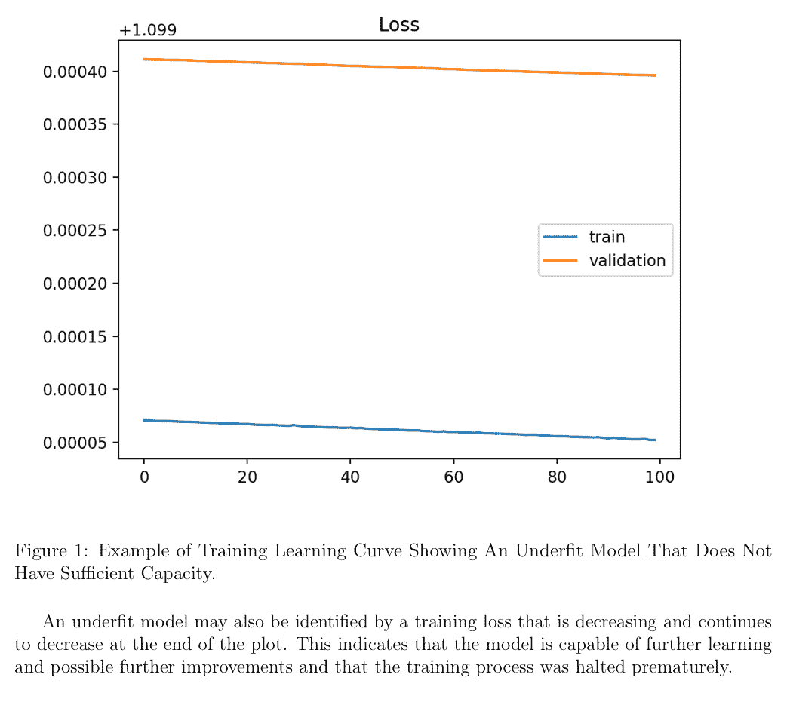

图1：训练学习曲线示例，显示欠拟合模型容量不足。

欠拟合模型也可以通过训练损失在下降并且在图表末端仍在继续下降来识别。这表明模型有能力进一步学习并可能进一步改进，并且训练过程过早停止。

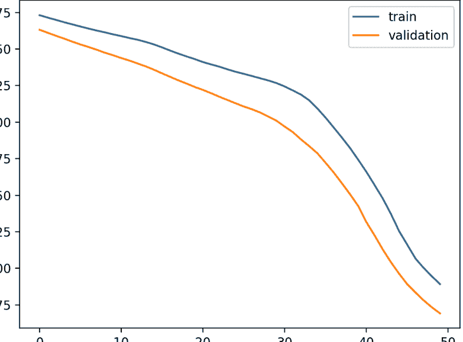

图2：训练学习曲线示例，显示需要进一步训练的欠拟合模型。

学习曲线图显示欠拟合的情况如下：
- 无论训练如何，训练损失保持平坦。
- 训练损失一直下降到训练结束。

### 过拟合学习曲线

过拟合是指模型学习训练数据集过于充分，包括训练数据集中的统计噪声或随机波动。

> ... 拟合更灵活的模型需要估计更多参数。这些更复杂的模型可能导致一种称为过拟合数据的现象，本质上意味着它们过于紧密地跟随误差或噪声。

— 第22页，《统计学习导论：基于R的应用》，2013。

过拟合的问题在于，模型对训练数据越专业化，对新数据的泛化能力就越差，导致泛化误差增加。这种泛化误差的增加可以通过模型在验证数据集上的性能来衡量。

这是过拟合数据的示例，[...]。这是一种不理想的情况，因为所得到的拟合不会对原始训练数据集之外的新的观测值的响应产生准确的估计。

> — 第24页，*统计学习导论：基于R的应用*，2013。

这通常发生在模型容量超过问题所需、从而灵活性过大的情况下。也可能发生在模型训练时间过长时。学习曲线图显示过拟合的情况如下：
- 训练损失图随着经验的积累而持续下降。
- 验证损失图下降到某一点后开始再次上升。

验证损失中的拐点可能是训练可以停止的点，因为该点之后的经验显示出过拟合的动态。下面示例图演示了过拟合的情况。

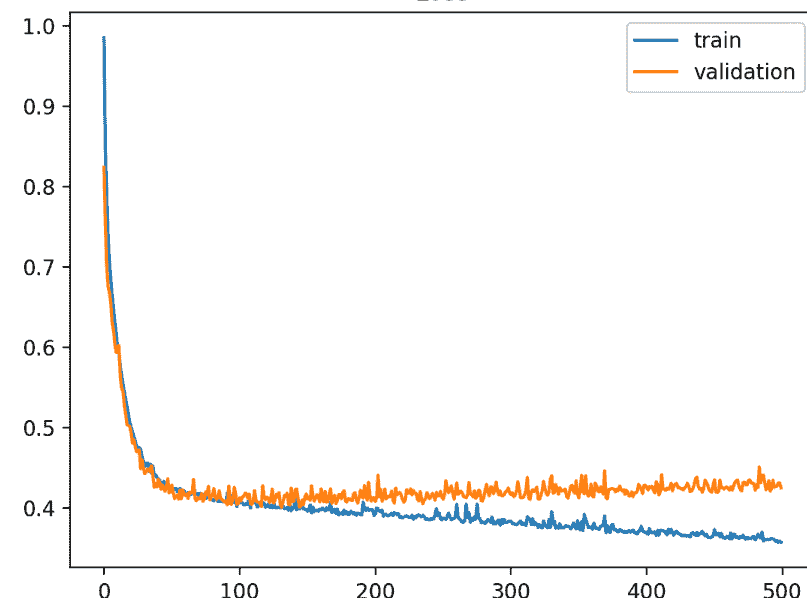

图3：训练和验证学习曲线示例，显示过拟合模型。

### 良好拟合学习曲线

良好拟合是学习算法的目标，存在于过拟合和欠拟合模型之间。良好拟合可通过训练和验证损失下降到稳定点且两个最终损失值之间差距最小来识别。模型的损失在训练数据集上几乎总是低于验证数据集。这意味着我们应该预期训练和验证损失学习曲线之间存在一定的差距。这个差距被称为*泛化差距*。学习曲线图显示良好拟合的情况如下：
- 训练损失图下降到稳定点。
- 验证损失图下降到稳定点，并且与训练损失的差距很小。

对良好拟合的持续训练很可能会导致过拟合。下面示例图演示了良好拟合的情况。

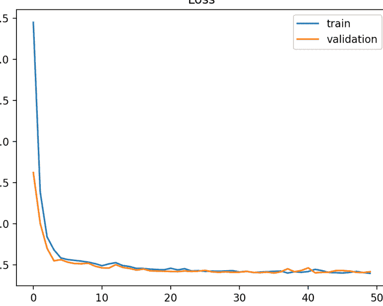

图4：训练和验证学习曲线示例，显示良好拟合。

## 诊断不具代表性的数据集

学习曲线也可用于诊断数据集的属性以及其是否相对具有代表性。不具代表性的数据集是指可能无法捕捉到与来自同一领域的另一个数据集相关的统计特征的数据集，例如训练集和验证集之间。这通常发生在数据集中的样本数量相对于另一个数据集太少时。

可能观察到的两种常见情况如下；它们是：
- 训练数据集相对不具代表性。
- 验证数据集相对不具代表性。

### 不具代表性的训练数据集

不具代表性的训练数据集意味着相对于用于评估它的验证数据集，训练数据集没有提供足够的信息来学习问题。这可能发生在训练数据集的示例数量相比验证数据集太少时。这种情况可以通过训练损失的学习曲线显示改进，并且验证损失的学习曲线也显示改进，但两条曲线之间仍存在较大差距来识别。

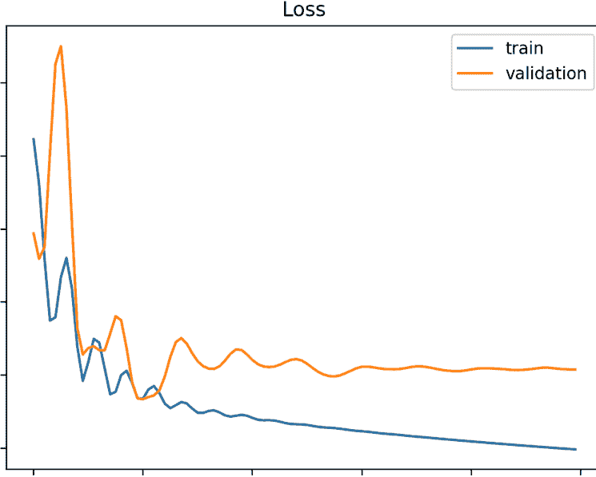

图5：训练和验证学习曲线示例，显示训练数据集可能相对于验证数据集太小。

### 不具代表性的验证数据集

不具代表性的验证数据集意味着验证数据集没有提供足够的信息来评估模型的泛化能力。这可能发生在验证数据集的示例数量相比训练数据集太少时。这种情况可以通过训练损失的学习曲线看起来像良好拟合，而验证损失的学习曲线在训练损失周围显示噪声波动来识别。

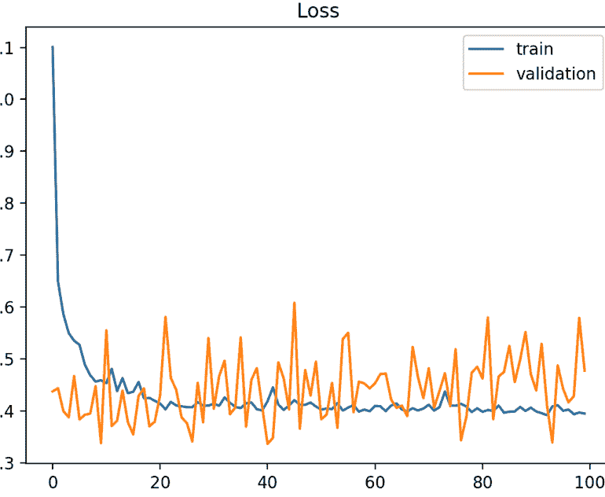

图6：训练和验证学习曲线示例，显示验证数据集可能相对于训练数据集太小。

它也可以通过验证损失低于训练损失来识别。在这种情况下，它表明验证数据集可能比训练数据集更容易被模型预测。

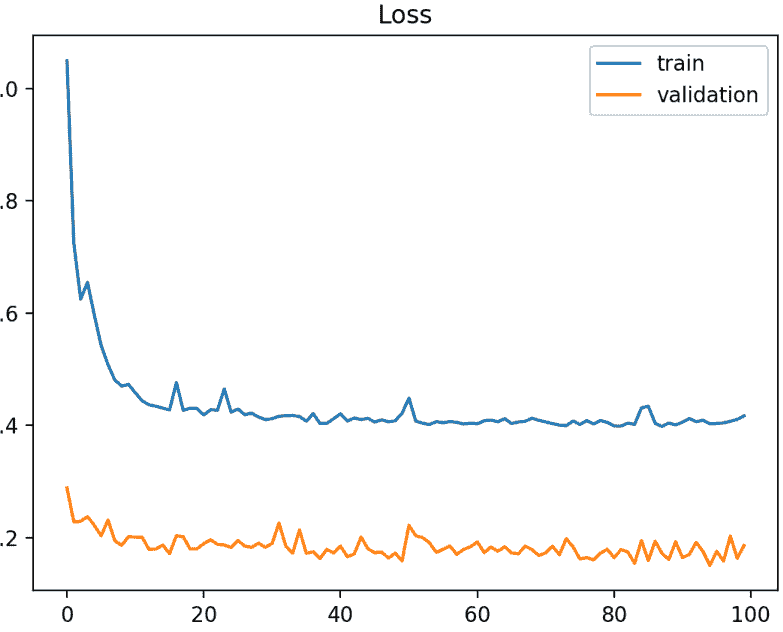

图7：训练和验证学习曲线示例，显示验证数据集比训练数据集更容易预测。

## 延伸阅读

本节提供了更多资源，如果您想深入了解该主题。

### 书籍
- *深度学习*, 2016. https://amzn.to/2SmfnCA
- *统计学习导论：基于R的应用*, 2013. https://amzn.to/2SkKXAy

### 论文
- *学习曲线模型及应用：文献综述与研究方向*, 2011. https://www.sciencedirect.com/science/article/abs/pii/S016981411100062X

### 文章
- 学习曲线，维基百科。 https://en.wikipedia.org/wiki/Learning_curve
- 过拟合，维基百科。 https://en.wikipedia.org/wiki/Overfitting

## 摘要

在本教程中，您了解了学习曲线以及它们如何用于诊断机器学习模型的学习和泛化行为。具体来说，您学习了：
- 学习曲线是显示学习性能随经验在时间上的变化的图表。
- 模型在训练和验证数据集上的性能学习曲线可用于诊断欠拟合、过拟合或拟合良好的模型。
- 模型性能的学习曲线可用于诊断训练或验证数据集是否与问题域不相对具有代表性。

## 下一步

现在您熟悉了改进深度学习神经网络模型性能的框架以及如何诊断模型行为，我们可以开始查看具体技术。在下一部分，您将发现训练神经网络模型时改善收敛性的技术。

## 第一部分

### 更好的学习

## 概述

在本部分中，你将发现改进神经网络模型权重适配优化问题的技术，以便学习训练数据集。阅读完本部分章节后，你将了解：
- 神经网络训练的挑战涉及求解一个非凸优化问题，且对可行解的收敛没有保证（第 1 章）。
- 模型的容量如何控制可学习函数的范围，以及节点数和层数如何控制容量（第 2 章）。


- 批大小如何控制用于更新模型权重的误差估计精度，进而影响收敛的稳定性和速度（第 3 章）。

- 损失函数如何控制所求解的函数逼近问题的性质（第 4 章）。

- 学习率如何控制模型参数的更新幅度，进而影响收敛的稳定性和速度（第 5 章）。

- 训练过程对输入和目标变量的尺度敏感，以及归一化和标准化过程如何显著改善模型收敛（第 6 章）。

- 如何通过修正线性激活函数解决梯度消失问题，并显著提高收敛的可能性和速度（第 7 章）。

- 如何通过梯度范数缩放和梯度值裁剪解决梯度爆炸问题（第 8 章）。

- 如何通过批归一化对内部表示进行标准化来加速收敛速度（第 9 章）。

- 贪婪逐层预训练如何促进更深模型的开发，这是深度学习领域的一个里程碑（第 10 章）。

- 如何将迁移学习用作特征提取和权重初始化方案来缩短训练过程（第 11 章）。

## 第 1 章

### 通过理解优化来改善学习

深度学习神经网络学习从输入到输出的映射函数。这是通过根据模型在训练数据集上的误差更新网络权重来实现的。更新是为了不断减少该误差，直到找到足够好的模型或学习过程陷入停滞并停止。训练神经网络的过程通常是使用该技术最具挑战性的部分，也是耗时最长的部分，无论是在配置过程所需的工作量方面，还是在执行过程所需的计算复杂性方面。在本教程中，你将发现为深度学习神经网络寻找模型参数的挑战。阅读完本教程后，你将了解：

- 神经网络学习从输入到输出的映射函数，可概括为求解函数逼近问题。

- 与其他机器学习算法不同，神经网络的参数必须通过求解一个具有许多良好解和许多误导性良好解的非凸优化问题来找到。

- 随机梯度下降算法用于求解优化问题，其中模型参数在每次迭代中都使用反向传播算法进行更新。

让我们开始吧。

#### 1.1 神经网络学习映射函数

深度学习神经网络学习映射函数。开发模型需要来自该领域的历史数据作为训练数据。这些数据由该领域的观测或示例组成，其中包含描述条件的输入元素和捕获观测含义的输出元素。例如，输出为数量的问题通常被描述为回归预测建模问题。而输出为标签的问题通常被描述为分类预测建模问题。

神经网络模型使用示例学习如何将特定输入变量集映射到输出变量。它必须以这样的方式进行，使得该映射对训练数据集有效，同时对训练期间模型未见过的新示例也有效。这种对特定示例和新示例都能表现良好的能力称为模型的泛化能力。

> > 多层感知器只是一个将一组输入值映射到输出值的数学函数。

> 

> — 第 5 页，《*Deep Learning*》，2016。

我们可以将输入变量与输出变量之间的关系描述为一个复杂的数学函数。对于给定的建模问题，我们必须相信存在一个真实的映射函数来最好地将输入变量映射到输出变量，并且神经网络模型能够合理地逼近真实的未知底层映射函数。

> > 前馈网络定义了一个映射，并学习导致最佳函数逼近的参数值。

> 

> — 第 168 页，《*Deep Learning*》，2016。

因此，我们可以将神经网络解决的更广泛问题描述为*函数逼近*。它们根据训练数据集学习逼近未知的底层映射函数。它们通过学习权重（模型参数）来实现这一点，给定我们必须指定的特定网络结构。

> > 最好将前馈网络视为函数逼近机器，它们旨在实现统计泛化，有时借鉴我们对大脑的了解，而不是作为大脑功能的模型。

> 

> — 第 169 页，《*Deep Learning*》，2016。

#### 1.2 学习网络权重很困难

训练深度学习神经网络非常具有挑战性。

> > 总体而言，优化是一个极其困难的任务。[...] 在训练神经网络时，我们必须面对一般的非凸情况。

> 

> — 第 282 页，《*Deep Learning*》，2016。

优化过程可以概念上理解为在景观中搜索一个足够令人满意的候选解。景观上的一个点是模型的一组特定权重，该点的海拔是对该组权重的评估，其中山谷代表具有较小损失值的良好模型。这是优化问题的常见概念化，景观被称为*误差曲面*。

一般而言，`E(w)` [权重的误差函数] 是一个多维函数，无法可视化。然而，如果它能作为 `w` [权重] 的函数绘制，`E` [误差函数] 可能看起来像一个有山丘和山谷的景观...

> — 第 113 页，《*Neural Smithing: Supervised Learning in Feedforward Artificial Neural Networks*》，1999。

优化算法在此景观中迭代步进，更新权重并寻找良好或低海拔区域。对于简单的优化问题，景观的形状是一个大碗，找到底部很容易，以至于可以设计非常高效的算法来找到最佳解。这些类型的优化问题在数学上被称为凸。

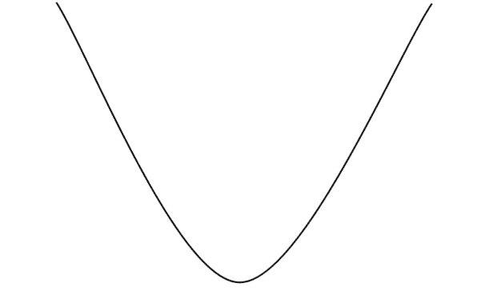

图 1.1：凸误差曲面的示例。

我们在优化神经网络权重时希望导航的误差曲面不是碗形。它是一个有许多山丘和山谷的景观。这些类型的优化问题在数学上被称为非凸。

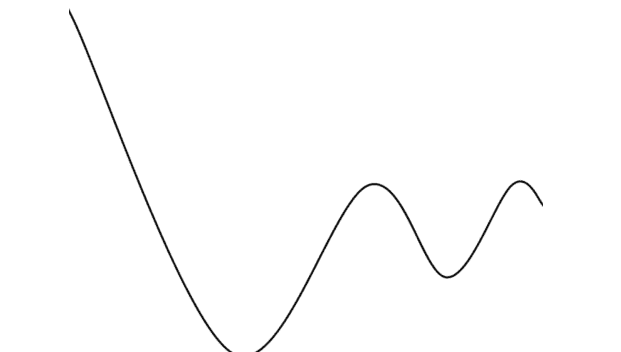

图 1.2：非凸误差曲面的示例。

事实上，不存在一种算法能在多项式时间内解决为神经网络寻找最优权重集的问题。在数学上，通过训练神经网络解决的优化问题被称为 NP-完全（即它属于一类难以求解的优化问题）。

我们证明该问题是 NP-完全的，从而证明神经网络中的学习没有高效的通用解。

> — 《Neural Network Design and the Complexity of Learning》，1988。

#### 1.3 误差曲面的关键特征

存在许多类型的非凸优化问题，但在训练神经网络时我们解决的特定类型问题尤其具有挑战性。我们可以根据优化算法可能遇到并必须导航以便提供良好解的景观或误差曲面的特征来描述这种困难。神经网络权重优化的许多方面使问题具有挑战性，但误差景观中经常提到的三个特征是局部极小值的存在、平坦区域以及搜索空间的高维性。

反向传播可能非常缓慢，特别是对于多层网络，其中成本曲面通常是非二次的、非凸的且高维的，具有许多局部极小值和/或平坦区域。

> — 第 13 页，《Neural Networks: Tricks of the Trade》，2012。

##### 1.3.1 局部极小值

局部极小值或局部最优值指的是误差景观包含多个损失相对较低的区域。这些是山谷，其中山谷中的解相对于周围的斜坡和峰值看起来不错。问题是，在整个景观的更广阔视角中，山谷的海拔相对较高，可能存在更好的解。很难知道优化算法是否处于局部极小值，因此，良好的做法是以大量噪声开始优化过程，在选择落入的山谷之前允许广泛采样景观。

相比之下，景观中的最低点被称为全局极小值。神经网络可能有一个或多个全局极小值，挑战在于局部极小值和全局极小值之间的差异可能没有太大区别。这意味着，通常找到一组足够好的权重比找到全局最优或最佳权重集更可行，也更理想。

非线性网络通常具有多个深度不同的局部极小值。训练的目标是定位其中一个极小值。

> — 第 14 页，《Neural Networks: Tricks of the Trade》，2012。

解决局部最小值问题的一个经典方法是使用不同的起始点（随机初始权重）重启搜索过程多次，并让优化算法找到一个不同的、希望更好的局部最小值。这被称为*多次重启*或*随机重启*。

随机重启：处理局部最小值最简单的方法之一是使用不同的初始权重训练许多不同的网络。

> — 第121页，*《神经塑造：前馈人工神经网络中的监督学习》*，1999年。

##### 1.3.2 平坦区域（鞍点）

平坦区域或鞍点是误差曲面上梯度为零的点。这些是位于谷底或峰与峰之间的平坦区域。问题在于，零梯度意味着优化算法不知道朝哪个方向移动以改进模型。

> ... 鞍点的存在，或者误差函数非常平坦的区域，会导致一些迭代算法长时间“卡住”，从而模拟局部最小值。

> — 第255页，*《神经网络模式识别》*，1995年。

然而，最近的研究可能表明，局部最小值和平坦区域的挑战可能没有以前认为的那么大。

> 神经网络会进入并逃离一系列局部最小值吗？它们在接近并经过各种鞍点时，是否以不同的速度移动？[...] 我们提供的证据强烈表明，上述问题的答案都是否定的。

> — *《定性刻画神经网络优化问题》*，2015年。

##### 1.3.3 高维

训练神经网络时解决的优化问题是高维的。网络中的每个权重都代表误差曲面的另一个参数或维度。与更传统的机器学习算法相比，深度神经网络通常有数百万个参数，这使得算法需要导航的误差曲面极其高维。导航高维空间的问题在于，每增加一个新维度都会急剧增大搜索空间中各点之间的距离。这通常被称为*维数灾难*。

这种现象被称为维数灾难。尤其值得注意的是，一组变量可能的不同配置数量会随着变量数量的增加而呈指数增长。

> — 第155页，*《深度学习》*，2016年。

#### 1.4 导航非凸误差曲面

可以使用训练数据集来评估具有特定权重集的模型，所有训练样本上的平均误差可以被视为模型的误差。模型权重的改变会导致模型误差的改变。因此，我们寻求一组使模型误差较小的权重。这涉及到重复执行评估模型和更新模型参数的步骤，以便沿着误差曲面下降。这个过程重复进行，直到找到一组足够好的参数，或者搜索过程陷入停滞。优化过程在一个解上稳定下来被称为*收敛*，因为该过程已经收敛到一个解。

这是一个搜索或优化过程，我们称以这种方式运行的优化算法为梯度优化算法，因为它们朴素地沿着误差梯度前进。它们在计算上开销大、速度慢，而且它们的经验行为意味着在实践中使用它们更像艺术而非科学。最常用于导航误差曲面的算法被称为随机梯度下降，简称SGD。

> 几乎所有的深度学习都由一个非常重要的算法驱动：随机梯度下降或SGD。

> — 第151页，*《深度学习》*，2016年。

其他为非凸优化问题设计的全局优化算法也可以使用，例如遗传算法，但随机梯度下降更高效，因为它通过一种称为反向传播的算法专门利用梯度信息来更新模型权重。

> [反向传播]通过巧妙应用导数链式法则，描述了一种计算网络训练误差相对于权重的导数的方法。

> — 第49页，*《神经塑造：前馈人工神经网络中的监督学习》*，1999年。

反向传播指的是一种微积分技术，用于计算特定模型参数的模型误差的导数（例如斜率或梯度），从而允许更新模型权重以沿梯度下降。因此，用于训练神经网络的算法也常常被简称为反向传播。

> 实际上，反向传播仅指计算梯度的方法，而另一个算法（如随机梯度下降）则用于利用该梯度进行学习。

> — 第204页，*《深度学习》*，2016年。

#### 1.5 对训练的影响

使用深度学习神经网络时需要解决的优化问题具有挑战性，这对实践中的模型训练有影响。解决此问题的最好的通用算法是随机梯度下降，虽然它很有效，但并不能保证什么。

没有任何公式可以保证（1）网络会收敛到一个好的解，（2）收敛是迅速的，或（3）收敛甚至会发生。

> — 第13页，*《神经网络：行业诀窍》*，2012年。

我们可以将这些影响总结如下：

- **可能令人质疑的解的质量**。由于具有欺骗性的局部最小值，优化过程可能找到也可能找不到好的解，而且解只能相对比较。

- **可能较长的训练时间**。由于搜索的迭代性质，优化过程可能需要很长时间才能找到令人满意的解。

- **可能的失败**。由于平坦区域的存在，优化过程可能无法推进（卡住）或无法找到可行的解。

有效训练的任务是仔细配置、测试和调整模型及学习过程本身的超参数，以最好地应对这一挑战。值得庆幸的是，现代进步可以显著简化搜索空间并加速搜索过程，常常发现比以前认为可能的大得多、更深且性能更好的模型。

#### 1.6 学习算法的组成部分

使用带反向传播的随机梯度下降训练深度学习神经网络模型，需要选择许多组成成分和超参数，它们是：

- 网络拓扑。

- 损失函数。

- 权重初始化。

- 批量大小。

- 学习率。

- 轮数。

- 数据准备。

它们并非都同等重要，有些比其他更重要。此外，它们并非都相互独立，一些选择可以为其他配置元素提供合理的默认值。让我们逐一仔细看看。

神经网络的容量定义了模型可以逼近的映射函数的范围。更大的容量意味着模型更灵活，但也更难训练，因为它有更多需要学习的参数，并提供了一个更具挑战性的优化问题。隐藏层中节点的数量决定了容量，具有足够数量节点的单隐层网络可以逼近任何映射函数（所谓的万能近似）。然而，在实践中这并不实用，而添加节点数更少的层可以增加模型的容量，并使优化问题更容易解决。

- **网络拓扑**。网络中隐藏层的节点数（或等价元素）以及隐藏层的数量（第2章）。

必须选择一个误差函数，通常称为目标函数、代价函数或损失函数。通常，会选择一种称为最大似然的特定概率推断框架。在此框架下，常用的损失函数是分类问题的交叉熵和回归问题的均方误差。

- **损失函数**。用于在训练数据集样本上衡量具有特定权重集的模型性能的函数（第4章）。

搜索或优化过程需要一个起始点来开始模型更新。起始点由初始模型参数或权重定义。由于误差曲面是非凸的，优化算法对初始起点很敏感。因此，会选择较小的随机值作为初始模型权重，尽管可以使用不同的技术来选择这些值的尺度和分布。这些技术被称为*权重初始化*方法。这可能与激活函数的选择有关（见第7章）。

- **权重初始化**。在训练过程开始时将初始小随机值分配给模型权重的过程。

在更新模型时，必须使用训练数据集中的一些样本来计算模型误差，通常简称为*损失*。可以使用训练数据集中的所有样本，这可能适用于较小的数据集。或者，也可以使用单个样本，这可能适用于样本流式传输或数据经常变化的问题。也可以采用混合方法，可以选择训练数据集中的样本数量并用于估计误差梯度。样本数量的选择被称为批量大小。

- **批量大小**。在更新模型参数之前，用于估计误差梯度的样本数量（第3章）。

一旦估计出误差梯度，就可以计算激活函数的导数，并用它来更新每个参数。训练数据集中以及误差梯度的估计中可能存在统计噪声。此外，模型的深度（数量层数）以及模型参数被分别更新这一事实意味着，很难精确计算出为了以最佳方式使整个模型沿误差曲面下降，每个模型参数需要改变多少。相反，每次迭代只执行权重更新的一小部分。一个称为*学习率*的超参数控制着模型权重的更新量，并进而控制模型在训练数据集上的学习速度。

- **学习率**：学习算法每次迭代中每个模型参数被更新的量（第5章）。

训练过程必须重复多次，直到发现一组良好或足够好的模型参数。该过程的总迭代次数受训练数据集完整遍历次数的限制，达到该次数后训练过程终止。这被称为训练*轮次*的数量。该超参数与学习率和批量大小的选择密切相关，而且在使用某些正则化方法时，可以设置为一个较大的值并几乎忽略它（例如参见第18章的早停法）。

- **轮次**：训练过程终止之前完整遍历训练数据集的次数。

一个经常被忽视的方面是用于学习映射函数的数据的性质。目标变量的尺度与网络输出层激活函数的选择密切相关。输入变量的尺度将强烈影响网络输入层和前几个隐藏层中权重的尺度，进而影响学习过程的稳定性。用于学习的数据的尺度和结构问题被称为数据准备。

- **数据准备**：建模前用于准备数据的方案，以确保数据适合问题并能开发稳定的模型（第6章）。

学习算法有许多扩展，尽管这些组件和超参数通常控制着深度学习神经网络的学习算法。更具挑战性的是，并没有规则能够为给定问题最佳配置网络。

使用反向传播设计和训练网络需要做出许多看似任意的选择，例如节点的数量和类型、层的数量、学习率、训练集和测试集等。这些选择可能至关重要，但并没有万无一失的方法来决定它们，因为它们在很大程度上取决于问题和数据。

> —— *《高效反向传播》*，1998年。

#### 1.7 扩展阅读

如果你希望深入了解该主题，本节提供了更多相关资源。

##### 1.7.1 书籍

- *《深度学习》*, 2016.

  https://amzn.to/2NJW3gE

- *《神经锻造：前馈人工神经网络中的监督学习》*, 1999.

  https://amzn.to/2S8qRdI

- *《用于模式识别的神经网络》*, 1995.

  https://amzn.to/2S8qdwt

- *《神经网络：行业诀窍》*, 2012.

  https://amzn.to/2DX69sk

##### 1.7.2 论文

- *《高效反向传播》*, 1998.

  http://yann.lecun.com/exdb/publis/pdf/lecun-98b.pdf

- *《训练三节点神经网络是NP完全的》*, 1992.

  https://www.sciencedirect.com/science/article/pii/S0893608005800103

- *《定性刻画神经网络优化问题》*, 2015.

  https://arxiv.org/abs/1412.6544

- *《神经网络设计与学习的复杂性》*, 1988.

  https://authors.library.caltech.edu/26705/1/88-20.pdf

##### 1.7.3 文章

- 鞍点，维基百科。

  https://en.wikipedia.org/wiki/Saddle_point

- 维数灾难，维基百科。

  https://en.wikipedia.org/wiki/Curse_of_dimensionality

- NP完全性，维基百科。

  https://en.wikipedia.org/wiki/NP-completeness

#### 1.8 总结

在本教程中，你发现了为深度学习神经网络寻找模型参数所面临的挑战。具体而言，你学到了：

- 神经网络学习从输入到输出的映射函数，这可以概括为求解函数逼近问题。

- 与其他机器学习算法不同，神经网络的参数必须通过求解一个非凸优化问题来获得，该问题既包含许多好的解，也包含许多看似很好却具有误导性的解。

- 随机梯度下降算法被用于求解该优化问题，其中模型参数在每次迭代中通过反向传播算法进行更新。

##### 1.8.1 下一步

在下一个教程中，你将了解节点数量如何控制神经网络的容量，进而控制可学习函数的范围。

## 第2章

### 用节点和层配置容量


深度学习神经网络模型的容量控制着它能够学习的映射函数的范围。容量过小的模型无法学习训练数据集，这意味着它会欠拟合；而容量过大的模型可能会记住训练数据集，这意味着它会过拟合，或者在优化过程中陷入困境或迷失方向。神经网络模型的容量通过配置节点数和层数来定义。在本教程中，你将了解如何控制神经网络模型的容量，以及容量如何影响模型能够学习的内容。完成本教程后，你将知道：

- 神经网络模型的容量由模型中的节点数和层数共同控制。
- 具有单个隐藏层且节点数足够的模型具备学习任何映射函数的能力，但所选的学习算法可能实现也可能无法实现这种能力。
- 增加层数为以更少资源扩增模型容量提供了一条捷径，而现代技术使学习算法能够成功训练深度模型。

让我们开始吧。

#### 2.1 神经网络模型容量

神经网络的目标是学习如何将输入示例映射到输出示例。神经网络学习映射函数。网络的容量指模型能够近似的函数的范围。

非正式地说，模型的容量是其拟合多种函数的能力。

> —— 第111-112页，《深度学习》，2016。

容量较小的模型可能无法充分学习训练数据集。容量较大的模型可以建模更多不同的函数，并可能学习到一个充分将训练数据集中的输入映射到输出的函数。而容量过大的模型可能会记住训练数据集，无法泛化，或在寻找合适的映射函数时迷失或陷入困境。通常，我们可以将模型容量视为对模型是更可能欠拟合还是过拟合训练数据集的控制。

我们可以通过改变模型容量来控制模型更可能过拟合还是欠拟合。

> —— 第111页，*《深度学习》*，2016。

神经网络的容量可以通过模型的两个方面来控制：

- 节点数。
- 层数。

拥有更多节点或更多层的模型具有更大的容量，因而潜在地能够驾驭更大的映射函数集合。

拥有更多层且每层更多隐藏单元的网络具有更高的表示容量——它能够表示更复杂的函数。

> —— 第428页，*《深度学习》*，2016。

层中节点的数量被称为*宽度*。开发具有单层和许多节点的宽网络相对简单。理论上，在单个隐藏层中拥有足够节点的网络可以学习逼近任何映射函数，尽管在实践中，我们不知道多少节点是足够的，也不知道如何训练这样的模型。模型中层的数量被称为其*深度*。增加深度会增大模型的容量。训练深度模型（例如具有许多隐藏层的模型）在计算上可能比训练具有大量节点的单层网络更高效。

现代深度学习为监督学习提供了一个非常强大的框架。通过增加更多层和层内更多单元，深度网络可以表示日益复杂的函数。

> —— 第167页，*《深度学习》*，2016。

传统上，由于梯度消失等问题，训练超过几层的神经网络模型一直颇具挑战。近年来，现代方法使得深度网络模型的训练成为可能，从而能够开发出具有惊人深度的模型，这些模型能够在广泛的领域中应对挑战性问题并取得令人瞩目的性能。

#### 2.2 节点与层：Keras API

Keras 允许你轻松地向模型添加节点和层。

##### 2.2.1 配置模型节点

层的第一个参数指定了该层使用的节点数。多层感知机（Multilayer Perceptron，或 MLP）模型的全连接层通过`Dense`层添加。例如，我们可以按如下方式创建一个具有 32 个节点的全连接层：

```
...
layer = Dense(32)
```

清单 2.1：指定`Dense`层节点数的示例。

同样地，循环神经网络层的节点数也可以以相同的方式指定。例如，我们可以按如下方式创建一个具有 32 个节点（或单元）的`LSTM`层：

```
...
layer = LSTM(32)
```

清单 2.2：指定`LSTM`层节点数的示例。

卷积神经网络（Convolutional neural networks，或 CNNs）没有节点，而是指定滤波器映射的数量和形状。滤波器映射的数量和大小定义了层的容量。我们可以按如下方式定义一个具有 32 个滤波器映射的二维 CNN，每个滤波器映射的大小为 3×3：

```
...
layer = Conv2D(32, (3,3))
```

清单 2.3：指定 CNN 层滤波器映射数量的示例。

##### 2.2.2 配置模型层

层通过调用`add()`函数并传入层来添加到顺序模型中。MLP 的全连接层可以通过重复调用`add()`函数并传入已配置的`Dense`层来添加；例如：

```
...
model = Sequential()
model.add(Dense(32))
model.add(Dense(64))
```

清单 2.4：指定 MLP 层数的示例。

同样地，循环网络的层数也可以以相同的方式添加，以形成堆叠的循环模型。一个重要的区别是循环层期望三维输入，因此先前的循环层必须返回输出序列的完整序列，而不是在输入序列末尾每个节点的单个输出。这可以通过将`return_sequences`参数设置为`True`来实现。例如：

```
...
model = Sequential()
model.add(LSTM(32, return_sequences=True))
model.add(LSTM(32))
```

清单 2.5：指定`LSTM`层数的示例。

卷积层可以直接堆叠，通常将一到两个卷积层堆叠在一起，然后跟一个池化层，然后重复这种层模式；例如：

```
...
model = Sequential()
model.add(Conv2D(16, (3,3)))
model.add(Conv2D(16, (3,3)))
model.add(MaxPooling2D((2,2)))
model.add(Conv2D(32, (3,3)))
model.add(Conv2D(32, (3,3)))
model.add(MaxPooling2D((2,2)))
```

清单 2.6：指定 CNN 层数的示例。

现在我们知道了如何在 Keras 中配置模型的节点数和层数，我们可以看看容量如何影响模型在多类分类问题上的性能。

#### 2.3 模型容量案例研究

在本节中，我们将演示如何使用模型容量来控制 MLP 在简单分类问题上的学习。此示例为使用您自己的神经网络探索分类和回归问题的模型容量提供了一个模板。

##### 2.3.1 多类分类问题

我们将使用标准的多类分类问题作为基础来演示模型容量对模型性能的影响。scikit-learn 类提供了`make_blobs()`函数，可用于创建具有规定样本数、输入变量、类别数以及类内样本方差的多类分类问题。我们可以通过`n_features`参数配置问题具有特定数量的输入变量，并通过`centers`参数配置特定数量的类别或中心。`random_state`可用于为伪随机数生成器设置种子，以确保每次调用函数时始终获得相同的样本。例如，下面的调用为具有两个输入变量的三个类别问题生成 1,000 个示例。

```
...
# generate 2d classification dataset
X, y = make_blobs(n_samples=1000, centers=3, n_features=2, cluster_std=2, random_state=2)
```

清单 2.7：为 blobs 问题创建样本的示例。

结果是我们可以建模的数据集的输入和输出元素。为了感受问题的复杂性，我们可以将每个点绘制在二维散点图上，并按类别值对每个点着色。完整示例如下所示。

```
# scatter plot of blobs dataset
from sklearn.datasets.samples_generator import make_blobs
from matplotlib import pyplot
from numpy import where
# generate 2d classification dataset
X, y = make_blobs(n_samples=1000, centers=3, n_features=2, cluster_std=2, random_state=2)
# scatter plot for each class value
for class_value in range(3):
    # select indices of points with the class label
    row_ix = where(y == class_value)
# scatter plot for points with a different color
pyplot.scatter(X[row_ix, 0], X[row_ix, 1])
# show plot
pyplot.show()
```

清单 2.8：绘制 blobs 问题样本的示例。

运行示例会创建整个数据集的散点图。我们可以看到，所选的标准差 2.0 意味着类别不是线性可分的（可由直线分隔），导致许多模糊点。这是理想的，因为这意味着问题是非平凡的，并且神经网络模型可以找到许多足够好的候选解决方案。

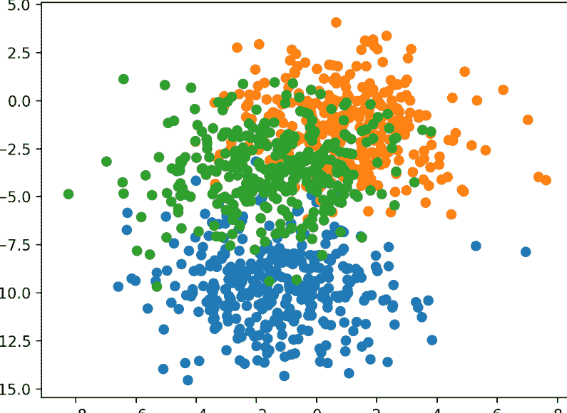

图 2.1：具有三个类别且按类别值着色的点的 Blobs 数据集散点图。

为了探索模型容量，我们需要比三个类别和两个变量更复杂的问题。为了以下实验的目的，我们将使用 100 个输入特征和 20 个类别；例如：

```
...
# generate 2d classification dataset
X, y = make_blobs(n_samples=1000, centers=20, n_features=100, cluster_std=2, random_state=2)
```

清单 2.9：为 blobs 问题创建大量样本的示例。

#### 2.3.2 使用节点更改模型容量

在本节中，我们将为 blobs 多类分类问题开发一个多层感知机模型（Multilayer Perceptron，或 MLP），并演示节点数量对模型学习能力的影响。我们可以先开发一个函数来准备数据集。数据集的输入和输出元素可以使用上一节中描述的`make_blobs()`函数创建。接下来，目标变量必须进行独热编码。这样模型就可以学习预测输入示例属于 20 个类别中每个类别的概率。我们可以使用`to_categorical()` Keras 实用函数来实现此目的，例如：

```
# one hot encode output variable
y = to_categorical(y)
```

清单 2.10：对目标变量进行独热编码的示例。

接下来，我们可以将 1,000 个示例分成两半，使用 500 个示例作为训练数据集，500 个用于评估模型。

```
# split into train and test
n_train = 500
trainX, testX = X[:n_train, :], X[n_train:, :]
trainy, testy = y[:n_train], y[n_train:]
return trainX, trainy, testX, testy
```

清单 2.11：为建模准备数据集的示例。

下面的`create_dataset()`函数将这些元素结合在一起，并以输入和输出元素的形式返回训练集和测试集。

```
# prepare multiclass classification dataset
def create_dataset():
    # generate 2d classification dataset
    X, y = make_blobs(n_samples=1000, centers=20, n_features=100, cluster_std=2,
        random_state=2)
    # one hot encode output variable
    y = to_categorical(y)
    # split into train and test
    n_train = 500
    trainX, testX = X[:n_train, :], X[n_train:, :]
    trainy, testy = y[:n_train], y[n_train:]
    return trainX, trainy, testX, testy
```

清单 2.12：定义用于为建模准备数据集的函数的示例。

我们可以调用此函数来准备数据集。

```
# prepare dataset
trainX, trainy, testX, testy = create_dataset()
```

清单 2.13：准备数据集的示例。

接下来，我们可以定义一个函数，该函数将创建模型，在训练数据集上拟合它，然后在测试数据集上评估它。模型需要知道输入变量的数量以配置输入层，并需要知道目标类别的数量以配置输出层。这些属性可以直接从训练数据集中提取。

```
# configure the model based on the data
n_input, n_classes = trainX.shape[1], testy.shape[1]
```

清单 2.14：确定输入数和类别数的示例。

我们将定义一个具有单个隐藏层的 MLP 模型，该隐藏层使用修正线性激活函数和 He 随机权重初始化方法。输出层将使用`softmax`激活函数以预测每个目标类别的概率。隐藏层中的节点数将通过名为`n_nodes`的参数提供。

```
# define model
model = Sequential()
model.add(Dense(n_nodes, input_dim=n_input, activation='relu',
    kernel_initializer='he_uniform'))
model.add(Dense(n_classes, activation='softmax'))
```

清单 2.15：定义 MLP 模型的示例。

模型将使用学习率为 0.01 且动量为 0.9 的随机梯度下降进行优化，并使用适合多类分类的分类交叉熵损失函数。

```
# compile model
opt = SGD(lr=0.01, momentum=0.9)
model.compile(loss='categorical_crossentropy', optimizer=opt, metrics=['accuracy'])
```

清单 2.16：编译 MLP 模型的示例。

模型将拟合 100 个训练 epoch，然后在测试数据集上进行评估。

```
# fit model on train set
history = model.fit(trainX, trainy, epochs=100, verbose=0)
# evaluate model on test set
_ , test_acc = model.evaluate(testX, testy, verbose=0)
return history, test_acc
```

清单 2.17：拟合和评估 MLP 模型的示例。

将这些元素结合起来，下面的`evaluate_model()`函数以节点数和数据集作为参数，并返回每个 epoch 结束时的训练损失历史以及最终模型在测试数据集上的准确率。

```
# fit model with given number of nodes, returns test set accuracy
def evaluate_model(n_nodes, trainX, trainy, testX, testy):
  # configure the model based on the data
  n_input, n_classes = trainX.shape[1], testy.shape[1]
  # define model
  model = Sequential()
  model.add(Dense(n_nodes, input_dim=n_input, activation='relu',
      kernel_initializer='he_uniform'))
  model.add(Dense(n_classes, activation='softmax'))
  # compile model
  opt = SGD(lr=0.01, momentum=0.9)
  model.compile(loss='categorical_crossentropy', optimizer=opt, metrics=['accuracy'])
  # fit model on train set
  history = model.fit(trainX, trainy, epochs=100, verbose=0)
  # evaluate model on test set
  _ , test_acc = model.evaluate(testX, testy, verbose=0)
  return history, test_acc
```

清单 2.18：定义用于定义、拟合和评估 MLP 模型的函数的示例。

我们可以用不同的节点数调用此函数以用于隐藏层。该问题相对简单；因此，我们将回顾模型在 1 到 7 个节点时的性能。我们期望增加节点数会提高模型的容量，并使模型能够更好地学习训练数据集，至少在学习算法所选配置（例如学习率、批大小和 epoch）限制的范围内。每个配置的测试准确率将被打印，并且每个配置的训练准确率学习曲线将被绘制。


# evaluate model and plot learning curve with given number of nodes

```python
num_nodes = [1, 2, 3, 4, 5, 6, 7]
for n_nodes in num_nodes:
    # evaluate model with a given number of nodes
    history, result = evaluate_model(n_nodes, trainX, trainy, testX, testy)
    # summarize final test set accuracy
    print('nodes=%d: %.3f' % (n_nodes, result))
    # plot learning curve
    pyplot.plot(history.history['loss'], label=str(n_nodes))
# show the plot
pyplot.legend()
pyplot.show()
```

Listing 2.19: 使用不同数量节点的评估模型的示例。

下面提供了完整的代码列表以供完整性。

```python
# study of mlp learning curves given different number of nodes for multi-class classification
from sklearn.datasets.samples_generator import make_blobs
from keras.layers import Dense
from keras.models import Sequential
from keras.optimizers import SGD
from keras.utils import to_categorical
from matplotlib import pyplot

# prepare multi-class classification dataset
def create_dataset():
    # generate 2d classification dataset
    X, y = make_blobs(n_samples=1000, centers=20, n_features=100, cluster_std=2,
        random_state=2)
    # one hot encode output variable
    y = to_categorical(y)
    # split into train and test
    n_train = 500
    trainX, testX = X[:n_train, :], X[n_train:, :]
    trainy, testy = y[:n_train], y[n_train:]
    return trainX, trainy, testX, testy

# fit model with given number of nodes, returns test set accuracy
def evaluate_model(n_nodes, trainX, trainy, testX, testy):
    # configure the model based on the data
    n_input, n_classes = trainX.shape[1], testy.shape[1]
```

```python
# define model

model = Sequential()

model.add(Dense(n_nodes, input_dim=n_input, activation='relu',

    kernel_initializer='he_uniform'))

model.add(Dense(n_classes, activation='softmax'))

# compile model

opt = SGD(lr=0.01, momentum=0.9)

model.compile(loss='categorical_crossentropy', optimizer=opt, metrics=['accuracy'])

# fit model on train set

history = model.fit(trainX, trainy, epochs=100, verbose=0)

# evaluate model on test set

_, test_acc = model.evaluate(testX, testy, verbose=0)

return history, test_acc

# prepare dataset

trainX, trainy, testX, testy = create_dataset()

# evaluate model and plot learning curve with given number of nodes

num_nodes = [1, 2, 3, 4, 5, 6, 7]

for n_nodes in num_nodes:

    # evaluate model with a given number of nodes

    history, result = evaluate_model(n_nodes, trainX, trainy, testX, testy)

    # summarize final test set accuracy

    print('nodes=%d: %.3f' % (n_nodes, result))

    # plot learning curve

    pyplot.plot(history.history['loss'], label=str(n_nodes))

# show the plot

pyplot.legend()

pyplot.show()
```

Listing 2.20: 在 blobs 问题上评估具有不同节点数的 MLP 模型的示例。

运行示例首先会打印每个模型配置的测试准确率。

注意：由于学习算法的随机性，您的具体结果可能会有所不同。考虑多次运行示例并比较平均性能。

在这种情况下，我们可以看到，随着节点数的增加，模型学习问题的能力也随之增加。这导致模型在测试数据集上的泛化误差逐渐降低，直到 6 和 7 个节点时模型完美地学习了问题。

```
nodes=1: 0.138
nodes=2: 0.380
nodes=3: 0.582
nodes=4: 0.890
nodes=5: 0.844
nodes=6: 1.000
nodes=7: 1.000
```

Listing 2.21: 在 blobs 问题上评估具有不同节点数的 MLP 模型的示例输出。

还创建了一条线图，显示在 100 个训练 epoch 中每个模型配置（隐藏层中 1 到 7 个节点）在训练数据集上的交叉熵损失。我们可以看到，随着节点数的增加，模型能够更好地降低损失，例如更好地学习训练数据集。该图显示了模型容量（由隐藏层中的节点数定义）与模型学习能力之间的直接关系。

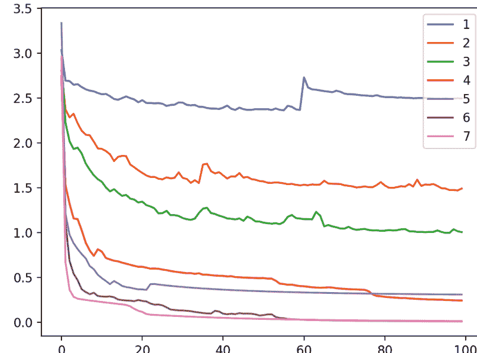

Figure 2.2: 改变模型节点时，MLP 在 Blobs 多类分类问题的训练数据集上训练 epoch 的交叉熵损失的线图。

节点数可以增加到（例如 1,000 个节点）学习算法不再能够充分学习映射函数的程度。

### 2.3.3 使用层改变模型容量

我们可以执行类似的分析并评估层数如何影响模型学习映射函数的能力。增加层数通常可以大大提高模型的容量，充当对问题进行建模的计算和学习捷径。例如，具有 10 个节点的单隐藏层模型并不等同于具有两个各有五个节点的隐藏层的模型。后者的容量要大得多。危险在于，容量超过所需容量的模型很可能过拟合训练数据，并且与具有太多节点的模型一样，具有太多层的模型可能无法学习训练数据集，在优化过程中迷失或陷入停滞。

首先，我们可以更新 `evaluate_model()` 函数以拟合具有给定层数的 MLP 模型。我们知道从上一节中，MLP 大约有七个或更多

训练100个epoch的模型将能完美学会该问题。因此，我们将在每一层使用10个节点，以确保模型仅用一层就拥有足够的能力来学习该问题。更新后的函数如下所示，它以层数和数据集作为参数，并返回模型的训练历史和测试准确率。

```python
# fit model with given number of layers, returns test set accuracy
def evaluate_model(n_layers, trainX, trainy, testX, testy):
    # configure the model based on the data
    n_input, n_classes = trainX.shape[1], testy.shape[1]
    # define model
    model = Sequential()
    model.add(Dense(10, input_dim=n_input, activation='relu',
                kernel_initializer='he_uniform'))
    for _ in range(1, n_layers):
        model.add(Dense(10, activation='relu', kernel_initializer='he_uniform'))
    model.add(Dense(n_classes, activation='softmax'))
    # compile model
    opt = SGD(lr=0.01, momentum=0.9)
    model.compile(loss='categorical_crossentropy', optimizer=opt, metrics=['accuracy'])
    # fit model
    history = model.fit(trainX, trainy, epochs=100, verbose=0)
    # evaluate model on test set
    _, test_acc = model.evaluate(testX, testy, verbose=0)
    return history, test_acc
```

清单2.22：用于评估不同层数模型的函数示例。

鉴于单隐藏层模型已具备足够的能力来学习该问题，我们将探索逐渐增加层数，直到学习算法变得不稳定且无法再学习该问题为止。如果所选的建模问题更加复杂，我们可以探索增加层数，并检查模型性能的提升直至达到收益递减点。在此情况下，我们将评估1到5层的模型，预期在某个时刻，层数的增加会导致所选学习算法无法适应训练数据。

```python
# evaluate model and plot learning curve of model with given number of layers
all_history = list()
num_layers = [1, 2, 3, 4, 5]
for n_layers in num_layers:
    # evaluate model with a given number of layers
    history, result = evaluate_model(n_layers, trainX, trainy, testX, testy)
    print('layers=%d: %.3f' % (n_layers, result))
    # plot learning curve
    pyplot.plot(history.history['loss'], label=str(n_layers))
pyplot.legend()
pyplot.show()
```

清单2.23：评估不同层数MLP的模型示例。

将这些元素整合在一起，完整示例代码如下所示。

```python
# study of mlp learning curves given different number of layers for multi-class
    classification
from sklearn.datasets.samples_generator import make_blobs
from keras.models import Sequential
from keras.layers import Dense
from keras.optimizers import SGD
from keras.utils import to_categorical
from matplotlib import pyplot

# prepare multi-class classification dataset
def create_dataset():
    # generate 2d classification dataset
    X, y = make_blobs(n_samples=1000, centers=20, n_features=100, cluster_std=2,
                      random_state=2)
    # one hot encode output variable
    y = to_categorical(y)
    # split into train and test
    n_train = 500
    trainX, testX = X[:n_train, :], X[n_train:, :]
    trainy, testy = y[:n_train], y[n_train:]
    return trainX, trainy, testX, testy

# fit model with given number of layers, returns test set accuracy
def evaluate_model(n_layers, trainX, trainy, testX, testy):
    # configure the model based on the data
    n_input, n_classes = trainX.shape[1], testy.shape[1]
    # define model
    model = Sequential()
    model.add(Dense(10, input_dim=n_input, activation='relu',
                    kernel_initializer='he_uniform'))
    for _ in range(1, n_layers):
        model.add(Dense(10, activation='relu', kernel_initializer='he_uniform'))
    model.add(Dense(n_classes, activation='softmax'))
    # compile model
    opt = SGD(lr=0.01, momentum=0.9)
    model.compile(loss='categorical_crossentropy', optimizer=opt, metrics=['accuracy'])
    # fit model
    history = model.fit(trainX, trainy, epochs=100, verbose=0)
    # evaluate model on test set
    _, test_acc = model.evaluate(testX, testy, verbose=0)
    return history, test_acc

# get dataset
trainX, trainy, testX, testy = create_dataset()
# evaluate model and plot learning curve of model with given number of layers
all_history = list()
num_layers = [1, 2, 3, 4, 5]
for n_layers in num_layers:
    # evaluate model with a given number of layers
    history, result = evaluate_model(n_layers, trainX, trainy, testX, testy)
    print('layers=%d: %.3f' % (n_layers, result))
    # plot learning curve
    pyplot.plot(history.history['loss'], label=str(n_layers))
pyplot.legend()
pyplot.show()
```

清单2.24：在blobs问题上评估不同层数MLP模型的示例。

运行该示例，首先会输出每种模型配置的测试准确率。

注意：由于学习算法的随机性，您的具体结果可能会有所不同。建议多次运行示例并比较平均性能。

在这种情况下，我们可以看到模型最多能良好地学习该问题达三层，之后便开始表现不佳。我们可以看到，五层时性能显著下降，并且如果进一步增加层数，性能预计会继续下降。

```
layers=1: 1.000
layers=2: 1.000
layers=3: 1.000
layers=4: 0.948
layers=5: 0.794
```

清单2.25：在blobs问题上评估不同层数MLP模型的输出示例。


还绘制了一张线图，展示了每种模型配置（1到5层）在100个训练轮次中训练数据集上的交叉熵损失。我们可以看到，1层、2层和3层（蓝色、橙色和绿色）的模型动态非常相似，都能快速学习该问题。令人意外的是，4层和5层的训练损失起初表现良好，随后急剧上升，这表明模型很可能陷入了一组次优的权重，而不是对训练数据集过拟合。

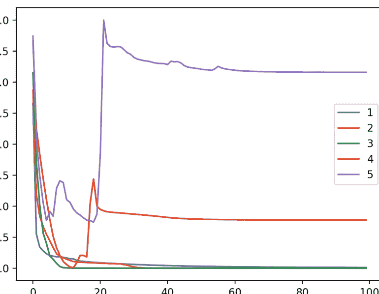

图2.3：在blobs多分类问题上，改变模型层数时，MLP在训练数据集上的交叉熵损失随训练轮次变化的线图。

分析表明，通过增加深度来提升模型容量是一种非常有效的工具，但必须谨慎使用，因为它可能很快导致模型容量过大，从而难以轻松学习训练数据集。

#### 2.4 扩展

本节列出了一些扩展本教程的想法，您可能希望尝试。

- **节点过多**。更新增加节点的实验，以找到学习算法无法再学习该问题的临界点。

- **重复评估**。更新实验，对每种配置进行重复评估，以应对学习算法的随机性。

- **更难的问题**。在一个需要增加深度所提供的容量才能表现良好的问题上，重复增加层数的实验。

如果你探索了其中任何扩展，我很想知道。

#### 2.5 延伸阅读

如果你想深入了解，本节提供有关该主题的更多资源。

##### 2.5.1 书籍

- *神经锻造：前馈人工神经网络中的监督学习*，1999年。
  https://amzn.to/2vhyW8j

- *深度学习*，2016年。
  https://amzn.to/2IXzUIY

##### 2.5.2 API

- Keras核心层API。
  https://keras.io/layers/core/

- Keras卷积层API。
  https://keras.io/layers/convolutional/

- Keras循环层API。
  https://keras.io/layers/recurrent/

- Keras实用函数API。
  https://keras.io/utils/

- `sklearn.datasets.make_blobs` API。
  http://scikit-learn.org/stable/modules/generated/sklearn.datasets.make_blobs.html

##### 2.5.3 文章

- 应该使用多少个隐藏层？，comp.ai.neural-nets FAQ.
  http://www.faqs.org/faqs/ai-faq/neural-nets/part3/section-9.html

#### 2.6 摘要

在本教程中，你了解了如何控制神经网络模型的容量以及容量如何影响模型能够学习的内容。具体来说，你学习了：

- 神经网络模型容量由模型中的节点数和层数共同控制。

- 具有单个隐藏层和足够数量节点的模型具有学习任意映射函数的能力，但所选的学习算法可能无法实现这种能力。

- 增加层数可以在资源更少的情况下为模型提供增加容量的捷径，并且现代技术允许学习算法成功训练深度模型。

##### 2.6.1 下一步

在下一教程中，你将发现批量大小如何控制误差梯度估计的精度，进而控制收敛的稳定性和速度。

## 第 3 章

### 使用批量大小配置梯度精度

神经网络使用梯度下降进行训练，其中用于更新权重的误差估计是基于训练数据集的子集计算的。从训练数据集中用于误差梯度估计的示例数量称为批量大小，这是一个重要的超参数，影响学习算法的动态。探索模型的动态非常重要，以确保你充分利用它。在本教程中，你将发现梯度下降的三种不同变体，以及如何探索和诊断批量大小对学习过程的影响。完成本教程后，你将知道：

- 批量大小控制训练神经网络时误差梯度估计的准确性。

- 批量、随机和迷你批量梯度下降是学习算法的三大主要变体。

- 批量大小与学习过程的速度和稳定性之间存在权衡。

让我们开始吧。

#### 3.1 批量大小与梯度下降

神经网络使用随机梯度下降优化算法进行训练。这涉及使用模型的当前状态进行预测，将预测与实际值进行比较，并使用差异作为误差梯度的估计。然后使用该误差梯度更新模型权重并重复该过程。误差梯度是一个统计估计。用于估计的训练示例越多，该估计就越准确，网络权重被调整以提高模型性能的可能性就越大。误差梯度估计的改进是以计算成本为代价的，即在计算估计值之前必须使用模型进行更多预测，进而更新权重。

使用整个训练集的优化算法称为批量或确定性梯度方法，因为它们同时以大批量处理所有训练示例。

— 第 278 页，*深度学习*，2016。

相反，使用更少的示例会导致误差梯度估计的准确性较低，并且高度依赖于所使用的特定训练示例。这导致噪声估计，进而导致对模型权重的噪声更新，例如许多更新可能具有相当不同的误差梯度估计。尽管如此，这些噪声更新可能会导致更快的学习，有时模型更稳健。

仅一次使用一个示例的优化算法有时称为随机或有时称为在线方法。术语在线通常保留用于示例从持续创建的示例流中抽取而不是从多次遍历的固定大小训练集中抽取的情况。

— 第 278 页，*深度学习*，2016。

用于误差梯度估计的训练示例数量是学习算法的一个超参数，称为*批量大小*，或简称为*批量*。批量大小为 32 意味着在更新模型权重之前，将使用训练数据集中的 32 个样本来估计误差梯度。一个训练周期意味着学习算法对训练数据集进行一次遍历（使用每个示例一次），其中示例被分离成随机选择的*批量大小*组。

历史上，批量大小设置为训练示例总数的训练算法称为*批量梯度下降*，而批量大小设置为 1 个训练示例的训练算法称为*随机梯度下降*或*在线梯度下降*。批量大小在两者之间（例如多于 1 个示例且少于训练数据集中的示例数）的配置称为*迷你批量梯度下降*。

- **批量梯度下降**。批量大小设置为训练数据集中示例的总数。

- **随机梯度下降**。批量大小设置为一。

- **迷你批量梯度下降**。批量大小设置为多于一且少于训练数据集中示例的总数。

为了简洁，算法通常被称为随机梯度下降，而不管批量大小如何。鉴于用于训练深度学习神经网络的数据集通常非常大，批量大小很少设置为训练数据集的大小。较小的批量大小被使用有两个主要原因：

- 较小的批量大小具有噪声，提供正则化效果并降低泛化误差。

- 较小的批量大小使得更容易将一批训练数据装入内存（即使用 GPU 时，其可访问的本地内存少于系统 RAM）。

第三个原因是批量大小通常设置为较小的值，例如 32 个示例，并且不由从业者调整。像 32 这样的小批量大小通常效果很好。

... [batch size] 通常在 1 到几百之间选择，例如 [batch size] = 32 是一个良好的默认值

> — *深度架构基于梯度训练的实用建议*，2012。

所呈现的结果证实，使用小批量大小在各种实验中，在给定的计算成本下实现了最佳的训练稳定性和泛化性能。在所有情况下，最佳结果都是在批量大小 `m = 32` 或更小的情况下获得的，通常小到 `m = 2` 或 `m = 4`。

> — *重新审视深度神经网络的小批量训练*，2018。

尽管如此，批量大小会影响模型学习的速度和学习过程的稳定性。它是一个重要的超参数，应由深度学习从业者充分理解并进行调整。

#### 3.2 梯度下降 Keras API

Keras 允许你使用随机、批量或迷你批量梯度下降训练模型。这可以通过在训练模型时对 `fit()` 函数调用设置 `batch_size` 参数来实现。让我们依次查看每种方法。

##### 3.2.1 批量大小 Keras API

下面的示例将 `batch_size` 参数设置为 1 用于随机梯度下降。

```
...
model.fit(trainX, trainY, batch_size=1)
```

Listing 3.1: Keras 中随机梯度下降的示例。

##### 3.2.2 Keras 中的批量梯度下降

下面的示例将 `batch_size` 参数设置为训练数据集中样本的数量用于批量梯度下降。

```
...
model.fit(trainX, trainY, batch_size=len(trainX))
```

Listing 3.2: Keras 中批量梯度下降的示例。

##### 3.2.3 Keras 中的迷你批量梯度下降

下面的示例对 `batch_size` 参数使用默认批量大小 32，这对于随机梯度下降来说大于 1，对于批量梯度下降来说小于你的训练数据集的大小。

```
...
model.fit(trainX, trainY)
```

Listing 3.3: Keras 中默认批量大小的迷你批量梯度下降示例。

Alternately, the `batch_size` can be specified to something other than 1 or the number of samples in the training dataset, such as 64.

```
...
model.fit(trainX, trainY, batch_size=64)
```

Listing 3.4: Keras 中迷你批量梯度下降的示例。

#### 3.3 批量大小案例研究

在本节中，我们将演示如何使用梯度下降批量大小通过 MLP 在一个简单的分类问题上控制学习。此示例为使用你自己的神经网络探索分类和回归问题的批量大小提供了一个模板。

##### 3.3.1 多类分类问题

我们将使用一个小型多类分类问题作为基础来演示批量大小对学习的影响。scikit-learn 类提供了 `make_blobs()` 函数，可用于创建具有规定样本数、输入变量、类别数以及类内样本方差的多类分类问题。该问题可以配置为具有两个输入变量（表示点的 `x` 和 `y` 坐标）以及每个组内点的标准差为 2.0。我们将使用相同的随机状态（伪随机数生成器的种子）以确保我们始终获得相同的数据点。

```
# generate 2d classification dataset
X, y = make_blobs(n_samples=1000, centers=3, n_features=2, cluster_std=2, random_state=2)
```

Listing 3.5: 为 blobs 问题生成样本的示例。

结果是我们可以建模的数据集的输入和输出元素。为了感受问题的复杂性，我们可以在二维散点图上绘制每个点，并按类别值对每个点着色。完整的示例如下所示。

```
# scatter plot of blobs dataset
from sklearn.datasets.samples_generator import make_blobs
from matplotlib import pyplot
from numpy import where
# generate 2d classification dataset
X, y = make_blobs(n_samples=1000, centers=3, n_features=2, cluster_std=2, random_state=2)
# scatter plot for each class value
for class_value in range(3):
    # select indices of points with the class label
    row_ix = where(y == class_value)
    # scatter plot for points with a different color
    pyplot.scatter(X[row_ix, 0], X[row_ix, 1])
# show plot
pyplot.show()
```

清单 3.6：绘制 blobs 问题样本的散点图示例。

运行该示例会生成整个数据集的散点图。我们可以看到，标准差为 2.0 意味着这些类别不是线性可分的（无法用一条线分开），这导致了许多有歧义的点。这是我们所期望的，因为它意味着该问题并非微不足道，并且能让神经网络模型找到许多不同的、足够好的候选解。

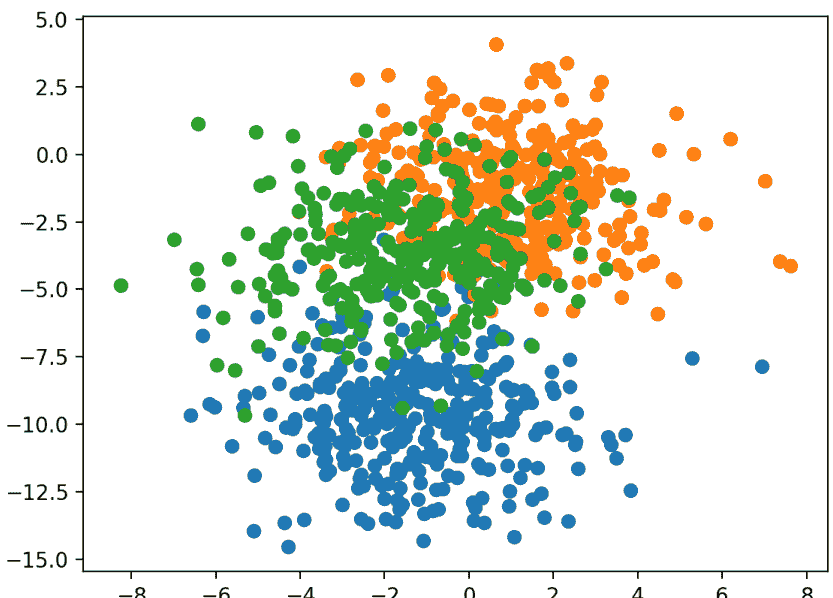

图 3.1：包含三个类别且按类别值着色的 Blobs 数据集散点图。

##### 3.3.2 使用批量梯度下降拟合 MLP

我们可以开发一个多层感知器（MLP）模型来解决前一节描述的多分类问题，并使用批量梯度下降对其进行训练。首先，我们需要对目标变量进行独热编码，将整数类别值转换为二进制向量。这将使模型能够预测每个样本属于三个类别中每一个类别的概率，从而在训练模型时提供更细致的预测和上下文。

创建了一个折线图，显示模型在每个训练轮次中的训练集和测试集准确率。这些学习曲线可以说明三件事：模型学习该问题的速度、模型对该问题的学习程度，以及训练期间模型更新的噪声程度。

```
# plot loss learning curves
pyplot.subplot(211)
pyplot.title('Cross-Entropy Loss', pad=-40)
pyplot.plot(history.history['loss'], label='train')
pyplot.plot(history.history['val_loss'], label='test')
pyplot.legend()
# plot accuracy learning curves
pyplot.subplot(212)
pyplot.title('Accuracy', pad=-40)
pyplot.plot(history.history['acc'], label='train')
pyplot.plot(history.history['val_acc'], label='test')
pyplot.legend()
pyplot.show()
```

清单 3.12：绘制 MLP 模型学习曲线的示例。

将这些元素组合在一起，完整的示例如下所示。

```
# mlp for the blobs problem with batch gradient descent
from sklearn.datasets.samples_generator import make_blobs
from keras.layers import Dense
from keras.models import Sequential
from keras.optimizers import SGD
from keras.utils import to_categorical
from matplotlib import pyplot
# generate 2d classification dataset
X, y = make_blobs(n_samples=1000, centers=3, n_features=2, cluster_std=2, random_state=2)
# one hot encode output variable
y = to_categorical(y)
# split into train and test
n_train = 500
trainX, testX = X[:n_train, :], X[n_train:, :]
trainy, testy = y[:n_train], y[n_train:]
# define model
model = Sequential()
model.add(Dense(50, input_dim=2, activation='relu', kernel_initializer='he_uniform'))
model.add(Dense(3, activation='softmax'))
# compile model
opt = SGD(lr=0.01, momentum=0.9)
model.compile(loss='categorical_crossentropy', optimizer=opt, metrics=['accuracy'])
# fit model
history = model.fit(trainX, trainy, validation_data=(testX, testy), epochs=200, verbose=0,
    batch_size=len(trainX))
# evaluate the model
_, train_acc = model.evaluate(trainX, trainy, verbose=0)
_, test_acc = model.evaluate(testX, testy, verbose=0)
print('Train: %.3f, Test: %.3f' % (train_acc, test_acc))
# plot loss learning curves
pyplot.subplot(211)
pyplot.title('Cross-Entropy Loss', pad=-40)
pyplot.plot(history.history['loss'], label='train')
pyplot.plot(history.history['val_loss'], label='test')
pyplot.legend()
# plot accuracy learning curves
pyplot.subplot(212)
pyplot.title('Accuracy', pad=-40)
pyplot.plot(history.history['acc'], label='train')
pyplot.plot(history.history['val_acc'], label='test')
pyplot.legend()
pyplot.show()
```

清单 3.13：在 blobs 问题上对 MLP 使用批量梯度下降的示例。

运行该示例首先会报告模型在训练集和测试集上的性能。

**注意：** 由于学习算法具有随机性，您的具体结果可能会有所不同。建议多次运行该示例并比较平均性能。

在本例中，我们可以看到训练集和测试集的性能相近，分别为 81% 和 83%。

```
Train: 0.814, Test: 0.834
```


清单 3.14：在 blobs 问题上对 MLP 使用批量梯度下降的示例输出。

生成了一个折线图，显示模型在训练集（蓝色）和测试集（橙色）上的损失和分类准确率。我们可以看到，模型学习该问题的速度相对较慢，大约在 100 个轮次后收敛到某个解，之后模型性能的变化很小。

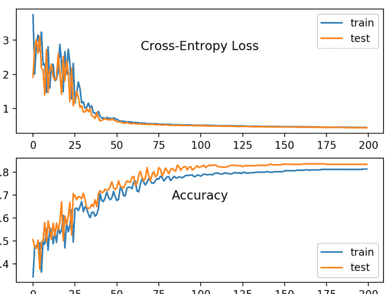

图 3.2：使用批量梯度下降拟合的 MLP 在训练集和测试集上的分类准确率折线图。

### 3.3.3 使用随机梯度下降拟合 MLP

上一节中的批量梯度下降示例可以更新为使用随机梯度下降。这需要将批大小从训练数据集的大小改为 1。

```
# fit model

history = model.fit(trainX, trainy, validation_data=(testX, testy), epochs=200, verbose=0,

    batch_size=1)
```

清单 3.15：配置随机梯度下降的示例。

随机梯度下降要求模型为每个训练样本进行一次预测并更新权重。与批量梯度下降相比，这会显著减慢训练过程。这一改变的预期效果是：模型学习得更快（例如从学习曲线来看），并且对模型的更新是有噪声的，从而反过来导致训练过程中的性能表现带有噪声。包含此更改的完整示例如下所列。

```
# mlp for the blobs problem with stochastic gradient descent

from sklearn.datasets.samples_generator import make_blobs

from keras.layers import Dense

from keras.models import Sequential

from keras.optimizers import SGD

from keras.utils import to_categorical

from matplotlib import pyplot

# generate 2d classification dataset

X, y = make_blobs(n_samples=1000, centers=3, n_features=2, cluster_std=2, random_state=2)

# one hot encode output variable

y = to_categorical(y)

# split into train and test

n_train = 500

trainX, testX = X[:n_train, :], X[n_train:, :]

trainy, testy = y[:n_train], y[n_train:]

# define model

model = Sequential()

model.add(Dense(50, input_dim=2, activation='relu', kernel_initializer='he_uniform'))

model.add(Dense(3, activation='softmax'))

# compile model

opt = SGD(lr=0.01, momentum=0.9)

model.compile(loss='categorical_crossentropy', optimizer=opt, metrics=['accuracy'])

# fit model

history = model.fit(trainX, trainy, validation_data=(testX, testy), epochs=200, verbose=0,

                    batch_size=1)

# evaluate the model

_, train_acc = model.evaluate(trainX, trainy, verbose=0)

_, test_acc = model.evaluate(testX, testy, verbose=0)

print('Train: %.3f, Test: %.3f' % (train_acc, test_acc))

# plot loss learning curves

pyplot.subplot(211)

pyplot.title('Cross-Entropy Loss', pad=-40)

pyplot.plot(history.history['loss'], label='train')

pyplot.plot(history.history['val_loss'], label='test')

pyplot.legend()

# plot accuracy learning curves

pyplot.subplot(212)

pyplot.title('Accuracy', pad=-40)

pyplot.plot(history.history['acc'], label='train')

pyplot.plot(history.history['val_acc'], label='test')

pyplot.legend()

pyplot.show()
```

清单 3.16：在 blobs 问题上对 MLP 使用随机梯度下降的示例。

运行该示例首先会报告模型在训练集和测试集上的性能。

**注意：** 由于学习算法具有随机性，您的具体结果可能会有所不同。建议多次运行该示例并比较平均性能。

在本例中，我们可以看到训练集和测试集的性能相近，准确率约为 50%，但明显差于使用批量梯度下降的情况（约差 30 个百分点）。至少对于该问题以及所选的模型和模型配置而言，随机（在线）梯度下降并不合适。

```
Train: 0.508, Test: 0.530
```

清单 3.17：在 blobs 问题上对 MLP 使用随机梯度下降的示例输出。

```
from keras.optimizers import SGD

from keras.utils import to_categorical

from matplotlib import pyplot

# generate 2d classification dataset

X, y = make_blobs(n_samples=1000, centers=3, n_features=2, cluster_std=2, random_state=2)

# one hot encode output variable

y = to_categorical(y)

# split into train and test

n_train = 500

trainX, testX = X[:n_train, :], X[n_train:, :]

trainy, testy = y[:n_train], y[n_train:]

# define model

model = Sequential()

model.add(Dense(50, input_dim=2, activation='relu', kernel_initializer='he_uniform'))

model.add(Dense(3, activation='softmax'))

# compile model

opt = SGD(lr=0.001, momentum=0.9)

model.compile(loss='categorical_crossentropy', optimizer=opt, metrics=['accuracy'])

# fit model

history = model.fit(trainX, trainy, validation_data=(testX, testy), epochs=200, verbose=0,

    batch_size=1)

# evaluate the model

_, train_acc = model.evaluate(trainX, trainy, verbose=0)

_, test_acc = model.evaluate(testX, testy, verbose=0)

print('Train: %.3f, Test: %.3f' % (train_acc, test_acc))

# plot loss learning curves

pyplot.subplot(211)

pyplot.title('Cross-Entropy Loss', pad=-40)

pyplot.plot(history.history['loss'], label='train')

pyplot.plot(history.history['val_loss'], label='test')

pyplot.legend()

# plot accuracy learning curves

pyplot.subplot(212)

pyplot.title('Accuracy', pad=-40)

pyplot.plot(history.history['acc'], label='train')

pyplot.plot(history.history['val_acc'], label='test')

pyplot.legend()

pyplot.show()
```

代码清单 3.19：在 blobs 问题上使用较小学习率的随机梯度下降 MLP 示例。

运行这个示例会看到截然不同的结果。

**注意：** 由于学习算法的随机性，你的具体结果可能会有所不同。请考虑多次运行该示例，并比较平均性能。

报告的性能有了很大改善，在训练集和测试集上的分类准确率与使用批量梯度下降的拟合结果相当。

```
Train: 0.830, Test: 0.824
```

代码清单 3.20：在 blobs 问题上使用较小学习率的随机梯度下降 MLP 的示例输出。

## 3.3 批大小案例研究

该折线图展示了预期行为。也就是说，与批量梯度下降相比，模型能更快地学习该问题，大约在 25 个 epoch 后达到约 80% 的准确率，而不是使用批量梯度下降时看到的 100 个 epoch。由于训练速度更快，我们本可以在第 50 个 epoch 停止训练，而不必等到第 200 个 epoch。这并不令人意外。对于批量梯度下降，100 个 epoch 涉及 100 次误差估计和 100 次权重更新。而在随机梯度下降中，25 个 epoch 涉及（500 × 25）即 12,500 次权重更新，提供了超过 10 倍的关于如何改进模型的反馈——尽管这些反馈噪声更大。

该折线图还显示，在训练过程中训练集和测试集的性能保持接近；这与批量梯度下降的动态不同，后者的测试集性能略好，并且在整个训练过程中都保持这种状态。与批量梯度下降不同，我们可以看到，带噪声的更新导致整个训练期间的性能也带有噪声。模型中的这种方差意味着，选择哪个模型作为最终模型可能颇具挑战；相比之下，批量梯度下降因为模型已收敛而使性能趋于稳定。

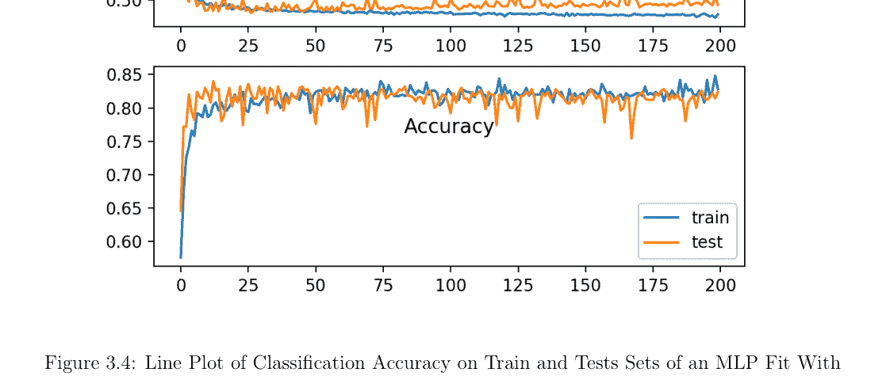

这个示例凸显了批大小与学习率之间的重要关系。也就是说，对模型的更新噪声越大，就需要越小的学习率；而误差梯度的估计噪声越小、越准确，就可以越自由地应用于模型。我们可以将其总结如下：

- **批量梯度下降**：使用相对较大的学习率和更多的训练轮次。
- **随机梯度下降**：使用相对较小的学习率和更少的训练轮次。

小批量梯度下降提供了一种替代方法。

### 3.3.4 使用小批量梯度下降拟合 MLP

另一种方法不是使用随机梯度下降并调整学习率，而是保持学习率不变并改变批大小。实际上，这意味着每次估计误差梯度时，我们都指定学习率或应用于权重的变化量，但梯度的准确性会根据用于估计它的样本数量而改变。像使用批量梯度下降时那样将学习率保持在 0.01，我们可以将批大小设置为 32，这是一个被广泛采用的默认批大小。

```
# fit model

history = model.fit(trainX, trainy, validation_data=(testX, testy), epochs=200, verbose=0,

    batch_size=32)
```

代码清单 3.21：为小批量梯度下降配置模型的示例。

我们期望在较大的学习率下获得随机梯度下降的部分好处。包含此修改的完整示例如下。

```
# mlp for the blobs problem with minibatch gradient descent

from sklearn.datasets.samples_generator import make_blobs

from keras.layers import Dense

from keras.models import Sequential

from keras.optimizers import SGD

from keras.utils import to_categorical

from matplotlib import pyplot

# generate 2d classification dataset

X, y = make_blobs(n_samples=1000, centers=3, n_features=2, cluster_std=2, random_state=2)

# one hot encode output variable

y = to_categorical(y)

# split into train and test

n_train = 500

trainX, testX = X[:n_train, :], X[n_train:, :]

trainy, testy = y[:n_train], y[n_train:]

# define model

model = Sequential()

model.add(Dense(50, input_dim=2, activation='relu', kernel_initializer='he_uniform'))

model.add(Dense(3, activation='softmax'))

# compile model

opt = SGD(lr=0.01, momentum=0.9)

model.compile(loss='categorical_crossentropy', optimizer=opt, metrics=['accuracy'])

# fit model

history = model.fit(trainX, trainy, validation_data=(testX, testy), epochs=200, verbose=0,

    batch_size=32)

# evaluate the model
```

## 3.3 批大小案例研究

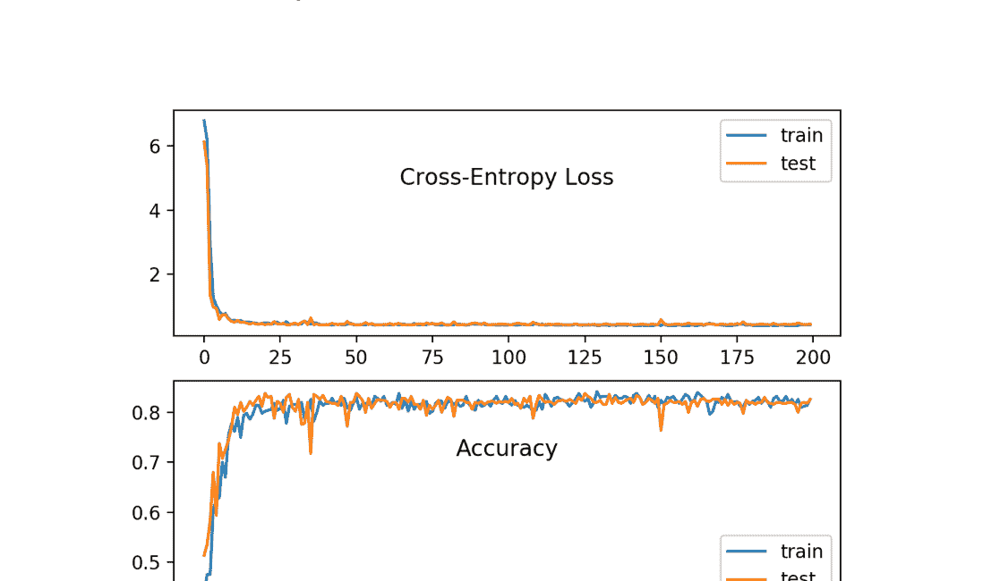

图 3.5：使用小批量梯度下降拟合的 MLP 在训练集和测试集上分类准确率的线图。

### 3.3.5 批大小对模型行为的影响

我们可以使用不同的批大小重新拟合模型，并考察批大小变化对学习速度、学习过程中的稳定性以及最终结果的影响。首先，我们可以整理代码，创建一个准备数据集的函数。

```
# prepare train and test dataset

def prepare_data():

    # generate 2d classification dataset

    X, y = make_blobs(n_samples=1000, centers=3, n_features=2, cluster_std=2, random_state=2)

    # one hot encode output variable

    y = to_categorical(y)

    # split into train and test

    n_train = 500

    trainX, testX = X[:n_train, :], X[n_train:, :]

    trainy, testy = y[:n_train], y[n_train:]

    return trainX, trainy, testX, testy
```

接下来，我们可以创建一个函数，使用给定的批大小在该问题上拟合模型，并绘制训练集和测试集上分类准确率的学习曲线。

```
# fit a model and plot learning curve

def fit_model(trainX, trainy, testX, testy, n_batch):

    # define model

    model = Sequential()

    model.add(Dense(50, input_dim=2, activation='relu', kernel_initializer='he_uniform'))

    model.add(Dense(3, activation='softmax'))

    # compile model

    opt = SGD(lr=0.01, momentum=0.9)

    model.compile(loss='categorical_crossentropy', optimizer=opt, metrics=['accuracy'])

    # fit model

    history = model.fit(trainX, trainy, validation_data=(testX, testy), epochs=200,

        verbose=0, batch_size=n_batch)

    # plot learning curves

    pyplot.plot(history.history['acc'], label='train')

    pyplot.plot(history.history['val_acc'], label='test')
```


```
    pyplot.title('batch='+str(n_batch), pad=-40)
```

代码清单 3.25：使用给定批大小评估模型的函数示例。

最后，我们可以用一组不同的批大小评估模型行为，同时保持模型的其他一切不变，包括学习率。

```
# prepare dataset

trainX, trainy, testX, testy = prepare_data()

# create learning curves for different batch sizes

batch_sizes = [4, 8, 16, 32, 64, 128, 256, 450]

for i in range(len(batch_sizes)):

    # determine the plot number

    plot_no = 420 + (i+1)

    pyplot.subplot(plot_no)

    # fit model and plot learning curves for a batch size

    fit_model(trainX, trainy, testX, testy, batch_sizes[i])

# show learning curves

pyplot.show()
```

代码清单 3.26：使用不同批大小评估模型的示例。

结果将是一幅包含八个子图的图，展示八种不同批大小下的模型行为。综合起来，完整示例如下。

```
# mlp for the blobs problem with minibatch gradient descent with varied batch size
from sklearn.datasets.samples_generator import make_blobs
from keras.layers import Dense
from keras.models import Sequential
from keras.optimizers import SGD
from keras.utils import to_categorical
from matplotlib import pyplot

# prepare train and test dataset
def prepare_data():
    # generate 2d classification dataset
    X, y = make_blobs(n_samples=1000, centers=3, n_features=2, cluster_std=2, random_state=2)
    # one hot encode output variable
    y = to_categorical(y)
    # split into train and test
    n_train = 500

trainX, testX = X[:n_train, :], X[n_train:, :]
trainy, testy = y[:n_train], y[n_train:]
return trainX, trainy, testX, testy

# fit a model and plot learning curve
def fit_model(trainX, trainy, testX, testy, n_batch):
    # define model
    model = Sequential()
    model.add(Dense(50, input_dim=2, activation='relu', kernel_initializer='he_uniform'))
    model.add(Dense(3, activation='softmax'))
    # compile model
    opt = SGD(lr=0.01, momentum=0.9)
    model.compile(loss='categorical_crossentropy', optimizer=opt, metrics=['accuracy'])
    # fit model
    history = model.fit(trainX, trainy, validation_data=(testX, testy), epochs=200,
        verbose=0, batch_size=n_batch)
    # plot learning curves
    pyplot.plot(history.history['acc'], label='train')
    pyplot.plot(history.history['val_acc'], label='test')
    pyplot.title('batch=' + str(n_batch), pad=-40)

# prepare dataset
trainX, trainy, testX, testy = prepare_data()

# create learning curves for different batch sizes
batch_sizes = [4, 8, 16, 32, 64, 128, 256, 450]

for i in range(len(batch_sizes)):
    # determine the plot number
    plot_no = 420 + (i+1)
    pyplot.subplot(plot_no)
    # fit model and plot learning curves for a batch size
    fit_model(trainX, trainy, testX, testy, batch_sizes[i])

# show learning curves
pyplot.show()
```


### 列表 3.27：使用不同批量大小评估和比较模型的示例。

运行示例会创建一个包含八个折线图的图形，显示使用小批量梯度下降时，不同批量大小的模型在训练集和测试集上的分类准确率。

注意：由于学习算法的随机性，您的具体结果可能会有所不同。考虑多次运行示例并比较平均性能。

图表显示，小批量通常会导致快速学习，但学习过程波动较大，分类准确率的方差更高。较大的批量大小会减慢学习过程（就学习曲线而言），但最终阶段会收敛到更稳定的模型，其特征是分类准确率的方差更低。

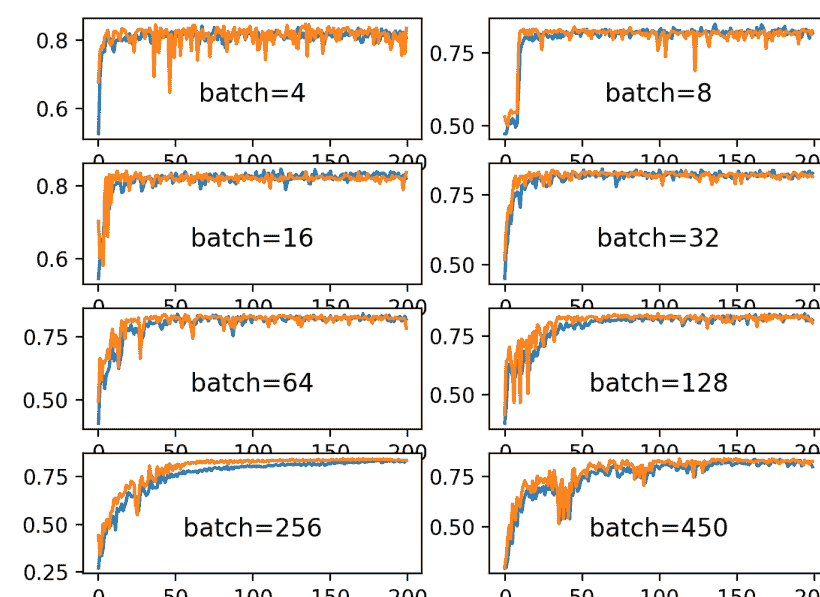

图 3.6：不同批量大小下训练集和测试数据集上的分类准确率折线图。

#### 3.4 扩展

本节列出了一些您可以探索的扩展本教程的想法。

- **Vary Learning Rate**。在对数尺度上研究随机（在线）梯度下降中不同学习率值的影响。
- **Vary Epochs**。研究随着批量大小增加到训练数据集大小，使用小批量梯度下降时达到收敛所需的 `epoch` 数量。

如果您探索其中任何一个扩展，我很乐意知道。

#### 3.5 进一步阅读

如果您想深入了解，本节提供了该主题的更多资源。

##### 3.5.1 书籍

- 第 8.1.3 节：批量和迷你批量算法，*Deep Learning*，2016。
  https://amzn.to/2NJW3gE

##### 3.5.2 论文

- *Revisiting Small Batch Training for Deep Neural Networks*，2018。
  https://arxiv.org/abs/abs/1804.07612
- *Practical recommendations for gradient-based training of deep architectures*，2012。
  https://arxiv.org/abs/abs/1206.5533

##### 3.5.3 文章

- 随机梯度下降，Wikipedia。
  https://en.wikipedia.org/wiki/Stochastic_gradient_descent

#### 3.6 摘要

在本教程中，您发现了三种不同的梯度下降变体，以及如何探索和诊断批量大小对学习过程的影响。具体来说，您学习了：

- 批量大小控制训练神经网络时误差梯度估计的准确性。
- 批量、随机和迷你批量梯度下降是学习算法的三大主要变体。
- 批量大小与学习过程的速度和稳定性之间存在矛盾。

##### 3.6.1 下一步

在下一教程中，您将发现损失函数如何控制随机梯度下降所解决的优化问题的性质。

## 第 4 章

### 使用损失函数配置优化目标

神经网络使用随机梯度下降进行训练，并且在设计和配置模型时需要您选择一个损失函数。有许多损失函数可供选择，选择时可能具有挑战性，甚至不知道损失函数是什么以及在训练神经网络时扮演什么角色。在本教程中，您将发现损失和损失函数在训练深度学习神经网络中的作用，以及如何为您的预测建模问题选择合适的损失函数。阅读本教程后，您将知道：

- 神经网络使用需要损失函数来计算模型误差的优化过程进行训练。
- 最大似然为训练神经网络和一般机器学习模型时选择损失函数提供了一个框架。
- 交叉熵和均方误差是训练神经网络模型时使用的两种主要类型的损失函数。

让我们开始吧。

#### 4.1 损失函数

在本节中，您将发现损失函数以及它们如何用于定义在将神经网络权重适配到训练数据集时所解决的优化问题的性质。

##### 4.1.1 神经网络学习作为优化

深度学习神经网络从训练数据中学习将一组输入映射到一组输出。我们无法计算神经网络的完美权重；未知数太多。相反，学习问题被表述为搜索或优化问题，并使用算法在模型可能使用的可能权重集合空间中导航，以便做出良好或足够好的预测。通常，神经网络模型使用随机梯度下降优化算法进行训练，并且权重使用误差反向传播算法进行更新。

梯度下降中的梯度指的是误差梯度。具有给定权重集合的模型用于进行预测，并计算这些预测的误差。梯度下降算法寻求改变权重，以便下一次评估减少误差，这意味着优化算法正在沿着误差的梯度（或斜率）向下导航。现在我们知道训练神经网络解决的是一个优化问题，我们可以看看如何计算给定权重集合的误差。

##### 4.1.2 什么是损失函数和损失？

在优化算法的上下文中，用于评估候选解（即一组权重）的函数称为目标函数。我们可能寻求最大化或最小化目标函数，这意味着我们正在寻找具有最高或最低分数的候选解。通常，对于神经网络，我们寻求最小化误差。因此，目标函数通常被称为成本函数或损失函数，而损失函数计算的值简称为损失。

> 我们想要最小化或最大化的函数称为目标函数或准则。当我们最小化它时，我们也可能称其为成本函数、损失函数或误差函数。
>
> — 第 82 页，《Deep Learning》，2016。

成本或损失函数有一个重要的任务，即必须忠实地将模型的各个方面提炼成一个单一的数字，以这种方式，该数字的改进是模型更好的标志。

> 成本函数将可能复杂系统的各种好坏方面减少到一个单一的数字，一个标量值，从而允许候选解进行排序和比较。
>
> — 第 155 页，《Neural Smithing: Supervised Learning in Feedforward Artificial Neural Networks》，1999。

在优化过程中计算模型的误差时，必须选择一个损失函数。这可能是一个具有挑战性的问题，因为该函数必须捕捉问题的属性，并且必须以对项目和利益相关者重要的关注为动机。

> 因此，重要的是该函数必须忠实地代表我们的设计目标。如果我们选择了一个不好的误差函数并得到不令人满意的结果，那么错误在于我们对搜索目标的指定不当。
>
> — 第 155 页，《Neural Smithing: Supervised Learning in Feedforward Artificial Neural Networks》，1999。

现在我们熟悉了损失函数和损失，我们需要知道使用什么函数。

##### 4.1.3 最大似然

可以使用许多函数来估计神经网络中一组权重的误差。我们更倾向于选择这样一个函数：候选解的空间映射到一个平滑的（但高维的）景观，优化算法可以通过对模型权重的迭代更新合理地在其中导航。最大似然估计，或 `MLE`，是一种用于从历史训练数据中寻找参数最佳统计估计的推断框架：这正是我们试图用神经网络实现的目标。

> 最大似然寻求通过最大化从训练数据得出的似然函数来找到参数的最优值。
>
> — 第 39 页，*用于模式识别的神经网络*，1995。

我们有一个包含一个或多个输入变量的训练数据集，我们需要一个模型来估计模型权重参数，使其能最好地将输入的示例映射到输出或目标变量。给定输入，模型试图做出与目标变量的数据分布相匹配的预测。在最大似然下，损失函数估计模型所做预测的分布与训练数据中目标变量的分布有多接近。

> 可以将最大似然估计解释为最小化经验分布 [...] 与模型分布之间的差异，其中两者之间差异的程度由 `KL` 散度衡量。[...] 最小化该 `KL` 散度恰好等同于最小化分布之间的交叉熵。
>
> — 第 132 页，*深度学习*，2016。

使用最大似然作为估计神经网络模型参数（权重）的框架以及机器学习中的一般框架的一个好处是，随着训练数据集中示例数量的增加，模型参数的估计会得到改善。这被称为 *一致性* 属性。

> 在适当条件下，最大似然估计量具有一致性 [...] 属性，意味着随着训练示例数量趋向无穷大，参数的最大似然估计会收敛到参数的真实值。
>
> — 第 134 页，*深度学习*，2016。

现在我们熟悉了最大似然的一般方法，我们可以来看误差函数。

##### 4.1.4 最大似然与交叉熵

在最大似然框架下，两者概率分布之间的误差使用交叉熵来衡量。当对分类问题建模时，我们感兴趣的是将输入变量映射到类别标签，我们可以将问题建模为预测示例属于每个类别的概率。在二分类问题中，会有两个类别，因此我们可以预测示例属于第一个类别的概率。在多类分类的情况下，我们可以预测示例属于各个类别的概率。

在训练数据集中，示例属于给定类别的概率为 1 或 0，因为训练数据集中的每个样本都是来自该领域的已知示例。我们知道答案。因此，在最大似然估计下，我们会寻求一组模型权重，使模型的预测概率分布与训练数据集中概率的分布之间的差异最小化。这称为交叉熵。

> 在大多数情况下，我们的参数模型定义了一个分布 [...]，我们只需使用最大似然原理。这意味着我们使用训练数据与模型预测之间的交叉熵作为成本函数。
>
> — 第 178 页，*深度学习*，2016。

从技术上讲，交叉熵来自信息论领域，其单位为 *比特*。它用于估计估计概率分布与预测概率分布之间的差异。在预测某个量的回归问题中，通常改用均方误差（`MSE`）损失函数。

> 有几个基本函数被广泛使用。均方误差在函数逼近（回归）问题中很受欢迎 [...] 当输出被解释为属于指定类别的成员概率时，交叉熵误差函数通常用于分类问题。
>
> — 第 155–156 页，*神经锻造：前馈人工神经网络中的监督学习*，1999。

然而，在最大似然估计框架下并假设目标变量服从高斯分布，均方误差可以被视为模型预测分布与目标变量分布之间的交叉熵。

> 许多作者使用术语“交叉熵”特指伯努利或 `softmax` 分布的负对数似然，但这是一个误称。任何由负对数似然组成的损失都是训练集定义的经验分布与模型定义的概率分布之间的交叉熵。例如，均方误差是经验分布与高斯模型之间的交叉熵。
>
> — 第 132 页，*深度学习*，2016。

因此，在使用最大似然估计框架时，我们将实现一个交叉熵损失函数，这在实践中通常意味着对分类问题使用交叉熵损失函数，对回归问题使用均方误差损失函数。几乎普遍地，深度学习神经网络在最大似然框架下使用交叉熵作为损失函数进行训练。

> 大多数现代神经网络都使用最大似然进行训练。这意味着成本函数是 [...] 描述为训练数据与模型分布之间的交叉熵。
>
> — 第 178–179 页，*深度学习*，2016。

事实上，采用这一框架可以被视为深度学习的一个里程碑，因为在完全形式化之前，分类神经网络有时会使用均方误差损失函数。

> 其中一个算法变化是用交叉熵族损失函数取代均方误差。均方误差在 1980 年代和 1990 年代很受欢迎，但随着统计学界和机器学习界之间的思想传播，它逐渐被交叉熵损失和最大似然原理所取代。
>
> — 第 226 页，*深度学习*，2016。

最大似然方法被几乎普遍采用不仅因为其理论框架，更主要因为其产生的结果。具体来说，使用输出层中 `sigmoid` 或 `softmax` 激活函数的分类神经网络在使用交叉熵损失函数时学习速度更快、更稳健。

> 使用交叉熵损失极大地提高了具有 `sigmoid` 和 `softmax` 输出的模型的性能，这些模型在使用均方误差损失时之前曾因饱和和学习缓慢而受苦。
>
> — 第 226 页，*深度学习*，2016。

##### 4.1.5 使用什么损失函数？

我们可以总结上一节的内容，并直接建议在最大似然框架下应使用的损失函数。重要的是，损失函数的选择与神经网络输出层中使用的激活函数直接相关。这两个设计元素是相互关联的。将输出层的配置视为对预测问题的框架选择，而损失函数的选择则是针对给定问题框架计算误差的方式。

> 成本函数的选择与输出单元的选择紧密耦合。大多数时候，我们只需使用数据分布与模型分布之间的交叉熵。输出的表示方式选择随后决定了交叉熵函数的形式。
>
> — 第 181 页，*深度学习*，2016。

我们将针对每种问题类型，回顾关于输出层和损失函数的最佳实践或默认值。

## 回归问题

这是一个预测实值数量的问题。

- **输出层配置：** 一个节点，使用线性激活单元。
- **损失函数：** 均方误差（`MSE`）。

## 二元分类问题

这是一个将示例分类为两个类别之一的问题。该问题被表述为预测示例属于类别一的可能性，例如你将整数值 1 分配给的类别，而另一类别分配的值为 0。

- **输出层配置：** 一个节点，使用 `sigmoid` 激活单元。
- **损失函数：** 交叉熵，也称为对数损失。

## 多类分类问题

这是一个将示例分类为两个以上类别之一的问题。该问题被表述为预测示例属于每个类别的可能性。

- **输出层配置：** 为每个类别使用 `softmax` 激活函数的一个节点。
- **损失函数：** 交叉熵，也称为对数损失。

##### 4.1.6 如何实现损失函数

为了使损失函数具体化，本节解释了每种主要类型的损失函数的工作原理以及如何在 Python 中计算分数。

### 均方误差损失

均方误差损失，简称 `MSE`，是预测值与实际值之间平方差的平均值。结果始终为正值，与预测值和实际值的符号无关，完美值为 0.0。损失值被最小化，尽管可以通过使分数为负在最大化优化过程中使用它。下面的 Python 函数提供了类似伪代码的可工作实现，用于计算实际值列表和预测实值数量列表的均方误差。

```
# calculate mean squared error

def mean_squared_error(actual, predicted):

    sum_square_error = 0.0

    for i in range(len(actual)):

        sum_square_error += (actual[i] - predicted[i])**2.0

    mean_square_error = 1.0 / len(actual) * sum_square_error

    return mean_square_error
```

Listing 4.1: 实现均方误差的函数示例。

为了高效实现，我建议你使用 `scikit-learn` 的 `mean_squared_error()` 函数¹。

### 交叉熵损失（或对数损失）

交叉熵损失通常简称为交叉熵、对数损失、逻辑损失或简称 `log loss`。每个预测概率与实际类别输出值（0 或 1）进行比较，并计算一个分数，该分数根据与期望值的距离对概率进行惩罚。惩罚是对数形式的，对于小的差异（0.1 或 0.2）提供较小的分数，而对于大的差异（0.9 或 1.0）提供巨大的分数。

交叉熵损失被最小化，其中较小的值代表比较大的值更好的模型。预测完美概率的模型具有 0.0 的交叉熵或对数损失。对于二元或两类预测问题，交叉熵实际上是所有示例的平均交叉熵。下面的 Python 函数提供了类似伪代码的可工作实现，用于计算实际 0 和 1 值列表与类别 1 的预测概率相比的交叉熵。

```
from math import log

# calculate binary cross-entropy

def binary_cross_entropy(actual, predicted):

    sum_score = 0.0

    for i in range(len(actual)):

        sum_score += actual[i] * log(1e-15 + predicted[i])

    mean_sum_score = 1.0 / len(actual) * sum_score

    return -mean_sum_score
```

Listing 4.2: 实现二元交叉熵的函数示例。

注意，我们在预测概率中添加一个很小的值（在本例中为 `1E-15`），以避免计算 0.0 的对数。这意味着在实践中，最佳可能的损失将是一个非常接近零但不完全为零的值。交叉熵可以用于多类分类计算。类别已被独热编码，这意味着每个类别值都有一个二进制特征，并且预测必须为每个类别提供预测概率。然后交叉熵在每个二进制特征上求和，并在数据集中所有示例上取平均。下面的 Python 函数提供了类似伪代码的可工作实现，用于计算实际独热编码值列表与每个类别的预测概率相比的交叉熵。

```
from math import log

# calculate categorical cross-entropy

def categorical_cross_entropy(actual, predicted):

    sum_score = 0.0

    for i in range(len(actual)):

        for j in range(len(actual[i])):

            sum_score += actual[i][j] * log(1e-15 + predicted[i][j])

    mean_sum_score = 1.0 / len(actual) * sum_score

    return -mean_sum_score
```


Listing 4.3: 实现多类交叉熵的函数示例。

为了高效实现，我建议你使用 scikit-learn 的 `log_loss()` 函数²。

### 4.1.7 损失函数与报告的模型性能

在最大似然的框架下，我们通常希望使用交叉熵或均方误差损失函数与随机梯度下降一起使用。尽管如此，我们可能希望也可能不希望使用损失函数来报告模型的性能。例如，对数损失很难解释，特别是对于非机器学习从业者利益相关者而言。均方误差也是如此。相反，对于分类和回归模型，报告准确率和均方根误差可能更为重要。

根据这些指标而不是损失来选择模型也可能是可取的。这是一个重要的考虑因素，因为损失最小的模型可能不是对项目利益相关者重要的最佳指标模型。一个好的划分是使用损失来评估和诊断模型学习得如何。这包括优化过程的所有考虑因素，例如过拟合、欠拟合和收敛。然后可以选择一个对项目利益相关者有意义的替代指标，以评估模型性能并进行模型选择。

- `损失`：仅用于评估和诊断模型优化。
- `指标`：用于在项目背景下评估和选择模型。

同一个指标可以用于这两个关注点，但优化过程的关注点更可能与项目的目标不同，需要不同的分数。尽管如此，通常情况下，改进损失会改善指标，或在最坏情况下对感兴趣的指标没有影响。

## 4.2 回归损失函数案例研究

回归预测建模问题涉及预测实值数量。在本节中，我们将研究适合回归预测建模问题的损失函数。作为本次研究的背景，我们将使用 scikit-learn 库中提供的标准回归问题生成器 `make_regression()` 函数。该函数将从具有给定数量输入变量、统计噪声和其他属性的简单回归问题生成示例。我们将使用此函数定义一个具有 20 个输入特征的问题；其中 10 个特征是有意义的，10 个特征与问题无关。总共将随机生成 1,000 个示例。伪随机数生成器将被固定，以确保每次运行代码时都获得相同的 1,000 个示例。

```python
# generate regression dataset

X, y = make_regression(n_samples=1000, n_features=20, noise=0.1, random_state=1)
```

Listing 4.4: 为回归问题生成样本的示例。

神经网络在实值输入和输出变量缩放到合理范围时通常表现更好。对于这个问题，每个输入变量和目标变量都具有高斯分布；因此，在这种情况下标准化数据是可取的。我们可以使用 scikit-learn 库中的 `StandardScaler` 转换器类来实现这一点。在实际问题中，我们会在训练数据集上准备缩放器并将其应用于训练集和测试集，但为了简单起见，我们将在拆分为训练集和测试集之前一起缩放所有数据。

```python
# standardize dataset

X = StandardScaler().fit_transform(X)

y = StandardScaler().fit_transform(y.reshape(len(y),1))[:,0]
```

Listing 4.5: 标准化数据样本的示例。

缩放后，数据将被均匀拆分为训练集和测试集。

```python
# split into train and test

n_train = 500

trainX, testX = X[:n_train, :], X[n_train:, :]

trainy, testy = y[:n_train], y[n_train:]
```

Listing 4.6: 将数据拆分为训练集和测试集的示例。

将定义一个小型多层感知器（MLP）模型来解决此问题并为探索不同的损失函数提供基础。模型将期望 20 个特征作为输入，如问题所定义。模型将有一个隐藏层，包含 25 个节点，并使用整流线性激活函数。输出层将有 1 个节点，因为要预测一个实值，并将使用线性激活函数。

```python
# define model

model = Sequential()

model.add(Dense(25, input_dim=20, activation='relu', kernel_initializer='he_uniform'))

model.add(Dense(1, activation='linear'))
```

Listing 4.7: 定义 MLP 模型的示例。

模型将使用学习率为 0.01、动量为 0.9 的随机梯度下降进行拟合，这两者都是合理的默认值。训练将在 100 个 epoch 上进行，并在每个 epoch 结束时评估测试集，以便在运行结束时绘制学习曲线。

```python
opt = SGD(lr=0.01, momentum=0.9)

model.compile(loss='...', optimizer=opt)

# fit model

history = model.fit(trainX, trainy, validation_data=(testX, testy), epochs=100, verbose=0)
```

Listing 4.8: 编译和拟合 MLP 模型的示例。

现在我们有了问题和模型的基础，我们可以评估三种常见的损失函数，这些损失函数适用于回归预测建模问题。尽管这些示例中使用了 MLP，但相同的损失函数也可以在为回归训练 CNN 和 RNN 模型时使用。

### 4.2.1 均方误差损失

均方误差，或 MSE，损失是用于回归问题的默认损失函数。在数学上，如果目标变量的分布是高斯分布，则在最大似然推断框架下它是首选的损失函数。它是首先要评估的损失函数，只有在有充分理由时才更改。均方误差计算为预测值与实际值之间平方差的平均值。结果始终为正值，与预测值和实际值的符号无关，完美的值为 0.0。平方意味着更大的错误会导致比更小的错误更大的误差，意味着模型因犯下更大的错误而受到惩罚。在 Keras 中，可以通过在编译模型时指定 `'mse'` 或 `'mean_squared_error'` 作为损失函数来使用均方误差损失函数。

```python
model.compile(loss='mean_squared_error')
```

Listing 4.9: 使用均方误差损失函数的示例。

建议输出层对目标变量有一个节点并使用线性激活函数。

```python
model.add(Dense(1, activation='linear'))
```

Listing 4.10: 使用线性激活函数的示例。

下面列出了在所述回归问题上演示 MLP 的完整示例。

```python
# mlp for regression with mse loss function

from sklearn.datasets import make_regression

from sklearn.preprocessing import StandardScaler

from keras.models import Sequential

from keras.layers import Dense

from keras.optimizers import SGD

from matplotlib import pyplot

# generate regression dataset

X, y = make_regression(n_samples=1000, n_features=20, noise=0.1, random_state=1)

# standardize dataset

X = StandardScaler().fit_transform(X)

y = StandardScaler().fit_transform(y.reshape(len(y),1))[:,0]

# split into train and test

n_train = 500

trainX, testX = X[:n_train, :], X[n_train:, :]

trainy, testy = y[:n_train], y[n_train:]

# define model

model = Sequential()

model.add(Dense(25, input_dim=20, activation='relu', kernel_initializer='he_uniform'))

model.add(Dense(1, activation='linear'))

opt = SGD(lr=0.01, momentum=0.9)

model.compile(loss='mean_squared_error', optimizer=opt)

# fit model

history = model.fit(trainX, trainy, validation_data=(testX, testy), epochs=100, verbose=0)

# evaluate the model

train_mse = model.evaluate(trainX, trainy, verbose=0)

test_mse = model.evaluate(testX, testy, verbose=0)

print('Train: %.3f, Test: %.3f' % (train_mse, test_mse))

# plot loss during training
```

```python
pyplot.title('Mean Squared Error Loss')

pyplot.plot(history.history['loss'], label='train')

pyplot.plot(history.history['val_loss'], label='test')

pyplot.legend()

pyplot.show()
```

Listing 4.11: MLP 在回归问题上使用均方误差损失的示例。

运行该示例首先会打印模型在训练集和测试集上的均方误差。

> 注：由于学习算法的随机性，您的具体结果可能会有所不同。考虑多次运行示例并比较平均性能。

在这种情况下，我们可以看到模型学习了该问题，至少在三位小数处达到了零误差。

```python
Train: 0.001, Test: 0.002
```

Listing 4.12: MLP 在回归问题上使用均方误差损失的示例输出。

还创建了一条线图，显示训练 epoch 过程中训练集（蓝色）和测试集（橙色）的均方误差损失。我们可以看到模型在合理的时间内收敛，并且训练和测试性能保持相当。模型的性能和收敛行为表明，均方误差非常适合神经网络学习此问题。

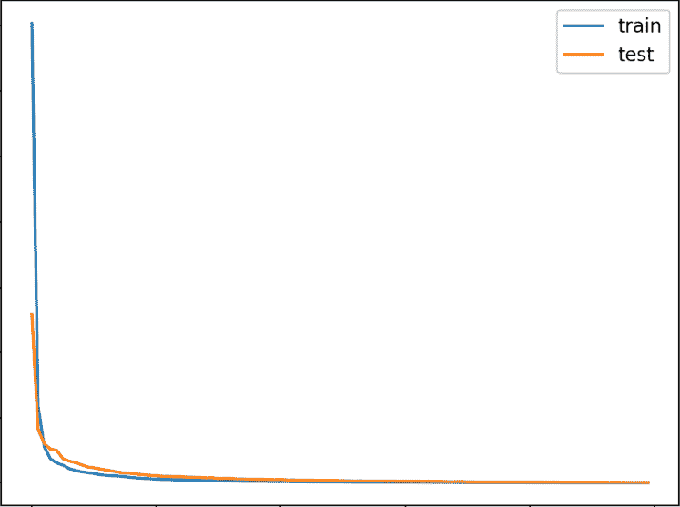

Figure 4.1: 优化均方误差损失函数时训练 epoch 过程中均方误差损失的线图。

### 4.2.2 均方对数误差损失

可能存在回归问题，其中目标值具有值的分布，并且在预测较大值时，您可能不希望像均方误差那样重罚模型。

相反，您可以先计算每个预测值的自然对数，然后计算均方误差。这称为均方对数误差损失，简称 MSLE。它具有放松对大预测值中大差异的惩罚效果的作用。

作为损失度量，当模型直接预测未缩放的量时可能更合适。尽管如此，我们仍可以使用简单的回归问题来演示此损失函数。模型可以更新为使用 `mean_squared_logarithmic_error` 损失函数并保持输出层的相同配置。我们在拟合模型时也会跟踪均方误差作为指标，以便将其用作性能度量并绘制学习曲线。

```python
model.compile(loss='mean_squared_logarithmic_error', optimizer=opt, metrics=['mse'])
```

Listing 4.13: 使用均方对数误差损失函数的示例。

下面列出了使用 MSLE 损失函数的完整示例。

```python
# mlp for regression with msle loss function

from sklearn.datasets import make_regression

from sklearn.preprocessing import StandardScaler

from keras.models import Sequential

from keras.layers import Dense

from keras.optimizers import SGD

from matplotlib import pyplot

# generate regression dataset

X, y = make_regression(n_samples=1000, n_features=20, noise=0.1, random_state=1)

# standardize dataset

X = StandardScaler().fit_transform(X)

y = StandardScaler().fit_transform(y.reshape(len(y),1))[:,0]

# split into train and test

n_train = 500

trainX, testX = X[:n_train, :], X[n_train:, :]

trainy, testy = y[:n_train], y[n_train:]

# define model

model = Sequential()

model.add(Dense(25, input_dim=20, activation='relu', kernel_initializer='he_uniform'))

model.add(Dense(1, activation='linear'))

opt = SGD(lr=0.01, momentum=0.9)

model.compile(loss='mean_squared_logarithmic_error', optimizer=opt, metrics=['mse'])

# fit model

history = model.fit(trainX, trainy, validation_data=(testX, testy), epochs=100, verbose=0)

# evaluate the model

_, train_mse = model.evaluate(trainX, trainy, verbose=0)

_, test_mse = model.evaluate(testX, testy, verbose=0)

print('Train: %.3f, Test: %.3f ' % (train_mse, test_mse))

# plot loss during training

pyplot.subplot(211)

pyplot.title('Mean Squared Logarithmic Error Loss', pad=-20)

pyplot.plot(history.history['loss'], label='train')

pyplot.plot(history.history['val_loss'], label='test')

pyplot.legend()

# plot mse during training

pyplot.subplot(212)

pyplot.title('Mean Squared Error', pad=-20)

pyplot.plot(history.history['mean_squared_error'], label='train')

pyplot.plot(history.history['val_mean_squared_error'], label='test')

pyplot.legend()

pyplot.show()
```

Listing 4.14: MLP 在回归问题上使用均方对数误差损失的示例。

运行该示例首先会打印模型在训练集和测试集上的均方误差。

注：由于学习算法的随机性，您的具体结果可能会有所不同。考虑多次运行示例并比较平均性能。

在这种情况下，我们可以看到模型在训练集和测试集上的 MSE 略有变差。由于目标变量的分布是标准高斯分布，因此它可能不适合此问题。

```python
Train: 0.206, Test: 0.257
```

Listing 4.15: MLP 在回归问题上使用均方对数误差损失的示例输出。

还创建了一条线图，显示训练 epoch 过程中训练集（蓝色）和测试集（橙色）的均方对数误差损失（顶部），以及均方误差的类似图（底部）。我们可以看到 MSLE 在 100 个 epoch 内收敛良好；看起来 MSE 可能显示出过拟合的迹象，下降很快并从第 20 个 epoch 开始上升。

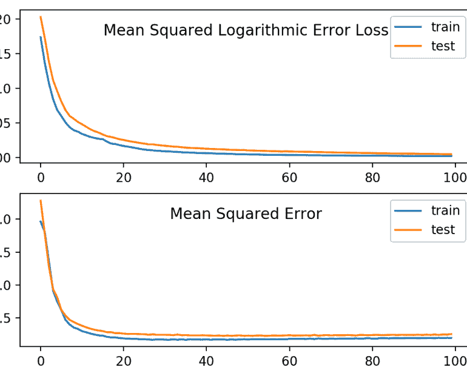

Figure 4.2: 训练 epoch 过程中均方对数误差损失和均方误差的线图。

### 4.2.3 平均绝对误差损失

在某些回归问题中，目标变量的分布可能主要是高斯分布，但可能存在异常值，例如远离均值的较大或较小值。在这种情况下，平均绝对误差，或 MAE，损失是一个合适的损失函数，因为它对异常值更稳健。它计算为实际值与预测值之间绝对差的平均值。模型可以更新为使用 `'mean_absolute_error'` 损失函数并保持输出层的相同配置。

```python
model.compile(loss='mean_absolute_error', optimizer=opt, metrics=['mse'])
```

清单 4.16：使用均方绝对误差损失函数的示例。

使用均方绝对误差作为回归测试问题上的损失函数的完整示例如下所示。

```python
# mlp for regression with mae loss function

from sklearn.datasets import make_regression

from sklearn.preprocessing import StandardScaler

from keras.models import Sequential

from keras.layers import Dense

from keras.optimizers import SGD
```


```python
from matplotlib import pyplot

# generate regression dataset

X, y = make_regression(n_samples=1000, n_features=20, noise=0.1, random_state=1)

# standardize dataset

X = StandardScaler().fit_transform(X)

y = StandardScaler().fit_transform(y.reshape(len(y),1))[:,0]

# split into train and test

n_train = 500

trainX, testX = X[:n_train, :], X[n_train:, :]

trainy, testy = y[:n_train], y[n_train:]

# define model

model = Sequential()

model.add(Dense(25, input_dim=20, activation='relu', kernel_initializer='he_uniform'))

model.add(Dense(1, activation='linear'))

opt = SGD(lr=0.01, momentum=0.9)

model.compile(loss='mean_absolute_error', optimizer=opt, metrics=['mse'])

# fit model

history = model.fit(trainX, trainy, validation_data=(testX, testy), epochs=100, verbose=0)

# evaluate the model

_, train_mse = model.evaluate(trainX, trainy, verbose=0)

_, test_mse = model.evaluate(testX, testy, verbose=0)

print('Train: %.3f, Test: %.3f' % (train_mse, test_mse))

# plot loss during training

pyplot.subplot(211)

pyplot.title('Mean Absolute Error Loss', pad=-20)

pyplot.plot(history.history['loss'], label='train')

pyplot.plot(history.history['val_loss'], label='test')

pyplot.legend()

# plot mse during training

pyplot.subplot(212)

pyplot.title('Mean Squared Error', pad=-20)

pyplot.plot(history.history['mean_squared_error'], label='train')

pyplot.plot(history.history['val_mean_squared_error'], label='test')

pyplot.legend()

pyplot.show()
```

清单 4.17：回归问题上 MLP 的均方绝对误差损失示例。

运行示例首先会打印模型在训练集和测试数据集上的均方误差。

**注意：** 由于学习算法的随机性，您的具体结果可能会有所不同。考虑多次运行示例并比较平均性能。

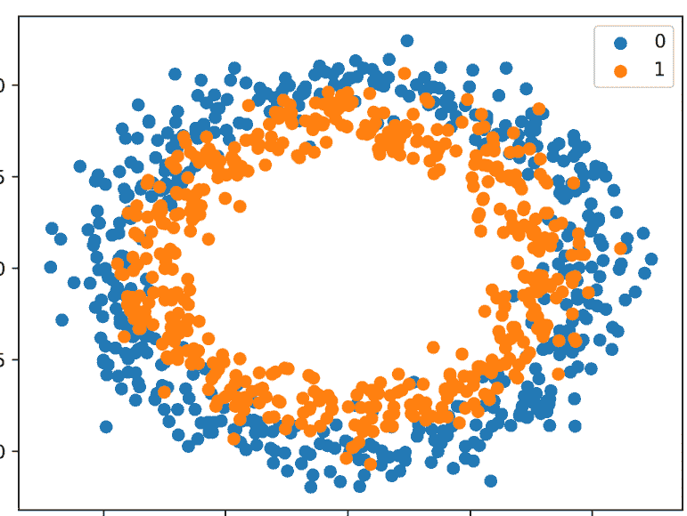

图 4.4：圆圈二元分类问题的散点图。

点已经在 0 附近合理缩放，几乎在 [-1,1] 范围内。在这种情况下我们不会重新缩放它们。数据集平均分为训练集和测试集。

```python
# split into train and test

n_train = 500

trainX, testX = X[:n_train, :], X[n_train:, :]

trainy, testy = y[:n_train], y[n_train:]
```

清单 4.21：将数据拆分为训练集和测试数据集的示例。

可以定义一个简单的 MLP 模型来解决此问题，该模型期望数据集中的两个特征的两个输入，一个具有 50 个节点的隐藏层、一个整流线性激活函数以及一个输出层，该输出层需要根据损失函数的选择进行配置。

```python
# define model

model = Sequential()

model.add(Dense(50, input_dim=2, activation='relu', kernel_initializer='he_uniform'))

model.add(Dense(1, activation='...'))
```

清单 4.22：定义 MLP 模型的示例。

模型将使用随机梯度下降进行拟合，使用合理的默认学习率为 0.01，动量为 0.9。

```python
opt = SGD(lr=0.01, momentum=0.9)
```

```python
model.compile(loss='...', optimizer=opt, metrics=['accuracy'])
```

清单 4.23：编译 MLP 模型的示例。

我们将对模型进行 200 个训练轮次的拟合，并在每个轮次结束时评估模型的损失和准确率，以便我们可以绘制学习曲线。

```python
# fit model

history = model.fit(trainX, trainy, validation_data=(testX, testy), epochs=200, verbose=0)
```

清单 4.24：拟合 MLP 模型的示例。

现在我们有了问题和模型的基础，我们可以看看评估三种常见的损失函数，这些损失函数适用于二元分类预测建模问题。虽然这些示例中使用了 MLP，但在训练 CNN 和 RNN 模型进行二元分类时也可以使用相同的损失函数。

### 4.3.1 二元交叉熵损失

交叉熵是用于二元分类问题的默认损失函数。它适用于目标值在集合 {0, 1} 中的二元分类。数学上，它是在最大似然推理框架下首选的损失函数。它是首先要评估的损失函数，只有在有充分理由时才更改。交叉熵将计算一个分数，该分数概括了预测类别 1 的实际概率分布与预测概率分布之间的平均差异。该分数最小化，完美的交叉熵值为 0。可以在 Keras 中通过在编译模型时指定 `'binary_crossentropy'` 来指定交叉熵作为损失函数。

```python
model.compile(loss='binary_crossentropy', optimizer=opt, metrics=['accuracy'])
```

清单 4.25：使用二元交叉熵损失的示例。

该函数要求输出层配置为单个节点并使用 `'sigmoid'` 激活，以便预测类别 1 的概率。

```python
model.add(Dense(1, activation='sigmoid'))
```

清单 4.26：使用 sigmoid 激活函数的示例。

MLP 使用交叉熵损失的两个圆圈二元分类问题的完整示例如下所示。

```python
# mlp for the circles problem with cross-entropy loss

from sklearn.datasets import make_circles

from keras.models import Sequential

from keras.layers import Dense

from keras.optimizers import SGD

from matplotlib import pyplot

# generate 2d classification dataset

X, y = make_circles(n_samples=1000, noise=0.1, random_state=1)

# split into train and test

n_train = 500

trainX, testX = X[:n_train, :], X[n_train:, :]

trainy, testy = y[:n_train], y[n_train:]

# define model

model = Sequential()

model.add(Dense(50, input_dim=2, activation='relu', kernel_initializer='he_uniform'))

model.add(Dense(1, activation='sigmoid'))

opt = SGD(lr=0.01, momentum=0.9)

model.compile(loss='binary_crossentropy', optimizer=opt, metrics=['accuracy'])

# fit model

history = model.fit(trainX, trainy, validation_data=(testX, testy), epochs=200, verbose=0)

# evaluate the model

_, train_acc = model.evaluate(trainX, trainy, verbose=0)

_, test_acc = model.evaluate(testX, testy, verbose=0)

print('Train: %.3f, Test: %.3f' % (train_acc, test_acc))

# plot loss during training

pyplot.subplot(211)

pyplot.title('Binary Cross-Entropy Loss', pad=-20)

pyplot.plot(history.history['loss'], label='train')

pyplot.plot(history.history['val_loss'], label='test')

pyplot.legend()

# plot accuracy during training

pyplot.subplot(212)

pyplot.title('Classification Accuracy', pad=-40)

pyplot.plot(history.history['acc'], label='train')

pyplot.plot(history.history['val_acc'], label='test')

pyplot.legend()

pyplot.show()
```

清单 4.27：两个圆圈问题使用二元交叉熵的示例。

运行示例首先会打印模型在训练集和测试数据集上的分类准确率。

**注意：** 由于学习算法的随机性，您的具体结果可能会有所不同。考虑多次运行示例并比较平均性能。

在这种情况下，我们可以看到模型合理地学习了该问题，在训练数据集上实现了约 83% 的准确率，在测试数据集上约为 84%。分数相当接近，表明模型可能既不过拟合也不欠拟合。

```python
Train: 0.834, Test: 0.848
```

清单 4.28：使用二元交叉熵进行两个圆圈问题时的示例输出。

还创建了一个图，显示了两条线图，顶部为训练集（蓝色）和测试集（橙色）在轮次上的交叉熵损失，底部图显示了轮次上的分类准确率。该图显示训练过程收敛良好。损失的图是平滑的，因为概率分布之间的误差是连续的，而准确率的线图显示出波动，因为训练集和测试集中的示例最终只能预测为正确或不正确，从而对性能的反馈较少。

## 4.3. 二元分类损失函数案例研究

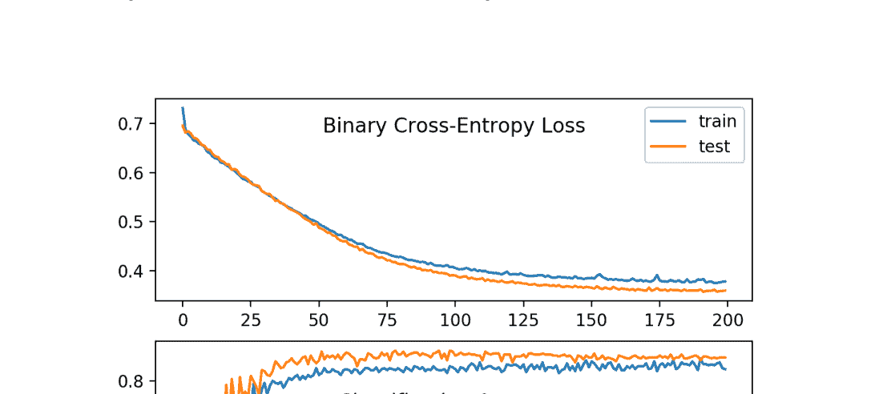

Figure 4.5: 关于双圆二元分类问题的训练 epoch 上交叉熵损失和分类准确率的线图。

An alternative to cross-entropy for binary classification problems is the hinge loss function, primarily developed for use with Support Vector Machine (SVM) models. It is intended for use with binary classification where the target values are in the set {-1, 1}. The hinge loss function encourages examples to have the correct sign, assigning more error when there is a difference in the sign between the actual and predicted class values. Reports of performance with the hinge loss are mixed, sometimes resulting in better performance than cross-entropy on binary classification problems. Firstly, the target variable must be modified to have values in the set {-1, 1}.

```python
# change y from {0,1} to {-1,1}

y[where(y == 0)] = -1
```

The hinge loss function can then be specified as `'hinge'` in the compile function.

```python
model.compile(loss='hinge', optimizer=opt, metrics=['accuracy'])
```

Finally, the output layer of the network must be configured to have a single node with a hyperbolic tangent activation function capable of outputting a single value in the range [-1, 1].

```python
model.add(Dense(1, activation='tanh'))
```

Listing 4.31: 使用双曲正切激活函数的示例。

The complete example of an MLP with a hinge loss function for the two circles binary classification problem is listed below.

```python
# mlp for the circles problem with hinge loss

from sklearn.datasets import make_circles

from keras.models import Sequential

from keras.layers import Dense

from keras.optimizers import SGD

from matplotlib import pyplot

from numpy import where

# generate 2d classification dataset

X, y = make_circles(n_samples=1000, noise=0.1, random_state=1)

# change y from {0,1} to {-1,1}

y[where(y == 0)] = -1

# split into train and test

n_train = 500

trainX, testX = X[:n_train, :], X[n_train:, :]

trainy, testy = y[:n_train], y[n_train:]

# define model

model = Sequential()

model.add(Dense(50, input_dim=2, activation='relu', kernel_initializer='he_uniform'))

model.add(Dense(1, activation='tanh'))

opt = SGD(lr=0.01, momentum=0.9)

model.compile(loss='hinge', optimizer=opt, metrics=['accuracy'])

# fit model

history = model.fit(trainX, trainy, validation_data=(testX, testy), epochs=200, verbose=0)

# evaluate the model

_, train_acc = model.evaluate(trainX, trainy, verbose=0)

_, test_acc = model.evaluate(testX, testy, verbose=0)

print('Train: %.3f, Test: %.3f' % (train_acc, test_acc))

# plot loss during training

pyplot.subplot(211)

pyplot.title('Hinge Loss', pad=-20)

pyplot.plot(history.history['loss'], label='train')

pyplot.plot(history.history['val_loss'], label='test')

pyplot.legend()

# plot accuracy during training

pyplot.subplot(212)

pyplot.title('Classification Accuracy', pad=-40)
```


```python
pyplot.plot(history.history['acc'], label='train')

pyplot.plot(history.history['val_acc'], label='test')

pyplot.legend()

pyplot.show()
```

Listing 4.32: 双圆问题中使用铰链损失函数的示例。

Running the example first prints the classification accuracy for the model on the train and test dataset.

The squared hinge loss. It has the effect of smoothing the surface of the error function and making it numerically easier to work with. If using a hinge loss does result in better performance on a given binary classification problem, is likely that a squared hinge loss may be appropriate. As with using the hinge loss function, the target variable must be modified to have values in the set {-1, 1}.

```python
# change y from {0,1} to {-1,1}
y[where(y == 0)] = -1
```

Listing 4.34: 准备目标变量的示例。

The squared hinge loss can be specified as `squared_hinge` in the `compile()` function when defining the model.

```python
model.compile(loss='squared_hinge', optimizer=opt, metrics=['accuracy'])
```

Listing 4.35: 使用平方铰链损失函数的示例。

And finally, the output layer must use a single node with a hyperbolic tangent activation function capable of outputting continuous values in the range [-1, 1].

```python
model.add(Dense(1, activation='tanh'))
```

Listing 4.36: 使用双曲正切激活函数的示例。

The complete example of an MLP with the squared hinge loss function on the two circles binary classification problem is listed below.

```python
# mlp for the circles problem with squared hinge loss
from sklearn.datasets import make_circles
from keras.models import Sequential
from keras.layers import Dense
from keras.optimizers import SGD
from matplotlib import pyplot
from numpy import where

# generate 2d classification dataset
X, y = make_circles(n_samples=1000, noise=0.1, random_state=1)

# change y from {0,1} to {-1,1}
y[where(y == 0)] = -1

# split into train and test
n_train = 500
trainX, testX = X[:n_train, :], X[n_train:, :]
trainy, testy = y[:n_train], y[n_train:]

# define model
model = Sequential()
model.add(Dense(50, input_dim=2, activation='relu', kernel_initializer='he_uniform'))
model.add(Dense(1, activation='tanh'))
opt = SGD(lr=0.01, momentum=0.9)
model.compile(loss='squared_hinge', optimizer=opt, metrics=['accuracy'])

# fit model
history = model.fit(trainX, trainy, validation_data=(testX, testy), epochs=200, verbose=0)

# evaluate the model
_, train_acc = model.evaluate(trainX, trainy, verbose=0)
_, test_acc = model.evaluate(testX, testy, verbose=0)
print('Train: %.3f, Test: %.3f' % (train_acc, test_acc))

# plot loss during training
pyplot.subplot(211)
```

```python
pyplot.title('Squared Hinge Loss', pad=-20)
pyplot.plot(history.history['loss'], label='train')
pyplot.plot(history.history['val_loss'], label='test')
pyplot.legend()

# plot accuracy during training
pyplot.subplot(212)
pyplot.title('Classification Accuracy', pad=-40)
pyplot.plot(history.history['acc'], label='train')
pyplot.plot(history.history['val_acc'], label='test')
pyplot.legend()
pyplot.show()
```

Listing 4.37: 双圆问题中使用平方铰链损失函数的示例。

Running the example first prints the classification accuracy for the model on the train and test datasets.

**Note:** 由于学习算法的随机性，您的具体结果可能会有所不同。考虑多次运行示例并比较平均性能。

In this case, we can see that for this problem and the chosen model configuration, the hinge squared loss may not be appropriate, resulting in classification accuracy of less than 70% on the train and test sets.

```python
Train: 0.664, Test: 0.624
```

Listing 4.38: 双圆问题中使用平方铰链损失函数的示例输出。

A figure is also created showing two line plots, the top with the squared hinge loss over epochs for the train (blue) and test (orange) dataset, and the bottom plot showing classification accuracy over epochs. The plot of loss shows that indeed, the model converged, but the shape of the error surface is not as smooth as other loss functions where small changes to the weights are causing large changes in loss.

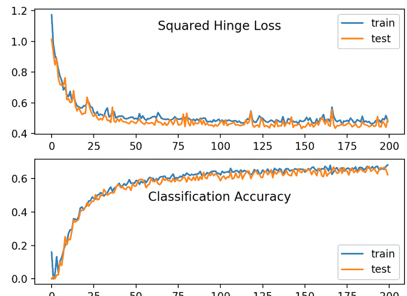

Figure 4.7: 关于双圆二元分类问题的训练 epoch 上平方铰链损失和分类准确率的线图。

#### 4.4 Multiclass Classification Loss Functions Case Study

Multiclass classification predictive modeling problems are those where examples are assigned one of more than two classes. The problem is often framed as predicting an integer value, where each class is assigned a unique integer value from 0 to `(num_classes - 1)`. The problem is often implemented as predicting the probability of the example belonging to each class. In this section, we will investigate loss functions that are appropriate for multiclass classification predictive modeling problems.

We will use the blobs problem as the basis for the investigation. The `make_blobs()` function provided by scikit-learn provides a way to generate examples given a specified number of classes and input features. We will use this function to generate 1,000 examples for a 3-class classification problem with 2 input variables. The pseudorandom number generator will be seeded consistently so that the same 1,000 examples are generated each time the code is run.

```python
# generate dataset
X, y = make_blobs(n_samples=1000, centers=3, n_features=2, cluster_std=2, random_state=2)
```

Listing 4.39: 为 blobs 问题生成样本的示例。

The two input variables can be taken as x and y coordinates for points on a two-dimensional plane. The example below creates a scatter plot of the entire dataset coloring points by their class membership.

```python
# scatter plot of blobs dataset
from sklearn.datasets.samples_generator import make_blobs
from numpy import where
from matplotlib import pyplot

# generate dataset
X, y = make_blobs(n_samples=1000, centers=3, n_features=2, cluster_std=2, random_state=2)

# select indices of points with each class label
for i in range(3):
    samples_ix = where(y == i)
    pyplot.scatter(X[samples_ix, 0], X[samples_ix, 1])
pyplot.show()
```

清单 4.40：从 blobs 问题中绘制样本的示例。

运行该示例会创建散点图，显示数据集中 1,000 个示例，其中属于 0、1 和 2 类的示例分别以蓝色、橙色和绿色着色。

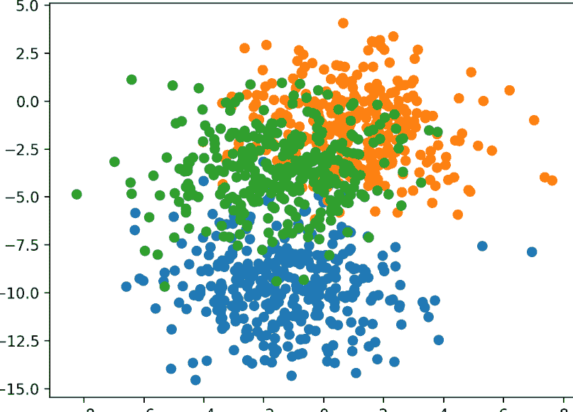

图 4.8：从 Blobs 多类分类问题生成的示例散点图。

输入特征是高斯分布的，可以从标准化中受益；然而，为简洁起见，在本示例中我们将保持值未缩放。数据集将被均匀地划分为训练集和测试集。

```python
# split into train and test
n_train = 500
trainX, testX = X[:n_train, :], X[n_train:, :]
trainy, testy = y[:n_train], y[n_train:]
```

清单 4.41：将数据集拆分为训练集和测试数据集的示例。

一个小型 MLP 模型将被用作探索损失函数的基础。该模型期望两个输入变量，隐藏层有 50 个节点，采用整流线性激活函数，并且输出层必须根据损失函数的选择进行定制。

```python
# define model
model = Sequential()
model.add(Dense(50, input_dim=2, activation='relu', kernel_initializer='he_uniform'))
model.add(Dense(..., activation='...'))
```

清单 4.42：定义 MLP 模型的示例。

模型使用随机梯度下降进行拟合，采用合理的默认学习率 0.01 和动量 0.9。

```python
# compile model
opt = SGD(lr=0.01, momentum=0.9)
model.compile(loss='...', optimizer=opt, metrics=['accuracy'])
```

清单 4.43：编译 MLP 模型的示例。

模型将在训练数据集上拟合 100 个 epoch，并将测试数据集用作验证数据集，从而使我们能够在每个训练 epoch 结束时评估训练集和测试集上的损失和分类准确率，并绘制学习曲线。

```python
# fit model
history = model.fit(trainX, trainy, validation_data=(testX, testy), epochs=100, verbose=0)
```

清单 4.44：拟合 MLP 模型的示例。

现在我们有了问题和模型的基础，可以来评估三种常见的损失函数，这些损失函数适用于多类分类预测建模问题。尽管这些示例中使用了 MLP，但在为多类分类训练 CNN 和 RNN 模型时也可以使用相同的损失函数。

##### 4.4.1 多类交叉熵损失

交叉熵是用于多类分类问题的默认损失函数。在这种情况下，它适用于目标值在集合 {0, 1, 2, ..., n} 中的多类分类，其中每个类别分配一个唯一的整数值。在数学上，它是在最大似然推理框架下首选的损失函数。它是首先要评估的损失函数，只有在有充分理由时才更改。交叉熵将计算一个分数，总结问题中所有类别的实际概率分布与预测概率分布之间的平均差异。该分数应最小化，完美的交叉熵值为 0。在 Keras 中，可以通过在编译模型时指定 `categorical_crossentropy` 来指定交叉熵作为损失函数。

```python
model.compile(loss='categorical_crossentropy', optimizer=opt, metrics=['accuracy'])
```

清单 4.45：使用分类交叉熵损失函数的示例。

该函数要求输出层配置有 n 个节点（每个类别一个），本例中为三个节点，并使用 `softmax` 激活函数以预测每个类别的概率。

```python
model.add(Dense(3, activation='softmax'))
```

清单 4.46：使用 softmax 激活函数的示例。

因此，这意味着目标变量必须进行独热编码。这是为了确保每个示例对实际类别值的期望概率为 1.0，而对所有其他类别值的期望概率为 0.0。这可以通过使用 `to_categorical()` Keras 函数实现。

```python
# one hot encode output variable
y = to_categorical(y)
```

清单 4.47：对目标变量进行独热编码的示例。

下面列出了用于多类 blobs 分类问题的具有交叉熵损失的 MLP 的完整示例。

```python
# mlp for the blobs multi-class classification problem with cross-entropy loss
from sklearn.datasets.samples_generator import make_blobs
```


### 4.4.1 多类交叉熵损失

```
from keras.layers import Dense
from keras.models import Sequential
from keras.optimizers import SGD
from keras.utils import to_categorical
from matplotlib import pyplot

# generate 2d classification dataset
X, y = make_blobs(n_samples=1000, centers=3, n_features=2, cluster_std=2, random_state=2)

# one hot encode output variable
y = to_categorical(y)

# split into train and test
n_train = 500
trainX, testX = X[:n_train, :], X[n_train:, :]
trainy, testy = y[:n_train], y[n_train:]

# define model
model = Sequential()
model.add(Dense(50, input_dim=2, activation='relu', kernel_initializer='he_uniform'))
model.add(Dense(3, activation='softmax'))

# compile model
opt = SGD(lr=0.01, momentum=0.9)
model.compile(loss='categorical_crossentropy', optimizer=opt, metrics=['accuracy'])

# fit model
history = model.fit(trainX, trainy, validation_data=(testX, testy), epochs=100, verbose=0)

# evaluate the model
_, train_acc = model.evaluate(trainX, trainy, verbose=0)
_, test_acc = model.evaluate(testX, testy, verbose=0)
print('Train: %.3f, Test: %.3f' % (train_acc, test_acc))

# plot loss during training
pyplot.subplot(211)
pyplot.title('Categorical Cross-Entropy Loss', pad=-20)
pyplot.plot(history.history['loss'], label='train')
pyplot.plot(history.history['val_loss'], label='test')
pyplot.legend()

# plot accuracy during training
pyplot.subplot(212)
pyplot.title('Classification Accuracy', pad=40)
pyplot.plot(history.history['acc'], label='train')
pyplot.plot(history.history['val_acc'], label='test')
pyplot.legend()

pyplot.show()
```

**清单 4.48：** 为 blobs 问题使用分类交叉熵损失函数的示例。

运行该示例首先会打印模型在训练集和测试数据集上的分类准确率。

**注意：** 由于学习算法的随机性，您的具体结果可能会有所不同。考虑多次运行示例并比较平均性能。

在这种情况下，我们可以看到模型表现良好，在训练数据集上实现了约 82% 的分类准确率，在测试数据集上也实现了约 82%。

```
Train: 0.824, Test: 0.820
```

**清单 4.49：** 使用分类交叉熵损失函数为 blobs 问题输出的示例。

还创建了一幅图，显示了两个折线图，上方为训练集（蓝色）和测试集（橙色）在各 epoch 上的交叉熵损失，下方为各 epoch 上的分类准确率。在这种情况下，图显示模型似乎已收敛。交叉熵和准确率的折线图都显示出良好的收敛行为，尽管有些波动。鉴于没有过拟合或欠拟合的迹象，模型可能配置良好。在这种情况下，可以调整学习率或批大小以使收敛的平滑度更均匀。

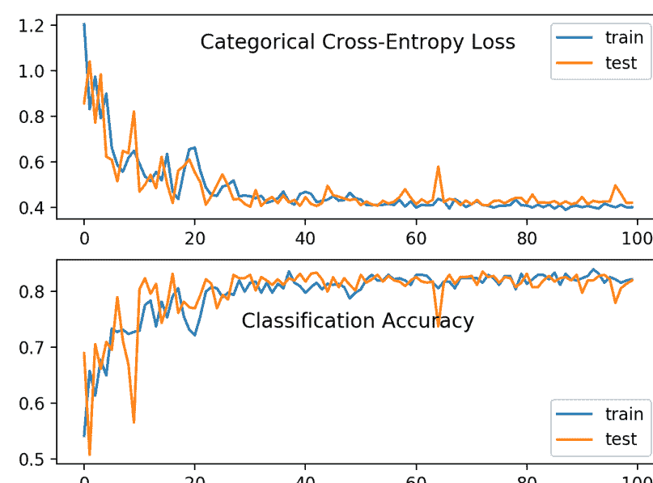

**图 4.9：** Blobs 多类分类问题在训练 epoch 上的交叉熵损失和分类准确率的折线图。

### 4.4.2 稀疏多类交叉熵损失

在使用交叉熵处理具有大量标签的分类问题时，一个可能的令人沮丧的原因是独热编码过程。例如，预测词汇表中的单词可能有数万甚至数十万个类别，每个标签一个。这意味着每个训练示例的目标元素可能需要一个包含数万甚至数十万个零值的独热编码向量，需要大量内存。稀疏交叉熵通过执行相同的交叉熵误差计算来解决此问题，而无需在训练前对目标变量进行独热编码。在 Keras 中，可以通过在调用 `compile()` 函数时使用 `'sparse_categorical_crossentropy'` 来对多类分类使用稀疏交叉熵。

```
model.compile(loss='sparse_categorical_crossentropy', optimizer=opt, metrics=['accuracy'])
```

**清单 4.50：** 使用稀疏分类交叉熵损失函数的示例。

该函数要求输出层配置有 `n` 个节点（每个类别一个），本例中为三个节点，并使用 `'softmax'` 激活函数以预测每个类别的概率。

```
model.add(Dense(3, activation='softmax'))
```

**代码清单 4.51：** 使用 `softmax` 激活函数的示例。

无需对目标变量进行 one-hot 编码，这是该损失函数的一个优点。下面列出了使用稀疏交叉熵在 blobs 多分类问题上训练 MLP 的完整示例。

```
# mlp for the blobs multi-class classification problem with sparse cross-entropy loss
from sklearn.datasets.samples_generator import make_blobs
from keras.layers import Dense
from keras.models import Sequential
from keras.optimizers import SGD
from matplotlib import pyplot

# generate 2d classification dataset
X, y = make_blobs(n_samples=1000, centers=3, n_features=2, cluster_std=2, random_state=2)

# split into train and test
n_train = 500
trainX, testX = X[:n_train, :], X[n_train:, :]
trainy, testy = y[:n_train], y[n_train:]

# define model
model = Sequential()
model.add(Dense(50, input_dim=2, activation='relu', kernel_initializer='he_uniform'))
model.add(Dense(3, activation='softmax'))

# compile model
opt = SGD(lr=0.01, momentum=0.9)
model.compile(loss='sparse_categorical_crossentropy', optimizer=opt, metrics=['accuracy'])

# fit model
history = model.fit(trainX, trainy, validation_data=(testX, testy), epochs=100, verbose=0)

# evaluate the model
_, train_acc = model.evaluate(trainX, trainy, verbose=0)
_, test_acc = model.evaluate(testX, testy, verbose=0)
print('Train: %.3f, Test: %.3f' % (train_acc, test_acc))

# plot loss during training
pyplot.subplot(211)
pyplot.title('Sparse Categorical Cross-Entropy Loss', pad=-20)
pyplot.plot(history.history['loss'], label='train')
pyplot.plot(history.history['val_loss'], label='test')
pyplot.legend()

# plot accuracy during training
pyplot.subplot(212)
pyplot.title('Classification Accuracy', pad=-40)
pyplot.plot(history.history['acc'], label='train')
pyplot.plot(history.history['val_acc'], label='test')
pyplot.legend()

pyplot.show()
```

**代码清单 4.52：** 针对 blobs 问题使用稀疏分类交叉熵损失函数的示例。

运行示例首先会打印模型在训练集和测试集上的分类准确率。

**注意：** 由于学习算法的随机性，您的具体结果可能会有所不同。建议多次运行示例并比较平均性能。

在这种情况下，我们可以看到模型在该问题上取得了良好的性能。事实上，如果多次重复实验，稀疏和非稀疏交叉熵的平均性能应该具有可比性。

```
Train: 0.818, Test: 0.828
```

**代码清单 4.53：** 使用稀疏分类交叉熵损失函数处理 blobs 问题的示例输出。

还创建了一幅图，显示了两条线图，上方为训练（蓝色）和测试（橙色）数据集在各轮次上的稀疏交叉熵损失，下方图显示了各轮次上的分类准确率。在这种情况下，该图显示模型在训练过程中就损失和分类准确率而言均收敛良好。

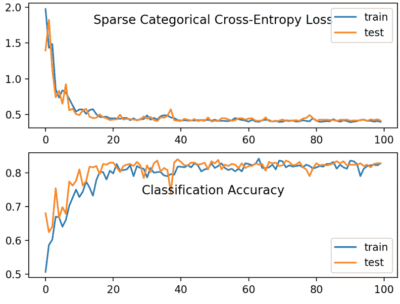

**图 4.10：** Blobs 多分类分类问题上训练轮次的稀疏交叉熵损失和分类准确率的线图。

### 4.4.3 库尔贝克-莱布勒散度损失

库尔贝克-莱布勒散度，简称 KL 散度，是衡量一个概率分布与基准分布之间差异的指标。KL 散度损失为 0 表示分布相同。实际上，KL 散度的行为与交叉熵非常相似。它计算如果使用预测的概率分布来近似期望的目标概率分布时所损失的信息量（以比特为单位）。

因此，KL 散度损失函数更常用于学习近似比单纯多分类更复杂函数的模型，例如在必须重构原始输入的模型下用于学习密集特征表示的自编码器。在这种情况下，更倾向于使用 KL 散度损失。尽管如此，它也可以用于多分类，在这种情况下在功能上等同于多分类交叉熵。可以在 Keras 中通过在 `compile()` 函数中指定 `'kullback_leibler_divergence'` 来使用 KL 散度损失。

```
model.compile(loss='kullback_leibler_divergence', optimizer=opt, metrics=['accuracy'])
```

**代码清单 4.54：** 使用 KL 散度损失函数的示例。

与交叉熵一样，输出层配置了 `n` 个节点（每个类别一个），本例中为三个节点，并使用 `'softmax'` 激活函数以预测每个类别的概率。此外，与分类交叉熵一样，我们必须对目标变量进行 one-hot 编码，使类别值的期望概率为 1.0，其他所有类别值为 0.0。

```
# one hot encode output variable
y = to_categorical(y)
```

**代码清单 4.55：** 对目标变量进行 one-hot 编码的示例。

下面列出了使用 KL 散度损失在 blobs 多分类问题上训练 MLP 的完整示例。

```
# mlp for the blobs multi-class classification problem with kl divergence loss
from sklearn.datasets.samples_generator import make_blobs
from keras.layers import Dense
from keras.models import Sequential
from keras.optimizers import SGD
from keras.utils import to_categorical
from matplotlib import pyplot

# generate 2d classification dataset
X, y = make_blobs(n_samples=1000, centers=3, n_features=2, cluster_std=2, random_state=2)

# one hot encode output variable
y = to_categorical(y)

# split into train and test
n_train = 500
trainX, testX = X[:n_train, :], X[n_train:, :]
trainy, testy = y[:n_train], y[n_train:]

# define model
model = Sequential()
model.add(Dense(50, input_dim=2, activation='relu', kernel_initializer='he_uniform'))
model.add(Dense(3, activation='softmax'))

# compile model
opt = SGD(lr=0.01, momentum=0.9)
model.compile(loss='kullback_leibler_divergence', optimizer=opt, metrics=['accuracy'])

# fit model
history = model.fit(trainX, trainy, validation_data=(testX, testy), epochs=100, verbose=0)

# evaluate the model
_, train_acc = model.evaluate(trainX, trainy, verbose=0)
_, test_acc = model.evaluate(testX, testy, verbose=0)
print('Train: %.3f, Test: %.3f' % (train_acc, test_acc))

# plot loss during training
pyplot.subplot(211)
pyplot.title('Kullback Leibler Divergence Loss', pad=-20)
pyplot.plot(history.history['loss'], label='train')
pyplot.plot(history.history['val_loss'], label='test')
pyplot.legend()

# plot accuracy during training
pyplot.subplot(212)
pyplot.title('Classification Accuracy', pad=-40)
pyplot.plot(history.history['acc'], label='train')
pyplot.plot(history.history['val_acc'], label='test')
pyplot.legend()

pyplot.show()
```

**代码清单 4.56：** 针对 blobs 问题使用 KL 散度损失函数的示例。

运行示例首先会打印模型在训练集和测试集上的分类准确率。

**注意：** 由于学习算法的随机性，您的具体结果可能会有所不同。建议多次运行示例并比较平均性能。

在这种情况下，我们看到的性能与使用交叉熵损失时看到的结果相似，在本例中训练集和测试集的准确率约为 80%。

```
Train: 0.826, Test: 0.808
```


代码清单 4.57：使用 KL 散度损失函数处理 blobs 问题的示例输出。

还创建了一幅图，显示了两条线图，上方为训练（蓝色）和测试（橙色）数据集在各轮次上的 KL 散度损失，下方图显示了各轮次上的分类准确率。在这种情况下，该图显示损失和分类准确率均具有良好的收敛行为。鉴于该度量的相似性，使用交叉熵进行评估很可能会产生几乎相同的行为。

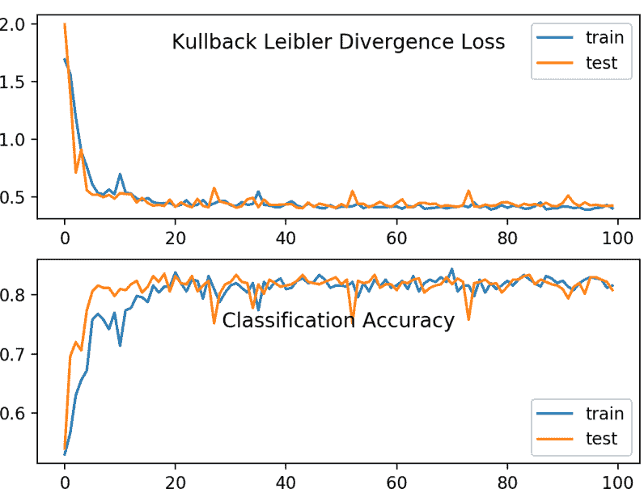

图 4.11：Blobs 多分类分类问题上训练轮次的 KL 散度损失和分类准确率的线图。

#### 4.5 扩展

本节列出了一些您可以探索的扩展教程的想法。

- **替代回归损失**。尝试回归的替代损失函数，例如平均绝对百分比误差或 MAPE。
- **替代分类损失**。尝试分类的替代损失函数，例如分类铰链损失。
- **重复评估**。创建一个重复评估实验，并比较分类交叉熵、稀疏交叉熵和 KL 散度的平均最终损失和准确率，以确认它们在功能上等价。

如果您探索了其中任何一个扩展，我很乐意知道。

#### 4.6 进一步阅读

如果您想深入了解，本节提供了该主题的更多资源。

##### 4.6.1 书籍
- *深度学习*，2016年。
  https://amzn.to/2NJW3gE
- *神经锻造：前馈人工神经网络中的监督学习*，1999年。
  https://amzn.to/2S8qRdI
- *用于模式识别的神经网络*，1995年。
  https://amzn.to/2S8qdwt

##### 4.6.2 论文
- *论分类中深度神经网络的损失函数*，2017年。
  https://arxiv.org/abs/1702.05659

##### 4.6.3 API
- Keras 损失函数 API。
  https://keras.io/losses/
- Keras 激活函数 API。
  https://keras.io/activations/
- sklearn.preprocessing.StandardScaler API。
  http://scikit-learn.org/stable/modules/generated/sklearn.preprocessing.StandardScaler.html
- sklearn.datasets.make_regression API。
  http://scikit-learn.org/stable/modules/generated/sklearn.datasets.make_regression.html
- sklearn.datasets.make_circles API。
  http://scikit-learn.org/stable/modules/generated/sklearn.datasets.make_circles.html
- sklearn.datasets.make_blobs API。
  http://scikit-learn.org/stable/modules/generated/sklearn.datasets.make_blobs.html

##### 4.6.4 文章
- 最大似然估计，维基百科。
  https://en.wikipedia.org/wiki/Maximum_likelihood_estimation
- Kullback-Leibler散度，维基百科。
  https://en.wikipedia.org/wiki/Kullback%E2%80%93Leibler_divergence
- 交叉熵，维基百科。
  https://en.wikipedia.org/wiki/Cross_entropy
- 均方误差，维基百科。
  https://en.wikipedia.org/wiki/Mean_squared_error
- 合页损失，维基百科。
  https://en.wikipedia.org/wiki/Hinge_loss
- Kullback-Leibler散度，维基百科。
  https://en.wikipedia.org/wiki/Kullback%E2%80%93Leibler_divergence
- 神经网络中的损失函数，2017年。
  https://isaacchanghau.github.io/post/loss_functions/
- 对数损失，FastAI维基百科。
  http://wiki.fast.ai/index.php/Log_Loss

#### 4.7 总结

在本教程中，你了解了损失及损失函数在训练深度学习神经网络中的作用，以及如何为你的预测建模问题选择合适的损失函数。具体来说，你学到了：

- 神经网络通过优化过程进行训练，该过程需要损失函数来计算模型误差。
- 最大似然为训练神经网络及一般机器学习模型时选择损失函数提供了一个框架。
- 交叉熵和均方误差是训练神经网络模型时使用的两种主要损失函数。

##### 4.7.1 下一步

在下一个教程中，你将了解学习率如何控制模型参数的更新量，进而控制收敛的稳定性和速度。

## 第5章

### 使用学习率配置学习速度

神经网络无法通过解析方法计算权重。相反，必须通过一种称为随机梯度下降的经验优化过程来发现权重。随机梯度下降为神经网络解决的优化问题具有挑战性，解空间（权重集合）可能由许多好的解（称为全局最优）以及容易找到但技能较低的解（称为局部最优）组成。在此搜索过程的每一步中，模型的变化量（即步长）称为学习率，它可能是为你的神经网络调整的最重要的超参数，以便在你的问题上获得良好性能。在本教程中，你将了解训练深度学习神经网络时使用的学习率超参数。完成本教程后，你将知道：

- 学习率控制神经网络模型学习问题的快慢。
- 如何通过合理的默认值配置学习率、诊断行为并进行敏感性分析。
- 如何通过学习率调度、动量和自适应学习率进一步提高性能。

让我们开始吧。

#### 5.1 学习率

在本节中，你将了解学习率、它在训练期间对模型的影响，以及在训练你自己的神经网络模型时如何配置学习率的技巧。

##### 5.1.1 什么是学习率？

深度学习神经网络使用随机梯度下降算法进行训练。随机梯度下降是一种优化算法，它利用训练数据集中的样本估计模型当前状态的误差梯度，然后使用误差反向传播算法更新模型权重，该算法简称为反向传播。

训练期间权重更新的量称为步长或*学习率*。具体来说，学习率是神经网络训练中使用的一个可配置超参数，它有一个较小的正值，通常在0.0到1.0之间。

> > ...学习率，一个决定步长大小的正标量。
> 
> — 第86页，*深度学习*，2016年。

学习率通常用小写希腊字母eta（η）表示。在训练期间，误差反向传播会估计网络中每个节点内每个权重所负责的误差量。权重不是按完整误差量更新，而是按学习率进行缩放。这意味着，学习率为0.1（一个传统的常见默认值）时，网络中的权重每次更新时都会按 0.1 ×（估计权重误差）或估计权重误差的10%进行更新。

##### 5.1.2 学习率的影响

神经网络从训练数据集中的样本学习或逼近一个函数，以最佳地将输入映射到输出。学习率超参数控制模型学习的速率或速度。具体来说，它控制模型权重每次更新时所使用的分配误差量，例如在每个训练批次结束时。给定一个配置完美的学习率，模型将在给定的训练轮数（遍历训练数据的次数）内，利用可用资源（层数和每层节点数）学习最佳逼近该函数。

一般来说，较大的学习率可以让模型学得更快，但代价是最终得到的权重集合可能不是最优的。较小的学习率可能让模型学到更优甚至全局最优的权重集合，但训练时间可能显著更长。在极端情况下，学习率过大会导致权重更新过大，模型的性能（例如其在训练数据集上的损失）会在训练轮次之间振荡。据说振荡的性能是由发散的权重引起的。学习率太小可能永远无法收敛，或者陷入次优解。

> > 当学习率过大时，梯度下降可能无意中增加而非减少训练误差。[...] 当学习率过小时，训练不仅更慢，而且可能永久地陷入高训练误差。
> 
> — 第429页，*深度学习*，2016年。

在最坏的情况下，过大的权重更新可能导致权重爆炸（即产生数值溢出）。

> > 使用较高的学习率时，可能会遇到正反馈循环：大权重会产生大梯度，进而导致权重的大幅更新。如果这些更新持续增大权重的规模，那么[权重]将迅速远离原点，直到发生数值溢出。
> 
> — 第238页，*深度学习*，2016年。

因此，我们不应使用过大或过小的学习率。尽管如此，我们必须以某种方式配置模型，使得平均而言能够找到一组*足够好*的权重，来逼近由训练数据集所代表的映射问题。

动量方法旨在加速学习，尤其是在面对高曲率、小而一致的梯度或噪声梯度时。

— 第296页，*深度学习*，2016年。

过去更新的惯性大小通过引入一个新的超参数来控制，该超参数通常称为*动量*或*速度*，并使用希腊小写字母 alpha（α）表示。

...动量算法引入一个变量 v，它扮演速度的角色——即参数在参数空间中移动的方向和速度。速度被设置为负梯度的指数衰减平均值。

— 第296页，*深度学习*，2016年。

它的作用是平滑优化过程，使更新减慢并继续沿先前方向进行，而不是陷入停滞或振荡。

处理特征值差异悬殊问题的一个非常简单的方法是在梯度下降公式中加入动量项。这实际上为通过权重空间的运动增加了惯性，并平滑了振荡。

— 第267页，*用于模式识别的神经网络*，1995年。

动量被设置为大于0.0且小于1的值，实践中常使用0.9和0.99等值。

[动量]在实践中使用的常见值包括.5、.9和.99。

— 第298页，*深度学习*，2016年。

动量并不会使学习率的配置变得更容易，因为步长与动量无关。相反，动量可以与步长协同提高优化过程的速度，从而增加在更少的训练轮次中发现更好权重集的可能性。

##### 5.1.5 使用学习率计划

使用固定学习率的一种替代方案是在训练过程中改变学习率。学习率随时间（训练轮次）变化的方式称为学习率计划或学习率衰减。也许最简单的学习率计划是从较大的初始值线性减小到较小的值。这允许在学习过程开始时进行较大的权重变化，而在学习过程结束时进行较小的变化或微调。

在实践中，有必要随时间逐渐降低学习率，因此我们现在用 [...] 表示迭代处的学习率。这是因为 SGD 梯度估计器引入了一个噪声源（对 m 个训练样本的随机采样），即使我们到达最小值，这种噪声也不会消失。

— 第294页，*深度学习*，2016年。

事实上，在训练神经网络时，使用学习率计划可能是一种最佳实践。配置的挑战不在于选择固定的学习率超参数，而在于选择初始学习率和学习率计划。考虑到学习率计划可能带来更好的性能，初始学习率的选择可能不如固定学习率的选择那样敏感。学习率可以衰减到接近零的小值。或者，学习率可以在固定数量的训练轮次内衰减，然后在剩余的训练轮次中保持在一个小值，以便有更多时间进行微调。

在实践中，通常将学习率线性衰减直到迭代 [tau]。在迭代 [tau] 之后，通常保持[学习率]不变。

— 第295页，*深度学习*，2016年。

##### 5.1.6 自适应学习率

学习算法可以监控模型在训练数据集上的表现，并相应地调整学习率。这称为自适应学习率。也许最简单的实现是，一旦模型性能趋于平稳，就减小学习率，例如将学习率减半或降低一个数量级。

一个合理的优化算法选择是带动量的SGD配合衰减的学习率（在不同问题上表现不同的流行衰减方案包括：线性衰减直到达到固定的最小学习率、指数衰减，或每次验证误差趋于平稳时将学习率除以2到10）。

— 第425页，*深度学习*，2016年。

或者，如果在固定数量的训练轮次内性能没有改善，可以再次增大学习率。自适应学习率方法通常优于学习率配置糟糕的模型。

先验地选择良好学习率的困难是自适应学习率方法如此有用和流行的原因之一。一个好的自适应算法通常比使用选择不当的固定学习率的简单反向传播收敛得快得多。

— 第72页，*神经锻造：前馈人工神经网络中的监督学习*，1999年。

虽然没有任何单一方法能在所有问题上表现最佳，但有三种自适应学习率方法已被证明在多种神经网络架构和问题类型上具有鲁棒性。它们是 AdaGrad、RMSProp 和 Adam，它们都会为模型中的每个权重维护和调整学习率。也许最流行的是 Adam，因为它建立在 RMSProp 之上并加入了动量。

此时，一个自然的问题是：应该选择哪种算法？遗憾的是，目前对此尚无共识。当前实际使用中最流行的优化算法包括 SGD、带动量的 SGD、RMSProp、带动量的 RMSProp、AdaDelta 和 Adam。

> — 第309页，深度学习，2016年。

一个稳健的策略可能是：首先使用自适应学习率的现代随机梯度下降版本（如 Adam）评估模型性能，并将结果作为基线。然后，如果时间允许，再探索能否通过精心选择的学习率或更简单的学习率计划来获得改进。

#### 5.2 Keras 学习率 API

Keras 深度学习库允许你轻松地为随机梯度下降优化算法的多种不同变体配置学习率。

##### 5.2.1 随机梯度下降

Keras 提供了 SGD 类，该类实现了带学习率和动量的随机梯度下降优化器。首先，必须创建并配置该类的一个实例，然后在模型上调用 compile() 函数时将其指定给 optimizer 参数。默认学习率为 0.01，默认不使用动量。

```
from keras.optimizers import SGD

...

opt = SGD()

model.compile(..., optimizer=opt)
```

清单 5.1：在 Keras 中使用默认学习率的梯度下降示例。

学习率可通过 lr 参数指定，动量可通过 momentum 参数指定。

```
from keras.optimizers import SGD

...

opt = SGD(lr=0.01, momentum=0.9)

model.compile(..., optimizer=opt)
```

清单 5.2：在 Keras 中指定学习率和动量的梯度下降示例。

该类还通过 decay 参数支持权重衰减。使用学习率衰减时，每次更新（例如每个小批次的末尾）按如下方式计算学习率：

`lrate = initial_lrate × 1 / (1 + decay × iteration)  (5.1)`

其中 `lrate` 是当前轮次的学习率，`initial_lrate` 是作为 SGD 参数指定的学习率，`decay` 是大于零的衰减率，`iteration` 是当前的更新次数。

```
from keras.optimizers import SGD

...

opt = SGD(lr=0.01, momentum=0.9, decay=0.01)

model.compile(..., optimizer=opt)
```

清单 5.3：在 Keras 中使用学习率衰减的梯度下降示例。

##### 5.2.2 学习率计划

Keras 通过回调支持学习率计划（有关回调的更多信息，请参阅第 18.2 节）。回调与优化算法分开操作，尽管它们会调整优化算法所使用的学习率。在使用学习率计划回调时，建议使用 SGD。回调被实例化和配置，然后在训练模型时以列表形式指定给 fit() 函数的 callbacks 参数。

Keras 提供了 ReduceLROnPlateau 回调，当检测到模型性能出现平台期时（例如，在给定数量的训练轮次内没有变化），该回调会调整学习率。此回调设计用于在模型停止改进后降低学习率，以期微调模型权重。ReduceLROnPlateau 回调要求你通过 monitor 参数指定训练期间要监控的指标，通过 factor 参数指定学习率将乘以的值，以及通过 patience 参数指定触发学习率变化之前要等待的训练轮次数。例如，我们可以监控验证损失，如果验证损失在 100 轮内没有改善，则将学习率降低一个数量级：

```
# snippet of using the ReduceLROnPlateau callback

from keras.callbacks import ReduceLROnPlateau

...

rlrop = ReduceLROnPlateau(monitor='val_loss', factor=0.1, patience=100)

model.fit(..., callbacks=[rlrop])
```

清单 5.4：在 Keras 中使用 ReduceLROnPlateau 回调的示例。

Keras 还提供了 LearningRateScheduler 回调，允许你指定一个在每个轮次被调用的函数来调整学习率。你可以定义自己的 Python 函数，该函数接受两个参数（epoch 和当前学习率 lrate）并返回新的学习率。

```
# snippet of using the LearningRateScheduler callback

from keras.callbacks import LearningRateScheduler

...

def my_learning_rate(epoch, lrate):

    return lrate

lrs = LearningRateScheduler(my_learning_rate)

model.fit(..., callbacks=[lrs])
```

清单 5.5：在 Keras 中使用 LearningRateScheduler 回调的示例。

##### 5.2.3 自适应学习率梯度下降

Keras 还提供了一系列简单随机梯度下降的扩展，支持自适应学习率。因为每种方法都会自适应学习率，通常每个模型权重一个学习率，因此通常需要的配置很少。三种常用的自适应学习率方法包括：

### RMSProp 优化器

```
from keras.optimizers import RMSprop

...

opt = RMSprop()

model.compile(..., optimizer=opt)
```

Listing 5.6: Keras 中 RMSprop 优化器的示例。

### Adagrad 优化器

```
from keras.optimizers import Adagrad

...

opt = Adagrad()

model.compile(..., optimizer=opt)
```


### Listing 5.7: Keras 中 Adagrad 优化器的示例。

### Adam 优化器

```python
from keras.optimizers import Adam

...

opt = Adam()

model.compile(..., optimizer=opt)
```

Listing 5.8: Keras 中 Adam 优化器的示例。

#### 5.3 学习率案例研究

在本节中，我们将演示如何使用学习率通过 MLP 在一个简单的分类问题上控制收敛。此示例为使用您自己的神经网络探索分类和回归问题的学习率提供了一个模板。

##### 5.3.1 多类分类问题

我们将使用一个小型多类分类问题作为基础来演示学习率对模型性能的影响。`scikit-learn` 类提供了 `make_blobs()` 函数，可用于创建具有规定样本数、输入变量、类别数以及类内样本方差的多类分类问题。该问题可以配置为具有两个输入变量（表示点的 x 和 y 坐标），并且每个组内点的标准差为 2.0。我们将使用相同的随机状态（伪随机数生成器的种子），以确保我们始终获得相同的数据点。

```python
# generate 2d classification dataset

X, y = make_blobs(n_samples=1000, centers=3, n_features=2, cluster_std=2, random_state=2)
```

> Listing 5.9: 创建 blobs 问题样本的示例。

结果是我们可建模的数据集的输入和输出元素。为了感受问题的复杂性，我们可以在二维散点图上绘制每个点，并按类别值对每个点着色。完整示例如下所示。

```python
from sklearn.datasets.samples_generator import make_blobs

from matplotlib import pyplot

from numpy import where

# generate 2d classification dataset

X, y = make_blobs(n_samples=1000, centers=3, n_features=2, cluster_std=2, random_state=2)

# scatter plot for each class value
for class_value in range(3):
    # select indices of points with the class label
    row_ix = where(y == class_value)
    # scatter plot for points with a different color
    pyplot.scatter(X[row_ix, 0], X[row_ix, 1])
    # show plot
    pyplot.show()
```

> Listing 5.10: 绘制 blobs 问题样本的示例。

运行示例会创建整个数据集的散点图。我们可以看到，标准差为 2.0 意味着类别不是线性可分的（可由一条线分隔），导致存在许多模糊点。这是理想的，因为这意味着问题是非平凡的，并且神经网络模型可以找到许多足够好的候选解决方案。


Figure 5.1: 散点图：具有三个类别且按类别值着色的 Blobs 数据集。

##### 5.3.2 学习率和动量的影响

在本节中，我们将开发一个多层感知器（MLP）模型来解决 blobs 分类问题，并研究不同学习率和动量的影响。

#### 学习率动态

第一步是开发一个函数来创建问题样本并将其拆分为训练集和测试集。此外，我们还必须对目标变量进行独热编码，以便我们可以开发一个模型来预测示例属于每个类别的概率。下面的 `prepare_data()` 函数实现了此行为，返回拆分为输入和输出元素的训练集和测试集。

```python
# prepare train and test dataset
def prepare_data():
    # generate 2d classification dataset
    X, y = make_blobs(n_samples=1000, centers=3, n_features=2, cluster_std=2, random_state=2)
    # one hot encode output variable
    y = to_categorical(y)
    # split into train and test
    n_train = 500
    trainX, testX = X[:n_train, :], X[n_train:, :]
    trainy, testy = y[:n_train], y[n_train:]
    return trainX, trainy, testX, testy
```

Listing 5.11: 用于准备建模数据集的函数的示例。

接下来，我们可以开发一个函数来拟合和评估 MLP 模型。首先，我们将定义一个简单的 MLP 模型，该模型期望来自 blobs 问题的两个输入变量，具有一个包含 50 个节点的隐藏层，以及一个包含三个节点的输出层，用于预测每个类别的概率。隐藏层中的节点将使用整流线性激活函数，而输出层中的节点将使用 softmax 激活函数。

```python
# define model
model = Sequential()
model.add(Dense(50, input_dim=2, activation='relu', kernel_initializer='he_uniform'))
model.add(Dense(3, activation='softmax'))
```

Listing 5.12: 定义 MLP 模型的示例。

我们将使用随机梯度下降优化器，并要求指定学习率，以便我们可以评估不同的速率。模型将训练以最小化交叉熵。

```python
# compile model
opt = SGD(lr=lrate)
model.compile(loss='categorical_crossentropy', optimizer=opt, metrics=['accuracy'])
```

Listing 5.13: 编译 MLP 模型的示例。

模型将拟合 200 个训练轮次，通过少量试错确定，并且测试集将用作验证数据集，以便我们了解训练期间模型的泛化误差。

```python
# fit model
history = model.fit(trainX, trainy, validation_data=(testX, testy), epochs=200, verbose=0)
```

Listing 5.14: 拟合 MLP 模型的示例。

拟合后，我们将绘制模型在训练轮次上在训练集和测试集上的准确率。

```python
# plot learning curves
pyplot.plot(history.history['acc'], label='train')
pyplot.plot(history.history['val_acc'], label='test')
pyplot.title('lrate='+str(lrate), pad=-50)
```

Listing 5.15: 绘制 MLP 模型学习曲线的示例。

下面的 `fit_model()` 函数将这些元素联系在一起，并将根据训练集和测试集以及要评估的特定学习率拟合模型并绘制其性能。

```python
# fit a model and plot learning curve
def fit_model(trainX, trainy, testX, testy, lrate):
    # define model
    model = Sequential()
    model.add(Dense(50, input_dim=2, activation='relu', kernel_initializer='he_uniform'))
    model.add(Dense(3, activation='softmax'))
    # compile model
    opt = SGD(lr=lrate)
    model.compile(loss='categorical_crossentropy', optimizer=opt, metrics=['accuracy'])
    # fit model
    history = model.fit(trainX, trainy, validation_data=(testX, testy), epochs=200, verbose=0)
    # plot learning curves
    pyplot.plot(history.history['acc'], label='train')
    pyplot.plot(history.history['val_acc'], label='test')
    pyplot.title('lrate='+str(lrate), pad=-50)
```

Listing 5.16: 定义用于拟合和评估 MLP 模型的函数的示例。

我们现在可以研究不同学习率对模型训练和测试准确率的动态影响。在此示例中，我们将在对数尺度上从 1E-0（1.0）到 1E-7 评估学习率，并通过调用 `fit_model()` 函数为每个学习率创建线图。

```python
# create learning curves for different learning rates
learning_rates = [1E-0, 1E-1, 1E-2, 1E-3, 1E-4, 1E-5, 1E-6, 1E-7]
for i in range(len(learning_rates)):
    # determine the plot number
    plot_no = 420 + (i+1)
    pyplot.subplot(plot_no)
    # fit model and plot learning curves for a learning rate
    fit_model(trainX, trainy, testX, testy, learning_rates[i])
# show learning curves
pyplot.show()
```

Listing 5.17: 评估一系列不同学习率的示例。

将所有这些联系起来，完整示例如下所示。

```python
# study of learning rate on accuracy for blobs problem
from sklearn.datasets.samples_generator import make_blobs
from keras.layers import Dense
from keras.models import Sequential
from keras.optimizers import SGD
from keras.utils import to_categorical
from matplotlib import pyplot

# prepare train and test dataset
def prepare_data():
    # generate 2D classification dataset
    X, y = make_blobs(n_samples=1000, centers=3, n_features=2, cluster_std=2, random_state=2)
    # one hot encode output variable
    y = to_categorical(y)
    # split into train and test
    n_train = 500
    trainX = X[:n_train, :]
    testX = X[n_train:, :]
    trainy = y[:n_train]
    testy = y[n_train:]
    return trainX, trainy, testX, testy

# fit a model and plot learning curve
def fit_model(trainX, trainy, testX, testy, lrate):
    # define model
    model = Sequential()
    model.add(Dense(50, input_dim=2, activation='relu', kernel_initializer='he_uniform'))
    model.add(Dense(3, activation='softmax'))
    # compile model
    opt = SGD(lr=lrate)
    model.compile(loss='categorical_crossentropy', optimizer=opt, metrics=['accuracy'])
    # fit model
    history = model.fit(trainX, trainy, validation_data=(testX, testy), epochs=200, verbose=0)
    # plot learning curves
    pyplot.plot(history.history['acc'], label='train')
    pyplot.plot(history.history['val_acc'], label='test')
    pyplot.title('lrate='+str(lrate), pad=-50)
    # show learning curves
    pyplot.show()
```

```python
opt = SGD(lr=lrate)
model.compile(loss='categorical_crossentropy', optimizer=opt, metrics=['accuracy'])
# fit model
history = model.fit(trainX, trainy, validation_data=(testX, testy), epochs=200, verbose=0)
# plot learning curves
pyplot.plot(history.history['acc'], label='train')
pyplot.plot(history.history['val_acc'], label='test')
pyplot.title('lrate='+str(lrate), pad=-50)
# prepare dataset
trainX, trainy, testX, testy = prepare_data()
# create learning curves for different learning rates
learning_rates = [1E-0, 1E-1, 1E-2, 1E-3, 1E-4, 1E-5, 1E-6, 1E-7]
for i in range(len(learning_rates)):
    # determine the plot number
    plot_no = 420 + (i+1)
    pyplot.subplot(plot_no)
    # fit model and plot learning curves for a learning rate
    fit_model(trainX, trainy, testX, testy, learning_rates[i])
# show learning curves
pyplot.show()
```

Listing 5.18: 对 MLP 在 blobs 问题上评估一系列不同学习率动态的示例。

运行该示例会创建一个包含八个不同评估学习率的折线图的单一图形。训练数据集上的分类准确率用蓝色标记，而测试数据集上的准确率用橙色标记。

**注意：** 由于学习算法的随机性，您的具体结果可能会有所不同。建议多次运行示例并比较平均性能。

图表显示了学习率过大为 1.0 时行为的振荡，以及学习率过小为 1E-6 和 1E-7 时模型无法学习任何东西的情况。我们可以看到，使用学习率 1E-1、1E-2 和 1E-3 时模型能够很好地学习该问题，尽管随着学习率的降低学习速度逐渐变慢。在所选模型配置下，结果表明适中的学习率 0.1 可在训练集和测试集上获得良好的模型性能。

```python
# plot learning curves
pyplot.plot(history.history['acc'], label='train')
pyplot.plot(history.history['val_acc'], label='test')
pyplot.title('momentum='+str(momentum), pad=-80)
```

Listing 5.19: 评估具有不同动量值的 MLP 的更新函数示例。

通常使用接近 1.0 的动量值，例如 0.9 和 0.99。在本示例中，我们将演示无动量模型的动态与动量值为 0.5 及更高动量值模型的对比。

```python
# create learning curves for different momentums
momentums = [0.0, 0.5, 0.9, 0.99]
for i in range(len(momentums)):
    # determine the plot number
    plot_no = 220 + (i+1)
```


```python
pyplot.subplot(plot_no)
```

# fit model and plot learning curves for a momentum

`fit_model(trainX, trainy, testX, testy, momentums[i])`

# show learning curves

`pyplot.show()`
```

Listing 5.20: 评估不同动量值的示例。

将所有内容整合起来，完整示例列于下方。

```python
# study of momentum on accuracy for blobs problem

from sklearn.datasets.samples_generator import make_blobs

from keras.layers import Dense

from keras.models import Sequential

from keras.optimizers import SGD

from keras.utils import to_categorical

from matplotlib import pyplot

# prepare train and test dataset

def prepare_data():

    # generate 2d classification dataset
    X, y = make_blobs(n_samples=1000, centers=3, n_features=2, cluster_std=2, random_state=2)

    # one hot encode output variable
    y = to_categorical(y)

    # split into train and test
    n_train = 500
    trainX, testX = X[:n_train, :], X[n_train:, :]
    trainy, testy = y[:n_train], y[n_train:]

    return trainX, trainy, testX, testy

# fit a model and plot learning curve

def fit_model(trainX, trainy, testX, testy, momentum):

    # define model
    model = Sequential()
    model.add(Dense(50, input_dim=2, activation='relu', kernel_initializer='he_uniform'))
    model.add(Dense(3, activation='softmax'))

    # compile model
    opt = SGD(lr=0.01, momentum=momentum)
    model.compile(loss='categorical_crossentropy', optimizer=opt, metrics=['accuracy'])

    # fit model
    history = model.fit(trainX, trainy, validation_data=(testX, testy), epochs=200, verbose=0)

    # plot learning curves
    pyplot.plot(history.history['acc'], label='train')
    pyplot.plot(history.history['val_acc'], label='test')
    pyplot.title('momentum='+str(momentum), pad=-80)

# prepare dataset
trainX, trainy, testX, testy = prepare_data()

# create learning curves for different momentums
momentums = [0.0, 0.5, 0.9, 0.99]

for i in range(len(momentums)):
    # determine the plot number
    plot_no = 220 + (i+1)
    pyplot.subplot(plot_no)

    # fit model and plot learning curves for a momentum
    fit_model(trainX, trainy, testX, testy, momentums[i])

# show learning curves
pyplot.show()
```

Listing 5.21: 对 MLP 在 blobs 问题上评估一系列不同动量值动态的示例。

运行该示例会创建一个包含不同评估动量值的四个折线图的单一图形。训练数据集上的分类准确率用蓝色标记，而测试数据集上的准确率用橙色标记。

**注意：** 由于学习算法的随机性，您的具体结果可能会有所不同。建议多次运行示例并比较平均性能。

我们可以看到，动量的加入确实加速了模型的训练。具体而言，动量值为 0.9 和 0.99 在约 50 个训练周期内即可达到合理的训练和测试准确率，而不使用动量时需要 200 个训练周期。在所有使用动量的情况下，模型在保留测试数据集上的准确率似乎更稳定，在训练周期中波动性更小。

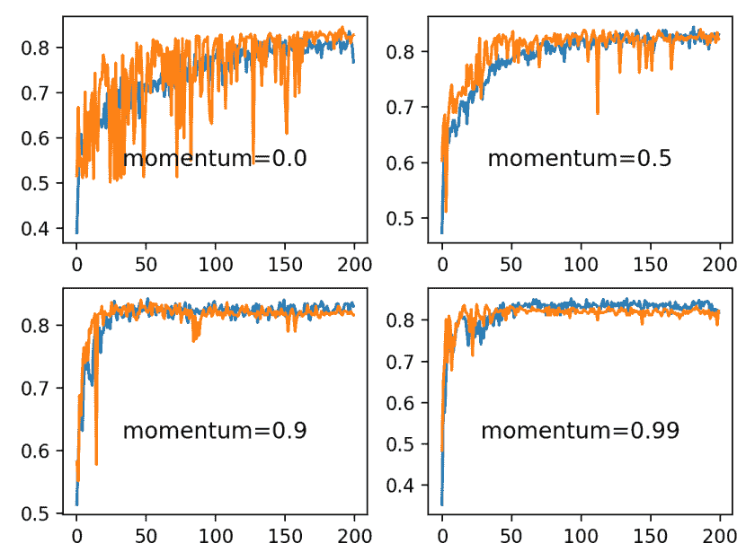

Figure 5.3: blobs 分类问题上一组动量的训练和测试准确率折线图。

### 5.3.3 学习率调度的效果

本节将介绍两种学习率调度。第一种是内置于 `SGD` 类中的衰减，第二种是 `ReduceLROnPlateau` 回调。

#### 学习率衰减

`SGD` 类提供了指定学习率衰减的 `decay` 参数。从公式或代码中可能不清楚这种衰减对更新过程中学习率的影响。我们可以通过一个具体示例使其更清晰。下面这个函数实现了 `SGD` 类中实现的学习率衰减。

```python
# learning rate decay
def decay_lrate(initial_lrate, decay, iteration):
    return initial_lrate * (1.0 / (1.0 + decay * iteration))
```

Listing 5.22: 计算衰减学习率的函数示例。

我们可以使用此函数在不同衰减值下计算多次更新的学习率。我们将比较一系列衰减值 `[1E-1, 1E-2, 1E-3, 1E-4]`，初始学习率为 0.01，权重更新次数为 200 次。

```python
decays = [1E-1, 1E-2, 1E-3, 1E-4]
lrate = 0.01
n_updates = 200

for decay in decays:
    # calculate learning rates for updates
    lrates = [decay_lrate(lrate, decay, i) for i in range(n_updates)]

    # plot result
    pyplot.plot(lrates, label=str(decay))
```

Listing 5.23: 评估不同衰减率的示例。

完整示例列于下方。

```python
# demonstrate the effect of decay on the learning rate
from matplotlib import pyplot

# learning rate decay
def decay_lrate(initial_lrate, decay, iteration):
    return initial_lrate * (1.0 / (1.0 + decay * iteration))

decays = [1E-1, 1E-2, 1E-3, 1E-4]
lrate = 0.01
n_updates = 200

for decay in decays:
    # calculate learning rates for updates
    lrates = [decay_lrate(lrate, decay, i) for i in range(n_updates)]

    # plot result
    pyplot.plot(lrates, label=str(decay))

pyplot.legend()
pyplot.show()
```

Listing 5.24: 绘制不同学习率衰减率影响的示例。

运行该示例会创建一条显示不同衰减值下学习率随更新变化的折线图。我们可以看到，在所有情况下，学习率都从初始值 0.01 开始。小衰减值 1E-4（红色）几乎没有影响，而大衰减值 1E-1（蓝色）则有显著影响，在 50 个周期内将学习率降低到 0.002 以下（约为初始值的低一个数量级），最终值约为 0.0004（约为初始值的低两个数量级）。

我们可以看到，学习率的变化是非线性的。我们还可以看到，学习率的变化取决于执行更新后的批大小。在上一节的示例中，500 个示例的默认批大小为 32，导致每个周期 16 次更新，200 个周期共 3,200 次更新。使用衰减 0.1 和初始学习率 0.01，我们可以计算最终学习率约为 3.1E-05 的极小值。

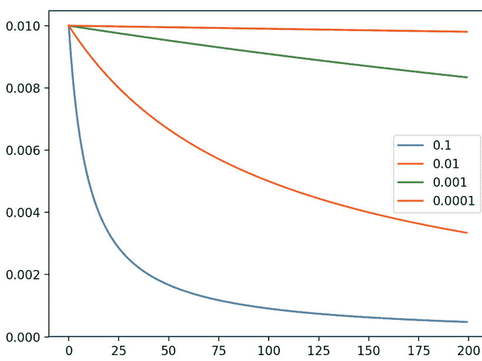

图 5.4：多次权重更新中衰减对学习率影响的线图。

我们可以更新上一节的示例来评估不同学习率衰减值的动态。将学习率固定在 0.01 且不使用动量，我们期望非常小的学习率衰减会更受青睐，因为较大的学习率衰减会迅速导致学习率过小，使得模型无法有效学习。`fit_model()` 函数可以更新以接受 `decay` 参数，该参数可用于为 `SGD` 类配置衰减。该函数的更新版本如下所示。

```python
# fit a model and plot learning curve
def fit_model(trainX, trainy, testX, testy, decay):
    # define model
    model = Sequential()
    model.add(Dense(50, input_dim=2, activation='relu', kernel_initializer='he_uniform'))
    model.add(Dense(3, activation='softmax'))

    # compile model
    opt = SGD(lr=0.01, decay=decay)
    model.compile(loss='categorical_crossentropy', optimizer=opt, metrics=['accuracy'])

    # fit model
    history = model.fit(trainX, trainy, validation_data=(testX, testy), epochs=200, verbose=0)

    # plot learning curves
    pyplot.plot(history.history['acc'], label='train')
    pyplot.plot(history.history['val_acc'], label='test')
    pyplot.title('decay='+str(decay), pad=-80)
```

列表 5.25：用于评估不同学习率衰减率下模型的更新函数示例。

我们可以评估相同的四个衰减值 `[1E-1, 1E-2, 1E-3, 1E-4]` 及其对模型准确率的影响。完整示例如下所示。

```python
# study of decay rate on accuracy for blobs problem
from sklearn.datasets.samples_generator import make_blobs
from keras.layers import Dense
from keras.models import Sequential
from keras.optimizers import SGD
from keras.utils import to_categorical
from matplotlib import pyplot

# prepare train and test dataset
def prepare_data():
    # generate 2d classification dataset
    X, y = make_blobs(n_samples=1000, centers=3, n_features=2, cluster_std=2, random_state=2)

    # one hot encode output variable
    y = to_categorical(y)

    # split into train and test
    n_train = 500
    trainX, testX = X[:n_train, :], X[n_train:, :]
    trainy, testy = y[:n_train], y[n_train:]

    return trainX, trainy, testX, testy

# fit a model and plot learning curve
def fit_model(trainX, trainy, testX, testy, decay):
    # define model
    model = Sequential()
    model.add(Dense(50, input_dim=2, activation='relu', kernel_initializer='he_uniform'))
    model.add(Dense(3, activation='softmax'))

    # compile model
    opt = SGD(lr=0.01, decay=decay)
    model.compile(loss='categorical_crossentropy', optimizer=opt, metrics=['accuracy'])

    # fit model
    history = model.fit(trainX, trainy, validation_data=(testX, testy), epochs=200, verbose=0)

    # plot learning curves
    pyplot.plot(history.history['acc'], label='train')
    pyplot.plot(history.history['val_acc'], label='test')
    pyplot.title('decay='+str(decay), pad=-80)

# prepare dataset
trainX, trainy, testX, testy = prepare_data()

# create learning curves for different decay rates
decay_rates = [1E-1, 1E-2, 1E-3, 1E-4]

for i in range(len(decay_rates)):
    # determine the plot number
    plot_no = 220 + (i+1)
    pyplot.subplot(plot_no)

    # fit model and plot learning curves for a decay rate
    fit_model(trainX, trainy, testX, testy, decay_rates[i])

# show learning curves
pyplot.show()
```

列表 5.26：在 blobs 问题上使用 MLP 评估不同学习率衰减率动态的示例。

运行该示例会创建一个包含四个线图的单一图形，对应不同的评估学习率衰减值。训练数据集上的分类准确率以蓝色标记，而测试数据集上的准确率以橙色标记。

注意：由于学习算法的随机性，您的具体结果可能会有所不同。考虑多次运行示例并比较平均性能。

我们可以看到，对于此模型在此问题上，较大的衰减值 1E-1 和 1E-2 确实使学习率衰减过快，导致性能不佳。较小的衰减值带来更好的性能，其中 1E-4 的值可能导致的结果与不使用衰减相似。事实上，我们可以计算出衰减为 1E-4 时的最终学习率约为 0.0075，仅比初始值 0.01 稍小一些。

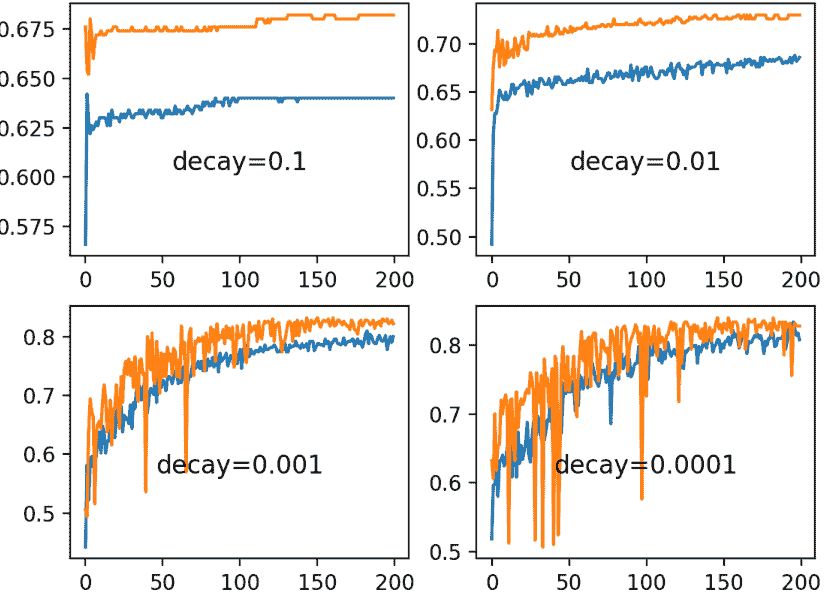

图 5.5：Blobs 分类问题上一组衰减率的训练和测试准确率线图。

## 在平台期降低学习率

`ReduceLROnPlateau` 将在监控指标在给定轮数 `epochs` 内无变化后按比例因子降低学习率。我们可以探索不同 `patience` 值的影响，即在降低学习率之前等待变化的 `epochs` 数。我们将使用默认学习率 0.01，并通过将 `factor` 参数设置为 0.1 使学习率降低一个数量级。

```python
rlrp = ReduceLROnPlateau(monitor='val_loss', factor=0.1, patience=patience, min_delta=1E-7)
```


列表 5.27：配置 `ReduceLROnPlateau` 回调的示例。

回顾训练 `epochs` 期间学习率的影响将很有趣。我们可以通过创建一个新的 Keras `Callback` 来实现，该回调负责在每个训练 `epoch` 结束时记录学习率。然后我们可以检索记录的学习率并创建线图，以查看学习率如何受到下降的影响。我们可以创建一个名为 `LearningRateMonitor` 的自定义 `Callback`。`on_train_begin()` 函数在训练开始时调用，在其中我们可以定义一个空的学习率列表。`on_epoch_end()` 函数在每个训练 `epoch` 结束时调用，在其中我们可以从优化器检索优化器和当前学习率并将其存储在列表中。完整的 `LearningRateMonitor` 回调如下所示。

```python
# monitor the learning rate

class LearningRateMonitor(Callback):

    # start of training

    def on_train_begin(self, logs={}):

        self.lrates = list()

    # end of each training epoch

    def on_epoch_end(self, epoch, logs={}):

        # get and store the learning rate

        optimizer = self.model.optimizer

        lrate = float(backend.get_value(optimizer.lr))

        self.lrates.append(lrate)
```

列表 5.28：定义自定义回调以监控学习率值的示例。

前几节中开发的 `fit_model()` 函数可以更新以创建和配置 `ReduceLROnPlateau` 回调和我们新的 `LearningRateMonitor` 回调，并在 `fit` 调用中将它们注册到模型。该函数还将接受 `patience` 作为参数，以便我们可以评估不同的值。

```python
# fit model

rlrp = ReduceLROnPlateau(monitor='val_loss', factor=0.1, patience=patience, min_delta=1E-7)

lrm = LearningRateMonitor()

history = model.fit(trainX, trainy, validation_data=(testX, testy), epochs=200, verbose=0,
    callbacks=[rlrp, lrm])
```

列表 5.29：使用学习率回调拟合模型的示例。

在此示例中我们希望创建几个图，因此 `fit_model()` 函数不会直接创建子图，而是返回每个训练 `epoch` 的学习率列表以及训练数据集上的损失和准确率。包含这些更新的函数如下所示。

```python
# fit a model and plot learning curve

def fit_model(trainX, trainy, testX, testy, patience):

    # define model

    model = Sequential()

    model.add(Dense(50, input_dim=2, activation='relu', kernel_initializer='he_uniform'))

    model.add(Dense(3, activation='softmax'))
```

```python
from matplotlib import pyplot

# monitor the learning rate

class LearningRateMonitor(Callback):

    # start of training

    def on_train_begin(self, logs={}):

        self.lrates = list()

    # end of each training epoch

    def on_epoch_end(self, epoch, logs={}):

        # get and store the learning rate

        optimizer = self.model.optimizer

        lrate = float(backend.get_value(optimizer.lr))

        self.lrates.append(lrate)

# prepare train and test dataset

def prepare_data():

    # generate 2d classification dataset

    X, y = make_blobs(n_samples=1000, centers=3, n_features=2, cluster_std=2, random_state=2)

    # one hot encode output variable

    y = to_categorical(y)

    # split into train and test

    n_train = 500

    trainX, testX = X[:n_train, :], X[n_train:, :]

    trainy, testy = y[:n_train], y[n_train:]

    return trainX, trainy, testX, testy

# fit a model and plot learning curve

def fit_model(trainX, trainy, testX, testy, patience):

    # define model

    model = Sequential()

    model.add(Dense(50, input_dim=2, activation='relu', kernel_initializer='he_uniform'))

    model.add(Dense(3, activation='softmax'))

    # compile model

    opt = SGD(lr=0.01)

    model.compile(loss='categorical_crossentropy', optimizer=opt, metrics=['accuracy'])

    # fit model

    rlrp = ReduceLROnPlateau(monitor='val_loss', factor=0.1, patience=patience,
        min_delta=1E-7)

    lrm = LearningRateMonitor()

    history = model.fit(trainX, trainy, validation_data=(testX, testy), epochs=200,
        verbose=0, callbacks=[rlrp, lrm])

    return lrm.lrates, history.history['loss'], history.history['acc']

# create line plots for a series

def line_plots(patiences, series):

    for i in range(len(patiences)):

        pyplot.subplot(220 + (i+1))

        pyplot.plot(series[i])

        pyplot.title('patience='+str(patiences[i]), pad=-80)

    pyplot.show()

# prepare dataset

trainX, trainy, testX, testy = prepare_data()

# create learning curves for different patiences

patiences = [2, 5, 10, 15]
```

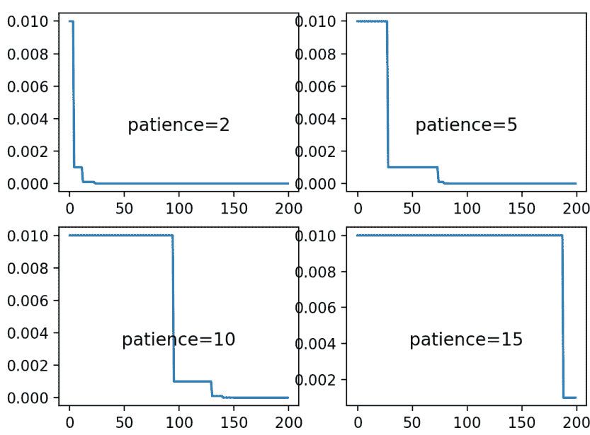

图 5.6：在 `ReduceLROnPlateau` 调度中，不同耐心值对应的学习率随训练轮次变化的折线图。

下一张图显示了每种耐心值在训练数据集上的损失。图中显示，耐心值为 2 和 5 时模型快速收敛，但可能收敛到次优的损失值。对于耐心值为 10 和 15 的情况，损失会合理下降，直到学习率下降到某个水平以下，此时可以观察到损失发生较大变化。这种变化对于耐心值为 10 发生在训练中途，而对于耐心值为 15 则几乎在运行结束时发生。

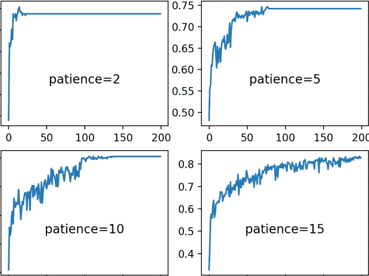

图 5.8：在 `ReduceLROnPlateau` 调度中，不同耐心值对应的训练准确率随训练轮次变化的折线图。

### 5.3.4 自适应学习率的影响

学习率和学习率调度都难以配置，并且对深度学习神经网络模型的性能至关重要。Keras 提供了多种带有自适应学习率的随机梯度下降的流行变体，例如：

- 自适应梯度算法（AdaGrad）。
- 均方根传播（RMSprop）。
- 自适应矩估计（Adam）。

每种方法都为网络中的每个权重提供了不同的自适应学习率方法。没有单一的最佳算法，在某个问题上通过竞赛方式比较多种优化算法得到的结果不太可能迁移到新问题。我们可以在 `blobs` 问题上研究不同自适应学习率方法的动态。可以更新 `fit_model()` 函数，使其接受要评估的优化算法名称，该名称可以在编译 MLP 模型时指定给 `optimizer` 参数。然后使用每种方法的默认参数。更新后的函数版本如下所示。

```python
# fit a model and plot learning curve

def fit_model(trainX, trainY, testX, testY, optimizer):

    # define model

    model = Sequential()

    model.add(Dense(50, input_dim=2, activation='relu', kernel_initializer='he_uniform'))

    model.add(Dense(3, activation='softmax'))

    # compile model

    model.compile(loss='categorical_crossentropy', optimizer=optimizer, metrics=['accuracy'])

    # fit model

    history = model.fit(trainX, trainY, validation_data=(testX, testY), epochs=200, verbose=0)

    # plot learning curves

    pyplot.plot(history.history['acc'], label='train')

    pyplot.plot(history.history['val_acc'], label='test')

    pyplot.title('opt='+optimizer, pad=-80)
```

代码清单 5.34：用于评估不同自适应学习率技术的更新函数示例。

我们可以探索 RMSprop、AdaGrad 和 Adam 这三种流行方法，并将它们的行为与具有静态学习率的简单随机梯度下降进行比较。我们期望自适应学习率版本的算法表现相似或更好，或许能在更少的训练轮次内适应问题，但更重要的是，能产生更稳定的模型。

```python
# prepare dataset

trainX, trainY, testX, testY = prepare_data()

# create learning curves for different optimizers

optimizers = ['sgd', 'rmsprop', 'adagrad', 'adam']

for i in range(len(optimizers)):

    # determine the plot number

    plot_no = 220 + (i+1)

    pyplot.subplot(plot_no)

    # fit model and plot learning curves for an optimizer

    fit_model(trainX, trainY, testX, testY, optimizers[i])

# show learning curves

pyplot.show()
```

代码清单 5.35：评估不同自适应学习率技术的示例。

将这些元素整合在一起，完整示例如下。

```python
# study of sgd with adaptive learning rates in the blobs problem

from sklearn.datasets.samples_generator import make_blobs

from keras.models import Sequential

from keras.layers import Dense

from keras.utils import to_categorical

from matplotlib import pyplot

# prepare train and test dataset

def prepare_data():

    # generate 2d classification dataset

    X, y = make_blobs(n_samples=1000, centers=3, n_features=2, cluster_std=2, random_state=2)

    # one hot encode output variable

    y = to_categorical(y)

    # split into train and test

    n_train = 500

    trainX, testX = X[:n_train, :], X[n_train:, :]

    trainy, testy = y[:n_train], y[n_train:]

    return trainX, trainy, testX, testy

# fit a model and plot learning curve

def fit_model(trainX, trainy, testX, testy, optimizer):

    # define model

    model = Sequential()

    model.add(Dense(50, input_dim=2, activation='relu', kernel_initializer='he_uniform'))

    model.add(Dense(3, activation='softmax'))

    # compile model

    model.compile(loss='categorical_crossentropy', optimizer=optimizer, metrics=['accuracy'])

    # fit model

    history = model.fit(trainX, trainy, validation_data=(testX, testy), epochs=200, verbose=0)

    # plot learning curves

    pyplot.plot(history.history['acc'], label='train')

    pyplot.plot(history.history['val_acc'], label='test')

    pyplot.title('opt='+optimizer, pad=-80)

# prepare dataset

trainX, trainy, testX, testy = prepare_data()

# create learning curves for different optimizers

optimizers = ['sgd', 'rmsprop', 'adagrad', 'adam']

for i in range(len(optimizers)):

    # determine the plot number

    plot_no = 220 + (i+1)

    pyplot.subplot(plot_no)

    # fit model and plot learning curves for an optimizer

    fit_model(trainX, trainy, testX, testy, optimizers[i])

# show learning curves

pyplot.show()
```


代码清单 5.36：使用 MLP 在 blobs 问题上评估自适应学习率技术动态的示例。

运行该示例会生成一个图，其中包含针对不同评估优化算法的四个折线图。训练数据集上的分类准确率用蓝色标记，测试数据集上的准确率用橙色标记。

注意：由于学习算法的随机性，你的具体结果可能会有所不同。请考虑多次运行该示例，并比较平均性能。

我们再次看到，使用默认学习率 `0.01` 且不带动量的 SGD 确实能学习该问题，但几乎需要全部 `200` 个轮次，并且在训练数据上的准确率不稳定，在测试数据集上更不稳定。图中显示，所有三种自适应学习率方法都能更快地学习问题，并且训练集和测试集准确率的波动明显更小。

RMSProp 和 Adam 表现出相似的性能，在 `50` 个训练轮次内有效学习了问题，并在剩余训练时间内进行非常微小的权重更新，但并不像我们在上一节中看到的学习率调度那样收敛。

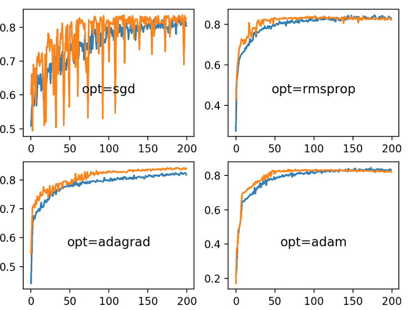

图 5.9：在 blobs 分类问题上，一系列自适应学习率方法的训练集和测试集准确率折线图。

#### 5.4 扩展

本节列出了一些你可能希望探索的教程扩展思路。

- **调整学习率**。更新学习率实验，使其在已发现的最佳数量级内自动变化学习率。
- **初始学习率**。对于像 Adam 这样的自适应学习率方法，改变初始学习率并比较结果。

如果你探索了这些扩展中的任何一项，我很乐意知道。

#### 5.5 进一步阅读

如果你想更深入地了解该主题，本节提供了更多资源。

- 如何使用学习率调度、动量和自适应学习率进一步提高性能。

##### 5.6.1 下一步

在下一个教程中，你将了解学习过程如何对输入和目标变量的尺度敏感，以及数据归一化和标准化如何对收敛产生显著影响。

## 第 6 章

## 用数据缩放稳定学习

深度学习神经网络从训练数据集中的示例学习如何将输入映射到输出。模型的权重被初始化为小的随机值，并根据训练数据集上的误差估计通过优化算法进行更新。鉴于模型使用小权重，并且使用预测值与实际值之间的误差，用于训练模型的输入和输出的尺度是一个重要因素。未缩放的输入变量可能导致学习过程缓慢或不稳定，而回归问题中未缩放的目标变量可能导致梯度爆炸，从而使学习过程失败。数据准备包括在训练神经网络模型之前，使用归一化和标准化等技术重新缩放输入和输出变量。在本教程中，你将了解如何通过数据缩放来提高神经网络的稳定性和建模性能。完成本教程后，你将了解：

- 在处理深度学习神经网络时，数据缩放是推荐的预处理步骤。
- 数据缩放可以通过对实值输入和输出变量进行归一化或标准化来实现。
- 如何应用标准化和归一化来提高多层感知器模型在回归预测建模问题上的性能。

让我们开始吧。

## 6.1 数据缩放

在本节中，你将了解数据缩放、它在训练期间对模型的影响，以及在训练自己的神经网络模型时如何缩放输入和目标变量的技巧。

### 6.1.1 数据的尺度很重要

深度学习神经网络模型学习从输入变量到输出变量的映射。因此，每个变量的数据尺度和分布可能不同。输入变量可能具有不同的单位（例如英尺、公里和小时），这反过来可能意味着这些变量

不同变量具有不同的尺度。输入变量尺度的差异可能会增加建模问题的难度。例如，较大的输入值（如分布范围达数百或数千个单位）可能导致模型学习到较大的权重值。具有较大权重值的模型往往不稳定，这意味着它在学习过程中可能表现不佳，并且对输入值敏感，从而导致更高的泛化误差。

最常见的预处理形式之一是对输入变量进行简单的线性重新缩放。

> — 第298页，《模式识别的神经网络》，1995年。

反过来，目标变量值分布范围较大可能导致较大的误差梯度值，从而引起权重值剧烈变化，使学习过程不稳定。缩放输入和输出变量是使用神经网络模型时的关键步骤。

在实践中，在将输入数据呈现给网络之前，几乎总是有利的。同样，网络的输出通常也会经过后处理，以给出所需的输出值。

> — 第296页，《模式识别的神经网络》，1995年。

### 6.1.2 缩放输入变量

输入变量是网络在输入层或可见层接收以进行预测的变量。一个经验法则是输入变量应为小值，通常在0-1的范围内，或者经过标准化使其均值为零、标准差为一。输入变量是否需要缩放取决于你的问题及每个变量的具体情况。你可能有一系列量作为输入，例如价格或温度。

缩放可以加速学习，因为它有助于平衡连接到输入节点的权重的学习速率。

> — Efficient BackProp，1998年。

如果量的分布是正态分布，则应进行标准化，否则应进行归一化。这适用于量值范围较大（如10、100等）或较小（如0.01、0.0001）的情况。如果量值较小（接近0-1）且分布有限（如标准差接近1），那么也许可以不进行数据缩放。问题可能很复杂，如何最好地缩放输入数据可能并不明确。如有疑问，可对输入序列进行归一化。如果资源允许，可尝试分别使用原始数据、标准化数据和归一化数据进行建模，看看最终模型性能是否存在有益的差异。

如果输入变量是线性组合的，如MLP（多层感知器），那么至少在理论上，很少有必要对输入进行标准化。 [...] 然而，出于多种实际原因，对输入进行标准化可以使训练更快，并减少陷入局部最优的机会。

> — 是否应对数据进行归一化/标准化/重新缩放？神经网络常见问题解答。

### 6.1.3 缩放输出变量

输出变量是网络预测的变量。你必须确保输出变量的尺度与网络输出层激活函数（传递函数）的尺度匹配。

如果你的输出激活函数范围是[0,1]，那么显然你必须确保目标值位于该范围内。但是，通常选择适合目标分布的输出激活函数比强制数据符合输出激活函数更好。

> — 是否应对数据进行归一化/标准化/重新缩放？神经网络常见问题解答。

如果你的问题是回归问题，那么输出将是一个实数值。这最好使用线性激活函数建模。如果该值的分布是正态分布，则可以标准化输出变量。否则，可将输出变量进行归一化。

## 6.2 数据缩放 scikit-learn API

你可能需要考虑两种数据缩放类型：归一化和标准化。这两种都可以使用`scikit-learn`库实现。

### 6.2.1 数据归一化

归一化是将数据从原始范围重新缩放，使所有值都在0到1的范围内。归一化要求你已知或能够准确估计可观测值的最小值和最大值。你可能可以从现有数据中估计这些值。如果要归一化的x值超出了最小值和最大值的边界，则结果值将不在0到1的范围内。你可以在进行预测之前检查这些观测值，并将其从数据集中移除或将其限制在预定义的最大值或最小值范围内。你可以使用`scikit-learn`的`MinMaxScaler`对象来归一化数据集。使用`MinMaxScaler`及其他缩放技术的良好实践如下：

- **使用可用的训练数据拟合缩放器。** 对于归一化，这意味着用训练数据来估计可观测的最小值和最大值。可通过调用`fit()`函数完成。
- **将缩放应用于训练数据。** 这意味着你可以使用归一化后的数据来训练模型。可通过调用`transform()`函数完成。
- **将缩放应用于后续数据。** 这意味着你可以为将来要预测的新数据处理做准备。

`MinMaxScaler`的默认缩放范围是[0,1]，但可以通过`feature_range`参数指定首选范围，并传入包含所有变量的最小值和最大值的元组。

```python
# create scaler

scaler = MinMaxScaler(feature_range=(-1,1))
```

代码6.1：定义`MinMaxScaler`的示例。

如果需要，可以反转变换。这对于将预测结果转换回原始尺度以进行报告或绘图非常有用。可通过调用`inverse_transform()`函数完成。下面的示例演示了使用`MinMaxScaler`归一化数据的一般方法。

```python
# demonstrate data normalization with sklearn

from sklearn.preprocessing import MinMaxScaler

# load data

data = ...

# create scaler

scaler = MinMaxScaler()

# fit scaler on data

scaler.fit(data)

# apply transform

normalized = scaler.transform(data)

# inverse transform

inverse = scaler.inverse_transform(normalized)
```

代码6.2：使用`MinMaxScaler`的示例。

你还可以使用`fit_transform()`函数在一步中同时完成拟合和变换；例如：

```python
# demonstrate data normalization with sklearn

from sklearn.preprocessing import MinMaxScaler

# load data

data = ...

# create scaler

scaler = MinMaxScaler()

# fit and transform in one step

normalized = scaler.fit_transform(data)

# inverse transform

inverse = scaler.inverse_transform(normalized)
```

代码6.3：使用`MinMaxScaler`的另一种方式的示例。

### 6.2.2 数据标准化

标准化数据集涉及重新缩放值的分布，使观测值的均值为0，标准差为1。它有时被称为白化。可以将其理解为减去均值或使数据中心化。与归一化类似，当你的数据包含尺度不同的输入值时，标准化在某些机器学习算法中可能是有用的，甚至可能是必需的。标准化假设你的观测值符合高斯分布（钟形曲线），且均值和标准差表现良好。如果数据不符合这一预期，你仍然可以标准化数据，但可能得不到可靠的结果。对于神经网络来说，标准化可能是更可取的数据准备方案。

如果训练集上每个输入变量的平均值接近零，收敛通常会更快。

> — *Efficient BackProp*，1998年。

标准化要求你已知或能够准确估计可观测值的均值和标准差。你可以从训练数据中估计这些值。你可以使用`scikit-learn`的`StandardScaler`对象对数据集进行标准化。

```python
# demonstrate data standardization with sklearn

from sklearn.preprocessing import StandardScaler

# load data

data = ...

# create scaler

scaler = StandardScaler()

# fit scaler on data

scaler.fit(data)

# apply transform

standardized = scaler.transform(data)

# inverse transform

inverse = scaler.inverse_transform(standardized)
```

代码6.4：使用`StandardScaler`的示例。

你还可以使用`fit_transform()`函数在一步中同时完成拟合和变换；例如：

```python
# demonstrate data standardization with sklearn

from sklearn.preprocessing import StandardScaler

# load data

data = ...

# create scaler

scaler = StandardScaler()

# fit and transform in one step

standardized = scaler.fit_transform(data)

# inverse transform

inverse = scaler.inverse_transform(standardized)
```

代码6.5：使用`StandardScaler`的另一种方式的示例。

## 6.3 数据缩放案例研究

在本节中，我们将演示如何在简单的分类问题上使用数据缩放来改进MLP的收敛。该示例为你在分类和回归问题中使用自己的神经网络探索数据缩放提供了一个模板。

### 6.3.1 回归预测建模问题

回归预测建模问题涉及预测一个实值数量。我们可以使用`scikit-learn`库中`make_regression()`函数提供的标准回归问题生成器。该函数将从一个简单的回归问题中生成示例，该问题具有给定数量的输入变量、统计噪声和其他属性。我们将使用该函数定义一个具有20个输入特征的问题；其中10个特征是有意义的，10个是无关的。将随机生成总共1000个示例。伪随机数生成器将被固定，以确保每次运行代码时我们得到相同的1000个示例。

```python
# generate regression dataset

X, y = make_regression(n_samples=1000, n_features=20, noise=0.1, random_state=1)
```

清单6.6：生成回归问题样本的示例。

每个输入变量都服从高斯分布，目标变量也是如此。我们可以通过绘制部分输入变量和输出变量的直方图来证明这一点。

```python
# regression predictive modeling problem

from sklearn.datasets import make_regression

from matplotlib import pyplot

# generate regression dataset

X, y = make_regression(n_samples=1000, n_features=20, noise=0.1, random_state=1)

# histograms of input variables

pyplot.subplot(211)

pyplot.hist(X[:, 0])

pyplot.subplot(212)

pyplot.hist(X[:, 1])

pyplot.show()

# histogram of target variable

pyplot.hist(y)

pyplot.show()
```

清单6.7：生成样本并绘制回归问题分布的示例。

运行该示例会生成两个图。第一个图显示了二十个输入变量中前两个变量的直方图，表明每个变量都服从高斯数据分布。

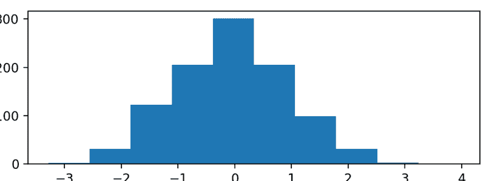

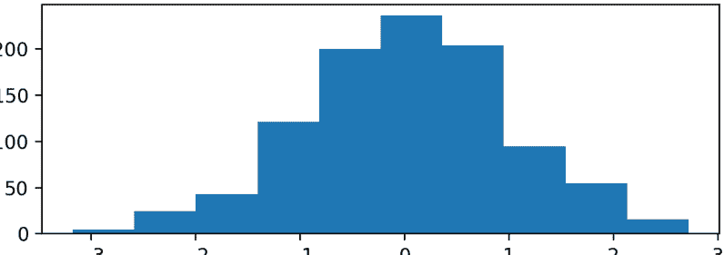

图6.1：回归问题中二十个输入变量中两个变量的直方图。

第二个图显示了目标变量的直方图，表明该变量的取值范围比输入变量大得多，并且同样呈现高斯数据分布。

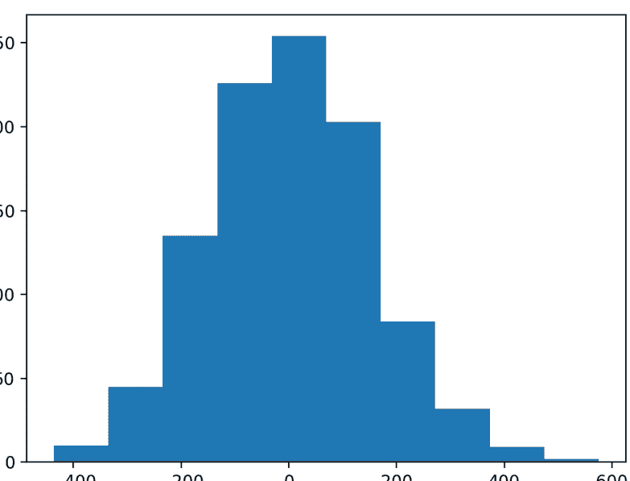

图6.2：回归问题中目标变量的直方图。

既然我们有了一个可以作为研究基础的回归问题，我们就可以开发一个模型来解决它。

### 6.3.2 使用未缩放数据的多层感知机

我们可以为回归问题开发一个多层感知机（MLP）模型。该模型将在原始数据上进行演示，不对输入或输出变量进行任何缩放。我们预期模型性能通常会较差。第一步是将数据划分为训练集和测试集，以便我们能够拟合和评估模型。我们将从该域中生成1,000个样本，并将数据集一分为二，使用500个样本作为训练集和测试集。

```python
# split into train and test

n_train = 500

trainX, testX = X[:n_train, :], X[n_train:, :]

trainy, testy = y[:n_train], y[n_train:]
```

清单6.8：为建模准备数据集的示例。

接下来，我们可以定义MLP模型。模型将期望接收问题中的20个输入变量，即20个输入。将使用一个具有25个节点和修正线性激活函数的隐藏层。输出层有一个节点，对应于单个目标变量，并使用线性激活函数直接预测实数值。

```python
# define model

model = Sequential()

model.add(Dense(25, input_dim=20, activation='relu', kernel_initializer='he_uniform'))

model.add(Dense(1, activation='linear'))
```

清单6.9：定义MLP模型的示例。

将使用均方误差损失函数来优化模型，并采用随机梯度下降优化算法，其合理的默认配置为学习率0.01和动量0.9。

```python
# compile model

model.compile(loss='mean_squared_error', optimizer=SGD(lr=0.01, momentum=0.9))
```

清单6.10：编译MLP模型的示例。

模型将训练100个轮次，测试集将用作验证集，并在每个训练轮次结束时进行评估。训练结束时，计算训练集和测试集上的均方误差，以了解模型对问题的学习效果。

```python
# evaluate the model

train_mse = model.evaluate(trainX, trainy, verbose=0)

test_mse = model.evaluate(testX, testy, verbose=0)
```

清单6.11：评估MLP模型的示例。

最后，使用折线图绘制每个训练轮次结束时训练集和测试集上的均方误差学习曲线，以了解模型在学习该问题时的动态变化。

```python
# plot loss during training

pyplot.title('Mean Squared Error')

pyplot.plot(history.history['loss'], label='train')

pyplot.plot(history.history['val_loss'], label='test')

pyplot.legend()

pyplot.show()
```


清单 6.12：绘制 MLP 模型学习曲线的示例。

将这些要素组合在一起，完整示例如下。

```python
# mlp with unscaled data for the regression problem

from sklearn.datasets import make_regression

from keras.layers import Dense
from keras.models import Sequential
from keras.optimizers import SGD
from matplotlib import pyplot

# generate regression dataset
X, y = make_regression(n_samples=1000, n_features=20, noise=0.1, random_state=1)

# split into train and test
n_train = 500
trainX, testX = X[:n_train, :], X[n_train:, :]
trainy, testy = y[:n_train], y[n_train:]

# define model
model = Sequential()
model.add(Dense(25, input_dim=20, activation='relu', kernel_initializer='he_uniform'))
model.add(Dense(1, activation='linear'))

# compile model
model.compile(loss='mean_squared_error', optimizer=SGD(lr=0.01, momentum=0.9))

# fit model
history = model.fit(trainX, trainy, validation_data=(testX, testy), epochs=100, verbose=0)

# evaluate the model
train_mse = model.evaluate(trainX, trainy, verbose=0)
test_mse = model.evaluate(testX, testy, verbose=0)

print('Train: %.3f, Test: %.3f' % (train_mse, test_mse))

# plot loss during training
pyplot.title('Mean Squared Error')
pyplot.plot(history.history['loss'], label='train')
pyplot.plot(history.history['val_loss'], label='test')
pyplot.legend()
pyplot.show()
```

清单 6.13：在未缩放的回归问题上评估 MLP 模型的示例。

运行该示例会拟合模型并计算训练集和测试集上的均方误差。在这种情况下，模型无法学习该问题，导致预测值为 NaN。由于误差非常大，进而导致用于权重更新的误差梯度也很大，模型权重在训练期间发生了爆炸。

```text
Train: nan, Test: nan
```

清单 6.14：在未缩放的回归问题上评估 MLP 模型的输出示例。

这表明，至少需要对目标变量进行某种数据缩放。虽然绘制了训练历史的折线图，但由于模型几乎立即产生了 NaN 均方误差，图上没有任何内容。

## 6.3.3 使用缩放后输出变量的多层感知机

可以更新示例以对目标变量进行缩放。减小目标变量的尺度，反过来也会减小用于更新权重的梯度的大小，从而使模型和训练过程更加稳定。鉴于目标变量服从高斯分布，一种自然的重新缩放方法是对变量进行标准化。这需要估计变量的均值和标准差，并使用这些估计值来执行重新缩放。最佳实践是估计训练数据集的均值和标准差，并使用这些变量来缩放训练集和测试集。这是为了避免模型评估过程中的任何数据泄漏。scikit-learn 的转换器期望输入数据是由行和列组成的矩阵，因此目标变量的一维数组在进行转换之前必须重塑为二维数组。

```python
# reshape 1d arrays to 2d arrays

trainy = trainy.reshape(len(trainy), 1)
testy = testy.reshape(len(trainy), 1)
```

清单 6.15：重塑目标变量的示例。

然后我们可以创建并应用 `StandardScaler` 来重新缩放目标变量。

```python
# created scaler
scaler = StandardScaler()

# fit scaler on training dataset
scaler.fit(trainy)

# transform training dataset
trainy = scaler.transform(trainy)

# transform test dataset
testy = scaler.transform(testy)
```

清单 6.16：标准化目标变量的示例。

对目标变量进行重新缩放意味着，在评估模型性能和绘制学习曲线时，计算得到的 MSE 将使用缩放后变量的平方单位，而不是原始尺度的平方单位。这可能会使在领域背景下解释误差变得困难。在实践中，可以先对测试集目标变量和模型预测进行逆变换，然后使用未缩放数据上的均方根误差来评估模型性能，这可能会有帮助。这将作为练习留给读者。下面列出了在回归问题上对 MLP 的目标变量进行标准化的完整示例。

```python
# mlp with scaled outputs on the regression problem

from sklearn.datasets import make_regression
from sklearn.preprocessing import StandardScaler

from keras.layers import Dense
from keras.models import Sequential
from keras.optimizers import SGD
from matplotlib import pyplot

# generate regression dataset
X, y = make_regression(n_samples=1000, n_features=20, noise=0.1, random_state=1)

# split into train and test
n_train = 500
trainX, testX = X[:n_train, :], X[n_train:, :]
trainy, testy = y[:n_train], y[n_train:]

# reshape 1d arrays to 2d arrays
trainy = trainy.reshape(len(trainy), 1)
testy = testy.reshape(len(trainy), 1)

# created scaler
scaler = StandardScaler()

# fit scaler on training dataset
scaler.fit(trainy)

# transform training dataset
trainy = scaler.transform(trainy)

# transform test dataset
testy = scaler.transform(testy)

# define model
model = Sequential()
model.add(Dense(25, input_dim=20, activation='relu', kernel_initializer='he_uniform'))
model.add(Dense(1, activation='linear'))

# compile model
model.compile(loss='mean_squared_error', optimizer=SGD(lr=0.01, momentum=0.9))

# fit model
history = model.fit(trainX, trainy, validation_data=(testX, testy), epochs=100, verbose=0)

# evaluate the model
train_mse = model.evaluate(trainX, trainy, verbose=0)
test_mse = model.evaluate(testX, testy, verbose=0)

print('Train: %.3f, Test: %.3f' % (train_mse, test_mse))

# plot loss during training
pyplot.title('Mean Squared Error Loss')
pyplot.plot(history.history['loss'], label='train')
pyplot.plot(history.history['val_loss'], label='test')
pyplot.legend()
pyplot.show()
```

```python
pyplot.plot(history.history['loss'], label='train')
pyplot.plot(history.history['val_loss'], label='test')
pyplot.legend()
pyplot.show()
```

列表 6.17：使用标准化目标变量评估 MLP 模型回归问题的示例。

运行示例将拟合模型并计算训练集和测试集上的均方误差。

**Note:** 由于学习算法的随机性，您的具体结果可能会有所不同。请考虑多次运行示例并比较平均性能。

在这种情况下，模型似乎确实学会了该问题，并在至少三位小数的情况下实现了接近零的均方误差。

```text
Train: 0.003, Test: 0.007
```

列表 6.18：评估使用标准化目标变量的 MLP 模型回归问题的示例输出。

创建了每个训练 epoch 上训练集（蓝色）和测试集（橙色）的均方误差的线图。在这种情况下，我们可以看到模型迅速学会了有效地将回归问题的输入映射到输出，并在整个运行过程中在两个数据集上都取得了良好的性能，既不过拟合也不欠拟合训练数据集。

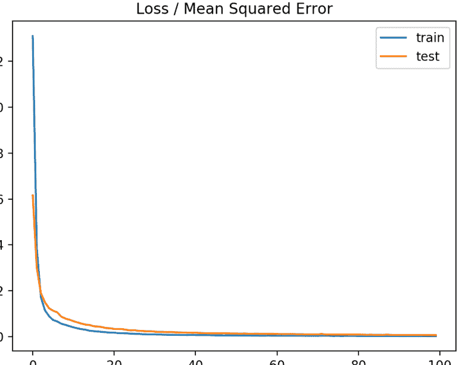

重复此实验并改用归一化目标变量可能会很有趣，并比较结果。

## 6.3.4 使用缩放输入变量的多层感知器

我们已经看到，当拟合具有宽范围目标变量的回归模型时，数据缩放可以稳定训练过程。通过缩放输入变量也有可能提高模型的稳定性和性能。在本节中，我们将设计一个实验来比较输入变量的不同缩放方法的性能。输入变量也具有与目标变量类似的高斯数据分布，因此我们期望标准化数据是最好的方法。这只是一个启发式方法，最好始终评估不同的缩放方法并发现实际效果最好的方法。

我们可以将未缩放输入变量的性能与使用标准化或归一化输入变量拟合的模型进行比较。第一步是定义一个函数来创建相同的 1,000 个数据样本，将它们拆分为训练集和测试集，并应用通过输入参数指定的数据缩放方法。下面 `get_dataset()` 函数实现了这一点，要求为输入和目标变量提供缩放器，并返回拆分为输入和输出组件的训练集和测试数据集，以便训练和评估模型。

```python
# prepare dataset with input and output scalers, can be none

def get_dataset(input_scaler, output_scaler):

    # generate dataset
    X, y = make_regression(n_samples=1000, n_features=20, noise=0.1, random_state=1)

    # split into train and test
    n_train = 500
    trainX, testX = X[:n_train, :], X[n_train:, :]
    trainy, testy = y[:n_train], y[n_train:]

    # scale inputs
    if input_scaler is not None:

        # fit scaler
        input_scaler.fit(trainX)

        # transform training dataset
        trainX = input_scaler.transform(trainX)

        # transform test dataset
        testX = input_scaler.transform(testX)

    if output_scaler is not None:

        # reshape 1d arrays to 2d arrays
        trainy = trainy.reshape(len(trainy), 1)
        testy = testy.reshape(len(trainy), 1)

        # fit scaler on training dataset
        output_scaler.fit(trainy)

        # transform training dataset
        trainy = output_scaler.transform(trainy)

        # transform test dataset
        testy = output_scaler.transform(testy)

    return trainX, trainy, testX, testy
```

列表 6.19：用于模型数据缩放的函数示例。

接下来，我们可以定义一个函数来在给定数据集上拟合 MLP 模型，并返回拟合模型在测试数据集上的均方误差。下面 `evaluate_model()` 函数实现了此行为。

```python
# fit and evaluate mse of model on test set

def evaluate_model(trainX, trainy, testX, testy):

    # define model
    model = Sequential()
    model.add(Dense(25, input_dim=20, activation='relu', kernel_initializer='he_uniform'))
    model.add(Dense(1, activation='linear'))

    # compile model
    model.compile(loss='mean_squared_error', optimizer=SGD(lr=0.01, momentum=0.9))

    # fit model
    model.fit(trainX, trainy, epochs=100, verbose=0)

    # evaluate the model
    test_mse = model.evaluate(testX, testy, verbose=0)

    return test_mse
```

列表 6.20：用于拟合和评估 MLP 模型的函数示例。

神经网络使用随机学习算法进行训练。这意味着在相同数据上拟合的相同模型可能会产生不同的性能。我们可以通过重复评估每个模型配置（在本例中为数据缩放的选择）多次，并在所有运行中将性能报告为误差分数的平均值来在实验中解决这个问题。我们将重复运行 30 次，以确保均值在统计上是稳健的。

```python
from keras.layers import Dense
from keras.models import Sequential
from keras.optimizers import SGD
from matplotlib import pyplot
from numpy import mean
from numpy import std

# prepare dataset with input and output scalers, can be none

def get_dataset(input_scaler, output_scaler):

    # generate dataset
    X, y = make_regression(n_samples=1000, n_features=20, noise=0.1, random_state=1)

    # split into train and test
    n_train = 500
    trainX, testX = X[:n_train, :], X[n_train:]
    trainy, testy = y[:n_train], y[n_train:]

    # scale inputs
    if input_scaler is not None:

        # fit scaler
        input_scaler.fit(trainX)

        # transform training dataset
        trainX = input_scaler.transform(trainX)

        # transform test dataset
        testX = input_scaler.transform(testX)

    if output_scaler is not None:
```


# reshape 1d arrays to 2d arrays

```
trainy = trainy.reshape(len(trainy), 1)

testy = testy.reshape(len(trainy), 1)

# fit scaler on training dataset

output_scaler.fit(trainy)

# transform training dataset

trainy = output_scaler.transform(trainy)

# transform test dataset

testy = output_scaler.transform(testy)

return trainX, trainy, testX, testy
```

# fit and evaluate mse of model on test set

```
def evaluate_model(trainX, trainy, testX, testy):

    # define model

    model = Sequential()

    model.add(Dense(25, input_dim=20, activation='relu', kernel_initializer='he_uniform'))

    model.add(Dense(1, activation='linear'))

    # compile model

    model.compile(loss='mean_squared_error', optimizer=SGD(lr=0.01, momentum=0.9))

    # fit model

    model.fit(trainX, trainy, epochs=100, verbose=0)

    # evaluate the model

    test_mse = model.evaluate(testX, testy, verbose=0)

    return test_mse
```

# evaluate model multiple times with given input and output scalers

```
def repeated_evaluation(input_scaler, output_scaler, n_repeats=30):

    # get dataset

    trainX, trainy, testX, testy = get_dataset(input_scaler, output_scaler)

    # repeated evaluation of model

    results = list()

    for _ in range(n_repeats):

        test_mse = evaluate_model(trainX, trainy, testX, testy)

        print('%.3f' % test_mse)

        results.append(test_mse)

    return results
```

# unscaled inputs

```
results_unscaled_inputs = repeated_evaluation(None, StandardScaler())

# normalized inputs

results_normalized_inputs = repeated_evaluation(MinMaxScaler(), StandardScaler())

# standardized inputs

results_standardized_inputs = repeated_evaluation(StandardScaler(), StandardScaler())

# summarize results

print('Unscaled: %.3f (%.3f)' % (mean(results_unscaled_inputs),

    std(results_unscaled_inputs)))

print('Normalized: %.3f (%.3f)' % (mean(results_normalized_inputs),

    std(results_normalized_inputs)))

print('Standardized: %.3f (%.3f)' % (mean(results_standardized_inputs),

    std(results_standardized_inputs)))

# plot results

results = [results_unscaled_inputs, results_normalized_inputs, results_standardized_inputs]

labels = ['unscaled', 'normalized', 'standardized']

pyplot.boxplot(results, labels=labels)

pyplot.show()
```

列表 6.23：使用不同方法缩放输入评估 MLP 模型的示例。

运行示例会在过程中打印每个模型运行的均方误差。在每个三个配置都评估 30 次后，会报告每个配置的平均误差。

**Note:** 由于学习算法的随机性，您的具体结果可能会有所不同。请考虑多次运行示例并比较平均性能。

在这种情况下，我们可以看到，正如我们所预期的那样，缩放输入变量确实会带来性能更好的模型。令人意外的是，使用归一化输入而不是标准化输入可以看到更好的性能。这可能与第一隐藏层中整流线性激活函数的选择有关。

```
...

>0.010

>0.012

>0.005

>0.008

>0.008

Unscaled: 0.007 (0.004)

Normalized: 0.001 (0.000)

Standardized: 0.008 (0.004)
```

列表 6.24：使用不同方法缩放输入评估 MLP 模型的示例输出。

创建了一个包含三个箱线图的图形，总结了每个配置的误差分数的分布情况。图表显示，未缩放输入变量和标准化输入变量的误差分数分布之间几乎没有差异，而归一化输入变量会导致更好的性能以及更稳定或更紧凑的误差分数分布。

这些结果强调，实际实验并确认数据缩放方法的结果非常重要，而不是根据观察到的数据分布来假设某个数据准备方案会效果最佳。

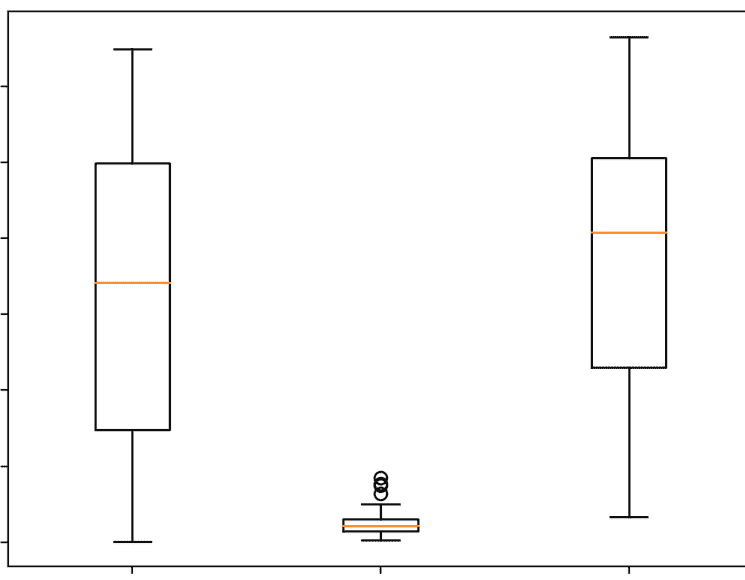

图6.4：回归问题中未缩放、归一化和标准化输入变量的均方误差箱线图。

## 6.4 扩展

本节列出了一些你可能希望探索的教程扩展想法。

- **归一化目标变量**：更新示例，对目标变量进行归一化而非标准化，并比较结果。
- **比较目标变量的缩放方式**：更新示例，通过重复实验比较目标变量的标准化和归一化，并比较结果。
- **其他缩放范围**：更新示例，在归一化时评估其他最小/最大范围，例如 \[-1, 1\] 和 \[0.0, 0.5\]，并比较性能。

如果你探索了这些扩展中的任何一项，我很想知道。

## 6.5 延伸阅读

如果你想深入了解，本节提供了更多关于该主题的资源。

### 6.5.1 书籍

- 第8.2节：输入归一化与编码，*模式识别的神经网络*，1995年。 https://amzn.to/2S8qdwt

### 6.5.2 论文

- *高效反向传播*，1998年。 http://yann.lecun.com/exdb/publis/pdf/lecun-98b.pdf

### 6.5.3 API

- sklearn.datasets.make_regression API。 http://scikit-learn.org/stable/modules/generated/sklearn.datasets.make_regression.html
- sklearn.preprocessing.MinMaxScaler API。 http://scikit-learn.org/stable/modules/generated/sklearn.preprocessing.MinMaxScaler.html
- sklearn.preprocessing.StandardScaler API。 http://scikit-learn.org/stable/modules/generated/sklearn.preprocessing.StandardScaler.html

### 6.5.4 文章

- 我应该对数据进行归一化/标准化/重新缩放吗？神经网络常见问题解答。 ftp://ftp.sas.com/pub/neural/FAQ2.html#A_std

## 6.6 总结

在本教程中，你学习了如何通过缩放数据来提高神经网络的稳定性和建模性能。具体来说，你学到了：

- 数据缩放是使用深度学习神经网络时推荐的预处理步骤。
- 数据缩放可以通过对实值输入和输出变量进行归一化或标准化来实现。
- 如何应用标准化和归一化来提高多层感知机模型在回归预测建模问题上的性能。

### 6.6.1 下一步

在下一个教程中，你将了解如何通过使用修正线性激活函数来解决梯度消失问题。

## 第7章

## 使用ReLU修复梯度消失

在神经网络中，激活函数负责将节点的加权求和输入转换为该节点的激活值或该输入的输出。修正线性激活函数是一个分段线性函数，如果输入为正，则直接输出该输入；否则，输出零。它已成为许多类型神经网络默认的激活函数，因为使用它的模型更容易训练，并且通常能获得更好的性能。在本教程中，你将了解用于深度学习神经网络的修正线性激活函数。完成本教程后，你将知道：

- 由于梯度消失问题，sigmoid和双曲正切激活函数不能用于多层网络。
- 修正线性激活函数克服了梯度消失问题，使模型能够更快地学习并表现得更好。
- 在开发多层感知机和卷积神经网络时，修正线性激活是默认的激活函数。

让我们开始吧。

## 7.1 梯度消失与ReLU

在本节中，你将了解梯度消失问题、它在训练过程中对模型的影响，以及如何使用修正线性激活函数来解决该问题。

### 7.1.1 Sigmoid和Tanh激活函数的局限性

神经网络由多层节点组成，学习将输入示例映射到输出。对于给定节点，输入乘以该节点的权重并求和。这个值称为节点的求和激活。然后通过激活函数对求和激活进行转换，定义该节点的特定输出或激活。最简单的激活函数称为线性激活，即完全不进行转换。仅由线性激活函数组成的网络非常容易训练，但无法学习复杂的映射函数。线性激活函数仍然用于预测数值的网络输出层（例如回归问题）。

非线性激活函数更受青睐，因为它们允许节点学习数据中更复杂的结构。传统上，两种广泛使用的非线性激活函数是sigmoid和双曲正切激活函数。sigmoid激活函数（也称为逻辑函数）历来是神经网络中非常流行的激活函数。函数的输入被转换为0.0到1.0之间的值。远大于1.0的输入被转换为1.0；同样，远小于0.0的值被截断为0.0。该函数在所有可能输入上的形状是从0开始，经过0.5，上升到1.0的S形。在直到1990年代初的很长一段时间里，它是神经网络使用的默认激活函数。双曲正切函数（简称tanh）是一种形状相似的非线性激活函数，输出值介于-1.0和1.0之间。在1990年代后期到2000年代，tanh函数比sigmoid激活函数更受青睐，因为使用它的模型更容易训练，而且通常具有更好的预测性能。

> ……双曲正切激活函数通常比逻辑sigmoid表现更好。

—— 第195页，《深度学习》，2016年。

sigmoid和tanh函数的一个普遍问题是它们会饱和。这意味着，对于tanh和sigmoid，大值分别被截断为1.0，小值被截断为-1或0。此外，这些函数实际上只对其输入中点附近的变化敏感，例如sigmoid的0.5和tanh的0.0。无论来自节点的求和激活作为输入是否包含有用信息，函数的有限敏感性和饱和都会发生。一旦饱和，学习算法就难以继续调整权重以提高模型性能。

> ……sigmoid单元在其大部分定义域内都会饱和——当z非常大时，它们饱和到高值；当z非常负时，饱和到低值；只有当z接近0时，它们才对输入强烈敏感。

—— 第195页，《深度学习》，2016年。

最后，随着GPU带来的硬件能力提升，使用sigmoid和tanh激活函数的非常深的神经网络难以训练。使用这些非线性激活函数的大型网络中的深层无法获得有用的梯度信息。误差通过网络反向传播，并用于更新权重。由于所选激活函数的导数，误差量在每额外传播一层时都会急剧减少。这被称为梯度消失问题，它会阻止深度（多层）网络有效学习。

> 梯度消失使得难以确定参数应向哪个方向移动以改进代价函数

—— 第290页，《深度学习》，2016年。

尽管使用非线性激活函数使神经网络能够学习复杂的映射函数，但它们实际上阻止了学习算法处理深度网络。在2000年代末和2010年代初，人们通过使用其他网络类型（如玻尔兹曼机）以及逐层训练或无监督预训练找到了变通方法。

### 7.1.2 矫正线性激活函数

为了使用随机梯度下降与误差反向传播来训练深度神经网络，需要一种看起来和表现像线性函数，但实际上是非线性函数、能够学习数据中复杂关系的激活函数。该函数还必须对激活和输入提供更高的敏感度，并避免容易饱和。该解决方案在该领域已流传一段时间，但直到 2009 年和 2011 年的论文将其凸显出来才受到关注。解决方案是使用矫正线性激活函数，简称 ReLU。实现该激活函数的节点或单元被称为矫正线性激活单元，简称 ReLU。通常，使用整流函数作为隐藏层的网络被称为整流网络。

采用 ReLU 很容易被视为深度学习革命中的少数里程碑之一，例如现在允许常规开发非常深的神经网络的技术。

> [another] 大大改善了前馈网络性能的一个主要算法变化是将 sigmoid 隐藏单元替换为分段线性隐藏单元，例如矫正线性单元。
> 
> — 第 226 页，《Deep Learning》，2016 年。

矫正线性激活函数是一个简单的计算，它直接返回作为输入提供的值，如果输入小于或等于 0.0，则返回值为 0.0。我们可以用一个简单的 if 语句来描述它：

```
if input > 0:
    return input
else:
    return 0
```

列表 7.1：使用 if 语句的矫正线性激活函数示例。

我们可以用 max() 函数在集合 {0.0, 输入 z} 上数学地描述该函数 g()；例如：

g(z) = max{0, z}    (7.1)

该函数对于大于零的值是线性的，这意味着在使用反向传播训练神经网络时，它具有许多线性激活函数的理想特性。然而，它是非线性函数，因为负值始终输出为零。

> 因为矫正线性单元几乎是线性的，它们保留了使线性模型易于用基于梯度的方法优化的许多特性。它们也保留了使线性模型泛化良好的许多特性。
> 
> — 第 175 页，《Deep Learning》，2016 年。

因为整流函数在输入域的一半上是线性的，在另一半上是非线性的，所以它被称为分段线性函数或铰链函数。

然而，从它是具有两个线性片段的分段线性函数这一意义上讲，该函数仍然非常接近线性。

现在我们熟悉了矫正线性激活函数，让我们看看如何在 Python 中实现它。

### 7.1.3 如何实现矫正线性激活函数

我们可以很容易地在 Python 中实现矫正线性激活函数。也许最简单的实现是使用 max() 函数；例如：

```
# rectified linear function
def rectified(x):
    return max(0.0, x)
```

列表 7.2：矫正线性激活函数的示例实现。

我们期望任何正值都将被原样返回，而输入值为 0.0 或负值将被返回为 0.0。下面是矫正线性激活函数的一些输入和输出示例。

```
# demonstrate the rectified linear function
# rectified linear function
def rectified(x):
    return max(0.0, x)

# demonstrate with a positive input
x = 1.0
print('rectified(%.1f) is %.1f' % (x, rectified(x)))
x = 1000.0
print('rectified(%.1f) is %.1f' % (x, rectified(x)))

# demonstrate with a zero input
x = 0.0
print('rectified(%.1f) is %.1f' % (x, rectified(x)))

# demonstrate with a negative input
x = -1.0
print('rectified(%.1f) is %.1f' % (x, rectified(x)))
x = -1000.0
print('rectified(%.1f) is %.1f' % (x, rectified(x)))
```

列表 7.3：使用矫正线性激活函数的变换示例。

运行示例，我们可以看到正值无论大小都会被返回，而负值会被截断为 0.0。

```
rectified(1.0) is 1.0
rectified(1000.0) is 1000.0
rectified(0.0) is 0.0
rectified(-1.0) is 0.0
rectified(-1000.0) is 0.0
```

列表 7.4：使用矫正线性激活函数变换的示例输出。

我们可以通过绘制一系列输入和计算得到的输出来了解函数输入与输出之间的关系。下面的示例生成从 -10 到 10 的整数序列，并为每个输入计算矫正线性激活，然后绘制结果。

```
# plot inputs and outputs
from matplotlib import pyplot

# rectified linear function
def rectified(x):
    return max(0.0, x)
```


```python
# define a series of inputs

series_in = [x for x in range(-10, 11)]

# calculate outputs for our inputs

series_out = [rectified(x) for x in series_in]

# line plot of raw inputs to rectified outputs

pyplot.plot(series_in, series_out)

pyplot.show()
```

列表 7.5：使用矫正线性激活函数绘制变换的示例。

运行示例会创建一个线图，显示所有负值和零输入都被截断为 0.0，而正输出则原样返回，从而产生线性递增的斜率，因为我们创建了一个线性递增的正值序列（例如 1 到 10）。

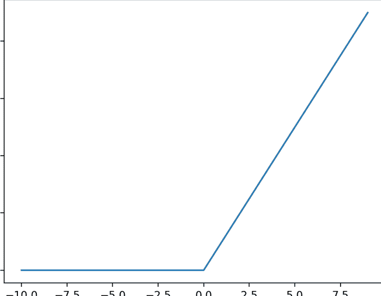

图 7.1：负输入和正输入的矫正线性激活线图。

矫正线性函数的导数也很容易计算。请记住，在反向传播误差过程中更新节点权重时需要激活函数的导数。函数的导数是斜率。负值的斜率为 0.0，正值的斜率为 1.0。传统上，神经网络领域避免使用任何不可完全微分的激活函数，这或许延迟了矫正线性函数和其他分段线性函数的采用。从技术上讲，当输入为 0.0 时我们无法计算导数，因此我们可以假设它为零。实际上这不是问题。

例如，矫正线性函数 `g(z) = max{0, z}` 在 `z = 0` 处不可微分。这似乎使 `g` 不能用于基于梯度的学习算法。实际上，梯度下降仍然表现足够好，可以使这些模型用于机器学习任务。

> — 第 192 页，《Deep Learning》，2016 年。

使用矫正线性激活函数具有许多优势；让我们在下一节中看几个。

## 7.1.4 矫正线性激活函数的优点

矫正线性激活函数已迅速成为开发大多数类型神经网络时的默认激活函数。因此，重要的是花点时间回顾一下该方法的一些好处，首先由 Xavier Glorot 等人在其里程碑式的 2012 年关于使用 ReLU 的论文《Deep Sparse Rectifier Neural Networks》中提出。

### 计算简易性

整流函数实现起来非常简单，只需要 `max()` 函数。这与需要使用指数计算的 `tanh` 和 `sigmoid` 激活函数不同。

计算也更便宜：在激活中无需计算指数函数

> — 《Deep Sparse Rectifier Neural Networks》，2011 年。

### 表示稀疏性

整流函数的一个重要好处是它能够输出真正的零值。这与 `tanh` 和 `sigmoid` 激活函数不同，后者学习近似零输出，例如非常接近零但不是真正的零值。这意味着负输入可以输出真正的零值，从而使神经网络隐藏层的激活包含一个或多个真正的零值。这称为稀疏表示，是表示学习中理想的属性，因为它可以加速学习并简化模型。一个研究和寻求稀疏等高效表示的领域是自编码器，其中网络在从紧凑表示重建之前学习输入的紧凑表示（称为代码层），例如图像或序列。

实现稀疏（和去噪）自编码器中 `h` 的实际零值的一种方法 [...] 其思想是使用矫正线性单元生成代码层。借助实际上将表示推向零的先验（如绝对值惩罚），因此可以间接控制表示中零的平均数量。

> — 第 507 页，《Deep Learning》，2016 年。

## 线性行为

修正函数在大部分情况下看起来和表现得像线性激活函数。一般来说，当神经网络的行为是线性或接近线性时，它更容易优化。

> 修正线性单元[...]基于这样一个原则：如果模型的行为更接近线性，它们就更容易优化。

— 第194页，*深度学习*，2016年。

这个属性的关键之处在于，使用这种激活函数训练的网络几乎完全避免了梯度消失问题，因为梯度仍然与节点激活值成正比。

> 由于这种线性，梯度在神经元的活跃路径上流动良好（不存在因sigmoid或tanh单元的激活非线性而导致的梯度消失效应）。

— *深度稀疏修正器神经网络*，2011年。

## 训练深层网络

重要的是，修正线性激活函数的（重新）发现和采用意味着可以利用硬件的改进，并通过反向传播成功训练带有非线性激活函数的深度多层网络。反过来，像玻尔兹曼机这样笨重的网络，以及诸如逐层训练和无监督预训练等笨重的训练方案，也可以被抛弃。

> ...深度修正器网络可以在纯监督任务且带有大型标注数据集的情况下，无需任何无监督预训练即可达到最佳性能。因此，这些结果可以被视为在理解训练深度但纯监督神经网络的困难，以及弥合有无无监督预训练所学习的神经网络之间性能差距方面的一个新里程碑。

— *深度稀疏修正器神经网络*，2011年。

## 7.1.5 使用修正线性激活函数的技巧

在本节中，我们将了解一些在自己的深度学习神经网络中使用修正线性激活函数时的技巧。

### 使用ReLU作为默认激活函数

长期以来，默认使用的激活函数是`sigmoid`激活函数。后来是`tanh`激活函数。对于现代深度学习神经网络，默认激活函数是修正线性激活函数。

在引入修正线性单元之前，大多数神经网络使用逻辑`sigmoid`激活函数或双曲正切激活函数。

— 第195页，*深度学习*，2016年。

大多数达到最先进结果的论文都会描述使用ReLU的网络。例如，在Alex Krizhevsky等人于2012年发表的里程碑式论文《*使用深度卷积神经网络的ImageNet分类*》中，作者开发了一个使用ReLU激活的深度卷积神经网络，在ImageNet照片分类数据集上取得了最先进的结果。

> ...我们将具有这种非线性的神经元称为修正线性单元（ReLUs）。
> 使用ReLU的深度卷积神经网络的训练速度比使用tanh单元的等效网络快几倍。

如果有疑问，可以在神经网络中从ReLU开始，然后也许尝试其他分段线性激活函数，看看它们的性能对比。

> 在现代神经网络中，默认建议是使用修正线性单元或ReLU

— 第174页，*深度学习*，2016年。

### 将ReLU用于MLP、CNN，但可能不用于RNN

ReLU可用于大多数类型的神经网络。它被推荐作为多层感知机（MLP）和卷积神经网络（CNN）的默认选择。ReLU在CNN中的使用已被彻底研究，几乎普遍带来了结果改进，起初这令人惊讶。

> ...滤波器组之后的非线性如何影响识别精度。令人惊讶的答案是，使用修正非线性是提高识别系统性能的最重要因素。

— *目标识别的最佳多阶段架构是什么？*，2009年。

研究ReLU在CNN中的应用促使了它们在其他网络类型中的使用。

> [其他人]在卷积网络的背景下探索了各种修正非线性[...]，并发现它们能提高判别性能。

— *修正线性单元改进受限玻尔兹曼机*，2010年。

在CNN中使用ReLU时，它们可以用作滤波器图本身上的激活函数，随后是池化层。

> 卷积网络的典型层由三个阶段组成[...]在第二阶段，每个线性激活都经过一个非线性激活函数，如修正线性激活函数。这个阶段有时称为检测阶段。

— 第339页，*深度学习*，2016年。

传统上，LSTM使用`tanh`激活函数作为细胞状态的激活，使用`sigmoid`激活函数作为节点输出。鉴于它们的精心设计，人们认为ReLU默认不适合循环神经网络（RNN），如长短期记忆网络（LSTM）。

乍一看，ReLU似乎不适合RNN，因为它们可能产生非常大的输出，因此可能比有界值的单元更有可能发生梯度爆炸。

> — *初始化修正线性单元循环网络的简单方法*，2015年。

尽管如此，仍有一些工作研究在LSTM中使用ReLU作为输出激活，其结果是在训练前仔细初始化网络权重以确保网络稳定。这在那篇2015年题为《*初始化修正线性单元循环网络的简单方法*》的论文中有所概述。

### 尝试较小的偏置输入值

偏置是节点上具有固定值的输入。偏置的作用是移动激活函数，传统上将偏置输入值设置为1.0。在您的网络中使用ReLU时，请考虑将偏置设置为较小的值，例如0.1。

> ...将[偏置]的所有元素设置为较小的正值（如0.1）是一种很好的做法。这使得修正线性单元在训练集中大多数输入下很可能初始就是活跃的，并让导数通过。

— 第193页，*深度学习*，2016年。

关于这是否必要，存在一些相互矛盾的报告，因此请与偏置输入为1.0的模型比较性能。

### 使用*He*权重初始化

在训练神经网络之前，网络的权重必须初始化为小的随机值。当在您的网络中使用ReLU并将权重初始化为以零为中心的小随机值时，默认情况下，网络中将有一半的单元输出零值。

> 例如，在权重均匀初始化后，大约50%的隐藏单元连续输出值是真正的零

— *深度稀疏修正器神经网络*，2011年。

有很多启发式方法可以为神经网络初始化权重，但对于将权重初始化方案映射到激活函数的选择，没有最佳方案，也几乎没有超出一般指导原则的关系。在ReLU被广泛采用之前，Xavier Glorot和Yoshua Bengio在2010年的论文《*理解训练深度前馈神经网络的难度*》中提出了一种初始化方案，该方案在使用`sigmoid`和`tanh`激活函数时迅速成为默认方案，通常称为*Xavier初始化*。权重被设置为从与前一层节点数成比例的范围中均匀采样的随机值（具体为+/- $\frac{1}{\sqrt{n}}$，其中$n$是前一层的节点数）。Kaiming He等人在2015年的论文《*深入挖掘修正器：在ImageNet分类上超越人类水平*》中指出，Xavier初始化和其他方案不适合ReLU及其扩展。

Glorot和Bengio提出采用适当缩放的均匀分布进行初始化。这称为“Xavier”初始化[...]。其推导基于激活是线性的假设。这个假设对于ReLU是无效的

— *深入挖掘修正器：在ImageNet分类上超越人类水平*，2015年。

他们提出了Xavier初始化的小幅修改，使其适用于ReLU，现在通常称为*He初始化*（具体为+/- $\frac{2}{\sqrt{n}}$，其中$n$是前一层的节点数）。在实践中，该方案的Gaussian和均匀版本都可以使用。

### 缩放输入数据

在使用神经网络之前，对输入数据进行缩放是一种好做法。这可能涉及将变量标准化为零均值和单位方差，或将每个值归一化到0到1的范围。在许多问题上，如果不对数据进行缩放，神经网络的权重可能会变得很大，导致网络不稳定并增加泛化误差。无论您的网络是否使用ReLU，这种缩放输入的好做法都适用。

### 使用权重惩罚

按照设计，ReLU的输出在正域上是无界的。这意味着在某些情况下，输出可能会持续增长。因此，使用某种形式的权重正则化（例如L1或L2向量范数）可能是个好主意。

由于激活的无界行为，可能会出现另一个问题；因此人们可能希望使用正则化器来防止潜在的数值问题。因此，我们对激活值使用L1惩罚，这也促进了额外的稀疏性

— *深度稀疏修正器神经网络*，2011年。

这既可以促进稀疏表示（例如使用L1正则化），又可以减少模型的泛化误差，是一个好做法。

## 7.1.6 ReLU的扩展和替代方案

ReLU确实有一些局限性。ReLU的局限性中关键的是一种情况：大的权重更新可能导致激活函数的求和输入始终为负，无论网络输入是什么。这意味着有这种问题的节点将永远输出0.0的激活值。这被称为*死亡ReLU*。

## 7.1. 消失梯度与 ReLU

梯度在单元未激活时为 0。这可能导致单元永远不激活的情况，因为基于梯度的优化算法不会调整初始时从未激活的单元的权重。此外，与消失梯度问题类似，我们可能会预期在训练具有恒定 0 梯度的 ReLU 网络时学习速度会很慢。

> — Rectifier Nonlinearities Improve Neural Network Acoustic Models, 2013.

ReLU 的一些流行扩展会放松函数的非线性输出，以某种方式允许小的负值。Leaky ReLU（LReLU）修改了函数以在输入小于零时允许小的负值。

> The leaky rectifier allows for a small, non-zero gradient when the unit is saturated and not active.
>
> — Rectifier Nonlinearities Improve Neural Network Acoustic Models, 2013.

指数线性单元，或 ELU，是 ReLU 的一种推广，它使用参数化指数函数从正值过渡到小的负值。

> ELUs have negative values which pushes the mean of the activations closer to zero. Mean activations that are closer to zero enable faster learning as they bring the gradient closer to the natural gradient.
>
> — Fast and Accurate Deep Network Learning by Exponential Linear Units (ELUs), 2016.

参数化 ReLU，或 PReLU，学习控制函数形状和泄漏程度的参数。

> ... we propose a new generalization of ReLU, which we call Parametric Rectified Linear Unit (PReLU). This activation function adaptively learns the parameters of the rectifiers.
>
> — Delving Deep into Rectifiers: Surpassing Human-Level Performance on ImageNet Classification, 2015.

Maxout 是一种替代的分段线性函数，返回输入的最大值，旨在与 dropout 正则化技术结合使用。

> We define a simple new model called maxout (so named because its output is the max of a set of inputs, and because it is a natural companion to dropout) designed to both facilitate optimization by dropout and improve the accuracy of dropout’s fast approximate model averaging technique.
>
> — Maxout Networks, 2013.

## 7.2 ReLU Keras API

整流线性激活函数可以直接在 Keras 中使用。它可以通过 Activation 层指定为独立层。

```python
...

model.add(Activation('relu'))
```

清单 7.6：ReLU 激活层示例。

整流激活函数也可以直接在层上指定，例如在 Dense、Conv2D 和 LSTM 层上通过 activation 参数指定。

```python
...

model.add(Dense(..., activation='relu'))
```

清单 7.7：Dense 层上 ReLU 激活的示例。

Keras 还支持整流线性激活函数的变体作为独立层，例如通过 PReLU 层的参数化 ReLU 和通过 LeakyReLU 层的泄漏 ReLU。

## 7.3 ReLU 案例研究

在本节中，我们将演示如何使用 ReLU 在一个简单的分类问题上与 MLP 结合来对抗消失梯度问题。此示例为使用您自己的神经网络探索 ReLU 进行分类和回归问题提供了一个模板。

### 7.3.1 二元分类问题

作为我们探索的基础，我们将使用一个非常简单的两类或二元分类问题。scikit-learn 库提供了 `make_circles()` 函数，可用于创建具有规定样本数和统计噪声的二元分类问题。每个示例有两个输入变量，定义二维平面上点的 x 和 y 坐标。点为两个类别排列成两个同心圆（它们具有相同的中心）。数据集中的点数由一个参数指定，其中一半将从每个圆中抽取。可以通过 noise 参数在采样点时添加高斯噪声，该参数定义噪声的标准差，其中 0.0 表示无噪声或点完全从圆中抽取。伪随机数生成器的种子可以通过 random_state 参数指定，该参数允许每次调用函数时采样完全相同的点。下面示例从两个圆中生成 1,000 个示例，并带有噪声以及值为 1 的伪随机数生成器种子。

```python
# generate circles

X, y = make_circles(n_samples=1000, noise=0.1, random_state=1)
```

清单 7.8：从两个圆问题生成样本的示例。

我们可以创建数据集的图表，绘制输入变量（X）的 x 和 y 坐标，并按类别值（0 或 1）为每个点着色。完整示例如下所示。

```python
# scatter plot of the circles dataset with points colored by class

from sklearn.datasets import make_circles

from numpy import where

from matplotlib import pyplot

# generate circles

X, y = make_circles(n_samples=1000, noise=0.1, random_state=1)

# select indices of points with each class label

for i in range(2):
    samples_ix = where(y == i)
    pyplot.scatter(X[samples_ix, 0], X[samples_ix, 1], label=str(i))

pyplot.legend()
pyplot.show()
```


清单 7.9：绘制两个圆问题样本的示例。

运行示例会创建图表，显示 1,000 个生成的 数据点，并使用每个点的类别值对每个点着色。我们可以看到类别 0 的点为蓝色，表示外圆，类别 1 的点为橙色，表示内圆。生成样本的统计噪声意味着两个圆之间存在一些点的重叠，给问题增加了一些模糊性，使其非平凡。这是有益的，因为神经网络可能会选择多种可能的解决方案来对两个圆之间的点进行分类，并且总是会犯一些错误。

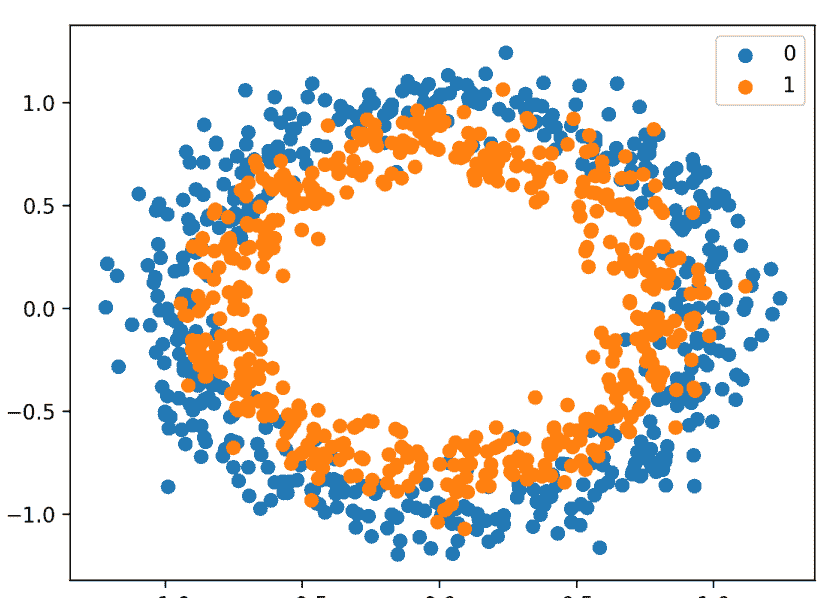

图 7.2：按类别值着色的圆数据集散点图。

现在我们已定义了作为探索基础的问题，我们可以着手开发模型来解决它。

### 7.3.2 多层感知机模型

我们可以开发一个多层感知机模型来解决两个圆问题。这将是一个简单的前馈神经网络模型，其设计方式如我们在 1990 年代末和 2000 年代初所学。首先，我们将从两个圆问题生成 1,000 个数据点，并将输入重新缩放到 `[-1, 1]` 范围。数据几乎已在此范围内，但我们会确保。通常，我们会使用训练数据集准备数据缩放并将其应用于测试数据集。为了在本次教程中保持简单，我们将在将数据拆分为训练集和测试集之前一起缩放所有数据。

```python
# generate 2d classification dataset

X, y = make_circles(n_samples=1000, noise=0.1, random_state=1)

# scale input data to [-1,1]

scaler = MinMaxScaler(feature_range=(-1, 1))

X = scaler.fit_transform(X)
```

清单 7.10：缩放数据以便建模的示例。

接下来，我们将数据拆分为训练集和测试集。数据的一半将用于训练，剩余的 500 个示例将用作测试集。在本教程中，测试集也将用作验证数据集，以便我们在训练期间了解模型在保留集上的表现。

```python
# split into train and test

n_train = 500

trainX, testX = X[:n_train, :], X[n_train:, :]

trainy, testy = y[:n_train], y[n_train:]
```

清单 7.11：将数据拆分为训练集和测试集的示例。

接下来，我们将定义模型。模型将具有两个输入的输入层，对应数据集中的两个变量，一个具有五个节点的隐藏层，以及一个用于预测类别概率的输出层。隐藏层将使用双曲正切激活函数（`tanh`），输出层将使用逻辑激活函数（`sigmoid`）来预测类别 0 或类别 1 或两者之间的值。在 1990 年代和 2000 年代，在隐藏层中使用双曲正切激活函数是最佳实践，通常比在隐藏层中使用逻辑函数表现更好。另一个良好实践是将网络权重初始化为来自均匀分布的小随机值。在这里，我们将从范围 `[0.0, 1.0]` 中随机初始化权重。

```python
# define model

model = Sequential()

init = RandomUniform(minval=0, maxval=1)

model.add(Dense(5, input_dim=2, activation='tanh', kernel_initializer=init))

model.add(Dense(1, activation='sigmoid', kernel_initializer=init))
```

清单 7.12：定义 MLP 模型的示例。

模型使用二元交叉熵损失函数，并使用学习率为 0.01 且动量为 0.9 的随机梯度下降进行优化。

```python
# compile model

opt = SGD(lr=0.01, momentum=0.9)

model.compile(loss='binary_crossentropy', optimizer=opt, metrics=['accuracy'])
```

清单 7.13：编译 MLP 模型的示例。

模型训练 500 个训练轮次，并在每个轮次结束时对测试数据集进行评估，同时评估训练数据集。

```python
# fit model

history = model.fit(trainX, trainy, validation_data=(testX, testy), epochs=500, verbose=0)
```

清单 7.14：拟合 MLP 模型的示例。

拟合模型后，它会在训练集和测试集上进行评估，并显示准确率分数。

```python
# evaluate the model

_, train_acc = model.evaluate(trainX, trainy, verbose=0)

_, test_acc = model.evaluate(testX, testy, verbose=0)

print('Train: %.3f, Test: %.3f' % (train_acc, test_acc))
```

清单 7.15：评估 MLP 模型的示例。

最后，模型在训练的每个步骤中的准确率被绘制为线图，显示模型学习问题的动态过程。

```python
# plot loss learning curves

pyplot.subplot(211)

pyplot.title('Cross-Entropy Loss', pad=-40)

pyplot.plot(history.history['loss'], label='train')

pyplot.plot(history.history['val_loss'], label='test')

pyplot.legend()

# plot accuracy learning curves

pyplot.subplot(212)

pyplot.title('Accuracy', pad=-40)

pyplot.plot(history.history['acc'], label='train')

pyplot.plot(history.history['val_acc'], label='test')

pyplot.legend()

pyplot.show()
```

清单 7.16：绘制 MLP 模型学习曲线的示例。

将所有这些结合起来，完整示例列在下面。

```python
# mlp with tanh for the two circles classification problem

from sklearn.datasets import make_circles

from sklearn.preprocessing import MinMaxScaler

from keras.layers import Dense

from keras.models import Sequential

from keras.optimizers import SGD

from keras.initializers import RandomUniform

from matplotlib import pyplot

# generate 2d classification dataset

X, y = make_circles(n_samples=1000, noise=0.1, random_state=1)

# scale input data to [-1,1]

scaler = MinMaxScaler(feature_range=(-1, 1))

X = scaler.fit_transform(X)

# split into train and test

n_train = 500

trainX, testX = X[:n_train, :], X[n_train:, :]

trainy, testy = y[:n_train], y[n_train:]

# define model

model = Sequential()

init = RandomUniform(minval=0, maxval=1)

model.add(Dense(5, input_dim=2, activation='tanh', kernel_initializer=init))

model.add(Dense(1, activation='sigmoid', kernel_initializer=init))

# compile model

opt = SGD(lr=0.01, momentum=0.9)

model.compile(loss='binary_crossentropy', optimizer=opt, metrics=['accuracy'])

# fit model

history = model.fit(trainX, trainy, validation_data=(testX, testy), epochs=500, verbose=0)

# evaluate the model

_, train_acc = model.evaluate(trainX, trainy, verbose=0)

_, test_acc = model.evaluate(testX, testy, verbose=0)

print('Train: %.3f, Test: %.3f' % (train_acc, test_acc))

# plot loss learning curves

pyplot.subplot(211)

pyplot.title('Cross-Entropy Loss', pad=-40)

pyplot.plot(history.history['loss'], label='train')

pyplot.plot(history.history['val_loss'], label='test')

pyplot.legend()

# plot accuracy learning curves

pyplot.subplot(212)

pyplot.title('Accuracy', pad=-40)

pyplot.plot(history.history['acc'], label='train')

pyplot.plot(history.history['val_acc'], label='test')

pyplot.legend()

pyplot.show()
```

清单 7.17：评估两圆问题中基于 tanh 的 MLP 的示例。

运行示例只需几秒钟即可拟合模型。模型在训练集和测试集上的性能将被计算并显示。

**注意：** 由于学习算法的随机性，您的具体结果可能会有所不同。考虑多次运行示例并比较平均性能。

我们可以看到，在这种情况下，模型很好地学习了问题，在训练集和测试集上均达到了约 81.6% 的准确率。

```
Train: 0.800, Test: 0.820
```

清单 7.18：评估两圆问题中旧式 MLP 的示例输出。

创建了模型在训练集和测试集上的损失和准确率的线图，显示了在全部 500 个训练轮次中性能的变化。图表表明，在本次运行中，性能在大约第 200 个轮次左右开始放缓，训练集和测试集的准确率均约为 80%。

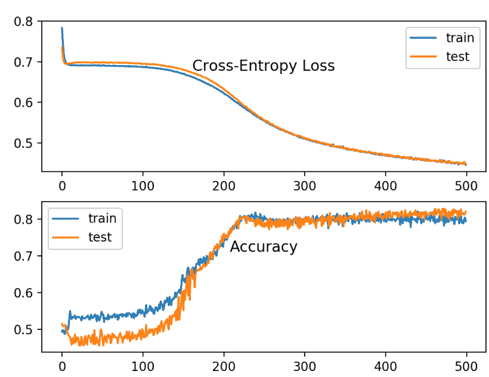

图 7.3：两圆问题中 MLP 在训练轮次中训练集和测试集准确率的线图。

现在我们已经看到了如何使用 `tanh` 激活函数为两圆问题开发经典 MLP，我们可以查看如何修改模型以具有更多隐藏层。

## 7.3.3 更深的 MLP 模型

传统上，开发深度多层感知器模型具有挑战性。使用双曲正切激活函数的深度模型不易训练，而这种较差的性能很大程度上被归咎于梯度消失问题。我们可以尝试使用上一节中开发的 MLP 模型来研究这个问题。隐藏层的数量可以从 1 增加到 5；例如：

```python
# define model

init = RandomUniform(minval=0, maxval=1)

model = Sequential()

model.add(Dense(5, input_dim=2, activation='tanh', kernel_initializer=init))

model.add(Dense(5, activation='tanh', kernel_initializer=init))

model.add(Dense(5, activation='tanh', kernel_initializer=init))

model.add(Dense(5, activation='tanh', kernel_initializer=init))

model.add(Dense(5, activation='tanh', kernel_initializer=init))

model.add(Dense(1, activation='sigmoid', kernel_initializer=init))
```

# 清单 7.19：定义更深的基于 tanh 的 MLP 的示例。

然后我们可以重新运行示例并查看结果。更深的 MLP 的完整示例列在下面。

```python
# deeper mlp with tanh for the two circles classification problem

from sklearn.datasets import make_circles

from sklearn.preprocessing import MinMaxScaler

from keras.layers import Dense

from keras.models import Sequential

from keras.optimizers import SGD

from keras.initializers import RandomUniform

from matplotlib import pyplot

# generate 2d classification dataset

X, y = make_circles(n_samples=1000, noise=0.1, random_state=1)

scaler = MinMaxScaler(feature_range=(-1, 1))

X = scaler.fit_transform(X)

# split into train and test

n_train = 500

trainX, testX = X[:n_train, :], X[n_train:, :]

trainy, testy = y[:n_train], y[n_train:]

# define model

init = RandomUniform(minval=0, maxval=1)

model = Sequential()

model.add(Dense(5, input_dim=2, activation='tanh', kernel_initializer=init))

model.add(Dense(5, activation='tanh', kernel_initializer=init))

model.add(Dense(5, activation='tanh', kernel_initializer=init))

model.add(Dense(5, activation='tanh', kernel_initializer=init))

model.add(Dense(5, activation='tanh', kernel_initializer=init))

model.add(Dense(1, activation='sigmoid', kernel_initializer=init))

# compile model

opt = SGD(lr=0.01, momentum=0.9)

model.compile(loss='binary_crossentropy', optimizer=opt, metrics=['accuracy'])

# fit model

history = model.fit(trainX, trainy, validation_data=(testX, testy), epochs=500, verbose=0)

# evaluate the model

_, train_acc = model.evaluate(trainX, trainy, verbose=0)

_, test_acc = model.evaluate(testX, testy, verbose=0)

print('Train: %.3f, Test: %.3f' % (train_acc, test_acc))

# plot loss learning curves

pyplot.subplot(211)

pyplot.title('Cross-Entropy Loss', pad=-40)

pyplot.plot(history.history['loss'], label='train')

pyplot.plot(history.history['val_loss'], label='test')

pyplot.legend()

# plot accuracy learning curves

pyplot.subplot(212)

pyplot.title('Accuracy', pad=-40)

pyplot.plot(history.history['acc'], label='train')

pyplot.plot(history.history['val_acc'], label='test')

pyplot.legend()

pyplot.show()
```

# 清单 7.20：评估两圆问题中更深的基于 tanh 的 MLP 的示例。

运行示例首先打印拟合模型在训练集和测试集上的性能。

**注意：** 由于学习算法的随机性，您的具体结果可能会有所不同。考虑多次运行示例并比较平均性能。

在这种情况下，我们可以看到性能在训练集和测试集上都很差，准确率约为 50%。这表明按此配置的模型无法学习问题，也无法泛化解决方案。


Train: 0.588, Test: 0.552

清单 7.21：评估两圆问题中更深的基于 tanh 的 MLP 的示例输出。

模型在训练过程中在训练集和测试集上的准确率线图讲述了类似的故事。我们可以看到性能很差，并且随着训练的进行实际上变得更糟。

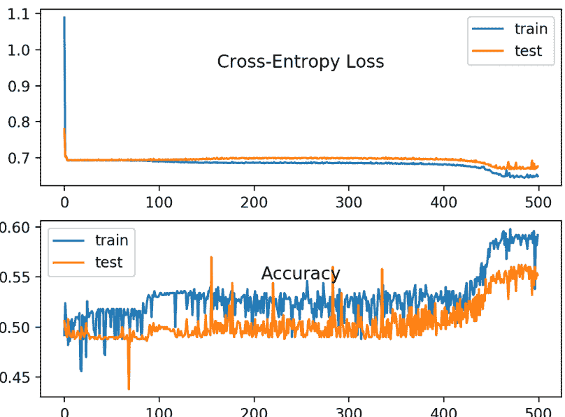

图 7.4：两圆问题中深度 MLP 在训练轮次中训练集和测试集准确率的线图。

## 7.3.4 使用 ReLU 的更深 MLP 模型

修正线性激活函数已取代双曲正切激活函数，成为开发多层感知器网络以及其他

像 CNN 这样的网络类型。这是因为激活函数看起来并表现得像线性函数，使得训练更容易且不太可能饱和，但实际上它是非线性函数，会将负输入强制为值 0。它被认为是在训练更深模型时解决梯度消失问题的一种可能方法。在使用修正线性激活函数（简称 ReLU）时，使用 He 权重初始化方案是良好的实践。我们可以使用 ReLU 和 He 初始化定义具有五个隐藏层的 MLP，如下所示。

```
# define model

model = Sequential()

model.add(Dense(5, input_dim=2, activation='relu', kernel_initializer='he_uniform'))

model.add(Dense(5, activation='relu', kernel_initializer='he_uniform'))

model.add(Dense(5, activation='relu', kernel_initializer='he_uniform'))

model.add(Dense(5, activation='relu', kernel_initializer='he_uniform'))

model.add(Dense(5, activation='relu', kernel_initializer='he_uniform'))

model.add(Dense(1, activation='sigmoid'))
```

Listing 7.22: 定义一个更深的基于 ReLU 的 MLP 的示例。

将这些结合起来，完整的代码示例如下所示。

```
# deeper mlp with relu for the two circles classification problem (5 hidden layers)

from sklearn.datasets import make_circles

from sklearn.preprocessing import MinMaxScaler

from keras.layers import Dense

from keras.models import Sequential

from keras.optimizers import SGD

from matplotlib import pyplot

# generate 2d classification dataset

X, y = make_circles(n_samples=1000, noise=0.1, random_state=1)

scaler = MinMaxScaler(feature_range=(-1, 1))

X = scaler.fit_transform(X)

# split into train and test

n_train = 500

trainX, testX = X[:n_train, :], X[n_train:, :]

trainy, testy = y[:n_train], y[n_train:]

# define model

model = Sequential()

model.add(Dense(5, input_dim=2, activation='relu', kernel_initializer='he_uniform'))

model.add(Dense(5, activation='relu', kernel_initializer='he_uniform'))

model.add(Dense(5, activation='relu', kernel_initializer='he_uniform'))

model.add(Dense(5, activation='relu', kernel_initializer='he_uniform'))

model.add(Dense(5, activation='relu', kernel_initializer='he_uniform'))

model.add(Dense(1, activation='sigmoid'))

# compile model

opt = SGD(lr=0.01, momentum=0.9)

model.compile(loss='binary_crossentropy', optimizer=opt, metrics=['accuracy'])

# fit model

history = model.fit(trainX, trainy, validation_data=(testX, testy), epochs=500, verbose=0)

# evaluate the model

_, train_acc = model.evaluate(trainX, trainy, verbose=0)

_, test_acc = model.evaluate(testX, testy, verbose=0)

print('Train: %.3f, Test: %.3f' % (train_acc, test_acc))

# plot loss learning curves

pyplot.subplot(211)

pyplot.title('Cross-Entropy Loss', pad=-40)

pyplot.plot(history.history['loss'], label='train')

pyplot.plot(history.history['val_loss'], label='test')

pyplot.legend()

# plot accuracy learning curves

pyplot.subplot(212)

pyplot.title('Accuracy', pad=-40)

pyplot.plot(history.history['acc'], label='train')

pyplot.plot(history.history['val_acc'], label='test')

pyplot.legend()

pyplot.show()
```

Listing 7.23: 评估用于双圆分类问题的更深 ReLU 基于 MLP 的示例。

运行示例会打印模型在训练集和测试集上的性能。

**注意：** 由于学习算法的随机性，您的具体结果可能会有所不同。考虑多次运行示例并比较平均性能。

在这种情况下，我们可以看到这一小改动使模型能够学习该问题，在两个数据集上均实现了约 84% 的准确率，优于使用 tanh 激活函数的单层模型。

```
Train: 0.842, Test: 0.846
```

Listing 7.24: 评估用于双圆问题的更深 ReLU 基于 MLP 的示例输出。

还创建了模型在训练 epoch 过程中训练集和测试集准确率的线图。该图显示了与迄今为止所见相当不同的动态。模型似乎能快速学习该问题，在约 100 个 epoch 内收敛到解决方案。

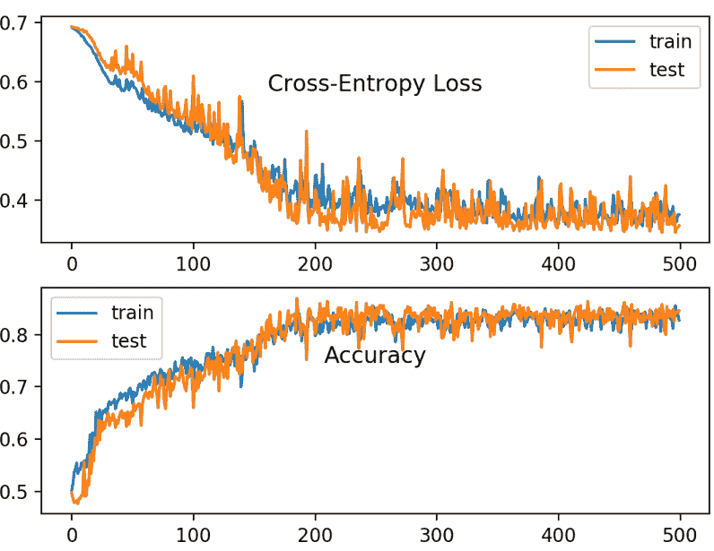

Figure 7.5: 双圆问题中具有 ReLU 的深度 MLP 在训练 epoch 过程中训练集和测试集准确率的线图。

使用 ReLU 激活函数使我们能够为此简单问题拟合一个更深的模型，但这种能力并非无限。例如，增加层数会导致学习变慢，在约 20 层时模型不再能够学习该问题，至少在所选配置下如此。例如，下面是具有 15 个隐藏层的相同模型的训练和测试准确率线图，显示它仍然能够学习该问题（至少有时）。

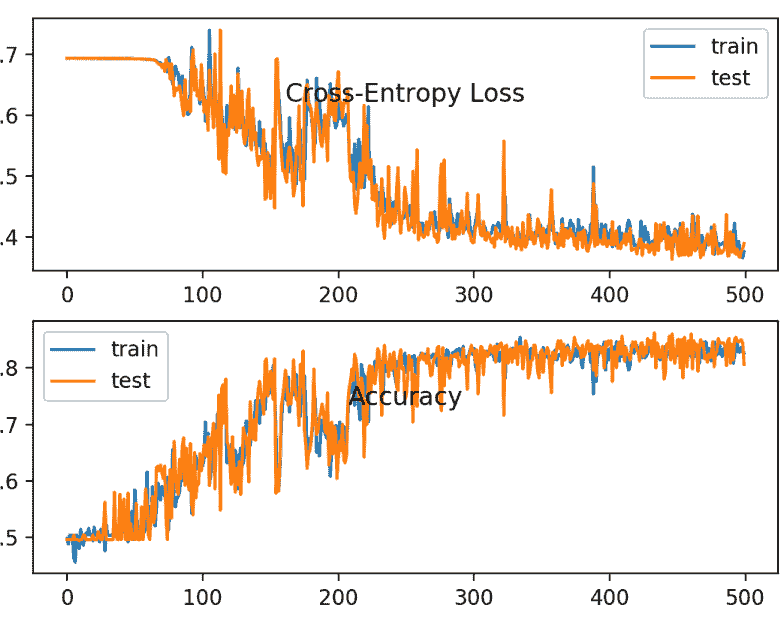

Figure 7.6: 具有 15 个隐藏层的 ReLU 深度 MLP 在训练 epoch 过程中训练集和测试集准确率的线图。

下面是具有 20 层的相同模型在 epoch 过程中训练和测试准确率的线图，显示该配置不再能够学习该问题（至少有时）。

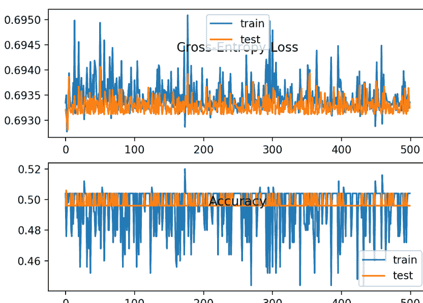

Figure 7.7: 具有 20 个隐藏层的 ReLU 深度 MLP 在训练 epoch 过程中训练集和测试集准确率的线图。

尽管使用 ReLU 是有效的，但我们不能确信 tanh 函数的失败是因为梯度消失，而 ReLU 的成功是因为它克服了这个问题。

## 7.4 扩展

本节列出了一些扩展本教程的想法，您可能希望探索。

- **权重初始化**。将使用 tanh 激活的深度 MLP 更新为使用 Xavier 均匀权重初始化并报告结果。
- **学习算法**。将使用 tanh 激活的深度 MLP 更新为使用 Adam 等自适应学习算法并报告结果。
- **权重变化**。更新 tanh 和 relu 示例以记录并绘制每个 epoch 模型权重的 L1 向量范数，作为训练期间各层变化程度的代理指标并比较结果。
- **研究模型深度**。使用具有 tanh 激活的 MLP 创建实验，并报告随着隐藏层数从 1 增加到 10 时模型的性能。
- **增加宽度**。将具有 tanh 激活的 MLP 的隐藏层中的节点数从 5 增加到 25，并报告随着层数从 1 增加到 10 时的性能。

如果您探索其中任何一个扩展，我很乐意知道。

## 7.5 进一步阅读

如果您想深入了解，本节提供了该主题的更多资源。

### 7.5.1 书籍

- 第 6.3.1 节：修正线性单元及其泛化，*深度学习*，2016。
  https://amzn.to/2QHVwmW

### 7.5.2 论文

- *什么是用于对象识别的最佳多阶段架构？*，2009
  https://ieeexplore.ieee.org/document/5459469
- *修正线性单元改进受限玻尔兹曼机*，2010。
  https://dl.acm.org/citation.cfm?id=3104425
- *深度稀疏整流神经网络*，2011。
  http://proceedings.mlr.press/v15/glorot11a
- *整流非线性改进神经网络声学模型*，2013。
  http://ai.stanford.edu/~amaas/papers/relu_hybrid_icml2013_final.pdf
- *理解训练深度前馈神经网络的困难*，2010。
  http://proceedings.mlr.press/v9/glorot10a.html
- *深入探究整流器：超越 ImageNet 分类的人类水平性能*，2015。
  https://arxiv.org/abs/1502.01852
- *Maxout 网络*，2013。
  https://arxiv.org/abs/1302.4389
- *用于训练非常深的前馈网络的随机游走初始化*，2014。
  https://arxiv.org/abs/1412.6558
- *循环网络中的梯度流：学习长期依赖的困难*，2001。
  http://www.iro.umontreal.ca/~lisa/publications2/index.php/publications/show/55

## 第8章
### 使用梯度裁剪修复梯度爆炸

训练神经网络可能会变得不稳定，这取决于误差函数、学习率的选择，甚至目标变量的尺度。训练过程中权重的大幅更新可能导致数值溢出或下溢，通常被称为梯度爆炸。梯度爆炸问题在循环神经网络中更为常见，例如 LSTM，因为在数百个输入时间步展开时梯度会累积。解决梯度爆炸问题的一种常见且相对简单的方法是在将误差的导数向后传播并用于更新权重之前对其进行更改。两种方法包括根据选定的向量范数重新缩放梯度以及裁剪超出首选范围的梯度值。这些方法合在一起被称为梯度裁剪。在本教程中，您将了解梯度爆炸问题以及如何使用梯度裁剪改善神经网络训练稳定性。完成本教程后，您将了解：

- 训练神经网络可能变得不稳定，导致通常被称为梯度爆炸的数值溢出或下溢。
- 通过按向量范数缩放误差梯度或将梯度值裁剪到一定范围，可以使训练过程稳定。
- 如何使用梯度裁剪方法更新具有梯度爆炸问题的回归预测建模问题的 MLP 模型，以实现稳定的训练过程。

让我们开始。

神经网络使用随机梯度下降优化算法进行训练。这首先需要估计一个或多个训练示例上的损失，然后计算损失的导数，该导数通过网络向后传播以更新权重。权重使用由学习率控制的反向传播误差的一部分进行更新。权重更新可能大到导致权重溢出或下溢其数值精度。实际上，当权重溢出或下溢时，权重可能取 NaN（非数字）或 Inf（无穷大）的值，从那时起网络在实际用途上将毫无用处，因为信号流经无效权重时永远预测 NaN 值。

当参数梯度非常大时，梯度下降参数更新可能会将参数抛得很远，进入目标函数更大的区域，从而撤销了达到当前解所做的大部分工作。

— 第413页，Deep Learning，2016。

权重下溢或溢出通常被称为网络训练过程的不稳定性，并以梯度爆炸命名，因为不稳定的训练过程会导致网络无法训练，使得模型本质上毫无用处。在给定的神经网络中，例如卷积神经网络或多层感知器，这可能是由于配置选择不当造成的。一些示例包括：

- 学习率选择不当，导致权重更新过大。
- 数据准备选择不当，允许目标变量存在较大差异。
- 损失函数选择不当，允许计算出较大的误差值。

梯度爆炸也是循环神经网络的问题，例如长短期记忆网络，因为在展开的循环结构中误差梯度会累积。一般来说，通过仔细配置网络模型，例如选择较小的学习率、缩放的目标变量和标准损失函数，可以避免梯度爆炸。尽管如此，对于具有大量输入时间步的循环网络，梯度爆炸仍可能是一个问题。

使用完整梯度训练 LSTM 时的一个困难是导数有时会变得过大，导致数值问题。为防止这种情况，我们将损失相对于 LSTM 层网络输入的导数（在应用 sigmoid 和 tanh 函数之前）裁剪到预定义范围内。

— Generating Sequences With Recurrent Neural Networks，2013。

解决梯度爆炸的常见方法是在将误差导数向后传播并用于更新权重之前对其进行更改。通过重新缩放误差导数，权重更新也会被重新缩放，从而大幅降低溢出或下溢的可能性。更新误差导数主要有两种方法；它们是：

- 梯度缩放。
- 梯度裁剪。

梯度缩放涉及归一化误差梯度向量，使向量范数（大小）等于定义值，例如 1.0。

> ... 处理梯度范数突然增加的一个简单机制是当它们超过阈值时重新缩放它们
> 
> — *On the difficulty of training Recurrent Neural Networks*，2013。

梯度裁剪涉及如果梯度超过预期范围，则将梯度值（逐元素）强制为特定的最小值或最大值。这些方法合在一起通常简称为 *梯度裁剪*。

> 当传统的梯度下降算法提出进行非常大的步长时，梯度裁剪启发式方法会介入以减小步长，使其足够小，从而不太可能超出梯度指示的近似最陡下降方向的区域。
> 
> — 第289页，*Deep Learning*，2016。

这是一种仅解决深度神经网络模型训练数值稳定性的方法，并不提供任何整体性能改进。梯度向量范数或首选范围的值可以通过试错来配置，也可以通过使用文献中常用的值，或先通过实验观察常见的向量范数或范围然后选择合理的值来配置。

> 在我们的实验中我们注意到，对于给定的任务和模型大小，训练对这个 [gradient norm] 超参数不是很敏感，即使对于相当小的阈值，算法也能表现良好。
> 
> — *On the difficulty of training Recurrent Neural Networks*，2013。

通常对网络中的所有层使用相同的梯度裁剪配置。尽管如此，存在输出层允许的误差梯度范围比隐藏层更大的示例。

> 输出导数 [...] 被裁剪到范围 [-100, 100]，而 LSTM 导数被裁剪到范围 [-10, 10]。裁剪输出梯度对于数值稳定性至关重要；即便如此，网络在训练后期有时仍会出现数值问题，在它们开始在训练数据上过拟合之后。
> 
> — Generating Sequences With Recurrent Neural Networks，2013。

## 8.2 梯度裁剪 Keras API

Keras 支持在每个优化算法上进行梯度裁剪，并将相同的方案应用于模型中的所有层。梯度裁剪可以通过在配置优化算法时包含一个额外的参数与优化算法一起使用，例如随机梯度下降。可以使用的两种梯度裁剪类型是：梯度范数缩放和梯度值裁剪。

### 8.2.1 梯度范数缩放

梯度范数缩放涉及当梯度向量的 L2 向量范数（平方值之和）超过阈值时更改损失函数的导数，使其具有给定的向量范数。例如，我们可以指定范数为 1.0，这意味着如果梯度的向量范数超过 1.0，则向量中的值将被重新缩放，使向量的范数等于 1.0。这可以在 Keras 中通过在优化器上指定 `clipnorm` 参数来使用；例如：

```
...

# configure sgd with gradient norm clipping

opt = SGD(lr=0.01, momentum=0.9, clipnorm=1.0)
```

Listing 8.1: Keras 中梯度范数缩放的示例。

### 8.2.2 梯度值裁剪

梯度值裁剪涉及如果梯度值小于负阈值或大于正阈值，则将损失函数的导数裁剪为给定值。例如，我们可以指定范数为 0.5，这意味着如果梯度值小于 -0.5，则将其设为 -0.5，如果大于 0.5，则将其设为 0.5。这可以在 Keras 中通过在优化器上指定 `clipvalue` 参数来使用，例如：

```
...
```


# configure sgd with gradient value clipping

`opt = SGD(lr=0.01, momentum=0.9, clipvalue=0.5)`

```
Listing 8.2: Keras 中梯度值裁剪的示例。
```

## 8.3 梯度裁剪案例研究

在本节中，我们将演示如何使用梯度裁剪来解决 MLP 在简单分类问题上的梯度爆炸问题。此示例为使用您自己的神经网络探索分类和回归问题的梯度裁剪提供了一个模板。

### 8.3.1 回归预测建模问题

回归预测建模问题涉及预测实值量。我们可以使用 scikit-learn 库提供的标准回归问题生成器中的 `make_regression()` 函数。此函数将从具有给定数量输入变量、统计噪声和其他属性的简单回归问题生成示例。我们将使用此函数定义一个具有 20 个输入特征的问题；其中 10 个特征是有意义的，10 个特征与问题无关。总共将随机生成 1,000 个示例。伪随机数生成器将被固定，以确保每次运行代码时我们都能得到相同的 1,000 个示例。

```
# generate regression dataset

X, y = make_regression(n_samples=1000, n_features=20, noise=0.1, random_state=1)
```

清单 8.3：为回归问题生成样本的示例。

每个输入变量都服从高斯分布，目标变量也是如此。我们可以创建目标变量的图，同时展示其分布和离散程度。完整示例如下。

```
# regression predictive modeling problem

from sklearn.datasets import make_regression

from matplotlib import pyplot

# generate regression dataset

X, y = make_regression(n_samples=1000, n_features=20, noise=0.1, random_state=1)

# histogram of target variable

pyplot.subplot(121)

pyplot.hist(y)

# boxplot of target variable

pyplot.subplot(122)

pyplot.boxplot(y)

pyplot.show()
```

清单 8.4：生成样本并绘制其分布以用于回归问题的示例。

运行该示例会生成一个包含两个子图的图形，分别显示目标变量的直方图和箱线图。直方图显示了目标变量的高斯分布。箱线图显示样本的范围大约在 -400 到 400 之间，均值约为 0.0。

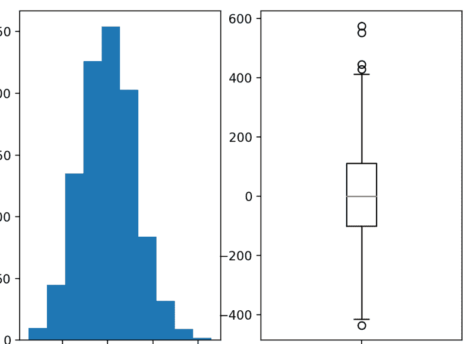

图 8.1：回归问题中目标变量的直方图与箱线图。

## 8.3.2 具有梯度爆炸的多层感知机

我们可以为回归问题开发一个多层感知机（MLP）模型。该模型将在原始数据上进行演示，不对输入变量或输出变量进行任何缩放。这是一个演示梯度爆炸的好例子，因为训练用于预测未缩放目标变量的模型会产生数值在数百甚至数千的误差梯度，具体取决于训练期间使用的批次大小。如此大的梯度值很可能导致学习不稳定或权重值溢出。第一步是将数据拆分为训练集和测试集，以便我们能够拟合和评估模型。我们将从该领域中生成 1,000 个样本，并将数据集对半拆分，分别使用 500 个样本作为训练集和测试集。

```
# split into train and test

n_train = 500

trainX, testX = X[:n_train, :], X[n_train:, :]

trainy, testy = y[:n_train], y[n_train:]
```

清单 8.5：准备建模数据集的示例。

接下来，我们可以定义一个 MLP 模型。该模型将接收问题中的 20 个输入变量作为 20 个输入。将使用一个包含 25 个节点和修正线性激活函数的隐藏层。输出层有一个节点对应单一目标变量，并使用线性激活函数直接预测实数值。

```
# define model

model = Sequential()

model.add(Dense(25, input_dim=20, activation='relu', kernel_initializer='he_uniform'))

model.add(Dense(1, activation='linear'))
```

清单 8.6：定义 MLP 模型的示例。

将使用均方误差损失函数来优化模型，并使用随机梯度下降优化算法，采用合理的默认配置：学习率为 0.01，动量为 0.9。

```
# compile model

model.compile(loss='mean_squared_error', optimizer=SGD(lr=0.01, momentum=0.9))
```

清单 8.7：编译 MLP 模型的示例。

模型将拟合 100 个训练轮次，并将测试集用作验证集，在每个训练轮次结束时进行评估。

```
# fit model

history = model.fit(trainX, trainy, validation_data=(testX, testy), epochs=100, verbose=0)
```

清单 8.8：拟合 MLP 模型的示例。

训练结束时，将计算训练集和测试集上的均方误差，以了解模型学习该问题的效果。

```
# evaluate the model

train_mse = model.evaluate(trainX, trainy, verbose=0)

test_mse = model.evaluate(testX, testy, verbose=0)
```

清单 8.9：评估 MLP 模型的示例。

最后，使用线图绘制每个训练轮次结束时训练集和测试集上的均方误差学习曲线，通过这些学习曲线可以了解模型在学习该问题时的动态。

```
# plot loss during training

pyplot.title('Mean Squared Error')

pyplot.plot(history.history['loss'], label='train')

pyplot.plot(history.history['val_loss'], label='test')

pyplot.legend()

pyplot.show()
```

清单 8.10：绘制 MLP 模型学习曲线的示例。

将这些要素整合在一起，完整示例如下。

```
# mlp with unscaled data for the regression problem

from sklearn.datasets import make_regression

from keras.layers import Dense

from keras.models import Sequential

from keras.optimizers import SGD

from matplotlib import pyplot

# generate regression dataset

X, y = make_regression(n_samples=1000, n_features=20, noise=0.1, random_state=1)

# split into train and test

n_train = 500

trainX, testX = X[:n_train, :], X[n_train:, :]

trainY, testY = y[:n_train], y[n_train:]

# define model

model = Sequential()

model.add(Dense(25, input_dim=20, activation='relu', kernel_initializer='he_uniform'))

model.add(Dense(1, activation='linear'))

# compile model

model.compile(loss='mean_squared_error', optimizer=SGD(lr=0.01, momentum=0.9))

# fit model

history = model.fit(trainX, trainY, validation_data=(testX, testY), epochs=100, verbose=0)

# evaluate the model

train_mse = model.evaluate(trainX, trainY, verbose=0)

test_mse = model.evaluate(testX, testY, verbose=0)

print('Train: %.3f, Test: %.3f' % (train_mse, test_mse))

# plot loss during training

pyplot.title('Mean Squared Error')

pyplot.plot(history.history['loss'], label='train')

pyplot.plot(history.history['val_loss'], label='test')

pyplot.legend()

pyplot.show()
```

清单 8.11：在回归问题上拟合和评估具有梯度爆炸的 MLP 的示例。

运行该示例会拟合模型，并计算训练集和测试集上的均方误差。在这种情况下，模型无法学习该问题，导致预测值为 NaN。由于误差极大，进而导致用于权重更新的误差梯度也非常大，模型权重在训练期间发生了爆炸。

```
Train: nan, Test: nan
```

清单 8.12：在回归问题上拟合和评估具有梯度爆炸的 MLP 的示例输出。

这表明，为了让模型学习该问题，需要对目标变量采取某种干预措施。虽然绘制了训练历史的线图，但由于模型几乎立即产生 NaN 均方误差，图中没有显示任何内容。传统的解决方案是使用标准化或归一化来重新缩放目标变量，这也是 MLP 的推荐方法。尽管如此，我们在此案例中将研究的另一种方案是使用梯度裁剪。

## 8.3.3 使用梯度范数缩放的 MLP

我们可以更新上一节中的模型训练，以加入梯度范数缩放。这可以通过在优化器上设置 `clipnorm` 参数来实现。例如，可以将梯度重新缩放为向量范数（幅值或长度）为 1.0，如下所示：

```
# compile model

opt = SGD(lr=0.01, momentum=0.9, clipnorm=1.0)

model.compile(loss='mean_squared_error', optimizer=opt)
```

清单 8.13：更新优化器以使用梯度范数缩放的示例。

包含此更改的完整示例如下。

```python
# mlp with unscaled data for the regression problem with gradient norm scaling

from sklearn.datasets import make_regression

from keras.layers import Dense

from keras.models import Sequential

from keras.optimizers import SGD

from matplotlib import pyplot

# generate regression dataset

X, y = make_regression(n_samples=1000, n_features=20, noise=0.1, random_state=1)

# split into train and test

n_train = 500

trainX, testX = X[:n_train, :], X[n_train:, :]

trainy, testy = y[:n_train], y[n_train:]

# define model

model = Sequential()

model.add(Dense(25, input_dim=20, activation='relu', kernel_initializer='he_uniform'))

model.add(Dense(1, activation='linear'))

# compile model

opt = SGD(lr=0.01, momentum=0.9, clipnorm=1.0)

model.compile(loss='mean_squared_error', optimizer=opt)

# fit model

history = model.fit(trainX, trainy, validation_data=(testX, testy), epochs=100, verbose=0)

# evaluate the model

train_mse = model.evaluate(trainX, trainy, verbose=0)

test_mse = model.evaluate(testX, testy, verbose=0)

print('Train: %.3f, Test: %.3f' % (train_mse, test_mse))

# plot loss during training

pyplot.title('Mean Squared Error')

pyplot.plot(history.history['loss'], label='train')

pyplot.plot(history.history['val_loss'], label='test')

pyplot.legend()

pyplot.show()
```

清单 8.14：在回归问题上拟合和评估使用梯度范数缩放的 MLP 的示例。

运行该示例会拟合模型，并在训练集和测试集上对其进行评估，打印均方误差。

注意：鉴于学习算法的随机性，你的具体结果可能会有所不同。请考虑多次运行该示例并比较平均性能。

在这种情况下，我们可以看到，将梯度缩放为向量范数 1.0 得到了一个稳定的模型，能够学习该问题并收敛到解决方案。

```
Train: 5.082, Test: 27.433
```

清单 8.15：在回归问题上拟合和评估使用梯度范数缩放的 MLP 的示例输出。

同时还创建了一个线图，显示训练轮次中训练集和测试集上的均方误差损失。该图显示了损失如何在 20 个轮次内从 20,000 以上的较大值迅速下降到 100 以下的小值。

## 均方误差

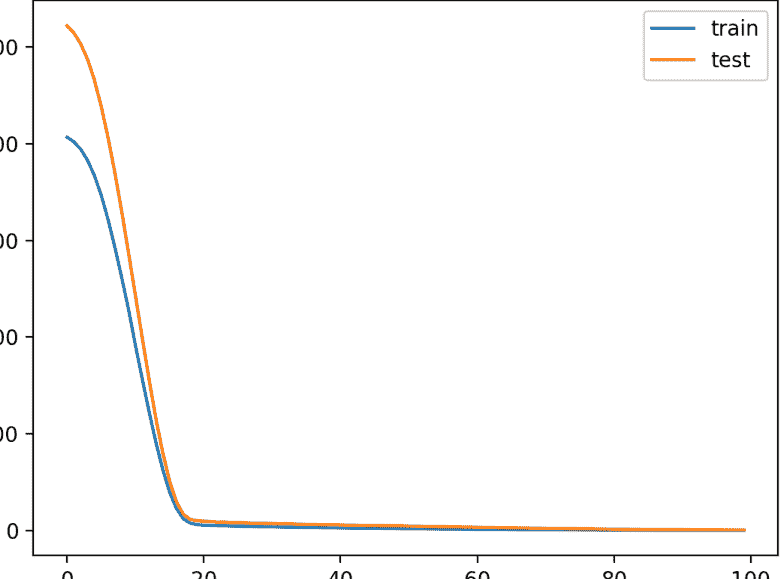

图 8.2：使用梯度范数缩放时，训练（蓝色）和测试（橙色）数据集在训练 epoch 期间的均方误差损失线图。

向量范数值 1.0 并没有什么特别之处，可以评估其他值并比较由此产生的模型的性能。

### 8.3.4 使用梯度值裁剪的 MLP

解决梯度爆炸问题的另一个方案是当梯度变得过大或过小时对其进行裁剪。我们可以通过向优化算法配置添加 clipvalue 参数来更新 MLP 的训练以使用梯度裁剪。例如，下面的代码将梯度裁剪到范围 [-5 to 5]。

```
# compile model

opt = SGD(lr=0.01, momentum=0.9, clipvalue=5.0)

model.compile(loss='mean_squared_error', optimizer=opt)
```

代码清单 8.16：更新优化器以使用梯度值裁剪的示例。

使用梯度裁剪训练 MLP 的完整示例列于下方。

### 8.3. 梯度裁剪案例研究

```
# mlp with unscaled data for the regression problem with gradient clipping

from sklearn.datasets import make_regression

from keras.layers import Dense

from keras.models import Sequential

from keras.optimizers import SGD

from matplotlib import pyplot

# generate regression dataset

X, y = make_regression(n_samples=1000, n_features=20, noise=0.1, random_state=1)

# split into train and test

n_train = 500

trainX, testX = X[:n_train, :], X[n_train:, :]

trainy, testy = y[:n_train], y[n_train:]

# define model

model = Sequential()

model.add(Dense(20, input_dim=20, activation='relu', kernel_initializer='he_uniform'))

model.add(Dense(1, activation='linear'))

# compile model

opt = SGD(lr=0.01, momentum=0.9, clipvalue=5.0)

model.compile(loss='mean_squared_error', optimizer=opt)

# fit model

history = model.fit(trainX, trainy, validation_data=(testX, testy), epochs=100, verbose=0)

# evaluate the model

train_mse = model.evaluate(trainX, trainy, verbose=0)
```


```
test_mse = model.evaluate(testX, testy, verbose=0)

print('Train: %.3f, Test: %.3f' % (train_mse, test_mse))

# plot loss during training

pyplot.title('Mean Squared Error')

pyplot.plot(history.history['loss'], label='train')

pyplot.plot(history.history['val_loss'], label='test')

pyplot.legend()

pyplot.show()
```

代码清单 8.17：在回归问题上使用梯度值裁剪拟合和评估 MLP 的示例。

运行此示例会拟合模型并在训练集和测试集上进行评估，打印均方误差。

> **Note:** 由于学习算法的随机性，您的具体结果可能会有所不同。请考虑多次运行示例并比较平均性能。

我们可以看到，在这种情况下，模型能够在没有梯度爆炸的情况下学习该问题，在训练集和测试集上均实现了低于 10 的 MSE。

```
Train: 9.487, Test: 9.985
```

代码清单 8.18：在回归问题上使用梯度值裁剪拟合和评估 MLP 的示例输出。

还创建了一条线图，显示训练 epoch 期间训练集和测试数据集上的均方误差损失。该图显示模型能够快速学习该问题，在仅几个训练 epoch 内就实现了低于 100 的 MSE 损失。

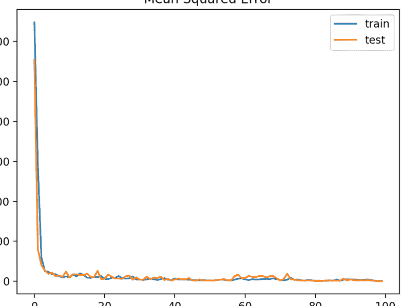

图 8.3：使用梯度值裁剪时，训练（蓝色）和测试（橙色）数据集在训练 epoch 期间的均方误差损失线图。

裁剪范围 `[-5, 5]` 是任意选择的；您可以尝试不同大小的范围并比较学习速度和最终模型性能的表现。

### 8.4 扩展

本节列出了一些您可以探索的扩展本教程的想法。

- **向量范数值。** 更新示例以评估不同的梯度向量范数值并比较性能。
- **向量裁剪值。** 更新示例以评估不同的梯度值范围并比较性能。
- **向量范数和裁剪。** 更新示例以在同一训练运行中使用向量范数缩放和向量值裁剪的组合并比较性能。

如果您探索其中任何一个扩展，我很乐意知道。

### 8.5 进一步阅读

如果您想深入了解，本节提供了该主题的更多资源。

### 8.5.1 书籍

- 第 8.2.4 节：悬崖与梯度爆炸，*Deep Learning*，2016。
- https://amzn.to/2NJW3gE
- 第 10.11.1 节：裁剪梯度，*Deep Learning*，2016。
- https://amzn.to/2NJW3gE

### 8.5.2 论文

- *训练循环神经网络的困难*，2013。
- https://arxiv.org/abs/1211.5063
- *使用循环神经网络生成序列*，2013。
- https://arxiv.org/abs/1308.0850

### 8.5.3 API

- Keras 优化器 API。
- https://keras.io/optimizers/
- Keras 优化器源代码。
- https://github.com/keras-team/keras/blob/master/keras/optimizers.py
- `sklearn.datasets.make_regression` API。
- http://scikit-learn.org/stable/modules/generated/sklearn.datasets.make_regression.html

### 8.6 摘要

在本教程中，您发现了梯度爆炸问题以及如何使用梯度裁剪改善神经网络训练稳定性。具体来说，您学习了：

- 训练神经网络可能变得不稳定，导致数值溢出或下溢，被称为梯度爆炸。
- 通过改变误差梯度，可以使训练过程稳定化，要么通过缩放向量范数，要么将梯度值裁剪到一定范围。
- 如何使用梯度裁剪方法更新具有梯度爆炸问题的回归预测建模 MLP 模型，以实现稳定的训练过程。

### 8.6.1 下一步

在下一教程中，您将发现如何通过使用批量归一化来加速训练过程。

## 第 9 章

## 使用批量归一化加速学习

训练具有数十层的深度神经网络具有挑战性，因为它们可能对初始随机权重和学习算法的配置敏感。这种困难的一个可能原因是，当权重更新时，网络深层中层的输入分布可能在每个小批量后发生变化。这可能导致学习算法永远追逐一个移动的目标。网络中层输入分布的这种变化被称为技术名称 *内部协变量偏移*。批量归一化是一种用于训练非常深的神经网络的技术，它对每个小批量的层输入进行标准化。这具有稳定学习过程的效果，并显著减少训练深度网络所需的训练 epoch 数量。在本教程中，您将发现用于加速深度学习神经网络训练的批量归一化方法。阅读本教程后，您将知道：

- 深度神经网络训练具有挑战性，部分原因在于先前层的输入在权重更新后可能会发生变化。
- 批量归一化是一种标准化网络输入的技术，可应用于先前层的激活或直接输入。
- 批量归一化加速训练，在某些情况下可将 epoch 数量减半（或更好），并提供一定的正则化效果，减少泛化误差。

让我们开始。

### 9.1 批量归一化

在本节中，您将发现批量归一化，它对训练过程的影响以及在自己的深度学习模型上使用批量归一化的技巧。

### 9.1.1 训练深度网络的问题

训练深度神经网络，例如具有数十个隐藏层的网络，具有挑战性。这种挑战的一个方面是模型从输出向后逐层更新到

> 批量归一化通过重新参数化模型，使得某些单元按定义始终被标准化

— 第319页，*深度学习*，2016年。

该过程在计算机视觉中应用于图像时也称为*白化*。

> 通过对每一层的输入进行白化，我们将朝着实现输入的固定分布迈进一步，从而消除内部协变量偏移的不良影响。

— *批量归一化：通过减少内部协变量偏移加速深度网络训练*，2015年。

对前一层的激活进行标准化意味着后续层在权重更新期间对输入的扩散和分布所做的假设不会发生变化，至少不会剧烈变化。这具有稳定并加速深度神经网络训练过程的效果。

> 批量归一化仅作用于标准化每个单元的均值和方差以稳定学习，但允许单元之间的关系以及单个单元的非线性统计发生变化。

— 第320页，*深度学习*，2016年。

对层的输入进行归一化会影响模型的训练，显著减少所需的训练轮次数。它还具有正则化效果，减少泛化误差，类似于使用激活正则化。

> 批量归一化对优化性能可能产生显著影响，尤其对于卷积网络和具有sigmoid非线性的网络。

— 第425页，*深度学习*，2016年。

尽管减少*内部协变量偏移*是该方法开发的动机之一，但也有一些说法认为批量归一化之所以有效，是因为它平滑了优化函数，从而简化了训练网络时所求解的优化函数。

> ... BatchNorm以根本的方式影响网络训练：它使相应优化问题的景观显著更加平滑。这尤其确保梯度更具预测性，从而允许使用更大的学习率范围并实现更快的网络收敛。

— *批量归一化如何帮助优化？（不，它与内部协变量偏移无关）*，2018年。

### 9.1.3 如何标准化层输入

在训练期间，批量归一化可以通过按每个小批量计算层每个输入变量的均值和标准差，并使用这些统计数据进行标准化来实现。或者，可以在小批量之间维护均值和标准差的运行平均值，但可能导致训练不稳定。

> 自然会问我们是否可以简单地使用移动平均值 [...] 在训练期间执行归一化 [...]。然而，这已被观察到会导致模型爆炸。

— 批量重归一化：降低批量归一化模型中对小批量的依赖，2017年。

训练后，层的输入均值和标准差可以设置为在训练数据集上观察到的平均值。对于小批量大小或不包含训练数据集中代表性示例分布的小批量，训练和推理（使用训练后的模型）之间标准化输入的差异可能导致性能明显差异。这可以通过一种称为批量重归一化（或简称为 `BatchRenorm`）的修改方法来解决，该方法使变量均值和标准差的估计在小批量之间更稳定。

> 批量重归一化通过按维度校正扩展batchnorm，以确保训练网络和推理网络之间的激活匹配。

— 批量重归一化：降低批量归一化模型中对小批量的依赖，2017年。

这种输入标准化可以应用于第一隐藏层的输入变量，或应用于更深层隐藏层的激活。在实践中，通常允许层学习两个新参数，即新的均值和标准差，分别称为 `Beta` 和 `Gamma`，它们允许对标准化层输入进行自动缩放和偏移。这些参数作为训练过程的一部分由模型学习。

> 请注意，简单地归一化层的每个输入可能会改变层所能表示的内容。[...] 这些参数与原始模型参数一起学习，并恢复网络的表示能力。

— 批量归一化：通过减少内部协变量偏移加速深度网络训练，2015年。

重要的是，反向传播算法被更新为对变换后的输入进行操作，并且误差还用于更新模型学习的新缩放和偏移参数。标准化应用于层的输入，即输入变量或来自前一层的激活函数的输出。鉴于激活函数的选择，层的输入分布可能非常非高斯。在这种情况下，在前一层的激活函数之前对求和激活进行标准化可能有益。

> 我们在非线性之前立即添加BN变换 [...] 我们也可以归一化层输入u，但由于u很可能是另一个非线性的输出，其分布形状在训练期间可能会发生变化，并且约束其第一和第二矩不会消除协变量偏移。

— *批量归一化：通过减少内部协变量偏移加速深度网络训练*，2015年。

### 9.1.4 使用批量归一化的示例

本节提供了一些里程碑论文和流行模型的示例，这些论文和模型使用了批量归一化。在2015年介绍该技术的论文《*批量归一化：通过减少内部协变量偏移加速深度网络训练*》中，来自Google的作者Sergey Ioffe和Christian Szegedy展示了基于Inception的用于照片分类的卷积神经网络相对于基线方法的显著加速。

> 仅使用批量归一化 [...]，我们在不到一半的训练步数内就能达到与Inception相同的准确率。

Kaiming He等人于2015年在题为*用于图像识别的深度残差学习*的论文中使用了批量归一化，在其称为ResNet的非常深的模型中在卷积层之后使用，并在ImageNet数据集上实现了当时最先进的结果，ImageNet是标准的照片分类任务。

> 我们在每次卷积之后并在激活之前采用批量归一化（BN）...

来自Google的Christian Szegedy等人于2016年在题为*重新思考计算机视觉的Inception架构*的论文中使用了批量归一化，在其更新的Inception模型GoogleNet Inception-v3中使用，并在ImageNet数据集上实现了当时最先进的结果。

> BN-auxiliary指的是辅助分类器的全连接层也被批量归一化的版本，而不仅仅是卷积。

来自Baidu的Dario Amodei在2016年题为*Deep Speech 2：英语和普通话的端到端语音识别*的论文中使用了批量归一化循环神经网络的变体，用于其端到端深度语音识别模型。

> ... 我们发现当应用于大型数据集上的非常深的RNN网络时，我们使用的BatchNorm变体在加速训练的同时显著改善了最终的泛化误差

### 9.1.5 使用批量归一化的技巧

本节提供了使用批量归一化构建自己的神经网络的技巧和建议。

#### 使用不同网络类型

批量归一化是一种通用技术，可用于归一化层的输入。它可与大多数网络类型一起使用，例如多层感知机、卷积神经网络和循环神经网络。

#### 可能在激活函数之前使用

批量归一化可在前一层的激活函数之前或之后应用于层的输入。对于*s*形函数如双曲正切和逻辑函数，可能更适合在激活函数之后使用。对于可能导致非高斯分布的激活函数，如整流线性激活函数（大多数网络类型的现代默认值），可能更适合在激活函数之前使用。

> 批量归一化的目标是在整个训练过程中实现激活值的稳定分布，在我们的实验中我们将其应用于非线性之前，因为在那里匹配第一和第二矩更可能导致稳定的分布。

— *批量归一化：通过减少内部协变量偏移加速深度网络训练*，2015年。

也许用你的网络测试这两种方法。

#### 使用较大的学习率

使用批量归一化使网络在训练期间更稳定。这可能需要使用远大于正常值的学习率，进而可能进一步加快学习过程。

> 在批量归一化模型中，我们能够通过更高的学习率实现训练加速，且没有不良副作用

— *批量归一化：通过减少内部协变量偏移加速深度网络训练*，2015年。

更快的训练也意味着学习率的衰减率可以增加。

#### 对权重初始化不敏感

深度神经网络对训练前用于初始化权重的技术可能相当敏感。批量归一化带来的训练稳定性可以使深度网络的训练对权重初始化方法的选择不那么敏感。

#### 数据准备的替代方案

批量归一化可用于标准化具有不同尺度的原始输入变量。如果为每个输入特征计算的均值和标准差是基于小批量而不是整个训练数据集计算的，则批量大小必须足够代表每个变量的范围。对于数据分布高度非高斯的变量可能不适用，在这种情况下，最好将数据缩放作为预处理步骤执行。

#### 不要与 Dropout 结合使用

批归一化提供了一定的正则化效果，可降低泛化误差，或许不再需要使用 dropout 进行正则化。

从修改后的 BN-Inception 中移除 Dropout 可加快训练速度，而不会增加过拟合。

> — Batch Normalization: Accelerating Deep Network Training by Reducing Internal Covariate Shift, 2015.

此外，在同一网络中同时使用批归一化和 dropout 可能不是一个好主意。原因是在 dropout 过程中随机丢弃节点时，用于归一化前一层激活值的统计数据可能会变得嘈杂。

批归一化有时也会降低泛化误差并允许省略 dropout，这是由于用于归一化每个变量的统计量估计中的噪声。

> — Page 425, Deep Learning, 2016.

### 9.2 Keras API 中的批归一化

本节演示如何使用 Keras API 使用批归一化。

#### 9.2.1 Keras 中的批归一化

Keras 通过 `BatchNormalization` 层提供对批归一化的支持。例如：

```
bn = BatchNormalization()
```

编号 9.1：创建批归一化层的示例。

该层将转换输入使其标准化，即均值为零，标准差为一。在训练期间，该层会跟踪每个输入变量的统计数据并使用它们来标准化数据。此外，标准化后的输出可以使用学习到的 `Beta` 和 `Gamma` 参数进行缩放，这些参数定义了转换输出的新均值和标准差。该层可以通过 `center` 和 `scale` 属性分别配置以控制是否使用这些额外参数。默认情况下，它们是启用的。

用于执行标准化的统计数据，例如每个变量的均值和标准差，会针对每个小批量进行更新并维护一个运行平均值。`momentum` 参数允许您控制在计算更新时包含多少来自之前小批量的统计数据。默认情况下，该值保持较高，为 `0.99`。可以将其设置为 `0.0` 以仅使用当前小批量的统计数据，如原始论文所述。

```
bn = BatchNormalization(momentum=0.0)
```

编号 9.2：创建带动量的批归一化层的示例。

在训练结束时，该层此时的均值和标准差统计数据将在模型用于进行预测时用于标准化输入。默认配置估计所有小批量中的均值和标准差可能是合理的。

#### 9.2.2 模型中的 `BatchNormalization`

批归一化可以在模型的大多数位置使用，并且适用于大多数类型的深度学习神经网络。

##### 输入和隐藏层输入

`BatchNormalization` 层可以添加到您的模型中以标准化原始输入变量或隐藏层的输出。批归一化不建议作为模型适当数据准备的替代方案。尽管如此，当用于标准化原始输入变量时，该层必须指定 `input_shape` 参数；例如：

```
...
model = Sequential()
model.add(BatchNormalization(input_shape=(2,)))
...
```

编号 9.3：输入批归一化的示例。

当用于标准化隐藏层的输出时，该层可以像其他任何层一样添加到模型中。

```
...
model = Sequential()
...
model.add(BatchNormalization())
...
```

编号 9.4：隐藏层之间批归一化的示例。

##### 在激活函数之前或之后使用

`BatchNormalization` 层可用于在前一层的激活函数之前或之后标准化输入。介绍该方法的原始论文建议在前一层的激活函数之前添加批归一化，例如：

```
...
model = Sequential()
model.add(Dense(32))
model.add(BatchNormalization())
model.add(Activation('relu'))
...
```

编号 9.5：在激活函数之前使用批归一化的示例。

一些报道的实验表明，在前一层的激活函数之后添加批归一化层时性能更好；例如：

```
...
model = Sequential()
model.add(Dense(32, activation='relu'))
model.add(BatchNormalization())
...
```

编号 9.6：在激活函数之后使用批归一化的示例。

如果时间和资源允许，值得在您的模型上测试这两种方法并使用性能最佳的方法。让我们看看批归一化如何与一些常见的网络类型一起使用。

下面的示例在 `Dense` 隐藏层之间在激活函数之后添加批归一化。

```
# example of batch normalization for an mlp
from keras.layers import Dense
from keras.layers import BatchNormalization
...
model.add(Dense(32, activation='relu'))
model.add(BatchNormalization())
model.add(Dense(1))
...
```

编号 9.7：MLP 模型批归一化的示例。

下面的示例在卷积层和最大池化层之间在激活函数之后添加批归一化。


# example of batch normalization for an cnn

```python
from keras.layers import Dense
from keras.layers import Conv2D
from keras.layers import MaxPooling2D
from keras.layers import BatchNormalization
...
model.add(Conv2D(32, (3,3), activation='relu'))
model.add(BatchNormalization())
model.add(MaxPooling2D())
model.add(Dense(1))
...
```

> 编号 9.8：CNN 模型批归一化的示例。

下面的示例在 LSTM 和 Dense 隐藏层之间在激活函数之后添加批归一化。

# example of batch normalization for a lstm

```python
from keras.layers import Dense
from keras.layers import LSTM
from keras.layers import BatchNormalization
...
model.add(LSTM(32))
model.add(BatchNormalization())
model.add(Dense(1))
...
```

编号 9.9：LSTM 模型批归一化的示例。

## 9.3 批归一化案例研究

在本节中，我们将演示如何使用批归一化加速 MLP 在简单二分类问题上的训练。此示例为将批归一化应用于您自己的神经网络以解决分类和回归问题提供了模板。

### 9.3.1 二分类问题

我们将使用一个标准二分类问题，该问题定义了两个二维同心圆的观测值，每个类别一个圆。每个观测值有两个相同尺度的输入变量和一个类别输出值，为 0 或 1。该数据集因绘图时每个类别中观测值的形状而被称为 circles 数据集。我们可以使用 `make_circles()` 函数从该问题生成观测值。我们将向数据添加噪声并为随机数生成器设置种子，以便每次运行代码时生成相同的样本。

```python
# generate 2d classification dataset
X, y = make_circles(n_samples=1000, noise=0.1, random_state=1)
```

编号 9.10：为 circles 问题生成样本的示例。

我们可以绘制数据集，其中两个变量作为图表上的 x 和 y 坐标，类别值作为观测值的颜色。生成数据集并绘制它的完整示例如下所示。

```python
# scatter plot of the circles dataset with points colored by class
from sklearn.datasets import make_circles
from numpy import where
from matplotlib import pyplot
# generate circles
X, y = make_circles(n_samples=1000, noise=0.1, random_state=1)
# select indices of points with each class label
for i in range(2):
    samples_ix = where(y == i)
    pyplot.scatter(X[samples_ix, 0], X[samples_ix, 1], label=str(i))
pyplot.legend()
pyplot.show()
```

编号 9.11：绘制 circles 问题样本的示例。

## 9.3. 批量归一化案例研究

运行示例会创建散点图，显示每个类别中观测值的同心圆形状。我们可以看到点分布中的噪声使圆圈不太明显。

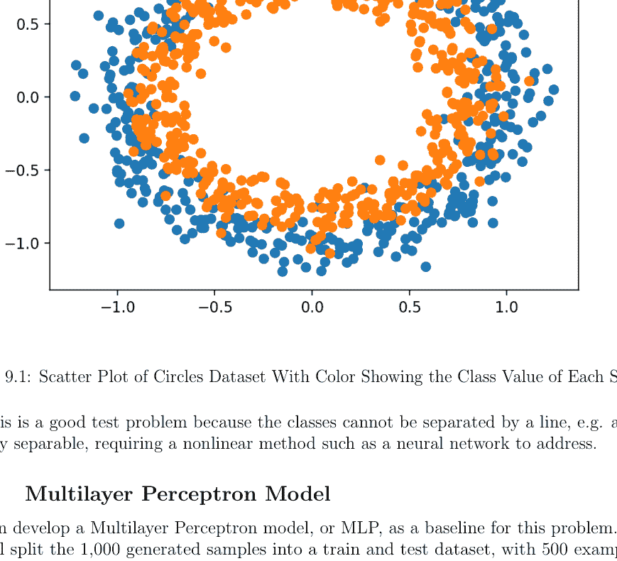

这是一个很好的测试问题，因为类别无法通过一条直线分离，例如不是线性可分的，需要非线性方法（如神经网络）来解决。

### 9.3.2 多层感知机模型

我们可以为此问题开发一个多层感知机模型，即 MLP，作为基线。首先，我们将生成的 1,000 个样本拆分为训练集和测试集，每个集合 500 个示例。这将为模型提供足够大的学习样本，并对其性能进行同等规模（公平）的评估。

Listing 9.12: 为模型准备数据集的示例。

```python
# split into train and test
n_train = 500
trainX, testX = X[:n_train, :], X[n_train:, :]
trainy, testy = y[:n_train], y[n_train:]
```

我们将定义一个简单的 MLP 模型。网络在可见层中必须有两个输入，对应数据集中的两个变量。模型将有一个单一的隐藏层，包含 50 个节点，任意选择，并使用整流线性激活函数和 He 随机权重初始化方法。输出层将是一个具有 sigmoid 激活函数的单个节点，能够预测问题的外圆为 0，内圆为 1。模型将使用随机梯度下降进行训练，学习率为适中的 0.01，动量较大为 0.9，并且优化将使用二元交叉熵损失函数指导。

```python
# define model
model = Sequential()
model.add(Dense(50, input_dim=2, activation='relu', kernel_initializer='he_uniform'))
model.add(Dense(1, activation='sigmoid'))
opt = SGD(lr=0.01, momentum=0.9)
model.compile(loss='binary_crossentropy', optimizer=opt, metrics=['accuracy'])
```

Listing 9.13: 定义 MLP 模型的示例。

一旦定义，模型可以在训练数据集上进行拟合。我们将使用保留的测试数据集作为验证数据集，并在每个训练 epoch 结束时评估其性能。模型将拟合 100 个 epoch，是在少量试错后选择的。

```python
# fit model
history = model.fit(trainX, trainy, validation_data=(testX, testy), epochs=100, verbose=0)
```

Listing 9.14: 拟合 MLP 模型的示例。

运行结束时，模型在训练集和测试集上进行评估并报告准确率。

```python
# evaluate the model
_, train_acc = model.evaluate(trainX, trainy, verbose=0)
_, test_acc = model.evaluate(testX, testy, verbose=0)
print('Train: %.3f, Test: %.3f' % (train_acc, test_acc))
```

Listing 9.15: 评估 MLP 模型的示例。

最后，创建线图显示每个训练 epoch 结束时模型在训练集和测试集上的准确率，提供学习曲线。该学习曲线图很有用，因为它可以了解模型学习问题的速度和效果。

```python
# plot loss learning curves
pyplot.subplot(211)
pyplot.title('Cross-Entropy Loss', pad=-40)
pyplot.plot(history.history['loss'], label='train')
pyplot.plot(history.history['val_loss'], label='test')
pyplot.legend()
# plot accuracy learning curves
pyplot.subplot(212)
pyplot.title('Accuracy', pad=-40)
pyplot.plot(history.history['acc'], label='train')
pyplot.plot(history.history['val_acc'], label='test')
pyplot.legend()
pyplot.show()
```

Listing 9.16: 绘制 MLP 模型学习曲线的示例。

将这些元素结合起来，完整的示例列在下面。

```python
# mlp for the two circles problem
from sklearn.datasets import make_circles
from keras.models import Sequential
from keras.layers import Dense
from keras.optimizers import SGD
from matplotlib import pyplot
# generate 2d classification dataset
X, y = make_circles(n_samples=1000, noise=0.1, random_state=1)
# split into train and test
n_train = 500
trainX, testX = X[:n_train, :], X[n_train:, :]
trainY, testY = y[:n_train], y[n_train:]
# define model
model = Sequential()
model.add(Dense(50, input_dim=2, activation='relu', kernel_initializer='he_uniform'))
model.add(Dense(1, activation='sigmoid'))
opt = SGD(lr=0.01, momentum=0.9)
model.compile(loss='binary_crossentropy', optimizer=opt, metrics=['accuracy'])
# fit model
history = model.fit(trainX, trainY, validation_data=(testX, testY), epochs=100, verbose=0)
# evaluate the model
_, train_acc = model.evaluate(trainX, trainY, verbose=0)
_, test_acc = model.evaluate(testX, testY, verbose=0)
print('Train: %.3f, Test: %.3f' % (train_acc, test_acc))
# plot loss learning curves
pyplot.subplot(211)
pyplot.title('Cross-Entropy Loss', pad=-40)
pyplot.plot(history.history['loss'], label='train')
pyplot.plot(history.history['val_loss'], label='test')
pyplot.legend()
# plot accuracy learning curves
pyplot.subplot(212)
pyplot.title('Accuracy', pad=-40)
pyplot.plot(history.history['acc'], label='train')
pyplot.plot(history.history['val_acc'], label='test')
pyplot.legend()
pyplot.show()
```

Listing 9.17: 在两个圆问题上评估 MLP 的示例。

运行示例会拟合模型并在训练集和测试集上进行评估。

**Note**: 由于学习算法的随机性，您的具体结果可能会有所不同。考虑多次运行示例并比较平均性能。

在这种情况下，我们可以看到模型在测试数据集上实现了约 84% 的准确率，并且在训练集和测试集上都取得了相当的性能，因为两个数据集大小相同且组成相似。

```
Train: 0.826, Test: 0.840
```

Listing 9.18: 在两个圆问题上评估 MLP 的示例输出。

创建了一个图表，显示训练集（蓝色）和测试集（橙色）上的分类准确率线图。该图显示了在训练过程中模型在两个数据集上的相当性能。我们可以看到性能在最初 30 到 40 个 epoch 内跃升至 80% 以上，然后缓慢优化。

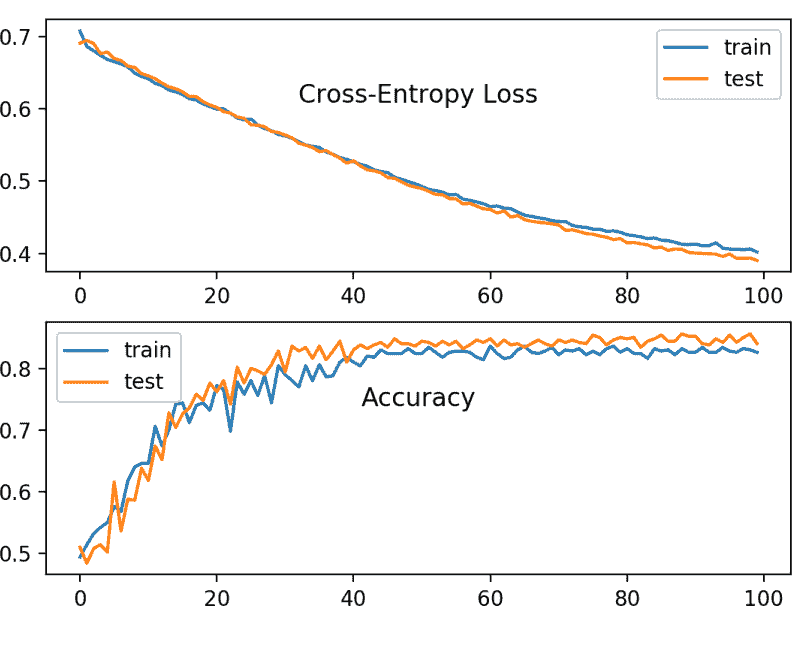

Figure 9.2: 训练 epoch 过程中 MLP 在训练集和测试集上的分类准确率线图。

该结果，特别是训练过程中模型的动态，为可以与添加批量归一化的相同模型进行比较的基线提供了依据。

### 9.3.3 带批量归一化的 MLP

前一节介绍的模型可以更新以添加批量归一化。预期批量归一化的添加会加速训练过程，在更少的训练 epoch 内提供相似或更好的模型分类准确率。批量归一化也被报道为提供一种适度的正则化形式，这意味着它也可能提供泛化误差的少量降低，通过在保留测试数据集上分类准确率的小幅提升来体现。可以将新的 `BatchNormalization` 层添加到模型中，位于隐藏层之后、输出层之前。具体而言，在先前隐藏层的激活函数之后。

```python
# define model
model = Sequential()
model.add(Dense(50, input_dim=2, activation='relu', kernel_initializer='he_uniform'))
model.add(BatchNormalization())
model.add(Dense(1, activation='sigmoid'))
opt = SGD(lr=0.01, momentum=0.9)
model.compile(loss='binary_crossentropy', optimizer=opt, metrics=['accuracy'])
```

Listing 9.19: 更新模型以使用批量归一化的示例。

包含此修改的完整示例列在下面。

```python
# mlp for the two circles problem with batchnorm after activation function
from sklearn.datasets import make_circles
from keras.models import Sequential
from keras.layers import Dense
from keras.layers import BatchNormalization
from keras.optimizers import SGD
from matplotlib import pyplot
# generate 2d classification dataset
X, y = make_circles(n_samples=1000, noise=0.1, random_state=1)
# split into train and test
n_train = 500
trainX, testX = X[:n_train, :], X[n_train:, :]
trainy, testy = y[:n_train], y[n_train:]
# define model
model = Sequential()
model.add(Dense(50, input_dim=2, activation='relu', kernel_initializer='he_uniform'))
model.add(BatchNormalization())
model.add(Dense(1, activation='sigmoid'))
opt = SGD(lr=0.01, momentum=0.9)
model.compile(loss='binary_crossentropy', optimizer=opt, metrics=['accuracy'])
# fit model
history = model.fit(trainX, trainy, validation_data=(testX, testy), epochs=100, verbose=0)
# evaluate the model
_, train_acc = model.evaluate(trainX, trainy, verbose=0)
_, test_acc = model.evaluate(testX, testy, verbose=0)
print('Train: %.3f, Test: %.3f' % (train_acc, test_acc))
# plot loss learning curves
pyplot.subplot(211)
pyplot.title('Cross-Entropy Loss', pad=-40)
pyplot.plot(history.history['loss'], label='train')
pyplot.plot(history.history['val_loss'], label='test')
pyplot.legend()
# plot accuracy learning curves
pyplot.subplot(212)
pyplot.title('Accuracy', pad=-40)
pyplot.plot(history.history['acc'], label='train')
```


``` 
pyplot.plot(history.history['val_acc'], label='test')

pyplot.legend()

pyplot.show()
```

Listing 9.20: 在激活函数后使用批量归一化评估 MLP 在两个圆问题上的示例。

运行示例首先打印模型在训练集和测试集上的分类准确率。

**Note:** 由于学习算法的随机性，您的具体结果可能会有所不同。考虑多次运行示例并比较平均性能。

在这种情况下，我们可以看到模型在训练集和测试集上的性能相当，准确率约为84%，与我们在上一节中看到的结果非常相似，甚至略好一些。

``` 
Train: 0.842, Test: 0.846
```

代码清单 9.21：在双圆问题上评估激活函数之后应用批量归一化的MLP的示例输出。

同时创建了一个学习曲线图，显示了每个训练周期在训练集和测试集上的分类准确率。在这种情况下，我们可以看到模型比上一节中不带批量归一化的模型更快地学会了该问题。具体来说，我们可以看到训练集和测试集的分类准确率在前20个周期内跃升至80%以上，而不带批量归一化的模型则需要30到40个周期。该图还显示了训练期间批量归一化的效果。我们可以看到训练数据集上的性能低于测试数据集：训练数据集上的得分低于训练结束时测试数据集上的性能。这很可能是每个小批量中收集和更新输入所造成的影响。

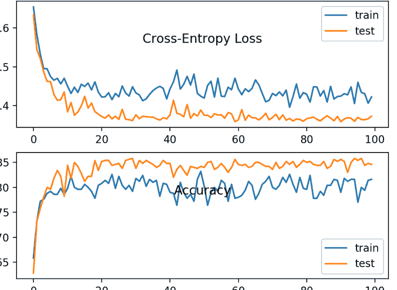

图 9.3：在训练和测试数据集上，激活函数后带批量归一化的MLP在训练周期内的分类准确率折线图。

我们还可以尝试模型的一个变体，其中批量归一化应用于隐藏层的激活函数之前，而不是之后。

``` 
# define model

model = Sequential()

model.add(Dense(50, input_dim=2, kernel_initializer='he_uniform'))

model.add(BatchNormalization())

model.add(Activation('relu'))

model.add(Dense(1, activation='sigmoid'))

opt = SGD(lr=0.01, momentum=0.9)

model.compile(loss='binary_crossentropy', optimizer=opt, metrics=['accuracy'])
```

代码清单 9.22：更新模型以在激活函数之前使用批量归一化的示例。

完成此模型更改的完整代码清单如下所示。

``` 
# mlp for the two circles problem with batchnorm before activation function

from sklearn.datasets import make_circles

from keras.models import Sequential

from keras.layers import Dense

from keras.layers import Activation

from keras.layers import BatchNormalization

from keras.optimizers import SGD

from matplotlib import pyplot

# generate 2d classification dataset

X, y = make_circles(n_samples=1000, noise=0.1, random_state=1)

# split into train and test

n_train = 500

trainX, testX = X[:n_train, :], X[n_train:, :]

trainy, testy = y[:n_train], y[n_train:]

# define model

model = Sequential()

model.add(Dense(50, input_dim=2, kernel_initializer='he_uniform'))

model.add(BatchNormalization())

model.add(Activation('relu'))

model.add(Dense(1, activation='sigmoid'))

opt = SGD(lr=0.01, momentum=0.9)

model.compile(loss='binary_crossentropy', optimizer=opt, metrics=['accuracy'])

# fit model

history = model.fit(trainX, trainy, validation_data=(testX, testy), epochs=100, verbose=0)

# evaluate the model

_, train_acc = model.evaluate(trainX, trainy, verbose=0)

_, test_acc = model.evaluate(testX, testy, verbose=0)

print('Train: %.3f, Test: %.3f' % (train_acc, test_acc))

# plot loss learning curves

pyplot.subplot(211)

pyplot.title('Cross-Entropy Loss', pad=-40)

pyplot.plot(history.history['loss'], label='train')

pyplot.plot(history.history['val_loss'], label='test')

pyplot.legend()

# plot accuracy learning curves

pyplot.subplot(212)

pyplot.title('Accuracy', pad=-40)

pyplot.plot(history.history['acc'], label='train')

pyplot.plot(history.history['val_acc'], label='test')

pyplot.legend()

pyplot.show()
```

代码清单 9.23：在双圆问题上评估在激活函数之前应用批量归一化的MLP的示例。

运行该示例首先打印模型在训练和测试数据集上的分类准确率。

**注意：**由于学习算法的随机性，您的具体结果可能会有所不同。请考虑多次运行该示例并比较平均性能。

在这种情况下，我们可以看到模型在训练和测试数据集上的性能相当，但比不带批量归一化的模型略差。

``` 
Train: 0.832, Test: 0.834
```

代码清单 9.24：在双圆问题上评估在激活函数之前应用批量归一化的MLP的示例输出。

训练集和测试集上的学习曲线折线图也呈现了一个不同的情况。该图显示模型的学习速度可能与不带批量归一化的模型相同，但模型在训练数据集上的性能要差得多，准确率徘徊在70%到75%之间，这很可能又是每个小批量中收集和使用的统计数据所造成的影响。至少对于这个特定数据集上的这种模型配置，批量归一化在修正线性激活函数之后似乎更有效。


图 9.4：在训练和测试数据集上，激活函数前带批量归一化的MLP在训练周期内的分类准确率折线图。

## 9.4 扩展

本节列出了一些你可能希望探索的扩展本教程的想法。

- 不带`Beta`和`Gamma`。更新示例，不在批量归一化层中使用`beta`和`gamma`参数，并比较结果。
- **不带动量。** 更新示例，在训练期间不在批量归一化层中使用动量，并比较结果。
- **输入层。** 更新示例，在模型输入之后使用批量归一化，并比较结果。

如果你探索了这些扩展中的任何一个，我很想知道。

## 9.5 延伸阅读

如果你想深入了解该主题，本节提供了更多相关资源。

### 9.5.1 书籍

- 第8.7.1节：批量归一化，*深度学习*，2016年。  
  https://amzn.to/2NJW3gE
- 第7.3.1节：高级架构模式，*Python深度学习*，2017年。  
  https://amzn.to/2Ck4ImT

### 9.5.2 论文

- *批量归一化：通过减少内部协变量偏移加速深度网络训练*，2015年。  
  https://arxiv.org/abs/1502.03167
- *批量重归一化：旨在减少批量归一化模型中的小批量依赖性*，2017年。  
  https://arxiv.org/abs/1702.03275
- *批量归一化如何帮助优化？（不，这与内部协变量偏移无关）*，2018年。  
  https://arxiv.org/abs/1805.11604

### 9.5.3 API

- Keras正则化器API。  
  https://keras.io/regularizers/
- Keras核心层API。  
  https://keras.io/layers/core/
- Keras卷积层API。  
  https://keras.io/layers/convolutional/
- Keras循环层API。  
  https://keras.io/layers/recurrent/
- `BatchNormalization` Keras API。  
  https://keras.io/layers/normalization/
- `sklearn.datasets.make_circles` API。  
  http://scikit-learn.org/stable/modules/generated/sklearn.datasets.make_circles.html

### 9.5.4 文章

- 批量归一化，维基百科。  
  https://en.wikipedia.org/wiki/Batch_normalization
- ReLU之前还是之后进行批量归一化？，Reddit。  
  https://www.reddit.com/r/MachineLearning/comments/67gonq/d_batch_normalization_before_or_after_relu/
- Keras的批量归一化层已损坏，Vasilis Vryniotis，2018年。  
  http://blog.datumbox.com/the-batch-normalization-layer-of-keras-is-broken/
- 激活函数之前和之后的批量归一化研究。  
  https://github.com/ducha-aiki/caffenet-benchmark/blob/master/batchnorm.md

## 9.6 总结

在本教程中，你了解了用于加速深度学习神经网络训练的批量归一化方法。具体来说，你学到了：

- 深度神经网络训练起来具有挑战性，尤其是因为先前层的输入在权重更新后可能会发生变化。
- 批量归一化是一种对网络输入进行标准化的技术，可以应用于前一层的激活或直接应用于输入。
- 批量归一化可以加速训练，在某些情况下可以将周期数减半（甚至更多），并提供一定的正则化效果，减少泛化误差。

### 9.6.1 下一步

在下一个教程中，你将了解如何通过贪婪的逐层预训练来开发更深的神经网络模型。

# 第10章 使用贪心逐层预训练构建深层模型

传统上，训练深度神经网络具有挑战性，因为梯度消失意味着靠近输入层的权重不会根据训练数据集上计算的误差进行更新。深度学习领域的一个创新和重要里程碑是贪心逐层预训练，它使得非常深的神经网络能够被成功训练，并达到当时最先进的性能。在本教程中，您将了解贪心逐层预训练作为一种开发深度多层神经网络模型的技术。

完成本教程后，您将知道：

-   贪心逐层预训练提供了一种开发深度多层神经网络的方法，同时仅训练浅层网络。
-   预训练可用于迭代地加深监督模型，或加深无监督模型并将其重新用作监督模型。
-   预训练可能对于标记数据量少、未标记数据量大的问题很有用。

让我们开始吧。

## 10.1 贪心逐层预训练

传统上，训练具有多层的深度神经网络具有挑战性。随着隐藏层数量的增加，传播回较早层的误差信息量急剧减少。这意味着靠近输出层的隐藏层权重会正常更新，而靠近输入层的隐藏层权重则更新很少或不更新。通常，这个问题阻止了非常深的神经网络的训练，被称为梯度消失问题。在神经网络复兴中，最初允许开发更深神经网络模型的一个重要里程碑是贪心逐层预训练技术，通常简称为预训练。

2006年的深度学习复兴始于一个发现：这种贪心学习过程可以为所有层的联合学习过程找到良好的初始化，并且这种方法甚至能成功训练全连接架构。

——第528页，深度学习，2016年。

预训练包括向模型连续添加新的隐藏层并重新拟合，使新添加的模型能够从现有隐藏层学习输入，同时通常保持现有隐藏层的权重固定。这为该技术赋予了“逐层”的名称，因为模型一次训练一层。该技术被称为“贪心”，是因为它采用分段或逐层的方式来解决训练深度网络这一更难的问题。作为一种优化过程，将训练过程划分为一系列逐层训练过程被视为一种贪心捷径，这可能导致局部最优解的聚合，也是通往足够好的全局解的一条捷径。

贪心算法将问题分解为许多组成部分，然后孤立地求解每个组成部分的最优版本。不幸的是，将单独最优的组成部分组合起来并不能保证产生最优的完整解。

——第323页，深度学习，2016年。

预训练基于这样的假设：训练浅层网络比训练深度网络更容易，并由此设计了一种逐层训练过程，使我们始终只拟合浅层模型。

……它基于这样的前提：训练浅层网络比训练深层网络更容易，这一前提似乎已在多个场景中得到验证。

——第529页，*深度学习*，2016年。

预训练的主要好处是：

-   简化训练过程。
-   促进更深网络的发展。
-   可用作权重初始化方案。
-   或许能降低泛化误差。

一般来说，预训练在优化和泛化两方面都可能有所帮助。

——第325页，深度学习，2016年。

预训练主要有两种方法：

-   监督贪心逐层预训练。
-   无监督贪心逐层预训练。

广义上，监督预训练涉及向一个已在监督学习任务上训练过的模型连续添加隐藏层。无监督预训练涉及使用贪心逐层过程来构建无监督自编码器模型，之后向其中添加监督输出层。

> 通常，“预训练”一词不仅指预训练阶段本身，还指结合了预训练阶段和监督学习阶段的整个两阶段协议。监督学习阶段可能包括在预训练阶段学到的特征之上训练一个简单的分类器，或者可能涉及对预训练阶段学到的整个网络进行监督微调。
>
> ——第529页，*深度学习*，2016年。

当你拥有显著更多的未标记示例，可以在使用少得多的示例对模型权重进行微调以完成监督任务之前初始化模型时，无监督预训练可能是合适的。

> ……当标记示例数量非常少时，我们可以预期无监督预训练最有帮助。由于无监督预训练增加的信息来源是未标记数据，我们也可以预期当未标记示例数量非常大时，无监督预训练表现最好。
>
> ——第532页，*深度学习*，2016年。

虽然先前层的权重保持不变，但在添加最后一层后，通常会对网络中的所有权重进行微调。因此，这就使得预训练可以被视为一种权重初始化方法。

> ……它利用了这样一种观点：深度神经网络的初始参数选择可以对模型产生显著的正则化效果（在较小程度上，还可以改善优化）。
>
> ——第530-531页，*深度学习*，2016年。

贪心逐层预训练是深度学习历史上的一个重要里程碑，它使得早期开发出比以往更多隐藏层的网络成为可能。这种方法在某些问题上可能有用；例如，对于文本数据，最佳实践是使用无监督预训练，通过`Word2Vec`提供更丰富的单词及其相互关系的分布式表示。

> 如今，无监督预训练在很大程度上已被放弃，除了自然语言处理领域……预训练的优势在于，可以在大规模未标记集合上（例如包含数十亿单词的语料库）预训练一次，学习良好的表示（通常是对单词，也包括句子），然后将这种表示用于监督任务或对其进行微调，而该监督任务的训练集包含的示例要少得多。
>
> ——第535页，*深度学习*，2016年。

然而，使用现代方法（如更好的激活函数、权重初始化、梯度下降变体和正则化方法）或许可以获得更好的性能。

今天，我们现在知道，训练全连接深度架构并不需要贪心逐层预训练，但无监督预训练方法是第一个成功的方法。

——第528页，深度学习，2016年。

## 10.2 贪心逐层预训练案例研究

在本节中，我们将演示如何在多类别分类问题上使用贪心逐层预训练来开发更深的MLP模型。此示例为将贪心逐层预训练应用于您自己的分类和回归神经网络提供了模板。

### 10.2.1 多类别分类问题

我们将使用一个小型多类别分类问题作为基础，以演示贪心逐层预训练对模型性能的影响。scikit-learn库提供了`make_blobs()`函数，可以用来创建具有指定样本数、输入变量、类别和类内样本方差的多类别分类问题。该问题将配置两个输入变量（表示点的x和y坐标），每个组内点的标准差为2.0。我们将使用相同的随机状态（伪随机数生成器的种子）来确保我们总是得到相同的数据点。

``` 
# generate 2d classification dataset

X, y = make_blobs(n_samples=1000, centers=3, n_features=2, cluster_std=2, random_state=2)
```

清单10.1：生成blobs问题样本的示例。

结果是我们可以建模的数据集的输入和输出元素。为了了解问题的复杂性，我们可以将每个点绘制在二维散点图上，并按类别值对每个点着色。下面列出了完整示例。

``` 
# scatter plot of blobs dataset

from sklearn.datasets.samples_generator import make_blobs

from matplotlib import pyplot

from numpy import where

# generate 2d classification dataset
```


`X, y = make_blobs(n_samples=1000, centers=3, n_features=2, cluster_std=2, random_state=2)`

# scatter plot for each class value

for class_value in range(3):

    # select indices of points with the class label

    row_ix = where(y == class_value)

    # scatter plot for points with a different color

    pyplot.scatter(X[row_ix, 0], X[row_ix, 1])

# show plot

pyplot.show()

## 清单 10.2：绘制 blobs 问题样本的示例。

运行该示例会生成整个数据集的散点图。我们可以看到，2.0 的标准差意味着这些类别不是线性可分的（即无法用一条直线分开），因此会产生许多模棱两可的点。这是可取的，因为它意味着该问题并非平凡，并且能够让神经网络模型找到许多不同的*足够好*的候选解决方案。


图 10.1：包含三个类别的 Blobs 数据集散点图，点按类别值着色。

## 10.2.2 有监督的贪心逐层预训练

在本节中，我们将使用贪心逐层的有监督学习，为 blobs 监督学习多分类问题构建一个深层多层感知机（MLP）模型。解决这个简单的预测建模问题并不需要预训练。相反，这是对如何执行有监督的贪心逐层预训练的演示，可将其用作更大、更具挑战性的监督学习问题的模板。作为第一步，我们可以开发一个函数来从该问题中创建 1,000 个样本，并将它们均匀地划分为训练数据集和测试数据集。下面的 `prepare_data()` 函数实现了这一点，并以输入和输出组件的形式返回训练集和测试集。

```python
# prepare the dataset
```

```python
def prepare_data():
    # generate 2d classification dataset
    X, y = make_blobs(n_samples=1000, centers=3, n_features=2, cluster_std=2, random_state=2)
    # one hot encode output variable
    y = to_categorical(y)
    # split into train and test
    n_train = 500
    trainX, testX = X[:n_train, :], X[n_train:, :]
    trainy, testy = y[:n_train], y[n_train:]
    return trainX, testX, trainy, testy
```

清单 10.3：用于准备建模数据集的函数示例。

我们可以调用此函数来准备数据。

```python
# prepare data
trainX, testX, trainy, testy = prepare_data()
```

清单 10.4：调用函数准备建模数据集的示例。

接下来，我们可以训练并拟合一个基础模型。这将是一个 MLP，它期望数据集中的两个输入变量对应两个输入，并具有一个包含 10 个节点的隐藏层，使用修正线性激活函数。输出层有三个节点，用于预测三个类别中每个类别的概率，并使用 softmax 激活函数。

```python
# define model
model = Sequential()
model.add(Dense(10, input_dim=2, activation='relu', kernel_initializer='he_uniform'))
model.add(Dense(3, activation='softmax'))
```

清单 10.5：为 blobs 问题定义 MLP 模型的示例。

该模型使用随机梯度下降（SGD）进行拟合，采用合理的默认学习率 0.01 和较高的动量值 0.9。模型使用交叉熵损失进行优化。

```python
# compile model
opt = SGD(lr=0.01, momentum=0.9)
model.compile(loss='categorical_crossentropy', optimizer=opt, metrics=['accuracy'])
```

清单 10.6：为 blobs 问题编译 MLP 模型的示例。

然后，模型在训练数据集上拟合 100 个轮次，默认批次大小为 32 个样本。

```python
# fit model
model.fit(trainX, trainy, epochs=100, verbose=0)
```

清单 10.7：为 blobs 问题拟合 MLP 模型的示例。

下面的 `get_base_model()` 函数将这些元素整合在一起，将训练数据集作为参数，并返回一个拟合好的基线模型。

```python
# define and fit the base model
def get_base_model(trainX, trainy):
    # define model
    model = Sequential()
    model.add(Dense(10, input_dim=2, activation='relu', kernel_initializer='he_uniform'))
    model.add(Dense(3, activation='softmax'))
    # compile model
    opt = SGD(lr=0.01, momentum=0.9)
    model.compile(loss='categorical_crossentropy', optimizer=opt, metrics=['accuracy'])
    # fit model
    model.fit(trainX, trainy, epochs=100, verbose=0)
    return model
```

清单 10.8：拟合并返回 blobs 问题模型的函数示例。

我们可以调用此函数来准备基础模型，之后可以一次一个地向其中添加层。

```python
# get the base model
model = get_base_model(trainX, trainy)
```

清单 10.9：调用函数在数据集上拟合模型的示例。

我们需要能够轻松评估模型在训练集和测试集上的表现。下面的 `evaluate_model()` 函数将训练集和测试集以及模型作为参数，并返回两个数据集上的准确率。

```python
# evaluate a fit model
def evaluate_model(model, trainX, testX, trainy, testy):
    _, train_acc = model.evaluate(trainX, trainy, verbose=0)
    _, test_acc = model.evaluate(testX, testy, verbose=0)
    return train_acc, test_acc
```

清单 10.10：评估拟合模型的函数示例。

我们可以调用此函数来计算并报告基础模型的准确率，并将得分按模型层数（当前为两层：一个隐藏层和一个输出层）存储在字典中，以便之后绘制层数与准确率之间的关系图。

```python
# evaluate the base model
scores = dict()
train_acc, test_acc = evaluate_model(model, trainX, trainy, testy)
print('> layers=%d, train=%.3f, test=%.3f' % (len(model.layers), train_acc, test_acc))
```

清单 10.11：汇总拟合模型性能的示例。

现在我们可以概述贪心逐层预训练的过程。需要一个函数来添加新的隐藏层并重新训练模型，但只更新新添加层和输出层中的权重。这需要首先存储当前输出层，包括其配置和当前权重集。

```python
# remember the current output layer
output_layer = model.layers[-1]
```

清单 10.12：引用输出层的示例。

然后从模型的层堆栈中移除输出层。

```python
# remove the output layer
model.pop()
```

清单 10.13：移除输出层的示例。

然后，模型中所有剩余的层都可以被标记为不可训练，这意味着当再次调用 `fit()` 函数时，它们的权重不会被更新。

```python
# mark all remaining layers as non-trainable
for layer in model.layers:
    layer.trainable = False
```

清单 10.14：使所有隐藏层不可训练的示例。

然后，我们可以添加一个新的隐藏层，在本例中，其配置与基础模型中添加的第一个隐藏层相同。

```python
# add a new hidden layer
model.add(Dense(10, activation='relu', kernel_initializer='he_uniform'))
```

清单 10.15：添加新隐藏层的示例。

最后，可以将输出层添加回来，并在训练数据集上重新拟合模型。

```python
# re-add the output layer
model.add(output_layer)
# fit model
model.fit(trainX, trainy, epochs=100, verbose=0)
```

清单 10.16：恢复输出层的示例。

我们可以将所有这些元素整合到一个名为 `add_layer()` 的函数中，该函数将模型和训练数据集作为参数。

```python
# add one new layer and re-train only the new layer
def add_layer(model, trainX, trainy):
    # remember the current output layer
    output_layer = model.layers[-1]
    # remove the output layer
    model.pop()
    # mark all remaining layers as non-trainable
    for layer in model.layers:
        layer.trainable = False
    # add a new hidden layer
    model.add(Dense(10, activation='relu', kernel_initializer='he_uniform'))
    # re-add the output layer
    model.add(output_layer)
    # fit model
    model.fit(trainX, trainy, epochs=100, verbose=0)
```

清单 10.17：向现有模型添加并训练新隐藏层的函数示例。

然后，可以根据我们希望向模型添加的层数重复调用此函数。在本例中，我们将一次添加一个层，共添加 10 层，并在每添加一个层后评估模型的性能，以了解其对性能的影响。训练和测试准确率得分按模型层数存储在字典中。

```python
# add layers and evaluate the updated model
n_layers = 10
for i in range(n_layers):
    # add layer
    add_layer(model, trainX, trainy)
    # evaluate model
```

```python
train_acc, test_acc = evaluate_model(model, trainX, testX, trainy, testy)
print('> layers=%d, train=%.3f, test=%.3f' % (len(model.layers), train_acc, test_acc))
# store scores for plotting
scores[len(model.layers)] = (train_acc, test_acc)
```

清单 10.18：评估添加预训练层后模型性能的示例。

运行结束时，会创建一条折线图，显示模型中层的数量（x轴）与模型在训练集和测试集上的准确率的对比。我们期望增加层数会提高模型在训练集上的性能，甚至可能提高在测试集上的性能。

```python
# plot number of added layers vs accuracy
pyplot.plot(scores.keys(), [scores[k][0] for k in scores.keys()], label='train', marker='.')
pyplot.plot(scores.keys(), [scores[k][1] for k in scores.keys()], label='test', marker='.')
pyplot.legend()
pyplot.show()
```

清单 10.19：绘制预训练层数量与模型性能关系的示例。

将所有这些元素结合起来，完整示例列于下方。

```python
# supervised greedy layer-wise pretraining for blobs classification problem
from sklearn.datasets.samples_generator import make_blobs
from keras.layers import Dense
from keras.models import Sequential
from keras.optimizers import SGD
from keras.utils import to_categorical
from matplotlib import pyplot

# prepare the dataset
def prepare_data():
    # generate 2d classification dataset
    X, y = make_blobs(n_samples=1000, centers=3, n_features=2, cluster_std=2, random_state=2)
    # one hot encode output variable
    y = to_categorical(y)
    # split into train and test
    n_train = 500
    trainX, testX = X[:n_train, :], X[n_train:, :]
    trainy, testy = y[:n_train], y[n_train:]
    return trainX, testX, trainy, testy

# define and fit the base model
def get_base_model(trainX, trainy):
    # define model
    model = Sequential()
    model.add(Dense(10, input_dim=2, activation='relu', kernel_initializer='he_uniform'))
    model.add(Dense(3, activation='softmax'))
    # compile model
    opt = SGD(lr=0.01, momentum=0.9)
    model.compile(loss='categorical_crossentropy', optimizer=opt, metrics=['accuracy'])
    # fit model
    model.fit(trainX, trainy, epochs=100, verbose=0)
    return model

# evaluate a fit model
def evaluate_model(model, trainX, testX, trainy, testy):
```

```python
_, train_acc = model.evaluate(trainX, trainy, verbose=0)
_, test_acc = model.evaluate(testX, testy, verbose=0)
return train_acc, test_acc

# add one new layer and re-train only the new layer
def add_layer(model, trainX, trainy):
    # remember the current output layer
    output_layer = model.layers[-1]
    # remove the output layer
    model.pop()
    # mark all remaining layers as non-trainable
    for layer in model.layers:
        layer.trainable = False
    # add a new hidden layer
    model.add(Dense(10, activation='relu', kernel_initializer='he_uniform'))
```


# re-add the output layer

``` 
model.add(output_layer)
```

# fit model

``` 
model.fit(trainX, trainy, epochs=100, verbose=0)
```

# prepare data

``` 
trainX, testX, trainy, testy = prepare_data()
```

# get the base model

``` 
model = get_base_model(trainX, trainy)
```

# evaluate the base model

``` 
scores = dict()

train_acc, test_acc = evaluate_model(model, trainX, testX, trainy, testy)

print('> layers=%d, train=%.3f, test=%.3f' % (len(model.layers), train_acc, test_acc))

scores[len(model.layers)] = (train_acc, test_acc)
```

# add layers and evaluate the updated model

``` 
n_layers = 10

for i in range(n_layers):

    # add layer

    add_layer(model, trainX, trainy)

    # evaluate model

    train_acc, test_acc = evaluate_model(model, trainX, testX, trainy, testy)

    print('> layers=%d, train=%.3f, test=%.3f' % (len(model.layers), train_acc, test_acc))

    # store scores for plotting

    scores[len(model.layers)] = (train_acc, test_acc)
```

# plot number of added layers vs accuracy

``` 
pyplot.plot(scores.keys(), [scores[k][0] for k in scores.keys()], label='train', marker='.')

pyplot.plot(scores.keys(), [scores[k][1] for k in scores.keys()], label='test', marker='.')

pyplot.legend()

pyplot.show()
```

清单 10.20：关于 blobs 问题监督预训练的示例。

运行示例会报告基础模型（两层）在训练集和测试集上的分类准确率，然后在每次添加额外层后（从三层到十二层）报告。

注意：由于学习算法的随机性，你的具体结果可能会有所不同。考虑多次运行示例并比较平均性能。

在这种情况下，我们可以看到基线模型在此问题上表现相当不错。随着层数的增加，我们大致可以看到模型在训练集上的准确率有所提高，很可能是因为模型开始过拟合数据。我们看到测试集上的分类准确率大致下降，很可能是由于过拟合。

```
> layers=2, train=0.816, test=0.830
> layers=3, train=0.834, test=0.830
> layers=4, train=0.836, test=0.824
> layers=5, train=0.830, test=0.824
> layers=6, train=0.848, test=0.820
> layers=7, train=0.830, test=0.826
> layers=8, train=0.850, test=0.824
> layers=9, train=0.840, test=0.838
> layers=10, train=0.842, test=0.830
> layers=11, train=0.850, test=0.830
> layers=12, train=0.850, test=0.826
```

清单 10.21：监督预训练在 blobs 问题上的示例输出。

还创建了一条折线图，显示随着向模型添加每一层，训练集（蓝色）和测试集（橙色）的准确率。在这种情况下，该图表明训练数据集存在轻微过拟合，但在添加七层之后测试集性能可能更好。


图 10.2：监督贪婪逐层预训练的折线图，显示在 Blobs 分类问题上模型层数与训练集和测试集分类准确率的关系。

对此示例的一个有趣扩展是允许模型中的所有权重都

## 10.2.3 无监督贪婪逐层预训练

在本节中，我们将探讨使用无监督模型进行贪婪逐层预训练。具体来说，我们将开发一个自编码器模型，该模型将被训练以重构输入数据。为了将此无监督模型用于分类，我们将移除输出层，添加并拟合一个新的分类输出层。这比之前的监督贪婪逐层预训练稍微复杂一些，但我们可以重用之前部分中的许多相同思想和代码。

第一步是定义、拟合和评估自编码器模型。我们将使用与上一节相同的两层基础模型，只是将其修改为以输入作为输出进行预测，并使用均方误差来评估模型重构给定输入样本的好坏。下面 `base_autoencoder()` 函数实现了这一点，接受训练集和测试集作为参数，然后定义、拟合和评估基础无监督自编码器模型，打印训练集和测试集上的重构误差并返回模型。

``` 
# define, fit and evaluate the base autoencoder
def base_autoencoder(trainX, testX):
  # define model
  model = Sequential()
  model.add(Dense(10, input_dim=2, activation='relu', kernel_initializer='he_uniform'))
  model.add(Dense(2, activation='linear'))
  # compile model
  model.compile(loss='mse', optimizer=SGD(lr=0.01, momentum=0.9))
  # fit model
  model.fit(trainX, trainX, epochs=100, verbose=0)
  # evaluate reconstruction loss
  train_mse = model.evaluate(trainX, trainX, verbose=0)
  test_mse = model.evaluate(testX, testX, verbose=0)
  print('> reconstruction error train=%.3f, test=%.3f' % (train_mse, test_mse))
  return model
```

清单 10.22：拟合基础自编码器的函数示例。

我们可以调用此函数来准备我们的基础自编码器，以便我们可以添加并贪婪地训练层。

``` 
# get the base autoencoder
model = base_autoencoder(trainX, testX)
```

清单 10.23：创建基础自编码器的示例。

在 blobs 多类分类问题上评估自编码器模型需要几个步骤。隐藏层将被用作分类器的基础，该分类器具有新的输出层，该输出层必须经过训练然后用于进行预测，然后再添加回原始输出层，以便我们可以继续向自编码器添加层。第一步是引用，然后移除自编码器模型的输出层。

``` 
# remember the current output layer
output_layer = model.layers[-1]
# remove the output layer
model.pop()
```

## Listing 10.24: 删除自编码器输出层的示例。

自编码器中所有剩余的隐藏层必须标记为不可训练，以便在训练新的输出层时权重不会被改变。

``` 
# mark all remaining layers as non-trainable
for layer in model.layers:
    layer.trainable = False
```

## Listing 10.25: 将所有预训练层标记为不可训练的示例。

我们现在可以添加一个新的输出层来预测示例属于三个类别中每个类别的概率。模型还必须使用适合多类分类的新损失函数重新编译。

``` 
# add new output layer
model.add(Dense(3, activation='softmax'))
# compile model
model.compile(loss='categorical_crossentropy', optimizer=SGD(lr=0.01, momentum=0.9),
    metrics=['acc'])
```

## Listing 10.26: 添加新的分类输出层的示例。

然后模型可以在训练数据集上重新拟合，具体来说是在使用自编码器学习到的特征作为输入的情况下训练输出层如何进行类别预测。然后可以在训练集和测试集上评估拟合模型的分类准确率。

``` 
# fit model
model.fit(trainX, trainy, epochs=100, verbose=0)
# evaluate model
_, train_acc = model.evaluate(trainX, trainy, verbose=0)
_, test_acc = model.evaluate(testX, testy, verbose=0)
```

## Listing 10.27: 训练新的分类输出层的示例。

最后，我们可以将自编码器重新组合起来，但移除分类输出层，添加回原始的自编码器输出层，并使用适合重构的适当损失函数重新编译模型。

``` 
# put the model back together
model.pop()
model.add(output_layer)
model.compile(loss='mse', optimizer=SGD(lr=0.01, momentum=0.9))
```

## Listing 10.28: 恢复自编码器输出层的示例。

我们可以将这些内容整合到 `evaluate_autoencoder_as_classifier()` 函数中，该函数接收模型以及训练集和测试集，然后返回训练集和测试集的分类准确率。

``` 
# evaluate the autoencoder as a classifier
def evaluate_autoencoder_as_classifier(model, trainX, trainy, testX, testy):
    # remember the current output layer
    output_layer = model.layers[-1]
    # remove the output layer
    model.pop()
    # mark all remaining layers as non-trainable
    for layer in model.layers:
        layer.trainable = False
    # add new output layer
    model.add(Dense(3, activation='softmax'))
    # compile model
    model.compile(loss='categorical_crossentropy', optimizer=SGD(lr=0.01, momentum=0.9),
              metrics=['acc'])
    # fit model
    model.fit(trainX, trainy, epochs=100, verbose=0)
    # evaluate model
    _, train_acc = model.evaluate(trainX, trainy, verbose=0)
    _, test_acc = model.evaluate(testX, testy, verbose=0)
    # put the model back together
    model.pop()
    model.add(output_layer)
    model.compile(loss='mse', optimizer=SGD(lr=0.01, momentum=0.9))
    return train_acc, test_acc
```

## Listing 10.29: 用于将自编码器作为分类模型进行评估的函数的示例。

可以调用此函数来评估基准自编码器模型，然后将准确率分数存储在一个字典中，以模型中的层数（在本例中为两层）作为键。

``` 
# evaluate the base model
scores = dict()
train_acc, test_acc = evaluate_autoencoder_as_classifier(model, trainX, trainy, testX,
                                                          testy)

print('> classifier accuracy layers=%d, train=%.3f, test=%.3f' % (len(model.layers),
       train_acc, test_acc))
scores[len(model.layers)] = (train_acc, test_acc)
```

## Listing 10.30: 调用函数以将自编码器作为分类模型进行评估的示例。

我们现在准备定义向模型添加和预训练层的过程。添加层的过程与上一节中的监督情况非常相似，只是我们针对新层优化的是重构损失而不是分类准确率。下面的 `add_layer_to_autoencoder()` 函数向自编码器模型添加一个新的隐藏层，更新新层和隐藏层的权重，然后报告训练集和测试集输入数据的重构误差。该函数确实会重新标记所有先前的层为不可训练，这在 `evaluate_autoencoder_as_classifier()` 函数中已经完成，因此是多余的，但我保留了它，以防您决定在自己的项目中重用此函数。

``` 
# add one new layer and re-train only the new layer
def add_layer_to_autoencoder(model, trainX, testX):
    # remember the current output layer
    output_layer = model.layers[-1]
    # remove the output layer
    model.pop()
    # mark all remaining layers as non-trainable
    for layer in model.layers:
        layer.trainable = False
    # add a new hidden layer
    model.add(Dense(10, activation='relu', kernel_initializer='he_uniform'))
    # re-add the output layer
    model.add(output_layer)
    # fit model
    model.fit(trainX, trainX, epochs=100, verbose=0)
    # evaluate reconstruction loss
    train_mse = model.evaluate(trainX, trainX, verbose=0)
    test_mse = model.evaluate(testX, testX, verbose=0)
    print('> reconstruction error train=%.3f, test=%.3f' % (train_mse, test_mse))
```

## Listing 10.31: 向自编码器模型添加隐藏层的示例。

我们现在可以重复调用此函数，添加层，并通过使用自编码器作为评估新分类器的基础来评估效果。

``` 
# add layers and evaluate the updated model
n_layers = 5
for _ in range(n_layers):
    # add layer
    add_layer_to_autoencoder(model, trainX, testX)
    # evaluate model
    train_acc, test_acc = evaluate_autoencoder_as_classifier(model, trainX, trainy, testX, testy)
    print('> classifier accuracy layers=%d, train=%.3f, test=%.3f' % (len(model.layers), train_acc, test_acc))
    # store scores for plotting
scores[len(model.layers)] = (train_acc, test_acc)
```

## Listing 10.32: 添加层并将自编码器作为分类模型进行评估的示例。

与之前一样，所有准确率分数都被收集起来，我们可以用它们创建模型层数与训练集和测试集准确率的折线图。


```python
# plot number of added layers vs accuracy
keys = scores.keys()
pyplot.plot(keys, [scores[k][0] for k in keys], label='train', marker='.')
pyplot.plot(keys, [scores[k][1] for k in keys], label='test', marker='.')
pyplot.legend()
pyplot.show()
```

## Listing 10.33: 绘制自编码器层数与模型性能的示例。

将所有这些内容结合起来，下面列出了用于 `blobs` 多类分类问题的无监督贪心逐层预训练的完整示例。

```python
# unsupervised greedy layer-wise pretraining for blobs classification problem
from sklearn.datasets.samples_generator import make_blobs
from keras.layers import Dense
from keras.models import Sequential
from keras.optimizers import SGD
from keras.utils import to_categorical
from matplotlib import pyplot

# prepare the dataset
def prepare_data():
    # generate 2d classification dataset
    X, y = make_blobs(n_samples=1000, centers=3, n_features=2, cluster_std=2, random_state=2)
    # one hot encode output variable
    y = to_categorical(y)
    # split into train and test
    n_train = 500
    trainX, testX = X[:n_train, :], X[n_train:, :]
    trainy, testy = y[:n_train], y[n_train:]
    return trainX, testX, trainy, testy

# define, fit and evaluate the base autoencoder
def base_autoencoder(trainX, testX):
    # define model
    model = Sequential()
    model.add(Dense(10, input_dim=2, activation='relu', kernel_initializer='he_uniform'))
    model.add(Dense(2, activation='linear'))
    # compile model
    model.compile(loss='mse', optimizer=SGD(lr=0.01, momentum=0.9))
    # fit model
    model.fit(trainX, trainX, epochs=100, verbose=0)
    # evaluate reconstruction loss
    train_mse = model.evaluate(trainX, trainX, verbose=0)
    test_mse = model.evaluate(testX, testX, verbose=0)
    print('> reconstruction error train=%.3f, test=%.3f' % (train_mse, test_mse))
    return model

# evaluate the autoencoder as a classifier
def evaluate_autoencoder_as_classifier(model, trainX, trainy, testX, testy):
    # remember the current output layer
    output_layer = model.layers[-1]
    # remove the output layer
    model.pop()
    # mark all remaining layers as non-trainable
    for layer in model.layers:
        layer.trainable = False
    # add new output layer
    model.add(Dense(3, activation='softmax'))
    # compile model
    model.compile(loss='categorical_crossentropy', optimizer=SGD(lr=0.01, momentum=0.9),
        metrics=['acc'])
    # fit model
    model.fit(trainX, trainy, epochs=100, verbose=0)
    # evaluate model
    _, train_acc = model.evaluate(trainX, trainy, verbose=0)
    _, test_acc = model.evaluate(testX, testy, verbose=0)
    # put the model back together
    model.pop()
    model.add(output_layer)
    model.compile(loss='mse', optimizer=SGD(lr=0.01, momentum=0.9))
    return train_acc, test_acc

# add one new layer and re-train only the new layer
def add_layer_to_autoencoder(model, trainX, testX):
    # remember the current output layer
    output_layer = model.layers[-1]
    # remove the output layer
    model.pop()
    # mark all remaining layers as non-trainable
```

```python
for layer in model.layers:
    layer.trainable = False
# add a new hidden layer
model.add(Dense(10, activation='relu', kernel_initializer='he_uniform'))
# re-add the output layer
model.add(output_layer)
# fit model
model.fit(trainX, trainX, epochs=100, verbose=0)
# evaluate reconstruction loss
train_mse = model.evaluate(trainX, trainX, verbose=0)
test_mse = model.evaluate(testX, testX, verbose=0)
print('> reconstruction error train=%.3f, test=%.3f' % (train_mse, test_mse))

# prepare data
trainX, testX, trainy, testy = prepare_data()
# get the base autoencoder
model = base_autoencoder(trainX, testX)
# evaluate the base model
scores = dict()
train_acc, test_acc = evaluate_autoencoder_as_classifier(model, trainX, trainy, testX, testy)
print('> classifier accuracy layers=%d, train=%.3f, test=%.3f' % (len(model.layers), train_acc, test_acc))
scores[len(model.layers)] = (train_acc, test_acc)
# add layers and evaluate the updated model
n_layers = 5
for _ in range(n_layers):
    # add layer
    add_layer_to_autoencoder(model, trainX, testX)
    # evaluate model
    train_acc, test_acc = evaluate_autoencoder_as_classifier(model, trainX, trainy, testX, testy)
    print('> classifier accuracy layers=%d, train=%.3f, test=%.3f' % (len(model.layers), train_acc, test_acc))
    # store scores for plotting
    scores[len(model.layers)] = (train_acc, test_acc)
# plot number of added layers vs accuracy
keys = scores.keys()
pyplot.plot(keys, [scores[k][0] for k in keys], label='train', marker='.')
pyplot.plot(keys, [scores[k][1] for k in keys], label='test', marker='.')
pyplot.legend()
pyplot.show()
```

清单10.34：在`blobs`问题上进行无监督预训练的示例。

运行示例，报告基础模型（两层）在训练集和测试集上的重建误差和分类准确率，然后在添加每个额外层之后（从三层到12层）再次报告。

**注意：** 鉴于学习算法的随机性，您的具体结果可能有所不同。请考虑多次运行示例并比较平均性能。

在这种情况下，我们可以看到重建误差开始很低，实际上接近完美，然后在训练期间缓慢增加。随着编码器添加层数，训练数据集上的准确率似乎下降，但测试准确率似乎随着层数的增加而提高，至少在模型达到五层之前是这样，之后性能似乎崩溃。

```
> reconstruction error train=0.000, test=0.000
> classifier accuracy layers=2, train=0.830, test=0.832
> reconstruction error train=0.001, test=0.002
> classifier accuracy layers=3, train=0.826, test=0.842
> reconstruction error train=0.002, test=0.002
> classifier accuracy layers=4, train=0.820, test=0.838
> reconstruction error train=0.016, test=0.028
> classifier accuracy layers=5, train=0.828, test=0.834
> reconstruction error train=2.311, test=2.694
> classifier accuracy layers=6, train=0.764, test=0.762
> reconstruction error train=2.192, test=2.526
> classifier accuracy layers=7, train=0.764, test=0.760
```

清单10.35：在`blobs`问题上进行无监督预训练的示例输出。

还会创建一个线图，显示随着每个额外层添加到模型中，训练集（蓝色）和测试集（橙色）的准确率。在这种情况下，该图表明无监督的贪婪逐层预训练可能带来一些微小好处，但超过五层之后模型可能会变得不稳定。


图10.3：无监督贪婪逐层预训练的线图，显示在`blobs`分类问题上模型层数与训练集和测试集分类准确率的关系。

一个有趣的扩展是探索是否对模型中的所有权重进行微调

## 10.5 小结

在本教程中，您了解了贪婪逐层预训练作为开发深度多层神经网络模型的技术。具体来说，您学会了：

- 贪婪逐层预训练提供了一种开发深度多层神经网络的方法，同时仅需训练浅层网络。
- 预训练可用于迭代式地加深监督模型或可被重新用作监督模型的无监督模型。
- 预训练可能对于标记数据量少、未标记数据量大的问题很有用。

### 10.5.1 下一步

在下一个教程中，您将了解如何重用在与当前问题相关但不同的问题上训练的模型，这被称为迁移学习，用于特征提取和权重初始化。

## 第11章：利用迁移学习快速启动训练

深度学习神经网络的一个有趣优势是它们可以在相关问题上重用。迁移学习指的是一种技术，用于在不同但相似的预测建模问题上进行建模，然后可以部分或全部重用该模型，以加速训练和改进目标问题上模型的性能。在深度学习中，这意味着在新模型中重用预训练网络模型的一个或多个层的权重，并在训练模型时保持权重固定、微调它们或完全调整权重。在本教程中，您将了解如何在Python中使用`Keras`进行迁移学习，以提高深度学习神经网络的性能。完成本教程后，您将知道：

- 迁移学习是一种重用在与当前问题相关的预测建模问题上训练的模型的方法。
- 迁移学习可以用作权重初始化方案或特征提取方法，以加速神经网络的训练。
- 如何使用迁移学习来提高`MLP`在多元分类问题上的性能。

让我们开始吧。

### 11.1 迁移学习

迁移学习通常指将一个问题上训练的模型以某种方式用于第二个相关问题上的过程。

迁移学习和领域自适应指的是这样一种情况：在一个环境（即分布`P1`）中学到的知识被利用来改善另一个环境（比如分布`P2`）中的泛化能力。

> — 第536页，《深度学习》，2016年。

在深度学习中，迁移学习是一种技术，首先在与要解决的问题类似的问题上训练神经网络模型。然后，将训练模型中的一个或多个层用于在目标问题上训练的新模型。

这通常在监督学习的背景下理解，其中输入相同但目标可能性质不同。例如，我们可能在一个环境中学习一组视觉类别，如猫和狗，然后在第二个环境中学习另一组视觉类别，如蚂蚁和黄蜂。

> — 第536页，《深度学习》，2016年。

迁移学习具有减少神经网络模型训练时间、降低泛化误差的好处。实现迁移学习有两种主要方法，它们是：

- 权重初始化。
- 特征提取。

重用层中的权重可以用作训练过程的起点，并根据新问题进行适应。这种用法将迁移学习视为一种权重初始化方案。当第一个相关问题有比目标问题更多的标记数据，并且问题的结构相似性在两种情况下都可能有用时，这可能很有用。

……目标是利用第一个环境中的数据来提取信息，这些信息在第二个环境中学习甚至直接进行预测时可能有用。

> — 第538页，《深度学习》，2016年。

或者，网络的权重可能不会针对新问题进行适应，并且只会训练重用层之后的新层来解释其输出。这种用法将迁移学习视为一种特征提取方案。这种方法的一个例子是重用为照片分类训练的深度卷积神经网络模型作为特征提取器，用于开发照片标题生成模型。这些用法的变体可能涉及最初不在新问题上训练模型权重，但稍后使用较小的学习率微调学习模型的所有权重。

### 11.2 迁移学习案例研究

在本节中，我们将演示如何使用迁移学习来开发用于多元分类问题的`MLP`模型。此示例为将迁移学习应用于您自己的分类和回归问题的神经网络提供了模板。

```python
for i in range(1, n_problems+1):
    # specify subplot
    pyplot.subplot(2,1,i)
    # generate samples
    X, y = samples_for_seed(i)
    # scatter plot of samples
    plot_samples(X, y)
# plot figure
pyplot.show()
```

Listing 11.2: 绘制 `blobs` 问题 1 和 2 样本的示例。

运行该示例会为问题 1 和问题 2 各生成 1,000 个样本，并为每个样本创建散点图，按类别值对数据点进行着色。


Figure 11.1: 问题 1 和问题 2 的 `Blobs` 数据集散点图，包含三个类别且按类别值着色点。

这为迁移学习提供了良好的基础，因为每个问题的版本都有相似的输入数据和相似的尺度，尽管目标信息不同（例如聚类中心）。我们期望在 `blobs` 问题的一个版本（例如问题 1）上拟合的模型的部分方面在拟合 `blobs` 问题的另一个版本（例如问题 2）的模型时是有用的。

## 11.2.2 问题 1 的多层感知器模型


在本节中，我们将为问题 1 开发一个多层感知器模型（MLP）并将其保存到文件中，以便以后重用权重。首先，我们将开发一个函数来为建模准备数据集。在使用给定的随机种子（例如本例中问题 1 的 1）调用 `make_blobs()` 函数后，目标变量必须进行独热编码，以便我们可以开发一个模型来预测给定样本属于每个目标类别的概率。然后可以把准备好的样本分成两半，训练集和测试集各有 500 个示例。下面的 `samples_for_seed()` 函数实现了此功能，为给定的随机数生成器种子准备数据集，并将训练集和测试集拆分为输入和输出组件返回。

```python
# prepare a blobs examples with a given random seed
def samples_for_seed(seed):
    # generate samples
    X, y = make_blobs(n_samples=1000, centers=3, n_features=2, cluster_std=2,
        random_state=seed)
    # one hot encode output variable
    y = to_categorical(y)
    # split into train and test
    n_train = 500
    trainX, testX = X[:n_train, :], X[n_train:, :]
    trainy, testy = y[:n_train], y[n_train:]
    return trainX, trainy, testX, testy
```

Listing 11.3: 生成 blobs 问题数据集的示例。

我们可以按如下方式调用此函数来为问题 1 准备数据集。

```python
# prepare data
trainX, trainy, testX, testy = samples_for_seed(1)
```

Listing 11.4: 为问题 1 生成数据集的示例。

接下来，我们可以在训练数据集上定义并拟合模型。模型将期望两个输入，对应数据中的两个变量。模型将有两个隐藏层，每个隐藏层有五个节点，并使用整流线性激活函数。对于此函数来说两个层可能不是必需的，尽管我们希望模型学习一些可以在该问题的各个实例中重用的深度结构。输出层有三个节点，对应目标变量中的每个类别，并使用 softmax 激活函数。

```python
# define model
model = Sequential()
model.add(Dense(5, input_dim=2, activation='relu', kernel_initializer='he_uniform'))
model.add(Dense(5, activation='relu', kernel_initializer='he_uniform'))
model.add(Dense(3, activation='softmax'))
```

Listing 11.5: 定义 MLP 模型的示例。

鉴于该问题是多类分类问题，最小化分类交叉熵损失函数，并使用默认学习率且无动量的随机梯度下降来学习该问题。

```python
# compile model
model.compile(loss='categorical_crossentropy', optimizer='sgd', metrics=['accuracy'])
```

Listing 11.6: 编译 MLP 模型的示例。

模型在训练数据集上拟合 100 个 epoch，并在训练期间将测试集用作验证数据集，在每个 epoch 结束时评估两个数据集上的性能，以便我们可以绘制学习曲线。

```python
history = model.fit(trainX, trainy, validation_data=(testX, testy), epochs=100, verbose=0)
```

Listing 11.7: 拟合 MLP 模型的示例。

`fit_model()` 函数将这些元素结合在一起，以训练集和测试集作为参数，并返回拟合模型和训练历史。

```python
# define and fit model on a training dataset
def fit_model(trainX, trainy, testX, testy):
    # define model
    model = Sequential()
    model.add(Dense(5, input_dim=2, activation='relu', kernel_initializer='he_uniform'))
    model.add(Dense(5, activation='relu', kernel_initializer='he_uniform'))
    model.add(Dense(3, activation='softmax'))
    # compile model
    model.compile(loss='categorical_crossentropy', optimizer='sgd', metrics=['accuracy'])
    # fit model
    history = model.fit(trainX, trainy, validation_data=(testX, testy), epochs=100, verbose=0)
    return model, history
```

Listing 11.8: 定义用于拟合 MLP 模型的函数的示例。

我们可以使用准备好的数据集调用此函数，以获得拟合模型和训练过程中收集的历史记录。

```python
# fit model on train dataset
model, history = fit_model(trainX, trainy, testX, testy)
```

Listing 11.9: 调用用于拟合 MLP 模型的函数的示例。

最后，我们可以总结模型的性能。可以评估模型在训练集和测试集上的分类准确率。

```python
# evaluate the model
_, train_acc = model.evaluate(trainX, trainy, verbose=0)
_, test_acc = model.evaluate(testX, testy, verbose=0)
print('Train: %.3f, Test: %.3f' % (train_acc, test_acc))
```

Listing 11.10: 评估拟合模型的示例。

训练期间收集的历史记录可用于创建线图，显示模型在每个训练 epoch 中在训练集和测试集上的损失和分类准确率，提供学习曲线。

```python
# plot loss during training
pyplot.subplot(2,1,1)
pyplot.title('Loss')
pyplot.plot(history.history['loss'], label='train')
pyplot.plot(history.history['val_loss'], label='test')
pyplot.legend()
# plot accuracy during training
pyplot.subplot(2,1,2)
pyplot.title('Accuracy')
pyplot.plot(history.history['acc'], label='train')
pyplot.plot(history.history['val_acc'], label='test')
pyplot.legend()
pyplot.show()
```

Listing 11.11: 绘制拟合模型学习曲线的示例。

下面的 `summarize_model()` 函数实现了此功能，以拟合模型、训练历史和数据集作为参数，打印模型性能并创建模型学习曲线图。

```python
# summarize the performance of the fit model
def summarize_model(model, history, trainX, trainy, testX, testy):
  # evaluate the model
  _, train_acc = model.evaluate(trainX, trainy, verbose=0)
  _, test_acc = model.evaluate(testX, testy, verbose=0)
  print('Train: %.3f, Test: %.3f' % (train_acc, test_acc))
  # plot loss during training
  pyplot.subplot(2,1,1)
  pyplot.title('Loss')
  pyplot.plot(history.history['loss'], label='train')
  pyplot.plot(history.history['val_loss'], label='test')
  pyplot.legend()
  # plot accuracy during training
  pyplot.subplot(2,1,2)
  pyplot.title('Accuracy')
  pyplot.plot(history.history['acc'], label='train')
  pyplot.plot(history.history['val_acc'], label='test')
  pyplot.legend()
  pyplot.show()
```

Listing 11.12: 用于评估拟合模型的函数的示例。

我们可以使用拟合模型和准备好的数据调用此函数。

```python
# evaluate model behavior
summarize_model(model, history, trainX, trainy, testX, testy)
```

Listing 11.13: 调用用于评估拟合模型的函数的示例。

在运行结束时，我们可以将模型保存到文件中，以便以后加载并将其用作某些迁移学习实验的基础。请注意，将模型保存到文件需要安装 `h5py` 库。该库可通过 `pip` 按如下方式安装：

```python
sudo pip install h5py
```

Listing 11.14: 使用 pip 安装 `h5py` 库的示例。

可以通过在模型上调用 `save()` 函数来保存拟合模型。

```python
# save model to file
model.save('model.h5')
```

Listing 11.15: 保存拟合模型的示例。

将这些元素结合起来，下面列出了在问题 1 上拟合 MLP、总结模型性能并将模型保存到文件的完整示例。

```python
# fit mlp model on problem 1 and save model to file
from sklearn.datasets.samples_generator import make_blobs
```

```python
from keras.models import Sequential
from keras.layers import Dense
from keras.utils import to_categorical
from matplotlib import pyplot

# prepare a blobs examples with a given random seed
def samples_for_seed(seed):
    # generate samples
    X, y = make_blobs(n_samples=1000, centers=3, n_features=2, cluster_std=2,
                      random_state=seed)
    # one hot encode output variable
    y = to_categorical(y)
    # split into train and test
    n_train = 500
    trainX, testX = X[:n_train, :], X[n_train:, :]
    trainy, testy = y[:n_train], y[n_train:]
    return trainX, trainy, testX, testy

# define and fit model on a training dataset
def fit_model(trainX, trainy, testX, testy):
    # define model
    model = Sequential()
    model.add(Dense(5, input_dim=2, activation='relu', kernel_initializer='he_uniform'))
    model.add(Dense(5, activation='relu', kernel_initializer='he_uniform'))
    model.add(Dense(3, activation='softmax'))
    # compile model
    model.compile(loss='categorical_crossentropy', optimizer='sgd', metrics=['accuracy'])
    # fit model
    history = model.fit(trainX, trainy, validation_data=(testX, testy), epochs=100, verbose=0)
    return model, history

# summarize the performance of the fit model
def summarize_model(model, history, trainX, trainy, testX, testy):
    # evaluate the model
    _, train_acc = model.evaluate(trainX, trainy, verbose=0)
    _, test_acc = model.evaluate(testX, testy, verbose=0)
    print('Train: %.3f, Test: %.3f' % (train_acc, test_acc))
    # plot loss during training
    pyplot.subplot(211)
    pyplot.title('Loss')
    pyplot.plot(history.history['loss'], label='train')
    pyplot.plot(history.history['val_loss'], label='test')
    pyplot.legend()
    # plot accuracy during training
    pyplot.subplot(212)
    pyplot.title('Accuracy')
    pyplot.plot(history.history['acc'], label='train')
    pyplot.plot(history.history['val_acc'], label='test')
    pyplot.legend()
    pyplot.show()

# prepare data
trainX, trainy, testX, testy = samples_for_seed(1)
# fit model on train dataset
model, history = fit_model(trainX, trainy, testX, testy)
# evaluate model behavior
summarize_model(model, history, trainX, trainy, testX, testy)
# save model to file
model.save('model.h5')
```

列表 11.16: 在问题 1 上拟合和保存 MLP 模型的示例。

运行该示例会拟合并评估模型的性能，打印训练集和测试集上的分类准确率。

注意: 你的具体结果可能因学习算法的随机性而有所不同。考虑多次运行示例并比较平均性能。

在这种情况下，我们可以看到模型在问题 1 上表现良好，在训练集和测试集上均实现了约 92% 的分类准确率。

```
Train: 0.916, Test: 0.920
```

列表 11.17: 在问题 1 上拟合 MLP 的示例输出。

还创建了一幅图来总结模型的学习曲线，显示在每个训练 epoch 结束时模型在训练集（蓝色）和测试集（橙色）上的损失（上方）和准确率（下方）。在这种情况下，我们可以看到模型相当快速且良好地学习了该问题，可能在约 40 个 epoch 内收敛，并在两个数据集上保持相对稳定。


图 11.2: 问题 1 上 MLP 在训练集和测试集上的损失和准确率学习曲线。

现在我们已经了解了如何为 blobs 问题 1 开发一个独立的 MLP，我们可以查看对问题 2 执行相同操作以用作基线。

## 11.2.3 用于问题 2 的独立 MLP 模型

前一节中的示例可以更新以拟合问题 2 的 MLP 模型。首先了解独立模型在问题 2 上的性能和学习动态非常重要，因为这将提供一个性能基线，可用于与使用迁移学习在同一问题上拟合的模型进行比较。只需要一个更改，即将对 `samples_for_seed()` 的调用更改为使用伪随机数生成器种子 2 而不是 1。

```python
# prepare data
trainX, trainy, testX, testy = samples_for_seed(2)
```


列表 11.18: 为问题 2 准备数据集的示例。

为完整起见，包含此更改的完整示例列在下面。

```python
# fit mlp model on problem 2 and save model to file
from sklearn.datasets.samples_generator import make_blobs
from keras.models import Sequential
from keras.layers import Dense
from keras.utils import to_categorical
from matplotlib import pyplot

# prepare a blobs examples with a given random seed
def samples_for_seed(seed):
    # generate samples
    X, y = make_blobs(n_samples=1000, centers=3, n_features=2, cluster_std=2,
        random_state=seed)
    # one hot encode output variable
    y = to_categorical(y)
    # split into train and test
    n_train = 500
    trainX, testX = X[:n_train, :], X[n_train:, :]
    trainy, testy = y[:n_train], y[n_train:]
    return trainX, trainy, testX, testy

# define and fit model on a training dataset
def fit_model(trainX, trainy, testX, testy):
    # define model
    model = Sequential()
    model.add(Dense(5, input_dim=2, activation='relu', kernel_initializer='he_uniform'))
    model.add(Dense(5, activation='relu', kernel_initializer='he_uniform'))
    model.add(Dense(3, activation='softmax'))
    # compile model
    model.compile(loss='categorical_crossentropy', optimizer='sgd', metrics=['accuracy'])
    # fit model
    history = model.fit(trainX, trainy, validation_data=(testX, testy), epochs=100, verbose=0)
    return model, history

# summarize the performance of the fit model
def summarize_model(model, history, trainX, trainy, testX, testy):
    # evaluate the model
    _, train_acc = model.evaluate(trainX, trainy, verbose=0)
    _, test_acc = model.evaluate(testX, testy, verbose=0)
    print('Train: %.3f, Test: %.3f' % (train_acc, test_acc))
    # plot loss during training
    pyplot.subplot(211)
    pyplot.title('Loss')
    pyplot.plot(history.history['loss'], label='train')
    pyplot.plot(history.history['val_loss'], label='test')
    pyplot.legend()
    # plot accuracy during training
    pyplot.subplot(212)
    pyplot.title('Accuracy')
    pyplot.plot(history.history['acc'], label='train')
    pyplot.plot(history.history['val_acc'], label='test')
    pyplot.legend()
    pyplot.show()

# prepare data
trainX, trainy, testX, testy = samples_for_seed(2)
# fit model on train dataset
model, history = fit_model(trainX, trainy, testX, testy)
# evaluate model behavior
summarize_model(model, history, trainX, trainy, testX, testy)
```

列表 11.19: 在问题 2 上拟合和保存 MLP 模型的示例。

运行该示例会拟合并评估模型的性能，打印训练集和测试集上的分类准确率。

**注意:** 你的具体结果可能因学习算法的随机性而有所不同。考虑多次运行示例并比较平均性能。

在这种情况下，我们可以看到模型在问题 2 上的表现尚可，但不如问题 1 上看到的那样好，在训练集和测试集上均实现了约 79% 的分类准确率。

```
Train: 0.794, Test: 0.794
```

列表 11.20: 在问题 2 上拟合 MLP 的示例输出。

还创建了一幅图来总结模型的学习曲线。在这种情况下，我们可以看到模型收敛的速度比上一节中问题 1 上看到的更慢。这表明该版本的问题可能更具挑战性，至少对于所选的模型配置而言。


图 11.3: 问题 2 上 MLP 在训练集和测试集上的损失和准确率学习曲线。

现在我们已经有了 MLP 在问题 2 上的性能和学习动态的基线，我们可以看到添加迁移学习如何影响该问题上的 MLP。

## 11.2.4 用于问题 2 的带迁移学习的 MLP

在问题 1 上拟合的模型可以被加载，其权重可作为在问题 2 上拟合的模型的初始权重。这是一种迁移学习，其中在不同但相关问题上的学习被用作一种权重初始化方案。这要求 `fit_model()` 函数被更新以加载模型并在问题 2 的示例上重新拟合它。保存在 `model.h5` 中的模型可以使用 `load_model()` Keras 函数加载。

```
# load model
model = load_model('model.h5')
```

列表 11.21: 加载已保存模型的示例。

加载后，模型可以像往常一样编译和拟合。包含此更改的更新后的 `fit_model()` 列在下面。

```
# load and re-fit model on a training dataset
def fit_model(trainX, trainy, testX, testy):
    # load model
```

```python
model = load_model('model.h5')
# compile model
model.compile(loss='categorical_crossentropy', optimizer='sgd', metrics=['accuracy'])
# re-fit model
history = model.fit(trainX, trainY, validation_data=(testX, testY), epochs=100, verbose=0)
return model, history
```

Listing 11.22: 用于加载和重新拟合模型的函数示例。

我们期望，使用在不同但相关的任务上训练得到的模型权重来学习该问题的模型，或许可以在学习曲线方面更快地学习，并且可能导致更低的泛化误差，尽管这些方面取决于问题的选择和模型。为了完整性，包含此更改的完整示例列于下方。

```python
# transfer learning with mlp model on problem 2
from sklearn.datasets.samples_generator import make_blobs
from keras.utils import to_categorical
from keras.models import load_model
from matplotlib import pyplot

# prepare a blobs examples with a given random seed
def samples_for_seed(seed):
    # generate samples
    X, y = make_blobs(n_samples=1000, centers=3, n_features=2, cluster_std=2,
        random_state=seed)
    # one hot encode output variable
    y = to_categorical(y)
    # split into train and test
    n_train = 500
    trainX, testX = X[:n_train, :], X[n_train:, :]
    trainY, testY = y[:n_train], y[n_train:]
    return trainX, trainY, testX, testY

# load and re-fit model on a training dataset
def fit_model(trainX, trainY, testX, testY):
    # load model
    model = load_model('model.h5')
    # compile model
    model.compile(loss='categorical_crossentropy', optimizer='sgd', metrics=['accuracy'])
    # re-fit model
    history = model.fit(trainX, trainY, validation_data=(testX, testY), epochs=100, verbose=0)
    return model, history

# summarize the performance of the fit model
def summarize_model(model, history, trainX, trainY, testX, testY):
    # evaluate the model
    _, train_acc = model.evaluate(trainX, trainY, verbose=0)
    _, test_acc = model.evaluate(testX, testY, verbose=0)
    print('Train: %.3f, Test: %.3f' % (train_acc, test_acc))
    # plot loss during training
    pyplot.subplot(211)
    pyplot.title('Loss')
    pyplot.plot(history.history['loss'], label='train')
    pyplot.plot(history.history['val_loss'], label='test')
    pyplot.legend()
    # plot accuracy during training
pyplot.subplot(212)
pyplot.title('Accuracy')
pyplot.plot(history.history['acc'], label='train')
pyplot.plot(history.history['val_acc'], label='test')
pyplot.legend()
pyplot.show()

# prepare data
trainX, trainY, testX, testY = samples_for_seed(2)
# fit model on train dataset
model, history = fit_model(trainX, trainY, testX, testY)
# evaluate model behavior
summarize_model(model, history, trainX, trainY, testX, testY)
```

Listing 11.23: 问题 2 的迁移学习示例。

运行该示例会拟合并评估模型的性能，打印训练集和测试集上的分类准确率。

**Note:** 由于学习算法的随机性，您的具体结果可能会有所不同。考虑多次运行示例并比较平均性能。

在这种情况下，我们可以看到模型实现了更低的泛化误差，在问题 2 的测试数据集上达到了约 81% 的准确率，而独立模型约为 79% 的准确率。

```
Train: 0.786, Test: 0.810
```

Listing 11.24: 问题 2 迁移学习的示例输出。

还创建了一张图来总结模型的学习曲线。在这种情况下，我们可以看到模型的学习曲线似乎相似，尽管我们确实观察到测试集（橙色线）的学习曲线有明显改善，无论是在更早阶段（第 20 个 epoch 起）的更好性能，还是超过了模型在训练集上的性能。


Figure 11.4: 问题 2 上使用迁移学习的 MLP 在训练集和测试集上的损失和准确率学习曲线。

我们仅查看了独立 MLP 模型和带迁移学习的 MLP 的单次运行。神经网络算法具有随机性，因此需要对多次运行的性能进行平均，以判断观察到的行为是真实的还是统计上的偶然。

## 11.2.5 问题 2 上模型的比较

为了确定在 blobs 多分类问题中使用迁移学习是否具有实际效果，我们必须多次重复每个实验并分析重复试验的平均性能。我们将比较在问题 2 上训练的独立模型与使用迁移学习的模型的性能，平均基于 30 次重复。此外，我们将研究保持某些层的权重固定是否能提高模型性能。在问题 1 上训练的模型有两个隐藏层。通过固定第一层或第一层和第二层隐藏层，具有不可更改权重的层将充当特征提取器，并可能提供使学习问题 2 更容易的特征，从而影响学习速度和/或模型在测试集上的准确率。作为第一步，我们将简化 `fit_model()` 函数，使其拟合模型并丢弃任何训练历史，以便我们专注于训练后模型的最终准确率。

```python
# define and fit model on a training dataset
def fit_model(trainX, trainy):
    # define model
    model = Sequential()
    model.add(Dense(5, input_dim=2, activation='relu', kernel_initializer='he_uniform'))
    model.add(Dense(5, activation='relu', kernel_initializer='he_uniform'))
    model.add(Dense(3, activation='softmax'))
    # compile model
    model.compile(loss='categorical_crossentropy', optimizer='sgd', metrics=['accuracy'])
    # fit model
    model.fit(trainX, trainy, epochs=100, verbose=0)
    return model
```

Listing 11.25: 用于拟合并返回模型的函数示例。

接下来，我们可以开发一个函数，该函数将在训练数据集上反复拟合新的独立模型于问题 2，并在测试集上评估准确率。下面的 `eval_standalone_model()` 函数实现了此功能，接受训练集和测试集作为参数，以及重复次数，并返回模型在测试数据集上的准确率分数列表。

```python
# repeated evaluation of a standalone model
def eval_standalone_model(trainX, trainy, testX, testy, n_repeats):
    scores = list()
    for _ in range(n_repeats):
        # define and fit a new model on the train dataset
        model = fit_model(trainX, trainy)
        # evaluate model on test dataset
        _, test_acc = model.evaluate(testX, testy, verbose=0)
        scores.append(test_acc)
    return scores
```

Listing 11.26: 用于模型重复评估的函数示例。

总结此函数返回的准确率分数的分布将给出所选独立模型在问题 2 上表现如何的初步了解。


```python
# repeated evaluation of standalone model
standalone_scores = eval_standalone_model(trainX, trainy, testX, testy, n_repeats)
print('Standalone %.3f (+%.3f)' % (mean(standalone_scores), std(standalone_scores)))
```

### Listing 11.27: 模型重复评估的示例。

接下来，我们需要一个等效的函数来评估使用迁移学习的模型。在每次循环中，必须从文件中加载在问题 1 上训练的模型，在问题 2 的训练数据集上进行拟合，然后在问题 2 的测试集上进行评估。此外，我们将配置加载模型中的 0、1 或 2 个隐藏层保持固定。保持 0 个隐藏层固定意味着在学习问题 2 时模型的全部权重将被调整，使用迁移学习作为权重初始化方案。而保持两个（2 个）隐藏层固定意味着在训练期间只有模型的输出层会被调整，使用迁移学习作为特征提取方法。

下面的 `eval_transfer_model()` 函数实现了此功能，接受问题 2 的训练和测试数据集作为参数，以及要保持固定的加载模型中隐藏层的数量和重复实验的次数。该函数返回测试准确率分数列表，总结此分布将合理地说明具有所选迁移学习类型的模型在问题 2 上的表现如何。

```python
# repeated evaluation of a model with transfer learning
def eval_transfer_model(trainX, trainy, testX, testy, n_fixed, n_repeats):
    scores = list()
    for _ in range(n_repeats):
        # load model
        model = load_model('model.h5')
        # mark layer weights as fixed or not trainable
        for i in range(n_fixed):
            model.layers[i].trainable = False
        # re-compile model
        model.compile(loss='categorical_crossentropy', optimizer='sgd', metrics=['accuracy'])
        # fit model on train dataset
        model.fit(trainX, trainy, epochs=100, verbose=0)
        # evaluate model on test dataset
        _, test_acc = model.evaluate(testX, testy, verbose=0)
        scores.append(test_acc)
    return scores
```

### 清单 11.28：用于重复评估迁移学习模型的函数示例。

我们可以反复调用这个函数，在循环中将 `n_fixed` 设置为 0、1、2，并在过程中总结性能；例如：

```python
# repeated evaluation of transfer learning model, vary fixed layers
n_fixed = 3
for i in range(n_fixed):
    scores = eval_transfer_model(trainX, trainy, testX, testy, i, n_repeats)
    print('Transfer (fixed=%d) %.3f (%.3f)' % (i, mean(scores), std(scores)))
```

### 清单 11.29：报告评估迁移学习模型性能的示例。

除了报告每个模型的均值和标准差外，我们还可以收集所有得分并创建箱线图，以总结和比较模型得分的分布。将所有这些元素组合在一起，完整的示例如下所示。

```python
# compare standalone mlp model performance to transfer learning
from sklearn.datasets.samples_generator import make_blobs
from keras.layers import Dense
from keras.models import Sequential
from keras.utils import to_categorical
from keras.models import load_model
from matplotlib import pyplot
from numpy import mean
from numpy import std

# prepare a blobs examples with a given random seed
def samples_for_seed(seed):
    # generate samples
    X, y = make_blobs(n_samples=1000, centers=3, n_features=2, cluster_std=2,
                      random_state=seed)
    # one hot encode output variable
    y = to_categorical(y)
    # split into train and test
    n_train = 500
    trainX, testX = X[:n_train, :], X[n_train:, :]
    trainy, testy = y[:n_train], y[n_train:]
    return trainX, trainy, testX, testy

# define and fit model on a training dataset
def fit_model(trainX, trainy):
    # define model
    model = Sequential()
    model.add(Dense(5, input_dim=2, activation='relu', kernel_initializer='he_uniform'))
    model.add(Dense(5, activation='relu', kernel_initializer='he_uniform'))
    model.add(Dense(3, activation='softmax'))
    # compile model
    model.compile(loss='categorical_crossentropy', optimizer='sgd', metrics=['accuracy'])
    # fit model
    model.fit(trainX, trainy, epochs=100, verbose=0)
    return model

# repeated evaluation of a standalone model
def eval_standalone_model(trainX, trainy, testX, testy, n_repeats):
    scores = list()
    for _ in range(n_repeats):
        # define and fit a new model on the train dataset
        model = fit_model(trainX, trainy)
        # evaluate model on test dataset
        _, test_acc = model.evaluate(testX, testy, verbose=0)
        scores.append(test_acc)
    return scores

# repeated evaluation of a model with transfer learning
def eval_transfer_model(trainX, trainy, testX, testy, n_fixed, n_repeats):
    scores = list()
    for _ in range(n_repeats):
        # load model
        model = load_model('model.h5')
        # mark layer weights as fixed or not trainable
        for i in range(n_fixed):
            model.layers[i].trainable = False
        # re-compile model
        model.compile(loss='categorical_crossentropy', optimizer='sgd', metrics=['accuracy'])
        # fit model on train dataset
        model.fit(trainX, trainy, epochs=100, verbose=0)
        # evaluate model on test dataset
        _, test_acc = model.evaluate(testX, testy, verbose=0)
        scores.append(test_acc)
    return scores

# prepare data for problem 2
trainX, trainy, testX, testy = samples_for_seed(2)
n_repeats = 30
dists, dist_labels = list(), list()

# repeated evaluation of standalone model
standalone_scores = eval_standalone_model(trainX, trainy, testX, testy, n_repeats)
print('Standalone %.3f (%.3f)' % (mean(standalone_scores), std(standalone_scores)))
dists.append(standalone_scores)
dist_labels.append('standalone')

# repeated evaluation of transfer learning model, vary fixed layers
n_fixed = 3
for i in range(n_fixed):
    scores = eval_transfer_model(trainX, trainy, testX, testy, i, n_repeats)
    print('Transfer (fixed=%d) %.3f (%.3f)' % (i, mean(scores), std(scores)))
    dists.append(scores)
    dist_labels.append('transfer f='+str(i))

# box and whisker plot of score distributions
pyplot.boxplot(dists, labels=dist_labels)
pyplot.show()
```

### 清单 11.30：评估不同迁移学习配置的示例。

运行该示例首先报告每个模型在测试数据集上分类准确率的均值和标准差。

注意：由于学习算法具有随机性，你的具体结果可能会有所不同。可以考虑运行该示例几次并比较平均性能。

在本例中，我们可以看到独立模型在问题 2 上达到了约 78% 的准确率，标准差较大，为 10%。相比之下，所有迁移学习模型的分布范围要小得多，大约在 0.05% 到 1.5% 之间。

测试准确率标准差的差异表明，迁移学习可以为模型带来稳定性，降低了由随机学习算法引入的最终模型性能的方差。比较模型的平均测试准确率，我们可以看到，将模型用作权重初始化方案的迁移学习（`fixed=0`）比独立模型表现更好，准确率约为 80%。将所有隐藏层保持固定（`fixed=2`）并将其用作特征提取方案，平均性能比独立模型差。这表明在该案例中，这种方法限制性过强。

有趣的是，当第一个隐藏层保持固定（`fixed=1`）而第二个隐藏层针对问题进行适配时，我们看到了最佳性能，测试分类准确率约为 81%。这表明在该案例中，问题同时受益于迁移学习的特征提取和权重初始化特性。观察最后一种方法的结果与相同模型但第二个隐藏层（可能还有输出层）权重被随机数重新初始化的结果对比，可能会很有趣。这种对比将表明，是仅迁移学习的特征提取特性有益，还是特征提取和权重初始化特性都有益。

```
Standalone 0.787 (0.101)
Transfer (fixed=0) 0.805 (0.004)
Transfer (fixed=1) 0.817 (0.005)
Transfer (fixed=2) 0.750 (0.014)
```

### 清单 11.31：评估不同迁移学习配置的示例输出。

创建了一个包含四个箱线图的图形。箱子表示每个数据分布的中间 50%，橙色线表示中位数，点表示异常值。独立模型的箱线图显示了多个异常值，表明平均而言模型表现良好，但也存在表现非常差的可能性。相反，我们看到使用迁移学习的模型行为更加稳定，性能分布更紧凑。


### 图 11.5：在 Blobs 多分类问题上通过测试集准确率比较独立模型和迁移学习模型的箱线图。

## 11.3 扩展

本节列出了一些你可能希望探索的教程扩展思路。

- **反向实验**。为问题 2 训练并保存一个模型，看看将其用于问题 1 的迁移学习时是否有所帮助。
- **添加隐藏层**。更新示例，保持两个隐藏层固定，但在固定层之后、输出层之前添加一个具有随机初始化权重的隐藏层，并比较性能。
- **随机初始化层**。更新示例，随机初始化第二个隐藏层和输出层的权重，并比较性能。

如果你探索了其中任何扩展，我很想知道结果。

## 11.4 进一步阅读

如果你想更深入地了解该主题，本节提供了更多资源。

### 11.4.1 书籍

- 第 5.2 节：迁移学习和领域适应，*深度学习*，2016。

  https://amzn.to/2NJW3gE

### 11.4.2 论文

- *用于无监督学习和迁移学习的表征深度学习*，2011。

  http://proceedings.mlr.press/v27/bengio12a.html
- *大规模情感分类的领域适应：一种深度学习方法*，2011。

  https://dl.acm.org/citation.cfm?id=3104547
- *学习第 n 个事物是否比学习第一个更容易？*，1996。

  http://papers.nips.cc/paper/1034-is-learning-the-n-th-thing-any-easier-than-learning-the-first.pdf

### 11.4.3 API

- 开始使用 Keras Sequential 模型。

  https://keras.io/getting-started/sequential-model-guide/
- Keras 核心层 API。

  https://keras.io/layers/core/
- `sklearn.datasets.make_blobs` API。

  http://scikit-learn.org/stable/modules/generated/sklearn.datasets.make_blobs.html

### 11.4.4 文章

- 迁移学习，维基百科。

  https://en.wikipedia.org/wiki/Transfer_learning

## 11.5 摘要

在本教程中，你了解了如何使用迁移学习在 Python 中使用 Keras 提高深度学习神经网络的性能。具体来说，你学习了：

- 迁移学习是一种重用在相关预测建模问题上训练的模型的方法。
- 迁移学习可用于加速神经网络的训练，作为权重初始化方案或特征提取方法。
- 如何使用迁移学习提高 MLP 在多类分类问题上的性能。

### 11.5.1 下一步

这是本部分关于学习的最后一个教程。在下一部分中，你将发现用于减少过拟合和提高神经网络模型泛化能力的教程。

## 第二部分

### 更好的泛化

## 概述

在本部分中，你将发现可以用来减少过拟合并提高深度学习神经网络模型泛化能力的技巧。阅读本部分各章后，你将了解：

- 如何通过降低模型复杂度的技术产生正则化效果，从而减少过拟合并提高泛化能力（第 12 章）。
- 如何向损失函数添加惩罚以鼓励更小的模型权重（第 13 章）。
- 如何向损失函数添加惩罚以鼓励稀疏的内部表征（第 14 章）。
- 如何向模型添加约束以强制使用较小的模型权重和较低复杂度的模型（第 15 章）。
- 如何在训练期间添加 dropout 以解耦模型层（第 16 章）。
- 如何向训练过程添加噪声以促进模型鲁棒性（第 17 章）。
- 如何使用早停在正确的时间停止模型训练（第 18 章）。

## 第 12 章

### 使用正则化修复过拟合


训练能够很好地泛化到新数据的深度神经网络是一个具有挑战性的问题。容量太小的模型无法学习问题，而容量太大的模型则可能学得太好而对训练数据集过拟合。这两种情况都会导致模型泛化能力不佳。减少泛化误差的现代方法是使用更大的模型，并在训练期间使用正则化来保持模型权重较小。这些技术不仅可以减少过拟合，还可以加快模型的优化并获得更好的整体性能。在本教程中，你将了解训练神经网络时的过拟合问题以及如何通过正则化方法解决它。阅读本教程后，你将了解：

- 欠拟合可以通过增加网络容量轻松解决，但过拟合需要使用专门的技术。
- 如权重衰减之类的正则化方法为大型神经网络模型控制过拟合提供了一种简单的方法。
- 正则化的现代建议是使用早停、`dropout` 和权重约束。

开始吧。

## 12.1 模型泛化与过拟合问题

神经网络的目标是拥有一个最终模型，该模型在用于训练它的数据（例如训练数据集）以及模型将用于进行预测的新数据上都能表现良好。

机器学习的核心挑战在于，我们必须在新的、以前未见过的输入上表现良好，而不仅仅是在模型训练过的输入上。对以前未观察到的输入表现良好的能力称为泛化。

> — 第 110 页，深度学习，2016。

我们要求模型从已知示例中学习，并从这些已知示例泛化到未来的新示例。我们使用诸如训练/测试拆分或 `k` 折交叉验证等方法来估计模型泛化到新数据的能力。学习并泛化到新情况是困难的。学习不足，模型在训练数据集和新数据上的表现都会很差。模型会欠拟合问题。学习过多，模型在训练数据集上表现良好而在新数据上表现不佳，模型会过拟合问题。在这两种情况下，模型都没有泛化。

- **欠拟合模型**。一个未能充分学习问题且在训练数据集上表现不佳并且在保留样本上表现也不佳的模型。
- **过拟合模型**。一个对训练数据集学得太好的模型，在训练数据集上表现良好但在保留样本上表现不佳。
- **良好拟合模型**。一个适当地学习训练数据集并很好地泛化到保留数据集的模型。

模型拟合可以在偏差-方差权衡的背景下考虑。欠拟合模型具有高偏差和低方差。无论训练数据中的具体样本如何，它都无法学习问题。过拟合模型具有低偏差和高方差。模型学习训练数据太好，性能在新的未见示例或训练数据示例中添加的统计噪声上变化很大。

> 为了很好地泛化，系统需要足够强大以逼近目标函数。如果它太简单甚至无法拟合训练数据，那么对新数据的泛化也可能很差。[...] 然而，过分复杂的系统可能能够以多种不同方式逼近数据，这些方式产生相似的误差，并且不太可能选择最能泛化的那个...
>
> — 第 241 页，*神经锻造：前馈人工神经网络中的监督学习*，1999。

我们可以通过增加模型的容量来解决欠拟合。容量是指模型拟合各种函数的能力；容量越大，模型就能拟合更多种类型的函数来映射输入到输出。增加模型的容量很容易通过改变模型的结构来实现，例如添加更多层和/或更多节点到层。因为欠拟合模型很容易解决，所以更常见的是出现过拟合模型。过拟合模型可以通过在训练期间监控模型的性能来轻松诊断，通过在训练数据集和保留验证数据集上对其进行评估。通过绘制训练期间模型性能的线图，称为学习曲线，将显示熟悉的模式。

例如，模型在训练和验证数据集上的损失（我们寻求最小化的）的线图将显示训练数据集的线下降并可能趋于平稳，而验证数据集的线起初下降，然后在某一点开始再次上升。

随着训练的进行，泛化误差可能会下降到最小，然后随着网络适应训练数据的特异性而再次增加。

> 学习曲线图讲述了模型学习问题的故事，直到它开始过拟合并且其对未见验证数据集的泛化能力开始变差为止。
> — 第 250 页，神经锻造：前馈人工神经网络中的监督学习，1999。

### 12.2 通过约束复杂度减少过拟合

处理过拟合模型有两种方法：

- 通过在更多示例上训练网络来减少过拟合。
- 通过改变网络的复杂度来减少过拟合。

非常深的神经网络的一个好处是，随着它们被提供越来越大的数据集，其性能会持续提高。具有近乎无限数量示例的模型最终会在网络容量能够学习的内容方面趋于平稳。模型可以过拟合训练数据集，因为它有足够的容量这样做。减少模型的容量会降低模型过拟合训练数据集的可能性，直到它不再过拟合为止。神经网络模型的容量，即其复杂度，由其在节点和层方面的结构以及在其权重方面的参数定义。因此，我们可以通过以下两种方式之一减少神经网络的复杂度以减少过拟合：

- 通过改变网络结构（权重数量）来改变网络复杂度。
- 通过改变网络参数（权重值）来改变网络复杂度。

> 在神经网络的情况下，复杂度可以通过改变网络中自适应参数的数量来变化。这称为结构稳定化。[...] 控制模型复杂度的第二种主要方法是通过使用正则化来实现，这涉及向误差函数添加惩罚项。
> — 第 332 页，模式识别的神经网络，1995。

例如，结构可以通过网格搜索等方法进行调整，直到找到合适的节点数和/或层数来减少或消除问题的过拟合。或者，模型可以被过拟合并通过删除节点进行修剪，直到它在验证数据集上实现合适的性能。更常见的是，通过确保模型的参数（权重）保持较小来约束模型的复杂度。较小的参数意味着更简单、进而更稳定的模型，对输入数据的统计波动不那么敏感。

大权重往往会在 [激活] 函数中引起急剧变化，从而导致输入的微小变化引起输出的巨大变化。

— 第 269 页，《神经锻造：前馈人工神经网络中的监督学习》，1999 年。

更常见的做法是关注那些约束神经网络权重大小的方法，因为可以定义一个欠约束的网络结构，例如，其容量远超问题所需，并且可以在训练期间使用正则化来确保模型不会过拟合。在这种情况下，性能甚至可能更好，因为额外的容量可以专注于更好地学习问题中可泛化的概念。通过保持网络权重较小来减少过拟合（降低泛化误差）的技术被称为正则化方法。更具体地说，正则化是指一类通过添加额外信息将不适定问题转化为更稳定的适定问题的方法。

> 如果给定信息的微小变化会导致解的剧烈变化，则该问题被称为不适定的。这种对数据的不稳定性使解不可靠，因为微小的测量误差或参数的不确定性可能会被大幅放大，并导致截然不同的响应。[...] 正则化背后的思想是利用补充信息，以稳定的形式重新表述不适定问题。
> — 第 266 页，《神经锻造：前馈人工神经网络中的监督学习》，1999 年。

正则化方法被广泛用于减少过拟合，以至于“正则化”一词可以用来指代任何改善神经网络模型泛化误差的方法。

> 正则化是我们对学习算法所做的任何修改，旨在减少其泛化误差而不是训练误差。正则化是机器学习领域的核心关注点之一，其重要性仅次于优化。
> — 第 120 页，《深度学习》，2016 年。

## 12.3 神经网络的正则化方法

最简单且或许最常用的正则化方法，是在损失函数中添加与模型权重大小成比例的惩罚项。

- **权重正则化**：在训练期间根据权重的大小对模型进行惩罚（见第 13 章）。

这将鼓励模型在将输入映射到训练数据集的输出时，保持模型的权重较小。这种方法被称为权重正则化或权重衰减，几十年来，它已在更简单的线性模型和神经网络中被证明非常有效。

收集更多数据的一个简单替代方案是缩小模型规模，或通过调整超参数（如权重衰减系数）来改进正则化……

— 第 427 页，《深度学习》，2016 年。

下面是五种最常见的其他正则化方法列表。

- **激活正则化**：在训练期间根据激活值的大小对模型进行惩罚（见第 14 章）。
- **权重约束**：将权重的幅度限制在一定范围内或低于某个限制（见第 15 章）。
- **Dropout**：在训练期间以一定概率移除输入（见第 16 章）。
- **噪声**：在训练期间向输入添加统计噪声（见第 17 章）。
- **提前停止**：监控模型在验证集上的表现，当性能下降时停止训练（见第 18 章）。

这些方法中的大多数已被证明（或证实）可以近似于在损失函数中添加惩罚项的效果。每种方法处理问题的方式不同，在泛化性能、可配置性和/或计算复杂度方面各有优势。

## 12.4 正则化建议

本节概述了在深度学习神经网络中使用正则化方法的一些建议。除非你的数据集非常大（例如大数据规模），否则你应该始终考虑使用正则化。

除非你的训练集包含数千万个或更多示例，否则你应该从一开始就加入一些温和的正则化形式。

— 第 426 页，《深度学习》，2016 年。

一个很好的通用建议是设计一个欠约束的神经网络结构，并使用正则化来降低过拟合的可能性。

……控制模型的复杂性并非简单地找到具有正确参数数量的合适大小模型。相反，[...] 在实际的深度学习场景中，我们几乎总发现最合适的模型（在最小化泛化误差的意义上）是经过适当正则化的大型模型。

— 第 229 页，《深度学习》，2016 年。

除了在训练期间保持权重较小的方法之外，几乎普遍应使用提前停止。

提前停止应该几乎普遍使用。

一些更具体的建议包括：

- **经典方案**：使用提前停止和权重衰减（L2 权重正则化）。
- **替代方案**：使用提前停止并结合带权重约束的加噪。
- **现代方案**：使用提前停止和 `dropout`，外加权重约束。

这些建议适用于多层感知机和卷积神经网络。针对循环神经网络的一些建议包括：

- **经典方案**：使用提前停止，并结合权重噪声和最大范数等权重约束。
- **现代方案**：使用提前停止，并结合一种感知时间反向传播（backpropagation-through-time）的 `dropout` 变体和权重约束。

在正则化方面没有银弹，强烈鼓励进行系统化的实验。

## 12.5 延伸阅读

如果你想深入了解，本节提供更多相关资源。

### 12.5.1 书籍

- 第 7 章：用于深度学习的正则化，《深度学习》，2016 年。
  https://amzn.to/2NJW3gE
- 第 5.5 节：神经网络中的正则化，《模式识别与机器学习》，2006 年。
  https://amzn.to/2Q2rEeP
- 第 16 章：改进泛化的启发式方法，《神经锻造：前馈人工神经网络中的监督学习》，1999 年。
  https://amzn.to/2Dxo4XU
- 第 9 章：学习与泛化，《用于模式识别的神经网络》，1995 年。
  https://amzn.to/2I9gNMP

### 12.5.2 文章

- 什么是过拟合？如何避免？神经网络 FAQ。
  ftp://ftp.sas.com/pub/neural/FAQ3.html#A_over
- 正则化（数学），维基百科。
  https://en.wikipedia.org/wiki/Regularization_(mathematics)

## 12.6 总结

在本教程中，你了解了训练神经网络时遇到的过拟合问题，以及如何通过正则化方法来解决它。具体来说，你学到了：

- 欠拟合可以通过增加网络容量轻松解决，但过拟合需要使用专门的技术。
- 权重衰减等正则化方法为控制大型神经网络模型的过拟合提供了一种简单的方法。
- 现代的正则化建议是使用提前停止，并结合 `dropout` 和权重约束。

### 12.6.1 下一步

在下一个教程中，你将了解如何向损失函数添加惩罚项，以鼓励训练出权重更小的模型，从而减少过拟合。

## 第 13 章

### 使用权重正则化惩罚大权重

神经网络学习一组最佳地将输入映射到输出的权重。具有大网络权重的网络可能是不稳定网络的标志，此时输入的微小变化可能导致输出的巨大变化。这可能是网络过拟合训练数据集的标志，并且在预测新数据时可能表现不佳。这个问题的一个解决方案是更新学习算法，鼓励网络保持较小的权重。这称为权重正则化，它可以作为一种通用技术来减少对训练数据集的过拟合并改善模型的泛化。在本教程中，你将发现权重正则化是减少神经网络过拟合的一种方法。阅读本教程后，你将了解：

- 神经网络中的大权重是网络更复杂且已过拟合训练数据的标志。
- 在训练期间根据网络权重的大小对网络进行惩罚可以减少过拟合。
- 可以在网络优化中添加 L1 或 L2 向量范数惩罚，以鼓励更小的权重。

让我们开始吧。

## 13.1 权重正则化

在本节中，你将了解具有大权重的神经网络存在的问题，一种可以用来鼓励开发更小权重模型的技术（称为权重正则化），以及在你自己项目中运用该技术的技巧。

### 13.1.1 大权重的问题

在拟合神经网络模型时，我们必须使用随机梯度下降和训练数据集来学习网络的权重（即模型参数）。我们训练网络的时间越长，权重就会变得越专门针对训练数据，从而过拟合

更大的权重会导致更大的惩罚，以更大的损失分数的形式体现。优化算法随后会推动模型拥有更小的权重，即权重不会大于在训练数据集上表现良好的所需大小。较小的权重被认为更规则或更不专门，因此我们将此惩罚称为权重正则化。当这种惩罚模型系数的方法用于其他机器学习模型（如线性回归或逻辑回归）时，可能被称为收缩，因为惩罚会鼓励系数在优化过程中收缩。

> 收缩。这种方法涉及拟合包含全部 p 个预测变量的模型。然而，估计的系数会被收缩向零 [...] 这种收缩（也称为正则化）具有降低方差的效果
>
> — 第 204 页，《An Introduction to Statistical Learning: with Applications in R》，2013 年。

添加权重大小惩罚或权重正则化到神经网络的效果是降低泛化误差，并使模型对不太相关的输入变量给予较少的关注。

- 1) 它通过选择解决学习问题的最小向量来抑制权重向量的任何不相关分量。
- 2) 如果大小选择合适，权重衰减可以抑制静态噪声对目标的部分影响。
> — 《A Simple Weight Decay Can Improve Generalization》，1992 年。

## 13.1.3 如何惩罚大权重

惩罚模型基于权重大小有两个部分。第一部分是计算权重的大小，第二部分是优化过程应给予惩罚的关注程度。

### 计算权重大小

神经网络权重是实数值，可以为正也可以为负，因此简单地相加权重是不够的。计算权重大小主要有两种方法，它们是：

- 计算权重的绝对值之和，称为 `L1` 范数（或 `L¹`）。
- 计算权重的平方值之和，称为 `L2` 范数（或 `L²`）。

`L1` 在可能的情况下会鼓励权重趋向 0.0，从而产生更稀疏的权重（具有更多 0.0 值的权重）。`L2` 提供更多细微差别，既更严厉地惩罚较大的权重，但导致权重稀疏性较低。在线性回归和逻辑回归中使用 `L2` 通常被称为岭回归。当试图为惩罚建立直觉或举例说明其用法时，了解这一点很有用。

在其他学术领域，`L2` 正则化也被称为岭回归或 Tikhonov 正则化。

— 第 231 页，*Deep Learning*，2016 年。

权重可以被视为向量，向量的大小在线性代数中称为范数。因此，基于权重大小惩罚模型也被称为权重或参数范数惩罚。可以将 `L1` 和 `L2` 方法都包含在计算权重大小的惩罚中。这类似于线性回归和逻辑回归中 Elastic Net 算法使用的两种惩罚。`L2` 方法可能是使用最广泛的，在神经网络领域传统上被称为 *权重衰减*。它在统计学中被称为 *收缩*，这个名称鼓励你思考惩罚在学习过程中对模型权重的影响。

这种特定的正则化器的选择在机器学习文献中被称为 weight decay，因为在顺序学习算法中，它会鼓励权重值衰减向零，除非得到数据的支持。在统计学中，它提供了一种参数收缩方法的示例，因为它使参数值收缩向零。

— 第 144-145 页，*Pattern Recognition and Machine Learning*，2006 年。

请记住，每个节点都有输入权重和偏置权重。偏置权重通常不包含在惩罚中，因为 *输入* 是常数。

### 控制惩罚的影响

计算出的权重大小在训练网络时会被添加到损失目标函数中。与直接将每个权重添加到惩罚中不同，它们可以使用一个名为 `alpha` (`α`) 的新超参数或有时称为 `lambda` 来加权。这控制了学习过程应给予惩罚的关注程度。换句话说，就是基于权重大小惩罚模型的程度。`alpha` 超参数的值介于 0.0（无惩罚）和 1.0（完全惩罚）之间。该超参数控制模型中的偏差程度，从 0.0，即低偏差（高方差），到 1.0，即高偏差（低方差）。

如果惩罚过强，模型会低估权重并欠拟合问题。如果惩罚过弱，模型将被允许过拟合训练数据。权重的向量范数通常按层计算，而不是在整个网络中计算。这允许在正则化类型（例如输入使用 `L1`，其他地方使用 `L2`）的选择上更灵活，以及 `alpha` 值的灵活性，尽管默认情况下在各层使用相同的 `alpha` 值很常见。

在神经网络的上下文中，有时希望为网络的每一层使用具有不同系数的单独惩罚。由于搜索多个超参数的正确值可能很昂贵，仅使用相同的权重衰减应用于所有层以减少搜索空间大小仍然是合理的。

— 第 230 页，*Deep Learning*，2016 年。

## 13.1.4 权重正则化的示例

查看文献中报告的一些权重正则化配置示例会有所帮助。选择和调整特定于网络和数据集的正则化技术很重要，尽管真实示例也可以给出常见配置的想法，这可能是一个有用的起点。请记住，0.1 可以用科学记数法写成 `1e-1` 或 `1E-1` 或指数 10⁻¹，0.01 写成 `1e-2` 或 10⁻² 等。

### MLP 权重正则化的示例

权重正则化借鉴自统计学中的惩罚回归模型。最常见的正则化类型是 `L2`，也简单称为 *权重衰减*，其值通常在 0 到 0.1 之间呈对数尺度，例如 0.1、0.001、0.0001 等。

> `lambda` [正则化超参数] 的合理值范围在 0 到 0.1 之间。
> — 第 144 页，*Applied Predictive Modeling*，2013 年。

关于多层感知器的经典文本 *Neural Smithing: Supervised Learning in Feed-forward Artificial Neural Networks* 提供了一个实例，演示了权重衰减的影响，首先在没有任何正则化的情况下训练模型，然后逐步增加惩罚。他们以图形方式证明权重衰减具有改善所得决策函数的效果。

> ... net 被训练 [...] 权重衰减从 0 增加到 1200 个 epoch 时的 `1E-5`，到 2500 个 epoch 时的 `1E-4`，到 400 个 epoch 时的 `1E-3`。[...] 表面更平滑，过渡更渐进

这是一个有趣的程序，可能值得研究。作者还评论了预测权重衰减对问题影响的困难。

> ... 很难提前预测需要什么值才能达到预期结果。0.001 的值是任意选择的，因为它是一个通常引用的整数

### CNN 权重正则化的示例


权重正则化似乎在 CNN 模型中并不广泛使用，或者如果使用，其使用情况也没有广泛报道。具有非常小的正则化超参数（如例如 0.0005 或 5 × 10⁻⁴）的 L2 权重正则化可能是一个良好的起点。多伦多大学的 Alex Krizhevsky 等人在其 2012 年题为 *ImageNet Classification with Deep Convolutional Neural Networks* 的论文中开发了针对 ImageNet 数据集的深度 CNN 模型，实现了当时最先进的报道结果：

> ...以及权重衰减为 0.0005。我们发现这少量权重衰减对模型学习很重要。换句话说，这里的权重衰减不仅仅是一个正则化器：它降低了模型的训练误差。

牛津的 Karen Simonyan 和 Andrew Zisserman 在他们 2015 年题为 *用于大规模图像识别的非常深的卷积网络* 的论文中为 ImageNet 数据集开发了一个 CNN 并报告：

> > 训练通过权重衰减进行正则化（L2 罚分乘数设为 5 × 10⁻⁴）

来自 Google（也是 Keras 的作者）的 François Chollet 在他 2016 年题为 *Xception：使用深度可分离卷积的深度学习* 的论文中报告了来自 Google 的 Inception V3 CNN 模型（在 Inception V3 论文中不明确）的权重衰减以及他在 ImageNet 数据集上改进的 Xception 中使用的权重衰减：

> > Inception V3 模型使用权重衰减（L2 正则化）率为 4e-5，该速率已针对 ImageNet 性能进行了仔细调优。我们发现该速率对于 Xception 来说相当次优，因此改为采用 1e-5。

## LSTM 权重正则化的示例

使用权重正则化与 LSTM 模型一起是很常见的。常用的配置是 L2（权重衰减）和非常小的超参数（例如 10⁻⁶）。通常不会报告正则化的权重（输入、循环和/或偏置），尽管人们会假设仅对输入和循环权重进行正则化。来自 Google Brain 的 Gabriel Pereyra 等人在 2017 年题为 *通过惩罚自信的输出分布来正则化神经网络* 的论文中将 seq2seq LSTM 模型应用于从《华尔街日报》预测字符并报告：

> > 所有模型均使用 10⁻⁶ 的权重衰减

来自 Google Brain 的 Barret Zoph 和 Quoc Le 在 2017 年题为 *使用强化学习的神经架构搜索* 的论文中使用 LSTM 和强化学习来学习网络架构以最好地解决 CIFAR-10 数据集并报告：

> > 权重衰减为 1e-4

来自 Google Brain 和 Nvidia 的 Ron Weiss 等人在他们 2017 年题为 *序列到序列模型可以直接翻译外语语音* 的论文中开发了一个用于语音翻译的序列到序列 LSTM 并报告：

> > 使用 L2 权重衰减，权重为 10⁻⁶

## 13.1.5 使用权重正则化的技巧

本节提供了一些使用神经网络进行权重正则化的技巧。

### 可用于所有网络类型

权重正则化是一种通用方法。它可用于大多数，也许是所有类型的神经网络模型，尤其是最常见的网络类型，如多层感知器、卷积神经网络和长短期记忆循环神经网络。对于 LSTM 来说，使用输入和循环连接的不同惩罚或惩罚配置可能是可取的。

### 标准化输入数据

通常将输入变量更新为具有相同尺度的做法是良好的。当输入变量具有不同的尺度时，网络权重的尺度也会相应变化。这在使用权重正则化时会引入一个问题，因为权重的绝对值或平方值必须相加以用于惩罚。此问题可以通过归一化或标准化输入变量来解决。

### 使用更大的网络

更大的网络（更多层或更多节点）更容易过度拟合训练数据。当使用权重正则化时，可以使用更大的网络而降低过度拟合的风险。一个良好的配置策略可能是从更大的网络开始并使用权重衰减。

### 网格搜索参数

通常使用小的正则化超参数值来控制每个权重对惩罚的贡献。也许可以先在对数尺度上测试值，例如 0.1、0.001 和 0.0001。然后在显示出最大潜力的数量级上进行网格搜索。

### 同时使用 L1 + L2

不要试图在 L1 和 L2 惩罚之间做出选择，同时使用两者。现代且有效的线性回归方法如 Elastic Net 同时使用 L1 和 L2 惩罚，这是一种值得尝试的有用方法。这使你既能获得 L2 的细微差别，又能获得 L1 鼓励的稀疏性。

### 在训练好的网络上使用

使用权重正则化可能允许更复杂的训练方案。例如，一个模型可以先在没有任何正则化的情况下在训练数据上拟合，然后稍后使用权重惩罚进行更新，以减小已经表现良好的模型的权重大小。

## 13.2 权重正则化 Keras API

本节演示如何使用 Keras API 使用权重正则化技术。

### 13.2.1 创建权重正则化器

Keras 提供了一个权重正则化 API，允许你将权重大小的惩罚添加到损失函数中。提供了三种不同的正则化器实例；它们是：

- **L1**：权重绝对值之和。
- **L2**：权重平方之和。
- **L1L2**：权重绝对值和平方值之和。

正则化器在`keras.regularizers`模块下提供，名称为`l1`、`l2`和`l1_l2`。每个都将正则化器超参数作为参数。例如：

```
# example of creating an l2 regularizer
from keras.regularizers import l2
reg = l2(0.01)
```

列表 13.1：Keras 中创建 L2 正则化的示例。

### 13.2.2 在层上进行权重正则化

默认情况下，任何层都不会使用正则化器。可以在 Keras 模型中定义层时为每个层添加权重正则化器。这是通过在每个层上设置`kernel_regularizer`参数实现的。也可以通过`bias_regularizer`参数为偏置使用单独的正则化器，尽管这种情况较少使用。让我们看一些示例。

### MLP 的权重正则化

下面的示例在`Dense`全连接层上设置了`l2`正则化器：

```
# example of l2 on a dense layer
from keras.layers import Dense
from keras.regularizers import l2
...
model.add(Dense(32, kernel_regularizer=l2(0.01), bias_regularizer=l2(0.01)))
...
```

列表 13.2：在 MLP 中添加权重正则化的示例。

### CNN 的权重正则化

与`Dense`层类似，卷积层（例如`Conv1D`和`Conv2D`）也使用`kernel_regularizer`和`bias_regularizer`参数来定义正则化器。下面的示例在`Conv2D`卷积层上设置了`l2`正则化器：

```
# example of l2 on a convolutional layer
from keras.layers import Conv2D
from keras.regularizers import l2
...
model.add(Conv2D(32, (3,3), kernel_regularizer=l2(0.01), bias_regularizer=l2(0.01)))
...
```

列表 13.3：在 CNN 中添加权重正则化的示例。

### RNN 的权重正则化

像`LSTM`层这样的循环层在正则化权重方面提供了更大的灵活性。输入、循环和偏置权重都可以通过`kernel_regularizer`、`recurrent_regularizer`和`bias_regularizer`参数分别进行正则化。下面的示例在`LSTM`循环层上设置了`l2`正则化器：

```
# example of l2 on an lstm layer
from keras.layers import LSTM
from keras.regularizers import l2
...
model.add(LSTM(32, kernel_regularizer=l2(0.01), recurrent_regularizer=l2(0.01),
    bias_regularizer=l2(0.01)))
...
```

列表 13.4：在 LSTM 中添加权重正则化的示例。

现在我们知道了如何使用权重正则化 API，让我们看一个实际示例。

## 13.3 权重正则化案例研究

在本节中，我们将演示如何使用权重正则化来减少 MLP 在简单二元分类问题上的过拟合。此示例为将权重正则化应用于你自己的神经网络进行分类和回归问题提供了一个模板。

### 13.3.1 二元分类问题

我们将使用一个标准的二元分类问题，该问题定义了两个观测的半圆：每个类别一个半圆。每个观测有两个输入变量，尺度相同，以及类别输出值 0 或 1。该数据集称为 moons 数据集，因为当绘制每个类别的观测时，其形状像月亮。我们可以使用`make_moons()`函数从此问题生成观测。我们将向数据添加噪声并为随机数生成器设置种子，以便每次运行代码时生成相同的样本。

```
# generate 2d classification dataset
X, y = make_moons(n_samples=100, noise=0.2, random_state=1)
```

列表 13.5：为 moons 问题创建样本的示例。

我们可以绘制数据集，其中两个变量作为图上的 x 和 y 坐标，类别值作为观测的颜色。生成数据集并绘制它的完整示例如下所示。

```
# scatter plot of moons dataset
from sklearn.datasets import make_moons
from matplotlib import pyplot
from numpy import where
# generate 2d classification dataset
X, y = make_moons(n_samples=100, noise=0.2, random_state=1)
# scatter plot for each class value
for class_value in range(2):
    # select indices of points with the class label
    row_ix = where(y == class_value)
    # scatter plot for points with a different color
    pyplot.scatter(X[row_ix, 0], X[row_ix, 1])
# show plot
pyplot.show()
```

列表 13.6：从两个 moons 问题绘制样本的示例。

运行示例会创建一个散点图，显示每个类别中样本的半圆形或月牙形分布。我们可以看到点分布中的噪声使月牙形状变得不那么明显。


图 13.1：月亮数据集的散点图，用颜色显示每个样本的类别值。

这是一个很好的测试问题，因为类别无法用一条线分开，也就是说不是线性可分的，需要像神经网络这样的非线性方法来解决。我们只生成了100个样本，这对神经网络来说很少，提供了过拟合训练数据集并在测试数据集上产生更高误差的机会：这是使用正则化的一个很好的案例。此外，样本带有噪声，使得模型有机会学习样本中无法泛化的方面。

### 13.3.2 过拟合多层感知机模型

我们可以开发一个MLP模型来解决这个二分类问题。该模型将有一个隐藏层，其中包含比解决该问题所需更多的节点，从而提供了过拟合的机会。我们还会将模型训练得比所需时间更长，以确保模型过拟合。在定义模型之前，我们将数据集分为训练集和测试集，使用30个样本训练模型，用70个样本来评估拟合模型的性能。

```
# generate 2d classification dataset
X, y = make_moons(n_samples=100, noise=0.2, random_state=1)
```

```
# split into train and test
n_train = 30
trainX, testX = X[:n_train, :], X[n_train:, :]
trainy, testy = y[:n_train], y[n_train:]
```

清单 13.7：准备数据建模的示例。

接下来，我们可以定义模型。模型在隐藏层使用500个节点和修正线性单元（ReLU）激活函数。输出层使用sigmoid激活函数来预测0或1的类别值。模型使用二元交叉熵损失函数进行优化，该函数适用于二分类问题，并使用高效的Adam版本的梯度下降。

```
# define model
model = Sequential()
model.add(Dense(500, input_dim=2, activation='relu'))
model.add(Dense(1, activation='sigmoid'))
model.compile(loss='binary_crossentropy', optimizer='adam', metrics=['accuracy'])
```

清单 13.8：为月亮问题定义模型的示例。

然后，所定义的模型在训练数据上拟合4,000个epoch，默认批次大小为32。我们将使用测试集作为验证数据集，以了解模型在训练期间对保留数据集的性能。

```
# fit model
history = model.fit(trainX, trainy, epochs=4000, validation_data=(testX, testy), verbose=0)
```

清单 13.9：为月亮问题拟合模型的示例。

接下来，我们将评估模型在测试数据集上的性能并报告结果。

```
# evaluate the model
_, train_acc = model.evaluate(trainX, trainy, verbose=0)
_, test_acc = model.evaluate(testX, testy, verbose=0)
print('Train: %.3f, Test: %.3f' % (train_acc, test_acc))
```

清单 13.10：为月亮问题评估模型的示例。

最后，我们将绘制模型性能的学习曲线，包括训练期间每个epoch在训练集和测试集上的交叉熵损失和分类准确率。

```
# plot loss learning curves
pyplot.subplot(211)
pyplot.title('Cross-Entropy Loss', pad=-40)
pyplot.plot(history.history['loss'], label='train')
pyplot.plot(history.history['val_loss'], label='test')
pyplot.legend()
# plot accuracy learning curves
pyplot.subplot(212)
pyplot.title('Accuracy', pad=-40)
pyplot.plot(history.history['acc'], label='train')
pyplot.plot(history.history['val_acc'], label='test')
pyplot.legend()
pyplot.show()
```

清单 13.11：绘制训练期间模型性能学习曲线的示例。

## 13.3 权重正则化案例研究

我们可以将所有部分组合在一起；完整的示例如下所示。

### 清单 13.12：为双月亮问题拟合MLP的示例。


# overfit mlp for the moons dataset

```python
from sklearn.datasets import make_moons
from keras.models import Sequential
from keras.layers import Dense
from matplotlib import pyplot
# generate 2d classification dataset
X, y = make_moons(n_samples=100, noise=0.2, random_state=1)
# split into train and test sets
n_train = 30
trainX, testX = X[:n_train, :], X[n_train:, :]
trainy, testy = y[:n_train], y[n_train:]
# define model
model = Sequential()
model.add(Dense(500, input_dim=2, activation='relu'))
model.add(Dense(1, activation='sigmoid'))
model.compile(loss='binary_crossentropy', optimizer='adam', metrics=['accuracy'])
# fit model
history = model.fit(trainX, trainy, epochs=4000, validation_data=(testX, testy), verbose=0)
# evaluate the model
_, train_acc = model.evaluate(trainX, trainy, verbose=0)
_, test_acc = model.evaluate(testX, testy, verbose=0)
print('Train: %.3f, Test: %.3f' % (train_acc, test_acc))
# plot loss learning curves
pyplot.subplot(211)
pyplot.title('Cross-Entropy Loss', pad=-40)
pyplot.plot(history.history['loss'], label='train')
pyplot.plot(history.history['val_loss'], label='test')
pyplot.legend()
# plot accuracy learning curves
pyplot.subplot(212)
pyplot.title('Accuracy', pad=-40)
pyplot.plot(history.history['acc'], label='train')
pyplot.plot(history.history['val_acc'], label='test')
pyplot.legend()
pyplot.show()
```

运行示例首先报告模型在训练集和测试集上的性能。我们可以看到模型在训练数据集上的性能优于测试数据集，这是过拟合的一个可能迹象。

注意：由于学习算法的随机性，您的具体结果可能会有所不同。可以考虑多次运行示例并比较平均性能。

### 清单 13.13：在双月亮问题上拟合MLP的示例输出。

```
Train: 1.000, Test: 0.914
```

还创建了折线图，显示每个训练轮次在训练集和测试集上的交叉熵损失和分类准确率的学习曲线。损失的学习曲线显示出明显的过拟合模式，分类准确率的学习曲线也反映了同样的模式。


图 13.2：训练期间训练集和测试集上损失和准确率的学习曲线折线图。

## 13.3.3 带权重正则化的MLP模型

我们可以向隐藏层添加权重正则化，以减少模型对训练数据集的过拟合，并提高在保留集上的性能。我们将使用L2向量范数（也称为权重衰减），正则化参数（称为alpha或lambda）设为0.001，这是任意选择的。这可以通过向层添加`kernel_regularizer`参数并将其设置为`l2`的实例来实现。

```
model.add(Dense(500, input_dim=2, activation='relu', kernel_regularizer=l2(0.001)))
```

清单 13.14：使用权重正则化更新的层。

下面列出了在月亮数据集上使用权重正则化拟合和评估模型的更新示例。

```python
# mlp with weight regularization for the moons dataset
from sklearn.datasets import make_moons
from keras.models import Sequential
from keras.layers import Dense
from keras.regularizers import l2
from matplotlib import pyplot
# generate 2d classification dataset
X, y = make_moons(n_samples=100, noise=0.2, random_state=1)
# split into train and test sets
n_train = 30
trainX, testX = X[:n_train, :], X[n_train:, :]
trainy, testy = y[:n_train], y[n_train:]
# define model
model = Sequential()
model.add(Dense(500, input_dim=2, activation='relu', kernel_regularizer=l2(0.001)))
model.add(Dense(1, activation='sigmoid'))
model.compile(loss='binary_crossentropy', optimizer='adam', metrics=['accuracy'])
# fit model
history = model.fit(trainX, trainy, epochs=4000, validation_data=(testX, testy), verbose=0)
# evaluate the model
_, train_acc = model.evaluate(trainX, trainy, verbose=0)
_, test_acc = model.evaluate(testX, testy, verbose=0)
print('Train: %.3f, Test: %.3f' % (train_acc, test_acc))
# plot loss learning curves
pyplot.subplot(211)
pyplot.title('Cross-Entropy Loss', pad=-40)
pyplot.plot(history.history['loss'], label='train')
pyplot.plot(history.history['val_loss'], label='test')
pyplot.legend()
# plot accuracy learning curves
pyplot.subplot(212)
pyplot.title('Accuracy', pad=-40)
pyplot.plot(history.history['acc'], label='train')
pyplot.plot(history.history['val_acc'], label='test')
pyplot.legend()
pyplot.show()
```

清单 13.15：使用权重正则化解决双月亮问题的更新MLP示例。

运行示例首先报告模型在训练集和测试集上的性能。

注意：由于学习算法的随机性，您的具体结果可能会有所不同。可以考虑多次运行示例并比较平均性能。

在这种情况下，我们看到训练数据集上的准确率没有变化，而测试数据集上的准确率有所提高。

```
Train: 1.000, Test: 0.943
```

清单 13.16：使用权重正则化解决双月亮问题的更新MLP的示例输出。

我们会期望，过拟合的标志性学习曲线也会因权重正则化的使用而改变。与测试集上的模型准确率先升后降不同，我们应该看到它在训练过程中持续上升。正如所料，测试数据集上的损失和准确率学习曲线趋于平稳，表明模型不再过拟合训练数据集。

在这种情况下，结果表明 0.01 或 0.001 可能已经足够，并可为后续网格搜索提供良好的边界。

```
Param: 0.100000, Train: 0.967, Test: 0.829
Param: 0.010000, Train: 1.000, Test: 0.943
Param: 0.001000, Train: 1.000, Test: 0.943
Param: 0.000100, Train: 1.000, Test: 0.929
Param: 0.000010, Train: 1.000, Test: 0.929
Param: 0.000001, Train: 1.000, Test: 0.914
```

清单 13.20：针对双月问题对权重正则化参数进行网格搜索的示例输出。

同时还会创建结果的线图，展示测试准确率随着权重正则化参数值的增大而提升（至少在某个范围内如此）。我们可以看到，使用最大值 0.1 会导致训练准确率和测试准确率均大幅下降。


图 13.4：不同权重正则化参数下模型在训练集和测试集上的准确率线图。

## 13.4 扩展

本节列出了一些扩展思路，供你进一步探索。

- **尝试替代方案**：将示例中的 L2 正则化改为 L1 或 L1L2 组合方法。
- **报告权重范数**：修改示例，计算网络权重的幅值，并证明正则化确实使幅值变小。
- **对输出层正则化**：修改示例，对模型的输出层进行正则化，并比较结果。
- **对偏置正则化**：修改示例，对偏置权重进行正则化，并比较结果。
- **重复模型评估**：修改示例，多次拟合并评估模型，报告模型性能的均值和标准差。
- **按数量级网格搜索**：修改网格搜索示例，使其在最优参数值所在的量级范围内进行网格搜索。
- **正则化递增的模型训练**：创建新示例，在不断增加正则化强度（例如 1E-6、1E-5 等）的情况下继续训练已拟合的模型，看看能否在测试集上获得更好的模型性能。

如果你探索了以上任何扩展，我很想听听你的结果。

## 13.5 延伸阅读

本节提供更多相关资源，以供你深入研读。

### 13.5.1 书籍

- 第 7.1 节：参数范数惩罚，*深度学习*，2016。 https://amzn.to/2NJW3gE
- 第 5.5 节：神经网络中的正则化，*模式识别与机器学习*，2006。 https://amzn.to/2Q2rEeP
- 第 16.5 节：权重衰减，*神经塑造：前馈人工神经网络中的监督学习*，1999。 https://amzn.to/2PBsezv
- 第 4.4.2 节：添加权重正则化，*Python 深度学习*，2017。 https://amzn.to/2wVqZDq
- 第 6.2 节：收缩方法，*统计学习导论：基于 R 应用*，2013。 https://amzn.to/2MXGK7I

### 13.5.2 论文

- *简单的权重衰减可提升泛化能力*，1992。 https://papers.nips.cc/paper/563-a-simple-weight-decay-can-improve-generalization
- *非线性学习系统中的泛化、正则化与架构选择评注*，1991。 https://ieeexplore.ieee.org/abstract/document/239541/

### 13.5.3 API

- Keras 正则化 API。 https://keras.io/regularizers/
- Keras 核心层 API。 https://keras.io/layers/core/
- Keras 卷积层 API。 https://keras.io/layers/convolutional/
- Keras 循环层 API。 https://keras.io/layers/recurrent/
- `sklearn.datasets.make_moons` API。 http://scikit-learn.org/stable/modules/generated/sklearn.datasets.make_moons.html
- `matplotlib.pyplot.semilogx` API。 https://matplotlib.org/api/_as_gen/matplotlib.pyplot.semilogx.html

### 13.5.4 文章

- 正则化（数学），维基百科。 https://en.wikipedia.org/wiki/Regularization_(mathematics)
- 神经网络中的权重衰减，Metacademy。 https://metacademy.org/graphs/concepts/weight_decay_neural_networks
- 为什么神经网络中禁止过大的权重？ https://datascience.stackexchange.com/questions/23287/why-large-weights-are-prohibited-in-neural-networks

## 13.6 总结

在本教程中，你了解了权重正则化作为一种减少神经网络过拟合的方法。具体来说，你学到了：

- 神经网络中过大的权重是网络更复杂、过度拟合训练数据的迹象。
- 在训练过程中根据网络权重的大小对网络进行惩罚，可以减少过拟合。
- 可以在网络的优化中增加 L1 或 L2 向量范数惩罚，以促使权重变小。

#### 13.6.1 下一步

在下一个教程中，你将了解如何更新损失函数，以促使模型学习更简单的内部表示。

# 第 14 章：使用活动正则化实现稀疏表示

深度学习模型能够自动从原始输入数据中学习丰富的内部表示。这被称为特征学习或表示学习。更好的学习表示，反过来可以带来对领域更深入的理解（例如，通过可视化学习到的特征），以及更好地利用学习特征的预测模型。学习特征的一个问题是它们可能过于专门化于训练数据，即过拟合，无法很好地泛化到新样本。学习表示中的较大值可能是表示过拟合的迹象。活动正则化（或表示正则化）提供了一种技术，促使学习到的表示（即网络隐藏层或隐藏层的输出或激活）保持较小且稀疏。在本教程中，你将发现激活正则化作为一种改善神经网络学习特征泛化能力的技术。阅读本教程后，你将了解：

- 神经网络从数据和模型中学习特征，例如自编码器和编码器-解码器模型，并明确寻求有效的学习表示。
- 与权重类似，学习特征中的较大值（例如较大的激活值）可能表明模型过拟合。
- 在损失函数中添加与激活幅值成比例的惩罚，可能产生更稳健、泛化能力更强的学习特征。

让我们开始吧。

## 14.1 活动正则化

在本节中，你将了解具有较大活动值的神经网络存在的问题、可用于促使模型形成稀疏活动的技术（称为活动正则化），以及在自己的项目中使用该技术的技巧。

### 14.1.1 学习特征的问题

深度学习模型能够执行特征学习。也就是说，在网络训练过程中，模型会自动从输入模式中提取显著特征，或称为“学习特征”。这些特征可在网络中用于回归预测一个数量，或用于分类预测一个类别值。这些内部表示是具体可感知的。网络中某一隐藏层的输出，代表了模型在该网络位置学习到的特征。

有一个研究领域专注于高效、有效地自动学习特征，通常通过让网络将输入压缩为一个较小的学习特征，然后使用第二个网络从该学习特征重建原始输入来进行研究。这类模型称为自编码器或编码器-解码器，它们学习到的特征有助于更深入地了解该领域（例如通过可视化）以及构建预测模型。学习特征（或“编码输入”）必须足够大以捕捉输入的显著特征，同时也要足够聚焦，以免过拟合训练数据集中的特定样本。因此，学习特征的表现力与泛化能力之间存在矛盾。

> 更重要的是，当编码器-解码器架构中编码的维度大于输入时，有必要限制编码所携带的信息量，以免编码器-解码器可能只是平凡地学习到恒等函数，从而产生无意义的特征。
> —— *用于目标识别的不变特征层次的无监督学习*，2007。

与网络中较大的权重可能表明模型不稳定且过拟合一样，学习特征中较大的输出值也可能表明同样的问题。我们希望学习特征中的值较小，例如编码器网络的小输出或小激活值。

### 14.1.2 促使激活值变小

可以更新网络的损失函数，使其根据激活值的幅值对模型进行惩罚。这类似于**权重正则化**，后者通过更新损失函数，根据权重幅值对模型进行惩罚。层的输出被称为其“激活”或“活动”，因此这种形式的惩罚或正则化被称为“激活正则化”或“活动正则化”。

> ……对神经网络中单元的激活施加惩罚，促使它们的激活变得稀疏。
> —— 第 254 页，*深度学习*，2016。

编码器的输出，或者更一般地，神经网络中隐藏层的输出，可以被视为模型在该点对问题的表示。因此，这类惩罚也可以称为“表示正则化”。希望激活值较小，甚至希望激活值非常稀疏且大部分为零，这也被称为对稀疏性的追求。因此，这类惩罚也被称为“稀疏特征学习”。

> 限制超完备编码信息内容的一种方法是使其稀疏。
> —— *用于目标识别的不变特征层次的无监督学习*，2007。

在自编码器模型中，鼓励学习稀疏特征的做法被称为稀疏自编码器。

> 稀疏自编码器就是一种自编码器，其训练准则除了重构误差外，还包括一个对编码层的稀疏性惩罚。
> — 第505页，《深度学习》，2016年。


当使用超出需要的隐藏层（例如过完备层）来学习特征时，这种特征学习可能助长过拟合，因此稀疏性是最常追求的目标。引入稀疏性惩罚可以应对这一问题，并鼓励更好的泛化。稀疏过完备学习特征已被证明比其他类型的学习特征更有效，对噪声甚至输入变换都提供了更好的鲁棒性，例如，图像的学习特征可能对图像中物体的位置具有更好的不变性。

> 稀疏过完备表示具有许多理论和实际优势，这一点在许多近期研究中已得到证明。特别是，它们对噪声具有良好的鲁棒性，并对位置和频率的联合空间提供了良好的划分。此外，它们对分类器也有利，因为在更高维空间中分类更可能更容易。

> 

> — 《深度信念网络的稀疏特征学习》，2007年。

人们普遍关注的是表示的稀疏性，而不是较小的向量幅度。对这类表示的研究比神经网络的使用更具一般性，被称为稀疏编码。

> 稀疏编码提供了一类算法，用于寻找刺激的简洁表示；仅给定无标注输入数据，它就能学习捕获数据中高层特征的基函数。

> 

> — 《高效稀疏编码算法》，2007年。

## 14.1.3 如何鼓励小的激活值

激活惩罚可以按层应用，或许只应用于作为学习表示焦点的那一层，例如编码器模型的输出或自编码器模型的中间（瓶颈）层。可以施加一个约束，增加与该层向量输出幅度成比例的惩罚。激活值可能为正也可能为负，因此我们不能简单地对这些值求和。计算激活幅度的两种常见方法是：

- 绝对激活值之和，称为L1向量范数。
- 激活值平方之和，称为L2向量范数。

L1范数鼓励稀疏性，例如允许某些激活值变为零，而L2范数通常鼓励较小的激活值。在激活正则化中，L1范数可能是更常用的惩罚。必须指定一个超参数，指示损失函数对惩罚赋予的权重或关注程度。常见值位于0到0.1之间的对数尺度上，例如0.1、0.001、0.0001等。激活正则化可以与其他正则化技术（如权重正则化）结合使用。

## 14.1.4 激活正则化的示例

本节提供一些激活正则化的示例，以便为这项技术在实际中如何应用提供背景。在深度学习历史的早期，正则化或稀疏激活最初是作为支持更深层神经网络发展的方法而出现的。因此，许多示例可能使用受限玻尔兹曼机（RBM）等架构，而这些架构已被更现代的方法取代。激活正则化的另一个重要应用是在使用半标注或未标注数据的自编码器中，即所谓的稀疏自编码器。蒙特利尔大学的Xavier Glorot等人引入修正线性激活函数来鼓励表示的稀疏性。他们使用了L1惩罚，并在MNIST和CIFAR10等经典计算机视觉分类任务上评估了深度监督多层感知机（MLP）。

> 此外，在预训练和微调期间，为了增加学习表示中的稀疏度，在代价函数中加入了系数为0.001的、施加于激活值的L1惩罚。

> 

> — 《深度稀疏整流神经网络》，2011年。

Salesforce Research的Stephen Merity等人将L2激活正则化与`LSTM`在输出和循环输出上的使用结合起来，用于自然语言处理，并与dropout正则化结合使用。他们在多种语言建模问题上测试了一系列不同的激活正则化系数值。

> 虽然实现简单，但激活正则化和时间激活正则化与其他复杂得多的正则化技术相比具有竞争力，并提供相当或更好的结果。

> 

> — 《重新审视语言RNN中的激活正则化》，2017年。

## 14.1.5 使用激活正则化的技巧

本节提供一些关于在神经网络中使用激活正则化的技巧。

### 与所有网络类型一起使用

激活正则化是一种通用方法。它可以用于大多数（也许是所有）类型的神经网络模型，尤其是最常见的网络类型，如多层感知机、卷积神经网络和长短期记忆循环神经网络。

### 与自编码器和编码器-解码器一起使用

激活正则化可能最适合那些明确寻求高效学习表示的模型类型。这些模型包括自编码器（即稀疏自编码器）和编码器-解码器模型，例如用于序列到序列预测问题的编码器-解码器`LSTM`。

### 尝试不同的范数

最常见的激活正则化是L1范数，因为它鼓励稀疏性。可以尝试其他类型的正则化，如L2范数，或同时使用L1和L2范数，例如类似于弹性网络线性回归算法。

### 使用修正线性激活函数

修正线性激活函数（`relu`）是一种如今广泛用于深度神经网络隐藏层的激活函数。与`tanh`（双曲正切函数）和`sigmoid`（逻辑函数）等经典激活函数不同，`relu`函数可以轻易产生精确的零值。这使得它成为学习稀疏表示（例如使用L1向量范数激活正则化）时的理想选择。

### 标准化输入数据

将输入变量重新缩放到相同尺度通常是一种好做法。当输入变量具有不同尺度时，网络权重的尺度也会相应变化。大权重可能使非线性传递函数饱和，并降低该层输出的方差。这可能会在使用激活正则化时带来问题。这一问题可以通过归一化或标准化输入变量来解决。

### 使用过完备表示

将选作学习特征的层（例如编码器的输出或自编码器的瓶颈层）配置为拥有比可能所需更多的节点。这被称为过完备表示，它会鼓励网络过拟合训练样例。这可以通过较强的激活正则化来抵消，以鼓励学习到丰富且稀疏的表示。

## 14.2 Keras API中的激活正则化

本节演示如何使用Keras API实现激活正则化技术。

### 14.2.1 Keras中的激活正则化

Keras支持激活正则化。它支持三种不同的正则化技术，每种技术都作为`keras.regularizers`模块中的一个类提供：

- `l1`：激活值计算为绝对值之和。
- `l2`: 活动计算为平方值之和。
- `l1_l2`: 活动计算为绝对值之和与平方值之和。

`l1`和`l2`正则化器各取一个超参数来控制每个活动对总和的贡献量。`l1_l2`正则化器取两个超参数，分别对应`l1`和`l2`方法。正则化器类必须先导入然后实例化；例如：

```
# import regularizer
from keras.regularizers import l1
# instantiate regularizer
reg = l1(0.001)
```

Listing 14.1: 创建 L1 正则化器的示例。

### 14.2.2 层上的活动正则化

在Keras中，活动正则化是在层上指定的。这可以通过将层的`activity_regularizer`参数设置为已实例化并配置好的正则化器类来实现。正则化器应用于层的输出，但你可以控制层的输出实际含义。具体来说，你可以灵活选择正则化是在激活函数之前还是之后应用。例如，你可以在层上指定函数和正则化，在这种情况下，激活正则化应用于激活函数的输出，在本例中为`relu`。

```
...
model.add(Dense(32, activation='relu', activity_regularizer=l1(0.001)))
...
```

Listing 14.2: 激活后活动正则化的示例。

另外，你可以指定线性激活函数（默认值，不执行任何转换），这意味着激活正则化应用于原始输出，然后可以将激活函数添加为后续层。

```
...
model.add(Dense(32, activation='linear', activity_regularizer=l1(0.001)))
model.add(Activation('relu'))
...
```

Listing 14.3: 激活前活动正则化的示例。

后者可能是激活正则化的首选用法，如Deep Sparse Rectifier Neural Networks中所述，以便模型能够学会将激活值与整流线性激活函数结合起来取到真正的零值。尽管如此，激活正则化的两种可能用法都可以探索，以便发现对特定模型和数据集最有效的方法。让我们看看活动正则化如何与一些常见层类型一起使用。

### MLP 活动正则化

下面的示例在`Dense`全连接层上设置`l1`范数活动正则化。

```python
# example of l1 norm on activity from a dense layer
from keras.layers import Dense
from keras.regularizers import l1
...
model.add(Dense(32, activity_regularizer=l1(0.001)))
...
```

Listing 14.4: MLP 的活动正则化示例。

### CNN 活动正则化

下面的示例在`Conv2D`卷积层上设置`l1`范数活动正则化。

```python
# example of l1 norm on activity from a cnn layer
from keras.layers import Conv2D
from keras.regularizers import l1
...
model.add(Conv2D(32, (3,3), activity_regularizer=l1(0.001)))
...
```

Listing 14.5: CNN 的活动正则化示例。

### RNN 活动正则化

下面的示例在`LSTM`循环层上设置`l1`范数活动正则化。

```python
# example of l1 norm on activity from an lstm layer
from keras.layers import LSTM
from keras.regularizers import l1
...
model.add(LSTM(32, activity_regularizer=l1(0.001)))
...
```

Listing 14.6: LSTM 的活动正则化示例。

现在我们知道了如何使用活动正则化API，让我们来看一个实际示例。

## 14.3 活动正则化案例研究

在本节中，我们将演示如何使用活动正则化来减少MLP在简单二元分类问题上的过拟合。虽然活动正则化最常用于在自编码器和编码器-解码器模型中鼓励稀疏学习表示，但它也可以直接用于普通神经网络中以实现相同的效果并提高模型的泛化能力。此示例为将活动正则化应用于你自己的分类和回归问题的神经网络提供了一个模板。

我们将使用一个标准的二元分类问题，该问题定义了两个二维同心圆观测，一个圆对应每个类别。每个观测有两个尺度相同的输入变量和一个类别输出值，为0或1。该数据集被称为圆圈数据集，因为在绘制时每个类别的观测形状为圆。我们可以使用`make_circles()`函数从该问题生成观测。我们将向数据添加噪声并设置随机数生成器的种子，以便每次运行代码时生成相同的样本。

```python
# generate 2d classification dataset
X, y = make_circles(n_samples=100, noise=0.1, random_state=1)
```

> Listing 14.7: 创建两个圆圈问题的样本的示例。

我们可以绘制数据集，其中两个变量作为图上的x和y坐标，类别值作为观测的颜色。下面列出了生成数据集并绘制它的完整示例。

```python
# scatter plot of circles dataset
from sklearn.datasets import make_circles
from matplotlib import pyplot
from numpy import where
# generate 2d classification dataset
X, y = make_circles(n_samples=100, noise=0.1, random_state=1)
# scatter plot for each class value
for class_value in range(2):
    # select indices of points with the class label
    row_ix = where(y == class_value)
    # scatter plot for points with a different color
    pyplot.scatter(X[row_ix, 0], X[row_ix, 1])
# show plot
pyplot.show()
```

> Listing 14.8: 绘制两个圆圈问题的样本的示例。

运行示例会创建散点图，显示每个类别中观测的同心圆形状。我们可以看到点分散的噪声使得圆圈不那么明显。


Figure 14.1: 散点图显示每个样本的类别值对应的颜色。

这是一个很好的测试问题，因为类别不能通过一条线分离，例如不是线性可分的，需要非线性方法如神经网络来解决。我们只生成了100个样本，对于神经网络来说样本量很小，这提供了过拟合训练数据集并在测试数据集上产生更高误差的机会：使用正则化的一个好案例。此外，样本具有噪声，给模型提供了学习样本中不泛化的方面的机会。

### 14.3.2 过拟合多层感知机

我们可以开发一个MLP模型来解决这个二元分类问题。模型将有一个隐藏层，其节点数可能比解决该问题所需的多，提供过拟合的机会。我们还将训练模型的时间比所需更长，以确保模型过拟合。在定义模型之前，我们将把数据集拆分为训练集和测试集，使用30个示例来训练模型，70个示例来评估拟合模型的性能。

```
# generate 2d classification dataset
X, y = make_circles(n_samples=100, noise=0.1, random_state=1)
# split into train and test
n_train = 30
trainX, testX = X[:n_train, :], X[n_train:, :]
trainy, testy = y[:n_train], y[n_train:]
```

Listing 14.9: 为建模准备数据的示例。

接下来，我们可以定义模型。隐藏层使用500个节点和整流线性激活函数。输出层使用`sigmoid`激活函数以预测0或1的类别值。模型使用二元交叉熵损失函数进行优化，适用于二元分类问题以及高效的Adam梯度下降版本。

```
# define model
model = Sequential()
model.add(Dense(500, input_dim=2, activation='relu'))
model.add(Dense(1, activation='sigmoid'))
model.compile(loss='binary_crossentropy', optimizer='adam', metrics=['accuracy'])
```

Listing 14.10: 定义MLP模型的示例。

定义的模型随后在训练数据上拟合4,000个epoch，默认批量大小为32。我们还将使用测试数据集作为验证数据集。

```
# fit model
history = model.fit(trainX, trainy, validation_data=(testX, testy), epochs=4000, verbose=0)
```

Listing 14.11: 拟合MLP模型的示例。

我们可以评估模型在测试数据集上的性能并报告结果。

```
# evaluate the model
_, train_acc = model.evaluate(trainX, trainy, verbose=0)
_, test_acc = model.evaluate(testX, testy, verbose=0)
print('Train: %.3f, Test: %.3f' % (train_acc, test_acc))
```

Listing 14.12: 评估MLP模型的示例。

最后，我们将绘制模型在每个epoch上在训练集和测试集上的性能。如果模型确实过拟合训练数据集，我们期望交叉熵损失和分类准确率的线图显示过拟合模式。即在拐点之前训练集和测试集的性能都提高，拐点之后训练集性能继续提高而测试集性能开始变差。

```
# plot loss learning curves
pyplot.subplot(211)
pyplot.title('Cross-Entropy Loss', pad=-40)
pyplot.plot(history.history['loss'], label='train')
pyplot.plot(history.history['val_loss'], label='test')
pyplot.legend()
# plot accuracy learning curves
pyplot.subplot(212)
pyplot.title('Accuracy', pad=-40)
pyplot.plot(history.history['acc'], label='train')
pyplot.plot(history.history['val_acc'], label='test')
pyplot.legend()
pyplot.show()
```

Listing 14.13: 绘制MLP模型学习曲线的示例。

我们可以将所有这些部分结合起来，完整的示例如下所示。


```python
# mlp overfit on the two circles dataset
from sklearn.datasets import make_circles
from keras.layers import Dense
from keras.models import Sequential
from matplotlib import pyplot
# generate 2d classification dataset
X, y = make_circles(n_samples=100, noise=0.1, random_state=1)
# split into train and test
n_train = 30
trainX, testX = X[:n_train, :], X[n_train:, :]
trainy, testy = y[:n_train], y[n_train:]
# define model
model = Sequential()
model.add(Dense(500, input_dim=2, activation='relu'))
model.add(Dense(1, activation='sigmoid'))
model.compile(loss='binary_crossentropy', optimizer='adam', metrics=['accuracy'])
# fit model
history = model.fit(trainX, trainy, validation_data=(testX, testy), epochs=4000, verbose=0)
# evaluate the model
_, train_acc = model.evaluate(trainX, trainy, verbose=0)
_, test_acc = model.evaluate(testX, testy, verbose=0)
print('Train: %.3f, Test: %.3f' % (train_acc, test_acc))
# plot loss learning curves
pyplot.subplot(211)
pyplot.title('Cross-Entropy Loss', pad=-40)
pyplot.plot(history.history['loss'], label='train')
pyplot.plot(history.history['val_loss'], label='test')
pyplot.legend()
# plot accuracy learning curves
pyplot.subplot(212)
pyplot.title('Accuracy', pad=-40)
pyplot.plot(history.history['acc'], label='train')
pyplot.plot(history.history['val_acc'], label='test')
pyplot.legend()
pyplot.show()
```

清单14.14：双圆形问题上过拟合MLP的示例。

运行示例会报告模型在训练集和测试集上的性能。

**注意**：由于学习算法的随机性，您的具体结果可能会有所不同。请考虑多次运行示例并比较平均性能。

我们可以看到，模型在训练数据集上的性能优于测试数据集，这可能是过拟合的一个迹象。

```text
Train: 1.000, Test: 0.757
```

清单14.15：双圆形问题上过拟合MLP的示例输出。

生成了一个图形，显示模型在训练集和测试集上的损失和准确率的线图。我们可以清楚地看到过拟合模型的典型形态：测试准确率先上升到一个点，然后开始下降。损失的效果更为明显，随着训练的继续，测试集损失大幅增加。


图14.2：训练期间训练集和测试集准确率的线图，显示过拟合。

## 14.3.3 带激活正则化的过拟合MLP

我们可以更新示例以使用激活正则化。有几种不同的正则化方法可供选择，但使用最常见的L1向量范数可能是一个好主意。这种正则化能够鼓励稀疏表示（大量为零），而修正线性激活函数允许真正的零值，因此支持这种正则化。我们可以通过使用Keras中的`keras.regularizers.l1`类来实现。

我们将配置该层使用线性激活函数，以便对原始输出进行正则化，然后在该层正则化输出之后添加一个relu激活层。我们将正则化超参数设置为1E-4或0.0001，这是通过一点试错得到的。

```python
model.add(Dense(500, input_dim=2, activation='linear', activity_regularizer=l1(0.0001)))
model.add(Activation('relu'))
```

清单14.16：在激活之前添加激活正则化的示例。

带有L1范数约束的完整更新示例如下：

```python
# mlp overfit on the two circles dataset with activation regularization before activation
from sklearn.datasets import make_circles
from keras.layers import Dense
from keras.models import Sequential
from keras.regularizers import l1
from keras.layers import Activation
from matplotlib import pyplot
# generate 2d classification dataset
X, y = make_circles(n_samples=100, noise=0.1, random_state=1)
# split into train and test
n_train = 30
trainX, testX = X[:n_train, :], X[n_train:, :]
trainy, testy = y[:n_train], y[n_train:]
# define model
model = Sequential()
model.add(Dense(500, input_dim=2, activation='linear', activity_regularizer=l1(0.0001)))
model.add(Activation('relu'))
model.add(Dense(1, activation='sigmoid'))
model.compile(loss='binary_crossentropy', optimizer='adam', metrics=['accuracy'])
# fit model
history = model.fit(trainX, trainy, validation_data=(testX, testy), epochs=4000, verbose=0)
# evaluate the model
_, train_acc = model.evaluate(trainX, trainy, verbose=0)
_, test_acc = model.evaluate(testX, testy, verbose=0)
print('Train: %.3f, Test: %.3f' % (train_acc, test_acc))
# plot loss learning curves
pyplot.subplot(211)
pyplot.title('Cross-Entropy Loss', pad=-40)
pyplot.plot(history.history['loss'], label='train')
pyplot.plot(history.history['val_loss'], label='test')
pyplot.legend()
# plot accuracy learning curves
pyplot.subplot(212)
pyplot.title('Accuracy', pad=-40)
pyplot.plot(history.history['acc'], label='train')
pyplot.plot(history.history['val_acc'], label='test')
pyplot.legend()
pyplot.show()
```

清单14.17：在激活之前使用激活正则化的MLP在双圆形问题上的示例。

运行示例会报告模型在训练集和测试集上的性能。

**注意**：由于学习算法的随机性，您的具体结果可能会有所不同。请考虑多次运行示例并比较平均性能。

在这种情况下，我们可以看到激活正则化导致训练数据集上的准确率从100%略微下降到96%，而测试集上的准确率从78%上升到81%。

```text
Train: 0.967, Test: 0.814
```

清单14.18：在激活之前使用激活正则化的MLP在双圆形问题上的示例输出。

查看训练和测试准确率的线图，我们可以发现模型似乎不再像之前那样强烈地过拟合训练数据集。模型在训练集和测试集上的准确率都持续上升到平稳状态。

```python
model.add(Dense(500, input_dim=2, activation='relu', activity_regularizer=l1(0.0001)))
model.add(Dense(1, activation='sigmoid'))
model.compile(loss='binary_crossentropy', optimizer='adam', metrics=['accuracy'])
# fit model
history = model.fit(trainX, trainy, validation_data=(testX, testy), epochs=4000, verbose=0)
# evaluate the model
_, train_acc = model.evaluate(trainX, trainy, verbose=0)
_, test_acc = model.evaluate(testX, testy, verbose=0)
print('Train: %.3f, Test: %.3f' % (train_acc, test_acc))
# plot loss learning curves
pyplot.subplot(211)
pyplot.title('Cross-Entropy Loss', pad=-40)
pyplot.plot(history.history['loss'], label='train')
pyplot.plot(history.history['val_loss'], label='test')
pyplot.legend()
# plot accuracy learning curves
pyplot.subplot(212)
pyplot.title('Accuracy', pad=-40)
pyplot.plot(history.history['acc'], label='train')
pyplot.plot(history.history['val_acc'], label='test')
pyplot.legend()
pyplot.show()
```

清单14.20：在激活之后使用激活正则化的MLP在双圆形问题上的示例。

运行示例会报告模型在训练集和测试集上的性能。

**注意**：由于学习算法的随机性，您的具体结果可能会有所不同。请考虑多次运行示例并比较平均性能。

在这种情况下，我们可以看到，至少在这个问题上，对于这个模型，激活函数之后的激活正则化并没有改善泛化误差；事实上，它使情况变得更糟。

```text
Train: 1.000, Test: 0.757
```

清单14.21：在激活之后使用激活正则化的MLP在双圆形问题上的示例输出。

查看训练和测试准确率的线图，我们可以看到模型确实仍然显示出过拟合训练数据集的迹象。


图14.4：使用激活正则化训练时训练集和测试集准确率的线图，仍然过拟合。

这表明，在您自己的数据集上实现激活正则化时，也许值得同时尝试这两种方法，以确认您能充分利用该方法。

## 14.4 扩展

本节列出了一些您可能希望探索的扩展本教程的想法。

- **报告激活均值**。更新示例，计算正则化层的平均激活值，并确认激活确实变得更稀疏。
- **网格搜索**。更新示例，对正则化超参数的不同值进行网格搜索。
- **替代范数**。更新示例，评估L2或L1和L2向量范数对隐藏层输出进行正则化的效果。
- **重复评估**。更新示例，多次拟合和评估模型，并报告模型性能的均值和标准差。

如果您探索了其中任何扩展，我很乐意知道。

## 14.5 扩展阅读

本节提供了更多关于该主题的资源，如果你想深入了解。

### 14.5.1 书籍

- 第 7.10 节 稀疏表示，*深度学习*，2016. https://amzn.to/2NJW3gE

### 14.5.2 论文

- *深度稀疏整流神经网络*, 2011. http://proceedings.mlr.press/v15/glorot11a.html
- *用于深度信念网络的稀疏特征学习*, 2007. http://papers.nips.cc/paper/3363-sparse-feature-learning-for-deep-belief-networks
- *无监督不变特征层次学习及其在目标识别中的应用*, 2007. https://ieeexplore.ieee.org/document/4270182/
- *高效稀疏编码算法*, 2007. https://dl.acm.org/citation.cfm?id=2976557
- *衡量深度网络中的不变性*, 2009. https://papers.nips.cc/paper/3790-measuring-invariances-in-deep-networks
- *视觉区 V2 的稀疏深度信念网络模型*, 2007. https://papers.nips.cc/paper/3313-sparse-deep-belief-net-model-for-visual-area-v2
- *重新审视语言 RNN 的激活正则化*, 2017. https://arxiv.org/abs/1708.01009
- *监督学习中的稀疏活动和稀疏连接*, 2013. http://jmlr.org/papers/v14/thom13a.html

### 14.5.3 API

- Keras 正则化器 API. https://keras.io/regularizers/
- Keras 核心层 API. https://keras.io/layers/core/
- Keras 卷积层 API. https://keras.io/layers/convolutional/
- Keras 循环层 API. https://keras.io/layers/recurrent/
- `sklearn.datasets.make_circles` API. http://scikit-learn.org/stable/modules/generated/sklearn.datasets.make_circles.html

### 14.5.4 文章

- 稀疏编码，Scholarpedia. http://www.scholarpedia.org/article/Sparse_coding
- 稀疏自编码器，CS294A 讲义. https://web.stanford.edu/class/cs294a/sparseAutoencoder.pdf

## 14.6 摘要

在本教程中，你了解了激活正则化作为一种提高学习特征泛化能力的技术。具体来说，你学习了：

- 神经网络从数据和模型中学习特征，例如自编码器和编码器-解码器模型，并明确寻求有效的学习表示。
- 与权重类似，学习特征中的大值，例如大激活，可能表明模型过拟合。
- 在损失函数中添加按激活幅度比例惩罚模型的惩罚项，可能导致更稳健和泛化更好的学习特征。

### 14.6.1 下一步

在下一个教程中，你将了解如何更新模型并添加约束，以确保训练过程中模型权重保持较小。

## 第 15 章

## 使用权重约束强制权重变小

权重正则化方法如权重衰减在训练神经网络时向损失函数引入惩罚，以鼓励网络使用较小的权重。神经网络中较小的权重可以使模型更稳定，不太可能过拟合训练数据集，从而在对新数据进行预测时表现更好。与权重正则化不同，权重约束是一个触发器，检查权重的大小或幅度并对其进行缩放，使其全部低于预定义的阈值。约束强制权重变小，可以替代权重衰减使用，并与更激进的网络配置（如非常大的学习率）结合使用。在本教程中，你将了解权重约束正则化的使用，作为减少深度神经网络过拟合的权重惩罚的替代方案。

阅读本教程后，你将知道：

- 权重惩罚鼓励但不要求神经网络具有较小的权重。
- 权重约束，例如 L2 范数和最大范数，可用于在训练期间强制神经网络具有较小的权重。
- 权重约束在使用与其他正则化方法如 dropout 结合时可以改善泛化能力。

开始吧。

### 15.1 权重约束

在本节中，你将发现具有大权重的神经网络的问题，一种可用于强制开发具有小权重的模型的技术，称为权重约束，以及在自己的项目中使用该技术的技巧。

#### 15.1.1 大权重惩罚的替代方案

神经网络中的大权重是过拟合的迹象。具有大权重的网络很可能学习了训练数据中的统计噪声。这导致模型不稳定，对输入变量的变化非常敏感。进而，过拟合的网络在对新的未见数据进行预测时表现不佳。解决该问题的一种流行且有效的方法是更新训练期间优化的损失函数，以考虑权重的大小。


这被称为惩罚，因为网络的权重越大，网络受到的惩罚越多，导致损失更大，进而更新更大。其效果是惩罚鼓励权重变小，或在训练过程中不超过所需大小，从而减少过拟合。使用惩罚的一个问题是，虽然它确实鼓励网络朝更小的权重发展，但并不会强制权重变小。使用权重正则化惩罚训练的神经网络仍可能允许大权重，在某些情况下甚至是很大的权重。

#### 15.1.2 强制权重变小

使用惩罚来控制网络权重大小的替代解决方案是使用权重约束。权重约束是对网络的更新，检查权重的大小（例如其向量范数），如果大小超过预定义限制，则对权重进行重新缩放，使其大小低于限制或在一定范围内。你可以将权重约束视为在网络训练期间检查权重大小的`if-then`规则，仅在需要时生效并使权重变小。注意，出于效率考虑，它不必实现为`if-then`规则，通常也不是。

与向损失函数添加惩罚不同，权重约束确保网络的权重变小，而不仅仅是鼓励它们变小。它在那些问题上或对其他正则化方法如权重惩罚有抵抗力的网络上可能很有用。当你配置网络使用替代权重正则化的正则化方法，但仍希望网络具有较小的权重以减少过拟合时，权重约束证明尤其有用。一个经常引用的例子是使用权重约束正则化与`dropout`正则化。

> 虽然单独使用`dropout`会带来显著改进，但将`dropout`与[权重约束]正则化一起使用，[...] 相比仅使用`dropout`提供了显著提升。

> — *Dropout：防止神经网络过拟合的简单方法*, 2014.

#### 15.1.3 如何使用权重约束

约束在层内的每个节点上强制执行。层内的所有节点使用相同的约束，并且同一网络中的多个隐藏层通常会使用相同的约束。回想一下，当我们谈论向量范数时，这是指节点中权重向量的大小，默认情况下计算为 L2 范数，例如向量中平方值之和的平方根。可使用的约束示例包括：

- 强制向量范数为 1.0（例如单位范数）。

- 限制向量范数的最大大小（例如最大范数）。

#### 15.1.5 使用权重约束的技巧

本节提供了一些使用神经网络权重约束的技巧。

##### 适用于所有网络类型

权重约束是一种通用方法。它们可用于大多数，也许是所有类型的神经网络模型，尤其是最常见的网络类型：多层感知器、卷积神经网络和长短期记忆循环神经网络。对于 LSTM 来说，可能希望对输入和循环连接使用不同的约束或约束配置。

##### 标准化输入数据

将输入变量重新缩放为相同尺度是一个良好的通用做法。当输入变量具有不同的尺度时，网络权重的尺度也会相应变化。这在使用权重约束时会引入问题，因为大权重会导致约束更频繁地触发。此问题可通过输入变量的归一化或标准化来解决。

##### 使用更大的学习率

使用权重约束允许你在网络训练期间更激进。具体来说，可以使用更大的学习率，从而使网络在每次更新时对权重进行更大的更新。这被引用为使用权重约束的重要好处，例如将约束与`dropout`结合使用：

> 使用约束而不是惩罚可以防止权重变得非常大，无论提出的权重更新有多大。这使得可以从非常大的学习率开始，该学习率在学习过程中衰减，从而允许比从小权重开始并使用小学习率的方法更彻底地搜索权重空间。

> — *通过防止特征检测器的协同适应来改进神经网络*, 2012.

##### 尝试其他约束

探索其他权重约束的使用，例如最小和最大范围、非负权重等。你也可以选择对某些权重使用约束而对其他权重不使用，例如在 MLP 中不对偏置权重使用约束，或在 LSTM 中不对循环连接使用约束。

### 15.2 权重约束 Keras API

本节演示如何使用 Keras API 使用权重约束。

## 15.2.1 Keras 中的权重约束

Keras API 支持权重约束。约束按层指定，但在层内按节点应用并强制执行。使用约束通常涉及在层上为输入权重设置`kernel_constraint`参数，以及为偏置权重设置`bias_constraint`。通常，权重约束不会用于偏置权重。可以将一系列不同的向量范数用作约束，这些范数作为类提供在`keras.constraints`模块中。它们是：

- **最大范数** (`max_norm`)，强制权重大小在给定限制以下或等于该限制。

- **非负范数** (`non_neg`)，强制权重具有正的大小。

- **单位范数** (`unit_norm`)，强制权重大小为 1.0。

- **最小-最大范数** (`min_max_norm`)，强制权重大小在一定范围内。

例如，可以导入并实例化一个约束：

```python
# import norm
from keras.constraints import max_norm
# instantiate norm
norm = max_norm(3.0)
```

Listing 15.1: 创建最大范数约束的示例。

## 15.2.2 层上的权重约束

权重范数可与 Keras 中的大多数层一起使用。本节将介绍一些常见示例。

### MLP 权重约束

下面的示例在 Dense 全连接层上设置`max_norm`权重约束。

```python
# example of max norm on a dense layer
from keras.layers import Dense
from keras.constraints import max_norm
...
model.add(Dense(32, kernel_constraint=max_norm(3), bias_constraint=max_norm(3)))
...
```

Listing 15.2: 向 MLP 添加权重约束的示例。

### CNN 权重约束

下面的示例在 Conv2D 卷积层上设置`max_norm`权重约束。

```python
# example of max norm on a cnn layer
from keras.layers import Conv2D
from keras.constraints import max_norm
...
model.add(Conv2D(32, (3,3), kernel_constraint=max_norm(3), bias_constraint=max_norm(3)))
...
```

Listing 15.3: 向 CNN 添加权重约束的示例。

### RNN 权重约束

与其他层类型不同，循环神经网络允许您同时对输入权重和偏置以及循环输入权重设置权重约束。循环权重的约束通过层的`recurrent_constraint`参数设置。下面的示例在 LSTM 层上设置`max_norm`约束。

```python
# example of max norm on an lstm layer
from keras.layers import LSTM
from keras.constraints import max_norm
...
model.add(LSTM(32, kernel_constraint=max_norm(3), recurrent_constraint=max_norm(3), bias_constraint=max_norm(3)))
...
```

Listing 15.4: 向 LSTM 添加权重约束的示例。

现在我们知道了如何使用权重约束 API，让我们来看一个实际示例。

## 15.3 权重约束案例研究

本节将演示如何使用权重约束来减少 MLP 在简单二分类问题上的过拟合。此示例为将权重约束应用于您自己的神经网络以解决分类和回归问题提供了模板。

### 15.3.1 二分类问题

我们将使用一个标准的二分类问题，该问题定义了两个观测半圆，每个类别一个半圆。每个观测有两个尺度相同的输入变量，以及类别输出值 0 或 1。该数据集被称为`moons`数据集，因为在绘图时每个类别中观测的形状。可以使用`make_moons()`函数从该问题生成观测。我们将向数据添加噪声并为随机数生成器设置种子，以便每次运行代码时生成相同的样本。

```python
# generate 2d classification dataset
X, y = make_moons(n_samples=100, noise=0.2, random_state=1)
```

Listing 15.5: 创建双月问题样本的示例。

我们可以绘制数据集，其中两个变量作为图表上的`x`和`y`坐标，类别值作为观测的颜色。生成数据集并绘制它的完整示例如下所示。

```python
# scatter plot of moons dataset
from sklearn.datasets import make_moons
from matplotlib import pyplot
from numpy import where
# generate 2d classification dataset
X, y = make_moons(n_samples=100, noise=0.2, random_state=1)
# scatter plot for each class value
for class_value in range(2):
    # select indices of points with the class label
    row_ix = where(y == class_value)
    # scatter plot for points with a different color
    pyplot.scatter(X[row_ix, 0], X[row_ix, 1])
# show plot
pyplot.show()
```

Listing 15.6: 绘制双月问题样本的示例。

运行示例会创建散点图，显示每个类别中观测的半圆或月牙形状。我们可以看到点分散中的噪声使得月牙不太明显。


Figure 15.1: 月牙数据集散点图，用颜色显示每个样本的类别值。

这是一个很好的测试问题，因为类别不能用一条线分开，例如不是线性可分的，需要非线性方法如神经网络来解决。我们只生成了 100 个样本，对于神经网络来说很少，这提供了过拟合训练数据集并在测试数据集上产生更高误差的机会：使用正则化的好案例。此外，样本有噪声，给模型提供了学习样本中不泛化的方面的机会。

### 15.3.2 过拟合多层感知器

我们可以开发一个 MLP 模型来解决这个二分类问题。模型将有一个隐藏层，其节点数多于解决该问题所需的节点数，从而提供过拟合的机会。我们还将训练模型的时间超过所需时间，以确保模型过拟合。在定义模型之前，我们将把数据集拆分为训练集和测试集，使用 30 个示例训练模型，70 个示例评估拟合模型的性能。

```python
# generate 2d classification dataset
X, y = make_moons(n_samples=100, noise=0.2, random_state=1)
# split into train and test
n_train = 30
trainX, testX = X[:n_train, :], X[n_train:, :]
trainy, testy = y[:n_train], y[n_train:]
```

Listing 15.7: 为建模准备数据样本的示例。

接下来，我们可以定义模型。隐藏层使用 500 个节点和整流线性激活函数。输出层使用 sigmoid 激活函数以预测 0 或 1 的类别值。模型使用二元交叉熵损失函数进行优化，该函数适用于二分类问题以及高效的 Adam 梯度下降版本。

```python
# define model
model = Sequential()
model.add(Dense(500, input_dim=2, activation='relu'))
model.add(Dense(1, activation='sigmoid'))
model.compile(loss='binary_crossentropy', optimizer='adam', metrics=['accuracy'])
```

Listing 15.8: 定义 MLP 模型的示例。

然后将定义的模型在训练数据上拟合 4,000 个 epoch，默认批量大小为 32。我们还将使用测试数据集作为验证数据集。

```python
# fit model
history = model.fit(trainX, trainy, validation_data=(testX, testy), epochs=4000, verbose=0)
```

Listing 15.9: 拟合 MLP 模型的示例。

我们可以评估模型在测试数据集上的性能并报告结果。

```python
# evaluate the model
_, train_acc = model.evaluate(trainX, trainy, verbose=0)
_, test_acc = model.evaluate(testX, testy, verbose=0)
print('Train: %.3f, Test: %.3f' % (train_acc, test_acc))
```

Listing 15.10: 评估 MLP 模型的示例。

最后，我们将绘制模型在每个 epoch 上在训练集和测试集上的性能。如果模型确实对训练数据集过拟合，我们期望训练集上的损失和准确率的线图继续改善，而一旦模型学习到训练数据集中的统计噪声，测试集开始变差。

```python
# plot loss learning curves
pyplot.subplot(211)
pyplot.title('Cross-Entropy Loss', pad=-40)
pyplot.plot(history.history['loss'], label='train')
pyplot.plot(history.history['val_loss'], label='test')
pyplot.legend()
# plot accuracy learning curves
pyplot.subplot(212)
pyplot.title('Accuracy', pad=-40)
pyplot.plot(history.history['acc'], label='train')
pyplot.plot(history.history['val_acc'], label='test')
pyplot.legend()
pyplot.show()
```

Listing 15.11: 绘制 MLP 模型学习曲线的示例。

我们可以将所有这些部分结合起来；完整示例如下所示。

```python
# mlp overfit on the moons dataset
from sklearn.datasets import make_moons
from keras.layers import Dense
from keras.models import Sequential
from matplotlib import pyplot
# generate 2d classification dataset
X, y = make_moons(n_samples=100, noise=0.2, random_state=1)
# split into train and test
n_train = 30
trainX, testX = X[:n_train, :], X[n_train:, :]
trainy, testy = y[:n_train], y[n_train:]
# define model
model = Sequential()
model.add(Dense(500, input_dim=2, activation='relu'))
model.add(Dense(1, activation='sigmoid'))
model.compile(loss='binary_crossentropy', optimizer='adam', metrics=['accuracy'])
# fit model
history = model.fit(trainX, trainy, validation_data=(testX, testy), epochs=4000, verbose=0)
# evaluate the model
_, train_acc = model.evaluate(trainX, trainy, verbose=0)
_, test_acc = model.evaluate(testX, testy, verbose=0)
print('Train: %.3f, Test: %.3f' % (train_acc, test_acc))
# plot loss learning curves
pyplot.subplot(211)
pyplot.title('Cross-Entropy Loss', pad=-40)
pyplot.plot(history.history['loss'], label='train')
pyplot.plot(history.history['val_loss'], label='test')
pyplot.legend()
# plot accuracy learning curves
pyplot.subplot(212)
pyplot.title('Accuracy', pad=-40)
pyplot.plot(history.history['acc'], label='train')
pyplot.plot(history.history['val_acc'], label='test')
pyplot.legend()
pyplot.show()
```

### Listing 15.12: 双月问题上过拟合 MLP 的示例。

运行示例会报告模型在训练集和测试集上的性能。我们可以看到模型在训练集上的表现优于测试集，这是过拟合的可能迹象之一。

**注意：** 由于学习算法的随机性，您的具体结果可能会有所不同。建议多次运行示例并比较平均性能。

```
Train: 1.000, Test: 0.914
```

### Listing 15.13: 双月问题上过拟合 MLP 的示例输出。


创建了一幅图，显示模型在训练集和测试集上的损失和准确率的线图。我们可以看到过拟合模型的预期形状，其中测试准确率增加到某一点后开始再次下降。


### Figure 15.2: 训练过程中训练集和测试集准确率的线图显示过拟合。

## 15.3.3 带权重约束的过拟合 MLP

我们可以更新示例以使用权重约束。有几种不同的权重约束可供选择。对于此模型，一个简单而良好的约束就是简单地归一化权重，使其范数等于 1.0。该约束的效果是强制所有传入权重保持较小。我们可以通过在 Keras 中使用 `unit_norm()` 来实现。可以在第一个隐藏层中按如下方式添加此约束：

```
model.add(Dense(500, input_dim=2, activation='relu', kernel_constraint=unit_norm()))
```

### Listing 15.14: 添加单位范数权重约束的示例。

我们也可以通过使用 `min_max_norm()` 并将最小值和最大值都设置为 1.0 来实现相同的结果，例如：

```
model.add(Dense(500, input_dim=2, activation='relu',
    kernel_constraint=min_max_norm(min_value=1.0, max_value=1.0)))
```

### Listing 15.15: 添加最小-最大范数权重约束的示例。

我们无法使用最大范数约束实现相同的结果，因为它允许范数小于或等于指定限制；例如：

```
model.add(Dense(500, input_dim=2, activation='relu', kernel_constraint=max_norm(1.0)))
```

### Listing 15.16: 添加最大范数权重约束的示例。

带有单位范数约束的完整更新示例如下所示：

```
# mlp overfit on the moons dataset with a unit norm constraint
from sklearn.datasets import make_moons
from keras.layers import Dense
from keras.models import Sequential
from keras.constraints import unit_norm
from matplotlib import pyplot
# generate 2d classification dataset
X, y = make_moons(n_samples=100, noise=0.2, random_state=1)
# split into train and test
n_train = 30
trainX, testX = X[:n_train, :], X[n_train:, :]
trainy, testy = y[:n_train], y[n_train:]
# define model
model = Sequential()
model.add(Dense(500, input_dim=2, activation='relu', kernel_constraint=unit_norm()))
model.add(Dense(1, activation='sigmoid'))
model.compile(loss='binary_crossentropy', optimizer='adam', metrics=['accuracy'])
# fit model
history = model.fit(trainX, trainy, validation_data=(testX, testy), epochs=4000, verbose=0)
# evaluate the model
_, train_acc = model.evaluate(trainX, trainy, verbose=0)
_, test_acc = model.evaluate(testX, testy, verbose=0)
print('Train: %.3f, Test: %.3f' % (train_acc, test_acc))
# plot loss learning curves
pyplot.subplot(211)
pyplot.title('Cross-Entropy Loss', pad=-40)
pyplot.plot(history.history['loss'], label='train')
pyplot.plot(history.history['val_loss'], label='test')
pyplot.legend()
# plot accuracy learning curves
pyplot.subplot(212)
pyplot.title('Accuracy', pad=-40)
pyplot.plot(history.history['acc'], label='train')
pyplot.plot(history.history['val_acc'], label='test')
pyplot.legend()
pyplot.show()
```

### Listing 15.17: 双月问题上带权重约束的 MLP 示例。

运行示例会报告模型在训练集和测试集上的性能。我们可以看到，确实，对权重大小的严格约束提高了模型在保留集上的性能，而不会影响训练集上的性能。

**注意：** 由于学习算法的随机性，您的具体结果可能会有所不同。建议多次运行示例并比较平均性能。

```
Train: 1.000, Test: 0.943
```

### Listing 15.18: 双月问题上带权重约束的 MLP 的示例输出。

查看训练集和测试集损失与准确率的线图，我们可以看到模型似乎不再对训练数据集过拟合。模型在训练集和测试集上的准确率持续提高直至达到平台期。


### Figure 15.3: 训练过程中带权重约束的训练集和测试集准确率线图。

## 15.4 扩展

本节列出了一些您可以探索的扩展教程的想法。

- **报告权重范数。** 更新示例以计算单位权重的大小，并证明约束确实使大小变小。

- **约束输出层。** 更新示例以向模型的输出层添加约束并比较结果。

- **约束偏置。** 更新示例以向偏置权重添加约束并比较结果。

- **重复评估。** 更新示例多次拟合和评估模型，并报告模型性能的均值和标准差。

如果您探索了这些扩展中的任何一个，我很想知道。

## 15.5 进一步阅读

如果您想深入了解，本节提供了更多相关资源。

### 15.5.1 书籍

- 第 7.2 节：作为约束优化的范数惩罚，*深度学习*，2016. https://amzn.to/2NJW3gE

### 15.5.2 论文

- *Dropout：防止神经网络过拟合的简单方法*，2014. http://jmlr.org/papers/v15/srivastava14a.html

- *秩、迹范数和最大范数*，2005. https://link.springer.com/chapter/10.1007/11503415_37

- *通过防止特征检测器的协同适应来改进神经网络*，2012. https://arxiv.org/abs/1207.0580

### 15.5.3 API

- Keras 约束 API。 https://keras.io/constraints/

- Keras `constraints.py`。 https://github.com/keras-team/keras/blob/master/keras/constraints.py

- Keras 核心层 API。 https://keras.io/layers/core/

- Keras 卷积层 API。 https://keras.io/layers/convolutional/

- Keras 循环层 API。 https://keras.io/layers/recurrent/

- `sklearn.datasets.make_moons` API。 http://scikit-learn.org/stable/modules/generated/sklearn.datasets.make_moons.html

### 15.5.4 文章

- 范数（数学），维基百科。 <https://en.wikipedia.org/wiki/Norm_(mathematics)>

- 正则化，神经网络第 2 部分：设置数据和损失，CS231n 卷积神经网络视觉识别。 http://cs231n.github.io/neural-networks-2/#reg

## 15.6 摘要

在本教程中，您了解了权重约束正则化的使用，作为权重惩罚的替代方法，以减少深度神经网络中的过拟合。具体来说，您学习了：

- 权重惩罚鼓励但不要求神经网络具有较小的权重。

- 诸如 L2 范数和最大范数之类的权重约束可用于在训练期间强制神经网络具有较小的权重。

- 权重约束在使用其他正则化方法（如 dropout）结合时可以改善泛化能力。

### 15.6.1 下一步

在下一个教程中，您将了解 dropout 正则化，它可以解耦神经网络模型中的层。

## 第 16 章：使用 Dropout 解耦层

深度学习神经网络很可能在示例较少的训练数据集上迅速过拟合。具有不同模型配置的神经网络集成已知可以减少过拟合，但需要训练和维护多个模型的额外计算开销。单个模型可以通过在训练期间随机丢弃节点来模拟拥有大量不同的网络架构。这称为 dropout，提供了一种计算成本非常低且非常有效的正则化方法，可减少各种深度神经网络中的过拟合和泛化误差。在本教程中，您将了解 dropout 正则化的使用，以减少过拟合并提高深度神经网络的泛化能力。阅读本教程后，您将知道：

- 神经网络中的大权重是网络更复杂且已对训练数据过拟合的迹象。

- 以概率方式丢弃网络中的节点是一种简单而有效的正则化方法。

- 使用 dropout 时建议使用更大的网络、更多的训练 epoch 以及使用权重约束。

开始吧。

### 16.1 随机失活（Dropout）

在本节中，您将发现可以在一个名为 dropout 的单一模型中模拟大型神经网络模型集成的发展，了解如何使用它来减少过拟合，以及在自己的项目中使用此技术的提示。

#### 16.1.1 过拟合问题

在相对较小的数据集上训练的大型神经网络可能会过拟合训练数据。这会导致模型学习训练数据中的统计噪声，从而导致模型在新数据（例如测试数据集）上评估时性能不佳。泛化误差因过拟合而增加。减少过拟合的一种方法是拟合同一数据集上的所有可能的神经网络，并对每个模型的预测进行平均。这在实践中并不可行，但可以借助一小群不同的模型（称为集成）来近似。

> 若计算资源不受限制，对固定规模模型进行正则化的最佳方式，是对所有可能参数设置下的预测取平均，并根据训练数据赋予每种设置的后验概率进行加权。
>
> ——随机失活：一种防止神经网络过拟合的简单方法，2014年。

#### 16.1.2 随机丢弃节点

随机失活是一种正则化方法，近似于并行地训练大量具有不同架构的神经网络。在训练过程中，部分节点的输出会被随机忽略或丢弃。这会产生一种效果：让该层看起来像、并被当作具有不同节点数量、与上一层连接方式不同的一层来处理。实际上，训练期间对每一层的每次更新，都是基于该配置层的不同视角进行的。

> 所谓丢弃一个单元，指的是将其及其所有输入和输出连接暂时从网络中移除。
>
> ——随机失活：一种防止神经网络过拟合的简单方法，2014年。

随机失活会使训练过程带有噪声，迫使层内的节点在概率上承担或多或少的输入责任。这种概念化表明，随机失活可能打破了网络层之间为了修正前一层错误而产生的协同适应，从而使模型更加鲁棒。

> ……单元可能会发生变化，以修正其他单元的错误。这可能导致复杂的协同适应，进而导致过拟合，因为这些协同适应无法泛化到未见过的数据。[……]
>
> ——随机失活：一种防止神经网络过拟合的简单方法，2014年。

随机失活模拟了给定层的稀疏激活，有意思的是，这反过来会促使网络真正学习到稀疏表示，作为一种副作用。因此，它可以用作活动正则化的替代方案，以鼓励自编码器模型中的稀疏表示。

> 我们发现，作为执行随机失活的一个副作用，即使不存在诱导稀疏的正则化器，隐藏单元的激活也会变得稀疏。
>
> ——随机失活：一种防止神经网络过拟合的简单方法，2014年。

由于随机失活下某一层的输出是被随机子采样的，因此它在训练期间具有降低容量或使网络变薄的效果。因此，使用随机失活时，可能需要更宽的网络，例如更多节点。

#### 16.1.3 如何使用随机失活

随机失活在神经网络中是分层实现的。它可以用于大多数类型的层，例如密集全连接层、卷积层，以及长短期记忆网络层等循环层。随机失活可以应用于网络中任意一个或全部隐藏层，以及可见层或输入层。它不用于输出层。

> 术语“随机失活”指的是丢弃神经网络中的单元（隐藏单元和可见单元）。
>
> ——随机失活：一种防止神经网络过拟合的简单方法，2014年。

引入了一个新的超参数，用于指定该层输出被丢弃的概率，或者反过来，指定该层输出被保留的概率。其解释是一个实现细节，可能因论文和代码库而异。一个常见的值是保留隐藏层中每个节点输出的概率为0.5，而对于保留可见层输入的概率接近1.0，例如0.8。

> 在最简单的情况下，每个单元以固定的概率`p`被保留，且与其他单元无关，其中`p`可以通过验证集来选择，也可以直接设为0.5，这似乎对于广泛的网络和任务接近最优。然而，对于输入单元，最佳保留概率通常更接近1而非0.5。
>
> ——随机失活：一种防止神经网络过拟合的简单方法，2014年。

在训练之后，使用拟合好的网络进行预测时，不使用随机失活。由于随机失活，网络的权重会比正常情况更大。因此，在最终确定网络之前，需要先将权重按所选择的随机失活率进行缩放。然后，网络就可以像平常一样用于预测。

> 如果在训练期间一个单元以概率`p`被保留，那么在测试时，该单元的输出权重会乘以`p`。
>
> ——随机失活：一种防止神经网络过拟合的简单方法，2014年。

权重的重新缩放也可以在训练期间执行，例如在每个小批量更新结束后进行。这种方法有时被称为反向随机失活（inverse dropout），在训练期间不需要修改权重。Keras和PyTorch深度学习库都以这种方式实现随机失活。

> 在测试时，我们将输出按随机失活率进行缩放。[……]请注意，这个过程可以通过在训练时同时执行两种操作、并在测试时保持输出不变来实现，这通常是实际中的实现方式。
>
> ——第109页，《Python深度学习》，2017年。

随机失活在实践中效果很好，或许可以替代权重正则化（例如权重衰减）和激活正则化（例如表示稀疏性）的需求。

> ……随机失活比其他标准的计算成本较低的正则化技术（如权重衰减、滤波器范数约束和稀疏活动正则化）更有效。随机失活也可以与其他形式的正则化结合使用，以进一步提高效果。
>
> ——第265页，《深度学习》，2016年。

#### 16.1.4 使用随机失活的示例

本节总结了一些近期研究论文中使用随机失活的示例，以提供如何以及在何处使用它的建议。杰弗里·辛顿（Geoffrey Hinton）等人在2012年首次引入随机失活的论文《通过防止特征检测器的协同适应来改进神经网络》中，将这种方法用于不同问题类型上的多种神经网络，并在手写数字识别（MNIST）、照片分类（CIFAR-10）和语音识别（TIMIT）等任务上取得了改进的结果。

> ……我们使用的随机失活率相同——所有隐藏单元为50%，可见单元为20%。

尼蒂什·斯里瓦斯塔瓦（Nitish Srivastava）等人在2014年介绍随机失活的期刊论文《随机失活：一种防止神经网络过拟合的简单方法》中，将随机失活应用于广泛的计算机视觉、语音识别和文本分类任务，发现在每个问题上都能持续提升性能。

> 我们在不同领域的数据集上训练用于分类问题的随机失活神经网络。我们发现，与不使用随机失活的神经网络相比，随机失活在所有数据集上都提高了泛化性能。

在计算机视觉问题上，网络各层使用了不同的随机失活率，并结合了最大范数权重约束。

> 随机失活应用于网络的所有层，网络各层（从输入层到卷积层再到全连接层）的单元保留概率分别为`p = (0.9, 0.75, 0.75, 0.5, 0.5, 0.5)`。此外，所有权重均使用了`c = 4`的最大范数约束。

文本分类任务使用了更简单的配置。

> 我们在输入层使用保留概率`p = 0.8`，在隐藏层使用`p = 0.5`。所有层均使用了`c = 4`的最大范数约束。

亚历克斯·克里热夫斯基（Alex Krizhevsky）等人在他们著名的2012年论文《使用深度卷积神经网络进行ImageNet分类》中，借助深度卷积神经网络和随机失活正则化，在ImageNet数据集上的照片分类任务中取得了（当时）最先进的结果。

> 我们在[模型的]前两个全连接层中使用随机失活。如果没有随机失活，我们的网络会表现出明显的过拟合。随机失活使收敛所需的迭代次数大约增加了一倍。

George Dahl 等人在其 2013 年题为 *使用整流线性单元和 dropout 改进深度神经网络用于 LVCSR* 的论文中使用了具有整流线性激活函数和 dropout 的深度神经网络，在当时在标准语音识别任务上取得了最先进的结果。他们使用贝叶斯优化程序来配置激活函数的选择和 dropout 的量。

> ……贝叶斯优化程序 learned that dropout 对我们训练的规模的 sigmoid 网络没有帮助。一般来说，ReLU 和 dropout 似乎配合得相当好。

#### 16.1.5 使用 Dropout 正则化的技巧

本节提供了使用 dropout 正则化训练神经网络的一些技巧。

##### 使用于所有网络类型


Dropout 正则化是一种通用方法。它可用于大多数，也许是所有类型的神经网络模型，尤其是最常见的网络类型，如多层感知器、卷积神经网络和长短期记忆递归神经网络。对于 LSTM 来说，使用不同的 dropout 率用于输入和递归连接可能是可取的。

### Dropout 率

Dropout 超参数的默认解释是训练某一层中给定节点的概率，其中 1.0 表示无 dropout，0.0 表示该层无输出。隐藏层中 dropout 的一个良好值介于 0.5 和 0.8 之间。输入层使用更大的 dropout（保留）率，例如 0.8。

### 使用更大的网络

更大的网络（更多层或更多节点）更容易过拟合训练数据是很常见的。使用 dropout 正则化时，可以使用更大的网络而过拟合风险更低。事实上，可能需要更大的网络（每层更多节点），因为 dropout 会以概率方式降低网络的容量。一个经验法则是将 dropout 前层的节点数除以拟议的 dropout 率，并将其用作使用 dropout 的新网络中的节点数。例如，一个具有 100 个节点且拟议 dropout 率为 0.5 的网络在使用 dropout 时需要 200 个节点（100/0.5）。

> 如果`n`是任意层中隐藏单元的数量且`p`是保留单元的概率 [...] 一个良好的 dropout 网络应至少有`n/p`个单元

>

> — *Dropout：防止神经网络过拟合的简单方法*，2014。

### 网格搜索参数

与其猜测网络合适的 dropout 率，不如系统地测试不同的比率。例如，以 0.1 为增量测试 1.0 到 0.1 之间的值。这将有助于你发现对特定模型和数据集最有效的方法，以及模型对 dropout 率的敏感程度。更敏感的模型可能不稳定，可能需要增大规模。

### 使用权重约束

网络权重会因层激活的概率性移除而增大。较大的权重大小可能是网络不稳定的迹象。为了抵消这种效应，可以施加权重约束，强制某一层中所有权重的范数（大小）低于指定值。例如，推荐使用最大范数约束，其值介于 3 和 4 之间。

> ... 我们可以使用`max-norm`正则化。这将约束每个隐藏单元 incoming 权重向量的范数，使其受常数`c`限制。`c`的典型值范围为 3 到 4。

>

> — Dropout：防止神经网络过拟合的简单方法，2014。

这确实引入了一个额外的超参数，可能需要为模型进行调优。

### 使用于较小数据集

与其它正则化方法类似，dropout 在训练数据有限且模型可能过拟合训练数据的问题上更有效。在训练数据量大的问题上，使用 dropout 的收益可能较少。

对于非常大的数据集，正则化带来的泛化误差减少很少。在这些情况下，使用 dropout 和更大模型的计算成本可能超过正则化的收益。

## 16.2 Keras API 中的 Dropout

本节演示如何使用 Keras API 使用 dropout。

### 16.2.1 Keras 中的 Dropout

Keras 支持 dropout 正则化。Keras 中最简单的 dropout 形式由`Dropout`核心层提供。创建时，可以将 dropout 率指定为将该层的每个输入设为零的概率。这与论文中 dropout 率的定义不同，在论文中该比率指的是保留输入的概率。因此，当论文中建议 dropout 率为 0.8（保留 80%）时，实际上将是 dropout 率为 0.2（将 20% 的输入设为零）。下面是创建一个有 50% 机会将输入设为零的 dropout 层的示例。

```python
layer = Dropout(0.5)
```

清单 16.1：创建`Dropout`层的示例。

### 16.2.2 层上的 Dropout

`Dropout`层被添加到模型中现有层之间，并应用于被馈送到后续层的先前层的输出。例如，给定两个密集层：

```python
...
model.add(Dense(32))
model.add(Dense(32))
...
```

清单 16.2：两个`Dense`隐藏层的示例。

我们可以在它们之间插入一个 dropout 层，在这种情况下，第一层的输出或激活值会应用 dropout，然后作为下一层的输入。

```python
...
model.add(Dense(32))
model.add(Dropout(0.5))
model.add(Dense(32))
...
```

清单 16.3：两个`Dense`隐藏层之间`Dropout`层的示例。

Dropout 也可以应用于可见层，例如网络的输入。这要求你将网络定义为以`Dropout`层作为第一层，并向该层添加`input_shape`参数以指定输入样本的预期形状。

```python
...
model.add(Dropout(0.5, input_shape=(2,)))
...
```

清单 16.4：`Dropout`输入层的示例。

让我们看看 dropout 正则化如何与一些常见网络类型一起使用。

### MLP Dropout 正则化

下面的示例在两个`Dense`全连接层之间添加 dropout。

```python
# example of dropout between fully connected layers
from keras.layers import Dense
from keras.layers import Dropout
...
model.add(Dense(32))
model.add(Dropout(0.5))
model.add(Dense(1))
...
```

清单 16.5：MLP 的 Dropout 示例。

### CNN Dropout 正则化

Dropout 可在卷积层（例如`Conv2D`）之后以及池化层（例如`MaxPooling2D`）之后使用。通常，dropout 仅在池化层之后使用，但这只是一个粗略的启发式方法。

```python
# example of dropout for a CNN
from keras.layers import Dense
from keras.layers import Conv2D
from keras.layers import MaxPooling2D
from keras.layers import Dropout
...
model.add(Conv2D(32, (3,3)))
model.add(Conv2D(32, (3,3)))
model.add(MaxPooling2D())
model.add(Dropout(0.5))
model.add(Dense(1))
...
```

清单 16.6：CNN 的 Dropout 示例。

在这种情况下，dropout 应用于特征图中的每个元素或单元。使用 dropout 与卷积神经网络的另一种方法是丢弃卷积层的整个特征图，然后在池化期间不使用它们。这称为空间 dropout（或 Spatial Dropout）。

> 相反，我们提出了一种新的 dropout 方法，我们称之为`SpatialDropout`。对于给定的卷积特征张量 [...] [我们] 将 dropout 值扩展到整个特征图。

>

> — 使用卷积网络进行高效目标定位，2015。

Spatial Dropout 在 Keras 中通过`SpatialDropout2D`层提供（以及 1D 和 3D 版本）。

```python
# example of spatial dropout for a CNN
from keras.layers import Dense
from keras.layers import Conv2D
from keras.layers import MaxPooling2D
from keras.layers import SpatialDropout2D
...
model.add(Conv2D(32, (3,3)))
model.add(Conv2D(32, (3,3)))
model.add(SpatialDropout2D(0.5))
model.add(MaxPooling2D())
model.add(Dense(1))
...
```

清单 16.7：CNN 的 Spatial Dropout 示例。

### RNN Dropout 正则化

下面的示例在两个层之间添加 dropout：一个`LSTM`递归层和一个`Dense`全连接层。

```
# example of dropout between LSTM and fully connected layers
from keras.layers import Dense
from keras.layers import LSTM
from keras.layers import Dropout
...
model.add(LSTM(32))
model.add(Dropout(0.5))
model.add(Dense(1))
...
```

清单 16.8：LSTM 的 Dropout 示例。

此示例将 dropout 应用于（在本例中）作为输入提供给`Dense`层的`LSTM`层的 32 个输出。或者，`LSTM`层的输入也可以进行 dropout。在这种情况下，对呈现给`LSTM`的每个样本内的每个时间步应用不同的 dropout mask。

```
# example of dropout before LSTM layer
from keras.layers import Dense
from keras.layers import LSTM
from keras.layers import Dropout
...
model.add(Dropout(0.5, input_shape=(...)))
model.add(LSTM(32))
model.add(Dense(1))
...
```

清单 16.9：LSTM 输入的 Dropout 示例。

对于`LSTM`等循环层，使用 dropout 还有另一种方法。`LSTM`可以对样本内的所有输入使用相同的 dropout mask。相同的方法也可用于样本时间步之间的循环输入连接。这种针对循环模型的 dropout 方法称为变分 RNN。

> 所提出的技巧（Variational RNN [...]）在每个时间步（包括循环层）使用相同的 dropout mask。[...] 实现我们的近似推理等同于在 RNN 中实现 dropout，其中在每个时间步丢弃相同的网络单元，随机构建输入、输出和循环连接的 dropout。这与现有技术形成对比，在现有技术中，不同时间步会丢弃不同的网络单元，并且不会对循环连接应用 dropout

>

> — 《循环神经网络中 Dropout 的一种理论基础应用》，2016。

Keras 通过循环层上的两个参数支持变分 RNN（即对样本时间步中输入和循环输入的一致 dropout），即用于输入的 dropout 和用于循环输入的`recurrent_dropout`。

```
# example of variational LSTM dropout
from keras.layers import Dense
from keras.layers import LSTM
from keras.layers import Dropout
...
model.add(LSTM(32, dropout=0.5, recurrent_dropout=0.5))
model.add(Dense(1))
...
```

清单 16.10：LSTM 随时间变化的 Dropout 示例。

## 16.3 Dropout 案例研究

在本节中，我们将演示如何使用 dropout 正则化来减少 MLP 在简单二元分类问题上的过拟合。此示例为将 dropout 正则化应用于您自己的神经网络以解决分类和回归问题提供了模板。

### 16.3.1 二元分类问题

我们将使用一个标准的二元分类问题，该问题定义了两个二维同心圆的观测值，每个类别一个圆。每个观测值有两个尺度相同的输入变量，以及类别输出值为 0 或 1。该数据集被称为 circles 数据集，因为在绘图时每个类别中观测值的形状。我们可以使用`make_circles()`函数从该问题生成观测值。我们将向数据添加噪声并为随机数生成器设置种子，以便每次运行代码时生成相同的样本。

```
# generate 2d classification dataset
X, y = make_circles(n_samples=100, noise=0.1, random_state=1)
```

清单 16.11：创建双圆问题样本的示例。

我们可以绘制数据集，其中两个变量作为图表上的 x 和 y 坐标，类别值作为观测值的颜色。下面列出了生成数据集并绘制它的完整示例。

```
# scatter plot of circles dataset
from sklearn.datasets import make_circles
from matplotlib import pyplot
from numpy import where
# generate 2d classification dataset
X, y = make_circles(n_samples=100, noise=0.1, random_state=1)
# scatter plot for each class value
for class_value in range(2):
    # select indices of points with the class label
    row_ix = where(y == class_value)
    # scatter plot for points with a different color
    pyplot.scatter(X[row_ix, 0], X[row_ix, 1])
# show plot
pyplot.show()
```

清单 16.12：绘制双圆问题样本的示例。

运行示例会创建散点图，显示每个类别中观测值的同心圆形状。我们可以看到点分布中的噪声使圆圈不太明显。


图 16.1：散点图显示 circles 数据集，颜色表示每个样本的类别值。

这是一个很好的测试问题，因为类别不能用一条直线分开，例如不是线性可分的，需要神经网络等非线性方法来解决。我们只生成了 100 个样本，这对于神经网络来说很少，提供了过拟合训练数据集并在测试数据集上产生更高误差的机会：使用正则化的好案例。此外，样本具有噪声，给模型提供了学习样本中不具泛化性的方面的机会。

### 16.3.2 过拟合多层感知机

我们可以开发一个 MLP 模型来解决这个二元分类问题。模型将有一个隐藏层，其节点数多于解决此问题所需的节点数，从而提供过拟合的机会。我们还将训练模型的时间超过所需时间，以确保模型过拟合。在定义模型之前，我们将把数据集拆分为训练集和测试集，使用 30 个示例训练模型，70 个示例评估拟合模型的性能。

```
# generate 2d classification dataset
X, y = make_circles(n_samples=100, noise=0.1, random_state=1)
# split into train and test
n_train = 30
trainX, testX = X[:n_train, :], X[n_train:, :]
trainy, testy = y[:n_train], y[n_train:]
```

清单 16.13：为建模准备数据集的示例。

接下来，我们可以定义模型。隐藏层使用 500 个节点和整流线性激活函数。输出层使用 sigmoid 激活函数以预测 0 或 1 的类别值。模型使用二元交叉熵损失函数进行优化，该函数适用于二元分类问题以及高效的 Adam 梯度下降版本。

```
# define model
model = Sequential()
model.add(Dense(500, input_dim=2, activation='relu'))
model.add(Dense(1, activation='sigmoid'))
model.compile(loss='binary_crossentropy', optimizer='adam', metrics=['accuracy'])
```

清单 16.14：定义 MLP 模型的示例。

然后定义的模型在训练数据上拟合 4,000 个 epoch，默认批量大小为 32。我们还将使用测试数据集作为验证数据集。

```
# fit model
history = model.fit(trainX, trainy, validation_data=(testX, testy), epochs=4000, verbose=0)
```

清单 16.15：拟合 MLP 模型的示例。

我们可以评估模型在测试数据集上的性能并报告结果。

```
# evaluate the model
_, train_acc = model.evaluate(trainX, trainy, verbose=0)
_, test_acc = model.evaluate(testX, testy, verbose=0)
print('Train: %.3f, Test: %.3f' % (train_acc, test_acc))
```

清单 16.16：评估拟合 MLP 模型的示例。

最后，我们将绘制模型在每个 epoch 上在训练集和测试集上的性能。如果模型确实对训练数据集过拟合，我们期望训练集上的准确率线图持续上升，而测试集先上升后再次下降，因为模型学习了训练数据集中的统计噪声。


# plot loss learning curves
```
pyplot.subplot(211)
pyplot.title('Cross-Entropy Loss', pad=-40)
pyplot.plot(history.history['loss'], label='train')
pyplot.plot(history.history['val_loss'], label='test')
pyplot.legend()
# plot accuracy learning curves
pyplot.subplot(212)
pyplot.title('Accuracy', pad=-40)
pyplot.plot(history.history['acc'], label='train')
pyplot.plot(history.history['val_acc'], label='test')
pyplot.legend()
pyplot.show()
```

清单 16.17：绘制 MLP 模型性能的示例。

我们可以将所有这些部分联系起来；完整的示例如下所示。

```
# mlp overfit on the two circles dataset
from sklearn.datasets import make_circles
from keras.layers import Dense
from keras.models import Sequential
from matplotlib import pyplot
# generate 2d classification dataset
X, y = make_circles(n_samples=100, noise=0.1, random_state=1)
# split into train and test
n_train = 30
trainX, testX = X[:n_train, :], X[n_train:, :]
trainy, testy = y[:n_train], y[n_train:]
# define model
model = Sequential()
model.add(Dense(500, input_dim=2, activation='relu'))
model.add(Dense(1, activation='sigmoid'))
model.compile(loss='binary_crossentropy', optimizer='adam', metrics=['accuracy'])
# fit model
history = model.fit(trainX, trainy, validation_data=(testX, testy), epochs=4000, verbose=0)
# evaluate the model
_, train_acc = model.evaluate(trainX, trainy, verbose=0)
_, test_acc = model.evaluate(testX, testy, verbose=0)
print('Train: %.3f, Test: %.3f' % (train_acc, test_acc))
# plot loss learning curves
pyplot.subplot(211)
pyplot.title('Cross-Entropy Loss', pad=-40)
pyplot.plot(history.history['loss'], label='train')
pyplot.plot(history.history['val_loss'], label='test')
pyplot.legend()
# plot accuracy learning curves
pyplot.subplot(212)
pyplot.title('Accuracy', pad=-40)
pyplot.plot(history.history['acc'], label='train')
pyplot.plot(history.history['val_acc'], label='test')
pyplot.legend()
pyplot.show()
```

列表 16.18: 对两个圆问题拟合 MLP 的示例。

运行示例会报告模型在训练集和测试集上的性能。我们可以看到模型在训练数据集上的性能优于测试数据集，这是过拟合的一个可能迹象。

注意：由于学习算法的随机性，你的具体结果可能会有所不同。考虑多次运行示例并比较平均性能。

```
Train: 1.000, Test: 0.771
```

列表 16.19: 对两个圆问题拟合 MLP 的示例输出。

创建了一幅图，显示模型在训练集和测试集上的性能线图。我们可以看到过拟合模型的预期形状，其中测试损失和准确率会改善到某一点，然后随着训练的继续开始变差。


图 16.2：训练过程中训练集和测试集准确率的线图，显示过拟合。

## 16.3.3 使用 Dropout 正则化的 MLP

我们可以更新示例以使用 dropout 正则化。我们只需在隐藏层和输出层之间插入一个新的 `Dropout` 层即可。在此情况下，我们将指定 dropout 率（将隐藏层输出设为零的概率）为 40% 或 `0.4`。

```
# define model
model = Sequential()
model.add(Dense(500, input_dim=2, activation='relu'))
model.add(Dropout(0.4))
model.add(Dense(1, activation='sigmoid'))
model.compile(loss='binary_crossentropy', optimizer='adam', metrics=['accuracy'])
```

列表 16.20: 带有 dropout 的 MLP 示例。

隐藏层后添加 dropout 的完整更新示例如下所示：

```python
# mlp with dropout on the two circles dataset
from sklearn.datasets import make_circles
from keras.models import Sequential
from keras.layers import Dense
from keras.layers import Dropout
from matplotlib import pyplot
# generate 2d classification dataset
X, y = make_circles(n_samples=100, noise=0.1, random_state=1)
# split into train and test
n_train = 30
trainX, testX = X[:n_train, :], X[n_train:, :]
trainy, testy = y[:n_train], y[n_train:]
# define model
model = Sequential()
model.add(Dense(500, input_dim=2, activation='relu'))
model.add(Dropout(0.4))
model.add(Dense(1, activation='sigmoid'))
model.compile(loss='binary_crossentropy', optimizer='adam', metrics=['accuracy'])
# fit model
history = model.fit(trainX, trainy, validation_data=(testX, testy), epochs=4000, verbose=0)
# evaluate the model
_, train_acc = model.evaluate(trainX, trainy, verbose=0)
_, test_acc = model.evaluate(testX, testy, verbose=0)
print('Train: %.3f, Test: %.3f' % (train_acc, test_acc))
# plot loss learning curves
pyplot.subplot(211)
pyplot.title('Cross-Entropy Loss', pad=-40)
pyplot.plot(history.history['loss'], label='train')
pyplot.plot(history.history['val_loss'], label='test')
pyplot.legend()
# plot accuracy learning curves
pyplot.subplot(212)
pyplot.title('Accuracy', pad=-40)
pyplot.plot(history.history['acc'], label='train')
pyplot.plot(history.history['val_acc'], label='test')
pyplot.legend()
pyplot.show()
```

列表 16.21: 对两个圆问题拟合带有 dropout 的 MLP 的示例。

运行示例会报告模型在训练集和测试集上的性能。

注意：由于学习算法的随机性，你的具体结果可能会有所不同。考虑多次运行示例并比较平均性能。

在这种特定情况下，我们可以看到 dropout 导致训练数据集上的准确率略有下降，从 100% 下降到 96%，而测试集上的准确率有所提升，从 77% 上升到 81%。

```
Train: 0.967, Test: 0.814
```

列表 16.22: 对两个圆问题拟合带有 dropout 的 MLP 的示例输出。

回顾训练过程中训练集和测试集准确率的线图，我们可以看到模型似乎不再过拟合训练数据集。训练集和测试集上的模型准确率都继续增加到一个平台期，尽管由于训练过程中使用了 dropout，存在大量噪声。


图 16.3：使用 Dropout 正则化训练时训练集和测试集准确率的线图。

## 16.4 扩展

本节列出了一些扩展本教程的想法，你可能希望探索。

- **输入 Dropout**。更新示例以对输入变量使用 dropout 并比较结果。
- **权重约束**。更新示例以向隐藏层添加 max-norm 权重约束并比较结果。
- **重复评估**。更新示例以重复评估过拟合和 dropout 模型，并汇总和比较平均结果。
- **网格搜索率**。开发 dropout 概率的网格搜索，并报告 dropout 率与测试集准确率之间的关系。

如果你探索其中任何一个扩展，我很想知道。

## 16.5 进一步阅读

如果你想深入了解，本节提供了有关该主题的更多资源。

### 16.5.1 书籍

- 第 7.12 节：Dropout，*深度学习*，2016。
  https://amzn.to/2NJW3gE
- 第 4.4.3 节：添加 dropout，*使用 Python 的深度学习*，2017。
  https://amzn.to/2wVqZDq

### 16.5.2 论文

- *通过防止特征检测器的协同适应来改进神经网络*，2012。
  https://arxiv.org/abs/1207.0580
- *Dropout：防止神经网络过拟合的一种简单方法*，2014。
  http://jmlr.org/papers/v15/srivastava14a.html
- *使用整流线性单元和 dropout 改进 LVCSR 的深度神经网络*，2013。
  https://ieeexplore.ieee.org/document/6639346/
- *Dropout 训练作为自适应正则化*，2013。
  https://arxiv.org/abs/1307.1493
- *使用卷积网络进行高效目标定位*，2015。
  https://arxiv.org/abs/1411.4280
- *在循环神经网络中对 Dropout 的理论基础应用*，2016。
  https://arxiv.org/abs/1512.05287

### 16.5.3 API

- Keras 正则化器 API。
  https://keras.io/regularizers/
- Keras 核心层 API。
  https://keras.io/layers/core/
- Keras 卷积层 API。
  https://keras.io/layers/convolutional/
- Keras 循环层 API。
  https://keras.io/layers/recurrent/
- `sklearn.datasets.make_circles` API。
  http://scikit-learn.org/stable/modules/generated/sklearn.datasets.make_circles.html

### 16.5.4 文章

- Dropout（神经网络），维基百科。
  https://en.wikipedia.org/wiki/Dropout_(neural_networks)
- 正则化，CS231n 卷积神经网络视觉识别。
  http://cs231n.github.io/neural-networks-2/#reg
- ‘Dropout’是如何构想的？有没有‘顿悟’时刻？
  https://www.reddit.com/r/MachineLearning/comments/4w6tsv/ama_we_are_the_google_brain_team_wed_love_to/d64yyas

## 16.6 摘要

在本教程中，你了解了使用 dropout 正则化来减少过拟合并提高深度神经网络泛化能力。具体来说，你学习了：

- 神经网络中的大权重是网络更复杂且已过拟合训练数据的迹象。
- 以概率方式丢弃网络中的节点是一种简单而有效的正则化方法。
- 使用 dropout 时，建议使用更大的网络、更多的训练轮次以及使用权重约束。

### 16.6.1 下一步

在下一个教程中，你将了解如何通过添加统计噪声来提高神经网络模型的鲁棒性。

## 第17章

## 用噪声提升鲁棒性

使用小数据集训练神经网络会导致网络记住所有训练样本，进而在留出数据集上表现不佳。小数据集也可能给神经网络带来更难学习的映射问题，因为高维输入空间中的点采样稀疏或不完整。一种使输入空间更平滑、更易于学习的方法是在训练期间向输入添加噪声。在本教程中，你将发现，在训练期间向神经网络添加噪声可以提高网络的鲁棒性，从而获得更好的泛化能力和更快的学习速度。阅读本教程后，你将了解：

- 小数据集会让神经网络的学习变得困难，并且样本可能被记住。
- 在训练期间添加噪声可以使训练过程更加鲁棒，并减少泛化误差。
- 传统上，噪声被添加到输入中，但也可以添加到权重、梯度，甚至激活函数中。

让我们开始吧。

### 17.1 噪声正则化

在本节中，你将了解大网络权重的脆弱性，以及添加统计噪声如何产生正则化效果，并了解在你自己的神经网络模型中添加噪声时可能会有帮助的一些技巧。

### 17.1.1 小训练数据集的挑战

小数据集在训练大型神经网络时会带来问题。第一个问题是，网络可能会有效地记住训练数据集。模型不是学习从输入到输出的通用映射，而可能学习的是具体输入样本及其对应的输出。这将导致模型在训练数据集上表现良好，而在新数据（如留出数据集）上表现不佳。第二个问题是，小数据集提供了较少的机会来描述输入空间的结构及其与输出的关系。更多的训练数据提供了更丰富的问题描述，便于模型学习。数据点较少意味着，输入空间可能不是平滑的，而是可能代表一种突兀且不连贯的结构，从而可能导致一个困难甚至不可学习的映射函数。获取更多数据并不总是可行的。此外，获得更多数据也可能无法解决这些问题。

### 17.1.2 训练期间添加随机噪声

改善泛化误差和映射问题结构的一种方法是添加随机噪声。

许多研究 [...] 指出，向训练数据中添加少量输入噪声（抖动）通常有助于泛化和容错。

> ——第273页，*《神经锻造：前馈人工神经网络中的监督学习》*，1999年。

乍一听，这像是让学习变得更加困难的一种方法。这是一个反直觉的提高性能的建议，因为人们会预期噪声会降低模型在训练期间的表现。

启发式地看，我们可能预期噪声会“抹匀”每个数据点，使网络难以精确拟合各个数据点，从而减少过拟合。实际上，已有实践证明，带噪声训练确实可以改善网络的泛化能力。

> ——第347页，*《用于模式识别的神经网络》*，1995年。

在训练神经网络模型期间添加噪声具有正则化效果，并由此提高模型的鲁棒性。已经证明，它对损失函数的影响类似于添加惩罚项，就像权重正则化方法一样。

众所周知，在训练期间向神经网络输入数据添加噪声，在某些情况下可以显著提高泛化性能。以前的工作表明，这种带噪声训练等价于一种正则化形式，即在误差函数中添加一个额外项。

> ——*《带噪声训练等价于吉洪诺夫正则化》*，2008年。

实际上，添加噪声扩大了训练数据集的规模。每次训练样本暴露给模型时，都会向输入变量添加随机噪声，使它们每次暴露给模型时都不同。这样，向输入样本添加噪声是一种简单的数据增强形式。

向神经网络输入注入噪声也可以看作一种数据增强形式。

——第241页，《深度学习》，2016年。

添加噪声意味着网络不太可能记住训练样本，因为它们一直在变化，从而产生更小的网络权重和更鲁棒的网络，泛化误差更低。这种噪声就好像从已知样本附近的领域中不断抽取新样本，从而使输入空间的结构变得平滑。这种平滑可能意味着网络更容易学习映射函数，从而实现更好、更快的学习。

> ...输入噪声和权重噪声分别促使神经网络输出成为输入或其权重的平滑函数。

——反向传播训练期间添加噪声对泛化性能的影响，1996年。

### 17.1.3 如何以及在哪里添加噪声


训练期间最常用的噪声类型是向输入变量添加高斯噪声。高斯噪声（或白噪声）均值为零，标准差为一，可以通过伪随机数生成器按需生成。向神经网络输入添加高斯噪声传统上被称为抖动（jitter）或随机抖动，这个术语源自信号处理中用来指电路中不相关随机噪声的用法。添加的噪声量（例如散布程度或标准差）是一个可配置的超参数。噪声过小没有效果，而噪声过大会使映射函数太难学习。

> 通常的做法是在每个输入模式被呈现给网络之前，向它添加一个随机向量；因此，如果模式被循环使用，每次都添加不同的随机向量。

——《带噪声训练等价于吉洪诺夫正则化》，2008年。

随机噪声的标准差控制散布程度，并且可以根据每个输入变量的尺度进行调整。如果输入变量的尺度事先经过归一化，配置起来会更容易。噪声只在训练期间添加。在评估模型或使用模型对新数据做预测时，不会添加噪声。添加噪声也是自动特征学习的重要组成部分，例如在自编码器中，所谓的去噪自编码器明确要求模型在输入有噪声的情况下学习鲁棒特征。

> 我们已经看到，仅靠重构准则无法保证提取到有用的特征，因为它可能导致“直接复制输入”这类显而易见的解，或者其他平凡地最大化互信息的无趣解。[...] 我们将重构准则改为一个既更有挑战性也更有趣的目标：清理部分损坏的输入，简而言之就是去噪。

——堆叠去噪自编码器：在深度网络中使用局部去噪准则学习有用表示，2010年。

虽然向输入添加额外噪声是最常见且研究最广泛的方法，但在训练期间也可以向网络的其他部分添加随机噪声。一些例子包括：

- **向激活添加噪声**，即各层的输出。
- **向权重添加噪声**，即输入的替代方案。
- **向梯度添加噪声**，即更新权重的方向。
- **向输出添加噪声**，即标签或目标变量。

向层激活添加噪声允许在网络中的任意点使用噪声。这对非常深的网络可能有益。噪声可以直接添加到层的输出上，但这更有可能通过使用带噪声的激活函数来实现。向权重添加噪声允许以一致的方式在整个网络中使用该方法，而不是分别在输入和层激活上添加噪声。这在循环神经网络中尤其有用。

> 另一种使用噪声来正则化模型的方法是将其添加到权重上。这项技术主要在循环神经网络中使用。[...] 在某些假设下，向权重施加噪声也可以解释为等价于更传统的正则化形式，鼓励待学习函数保持稳定。

——第242页，*《深度学习》*，2016年。

向梯度添加噪声更侧重于提高优化过程本身的鲁棒性，而不是输入域的结构。噪声量可以在训练开始时较高，并随时间递减，就像衰减的学习率一样。这种方法已被证明对非常深的网络和多种不同网络类型都有效。

> 在优化各种模型时，我们一致地看到注入梯度噪声带来的改进，包括非常深的全连接网络，以及用于问答和算法学习的专用架构。[...] 我们的实验表明，通过衰减方差来添加退火高斯噪声比使用固定高斯噪声效果更好。

——*《添加梯度噪声改善超深网络的学习》*，2015年。

向激活、权重或梯度添加噪声都提供了一种更通用的添加噪声方法，与模型接收到的输入变量类型无关。如果问题域被认为或预期存在错误标记的样本，那么向类标签添加噪声可以提高模型对此类错误的鲁棒性。不过，这很容易使学习过程偏离轨道。在回归或时间序列预测中，向连续目标变量添加噪声与向输入变量添加噪声非常相似，可能是更好的用例。

### 17.1.4 训练期间添加噪声的示例

本节总结了一些在训练期间添加噪声的示例。Lasse Holmstrom 在 1992 年题为 *Using Additive Noise in Back-Propagation Training* 的论文中从分析和实验两方面研究了在 MLPs 中添加随机噪声。他们建议首先对输入变量进行标准化，然后使用交叉验证来选择训练期间使用的噪声量。

> 如果必须建议一种单一的通用噪声设计方法，我们会选择最大化交叉验证似然函数。该方法易于实现，完全基于数据，并且其有效性得到了理论一致性结果的支持

Klaus Greff 等人在其 2016 年题为 *LSTM: A Search Space Odyssey* 的论文中，对一系列序列预测任务的输入变量上的高斯噪声标准差进行了超参数搜索，发现它几乎普遍导致性能变差。

> 对输入的加性高斯噪声是神经网络的传统正则化方法，也已用于 LSTM。然而，我们发现它不仅几乎总是会损害性能，还会略微增加训练时间。

Alex Graves 等人在其开创性的 2013 年题为 *Speech recognition with deep recurrent neural networks* 的论文中实现了当时语音识别的最新水平，并在训练期间向 LSTMs 的权重添加了噪声。

> ... 使用了权重噪声 [was used]（在训练期间向网络权重添加高斯噪声）。权重噪声是在每个训练序列添加一次，而不是在每个时间步添加。权重噪声倾向于“简化”神经网络，其含义是减少传输参数所需的信息量，从而改善泛化。

在先前的 2011 年研究不同类型的静态和自适应权重噪声的论文 *Practical Variational Inference for Neural Networks* 中，Graves 建议在使用权重噪声训练 LSTMs 时结合使用早停。

> ... 实际上，在使用权重噪声训练时，需要早停来防止过拟合。

### 17.1.5 训练期间添加噪声的技巧

本节提供了使用神经网络在训练期间添加噪声的一些技巧。

#### 添加噪声的问题类型

无论解决的是何种类型的问题，都可以在训练中添加噪声。尝试对分类和回归类型问题都添加噪声是合适的。噪声的类型可以专门针对模型输入使用的数据类型，例如图像情况下的二维噪声和音频数据情况下的信号噪声。

#### 向不同网络类型添加噪声

在训练期间添加噪声是一种通用方法，可用于任何类型的神经网络。它主要是在多层感知器占主导地位时使用的方法，但可以并且正在与卷积神经网络和循环神经网络一起使用。

#### 先重新缩放数据

添加噪声对模型产生一致影响很重要。这要求对输入数据进行重新缩放，使所有变量具有相同的尺度，以便在以固定方差向输入添加噪声时产生相同的效果。这也适用于向权重和梯度添加噪声，因为它们也受输入尺度的影响。这可以通过对输入变量进行标准化和归一化来实现。如果在数据缩放后添加随机噪声，则变量可能需要再次重新缩放，也许每个小批量一次。

#### 测试噪声量

你无法知道多少噪声会对你的特定模型在训练数据集上带来好处。尝试不同的量，甚至不同类型的噪声，以发现什么效果最好。要有条理，使用受控实验，也许在较小的数据集上跨一系列值进行测试。

#### 仅在训练时添加噪声

噪声仅在训练模型期间添加。确保在评估模型期间或使用模型对新数据进行预测时不会添加任何噪声源。

## 17.2 噪声正则化 Keras API

本节演示如何使用 Keras API 添加噪声。

### 17.2.1 Keras 中的噪声正则化

Keras 通过 `GaussianNoise` 层支持向模型添加噪声。这是一个将向给定形状的输入添加噪声的层。噪声的均值为零，并且需要将噪声的标准差指定为超参数。例如：

```python
# import noise layer
from keras.layers import GaussianNoise
# define noise layer
layer = GaussianNoise(0.1)
```

列表 17.1：创建 `GaussianNoise` 层的示例。

该层的输出将与输入具有相同的形状，唯一的区别是向值添加了噪声。

### 17.2.2 模型中的噪声正则化

`GaussianNoise` 层可以用几种不同的方式与神经网络模型一起使用。首先，它可以用作输入层，直接向输入变量添加噪声。这是神经网络中噪声作为正则化方法的传统用法。下面是一个为模型定义 `GaussianNoise` 层作为输入层的示例，该模型接收 2 个输入变量。

```
...
model.add(GaussianNoise(0.01, input_shape=(2,)))
...
```

列表 17.2：将 `GaussianNoise` 层添加到模型的示例。

噪声也可以在模型中的隐藏层之间添加。鉴于 Keras 的灵活性，噪声可以在使用激活函数之前或之后添加。在激活之前添加可能更有意义；然而，两种选项都是可能的。下面是一个 `GaussianNoise` 层的示例，它在对 `Dense` 层的线性输出应用整流线性激活函数之前添加噪声，这可能是隐藏层之间更合适的噪声用法。

```
...
model.add(Dense(32))
model.add(GaussianNoise(0.1))
model.add(Activation('relu'))
model.add(Dense(32))
...
```

列表 17.3：在激活之前添加 `GaussianNoise` 层的示例。

噪声也可以在激活函数之后添加，类似于使用带噪声的激活函数。这种用法的缺点是 resulting 值可能超出激活函数通常提供的范围。例如，添加噪声后的值可能小于零，而 relu 激活函数只会输出 0 或更大的值。

```
...
model.add(Dense(32, activation='relu'))
model.add(GaussianNoise(0.1))
model.add(Dense(32))
...
```

列表 17.4：在激活之后添加 `GaussianNoise` 层的示例。

让我们看看噪声正则化如何与一些常见的网络类型一起使用。

#### MLP 噪声正则化

下面的示例在两个 `Dense` 全连接层之间添加噪声。

```
# example of noise between fully connected layers
from keras.layers import Dense
from keras.layers import GaussianNoise
from keras.layers import Activation
...
model.add(Dense(32))
model.add(GaussianNoise(0.1))
model.add(Activation('relu'))
model.add(Dense(1))
...
```

列表 17.5：向 MLP 模型添加噪声的示例。

#### CNN 噪声正则化

下面的示例在卷积网络的池化层之后添加噪声。

```
# example of noise for a CNN
from keras.layers import Dense
from keras.layers import Conv2D
from keras.layers import MaxPooling2D
from keras.layers import GaussianNoise
...
model.add(Conv2D(32, (3,3)))
model.add(Conv2D(32, (3,3)))
model.add(MaxPooling2D())
model.add(GaussianNoise(0.1))
model.add(Dense(1))
...
```

列表 17.6：向 CNN 模型添加噪声的示例。

#### RNN 噪声正则化

下面的示例在 `LSTM` 循环层和 `Dense` 全连接层之间添加噪声。

```
# example of noise between LSTM and fully connected layers
from keras.layers import Dense
from keras.layers import Activation
from keras.layers import LSTM
from keras.layers import GaussianNoise
...
model.add(LSTM(32))
model.add(GaussianNoise(0.5))
model.add(Activation('relu'))
model.add(Dense(1))
...
```

列表 17.7：向 LSTM 模型添加噪声的示例。

现在我们已经了解了如何向神经网络模型添加噪声，让我们来看一个向过拟合模型添加噪声以减少泛化误差的案例研究。

## 17.3 噪声正则化案例研究

在本节中，我们将演示如何使用噪声正则化来减少 MLP 在简单二元分类问题上的过拟合。此示例为将噪声正则化应用于你自己的神经网络以进行分类和回归问题提供了一个模板。


图 17.1：散点图显示圆环数据集，颜色表示每个样本的类别值。

这是一个很好的测试问题，因为类别无法通过一条直线分离，例如不是线性可分的，需要使用神经网络等非线性方法来解决。我们仅生成了 100 个样本，对于神经网络来说数量很少，这提供了过度拟合训练数据集并在测试数据集上产生更高误差的机会，是使用正则化的一个良好案例。此外，样本具有噪声，给模型提供了学习样本中不具泛化性的方面的机会。

### 17.3.2 过拟合多层感知器

我们可以开发一个 MLP 模型来解决此二分类问题。该模型将有一个隐藏层，其节点数多于解决此问题可能所需的节点数，从而提供过度拟合的机会。我们还将比所需时间更长地训练模型，以确保模型过拟合。在定义模型之前，我们将把数据集划分为训练集和测试集，使用 30 个示例来训练模型，70 个示例来评估拟合模型的性能。

```
# generate 2d classification dataset
X, y = make_circles(n_samples=100, noise=0.1, random_state=1)
# split into train and test
n_train = 30
trainX, testX = X[:n_train, :], X[n_train:, :]
trainy, testy = y[:n_train], y[n_train:]
```

列表 17.10：准备数据集用于建模的示例。

接下来，我们可以定义模型。隐藏层使用 500 个节点和整流线性激活函数。输出层使用 sigmoid 激活函数以预测 0 或 1 的类别值。模型使用二元交叉熵损失函数进行优化，该函数适用于二分类问题以及高效的 Adam 梯度下降版本。

```
# define model
model = Sequential()
model.add(Dense(500, input_dim=2, activation='relu'))
model.add(Dense(1, activation='sigmoid'))
model.compile(loss='binary_crossentropy', optimizer='adam', metrics=['accuracy'])
```

列表 17.11：定义 MLP 模型的示例。

然后将定义的模型在训练数据上拟合 4,000 个 epoch，默认批大小为 32。我们还将使用测试数据集作为验证数据集。

```
# fit model
history = model.fit(trainX, trainy, validation_data=(testX, testy), epochs=4000, verbose=0)
```

列表 17.12：拟合 MLP 模型的示例。

我们可以评估模型在测试数据集上的性能并报告结果。

```
# evaluate the model
_, train_acc = model.evaluate(trainX, trainy, verbose=0)
_, test_acc = model.evaluate(testX, testy, verbose=0)
print('Train: %.3f, Test: %.3f' % (train_acc, test_acc))
```

列表 17.13：评估 MLP 模型的示例。

最后，我们将绘制模型在每个 epoch 上在训练集和测试集上的性能。如果模型确实对训练数据集过拟合，我们期望训练集上的准确率线图持续上升，而测试集则先上升后再次下降，因为模型学习了训练数据集中的统计噪声。

```
# plot loss learning curves
pyplot.subplot(211)
pyplot.title('Cross-Entropy Loss', pad=-40)
pyplot.plot(history.history['loss'], label='train')
pyplot.plot(history.history['val_loss'], label='test')
pyplot.legend()
# plot accuracy learning curves
pyplot.subplot(212)
pyplot.title('Accuracy', pad=-40)
pyplot.plot(history.history['acc'], label='train')
pyplot.plot(history.history['val_acc'], label='test')
pyplot.legend()
pyplot.show()
```

列表 17.14：绘制拟合 MLP 模型学习曲线的示例。

我们可以将所有这些部分结合起来；完整示例列在下面。


```python
# mlp overfit on the two circles dataset
from sklearn.datasets import make_circles
from keras.layers import Dense
from keras.models import Sequential
from matplotlib import pyplot
# generate 2d classification dataset
X, y = make_circles(n_samples=100, noise=0.1, random_state=1)
# split into train and test
n_train = 30
trainX, testX = X[: n_train, :], X[n_train:, :]
trainy, testy = y[:n_train], y[n_train:]
# define model
model = Sequential()
model.add(Dense(500, input_dim=2, activation='relu'))
model.add(Dense(1, activation='sigmoid'))
model.compile(loss='binary_crossentropy', optimizer='adam', metrics=['accuracy'])
# fit model
history = model.fit(trainX, trainy, validation_data=(testX, testy), epochs=4000, verbose=0)
# evaluate the model
_, train_acc = model.evaluate(trainX, trainy, verbose=0)
_, test_acc = model.evaluate(testX, testy, verbose=0)
print('Train: %.3f, Test: %.3f' % (train_acc, test_acc))
# plot loss learning curves
pyplot.subplot(211)
pyplot.title('Cross-Entropy Loss', pad=-40)
pyplot.plot(history.history['loss'], label='train')
pyplot.plot(history.history['val_loss'], label='test')
pyplot.legend()
# plot accuracy learning curves
pyplot.subplot(212)
pyplot.title('Accuracy', pad=-40)
pyplot.plot(history.history['acc'], label='train')
pyplot.plot(history.history['val_acc'], label='test')
pyplot.legend()
pyplot.show()
```

列表 17.15：两圆问题上 MLP 拟合的示例。

运行示例报告模型在训练集和测试数据集上的性能。我们可以看到模型在训练数据集上的性能优于测试数据集，这是过拟合的可能迹象之一。

**注意：** 由于学习算法的随机性，您的具体结果可能会有所不同。考虑多次运行示例并比较平均性能。

```
Train: 1.000, Test: 0.771
```

列表 17.16：在两圆问题上拟合 MLP 的示例输出。

创建了一个图形，显示模型在训练集和测试集上的准确率线图。我们可以看到过拟合模型的预期形状，其中测试准确率增加到某一点然后开始再次下降。

## 17.3. 噪声正则化案例研究


图 17.2：训练过程中训练集和测试数据集准确率的线图显示过拟合。

数据集由具有受控统计噪声量的点定义。尽管如此，由于数据集很小，我们可能希望对输入值添加更多噪声。这将产生创建更多样本或重新采样域的效果，使输入空间的结构人为地更平滑。这可能使问题更容易学习并提高泛化性能。我们可以将 `GaussianNoise` 层添加为输入层。噪声量必须很小。鉴于输入值在 [0, 1] 范围内，我们将添加均值为 0.0、标准差为 0.01 的高斯噪声，该值是任意选择的。

```python
# define model
model = Sequential()
model.add(GaussianNoise(0.01, input_shape=(2,)))
model.add(Dense(500, activation='relu'))
model.add(Dense(1, activation='sigmoid'))
model.compile(loss='binary_crossentropy', optimizer='adam', metrics=['accuracy'])
```

列表 17.17：更新 MLP 模型以向输入添加噪声的示例。

```python
# mlp overfit on the two circles dataset with input noise
```

```python
from sklearn.datasets import make_circles
from keras.models import Sequential
from keras.layers import Dense
from keras.layers import GaussianNoise
from matplotlib import pyplot
# generate 2d classification dataset
X, y = make_circles(n_samples=100, noise=0.1, random_state=1)
# split into train and test
n_train = 30
trainX, testX = X[:n_train, :], X[n_train:, :]
trainy, testy = y[:n_train], y[n_train:]
# define model
model = Sequential()
model.add(GaussianNoise(0.01, input_shape=(2,)))
model.add(Dense(500, activation='relu'))
model.add(Dense(1, activation='sigmoid'))
model.compile(loss='binary_crossentropy', optimizer='adam', metrics=['accuracy'])
# fit model
history = model.fit(trainX, trainy, validation_data=(testX, testy), epochs=4000, verbose=0)
# evaluate the model
_, train_acc = model.evaluate(trainX, trainy, verbose=0)
_, test_acc = model.evaluate(testX, testy, verbose=0)
print('Train: %.3f, Test: %.3f' % (train_acc, test_acc))
# plot loss learning curves
pyplot.subplot(211)
pyplot.title('Cross-Entropy Loss', pad=-40)
pyplot.plot(history.history['loss'], label='train')
pyplot.plot(history.history['val_loss'], label='test')
pyplot.legend()
# plot accuracy learning curves
pyplot.subplot(212)
pyplot.title('Accuracy', pad=-40)
pyplot.plot(history.history['acc'], label='train')
pyplot.plot(history.history['val_acc'], label='test')
pyplot.legend()
pyplot.show()
```

列表 17.18：在两圆问题上向输入添加噪声的 MLP 示例。

运行示例报告模型在训练集和测试数据集上的性能。

注意：由于学习算法的随机性，您的具体结果可能会有所不同。考虑多次运行示例并比较平均性能。

在这种情况下，我们可能会看到模型在测试数据集上的性能略有提升，而对训练数据集没有负面影响。

```
Train: 1.000, Test: 0.786
```

列表 17.19：向输入添加噪声的 MLP 在两圆问题上的示例输出。

我们清楚地看到了在训练过程中添加的噪声对模型评估的影响，如线图上所示。噪声导致模型在训练期间的准确率上下波动，可能是由于噪声引入了与训练数据集中的真实点冲突的点。也许更低的输入噪声标准差会更合适。

## 17. 噪声正则化案例研究

模型仍然表现出过拟合的模式，测试准确率在训练轮次中先升后降。


### 17.3.4 带隐藏层噪声的MLP

除了向输入值添加噪声，另一种方法是向隐藏层添加噪声。这可以通过在应用激活函数（此处为修正线性激活函数）之前，向该层的线性输出（加权和）添加噪声来实现。我们还可以使用更大的噪声标准差，因为过拟合很可能导致权重较大，模型在该层面对噪声不太敏感。我们将使用标准差0.1，同样也是任意选择的。

清单17.20：更新MLP模型以在激活前添加噪声的示例。

```python
# define model
model = Sequential()
model.add(Dense(500, input_dim=2))
model.add(GaussianNoise(0.1))
model.add(Activation('relu'))
model.add(Dense(1, activation='sigmoid'))
model.compile(loss='binary_crossentropy', optimizer='adam', metrics=['accuracy'])
```

下面列出了在隐藏层中加入高斯噪声的完整示例。

```python
# mlp overfit on the two circles dataset with hidden layer noise
from sklearn.datasets import make_circles
from keras.models import Sequential
from keras.layers import Dense
from keras.layers import Activation
from keras.layers import GaussianNoise
from matplotlib import pyplot
# generate 2d classification dataset
X, y = make_circles(n_samples=100, noise=0.1, random_state=1)
# split into train and test
n_train = 30
trainX, testX = X[:n_train, :], X[n_train:, :]
trainy, testy = y[:n_train], y[n_train:]
# define model
model = Sequential()
model.add(Dense(500, input_dim=2))
model.add(GaussianNoise(0.1))
model.add(Activation('relu'))
model.add(Dense(1, activation='sigmoid'))
model.compile(loss='binary_crossentropy', optimizer='adam', metrics=['accuracy'])
# fit model
history = model.fit(trainX, trainy, validation_data=(testX, testy), epochs=4000, verbose=0)
# evaluate the model
_, train_acc = model.evaluate(trainX, trainy, verbose=0)
_, test_acc = model.evaluate(testX, testy, verbose=0)
print('Train: %.3f, Test: %.3f' % (train_acc, test_acc))
# plot loss learning curves
pyplot.subplot(211)
pyplot.title('Cross-Entropy Loss', pad=-40)
pyplot.plot(history.history['loss'], label='train')
pyplot.plot(history.history['val_loss'], label='test')
pyplot.legend()
# plot accuracy learning curves
pyplot.subplot(212)
pyplot.title('Accuracy', pad=-40)
pyplot.plot(history.history['acc'], label='train')
pyplot.plot(history.history['val_acc'], label='test')
pyplot.legend()
pyplot.show()
```

清单17.21：针对双圆问题，在激活前向隐藏层添加噪声的MLP示例。

运行该示例会报告模型在训练和测试数据集上的性能。

**注意：** 由于学习算法的随机性，你的具体结果可能会有所不同。请考虑多次运行该示例并比较平均性能。

在这种情况下，我们可以看到模型在留出测试集上的性能显著提升。

```
Train: 0.933, Test: 0.814
```

清单17.22：针对双圆问题，在激活前向隐藏层添加噪声的MLP示例的输出。

从训练轮次的准确率折线图中还可以看到，该模型在分类准确率方面似乎不再表现出过拟合的特性。不过，损失的学习曲线仍然显示出过拟合的模式。


图17.4：带隐藏层噪声的训练和测试准确率折线图。

我们还可以进行实验，在第一个隐藏层的输出经过激活函数后添加噪声。

```python
# define model
model = Sequential()
model.add(Dense(500, input_dim=2, activation='relu'))
model.add(GaussianNoise(0.1))
model.add(Dense(1, activation='sigmoid'))
model.compile(loss='binary_crossentropy', optimizer='adam', metrics=['accuracy'])
```

清单17.23：更新MLP模型以在激活后添加噪声的示例。

完整示例如下。


# mlp overfit on the two circles dataset with hidden layer noise (alternate)
```
# mlp overfit on the two circles dataset with hidden layer noise (alternate)
from sklearn.datasets import make_circles
from keras.models import Sequential
from keras.layers import Dense
from keras.layers import GaussianNoise
from matplotlib import pyplot
# generate 2d classification dataset
X, y = make_circles(n_samples=100, noise=0.1, random_state=1)
# split into train and test
n_train = 30
trainX, testX = X[:n_train, :], X[n_train:, :]
trainy, testy = y[:n_train], y[n_train:]
# define model
model = Sequential()
model.add(Dense(500, input_dim=2, activation='relu'))
model.add(GaussianNoise(0.1))
model.add(Dense(1, activation='sigmoid'))
model.compile(loss='binary_crossentropy', optimizer='adam', metrics=['accuracy'])
# fit model
history = model.fit(trainX, trainy, validation_data=(testX, testy), epochs=4000, verbose=0)
# evaluate the model
_, train_acc = model.evaluate(trainX, trainy, verbose=0)
_, test_acc = model.evaluate(testX, testy, verbose=0)
print('Train: %.3f, Test: %.3f' % (train_acc, test_acc))
# plot loss learning curves
pyplot.subplot(211)
pyplot.title('Cross-Entropy Loss', pad=-40)
pyplot.plot(history.history['loss'], label='train')
pyplot.plot(history.history['val_loss'], label='test')
pyplot.legend()
# plot accuracy learning curves
pyplot.subplot(212)
pyplot.title('Accuracy', pad=-40)
pyplot.plot(history.history['acc'], label='train')
pyplot.plot(history.history['val_acc'], label='test')
pyplot.legend()
pyplot.show()
```

清单17.24：针对双圆问题，在激活后向隐藏层添加噪声的MLP示例。

运行该示例会报告模型在训练和测试数据集上的性能。

**注意：** 由于学习算法的随机性，你的具体结果可能会有所不同。请考虑多次运行该示例并比较平均性能。

令人惊讶的是，我们发现模型性能几乎没有差异，也许只是略有提升。

```
Train: 1.000, Test: 0.829
```

清单17.25：针对双圆问题，在激活后向隐藏层添加噪声的MLP示例的输出。

同样，从训练轮次的准确率折线图中可以看出，该模型不再显示出过拟合的迹象。


图17.5：带隐藏层噪声（另一种方案）的训练和测试准确率折线图。

## 17.4 扩展

本节列出了一些扩展教程的想法，供你探索。

- **重复评估**。更新示例，对模型在有无噪声的情况下进行重复评估，并以重复运行的平均值和标准差报告性能。

- **标准差网格搜索**。开发一个网格搜索，以发现能够稳定带来最佳模型性能的噪声量。

- **输入层和隐藏层噪声**。更新示例，在模型的输入层和隐藏层都引入噪声。

如果你探索了这些扩展中的任何一个，我很乐意知道。

## 17.5 延伸阅读

如果你想深入了解，本节提供了更多关于该主题的资源。

### 17.5.1 书籍

- 第7.5节：噪声鲁棒性，*深度学习*，2016年。

  https://amzn.to/2NJW3gE

- 第17章：带噪声输入的训练，*神经锻造：前馈人工神经网络中的监督学习*，1999年。

  https://amzn.to/2Dxo4XU

- 第9.3节：带噪声的训练，*模式识别的神经网络*，1995年。

  https://amzn.to/2I9gNMP

### 17.5.2 论文

- *创建能泛化的人工神经网络*，1991年。

  https://www.sciencedirect.com/science/article/pii/0893608091900332

- *用于鲁棒视觉识别的深度网络*，2010年。

  https://dl.acm.org/citation.cfm?id=3104456

- *堆叠去噪自编码器：在深度网络中利用局部去噪准则学习有用的表示*，2010年。

  http://www.jmlr.org/papers/v11/vincent10a.html

- *分析自编码器和深度网络中的噪声*，2014年。

  https://arxiv.org/abs/1406.1831

- *在反向传播训练期间添加噪声对泛化性能的影响*，1996年。

  https://ieeexplore.ieee.org/document/6796981/

- *带噪声训练等价于吉洪诺夫正则化*，2008年。

  https://www.mitpressjournals.org/doi/abs/10.1162/neco.1995.7.1.108

- *添加梯度噪声可改善超深网络的学习*，2016年。

  https://arxiv.org/abs/1511.06807

- *带噪声的激活函数*，2016年。

  http://proceedings.mlr.press/v48/gulcehre16.html

### 17.5.3 API

- Keras 正则化器 API。

  https://keras.io/regularizers/

- Keras 核心层 API。

  https://keras.io/layers/core/

- Keras 卷积层 API。

  https://keras.io/layers/convolutional/

- Keras 循环层 API。

  https://keras.io/layers/recurrent/

- Keras 噪声 API。

  https://keras.io/layers/noise/

- sklearn.datasets.make_circles API。

  http://scikit-learn.org/stable/modules/generated/sklearn.datasets.make_circles.html

### 17.5.4 文章

- 什么是抖动？（带噪声训练），神经网络 FAQ。

  ftp://ftp.sas.com/pub/neural/FAQ3.html#A_jitter

- 抖动，维基百科。

  https://en.wikipedia.org/wiki/Jitter

## 17.6 总结

在本教程中，你了解到在训练期间向神经网络添加噪声可以提高网络的鲁棒性，从而获得更好的泛化能力和更快的学习速度。具体来说，你学到了：

- 小数据集会使神经网路的学习变得具有挑战性，且样本可能被记忆。

- 在训练期间添加噪声可以使训练过程更加鲁棒，并降低泛化误差。

- 传统上，噪声被添加到输入中，但也可以添加到权重、梯度甚至激活函数中。

### 17.6.1 下一步

在下一个教程中，你将了解如何通过提前停止（early stopping）在正确的时机中止模型训练。

## 第18章

### 使用提前停止在正确的时机中止训练

训练神经网络的一个主要挑战是训练多长时间。训练太少意味着模型将在训练集和测试集上欠拟合。训练太多意味着模型将过拟合训练数据集，并在测试集上表现不佳。折衷方案是在训练数据集上进行训练，但在验证数据集上的性能开始下降时停止训练。这种简单、有效且广泛使用的神经网络训练方法被称为提前停止（early stopping）。在本教程中，你将发现：在神经网络过拟合训练数据集之前提前停止训练，可以减少过拟合并提高深度神经网络的泛化能力。阅读本教程后，你将了解：

- 训练神经网络足够长以学习映射、但又不能太长以至于过拟合训练数据的挑战。

- 可以在训练期间监控模型在留出验证数据集上的性能，并在泛化误差开始增加时停止训练。

- 使用提前停止需要选择一个用于监控的性能度量、一个停止训练的触发条件，以及选择要使用的模型权重。

让我们开始吧。

## 18.1 提前停止

在本节中，你将了解训练模型时间过长的难题，以及在正确的时间中止训练过程所能带来的正则化效果，并获取在你自己项目中使用提前停止的技巧。

### 18.1.1 训练“恰到好处”的问题

训练神经网络具有挑战性。在训练大型网络时，训练过程中会有一个阶段，模型将停止泛化，转而开始学习训练数据集中的统计噪声。这种对训练数据集的过拟合将导致泛化误差增加，使模型对新数据进行预测的能力下降。挑战在于，既要训练网络足够长的时间，使其能够学习从输入到输出的映射，又不能训练太长时间以至于过拟合训练数据。

然而，所有标准的神经网络架构，例如全连接多层感知机，都容易过拟合 [10]：虽然网络看起来越来越好，即训练集上的误差在降低，但在训练过程中的某个时刻，它实际上会开始再次变差，即未见样本上的误差开始增加。

> ——提前停止——但何时？, 2002.

解决此问题的一种方法是将训练轮数视为超参数，使用不同的值多次训练模型，然后选择在训练集或留出测试集上产生最佳性能的轮数。这种方法的缺点是需要训练并丢弃多个模型。这可能会导致计算效率低下且耗时，尤其是对于在大型数据集上训练数天或数周的大型模型。

### 18.1.2 当泛化误差增加时停止训练

另一种方法是使用大量训练轮数一次性训练模型。在训练期间，每个轮次结束后在留出验证数据集上评估模型。如果模型在验证数据集上的性能开始下降（例如损失开始增加或准确率开始降低），则停止训练过程。

...相对于独立数据（通常称为验证集）测量的误差，往往首先下降，随后随着网络开始过拟合而上升。因此，可以在相对于验证数据集误差最小的时候停止训练。

> ——第259页，《模式识别与机器学习》，2006年。

训练停止时的模型随后被使用，并且已知具有良好的泛化性能。这个过程被称为提前停止，它可能是最古老且最广泛使用的神经网络正则化形式之一。

这种策略被称为提前停止。它可能是深度学习中最常用的正则化形式。它之所以受欢迎，既是因为其有效性，也是因为其简单性。

> ——第247页，《深度学习》，2016年。

如果像权重衰减这样通过更新损失函数来鼓励更简单模型的正则化方法被视为显式正则化，那么提前停止可以被视为一种隐式正则化，类似于使用容量更小的网络。

正则化也可以是隐式的，提前停止就是这种情况。

> ——理解深度学习需要重新思考泛化，2017年。

### 18.1.3 如何提前停止训练

提前停止要求你将网络配置为约束不足，这意味着网络具有比问题所需更多的容量。在训练网络时，使用的训练轮数比通常所需的要多，以便给网络充分的机会进行拟合，然后开始过拟合训练数据集。使用提前停止有三个要素，分别是：

- 监控模型性能。

- 停止训练的触发器。

- 使用的模型选择。

#### 监控性能

在训练期间必须监控模型的性能。这需要选择一个用于评估模型的数据集和一个用于评估模型的度量标准。通常的做法是将训练数据集分割，并使用一个子集（例如30%）作为验证数据集，用于在训练期间监控模型性能。这个验证集不用于训练模型。同样常见的是使用验证数据集上的损失作为监控的度量标准，尽管在回归情况下也可以使用预测误差，在分类情况下使用准确率。

模型在训练数据集上的损失也将作为训练过程的一部分可用，并且还可以在训练数据集上计算和监控额外的度量标准。每个轮次结束时在验证集上评估模型性能，这会在训练期间增加额外的计算成本。可以通过降低评估频率来减少这种成本，例如每2、5或10个训练轮次评估一次。

#### 提前停止触发器

一旦选择了评估模型的方案，就必须选择停止训练过程的触发器。触发器将使用监控到的性能度量来决定何时停止训练。这通常是模型在留出数据集上的性能，例如损失。最简单的情况下，一旦验证数据集上的性能相对于前一个训练轮次在验证数据集上的性能下降（例如损失增加），就立即停止训练。在实践中可能需要更复杂的触发器。这是因为神经网络的训练是随机的，并且可能带有噪声。在图表上绘制时，模型在验证数据集上的性能可能多次上下波动。这意味着，过拟合的第一个迹象可能不是停止训练的好时机。

> ...验证误差在开始上升之后仍可能继续下降 [...] 真实的验证误差曲线几乎总是有多个局部最小值。

> 

> ——提前停止——但何时？, 2002.

一些更复杂的触发器可能包括：

- 在给定的轮数内度量没有变化。

- 一个指标的绝对变化。

- 在给定数量的 epoch 内观察到的性能下降。

- 在给定数量的 epoch 内指标的平均变化。

停止时稍作延迟或*耐心*几乎总是好主意。

> ... 结果表明，与“更快”的标准相比，停止时间比其他标准更晚的“更慢”标准在平均情况下会导致泛化能力改善。然而，为获得此类改进而需要花费的训练时间在平均情况下相当大，并且在使用慢速标准时变化也非常大。

> 

> — *提前停止——但何时？*，2002。

#### 模型选择

在训练停止时，已知模型的泛化误差略差于先前 epoch 的模型。因此，可能需要考虑究竟保存哪个模型。具体来说，是从哪个训练 epoch 将模型权重保存到文件中。这将取决于用于停止训练过程的触发条件。例如，如果触发条件是性能从一个 epoch 到下一个 epoch 的简单下降，则会优先选择先前 epoch 的模型权重。如果触发条件要求在固定数量的 epoch 内观察到性能下降，则会优先选择触发期开始时的模型。也许一个简单的方法是，只要模型在保留数据集上的性能优于前一个 epoch，就始终保存模型权重。这样，你将始终拥有在保留集上性能最好的模型。

每当验证集上的误差改善时，我们都会存储一份模型参数的副本。当训练算法终止时，我们返回这些参数，而不是最新的参数。

— 第 246 页，*深度学习*，2016。

### 18.1.4 提前停止的示例

本节总结了一些使用提前停止的示例。Yoon Kim 在其对卷积神经网络在情感分析中开创性应用的 2014 年论文《*用于句子分类的卷积神经网络*》中使用了提前停止，其中 10% 的训练数据集用作验证保留集。

除开发集上的提前停止外，我们不会对数据集进行其他特定调优。对于没有标准开发集的数据集，我们随机选择 10% 的训练数据作为开发集。

来自 MIT、伯克利和 Google 的 Chiyuan Zhang 等人在其 2017 年论文《*理解深度学习需要重新思考泛化*》中指出，在用于照片分类的非常深的卷积神经网络且数据集充足的情况下，提前停止可能并不总是带来益处，因为模型不太可能过拟合如此大的数据集。

关于 ImageNet 上的训练和测试准确率，结果表明了提前停止的潜在性能提升的参考。然而，在 CIFAR10 数据集上，我们没有观察到提前停止的任何潜在益处。

来自剑桥的 Yarin Gal 和 Zoubin Ghahramani 在其 2015 年论文《*循环神经网络中 Dropout 的理论基础应用*》中使用提前停止作为 LSTM 模型在语言建模问题套件上的*未正则化的基线*。

RNN 模型缺乏正则化使得处理小数据变得困难，为了避免过拟合，研究人员通常使用提前停止，或使用小而欠指定的模型 ...

Alex Graves 等人在其著名的 2013 年论文《*使用深度循环神经网络进行语音识别*》中，利用提前停止实现了语音识别中 LSTM 的最先进结果。

正则化对于 RNN 的良好性能至关重要，因为其灵活性使其容易过拟合。本文使用了两种正则化方法：提前停止和权重噪声 ...

### 18.1.5 提前停止的技巧

本节提供了使用神经网络进行提前停止正则化的一些技巧。

#### 何时使用提前停止

提前停止非常容易使用，例如使用最简单的触发条件，在训练神经网络时几乎没有理由不使用它。提前停止的使用可能是现代深度神经网络训练的基石。

> 几乎在所有情况下都应使用提前停止。

— 第 425 页，*深度学习*，2016。

#### 绘制学习曲线以选择触发条件

在使用提前停止之前，可能很有趣的是拟合一个欠约束的模型并监控模型在训练集和验证数据集上的性能。在实时或长时间运行结束时绘制模型的性能，将显示出使用特定模型和数据集时训练过程的噪声程度。这可能有助于为提前停止选择触发条件。

#### 监控重要指标

损失是在训练期间监控和触发提前停止的简单指标。问题是损失并不总是能反映出对你和你的项目而言模型最重要的方面。

有时，我们真正关心的损失函数（例如分类误差）并不是可以有效优化的函数。[...] 在这种情况下，通常会改用代理损失函数进行优化，它充当代理但具有优势。

最好选择一个能最好地定义模型性能的性能指标，以便按照你打算使用模型的方式来使用。这可能是你打算用来报告模型性能的指标。

#### 建议的训练轮数

提前停止的一个问题是模型没有利用所有可用的训练数据。可能希望避免过拟合并在所有可能的数据上进行训练，尤其是在训练数据量非常有限的问题上。一种推荐的方法是将训练 epoch 数视为超参数并对一系列不同值进行网格搜索，也许使用 k 折交叉验证。这将允许你固定训练 epoch 数并在所有可用数据上拟合最终模型。


也可以改用提前停止。可以多次重复提前停止过程。可以记录训练停止时的 `epoch` 编号。然后，可以在拟合所有可用训练数据的最终模型时使用所有提前停止重复中 `epoch` 编号的平均值。此过程可以在每次运行提前停止时使用训练集的不同划分到训练和验证步骤。另一种替代方法是使用验证数据集进行提前停止，然后在保留的验证集上对最终模型进行进一步训练。

## 提前停止与交叉验证

提前停止可以与 `k` 折交叉验证一起使用，尽管不推荐这样做。`k` 折交叉验证程序旨在通过在数据集的不同子集上反复重新拟合和评估模型来估计模型的泛化误差。提前停止旨在监控单个模型的泛化误差，并在泛化误差开始恶化时停止训练。它们存在矛盾，因为交叉验证假设你不知道泛化误差，而提前停止正试图基于对泛化误差的了解给出最佳模型。

可能希望使用交叉验证来估计具有不同超参数值（例如学习率或网络结构）的模型的性能，同时也使用提前停止。在这种情况下，如果你有资源反复评估模型的性能，那么训练 `epoch` 数也可以被视为需要优化的超参数，而不是使用提前停止。不要使用交叉验证与提前停止，可以直接使用提前停止而无需重复评估来评估模型的不同的超参数值（例如不同的学习率）。一个可能的混淆点是，提前停止有时被称为交叉验证训练。此外，研究提前停止以比较触发条件的论文可能会使用交叉验证来比较不同触发条件的影响。

## 验证集过拟合

多次重复提前停止过程可能会导致模型过拟合验证数据集。这与过拟合训练数据集一样容易发生。一种方法是仅在所有其他模型超参数都已

```
...
model.fit(train_x, train_y, validation_split=0.3)
```

代码18.5：示例：将验证数据集指定为训练集百分比的示例。

在这两种情况下，模型都不会在验证数据集上进行训练。相反，在每个训练轮次结束时，模型会在验证数据集上进行评估。

### 18.2.3 监控模型性能

为模型选择优化的损失函数会在每个轮次结束时计算。对于回调函数来说，该值通过名称 `loss` 提供。如果通过 `fit()` 函数的 `validation_data` 或 `validation_split` 参数指定了验证数据集，那么验证数据集上的损失将通过名称 `val_loss` 提供。在模型训练期间，还可以监控其他指标。这些指标可以在编译模型时通过 `compile` 函数的 `metrics` 参数来指定。该参数接受一个已知度量函数的 Python 列表，例如 `mse` 表示均方误差，`acc` 表示准确率。例如：

```
...
model.compile(..., metrics=['acc'])
```

代码18.6：示例：在训练期间监控准确率。

如果在训练期间监控了其他指标，这些指标也会通过相同名称提供给回调函数，例如 `acc` 表示训练数据集上的准确率，`val_acc` 表示验证数据集上的准确率。或者，`mse` 表示训练数据集上的均方误差，`val_mse` 表示验证数据集上的均方误差。

### 18.2.4 早停回调

Keras 通过名为 `EarlyStopping` 的回调支持提前停止训练。该回调允许你指定要监控的性能指标、触发条件，一旦触发，它将停止训练过程。`EarlyStopping` 回调在实例化时通过参数进行配置。`monitor` 参数允许你指定要监控的性能指标，以便结束训练。回顾上一节，在验证数据集上计算的度量值会带有 `val_` 前缀，例如 `val_loss` 表示验证数据集上的损失。

```
es = EarlyStopping(monitor='val_loss')
```

代码18.7：示例：使用早停监控验证损失。

根据所选的性能指标，`mode` 参数需要指定为所选指标的目标是增加（`maximize` 或 `max`）还是减少（`minimize` 或 `min`）。例如，我们希望验证损失和验证均方误差最小化，而验证准确率则希望最大化。

```
es = EarlyStopping(monitor='val_loss', mode='min')
```

代码18.8：示例：使用早停监控最小化验证损失。

默认情况下，`mode` 设置为 `auto`，它会自动知道你想要最小化损失或最大化准确率。这就是最简单形式的早停所需的全部设置。当所选的性能指标停止改善时，训练将停止。要发现训练停止时的训练轮次，可以将 `verbose` 参数设置为 `1`。一旦停止，回调将打印轮次数。

```
es = EarlyStopping(monitor='val_loss', mode='min', verbose=1)
```

代码18.9：示例：带详细输出的早停。

通常，首次出现无进一步改善的迹象可能不是停止训练的最佳时机。这是因为模型可能会进入一个无改善的平台期，甚至在变得更好之前会稍微变差。我们可以通过添加一个延迟触发来考虑这一点，即在多少个轮次内我们希望看不到改善。这可以通过设置 `patience` 参数来实现。

```
es = EarlyStopping(monitor='val_loss', mode='min', verbose=1, patience=50)
```

代码18.10：示例：带耐心值的早停。

确切的耐心值会因模型和问题而异。查看性能指标的图表对于了解模型在你的数据上的优化过程可能有多大的噪声非常有帮助。默认情况下，性能指标的任何变化，无论多微小，都被视为改善。你可能希望将改善视为一个特定的增量，例如均方误差的 `1` 个单位或准确率的 `1%`。这可以通过 `min_delta` 参数来指定。

```
es = EarlyStopping(monitor='val_acc', mode='max', min_delta=1)
```

代码18.11：示例：带最小增量的早停。

最后，可能希望只在性能保持在给定阈值或基线上方或下方时才停止训练。例如，如果你熟悉模型的训练过程（如学习曲线），并且知道一旦达到某个给定的验证损失值，继续训练就没有意义了。这可以通过设置 `baseline` 参数来指定。这在微调模型时可能更有用，此时模型训练早期阶段性能指标中的初始大幅波动已经过去。

```
es = EarlyStopping(monitor='val_loss', mode='min', baseline=0.4)
```

代码18.12：示例：带基线的早停。

### 18.2.5 模型检查点

`EarlyStopping` 回调一旦触发就会停止训练，但训练结束时的模型可能不是在验证数据集上表现最佳的模型。需要另一个回调来保存训练期间观察到的最佳模型以供后续使用。这就是 `ModelCheckpoint` 回调。`ModelCheckpoint` 回调的使用方式非常灵活，但在本例中，我们只使用它来保存训练期间观察到的最佳模型，该模型由验证数据集上的所选性能指标定义。保存和加载模型要求你的工作站上已安装 HDF5 支持。例如，使用 `pip` Python 安装程序，可以通过以下方式实现：

```
sudo pip install h5py
```

代码18.13：通过 pip 安装 h5py 库。

你可以从 `h5py` 安装文档¹ 中了解更多信息。该回调会将模型保存到文件，这需要通过第一个参数指定路径和文件名。

```
mc = ModelCheckpoint('best_model.h5')
```

代码18.14：示例：创建模型检查点回调。

可以通过 `monitor` 参数指定要监控的首选损失函数，方式与 `EarlyStopping` 回调相同。例如，验证数据集上的损失（默认值）。

```
mc = ModelCheckpoint('best_model.h5', monitor='val_loss')
```

代码18.15：示例：监控验证损失的模型检查点。

另外，与 `EarlyStopping` 回调一样，我们必须将 `mode` 指定为最小化或最大化性能指标。同样，默认值是 `auto`，它能够识别标准性能指标。

```
mc = ModelCheckpoint('best_model.h5', monitor='val_loss', mode='min')
```

代码18.16：示例：监控最小化验证损失的模型检查点。

最后，我们只对训练期间观察到的“最佳”模型感兴趣，而不是相对于上一个轮次的最佳模型，因为如果训练有噪声，上一个轮次的最佳模型可能不是总体最佳模型。这可以通过将 `save_best_only` 参数设置为 `True` 来实现。

```
mc = ModelCheckpoint('best_model.h5', monitor='val_loss', mode='min', save_best_only=True)
```

代码18.17：示例：仅保存最佳模型的模型检查点。

这就是在使用早停时或一般情况下确保保存最佳性能模型所需的全部设置。了解性能指标的值以及模型被保存的轮次可能会很有趣。这可以通过将 `verbose` 参数设置为 `1` 来由回调打印出来。

```
mc = ModelCheckpoint('best_model.h5', monitor='val_loss', mode='min', verbose=1)
```

代码18.18：示例：带详细输出的模型检查点。

之后，可以随时通过调用 `load_model()` 函数来加载并评估保存的模型。

```
# 加载保存的模型
from keras.models import load_model
saved_model = load_model('best_model.h5')
```

代码18.19：示例：加载检查点模型。

现在我们知道了如何使用早停和模型检查点 API，接下来看一个实际示例。

## 18.3 早停案例研究

在本节中，我们将演示如何在一个简单的二分类问题上使用早停来减少 MLP 的过拟合。此示例为将早停应用于你自己的分类和回归问题的神经网络提供了一个模板。

### 18.3.1 二分类问题

我们将使用一个标准的二分类问题，该问题定义了两个半圆形的观测数据，每个类别一个半圆。每个观测数据有两个尺度相同的输入变量，以及一个类别输出值，取值为0或1。由于绘制时每个类别中观测数据的形状，这个数据集被称为“moons”数据集。我们可以使用 `make_moons()` 函数生成该问题的观测数据。我们将向数据中添加噪声，并设定随机数生成器的种子，以保证每次运行代码时生成相同的样本。

```
# generate 2d classification dataset
X, y = make_moons(n_samples=100, noise=0.2, random_state=1)
```

清单 18.20：创建两个月亮问题样本的示例。

我们可以绘制数据集，其中两个变量分别作为图上的x和y坐标，类别值作为观测数据的颜色。下面给出了生成数据集并绘制它们的完整示例。

```
# scatter plot of moons dataset
from sklearn.datasets import make_moons
from matplotlib import pyplot
from numpy import where
# generate 2d classification dataset
X, y = make_moons(n_samples=100, noise=0.2, random_state=1)
# scatter plot for each class value
for class_value in range(2):
    # select indices of points with the class label
    row_ix = where(y == class_value)
    # scatter plot for points with a different color
    pyplot.scatter(X[row_ix, 0], X[row_ix, 1])
# show plot
pyplot.show()
```

清单 18.21：绘制两个月亮问题样本的示例。

运行该示例会生成一个散点图，显示每个类别中观测数据的半圆或月亮形状。我们可以看到点分布中的噪声使得月亮的形状不那么明显。


图18.1：月亮数据集的散点图，其中颜色显示了每个样本的类别值。

这是一个很好的测试问题，因为类别无法用直线分开，即不是线性可分的，需要诸如神经网络之类的非线性方法来解决。我们只生成了100个样本，这对神经网络来说规模较小，提供了过拟合训练数据集的机会，并导致测试数据集上误差更高：这是使用正则化的一个好场景。此外，样本中带有噪声，使得模型有机会学习样本中无法泛化的方面。

### 18.3.2 过拟合多层感知机

我们可以开发一个MLP模型来解决这个二分类问题。该模型将包含一个隐藏层，其节点数超过解决该问题所需的数量，从而提供过拟合的机会。我们还会对模型进行超出必要时长的训练，以确保模型过拟合。在定义模型之前，我们将数据集划分为训练集和测试集，使用30个样本训练模型，70个样本评估拟合模型的性能。

```
# generate 2d classification dataset
X, y = make_moons(n_samples=100, noise=0.2, random_state=1)
# split into train and test
n_train = 30
trainX, testX = X[:n_train, :], X[n_train:, :]
trainy, testy = y[:n_train], y[n_train:]
```

清单 18.22：创建可用于建模的数据集的示例。

接下来，我们可以定义模型。隐藏层使用500个节点和修正线性激活函数。输出层使用sigmoid激活函数来预测0或1的类别值。模型使用二元交叉熵损失函数进行优化，该函数适用于二分类问题，并采用高效的Adam梯度下降版本。

```
# define model
model = Sequential()
model.add(Dense(500, input_dim=2, activation='relu'))
model.add(Dense(1, activation='sigmoid'))
model.compile(loss='binary_crossentropy', optimizer='adam', metrics=['accuracy'])
```

清单 18.23：定义MLP模型的示例。

然后，所定义的模型在训练数据上拟合4,000个轮次（epochs），默认批量大小为32。我们还将测试数据集用作验证数据集。这只是本示例的简化处理。在实践中，你应该将训练集划分为训练集和验证集，并留出一个测试集用于最终模型评估。

```
# fit model
history = model.fit(trainX, trainy, validation_data=(testX, testy), epochs=4000, verbose=0)
```

清单 18.24：拟合MLP模型的示例。

我们可以评估模型在测试数据集上的性能，并报告结果。

```
# evaluate the model
_, train_acc = model.evaluate(trainX, trainy, verbose=0)
_, test_acc = model.evaluate(testX, testy, verbose=0)
print('Train: %.3f, Test: %.3f' % (train_acc, test_acc))
```

清单 18.25：评估MLP模型的示例。

最后，我们将绘制模型在每个轮次中训练集和测试集上的损失与准确率。如果模型确实过拟合了训练数据集，我们预计训练集上的损失（和准确率）折线图会持续上升，而测试集则先上升后下降，因为模型学习了训练数据中的统计噪声。

```
# plot loss learning curves
pyplot.subplot(211)
pyplot.title('Cross-Entropy Loss', pad=-40)
pyplot.plot(history.history['loss'], label='train')
pyplot.plot(history.history['val_loss'], label='test')
pyplot.legend()
# plot accuracy learning curves
pyplot.subplot(212)
pyplot.title('Accuracy', pad=-40)
pyplot.plot(history.history['acc'], label='train')
pyplot.plot(history.history['val_acc'], label='test')
pyplot.legend()
pyplot.show()
```

清单 18.26：绘制MLP模型学习曲线的示例。

我们可以把所有片段组合在一起；完整示例如下所示。


# mlp overfit on the moons dataset
```python
from sklearn.datasets import make_moons
from keras.layers import Dense
from keras.models import Sequential
from matplotlib import pyplot
# generate 2d classification dataset
X, y = make_moons(n_samples=100, noise=0.2, random_state=1)
# split into train and test
n_train = 30
trainX, testX = X[:n_train, :], X[n_train:, :]
trainy, testy = y[:n_train], y[n_train:]
# define model
model = Sequential()
model.add(Dense(500, input_dim=2, activation='relu'))
model.add(Dense(1, activation='sigmoid'))
model.compile(loss='binary_crossentropy', optimizer='adam', metrics=['accuracy'])
# fit model
history = model.fit(trainX, trainy, validation_data=(testX, testy), epochs=4000, verbose=0)
# evaluate the model
_, train_acc = model.evaluate(trainX, trainy, verbose=0)
_, test_acc = model.evaluate(testX, testy, verbose=0)
print('Train: %.3f, Test: %.3f' % (train_acc, test_acc))
# plot loss learning curves
pyplot.subplot(211)
pyplot.title('Cross-Entropy Loss', pad=-40)
pyplot.plot(history.history['loss'], label='train')
pyplot.plot(history.history['val_loss'], label='test')
pyplot.legend()
# plot accuracy learning curves
pyplot.subplot(212)
pyplot.title('Accuracy', pad=-40)
pyplot.plot(history.history['acc'], label='train')
pyplot.plot(history.history['val_acc'], label='test')
pyplot.legend()
pyplot.show()
```

清单 18.27：在两个月亮问题上拟合MLP的示例。

运行该示例会报告模型在训练集和测试集上的性能。我们可以看到模型在训练数据集上的性能优于测试数据集，这可能是过拟合的一个迹象。

**注意：** 由于学习算法具有随机性，你的具体结果可能会有所不同。建议多次运行示例，并比较平均性能。

```
Train: 1.000, Test: 0.914
```

清单 18.28：在两个月亮问题上拟合MLP的示例输出。

生成了一个图，显示模型在训练集和测试集上的损失和准确率折线图。我们可以看到过拟合模型的预期形状：测试准确率先上升到某一点，然后开始再次下降。查看该图，我们还可以看到验证损失在上下波动中存在平台期。任何早停（early stopping）策略都必须考虑到这些行为。我们还预计，停止训练的好时机可能是在第800轮左右。


图18.2：训练过程中训练集和测试集损失曲线图，展示了一个过拟合模型。

## 18.3.3 使用早停法优化过拟合MLP

我们可以更新示例，加入非常简单的早停法。一旦模型在测试数据集上的损失开始增加，我们就停止训练。首先，我们可以定义`EarlyStopping`回调。

```python
# simple early stopping
es = EarlyStopping(monitor='val_loss', mode='min', verbose=1)
```

清单18.29：为MLP定义早停回调的示例。

然后我们可以更新对`fit()`函数的调用，并通过`callback`参数指定回调列表。

```python
# fit model
history = model.fit(trainX, trainy, validation_data=(testX, testy), epochs=4000, verbose=0, callbacks=[es])
```

清单18.30：使用早停回调拟合MLP的示例。

下面列出了加入简单早停法的完整示例。

```python
# mlp overfit on the moons dataset with simple early stopping
from sklearn.datasets import make_moons
from keras.models import Sequential
from keras.layers import Dense
from keras.callbacks import EarlyStopping
from matplotlib import pyplot
# generate 2d classification dataset
X, y = make_moons(n_samples=100, noise=0.2, random_state=1)
# split into train and test
n_train = 30
trainX, testX = X[:n_train, :], X[n_train:, :]
trainy, testy = y[:n_train], y[n_train:]
# define model
model = Sequential()
model.add(Dense(500, input_dim=2, activation='relu'))
model.add(Dense(1, activation='sigmoid'))
model.compile(loss='binary_crossentropy', optimizer='adam', metrics=['accuracy'])
# simple early stopping
es = EarlyStopping(monitor='val_loss', mode='min', verbose=1)
# fit model
history = model.fit(trainX, trainy, validation_data=(testX, testy), epochs=4000, verbose=0,
    callbacks=[es])
# evaluate the model
_, train_acc = model.evaluate(trainX, trainy, verbose=0)
_, test_acc = model.evaluate(testX, testy, verbose=0)
print('Train: %.3f, Test: %.3f' % (train_acc, test_acc))
# plot loss learning curves
pyplot.subplot(211)
pyplot.title('Cross-Entropy Loss', pad=-40)
pyplot.plot(history.history['loss'], label='train')
pyplot.plot(history.history['val_loss'], label='test')
pyplot.legend()
# plot accuracy learning curves
pyplot.subplot(212)
pyplot.title('Accuracy', pad=-40)
pyplot.plot(history.history['acc'], label='train')
pyplot.plot(history.history['val_acc'], label='test')
pyplot.legend()
pyplot.show()
```

清单18.31：在双月问题上使用早停法拟合MLP的示例。

运行该示例会报告模型在训练集和测试集上的性能。

**注意：** 由于学习算法的随机性，你的具体结果可能会有所不同。建议多次运行该示例并比较平均性能。

我们还可以看到回调在第219个epoch停止了训练。这太早了，因为我们预期早停大约会在第800个epoch左右发生。训练集和测试集上的分类准确率也突出了这一点，其表现比不使用早停法时更差。

```text
Epoch 00219: early stopping
Train: 0.967, Test: 0.814
```

清单18.32：在双月问题上使用早停法拟合MLP的示例输出。

查看训练和测试损失的线图，我们确实可以看到训练在验证损失第一次开始趋于平稳的时点被停止。


图18.3：使用简单早停法训练过程中训练和测试损失线图。

我们可以通过等待一段时间再停止来改进早停的触发条件。这可以通过设置`patience`参数来实现。在这种情况下，我们将在训练停止前等待200个epoch。具体而言，这意味着在验证损失开始下降之后，我们允许训练继续最多200个epoch，给训练过程一个跨越平坦区域或找到额外改进的机会。

```python
# patient early stopping
es = EarlyStopping(monitor='val_loss', mode='min', verbose=1, patience=200)
```

清单18.33：使用具有耐心的早停法拟合MLP的示例。

包含此更改的完整示例如下所示。

```python
# mlp overfit on the moons dataset with patient early stopping
from sklearn.datasets import make_moons
from keras.models import Sequential
from keras.layers import Dense
from keras.callbacks import EarlyStopping
from matplotlib import pyplot
# generate 2d classification dataset
X, y = make_moons(n_samples=100, noise=0.2, random_state=1)
# split into train and test
n_train = 30
trainX, testX = X[:n_train, :], X[n_train:, :]
trainy, testy = y[:n_train], y[n_train:]
# define model
model = Sequential()
model.add(Dense(500, input_dim=2, activation='relu'))
model.add(Dense(1, activation='sigmoid'))
model.compile(loss='binary_crossentropy', optimizer='adam', metrics=['accuracy'])
# patient early stopping
es = EarlyStopping(monitor='val_loss', mode='min', verbose=1, patience=200)
# fit model
history = model.fit(trainX, trainy, validation_data=(testX, testy), epochs=4000, verbose=0,
    callbacks=[es])
# evaluate the model
_, train_acc = model.evaluate(trainX, trainy, verbose=0)
_, test_acc = model.evaluate(testX, testy, verbose=0)
print('Train: %.3f, Test: %.3f' % (train_acc, test_acc))
# plot loss learning curves
pyplot.subplot(211)
pyplot.title('Cross-Entropy Loss', pad=-40)
pyplot.plot(history.history['loss'], label='train')
pyplot.plot(history.history['val_loss'], label='test')
pyplot.legend()
# plot accuracy learning curves
pyplot.subplot(212)
pyplot.title('Accuracy', pad=-40)
pyplot.plot(history.history['acc'], label='train')
pyplot.plot(history.history['val_acc'], label='test')
pyplot.legend()
pyplot.show()
```

清单18.34：在双月问题上使用具有耐心的早停法拟合MLP的示例。

运行该示例，我们可以看到训练停止得晚得多，在本例中恰好在第1,000个epoch之前。

**注意：** 由于学习算法的随机性，你的具体结果可能会有所不同。建议多次运行该示例并比较平均性能。

我们还可以看到测试数据集上的性能优于不使用任何早停法的情况。

```
Epoch 00986: early stopping
Train: 1.000, Test: 0.943
```

清单18.35：在双月问题上使用具有耐心的早停法拟合MLP的示例输出。

查看训练过程中的损失线图，我们可以看到耐心让训练过程跨越了一些小的平坦区域和不良区域。


图18.4：使用具有耐心的早停法训练过程中训练和测试损失线图。

我们还可以看到，在最后大约100个epoch中，测试损失再次开始上升。这意味着尽管模型性能有所提升，但训练结束时我们可能没有获得性能最佳或最稳定的模型。我们可以通过使用`ModelCheckpoint`回调来解决这个问题。在这种情况下，我们关注的是保存测试数据集上具有最佳准确率的模型。我们也可以寻找测试数据集上具有最佳损失的模型，但这可能对应也可能不对应于具有最佳准确率的模型。

这凸显了模型选择中的一个重要概念。在训练过程中，使用不同的性能度量评估时，“最佳模型”的概念可能会相互冲突。尝试根据模型将在实际任务中被评估和呈现的指标来选择模型。在平衡的二分类问题中，这很可能是分类准确率。因此，我们将在`ModelCheckpoint`回调中使用验证集上的准确率来保存在训练过程中观察到的最佳模型。

```python
mc = ModelCheckpoint('best_model.h5', monitor='val_acc', mode='max', verbose=1,
    save_best_only=True)
```

清单18.36：为带早停的MLP设置模型检查点回调的示例。

在训练过程中，只有验证集准确率在整个训练过程中总体上有所提高时，整个模型才会被保存到文件`best_model.h5`中。每次模型被保存到同一文件时，详细输出也会告知我们对应的epoch和准确率值。

文件（例如被覆盖）。这个新增的附加回调可以在调用 `fit()` 函数时添加到回调列表中。

```
history = model.fit(trainX, trainy, validation_data=(testX, testy), epochs=4000, verbose=0,
    callbacks=[es, mc])
```

清单 18.37：使用早停和模型检查点回调拟合 MLP 模型的示例。

我们不再关心训练期间的损失线图；它与上一次运行的情况基本相同。相反，我们希望从文件加载已保存的模型，并评估其在测试数据集上的表现。

```
# load the saved model
saved_model = load_model('best_model.h5')
# evaluate the model
_, train_acc = saved_model.evaluate(trainX, trainy, verbose=0)
_, test_acc = saved_model.evaluate(testX, testy, verbose=0)
print('Train: %.3f, Test: %.3f' % (train_acc, test_acc))
```

清单 18.38：加载并评估已保存模型检查点的示例。

包含这些更改的完整示例如下所示。


```
# mlp overfit on the moons dataset with patient early stopping and model checkpointing
from sklearn.datasets import make_moons
from keras.models import Sequential
from keras.layers import Dense
from keras.callbacks import EarlyStopping
from keras.callbacks import ModelCheckpoint
from keras.models import load_model
# generate 2d classification dataset
X, y = make_moons(n_samples=100, noise=0.2, random_state=1)
# split into train and test
n_train = 30
trainX, testX = X[:n_train, :], X[n_train:, :]
trainy, testy = y[:n_train], y[n_train:]
# define model
model = Sequential()
model.add(Dense(500, input_dim=2, activation='relu'))
model.add(Dense(1, activation='sigmoid'))
model.compile(loss='binary_crossentropy', optimizer='adam', metrics=['accuracy'])
# simple early stopping
es = EarlyStopping(monitor='val_loss', mode='min', verbose=1, patience=200)
mc = ModelCheckpoint('best_model.h5', monitor='val_acc', mode='max', verbose=1,
    save_best_only=True)
# fit model
history = model.fit(trainX, trainy, validation_data=(testX, testy), epochs=4000, verbose=0,
    callbacks=[es, mc])
# load the saved model
saved_model = load_model('best_model.h5')
# evaluate the model
_, train_acc = saved_model.evaluate(trainX, trainy, verbose=0)
_, test_acc = saved_model.evaluate(testX, testy, verbose=0)
print('Train: %.3f, Test: %.3f' % (train_acc, test_acc))
```

清单 18.39：在双月问题上使用带模型检查点的耐心早停拟合 MLP 的示例。

运行该示例，我们可以看到 `ModelCheckpoint` 回调的详细输出，包括保存新最佳模型时以及未观察到改善时的信息。我们可以看到，在这次运行中，最佳模型出现在第 879 轮。

注意：由于学习算法的随机性，您的具体结果可能会有所不同。请考虑多次运行该示例并比较平均性能。

同样，我们可以看出早停在超过第 1,000 轮后仍在耐心等待。请注意，第 880 轮加上 200 的耐心值并不是第 1,044 轮。回想一下，早停监控的是验证数据集上的损失，而模型检查点是根据准确率保存模型。因此，早停的耐心期开始于除 880 之外的某个轮次。

```
...
Epoch 00878: val_acc did not improve from 0.92857
Epoch 00879: val_acc improved from 0.92857 to 0.94286, saving model to best_model.h5
Epoch 00880: val_acc did not improve from 0.94286
...
Epoch 01042: val_acc did not improve from 0.94286
Epoch 01043: val_acc did not improve from 0.94286
Epoch 01044: val_acc did not improve from 0.94286
Epoch 01044: early stopping
Train: 1.000, Test: 0.943
```

清单 18.40：在双月问题上使用带模型检查点的耐心早停拟合 MLP 的示例输出。

在这种情况下，我们在测试数据集上没有看到模型准确率的进一步提升。尽管如此，我们遵循了一个良好的实践。为什么不监控验证准确率来进行早停呢？这是一个好问题。主要原因是准确率是训练期间模型性能的一个粗略度量，而在分类问题中使用早停时，损失可以提供更多细微差别。在回归问题中，可以使用相同的度量来进行早停和模型检查点，例如均方误差。

## 18.4 扩展

本节列出了一些扩展本教程的想法，您可能希望探索这些想法。

- **使用准确率**。更新示例，监控测试数据集上的准确率而不是损失，并绘制显示准确率的学习曲线。

- **使用真正的验证集**。更新示例，将训练集划分为训练集和验证集，然后在测试数据集上评估模型。

- **回归示例**。创建一个新示例，使用早停来解决简单回归问题中的过拟合，并监控均方误差。

如果您探索了这些扩展中的任何一个，我很乐意知道。

## 18.5 进一步阅读

如果您想深入了解，本节提供了更多相关资源。

### 18.5.4 文章

- 早停，维基百科。

  https://en.wikipedia.org/wiki/Early_stopping

## 18.6 总结

在本教程中，您发现：在神经网络过拟训练数据集之前提前停止训练可以减少过拟合，并提高深度神经网络的泛化能力。具体来说，您学到了：

- 训练神经网络时面临的挑战：既要训练足够长的时间以学习映射，又不能训练过久以至于过拟合训练数据。

- 可以在训练期间监控模型在留出验证数据集上的性能，并在泛化误差开始增加时停止训练。

- 使用早停需要选择要监控的性能度量、触发停止训练的条件，以及选择要使用的模型权重。

### 18.6.1 下一步

这是“泛化”部分的结尾。在下一部分中，您将发现用于改进神经网络模型预测结果的技术。

## 第三部分

## 更好的预测

## 概述

在本部分中，您将了解如何通过模型集成使用最终模型做出更好的预测。阅读本部分的章节后，您将了解到：

- 如何降低最终模型的方差并通过模型集成提高预测技能（第 19 章）。

- 如何对多个模型的预测结果进行平均（第 20 章）。

- 如何根据对每个模型的信任程度按比例加权多个模型的预测结果（第 21 章）。

- 如何从用于估计模型性能的重采样方法中开发集成成员（第 22 章）。

- 如何从单个模型训练运行的连续轮次中开发集成成员（第 23 章）。

- 如何从单个训练运行中激进的周期性学习率调度的波谷中开发集成成员（第 24 章）。

- 如何开发一个新模型来学习如何最好地组合多个集成成员的预测结果（第 25 章）。

- 如何组合模型参数或权重，而不是多个集成成员的预测结果（第 26 章）。

## 第 19 章

## 通过集成学习降低模型方差

深度学习神经网络是非线性方法。它们提供了更高的灵活性，并且可以随可用训练数据量按比例扩展。这种灵活性的一个缺点是，它们通过随机训练算法学习，这意味着它们对训练数据的具体内容和随机初始化很敏感，这反过来会产生不同的预测。一般来说，这被称为神经网络具有高方差，在尝试开发用于进行预测的最终模型时可能会令人沮丧。

降低神经网络模型方差的一种成功方法是训练多个模型而不是单个模型，并组合这些模型的预测。这被称为集成学习，它不仅可以降低预测的方差，还可以产生比任何单一模型更好的预测。在本教程中，您将发现用于深度学习神经网络降低方差和提高预测性能的方法。阅读本教程后，您将知道：

- 神经网络模型是非线性的且具有高方差，这在准备最终模型进行预测时可能会令人沮丧。

- 集成学习组合多个神经网络模型的预测，以降低预测方差并减少泛化误差。

- 集成学习的技术可以按变化的元素分组，例如训练数据、模型以及预测的组合方式。

让我们开始吧。

训练深度神经网络可能在计算上非常昂贵。在数百万个示例上训练的非常深的网络可能需要数天、数周，有时甚至数月才能训练完成。

> 谷歌的基线模型 [...] 是一个深度卷积神经网络 [...]，它使用异步随机梯度下降在大量核心上训练了大约六个月。

— 《蒸馏神经网络中的知识》，2015年。

在投入了大量的时间和资源之后，无法保证最终模型会有较低的泛化误差，即在训练期间未见过的样本上表现良好。

> > ...训练许多不同的候选网络，然后选择最好的，[...] 并丢弃其余的。这种方法有两个缺点。第一，训练其余网络所付出的所有努力都被浪费了。第二，[...] 在验证集上表现最好的网络可能不是在新的测试数据上表现最好的那个。

— 《神经网络与模式识别》第364-365页，1995年。

神经网络模型是一种非线性方法。这意味着它们可以学习数据中复杂的非线性关系。这种灵活性的一个缺点是它们对初始条件很敏感，既包括初始随机权重，也包括训练数据集中统计噪声。学习算法的这种随机性意味着每次训练神经网络模型时，它可能学习到略有（或显著）不同的从输入到输出的映射函数版本，进而在训练集和保留数据集上产生不同的性能。因此，我们可以将神经网络视为一种低偏差、高方差的方法。即使在大型数据集上训练以满足高方差的要求，在最终用于预测的模型中存在任何方差都可能是令人沮丧的。

## 19.2 使用模型集成来降低方差

针对神经网络高方差问题的一个解决方案是训练多个模型并组合它们的预测。其思想是组合多个优秀但不同模型的预测。一个优秀的模型具有技能，意味着它的预测优于随机猜测。重要的是，这些模型必须以不同的方式优秀；它们必须产生不同的预测误差。

> > 模型平均之所以有效，是因为不同的模型通常不会在测试集上犯完全相同的错误。

— 《深度学习》第256页，2016年。

组合多个神经网络的预测会引入一种偏差，这种偏差反过来抵消了单个已训练神经网络模型的方差。其结果是预测对训练数据的细节、训练方案的选择以及单次训练运行的偶然性不那么敏感。除了降低预测方差外，集成还可以产生比任何单个最佳模型更好的预测。

> > ...委员会的绩效可以优于单独使用的最佳单个网络的绩效。

— 《神经网络与模式识别》第365页，1995年。

这种方法属于一类称为*集成学习*的通用方法，这类方法试图充分利用为同一问题准备的多个模型的预测。通常，集成学习涉及在同一数据集上训练多个网络，然后使用每个已训练的模型进行预测，再以某种方式组合这些预测以产生最终结果或预测。

事实上，模型集成是应用机器学习中确保生成最稳定、最佳预测的标准方法。例如，Alex Krizhevsky等人在其2012年著名的论文《基于深度卷积神经网络的ImageNet分类》中引入了用于照片分类的非常深的卷积神经网络（即AlexNet），他们使用多个表现良好的CNN模型进行模型平均，在当时取得了最先进的结果。单个模型的性能与对两个、五个和七个不同模型的集成预测平均值进行了比较。

> 对五个相似CNN的预测取平均，错误率为16.4%。[...] 对两个经过预训练[...]的CNN与上述五个CNN的预测取平均，错误率为15.3%。

集成也是机器学习竞赛获胜者使用的方法。

> 另一种在任务上获得最佳结果的强大技术是模型集成。[...] 如果你看机器学习竞赛，尤其是在Kaggle上，你会发现获胜者使用非常庞大的模型集成，这些集成不可避免地击败任何单个模型，无论该模型有多好。

— 《Python深度学习》第264页，2017年。

## 19.3 如何集成神经网络模型

也许最古老且仍然最常用的神经网络集成方法被称为*网络委员会*。一组具有相同配置和不同初始随机权重的网络在同一数据集上训练。然后使用每个模型进行预测，实际预测计算为预测的平均值。集成中模型的数量通常保持较少，既因为训练模型的计算开销，也因为增加更多集成成员带来的性能收益递减。集成可能仅有三个、五个或十个已训练模型。集成学习领域已被充分研究，并且这个简单主题有许多变体。考虑改变集成方法的三个主要元素是有帮助的；例如：

- **训练数据**：改变用于训练集成中每个模型的数据选择。

- **集成模型**：改变集成中使用的模型选择。

- **组合方式**：改变集成成员的输出结果进行组合的方式选择。

让我们逐一仔细看看每个元素。

### 19.3.1 改变训练数据

用于训练每个集成成员的数据可以变化。最简单的方法是使用k折交叉验证来估计所选模型配置的泛化误差。在此过程中，在训练数据的k个不同子集上训练k个不同的模型。然后可以保存这些k个模型并用作集成成员。另一种流行的方法涉及有放回地重采样训练数据集，然后使用重采样后的数据集训练网络。重采样过程意味着每个训练数据集的组成不同，可能出现重复样本，从而使在该数据集上训练的模型对样本密度有略微不同的期望，进而产生不同的泛化误差。

这种方法称为自助聚合，简称bagging，最初设计用于具有高方差和低偏差的未剪枝决策树。通常会使用大量决策树，例如数百或数千棵，因为它们训练速度快。

> ...降低方差从而增加统计学习方法预测准确度的一种自然方式是从总体中获取许多训练集，使用每个训练集构建一个单独的预测模型，并对所得预测取平均。[...] 当然，这并不实际，因为我们通常无法获得多个训练集。相反，我们可以通过从（单个）训练数据集中重复抽样来进行自助法。

> 

> — 《统计学习导论：基于R应用》第216-217页，2013年。

等效的方法可能是在不使用正则化的情况下使用训练数据集的较小子集，以允许更快的训练和一定程度的过拟合。对略欠优化模型的期望更普遍地适用于集成成员的选择。

> ...委员会成员不应单独被选择为具有偏差和方差之间的最优权衡，而应具有相对较小的偏差，因为额外的方差可以通过平均来消除。

> 

> — 《神经网络与模式识别》第366页，1995年。

其他方法可能涉及选择输入空间的随机子空间分配给每个模型，例如输入空间超立方体的子集或输入特征的子集。

### 19.3.2 改变模型

在相同数据上使用不同的初始条件训练相同的欠约束模型，考虑到问题的难度和学习算法的随机性，会产生不同的模型。这是因为网络试图解决的优化问题非常具有挑战性，存在许多*好的*和*不同的*解决方案来将输入映射到输出。

大多数神经网络算法之所以只能达到次优性能，很大程度上是因为存在大量次优局部极小值。如果我们取一组已收敛到局部极小值的神经网络并应用平均，则可以构建出改进的估计。理解这一事实的一种方式是，一般而言，落入不同局部极小值的网络会在特征空间的不同区域表现不佳，因此它们的误差项不会强相关。

> — 当网络存在分歧：混合神经网络的集成方法，1995年。

这可能会降低方差，但未必能显著改善泛化误差。由于所有模型都学到了相似的映射函数，模型产生的误差可能仍然高度相关。另一种方法可能是改变每个集成模型的配置，例如使用不同容量（如层数或节点数）的网络，或在不同条件（如学习率或正则化）下训练的模型。其结果可能是得到了一个集成模型，这些模型学到了更多样化的映射函数集合，从而在预测和预测误差方面具有更低的相关性。

> — 第257-258页，深度学习，2016年。

随机初始化的差异、小批次的随机选择、超参数的差异，或神经网络非确定性实现的不同结果，通常足以使集成中的不同成员产生部分独立的误差。

> — 第257-258页，深度学习，2016年。

这种由不同配置模型组成的集成可以通过开发网络和调整其超参数的正常过程来实现。在此过程中可以保存每个模型，并选择其中较好的模型子集来组成集成。

训练得略逊一筹的网络是大多数调优算法免费的副产品；即使这些额外副本的性能明显差于已找到的最佳性能，也值得使用。通过使用最佳可用参数并在可用数据库的不同子集上训练不同副本，仔细规划集成分类，可以获得更好的性能。

> — 神经网络集成，1990年。

在单个模型可能需要数周或数月训练的情况下，另一种替代方案是在训练过程中定期保存最佳模型，称为快照或检查点模型，然后在保存的模型中选择集成成员。这提供了在同一数据上训练多个模型的好处，尽管这些模型是在单次训练运行中收集的。

快照集成从单次训练过程中产生一组准确且多样的模型。快照集成的核心是一个优化过程，它在收敛到最终解之前会访问多个局部极小值。我们在这些不同的极小值处获取模型快照，并在测试时平均它们的预测。

> — 快照集成：训练1个，免费获得M个，2017年。

快照集成的一种变体是保存来自一系列训练轮次的模型，或许可以通过在训练期间查看模型在训练集和验证集上性能的学习曲线来确定。来自这种连续模型序列的集成被称为水平集成。

> — 用于分类的深度表示的水平与垂直集成，2013年。

快照集成的进一步增强是在训练过程中系统地改变优化过程，以迫使产生不同的解（即权重集），其中最好的解可以保存到检查点。这可能涉及在训练轮次中注入振荡的噪声量，或者在训练轮次中振荡学习率。这种方法的一种变体称为带热重启的随机梯度下降（SGDR），它在标准照片分类任务上展示了更快的学习和最先进的结果。

> — SGDR：带热重启的随机梯度下降，2016年。

极深神经网络的一个好处是，中间隐藏层提供了低分辨率输入数据的学习表示。隐藏层可以直接输出其内部表示，并且一个极深网络的一个或多个隐藏层的输出可以用作新分类模型的输入。当深度模型使用自动编码器模型训练时，这可能是最有效的。这种类型的集成被称为垂直集成。

> — 用于分类的深度表示的水平与垂直集成，2013年。

该方法集成了一系列以中间层表示为输入的分类器。由于这些特征看起来多样，预期会获得更低的错误率。

## 19.3.3 变化组合

组合预测的最简单方式是计算集成成员预测的平均值。通过对每个模型的预测进行加权，并使用留出验证数据集优化权重，可以略微改进这一点。这提供了一个加权平均集成，有时称为模型混合。


……我们可能会预期，委员会中的某些成员通常比其他成员能做出更好的预测。因此，如果我们对某些委员会成员给予比其他成员更大的权重，我们预计能够进一步减少误差。因此，我们考虑一种广义的委员会预测，即由成员预测的加权组合给出……

> — 第367页，*用于模式识别的神经网络*，1995年。

进一步的复杂性步骤涉及使用一个新模型来学习如何最好地组合每个集成成员的预测。该模型可以是简单的线性模型，例如，很像加权平均，但也可以是复杂的非线性方法，除了每个成员提供的预测之外，还考虑特定的输入样本。这种学习新模型的总体方法称为模型堆叠，或堆叠泛化。

堆叠泛化通过推断泛化器相对于所提供的学习集的偏差来工作。这种推断在第二个空间中进行泛化，该空间的输入是原始泛化器在学习集的一部分上训练并试图猜测其余部分时给出的猜测，其输出是正确的猜测。[...] 当与单个泛化器一起使用时，堆叠泛化是一种用于估计然后校正泛化器误差的方案，该泛化器已经在特定学习集上训练，然后被询问特定问题。

> — *堆叠泛化*，1992年。

还有更复杂的堆叠模型方法，例如提升`boosting`，其中每次添加一个集成成员以纠正先前模型的错误。增加的复杂性意味着这种方法较少用于大型神经网络模型。另一种略有不同的组合是将多个具有相同结构的神经网络的权重组合起来。多个网络的权重可以平均，希望得到一个新的单一模型，其整体性能优于任何原始模型。这种方法称为模型权重平均。

……表明在权重空间中对这些点进行平均是有前景的，并使用具有这些平均权重的网络，而不是通过在模型空间中对网络的输出进行平均来形成集成

> — *权值平均带来更宽的极值和更好的泛化*，2018年。

## 19.4 集成技术总结

总之，我们可以列出一些更常见且有趣的神经网络集成方法，这些方法按可变化的每个元素组织，如下所示：

- 变化训练数据`第22章`

  - `k`折交叉验证集成。
- 引导聚合`bagging`集成。
- 随机训练子集集成。
- 不同模型

  - 多次训练运行集成`第20章`和`第21章`。
  - 超参数调优集成。
  - 快照集成`第24章`。
  - 横向轮次集成`第23章`。
  - 垂直表示集成。
- 不同组合

  - 模型平均集成`第20章`。
  - 加权平均集成`第21章`。
  - 堆叠泛化`stacking`集成`第25章`。
  - 提升集成。
  - 模型权重平均集成`第26章`。

没有唯一最好的集成方法；也许可以尝试几种方法，或者让项目的约束条件来指导你。

## 19.5 进一步阅读

如果你希望深入了解，本节提供更多关于该主题的资源。

### 19.5.1 书籍

- 9.6节 网络委员会，*《神经网络模式识别》*，1995年。

  https://amzn.to/2I9gNMP

- 7.11节 袋装与其他集成方法，*《深度学习》*，2016年。

  https://amzn.to/2NJW3gE

- 7.3.3节 模型集成，*《Python深度学习》*，2017年。

  https://amzn.to/2NJq1pf

- 8.2节 袋装、随机森林、提升，*《统计学习导论：基于R应用》*，2013年。

  https://amzn.to/2zxHR5E

### 19.5.2 论文

- *《神经网络集成》*，1990年。

  https://ieeexplore.ieee.org/abstract/document/58871/

- *《神经网络集成、交叉验证与主动学习》*，1994年。

  https://dl.acm.org/citation.cfm?id=2998716

- *《当网络不一致：混合神经网络的集成方法》*，1995年。

  https://www.worldscientific.com/doi/abs/10.1142/9789812795885_0025

- *《快照集成：训练1次，免费获得M个》*，2017年。

  https://arxiv.org/abs/1704.00109

- *《SGDR：带热重启的随机梯度下降》*，2016年。

  https://arxiv.org/abs/1608.03983

- *《用于分类的深度表示水平与垂直集成》*，2013年。

  https://arxiv.org/abs/1306.2759

- *《堆叠泛化》*，1992年。

  https://www.sciencedirect.com/science/article/pii/S0893608005800231

- *《平均权重带来更宽的极值和更好的泛化》*，2018年。

  https://arxiv.org/abs/1803.05407

### 19.5.3 文章

- 集成学习，维基百科。

  https://en.wikipedia.org/wiki/Ensemble_learning

- 引导聚合，维基百科。

  https://en.wikipedia.org/wiki/Bootstrap_aggregating

- 提升`boosting`机器学习，维基百科。

  https://en.wikipedia.org/wiki/Boosting_(machine_learning)

## 19.6 总结

在本教程中，你了解了用于深度学习神经网络的集成方法，以降低方差并提高预测性能。具体来说，你学到了：

- 神经网络模型是非线性的，并且具有高方差，这在准备最终模型进行预测时可能令人沮丧。
- 集成学习结合多个神经网络模型的预测，以减少预测的方差并降低泛化误差。
- 集成学习的技术可以根据变化的元素进行分组，例如训练数据、模型以及预测的组合方式。

## 19.6 总结

在下一个教程中，你将了解如何对多个神经网络模型做出的预测进行平均。

# 第20章

### 使用模型平均集成组合多次运行的模型

深度学习神经网络模型是高度灵活的非线性算法，能够学习近乎无限数量的映射函数。这种灵活性带来的一个困扰是最终模型的高方差。同一个神经网络模型在相同数据集上训练，每次运行都可能找到许多不同的*足够好*解决方案之一。模型平均是一种集成学习技术，通过牺牲模型性能的分散性以及可能更好的得分来降低最终神经网络模型的方差，从而获得对模型预期性能的信心。在本教程中，你将了解如何在`Keras`中开发模型平均集成，以降低最终模型的方差。完成本教程后，你将了解：

- 模型平均是一种集成学习技术，可用于降低深度学习神经网络模型的预期方差。
- 如何在`Keras`中为分类和回归预测建模问题实现模型平均。
- 如何解决多类分类问题，并使用模型平均来降低最终模型的方差。

让我们开始吧。

### 20.1 模型平均集成

深度学习神经网络模型是通过随机训练算法学习的非线性方法。这意味着它们高度灵活，在给定足够资源的情况下，能够学习变量之间的复杂关系并逼近任何映射函数。这种灵活性的缺点是模型具有高方差。这意味着模型高度依赖于用于训练模型的特定训练数据，以及初始条件随机初始权重和训练过程中的偶然性。结果是，每次在相同数据集上训练相同模型配置时，最终模型都会做出不同的预测。

在训练最终模型用于对新数据进行预测时，例如在运营中或机器学习竞赛中，这可能会令人沮丧。通过为问题训练多个模型并组合它们的预测，可以解决该方法的高方差问题。这种方法称为模型平均，属于称为集成学习的技术家族。

### 20.2 Keras中的集成

在`Keras`中开发模型平均集成的最简单方法是在相同数据集上训练多个模型，然后组合每个已训练模型的预测。

#### 20.2.1 训练多个模型

训练多个模型可能消耗大量资源，具体取决于模型的大小和训练数据的大小。你可能需要在同一台硬件上顺序训练模型。对于非常大的模型，使用云基础设施如`Amazon Web Services`并行训练模型可能是值得的。

集成所需的模型数量可能因问题和模型的复杂性而异。这种方法的一个好处是，你可以继续创建模型，将它们添加到集成中，并通过在保留测试集上进行预测来评估它们对性能的影响。对于小型模型，你可以顺序训练模型，并将它们保留在内存中以供实验使用。例如：

```
...
# train models and keep them in memory
n_members = 10
models = list()
for _ in range(n_members):
    # define and fit model
    model = ...
    # store model in memory as ensemble member
    models.append(model)
...
```

清单20.1：在内存中训练多个模型的示例。

对于大型模型，可能在不同硬件上训练，你可以将每个模型保存到文件。

```
...
# train models and keep them to file
n_members = 10
for i in range(n_members):
    # define and fit model
    model = ...
    # save model to file
    filename = 'model_' + str(i + 1) + '.h5'
    model.save(filename)
    print('Saved: %s' % filename)
...
```

清单20.2：训练多个模型并将其保存到文件的示例。

```
...
# make predictions
yhats = [model.predict(testX) for model in models]
yhats = array(yhats)
# sum across ensembles
summed = numpy.sum(yhats, axis=0)
# argmax across classes
outcomes = argmax(summed, axis=1)
```

清单20.6：计算类别概率的`argmax`示例。

这些组合`Keras`模型预测的方法同样适用于多层感知器、卷积神经网络和循环神经网络。既然我们知道了如何在`Keras`中对多个神经网络模型的预测进行平均，让我们来研究一个案例。

### 20.3 模型平均集成案例研究

在本节中，我们将演示如何使用模型平均集成来降低`MLP`在简单多类分类问题上的方差。此示例为将模型平均集成应用于你自己的分类和回归神经网络提供了模板。

#### 20.3.1 多类分类问题

我们将使用一个小型多类分类问题作为演示模型平均集成的基础。`scikit-learn`类提供了`make_blobs()`函数，该函数可用于创建具有指定样本数、输入变量、类别数和类内样本方差的多类分类问题。我们使用此问题，包含500个样本，两个输入变量表示点的`x`和`y`坐标，每个组内点的标准差为2.0。我们将使用相同的随机状态伪随机数生成器的种子，以确保我们总是得到相同的500个点。

```
# generate 2d classification dataset
X, y = make_blobs(n_samples=500, centers=3, n_features=2, cluster_std=2, random_state=2)
```

清单20.7：为`blobs`问题生成样本的示例。

结果是我们可以建模的数据集的输入和输出元素。为了了解问题的复杂性，我们可以将每个点绘制在二维散点图上，并按类别值着色。完整示例如下。

```
# scatter plot of blobs dataset
from sklearn.datasets.samples_generator import make_blobs
from matplotlib import pyplot
from numpy import where
# generate 2d classification dataset
X, y = make_blobs(n_samples=500, centers=3, n_features=2, cluster_std=2, random_state=2)
# scatter plot for each class value
for class_value in range(3):
    # select indices of points with the class label
    row_ix = where(y == class_value)
```

```python
# scatter plot for points with a different color
pyplot.scatter(X[row_ix, 0], X[row_ix, 1])
# show plot
pyplot.show()
```

清单 20.8：从 `blobs` 问题中绘制样本的示例。

运行该示例会创建整个数据集的散点图。我们可以看到，标准差为 2.0 意味着类别不是线性可分的，可由一条线分隔，导致许多模糊点。这是有益的，因为这意味着问题是非平凡的，并且会允许神经网络模型找到许多不同的 *good enough* 候选解，从而导致高方差。


图 20.1：按类别值着色的三类 `Blobs` 数据集的散点图。

#### 20.3.2 用于多类分类的 MLP 模型

现在我们已经定义了一个问题，可以定义一个模型来解决它。我们将定义一个模型，它可能约束不足且未针对该问题进行调优。这是有意为之的，目的是展示在真正的大规模和具有挑战性的监督学习问题上神经网络模型所表现出的高方差。该问题是一个多类分类问题，我们将使用输出层的 `softmax` 激活函数对其建模。这意味着模型将预测一个包含 3 个元素的向量，表示样本属于 3 个类别中每个类别的概率。因此，第一步是对类别值进行独热编码。

```python
y = to_categorical(y)
```

清单 20.9：对目标变量进行独热编码的示例。

接下来，我们必须将数据集拆分为训练集和测试集。我们将同时使用测试集来评估模型的性能并在训练过程中绘制其学习曲线。我们将使用 30% 的数据用于训练，70% 用于测试集。这是一个具有挑战性的问题的例子，我们拥有的未标记示例比标记示例更多。

```python
# split into train and test
n_train = int(0.3 * X.shape[0])
trainX, testX = X[:n_train, :], X[n_train:, :]
trainy, testy = y[:n_train], y[n_train:]
```

清单 20.10：为建模准备数据集的示例。

接下来，我们可以定义并编译模型。模型将期望具有两个输入变量的样本。模型然后有一个单隐藏层，包含 15 个节点和整流线性激活函数，然后是一个输出层，包含 3 个节点来预测每个 3 个类别的概率以及 `softmax` 激活函数。由于问题是多类的，我们将使用分类交叉熵损失函数来优化模型，并使用高效的 `Adam` 形式的随机梯度下降。

```python
# define model
model = Sequential()
model.add(Dense(15, input_dim=2, activation='relu'))
model.add(Dense(3, activation='softmax'))
model.compile(loss='categorical_crossentropy', optimizer='adam', metrics=['accuracy'])
```

清单 20.11：定义 `MLP` 模型的示例。

模型拟合 200 个训练 `epoch`，我们将在每个 `epoch` 在测试集上评估模型，使用测试集作为验证集。

```python
# fit model
history = model.fit(trainX, trainy, validation_data=(testX, testy), epochs=200, verbose=0)
```

清单 20.12：拟合 `MLP` 模型的示例。

在运行结束时，我们将评估模型在训练集和测试集上的性能。

```python
# evaluate the model
_, train_acc = model.evaluate(trainX, trainy, verbose=0)
_, test_acc = model.evaluate(testX, testy, verbose=0)
print('Train: %.3f, Test: %.3f' % (train_acc, test_acc))
```

清单 20.13：评估 `MLP` 模型的示例。

然后最后，我们将在训练和测试数据集上绘制模型损失和准确率在每个训练 `epoch` 上的学习曲线。

```python
# plot loss learning curves
pyplot.subplot(211)
pyplot.title('Cross-Entropy Loss', pad=-40)
pyplot.plot(history.history['loss'], label='train')
pyplot.plot(history.history['val_loss'], label='test')
pyplot.legend()
# plot accuracy learning curves
pyplot.subplot(212)
pyplot.title('Accuracy', pad=-40)
pyplot.plot(history.history['acc'], label='train')
pyplot.plot(history.history['val_acc'], label='test')
pyplot.legend()
pyplot.show()
```

清单 20.14：绘制模型性能的示例。

完整的示例列在下面。


```python
# fit high variance mlp on blobs classification problem
from sklearn.datasets.samples_generator import make_blobs
from keras.utils import to_categorical
from keras.models import Sequential
from keras.layers import Dense
from matplotlib import pyplot
# generate 2d classification dataset
X, y = make_blobs(n_samples=500, centers=3, n_features=2, cluster_std=2, random_state=2)
y = to_categorical(y)
# split into train and test
n_train = int(0.3 * X.shape[0])
trainX, testX = X[:n_train, :], X[n_train:, :]
trainy, testy = y[:n_train], y[n_train:]
# define model
model = Sequential()
model.add(Dense(15, input_dim=2, activation='relu'))
model.add(Dense(3, activation='softmax'))
model.compile(loss='categorical_crossentropy', optimizer='adam', metrics=['accuracy'])
# fit model
history = model.fit(trainX, trainy, validation_data=(testX, testy), epochs=200, verbose=0)
# evaluate the model
_, train_acc = model.evaluate(trainX, trainy, verbose=0)
_, test_acc = model.evaluate(testX, testy, verbose=0)
print('Train: %.3f, Test: %.3f' % (train_acc, test_acc))
# plot loss learning curves
pyplot.subplot(211)
pyplot.title('Cross-Entropy Loss', pad=-40)
pyplot.plot(history.history['loss'], label='train')
pyplot.plot(history.history['val_loss'], label='test')
pyplot.legend()
# plot accuracy learning curves
pyplot.subplot(212)
pyplot.title('Accuracy', pad=-40)
pyplot.plot(history.history['acc'], label='train')
pyplot.plot(history.history['val_acc'], label='test')
pyplot.legend()
pyplot.show()
```

清单 20.15：在 blobs 问题上拟合 MLP 的示例。

运行该示例首先会打印最终模型在训练集和测试数据集上的性能。

**Note:** 由于学习算法的随机性，你的具体结果可能会有所不同。考虑多次运行该示例并比较平均性能。

在这种情况下，我们可以看到模型在训练数据集上实现了约 84% 的准确率，在测试数据集上实现了约 76% 的准确率；不算糟糕。

```python
Train: 0.847, Test: 0.763
```

清单 20.16：在 blobs 问题上拟合 MLP 的示例输出。

还创建了一条线图，显示模型准确率在训练和测试集上每个训练 epoch 的学习曲线。我们可以看到模型并没有真正过拟合，但可能有点欠拟合，并且可能受益于增加容量、更多训练以及一些正则化。我们故意保留所有这些改进，以迫使我们的案例研究具有高方差。


图 20.2：在每个训练 epoch 上，模型准确率在训练和测试数据集上的线图学习曲线。

## 20.3.3 MLP 模型的高方差

重要的是要证明模型在预测中确实存在方差。我们可以通过在同一数据集上重复拟合和评估相同的模型配置并总结模型的最终性能来证明这一点。为此，我们首先将模型的拟合和评估拆分为一个函数，我们可以重复调用它。下面的`evaluate_model()`函数接收训练和测试数据集，拟合模型，然后对其进行评估，返回模型在测试数据集上的准确率。

```python
# fit and evaluate a neural net model on the dataset
def evaluate_model(trainX, trainy, testX, testy):
    # define model
    model = Sequential()
    model.add(Dense(15, input_dim=2, activation='relu'))
    model.add(Dense(3, activation='softmax'))
    model.compile(loss='categorical_crossentropy', optimizer='adam', metrics=['accuracy'])
    # fit model
    model.fit(trainX, trainy, epochs=200, verbose=0)
    # evaluate the model
    _, test_acc = model.evaluate(testX, testy, verbose=0)
    return test_acc
```

清单 20.17：拟合和评估 MLP 模型的函数的示例。

我们可以调用此函数 30 次，保存测试准确率分数。

```python
# repeated evaluation
n_repeats = 30
scores = list()
for _ in range(n_repeats):
    score = evaluate_model(trainX, trainy, testX, testy)
    print('> %.3f' % score)
    scores.append(score)
```

清单 20.18：重复评估模型的示例。

收集后，我们可以总结分数的分布，首先以均值和标准差的形式，假设分布为高斯分布，这非常合理。

```python
# summarize the distribution of scores
print('Scores Mean: %.3f, Standard Deviation: %.3f' % (mean(scores), std(scores)))
```

清单 20.19：从重复评估中总结分数的示例。

然后我们可以将分布总结为直方图以显示分布的形状，并作为箱线图以显示分布的扩散和主体。

```python
# histogram of distribution
pyplot.hist(scores, bins=10)
pyplot.show()
# boxplot of distribution
pyplot.boxplot(scores)
pyplot.show()
```

清单 20.20：绘制重复评估分数分布的示例。

在所选 blobs 数据集上总结 MLP 模型方差的完整示例列在下面。

```python
# demonstrate high variance of mlp model on blobs classification problem
from sklearn.datasets.samples_generator import make_blobs
from keras.utils import to_categorical
from keras.models import Sequential
from keras.layers import Dense
from numpy import mean
from numpy import std
from matplotlib import pyplot

# fit and evaluate a neural net model on the dataset
def evaluate_model(trainX, trainy, testX, testy):
    # define model
    model = Sequential()
    model.add(Dense(15, input_dim=2, activation='relu'))
    model.add(Dense(3, activation='softmax'))
    model.compile(loss='categorical_crossentropy', optimizer='adam', metrics=['accuracy'])
    # fit model
    model.fit(trainX, trainy, epochs=200, verbose=0)
    # evaluate the model
    _, test_acc = model.evaluate(testX, testy, verbose=0)
    return test_acc

# generate 2d classification dataset
X, y = make_blobs(n_samples=500, centers=3, n_features=2, cluster_std=2, random_state=2)
y = to_categorical(y)
# split into train and test
n_train = int(0.3 * X.shape[0])
trainX, testX = X[:n_train, :], X[n_train:, :]
trainy, testy = y[:n_train], y[n_train:]
# repeated evaluation
n_repeats = 30
scores = list()
for _ in range(n_repeats):
    score = evaluate_model(trainX, trainy, testX, testy)
    print('> %.3f' % score)
    scores.append(score)
# summarize the distribution of scores
print('Scores Mean: %.3f, Standard Deviation: %.3f' % (mean(scores), std(scores)))
# histogram of distribution
pyplot.hist(scores, bins=10)
pyplot.show()
# boxplot of distribution
pyplot.boxplot(scores)
pyplot.show()
```

Listing 20.21: 对 blobs 问题上 MLP 重复评估的示例。

运行该示例首先会打印每个模型在测试集上的准确率，最后给出准确率样本的均值和标准差。

**注意：** 由于学习算法的随机性，你的具体结果可能会有所不同。请考虑多次运行该示例并比较平均性能。

在这种情况下，我们可以看到样本的平均值为 77%，标准差约为 1.4%。假设高斯分布，我们预计 99% 的准确率分数会落在约 73% 到 81% 之间（即均值上下 3 个标准差）。我们可以将模型在测试集上准确率的标准差作为模型所做预测方差的估计。

```text
...
> 0.751
> 0.789
> 0.791
> 0.766
> 0.766
Scores Mean: 0.770, Standard Deviation: 0.014
```

Listing 20.22: 对 blobs 问题上 MLP 重复评估的示例输出。

准确率分数的直方图也被创建，显示出非常粗糙的高斯形状，可能右侧尾部更长。更大的样本和图表上不同的 bin 数量可能更好地揭示分布的真实底层形状。


Figure 20.3: 30 次重复的模型测试准确率直方图。

还创建了箱线图，显示中位数线在测试集准确率约为 76.5%，四分位距或中间 50% 的样本在约 76% 到 78% 之间。


Figure 20.4: 30 次重复的模型测试准确率箱线图。

对测试分数样本的分析清楚地证明了在相同数据集上训练的相同模型的性能存在方差。测试集上可能分数的分布约为 8 个百分点（81% 至 73%），可以合理地认为很大，例如高方差结果。

## 20.3.4 模型平均集成

我们可以使用模型平均来同时降低模型的方差并可能降低模型的泛化误差。具体来说，这将导致在保留测试集上标准差更小，并在训练集上表现更好。我们可以检验这两个假设。首先，我们必须开发一个函数来准备并返回在训练数据集上拟合的模型。

```python
# fit model on dataset
def fit_model(trainX, trainy):
    # define model
    model = Sequential()
    model.add(Dense(15, input_dim=2, activation='relu'))
    model.add(Dense(3, activation='softmax'))
    model.compile(loss='categorical_crossentropy', optimizer='adam', metrics=['accuracy'])
    # fit model
    model.fit(trainX, trainy, epochs=200, verbose=0)
    return model
```

Listing 20.23: 返回拟合 MLP 模型的函数的示例。

接下来，我们需要一个函数，可以接受一个集成成员列表并为样本外数据集做出预测。这可以是一个或多个样本，排列成样本和输入特征的二维数组。提示：你可以使用此函数自行测试集成，并在新数据上使用集成进行预测。

```python
# make an ensemble prediction for multiclass classification
def ensemble_predictions(members, testX):
    # make predictions
    yhats = [model.predict(testX) for model in members]
    yhats = array(yhats)
    # sum across ensemble members
    summed = numpy.sum(yhats, axis=0)
    # argmax across classes
    result = argmax(summed, axis=1)
    return result
```

Listing 20.24: 用于进行集成预测的函数的示例。

我们不知道这个问题合适的集成成员数量是多少。因此，我们可以对集成成员数量进行敏感性分析，以及它如何影响测试准确率。这意味着我们需要一个函数来评估指定数量的集成成员，并返回由这些成员组合预测的准确率。

```python
# evaluate a specific number of members in an ensemble
def evaluate_n_members(members, n_members, testX, testy):
    # select a subset of members
    subset = members[:n_members]
    print(len(subset))
    # make prediction
    yhat = ensemble_predictions(subset, testX)
    # calculate accuracy
    return accuracy_score(testy, yhat)
```

Listing 20.25: 用于评估给定数量集成成员预测的函数的示例。

最后，我们可以创建集成成员数量（x 轴）与在测试数据集上平均该数量成员的预测准确率（y 轴）之间的线图。

```python
# plot score vs number of ensemble members
x_axis = [i for i in range(1, n_members+1)]
pyplot.plot(x_axis, scores)
pyplot.show()
```

Listing 20.26: 集成成员数量与预测性能的线图示例。

完整示例如下所示。


```python
# model averaging ensemble and a study of ensemble size on test accuracy
from sklearn.datasets.samples_generator import make_blobs
from keras.utils import to_categorical
from keras.models import Sequential
from keras.layers import Dense
from sklearn.metrics import accuracy_score
from matplotlib import pyplot
from numpy import array
from numpy import argmax
import numpy

# fit model on dataset
def fit_model(trainX, trainy):
    # define model
    model = Sequential()
    model.add(Dense(15, input_dim=2, activation='relu'))
    model.add(Dense(3, activation='softmax'))
    model.compile(loss='categorical_crossentropy', optimizer='adam', metrics=['accuracy'])
    # fit model
    model.fit(trainX, trainy, epochs=200, verbose=0)
    return model

# make an ensemble prediction for multi-class classification
def ensemble_predictions(members, testX):
    # make predictions
    yhats = [model.predict(testX) for model in members]
    yhats = array(yhats)
    # sum across ensemble members
    summed = numpy.sum(yhats, axis=0)
    # argmax across classes
    result = argmax(summed, axis=1)
    return result

# evaluate a specific number of members in an ensemble
def evaluate_n_members(members, n_members, testX, testy):
    # select a subset of members
    subset = members[:n_members]
    print(len(subset))
    # make prediction
    yhat = ensemble_predictions(subset, testX)
    # calculate accuracy
    return accuracy_score(testy, yhat)

# generate 2d classification dataset
X, y = make_blobs(n_samples=500, centers=3, n_features=2, cluster_std=2, random_state=2)
# split into train and test
n_train = int(0.3 * X.shape[0])
trainX, testX = X[:n_train, :], X[n_train:, :]
trainy, testy = y[:n_train], y[n_train:]
trainy = to_categorical(trainy)
# fit all models
n_members = 20
members = [fit_model(trainX, trainy) for _ in range(n_members)]
# evaluate different numbers of ensembles
scores = list()
for i in range(1, n_members+1):
    score = evaluate_n_members(members, i, testX, testy)
    print('> %.3f' % score)
    scores.append(score)
# plot score vs number of ensemble members
```

```
x_axis = [i for i in range(1, n_members+1)]
pyplot.plot(x_axis, scores)
pyplot.show()
```

清单 20.27：研究集成成员数量与 blobs 问题上预测性能关系的示例。

运行该示例时，首先在同一训练数据集上拟合 20 个模型，在现代硬件上可能不到一分钟。随后，测试从 1 个成员到全部 20 个成员的不同大小集成，并打印每种集成大小的测试准确率结果。

```
...
16
> 0.760
17
> 0.763
18
> 0.766
19
> 0.763
20
> 0.763
```

清单 20.28：研究集成成员数量与 blobs 问题上预测性能关系的示例输出。

最后，绘制折线图，展示集成大小与测试集性能之间的关系。可以看到，性能在约 5 个成员时提升，之后性能趋于平稳，准确率约为 76%。这与之前反复评估模型时观察到的平均测试集性能接近。


**图 20.5：集成大小与模型测试准确率的折线图。**

最后，我们可以更新重复评估实验，使用 5 个模型的集成而非单个模型，并比较得分分布。以下是在 blobs 数据集上重复评估 5 成员模型平均集成的完整示例。

```
# repeated evaluation of model averaging ensemble on blobs dataset
from sklearn.datasets.samples_generator import make_blobs
from sklearn.metrics import accuracy_score
from keras.utils import to_categorical
from keras.models import Sequential
from keras.layers import Dense
from numpy import array
from numpy import argmax
from numpy import mean
from numpy import std
import numpy

# fit model on dataset
def fit_model(trainX, trainy):
    # define model
    model = Sequential()
    model.add(Dense(15, input_dim=2, activation='relu'))
    model.add(Dense(3, activation='softmax'))
    model.compile(loss='categorical_crossentropy', optimizer='adam', metrics=['accuracy'])
    # fit model
model.fit(trainX, trainy, epochs=200, verbose=0)
return model

# make an ensemble prediction for multi-class classification
def ensemble_predictions(members, testX):
    # make predictions
    yhats = [model.predict(testX) for model in members]
    yhats = array(yhats)
    # sum across ensemble members
    summed = numpy.sum(yhats, axis=0)
    # argmax across classes
    result = argmax(summed, axis=1)
    return result

# evaluate ensemble model
def evaluate_members(members, testX, testy):
    # make prediction
    yhat = ensemble_predictions(members, testX)
    # calculate accuracy
    return accuracy_score(testy, yhat)

# generate 2d classification dataset
X, y = make_blobs(n_samples=500, centers=3, n_features=2, cluster_std=2, random_state=2)
# split into train and test
n_train = int(0.3 * X.shape[0])
trainX, testX = X[:n_train, :], X[n_train:, :]
trainy, testy = y[:n_train], y[n_train:]
trainy = to_categorical(trainy)
# repeated evaluation
n_repeats = 30
n_members = 5
scores = list()
for _ in range(n_repeats):
    # fit all models
    members = [fit_model(trainX, trainy) for _ in range(n_members)]
    # evaluate ensemble
    score = evaluate_members(members, testX, testy)
    print('> %.3f' % score)
    scores.append(score)
# summarize the distribution of scores
print('Scores Mean: %.3f, Standard Deviation: %.3f' % (mean(scores), std(scores)))
```

清单 20.29：在 blobs 问题上重复评估模型平均集成的示例。

运行该示例可能需要几分钟时间，因为要拟合并评估 5 个模型，且该过程重复 30 次。每个模型在测试集上的性能都会被打印出来，以指示进展。运行结束时打印模型性能的均值和标准差。

**注意：** 由于学习算法的随机性，您的具体结果可能会有所不同。建议多次运行该示例并比较平均性能。

```
...
> 0.766
```

```
> 0.763
> 0.766
> 0.771
> 0.769
Scores Mean: 0.768, Standard Deviation: 0.006
```

清单 20.30：在 blobs 问题上重复评估模型平均集成的示例输出。

在这种情况下，我们可以看到，五成员集成在该数据集上的平均性能为 76.8%。这与单个模型的平均值 77% 非常接近。重要的区别在于标准差从单个模型的 1.4% 缩小到五个模型集成的 0.6%。我们预计在该问题上，给定的五成员集成性能落在约 74% 到约 78% 之间的概率为 99%。

对同一数据集上训练的同一模型进行平均，为我们带来了更高的可靠性，这一特性在最终投入运营的模型中通常非常需要。根据大数定律，集成中更多的模型将进一步降低集成在测试数据集上准确率的标准差，至少会达到收益递减点。这表明，对于这个特定模型和预测问题，包含五个成员的模型平均集成足以降低模型的方差。这种方差的降低反过来也意味着在准备最终模型时，平均性能会更好。

## 20.4 扩展

本节列出了一些您可能希望探索的教程扩展思路。

- **平均类别预测**。更新示例，将类别整数预测的平均值而非类别概率预测的平均值作为结果，并比较结果。
- **保存和加载模型**。更新示例，将集成成员保存到文件中，然后从单独的脚本中加载它们以进行评估。
- **方差的敏感性**。创建一个新示例，在给定重复次数下，对集成成员数量在测试集上模型性能的标准差进行敏感性分析，并报告收益递减点。

如果您探索了这些扩展中的任何一个，我很想知道。

## 20.5 延伸阅读

本节提供了更多关于该主题的资源，供您深入阅读。

### 20.5.1 API

- Keras `Sequential` 模型入门。

  https://keras.io/getting-started/sequential-model-guide/

- Keras 核心层 API。

  https://keras.io/layers/core/

- `scipy.stats.mode` API。

  https://docs.scipy.org/doc/scipy/reference/generated/scipy.stats.mode.html

- `numpy.argmax` API。

  https://docs.scipy.org/doc/numpy/reference/generated/numpy.argmax.html

- `sklearn.datasets.make_blobs` API。

  http://scikit-learn.org/stable/modules/generated/sklearn.datasets.make_blobs.html

## 20.6 总结

在本教程中，您了解了如何在 Keras 中开发模型平均集成，以降低最终模型的方差。具体来说，您学到了：

- 模型平均是一种集成学习技术，可用于降低深度学习神经网络模型的预期方差。
- 如何在 Keras 中为分类和回归预测建模问题实现模型平均。
- 如何处理多类别分类问题，并使用模型平均来降低最终模型的方差。

### 20.6.1 下一步

在下一个教程中，您将了解如何根据对每个模型的信任程度，按比例加权集成成员对预测的贡献。

# 第 21 章 使用加权平均集成按信任程度贡献

模型平均集成将每个模型的预测同等组合，通常比给定的单个模型获得更好的平均性能。有时，某些非常好的模型我们希望它们对集成预测做出更多贡献，而一些可能有用但技能较弱的模型则应该对集成预测贡献较少。加权平均集成是一种允许多个模型按其信任程度或估计性能按比例贡献预测的方法。在本教程中，您将了解如何在 Python 中使用 Keras 开发深度学习神经网络模型的加权平均集成。完成本教程后，您将知道：

- 模型平均集成有其局限性，因为它要求每个集成成员对预测的贡献相等。
- 加权平均集成允许每个集成成员对预测的贡献按其持有数据集上的信任度或性能进行加权。
- 如何在 Keras 中实现加权平均集成，并将结果与模型平均集成和独立模型进行比较。

让我们开始吧。

## 21.1 加权平均集成

模型平均是一种集成学习方法，其中每个集成成员对最终预测的贡献相等。在回归情况下，集成预测计算为成员预测的平均值。在预测类别标签的情况下，预测计算为成员预测的众数。在预测类别概率的情况下，预测可计算为每个类别标签总和概率的 `argmax`。这种方法的一个局限是每个模型对集成最终预测的贡献相等。虽然所有集成成员相对于随机机会都应具备一定技能，但已知某些模型的表现比其他模型好得多或差得多。

加权集成是模型平均集成的扩展，其中每个成员对最终预测的贡献根据模型的性能进行加权。模型权重是小的正值，所有权重的总和等于一，这使得权重可以表示对每个模型的信任程度或预期性能的百分比。

可以把权重 `W_k` 视为对预测器 `k` 的信念，因此我们将权重约束为正值且总和为一。

> — 使用集成学习：过拟合如何变得有用，1996。

权重的均匀值（例如 `1/k`，其中 `k` 为集成成员的数量）意味着加权集成充当简单的平均集成。寻找权重没有解析解（我们无法计算它们）；相反，权重的值可以使用训练数据集或留出验证数据集来估计。使用与拟合集成成员相同的训练集来寻找权重很可能会导致过拟合模型。更稳健的方法是使用训练期间集成成员未见过的留出验证数据集。

最简单、也许最详尽的方法是对每个集成成员在 0 到 1 之间进行网格搜索权重值。另选地，诸如线性求解器或梯度下降优化之类的优化程序可以使用单位范数权重约束来估计权重，以确保权重向量之和为一。除非留出验证数据集足够大且具有代表性，否则与简单平均集成相比，加权集成有过拟合的机会。一种无需计算显式权重系数即可为给定模型增加更多权重的简单替代方法是多次将给定模型添加到集成中。虽然灵活性较差，但它允许表现良好的给定模型对集成做出的给定预测做出多次贡献。

## 21.2 加权平均集成案例研究

在本节中，我们将演示如何使用加权平均集成来降低 MLP 在简单多类分类问题上的方差。此示例为将加权平均集成应用于您自己的神经网络进行分类和回归问题提供了一个模板。

### 21.2.1 多类分类问题

我们将使用一个小型多类分类问题作为演示加权平均集成的基础。scikit-learn 类提供了 `make_blobs()` 函数，可用于创建具有规定样本数、输入变量、类别以及类内样本方差的多类分类问题。该问题可以配置为具有两个输入变量（表示点的 `x` 和 `y` 坐标）以及每个组内点标准差为 2.0。我们将使用相同的随机状态（伪随机数生成器的种子）以确保我们始终获得相同的数据点。

```
# generate 2d classification dataset
X, y = make_blobs(n_samples=1000, centers=3, n_features=2, cluster_std=2, random_state=2)
```

Listing 21.1：创建 blobs 问题样本的示例。


结果是我们可以建模的数据集的输入和输出元素。为了感受问题的复杂性，我们可以在二维散点图上绘制每个点，并按类别值对每个点着色。完整的示例列于下方。

```python
# scatter plot of blobs dataset
from sklearn.datasets.samples_generator import make_blobs
from matplotlib import pyplot
from numpy import where
# generate 2d classification dataset
X, y = make_blobs(n_samples=1000, centers=3, n_features=2, cluster_std=2, random_state=2)
# scatter plot for each class value
for class_value in range(3):
    # select indices of points with the class label
    row_ix = where(y == class_value)
    # scatter plot for points with a different color
    pyplot.scatter(X[row_ix, 0], X[row_ix, 1])
# show plot
pyplot.show()
```

Listing 21.2：绘制 `blobs` 问题样本的示例。

运行示例会创建整个数据集的散点图。我们可以看到标准差为 2.0 意味着类别不是线性可分的（可由直线分隔），导致许多模糊点。这是有益的，因为这意味着问题是非平凡的，并且会允许神经网络模型找到许多不同的足够好的候选解，从而导致高方差。

```python
n_train = 100
trainX, testX = X[:n_train, :], X[n_train:, :]
trainy, testy = y[:n_train], y[n_train:]
print(trainX.shape, testX.shape)
```

Listing 21.3：准备建模数据集的示例。

接下来，我们可以定义并编译模型。模型将期望具有两个输入变量的样本。然后模型有一个具有 25 个节点和整流线性激活函数的单个隐藏层，然后是一个具有三个节点以预测三个类别中每个类别的概率并具有 `softmax` 激活函数的输出层。由于问题是多类的，我们将使用分类交叉熵损失函数来优化模型以及高效的 `Adam` 风格的随机梯度下降。

```python
# define model
model = Sequential()
model.add(Dense(25, input_dim=2, activation='relu'))
model.add(Dense(3, activation='softmax'))
model.compile(loss='categorical_crossentropy', optimizer='adam', metrics=['accuracy'])
```

Listing 21.4：定义 `MLP` 模型的示例。

模型拟合 500 个训练 `epoch`，我们将在每个 `epoch` 在测试集上评估模型，使用测试集作为验证集。

```python
# fit model
history = model.fit(trainX, trainy, validation_data=(testX, testy), epochs=500, verbose=0)
```

Listing 21.5：拟合 `MLP` 模型的示例。

在运行结束时，我们将在训练集和测试集上评估模型的性能。

```python
# evaluate the model
_, train_acc = model.evaluate(trainX, trainy, verbose=0)
_, test_acc = model.evaluate(testX, testy, verbose=0)
print('Train: %.3f, Test: %.3f' % (train_acc, test_acc))
```

Listing 21.6：评估 `MLP` 模型的示例。

然后最后，我们将绘制模型在训练和验证数据集上每个训练 `epoch` 的模型准确度的学习曲线。

```python
# plot loss learning curves
pyplot.subplot(211)
pyplot.title('Cross-Entropy Loss', pad=-40)
pyplot.plot(history.history['loss'], label='train')
pyplot.plot(history.history['val_loss'], label='test')
pyplot.legend()
# plot accuracy learning curves
pyplot.subplot(212)
pyplot.title('Accuracy', pad=40)
pyplot.plot(history.history['acc'], label='train')
pyplot.plot(history.history['val_acc'], label='test')
pyplot.legend()
pyplot.show()
```

Listing 21.7：绘制 `MLP` 模型学习曲线的示例。

将所有这些结合起来，完整的示例列于下方。

```python
# develop an mlp for blobs dataset
from sklearn.datasets.samples_generator import make_blobs
from keras.utils import to_categorical
from keras.models import Sequential
from keras.layers import Dense
from matplotlib import pyplot
# generate 2d classification dataset
X, y = make_blobs(n_samples=1100, centers=3, n_features=2, cluster_std=2, random_state=2)
# one hot encode output variable
y = to_categorical(y)
# split into train and test
n_train = 100
trainX, testX = X[:n_train, :], X[n_train:, :]
trainy, testy = y[:n_train], y[n_train:]
# define model
model = Sequential()
model.add(Dense(25, input_dim=2, activation='relu'))
model.add(Dense(3, activation='softmax'))
model.compile(loss='categorical_crossentropy', optimizer='adam', metrics=['accuracy'])
# fit model
history = model.fit(trainX, trainy, validation_data=(testX, testy), epochs=500, verbose=0)
# evaluate the model
_, train_acc = model.evaluate(trainX, trainy, verbose=0)
_, test_acc = model.evaluate(testX, testy, verbose=0)
print('Train: %.3f, Test: %.3f ' % (train_acc, test_acc))
# plot loss learning curves
pyplot.subplot(211)
pyplot.title('Cross-Entropy Loss', pad=-40)
pyplot.plot(history.history['loss'], label='train')
pyplot.plot(history.history['val_loss'], label='test')
pyplot.legend()
# plot accuracy learning curves
pyplot.subplot(212)
pyplot.title('Accuracy', pad=-40)
pyplot.plot(history.history['acc'], label='train')
pyplot.plot(history.history['val_acc'], label='test')
pyplot.legend()
pyplot.show()
```

Listing 21.8：在 `blobs` 问题上拟合 `MLP` 的示例。

运行示例首先打印每个数据集的形状以供确认，然后在训练和测试数据集上打印最终模型的性能。

注意：由于学习算法的随机性，您的具体结果可能会有所不同。考虑多次运行示例并比较平均性能。

在这种情况下，我们可以看到模型在训练数据集上实现了约 85% 的准确率，我们知道这是乐观的，而在测试数据集上约为 81%，我们预计这更现实。

```
Train: 0.850, Test: 0.816
```

Listing 21.9：在 `blobs` 问题上拟合 `MLP` 的示例输出。

一条线图也被创建，用来展示模型在每个训练 `epoch` 上在训练集和测试集上的损失和准确率学习曲线。我们可以看到，在大部分运行过程中，训练准确率比我们也在最终得分中注意到的更为乐观。


图 21.2：训练集和测试集上模型准确率随每个训练 `Epoch` 变化的线图学习曲线。

现在我们已经确定该模型是开发集成模型的良好候选者，接下来我们可以着眼于开发一个简单的模型平均集成。

## 21.2.3 模型平均集成

在研究加权平均集成（在第 20 章中深入介绍）之前，我们可以先开发一个简单的模型平均集成。模型平均集成的结果可以用作比较点，因为我们期望一个配置良好的加权平均集成表现更好。首先，我们需要拟合多个模型以开发集成。我们将定义一个名为 `fit_model()` 的函数，在训练数据集上创建并拟合单个模型，我们可以重复调用它以创建任意数量的模型。

```python
# fit model on dataset
def fit_model(trainX, trainy):
    trainy_enc = to_categorical(trainy)
    # define model
    model = Sequential()
    model.add(Dense(25, input_dim=2, activation='relu'))
    model.add(Dense(3, activation='softmax'))
    model.compile(loss='categorical_crossentropy', optimizer='adam', metrics=['accuracy'])
    # fit model
    model.fit(trainX, trainy_enc, epochs=500, verbose=0)
    return model
```

Listing 21.10: 用于拟合并返回 `MLP` 模型的函数示例。

我们可以调用此函数来创建 10 个模型的池。

```python
# fit all models
n_members = 10
members = [fit_model(trainX, trainy) for _ in range(n_members)]
```

Listing 21.11: 创建拟合模型列表的示例。

接下来，我们可以开发模型平均集成。我们不知道这个问题合适的成员数量是多少，因此我们可以创建从 1 到 10 个成员的不同大小的集成，并在测试集上评估每个集成的性能。我们也可以在测试集上评估每个独立模型的性能。这为模型平均集成提供了一个有用的比较点，因为我们期望集成在平均情况下会优于随机选择的单个模型。

每个模型预测每个类别标签的概率，例如有三个输出。单个预测可以通过在预测概率上使用 `argmax()` 函数转换为类别标签，例如返回预测中概率值最大的索引。我们可以通过对每个类别预测的概率求和并对结果使用 `argmax()` 来集成多个模型的预测。下面 `ensemble_predictions()` 函数实现了这种行为。

```python
# make an ensemble prediction for multiclass classification
def ensemble_predictions(members, testX):
    # make predictions
    yhats = [model.predict(testX) for model in members]
    yhats = array(yhats)
    # sum across ensemble members
    summed = numpy.sum(yhats, axis=0)
    # argmax across classes
    result = argmax(summed, axis=1)
    return result
```

Listing 21.12: 用于进行集成预测的函数示例。

我们可以通过从所有模型的列表中选择所需数量的模型，调用 `ensemble_predictions()` 函数进行预测，然后通过将其与真实值进行比较来计算预测的准确率，来估计给定大小的集成的性能。下面 `evaluate_n_members()` 函数实现了这种行为。

```python
# evaluate a specific number of members in an ensemble
def evaluate_n_members(members, n_members, testX, testy):
    # select a subset of members
    subset = members[:n_members]
    # make prediction
    yhat = ensemble_predictions(subset, testX)
    # calculate accuracy
    return accuracy_score(testy, yhat)
```

Listing 21.13: 用于评估具有给定成员数量的集成的函数示例。

每个大小的集成的分数可以存储以便稍后绘制，并且收集每个单独模型的分数并报告平均性能。

```python
# evaluate different numbers of ensembles on hold out set
single_scores, ensemble_scores = list(), list()
for i in range(1, len(members)+1):
    # evaluate model with i members
    ensemble_score = evaluate_n_members(members, i, testX, testy)
    # evaluate the i'th model standalone
    testy_enc = to_categorical(testy)
    _, single_score = members[i-1].evaluate(testX, testy_enc, verbose=0)
    # summarize this step
    print('>%d: single=%.3f, ensemble=%.3f' % (i, single_score, ensemble_score))
    ensemble_scores.append(ensemble_score)
    single_scores.append(single_score)
# summarize average accuracy of a single final model
print('Accuracy %.3f (+%.3f)' % (mean(single_scores), std(single_scores)))
```

Listing 21.14: 评估不同大小集成性能的示例。

最后，我们创建一个图表，显示每个单独模型的准确率（蓝色点）和模型平均集成随着成员数量从 1 增加到 10 时的性能（橙色线）。将所有这些联系起来，完整的示例列在下面。


```python
# model averaging ensemble for the blobs dataset
from sklearn.datasets.samples_generator import make_blobs
from sklearn.metrics import accuracy_score
from keras.utils import to_categorical
from keras.models import Sequential
from keras.layers import Dense
from matplotlib import pyplot
from numpy import mean
from numpy import std
import numpy
from numpy import array
from numpy import argmax

# fit model on dataset
def fit_model(trainX, trainy):
    trainy_enc = to_categorical(trainy)
    # define model
    model = Sequential()
    model.add(Dense(25, input_dim=2, activation='relu'))
    model.add(Dense(3, activation='softmax'))
    model.compile(loss='categorical_crossentropy', optimizer='adam', metrics=['accuracy'])
    # fit model
    model.fit(trainX, trainy_enc, epochs=500, verbose=0)
    return model

# make an ensemble prediction for multi-class classification
def ensemble_predictions(members, testX):
    # make predictions
    yhats = [model.predict(testX) for model in members]
    yhats = array(yhats)
    # sum across ensemble members
    summed = numpy.sum(yhats, axis=0)
    # argmax across classes
    result = argmax(summed, axis=1)
    return result

# evaluate a specific number of members in an ensemble
def evaluate_n_members(members, n_members, testX, testy):
    # select a subset of members
    subset = members[:n_members]
    # make prediction
    yhat = ensemble_predictions(subset, testX)
    # calculate accuracy
    return accuracy_score(testy, yhat)

# generate 2d classification dataset
X, y = make_blobs(n_samples=1100, centers=3, n_features=2, cluster_std=2, random_state=2)
# split into train and test
n_train = 100
trainX, testX = X[:n_train, :], X[n_train:, :]
trainy, testy = y[:n_train], y[n_train:]
# fit all models
n_members = 10
members = [fit_model(trainX, trainy) for _ in range(n_members)]
# evaluate different numbers of ensembles on hold out set
single_scores, ensemble_scores = list(), list()
for i in range(1, len(members)+1):
    # evaluate model with i members
    ensemble_score = evaluate_n_members(members, i, testX, testy)
    # evaluate the i th model standalone
    testy_enc = to_categorical(testy)
    _, single_score = members[i-1].evaluate(testX, testy_enc, verbose=0)
    # summarize this step
    print('> %d: single=%.3f, ensemble=%.3f' % (i, single_score, ensemble_score))
    ensemble_scores.append(ensemble_score)
    single_scores.append(single_score)
# summarize average accuracy of a single final model
print('Accuracy %.3f (%.3f)' % (mean(single_scores), std(single_scores)))
# plot score vs number of ensemble members
x_axis = [i for i in range(1, len(members)+1)]
pyplot.plot(x_axis, single_scores, marker='o', linestyle='None')
pyplot.plot(x_axis, ensemble_scores, marker='o')
pyplot.show()
```

Listing 21.15: blobs 问题上模型平均集成的示例。

运行示例首先报告每个单个模型的性能以及具有 1、2、3 等成员的给定大小的模型平均集成的性能。

**注意：** 由于学习算法的随机性，您的具体结果可能会有所不同。考虑多次运行示例并比较平均性能。

本次运行中，单个模型的平均性能报告约为 80.4%，并且我们可以看到，由五到九个成员组成的集成模型的性能将在 80.8% 到 81% 之间。正如预期的那样，适中规模的模型平均集成模型的性能平均优于随机选择的单个模型。

```
> 1: single=0.803, ensemble=0.803
> 2: single=0.805, ensemble=0.808
> 3: single=0.798, ensemble=0.805
> 4: single=0.809, ensemble=0.809
> 5: single=0.808, ensemble=0.811
> 6: single=0.805, ensemble=0.808
> 7: single=0.805, ensemble=0.808
> 8: single=0.804, ensemble=0.809
> 9: single=0.810, ensemble=0.810
> 10: single=0.794, ensemble=0.808
Accuracy 0.804 (0.005)
```

列表 21.16：模型平均集成在 blobs 问题上的示例输出。

接下来，创建了一张图表，将单个模型（蓝色点）的准确率与规模不断增大的模型平均集成（橙色线）进行比较。在本次运行中，集成的橙色线明显显示出比单个模型更好或相当的性能（如果点被隐藏）。


图 21.3：显示单个模型准确率（蓝色点）和规模不断增大的集成准确率（橙色线）的折线图。

现在我们知道了如何开发模型平均集成，可以将方法再进一步扩展，通过对集成成员的贡献进行加权。

## 21.2.4 网格搜索加权平均集成

模型平均集成允许每个集成成员对集成的预测做出同等贡献。我们可以更新示例，使其改为，每个集成成员的贡献由一个系数加权，该系数表示对模型的信任度或预期性能。权重值是介于 0 和 1 之间的数值，并被视为百分比，使得所有集成成员的权重之和为一。首先，我们必须更新 `ensemble_predictions()` 函数，使其使用每个集成成员的权重向量。而不是简单地对每个集成成员的预测求和，我们必须计算加权和。我们可以使用 `for` 循环手动实现，但这效率极低；例如：

```python
# calculate a weighted sum of predictions
def weighted_sum(weights, yhats):
    rows = list()
    for j in range(yhats.shape[1]):
        # enumerate values
        row = list()
        for k in range(yhats.shape[2]):
            # enumerate members
            value = 0.0
            for i in range(yhats.shape[0]):
                value += weights[i] * yhats[i,j,k]
            row.append(value)
        rows.append(row)
    return array(rows)
```

列表 21.17：手动计算预测加权平均值的示例。

相反，我们可以使用高效的 NumPy 函数来实现加权和，例如 `einsum()` 或 `tensordot()`。对这些函数的完整讨论略超出范围，因此请参考 API 文档以获取更多使用信息，因为如果你对线性代数和/或 NumPy 不熟悉，这些函数会很具挑战性。我们将使用 `tensordot()` 函数应用带所需求和的张量积；更新后的 `ensemble_predictions()` 函数如下所示。

```python
# make an ensemble prediction for multiclass classification
def ensemble_predictions(members, weights, testX):
    # make predictions
    yhats = [model.predict(testX) for model in members]
    yhats = array(yhats)
    # weighted sum across ensemble members
    summed = tensordot(yhats, weights, axes=((0),(0)))
    # argmax across classes
    result = argmax(summed, axis=1)
    return result
```

列表 21.18：进行加权集成预测的示例。

接下来，我们必须更新 `evaluate_ensemble()`，在为集成进行预测时传递权重。

```python
# evaluate a specific number of members in an ensemble
def evaluate_ensemble(members, weights, testX, testy):
    # make prediction
    yhat = ensemble_predictions(members, weights, testX)
    # calculate accuracy
    return accuracy_score(testy, yhat)
```

列表 21.19：评估给定大小集成的示例。

我们将使用一个适中规模的包含五个成员的集成，该集成在模型平均集成中表现良好。

```python
# fit all models
n_members = 5
members = [fit_model(trainX, trainy) for _ in range(n_members)]
```

列表 21.20：创建集成成员列表的示例。

然后，我们可以估计每个单独模型在测试数据集上的性能作为参考。

```python
# evaluate averaging ensemble (equal weights)
weights = [1.0/n_members for _ in range(n_members)]
score = evaluate_ensemble(members, weights, testX, testy)
print('Equal Weights Score: %.3f' % score)
```

列表 21.21：评估等权重集成的示例。

最后，我们可以开发一个加权平均集成。寻找集成成员权重的简单但穷举的方法是进行网格搜索。我们可以定义一个从 0.0 到 1.0 步长为 0.1 的粗略权重值网格，然后生成所有可能的五元素向量。生成所有可能的组合称为笛卡尔积，可在 Python 中使用标准库中的 `itertools.product()` 函数实现。

这种方法的局限性在于权重向量之和不会为一（称为单位范数），而这是必需的。我们可以通过计算绝对权重值之和（称为 L1 范数）并将每个权重除以该值，来强制每个生成的权重向量具有单位范数。下面的 `normalize()` 函数实现了这种技巧。

```python
# normalize a vector to have unit norm
def normalize(weights):
    # calculate l1 vector norm
    result = norm(weights, 1)
    # check for a vector of all zeros
    if result == 0.0:
        return weights
    # return normalized vector (unit norm)
    return weights / result
```

列表 21.22：归一化集成成员权重的函数的示例。

现在我们可以枚举笛卡尔积生成的每个权重向量，对其进行归一化，并通过进行预测并保留最佳结果来评估它，以便在最终的加权平均集成中使用。

```python
# grid search weights
def grid_search(members, testX, testy):
# define weights to consider
w = [0.0, 0.1, 0.2, 0.3, 0.4, 0.5, 0.6, 0.7, 0.8, 0.9, 1.0]
best_score, best_weights = 0.0, None
# iterate all possible combinations (cartesian product)
for weights in product(w, repeat=len(members)):
    # skip if all weights are equal
    if len(set(weights)) == 1:
        continue
    # hack, normalize weight vector
    weights = normalize(weights)
    # evaluate weights
    score = evaluate_ensemble(members, weights, testX, testy)
    if score > best_score:
        best_score, best_weights = score, weights
        print('>%s %.3f' % (best_weights, best_score))
return list(best_weights)
```

列表 21.23：为集成网格搜索权重的函数的示例。

一旦发现，我们可以报告我们在测试数据集上加权平均集成的性能，我们预计它会优于最佳单个模型，理想情况下优于模型平均集成。

```python
# grid search weights
weights = grid_search(members, testX, testy)
score = evaluate_ensemble(members, weights, testX, testy)
print('Grid Search Weights: %s, Score: %.3f ' % (weights, score))
```

列表 21.24：为加权集成网格搜索权重的示例。

完整示例如下所示。


```python
# grid search for coefficients in a weighted average ensemble for the blobs problem
from sklearn.datasets.samples_generator import make_blobs
from sklearn.metrics import accuracy_score
from keras.utils import to_categorical
from keras.models import Sequential
from keras.layers import Dense
from numpy import array
from numpy import argmax
from numpy import tensordot
from numpy.linalg import norm
from itertools import product

# fit model on dataset
def fit_model(trainX, trainy):
    trainy_enc = to_categorical(trainy)
    # define model
    model = Sequential()
    model.add(Dense(25, input_dim=2, activation='relu'))
    model.add(Dense(3, activation='softmax'))
    model.compile(loss='categorical_crossentropy', optimizer='adam', metrics=['accuracy'])
    # fit model
    model.fit(trainX, trainy_enc, epochs=500, verbose=0)
    return model

# make an ensemble prediction for multi-class classification
```

## 21.2. 加权平均集成案例研究

```python
def ensemble_predictions(members, weights, testX):
    # make predictions
    yhats = [model.predict(testX) for model in members]
    yhats = array(yhats)
    # weighted sum across ensemble members
    summed = tensordot(yhats, weights, axes=((0),(0)))
    # argmax across classes
    result = argmax(summed, axis=1)
    return result

# evaluate a specific number of members in an ensemble
def evaluate_ensemble(members, weights, testX, testy):
    # make prediction
    yhat = ensemble_predictions(members, weights, testX)
    # calculate accuracy
    return accuracy_score(testy, yhat)

# normalize a vector to have unit norm
def normalize(weights):
    # calculate l1 vector norm
    result = norm(weights, 1)
    # check for a vector of all zeros
    if result == 0.0:
        return weights
    # return normalized vector (unit norm)
    return weights / result

# grid search weights
def grid_search(members, testX, testy):
    # define weights to consider
    w = [0.0, 0.1, 0.2, 0.3, 0.4, 0.5, 0.6, 0.7, 0.8, 0.9, 1.0]
    best_score, best_weights = 0.0, None
    # iterate all possible combinations (cartesian product)
    for weights in product(w, repeat=len(members)):
        # skip if all weights are equal
        if len(set(weights)) == 1:
            continue
        # hack, normalize weight vector
        weights = normalize(weights)
        # evaluate weights
        score = evaluate_ensemble(members, weights, testX, testy)
        if score > best_score:
            best_score, best_weights = score, weights
            print('>%s %.3f' % (best_weights, best_score))
    return list(best_weights)

# generate 2d classification dataset
X, y = make_blobs(n_samples=1100, centers=3, n_features=2, cluster_std=2, random_state=2)
# split into train and test
n_train = 100
trainX, testX = X[:n_train, :], X[n_train:, :]
trainy, testy = y[:n_train], y[n_train:]
# fit all models
n_members = 5
members = [fit_model(trainX, trainy) for _ in range(n_members)]
# evaluate each single model on the test set
testy_enc = to_categorical(testy)
for i in range(n_members):
    _, test_acc = members[i].evaluate(testX, testy_enc, verbose=0)
    print('Model %d: %.3f' % (i+1, test_acc))
# evaluate averaging ensemble (equal weights)
weights = [1.0/n_members for _ in range(n_members)]
score = evaluate_ensemble(members, weights, testX, testy)
print('Equal Weights Score: %.3f' % score)
# grid search weights
weights = grid_search(members, testX, testy)
score = evaluate_ensemble(members, weights, testX, testy)
print('Grid Search Weights: %s, Score: %.3f' % (weights, score))
```

清单21.25：在blobs问题上网格搜索加权平均集成的示例。

运行该示例首先创建五个单一模型，并在测试数据集上评估其性能。

注意：由于学习算法的随机性，你的具体结果可能会有所不同。建议多次运行该示例并比较平均性能。

在此次运行中，我们可以看到模型2的单独表现最佳，准确率约为81.7%。接下来，创建了一个模型平均集成，其性能约为80.7%，与大多数模型相比是合理的，但并非全部。

```
Model 1: 0.798
Model 2: 0.817
Model 3: 0.798
Model 4: 0.806
Model 5: 0.810
Equal Weights Score: 0.807
```

清单21.26：集成成员和等权集成模型性能的示例输出。

接下来，执行网格搜索。它相当慢，在现代硬件上可能需要约二十分钟。这个过程可以很容易地使用像Joblib这样的库进行并行化。每次发现一组新的最高性能权重时，都会报告其权重以及在测试数据集上的表现。我们可以看到，在运行过程中，该过程发现仅使用模型2就获得了良好的性能，直到被更好的结果取代。我们可以看到，在此次运行中，选择仅关注第一个和第二个模型的权重达到了最佳性能，在测试数据集上的准确率为81.8%。这优于同一数据集上的单一模型和模型平均集成。

```
> [0. 0. 0. 0. 1.] 0.810
> [0. 0. 0. 0.5 0.5] 0.814
> [0.          0.          0.          0.33333333 0.66666667] 0.815
> [0. 1. 0. 0. 0.] 0.817
> [0.23076923 0.76923077 0.          0.          0.        ] 0.818
Grid Search Weights: [0.23076923076923075, 0.7692307692307692, 0.0, 0.0, 0.0], Score: 0.818
```

清单21.27：模型权重和加权平均集成性能的示例输出。

寻找权重的另一种方法是随机搜索，它已被证明在模型超参数调优方面更普遍有效。

### 21.2.5 加权平均MLP集成

搜索权重值的另一种方法是使用有向优化过程。优化是一种搜索过程，但搜索过程不是随机或穷举地采样可能解决方案的空间，而是利用任何可用信息进行下一步搜索，例如朝着误差较低的一组权重方向搜索。SciPy库提供了许多优秀的优化算法，包括局部和全局搜索方法。

SciPy提供了差分进化方法的实现。这是少数几种能够直接用于连续输入函数优化的随机全局搜索算法之一，而且效果很好。SciPy的`differential_evolution()`函数要求指定一个函数来评估一组权重并返回一个要最小化的分数。我们可以最小化分类误差（1 - 准确率）。与网格搜索一样，我们必须在评估之前对权重向量进行归一化。下面的`loss_function()`函数将在优化过程中用作评估函数。

```python
# loss function for optimization process, designed to be minimized
def loss_function(weights, members, testX, testy):
  # normalize weights
  normalized = normalize(weights)
  # calculate error rate
  return 1.0 - evaluate_ensemble(members, normalized, testX, testy)
```

清单21.28：用于全局搜索算法的损失函数示例。

我们还必须指定优化过程的边界。我们可以将边界定义为一个五维超立方体（例如，5个集成成员对应5个权重），值在0.0到1.0之间。

```python
# define bounds on each weight
bound_w = [(0.0, 1.0) for _ in range(n_members)]
```

清单21.29：全局搜索算法的参数边界示例。

我们的损失函数除了权重之外还需要三个参数，我们将以元组形式提供，在每次评估一组权重时传递给`loss_function()`调用。

```python
# arguments to the loss function
search_arg = (members, testX, testy)
```

清单21.30：在全局搜索算法下评估模型性能的参数示例。

我们现在可以调用优化过程。我们将算法的总迭代次数限制为1000，并使用比默认值更小的容差来检测搜索过程是否已收敛。

```python
# global optimization of ensemble weights
result = differential_evolution(loss_function, bound_w, search_arg, maxiter=1000, tol=1e-7)
```

清单21.31：执行全局搜索算法的示例。

调用`differential_evolution()`的结果是一个包含搜索相关各种信息的字典。重要的是，`x`键包含搜索期间找到的最优权重集。我们可以检索最佳权重集，然后在加权集成中使用时报告它们及其在测试集上的性能。

```python
# get the chosen weights
weights = normalize(result['x'])
print('Optimized Weights: %s' % weights)
# evaluate chosen weights
score = evaluate_ensemble(members, weights, testX, testy)
print('Optimized Weights Score: %.3f' % score)
```

清单21.32：评估通过全局优化找到的权重的示例。

将所有内容整合在一起，完整示例列在下面。

```python
# global optimization to find coefficients for weighted ensemble on blobs problem
from sklearn.datasets.samples_generator import make_blobs
from sklearn.metrics import accuracy_score
from keras.utils import to_categorical
from keras.models import Sequential
from keras.layers import Dense
from numpy import array
from numpy import argmax
from numpy import tensordot
from numpy.linalg import norm
from scipy.optimize import differential_evolution

# fit model on dataset
def fit_model(trainX, trainy):
    trainy_enc = to_categorical(trainy)
    # define model
    model = Sequential()
    model.add(Dense(25, input_dim=2, activation='relu'))
    model.add(Dense(3, activation='softmax'))
    model.compile(loss='categorical_crossentropy', optimizer='adam', metrics=['accuracy'])
    # fit model
    model.fit(trainX, trainy_enc, epochs=500, verbose=0)
    return model

# make an ensemble prediction for multi-class classification
def ensemble_predictions(members, weights, testX):
    # make predictions
    yhats = [model.predict(testX) for model in members]
    yhats = array(yhats)
    # weighted sum across ensemble members
    summed = tensordot(yhats, weights, axes=((0),(0)))
    # argmax across classes
    result = argmax(summed, axis=1)
    return result

# # evaluate a specific number of members in an ensemble
def evaluate_ensemble(members, weights, testX, testy):
    # make prediction
    yhat = ensemble_predictions(members, weights, testX)
    # calculate accuracy
    return accuracy_score(testy, yhat)

# normalize a vector to have unit norm
def normalize(weights):
    # calculate l1 vector norm
```


```python
result = norm(weights, 1)
# check for a vector of all zeros
if result == 0.0:
    return weights
# return normalized vector (unit norm)
return weights / result

# loss function for optimization process, designed to be minimized
def loss_function(weights, members, testX, testy):
    # normalize weights
    normalized = normalize(weights)
    # calculate error rate
    return 1.0 - evaluate_ensemble(members, normalized, testX, testy)

# generate 2d classification dataset
X, y = make_blobs(n_samples=1100, centers=3, n_features=2, cluster_std=2, random_state=2)
# split into train and test
n_train = 100
trainX, testX = X[:n_train, :], X[n_train:, :]
trainy, testy = y[:n_train], y[n_train:]
# fit all models
n_members = 5
members = [fit_model(trainX, trainy) for _ in range(n_members)]
# evaluate each single model on the test set
testy_enc = to_categorical(testy)
for i in range(n_members):
    _, test_acc = members[i].evaluate(testX, testy_enc, verbose=0)
    print('Model %d: %.3f' % (i+1, test_acc))
# evaluate averaging ensemble (equal weights)
weights = [1.0/n_members for _ in range(n_members)]
score = evaluate_ensemble(members, weights, testX, testy)
print('Equal Weights Score: %.3f' % score)
# define bounds on each weight
bound_w = [(0.0, 1.0) for _ in range(n_members)]
# arguments to the loss function
search_arg = (members, testX, testy)
# global optimization of ensemble weights
result = differential_evolution(loss_function, bound_w, search_arg, maxiter=1000, tol=1e-7)
# get the chosen weights
weights = normalize(result['x'])
print('Optimized Weights: %s' % weights)
# evaluate chosen weights
score = evaluate_ensemble(members, weights, testX, testy)
print('Optimized Weights Score: %.3f' % score)
```

Listing 21.33: 使用全局搜索为 blobs 问题上的加权平均集成找到权重的示例。

运行示例首先创建五个单模型并评估每个模型在测试数据集上的性能。

**Note:** 你的具体结果可能因学习算法的随机性而有所不同。请考虑多次运行示例并比较平均性能。

在本次运行中，模型 3 和 4 的表现最好，准确率约为 82.2%。接下来，由全部五个成员组成的模型平均集成在测试集上进行评估，报告的准确率为 81.8%，这比某些单模型更好，但并非所有单模型。

```
Model 1: 0.814
Model 2: 0.811
Model 3: 0.822
Model 4: 0.822
Model 5: 0.809
Equal Weights Score: 0.818
```

Listing 21.34: 集成成员和等权重集成的模型性能示例输出。

优化过程相对较快。我们可以看到，该过程找到了一个权重集合，对模型 3 和 4 给予了最多的关注，并将剩余的关注分散到其他模型中，实现了约 82.4% 的准确率，优于模型平均集成和单个模型。

```
Optimized Weights: [0.1660322 0.09652591 0.33991854 0.34540932 0.05211403]
Optimized Weights Score: 0.824
```

Listing 21.35: 模型权重及加权平均集成性能的示例输出。

需要注意的是，在这些示例中，我们将测试数据集视为验证数据集。这样做是为了让示例更专注且技术上更简单。实际上，集成权重的选择和调优应由验证数据集决定，而单模型、模型平均集成和加权集成则应在单独的测试集上进行比较。

## 21.3 扩展

本节列出了一些你可以探索的扩展教程的想法。

- **并行化网格搜索**。将网格搜索示例更新为使用 Joblib 库并行化权重评估。

- **实现随机搜索**。将网格搜索示例更新为使用权重系数的随机搜索。

- **尝试局部搜索**。尝试 SciPy 库提供的局部搜索过程，而不是全局搜索，并比较性能。

- **重复全局优化**。对给定的模型集多次重复全局优化过程，以查看是否能在不同运行中找到不同的权重集合。

如果你探索了其中任何一个扩展，我很乐意知道。

## 21.4 进一步阅读

本节提供了更多资源，如果你想深入了解该主题。

### 21.4.1 论文

- *当网络不一致时：混合神经网络的集成方法*, 1995.

  https://www.worldscientific.com/doi/pdf/10.1142/9789812795885_0025

- *神经网络集成、交叉验证和主动学习*, 1995.

  https://papers.nips.cc/paper/1001-neural-network-ensembles-cross-validation-and-active-learning.pdf

- *使用集成学习：过拟合如何变得有用*, 1996.

  http://papers.nips.cc/paper/1044-learning-with-ensembles-how-overfitting-can-be-useful.pdf

### 21.4.2 API

- 使用 Keras `Sequential` 模型入门。

  https://keras.io/getting-started/sequential-model-guide/

- Keras 核心层 API。

  https://keras.io/layers/core/

- `numpy.argmax` API。

  https://docs.scipy.org/doc/numpy/reference/generated/numpy.argmax.html

- `sklearn.datasets.make_blobs` API。

  http://scikit-learn.org/stable/modules/generated/sklearn.datasets.make_blobs.html

- `numpy.einsum` API。

  https://docs.scipy.org/doc/numpy/reference/generated/numpy.einsum.html

- `numpy.tensordot` API。

  https://docs.scipy.org/doc/numpy/reference/generated/numpy.tensordot.html

- `itertools.product` API。

  https://docs.python.org/3/library/itertools.html#itertools.product

- `scipy.optimize` API。

  https://docs.scipy.org/doc/scipy/reference/tutorial/optimize.html

- `scipy.optimize.differential_evolution` API。

  https://docs.scipy.org/doc/scipy/reference/generated/scipy.optimize.differential_evolution.html

### 21.4.3 文章

- 集成平均（机器学习），Wikipedia。

  https://en.wikipedia.org/wiki/Ensemble_averaging_(machine_learning)

- 笛卡尔积，Wikipedia。

  https://en.wikipedia.org/wiki/Cartesian_product

- 实现加权多数规则集成分类器，2015。

  https://sebastianraschka.com/Articles/2014_ensemble_classifier.html

## 21.5 摘要

在本教程中，你了解了如何使用 Python 中的 Keras 开发深度学习神经网络模型的加权平均集成。具体来说，你学习了：

- 模型平均集成存在局限性，因为它们要求每个集成成员对预测贡献相等。

- 加权平均集成允许每个集成成员对预测的贡献根据该成员在保留数据集上的信任度或性能按比例加权。

- 如何在 Keras 中实现加权平均集成并将其结果与模型平均集成和独立模型进行比较。

### 21.5.1 下一步

在下一教程中，你将了解如何从用于估计神经网络模型性能的重采样方法中开发集成成员。

# 第 22 章 使用重采样集成在不同样本上拟合模型

集成学习是结合多个模型预测的方法。在集成学习中，组成集成模型的模型必须是好的，并且产生不同的预测误差。以不同方式表现良好的预测可以产生比任何单个成员模型预测更稳定且通常更好的预测。实现模型之间差异的一种方法是为每个模型训练不同的可用训练数据子集。通过使用诸如交叉验证和自助法等重采样方法，模型自然会在不同的训练数据子集上进行训练，这些方法旨在估计模型在一般未见数据上的平均性能。在此估计过程中使用的模型可以组合成所谓的基于重采样的集成，例如交叉验证集成或自助聚合（或装袋）集成。在本教程中，你将了解如何为深度学习神经网络模型开发一系列不同的基于重采样的集成。完成本教程后，你将知道：

- 如何使用随机分割估计模型性能并从模型中开发集成。

- 如何使用 10 折交叉验证估计性能并开发交叉验证集成。

- 如何使用自助法估计性能并使用装袋集成组合模型。

开始吧。

## 22.1 重采样集成

结合多个模型的预测可以产生更稳定的预测，在某些情况下，预测性能比任何贡献模型的预测都更好。有效的集成需要成员之间存在分歧。每个成员必须具有技能（例如，比随机机会表现更好），但理想情况下，以不同的方式表现良好。从技术上讲，我们可以说我们更喜欢集成成员在预测或预测误差上具有低相关性。

一种鼓励集成（ensemble）差异的方法是使用相同的学习算法在不同的训练数据集上进行训练。这可以通过对训练数据集反复重采样来实现，每次重采样用于训练一个新模型。多个模型使用训练数据略有不同的视角进行拟合，因此会产生不同的误差，组合后通常更稳定、预测更好。我们可以将这些方法统称为数据重采样集成。这种方法的一个好处是，使用的重采样方法可能不会利用训练数据集中的所有样本。任何未用于拟合模型的样本都可以用作测试数据集，以估计所选模型配置的泛化误差。我们可以使用三种常用的重采样方法来创建重采样集成，分别是：

- **随机划分**。对数据集进行反复采样，每次将数据随机划分为训练集和测试集。

- **`k`折交叉验证**。将数据集划分为`k`个大小相同的折，训练`k`个模型，每折都有机会作为留出集，同时模型在其余所有折上进行训练。

- **自助聚合**。通过有放回的方式收集随机样本，未包含在给定样本中的样本用作测试集。

也许最广泛使用的重采样集成方法是自助聚合（bootstrap aggregation），通常简称为bagging。有放回的重采样使得训练数据集有更多差异，从而对模型产生偏差，进而导致所得模型的预测之间差异更大。重采样集成模型对您的项目做出一些特定假设：

- 需要对模型在未见数据上的性能进行稳健估计；如果不是这样，可以使用单次训练/测试划分。

- 使用集成模型有性能提升的可能性；如果不是这样，可以在所有可用数据上拟合单个模型。

- 在训练数据集的样本上拟合多个神经网络模型的计算成本不是不可承受的；如果不是这样，所有资源都应该投入到拟合单个模型中。

神经网络模型非常灵活，因此，既然在全部可用数据上训练的单个模型已经可以表现得很好，重采样集成带来的性能提升并不总是可能实现。因此，使用重采样集成的最佳场景是：需要稳健的性能估计，并且可以拟合多个模型来计算该估计，同时还要求将性能估计过程中创建的某个（或多个）模型作为最终模型（例如，无法在所有可用训练数据上重新拟合新的最终模型）。现在我们已经熟悉了重采样集成方法，接下来可以通过一个示例逐一应用每种方法。

## 22.2 重采样集成案例研究

在本节中，我们将演示如何使用重采样集成来降低MLP在简单多类分类问题上的方差。此示例为将重采样集成应用到您自己的神经网络分类和回归问题提供了一个模板。

### 22.2.1 多类分类问题

我们将使用一个小型多类分类问题作为基础来演示模型重采样集成。scikit-learn库提供了`make_blobs()`函数，可用于创建具有指定样本数、输入变量、类别数和类别内样本方差的多类分类问题。我们使用该问题，包含1,000个样本，两个输入变量（代表点的`x`和`y`坐标），并且每个组内点的标准差为2.0。我们将使用相同的随机状态（伪随机数生成器的种子）以确保我们总是得到相同的1,000个点。

```
# generate 2d classification dataset
X, y = make_blobs(n_samples=1000, centers=3, n_features=2, cluster_std=2, random_state=2)
```

清单22.1：创建blobs问题样本的示例。

结果是我们可以建模的数据集的输入和输出元素。为了了解问题的复杂性，我们可以将每个点绘制在二维散点图上，并按类别值对每个点着色。完整示例如下。

```
# scatter plot of blobs dataset
from sklearn.datasets.samples_generator import make_blobs
from matplotlib import pyplot
from numpy import where
# generate 2d classification dataset
X, y = make_blobs(n_samples=1000, centers=3, n_features=2, cluster_std=2, random_state=2)
# scatter plot for each class value
for class_value in range(3):
    # select indices of points with the class label
    row_ix = where(y == class_value)
    # scatter plot for points with a different color
    pyplot.scatter(X[row_ix, 0], X[row_ix, 1])
# show plot
pyplot.show()
```

清单22.2：绘制blobs问题样本的示例。

运行该示例会创建整个数据集的散点图。我们可以看到，2.0的标准差意味着这些类别不是线性可分的（即，不能用一条线分开），导致许多模糊点。这是可取的，因为这意味着问题不是平凡的，并且将允许神经网络模型找到许多不同的、足够好的候选解，从而导致高方差。


图22.1：具有三个类别的Blobs数据集散点图，点按类别值着色。

### 22.2.2 单多层感知器模型

我们将定义一个多层感知器（MLP）神经网络，该网络可以很好地学习该问题。该问题是一个多类分类问题，我们将在输出层使用softmax激活函数对其进行建模。这意味着模型将预测一个包含3个元素的向量，表示样本属于3个类别中每一个的概率。因此，第一步是对类别值进行one-hot编码。

```
y = to_categorical(y)
```

清单22.3：对目标变量进行one-hot编码的示例。

接下来，我们必须将数据集划分为训练集和测试集。我们将使用测试集来评估模型的性能，并通过学习曲线绘制其训练期间的性能。我们将使用90%的数据进行训练，10%作为测试集。我们选择这样大的划分是因为这是一个有噪声的问题，一个性能良好的模型需要尽可能多的数据来学习复杂的分类函数。

```
# split into train and test
n_train = int(0.9 * X.shape[0])
trainX, testX = X[:n_train, :], X[n_train:, :]
trainy, testy = y[:n_train], y[n_train:]
```

清单22.4：准备数据集进行建模的示例。


接下来，我们可以定义并编译模型。该模型将期望具有两个输入变量的样本。然后，模型有一个包含50个节点和修正线性激活函数的隐藏层，然后是一个包含3个节点的输出层，用于预测3个类别中每个类别的概率，并使用`softmax`激活函数。由于该问题是多类的，我们将使用分类交叉熵损失函数来优化模型，并使用高效的Adam风格的随机梯度下降。

```
# define model
model = Sequential()
model.add(Dense(50, input_dim=2, activation='relu'))
model.add(Dense(3, activation='softmax'))
model.compile(loss='categorical_crossentropy', optimizer='adam', metrics=['accuracy'])
```

**清单22.5：定义MLP模型的示例。**

模型拟合50个训练轮次，我们将在每个轮次在测试集上评估模型，将测试集用作验证集。

```
# fit model
history = model.fit(trainX, trainy, validation_data=(testX, testy), epochs=50, verbose=0)
```

**清单22.6：拟合MLP模型的示例。**

运行结束时，我们将评估模型在训练集和测试集上的性能。

```
# evaluate the model
_, train_acc = model.evaluate(trainX, trainy, verbose=0)
_, test_acc = model.evaluate(testX, testy, verbose=0)
print('Train: %.3f, Test: %.3f' % (train_acc, test_acc))
```

**清单22.7：评估MLP模型的示例。**

最后，我们将绘制模型在训练和测试数据集上每个训练轮次的准确率学习曲线。

```
# plot loss learning curves
pyplot.subplot(211)
pyplot.title('Cross-Entropy Loss', pad=-40)
pyplot.plot(history.history['loss'], label='train')
pyplot.plot(history.history['val_loss'], label='test')
pyplot.legend()
# plot accuracy learning curves
pyplot.subplot(212)
pyplot.title('Accuracy', pad=-40)
pyplot.plot(history.history['acc'], label='train')
pyplot.plot(history.history['val_acc'], label='test')
pyplot.legend()
pyplot.show()
```

**清单22.8：绘制MLP模型学习曲线的示例。**

完整示例如下。

```
# develop an mlp for blobs dataset
from sklearn.datasets.samples_generator import make_blobs
from keras.utils import to_categorical
from keras.models import Sequential
from keras.layers import Dense
from matplotlib import pyplot
# generate 2d classification dataset
X, y = make_blobs(n_samples=1000, centers=3, n_features=2, cluster_std=2, random_state=2)
# one hot encode output variable
y = to_categorical(y)
# split into train and test
n_train = int(0.9 * X.shape[0])
trainX, testX = X[:n_train, :], X[n_train:, :]
trainY, testY = y[:n_train], y[n_train:]
# define model
model = Sequential()
model.add(Dense(50, input_dim=2, activation='relu'))
model.add(Dense(3, activation='softmax'))
model.compile(loss='categorical_crossentropy', optimizer='adam', metrics=['accuracy'])
# fit model
history = model.fit(trainX, trainY, validation_data=(testX, testY), epochs=50, verbose=0)
# evaluate the model
_, train_acc = model.evaluate(trainX, trainY, verbose=0)
_, test_acc = model.evaluate(testX, testY, verbose=0)
print('Train: %.3f, Test: %.3f' % (train_acc, test_acc))
# plot loss learning curves
pyplot.subplot(211)
pyplot.title('Cross-Entropy Loss', pad=-40)
pyplot.plot(history.history['loss'], label='train')
pyplot.plot(history.history['val_loss'], label='test')
pyplot.legend()
# plot accuracy learning curves
pyplot.subplot(212)
pyplot.title('Accuracy', pad=-40)
pyplot.plot(history.history['acc'], label='train')
pyplot.plot(history.history['val_acc'], label='test')
pyplot.legend()
pyplot.show()
```

**清单 22.9：对 blobs 问题拟合 MLP 的示例。**

运行示例首先会打印最终模型在训练集和测试集上的性能。

**注意**：由于学习算法的随机性，您的具体结果可能会有所不同。考虑多次运行示例并比较平均性能。

在这种情况下，我们可以看到模型在训练数据集上实现了约 83% 的准确率，在测试数据集上实现了约 88% 的准确率。选择的将数据集划分为训练集和测试集的方式意味着测试集很小且不能代表更广泛的问题。反过来，测试集上的性能并不能代表模型；在这种情况下，它是乐观偏差的。

```
Train: 0.832, Test: 0.850
```

**清单 22.10：对 blobs 问题拟合 MLP 的示例输出。**

还创建了一条线图，显示每个训练 epoch 上模型在训练集和测试集上的准确率学习曲线。我们可以看到模型具有相当稳定的拟合。


**图 22.2：每个训练 epoch 上模型在训练集和测试数据集上的准确率学习曲线线图。**

## 22.2.3 随机分割集成

模型的 instability 和小的测试数据集意味着我们实际上并不知道该模型在一般新数据上的表现如何。我们可以尝试一种简单的重采样方法，即反复生成数据集在训练集和测试集中的新随机分割并拟合新模型。计算模型在每个分割上的性能平均值将给出模型泛化误差的更好估计。然后我们可以将多个在随机分割上训练的模型组合起来，预计集成模型的性能可能比平均单个模型更稳定且更好。

我们将从问题域生成 10 倍多的样本点并将其作为未见数据集保留。对这个大得多的数据集的模型评估将用作代理或对该问题的模型泛化误差的更准确估计。

这个额外的数据集不是测试数据集。严格来说，它是为了本次演示的目的，但我们假装该数据在模型训练时不可用。

```
# generate 2d classification dataset
dataX, datay = make_blobs(n_samples=55000, centers=3, n_features=2, cluster_std=2,
    random_state=2)
X, newX = dataX[:5000, :], dataX[5000:, :]
y, newy = datay[:5000], datay[5000:]
```

**清单 22.11：创建用于建模的更大数据集的示例。**

因此我们现在有 5,000 个示例来训练模型并估计其总体性能。我们还有 50,000 个示例可用于更好地近似单个模型或集成的真实总体性能。接下来，我们需要一个函数来在训练数据集上拟合和评估单个模型，并返回拟合模型在测试数据集上的性能。我们还需要拟合的模型，以便将其用作集成的一部分。下面的`evaluate_model()`函数实现了此行为。

```
# evaluate a single mlp model
def evaluate_model(trainX, trainy, testX, testy):
    # encode targets
    trainy_enc = to_categorical(trainy)
    testy_enc = to_categorical(testy)
    # define model
    model = Sequential()
    model.add(Dense(50, input_dim=2, activation='relu'))
    model.add(Dense(3, activation='softmax'))
    model.compile(loss='categorical_crossentropy', optimizer='adam', metrics=['accuracy'])
    # fit model
    model.fit(trainX, trainy_enc, epochs=50, verbose=0)
    # evaluate the model
    _, test_acc = model.evaluate(testX, testy_enc, verbose=0)
    return model, test_acc
```

**清单 22.12：定义用于拟合和评估 MLP 模型的函数的示例。**

接下来，我们可以创建训练数据集的随机分割，并在每个分割上拟合和评估模型。我们可以使用 `scikit-learn` 库中的`train_test_split()`函数将数据集随机分割为训练集和测试集。它接受`X`和`y`数组作为参数，`test_size`指定测试数据集的大小（以百分比表示）。我们将使用 5,000 个示例中的 10% 作为测试集。然后我们可以调用`evaluate_model()`来拟合和评估模型。返回的准确率和模型随后可以添加到列表中以供以后使用。在本示例中，我们将分割次数限制为 10，进而将拟合模型的数目限制为 10。

```
# multiple train-test splits
n_splits = 10
scores, members = list(), list()
for _ in range(n_splits):
    # split data
    trainX, testX, trainy, testy = train_test_split(X, y, test_size=0.10)
    # evaluate model
    model, test_acc = evaluate_model(trainX, trainy, testX, testy)
    print('>%3f' % test_acc)
    scores.append(test_acc)
    members.append(model)
```

**清单 22.13：从随机训练/测试分割创建集成成员的示例。**

在拟合和评估模型后，我们可以估计给定模型在所选配置下在该域中的预期性能。

```
# summarize expected performance
print('Estimated Accuracy %.3f (%.3f)' % (mean(scores), std(scores)))
```

**清单 22.14：汇总单个模型性能的示例。**

我们不知道有多少模型对集成有用。很可能存在收益递减点，此后添加更多成员不再改变集成的性能。尽管如此，我们仍可以评估从 1 到 10 的不同集成大小，并在未见的保留数据集上绘制其性能。我们还可以对保留数据集上的每个模型进行评估并计算这些分数的平均值，以获得对所选模型在预测问题上的真实性能的更准确近似。

```
# evaluate different numbers of ensembles on hold out set
single_scores, ensemble_scores = list(), list()
for i in range(1, n_splits+1):
    ensemble_score = evaluate_n_members(members, i, newX, newy)
    newy_enc = to_categorical(newy)
    _, single_score = members[i-1].evaluate(newX, newy_enc, verbose=0)
    print('>%d: single=%.3f, ensemble=%.3f' % (i, single_score, ensemble_score))
    ensemble_scores.append(ensemble_score)
    single_scores.append(single_score)
```

**清单 22.15：评估不同大小集成的示例。**

最后，我们可以比较并计算平均模型在预测问题上的总体性能的更稳健估计，然后绘制集成大小与保留数据集上准确率的关系。

```
# plot score vs number of ensemble members
print('Accuracy %.3f (%.3f)' % (mean(single_scores), std(single_scores)))
x_axis = [i for i in range(1, n_splits+1)]
pyplot.plot(x_axis, single_scores, marker='o', linestyle='None')
pyplot.plot(x_axis, ensemble_scores, marker='o')
pyplot.show()
```

**清单 22.16：绘制集成性能与集成大小关系的示例。**

将所有这些内容整合在一起，完整的示例列于下方。

```
# random-splits mlp ensemble on blobs dataset
from sklearn.datasets.samples_generator import make_blobs
from sklearn.model_selection import train_test_split
from sklearn.metrics import accuracy_score
from keras.utils import to_categorical
from keras.models import Sequential
from keras.layers import Dense
from matplotlib import pyplot
from numpy import mean
from numpy import std
from numpy import array
from numpy import argmax
```


```python
import numpy

# evaluate a single mlp model
def evaluate_model(trainX, trainy, testX, testy):
    # encode targets
    trainy_enc = to_categorical(trainy)
    testy_enc = to_categorical(testy)
    # define model
    model = Sequential()
    model.add(Dense(50, input_dim=2, activation='relu'))
    model.add(Dense(3, activation='softmax'))
    model.compile(loss='categorical_crossentropy', optimizer='adam', metrics=['accuracy'])
    # fit model
    model.fit(trainX, trainy_enc, epochs=50, verbose=0)
    # evaluate the model
    _, test_acc = model.evaluate(testX, testy_enc, verbose=0)
    return model, test_acc

# make an ensemble prediction for multi-class classification
def ensemble_predictions(members, testX):
    # make predictions
    yhats = [model.predict(testX) for model in members]
    yhats = array(yhats)
    # sum across ensemble members
    summed = numpy.sum(yhats, axis=0)
    # argmax across classes
    result = argmax(summed, axis=1)
    return result

# evaluate a specific number of members in an ensemble
def evaluate_n_members(members, n_members, testX, testy):
    # select a subset of members
    subset = members[:n_members]
    # make prediction
    yhat = ensemble_predictions(subset, testX)
    # calculate accuracy
    return accuracy_score(testy, yhat)

# generate 2d classification dataset
dataX, datay = make_blobs(n_samples=55000, centers=3, n_features=2, cluster_std=2,
    random_state=2)
X, newX = dataX[:5000, :], dataX[5000:, :]
y, newy = datay[:5000], datay[5000:]
# multiple train-test splits
n_splits = 10
scores, members = list(), list()
for _ in range(n_splits):
    # split data
    trainX, testX, trainy, testy = train_test_split(X, y, test_size=0.10)
    # evaluate model
    model, test_acc = evaluate_model(trainX, trainy, testX, testy)
    print('>%.3f' % test_acc)
    scores.append(test_acc)
    members.append(model)
# summarize expected performance
print('Estimated Accuracy %.3f (%.3f)' % (mean(scores), std(scores)))
```

```text
Accuracy 0.820 (0.000)
```

### 列表 22.19：汇总训练/测试分割集成性能的示例输出。

准确率分数之间的差异很大程度上体现在百分之几的小数部分。创建了一张图表，显示每个单独模型在未见的保留数据集上的准确率以蓝色点表示，以及成员数为 1-10 的集成性能以橙色线和点表示。我们可以看到，使用由 4 至 8 个成员组成的集成，至少在这种情况下，结果的准确率优于大多数单独运行（橙色线位于许多蓝色点之上）。


### 图 22.3：单模型准确率（蓝色点）与随机分割重采样中不同大小集成准确率的折线图对比。

该图表确实显示某些单独模型可以比模型集成表现更好（蓝色点位于橙色线之上），但我们无法选择这些模型。在这里，我们证明，在没有额外数据（例如样本外数据集）的情况下，由 4 至 8 个成员组成的集成在平均情况下比随机选择的训练-测试模型表现更好。更多重复（例如 30 次或 100 次）可能会导致更稳定的集成性能。

## 22.2.4 交叉验证集成

将重复随机分割作为估计模型平均性能的重采样方法存在一个问题，即它过于乐观。一种旨在减少乐观偏差且因此被广泛使用的方法是 `k` 折交叉验证方法。该方法偏差较小，因为数据集中每个示例在用于估计模型性能的测试数据集中仅使用一次，而与随机训练-测试分割不同，在随机分割中，给定示例可能被多次用于评估模型。该过程有一个名为 `k` 的单一参数，表示将给定数据样本分割成的组数。每个模型的分数的平均值提供了对模型性能的偏差更小的估计。`k` 的典型值为 10。

由于神经网络模型训练计算成本非常高，通常会将交叉验证期间表现最好的模型用作最终模型。或者，可以将交叉验证过程产生的模型组合起来，提供一个交叉验证集成，该集成在平均情况下可能比给定的单个模型表现更好。我们可以使用 `scikit-learn` 中的 `KFold` 类将数据集分割成 `k` 折。它接受的参数包括分割数、是否对样本进行洗牌，以及洗牌前使用的伪随机数生成器的种子。

```python
# prepare the k-fold cross-validation configuration
n_folds = 10
kfold = KFold(n_folds, True, 1)
```

### 列表 22.20：配置 `k` 折交叉验证的示例。

一旦类被实例化，就可以通过枚举它来获取数据集的训练集和测试集的索引的每次分割。

```python
# cross validation estimation of performance
scores, members = list(), list()
for train_ix, test_ix in kfold.split(X):
  # select samples
  trainX, trainy = X[train_ix], y[train_ix]
  testX, testy = X[test_ix], y[test_ix]
  # evaluate model
  model, test_acc = evaluate_model(trainX, trainy, testX, testy)
  print('>%.3f' % test_acc)
  scores.append(test_acc)
  members.append(model)
```

### 列表 22.21：创建 `k` 折交叉验证集成的示例。

一旦在每个折上计算出分数，分数的平均值就可以用来报告该方法的预期性能。

```python
# summarize expected performance
print('Estimated Accuracy %.3f (+%.3f)' % (mean(scores), std(scores)))
```

### 列表 22.22：估计单个模型性能的示例。

现在我们已经收集了在 10 个折上评估的 10 个模型，我们可以用它们来创建一个交叉验证集成。直观上使用集成中的全部 10 个模型似乎是合理的，然而，我们可以像上一节那样评估从 1 到 10 个成员的每个集成子集的准确率。分析交叉验证集成的完整示例列于下方。

```python
# cross-validation mlp ensemble on blobs dataset
from sklearn.datasets.samples_generator import make_blobs
from sklearn.model_selection import KFold
from sklearn.metrics import accuracy_score
from keras.utils import to_categorical
from keras.models import Sequential
from keras.layers import Dense
from matplotlib import pyplot
from numpy import mean
from numpy import std
from numpy import array
from numpy import argmax
import numpy

# evaluate a single mlp model
def evaluate_model(trainX, trainy, testX, testy):
    # encode targets
    trainy_enc = to_categorical(trainy)
    testy_enc = to_categorical(testy)
    # define model
    model = Sequential()
    model.add(Dense(50, input_dim=2, activation='relu'))
    model.add(Dense(3, activation='softmax'))
    model.compile(loss='categorical_crossentropy', optimizer='adam', metrics=['accuracy'])
    # fit model
    model.fit(trainX, trainy_enc, epochs=50, verbose=0)
    # evaluate the model
    _, test_acc = model.evaluate(testX, testy_enc, verbose=0)
    return model, test_acc

# make an ensemble prediction for multi-class classification
def ensemble_predictions(members, testX):
    # make predictions
    yhats = [model.predict(testX) for model in members]
    yhats = array(yhats)
    # sum across ensemble members
    summed = numpy.sum(yhats, axis=0)
    # argmax across classes
    result = argmax(summed, axis=1)
    return result

# evaluate a specific number of members in an ensemble
def evaluate_n_members(members, n_members, testX, testy):
    # select a subset of members
    subset = members[:n_members]
    # make prediction
    yhat = ensemble_predictions(subset, testX)
    # calculate accuracy
    return accuracy_score(testy, yhat)

# generate 2d classification dataset
dataX, datay = make_blobs(n_samples=55000, centers=3, n_features=2, cluster_std=2,
    random_state=2)
X, newX = dataX[:5000, :], dataX[5000:, :]
y, newy = datay[:5000], datay[5000:]
```

```python
# prepare the k-fold cross-validation configuration
n_folds = 10
kfold = KFold(n_folds, True, 1)
# cross validation estimation of performance
scores, members = list(), list()
for train_ix, test_ix in kfold.split(X):
    # select samples
    trainX, trainy = X[train_ix], y[train_ix]
    testX, testy = X[test_ix], y[test_ix]
    # evaluate model
    model, test_acc = evaluate_model(trainX, trainy, testX, testy)
    print('>%.3f' % test_acc)
    scores.append(test_acc)
    members.append(model)
# summarize expected performance
print('Estimated Accuracy %.3f (%.3f)' % (mean(scores), std(scores)))
# evaluate different numbers of ensembles on hold out set
single_scores, ensemble_scores = list(), list()
for i in range(1, n_folds+1):
    ensemble_score = evaluate_n_members(members, i, newX, newy)
    newy_enc = to_categorical(newy)
    _, single_score = members[i-1].evaluate(newX, newy_enc, verbose=0)
    print('> %d: single=%.3f, ensemble=%.3f' % (i, single_score, ensemble_score))
    ensemble_scores.append(ensemble_score)
    single_scores.append(single_score)
# plot score vs number of ensemble members
print('Accuracy %.3f (%.3f)' % (mean(single_scores), std(single_scores)))
x_axis = [i for i in range(1, n_folds+1)]
pyplot.plot(x_axis, single_scores, marker='o', linestyle='None')
pyplot.plot(x_axis, ensemble_scores, marker='o')
pyplot.show()
```

### 清单 22.23：`blobs` 问题上的交叉验证集成示例。

运行示例，首先打印交叉验证每个折中 10 个模型的性能。

**注意：** 由于学习算法的随机性，你的具体结果可能会有所不同。可以尝试运行示例几次，并比较平均性能。

这些模型的平均性能约为 82%，看起来不如上一节中使用的随机划分方法那样乐观。

```
>0.834
>0.870
>0.818
>0.806
>0.836
>0.804
>0.820
>0.830
>0.828
>0.822
Estimated Accuracy 0.827 (0.018)
```

### 清单 22.24：汇总单模型性能的示例输出。

接下来，在未见过的留出集上评估每个保存的模型。这些分数的平均值也在 82% 左右，这突出表明，至少在这种情况下，交叉验证对模型整体性能的估计是合理的。

```
> 1: single=0.819, ensemble=0.819
> 2: single=0.820, ensemble=0.820
> 3: single=0.820, ensemble=0.820
> 4: single=0.821, ensemble=0.821
> 5: single=0.820, ensemble=0.821
> 6: single=0.821, ensemble=0.821
> 7: single=0.820, ensemble=0.820
> 8: single=0.819, ensemble=0.821
> 9: single=0.820, ensemble=0.821
> 10: single=0.820, ensemble=0.821
Accuracy 0.820 (0.001)
```

### 清单 22.25：汇总交叉验证集成性能的示例输出。


生成单模型精度（蓝点）与集成大小对精度（橙线）的图形。与前面的例子一样，模型性能之间的真正差异在于模型精度的百分之几。橙线显示，随着成员数量的增加，集成的精度会上升到收益递减的程度。我们可以看到，至少在这种情况下，在集成中使用交叉验证期间拟合的四个或更多模型，其性能优于几乎所有单个模型。我们还可以看到，在集成中使用所有模型的默认策略将是有效的。

```python
# define model
model = Sequential()
model.add(Dense(50, input_dim=2, activation='relu'))
model.add(Dense(3, activation='softmax'))
model.compile(loss='categorical_crossentropy', optimizer='adam', metrics=['accuracy'])
# fit model
model.fit(trainX, trainy_enc, epochs=50, verbose=0)
# evaluate the model
_, test_acc = model.evaluate(testX, testy_enc, verbose=0)
return model, test_acc

# make an ensemble prediction for multi-class classification
def ensemble_predictions(members, testX):
    # make predictions
    yhats = [model.predict(testX) for model in members]
    yhats = array(yhats)
    # sum across ensemble members
    summed = numpy.sum(yhats, axis=0)
    # argmax across classes
    result = argmax(summed, axis=1)
    return result

# evaluate a specific number of members in an ensemble
def evaluate_n_members(members, n_members, testX, testy):
    # select a subset of members
    subset = members[:n_members]
    # make prediction
    yhat = ensemble_predictions(subset, testX)
    # calculate accuracy
    return accuracy_score(testy, yhat)

# generate 2d classification dataset
dataX, datay = make_blobs(n_samples=55000, centers=3, n_features=2, cluster_std=2,
    random_state=2)
X, newX = dataX[:5000, :], dataX[5000:, :]
y, newy = datay[:5000], datay[5000:]
# multiple train-test splits
n_splits = 10
scores, members = list(), list()
for _ in range(n_splits):
    # select indexes
    ix = [i for i in range(len(X))]
    train_ix = resample(ix, replace=True, n_samples=4500)
    test_ix = [x for x in ix if x not in train_ix]
    # select data
    trainX, trainy = X[train_ix], y[train_ix]
    testX, testy = X[test_ix], y[test_ix]
    # evaluate model
    model, test_acc = evaluate_model(trainX, trainy, testX, testy)
    print('>%.3f' % test_acc)
    scores.append(test_acc)
    members.append(model)
# summarize expected performance
print('Estimated Accuracy %.3f (%.3f)' % (mean(scores), std(scores)))
# evaluate different numbers of ensembles on hold out set
single_scores, ensemble_scores = list(), list()
for i in range(1, n_splits+1):
    ensemble_score = evaluate_n_members(members, i, newX, newy)
    newy_enc = to_categorical(newy)
    _, single_score = members[i-1].evaluate(newX, newy_enc, verbose=0)
    print('> %d: single=%.3f, ensemble=%.3f ' % (i, single_score, ensemble_score))
    ensemble_scores.append(ensemble_score)
    single_scores.append(single_score)
# plot score vs number of members
print('Accuracy %.3f (%.3f)' % (mean(single_scores), std(single_scores)))
x_axis = [i for i in range(1, n_splits+1)]
pyplot.plot(x_axis, single_scores, marker='o', linestyle='None')
pyplot.plot(x_axis, ensemble_scores, marker='o')
pyplot.show()
```

清单 22.27：blobs 问题上的 Bagging 集成示例。

运行示例会打印每个自助样本上未使用样本的模型性能。

**注意：** 由于学习算法的随机性，你的具体结果可能会有所不同。可以尝试运行示例几次，并比较平均性能。

我们可以看到，在这种情况下，模型的预期性能不如随机训练-测试划分乐观，可能与 k 折交叉验证的结果非常相似。

```
>0.829
>0.820
>0.830
>0.821
>0.831
>0.820
>0.834
>0.815
>0.829
>0.827
Estimated Accuracy 0.825 (0.006)
```

清单 22.28：汇总单模型性能的示例输出。

也许是由于自助采样过程，我们看到每个模型在更大的未见留出数据集上的实际性能稍差。考虑到自助采样（有放回采样）引入的偏差，这是可以预期的。

```
> 1: single=0.819, ensemble=0.819
> 2: single=0.818, ensemble=0.820
> 3: single=0.820, ensemble=0.820
> 4: single=0.818, ensemble=0.821
> 5: single=0.819, ensemble=0.820
> 6: single=0.820, ensemble=0.820
> 7: single=0.820, ensemble=0.820
> 8: single=0.819, ensemble=0.820
> 9: single=0.820, ensemble=0.820
> 10: single=0.819, ensemble=0.820
Accuracy 0.819 (0.001)
```

清单 22.29：汇总 Bagging 集成性能的示例输出。

生成的线图令人鼓舞。我们看到，大约四个成员之后，Bagging 集成在留出数据集上取得了比任何单个模型都更好的性能。毫无疑问，考虑到单个模型的平均性能略低。


图 22.5：线图显示 Bagging 中单模型精度（蓝点）与不同大小集成精度的对比。

## 22.3 扩展

- **单一模型**。将每个集成的性能与在全部可用数据上训练的一个模型进行比较。

- **交叉验证集成大小**。针对交叉验证集成尝试更大和更小的集成大小，并比较它们的性能。

- **Bagging 集成极限**。增加 Bagging 集成中成员的数量，以找到收益递减点。

如果你探索了这些扩展中的任何一个，我很想知道。

## 22.4 延伸阅读

如果你希望深入研究，本节提供了该主题的更多资源。

### 22.4.1 论文

- *神经网络集成、交叉验证与主动学习*，1995。

  http://papers.nips.cc/paper/1001-neural-network-ensembles-cross-validation-and-active-learning.pdf

### 22.4.2 API

- Keras 顺序模型入门。

  https://keras.io/getting-started/sequential-model-guide/

- Keras 核心层 API。

  https://keras.io/layers/core/

- numpy.argmax API。

  https://docs.scipy.org/doc/numpy/reference/generated/numpy.argmax.html

- sklearn.datasets.make_blobs API。

  http://scikit-learn.org/stable/modules/generated/sklearn.datasets.make_blobs.html

- sklearn.model_selection.train_test_split API。

  http://scikit-learn.org/stable/modules/generated/sklearn.model_selection.train_test_split.html

- sklearn.model_selection.KFold API。

  http://scikit-learn.org/stable/modules/generated/sklearn.model_selection.KFold.html

- sklearn.utils.resample API。

  http://scikit-learn.org/stable/modules/generated/sklearn.utils.resample.html

### 22.4.3 文章

- 交叉验证（统计学），维基百科。

  https://en.wikipedia.org/wiki/Cross-validation_(statistics)

- 自助法（统计学），维基百科。

  https://en.wikipedia.org/wiki/Bootstrapping_(statistics)

- 自助聚合，维基百科。

  https://en.wikipedia.org/wiki/Bootstrap_aggregating

## 22.5 小结

在本教程中，你了解了如何为深度学习神经网络模型开发一套不同的基于重采样的集成方法。具体来说，你学到了：

- 如何使用随机划分来估计模型性能，并从这些模型开发集成。

- 如何使用 10 折交叉验证估计性能，并开发交叉验证集成。

- 如何使用自助法估计性能，并使用袋装集成组合模型。

### 22.5.1 下一步

在下一个教程中，你将了解如何从单次模型训练运行中的一段连续轮次来构建集成成员。

## 第 23 章

## 基于横向投票集成的连续轮次模型

当训练数据集相对于未标记样本的数量较小时，预测建模问题会变得具有挑战性。神经网络在这类问题上可以表现出色，但它们在训练集或留出验证集上测得的模型性能可能存在高方差。这使得选择哪个模型作为最终模型变得有风险，因为在训练即将结束时，并没有明确信号表明哪个模型优于另一个。横向投票集成是解决这一问题的一种简单方法：将训练运行结束时一段连续训练轮次中保存的模型集合用于集成，相比随机选择一个最终模型，能获得更稳定且平均表现更好的性能。在本教程中，你将了解如何使用横向投票集成来降低最终深度学习神经网络模型的方差。完成本教程后，你将知道：

- 对于在训练数据集上具有高方差的模型，选择最终的神经网络模型具有挑战性。

- 横向投票集成提供了一种方法，可以在单次训练运行中降低高方差模型的方差并提高平均模型性能。

- 如何使用 Keras 在 Python 中开发横向投票集成，以提高用于多分类的最终多层感知机模型的性能。

让我们开始吧。

## 23.1 横向投票集成

集成学习将多个模型的预测结果结合起来。在使用深度学习方法进行集成学习时，一个挑战是：由于使用非常大的数据集和大型模型，一次训练运行可能需要数天、数周甚至数月。训练多个模型可能不可行。另一种可用于集成的模型来源是单个模型在训练过程中不同时间点的状态。横向投票是谢晶晶等人（Jingjing Xie, et al.）在 2013 年论文 *用于分类的深度表示横向与纵向集成* 中提出的一种集成方法。

该方法使用训练结束前一段连续轮次中的多个模型组成集成并进行预测。该方法专门针对那些训练数据集相对于模型所需预测的样本数量较小的预测建模问题而开发。这导致模型在训练期间的性能具有高方差。在这种情况下，考虑到性能的方差，使用最终模型或训练过程结束时的任何给定模型都是有风险的。

> ……随着训练轮次的增加，分类错误率会先下降然后趋于稳定。但当标记训练集规模过小时，错误率会振荡 [...] 因此，很难选择一个 *神奇* 的轮次来获得可靠的输出。

> 

> —— *用于分类的深度表示横向与纵向集成*，2013。

相反，作者建议使用训练过程中一段连续轮次内的所有模型组成集成，例如最后 200 个轮次的模型。这样得到的集成预测结果与集成中任何单个模型的预测结果相当或更好。

> 为了减少这种不稳定性，我们提出了一种称为横向投票的方法。首先，选择在相对稳定轮次范围内训练的网络。然后，由标准分类器使用所选轮次的顶层表示生成每个标签的概率预测，并取平均。

> 

> —— *用于分类的深度表示横向与纵向集成*，2013。

因此，横向投票集成方法在以下两种情况下都是一种理想方法：一是给定模型训练需要大量计算资源；二是由于训练数据集相对较小导致训练方差较高，使得最终模型选择具有挑战性。既然我们已经熟悉了横向投票，就可以实现该过程了。

## 23.2 横向投票集成案例研究

在本节中，我们将演示如何使用横向投票集成来降低 MLP（多层感知机）在一个简单的多分类问题上的方差。这个示例为将横向投票集成应用于你自己的分类和回归神经网络提供了一个模板。

## 23.2.1 多分类问题

我们将使用一个小型的多分类问题作为演示横向投票集成的基础。scikit-learn 提供了 `make_blobs()` 函数，可用于创建具有指定样本数、输入变量、类别数和类内样本方差的多分类问题。该问题可以配置为具有两个输入变量（表示点的 *x* 和 *y* 坐标），并且每组内点的标准差为 2.0。我们将使用相同的随机状态（伪随机数生成器的种子）以确保我们总是得到相同的数据点。

```python
# generate 2d classification dataset
X, y = make_blobs(n_samples=1000, centers=3, n_features=2, cluster_std=2, random_state=2)
```

清单 23.1：为 blobs 问题创建样本的示例。

结果就是我们可以建模的数据集的输入和输出元素。为了了解问题的复杂性，我们可以在二维散点图上绘制每个点，并按类别值着色。完整示例如下。

```python
# scatter plot of blobs dataset
from sklearn.datasets.samples_generator import make_blobs
from matplotlib import pyplot
from numpy import where
# generate 2d classification dataset
X, y = make_blobs(n_samples=1000, centers=3, n_features=2, cluster_std=2, random_state=2)
# scatter plot for each class value
for class_value in range(3):
    # select indices of points with the class label
    row_ix = where(y == class_value)
    # scatter plot for points with a different color
    pyplot.scatter(X[row_ix, 0], X[row_ix, 1])
# show plot
pyplot.show()
```

清单 23.2：绘制 blobs 问题样本的示例。

运行该示例会生成整个数据集的散点图。我们可以看到，标准差为 2.0 意味着这些类别不是线性可分的（即无法用一条线分开），从而产生许多模糊点。这是我们所期望的，因为它意味着问题不是非平凡的，并允许神经网络模型找到许多不同的、足够好的候选解，从而导致高方差。


Figure 23.1: 按类别值着色的三类 Blob 数据集散点图。


## 23.2 水平投票集成案例研究

### 23.2.2 多层感知器模型

在定义模型之前，我们需要设计一个适合水平投票集成的问题。在我们的问题中，训练数据集相对较小。具体来说，训练数据集中示例与保留数据集的比例为 10:1。这模拟了我们可能拥有大量未标记示例和少量用于训练模型的标记示例的情况。我们将从 blobs 问题中创建 1,100 个数据点。模型将在前 100 个点上训练，其余 1,000 个点将被保留在测试数据集中，模型无法使用。

```python
# generate 2d classification dataset
X, y = make_blobs(n_samples=1100, centers=3, n_features=2, cluster_std=2, random_state=2)
# split into train and test
n_train = 100
trainX, testX = X[:n_train, :], X[n_train:, :]
trainy, testy = y[:n_train], y[n_train:]
print(trainX.shape, testX.shape)
```

列表 23.3：准备建模数据集的示例。

该问题是一个多类分类问题，我们将使用输出层的 `softmax` 激活函数对其建模。这意味着模型将预测一个包含三个元素的向量，表示样本属于三个类别中每个类别的概率。因此，我们必须对类别值进行独热编码，最好在将行拆分为训练、测试和验证数据集之前进行，以便作为一次函数调用。

```python
y = to_categorical(y)
```

列表 23.4：对目标值进行独热编码的示例。

接下来，我们可以定义并组合模型。模型将期望具有两个输入变量的样本。模型然后有一个包含 25 个节点且使用整流线性激活函数的单个隐藏层，然后是一个包含三个节点用于预测每个类别的概率且使用 `softmax` 激活函数的输出层。由于问题是多类的，我们将使用分类交叉熵损失函数来优化模型，并使用高效的 `Adam` 风格的随机梯度下降。

```python
# define model
model = Sequential()
model.add(Dense(25, input_dim=2, activation='relu'))
model.add(Dense(3, activation='softmax'))
model.compile(loss='categorical_crossentropy', optimizer='adam', metrics=['accuracy'])
```

列表 23.5：定义 MLP 模型的示例。

模型拟合 1,000 个训练周期，我们将在每个周期对训练集上的模型进行评估，使用测试集作为验证集。

```python
# fit model
history = model.fit(trainX, trainy, validation_data=(testX, testy), epochs=1000, verbose=0)
```

列表 23.6：拟合 MLP 模型的示例。

在运行结束时，我们将评估模型在训练集和测试集上的性能。

```python
# evaluate the model
_, train_acc = model.evaluate(trainX, trainy, verbose=0)
_, test_acc = model.evaluate(testX, testy, verbose=0)
print('Train: %.3f, Test: %.3f' % (train_acc, test_acc))
```

列表 23.7：评估 MLP 模型的示例。

然后最后，我们将在训练和验证数据集上绘制模型准确率随每个训练周期的学习曲线。

```python
# plot loss learning curves
pyplot.subplot(211)
pyplot.title('Cross-Entropy Loss', pad=-40)
pyplot.plot(history.history['loss'], label='train')
pyplot.plot(history.history['val_loss'], label='test')
pyplot.legend()
# plot accuracy learning curves
pyplot.subplot(212)
pyplot.title('Accuracy', pad=40)
pyplot.plot(history.history['acc'], label='train')
pyplot.plot(history.history['val_acc'], label='test')
pyplot.legend()
pyplot.show()
```

列表 23.8：绘制 MLP 模型学习曲线的示例。

将所有内容结合起来，完整示例如下所示。

```python
# develop an mlp for blobs dataset
from sklearn.datasets.samples_generator import make_blobs
from keras.utils import to_categorical
from keras.models import Sequential
from keras.layers import Dense
from matplotlib import pyplot
# generate 2d classification dataset
X, y = make_blobs(n_samples=1100, centers=3, n_features=2, cluster_std=2, random_state=2)
# one hot encode output variable
y = to_categorical(y)
# split into train and test
n_train = 100
trainX, testX = X[:n_train, :], X[n_train:, :]
trainY, testY = y[:n_train], y[n_train:]
# define model
model = Sequential()
model.add(Dense(25, input_dim=2, activation='relu'))
model.add(Dense(3, activation='softmax'))
model.compile(loss='categorical_crossentropy', optimizer='adam', metrics=['accuracy'])
# fit model
history = model.fit(trainX, trainY, validation_data=(testX, testY), epochs=1000, verbose=0)
# evaluate the model
_, train_acc = model.evaluate(trainX, trainY, verbose=0)
_, test_acc = model.evaluate(testX, testY, verbose=0)
print('Train: %.3f, Test: %.3f' % (train_acc, test_acc))
# plot loss learning curves
pyplot.subplot(211)
pyplot.title('Cross-Entropy Loss', pad=-40)
pyplot.plot(history.history['loss'], label='train')
pyplot.plot(history.history['val_loss'], label='test')
pyplot.legend()
# plot accuracy learning curves
pyplot.subplot(212)
pyplot.title('Accuracy', pad=-40)
pyplot.plot(history.history['acc'], label='train')
pyplot.plot(history.history['val_acc'], label='test')
pyplot.legend()
pyplot.show()
```

列表 23.9：在 blobs 问题上拟合 MLP 的示例。

运行示例首先打印每个数据集的形状以供确认，然后打印最终模型在训练集和测试集上的性能。

注意：由于学习算法的随机性，您的具体结果可能会有所不同。考虑多次运行示例并比较平均性能。

在这种情况下，我们可以看到模型在我们知道是乐观的训练数据集上达到了约 86% 的准确率，而在测试数据集上约为 81%，我们预计后者更现实。

```text
Train: 0.860, Test: 0.814
```

列表 23.10：在 blobs 问题上拟合 MLP 的示例输出。

还创建了一条线图，显示模型在每个训练周期中在训练集和测试集上的准确率学习曲线。我们可以看到，与最终得分所指出的那样，整个运行过程中训练准确率更乐观。我们可以看到，与测试集相比，模型在训练数据集上的准确率方差较高，正如我们所预期的那样。模型的方差突出了在运行结束时或从约第 400 个周期开始的任何模型选择具有挑战性的事实，因为训练数据集上的准确率方差很大。我们也在测试数据集上看到了方差的减弱版本。


图 23.2：每个训练周期中模型在训练集和测试数据集上的准确率学习曲线线图。

现在我们已经确定该模型是水平投票集成的良好候选者，我们可以开始实现该技术。

### 23.2.3 保存水平模型

实现水平投票集成可能有多种方式。也许最简单的方法是手动驱动训练过程，一次一个周期，然后在周期结束时如果超过了周期的上限则保存模型。例如，对于我们的测试问题，我们将训练模型 1,000 个周期，也许从第 950 个周期开始保存模型（例如，第 950 到 999 个周期之间，包括这两个周期）。

```python
# fit model
n_epochs, n_save_after = 1000, 950
for i in range(n_epochs):
    # fit model for a single epoch
    model.fit(trainX, trainy, epochs=1, verbose=0)
    # check if we should save the model
    if i >= n_save_after:
        model.save('models/model_' + str(i) + '.h5')
```

列表 23.11：拟合和保存水平集成成员的示例。

可以使用模型上的 `save()` 函数并指定包含周期号的文件名将模型保存到文件。为了避免源文件杂乱，我们将把所有模型保存在当前工作目录下的新 `models/` 文件夹中。

```python
# create directory for models
makedirs('models')
```

列表 23.12：创建用于保存模型的文件夹的示例。

注意，在 `Keras` 中保存和加载神经网络模型需要安装 `h5py` 库。您可以使用 `pip` 按如下方式安装此库：

```bash
pip install h5py
```

列表 23.13：使用 `pip` 安装 `h5py` 库的示例。

将所有内容结合起来，模型在训练数据集上拟合并保存最后 50 个周期的所有模型的完整示例如下所示。

```python
# save horizontal voting ensemble members during training
from sklearn.datasets.samples_generator import make_blobs
from keras.utils import to_categorical
from keras.models import Sequential
from keras.layers import Dense
from os import makedirs
# generate 2d classification dataset
X, y = make_blobs(n_samples=1100, centers=3, n_features=2, cluster_std=2, random_state=2)
# one hot encode output variable
y = to_categorical(y)
# split into train and test
n_train = 100
trainX, testX = X[:n_train, :], X[n_train:, :]
trainy, testy = y[:n_train], y[n_train:]
# define model
model = Sequential()
model.add(Dense(25, input_dim=2, activation='relu'))
model.add(Dense(3, activation='softmax'))
model.compile(loss='categorical_crossentropy', optimizer='adam', metrics=['accuracy'])
# create directory for models
makedirs('models')
# fit model
n_epochs, n_save_after = 1000, 950
for i in range(n_epochs):
    # fit model for a single epoch
    model.fit(trainX, trainy, epochs=1, verbose=0)
    # check if we should save the model
    if i >= n_save_after:
        model.save('models/model_' + str(i) + '.h5')
```

列表 23.14：保存水平集成成员到文件的示例。

运行示例会创建 `models/` 文件夹并在目录中保存 50 个模型。注意，要重新运行此示例，必须删除 `models/` 目录，以便脚本可以重新创建它。

### 23.2.4 进行水平集成预测

现在我们已经创建了模型，可以将它们用于水平投票集成。首先，我们需要将模型加载到内存中。这是可以接受的，因为模型很小。如果你尝试使用非常大的模型开发水平投票集成，可能更容易一次加载一个模型，进行预测，然后加载下一个模型并重复该过程。下面的函数 `load_all_models()` 将从 `models/` 目录加载模型。它接受起始和结束 epoch 作为参数，以便你可以尝试在连续 epoch 上保存的不同模型组。

```python
# load models from file
def load_all_models(n_start, n_end):
    all_models = list()
    for epoch in range(n_start, n_end):
        # define filename for this ensemble
        filename = 'models/model_' + str(epoch) + '.h5'
        # load model from file
        model = load_model(filename)
        # add to list of members
        all_models.append(model)
        print('>loaded %s' % filename)
    return all_models
```

列表 23.15：加载已保存集成成员的函数示例。

我们可以调用该函数来加载所有模型。然后我们可以反转模型列表，使运行结束时的模型位于列表开头。这在我们稍后测试不同大小的投票集成时会很有帮助，包括从运行结束处按顺序向后遍历训练 epoch 的模型，以防最好的模型确实在运行结束时出现。

```python
# load models in order
members = load_all_models(950, 1000)
print('Loaded %d models' % len(members))
# reverse loaded models so we build the ensemble with the last models first
members = list(reversed(members))
```

列表 23.16：加载已保存集成成员的示例。

接下来，我们可以在测试数据集上评估每个已保存的模型，以及来自训练的最后 n 个连续模型的投票集成。我们想知道每个模型在测试数据集上的实际表现如何，以及重要的是模型在测试数据集上的性能分布，这样我们就知道从运行结束处选择的平均模型在实践中表现如何（或表现不佳）。我们不知道水平投票集成中应包含多少个成员。因此，我们可以测试不同数量的连续成员，从最终模型向后工作。

首先，我们需要一个函数，使用集成成员列表进行预测。每个成员预测三个输出类别的概率。概率被相加，我们使用 `argmax` 选择支持最多的类别。下面的 `ensemble_predictions()` 函数实现了这种基于投票的预测方案。

```python
# make an ensemble prediction for multiclass classification
def ensemble_predictions(members, testX):
    # make predictions
    yhats = [model.predict(testX) for model in members]
    yhats = array(yhats)
    # sum across ensemble members
    summed = numpy.sum(yhats, axis=0)
    # argmax across classes
```


### 进行集成预测的函数示例

`result = argmax(summed, axis=1)`

`return result`

Listing 23.17: 进行集成预测的函数示例。

接下来，我们需要一个函数来评估给定大小的集成成员子集。需要选择子集，进行预测，并通过将预测与预期值进行比较来估计集成的性能。下面的 `evaluate_n_members()` 函数实现了这种集成大小评估。

```python
# evaluate a specific number of members in an ensemble

def evaluate_n_members(members, n_members, testX, testy):

    # select a subset of members

    subset = members[:n_members]

    # make prediction

    yhat = ensemble_predictions(subset, testX)

    # calculate accuracy

    return accuracy_score(testy, yhat)
```

Listing 23.18: 评估给定大小集成的函数示例。

我们现在可以枚举从 1 到 50 的不同大小的水平投票集成。每个成员单独评估，然后评估该大小的集成并记录分数。

```python
# evaluate different numbers of ensembles on hold out set

single_scores, ensemble_scores = list(), list()

for i in range(1, len(members)+1):

    # evaluate model with i members

    ensemble_score = evaluate_n_members(members, i, testX, testy)

    # evaluate the i'th model standalone

    testy_enc = to_categorical(testy)

    _, single_score = members[i-1].evaluate(testX, testy_enc, verbose=0)

    # summarize this step

    print('>%d: single=%.3f, ensemble=%.3f' % (i, single_score, ensemble_score))

    ensemble_scores.append(ensemble_score)

    single_scores.append(single_score)
```

Listing 23.19: 评估不同给定大小集成的示例。

在评估结束时，我们报告单个模型在测试数据集上的分数分布。平均分数是我们如果选择任何已保存模型作为最终模型所期望的平均值。

```python
# summarize average accuracy of a single final model

print('Accuracy %.3f (%.3f)' % (mean(single_scores), std(single_scores)))
```

Listing 23.20: 汇总单个模型性能的示例。

最后，我们可以绘制分数。每个独立模型的分数以蓝色点绘制，并为每个连续模型集成创建线图（橙色）。

```python
# plot score vs number of ensemble members

x_axis = [i for i in range(1, len(members)+1)]

pyplot.plot(x_axis, single_scores, marker='o', linestyle='None')

pyplot.plot(x_axis, ensemble_scores, marker='o')

pyplot.show()
```

Listing 23.21: 绘制单个模型和集成模型性能的示例。

我们的预期是，合理大小的集成将优于随机选择的模型，并且在选择集成大小时存在收益递减点。完整示例列在下面。

```python
# load models and make predictions using a horizontal voting ensemble

from sklearn.datasets.samples_generator import make_blobs

from sklearn.metrics import accuracy_score

from keras.utils import to_categorical

from keras.models import load_model

from matplotlib import pyplot

from numpy import mean

from numpy import std

from numpy import array

from numpy import argmax

import numpy

# load models from file

def load_all_models(n_start, n_end):

    all_models = list()

    for epoch in range(n_start, n_end):

        # define filename for this ensemble

        filename = 'models/model_' + str(epoch) + '.h5'

        # load model from file

        model = load_model(filename)

        # add to list of members

        all_models.append(model)

        print('>loaded %s' % filename)

    return all_models

# make an ensemble prediction for multi-class classification

def ensemble_predictions(members, testX):

    # make predictions

    yhats = [model.predict(testX) for model in members]

    yhats = array(yhats)

    # sum across ensemble members

    summed = numpy.sum(yhats, axis=0)

    # argmax across classes

    result = argmax(summed, axis=1)

    return result

# evaluate a specific number of members in an ensemble

def evaluate_n_members(members, n_members, testX, testy):

    # select a subset of members

    subset = members[:n_members]

    # make prediction

    yhat = ensemble_predictions(subset, testX)

    # calculate accuracy

    return accuracy_score(testy, yhat)

# generate 2d classification dataset

X, y = make_blobs(n_samples=1100, centers=3, n_features=2, cluster_std=2, random_state=2)

# split into train and test

n_train = 100

trainX, testX = X[:n_train, :], X[n_train:, :]

trainy, testy = y[:n_train], y[n_train:]

# load models in order

members = load_all_models(950, 1000)

print('Loaded %d models' % (len(members)))

# reverse loaded models so we build the ensemble with the last models first

members = list(reversed(members))

# evaluate different numbers of ensembles on hold out set

single_scores, ensemble_scores = list(), list()

for i in range(1, len(members)+1):

    # evaluate model with i members

    ensemble_score = evaluate_n_members(members, i, testX, testy)

    # evaluate the i'th model standalone

    testy_enc = to_categorical(testy)

    _, single_score = members[i-1].evaluate(testX, testy_enc, verbose=0)

    # summarize this step

    print('>%d: single=%.3f, ensemble=%.3f' % (i, single_score, ensemble_score))

    ensemble_scores.append(ensemble_score)

    single_scores.append(single_score)

# summarize average accuracy of a single final model

print('Accuracy %.3f (%.3f)' % (mean(single_scores), std(single_scores)))

# plot score vs number of ensemble members

x_axis = [i for i in range(1, len(members)+1)]

pyplot.plot(x_axis, single_scores, marker='o', linestyle='None')

pyplot.plot(x_axis, ensemble_scores, marker='o')

pyplot.show()
```

Listing 23.22: 评估水平集成模型的示例。

首先，将 50 个已保存的模型加载到内存中。

```
...
>loaded models/model_990.h5
>loaded models/model_991.h5
>loaded models/model_992.h5
>loaded models/model_993.h5
>loaded models/model_994.h5
>loaded models/model_995.h5
>loaded models/model_996.h5
>loaded models/model_997.h5
>loaded models/model_998.h5
```

```
>loaded models/model_999.h5
```

Listing 23.23: 加载保存模型的示例输出。

接下来，对每个单模型的性能在保留的测试数据集上进行评估，并创建该大小（1、2、3 等）的集成，并在保留的测试数据集上进行评估。

```
> 1: single=0.814, ensemble=0.814
> 2: single=0.816, ensemble=0.816
> 3: single=0.812, ensemble=0.816
> 4: single=0.812, ensemble=0.815
> 5: single=0.811, ensemble=0.815
> ...
> 46: single=0.817, ensemble=0.818
> 47: single=0.812, ensemble=0.818
> 48: single=0.811, ensemble=0.818
> 49: single=0.810, ensemble=0.818
> 50: single=0.811, ensemble=0.818
```

Listing 23.24: 评估单模型的示例输出。

粗略来看，集成似乎优于大多数单模型， consistently 达到约 81.8% 的准确率。接下来报告单模型准确率的分布。我们可以看到，随机挑选保存的任意一个模型，其准确率平均为 81.6%，标准差相当紧，约为 0.3%。为了有用，水平集成必须优于这一平均水平。

**Note**: 由于学习算法的随机性，您的具体结果可能会有所不同。建议多次运行示例并比较平均性能。

```
Accuracy 0.816 (0.003)
```


Listing 23.25: 汇总单模型性能分布的示例输出。

最后，创建了一个图，汇总了每个单模型（蓝色点）的性能以及由 1 到 50 个成员组成的每个大小的集成。我们可以从蓝色点看出，模型在 epoch 上的没有结构，例如，如果训练期间最后的模型更好，则准确率会从左到右呈下降趋势。我们可以看到，随着添加更多集成成员，橙色线中水平投票集成的性能越好。我们可以看到在此问题上的性能在大约 23 到 33 个 epoch 之间趋于平坦；那可能是一个不错的选择。

### 23.4.1 Papers

- *用于分类的深度表示的水平和垂直集成*, 2013.
  https://arxiv.org/abs/1306.2759

### 23.4.2 APIs

- 使用 Keras `Sequential` 模型入门。
  https://keras.io/getting-started/sequential-model-guide/
- Keras 核心层 API。
  https://keras.io/layers/core/
- `numpy.argmax` API。
  https://docs.scipy.org/doc/numpy/reference/generated/numpy.argmax.html
- `sklearn.datasets.make_blobs` API。
  http://scikit-learn.org/stable/modules/generated/sklearn.datasets.make_blobs.html
- 如何保存 Keras 模型？
  https://keras.io/getting-started/faq/#how-can-i-save-a-keras-model
- Keras 回调 API。
  https://keras.io/callbacks

## 23.5 Summary

在本教程中，您学习了如何使用水平投票集成来降低最终深度学习神经网络模型的方差。具体来说，您学习了：

- 在训练数据集上具有高方差的最终神经网络模型难以选择。
- 水平投票集成提供了一种方法，使用单次训练运行来降低方差并提高具有高方差的模型的平均模型性能。
- 如何使用 Python 中的 Keras 开发水平投票集成，以提高最终多层感知器模型在多类分类中的性能。

### 23.5.1 Next

在下一个教程中，您将学习如何从单次模型训练运行中激进的循环学习率计划的低谷处开发集成成员。

## Chapter 24

## 循环学习率和快照集成

模型集成可以实现比单模型更低的泛化误差，但由于训练每个单模型的计算成本，使用深度学习神经网络开发集成具有挑战性。一种替代方法是，在单次训练运行期间训练多个模型快照，并结合它们的预测以做出集成预测。这种方法的局限性在于保存的模型会相似，导致预测和预测误差相似，结合预测的好处不大。

有效的集成需要一组多样化且熟练的集成成员，其预测误差分布不同。促进单次训练运行期间保存的模型多样性的一种方法是使用激进的学习率计划，迫使模型权重发生较大变化，进而影响每个快照保存的模型的性质。在本教程中，您将学习如何使用单次训练运行期间的激进学习率计划开发保存的模型的快照集成。完成本教程后，您将知道：

- 快照集成结合了单次训练运行期间保存的多个模型的预测。
- 快照中的多样性可以通过在单次训练运行期间激进地循环学习率来实现。
- 如何在单次运行期间保存模型快照并加载快照模型以进行集成预测。

让我们开始吧。

## 24.1 Snapshot Ensembles

使用深度学习方法进行集成学习的难题是训练多个模型的计算成本很高。这是因为使用了非常深的模型和非常大的数据集，可能导致模型训练时间延长至数天、数周甚至数月。

尽管具有明显的优势，但与其它算法相比，深度网络的集成使用并不像其它算法那样广泛。一个可能的原因是这种缺乏

模型集成是在训练单个模型的过程中创建的，因此作者声称集成预测是免费提供的。

[该方法允许] 在不产生任何额外训练成本的情况下学习多个神经网络的集成。

> — 快照集成：训练 1 次，免费获得 M 个，2017。

尽管学习率使用了余弦退火计划，但也可以使用其它激进的学习率计划，例如 Leslie Smith 在 2017 年题为《用于训练神经网络的循环学习率》的论文中描述的更简单的循环学习率计划。现在我们熟悉了快照集成技术，我们可以看看如何使用 Python 和 Keras 实现它。

## 24.2 Snapshot Ensembles Case Study

在本节中，我们将演示如何使用快照集成来降低 MLP 在简单多类分类问题上的方差。此示例为将快照集成应用于您自己的神经网络进行分类和回归问题提供了一个模板。

### 24.2.1 Multiclass Classification Problem

我们将使用一个小型多类分类问题作为演示快照集成的基础。scikit-learn 类提供了 `make_blobs()` 函数，可用于创建具有规定样本数、输入变量、类别数以及类内样本方差的多类分类问题。该问题可以配置为具有两个输入变量（表示点的 `x` 和 `y` 坐标）以及每个组内点标准差为 2.0。我们将使用相同的随机状态（伪随机数生成器的种子）以确保我们始终获得相同的数据点。

```
# generate 2d classification dataset

X, y = make_blobs(n_samples=1000, centers=3, n_features=2, cluster_std=2, random_state=2)
```

Listing 24.1: 创建 blobs 问题样本的示例。

结果是我们可以建模的数据集的输入和输出元素。为了感受问题的复杂性，我们可以在二维散点图上绘制每个点，并按类别值着色每个点。完整示例如下所示。

```
# scatter plot of blobs dataset

from sklearn.datasets.samples_generator import make_blobs

from matplotlib import pyplot

from numpy import where

# generate 2d classification dataset

X, y = make_blobs(n_samples=1000, centers=3, n_features=2, cluster_std=2, random_state=2)

# scatter plot for each class value

for class_value in range(3):

    # select indices of points with the class label

    row_ix = where(y == class_value)

# scatter plot for points with a different color

pyplot.scatter(X[row_ix, 0], X[row_ix, 1])

# show plot

pyplot.show()
```

列表 24.2: 从 blobs 问题中绘制样本的示例。

运行该示例会创建整个数据集的散点图。我们可以看到，标准差为 2.0 意味着类别不是线性可分的（可由一条直线分隔），导致存在许多模糊点。这是理想的，因为这意味着问题是非平凡的，并且会允许神经网络模型找到许多不同的足够好的候选解，从而导致高方差。


图 24.1: 具有三个类别且按类别值着色的 Blobs 数据集散点图。

### 24.2.2 多层感知器模型

在定义模型之前，我们需要设计一个适合集成的问题。在我们的问题中，训练数据集相对较小。具体来说，训练数据集中示例与保留数据集的比例为 10:1。这模拟了一种情况，即我们可能拥有大量未标记的示例和少量用于训练模型的标记示例。我们将从 blobs 问题中创建 1,100 个数据点。模型将在前 100 个点上训练，剩余的 1,000 个点将被保留在测试数据集中，模型无法使用。

该问题是一个多类分类问题，我们将使用输出层的 `softmax` 激活函数对其建模。这意味着模型将预测一个具有三个元素的向量，表示样本属于三个类别中每个类别的概率。因此，在将行拆分为训练集和测试集之前，我们必须对类别值进行独热编码。我们可以使用 Keras 的 `to_categorical()` 函数来完成此操作。

```
# generate 2d classification dataset

X, y = make_blobs(n_samples=1100, centers=3, n_features=2, cluster_std=2, random_state=2)

# one hot encode output variable

y = to_categorical(y)

# split into train and test

n_train = 100

trainX, testX = X[:n_train, :], X[n_train:, :]

trainy, testy = y[:n_train], y[n_train:]
```

列表 24.3: 准备数据集用于建模的示例。

接下来，我们可以定义和编译模型。模型将期望具有两个输入变量的样本。模型然后有一个包含 25 个节点且使用整流线性激活函数的单个隐藏层，然后是一个包含三个节点以预测每个类别的概率并使用 `softmax` 激活函数的输出层。由于问题是多类的，我们将使用分类交叉熵损失函数来优化模型，并使用较小的学习率和动量的随机梯度下降。

```
# define model

model = Sequential()

model.add(Dense(25, input_dim=2, activation='relu'))

model.add(Dense(3, activation='softmax'))

opt = SGD(lr=0.01, momentum=0.9)

model.compile(loss='categorical_crossentropy', optimizer=opt, metrics=['accuracy'])
```

列表 24.4: 定义 MLP 模型的示例。

模型将拟合 200 个训练 epoch，我们将在每个 epoch 上在测试集上评估模型，将测试集用作验证集。

```
# fit model

history = model.fit(trainX, trainy, validation_data=(testX, testy), epochs=200, verbose=0)
```

列表 24.5: 拟合 MLP 模型的示例。

运行结束时，我们将在训练集和测试集上评估模型的性能。

```
# evaluate the model

_, train_acc = model.evaluate(trainX, trainy, verbose=0)

_, test_acc = model.evaluate(testX, testy, verbose=0)

print('Train: %.3f, Test: %.3f' % (train_acc, test_acc))
```

列表 24.6: 评估 MLP 模型的示例。

最后，我们将在训练和验证数据集上绘制模型准确率随每个训练 epoch 的学习曲线。

```
# plot loss learning curves

pyplot.subplot(211)

pyplot.title('Cross-Entropy Loss', pad=-40)

pyplot.plot(history.history['loss'], label='train')

pyplot.plot(history.history['val_loss'], label='test')

pyplot.legend()

# plot accuracy learning curves

pyplot.subplot(212)

pyplot.title('Accuracy', pad=-40)

pyplot.plot(history.history['acc'], label='train')

pyplot.plot(history.history['val_acc'], label='test')

pyplot.legend()

pyplot.show()
```

列表 24.7: 为 MLP 绘制学习曲线的示例。

将所有这些结合起来，完整的示例如下所示。

```
# develop an mlp for blobs dataset

from sklearn.datasets.samples_generator import make_blobs

from keras.utils import to_categorical

from keras.models import Sequential

from keras.layers import Dense

from keras.optimizers import SGD

from matplotlib import pyplot

# generate 2d classification dataset

X, y = make_blobs(n_samples=1100, centers=3, n_features=2, cluster_std=2, random_state=2)

# one hot encode output variable

y = to_categorical(y)

# split into train and test

n_train = 100

trainX, testX = X[:n_train, :], X[n_train:, :]

trainy, testy = y[:n_train], y[n_train:]

# define model

model = Sequential()

model.add(Dense(25, input_dim=2, activation='relu'))

model.add(Dense(3, activation='softmax'))

opt = SGD(lr=0.01, momentum=0.9)

model.compile(loss='categorical_crossentropy', optimizer=opt, metrics=['accuracy'])

# fit model

history = model.fit(trainX, trainy, validation_data=(testX, testy), epochs=200, verbose=0)

# evaluate the model

_, train_acc = model.evaluate(trainX, trainy, verbose=0)

_, test_acc = model.evaluate(testX, testy, verbose=0)

print('Train: %.3f, Test: %.3f' % (train_acc, test_acc))

# plot loss learning curves

pyplot.subplot(211)

pyplot.title('Cross-Entropy Loss', pad=-40)

pyplot.plot(history.history['loss'], label='train')

pyplot.plot(history.history['val_loss'], label='test')

pyplot.legend()

# plot accuracy learning curves

pyplot.subplot(212)

pyplot.title('Accuracy', pad=-40)

pyplot.plot(history.history['acc'], label='train')

pyplot.plot(history.history['val_acc'], label='test')

pyplot.legend()

pyplot.show()
```

列表 24.8: 在 blobs 问题上拟合 MLP 的示例。

运行该示例会打印最终模型在训练集和测试集上的性能。

注意：由于学习算法的随机性，您的具体结果可能会有所不同。考虑多次运行示例并比较平均性能。

在这种情况下，我们可以看到模型在训练数据集上实现了约 82% 的准确率，我们知道这是乐观的，而在测试数据集上约为 79%，我们期望这更现实。

```
Train: 0.820, Test: 0.791
```


**列表 24.9：在 blobs 问题上拟合 MLP 的示例输出**

还创建了一条线图，显示模型在每个训练 epoch 上在训练集和测试集上的准确率学习曲线。我们可以看到，正如我们在最终得分中所指出的那样，在运行的大部分时间里，训练准确率更为乐观。


**图 24.2：模型在训练集和测试数据集上每个训练 epoch 的准确率学习曲线线图**

接下来，我们可以看看如何实现一个激进的学习率调度。

## 24.2.3 余弦退火学习率

有效的快照集成需要使用激进的学习率调度训练神经网络。余弦退火调度是激进学习率调度的一个例子，其中学习率从高开始并相对迅速地下降到接近零的最小值，然后再次增加到最大值。我们可以按照 2017 年论文《快照集成：训练 1 次，免费获得 M 次》中描述的方式实现该调度。该方程需要总训练 epoch、最大学习率和周期数作为参数，以及当前 epoch 编号。然后函数返回给定 epoch 的学习率。

$$
\alpha(t) = \frac{\alpha_0}{2} \left( \cos\left( \frac{\pi\,\text{mod}(t-1,\lceil T/M\rceil)}{\lceil T/M\rceil} \right) + 1 \right)
$$

**图 24.3：余弦退火学习率调度的方程**

其中 $a(t)$ 是 epoch $t$ 时的学习率，$a_0$ 是最大学习率，$T$ 是总 epoch 数，$M$ 是周期数，$mod$ 是取模运算，方括号表示向下取整运算。下面的函数 `cosine_annealing()` 实现了该方程。

```python
# cosine annealing learning rate schedule

def cosine_annealing(epoch, n_epochs, n_cycles, lrate_max):

    epochs_per_cycle = floor(n_epochs/n_cycles)

    cos_inner = (pi * (epoch % epochs_per_cycle)) / (epochs_per_cycle)

    return lrate_max/2 * (cos(cos_inner) + 1)
```

**列表 24.10：计算余弦退火学习率调度的函数的示例**

我们可以通过绘制 100 个 epoch、五个周期（例如每个 20 个 epoch 长）且最大学习率为 0.01 的学习率来测试此实现。完整的示例如下所示。

```python
# example of a cosine annealing learning rate schedule

from matplotlib import pyplot

from math import pi

from math import cos

from math import floor

# cosine annealing learning rate schedule

def cosine_annealing(epoch, n_epochs, n_cycles, lrate_max):

    epochs_per_cycle = floor(n_epochs/n_cycles)

    cos_inner = (pi * (epoch % epochs_per_cycle)) / (epochs_per_cycle)

    return lrate_max/2 * (cos(cos_inner) + 1)

# create learning rate series

n_epochs = 100

n_cycles = 5

lrate_max = 0.01

series = [cosine_annealing(i, n_epochs, n_cycles, lrate_max) for i in range(n_epochs)]

# plot series

pyplot.plot(series)
```

```python
pyplot.show()
```

**列表 24.11：余弦退火学习率调度的绘图示例**

运行示例会在 100 个 epoch 上创建学习率调度的线图。我们可以看到学习率在 epoch 0 时从最大值开始，并在 epoch 19 之前迅速下降，然后在 epoch 20，即下一个周期的开始时被重置。周期会按参数指定的重复五次。


**图 24.4：余弦退火学习率调度的线图**

我们可以在 Keras 中将此调度实现为自定义回调。这允许指定调度的参数并记录学习率，以便我们能确保其产生了预期效果。自定义回调可以定义为扩展 Keras `Callback` 类的 Python 类。在类构造函数中，我们可以接受所需的配置作为参数并保存以供使用，具体包括训练的总 epoch 数、学习率调度的周期数以及最大学习率。我们可以使用上面定义的 `cosine_annealing()` 来计算给定训练 epoch 的学习率。`Callback` 类允许重写 `on_epoch_begin()` 函数，该函数将在每个训练 epoch 之前调用。我们可以重写此函数以计算当前 epoch 的学习率并将其设置在优化器中。我们也可以在内部列表中跟踪学习率。完整的自定义回调定义如下。

```python
# define custom learning rate schedule

class CosineAnnealingLearningRateSchedule(Callback):

    # constructor

    def __init__(self, n_epochs, n_cycles, lrate_max, verbose=0):

        self.epochs = n_epochs

        self.cycles = n_cycles

        self.lr_max = lrate_max

        self.lrates = list()

    # calculate learning rate for an epoch

    def cosine_annealing(self, epoch, n_epochs, n_cycles, lrate_max):

        epochs_per_cycle = floor(n_epochs/n_cycles)

        cos_inner = (pi * (epoch % epochs_per_cycle)) / (epochs_per_cycle)

        return lrate_max/2 * (cos(cos_inner) + 1)

    # calculate and set learning rate at the start of the epoch

    def on_epoch_begin(self, epoch, logs=None):

        # calculate learning rate

        lr = self.cosine_annealing(epoch, self.epochs, self.cycles, self.lr_max)

        # set learning rate

        backend.set_value(self.model.optimizer.lr, lr)

        # log value

        self.lrates.append(lr)
```

**列表 24.12：余弦退火学习率调度的 Keras 回调示例**

我们可以创建回调的实例并设置参数。我们将对模型训练 400 个 epoch，并将周期数设置为 50 个 epoch 长，即 `400 / 50` 个周期，这是 Snapshot Ensembles 论文中提出并使用的建议配置。

> 我们以非常快的速度降低学习率，鼓励模型在 50 个 epoch 后尽快收敛到其第一个局部最小值。
>
> ——Snapshot Ensembles: Train 1, get M for free, 2017

论文还建议可以将学习率在每个样本或每个小批量时设置，而不是在每个 epoch 之前，以使更新更细腻，但我们将把此作为未来的练习。

> ……我们在每次迭代而不是每个 epoch 更新学习率。这改善了短周期的收敛性，即使使用较大的初始学习率也是如此。
>
> ——Snapshot Ensembles: Train 1, get M for free, 2017

回调实例化并配置后，我们可以将其指定为 `fit()` 函数调用的回调列表的一部分来训练模型。

```python
# define learning rate callback

n_epochs = 400

n_cycles = n_epochs / 50

ca = CosineAnnealingLearningRateSchedule(n_epochs, n_cycles, 0.01)

# fit model

history = model.fit(trainX, trainY, validation_data=(testX, testY), epochs=n_epochs,

    verbose=0, callbacks=[ca])
```

**列表 24.13：使用余弦退火学习率调度回调的示例**

运行结束时，我们可以通过绘制 `lrates` 列表的内容来确认学习率调度是否已执行。

```python
# plot learning rate

pyplot.plot(ca.lrates)

pyplot.show()
```

**列表 24.14：绘制训练期间记录的学习率的示例**

将这些元素结合起来，下面列出了在 blobs 问题上使用余弦退火学习率调度训练 MLP 的完整示例。

```python
# mlp with cosine annealing learning rate schedule on blobs problem

from sklearn.datasets.samples_generator import make_blobs

from keras.utils import to_categorical

from keras.models import Sequential

from keras.layers import Dense

from keras.callbacks import Callback

from keras.optimizers import SGD

from keras import backend

from math import pi

from math import cos

from math import floor

from matplotlib import pyplot

# define custom learning rate schedule

class CosineAnnealingLearningRateSchedule(Callback):

    # constructor

    def __init__(self, n_epochs, n_cycles, lrate_max, verbose=0):

        self.epochs = n_epochs

        self.cycles = n_cycles

        self.lr_max = lrate_max

        self.lrates = list()

    # calculate learning rate for an epoch

    def cosine_annealing(self, epoch, n_epochs, n_cycles, lrate_max):

        epochs_per_cycle = floor(n_epochs/n_cycles)

        cos_inner = (pi * (epoch % epochs_per_cycle)) / (epochs_per_cycle)

        return lrate_max/2 * (cos(cos_inner) + 1)

    # calculate and set learning rate at the start of the epoch

    def on_epoch_begin(self, epoch, logs=None):

        # calculate learning rate

        lr = self.cosine_annealing(epoch, self.epochs, self.cycles, self.lr_max)

        # set learning rate

        backend.set_value(self.model.optimizer.lr, lr)

        # log value

        self.lrates.append(lr)

# generate 2d classification dataset

X, y = make_blobs(n_samples=1100, centers=3, n_features=2, cluster_std=2, random_state=2)

# one hot encode output variable

y = to_categorical(y)

# split into train and test

n_train = 100

trainX, testX = X[:n_train, :], X[n_train:, :]

trainy, testy = y[:n_train], y[n_train:]

# define model

model = Sequential()

model.add(Dense(25, input_dim=2, activation='relu'))

model.add(Dense(3, activation='softmax'))

opt = SGD(momentum=0.9)

model.compile(loss='categorical_crossentropy', optimizer=opt, metrics=['accuracy'])

# define learning rate callback

n_epochs = 400

n_cycles = n_epochs / 50

ca = CosineAnnealingLearningRateSchedule(n_epochs, n_cycles, 0.01)

# fit model

history = model.fit(trainX, trainy, validation_data=(testX, testy), epochs=n_epochs,

    verbose=0, callbacks=[ca])

# evaluate the model

_, train_acc = model.evaluate(trainX, trainy, verbose=0)

_, test_acc = model.evaluate(testX, testy, verbose=0)

print('Train: %.3f, Test: %.3f ' % (train_acc, test_acc))

# plot learning rate

pyplot.plot(ca.lrates)

pyplot.show()

# plot loss learning curves

pyplot.subplot(211)

pyplot.title('Cross-Entropy Loss', pad=-40)

pyplot.plot(history.history['loss'], label='train')

pyplot.plot(history.history['val_loss'], label='test')

pyplot.legend()

# plot accuracy learning curves

pyplot.subplot(212)

pyplot.title('Accuracy', pad=-40)

pyplot.plot(history.history['acc'], label='train')

pyplot.plot(history.history['val_acc'], label='test')

pyplot.legend()

pyplot.show()
```

**列表 24.15：使用余弦退火学习率调度拟合 MLP 的示例**

运行示例首先报告模型在训练集和测试集上的准确率。

> **注意：**由于学习算法的随机性，您的具体结果可能会有所不同。请考虑多次运行示例并比较平均性能。

在这种情况下，与上一节相比，最终模型的性能没有太大差异。

```text
Train: 0.860, Test: 0.819
```


**Listing 24.16:** 使用余弦退火学习率调度拟合 MLP 的示例输出。

创建了学习率调度的线图，显示了每个 50 个 epoch 的八个周期。


图 24.5：在 Blobs 问题上拟合 MLP 时的余弦退火学习率调度。

最后，绘制了每个训练 epoch 上模型在训练集和测试集上的损失和准确率的线图。我们可以看到，尽管学习率发生了剧烈变化，但对模型性能的影响并不显著，很可能是因为所选的分类问题并不十分困难。


图 24.6：使用余弦退火学习率调度时在 Blobs 数据集上的训练集和测试集准确率线图。

现在我们知道如何实现余弦退火学习率调度，就可以使用它来准备快照集成。

## 24.2.4 MLP 快照集成

我们可以分两部分开发快照集成。第一部分涉及创建自定义回调以在每个学习率调度的底部保存模型。第二部分涉及加载已保存的模型并使用它们进行集成预测。

### 在训练期间保存快照模型

`CosineAnnealingLearningRateSchedule`可以更新以覆盖在每个训练 epoch 结束时调用的`on_epoch_end()`函数。在此函数中，我们可以检查刚刚结束的当前 epoch 是否为一个周期的结束。如果是，则可以将模型保存到文件。下面是更新后的回调，名为`SnapshotEnsemble`类。每次保存模型时都会打印一条调试消息，以确认模型在正确的时间被保存。例如，对于 50 个 epoch 长的周期，我们期望模型在 epoch 49、99 等时被保存，并在 epoch 50、100 等时重置学习率。

```python
# snapshot ensemble with custom learning rate schedule

class SnapshotEnsemble(Callback):

    # constructor

    def __init__(self, n_epochs, n_cycles, lrate_max, verbose=0):

        self.epochs = n_epochs

        self.cycles = n_cycles

        self.lr_max = lrate_max

        self.lrates = list()

    # calculate learning rate for epoch

    def cosine_annealing(self, epoch, n_epochs, n_cycles, lrate_max):

        epochs_per_cycle = floor(n_epochs/n_cycles)

        cos_inner = (pi * (epoch % epochs_per_cycle)) / (epochs_per_cycle)

        return lrate_max/2 * (cos(cos_inner) + 1)

    # calculate and set learning rate at the start of the epoch

    def on_epoch_begin(self, epoch, logs={}):

        # calculate learning rate

        lr = self.cosine_annealing(epoch, self.epochs, self.cycles, self.lr_max)

        # set learning rate

        backend.set_value(self.model.optimizer.lr, lr)

        # log value

        self.lrates.append(lr)

    # save models at the end of each cycle

    def on_epoch_end(self, epoch, logs={}):

        # check if we can save model

        epochs_per_cycle = floor(self.epochs / self.cycles)

        if epoch != 0 and (epoch + 1) % epochs_per_cycle == 0:

            # save model to file

            filename = "snapshot_model_%d.h5" % int((epoch + 1) / epochs_per_cycle)

            self.model.save(filename)

            print('>saved snapshot %s, epoch %d' % (filename, epoch))

```

列表 24.17：用于保存快照集成成员的 Keras 回调示例。

我们将对模型进行 500 个 epoch 的训练，以便在后续进行集成预测时有 10 个模型可供选择。使用此新的快照集成将模型保存到文件的完整示例如下所示。

```python
# example of saving models for a snapshot ensemble

from sklearn.datasets.samples_generator import make_blobs

from keras.utils import to_categorical

from keras.models import Sequential

from keras.layers import Dense

from keras.callbacks import Callback

from keras.optimizers import SGD

from keras import backend

from math import pi

from math import cos

from math import floor

# snapshot ensemble with custom learning rate schedule

class SnapshotEnsemble(Callback):

    # constructor

    def __init__(self, n_epochs, n_cycles, lrate_max, verbose=0):

        self.epochs = n_epochs

        self.cycles = n_cycles

        self.lr_max = lrate_max

        self.lrates = list()

    # calculate learning rate for epoch

    def cosine_annealing(self, epoch, n_epochs, n_cycles, lrate_max):

        epochs_per_cycle = floor(n_epochs/n_cycles)

        cos_inner = (pi * (epoch % epochs_per_cycle)) / (epochs_per_cycle)

        return lrate_max/2 * (cos(cos_inner) + 1)

    # calculate and set learning rate at the start of the epoch

    def on_epoch_begin(self, epoch, logs={}):

        # calculate learning rate

        lr = self.cosine_annealing(epoch, self.epochs, self.cycles, self.lr_max)

        # set learning rate

        backend.set_value(self.model.optimizer.lr, lr)

        # log value

        self.lrates.append(lr)

    # save models at the end of each cycle

    def on_epoch_end(self, epoch, logs={}):

        # check if we can save model

        epochs_per_cycle = floor(self.epochs / self.cycles)

        if epoch != 0 and (epoch + 1) % epochs_per_cycle == 0:

            # save model to file

            filename = "snapshot_model_%d.h5" % int((epoch + 1) / epochs_per_cycle)

            self.model.save(filename)

            print('>saved snapshot %s, epoch %d' % (filename, epoch))

# generate 2d classification dataset

X, y = make_blobs(n_samples=1100, centers=3, n_features=2, cluster_std=2, random_state=2)

# one hot encode output variable

y = to_categorical(y)

# split into train and test

n_train = 100

trainX, testX = X[:n_train, :], X[n_train:, :]

trainy, testy = y[:n_train], y[n_train:]

# define model

model = Sequential()

model.add(Dense(50, input_dim=2, activation='relu'))

model.add(Dense(3, activation='softmax'))

opt = SGD(momentum=0.9)

model.compile(loss='categorical_crossentropy', optimizer=opt, metrics=['accuracy'])

# create snapshot ensemble callback

n_epochs = 500

n_cycles = n_epochs / 50

ca = SnapshotEnsemble(n_epochs, n_cycles, 0.01)

# fit model

model.fit(trainX, trainy, validation_data=(testX, testy), epochs=n_epochs, verbose=0,
    callbacks=[ca])
```

列表 24.18：保存快照集成成员的示例。

运行示例报告了为余弦退火学习率调度的 10 个结束点保存了 10 个模型。

```
>saved snapshot snapshot_model_1.h5, epoch 49
>saved snapshot snapshot_model_2.h5, epoch 99
>saved snapshot snapshot_model_3.h5, epoch 149
>saved snapshot snapshot_model_4.h5, epoch 199
>saved snapshot snapshot_model_5.h5, epoch 249
>saved snapshot snapshot_model_6.h5, epoch 299
>saved snapshot snapshot_model_7.h5, epoch 349
>saved snapshot snapshot_model_8.h5, epoch 399
>saved snapshot snapshot_model_9.h5, epoch 449
>saved snapshot snapshot_model_10.h5, epoch 499
```

列表 24.19：保存快照集成成员的示例输出。

### 加载模型并进行集成预测

一旦快照模型已保存到文件，它们就可以被加载并用于进行集成预测。第一步是将模型加载到内存中。对于大型模型，可以一次加载一个模型，进行预测，然后在合并预测之前转到下一个模型。在本例中，模型相对较小，我们可以将全部 10 个模型从文件作为列表加载。

```python
# load models from file
def load_all_models(n_models):
    all_models = list()
    for i in range(n_models):
        # define filename for this ensemble
        filename = 'snapshot_model_' + str(i + 1) + '.h5'
        # load model from file
        model = load_model(filename)
        # add to list of members
        all_models.append(model)
        print('>loaded %s' % filename)
    return all_models
```

列表 24.20：加载已保存的快照集成成员的示例。

我们期望在运行后期保存的模型可能比运行早期保存的模型性能更好。因此，我们可以反转已加载模型的列表，使较旧的模型排在前面。

```python
# reverse loaded models so we build the ensemble with the last models first
members = list(reversed(members))
```

列表 24.21：反转已保存快照集成成员顺序的示例。

我们不知道为此问题做出良好预测需要多少个快照。我们可以通过创建大小递增的集成来探索集成成员数量对测试集准确率的影响，从 epoch 499 的最终模型开始，然后添加 epoch 449 保存的模型，以此类推，直到包含全部 10 个模型。首先，我们需要一个根据模型列表进行预测的函数。鉴于每个模型都预测每个输出类的概率，我们可以对模型间的预测概率求和，并通过`argmax()`函数选择支持最多的类。下面的`ensemble_predictions()`函数实现了此功能。

```
# make an ensemble prediction for multiclass classification
def ensemble_predictions(members, testX):
  # make predictions
  yhats = [model.predict(testX) for model in members]
  yhats = array(yhats)
  # sum across ensemble members
  summed = numpy.sum(yhats, axis=0)
  # argmax across classes
  result = argmax(summed, axis=1)
  return result
```

清单 24.22：用于进行集成预测的函数示例。

然后，我们可以通过从模型列表中选取前 n 个成员，调用`ensemble_predictions()`函数进行预测，并计算和返回预测准确率，来评估给定大小的集成模型。下面的`evaluate_n_members()`函数实现了这一行为。

```
# evaluate a specific number of members in an ensemble
def evaluate_n_members(members, n_members, testX, testy):
  # select a subset of members
  subset = members[:n_members]
  # make prediction
  yhat = ensemble_predictions(subset, testX)
  # calculate accuracy
  return accuracy_score(testy, yhat)
```

清单 24.23：用于评估给定大小集成模型的函数示例。

此外，还可以将每个集成模型的性能与每个独立模型的性能以及所有独立模型的平均性能进行对比。

```
# evaluate different numbers of ensembles on hold out set
single_scores, ensemble_scores = list(), list()
for i in range(1, len(members)+1):
  # evaluate model with i members
  ensemble_score = evaluate_n_members(members, i, testX, testy)
  # evaluate the i'th model standalone
  testy_enc = to_categorical(testy)
  _, single_score = members[i-1].evaluate(testX, testy_enc, verbose=0)
  # summarize this step
```


```
print('> %d: single=%.3f, ensemble=%.3f' % (i, single_score, ensemble_score))

ensemble_scores.append(ensemble_score)

single_scores.append(single_score)

# summarize average accuracy of a single final model

print('Accuracy %.3f (+/-.3f)' % (mean(single_scores), std(single_scores)))
```

清单 24.24：评估不同大小快照集成的示例。

最后，我们可以绘制每个独立快照模型的性能（蓝点），并与包含截至当前模型（含当前模型）在内的所有模型的集成性能（橙色线）进行对比。

```
# plot score vs number of ensemble members

x_axis = [i for i in range(1, len(members)+1)]

pyplot.plot(x_axis, single_scores, marker='o', linestyle='None')

pyplot.plot(x_axis, ensemble_scores, marker='o')

pyplot.show()
```

清单 24.25：绘制集成性能与集成大小关系的示例。

下面列出了使用不同大小集成进行快照集成预测的完整示例。

```
# load models and make a snapshot ensemble prediction

from sklearn.datasets.samples_generator import make_blobs

from sklearn.metrics import accuracy_score

from keras.utils import to_categorical

from keras.models import load_model

from matplotlib import pyplot

from numpy import mean

from numpy import std

from numpy import array

from numpy import argmax

import numpy

# load models from file

def load_all_models(n_models):

    all_models = list()

    for i in range(n_models):

        # define filename for this ensemble

        filename = 'snapshot_model_' + str(i + 1) + '.h5'

        # load model from file

        model = load_model(filename)

        # add to list of members

        all_models.append(model)

        print('>loaded %s' % filename)

    return all_models

# make an ensemble prediction for multi-class classification

def ensemble_predictions(members, testX):

    # make predictions

    yhats = [model.predict(testX) for model in members]

    yhats = array(yhats)

    # sum across ensemble members

    summed = numpy.sum(yhats, axis=0)

    # argmax across classes

    result = argmax(summed, axis=1)

    return result

# evaluate a specific number of members in an ensemble

def evaluate_n_members(members, n_members, testX, testy):

    # select a subset of members

    subset = members[:n_members]

    # make prediction

    yhat = ensemble_predictions(subset, testX)

    # calculate accuracy

    return accuracy_score(testy, yhat)

# generate 2d classification dataset

X, y = make_blobs(n_samples=1100, centers=3, n_features=2, cluster_std=2, random_state=2)

# split into train and test

n_train = 100

trainX, testX = X[:n_train, :], X[n_train:, :]

trainy, testy = y[:n_train], y[n_train:]

print(trainX.shape, testX.shape)

# load models in order

members = load_all_models(10)

print('Loaded %d models' % len(members))

# reverse loaded models so we build the ensemble with the last models first

members = list(reversed(members))

# evaluate different numbers of ensembles on hold out set

single_scores, ensemble_scores = list(), list()

for i in range(1, len(members)+1):

    # evaluate model with i members

    ensemble_score = evaluate_n_members(members, i, testX, testy)

    # evaluate the i'th model standalone

    testy_enc = to_categorical(testy)

    _, single_score = members[i-1].evaluate(testX, testy_enc, verbose=0)

    # summarize this step

    print('> %d: single=%.3f, ensemble=%.3f' % (i, single_score, ensemble_score))

    ensemble_scores.append(ensemble_score)

    single_scores.append(single_score)

# summarize average accuracy of a single final model

print('Accuracy %.3f (+/-.3f)' % (mean(single_scores), std(single_scores)))

# plot score vs number of ensemble members

x_axis = [i for i in range(1, len(members)+1)]

pyplot.plot(x_axis, single_scores, marker='o', linestyle='None')

pyplot.plot(x_axis, ensemble_scores, marker='o')

pyplot.show()
```

清单 24.26：加载并评估不同大小快照集成的示例。

运行该示例时，首先会将所有 10 个模型加载到内存中。

```
>loaded snapshot_model_1.h5

>loaded snapshot_model_2.h5

>loaded snapshot_model_3.h5

>loaded snapshot_model_4.h5

>loaded snapshot_model_5.h5

>loaded snapshot_model_6.h5

>loaded snapshot_model_7.h5

>loaded snapshot_model_8.h5

>loaded snapshot_model_9.h5

>loaded snapshot_model_10.h5

Loaded 10 models
```

清单 24.27：加载已保存的快照集成成员后的示例输出。

接下来，在测试数据集上评估每个快照模型，并报告其准确率。将此与一个快照集成的准确率进行对比，该快照集成包含了从运行结束点开始向前回溯的所有快照模型，包括单个模型。结果显示，随着我们从运行结束点向前回溯，快照模型的性能会如预期那样逐渐变差。

将快照模型组合成集成后，性能会提升，一直到最后 3 到 5 个模型时达到最高，约 82%。这可以与单个快照模型约 80% 的测试集平均准确率形成对比。

注意：由于学习算法具有随机性，你的具体结果可能会有所不同。

可以考虑多次运行该示例，并比较平均性能。

```
> 1: single=0.813, ensemble=0.813

> 2: single=0.814, ensemble=0.813

> 3: single=0.822, ensemble=0.822

> 4: single=0.810, ensemble=0.820

> 5: single=0.813, ensemble=0.818

> 6: single=0.811, ensemble=0.815

> 7: single=0.807, ensemble=0.813

> 8: single=0.805, ensemble=0.813

> 9: single=0.805, ensemble=0.813

> 10: single=0.790, ensemble=0.813

Accuracy 0.809 (0.008)
```


清单 24.28：评估独立模型和不同大小快照集成的示例输出。

最后，生成一个线图，绘制相同的测试集准确率分数。我们可以将每个独立快照模型的性能设为蓝点，将大小（成员数量）从 1 到 10 递增的快照集成设为橙色线。至少在此次运行中，我们可以看到，快照集成在包含 3 个成员时就以 82.2% 的准确率迅速超过了最终模型，以及其他所有已保存模型；之后性能下降到约 81.3%，与最终模型大致相同。


图 24.7：单个快照模型（蓝点）与不同大小快照集成（橙色线）的线图。

## 24.3 扩展

扩展：本节列出了一些你可能希望探索的教程扩展思路。

- **改变周期长度**。更新示例以使用更短或更长的周期长度并比较结果。
- **改变最大学习率**。更新示例以使用更大或更小的最大学习率并比较结果。
- **按批次更新学习率**。更新示例，使其按批次而非按轮计算学习率。
- **重复评估**。更新示例以重复评估模型，确认该方法在 blobs 问题上的表现确实优于最终模型。
- **循环学习率**。更新示例以使用循环学习率计划并比较结果。

如果你探索了这些扩展中的任何一项，我很想知道。

## 24.4 扩展阅读

如果你希望更深入地了解该主题，本节提供了更多相关资源。

### 24.4.1 论文

- *快照集成：训练 1 次，免费获得 M 个模型*，2017。
  https://arxiv.org/abs/1704.00109
- *SGDR：带热重启的随机梯度下降*，2017。
  https://arxiv.org/abs/1608.03983
- *用于训练神经网络的周期学习率*，2017。
  https://arxiv.org/abs/1506.01186

### 24.4.2 API

- Keras Sequential 模型入门。
  https://keras.io/getting-started/sequential-model-guide/
- Keras 核心层 API。
  https://keras.io/layers/core/
- Keras 随机梯度下降 API。
  https://keras.io/optimizers/#sgd
- Keras 回调 API。
  https://keras.io/callbacks/
- numpy.argmax API。
  https://docs.scipy.org/doc/numpy/reference/generated/numpy.argmax.html
- sklearn.datasets.make_blobs API。
  http://scikit-learn.org/stable/modules/generated/sklearn.datasets.make_blobs.html

## 24.5 总结

在本教程中，你了解了如何在单次训练运行中使用激进的学习率调度保存模型，并据此开发快照集成。具体来说，你学会了：

- 快照集成组合了单次训练运行期间保存的多个模型的预测。
- 可以通过在单次训练运行中激进地循环调整所使用的学习率，来实现模型快照的多样性。
- 如何保存单次运行期间的模型快照，并加载快照模型来进行集成预测。

### 24.5.1 下一步

在下一个教程中，你将了解如何训练一个新模型，以学习如何最佳地组合来自多个集成成员的预测。

## 第 25 章

## 学习使用堆叠泛化集成来组合预测

模型平均是一种集成技术，其中多个子模型对组合预测的贡献相等。可以通过根据子模型的预期表现，对每个子模型对组合预测的贡献进行加权，从而改进模型平均。还可以进一步扩展：训练一个全新的模型，让它学习如何最好地组合来自每个子模型的贡献。这种方法被称为堆叠泛化（stacked generalization），简称堆叠（stacking），其预测性能可能优于任何一个单独贡献的模型。在本教程中，你将了解如何为深度学习神经网络开发堆叠泛化集成。完成本教程后，你将了解：

- 堆叠泛化是一种集成方法，其中新模型学习如何最好地组合来自多个现有模型的预测。
- 如何使用神经网络作为子模型、`scikit-learn` 分类器作为元学习器来开发堆叠模型。
- 如何开发堆叠模型：将神经网络子模型嵌入到更大的堆叠集成模型中进行训练和预测。

让我们开始吧。

### 25.1 堆叠泛化集成

模型平均集成组合多个已训练模型的预测。这种方法的一个局限在于，每个模型对集成预测的贡献量相同，而不论模型表现如何。该方法的一种变体称为加权平均集成，它根据模型在留存数据集上的可信度或预期表现，对每个集成成员的贡献进行加权。这样，表现好的模型可以贡献更多，表现较差的模型贡献更少。加权平均集成是对模型平均集成的一种改进。

对该方法的进一步泛化是，用任意学习算法替换用于组合子模型预测的线性加权和模型（如线性回归）。这种方法被称为堆叠泛化，简称堆叠。在堆叠中，算法将子模型的输出作为输入，并尝试学习如何最好地组合这些输入预测，以生成更好的输出预测。将堆叠过程视为包含两个层级（第 0 层和第 1 层）可能会有所帮助。

- **第 0 层：** 第 0 层的数据是训练数据集的输入，第 0 层模型学习基于这些数据做出预测。
- **第 1 层：** 第 1 层的数据将第 0 层模型的输出作为输入，第 1 层的唯一模型（即元学习器）学习基于这些数据做出预测。

> > 堆叠泛化的工作原理是：针对给定的学习集合，推断泛化器（们）的偏差。这种推断是通过在第二个空间中进行泛化来推进的；该空间的输入是（例如）原始泛化器在利用部分学习集合进行训练并尝试猜测其余部分时给出的猜测，其输出是（例如）正确的猜测。
> >
> > —— *《堆叠泛化》*，1992 年。

与加权平均集成不同，堆叠泛化集成可以将预测集合作为上下文，并有条件地决定对输入预测进行不同的加权，从而可能获得更好的性能。有趣的是，尽管堆叠被描述为一种使用两个或更多第 0 层模型的集成学习方法，但它也可以用于只有一个第 0 层模型的情况。在这种情况下，第 1 层模型（即元学习器）学习纠正来自第 0 层模型的预测。

> > ……尽管在只有一个泛化器时，它也可以作为一种改进该单一泛化器的技术来使用。
> >
> > —— *《堆叠泛化》*，1992 年。

重要的是，元学习器要在与训练第 0 层模型所用示例不同的数据集上进行训练，以避免过拟合。实现这一点的一种简单方法是将训练数据集划分为训练集和验证集。然后，第 0 层模型在训练集上训练。接着，第 1 层模型使用验证集训练；原始输入先经过第 0 层模型得到预测，这些预测再作为第 1 层模型的输入。使用留出验证集训练堆叠模型的一个局限是，第 0 层和第 1 层模型都没有在完整数据集上训练。

一种更复杂的训练堆叠模型的方法是使用 k 折交叉验证为元学习器模型构建训练数据集。每个第 0 层模型都使用 k 折交叉验证进行训练（甚至可以使用留一交叉验证以获得最佳效果）；训练完成后丢弃这些模型，但保留预测结果。这意味着，对于每个模型，都有一个未在这些样本上训练过的模型版本产生预测，例如就像拥有留出样本一样，只不过此时是针对整个训练数据集。然后，这些预测被用作输入来训练元学习器。接着，第 0 层模型在整个训练数据集上训练；与元学习器一起，堆叠模型可用于对新数据做出预测。在实践中，通常使用不同的算法来准备每个第 0 层模型，以提供多样化的预测集。

> ……堆叠通常不用于组合同类型的模型……它适用于由不同学习算法构建的模型。
>
> —— *《实用机器学习工具与技术（第二版）》*，2005 年。

同样常见的做法是使用简单的线性模型来组合预测。由于线性模型的使用很常见，堆叠在近期也被称为*模型混合*或简称*混合*，尤其是在机器学习竞赛中。

> ……应使用多响应最小二乘线性回归技术作为高层泛化器。该技术提供了一种组合第 0 层模型置信度的方法。
>
> —— *《堆叠泛化中的问题》*，1999 年。

可以针对回归和分类问题开发堆叠泛化集成。在分类问题中，使用类别概率预测而非类别标签作为元学习器的输入时，已取得更好的结果。

> ……应使用类别概率而非单个预测类别作为高层学习的输入属性。类别概率可作为所做预测的置信度度量。
>
> —— *《堆叠泛化中的问题》*，1999 年。

既然我们已经熟悉了堆叠泛化，接下来可以通过一个案例研究来开发堆叠深度学习模型。

### 25.2 堆叠泛化集成案例研究

在本节中，我们将演示如何使用堆叠集成来降低 MLP 在简单多分类问题上的方差。此示例为将堆叠集成应用于你自己的神经网络以解决分类和回归问题提供了一个模板。

### 25.2.1 多分类问题

我们将以一个小型多分类问题为基础来演示堆叠集成。`scikit-learn` 库提供了 `make_blobs()` 函数，可用于创建指定样本数、输入变量数、类别数以及类别内样本方差的多分类问题。该问题可以配置为具有两个输入变量（表示点的 *x* 和 *y* 坐标），并且每组内点的标准差为 2.0。我们将使用相同的随机状态（伪随机数生成器的种子），以确保我们始终获得相同的数据点。

```python
# generate 2d classification dataset

X, y = make_blobs(n_samples=1000, centers=3, n_features=2, cluster_std=2, random_state=2)
```

清单 25.1：为 blobs 问题创建样本的示例。

结果是数据集的输入和输出元素，我们可以对其进行建模。为了了解问题的复杂度，我们可以将每个点绘制在二维散点图上，并按类别值对每个点着色。完整示例列在下面。

```python
# scatter plot of blobs dataset

from sklearn.datasets.samples_generator import make_blobs

from matplotlib import pyplot

from numpy import where

# generate 2d classification dataset

X, y = make_blobs(n_samples=1000, centers=3, n_features=2, cluster_std=2, random_state=2)

# scatter plot for each class value

for class_value in range(3):

    # select indices of points with the class label

    row_ix = where(y == class_value)

    # scatter plot for points with a different color

    pyplot.scatter(X[row_ix, 0], X[row_ix, 1])

# show plot

pyplot.show()
```

清单25.2：绘制blobs问题样本的示例。

运行示例会生成整个数据集的散点图。我们可以看到，2.0的标准差意味着类别不是线性可分的（即无法通过一条直线分开），这会导致许多模糊点。这是可取的，因为它意味着问题不是平凡的，并且允许神经网络模型找到许多不同的、足够好的候选解，从而导致高方差。


图25.1：具有三个类别的Blobs数据集散点图，点按类别值着色。

## 25.2.2 多层感知机模型

在定义模型之前，我们需要设计一个适合堆叠集成的问题。在我们的问题中，训练数据集相对较小。具体来说，训练数据集与留出数据集的样本比例为10:1。这模拟了一种情况：我们可能有大量未标记的样本和少量用于训练模型的标记样本。我们将从blobs问题中创建1100个数据点。模型将在前100个点上训练，剩余1000个点将保留在测试数据集中，模型不可见。

这是一个多分类问题，我们将在输出层使用softmax激活函数对其进行建模。这意味着模型将预测一个包含三个元素的向量，分别表示样本属于这三个类别中每一个的概率。因此，在将行拆分为训练和测试数据集之前，我们必须对类别值进行独热编码。我们可以使用Keras的`to_categorical()`函数来实现。

```python
# generate 2d classification dataset

X, y = make_blobs(n_samples=1100, centers=3, n_features=2, cluster_std=2, random_state=2)

# one hot encode output variable

y = to_categorical(y)

# split into train and test

n_train = 100

trainX, testX = X[:n_train, :], X[n_train:, :]

trainy, testy = y[:n_train], y[n_train:]

print(trainX.shape, testX.shape)
```

清单25.3：准备数据集进行建模的示例。

接下来，我们可以定义并组合模型。模型将期望输入两个变量的样本。然后模型有一个包含25个节点的隐藏层，使用修正线性激活函数，然后是一个包含三个节点的输出层，用于预测这三个类别中每一个的概率，并使用softmax激活函数。由于问题是多类别的，我们将使用分类交叉熵损失函数来优化模型，并使用随机梯度下降的高效Adam变体。

```python
# define model

model = Sequential()

model.add(Dense(25, input_dim=2, activation='relu'))

model.add(Dense(3, activation='softmax'))

model.compile(loss='categorical_crossentropy', optimizer='adam', metrics=['accuracy'])
```

清单25.4：定义MLP模型的示例。

模型将拟合500个训练轮次，我们将在每个轮次后在测试集上评估模型，并使用测试集作为验证集。

```python
# fit model

history = model.fit(trainX, trainy, validation_data=(testX, testy), epochs=500, verbose=0)
```

清单25.5：拟合MLP模型的示例。

在运行结束时，我们将在训练集和测试集上评估模型的性能。

```python
# evaluate the model

_, train_acc = model.evaluate(trainX, trainy, verbose=0)

_, test_acc = model.evaluate(testX, testy, verbose=0)

print('Train: %.3f, Test: %.3f' % (train_acc, test_acc))
```

清单25.6：评估MLP模型的示例。

最后，我们将绘制模型在训练和验证数据集上每个训练轮次的准确率学习曲线。

```python
# plot loss learning curves

pyplot.subplot(211)

pyplot.title('Cross-Entropy Loss', pad=-40)

pyplot.plot(history.history['loss'], label='train')

pyplot.plot(history.history['val_loss'], label='test')

pyplot.legend()

# plot accuracy learning curves

pyplot.subplot(212)

pyplot.title('Accuracy', pad=-40)

pyplot.plot(history.history['acc'], label='train')

pyplot.plot(history.history['val_acc'], label='test')

pyplot.legend()

pyplot.show()
```

清单25.7：绘制MLP模型学习曲线的示例。

将所有内容整合在一起，完整示例如下。

```python
# develop an mlp for blobs dataset

from sklearn.datasets.samples_generator import make_blobs

from keras.utils import to_categorical

from keras.models import Sequential

from keras.layers import Dense

from matplotlib import pyplot

# generate 2d classification dataset

X, y = make_blobs(n_samples=1100, centers=3, n_features=2, cluster_std=2, random_state=2)

# one hot encode output variable

y = to_categorical(y)

# split into train and test

n_train = 100

trainX, testX = X[:n_train, :], X[n_train:, :]

trainy, testy = y[:n_train], y[n_train:]

# define model

model = Sequential()

model.add(Dense(25, input_dim=2, activation='relu'))

model.add(Dense(3, activation='softmax'))

model.compile(loss='categorical_crossentropy', optimizer='adam', metrics=['accuracy'])

# fit model

history = model.fit(trainX, trainy, validation_data=(testX, testy), epochs=500, verbose=0)
```


# evaluate the model

```python
_, train_acc = model.evaluate(trainX, trainy, verbose=0)

_, test_acc = model.evaluate(testX, testy, verbose=0)

print('Train: %.3f, Test: %.3f' % (train_acc, test_acc))
```

# plot loss learning curves

```python
pyplot.subplot(211)

pyplot.title('Cross-Entropy Loss', pad=-40)

pyplot.plot(history.history['loss'], label='train')

pyplot.plot(history.history['val_loss'], label='test')

pyplot.legend()
```

# plot accuracy learning curves

```python
pyplot.subplot(212)

pyplot.title('Accuracy', pad=-40)

pyplot.plot(history.history['acc'], label='train')

pyplot.plot(history.history['val_acc'], label='test')

pyplot.legend()

pyplot.show()
```

清单25.8：在`blobs`问题上拟合MLP的示例。

运行示例首先打印每个数据集的形状以进行确认，然后打印最终模型在训练和测试数据集上的性能。

**注意：** 由于学习算法的随机性，您的具体结果可能会有所不同。请考虑多次运行该示例并比较平均性能。

在这种情况下，我们可以看到模型在训练数据集上达到了约83%的准确率，我们知道这是乐观的；在测试数据集上约为82%，我们预计这更接近实际。

```text
Train: 0.830, Test: 0.821
```

清单25.9：在`blobs`问题上拟合MLP的输出示例。

## 25.2 堆叠泛化集成案例研究

还创建了一个线图，显示每个训练轮次中模型在训练集和测试集上的准确率学习曲线。我们可以看到，在大部分运行过程中，训练准确率更乐观，正如我们在最终分数中也注意到的那样。


图25.2：每个训练轮次中模型在训练和测试数据集上的准确率学习曲线图。

我们现在可以研究如何将该模型的实例用作堆叠集成的一部分。

为了保持示例简单，我们将使用同一模型的多个实例作为堆叠集成中的第0层或子模型。我们还将使用一个留出验证数据集来训练集成中的第1层或元学习器。更高级的示例可能会使用不同类型的MLP模型（更深、更宽等）作为子模型，并使用k折交叉验证来训练元学习器。在本节中，我们将训练多个子模型并将它们保存到文件中，以供后续在堆叠集成中使用。第一步是创建一个函数，用于在训练数据集上定义并拟合MLP模型。

```python
# fit model on dataset
def fit_model(trainX, trainy):
    # define model
    model = Sequential()
```

```python
model.add(Dense(25, input_dim=2, activation='relu'))
model.add(Dense(3, activation='softmax'))
model.compile(loss='categorical_crossentropy', optimizer='adam', metrics=['accuracy'])
# fit model
model.fit(trainX, trainY, epochs=500, verbose=0)
return model
```

清单 25.10：用于拟合并返回 MLP 模型的函数的示例。

接下来，我们可以创建一个子目录来存储模型。注意，如果该目录已存在，重新运行此代码时可能需要将其删除。

```python
# create directory for models
makedirs('models')
```

清单 25.11：创建文件夹以存储已保存模型的示例。

最后，我们可以创建 MLP 的多个实例，并将每个实例保存到 `models/` 子目录中，使用唯一的文件名。在本例中，我们将创建五个子模型，但你可以尝试使用不同数量的模型，看看它如何影响模型性能。

```python
# fit and save models
n_members = 5
for i in range(n_members):
    # fit model
    model = fit_model(trainX, trainY)
    # save model
    filename = 'models/model_' + str(i + 1) + '.h5'
    model.save(filename)
    print('>Saved %s' % filename)
```

清单 25.12：拟合并保存集成成员的示例。

我们可以将所有这些元素结合起来；训练子模型并将其保存到文件的完整示例如下所示。

```python
# example of saving sub-models for later use in a stacking ensemble
from sklearn.datasets.samples_generator import make_blobs
from keras.utils import to_categorical
from keras.models import Sequential
from keras.layers import Dense
from os import makedirs

# fit model on dataset
def fit_model(trainX, trainY):
    # define model
    model = Sequential()
    model.add(Dense(25, input_dim=2, activation='relu'))
    model.add(Dense(3, activation='softmax'))
    model.compile(loss='categorical_crossentropy', optimizer='adam', metrics=['accuracy'])
    # fit model
    model.fit(trainX, trainY, epochs=500, verbose=0)
    return model

# generate 2d classification dataset
X, y = make_blobs(n_samples=1100, centers=3, n_features=2, cluster_std=2, random_state=2)

# one hot encode output variable
y = to_categorical(y)

# split into train and test
n_train = 100
trainX, testX = X[:n_train, :], X[n_train:, :]
trainy, testy = y[:n_train], y[n_train:]

# create directory for models
makedirs('models')

# fit and save models
n_members = 5
for i in range(n_members):
    # fit model
    model = fit_model(trainX, trainy)
    # save model
    filename = 'models/model_' + str(i + 1) + '.h5'
    model.save(filename)
    print('>Saved %s' % filename)
```

清单 25.13：拟合并保存 MLP 集成成员的示例。

运行该示例会创建 `models/` 子文件夹并保存五个具有唯一文件名的训练模型。

```text
>Saved models/model_1.h5
>Saved models/model_2.h5
>Saved models/model_3.h5
>Saved models/model_4.h5
>Saved models/model_5.h5
```

清单 25.14：拟合并保存 MLP 集成成员的示例输出。

接下来，我们可以查看训练元学习器以充分利用这些子模型的预测。

### 25.2.4 分离堆叠模型

我们现在可以训练一个元学习器，使其最好地组合子模型的预测，并且理想情况下比任何单个子模型表现更好。第一步是加载已保存的模型。我们可以使用 `load_model()` Keras 函数并创建一个已加载模型的 Python 列表。

```python
# load models from file
def load_all_models(n_models):
    all_models = list()
    for i in range(n_models):
        # define filename for this ensemble
        filename = 'models/model_' + str(i + 1) + '.h5'
        # load model from file
        model = load_model(filename)
        # add to list of members
        all_models.append(model)
        print('>loaded %s' % filename)
    return all_models
```

清单 25.15：用于加载已保存集成成员的函数的示例。

我们可以调用此函数从 `models/` 子目录加载我们保存的五个模型。

```python
# load all models
n_members = 5
members = load_all_models(n_members)
print('Loaded %d models' % len(members))
```

清单 25.16：加载集成成员的示例。

了解单个模型在测试数据集上的表现会很有用，因为我们期望堆叠模型表现更好。我们可以轻松地在训练数据集上评估每个单个模型并建立性能基线。

```python
# evaluate standalone models on test dataset
for model in members:
    testy_enc = to_categorical(testy)
    _, acc = model.evaluate(testX, testy_enc, verbose=0)
    print('Model Accuracy: %.3f' % acc)
```

清单 25.17：评估单个模型性能的示例。

接下来，我们可以训练我们的元学习器。这需要两个步骤：

- 为元学习器准备训练数据集。
- 使用准备好的训练数据集拟合元学习器模型。

我们将通过向每个子模型提供来自测试集的示例并收集预测来为元学习器准备训练数据集。在本例中，每个模型将为每个示例输出三个预测，表示给定示例属于三个类别中每个类别的概率。因此，测试集中的 1,000 个示例将产生五个形状为 `[1000, 3]` 的数组。我们可以使用 `dstack()` NumPy 函数将这些数组组合成形状为 `[1000, 5, 3]` 的三维数组，该函数将堆叠每组新的预测。

作为新模型输入，我们需要 1,000 个示例，每个示例具有一定数量的特征。鉴于我们有五个模型，每个模型对每个示例做出三个预测，那么提供给子模型的每个示例将具有 15 个（3 × 5）特征。我们可以使用 `reshape()` NumPy 函数将子模型形状为 `[1000, 5, 3]` 的预测转换为形状为 `[1000, 15]` 的数组，用于训练元学习器，并展平最后两个维度。`stacked_dataset()` 函数实现了此步骤。

```python
# create stacked model input dataset as outputs from the ensemble
def stacked_dataset(members, inputX):
    stackX = None
    for model in members:
        # make prediction
        yhat = model.predict(inputX, verbose=0)
        # stack predictions into [rows, members, probabilities]
        if stackX is None:
            stackX = yhat
        else:
            stackX = dstack((stackX, yhat))
    # flatten predictions to [rows, members x probabilities]
    stackX = stackX.reshape((stackX.shape[0], stackX.shape[1]*stackX.shape[2]))
    return stackX
```

清单 25.18：创建堆叠数据集的函数的示例。

准备好后，我们可以使用此输入数据集以及测试集的输出，即 `y` 部分，来训练新的元学习器。在本例中，我们将从 scikit-learn 库训练一个简单的逻辑回归算法。逻辑回归仅支持二元分类，尽管 scikit-learn 中 `LogisticRegression` 类中的逻辑回归实现使用多项式方案支持多类分类（超过两个类别）。下面的 `fit_stacked_model()` 函数将通过调用 `stacked_dataset()` 函数为元学习器准备训练数据集，然后拟合逻辑回归模型并返回该模型。

```python
# fit a model based on the outputs from the ensemble members
def fit_stacked_model(members, inputX, inputy):
    # create dataset using ensemble
    stackedX = stacked_dataset(members, inputX)
    # fit standalone model
    model = LogisticRegression(solver='lbfgs', multi_class='multinomial')
    model.fit(stackedX, inputy)
    return model
```

清单 25.19：用于拟合堆叠模型的函数的示例。

我们可以调用此函数并传入已加载模型的列表和训练数据集。

```python
# fit stacked model using the ensemble
model = fit_stacked_model(members, testX, testy)
```

清单 25.20：拟合堆叠模型的示例。

拟合后，我们可以使用堆叠模型，包括成员和元学习器，对新数据进行预测。这可以通过首先使用子模型为元学习器创建输入数据集，例如通过调用 `stacked_dataset()` 函数，然后使用元学习器进行预测来实现。下面的 `stacked_prediction()` 函数实现了此功能。

```python
# make a prediction with the stacked model
def stacked_prediction(members, model, inputX):
    # create dataset using ensemble
    stackedX = stacked_dataset(members, inputX)
    # make a prediction
    yhat = model.predict(stackedX)
    return yhat
```

清单 25.21：用于进行堆叠预测的函数的示例。

我们可以使用此函数对新数据进行预测；在本例中，我们可以通过对测试集进行预测来演示它。

```python
# evaluate model on test set
yhat = stacked_prediction(members, model, testX)
acc = accuracy_score(testy, yhat)
print('Stacked Test Accuracy: %.3f' % acc)
```

清单 25.22：进行堆叠预测的示例。

将所有这些元素结合起来，拟合 MLP 子模型堆叠集成线性元学习器的完整示例如下所示。

```python
# stacked generalization with linear meta model on blobs dataset
from sklearn.datasets.samples_generator import make_blobs
from sklearn.metrics import accuracy_score
```

```python
from sklearn.linear_model import LogisticRegression
from keras.models import load_model
from keras.utils import to_categorical
from numpy import dstack
# load models from file
```


```python
def load_all_models(n_models):
    all_models = list()

    for i in range(n_models):
        # define filename for this ensemble
        filename = 'models/model_' + str(i + 1) + '.h5'

        # load model from file
        model = load_model(filename)

        # add to list of members
        all_models.append(model)

        print('>loaded %s' % filename)

    return all_models


# create stacked model input dataset as outputs from the ensemble
def stacked_dataset(members, inputX):
    stackX = None

    for model in members:
        # make prediction
        yhat = model.predict(inputX, verbose=0)

        # stack predictions into [rows, members, probabilities]
        if stackX is None:
            stackX = yhat
        else:
            stackX = dstack((stackX, yhat))

    # flatten predictions to [rows, members x probabilities]
    stackX = stackX.reshape((stackX.shape[0], stackX.shape[1] * stackX.shape[2]))

    return stackX


# fit a model based on the outputs from the ensemble
def fit_stacked_model(members, inputX, inputy):
    # create dataset using ensemble
    stackedX = stacked_dataset(members, inputX)

    # fit standalone model
    model = LogisticRegression(solver='lbfgs', multi_class='multinomial')

    model.fit(stackedX, inputy)

    return model


# make a prediction with the stacked model
def stacked_prediction(members, model, inputX):
    # create dataset using ensemble
    stackedX = stacked_dataset(members, inputX)

    # make a prediction
    yhat = model.predict(stackedX)

    return yhat


# generate 2d classification dataset
X, y = make_blobs(
    n_samples=1100,
    centers=3,
    n_features=2,
    cluster_std=2,
    random_state=2
)

# split into train and test
n_train = 100

trainX, testX = X[:n_train, :], X[n_train:, :]
trainy, testy = y[:n_train], y[n_train:]
```

```python
# load all models
n_members = 5

members = load_all_models(n_members)

print('Loaded %d models' % len(members))

# evaluate standalone models on test dataset
for model in members:
    testy_enc = to_categorical(testy)

    _, acc = model.evaluate(testX, testy_enc, verbose=0)

    print('Model Accuracy: %.3f' % acc)

# fit stacked model using the ensemble
model = fit_stacked_model(members, testX, testy)

# evaluate model on test set
yhat = stacked_prediction(members, model, testX)

acc = accuracy_score(testy, yhat)

print('Stacked Test Accuracy: %.3f' % acc)
```

清单25.23：拟合逻辑回归堆叠模型的示例。

运行示例时，首先将子模型加载到一个列表中，并评估每个模型的性能。我们可以看到，表现最好的模型是最后一个模型，准确率约为81.3%。

注意：鉴于学习算法的随机性，您的具体结果可能会有所不同。请考虑多次运行该示例，并比较平均性能。

```text
>loaded models/model_1.h5
>loaded models/model_2.h5
>loaded models/model_3.h5
>loaded models/model_4.h5
>loaded models/model_5.h5

Loaded 5 models

Model Accuracy: 0.805
Model Accuracy: 0.806
Model Accuracy: 0.804
Model Accuracy: 0.809
Model Accuracy: 0.813
```

清单25.24：加载并评估独立MLP模型的示例输出。

接下来，在测试集上使用每个子模型预测的概率训练一个逻辑回归元学习器，然后在测试集上评估整个堆叠模型。在这种情况下，我们可以看到元学习器在测试集上的表现优于每个子模型，达到了约82.4%的准确率。

```text
Stacked Test Accuracy: 0.824
```

清单25.25：评估堆叠模型的示例输出。

## 25.2.5 集成堆叠模型

当使用神经网络作为子模型时，可能希望使用神经网络作为元学习器。具体来说，子网络可以嵌入到一个更大的多头神经网络中，该网络学习如何最佳地组合每个输入子模型的预测。这使得堆叠集成可以被视为一个单一的大型模型。

这种方法的好处是子模型的输出直接提供给元学习器。此外，如果希望的话，也可以结合元学习器模型来更新子模型的权重。这可以通过使用Keras函数式接口来开发模型实现。

```python
# update all layers in all models to not be trainable
for i in range(len(members)):
    model = members[i]

    for layer in model.layers:
        # make not trainable
        layer.trainable = False

        # rename to avoid 'unique layer name' issue
        layer.name = 'ensemble_' + str(i + 1) + '_' + layer.name
```

清单25.26：更新层名称并将层设置为不可训练的示例。

一旦子模型准备好，我们就可以定义堆叠集成模型。每个子模型的输入层将作为这个新模型的独立输入头。这意味着必须向模型提供任何输入数据的`k`份副本，其中`k`是输入模型的数量，在本例中为5。

然后可以合并每个模型的输出。在这种情况下，我们将使用简单的连接合并，将从5个模型中的每一个预测的三个类别概率创建一个15元素向量。然后，我们将定义一个隐藏层来解释元学习器的这个`输入`，以及一个输出层，该输出层将做出自己的概率预测。

下面的`define_stacked_model()`函数实现了这一点，并在给定一组训练好的子模型时返回一个堆叠泛化神经网络模型。

```python
# define stacked model from multiple member input models
def define_stacked_model(members):
    # update all layers in all models to not be trainable
    for i in range(len(members)):
        model = members[i]

        for layer in model.layers:
            # make not trainable
            layer.trainable = False

            # rename to avoid 'unique layer name' issue
            layer.name = 'ensemble_' + str(i + 1) + '_' + layer.name

    # define multi-headed input
    ensemble_visible = [model.input for model in members]

    # concatenate merge output from each model
    ensemble_outputs = [model.output for model in members]

    merge = concatenate(ensemble_outputs)

    hidden = Dense(10, activation='relu')(merge)
    output = Dense(3, activation='softmax')(hidden)

    model = Model(inputs=ensemble_visible, outputs=output)

    # plot graph of ensemble
    plot_model(model, show_shapes=True, to_file='model_graph.png')

    # compile
    model.compile(
        loss='categorical_crossentropy',
        optimizer='adam',
        metrics=['accuracy']
    )

    return model
```

清单25.27：用于定义堆叠MLP模型的函数示例。

调用此函数时会生成网络图，以便了解集成模型的组合方式。

```python
# define ensemble model
stacked_model = define_stacked_model(members)
```

清单25.28：定义堆叠MLP模型的示例。

生成该图需要安装`pygraphviz`。如果在您的工作站上安装有困难，可以注释掉对`plot_model()`函数的调用。


图25.3：神经网络模型堆叠泛化集成的可视化。

一旦模型定义完成，就可以进行拟合。我们可以直接在保留测试数据集上拟合它。由于子模型不可训练，它们的权重在训练期间不会更新，只有新的隐藏层和输出层的权重会被更新。

下面的`fit_stacked_model()`函数将拟合堆叠神经网络模型达300个周期。

```python
# fit a stacked model
def fit_stacked_model(model, inputX, inputy):
    # prepare input data
    X = [inputX for _ in range(len(model.input))]

    # encode output data
    inputy_enc = to_categorical(inputy)

    # fit model
    model.fit(X, inputy_enc, epochs=300, verbose=0)
```

清单25.29：用于拟合堆叠MLP模型的函数示例。

我们可以调用此函数，传入已定义的堆叠模型和测试数据集。

```python
# fit stacked model on test dataset
fit_stacked_model(stacked_model, testX, testy)
```

清单25.30：拟合堆叠MLP模型的示例。

拟合完成后，我们可以使用新的堆叠模型对新数据进行预测。这就像在模型上调用`predict()`函数一样简单。一个小的改动是，我们需要向模型提供一个包含`k`份输入数据的列表，每份对应`k`个子模型。

下面的`predict_stacked_model()`函数简化了使用堆叠模型进行预测的过程。

```python
# make a prediction with a stacked model
def predict_stacked_model(model, inputX):
    # prepare input data
    X = [inputX for _ in range(len(model.input))]

    # make prediction
    return model.predict(X, verbose=0)
```

清单25.31：用于使用堆叠MLP模型进行预测的函数的示例。

我们可以调用此函数为测试数据集进行预测并报告准确率。我们期望神经网络学习器的性能优于任何单个子模型，并且可能与上一节中使用的线性元学习器具有竞争力。

```python
# make predictions and evaluate
yhat = predict_stacked_model(stacked_model, testX)

yhat = argmax(yhat, axis=1)

acc = accuracy_score(testy, yhat)

print('Stacked Test Accuracy: %.3f' % acc)
```

清单25.32：使用堆叠MLP模型进行预测的示例。

将所有这些元素结合起来，完整示例如下所示。

```python
# stacked generalization with neural net meta model on blobs dataset
from sklearn.datasets.samples_generator import make_blobs
from sklearn.metrics import accuracy_score

from keras.models import load_model
from keras.utils import to_categorical
from keras.utils import plot_model
from keras.models import Model
from keras.layers import Dense
from keras.layers.merge import concatenate

from numpy import argmax


# load models from file
def load_all_models(n_models):
    all_models = list()

    for i in range(n_models):
        # define filename for this ensemble
        filename = 'models/model_' + str(i + 1) + '.h5'

        # load model from file
        model = load_model(filename)

        # add to list of members
        all_models.append(model)

        print('>loaded %s' % filename)

    return all_models


# define stacked model from multiple member input models
def define_stacked_model(members):
    # update all layers in all models to not be trainable
    for i in range(len(members)):
        model = members[i]

        for layer in model.layers:
            # make not trainable
            layer.trainable = False

            # rename to avoid 'unique layer name' issue
            layer.name = 'ensemble_' + str(i + 1) + '_' + layer.name

    # define multi-headed input
```


```python
ensemble_visible = [model.input for model in members]

# concatenate merge output from each model

ensemble_outputs = [model.output for model in members]

merge = concatenate(ensemble_outputs)

hidden = Dense(10, activation='relu')(merge)

output = Dense(3, activation='softmax')(hidden)

model = Model(inputs=ensemble_visible, outputs=output)

# plot graph of ensemble

plot_model(model, show_shapes=True, to_file='model_graph.png')

# compile

model.compile(loss='categorical_crossentropy', optimizer='adam', metrics=['accuracy'])

return model
```

# fit a stacked model

```python
def fit_stacked_model(model, inputX, inputy):

    # prepare input data

    X = [inputX for _ in range(len(model.input))]

    # encode output data

    inputy_enc = to_categorical(inputy)

    # fit model

    model.fit(X, inputy_enc, epochs=300, verbose=0)
```

# make a prediction with a stacked model

```python
def predict_stacked_model(model, inputX):

    # prepare input data

    X = [inputX for _ in range(len(model.input))]

    # make prediction

    return model.predict(X, verbose=0)
```

# generate 2d classification dataset

```python
X, y = make_blobs(n_samples=1100, centers=3, n_features=2, cluster_std=2, random_state=2)

# split into train and test

n_train = 100

trainX, testX = X[:n_train, :], X[n_train:, :]

trainy, testy = y[:n_train], y[n_train:]

# load all models

n_members = 5

members = load_all_models(n_members)

print('Loaded %d models' % len(members))

# define ensemble model

stacked_model = define_stacked_model(members)

# fit stacked model on test dataset

fit_stacked_model(stacked_model, testX, testy)

# make predictions and evaluate

yhat = predict_stacked_model(stacked_model, testX)

yhat = argmax(yhat, axis=1)

acc = accuracy_score(testy, yhat)

print('Stacked Test Accuracy: %.3f' % acc)
```

Listing 25.33: 拟合 MLP 堆叠模型的示例。

运行示例首先加载五个子模型。

注意：由于学习算法的随机性，您的具体结果可能会有所不同。

考虑多次运行示例并比较平均性能。

定义了一个更大的堆叠集成神经网络并在测试数据集上进行拟合，然后使用新模型对测试数据集进行预测。我们可以看到，在这种情况下，模型的准确率约为 83.3%，优于上一节中的线性模型。

```
>loaded models/model_1.h5
>loaded models/model_2.h5
>loaded models/model_3.h5
>loaded models/model_4.h5
>loaded models/model_5.h5
Loaded 5 models
Stacked Test Accuracy: 0.833
```

Listing 25.34: 评估堆叠 MLP 模型的示例输出。

## 25.3 扩展

本节列出了一些您可以探索的扩展教程的想法。

- **替代元学习器。** 更新示例以使用除逻辑回归模型之外的替代元学习器分类模型。
- **单一 Level 0 模型。** 更新示例以使用单个 level-0 模型并比较结果。
- **变化 Level 0 模型。** 开发一项研究，展示测试分类准确率与堆叠集成中使用的子模型数量之间的关系。
- **交叉验证堆叠集成。** 更新示例以使用 *k*-折交叉验证为元学习器模型准备训练数据集。
- **在元学习器中使用原始输入。** 更新示例，使元学习器算法不仅采用子模型的输出，还采用样本的原始输入数据并比较性能。

如果您探索其中任何一个扩展，我很乐意知道。

## 25.4 进一步阅读

如果您想深入了解，本节提供了有关该主题的更多资源。

### 25.4.1 书籍

- 第 8.8 节 模型平均与堆叠，*统计学习要素：数据挖掘、推断与预测*，第二版，2016 年。
- [https://amzn.to/2DYeHA0](https://amzn.to/2DYeHA0)

## 25.4 进一步阅读

- 第 7.5 节 组合多个模型，Data Mining: Practical Machine Learning Tools and Techniques，第二版，2005 年。
https://amzn.to/2pBxIPN

- 第 9.8.2 节 堆叠泛化，Neural Networks for Pattern Recognition，1995 年。
https://amzn.to/2pQAOR

### 25.4.2 论文

- Stacked generalization，1992 年。
https://www.sciencedirect.com/science/article/pii/S08936080005800231

- Issues in Stacked Generalization，1999 年。
https://www.jair.org/index.php/jair/article/view/10228

### 25.4.3 API

- 使用 Keras Sequential 模型入门。
https://keras.io/getting-started/sequential-model-guide/

- Keras Core Layers API。
https://keras.io/layers/core/

- numpy.argmax API。
https://docs.scipy.org/doc/numpy/reference/generated/numpy.argmax.html

- sklearn.datasets.make_blobs API。
http://scikit-learn.org/stable/modules/generated/sklearn.datasets.make_blobs.html

- numpy.dstack API。
https://docs.scipy.org/doc/numpy/reference/generated/numpy.dstack.html

- sklearn.linear_model.LogisticRegression API。
http://scikit-learn.org/stable/modules/generated/sklearn.linear_model.LogisticRegression.html

### 25.4.4 文章

- Stacked Generalization (Stacking) Bibliography。
http://machine-learning.martinsewell.com/ensembles/stacking/

- Ensemble learning，Wikipedia。
https://en.wikipedia.org/wiki/Ensemble_learning

## 25.5 总结

在本教程中，您了解了如何为深度学习神经网络开发堆叠泛化集成。具体来说，您学习了：

- 堆叠泛化是一种集成方法，其中新模型学习如何最好地组合多个现有模型的预测结果。
- 如何使用神经网络作为子模型和 scikit-learn 分类器作为元学习器来开发堆叠模型。
- 如何开发一种堆叠模型，其中神经网络子模型嵌入到更大的堆叠集成模型中用于训练和预测。

在下一教程中，您将了解如何组合多个集成成员的模型参数或权重，而不是它们的预测结果。

## 第26章

## 使用平均模型权重集成组合模型参数

神经网络的训练过程是一个具有挑战性的优化过程，往往无法收敛。这意味着训练结束时的模型可能不是用作最终模型时稳定或性能最佳的一组权重。解决此问题的一种方法是使用训练运行结束时看到的多个模型的权重的平均值。这称为 Polyak-Ruppert 平均，可以通过使用模型权重的线性或指数递减加权平均来进一步改进。除了得到更稳定的模型外，平均模型权重的性能也可能带来更好的性能。在本教程中，您将了解如何将来自多个不同模型的权重组合成单个模型以进行预测。完成本教程后，您将了解：

- 训练神经网络的随机性和挑战性意味着优化过程可能不收敛。
- 使用训练运行结束时观察到的模型的权重平均值创建模型可能会导致更稳定且有时性能更好的解决方案。
- 如何使用来自多个保存模型的模型参数的等权重、线性加权和指数加权平均值创建最终模型。

开始吧。

### 26.1 平均模型权重集成

为深度神经网络模型学习权重需要解决高维非凸优化问题。解决此优化问题的挑战在于存在许多良好的解决方案，学习算法可能会在周围弹跳而无法稳定在一个解决方案上。在随机优化领域，这被称为优化算法在解上收敛的问题，其中解由一组特定的权重值定义。

如果您的模型存在收敛问题，您可能会看到的症状是训练和/或测试损失值显示出高于预期的方差，例如在训练周期中上下波动。解决此问题的一种方法是组合训练过程结束时收集的权重。通常，这可能被称为时间平均法，被称为 Polyak 平均或 Polyak-Ruppert 平均，以该方法的原始开发者命名。

> Polyak 平均法是将优化算法在参数空间中遍历的轨迹中的几个点进行平均。
> 
> — 第322页，*深度学习*，2016年。

对学习过程中多个有噪声的权重集合进行平均乍听之下似乎不如自行调整优化过程那么理想，但对于可能需要数天、数周甚至数月才能训练的非常大的神经网络来说，可能是一种理想的解决方案。

> 基本的进步是基于一个悖论性的想法实现的：收敛速度低于最佳的慢算法必须进行平均。
> 
> — *通过平均加速随机逼近*，1992年。

从单次训练运行中对多个模型的权重进行平均可以平滑掉噪声优化过程，该过程可能因学习超参数（如学习率）的选择或正在学习映射函数的形状而产生噪声。结果是最终模型或一组权重可能提供更稳定、也许更准确的结果。

> 基本思想是优化算法可能会在山谷两侧来回跳跃多次，而从未访问过接近山谷底部的位置。不过，所有位置的平均值应该接近山谷底部。
> 
> — 第322页，*深度学习*，2016年。

Polyak-Ruppert 平均的最简单实现涉及计算最近几个训练周期中模型权重的平均值。这可以通过计算加权平均值来改进，其中对较新的模型赋予更大权重，该权重在之前的周期中线性递减。一种替代且更广泛使用的方法是在加权平均中使用指数衰减。

> 已证明 Polyak-Ruppert 平均可以改善标准 SGD [...] 的收敛性。或者，可以使用参数的指数移动平均，给较新的参数值更高权重。
> 
> — *Adam：一种随机优化方法*，2014年。

在最终模型中使用模型权重的平均值或加权平均值是实践中确保从训练运行中获得最佳结果的常见技术。该方法是在 Google Inception V2 和 V3 深度卷积神经网络模型中用于照片分类的众多 *tricks* 之一，这是深度学习领域的里程碑。

> 模型评估是使用随时间计算的参数运行平均值来执行的。
> 
> — *重新思考计算机视觉中的 Inception 架构*，2015年。

### 26.2 平均模型权重集成案例研究

在本节中，我们将演示如何使用平均模型权重集成来降低 MLP 在简单多类分类问题上的方差。此示例为将平均模型权重集成应用于您自己的神经网络以解决分类和回归问题提供了模板。

### 26.2.1 多类分类问题

我们将使用一个小型多类分类问题作为基础来演示模型权重集成。scikit-learn 类提供了 `make_blobs()` 函数，可用于创建具有规定样本数、输入变量、类别数以及类内样本方差的多类分类问题。该问题可以配置为有两个输入变量（表示点的 x 和 y 坐标），并且每个组内点的标准差为 2.0。我们将使用相同的随机状态（伪随机数生成器的种子），以确保我们始终获得相同的数据点。

```python
# generate 2d classification dataset

X, y = make_blobs(n_samples=1000, centers=3, n_features=2, cluster_std=2, random_state=2)
```

清单 26.1：创建 blobs 问题样本的示例。

结果是我们可建模的数据集的输入和输出元素。为了感受问题的复杂性，我们可以将每个点绘制在二维散点图上，并按类别值对每个点着色。完整示例如下所示。

```python
# scatter plot of blobs dataset

from sklearn.datasets.samples_generator import make_blobs

from matplotlib import pyplot

from numpy import where

# generate 2d classification dataset

X, y = make_blobs(n_samples=1000, centers=3, n_features=2, cluster_std=2, random_state=2)

# scatter plot for each class value

for class_value in range(3):

    # select indices of points with the class label

    row_ix = where(y == class_value)

    # scatter plot for points with a different color

    pyplot.scatter(X[row_ix, 0], X[row_ix, 1])

# show plot

pyplot.show()
```

清单 26.2：绘制 blobs 问题样本的示例。

运行示例会创建整个数据集的散点图。我们可以看到，标准差为 2.0 意味着类别不是线性可分的（可由直线分隔），导致许多模糊点。这是理想的，因为这意味着问题是非平凡的，并且会允许神经网络模型找到许多不同的足够好的候选解决方案，从而导致高方差。


图 26.1：具有三个类别且按类别值着色的点的 Blobs 数据集散点图。

### 26.2.2 多层感知机模型

在定义模型之前，我们需要设计一个适合集成的问题。在我们的问题中，训练数据集相对较小。具体来说，训练数据集中示例与保留数据集的比例为 10:1。这模拟了我们可能拥有大量未标记示例和少量用于训练模型的标记示例的情况。我们将从 blobs 问题中创建 1,100 个数据点。模型将在前 100 个点上进行训练，其余 1,000 个点将被保留在测试数据集中，模型无法使用。

该问题是多类分类问题，我们将使用输出层的 softmax 激活函数对其进行建模。这意味着模型将预测一个具有三个元素的向量，表示样本属于三个类别中每个类别的概率。因此，我们必须在将行拆分为训练和测试数据集之前对类别值进行独热编码。我们可以使用 Keras 的 `to_categorical()` 函数来完成此操作。

```python
# generate 2d classification dataset

X, y = make_blobs(n_samples=1100, centers=3, n_features=2, cluster_std=2, random_state=2)

# one hot encode output variable

y = to_categorical(y)

# split into train and test
```

将所有内容整合起来，完整的示例列在下面。

```python
# develop an mlp for blobs dataset

from sklearn.datasets.samples_generator import make_blobs

from keras.utils import to_categorical

from keras.models import Sequential

from keras.layers import Dense

from keras.optimizers import SGD

from matplotlib import pyplot
```


```python
# generate 2d classification dataset

X, y = make_blobs(n_samples=1100, centers=3, n_features=2, cluster_std=2, random_state=2)

# one hot encode output variable

y = to_categorical(y)

# split into train and test

n_train = 100

trainX, testX = X[:n_train, :], X[n_train:, :]

trainy, testy = y[:n_train], y[n_train:]

# define model

model = Sequential()

model.add(Dense(25, input_dim=2, activation='relu'))

model.add(Dense(3, activation='softmax'))

opt = SGD(lr=0.01, momentum=0.9)

model.compile(loss='categorical_crossentropy', optimizer=opt, metrics=['accuracy'])

# fit model

history = model.fit(trainX, trainy, validation_data=(testX, testy), epochs=500, verbose=0)

# evaluate the model

_, train_acc = model.evaluate(trainX, trainy, verbose=0)

_, test_acc = model.evaluate(testX, testy, verbose=0)

print('Train: %.3f, Test: %.3f' % (train_acc, test_acc))

# plot loss learning curves

pyplot.subplot(211)

pyplot.title('Cross-Entropy Loss', pad=-40)

pyplot.plot(history.history['loss'], label='train')

pyplot.plot(history.history['val_loss'], label='test')

pyplot.legend()

# plot accuracy learning curves

pyplot.subplot(212)

pyplot.title('Accuracy', pad=-40)

pyplot.plot(history.history['acc'], label='train')

pyplot.plot(history.history['val_acc'], label='test')

pyplot.legend()

pyplot.show()
```

Listing 26.8: 在 blobs 问题上拟合 MLP 的示例。

运行示例会打印最终模型在训练集和测试集上的性能。

注意：由于学习算法的随机性，您的具体结果可能会有所不同。考虑多次运行示例并比较平均性能。

在这种情况下，我们可以看到模型在训练数据集上达到了约 85% 的准确率，我们知道这是乐观的，而在测试数据集上约为 80%，我们预计这更现实。

```
Train: 0.850, Test: 0.804
```

Listing 26.9: 在 blobs 问题上拟合 MLP 的示例输出。

还创建了一条线图，显示模型在每个训练 epoch 上在训练集和测试集上的准确率学习曲线。我们可以看到在大部分运行过程中训练准确率更乐观，这与我们对最终分数的观察一致。重要的是，我们确实在训练集和测试集上的训练过程中看到了合理的准确率方差，这可能为使用模型权重平均提供良好的基础。


Figure 26.2: 模型准确率在训练和测试数据集上每个训练 epoch 的线图学习曲线。

## 26.2.3 将多个模型保存到文件

对模型权重集成的一种方法是保留模型权重的运行平均值在内存中。这种方法有三个缺点：

- 事先需要知道模型权重将如何组合；也许您想尝试不同的方法。
- 需要事先知道训练使用的 epoch 数；也许您想使用早停。
- 需要在内存中保留整个网络的至少一份副本；对于大型模型来说这可能非常昂贵，并且如果训练过程崩溃或被终止则很脆弱。

一种替代方案是在训练期间将模型权重保存到文件作为第一步，然后再将保存模型的权重组合起来以制作最终模型。也许实现此目的最简单的方法是手动驱动训练过程，一次一个 epoch，然后如果我们超过了 epoch 数量的上限，则在 epoch 结束时保存模型。例如，对于我们的测试问题，我们将模型训练 500 个 epoch，也许从第 490 个 epoch 开始保存模型（例如第 490 到 499 个 epoch 之间，包括这两个 epoch）。

```python
# fit model

n_epochs, n_save_after = 500, 490

for i in range(n_epochs):

  # fit model for a single epoch

  model.fit(trainX, trainy, epochs=1, verbose=0)

  # check if we should save the model

  if i >= n_save_after:

    model.save('model_' + str(i) + '.h5')
```

Listing 26.10: 拟合并保存多个 MLP 模型的示例。

模型可以通过在模型上使用 `save()` 函数并指定包含 epoch 编号的文件名来保存到文件。注意，在 Keras 中保存和加载神经网络模型需要安装 `h5py` 库。您可以使用 `pip` 按如下方式安装此库：

```
pip install h5py
```

Listing 26.11: 使用 `pip` 安装 `h5py` 库的示例。

将所有内容整合起来，完整的示例列在下面，该示例在训练数据集上拟合模型并保存最后 10 个 epoch 的所有模型。

```python
# save models to file toward the end of a training run

from sklearn.datasets.samples_generator import make_blobs

from keras.utils import to_categorical

from keras.models import Sequential

from keras.layers import Dense

# generate 2d classification dataset

X, y = make_blobs(n_samples=1100, centers=3, n_features=2, cluster_std=2, random_state=2)

# one hot encode output variable

y = to_categorical(y)

# split into train and test

n_train = 100

trainX, testX = X[:n_train, :], X[n_train:, :]

trainy, testy = y[:n_train], y[n_train:]

# define model

model = Sequential()

model.add(Dense(25, input_dim=2, activation='relu'))

model.add(Dense(3, activation='softmax'))

model.compile(loss='categorical_crossentropy', optimizer='adam', metrics=['accuracy'])

# fit model

n_epochs, n_save_after = 500, 490

for i in range(n_epochs):

  # fit model for a single epoch

  model.fit(trainX, trainy, epochs=1, verbose=0)

  # check if we should save the model

  if i >= n_save_after:

    model.save('model_' + str(i) + '.h5')
```

Listing 26.12: 保存 MLP 模型到文件的示例。

运行示例会将 10 个模型保存到当前工作目录。

## 26.2.4 使用平均模型权重的新模型

我们可以从具有相同架构的多个现有模型创建一个新模型。首先，我们需要将模型加载到内存中。这是可以接受的，因为模型很小。如果您使用的是非常大的模型，一次加载一个模型并在内存中平均权重可能更容易。`load_model()` Keras 函数可用于从文件加载已保存的模型。下面 `load_all_models()` 函数将从当前工作目录加载模型。它接受开始和结束 epoch 作为参数，以便您可以尝试在连续 epoch 上保存的不同模型组。

```python
# load models from file

def load_all_models(n_start, n_end):

    all_models = list()

    for epoch in range(n_start, n_end):

        # define filename for this ensemble

        filename = 'model_' + str(epoch) + '.h5'

        # load model from file

        model = load_model(filename)

        # add to list of members

        all_models.append(model)

        print('>loaded %s' % filename)

    return all_models
```

Listing 26.13: 加载已保存模型的函数的示例。

我们可以调用该函数来加载所有模型。

```python
# load models in order

members = load_all_models(490, 500)

print('Loaded %d models' % len(members))
```

Listing 26.14: 加载已保存模型的示例。

加载后，我们可以使用模型权重的加权平均值创建一个新模型。每个模型都有一个 `get_weights()` 函数，它返回一个数组列表，每个模型中的每一层一个。我们可以枚举模型中的每一层，从每个模型中检索相同的层，并计算加权平均值。这将为我们提供一组权重。然后，我们可以使用 `clone_model()` Keras 函数克隆架构并调用 `set_weights()` 函数来使用我们准备好的平均权重。下面 `model_weight_ensemble()` 函数实现了这一点。

```python
# create a model from the weights of multiple models

def model_weight_ensemble(members, weights):

    # determine how many layers need to be averaged

    n_layers = len(members[0].get_weights())

    # create an set of average model weights

    avg_model_weights = list()

    for layer in range(n_layers):

        # collect this layer from each model

        layer_weights = array([model.get_weights()[layer] for model in members])

        # weighted average of weights for this layer

        avg_layer_weights = average(layer_weights, axis=0, weights=weights)

        # store average layer weights

        avg_model_weights.append(avg_layer_weights)

    # create a new model with the same structure

    model = clone_model(members[0])

    # set the weights in the new model

    model.set_weights(avg_model_weights)

    model.compile(loss='categorical_crossentropy', optimizer='adam', metrics=['accuracy'])

    return model
```

Listing 26.15: 用于平均多个模型权重的函数的示例。

将这些元素结合起来，我们可以加载 10 个模型并计算模型权重的等权重平均值（算术平均值）。完整的列表如下所示。

```python
# average the weights of multiple loaded models

from keras.models import load_model

from keras.models import clone_model

from numpy import average

from numpy import array

# load models from file

def load_all_models(n_start, n_end):

    all_models = list()

    for epoch in range(n_start, n_end):

        # define filename for this ensemble

        filename = 'model_' + str(epoch) + '.h5'

        # load model from file

        model = load_model(filename)

        # add to list of members

        all_models.append(model)

        print('>loaded %s' % filename)

    return all_models

# create a model from the weights of multiple models

def model_weight_ensemble(members, weights):

    # determine how many layers need to be averaged

    n_layers = len(members[0].get_weights())

    # create a set of average model weights

    avg_model_weights = list()

    for layer in range(n_layers):

        # collect this layer from each model

        layer_weights = array([model.get_weights()[layer] for model in members])

        # weighted average of weights for this layer

        avg_layer_weights = average(layer_weights, axis=0, weights=weights)

        # store average layer weights

        avg_model_weights.append(avg_layer_weights)

    # create a new model with the same structure

    model = clone_model(members[0])

    # set the weights in the new model

    model.set_weights(avg_model_weights)

    model.compile(loss='categorical_crossentropy', optimizer='adam', metrics=['accuracy'])

    return model

# load all models into memory

members = load_all_models(490, 500)

print('Loaded %d models' % len(members))

# prepare an array of equal weights

n_models = len(members)

weights = [1/n_models for i in range(1, n_models+1)]

# create a new model with the weighted average of all model weights

model = model_weight_ensemble(members, weights)

# summarize the created model

model.summary()
```

Listing 26.16: 加载模型并使用其权重的平均值创建新模型的示例。

运行示例首先从文件中加载 10 个模型。


>loaded model_490.h5

>loaded model_491.h5

>loaded model_492.h5

>loaded model_493.h5

>loaded model_494.h5

>loaded model_495.h5

>loaded model_496.h5

>loaded model_497.h5

>loaded model_498.h5

>loaded model_499.h5

Loaded 10 models

```
Listing 26.17: 从加载保存的模型中得到的示例输出。
```

从这 10 个模型创建了一个模型权重集成，每个模型赋予相同的权重，并报告了模型结构的摘要。

```
Layer (type)                Output Shape              Param #

=================================================================

dense_1 (Dense)             (None, 25)                75

-----------------------------------------------------------------

dense_2 (Dense)             (None, 3)                 78

=================================================================

Total params: 153

Trainable params: 153

Non-trainable params: 0

-----------------------------------------------------------------
```

Listing 26.18: 汇总新模型的示例输出。

## 26.2.5 使用平均模型权重集成进行预测

现在我们知道如何计算模型权重的加权平均值，就可以使用 resulting 模型来评估预测。 一个问题是我们不知道应组合多少个模型才能获得良好的性能。 我们可以通过使用最后 `n` 个模型评估模型权重平均集成并改变 `n` 的值来解决这个问题，以查看多少个模型能带来良好的性能。 下面的 `evaluate_n_members()` 函数将从给定数量的已加载模型创建一个新模型。 每个模型在对最终模型的贡献上被赋予相同的权重，然后调用 `model_weight_ensemble()` 函数创建最终模型，随后在测试数据集上进行评估。

```python
# evaluate a specific number of members in an ensemble

def evaluate_n_members(members, n_members, testX, testy):

    # reverse loaded models so we build the ensemble with the last models first

    members = list(reversed(members))

    # select a subset of members

    subset = members[:n_members]

    # prepare an array of equal weights

    weights = [1.0/n_members for i in range(1, n_members+1)]

    # create a new model with the weighted average of all model weights

    model = model_weight_ensemble(subset, weights)

    # make predictions and evaluate accuracy

    _, test_acc = model.evaluate(testX, testy, verbose=0)

    return test_acc
```

Listing 26.19: 从给定数量的成员创建模型的评估示例。

重要的是，首先反转已加载模型的列表，以确保使用训练运行中最后的 `n` 个模型，我们假设这些模型的平均性能可能更好。

```python
# reverse loaded models so we build the ensemble with the last models first

members = list(reversed(members))
```

Listing 26.20: 反转已加载集成成员列表的示例。

然后，我们可以评估从训练运行中保存的最后 `n` 个模型的不同数量创建的模型，从最后的 1 个模型到最后的 10 个模型。 除了评估组合的最终模型外，我们还可以评估每个保存的独立模型在测试数据集上的性能以进行比较。

```python
# evaluate different numbers of ensembles on hold out set

single_scores, ensemble_scores = list(), list()

for i in range(1, len(members)+1):

    # evaluate model with i members

    ensemble_score = evaluate_n_members(members, i, testX, testy)

    # evaluate the i'th model standalone

    _, single_score = members[i-1].evaluate(testX, testy, verbose=0)

    # summarize this step

    print('> %d: single=%.3f, ensemble=%.3f' % (i, single_score, ensemble_score))

    ensemble_scores.append(ensemble_score)

    single_scores.append(single_score)
```

Listing 26.21: 评估一组不同平均模型权重模型的示例。

收集到的分数可以绘制成图，单保存模型的准确率用蓝色点表示，组合最后 `n` 个模型权重的模型的测试准确率用橙色线表示。

```python
# plot score vs number of ensemble members

x_axis = [i for i in range(1, len(members)+1)]

pyplot.plot(x_axis, single_scores, marker='o', linestyle='None')

pyplot.plot(x_axis, ensemble_scores, marker='o')

pyplot.show()
```

Listing 26.22: 绘制模型性能与贡献成员数量关系的示例。

将所有这些内容结合起来，完整的示例如下所示。

```python
# average of model weights on blobs problem

from sklearn.datasets.samples_generator import make_blobs

from keras.utils import to_categorical

from keras.models import load_model

from keras.models import clone_model

from matplotlib import pyplot

from numpy import average

from numpy import array

# load models from file

def load_all_models(n_start, n_end):

    all_models = list()

    for epoch in range(n_start, n_end):

        # define filename for this ensemble

        filename = 'model_' + str(epoch) + '.h5'

        # load model from file

        model = load_model(filename)

        # add to list of members

        all_models.append(model)

        print('>loaded %s' % filename)

    return all_models

# create a model from the weights of multiple models

def model_weight_ensemble(members, weights):

    # determine how many layers need to be averaged

    n_layers = len(members[0].get_weights())

    # create an set of average model weights

    avg_model_weights = list()

    for layer in range(n_layers):

        # collect this layer from each model

        layer_weights = array([model.get_weights()[layer] for model in members])

        # weighted average of weights for this layer

        avg_layer_weights = average(layer_weights, axis=0, weights=weights)

        # store average layer weights

        avg_model_weights.append(avg_layer_weights)

    # create a new model with the same structure

    model = clone_model(members[0])

    # set the weights in the new

    model.set_weights(avg_model_weights)

    model.compile(loss='categorical_crossentropy', optimizer='adam', metrics=['accuracy'])

    return model

# evaluate a specific number of members in an ensemble

def evaluate_n_members(members, n_members, testX, testy):

    # select a subset of members

    subset = members[:n_members]

    # prepare an array of equal weights

    weights = [1.0/n_members for i in range(1, n_members+1)]

    # create a new model with the weighted average of all model weights

    model = model_weight_ensemble(subset, weights)

    # make predictions and evaluate accuracy

    _, test_acc = model.evaluate(testX, testy, verbose=0)

    return test_acc
```

```
# generate 2d classification dataset

X, y = make_blobs(n_samples=1100, centers=3, n_features=2, cluster_std=2, random_state=2)

# one hot encode output variable

y = to_categorical(y)

# split into train and test

n_train = 100

trainX, testX = X[:n_train, :], X[n_train:, :]

trainy, testy = y[:n_train], y[n_train:]

# load models in order

members = load_all_models(490, 500)

print('Loaded %d models' % len(members))

# reverse loaded models so we build the ensemble with the last models first

members = list(reversed(members))

# evaluate different numbers of ensembles on hold out set

single_scores, ensemble_scores = list(), list()

for i in range(1, len(members)+1):

    # evaluate model with i members

    ensemble_score = evaluate_n_members(members, i, testX, testy)

    # evaluate the i'th model standalone

    _, single_score = members[i-1].evaluate(testX, testy, verbose=0)

    # summarize this step

    print('> %d: single=%.3f, ensemble=%.3f' % (i, single_score, ensemble_score))

    ensemble_scores.append(ensemble_score)

    single_scores.append(single_score)

# plot score vs number of ensemble members

x_axis = [i for i in range(1, len(members)+1)]

pyplot.plot(x_axis, single_scores, marker='o', linestyle='None')

pyplot.plot(x_axis, ensemble_scores, marker='o')

pyplot.show()
```

Listing 26.23: 平均模型权重集成模型的性能示例，具有不同数量的贡献成员。

运行此示例首先加载 10 个已保存的模型。

```
>loaded model_490.h5

>loaded model_491.h5

>loaded model_492.h5

>loaded model_493.h5

>loaded model_494.h5

>loaded model_495.h5

>loaded model_496.h5

>loaded model_497.h5

>loaded model_498.h5

>loaded model_499.h5

Loaded 10 models
```

Listing 26.24: 加载已保存模型时的示例输出。

每个单独保存的模型的性能都会被报告，以及一个集成模型，其权重取自从训练运行结束倒推到每个模型为止的所有模型的平均值。结果显示，最佳测试准确率约为 81.4%，由最后两个模型实现。我们可以看到，模型权重集成模型的测试准确率使性能趋于平稳，并且表现同样出色。

注意：由于学习算法的随机性，您的具体结果可能会有所不同。请考虑多次运行示例并比较平均性能。

```
> 1: single=0.814, ensemble=0.814

> 2: single=0.814, ensemble=0.814

> 3: single=0.811, ensemble=0.813

> 4: single=0.805, ensemble=0.813

> 5: single=0.807, ensemble=0.811

> 6: single=0.805, ensemble=0.807

> 7: single=0.802, ensemble=0.809

> 8: single=0.805, ensemble=0.808

> 9: single=0.805, ensemble=0.808

> 10: single=0.810, ensemble=0.807
```

Listing 26.25: 评估单个模型和集成模型的示例输出。

还创建了一条线图，显示每个单个模型的测试准确率（蓝色点）和模型权重集成模型的性能（橙色线）。我们可以看到，平均模型权重确实使最终模型的性能趋于平稳，并且至少与运行的最终模型表现一样好。


Figure 26.3: 单个模型测试性能的线图（蓝色点）和模型权重集成测试性能（橙色线）。

## 26.2.6 线性递减和指数递减加权平均

我们可以更新示例并评估集成中模型权重的线性递减加权。权重可以按如下方式计算：

```
# prepare an array of linearly decreasing weights

weights = [i/n_members for i in range(n_members, 0, -1)]
```


# linearly decreasing weighted average of models on blobs problem

Listing 26.26: 使用线性递减加权集成成员的示例。

这可以替代 `evaluate_n_members()` 函数中的等权重使用。完整的示例列在下面。

```python
from sklearn.datasets.samples_generator import make_blobs

from keras.utils import to_categorical

from keras.models import load_model

from keras.models import clone_model

from matplotlib import pyplot

from numpy import average

from numpy import array

# load models from file
def load_all_models(n_start, n_end):
    all_models = list()
    for epoch in range(n_start, n_end):
        # define filename for this ensemble
        filename = 'model_' + str(epoch) + '.h5'
        # load model from file
        model = load_model(filename)
        # add to list of members
        all_models.append(model)
        print('>loaded %s' % filename)
    return all_models

# create a model from the weights of multiple models
def model_weight_ensemble(members, weights):
    # determine how many layers need to be averaged
    n_layers = len(members[0].get_weights())
    # create a set of average model weights
    avg_model_weights = list()
    for layer in range(n_layers):
        # collect this layer from each model
        layer_weights = array([model.get_weights()[layer] for model in members])
        # weighted average of weights for this layer
        avg_layer_weights = average(layer_weights, axis=0, weights=weights)
        # store average layer weights
        avg_model_weights.append(avg_layer_weights)
    # create a new model with the same structure
    model = clone_model(members[0])
    # set the weights in the new model
    model.set_weights(avg_model_weights)
    model.compile(loss='categorical_crossentropy', optimizer='adam', metrics=['accuracy'])
    return model

# evaluate a specific number of members in an ensemble
def evaluate_n_members(members, n_members, testX, testy):
    # select a subset of members
    subset = members[:n_members]
    # prepare an array of linearly decreasing weights
    weights = [i/n_members for i in range(n_members, 0, -1)]
    # create a new model with the weighted average of all model weights
    model = model_weight_ensemble(subset, weights)
    # make predictions and evaluate accuracy
    _, test_acc = model.evaluate(testX, testy, verbose=0)
    return test_acc

# generate 2d classification dataset
X, y = make_blobs(n_samples=1100, centers=3, n_features=2, cluster_std=2, random_state=2)

# one hot encode output variable
y = to_categorical(y)

# split into train and test
n_train = 100
trainX, testX = X[:n_train, :], X[n_train:, :]
trainy, testy = y[:n_train], y[n_train:]

# load models in order
members = load_all_models(490, 500)

print('Loaded %d models' % len(members))

# reverse loaded models so we build the ensemble with the last models first
members = list(reversed(members))

# evaluate different numbers of ensembles on hold out set
single_scores, ensemble_scores = list(), list()
for i in range(1, len(members)+1):
    # evaluate model with i members
    ensemble_score = evaluate_n_members(members, i, testX, testy)
    # evaluate the i'th model standalone
    _, single_score = members[i-1].evaluate(testX, testy, verbose=0)
    # summarize this step
    print('> %d: single=%.3f, ensemble=%.3f' % (i, single_score, ensemble_score))
    ensemble_scores.append(ensemble_score)
    single_scores.append(single_score)

# plot score vs number of ensemble members
x_axis = [i for i in range(1, len(members)+1)]
pyplot.plot(x_axis, single_scores, marker='o', linestyle='None')
pyplot.plot(x_axis, ensemble_scores, marker='o')
pyplot.show()
```

Listing 26.27: 线性加权集成性能的示例。

运行示例会再次报告每个单个模型的性能，并且这次报告了每个平均模型权重集成模型的测试准确率，其中模型的贡献呈线性递减。

注意：由于学习算法的随机性，您的具体结果可能会有所不同。请考虑多次运行示例并比较平均性能。

我们可以看到，至少在这种情况下，集成模型在任何独立模型之上实现了小幅性能提升，准确率约为 `81.5%`。

```
> 1: single=0.814, ensemble=0.814
> 2: single=0.814, ensemble=0.815
> 3: single=0.811, ensemble=0.814
```

> 4: single=0.805, ensemble=0.813
> 5: single=0.807, ensemble=0.813
> 6: single=0.805, ensemble=0.813
> 7: single=0.802, ensemble=0.811
> 8: single=0.805, ensemble=0.810
> 9: single=0.805, ensemble=0.809
> 10: single=0.810, ensemble=0.809

清单26.28：线性加权集成的示例输出。

折线图显示了性能的提升，并且与使用均匀加权集成相比，在不同规模的集成模型上，测试准确率的性能更加稳定。


图26.4：线性衰减下单模型测试性能（蓝点）与模型权重集成测试性能（橙线）的折线图。

我们还可以尝试对模型的贡献进行指数衰减。这需要指定一个衰减率（`alpha`）。下面的示例创建了一个衰减率为 `2` 的指数衰减权重。

```python
# prepare an array of exponentially decreasing weights
alpha = 2.0
weights = [exp(-i/alpha) for i in range(1, n_members+1)]
```

## 清单26.29：对集成成员使用指数递减权重的示例。

下面列出了在集成模型中对模型贡献进行指数衰减以计算平均权重的完整示例。

```python
# exponentially decreasing weighted average of models on blobs problem
from sklearn.datasets.samples_generator import make_blobs
from keras.utils import to_categorical
from keras.models import load_model
from keras.models import clone_model
from matplotlib import pyplot
from numpy import average
from numpy import array
from math import exp

# load models from file
def load_all_models(n_start, n_end):
    all_models = list()
    for epoch in range(n_start, n_end):
        filename = 'model_' + str(epoch) + '.h5'
        model = load_model(filename)
        all_models.append(model)
        print('>loaded %s' % filename)
    return all_models

# create a model from the weights of multiple models
def model_weight_ensemble(members, weights):
    n_layers = len(members[0].get_weights())
    avg_model_weights = list()
    for layer in range(n_layers):
        layer_weights = array([model.get_weights()[layer] for model in members])
        avg_layer_weights = average(layer_weights, axis=0, weights=weights)
        avg_model_weights.append(avg_layer_weights)
    model = clone_model(members[0])
    model.set_weights(avg_model_weights)
    model.compile(loss='categorical_crossentropy', optimizer='adam', metrics=['accuracy'])
    return model

# evaluate a specific number of members in an ensemble
def evaluate_n_members(members, n_members, testX, testy):
    subset = members[:n_members]
    alpha = 2.0
    weights = [exp(-i/alpha) for i in range(1, n_members+1)]
    model = model_weight_ensemble(subset, weights)
    _, test_acc = model.evaluate(testX, testy, verbose=0)
    return test_acc

# generate 2d classification dataset
X, y = make_blobs(n_samples=1100, centers=3, n_features=2, cluster_std=2, random_state=2)
y = to_categorical(y)

# split into train and test
n_train = 100
trainX, testX = X[:n_train, :], X[n_train:, :]
trainy, testy = y[:n_train], y[n_train:]

# load models in order
members = load_all_models(490, 500)
print('Loaded %d models' % len(members))
members = list(reversed(members))

# evaluate different numbers of ensembles on hold out set
single_scores, ensemble_scores = list(), list()
for i in range(1, len(members)+1):
    ensemble_score = evaluate_n_members(members, i, testX, testy)
    _, single_score = members[i-1].evaluate(testX, testy, verbose=0)
    print('> %d: single=%.3f, ensemble=%.3f' % (i, single_score, ensemble_score))
    ensemble_scores.append(ensemble_score)
```


```python
single_scores.append(single_score)
```

# plot score vs number of ensemble members

```python
x_axis = [i for i in range(1, len(members)+1)]

pyplot.plot(x_axis, single_scores, marker='o', linestyle='None')

pyplot.plot(x_axis, ensemble_scores, marker='o')

pyplot.show()
```

清单26.30：指数加权集成性能的示例。

运行该示例显示出性能的小幅提升，与在已保存模型的加权平均中使用线性衰减非常相似。

**注意：** 由于学习算法的随机性，您的具体结果可能会有所不同。请考虑多次运行该示例并比较平均性能。

> 1: single=0.814, ensemble=0.814
> 2: single=0.814, ensemble=0.815
> 3: single=0.811, ensemble=0.814
> 4: single=0.805, ensemble=0.814
> 5: single=0.807, ensemble=0.813
> 6: single=0.805, ensemble=0.813
> 7: single=0.802, ensemble=0.813
> 8: single=0.805, ensemble=0.813
> 9: single=0.805, ensemble=0.813
> 10: single=0.810, ensemble=0.813

清单26.31：指数加权集成的示例输出。

## 26.3 扩展

测试准确率分数的折线图显示，与线性或等权重的模型加权相比，使用指数衰减具有更强的稳定效果。


## 26.3 扩展

本节列出了你可能希望探索的一些扩展本教程的想法。

- 模型数量。评估更多模型将其权重贡献给最终模型的效果。
- 衰减率。评估在指数加权平均中使用不同衰减率对测试性能的影响。

如果你探索了其中任何扩展，我很乐意了解。

## 26.4 进一步阅读

如果你想更深入地了解该主题，本节提供了更多资源。

### 26.4.1 书籍

- 第8.7.3节 Polyak 平均，*深度学习*，2016年。
  https://amzn.to/2A1v00d

### 26.4.2 论文

- *通过平均加速随机逼近*，1992年。
  https://epubs.siam.org/doi/abs/10.1137/0330046
- *来自慢收敛 Robbins-Monro 过程的有效估计*，1988年。
  https://ecommons.cornell.edu/handle/1813/8664

### 26.4.3 API

- Keras Sequential 模型入门。
  https://keras.io/getting-started/sequential-model-guide/
- Keras Core Layers API。
  https://keras.io/layers/core/
- sklearn.datasets.make_blobs API。
  http://scikit-learn.org/stable/modules/generated/sklearn.datasets.make_blobs.html
- numpy.average API。
  https://docs.scipy.org/doc/numpy/reference/generated/numpy.average.html

## 26.5 总结

在本教程中，你了解了如何将多个不同模型的权重合并到一个模型中用于预测。具体来说，你学到了：

- 训练神经网络的随机性和挑战性可能意味着优化过程不会收敛。
- 使用训练过程末尾观察到的模型权重的平均值创建模型，可以得到更稳定且有时性能更好的解决方案。
- 如何开发使用多个已保存模型参数的等权重、线性加权和指数加权平均创建的最终模型。

### 26.5.1 下一步

这是本部分的最后一个教程。接下来，你将了解附录和资源，你可以利用它们更深入地探讨如何让神经网络获得更好性能的主题。

## 第四部分

### 附录

## 附录A

### 获取帮助

这只是你使用 Python 进行更好深度学习的旅程的开始。当你开始研究新方法或扩展你现有的算法知识时，你可能会需要帮助。本章指出了几个最好的帮助来源。

### A.1 应用神经网络

本节列出了一些关于神经网络模型实际应用注意事项的最佳书籍。

- *Python 深度学习*，2017 年。
- https://amzn.to/2NJq1pf
- *深度学习*，2016 年。
- https://amzn.to/2NJW3gE
- *神经网络：行业诀窍*，2012 年。
- https://amzn.to/2S83KiB
- *神经锻造：前馈人工神经网络中的监督学习*，1999 年。
- https://amzn.to/2poq0xc
- *用于模式识别的神经网络*，1995 年。
- https://amzn.to/2I9gNMP

### A.2 官方 Keras 站点

本节列出了可能对你有帮助的 Keras 官方站点。

- Keras 官方博客。
- https://blog.keras.io/
- Keras API 文档。
- https://keras.io/
- Keras 源代码项目。
- https://github.com/keras-team/keras

### A.3 从哪里获得 Keras 帮助

本节列出了我所知道的 9 个获得 Keras 帮助的最佳去处。

- Keras 用户 Google 群组。
- https://groups.google.com/forum/#!forum/keras-users
- Keras Slack 频道（你需要请求加入）。
- https://keras-slack-autojoin.herokuapp.com/
- Gitter 上的 Keras。
- https://gitter.im/Keras-io/Lobby#
- StackOverflow 上的 Keras 标签。
- https://stackoverflow.com/questions/tagged/keras
- CrossValidated 上的 Keras 标签。
- https://stats.stackexchange.com/questions/tagged/keras
- DataScience 上的 Keras 标签。
- https://datascience.stackexchange.com/questions/tagged/keras
- Quora 上的 Keras 主题。
- https://www.quora.com/topic/Keras
- Keras GitHub Issues。
- https://github.com/keras-team/keras/issues
- Twitter 上的 Keras。
- https://twitter.com/hashtag/keras

### A.4 如何提问

知道从哪里获得帮助是第一步，但你还需要知道如何充分利用这些资源。下面是一些你可以使用的提示：

- 将你的问题简化为最简形式。例如，不要问诸如*我的模型不起作用*或*x 如何工作*之类的宽泛问题。
- 提问之前先搜索答案。
- 提供完整的代码和错误信息。
- 将你的代码简化为能演示该问题的最小的可运行示例。

这些是发布独特问题和搜索相关主题问题答案的绝佳资源。

### A.5 联系作者

你并不孤单。如果你对深度学习或本书有任何问题，请直接联系我。我会尽力帮助。

**杰森·布朗利**
Jason@MachineLearningMastery.com

## 附录B

### 如何设置你的工作站

在某些平台上安装 Python 机器学习环境可能很困难。必须首先安装 Python 本身，然后还要安装许多软件包，这对初学者来说可能很困惑。在本教程中，你将了解如何使用 Anaconda 设置 Python 机器学习开发环境。

完成本教程后，你将拥有一个可用的 Python 环境，开始学习、练习和开发机器学习和深度学习软件。这些说明适用于 Windows、macOS 和 Linux 平台。我将在 macOS 上演示它们，因此你可能会看到一些 Mac 对话框和文件扩展名。

### B.1 概述

在本教程中，我们将涵盖以下步骤：

- 1. 下载 Anaconda
- 2. 安装 Anaconda
- 3. 启动并更新 Anaconda
- 4. 安装深度学习库

注意：由于软件和库经常更新，具体版本可能会有所不同。

### B.2 下载 Anaconda

在这一步中，我们将为你的平台下载 Anaconda Python 包。Anaconda 是一个用于科学 Python 的免费且易于使用的环境。

- 1. 访问 Anaconda 主页。
- https://www.continuum.io/
- 2. 从菜单中选择 Anaconda，然后点击 Download 进入下载页面。
- https://www.continuum.io/downloads


图 B.1：点击 Anaconda 并下载。

- 3. 选择适合你平台的下载（Windows、OSX 或 Linux）：
- 选择 Python 3.6
- 选择图形化安装程序


图 B.2：为你的平台选择 Anaconda 下载。

这将把 Anaconda Python 包下载到你的工作站。我在 macOS 上，所以我选择了 macOS 版本。该文件大小约为 426 MB。你应该会得到一个文件名类似：

```
Anaconda3-4.4.0-MacOSX-x86_64.pkg
```

清单 B.1：macOS 上的文件名示例。

### B.3 安装 Anaconda

在这一步中，我们将在你的系统上安装 Anaconda Python 软件。此步骤假定你有足够的系统管理权限来安装软件。

- 1. 双击下载的文件。
- 2. 按照安装向导操作。


图 B.3：Anaconda Python 安装向导。

安装快速且轻松。应该不会有什么棘手的问题或障碍。


图 B.4：Anaconda Python 安装向导正在写入文件。

安装时间应少于 10 分钟，并且占用硬盘空间稍大于 1 GB。

### B.4 启动并更新 Anaconda

在这一步中，我们将确认你的 Anaconda Python 环境是最新的。Anaconda 附带了一套名为 Anaconda Navigator 的图形化工具。你可以从应用程序启动器中打开 Anaconda Navigator。

如果命令无法运行或出现错误，请查阅文档以获取针对你所在平台的帮助。请参阅“进一步阅读”部分中的一些资源。

- 4. 确认你的 conda 环境是最新的，输入：

```
conda update conda

conda update anaconda
```

清单 B.6：更新 conda 和 anaconda。

你可能需要安装一些软件包并确认更新。

- 5. 确认你的 SciPy 环境。

下面的脚本将打印你进行机器学习开发所需的关键 SciPy 库的版本号，具体包括：SciPy、NumPy、Matplotlib、Pandas、Statsmodels 和 Scikit-learn。你可以输入 python 并直接输入命令。或者，我建议打开文本编辑器并将脚本复制粘贴到编辑器中。

```
# check library version numbers

# scipy

import scipy

print('scipy: %s' % scipy.__version__)

# numpy

import numpy

print('numpy: %s' % numpy.__version__)

# matplotlib

import matplotlib

print('matplotlib: %s' % matplotlib.__version__)

# pandas

import pandas

print('pandas: %s' % pandas.__version__)

# statsmodels

import statsmodels

print('statsmodels: %s' % statsmodels.__version__)

# scikit-learn

import sklearn

print('sklearn: %s' % sklearn.__version__)
```

清单 B.7：检查关键 Python 库是否已安装的代码。

将脚本保存为文件：`versions.py`。在命令行中，切换到保存脚本的目录并输入：

```
python versions.py
```

清单 B.8：从命令行运行脚本。

你应该看到类似下面的输出：

```
scipy: 1.1.0

numpy: 1.15.4

matplotlib: 3.0.2

pandas: 0.23.4

statsmodels: 0.9.0

sklearn: 0.20.0
```

清单 B.9：版本脚本的示例输出。

### B.5 安装深度学习库

在这一步中，我们将安装用于深度学习的 Python 库，具体包括：Theano、TensorFlow 和 Keras。注意：我建议使用 Keras 进行深度学习，而 Keras 只需要安装 Theano 或 TensorFlow 之一即可。你不需要同时安装两者。在某些 Windows 机器上安装 TensorFlow 可能会遇到问题。

1. 通过输入以下命令安装 Theano 深度学习库：

```
conda install theano
```

清单 B.10：使用 conda 安装 Theano。

2. 通过输入以下命令安装 TensorFlow 深度学习库：

```
conda install -c conda-forge tensorflow
```

清单 B.11：使用 conda 安装 TensorFlow。

或者，你可以选择使用 pip 并安装适合你平台的特定版本的 TensorFlow。

3. 通过输入以下命令安装 Keras：

```
pip install keras
```

清单 B.12：使用 pip 安装 Keras。

4. 确认你的深度学习环境已正确安装并工作。

创建一个脚本，像之前对 SciPy 环境所做的那样，打印每个库的版本号。

```
# check deep learning version numbers

# theano

import theano

print('theano: %s' % theano.__version__)

# tensorflow

import tensorflow

print('tensorflow: %s' % tensorflow.__version__)

# keras

import keras

print('keras: %s' % keras.__version__)
```

清单 B.13：检查关键深度学习库是否已安装的代码。

将脚本保存为文件 `deep_versions.py`。通过输入以下命令运行脚本：

```
python deep_versions.py
```

清单 B.14：从命令行运行脚本。

你应该看到类似下面的输出：

```
theano: 1.0.3

tensorflow: 1.12.0

keras: 2.2.4
```


清单 B.15：深度学习版本脚本的示例输出。

## B.6 延伸阅读

本节提供了一些资源，供你想进一步了解 Anaconda 时参考。

- Anaconda 主页。https://www.continuum.io/
- Anaconda Navigator。https://docs.continuum.io/anaconda/navigator.html
- conda 命令行工具。http://conda.pydata.org/docs/index.html
- 在 Anaconda 中安装 TensorFlow 的说明。https://www.tensorflow.org/get_started/os_setup#anaconda_installation

## B.7 总结

恭喜你，现在你已经拥有了一个可用于机器学习和深度学习的 Python 开发环境。你现在可以在自己的工作站上学习和实践机器学习和深度学习。

## 第五部分

## 结论

## 你已经走了多远

你成功了。干得漂亮。花点时间回顾一下你已经走了多远。你现在知道了：

- 一份技术清单，你可以用来提升深度学习神经网络模型在你自己的预测建模问题上的表现。
- 如何通过更好地配置随机梯度下降的批次大小、损失函数、学习率来加速学习，并通过梯度裁剪来避免梯度爆炸。
- 如何通过正确的数据缩放、批归一化以及使用现代激活函数（如修正线性激活函数）来加速学习。
- 如何通过贪婪逐层预训练和迁移学习来选择更好的初始权重，从而加速学习。
- 对过拟合问题的温和介绍，以及正则化技术概览。
- 如何通过权重正则化、权重约束和激活正则化等技术更新损失函数来减少过拟合。
- 如何使用 dropout、添加噪声和早停等技术来减少过拟合。
- 对如何组合多个模型的预测的温和介绍，以及集成学习技术概览。
- 如何使用加权平均集成和堆叠泛化集成（也称为混合）等技术来组合多个不同模型的预测。
- 如何使用水平集成和快照集成等技术，组合单次训练运行中保存的多个模型的预测。

不要小看这些。你在短时间内取得了长足的进步。你已经掌握了一套重要且有价值的技术，可以提升深度学习神经网络模型的表现。你现在可以自信地：

- 诊断模型训练不良和过早收敛等问题，并通过单独或组合修改学习算法来加速模型训练过程。
- 诊断训练数据集上的过拟合情况，并通过单独或组合修改模型、损失函数或学习算法来降低泛化误差。
- 诊断最终模型中的高方差问题，并通过组合单次或多次训练运行中训练的多个模型的预测来提高平均预测能力。

你的潜力无穷无尽。

## 谢谢！

我想花一点时间，衷心感谢你让我帮助你开启通往更优深度学习之旅。希望你继续学习，并在不断掌握机器学习的过程中享受乐趣。

Jason Brownlee
2019
