# 超越高效 Go：第二部分 - 追求高质量代码


## 第二部分 - 追求高质量代码

### Corey Scott

致我的孩子们 S & O：

希望你们能发现一份自己热爱的事业，就像我热爱编程一样。

## 关于作者

Corey 是一位热情的程序员，自从父亲带回第一台全新的 Apple IIe 起，他一直在编写程序。

他认为编程是一门手艺，因此它应该被分享、庆祝和辩论。

他同样认为，所有专业软件都有三个同样重要的受众：用户、程序员和业务方，这三者都有不同且相互竞争的需求，必须得到满足。

尽管多年来他使用多种语言编写过软件，但 Go 是他目前编写大规模后端服务和便捷的自动化工具的首选语言。

## 致谢

感谢所有帮助审阅和完善本书的人士，我向他们表示最诚挚的谢意：

- Siew May T.
- Anthony M.
- Chia Hsiang C.
- Tien N.
- Vishal K.
- Binbin T.
- Tony W.

### 代码

## Go 中的函数式编程

### 一等函数与高阶函数

### 递归

### 柯里与偏函数

### 不变性

## 函数趣

### 理解匿名函数与闭包

### 基于函数的模式

## 实现 Future（期货）

### 用 Go Way 实现 Future

### 关于 Future 的注意事项

## 有趣的结构体技巧

### 空结构体

### 匿名结构体

### `noCopy`

## 总结

## 问题

# 第 9 章

## Go 的元编程

### 引言

### 代码

### 与 API 集成

### API 集成示例

### 使用 Go 协调其他程序

## 实战代码生成

### 简要介绍

### 代码生成示例

### 关于代码生成的最后思考

## 总结

## 问题

## 后记

## 作者的其他作品

# 前言

当人们问我“我如何学习 Go？”时，我会告诉他们第一站是 [go.dev](https://go.dev/) 网站上的 Go 之旅（Tour of Go）。然后，我会告诉他们，虽然在完成之旅后他们就可以编程了，但他们也应该阅读《Effective Go》文章。我还会警告他们，他们现在可能无法吸收文章中的所有智慧，但他们应该在日历上设置提醒，在六个月、十二个月和二十四个月后重读。

然而，当人们来找我说“我已经用了 Go 一段时间了，想变得更好，现在该去哪里？”时，我对这个问题并没有简洁的答案。因此，我决定尝试将社区的最佳实践、Go 习惯（Go-isms）以及我所有来之不易的经验汇成一本书，这就成了这个系列。这些书是我的一浅尝试，旨在帮助你在在使用 Go 语言提供切实客户价值的同时，变得更加高效、更加有效。

你可能从书的副标题中注意到，它是更广泛作品的一部分。我决定分部分发布内容，以确保你不会因为漫长的编写、编辑和出版（以及其他一切）过程而延迟获取。

如果你对其他部分感兴趣或想提供反馈，请：

* 访问我的网站：[`coreyscott.dev/`](https://coreyscott.dev/)
* 通过 GitHub 与我联系：[`github.com/corsc/`](https://github.com/corsc/)
* 或在 Twitter/X 上给我留言：[`twitter.com/CoreySScott`](https://twitter.com/CoreySScott)

# 书籍结构与格式

当你拿起这本书时，可能第一个问题是为什么它从第四章开始，以及前三章在哪里。前三章构成了系列的第一部分。它们的标题分别是：第 1 章——理解并发、并行与 Sync 包，第 2 章——应用 Go 并发：原语、模式与工具，第 3 章——实现高性能代码。

在书中，每章由五个部分组成：

1. 引言——概述本章的目标，并强调本章将涵盖的核心概念。
2. 代码列表——这部分是你学习旅程中的强大工具。它包含一个下载整个章节所用代码的链接。我们鼓励你经常参考它，因为它通常提供了比书中高亮代码之外的背景信息。
3. 正文内容——这是所有知识所在。
4. 总结——这尝试通过突出核心概念来总结本章。
5. 问题列表——这是你学习过程中至关重要的部分。它让你衡量自己对本章内容的理解程度。这些问题的设计是为了鼓励你积极参与材料并测试你的知识。

在整本书中，我们使用了以下风格约定：

* 普通文本 - 这是默认样式，用于此列表中其他样式未涵盖任何内容。
* 内联代码 - 这种样式用于出现在正文中的代码。
* 代码块 - 这种样式用于代码块。

# 第 4 章


## 探索软件设计原则

### 引言

编程的方法和程序员的数量一样多。然而，每种语言的创建都带有意识形态和偏好，Go 也不例外。虽然编写面向对象或函数式的程序是可能的，但我们将进行探索。关键在于意识到这些思想并务实地应用它们。本章将有三条主线贯穿始终：

1. 我们将介绍设计期间需要考虑的原则。
2. 我们将介绍可以应用于 Go 的模式。
3. 我们将概述一套用于设计的标准词汇。

在深入研究这些概念之前，请记住，它们是我们行业多年来来之不易的智慧。然而，它们并不是解决每个问题的方案，而是在当它们是最佳选择时，选择性地应用它们。本章将涵盖以下主题：

### 代码

为了充分利用本章，你需要安装较新版本的 Go (1.13+) 以及你最喜欢的 IDE。所有代码示例和其他材料的完整版本可以找到：

[`github.com/corsc/Beyond-Effective-Go/tree/Chapter04`](https://github.com/corsc/Beyond-Effective-Go/tree/Chapter04)

## 探索软件设计原则

软件设计原则是构建软件时需要考虑的标准或实践。它们不是规则；当我们不使用或刻意违背它们时，我们并不是错的。关键在于意识到这些思想并务实地应用它们。如果某个特定原则可以应用，并且它能改进代码并让你的生活更轻松，那就尽管去做吧！

有时，这些原则会阻碍特定功能的初始实现。请在初始实现期间忽略它们，等功能运行后再后再将相应的原则重构到代码中。我的个人格言是：

`让它运行，让它整洁，然后（可能）让它快速。`

对我来说，这是优先级。代码必须运行，否则它没有提供价值。理想情况下，它应该是整洁的——例如良好重构、可读且可维护的——但如果不是，我们也可以生存。至于速度，大多数代码不需要完全优化，我们应该只在需要优化的代码上花费时间。

我在本章中包含了对高效 Go 最相关的原则。还有许多其他原则。你应该寻求寻找并理解尽可能多的软件设计原则。你会发现某些原则适用于几乎所有语言；你会发现某些原则会让 Go 更好，某些更糟。你甚至会发现某些原则之间存在冲突。这里介绍的原则将为你的旅程一个良好的开始。

有时这种理念被称为“Unix 哲学”，它规定程序应该只执行一个任务，并且易于组合，这样多个组件就可以很容易地组合在一起来解决更重要的问题。

这种想法可以、也应该适用于程序，还适用于包、结构体和函数。

这种哲学在 Go 标准库中显而易见，例如在 `encoding/json` 包中。该包本身提供了一个用于处理 JSON 数据的极简 API。在包内部，我们找到了 `Marshaler` 接口，它如下：

```go
type Marshaler interface {
    MarshalJSON() ([]byte, error)
}
```

这个接口也是极简主义的，只定义了一个功能：对象以字节形式输出其 JSON 表达式的能力。如果设计这个接口时没有考虑到这一原则，设计者完全可以假设在很多情况下用户需要对数据进行序列化和反序列化，并定义一个这样的接口：

```go
type JSONObject interface {
    MarshalJSON() ([]byte, error)
    UnmarshalJSON([]byte) error
}
```

相反，该包将这两个功能分离为两个接口，我们可以对它们进行组合，也可以单独使用。

### 极简主义

所以这些想法对于共享库来说很棒，但它们如何适用于你的单一用途代码呢？让我们先从极简主义方面来解决这个问题。你听过“避免使用 common 或 util 包”的建议吗？这些包通常是为了减少代码重复而产生的，这是一个非常好的主意，我们将在本章稍后深入探讨。然而，此类包本质上并不是极简主义的，并且包含了不相关的代码。由于包中代码种类多样，该包的目的变得模糊。

相反，如果我们将这些代码拆分成多个更小的包，并赋予它们特定用途的名称，那么这些包的目的就会更加明确。这反过来增强了我们复用包的能力。标准库中的一个很好的例子是 `crypto/rand`。这个包只为了一个目的：创建加密安全的随机数，它只有三个公共函数和一个变量。如果没有 Unix 哲学，这些功能本可以是 `crypto` 或 `math/rand`（不安全的随机数生成器所在处）包的一部分，但这将增加这些包的范围，并降低其目的的特殊性。

### 可组合性

现在，让我们来看看组合性。这个方面既具有欺骗性的简单，又极其困难。你认为你多久使用一次 `io.Reader` 接口？因为许多函数和方法都使用这个无处不在的小接口，我们可以组合大量的代码，而不需要不断地进行类型转换或强制转换。

为了在自己的项目中实现同样的组合性，我们需要在通过模块传递数据时，寻找使用或复用小规模接口的机会。在处理字节或字符串时，采用 `io.Reader` 而不是具体类型或自定义接口将大有帮助。在其他情况下，例如当传递大型数据对象时，我们可能会发现，与其传递数据对象并导致代码紧耦合，不如引入一个接口形式的抽象。这不仅减少了代码的耦合，还增加了包的组合性。例如，以下函数：

```go
func recordUserLogin(user *User) {
    fmt.Printf("UserID %d logged in", user.ID)
}
```

你会发现，这个函数不需要整个 `User` 对象，推此亦，也不需要与它耦合。我们可以将函数更改为：

```go
func recordUserLoginByID(user IDer) {
    fmt.Printf("UserID %d logged in", user.GetID())
}

type IDer interface {
    GetID() int
}
```

通过这种更改，我们不仅与 `User` 对象解耦，而且由于我们可以使用任何实现了我们简单接口的对象，在将此函数与系统的其他部分组合时，具有更大的灵活性。

### DRY 原则与 KISS 原则

不要重复自己或 `DRY` 原则的首要目标是减少重复代码。这种重复的减少是为了让代码更容易维护，因为每一行代码都有非零的维护成本。

当代码完全 DRY 时，每个算法或逻辑将只存在于一个，因此更改只需要进行一次。这些是非常有力的论据，绝对是我们应该记住的。然而，严格遵守这一原则可能是有害的。事实上，`DRY` 原则经常与另一个基本原则冲突，即保持简单，愚蠢或 `KISS` 原则。

考虑一种情况：我们正在添加一个新功能，在工作到一半时，我们发现我们需要另一个包中的某些逻辑。为了严格遵循 `DRY` 原则，我们会停止正在工作，并将共享逻辑提取到自己的包中。提取完新包后，我们回来实现新功能——结果发现我们实际上并不需要提取的逻辑。现在我们该怎么办？是撤销包的提取，还是保留它并维护这个额外的包？这个问题没有标准答案。如果逻辑可以独立存在，我将遵循极简主义的想法，将其制为原始包的子包。这样，它仍然属于原始包，但如果需要，可以轻松升级为共享包。

让我们考虑一个稍微不同且可能常见的场景：我们并不需要提取的代码，而是发现它的原始功能并不是我们所需要的。为了完成我们的新功能，我们需要扩展提取代码的能力以实现这种变化。结果是提取的共享代码在用户体验和实现上都比原始的更复杂。此外，任何要求我们向提取的代码添加更多复杂性的后续需求只会恶化这个问题。相反，如果我们刻意复制相似的代码，整个代码库的耦合就会减少，而且每个副本都会更加直观并能够独立进化。

我并不是想暗示我们不应该遵循 `DRY` 原则，而是说我们在应用它时应该是务实的。平衡 `DRY` 和 `KISS` 原则的一种合理方法是考虑使用共享逻辑的包之间的关系。如果它们密切相关，那么对一个的更改通常会被另一个需要，因此逻辑共享允许我们更容易维护，而耦合则带来了价值。

- 谁将拥有这段共享逻辑？逻辑是属于它目前所在的包或模块，还是通用到可以提取到它自己的包中？如果它属于当前所属的包，那么将此功能添加到该包的公共 API 中会对整个包产生什么影响？如果逻辑是通用的，那么这个新包应该属于哪里？它应该是现有包之一的子包，还是处于同一层级？这里一个常见的错误是将这些逻辑直接丢进一个 `commons` 或 `utils` 包中；请不要这样做。关于此点的更详细讨论，请跳转到第 5 章的“少量的拷贝 vs. 少量的依赖”。

该逻辑的当前用法与新用法之间是什么关系？任何联系都应该影响代码的组织方式。相似的包应该存在一起，而任何共享的包都应该位于相同的位置。另一方面，如果新添加的逻辑与之前的逻辑并不密相关，我们应该考虑不应用 `DRY` 原则。

既然这段代码正在被更广泛地使用，合适的抽象是什么？当代码是为了特定目的编写时，它的命名和抽象仅是针对该目的的。在提取代码时，我们可能需要选择更抽象的命名。我们应该尽可能减少它的依赖。此外，我们应该改进其底层质量，以确保它适用于这个更重要的角色，并确保其长期可行性。

提取操作对周围的代码意味着什么？在提取逻辑时，我们是否会被迫同时提取其他对象，例如数据传输对象或接口？我们要提取原始代码的多少部分？如果我们被迫提取原始包的大部分内容，我们应该考虑重构原始代码使其更具通用性，并处理两种情况。

任何可以减少代码维护工作的原则都值得记住，而 `DRY` 和 `KISS` 原则都绝对能够做到这一点。需要记住的关键点是，减少代码行并不是目标；提高代码的可维护性才是。

## 委托 (Delegation)

委托原则有两个主要目标。第一个是减少重复，第二个是提高代码的内聚性。它通过将请求的处理委托给另一个更合适的对象来实现这些目标。让我们来看一个例子。在下面的代码中，我们正在测试两个用户对象是否相等

```go
func Example_noDelegation() {
	userA := &User{
		Name: "Bob",
		Age:  16,
		Email: "bob@example.com",
	}
	userB := &User{
		Name: "Jane",
		Age:  23,
		Email: "jane@example.com",
	}
	if userA.Name == userB.Name &&
		userA.Age == userB.Age &&
		userA.Email == userB.Email {
		fmt.Println("Users A and B are the same!")
	} else {
		fmt.Println("Users are not the same")
	}
	// Output: Users are not the same
}
```

这段代码运行良好，但它没有符合委托原则，因为比较逻辑属于 `main()` 而不是 `User`。这会严重限制该逻辑的可发现性和重用性，往往会导致重复和不一致。相反，我们应该重构示例，并将比较委托给 `User` 类型本身，如下所示：

```go
func Example_delegation() {
	userA := &User{
		Name: "Bob",
		Age:  16,
		Email: "bob@example.com",
	}
	userB := &User{
		Name: "Jane",
		Age:  23,
		Email: "jane@example.com",
	}
	if userA.Equals(userB) {
		fmt.Println("Users A and B are the same!")
	} else {
		fmt.Println("Users are not the same")
	}
	// Output: Users are not the same
}
```

生成的代码现在具有更高的内聚性，这意味着测试相等性的逻辑现在与对象耦合或由对象拥有。那么，重复的减少体现在哪里？下次当我们需要测试两个用户的相等性时，我们可以调用 `User` 对象上的方法，而不是重新实现或提取原始逻辑。

根据你的编程背景，你可能会问为什么我们要为 `User` 类型添加一个方法。或者，一个 `IsEqual(a *User, b *User) bool` 方法有什么问题吗？这些都是有效的问题；创建一个 `IsEqual()` 函数也可以实现同样的代码减少效果。然而，这种方法的的可发现性会有不同，然后 `IsEqual()` 方法可能会与 `User` 对象分离。通过将 `IsEqual()` 作为方法添加到 `User` 类型中，我们避免了这些非优的结果。

在我们之前的一个示例中，委托是直接且强制的，但还有另一种方法被称为“可选委托”。在可选委托中，我们在可能时进行委托，否则回退到默认实现。为了演示可选委托，我们需要一个新示例；假设我们正在通过 TCP 连接发送字节流数据。一个朴素的实现可能像这样：

```go
func Send(conn net.Conn, data interface{}) error {
	// 将数据转换为字节
	payload := []byte(fmt.Sprintf("%s", data))
	_, err := conn.Write(payload)
	return err
}
```

在这种实现中，将输入转换为字节的转换仅适用于基本类型，并且在某些情况下可能会产生与我们想要不同的结果。我们可以改进这种方法，通过引入可选委托允许数据使用可选委托，并将原始实现作为回退：


```go
func Send(conn net.Conn, data interface{}) error {
	// 使用可选委托转换为字节
	var payload []byte
	if encoder, ok := data.(ByteEncoder); ok {
		payload = encoder.Encode()
	} else {
		payload = []byte(fmt.Sprintf("%s", data))
	}
	_, err := conn.Write(payload)
	return err
}

type ByteEncoder interface {
	Encode() []byte
}
```

通过这种方法，我们没有通过要求所有数据实现`ByteEncoder`来降低`Send`函数的可用性。相反，我们让用户自行决定。

我们在标准库中可以看到这种可选委托的更多示例，包括允许自定义序列化和反序列化的`encoding/json`包，以及`sql/driver`包如何转换数据。

## 优选组合而非继承 (Favor composition over inheritance)

由于 Go 不支持继承，这一点比其他语言更为突出。如果 Go 缺乏继承曾让你感到担心，不要担心，我们可以用组合来代替继承，在很多情况下，这样做对我们更好。

首先，我们应该问自己，我们想要通过继承实现什么？通常有两个常见的答案。

首先，我们想通过继承来减少代码重复。这是通过将共享代码移动到父类型或抽象类型来实现的。在使用组合时，我们可以通过将共享代码移动另一个结构体并组合该结构体来实现完全相同的输出：

```go
type bird struct{}
func (b bird) Fly() {
	// 未实现
}

type Duck struct {
	bird
}

func (d Duck) Fly() {
	d.bird.Fly()
}
```

组合甚至允许我们进一步扩展。通过引入接口并将共享代码作为依赖注入，我们可以减少我们两个类型之间的耦合。

如果我们真的想让代码看起来像继承，我们甚至可以利用 Go 对匿名组合和隐式委托的支持，并将示例更改为：

```go
type bird struct{}
func (b bird) Fly() {
	// 未实现
}

type Duck struct {
	bird
}
```

你会注意到`Fly()`方法不再需要了，就像在继承中不再需要它一样。

继承的第二个目标是定义一组应该以相同方式交互的对象类型。这通常表现为抽象方法或“实现”（implements）定义，定义了我们希望对象遵守的约定。在典型的 Go 风格中，我们可以实现这一点，但要求的正式程度较低。我们仍然定义一个接口来列出我们预期的交互；然而，为了确保我们的`struct`实现了接口，我们必须将接口组合到`struct`中，或者添加类似这样的编译测试：

```go
// 使用编译器来确保 Duck 是一个 talker

var duckTalker talker = Duck{}

type talker interface {

Talk() string

}

type Duck struct {}

func (d Duck) Talk() string {

return "Quack!"
}
```

这看起来可能很奇怪，但它是记录我们的预期并防止 API 回归的一种方便方法，而不需要依赖用户为我们完成这一点。

在本节的开始，我向你承诺过，在某些方面，使用组合比继承更好。这些方法包括：

- 组合允许有多个“父母”——在单继承中，你只能从一个父类派生。通过组合，这种关系可以是我们需要的任何样子。

- 组合通常更自然——当我们利用组合时，组件之间的交互是显式且清晰的。当我们使用继承时，存在更多的间接性和魔法。例如，使用继承，当用户调用我们`struct`上的方法时，它可以实现在我们的`struct`中，也可以实现在它的某个父类中。

- 组合对变化的阻力更小——组合更容易应对需求的变化。任何更改往往更局部化，而且当对象松耦合时，散弹式手术（shotgun surgery）的可能性会显著降低。

- 组合更具动态——组合发生在运行时，这意味着它可以动态地响应条件，包括用户输入或运行时配置。

正如你所看到的，由于 Go 不支持继承，我们并没有更糟。如果你担心如何在没有“四人”面向对象设计模式的情况下生存，不用担心。我们将在本章的后面查看一些最常见的模式。

# 接受接口并返回结构体

与 Go 的许多理想一样，简洁的陈述背后蕴含着丰富的知识和一些惊人的优势。从表面上看，这个理想看起来像是其他语言中“面向接口而非实现”理念的不完整版本，其目标是通过依赖抽象来实现松耦合，从而最大化代码的灵活性。

Go 的主要目标是相同的，但实现方式不同。让我们分别检查这两个部分以深入探讨。首先，接受接口。

## 接受接口

接受接口的意图是减少摩擦并增加函数的可用性。考虑以下一个需要`struct`作为输入的示例：

```go
func SendEmail(user *User, subject, message string) error {

// 实现已移除

return nil
}

type User struct {

EmailAddress string
}
```

要使用此函数，用户必须先构建输入的`struct`。这导致了额外的努力，并可能为垃圾器带来更多工作，因为该对象在函数调用后可能会被丢弃。相反，通过接受接口，我们不再需要用户创建一个新对象来调用函数。他们可以自由地传递任何满足接口的对象。将此思想应用到我们的示例中，如下：

```go
func SendEmail(recipient Recipient, subject, message string) error {

// 实现已移除

return nil
}

type Recipient interface {

EmailAddress() string
}
```

接受接口的优势远不止此。接受接口还增加了可测试性。为了解决这个问题，我们首先将输入切换为接口：

```go
func CreateUser(repository UserRepository, user *User) error {

err := validateUser(user)

if err != nil {

return err
}

return repository.Save(user)
}

//go:generate mockery -name=UserRepository -case underscore -testonly

type UserRepository interface {

Save(user *User) error
}
```

然后，在创建接口的 mock 实现后，我们的测试简化为：

```go
func TestUser_happyPath(t *testing.T) {

// 模拟存储库
repository := &MockUserRepository{}

repository.On("Save", mock.Anything).Return(nil)

// 构建输入

testUser := &User{ID: 1, Name: "Amy", Email: "example.com"}

resultErr := repository.Save(testUser)

assert.NoError(t, resultErr)
}
```

## 返回结构体

从许多角度来看，返回接口和返回相同接口的对象是等等的。在以下示例中，两个函数都返回实现了`UserDAO`接口的对象：

```go
type UserDAO interface {

Load(ID int) (*User, error)

Save(user *User) error
}

func NewUserDAOInterface() UserDAO {

return &UserDAOImpl{}
}

func NewUserDAOStruct() *UserDAOImpl {

return &UserDAOImpl{}
}
```

由于两个返回变量都满足相同的接口，因此可以以相同的方式使用它们，如下例所示。

首先，减轻我们的工作量。当我们返回一个`struct`时，我们不需要花费时间来定义和维护接口，并保持其与底层实现的同步。此外，我们不会受到提供该接口 mock（模拟）实现的诱惑。在此包中定义一个 mock 实现，以便你应用`DRY`原则并在其他包中复用接口和 mock，是一个错误的做法。如果我们这样做，我们就会在测试文件之外留出测试代码——这不仅很混乱，而且可能被意外地用于生产环境。这些内容本应该是自动生成的，因此创建和维护多个实例的成本是微乎其微。

其次，如果我们提供一个接口，我们就会阻碍用户正确地从我们的代码中解耦。如果用户采用我们的接口而不是定义自己的接口，那么封装泄露的概率就会增加。这意味着我们的接口泄漏到了使用它的代码之外，从而增加了整体耦合性。此外，当用户定义自己的接口和抽象时，他们可以将接口精简到仅满足他们的需求。这可以简洁地记录他们的需求，并且任何测试和 mock 都能与我们的代码实现适当的解耦。

这种方法看起来可能很奇怪，但正如你所看到的，对我们的用户来说，最好的结果就是我们提供的更少。

# 单一原则 (The singles principle)

当我第一次写这本书的这一部分时，标题是“单一责任原则”，直到后来被正确指出，我将单一责任原则扩展到了罗伯特·马丁（Robert C. Martin）最初的意图之外。因此，一个新原则诞生了：单一原则。

鉴于单一原则 (`SP`) 的灵感源于单一责任原则 (`SRP`)，我们应该首先快速查看`SRP`。

单一责任原则由 Robert C. Martin 在 2005 年提出，它规定：

> 一个类应该只有一个改变的理由

> —Robert C. Martin

虽然 Martin 使用了`class`（类）一词，但这个原则可以并且应该扩展到所有的软件组件，这意味着它适用于我们的函数、`structs`、`packages`和模块。

然而，单一原则包含了`SRP`，并将“单一性”这一方面进一步推得更远，以促进专注且离散的组件。

> 所有组件都应该是专注且离散的

> —单一原则

`SP`的底层目标是保持我们的软件架构的简单。`SP`鼓励我们设计软件组件、函数、`structs`、`packages`和模块，使得每个组件具有：

● 单一目的

● 单一责任

● 单一层级的抽象

当我们的软件架构变得简单时，它本质上更容易被理解；我们组合和复用组件的能力增强了，我们的代码也更容易测试。

让我们深入探讨这些点，从单一目的开始。

## 单一目的 (A single purpose)

当一个组件具有单一目的时，它的存在理由就是清晰的。它只做一件事，并且只这一件事。

当一个组件具有单一目的时，它是：

● **更容易理解**——为了同时理解意图和实现，我们只需要阅读该组件的代码。没有干扰，没有无关的内容。

● **更容易测试**——通过限制组件的目的，我们也收窄了使用场景。以此此类，我们剩下的测试场景也更少。

● **更有可能被复用**——这可能违背直觉；然而，通过将我们的代码分解为服务于更窄目的的小块，我们可以发现逻辑复用的区域。

那么，我们如何确保组件具有单一目的呢？我们可以应用一种我称之为“注释测试”的方法。注释测试包含两个步骤：

1. 为组件编写一条单行的注释，完整描述该组件。

2. 检查你编写的注释中是否有`and`、`or`、`all`、`various`或`several`等词汇。这些词都暗示了你有多个目的。此外，如果很难在一条注释中描述整个范围，那么它可能太宽泛了。

在这个结构体图上尝试一下：

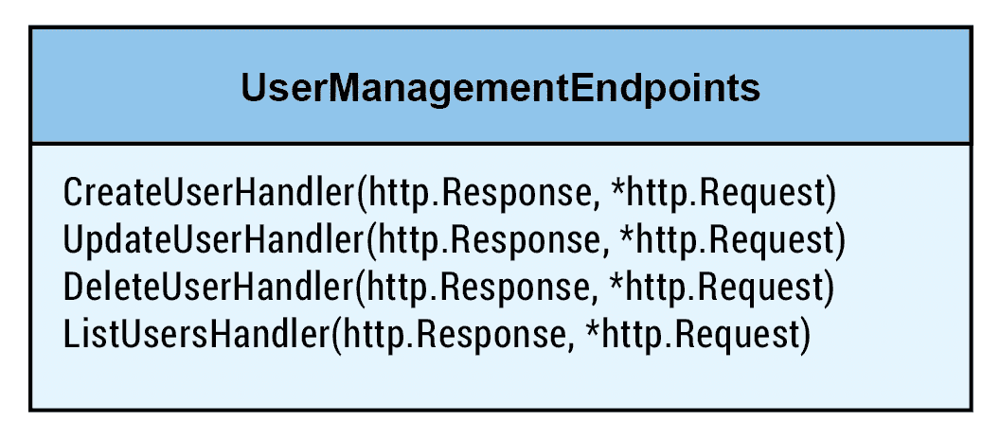

图 4.1—用户管理端点结构体

你可能写了类似这样的注释：

```go
// UserManagementEndpoints provides HTTP handlers for all User management
```

从这条注释可以看出，我们的`struct`显然不仅于一个目的。我们可以通过将其分解为每个端点一个`struct`来修复此问题。然而，这样做时我们还应该考虑单一原则的下一个方面：责任。

## 单一责任 (A single responsibility)

单一责任的目标是 Robert C. Martin 定义的`SRP`的精髓所在。2014 年，Martin 发表了一份对`SRP`的说明，重点关注“改变的理由”部分，他在其中概述了焦点应该放在人身上。通过此，他断言只有一个人（或一组相关人员）应该能够影响单一组件。

让我们回到之前的例子。你可能还记得我们将单体`struct`分解为每个 HTTP 端点一个`struct`。这个改变使我们能够通过“单一目的”测试。但当我们更深入地观察`struct`的私有方法时，会发生什么？我们的`struct`图实际上是这样的：

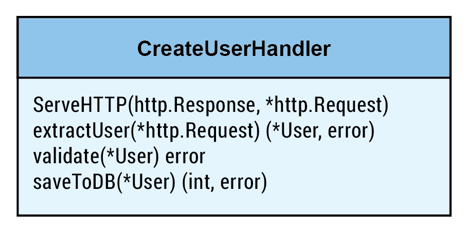

图 4.2—创建用户处理器

如你所见，我们正在处理多项责任，包括从 HTTP 请求中提取`User`、验证提供的`User`以及保存`User`。这三项责任中的每一项都是相互独立的。因此，如果负责定义 HTTP 请求格式的人决定做出更改，那么它不应该要求我们更改验证或保存用户的方式。

数据库结构的变化也是如此的。此类更改不应该要求对请求或验证进行更改。

在小型项目中，“负责的人”可能只是你。。但这并不是放弃这一目标的合理理由。该系统的任何扩展或维护都将从坚持“单一责任”的理想中获益。

这种方法的另一个吸引人的益处是降低了复杂性。如果我们遵循这一目标并将`struct`分解为独立的责任，测试和维护每个组件就会变得更简单。以此此类，我们减少了 Bug 出现的概率。如果我们这样分解我们的`struct`：

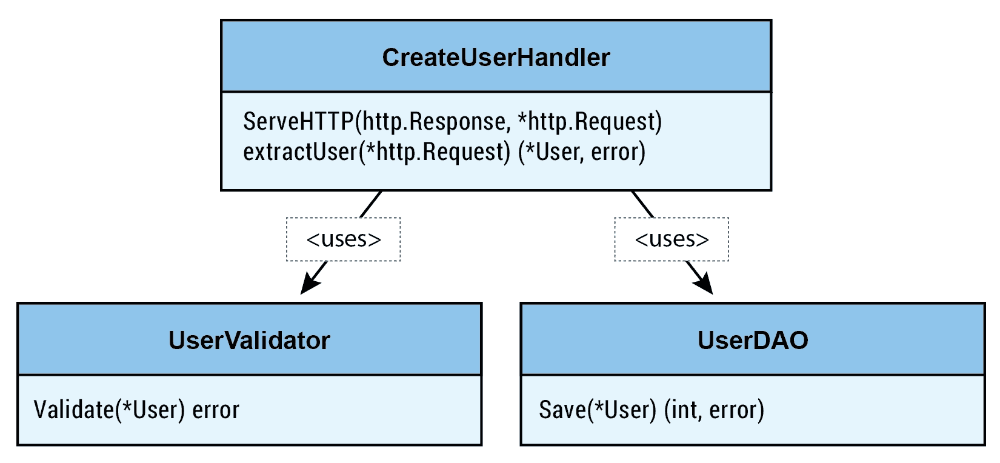

图 4.3—分解后的创建用户处理器

现在每个组件都有一项责任。每个组件都可以进行隔离测试，使得测试更小、更简单。此外，由于测试验证并强制了组件之间的约定，我们可以确保组件之间的交互是正确的。

有时很难识别一个组件何时服务于多项责任，或者相反，我们何时过度分解了组件。为了帮助我们应对这些情况，我们应该考虑最后一点：抽象层级。

## 单一层级的抽象 (A single level of abstraction)

在应用单一原则时，我们鼓励分解问题，使每个组件服务于单一目的并包含单一层级的抽象。实现这种单一层级的抽象比我们单一目的单一责任的目标更难直觉。

我们可以通过回到`CreateUserHandler`例子来深入探讨这一点。之前我们有三个结构体；这些是：

● `UserValidator`—该结构体负责验证提供的`User`是否正确且完整。

● `UserDAO`—该结构体负责将`User`保存到数据库中。

● `CreateUserHandler`—它负责提取请求细节以协调请求。这包括从 HTTP 请求中提取`User`、通过调用`UserValidator`验证请求，最后调用`UserDAO`保存`User`。

正如你在读完上一个描述后可能猜测的那样，我们的`CreateUserHandler`存在一个问题。虽然它的目标单一——即协调请求——但它感知了过多的实现层次。它不仅处理 HTTP 请求和响应，还管理业务逻辑，并感知了数据库。我们可以通过调整抽象来纠正这个问题，使我们的描述呈现为：“此结构体执行 [功能]，然后委托给 [依赖项]”。将此应用于我们的示例，我们得到如下：

● `CreateUserHandler`——从 HTTP 请求中提取`User`，然后委托给`UserManager`

● `UserManager`——验证提供的`User`，然后委托给`UserDAO`

● `UserDAO`——将提供的`User`保存到数据库

当我们画出这组新的组件时，可以看到依赖关系金字塔已经变成了像下面这样的瀑布结构：

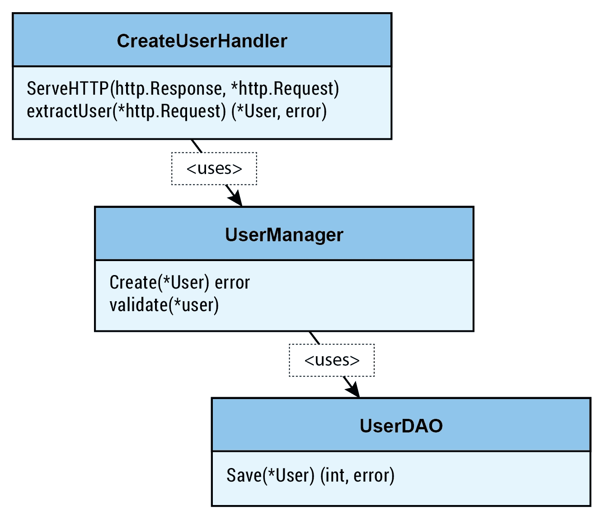

图 4.4——解构为瀑布结构的创建用户处理程序

你也可以从这张图中看到，我们最小化并简化了组件之间的依赖。这表明我们实现了每个组件一个抽象层的目标。

正如我们所看到的，为了充分解决单一职责原则，我们需要确保每个组件都有单一目的、单一职责和单一的抽象层次。这并非易事，特别是在初始实现阶段。编写一个包含单元测试的完整实现，然后进行重构，这没有任何问题。任何此类重构都将基于一个更全面的视角，而那一点额外的知识可以使寻找最佳软件架构变得显著容易得多。

# 接口隔离原则

接口隔离原则（ISP）是由 Robert C. Martin 定义并推广的另一个软件设计原则，它规定：

客户端不应被强制依赖于它们没有使用的方法。

–Robert C. Martin

这个原则看起来直截易懂、合理，甚至简单，但看到像这样的接口也并不罕见：

```go
type CityModel interface {
    Save(*City) (int, error)
    Update(*City) error
    LoadByID(int) (*City, error)
    LoadAll() ([]*City, error)
}
```

乍看之下，这个接口看起来是合理的，很容易想象其实现是一个单一结构体。这样的结构体甚至可能符合单一职责原则。毕竟，`Save()`和`Update()`可能会共享某些逻辑，两个`Load()`函数也是如此。

然而，这个接口被认为是“胖接口”，因为用户不太可能需要所有、甚至是大部分这些方法。事实上，该接口的用户通常每个人只使用其中一个方法。如果用户采用这个接口，他们会给自己带来额外的复杂性和工作。代码的阅读者将被迫浪费宝的时间去弄清楚哪些方法被使用了，哪些没有使用。

此外，每当此接口被模拟（mock）或存桩（stub）时，都需要编写或生成更多代码来创建从未被调用的方法。

让我们扩展一下示例。以下代码展示了 HTTP 处理程序如何使用`CityModel`通过 ID 加载并返回城市：


```go
type LoadCityByIDEndpoint struct {
    cityModel CityModel
}

func (l *LoadCityByIDEndpoint) ServeHTTP(resp http.ResponseWriter, req *http.Request) {
    id, err := l.extractIDFromRequest(req)
    if err != nil {
        resp.WriteHeader(http.StatusBadRequest)
        return
    }
    city, err := l.cityModel.LoadByID(id)
    if err != nil {
        resp.WriteHeader(http.StatusInternalServerError)
        return
    }
    renderCity(resp, city)
}
```

为了改进这一点，我们可以重构接口：

```go
type CityByIDLoader interface {
    LoadByID(int) (*City, error)
}

type LoadCityByIDEndpoint struct {
    loader CityByIDLoader
}

func (l *LoadCityByIDEndpoint) ServeHTTP(resp http.ResponseWriter, req *http.Request) {
    id, err := l.extractIDFromRequest(req)
    if err != nil {
        resp.WriteHeader(http.StatusBadRequest)
        return
    }
    city, err := l.loader.LoadByID(id)
    if err != nil {
        resp.WriteHeader(http.StatusInternalServerError)
        return
    }
    l.renderCity(resp, city)
}
```

通过这一改变，我们最小化了组件之间的依赖。这表明我们实现了每个组件一个抽象层的目标。

正如我们所看到的，为了充分解决单一职责原则，我们需要确保每个组件都有单一目的、单一职责和单一的抽象层次。这并非易事，特别是在初始实现阶段。编写一个包含单元测试的完整实现，然后进行重构，这没有任何问题。任何此类重构都将基于一个更全面的视角，而那一点额外的知识可以使寻找最佳软件架构变得显著容易得多。

你也可以从这张图中看到，我们最小化并简化了组件之间的依赖。这表明我们实现了每个组件一个抽象层的目标。

## 角色与职责

我们需要引入“角色接口”（role interfaces）术语来理解 ISP 和 SP（单一职责）之间的相互作用。当我们应用 ISP 并创建薄的、显式的接口时，这些接口被称为“角色”。另一方面，在讨论 SP 时，我们谈论的不是角色而是职责。职责通常比角色大，因为它们将相关功能组合在一起。

再次回到我们的 `CityModel` 示例，在下面的图中，你可以看到我们在每个角色一个接口的同时保持单一职责：

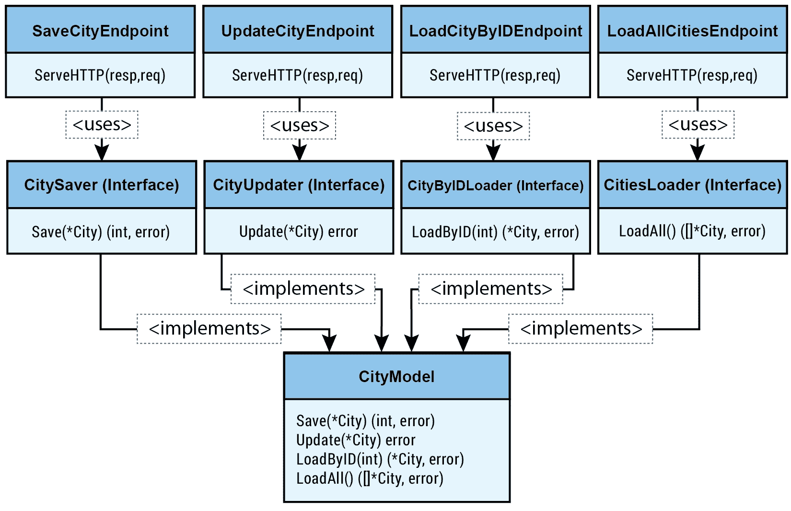

图 4.5——每个角色一个接口

结果是我们的组件是松耦合的，可以独立维护和演进。然而，我们并没有创建过多的组件或遭受重复问题。你可能会担心 ISP 与 SP 冲突。考虑到 ISP 推使我们走向极简接口，而 SP 要求我们拥有单一职责，我们如何同时实现这两者？答案是角色是接口，而职责是结构体。这使得我们的结构体更容易理解、维护和测试。

正如我们所看到的，ISP 的主要目标是通过将接口减少到最小来防止意外耦合。必须记住，这种耦合不仅发生在组件与其依赖之间，也可能发生在函数和方法的输入上。因此，在我们应用之前讨论的“接受接口并返回结构体”原则时，必须记住 ISP。

# 依赖倒转原则

依赖倒转原则（DIP）是 Robert C. Martin 推广的我们将检查的三个原则，它规定：

- 高层模块不应该依赖低层模块。
- 两者都应该依赖抽象。
- 抽象不应该依赖于细节。
- 细节应该依赖抽象。

–Robert C. Martin

为了深入研究 DIP，我们首先应该谈论依赖和视角；让我们从一个示例开始。如果我说“我早上依赖我的开车去上班”，你自然会得出结论：汽车是我的依赖。如果我们编写这段代码，它看起来可能像这样：

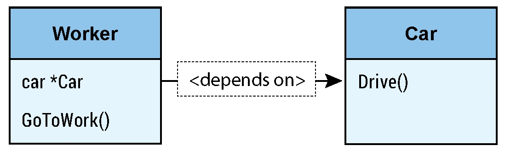

图 4.6——工人依赖汽车

从这个视角来看，我确实依赖我的汽车。但这真的必要吗？这是我上班的唯一方式吗？如果我采取不同的视角，不再具体说明我如何上班，而是抽象地定义我的需求，这种关系将像这样：

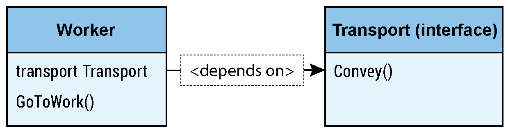

图 4.7——工人依赖交通工具

与其采取指令性和具体的规定，我反转了视角，采取了许可性和抽象的方式。通过这种许可，我成功地将“开始工作”这一行为与“如何执行”解耦了。这种松耦合不仅使我们能够独立测试每个组件，还为我们提供了一个非常清晰的扩展点。例如，我们现在可以添加任意数量的新 `Transport` 实现，而无需更改我们的 `Worker` 实现并避免向其引入 Bug 的风险。

以这种看似倒置的方式表达依赖关系后，我们可以重新审视 Martin 的定义，并看看他的原则如何应用于 Go。

首先，“模块之间不应该相互依赖，而应该依赖于抽象”；如你所知，Go 没有官方或可见的模块实现。然而，这并不意味着模块不存在。作为程序员，我们倾向于通过将问题拆分为更小、更易管理的部分来解决问题，然后将它们组合在一起以解决更大的问题。这些较小的部分就是我们的模块。每个模块可以单独 `package`，也可以一组共同工作以实现共同目的的 `packages`。

通过这种方式创建模块的目标是让这些模块的边界依赖于抽象，以确保模块是松耦合的。这种松耦合将允许我们代码库的不同部分独立演进。

为了保持模块边界整洁，我们需要考虑 `interfaces` 的位置。在其他编程语言中，典型的方法是像这样将接口与实现定义在一起：

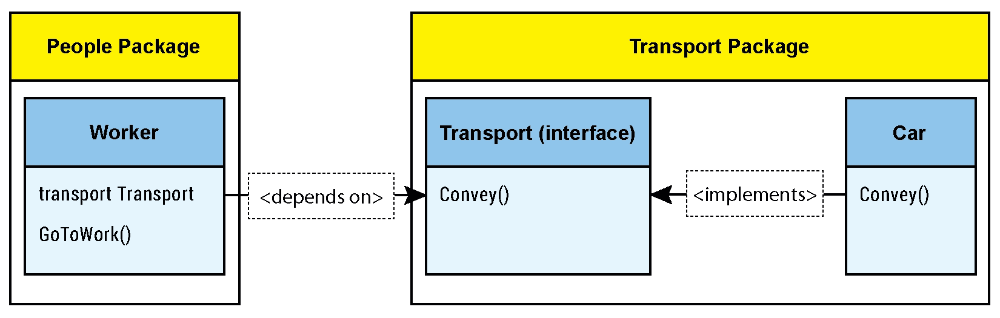

图 4.8—接口与实现并存

通常，这种方法伴随着这样观点：在公共或共享的地方定义接口可以减少重复。确实如此。然而，它增加了代码的耦合性并污染了我们的模块边界。考虑一下在我们简单的示例中，如果 `Transport` 接口的使用者之一需要向接口中添加另一个方法或更改该方法的参数，那么所有用户都将被迫更改。

在 Go 中，我们可以将 `interface` 定义从实现中移出，而是放置在使用它的 `package` 中，如下所示：

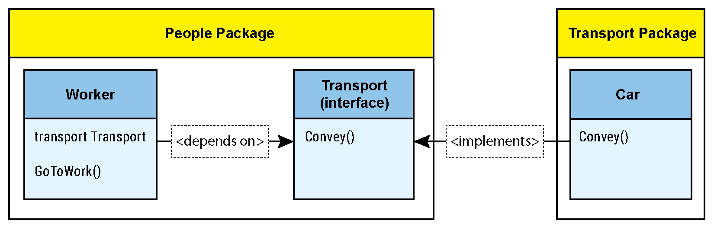

图 4.9—定义在使用处

这种方法保护了我们的 `People` 包免受 `Transport` 包其他用户所需更改的影响，并保持了我们模块边界的整洁。当模块边界整洁时，我们的模块更加自给自足。以此类推，我们模块的用户就不会被强制为了使用模块而采用其他依赖。

回到 Martin 定义的后半部分，“抽象不应该依赖细节；细节应该依赖于抽象”。我们可以通过应用上述讨论的相同方法来遵循这些陈述，但不是应用于模块，而是应用于 `structs`。回顾一下，这意味着使用本地 `interfaces` 将我们的成员变量和方法参数表示为抽象。

这种风格从严格意义上说，违反了我们之前检查的 `DRY` 原则；然而，我们因松耦合而获得的优势是显著的。得益于清晰的分离，我们可以独立地测试、维护和扩展组件，甚至可能发现其他情况下无法实现的重用机会。

以这种方式应用 `DIP` 是 Rob Pike 概述的 Go 谚言之一的例子，该谚言指出：

> 适量的拷贝优于少量的依赖。

— Rob Pike

与其他谚言一样，这句谚言以及我们在本节中检查的设计原则贯穿于 Go 语言和标准库的设计决策和思想之中。它们是我们行业在许多语言中总结出的宝贵教训的务实应用。这也是为什么我们中的许多人被 Go 这种语言所吸引。

我在采用 Go 时犯的最大错误是盲目地将我之前使用的语言的方法、想法和软件工程风格应用于 Go 代码。虽然我后来学到了这并不是编写优秀 Go 代码的方法，但我们仍然应该注意其他语言的思想。正如我们在下一节中看到的，尽管 Go 并不是严格的对象对象语言，但某些面向对象的设计模式也可以并在 Go 中选择性。

## 面向对象的设计模式

编写软件与烹饪没有太大区别。有很多方法可以实现我们的目标，但如果我们想获得可预测的结果，最好是遵循食谱。你烘焙过蛋糕吗？通常步骤是：

1. 混合糖和黄油
2. 混合鸡蛋和其他湿原料
3. 混合面粉和任何干原料
4. 放入烤箱

这个通用的食谱可以作为我们想要烘焙的许多类型蛋糕的基础。软件模式完全相同。它们是解决特定问题的通用食谱；而不是解决每个问题的解决方案。就像烹饪食谱一样，软件模式的设计是为了为我们在讨论和规划设计时提供一种共同语言。例如，如果我们正在讨论一个对象并需要确保只创建一个实例，我们可以说“让我们使用单例模式吧”，而无需讨论实现的具体细节。

本节仅讨论四种模式：`Singleton`、`Factory Method`、`Observer` 和 `Adapter`。还有更多，但选择这四种是因为它们在 Go 中是最常用的。

### 单例模式

单例模式是最广泛使用的设计模式之一。它旨在限制 `class` 多个实例的创建，并提供一个唯一的访问点。这种模式通常用于降低创建和维护资源密集对象的成本，并促进该单一实例的重用。

### 使用

该模式的典型使用场景包括：

- 连接池：例如，数据库连接池。打开和维护这些连接具有很高的性能成本，我们可以建立的最大连接数是有限的。因此，最好只一个连接池。
- 缓存：假设我们实现了一个内存缓存。我们希望这个缓存只有一个实例，以限制内存消耗并提高其效能。
- 配置：配置通常从文件加载并解析。这是一项昂贵的操作。因此，为了确保只加载一次，可以使用单例。

### 实现

在我们的示例中，我们将单例模式应用于 `Cache` 对象。首先，我们定义一个私有的全局变量来存储我们的 `Cache` 实例和一个 `sync.Once`：

```go
var (
    instance *Cache
    initConfig sync.Once
)
```

我们正在使用 `sync.Once` 来确保全局变量的填充是线程安全的且只发生一次。现在，我们提供如下的公共访问函数：

```go
func GetCache() *Cache {
    initConfig.Do(func() {
        instance = &Cache{
            items:     map[string]interface{}{},
            createdAt: time.Now(),
        }
    })
    return instance
}
```

如你所见，我们的 `GetCache()` 函数将在需要时实例化 `Cache` 实例并返回单一的 `Cache` 实例。

### 在 Go 中有什么不同？

## 单例模式（Singleton）

单例模式的传统面向对象实现使用私有或静态构造函数来强制单例构造，这正是该模式的意图。如你所知，Go 并不具备这些特性。因此，我们有两个选择：一个是使用一个简单的实现（如上文所示），并信任自己能够“正确”地与该对象交互。或者，我们可以通过一个更复杂的实现来强制这种严格性。在这样的实现中，我们必须：

1. 将单例移动到单独的包中——确保没有任何地方可以直接访问它。
2. 将返回值更改为接口——移除直接实例的能力。
3. 确保返回的对象是私有的——同样可以防止直接实例化。

要查看这个更严格的版本，请参阅：[`github.com/corsc/Beyond-Effective-Go/tree/master/Chapter04/02_design_patterns/01_singleton/02_strict/`](https://github.com/corsc/Beyond-Effective-Go/tree/master/Chapter04/02_design_patterns/01_singleton/02_strict/)

# 工厂方法模式（The factory method pattern）

工厂方法的目的是为创建对象提供一个灵活、可扩展且易于维护的框架。该模式通过定义一个函数，该函数负责从一组相关对象中创建对象的实例来实现这一点。通过将创建逻辑集中在单个函数中，工厂方法模式简化了对象的创建，并使得代码随时间推移更容易管理和维护。这种方法消除了代码重复、复杂性，以及当对象组在多个地方使用时经常出现的 bug 根源。

识别何时应用此模式的最佳方法是寻找对象创建与条件语句集合的组合，例如 `switch` 语句或一系列 `if` 条件。

## 使用方法（Usage）

在接下来的示例中，我们可以看到一个条件创建对象的示例：

```go
func SingSolo(favorite string) {
    var beatle Beatle

    switch favorite {
    case "John":
        beatle = John{}
    case "Paul":
        beatle = Paul{}
    case "George":
        beatle = George{}
    case "Ringo":
        beatle = Ringo{}
    }

    beatle.Sing()
}
```

当我们看到这样的代码时，我们应该问自己两个问题：

1. 是否未来会有更多的对象类型（例如，新的 `case` 语句）？
2. 我们是否会在其他地方需要这种条件创建对象？

如果我们对其中任何一个问题的回答是“是”，那么我们就应该应用工厂方法。

## 实现（Implementation）

此模式的实现相当直接。我们必须将对象创建逻辑提取到一个独立的函数中，该函数只负责该职责。让我们开始一个新示例，增加比之前多一点复杂性。我们将定义一个名为 `DocumentFormat` 的抽象，它有两个方法：`Header()` 和 `Bold()`，如下：

```go
type DocumentFormat interface {
    Header(string) string
    Bold(string) string
}
```

现在，我们可以实现这个接口两次，一次用于 Markdown 格式，一次用于 HTML 格式；你会在本章的代码中找到这些示例实现。

有了抽象和实现后，我们现在将工厂方法应用到创建逻辑中：

```go
func NewDocumentFormat(format string) DocumentFormat {
    switch format {
    case "md":
        return Markdown{}
    default:
        return HTML{}
    }
}
```

就是这样。只要我们确保所有的创建都是通过 `NewDocumentFormat()` 函数完成的，我们的代码将与 `DocumentFormat` 接口的实现完全解耦。

你可以在示例代码中找到完整实现：[`github.com/corsc/Beyond-Effective-Go/tree/master/Chapter04/02_design_patterns/02_factory_method/02_example/`](https://github.com/corsc/Beyond-Effective-Go/tree/master/Chapter04/02_design_patterns/02_factory_method/02_example/)

## Go 有何不同（What is different in Go?）

单例模式的传统面向对象实现使用私有或静态构造函数来强制单例构造，这正是该模式的意图。如你所知，Go 并不具备这些特性。因此，我们有两个选择：一个是使用一个简单的实现（如上文所示），并信任自己能够“正确”地与该对象交互。或者，我们可以通过一个更复杂的实现来强制这种严格性。在这样的实现中，我们必须：

1. 将单例移动到单独的包中——确保没有任何地方可以直接访问它。
2. 将返回值更改为接口——移除直接实例的能力。
3. 确保返回的对象是私有的——同样可以防止直接实例化。

要查看这个更严格的版本，请参阅：[`github.com/corsc/Beyond-Effective-Go/tree/master/Chapter04/02_design_patterns/01_singleton/02_strict/`](https://github.com/corsc/Beyond-Effective-Go/tree/master/Chapter04/02_design_patterns/01_singleton/02_strict/)

观察者模式的传统面向对象实现中，事件从主题到观察者的通知是通过函数调用完成的。在 Go 中可以用同样的方式实现该模式；然而，存在一个缺点。如果任何观察者在处理通知时速度缓慢，将抑制发送给其他观察者的通知。

# 观察者模式（The observer pattern）

观察者模式的目的是定义对象间的一种依赖关系，当一个对象的状态发生变化时，所有依赖它的对象都会收到通知并自动更新。

## 使用方法（Usage）

在接下来的示例中，我们可以看到一个条件创建对象的示例：

（此处省略重复代码块，逻辑同上文）

当我们看到这样的代码时，我们应该问自己两个问题：

1. 是否未来会有更多的对象类型（例如，新的新的 `case` 语句）？
2. 我们是否会在其他地方需要这种条件创建对象？

如果我们对其中任何一个问题的回答是“是”，那么我们就应该应用工厂方法。

## 实现（Implementation）


此模式的实现相当直接。我们必须将对象创建逻辑提取到一个独立的函数中，该函数只负责该职责。让我们开始一个新示例，增加比之前多一点复杂性。我们将定义一个名为`DocumentFormat`的抽象，它有两个方法：`Header()`和`Bold()`，如下：

```go
type DocumentFormat interface {
    Header(string) string
    Bold(string) string
}
```

现在，我们可以实现这个接口两次，一次用于 Markdown 格式，一次用于 HTML 格式；你会在本章的代码中找到这些示例实现。

有了抽象和实现后，我们现在将工厂方法应用到创建逻辑中：

（此处省略重复代码块）

就是这样。只要我们确保所有的创建都是通过`NewDocumentFormat()`函数完成的，我们的代码将与`DocumentFormat`接口的实现完全解耦。

## Go 有何不同 (What is different in Go?)

观察者模式的传统面向对象实现中，事件从主题到观察者的通知是通过函数调用完成的。在 Go 中可以用同样的方式实现该模式；然而，存在一个缺点。如果任何观察者在处理通知时速度缓慢，将抑制发送给其他观察者的通知。

## 适配器模式 (The adapter pattern)

适配器模式旨在将结构体的 API 从一种形式转换为另一种形式。其目标是允许在原本不兼容的地方使用该对象。

该模式由三部分组成：

- 目标接口（Target interface）——这是我们想要使用的接口。
- 被适配器对象（Adaptee object）——我们想要与目标接口配合使用的结构体，但它没有实现该接口。
- 适配器（Adapter）——这是一个封装了被适配器并使其符合目标接口的结构体。

### 使用

在处理遗留组件和第三方组件时，如果无法对目标接口进行修改或不建议修改，这种模式就非常有用。在这些情况下，你通常拥有提供你所需功能的组件，但格式不符合你的需求，而且你无法对它们进行重构。这种方法的另一个好处是为用户提供更灵活或更方便的用户体验（UX）。一个很好的例子是标准库中`http.Handler`和`http.HandlerFunc`之间的关系。

### 实现

在我们的示例中，我们将探讨在两个不同的日志器之间进行迁移的情况。

首先，这是我们的`OldLogger`接口以及一个需要它的函数：

```go
type OldLogger interface {
    Error(message string, args ...interface{})
}

func LegacyFunction(logger OldLogger) {
    // implementation removed
}
```

现在，将`OldLogger`的实现与我们的`NewLogger`进行比较：

```go
type NewLogger interface {
    Error(message string, tags ...Tag)
}
```

你可以看到我们的`NewLogger`有不同的签名。为了让我们能够使用`LegacyFunction()`，我们定义了一个适配器来封装`NewLogger`并如下实现`OldLogger`接口：

```go
type oldLoggerAdapter struct {
    newLogger NewLogger
}

// implement OldLogger interface
func (o *oldLoggerAdapter) Error(message string, args ...interface{}) {
    // adapt from OldLogger requests to NewLogger format
    o.newLogger.Error(fmt.Sprintf(message, args...))
}
```

现在，我们就可以使用适配后的`NewLogger`来运行`LegacyFunction()`。上面的示例是该模式的一个常规、传统的用例；在下一节中，我们将看到如何以非常规的方式使用这种模式来解决一个特定的 Go 问题。

### 在 Go 中有什么不同？

适配器模式在 Go 中的实现与其他语言的实现非常相似。然而，我们可以利用 Go 对匿名嵌入（anonymous embedding）的支持来节省大量工作。

查看下面的图，其中我们有一个`User`结构和一个`UserForLogin`接口：

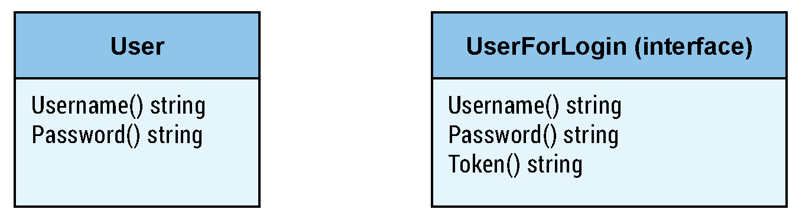

图 4.10—`User`结构体和`UserForLogin`接口的差异

你会注意到`User`结构体缺少`Token()`方法。通过匿名嵌入，我们可以非常廉价地创建一个适配器。代码只有：

```go
type UserLoginAdapter struct {
    User
}

func (u *UserLoginAdapter) Token() string {
    // implementation removed
    return ""
}
```

这种方法也可以用于覆盖现有的方法。现在，看下面的图，我们有两个包，`version1`和`version2`：

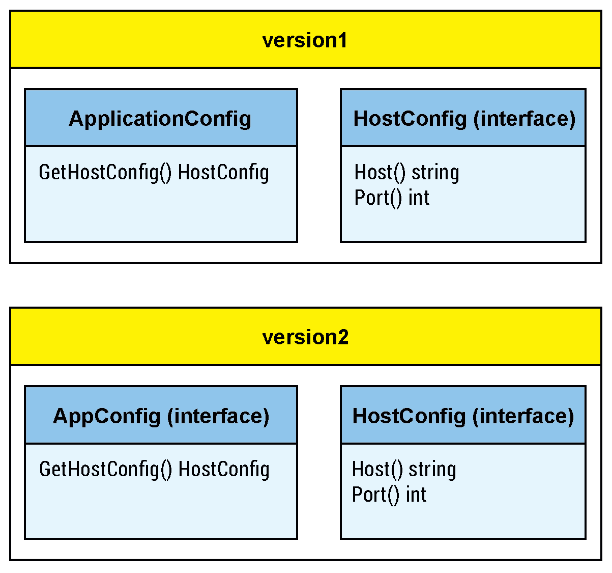

图 4.11—具有相同`HostConfig`接口的多个包

如你所见，两个包都包含一个名为`HostConfig`的相同接口。尽管接口是相同的，但如果我们尝试使用`Application`，它将会失败：

```go
type Application struct {
    version1.HostConfig
    version2.HostConfig
}
```

作为程序员，我们认为美好的一天就是盯着自己喜爱的代码编辑器，疯狂地敲击键盘。如果我告诉你，可以让这些日子变得更加愉快呢？这就是代码 UX（code UX）大显用场。代码用户体验（code UX）衡量的是代码的易用性或用户友好程度。让我们来深入探讨。首先，什么是代码？

## 什么是代码？

代码是我们程序员用来与计算机以及彼此进行通信的语言。像任何语言一样，它有语法、语义和约定。就像自然语言一样，虽然有必要的组成部分，但在风格自我表达上也有很大的自由度。

优秀的沟通关注两个不可或缺的方面：受众和信息。对于代码而言，我们的受众分为两类：计算机和其他程序员。作为受众的计算机很容易满足；只要代码能编译通过，它们就会听从，无论我们告诉它们什么。另一方面，程序员要难满足得多。他们不仅期望代码能够运行，还想理解作者的意图或想要的信息。当代码清晰地表达了作者的意图时，它就能传达代码的功能，以及作者所做的任何重大决策和权衡。

重要的是，作为作者，你的代码对你来说是很清晰的；真正的问题是，团队中的其他人是否觉得它有意义？即使是那个上周才加入的实习生？

增加我们问题的是代码不是静态的；它随着时间的推移而演变。因此，被理解只是第一步。我们的代码必须易于导航。它必须是可扩展、可调试且可靠的。

在本章中，我们将研究代码可用性的三个关键方面：清晰性、一致性和可预测性。

清晰性意味着代码易于阅读。一致性让代码更容易导航并提高我们的舒适度。可预测性决定了对代码的信任程度，并延伸决定了我们对代码的依赖程度。

编写具有良好 UX 的代码是编码中最具挑战性的方面之一，但在本章之后，我们将完全有能力与各种水平的程序员进行交流。

## 实现清晰性

代码清晰性可以被看作一段代码被阅读和理解的容易程度。但让我们追求更高的目标。我们应该追求被快速且直观地理解。

虽然易于理解是任何沟通的目标，但作为程序员，我们往往时间紧迫。因此，当我们让同事能够快速理解我们的代码时，他们就能及时回到修复漏洞或添加新功能等增加值的活动中。

本节将讨论一系列我们可以实现以达到最低可读水平的想法。我对你的挑战是，以这些想法为基础，并利用你的经验来实现更多目标。

在阅读别人的代码时，注意理解一段代码需要多长时间。考虑他们可以做哪些改变来让你读起来更容易。如果这段代码在你的控制之下，考虑进行并提交这些更改，以便所有人都能受益。有时，你的团队对清晰性和可读性的观点可能与你不同，但那种争论总是有益的。

快速看一眼以下代码，看看它是否有逻辑：

```go
func do(o O) error {
    if e := v(o); e == nil {
        if r, e := c(o); e == nil {
            ec := make(chan error, 2)
            wg := &sync.WaitGroup{}
            wg.Add(2)
            // ... logic ...
        }
    }
    return nil
}
```

（注：代码块的原始文本是片段化/不完整的；我根据提供的片段保留了其结构逻辑。）

## 格式化

意乎不用说，代码的格式化方式影响了阅读的难易程度。如果你想确保你的代码遵循标准实践，而无需花费几个小时进行手动调整，可以使用像`gofmt`这样的工具。我使用的脚本：

```bash
#!/bin/bash
if [ -z "$1" ]; then
    echo "Please supply a directory"
    exit -1
fi

# 确保输入的目录是有效的
DIR=${1%/}
PKG_DIR=${DIR%}
DIRS=$(find $PKG_DIR -type f -name '*.go' -not -path '*//*')

# 清理并简化代码
gofmt -w -s $DIRS
```

## 空格

空白，也称为负空间或空白，是设计中的一个概念，在元素之间刻意留出空间。这些空间的目标是让观察者的眼睛休息，在视觉上分离不同的元素，并将注意力引到不同的位置。

代码中的空白是我们为了便于阅读而添加的各个之间的空隙。它允许我们的眼睛扫描代码并快速识别逻辑分组，而不需要阅读每一行。

考虑以下 HTTP 服务器处理器：

```go
func handler(resp http.ResponseWriter, req *http.Request) {
    payload, err := io.ReadAll(req.Body)
    if err != nil {
        resp.WriteHeader(http.StatusBadRequest)
        return
    }

    createReq := &userCreationRequest{}
    err = json.Unmarshal(payload, createReq)
    if err != nil {
        resp.WriteHeader(http.StatusBadRequest)
        return
    }

    err = doCreateUser(createReq)
    if err != nil {
        resp.WriteHeader(http.StatusInternalServerError)
        return
    }

    _, _ = resp.Write([]byte("ok"))
}
```

如果你只是扫一眼这段代码，你看到的只是一块代码墙。要完全理解这段代码，你必须慢下来并逐行阅读。错误处理的空白缩进让它们稍微显现，但除此之外，它是一个相当紧密的块。现在，看看通过添加几行空行会发生什么。

```go
func handlerWhitespace(resp http.ResponseWriter, req *http.Request) {
    payload, err := io.ReadAll(req.Body)
    if err != nil {
        resp.WriteHeader(http.StatusBadRequest)
        return
    }

    createReq := &userCreationRequest{}
    err = json.Unmarshal(payload, createReq)
    if err != nil {
        resp.WriteHeader(http.StatusBadRequest)
        return
    }

    err = doCreateUser(createReq)
    if err != nil {
        resp.WriteHeader(http.StatusInternalServerError)
        return
    }

    _, _ = resp.Write([]byte("okay"))
}
```

在第二个版本中，我们在逻辑代码组之间引入了空白（本质上是段落分隔符）。现在当我们只读取每个块的第一或两行代码时，我们得到：

- 读取请求体。
- 将请求反序列化为对象。
- 调用创建用户函数。
- 输出结果。

这些段落分隔符允许我们在不处理每一行代码的情况下理解代码。空白可以提高代码可读性的另一个常见地方是`select`和`switch`语句。对比以下示例：

```go
func speak(animal string) {
    switch string {
    case "dog":
        fmt.Print("Woof!")
        fmt.Print("Woof!")
    case "cat":
        fmt.Print("Meow")
    case "mouse":
        fmt.Print("Squeak")
        fmt.Print("Squeak")
    default:
        fmt.Print("???")
    }
}
```

对于许多读者来说，很难快速识别一个`case`语句在哪里结束，另一个从哪里开始。现在对比一下这个：

```go
func speakWhitespace(animal string) {
    switch string {
    case "dog":
        fmt.Print("Woof!")
        fmt.Print("Woof!")

    case "cat":
        fmt.Print("Meow")

    case "mouse":
        fmt.Print("Squeak!")
        fmt.Print("Squeak")

    default:
        fmt.Print("???")
    }
}
```

这是一个简单且具有长期收益的改进。最显著的将是减少阅读代码带来的疲劳。

在随处添加空白之前，我需要强调的是空行并不总是能提高可读性。考虑以下示例：

```go
func doCreateUser(req *createUser) error {
    err := validate(req)
    if err != nil {
        return err
    }

    err = saveToDB(req)
    if err != nil {
        return err
    }

    return nil
}
```

在这个示例中，我们错误地将抛出错误的代码与检测并处理这些错误的代码分开了。这种分离破坏了代码的逻辑分组，并迫使我们在脑中进行这种分组。在这个例子和我们最初那个没有空白的示例中，我们都增加了读者的负担，迫使他们阅读并理解每一行。这是他们不需要付出的心理成本。

### 名字取什么好？

名字是决定代码用户体验（UX）的关键因素。一个好的名字应该是信息丰富的、直观的、有意义的且显而易见的。相反，糟糕的名字具有误导性且分散注意力，并让读者付出比不必要的更多的精力。

许多程序员直觉上就知道变量、方法或结构体的名称何时需要改进。这时他们开始添加注释。当你觉得需要添加注释来解释某些内容时，尝试寻找一个可以消除注释需求的名称。

优秀名字的本质要素是：

- 它们应该是有意义的。
- 它们应该是简洁的。
- 它们应该是一致的。
- 它们应该感知上下文。
- 它们不需要是独一无二的。

让我们进一步探讨这些点。

#### 名字应该有意义

变量和结构体的名称应该描述它们是什么。方法和函数的名称应该描述它们做什么。让我们来看一些结构体：

```go
// 坏
type cur { }

// 更好
type create { }

// 最好
type userRequest { }
```

第一个示例`cur`是糟糕的，因为它是缩写。第二个示例`create`是一个改进，但仍然是一个动词。最后一个示例`userRequest`好得多，因为它是一个名词。

让我们来看一些函数：

```go
// 坏
func get()

// 更好
func getDecision()

// 最好
func getUserRequest()
```

第一个示例`get()`是糟糕的，因为它没有给我们提供任何上下文。第二个示例`getDecision()`更好，但仍然需要更多上下文。最后一个示例`getUserRequest()`好得多，因为它清晰地描述了它的功能。

现在来看一些变量：

```go
// 坏
var o int

// 更好
var order int

// 最好
var customerID int
```


## 命名应该简洁

第一个示例 `o` 是糟糕的，因为它是缩写。第二个示例 `order` 是一个改进，但仍然是一个动词。最后一个示例 `customerID` 好得多，因为它是一个名词。

### 名字应该是简洁的

这一点可能与前一点看起来相矛盾，因为 `o` 比 `order` 简洁得多。用更好的表达方式来说，名字在不损害可读性的情况下应该尽可能简洁。这种对简洁的偏好应该扩展到与变量名中添加类型信息的决策上。例如，拥有一个变量 `userList` 是可以接受的（假设它是一个切片或数组），但 `users` 更好，因为它更简洁。相反，如果我们在代码的同一区域内有一个用户映射和一个用户切片，将它们命名为 `userMap` 和 `userList` 可以确保它们不会被混淆。

## 保持一致性

当命名保持一致时，代码读起来会感到自然得多。考虑 `Get()`、`Fetch()` 和 `Retrieve()` 这几个函数名：这些函数的结果可能是完全相同的。选择一致的名称可以确保其他程序员能够快速发现、理解并使用这些函数。同样，代码库、包或 `struct` 内部的变量命名也应该保持高度一致。这在变量通过多层函数进行传递时尤为重要；如果变量的作用没有改变或作用范围没有发生显著变化，那么在调用栈中更改变量名会显著增加代码的心理负担。

好了，一致性很重要，但要与什么保持一致呢？这涉及到三个方面，按重要性排序为：

- 团队风格
- 行业规范
- 编程规范

### 团队风格

当一段代码与团队规范不一致时，它会给读者带来突兀的体验，甚至可能导致团队成员不愿维护它。一个典型的例子就是遗留代码。遗留代码通常被视为此类代码，是因为它们是由一组不同的程序员使用不同的规范开发的。程序员通常希望避免这类代码，而不好的阅读体验正是原因之一。因此，我们应该努力编写让团队成员感到自然的代码。这并不意味着我们永远不要对团队规范进行更改；当改进可行时，你会发现说服团队往往能消除新规范带来的不适感。

### 行业规范

其次，我们应该与行业规范保持一致。当新成员从公司其他部门或你的直接竞争对手处加入时，他们应该能够理解你的代码，而无需学习“本地语言”。例如，如果你从事运输行业，拥有名为 `passengers`（乘客）、`drivers`（司机）和 `destinations`（目的地）的对象很容易理解。

### 编程规范

最后，我们应该意识到编程规范。程序员通常具有良好的软件工程、计算机科学甚至数学背景。`singleton`、`factory`、`vectors`、`tuples` 甚至像 `DTO` 或 `DAO` 这样的缩写都是广泛理解的，应该优于发明新术语。

## 命名应该感知上下文

学习 Go 一段时间后，很快 linter 或代码审查就会抱怨你选择的名称存在“冗余重复”（stutters）。这通常意味着 `struct` 或 `function` 的名称包含了包名。这看起来可能很烦人或死板，但它确实是一个问题，而这个问题就是“上下文感知”。

假设我们在 `user` 包中有一个管理用户的 `struct`，对这种 `struct` 的直觉命名应该是 `UserManager`。然而，当这个 `struct` 在其他包中使用时，读起来就会变成 `user.UserManager`。如你所示，`user` 部分被重复了，产生了冗余，并且没有必要。我们必须记住，因为类型是以这种形式编写的，包名提供了额外的上下文，使我们使用更短的名称。

这种上下文感知不应局限于公共类型名称；同样的概念也可以并应该用于私有元素，甚至是内部命名。考虑以下 `struct` 中的成员变量命名：

```go
type Address struct {
	AddressStreet  string
	AddressTown    string
	AddressState   string
	AddressCountry string
}
```

希望这个例子对你来说很荒唐，但这里的点在于意识到，更长的名称会给读者增加负担而不是清晰度，我们可以利用上下文来优化它们。即使是将字段从 `User.UserID` 改为 `User.ID` 这样的微小变化也能改进代码。

## 命名不需要具有原创性

你经常会在整个代码库中使用相同的概念和模式。像 `Client`、`Storage` 和 `Config` 这样不原创且乏味的名称是非常棒的。如果这些名称是准确的，它们一致的使用确保了清晰度，并释放了大脑去担心其他事情。

这一点在 Go 的错误命名上比任何时候都更加真实。让我更直接地说明这一点，因为我实在太在意它了：尽可能，所有的错误都应该命名为 `err`。这是简洁、一致且完全不原创的。对于 Gophers 来说，阅读并立即理解它也是自然的。这一立场只有一个例外：当这样做会导致变量遮蔽（shadowing）。正如我们在后续章节中看到的，这会引入混乱和高度的错误风险。

## 采用早期返回

早期返回（Early return）在其他语言中是一个经常被讨论的话题，有时这些辩论也会影响 Go 团队。然而，它是 Go 的默认风格。如果不熟悉，早期返回或多次返回的方法旨在减少缩进并简化函数的流程。

我们应该努力在所有代码层级追求简单性，从函数开始。考虑以下代码：

```go
func validateItems(items []item) error {
	if len(items) <= maxItems {
		return nil
	} else {
		return errors.New("too many items")
	}
}
```

这段代码是有效的且按预期工作，但当我们扩展它以添加更多检查时会发生什么？我们必须在向 `if` 块中添加更多逻辑和缩进，或进行大规模的重构之间做出选择。

相反，我们可以使用早期返回策略并反转条件逻辑，以便在我们一遇到错误时立即返回。应用到我们的示例中，我们得到：

```go
func validateItemsUpdated(items []item) error {
	if len(items) > maxItems {
		return errors.New("too many items")
	}

	return nil
}
```

这里有几点需要注意；首先，我们丢弃了一个代码块。我们的代码缩进减少了，这使其更容易阅读。其次，针对特定问题的错误处理就在产生它的条件的旁边；这防止了阅读代码时来回跳跃。最后，如果我们需要添加更多条件，可以在不增加重构或缩进的情况下添加新的 `if` 块。

因此，阅读函数变得更加直观，因为代码是“直头的”。问题被立即处理，阅读函数的其余部分时可以抛之脑后。函数的快乐路径执行了整个函数的长度。这进一步提高了我们心理映射函数不同部分的能力。

采用这种风格后，我们的函数通常呈现出“验证、处理、返回”的模式。这种模式的通用性提高了我们扫描函数的能力。

## 切换到扩展 `switch`

早期返回模式对于验证和错误处理非常有效，但并不是所有情况的最优选择。在有多个有效值的情况下，一系列 `if` 语句可能会非常冗长且难以阅读。同样，一个包含多个 `else if` 块的单个 `if/else` 块读起来并不好：

```go
func getCupSize(milliliters int) string {
	if milliliters <= 300 {
		return "small"
	} else if milliliters <= 500 {
		return "medium"
	} else if milliliters <= 650 {
		return "large"
	} else {
		return "bucket"
	}
}
```

我们可以通过切换 `switch` 语句改进代码的可读性：

```go
func getCupSizeImproved(milliliters int) string {
	switch {
	case milliliters <= 300:
		return "small"
	case milliliters <= 500:
		return "medium"
	case milliliters <= 650:
		return "large"
	default:
		return "bucket"
	}
}
```

虽然之前的两个示例在功能上等效，但第二个更具可读性。它清晰地显示了每个条件逻辑块，从而减少了读者的心理负担。

## 避免遮蔽

变量遮蔽是一个容易犯的错误，也是一个难以发现的错误。快速看一眼以下代码：

```go
func performTask() error {
	resultCh := make(chan error)
	err := doWork(resultCh)

	if err != nil {
		return err
	}

	for err := range resultCh {
		handleError(err)
	}

	return err
}
```

你觉得这段代码有什么异样或错误的地方吗？粗略一看，你可能没有注意到我们在 `for/range` 循环中使用的变量 `err` 遮蔽（shadowing）了之前定义的变量。它之所以产生遮蔽，是因为我们创建了一个同名但作用域不同的变量。这引发了一个问题：我们本打算在函数结束时返回哪个值？如果它们是独立的变量，那么我们需要为 `for/range` 中的 `err` 找一个新名字，并向读者明确它们是不同的，且我们并没有犯错。或者，如果意图是两次都使用同一个 `err` 变量，那么 `err := range resultCh` 应该使用简单的 `=`（赋值）而不是 `:=`（声明新变量）。

假设你发现自己处于这种境地，并且觉得为变量起一个新名字很奇怪。在这种情况下，你应该将函数拆分成不同的部分，这样你就可以保留变量名称，同时拥有清晰的划分和变量作用域。

## 更好的结构体初始化

你可能在最后几节中看到了这种模式，从提前返回到扩展 `switch` 再到避免变量遮蔽：这些做法都是微小的投资，却能带来巨大的回报。关于结构体初始化的这一节也是如此。快速查看下面的代码：

```go
jane := &Person{
	"Jane",
	"jane@example.com",
	22,
	65,
}
```

虽然前两个字段显而易见，但值 `22` 和 `65` 代表什么？当然，我们可以查询 `Person` 结构体的定义并了解其内部实现，但这需要花费时间和精力。同样，如果 `Person` 结构体的所有者重新排列了字段顺序会怎样？结果可能不妙。通过在初始化时始终添加字段名，我们可以快速地提高代码的清晰性和安全性。根据你的开发环境，这几乎不会消耗额外时间，并为我们带来持久的价值。

## 避免外来习语

到目前，Gophers 最常犯的错误是将属于其他语言的模式引入到 Go 中。在很多情况下，这些是很好的主意，但它们没有得到语言良好的支持，或者有更地道（idiomatic）的方式来实现相同的目标。这些错误的常见例子包括：

- 对单例模式的严格应用
- 过度的形式化
- 在错误的地方使用接口
- 过度使用函数式编程风格

让我们深入探讨这些问题。

首先是单例模式：单例模式的目标是确保某物只有一个实例。通常，这样做是为了避免重复创建资源密集型对象，或者引入“单一事实来源”的可预测性。正如我们在之前的第 4 章——《探索软件设计原则与模式》中所看到的，在 Go 中实现单例模式是可能的，但结果非常笨拙且远非理想。与其使用单例模式并强制执行对象的单例，我们应该切换到依赖注入。考虑以下使用单例对象池的代码：

```go
var pool = &ObjectPoolSingleton{}

type Encoder struct{}

func (e *Encoder) Encode() ([]byte, error) {
	object := pool.Get()
	result, resultErr := json.Marshal(object)
	pool.Put(object)

	return result, resultErr
}
```

除了我们之前强调的单例模式问题外，主要的问题是这段代码不便于测试。为了解决这个问题，我们应该切换到依赖注入：

```go
type ObjectPool interface {
	Get() interface{}
	Put(interface{})
}

type Encoder struct {
	pool ObjectPool
}

func (e *Encoder) Encode() ([]byte, error) {
	object := e.pool.Get()
	result, resultErr := json.Marshal(object)
	e.pool.Put(object)

	return result, resultErr
}
```

这些仅仅是由于误用其他语言中的优秀思想（而这些思想并不符合常规 Go 代码）导致的许多错误之一。请在你的代码中留意其他情况。

## 编写实用的文档

有些人会为文档提供具体的、广泛的规则，例如“所有方法都必须编写注释”或“每当你需要研究才能理解一段代码时，就写一条注释，这样下一个人就不用这么做了”，但我不会这样做。相反，我想扩展“代码即通信”的观点，因此，注释应该只用于通信代码没有表达的内容。考虑以下代码：

```go
func ProcessOrder(o Order) error {
	// validate order
	err := v(o)
	if err != nil {
		return err
	}

	// charge customer
	r, err := c(o)
	if err != nil {
		return err
	}

	// send receipt
	err = s(o, r)
	if err != nil {
		return err
	}

	// inform the warehouse
	return i(o)
}
```

在这个例子中，注释是在弥补糟糕的函数命名。如果我们删除注释并将函数名更改为匹配注释，那么代码读起来将一样容易。事实上，随着时间的推移，代码会变得更好，因为函数名比注释更有可能被阅读和维护。这引出了过时的注释。过时的注释比没有注释糟糕，因为它们增加了阅读代码的负担并引入了混淆。

此外，注释应该关注它们的受众，而受众的定义取决于代码的层级。在我们上一个例子中，受众是负责拥有和/或维护该函数代码的程序员。通过重构，我们可以消除对注释的需求，受众仍然能够理解代码。在某些情况下并非如此——特别是当代码与外部或未知受众共享时（例如库），或者当代码的目的复杂到受众可能无法理解时（例如复杂的数学或计算机科学实现）。在这些情况下，我们应该包含注释，但要确保它们准确、简洁并易于目标受众理解。为其他维护者添加注释的另一个合理理由是由于不寻常的实现决策，或者不显而易见的功能性或业务需求。

回到示例中的 `ProcessOrder()` 函数，我们应该意识到我们的注释对函数的用户来说是没用的。我们不能期望他们通过阅读实现来理解我们函数的目的或功能。外部用户是完全不同的受众，因此需要不同类型的注释。

虽然这些用户仍然会欣赏简洁的注释，但他们希望在不阅读实现的情况下知道从函数预期什么。例如，像这样的注释没有任何价值：

```go
// ProcessOrder processes an order.
func ProcessOrder(o Order) error
```

让我们通过添加更多细节来改进此注释：

```go
// ProcessOrder 协调与订单相关的所有流程，包括验证、
// 向客户收费、开具收据以及通知仓库。
func ProcessOrder(o Order) error
```

这可能有很多内容要读，但它设定了清晰的预期。此外，它刻意地没有详细说明它将如何执行任务。这非常重要。函数的用户很少知道函数是如何执行工作的，只需要知道它执行了即可。检查你以用户为中心的注释的快速且简单的方法是使用以下命令运行 `godoc` 工具：

```bash
$ godoc -http 0.0.0.0:6060
```

然后，在你偏好的网络浏览器中打开该地址。通过这种方式，你将看到用户从外部看到代码的样子，而不包含实现细节。

记住通过关注简洁的通信和目标受众来编写有价值的文档。不要添加受众已知或不需要的细节，最重要的是，除非编写和维护它们的成本是值得的，否则不要写注释。

## 错误不是异常

在开始学习 Go 时，错误绝对是我犯过错的地方之一，我花了很长时间才意识到这一点。根据我在其他语言方面的经验，我认为错误是只有在事情出现问题时才会发生的事情，即在异常情况下。但 Go 的错误不是异常（exceptions）。

异常是程序控制流的一部分，通常用于退出、恐慌（panic）或其他停止正在进行的操作并放弃。另一方面，错误是一个返回值，表示我们未能执行预定任务。这可能源于异常情况、程序员错误或预期结果。想象一个对用户输入进行验证的函数；用户未能输入有效值是预料之中的。同样，想象未能从数据库中加载特定记录；这不太可能是导致 `panic` 或退出整个程序的原因，但通常是正常行为。

由于 Go 错误只是返回值，它们并不一定控制程序的流向。根据错误的类型、内容和上下文，由函数的调用者来决定错误是否会影响程序流。

另一种在其他语言中发现但在 Go 中几乎总是应该避免的模式是返回一个特定值来指示错误的发生，如下代码所示：

```go
// Extract version from ID in the format xx-yyyy
func ExtractVersionFromID(id string) int {
	if id == "" {
		return -1 // bad input
	}

	chunks := strings.Split(id, "-")
	if len(chunks) < 1 {
		return -2 // invalid format
	}
```


`version, err := strconv.Atoi(chunks[1])`

如果 `err != nil`，则返回 `-3`（表示无法解析版本号），否则返回 `version`。

这个示例的用户体验（UX）非常糟糕；该函数的用户将需要非常熟悉实现细节，或者需要阅读某些关于返回值含义的详尽文档。在 Go 中，对该功能的更合适实现是：

```go
var (
    ErrBadInput      = errors.New("bad input")
    ErrInvalidFormat = errors.New("invalid format")
    ErrParseFailed   = errors.New("failed to parse version")
)

// Extract version from ID in the format xx-yyyy
func ExtractVersionFromID(id string) (int, error) {
    if id == "" {
        return 0, ErrBadInput
    }

    chunks := strings.Split(id, "-")
    if len(chunks) < 1 {
        return 0, ErrInvalidFormat
    }

    version, err := strconv.Atoi(chunks[1])
    if err != nil {
        return 0, ErrParseFailed
    }

    return version, nil
}
```

现在，调用者可以清楚地知道函数何时发生了错误，然后他们可以决定是否需要担心错误类型。此外，错误类型从该包的 `godoc` 中清晰易见，无需深入代码。

### 命名错误

在上一个例子中，我们使用导出的全局变量定义了一些命名错误，而本可以使用 `errors.New()` 或 `fmt.Errorf()` 等东西。为什么？当我们使用命名错误时，它们成为了我们函数/包 API 合约的一部分。命名错误是函数创建者向用户强调的一种方式，说明特定的错误可能会发生并且它是值得注意的——事实上，以至于调用者可能希望对每种不同的错误采取不同的行动。

在上一个例子中，调用者不太可能对每种类型的错误做任何不同的事情。在所有情况下，反应很可能是停止处理并向最终用户返回错误。命名错误在那个示例中给我们的唯一优势是向调用者强调这些错误都是可能且常见的。然而，考虑以下示例：

```go
var (
    ErrBadID          = errors.New("ID supplied is empty or invalid")
    ErrNotFound       = errors.New("user not found")
    ErrNotAuthorized  = errors.New("permission denied")
)
```

```go
func loadUser(ID string) (*User, error) {
    // implementation removed
    return nil, errors.New("not implemented")
}
```

我们的 `loadUser()` 函数至少包含三种不同的错误，且每种错误都可能触发调用者的不同响应。例如，如果 `loadUser()` 被用作 HTTP 处理器的一部分，响应可能如下所示：

```go
func Handler(resp http.ResponseWriter, req *http.Request) {
    userID := req.Form.Get("userID")
    user, err := loadUser(userID)
    if err != nil {
        switch err {
        case ErrBadID:
            resp.WriteHeader(http.StatusUnprocessableEntity)
        case ErrNotAuthorized:
            resp.WriteHeader(http.StatusUnauthorized)
        case ErrNotFound:
            resp.WriteHeader(http.StatusNotFound)
        default:
            resp.WriteHeader(http.StatusInternalServerError)
        }
        return
    }

    encoder := json.NewEncoder(resp)
    _ = encoder.Encode(user)
}
```

如果我们在示例中未使用命名错误，那么调用者要么必须对所有错误返回 `http.StatusInternalServerError`（这会让终端用户感到恼怒且无法获取有用信息），要么调用者必须对错误消息进行某些字符串解析。如果我们重构 `loadUser()` 或其调用的任何函数，这种解析很可能会断裂。

在上一个示例中，我们还应该注意到，用于区分错误的 `switch` 语句有一个 `default` 块。之所以存在它，不仅是因为良好的 `switch` 块编写习惯，还因为并不是所有返回的错误都是命名错误。虽然为 `loadUser()` 的每个可能的错误响应添加命名错误是可能的，但这将投入巨大的工作量，且没有任何收益。相反，我们强调了调用者可能想要采取不同反应的显著错误，然后将其余部分留给成为“系统错误”。此类错误难以预测、发生频率低，且不需要调用者进行特殊处理。

到此时，你可能认为命名错误是极佳的，并想将所有内容都切换为命名错误。有些人确实采用那种风格，但这仅仅是一种风格选择。

在我们的示例中，我们使用了公开的命名变量，并讨论了这如何使错误成为 API 契约的一部分及其成本。我们没有讨论私有的命名错误。作为一种风格选择，使用私有命名错误可以带来以下好处：

- 代码的可读性可能会提高，因为变量名比等长的 `errors.New()` 调用更短。
- 它可能会提高代码性能，因为我们创建的对象更少。
- 维护成本不会增加（像公开命名错误那样），因为它们不是 API 契约的一部分。

反对使用命名错误的常见论点是它们是固定的，因此无法向调用者提供关于当前情况的额外或上下文信息。这正是包装错误（wrapped errors）大显身手的地方。

### 包装错误

在 Go 1.13 之前，如果我们希望函数返回已知的、可识别的错误，我们有两个选择：可以使用命名错误，或者定义自定义错误类型。当时对这些自定义错误类型的处理需要如下所示较为笨拙的代码：

```go
type BadRequestError struct {
    field string
}

func (b *BadRequestError) Error() string {
    return b.field + " was missing or invalid"
}

func Usage(err error) {
    if err != nil {
        if _, ok := err.(*BadRequestError); ok {
            // bad request
            return
        }
        // other errors
    }
}
```

正如此示例所示，虽然错误类型是 API 契约的重要组成部分，但检测和处理错误类型比命名错误更具挑战性。这种方法相比命名错误的优势在于可以在错误本身中提供额外的上下文：在我们的示例中中是哪个字段出了问题。然而，通过包装错误，我们可以做得更好。包装错误赋予了我们命名错误的易用性，并允许我们用额外的上下文来装饰错误。

让我们重新回到命名错误示例，并将其升级为包装错误。首先，我们像以前一样定义命名错误：

```go
var (
    ErrBadID      = errors.New("ID supplied is empty or the wrong format")
    ErrNotFound = errors.New("user not found")
)
```

然后我们实现 `loadUser()` 函数：

```go
func loadUser(ID string) (*User, error) {
    userID, err := strconv.Atoi(ID)
    if err != nil {
        return nil, fmt.Errorf("%w - %s", ErrBadID, err)
    }

    user, err := loadFromDB(userID)
    if err != nil {
        return nil, fmt.Errorf("%w - userID: %d", ErrNotFound, userID)
    }

    return user, err
}
```

在这个示例中，你会注意到我们正在使用 `fmt.Errorf("%w")`；这就是包装错误的方法。`%w` 指令标识了被包装的错误。通过包装命名错误，我们可以轻松识别返回的错误，`fmt.Errorf()` 消息将我们提供额外的上下文。

在 `loadUser()` 示例采用包装错误后，我们可以使用 `errors.Is()` 函数检测返回的是否为命名错误，正如下方的 `Handler()` 示例所示：

```go
func Handler(resp http.ResponseWriter, req *http.Request) {
    userID := req.Form.Get("userID")
    user, err := loadUser(userID)
    if err != nil {
        switch {
        case errors.Is(err, ErrBadID):
            resp.WriteHeader(http.StatusUnprocessableEntity)
        case errors.Is(err, ErrNotFound):
            resp.WriteHeader(http.StatusNotFound)
        default:
            resp.WriteHeader(http.StatusInternalServerError)
        }
        return
    }

    encoder := json.NewEncoder(resp)
    _ = encoder.Encode(user)
}
```

到目前为止，在包装错误示例中，我们通过包装命名错误来添加额外信息。包装错误还有其他用法。我们可以在错误处理链的不同层上包装错误。这对于为低级代码（如 Go 标准库）生成的错误添加业务逻辑上下文非常有帮助。考虑以下错误消息：

`sql: transaction has already been committed or rolled back`

假设我们在系统的多个地方使用了 `sql` 包，在包装该包返回的任何错误后，我们的错误变为：

`failed to update password with error: sql: transaction has already been committed or rolled back`

包装后，我们的错误既包含原因，又有足够的上下文确定是在代码的哪个位置抛出的。

### 全局变量和 init() 的使用

如果你发现自己在考虑使用全局变量（例如 `init()` 函数）或通过命名函数变量进行猴子补丁，请不要这样做。在大多数情况下，它们都是错误的解决方案，原因如下。请看以下函数签名：

```go
func LoadUser(ctx context.Context, ID int) (*User, error)
```

这个函数乍看看起来还可以，但请问自己一个问题：我们从哪里加载用户？假设这个函数是从数据库加载用户。是哪个数据库？数据库池是如何初始化的？我们如何确保在调用此函数之前它已经初始化了？

所有这些问题都围绕着同一个核心问题：我们的函数依赖于全局状态，而这种依赖对于函数的使用者来说并不是显而易见的。由于这种关系是不透明的，用户在使用函数之前，必须破坏函数的封装，并意识到且满足任何先决条件。在我们的示例中，解决方案很简单：一旦我们意识到函数具有状态，就可以将函数转换为结构体方法，并将数据库连接池作为成员数据包含其中。这样做可以确保池与函数之间的关系是显而易见且可预测的。请注意，我并不是建议将每个访问数据库的方法都添加到一个巨大的结构体中，或者要求每个访问数据库的结构体都必须有自己的数据库池。我们仍然应该为应用程序初始化一个池，并将其注入到这些对象中。

不透明依赖并不是使用这种全局状态引起的唯一问题；它还是数据竞态的常见来源。当我们尝试为这些函数编写单元测试时，这一点表现得尤为明显。如果我们回顾之前的示例，这次考虑完整的实现代码：

```go
var db *sql.DB

func LoadUser(ctx context.Context, ID int) (*User, error) {
    row := db.QueryRowContext(ctx, "SELECT name FROM users WHERE id = ?", ID)
    out := &User{}
    err := row.Scan(out.Name)
    if err != nil {
        return nil, err
    }
    return out, nil
}
```

为了测试这个函数，我们需要为每个测试更换数据库池；因此，我们无法并发运行这些测试。当这段代码在生产环境中运行时，在数据库池的初始化和使用之间可能会发生数据竞态。我们通常通过向所有访问池的函数添加初始化调用（例如 `sync.Once()`）来解决这个问题。然而，这应该被视为一种代码异味（code smell）；我们应该能够在应用启动期间初始化一次池，然后所有使用它的代码都将变得简单，并确保池已初始化且可用的。

希望到这里，我已经说服了你停止使用全局变量和 `init()`。在你去并删除所有全局变量之前，我们应该快速说明存在一些例外。我们之前看过了命名错误。它们是全局变量，并且价值极大。另一个值得的例外是枚举。

### 枚举

枚举或枚举类型是一组固定的变量，概述了特定类型的所有可能值。枚举的一个经典用法是用于指南针方向，如下所示：

```go
const (
    North Direction = "north"
    East  Direction = "east"
    South Direction = "south"
    West  Direction = "west"
)

type Direction string
```

我们的实现使用了常量而不是全局变量，所以我们还没有违反任何规则，但看看当我们为 `Direction` 类型添加 JSON 反序列化时会发生什么：

```go
var allDirections = map[Direction]struct{}{
    North: {}, East: {}, South: {}, West: {},
}

func (d *Direction) UnmarshalJSON(bytes []byte) error {
    var directionString string
    err := json.Unmarshal(bytes, &directionString)
    if err != nil {
        return err
    }

    direction := Direction(directionString)
    _, found := allDirections[direction]
    if !found {
        return fmt.Errorf("invalid direction: '%s'", direction)
    }

    *d = direction
    return nil
}
```

关于一致性，我能为你提供的最佳论据是这样的：想象一个种满了 1000 种不同植物的花园。如果园丁随心所欲地到处种植物，那么对于任何访问花园的人来说，花一段时间才能找到某种特定的植物。现在考虑同一个花园，但园丁按类型对植物进行分组，然后按字母顺序对组内的植物排序。现在，寻找特定的植物将变得非常容易。然而，这个花园可能不再具有吸引力，园丁也会觉得自己的自我表达被忽视了。我理想的花园，就像我理想的代码库一样，是一致性与表达之间的适当平衡。它具有高度的一致性、某种程度的可预测性，因此具有高水平的可用性——但它又不会限制到禁止任何自我表达。

## 实现一致的风格

一致性的第一个、可能也是最重要的方面是代码风格。遗憾的是，这也是程序员认同为自我表达或通常代表其程序员身份的代码部分。其他语言中许多长期的争论，例如制表（tabs）与空格、花括号的位置、或蛇形命名法（snake-case）与驼峰命名法（camel-case），在 Go 中并不存在，因为我们对这些有明确定义的规范。在此基础上，我们还应该分层团队规范；不遵守这些规范只会给团队增加紧张感和认知复杂度。但即使有所有这些要遵循的规范，仍然有大量的空间进行个人表达。以 Go 的错误处理格式为例：以下示例中哪一个是正确的？

```go
// example 1
if err := doTask(); err != nil {
    return err
}

// example 2
err := doTask()
if err != nil {
    return err
}
```


这个问题没有明确的标准答案。如果团队没有明确决定某种风格，你可以随心使用任何适合你的风格。

通往风格一致性道路上的第一也是最简单的一步是使用`gofmt`。在提交代码进行代码审查之前，我们应该对所有代码运行`gofmt -s`。通过这样做，所有代码都将具有可预测的基础级风格一致性。

下一步是学习公认的行业标准；对于 Go 社区来说，就是以下两个页面：

- [Effective Go](https://go.dev/doc/effective_go)
- [Go Code Review Comments](https://go.dev/wiki/CodeReviewComments)

与许多涉及 Go 的事物一样，这些文档中挤满了大量的信息、知识和经验宝库——以至于我建议每六个月重读一遍这些文档。随着你对 Go 经验的增加，这些文档中概述的知识和原理将变得更加清晰。

解决风格问题的最后一步是承认不同的团队有不同的风格。这没有问题；这是团队自我表达的一部分。尽管如此，这些决策应该被识别、讨论并记录，以便新成员有迹可循快速上手（onboard）。这些文档和讨论至关重要，因为它们提升了团队成员讨论和生成更好代码的能力。

团队的风格选择与上述两个页面相悖是完全可以接受且正常的。常见的例子包括：

- 使用测试断言库代替`if`块。
- 使用`Ch`后缀命名通道（channels）。
- 使用单字符作为变量名。
- 使用`if err := doSomething; err != nil`而不是将其拆分为两行。

你可以在本章源代码中找到这些决策的对比示例：

`https://github.com/corsc/Beyond-Effective-Go/tree/master/Chapter05/02_consistency/01_style/`

对于这些问题的任何一方都可以给出合理的论点，但关键在于一致性。一致的风格确保了阅读代码时的感觉直观且自然。一致性并不意味着我们从不改变风格或尝试不同的方法。这绝对是我强烈鼓励的。如果你发现了一种新的、更好的方法，下一个任务就是说服并帮助你的团队采用这种新风格。

一旦你和你的团队决定了一种风格，你就应该寻找寻找工具来支持它。采用`gofmt`和`goimports`应该是标准做法，因为它们来自 Go 项目。但我们可以更进一步。像`golangci-lint` `https://golangci-lint.run/`这样的工具是高度可配置的，可以用于识别并有时自动修复风格问题，减轻程序员和审查者的工作量。

## 构建一致的包

Go 包（packages）是 Go 的另一个部分，看起来简单且熟悉，但实际上与大多数人的预期截然不同。然而，像风格一样，包的关键在于一致性。通过一致的包，我们能够快速找到正确的包，并知道在包内部哪里可以找到东西。

### 包的大小和范围

包应该按功能或模块组织，而不是按编程目的。因此，我们不应该有任何名为`util`、`dto`、`errors`或`constants`的包——但我们稍后回到这一点。

Go 包没有最大或最小大小限制，但它们应该恰好足够完成其任务。确定包大小的一个简单试金石法是编写包文档。如果你不熟悉，包级文档写在包中某一个文件的顶部，通常在一个名为`doc.go`的文件中，格式为“Package xxx …….”。如果你能用一句话就充分地传达该包的作用和范围，那么这个包的大小就是合适的。如果你需要写多个句子，或者一个句子包含多个“和（and）”，那么这个包可能太大了。此外，如果你发现自己在多个包中编写相似的句子，你可能过早地拆分了包。

通常当我们讨论解耦（decoupling）时，指的是对象级解耦。然而，包级解耦与对象级解耦同样重要。衡量包耦合程度的一个极佳标杆是导入的来自同一项目的包的数量；较少数量（三个或少）表示低耦合。

本章的代码包含一个名为`depgraph.sh`的脚本，你可以使用它来生成依赖图，并快速识别包之间的过度耦合。让我们来看一个例子。下图显示了一个虚拟转账模块（transfer module）的传统面向对象结构：

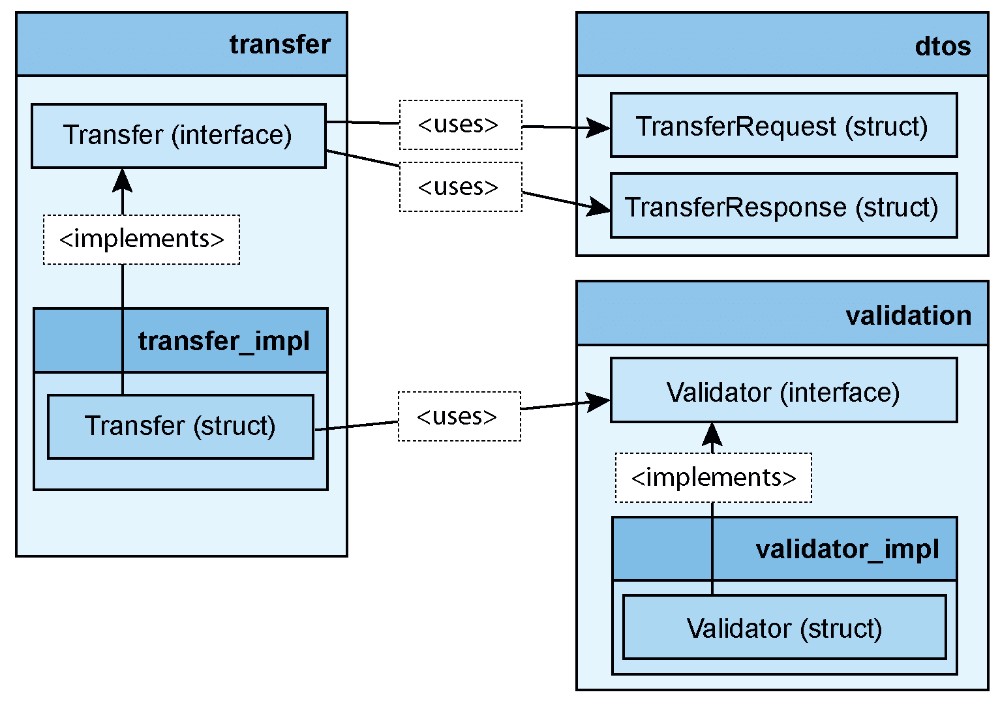

图 5.1—Transfer 模块的传统依赖图

正如你所见，我们已经将结构体及其实现分离开。所有的数据传输对象（请求和响应对象）都在一个独立的包中。结果是我们的传输实现与验证包之间存在链接（耦合）。现在，从 Go 的角度来看，这其中有许多错误。

首先，我们的传输模块涉及了太多的包。最先且最容易丢弃的包是`transfer_impl`包。我们通过删除`Transfer`接口并将`Transfer`结构体移动到`transfer`包来实现这一点。得益于 Go 对隐式接口的支持，`transfer`包不需要通过接口来定义“这是我提供的”。如果另一个包想要使用并模拟（mock）我们的`Transfer`结构体，它可以定义自己的接口和模拟实现。

此外，任何此类接口都应该遵循接口隔离原则，并仅指定它们需要的方法。通过这种方式，接口的角度就从“这是我提供的”变成了“这是我需要的”。

我们需要处理的下一个问题是`dto`包。这并不是我们应该在这里使用的模式。这其中有许多原因，但我将提供最重要的两点。首先是清晰性。因为我们使用`dto.TransferRequest`这种形式来引用类型，泛义名称`dto`并没有告诉我们任何信息。我们错过了让代码表达该结构体属于哪个包、以及如何以及何时使用的机会。在将此结构体移动到`transfer`包之后，所有权变得显而易见，我们甚至可以将名称缩短为`transfer.Request`，从而减少了我们的输入量和心理负担。

第二个避免使用通用、共享包的原因是解耦。当我们有一个共享包时，很快，我们应用程序的大部分代码都会依赖于该包。这不仅让我们的依赖图变成了一大堆乱乱的“湿意大利面”，而且变得无法清楚地判断哪些包是由于使用了共享类型而耦合的。

最后两项变化我们可以一起引入，因为它们具有相同的目的。在传统样式中，我们有一个`Request`结构体，并且我们的传输实现结构体与`Validator`接口之间存在依赖链接。我们可以将这两者都替换为局部接口——同样，将接口改为“这是我需要的”视角。我们的`transfer.Request`接口定义了数据访问方法（getters），概述了我们所需的数据；作为接口比作为结构体更好，因为它允许用户复用他们的对象，而不是强制他们构建新对象来调用我们。最后，我们重新定义`Validator`接口，将其缩减为仅包含在此传输包使用的方法。

在完成所有更改后，我们更新后的依赖图如下：

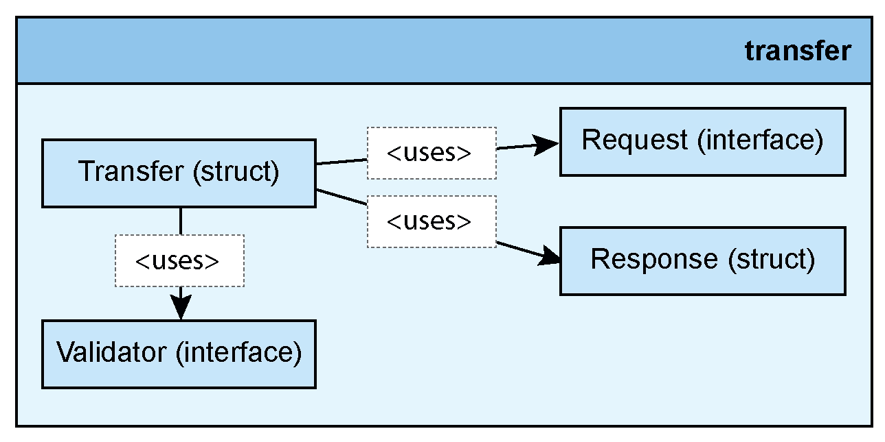

图 5.2—`Transfer`模块改进后的依赖图

最初，我们的“简单”传输模块涉及了四个包和六个对象。为了完全理解这个功能，我们必须在所有这些包之间来回跳转。有了这个新结构，与我们的传输模块相关的所有都在一个地方；甚至可以在一个文件中。我们的包现在是完全解耦且自成一体的。

### 一都在包名中

在为你的包选择名称时，有三件事我们应该做：

- 阅读《Effective Go》——[`go.dev/doc/effective_go#package-names`](https://go.dev/doc/effective_go#package-names)
- 阅读 Go 博客上的这篇优秀文章——[`go.dev/blog/package-names`](https://go.dev/blog/package-names)
- 记住包名将在代码中如何被使用。

让一本书要求你阅读一个网页可能很奇怪，但这些文章是极佳的，我们应该反复阅读它们，直到它们成为一种本能。为了扩展“记住包名将在代码中如何被使用”这一点，请考虑这种情况。很容易在几乎不费力的情况下快速选择一个包名并写下如下：

```go
package utils
```

在写下这一行后，我们开始向文件中填充各种功能。毕竟，这些功能才是我们获得报酬的原因。在匆忙中，我们忘记了此包的任何使用将以`utils.DoSomething()`的形式存在。通过选择一个泛义名称，我们错过了让我们的包名具有信息量且实用的黄金机会。此外，由于我们没有为选择包名投入足够的精力，我们错过了利用包名来定义包的范围和意图的机会。

关于包名如何使用的最后一点要点涉及命名冲突。假设你有一个名为`errors`的包。抛开我们已经强调的关于泛义命名包的问题不谈，这里的问题是该包名与标准库中的一个包相同。由于由于，当你编写`errors.New("something failed")`时，Go 工具将无法为你自动解析导入。这似乎是一个微不足道的问题，但它会降低项目进度。

### 文件组织

Go 文件中的代码应该如何组织这一点出奇地缺乏文档说明。这一节旨在弥补这一缺陷。与本节中的所有内容一样，一致性至关重要。一致地组织代码有助于所有人以最小的努力找到东西。思考文件中代码顺序的最好方法是比报纸。最重要且引人眼目的项目应该放在顶部，后面是细节，最不重要的放在最后。读者应该能够通过阅读文件的开头快速理解该文件的目的，然后只有在他们需要更多信息时，才需要读到底部。这转化为以下顺序：

1. 常量
2. 全局变量（如具名的错误）
3. 构造函数
4. 结构体定义
5. 公有结构体方法和函数
6. 私有结构体方法和私有函数
7. 输入接口和私有类型

对于私有方法和函数，它们是实现细节，只有当我们需要重构它们时才需要阅读。最后是关于输入接口：虽然它们是公共 API 的一部分，但它们被放置在底部，并处理得更像实现细节。这里有两种考虑：对于用户来说，只有当用户决定使用公共方法或函数时，输入接口才有意义，而那时他们可以轻松找到这些接口，因为它们位于一个可预测的位置。对于代码维护者来说，它们是实现细节，在处理其他代码时，不需要将它们的具体细节记在心中。

这里需要考虑的最后一点是，作为程序员，我们经常受到时间限制。因此，阅读代码的最后一行几乎在不可能和低效之间徘徊。希望我们的顶层公共函数相对较短——例如，少于 40 行——并且在需要时具有一定的抽象性。考虑以下方法：

```go
func (o *OrderManager) Process(order Order) error {
    err := o.validateOrder(order)
    if err != nil {
        return err
    }
    receiptNo := o.chargeCustomer(order)
    o.sendReceipt(order, receiptNo)
    o.informWarehouse(order)
    return nil
}
```

在阅读上述代码后，在不阅读其他方法的情况下，你理解这个方法的作用什么吗？如果你只有时间进行大致的理解，那么阅读这个方法就足够了。子方法是“实现细节”，如果我们需要，可以在文件的更下方找到它们。

如果你的代码顺序与这里概述的并不完全匹配，请不要担心。这里有两个关键要点：首先，当安排保持一致时，你可以更快、更方便地找到你需要的内容。其次，倾向于将重要的部分放在顶部，而将琐碎的实现放在底部。这两个操作将为你带来同样的益处：可预测性和易用性。

## 一个包中应该包含多少文件？

关于一个包中应该包含多少文件，或者推之，这些文件的适当长度并没有标准答案。它取决于包的范围以及它所执行任务的复杂性。

正如我们讨论过的，包是相关功能的逻辑分组。因此，最直接的组织方式是每个功能一个文件。请注意这里使用的是“功能（feature）”一词而不是“函数（function）”。每个功能使用一个文件可以最大限度地减少我们在添加或维护功能时需要交互的文件数量。

每个功能一个文件是一个指导性理想，而不是规则。我们应该避免不必要地添加新文件，特别是那些“其他文件”，例如仅为常量或错误创建的文件。常量和错误应该定义在它们使用的地方附近，除非它们在整个包中都被使用。

一个明显的例外是`doc.go`文件：如果我们正在编写包文档——对于大多数包来说我们都应该这样做——那么按照惯例，这些文档应该放在`doc.go`中。

## 我需要函数还是方法？

这看起来可能是一个奇怪的问题，但令人惊讶的是，许多程序员在 Go 的这方面都很困扰。根据他们之前使用的编程语言，程序员往往会倾向于其中一种。由于 Go 不会强迫我们采用特定的解决方案，我们必须采用一种让我们免于麻烦的风格。

我的第一个风格规范是：函数应该是无状态的。是的，将函数与全局变量结合起来是可能的，但那是制造麻烦的根源。如果一个函数需要状态，我们应该将其转换为方法。这确保了方法和它所依赖的状态在`struct`中逻辑上组合在一起。

我的第二个风格规范是：分组的方法并不要求是有状态的。不，这并不矛盾第一个规范。向`struct`添加方法也是为了将方法在逻辑上分组在一起。这种分组允许作者表达出这些方法是相关的，并且应该作为一个组来处理。

我的最后一个风格规范是：始终考虑用户。如果你提供的功能很可能为了测试而进行依赖注入或 mock（模拟），那么以结构体和方法的形式提供它会更好。虽然 mock/替换函数是可能的，但对于来自面向对象背景的程序员来说，这有些笨拙且陌生。考虑标准库中的`time.Now()`函数。提供此功能最简单的方法是作为函数，但有时我们想要 mock 或桩这个函数，以便在测试中获得可预测的时间。这本作为方法提供，但那样为了获取时间，每个人都得写`time.Time{}.Now()`，这很笨拙。通过考虑用户，我们得出结论：几乎总是，用户想要访问时间而不在乎 mock。我们针对最常见的用例进行优化。

## 我们的函数和方法应该有多长？

如果你在寻找一个具体的数字来设置你的 linter（检查器），那么就是 30 行。我是如何得出这个数字的？我打开 IDE，看看我的笔记本电脑屏幕能容纳多少行代码。（实际上能容纳 35 行；我向下取整了）。与文件类似，函数和方法应该只在需要时那么长；通常来说，越短越好。函数越短，越容易理解，因此也越容易处理。当一个函数的所有代码都能出现在屏幕上时，我们就不需要滚动或记住函数的其余部分。

我提供的关于保持函数短小的最后一个动机是，它鼓励我们根据单一职责原则组织代码，即：单一目的、单一责任和单一抽象层级。

当我们的函数和方法变得太长时，就是该重构了：根据目的将函数拆分为单独的函数，或者提取不同的部分并引入抽象。

## 考虑参数和返回值

除了命名之外，参数的数量和组织是决定函数和方法用户体验（UX）最重要的因素。因此，令人惊讶的是，它经常被忽视。

由于 Go 不限制返回值的数量，本节提出的考虑因素同样适用于参数和返回值，但作为两个独立的组。为了简洁，后文中将使用“参数（arguments）”一词来指代参数列表或返回值列表。

通常，参数是在产生需要的情况下的情况下考虑添加的；这是完全错误的。在添加任何参数之前，我们应该考虑以下几点：

- 参数的数量
- 参数的范围
- 参数的分组
- 参数的顺序

让我们深入探讨。

### 参数的数量

从用户体验的角度来看，理想参数数量是零。没有参数时，传递错误的参数是不可能的。假设函数命名良好，在不了解实现细节的情况下，应该很容易理解如何使用它以及它做了什么。同样，如果没有返回值，我们也无法误用它们。

显然，一个没有任何参数也没有返回变量的应用将无法实现很多功能，所以问题变成了：我们的目标是多少个参数？鉴于函数的可用性与参数和返回值的数量成反比，越少越好；但如果你非要让我给出一个数字，每种三个。

考虑参数是什么。它们是传入函数的数据，我们用它们来执行某些操作。因此，传入的参数越多，我们执行的操作就越复杂。同样的逻辑也适用于返回值。这种复杂性为维护者和用户都带来了心理负担。它通常也表明我们存在单一职责的问题。

关于参数数量的最后一个也是最容易考虑的因素是代码的易读性。函数的参数越多，其函数签名就越可能超出屏幕或超过团队设置的任何行长度限制并被换行。这两种情况都会让快速扫描函数变得变得困难得多。

### 参数的作用范围

在尝试减少参数数量时，首先想到的通常是将它们移动到其他地方，例如将参数从方法移动到构造函数。这可能是正确的选择，但很大取决于参数的作用范围或生命周期。考虑以下发送邮件的函数：

```go
func SendEmail(server string, auth smtp.Auth, from string, to string, subject string, message string, attachments []os.File) error {
// implementation removed
}
```

如你所见，参数列表相当长，而且即使如此，它还没有涵盖未来可能需要的所有选项和邮件功能。换句话说，以后情况可能会更糟。

在考虑参数的作用范围时，我们应该问自己的问题是：

- 数据在对象初始化时是已知的吗？如果是，这就是初始化作用域（init-scoped）数据。
- 数据是否设置一次后就再或很少更改？如果是，这就是初始化作用域数据。
- 我们在每次调用此方法时都需要传入这个参数吗？如果不是，这就是初始化作用域数据。
- 数据是否在每个请求中可能不同？如果是，这就是请求作用域（request-scoped）数据。
- 数据是否与请求相关或受请求影响？如果是，这就是请求作用域数据。

初始化作用域的数据应该在对象构造期间作为公共成员数据或构造函数参数提供。如果数据需要更改但不是请求作用域的，可以通过访问公共成员数据或通过设置函数（setter function）来更改。只需注意数据竞态（data races）。

另一方面，请求作用域的数据应该是单个方法的参数。

在我们的示例中，`server`和`auth`参数是初始化作用域的，因此它们是提升为构造函数或公共成员数据的理想人选，如下：

```go
type Sender struct {
    Server string
    Auth   smtp.Auth
}

func (s Sender) Send(from string, to string, subject string, message string, attachments []os.File) error {
// implementation removed
return nil
}
```


随着参数列表的缩短，我们函数的用户体验（UX）无疑得到了改善；读取函数签名变得更容易，该函数的用户需要处理的参数也更少了。然而，我们的函数仍然很长且难以处理。别担心，还有更多的改进。

## 参数的分组

当我们努力改进函数的用户体验时，应该考虑的下一个问题是参数分组。在 Go 中，参数分组有两种形式。第一种是传统的面向对象方法，根据逻辑目的对参数进行分组。

如果我们重新检查发送邮件示例，可以快速发现 `subject`、`message` 和 `attachments` 形成了一个逻辑组，包含了我们正尝试发送的邮件。因此，我们可以通过将这些参数移动到单独的结构体或输入接口中将它们提升为一个组，如下：

```go
func (s Sender) Send(from string, to string, email Email) error {
    // implementation removed
    return nil
}
```

```go
type Email struct {
    Subject     string
    Message     string
    Attachments []os.File
}
```

随着参数列表的缩短，我们函数的用户体验无疑得到了改善；读取函数签名变得更容易，该函数的用户需要处理的参数也更少了。然而，我们的函数仍然很长且难以处理。别担心，还有更多的改进。

## 参数的顺序

你是否想过，当使用 `Context` 时，它为什么总是第一个参数？为什么当一个函数返回 `error` 时，它总是最后一个值？这些都是约定，但这些约定的动机是用户体验。

### 布尔参数是邪恶的

布尔输入参数是阴险的，因为添加它们非常简单，但代价非常高。考虑以下代码片段：

```go
result := user.CheckGender(true)
```

```go
newQty, exists, err := addToOrderQuantity(orderID, productCode, additionalQty)
if err != nil {
    return err
}
if !exists {
    return fmt.Errorf("failed to load order with id %s", orderID)
}
```

在这段代码中，我们的 `addToOrderQuantity()` 方法返回一个布尔值来表示提供的订单被找到，并返回一个错误来表示发生了技术性问题。这是一个常见的错误，源于将错误误认为异常。正如从代码片段所示，函数的调用者并不关心是发生了技术故障还是未找到订单，在这两种情况下，它都是一次失败。因此，我们可以通过将布尔值替换为命名错误来减少用户需要的工作量。这样用户就可以决定是否希望对不同的可能结果做出不同的反应。

## 减少构造函数参数

我们之前讨论过减少函数和方法的参数数量，并建议将初始化作用域（init-scoped）参数从方法移动到构造函数。但很难看出，这很快会让我们构造函数的交互体验（UX）变得非常糟糕。因此产生了一个问题：我们对此能做些什么吗？

为了解决这个问题，我为你提供两种策略：

- 采用私有构造函数
- 采用配置注入（config injection）

让我们详细检查其中的每一项。

### 采用私有构造函数

采用私有构造函数时，我们并没有减少构造过程中使用的参数数量，而是从公共构造函数中移除尽可能多的参数，以提高外部用户的 UX。

考虑以下函数：

```go
NewUserManager(minNameLen, maxNameLen int, pwdEncoder PasswordEncoder, storage Storage, now func() time.Time, risk RiskManager) *UserManager
```

在我们的示例中，我们有两个参数（`minNameLen` 和 `maxNameLen`）用于配置用户名的设置，有三个接口依赖（`pwdEncoder`、`storage` 和 `risk`）被依赖注入，我们还注入了一个名为 `now` 的闭包。

我们应该问自己的第一个问题是：“这些依赖是否有纯粹为了测试而传递的？”

在这个示例中，`now` 闭包符合这个描述，因为它是为了允许我们替换对 `time.Now()` 的调用并获得可预测的测试。

测试期间的模拟（Mocking）和存根（stubbing）是创建高质量测试的强大工具；然而，在这种情况下，它对用户产生了负面影响。用户被要求传递一个并非出于他们目的的参数。此外，要求他们这样做是泄露了实现细节。

为了解决这个问题，我们引入了私有构造函数，并从公共函数中移除了仅用于测试的内容。结果如下：

```go
func NewUserManager(minNameLen, maxNameLen int, pwdEncoder PasswordEncoder, storage Storage, risk RiskManager) *UserManager {
    return newUserManager(minNameLen, maxNameLen, pwdEncoder, storage, time.Now, risk)
}

func newUserManager(minNameLen, maxNameLen int, pwdEncoder PasswordEncoder, storage Storage, now func() time.Time, risk RiskManager) *UserManager {
    return &UserManager{
        // implementation removed
    }
}
```

通过我们更新后的结构，我们仍然注入了 `now` 闭包并拥有可预测的测试，但我们提高了外部用户的 UX。

我们应该问自己的第二个问题是：“是否存在所有用户都会传递相同值的参数？”

假设在我们的示例中，`PasswordEncoder` 是我们在与 `UserManager` 相同的包中定义并实现的。只有一个实现，而且可能永远都只有一个实现。我知道这有点争议，但为什么要要求所有用户注入相同的值呢？我们可以使用私有构造函数为他们注入它。

如果你问人们为什么选择将关注点分离到单独的对象，他们的回答通常会包含解耦对象并允许任何未来扩展的愿望。解耦是一个很棒的目标；然而允许潜在的未来扩展可能会浪费精力。通过这种方法，你可以拥有依赖注入的优点（如解耦和模拟），但又不会损害 UX。

### 采用配置注入

即使应用了私有构造函数的方法，我们的示例仍然有四个参数，其中两个不是依赖，而是配置。我们构造的示例相对简单，构造函数需要更多的配置参数并不罕见。为了解决这个问题，让我为你介绍配置注入。

配置注入承认配置通常来自单一来源（通常是文件或配置管理系统），并且通常由单个对象加载和管理。由于这个配置对象的创建代价很高，我们经常对此配置实例使用单例模式。正因如此，配置实例是存储其他单例（如数据库连接池）的绝佳位置。为了更好地说明这一点，让我们放大视角看看我们的构造函数是如何使用的。假设 `minNameLen` 和 `maxNameLen` 配置值是应用程序更广泛配置的一部分，并存储在 JSON 文件中。我们必须从文件中加载此配置，然后将其传递给我们的构造函数。简单的实现如下：

```go
// load the config
rawJSON, err := os.ReadFile("testdata/config.json")
if err != nil {
    return fmt.Errorf("failed to load config with err: %w", err)
}

config := &AppConfig{}
err = json.Unmarshal(rawJSON, config)
if err != nil {
    return fmt.Errorf("failed to parse config with err: %w", err)
}

// Call our constructor
example.NewUserManager(config.MinNameLen, config.MaxNameLen, storage, risk)
```

通过应用配置注入，我们将所有的配置以及任何其他单例（如数据库池或监控客户端）收集到如下接口中：

```go
type Config interface {
    GetDBPool() *sql.DB
    GetMinNameLen() int
    GetMaxNameLen() int
}
```

在这个示例中，我仅为了说明包含了一个数据库池。有了我们的接口，我们现在可以通过将所有配置合并到一个变量中来更新我们的构造函数：

```go
func NewUserManager(cfg Config, storage Storage, risk RiskManager) *UserManager {
    return newUserManager(cfg, &myPasswordEncoder{}, storage, time.Now, risk)
}

func newUserManager(cfg Config, pwdEncoder PasswordEncoder, storage Storage, now func() time.Time, risk RiskManager) *UserManager {
    return &UserManager{
        cfg:        cfg,
        pwdEncoder: pwdEncoder,
        storage:    storage,
        now:        now,
        risk:       risk,
    }
}
```

在这个示例中，我们只将两个变量减少为了一个，这是一个小小的胜利。然而，大多数应用程序的配置比这多得多。此外，配置在应用程序的生命周期内往往增加，这使得配置注入随着时间的推移变得更有价值。

最后，让我们回到之前关于使用配置注入模式来管理配置和单例的观点。如果你像我一样，倾向于大量使用依赖注入，并且反感使用全局变量。在这种情况下，你会发现许多构造函数都承担了注入跨功能关注点的负担。不久之后，大多数构造函数都将 `logger` 和 `instrumentation clients` 作为参数。考虑到“参数越少越好”的底层理念，这两个或多个参数就成了用户体验（UX）的负担。因此，我建议将 `logger` 和 `instrumentation client` 实例这些跨功能关注点移动到与配置相同的 `struct` 内部。这样可以使这些客户端离开参数列表，并为 `logger` 和 `instrumentation` 实例提供一种代理单例的实现。我知道这违背了“配置注入”的名称，我可能应该想个更好的名字，但从 UX 的角度来看，我觉得它非常有说服力。

## 变得可预测

在本章的开头，我们将可预测的代码定义为可靠的、逻辑性的且不包含惊喜或陷阱。到目前为止，我们讨论了许多内容，如命名和避免全局状态，这些都有助于代码具有逻辑性和可靠性。本节将更进一步，检查用户如何从外部视角与我们的 `structs` 和 `packages` 交互。

### APIs：只导出你必须导出的

在决定将 `struct` 方法、成员数据或函数设为私有还是公共时，有一个简单的规则：将一切都设为私有……直到你别无选择为止。每当我们导出某个东西时，其他人就可以使用它。一旦他们使用它，我们就被要求必须维护它。这意味着我们不能在不处理现有使用情况的情况下删除、重构或重命名它。

这种对改变变化的抵触可能会促使我们犯其他错误，例如避免维护、为了适应所有用例而创建过于复杂的 UX，有时为了避免处理现有使用情况而重复代码或废弃代码。这是技术债的重要来源。

正因如此，我们应该认为所有导出的代码都具有持续的成本：也许很小，但随着项目代码量的增加，这种成本也会随之增加。这也是重构遗留代码如此困难的主要原因。

这种方法是另一个强有力的论据，支持选择 `KISS` 原则优于上一章中检查的 `DRY` 原则。对 `DRY` 的严格应用不可避免会导致产生许多微小的函数或包。然而，必须导出它们以确保在整个应用程序中的高重用性。这就是我们提到的成本开始显现的时候。有时，这是我们必须承担的成本——但是可以缓解的。当一个包预计只被少数几个而非整个应用程序使用时，我们可以在用户的包下创建一个内部目录并将其变为模块，从而强制这种关系并限制范围和成本。关于这一概念将在下一节中详细介绍。

### APIs：好篱笆墙造出好邻居

为了解释如何将代码拆分为模块，我们首先需要定义什么是 `module`（模块），然后快速回顾一下 `internal` 包及其用法。我们讨论的不是 `go mod` 意义上的模块；我们说的是传统软件设计中的模块。模块是一个或多个 `Go packages` 的逻辑分组，以实现单一目标。

根据你如何组织代码库，这些目标可能是基于功能的（如 `user module` 或 `order module`），也可能是基于软件分层的（如 `API` 或 `storage layer`）。以下是对 `internal` 包的快速回顾。`internal` 包路径下的包只能被以下内容导入：

- 该 `internal` 包下的其他包
- `internal` 包直接上层的包
- 与 `internal` 包同一层的包

让我们用一个例子来演示如何使用 `internal` 来创建模块。考虑以下结构：

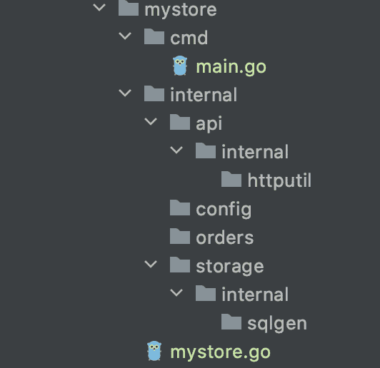

图 5.3—示例应用结构

该结构显示了一个名为 `MyStore` 的虚拟在线商店。该项目是一个 HTTP REST 服务，`main` 函数位于 `cmd` 包下。

`api`、`config`、`orders` 和 `storage` 包都在 `internal` 包下。`cmd` 包可以导入 `api`、`config`、`orders` 和 `storage` 包，因为它们是与 `cmd` 拥有相同父包 `internal` 包的子包。然而，`cmd` 包不能导入 `httputil` 包。通过在 `api` 包下添加另一个 `internal` 包并将 `httputil` 包放在该 `internal` 包下，我们创建了一个 `API`。`sqlgen` 包也是如此；它是 `storage module` 的一部分。

通过这种方式将代码拆分为模块，我们可以在模块之间拥有清晰的边界或篱笆，同时允许自己将功能提取到简洁、逻辑的容器中，从而避免了将这些功能公开时会引入的成本。

此外，使用模块为模块内部实现决策提供了额外的封装，这迫使模块之间的耦合更加松散。

### 封装的可预测性

许多程序员在学习面向对象的语言时首次接触封装。它通常被表示为对象、其状态以及一些修改该状态方法的组合。但这种观点并不能准确解释封装的目标。封装实际上是关于信息隐藏。

但我们在隐藏什么，以及为什么隐藏它是理想的呢？

在 `struct` 级别，我们隐藏了对象的内部状态和私有方法。在 `package` 级别，我们隐藏了用于实现目标的函数、私有对象和 `interfaces`。在 `module` 级别，我们隐藏了子包。在所有情况下，我们都在隐藏实现细节。我们这样做是为了为代码提供未来保障：保护我们免受当前实现决策以及未来需求变更的影响。当实现决策被隐藏时，我们可以在不影响用户的情况下进行重构。考虑以下函数：

```go
func Authenticate(username, password string) (*storage.User, error) {
    err := performBusinessLogic(username, password)
    if err != nil {
        return nil, err
    }
    return storage.LoadByPassword(username, password)
}
```

表面上看，这个函数看起来很好。然而，它并没有正确封装，并且由于返回了 `storage` 包中的 `User` 类型而泄露了依赖细节。因此，对 `storage` 包的任何更改都可能无意中影响该函数的调用。为了完全封装我们对依赖的选择，我们将输出参数更改为包内部定义的类型。通过这种层级进行数据序列化和反序列化可能看起来很极端或浪费，在许多情况下确实如此。我的目标在这里是强调一个潜在的问题，并让你自己决定想做哪种权衡：完全封装还是序列化与反序列化。

还有另一种常见的封装在未察觉的情况下泄露，泄露了实现细节。考虑以下代码：

```go
type OrderManager struct {
    storage Storage
}

type Storage interface {
    DoQuery(q string, args ...interface{}) ([]interface{}, error)
}
```

这里的问题很难发现。我们注入的 `Storage` 接口与底层存储的选择映射得过于紧密，这是一个实现细节。从定义来看，`Storage` 的实现可能封装了一个 SQL 数据库，但当我们想将其更改其他东西时会发生什么？即使我们永远不更改决策，为什么 `OrderManager` 的用户需要感知另一个对象的 SQL 查询（实现细节）呢？为了纠正封装，我们需要使用一个不泄露实现选择的接口，如下：

```go
type OrderManager struct {
    storage Storage
}

type Storage interface {
    LoadByID(int) (*Order, error)
    Save(*Order) error
}
```


在这种新方法中，接口定义的关系是抽象的，不会泄露任何实现细节。因此，`Storage` 的实现可以在不影响此代码的情况下进行重构，而且对此代码的任何测试都不需要知道 `Storage` 如何工作。

通过这些方式应用封装，我们还降低了对象、包和模块之间的耦合。这具有额外的处。首先，它驱动我们的每部分代码变得更加自恰包含，从而更容易理解。其次，因为每个部分都更加自恰包含，测试也变得更简单。最后，由于前两点，调试也变得更简单。当出现问题时，我们可以轻松且独立地验证每个部分，直到找到行为异常的那个部分。

## 构造函数 (Constructors)

正如你可能所知的，构造函数并不是 Go 的强制要求，甚至不是官方，但我们仍然可以从这种模式中获益。由于它们不是语言的官方部分，构造函数可以做任何事情，这导致会导致一些错误。让我们来看看什么是构造函数，以及它们应该和不应该做什么。

构造函数只是返回新创建对象的普通函数。

构造函数可以命名为任何，但一致的命名风格会使它们更容易发现和使用。通常，只需使用 `New` 字或 `New` 后跟结构体的名称完全是可以预测的。

只有当我们需要构造函数执行创建对象之外的任务时，我们才应该花精力创建它们。下面的构造函数虽然构造了结构体的新实例，但并没有为我们提供任何额外的价值：

```go
func NewStorage() *Storage {
    return &Storage{}
}
```

构造函数应该确保对象已就绪，但它们不应该打开连接或进行初始化。这是许多人出错的地方；我们必须将构造与初始化分离。考虑这种情况：我们正在编写一个代表 gRPC 客户端的结构体，与某个第三方系统通信。当我们调用构造函数时，有很多原因导致该远程系统无法访问。因此，如果我们的构造函数尝试初始化连接池因为无法调用该远程系统而失败，我们的应用程序初始化也会失败。通过将应用程序启动与外部系统的可用性耦合，我们失去了从这种失败中恢复韧性和自动恢复的机会，也许更糟糕，我们创造了一个外部服务必须在我们代码启动之前启动的情况。这里需要警惕的代码异味是返回错误的构造函数。如果你的构造函数返回错误，它可能在做的不仅仅是初始化。

回到对象已就绪的观点，构造函数应该负责确保对象的内部状态得到妥当配置，如下代码所示：

```go
func NewStorage() *Storage {
    return &Storage{
        cache:  map[string]interface{}{},
        stopCh: make(chan struct{}),
    }
}
```

调用此构造函数后，我们的 `Storage` 对象已就绪并具有可预测的内部状态。内部资源（如 maps、channels 和 wait groups）已初始化并可以使用。

最后，构造函数应该尽可能地易用。我们之前讨论过通过私有构造函数和配置注入来减少构造函数参数，但通常我们还可以做更多来提高它们的易用性。在有可选参数的情况下，我们可以采用函数式选项（functional options）方法来区分必需参数和可选参数。考虑以下构造函数：

```go
func NewStatsDClient(host string, port int, sampleRate int, sendBuffer int, validateKeys bool, tags []string) *StatsClient
```

通过将所有可选参数替换为函数式参数，我们非常清晰地明确了哪些参数是必需的，哪些是可选的，并显著减少了使用错误的概率。生成的构造函数签名改进为：

```go
func NewStatsDClient(host string, options ...Option) *StatsClient
```

如果你不熟悉函数式选项模式，在第 8 章的“Functional Options”章节中有更详细的讨论，包括此转换的完整细节。

## 少量的拷贝 vs. 少量的依赖

你可能没有意识到，代码所拥有的每种依赖都是代价的。导入代码不仅会增加构建时间，还为每个额外的依赖项增加了复杂性和耦合。增加的复杂性来自于在不了解导入代码的情况下无法完全理解这些代码。通常，我们尝试通过信息丰富的抽象和优秀的命名来降低这种复杂度成本。

至于耦合，有两种形式。第一是显而易见且符合预期的。为了让我们的代码工作，导入的代码必须正确执行。当然，这里没有问题；这就是我们最初导入代码的原因。假设导入是可靠的，这种耦合的成本远小于导入带来的收益。

第二种形式的形式要不明显，而且可能昂得多。当我们导入一段代码时，我们成了该代码更改的阻碍。我们依赖于导入项在我们采用它时所拥有的参数和行为。如果这段代码的其他用户需要更改，他们必须以不破坏我们代码的方式进行。

我提供这些论点并不是为了自己实现或“不计代价地”避免依赖的理由。与一切事物一样，存在平衡。这些成本很小，但它们确实存在。下次当你想，“我在其他包里有一个函数可以做这个”时，我希望你停下来考虑一下。考虑将该函数公开的成本。考虑构建时间、复杂性和耦合的成本。请不要掉入不考虑就将这些“共享”代码移动到 `util` 或 `common` 包的陷阱。这只会加剧我们试图避免的成本。对于少量的代码（例如单个函数），你会发现拷贝实现而不是添加依赖项，会让代码处于一个更好、更简单的位置。

## 处理冲突目标

被编程吸引的人群也被具有唯一正确答案的情况所吸引。这就是我们花费大量精力和争论哪些工具/语言/方法论是“正确之的”的原因之一。我的经验使我相信，编程完全关乎上下文，因此，“正确”的答案根据上下文而异。

与其为你每种情况提供一种“正确的方法”，我愿意为你提供一个指导原则。默认情况下，我们应该始终关注代码 UX。具有良好 UX 的代码是为了主要用户（程序员）优化的。它确保代码易于阅读、维护和扩展。在某些时候我们需要故意编写 UX 差的代码——例如，在我们需要极端性能的情况下——但这些情况是罕见的，这种权衡应该是有意识地做的。

## 代码 UX 与性能之间的权衡

在那些我们的应用程序保证有高使用率或部署在资源受限环境中的罕见情况下，倾向于高性能代码是有意义的。正如你可能在系列的第一本书中看到的，高性能代码通常是创建、阅读和维护最具挑战性的实现风格。如果你发现自己需要更快的代码，我有一个代码性能的 80/20 法则：

```
应用程序 80% 的 CPU 时间通常在 20% 的代码中消耗。
```

是的，我在这里是在开玩笑，但令人惊讶的是，大多数时间里，只有极小部分代码在运行。任何花费在测量以识别这段热点代码路径并对其进行优化的时间，即使只是一点点，都会带来显著的回报。为了给出一个更具体的例子，假设你有两个端点：一个允许用户上传日报，另一个用于执行登录。将上传速度从 10 秒改进到 7 秒听起来比将登录从 100 毫秒缩短到 80 毫秒是一个巨大的胜利。然而，日报 API 很少被使用，而登录接口全天都在被使用。因此，通过降低它的成本，我们是在减少整个系统的负载，从而提高了系统的整体容量。

## 代码 UX 与代码 UX 之间的权衡

正如你在本章和上一章中无疑察觉到的那样，代码 UX 的理想和设计模式往往会冲突。以“不要重复自己”（DRY）原则为例。DRY 原则与“少量拷贝优于少量的依赖”或“自包含包”等理想相冲突。这并不意味着这些想法本身是错误的或不重要的；它只是强调了我们必须做出权衡。对于这种冲突，我们需要问自己：我们目前的情况是倾向于更少但更复杂的代码，还是倾向于更松的耦合和更彻底封装？

这里没有正确答案，但我想重申我之前的观点：编码就是通信。虽然告诉计算机我们希望它为我们做什么是必要的，但向其他程序员传达我们的意图并解释我们的决策是至关重要的。正如世界上不同地区的人说英语时有不同的俚语、成语和风格一样，程序员应该意识到他们的团队、公司和行业规范并拥抱它们。

## 总结

代码 UX 的根本目标是易用性。当代码具有良好的易用性时，感觉是正确的；它感觉自然且舒适。记住，代码是与两个不同受众进行通信的一种形式：计算机和人类。计算机很容易满足——代码要么编译通过要么报错——但人类并不容易满足。

在本章中，我们研究了各种概念，当这些概念被选择性应用于代码时，将提高其易用性。我们可以利用这种易用性提升节省的时间，花费更多的时间来维护和扩展代码，而不是学习和理解它。为了总结这些思想，我想提供我个人最喜欢的格言之一：

让它工作，让它整洁，然后（可能）让它快速。

我们经常花太多的时间在“让它工作”上，而花在“让它整洁”上的时间不够；希望本章让你看到并解决这种不平衡。在下一章中，我们将介绍测试，这将帮助我们确保代码在变得整洁的同时能够工作并持续运行。

## 问题

1. 什么是代码 UX？
2. 为什么代码 UX 重要？
3. 为什么代码的清晰度很重要？
4. 为什么代码一致性很重要？
5. 为什么代码的可预测性很重要？
6. 性能与 UX 之间的权衡是什么？
7. 我们如何在两个冲突的代码 UX 原则之间做决定？

# 第 6 章


## 高级单元测试技术

### 引言

能够编写和维护高质量的单元测试是成为高效有效程序员的不可或缺的一部分。然而，通常人们花费极少的精力来教别人如何编写和维护优秀的测试。本章旨在解决这个问题。

本章将讨论我们在编写单元测试时应该使用的动机和方法，我们应该和不应该测试什么，以及我们应该为测试分配多少精力。

首先，我们将研究单元测试的理论方面。然后，我们将研究 Go 的表驱动测试格式，并利用它快速生成一个全面且可维护的测试套件。随后，我们将在此基础上扩展并讨论测试场景的构建。

我们将讨论如何提高测试的质量、UX 和韧性，以及如何以及何时地利用测试存桩（stubs）、模拟对象（mocks）和录制器（recorders）。

我们将介绍一系列技巧，通过这些技巧可以让我们的测试更高效、更有效或更可靠。随后我们将完成本章，并检查测试有时如何有害，以及如何避免这种由测试引发的损害。

本章将涵盖以下主题：

*   测试的什么、何时、为什么以及如何做
*   表驱动测试
*   测试场景构建
*   模拟对象、存桩和测试录制器
*   测试 UX 与质量
*   实现测试韧性
*   你可能不知道的测试技巧
*   识别测试引发的损害
*   让它工作，让它整洁，然后（可能）让它快速

### 代码

为了充分利用本章的内容，你需要安装了新版本的 `Go` (1.13+) 以及你喜爱的 IDE。

所有代码示例和其他相关材料的完整版本可以在 [`github.com/corsc/Beyond-Effective-Go/tree/master/Chapter06`](https://github.com/corsc/Beyond-Effective-Go/tree/master/Chapter06) 找到。

### 测试的什么、何时、为什么以及如何做

提到测试，常见的错误是误解了测试本身的。。有些人测试视为从高处强加的负担。有些人将测试（特别是测试覆盖率）视为衡量他们工作做得好坏的指标。抱歉，这两者都不是事实。编写自动化测试是程序员为了让自己的工作生活更愉快而做的事情。

### 我们为什么要测试？

我们编写测试是为了工作得更快、更有效。声称编写更多代码可以让我们运行得更快似乎是背反的，但请听我说。我们编写代码是为了给系统添加行为；为了证明行为已经添加，我们必须进行测试。我们可以运行快速的手动测试；这不会浪费太多精力，这样做具有立时价值。然而，这种价值是短暂的。

与自动化测试进行对比。最初编写自动化测试的成本可能比手动测试稍高，但只要它们存在，它们就能持续提供价值。我们可以也应该经常运行这些测试，因为每次运行都能产生一点价值。由于这些测试持续确保系统具有所需的行为，我们不需要浪费时间去回过手动测试，也不会在不知情的情况下面临回归风险。

自动化测试变成了一个安全网，降低了我们可能进行的任何添加或重构的风险。因此，它们也减少了我们对未知或复杂代码的恐惧。

有了足够的测试，我们对代码的信心会增加，因此可以进行更频繁、更快甚至更有冒险的更改而不必引入 Bug。

最后，自动化测试记录了作者对的意图，是新人学习某些代码的存在及其预期行为的高效方式。这反过来缩短了新人上手的时间，并降低了现有开发者向他们解释代码的成本。

### 我们何时测试？

业内许多人在这个问题上花费了大量精力；我不会就这个问题提供任何教条。然而，我会说，只要你在进行测试，在代码之前还是之后编写测试并不重要。尽管如此，我建议买一本 Kent Beck 写的 `Test Driven Development: By Example`。书中的思想适用于所有形式的测试，掌握这些思想将使你的测试更高效、更有效。虽然我经常不做测试驱动开发 (`TDD`)），但本章介绍的许多意图、方法和技巧与 Kent 的观点都是兼容的。

### 我们应该测试多少？

我们应该只进行足够的测试，不多不少。虽然我们希望通过编写测试来提高工作效率，但编写和维护测试是有成本的。如果我们的测试过多，那么测试的成本可能会超过它们带来的价值。

经理们经常促我给出一个最小测试覆盖率数字；当他们催促时，我会告诉非生成代码的每个包覆盖率为 70%。这样做有两个原因：

首先，测试覆盖率是用代码行数来衡量的。但我们拥有多少行代码，或者在测试期间运行了其中多少行代码并不重要，重要的是行为覆盖。对于代码的每种行为，我们都应该至少有一个或多个测试来确认它。

其次，经常会有一些代码是无法合理进行测试的，任何测试的尝试都会损害代码质量，并导致测试引入的破坏。考虑以下代码：

```go
func GetUserAPI(resp http.ResponseWriter, req *http.Request) {
    ID := getID(req)
    user := loadUser(ID)
    payload, err := json.Marshal(user)
    if err != nil {
        resp.WriteHeader(http.StatusInternalServerError)
        return
    }
    _, err = resp.Write(payload)
    if err != nil {
        resp.WriteHeader(http.StatusInternalServerError)
        return
    }
}
```

测试这段代码的每一行都处于极其困难和不可能之间。`json.Marshal()` 和 `http.ResponseWriter.Write()` 都可以返回错误，但这些错误永远不应该发生。我们可以传入一个返回错误的 `http.ResponseWriter` 的 mock 实现，但我们在测试什么呢？我们在测试 mock 本身以及我们处理了错误这一事实。这两者都不是特性，而是某些无关紧的实现细节。此外，我们最终会得到一个价值很小的测试、一个 mock，以及一个我们现在必须维护的测试。这就是测试引入的破坏的形式，我们将在本章末尾对其进行更多探讨。

我提供 70% 的最后一个原因是经验。根据我的经验，70% 是很容易实现和维护的，我们越超过这个数字，花费的时间和精力就越多。我们可以实现更高的覆盖率，但成本往往会超过收益。

回到关于“我们应该测试多少的量”的问题，我们还应该承认测试有多种形式，并考虑我们应该投入每种形式投入多少时间。我使用的三种最常见的测试形式是单元测试、用户验收测试 (UAT) 和端到端 (E2E) 测试。每种类型的测试都有不同的目标、优点和缺点，我们在使用它们时必须留心。

### 单元测试

单元测试的目标是确认被测试单元中是否存在特定的行为。请注意，我在这里用词非常谨慎。一个单元不一定是一个函数；它不一定是一个结构体。单元可以是这些内容，但也可以是协作为某个包添加行为的结构体和函数的集合。

让我们来看一个例子。假设我们有一个 bank 包，负责与外部公司提供的 API 交互。在我们的 bank 包内部有一个名为 `Account` 的结构体，具有以下方法：

```go
func (a *Account) Transfer(amount int, recipient string) error
```


## 单元测试与行为定义

在不看实现的情况下，我们可以定义预期行为：

- 当我们尝试传输负数金额时，我们应该收到错误。
- 当我们尝试向不存在的账户转账时，我们应该收到错误。
- 当 API 宕机时，我们应该收到错误。
- 当 API 返回意外或乱码的响应时，我们应该收到错误。
- 当我们发送有效请求且 API 工作正常时，我们不应该收到错误。

对于这些行为中的每一种，我们应该至少有一个单元测试。通过这样做，我们确保了所有预期的行为都存在，并为后世记录了这些行为。

回到我们对“单元”的定义，如果与外部 API 交互所需的所有依赖都存在于单个结构体中，我们的单元测试将只涉及这一个结构体。但如果我们的实现是这样呢？

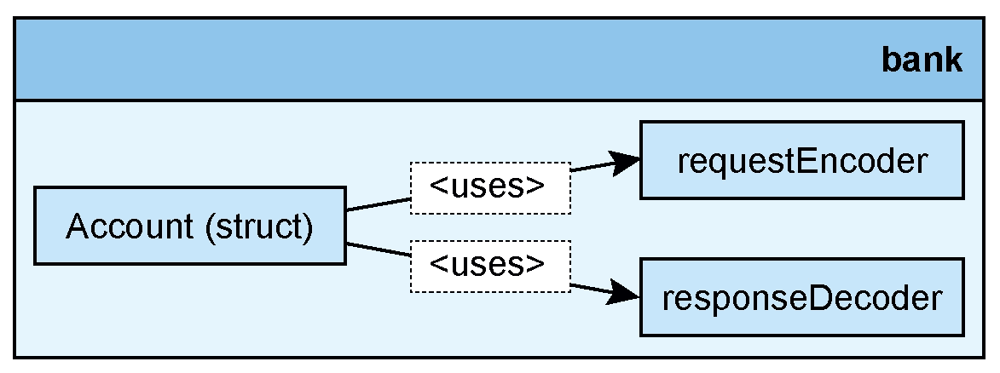

图 6.1—示例 Bank 包结构

如果我们将单元定义为结构体，就必须分别测试`Account`、`requestEncoder`和`requestDecoder`。这是没有必要的，会浪费时间和精力。看我们之前列出的预期行为；并没有提到请求编码或解码。这并不是因为它们不重要，而是因为它们是更广泛行为中的一小部分。在承认这三个结构体没有彼此就不存在，并且它们必须协作来实现我们的目标之后，我们应该将它们视为单个单元。

通过对单元的定义，我们可以看到单元测试的优点和缺点。单元测试的主要优点和缺点是它们的范围小。因为范围小，所以测试很容易编写和理解。这些单元测试将会在小范围内记录并强制执行者的意图。此外，这些测试执行速度很快，所以我们可以不断运行它们。

相反，测试的范围小也是一个缺点，因为它只确认了单元的行为，而不是系统的行为（或特性）。对于这一点，我们需要从系统的视角来看。

## 用户验收测试

用户验收测试侧重于确认系统按照用户预期的方式运行，并且独立于其外部依赖。单元测试和 UAT 之间的主要区别在于测试的范围。在单元测试中，我们关注代码的单个单元，可能会引入 mock 或 stub 来将该单元与其他单元隔离开。对于 UAT，我们正在测试大部分（或全部）代码库。

我对 UAT 的定义可能与你不同。对于可能造成的困惑深表歉意。这些测试的性质和目标符合组件测试的定义，因为范围太大，且测试是从系统外部进行的（即从用户的角度来看）。这些测试也不属于集成测试，因为我们刻意地与集成点解耦，并独立于这些依赖进行测试。

我选择称之为用户验收测试，是因为它们旨在确保在依赖项预期行为（好或坏）的情况下，系统符合用户的预期。

测试范围和隔离仍然是 UAT 的关键考虑因素。记住，我们是在隔离状态测试系统，所以我们的测试不应该依赖任何外部系统。我应该说明，我的意思不是这些测试必须 mock 数据库、文件系统、缓存或任何可以预期在开发环境或 CI 构建节点上存在的资源，而是指任何第三方系统。你可以 mock 数据库和缓存，但这通常有极低的成本效益比。

UAT 场景应该从系统用户的角度构建，并且对实现细节的感知要最少。例如，如果我们有一个登录 API，场景可能是：

- 当数据库运行正常且用户名和密码正确时，我们应该收到成功响应。
- 当数据库宕机时，我们应该收到错误。
- 当数据库运行正常但用户名或密码缺失时，我们应该收到错误。
- 当数据库运行正常但用户名或密码错误时，我们应该收到错误。

如你所见，这些场景中唯一的实现细节就是数据库的存在。我们可以重构这些场景以消除这种感知，但它并没有带给我们任何价值。

就目前的写法而言，我们的场景有些通用。我们可以收紧这些场景以匹配我们的 API 契约，并包含诸如预期响应码等方面。这样做可以更彻底地强制并记录我们的 API 契约。

然而，请不要做得太极端，不要强制执行每一个细节的响应；这样做会使测试变得脆弱，且维护起来更加麻烦。场景的严谨性与脆弱性之间的平衡会根据项目和个人偏好而异。尝试找到你可以接受的最小严格性，然后在发现 bug 或缺陷，或者当错误的风险和成本变得重大时，再增加严格性。

在考虑 UAT（用户验收测试）的覆盖率时，我们不能从代码行的角度来衡量，而应该从功能的角度衡量。某些功能比其他功能更重要，因此应该进行更全面的测试。某些功能比其他功能更复杂或更容易出现 bug，因此需要更多的场景来确保它们按预期工作。某些功能涉及的依赖比其他功能更多，因此会有更多的失败方式，从而需要更多的场景。

## UAT 的优点与缺点

让我们来看看 UAT 的优缺点：UAT 的核心优势在于它们能够确认系统行为符合用户的预期。延伸之，UAT 证明了应用程序交付了预期的价值。

UAT 独立于外部系统运行，这既是优点也是缺点。优点是因为测试完全在我们的控制之下且高度可靠。然而，它也是缺点，因为我们是针对 mock（模拟对象）进行测试，而不是外部依赖。因此，存在我们的 mock 与外部依赖行为不一致的风险。我们可以通过端到端测试（E2E tests）解决这个缺点，正如我们稍后看到的。

然而，UAT 的主要缺点是测试的范围。由于范围很广，当出现问题时，定位根本原因可能非常耗时。对于这种缺点没有完美的应对方法。通常，我们能做的只是尽可能通过 UAT 发现问题，然后使用调试器来定位问题。

### 端到端测试（End-to-end tests）

端到端测试（E2E tests）本质上是针对外部系统的 UAT，其目标是验证应用程序是否按预期工作。在构建 E2E 测试时，我们关注的是用户预期的行为。相比于单元测试，E2E 测试通常具有更高的构建和维护成本，因为它们依赖于外部依赖。

E2E 测试的缺点在于它们依赖于外部依赖。由于它们可能由于与代码无关的原因而失败，因此其信噪比很差。此外，由于它们依赖于外部依赖，其构建和维护成本非常高。

E2E 测试的优点是它们可以了解系统在生产环境中的表现。当外部系统未符合预期时，我们应该在 UAT 中通过模拟响应来处理问题。通过这种方式，我们可以确保系统能够处理这些意外行为并做出可预测的响应。

### 测试金字塔（The test pyramid）

在定义了不同测试类型及其优缺点之后，我们可以回到最初的问题：测试多少？这并不是在单元测试和 UAT 之间做选择，而是关于比例。我们总是受到时间限制，因此必须尽可能有效地利用时间。

测试金字塔是由 Mike Cohn 引入并在 Martin Fowler 等人讨论的一种视觉模型。这是我的测试金字塔版本：


图 6.2—测试金字塔

正如上图所示，我建议将大部分（70%）的测试精力放在单元测试上。这是因为单元测试最易理解、运行成本最低。单元测试支持我们的核心任务。

建议将剩余的精力（28%）投入到 UAT，以验证用户预期的行为。归根结底，我们所交付的是用户价值。但与单元测试相比，UAT 通常具有更高的构建、调试和维护成本。

将剩余的 2% 精力分配给 E2E 测试可能令你惊讶，但这些测试依赖外部依赖。根据我的经验，足够的单元测试就能解决大多数问题。

关于测试金字塔要记住的一点是，它是一个记忆法。虽然我给出了具体的数字（70%、28% 和 2%），但实际的比例取决于你的应用程序、团队和部署环境。

在没有 E2E 测试的情况下，应用程序也可以是成功的；我见过很多这样的例子。如果你没有任何测试并想要开始，请从单元测试开始。当你熟悉了测试后，添加一些 UAT 将变得容易得多，并进一步增强对应用程序的信心。

## 我们应该测试什么？

在决定了是否测试之后，选择测试什么是最影响决策的。我指的不是在单元测试和 UAT 之间做选择，而是测试的入口点。考虑以下结构体：

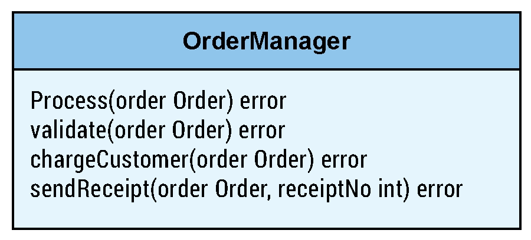

图 6.3—`OrderManager` 结构体

你会注意到这个结构体有四个方法，一个公开，三个私有。公开方法是其他部分交互的 API 或入口点，而三个私有方法是实现细节。如果我们的目标是测试隔离和编写最小、简单的测试，我们可以单独测试这四个方法。除了对`Process()`的测试外，我们所有的测试范围都很小且易于理解。这听起来很棒，不是吗？

思考一下当我们想要进行更改时会发生什么。当我们决定提供多种支付选项时会发生什么？至少，针对`chargeCustomer()`（特定于信用卡支付选项）的测试需要进行巨大的更改，甚至可能被废弃。然而，如果我们所有的测试都是针对`Process()`方法编写的，那么当我们进行这些更改时，只有少数（最好是没有任何）现有测试会损坏。

测试失败通常有两个原因。第一种是回归。发现并防止这种回归是测试的主要目的之一。第二种情况发生在测试的实现与被测试代码的实现过度耦合时。这种形式的测试损坏表明测试本身存在问题，而不是代码。

在这种情况下，问题在于我们对单元测试中“单元”的选择。`chargeCustomer()`的存在是一个实现细节，而不是一种行为。正因为它是一个实现细节，所以具有极大的变化可能性。任何依赖于当前实现的测试都可能在重构期间崩溃，从而对这种更改产生阻力。

结果就是我们可能会不愿重构代码，从而导致技术债。或者如果我们确实执行了重构，这些测试与实现紧密耦合的事实也导致我们在维护测试上花费了额外的工作。

为了避免这些问题，我们将单元视为处理订单的对象或对象，并从其入口点对单元进行测试。通过这种方法，我们的测试更加稳定，并且较少反映当前的实现。

在这个示例中，单元是整个`OrderManager`结构体，入口点是`Process()`方法。此外，由于`Process()`是该单元与其他单元之间的 API 契约，它自然地具有对更改的抗性。

如果你熟悉 TDD 或 BDD 思想，你会发现这里有一些相似之处；我们正试图在不与实现细节任何耦合的情况下验证代码的行为。这种对行为的关注和对实现细节的规避将确保我们的测试对重构具有韧性，从而保持低成本。

这通过一些示例可以得到最好的证明。让我们假设`OrderManager`的`validate()`方法如下：

```go
func (o *OrderManager) validate(order Order) error {
	if order.CustomerName == "" {
		return errors.New("customer name cannot be empty")
	}

	if order.ShippingAddress == "" {
		return errors.New("shipping address cannot be empty")
	}

	return nil
}
```

鉴于我在本章的大部分时间都在试图说服你进行测试，并讨论编写测试的最佳方案，现在断言有些东西是我们不应该编写测试的，这可能看起来奇怪。但事实确实如此。

以下是我们系统中不应该（或不建议）直接测试的方面：

1. **非 API 方法和函数**：任何不直接被代码其他部分调用的方法或函数都不应该被直接测试。它们是实现细节，并且可能会发生变化。我们将通过对代码单元入口点的测试来间接地测试这些代码。然而，在这一点上不需要过于教条。如果你有一个特别复杂的函数想要对其进行隔离测试，那么直接对该函数应用测试是高效的。

2. **任何简单到我们不会出错的程序**：为我们不可能出错的代码编写测试是浪费精力。偶尔，我们可能不得不编写测试来满足某些任意的单元测试覆盖率要求，但如果可以，我们应该节省时间。

3. **别人的代码**：与上一点类似，为我们不拥有的代码编写并维护测试会浪费时间。我们应该信任他人提供的库和模块。如果出现我们不信任并需要测试的情况，最好让对方提交一个包含测试的拉取请求（pull request）。

   这一点有一个例外：在处理未知或未文档化的代码时，编写测试来探索和确认行为是有帮助的。尽管如此，这些测试是我们希望不提交到项目中，或者在大多数时候跳过运行的测试。

4. **生成的代码**：延续上一点，当我们使用第三方工具生成代码时，我们应该将结果视为“别人的代码”。代码生成工具的所有者负责确保他们生成的代码按预期工作；而我们不是。是的，也可以生成测试来测试生成的代码，但大多数情况下，这会浪费精力和努力。

希望在整个本节中，你已经看到了生产力和价值的底层逻辑。这里介绍的关于测试的什么、为什么、何时以及如何做，都是为了构建一种局面：我们花费最少的精力来编写和维护测试，但仍从这种努力中获得最大的价值。

## 表驱动测试

作为经验丰富的 Gopher，你熟悉表驱动测试（table-driven tests, TDT）；它们是编写 Go 测试最高效的方法，大多数情况下都应该使用。原因包括：

- 它们显著减少了同一单元不同测试之间的重复。
- 它们使得在现有单元测试中添加更多测试场景变得非常容易。
- 它们的组织非常整洁。
- 生成的测试输出进行了整洁且实用的分组。

本节将通过一个示例来探索如何充分利用 TDT。首先，让我们介绍将要测试的代码：

```go
type OrderManager struct {
	bank   Bank
	sender ReceiptSender
}

func (o *OrderManager) Process(ctx context.Context, order Order) (receiptNo string, err error) {
	// implementation details removed
}

type Bank interface {
	Charge(ctx context.Context, customerName string, amount int64) (string, error)
}

type ReceiptSender interface {
	SendReceipt(ctx context.Context, customerEmail string, amount int64, receiptNo string) error
}
```

我特意删除了所有的实现细节，只留下了公开可见的部分：API 和注入的依赖项。被测试的对象相当直接。

```go
func TestOrderManager_Process(t *testing.T) {
	scenarios := []struct {
		scenarioDesc        string
		inputOrder          Order
		configureMockBank   func(Bank)
		configureMockSender func(ReceiptSender)
		expectedReceiptNo   string
		expectErr           bool
	}{
		// scenarios
	}

	// implementation removed
}
```

如果你想查看完整的实现代码，可以在这里：`https://github.com/corsc/Beyond-Effective-Go/tree/master/Chapter06/02_table_driven_tests/example.go`。

现在，让我们引入测试：

```go
func TestOrderManager_Process(t *testing.T) {
	scenarios := []struct {
		scenarioDesc        string
		inputOrder          Order
		configureMockBank   func(Bank)
		configureMockSender func(ReceiptSender)
		expectedReceiptNo   string
		expectErr           bool
	}{
		// scenarios
	}

	// implementation removed
}
```

```go
for _, s := range scenarios {
	scenario := s

	t.Run(scenario.scenarioDesc, func(t *testing.T) {
		// inputs
		ctx, cancel := context.WithTimeout(context.Background(), 1*time.Second)
		defer cancel()

		// mocks
		mockBank := &MockBank{}
		scenario.configureMockBank(mockBank)

		mockReceiptSender := &MockReceiptSender{}
		scenario.configureMockSender(mockReceiptSender)

		// call object under test
		orderManager := NewOrderManager(mockBank, mockReceiptSender)
		result, resultErr := orderManager.Process(ctx, scenario.inputOrder)

		// validation
		require.Equal(t, scenario.expectAnErr, resultErr != nil, "expected error: %t err was: %s", scenario.expectAnErr, resultErr)
		assert.Equal(t, scenario.expectedReceiptNo, result, "expected receipt no")
	})
}
```


正如你所见，我们正在通过 `for` 循环遍历场景来完成 TDT（测试驱动测试）风格。在 `for` 语句之后的一行，我们创建了测试场景的副本，这样在使用 `scenario` 对象时就不会出现任何数据竞态/并发问题。在下一行，我们正使用 `t.Run()` 将所有场景作为独立的子测试运行。当使用子测试时，我们必须注意并发和对象复用。任何在子测试作用域之外定义的变量都将被所有子测试使用，这可能会影响测试。同样，如果我们使用 `t.Parallel()` 并并发运行子测试，所有的测试都可能同时运行，如果我们不留心，这也可能产生影响。你还会注意到，我们利用 `scenario` 中的 `scenarioDesc` 字段来为子测试提供有用的名称。

使用 `t.Run()` 创建子测试也具有重要意义，因为现在每个测试场景都在一个一个独立的函数中运行，这使得我们能够使用 `defer` 来清理测试，而这在没有调用独立函数的裸 `for` 循环中是无法做到的。

至于子测试，我们使用了一种相当标准的结构，包含四个步骤：

1. 定义并构建输入。
2. 通过调用测试场景上适当的闭包来构建并配置 mock（模拟对象）。
3. 构建并调用被测对象，包括注入我们的 mock。
4. 按照我们的预期验证结果。

这里有两个值得注意的技巧我想向你强调一下。首先，在使用 `context` 时，我们显式地设置了超时而不是使用 `context.Background()`，以确保我们的测试能够结束——要么如预期般结束，要么通过上下文超时结束。如果我们的代码存在依赖或并发问题，这将为我们节省一些时间。

第二个技巧是我们验证结果的方式。我们在检查 `result` 之前先检查 `resultErr`。这可能感觉是反直觉的；但这个顺序非常重要。当测试失败时，它们通常会返回一个我们未预到的错误。当这种情况发生时，其他输出值的意义可能不大了，而 `expectedReceiptNo` 值与 `result` 值（两者将不匹配）之间的比较会给测试输出增加大量噪声。

我们还使用了 `require.Equal()`，它在断言失败时会调用 `t.FailNow()`。这会立即停止测试的执行，确保测试输出简洁且易于使用。

## 测试场景构建

构建测试场景的秘密在于记住：我们的目标是验证我们正在测试的单元的预期行为。我们的目标不是测试单元中每一个可能的输入，甚至不是单元中的每一行代码，而是测试足够的内容，让我们对单元按预期运行感到放心。这里的区别就像民意调查与选举之间的区别。民意调查尝试记录足够的样本以获得对结果的准确预测，而无需经历运行完整选举所的巨大时间、成本和复杂性。有时，测试每一个可能的输入是值得投入成本的，例如当人的生命面临危险时，但在大多数情况下，投资回报率并不高。

在构建测试场景时，有三个主要方面需要考虑：

1. 预期的功能和行为是什么？
2. 不同输入类型的影响是什么？
3. 可能会出现什么问题？

让我们以上一节中的 `OrderManager` 示例为参考，深入探讨这些方面。

## 预期的功能和行为是什么？

预期的功能和行为往往是显而易见的；毕竟，它们是单元存在的理由。这些场景通常是我们的“快乐路径”（happy path）场景。快乐路径测试确保当所有输入都正确完整且所有依赖项工作正常时，我们观察到预期的结果。请注意，当我们说“观察到预期结果”时，并不总是是指输出值。有时，单元的影响超出了其返回值，例如向文件或数据库写入数据。在这种情况下，我们的测试应该验证这些结果和返回的值。回到我们上一节的示例，快乐路径测试如下：

```go
scenarios := []struct {
    scenarioDesc        string
    inputOrder          Order
    configureMockBank   func(bank *MockBank)
    configureMockSender func(sender *MockReceiptSender)
    expectedReceiptNo   string
    expectAnErr         bool
}{
    {
        scenarioDesc: "Happy path",
        inputOrder: Order{
            CustomerName: "Oscar",
            CustomerEmail: "me@example.com",
            Amount:        123,
        },
        configureMockBank: func(bank *MockBank) {
            bank.On("Charge", mock.Anything, mock.Anything, mock.Anything).Return("ABC-123", nil)
        },
        configureMockSender: func(sender *MockReceiptSender) {
            sender.On("SendReceipt", mock.Anything, mock.Anything, mock.Anything, mock.Anything).Return(nil)
        },
        expectedReceiptNo: "ABC-123",
        expectAnErr:       false,
    },
}
```

希望上面的示例中没有什么让你惊讶的，但我想引起你注意几点。我们通过字段名填充所有字段。这确保了我们的场景始终易于阅读，并且即使我们增加了更多字段，它也能正常工作。

你还会注意到，我们没有验证 mock 的输入以及它们被调用的次数。这在你看来可能很奇怪甚至是错误的，但这是一个有意的、强烈建议的选择。如果我们验证了这些内容，我们的测试将与当前实现产生强耦合，从而更有可能因为重构而崩溃。这种破坏风险会反过来激励我们避免重构，并增加测试的维护成本。这些都是没有益处的。在某些时刻，测试传递给 mock 的精确参数是至关重要的——例如当这些参数是我们正在测试单元的可观测副作用时。在某些时刻，验证 mock 被调用的次数也是至关重要的——例如调用与客户账户相关的 mock 时。但在大多数情况下，耦合和维护成本大于任何验证带来的收益。这正是早期想法的另一个体现：只测试足够的内容以保持信心，只有在以后证明有必要时才进一步测试。

## 不同输入类型的影响是什么？

在考虑不同输入值对被测单元的影响时，有三种可能的情况：

1. 不同输入值不影响可观测结果——在这种情况下，我们不需要在测试场景中包含输入。定义并复用一组请求参数就足够。
2. 不同输入值会改变单元的行为——在这种情况下，我们应该为每种行为类型添加额外的快乐路径测试。
3. 某些输入值可能会导致错误。

这些错误输入属于用户错误。用户可能犯的错误类型非常多，为每种错误都添加一个场景将工作量巨大。为了减轻这种负担，最好只为用户可能犯的错误添加场景，并尽可能对错误类型进行分类，相应地创建场景。

在我们的示例中，不完整的输入将导致错误，因此我们需要添加一个如下所示的异常路径（sad path）场景：

```go
scenarios := []struct {
    scenarioDesc          string
    inputOrder            Order
    configureMockBank     func(bank *MockBank)
    configureMockSender   func(sender *MockReceiptSender)
    expectedReceiptNo     string
    expectAnErr           bool
}{
    {
        scenarioDesc: "Sad path - customer name is missing",
        inputOrder: Order{
            CustomerName: "", // name missing
            CustomerEmail:  "me@example.com",
            Amount:         123,
        },
        configureMockBank: func(bank *MockBank) {
            bank.On("Charge", mock.Anything, mock.Anything, mock.Anything).Return("ABC-123", nil)
        },
        configureMockSender: func(sender *MockReceiptSender) {
            sender.On("SendReceipt", mock.Anything, mock.Anything, mock.Anything, mock.Anything).Return(nil)
        },
        expectedReceiptNo: "",
        expectAnErr:       true,
    },
}
```

将此场景与正常路径（happy path）相比，你会发现我们更改了输入，并指定了期望一个空字符串结果和一个错误。你还会注意到，mock 的配置与正常路径完全相同，尽管如果我们查看实现代码，在发生验证错误时，这些依赖项并没有被调用。这看起来可能很奇怪，但这种选择将我们验证的行为范围缩小到仅限输入验证。如果我们的验证逻辑实现得不对，该场景将会失败，输出也将不符合预期值。这种错误比由于 mock 配置不当导致的错误要明显得多。

## 可能会出现什么问题？

我们已经讨论过错误的输入值可能会导致错误，并且我们应该为它们构建异常路径场景，但这并不是我们的单元产生错误的唯一方式。我们的依赖项失败也是可能的。在构建针对依赖问题的测试场景时，务必记住，依赖项通常会有许多可能的返回值，我们不需要测试所有的返回值。

我们还应该记住，我们测试的并不是依赖项或其实现，而是我们如何响应依赖项的不同类型响应。例如，我们的 `Bank` 依赖项的 `Charge()` 函数可能会因为信用卡号无效、资金不足或超时而返回错误。然而，如果我们不以不同的方式处理这些错误，那么额外的场景就是浪费精力。按照一般经验法则，我们应该为每个依赖项至少准备一个异常路径场景。在示例中，我们有两个依赖项和两个匹配场景。以下是这些场景之一：

```go
scenarios := []struct {
    scenarioDesc          string
    inputOrder            Order
    configureMockBank     func(bank *MockBank)
    configureMockSender   func(sender *MockReceiptSender)
    expectedReceiptNo     string
    expectAnErr           bool
}{
    {
        scenarioDesc: "Sad path - charge failed",
        inputOrder: Order{
            CustomerName: "Oscar",
            CustomerEmail: "me@example.com",
            Amount:         123,
        },
        configureMockBank: func(bank *MockBank) {
            bank.On("Charge", mock.Anything, mock.Anything, mock.Anything).Return("", errors.New("failed"))
        },
        configureMockSender: func(sender *MockReceiptSender) {},
        expectedReceiptNo:  "",
        expectAnErr:       true,
    },
}
```

在上面的代码中，你会注意到我们配置了让 `MockBank` 失败，并且完全没有配置 `MockReceiptSender`。在上一个示例中，我们配置了 mock 返回成功，尽管我们期望它们不会被调用。这是最稳妥的方法，但在这种情况下，还有其他考虑因素。

如果你对完整代码感兴趣，可以在这里找到：`https://github.com/corsc/Beyond-Effective-Go/tree/master/Chapter06/table_driven_tests/example.go`

## Mock（模拟对象）、Stub（桩根对象）和 Recorder（记录器）

Mocks、stubs 和测试记录器是可以在测试期间注入到单元中的不同工具。我们使用它们来替换依赖项，并确保它们的行为是可预测的。它们还记录了我们的代码如何与依赖项交互。

本节将检查这些每一个测试工具，讨论一些更有效地使用它们的技巧，并提到一些需要避免的陷阱。首先，让我们从适用于 mocks、stubs 和测试记录器的技巧开始：

### 技巧 #1：边界

我们测试的是单元而不仅仅是单个对象。因此，我们不需要 mock 每一个依赖项，只需要那些不属于单元的依赖项。典型的单元边界是包（package）或模块（module）。我们应该很少 mock 同一个包内部的对象。

### 技巧 #2：测试隔离

测试的构建方式必须确保它们不会相互影响。否则，它们将是不可靠的。如果我们的代码使用了全局或外部状态，将此状态替换为注入的 mock 将确保测试的独立性。这一提示不意味着我们必须 mock 每一个外部依赖项。例如，数据库可以被 mock，但这可能非常麻烦，因此你可能会发现让测试写入数据库更高效，但要编写得它们互不影响。

### 技巧 #3：位置

Mocks 是测试代码，应该始终位于 `_test.go` 文件中。推崇 DRY（不要重复自己）原则的人经常将一个模块的 mock 发布供其他模块使用。我理解这种意图，但这引入了本不需要的风险和耦合。这些 mock 可能会在生产执行期间被意外使用，这可能是灾难性的。

### 技巧 #4：交互

使用 mocks 时，我们必须记住我们测试的不是依赖项，而是我们的代码如何与依赖项交互并响应它。通过不测试依赖项的所有可能响应，而是设计测试仅包含重要用例和不同的结果，我们可以节省一些精力。同样，虽然我们可以配置 mock 来测试我们发送给 mock 的参数，但这通常是不必要的，因为这些是我们不太可能犯的错误。当我们的被测单元在将输入传递给依赖项之前没有修改它们时，情况尤为如此。

## Mock 和 Mockery 工具

虽然可以编写自己的 mock 实现，但我并不建议这样做。使用 mock 最有效的方法是采用一个包含生成 mock 能力的 mock 库。个人而言，我使用 [https://vektra.github.io/mockery/]。`Mockery` 是一个根据接口生成 mock 的命令行工具。要使用 `Mockery`，我们可以创建一个配置文件，或者像下面这样使用 `go generate` 配置来装饰我们的接口：

```go
//go:generate mockery --name=Bank
type Bank interface {
    Charge(ctx context.Context, customerName string, amount int64) (string, error)
}
```

配置好后，我们可以在文件、包或项目上运行 `go generate` 命令。该命令将找到接口 `Bank` 并为我们生成一个 mock 实现。这为我们提供了一种非常高效的方法来生成 mock 并保持它们更新。现在我们已经生成了 mock，让我们检查一下使用它的三种最常见方法。

### 简单参数和返回值

第一种最常见的方法涉及简单的参数和返回值。我们实际上已经提到过这一点：

```go
bank.On("Charge", mock.Anything, mock.Anything, mock.Anything).Return("ABC-123", nil)
```

这条命令告诉我们的 mock：“当调用 `Charge()` 方法并传入三个任意值的参数时，返回一个值为 `ABC-123` 的 `receiptNo` 和一个 `nil` 错误”。

这种方法适用于大多数情况，但它有一个缺点：无论 mock 被调用多少次，它都会返回相同的结果；这引出了第二种方法。我们可以配置 mock 根据其被调用的时间或方式做出不同的反应。考虑以下代码：

```go
bank.On("Charge", mock.Anything, "John", mock.Anything).Return("", errors.New("insufficient funds"))
bank.On("Charge", mock.Anything, "May", mock.Anything).Return("ABC-123", nil)
```

在这个示例中，我们使用输入来区分我们获取哪种响应。当客户是“John”时，mock 返回资金不足，但当用户是“May”时通过了。同样，你可以让 mock 根据执行顺序产生不同的反应，如下所示：

```go
bank.On("Charge", mock.Anything, mock.Anything, mock.Anything).Return("", errors.New("timeout")).Once()
bank.On("Charge", mock.Anything, mock.Anything, mock.Anything).Return("ABC-123", nil)
```


在这个示例中，`mock` 在第一次运行时返回错误，但在第二次尝试时成功。这对于模拟瞬态错误非常有用。这种方法也可以为不同的调用返回不同的成功值。

## 使用 `Run` 方法

`Mockery` 的最后一种最不常用的用法是 `Run(func())` 方法。这种版本适用于那些会修改输入变量的方法，当我们需要验证输入的一部分而不必指定整个对象，或者需要根据函数而不是静态结果来控制 `mock` 的输出值时。对于这个示例，我们正在使用不同的接口和 `mock`，如下所示：

```go
// 我们正在进行 mock 的接口
type ReceiptDecorator interface {
    Decorate(receipt *Receipt) error
}

// 使用 Run(func()) 样式配置 ReceiptDecorator 的 mock
decorator.On("Decorate", mock.Anything).
    Run(func(args mock.Arguments) {
        receipt, ok := args.Get(0).(*Receipt)
        assert.True(t, ok)
        receipt.ID = "ABC-123"
    }).Return(nil)
```

在示例中，我们定义了一个匿名函数并将其提供 `Run()` 方法。在函数内部，我们访问用于调用 `mock` 的参数，然后修改该对象，假设是为了实现与实际依赖项相似的结果。如之前讨论的，这种方法提供了许多不同的测试选项；它甚至可以用于为并发代码测试添加信号（即写入通道），或引入 `panic` 来测试 `panic` 恢复。尽管它很有灵活性，但我建议少用它，因为生成的测试会稍微复杂一些，而且创建和维护也需要更多工作。

## 存桩 (Stubs)

`Stub` 与 `mock` 的不同之处在于它们更简单，并且完全关注于返回固定值或简单值。如果我们重新查看之前的示例，这次为我们的 `Bank` 接口创建一个 `stub` 实现，它看起来会像这样：

```go
type StubErrorBank struct {}

func (s *StubErrorBank) Charge(ctx context.Context, customerName string, amount int64) (string, error) {
    return "", errors.New("charge failed")
}
```

上面的示例是最直接的 `stub` 实现，因为结果是固定的。有时，需要更多。对于这些情况，我们可以进一步扩展并使用成员变量来提供这样的简单值：

```go
type StubErrorBank struct {
    receiptNo string
    err       error
}

func (s *StubErrorBank) Charge(ctx context.Context, customerName string, amount int64) (string, error) {
    return s.receiptNo, s.err
}
```

第二种方法更灵活，但要求我们为每个测试用例配置输出。在处理 `stub` 时，我通常先使用固定响应样式，只有在需要时我会将 `stub` 升级为这两种风格的组合。这样一来，`stub` 在未配置时会返回默认值，但在必要时允许配置。一如既常，底层的目标是用最少的麻烦来实现我的目标。

## 快速 Mock 和 Stub

还有另一种快速生成 `mock` 和 `stub` 的方法，使用了一个不为人知的语言特性：将接口嵌入结构体中。假设你有一个如下的接口：

```go
type Crud interface {
    Save(u *User) error
    Update(u *User) error
    Delete(u *User) error
}
```

假设虽然我们的接口有三个方法，但我们的测试只需要一个，这在我们使用来自其他包的接口时很常见。我们可以这样快速创建一个满足我们接口的结构体：

```go
type MockSave struct {
    Crud
}

func (m *MockSave) Save(u *User) error {
    // mock 或 stub 实现
}
```

这种方法对于我们只需要简单或硬编码响应的 `stub` 效果良好，但我们可以更进一步，使用委托（delegation）创建一个简单的 `mock`。首先，我们在结构体中添加一个闭包作为成员变量，然后让被测试的方法将所有调用委托给它。结果如下：

```go
type MockSave struct {
    Crud
    OnSave func(u *User) error
}

func (m *MockSave) Save(u *User) error {
    return m.OnSave(u)
}
```

通过上述实现，对于每个 `MockSave` 实例，我们必须为 `OnSave` 提供一个闭包来执行我们需要的操作。

## 测试记录器 (Test Recorders)

我们将检查的最后一个测试工具是测试记录器。`Stub` 关注的是返回简单值，而测试记录器完全关注观察或记录提供给依赖项的输入。测试记录器对于日志记录器和仪表客户端等模拟是非常理想的：即我们发送给依赖项的数据很重要且没有输出。假设我们有一个所示的 `Logger` 接口：

```go
type Logger interface {
    Error(message string, args ...interface{})
}
```

如你所见，没有返回值；关于此接口的任何测试将关注对依赖的使用。我们可以为此类测试使用 `mock`，但预计我们在代码中会多次调用 `Logger`。因此，基于 `mock` 的测试需要大量的配置，更不用说这将使测试与当前实现紧密耦合。相反，我们可以这样构建测试记录器：

```go
type LogRecorder struct {
    Usage []string
}

func (r *LogRecorder) Error(message string, args ...interface{}) {
    r.Usage = append(r.Usage, fmt.Sprintf(message, args...))
}

func (r *LogRecorder) AssertContains(t *testing.T, contains interface{}, msgAndArgs ...interface{}) {
    assert.Contains(t, r.Usage, contains, msgAndArgs...)
}
```

正如你所见，我们对 `Logger` 接口的实现将所有用法记录在一个 `slice` 中。一旦完成这一步，我们就可以应用所需的任何验证。在这个示例中，我们使用 `AssertContains()` 方法来扫描所有记录的日志行，以查找提供的值。这种宽容的断言是测试与实现解耦的另一个例子，可以使测试变得不再脆弱。

## 测试的 UX 与质量

测试代码的代码质量和代码 UX（用户体验）应该与生产代码一样好，甚至更好。这对于某些人来说可能是违背直觉的，但具有良好代码覆盖率的代码库，其测试代码量与生产代码相当。由此推导出，我们将花费大量时间来阅读和维护测试代码。因此，我们应该将前两个章节中讨论过的所有技巧、技术以及更多，应用到我们的测试代码中。

测试是我们用来确保生产代码符合预期行为的工具之一。它们也是新加入项目的程序员经常用来学习代码的依据。糟糕的代码 UX 和低劣的代码质量会干扰这些用用例。本节将探讨我们为提升测试 UX 和质量可以做的一些针对测试的特定改进。

### 模式的可预测性

当代码具有一致的布局和格式时，读者可以高效地进行导航。这种导航的便利性使读者能够快速找到他们寻找的内容，并忽略细节（直到需要它们为止）。对我们来说的是，编写一致的测试非常容易。几乎所有的测试都可以拆解为以下五个步骤的流程：

1. 定义输入
2. 配置依赖项（例如 `mocks`、填充数据库等）
3. 构建并调用被测试的单元
4. 定义预期
5. 验证输出

并不是所有测试都需要这五个步骤，步骤的顺序也不需要完全遵循这一特定的序列，但所有测试都应该以此方式进行拆解。我们甚至可以更进一步，开发一种团队风格，使步骤顺序保持一致。这种一致性将为团队在阅读测试时带来舒适感和速度，并通过允许使用代码模板、AI 代码生成器、复制/粘贴甚至仅仅依靠肌肉记忆，来提高测试的编写速度。如果我们回顾之前的示例，你可以看到使用 TDT 格式定义并组织了不同的步骤：

```go
scenarios := []struct {
    scenarioDesc        string
    inputOrder          Order
    configureMockBank   func(bank *MockBank)
    configureMockSender func(sender *MockReceiptSender)
    expectedReceiptNo   string
    expectAnErr         bool
}{
    // scenarios removed
}

for _, s := range scenarios {
    scenario := s
    t.Run(scenario.scenarioDesc, func(t *testing.T) {
        // inputs
        ctx, cancel := context.WithTimeout(context.Background(), 1*time.Second)
        defer cancel()

        // mocks
        mockBank := &MockBank{}
        scenario.configureMockBank(mockBank)
        mockReceiptSender := &MockReceiptSender{}
        scenario.configureMockSender(mockReceiptSender)

        // call object under test
        orderManager := NewOrderManager(mockBank, mockReceiptSender)
        result, resultErr := orderManager.Process(ctx, scenario.inputOrder)

        // validation
        require.Equal(t, scenario.expectAnErr, resultErr != nil)
        assert.Equal(t, scenario.expectedReceiptNo, result)
    })
}
```

上面的格式主要遵循了我们概述的顺序，只有“定义预期”这一步并不直观易见。在这个示例中，预期是定义在场景内部的，而不是测试场景的闭包中。

### 提高测试的可读性

测试的可读性除了其正确性之外，可能是其第二个最重要的特征。因此，在实现一致性后，我们的目标应该是减少读者所需要的心理负担。对我来说，这归结为三点：简单性、使用断言库以及避免魔数（`magic constants`）的歧义性。

#### 使用断言库

这一点具有争议性；我发现使用断言库比原生 Go 更简洁。考虑简单的原生 Go：

```go
if resultErr != nil {
    t.Fatalf("error: %s", resultErr)
}
```

使用断言库后：

```go
require.Equal(t, scenario.expectAnErr, resultErr != nil)
```

#### 避免魔数的歧义性

由于我们正在使用测试来验证行为，测试本身必须清晰的。考虑以下内容：

```go
result := NewPerson("Oscar", 35, true)
```

如果我们将这些提取出来，测试将变得更加健壮：

```go
name := "Oscar"
age := 35
isRighted := true
result := NewPerson(name, age, isRighted)
```

现在我们可以在断言中使用它们：

```go
assert.Equal(t, name, result.Name)
```

## 减少重复

从本质上讲，测试包含了大量的重复。切换到 TDT 测试减少了之前概述的五个测试步骤带来的重复。然而，这仍然留下了三种重复原因：依赖项、`mocks` 和测试输入。

### 依赖引起的重复

假设我们有一些代码在实现中使用了 Redis，并且我们决定不想在测试中 `mock` Redis。因此，该代码的每个测试都需要一个到 Redis 的连接。我们应该将这种通用逻辑提取到一个方便函数中，就像我们在生产代码中这样做一样。这样的方便函数看起来如下：

```go
func getRedisConn(t *testing.T, ctx context.Context, host string) redis.Conn {
    client, err := redis.DialContext(ctx, "tcp", host)
    if err != nil {
        t.Skipf("skipped due to failure to init Redis. err: %s", err)
    }
    return client
}
```

通过这种方式，我们减少了由依赖引起的重复，并提高了测试代码的可读性。此外，通过使用 `t.Skipf()` 我们还改进了测试输出的可用性，因为当 Redis 不可用时，测试不会失败而是被跳过。

### mocks 引起的重复

在使用 TDT 测试和 `mocks` 时，我们不可避免不同场景的 `mocks` 配置中存在大量的重复。这在 `mocks` 的正常路径（`happy path`）执行中为如此。在本章一直使用的示例中，我们的正常路径场景如下：

```go
{
    scenarioDesc: "Happy path (long version)",
    inputOrder: Order{
        CustomerName: "Oscar",
        CustomerEmail: "me@example.com",
        Amount:       123,
    },
    configureMockBank: func(bank *MockBank) {
        bank.On("Charge", mock.Anything, mock.Anything, mock.Anything).Return(testReceiptNo, nil)
    },
},
```

```go
configureMockSender: func(sender *MockReceiptSender) {
    sender.On("SendReceipt", mock.Anything, mock.Anything, mock.Anything, mock.Anything).Return(nil)
},
expectedReceiptNo: "ABC-123",
expectAnErr: false,
},
```

`configureMockBank` 和 `configureMockSender` 闭包被配置为从我们的 `mock` 返回正常路径（`happy path`）的结果。这种正常路径配置会在许多其他场景中重复出现。因此，我们可以通过将这些闭包提取为如下辅助函数来大幅减少这种重复：

```go
func happyPathBankCharge(bank *MockBank) {
    bank.On("Charge", mock.Anything, mock.Anything, mock.Anything).Return(testReceiptNo, nil)
}

func happyPathReceiptSend(sender *MockReceiptSender) {
    sender.On("SendReceipt", mock.Anything, mock.Anything, mock.Anything, mock.Anything).Return(nil)
}
```

在提取之后，我们的场景简化为如下：

```go
{
    scenarioDesc: "Happy path (concise mocks)",
    inputOrder: Order{
        CustomerName: "Oscar",
        CustomerEmail: "me@example.com",
        Amount:      123,
    },
    configureMockBank:   happyPathBankCharge,
    configureMockSender: happyPathReceiptSend,
    expectedReceiptNo:   "ABC-123",
    expectAnErr:         false,
}
```


你还会注意到，用命名良好的函数替换 mock 配置闭包使得测试场景变得更易于扫描。虽然将所有闭包替换为具名函数同样可以提高测试场景的可读性，但并不值得投入额外的精力。另一方面，减少重复带来的价值是完全值得投入的。

### 测试输入导致的重复

重复的最后一个共同原因是测试输入。测试输入（特别是对象）会为我们的测试和测试场景增加很多行代码。意料之中的，解决此问题的方法是像处理 mock 配置一样，提取这些对象的创建过程。

在考虑在何提取输入创建时，我们需要考虑输入值是否会影响测试结果。例如，变量的内容是否会导致被测试单元返回错误？

#### 场景 1：输入值影响结果

当我们的被测试单元验证输入或使用输入计算结果时，输入必须是测试场景的一部分，以便测试这种行为。在这种情况下，与依赖失败相关的正常路径（happy paths）和异常路径（sad paths）的测试场景需要一组有效的输入。我们可以像处理 mock 导致的重复那样，通过将其提取到测试全局中来减少这种重复。如果我们将输入和预期值提取到如下全局变量：

```go
var (
    validTestOrder = Order{
        CustomerName: "Oscar",
        CustomerEmail: "me@example.com",
        Amount:      123,
    }
    testReceiptNo = "ABC-123"
)
```

我们就可以将场景简化为：

```go
{
    scenarioDesc: "Happy path (concise mocks)",
    inputOrder: validTestOrder,
    configureMockBank:   happyPathBankCharge,
    configureMockSender: happyPathReceiptSend,
    expectedReceiptNo:   testReceiptNo,
    expectAnErr:         false,
}
```

这还有一个额外好处，当我们需要添加或删除 `Order` 字段时，我们可以在单一的地方进行更新。需要注意的是，如果被测试单元修改了输入，那么我们可能将全局变量替换为一个函数，为每个场景创建一个新对象，从而确保测试场景之间不会相互影响。在这两种情况下，我都建议将变量或方法放在测试文件的底部，这样在不需要时就可以忽略它们。这让测试留在顶部，我们的代码读起来就像报纸一样，即重要的内容放在顶部。读者可以找到他们想要的内容，并且只在他们想要时才进入细节。

#### 场景 2：输入对结果没有影响

当输入值对结果没有影响时，输入就不需要是场景的一部分。因此，我们可以在单一位置定义变量。典型的位置包括：

- 在测试开始前、场景之前：如果 mock 配置或预期是基于输入值的，且该值仅对单次测试需要，则这种方法很有用。
- 作为全局变量：如果变量在多个测试中使用，这是最佳方法。
- 在 `t.Run()` 闭包开始处：当测试修改了输入时，使用这种方法。

如你所见，有很多选择。除了被测试单元与变量交互的方式产生的要求外，方法的选择主要取决于个人或团队的偏好。任何时候，一致性至关重要。

### 实现测试的韧性

我们应该避免构建仅因当前实现而运行的测试。我们必须记住，我们是在验证代码的行为，无论实现方式如何。当测试由于重构或添加新功能而崩溃时，我们应该停下来问问自己：测试是否太具体了？我们是否可以重构测试使其更具韧性？让我们考虑一个例子。假设我们的被测试单元有三个已经 mock 的依赖：`DepA`、`DepB` 和 `DepC`。我们目前的实现如下：

```go
func (u *Unit) Do() error {
    err := u.DepA.Do()
    if err != nil {
        return err
    }
    err = u.DepB.Do()
    if err != nil {
        return err
    }
    return u.DepC.Do()
}
```

我们要尝试确认的行为是：当 `DepB` 失败时代码返回错误。这种行为的典型测试可能如下：

```go
func TestTypicalImplementation(t *testing.T) {
    mockA := &MockDepA{}
    mockA.On("Do").Return(nil)
    mockB := &MockDepB{}
    mockB.On("Do").Return(errors.New("failed"))
    // 未配置，因为我们预期不会被调用
    mockC := &MockDepC{}
    unit := &Unit{
        a: mockA,
        b: mockB,
        c: mockC,
    }
    resultErr := unit.Do()
    assert.Error(t, resultErr)
}
```

这个测试确认了我们描述的行为。然而，它之所以工作是因为镜像了实现。考虑如果我们通过重新排列调用顺序来更改实现会发生什么？或者改为并发调用依赖项？在这两种情况下，测试都会崩溃，不是因为我们改变了行为而是改变了实现，为了解决这个问题并使测试在重构面前不再脆弱，我们应该从正常路径配置开始，只修改最小部分来构建我们要测试的场景。

如果这种方法与上一节中减少重复的方法相结合，结果就是简洁、易读且持久的测试；本质上，我们正在最大化测试价值，同时最小化维护成本。

正如我们讨论的许多主题一样，在某些情况下这种方法并不适用。以我们的 `OrderManager` 示例为例；我们希望确保在向客户收费失败时不签发收据。因此，我们需要如下构建构建场景：

```go
{
    scenarioDesc: "Sad path - ensure no receipt is sent without a successful charge",
    inputOrder: Order{
        CustomerName: "Oscar",
        CustomerEmail: "me@example.com",
        Amount:      123,
    },
    configureMockBank: func(bank *MockBank) {
        bank.On("Charge", mock.Anything, mock.Anything, mock.Anything).Return("", errors.New("failed"))
    },
    configureMockSender: func(sender *MockReceiptSender) {
        sender.On("SendReceipt", mock.Anything, mock.Anything, mock.Anything, mock.Anything).Run(func(args mock.Arguments) {
            assert.FailNow(t, "receipt should not be sent as charge failed")
        }).Return(errors.New("failed"))
    },
    expectedReceiptNo: "",
    expectAnErr:         true,
}
```

在这个示例中，我们确保当 `Charge()` 失败并尝试发送收据时，测试会以报错的方式失败。虽然这似乎与我们“使测试在重构时具有健壮性”的目标背道而驰，但并非如此，因为该配置确保了我们所需的行为。

# 你可能不知道的测试技巧

本节将介绍一系列你可能不知道的技巧——包括语言特性、标准库工具以及一些测试构建模式。

## 较为人知的 Go 测试特性

对于我们许多人来说，运行测试仅仅是执行 `go test ./…` 的问题，但这绝不是运行测试的唯一方法。`go test` 有几个你可能会觉得非常有用的标志。

### run 标志

`run` 标志允许我们使用正则表达式按名称过滤测试。此功能可以用于如下所示的命令来运行单个测试：

```bash
$ go test -run=TestOrderManager\_Process ./...
```

或者，我们可以使用正则表达式和 `godoc` 测试命名规范通过以下命令运行 `OrderManager` 的所有测试：

```bash
$ go test -run=TestOrderManager.\* ./...
```

如果你不熟悉 `godoc` 测试命名规范，它是：`Test\[ObjectName\]\_\[Method or use case\]`。这种命名风格是受推荐的，但仅在编写 `godoc` 示例时强制执行。

### short 标志

`short` 标志允许我们跳过任何预计执行时间较长的测试。这是主观的，因为 `go test` 并不知道测试需要多长时间。这取决于我们如何标记测试为长时间。要将测试标记为“长时间测试”，我们需要在测试开头添加以下代码：

```go
func TestShortExample(t *testing.T) {
    if testing.Short() {
        t.Skip("由于短模式跳过测试")
    }
    // 正常的测试实现
}
```

如你所见，使用此标志需要一些先期规划并在测试时使用它，这在自动运行测试或通过 IDE 运行测试时可能会令人麻烦。我倾向于确保我的单元测试运行快速，然后使用特定的环境标志来保护可能运行时间较长的测试（如 UAT），我们将在本章稍后的“跳过测试”部分看到这一点。

### timeout 标志

`timeout` 标志会导致测试在运行时间超过配置时间时发生 panic。该标志的用法如下：

```bash
$ go test -timeout=3s ./...
```

上面的命令将运行所有测试，如果任何单个测试的运行时间超过三秒，它将被强制停止并触发 panic。此标志在持续集成服务器上运行测试时最有用，因为它能确保测试始终返回或结束，而永远不会陷入活锁（livelock）。

### count 标志

`count` 标志会导致 `go test` 按指定的次数执行测试。该命令的基本格式为：

```bash
$ go test -count=3 ./...
```

上面的命令将运行所有测试三次。该标志与其他标志结合使用时（特别是 `race` 和 `run` 标志）最有用。结合 `count` 和 `run` 允许我们重复运行一组选定的测试。结合 `count` 和 `race` 有助于多次运行竞态检测器，这增加了检测或触发竞态问题的概率。

## 带有 context 的测试

在编写使用 `context.Context` 作为输入变量的测试时，我们倾向于走捷径并写成：

```go
func TestTempting(t *testing.T) {
    resultErr := do(context.Background())
    require.NoError(t, resultErr)
}
```

这种方法无疑编写是最快的，但它不是最健壮的。更好的是在 context 上设置超时：

```go
func TestImproved(t *testing.T) {
    ctx, cancel := context.WithTimeout(context.Background(), 1 * time.Second)
    defer cancel()
    resultErr := do(ctx)
    require.NoError(t, resultErr)
}
```

在 context 上设置超时可以确保当测试运行时间超过预期时，测试会超时失败。这种设置测试超时的方法比 `timeout` 标志更具活性且感知上下文，特别是因为我们不需要记住使用 `go test` 标志，而且设置可以在单个测试级别进行相应配置。

超时、延迟预算和重试尝试是我们在测试期间经常想要更改的配置类型，以便触发特定的错误条件，并通常能提高测试速度。当然，我们可以将这些配置提升为构造函数中的参数，但这是没有必要的；相反，将这些配置移动到私有构造函数中允许我们的测试注入这些配置，同时保持外部 UX 接口的整洁。这里是一个简单的示例：

```go
const defaultEmailTimeout = 3 * time.Second

func New() *OrderManager {
    return newOrderManager(defaultEmailTimeout)
}

func newOrderManager(timeout time.Duration) *OrderManager {
    return &OrderManager{
        emailTimeout: timeout,
    }
}
```

这个示例看起来可能大材小用，尤其是我们可以直接初始化 `OrderManager` 并设置 `emailTimeout` 成员变量。然而，正如接下来我们将看到的，当我们的对象具有内部初始化时，这种方法变得相关得多。

### 内部初始化

我们的结构体经常包含需要初始化的成员数据字段，例如通道、映射或 `WaitGroups`。这应该在构造函数中完成，以确保为所有用户正确且高效地初始化这些字段。然而，经常看到像这样的测试：

```go
func TestOrderManager(t *testing.T) {
    mockSender := &MockReceiptSender{}
    orderManager := &OrderManager{
        sendTimeout:    1 * time.Millisecond,
        emailTemplates: map[string]string{},
        sender:         mockSender,
    }
    // 的测试部分已移除
}
```

通过添加一个初始化对象内部结构的私有构造函数，我们可以将测试与当前的内部实现解耦，减少测试之间的重复，并使测试更加整洁。作为一个额外的好处，如果重构导致了成员数据的添加或删除，那么我们只需要在一个地方进行此操作。

### 基于函数的依赖关系

本章中的许多示例使用接口和基于接口的依赖注入来实现解耦；然而，对于函数也可以实现相同的结果。这种方法可以帮助 mock 我们无法控制的代码（例如标准库），或我们不想重构的代码（例如遗留代码）。考虑以下方法：

```go
func (r *ReceiptSender) Send(to string, order Order) error {
    payload, err := r.buildReceipt(order)
    if err != nil
        return err
    }
    err = smtp.SendMail(r.server, nil, r.from, []string{to}, payload)
    if err != nil {
        return fmt.Errorf("failed to send receipt with err: %w", err)
    }
    return nil
}
```

如你所示，我们正在使用标准库中的 `smtp.SendMail()` 函数。如果保持代码不变，如果我们想写一个测试来验证我们对 `SendMail()` 函数错误的处理，我们就必须深入它的实现并弄清楚如何让它抛出错误。然而，更直接的方法是使用私有构造函数来 mock 这个依赖。第一步是定义一个自定义类型，其签名与 `SendMail()` 函数匹配，如下：

```go
type sendMail func(addr string, a smtp.Auth, from string, to []string, msg []byte) error
```

这一步并不是必要的，但它确实清理了代码。

```go
type ReceiptSender struct {
    server string
    from   string
}

func (r *ReceiptSender) buildReceipt(order Order) ([]byte, error) {
    return nil, nil
}

type OrderManager struct {
    emailTimeout   time.Duration
    sendTimeout    time.Duration
    emailTemplates map[string]string
    sender         interface{}
}

type MockReceiptSender struct{}
```

你会注意到流式 API（fluent API）的使用没有改变，而且我们提取的函数签名与我们的自定义类型 `historySearchFunc` 匹配。现在我们定义一个类型为 `historySearchFunc` 的成员变量，并将对流式 API 的调用替换为该成员变量的使用，如下：

```go
type Search struct {
    esClient *elastic.Client
    historySearch historySearchFunc
}
```


`func (s *Search) Do(ctx context.Context, customerName string) ([]*Order, error) {`

```
termQuery := elastic.NewTermQuery("customer", customerName)

results, err := s.historySearch(ctx, s.esClient, termQuery)

if err != nil {

    return nil, err

}

if results.Hits.TotalHits == 0 {

    return nil, errors.New("no results")

}

return s.unmarshalResults(results)
```

`}`

生产代码重构完成后，我们现在可以通过对成员变量进行桩（stub）来来测试。为了实现这一点，我们定义 `historySearchFunc` 的实现，返回我们需要执行 `Do()` 方法其余部分所需的值。此测试的完整实现可以在本章节源码获取：`https://github.com/corsc/Beyond-Effective-Go/blob/master/Chapter06/07_patterns_tricks/05_fluent_api/02_second_iteration/example_test.go`。

请注意，你不能通过在测试期间移除流式 API 调用来验证具体用法。这引入了一个风险，即代码中可能存在测试无法帮助你发现的错误。你应该只提取流式 API 用的单行代码来尽量减少这种风险。你还应该确保作为作者以及通过代码审查对提取的代码进行严格审查。

此外，在我们的示例中，我们将流式 API 调用替换为了对闭包的调用。如果这种模式让你感到不安，我们可以将其替换为接口，然后使用我们的标准工具进行 mock 或 stub。这会导致代码增加，但只要我们记住像上述那样降低风险，在功能上是等价的。

## 测试并发代码

测试并发代码具有挑战性，而且可能相当烦人。此外，并发代码测试是测试不稳定（flakiness）的常见原因。通常，并发代码的测试看起来如下：

```go
func TestTypicalMistake(t *testing.T) {

    objectUnderTest := &ConcurrentObject{}

    go objectUnderTest.DoWork()

    <-time.After(1 * time.Second)

    expected := 1234

    assert.Equal(t, expected, expected)

}
```

并发代码的测试通常像上面一样，但它们不可靠，因为它们依赖于 `time.After`。这是一个竞态条件：如果机器运行缓慢，测试将会失败。为了解决这个问题，我们可以引入一个测试锁存（test latch）。测试锁存是在生产环境中是一个无操作函数（NOOP），但在测试期间可以有实现。我们应该做的第一个更改是添加一个闭包成员变量，并在构造函数中添加 NOOP 实现，如下：

```go
func NewConsumer() *Consumer {

    return &Consumer{

        orderDropped: func(order *Order) {},

    }

}
```

完成此后，我们可以重构 `Consume()` 方法来调用测试锁存如下：

```go
func (c *Consumer) Consume(ordersCh chan *Order) {

    for order := range ordersCh {

        if !c.isValid(order) {

            c.orderDropped(order)

            continue

        }

        c.process(order)

    }

}
```

我们的代码现在有了一个可以在测试中使用的副作用。为了实现这一点，我们将初始化 Consumer 并提供测试锁存的自定义实现，如下：

```go
resultCh := make(chan *Order, 1)

consumer := &Consumer{

    orderDropped: func(order *Order) {

        resultCh <- order

    },

}
```

需要注意的是，我们正在使用通道来收集结果。虽然没有必要，但它允许我们使用与上一节中相同的测试超时模式。设置好消费者和测试锁存后，我们现在可以调用正在测试的 `Consume()` 方法：

```go
ordersCh := make(chan *Order, 1)

ordersCh <- newInvalidOrder()

go consumer.Consume(ordersCh)
```

这段代码中另一个值得注意的是，我们在 goroutine 中调用了 `Consume()`，这允许我们的测试超时。这意味着我们可以执行以下操作：

```go
select {

case <-resultCh:

    assert.True(t, true, "happy path")

case <-time.After(1 * time.Second):

    assert.Fail(t, "test timed out")

}
```

测试并发代码有几种策略：

### 避免

测试并发代码可能最简单的方法是将逻辑重构到独立的方法中。如果我们重构 `Do()` 方法来提取逻辑，我们就可以独立地测试它。这是完全避免并发问题最有效的方法。

### 将输出切换到通道

如果我们将输出更改为通道，就可以更可靠地测试结果。这允许我们在不依赖睡眠的情况下观察代码的行为。然而，这增加了架构的复杂性。

### 使用测试锁存

测试锁存非常有效，因为它们允许我们在后台操作完成时发送信号。这就是我们在上面使用的模式，它避免了对任意长度睡眠的需求。

关于测试锁存（test latches）的最后一点是，它们非常擅长为依赖系统环境或当前状态的代码增加预测性。例如，你可能有代码调用了 `time.Now()`，而为这类代码编写测试通常很麻烦，因为 `time.Now()` 总是返回不同的结果。然而，如果我们把生产代码中所有对 `time.Now()` 的调用替换为一个在生产代码中调用 `time.Now()` 但测试期间可以切换的锁存，我们现在就拥有了高度预测性的测试。

## 确保测试始终完成

我们之前已经间接讨论过这一点，但作为一个目标，它是至关重要的且值得重复的。编写测试时必须确保它们始终能够完成，即使结果是失败或恐慌（panic）。未能完成的测试会导致混乱、浪费时间，甚至导致构建服务器阻塞。我们可以采用许多策略来确保测试结束，但在本节中，我们将重点介绍四种。

### 策略 1：`go test -timeout`

第一个且最简单的方法是使用 `go test -timeout` 标志，正如本章前面讨论的那样。该选项将强制任何超过超时设置的测试抛出 panic。鉴于它是工具链的一部分，它是 100% 可靠的。然而，它也有缺点。首先，我们必须记住每次都使用（并输入）它，这在本地开发期间很麻烦。其次，我们必须找到一个适用于所有测试的设置。对于大多数单元测试，几秒钟就足够了。尽管如此，对于 UAT 或某些验证了计算密集型计算的单元测试，该时间可能需要更长。无论我们将此值设置为多少，它决定了测试允许的最长时间以及我们在确定测试已失败之前需要等待多久。

### 策略 2：使用 channel 结果

正如我们在上一节测试锁存中看到的，将输出重构为 channel 允许我们使用 `select` 来从 channel 接收结果或超时。使用此策略时，我们可以显式说明愿意等待该特定测试完成的最长时间。这最大限度地减少了整个测试套件所需的时间。当超时时，我们还可以触发一个清晰且丰富的错误信息，这与超时标志不同。

### 策略 3：设置 context 超时

看到像这样使用 context 的测试非常常见：

```go
func TestBadExample(t *testing.T) {

    resultErr := DoSomething(context.Background(), "ABC-123")

    assert.NoError(t, resultErr)

}
```

你可以看到，我们偷懒了，没有为这个测试创建一个新的 context，而是使用了默认的背景 context。在真空情况下，这似乎是合理的，因为 `go test` 独立运行每个测试，因此背景 context 只持续测试的生命周期。然而，这忽略了包含 context 作为参数的最常见原因：我们正在执行一个不确定的和或并发的操作，我们对其没有完全的控制。每当我们在测试中提供 context 作为参数时，都应该设置超时。这确保了我们的测试能够完成，无论是正确完成还是由于 context 超时而完成。这种方法允许我们显式指定该特定测试的超时时间，确保我们的测试套件能够尽可能快失败。

### 策略 4：使用放弃机制（give-ups）

假设你有一个如下所示的测试：

```go
func TestServer(t *testing.T) {

    server := &Server{}

    go server.Do()

    for {

        if server.IsDone() {

            assert.True(t, true, "test passed")

            return

        }

        time.Sleep(10 * time.Millisecond)

    }

}
```

理想情况下，我们会重构被测试的代码以使用 channel 输出，但有时这是不可行的。如上所示，我们测试的编写方式使得如果 `IsDone()` 永远不返回 true，我们的测试永远不会结束。我们可以通过添加尝试计数器和类似放弃句来避免这个问题并确保测试始终会结束：

```go
func TestServerImproved(t *testing.T) {

    server := &Server{}

    go server.Do()

    for attempt := 0; attempt < 5; attempt++ {

        if server.IsDone() {

            assert.True(t, true, "test passed")

            return

        }

        time.Sleep(10 * time.Millisecond)

    }

    assert.Fail(t, "test failed after maximum attempts")

}
```

有了放弃句，我们的测试现在保证会结束。请注意，此测试仍可能由于尝试不足或 `time.Sleep()` 设置过短而变得是不稳定的（flaky）。它可能因为 `time.Sleep()` 设置过长而花费比需要更多的时间。通常情况下尽可能避免在测试中使用 `time.Sleep()` 是一个好主意。

## 并发代码的基准测试

当我们编写基准测试时，它们像这样：

```go
func BenchmarkDoSomething(b *testing.B) {

    for i := 0; i < b.N; i++ {

        DoSomething()

    }

}
```

正如你可能知道的，`DoSomething()` 调用是顺序执行的，基准结果是总耗时除以迭代次数。然而，你可能并不熟悉这样的基准测试：

```go
func BenchmarkDoSomethingParallel(b *testing.B) {

    b.RunParallel(func(pb *testing.PB) {

        for pb.Next() {

            DoSomething()

        }

    })

}
```

如果你仔细比较这个示例和上一个示例，你会注意到 `b.RunParallel()` 的使用。在并行运行基准测试似乎很疯狂，因为我们通常试图衡量隔离性能。然而，当测试使用共享资源（如互斥锁或原子变量）时，我们想要衡量竞争下的性能。普通的基准测试允许我们衡量 `DoSomething()` 自身的隔离性能。而 `RunParallel()` 则允许我们测试任何资源竞争。

## 断言对象实现了接口

当我们想要确保一个对象实现了接口时，有两种简单的方法。第一种是定义一个全局变量：

```go
var _ Interface = &Object{}
```

这可以在任何地方进行，生产代码或测试代码；但考虑到它的功能类似于断言，将其放在 `_test.go` 文件中更合适。

第二种并推荐的方法是使用测试来实现同样：

```go
func TestMyObject_implements(t *testing.T) {

    assert.Implements(t, (*Interface)(nil), &Object{})

}
```

## 修复 bug

对于 bug，唯一比拥有 bug 更令人恼的是反复修复它。坦率地说，解决这个问题的方法简单直接。面对 bug 报告，你应该首先编写一个由于 bug 存在而失败的测试。这个测试将确认 bug 的存在，并验证 bug 已修复。它还将确保该 bug 永远不再出现。

假设 bug 报告不准确或不够具体无法编写测试。在这种情况下，次优方案是检查我们认为可能出现问题的代码，然后假设可能导致报告问题的潜在失败情况。这些假设随后可以通过测试来证明或证伪。

这种修复 Bug 的方法还有一个非常有价值的特性。在修复之后，我们应该检查 bug 的存在对于我们的代码编写和测试方式说明了什么。例如，bug 可能会突出一个我们本应该进行测试的特定场景。同样，bug 可能会突出一个特定的用法错误或假设，我们本应该在被测单元中考虑到它们。这些见解可以并且应该被整合到我们未来的方法中。

## 跳过测试

作为一项指导原则，`go test ./…` 应该在 SCM 克隆后立即生效，无需任何后续配置或工具、资源的安装。然而，有时测试需要外部资源，而这些资源在每个开发者的环境中并不可用；由于这些原因，我们应该采用 `testing.T.Skip()` 功能。假设我们有一个单元测试需要在本地主机安装 `MySQL` 服务器；显然，如果没有这种情况，该测试将失败。我们可以使用构建标记（build flag）来保护这些测试。但这会导致一种情况：不使用该标记的开发者可能会在不意中破坏这些测试而却未察觉。相反，让我们查看没有这种缺陷的三种方法。

### 方法 1：使用 `init()`

对于第一种方法，我们将利用 `init()` 在所有程序之前运行的特性，并让 `init()` 尝试连接我们的 `MySQL` 服务器。代码如下：

```go
var mysqlAvailable bool

func init() {

    db, err := sql.Open("mysql", "root@0.0.0.0/test")

    if err != nil {

        mysqlAvailable = false

        return

    }

    ctx, cancel := context.WithTimeout(context.Background(), 1*time.Second)

    defer cancel()

    err = db.PingContext(ctx)

    if err != nil {

        mysqlAvailable = false

        return

    }

    mysqlAvailable = true

}
```

我们在 `init()` 中执行的实际检查取决于所需的资源以及我们如何验证其存在性或可访问性。在这个示例中，我们尝试创建一个数据库连接池并 ping 服务器。通过 `init()` 设置一个全局变量，我们现在可以在 `MySQL` 不可用时跳过测试，如下所示：

```go
func TestSkipWithInit(t *testing.T) {

    if !mysqlAvailable {

        t.Skip("test skipped as MySQL is not available")

    }

    // rest of the test

}
```

尽管我们在这里使用了全局变量，但我们不需要担心数据竞态，因为 `init()` 保证在测试之前运行。

### 方法 2：使用环境变量

在这一种方法中，我们利用环境变量的存在（或不存在）来决定是否运行测试。代码如下：

```go
func TestSkipWithEnvVar(t *testing.T) {

    if os.Getenv("MYSQL_HOST") == "" {

        t.Skip("test skipped as MYSQL_HOST is not set")

    }

    // rest of the test

}
```

在这个示例中，我们正在使用环境变量 `MYSQL_HOST` 的存在来决定测试是否运行。这种方法符合我们的理想，即所有测试都应该在 SCM 克隆后立即通过，因为此时环境变量很可能不存在。

这也允许单个开发者自主选择运行这些测试。我们还可以使用这种方法对测试进行分类；例如，我们可以这样做：

```go
func TestExampleUAT(t *testing.T) {

    if os.Getenv("RUN_UAT") == "" {

        t.Skip("UAT skipped")

    }

    // rest of the test

}
```


通过这段代码，我们可以默认关闭所有可能运行缓慢的 UAT。我发现这种方法特别有用。它允许我在活跃开发期间运行所有单元测试，然后仅在我专门处理 UAT 时、在提交合并请求之前以及在 CI 服务器上才运行 UAT。

## 方法 3：检查已安装的应用

在最后一种方法中，我们检查本地系统是否安装了某个应用程序，然后跳过在该应用程序不存在就会失败的测试。首先，让我们来看执行检查的辅助函数：

```go
func mySQLIsInstalled() bool {
    if _, err := exec.LookPath("mysql"); err == nil {
        return true
    }
    return false
}
```

在这个示例中，我们执行检查并返回一个布尔值；我们也可以像第一种方法那样，在`init()`函数中应用相同的检查。使用辅助函数：

```go
func TestSkipWithHelper(t *testing.T) {
    if !mySQLIsInstalled() {
        t.Skip("test skipped as MySQL is not installed")
    }
    // rest of the test
}
```

鉴于我们可能会多次调用此方法，这三种方法之间的选择纯粹取决于偏好；你甚至可以在测试基于特定操作系统时使用构建标记。代码因为标记而损坏的概率很高。

## 全局变量

在 2014 年的一篇博客中，David Heinemeier Hansson 提出了“测试引发的破坏”（test-induced damage）一词，用来描述为了测试目的而对代码或软件架构造成的有害变动。这是一个非常现实的问题，需要更多的关注。正如我们在第 5 章“优化代码 UX”中所看到的，小的更改可以显著提高我们代码的可读性和维护性。遗憾的是，反之亦然。因此，在为了测试而修改代码之前，我们应该问自己这些更改将如何影响代码的 UX 和软件架构。当结果是有害的时，我们必须问自己这些更改是否必要。是否有更好的方法来实现相同的结果？是否有方法可以尽可能减少破坏？

希望我劝阻了你在大多数情况下使用全局变量。然而，如果你仍然有使用全局变量的代码，你需要避免来自共享状态的问题。假设我们的代码看起来像所示：

```go
var db *sql.DB

type OrderRepository struct{}

func (o *OrderRepository) LoadByID(ctx context.Context, id int) (Order, error) {
    _ = db.QueryContext(ctx, "SELECT * FROM order WHERE ID = ?", id)
    // implementation removed
    return Order{}, errors.New("not implemented")
}
```

如你所示，我们的`OrderRepository`使用了全局变量。为了在不移除全局变量本身的情况下移除对全局的依赖，我们应该将所有对全局访问替换为成员变量。我们可以通过构造函数注入全局变量，并在对调用者进行最小更改的情况下实现目标，如下：

```go
var db *sql.DB

func NewOrderRepository() *OrderRepository {
    return &OrderRepository{
        db: db,
    }
}

type OrderRepository struct {
    db *sql.DB
}

func (o *OrderRepository) LoadByID(ctx context.Context, id int) (Order, error) {
    _ = o.db.QueryContext(ctx, "SELECT * FROM order WHERE ID = ?", id)
    // implementation removed
    return Order{}, errors.New("not implemented")
}
```

完成上述更改后，我们的测试现在是相互独立的，并且没有由于为每个测试对全局进行猴子补丁（monkey patching）导致的数据竞态。

## 识别测试引发的破坏

虽然存在多种形式的测试引发的破坏，我们将介绍几个常见示例。

### 仅测试存在的参数或配置

在某些情况下，生产环境中使用的值是固定的，但对测试不方便。一个典型的例子是超时。考虑以下示例：

```go
const maxWaitTime = 3 * time.Second

type Client struct{}

func (c *Client) WaitForMessage(data chan *Message) (*Message, error) {
    select {
    case msg := <-data:
        return msg, nil
    case <-time.After(maxWaitTime):
        return nil, errors.New("timed out")
    }
}
```

我们将超时时间硬编码为三秒，在生产环境中，我们对这个实现非常满意。然而，如果我们想构建一个异常路径（sad path）测试来测试超时行为，让测试花费三秒钟将是非常令人恼火且没有必要的。针对这种情况的自然反应是添加一个参数或配置，但这会损害代码的用户体验（UX）。当该值本不应该是可配置的时，情况尤为如此。

为了尽量降低此问题的成本，我们可以引入一个构造函数和成员变量，避免添加这样的参数：

```go
const maxWaitTime = 3 * time.Second

func NewClient() *Client {
    return &Client{
        waitTime: maxWaitTime,
    }
}

type Client struct {
    waitTime time.Duration
}

func (c *Client) WaitForMessage(data chan *Message) (*Message, error) {
    select {
    case msg := <-data:
        return msg, nil
    case <-time.After(c.waitTime):
        return nil, errors.New("timed out")
    }
}
```

通过这样，我们可以根据需要进行测试，同时保持代码的 UX 不变。另一种解决此问题的方法是引入私有构造函数，它包含了我们想要在测试中提供的所有配置，并让公共构造函数使用相应的默认值调用它。

### 仅为了测试存在的输出

在某些情况下，函数或方法的输出不包含足够的细节，导致我们无法在测试期间正确验证其行为。例如，假设我们有一个函数从通道中读取数据、验证数据并静默丢弃任何无效内容。我们无法观察到数据被丢弃了。我们可以通过重构为测试添加一些输出，但此代码的调用者不需要这些，因此我们再次损害了其 UX。相反，我们应该使用测试锁存（test latch，参见本章前面的章节）来处理这种情况，为自己提供一个可观测的副作用。

该问题的另一个常见表现是函数返回一个错误，但所有的生产环境用法都忽略了它，如下所示：

```go
_ = DoSomething()
```

这表明返回值是不必要的。最简单的解决方案与处理不必要的参数或配置的方案相同；像这样从公共 API 中移除输出：

```go
func DoSomething() {
    _ = doSomething()
}

func doSomething() error {
    // implementation removed
    return nil
}
```

### 导致抽象泄漏的参数

这个问题更多是一个软件架构问题，而不是其他问题。有时，URL 或数据库 DSN 会被传递到业务逻辑代码中，其动机是作者希望在测试期间切换这些外部依赖。这里的底层问题实际上不是测试，而是架构。`URL`或`DSN`的存在表明我们的业务逻辑具有本应该被封装和依赖注入的依赖。

遗憾的是，这里的解决方案是大量的重构。我们需要将对外部依赖的访问提取到单独的对象（或包），然后为这些依赖注入 mock（模拟对象）。当我们测试提取出的代码时，`URL`和`DSN`是逻辑配置，因此是完全合理的。

### 在生产环境代码中发布 mock

如你所知，任何存在于`_test.go`文件中的代码都是包私有的。因此，在减少重复的愿望面前，有些人会将他们的 mock 放在普通的 go 文件中。请不要这样做。发布 mock 会引入测试代码被用于生产环境的风险。是的，这种风险微乎其微，但这种错误的潜在成本可能是巨大的。如果我们的生产系统意外使用了 mock 版本，它看起来在运行，实际上并没有。想象一下，如果我们不小心使用 mock 代码而不是真实代码给客户扣信用卡或跟踪销售库存；这种错误的成本将是惊人的。

同样重要的是，我们应该定义描述代码**需要**什么的接口，而不是**提供了**什么。因此，接口通常定义在它们使用的包中，并且很少被导入。在这些接口被其他包使用的情况下，仍然不需要将 mock 发布到生产代码中；相反，我们可以添加另一个`go generate`行来再次调用`Mockery`，如下：

```go
//go:generate mockery --name=Bank --case underscore --testonly --inpackage
//go:generate mockery --name=Bank --case underscore --testonly --outpkg "example" --output "./internal/example"

type Bank interface {
    Charge(ctx context.Context, customerName string, amount int64) (string, error)
}
```

有了这些代码，我们生成多个版本的 mock 并保持它们同步将不会让我们付出任何成本。

### 过高的测试覆盖率

程序员和经理都热爱指标。有时，由于对指标的热爱，拥有 100% 的测试覆盖率变成了一个目标。我们必须抵制这种诱惑。我们必须记住，我们测试的是行为而不是实现。

我们还必须记住，每个测试都有编写、运行和维护的成本，这些成本应该相对于它们带来的价值来衡量。具有一定的经验后，实现我们设定的 $\ge 70\%$ 测试覆盖率的目标只需要极少的努力。然而，为了达到 100% 覆盖率所需的努力（以额外测试和重构的形式）是巨大的，而且投资回报率非常糟糕。考虑以下简单函数：

```go
func UserAsJSON(name, address string, age int) ([]byte, error) {
    user := &User{
        Name:    name,
        Address: address,
        Age:     age,
    }
    payload, err := json.Marshal(user)
    if err != nil {
        return nil, fmt.Errorf("failed to convert User to JSON: %w", err)
    }
    return payload, nil
}
```


即使只有最直接的快乐路径（happy path）测试，我们也立即获得了 80% 的覆盖率。现在问问自己，我们如何写一个异常路径（sad path）测试？我们如何让 `json.Marshal()` 失败？为了回答这个问题，我们需要了解内部实现。我们可以将对 `json.Marshal()` 的调用重构为全局变量，然后对其进行猴子补丁。或者，我们可以将此函数重构为方法，并将对 `json.Marshal()` 的调用变为成员变量来实现相同的效果。然而，这里更好的问题是，我们为什么要这样做呢？简单来说，这里的成本远大于收益。

### 先让它运行，再让整洁，然后，也许让它快速

编写优秀代码是很困难的。可以说，在做任何其他事情（如添加新功能）的同时这几乎是不可能的。问题的答案是一次只关注一件事。当我们添加新功能时，我们应该只关注这一点。我们应该暂时搁置对性能、设计原则、代码 UX 或之前章节中讨论的任何目标或理想的考虑。这样做让我们能够专注于当前的问题，而不受其他事情的阻碍。

一旦我们有了可以工作的解决方案（通过测试证明），我们应该通过重构来解决软件设计或代码 UX 问题。

在解决任何设计和 UX 问题之后，然后且只有那时我们才考虑是否需要担心性能。

这是我们的测试应该关注行为而非实现的另一个原因。如果我们的测试与实现耦合得太紧密，那么当实现发生变化时，测试将需要重构——这会引入风险和更多工作，反过来可能让我们不愿于进行重构。

我们获得报是为了为系统添加行为。测试、软件设计和代码的用户体验（UX）对于我们的用户或请求新行为的产品经理来说并不重要。但这并不意味着它们不本质；这只是意味着我们需要尽可能高效地使用它们。而做到这一点最有效的方法是先让它运行，然后让它整洁，最后，也许让它变快。

## 总结

优秀的单元测试可能具有极高的价值。它们能让我们变得非常高效且有效。然而，它们仅仅是一个工具。当使用不当时，单元测试带来的负担可能比预期的要多，甚至是有害的。

通过从公共 API 进行测试并将测试重点放在行为而非实现上，我们可以避免许多潜在的单元测试成本，并且不会抑制我们重构或添加新功能的能力。

通过密切关注测试的质量、代码 UX 以及对变化的韧性，并避免测试引发的破坏，我们可以从测试工作中获得长期价值。

我们可以通过选择性地应用在本章中检查的技巧、工具和策略来产生出色的测试。世界上还有很多技巧，我鼓励你寻找它们，甚至发明自己的，然后将它们分享给我们的社区。

根结底，测试并不是我们因为必须这样做而做的活动，而是因为这能帮助我们用更少的精力创建更好的代码。

## 问题

1. 我们为什么要写测试？
2. 我们应该在测试上花费多少精力？
3. 单元测试与用户验收测试或端到端测试有什么区别？
4. 为什么数据驱动测试是一种有效的测试模式？
5. 我们应该测试哪些类型的场景？
6. 为什么我们应该关注行为而非实现？
7. 为什么我们测试的质量和代码 UX 很重要？
8. 我们如何利用测试来证明并修复错误？
9. 为什么 100% 的测试覆盖是一个错误的目标？
10. 我们如何应用 `DRY` 原则使测试更容易易读和维护？

## 间隙

首先，对我的中断表示歉意。希望你已经发现了书中许多有价值且信息丰富的方面。现在是我可以像其他所有内容创作者一样，请你分享你的想法和诚实反馈的好时机。你的见解不仅帮助我这个作者，还能帮助潜在读者发现这本书的真正价值。

我们的世界是由算法治理的，而算法是由参与度塑造的。请花一点时间在 [Amazon](https://amzn.to/3VNFUMy) 为这本书评论。

我非常感谢你能提供的任何帮助。

诚挚的，

Corey.

# 第 7 章


## 提高你的开发效率

### 引言

当我们致力于提高编程技能时，通常关注代码风格、软件模式、框架或对语言更好的理解等方面。我们很少考虑更根本的问题，例如我们使用什么工具进行编程、我们如何与这些工具交互，或者我们可以做什么来提高效率。在本章中，我们将深入探讨这些根本问题以及更多。

本章的目标激励你审视自己的编程方式。它将为你提供工具和技术，让你编程得更快、更一致、犯错更少，并让你每天收获更多。

本章将涵盖以下主题：

* 偷懒
* 保持敏锐
* 保持反思
* 勇于冒险
* 掌握你的工具
* 做出小改变

### 代码

为了充分利用本章的内容，你需要安装了最新版本的 `Go` (`1.13+`) 以及你喜爱的 IDE。

所有代码示例和其他相关材料完整版本可以在 `https://github.com/corsc/Beyond-Effective-Go/tree/master/Chapter07` 找到。

### 偷懒

在高效开发者的所有关键中，偷懒是最有用的。偷懒并不意味着不工作或不交付价值；它意味着找到用最少的时间和精力完成工作的方法。

通过偷懒，我们被激励去提高效率和生产力，我们可以利用节省的时间交付更多价值。这种用更少的精力和更少的错误完成更多工作的想法贯穿全章——但首先，让我们来看两个可能违反直觉的例子。

#### 越少往往越好

作为程序员，我们本能地认为编写更多代码是解决所有问题的答案。这是一个陷阱。

代码越多，我们必须花费维护这些代码的时间精力就越多。为了避免这些维护成本，我们应该寻找减少必须维护代码的方法。一种方法就是应用 `DRY` 原则。

在应用 `DRY` 原则时，我们的目标是通过重构重复来减少代码总量。警告一下：`DRY` 原则可能被理解得太死。在该原则下做出更改时，我们还应该考虑这些更改如何影响其他关键因素，如耦合和复杂性。

减少代码量的另一种有效方法是移除功能。这可能令人震惊，但请考虑这一点：大多数应用程序随着时间的推移增加了越来越多的功能。某些功能可能停止被使用。某些功能可能只有极小部分用户使用。虽然开发这些功能的成本已经支付，但维护它们是有持续成本的；有人必须理解这些功能的代码，测试仍然需要运行并通过，任何依赖项都需要更新。这些就是我们应该寻求考虑移除的功能。

通常，添加或移除功能的决定是产品所有者的责任，而不是我们程序员的责任。但并不意味着我们不能提出此建议；我们必须从业务角度来提出。产品所有者关注成本与收益，因此我们需要从这个角度构建我们的建议。我们对产品所有者的核心主张是所有代码都会产生维护成本，无论它是否被用户使用。因此，当一个功能很少（或没有）用户时，它没有产生足够的收入，因此其成本效益比非常糟糕。

#### 编写文档可以节省时间

这绝对是违反直觉的。编写和维护文档需要时间。然而，我们需要记住最初撰写文档的原因。文档的目的是向他人解释我们的决策以及我们为什么认为它们是正确的。

这种解释和辩护决策的需求是永久的；总会有新成员加入团队需要理解代码。总会有（希望）用户。总会有其他利益相关者想要理解应用程序的原理和原因。文档允许这些人自助满足这些需求，而不需要通过会议或邮件查询来占用工程时间来实现相同的目标。

我并不是建议记录所有层面的每一个决策；恰恰相反。像代码一样，文档应该保持在最小限度，以实现我们的目标。

确定何时需要更多文档的一种简单方法，是记录下被提出的问题，并问自己：这个问题有多大可能被别人问到？如果可能性很大，就用文档来回答这个问题。花时间编写和维护文档会让你看起来非常专业，并有助于培养向他人解释和证明你决策的能力。

编写文档还有另一种可以为我们节省大量时间的方法：前期规划。无论你是使用 `RFC` 文档还是其他软件规划文档，在编写任何代码之前对重大问题进行思考的这种行为都能使我们做出最佳决策。这对于涉及系统和软件架构的决策尤为如此。这样的文档应该论证你提议工作的必要性，并包含与跨功能需求相关的决策，例如插桩、安全性、可用性、可扩展性和数据隐私。这些因素往往被忽视，并会给我们的代码增加混乱或复杂性。

## 保持敏锐

一旦我们内化了“偷懒”并试图用更少的努力获得更多的目标，我们就可以通过敏锐来进一步实现这一目标。在整个工作日，许多事情都可以变得更高效。关键在于要意识到并有动力做得更好。

在关注任务时，允许自己感到烦躁是可以的。如果一个任务是重复的、缓慢的、繁琐的、不必要的复杂或是不优的，那就感到恼吧。然后，利用这种恼感带来的能量去修复它。

让我们来看可以提高生产力的三个常见例子。

### 寻找重复的任务

我们可能不想承认，但确实有一些活动是我们每天重复的，可能每天重复多次。运行测试、生成代码和提交代码进行审查都是我们整天、每天都在完成的任务。通常，这些任务可以变得更简单和/或更快。这些重复的任务是自动化和自定义工具的绝佳候选对象。

假设我们在提交代码进行审查之前，会对测试运行竞态检测器。整个过程的命令可能如下：

```bash
go test -race ./…
git add .
git commit
git push
```

这是一个不小的字量。拼写错误在所避免。考虑一下如果我们花时间将这个命令列表转换为一个名为 `pr` 的脚本会发生什么。我们可以简化为：

```bash
pr
```

通过这种方式，我们减少了出错的可能性，提高了一致性，并让这个过程变得更快。当然，这些改进是微道的，但随着时间的推移，这些小改进真的会积成多。

这种精简可以通过让我们的脚本自动运行来进一步实现。例如，我们可以将竞态检测代码作为 `git pre-commit hook`；这使得它在每次提交时都会自动运行。我发现 `pre-commit hooks` 挺烦人的，但有些人对此深信不疑。

这种精简的另一个例子（也是我最喜欢的）是配置 IDE 在每次运行单元测试时自动格式化我的代码并修复导入。这样，代码始终是整洁的，而且导入也被“自动”解决了。

我们将在本章后面的“精通你的工具”部分中介绍几个此类优化。

### 寻找常见错误

无论我们表现得多么优秀，都会犯错。事实上，通常资历越深，犯错误的代价就越高。涉及到编码错误时，我们的反应不应该是羞愧，而是灵感。我们应该受到启发去思考为什么会犯错，以及我们可以做什么来避免重复。某些错误，如死代码、未使用的常量或忘记检查返回错误，可以通过采用 `linters` 来发现。而像过时的注释、接口的放置或误导性的变量命名等错误，只能在代码审查中被发现。

有时，发现常见错误最好的反应是知识共享。编写并分享短短文章，概述该错误以及如何解决它，对你和你的同事来说都极具价值。

下次你注意到常见错误时，让它启发你采取行动，帮助消除或中和它。

### 随手清理

“随手清理（Clean as you go）”这句话是我在当地麦当劳做第一份工作时被灌输进脑子里的。奇怪的是，多年后它仍然适用。没有哪个代码库是完美的。在工作的一天中，我们会遇到可以改进的代码。取决于更改的大小以及团队的文化，我们应该花时间现在修复，还是记录下来稍后修复。正如我们在之前的章节中所看到的，小改进可以显著提升代码体验，而且进行这些改进将提高整个团队的生产力。“随手清理”确保了最快获得更好的代码，并让这些过程感觉不那么费力。我应该澄清一下这一节与第 6 章“让其工作、使其清洁、然后可能使其快速”部分之间看似冲突的地方。在这里，我指的是合并请求——我们应该将任何“随手清理”的更改加入“使其清洁”的过程中，并发送一个合并请求；如果更改会让第一个请求变得过大，则增加一个仅用于清理的补充合并请求。

## 进行反思

在上一节中，我鼓励你在工作时注意到问题；现在，我鼓励你更进一步。偶尔，也许每月一次，检查你的工作方式并思考：有更好的方法吗？问问自己：是否有方法可以更快、更容易或更少地完成相同的工作？有什么在拖你的后腿？你做得很好的事情如何做得更多？

这些问题可能会导致采用新工具，或对你（或团队的）开发实践和流程进行调整。我们可能并不总是能够设定团队的开发实践，但问题对管理层来说通常是见的，如果不提出就无法解决。

## 勇于尝试

作为程序员，我们需要在信息不的情况下解决复杂问题。我们对此的反应可以在鲁莽疯狂和细致谨慎之间的光谱任何位置。虽然细致谨慎会带来更好的结果，但它也是最慢的方法。为了提高我们的生产力，我们应该寻找方法，在接近鲁莽疯狂的同时，而不引入不必要的混乱或错误。

使用自动化测试

我们拥有的第一个且最有价值的工具是自动化测试。正如我们之前看到的，我们使用测试来确保代码的行为符合我们的预期。因此，它们对于我们可能进行的任何添加或重构都是安全网。然而，测试也可以作为一种发现和探索代码的高效方式。假设你刚接触一个新项目：你可能会花时间阅读每一行代码，以建立一个关于应用程序功能的心理模型，或者你也可以写一些测试。测试允许你高效地形成并证明对代码的假设。它们构建代码库理解的最快方法。同样的过程也可以用于高效地调试报告的 bug。与其阅读代码并希望找到错误，不如构建一个能够证明该 bug 并帮助定位它的测试（或多个测试），这样要高效得多。

# 制定计划，但仅保持足够

我向中级工程师提供的常见建议之一，是培养一种在信息不全的情况下从容做出决策的方法。我们很容易花费大量时间对我们所面临的问题进行调查、计划、研究和辩论。遗憾的是，这种努力的收益是递减的。现在，我并不是要建议不要计划而直接开始编码。我的建议是，我们在解决方案上花费的时间和精力应该相对于问题的规模和复杂度。例如，在启动一个新的应用程序或服务时，我们应该编写一份软件计划或 `RFC` 文档，并对其进行同行评审（实际上是进行合理性检查）。注意：如果你还没有公司标准，我在本章的代码中包含了一个示例的 `RFC` 文档格式。这个计划过程刻意地不是简单易举的；在某些情况下，它实际上可能有些艰巨，但它确实迫使我们深入思考并讨论问题。

计划之后，至重要的一点是意识到生成的计划仅仅是一个起点。随着你继续实施，你将对问题有更好的理解，并对所选实现的优缺点和局限性有更高的认识。利用这些新知识和理解来偏离计划并没有错；事实上，这些变化是如此常见，以至于是在意料之中。

# 预期变化

除了开始前的计划工作外，另一种处理不完整信息的策略是构建你的解决方案，以允许决策发生变化。通过关注封装、解耦和持久的抽象，许多实现决策都可以以极小的影响进行更改。有了这种影响的减少，我们可以更快速、更有信心地进行重构。

本节讨论的方法的底层目标是在面对不确定性时获得信心：对我们正朝着正确方向移动的信心，对事情不会在我们不知情的情况下崩溃的信心，以及对以后可以廉价改变主意的信心。这种信心将赋予我们冒险精神并行动得更快。

# 精通你的工具

现在，我们到了最有效且最容易被忽视的策略：精通我们的工具。作为程序员，我们一天中大部分时间都在编写代码。因此，我们选择的工具的效率对我们的生产力有很大影响。如果我们使用一台 10 年前的电脑，我们的每一个动作都会比新设备慢。但意义远不止于此。我们选择什么工具、如何有效地使用这些工具，甚至我们如何与计算机本身交互，都会提高或损害我们的生产力。所以，我恳请花时间精通工具和你的开发环境，即使这意味着花时间自己构建新工具。

在这个过程中重要的第一步是尽量减少对鼠标的使用。每当你离开键盘去拿鼠标时，你就失去了时间。是的，我们说的是几秒钟，但这些秒钟会迅速累积。花时间学习（并配置）键盘快捷键来代替鼠标将为你找回这些时间。

第二步是采用代码格式化工具，并让它尽可能多工作。当你还在弄清楚实现应该是什么样子时，格式化是不重要的。让你的 `IDE` 自动处理基础格式化并完成导入可以节省大量时间。这里有一个简短的说明：当我们使用内部目录和唯一的包名时，导入补全会高效得多。这是避免使用如 `errors`、`commons` 或 `utils` 等常用包名的另一个原因。

第三步是采用代码静态检查工具（linter）。我待过一些公司，那里的 linter 被用作惩罚人的棒子；这很悲哀，而且完全偏离了 linter 的本意。在个人工作中采用 linter 允许我们学习如何编写更好的代码，并提供最快的反馈。linter 应该被视为自动化代码审查。使用 linter 就像肩膀上有一个编程伙伴指出你犯了错误或可以做得更好。

它们应该被配置为发现那些否则必须在彻底的代码审查中由人类发现的问题。因此，对于我们这些个人程序员来说，这是一个学习如何更高效地编写更好代码的机会，并在浪费同事时间进行代码审查之前完成。

并不是说所有的 linter 都是平等的。总会有一些你和你的团队不同意的 lint 项；把这些检查关闭即可。随着你和你的团队的进步以及集体口味的变化，这些设置可以也应该随着时间改变。

我偏好的 Go linter 是 `GolangCI-Lint` ([`golangci-lint.run/`](https://golangci-lint.run/))，它实际上是一个 lint 聚合器。它支持约 50 个 linter，并且不断添加。默认配置非常适合你快速上手，但请记住，你的 lint 配置应该基于团队的偏好。因此，我们应该花时间配置 linter，使得标出的问题只有我们想要修复的。当我们开始忽略 linter 输出的那一刻起，它就从一个实用的工具变成了浪费时间。

当鼠标离开，且代码格式化工具和 linter 处理了代码的基础，我们已经涵盖了基础。现在，我们可以提高生产力，并寻找让我们的日常任务更快、更简单且不易出错的方法。

# 构建为你服务的工具

本节将引入一系列用于执行日常 Go 任务的 bash 脚本。将这些脚本复制到 `PATH` 某处将使你能够快速、一致且无错误地执行这些任务。这些脚本使用 bash，并为 Mac OS X 设计，但它们可以转换为其他平台，或者如果你喜欢，可以重构为 `makefile`。本节中的所有脚本都包含在本章源码中。

### 计算单元测试覆盖率

为了快速高效地计算整个项目的单元测试覆盖率，我创建了一个递归调用 `go test -cover` 并合并结果的 ([`github.com/corsc/go-tools/tree/master/package-coverage`](https://github.com/corsc/go-tools/tree/master/package-coverage))。随着工具的扩展，使用它变得困难，因为有大量的命令行参数。所以，现在大多数时候使用以下脚本：

```bash
#!/bin/bash
set -o errexit
set -o pipefail
# 确保源目录的格式一致。
DIR=${1%...}
PKG_DIR=${DIR%/}/
# 导入忽略文件的正则并赋值给 COVERAGE_EXCLUDE。
source ~/Applications/go-exclusions
# 计算基础包的 go 路径。
BASE_PKG=$(go list)
BASE_PKG=${BASE_PKG%/}/
# 计算单元测试覆盖率并突出显示任何低于 70% 的包。
#
```


# 我们在这里使用的设置是：

```
- `-a` = 请求工具计算覆盖率，将其输出到终端，并在之后进行清理。
- `-i $COVERAGE_EXCLUDE` = 根据提供的正则表达式从覆盖率中排除某些路径。
- `-m 70` = 将最小覆盖率值设置为 70%。任何低于此数字的包将用红色高亮。
- `-prefix $BASE_PKG` = 从所有包名的开头修剪`BASE_PKG`值。这使得输出更易于读。
- `$PKG_DIR` = 指定计算覆盖率的基目录。
- `${@:2}` = 将调用此脚本时使用的任何额外标志传递给工具调用。
```

```
package-coverage -a -i $COVERAGE_EXCLUDE -m 70 -prefix $BASE_PKG ${@:2} $PKG_DIR
```

在尝试理解特定包的覆盖率时，使用测试覆盖率的 HTML 形式可能更好；为此此，我使用了以下脚本：

```bash
#!/bin/bash

set -e

# 确保我们指定了目录
if [ "$1" == "" ]; then
  echo "No input file. Usage: pcov-html ./your-package-dir/"
  exit 1
fi

# 清理输入
DIR=${1%...}
PKG_DIR=${DIR%/}/
PKG_DIR=./${DIR#./}

# 计算测试覆盖率并打开 HTML 结果
go test $PKG_DIR -coverprofile=$PKG_DIR/coverage.out ${@:1}
go tool cover -html=$PKG_DIR/coverage.out
rm $PKG_DIR/coverage.out
```

### 使用测试进行竞态检测

我们每天应该做的另一个操作是检查代码是否存在竞态条件。为了加快该命令的输入，可以使用以下方法：

```bash
#!/bin/bash

# 确保我们指定了目录
if [ "$1" == "" ]; then
  echo "No input file. Usage: gtest ./your-package-dir/"
  exit 1
fi

# go test 但排除任何 vendor 代码
go test -race $(go list $1 | grep -v /vendor)
```

如果你使用控制台运行测试，可能会考虑编写另一个不带`race`标志的类似脚本，以减少输入并避免竞态检测的性能消耗。

### 格式化代码和导入

也许我们需要的最常见的任务是修复代码的格式和导入。我不经常直接使用这个脚本，而是设置了它，以便每次我在 IDE 中运行单元测试时都运行。这里是该脚本：

```bash
#!/bin/bash

set +x

# 通过将 DBG_SCRIPTS 设置为任何值来启用详细调试输出。
if [ -n "${DBG_SCRIPTS}" ]; then
  set -x
fi

set -o errexit
set -o pipefail

# 确保我们指定了目录。
if [ -z "$1" ]; then
  echo "Please supply a destination directory"
  exit 1
fi

# 确保源目录的格式一致。
DIR=${1%...}
PKG_DIR=${DIR%/}/

# 构建所有 Go 文件的列表
DIRS=$(find $PKG_DIR -type f -name '*.go')

# 当没有找到 Go 文件的目录时，快捷退出。
if [ -z "$DIRS" ]; then
  exit 0
fi

# 清理并简化代码
gofmt -w -s -l $DIRS

# 修复导入
goimports -w -l $DIRS
```

如你所示，此脚本使用了`gofmt`和`goimports`；如果你更喜欢使用其他工具进行格式化和导入，可以进行替换。

### 生成/重新生成代码

生成代码可能很简单，但我喜欢之后调用一次格式化程序，以确保一切整洁且一致。此外，将`go generate`的调用移动到脚本可以减少错误，且输入速度更快：

```bash
#!/bin/bash

set -o errexit
set -o pipefail

clear

# 通过将 DBG_SCRIPTS 设置为任何值来启用详细调试输出。
if [ -n "${DBG_SCRIPTS}" ]; then
  set -x
fi

if [ -z "$1" ]; then
  # 未指定目录；使用所有更改的目录。
  # 检查更改的目录
  dirsToCheck=$(for f in $(git diff --name-only --diff-filter=d); do dirname $f; done | sort | uniq)
  for d in $dirsToCheck; do
    # 重新生成目录。
    go generate ./d
    # 格式化代码（调用化脚本）。
    goclean ./d
  done
else
  # 重新生成指定的目录。
  go generate $1
  # 格式化代码（调用化脚本）。
  goclean $1
fi

exit
```

### 生成依赖图

创建依赖图是我经常需要做的事情；但我很难记住准确的命令。有了这个脚本我就不用麻烦了：

```bash
#!/bin/bash

set -o errexit
set -o pipefail

# 注意：此脚本应在项目/服务的基目录中运行
# 需要的工具：go get github.com/kisiel/godepgraph, brew install graphviz
# 输入：允许你输入想要生成图表的子目录，而不是整个包
prefix="./"
PKG=${1#prefix}

# 常量：将文件保存在主目录（以便查找）
DEST_FILE=~/dep.png

# 在当前目录计算包
BASE_PKG=$(go list)
BASE_PKG_DELIMITED=$(echo $BASE_PKG | sed 's/\//g')
EXCLUSIONS="$BASE_PKG/vendor"

# 生成依赖图
godepgraph -s -p "$EXCLUSIONS" $BASE_PKG/${PKG} | sed "s/$BASE_PKG_DELIMITED//g" | dot -Gsplines=true -Tpng -o $DEST_FILE

# 在默认浏览器中打开结果
open $DEST_FILE
```

### 提交！

最有价值（也是最复杂的）脚本是最后一个。在这个脚本中，我们在提交和推送代码之前执行所有检查。通过使用此脚本提交代码，我们确保了所有代码的样式和格式。这种一致性不仅提供了更好的体验，还能产生更小的更改集。这些更小的更改集意味着代码审查人员的工作量减少，且减少了由于格式不一致导致的代码波动：

```bash
#!/bin/bash

set +x

# 通过将 DBG_SCRIPTS 设置为任何值来启用详细调试输出。
if [ -n "${DBG_SCRIPTS}" ]; then
  set -x
fi

clear

# 定义标准的 lint 和覆盖率检查排除，并将其分配给 LINTER_EXCLUDE。
source ~/Applications/go-exclusions

# 构建修改目录的列表。
dirsToCheck=$(for f in $(git diff --name-only --diff-filter=d --merge-base HEAD); do dirname $f; done | sort | uniq)

# 运行标准检查和清理。
for d in $dirsToCheck; do
  # 忽略标记为排除的目录。
  skipLint=$(echo "/$d/" | grep -E "$LINTER_EXCLUDE")
  if [ $? -eq 0 ]; then
    echo "$d skipped due to LINTER_EXCLUDE"
    echo
    continue
  fi

  # 用于跟踪的头部。
  echo -e "\033[1;34mChecking: $d\033[0m"

  # 格式化代码并修复导入。
  echo -e "\033[1;34mClean:\033[0m"
  if [ "$d" != "." ]; then
    goclean ./d
    if [ $? -ne 0 ]; then
      exit -1
    fi
  fi

  # 运行测试和竞态检查。
  echo -e "\033[1;34mRace Tests:\033[0m"
  testResult=$(gotest ./d 2>&1)
  if [ $? -ne 0 ]; then
    testFailed=$(echo "$testResult" | grep "no Go files")
    if [ $? -ne 0 ]; then
      echo -e "$testResult"
      exit -1
    fi
  fi

  # 如果没有更改，则跳过后续检查。
  testsWereCached=$(echo "$testResult" | grep "(cached)")
  if [ $? -ne 0 ]; then
    # 执行 lint 检查
    echo -e "\033[1;34mLint:\033[0m"
    lintResult=$(golint ./d 2>&1)
    if [ $? -ne 0 ]; then
      lintFailed=$(echo "$lintResult" | grep "no go files to analyze")
      if [ $? -ne 0 ]; then
        echo -e "$lintResult"
        exit -1
      fi
    fi

    # 强制最小覆盖率。
    echo -e "\033[1;34mCode Coverage Check:\033[0m"
    coverageResult=$(pcov $d -s 2>&1)
    if [ $? -ne 0 ]; then
      testFailed=$(echo "$testResult" | grep "no Go files")
      if [ $? -ne 0 ]; then
        echo -e "$coverageResult"
        exit -1
      else
        echo -e "$coverageResult"
      fi
    fi
  else
    echo "自上次运行以来代码没有更改，跳过后续检查"
  fi
done
```

你会注意到此脚本调用了我们介绍过的其他脚本以及`golint`，这是我们之前没有提到过的。此脚本包含在本章的源代码中，并且与其他脚本类似。它调用了我们之前提到的`golanglint-ci`工具。

在这一节中我们讨论了六种不同的脚本，但你可能会发现更多经常执行的任务，如果将它们封装成脚本将获益匪浅。这可能包含多个步骤的任务、带有多个命令行参数的程序，或任何你无法可靠且快速触发的内容。关键是要留心观察，然后花时间来构建和维护这些脚本。你不喜欢编写脚本，或者你正尝试完成的任务具有相当复杂的逻辑（例如解析 JSON 或下载文件），那么就编写 Go 程序。在 Go 程序内部执行其他应用程序不像脚本那样简单，但操作起来非常直观。

# 精通你的 IDE

正如厨师花费精力和精力掌握刀具一样，程序员必须花费精力和精力掌握我们最基础的工具——我们的 IDE。

就像没有所谓的“最好的刀”，或者没有一把刀可以适用于所有厨师在所有情况下一样，同样也没有一个 IDE 适用于所有程序员在所有情况下。对你来说，最好的 IDE 是那个能让你最高效地实现当前目标的 IDE。目前，我使用 JetBrains 的`Goland`（`https://www.jetbrains.com/go/`）。在这一节中，我将强调`Goland`中显著提高效率的功能，以及一些帮助我保持高效的命令、插件和快捷键。如果你不用`Goland`，我鼓励你不要跳过这一节，并不是我想说服你，而是因为你的 IDE 可能有类似的功能、插件或选项可以利用来提高效率。

## 有用的功能

虽然`Goland`有很多功能，但我想强调三个对效率至关重要的功能。它们是：

1. 上下文操作（Context actions）
2. 测试运行器（The test runner）
3. Live 模板（Live templates）

### 上下文操作

上下文操作与自动补全非常相似，因为它会根据光标的位置和周围的代码提供不同的操作。例如，当光标位于我们正在初始`struct`内部时，我们会看到如下上下文操作弹出窗：

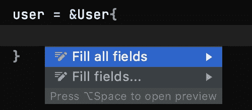

图 7.1—上下文操作弹出窗

如你所见，我们提供了填充`struct`字段的选项。选择此选项将我们：

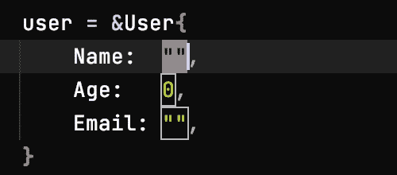

图 7.2—填充所有字段的上下文操作结果

IDE 根据类型添加了所有字段名称和默认零值，从而为我们填充`struct`提供了一种非常高效的方法。正如你所预期的，上下文菜单除了填充`struct`之外，还有许多其他功能；例如，当代码中存在错误或 lint 问题时，上下文菜单会为我们：

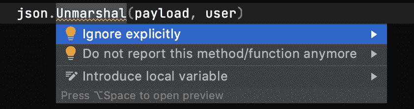

图 7.3—问题上下文操作弹出窗

从此菜单中，我们可以应用快速修复（quick fixes）来解决问题。将此功能与“下一个高亮错误”的快捷键（在我的 Mac 上是`F2`）结合使用，我们可以快速找到并修复当前文件的任何问题。

还有许多其他上下文操作，设计目的是为了让编码变得更容易、更快；我鼓励你进一步探索。

### 测试运行器

无论你是否使用测试驱动开发，你可能都会花费大量时间运行和等待测试。因此，我们必须能够快速方便地触发测试，并让它们运行越快越好。在`Goland`中，当我们第一次触发测试运行器（通过快捷键或菜单）时，我们会看到以下对话框：

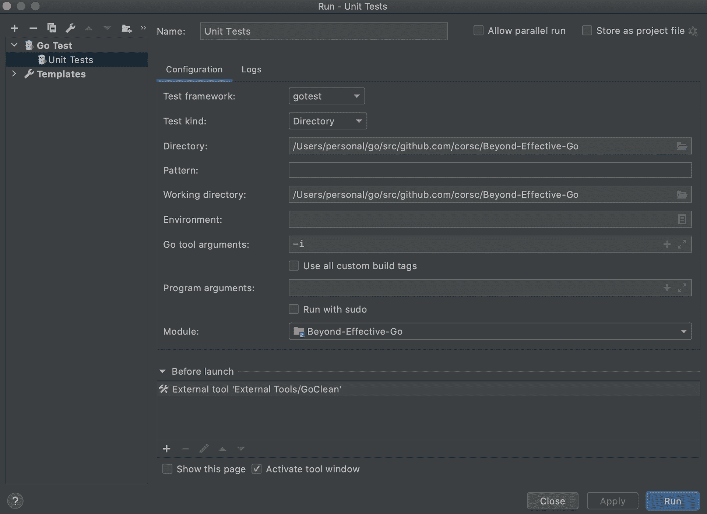

图 7.4—运行对话框

从该对话框中，我们在左侧选择`Go Test`，然后会看到以下对话框：

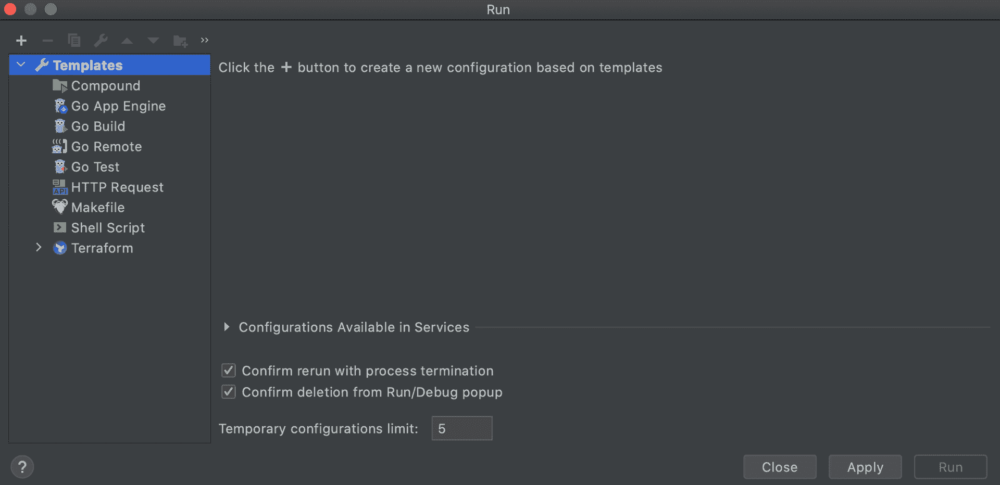

图 7.5—运行测试对话框

我们将根据项目和偏好配置各种设置，然后点击`Run`。在第一次配置之后，我们就可以运行测试而无需看到这个对话框了。你可能还会注意到我配置了一个外部工具（External tool）。该工具正在调用我们之前介绍的代码格式化脚本。这样，在运行测试之前，我们的代码会被格式化，导入也会自动修复。以下是外部工具的配置：

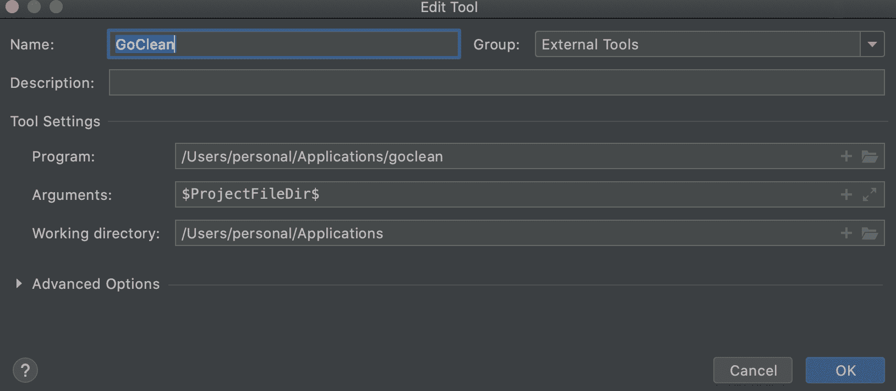

图 7.6—外部工具对话框

除了通过快捷键触发测试带来的初步效率提升，能够触发格式化和导入将为你节省大量时间。

我们还可以在不运行测试的情况下使用外部工具调用我们的其他脚本。这对于其他日常操作（如生成代码）非常有用，因为我们不需要从 IDE 切换到控制台。

### Live 模板

我们要查看的最后一个功能是 Live 模板。这是一项显著的效率提升，因为可以显著减少我们需要的打字量，从而提高我们的一致性并减少错误。它们允许我们配置额外的代码补全选项。例如，如果我们想在代码中添加`for/range`循环，通过 Live Templates，我们可以输入`forr`，然后看到如下上下文菜单：

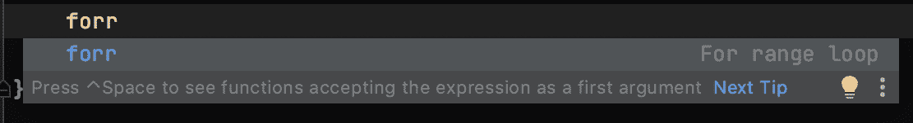

图 7.7—forr 模板菜单

在此菜单中，我们按下`tab`，然后就会出现：

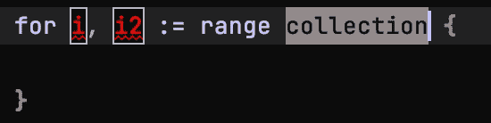

图 7.8—For-range 模板

通过这个，我们可以快速填充语句的内容。`Goland`内置了一些实用的模板，你也可以定义自己的。例如，我最常用的模板之一`cctx`会展开为：

```go
ctx, cancel := context.WithTimeout(context.Background(), time.Second)
defer cancel()
```

注意：上述示例中`$`包围的单词是变量。为了防止忘记`Mockery`的`go:generate`命令的精确格式，名为`mockery`的模板会展开为：

```go
//go:generate mockery --name=$INTERFACE$ --case underscore
```

如果你不熟悉使用 Mockery 生成 mock，第 9 章有非常好的介绍。

我发现测试代码中存在大量的重复（以及一致性）。我最常用且价值的 Live 模板`td`会生成表格驱动测试骨架：


```go
scenarios := []struct {
    desc           string
    in             $IN$
    configureMocks func($MOCK_TYPE$)
    expected       $EXPECTED$
    expectAnErr    bool
}{
    {
        desc:           "Happy path",
        in:             $IN$,
        configureMocks: func($MOCK_TYPE$) {
        },
        expected:       $EXPECTED$,
        expectAnErr:    false,
    },
}

for _, s := range scenarios {
    scenario := s
    t.Run(scenario.desc, func(t *testing.T) {
        t.Parallel()
        // inputs
        // mocks
        // call object under test
        result, resultErr := $METHOD$()
        // validation
        require.Equal(t, scenario.expectAnErr, resultErr != nil, "expect an error: %t err: %s", scenario.expectAnErr, resultErr)
        assert.Equal(t, scenario.expected, result, "expected result")
    })
}
```

如你所见，这节省了大量的打字量和错误。

我在本章的源代码中包含了更多此类模板，你还可以创建更多符合你编码风格并提高你效率的模板。

继续关注如何更快速、更一致且更少错误地编写代码，学习和利用快捷键命令可以显著提高我们的整体工作效率。是的，我再次试图节省把手从键盘移动到鼠标上花费的几秒钟时间，但你可能会惊讶于自己全一天中执行这个动作的频率有多高——结果就是通过使用键盘代替鼠标，你可以节省出多少时间。以下是 10 个你可能不知道但会发现非常有用的 Goland 快捷键。我还包含了每个快捷键的默认 MacOS 键盘快捷键以及简短说明。

1. **打开文件 (Command: ⇧⌘O)**——打开文件对话框。此对话框允许你从与输入内容匹配的文件列表中进行选择。此外，如果你后面加上一个冒号和一个数字，它将跳转到文件中该行号，这在与代码检查（linter）或测试结果结合时非常有用。

2. **跳转到声明或使用处 (Command: ⌘B)**——这可能是我最常用的快捷键。当光标在变量上时，光标将跳转到变量的创建处。当光标在类型的使用处时，它将跳转到该类型的定义处。反之，当光标在变量的创建处或类型的定义处时，它会显示该变量或类型的所有使用列表。

3. **查找使用处 (Command: ⌥F7)**——此命令将显示使用类型或变量的所有位置的完整列表。这在重构和研究代码时非常有用。

4. **显示实现 (Command: ⌥⌘B)**——当我们按照 Go 的风格在使用它的包中定义接口时，该接口在何处实现就不那么明显了。此命令会生成所有实现的列表。

5. **运行测试 (Command: ^⌥R 或 ^R)**——第一个命令允许我们选择想要运行的测试配置，第二个命令将重新运行上一次测试。

6. **切换焦点**——这些命令允许我们在不使用鼠标的情况下快速在 IDE 窗格之间切换。它们也可以用于显示和隐藏这些面板。

    a. **跳转到项目 (Command: ⌘1)**——将焦点移动到文件列表。

    b. **搜索结果 (Command: ⌘3)**——将焦点移动到搜索结果列表。此列表可能是搜索结果或其他如“查找使用处”等命令的结果。

    c. **测试结果 (Command: ⌘4)**——将焦点移动到测试结果。

7. **生成 (Command: ⌘N)**——当焦点在代码面板上时，此命令会显示一个上下文菜单，我们可以从那里生成测试或实现接口，这两者都是非常常见的操作。

8. **新建临时文件 (Command: ⇧⌘N)**——通常，我们需要一个地方来存储某些文本、代码片段或 TODO 列表；与其切换到文本编辑器或记事本程序，可以使用此命令。它将打开一个当前项目之外的文件（这样我们就不担心 SCM 相关的混乱），但它是持久的，所以我们不会意外丢失它。

9. **折叠/展开 (Command: ⌘.)**——折叠代码是隐藏我们当前未处理的细节或很少更改的工具函数的有用方法。此命令切换此代码折叠状态。

10. **查找操作 (Command: ⇧⌘A)**——对于许多命令，没有分配键盘快捷键；当然，我们可以分配自己的。在此期间，或者如果我们忘记了快捷键，可以使用这个命令。此命令打开一个对话框，我们可以从那里搜索、查找并触发其他操作。此命令对于触发如解决冲突或拆分屏幕等低频率操作非常方便。

就像之前关于功能的章节一样，可用的命令比这里讨论的要得多。我强烈鼓励你偶尔查看手册，配置你自己的自定义快捷键，甚至研究一下它们。

```bash
git checkout $1

git rebase master

# Merge any stashed changes

if [ $IS_CLEAN -ne 0 ]; then

  git stash pop

fi
```

你会注意到，在脚本末尾我们从一个分支切换到了另一个分支，但下载了最新的 `master` 并基于它对我们的特性分支进行了 rebase。在回到特性分支工作之前必须进行 rebase 可能会让人有点烦恼，但我发现这比认为自己已经完成但在提交代码审查之前又不得不重新 rebase 要少麻烦得多。

## Shell 别名 (aliases)

`aliases` 定义了自定义的 shell 命令，这些命令可以扩展并调用应用程序和其他 shell 命令。它们非常适合将频繁使用的 shell 命令替换为更短、更易输入的命令。例如，假设你使用 shell 来运行 Go 测试。与其使用这条命令：

```bash
$ go test ./...
```

你不如定义一个名为 `gt` 的别名，然后输入：

```bash
$ gt
```

这显然要简单得多、快速得多且更不容易出错。此外，由于 shell 识别它，我们可以利用 tab 键补全，尽管在这种特定情况下并不适用。要定义别名，我们向 `.bashrc`（或类似）的文件文件中添加以下行：

```bash
alias gt='go test ./...'
```

正如前面提到的，我使用 IDE 运行测试，并编写了自定义脚本来处理最常见的 Go 相关任务。然而，我确实使用 shell 与 Git 交互交互。以下是我使用的一些别名示例：

### 常见的 Git 相关操作

```bash
alias gs='git status '
alias ga='git add '
alias gc='git commit '
alias gd='git diff '
alias gco='git checkout '
alias gp='git pull '
alias grm='git rebase master '
alias gst='git stash '
alias grc='git rebase --continue '
alias grs='git rebase --skip '  
alias gb='git branch '
```

### 调用 sw 脚本并切换到 master 分支

```bash
alias swm='sw master'
```

### 用于捕获意外失错误的别名

```bash
alias got='git '
alias gut='git '
```

你可以定义的别名真的没有限制。关键在于留意你每天执行的任务，并创建有用、易记且独特的别名来让生活变得更容易。

希望你能看到在“掌握你的工具”这一章节下的所有部分中贯穿的一个一致主题：花费时间和精力去寻找、定制和掌握你每天使用的工具是绝对值得的。我们应该寻找工具和技巧来让我们变得更快、更一致或更不容易出错。

## 进行微小改变

在大多数公司中，提交代码更改（通常称为拉取请求，pull requests）有一套仪式。这种仪式伴随着额外的工作，即准备代码以提交，然后等待审查。由于这些额外工作，程序员会本能地想要避免它，结果就是提交更大的 pull requests。然而，我们应该从持续交付（`CD`）理念中借鉴一条格言：当某件事很痛苦时，我们应该更频繁地去做。

这个 `concept` 有几个层次，请耐心听。首先，`CD` 的底层理念认为，如果某件事是痛苦的，并且我们强制自己多做，我们就会非常有动力去简化这个过程。如果准备代码提交和等待审查并非易事，那么优化它对所有开发者来说将一直是一个巨大的胜利。

其次，在提交大型 pull requests 时，我们为同伴带来了更重的负担。较大的 pull requests 更有负担，通常更复杂，因此审查将花费更长的时间。

最后，我们应该承认与大量更改相关的风险。如果团队不同意我们采取的方法，我们就有面临在不会被接受的更改上花费大量时间的风险。

最后，如果更改引起了任何问题，可能需要更长时间才能找到原因，因为我们做了大量的更改。

大多数编程中的大问题都可以拆分为一系列小问题。我们应该始终关注所做更改的大小和范围，并在它们变得过大之前提交 pull requests。这可能并不明显，但我们可以在将新功能连接到公共 API 之前合并。这样就不会带来任何麻烦。

## 总结

在本章中，我们讨论了许多与编程相关的辅助任务和操作，旨在提高效率。

我们研究了微小但频繁的改进，例如用键盘代替鼠标；我们还研究了重大改进，例如使用文档来避免大错误并减少解释决策的时间。我们引入了一个观点，我们应该审视全天执行的任务，寻找更快、更可靠的方法来执行它们，或者消除它们。

最后，我们讨论了掌握所用工具的重要性：找到适合我们的 `IDE`，利用 `IDE` 的所有功能、插件和快捷键来充分利用它，构建我们自己的工具，并定制我们的工作环境。

本章介绍的许多技术从微观角度看似乎是额外的工作，确实如此。但从宏观角度来看，花时间学习新知识并寻找或构建更有效的方法来实现目标是无价的投资，将多次回报你的精力和精力。

所有代码示例的完整版本以及相关材料可以在 [`github.com/corsc/Beyond-Effective-Go/tree/master/Chapter08`](https://github.com/corsc/Beyond-Effective-Go/tree/master/Chapter08) 找到。

## Go 中的函数式编程

虽然 Go 不是一种函数式语言，但它确实拥有许多函数式风格编程所需的特性。因此，我们可以采用函数式编程中的某些模式并利用它们的优势。但首先，什么是函数式编程？

函数式编程（FP）是一种基于三个核心思想的编程风格：

*   数学函数或纯函数

*   不可变性

*   无隐式状态

第一个核心思想是数学函数或纯函数。在底层，数学将函数定义为输入与输出之间的关系或映射。在数学中，如果给定相同的输入，无论调用多少次，输出都是相同的，且函数没有副作用（例如，它不会改变任何非局部变量或通过引用传递的任何输入），该函数就被认为是纯函数。

在编程中，我们经常使用一个类似的概念称为等幂性（idempotency）。等幂函数是指可以多次调用而除了第一次调用外不会产生任何副作用的函数。等幂函数和纯函数之间的区别细微但显著。两个数字之和的函数是纯函数，因为它在给定相同输入时总是给出相同的结果，且没有副作用。然而，如果我们取同一个相加函数，让它在返回结果的同时也存储在一个全局变量中，那么它不再是纯函数，但仍然是一个等幂函数。

我们应该稍作停留，讨论并刷新对等幂性的理解。考虑以下代码：

```go
func TimeRemaining(when time.Time) time.Duration {
    return when.Sub(time.Now())
}
```

这段代码不是等幂的，因为它取决于 `time.Now()` 的结果，因此每当我们调用它并提供相同的输入值时，都会得到不同的结果。但我们可以实现一个稍微不同的等幂版本，如下：

```go
func TimeRemaining(when, now time.Time) time.Duration {
    return when.Sub(now)
}
```

这段代码是等幂的，因为每次我们提供相同的输入，都会得到完全相同的输出。

函数式编程的第二个核心思想是全局不可变性，它将无数据变异或副作用的原则从纯函数扩展到整个应用程序。这意味着一旦变量被创建，它就不能被更改；它是不可变的。

当程序员来自面向对象编程背景时，函数式编程的这一方面往往是最难适应的。然而，正是这一方面使得函数式编程代码的各个部分比非函数式代码更容易理解和调试。当一个函数不能影响自身之外的任何内容，也不会受到自身之外任何内容的影响时，那么在给定相同输入的情况下，函数的输出总是相同的。同样，当一个变量在创建后无法更改时，就不需要追踪程序的执行过程来理解变量的内容；我们只需要找到它的创建点即可。

函数式编程的第三个核心思想是组件没有隐式状态。这可以说是前一个“无数据变异”概念的延伸。它也有类似的意图。当对象拥有状态（例如结构体成员变量）且该状态可以被改变时，为了调试一个对象实例，我们必须跟踪与该对象的所有交互。

现在我们已经对函数式编程的基本思想有了基本的理解，我们可以讨论与函数式编程相关的编程概念以及它们在 Go 中的意义。

我们将检查的概念有：

*   一等函数和高阶函数

*   递归

*   柯里化和部分函数

*   不可变性

## 一等函数和高阶函数

一等函数（First-class functions）是一种语言特性，允许将函数赋值给变量。由于函数可以作为变量，它们可以作为参数传递或从函数返回。

高阶函数（Higher-order functions）是指接收一个或多个函数作为输入或返回函数作为输出的函数。这是函数式风格构建、组合函数的基础。以下代码是一个高阶函数：

```go
func forEach(in []string, operation func(string)) []string {
    out := make([]string, len(in))
    for index, thisString := range in {
        // 使用 operation 进行转换
        result := operation(thisString)
        out[index] = result
    }
    return out
}
```

你可以看到，通过传递其他函数，我们可以使用这种高阶函数：

```go
func toUpper(in string) string {
    return strings.ToUpper(in)
}

func addPeriod(in string) string {
    return in + "."
}
```

### 递归

递归是函数调用自身的执行循环。在函数式语言中，我们使用递归代替循环。在之前的示例中，我们使用了循环处理每一项：

```go
func forEach(in []string, operation func(string)) []string {
    return forE(in, 0, operation)
}

func forE(in []string, index int, operation func(string)) []string {
    if index >= len(in) {
        return nil
    }
    // 使用 operation 进行转换
    result := operation(in[index])
    return append([]string{result}, forE(in, index+1, operation)...)
}
```

通过这种更改，我们的实现采用了更多的函数式风格。现在考虑一下如果输入切片巨大（例如一百万项）会发生什么？对于每次函数调用，Go 运行时都会栈上创建一个帧。

在函数式语言中，编译器可以检测这种递归并执行尾调用优化（TCO）。在尾调用优化期间，运行时意识到该调用是递归的，并且不会为每次函数调用创建新的栈，从而防止递归产生内存问题。然而，Go 不执行 TCO，因此我们面对的是百万帧的栈。这可能是在 Go 中使用函数式编程的主要限制因素。

## 柯里化和部分函数

柯里化（Currying）是将一个接受多个输入的函数分解为一系列只接受一个参数的函数的过程。例如，这个函数有多个参数：

```go
func Multiply(a, b int) int {
    return a * b
}
```

为了对该函数进行柯里化，我们需要将其分解为：

```go
func Multiply(a int) func(int) int {
    return func(b int) int {
        return a * b
    }
}
```

你可以看到我们的 `Multiply()` 函数现在返回一个函数而不是整数。返回的函数被称为部分函数（partial function）。为了计算整数结果，我们需要以以下两种格式之一调用部分函数：

```go
func ExampleMultiply_ShortForm() {
    result := Multiply(5)(3)
    // 输出: 15
    fmt.Println(result)
}

func ExampleMultiply_LongForm() {
```

```go
multiply5 := Multiply(5)

result := multiply5(3)

// Output: 15

fmt.Println(result)

}
```


但我们为什么要这样做呢？这是一个非常棒的问题，考虑到我们通常关注易于读的代码，而且虽然我们的柯里化函数很巧妙但更加复杂。柯里化函数的威力在于它们的灵活性。我们的 `Multiply()` 对于两个参数来说是完美的，但当我们有三个参数时会发生什么？如果是参数切片呢？在所有这些场景下，柯里化函数都可以保持不变。

这里再举一个例子以确保我们已经掌握了这一概念。仔细观察下面的代码。从函数式（FP）的角度来看，它有什么问题吗？

```go
func ExampleMultiply\_notFP() {
	inputs := []int{1, 2, 3, 4, 5}
	var result int
	for index, thisValue := range inputs {
		if index == 0 {
			result = thisValue
			continue
		}
		result = Multiply(result, thisValue)
	}
	// Output: 120
	fmt.Println(result)
}
```

这段代码没有 Bug，但它违反了函数式编程的一个核心思想：无数据突变。结果值随着循环的执行而改变。

### 不可变性

不可变性意味着一旦定义了变量，它不能被更改。

不幸的是，在 Go 中强制不可变性并不容易，因为我们可以用 `const` 替换 `var` 关键字的地方是有限的。然而，我们可以采取一些步骤来避免由变量可变引起的错误。第一点是确保我们传递所有对象时使用拷贝而不是指针。当我们使用指针传递对象时，该变量可以被修改，从而破坏了我们对不可变性的愿望。

同样，在处理 map、切片和数组时，我们也必须小心。这些集合都是通过引用传递的。看这个函数：

```go
func ToLower(in map[string]string) {
	for key := range in {
		in[key] = strings.ToLower(in[key])
	}
}
```

此函数将所有 map 的值转换为小写。我们无法采取任何合理的措施来防止这种突变；如果我们想保护自己免受突变影响，我们能做的最好办法是在调用函数之前拷贝 map，而这并不理想。

那么不可变性有什么好处呢？当变量是不可变的时，你的代码具有以下优势：

- **幂等性**——无论你何时或频繁地调用函数，函数调的结果都是相同的。
- **可缓存性**——当函数是幂等的，它们很容易缓存。
- **模块化**——当代码没有状态且是一系列函数时，我们可以将这些函数组合在一起来实现更大的目标。
- **并行化**——当函数是独立且无状态时，它们很容易并行化。
- **并发性**——因为函数是幂等的且变量是不可变的，所有与并发代码相关的不便（如竞态条件和死锁）都是可能的。因此，互斥锁（mutex）和信号量等结构是不必要的。

正如我们看到的，虽然 Go 不是函数式语言，但我们可以通过一些限制来采用函数式风格。强制引用透明性（特别是在集合方面）的弱点是一个风险源，但并不是完全采用的阻碍。尾递归调用优化的缺失是许多开源开发者面临的更实质的问题。

你可以看到，总值每次调用时都会更新，并且当前总和在请求之间保持不变。我们也可以使用全局变量来维护调用之间的状态以实现相同的结果。然而，这将导致其他代码或该闭包的实例访问该变量的可能性。通过我们的闭包，数据是完全隔离的，并免受任何意外访问的保护。

既然我们已经更好地掌握了匿名函数、闭包以及它们为我们提供的功能，我们可以查看在 Go 中利用函数可以实现的一些奇妙操作。

### 基于函数的模式

在本节中，我们将介绍可以使用 Go 实现的五种令人兴奋的模式。它们是：

- 替换抽象方法
- 实现中间件
- 函数式选项（Functional options）
- 装饰函数以满足接口
- 链式调用

虽然这些并不是传统软件设计模式意义上的模式，但它们是对我们 Go 程序中经常出现的许多需求的通用解决方案。

### 替换抽象方法

如果你和我一样来自面向对象的编程背景，那么你将对抽象类和抽象方法非常熟悉。抽象方法是附加到抽象类上的方法，但具体实现留给了扩展该抽象类的具体类。通过示例可能更容易理解。请看下面的对象图：

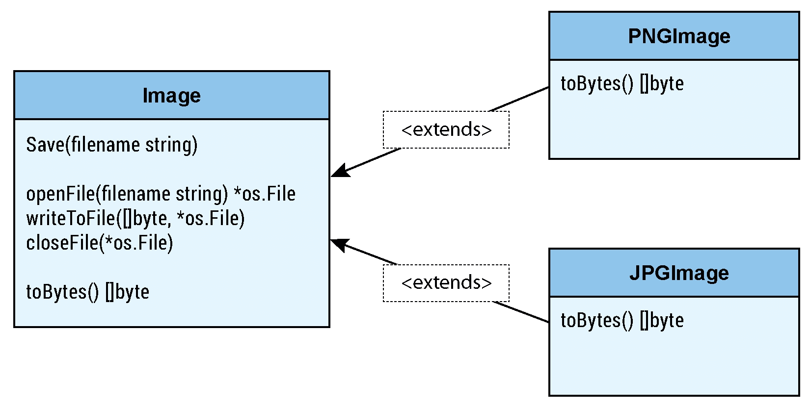

图 8.1—抽象对象示例

在上面的图中，我们有一个名为 `Image` 的抽象类型。除了 `toBytes()` 之外的所有私有方法已作为 `Image` 类型的一部分实现，而 `toBytes()` 被定义为抽象方法。有两个类 `PNGImage` 和 `JPGImage`，它们扩展了 `Image` 并实现了我们的抽象方法。但为什么要这样做呢？在这个示例中，无论编码如何，加载、写入和关闭文件的逻辑都是相同的。因此，我们没有重复这些逻辑，而是将其放在一个地方（抽象类中的具体方法）并共享它。

虽然 Go 中没有抽象类和方法，但我们可以在 Go 中实现相同的目标，甚至可以在不使用组合的情况下完成。我们在结构体中实现共享代码，并用匿名函数的成员变量替换抽象方法，如下：

```go
type Image struct {
    toBytes func() []byte
}

func (i *Image) Save(filename string) {
    destination := i.openFile(filename)
    data := i.toBytes()
    i.writeToFile(data, destination)
    i.closeFile(destination)
}

func ExampleImage() {
    myPNG := &Image{
        toBytes: pngEncoder,
    }
    myPNG.Save("my-file.png")
}
```

现在，我们可以根据需要实现多个编码器，而无需重复通用逻辑，就像我们使用抽象类和方法所做。

### 实现中间件

中间件与之前的模式非常相似，在 Go 中可能更为常见，特别是在构建 HTTP 处理器时。假设你想记录每个请求或跟踪处理时间。虽然在每个需要的地方包含这些代码是可行的，但引入一个可以独立于其他处理过程运行的自包含函数会更有效。这被称为中间件。考虑以下代码：

```go
func Usage() {
    listHandler := http.HandlerFunc(ListUsersHandler)
    http.Handle("/", listHandler)
    http.ListenAndServe(":8080", nil)
}

func ListUsersHandler(resp http.ResponseWriter, req *http.Request) {
    start := time.Now()
    users := loadAllUsers()
    payload, _ := json.Marshal(users)
    _, _ = resp.Write(payload)
    log.Printf("Time taken: %s", time.Since(start))
}
```

你可以看到，我们通过记录开始时间并在函数结束时计算差值来跟踪请求处理所需的时间。我们可以提取跟踪代码并创建一个函数，该函数创建闭包来执行跟踪并调用提供的 HTTP 处理器。将此模式应用到我们的示例后，我们得到了：

```go
func Usage() {
    listHandler := http.HandlerFunc(ListUsersHandler)
    http.Handle("/", listHandler)
    http.ListenAndServe(":8080", nil)
}

func ListUsersHandler(resp http.ResponseWriter, req *http.Request) {
    start := time.Now()
    users := loadAllUsers()
    payload, _ := json.Marshal(users)
    _, _ = resp.Write(payload)
    log.Printf("Time taken: %s", time.Since(start))
}
```

我们可以提取跟踪代码并创建一个函数，该函数创建闭包来执行跟踪并调用提供的 HTTP 处理器。将此模式应用到我们的示例后，我们得到了：

```go
func Usage() {
    listHandler := http.HandlerFunc(ListUsersHandler)
    http.Handle("/", listHandler)
    http.ListenAndServe(":8080", nil)
}

func ListUsersHandler(resp http.ResponseWriter, req *http.Request) {
    start := time.Now()
    users := loadAllUsers()
    payload, _ := json.Marshal(users)
    _, _ = resp.Write(payload)
    log.Printf("Time taken: %s", time.Since(start))
}
```

### 函数式选项（Functional options）

有时，在编写包时，我们会面临过多的配置。看以下内容，作为示例：

```go
func NewClient(host string, port int, sampleRate int, sendBuffer int, validateKeys bool, tags []string) *StatsClient {
    return &StatsClient{
        // 实现已移除
    }
}

type Config struct {
    host        string
    port        int
    sampleRate  int
    sendBuffer  int
    validateKeys bool
    tags        []string
}
```

这种方法是可以接受的，我们甚至可以根据需要扩展结构体，但如果我们想在构造函数中执行更多操作怎么办？如果我们想包含计算或验证怎么办？这就是函数式选项大显用场。

通过这种模式，我们可以清理构造函数 API，在函数中包含配置的计算和验证，并且不限制扩展能力。它的工作原理如下。首先，我们必须检查配置并确定它是否必要的。为了辩证，假设在示例中 `host` 值是必要的。因此，我们应该将其作为构造函数的参数，确保它始终被提供。对于所有的可选配置，可以使用函数式选项。我们通过首先定义这样一个自定义类型来实现：

```go
type Option func(*StatsClient)
```

这个 `Option` 类型实际上需要的，但它让代码变得简洁得多。它是一个接受 `StatsClient` 指针作为输入的函数。现在，我们可以使用与 `Option` 类型相同的函数签名来实现函数式选项，如下：

```go
func Port(port int) Option {
    return func(client *StatsClient) {
        // 验证并设置端口
        if port <= 0 {
            port = defaultPort
        }
        client.port = port
    }
}
```

这个函数有两个方面值得注意。第一个是我们创建了一个包含了我们传递给它的配置的闭包。第二个是，尽管 `Port()` 函数是一个公共函数，但它正在访问并设置私有成员变量 `port`。通过这个函数，我们为包的用户提供了对私有成员变量的受控访问，这比将成员变量公开要安全且整洁得多。

通过这种模式，我们现在可以根据需要添加任意数量选项，以支持不同用户的需求，而不会损害易用性或向用户提供不必要的实现细节访问权限。

最后一步，我们需要更新构造函数以接受变长数量的选项，并在返回客户端之前将所有提供的选项应用于客户端，如下：

```go
func NewStatsDClient(host string, options ...Option) *StatsClient {
	client := &StatsClient{
		host: host,
	}
	// apply options
	for _, option := range options {
		option(client)
	}
	return client
}
```

有了这个新的构造函数，我们确保了必要的配置已提供，并使所有其他配置都变为可选。

### 装饰函数以满足接口

你是否遇到过这样的函数：它原本是完美的，直到你需要在某一个需要接口的地方使用它时？通常，这些函数已经在在使用中，或者属于我们不拥有的代码（例如标准库）。有时，将代码写成函数而不是结构体和方法更方便。这种第二种情况的一个广泛例子是 HTTP 处理器。对于这两种情况，都有一个简单且优雅的解决方案：装饰。在我们的示例中，我们将使用标准库中的 `http.Handler`，但也可以同样的方式在我们自己的包中这样做。首先，让我们看看我们需要的接口：

```go
type Handler interface {
	ServeHTTP(resp ResponseWriter, req *Request)
}
```

将上面的接口与我们拥有的函数比较：

```go
func SayHelloHandler(resp http.ResponseWriter, req *http.Request) {
	_, _ = resp.Write([]byte("Hello World"))
}
```

你可以看到，在这种情况下，`SayHelloHandler()` 函数与 `Handler` 的 `ServeHTTP()` 方法参数是相同的。这并不是必要的，但它确实让我们的工作变得简单了一些。我们的第一步是定义一个与已有的 `SayHelloHandler()` 相同的自定义类型，如下：

```go
type MyHandlerFunc func(resp http.ResponseWriter, req *http.Request)
```

我们现在可以为该类型装饰一个或多个方法以满足 `Handler` 接口定义。在这个示例中，因为函数 `SayHelloHandler()` 和 `Handler` 的 `ServeHTTP()` 方法签名相同，实现仅仅调用了函数并传递了提供的参数。如果签名不同，我们就需要添加一些数据转换。这里是我们装饰了函数的 `http.Handler` 实现：

```go
type MyHandlerFunc func(resp http.ResponseWriter, req *http.Request)

func (m MyHandlerFunc) ServeHTTP(resp http.ResponseWriter, req *http.Request) {
	m(resp, req)
}
```

如你所见，我们为定义的自定义类型附加了一个方法。我们的 `ServeHTTP()` 方法简单地调用了由 `MyHandlerFunc` 定义的原始函数。完成后，我们可以将 `SayHelloHandler()` 函数强制转换为 `MyHandlerFunc` 类型的变量，因为 `MyHandlerFunc` 类型满足 `http.Handler` 接口，我们可以像这样将其作为 HTTP 服务器中的 HTTP 处理器使用：

```go
var myHandler http.Handler = MyHandlerFunc(SayHelloHandler)
http.Handle("/", myHandler)
http.ListenAndServe(":8080", nil)
```

通过这种方式，我们将原始的 `SayHelloHandler()` 函数强制转换了我们的自定义类型。

### 函数链

我们检查的最后一个模式是函数链。我们使用通道（channels）通过一系列转换传递数据。这是从简单函数组合复杂逻辑的一种强大方式。

在这个示例中，因为函数 `SayHelloHandler()` 和 `Handler` 的 `ServeHTTP()` 方法签名相同，实现仅仅调用了函数并传递了提供的参数。如果签名不同，我们就需要添加一些数据转换。这里是我们装饰了函数的 `http.Handler` 实现：

```go
type MyHandlerFunc func(resp http.ResponseWriter, req *http.Request)

func (m MyHandlerFunc) ServeHTTP(resp http.ResponseWriter, req *http.Request) {
	m(resp, req)
}
```

如你所见，我们为定义的自定义类型附加了一个方法。我们的 `ServeHTTP()` 方法简单地调用了由 `MyHandlerFunc` 定义的原始函数。完成后，我们可以将 `SayHelloHandler()` 函数强制转换为 `MyHandlerFunc` 类型的变量，因为 `MyHandlerFunc` 类型满足 `http.Handler` 接口，我们可以像这样将其作为 HTTP 服务器中的 HTTP 处理器使用：

```go
var myHandler http.Handler = MyHandlerFunc(SayHelloHandler)
http.Handle("/", myHandler)
http.ListenAndServe(":8080", nil)
```

### 实现 Future（期）


在编程中，`Future`（期）是一种软件构建技术，函数返回一个对象作为实际结果的代理，而不是结果本身。该代理提供了对最终将可用值的访问。

`Future`（未来）通常用于计算结果非常耗时且我们希望实现某种程度的并行场景。那么，我们如何在 Go 中实现这种模式呢？首先，我们需要借用在本节之前关于闭包（closures）的工作并创建一个闭包。这一次，我们的闭包将包含一个互斥锁（`mutex`）和结果值，如下：

```go
func doWorkFuture(in int64) func() int64 {
    var result int64
    mutex := &sync.Mutex{}
    mutex.Lock()

    // 启动 goroutine 异步计算/获取值
    go doTimeConsumingWork(mutex, &result, in)

    return func() int64 {
        // 在值出来之前，此函数无法返回
        mutex.Lock()
        defer mutex.Unlock()
        return result
    }
}
```

我们在创建的闭包与执行耗时操作的 goroutine 之间共享了 `mutex` 和 `result` 值。现在让我们来看耗时操作的代码：

```go
func doTimeConsumingWork(mutex *sync.Mutex, result *int64, in int64) {
    defer mutex.Unlock()
    // 执行一些耗时的操作
    <-time.After(1 * time.Second)
    // 分配计算/获取的结果
    *result = int64(1000 + in)
}
```

该函数有两个关键部分。第一个是用于解锁 `mutex` 的 `defer` 语句。这反过来允许从闭包中读取结果。第二个重要部分是结果的赋值。在这个示例中，它是一个硬编码的值，但通常情况下它是从远程系统获取的数据或某些大规模计算的结果。最后，是我们的 future 代码的使用：

```go
func Example() {
    futureA := doWorkFuture(123)
    futureB := doWorkFuture(456)
    // 其他代码
    valueA := futureA()
    valueB := futureB()
    // 输出: Receive future value: 1123
    // Receive future value: 1456
    fmt.Printf("Receive future value: %d\n", valueA)
    fmt.Printf("Receive future value: %d\n", valueB)
}
```

从我们的使用代码中得出的结论是：我们的 `doWorkFuture()` 将立即返回，但计算将继续进行。如果我们立即读取 future 的值，那么我们的代码就会阻塞，代码将变成同步的，使用 future 也就失去了意义。

在这个示例中，我们实现 future 的方式与函数式语言的方式非常相似，但用更符合 Go 风格的方式这样做呢？

## 以 Go 的方式实现 future

在我们之前的实现中，我们使用了一个包含结果值和同步原语（即 `mutex`）的闭包，用于信号值何时可以读取。然而，在 Go 中，我们有一种可以将这些概念整合到一个单一、易于使用的包中的工具：你猜对了——通道（channels）。要用通道实现 future 模式，我们首先从一个大小为 1 的缓冲通道开始，如下：

```go
func doWorkFuture(in int64) <-chan int64 {
    result := make(chan int64, 1)
    // 启动 goroutine 异步计算/获取值
    go doTimeConsumingWork(result, in)
    return result
}

func doTimeConsumingWork(result chan<- int64, in int64) {
    // 执行一些耗时的操作
    <-time.After(1 * time.Second)
    // 分配计算/获取的结果
    result <- 1000 + in
}
```

通道既提供了传递和存储数据的能力，又提供了同步功能。由于我们创建的闭包与执行耗时操作的 goroutine 之间共享了 `mutex` 和 `result` 值，现在我们使用通道来简化。现在来看 future 代码的使用：

```go
func Example() {
    futureA := doWorkFuture(123)
    futureB := doWorkFuture(456)
    // 其他代码
    valueA := <-futureA
    valueB := <-futureB
    // 输出: Receive future value: 1123
    // Receive future value: 1456
    fmt.Printf("Receive future value: %d\n", valueA)
    fmt.Printf("Receive future value: %d\n", valueB)
}
```

从我们的使用代码中得出的结论是：我们的 `doWorkFuture()` 将立即返回，但计算将并发进行。如果我们立即读取 future 的值，那么我们的代码就会阻塞，代码将变成同步的，使用 future 也就失去了意义。

在这个示例中，我们实现 future 的方式与函数式语言的方式非常相似，但用更符合 Go 风格的方式这样做呢？

还可以使用通道（channels）和空结构体（empty struct）来实现信号量。在这种情况下，使用空结构体的原因有两个：首先，空结构体的成本很低；其次，是为了表达无关性。这看起来可能很奇怪，但在信号量中，通道的类型和值是无关的；只有数据的数量很重要。你可以在本系列第一本书的源码（在同一个 Git 仓库中）中的 `Chapter02/04_semaphores/01_limit_pending/` 目录下找到使用通道实现信号量的示例。

在向代码中添加信号通道时，我们可以利用这些相同的概念。假设你有一个工作池，并希望能够信号工作线程退出。我们创建工作线程的代码可能如下：

```go
func NewWorkerPool(total int) *WorkerPool {
    workerPool := &WorkerPool{
        shutdownCh: make(chan struct{}),
    }
    for x := 0; x < total; x++ {
        go doWork(workerPool.shutdownCh)
    }
    return workerPool
}
```

上面，我们创建了一个信号通道，并将该通道传递给所有的 goroutine 工作线程。在工作线程内部，我们执行工作并像这样等待来自 `shutdownCh` 的信号：

```go
func doWork(shutdownCh chan struct{}) {
    for {
        select {
        case <-shutdownCh:
            // quit
            return
        default:
        }
        // do work - implementation remove
    }
}
```

当所有组件就绪后，我们现在只需关闭通道来关闭所有工作线程，正如我们在这种方法中所做：

```go
func (w *WorkerPool) Shutdown() {
    close(w.shutdownCh)
}
```

正如你在代码看到的，通道的数据类型和内容并不重要，因此在这种情况下，使用空结构体是最便宜的选项。

### 匿名结构体

匿名结构体是内联定义的结构体，因此它们没有名称。它们的定义如下：

```go
carrot := struct {
    Variety         string
    WhenToPlant      []time.Month
    Spacing         int
    WeeksTilHarvest int
}{
    Variety:         "Atomic Red",
    WhenToPlant:      []time.Month{time.January, time.February, time.November, time.December},
    Spacing:         10,
    WeeksTilHarvest: 18,
}
```

如你所见，我们正在定义结构体的同时对其进行填充。这看起来可能奇怪或低效，但当我们不需要重用该结构体或将其到处传递时，它可以非常有帮助。例如，在处理 Go 的内置模板引擎时这样做是有优势的。`html/template` 和 `text/template` 包都期望将数据作为结构体传递到模板引擎中，而且该结构体通常在其他地方没有任何用处。以以下代码为例：

```go
welcomeSource := `
<html>
<body>
Hello {{ .Name }}.<br />
It has been {{ .Days }} since your last login.<br />
You have {{ .Messages }} unread messages.<br />
</body>
</</html>
`

results := &bytes.Buffer{}
data := struct {
    Name     string
    Days     int
    Messages int
}{
    Name:     "John",
    Days:     7,
    Messages: 2,
}

welcomeTemplate, err := template.New("welcome").Parse(welcomeSource)
```

这种结构与我们生成的 HTML 页面紧密耦合的，因此在任何其他地方使用它都是一个糟糕的选择。

本章将涵盖以下主题：

- 与 API 集成
- 使用 Go 协调其他程序
- 实战中的代码生成

### 代码

为了充分利用本章的内容，你需要安装较新版本的 Go（1.13+）并使用你喜爱的 IDE。

所有代码示例的完整版本以及相关材料可以在 [`github.com/corsc/Beyond-Effective-Go/tree/master/Chapter09`](https://github.com/corsc/Beyond-Effective-Go/tree/master/Chapter09) 找到。

### 与 API 集成

我们将要查看的第一种类型的元编程是 API 集成。作为一名经验丰富的 Go 开发者，你很有可能以前已经做过这类事情了。然而，你可能还没有考虑过通过这样做来提高你（或你团队）的效率。我们每天使用的所有平台即服务（PaaS）、软件即服务（SaaS）以及其他工具都提供了 API，我们可以利用这些 API 来提高我们的一致性和效率。

像 Google Cloud Platform (GCP)、Amazon AWS、Datadog、Slack、GitHub 和 PagerDuty 等服务都提供了 API，允许你实现与通过点击操作（click-ops）时相同的结果。虽然我们不想也不需要自动化与这些服务的所有交互，但我们有很多机会从中获益。在以下三个典型场景下，我们经常会发现这样做是有益的：

1. 对于我们经常执行的任务（例如，每天一次或更多）。
2. 对于我们预计将执行一段时间的繁琐或复杂任务。
3. 对于将两个或多个系统结合起来为我们带来额外益处的情况。

让我们简要查看这些场景，并识别一些示例和可能的集成方式。

首先，让我们看看如何向合并请求（merge request）添加审核者；这是一个繁琐且频繁的任务的极佳示例。假设每当你打开一个新的合并请求时，都必须手动添加你的团队成员作为审核者，以便他们才能收到通知。这种成本看起来可能并不多，比如 30 秒，但我认为这段时间被浪费了。

假设我们有使用 Go 与 API 交互的经验，那么创建一个调用适当 API 将我们的团队成员添加到合并请求的小程序不应该花费太多时间。这样的应用程序不需要多么精巧；例如，我们可以硬编码团队成员，而不是从某处加载他们。同样，该程序甚至不需要世界上最顶的代码质量；可能只有我们自己会看到这些代码。我们在制作应用程序上花费的时间越少，与继续手动操作相比，看到收益的速度就越快。

其次，我们可以自动化我们预计将执行一段时间的繁琐或复杂任务。一个典型的例子是为团队引入新成员（onboarding）。虽然这项任务通常由 IT 部门完成而不是留给我们程序员，但这并不意味着我们不能在这里提供帮助。为团队引入新成员通常涉及在许多不同的 PaaS 和 SaaS 工具和服务上创建新账户，并设置正确的权限。它可能还涉及请求内部系统和资源的访问权限。这项任务的繁琐性质，加上我们偶尔才执行一次，使得很容易出错并遗忘部分内容。如果我们花时间与适当的 API 集成并自动化此任务，我们就可以避免单调，并确保我们不犯任何错误。代码也可以作为入职流程的准确文档。

第三，当数据存在于一个系统中但在另一个系统中需要时，我们可以使用 API。之前的示例将团队成员关系作为上下文数据的一部分。这种情况发生得频繁，无论是授予数据库权限还是将人员添加到值班表（on-call schedule）。假设你的团队使用像 PagerDuty 这样的服务来调度和管理服务的值班职责。为了配置此类工具，我们首先需要对这种工具进行配置，建立一个映射。当程序运行起来后，问问自己：如果它能自动更新值班人员，该有多好？像 Google 日历这样的服务提供了 API，允许我们查询此类信息。

本章的示例代码可以在 [`github.com/corsc/Beyond-Effective-Go/tree/master/Chapter09/examples_apps`](https://github.com/corsc/Beyond-Effective-Go/tree/master/Chapter09/examples_apps) 找到。

### API 集成示例

让我们通过 API 集成示例来强化这些概念。如果你是一个经验丰富的开发者，这对你来说可能是熟悉的。对于我们的示例，我们将创建一个与 PagerDuty 集成的微型应用程序。如果你不熟悉它，PagerDuty 是一个在事件发生时通知值班人员的服务。

首先，让我们退一步考虑我们正在创建的内容以及为什么。在使用 PagerDuty 时，PagerDuty 提供了多种通知方式，包括电子邮件、电话、短信和推送通知。然而，当人们在 PagerDuty 上创建账户时，并不总是显而易见他们应该配置这些方法。

出于这个原因，我们将构建的应用程序将检查用户是否已配置了账户。

考虑到这一点，我们可以通过识别所需的功能来勾勒应用程序的大致架构。我们需要一些代码来：

- 从 PagerDuty API 获取当前设置
- 将当前设置与所需设置进行比较
- 输出比较结果

在视觉上映射这些组件后，我们可能会得到如下结构：


图 9.1—API 集成应用程序结构


现在我们大致知道要去哪里，让我们检查解决方案的关键、异常和有趣的部分。

## 调用 PagerDuty API

在启动项目时，我通常先处理未知或不熟悉的组件，因为这种不熟悉是风险的主要来源。如果没有不熟悉的组件，我会从最关键的部分开始。在我们的示例中，它们是同一个。我们首先需要确定如何调用 API：特别是我们需要使用什么种身份验证以及可能还需要哪些请求头。为了实现这一点，我们查阅了 [`developer.pagerduty.com/docs/`](https://developer.pagerduty.com/docs/) 的文档。从文档中，我们需要注册身份验证令牌，并在所有请求中包含 `Authentication`、`Accept` 和 `Content-Type` 请求头。深入搜索文档，我们发现了获取用户信息的端点 `https://api.pagerduty.com/users/{id}`，并发现我们需要特别请求在响应中包含联系方式。将这一切整合在一起，我们可以这样构建请求：

```go
func (u *UsersAPI) buildRequest(ctx context.Context) (*http.Request, error) {
	params := &url.Values{}
	params.Set("include[]", "contact_methods")
	uri := u.apiBaseURL+"/users?"+params.Encode()
	req, err := http.NewRequestWithContext(ctx, "GET", uri, http.NoBody)
	return req, err
}
```

```go
if err != nil {
    return nil, err
}

req.Header.Set("Authorization", "Token token="+u.apiKey)
req.Header.Set("Accept", "application/vnd.pagerduty+json;version=2")
req.Header.Set("Content-Type", "application/json")

return req, nil
```

你从上面的代码中可能会注意到我们在发送请求时使用了 `context`（上下文）。这允许我们为整个过程设置超时时间，从而确保无论网络或我们正在调用的服务器发生什么情况，我们的程序都能正常结束。你可能还会注意到，我们将 `apiKey` 和 `apiBaseURL` 设置为我们正在构建的 `UsersAPI` 结构体的成员变量。这个方便的技巧允许我们在测试期间切换这些值。提示：本章源码中附有此代码的测试；请查看它们。

### 处理 API 响应

现在我们已经得到了来自 API 的响应（这是一个 JSON 负载荷），我们需要对响应进行查询并将其转换为 Go 对象以使其产生效用。首先，让我们将 HTTP 响应体转换为 Go 对象：

```go
decoder := json.NewDecoder(resp.Body)
apiResp := &apiResponse{}
err = decoder.Decode(apiResp)
if err != nil {
    return nil, err
}
```

到目前为止，这非常简单。然而，我们接要做的操作将对应用程序的可维护性产生重大影响。这是一个快速粗暴的工具，我们不太可能对其进行扩展，因此我们可以以此为由进行偷懒，但无论如何让我们讨论一下这样做的最佳方法。首先，来看 `apiResponse` 结构体：

```go
type apiResponse struct {
    Users []*users `json:"users"`
}

type users struct {
    ID             string         `json:"id"`
    Name           string         `json:"name"`
    Email          string         `json:"email"`
    ContactMethods []*contactMethod `json:"contact_methods"`
}

type contactMethod struct {
    Type    string
    Address string
}
```

虽然这种格式自说自懂，但对于我们的目的来说，有更好的格式。此外，PagerDuty API 拥有这种格式，我们对其没有控制权。如果他们想更改这种格式，将会影响我们；唯一的问题是影响有多大。如果我们将这种格式以及任何相关逻辑封装在这个包内部，那么我们应用程序的其他部分将对 API 的任何更改基本不受影响。

所以，如果我们要把这种格式更改为我们定义的格式，我们包的用户需要什么格式和哪些字段呢？该包的用户想要当前设置的列表以及一些关于用户的基本信息。他们可能还需要用户的唯一 ID 以链接到 PagerDuty 网站，或使用不同的 API 与用户进行交互。考虑到这些想法，最直观的输出格式将是：

```go
type User struct {
    // 用户详情
    ID         string
    Name       string
    Email      string
    // 当前设置
    EmailIsSet bool
    PhoneIsSet bool
    SMSIsSet   bool
    PushIsSet bool
}
```

现在，通过将 API 响应格式转换为我们的格式，我们的包具有了更好的可用性和良好的封装性，为我们提供了更好的可维护性。转换逻辑并没有什么特别之处，因此我不会在这里包含它。

### 配置与命令行

我们应该考虑的解决方案下一个关键部分是接受命令行配置。这在后端应用程序中并不常见，而且代码也有些寻常。在使用我们的应用程序时，我们可以像这样传递命令行标志：

`$ ./pd-user-check -email=true -sms=true -phone=true -push=true`

在上面的命令中，我们启用了所有通知类型的检查。以这种方式配置我们的应用程序的妙之处在于，所有这些配置都是可选的。作为应用程序开发者，我们可以也应该为这些配置定义“合理的默认值”。我们应该将此配置设置为我们认为大多数人使用的设置，从而让我们的用户更容易使用该应用程序。为了接受命令行配置，我们首先需要定义一些变量来接收配置，如下：

```go
var (
    onlyErrors bool
    requireEmail  bool
    requireSMS   bool
    requirePhone bool
    requirePush  bool
)
```

在配置变量到位后，我们就可以使用 `flag` 包来定义标志：

```go
flag.BoolVar(&onlyErrors, "errors", true, "print only errors")
flag.BoolVar(&requireEmail, "email", true, "require email")
flag.BoolVar(&requireSMS, "sms", false, "require sms")
flag.BoolVar(&requirePhone, "phone", true, "require phone")
flag.BoolVar(&requirePush, "push", false, "require push")
flag.Parse()
```

### 验证与报告

我们此应用程序的验证逻辑简单地比较用户设置与配置；这很直观，所以我们可以跳过它。一如既往，如果你感兴趣，它在配套的源码中。

最后一个有趣的部分是结果是如何打印到终端的。我们可以使用多种方法写入终端，在这种情况下，我建议使用 `fmt.Fprintf`。这种方法赋予了我们 `Printf` 格式化的能力，并允许我们将输出写入到任何 `io.Writer`。这意味着我们可以使用相同的代码写入文件、日志器、`os.Stdout`、`os.Stderr`，甚至是缓冲区，以便我们可以在测试中检查输出。对于我们的示例，我们有一个 `io.Writer` 作为成员变量，这实际上是将写入位置的决策交给了该包的用户。这种编写代码的方式为我们提供了更大的灵活性，并且使我们在改变主意时不太需要大量更改。我们甚至可以很容易地将目标变为 `main()` 中控制的配置选项。

`Printf` 系列函数对于此类应用程序输出的另一个很好的原因是可以在插入到模板中时对值进行填充。首先，来看我们的输出函数：

```go
type Printer struct {
    logger io.Writer
}

func (p *Printer) outputHeader() {
    _, _ = fmt.Fprintf(p.logger, "%-40s %-60s %-8s %-8s %-8s %-8s\n","Name", "Email Address", "Email", "Phone", "SMS", "Push")
    _, _ = fmt.Fprint(p.logger,"-------------------------------------------------------------------------------------------------------------------------------------------------\n")
}

func (p *Printer) outputLine(user *User) {
    _, _ = fmt.Fprintf(p.logger, "%-40s %-60s %-8t %-8t %-8t %-8t\n",user.Name, user.Email, user.EmailIsSet, user.PhoneIsSet, user.SMSIsSet, user.PushIsSet)
}
```

上述代码显示我们的 `Printf()` 格式具有诸如 `%-40s` 这样的值。这种格式表示我们正在使用字符串值（`s` 部分），我们想要将该值填充到至少 40 个字符宽，而 `-` 符号表示填充应该在值的末尾。如果我们的值超过了 40 个字符，它将超出我们试图创建的列宽并导致输出看起来错乱，但在该限制之外，这种方法是构建整洁终端输出的一种快速且简单的方法。

## 总结

这个工具是使用服务的 API 来充分利用所提供服务的极佳示例。它也是通过此类小应用程序解决问题时，潜在陷阱和吸引力的理想示例。虽然创建这个工具的成本很低，但如果我们只有 5 名员工，那么这并不值得。然而，如果我们有 100 多名员工，那么花时间构建这个应用程序确实可以产生巨大的影响。此外，我们还可以扩展这个应用程序：例如，自动向用户发送电子邮件或消息让他们完成设置。问题是，这值得投入吗？

我们现在使用的许多（如果不是大多数）服务都包含 API；只要发挥想象力和努力，你就可以构建出一些惊人的事物，并显著提高你的一致性和生产力。

### 使用 Go 协调其他程序

在第 7 章“提高你的开发效率”中，我们引入了关注重复任务并通过脚本和 shell 别名为自己构建方便快捷方式的想法；在这里，我们将更进一步，将命令行工具的输出作为其他工具的输入。这通常是通过使用 shell 和 shell 工具完成的，但在情况下，我们使用 Go，这样我们就不需要学习新技能了。

对于我们的示例，我们将通过仅对我们更改的包运行单元测试，来缩短在提交评审之前验证代码更改的时间。是的，这存在一些风险，其他包可能受到更改的影响；然而，如果我们的代码是松耦合且封装良好的，此类事件将很少发生。此外，CI 过程将运行所有测试，因此我们只会在提交期间面临构建失败的风险，而不会伤害用户。我们应用程序的步骤如下：

1. 调用源码管理器（即 `Git`）来确定我们修改了哪些文件。

2. 构建修改过的包（目录）列表。

3. 过滤掉我们不想测试的目录，例如 vendored 代码。

4. 对所有修改过的包运行 `go test`。

首先，我们需要一些代码来获取修改文件的列表。我们将通过使用 `exec` 包调用 `Git` 并捕获输出来实现：

```go
func (c *Coordinator) getChanges(ctx context.Context, dir string) ([]byte, error) {
	// 向 Git 请求我们更改的所有文件列表。
	cmd := exec.CommandContext(ctx, "git", "diff", "--name-only", "-M100%", "master")
	// 在提供的目录中运行命令
	cmd.Dir = dir
	// 使用当前环境变量
	cmd.Env = os.Environ()
	output, err := cmd.CombinedOutput()
	if err != nil {
		return nil, fmt.Errorf("failed to retrieve changes from Git with err: %w", err)
	}
	return output, nil
}
```

在构建个人生产力工具时，`exec` 包是你的朋友。除了必须将命令作为一系列字符串提供的问题（这可以更简单）之外，其他情况下它是调用应用程序和捕获结果的一种直接方法。在上面的示例中，我们将 `Git` 的响应捕获为字节切片，并将将其作为下一步的输入。

现在，我们获取字节切片，对其进行清理，将其转换为字符串，然后将其拆分为行。这将为我们一个字符串切片，其中包含每个已更改文件的记录：

```go
func (c *Coordinator) buildListOfChangedPackages(changeList []byte) ([]string, error) {
	input := strings.TrimSpace(string(changeList))
	if input == "" {
		// 没有更改时的快捷处理
		return nil, errNoChanges
	}
	// 将 Git 的输出转换为一系列行
	lines := strings.Split(input, "\n")
	var output []string
	dedupe := map[string]struct{}
	// 将行转换为目录并去重
	for _, line := range lines {
		pkg := filepath.Dir(line)
		if _, found := dedupe[pkg]; found {
			continue
		}
		dedupe[pkg] = struct{}{}
		output = append(output, pkg)
	}
	return output, nil
}
```

上述代码是标准做法。在构建个人生产力工具时，`exec` 包是你的朋友...（注：文本延续了源文件中逻辑流，但原始提示中似乎有一些重复的句子或略显碎片。我已按照要求维护了核心逻辑并去除了变量的重复）。

接下来，我们将再次使用两次 `exec` 包。首先，我们需要获取仓库的根目录。我们将通过以下代码从 `Git` 获取它：

```go
cmd := exec.CommandContext(ctx, "git", "rev-parse", "--show-cwd")
```

如你所见，这里的代码遵循与 `exec` 包其他用法相同的模式。唯一的关键区别在于我们忽略了 `go test` 的错误。我们这样做是因为测试失败将导致非零结果码，从而导致 `exec.Command` 返回错误，这会中断循环。

这最终带我们关键函数，在更改的目录上运行测试：

```go
func (c *Coordinator) runTests(ctx context.Context, baseDir string, pkgs []string) {
	for _, pkgDir := range pkgs {
		// 向 Git 请求我们更改的所有文件列表。
		cmd := exec.CommandContext(ctx, "go", "test", "-v", ".")
		// 在提供的目录中运行命令
		cmd.Dir = path.Join(baseDir, pkgDir)
		// 使用当前环境变量
		cmd.Env = os.Environ()
		// 忽略错误，以便测试错误不会破坏此代码
		output, _ := cmd.CombinedOutput()
		_, _ = fmt.Fprint(os.Stdout, string(output))
	}
}
```

代码生成演示

代码生成是快速创建和维护大量代码最有效的方法。生成的代码应该是高质量、可预测的，并且维护成本极低。它并非完美无缺；我们不能用它来解决所有问题，但一旦掌握，它将成为你技能集中非常有价值的一部分。在本节中，我们将简要介绍 Go 的代码生成支持，然后通过介绍 Go 标准库中你可能从未见过的部分，自己构建一个简单的代码生成器。

## 概要介绍

要使用 Go 的代码生成功能，首先要学习的是一种定义我们需要生成的特殊注释。以下是此类注释的示例：

```go
//go:generate mockery --name=UserLoader --case=underscore --testonly --inpackage

type UserLoader interface {

LoadByID(ctx context.Context, userID int64) (*User, error)
}
```


在上面的示例中，你会注意到注释开头与`go:generate`部分之间没有空格。这种空格的缺失告诉 Go 工具链这是一个用于工具的注释，而不是给人类看的。`go:generate`表示这是一个生成注释，第一个参数`mockery`指明 Go generate 调用的代码生成工具，注释的其余部分是该工具的配置。在这种情况下，我们要求 Mockery (https://github.com/vektra/mockery) 为我们的接口生成测试 mock。注释不需要紧挨着接口，但这是一个良好的习惯。有了注释，我们现在可以使用以下命令使用 Go 生成代码：

```bash
$ go generate ./…
```

此命令的格式会让你感到熟悉，因为它与`go test`以及其他 Go 工具的格式相同。

在深入研究代码生成之前，我们应该注意，Go 官方文档指出，所有生成的代码都应该存储在我们的源代码仓库中。这确保了构建的可重复性，并让用户更容易获取和使用我们的代码，因为他们不需要担心去获取和使用生成器。

## 代码生成示例

让我们通过一个示例来探索代码生成的思想。之前，我们提到了 Mockery，这是一个从接口生成测试 mock 的工具。让我们为我们的示例做一些类似的事情：我们将从接口生成测试存根（test stubs）。为了实现这一点，我们首先需要能够像 Go 一样“看到”代码。为此，我们将深入研究 Go 的抽象语法树（AST）。此后，我们将使用 Go 的`text/template`包来生成代码。

## Go 的 AST

Go 的抽象语法树（AST）是代码语法的树状表示。起初处理 AST 可能会非常令人生畏，因为使用 AST 建立的代码模型与我们程序员脑海中的代码模型可能非常不同。我恐怕没有什么魔术可以帮助克服这种困难，只能说：缓慢探索，假装直到成功（fake it until you make it）。随着你花更多时间玩 AST 及其相关工具，它会开始变得更有意义。一个快速且容易的入门方法是使用在线 Go AST 查看器，如 https://shogo82148.github.io/ast-viewer/。无论如何，回到我们的示例。让我们首先定义将作为 stub 生成器输入的接口：

```go
type UserLoader interface {

LoadByID(ctx context.Context, userID int64) (*User, error)
}
```

我们的`UserLoader`接口没有任何意外或不寻之处。让我们看看如何使用 AST 工具像计算机一样看到代码。首先，我们需要解析代码：

```go
fs := token.NewFileSet()

parsedFile, err := parser.ParseFile(fs, filename, 0)

if err != nil {
    return nil, err
}
```

成功解析代码后，我们得到了一个包含代码细节的`*ast.File`。将我们的示例文件放入 AST 查看器后，结果如下：


图 9.2—AST 可视化

在图中，你可以看到我们的`*ast.File`对象。`File`下的第一个对象是`*ast.Ident`，代表代码中的标识符。解析器找到的第一个`Ident`是包定义。随后解析器将我们的代码拆分为声明列表、注释和其他部分。对于我们来说，感兴趣的是声明列表，为了找到所有的接口，我们将遍历声明列表并跳过任何非通用声明（`GenDecl`），如下：

```go
// 遍历顶层声明

for _, decl := range parsedFile.Decls {

    generalDecl, ok := decl.(*GenDecl)
    if !ok {
        // 跳过非通用声明。
        // 通用声明包括导入、常量或变量声明。
        continue
    }
}
```

上面的代码将我们需要搜索的代码缩小到规格（specifications），让我们进一步过滤出类型，如下：

```go
// 遍历声明的规格

for _, spec := range generalDecl.Specs {

    typeSpec, ok := spec.(*TypeSpec)
    if !ok {
        // 跳过类型声明。
        continue
    }

    interfaceDefinition, ok := typeSpec.Type.(*InterfaceType)
    if !ok {
        // 跳过非接口声明
        continue
    }
}
```

在完成所有的循环和过滤后，我们终于得到了定义接口的对象，现在可以提取细节了。首先，我们提取名称：

```go
// 提取细节

outputInterface := &Interface{

    Name: typeSpec.Name,
}
```

然后我们遍历方法列表并提取它们的细节：

```go
for _, method := range interfaceDefinition.Methods.List {

    if len(method.Names) == 0 {
        continue
    }

    funcType, ok := method.Type.(*ast.FuncType)
    if !ok {
        // 跳过非接口方法
        continue
    }

    outputMethod := &Method{
        Name: method.Names[0].Name,
    }

    outputMethod.Inputs = parseFieldList(funcType.Params)
    outputMethod.Outputs = parseFieldList(funcType.Results)
    outputInterface.Methods = append(outputInterface.Methods, outputMethod)
}
```

你会在上面的代码中注意到我们正在使用`parseFieldList()`提取方法的参数和结果。以下是其实现：

```go
func parseFieldList(fieldList *ast.FieldList) []*Param {
    var out []*Param
    // 遍历输入和输出参数
    for _, param := range fieldList.List {

        paramType := extractParamType(param.Type)
        if len(param.Names) == 0 {
            out = append(out, &Param{
                Name: "",
                Type: paramType,
            })
            continue
        }

        for _, paramName := range param.Names {
            out = append(out, &Param{
                Name: paramName.Name,
                Type: paramType,
            })
        }
    }

    return out
}
```

该方法的实现遵循与之前相同的模式，遍历列表并过滤掉我们感兴趣的部分。上述代码中唯一令人惊讶的方面可能是对`param.Names`的第二次循环。这是因为 Go 语法允许在类型重复时跳过参数和输出中的类型定义——例如，如下代码：`func add(x, y int) int`——因此当`parseFieldList()`提取出类型后，它需要遍历具有该类型的所有参数名称。为了完成整个蓝图，我们需要查看的最后一个函数是：

```go
func extractParamType(param ast.Expr) string {
    switch concreteType := param.(type) {

    case *ast.SelectorExpr:
        return getNameFromIdent(concreteType.X.(*ast.Ident)) + "." + getNameFromIdent(concreteType.Sel)

    case *ast.StarExpr:
        return "*" + extractParamType(concreteType.X)

    case *ast.Ident:
        return getNameFromIdent(concreteType)

    default:
}
```

```go
fmt.Printf("missing handler for type: %t", concreteType)

return ""

}

}
```

这段代码从对象中提取类型定义并将其转换回字符串。在处理`AST`时，我们最终会得到大量像这样的代码——类型切换语句（type switch statements）以及一些递归。由于这些内容以及所有这些不熟悉的类型，为`AST`对象构建一个清晰的心理模型可能具有挑战性。最好的方法是慢下来，从上到下逐层处理，并在遇到`AST`类型时对其研究。

在完成所有处理后，我们已经把 AST`版本的代码转换了一组更直观的结构体，我们可以将其传递给模板用于代码生成，我们将使用 Go 的`text/template`包。

## Go 的 text/template 包

`text/template`包及其兄弟包`html/template`提供了一种极其便利的方式来生成生成数据驱动的内容。这些包的功能包括格式化、执行流控制、子模板，以及定义自定义格式化和内容生成函数。

以下是`text/template`代码的一个简单示例：

```go
func SimpleTemplate() (string, error) {
	templateContent := "Good morning {{ .Name }}.\nThe current time is: {{ .Time }}"
	tmpl, err := template.New("example").Parse(templateContent)
	if err != nil {
		return "", err
	}
	data := map[string]interface{}{
		"Name": "Craig",
		"Time":   time.Date(2000, 2, 1, 2, 3, 4, 5, time.UTC).Format(time.RFC3339),
	}
	destination := &bytes.Buffer{}
	err = tmpl.Execute(destination, data)
	if err != nil {
		return "", err
	}
	return destination.String(), nil
}
```

在这个示例中，你可以看到我们把模板定义为一个字符串，并添加了一些大括号`{{ }}`来指示我们插入数据的地方。这些括号也用于所有的其他模板逻辑。你还会注意到我们解析了模板然后使用了它；一个实用的性能改进方法是解析一次模板，并在不同的输入数据和目标写入器上复用它。代码中值得注意的最后一个特性是，我们可以将数据传递到模板执行中，然后通过点运算符来解引用数据。在这个示例中，我们使用了一个 map 来存储数据，但也可以使用结构体。使用结构体通常更有用，因为我们可以使用相同的解引用方法遍历结构体层级，例如：`{{ .User.Name }}`将带给我们`User`对象的`Name`字段。

如果你想学习`text/template`包的所有细节，我鼓励你查看该包的文档：[`pkg.go.dev/text/template`](https://pkg.go.dev/text/template)。我将不会在这里介绍所有的功能或复制该文档，而是在下一节中向你展示如何使用它，并突出那些令人兴奋的。

## 整合一切

让我们回到我们的测试存根生成器（test stub generator）项目。在使用`text/template`生成代码时，我发现最好的方法是从手动编写我想生成的代码开始并将其转换为一个测试。主要原因是模板可能会变得复杂且难以阅读。此外，先手动编写代码可以确保生成的代码具有质量。

首先，让我们定义接口：

```go
type Loader interface {
    LoadByID(ctx context.Context, userID string) (string, error)
}
```

现在，我们使用`StubGenerator`来生成存根代码。测试看起来如下：

```go
func TestStubGenerator(t *testing.T) {
	filename := "testdata/input.go"
	generator := &StubGenerator{}
	result, err := generator.Generate(filename)
	require.NoError(t, err)
	assert.Equal(t, expectedResult, result)
}
```

其中`expectedResult`是：

```go
var expectedResult = `
package loader

type StubLoader struct{}

func (s *StubLoader) LoadByID(ctx context.Context, userID string) (string, error) {
	return "", nil
}
`
```

为了让它通过编译，我们将模板移动到了一个全局变量：

```go
var stubTemplate = `
package {{ .Interface.PackageName }}

type {{ .InterfaceName }} struct{}

func (s *{{ .InterfaceName }}) LoadByID(ctx context.Context, userID string) (string, error) {
	return "", nil
}
`
```

现在，我们使用`text/template`引擎实现`Generate`方法：

```go
func (s *StubGenerator) Generate(filename string) (string, error) {
	output := &bytes.Buffer{}
	data := &templateData{
		PackageName:   "loader",
		InterfaceName: "StubLoader",
	}
	tmpl := template.New("generator")
	_, err := tmpl.Parse(stubTemplate)
	if err != nil {
		return "", err
	}
	err = tmpl.Execute(output, data)
	if err != nil {
		return "", err
	}
	return output.String(), nil
}
```

```go
type Stub{{ .Interface.Name }} struct {}

func (s *Stub{{ .Interface.Name }}) LoadByID(ctx context.Context, userID int64) (*user.User, error) {

	return &user.User{}, nil
}
```

现在我们需要遍历源接口的所有方法，并将它们添加到输出中。我们使用`{{ range }}`运算符来实现这一点，如下所示：

```go
var stubTemplate = `
package {{ .Interface.PackageName }}

type Stub{{ .Interface.Name }} struct {}

{{ range .Interface.Methods -}}

func (s *Stub{{ $.Interface.Name }}) LoadByID(ctx context.Context, userID int64) (*user.User, error) {

	return &user.User{}, nil
}

{{ end -}}
`
```

在这个版本的模板中，我们做了两个显著的变化。首先，我们添加了`{{ range .Interface.Methods -}}`。这导致模板引擎遍历`data.Interface.Methods`变量。为了平衡这个循环，我们在模板末尾添加了`{{ end -}}`；该片段标记了我们为每个方法输出的模板块的结束。另一个显著变化在该片段中添加了美元符号：`func (s *Stub{{ $.Interface.Name }})`。使用美元符号是必不可的，因为在循环内部，点符号（`.`）的作用范围会从顶层数据变量更改为循环迭代项。当我们需要访问循环项之外的数据时，需要使用`$`。

你可能还会注意到，我们在某些大括号旁边添加了一些减号运算符（`-`）。这些符号告诉模板引擎移除此大括号与下一个代码元素之间的所有空白字符。这些操作通常是不必要的，但对于允许我们更具读性地格式化模板并实现预期的输出非常有用。

我们将处理的下部分代码是方法参数。我们将引入另一个循环来完成，但这次我们将使用不同的格式。以下是更新后的模板：


```go
var stubTemplate = `
package {{ .Interface.PackageName }}

type Stub{{ .Interface.Name }} struct {}

{{ range .Interface.Methods -}}

func (s *Stub{{ $.Interface.Name }}) LoadByID(

{{ range $index, $param := .Inputs }}

{{- $param.Name }} {{ $param.Type }},

{{ end -}}
) (*user.User, error) {

	return &user.User{}, nil
}

{{ end -}}
`
```

如你所示，这次我们显式地为循环索引和循环迭代项定义了变量名。当我们运行这个版本的生成器时，将得到以下输出：

```go
package loader

type StubUserLoader struct {}

func (s *StubUserLoader) LoadByID(
	ctx context.Context,
	userID int64,
) (*user.User, error) {
	return &user.User{}, nil
}
```

这段代码看起来并不完美，但它确实帮助我们避免了一个棘手的问题：我们需要在所有变量之间添加逗号，但最后一个变量之后不需要。现在，让我们引入一些模板函数，以便以更好的方式处理这些逗号。模板库允许我们使用一些内置函数，如`len`、`print`、`html`和`js`，它还允许我们定义自己的自定义函数。在这种情况下，……

当你将代码生成作为解决方案时，请记住这些代码仍然需要人类阅读；因此，它们应该保持一致且整洁的格式，并应清晰地标记为已生成，以免人们产生编辑它们的冲动。为了实现这一点，可以在文件顶部使用显眼的`// @generated`注释，或者以一种独特但一致的方式命名文件。我使用`z_[file name].go`，我没有在其他任何地方看到过这种格式，而且它还能确保生成的文件始终位于任何文件列表的底部。请同时记住，Go 社区关于生成代码的指南指出，生成的代码应该提交到源代码控制管理系统中，且这些文件的生成应该是偶然的，而不应是构建流水线的一部分。这两个操作都能确保代码和应用程序对所有利益相关者来说都是可预测且一致的。

## 总结

使用元编程时需要记住的最重要的一点是，目标是为了节省时间。构建和维护工具需要时间，而且可能会让人痴迷。我们必须留心，确保花在工具上的时间少于其存在所为你节省的时间。我们可以不断为这些工具添加更多功能或改进，但我们应该问自己是否值得添加。如果自动化为我们节省了 30 秒，我们能花多久来构建这个自动化？这取决于我们使用的频率；让我们来看一些原始数据：

| 我们使用的频率 | 我们可以花费构建时间（5 年内） |
| --- | --- |
| 每天 50 次 | 4 周 |
| 每天 5 次 | 3 天 |
| 每天 | 12 小时 |
| 每周 | 2 小时 |
| 每月 | 30 分钟 |
| 每年 | 2 分钟 |

如果我们可以将自动化与其他开发者和团队共享，这些影响将会倍增。此外，这些数字还没有考虑到由于缺乏自动化导致错误或不一致而造成的任何损失。

元编程的另一个有力的理由是，通过集成多个服务和数据源，我们可以获得许多益处。例如，如果我们维护了用户到团队以及团队到所属资源的 LDAP 映射，我们就可以这些数据来配置我们所有的服务，如`GitHub`、`GitLab`、`Jira`、`PagerDuty`、`Datadog`等。这样做可以节省大量的手动工作并提高我们整体系统的安全性。另一个非常有价值的数据源是日历，例如`Google Calendar`。日历包含了人们必须维护的丰富信息；将我们的工具与它们集成使得这种维护变得更有价值。

就像铁匠在制作更复杂的东西之前可能会先给自己做一个锤子或一把钳子一样，我们这些程序员也可以这样做。Go 是调用 API 和其他应用程序并将它们编织在一起以创建可预测且高效产物的完美语言。最重要的是，我们拥有技能和熟悉度来轻松、快速地完成任务。

## 问题

1. 为什么 SaaS 和 PaaS 提供会提供开发者 API？

2. 是否有实用的方法整合你经常使用的两个或多个 SaaS 或 PaaS 工具以提高效率？

3. 在学习了代码生成后，你是否注意到代码库中有通过复制/粘贴完成其实可以通过代码生成的地方？

4. 我们应该测试生成的代码吗？

## 后记

首先，我想对你走到这一步所付出的投入和努力表示诚挚的感谢。你对我们共同职业的奉献值得赞赞。我们领域中的许多人需要投入更多时间来理解编写代码的方法和原因，而你的努力是一个光榜样。

踏上开发优秀软件并成为卓越程序员的道路不仅是一段职业旅程，更是一段充满巨大成长潜力的个人旅程。我鼓励你重温《Effective Go》文章、这本书以及任何关于软件模式、整洁代码或软件构建技巧的内容。每当你这样做时，你都会发现新的细微差别并加深理解，从而提升你的技能和知识，最终完善你的个人和职业旅程。

我希望你从书中获得了价值，它提供了提高软件开发技能的实用见解和策略。如果你还没有这样做的话，请花点时间在 [Amazon](https://amzn.to/3VNFUMy) 上留一个诚诚的评价，或与你的同事讨论这本书来帮助我。

祝编码愉快！

# 作者的更多作品

如果你感兴趣接收我正在编写的其他书籍或文章的通知并早期访问，请加入我的 Google Group @ [`groups.google.com/g/coreys-writing-early-access-team`](https://groups.google.com/g/coreys-writing-early-access-team)。那里流量低且没有垃圾邮件。

## Beyond Effective Go - 第 1 部分

第一部分侧重于实现高性能代码。你将学习应该关注应用程序或代码的哪些方面，以及何时关注。你将有一套工具、软件模式和配方可以使用让你的生活更简单。阅读后，你将：

- 理解并发（Concurrency）与并行（Parallelism）之间的区别。

- 识别并避免死锁、饥饿、活锁和数据竞态等并发问题。

- 理解各种并发交互模式，并能够应用最适合当前问题的模式。

- 深入研究 Go 的并发原语，并能够熟练地应用它们同时也避免它们的许多陷阱。

- 使用 Go 的分析器、执行追踪和基准测试工具诊断并发和性能问题。

- 识别代码何时需要优化、优化什么以及如何优化。

- 拥有一个并发和性能模式目录，可以快速将其应用到项目中。

## Go 依赖注入实战

《Hands-On Dependency Injection in Go》将带你开启一段旅程，教你如何使用 Go 中各种方法重构现有代码以采用依赖注入（DI）。

书中介绍了六种方法，其中有些是传统的（例如构造函数注入或方法注入），有些是非常规的（例如即时注入或配置注入）。

每种方法都经过详细解释，重点关注其优缺点，然后是应用该方法的逐步示例。

你将学习如何利用 DI 将代码转换为简单且灵活的东西，并有大量的示例。你还将发现如何生成和利用依赖图来发现并消除问题。

在整本书中，你将学习结合 DI 与测试存根（stubs）和模拟（mocks），来测试其他情况下棘手或无法实现的场景。

《Hands-On Dependency Injection in Go》采取了务实的方法，重点关注代码、用户体验以及如何通过增量变化实现长期利益。

如果你希望编写整洁、松耦合且本质上更容易测试的代码，那么这本书就适合你。

## 文章与其他内容的链接

在 [www.coreyscott.dev](http://www.coreyscott.dev) 查找更多内容、书籍链接和资源。
