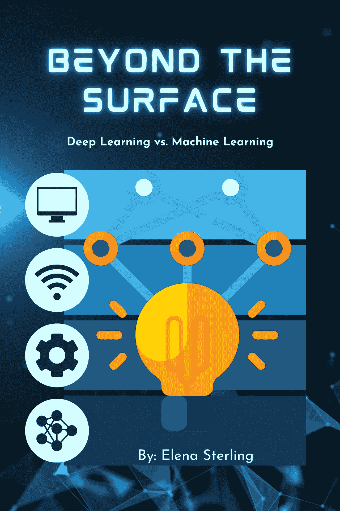

# 超越表面：深度学习 vs. 机器学习

# 15. Transformers

## 15.4 Transformer 架构

## 15.5 Transformer 的应用

## 15.6 Transformer 的优势

# 第 16 章

## 可解释人工智能 (XAI) 与深度学习中的可解释性

## 16.1 可解释人工智能 (XAI) 的重要

## 16.2 深度学习模型的解释技术

## 16.3 可解释性的挑战

## 16.4 XAI 的未来方向

## 16.5 案例研究

# 第 17 章

## AI 系统中的伦理考虑与偏见

## 17.1 伦理考虑

## 17.2 AI 系统中偏见类型

## 17.3 AI 系统偏见的来源

## 17.4 处理 AI 系统中的偏见

## 17.5 案例研究

## 其他资源

# 第 18 章

## AI 的未来：深度学习、机器学习及展望

## 18.1 深度学习与机器学习的进展

## 18.2 新兴趋势与技术

## 18.3 应用与行业

## 18.4 挑战与局限性

# 结论

## 核心要点

# 关于作者

# 引言

## 浅表之下：深度学习 vs 机器学习

人工智能 (`AI`) 改变了我们解决问题的方式，而机器学习是其中的一个关键方面。在机器学习内部，深度学习已成为处理任务的强大工具。但是，深度学习和机器学习之间究竟有什么区别？我们又如何为特定问题选择合适的方法呢？

在“浅表之下：深度学习 vs 机器学习”中，我们将深入探讨这两种方法的细节，探索它们的优点、缺点和应用。本书旨在帮助想要超越浅层理解、对 `AI` 世界获得更深见解的读者。

机器学习是 `AI` 的一种类型，使计算机能够从数据中学习并在无需显式编程的情况下提高执行任务的性能。它已成功应用于广泛的任务，包括图像识别、自然语言处理和推荐系统。然而，机器学习是一个广泛的领域，有许多不同的方法可以选择。

深度学习是机器学习的一个子领域，专注于神经网络，神经网络由多个层相互连接的节点或“神经元”组成。这些网络的设计旨在模拟人类大脑的结构和功能，允许它们学习并表示数据中的复杂模式。深度学习在图像识别、语音识别和自然语言处理等任务中特别取得了成功。

尽管深度学习取得了成功，但它并不总是最佳方法。事实上，对于许多任务，机器学习可能是更有效、更高效的选择。那么，我们如何在深度学习和机器学习之间进行选择呢？这些方法之间的主要区别是什么？

在本书中，我们将探索机器学习和深度学习的基础知识，包括监督学习和无监督学习、神经网络以及深度学习算法。我们还将讨论每种方法的优缺点，并就如何为特定问题选择正确的方法提供指导。

在整书中，我们将使用真实案例和案例研究来说明这些概念和技术。我们还将提供 `AI` 最新进展的全面概述，包括迁移学习、注意力机制和可解释 `AI`。

无论你是学生、研究人员还是从业人员，本书旨在为你提供对 `AI` 领域更深入的理解，以及成功所需的工具和技术。所以，让我们深入其中，探索浅表之下的 `AI` 世界吧！

### 引言涵盖的核心要点：

- 人工智能 (`AI`) 与机器学习

- 深度学习作为机器学习的子领域

- 理解深度学习与机器学习区别的重要性

- 本书内容和结构的概述

- 真实案例与案例研究

- `AI` 的最新进展，包括迁移学习、注意力机制和可解释 `AI`

- 本书目标：提供对 `AI` 及其工具技术的更深层次理解。

# 第 1 章

## 人工智能：简述

人工智能 (`AI`) 是计算机科学的一个领域，专注于创建能够执行通常需要人类智能的任务的智能机器。`AI` 系统可以分析数据、从经验中学习并做出决策或采取行动以实现特定目标。在本章中，我们将探索 `AI` 的基础知识、历史及其应用。

## 1.1 什么是人工智能？

`AI` 是一个广泛的领域，涵盖了用于构建智能机器的技术和方法。它涉及开发算法、计算机程序和系统，使其能够执行通常需要人类智能的任务，例如：

- 从经验中学习

- 推理与解决问题

- 感知与理解

- 语言理解与生成

- 决策与行动

`AI` 系统可以设计用于执行从广泛的任务，从简单的自动化到复杂的决策。

## 1.2 人工智能的历史

`AI` 的概念可以追溯到古希腊，那里的神话描述了为了服务人类目的而创造的人造生物。然而，现代 `AI` 研究始于 20 世纪中期，当时计算机科学家艾兰·图灵（Alan Turing）、马文·明斯基（Marvin Minsky）和约翰·麦卡锡（John McCarthy）开始探索创建能够思考和学习机器的方法。

`AI` 领域经历了几个增长和衰的时期，受到计算机科学、数学和工程进步的影响。一些显著的里程碑包括：

- 1951 年：艾兰·图灵提出了图灵测试，衡量机器表现出与人类等同或无法区分的智能行为的能力的标准。

- 1956 年：达特茅人工智能夏季研究项目成立，标志着 `AI` 作为一个研究领域的开始。

- 1960 年代：开发了基于规则的专家系统，允许机器根据预定义的规则进行推理和决策。

- 1980 年代：专家系统衰落，`AI` 研究转向机器学习和神经网络。

- 1990 年代：`AI` 开始应用于自然语言处理、计算机视觉和机器人等领域。

- 2000 年代：机器学习和深度学习成为 `AI` 研究和应用的关键技术。

## 1.3 人工智能的应用

`AI` 在各个行业都有众多应用，包括：

- 医疗：`AI` 用于医学影像、药物发现和患者诊断。

- 金融：`AI` 用于欺诈检测、信用评分和投资组合管理。

- 交通：`AI` 用于自动驾驶、交通管理和路线优化。

- 教育：`AI` 用于个性化学习、自适应课程和智能辅导系统。

- 客户服务：`AI` 被用于聊天机器人、虚拟助手和情感分析。

`AI` 有潜力改变我们生活的许多方面，从我们工作和交流的方式，到我们旅行和获取医疗服务的方式。

`AI` 是一个快速发展的领域，拥有丰富的历史和多样的应用。理解 `AI` 的基础知识及其潜力，对于利用其力量创造创新解决方案和改善我们的生活至关重要。

## 本章涵盖要点：

- 人工智能的定义

- 人工智能的历史

- 人工智能的应用

- `AI` 基础，包括机器学习、神经网络和深度学习

- `AI` 变革各个行业和生活领域的潜力

# 第 2 章

## 机器学习与深度学习：术语定义

机器学习和深度学习是人工智能（`AI`）的核心组成部分。虽然这两个术语经常交替使用，但它们具有不同的含义和应用。在本章中，我们将探索机器学习和深度学习之间的定义、差异和关系。

## 2.1 机器学习

机器学习是 `AI` 的分支，涉及开发算法和统计模型，使机器能够从数据中学习、做出决策并随着时间的推移提高性能。机器学习是一种编程类型，允许系统在无需针对特定任务进行显式编程的情况下，自动提高其在任务上的性能。

机器学习基于这样一个想法：通过让机器接触大量数据来训练其执行某任务，而不是通过显式规则对其编程。这种方法使机器能够从经验中学习，适应新情况并根据数据分析做出决策。

## 2.2 机器学习的类型

机器学习可以分为三大类：

1. 监督学习：在监督学习中，机器在带标记的数据上进行训练，其中正确输出是已知的。目标是学习输入数据与输出标签之间的映射，以便机器能够对新的未见数据做出准确的预测。示例包括图像分类、语音识别和情感分析。

2. 无监督学习：在无监督学习中，机器在未标记的数据上进行训练，目标是发现数据中的模式、关系或结构。示例包括聚类、降维和异常检测。

3. 强化学习：在强化学习中，机器通过与环境交互并根据行为接受奖励或惩罚来学习。目标是学习一种能够最大化奖励并最小化惩罚的策略。示例包括游戏、机器人和推荐系统。

## 2.3 深度学习

深度学习是机器学习的一个分支，专注于神经网络，神经网络由多个层相互连接的节点或“神经元”组成。这些网络的设计模仿人类大脑的结构和功能，允许它们学习并表示数据中的复杂模式。

### 深度学习对于以下任务特别有效：

1. 图像识别：深度学习算法可以识别图像和视频中的物体、场景和活动。

2. 自然语言处理：深度学习算法可以处理和理解人类语言，实现语音识别、机器翻译和文本摘要等应用。

3. 语音识别：深度学习算法可以识别口头的单词和短语，实现语音助手和语音转文字等应用。

## 2.4 机器学习与深度学习之间的主要区别

虽然机器学习和深度学习都是 `AI` 技术，但它们之间存在关键差异：

1. 复杂性：深度学习模型通常比机器学习模型更复杂，层数也更多。

2. 数据需求：深度学习模型需要大量数据进行训练，而机器学习模型通常可以从较小的数据集中学习。

3. 准确性：深度学习模型往往比机器学习模型更准确，特别是在图像识别和自然语言处理等任务中。

4. 可解释性：机器学习模型通常比深度学习模型更具可解释性，后者可能难以理解和视觉化。

机器学习和深度学习都是 `AI` 的重要部分，但它们具有不同的含义和应用。理解这些术语之间的差异和关系对于开发有效的 `AI` 系统至关重要。

## 本章涵盖要点：

- 机器学习的定义

- 机器学习的类型（监督、无监督、强化）

- 深度学习的定义

- 机器学习与深度学习的主要区别（复杂性、数据需求、准确性、可解释性）

# 第 3 章

## 监督学习：分类与回归

监督学习是机器学习的一种，算法在带标记的数据上进行训练，目标是学习输入数据与输出标签之间的映射。在本章中，我们将探索两种基础监督学习技术：分类和回归。

## 3.1 分类

分类是一种监督学习技术，算法根据输入数据预测类别标签或类别。目标是学习一个区分不同类别的边界。分类用于以下应用：

- 图像分类（例如检测、人脸识别）

- 情感分析（例如垃圾邮件与非垃圾邮件）

- 医疗诊断（例如疾病分类）

分类的类型：

- 二分类：两个类别或标签（例如 0/1，是/否）

- 多分类：两个以上的类别或标签（例如手写数字识别）

### 常见的分类算法：

- 决策树

- 随机森林

- 支持向量机 (`SVMs`)

- K 近邻 (`k-NN`)

## 3.2 回归

回归是一种监督学习技术，算法根据输入数据预测连续的输出值。目标是学习输入数据与输出值之间的映射。回归用于以下应用：

- 房价预测

- 股票市场预测

- 能源消耗预测

回归的类型：

- 简单线性回归：一个输入特征

- 多线性回归：多个输入特征

- 非线性回归：输入与输出之间是非线性关系

### 常见的回归算法：

- 线性回归

- 岭回归

- Lasso 回归

- 弹性网络回归

# 第 4 章

## 无监督学习：聚类与降维

无监督学习是机器学习的一种，算法在未标记的数据上进行训练，目标是发现数据中的模式、关系或结构。在本章中，我们将探索两种基础无监督学习技术：聚类和降维。

## 4.1 聚类

聚类是一种无监督学习技术，算法根据特征或特性将相似的数据点分归一类。目标是识别数据中的模式或结构。聚类用于以下应用：

- 客户细分

- 基因表达分析

- 图像分割

聚类的类型：

- `K-Means` 聚类：将数据划分为 `K` 个类

- 层次聚类：构建聚类的层次结构

- `DBSCAN` 聚类：基于密度的聚类

常见的聚类算法：

- `K-Means`

- 层次聚类

- `DBSCAN`

- `K-Medoids`

## 4.2 降维

降维是一种无监督学习技术，算法在保留最重要信息的同时，减少数据中特征或维的数量。其目标是简化数据并提高模型性能。降维用于以下应用场景：

- 特征选择

- 数据可视化

- 模型性能提升

### 降维的类型：

- 特征选择：选择特征的子集

- 特征提取：将特征转换为低维空间

- 降维技术：`PCA`、`t-SNE`、`Autoencoders`

### 常见的降维算法：

- 主成分分析 (`PCA`)

- t 随机邻域嵌入 (`t-SNE`)

- 自动编码器

- 奇异值分解 (`SVD`)

## 这些章节涵盖的关键要点：

- 有监督学习技术：分类和回归

- 无监督学习技术：聚类和降维

- 每种技术的类型和常用算法

- 每种技术的应用和用例

# 第 5 章

## 强化学习：训练智能体做出决策

强化学习是机器学习的一种，智能体通过与环境交互并接收奖励或惩罚来学习做出决策。其目标是学习一种能够使奖励最大化并将惩罚最小化的策略。在本章中，我们将探索强化学习的基础及其应用。

## 5.1 强化学习的关键组件

强化学习涉及智能体、环境、动作、状态、奖励、策略和价值函数。

- 智能体 (Agent)：与环境交互的决策者。

- 环境 (Environment)：智能体交互的外部世界。

- 动作 (Actions)：智能体做出的决策。

- 状态 (States)：环境的当前状况或状态。

- 奖励 (Rewards)：智能体对其动作接收到的反馈。

- 策略 (Policy)：从状态到动作的策略或映射。

- 价值函数 (Value Function)：在特定状态下采取特定动作的预期或价值。

## 5.2 强化学习的类型

根据环境性质和智能体的经验，强化学习可以分为几类：

- 章节记忆 (Episodic Memory)：智能体从一系列经验或回合中学习。

- 序列决策 (Sequential Decision-Making)：智能体随时间推做出一系列决策。

- 部分观测环境 (Partially Observable Environments)：智能体只能获取环境的部分信息。

- 连续状态和动作空间 (Continuous State and Action Spaces)：智能体处理连续的状态和动作。

## 5.3 强化学习算法

强化学习中使用了几种算法来更新价值函数和策略。

- `Q-Learning`：根据所采取的动作和收到的奖励更新价值函数。

- `SARSA`：同时更新价值函数和策略。

- 深度 Q 网络 (`DQN`)：使用神经网络近似价值函数。

- 策略梯度方法 (Policy Gradient Methods)：根据收到的奖励直接更新策略。

- Actor-Critic 方法：结合了策略和价值函数的更新。

## 5.4 强化学习的应用

强化学习在各个领域有许多应用。

- 机器人：教机器人执行复杂任务。

- 游戏玩：训练智能体玩围棋、`Poker` 和视频游戏等。

- 推荐系统：基于用户行为进行个性化推荐。

- 自动驾驶车辆：训练智能体驾驶汽车并在道路上导航。

- 金融交易：优化交易策略。

## 5.5 强化学习面临的挑战

强化学习面临若干挑战，包括：

- 探索与利用权衡 (Exploration-Exploitation Trade-off)：平衡探索新动作与利用已知动作。

- 延迟奖励 (Delayed Rewards)：处理延迟反馈。

- 高维状态空间 (High-Dimensional State Spaces)：处理大量的状态。

- 部分观测环境 (Partially Observable Environments)：处理不完整的信息。

## 5.6 强化学习的现实世界示例

强化学习已成功应用于各种现实场景，包括：

- `AlphaGo`：一个击败人类的计算机程序。

- 自驾汽车：在道路和交通中导航的自动驾驶车辆。

- 个性化推荐：根据用户行为建议产品的在线系统。

- 机器人控制：教机器人执行复杂任务。

理解其基础、类型和应用有助于开发智能系统。

# 第 6 章

## 深度学习：神经网络及其他

深度学习是机器学习的一个分支，专注于神经网络，其旨在模仿人类大脑的结构和功能。在本章中，我们将探索深度学习的基础及其应用。

## 6.1 神经网络

人工神经网络 (`ANNs`) 是深度学习的基础。它们由多层相互连接的节点组成。每个神经元接收上一层的输入，进行计算并将输出发送到下一层。

## 6.2 神经网络的类型

深度学习中使用几种类型的神经网络，包括：

- 前馈神经网络 (Feedforward Neural Networks)：信息仅从输入单向输出流动。

- 卷积神经网络 (`CNNs`)：为图像识别设计，具有卷积和池化层。

- 循环神经网络 (`RNNs`)：为序列数据设计，具有循环连接和记忆单元。

- 自动编码器 (Autoencoders)：用于降维、压缩和生成模型。

## 6.3 深度学习算法

深度学习中使用几种算法来更新神经网络的权重和偏置。

- 随机梯度下降 (`SGD`)：根据误差梯度更新权重和偏置。

- 反向传播 (Backpropagation)：通过反向传播计算误差梯度。

- 激活函数 (Activation Functions)：向网络引入非线性，例如 `sigmoid`、`tanh` 和 `ReLU`。

- 批量归一化 (Batch Normalization)：对每层的输入进行归一化，减少内部协方差。

## 6.4 深度学习的应用

深度学习在各个领域有许多应用，包括：

- 计算机视觉：图像识别、目标检测、分割和生成。

- 自然语言处理 (`NLP`)：文本分类、情感分析、机器翻译和语言建模。

- 语音识别：识别口语和短语。

- 机器人：教机器人执行复杂任务并在环境中导航。

## 6.5 深度学习的现实世界示例

深度学习已成功应用于各种现实场景，包括：

- 自驾汽车：在道路和交通中导航的自动驾驶车辆。

- 个性化推荐：根据用户行为建议产品的在线系统。

- 医疗诊断：从医学影像诊断疾病的深度学习算法。

- 自然语言处理：能够理解并响应语音命令的机器人和虚拟助手。

深度学习是处理和分析复杂数据的强大工具。理解其基础知识、类型、算法和应用可以帮助我们开发能够学习并适应变化情况的智能系统。

# 第 7 章

## 卷积神经网络 (CNNs)

卷积神经网络 (`CNNs`) 是一种神经网络架构，它们彻底改变了计算机视觉和图像处理领域。在本章中，我们将探索 `CNN` 的基础知识、架构及其应用。

## 7.1 CNN 简介

`CNN` 的设计用于处理具有网格拓扑结构的数据，例如图像、视频和 3D 数据。它们的灵感源于人类大脑的结构和功能，特别是视觉皮层。`CNN` 由多层卷积层和池化层组成，随后通常是全连接层。

## 7.2 CNN 的架构

`CNN` 的架构由以下层组成：

- 卷积层：这些层在输入数据上执行卷积操作，使用一组过滤器扫描输入数据以检测局部模式。

- 池化层：这些层对输入数据进行下采样，通过缩小空间维度来减少参数数量和计算量。

# 第 7 章

## 7.3 卷积层

卷积层是 CNN 的核心，在输入数据上执行卷积操作。卷积操作涉及使用一组过滤器扫描输入数据，检测局部模式和特征。

- 过滤器（Filter）：一个较小的 3D 权重数组，用于检测输入数据中的局部模式。
- 特征图（Feature Map）：卷积操作的输出，代表在输入数据中检测到的特征。

## 7.4 池化层

池化层对输入数据进行下采样，通过缩小空间维度来减少参数数量和计算量。

- 最大池化（Max Pooling）：从输入数据的每个补块（patch）中选择最大值。
- 平均池化（Average Pooling）：计算输入数据每个补块的平均值。

## 7.5 全连接层

全连接层由一个全连接神经网络组成，用于分类、回归或其他任务。

- 分类：输出所有可能类别的概率分布。
- 回归：输出一个连续值，用于回归任务。

## 7.6 CNN 的应用

CNN 在计算机视觉和图像处理领域有许多应用，包括：

- 图像分类：将图像分类为不同的类别。
- 目标检测：检测图像中的物体。
- 图像分割：将图像分割成不同的区域。
- 图像生成：根据给定的输入生成新图像。

## 7.7 CNN 的优势与挑战

CNN 具有若干优势，包括：

- 处理大型图像的能力
- 检测局部模式和特征的能力
- 在图像分类和目标检测中具有高准确率

然而，CNN 也面临若干挑战，包括：

- 计算密集型
- 过拟合和欠拟合
- 结果解释的困难

## 7.8 CNN 的真实世界示例

CNN 已成功应用于各种真实世界场景，包括：

- 自动驾驶汽车：CNN 用于目标检测和图像处理。
- 医学诊断：CNN 用于图像分割和分类。
- 脸部识别：CNN 用于人脸识别和验证。

# 第 8 章

## 循环神经网络 (RNNs)

循环神经网络 (RNNs) 是一种设计用于处理序列数据的神经网络。在本章中，我们将探索它们的基础知识、架构和应用。

## 8.1 RNN 简介

RNN 的设计用于处理顺序很重要的数据，例如文本或时间序列。它们具有内部循环，允许信息跨越时间步持续。

## 8.2 RNN 的架构

RNN 的架构由以下组件组成：

- 输入门（Input Gate）：决定将哪些信息添加到单元状态中。
- 单元状态（Cell State）：存储信息的内部记忆。
- 输出门（Output Gate）：决定从隐藏状态中输出哪些信息。
- 隐藏状态（Hidden State）：从一个时间步传递到下一个时间步。

## 8.3 RNN 的类型

RNN 有多种类型，包括：

- 简单 RNN：基础 RNN 类型。
- 长短期记忆（LSTMs）：一种使用特殊记忆单元存储长期信息的 RNN 类型。
- 门控单元（GRUs）：使用门控机制控制信息流的 RNN 类型。

## 8.4 RNN 的训练

由于梯度消失问题，训练 RNN 非常挑战。为了解决这个问题，开发了多种技术：

- 时间反向传播（BPTT）：通过时间反向传播误差来训练 RNN 的方法。
- 截断时间反向传播（TBPTT）：通过截断时间反向传播训练 RNN 的方法。

## 8.5 RNN 的应用

RNN 在自然语言处理、语音识别和时间序列预测领域有许多应用，包括：

- 语言模型：预测句子中的下一个单词。
- 语音识别：识别口语单词和短语。
- 时间序列预测：预测时间序列的未来值。

## 8.6 RNN 的优势与挑战

RNN 具有若干优势，包括：

- 处理序列数据的能力
- 捕捉时间依赖的能力
- 在语言建模和语音识别中具有准确率

然而，RNN 也面临若干挑战，包括：

- 梯度消失问题
- 训练困难
- 过拟合和欠拟合

## 8.7 RNN 的真实世界示例

RNN 已成功应用于各种真实世界场景，包括：

- 语音识别系统：识别口语单词和短语。
- 语言翻译系统：实时翻译语言。
- 时间序列预测系统：预测时间序列的未来值。

# 第 9 章

## 自然语言处理 (NLP)

自然语言处理 (NLP) 是人工智能（AI）的一个分支，处理计算机与人类之间的自然语言交互。在本章中，我们将探索 NLP 的基础知识、应用及其挑战。

## 9.1 NLP 简介

NLP 是一个专注于让计算机理解、解释和生成人类语言的学科领域。它结合了计算机科学、语言学和认知心理学，旨在开发算法和统计模型以处理和分析自然语言数据，例如能够理解并响应语音命令的虚拟助手。

## 9.2 NLP 任务

NLP 任务大致可以分为以下几类：

- 分词 (Tokenization)：将文本分解为单个单词或标记
- 词性标注 (POS Tagging)：识别每个词的句法范畴
- 命名实体识别 (NER)：识别人物、组织和地点等命名实体
- 情感分析：判别文本的情绪基调或情感倾向
- 机器翻译：将文本从一种语言翻译成另一种语言
- 问答系统：根据文本内容回答问题

## 9.3 NLP 应用

NLP 在许多领域都有广泛应用，例如：

- 情感分析：分析客户反馈和社交媒体上的情绪
- 信息检索：搜索并检索相关的文档和信息
- 文本分类：将文本分类为如垃圾邮件或非垃圾邮件等类别
- 机器翻译：为全球读者翻译网站和文档
- 聊天机器人和虚拟助手：对用户查询生成类人的回复。

## 9.4 NLP 挑战

NLP 面临着若干挑战，包括：

- 歧义性：单词和短语可能有多种含义
- 上下文：理解文本所使用的语境
- 讽刺与反讽：检测讽刺和反讽的语言
- 语言演变：跟上不断变化的语言用法和俚语
- 多语言性：处理和分析多种语言的文本

## 9.5 NLP 技术

NLP 使用了多种技术，包括：

- 基于规则的方法：使用预定义的规则处理语言
- 统计学方法：使用统计模型分析语言
- 机器学习方法：使用机器学习算法从语言数据中学习
- 深度学习方法：使用深度学习算法分析和生成语言

## 9.6 NLP 工具和资源

NLP 有多种可用的工具和资源，包括：

- NLTK (自然语言工具包)：用于 NLP 任务的流行 Python 库
- spaCy：一个用于 NLP 任务的现代 Python 库
- Stanford CoreNLP：用于 NLP 任务的 Java 库
- WordNet：用于英语单词的词汇数据库
- 语料库 (Corpora)：用于 NLP 研究和开发的大规模文本数据集

## 9.7 NLP 的真实世界示例

NLP 已成功应用于各种真实世界场景，包括：

- 情感分析：通过分析客户反馈进行产品开发
- 信息检索：为法律案件搜索并检索相关文档
- 文本分类：将文本分类为垃圾邮件或非垃圾邮件以进行邮件过滤
- 机器翻译：为全球读者翻译网站和文档
- 聊天机器人和虚拟助手：为客户服务生成类人的查询回复

NLP 是一个快速发展的领域，在情感分析、信息检索和机器翻译等领域有大量应用。尽管 NLP 面临若干挑战，但持续的研究开发正在帮助克服这些挑战，并提高 NLP 系统的准确性和效率。

# 第 10 章

## 深度学习算法：反向传播、优化与正则化

深度学习算法是构建和训练神经网络的关键部分。在本章中，我们将探索深度学习中使用的关键算法，包括反向传播、优化技术和正则化方法。

## 10.1 反向传播

反向传播是深度学习中一种用于训练神经网络的重要算法。它是一种监督学习方法，目标是最小化网络输出与预期输出之间的误差。该算法通过将误差反向传播整个整个网络，调整神经元的权重和偏置来减少误差。

## 10.2 优化技术

优化技术用于最小化深度学习中的损失函数。最常见的优化技术有：

- 随机梯度下降 (SGD)：这是一种简单且广泛使用的优化技术，它根据损失函数的梯度更新神经元的权重和偏置。
- 动量 (Momentum)：这是 `SGD` 的一种变体，在更新规则中添加了动量项，有助于跳出局部最优。
- 内斯泰罗夫加速梯度 (Nesterov Accelerated Gradient)：这是 `SGD` 的一种变体，使用不同的更新规则来结合动量。
- Adam：这是一种根据梯度的大小为每个参数自适应学习率的优化技术。
- RMSProp：这是一种根据梯度的大小为每个参数自适应学习率的优化技术。

## 10.3 正则化方法

正则化方法用于防止深度学习中的过拟合。最常见的正则化方法有：

- L1 正则化：这种方法在损失函数中添加一个与权重绝对值成正比的项。
- L2 正则化：这种方法在损失函数中添加一个与权重平方成正比的项。
- 丢弃法 (Dropout)：这种方法在训练期间随机将一部分神经元设置为零，有助于防止过拟合。
- 批量归一化 (Batch Normalization)：这种方法对每层的输入数据进行归一化处理，有助于减少过拟合。

我们已经探索了深度学习中使用的关键算法，包括反向传播、优化技术和正则化方法。这些算法对于构建和训练神经网络至关重要，对于任何在深度学习领域工作的人来说，理解它们都是关键的。通过掌握这些算法，我们可以构建解决计算机视觉、自然语言处理等复杂问题的强大神经网络。

# 第 11 章

## 深度学习 vs 机器学习：关键差异与案例

深度学习和机器学习都是人工智能的子集，但它们在方法和应用上有所不同。在本章中，我们将深度学习与机器学习之间的关键差异，并讨论它们的案例。

## 11.1 关键差异

- 架构：深度学习模型具有多层的复杂架构，而机器学习模型具有层数较少的简单架构。
- 数据需求：深度学习模型需要大量数据进行训练，而机器学习模型可以在较小的数据集上训练。
- 计算能力：深度学习模型需要巨大的计算能力，而机器学习模型可以在性能普通的机器上训练。
- 可解释性：机器学习模型通常比深度学习模型更具解释性。

## 11.2 案例

- 深度学习：
  - 图像识别
  - 自然语言处理
  - 语音识别
  - 时间序列预测
- 机器学习：
  - 线性回归
  - 逻辑回归
  - 决策树
  - 聚类

## 11.3 真实世界应用

- 深度学习：
  - 自驾驶汽车
  - 个人助手（如 Siri、Alexa）
  - 欺诈检测
  - 医疗诊断
- 机器学习：
  - 推荐系统
  - 客户细分
  - 预测性维护
  - 质量控制

我们探索了深度学习与机器学习之间的关键差异，并讨论了它们的案例和真实世界应用。通过理解每方法的优缺点，我们可以为任务选择合适的工具并构建成功的预测模型。深度学习特别适用于具有大型数据集的复杂问题，而机器学习更适用于具有较小数据集的简单问题。

# 人工智能的未来

人工智能（AI）自诞生以来已经走了很远的路，其未来比以往任何时候都更加光明。在本章中，我们将探索人工智能的潜在进展和发展、它对各行业的影响，以及随着其增长而来的伦理考虑。

## 人工智能进展

人工智能正在快速发展，我们可以预计以下领域取得重大突破：

- 自然语言处理 (NLP)：人工智能将在理解和生成人类语言方面变得更加熟练，彻底改变通信与交互。
- 计算机视觉：人工智能将提高解释和理解视觉数据的能力，使自动驾驶车辆和监控系统等应用成为可能。
- 机器人：机器人将在制造业、医疗和物流等行业更加普及。
- 边缘 AI：人工智能将部署在网络边缘，降低延迟并实现实时处理。

## 对行业的影响

人工智能将转型各个行业，包括：

- 医疗健康：人工智能将协助医疗诊断、药物发现和个性化治疗方案。
- 金融：人工智能将增强欺诈检测、风险管理和投资组合管理。
- 教育：人工智能将提供个性化学习体验、自动评分并识别学习差距。
- 制造业：人工智能将优化生产、预测维护需求并提高产品质量。

## 未来的工作

人工智能将改变工作的性质，我们必须为这种转变做好准备：

- 技能提升与重塑：工人必须开发新技能来辅助人工智能。
- 职位重新定义：人工智能将在 AI 开发、部署和维护等领域创造新的工作机会。
- 通用基本收入：一些专家建议实施通用基本收入以解决工作流失问题。

人工智能的未来充满了巨大的希望，但也引发了伦理关注。随着人工智能的不断进步，我们必须优先考虑负责任的发展、部署和使用。通过解决伦理问题并为工人的转变做好准备，我们可以充分利用人工智能的潜力，为所有人创造一个更好的未来。

# 第 12 章

## 选择正确的方法：何时使用深度学习或机器学习

机器学习和深度学习都是构建预测模型的强大工具，但它们有各自的优缺点。在本章中，我们将探讨何时该使用深度学习，何时该使用机器学习，并就如何为你的问题选择正确的方法提供指导。

## 12.1 何时使用深度学习

深度学习特别适用于涉及以下内容的问题：

- 海量数据：深度学习模型需要大量数据进行训练，因此如果你有一个较小的数据，机器学习可能是更好的选择。
- 复杂关系：深度学习模型能够学习输入与输出之间的复杂关系，使其非常适用于图像识别和自然语言处理等问题。
- 高维数据：深度学习模型可以比机器学习模型更有效地处理高维数据（如图像和文本）。

## 12.2 何时使用机器学习

机器学习特别适用于涉及以下内容的问题：

- 中小型数据集：机器学习模型可以在比深度学习模型更小的数据集上进行训练，使其成为数据有限问题的良好选择。
- 简单关系：机器学习模型能够学习输入与输出之间的简单关系，使其非常适用于线性回归和逻辑回归等问题。
- 可解释性：机器学习模型通常比深度学习模型更具解释性，使得对于理解模型很重要的问题，它们是一个很好的选择。

## 12.3 选择正确的方法

在深度学习和机器学习之间进行选择时，请考虑以下因素：

- 数据规模
- 关系复杂度
- 可解释性
- 计算资源

我们已经了深度学习和机器学习的优缺点，并就如何为你的问题选择正确的方法提供了指导。

# 第 13 章

## 案例研究：深度学习和机器学习的现实应用

在本章中，我们将探索深度学习和机器学习的现实应用，重点介绍它们在计算机视觉、自然语言处理和语音识别等多个领域中的优缺点。

### 13.1 计算机视觉

- 图像分类：如 `CNN` 等深度学习模型在图像分类方面已达到先进性能，例如识别图像中的物体。
- 目标检测：如 `YOLO` 和 `SSD` 等深度学习模型已用于目标检测，定位图像中的物体。
- 分割：如 `U-Net` 等深度学习模型已用于图像分割，将图像划分为感兴趣区域。

### 13.2 自然语言处理

- 情感分析：如 `logistic regression` 和支持向量机等机器学习模型已用于情感分析，用于确定文本的情感基调。
- 文本分类：如 `LSTM` 和 `CNN` 等深度学习模型已用于文本分类，对垃圾邮件或非垃圾邮件等文本进行分类。
- 语言翻译：如 `sequence-to-sequence models` 等深度学习模型已用于语言翻译，将文本从一种语言翻译成另一种语言。

### 13.3 语音识别

- 语音转文字：如 `LSTM` 和 `CNN` 等深度学习模型已用于语音识别，将口语转录为文本。
- 语音识别：如 `Gaussian mixture models` 等机器学习模型已用于语音识别，识别个人说话者。

### 13.4 医疗健康

- 疾病诊断：如 `decision trees` 和 `random forests` 等机器学习模型已用于疾病诊断，预测患者结果。
- 医学影像：如 `CNN` 等深度学习模型已用于医学影像，分析图像中的疾病迹象。

### 13.5 金融

- 欺诈检测：如 `logistic regression` 和 `decision trees` 等模型已用于欺诈检测，识别可疑交易。
- 股市预测：如 `LSTM` 和 `CNN` 等深度学习模型已用于股市预测，预测股票价格。

# 第 14 章

## 迁移学习与微调

迁移学习和微调是深度学习中强大的技术，允许我们利用预训练模型来解决新任务。在本章中，我们将探讨迁移学习和微调的概念、优势以及如何应用它们。

## 14.1 迁移学习

迁移学习是一种机器学习技术，其中为一项任务开发的模型被重新用作另一项任务的起点。这在深度学习中特别有用，因为训练深度模型需要大量数据和计算资源。

## 14.2 迁移学习的优势

迁移学习具有若干优势，包括：

- 节省时间和计算资源
- 可以比从头开始训练新模型具有更好的性能
- 允许更小的数据集需求

## 14.3 微调预训练模型

微调涉及调整预训练模型的权重和偏置，以适应新任务。这通常通过在预训练模型之上添加新层，并在新任务上对整个网络进行训练来实现。

## 14.4 如何微调预训练模型

- 选择与新任务相关的预训练模型
- 在预训练模型之上添加新层
- 在新任务上训练整个整个网络
- 根据需要调整超参数

## 14.5 案例研究

- 使用预训练的卷积神经网络 (`CNN`) 进行图像分类
- 使用预训练的循环神经网络 (`RNN`) 进行自然语言处理

迁移学习和微调预训练模型是深度学习中强大的技术，它们可以节省时间并提高性能。通过理解如何应用这些技术，我们可以为各种任务构建更高效、有效的模型。

# 第 15 章

## 注意力机制与 Transformer

注意力机制和 Transformer 是深度学习中革命性的概念，它们彻底改变了自然语言处理领域。在本章中，我们将深入探讨注意力机制和 Transformer 的细节，并探索它们在深度学习中的应用。

## 15.1 注意力机制

注意力机制允许模型关注输入数据中与当前任务相关的特定部分。这在自然语言处理中特别有用，因为输入数据可能很长且复杂。

## 15.2 注意力机制的类型

- 缩放点积注意力
- 多头注意力
- 自注意力机制

## 15.3 Transformer

Transformer 是一种完全依赖自注意力机制的神经网络架构。它们彻底改变了自然语言处理领域，并在许多任务中取得了最先进的成果。

## 15.4 Transformer 的架构

- 编码器-解码器结构
- 自注意力机制
- 前馈神经网络 (`FFNN`)

## 15.5 Transformer 的应用

- 机器翻译
- 文本分类
- 情感分析
- 问答系统

## 15.6 Transformer 的优势

并行化：Transformer 比循环神经网络（`RNNs`）更容易进行并行化，使得它们更快、更高效。

可扩展性：Transformer 可以处理比 `RNNs` 更长的输入序列，使其更适合长文档和文本。

性能：Transformer 在许多自然语言处理任务中取得了最先进的成果。

注意力机制和 Transformer 改变了自然语言处理领域，并在许多任务中取得了最先进的成果。通过理解注意力机制和 Transformer 的工作原理，我们可以为各种任务构建更高效、有效的模型。

# 第 16 章

## 可解释人工智能（XAI）与深度学习中的可解释性

可解释人工智能（`XAI`）和可解释性是深度学习中的关键概念，使我们能够理解模型所做出的决策。在本章中，我们将探索 `XAI` 的重要性、解释深度学习模型的技术，以及该领域的挑战和未来方向。

## 16.1 可解释人工智能（XAI）的重要性

- 信任与问责
- 识别偏差和错误
- 提高模型性能
- 满足监管要求

## 16.2 解释深度学习模型的技术

- 显著性图
- 基于梯度的方法
- 激活最大化
- 模型可解释性技术（例如 `LIME`、`TreeExplainer`）

## 16.3 可解释性面临的挑战

- 深度学习模型的复杂性
- 缺乏标准的评估指标
- 可解释性与性能之间的权衡

## 16.4 XAI 的未来方向

- 开发解释深度学习模型的新技术
- 将 `XAI` 集成到机器学习工作流中
- 处理可解释性与性能之间的权衡

## 16.5 案例研究

- 解释用于图像分类的卷积神经网络（`CNNs`）
- 解释用于文本分类的自然语言处理（`NLP`）模型

可解释人工智能（`XAI`）和可解释性是深度学习的重要组成部分，使我们能够理解并信任模型所做出的决策。通过开发新技术并将 `XAI` 集成到机器学习工作流，我们可以提高深度学习模型的透明度和问责制。

# 第 17 章

## AI 系统中的伦理考量与偏差

AI 系统越来越多地被用于做出影响社会的决策，因此，考虑这些系统的伦理影响至关重要。在本章中，我们将探索 AI 系统中的伦理考量和偏差，并讨论解决这些问题。

## 17.1 伦理考量

- 偏差与歧视
- 隐私与数据安全
- 透明度与可解释性
- 问责与责任
- 公平与公正

## 17.2 AI 系统中的偏差类型

- 数据偏差
- 算法偏差
- 确认偏差
- 亲和偏差
- 可用性偏差

## 17.3 AI 系统中的偏差来源

- 数据收集与预处理
- 算法设计与训练
- 人类偏差与刻板印象
- 文化与社会规范

## 17.4 处理 AI 系统中的偏差

- 数据治理与去偏
- 算法审计与测试
- 多样化且代表性的训练数据
- 定期更新与重新训练
- 人类监督与审查

## 17.5 案例研究

- 人脸识别系统中的偏差
- 招聘算法中的歧视
- 自然语言处理中的性别偏差

AI 系统具有改变社会许多方面的潜力，但它们也带来了重要的伦理考量和偏差。通过理解偏差的来源和类型，并通过数据治理、算法审计和多样化训练数据来解决这些问题，我们可以开发出公平所有人的 AI 系统。

## 额外资源

### 人工智能中的伦理

人工智能（AI）具有改变我们生活许多方面的潜力，从医疗、教育到交通和就业。然而，随着 AI 系统变得越来越无处不在且强大，考虑其开发和部署的伦理影响至关重要。在本章中，我们将探索围绕 AI 的伦理考量，并讨论如何负责任地开发和使用 AI。

### 人工智能伦理引言

人工智能伦理是指引导 AI 系统开发、部署和使用的道德原则和价值观。随着 AI 系统变得越来越自主和具有影响力，考虑其行为和决策的伦理影响是至关重要的。AI 中的伦理考量包括与偏差、隐私、问责和透明度相关的问题。

### 偏差与歧视

### 隐私与监控

AI 系统通常依赖大量的个人数据来有效运行，这引发了人们对隐私和监控的关注。例如，智能家居设备和社会媒体平台会收集有关用户习惯和偏好的敏感信息，这些信息可能被用于精准广告，甚至是政治操纵。为了保护隐私，开发者必须实施稳健的数据保护政策，并确保用户对自己的数据拥有控制权。

## 问责制与透明度

随着 AI 系统变得日益自主，确保它们对其行为和决策负责至关重要。例如，自动驾驶汽车的设计必须能够在发生事故时解释其决策和行动。为了实现问责，开发者必须优先考虑 AI 决策过程的透明度，并确保 AI 系统的设计能够为其行为提供理由。

## 就业流失与经济影响

AI 系统的日益普及引发了对就业流失和经济影响的担忧。虽然 AI 有创造新就业机会的潜力，但它对某些工作也构成了威胁，特别是涉及重复或常规的任务。为了减轻这种影响，政府和组织必须投资再培训和技能提升计划，并实施保护工人权利的政策。

## 自主武器与军事 AI

自主武器和军事 AI 引发了重大的伦理关注。特别是自主武器，具有在没有人类监督或问责的情况下造成伤害的潜力。为了解决这个问题，开发者在开发军事 AI 系统时必须优先考虑人类监督和问责。

## 环境影响

AI 系统的生产和处置可能对环境产生重大影响，特别是在能源消耗和电子垃圾产生方面。为了减轻这种影响，开发者必须优先考虑可持续的设计和生产实践，并实施负责任的处置和回收计划。

随着 AI 系统变得无处不在且日益强大，AI 伦理是一项关键考量。开发者、政策制定者和用户必须优先考虑偏差、隐私、问责和透明度等伦理因素，以确保 AI 以负责任的方式开发和使用。通过解决这些伦理问题，我们可以利用 AI 的潜力为所有人创造更美好的未来。

# 第 18 章：AI 的未来：深度学习、机器学习及未来

人工智能（AI）领域正在快速演进，深度学习和机器学习处于这一演变的前沿。在本章中，我们将探索 AI 的未来，包括深度学习和机器学习的潜在进展与应用，以及将塑造 AI 未来的新兴趋势和技术。

## 18.1 深度学习与机器学习的进展

- 改进的架构和算法
- 迁移学习和微调的使用增加
- 可解释性和可理解性的重要性日益增长
- 与计算机视觉和自然语言处理等其他技术的整合

## 18.2 新兴趋势与技术

- 边缘 AI 与分布式学习
- 自主系统与机器人技术
- 可解释 AI（`XAI`）与透明度
- 对抗鲁棒性与安全性
- 量子 AI 与机器学习

## 18.3 应用与行业

- 医疗健康与医学研究
- 金融与经济
- 教育与学习
- 交通与自动驾驶车辆
- 能源与环境可持续性

## 18.4 挑战与局限性

- 数据质量与可用性
- 偏差与歧视
- 伦理考虑与问责制
- 就业流失与经济影响
- 隐私与安全担忧

AI 的未来充满了希望，深度学习和机器学习处于这一演变的前沿。当我们继续推进和应用这些技术时，解决挑战和局限性至关重要，确保 AI 为整个社会受益。通过拥抱新兴趋势和技术，我们可以为所有人创造一个更光明的未来。

# 结论

人工智能（AI）自诞生以来已经走了很长的一段路，深度学习和机器学习一直是这一演变的前沿。在书中，我们探索了深度学习和机器学习的基础知识、其应用以及 AI 的未来。

我们已经看到深度学习和机器学习如何彻底改变各个行业，从图像和语音识别到自然语言处理和自动驾驶。我们还讨论了数据的重要性、算法的作用，以及在 AI 开发中对伦理考量的重视。

AI 的未来充满了希望，深度学习和机器学习将继续发挥关键作用。我们可以期待在边缘 AI、自主系统和可解释 AI 等领域看到进展。然而，我们也必须应对 AI 的挑战和局限性，包括数据质量、偏差和就业流失。

在前进的过程中，在 AI 开发中优先考虑透明度、问责制和责任至关重要。我们必须确保 AI 为整个社会受益，而不是加剧现有的不平等。

总之，AI 有潜力以深远的方式改变我们的生活和社会。通过理解深度学习和机器学习的基础知识，并解决 AI 的挑战和局限性，我们可以为所有人创造一个更光明的未来。

## 要点总结

- 深度学习和机器学习彻底改变了各个行业
- AI 有潜力以深远的方式改变我们的生活和社会
- 在 AI 开发中优先考虑透明度、问责制和责任至关重要
- 解决 AI 的挑战和局限性（包括数据质量、偏差和就业流失）至关重要
- 确保 AI 为整个社会受益且不加剧现有的不平等至关重要

通过记住这些点，我们就可以利用 AI 的力量为所有人创造更美好的未来。

# 关于作者

**作者简介：** 

Elena Sterling 是一位资深技术战略家和远见领袖，她热爱在充满挑战性的技术环境中创造切实有效的想法。在二十多年的职业生涯中，Elena 在决定各种机构所采用的技术路线方面发挥了关键作用。

### 经验证明

Elena 的技术生涯始于软件开发领域的实践经验，在那里她精炼了自己的技术能力，并获得了关于创建可靠系统复杂性的宝贵知识。她对知识的狂热兴趣和洞察力使她转入战略岗位，在那里，她证明了自己擅长将技术努力与整体业务目标相结合。

Elena 的职业生涯因许多值得关注的技术变革而脱颖而出，这一切都是通过她细致且进取的方法实现的。在她工作过的机构中，她成功处理业务与技术衔接的能力使她成为了可靠的影响者和顾问。

### 具见解的贡献与领导力

除了业务追求外，Elena Sterling 还是技术行业思想领导力的坚实支持者。她在著名贸易期刊的论文中，分享了她在各种主题上的知识，从战略性技术规划的最佳实践到新技术。IT 世界已经注意到并尊重了她富有见地的预测和分析。

Elena 受邀在许多大型技术会议上演讲，在这些场合，她分享了自己的经验，并帮助观众理解技术路线图的细微差别。除了展示她渊博的知识外，她生动且引人入胜的演讲也展现了她帮助更广泛观众理解技术战略的投入。

## 为什么写这本书？

Elena Sterling 编写这本指南，是因为她希望每个人都能获得成功技术领导力所需的信息和能力。通过运用她丰富的经验、成就以及偶尔的挫折，Elena 为读者提供了一份实用的手册，帮助他们弥补理论与实践之间的鸿沟。她致力于让各级高管成功地应对复杂的技术战略世界、促进创新并实现长期成功，这种精神在书中显而易见。

Elena Sterling 曾说：“技术是一种动态力量，它可以阻碍组织的发展，也可以推动它们前进。”这本书基于我的经验、所学知识以及对战略性技术规划革命性潜力的诚实信念。我诚挚地欢迎你与我一起，共同应对挑战、把握机遇，并规划通往成就与创新的未来路线图。
