## 大数据分析方法：数据挖掘、深度学习与自然语言处理中的分析技术

*献给我美丽的妻子 Massi，*

*她坚定不移的爱与支持让这些成就成为可能，也值得去追求。*

# 致谢

这本书的完成离不开我与许多世界知名的数据科学家、研究人员、首席信息官以及领先的技术创新者的合作，他们教会了我许多关于科学研究、创新的知识，更重要的是让我懂得了合作的价值。向他们所有人，我致以深深的谢意。

Peter Ghavami

2019 年 3 月

# 作者简介

# Peter Ghavami, Ph.D.

Peter Ghavami, Ph.D.，是一位世界知名的顾问和多本 IT 畅销书的作者。他曾担任全球众多财富 500 强公司的顾问和顾问，涉及 IT 战略、大数据分析、创新和新技术开发等领域。他的著作《临床智能》聚焦临床数据分析，一直是数据分析类书籍中的畅销书。

他的职业生涯始于软件工程师，随后逐步承担更多责任，先后担任过工程总监、首席科学家、工程副总裁以及多家高科技公司的产品管理副总裁等技术领导职务。他在数据分析领域也担任过领导职务，包括 Gartner 的数据分析集团副总裁和信息学副总裁。

他的第一本著作《精益、敏捷与六西格玛 IT 管理》至今仍被全球的 IT 专业人士和大学广泛使用。他的多部著作已被多所大学选为教材。Ghavami 博士在技术开发、IT 领导力、数据分析、超级计算、软件工程和创新方面拥有超过 25 年的经验。

Peter K. Ghavami 在俄勒冈州立大学获得数学学士学位，侧重计算机科学。他在波特兰州立大学获得工程管理硕士学位。他在华盛顿大学完成工业与系统工程博士学位，专攻预测学，即应用分析来预测系统故障。

Ghavami 博士曾担任多家分析公司的顾问委员会成员，并经常受邀就该主题进行讲座和演讲。他是 IEEE 可靠性学会、IEEE 生命科学倡议和 HIMSS 的成员。可通过 `peter.ghavami@northwestu.edu` 联系他。

# 简介

数据是创造的指纹。而分析是新的“科学女王”。几乎没有任何人类活动、商业决策、战略或物理实体不产生数据，或不涉及数据分析来为其提供信息。数据分析已成为我们从商业到医学、研究、管理、产品开发，以至生活各个方面的核心任务。

从商业角度来看，`data` 现在被视为新的 `gold`。而 `data analytics` 是开采、塑造和铸造它的机器。数据分析是一组计算机辅助的分析方法、流程和学科，用于提取和转换原始数据，使其成为有意义的洞察、新发现和知识，从而帮助做出更有效的决策。另一种定义将其描述为提取和分析数据的学科，旨在提供关于过去表现、当前运营和未来事件预测的新见解。

数据分析日益显著，不仅因为它能改善业务成果或运营流程；它无疑是提高质量、降低成本和改善客户满意度的新工具。但它正迅速成为运营、行政甚至法律原因的必要条件。

我们可以将数据分析的首次使用追溯到 19 世纪 50 年代初期，一位著名的英国社会改革家、统计学家和现代护理创始人 Florence Nightingale。

在克里米亚战争期间的某个时刻，她对改善卫生的倡导将因感染导致的死亡人数减少了 10 倍。她是一位天才，帮助普及了统计数据的图形化表示，并被认为发明了一种饼图形式，我们现在称之为 `polar area diagram`。她曾说：“要理解上帝的思想，我们必须研究统计学，因为这些是他目的的度量。”Florence Nightingale 可以说是历史上第一位数据科学家。


*Florence Nightingale，第一位数据科学家的肖像*。

自那时起，数据分析已经走过了漫长的道路，并因五种被称为 SMAC 的新技术的爆发而日益普及：社交媒体、移动性、分析和云计算。你可能会为传感器和物联网再加一个字母到首字母缩略词中。这些技术中的每一种在改变业务和产生的数据量方面都具有重要意义。

2001 年，META（现 Gartner）报告称数据规模大幅增加、数据产生速率不断加快以及格式种类繁多。他们将这种转变称为 `big data`。大数据以其三个关键属性而闻名，即三个 V：volume（容量）、velocity（速度）和 variety（多样性）。不过，通常还会再增加四个 V：veracity（真实性）、variability（变异性）、value（价值）和 visualization（可视化）。

全球存储量正在以快速的速度增长，估计每年翻一番。数据生成的速度正在上升，这得益于移动设备和社交网络的出现。在医疗和保健领域，传感器的成本和体积已缩小，使得持续患者监测和从多个人体生理系统获取数据成为公认的做法。物联网将使用智能设备相互交互，在不久的将来产生绝大多数数据，即机器数据。

目前已知 90% 的大数据积累于过去两年。专家估计，到 2020 年，我们将拥有 2011 年数据量的 50 倍。预计自动驾驶汽车每年将产生 2 PB 的数据。思科预测，到 2022 年，移动数据流量将达到 1 ZB。

随着更小、更便宜的传感器的出现，以及从客户、智能设备和应用程序收集的数据量，我们面临的挑战是从当下收集的大量数据集中做出日益分析性的决策。这一趋势只会加剧，引发了业内所谓的“大数据问题”：数据积累的速度上升快于我们分析日益庞大的数据集以做出决策的认知能力。大数据问题为改进预测分析和预测学提供了机会。

数据的多样性也在增加。各行各业对数字化转型的采用正在产生大量且多样的数据集。想想那些长期局限于纸张上的医疗数据。随着美国等政府推动医疗机构将其业务转变为电子和数字格式，患者数据可以呈现多种形式。现在通常认为电子病历（EMR）包括多种形式的数据，如音频记录、MRI、超声波、计算机断层扫描（CT）和其他诊断图像、手术期间或直接从患者处拍摄的视频、烧伤和伤口的彩色图像、牙科 X 光片的数字图像、脑部扫描波形、心电图（EKG）、基因序列信息，列表还在继续。

## 表 I.1：存储单位度量

| 数据量 | 大小 |
| --- | --- |
| 字节 – 8 位 | 1 字节：单个字符 |
| 千字节 – 1000 字节 | 一个非常短的故事 |
| 兆字节 – 1000 千字节 | 一本小小说 |
| 吉字节 – 1000 兆字节 | 一部电视画质的电影 |
| 太字节 – 1000 吉字节 | 一家大型医院的所有 X 光胶片 |
| 拍字节 – 1000 太字节 | 美国所有学术研究图书馆的一半 |
| 艾字节 – 1000 拍字节 | SKA 望远镜一天产生的数据 |
| 泽字节 – 1000 艾字节 | 2012 年上半年全球产生的所有数据 |
| 尧字节 – 1000 泽字节 | 1 YB = 1000⁸ 字节 – 10²⁴ 字节 |

# 大数据分析：挑战与机遇

## 大数据与物联网的崛起

所有设备和家电都产生数据这一概念，催生了物联网的理念，即所有设备通过互联网彼此自由通信，并与其他应用程序通信。麦肯锡公司预测，到 2020 年，大数据将成为美国经济五大颠覆性因素之一，且全球三分之一的数据将在美国产生。

新类型的数据将包括结构化和非结构化文本。它将包括服务器日志和其他机器生成的数据。它将包括来自传感器、智能泵、呼吸机和生理监护仪的数据。它将包括流式数据和关于你的客户情绪数据。它包括社交媒体数据，包括 Twitter、Facebook 以及关于医疗保健的本地 RSS 订阅源。即使在今天，如果你是一名医疗服务提供者，你一定观察到过你的病人正在病床边发推文。所有这些类型的数据都可以被利用，以提供关于医疗服务交付过程中发生情况的更完整图景。

## 大数据分析在高管层的地位

大数据分析正在企业高管层（C-suite）找到其应有的战略地位。首席数据官（Chief Data Officer）一职的招聘需求正在快速增长。传统数据库系统旨在快速处理事务，但并非设计用于处理和应对大体量、高速度和多样性的数据。它们也无意处理复杂的分析操作，如异常检测、数据模式发现、机器学习、构建复杂算法或预测建模。

基于关系型数据库的传统数据仓库策略存在长达 24 小时的延迟。这些数据仓库无法随大数据增长快速扩展，且因施加关系和数据规范化约束，其用途受限。此外，它们仅提供回顾性洞见，而非实时或预测性分析。

## 大数据分析的价值主张

大数据分析在您组织中的价值主张，源于成本、运营和收入增长之间的改进与平衡。数据分析可以识别增加销售和降低制造、物流及运营成本的机会。这三大类别下的用例数不胜数。它还能协助网络安全和大数据分析。

从数据中获取价值，如今已成为许多组织面临的最大机遇和挑战。首席执行官们会问：我们如何将数据库中的数据变现？答案往往不仅包括分析内部数据，还包括将其与外部数据源相结合。制定数据战略和用例是从您的数据中挖掘巨大价值的关键。

根据麦肯锡公司的一份研究报告，大数据分析是向医疗保健交付五大价值的平台：正确的生活方式、正确的护理、正确的提供者、正确的价值、正确的创新。

## 4S：医疗数据的领域特定挑战

在许多领域和行业中，例如医疗数据，我们面临的挑战不仅仅是 3V（Volume, Velocity, Variety）。领域特定数据带来了其独特的挑战集，我称之为 4S：情境、规模、语义和序列。让我们在医疗数据的背景下评估这 4S 类别。

### 情境

从患者身上采集数据测量值在不同情境下有不同的内涵。例如，从患者身上采集的血压值，如果是在静息状态下、站立时或刚爬完楼梯后测量的，向医生传达的信号截然不同。

### 规模

规模在医学中是一大挑战，因为某些测量值可能剧烈波动，但在临床上却微不足道；而另一些测量值变化率有限，细微变化却可能意义重大。

某些临床变量的取值范围有限，而另一些则范围较宽。例如，分析包含患者血压和体温（取值范围有限）的数据需要理解规模，因为细微变化在患者预后分析中可能意义重大。相比之下，以毫升为单位测量的患者体液出现同等幅度的波动可能并不严重。再如，考虑血网织红细胞值（红细胞生成率）。正常的网织红细胞值应为零，但 1% 的升高就是警报信号，表明机体在代偿红细胞计数，可能是骨髓休克的一种代偿反应。

我们在实验室血液检测中最能看到与规模和软阈值相关的复杂性：成人正常血红蛋白水平在 12 到 15 之间，降至 10 时医生可能会开铁剂补充剂，但若测得为 4 则需要输血。

### 语义

语义对于理解数据和分析结果至关重要。高达 80% 的数据是非结构化数据，以叙事文本或音频记录的形式存在。从这些数据中正确提取相关术语是一项挑战。自然语言处理（NLP）方法结合本体论和领域专家库等工具被用于从患者病历中提取有用数据。理解句子结构和术语间的关系，对于检测客户情绪、语言翻译和文本挖掘至关重要。

### 序列

这带我们进入数据分析的下一个挑战：序列。许多活动生成时间序列数据；即按顺序发生的活动产生的数据。时间序列数据可使用不同技术进行分析，如 ARIMA（自回归积分滑动平均模型）和马尔可夫链。保持并按序列分析数据非常重要。例如，在患者住院期间某些时间段内收集的生理和临床数据，可以作为序列或时间序列数据进行研究。不同时间测得的值很重要，特别是这些值的序列可能具有不同的临床解释。

## 新兴趋势：分析竞赛

为了应对这些挑战，大数据分析技术正在迅速涌现和融合，使数据分析更加实用和普及。一个明显的迹象是，人们对分析竞赛、分析社交群体和聚会的兴趣与热情日益高涨，且增长迅速。

Kaggle 是一家举办开放机器学习竞赛的公司，成立于 2011 年，最初仅举办一场公开竞赛。在本书撰写之时，Kaggle……

### 著名竞赛案例

**默克：** 该公司提供 10 万美元奖金，奖励能回答一个问题的最佳机器学习模型。给定我们所有的药物研发数据，哪些化学化合物能制成好药？

**基因泰克：** 罗氏集团成员基因泰克提供 10 万美元奖金，奖励用于宫颈癌筛查的最佳分类和预测程序，以识别人群中哪些个体处于宫颈癌风险中。

**普鲁登셜保险：** 该公司希望让购买人寿保险变得更容易。它提供 3 万美元奖金，奖励能确定哪些因素是家庭购买人寿保险的预测指标的最佳预测模型。

**Airbnb：** 该公司发起一项公开竞赛，奖励能预测客户可能在哪里预订下一次旅行体验的最佳预测模型。

稍后在本书中，我们将定义什么是“最佳模型”，因为“最佳”一词可能有多种含义。一般来说，我们根据性能提升、预测准确性、模型对多样化数据集的鲁棒性以及学习速度等来选用最佳模型；所有这些因素共同定义了分析模型的最佳属性。

## 本书解答的常见问题

过去十年里，客户问过我许多有共同主题的问题。这些是困扰数据科学家和商业领袖的典型问题。我经常听到诸如：什么是机器学习？分类和聚类有什么区别？如何清洗脏数据和噪声数据？如何处理缺失数据？等等。我已将这些问题的答案汇编在本书中，为像我一样对数据分析充满热情的人提供指导。

其他领先企业利用数据分析来预测客户需求。像 Target 这样的零售商能够预测客户何时准备好进行购买。Airbnb 能预测客户何时可能去度假，并开展针对性营销，推介符合客户心意的特定度假方案。将智能手机作为推送即时购买平台的做法，已成为多家公司的竞争优势。

其他公司则向客户移动设备推送消息，邀请他们到店，在合适的时间、地点提供优惠。多家机构通过预测人们何时可能购买新车，提高了收入。其中一家机构利用机器学习和行为数据组合（如在线搜索），预测客户何时可能购买新车，并向客户提供定制化的购车套餐。

本书分为三部分。第一部分涵盖分析基础，主题包括相关性分析、多元分析和传统统计方法。第二部分涉及高级分析方法，包括机器学习、分类器、聚类分析、优化、预测建模和自然语言处理（NLP）。第三部分包含一个案例研究，用于说明预测建模、验证、准确性以及模型集成的细节。

预测有许多重要的用例。预测消费者行为提供了呈现即时交易和优惠的机会。预测一个人的健康状况可以防止医疗费用飙升。预测患者健康状况提供了采取预防措施的机会，从而带来更好的患者安全、护理质量和更低的医疗成本；简而言之，及时的预测可以挽救生命，避免进一步的医疗并发症。使用人工神经网络（ANN）等机器学习工具的预测方法，有望为未来提供新的洞见；让我们能够洞察先机，避免灾难或抓住机遇。

软件、硬件、传感器技术、微型化、无线技术和大容量存储的进步，使得能够及时记录和分析大量数据。这既是挑战也是机遇。挑战在于决策者必须从海量、高速、复杂的数据中筛选信息，以做出适当的商业决策。机遇在于实时分析这些大量快速数据，以预测个人需求并协助提供正确的解决方案。

Aberdeen Group 进行的一项调查显示，最佳级医疗机构（在关键绩效指标上排名较高者）比表现较差的医疗机构更精通、更熟悉数据分析。

其他研究也证明了类似的结果。大数据分析有望为任何行业的组织带来显著改进。但是，作为一项 IT 投资，我们应该衡量投资回报率（ROI）并规定其他成功标准。

一个成功的项目必须展示出源自新洞见的切实利益和价值。实施大数据分析最终将成为许多组织的必要且标准的程序，因为它们致力于发掘提高效率、增加收入和削减成本的任何剩余机会。

在数据分析领域工作足够长的时间后，你会发现更好的采用技术、一些应遵循的最佳实践和一些应避免的陷阱。我编制了一个简短清单与你分享。通过这个广泛的介绍，我想为本书设定基调，传达几个关键教训，我将其介绍为“Ghavami 分析八定律”。那么，分析八定律是什么？以下是完整清单：

| Ghavami 分析八定律 |
| --- |
| 1. | **数据越多越好** – 数据越多意味着洞见越多、智能越高、机器学习结果越好。 |
| 2. | **即使少量数据也可能足够** – 你可以对少量数据使用外推技术，将洞见推广到更大的人群。 |
| 3. | **脏数据和噪声数据可通过分析清洗** – 你可以用分析来弥补脏数据和噪声数据的不足。有些分析模型能够克服这些问题。 |
| 4. | **通过信号增强区分信号与噪声** – 你可以增强数据中信号的效果，以克服噪声或过多的数据变量。 |
| 5. | **定期重新训练机器学习模型，因为它们会随时间衰减** – 你必须定期重新训练模型，因为机器学习模型会随时间推移失去准确性。 |
| 6. | **警惕高度准确的模型** – 切勿声称模型准确率 100% 甚至 95%。准确率如此之高的模型，很可能是过度训练并过拟合到了特定数据，因此在其他数据集上表现不佳。 |
| 7. | **处理数据的不确定性而非敏感性** – 数据随时间和情境剧烈变化。要让模型足够稳健，以应对各种数据和数据变化。 |
| 8. | **模型集成提高准确性** – 使用模型集成来提高预测、分类和优化的准确性，因为多个模型可以相互弥补局限性。 |

这些都是数据分析的整体效益，能产生卓越的投资回报；可称为数据回报（ROD）或分析回报（ROA）。

明天世界中数据分析的未来光明灿烂，并将在未来许多年继续闪耀。我们终于能够照亮那些被锁在电子系统和数据仓库黑暗中多年的数据。当你考虑到数据分析从基因组学到物联网（IoT）等多样化应用时，就会发现利用数据分析改善业务成果、降低成本、改善人们生活体验的机会是无穷无尽的。

本书旨在提供数据科学方法的概览，作为数据科学家的参考指南，并为数据分析提供知识体系。虽然数据分析领域变化迅速，但已竭尽全力使本书保持最新和相关性，以适应经验丰富的数据科学家或想要进入这一行业的初学者。

现在，让我们开始本书的学习之旅。

# 第一部分：大数据分析

## 第 1 章 数据分析概述

### 1.1 数据分析定义

数据分析应与商业智能区分开来，主要有两个原因：首先，商业智能（BI）处理原始业务数据，通常是结构化数据，为商业决策提供洞见和信息。它被广泛使用和定义，包括业务数据查询和分析。相比之下，数据分析处理来自数据的深度洞见，超越内部数据范畴，涵盖外部数据、多种数据格式和类型、非结构化以及结构化数据。数据分析利用比 BI 更高级的统计方法和分析建模，且通常处理更复杂和非结构化的数据类型。

数据分析越来越多地处理海量数据——主要是存储在各种介质和格式中的非结构化信息——以及随时间推移通过碎片化数据库收集的复杂数据集。它处理流式数据，数据到来的速度比传统 RDBMS 系统能处理的还要快。这也称为快数据。它关乎将外部数据与内部数据相结合，进行集成并共同分析所有数据集。

# 数据分析方法从不同角度审视数据模式

BI 分析主要处理存储在 RDBMS 系统中的结构化数据，这些系统在写入时处理数据模式。这意味着我们必须在将数据存入数据仓库之前定义数据模式。但是，大数据分析在读取时以编程方式处理数据模式，由数据工程师或数据科学家作为准备分析数据的一部分来完成。


当使用这一广义定义时，数据分析需要数据收集、数据集成、数据转换、分析方法、决策支持、业务规则、报告和仪表板。更广泛的定义还会将数据管理、数据质量和数据仓储纳入其中。电子病历的更高普及率和数字经济的发展正在创造大数据机遇，使大数据分析更加相关且可行。

数据分析与商业智能之间存在相似的挑战，但也存在显著差异。获取正确商业智能 (BI) 面临的许多挑战，在获取正确数据分析时同样存在。商业智能被定义为以一种能够指导行动朝向期望目标的方式，理解所呈现事实之间关系的能力。

此定义既可适用于 BI，也可适用于数据分析。但仔细审视后，它们的差异至关重要。

一处差异在于数据的性质，另一处在于目的。商业智能旨在从原始数据提供商业洞察，以支持战略、战术和业务决策制定。相比之下，大数据分析致力于从海量数据中提供洞察以支持业务决策，这些数据往往模棱两可、不完整、有条件性且无定论。第三处差异在于，通常需要更高的分析准确性才能做出正确决策。这些因素共同为数据科学家和数据分析从业者创造了一个复杂的分析环境。

大数据分析旨在回答三个领域的问题。这些问题解释了过去发生了什么、现在正在发生什么以及即将发生什么。

回顾性分析可以解释并呈现关于过去事件的知识，展示趋势，并帮助寻找这些事件的根本原因。实时分析展示当前正在发生的情况。它致力于呈现态势感知，在数据达到特定阈值时发出警报，或在满足特定规则时发送提醒。前瞻性分析呈现对未来的展望。它试图预测将会发生什么，以及某些变量的未来值。图 1.1 展示了三类分析问题的分类法。

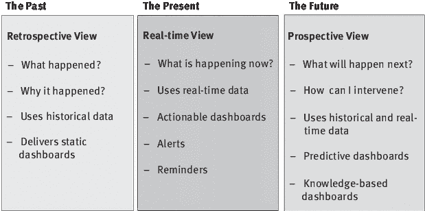

图 1.1：大数据分析中的三个时间维度问题。

### 1.2 BI 与分析的区别

商业智能 (BI) 的目的是将原始数据转化为用于商业目的的信息、洞察和意义。分析则用于发现、创造知识、断言以及传达数据中的模式、关联、分类和学习成果。虽然两种方法都会处理数据并使用计算机和软件来完成，但相似之处仅此而已。

使用 BI 时，我们通过静态仪表板提供信息的快照。我们处理的是通常按行和列排列的规范化且完整的数据。数据是结构化的，并假定为准确。通常，超出范围的数据或异常值会在处理前被移除。数据处理使用简单的描述性统计，如平均值、众数，以及可能的趋势线和简单数据投影来推断未来。

相比之下，数据分析处理各种类型的数据，包括结构化和非结构化数据。在医学领域，约 80% 的数据是非结构化的，以医疗笔记、图表和报告的形式存在。大数据分析方法不强制要求数据必须干净且规范化。事实上，它们不对数据规范化做任何假设。

数据分析可能会分析多种类型的数据，以提供人力无法企及的模式和洞察视图。分析方法是动态的，并提供动态和自适应仪表板。它们使用高级统计、人工智能技术、机器学习、深度学习、反馈和自然语言处理 (NLP) 来挖掘数据。它们检测数据中的模式，以提供新的发现和知识。这些模式具有几何形状，正如一些数据科学家所认为的，这些形状具有数学表达形式，能够解释数据元素之间的关系和关联。

与提供数据快照的静态 BI 仪表板不同，大数据分析方法提供数据探索、可视化以及稳健且不受数据变化影响的自适应模型。高级分析模型的机器学习特性能够从数据变化中学习，并随时间调整模型。虽然 BI 使用简单的数学和描述性统计，但大数据分析高度依赖模型。数据科学家从数据构建模型，以展示模式和可执行的洞察。反馈和机器学习是数据分析中的概念，而非 BI 中的概念。表 1.1 说明了 BI 与数据分析的区别。

表 1.1：商业智能与数据分析的差异。

| 商业智能 | 数据分析 |
| --- | --- |
| 从处理原始数据获得信息 | 从数据中发现、洞察、模式、学习 |
| 结构化数据 | 非结构化和结构化数据 |
| 简单描述性统计 | NLP、分类器、机器学习、模式识别、预测建模、优化、基于模型 |
| 表格化、清洗过的完整数据 | 脏数据、缺失和嘈杂数据、非规范化数据 |
| 规范化数据 | 非规范化数据、多种类型的数据元素 |
| 数据快照、静态查询 | 流式数据、数据和模型的持续更新、反馈和自动学习 |
| 仪表板快照和报告 | 可视化、知识发现 |

### 1.3 为什么需要高级数据分析？

多年来，最常见和传统的数据分析形式一直建立在线性和描述性分析基础上，主要由报告关键绩效指标、假设检验、相关性分析、预测和简单统计的需求驱动；未涉及人工智能。

但是，大数据分析超越了描述性统计。虽然描述性统计对于理解和获取数据洞察很重要，但大数据分析涵盖了更广泛和更深入的方法来研究数据并解释结果。这些方法包括机器学习 (ML)、预测、分类、语义分析和非线性算法，以及多算法方法的引入。

传统上，描述性统计回答“是什么”，但在“为什么”和“如何”方面帮助不大。它们擅长对一个群体与另一个群体进行概括，但在个体层面表现不佳。分析的一个例子是分类。描述性统计指标可能表明，具有某种疾病特定前提条件的 65% 患者对特定疗法有反应。但是，当一名患者被诊断出患有该疾病时，我们如何判断该患者是否属于那 65% 的人群？

## 描述性统计与大数据分析

描述性统计关注过去的事件，但不太适合预测未来将会发生什么。同样，描述性统计对于因果关系几乎没有洞察力，而因果关系有助于研究人员识别导致结果的输入变量的根本原因。虽然描述性分析提供了简单的工具来确定护理环境和患者群体中正在发生的事情，但它们在提供通常做出更智能、动态自适应决策所需的细节方面却有所欠缺。大数据分析强调构建模型，并将模型构建作为一种可重复的数据分析方法论。

### 客户分类

大数据分析不仅可以通过年龄、性别和生活方式等传统人口统计因素帮助进行客户分类，还可以通过从主要和次要来源（包括数据废气来源）收集的多样化数据集相关的其他相关特征来进行分类。主要数据、次要数据和废气数据的定义是模糊的。但这里有一个例子来说明：

- 当你在移动设备上进行电子购买时，你的交易会产生**主要数据**。
- **次要数据**可能包括你购买时的地理位置。
- **数据废气**是交易的副作用。例如，你完成交易所花费的时间。

### 多因素分析

大数据分析赋予我们执行多因素分析的能力，以确定与不同战略和执行因素路线相关的效用（或价值）。此类分析揭示了观察到的结果的关键指标、预测因子和标记。分析使我们能够“看到”这些指标——包括以前被忽视的指标——并在做决策时对这些指标应用正确的权重（或考量）。

### 业务风险与预测能力

大数据分析可用于计算更准确、实时的业务风险度量、业务结果预测因子以及客户的下一步动向。它可以分析结构化和非结构化数据，以提供定量和定性分析。它可以从市场和客户数据中学习，并为任何特定情况推荐最佳选项。

### 数据挑战

然而，与数据的格式、含义和规模相关的挑战有很多。更棘手的是，大量数据是非结构化的，以报告、图表甚至扫描文档中的自由文本形式存在。缺乏全企业范围的数据术语、度量单位和报告频率字典。大量大数据可能存在数据“质量”问题：数据可能缺失、重复、稀疏，对于特定类型的研究来说不够具体。我将在本书中展示克服数据质量问题的策略。

### 数据分析的“3D”

展望未来，大数据分析工具将执行数据分析的**“3D”**作为其核心任务：**发现**、**检测**和**分发**。

1.  **发现**：领先的大数据分析解决方案将发现驻留在各种医疗、行政和财务系统中、分散且碎片化的数据集中的数据。
2.  **检测/聚合**：它可以聚合此类数据——通常是实时的——按需对数据进行标准化和索引。然后对数据执行分析，包括通过`自然语言处理 (NLP)`进行语义分析。
3.  **分发**：最后，它必须能够向决策者和用户（医生或其他护理提供者携带的移动设备）分发一些可操作的洞察。

### 1.4 分析平台框架

在考虑构建分析解决方案时，建议定义数据分析策略和治理。一种策略是避免实施作为独立应用程序且不与其他分析应用程序集成的点解决方案。请考虑实施一个支持平台中集成的许多分析应用程序和工具的分析平台。

这里提出了一个**四层框架**作为基础，支持整个企业范围内分析和数据科学应用程序的完整组合。四层框架由**数据管理层**、**分析引擎层**和**呈现层**组成，如图 1.2 所示。

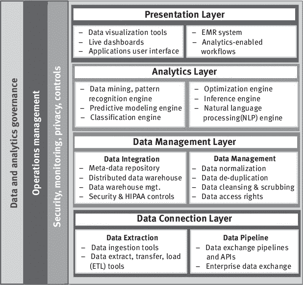

**图 1.2：四层数据分析框架。**

在实践中，您将就采用什么软件和供应商来构建此框架做出选择。各层经过颜色编码，以匹配图 1.3 中所示的数据总线架构。数据管理层包括分布式或集中式数据存储库。该框架假设现代企业数据仓库将由分布式和网络化的数据仓库组成。

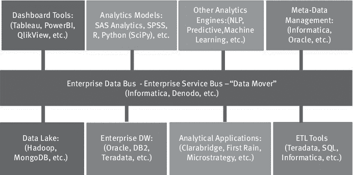

**图 1.3：企业数据总线架构示意图及示例供应商解决方案。**

**分析层**可使用`SAS`、`Python`和`R`统计语言或其他提供此层分析引擎的供应商的解决方案来实现。

**呈现层**可能由各种可视化工具组成，例如`Tableau`、`QlikView`、`SAP Lumira`、`Hitachi Pentaho`、`McKesson SpotFire`、`Microsoft PowerBI`、`Amazon Quicksight`以及其他应用程序，包括数据分析仪表板和应用程序。

在该框架的正确实现中，面向用户的业务应用程序提供分析驱动的工作流；因此，业务系统与其他两层（数据和分析）之间的紧密集成对于成功实施至关重要。在许多组织中，可能首选**数据总线架构**。这是一种高度分布式和联合的数据策略。数据总线架构在各种数据仓库、数据源和数据目的地（如数据湖）之间移动数据。

“**数据移动器**”组件通常被称为**企业服务总线 (ESB)**。`ESB`被定义为一种软件组件，它处理**面向服务的架构 (SOA)**中相互交互的软件应用程序之间的通信。`ESB`促进应用程序、数据仓库和数据湖之间的通信。

图 1.3 需要一些注释和解释。对供应商和产品名称的引用绝不代表对这些产品的认可。公司名单包括常见的数据库供应商：`IBM`、`Oracle`、`Informatica`、`SAP`和`Microsoft`。基于云的解决方案，如`Amazon Glue`和`Microsoft Data Factory`，是可在此架构中履行`ESB`功能的工具。这些仅作为示例提供。我鼓励您进行自己的研究和比较分析，以设计适合您情况的数据分析基础设施。

此处引用的分析引擎包括`NLP（自然语言处理）`和`ML（机器学习引擎）`，但组织可以获取或构建其他引擎来执行特定的、有针对性的分析功能。

### 1.5 数据连接层

在**数据连接层**中，数据分析师设置数据摄取管道和数据连接器以访问数据。他们可能会应用方法来识别所有源数据存储库中的元数据。构建此层始于对数据创建和存储位置进行清单。数据分析师可能会实施**抽取、转换和加载 (ETL)**软件工具，从其源头抽取数据。其他数据交换标准（如`X.12`）可用于将数据传输到数据管理层。

在某些架构中，企业数据仓库可能通过数据网关、数据采集器和连接器使用`API`连接到数据源。由`Informatica`、`Amazon AWS`、`Microsoft Data Factory`和`Talend`或类似系统提供的产品被用作数据连接器工具。

### 1.6 数据管理层

数据提取完成后，数据科学家必须执行一系列归属于数据管理层的功能。数据可能需要进行标准化，并存储在特定的数据库架构中，以提高分析层的数据查询和访问效率。我们将在后续章节介绍包括 SQL、NoSQL、Hadoop、Spark 及其他架构在内的数据库工具分类。

在数据管理层，我们必须关注数据治理、数据安全和隐私。我们需要遵守 HIPAA 的安全和隐私标准。司法管辖区法规和数据主权法律将限制数据从一个数据源传输到另一个数据源，或从一个国家的数据中心传输到另一个国家的数据中心。

数据科学家必须利用创新的数据建模和数据转换技术克服这些限制。他们将使用该层中的工具应用安全控制，例如来自 HITRUST（健康信息信任联盟）的控制。HITRUST 提供通用安全框架（CSF），将 HIPAA 安全控制与其他安全标准对齐。

数据科学家可能在此层应用其他数据清洗程序。他们可能会编写工具去重（删除重复记录）并解决任何数据不一致问题。数据摄入完成后，即可由下一层的引擎进行分析。

由于大数据需要快速检索，多个组织（特别是各种开源基金会）开发了替代数据库架构，支持查询、读取、写入和数据管理的并行执行。

存储大数据有三种架构分类或策略，它们影响数据治理、管理和分析：

1.  **原地分析数据**：传统上，数据分析师使用原生应用和 SQL 查询应用数据，而无需移动数据。许多分析师系统在应用数据库之上构建分析解决方案，而不使用数据仓库。它们就地执行分析，直接从现有应用的数据表中获取数据，而不将数据聚合到中央存储库。EMR（电子病历）公司作为其 EMR 系统集成解决方案提供的分析功能属于此类。
2.  **构建数据存储库**：另一种策略是构建数据仓库，将所有企业数据存储在中央存储库中。这些中央存储库通常称为企业数据仓库（EDW）。来自业务系统、客户关系管理（CRM）系统、企业资源规划（ERP）系统、数据仓库、财务、交易和运营系统的数据经过标准化后存储在这些数据仓库中。第二种称为数据湖的方法应运而生。数据湖通常使用 Hadoop 分布式文件系统或通过云存储解决方案实现。

    数据通过 ETL 提取（批处理文件）或通过接口程序和 API 进行收集。数据仓库有四个局限性：它们往往比实时数据滞后多达 24 小时；它们对数据施加关系数据库约束，增加了数据标准化的复杂性；它们对多样化的新数据类型的支持尚处于起步阶段；并且它们难以使用，处理数据分析搜索和计算的速度较慢。该架构的变体包括并行数据仓库（PDW）和分布式数据仓库（DDW）。
3.  **按需拉取数据**：另一种替代方法是构建按需数据拉取。这种模式将数据保留在原始形式（在应用程序中），仅在需要分析时拉取数据。这种方法仅被少数医院采用，利用外部数据库维护指向数据在源系统中驻留位置的指针。外部数据库跟踪所有数据和数据字典。当分析应用程序需要某条数据时，外部数据库按需从源系统拉取数据，用完即弃。实现这种架构有两种不同的方法。一种是通过企业服务总线。另一种方法是通过数据虚拟化。在数据虚拟化中，应用程序可以访问数据，无论数据存储在哪里。这些方法未被广泛采用，因为它们都难以实施，且技术有待改进。

在这三种方案中，数据仓库方法极具前景，但已被证明成本高昂，且编写 ETL 程序和开发用于存储数据的关系模式极其耗时。按需拉取数据加快了数据访问速度，因为它不需要耗时的数据模式开发。

分析驱动型组织采用了由数据仓库和数据湖技术组成的双管齐下的数据战略。组织意识到数据仓库适合经过验证的、企业级的、广泛使用的报表。而数据湖适合为数据科学和高级分析应用快速准备数据。

大多数分析模型需要访问整个数据集，因为它们通常会用标签和附加信息标注数据，这对模型运行是必要的。然而，现代架构规定使用企业服务总线（ESB）或数据虚拟化的联邦数据仓库模型。图 1.3 说明了所有数据源的联邦数据网络模型。数据总线将数据源连接到分析工具以及面向用户的应用程序和仪表板。

图 1.3 中的企业服务总线架构描绘了企业的联邦网络数据架构场景。任何数据源也可以是数据消费者。主要数据源是应用系统，以及作为表示层组件的仪表板工具。典型场景中的分析工具由 SAS 和 R 统计语言提供，但其他工具和平台也是可接受的解决方案。例如，MicroStrategy 既可作为数据平台，也可作为数据分析工具。您的数据总线架构组件将根据您预先存在的基础设施和遗留数据仓库组件而有所不同。

传统数据管理方法采用了集中式数据仓库方法。尽管投入了巨额资金和时间，但构建中央存储库或汇集来自不同应用程序数据的传统数据仓库方法并不像预期那样成功。原因之一是数据仓库建设昂贵且耗时。另一个原因是它们通常局限于结构化数据类型，难以用于数据分析，特别是在涉及非结构化数据时。最后，传统数据仓库坚持使用关系数据模式，无论是维度还是表格结构，都要求数据满足特定的关系完整性或经过标准化。此类架构无法足够快地处理数据分析模型所需的大量数据查询。

**星型模式与雪花模式**：更高级的数据仓库采用了 Kimball 的星型模式或雪花模式以克服标准化约束。星型模式将业务流程拆分为事实表和维度表。事实表描述实体的可度量信息，而维度表存储实体的属性。星型模式包含一个或多个引用任意数量维度表的事实表。逻辑模型通常将事实表置于中心，维度表环绕周围，形似星星（因此得名）。雪花模式类似于星型模式，但其表经过标准化。

### 星型模式

星型模式是反规范化的数据，其中事务型关系数据库典型的规范化规则在设计和实现期间被放宽。这种方法提供了更简单、更快速的查询和对立方体数据的访问。然而，它们与非 SQL 数据库（见下文讨论）具有相同的缺点：数据完整性规则未被强制执行。

### 非 SQL 数据库模式

为了将数据从关系约束中解放出来，业界设计了多种替代架构，将在下文各节中解释。这些非传统架构包括以列式方式存储数据的方法，或将数据存储在分布式和并行文件系统中的方法，而其他方法则使用简单但高度可扩展的标签-值数据结构。更现代的大数据存储架构被称为 `NoSQL`、`Hadoop`、`Cassandra`、`Lucene`、`SOLR`、`Shark` 以及这些解决方案的其他商业改编版本。

#### NoSQL 数据库

**NoSQL 数据库**意指“不仅仅是 SQL”。NoSQL 数据库为以不同于 SQL Server 等关系数据库的表格关系约束方式建模的数据提供存储机制。数据结构简单，旨在满足特定类型的数据或分析用例，因此数据科学家可以选择最适合的架构。数据库以树、列式、图或键值对的方式构建。然而，NoSQL 数据库可以支持类 SQL 查询。

#### Hadoop


# Hadoop

**Hadoop** 是一个开源数据库框架，用于在低成本的通用硬件上存储和处理大型数据集。但 Hadoop 不仅仅是一个分布式存储系统。它还是一个并行计算平台，非常适合处理复杂的数据分析任务，例如机器学习。其关键组件是用于在多台服务器上存储数据的 Hadoop 分布式文件系统（`HDFS`）以及用于处理数据的 `MapReduce`。Hadoop 由 Java 编写，在雅虎开发，它以冗余方式存储数据，并加快跨多台服务器的搜索速度。Hadoop 的商业版本包括 `HortonWorks`、`MapR` 和 `Cloudera`。结合一个名为 `HUE`（Hadoop User Experience）的开源 Web UI，它提供了一个并行数据存储和计算平台。

# Cassandra

**Cassandra** 是另一个开源分布式数据库管理系统，旨在以更高的性能处理大型数据集。它在分布式服务器集群上提供冗余，且没有单点故障。Cassandra 最初在 Facebook 开发，用于以更高速度驱动搜索功能，它采用一种混合数据结构，介于面向列的结构和键值对之间。在键值对结构中，每一行由行键唯一标识。关系型数据库管理系统（RDBMS）中的表在 Cassandra 中以行为单位存储，每行包含多个列。但是，与 RDBMS 中的表不同，不同的行可能拥有不同的列集合，并且可以随时向行中添加列。

# Lucene

**Lucene** 是一个开源数据库和数据检索系统，特别适合非结构化数据或文本信息。它允许对大型数据集进行全文索引和搜索。它常用于索引大量文本。只要能提取文本内容，Lucene 就可以索引来自多种文件格式（如 `.pdfs`、`HTML`、Microsoft Word 和 OpenDocument）的数据。

# SOLR

**SOLR** 是一个高速、全文搜索平台，作为开源程序（Apache Lucene 项目）提供。它具有高度可扩展性，提供面向分面的搜索和动态聚类。据报道，SOLR（读作“solar”）是最流行的企业搜索引擎。它以 Lucene 搜索库为核心，常与 Lucene 结合使用。

# Elastic Search

**Elastic Search** 是一个基于 Lucene 库的强大开源核心搜索引擎。它提供数据的“数据库”视图，具有高性能索引和搜索能力。它能在多种数据格式中提供快速搜索，特别适合文本数据搜索。结合一个名为 `Kibana` 的开源可视化工具，Elastic Search 非常适合快速文本数据挖掘、分析和可视化。

# Hive

**Hive** 是另一个开源 Apache 项目，设计为构建在 Hadoop 之上的数据仓库系统，以提供数据查询、分析和汇总。最初在 Facebook 开发，现在被 Netflix 和 Amazon 等许多大型内容组织使用。它支持一种名为 `HiveQL` 的类 SQL 查询语言。Hive 的一个关键特性是索引，可提供加速查询，作用于存储在 Hadoop 数据库中的压缩数据。

# Spark

**Spark** 是一个现代数据分析平台，是 Hadoop 的修改版本。它建立在这样一个概念上：分布式数据集合可以跨多个集群节点缓存在内存中，以实现更快的处理。Spark 适配 Hadoop 分布式文件系统，与原生 Hadoop 实现相比，为分布式查询提供快 10 倍（磁盘查询）到 100 倍（内存查询）的处理速度。它提供工具用于分布式内存集群计算机上的查询，允许应用程序快速运行重复的内存查询。Spark 非常适合某些应用，例如机器学习（将在下一节讨论）。

# 实时分析与批量分析

许多传统的商业智能和分析发生在批量数据上；数据随时间收集，然后对批量获取的数据集执行分析。相比之下，实时分析是指以接收数据的同等速率更新信息并执行分析的技术。这也被称为流式数据。实时分析支持及时决策和系统控制。通过实时分析，数据和结果持续刷新和更新。在物联网应用中，处理实时数据流管道对处理和分析的速度至关重要。

# 数据聚合与数据仓库

大多数组织拥有分散的数据库和分布在公司各处的数据。一些企业积累了多达数百个，甚至接近一千个分散的 Access 数据库、若干 SQL Server、数据仓库以及存储在文件服务器各种文件共享中的多样化文件服务器。再加上 `SharePoint`、Web 门户、内部 Wiki 和类似内容管理系统中的所有文件。虽然实施数据仓库有助于整合数据，但并非所有这些数据文件都位于单个数据仓库中。

正如许多 CIO 为其数据定义的愿景：“数据必须被解放，或实现民主化。”业务领导和一线员工应能按需访问，跨越这些庞大且多样的数据存储库运行分析，而无需创建一个庞大的数据库。作为数据治理活动的一部分，组织必须盘点其数据仓库、数据来源和数据用途。

请注意创建和消费数据的前台流程与后台流程之间的区别。直到现在，数据一直是业务交易的驱动力。未来，数据分析将驱动这些工作流。

人们始终可以设想对企业内所有分散数据源进行数据虚拟化。无论格式如何、存储在何处，数据虚拟化都能为您呈现所有数据的单一无缝视图。

最终，数据聚合的目标是通过一组即插即用的连接器连接到这些各种数据库。`Talend`、`Tableau`、`Astera`、`Oracle` 和 `Microsoft Data Factory` 等公司提供此类连接器，而 `Informatica` 等公司则提供元数据管理功能，以创建组织内整个数据资产的单一虚拟视图。

理想的分析系统应该能够“爬取”机构的基础设施，并发现驻留在不同服务器上的数据表和数据库。这样的系统将定位所有 Access 数据库（按文件类型）或 SQL Server 数据库，并允许通过各种连接器（例如 ODBC 连接器）连接到它们。

## 1.7 分析层

在该层中，数据科学家使用多种引擎来实现分析功能。根据手头的任务，数据科学家可能会使用一个或多个引擎来构建分析应用程序。一个更完整的层将包括用于优化、机器学习、自然语言处理、预测建模、模式识别、分类、推理、NLP 和语义分析的引擎。

### 优化引擎

**优化引擎** 用于优化并找到给定问题的最佳解决方案。优化引擎用于识别其他变量的最佳组合以给出最优结果。优化常用于在多个可能的决策选项中寻找最低成本、最高利用率或最优护理水平。

### 机器学习

**机器学习** 是人工智能的一个分支，关注构建和建立从数据中学习的程序。这是新一波 AI 应用程序的基础。机器学习构建自适应模型和算法，这些模型和算法从数据中学习，并随着数据随时间变化而调整其性能。例如，基于机器学习的模型可以自动对客户进行分类、预测其需求并提出推荐。机器学习有三种类型，我们稍后将更详细地研究：无监督学习、有监督学习和反馈循环学习。无监督学习在历史数据上训练模型，以找出数据集中固有的模式和关系。有监督学习需要标记数据，以便模型可以训练并区分不同的标记数据集。反馈学习允许用户即时纠正模型，以便模型可以从用户提供的反馈中学习。

### 自然语言处理 (NLP)

**自然语言处理 (NLP)** 是计算机科学和人工智能的一个领域，旨在构建计算机对口语和文本的理解。NLP 有许多应用，但在分析非结构化数据的背景下，NLP 引擎可以从结构化文本中提取相关的结构化数据。当与其他引擎结合时，提取的文本可以被分析用于各种应用。

### 预测建模引擎

**预测建模引擎** 提供用于进行预测的算法。该引擎将包括数据科学家可以用来进行预测的多种统计和数学模型。一个例子是预测患者出院后的再入院情况。通常，这些引擎摄取历史数据并从数据中学习以进行预测。在第 2 部分中，我们将更详细地回顾一些预测建模技术。

### 模式识别引擎

**模式识别引擎**（也称为数据挖掘程序）为数据科学家提供工具，以发现数据中的关联和模式。这些工具使数据科学家能够识别数据中的形状和模式，执行相关性分析和多维数据聚类。其中一些方法可以识别数据中的离群值和异常，这有助于数据科学家识别黑天鹅事件。

另一种技术是构建回归模型，其致力于定义最小化误差的数据变量之间的数学关系。当数据包含离散数字时，标准回归模型效果很好。但是，当数据包含数字和分类数据（文本标签）的混合时，则使用逻辑回归。

### 分类引擎

**分类引擎** 解决识别主题或数据元素属于哪组类别的问题。主要有两种方法：有监督方法和无监督方法。有监督方法使用历史数据集作为训练集，其中先验类别成员身份是已知的。无监督方法利用数据中的固有关联来定义分类类别。无监督分类也称为数据聚类。分类引擎帮助数据科学家根据数据属性对关键数据元素（例如客户、交易和其他实体）进行分组。

### 推理

**推理** 是使用统计和人工智能方法进行推理，从数据集中得出结论的过程。推理引擎包括供数据科学家将人工智能推理方法应用于其数据的工具和算法。其推理分析的结果通常是回答“下一步该做什么？”的问题，即从数据集的观察中做出决策。一些推理引擎使用基于规则的方法，模仿专家的决策过程，并将其收集到专家系统中。规则可以应用于前向链或后向链过程。在前向链过程中，推理引擎从已知事实开始，断言新事实，直到得出结论。在后向链过程中，推理引擎从目标开始，反向查找需要断言的事实以实现目标。

### 语义分析器

**语义分析器** 是从大量文本文档中构建结构和提取概念的分析引擎。这些引擎不需要对文档有先验的语义理解。例如，计算机辅助编码 (CAC) 应用程序从医疗笔记中提取概念，并应用语义分析来确定文本的极性和含义；判断诊断术语是阳性、阴性、推测性、条件性还是假设性。

### 机器学习

**机器学习：** 数据分析的另一种形式是机器学习。机器学习是人工智能的一个学科分支。机器学习方法从数据模式中学习，可以模仿智能决策、执行复杂推理和进行预测。医疗预测分析使用机器学习技术进行预测。这些算法以接收数据的相同速率实时处理数据，但它们也具有反馈循环机制。反馈循环将分析系统的输出作为输入。通过将其输出与现实世界的结果进行处理和比较，它们可以微调学习算法并适应数据中的新变化。在本书中，我们将探讨一个同时考虑反馈循环和前馈机制的框架。

### 统计分析

**统计分析：** 统计分析工具将包括描述性函数，如最小值、最大值、众数、中位数，以及定义分布曲线、散点图、Z 检验、百分位数计算和离群值识别的能力。其他统计分析方法将包括回归（趋势）分析、相关性、卡方检验、最大值和最小值计算、T 检验和 F 检验等方法。对于更高级的工具，R 编程语言为那些认真对待统计检验的人提供了广泛的函数。可以使用斯坦福开发的开源工具 MADLIB（[www.madlib.net](http://www.madlib.net)）。此外，Apache Mahout 包含一个开源数据分析函数库。这些方法的细节可以在大多数统计学教科书中找到，超出了本书的范围。

# 预测与预测性分析

预测与预测性分析是数据分析的新前沿。最简单的预测方法是应用回归分析来计算回归线以及方程线的参数，如斜率和截距值。其他预测方法使用插值和外推法。高级预测工具提供其他类型的分析，如多元回归、非线性回归、方差分析（`ANOVA`）和多元方差分析（`MANOVA`）、均方误差（`MSE`）计算以及残差计算。医学研究中常用的一种技术是逻辑回归。逻辑回归本质上是一种常规回归分析，只不过研究中的变量可以是分类数据。

通过典型的回归分析，斜率和截距的值可作为指标用于提供预测。该技术的一种变体允许识别异常值，我们将在后续章节中看到。

预测性分析通过提供对未来事件的洞察，超越了预测的范畴。它是模型驱动的，包含使用监督学习和无监督学习生成预测的方法。其中一些方法包括神经网络、`PCA`。

此类别中有许多可用算法，它们共同提供了一套丰富的分析功能。这些算法包括逻辑回归、朴素贝叶斯、决策树和随机森林、回归树、线性和非线性回归、时间序列 `ARIMA`。

有一个关于异常值和高级分析模型稳健性的快速定义和澄清，这非常重要，值得牢记。稳健性意味着模型能抵抗数据中的异常值。数据科学的目标之一应该是寻找稳健的模型，或者至少了解模型对异常数据的敏感性。

# 模式分析

利用机器学习和分类算法，研究人员可以检测数据中的模式、对研究对象群体进行分类，并按各种属性对数据进行聚类。研究对象群体是指任何研究中的潜在消费者、客户或人群。此分析中使用的算法包括各种神经网络方法、主成分分析（`PCA`）、支持向量机、监督和无监督学习方法，如 `k-means` 聚类、逻辑回归、决策树和支持向量机。模式让我们洞察数据在告诉我们什么。

其他方法包括图形推理，这是一种基于案例的推理形式。这些技术使研究人员能够从数据中识别特定案例，或识别与特定案例匹配的其他案例。例如，该技术可用于为患者找到正确的诊断，或将法律案例与特定法律情境相匹配。这些方法及其统计算法将在第 5 章中详细解释。

## 1.8 表现层

该层包含用于构建仪表板、应用程序和面向用户的应用程序的工具，用于显示分析引擎的结果。数据科学家经常将多个数据可视化组件、Web 部件和仪表板（有时称为混搭板）进行混搭组合。

信息图表仪表板使我们能够以更相关的方式可视化数据，并提供更好的图示。这些仪表板可能将各种图表、图形和可视化元素结合在一起。信息图表组件包括以可视化方式呈现分析结果的不同方式，如热力图、树状图、条形图、各种饼图和平行坐标图等多种可视化格式。

高级表现层包含数据可视化工具，允许数据科学家以交互式和图形化用户界面轻松可视化各种分析（分类、聚类、回归、异常检测等）的结果。

多家公司提供快速数据可视化程序，包括 Tableau、QlikView、Panopticon、Microsoft PowerBI、Amazon Quicksight 和日立的 Pentaho，它们正在改变我们执行数据发现和可视化的方式。Panopticon 开发了复杂事件处理器（`CEP`）引擎，允许用户以图形表示查看先前事件。三维（`3D`）和多维（`mD`）可视化工具开始在行业中被采用，为事务和运营数据提供丰富且快速的洞察。

开源数据可视化组件，如 `D3.js` 和 `Kibana`，正在获得市场青睐。对于那些选择构建全开源数据栈的组织，Hadoop 及其生态系统在上述四个层中的每一层都提供了许多选项。

## 1.9 数据分析流程

数据分析流程遵循一系列步骤，通常沿着以下八个关键步骤的顺序进行。前三步通常被称为抽取-转换-加载（`ETL`）。其余步骤解释了数据摄入分析平台和处理数据的过程：

1.  **数据抽取**。数据抽取可通过 `SQL` 查询或使用 `Apache Sqoop` 将数据导入数据仓库或数据湖（通常基于 Hadoop）来实现。

2.  **数据转换**。通常需要对跨多个来源的数据进行标准化或转换，以符合通用标准，如通用格式或通用数据元素。数据转换可由数据科学家在 Hadoop 中使用 `Hive` 和 `Python` 编程语言来执行。

3.  **数据摄入（加载）**。在此步骤中，数据由数据分析系统正确摄入并导入适当的数据结构中。摄入的数据可以是结构化数据字段，也可以是非结构化文本，如医生笔记和病历信息。`Apache Sqoop` 和 `Flume` 是将数据加载到数据湖中广泛使用的工具。

4.  **数据准备**。数据可能天生嘈杂或不完整。此步骤对数据进行标准化和修复，为模型构建和分析做准备。

5.  **数据发现（统计分析）**。此步骤有助于理解数据。根据提取数据的频率和分布，可以对数据做出某些统计推断。必须在此步骤识别和处理高度相关的数据或不平衡数据。此类推断提供关于异常值、趋势、数据聚类、相关性分析和帕累托分析的信息。

6.  **模型构建（模式分析）**。此步骤涉及构建模型、训练并针对实际数据进行测试。它可能包括通过高级技术（如人工神经网络、决策树、基于案例的分析和机器学习算法）发现数据中的模式，这些算法用于识别模式、因果关系、影响图、数据分类和预测分析。如果数据集是文本且目标是开发 `NLP` 模型，则可考虑以下步骤：

    1.  **术语抽取**。使用自然语言处理（`NLP`）技术，解析摄入的数据并从非结构化数据中提取相关主题数据。在涉及预测建模的其他用例中，此步骤涉及使用定量和定性值构建和训练预测模型。

    2.  **语义分析**。一旦提取出主题数据（术语），必须建立它们的关系、强度和敏锐度。语义分析提供了识别患者与各种医学术语之间含义和关系的智能手段。

7.  **验证与元分析**。此阶段评估模型的准确性，并采取措施提高结果的有效性和质量。它可能包括元分析，通过考虑所有其他分析步骤和模型的结果，对已分析的数据得出一组总体结论和洞察。

8.  **可视化**。流程的最后一步涉及展示结果，通常以图形仪表板、图表和可视化图表的形式，讲述一个引人入胜的故事。

# 数据挖掘与数据分析

数据挖掘一旦其竞争价值和早期成功案例被发布，便获得了极大的关注和普及。数据挖掘旨在发现数据元素之间那些不显而易见的关联与关系。数据分析利用数据挖掘技术来识别数据元素与数据集之间的此类关系和关联。

诸如非显性关系感知（NORA）等项目以及数据挖掘软件会探查数据库，搜索相关信息之间晦涩难懂的匹配与关系。这种方法能够识别跨度高达 30 度分离的数据连接。例如，一度分离是指两名患者在医院感染了相同的病菌。二度分离则是发现这两名患者都去过同一个 CT 扫描室。三度分离可能是发现是同一位护工转运了这两名患者。NORA 用于检测欺诈以及个人、企业和活动之间的关联。它应当回答关于实体间连接度数的问题。例如，假设我在默克公司工作，而我妻子是一名律师，她的律师事务所可能在不知情的情况下指派她负责默克竞争对手辉瑞公司的一个法律项目，这给我们双方都带来了利益冲突。NORA 能够检测出这种尴尬且冲突的关系。

数据挖掘方法被称为“黑箱”方法，即分析师不对数据及数据间的相互关系做任何预先假设。这些模型允许“数据自己说话”。

还有一种“白箱”方法，即数据间的因果关系为分析师已知。数据分析建立在所有这些方法和技术之上，以克服数据分析固有的复杂性，提取适当且相关的信息，然后利用黑箱和白箱两种方法对其进行分析。

# 第 2 章 基础数据分析

## 2.1 KPI、分析与业务优化

*业务优化*的目标是利用数据分析来导航组织的关键绩效指标，并识别出需要进一步优化和改进的职能。在此层面，执行管理团队可以通过仪表板或混搭板等数据可视化工具提供的关键指标来查看业务运营情况。关键指标可被定义为关键绩效指标（KPI）。KPI 不仅可能包括绩效的直接衡量标准，还包括预测公司绩效的指标。预测指标可通过神经网络、信号提升和相关性分析等数据分析方法来识别。这些主题将在后续章节中讨论。


# 要定义 KPI，分析师需选择特定的变量、比率和度量

这些绩效指标可能衡量绩效的某些方面或业务驱动因素。现有少数 KPI 模板，如质量核心指标或平衡计分卡指标。通常情况下，这些 KPI 通过实时数据流进行跟踪和度量，并随时间观察 KPI 变量。用户可在现代仪表板中设置警报并与 KPI 数据交互。用户通常能够组合特定的 KPI 变量仪表板。用户可向下钻取某些变量以获取更多细节，反之亦可向上汇总至更高层级的仪表板显示。从详细视图中，用户可选择特定变量并再次执行知识发现与分析。

一种常用的绩效衡量框架是平衡计分卡（示例见图 2.1）。它将组织的四个方面纳入视野：财务、运营流程、客户和成长学习。

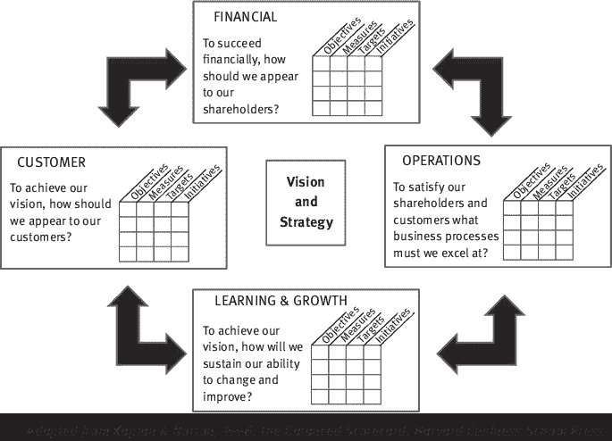

图 2.1：作为 KPI 模板的平衡计分卡。

平衡计分卡的每个方面均由特定的 KPI 组成。决策树和逻辑回归等数据分析技术有助于识别与四个领域中每个领域的 KPI 值高度相关或能预测其值的因素。找到这些因素可帮助组织确定正确的 KPI，并管理促成组织目标的重要变量。

另一种称为 OKR 的 KPI 范式近来很流行，这要归功于谷歌采用该方法取得的成功。

## 2.2 数据分析报告的关键考量

在着手准备数据分析仪表板或报告时，重要的是要以终为始，开展数据收集和分析。应考虑若干因素以确定所需的数据及分析类型。这些因素包括：

*   **内容：** 你将衡量什么？
*   **受众：** 你的受众是谁？
*   **生产：** 谁负责数据和分发？
*   **准确性：** 你将如何确保信息的准确性？
*   **频率：** 报告应多久生成一次？如何发布和分发？
*   **格式：** 仪表板或报告的理想格式是什么？仪表板的哪些方面应具备交互性？可视化应采用何种信息图表格式？
*   **用途：** 信息将如何被使用？
*   **问责：** 谁对绩效指标和数据报告负责？
*   **响应：** 对报告中呈现的数据，预期和要求的响应是什么？根据报告需要采取什么行动？

## 2.3 现实世界数据分析计划的四大支柱

大型组织为了达到最大效能，很可能会将其商业智能和数据分析计划整合为单一的数据分析计划。典型的商业智能计划包含以下四大支柱：

### 支柱 1：数据分析战略

您的企业数据战略是什么？每个数据分析计划都必须明确其宗旨、目标和目的，以及它打算如何支持组织的战略。以下是一些陈述性声明，您可以将其作为组织数据战略的关键原则：

1.  数据是一项资产
2.  数据必须共享、开放和可访问，但需受到管理、保护和安全防护
3.  数据分析必须赋予组织独特的战略定位和战略提升
4.  数据必须整合我们的业务，而非将其分割

数据集必须在全企业范围内拥有通用的定义和字典，以便整合业务条线和职能孤岛。`战略提升`是指通过深度分析洞察，大幅提高组织绩效的能力。战略提升通过每股收益（`EPS`）和市盈率（`P/E`，亦称股票倍数）的上升来衡量。

组织战略与数据分析战略之间必须存在关联。最佳实践战略应回答诸如下列问题：

*   我们如何在组织中将数据货币化？
*   数据如何能给我们组织带来战略提升？
*   我们的数据分析计划如何映射到组织的战略目标？
*   我们的数据分析长远规划是什么？理想的时间跨度是考虑 5 年规划和 10 年规划。
*   分析的战略规划是什么？这些分析目标的优先级是什么？
*   我们的分析计划如何满足运营、财务和临床倡议？
*   数据分析将如何在我们组织中发挥变革性作用？

### 支柱 2：数据分析治理

数据分析治理关注建立数据分析的政策和范围。最佳实践建议组建一个数据分析治理委员会，作为 IT 组织治理委员会的一个子委员会。该支柱关注回答和指导以下问题：

*   我们在全企业范围内对数据仓库和数据管理的标准是什么？
*   安全性、使用政策和隐私准则是什么？谁拥有哪些数据的所有权？我们是否获得了他们的许可将这些数据用于分析？
*   分析的适当和恰当应用是什么？明确规定分析的不当和禁止用途。
*   谁将拥有分析结果以及基于我们数据开发的衍生数据和模型？谁将拥有我们通过分析发现的结果的知识产权？

### 支柱 3：数据分析框架

框架处理管理数据和分析工具的技术层面。它回答诸如以下的问题：

*   当前以及未来 5–10 年的基础设施需求是什么？我们应该构建本地云基础设施，还是将数据存储在异地私有虚拟云中？数据存储和归档的基础设施组件有哪些？
*   哪些记录系统将得到支持并被指定为分析平台？答案通常从现有的数据仓库资产和供应商承诺开始。例如，一家投资了 `Teradata`、`Oracle` 和 `SAS` 的企业，很可能会选定这些组件作为其分析记录系统的起点。关键在于必须确定真实来源和记录系统。
*   我们将支持哪些分析工具？我们的分析工具库将包含哪些内容？
*   哪些技术和供应商解决方案将作为企业分析系统得到支持，以提供基础设施和分析工具？
*   我们的分析能力路线图是什么？我们打算在未来五年内部署哪些解决方案，优先级如何？

### 支柱 4：数据分析社区

该支柱关注用户社区，满足他们的期望和用户视角。分析计划必须解决的问题包括：

*   用例和分析需求以及应用分析的机会领域是什么？
*   分析的典型用户和用户画像是谁？用户画像代表具有相似和共同用例的用户群体。用户画像可能包括管理层（财务经理、运营经理、销售经理等）、知识工作者、高管、一线员工等。在大型组织中，多达十几个用户画像是典型的。
*   谁制作分析仪表板（或报表）？谁将消费它们？
*   内部发布和订阅分析结果的标准是什么？制作仪表板和执行分析工作的人通常是数据科学家和数据分析师。在发布-订阅模型中，分析师发布他们的仪表板，用户订阅（或消费）这些报表。
*   用户社区的预期使用模式是什么？这可以定义用户与贵组织数据分析团队之间的服务级别协议 (`SLA`)。数据分析计划应定义用户在分析方面的角色。我们是提供自助服务模式，还是 DIY（自己动手）模式——即我们提供基础设施和分析工具，让用户执行自己的分析并开发自己的应用？相反，我们是否提供类似于数据集市的全服务礼宾台，由 IT 组织执行分析，用户可以消费分析即服务 (`AaaS`)？

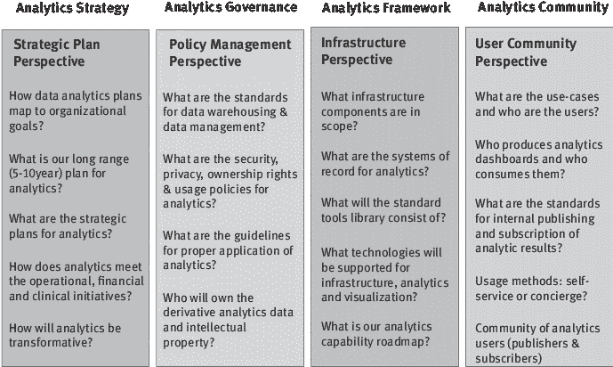

**Figure 2.2: The four pillars of data analytics program.**

总体而言，关于数据管理所需做出的关键问题和决策包括五个领域：

*   我们的数据模型将是什么？
*   查询模型是什么？
*   我们的数据一致性模型是什么？
*   需要哪些应用程序和 `API` 来满足我们的业务战略和分析需求？
*   数据分析用户社区是谁？如何让他们参与决策过程？

数据分析计划的一个最佳实践建议我们盘点数据，并将其与组织的分析需求进行对应。捕捉高层级映射的一个工具是使用数据分析矩阵。Figure 2.3 图示了一个示例数据分析矩阵，其中列标题包含分析需求，其下方的行定义了：每个列的目的、优先级、用户社区、所需数据、数据来源、可用数据仓库、任何数据访问限制、数据类型、数据质量、所需分析方法和用户界面。在该示例中，图示展示了在临床和医疗保健用例背景下数据分析矩阵的形成。

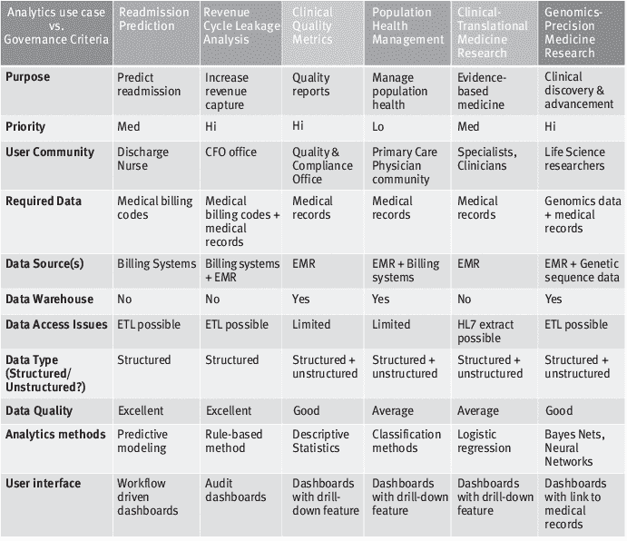

**Figure 2.3: Example of a data analytics matrix.**

## 2.4 大数据分析的八条公理

到目前为止，我们已经涵盖了大数据、分析以及将分析应用于临床数据的潜在用例的广泛领域。在第二章的最后一节中，我想分享一些我作为关于大数据分析的公理收集的一般性观察。

数学已成为生物学的新显微镜和天文学的新望远镜。在生物学、物理学和商业领域产生的海量数据提供了巨大的实证证据，引导科学家和管理者将数学科学作为其领域发现的新显微镜或望远镜。正如十七世纪的天文学家花费大部分时间制造望远镜而较少时间观测星星，今天的数据科学家花费大量时间整理数据，留给分析的时间较少。但随着标准分析平台的出现来处理大数据量，这种情况将会改变。提供标准数据“范围”的分析平台将被广泛采用。

1.  **数据越多越好。** 可用数据越多，大数据分析能产生的洞察和结果就越丰富。与描述性统计不太关注异常值而更关注数据频率的中心趋势不同，在大数据分析中，异常值和黑天鹅事件更受关注。我们从大数据中产生知识的能力仅受限于我们存储和处理这些数据的能力。数据集越大、越多样化，分析对现实世界的建模就越好。尽量纳入尽可能多的内部和公共数据集。这条公理有一个推论，很重要，须予以注意。数据越多越好，但仅限于一定程度。如果数据嘈杂或不平衡，过多的数据可能会对机器学习和模型准确性构成挑战。尽管如此，如果合理，数据科学家应能从此类大型数据集中提取有用部分。

2.  **单一模型不适用于`所有`情况。** 大多数科学家和数据分析师努力寻找满足其数据挑战的最佳模型或算法。但这种方法将无法应对源自现实世界数据动态性质的可扩展性和可扩展性挑战。俗话说，一码不合万身，单一算法无法满足数据集的多样性以及随时间可能发生的数据变化。因此，正如我在博士论文中所提议的，数据科学家必须构建一个模型委员会，它们共同能产生一个更智能、适应性强且可扩展的分析解决方案，免疫于数据变体的影响。

## 3. BI 和分析并非同一回事

在商业智能（`BI`）力有不逮之处，大数据分析大显身手。当我们运行商业智能报表时，提取的是结构化、标准化、范围有限、通常为关系型且规范良好的数据。当面对海量多样的数据、文本文件中常见的非结构化数据、嘈杂或缺失的数据，以及非表格格式的数据时，商业智能技术便会失效。

`BI` 关注的是描述性统计和对结构化数据的简单数学运算，而大数据分析则配备了自然语言处理（`NLP`）等工具从非结构化文本中提取数据，或配备模式识别模型、预测模型、优化和机器学习。`BI` 拥有以图表形式呈现数据快照的能力。相比之下，大数据分析通过实时数据分析并利用反馈随时间改进模型来提供数据分析，并通过数据可视化工具呈现结果。

## 4. 相关性与因果性并非同一回事

虽然正相关或负相关能告诉我们数据元素和变量之间关系的许多信息，但它们并不构成因果性。要断定一个变量是另一个变量的原因，需要更多的证据。例如，我们必须证明一个变量在时间上先于另一个变量发生，并且虚假变量效应——其他变量的间接影响——已得到妥善控制。但这并非要打击寻找事件根因的积极性；而是要强调解释技能与数学建模才能同等重要。数据科学家应具备超越数学能力的解释技能，以解读分析结果。这些相关性究竟告诉我们什么？哪些变化能产生预期结果？

## 5. 稀疏数据分析方法将胜出

随着数据量增加，数据集包含嘈杂、重复数据，或相反地，缺失重要数据元素的可能性也会增加。因此，每当我们收集海量数据时，都应预见并准备好清洗数据、去重以及处理稀疏数据集。随着数据量随时间增长，稀疏性自然会增加。因此，稀疏数据分析方法最终将取代稠密数据分析方法。

## 6. 机器学习与数据挖掘并非同一回事，而是表亲关系

机器学习是人工智能的一个分支，它提供能够从数据中学习的系统。机器学习常用于对数据进行分类，或基于从用于训练的历史数据中学习到的已知属性进行预测。数据挖掘则致力于提供洞察并发现数据中未知的属性。

机器学习可通过监督学习或无监督学习方法实现。无监督学习使用作用于未标记数据的算法——即期望输出未知的数据输入。其目标是发现数据中的结构，而非泛化输入到输出的映射。监督学习使用标记数据进行训练。标记数据是指输入和输出均已知的数据集。监督学习方法致力于泛化输入到输出的关系或映射。

两者之间存在重叠。数据挖掘常使用机器学习方法，反之亦然，机器学习可使用数据挖掘技术（如无监督学习）使引擎训练更准确。

## 7. 使用信号增强方法

当数据稀疏且数据变量数量庞大时，我们面临多维度挑战。

## 8. 使用模型集成

研究表明，当两个或多个模型以集成方式使用时，可提高准确性。不同模型在不同数据集上的表现各异。例如，某些机器学习模型比其他模型更擅长在小量数据上训练，反之亦然（某些算法在大量数据集上训练效果更好）。如何创建一个在任何数据集上都表现更好的数据分析算法？答案是构建一个集成模型（也称为模型委员会），使最终结果能借用给定数据集上每个模型的最佳特性。即使只是对多个模型的结果取平均，也很可能比单一模型获得更高的准确性。这是行业秘诀之一，数据科学家开始注意到并通过使用多模型来改进结果。例如，在构建预测模型时，可集成随机森林算法与神经网络算法，以提高模型预测的准确性。

## 2.5 基础模型

基础模型本质上是 `OLAP`。

这些报表可能提供由描述性统计启发的附加信息，如 `min`、`max`、`mean`、`mode`、`standard deviation`、`z-score` 和 `regression line`。可通过 `regression line` 进行趋势分析和简单预测。

## 2.6 数据分析的复杂性

大多数大数据分析方法是人工智能（`AI`）多年研究与创新的成果。在 `AI` 中，解决问题的难度和复杂度由其 `AI` 完全性定义。最困难的问题被称为 `AI` 完全或 `AI` 难度。这意味着计算这些问题的难度等同于解决核心 `AI` 问题——使计算机具备与人类同等智能，即强 `AI`。当一个问题被称为 `AI` 完全时，意味着该问题无法通过简单的特定算法解决。

根据《人工智能百科全书》，`AI` 完全问题包括计算机视觉、自然语言处理、问题求解、知识表示、推理，以及解决现实世界问题时应对意外情况。`AI` 完全问题无法仅靠现代计算机解决；还需要人工计算。

某些机器学习应用结合人工可提供监督学习，二者协同可解决与机器翻译或客户情感分析相关的特定问题。当机器学习应用出错时，用户（人工计算）会纠正算法，应用不仅能从数据中“学习”，还能从用户那里“学习”。

如果允许我过度简化，`AI` 易问题是指可在多项式时间内解决的一类问题。

在本书中，我们将回顾解决从 `AI` 易问题到 `AI` 完全问题范围内问题的算法。

## 2.7 数据分析方法简介

在深入探讨数据分析方法之前，让我们从统计学角度回顾三种数据类型：分类、有序和区间。

### 分类

分类变量（有时称为名义变量）是指拥有两个或更多类别，但类别之间无内在顺序的变量。例如，性别是一个分类变量，有两个类别（男和女），类别之间无内在顺序。

发色也是一个分类变量，拥有多个类别（金、棕、深棕、红等），同样无公认的方式按高低排序。纯分类变量仅允许分配类别，无法清晰排序变量。若变量有明确顺序，则该变量为下文所述的有序变量。

### 有序

有序变量类似于分类变量。两者的区别在于变量有明确的顺序。例如，假设有一个变量“经济状况”，包含三个类别（低、中、高）。

## 变量测量尺度

除了能够将人们分类为这三个类别外，还可以将这些类别排序为低、中、高。现在考虑一个像教育经历这样的变量（其值包括小学毕业、高中毕业、上过大学、大学毕业）。这些也可以按小学、高中、上过大学、大学毕业的顺序排列。尽管我们可以将这些从低到高排序，但各数值之间的间距在变量的各个层级上可能并不相同。

假设我们给这四个教育经历层级分配分数 1、2、3 和 4，并比较类别一和二之间的教育差异与类别二和三之间的教育经历差异，或类别三和四之间的差异。

类别一和二（小学和高中）之间的差异可能比类别二和三（高中和上过大学）之间的差异大得多。在这个例子中，我们可以按教育经历水平对人们进行排序，但类别之间的差异大小是不一致的（因为类别一和二之间的间距比类别二和三大）。如果这些类别间距相等，那么该变量将是一个区间变量。

### 区间

区间变量类似于有序变量，不同之处在于区间变量各数值之间的间隔是等距的。例如，假设你有一个以美元衡量的年收入变量，有三个人的收入分别为 10,000 美元、15,000 美元和 20,000 美元。第二个人比第一个人多赚 5,000 美元，比第三个人少赚 5,000 美元，这些间隔的大小是相同的。如果还有两个人收入分别为 90,000 美元和 95,000 美元，这两个人之间的间隔大小也是相同的（5,000 美元）。

使用机器学习算法，研究人员可以检测数据中的模式，对客户群体进行分类，并按各种属性对数据进行聚类。本分析中使用的算法包括各种神经网络方法、主成分分析（`PCA`）、支持向量机（`SVM`）。

其他方法包括图形推理，这是一种基于案例的推理形式。在基于案例的推理中，用户能够在以往案例库中搜索，并识别出与当前情况匹配的先前案例。一些用例包括法律、制药、营销和医疗保健。

## 2.8 统计模型

更高级的模型包括统计方法，它们能为指标与组织运营绩效之间的潜在关系带来新见解。这些模型考虑变量之间的关系、相关性以及机器学习。我们将更详细地研究这些方法。模型列表包括回归、相关分析、`ANOVA`、`MANOVA`、卡方检验和逻辑回归。在第 5 章和第 6 章中，我们将首先介绍这些统计方法，然后回顾分类器、聚类分析、数据挖掘、机器学习、预测和预测性方法等高级方法。

## 2.9 预测分析

预测分析旨在为未来事件提供洞察。它包括使用监督学习和无监督学习生成预测的方法。一些方法包括神经网络、`PCA` 和贝叶斯网络。

此类别中有许多可用算法，提供了丰富的分析功能。这些算法将在下文中解释，包括逻辑回归、朴素贝叶斯、决策树和随机森林、回归树、线性和非线性回归、时间序列 `ARIMA`。

其他高级统计分析工具也经常被使用，例如多元逻辑回归、卡尔曼滤波、关联规则、`LASSO` 和岭回归、条件随机场（`CRF`）方法以及 Cox 比例风险模型。此外还有许多用于概念提取、主题建模和文本挖掘的工具，支持自然语言处理和理解。这些技术的简要数学概述见下一节。

## 2.10 高级分析方法

以下部分简要介绍了数据科学家常用的分析算法列表。

### 线性回归

线性回归的目标是找到一个最佳拟合一组数据的线性方程。一个数据点可能包含多个因变量。例如，当有两个因变量时，最佳拟合方程是穿过观测到的因变量数据值的一个平面。例如，用户可能有兴趣计算回归图，以利用三个自变量预测客户的采购量：客户年龄、教育水平和收入水平。回归曲线可以提供潜在客户可能花费金额的估计值。

### 卡尔曼滤波


该技术用于预测某些因变量随时间变化的未来值。它通过使用变量的最近值，并通过最小化预测结果与观测结果之间的误差来调整预测。结果被反馈回模型，以在更低的误差值下进行下一次预测。例如，如果积累了足够的历史数据，它可以用来预测患者血压、体温和其他生理指标的短期值。正如我们稍后将看到的，它也是处理嘈杂和脏数据的良好技术。

### LASSO

一种回归分析方法，结合了变量选择和正则化，以提高预测的准确性。它是最小二乘法的正则化版本（最小绝对收缩和选择算子）。`LASSO` 适用于计算压缩感知，这是一种信号处理技术，通过求解欠定线性系统来获取和重构信号。因此，整个信号可以从相对较少的测量中重构。其在医疗保健中的应用包括改进 `MRI` 和 `CT` 图像处理。`LASSO` 方法用于图像中的模式识别并改进预测分析。`LASSO` 的一个应用是在这些情况下进行变量选择：当你拥有大量协变量，并希望选择一组用于高效预测响应变量时。（协变量是可能预测研究结果的变量。它可以是直接预测因子，也可以是影响预测结果的混杂或交互变量。）

### 多元逻辑回归

多元逻辑回归是一种回归分析形式，用于预测受一个或多个预测变量影响的分类因变量的结果。分类的一个例子是性别（`MALE`、`FEMALE`）。这个例子导致二项或二元逻辑回归，因为结果只能有两个可能的值。其他类别可能是从连续数据创建的。例如，体重可以根据特定阈值分类为 `LOW`、`MED` 和 `HIGH`。逻辑回归在医疗保健和医学研究中被广泛使用。一种广泛用于预测受伤患者死亡率的方法，称为创伤和损伤严重程度评分（`TRISS`），就是一个例子。

# 机器学习技术概述

## Association rules（关联规则）

一种在数据挖掘时用于开发文本间关联规则的机器学习技术。关联规则挖掘通过识别同时出现的特征（数据维度）和相关的特征（数据维度），帮助在数据中发现模式。它有助于找出一个特征的值对另一个特征的值意味着什么。它常用于市场篮子分析。例如，如果购物者购买了薯片，那么该购物者也购买莎莎酱的可能性有多大？

## Ridge regression（岭回归）

也称为 Tikhonov 正则化，是一种最小二乘法形式。它已被用于医学研究中预测患者疾病及其疾病生长阶段。例如，它已被用于预测患者在未来几个月将处于哪个疾病阶段，或预测患者的癌症复发情况。

## Decision trees and random forest（决策树和随机森林）

决策树及其近亲影响图是计算竞争性备选决策的期望值（或期望效用）的类似图形方法。随机森林本质上是决策树的集成。它们在分类和预测方面有许多应用。我们将在下一章更详细地回顾这些技术。

## Time series ARIMA（时间序列 ARIMA）

自回归积分滑动平均模型用于预测给定时间序列数据集中的下一个值。给定一个时间序列数据集，`ARIMA` 模型使用两部分——自回归（`AR`）成分和移动平均（`MA`）成分——来预测序列中的未来值。它们在检测频率或速率的突然变化方面有许多应用。例如，在网络安全领域，时间序列分析用于从正常活动中判断威胁活动。在医疗保健行业，它们用于检测与特定疾病相关的异常高就诊率，这可能是疫情爆发、流行病或生物恐怖袭击的早期信号。

## ARTXp

带交叉连接的自回归树模型类似于 `ARIMA`，不同之处在于它使用决策树算法来预测周期性时间序列数据中的下一个值。如果用户只对查找循环时间序列数据集中的下一个值感兴趣，则推荐使用 `ARTXp`。

## CRF methods（条件随机场方法）

条件随机场非常适合模式识别和机器学习，因为它们考虑了上下文。它们常用于解析序列数据，可以预测短语序列中的下一个词。例如，在医学研究中，作为监督机器学习技术之一的 `CRF` 方法已被用于训练模型以成功识别否定词。

## Cox proportional hazard models（Cox 比例风险模型）

比例风险模型是一种生存模型。这些模型计算在与结果相关的一个或多个协变量发生某事件之前经过的时间。

## Naïve Bayes method（朴素贝叶斯方法）

朴素贝叶斯（`NB`）方法的目标是使用简单的概率贝叶斯定理并基于强（朴素）独立性假设对数据进行分类。该方法在分类和诊断方面很流行。例如，医疗保健领域的诊断和预测应用使用它，因为它简单、准确性好，且能解释其如何得出分类。`NB` 方法已被用于医学研究中预测和诊断多种疾病，范围涵盖癌症到肝炎和肝脏疾病。

## ANOVA/MANOVA（方差分析/多元方差分析）

方差分析和多元方差分析方法测量变量之间的方差变化相互一致或不一致的程度。这些工具常用于确定产品或营销活动对某个人群细分的影响，并与对照组进行比较。

## Principal component analysis（主成分分析）

`PCA` 方法与因子分析密切相关。它非常适合对自变量及其对结果（因变量）的贡献进行分类和预测。它是一种将相关变量转换为不相关变量的方法。`PCA` 用于医学研究中识别影响或分类患者疾病的关键主要因素。它用于遗传学中识别给定遗传数据集和疾病的内部结构，以及识别哪些数据集相似。

在其他行业中，`PCA` 方法用于预测设备可能故障的时间。例如，在航空业中，分析飞机发动机的数据以预测何时需要预防性维修。

我们将在第 4–11 章更详细地回顾高级分析和自然语言处理模型。但首先，让我们在下一章回顾数据分析过程。

# Chapter 3 Data Analytics Process（数据分析过程）

## 3.1 A Survey of Data Analytics Process（数据分析过程综述）

数据分析是将数据作为一个整体分解为单独的组件以进行单独检查，和/或将组件组合成整体以生成洞察的过程。

在过去 20 年中，领先的数据分析供应商和学术机构提出了几种过程模型。`SAS`、`IBM`、`Oracle` 和 `Microsoft` 等公司提供了侧重于分析工作某些方面的过程模型，主要从业务角度出发。

`Oracle` 和 `Cloudera` 非正式地提供了一个 7 步“价值链”过程，以从数据分析过程中推动价值。

1.  **Decide on the objectives（确定目标）：** 作为价值链的第一步，业务单元必须为数据科学团队确定目标。此步骤在流程早期考虑成功度量和关键绩效指标。

2.  **Identify business levers（识别业务杠杆）：** 此步骤识别可以改善业务绩效的关键指标和决策。这是在项目早期将业务目标与指标联系起来的步骤。

3.  **Data collection（数据收集）：** 此步骤涉及广泛撒网，从内部和外部多样化来源收集数据。

4.  **Data cleaning（数据清洗）：** 几乎所有分析过程都将此步骤视为提高数据质量、处理缺失数据和去除数据噪声的必要步骤。

5.  **Data modeling（数据建模）：** 在此步骤中，数据科学家构建模型，旨在将数据与业务结果相关联，以识别洞察并提出建议。

6.  **Grow a data science team（组建数据科学团队）：** 此步骤强调建立强大的团队：数据科学团队专注于建模和预测，数据工程团队专注于构建数据摄入和数据策展管道。

7.  **Optimize and repeat（优化并重复）：** 数据价值链被视为一个可重复的过程，通向持续改进。基于模型的结果，业务方对业务杠杆应用变更并衡量这些变更的影响。业务方能越快重复此循环，就能越快从其数据中获得价值。

Carol Anne Hargreaves 博士开发的另一种数据科学过程模型建议了一个 7 步业务分析过程。

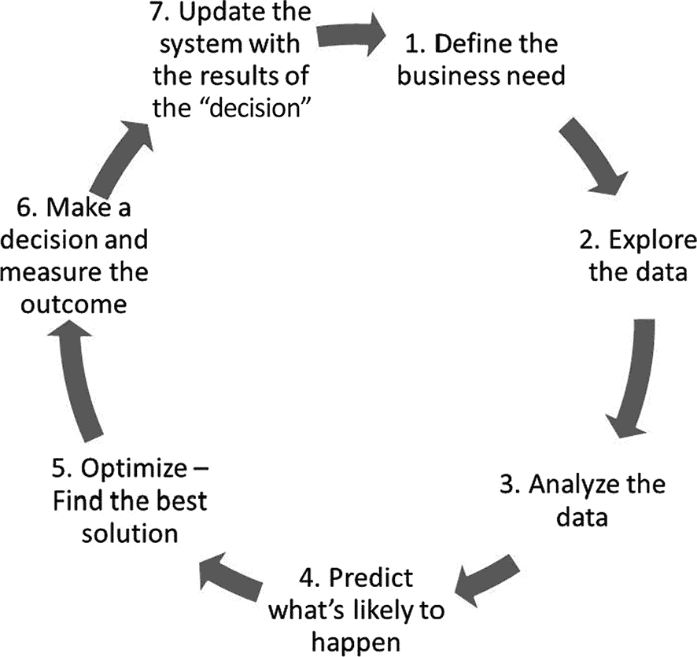

Figure 3.1: The 7-step data analytics life cycle process model.

虽然此过程模型提供了活动的良好大纲，但它假设了有限范围的分析实践，主要局限于假设检验和预测阶段。缺少了广泛的其他数据分析方法、机器学习和文本分析等。

步骤包括：

1.  **Define the business need（定义业务需求）：** 此阶段涉及理解业务目标和目的或待解决的问题。它识别业务利益相关者、可用数据以及分析的交付成果。

## 2. 探索数据

此阶段包括数据清洗、对缺失数据进行插补、根据需要优化和标准化数据。它涉及转换数据以创建新的指标或变量。

## 3. 分析数据

在此阶段，数据科学家应用统计方法和算法来识别数据变量之间的模式和相关性。它可能涉及假设检验、相关性分析或回归分析。

## 4. 预测可能发生的情况

此步骤强调用于发现洞察和关系的技术，这些洞察和关系有助于预测结果。

## 5. 优化——寻找最佳解决方案

在此步骤中，数据科学家运行“假设”场景和算法以找到最优解。准确性提升属于此步骤。

## 6. 做出决策并衡量结果

此步骤的目标是将分析得出的洞察付诸行动并衡量结果。

## 7. 使用“决策”的结果更新系统

此步骤将决策的结果指标与预期结果进行比较。它确定数据分析的影响力和功效。

Cathy O’Neil 和 Rachel Schutt 提供了另一个过程模型。如下图所示，该模型从收集来自现实世界的原始数据开始，随后进行数据处理和清洗。

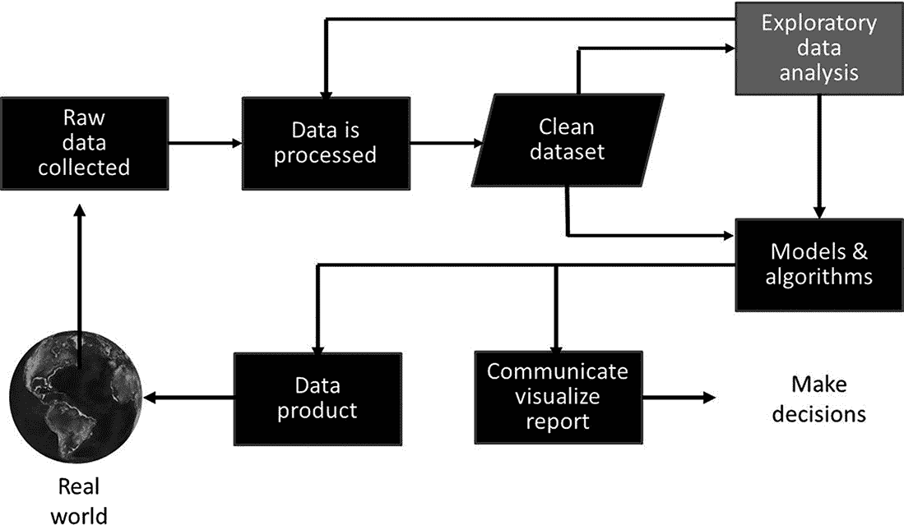

**图 3.2：数据科学过程模型。**

还有三个数据分析过程框架值得一提：`CRISP-DM`、`SEMMA` 和 `KDD`。虽然这些过程模型开发于很久以前，且是考虑到数据挖掘实践（而非数据科学实践）而设计的，但它们值得简要回顾以建立基准。接下来我们将回顾这些过程模型。Umair Shafique 和 Haseeb Qaiser 对这三个过程模型进行了很好的综述。

### 3.2 KDD——数据库知识发现

如图 3.3 所示，数据库知识发现 (`KDD`) 过程旨在从数据中发现知识，重点关注高层数据挖掘方法。它包含 9 个步骤。

1.  **开发并理解应用领域：** 在 `KDD` 过程的第一阶段，从客户角度定义项目目标，并用于理解应用领域和现有知识。

2.  **创建目标数据集：** 此阶段侧重于创建目标数据集、数据样本和变量。

3.  **数据清洗和预处理：** 此阶段涉及清洗和预处理数据，以消除数据中的任何噪声或不一致性。

4.  **数据转换：** 此阶段侧重于转换数据及其格式，以准备用于分析的数据，使其能被算法使用。

5.  **选择合适的数据挖掘任务：** 此阶段根据第一阶段定义的目标选择合适的数据挖掘任务。任务被定义为分析的类别或方法，例如：分类、聚类、回归、汇总、优化等。

6.  **选择合适的数据挖掘算法：** 此阶段选择合适的数据挖掘算法以满足第 5 阶段的任务。

7.  **应用数据挖掘算法：** 此阶段应用选定的算法，以最佳方式识别数据中的模式。

8.  **解释挖掘出的模式：** 此阶段侧重于解释和评估挖掘出的模式。从业者可能会在此阶段展示结果的可视化。

9.  **使用发现的知识：** 在过程的最后阶段，发现的知识被用于各种目的，并准备好与其他系统集成或采取进一步行动。

`KDD` 过程模型过去主要用于数据挖掘用例。它是 `CRISP-DM` 模型的前身，并在一定程度上影响了后者。

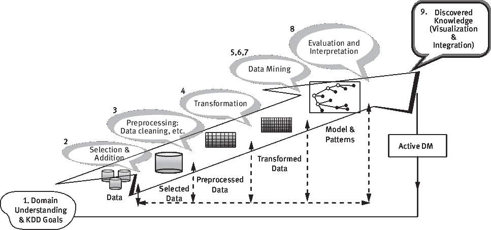

**图 3.3：KDD 数据分析过程。**

### 3.3 CRISP-DM 过程模型

跨行业数据挖掘标准过程 (`CRISP-DM`) 是一个开放标准过程模型，描述了用于数据挖掘的通用方法。

`CRISP-DM` 的目的是提供一个可靠且可重复的数据挖掘过程。它提供了一个统一的框架，带有指导方针和灵活性，可适应不同的业务问题和不同的数据集。

`CRISP-DM` 将数据挖掘过程分为六个主要阶段：

1.  业务理解

2.  数据理解

3.  数据准备

4.  建模

5.  评估

6.  部署

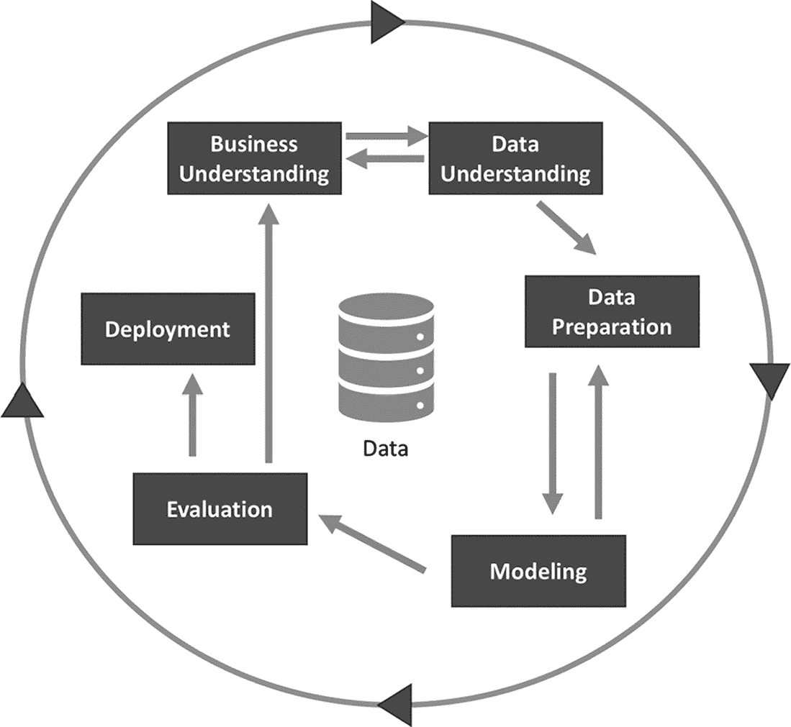

**图 3.4：CRISP-DM 数据分析过程模型。**

这六个步骤（如图 3.4 所示）的详细描述如下：

1.  **业务理解：** 此阶段旨在理解项目目标和需求。它建议：业务目标陈述、数据挖掘目标和成功标准。它侧重于理解项目目标、需求以及客户想要实现的目标。此步骤定义当前状况、业务问题、解决方案的预期收益。从业者确定可用资源（硬件和软件）、数据挖掘目标、工作量估算、关键步骤和模型评估标准。

2.  **数据理解：** 此阶段规定获取数据、探索数据和验证数据质量。它侧重于理解数据的一般属性、量级和类型。数据收集发生在此阶段。此步骤包括数据探索：识别数据属性、范围、相关性和属性类型。对每个属性执行基本统计检验（分布、最大值、最小值、平均值和标准差、方差、众数和偏度）。从业者在此阶段识别特殊数据值、错误、缺失属性、值的合理性和数据关系。

3.  **数据准备：** 此阶段为分析准备数据。此阶段的活动通常是数据转换。它们包括清洗数据、集成和连接数据、标准化数据、重排属性、重新格式化数据和重新排序记录。

4.  **建模：** 此阶段涉及选择和构建模型、生成测试并评估模型的有效性。从业者评估各种建模技术，并根据其对数据参数和属性的适配度选择合适的模型。接下来，将模型应用于数据。可能需要对结果进行一些后处理。最后，分析结果的可靠性和合理性。

5.  **评估：** 此阶段更彻底地评估模型并确定如何使用结果。模型评估考虑错误率、模型的稳健性、结果解释、结果忽略或引入的任何业务问题以及基于模型结果的最终决策。在此步骤中，对结果进行排序，解决模型的任何故障和问题。从业者评估结果以理解它们及其相对于第一阶段设定目标的影响。最后，确定是否可以决定进入下一阶段。

## 6. 部署

此阶段确定结果如何被利用、由谁使用、如何部署以及使用频率。从业者制定部署计划，包括持续的维护和监控计划。此阶段部署结果并将整个包送入生产环境。结果可作为业务规则、交互式在线应用程序或数据库被利用。从这些阶段获得的知识需被组织并以客户可用的方式呈现。作为最后一步，整个过程被记录到最终报告中，并进行项目事后审查（与利益相关者进行的最终项目回顾，以确定经验教训和改进空间）。

在 `CRISP-DM` 中，阶段 4-6 可能会随着数据或业务部署选项随时间变化而重复。虽然一些非 `IBM` 的数据挖掘专业人士使用 `CRISP-DM`，但 `IBM` 仍然是采用此过程模型的主要公司。总体而言，虽然 `CRISP-DM` 仍在使用且 `IBM` 已宣布对其进行扩展，但此过程模型似乎已过时，无法满足现代数据科学家的实际需求。

### 3.4 SEMMA 过程模型

`SEMMA` 过程模型代表 Sample（抽样）、Explore（探索）、Modify（修改）、Model（建模）和 Access（评估）。它是由 `SAS` 研究所提出的一种数据挖掘方法。它支持数据组织、发现、开发和数据挖掘项目的维护。其五个阶段提供以下内容：

1.  **Sample（抽样）**：这是 `SEMMA` 的第一个但可选的阶段。它涉及数据抽样，以提取关于数据的关键信息，同时数据量足够小以便快速操作。

2.  **Explore（探索）**：此阶段专注于数据探索和发现。它加深对数据的理解，发现数据中的趋势和异常。

3.  **Modify（修改）**：此阶段涉及通过数据转换和模型选择过程来修改数据。此阶段可能评估数据中的异常、离群值和变量减少。

4.  **Model（建模）**：此阶段的目标是构建模型并将模型应用于数据。由于数据集具有不同的属性，可能会应用不同的建模技术。

5.  **Access（评估）**：`SEMMA` 的最后阶段评估结果的可靠性和有用性、模型的性能和准确性。

总体而言，这三种数据挖掘过程模型有很多共同点。一个过程中的某些阶段对应另一个过程中的相似阶段。例如，`KDD` 过程阶段“数据转换”可对应 `SEMMA` 过程的“Modify”阶段和 `CRISP-DM` 中的“Data Preparation”阶段。

虽然这些过程模型仍在少数组织中实践，但它们的有效保质期几乎已过（如果不是完全结束的话）。行业需要一个现代且适当的数据分析过程标准，以反映新一代数据科学家的工作。我们提出 `DSMAT` 作为新的过程标准。

### 3.5 Microsoft TDSP 框架

`Microsoft` 于 2017 年宣布了团队数据科学过程（`TDSP`），作为一种敏捷、迭代的数据科学方法论，旨在高效交付高级分析解决方案和智能应用程序。

`TDSP` 的目标是改善协作、学习和最佳实践，以成功促进数据科学计划。`TDSP` 的主要组成部分是数据科学生命周期。

**TDSP 数据科学生命周期定义**：生命周期视角支持面向产品的方法，适用于将其解决方案作为智能应用程序一部分交付的数据科学家。生命周期通过五个主要阶段提供严谨且可重复的步骤（参见 Figure 3.5）。每个阶段必须解决目标、如何执行步骤以及后续步骤。

`Microsoft TDSP` 生命周期的五个步骤包括：

1.  **Business understanding（业务理解）**：此步骤的目标是定义业务目标、利益相关者和业务问题。它寻找有助于回答业务问题的相关数据。此步骤的关键目标是确定关键业务变量以及满足项目目的所需的分析。

2.  **Data acquisition and understanding（数据获取与理解）**：此步骤的目标是生成与目标变量相关的干净、高质量数据集。它开发数据管道以定期刷新数据。

3.  **Modeling（建模）**：建模阶段确定算法的最优数据特征、模型构建、模型训练和验证，以部署到生产环境。

4.  **Deployment（部署）**：此阶段将模型投入运行。模型准备好部署后，作为带有通往生产环境管道的产品进行部署。

5.  **Customer acceptance（客户验收）**：此步骤的目标是确认数据管道、模型及其部署到生产环境满足客户的验收标准和目标。它包括验证活动和将项目移交给将在生产环境中运行系统的实体。


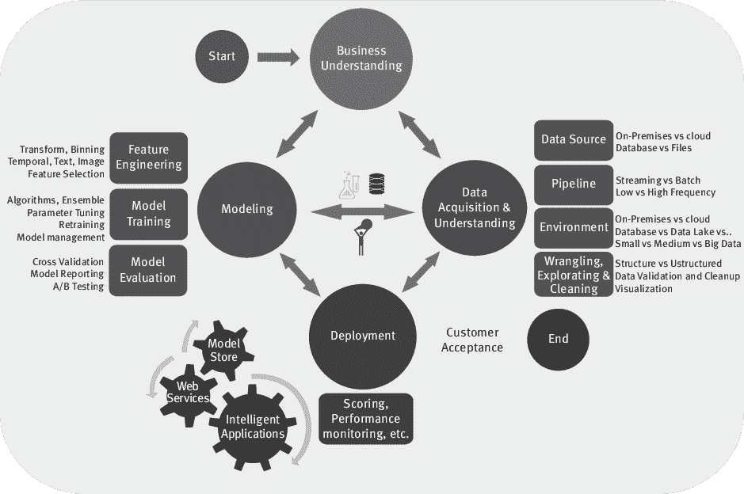

Figure 3.5: Data Science Lifecycle – Microsoft TDSP Model.

TDSP 提供了一种生命周期方法，提供了可持续且可重复的过程。我们在这个项目中的目标始于开发一个过程框架，定义数据科学家的预期职责，并帮助数据科学家在工作中更成功。虽然这些过程框架大多解决了行业中的一些差距或需求，但它们尚未获得全行业范围的标准认可。

以下是预测建模项目的常见数据科学过程示例。

### 3.6 数据分析过程示例——预测建模案例研究

在本节中，我们将通过一个营销分析示例来说明典型的数据科学过程。我们的场景预测消费者购买可能性，我们将从头到尾经历分析之旅。我们将说明的场景旨在预测消费者对商品的购买。例如，考虑这样一个场景：你想预测哪些客户可能会因广告而购买新的高尔夫球杆。这里的假设是数据科学家正在使用 R，特别是 `DMwR`。

#### Consumer Purchase Prediction—Marketing Analytics Scenario（消费者购买预测——营销分析场景）

营销组织有兴趣为其营销活动定位消费者，并预测哪些消费者可能选择某产品。该项目的目标是识别将进行购买的消费者。我们分析的结果将指示每个申请人的购买概率。我们将从数据整理开始，将数据分析方法和过程应用于此问题。以下是应用于此项目的方法论摘要。

#### Understanding the Problem（理解问题）

预测购买概率对任何营销活动都至关重要。数据来自营销调查。消费者响应了衡量消费者对高尔夫兴趣的营销调查。例如，他们打球的频率、参加比赛的频率、观看高尔夫锦标赛活动的频率、是否上高尔夫课程和订阅高尔夫杂志、最喜欢的高尔夫球手等。使用这些数据，我们的目标是确定消费者是否可能购买某品牌的高尔夫设备。调查中的每个问题都能提供重要线索，即可用于分析的信号。

#### Data Curation（数据整理）

正如数据科学实践中常见的那样，来自调查的可用数据集存在许多不一致性和问题。存在缺失值、离群值和噪声数据字段。在将数据用于模型之前，必须处理这些问题。数据集包含 10,000 条记录和 30 个属性，这些是我们接下来将用于机器学习练习的特征。

#### Feature Discovery and Selection（特征发现与选择）

在 30 个属性中，可能只有少数申请人参数对购买预测有更显著的贡献。因此，必须发现这些特征（特征发现）并将其选入最终模型训练。

#### 模型开发

有许多分析模型可用，包括深度学习（使用神经网络）、逻辑回归、主成分分析或随机森林（决策树的集成）。我们将对此模型使用决策树，并评估性能（结果准确性）以验证我们的选择。

#### 准确性评估

我们将使用各种工具（如 AUROC，详见后续章节）评估模型性能（质量、一致性和鲁棒性）。如果准确性不可接受，我们将采用另一种模型。

#### 整体验证

在将模型发布到生产环境前，我们将从多个角度分析结果，包括有效性和泛化性、伦理问题以及平衡视角。

#### 数据准备步骤

数据集存在一些必须填补的缺失数据字段。我们将在后面详细讨论数据填补。我们将通过从其他可用的完整记录生成新值来填补缺失数据字段。但首先，我们对数值数据进行归一化。然后，使用 `k-nearest neighbor` 算法执行多重填补。`k-nearest neighbor` 通过跨所有记录比较所有其他数据字段，为缺失数据项找到最合理的值。数据科学家为此使用 `DMwR` 包的 `knnImputation()` 函数。

考虑到数据集约有 10,000 条记录，数据集中可能存在异常值。作为数据发现和准备的一部分，我们有兴趣对数据进行进一步分析，并可能移除异常值。数据科学家可能使用定性特征，通过 `Levels()` 函数检测异常值。要检测数值数据异常值，我们将数据归一化到 `[0,1]` 区间，然后应用 `cluster` 包的 `Daisy()` 函数。该函数使用箱线图技术识别异常值。接下来需要对异常值进行排序。这通过 `DMwR` 中可用的 `outliers.ranking()` 函数中的凝聚层次聚类算法等技术来完成。

对异常值数据排序后，数据科学家可以选择移除超出范围的异常记录，或用 `NULL` 填充异常值。

数据不一致是分析的巨大障碍。数据可能不平衡。例如，如果 70% 的调查受访者是男性，其余为女性，则数据不平衡，机器学习算法可能在男性群体上训练效果优于女性群体。数据科学家应用诸如 `Smote()` 函数之类的工具来平衡数据。我们还随机选择数据集的一部分（约 80%）用于训练模型，20% 的数据用于测试。平衡函数必须应用于训练数据片段。

#### 特征发现

在开始构建模型之前，第一步是识别任何有问题的数据关系，如高度相关的数据字段。高度相关的数据字段由两个或多个属性表示冗余信息。数据科学家可以使用 `Ellipse` 包中可用的 `PlotCorr()` 函数来识别并移除高度相关的数据字段。

此步骤有助于发现重要特征（预测变量）并对特征进行排序。数据科学家根据某些阈值限制对属性（特征）进行排序，高排名特征将被选入模型构建。为了对特征进行排序，数据科学家可能使用 `RandomForest` 包中可用的 `RandomForest()` 函数等工具。该包包含一个名为 `RFCV()` 的函数，有助于对特征进行排序。

#### 模型构建

具有精简特征集的新精简数据集现已准备好投入模型。数据分类技术是预测的一种方法。本质上，数据科学家构建算法将数据集分为两组（将购买者和不购买者）。模型在训练数据集上训练，从关键特征（预测因子）中学习，以预测消费者应如何分类。决策树是常用的分类算法。我们使用标记数据进行训练。这意味着我们知道过去哪些受访者进行了购买。作为决策树的替代方案，数据科学家本可以选择其他算法，如二元逻辑回归方法、神经网络或支持向量机。数据科学家基于此类数据分类的历史成功选择了决策树方法。

然后，数据科学家在训练数据集（随机选择的 80% 记录）上训练模型以构建决策树模型。此步骤可使用 `rpart()` 函数。接下来，将模型应用于测试数据集（20% 记录）以确定模型的准确性和性能。要测试模型，可使用 `predict()` 函数。

#### 性能评估

将测试结果与实际的原始分类标签进行比较，以确定模型的准确性。通过将结果与原始测试数据标签比较，数据科学家确定真阳性、真阴性、假阳性和假阴性的数量。准确性评估可能考虑精确率、真阳性率、真阴性率和简单准确率比率。最终，可能使用额外的模型调整或其他模型来比较准确性改进。我们将在后续章节中更详细地回顾准确性度量及如何提高模型性能。

# 第二部分：高级分析方法

## 第 4 章 自然语言处理

### 4.1 自然语言处理 (NLP)

自然语言处理（NLP）的理念是开发一种能够分析、理解和生成自然人类语言的计算机系统。NLP 有许多应用，包括主题建模、客户情感分析、机器翻译和概念搜索。

NLP 技术分为四类：

1.  **模式匹配**：此方法尝试通过模式而非结合单词的结构和含义来解释输入文本。

2.  **句法驱动解析**：此方法研究单词如何组合形成更高层级的单元，如短语、从句和句子。

3.  **语义语法**：语义方法将语言解析为由其含义定义的语义类别。

4.  **案例框架实例化**：此解析技术将关键语言组件的自底向上识别与结构较少组件的自顶向下实例化相结合。

NLP 的核心任务是解析。解析是根据给定语法计算文本字符串或标记列表的有效结构的过程。由于一个句子可以用许多有效结构编写，解析句子以提取含义并不简单。自然语言处理被视为 AI 完全问题也就不足为奇了。

处理 NLP 面临许多挑战。最终目标是训练模型将一段文本转换为计算机友好的格式，并让人类能与计算机进行“对话”。我们希望训练模型理解和学习自然语言。

NLP 任务包括以下内容，按从原始文本到用于理解的分类文本的顺序：

*   **词性标注 (POS)**：识别单个单词的句法角色，将其归类为名词、副词、动词等句法身份。

*   **分块 (CHUNK)**：通过获取单词块（如名词短语、动词短语等）来定义句法成分。

# 自然语言处理核心任务与工具

## NLP 核心任务

*   **命名实体识别 (NER)**：通过标记句子部分的实体类型，识别人名、公司名、地点等实体。

*   **语义角色标注 (SRL)**：识别单词的语义角色并打上相应标签。这是最困难的任务。目标是找出所有可能的动词，并将关系的参数（主语和宾语）标记到该动词上。

计算机程序经过训练可识别解析文本的正确标签。对《华尔街日报》文章的分析通过 POS、分块和 NER 任务识别出约 100 万个不同的标记词。路透社使用 NER 发现了约 20 万个标记词。据报道，某些模型在这些语料库上的准确率在 88% 到 97% 之间。考虑到人类理解错误率约为 15%，这些准确率水平令人瞩目。

## NLP 三大阶段

自然语言处理问题包含三个阶段，每个阶段都有多样性和多种工具、方法选择：

1.  **解析**

2.  **学习**

3.  **语义建模**

### 解析方法选择

解析方法包括语法和推理过程。主要方法有：

*   归纳逻辑编程 (ILP)

*   同步上下文无关文法 (SCFG)

*   组合范畴语法 (CCG)

*   概率上下文无关文法

简单来说，上下文无关文法包含用一个词替换另一个词的规则。例如，在 "Apple" 中用 "α" 替换 "A" 的规则将产生 "αpple"。另一条规则可能反转字符串，使 "Apple" 变为 "elppA"。概率 CCG 测量给定字符串可能的推导（或排列）频率。本书将重点介绍 CCG 和 PCFG 方法。

### 学习方法选择

学习方法的选择在于决定应用哪种监督学习技术。技术包括：

*   1994 年引入的带标注解析树

*   句子-逻辑形式对

较新的方法使用潜变量方法，包括：

*   问答对

*   指令-演示对

*   对话日志

*   视觉传感器

既有监督学习也有半监督学习方法。本书后续将详细介绍神经网络和学习方法。

### 语义建模

此阶段关注使用何种逻辑语言表示及如何建模文本含义。语义模型选项包括：

*   `variable free logic`（无变量逻辑）

*   `high-order logic`（高阶逻辑）

较新方法包括关系代数和图模型。

## NLP 常用工具

处理 NLP 的工具有多种，`NLTK` 是最流行的 Python 文本挖掘工具包。其他选项包括 `OpenNLP` 和 `TextBlob`。

### NLTK 核心组件

`NLTK` 提供易用界面及 50 多个语料库和词汇资源（如 `WordNet`），以及分类、分词、词干提取、标注、解析和语义推理等文本处理库。

`NLTK` 包含 `NLTK Data`，这是一个用于标注的语料库、语法、模型和工具库。语料库示例包括 `Brown Corpus`。

`NLTK` 还包含句子边界检测和分句工具 `Sent_Tokenize`，以及词分块和标注工具 `Word_Tokenize` 和 `POS_Tag`。

### 分词器

分词器用于将句子分割为子字符串列表，并将子字符串分割为单词列表。例如，`Sent_Tokenize` 用于查找句子列表，`Word_Tokenize` 用于查找字符串中的单词列表。

句子分词常称为 **句子边界消歧 (SBD)**、句子边界检测或句子分割。句子分词确定句子的开始和结束位置。

句子分词工具众多，如 `NLTK`、`OpenNLP`、`TextBlob`、`MBSP`、`SpaCy` 等。若使用 Python，`NLTK` 是首选。`NLTK` 包含 17 种以上语言的预训练分词器，支持语言列表可在 NLTK 官网（[www.nltk.org](http://www.nltk.org)）查看。

许多词分词器（包括 NLTK 的）使用标准分词器 `TreeBankWordTokenizer`。替代方案有 `PunktWordTokenizer` 和 `WordPunktTokenizer`。分词器的主要区别在于标点符号处理方式：

*   `PunktTokenizer`：按标点分割句子但保留标点与单词在一起

*   `PunktWordTokenizer`：将所有标点分割为单独的 token

示例句子："This's a test"

*   `TreebankWordTokenizer` 分词结果：`['This', "'s", 'a', 'test']`

*   `PunktWordTokenizer` 分词结果：`['This', "'", 's', 'a', 'test']`

### 词性标注 (POS)

**词性 (POS) 标注** 是 NLP 的重要任务，也称 **语法标注** 或 **词类消歧**。它根据单词定义及其在句子中与其他单词的上下文关系进行标记。例如，POS 标注可自动识别句子中的主语、宾语、动词和介词。

### 文本处理：词干提取与词形还原

#### 词干提取

**词干提取** 是将屈折词和派生词还原为词干、基础或根形式的过程。例如 "walking"、"walks" 和 "walked" 的词干均为 "walk"。词干不必与词的形态学根完全相同。通常，相关词可能映射到同一词干，即使该词干本身不是有效词根。某些搜索引擎将同词干词视为同义词，这一过程称为 **合并**，用作查询扩展，即将搜索扩展至搜索词及其同义词。

#### 词形还原

**词形还原** 是将单词的不同屈折形式归类为单一项以便分析的过程，即寻找给定单词的词元。词形还原需理解单词上下文并确定其在句子中的词性，需要语言语法知识。

词形还原与词干提取密切相关，但区别在于：

*   词干提取器在无上下文（或语法）知识下对单个单词操作，无法区分多义词

*   词形还原基于语义含义（上下文）和句子中的词性查找词根

### NLTK 词干提取工具

`NLTK` 提供多种词干提取器：

*   `Porter stemmer`

*   `Lancaster stemmer`

*   `Snowball stemmer`（基于 Snowball 词干算法）

可导入这些词干提取器对文本单词进行词干提取。

### NLTK 词形还原与 WordNet

`NLTK` 使用 `WordNet` 进行词形还原。`WordNet` 是大型英语词汇数据库，将名词、动词、形容词和副词归类为认知同义词集（称作 **synsets**），每组表达不同概念。Synsets 通过概念语义和词汇关系相互链接，形成可通过浏览器搜索或导航的有意义词汇和概念网络。

`WordNet` 优势：

1.  不仅是词典，更通过分组和链接单词使其讲得通。网络中紧密相邻的单词在语义上已消歧。

2.  标记这些分组中单词间的语义关系。相比之下，词典仅基于意义相似性分组单词，而非基于文本中的显式模式。

# 命名实体识别 (NER)

命名实体识别 (NER) 是从文本中检测人名、公司名和地名的过程。一些用于 NER 的有用工具包含在 Stanford NER with Python 中。您也可以在 NLTK 中使用 Stanford POS Tagger 和 Stanford Parser，因为 NLTK 现在提供了针对这三个工具的接口。Stanford NER 的一个版本可识别四类数据（人名、组织名、地名、杂项）。7 类模型最多可识别七类实体，包括：时间、地点、组织、人名、货币、百分比和日期。

# 文本分类

文本分类是 NLP 的另一个重要应用。文本分类的目标是为一个或多个类别的文档分配标签。它在图书馆学、信息科学甚至情感分析中都很有用。NLTK 可用于将文本分类为文档类别。通过训练模型（也称为监督学习）可以增强文本分类。NLTK 为监督学习提供了许多算法，如朴素贝叶斯、决策树和最大熵模型（也称为多项逻辑回归）。我将在后续章节介绍这些模型。

# 解析语法

正如我们之前提到的，用于解析、形式化和自然语言语义理解的流行解析语法包括组合范畴语法 (CCG) 和概率上下文无关语法 (PCFG)。我们将在后续章节学习 CCG 和 PCFG 解析。要获取一套完整的端到端工具，您可以访问康奈尔大学和华盛顿大学语义解析框架 (SPF) 的 NLP 站点。

### 4.2 NLP 能力成熟度模型

随着自然语言处理应用变得更加复杂，它们需要在高级能力方面具备更高的熟练度。我在下一个图表（采用阶梯格式）中描绘了一个 NLP 能力成熟度模型。它展示了 NLP 处理能力的不断增强如何支持更复杂、更强大的应用。

该模型始于分词，即将句子拆分为单词。此阶段的应用仅限于简单的搜索和词频统计。词频统计是定量分析中的一项重要技术。

下一级是添加词性 (POS) 和标注。在此步骤中，数据科学家为单词添加语言语法和句法标签。此级别的应用包括主题建模和情感分析。主题建模使我们能够定义单词类型，如人名、公司名、地名，甚至单词的类型。

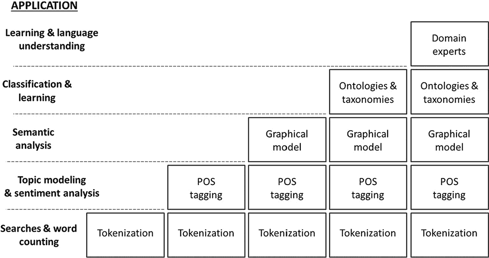

图 4.1：NLP 能力成熟度模型。

能力成熟度模型的下一步引入了额外技术，如图模型和基于案例的推理。这些技术试图从文本中提取语义含义。

超越语义分析需要分析能力和方法的组合，包括机器学习和分类。为了增强 NLP 结果，我们需要引入本体和分类法层。分类法是针对特定用途和应用的特定词汇库。例如，贵公司广泛使用的单词、首字母缩略词和同义词库构成了一个分类法。本体是跨行业使用的更广泛的、行业级的词汇库。两者都有助于更好地理解文本中的上下文。

最高层级是自然语言理解。该层级依赖于所有底层能力。它致力于理解语言、其内容和上下文。开发领域专家是增强理解的一种技术。领域专家是专家知识框架和规则的集合，它们模拟个体处理文本或口语的方式。处理自然语言的能力是一种隐性知识。领域专家将隐性知识捕获为一组规则和框架，为理解提供上下文。例如，如果目的是理解医疗笔记，我们需要沿着医学本体（如 UMLS、LOINC 和 ICD-10 词库）开发能力，再加上定义文本应如何被解释规则的医学领域专家能力。

### 4.3 自然语言处理简介


# NLP 的历史与核心技术

## NLP 的历史

NLP 的历史始于 Franky Rosenblatt 于 1957 年开发的工作，他引入了感知机的概念。感知机接收多个输入 (`X[i]`) 并应用某些权重 (`W[i]`)，以计算输出 `Y`，如下图所示。然而，该模型有一个巨大的缺点：它仅仅是线性的。

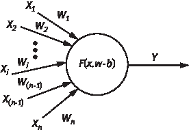

图 4.2：一个简单的感知机。

曾有许多尝试使模型非线性化。但直到 1986 年，Rumelhart、Hinton 和 Williams 引入了人工神经网络 (ANN)。神经网络（我将在后续章节更详细地介绍）由多层感知机组成。ANN 提供了多层计算：输入层、隐藏层和输出层。它们还引入了反向传播和前馈等多种方法来调整权重，从而训练模型。

后来，引入了其他技术，如支持向量机 (SVM)，但它们通常计算成本高昂。神经网络是机器学习的优雅模型，非常适合构建现在所谓的*深度学习*。此外，称为*卷积神经网络* (CNN) 的神经网络变体在自然语言处理中变得流行。

本十年收集的大量大数据要么是机器数据，要么是非结构化格式的人类生成文本。超过 80% 的数据以叙事文本和笔记的形式存在，而非具体的数据字段。将自然语言处理 (NLP) 工具集成到分析过程中将是一大优势。理想的 NLP 工具不仅提取数据，还呈现提取结果及其与其他数据的关系，以创建可用于进一步处理的临时结构化数据集。

理想的 NLP 工具具备一定的语义处理能力。简单的语义处理功能包括同义词、识别用户定义的关联、排除项（如排除所有否定病例或特定短语）并提供短语出现的简单频次统计。

高级语义处理将通过聚类短语、构建句子结构图来支持含义提取。语义处理器将这些结构映射到特定领域本体模型中的概念。用户将能够使用同义词或与名词最频繁共现的短语来定义名词的变体。

例如，要定义“ocular complications”（眼部并发症）这一短语的变体，用户（或工具可能建议）输入同义词和变体，如：ocular, oculars, oculus, oculi, eyepiece, ophthalmic, ophthalmia, optic, optics, complication, complications 等。

再举一个例子，当用户搜索“Use of thermogram in detection of meningitis”（热像图在脑膜炎检测中的应用）时，工具的语义功能会将 meningitis 识别为一种疾病，将 thermogram 识别为一种方法。请注意，语义分析器构建的一个代表性语义句子结构可能类似于图 4.3 中的结构。这些内部结构维护着对从医疗记录中智能提取术语至关重要的关系和含义。

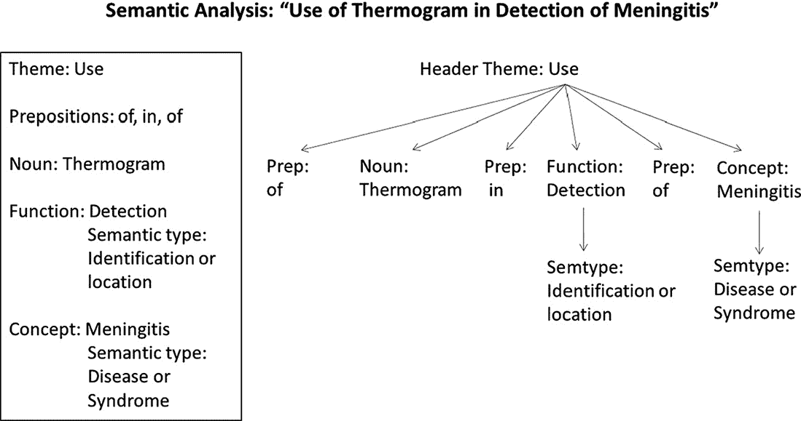

图 4.3：搜索短语可能的语义分析示例。

增强上下文和自然语言理解的两个重要工具是词典和分类法。词典是特定领域使用的术语集合。词典帮助我们将分词后的文本关联到特定的知识领域。例如，法律领域的词典（词汇集合或字典）是独特的，且不同于制药行业的词典。分类法不仅包含特定词汇，还包含分类以及与每个词相关联的规则。在医疗应用中，诸如 UMLS 之类的分类法……

## 4.4 NLP 技术——主题建模

主题建模是从文本信息中提取主题的科学。主题建模是文本挖掘的一种形式。其目的是识别语料库中的模式。换句话说，它是一种在大量文本中查找和追踪词簇（称为“主题”）的方法。

正如你通读一篇文章并用荧光笔标记短语或段落一样，主题建模试图识别主题的关键词。每组词构成一个主题。

主题建模有许多应用，可回答诸如以下的问题：文本讲的是什么？文本的摘要是什么？文本中隐含的情感是什么？

主题建模中一种基础且广泛使用的方法是隐含狄利克雷分布（`LDA`），它比较文档内主题的出现情况。它用于识别某个术语（或主题）在文档中出现的概率。一个名为 `MALLET` 的开源工具使用 `LDA` 方法作为其核心算法。

为了使主题建模更有效，专家建议你编译大量文档语料库，大约 1,000 篇文本。接下来，你应该通过将文本从句子转换为词串来对其进行分词，去除标点符号、停用词（如“the”、“a”、“and”、“of”等）。

主题模型需要在你的数据上进行训练。你可以指定模型应识别多少个主题。选择要提取的主题数量很重要，无论你指定 5 个、50 个还是 500 个主题。你可以多次运行模型，通过反复试验测试和调优模型，直到达到预期结果，即以可接受的准确率识别出足够的主题。

主题建模允许我们通过识别文档中的主题来对文档进行“放大”和“缩小”。我们可以缩小主题范围，也可以拓宽主题范围。我们可以追踪主题随时间的变化。例如，通过对报纸文章、博客帖子、推特和其他社交媒体进行主题建模，我们可以确定公众舆论、客户情绪，以及人们对某些主题的态度如何随时间变化。

概率主题建模是一套算法，旨在发现并用主题信息标注大量文档语料库。这些是统计方法，通过分析文本中的词汇来发现主题，以及主题如何相互关联、如何随时间演变。

`LDA` 算法背后的思想是文档包含多个主题。主题被定义为固定词汇表上的一个分布。我们通过两阶段过程生成词汇：

1. 随机选择主题的分布（即出现频率）
2. 对文档中的每个词：
   a. 从步骤 #1 的主题分布中随机选择一个主题
   b. 从相应的词汇表分布中随机选择一个词

主题建模的统计本质如下运作：每个文档以不同比例展现主题（步骤 #1）；文档中的每个词都从某个主题中抽取（步骤 #2b）；其中所选主题来自文档级的主题分布（步骤 #2a）。

## 4.5 NLP——命名实体识别（NER）

命名实体识别（`NER`）是识别人名、地名、组织名、产品名的过程。

**输入：**

> “Profits soared at Boeing Co., easily topping forecasts on Wall Street, as their CEO Alan Mulally announced first quarter results.”

`NER` 标注程序将使用特定实体类型标记文本。例如，考虑 `NER` 程序的以下输出。

**输出：**

> Profits/NA soared/NA at/NA Boeing/SC Co./CC ,/NA easily/NA topping/NA forecasts/NA on/NA Wall/SL Street/CL ,/NA as/NA their/NA CEO/NA Alan/SP Mulally/CP announced/NA first/NA quarter/NA results/NA ./NA

`NER` 程序使用的标注模式包含以下标签：

* `NA` = 非实体
* `SC` = 公司开始
* `CC` = 公司继续
* `SL` = 地点开始
* `CL` = 地点继续
* `SP` = 人名开始
* `CP` = 人名继续

该研究结果确定了文本中识别出的公司、人名和地点。

**结果：**

* 公司：Boeing
* 人名：Alan Mulally
* 地点：Wall Street

## 4.6 NLP——词性（POS）标注

另一种 NLP 技术是 `词性`（`POS`）标注，它可以提供更多信息。`POS` 标注的输出如下所示。

**输出：**

> Profits/N soared/V at/P Boeing/N Co./N,/, easily/ADV topping/V forecasts/N on/P Wall/N Street/N,/, as/P their/POSS CEO/N Alan/N Mulally/N announced/V first/ADJ quarter/N results/N ./.

让我们利用句法结构应用 `POS` 标注。给定下面的输入，我们构建一个句法结构。

**输入：**

> Boeing is located in Seattle.

所用标注包括：

* `N` = 名词
* `V` = 动词
* `P` = 介词
* `Adv` = 副词
* `Adj` = 形容词
* `POSS` = 所有格

使用标签的文本树分解如图 4.4 所示。

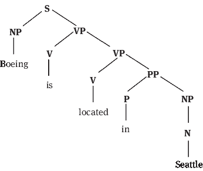

图 4.4：POS 标注树。

NLP 的另一个应用是机器翻译。例如，输入以下文本，输出将显示德语翻译。

**输入（英语）：**

> Boeing is located in Seattle. Alan Mulally is the CEO.

**输出（德语）：**

> Boeing ist in Seattle. Alan Mulally ist der CEO.

Penn Treebank 项目提供了英语的短语标注命名法。对于中文，使用 Penn Chinese Treebank。对于德语，使用 NEGRA 语料库对文本中的短语进行标注。

一些有用的在线链接有：[`www.nltk.org/book/ch05.html`](http://www.nltk.org/book/ch05.html)、[`nlp.stanford.edu/`](http://nlp.stanford.edu/) 和 [`www.cis.upenn.edu/~treebank/`](http://www.cis.upenn.edu/~treebank/)。

英语标注分类法包括以下内容：

1. `CC` 并列连词
2. `CD` 基数词
3. `DT` 限定词
4. `EX` 存在词 there
5. `FW` 外来词
6. `IN` 介词或从属连词
7. `JJ` 形容词
8. `JJR` 形容词，比较级
9. `JJS` 形容词，最高级
10. `LS` 列表项标记
11. `MD` 情态动词
12. `NN` 名词，单数或物质名词
13. `NNS` 名词，复数
14. `NNP` 专有名词，单数
15. `NNPS` 专有名词，复数
16. `PDT` 前置限定词
17. `POS` 所有格词尾
18. `PRP` 人称代词
19. `PRP$` 物主代词
20. `RB` 副词
21. `RBR` 副词，比较级
22. `RBS` 副词，最高级
23. `RP` 小品词
24. `SYM` 符号
25. `TO` to
26. `UH` 叹词
27. `VB` 动词，基本形式
28. `VBD` 动词，过去式
29. `VBG` 动词，动名词或现在分词
30. `VBN` 动词，过去分词
31. `VBP` 动词，非第三人称单数现在时
32. `VBZ` 动词，第三人称单数现在时
33. `WDT` Wh-限定词（Wh 表示疑问词，因为它们通常以“wh”开头）
34. `WP` Wh-代词
35. `WP$` 物主 Wh-代词
36. `WRB` Wh-副词

## 4.7 NLP——概率上下文无关文法（PCFG）

概率方法考虑词汇以各种形式在文本中出现的概率。前面讨论的概率上下文无关文法（`PCFG`）算法工作原理如下。假设给定一个句子 `S`。我们想要找到最可能的解析 `τ`。我们该如何求得 `P(τ)`？

从本质上讲，我们是在寻找文本中术语 `τ` 的概率除以句子 `S` 的概率。计算遵循以下公式：

```
\arg\max\limits_{\tau}P(\tau|S) = \arg\max\limits_{\tau}\frac{P(\tau,S)}{P(S)}
= \arg\max\limits_{\tau}P(\tau,S)
= \arg\max\limits_{\tau}P(\tau)\; {If\; S = yield}(T)
```

挑战在于语言中存在无限多棵树！我们想要计算 `τ` 的概率，即 `P(τ)`。因此，我们定义语法中规则的概率分布，完全与上下文无关（因此得名该方法）。

请看下面的例子（图 4.5），它展示了句子 `S` 中某些标签出现的概率。

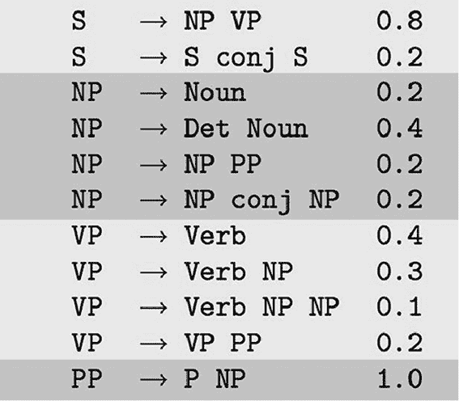

图 4.5：句子中标签的概率度量。

在 PCFG 分析中，重要的是要注意，树的概率是创建它的规则概率的乘积。以句子 `S` 为例：Mary drinks coffee with cream。该句子的 PCFG 图如图 4.6 所示。

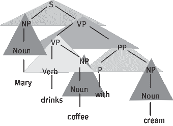

图 4.6：PCFG 图示例。

句子 `S` 的上下文无关概率计算如下：

`P(τ) = 0.8 × 0.3 × 0.2 × 1.0 × 0.2³ = 0.00384`

所有其他句子结构的概率以类似方式计算。自然语言处理领域还有更多研究正在进行中。其中有望带来新能力的新研究包括：

* **粗到细解析**：该技术使用更简单的语法进行解析。然后使用更复杂的语法细化解析。
* **依存解析**：它通过将句子中的每个词与另一个词关联来工作。在依存解析中，通过将句子中的每个词与依赖于它的其他词关联来解析句子。
  * **判别式解析**：这种方法试图通过从一些训练示例中学习来对句子进行分类。给定一组训练示例，判别式解析学习一个函数，该函数用其解析树对句子进行分类。
  * **生成模型**：这种方法旨在同时提取句法结构和命名实体关系。该技术在发现关系方面显示出了 80% 以上的准确率。

## 4.8 NLP 学习方法

NLP 处理中学习的目的是将一些文本输入模型并输出适当的标记（无论是 CCG 还是其他解析方法）。一种学习方法是词嵌入，并使用神经网络训练模型以找到每个词最合适的标签。

监督学习使用预先存在的带标签文本作为参考来训练模型。半监督和“弱监督”方法需要较少的标注专业知识。标签不能唯一确定正确的逻辑形式。在弱监督中，逻辑形式是隐含的。因此，学习需要在系统中执行逻辑形式并评估结果。

正如我们稍后将学习的，有不同的神经网络模型可用于学习，包括卷积神经网络。这些模型将在深度学习章节中讨论。

## 4.9 词嵌入和神经网络

NLP 有两种方法。一种是手工构建词关系及其语义关系（正如我们通过 CCG 和 PCFG 学到的）。另一种是使用“大规模”方法，通常应用机器学习和图分析。

在大规模机器学习方法中，我们从零开始理解 NLP（没有关于文本的先验知识）。大规模机器学习技术的目标是找到文本及其关系的统一隐藏表示。

我们通过词嵌入开始大规模方法。词嵌入

较长窗口大小的替代方案是将整个句子输入卷积神经网络。换句话说，我们将整个句子输入网络并运行卷积以处理每个句子的可变长度。每次卷积都会为每个词产生一个标签的概率。然后我们取时间上的最大值以捕获最相关的标签作为特征。该方法产生具有更高抽象层级的局部词特征。

## 4.10 使用图分析技术进行语义建模

分析文本并构建语义模型的技术之一，是在出现在不同句子和段落中的词之间形成关系图。图可以简单地定义为节点（代表词）和边（代表关系），边连接节点。该领域的一些最新出版物发布在 GraphLab 项目和 Google 的研究成果上。

图技术通过将文本解析为词并将每个词转换为其词干来工作。例如，我们将名词的复数形式改为单数形式，将动词改为其词根。词本身是原子的。我们想成对（二元语法）或在 3 个或更多词的窗口中研究它们。n-gram 采集一到 `n` 个词的集合中的词，如名词、形容词和动词。通常，n-gram 是给定文本序列中 `n` 个项目的连续序列。

窗口技术是将 n 个词的窗口在文本中滑动，并连接文档中具有相同词根的词。结果是一个图，它跨句子和段落将文档中的词连接在一起。

生成的图描绘了文本中的词如何相对于彼此出现以及词如何共享其含义。每个图由一个节点（由词表示）和一条边（由关系表示）组成。具有更多入站链接的节点意味着在文档中具有更高的重要性和含义。该节点（或词）获得更高的重要性，从而在文档中获得更高的排名。这被称为*词排名*。

图的一个有趣属性是它们可以转换为矩阵格式，我们可以在其中应用矩阵代数计算。可以通过根据文本中的词标记行和列来形成矩阵，如果两个节点之间存在关系则放置“1”或“0”（如图 4.7 所示）。

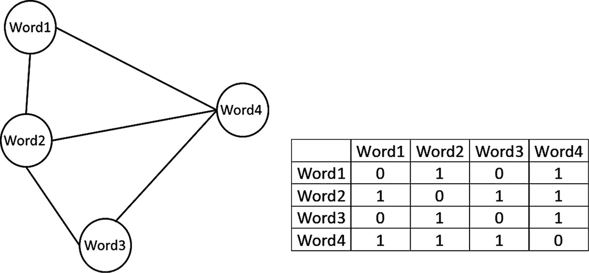

图 4.7：图模型的矩阵表示。

排名较高的词可以代表文本内容的抽象，即文本的概念摘要。另一种相关技术是识别每个词前后紧邻的名词，并使用这些名词构建图。

已知该技术能提供更好的文本语义表示。图 4.8 说明了分词文本和最高频名词图的示例。高排名词相邻的词带有下划线，以显示它们之间的关系。该示例说明提取的概念是关于本田、质量、问题、供应商和召回。

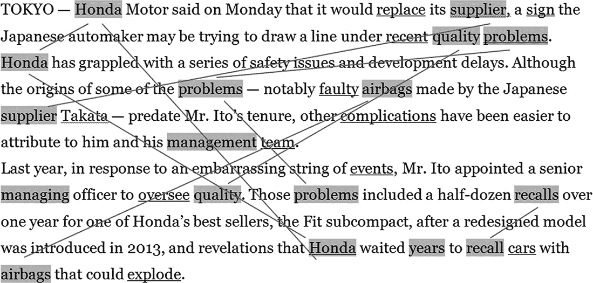

图 4.8：使用图技术进行文本分析的示例。

我们应该注意另外两个对文本挖掘和 NLP 分析很重要的工具：TextBlob 和 Pattern。TextBlob 是一个用于 NLP 处理的 Python 库。它包含一个简单的 API，用于 NLP 任务，如词性标注、名词短语提取、情感分析、分类、翻译等。

# Pattern：Python 网络挖掘模块

Pattern 是另一款工具，一个用于 Python 的网络挖掘模块。它拥有用于挖掘网站（如 Google、Twitter、维基、网络爬虫和 HTML DOM 解析器）、NLP（词性标注、n-gram 搜索、情感分析、WordNet）、网络分析、机器学习（聚类、支持向量机）和画布可视化的工具。

## NLP 工具的更多信息


NLP 工具的更多信息可在网上找到。部分在线资源包括：

*   斯坦福 NLP 小组：`nlp.stanford.edu`
*   卡内基梅隆大学语言技术研究所：<https://www.lti.cs.cmu.edu/work/category/2717>
*   伊利诺伊大学认知计算小组：<https://cogcomp.cs.illinois.edu/>

### 4.11 综合运用

为了增强对文本信息的理解，我们需要超越分词和词性标注。词性标注有助于我们识别每个单词在文档中的位置和角色。该词是动词、名词还是形容词？知道答案有助于理解正在发生的交流的主体、客体和类型。

解析文本、分词、词形还原，甚至准确分配词性（POS）标注，在自然语言处理中只能让我们走这么远。理解文本需要更多的上下文知识和情境认知。

超越词性标注，我们可以应用情感分析，并通过一些努力找出句子的极性。每个句子的极性可以是积极、消极、假设性、条件性或推测性的。结合本章讨论的技术，使我们更接近从文本中计算情感程度。

但是，什么构成了“理解”？你的 NLP 能否足以检测讽刺？你的 NLP 能否学习并适应新词？计算机科学语言学家和认知计算机科学家多年来一直在攻克这个难题。一些方法主张使用本体论、分类法和推理。推理可能很困难。构建领域专家组件是一种鲜为人知但有效的增强理解的方法。图 4.9 提供了一个 NLP 技术栈，可支持不断提升的 NLP 能力级别。

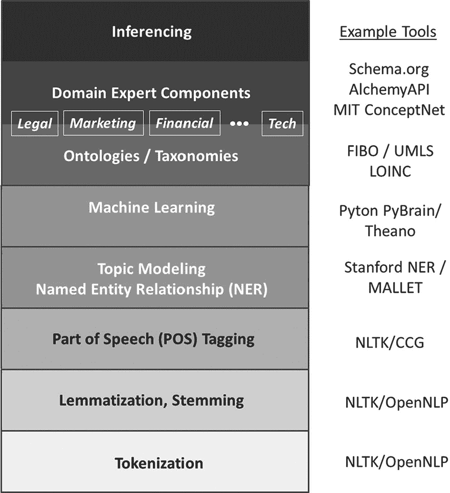

**图 4.9：用于增强语义理解的 NLP 技术栈。**

您可以购买与您希望理解的文本领域和范畴相关的本体论。例如，`FIBO`（金融行业业务本体论）提供了一组特定于金融行业的金融和业务关键词。另一方面，`UMLS`、`LOINC` 和 `ICD-10` 是提供医疗和药物解释及关键词的本体论。大多数组织最初通过购买或采用开源分类法起步，但会添加其特定的词汇表和规则，以定制分类法以满足其业务需求。

要构建领域专家，您需要将主题专家的知识捕获到一组描述实体、单词及其在不同可能情况和场景下解释的单词和概念中。领域专家提供上下文和情境认知以增强理解。

请注意，在领域专家层中，我包含了特定领域的库和规则集。这些库特定于您的知识领域。例如，您可能决定包含一组关于法律、市场营销、金融、技术、人力资源等方面的领域知识。如果您从事特定业务线，例如保险，则应开发针对保险业务的领域专家组件。

领域专家库可以通过选择定义其关系的关键词和规则来手动开发。例如，在保险行业，“定期寿险”和“终身寿险”这两个关键词是相关的，暗示文本可能关于寿险。例如，一条规则可能规定：“如果‘定期寿险’和‘年龄’在文档的前 50 个词中一起出现，则该文档关于寿险”，而不是关于汽车、家庭等其他类型的保险。

您当然可以使用机器学习创建领域知识并对该过程进行逆向工程。例如，您可以获取一些关于保险主题的文档、文章、新闻甚至维基百科页面，并自动提取关键词及其关系。

诸如 `IBM` 的 `AlchemyAPI` 和 `MIT` 的 `ConceptNet` 等解决方案是实验和构建领域专家组件的绝佳来源。另一个开源工具是 `Schema.org`。`Schema.org` 提供捕获特定领域概念的语义本体论。例如，关键词“taxi”（出租车）涉及 `Schema.org` 中定义的多个相关单词和条件。例如，“destination”（目的地）、“fare”（车费）、“payment type”（支付类型）和“pick-up location”（上车地点）等词在出租车的语境下具有特定含义。`Schema.org` 为此类关键词提供了语义定义库。

最后，机器学习可以成为您构建、调整和扩展本体论的盟友。考虑从金融行业来源（例如 `CNN/Money`）摄取语料库信息。您可以通过识别此类文本中频繁使用的关键词，然后将它们映射到维基百科页面的定义，开始构建您自己的本体论和领域专家。数据科学家用于增强理解的此类“行业秘密”技巧还有很多。

在本章结束时，重要的是要注意 NLP 仍然是一项充满挑战且劳动密集型的任务。大多数 NLP 技术仍在不断发展，但我们能够高准确度理解文本的那一天并不遥远。

## 第 5 章 定量分析——预测与预后

机器学习和深度学习是用于预测的最新技术。预测通常用概率或优势比来描述。我们预测事件发生的可能性，由于未来是不确定的，我们会提供关于预测的概率或置信度。

德尔斐的传说为预测提供了一个有趣的视角。在希腊神话和历史中，可追溯到公元前 300-500 年左右，德尔斐是一个特殊的地方。其神庙是女祭司（被称为神谕）聚集并预言未来的地方。神谕常进入恍惚状态（可能是吸入了该地区的火山气体后），开始胡言乱语地预言一个人的未来。

有一个传说，罗马皇帝问神谕是否应该对波斯人发动战争。神谕回答：“一位伟大的统治者将倒下。” 皇帝理解为波斯国王将被打败，于是发动进攻。但他的军队战败，他在战斗中被杀。类似的传说也讲述了关于尤利乌斯·凯撒遇刺的类似故事。

还有卡珊德拉的传说。人们认为她是一位拥有预言天赋的美丽女神。但人们认为她疯了。事实上，当她预言特洛伊人会藏在木马里进入城市时，特洛伊人嘲笑她。这与当今预测的现实相去不远。即使是最好的预测模型，也能产生如此深刻且看似令人难以置信的预测，以至于高管们无法接受。

### 预测的故事与框架

我将再讲一个关于预测的故事作为结尾。传说大约一千年前在波斯，住着一位擅长预测未来的天文学家。国王心生怀疑，决定考考他。于是下令手下搭建一个正方形建筑，四面各有一扇门，分别朝向东、西、南、北。他将天文学家置于建筑内，让他预测哪扇门会被打开让他出去。答对者赏赐大量黄金，答错者处死——这对我们的数据科学家来说是个相当严厉的惩罚。天文学家进行了一些计算，将预测写在纸上，封好交给了国王。

国王下令在建筑角落挖一个新洞。天文学家走出来面对命运。国王拆开封条，纸上写着：“陛下将为我开启第 5 扇门以离开此建筑。”

传说归传说，预测既是科学也是玄学。掌握数据建模技术是一回事，但知道如何训练模型并努力提高其准确性则是劳动密集型的，且需要对数据中的信号有很好的理解。

进行预测的一种方法是将机器学习应用于数据。预测很有价值。它们可以帮助我们为事件做准备，甚至防止事件发生。在医疗治疗中，预防对于改善结果、提高患者满意度、避免不必要的手术和费用非常重要。在零售业中，知道客户何时准备好购买提供了关键优势。掌握这一信息，零售商可以在正确的时间、正确的地点提供完美匹配客户需求的优惠、优惠券和交易，使交易极具吸引力。

在接下来的章节中，我将首先回顾概率和优势比方法，然后回顾前馈和反馈概念。最后，随着我们进一步介绍这些方法的更多技术定义，我将层层剖析深度学习和神经网络。

### 5.1 概率与优势比

在概率论中，当我们衡量事件发生的几率时，将发生次数除以事件发生的总机会数。例如，掷骰子得到 6 的概率是 1/6。两个事件同时发生的概率是乘积。因此，掷两个骰子得到双 6 的概率是 `(1/6)*(1/6) = 1/36`。

概率以分数表示；优势通常以比率表示，而非分数。概率描述你预期事件发生的时间比例；优势描述事件发生次数与不发生次数的比率。掷出 6 的优势是每 5 次掷出其他数字中出现 1 次。

优势范围从 `0:1`（从不发生）到 `1:0`（总是发生）。`1:1` 的优势是五五开，发生与不发生可能性相等，对应 50% 的概率。掷骰子的玩家看到 6 的优势是 1 比 5。换句话说，如果我赌 1 美元对你的 5 美元赌我会掷出 6，从长远来看赌注是均等的。逻辑回归的结果通常用优势比表示。

### 5.2 预测变量的加性交互

我们经常对预测标记和风险因子的交互感兴趣。例如，两个预测客户在线购买产品倾向的预测因子的联合效应。或者，我们可能想知道两个风险因子对特定疾病的联合效应在多大程度上不同于每个因子的独立效应（Kalilani, Atashili 2006）。

联合效应是指两个因子同时存在对结果的影响，独立效应是指在另一个因子不存在时每个因子的影响。就它们对结果发生率的因果效应而言，两个风险因子可能独立作用，也可能相互作用，从而增强（协同作用时）或减弱（拮抗作用时）彼此的效应。

### 5.3 预后与预测

本章提供了与分类和预测相关的三个关键思想。首先，它建立了预后和预测模型的控制系统处理方法。预后的控制系统开发结合了 `feed-forward`（前馈）和 `feedback`（反馈）控制机制，创建了一个预后框架。该框架引入了一个基于规则的预后引擎，该引擎使用人工神经网络（`ANN`）算法来预测特定结果。在我们的案例研究中，我们评估一个临床示例，以预测患者群体中谁会患上某种特定疾病。

其次，它证明了在该框架中使用 `ANN` 方法作为预测模型的可行性和可行性。案例研究探讨了构建、训练和验证四个 `ANN` 模型，以利用从患者住院期间获取的数据预测深静脉血栓/肺栓塞（`DVT/PE`）。

第三，它引入了模型集成的概念。模型集成（也称为模型委员会）可以提高对人员、业务或系统未来状况的预测准确性，数据来源于关于他们的大型数据集。该模型还提供了对该预测有贡献的所有数据的强度（或影响水平）。

该方法通过提出使用多算法预后框架来提高预测准确性，从而增强了深度学习。在案例研究中，我们使用了四个 `ANN` 模型，但你可以应用其他符合你研究目标的模型。在此框架中，我引入了一个监督程序；一个称为 `oracle`（神谕/仲裁者）的监督者。

这三个思想的目的都是为了提高我们从海量数据中做出预测性决策的能力，以便采取主动措施并应用干预手段来改善性能或防止负面事件。

### 5.4 预后、预测与准确性的框架

预后的目标是在短期到长期的时间范围内提供系统健康状态的预测。它是一门学科，旨在预测从当前时间起几秒到几小时或几个月内的未来状况。

有五个关键因素决定了使用分析模型作为预后工具的适用性、可行性和可行性。这些因素仿照 Smye 和 Clayton 在医学数学模型方面的工作，可以通过以下标准定义（Smye and Clayton 2002）：

*   **准确性**：预测的准确性
*   **适定性**：对输入数据微小扰动的稳定性和免疫性
*   **实用性**：在医疗工作流中的适用性、实用性和可用性
*   **适应性**：处理新证据的能力，即新数据值和数据类型
*   **经济性**：计算成本和预测的及时性

为了在真实案例研究中探讨上述关键因素，接下来的章节将比较使用四种不同类型分析算法的预后模型。每个模型的预测准确性将与先前回顾性患者病例的实际临床结果进行比较。

## 关于准确性的分析

关于准确性的分析包括诸如校准（预测概率与观察到的结果频率之间的一致性）、区分度（区分患病与未患病患者的能力）、敏感性（真阳性率，即被正确诊断为患病的患者比例）、特异性（真阴性率，即被正确诊断为阴性结果的健康患者比例）、似然比（LR，患病患者出现特定检测结果的可能性与未患病患者出现相同结果的可能性之比）以及受试者工作特征曲线（ROC，真阳性率与假阳性率的绘图，即敏感性与 1 减特异性的绘图）等测量指标 (CEBM 2012)。

模型效度（模型结果是否与现实相符）、准确性（结果与量的实际值的接近程度）和精确度（在不变条件下重复测量产生相同结果的程度）通过回顾性研究获得的既往数据结果，在四种分析模型中进行了比较。

实证现场验证和对前瞻性病例的影响分析是重要课题，但超出了本书的范围。如果您对现场验证感兴趣，应参考涉及这些主题的临床试验和荟萃分析相关文献。

### 5.5 预测分析的意义

随着数据量的增加，管理者发现越来越难以理解其数据，并在日常工作中做出及时决策。数据变化迅速，数据的海量性和多样性使得决策者难以在任何特定时刻正确应用所有适用的决策标准。开发一种能够学习并适应特定业务环境和情境的预后模型极为可取。

### 5.6 文献中的预后学

《美国传统词典》将 *prognostics* 定义为一个与预测或预知相关的形容词，以及一个表示疾病未来病程的征兆或症状、或某未来事件的征兆或预报的名词。希波克拉底在约 2400 年前确立了预后学的 21 条公理 (MIT 2010)。预后学的目标是预告（预测）系统未来的健康状况（或状态）。系统可以指代一个企业、一个市场、一个人群、一个项目或任何事物。

我提出了分析学历史中演变出的四种与预测相关的哲学流派。其中一种植根于控制理论。系统随时间的衰退可被视为该系统对其关键机制失去控制的结果。此处预测的目标是预测系统何时可能失效，以便我们防止灾难性故障或采取预防措施以防止故障。这种方法要求深入理解控制机制与系统之间的内在因果模型。该方法的一个例子包括利用控制理论的数学模型，这些模型采用微分方程来测量衰退。

第二种方法使用马尔可夫链。

第三种数学构造考虑了物理世界的异步特性，并使用仿真模型。例如，一项研究应用仿真和统计过程控制来估算经济变化的演进。另一项研究可能模拟公司内部的各个业务单元。仿真是旨在模仿真实物理世界的模型。

第四种方法将系统视为既非黑箱也非白箱，而是“灰箱”。由于无法获得或不确定每个系统属性及内部子系统交互的完美知识，人们只能依赖分析数据以进行预测的预测模型。

此类模型包括 `Cox` 风险模型和 `Kaplan-Meier` 估计提供的生存分析。生存分析一词源于生物医学研究中对死亡率的研究，即从疾病确诊到死亡的患者生存时间。首个生存分析由 `John Graunt` 开发 (Graunt 1662)，他首次基于出生-死亡率观察建立了生命表。

生存分析是一组统计技术，用于估计关注事件是否会发生以及发生的时间。生存分析在不同学科中有不同名称；工程研究者称其为失效时间分析；社会学家称其为事件史分析，而经济学家称其为转移分析。

在生存分析的参数模型中，`Cox` 风险函数是一种流行方法。另一种称为 `Kaplan-Meier` 估计器的方法，是一种用于非参数模型的统计工具，适用于研究对象系统的数学方程未知的情况。在出现这些模型之前，研究人员往往不得不求助于生命表法。

`Cox` 风险模型是一种偏似然方法，允许研究人员在无需指定基线风险函数的情况下，估计比例风险模型的回归系数。风险率是指如果相关事件尚未发生，则在下一个时间间隔内发生的概率，除以该间隔的长度 (Spruance, Reid, Grace, Samore 2004)。该方法被用于众多应用，包括借款人取消保险政策的概率或医疗手术后的生存概率。

在生物医学研究者中，`Kaplan-Meier` 估计器是生存分析的首选工具。也称为乘积极限估计器，该技术通过将任意时间点的生存视为由观察到的生存时间和删失时间定义的一系列步骤，来考察所有观测值的所有数据。某些模型使用泰勒级数展开。它常用于测量治疗后存活一定时期患者的比例。`Kaplan-Meier` 的一个优势在于其处理删失数据的能力。删失情况是指患者退出研究或数据的特定开始时间不可用的情况。`Kaplan-Meier` 对数据独立性和均一性做出了一些假设，如果这些假设被违反，可能导致数据产生偏差且不可靠 (Tsai, Pollock, Brownie 1999)。

其他研究者采用了病例基础推理 (`CBR`) 方法进行医疗状况诊断。`CBR` 是一种通过回忆先前的类似情境并重用该情境的信息和知识来解决新问题的方法 (Aamodt, Plaza 1994)。由于这种方法假设相似问题具有相似解决方案，因此被认为是一种适合实际医疗领域的方法，该领域专注于真实病例而非知识规则来解决问题 (Park, Kim, Chun 2006)。

诚然，开发能够做出准确预测的数学模型（特别是在生物学和医学领域）颇具挑战性，但研究者认为，此类数学模型很快将成为实验室实验（甚至临床试验）的有益补充，“体外”模型的提供将成为常规。

存在一些情形：收集的数据不足以进行概括，证据并非万无一失或结论不明，且收集的数据需要快速处理和判断。

适合分析的数学模型的特性包括：准确性、预测性、经济性、适定性和实用性（Smye 和 Clayton，2002）。在先前研究中使用的构造中，可以找到几种不同的数学模型，例如：多元回归分析、马尔可夫链、随机过程、贝叶斯网络、模糊逻辑、控制理论、离散事件仿真、动态规划和神经网络。

虽然控制理论已广泛应用于系统及其他工程学科，但正如下一节所述，它尚未广泛应用于预测学。

### 5.7 基于控制理论的预测学方法

系统可以广义地定义为实现既定目标的一组集成要素（INCOSE 2000）。世界上任何物理实体都可视为一个系统，其功能表现为一组相互关联的系统的集合。本书中的系统理论方法涵盖了前馈和反馈机制，以提供一个更丰富的预测学框架。

预测学处理对系统某些期望质量或特性的预测（Kapur 2010）。它基于对底层系统退化科学的理解。传统的系统控制理论主要基于反馈：利用来自系统的反馈信息（也称为反馈信号），可以诊断系统的性能，然后进行调整以修复问题。显然，这带来了一个问题。在接收到反馈后纠正问题，对于某些任务关键型系统而言可能为时已晚，特别是在考虑人体生理学时。

相反，以预测学方法为例的前馈模型会更受青睐。预测学方法论基于两大原则：1）它使用前馈模型进行预测，或通过分析前馈信号来预测问题的根本原因；2）它建议改变系统的输入信号，以防止问题发生。

预测与健康管理（`PHM`）是一门工程学科，它将故障机理研究与系统全生命周期管理联系起来（Serdar、Goebel 和 Lucas 2008）。`PHM` 的其他定义将其描述为一种方法，允许在实际应用条件下评估系统的可靠性，以确定故障的来临，并降低系统风险（Pecht 2008）。

在系统控制理论的背景下，“诊断”涉及故障或失效的检测与隔离。“预测”是基于当前和历史条件预测未来状态（可靠性状态）的过程（Vichare 和 Pecht 2006）。

预测学是通过估算给定系统的剩余使用寿命、故障概率或故障时间，来预测系统未来功能的科学。有许多表示预测系统的方法和建模框架。无论我们分析的是业务系统的故障点、航空发动机还是人体生理学，这都至关重要。

在众多预测方法中，计算系统的剩余使用寿命（`RUL`）很常见。`RUL` 可通过从系统收集的历史和运行数据进行估算。确定系统退化和预测 `RUL` 会使用各种方法。

另一种方法是估算故障概率（`POF`）。`POF` 是系统或组件的故障概率分布。此外，研究故障时间（`TTF`）也很常见，即组件预计发生故障的时间。`TTF` 定义了系统不再满足其设计规范的时间点。


# 预测学与可靠性

预测学与可靠性相互关联。可靠性被定义为：产品在规定条件下运行时，在其预期寿命内满意地执行其预期功能的概率（Kapur 2010）。由此技术描述可推导出临床定义。在医学意义上，可靠性是指患者在护理提供者的医疗护理期间，不发生特定医疗并发症的概率。可靠性通过若干指标来衡量，如平均故障间隔时间（MTBF）、故障率和寿命百分位数。每种测量均可通过从经验和统计分布函数导出的相应方程计算得出。关于可靠性的更多论述，请参阅 Kapur 和 Lamberson 的文献（Kapur, Lamberson 1977）。

## 预测模型分类

预测模型可分为三大类（Eklund 2009; Hines 2009; Peysson 等 2009）。

### I 型：基于可靠性

它应用传统的故障时间分析，通过跟踪故障总体并使用统计方法来估算可靠性。此类预测中使用的一些典型寿命分布包括 Weibull 分布、指数分布和正态分布。I 型预测方法不包含对运行条件或环境条件的实时监测。

### II 型：基于应力源

也称为基于应力源的方法，考虑运行和环境条件数据。II 型考虑系统在其运行环境中的故障，以提供组件的平均剩余寿命。部分环境数据可能包括温度、振动、湿度和负载。比例风险模型是 II 型预测模型的一个例子。了解原因后，即可预测系统的可靠性。该方法中最简单的模型是回归模型：给定运行和环境条件，可通过回归方程预测系统故障和剩余使用寿命。

### III 型：基于状态

即它们表征系统在其特定环境中运行时的寿命。它们估算特定组件或整个系统的剩余寿命。III 型预测中使用的方法包括一般路径模型（GPM）。

累积损伤模型跟踪系统或组件中不可逆的损伤累积。统计累积损伤模型考虑可能的损伤状态数量和转移矩阵（用于表示多状态马尔可夫链），以提供多循环载荷下的损伤预测。

预测学的目标是提供持续预测。我将描述一个案例研究，该研究使用人工神经网络和其他算法，在固定时间间隔持续预测患者的健康状况。

## 5.8 人工神经网络

神经网络已成功用于预测未来事件的发生。例如预测各类癌症复发、心脏疾病等疾病，并协助医生进行预后判断和决策支持。这些研究为患者健康状况提供了长期预测，通常预测未来几个月到几年内的无病生存或疾病复发情况。

# 医学预测中的人工神经网络

人工神经网络（ANNs）是通过互连人工神经元实现的并行计算方法。它们非常适合解决伴随大量且多样化输入变量的非线性问题。ANNs 能适应特定问题，并可被训练用于模式匹配或分类。ANN 模型可通过将一种疾病映射到一组已知的输入临床测量值来进行训练，随后应用于新患者。训练好的模型能将患者的输入测量值与疾病的存在或不存在相匹配。该模型甚至能将患者的临床测量值分类为疾病的各个阶段。

自 1980 年代初以来，人工神经网络已成功应用于商业、工程和医学领域的多个预测问题 (Delen 2009)。最流行的模型之一是带有反向传播的多层感知机（MLP），本质上是一种监督学习算法。研究表明，使用 MLP 算法的 ANN 模型能够以任意精确的水平学习任意复杂的非线性函数 (Hornik, Stinchcombe, White 1989)。MLP 本质上是通过加权链接在前馈多层结构中连接在一起的非线性神经元集合。

在高精度模型中，已提出了 `支持向量机` (SVMs) (Delen 2009)。SVM 算法不被视为人工神经网络模型，但因其求解能力被纳入集成模型中。最新的算法使用 Levenberg 和 Marquardt 提出的 Levenberg-Marquardt 方法，这些方法不仅精度高，而且作为 ANN 模型计算速度快 (Wilamowski and Chen 1999)。支持向量机不被视为神经网络，但它们可以在神经网络模型中用作求解器方法。

医学研究表明，某些危及生命的状况在生理数据中表现出早期指标。一项关于改善新生儿重症监护室 (NICU) 的研究 (Blount 2010) 对多流临床和生理数据进行了解读，以检测新生儿患者医疗并发症发生前具有医学意义的状况。

在另一项研究中 (Webber 1994)，一个神经网络模型在 EEG 数据上进行了训练。输入包含 49 通道实时 EEG 数据，用于检测癫痫尖波。研究表明，ANNs 为利用廉价计算机实现实时癫痫样放电的自动检测提供了实用解决方案。

研究表明，ANNs 是心肌梗死临床诊断的宝贵工具 (Baxt 1991)。一项研究中使用的模型在 351 名因高度疑似心肌梗死入院的患者数据上进行训练。随后在 331 名因前胸痛前往急诊科 (ED) 的连续就诊患者身上进行前瞻性测试。该网络区分急性心肌梗死患者与非患者的敏感度略高于医生对这些患者的诊断。

在另一项针对重症监护室 (ICU) 患者的研究中，ANN 模型被证明比 Logistic 回归模型在预测护理结果方面更有效 (Dybowski et al. 1996)。ANN 模型应用于 258 例全身炎症反应综合征和血流动力学休克的临床环境中。评估的结局是该次住院期间的死亡率。表现最佳的 ANN 模型在 7 次训练迭代后完成训练。

在癌症治疗病例中，ANNs 已成为预测预后的流行工具 (Dayhoff and DeLeo 2001)。在一家机构 (Bottaci et al. 1997)，开发了六种不同的 ANN 模型，用于预测被诊断为结直肠癌的个体患者在 9、12、15、18、21 和 24 个月内的死亡预后。结果显示，ANNs 能比当时可用的临床病理方法更准确地检测预后。

另一项针对乳腺癌患者的研究项目 (Ravdin and Clark 1992) 表明，ANNs 可被训练以识别复发疾病和死亡的高风险与低风险患者。此外，他们的研究显示，通过将时间编码为预后变量之一，ANN 可用于随时间预测患者预后。特别是 ANN 模型可在不同随访时间点对复发概率进行一系列预测，使临床医生能为个体患者绘制生存概率曲线。

在另一项研究中，一组患者的乳腺 X 线摄影检查分别由放射科医生和 ANN 模型进行解读 (Floyd et al. 1994)。该模型在检测乳腺癌患者方面比放射科医生更准确。一项关于神经网络在癌症决策支持中应用的更全面综述发现了 396 项研究，总体发现 ANNs 在癌症领域比传统方法增加了更好的诊断准确性 (Lisboa and Taktak 2006)。

多项研究已将 ANNs 的准确性与 Logistic 回归模型进行比较，但经过荟萃分析后结论不一。一些文献 (Delen 2009) 显示 ANNs 准确得多，但也有少数文献发现两种方法在医学预测中相当 (Adams, Wert 2005)。下一章将回顾用作选择最合适模型标准的验证和生存能力测量。

# 第 6 章 高级分析与预测建模

## 6.1 预测方法与预后学的历史

绝大多数数学模型已被用于预测。但利用预后学进行预测的模型尚未得到充分探索。在涉及预测分析的研究中，许多都要求并假设数据的类型和分布。例如，许多研究假设其数据集符合正态分布。大多数依赖单一模型进行预测。鲜有关注利用预后方法在这些大型数据集上开发预测框架。在本章中，我将介绍多种预测分析技术，在第 7 章中，我将介绍一种探索多模型预测方法的预测建模框架。

传统上，最常用的两种数据挖掘技术是线性判别分析 (LDA) 和 Logistic 回归，用于构建分类模型。数据分析研究表明，通常神经网络和深度学习模型。

机器学习中的一个新主题称为深度学习，它依赖于神经网络模型。从 1970 年代至今的文献调查来看，文献中一些最成功的预测方法是使用神经网络和模糊集的无模型方法 (Kodell et al. 2009 和 Arthi and Tamilarasi 2008)。

另一方面，Logistic 回归是线性回归模型的一种特殊形式，允许非数值输入变量（即允许分类数据）。它通过将数据拟合到 Logit 函数（或自然对数函数）Logistic 曲线，用于事件发生概率的分类或预测。

## 逻辑回归（LR）

逻辑回归（LR）是线性回归的推广。它被用作预测二元或多类因变量的手段。由于响应变量是离散的，因此不能直接用线性回归建模。相反，逻辑回归不是预测事件本身的点估计，而是建立模型来预测其发生的几率。在预测事件的发生或不发生时，这基本上是一个二分类问题：如果几率大于 50%，则意味着该案例被分配为指定为 1 的类，否则为 0。

逻辑回归假设响应变量（几率的对数）在预测变量的系数中是线性的。此外，LR 模型不会选择最佳输入，建模者必须选择正确的输入并指定它们与响应变量的关系（Delen 2009）。这些都是逻辑回归的局限性。为了克服这些局限性，数据科学家应用非线性逻辑回归模型。选择正确的输入变量也是实现逻辑回归模型准确性的关键。一种称为特征选择的技术被用来选择正确的变量。可以通过多次运行回归模型来进行特征选择，每次使用单个变量并观察误差项。呈现最低误差项的变量即为选定的特征或显著变量，可用于构建最终的回归模型。

## 分类树

分类树（也称为决策树）也用于预测。当无法满足关于数据分布的假设时，数据科学家通常倾向于使用分类树而不是传统的统计工具。例如，许多传统统计方法假设数据呈正态分布，而在现实世界中这并不总是可能的。

它们形成具有树状结构分支的数据分层模型，从而得出特定的诊断。这些方法的陷阱被证明与其线性方法以及形成树分类的初始数据选择相关的错误有关。

历史上，大多数预测方法依赖于单一模型进行预测和/或线性方法进行预测。虽然文献中报道了使用 ANN 的预测模型，但此类模型提供跨越未来数年的长期预测，并不关注短期预测。

先前的研究主要将模型验证局限于少数标准，例如 `sensitivity`（灵敏度）、`specificity`（特异性）和 `ROC` 计算。

在构建模型之前，考虑模型的验证和可行性非常重要。换句话说，我们将如何测试模型的准确性，以及如何验证其结果？下一节将介绍一些挑战、陷阱以及克服它们的技术。

## 6.2 模型可行性与验证方法

模型验证和确认是为模型结果提供置信度和可信度的重要步骤。验证（确保模型按预期执行）和确认（确保模型代表并正确再现现实世界系统的行为）是用于实际应用的模型开发的基本要素（Macal 2005）。模型验证处理的是正确地构建模型。模型确认处理的是构建正确的模型。

验证的目标是确保模型解决了正确的问题，并提供了关于被建模系统的准确信息。对建模有效性的危险之一是将模型“过拟合”到给定数据集，即模型被拟合到特定数据集。当模型的重要元素反映数据中的随机性而非潜在的模型驱动因素时，就会发生过拟合。为了克服这一局限性，研究人员采用了交叉验证等技术，或保留一部分“留出”随机数据样本在单独的数据集上进行测试。此外，研究人员还考虑了使用先验数据作为预期结果的模型准确性度量。

必须遵循的有效性有三个方面：

1.  **校准** – 观察概率与预测概率之间的一致性
2.  **区分度** – 模型区分不同结果的能力
3.  **实用性** – 模型改进决策过程的能力

验证分为两类：内部验证和外部验证。内部验证使用交叉验证和自助法等技术来评估同一人群样本中的性能。外部验证是在来自不同人群的样本（如其他地点的患者）中测量预测模型性能的过程。

通过交叉验证技术，模型使用随机选择的部分数据样本开发，并在其余样本上进行测试，然后重复该过程多次并计算平均值作为性能估计。通过自助法技术，随机有放回地选择与开发样本大小相同的样本，然后使用自助样本开发模型，并在未包含在自助样本中的样本上进行测试。

衡量临床实用性的测试包括准确率、灵敏度、特异性和加权错误分类的减少，即假阴性和假阳性的数量。衡量区分度的测试包括受试者工作特征（ROC）曲线，即模型 `sensitivity`（灵敏度）与 `(1–specificity)`（1-特异性）的图示。最后，衡量校准的测试包括校准图以及观察频率与预测概率之间的平均绝对差异。这些度量在后续章节描述的框架中被定义并采用。

外部验证需要真实世界的测试，如 A/B 测试、临床试验和特定的实验设计，这些超出了本书的范围。A/B 测试衡量两组之间预测或决策的实际结果：接收决策的 A 组和作为对照组的 B 组。

## 6.3 分类方法

统计方法包括识别趋势、测量期望值、识别异常值和变异性的算法。通常，回归线为确定最适合散点图中多个数据点的直线提供了基础。给定回归线，识别异常值的技术之一是在回归线上下定义一个可接受范围，形成一个可接受带。这些上下线定义了修剪点。落在该带之外（修剪点之外）的所有数据点均视为异常值。

## 6.4 传统分析方法与高级分析方法

传统分析方法从根本上说是假设驱动的。研究人员设计一个零假设，并使用统计方法致力于证明零假设可以被拒绝。该假设是基于数据元素之间交互和因果关系的线索而设计的。零假设是一个笼统的陈述，即两个数据变量之间没有关系（这两个现象是独立的）。

假设检验的目标是以低错误率在统计学上拒绝零假设。错误率由 alpha 表示，一个强有力的测试表明，该假设可以以 95% 的置信度被拒绝，只有 5% 的可能性因错误而导致数据无法拒绝该假设。错误率应尽可能小，通常首选低于 5%（`α < 0.05`）。

### 新数据分析方法

新数据分析方法不对数据关系做任何先验假设。它们将数据视为模型本身。正如一位数据科学家所言：“数据即模型。”在新数据分析方法中，模型会不断演进，而非静态不变。随着新数据的可用，模型会随之自适应调整。数据分析方法旨在挖掘数据元素中的隐藏模式或关系。当数据元素不高度相关时，这些方法效果最佳。它们将离群值视为数据分析的重要组成部分。它们发现的模式指向新的洞见，这些洞见有可能成为新假设的基础。总的来说，数据分析方法帮助我们提出那些我们未曾意识到的问题。

## 6.5 传统分析概述：定量方法

传统分析方法常见于研究论文和出版物中。这些方法包括：

*   **时间序列**：随时间观察单个变量。可使用折线图展示趋势。
*   **排序**：按升序或降序对数据排序。通过排序创建数据细分（低/中/高）。
*   **比率**：比率可展示两个变量间的关系（如投资回报率 `ROI`），或部分对整体的比率（如人口的四分之一：`25%`）。可使用饼图或柱状图展示结果。
*   **差异**：将数据与参考点对比，如实际支出与预算支出的对比。柱状图可展示两值间的差异。
*   **频率分布**：以变量在特定数值被观测到的频次，展示该变量的观测次数。例如：`$1000` 以下的存款、`$1000` 至 `$50,000` 之间的存款、以及 `$50,000` 以上的存款。可使用柱状图或直方图展示此类数据。
*   **相关性**：展示两个变量随数值增减的对比关系。若绘制收入与客户数，会得到正相关。客户越多，收入越高。反之为负相关。若绘制供给与价格曲线，存在负相关：供给增加，价格下降。
*   **名义比较**：分析数据名义（或分类）细分下的变量数值。例如：按月份划分的销量。此类分析使用柱状图。
*   **地理空间**：在地图上对比两个或更多变量。例如：按地区或城市划分的销量。使用统计地图展示结果。

本章从最简单、最易用的方法（如回归分析）入手，开启对预测性方法的回顾，并逐步过渡到更复杂的技术。

## 6.6 回归分析概述

回归通常用因变量 `Y`、一组或多个自变量 `X` 及其系数来表示。简式方程表达为：

```
Y = b + wX
```

其中 `Y` 为因变量，`b` 称为截距，`w` 代表系数。我们可在二维平面将此方程绘制为一条直线，`b` 为常数项，`w` 代表斜率。稍后我们将看到，该回归方程是用于数据聚类和数据分类方法的简化形式。

设想一个需要进行房产估值（住宅评估）的场景。房价基于某区域已售房价（因变量）及各房屋特征（自变量）计算，如房屋面积、卧室数、浴室数、车库及房龄。面积越大、卧室和浴室数越多，价格越可能走高。假设该区域房龄越久价格越低。该场景下方程可能呈现如下系数结构：

```
P = 0.3s + 0.45b − 0.1a
```

其中 `P` 为价格，`s` 为房屋面积（平方英尺），`b` 为卧室数，`a` 为房龄。

注意，方程中的回归系数代表各自变量对因变量预测的独立贡献。即在控制所有其他自变量后，变量 `X` 与变量 `Y` 相关。此类相关称为**偏相关**。当移除所有可能对因变量产生混淆影响的控制变量效应时，即可获得两变量间的偏相关。

要理解变量间相关性，可观察回归系数的符号（正或负）。系数为正，表明该变量与因变量呈正相关（如：教育水平越高，薪资越高）。系数为负，表明呈负相关（如：班级规模越小，考试分数越高）。

在房屋估值场景中，房屋面积、卧室数、浴室数与价格正相关，但房龄与价格负相关。回归方程中各自变量的符号指示相关方向。我们不应据此推断系数的强弱或相对重要性。例如，不能假设房产面积在计算房价时比房龄重要 3 倍，因为这些变量的量级可能差异巨大。

回归结果是最优估计，但实际值会有差异，因为模型未纳入其他变量。回归方程结果与实际观测值的差异称为**残差值**。残差值是某数据点偏离回归线（其预测值）的程度。

误差度量称为 `R squared`，即**决定系数**。`R squared = 1 - 残差变异性比率`。`R-squared` 取值范围 `0~1`。回归模型拟合不佳（`X` 与 `Y` 无关系）时，`R-squared` 为 `0`。`Y` 与 `X` 完美相关时，回归点与实际值间无残差方差，`R-squared` 为 `1`。因此，`R-squared` 越高越理想。

例如 `R-squared = 0.60`，意味着解释了 `60%` 的原始变异性，仅 `(1–0.60)` 即 `40%` 归因于残差方差。换言之，`R-squared` 指示模型对数据的拟合优度。

在回归方程语境下，可将自变量（`X` 变量）视为预测变量。预测变量（`X` 变量）与因变量（`Y`）的相关程度，由相关系数 `R` 体现，`R` 为 `R-squared` 的平方根。

多元回归最大的假设之一是**线性**。必须提前检查数据以确保其线性。通常数据散点图能揭示非线性。其他检验技术包括非线性模型、一般逐步回归、探索性数据分析及数据挖掘技术，后续章节将介绍。

另一假设是**正态分布**。回归模型假设数据服从正态分布。应使用统计检验或散点图直观检查数据分布是否正态。

另一值得注意的是：回归虽解释变量间关系，但不应用于解释因果。两变量相关不代表因果。因果分析更复杂、更难证明。后续章节的因果分析将探讨此主题。

人们很容易冲动行事，在多元回归中纳入过多变量（预测变量），仅仅因为这样做很容易。然而，你必须拥有合理数量的数据点（观测值）来构建一个合理的回归模型。如果选择了过多的预测变量，模型就会变得不稳定，并且如果你重新进行研究，不太可能复现。行业中的经验法则和数据科学家的通用做法是，观测值的数量应该是预测变量数量的 10–20 倍。

## 6.7 Cox 风险模型


Cox 风险模型有许多应用，范围从保险预测（如保单变更）到医疗保健领域的患者病情预测。它使用 Cox 回归方程。该模型定义了研究对象的生存情况（例如在医疗保健中指患者，在保险中指保单持有人）与若干解释变量之间的关系。生存分析，正如我们之前提到的，关注的是研究进入研究到后续事件（如死亡）发生之间的时间。

在调整其他解释变量后，Cox 模型提供了治疗效果对生存影响的估计。此外，它允许我们在给定预后变量的情况下，估计个体的风险（或死亡风险）。

Cox 回归模型本质上是一个回归方程，如下所示：

```
y = b + w[1]x[1] + w[2]x[2] + ... + w[k]x[k]
```

解释变量的正回归系数意味着风险更高，因此预后更差。相反，负回归系数意味着该变量数值较高的患者预后较好。

另一种重要且常用的分析方法是相关性分析。

## 6.8 相关性分析

相关性分析的目的是寻找变量之间的关系。最常用的相关系数是 `Pearson r`，一种简单的线性相关方法，也称为线性相关或积差相关。它决定了两个变量成比例的程度。成比例意味着两个变量具有线性关系，这种关系可以用一条线来表示，称为回归线。我们已经了解了回归线的样子，也知道如何计算它。相关系数（`r`）代表两个变量之间关系的度量。当相关系数平方（`r²`）时，它将代表两个变量共同变异的比例，即关系的强度或大小。

另一个重要的度量是*相关性的显著性*。相关性的显著性决定了相关性的可靠性。当样本量较大时，我们可以预期相关性的可靠性会增加。显著性检验基于这样一个假设：残差值遵循正态分布，并且残差值的变异性对于自变量 `x` 的所有值都是相同的。

研究人员使用一个经验法则：如果你的样本量是 50 或更多，那么偏差就不是一个大问题。对于超过 100 的样本量，特别是正态性假设在内的假设不应成为问题。

让我们再次回顾这些主题：

*   相关性是两个或多个变量之间关系的度量。
    *   相关系数范围从 −1.00 到 +1.00（完全负相关和完全正相关）
    *   最常用的相关性度量：`Pearson r`
    *   相关性是显示为回归线的线性关系（参见 图 6.1）
*   `R 平方 (r²)` 是两个变量共同变异的比例
*   相关性的显著性表明相关性的可靠性
    *   显著性检验假设残差值呈正态分布
    *   50 或更大的样本量可减少偏差顾虑

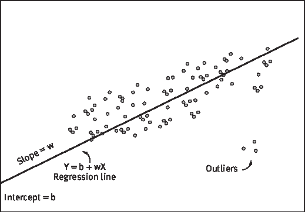

**图 6.1: 二维回归方程的图形表示。**

异常值是非典型的、不频繁的观测值。异常值会显著扭曲回归线的斜率，从而影响系数的值。在不考虑异常值的情况下盲目运行相关性分析是不应该的。由于回归线是通过最小化数据点到线的距离平方和（而不仅仅是简单距离之和）来确定的，异常值对回归线斜率有巨大影响。一个异常值可以改变系数使其变高，或在一项研究中显示出更高的相关性，而如果没有该异常值，相关性的值将接近于零。

散点图是发现异常值的好方法。研究人员通常通过移除距离均值超过 ±2 个标准差的数据来排除异常值。在许多情况下，异常值检测是发现数据新洞察的重要途径。异常值可能预示着异常或黑天鹅事件。

黑天鹅事件基于这样一种哲学：只见过白天鹅的大多数人相信天鹅永远是白色的。在南半球，观察者发现了一只黑天鹅，这从根本上改变了观察者的信念。作为极端异常值的罕见事件被称为黑天鹅事件。

异常值会显著扭曲回归线的斜率和系数。异常值可能导致高相关性，而实际上相关性本应接近于零。但是，散点图是发现异常值的好方法。

作为研究人员，我们希望消除或减少偏差。有 12 种类型的偏差需要警惕。一个常见的偏差来源是数据缺乏同质性，这可能导致偏差。例如：研究人员在不同时间或地理位置进行两项研究，并合并两项研究的数据。

相关性假设数据的同质性。研究人员可能从两个独立的人群群体、两个不同的地理区域甚至不同时间段收集数据。如图所示，数据“组”不应合并。散点图显示了观测值如何聚集成独立的“云团”。合并数据导致了一条虚假或有偏的回归线，显示出很高的正相关。但这只是由于这两个数据集的定位方式造成的。图 6.2 说明了数据非同质性对相关性的影响。

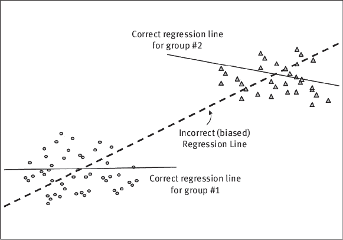

**图 6.2: 非同质性对相关性的影响。**

当你为每个数据集分别计算回归线时，你可能会发现令人惊讶的不同结果，如该散点图所示。第 1 组的相关性接近于零，而第 2 组呈负相关。处理同质数据对于实现正确的相关性分析非常重要。

## 6.9 非线性相关性

我们在自然界中研究的许多相互作用都是非线性的。几乎在每个行业和学科中，如生物学、经济学、零售、交通、金融，特别是医学，我们经常发现数据之间存在非线性关系。正如我们之前回顾的，`Pearson's r` 假设数据具有线性，并测量数据值之间的线性相关性。但是，如果我们的数据是非线性的怎么办？散点图是直观检测非线性的好方法。一个例子如 图 6.3 所示。

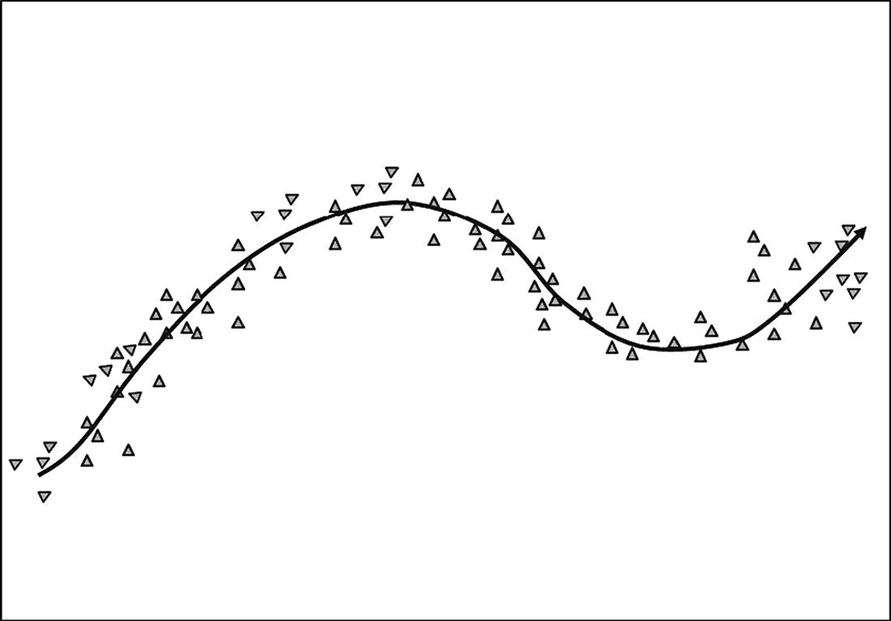

**图 6.3: 非线性数据集的散点图。**

如果数据是单调的，我们可以应用非参数相关方法，例如 `Spearman R`，这是一种对值的顺序排列敏感的技术。另一种方法是使用“拟合优度”函数，例如样条函数。另一种技术是将数据分成 3 个或更多等宽区段，将分段视为新的分组变量，并对数据运行方差分析。我们将在后续章节介绍方差分析。

## 6.10 Kaplan-Meier 生存函数估计

Kaplan-Meier 方法用于确定研究对象人群的生存率。它测量超出研究持续时间的生存率。它计算存活至研究结束的人员比例。在保险研究中，该方法可预测保持忠诚的客户数量，或将提出索赔的人数。这是一种时间序列分析形式，即在特定间隔观察数据。在医疗保健领域，Kaplan-Meier 方法常用于预测治疗对患者生存率的影响。考虑一个为研究选取 10 名患者的例子。该方法测量死亡人数和删失患者数。

当受试者退出研究时，我们称之为删失受试者，并将患者人数减一。通常，我们将任何给定时间的生存率测量为：进入研究的存活患者数减去死亡患者数，再除以研究开始时存活的患者数。

`S = (进入研究的存活受试者数 – 死亡受试者数) / 进入研究的存活受试者数`

退出研究的受试者被视为删失，不计入分母。给定时间区间的总生存率是通过将该时间区间之前所有时间区间的生存概率相乘来计算的。图 6.4 展示了 Kaplan-Meier 计算的一个示例。

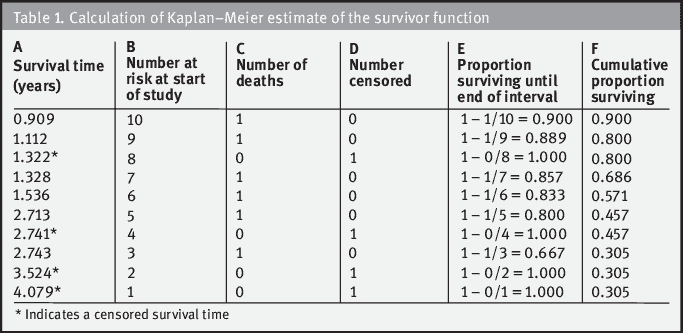

图 6.4：10 名受试者的 Kaplan-Meier 估计。

然后每行的计算遵循以下步骤：

*   第 1 年，观察到 1 例死亡，无患者删失。因此存活比例从 1.00（或 100%）变为 (1–1/10) = 0.900。我们用相同的数值作为研究第 1 年的累积存活比例。
*   第 2 年，注意又有 1 名患者死亡。该区间结束时的存活比例为 (1–1/9) = 0.889。接着将 0.889 乘以 0.900 得到 0.800。这是新的累积存活比例。
*   第 3 年，无死亡病例，但有 1 例删失患者。存活比例为 (1-0/8) = 1.000。接着将 1.000 乘以 0.800 得到 0.800。这是第 3 年的新累积存活比例。
*   第 4 年，有 1 例患者死亡，因此存活比例为 (1-1/7) = 0.857。接着将 0.857 乘以 0.800 得到 0.686。这是第 4 年的累积存活比例。
*   我们继续进行此计算，直到第 10 年，此时累积存活比例变为 0.305，即进入研究的患者中预期有 30.5% 能存活过这 10 年研究期。

## 6.11 处理脏数据、噪声数据和缺失数据

缺失数据会给数据科学家带来两个问题。由于某些变量缺少数据，它可能引入偏差；同时由于样本量减少，也会导致精度损失。处理缺失数据的传统方法是最后观察值前移法。`LOCF` 方法常用于随机对照试验研究中存在缺失数据的情况。它通过使用最后观察到的数据来填补缺失值。这称为 `LOCF` 插补法。插补是用某个值替代缺失数据的做法。当数据是纵向数据时，使用 `LOCF` 插补法。此方法要求了解数据结构、数据记录顺序以及数据记录时间。图 6.5 展示了一个 `LOCF` 插补示例。最后观察到的值（如第一行的 2.0、第三行的 3.5）被前移。

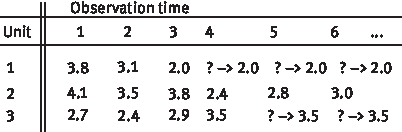

图 6.5：LOCF 方法示意图。

虽然 `LOCF` 方法非常易于应用于完整的纵向数据分析，但它也有缺点。例如，它可能扭曲均值和协方差结构。美国国家科学院顾问委员会推荐那些能提供有效 I 类错误率的插补方法。我们将在后续章节更详细地介绍这一建议。

插补缺失数据的其他一些选项包括：

*   假设所有缺失数据均为不良结局（这有其缺点，但假设了最坏情况）
*   通过均值或中位数插补缺失值（缺点：削弱协方差和相关性估计）
*   利用回归方程预测缺失值进行插补（缺点：高估模型拟合度和相关性估计，削弱方差）
*   创建虚拟变量：为缺失值创建指示变量（1=缺失观测值；0=观测值）；插补缺失值（按均值或回归）；然后在回归模型中包含缺失指示变量（缺点：可能产生有偏结果）
*   使用统计模型插补，如最大似然估计和多重插补（将在下一节解释）。在第 3 章中，我们读到一个利用 `K-means` 聚类技术插补缺失数据的案例。`K-means` 方法通过考虑缺失值与数据集中其他数据元素的关系来插补缺失值。
*   `Bootstrap` 方法：使用能提供有效 I 类错误率的方法，如 `Bootstrap` 方法和广义估计方程 (`GEE`)。`Bootstrap` 方法使用有放回的随机重抽样，并允许分配偏差、方差或 I 类错误的精度度量
*   最大似然估计 (`MLE`)：`MLE` 确定能产生最高对数似然的一组参数值，换句话说，即最有可能导致观测数据的值。SAS 中有一种称为 `PROCMI` 的方法可运行 `MLE` 并产出该值。
*   多重插补法 (`MIM`)：缺失数据由来自多个回归模型的重复插补值填补。它能产生具有更准确变异性的更好插补值。在 SAS 和 STATA 中有 `ICE`（链式方程插补）和 `MIM`（多重插补模型）等模型

    最大似然估计背后的基本思想是估计一个最有可能成为缺失值正确替代值的值。假设你有一组变量 `x1, …, xn`，且该组中缺少一个值。你对数据的分布做出假设，如正态分布、伯努利分布、二项分布或其他类型分布。给定分布类型，你可以测量数据集的均值和标准差。利用均值和标准差，你可以定义一个估计函数并估计缺失值。

    多重插补法使用多元回归来估计缺失值。多元回归利用回归方程中的现有已知值来估计缺失变量的值。该术语由 Pearson 于 1908 年提出。请参阅回归相关内容。

## 6.12 数据清洗技术

# 数据清洗概述

尽管研究人员竭尽全力提供有效的研究结果，但错误和失误仍难免发生。*良好临床实践* 方法已建立起来，旨在将研究方法和数据处理中的错误降至最低。良好临床实践指南的最新重点关注文档记录、数据清洗和数据处理方法的标准。此外，临床数据管理学会也制定了临床试验最低可接受数据质量水平的指南。数据清洗传统上被视为一种可疑活动，近乎数据操纵。

近年来，人们更加强调数据清洗方法，以将其与数据操纵区分开来。统计学会建议将数据清洗的描述作为报告统计方法的标准组成部分。研究人员 Jan Van den Broeck 等人提出了一个三阶段数据清洗流程，“涉及对可疑数据异常进行反复的筛选、诊断和编辑循环。”（"Data Cleaning: Detecting, Diagnosing, and Editing Data Abnormalities, PLOS Medicine, Oct. 2, 2005; Jan Van den Broeck, Solveig Argeseanu Cunningham, Roger Eeckels and Kobus Herbst"）。

## 筛选过程

筛选过程涉及检测四种基本类型的异常：

*   数据的缺失或过多
*   异常值和不一致性
*   包括联合分布在内的奇怪模式
*   意外的分析结果

数据错误的一种形式是错误的内点。错误的内点是指落在有效范围内但由错误产生的数据。为了检测这些内点，我们必须检查每个数据点的历史，使用散点图、回归分析或一致性检查，甚至重新测量一部分内点样本以估算错误率。

## 诊断阶段

*诊断阶段* 旨在确定数据的问题所在。它着眼于识别数据问题、缺失数据、错误数据和极端数据点。它检查研究人员设定的截断范围内的数据。范围的低端和高端可分别分配软截断值和硬截断值。落在软截断范围内的数据被视为可疑，需进一步检查。超出硬截断值的数据值被视为明显错误，必须进行处理和修正。在纵向研究中，预期会有数据流和时间测量。我们可以通过考虑数据流或预期的时间记录来检测异常值和错误。

## 处理阶段

*处理阶段* 旨在处理错误数据。研究人员必须确定如何处理这些数据。选项有限：要么删除，要么修复，要么保留原样。如果时间跨度较短，研究人员可对研究进行重新测量。研究人员可取初始测量和新测量的平均值作为最终数据处理结果。研究人员可选择删除错误数据，但需考虑删除数据的影响，并将其报告为分析中排除的数据。

发现错误数据可作为反馈纳入数据收集过程，并改进未来的研究项目设计。

## 数据清洗阶段详细回顾

让我们更详细地回顾数据清洗的四个阶段：

### 筛选阶段

*   **检测四种基本类型的异常：** 在筛选阶段，寻找与研究范围不相称的数据缺失或过多数据。您需要寻找数据中的异常值和不一致性。此外，您还需要识别包括联合分布在内的奇怪模式以及意外的分析结果。

### 筛选方法

*   **留意错误的内点：** 检查每个数据点的历史，使用散点图，执行回归分析，进行一致性检查，并作为最后手段重新测量一部分内点样本，以估算数据的错误率。

### 诊断阶段

*   **确定数据是否错误：** 检查数据以确定错误数据的问题和原因。您应询问：我们是否有缺失数据或极端数据点？
*   **检查截断范围：** 诊断阶段检查研究人员设定的截断范围内的数据。您应使用软截断值和硬截断值检查范围的低端和高端。落在软截断范围内的数据被视为可疑，应进一步检查。超出硬截断值的数据值被视为明显错误，必须进行处理。
*   **纵向研究：** 在纵向研究中，预期会有数据流和时间测量。我们可以通过考虑研究中的数据流或预期的时间记录来检测异常值和错误。落在预期数据流或时间间隔之外的数据点应被视为可疑。

### 处理阶段

*   **数据清洗（数据擦洗）** 从数据集中移除无效数据点。您可以删除不符合数据系列、模式或频率分布的数据。您必须应用数据转换来去重数据。但首先，您应测试数据以查找匹配的数据记录，从而识别重复记录。
*   **不要草率地移除异常值数据。** 删除可能具有重要意义的异常值数据时要小心。如果数据源或数据收集过程不可信，清洗（删除）数据可由人工判断完成。约束测试可检测不准确数据（例如：SSN 号码：999-99-9999）、超出范围的数据、格式不匹配和外键检查。您可以检测出诸如缺失数据、预期为空白或 N/A 时出现 "0"、数据集中表示无数据的 "999" 或 "9999" 等问题。

## 数据清洗基础

让我们更详细地回顾这一主题。数据清洗、数据擦洗或数据清理是从数据集中移除无效数据点的过程。其目标是删除不符合数据系列、数据假设、模式或该数据频率分布的数据。

我们的目标是识别脏数据——不正确、不完整、无效和不相关的数据——并用良好的数据替换它们。数据清洗和擦洗涉及数据去重和数据移除。为了去重数据，我们首先需要匹配记录以识别重复项。另一种方法是识别异常值并将其移除。

但是，移除可能具有重要意义的异常值数据时必须谨慎。确保异常值真正是“坏”数据。某些异常值很重要，因为它们可能指示不应忽略的额外数据点聚类。极端异常值可能有帮助，因为它们告知我们“黑天鹅”事件。

清洗（删除）数据可由人工判断完成。例如，如果数据源或数据收集过程不可信，研究人员可在不使用统计工具的情况下手动移除该数据。

## 无效数据的算法检测

通过应用约束，可以利用多种技术以算法方式检测无效数据，例如：

*   **检查数值是否在数据范围内。** 例如，胆固醇水平为负值，或年龄超过 130 岁。
*   **检查数据类型格式。** 例如，预期为数字的地方出现了字母字符。
*   **检查数据模式**，如借记卡的 16 位数字、电话号码的 10 位数字、社会安全号码的 9 位数字等。
*   **外键约束** 可在列的值引用另一个数据表中的唯一数据时应用。例如，美国州和领地数据是一组定义好的代码。如果“州”列中的数据与任何代码都不匹配，则检测到错误。
*   **常见的数据完整性问题** 是在记录被允许进入分析时必须存在数据的字段却为空值。
*   **设置成员资格约束。** 换句话说，特定数据值是否对应于该列中的数据类型？数据必须属于一组数据。类似于外键约束，考虑一个字段，数据应指示男性、女性或其他。任何不属于此集合的数据均指示无效数据点。

## 数据一致性检查

数据一致性检查是确保数据集不同部分中的数据不相互矛盾的技术。拥有一致的规则来确定两条记录中哪一条将作为幸存记录非常重要。例如，一个客户可能有两个不同的地址。客户拥有两处房产的可能性存在，这表明数据是有效的。但如果只保留一个地址，你应用哪条规则来删除一个并保留另一个？你保存最近记录的地址，还是来源更可靠的地址？或者，你可能决定将该客户归类为拥有 2 处或更多房产的那类客户。同样，清洗规则必须保持一致。

## 一致性约束

一致性约束检查以确保数据刻度和单位被统一记录。例如，患者体重可能以千克和磅记录。身高可能以厘米或英寸记录。需要数据转换来创建统一的数据度量单位和刻度。

## 其他需监控的数据错误问题

其他需监控的数据错误问题包括：缺失数据被编码为“999”或“9999”的情况。人们经常会发现“0”，而实际上调查受访者意指“不适用”或“空白”响应。为了检测数据错误，你应该寻找包含 `null`、“0”、“999”或“9999”及其组合的数据模式。

## 统计技术

统计技术包括：


*   **寻找异常值**。识别距离平均值 ±2sd 或 ±3sd 以外的数据。

*   **使用模糊逻辑方法匹配记录**。模糊逻辑方法提供一个置信度分数，表示两条记录匹配得有多好。例如，你可以通过多个属性匹配记录，如客户姓名、出生日期、客户地址、社会安全号码、电子邮件地址、电话号码等。每个匹配属性都能提高置信度分数的等级，通常以 0% 到 100% 之间的匹配分数来衡量。你可以设置自动匹配规则，匹配得分在 95% 或更高的记录。一些数据库（如 `Microsoft SQL Server (SSIS)`）拥有用于模糊逻辑记录匹配和去重的工具。

*   **比较标准差和平均值**。标准差高于平均值应引起警惕。这表明数据中存在极端值，因为变量不能小于零。你需要为数据建立最小值和最大值（范围），并识别超出该范围的数据项。一旦这些值被修正或移除，标准差将变小。

*   **检查零值的最小流行度**。某些值不太可能为零（例如，受试者的身高不能为零）。在某些情况下，零值的数量不应超过数据的一定百分比。你可以检测并关注包含零值的记录。

*   **检查“999”、“99.90”或“90.00”的最大流行度**。超过 90.00 的值的流行度可能预示着无效数据值。例如，从总体中随机抽取的样本不太可能包含 90% 的高血压患者，除非该研究针对高血压人群。

*   **检查变量间的关联**。例如，年龄和身高之间不应存在关联，即无相关性，因为在成年个体中这两者不相关。如果你在本无关联的两个变量中发现相关性，应将该数据标记为可疑。

### 6.13 方差分析 (ANOVA) 和多元方差分析 (MANOVA)

`ANOVA`（方差分析）测试在传统假设检验中非常有效。这些测试确定两个或多个变量之间的方差率匹配程度。方差分析 (`ANOVA`) 广泛用于统计推断和实验设计。它通过指定原假设来设定。原假设是：分析中的所有组只是同一总体的随机样本。`ANOVA` 比较变量的方差和均方。

如何衡量分类变量间的方差率？你可以使用 `rANOVA`/`rMANOVA` 来分析分类预测变量。`MANOVA` 是用于检验多元方差分析的统计工具。

`ANOVA`/`MANOVA` 测试不处理时间依赖的协变量（随时间测量的预测变量）。它们假设所有人在同一时间被测量（时间是分类的）且时间间隔等距（这对大多数纵向研究是个潜在问题）。此外，你无法从这些测试中获得参数估计，只能获得测试的 `p-value`。遇到缺失数据时，必须先插补缺失数据。这些测试对数据的相关结构做出了限制性假设。因此，你应该了解数据的局限性以及这些测试适用的正确场景。

使用统计检验进行假设检验的目标是：如果结果（由原假设和样本计算得出）被认为不太可能偶然发生（或由 `p-value` 显示的概率），则该结果具有统计显著性。

统计显著的结果是指概率（`p-value`）低于阈值（显著性水平），这足以拒绝原假设，但前提是原假设的先验概率不高。

在 `ANOVA` 的典型应用中，原假设是所有组只是同一总体的简单随机样本。例如，在研究不同治疗方法对相似患者样本的影响时，原假设将是所有治疗方法具有相同的效果（可能无效果）。拒绝原假设将意味着不同的治疗方法导致了不同的效果。

由其构造决定，假设检验将第一类错误率（导致错误科学主张的假阳性）限制在显著性水平内。实验者也希望限制第二类错误（导致错失科学发现的假阴性）。第二类错误率是多个因素的函数，包括样本量（样本量与实验成本正相关）、显著性水平（证明标准高时，忽视发现的机会也高）和效应量（效应显而易见时，第二类错误率低）。

### 6.14 高级分析方法一览

表 6.1 展示了高级分析中的关键应用和目标，以及数据科学家用于实现每个应用的首选算法和方法。我们已经学习了列表中的回归和异常值检测。我们将回顾一些额外主题，包括分类、机器学习、时间序列分析、特征选择、聚类和自然语言处理。我们将更深入地探讨异常值检测以及双样本匹配和检验算法。

**表 6.1：大数据分析方法概览**

| 目标 | 统计方法与算法 |
| --- | --- |
| **回归** | （非线性）逻辑回归；核回归；高斯过程回归 |
| **分类** | 最近邻分类器；非参数贝叶斯分类器；支持向量机 (`SVM`) |
| **机器学习** | 监督/无监督学习 神经网络；决策树；贝叶斯网络；支持向量机 (`SVM`) |
| **时间序列分析** | 随机分析；卡尔曼滤波；隐马尔可夫模型；轨迹跟踪 |
| **特征选择、因果分析** | `LASSO` 回归；`L[1]` 范数支持向量机；高斯图模型；离散图模型 |
| **双样本检验与匹配** | N 点相关；二分匹配 |
| **聚类** | `K-means`；均值漂移；层次聚类；基于降维；基于密度估计 |
| **异常值检测** | 基于稳健 `L[2]` 范数估计；基于密度估计；基于降维 |
| **自然语言处理** | 主题建模、本体论、语义分析、命名实体关系 (NER)、形态学、会议、情感分析 |

总之，现代数据分析方法涵盖了广泛的主题，这些主题由人工智能、复杂性理论和系统理论概念所支持。这些方法包括回归、分类、机器学习、时间序列分析、特征选择、因果分析、双样本检验与匹配、聚类、异常值检测和自然语言处理。其中许多方法用于数据挖掘。我们将在以下章节更详细地介绍这些主题。

### 6.15 LASSO、L1 和 L2 范数方法

`L1` 和 `L2` 范数计算均用于机器学习 (ML) 方法中。`L1` 也称为鲁棒性度量，对偏离假设的微小偏差和异常值不敏感。`L1` 范数也称为最小绝对偏差 (LAD)、最小绝对误差 (LAE)。其基本原理是最小化目标值 (`Y[i]`) 与估计值 `f(x[i])` 之间绝对差异 (`S`) 的总和：

```
S = \sum\limits_{i = 1}^{n}{|y_{i}} - f\left( x_{i} \right)|.
```

`L2` 范数也称为最小二乘法。其基本原理是最小化目标值 (`Y[i]`) 与估计值 `f(x[i])` 之间差异的平方 (`S`) 的总和：

```
S = \sum\limits_{i = 1}^{n}\left( {y_{i} - f\left( x_{i} \right)} \right)^{2}
```

`L1` 范数和 `L2` 范数的差异可如 表 6.2 所示简要总结。

**表 6.2：两种常用回归方法的差异。**

| 最小二乘回归 | 最小绝对偏差回归 |
| --- | --- |
| 不太鲁棒 | 鲁棒 |
| 稳定解 | 不稳定解 |
| 总是有一个解 | 可能有多个解 |
| 无特征选择 | 内置特征选择 |
| 非稀疏输出 | 稀疏输出 |
| 因有解析解而计算高效 | 在非稀疏情况下计算低效 |

`L1` 和 `L2` 的差异可由以下解释：`L1` 比 `L2` 范数更鲁棒，因为它对异常数据具有抵抗力，而且在 `L2` 范数中，误差在平方时可能会增长（当误差 > 1 时）。总体而言，`L1` 范数比 `L2` 更成功地检测异常值。

LASSO（最小绝对收缩和选择算子）是一种回归方法，涉及惩罚回归系数的绝对大小。

通过惩罚（或等价地约束估计值绝对值的总和），你会陷入一种某些参数估计可能恰好为零的情况。施加的惩罚越大，估计值向零收缩的程度就越远。

当我们想要一些自动特征/变量选择，或处理高度相关的预测变量时，这非常方便，因为标准回归通常会得到“过大”的回归系数。

### 6.16 卡尔曼滤波

滤波器背后的思想是从信号中提取所需信息，忽略其他一切包括数据中的噪声。其应用范围从交互式计算机图形中的跟踪到运动预测和噪声传感器数据分析。卡尔曼滤波器是一种最优估计器，因为它能从间接、不准确和不确定的观测中推断出感兴趣的参数。它是递归的，因此新的测量值到达时即可被处理。它是一种最优估计，因为如果所有噪声都是高斯分布的（即正态分布），卡尔曼滤波器能最小化估计参数的均方误差 (MSE)。如果噪声不是高斯分布怎么办？在仅给定噪声的均值和标准差的情况下，卡尔曼滤波器是最佳线性估计器。非线性估计器可能是非线性数据的更好选择。卡尔曼滤波因以下特点而广受欢迎：

*   由于最优性和结构，在实践中效果良好
*   便于在线实时处理的形式
*   给定基本理解即易于构建和实现
*   测量方程无需求逆

### 6.17 轨迹跟踪

轨迹跟踪是计算数据项形状和位置的未来投影。它利用许多可从 GPS 和智能设备生成的数据中获得的 `moving object databases`（移动对象数据库）。

### 6.18 N 点相关

N 点相关函数 (NPCF) 是强大的空间统计工具，能够完全表征任意一组多维点。这些函数在天文学、医学和材料科学等领域的关键数据分析中至关重要，例如用于检验两个点集是否来自同一分布，以及验证物理模型和理论。N 点相关也被用于为医学图像分割和分类创建特征集。

### 6.19 二部匹配

二部匹配是一种图方法，旨在将图中尽可能多的节点相互分配，使得没有两条边共享一个公共顶点，且边的数量最大。许多健康和社会科学实证研究的主要目标是评估干预措施的因果效应，例如医疗处置或政策变更。进行因果推断的理想设置是执行良好的随机实验。

然而，由于实际或伦理原因，参与者的随机分配往往不可行，因此必须改为进行观察性研究。例如，在大多数戒烟研究中，参与者可选择他们想要接受的治疗。在这种情况下，选择治疗的参与者可能与选择对照条件的参与者不同。缺乏对接受治疗参与者的充分控制，往往会导致有偏的治疗效应估计，即观察到的效应部分可能归因于选择效应。

匹配是防范此类选择偏差的常用方法。它根据某些标准将参与者分类为同质组或层，使得同一匹配组内的个体在接受治疗前具有可比性。只要治疗概率仅受匹配平衡的变量影响，他们结果的差异就能提供治疗效应的无偏估计。基于匹配的分析因多种原因而在调整观察性研究中的测量混杂因素方面颇具吸引力。首先，良好的匹配集提供易于解释的分析。

其次，它引导用户关注匹配组间的协变量平衡，以了解分析的局限性。第三，某些匹配分析不需要大多数回归方法所要求的参数假设。第四，产生非重叠配对的匹配（不放回匹配）保持独立结构，从而能够正确使用现有的统计推断方法 (Hansen and Klopfer 2006)。第五，匹配过程本身不使用结果变量信息，防止了对数据的不当操纵。基于匹配的分析已广泛应用于各个领域，包括医疗研究、社会学、经济学、商业和政治学。

### 6.20 均值漂移和 K-means 算法

K-means 和均值漂移算法常用于聚类分析。一个常见应用是在市场营销领域，公司希望通过聚类从客户行为收集的数据来细分客户群。这两种方法都用于数据分组。K-means 通过测量数据点间的距离，为每组数据找到一个“中心”。K 是簇的数量，Means 是每个簇中数据集的平均值。

#### 均值漂移

均值漂移是一种滑动窗口类型的算法，旨在寻找数据点的稠密区域。它是一种基于质心的方法，意味着其目标是定位每组数据的中心点。它通过迭代计算滑动窗口内点的均值来找到每组的中心。均值漂移是一种非参数特征空间分析技术，用于定位密度函数的极大值，即所谓的模式搜索算法。其他应用包括计算机视觉和图像处理中的聚类分析。

均值漂移聚类算法有两个主要缺点。首先，该算法计算量大；通常需要 `O(kN**2)` 次操作，其中 `N` 是数据点的数量，`k` 是每个数据点的平均迭代步数。

其次，均值漂移算法依赖于具有清晰梯度的足够高的数据密度来定位聚类中心。特别是，均值漂移算法往往无法为所谓的数据离群点，或位于自然聚类之间的那些数据点找到合适的聚类。

`k`-均值算法没有上述两个问题。`k`-均值算法通常只需要 `O(kN)` 次操作，因此 `k`-均值算法可以应用于相对较大的数据集。然而，`k`-均值有两个显著的局限性。首先，`k`-均值算法要求预先确定聚类的数量。在实践中，通常很难预先指定一个合适的聚类数量，导致一些自然聚类被 `k`-均值算法找到的多个聚类所代表。

其次，`k`-均值算法通常无法识别非凸聚类。第二个局限性使得 `k`-均值算法不适用于复杂的非线性数据。通过简单地将均值漂移和 `k`-均值这两种算法结合在一起，就可以克服这些问题。通过结合这两种方法，数据科学家可以克服每种模型的精度局限性。

### 6.21 高斯图模型

高斯图模型是一种简单的方法，用于推断一组变量之间（线性）依赖关系的网络，即计算所有成对相关性，随后绘制相应的图（针对某个指定阈值）。虽然这种方法广泛流行且常用于多种类型的基因组数据（如基因表达、代谢物浓度等），但朴素相关性方法并不能推断依赖网络。

相反，应使用图高斯模型（GGM）。这些模型能正确识别直接影响，与因果图模型有着密切联系，易于解释，且计算起来基本上与朴素相关性模型一样容易。

GGM 的核心思想是使用*偏相关*作为任意两个基因独立性的度量。这使得区分直接相互作用和间接相互作用变得简单直接。请注意，偏相关与相关矩阵的*逆*有关。还要注意，在 GGM 中，缺失的边表示条件独立性。

### 6.22 参数方法与非参数方法

参数统计程序依赖于关于总体分布形状的假设（即假设正态分布）以及假设分布的形式或参数（即均值和标准差）。非参数统计程序不依赖或仅依赖极少的关于样本所来自的总体分布形状或参数的假设。

尽管非参数检验具有对总体测量分布做出较少假设这一非常理想的特性，但它们有两个主要缺点。第一是当数据真正近似正态时，它们通常比类似的参数程序统计效力更低。“效力更低”意味着该程序在两个变量实际上确实相关时，告诉我们它们相关联的概率较小。

让我们考虑一个临床试验的例子。如果你正在计划一项研究，试图确定纳入多少患者，非参数检验将需要稍大的样本量，才能拥有与相应参数检验相同的效力。与非参数检验相关的第二个缺点是，其结果通常比参数检验的结果更难解释。

许多非参数检验使用数据中值的排序，而不是使用实际数据。知道两组之间平均秩的差异是五，并不能真正帮助我们直观地理解数据。另一方面，知道服用新药患者的平均收缩压比接受标准治疗患者的平均收缩压低五毫米汞柱，这既直观又有用。

表 6.3 强调了参数方法和非参数方法之间的差异。

**表 6.3：参数与非参数特性对比。**

| 分析类型 | 示例 | 参数程序 | 非参数程序 |
| --- | --- | --- | --- |
| 比较两个不同/独立组之间的均值 | 分配到安慰剂组的患者基线平均收缩压是否不同于分配到治疗组的患者？ | 双样本 t 检验 | Wilcoxon 秩和检验 |
| 比较同一个体的两个定量测量值 | 治疗组在基线和六个月随访测量之间的收缩压是否有显著变化？ | 配对 t 检验 | Wilcoxon 符号秩检验 |
| 比较三个或更多不同/独立组之间的均值 | 如果我们的实验有三组（例如安慰剂、新药 #1、新药 #2），我们可能想知道基线平均收缩压在三组中是否有差异？ | 方差分析 (ANOVA) | Kruskal-Wallis 检验 |
| 估计两个定量变量之间的关联程度 | 收缩压是否与患者年龄相关？ | Pearson 相关系数 | Spearman 等级相关 |

### 6.23 非参数贝叶斯分类器

非参数贝叶斯分类器是一种使用非参数技术的贝叶斯分类器方法。在其最简单的形式中，我们想要确定数据项属于类别 A 或 B 的概率。当聚类数量事先未知时，它经常被使用。非参数方法本质上是一种参数模型，其中参数的数量随数据增加。此外，当我们面临一个真正庞大的参数模型、具有无限维函数或度量空间的模型，或者某个分布族在某个大空间中稠密时，它也是一个很好的选择。

为什么在贝叶斯学习理论中使用非参数模型？因为它提供了一大类先验（先验概率分布），可以处理任何类型的分布，无论是正态、伽马还是其他类型的分布。已证明非参数方法在某些类型的数据上表现优于参数贝叶斯分类器。这种方法本质上允许数据“自己说话”。

### 6.24 机器学习

机器学习是计算机科学的一个子领域，源于人工智能中模式识别和计算学习理论的研究。机器学习探索能够从数据中学习并对数据进行预测的算法的研究与构建。

数据挖掘是对数据进行排序以识别模式并建立关系。通常，数据挖掘（有时称为数据或知识发现）是从不同角度分析数据并将其汇总为有用信息的过程。数据挖掘是对数据进行分析，以发现以前未被发现的关系。它是计算机科学的一个交叉学科子领域，是从大型数据集（“大数据”）中发现模式的计算过程，涉及人工智能、机器学习、统计学和数据库系统交叉点的方法。

有商业工具如 `Skytree`。

`神经网络` 是机器学习、聚类和分类中使用的一组主要基础算法。我们将在接下来的章节中更详细地探讨神经网络。

### 6.25 地理空间分析

地理空间方法将数据和分析叠加在地理地图上。常用的软件工具是 ESRI 的地理数据库作为底层。该公司提供诸如 `ArcGIS`（ESRI 阅读器）之类的工具，以实现地理空间分析的交付和查看。其他分析和可视化软件公司也开始提供地理空间功能。例如，`QlikView` 提供 `GeoQlik`，这是一个 `QlikView` 扩展。

地理空间分析使用点数据，即与数据相关联的经纬度坐标（简称 `Lat-Long`）。例如，可以通过购买时手机上的位置数据，定位客户进行购买的确切位置。地理空间分析能够利用经纬度坐标将数据分层叠加在其他图层之上。这种类型的分析通常按地理区域块进行，例如按邮政编码或一组坐标集合。

分析通常以热力图或色码地图的形式展示，以描绘结果并突出显示关注区域。地理空间分析通过基于距离的分析和加权点（最小或最大距离规则）来完成，针对定义该地理区域的人群、物体或活动。例如，您可以叠加手机位置数据，以监控商业区内或周边的客户活动。

同样，您可以将客户购买记录（例如来自当地药店）及其偏好、购买类型、购买时间（星期几和一天中的时间）叠加在家庭地理位置之上，以了解特定社区的消费者行为。（请参见 图 6.6 了解示意图。）

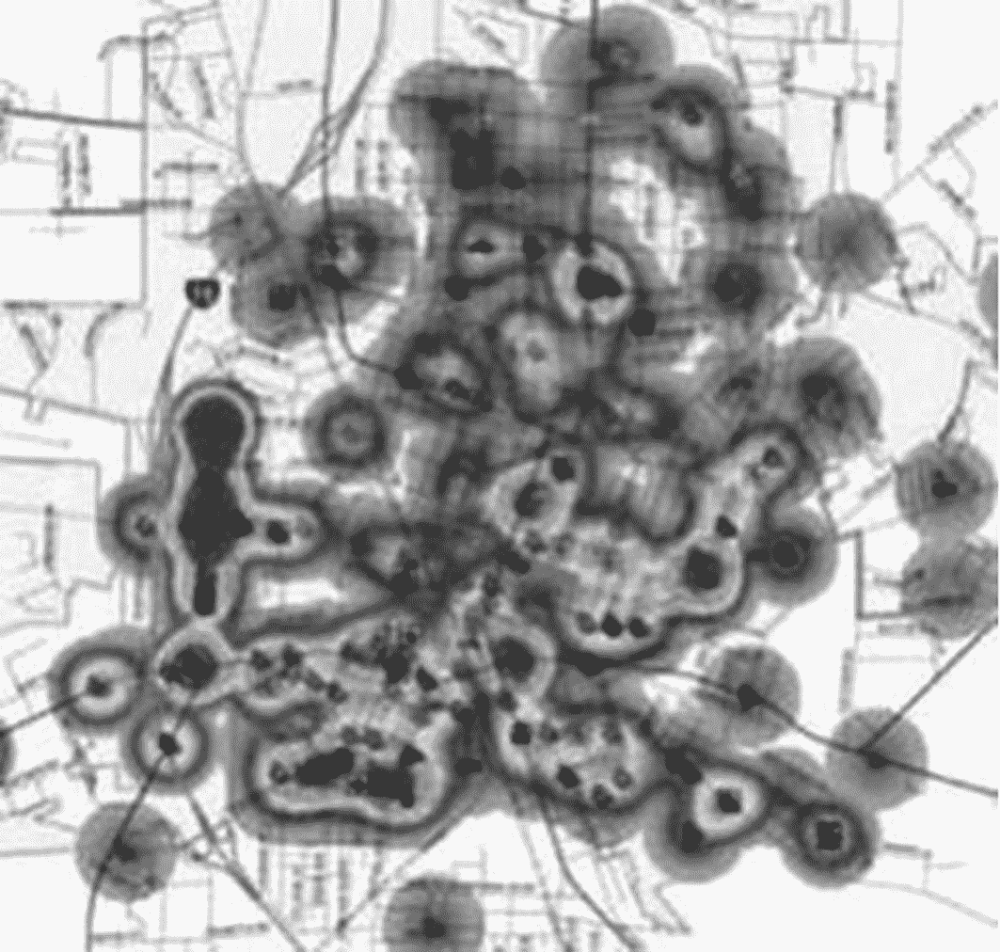

图 6.6：地理空间分析示意图。

地理空间分析的一种变体是地理时空分析。地理时空分析将数据随时间分层，并将数据匹配到相同的坐标。它允许用户直观地分析趋势、人口变化、财富变化、社会趋势采纳情况或疾病进展。例如，地理时空分析曾被用于追踪美国德克萨斯州因石棉导致的死亡人数。

在另一项研究中，地理时空分析被用于追踪趋势，显示位于污染工厂下游的人群中慢性阻塞性肺疾病（COPD）异常高发。地理时空地图显示了工厂排放硫化物污染空气（环境污染与疾病负担）与下游人群高于正常水平的 COPD 发病率之间的相关性。

### 6.26 逻辑回归或 Logit


# 逻辑回归

逻辑回归具有与线性回归相同的结构和概念，但具备处理分类变量的能力。它通常被称为 `Logit`。逻辑回归旨在根据一个或多个预测（自变量）变量预测二元响应。它使用概率分类模型，其中概率描述了作为逻辑函数建模的每次试验的可能结果。

逻辑回归有三种类型：二元、多项或有序逻辑回归。

*   **二元逻辑回归**为因变量分配二元值（`1`、`0`）
*   **多项逻辑回归**的因变量有多个结果
*   **有序逻辑回归**处理具有有序值的因变量

逻辑回归常用于生物科学和临床数据分析。例如，创伤与损伤严重程度评分（`TRISS`）基于逻辑回归用于预测受伤患者的死亡率。此外，`Logit` 分析常用于根据特定人口统计数据预测患者是否患有某种疾病。

## 6.27 预测建模方法

数据科学家通常使用九种不同的数据分析方法中的任意一种进行预测建模。以下是预测建模方法列表。我们将在后续章节中更详细地回顾这些方法。

*   贝叶斯方法
*   分类（`K-近邻算法`）
*   `MARS`（多元自适应回归样条）
*   `神经网络`（机器学习）
*   `ACE`（交替条件期望）和 `AVAS`（加性与方差稳定化）
*   `CART`（分类与回归树）
*   提升树
*   随机森林
*   支持向量机

## 6.28 交替条件期望 (ACE)

交替条件期望（`ACE`）算法是一种非参数自动变换方法，可生成响应变量与一组预测变量之间的最大多重相关性。该方法解决了回归分析中建立线性假设的一般问题，使得响应变量与自变量之间的关系能够得到最佳描述，并能探索和发现非线性关系的存在。对这些结果的检查可以让数据分析师深入了解这些变量之间的关系，并提示是否需要进行变换。

## 6.29 聚类与分类

聚类和分类都用于数据挖掘。两者都将数据分成组。但是，这两种方法有巨大的差异。聚类是无监督学习。当您获得新数据，任务是根据数据项之间的相似性将数据分成同类组时，您使用聚类。分类是有监督学习。当您已经拥有一个训练好的模型，并希望对新主体进行分类时，您使用分类。表 6.4 和 图 6.7 更详细地展示了这些差异。

**表 6.4：聚类和分类的显著特征**

| 分类 | 聚类 |
| --- | --- |
| * 我们拥有先前已分类的训练数据集。 | * 我们预先不知道数据的相似性或特征 |
| * 基于此训练集，算法为新数据找到合适的类别 | * 算法将数据集分割成子集，使子集包含相似的数据 |
| * 称为有监督学习 | * 称为无监督学习 |
| * 示例：我们有购买产品的客户档案。这位新客户符合该档案吗？ | * 示例：我们有客户数据集。按客户特征进行细分。 |

虽然两种方法都根据一个或多个特征（数据特性）将数据分组成同类块（或云团），但它们实现目标的方法不同。让我们更仔细地研究一下每一种：

### 分类

*   拥有部分数据的标签（标记）
*   目标：想要一条能准确地为新数据分配标签的“规则”
*   常用算法：`神经网络`

### 聚类

*   数据没有标签
*   目标：根据点之间有多“近”将它们分组成簇
*   识别数据中的结构
*   常用算法：K-Means 聚类

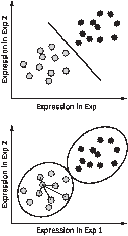

**图 6.7：分类（上象限）和聚类（下象限）的图形表示。**

## 6.30 K-Means 聚类方法

K-Means 聚类方法从数据中生成 *k* 个簇。该算法包含两个步骤。

给定一组初始均值 `m[1], …, m[k]`，算法在以下两个步骤之间交替进行：

**步骤 #1**：
将每个观测值分配到其均值产生的簇内平方和最小的簇（使用最小二乘估计器）。

**步骤 #2**：
通过新的计算更新均值，使其成为新簇中观测值的质心。

当分配不再改变时，算法停止。此时，算法已收敛。该算法通过基于距离将对象分配给最近的簇来工作。

## 6.31 使用神经网络进行分类

您可以使用人工神经网络（ANN）对数据进行聚类和分类。以下示例展示了神经网络如何对数据进行聚类的图形表示。考虑一个二维空间，其中包含一些已聚类为两组的现有数据点。

聚类的目标是找到最佳“线”来分离这两组，如图所示：

```
Y = W[1]*X[1] + W[2]*X[2] + W[0]
```

当这条线等于零时，该线完美地将数据分离为两个簇（参见 图 6.8）。现在，假设新数据到达，我们需要对其进行分类。新数据属于哪个簇？答案是：“取决于它落在线的哪一侧。”挑战在于找到最佳分离两个数据簇的线的方程中的系数 `W[1], W[2], W[0]`。我们将看到，该线的方程是通过训练神经网络来优化这些系数的值而获得的。

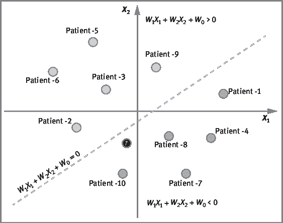

**图 6.8：使用简单聚类线进行分类的示例。**

我们将在后续章节中更详细地回顾神经网络。

## 6.32 主成分分析

主成分分析（PCA）主要用作探索性数据分析中的工具，以及用于构建预测模型。它是一种*因子分析*形式。

主成分分析被高度视为一种用于无监督学习的准确工具。一般来说，无监督学习比有监督学习更具挑战性，因为它更具主观性。分析没有简单的目标，例如预测响应。无监督学习常被用作*探索性数据分析*的一部分。此外，由于没有通用接受的交叉验证或验证方法，因此更难评估所得结果的准确性。简单来说，除了对手头过程的简单直觉或理论知识外，我们无法在无监督环境中真正*检查工作*。

无监督方法有许多用途，几个用例对此进行了说明。PCA 通过识别患者亚组帮助我们了解癌症行为。网站（特别是电子商务）经常尝试根据您使用 PCA 算法的先前活动向您推荐产品。另一个例子是 Netflix 电影推荐。

当面对一大组相关变量时，主成分允许我们将该组汇总为较少数量的代表性变量，这些变量*共同*解释了原始组中大部分的变异性。

主成分分析（PCA）指的是计算主成分的过程，以及随后利用这些成分来理解数据。PCA 也可作为数据可视化的工具。

以下是 PCA 的工作原理。假设我们希望将 *n* 个观测值在一组 *p* 个特征上的测量值可视化，作为探索性数据分析的一部分。我们可以使用二维散点图。然而，您可能需要创建*大量*散点图。如果 *p* 很大；那么需要 `(p(p—1)/2)` 个散点图（确切地说）。

例如，如果 *p* = 10，则有 45 个图。显然，当 *p* 很大时，我们需要一种替代方案。具体来说，我们希望找到数据的低维表示，以尽可能多地捕获信息。PCA 提供了一种方法来实现这一点。PCA 寻找少量尽可能“有趣”的维度，其中“有趣”的概念通过观测值在该维度上的变异量来衡量。PCA 找到的每个维度都是 *p* 个特征的线性组合，因此从技术上讲，这不是一种特征选择形式。另请注意，在计算 PCA 之前，数据必须被中心化且均值为零（除非所有数据单位相同）。

我们还可以通过利用主成分来衡量丢失了多少信息。为此，我们可以计算每个主成分解释的*方差比例*（PVE）。通常最好用累积图来解释，这样我们可以直观地看到每个成分的 PVE 以及解释的总方差。一旦我们有了这个度量，就可以开始判断主成分是否解释了足够的数据以提供准确的摘要。

总之，主成分分析利用高度线性相关数据的转换将其变为高度不相关的数据，称为*成分*。每个成分的计算旨在解释数据中最大量的方差（第一成分）。第二大的方差量分配给第二成分，依此类推。

每个后续成分都被选择为与前一个成分正交。PCA 可用于降低数据维度（示例：图像模式人脸识别中的特征提取）。PCA 利用数据的方差和协方差来计算数据的成分。值得注意的是，在 PCA 中，成分的数量等于或少于原始变量的数量。

## 6.33 分层方法

分层是一种将数据（如人口、患者、消费者等）分类为子组的技术。分层是一种根据特定标准（如年龄、性别、生活方式、种族等）将数据分类为类别和子类别的简单方法。当我们考虑辛普森悖论时，分层非常重要。辛普森悖论指出，数据在汇总形式下可能显示一件事，而在分解后却显示完全不同的情况。

分层有助于检测研究中的系统误差。数据中存在十几种偏差来源。但以下是与系统误差相关的四种偏差类型：

*   **信息偏差**：当我们对研究因素进行误测量或误分类时发生
*   **选择偏差**：当从总体中选择非代表性样本时发生选择偏差
*   **混杂**：这种偏差因因素与结果之间关联的混合和扭曲而常见
*   **交互作用**：交互作用因两个或更多因素的独立运作而相互作用产生意外效应而发生

有哪些策略和建议可以克服这些偏差？由于混杂是一种系统性（非随机）误差，假设检验无法用于检测它。以下是几个可考虑的行动：

*   在收集数据前识别混杂变量
*   当存在交互作用时，针对混杂的调整是禁忌

减少混杂偏差的另一种技术是应用*倾向性匹配*技术。

## 6.34 倾向性评分匹配方法

# 倾向性评分匹配 (PSM)

倾向性评分匹配 (PSM) 是一种用于减少观察性研究中混杂因素影响的技术。当我们比较人群中治疗的效果时，我们希望确定对治疗的反应是基于治疗本身，而不是由于我们的选择偏差。因此，我们使用 PSM 来确定对治疗反应呈阳性和阴性的两组之间的选择偏差。它允许模拟随机对照试验研究的一些特征。PSM 通过基于接受治疗的估计概率（倾向性评分）匹配治疗组和未治疗组的观测值来发挥作用。

PSM 通过一对一匹配或配对匹配来实现，其中形成治疗组和未治疗组受试者的配对，使得匹配的受试者具有相似的倾向性评分值。换一种说法，倾向性评分是在给定一组观察到的协变量条件下，一个人被分配到特定组别的概率。倾向性评分通过基于这些协变量使组别平衡，从而减少选择偏差。

PSM 通过考虑预测接受治疗的协变量来估计治疗或药物的效果。这种方法减少了由于治疗效果估计中可能存在的混杂变量而导致的偏差。在估计治疗对结果的影响时，使用 PSM 来解释治疗组和未治疗组在基线特征上的系统性差异。PSM 方法可在多个统计软件包中使用，包括 R 语言中的 `MatchIt` 包。

倾向性评分匹配包括形成倾向性评分值相似的治疗组和未治疗组受试者的匹配集 (Rosenbaum & Rubin 1983)。倾向性评分匹配允许估计 `受试者平均处理效应` (ATT)。

倾向性评分匹配最常见的实现是一对一或配对匹配，其中形成治疗组和未治疗组受试者的配对，使得匹配的受试者具有相似的倾向性评分值。尽管一对一匹配似乎是倾向性评分匹配最常用的方法，但也可以使用其他方法。这些将在本节末尾讨论。除非另有说明，以下讨论均基于 1:1 匹配的背景。

一旦形成了匹配样本，就可以通过直接比较匹配样本中治疗组和未治疗组受试者的结果来估计治疗效果。

### 实施 PSM 的步骤

1.  你需要治疗组和对照组都具有具有代表性且可比的数据。如果你的数据包含分类数据，可以运行逻辑回归。要运行回归模型，假设因变量：`Y=1` 表示参与，`Y=0` 表示不参与。
2.  使用 Logit 模型（或其他离散选择模型）将项目参与情况作为可观测特征的函数进行估计。
3.  使用 Logit 模型的预测值为所有治疗组和对照组成员生成倾向性评分 `p(x[i])`。
4.  **匹配配对**：将两组（来自治疗组和对照组）中具有相似协变量的个体进行匹配。
5.  你需要确定一个 `容差限度`：对照个体或受试者与治疗组个体相差多大仍可视为匹配？你可以选择最近邻匹配等任何方法来匹配两组个体。
6.  一旦完成匹配，我们就可以通过比较参与者及其匹配对的结果均值来计算影响。

理想的对照组应通过全面的基线调查或时间不变特征与治疗组相匹配。匹配是基于观察到的特征的相似性来选择的。当然，这种方法假设不存在基于研究对象未观察到的特征的选择偏差。

总之，对于配对匹配，将数据的概率与回归预测的概率进行比较。如果你的数据包含分类数据，可以运行逻辑回归。要运行回归模型，假设因变量：`Y=1` 表示参与，`Y=0` 表示不参与。然后选择适当的混杂因素（与治疗和结果相关的变量）。

接下来计算倾向性评分：预测概率 `(p)` 或 `log[p/(1-p)]`。作为下一步，`检查` 倾向性评分在治疗组和对照组之间是否平衡。使用标准化差异检查协变量在治疗组和对照组之间是否平衡以考察分布。接下来，将每个参与者与倾向性评分中的一个或多个非参与者进行匹配（使用最近邻匹配、分层匹配或其他方法）。你必须验证在匹配样本中协变量在治疗组和对照组之间是否平衡。最后，你可以基于新的数据样本应用多变量分析。

## 6.35 依从性分析方法

`依从性分析方法` 常用于医疗保健领域，以衡量患者对特定实践或用药方案的依从程度。它衡量患者遵循其医疗专业人员治疗和建议的程度。该方法适用于多种疾病状况。依从性分析研究表明，患者不依从的平均比例约为 50%。

依从性可以随时间测量：纵向、横向和回顾性。依从性可以按方案测量：用药、健康行为、预约遵守情况和类似方案。依从性分析执行治疗与患者结果之间的相关性分析。它计算数据中的 `r 效应量` 并可识别与依从性相关的因素。例如，依从性分析显示患者依从性与医生的沟通技巧高度相关。

## 6.36 荟萃分析方法

荟萃分析是对多项研究的系统性考察。这种分析形式通常结合关于同类数据和同一假设的多篇研究文章的结果。例如，假设你正在对电动汽车对当地经济的影响进行荟萃分析。一些研究可能声称电动汽车有积极影响，而另一些可能得出相反的结论。两者都应用了严格的科学和统计方法及数据分析得出了不同的结论。那么，如何调和这些文章？这就是荟萃分析发挥作用的地方。

要执行荟萃分析，需从先前的出版物、研究论文和数据库中汇编这些多项研究的数据。每篇文章可能具有不同的统计显著性和效应量，必须予以考虑。这种分析中应用了特定的纳入-排除标准。常见的纳入-排除标准包括：

*   优先选择经过同行评审的研究。你可能决定在荟萃分析中仅包含这些文章
*   研究的时间跨度。你可以选择较近期的文章，例如过去 5 年内的，并排除 5 年前的任何研究结果。
*   人口统计学特征：地理和语言。你可以包含全球所有人群，或将荟萃分析限制在特定人群或语言。你的荟萃分析的效力和强度取决于这些选择。

对于荟萃分析，你必须考虑对文章进行编码，并确定这些文章中每项先前研究的效应量。这被称为文章编码和效应量提取。文章编码和效应量提取应用以下步骤：

首先，文章会根据变量的目的和频率进行编码。这是保持数据分析强度和质量一致的重要步骤。接下来，从文章数据中提取或计算 `Effect size r`。建议保持显著性 `p<0.05`。对于非显著结果，可以允许 `r=0`。随后，基于 `k` 项研究的数量，使用采用非加权平均 `r` 的随机效应模型。固定效应模型使用加权平均 `r`。权重由每项研究的样本量决定。

## 6.37 随机模型——马尔可夫链分析

在医疗保健和人口健康研究中，许多疾病是通过疾病进展的阶段来解读的。马尔可夫链是一种随机过程，它从一种状态转移到另一种状态，且与先前状态无关。随着研究对象随时间从一个阶段移动到另一个阶段，马尔可夫链可以估算阶段间的转移率。它们测量并研究阶段间的转移概率，如下图所示。例如，比较参与治疗的患者群体与对照群体的疾病进展情况。

如 图 6.9 所示，可能存在 `n` 个阶段。患者的状态可能从一种状态转移到另一种状态。任何研究对象都可以转移到下一阶段或最终阶段 `n`。

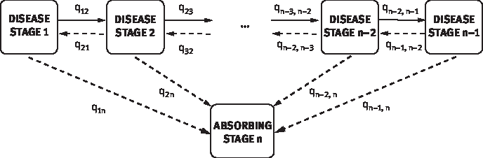

**图 6.9：具有 n 个阶段的马尔可夫链。**

## 6.38 处理噪声数据——卡尔曼滤波器

卡尔曼滤波器提供了一种随机算法，能从间接、不准确且不确定的观测中推断感兴趣的参数。它利用一段时间内观测到的一系列测量值，来生成未知变量的估计值，特别适用于从噪声数据中提取信息。

卡尔曼滤波器用于时间序列分析和在线实时处理。它们在一个三步递归过程中使用预测器、滤波器和平滑算法：

**步骤 1**：
预测器利用之前的测量值，计算当前状态变量的估计值及其不确定性。

**步骤 2**：
滤波器 `updates` 利用之前和当前的测量值，通过加权平均（赋予确定性更高的估计值更大的权重）来更新系统参数的估计值。

**步骤 3**：
`平滑` 算法利用之前、当前和未来的测量值，计算系统参数当前值的估计值。

权重是根据系统状态预测的协方差（作为估计不确定性的度量）计算得出的。当需要具有良好噪声过滤能力的预测器时，卡尔曼滤波器经常被使用。

卡尔曼滤波器是一种最优估计器——即从间接、不准确且不确定的观测中推断感兴趣的参数。它是递归的，因此可以在新测量值到达时即时处理。但“最优”意味着什么？这意味着如果所有噪声均为高斯分布，卡尔曼滤波器能将估计参数的均方误差最小化。如果噪声**不是**高斯分布怎么办？

在仅给定噪声的均值和标准差的情况下，卡尔曼滤波器是最佳线性估计器。为什么卡尔曼滤波如此流行？主要有四个原因：

*   由于其最优性和结构，它们在实践中能产生良好的结果。
*   它们采用适合在线实时处理的便捷形式。
*   鉴于基础理解，它们易于构建和实现。
*   测量方程无需求逆。

## 6.39 基于树的分析

基于树的分析常用于回归分析和分类问题。重要的是要注意，分类树不同于 K 近邻方法。基于树的分析旨在划分空间，以识别具有代表性的中心点。该方法对空间进行划分，并递归地将其分割成更小的区域，直到每个区域都被分配一个类别标签。

理论上，给定数据向量 `X: {x[1], x[2], …, X[n]}`，基于树的分析将根据值的阈值分割该向量。当阈值被递归应用时，树将继续生长。

图 6.10 展示了一个 `decision-tree` 示例。在一个示例中，存在 x1,…, x6 数据值，我们通过应用阈值将数据划分为 2 类，再划分为 6 类。

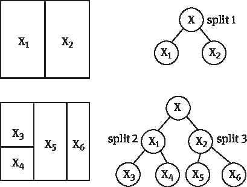

**图 6.10：使用决策树进行分类。**

在下一个示例 图 6.11 中，我们根据患者的收缩压值和心动过速情况对患者进行分类。第一次分割发生在患者收缩压 > 91 时。下一次分割发生在患者年龄 > 62.5 时。最后一次分割基于是否存在窦性心动过速。决策树将患者分类为高风险或低风险类别。


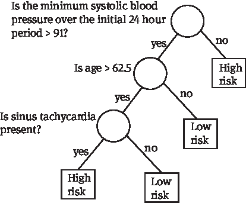

图 6.11：使用决策树方法进行分类。

### 6.40 随机森林技术

随机森林是一种用于分类和回归的机器学习方法。随机森林算法在训练过程中构建多棵决策树，并输出单棵树类别的众数（分类）或平均预测值（回归）。顾名思义，随机森林是多棵树的集合。

随机森林的工作原理是构建多棵决策树来解释数据中的不同特征。决策树在数据上进行训练，并可对新数据进行预测。随机森林用于对分类中变量的重要性进行排序。正如我们在前一节基于树的方法中讨论的那样，生长分类树以对每个数据变量进行分类（这被称为学习）。

形成后，每棵树都会为该分类给出一个分数。树枝的生长方式类似于 `K` 近邻 (`kNN`) 方法，以解释特征间的差异。

随机森林技术具有许多优势。它们能有效处理大规模数据和数千个输入变量。它们具有稳健的特性来估计缺失数据。但与其他新技术相比，它们并非准确度最高的方法。

随机森林的运行时间相当快，且能处理不平衡和缺失数据。随机森林的弱点在于：用于回归时，无法预测训练数据范围之外的值；且可能对特别嘈杂的数据集过拟合。

随机森林方法是一种集成方法，也可被视为一种近邻预测器的形式。集成方法是用于提高性能的分而治之方法。集成方法背后的主要原理是：一组“弱学习器”可以结合形成一个“强学习器”。每个分类器单独来看都是一个“弱学习器”，而所有分类器组合在一起则构成一个“强学习器”。

在图 6.12 中，展示了三棵决策树组成一个简单的随机森林。假设我们想根据消费者的购买金额、位置和其他属性对其进行分类。之所以称为决策树，是因为分类遵循多个“如果……那么……”决策分支的分叉。设想我们想以购买金额作为第一个决策或分割。该分割可被视为机器学习中的一个特征。假设“如果购买金额超过 1000 美元，我们沿右分支继续，然后对其他特征重复决策过程，直到没有更多决策为止”。

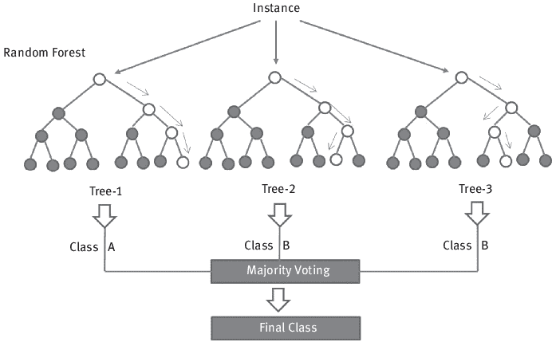

### 随机森林分类

**图 6.12：** 随机森林分类。

在每个分支处，都会找到能最好地在局部划分剩余样本的特征阈值。随机森林随后将许多单独决策树的结果进行组合。由于 RF 组合了多个模型，因此它属于集成学习范畴。

随机森林使用决策树，但采取了不同的方法。随机森林不再是生长一棵由分析师精心监管的、非常深的单一树，而是依赖于聚合许多“浅层”树（有时称为“树桩”）的输出，这些树在几乎没有（或完全没有）分析师监管的情况下进行调优和剪枝。其中一些树可能是从认为 `age` 是更重要特征（而非 `income`）的样本中生长出来的。

将多棵决策树组合成随机森林主要有两种方法：

1.  **装袋法：** 这也称为自助聚合。在装袋法中，决策树是在数据的采样子集上训练的。只要单个树之间不相关，这种方法就是高效且可接受的。

2.  **提升法：** 这使用梯度提升方法。在提升法中，对样本进行加权，使得分类错误的样本获得更高的权重，因此被采样的频率更高。

模型的最终结果是通过对这些采样树的所有分类结果取平均或进行多数表决来计算得出的。

## 分类与回归树

分类与回归树（CART）是一组用于分类和预测的技术。通过树构建算法进行分析的目的是确定一组 `if-then` 逻辑（分裂）条件，以实现对案例的准确分类。当应用于分类时，给定一个变量（例如成本或偏好），算法将识别出能最好地区分高低情况的分组，并使用数据集中的任意变量。下一节将解释决策树分类是如何执行的。

## 决策树构建

让我们通过一个示例更仔细地了解决策树的构建。构建决策树是一种自顶向下的分而治之技术。考虑包含标记为 α 和 β 的数据的数据集，如 **图 6.13** 所示。我们的目标是定义一条规则来分离这两组数据。我们有两条规则：

*   **第一条规则：** 如果 `x > 3.2`，我们可以将左侧的 β 与 α 分离为两个类别。

*   **第二条规则：** 如果 `y > 2.7`，则会有两个新类别将 α 与 β 分离。

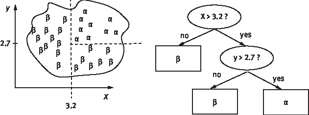

**图 6.13：** 构建决策树以对两个数据组进行分类。

这些规则定义了一个决策树。本示例中使用了自顶向下的分而治之技术。给定二维空间中所示的值，我们想要定义一条规则来分离这两组数据。我们应用一种称为覆盖算法的决策树算法。

我们覆盖所有单个数据项以定义规则。我们覆盖 α 并发现如果 `x > 3.2`，可以将 α 与 β 分离为两个类别。但是，在右侧，仍然有一些 β 混杂在 α 中。因此，我们制定另一条规则：如果 `y > 2.7`，则会有两个新类别。通过创建这些规则，我们实质上开发出了一个如图所示的决策树。

正如我们之前讨论的，随机森林由多棵决策树组成。这组树的集成共同提供数据分类。

随机森林方案由 Leo Breiman 于 2001 年提出。随机森林由在数据子集上构建多棵决策树组成。每棵树都是从输入变量的随机选择中构建的（这称为提升法）。在模型的某些变体中，会选择提供最大信息量（最高信息增益）的决策树，即具有最佳分离能力的树，作为数据的最终分类器并投入工作。最终的决策树以集成方式用于提供数据分类（这称为装袋法）。

每棵决策树都是基于单独的随机数据样本构建的，通常使用自助采样。你可以从单独的数据自助样本中构建数百棵树。通过这个过程，我们通过检查不同的数据子集获得了多样性。

例如，假设你正在尝试分析客户流失。营销专家会告诉你，客户并非完全忠诚或不忠诚，因为忠诚度存在一个光谱。但为简化起见，假设我们想将个体分类为忠诚（可能留存）或不忠诚（可能流失）。进一步假设总体中 10% 的个体是“不忠诚”的，90% 是“忠诚”的。那么，任何（足够大的）随机样本都将按这些比例包含“忠诚”和“不忠诚”个体。

使用决策树，你可能能够识别出特定类别浓度较高的个体细分群体。在本例中，我们尝试识别“忠诚”个体。假设你拥有关于每个个体的额外信息……比如说 `income`。决策树算法可能会识别出：收入少于 50,000 美元的个体细分群体由 30% “不忠诚”和 70% “忠诚”组成。即，与总体相比，该细分群体中的人成为“不忠诚”客户的可能性高 3 倍。

现在，假设你还拥有每个个体的年龄信息。决策树算法可能还会识别出：在“收入少于 50,000 美元”群体中，年龄在 30 岁以下的个体细分群体由 50% “不忠诚”和 50% “忠诚”组成。与总体相比，这个更细化的细分群体（收入少于 50,000 美元**且**年龄小于 30 岁）成为“不忠诚”客户的可能性高 5 倍。……以此类推……决策树可能会识别出许多许多此类特征，这些特征能预测个体将是“忠诚”还是“不忠诚”客户。

决策树算法可以确定分支的顺序以及用于分裂的分箱（`income > 50k, age < 30` 等）。但通常，调优决策树需要训练有素的分析师来确保分裂点有意义。此外，分析师还需要帮助“剪枝”以避免过拟合和/或覆盖范围不当的节点。

随机森林使用决策树，但采取了不同的方法。随机森林不再是生长一棵由分析师精心监管的、非常深的单一树，而是依赖于聚合许多“浅层”树（有时称为“树桩”）的输出，这些树在几乎没有（或完全没有）分析师监管的情况下进行调优和剪枝。其中一些树可能是从认为 `age` 是更重要特征（而非 `income`）的样本中生长出来的。

其他树可能会发现更相关的收入分箱是 100,000 美元（而非 50,000 美元）。其他树可能会发现完全不同的特征是相关的。其理念是，许多“浅层”树的错误在聚合时会相互抵消，从而得出更准确的预测。

随机森林方法不使用深层决策树，而是使用许多仅针对少数单一规则进行分类的浅层树。每棵树都是一个较差的分类器，但它们组成的森林提供了一个更准确的集成。

随机森林方法是嘈杂和稀疏数据以及无监督学习的理想分类器。因为随机森林从输入变量及其值的子集构建许多树，所以它固有地包含一些省略了噪声生成变量（或特征）的底层决策树。结果是噪声被抵消，最终分类更加准确。

你可以使用 Python 的 Scikit 和 Numpy 组件来访问其随机森林分类器功能。一个常用的功能是 `RandomForestRegressor` 类。

### 6.41 层次聚类分析（HCA）方法

## 层次聚类分析 (HCA)

层次聚类分析 (HCA) 是一种用于聚类分析的数据挖掘技术。它通过使用两种方法之一（自底向上或自顶向下）构建聚类层次结构来工作。在自底向上的方法中，每个观测值开始时都在其自己的簇中，随着层次结构向上移动，成对的簇被合并为一个。在自顶向下的方法中，所有观测值开始时都在一个簇中，随着层次结构向下移动，它们被递归地拆分。

然后，数据的“拆分”或观测值的组合由观测值集合之间的不相似性度量来确定。

不相似性度量的指标可以由以下技术之一定定义，例如欧氏距离、平方欧氏距离、曼哈顿距离、最大距离或马氏距离。公式如下所示：

### 欧氏距离

```
${\parallel {a - b} \parallel}_{2} = \sqrt{\sum\limits_{i}{(a_{i} - b_{i})}^{2}}$
```

### 平方欧氏距离

```
${\left| \left| {a - b} \right| \right|}_{2}^{2} = \sum\limits_{i}{(a_{i} - b_{i})}^{2}$
```

### 曼哈顿距离

```
${\left| \left| {a - b} \right| \right|}_{1} = \sum\limits_{i}{|a_{i} - b_{i}|}$
```

### 最大距离

```
||a−b||[α] = max |a[i] − b[i]| for all i
```

### 马氏距离

```
$\sqrt{{(a - b)}^{T}S^{- 1}(a - b)}$
```

HCA 是一种通过形成数据层次结构来工作的强大数据挖掘技术。数据正变得越来越多维。发现拥有 10 个、100 个，甚至数千个维度的数据集是很常见的。我们可以图形化地绘制多维数据，但随着维度的增加，图表会变得杂乱。因此，我们可以应用降维技术。

多个数据项之间的距离（或不相似性）可以通过多种技术来度量。数据中的拆分由不相似性度量决定。在这种方法中，彼此相似（距离更近）的数据项被聚类在一起，而不相似的数据项则被分开。不相似性越大，两个数据项之间的距离就越大。层次聚类分析有不同的算法。其中一种称为 `agglomerative clustering`（凝聚式聚类）。它从将每个单独的数据项放入其自己的簇开始。然后将每个数据项与距离最近的另一个数据项分组。重复此过程，直到随着允许组间距离变大，更多的数据项被分组在一起。换句话说，随着更多组合并，距离会增加。

图 6.14 说明了 HCA 聚类方法的图形表示。

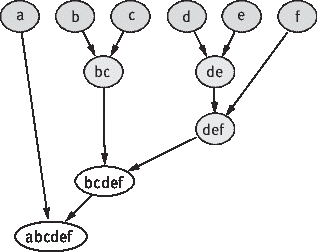

**图 6.14：HCA 聚类技术。**

另一种技术使用 `Dendrogram`（树状图）方法。在前一种方法中，我们使用两个数据点之间的相似性来确定它们是否适合同一个簇。在 `Dendrogram` 方法中，我们通过它们的不相似性（即距离）来确定两个数据项是否属于同一个簇。在这种方法中，不相似性水平（负相似性）被用来形成数据集中的拆分。结果是一个层次结构的可解释可视树状图，详细描述如下：

1.  **步骤 1：维度层次生成**：首先，根据维度间的相似性，将多维数据集的所有原始维度组织成一个层次维度簇树。每个原始维度映射到该树中的一个叶节点。相似的维度被放在一起形成一个簇，相似的簇进而组成更高层次的簇。用户可以选择使用系统提供的自动聚类方法、使用其自定义的聚类方法，或手动指定一个层次维度簇树。

2.  **步骤 2：维度层次导航与修改**：接下来，用户可以浏览层次维度簇树，以便更好地理解它。用户还可以交互式地修改层次结构，并为簇提供有意义的名称。层次维度簇树在一个名为 `InterRing` 的径向空间填充显示中可视化，其中包含一套导航和修改工具。

3.  **步骤 3：维度簇选择**：接下来，用户从层次结构中交互式地选择有趣的维度簇，以构建一个低维子空间。`InterRing` 中提供了多种选择机制以方便维度簇选择。选中的簇会被高亮显示。

4.  **步骤 4：代表性维度生成**：在此步骤中，为每个选定的维度簇分配或创建一个代表性维度 (RD)。选定的维度簇通过这些 RD 构建低维空间。选择 RD 是为了最好地反映其关联簇的聚合特征。例如，RD 可以是簇中所有原始维度的平均值，也可以是位于簇中心的一个原始维度。用户可以选择使用系统提供的 RD 生成方法之一，或使用自定义方法。

5.  **步骤 5：数据投影与可视化**：最后，数据集从原始高维空间投影到由选定簇的 RD 组成的低维空间 (LD 空间)。我们称其在 LD 空间中的投影为映射数据集。映射数据集可以被视为 LD 空间中的普通数据集，并可以使用现有的多维可视化技术轻松进行可视化。

这是 HCA 的一个优势；它非常灵活，可以应用于任何现有的多维数据可视化技术。为了在 LD 空间中提供进一步的维度簇特征，例如簇内维度之间的不相似性信息，我们将维度簇特征信息附加到映射数据集上，并提供使用数据可视化技术的扩展来显示它的选项。

### 6.42 基于稳健估计方法的异常值检测

我们已经讨论了一些异常值检测方法。我们看到，将位于 ±3 西格玛（或标准差）之外的任何数据指定为异常值的统计技术可能是实用的。让我们考虑将稳健方法作为另一种技术。

传统的最小二乘 (LS) 估计器往往会遗漏或平滑数据中的异常值。然而，稳健 (L1) 估计方法克服了经典参数估计的局限性。稳健估计方法用于检测数据中的异常值和异常。

L1 估计方法通过分析全局拟合模型，在四个步骤中迭代地检测可能的异常值数据：

1.  使用最小二乘 (LS) 方法计算整个数据集的初始拟合。

2.  确定每个数据的残差。

3.  移除残差大于阈值的数据；如果没有数据应被移除，则停止。

4.  计算剩余数据的新拟合，并转到步骤 2。

另一种技术是应用不同的极大似然估计器 (MLE)，也称为 M-估计器，来检测异常值。还有其他技术可供考虑。一种技术是应用一种最小-最大解，使用一种在某些密度族上最大化渐近方差的估计器。

其他用于检测异常值的著名估计器有 `L[1]`、`L[2]`、`L[1-2]`、`L[p]` 和柯西方法。最后，另外两种流行的估计器是 L-估计器（源自序统计量的线性组合）和 R-估计量（源自秩检验）。这些方法的细节超出了本书的范围，但大多数统计软件包都提供了工具，可使用此处描述的任何方法来计算异常值。

### 6.43 特征选择技术

## 特征选择

特征选择过程也称为*变量子集选择*。特征选择旨在从无关或冗余变量中识别出相关且重要的变量和预测因子。特征选择是机器学习应用中的重要工具。

它有助于减少计算负载。另一个好处是，通过消除噪声特征，它有助于提升存在大量噪声特征的模型的性能（和准确性）。特征选择通常旨在测试若干特征子集，并找到使错误率最小化的那个子集。

存在三类特征选择方法：

1.  **过滤法：** 将特征选择作为预处理步骤。使用代理度量（如类间/类内距离）而非错误率来为特征子集评分。

2.  **包装法：** 将预测方法作为黑箱来为特征子集评分。每个新的特征子集都被用来训练一个模型，然后在另一个特征子集上测试该模型。错误率即为该子集的评分。

3.  **嵌入法：** 作为预测方法训练过程的一部分执行特征选择。它使用 LASSO 方法构建模型并将回归系数收缩至零。它选择提供非零回归系数的特征。

## 特征提取

还有一个称为*特征提取*的过程。特征提取试图从原始特征的函数中创建新特征，而特征选择则提供特征的一个子集。特征提取有许多应用。它常用于变量很多但数据样本很少的数据。特征提取的一些用例包括：书面文本分析（我们想提取观点）和 DNA 微阵列数据（我们想提取相关的 DNA 序列）。

### 6.44 桥接研究

桥接研究旨在“填补”来自不同研究的多样化数据之间的空白。它们在填补随机临床试验之间的空白方面有许多应用，例如不同人群中药物疗效和结果的差距。通常人群差异是种族，但也可能仅仅是地理位置。这些研究对于药效学和药代动力学原因都很重要。

地理上分离的人群通常在受体和酶的构成上进化出了细微差异，这可能导致一种药物在一种人群中的结合亲和力与另一种人群截然不同。

### 6.45 信号提升与装袋法

我们在前面的章节中已经讨论过信号提升和装袋法。*Bootstrap aggregating*（自助聚合），顾名思义，也称为装袋法。装袋法提升了机器学习和预测模型中信号的贡献。

装袋法用一组观测值和度量的样本替换 `K` 个数据元素的样本，以增加（提升）结果。它重复该过程以形成一组预测器。装袋法通过平均所有观测集的输出来使用预测器集成。它常用于回归树和神经网络。

提升法使用不同的数据样本作为训练集。然后比较多个样本集中准确率的提升（或降低）。接着计算样本的权重，以增加或减少它们在训练集中的成员资格。这一步形成集成，从而提高模型的整体准确性。

### 6.46 广义估计方程（GEE）法

广义估计方程（GEE）是一种半参数化回归技术，用于估计总体的平均响应。它利用数据的均值和方差进行计算。GEE 法常用于流行病学研究和多中心队列研究，因为它可以处理结果之间多种类型的未测量依赖性。它是补偿数据集中缺失数据的理想替代方法。

GEE 法不仅是重复测量的理想方法。它适用于数据中出现依赖性的任何情况（例如跨家庭、诊所的研究等）。它使用观测值的加权组合从相关数据中提取适量的信息。GEE 法依赖受试者间的独立性来一致地估计回归系数的方差。

### 6.47 Q-Q 图

分位数-分位数（Q-Q）图是一种图形技术，用于确定两个数据集是否来自具有相同分布的总体。它将第一个数据集的分位数与第二个数据集的分位数对比绘制。它绘制一条 45 度参考线。如果两个分位数沿着这条线分布，则两个数据集来自相同分布，否则它们代表不同的总体。例如考虑下图中的 Q-Q 图。

在图 6.15 中，由于绘图偏离了 45 度参考线，这两个数据集并非来自具有共同分布的总体。

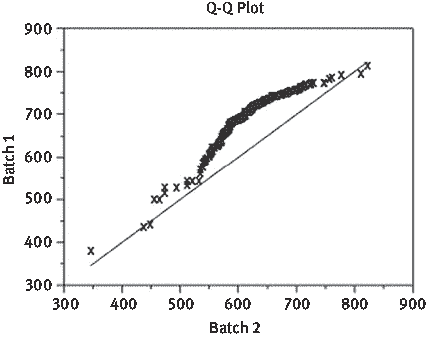

图 6.15: Q-Q 图示例。

## 6.49 方差减少（RIV）—— 组间变异


RIV 统计量常用于医疗保健领域，用于衡量病例组合系统的解释力，即分组所解释的总住院时长（LoS）变异比例。0% 的值意味着该分类未解释因变量（如 LoS 或成本）的任何方差，而 100% 意味着它解释了所有方差。100% 虽然理论上可能，但会表明每组内的所有数据具有相同的 LoS/成本比率。LoS 的典型结果为 30-40%，而成本为 60-70%。

RIV 常以 `R²` 表示，用于描述分类的预测效度，通过计算来描述分组分类的解释力。RIV 的未调整计算形式是整体平方和（WSS）与总平方和（TSS）之比的倒数，以百分比表示。

$$R^{2} = 1 - \frac{WSS}{TSS}$$

其中 `WSS` = 整体平方和，

`TSS` = 总平方和

$$WSS = \sum\limits_{j = 1}^{k}{\sum\limits_{i = 1}^{n_{j}}\left( {x_{ij} - {\overset{ˉ}{x}}_{j}} \right)^{2}} \quad TSS = \sum\limits_{j = 1}^{k}{\sum\limits_{i = 1}^{n_{j}}\left( {x_{ij} - {\overset{ˉ}{x}}_{j}} \right)^{2}}$$

其中 `k` = 组数

`n[j]` = 第 j 组中的病例数

`x[i j]` = 第 j 组中第 i 个病例的值

`\overset{ˉ}{x}_{j}` = 第 j 组的均值

`\overset{ˉ}{x}` = 总体均值

### 6.49 变异系数（CV）—— 组内变异

虽然 RIV 统计量给出了一个应用于组间的结果，但需要一个统计量来衡量组内变异性或同质性。一组的标准差（SD）与其算术平均值之比，即 CV，给出了单个组内相对变异性的度量。

$$CV = \frac{SD}{\overset{ˉ}{x}} = \frac{\sqrt{\sum\limits_{i = 1}^{n}{\left( {x_{i} - \overset{ˉ}{x}} \right)^{2}/n}}}{\overset{ˉ}{x}}$$

其中 `SD` = 组的标准差

`\overset{ˉ}{x}` = 组的均值

`x[i]` = 组中第 i 个病例的值

`n` = 组中的病例数

## 第 7 章 模型集成：数据分析预测框架

CV（变异系数）用于描述一组数据的同质性。CV 值为 0 表示该组数据相对于平均值没有方差（即标准差等于 0），而某组的 CV 值高于 1.00 则表明组内存在异质性，即标准差大于平均值。当平均值接近零时应谨慎使用，因为 CV 可能对平均值的微小变化敏感。

本框架中呈现的数据分析模型提供了一个前馈模型，用于基于在先验数据上训练的深度学习（机器学习）模型进行预测。预测是对未来某一状态或结果的一种推测。`prediction`（预测）是指当某事件所需的条件具备时，对该事件或结果的预先告知。预测变量，也称为 `marker`（标志/指标），是指具有预测能力并与结果存在前驱相关性的变量。

### 7.1 模型集成

由于数据会随时间或在不同情境下发生变化，使用单一模型往往难以达到高准确性和对数据变化的鲁棒性。因此，我提出使用模型集成和一个监督程序（我称之为“神谕”）来提供来自多个模型的综合结果集。

鉴于不同数据集具有不同的数据规模和数据特征，每个模型的表现可能更好（稍后将解释，即具有更高的准确性和特异性）。该框架即为集成（也称为模型委员会）程序。图 7.1 展示了该框架。

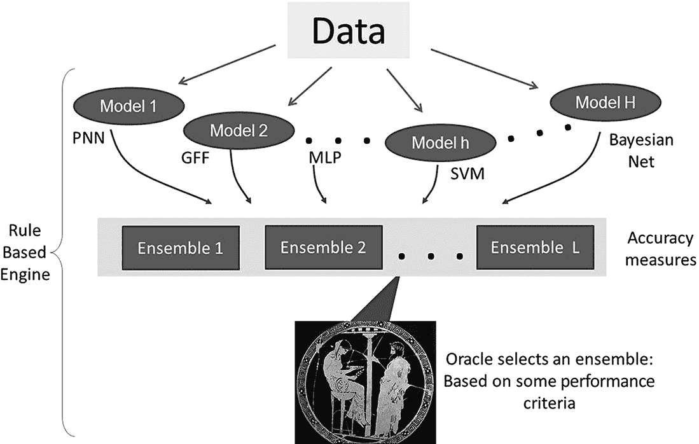

图 7.1：用于稳健数据分析系统的集成（模型委员会）框架。

在医疗保健领域，疾病的前驱因素称为 `risk factor`（风险因素）。因此，医疗预测的谱系始于风险因素，进而导向预测，继而涉及标志物，最终发展为疾病或医疗事件本身的发生。图 7.2 展示了个体健康状况从风险因素进展至疾病确诊阶段或医疗事件显现的事件时间顺序与进程。

时间刻度间的距离是任意的，且因人而异。医疗预测模型必须将既往病史、风险因素、标志物及医疗干预作为模型的输入。

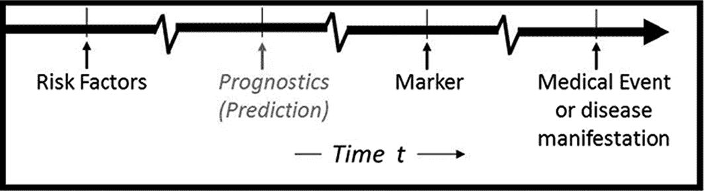

图 7.2：个体健康状况的进展。

### 7.2 人工神经网络模型

人工神经网络的威力在于其检测模式的能力，包括那些传统统计分析需要花费过长时间以致变得不切实际的复杂情况（Monterola, Lim et al. 2002）。

神经网络是机器学习、深度学习和人工智能的重要组成部分。至少包含一个接收数据集输入的输入层、一个产生网络结果的输出层，以及位于输入层和输出层之间至少一个隐藏层。

人工神经网络是一个由相互连接的处理单元组成的网络，能够从一组输入数据中对模式进行分类。与被称为冯·诺依曼计算机的传统计算机架构不同，ANN 是通过训练而非编程来工作的。当一组数据被输入 ANN 模型时，如果数据中存在模式，ANN 就会“学习”这些模式。一旦模式被学习，ANN 模型就能将新的一组数据分类到适当的类别中。

合适的预测数学模型必须提供准确性和简洁性，以便从既往病例中学习，并易于扩展以应用新数据进行预测。我使用四种不同的 ANN 算法来说明集成或模型委员会的概念。该集成中选用的四种 ANN 算法根据文献确立，属于用于预测和分类最常用且最准确的神经网络模型之一。但是，提升预测能力和准确性的不是单个 ANN 模型，而是它们的集成（委员会）。每个模型根据输入数据和计算约束具有特定的相对优势和劣势（Principe 2011）。集成框架通过将它们集体协同使用来提升每个模型的性能。

要构建一个集成，可以从两个模型开始，并在开发新模型时不断添加。一般来说，可以利用额外的不同模型，范围涵盖从随机森林、朴素贝叶斯网络到主成分分析和支持向量机。我在案例研究中使用了四种 ANN 模型，列举如下。这四种模型分别是：

1.  **PNN** – 概率神经网络是四层网络。它们以非参数方法对数据进行分类，且对数据中的异常值不敏感。这些模型在数据集较小时表现良好。

2.  **SVM** – 支持向量机网络。SVM 通过构建一个定义超平面的双层网络来执行分类，该超平面将数据分离为多个类别。这种方法通常被视为最准确的分类模型之一。支持向量机不被视为神经网络，但可作为神经网络模型中的一种求解方法使用。

3.  **采用 LM 训练的 MLP** – 采用列文伯格-马夸尔特算法训练的多层感知机，是一种具有变步长修正的梯度下降法。该算法被视为一种计算效率高的方法。

4.  **采用 LM 训练的 GFN（广义前馈网络）** – 采用列文伯格-马夸尔特算法的广义多层前馈网络。这些模型通常在数据集庞大且有大量数据案例可用时表现良好。

为了对时间序列数据进行预测，可使用时滞循环网络变体来替代上述算法。时滞循环网络本质上是一种时间序列建模方法，它将预测在时间上向前推移若干迭代，并提供若干采样点提前的结果。

不同的神经网络模型使用不同的学习规则，但总体而言，它们都从一组训练样本中确定模式统计量，然后根据训练规则对新数据进行分类。换而言之，一个训练好的神经网络模型将一组输入数据分类（或映射）为一组疾病中的特定疾病。

### 7.3 分析模型比较与评估

模型的可行性和实用性根据准确性、适定性、实用性、适应性和经济性这五个标准进行衡量。以下各节将进一步探讨每个标准。

#### 准确性

模型的准确性是指模型结果与系统实际值的接近程度。模型的精确度是指在条件不变的情况下，模型重复运行产生相同结果的程度。由于模型是在回顾性数据上训练的，因此很容易将模型的预测准确性与既往回顾性患者病例的实际临床结果进行对比评估。

##### 关于准确性的分析

关于准确性的分析将包括校准（预测概率与观察到的结果频率之间的一致性）、区分度（例如，区分患病患者和非患病患者的能力）、敏感性（被正确诊断为患病的患者比例）、特异性（被正确诊断为阴性的健康患者比例）、似然比（`LR`，基于阳性或阴性测试结果，疾病几率的变化程度）以及受试者工作特征（`ROC`，敏感性与 1 减特异性的绘图）曲线等测量指标。

该框架使用一个具有多种选择方案的预言程序，来选择集成学习中能提供更高预测准确性的最佳模型组合。

比较 `ANN` 和其他统计模型的预测准确性，需要使用分类性能指数作为比较标准。这些指数包括受试者工作特征（`ROC`，敏感性与 1 减特异性的绘图）曲线、受试者工作特征曲线下面积（`AUROC`，衡量 ROC 曲线下面积的总体准确性度量，面积越大表示准确性越高）、敏感性、特异性、准确性、阳性预测值（`PPV`，阳性测试结果者实际患病的概率）和阴性预测值（`NPV`，阴性测试结果者实际未患病的概率）(Bourdes et al. 2011)。

敏感性衡量被分类为阳性的阳性病例所占比例。特异性衡量被分类为阴性的阴性病例所占比例。

`AUROC` 是模型预测准确性的良好总体度量。它代表 `ROC` 曲线下的面积，衡量模型区分疾病组和正常组的能力。`AUROC` 值接近 0.50 表明无区分度，即可以抛硬币决定。而 `AUROC` 接近 1.0 则被认为是极佳的区分器 (Linder et al. 2004)。模型和模型委员会准确性比较的单一指标将是特征曲线下面积（`AUC`）曲线。

#### 适定性：模型稳定性与免疫性

在本节中，我将解释模型稳定性。稳定性是指模型对数据微小变化的免疫程度。模型可能表现出不同的适定性特征。一般来说，如果数学模型满足阿达马的三个标准，则被视为适定：

1.  模型有解
2.  解是唯一的
3.  解连续依赖于数据 (Lucchetti 2006)

反之，不适定数学模型具有初始或边界数据，其中微小的扰动可能无限增长，偏离未扰动的解。一般来说，如果能证明解在处处一致有界，则是适定的。但另一方面，也可能存在非不适定的无界解。由于大多数分类问题包含局部最优解作为可能的解，因此它们不被视为适定。

然而，为克服这一限制，您可以考虑遗传算法，其中模型探索多个最优解，避免陷入局部最优。因此，对其他模型而言，一定程度的正则化是必要的。换句话说，必须知道如何利用额外假设在模型中创造适定行为。

#### 实用性：实用性与用例

模型训练完成后，可设置为按特定时间间隔自动运行，间隔范围从每分钟到每数小时不等。提前训练所有模型并并行运行它们是切实可行的。预言（监督）程序可通过轮询所有模型提供最准确的预测。每个模型的结果可由预言程序过滤和加权，以最大化真阳性（`TP`）或最小化假阴性（`FN`）及其他准确性或精确度目标。

#### 适应性：处理新数据值和数据类型的能力

`ANN` 是优秀的机器学习工具，能够适应新数据集、额外变量和所有数据类型。然而，机器学习模型的性能（如准确性、精确度、特异性和敏感性）会随时间下降。建议每隔几个月对 `ANN` 模型进行一次重新训练，以适应新数据，克服性能下降以及时间、环境和人口统计数据的变化。在集成框架中，必须保留历史数据以供未来的机器学习训练和验证。随着历史数据集中新数据的可用，`ANN` 模型可重新训练。

#### 经济性：计算成本与预测的及时性

在计算中，算法的计算成本由算法完成所需的渐近计算次数决定。神经网络算法的复杂度度量为输入变量和病例数量增大时最坏情况提供了上限。算法的计算成本是计算步骤数（时间复杂度）、内存大小（空间复杂度）和算法长度的函数。

在 `ANN` 中，计算次数即时间复杂度，`感知机` 数量作为空间复杂度的度量，权重数量作为算法长度的度量。已证明 `ANN` 的复杂度为 NP 完全，即给予足够的信息和硬件；它们能在有限时间内预测任何输入-输出函数 (Kon and Plaskota 2000)。

案例研究中使用的四个分类和预测模型，在普通个人计算机上训练时间均在 5 分钟 CPU 时间和 1 小时流逝时间以内。对于本框架研究的可比数据集规模，新预测的计算成本并不高昂，可在 2 分钟内完成。这表明许多算法可以快速训练，许多数据分析研究都在可用计算能力的范围之内。

这四个模型及其数学方程的开发将在下一章介绍。

## 第 8 章 机器学习、深度学习——人工神经网络

### 8.1 ANN 简介

神经网络是机器学习和人工智能的关键工具。它们具有捕捉现实世界数据非线性细微差别的非凡能力。在数据中寻找模式、数据挖掘、数据分类、计算机视觉和语音识别，都是神经网络能够解决的众多问题之一。

神经网络已成功应用于基于先前示例学习的模式分类。不同的神经网络模型使用不同的学习规则，但总体而言，它们从一组训练示例中确定模式统计量，然后根据训练规则对新数据进行分类。例如，`ANN` 可用于辅助临床诊断。在该用例中，训练好的神经网络模型将一组输入数据分类（或映射）到一组可能疾病中的特定疾病。神经网络代表了机器学习中一类重要的算法，特别是在深度学习领域。

#### 人工神经网络 (ANN)

人工神经网络 (ANN) 受生物学习过程的启发。ANN 模型是并行信息处理结构，试图模拟某些生物神经系统。ANN 具有许多优势：它既能建模线性问题，也能建模非线性问题。它可以根据规模进行扩展或缩减。其并行结构提供了自愈和冗余能力。基于 ANN 结构的模型试图回答关于学习、分类和模式识别的若干问题。这些属性是认知和推理的有用特征，出现在许多决策应用中。

人工神经网络被广泛应用于各种场景，从客户流失预测和保险行业的理赔预测，到其他用例中的字符识别、人脸识别和癌症检测。其他应用还包括预测建模、推荐系统和数据挖掘，这些场景都需要从数据中发现模式。

##### 目标与结构

ANN 的目标是模拟神经系统。正如神经系统由称为神经细胞的简单单元互连而成，ANN 由许多独立但相互关联的元素（称为神经元）组成，并组织成层。每个神经元向另一个神经元传递兴奋或抑制信号。信号的贡献取决于突触连接的强度。同样，生物神经学习是通过修改突触强度发生的。在神经网络中，突触强度由与每个输入相关联的权重表示。

典型的 ANN 由通过全连接或随机连接相互连接的层组成。通常有两层与外部世界相连：一个输入层，用于收集数据；一个输出层，用于呈现网络的结果或响应。但多层 ANN 模型很常见。图 8.1 展示了一个简单的神经元，包含由 `x[1], …, x[k]` 指定的输入信号、与每个信号相关联的权重 `w[i1], …, w[ik]`、一个求和节点和一个产生输出 `Y[i]` 的激活函数。

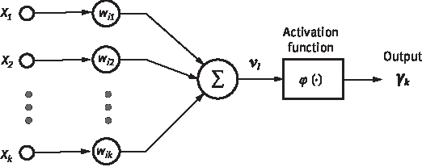

**图 8.1：节点 i 具有激活函数的简单神经元。**

对于每个神经元，求和函数聚合输入的加权和，而激活函数将该和转换为神经元的最终输出。每一步的公式如下所示：

```
(10) ν[i] = Σ[j = 1]^(k) x[j]w[ij]
(11) Y[i] = φ(⋆)
```

在图 8.2 中，展示了多层 ANN 的一般结构。关于患者状况的收集数据通过一层神经元输入模型。此处显示了四个输入信号。每一层的结果是一个激活函数，其输出作为下一层的输入。框架中有 `m` 条规则，每条检测一种特定疾病。层由神经元 `q[jpm]` 表示，连接第 `(p+1)` 层到第 `p` 层的权重用 `w[ijpm]` 表示，其中 `i` 表示第 `p` 层的神经元数量，`j` 表示第 `(p+1)` 层的神经元数量；下标 `m` 表示模型 `m` 的感知机参数。

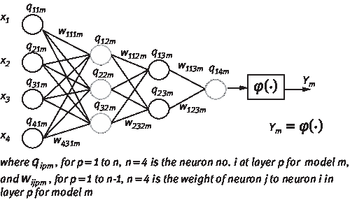

**图 8.2：4 层神经网络。**

连接两个神经元的每条线都有与之相关的权重。（在图 8.2 中，为了保持图表清晰，仅显示了外部连接的权重。）计算上述 `n` 层网络中每层每个神经元值的方程可描述为：

```
(12) q[i(p + 1)m] = Σ[j = 1]^(k − p + 1) q[jpm]w[ijpm], for p = 1, …, n − 1, and layers, i = 1, …, k − p
```

其中 `k` 是输入测量值 `x(t)` 的数量。ANN 一些有据可查的著名优势是学习和模式识别。根据激活函数，最终输出可以是“1”或“0”，指示患者是否有发生 DVT/PE 症状的危险。在训练方法中，反向传播是训练神经网络的常用技术。该框架使用此技术训练模型，并将其应用于新的一组患者数据以用于预测目的。

##### 反向传播

反向传播包含两个步骤：

1.  在第一步中；研究人员计算对响应函数 `Y` 的误差贡献。此步骤计算每个神经元对响应值总误差的贡献程度。误差定义为理想（或预期）结果与实际响应值之间的差异。权重较高的神经元对总误差贡献较大，因此其权重需要调整得更多。
2.  在第二步中，算法从外层神经元开始调整权重，回溯到隐藏层，最后到达输入层的权重。当该算法完成时，网络已完成训练。这称为监督学习，因为它定义了理想（或预期）的响应值。

一旦神经网络模型训练完成，即可将其应用于新的或不完整的数据集。输出将基于输入和调整后的权重提供预测。

### 8.2 一个简单示例

以下是简单单层感知机分类的两个示例。原始示例见 Zurada (Zurada 1997)、Haykin (1998)、Sengupta (2009) 和 Masters (1995)。我们将通过分析每个个体的广泛健康数据，预测哪些患者会患上一种称为 DVT 的疾病。通过查看既往患者数据，关于患者的输入数据可分为两类预测：DVT-True 和 DVT-False。单层感知机的目标是确定一个线性边界，将患者分类在该线性边界的两侧。

如图 8.3 所示，目的是将患者分为两类，由称为 `decision boundary line`（决策边界线）的边界分隔。一组线性方程定义了该边界。线性方程 >0 的区域为一类 (DVT-True)，线性方程 <0 的区域为另一类 (DVT-False)。如果线性方程 = 0，则患者落在线上。我们的目标是设计该线，使患者被分在线的两侧。该线定义为：

```
w[1]x[1] + w[2]x[2] + w[0] = 0
```

您可以应用阈值函数，根据以下阈值函数对患者进行分类：

```
p(x₁,x₂) = { 1   if w₁x₁ + w₂x₂ + w₀ ≥ 0
           { -1  if w₁x₁ + w₂x₂ + w₀ < 0
```


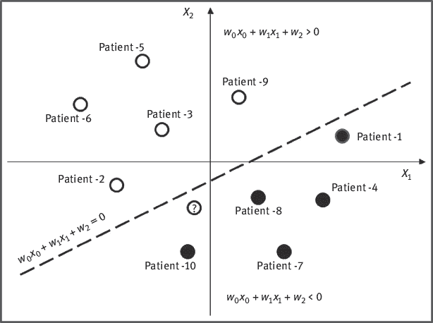

**图 8.3：使用单层感知机进行分类。**

假设我们仅考虑四个输入变量对患者进行分类：葡萄糖 (G)、体重指数 (M)、收缩压 (S) 和白细胞计数 (B)，分别用 `x[1]`、`x[2]`、`x[3]` 和 `x[4]` 表示。阈值函数将按如下方式计算：

```
p(x₁,x₂,x₃,x₄) = { 1   if w₀ + Σᵢ₌₁⁴ wᵢxᵢ ≥ 0
                 { -1  if w₀ + Σᵢ₌₁⁴ wᵢxᵢ ≤ 0
```

假设分类示例的以下权重和输入值如表 8.1 所示。我们可以假设研究的疾病是 DVT（深静脉血栓形成）。

**表 8.1：使用单层感知机分类进行分类计算。**

| 权重 | 值 | 输入 | 值 |
| --- | --- | --- | --- |
| `w[1]` | 2 | `x[1]` | ‒1 |
| `w[2]` | 0 | `x[2]` | 2 |
| `w[3]` | 3 | `x[3]` | 0 |
| `w[4]` | ‒1 | `x[4]` | ‒4 |
| `w[0]` | 1 | `Bias` | 1 |

```
p(x_1,x_2,x_3,x_4) = 2 * -1 + 0 * 2 + 3 * 0 + -1 * -4 + 1 * 1 = 3
⇒ class = 1 or DVT - True
```

如果此分类不正确，则有必要调整权重并重复该过程，直到患者被正确分类。假设正确分类为 (‒1)，则计算过程如表 8.2 所示。结果表明数据属于哪一类，在本例中分类为无疾病或 DVT-False（DVT 为假）。

**表 8.2：修正权重以纠正误分类。**

| 权重 | 值 | 输入 | 值 | 实际类别 = ‒1 时的新权重计算 |
| --- | --- | --- | --- | --- |
| `w[1]` | 2 | `x[1]` | ‒1 | `w[1] = w[1] + class * x[1] = 2 + (−1) ⋆ (−1) = 3` |
| `w[2]` | 0 | `x[2]` | 2 | `w[2] = w[2] + class * x[2] = 0 + (−1) ⋆ 2 = −2` |
| `w[3]` | 3 | `x[3]` | 0 | `w[3] = w[3] + class * x[3] = 3 + (−1) ⋆ 0 = 3` |
| `w[4]` | ‒1 | `x[4]` | ‒4 | `w[4] = w[4] + class * x[4] = −1 + (−1) ⋆ (−4) = 3` |
| `w[0]` | 1 | `Bias` | 1 | `w[0] = w[0] + class * x[0] = 1 + (−1) ⋆ 1 = 0` |

```
p(x[1], x[2], x[3], x[4]) = 3 * −1 + −2 * 2 + 3 * 0 + −1 * 3 + 0 * 1 = −7 ⇒ class = −1 or DVT - False
```

### 8.3 一个简化的数学示例

在本节中，呈现了一个简单的 ANN（人工神经网络）模型作为示例，使用 XOR 逻辑表进行说明。如表 8.3 所示，如果两个输入相同（均为 0 或均为 1），XOR 表返回值 0；如果两个输入中有一个为 1，则返回值 1。

**表 8.3：XOR 逻辑表及 ANN 模型结果。**

| 输入 `x[1]` | 输入 `x[2]` | 理想值 |
| --- | --- | --- |
| 0 | 0 | 0 |
| 0 | 1 | 1 |
| 1 | 0 | 1 |
| 1 | 1 | 0 |

可以开发一个 3 层神经网络来计算每对输入 `x[1]` 和 `x[2]` 的结果。还引入了一个称为 `bias`（偏置）的第三个输入来构建模型。偏置的值始终为 1。添加偏置是为了增加神经网络行为的灵活性。它被添加到模型的所有输入层和隐藏层中。添加偏置类似于在回归模型中添加截距。如果神经网络包含偏置，对于某些输入值，它可能无法产生除“0”以外的输出值。

在第一次迭代中，使用随机权重。如图 8.4 所示，该模型共有九个权重。简单来说，输出是权重和输入的函数。这是一个监督学习的示例，因为 ANN 模型中的权重经过训练以产生期望的输出。

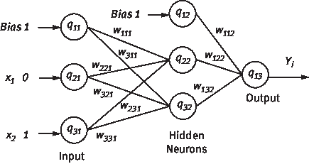

**图 8.4：用于计算 XOR 逻辑表的 3 层 ANN 网络。**

目标是迭代调整权重，直到 ANN 模型产生*理想值*。在第一次迭代中，模型产生*输出*列所示的一些结果。模型计算均方误差 (MSE) 作为误差，并利用该误差来调整权重。

迭代持续进行并调整权重，直到误差项低于某个阈值（在本例中小于 0.009）。最终 ANN 模型停止，输出为*最终*结果，如表 8.4 最后一列所示。计算结果接近理想值（接近 0 或 1），仅相差一小部分误差。

**表 8.4：XOR 逻辑表及 ANN 模型结果。**

| 输入 `x[1]` | 输入 `x[2]` | 理想值 | 输出 | (误差)² | 最终结果 |
| --- | --- | --- | --- | --- | --- |
| 0 | 0 | 0 | 0.2 | 0.04 | .00875 |
| 0 | 1 | 1 | 0.3 | 0.49 | .99130 |
| 1 | 0 | 1 | 0.4 | 0.36 | .99123 |
| 1 | 1 | 0 | 0.5 | 0.25 | .00568 |

### 8.4 激活函数

人工神经网络的关键特性之一是线性神经元输出可以映射为非线性激活函数（Haykin 1998, Sengupta 2009, Zurada 1997）。激活函数在转换感知机输出并将结果塑形后再馈入下一层方面发挥着重要作用。激活函数可能会剪切数值或将其转换为一个函数。共有三类激活函数。

给定输入 `x[0]`、`x[1]`、…、`x[n]`，输出 `ν[k]` 是公式 (10) 求和的结果，而 `Y[k] = φ(⋆)` 是激活函数的结果。激活函数产生一条称为*S 型函数*的 S 形曲线。

在第一类中，当 `v[k]` 从 −∞ 变化到 +∞ 时，输出可以从 0 变化到 1，即 `y[k] = [0, 1]`。这是图 8.5 所示的逻辑斯谛函数。此类神经网络的激活函数表示为：

(13) `φ(⋆) = 1 / (1 + exp(-av))`

(14) `φ(⋆) = { 1 when v → +∞; 0 when v → -∞ }`

这是最简单的神经元公式。通过改变 `a` 的值，可以改变 S 型曲线的形状。当 `a` 很小时，曲线呈现为平滑函数，意味着它像“S”一样弯曲，如图 8.5 所示。但当 `a` 非常大时，该函数趋近于阈值函数，这是 Pitts 和 McCollough 提出的模型（也称为 Pitts-McCollough 模型）。在这种情况下，曲线看起来更像一个阶跃，如图 8.7 所示。

![图 8.5：激活函数 vk 在 [0,1] 之间的 Sigmoid 函数。](graphic/converted/b_9781547401567-009_fig_005.jpg)

**图 8.5：激活函数 v[k] 在 [0,1] 之间的 Sigmoid 函数。**

第二类激活函数的范围从 ‒1 到 +1，用以下公式表示：

(15) `φ(v) = tanh(av)`

`tanh(.)` 是双曲正切函数，计算如下：

(16) `tanh(v) = (e^v - e^{-v}) / (e^v + e^{-v})`

激活函数 `φ(v)` 根据 `v` 的值确定：

(17) `φ(⋆) = { 1 when v → +∞; -1 when v → -∞ }`

表示此激活函数的 S 型曲线形状如图 8.6 所示。

![图 8.6：vk 在 [‒1, 1] 之间的激活函数。](graphic/converted/b_9781547401567-009_fig_006.jpg)

**图 8.6：v[k] 在 [‒1, 1] 之间的激活函数。**

第三类激活函数是由以下公式确定的随机模型：

(18) $\varphi(v) = \left\{ \begin{matrix} {1\quad\quad\,\, with\, prob\, p(v)} \\ {0\quad with\, prob\, 1 - p(v)} \\ \end{matrix} \right.$

和

(19) $p(v) = \frac{1}{1 + e^{(- v/T)}}$

当 `p(v)` = 1 时，`T` = 0，该激活函数变为确定性模型。随着 `T` 增大，模型中的随机行为会增多。为了更好地说明 `T` 的作用，可以将其视为温度或动能，这一概念松散地借用自热力学第三定律。图 8.7 显示了与该激活函数相关的 S 型曲线。各种 S 型曲线展示了 `T` 对曲线上数值的影响。

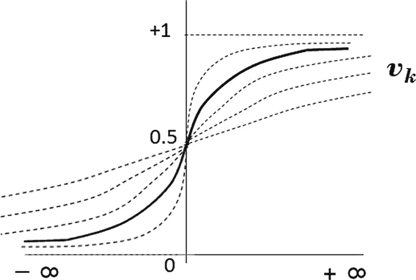

图 8.7：`v[k]` 的随机激活函数。

### 8.5 为什么选择人工神经网络算法

在预测模型涵盖的各种统计和计算方法中，人工神经网络提供了独特的优势，使其成为医学研究和预后的合适工具。这些优势超过了针对 ANN 提出的某些批评（TU 1996）。

ANN 的主要批评包括：对数据采取“黑箱”方法、易于过拟合以及计算负担较大。随着台式机和便携式计算机拥有强大得多的计算能力，需要更大计算能力的批评现在已不那么成问题。关于“黑箱”方法的批评在此框架中不是严重限制，因为使用了多个模型并应用了监督学习。

过拟合是一种弱点，当模型针对特定数据集进行训练，而在训练中未使用的其他数据集上表现不佳时就会发生。通过交叉验证的多次迭代以及像本框架中采用的那样预留单独的测试数据批次，可以避免这一弱点。此外，使用多个模型可以克服一个模型因某个数据集而过度训练、相对于另一个数据集而言的问题。

相比之下，选择 ANN 作为预测模型的优势和理由是重要的考量因素：

*   能够建模输入数据与输出之间复杂的非线性关系
*   能够学习并适应数据中的模式
*   对缺失数据元素具有鲁棒性
*   有许多可供选择的算法
*   能够处理大量变量
*   能够处理多种类型的数据
*   能够检测预测变量之间所有可能的交互作用

### 8.6 深度学习

正如我们所见，人工神经网络至少包含 3 层：一个输入层、一个隐藏层和一个输出层。深度学习的概念是指具有多个隐藏层的人工神经网络模型。研究表明，多层人工神经网络能够进行深度学习，即能够对系统中的任意非线性关系进行建模。

增加更多隐藏层可以提高预测准确性，但仅限于一定程度。研究表明，增加过多的隐藏层（例如超过 5 个隐藏层）会导致模型失去准确性，变得过于“泛化”，以至于无法清晰区分不同的输入信号。换句话说，在构建模型时，你应该尝试一个隐藏层，然后是两个，并继续增加更多隐藏层，直到找到最佳准确度水平。

### 8.7 人工神经网络的数学基础

本节使用 ANN 公式的通用约定介绍 ANN 的数学基础，因此输入用 `x` 表示，期望输出用 `d` 表示，权重用 `w` 表示，ANN 的输出用 `y` 表示（Zurada 1997，Haykin 1998，Wang 2012，Sengupta 2009）。作为介绍，首先展示一个简单的神经元，随后给出分类、记忆和学习的公式。单个神经元可以用单个激活函数构建。考虑为 图 8.8 所示的直方图寻找一条回归线。回归线由以下公式表示：

(20) `y` = `m``x` + `b`

其中 `m` 是直线的斜率，`b` 是一个常数，称为偏置。相应的神经网络表示使用单个神经元，其中权重参数 `w[11]` 对应斜率 `m`，而 `w[10]` 等于常数 1.0。

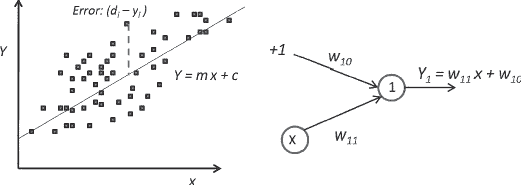

图 8.8：一条回归线及其等效的单神经元表示。

如果 `y` 依赖于多个输入 `x[j]`，可以将偏置视为具有权重 `w[k0]` 的神经元的另一个输入。为了找到最佳拟合线，目标是通过调整权重来最小化误差 `E`。给定多个 `x[j]`，可以使用下文讨论的梯度下降法来找到最小 `E` 和相应的权重。

### 8.8 梯度下降法

`梯度下降法` 作为一种迭代过程，用于确定与每个输入 `x` 相关的权重。该方法在 ANN 文献中也称为 `误差修正` 学习，旨在将总误差最小化，作为训练模型和确定适当权重的方法。以下推导改编自 Zurada（Zurada 1997）和 Sengupta (Sengupta 2009)，并针对本框架进行了改进和修订。总误差 `E` 可以写为：

(21) $Total\ Error\ E = \Sigma_{j}\ E_{j} = \frac{1}{2}\Sigma_{j}{(d_{j} - y_{j})^{2}}$

这表示点 `j` 处的总误差 `E`。表达式 `d[j]` 是点 `j` 处的目标输出（期望输出），`y[j]` 是点 `j` 处的实际输出。

现在让我们考虑所有可能的输出 `y[0], …, y[m]`，其中 `0 ≤ j ≤ m`，且

(22) `y[0]` = `f[0]`(`x[1]`, `x[2]`, …, `x[n]`) $\begin{matrix} & {y_{1} = f_{1}(x_{1},x_{2},\ldots,\, x_{n})\,} \\ & \ldots \\ & {y_{m} = f_{m}(x_{1},x_{2},\ldots,\, x_{n})} \\ \end{matrix}$

总误差 `E` 是输出 `y[k]` 所有误差的组合。在 (14) 中通常使用 1/2 的和，因为正如稍后将解释的那样，它使数学运算更容易，因为在对该项求导时，梯度将乘以 2。

让我们定义梯度，即 (`i`,`j`) 对连接的增长率为：

(23) $G = \frac{\partial E}{\partial w_{ij}} = \frac{\partial}{\partial w_{ij}}\Sigma E_{j} = \Sigma_{j}\frac{\partial E_{j}}{\partial w_{ij}}$

接下来，可以应用偏导数和链式法则得到以下结果：

(24) $\frac{\partial E}{\partial w_{ij}} = \frac{\partial E}{\partial y_{j}} \cdot \frac{\partial y_{j}}{\partial w_{ij}}$

为简化起见，让我们按如下方式表示 `d[j]` 和 `y[j]`：

`d[j]` = `Σ``d[j]`,  `and`  `y[j]` = `Σ``y[j]`

你可以对总误差 公式 (21) 求导，得到以下结果：

(25) $\frac{\partial E}{\partial y_{j}} = - (d_{j} - y_{j})$

(26) $\mspace{-3600mu} y_{j} = \Sigma_{j}\, w_{ij}x_{j}$

(27) $\frac{\partial y_{o}}{\partial w_{oi}} = \frac{\partial}{\partial w_{oi}}\Sigma_{j}w_{oj}x_{j} = x_{^{i}}$

(28) $\frac{\partial E}{\partial w_{ij}} = - (d_{j} - y_{j})x_{i}$

其中 `j` 是输出单元，`i` 是输入单元。因此，误差关于 `w[ij]` 的导数已构建完成。为了沿着导数的相反方向移动，你可以通过将差值乘以 (–) 符号来对 `w[ij]` 进行修正。应用 (–) 符号是因为目标是最小化误差。修正可以写为：

(29) `Δw[i][j] = (d[j] − y[j]) * x[i]`

新的突触权重将使用以下公式计算，进行多次迭代，直到 `Δw[i][j]` 小于用户设定的给定阈值：

(30) `w[i][j][new] = w[i][j][old] + Δw[i][j]`

可以使用 `η` 来表示公式 (29) 中的下降率。因此 `η` 是学习率，它随着每次迭代减少总误差 `E`，研究者可以定义它来调节 `Δw[i][j]`，即下降率。

### 8.9 神经网络学习过程

神经网络中有五大类学习模型。其中一种称为基于误差修正的学习方法，已在 第 8.8 节 的梯度下降法下进行了讨论。其他四类是：

*   基于记忆的学习
*   基于 Hebb 规则的学习
*   竞争学习
*   Boltzmann 学习模型

这些学习方法改编自 Sengupta (2009)、Zeruda (1997)、Wang (2012)、Masters (1995) 和 Haykin (1998)。它们经过了针对本框架的提炼和修订，并为追求完整性而收录于此。

#### 基于记忆的学习

基于记忆的学习旨在保持输入向量与输出之间的关系。给定由 `{x[i] = 1}^(N)` 定义的输入向量 $\bar{x}$，以及期望输出 `d[i]`，这种关联可以用表达式 `{x[i], d[i]}[i = 1]^(N)` 表示。当模型应用于新模式 ${\bar{x}}_i$ 时，由于该模式最初是未知的，让我们从测试模式 ${\bar{x}}_{test}$ 开始，并求出 ${\bar{x}}_{test}$ 向量与新模式 ${\bar{x}}_i$ 向量之间的欧几里得距离。假设 ${\bar{x}}_N' \in \{ x_1, x_2, x_3, \ldots, x_N \}$ 是 ${\bar{x}}_{test}$ 向量的最近邻点集合，这意味着模式 ${\bar{x}}_i$ 到 ${\bar{x}}_{test}$ 的距离在所有 ${\bar{x}}_i$ 的集合中是最小的。这可以通过以下表达式表明，对于所有 `i` 的距离均成立：


(31) `min (over i) d{ x_i, \bar{x}_{test} } = d(\bar{x}_N', \bar{x}_{test})`

为了改进该算法，审慎的做法是查看最近邻，并找到提供最小距离的集合。正如图 8.9 所示，基于记忆的学习非常适合模式识别和数据分类。这种方法有助于将离群值排除在分类之外。这就是 K 近邻分类。假设我们要对一个新数据点进行分类。在图 8.9 中，标记为 `x[i]` 的新点必须在 “+” 形状或 “O” 形状之间进行分类。由于其最近邻是 “O” 形状，因此它将被归类为 “O” 集合的成员。

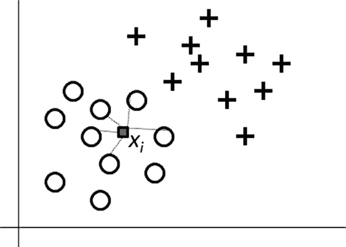

图 8.9：使用基于记忆的学习进行分类。

### 基于 Hebb 规则的学习

基于 Hebb 规则的学习的目标是保持输入向量与输出之间的关联。该方法归功于神经生物学家 Donald Hebb，他在 1949 年提出了学习过程中大脑神经元适应的理论。在 Hebb 学习过程中，权重 `w[kj]` 的调整量定义为：

(32) `Δwkj = f(yk, xj)`

Delta 是 `w[kj]` 的变化量。这是在时间步 `n` 时 `w[kj]` 的调整。该调整表示为时间步 `n` 时响应 `y[k]` 和输入 `x[j]` 的函数。你可以用突触前和突触后的响应来重写此表达式：

(33) `Δw[kj] = η * yk * xj`

其中 `η` 是学习率。该表达式称为 *活动乘积规则*。重要的是要注意 `η` 是常数。假设保持 `x[j]` 不变，则可以绘制 `Δw[kj]` 和 `yk`，得到一条截距过原点、斜率为 `η * xj` 的直线，如图 8.10 所示。随着 `y[k]` 的增加，`Δw[kj]` 也随之增加。最终突触权重达到饱和点，无法再进行更多学习。

让我们定义 $\bar{x}$ 和 $\bar{y}$ 为 `x[j]` 和 `y[k]` 的时间平均值。则可以定义：

```
x_j(n) = x_j - \bar{x}; y_k(n) = y_k - \bar{y}.
```

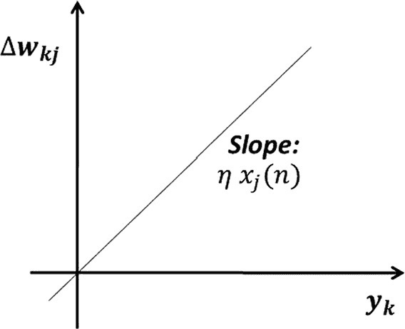

图 8.10：活动乘积规则的斜率代表学习率。

根据协方差的定义，可以将权重 `w[kj]` 的变化写为 `x[j]` 和 `y[k]` 距其各自时间平均值 $\bar{x}$ 和 $\bar{y}$ 的距离的协方差。

(34) `Δw_kj = η(x_j - \bar{x})(y_k - \bar{y})`

由于期望的是整个 `x[j]` 输入值的平均变化效果，$\bar{x}$ 可以被视为在 `x[j]` 过程中保持常数。这种关系可以用一条与 `Δw[kj]` 和 `y[k]` 相交的直线来表示，如图 8.11 所示。该图显示了给定点 `x[j]` 处 `Δw[kj]` 和 `y[k]` 之间的关系，使得 `(x_1 - \bar{x})` 为常数。

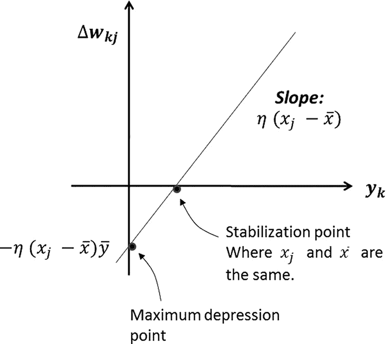

图 8.11：响应与输入之间的协方差关系。

应用协方差方法时，可能出现三种情况：

(35)

```
(i)    若 x_j > \bar{x} 且 y_k > \bar{y}，则 w_kj 增加
(ii)   若 { a) x_j < \bar{x} 且 y_k > \bar{y}
                                  b) x_j > \bar{x} 且 y_k < \bar{y} } 任一成立，则 w_kj 减少
(iii)  若 x_j < \bar{x} 且 y_k < \bar{y}，则 w_kj 增加
```

### 竞争学习

在 *竞争学习* 中，每个神经元竞争以增加其响应值，同时最小化其他神经元的输出。获胜的神经元将在未来的学习迭代中被优先选择。竞争学习的数学模型基于：

(36)

```
y_k = { 1 if v_k > v_j, for all j when j ≠ k.
      { 0 otherwise
```

所有 k 的权重总和均设为 1：

`Σ[j] w[kj] = 1`

例如，考虑图 8.12 所示的三个输入变量簇。可以将 `x[j]` 写为向量 $\overset{ˉ}{x} = \lbrack x_{1},x_{2},x_{3}\rbrack$。如果强制关系 ${\parallel \overset{ˉ}{x} \parallel} = 1$，即要求 $\sqrt{{x_{1}}^{2} + {x_{2}}^{2} + {x_{3}}^{2}} = 1$，则可以有多个向量 ${\overset{ˉ}{x}}_{1},\,{\overset{ˉ}{x}}_{2},\,{\overset{ˉ}{x}}_{3}$ 来表示不同的模式，如图 8.12 所示。目标是将数据分类为 `n` 个模式中的任意一个。模式簇被分组为一组向量数据（在本例中为向量 ${\overset{ˉ}{x}}_{1},\,{\overset{ˉ}{x}}_{2},\,{\overset{ˉ}{x}}_{3}$），使得：`Σ[j]w[kj] = 1`，对所有 `k` 成立。此外，还可以将每个簇的权重表示为向量。例如，第一个簇的权重向量可以表示为：${\overset{ˉ}{w}}_{1} = \lbrack w_{11}\; w_{12}\; w_{13}\rbrack$。

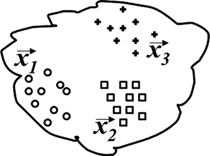

图 8.12：使用竞争学习将数据分类为不同模式。

在该竞争学习模型中，通常簇中最中心的元素（或神经元）是获胜者，所有其他权重都会顺应（或对齐）它。竞争学习规则是 `Δw[kj]` 由以下确定：

```
Δw_{kj} = \left\{ \begin{matrix} {{\eta(x_{j} - w_{kj})}\ \ } & {if\, neuron\, k\, wins\, the\, competition} \\ & {\!\!\!\! 0\ \ \ \ \ \ \ \ \ \ \ \ \ {if\, neuron\, k\, loses}} \\ \end{matrix} \right.
```

### 玻尔兹曼学习模型

玻尔兹曼学习过程源于统计力学，模拟一种随机学习模型。在该模型中，神经元构成一个允许自我反馈的循环结构。神经元取 +1 或 –1 的二进制值。该模型表示为：

```
E = - \frac{1}{2}\Sigma_{j}\Sigma_{k}w_{kj}x_{k}x_{j}\quad{where}\quad j \neq k
```

可见神经元是输出层。如图 8.13 所示的内部神经元是隐藏神经元。该模型被视为随机模型，因为一个外部神经元的变化会改变 `E` 的值。神经元 `x[k]` 从一种状态翻转到另一种状态的概率定义为：

```
P\left( {x_{k}\rightarrow - x_{k}} \right) = \frac{1}{1 + \exp(\frac{- \Delta E_{k}}{T})}
```

因翻转导致的 `E[k]` 变化用 `ΔE[k]` 表示。如果 `E` 被视为能量函数，则 `ΔE[k]` 是神经元状态翻转引起的能量变化。变量 `T` 是伪温度，代表噪声或随机性的水平。在玻尔兹曼网络中，神经元可以处于钳制状态或自由状态。神经元的钳制状态意味着其值被设定且不可改变。自由状态意味着神经元的值可以在该运行状态下改变。设定两个变量：

`P[kj]^+`：钳制状态下神经元 `k` 和神经元 `j` 之间的相关性

`P[kj]^-`：自由状态下神经元 `k` 和神经元 `j` 之间的相关性

则玻尔兹曼学习规则定义为：

`Δw[kj] = η(P[kj]^+ − P[kj]^-) where j ≠ k`。

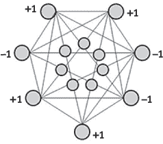

图 8.13：玻尔兹曼学习模型中的内部和外部神经元。

## 8.10 选定的分析模型

由于集成框架使用多个模型进行分类和预测，因此必须密切关注每个模型的准确性。我选择以下四种模型用于集成，因为每种模型都提供了特定的优势和特性，使其适用于特定类型的数据和预测。此外，已有证据表明这些模型是用于分类最准确的神经网络模型之一。以下是每种 ANN 方法的优缺点总结（Masters 1995）：

1.  **PNN** – 概率神经网络是四层网络。它们以非参数方法对数据进行分类，且对异常值数据不敏感。已证明，仅使用输入、模式、求和和输出感知机四层的概率神经网络，能比反向传播神经网络提供更准确且相对更快的分类（Principe, Euliano, Lefebvre 1999）。

2.  **SVM** – 支持向量机网络。SVM 通过构建一个定义超平面的双层网络来执行分类，该超平面将数据分离为多个类别。SVM 是一种非概率二元线性分类器。它接受一组输入数据，并确定输入属于哪个可能的类别。SVM 非常适合数据元素的分类和聚类。

3.  **GFN（广义前馈）采用 LM 训练** – 前馈神经网络由一个或多个节点层组成，信息仅单向流动，从输入节点向前传播，网络中没有循环或回路。在多层模型中，每个节点都与后续层中的节点有直接连接。每个节点中计算权重与输入的乘积之和（Haykin 1998）。我在该 GFN 模型中使用 Levenberg-Marquardt（LM）算法作为核心方法。我将在后续章节解释 Levenberg-Marquardt 算法。

4.  **MLP 采用 LM 训练** – 多层感知机，一种类似于带可变步长修正的梯度下降法的方法。该模型已提出多种变体，包括 Levenberg-Marquardt 模型（Wilamowski & Chen 1999），后者被公认为最高效的算法之一。

下一节将对本书中使用的四种神经网络方法进行更深入的数学回顾。

## 8.11 概率神经网络

回顾图 8.3 中的分类问题，目标是将未知患者（用符号“?”表示）分类到两个组别中的一个。最直接的方法是检查到最近邻的距离。但这种方法虽然简单，却有弱点。它可能将本属于另一组簇的样本误分类到某一组。目标是定义一个“影响球”函数，以表示将未知点与训练集点分开的距离分布。

可以将这个“影响球”想象为一个在视觉上类似于“伞”的函数，如图 8.14 所示。这种函数在距离训练集点零距离处有一个峰值，并随着距训练集点距离的增加而逐渐变细至零。一个提议的分类器将计算每个总体所有训练集点的此函数之和，并将未知样本分类到总和最大的总体中。

以下推导改编自 Sengupta (Sengupta 2009) 和 Zurada（Zurada 1997），并针对预测建模进行了改进和修订。有助于定义此类函数的数学构造是高斯函数：

(37) `f(x) = ae^{- \frac{{(x - x_{i})}^{2}}{2\sigma^{2}}}`

其中 `a`、`x[i]`、`σ` 均 > 0，`a` 为曲线峰值的高度（或振幅），`x[i]` 为峰值中心的位置，`σ` 为曲线的宽度（或展宽）。Hardy (2006) 绘制了 `x[0]`、`x[1]` 的二维图，如图 8.14 所示，其中 `x[0]`、`x[1]` 的值设为原点 (0,0)。系数 `a` 和 `σ` 可取任意正值。缩放参数 `ϭ` 控制影响区域的宽度。

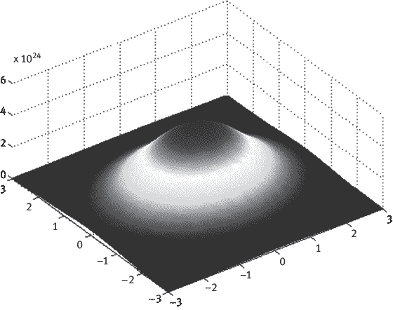

图 8.14：二维高斯函数图。

概率神经网络 (PNN) 的思想是：每个由高斯模式单元表示的训练元素，都会增加附近数据具有相同分类的可能性。要计算某数据点的分类，我们可以计算该点在每个类别内的响应，并选择响应最高的类别。每个训练数据点对应一个模式单元，即一个以该参数位置为中心的高斯函数。

这种分类方法背后的思想是：对于一个新数据点，我们测量该新点与该分类中所有其他点之间的平均“距离”。根据 公式 (38) 计算，一个点与其他点的平均“距离”越小，其 `z` 值越大。因此，该点将属于其 `z` 值最高的那个分类。

考虑一个简单的高斯模式方程，用于计算点 (`x[0], x[1]`) 相对于已分类点 (`x[0i], x[1i]`) 的结果：

```
(38) $z = f(x_{0},x_{1}) = \Sigma_{i = 1}^{n}\, e^{\frac{- {({{(x_{0} - x_{0i})}^{2} + {(x_{1} - x_{1i})}^{2}})}}{2\sigma^{2}}}$
```

假设你打算预测患者未来的颅内压 (ICP) 状态。目标是将输入数据分为三个可能的类别之一：正常、中度或危重。每个类别分别由 `f[N]`、`f[M]` 和 `f[C]` 表示，它们是类别 N、M 和 C（正常、中度和危重）的概率分布函数。然后可以按如下方式计算 `f[N]`、`f[M]` 和 `f[C]`：

```
(39) $z_{N} = f_{N}(x_{0},x_{1}) = \Sigma_{i = 1}^{n}\, e^{\frac{- {({{(x - x_{0Ni})}^{2} + {(x - x_{1Ni})}^{2}})}}{2\sigma^{2}}}$ $z_{M} = f_{M}(x_{0},x_{1}) = \Sigma_{i = 1}^{n}\, e^{\frac{- {({{(x - x_{0Mi})}^{2} + {(x - x_{1Mi})}^{2}})}}{2\sigma^{2}}}$ $z_{C} = f_{C}(x_{0},x_{1}) = \Sigma_{i = 1}^{n}\, e^{\frac{- {({{(x - x_{0Ci})}^{2} + {(x - x_{1Ci})}^{2}})}}{2\sigma^{2}}}$
```

此处，待分类的数据点为 `X`，属于其他分类的所有其他点分别用 `N[i]`、`M[i]` 和 `C[i]` 表示。激活函数有很多种，但常见的非线性运算如下：

```
(40) $e^{\frac{- {(W_{i} - X)}^{\tau}(W_{i} - X)}{2\sigma^{2}}}$
```

如果 `X` 和 `W[i]` 被归一化为单位长度，已证明 (Zaruda 1997) 上述非线性运算可被公式 (41) 替代。推导过程为分子项相乘。结果为：

`- w[i]² + 2 w[i] X − X² = − 2 + 2 w[i] X = 2 (w[i] X − 1)`

由于 `w[i]²` 和 `X²` 项被归一化为 1，故用 1 代替。将上述分子项中的 `W[i] X` 替换为 `Z[i]`，可得到以下激活函数：

```
(41) $e^{\frac{(Z_{i} - 1)}{\sigma^{2}}}$
```

因此，识别新数据集分类的简单算法可描述为：

1.  **输入层**：将 `X` 和 `W[i]` 归一化为单位长度

2.  **模式层**：计算输入 `X` 与 `X` 的权重 `W[i]` 的点积

3.  **求和层**：计算 `f[N]`、`f[M]` 和 `f[C]`

4.  **输出层（或决策层）**：选择响应值最高的输出（来自 `N`、`M` 或 `C` 神经元簇）

最终分类由分类器函数 `C` 确定，该函数选择 `f[N]`、`f[M]` 和 `f[C]` 中的最大值：

```
(42) *P**r**e**d**i**c**t**i**o**n*[(*t* + *t*1)] = *C*(*f*[*N*], *f*[*M*], *f*[*C*]) = *m**a**x*(*f*[*N*], *f*[*M*], *f*[*C*])
```

附录 B 中的示例说明了如何将 PNN 应用于简单的分类问题。

## 8.12 支持向量机 (SVM) 网络

支持向量机 (SVM) 是众多监督训练模型之一，用于分析数据以进行多重分类和回归分析。SVM 是一种使用监督学习模型的机器学习方法。它用于检测模式，常用于分类和回归分析。它能有效处理线性和非线性数据以训练模型。SVM 方法因其预测准确性而备受推崇。

SVM 是一种非概率二元线性分类器。它接收一组输入数据，并确定输入属于哪个可能的类别。SVM 在数据元素之间构建一组超平面以对其进行分类。

良好的分离是泛化模型的标志，它由到任一类别中最近训练数据元素距离最大的超平面实现。超平面在数学上定义为：在该空间中，与某向量内积为常数的数据元素集合。“间隔”是最优超平面与靠近它的向量之间的距离。以下推导改编自 Sengupta (2009) 和 Haykin (1998)，并针对本框架进行了改进和修订。

通过获得尽可能大的间隔，可以找到最优解。在图 8.15 中，展示了两个示例，说明了将数据分为两类的带状区域。这是二元分类的一个示例，目标是识别哪些数据点落入一类，哪些落入另一类。例如，如果你想预测哪些客户可能流失或保持忠诚。在多类问题中，你可能会将数据分离为多个分类。将数据分离为两个或多个分类的带状区域称为超平面。

公式 43–48 的推导旨在阐述超平面计算背后的数学原理，但跳过这些内容不会影响信息的获取。

用数学术语描述超平面，最优超平面必须满足以下条件：

```
(43) $\frac{y_{k}F(x_{k})}{\parallel w \parallel} \geq \tau,\, k = 1,2,\,\ldots,n$
```

其中 `τ` 为间隔，可视为将最近点与将它们分为两类的超平面分开的带状区域（如图 8.15 所示）。注意 `F(x)` 定义为：

```
(44) *F*(*x*) = *w*^{(*T*)}*x* + *b*
```


可以将数据点映射到一个非常高维的空间，然后算法在该空间中寻找一个具有最大间隔、能分离数据类别的超平面。特征空间通常定义为基函数 `φi` 的非线性乘积，这些基函数定义在输入空间中。这种非线性乘积将在下文解释。此时函数 `F(x)` 变为：

```
(45)$F(x) = \sum_{i = 1}^{n}{a_{i}K}(x_{i},x) + b$
```

其中 `K(x[i], x)` 为基函数 `φi` 的内积核，`j` = 1, 2, …, `m`。高维空间中的交叉乘积由核函数 `K(x, y)` 定义，该函数最适合该问题，使得：

```
(46)∑[i]a[i]K(x[i], x) = constant
```

可以观察到，随着 `y` 远离 `x`，`K(x,y)` 会变小。内积 `K(.)` 可以有许多可能的核函数。每个核函数本质上都是一个包含 Sigmoid 函数的求解器。（回顾我们之前对神经网络的描述，每个感知器的输出都是通过使用 Sigmoid 函数来塑造的）。最常用的一种基于高斯函数：

(47) $K(x_{i},x) = e^{( - \frac{{\parallel {x - x_{i}} \parallel}^{2}}{2\sigma^{2}})}$

其中 `σ` > 0，且 Sigmoid 核函数 `K(x[i], x)` = `tanh(θ < x[i], x > + ϑ)` 使得

(48) `θ` > 0, `and` `x` > + `ϑ`。

图 8.15 说明了将数据分成两个簇的两条线。

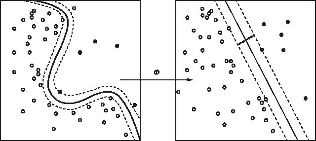

图 8.15：支持向量机作为分类器。

### 8.13 通用前馈神经网络

前馈神经网络由一个或多个节点层组成，信息仅沿一个方向流动，即从输入节点向前流动，网络中没有循环或回路。最简单的网络只有一个单层，通过一系列权重将输入数据馈送到输出层。

一种流行的训练方法是梯度下降算法。以下是梯度下降法的数学推导，改编自 Sengupta (Sengupta 2009) 和 Zurada (Zurada 1997)，并针对本框架进行了改进。

对于一个具有 `n=1, …, N` 层的给定神经网络，你可以计算每个节点的误差。根据定义，时间快照 `n` 处节点 `j` 的误差由以下公式计算：

(49) `ej` = `dj` − `yj`

而对于计算网络的总误差，回顾 公式 (21) 给出：

(50) $E(n) = \frac{1}{2}\sum_{j}{{e_{j}}^{2}(n)}\,\,\,\,\,\,\,{for}\,\,\,\,\,\,\, j = 1\,\,\,\,\, to\,\,\,\,\, m.$

然后你可以通过以下公式计算网络的平均误差：

(51) $E{(N)_{Avg}} = \frac{1}{N}\sum_{n = 1}^{N}{E(n)}$

让我们使用传统的 Pitts-McCullough 方程进行计算：

(52) $v_{j}(n) = \sum_{i = 0}^{m}{w_{ji}(n)}y_{i}(n),$

其中 `vj` 是神经元 `j` 的激活函数的输入。项 `vj` 可被视为感应局部场，而 `yi` 可被视为来自上一层的输出，如下所示：

(53) `yi` = `φ(vj)`

有了前面的介绍，就可以开始反向传播法的数学推导了。首先很容易计算 `E(n)` 的偏导数并应用链式法则得到以下结果：

(54) $\frac{\partial E(n)}{\partial w_{ji}(n)} = \frac{\partial E(n)}{\partial e_{j}(n)} \cdot \frac{\partial e_{j}(n)}{\partial y_{j}(n)} \cdot \frac{\partial y_{j}(n)}{\partial v_{j}(n)} \cdot \frac{\partial\nu_{j}(n)}{\partial w_{ji}(n)}$

其中 `Δw[i][j]` 应用于 `w[i][j]`。让我们对上述每个分量（来自 公式 54）应用求导：

$\frac{\partial E(n)}{\partial e_{j}(n)} = e_{j}(n)$

$\frac{\partial e_{j}(n)}{\partial y_{j}(n)} = - 1$

$\frac{\partial y_{j}(n)}{\partial v_{j}(n)} = \varphi^{\prime}\left( {v_{j}(n)} \right)$，当确切函数已知时，你可以对 `φ(vj)` 求导。

$\frac{\partial\nu_{j}(n)}{\partial w_{ji}(n)} = y_{i}(n)$

现在可以写出代入后的结果：

(55) $\frac{\partial E(n)}{\partial w_{ji}(n)} = - e_{j}(n)\varphi^{\prime}\left( {v_{j}(n)} \right)y_{i}(n)$

当 `Δw[j]i`（即对 `w[j]i` 的修正）应用于 `w[j]i` 时，可以得到以下关系：

(56) $\Delta w_{ji}(n) = - \eta\frac{\partial E(n)}{\partial w_{ji}(n)} = \eta\,\,\, e_{j}(n)\varphi^{\prime}\left( {v_{j}(n)} \right)y_{i}(n)$

该方程提醒我们，`Δw[j]i` 与 $\frac{\partial E(n)}{\partial w_{ji}(n)}$ 成正比，比例系数为 `η`，方向与梯度相反。公式 (55) 中的部分项可以描述为误差乘以激活函数。该项可以表示为：

(57) $\partial_{j}(n) = - \frac{\partial E(n)}{\partial v_{j}(n)} = - \frac{\partial E(n)}{\partial e_{j}(n)} \cdot \frac{\partial e_{j}(n)}{\partial y_{j}(n)} \cdot \frac{\partial y_{j}(n)}{\partial v_{j}(n)}$

(58) `∂j` = `ej` `φ`^′(`vj`)

项 `∂j` 是误差关于激活函数 `vj` 的导数。这是神经元 `j` 的梯度，且局限于神经元 `j`。这也被称为*局部梯度*。现在可以将 公式 (56) 重写为：

(59) `Δw[j]i` = `η` `∂j` `yi` `where` `yi` `is` `the` `input` `to` `neuron` `j`。

由于 `η` 和 `yi` 的值已知，因此可以计算 `∂j`。存在两种可能的情况：

*   **情况 1）** 神经元 `j` 属于输出层，因此 `∂j` 可以从 公式 (54) 计算得出。

*   **情况 2）** 神经元 `j` 属于隐藏层，因此 `∂j` 必须用不同的方式计算。

反向传播的一个基本条件是你能计算 `∂j`，即激活函数的导数必须存在。让我们用图形化的方法来阐述隐藏层和输出层的计算，如 图 8.16 所示。图 8.16 中的信号流图显示 `j` 是隐藏层，`k` 是输出层神经元。


图 8.16：隐藏层 j 和输出层 k 神经元的描述。

你可以通过以下推导计算 `∂j`。已知：

(60) $\partial_{j}(n) = - \frac{\partial E(n)}{\partial\nu_{j}(n)} = - \frac{\partial E(n)}{\partial y_{j}(n)} \cdot \varphi^{\prime}\left( {v_{j}(n)} \right)$

还要回顾 公式 (50)：

$E(n) = \frac{1}{2}\Sigma_{k}e_{k}^{2}(n)$，其中 `k` 是输出层神经元的集合。可以表明：

(61) $\frac{\partial E(n)}{\partial y_{j}(n)} = \Sigma_{k}e_{k}(n)\frac{\partial e_{k}(n)}{\partial y_{j}(n)} = \Sigma_{k}e_{k}(n)\frac{\partial e_{k}(n)}{\partial v_{k}(n)} \cdot \frac{\partial v_{k}(n)}{\partial y_{j}(n)}$

(62) `Since` `ej` = `dj` − `yj` = `dj` − `φ(vj)`

让我们对左边求导：

(63) $\frac{\partial e_{k}(n)}{\partial v_{k}(n)} = - \varphi^{\prime}\left( {v_{k}(n)} \right)$

对于神经元 `k`，可以写成：

(64) `νk` = `Σ[j=0]^(m)` `w[k]j` `yj`

因此，对 (64) 求导可得：

(65) $\frac{\partial v_{k}(n)}{\partial y_{i}(n)} = w_{kj}(n)$

(66) $\frac{\partial E(n)}{\partial y_{j}(n)} = - \Sigma_{k}e_{k}(n)\varphi^{\prime}\left( {v_{k}(n)} \right)w_{kj}(n) = - \Sigma_{k}\partial_{j}(n)w_{kj}(n)$

由 公式 (60) 和 (66) 可得出：

(67) `∂j` = `φ[j]`^′(`vj`) ⋅ `Σ[k]` `∂k` `w[k]j`

该方程意义重大，因为它表明神经元 `j`（隐藏神经元）的局部梯度取决于输出神经元 `k` 的局部梯度。求和项是所有输出梯度的加权和。假设 `M` 为输出神经元的数量。考虑将每个误差项 `ej` 乘以相应激活函数的导数，即 `φk)` 乘以 `φ[k]'(νk)`。这是反向传播的基础，如图 8.17 所示。


图 8.17：反向传播——根据前向步骤中的误差 ek 计算 ∂j。

一次反向传播完成后，流程通过前向传递反向进行。前向传递使用新权重重新计算神经网络的结果。在前向传递中，输入从第一层向前传播到第二层，依此类推，最终到达输出层。计算误差项，然后开始反向传播。在反向传播中，算法从误差项开始。然后计算局部梯度并向后传播，调整突触权重。

激活函数可以是前面提到的三种类型中的任意一种，例如 Sigmoid 函数、Logistic 函数或 `tanh(.)` 函数。让我们计算 Logistic 函数情况下的函数导数：

(68) `$\\varphi\\_{j}\\left( {\\nu\\_{j}(n)} \\right) = \\frac{1}{{}\_{1 + e}\\left( {- a\\nu\\_{j}(n)} \\right)} \\equiv y\\_{j}(n)$`

已知 `α` > 0，且 −∞ < `vj` < ∞。可以按如下方式计算激活函数的导数：

(69) `$\\varphi\\_{j}^{\\prime}\\left( {\\nu\\_{j}(n)} \\right) = \\frac{a \\cdot e^{( - a\\nu\\_{j}(n))}}{{\\lbrack 1 + e^{^{( - a\\nu\\_{j}(n))}}\\rbrack}^{2}} = a \\cdot y\\_{j}(n)\\lbrack 1 - y\\_{j}(n)\\rbrack$`

换句话说，你可以用以下方式重写上式：

(70) `φ[j]'(νj) = 1 − y[j] ⋅ (a) ⋅ (yj)`

现在你可以使用 `yj` 通过以下公式计算 `∂j`：

(71) `$\\begin{matrix} & {\\partial\\_{j}(n) = {\\varphi^{\\prime}}\\_{j}\\left( {\\nu\\_{j}(n)} \\right) \\cdot \\sum\\_{k^{\\partial}k}}{(n)w\\_{kj}(n) =}} \\\\ & {\\,\\,\\,\\,\\,\\,\\,\\,\\,\\,\\,\\,\\,\\,\\,\\,\\,\\,\\,\\,\\, a \\cdot y\\_{j}(n)\\lbrack 1 - y\\_{j}(n)\\rbrack\\,\\sum\\_{k^{\\partial}k}}{(n)w\\_{kj}(n)}} \\\\ \\end{matrix}$`

`yj` 的取值范围为 [0,1]。当 `y[j]` = 0.50 时，`φ[j]'(νj)` 的值最大；当 `y[j]` = 1.0 或 0 时，`φ[j]'(νj)` 等于零。这一事实指导我们为 `Δw[kj]` 选择合适的值。同样，你也可以对 `tanh(x)` 求导来计算 `Δw[kj]`。该算法的详细描述见附录 C。

### 8.14 采用 Levenberg-Marquardt (LM) 算法的 MLP

采用 LM 算法的前馈 MLP 是一种前馈神经网络，由一个或多个节点层组成，信息仅单向流动，从输入节点向前传播，网络中不存在循环或回路 (Sengupta 2009, Masters 1995)。最简单的网络只有一层，通过一系列权重将输入数据馈送至输出层。在多层感知机模型 (MLP) 中，每个节点都与后续层中的节点直接相连。

每个节点中都会计算权重与输入的乘积之和 (Haykin 1998)。如果结果值高于特定阈值，神经元以激活值（通常为 1）触发；否则，以去激活值（通常为 -1）触发。该模型及训练方法已有若干变体，包括反向传播算法和 Levenberg-Marquardt (LM) 方法，后者被认为是计算效率较高的算法之一。以下推导改编自 Sengupta (2009)、Haykin (1998) 和 Masters (1995)，并针对本框架进行了修订和改进。

MLP 的训练分两个阶段进行：在前向阶段，网络权重固定，输入数据通过网络传播。前向阶段以误差信号结束计算。误差项由公式 (49) 定义，可表示为：

(72) `e[kp] = d[kp] − y[kp,] k = 1, …, K, p = 1, …, P`

其中 `d[kp]` 为期望响应，`y[kp]` 为网络对输入 `x[ip]` 的响应所产生的实际输出。`d[kp]` 是第 `k` 个输出和第 `P` 层的期望值。`Y[kp]` 是第 `k` 个输出和第 `P` 个模式的实际值。参数 `K` 为网络输出数，`P` 为模式数，`N` 为权重数。

在反向阶段，误差 `e[kp]` 向后通过网络传播，自由权重被调整以最小化误差 `e[kp]`。在 LM 算法中，性能指标 `F(W)` 待优化：

(73) `$F(W) = \\sum\\_{p = 1}^{p}\\left\\lbrack {\\sum\\_{k = 1}^{K}{(d\\_{kp} - y\\_{kp})}^{2}} \\right\\rbrack$`

其中 `W = [w[1] w[2] … w[N]]^T` 为网络的所有权重集合。该方程可写为：

`F(W) = E^(T)E`

其中

(74) `E = [e[11]…e[K1] e[12]…e[K2]…e[1P]…e[KP]]^(T)`

误差项 E 是所有模式的累积误差向量。假设每个权重的变化量用 `θ[ij]` 表示。利用雅可比矩阵，可以计算反向传播中需施加于权重的变化量。根据定义，雅可比矩阵是一个向量对另一个向量的导数。在向量微积分中，雅可比矩阵是向量值函数所有一阶偏导数组成的矩阵。由上式可知，雅可比矩阵可定义为：


(75) `$J = \begin{bmatrix} \frac{\partial e_{11}}{\partial w_{1}} & \frac{\partial e_{11}}{\partial w_{2}} & {\ldots\frac{\partial e_{11}}{\partial w_{N}}} \\ \frac{\partial e_{21}}{\partial w_{1}} & \frac{\partial e_{21}}{\partial w_{2}} & {\ldots\frac{\partial e_{21}}{\partial w_{N}}} \\ \vdots & \vdots & \vdots \\ \frac{\partial eK_{1}}{\partial w_{1}} & \frac{\partial eK_{1}}{\partial w_{1}} & \frac{\partial eK_{1}}{\partial w_{1}} \\ \vdots & \vdots & \vdots \\ \frac{\partial e_{1}P}{\partial w_{1}} & \frac{\partial e_{1}P}{\partial w_{2}} & {\ldots\frac{\partial e_{1}P}{\partial w_{N}}} \\ \frac{\partial e_{2}P}{\partial w_{1}} & \frac{\partial e_{2}P}{\partial w_{2}} & \frac{\partial e_{2}P}{\partial w_{N}} \\ \vdots & \vdots & \vdots \\ \frac{\partial eKP}{\partial w_{1}} & \frac{\partial eKP}{\partial w_{2}} & \frac{\partial eKP}{\partial w_{N}} \\ \end{bmatrix}$`

利用牛顿-拉夫逊法，通过施加误差项的阻尼度量来计算权重变化。我们将使用雅可比矩阵（以下公式中显示为 `J`）来计算 Levenberg-Marquardt 模型的变化量。可以按如下方式推导 Levenberg-Marquardt 算法：回顾输出是输入 `x[i]` 和权重 `W` 的函数。这可以表述为：

`y[i] = yi`

换句话说，`y[i]` 取决于输入 `x[i]` 和权重 `W`。反向传播的目标是通过 `J[i]δ` 调整权重 `W`，其中 `δ` 为调整量，`J[i]` 为雅可比矩阵的第 `i` 行。于是可以将该表达式写为：

*y**i* ≅ *y**i* + *J*[*i*]*δ*

计算的目标是在公式 (73)中最小化目标函数：

最小化 *E*(*W*) = ∑[*p*]∑*k*²

变量 *δ* 代表权重的微小变化或调整。当由 *δ* 调整时，最小化函数可写为：

*E*(*W* + *δ*) = ∑[*p*]∑*k*)² ≅ ∑[*p*]∑*k*²

接下来误差项可写为：

(76) $E(W + \delta) \cong {\parallel {\overset{‾}{y} - \overset{‾}{d} - J\delta} \parallel}^{2}$

为最小化此函数，需求导并令其为零。上述函数求导并令为零变为：

$- 2J^{T}\left( {\overset{‾}{d} - \overset{‾}{y} - J\delta} \right) = 0$，即：

$J^{T}\left( {\overset{‾}{y} - \overset{‾}{d}} \right) = J^{T}J\delta$

变化率可由参数 *η* 所示的标量倍数进行调节。公式 (76) 可写为：

$J^{T}\left( {\overset{‾}{y} - \overset{‾}{d}} \right) = (J^{T}J + \eta I)\delta$，或写为：

*J*^(*T*)*E* = (*J*^(*T*)*J* + *η**I*)*δ*

其中 *I* 为单位矩阵。可见权重的变化率可通过以下公式计算：

$\delta = \frac{J^{T}E}{(J^{T}J + \eta I)}$

很容易看出，下一次迭代的权重可使用以下方程计算：

(77) *W*[*t* + 1] = *W*[*t*] − (*J*[*t*]^(*T*)*J*[*t*] + *η*[*t*]*I*)^(−1)*J*[*t*]^(*T*)*E*[*t*]

其中 **J** 为雅可比矩阵（神经网络 *n* 个权重关于 *m* 个输入误差的一阶导数矩阵），**I** 为单位矩阵，*η*[*t*] 为学习参数。

神经网络提供多种结构和学习方法，为广泛的应用提供了极大的灵活性和强大功能。Python Scikit-Learn、Tensorflow 和 R 等编程环境提供各种神经网络和深度学习程序，支持许多此类结构。

使用神经网络建模的一个关键方面是准确性和模型性能。在下一章中，我们将回顾如何衡量模型性能并提高其准确性。

## 第 9 章 模型准确性与优化

传统的数据驱动预测方法构建多个模型并选择性能最好的一个，丢弃所有其他模型。这种方法存在一些缺点：

1. 构建多个模型的工作被浪费了。
2. 选定的模型可能无法在所有类型的数据和各种类型的预测中始终保持最高准确性或鲁棒性。
3. 随着数据类型随时间发生变化，选定的算法可能无法在训练数据类型上持续保持一致的性能。

为克服这些缺点，我有效地应用了多模型集成方法（也称为模型委员会），该方法通过加权求和公式结合多种算法。

模型性能由许多属性定义，包括模型准确性和计算速度。在本节中，我希望重点关注准确性作为改进的关键因素。此处的模型优化是指如何最大化模型的准确性。我将介绍包含五种不同集成方案的框架，并在医疗预测案例研究数据集上比较它们的性能。

这些方案包括投票公式、两种基于准确性的加权方案、基于多样性的加权和基于优化的加权。构建集成的目标是确定每个算法的权重，从而提高数据驱动预后的性能。

本书采用的案例研究表明，集成方法提供的预测比任何单一最佳算法都更准确。给定若干神经网络供选择，目标是选择这些模型输出的加权和，以提供最准确的分类。

可以定义一个神谕程序，从四个 ANN 模型提供的五个集成（或委员会）算法中选择最准确的算法。神谕被定义为一个监督程序，它在一组选项中选择最合适的答案。作为监督者，神谕从若干满足所需准确度水平或预测特征的集成或模型中选择一个预测。每个模型的性能基于其在测试数据集（也称为留出数据集）验证步骤上的准确性来确定。

由于一个模型可能在预测真阳性方面表现更好，而另一个模型在特定数据集上预测真阴性方面表现更好，神谕程序以一种方式结合多个模型的预测：准确性较高的模型分配较高权重，较差的模型分配较低权重。即使较差的模型也对预测有贡献，但权重较小。在不同数据集上训练可能完全相反。因此，集成调整每个模型的比例以提供所需的最高准确性。通过这种方式，神谕可以通过结合不同模型的最佳分类特征来提高分类准确性、灵敏度和特异性。

鉴于有许多神经网络可供选择，目标是选择最准确的模型或模型集成，以预测患者是否会患上某种特定疾病。例如，假设预后引擎训练四种不同的算法来对 DVT 进行预测。然后它可以从四个模型的输出中构建五个具有不同加权和的集成。

例如，考虑一项使用机器学习分类器（使用其测试数据）将患者分为两组的研究：将患病者和健康者分开。因此，阳性病例是患病患者，TP 分类意味着算法正确地将患病患者分类为生病。然后 FP 代表第一类错误 (α)，FN 代表第二类错误 (β)，如图 9.1 所示。


图 9.1：显示第一类和第二类错误的真值表。

神谕程序可设置为增强四种所需准确性特征中的任意一种：直接提高真阳性 (TP)、真阴性 (TN)、假阳性 (FP) 或假阴性 (FN)，或提高其他准确性度量，如灵敏度、特异度或 Youden *J* 指数。

为神谕程序定义目标很重要。从业者必须定义神谕程序的选择标准；神谕是选择减少第一类 (FP) 错误、第二类 (FN) 错误或两者兼有的模型或模型集成；还是稍后将介绍的准确性度量组合。

虽然在大多数情况下，标准要求降低第二类错误，但在人口众多且治疗成本高昂的特定情况下，标准也将包括降低第一类错误。

神谕程序可设置为基于这些特征的线性组合提供元分类。集成的目标是基于 ANN 模型的加权和产生综合分类结果：

$\widehat{p} = \sum_{j = 1}^{K}\left( {w_{j}p_{j}} \right)$

本书假设集成包含 *K* 个模型，*p[j]* 为模型 *j* 的预测。集成的预测结果用 *p̂* 表示。

### 9.1 准确性度量

准确性度量可定义为：

$accuracy = \frac{TP + TN}{TP + TN + FP + FN}$ $sensitivity = \frac{TP}{TP + FN}$ $specificity = \frac{TN}{TN + FP}$ $LR + = \frac{sensitivity}{1 - specificity} = \frac{Pr(T + |D + )}{Pr(T + |D - )}$ $LR - = \frac{1 - sensitivity}{specificity} = \frac{Pr(T - |D + )}{Pr(T - |D - )}$

*似然比*将灵敏度和特异性结合为单一指标。它直接估计检测结果将疾病几率改变的程度。

阳性似然比（LR+）显示检测呈阳性时疾病几率增加多少。阴性似然比（LR-）显示检测呈阴性时疾病几率降低多少。几率可由概率推导得出。要将概率转换为几率，需将该概率除以一减去该概率。阳性似然比是灵敏度与一减特异性的比值（Delen 2009）。

### 9.2 准确性与验证

医学预测模型的外部效度是一项极具挑战性的任务。临床验证之所以充满挑战，不仅因为它涉及前瞻性患者研究、双盲研究以及研究方案的严谨实施，还因为其他两个原因：第一，如果模型预测患有疾病，且患者按预测模型建议接受治疗，我们无法确定患者原本是否会表现出该预测疾病以确证我们的预测。换句话说，医疗干预掩盖了可能的结局。第二，相反地，如果模型预测无疾病但患者接受了治疗，我们也无法证伪模型的预测，因为我们不能断言疾病本可能发生。

本框架侧重于准确性方面的内部效度，而将外部（现实生活）验证留待未来的研究项目。已有多种测量方法被提议作为内部验证的手段。常用于比较分类模型准确性的测量指标包括：*准确率*、*灵敏度*、*特异性*、*受试者工作特征曲线下面积*（AUROC）和*似然比*（LR）。*灵敏度*衡量被正确分类为阳性的阳性病例所占比例。

*特异性*是被正确分类为阴性的阴性病例所占比例。AUROC 是 ROC 曲线下的面积，被视为模型预测准确性的良好整体衡量指标（Bewick, Cheek, Ball 2004）。ROC 曲线可通过连接 ANN 模型在不同模型阈值下结果获得的点来绘制，如图 9.2 所示。


图 9.2：四个 ANN 模型的 ROC 曲线。

ROC 曲线是表示*灵敏度*与*（1—特异性）*关系的图形。ROC 曲线下面积（AUROC）可通过梯形面积之和计算得出。

每个模型的 ROC 曲线已计算并比较，如图 9.2 所示。从直观观察可清晰看出，SVM 模型因其相对较大的 ROC 曲线下面积（AUROC）而具有更理想的准确性。

似然比将灵敏度和特异性结合为单一指标。它直接估计检测结果将患病几率改变的程度。阳性似然比（LR+）显示检测呈阳性时疾病几率增加多少。

阴性似然比（LR-）显示检测呈阴性时疾病几率降低多少。几率可由概率推导得出。如前所述，将概率转换为几率，需将该概率除以一减去该概率。

阳性似然比是灵敏度与一减特异性的比值（Delen 2009）。LR+是一个比率，等于患病且检测呈阳性者的概率除以未患病但检测呈阳性者的概率。LR-是另一个比率，等于患病且检测呈阴性者的概率除以未患病且检测呈阴性者的概率。

当患病前几率已知时，似然比很有用。此时，患病后几率可通过以下公式计算：

```
odds[post-test] = odds[pretest] * likelihood ratio
```

此计算基于贝叶斯定理。您可使用下式将几率简单转换为概率。

$Probability_{pretest} = \frac{TP + FN}{Total\; Sample}$

或者，

$Odds_{pretest} = \frac{Probability_{pretest}}{1 - Probability_{pretest}}$

当模型使用连续数据测量时，可应用不同阈值以决定哪个值作为区分患病与健康患者的切断点。最佳模型具有最高的灵敏度和特异性值。在某些情况下，两者可能并非同等重要。例如，假阴性（FN）预测可能比假阳性（FP）预测更关键。若对任一指标无偏好，则可使用尤登指数（*J*）来选择合适的切断点，该指数利用特异性和灵敏度计算得出（Bewick, Cheek, Ball 2004）。

使用 ANN 模型进行二元预测时，结果是一个从 0.00 到 1.00 变化的连续测度。将患者分类为患病或健康的理想阈值可使用尤登指数*J*设定。在尤登指数最高处，可将阈值设定为该水平。四个 ANN 模型各自的尤登指数已计算并用于确定理想阈值。尤登指数*J*与灵敏度和特异性的关系定义为：

*J* = *灵敏度* + *特异性* - 1

*J*值越高越理想。*J*可取的最大值为 1，此时检测完美。

PPV 对应真阳性数除以真阳性与假阳性之和。NPV 计算为

$PPV = \frac{True\; Positives}{(True\; Positives + False\; Positives)}$ $NPV = \frac{True\; Negatives}{(True\; Negatives + False\; Negatives)}$

图 9.3 展示了一个统计真值表（又称混淆矩阵），说明了灵敏度、特异性、PPV 和 NPV 之间的关系。图中仅以 GFN 模型的结果为例，演示 PPV、NPV、灵敏度和特异性的计算方法。


图 9.3：统计真值表（混淆矩阵）。

在统计学和医学中，金标准检测是指可用于诊断或将患者分类为患病或正常状况的最佳可用诊断检测。金标准检测不一定是完美的检测，而是在无限制条件下提供尽可能最准确检测的方法。

理想的金标准测试提供 100% 的灵敏度和特异性。然而在实践中，金标准测试的准确性较低。例如，要诊断脑肿瘤，可以进行活检或 MRI 检查。活检被视为诊断脑肿瘤的金标准，但由于 MRI 检查准确性较低却是一种实用的替代方案，因此被称为“不完美金标准”或“合金金标准”（Spiegelman, Schneeweiss, McDermott 1996）。随着诊断测试的最先进方法不断改进，每种疾病的金标准测试也会随时间而变化。

### 9.3 基于投票的模式

*投票法*根据在特定准确度维度或结果类别上的多数表决来选择最终结果。例如，如果目标是最小化假阴性 (FN)，则必须考虑一种投票模式，该模式在给定的新病例数据集上使四个模型中的 FN 最低。投票模式的工作原理如下：在新数据集上运行所有四个模型。选择 FN 计数最低的模型，或选择产生最低 FN+FP 计数的模型加权和。

混合模式可以通过定义相对偏好比来工作。其假设是：预测正确更多的模型优于其他模型。模型的相对偏好由正确预测数减去错误预测数决定。该模式用于集成 #1。集成 #1 的模式数学表示如公式 (79) 和 (80) 所示。该集成假设有 *n* 个数据病例和 *K* 个集成模型：

```
(79) model j score = \sum_{i = 1}^{n}(correct predictions - incorrect predictions)
(80) W_{j} = \frac{model\; j\; score}{\sum_{i = 1}^{K}{model\; i\; score}}
```

如该方程所示，其目的是根据提供较高准确度（较低 FN 计数）的模型的偏好比来寻找权重。

### 9.4 基于准确度的集成模式

基于准确度的集成旨在寻找使误差最小化的算法加权和。例如，如果目的是寻找最低 FN，可以按如下方式定义每个验证病例的误差。假设 *T[i]* 是特定验证病例的真实值，*p[ij]* 是算法 *j* 对病例 *i* 的预测结果。还假设总共有 *K* 个不同的算法。集成 #2 试图通过定义每个模型 *j* 的错误数量来增加真阳性 (TP) 计数：

然后可以按如下方式定义总错误计数：

```
\varepsilon_{j} = \sum_{i = 1}^{n}\varepsilon\left( {p_{ij}\ , T_{i}} \right)
```

其中，若 *p[ij]* 与真实值 *T[i]* 不匹配，则 *ε*(*p*[*i**j*], *T*[*i*]) 等于 1；若预测与真实值匹配，则等于 0。

然后可以定义算法 *j* 在集成 #1 中的权重，目标是增加 TP 的数量。假设模型 *j* 的 TP 总数由 *TP[j]* 表示，则可以按如下方式定义权重：

```
W_{j} = \frac{(TP_{j})}{\sum_{j = 1}^{m}{(TP_{j})}}
```

对于集成 #3，可以定义算法 *j* 的权重，目标是减少 FN 错误的数量：


$$
W_{j} = \frac{{(\varepsilon_{j})}^{- 1}}{{\sum_{j = 1}^{K}{(\varepsilon_{j})}}^{- 1}}
$$

在此框架中，集成 #2 和集成 #3 使用基于准确度的方案来确定权重。结果将在第 5 章中讨论和比较。

### 9.5 基于多样性的模式

基于准确度的加权和公式完全依赖准确度来计算权重。然而，有人可能会争辩说准确度不是影响集成性能的唯一因素。基于多样性的模式衡量一个模型的预测与其他模型预测的可区分程度。基于多样性的模式提高了集成的鲁棒性能。换句话说，该集成赋予预测多样性较高的模型更高的权重，因为它提供了更高的集成鲁棒性。假设使用 `n` 个数据集来训练和验证所有 `k` 个模型。可以计算一个预测误差项 `u[j]` 以对应模型 `j` 的唯一性：

$$
\theta[j] = (p[j1] - T[1], ..., p[jn] - T[n])
$$

给定 `k` 个算法，可以定义 `θ[1], θ[2], ..., θ[K]` 的误差向量。第 `j` 个模型的多样性可以计算为向量 `θ[j]` 与所有其他误差向量之间欧氏距离之和，定义如下：

$$
D_{j} = \sum\limits_{i = 1;j \neq i}^{K}\theta_{j} - \theta_{i}
$$

预测多样性决定了一个模型的结果与其他模型结果的可区分程度。让我们通过以下方式计算集成中第 `j` 个模型的归一化权重 `w[j]`：

$$
W_{j} = \frac{D_{j}}{\sum_{i = 1}^{K}D_{j}}
$$

集成 #4 使用基于多样性的模式。

### 9.6 基于优化的模式

本书的一个提议是将神谕（元分类器）定义为优化模型。基于优化的模式可以同时考虑基于准确度和基于多样性的加权方案，以提高准确度和鲁棒性。该方法改编自 Hu 等人（Hu, Youn, Wang 2010）。在基于优化的模式中，可以将方程 (78) 写为：

```
(78) minimize ε(∑_{j=1}^{K}(w_j p_{ij}), T_i)
∑_{j=1}^{K} W_j = 1, and W_j ≥ 0 for all j = 1,..., K
```

其中 `w[j]` 是模型 `p[j]` 的权重，`T[i]` 是第 `i` 个数据集的预期结果。目标函数试图最小化预期结果与每个模型结果加权和之间的差异。集成 #5 使用基于优化的模式。对应四个分析模型的权重 `w[1]`, `w[2]`, `w[3]` 和 `w[4]` 可以根据此基于优化的模式来确定。

# 第三部分：案例研究——实践中的预测与高级分析

## 第 10 章 模型集成——医疗预测案例研究：数据类型、数据需求与数据预处理

在我们的案例研究中，将预测性健康管理 (PHM) 应用于人体生理测量数据，有望在概念上带来以下几项益处：

1. 通过持续迭代地评估生理和生物输入数据，它可以提供医疗并发症的预测和预警。
2. 一个融合了当地人口和临床环境细微差别的本地化预测工具。
3. 分析大型数据集并提供用于预测的训练模型的能力。

关键指标和 KPI 的持续及定期监控涉及从广泛的内部和外部业务系统、传感器及数据流中收集历史数据。PHM 方法考虑建立在回顾性病例的先验数据和当前数据流之上的预后模型，以进行预测。

研究人员已经研究了机器学习、分类、自适应学习方法，并确定了两种机器学习方法：`程序化学习` 和 `概念习得`。当研究人员了解系统和数据中的潜在因果关系时，适用 `程序化学习`。

`概念习得` 是一种自适应学习方法，系统从一组 `先验` 示例中学习，从而保留来自先前数据集的概念。换句话说，它通过对输入数据中的模式进行分类来学习。概念可以描述为输入数据集与临床结果之间的映射。

一些有趣的研究问题浮现出来，值得在别处进行全面调查，但在此简要讨论：

1. 多少数据足以学习预测某种疾病？

### 10.1 机器学习需要多少数据？

为了充分训练预测引擎，理想的数据集必须包含足够数量的正例和负例 (Principe, Euliano, Lefebvre 1999)。根据经验，已经制定了一些基本的经验法则，用于确定正确训练 `ANN` 模型所需的数据量。这些规则是由 `ANN` 专家作为指导方针制定的 (Principe 2011)。

1. 数据集中的样本（数据集）数量必须至少是 `ANN` 模型中权重数量的五倍。例如，本书案例研究包含 20 个输入变量和四层网络，权重数量最多可达 20(4-1) 即 60 个。因此，输入数据的最小行数应在 300 行左右。
2. 数据集中的样本（数据样本）数量必须约为特征（自变量）数量的 50 倍。样本是数据集中的行，特征是数据集中的列。在本书案例研究中，包含 20 列，因此建议训练模型时至少拥有 1000 行数据（行数是列数的 50 倍）。
3. 在分类模型中，最小类别中的数据行数应至少是输入列数的 5 倍。例如，本书案例研究仅涉及两种分类（患者患病或未患病），因此较小类别中的数据行数必须超过 100 行（5 倍 20 个输入变量）。

为了正确训练模型，建议包含数量相等的正例和负例，以获得平衡的网络。假设目标是使用 400 个负例和 50 个正例训练模型，`ANN` 模型自然会致力于最小化误差。结果，模型通过输入数据进行训练，使得针对 400 个负例的误差最小化掩盖了针对 50 个正例的误差最小化。因此，建议从负例中随机选择 50 个，从正例中选择 50 个，在此数据集上进行训练。

### 10.2 从噪声数据中学习

如前所述，一种机器学习技术是让模型在无监督情况下从数据中的潜在关系中学习。模型通过在数据集上训练来学习数据的概念。可以将 `概念` 视为数据集中的模式。我们希望训练出最能捕捉数据集模式（或概念）的模型。

预测中的误差有多少可归因于数据中的噪声，多少可归因于捕捉概念的模型缺陷，或归因于概念的变化？数据噪声可能由数据的错误测量、测量中断（缺失数据）以及错误的先验分类或计量单位引起（例如，测量的是公里但录入为英里）。

另一方面，概念问题可归因于研究对象、协议和实践随时间的变化。例如，某些疾病随时间对特定药物产生耐药性，导致药物效果减弱；或治疗程序发生变化，使其疗效增强或减弱，但仍以相同名称开方。这些变化会导致数据噪声和预测误差。

通过对集成中多个模型的结果进行比较，模型间的准确率差异可以给我们一些线索，了解有多少误差可归因于模型本身。

### 10.3 预处理与数据缩放

在训练模型之前研究数据非常重要。如果输入数据的范围差异巨大（例如，一列数据范围是 1000，另一列是 1），那么将权重乘以大范围输入所产生的误差将主导小范围数据的误差。

有哪些预处理工具用于准备测量数据以供学习算法使用？在大多数神经网络模型中，每列中的所有数据都会被归一化，即对每列数据应用振幅和偏移量。

预处理的目标是将输入数据值的范围控制在 `ANN` 计算可接受的计算范围内。如果数据经过预处理，`ANN` 的训练速度更快、表现更好。

必须对测试数据应用相同的预处理。数据缩放是训练 `ANN` 之前的重要预处理步骤。数据缩放在输入层均衡输入变量的重要性。例如，如果一个输入变量范围在 1 到 10,000 之间，另一个范围在 0.001 到 0.1 之间，建模者应使用合适的初始权重，即对第一个变量使用较小的权重，对第二个变量使用较大的权重。

数据缩放会使 `ANN` 初始权重的选择更容易，从而加快训练速度。在输入层，有几种方法可用于预处理 `ANN` 模型的测量数据。这些方法包括：

1. **移动平均 (`Moving average`)**：使用选定的窗口长度（窗口是用于计算的选定值的数量）计算一列的移动平均值。
2. **差分 (`Difference`)**：计算一列数据与该列平均值的差值或百分比差值。
3. **裁剪数据 (`Clip data`)**：将数据裁剪到给定的最大值或最小值（即丢弃大于或小于阈值的值）。
4. **数据对数 (`Log of data`)**：对每个数据项取对数。当变量跨越几个数量级（如收入）时，通常取值的对数。由于绝大多数收入较低而极少数很高，对这些变量取对数进行缩放是合理的。
5. **均值和方差 (`Mean and Variance`)**：将均值固定为零，并利用离均值的方差来缩放数据。

一种常用的缩放方法将输入数据归一化为单位长度。归一化为单位长度意味着给定数据集中值的平方和必须等于 1。归一化每个数据值的步骤如下：

1. 对给定数据集中的所有数据值求平方。
2. 对平方值求和。
3. 计算平方和的平方根。
4. 将数据集中的每个数据项除以该平方和的平方根。每次除法的结果即为一个归一化的数据项。

处理分类数据还需要其他预处理和编码技术。例如，假设某患者的数据作为分类输入变量记录，取值为 Very Low、Low、Medium、High 和 Very High。该变量不应编码为 0.0、0.25、0.50、0.75、1.00 这样的数值，因为这会导致 `ANN` 模型产生错误的解读。

例如，这会错误地暗示 High 类别恰好是 Low 值的 3 倍。此类输入变量会被编码并转换为二进制输入。在本例中，分类值将按表 10.1 所示映射。

**表 10.1：分类数据编码示例**

| Category | Binary Input |
| --- | --- |
| Very Low | 0 0 0 0 |
| Low | 1 0 0 0 |
| Medium | 1 1 0 0 |
| High | 1 1 1 0 |
| Very High | 1 1 1 1 |

`ANN` 模型的每一层都会进行额外的数据预处理。每层之后，归一化值的范围由模型所用非线性传递函数（激活函数）的输出范围决定。例如，如果使用 `Tanh` 轴突，数据输出将被归一化到 −1 到 +1 之间。

如果该列的数据已在期望范围内，则振幅将为 1，偏移量将为 0，因此归一化数据将与原始数据相同。根据初始数据处理的目的，还有其他选项可用于清洗和随机化数据。一些示例方法包括：

* **随机化行：** 随机重新排列数据行。
* **清洗数据：** 用该列的平均值、最常出现的数据或该列中的最近值来替换缺失或损坏的数据。
* **特征选择：** 分类器在两类数据之间定义决策边界。特征将输入数据转换为分类器可学习决策边界以对数据进行分类的形式。特征工程是一项艰巨的任务。有些人采用如下所述的两阶段方法。

通常，神经网络对缺失数据或噪声数据的敏感度较低。特征工程的一种方法是应用两次机器学习（神经网络模型）。第一遍构建一个涵盖所有输入变量的通用宽泛模型，以确定哪些特征（自变量输入变量）对预测和训练贡献最大。在第二次尝试中，你使用这些选定的特征训练模型。结果是你的模型将训练得更快且更准确。

还有其他数据清洗技术；其中一些已在第 6 章中讨论过。

输入数据可能来自多个来源：采集设备、流媒体网站、网络爬虫和数据库。

一旦数据被收集到单个数据库中，就可用于训练多个分类器，这些分类器能将新数据集分类为多个类别。

在案例研究中，我使用 `N-leave-out` 方法训练了四个机器学习模型。在 `N-leave-out` 方法中，每个模型在部分数据上进行训练，并留出 `N` 个数据集不用于训练，而是用于测试。此过程持续进行，直到所有数据集都已被用于训练和测试。这种训练方法可减少数据偏差的影响。

### 10.4 ANN 模型的数据获取

`ANN` 模型几乎可以对任何类型的数据进行训练，从静态数据库、Excel 电子表格到来自设备、互联网、传感器等的实时数据。分析必须实时考虑所有类型的数据，因为每个数据源都在更新。在此框架中，分析了 1,073 个案例，这足以对 `ANN` 模型进行适当训练。

每个 `ANN` 模型的输入文件必须包含充足、广泛且多样的输入变量。通常，由于高度相关，对高度相关的数据变量进行训练是困难的。当输入数据具有高度多样性且其相关性较低时，机器学习可以产生有趣且稳健的结果。

### 10.5 集成模型案例研究

在本案例研究中，我们应用机器学习的深度学习方法来预测患者的疾病状况。例如，预测使我们能够采取医学预防和干预措施，从而挽救生命。

在患者住院期间预测其医疗状况，被视为医生面临的最具挑战性，同时也是最有价值的任务之一，前提是此类预测及时且信息量足够大，以便进行医疗干预。在护理过程中，患者经常经历不断升级的健康问题，导致进一步的医疗并发症。

这些并发症大多被视为可预防的（Maguire 2007），会给患者带来严重疼痛、伤害、残疾甚至死亡。多项研究表明并发症很常见，频率估计范围从 40% 到 95%（Davenport, Dennis, Wellwood, Warlow 1996），一些研究将不良预后归因于此类并发症。

在另一个研究领域，预测一直是工程师的研究课题。要将工程方法应用于预测，人们对预测与健康管理（PHM）领域的兴趣日益增长（Pecht 2008）。PHM 是一门专注于预测系统中某组件何时将不再按预期执行功能的学科。当应用于医疗预测时，PHM 预测生理器官何时会衰竭或疾病何时会发生。PHM 是一个相对较新的领域，有望有助于医学预后（Ghavami, Kapur 2011）。在用于预后的自适应数学方法中，人工神经网络（ANN）在过去二十年中已成为流行的强大预测工具。ANN 之所以流行，归功于其建模非线性关系、处理自适应学习、模式识别和分类的能力——这些特性有助于构建医学预测模型。

因此，一种能够适应特定领域、患者人口统计特征和地理环境的计算模型，对于利用接受治疗患者的可用生理数据提供临床预测是理想且有用的。由于人工神经网络能够建模非线性数据关系并适应新数据集，它们是该计算模型的有前景的工具。

通常，之前提出的大多数预测方法都基于单一模型。模型集成的概念（也称为模型委员会）近年来受到了广泛关注。模型集成的主要思想是将多个模型的输出结合成单一预测器。

模型委员会的概念过去已在其他研究领域得到应用。但直到最近（Ghavami, Kapur 2011）才研究了模型集成在临床领域的可行性，利用临床数据进行训练以用于医疗预测，并提出了该框架以实现更高的预测准确性。

急性护理患者可能因感染而出现多种并发症，范围涵盖肺部、呼吸系统和消化系统问题。该框架的目标是以 1 分钟的间隔收集此类数据，并研究数据的变化，以利用针对每种并发症类型开发的 `ANN` 模型预测患者的健康状况。

挑战在于随着新数据的可用，每分钟实时运行一次模型。时间窗口的选择可以从几分钟到几小时不等。专门针对各个人体生理系统的 `ANN` 模型预测每个类别的并发症。医生可在此类并发症发生或升级前采取适当治疗。同样，本书探讨了此类 `ANN` 模型在发出治疗是否有效的早期指示方面的应用。

肺栓塞的前兆是血栓形成，即血管内形成血栓阻碍血流。有三个致因要素导致血栓形成。这些被称为维尔喀三联征（Virchow 1856）：

* **异常血流。** 异常血流受血管狭窄影响。血管狭窄导致湍流，进而导致血栓形成。
* **血管内皮损伤。** 血管内壁损伤可由手术或高血压引起的静脉损伤导致。
* **血液成分异常。** 血液成分（如蛋白质、水分和其他元素）失衡，增加血液粘稠度和形成血栓的倾向。

## 深静脉血栓形成（DVT）与肺栓塞（PE）风险预测：基于人工神经网络的案例研究

### Wells 评分体系

用于计算患者发生肺栓塞（PE）风险的评分标准称为 Wells 评分（Wells, Anderson, et al. 1997）。Wells 评分提供了患者可能发生肺栓塞的概率，其标准包括：

* 是否有深静脉血栓（DVT）的临床体征和症状？
* 肺栓塞是否为首要诊断？
* 心率是否超过 100 次/分？
* 患者是否卧床不动至少 3 天？
* 近 4 周内是否做过手术？
* 患者既往是否确诊过 PE 或 DVT？
* 患者是否有过咯血（咳血）经历？
* 患者是否在 6 个月内接受过恶性肿瘤治疗或处于姑息治疗阶段？

### 研究背景与假设

预测 DVT 的目标是利用前驱症状或风险因素的数据测量值，为血栓形成提供预测。研究假设是：可以利用患者的临床数据提前预测 DVT。

### DVT 与 PE 临床概述

深静脉血栓形成（DVT）常发生于长期卧床住院的患者。DVT 是指在身体深处的静脉（常位于小腿或大腿）形成血栓。深静脉中的血栓可能脱落并随血液循环流动，这种游离的血栓称为 **栓子** (`embolus`)。当血栓到达肺部并阻断血流时，该病症称为肺栓塞（PE）。

严重的 PE 会导致肺部塌陷并引发心力衰竭。每 100 个发生 DVT 的患者中就有 1 例死亡。据估计，每年有超过 90 万美国人发生 DVT，其中 50 万人发展为 PE，且 30% 的 PE 病例致命。约三分之二的 DVT 事件与住院有关。美国国家质量论坛（NQF）在 2006 年的更新报告中指出，DVT 是美国住院相关死亡的第三大常见原因，也是最常见的可预防住院死亡原因。

本案例研究收集的数据通常跨越数天，数据集包含广泛的定性和定量临床检测结果及报告。

### DVT/PE 风险因素

根据 StopDVT.org (2011) 的数据，DVT/PE 的风险因素如下：

* 年龄：超过 40 岁
* 既往有血栓病史
* 血栓家族史
* 正在患癌或曾接受癌症治疗
* 某些血液疾病
* 正在接受心力衰竭和循环问题治疗
* 近期做过手术，特别是髋部或膝部手术
* 遗传性凝血倾向
* 身高极高者

DVT 在以下女性群体中也较为常见：

* 孕妇
* 刚分娩的产妇
* 服用避孕药者
* 接受激素替代疗法（HRT）者

### 数据集与建模过程

#### 初始研究数据

初始研究基于 1000 多名患者的样本进行训练，其中 225 例（约 21%）发生了 DVT/PE。研究评估了三种不同的现成人工神经网络工具。训练算法使用的软件包提供了监督学习、K 折交叉验证功能，以及每次训练后的详细后测准确率和交叉验证结果。

#### 输入数据维度

输入数据包含基于患者人口学和临床要素的 24 个不同维度，例如：

* `AGE`、`WEIGHT`、`GENDER`
* 就诊类型（`Outpatient`、`Inpatient`）


*   住院时长、`Stay over 48HOURS`（`TRUE` 或 `FALSE`）
*   ICU 与急性护理患者区分
*   `BMI`（体重指数）水平
*   血液指标（血小板计数、红细胞计数、红细胞压积、血红蛋白）
*   实验室检测获得的其他血液相关数值
*   国际标准化比值（`INR`），凝血指标（`INR` 2–3 为首选，但因患者而异）
*   血糖水平及相关检测结果
*   `DVT/PE result`（1 为阳性，0 为阴性）——这是用于监督学习的目标变量标签数据

针对具体案例研究，从患者电子病历系统收集样本数据，并完全匿名化处理，不包含任何可识别信息。

#### ANN 模型构建四阶段

构建 ANN 模型通常经历以下四个数据分析和训练阶段：

1.  **数据集管理器**（Data set manager）：设定模型的数据字段范围。
2.  **训练**（Train）：训练模型以确定其内部神经网络权重。
3.  **测试**（Test）：评估模型的鲁棒性（基于给定数据集）。
4.  **预测**（Predict）：将训练好的模型应用于新患者数据集进行预测。

#### 模型应用与预测输出

模型在历史患者数据上训练完成后，应用于住院期间新患者的新数据集。模型能预测每位患者发生 DVT/PE 的倾向。预测结果用 `1` 表示患者有发生 DVT/PE 风险，用 `0` 表示 DVT/PE 风险极低。当预测提示有风险时，医生会为患者开具药物和物理预防等干预措施。

### 模型特性与优势

#### 抗缺失数据能力

ANN 模型在数据缺失时表现出强韧性，模型可填补缺失数据字段。同一模型可设置为每隔几分钟（或每小时）定期运行，持续数天，针对同一患者但基于电子病历新生成的数据集进行预测。

#### 输入权重的临床价值

模型提供用于计算预测的输入权重，了解权重至少有两方面益处：

1.  可指出某些输入变量相对于其他变量的重要性，增进我们对哪些因素对 DVT/PE 贡献最大的理解。
2.  有助于为进一步研究建立假设，推动循证医学发展，特别是确定哪些干预措施在预防 DVT/PE 方面最成功。

### 训练关键因素

神经网络训练中考虑了三个因素：误差计算、拓扑选择和防止过度训练。

#### 误差计算

误差度量采用所有训练病例的均方误差（MSE）；即正确答案与网络输出答案之间差值平方的平均值。通过分类，每个训练病例产生多个输出（每个因变量类别对应一个输出）。工具支持计算所有训练病例所有输出相对于期望输出值的均方误差。

#### 拓扑选择

拓扑结构基于产生最佳训练结果的最佳网络配置确定。典型网络包含单个隐藏层。模型会自动增加每层神经元数量和额外隐藏层（按需），以确定哪种拓扑结构能最好地学习自变量与因变量（响应变量）之间的关系（通过最低误差）。默认情况下，模型使用 2 到 6 个隐藏层。大型模型训练可能耗时数小时，但一旦训练完成，预测可在几秒内计算得出。大多数模型可在两个隐藏层中完成训练。

#### 防止过度训练

当迭代次数超过初始训练范围，导致模型的突触权重和拓扑结构过度贴合特定问题，不再适用于其他数据集（即模型不适用于训练集未包含的病例）时，会发生过度训练。避免“过度训练”的一种方法是**边训练边测试法**（test-while-training method）。该方法在每次训练迭代后立即测试模型并测量误差。如果误差开始增大，表明研究者开始过度训练模型。

### 总结

构建和运行 ANN 模型共有四个步骤。

### 步骤概述

*   **步骤 1**：定义并管理输入层数据。定义数据类型、自变量和因变量。
*   **步骤 2**：使用案例样本训练模型（通常 100 个案例足以进行训练，但更多案例将有助于降低错误预测的百分比）
*   **步骤 3**：使用相同的训练案例集加上额外的案例来测试模型。
*   **步骤 4**：运行模型。观察错误率和错误预测的百分比。

我使用了一款名为 `NeuroSolutions` 的神经网络软件包进行本案例研究。模型训练、交叉验证和测试的典型输出屏幕及结果作为示例呈现在图 10.1 中。


**图 10.1**：在 1,073 例患者案例上训练后 NeuroSolutions 的输出屏幕。

请注意数值型和分类型自变量的混合。因变量是 DVT/PE 结果列。数据集中共有 1,073 例独立患者案例，其中有 225 例经确诊的 DVT 阳性案例。

算法在 1,073 个案例上进行了训练。为本案例研究准备的数据是模拟的。随后，采用 N-Leave-Out 方法（每次迭代使用 2% 的数据案例进行交叉验证）对其准确性进行了测试。图 10.1 中仅展示了一个模型的结果，仅作为典型输出的示例。

典型的交叉验证输出显示混淆矩阵、ROC 曲线及其他计算，包括一系列阈值下的灵敏度和特异度。

四种不同的算法被用于在同一数据集上训练四个独立模型。在第一步中，数据由 ANN 工具随机化。在第二步中，使用贪婪搜索 ANN 算法来识别显著输入变量。根据第一阶段 ANN 模型的选择，输入变量的数量从 29 个减少到 12 个。

对于多层感知机（MLP）算法，对最佳训练水平的搜索导致找到了最佳层数。该工具被配置为在构建多个多层网络并比较 MLP 网络的均方误差时寻找最佳层数。模型配置包括 2 节点、3 节点、4 节点、5 节点和 6 节点的排列。工具选择了提供最低 MSE 的最佳层数。最大迭代次数出现在 6 节点模型中，为 150 次迭代。模型在双核 Intel 处理器台式计算机（CPU 主频 2.8GHz）上完成训练和运行耗时 40 分钟。

训练每个模型都需要单独的训练、交叉验证和测试过程。模型消耗多个“轮次”以完成训练。一个轮次是神经网络中整个训练集的一种表示，即模型达到其全局最优解所需的训练迭代次数。当均方误差（MSE）的变化达到用户定义的小阈值时，模型训练停止。表 10.2 显示了每个模型训练所需的轮次数。该表比较了每个神经网络模型的相对效率。

**表 10.2**：每个模型消耗的计算资源。

| 模型 | 轮次 |
| --- | --- |
| MLP-LM | 20 |
| GFN-LM | 20 |
| SVM | 150 |
| PNN | 3 |

执行了敏感性分析以确定输入变量的显著性。此测试过程提供了神经模型输入之间相对重要性的度量，并说明了模型输出如何响应输入变化而变化。

敏感性分析的工作原理是：取一个输入，在其均值 ±（用户定义的）标准差数量之间变化它，而所有其他输入固定在其各自的均值处。计算用户定义的均值上下步数的网络输出。此过程针对每个输入重复进行，并在每一步记录对输出的影响。

该过程的另一种变体是将感兴趣的输入在其最小值和最大值之间变化。此选项对于二元输入或具有非高斯分布的输入特别有用。

敏感性分析的结果如图 10.2 所示。该图显示了输入变量权重的相对强度。在这些变量中，最小和最大 INR，其次是患者体重、住院时长、最大 RDW-CV2 和患者年龄是患者分类中最显著的输入变量。


**图 10.2**：输入变量对分类的强度。

结果指出了几个在预测 DVT/PE 方面显著的变量。敏感性分析根据输入变量对患者分类的显著性提供了以下排名：

1.  最小 INR
2.  最大 INR
3.  体重
4.  住院时长
5.  最大 RDW-CV2
6.  患者年龄

使用软件包执行的敏感性分析揭示了一个变量对输出影响的程度。它不能确定输入变化是正相关还是负相关。敏感性分析的临床解释如下：INR 值解释了患者的血液特征。敏感性分析将最小和最大 INR 确定为分类的重要输入，这是合理的。INR 作为血液凝固特性的标准测量指标，表明了血液形成血栓的倾向。

较低的 INR 与较高的血栓形成几率相关。RDW-CV2 的显著性可以解释为它是红细胞的一种属性，对应于红细胞的宽度。较宽的血细胞更容易被困在毛细血管中，阻塞血流。

住院时长具有显著性，因为经验观察到患者在医院的住院时间越长与 DVT 发生频率增加相关，但仅限于一定的住院时长。住院时长与 DVT 发生之间的关系遵循二次方程。患者体重可能指向某些潜在的患者特征，这可能与患者较低的活动水平或其他尚未未知的因素有关。在这些变量中，与血液相关的测量指标指向了通过药物进行临床干预的可能机会。

但是，敏感性分析的好处在于它突出了那些显著变量，这些变量可以在未来的研究中进一步研究，以确定其与特定疾病的因果相关性。与 Well's CPR 方法等以某种随意方式选择输入变量的先前研究不同，在此框架中构建的神经网络模型可以通过敏感性分析揭示一种数据驱动的方法，从大量输入变量中识别出显著的输入变量。

# 附录

## 附录 A：预后方法

# 预测模型分类

预测模型可分为三大类型（Eklund 2009；Hines 2009；Peysson et al. 2009）。

## I 型：基于可靠度的预测

I 型基于可靠度。它应用传统的寿命分析，通过跟踪一组故障总体，并使用统计方法进行可靠度估计。此类预测中使用的一些典型寿命分布包括 Weibull（韦伯）分布、指数分布和正态分布。I 型预测方法不结合对运行条件或环境条件的实时监测。例如，在更恶劣环境下运行的系统，比基于过去环境条件或过去数据的系统更容易更快发生故障。

### Weibull 模型

Weibull 模型常用于 I 型方法，因为它为各种故障率曲线提供了灵活的分布。双参数 Weibull 模型使用形状参数 `β` 和特征寿命参数 `θ`。时间 `t` 时的结果为：

```
(98) λ(t) = (β/θ) * (t/θ)^(β - 1)
```

I 型预测方法不结合实时运行条件或环境。例如，考虑计算机磁盘驱动器的预期寿命。已知该磁盘驱动器的故障分布为 20,000 小时，标准差为 5,000 小时。I 型方法的一个缺点是它不考虑系统的运行条件。此外，I 型预测仅提供平均故障率，但具体的故障预测更为理想。例如，在更恶劣环境下运行的系统，比该系统的平均无故障时间（MTTF）更容易更快发生故障。

## II 型：基于应力源的预测

II 型方法也称为基于应力源的方法，它考虑运行和环境条件数据。如果条件数据可测量且与系统退化相关，则可使用 II 型方法。此类方法包括冲击模型和传统 Markov 方法的应用。虽然此类分析优于 I 型方法，但它仍缺乏单元间差异的考量。此类型考虑系统在其运行环境中的故障，以提供部件的平均剩余寿命。部分环境数据可能包括温度、振动、湿度和负载。

### 回归模型

作为示例，比例风险模型是一种 II 型预测模型。了解原因后，即可预测系统的可靠度。此类方法中最简单的模型是*回归模型*：给定运行和环境条件，可通过回归方程预测系统故障和剩余使用寿命：

```
(99) 故障率 = β[0] + β[1] × 原因[1] + β[2] × 原因[2] + … + β[n] × 原因[n]
```

### 比例风险模型 (PHM)

另一种常用的 II 型模型是*比例风险模型* (PHM)。该模型将环境条件（称为 `z[j]`）纳入考量，以修正基线风险率 `λ0`，从而得出新的风险率：

```
(100) λ(t; z) = λ₀(t) * e^(Σ(β[j] * z[j]) from j=1 to q)
```

项 `z[j]` 为乘法因子、解释变量或协变量，用于解释对故障率的影响。参数 `λ0` 为任意基线风险函数，`β[j]` 为模型参数（Eklund 2009）。

作为示例，比例风险模型是一种 II 型预测模型。以磁盘驱动器为例，若已知磁盘驱动器迄今的总运行小时数及其先前的运行条件（如历史温度和磁盘访问次数），即可确定预期故障率。这些模型通常基于因果关系。

## III 型：基于状态的预测

III 型预测方法基于状态；即表征系统在其特定环境中的运行寿命。它们估算特定部件或整个系统的剩余寿命。III 型预测中使用的方法包括一般路径模型 (GPM)、神经网络模型、专家系统、模糊规则系统和多状态分析。III 型模型的另一个示例是累积损伤模型。

### 人工神经网络 (ANN)

能够收集并学习故障参数数据的预测模型之一是人工神经网络 (ANN)，本章稍后将对此进行讨论。随着传感器变得更小、更智能，传感器的普及意味着可用于预测的数据量不断增加。ANN 非常适合医疗预测，因为它们能建模前馈系统、计算非线性关系，并分析海量输入数据。事实上，鉴于其并行架构，ANN 甚至能在数据缺失的情况下运行或替代缺失数据。它们能学习给定系统的内在规律，保持长期记忆，甚至在嘈杂和变化的环境中也能识别模式。鉴于这些特性，ANN 越来越多地被选用于预测研究，这也是我为该框架选择 ANN 的原因。

### 累积损伤模型

累积损伤模型跟踪系统或部件中不可逆损伤的累积。统计累积损伤模型考虑可能的损伤状态数量，而转移矩阵（用于表示多状态 Markov 链）则为多个循环载荷提供损伤预测。

### 冲击模型

另一种 III 型方法是*冲击模型*。此方法用于预测承受随机冲击系统的 RUL。冲击会向系统传递一定量的、随机大小的损伤。这些模型在时间上是连续的，因此退化度量也是连续的。冲击模型基于历史故障数据进行估算。它们类似于 Markov 链模型，不同之处在于冲击间隔时间和冲击幅度为连续随机变量。

### 一般路径模型 (GPM)

GPM 模型于 1993 年提出，是一种利用退化度量估算寿命分布的统计方法。GPM 模型假设系统的退化是时间、工作周期或其他度量的函数。该模型通过外推退化函数来预测 RUL。GPM 作出两项假设：a) 每个单独器件（或系统）具有唯一的退化信号，b) 故障发生在临界阈值处。该模型从拟合典范退化路径的参数模型开始。随后计算均值和协方差值以解释个体随机参数。它可利用贝叶斯概率函数，根据先验数据修正后验 RUL 值。它通过外推临界故障阈值来估算 RUL。

## 可靠度与生存分析

可靠度与生存分析技术（包括参数和非参数方法）值得探讨。这些方法（稍后将讨论）可应用于预测。最后，还有用于该框架的人工神经网络 (ANN) 模型。

# 可靠度与预测分析

# 可靠性

可靠性可定义为：产品在规定条件下运行时，在其预期寿命内满意地执行其预期功能的概率（Kapur 2010）。由此技术描述可推导出临床定义：可靠性是指患者在医疗服务提供者的医疗护理下，在住院期间不发生特定医疗并发症的概率。可靠性通过多个指标进行衡量，例如 `mean time between failure`（平均故障间隔时间，MTBF）、`failure rate`（故障率）和 `percentiles of life`（寿命百分位数）。每个测量值均可通过相应方程计算得出，这些方程源自经验和统计分布函数。

一般来说，时间 `t` 的可靠性表示为 `R(t)`。故障由 `f(t)` 测量，即故障时间（随机变量 `T`）的概率密度函数。随机变量 `T` 的累积分布函数用 `F(t)` 表示。因此，可以写出以下表达式来定义 `F(t)`、`f(t)` 和 `R(t)`：

```
(101) F(t) = P [T ≤ t] = ∫[0]^(t) f(τ) dτ
(102) f(t) = dF(t)/dt
(103) R(t) = 1 − F(t)
```

关于可靠性的更多论述，请参阅 Kapur 和 Lamberson 的著作（Kapur, Lamberson 1977）。

## 附录 B：神经网络示例

考虑第 8.2 节所述的以下分类问题。假设我们仅考虑利用四个输入变量对患者进行分类：葡萄糖（`G`）、体重指数（`M`）、收缩压（`S`）和血小板计数（`P`）：

过去患者的 `G`、`M`、`S` 和 `P` 值如下所示，供模型训练使用。分类的第一步是将输入数据归一化为单位长度。归一化为单位长度意味着给定数据集中各值的平方和等于 1。该技术在第 4.2 节中已作解释。

分类问题定义如下。存在两组数据向量：一组属于 TRUE 集（DVT 患者），另一组属于 FALSE 集（非 DVT 病例）。引入一位具有归一化数据的新患者，目标是对该患者进行分类，其归一化值为：`[0.75, 0.32, 0.60, 0.21]`。

先前分类的数据集及其对应的新归一化值计算如下：

```
[117, 194, 140, 276], DVT = TRUE, 归一化: [0.31, 0.51, 0.37, 0.72]
[120, 164, 213, 315], DVT = TRUE, 归一化: [0.27, 0.38, 0.49, 0.73]
[115, 145, 170, 288], DVT = TRUE, 归一化: [0.30, 0.38, 0.44, 0.75]
[122, 165, 155, 290], DVT = TRUE, 归一化: [0.31, 0.43, 0.40, 0.75]
```

对于无 DVT 结果的患者：

```
[122, 144, 110, 236], DVT = FALSE, 归一化: [0.38, 0.45, 0.34, 0.73]
[140, 154, 153, 176], DVT = FALSE, 归一化: [0.45, 0.49, 0.49, 0.56]
[145, 135, 130, 218], DVT = FALSE, 归一化: [0.45, 0.42, 0.40, 0.68]
[132, 155, 115, 190], DVT = FALSE, 归一化: [0.44, 0.51, 0.38, 0.63]
```

基于方程 (39) 和 (41) 推导出的用于计算 PNN 模式和求和的核函数如下：

```
z_A = f_A(x) = ∑_{i=1}^{N_k} e^{((x^t w_{ki} - 1))/σ²}
```

待分类的新患者归一化数据集为 `[0.75, 0.32, 0.60, 0.21]`。在本示例中，为简化计算，假设 `σ` 等于 1.0。接下来，可以计算每个数据集的 `fA`：

```
.31*.75 + .51*.32 + .37*.60 + .72*.21 - 1.0 = -0.239
exp(-0.239) = 0.787
exp(-0.220) = 0.803
exp(-0.228) = 0.796
exp(-0.231) = 0.794
```

Sum1 = 3.180


类似地，对于第二类，可以计算：

```
.38*.75 + .45*.32 + .34*.60 + .73*.21 - 1.0 = -0.213
exp(-0.213) = 0.808
exp(-0.095) = 0.910
exp(-0.144) = 0.866
exp(-0.145) = 0.865
```

Sum2 = 3.449

由于 Sum2 > Sum1，这意味着该患者的数据点更接近 FALSE 分类，因为与 FALSE 类相关的值的总和更高。因此该患者属于 FALSE 分类，预测 DVT=FALSE（即 DVT 预后为阴性）。

## 附录 C：反向传播算法推导

一般来说，存在两类学习过程：`batch mode`（批量模式）和 `sequential mode`（顺序模式）。这些数学计算的条件之一是函数 `φj)` 必须连续且可微，以便获得 `φ[j]'(vj)`。此外，将 `η` 作为学习率的选择，设置为适当的值至关重要。反向传播是最速下降算法的一种近似。如果研究人员使用较小的 `η`，存在获得不稳定结果的风险。Rumelhart (1986) 建议根据此算法向学习率 `η` 添加动量值：

### 情况 1

如果对于所有 `n`，`∂E(n)/∂w_{ji}(n)` 符号相同，则可以说 `|Δw[kj]|` 幅度增长。这代表加速下降的情况。

### 情况 2

相反，如果 `∂E(n)/∂w_{ji}(n)` 在每次迭代中交替变号，则 `|Δw[kj]|` 幅度较小，比第一种情况更可控。动量项之所以重要，是因为它能加速学习，同时也有助于避免局部最优。

反向传播算法采用以下八个步骤。此内容改编自 Zurada (1997) 和 Sengupta (2009)：

给定 `p` 个训练对，表示为：`{z[1], d[1], z[2], d[2], …, z[P], d[P]}`，

其中 `z[i]` 为 `(I X 1)`，`d[i]` 为 `(K X 1)`，且 `i = 1, 2, …, P`。

#### 步骤 1

选择 `> 0`，`E[max]`。权重 `W` 和 `V` 初始化为较小的随机值。`W` 为 `(K X J)`，`V` 为 `(J X 1)`。初始化 `q`、`p` 和 `E`：

```
q ← 1, p ← 1, E ← 0
```

#### 步骤 2

开始训练。呈现输入并使用以下公式计算各层输出：

```
Δw_i = c f(w_i^t x) x:
z ← z_p, d ← d_p
y_j ← f(V_j^t z), for j = 1, …, J
```

其中 `V[j]` 为列向量，即 `V` 的第 `j` 行，且

```
o_k ← f(W_k^t y), for k = 1, …, K
```

其中 `W[k]` 为列向量，即 `W` 的第 `k` 行。

#### 步骤 3

通过比较期望输出与网络输出来计算 `error value`（误差值）：

```
E ← E + 1/2 (d_k - o_k)² for k = 1, …, K.
```

#### 步骤 4

计算两层的误差信号向量 `δ[o]` 和 `δ[y]`。向量 `δ[o]` 为 `(K X 1)`，`δ[y]` 为 `(J X 1)`。本步骤中输出层的误差信号项为：

```
δ_{ok} = 1/2 [(d_k - o_k)(1 - δ_k²)] for k = 1, …, K
```

本步骤中隐藏层的误差信号项计算如下：

```
δ_{yj} = 1/2 (1 - y_j²) ∑_{k=1}^{K} δ_{ok} w_{kj}, for j = 1, …, J
```

#### 步骤 5

通过以下方式调整输出层权重：

## 附录 D：Oracle 程序

Oracle 程序是监督模块，用于选择 AUC 值最高的集成模型。该程序使用 R 语言编写，R 是一个开源统计软件包（Wang 2012），并在 1,073 个数据集及所有集成模型上进行了测试。源代码如下。程序计算每个 ANN 算法和集成模型相对于实际真值（疾病存在或不存在）的 AUC 值。第一列为实际真值，后续列为 ANN 算法和集成模型的数据。

```
######################################
###### R code for computing AUC   ######
###### Peter Ghavami – Adapted   ######
######   From Wang 2012    `######
######################################
```

```
### Load library packages ###
```

```
install.packages("verification")
library(verification)
```

```
### Import the input data file ###
```

```
## select the data file in the pop out window
data<-read.csv(file.choose(),header=T) # Import data from csv file
```

```
### Purpose: write a R function to compute AUC ###
### function name: getAUC
### function input:
###   D: true disease status
###   T: continuous test results of ANN and Ensembles
### function output: AUC value for this test
```

```
getAUC<-function(D, T){
roc.area(D, T)$A
}         # Call the getAUC function.
```

```
### compute the AUC values for each test in the data
```

```
### result for MLP
getAUC(data[,1],data[,2]) #MLP data is in the 2nd column
```

```
### result for PNN
getAUC(data[,1],data[,6])  #PNN data is in the 6th column
```

```
### result for GFF
getAUC(data[,1],data[,10])  #GFF data is in the 10th column
```

```
### result for SVM
getAUC(data[,1],data[,14])  #SVM data is in the 14th column
```

```
### result for Ensemble1
getAUC(data[,1],data[,18])  #Ensemble1 data is in the 18th column
```

```
### result for Ensemble2
getAUC(data[,1],data[,22])  #Ensemble2 data is in the 22nd column
```

```
### result for Ensemble3
getAUC(data[,1],data[,26]) #Ensemble3 data is in the 22nd column
```

```
### result for Ensemble4
getAUC(data[,1],data[,30])  #Ensemble4 data is in the 30th column
```

```
### result for Ensemble5
getAUC(data[,1],data[,34])  #Ensemble5 data is in the 34th column
```

# 参考文献

Aamodt, A., Plaza, E., “Case-Based Reasoning: Foundational Issues, Methodological Variations, and System Approaches,” *AI Communications*, Vol. 7, No. 1, March 1994. →

Adams, J. B., Wert, Y., “Logistic and Neural Network Models for Predicting a Hospital Admission,” *Journal of Applied Statistics*, Vol. 32, No. 8, 861–869, 2005. →

Allison, P. D., *Survival Analysis Using the SAS System*, SAS Institute publication, Cary, NC, 1995. 

AMA 2010. CPT 2011 Professional Edition, Michelle Abraham, *American Medical Association*, American Medical Association Press, Oct. 20, 2010. 

Arthi, K., Tamilarasi, A., “Prediction of Autistic Disorder Using Neuro Fuzzy Systems by Applying ANN Technique,” *International Journal of Developmental Neuroscience*, Vol. 26, 699–704, 2008. →

Baxt, W. G., “Use of an Artificial Neural Network for the Diagnosis of Myocardial Infarction,” *Annals of Internal Medicine*, Dec, 1, Vol. 115, No. 11, 843–848, 1991. 

Bewick, V., Cheek, L., Ball, J., “Statistics Review 13: Receiver Operating Characteristic Curves,” *Critical Care*, Vol. 8, No. 6, December 2004. a, b

Blount, M., Ebling, M. R., Eklund, J. M., James, A. G., McGregor, C., Percival, N., Smith, K. P., Sow, D., “Real-time Analysis for Intensive Care. Development and Deployment of the Artemis Analytic System,” *IEEE Engineering in Medicine and Biology Magazine*, March/April 2010. →

Bourdes, V., Ferrieres, J., Amar, J., Amelineau, E., Bonnevay, S., Berlion, M., Danchin, N., “Prediction of Persistence of Combined Evidence-based Cardiovascular Medications in Patients with Acute Coronary Syndrome after Hospital Discharge Using Neural Networks,” *Medical & Biological Engineering Computing*, Vol. 49, 947–955, 2011. →

Bottaci, L., Drew, P. J., Hartley, J. E., Hadfield, M. B., Farouk, R., Lee, P. WR., Macintyre, I. MC., Duthie, G. S., Monson, J. RT, “Artificial Neural Networks Applied to Outcome Prediction for Colorectal Cancer Patients in Separate Institutions,” *The Lancet*, Vol. 350, No. 9076, 469–472, Aug. 16, 1997. →

Breiman, L., Friedman, J. H., Olshen, R. A., Stone, C. J., *Classification and Regression Trees*. Monterey, CA: Wadsworth & Brooks/Cole Advanced Books & Software, 1984. 

Brown, S.W., Strong, V., “The Use of Seizure-alert Dogs,” *Seizure*, Vol. 10, 39–41, 2001. 

Center for Evidence Based Medicine website, EBM Tools, [`www.cebm.net/index.aspx?o=1023`](http://www.cebm.net/index.aspx?o=1023), accessed March 22, 2012. →

Coble, J., Hines, J. W., “Identifying Optimal Prognostic Parameters from Data: A Genetic Algorithms Approach,” Annual Conference of the Prognostics and Health Management Society, 2009. 

Coble, J., Hines, J. W., Fusing Data Sources for Optimal Prognostic Parameter Selection, Sixth American Nuclear Society International Topical Meeting on Nuclear Plant Instrumentation, Control, and Human-Machine Interface Technologies NPIC & HMIT 2009, Knoxville, Tennessee, April 5–9, 2009. 

Collett, D., *Modeling Survival Data in Medical Research*. London: Chapman & Hall, 1994. 

Daley, M., Narayanan, N., Leffler, C. W., “Model-derived Assessment of Cerebrovascular Resistance and Cerebral Blood Flow Following Traumatic Brain Injury,” *Experimental Biology and Medicine*, Vol. 235, April 2010. 

Davenport, R.J., Dennis, M.S., Wellwood, I., Warlow, C., “Complications After Acute Stroke,” *Stroke*, Vol. 27, 415–420, 1996. 

Dayhoff, J. E., DeLeo, J. M., “Artificial Neural Networks, Opening the Black Box,” *Cancer*, Vol. 19, 1615–1635. Presented at the Conference on Prognostic Factors and Staging in Cancer Management: Contributions of Artificial Neural Networks and Other Statistical Methods, 2001. 

# 参考文献

Delen, D., “Analysis of Cancer Data: A Data Mining Approach,” *Expert Systems*, 2009 年 2 月，第 26 卷，第 1 期。a, b, c, d, e, f, g

Dictionary.com [`www.Dictionary.com`](http://www.Dictionary.com)，在线版，IAC 公司，访问于 2012 年 1 月。

Doyle, J., Francis, B., Tannenbaum, A., *Feedback Control Theory*（反馈控制理论），Macmillan Publishing Co，1990 年。

Dybowski, R., Gant, V., Weller, P., and Chang, R., “Prediction of Outcome in Critically ill Patients Using Artificial Neural Network Synthesised by Genetic Algorithm”（利用遗传算法合成的人工神经网络预测危重患者预后），*The Lancet*（柳叶刀），第 347 卷，第 9009 期，1146–1150 页，1996 年 4 月 27 日。→

Eklund, N. H. W., “Prognostics and Health Management—Part 1: Data Driven Anomaly Detection & Diagnosis”（预测与健康管理——第 1 部分：数据驱动的异常检测与诊断），预测与健康管理学会年会，诊断教程，2009 年。a, b, c


# 参考文献

Floyd, C. E., Lo, J. Y., Yun, A. J., Sullivan, D. C., Kornguth, P. J., “Prediction of Breast Cancer Malignancy Using an Artificial Neural Network”（利用人工神经网络预测乳腺癌恶性度），*Cancer*（癌症），第 74 卷，第 11 期，1994 年 12 月 1 日。

Fuller, R. L., McCullough, E. C., Bao, M. Z., Averill, R. F., “Estimating the Costs of Potentially Preventable Hospital Acquired Complications”（估算潜在可预防医院获得性并发症的成本），*Healthcare Financing Review*（医疗融资评论），第 30 卷，第 4 期，2009 年夏季。

Gao, E., Young W., Ornstein, E., Pile-Spellman, J., Qiyuan, M., “A Theoretical Model of Cerebral Hemodynamics: Application to the Study of Arteriovenous Malformations”（脑血流动力学理论模型：在动静脉畸形研究中的应用），*Journal of Cerebral Blood Flow and Metabolism*（脑血流与代谢杂志），17，905–918，1997 年。

Ghavami, P., *Clinical Intelligence: The Big Data Analytics Revolution in Healthcare – A Framework for Clinical and Business Intelligence*（临床智能：医疗保健大数据分析革命——临床与商业智能框架），Amazon Publishing，2014 年。

Ghavami, P., Kapur, K., “Prognostics & Artificial Neural Network Applications in Patient Healthcare”（预测与人工神经网络在患者医疗保健中的应用），*Proceedings of IEEE Prognostics and Health Management Conference*（IEEE 预测与健康管理会议论文集），2011 年 6 月。

Graunt, J., *Natural and Political Observations Made Upon the Bills of Mortality*（根据死亡账单作出的自然与政治观察），1665 年。

Hahnfeldt, P., Panigraphy, D., Folkman, J., Hlatkey, L., “Tumor Development under Angiogenic Signaling: A Dynamic Theory of Tumor Growth, Treatment Response and Postvascular Dormacy”（血管生成信号下的肿瘤发展：肿瘤生长、治疗反应及血管后休眠的动力学理论），*Cancer Research*（癌症研究）59，4770–4778，1999 年。

Hansen, B. and Klopfer, S.O., "Optimal Full Matching and Related Designs via Network Flows"（基于网络流的最优完全匹配及相关设计），*Journal of Computational and Graphical Statistics*（计算与图形统计杂志），第 15 卷，第 3 期，2006 年。

Hardy, M., “Gaussian Function with 2-dimensional Domain”（二维域上的高斯函数），Wikipedia commons。最初作为“二维高斯函数的等值线图”开发，由 Kaushik Ghose 使用 `MATLAB` 创建，2006 年。

Haykin, S., *Neural Networks, A Comprehensive Foundation*（神经网络：综合基础），第 2 版，Prentice Hall，1998 年。

Hornik, K., Stinchcombe, M., White, H., Multilayer feedback networks are universal approximators（多层反馈网络是通用逼近器），*Journal of Neural Networks*（神经网络杂志），第 2(5)卷，359–366，1989 年。Elsevier Science Ltd, Oxford, UK。

Hines W. J., “Empirical Methods for Process and Equipment Prognostics”（过程与设备预测的实证方法），预测与健康管理学会年会，预测教程，2009 年。

Hu, C., Youn, B.D., Wang, P., “Ensemble of Data-driven Prognostics Algorithms with Weight Optimization and K-Fold Cross Validation”（带权重优化和 K 折交叉验证的数据驱动预测算法集成），预测与健康管理(PHM)学会年会，2010 年 10 月 10–16 日，俄勒冈州波特兰。

INCOSE, What is a System?（什么是系统？），版本 2.0，*INCOSE (International Council on Systems Engineering Council) Systems Engineering Handbook*（INCOSE 系统工程手册），2000 年 7 月。

Jervis, R., McGinn, T., “Evidence-based Medicine, Clinical Prediction Rules for Hospitals”（循证医学，医院临床预测规则），*Mount Sinai Journal of Medicine*（西奈山医学杂志），第 75 卷，472–477，2008 年。

Kalilani, L., Atashili, J., “Measuring Additive Interaction Using Odds Ratios”（利用优势比测量加法交互作用），*Epidemiol Perspect Innov*（流行病学视角与创新），第 3 卷，第 5 期，2006 年。

Kapur, K., *Seminar on Prognostics, Dept. of Industrial & Systems Engineering*, *University of Washington*（预测研讨会，华盛顿大学工业与系统工程系），2010 年 2 月–3 月。

Kapur, K., Lamberson, L. R., *Reliability in Engineering Design*（工程设计中的可靠性），1977 年。

Kimmel, M., Axelrod, D.E., *Branching Processes in Biology*（生物学中的分支过程），Springer Verlag, New York, NY, 2002 年。

Kirton, A., Winter, A., Wirrell, E., Snead, O. C., “Seizure Response Dogs: Evaluation of a Formal Training Program”（癫痫发作反应犬：正规训练项目的评估），*Epilepsy & Behavior*（癫痫与行为），第 13 卷，499–504，2008 年。

Kodell, R. L., Pearce, B. A., Baek, S., Moon, H., Ahn, H., “A Model-free Ensemble Method for Class Prediction with Application to Biomedical Decision Making”（一种用于类别预测的无模型集成方法及其在生物医学决策中的应用），*Artificial Intelligence in Medicine*（医学人工智能），第 46 卷，267–276，2009 年。

Kon, A., M., Plaskota, L., “Complexity of Predictive Neural Networks”（预测神经网络的复杂性），复杂系统国际会议，2000 年 5 月。

Kwakernaak, H., Sivan, R., *Linear Optimal Control Systems*（线性最优控制系统），John Wiley & Sons, 1972 年。

Laupacis, A., Sekar, N., Stiell, I. G., “Clinical Prediction Rules. A Review and Suggested Modifications of Methodological Standards”（临床预测规则：综述与方法学标准的建议修改），*JAMA*，第 277 卷，488–494，1997 年。

Ling, C. X., Huang, J., Zhang, H., “AUC: A Statistically Consistent and More Discriminating Measure than Accuracy”（AUC：一种统计一致且比准确率更具区分度的度量），*International Joint Conference on Artificial Intelligence*（国际人工智能联合会议），第 18 卷，519–526，Lawrence Erlbaum Associates, LTD, 2003 年。

Ling, C. X., Huang, J., Zhang, H., “AUC: A Better Measure than Accuracy in Comparing Learning Algorithms”（AUC：比较学习算法时优于准确率的度量），*Lecture Notes in Computer Science*（计算机科学讲义），ISSU 2671，329–341，Springer-Verlag, 2003 年。

Limaye, S. S., Mastrangelo, C. M., Zerr, D. M., Jeffries, H., “A Statistical Approach to Reduce Hospital-associated Infections”（减少医院相关感染的统计方法），*Quality Engineering*（质量工程），第 20 卷，414–425，2008 年。

Linder, R. Geier, J., Kolliker, M., “Artificial Neural Networks, Classification Trees, and Regression: Which Method for Which Customer Base?”（人工神经网络、分类树与回归：哪种方法适合哪种客户群？），*Database Marketing & Customer Strategy Management*（数据库营销与客户战略管理），第 11 卷，第 4 期，344–356，2004 年。

Lisboa, P. J., Taktak, A. F.G., “The Use of Artificial Networks in Decision Support in Cancer: A Systematic Review”（人工网络在癌症决策支持中的应用：系统综述），*Neural Networks*（神经网络），第 19 卷，第 4 期，408–415，2006 年 5 月。

Lucchetti, R., “Convexity and Well-posed Problems”（凸性与适定问题），*CMS Books in Mathematics*（CMS 数学丛书），2006 年。

Macal, C., “Model Verification and Validation, The University of Chicago and Argonne National Laboratory”（模型验证与确证，芝加哥大学与阿贡国家实验室），“威胁预判：社会科学方法与模型”研讨会，伊利诺伊州芝加哥，2005 年 4 月 7–9 日。

Maguire, P., “The New Crackdown on Preventable Complications”（对可预防并发症的新打击），*Today’s Hospitalist*（今日住院医师），2007 年 10 月。

Masters, T., *Advanced Algorithms for Neural Networks: A C++ Sourcebook*（神经网络高级算法：C++源代码库），Wiley, New York, 1995 年。

McGinn, T. G., Guyatt, G. H., Wyer, P. C., Naylor, C. D., Stiell, I. G., Richardson, W. S., “Users’ Guide to Medical Literature”（医学文献用户指南），*JAMA*，第 284 卷，第 1 期，79–84；循证医学工作组，2000 年。

Merriam-Webster dictionary online, [`www.Merriam-webster.com/dictionary/`](http://www.Merriam-webster.com/dictionary/)，大英百科全书公司，访问于 2011 年 12 月。

MIT, 见 [`classics.Mit.edu/Hippocrates/prognost.html`](http://classics.Mit.edu/Hippocrates/prognost.html)，访问于 2010 年 2 月。

Monterola, C., Lim, M., Garcia, J., Saloma, C., “Feasibility of a Neural Network as Classifier of Undecided Respondents in a Public Opinion Survey,” *International Journal of Public Opinion Research*, Vol. 14, No. 2, 2002.

NeuroDimension, Inc., Gainesville, Florida, NeuroSolutions software, Version 6.0, 2011.

NHS Casemix, “The Casemix Design Framework—2009,” by Casemix Design Authority. Version 2.3, Issue Date: December 2009. The Health and Social Care Information Centre, Casemix Service.

Niu, G., Yang, B., Pecht, M., “Development of an Optimized Condition-based Maintenance System by Data Fusion and Reliability-centered Maintenance,” *Reliability Engineering and System Safety*, Vol. 95, No. 7, 786–796, 2010.

O’Connor, A. M., Bennett, C.L., Stacey, D., Barry, M., Col, N. F., Eden, K.B., Entwistle, V. A., Fiset, V., “Decision Aids for People Facing Health Treatment or Screening Decisions (Review),” *The Cochrane Collaboration*, Wiley, 2009.

Ozbay, H., *Introduction to Feedback Control Theory*, CRC Press, 1999.

Park, Y., Kim, B., Chun, S., “New Knowledge Extraction Technique Using Probability for Case-based Reasoning: Application to Medical Diagnosis,” *Expert Systems*, Vol. 23, No. 1, Feb. 2006.

Pecht, M., *Prognostics and Health Management of Electronics*, Wiley, 2008.

Peysson, F., Ouladsine, M., Outbib R., “Complex System Prognostics: A New Systemic Approach,” Annual Conference of the Prognostics and Health Management Society, 2009.

Principe, J. C., Euliano, N. R., Lefebvre, W. C., *Neural and Adaptive Systems, Fundamentals Through Simulations*, John Wiley & Sons, 1999.


# 参考文献

Principe, J. C., *Conversations with Jose C. Principe*, University of Texas, Sept. 2011. a, b

Prodormidis, A. L., Chan, P. K., Stolfo, S. J., “Meta-learning in Distributed Data Mining Systems: Issues and Approaches,” *Advances in Distributed Data Mining*, MIT Press, 2000.

Ravdin, P. M. and Clark, G. M., “A Practical Application of Neural Network Analysis for Predicting Outcome of Individual Breast Cancer Patients,” *Breast Cancer Research and Treatment*, Vol. 22, No. 3, 285–293, Oct. 1992.

Rosenbaum, R., Rubin, D., “The Central Role of Propensity Score in Observational Studies for Causal Effects,” *Biometrika*, Vol. 70, No. 1, 41–55, 1983.

Rumelhart, D. E., Hinton, G. E., and Williams, R. J., “Learning Representations by Back-propagating Errors,” *Nature*, Vol. 323, 533–536, 1986.

Schlimmer, J. C., Granger, Jr., R. H., “Incremental Learning from Noisy Data,” *Machine Learning*, Vol. 1, 317–354, Kluwer Publishers, Boston, 1986.

Sengupta, S., *Lecture series on Neural Networks and Applications by Prof. S. Sengupta*, Department of Electronics and Electrical Communication Engineering, Indian Institute of Technology, Kharagpur, source: NPTEL, [`nptel.iitm.ac.in`](http://nptel.iitm.ac.in), accessed 2009–2012.

Smye, S. W., Clayton, R. H., “Mathematical Modeling for the New Millennium: Medicine by Numbers,” *Medical Engineering & Physics*, Vol. 24, 565–574, 2002.

Souter, M., *Conversations on Diagnostic Markers and Predictors*, April 7, 2011.

Spiegelman, D., Schneeweiss, S., McDermott, A., “Measurement Error Correction for Logistic Regression Models with an ‘Alloyed Gold Standard’,” *American Journal of Epidemiology*, Vol. 145, No. 2, 1996.

Spruance, S. L., Reid, J. E., Grace, M., Samore, M., “Hazard Ratio in Clinical Trials,” *Antimicrobial Agents and Chemotherapy*, Vol. 48, No. 8, Aug. 2004.

StopDVT.org, [www.StopDVT.org](http://www.StopDVT.org) website, [`stopdvt.org/FAQ.aspx`](http://stopdvt.org/FAQ.aspx), accessed Oct. 2011.

Strong, V., Brown, S. W., Walker, R., “Seizure-alert Dogs-Fact or Fiction?” *Seizure*, Vol. 8, 26–65, 1999.

Swierniak, A., Kimmel, M., Smieja, J., “Mathematical Modeling as a Tool for Planning Anticancer Therapy,” *European Journal of Pharmacology*, Vol. 625, 108–121, 2009.

Toll, D. B., Janssen, K. J. M., Vergouwe, Y., Moons, K. G. M., “Validation, Updating and Impact of Clinical Prediction Rules: A Review,” *Journal of Clinical Epidemiology*, Vol. 61, 1085–1094, 2008.

Tsai, K., Pollock, K., Brownie, C., “Effects of Violation of Assumptions for Survival Analysis Methods in Radiotelemetry Studies,” *Journal of Wildlife Management*, Vol. 63, No. 4, 1369–1375, 1999.

Tu, J. V., “Advantages and Disadvantages of Using Artificial Neural Networks versus Logistic Regression for Predicting Medical Outcomes,” *Journal of Clinical Epidemiology*, Vol. 49, No. 11, 1225–1231, Nov. 1996.

Uckun, S., Goebel, K. and Lucas, P. J. F., “Standardizing Research Methods for Prognostics,” 2008 International Conference on Prognostics and Health Management, 2008.

Vichare, N. M., and Pecht, M., “Prognostics and Health Management of Electronics,” *IEEE Transactions on Components and Packaging Technologies*, Vol 29, No. 1, March 2006.

Virchow, R., Virchow’s Triad. Virchow’s Triad was first formulated by the German physician Rudolf Virchow in 1856.

Wang, Z., *Conversations about Neural Network Algorithms and Accuracy Measures*. Department of Biostatistics, University of Washington, 2012.

Wang, Z., *Conversations and Collaboration for Calculating AUC using R Statistical Language*. Department of Biostatistics, University of Washington, 2012.

Webber, W. R. S., Litt, B., Wilson, K., Lesser, R. P., “Practical Detection of Epileptiform Discharges (EDs) in the EEG Using an Artificial Neural Network: A Comparison of Raw and Parameterized EEG Data.” *Electroencephalography and Clinical Neurophysiology*, Vol. 91, 194–204, 1994.

Wells, P. S., Anderson, D. R., Bromanis, J., Guy, F., Mitchell, M., Gray, L., Clement, C., Robinson, K. S., Lewandowski, B., “Value of Assessment of Pretest Probability of Deep-vein Thrombosis in Clinical Management,” *The Lancet*, Vol. 350, No. 9094, 1795–1798, December 20, 1997.

WHO, *Library of ICD9 and ICD10 Codes*, World Health Organization’s library of International Statistical Classification of Diseases and Related Health Problems, [`www.who.int/classifications/icd/revision/en/index.html`](http://www.who.int/classifications/icd/revision/en/index.html), accessed March 9, 2012.

Williamowski, B. M., Chen, Y., “Efficient Algorithm for Training Neural Networks with One Hidden Layer,” *IEEE International Joint Conference on Neural Networks*, 1999. a, b

Williams, H., Pembroke, A., “Sniffer Dogs in the Melanoma Clinic?” *Lancet*, Vol. 1, No. 8640, 734, 1989.

Wishart, D., “Symposium on Control Theory: A Survey of Control Theory,” *Journal of the Royal Statistical Society, Series A*, Royal Statistical Society, 1969.

Yu, C., Liu, Z., McKenna, T., Reisner, A. T., Reifman, J., “A Method for Automatic Identification of Reliable Heart Rates Calculated from ECG and PPG Waveforms,” *Journal of the American Medical Informatics Association*, Vol. 13, No. 3, May/June 2006.

Zadeh, L. A., and Desoer, C., *Linear Control Theory*, Springer-Verlag, 1963.

Zurada, J. M., *Introduction to Artificial Neural Network*, Jaico Publishing House, Second Edition, 1997. a, b, c, d, e, f, g, h, i

# 索引

## Access（访问/存取）

*   Accuracy and positive predictive value (PPV)（准确率和阳性预测值 (PPV)）
*   Accuracy-based ensemble（基于准确率的集成）
*   Accuracy measures（准确率度量）
*   Accuracy of a model（模型的准确率）
*   Activation function（激活函数）
*   Activity product rule（活动乘积规则）
*   Adaptive models（自适应模型）
*   Adherence analysis method（依从性分析方法）
*   Advanced statistical analysis tools（高级统计分析工具）
*   Advanced statistical methods（高级统计方法）
*   Advantages and disadvantages of each ANN method（各种 ANN 方法的优缺点）
*   Advantages and reasons for choosing ANNs as predictive models（选择 ANN 作为预测模型的优势和理由）
*   Advantages of ANN are learning and pattern recognition（ANN 的优势在于学习和模式识别）
*   Agglomerative hierarchical clustering algorithm（凝聚层次聚类算法）
*   AI-complete（AI-完全/人工智能完全问题）
*   AI-easy（AI-简单）
*   AI-hard（AI-困难）
*   Alternate conditional expectation (ACE) algorithm（交替条件期望 (ACE) 算法）
*   Analysis of variance (ANOVA)（方差分析 (ANOVA)）
*   Analytical applications（分析应用）
*   Analytics-as-a-service (AaaS)（分析即服务 (AaaS)）
*   Analytics competitions（分析竞赛）
*   Analytics engine layer（分析引擎层）
*   Analytics layer（分析层）
*   Analytics methods（分析方法）
*   Analyze data in-place（就地分析数据）
*   Analyzing feed-forward signals（分析前馈信号）
*   ANN can be used to predict patient outcome over time（ANN 可用于随时间预测患者预后）
*   ANN formulations（ANN 公式/表述）
*   ANN model（ANN 模型）
*   ANN model can be trained（ANN 模型可被训练）
*   ANN models can be re-trained as new data become available（随着新数据可用，ANN 模型可重新训练）
*   ANN models can train on almost any type of data（ANN 模型可对几乎任何类型的数据进行训练）
*   ANNs are ideal constructs for medical prognostics（ANN 是医学预后的理想构造）
*   ANNs are trained, rather than programmed（ANN 是训练而非编程得到的）
*   ANNs train faster and perform better if their data is pre-processed（若数据经过预处理，ANN 训练更快且表现更好）
*   Another application of NLP is machine translation（NLP 的另一应用是机器翻译）
*   ANOVA（方差分析）
*   ANOVA compares variances and mean squares of the variables（ANOVA 比较变量的方差和均方）
*   API for NLP tasks（用于 NLP 任务的 API）
*   Apply machine learning (neural network models) twice（应用两次机器学习（神经网络模型））
*   Area under characteristic (AUC) curve（特征曲线下面积 (AUC) 曲线）
*   Artificial intelligence (AI)（人工智能 (AI)）
*   Artificial neural networks (ANNs)（人工神经网络 (ANNs)）
*   Artificial neural networks offer unique advantages（人工神经网络提供独特优势）
*   ARTXp
*   A simple neuron（一个简单的神经元）
*   Association rule mining（关联规则挖掘）
*   AUROC
*   Autoregressive-integrated-moving-average models（自回归积分滑动平均模型）
*   Autoregressive tree with cross connect model（带交叉连接的自回归树模型）
*   Avoid implementing point solutions（避免实施单一解决方案）

## Back-propagation（反向传播）


# 术语表

*   **Back propagation algorithm employs the following eight steps**（反向传播算法采用以下八个步骤）
*   **Backward propagation**（反向传播）
*   **Bagging method**（Bagging 方法/装袋法）
*   **Balanced score card**（平衡计分卡）
*   **Batch data**（批量数据）
*   **Batch mode**（批处理模式）
*   **Bayesian network algorithms**（贝叶斯网络算法）
*   **Benefit of sensitivity analysis**（敏感性分析的益处）
*   **BI and analytics are not the same**（BI 和分析并不相同）
*   **Bias**（偏差/偏置）
*   **Big data**（大数据）
*   **Big data analytics is highly model-based**（大数据分析高度依赖模型）
*   **Big data analytics methods overview**（大数据分析方法概览）
*   **Big data analytics methods provide data exploration**（大数据分析方法提供数据探索）
*   **Big data problem**（大数据问题）
*   **Bipartite matching**（二分匹配）
*   **Black-box methods**（黑箱方法）
*   **Black-swan events**（黑天鹅事件）
*   **Boltzman learning process**（玻尔兹曼学习过程）
*   **Bootstrap methods**（Bootstrap 方法/自助法）
*   **Bridging studies**（桥接研究）
*   **Build data repository**（构建数据存储库）
*   **Business decision making**（商业决策制定）
*   **Business intelligence (BI)**（商业智能 (BI)）
*   **Business intelligence provides business insight**（商业智能提供商业洞察）
*   **Business optimization**（业务优化）

## Calibration（校准/标定）

*   **Capacity to analyze increasingly large data sets**（分析日益增大数据集的能力）
*   **Case base reasoning (CBR) method**（基于病例的推理 (CBR) 方法）
*   **Case frame instantiation**（病例框架实例化）
*   **Cassandra**
*   **Categorical variable**（分类变量）
*   **Censored data**（删失数据）
*   **Centralized data warehouse approach**（集中式数据仓库方法）
*   **Chief Data Officer**（首席数据官）
*   **Classification and regression tree (CART)**（分类与回归树 (CART)）
*   **Classification engines**（分类引擎）
*   **Classification methods**（分类方法）
*   **Classification trees**（分类树）
*   **Classification using a decision-tree**（使用决策树进行分类）
*   **Classification using single-layer perceptron**（使用单层感知机进行分类）
*   **Clustering of data in multiple dimensions**（多维数据聚类）
*   **Coarse-to-fine parsing**（由粗到细解析）
*   **Coefficient of determination**（决定系数）
*   **Coefficient of Variation (CV)**（变异系数 (CV)）
*   **Combining external data with internal data**（将外部数据与内部数据相结合）
*   **Combining multiple decision trees into a random forest**（将多棵决策树组合成随机森林）
*   **Comparison of results of multiple models in an ensemble**（集成中多模型结果的比较）
*   **Competitive learning**（竞争学习）
*   **Compile a large corpus of documents**（编译大型文档语料库）
*   **Complex data sets**（复杂数据集）
*   **Computational cost of an algorithm**（算法的计算成本）
*   **Computer-assisted coding (CAC) applications**（计算机辅助编码 (CAC) 应用）
*   **Computing compressed sensing**（计算压缩感知）
*   **Concept attainment**（概念获得/概念形成）
*   **Conditional random fields**（条件随机场）
*   **Conflation**（混淆/合并）
*   **Confounding**（混杂/混淆因素）
*   **Conjugate gradient descent and simulated annealing**（共轭梯度下降和模拟退火）
*   **Consumer purchase prediction**（消费者购买预测）
*   **Context free grammars**（上下文无关文法）
*   **Control system treatment of prognostics and predictive models**（预后和预测模型的控制系统处理）
*   **Correlation analysis**（相关性分析）
*   **Correlation and causality are not the same**（相关性与因果性不同）
*   **Correlation coefficient (r)**（相关系数 (r)）
*   **Correlation is a linear relationship**（相关性是线性关系）
*   **Cox hazard function**（Cox 危险函数）
*   **Cox hazard model**（Cox 危险模型）
*   **Cox regression model**（Cox 回归模型）
*   **CRISP-DM data analytics process model**（CRISP-DM 数据分析过程模型）
*   **Criteria of accuracy**（准确性标准）
*   **Cross Industry Standard Process for Data Mining (CRISP-DM)**（跨行业数据挖掘标准流程 (CRISP-DM)）
*   **Cumulative damage model**（累积损伤模型）
*   **Customer classifications**（客户分类）
*   **Customer relationship management (CRM) systems**（客户关系管理 (CRM) 系统）
*   **Customer’s next move**（客户的下一步行动）

## Dashboard of KPI variables（KPI 变量仪表板）

*   **Dashboards**（仪表板）
*   **Dashboard tools**（仪表板工具）
*   **Data aggregation**（数据聚合）
*   **Data analytics**（数据分析）
*   **Data analytics community**（数据分析社区）
*   **Data analytics dashboard**（数据分析仪表板）
*   **Data analytics framework**（数据分析框架）
*   **Data analytics governance**（数据分析治理）
*   **Data analytics matrix**（数据分析矩阵）
*   **Data analytics methods, models evolve**（数据分析方法、模型不断演进）
*   **Data analytics process**（数据分析过程）
*   **Data analytics strategy**（数据分析策略）
*   **Data analytics value systems**（数据分析价值体系）
*   **Database tools**（数据库工具）
*   **Data cleaning**（数据清洗）
*   **Data cleansing programs**（数据清洗程序）
*   **Data cleansing techniques**（数据清洗技术）
*   **Data collected from primary and secondary sources**（从一级和二级来源收集的数据）
*   **Data collection**（数据收集）
*   **Data connection layer**（数据连接层）
*   **Data consistency model**（数据一致性模型）
*   **Data curation**（数据策展/数据管理）
*   **Data discovery**（数据发现）
*   **Data exhaust**（数据废气/副产品数据）
*   **Data extraction**（数据提取）
*   **Data gateways**（数据网关）
*   **Data governance**（数据治理）
*   **Data ingestion (Load)**（数据摄入 (加载)）
*   **Data integration**（数据集成）
*   **Data lake**（数据湖）
*   **Data lake is ideal for rapid data preparation**（数据湖非常适合快速数据准备）
*   **Data management layer**（数据管理层）
*   **Data may be missing**（数据可能缺失）
*   **Data mining**（数据挖掘）
*   **Data mining programs**（数据挖掘程序）
*   **Data model**（数据模型）
*   **Data modeling**（数据建模）
*   **Data preparation**（数据准备）
*   **Data quality**（数据质量）
*   **Data “quality” issues**（数据“质量”问题）
*   **Data repositories**（数据存储库）
*   **Data scaling**（数据缩放）
*   **Data schema**（数据模式/架构）
*   **Data schema on read**（读时模式）
*   **Data schema on write**（写时模式）
*   **Data science methods**（数据科学方法）
*   **Data science process model**（数据科学过程模型）
*   **Data scientist**（数据科学家）
*   **Data security**（数据安全）
*   **Data strategy**（数据战略）
*   **Data transformation**（数据转换）
*   **Data virtualization**（数据虚拟化）
*   **Data visualization tools**（数据可视化工具）
*   **Data warehouses**（数据仓库）
*   **Data warehouse strategies**（数据仓库策略）
*   **Data which are often ambiguous, incomplete, conditional and inconclusive**（数据通常模糊、不完整、有条件且无定论）
*   **Decision boundary line**（决策边界线）
*   **Decision tree**（决策树）
*   **Decision tree construction**（决策树构建）
*   **Decision trees**（决策树）
*   **Deduplication**（去重）
*   **Deep learning**（深度学习）
*   **Deep learning methods of machine learning**（机器学习的深度学习方法）
*   **Deep learning refers to an artificial neural network model that has multiple hidden layers**（深度学习指具有多个隐藏层的人工神经网络模型）
*   **Deep vein thrombosis (DVT)**（深静脉血栓形成 (DVT)）
*   **Define the objectives for the oracle program**（定义甲骨文/预言机程序的目标）

# 索引术语

## D

*   离散度
*   树状图法
*   依存句法分析
*   总误差的导数
*   描述性统计
*   期望预测准确度
*   检测无效数据
*   诊断阶段
*   诊断
*   L1 与 L2 的区别
*   数据分析与商业智能的区别
*   不同
*   维度表
*   脏数据与噪声数据可被清洗
*   发现、检测与分发
*   区分
*   判别式解析
*   差异化与碎片化数据集
*   差异化数据库
*   BI 与数据分析的区别
*   聚类与分类的显著特征
*   分布式数据仓库 (DDW)
*   基于多样性的模式
*   DIY (Do-IT-Yourself) 模型
*   领域专家库
*   领域专家
*   虚拟变量

## E

*   非同质性对相关性的影响
*   大数据分析的八条公理
*   Elasticsearch
*   电子病历 (EMR)
*   嵌入式方法
*   集成学习 (也称为模型委员会)
*   集成方法提供比任何单一最佳算法更准确的预测
*   集成框架使用多个模型
*   模型集成
*   企业数据总线
*   企业数据战略
*   企业级数据仓库
*   企业资源规划 (ERP) 系统
*   企业服务总线 (ESB)
*   纠错学习
*   ETL 抽取
*   用于从源头抽取数据的 (ETL) 软件工具
*   ETL 工具
*   欧几里得距离
*   示例：预测建模案例研究
*   剔除异常值
*   典范
*   专家系统
*   探索性数据分析
*   外部验证
*   抽取-转换-加载 (ETL)

## F

*   因子分析
*   事实表
*   失效率
*   假阴性 (FN)
*   特征发现
*   特征提取
*   特征选择
*   特征选择过程
*   联邦数据网络模型
*   联邦数据战略
*   反馈
*   前馈模型
*   前馈神经网络
*   FIBO (金融行业业务本体)
*   过滤
*   发现这些因素有助于组织识别正确的 KPI
*   弗洛伦斯·南丁格尔
*   预测
*   前向传播
*   NLP 技术的四大类别
*   4 层框架
*   4 层神经网络
*   数据分析项目的四大支柱
*   数据清洗的四个阶段
*   构建和运行 ANN 模型的四个步骤
*   与系统误差相关的四种偏差类型
*   预后框架
*   反向传播的基本条件
*   模糊逻辑方法
*   模糊规则系统

## G

*   高斯图模型
*   高斯模式单元
*   广义估计方程 (GEE)
*   广义路径模型 (GPM)
*   多层 ANN 的通用结构
*   生成模型
*   遗传算法
*   地理空间方法
*   时空分析
*   GFN (广义前馈网络)
*   Ghavami 分析八定律
*   预后的目标
*   金标准测试
*   梯度
*   梯度下降算法
*   梯度下降法
*   图形高斯模型 (GGMs)
*   图形推理
*   统计数据的图形表示
*   灰箱
*   ANN 专家指南

## H

*   Hadoop
*   Hadoop 分布式文件系统 (HDFS)
*   处理噪声数据
*   基于 Hebb 规则的学习
*   层次聚类分析 (HCA)
*   更高的 R 平方值更理想
*   高阶逻辑
*   安全与隐私的 HIPAA 标准
*   预测方法史
*   HITRUST (健康信息信任联盟)
*   Hive
*   HiveQL
*   机器学习需要多少数据
*   神经网络如何聚类数据
*   PCA 如何工作
*   混合模式
*   超平面

## I

*   理想金标准测试
*   识别脏数据
*   实施 PSM
*   插补
*   数据插补
*   推理
*   推理引擎
*   推理
*   影响图
*   信息图表仪表板
*   具有非高斯分布的输入
*   内部验证
*   物联网
*   区间变量

## J

*   雅可比矩阵是向量值函数所有一阶偏导数的矩阵

## K

*   Kaggle
*   卡尔曼滤波流行的原因
*   卡尔曼滤波器
*   卡普兰-迈耶估计量
*   关键绩效指标 (KPI)
*   K 均值
*   K 均值聚类法
*   K 均值有两个显著局限
*   K 近邻算法
*   数据库知识发现 (KDD) 过程

## L

*   大规模机器学习
*   LASSO、L1 与 L2 范数方法
*   LASSO (最小绝对收缩和选择算子)
*   最后观察值结转法 (LOCF)
*   隐含狄利克雷分布 (LDA)
*   LDA 算法
*   尽管有噪声数据仍能学习
*   学习方法
*   神经网络中的学习模型
*   最小绝对偏差 (LAD)
*   最小二乘法
*   词形还原
*   词典
*   似然比
*   逻辑回归的局限性


# 索引术语

## L

*   线性与描述性分析
*   线性判别分析 (LDA)
*   线性回归
*   L2 范数也称为最小二乘
*   逻辑回归
*   逻辑回归有三种形式
*   Logit
*   Lucene

## M

*   机器数据
*   机器学习
*   机器学习与数据挖掘并不相同
*   马哈拉诺比斯距离
*   曼哈顿距离
*   MANOVA
*   MapReduce
*   马尔可夫链分析
*   马尔可夫链模型
*   马尔可夫链
*   马尔可夫方法
*   组合看板
*   大容量存储
*   基于控制理论的数学模型
*   最大化模型准确度
*   最大距离
*   最大似然估计 (MLE)
*   最大似然估计量 (MLE)
*   均值漂移
*   均值漂移聚类算法有两个主要缺点
*   均方误差 (MSE)
*   平均故障间隔时间 (MTBF)
*   医疗数据
*   基于记忆的学习
*   荟萃分析是对多项研究的系统考察
*   元数据
*   元数据管理
*   小型化
*   缺失数据
*   MLP
*   采用 LM 训练的 MLP - 具有 Levenberg-Marquardt 算法的多层感知机
*   具有 Levenberg-Marquardt (LM) 算法的 MLP
*   移动数据流量
*   模型、训练与测试
*   模型构建
*   建模
*   模型性能
*   模型训练停止
*   模型验证
*   模型效度
*   数据越多越好
*   更多隐藏层可提高预测准确度
*   大多数神经网络模型中，每列中的所有数据均被归一化
*   多算法方法
*   多因子分析
*   多层 ANN 模型很常见
*   多层感知机 (MLP) 算法
*   带反向传播的多层感知机 (MLP)
*   多模型方法可实现更高准确度
*   多模型集成方法
*   多重插补法 (MIM)
*   多元回归
*   多状态分析
*   多变量方差分析 (MANOVA)
*   多元方差分析
*   多元逻辑回归

## N

*   **朴素贝叶斯 (NB) 方法**
*   **命名实体识别 (NER)**
*   **自然语言处理 (NLP)**
*   **负似然比**
*   **阴性预测值 (NPV)**
*   **神经网络模型**
*   **神经网络**
*   **神经网络对缺失数据不那么敏感**
*   **神经元可用单一激活函数构建**
*   **牛顿-拉夫逊法**
*   **用于预测建模的九种不同数据分析方法**
*   **95% 置信度**
*   **N-留出法**
*   **NLP 能力成熟度模型**
*   **用于增强语义理解的 NLP 技术栈**
*   **NLTK**
*   **非线性相关**
*   **非线性逻辑回归模型**
*   **非参数贝叶斯分类器**
*   **非参数统计程序**
*   **非 SQL 数据库模式**
*   **非结构化数据**
*   **正态分布**
*   **标准化并索引数据**
*   **标准化每个数据值**
*   **NoSQL**
*   **不仅仅是 SQL (Not Only SQL)**
*   **N 点相关函数 (NPCF)**
*   **零假设**

## O

*   **ODBC 连接器**
*   **优势比 / 比值比**
*   **场外私有虚拟云**
*   **OLAP**
*   **按需数据拉取**
*   **单一模型不适用于所有情况**
*   **本体 / 本体论**
*   **优化引擎**
*   **缺失数据插补选项**
*   **Oracle**
*   **Oracle 程序**
*   **有序变量**
*   **异常值检测**
*   **异常值是非典型的**
*   **过拟合**
*   **监督程序**
*   **过度训练**

## P

*   **并行计算平台**
*   **并行数据仓库 (PDW)**
*   **参数统计程序**
*   **参数 *vs.* 非参数特征**
*   **解析**
*   **解析方法**
*   **偏相关**
*   **词性 (POS) 标注**
*   **过往表现**
*   **模式分析**
*   **模式匹配**
*   **模式识别引擎**
*   **数据中的模式**
*   **感知机参数**
*   **PHM (比例风险模型)**
*   **Pitts-McCullough 方程**
*   **即插即用连接器**
*   **PNN (概率神经网络)**
*   **极面积图**
*   **极性**
*   **句子极性**
*   **正似然比**
*   **PPV (阳性预测值)**
*   **模型精度**
*   **预测消费者行为**
*   **预测患者健康状况**
*   **预测人们可能购物的时间**
*   **预测**
*   **预测是一种投机形式**
*   **未来事件预测**
*   **利用预测学进行的预测尚未被充分探索**
*   **预测分析**
*   **预测分析与预测学**
*   **预测建模**
*   **业务结果预测因子**
*   **预测系统何时可能故障**
*   **表示层**
*   **ANN (人工神经网络) 的主要批评**
*   **主成分分析 (PCA)**
*   **概率上下文无关文法 (PCFG)**
*   **概率神经网络 (PNN)**
*   **概率神经网络**
*   **概率**
*   **购买概率**
*   **预测学 / 故障预测**
*   **预测学模型可分为三大类型**
*   **倾向评分匹配 (PSM)**
*   **正确训练模型**
*   **适合分析的数学模型的属性**
*   **比例风险模型 (PHM)**
*   **解释方差比 (PVE)**
*   **前瞻视角**
*   **发布-订阅模型**
*   **按需拉取数据**
*   **CRISP-DM 的目的**
*   **Python**

## Q

*   **定性分析**
*   **分位数-分位数 (Q-Q) 图**
*   **定量分析**
*   **查询模型**

## R

*   **随机森林是多棵树的集合**
*   **随机森林是一种用于分类和回归的机器学习方法**
*   **随机森林方法是一种集成方法**
*   **随机森林**
*   **随机森林的弱点**
*   **随机森林的工作原理**
*   **实时分析**
*   **受试者工作特征曲线 (ROC)**
*   **方差减少 (RIV)**
*   **回归分析概述**
*   **回归系数**
*   **回归线**
*   **回归线及其等效的单神经元表示**
*   **回归模型**
*   **关系数据库**
*   **可靠性**
*   **剩余使用寿命 (RUL)**
*   **异常值移除**
*   **自然语言处理研究**
*   **残差值**
*   **重新训练机器学习模型**
*   **回顾性分析**
*   **数据回报率 (ROD)**
*   **投资回报率 (ROI)**
*   **修正权重以纠正误分类**
*   **岭回归**
*   **DVT/PE (深静脉血栓/肺栓塞) 的风险因素**
*   **稳健估计方法**
*   **稳健估计方法用于检测异常值**
*   **ROC**
*   **R 统计语言**
*   **基于规则的预测引擎**
*   **实时运行模型**

## S

*   **SAS**
*   **散点图**
*   **Schema.org**
*   **语义分析**
*   **通过自然语言处理 (NLP) 进行语义分析**
*   **语义语法**
*   **使用图分析技术进行语义建模**
*   **语义学**
*   **SEMMA 过程模型代表抽样、探索、修改、建模和评估**
*   **灵敏度 / 敏感度**
*   **敏感性分析**
*   **传感器**
*   **句子边界消歧 (SBD)**
*   **序列**
*   **顺序模式**
*   **用户与数据分析组之间的服务级别协议 (SLA)**
*   **7 步数据分析生命周期过程模型**
*   **7 步“价值链”过程**
*   **冲击模型**
*   **Sigmoid 函数**
*   **信号增强**
*   **相关性显著性**
*   **简单神经元**
*   **仿真**
*   **态势感知**
*   **SMAC：社交媒体、移动性、分析和云计算**
*   **智能设备**
*   **智能手机**
*   **用于平衡数据的 `Smote()` 函数**
*   **雪花模式**
*   **SOLR**
*   **Spark**
*   **稀疏数据分析方法将获胜**
*   **Spearman 等级相关系数 (Spearman R)**
*   **特异度**
*   **样条函数**
*   **平方欧氏距离**
*   **稳定性是指模型对数据微小变化的免疫程度**
*   **标准差高于均值**
*   **星型模式 *vs.* 雪花模式**
*   **统计分析**
*   **统计分析工具**
*   **统计模型**
*   **词干提取**
*   **存储单位 3t**
*   **战略提升**
*   **分析战略规划**
*   **分层是一种对数据进行分类的技术**
*   **流数据**
*   **基于应力源的方法**
*   **结构化数据**
*   **训练模型前研究数据**
*   **监督学习**
*   **监督训练模型**
*   **支持向量机网络**
*   **支持向量机 (SVMs)**
*   **生存分析**
*   **SVM**
*   **SVM 是一种机器学习方法**
*   **句法驱动解析**

## T

*   **对每个数据项取对数**
*   **分类法 / 分类体系**
*   **TDSP 数据科学生命周期**
*   **团队数据科学过程 (TDSP)**
*   **术语提取**
*   **测试数据集**
*   **衡量校准度的测试**
*   **衡量临床效用的测试**
*   **衡量区分度的测试**
*   **使用图技术进行文本分析**
*   **TextBlob**
*   **文本分类通过训练得到增强**
*   **四大领域**
*   **最高层级的能力是自然语言理解**
*   **SVM 是一种非概率二元线性分类器**
*   **SVM 方法现在备受推崇**
*   **三个 V：体量、速度和多样性**
*   **存在三种特征选择方法**
*   **阈值函数**
*   **时间序列 ARIMA**
*   **时间序列数据**
*   **分词器**
*   **主题建模**
*   **总错误计数**
*   **总平方和 (TSS)**
*   **传统分析方法**
*   **传统数据库系统**
*   **传统系统控制理论**

# 索引条目

## T

*   训练每个模型
*   MLP 训练分两个阶段进行
*   神经网络训练，三个因素
*   训练模型
*   训练最能捕捉模式的模型
*   转换分析
*   治疗阶段
*   基于树的分析
*   需警惕的 12 种偏倚
*   机器学习的两种方法
*   III 型预后方法
*   II 型方法
*   I 型预后方法

## U

*   非结构化文本
*   无监督学习
*   使用 `PlotCorr()` 函数识别并移除高度相关的数据字段
*   使用 ANN 方法作为预测模型
*   使用 API

## V

*   验证与荟萃分析
*   无变量逻辑
*   变量子集选择
*   真实性、多变性、价值与可视化
*   可视化
*   可视化工具
*   投票模式

## W

*   Weibull 模型
*   Wells 评分
*   白盒方法
*   总平方和 (WSS)
*   为什么卡尔曼滤波如此流行
*   词嵌入
*   词排序
*   全球存储量
*   全球数据量
*   包装器方法

## X

*   XOR 逻辑真值表

## Y

*   Youden 指数
*   Youden `J` 指数
