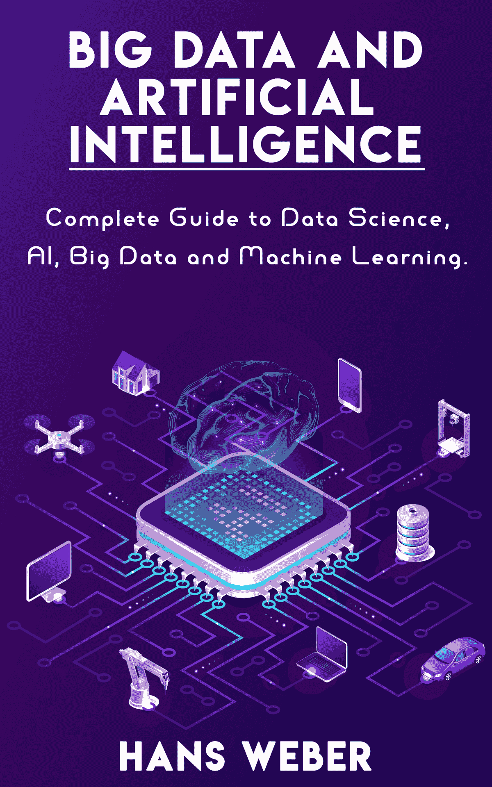
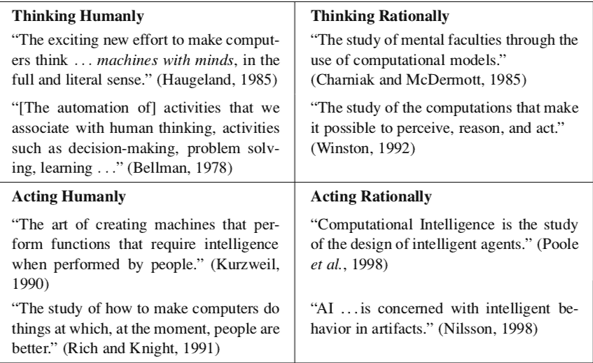
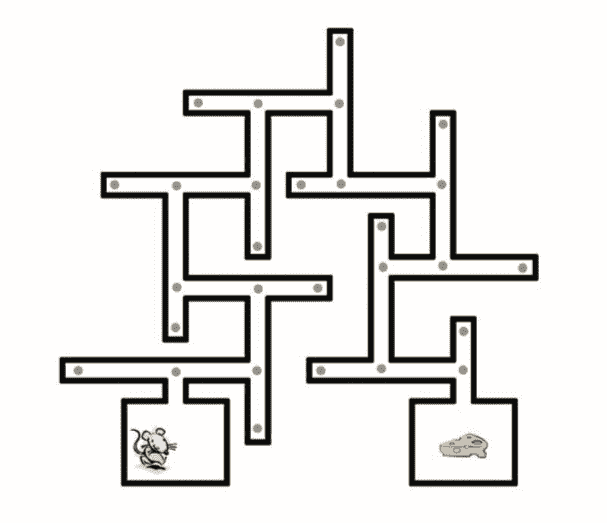
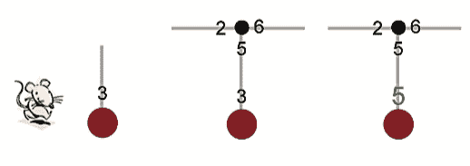
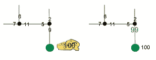
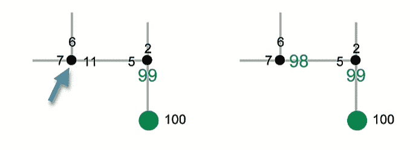

# 大数据与人工智能：数据科学、人工智能、大数据和机器学习完全指南



# 第二章：网络安全

## 引言

## 最常见的网络安全威胁

### 特洛伊马

### 中间攻击

## 网络攻击对业务的影响

### 网络攻击的财务成本

### 网络攻击对声誉的影响

### 网络攻击的合法合规影响

### 网络攻击的心理影响

### 网络攻击的物理影响

### 网络攻击的社会影响

## 如何减少网络攻击？

### 在组织内部建立网络安全响应能力

### 投资网络安全和网络安全备份

### 跟进所有安全安排并定期测试安全措施

# 第三章：网络技术

## 网络技术平台必须具备的特性

## 企业的网络安全最佳实践

## 网络安全的未来

### AI（人工智能）如何塑造网络安全方法论的未来

# 第四章：大数据分析与指标

## 大数据与数据科学的分析与指标

## 网络安全分析与指标

## 结论

## 引言

智能是一种使实体能够根据外部环境执行某些功能的品质。人工智能（`AI`）是对使机器变得智能的追求。如果你能对这一定义产生共鸣，那么动物、人类和某些机器就可以被视为智能生物。在这个光谱的一端是具有不同程度智能的机器和动物，而在这一连续体的另一端是人类。他们可以执行许多任务，为任务增加推理和逻辑，生成并理解语言，感知对感官刺激做出反应。此外，他们还可以玩游戏、证明定理、创作音乐和艺术、编写历史并合成大量信息。为了做到这一点，人类需要一系列连续不中断的能力，并且高度依赖于他们的外部环境。正由于这些原因，也应该从更宏观的角度来看待人工智能。这适用于生活的各个方面，如统计学、语言学、逻辑学、电气工程和计算机科学。

本书的结构设计考虑了三类读者。它将吸引的第一类读者是对科学话题感兴趣并且对人工智能感到好奇的人。第二类读者与第一类人有些相似，但他们从事技术或专业领域，需要理解人工智能的益处并对其包含的内容有一个更宏的认识。第三类读者基本上由学生、教师和研究人员组成，他们需要了解证明有效的方法和无效的方法。阅读此书的人对人工智能的历史有一个大致的了解。

对于我们大多数人来说，机器等同于机械和坚实的东西。它让我们想起钢制零件和齿轮。然而，计算机改变了我们对机器是什么的理解。一台运行中的计算机包括硬件和软件组件。软件本身可以被视为一台机器。分割软件和硬件的界限已经变得模糊。每台现代计算机在硬件电路中都内置了某些程序。这些程序使得系统更容易执行各种功能。本书重点关注帮助实现这一进步水平的不同观点和实现。你将收集到关于人工智能是什么，以及什么导致了带有人工智能的计算机的建立。你还将学习人工智能的基础概念。我希望书中收集的知识和能力能为该领域提供更广泛的理解。

# 第一章：人工智能的基础

对人工智能的长期追求始于梦想。许多人都想要开发一种与人类具有相同能力的机器。这种想法是开发一种能够像人类一样推理和思考的机器。这类机器在历史上的绘画、经文甚至文学中都曾提到。荷马的《伊利亚特史》中提到过被称为“三脚架”的自动椅子和一个黄金侍从。古希腊哲学家亚里士多德谈过自动化，但认为这是一种幻想。

1945 年，发明总是领先时代的莱奥纳德·达·芬奇也设计了可以当中世纪骑士的人形机器人。他发明的物理证据尚未被发现，但据说这个骑士可以坐、移动头部、移动手臂并张开下巴。著名的科幻作家艾萨克·阿西莫夫写过关于强大机器人的故事。他不认同机器人只会导致破坏的想法，就像弗兰肯斯坦那样。他的第一部作品《我，机器人》包含了九个关于电子脑机器的故事。这些电子机器人内部硬化了“机器人学三定律”：

- 机器人不会伤害或伤害人类。
- 机器人必须服从人类给出的每一个命令或指令。然而，它绝不执行会与第一法则冲突的情况。
- 只要机器人的行为不符合机器人学前两条法则，机器人就有要求保护自己。

阿西莫夫后来写了第四条法则，被称为“零号法则”，以保护人类的利益：机器人不得威胁人类或对人类造成任何伤害。

对人工智能的追求，无论现实与否，都源于这些梦想。为了将这些构想变为现实，需要一些告诉我们如何进行的线索。这些对于塑造这一现实至关重要的线索散落在不同的学科中，如逻辑学、统计学、哲学、生物学、心理学和工程学。

## 哲学与逻辑

几千年来，人们使用逻辑进行推理，但是希腊哲学家亚里士多德分析并编码了这一过程。他识别了一种推理系统并称之为“三段论”。以下是三段论的例子：

1. 人类都是凡胎的。
2. 每一个希腊人都是人类。
3. 每一个希腊人都是凡胎的。

亚里士多德理论背后的天才在于三段论的形式。我们不必限制自己将其仅应用于人类、凡性或希腊人。我们可以使用任意符号代替人类、凡胎者和希腊人来重写这个等式。这样重写将带给我们：

1. 每位奥运运动员都是快速的。
2. 尤塞因·博尔特是一位奥运运动员。
3. 尤塞因·博尔特是快速。

## 逻辑与推理的历史

亚里士多德的逻辑提出了有助于推理自动化的两个思想。第一个思想是，推理模式（如三段论）可以以形式或模板的经济方式表示出来。这些通用符号可以代表任何事物，而符号本身是无关紧要的。其次，用值替换符号后，就可以计算结果。现代 `AI` 推理程序利用了这种通用符号和解决问题的相同原理。

在更现代的时期，莱布尼茨试图通过设计一种语言来机械化推理，这种语言可以公式化人类知识——甚至是形而上学和哲学知识。莱布尼茨将这种语言称为通用语言或 `lingua characteristica`。在他的自动推理系统中，字母表发挥了至关重要的作用。他理论化地认为如果数字代表字母表中的项目，那么通过将其对应的数字相乘，就可以从原始组成部分得到一个复杂的命题。进一步的数学运算可以确定这个复杂命题的真假。

应用这一想法的问题在于，很难将原始字母分解为组件。尽管如此，莱布尼茨的理论为推理如何实现机械化提供了额外的见解。该理论讨论了如何使用简单符号创建字母表，还讨论了如何组合这些符号以开发复杂的表达式。在 18 世纪末，英国政治家和科学家查尔斯·斯坦霍普发明了一种可以解决逻辑和概率简单问题的设备。这个设备可以看作是模拟计算机的最早形式。盒子侧面有插槽，用于插入彩色滑片。顶部的窗口可以帮助查看表示特定问题的滑片。例如，让我们尝试解决一个数值三段论问题：10 个 A 中有 9 个是 B；10 个 A 中有若干是 C。因此，至少有 2 个 B 是 C。有一个代表 A 的窗口，斯坦霍普会从相反方向移动一个涂有八个的红色滑片和一个四个单位的灰色滑片。滑片将在两个单位上重叠，这代表了 B 也是 C 的最小数量。1854 年，乔治·布尔出版了一本研究人类思维本质和构造的书。他考虑了人类推理的几个逻辑原则，并将它们转化为数学方程。

## 布尔代数

例如，矛盾律规定任何生物都不可能同时拥有某项属性又不拥有该属性。他将这一原则转化为代数方程 `x(1-x) = 0`，其中 `x` 代表一个对象，`(1-x)` 代表对象的对立类，而 `0` 代表一个不存在的类。通过布尔代数，我们知道 `0` 表示假，`1` 表示真。逻辑中最重要的两个操作“或”（`OR`）和“与”（`AND`）在布尔代数中分别用运算 `+` 和 `X` 表示。例如，“要么 p 或 q 或两者都有”这一语句可以用 `p + q` 表示。要表示语句 `p` 和 `q`，我们可以写 `p x q`。每个 `p` 和 `q` 可能是真也可能是假；因此，我们可以根据 `+` 和 `x` 的使用方法计算 `p + q` 和 `p x q` 的值，且计算结果始终基于值的真假，即：

```
1 + 0 = 1
1 x 0 = 0
1 + 1 = 1
1 x 1 = 1
0 + 0 = 0
0 x 0 = 0
```

布尔代数在电话交换电路和计算机的设计中发挥了至关重要的作用。尽管布尔从未设想过计算机，但他的工作为我们提供了关于推理机械化的重要线索。一种类似的但非代数的计算和处理命题的方法称为命题演算，它在人工智能中占有不可或缺的地位。布尔逻辑系统的缺点是它无法帮你理解命题内部的任何内容。例如，如果我们用 `p` 表示“杰克是人”，用 `q` 表示“杰克是会死的”，那么 `p` 或 `q` 内部没有任何东西能证明作为人类的杰克也是那个会死的杰克。为了这个目的，我们需要理解也具有内部表达式的“分子表达式”。19 世纪末，哲学家弗里德里希·路德维希·费格发明了一种系统，命题连同内部表达式可以用图形形式书写。费格系统是我们现在所说的“谓词演算”的前驱，这是人工智能的另一个重要系统。它还指示了当今人工智能中使用的另一种图形形式：语义网络。由于费格的工作，包含待推理信息的句子可以用无歧的符号化形式表示出来。

## 智能的生物学基础

由于是人脑将海量信息转化为行动，因此预计神经生理学家和神经解剖学家（研究大脑的专家）的工作可以为智能行为提供更好的理解。对产生智能生命的演化的理解也可以为探索人工智能领域提供提示。

人类大脑有约 100 亿个被称为神经元的细胞。它们以不同的形式存在，但其部分非常相似。中心部分是细胞体，输入纤维称为树突，输出纤维称为轴突。轴突将有一个称为末端体的突起，它靠近其他神经元的树突。一个神经元的末端体和另一个神经元的树突之间的间隙称为突触。当脉冲到达这个突触时，由于电化学作用，它可能会激发或抑制跨突触另一个神经元的电化学活动。第二个神经元的反应取决于到达突触的脉冲类型以及这些突触传递电化学反应的效率。1943 年，神经生理学家沃伦·麦卡洛和逻辑学家沃尔特·皮茨的一篇论文声称神经元是一个逻辑单元。它提出了简单的演示，展示了这些模型的网络如何执行任何计算操作。神经心理学家唐纳德·奥·赫布也强调了我们大脑中的神经元如何感知思想的基本单位。

## 赫布理论与细胞群汇

当轴突细胞 `A` 足够接近能够兴奋 `B` 并不断引起其活动时，一个或两个细胞中会发生某种代谢或生长过程，使得 `A` 作为触发 `B` 的细胞之一，其效率随之提高。这后来被称为赫布法则，并在活体动物中得到了观察。`Hebb` 还理论化了一组偶然一起发射的神经元形成了一个细胞群汇。`Hebb` 认为思考是大脑中细胞群汇的顺序激活。

## 行为主义

心理学与认知科学

`B.F. Skinner` 和几位心理学家试图让心理学更加科学化，并独立于主观内省。他们从只关注可以客观测量的事物开始，例如对特定刺激的特定行为。行为主义者认为，心理学应该是行为科学，而不是关于心理的。他们没有考虑识别心理内部状态，如信念系统、欲望、意图和目标。

`Skinner` 的理论提出了强化刺激的概念，这种刺激会奖励最近的行为，并倾向于在未来类似的情况下使其再次发生。强化学习是 `AI` 研究人员中非常流行的一种策略，尽管它并不依赖于内部状态。`Skinner` 写道，对于每一个刺激，动物都会记录对手的下一次动作，当刺激再次出现时，动物会重复之前在相同刺激后发生的对手动作。

对手动作的多次重复会导致动物模型对该特定动作产生条件反射。`Skinner` 认为人类的言语行为也可以通过他的理论来解释。

## 认知语言学

语言学家 `Noam Chomsky` 反对 `Skinner` 关于语言的观点。`Chomsky` 提出了一个问题：一个人如何仅通过经验就能产生无限结构复杂的、从未听过也未说过的句子？根据 `Chomsky` 的观点，`Skinner` 所忽略的这些基本因素是天生的而非习得的语言能力。根据 `Chomsky` 的观点，人类生来是为了处理数据或能够对未知字符的复杂性提出假设。他声称人类生来拥有一种通用语法或机制，发展了我们学习和使用语言的能力。

## 认知科学的诞生

心理学家 `George A Miller` 关注内部心理过程及其局限性。他通过实验声称，人类的即时记忆容量大约为七个信息块（`chunks`）。这些块代表什么并不重要，我们只能在即时记忆中保留七个。这篇论文在 `MIT` 的信息论研讨会上提交。

著名的 `AI` 研究人员如 `Allen Newell` 和 `Herbert Simon` 发表了一篇关于可以解决命题逻辑的计算机程序的论文。这次研讨会汇聚了有共同兴趣的科学家，被认为影响了认知科学的创立，这是一门致力于理解人类大脑的学科。

## 认知科学与人工智能

认知科学试图通过记忆、策略、目标和任务队列等思想为内部心理过程提供更清晰的解释。认知科学和人工智能从初始阶段起一直重叠。这两个领域通过理解人类大脑如何运作来相互识别新概念。

## 统计学与概率

不确定性是任何推理和决策过程的共同因素，在实现机器智能自动化时，处理它是重要部分。统计学和概率理论源于对量化偶然和不确定性的尝试。对人工智能最重要的结果是贝叶斯法则，可以通过一个例子来描述。贝叶斯法则核心的应用是在单检测中。

让我们假设一个无线电接收机调到了一个广播两种音调之一（`A` 或 `B`）的台。

# 第二章：什么是人工智能？

通过两个维度列出的八种人工智能定义，可以对人工智能的含义有更深入的理解。其中一个维度关注推理和思维过程，另一个维度则基于行为。在下图中，我们看到了人工智能的八种定义。左侧的定义根据人类表现来衡量成功；右侧的定义则根据理想性能来衡量理性。如果一个系统在考虑其所知的情况下做了正确的事，它就可以被认为是理性的。这四种方法在过去都曾被采用，每种方法都被不同的人使用不同的方法过。

以人为的方法基于对人类行为的观察和假设；因此，它更像经验科学。理性主义方法包含了工程学和数学的结合。不同的群体之间相互汇聚也相互贬。我们将详细研究这些方法。

## 图灵测试方法：像人类一样行动

艾伦·图灵在 1950 年提出了`图灵测试`，这有助于获得人工智能的操作性定义。如果一台计算机无法识别人类提出的书面问题的回答是来自人类还是另一机器，这台计算机就通过了`图灵测试`。重点应该放在计算机如何被编程以通过测试上。这一基础为我们如何机械化智能提供了丰富的见解。这台计算机应该具备以下能力：

* 通过`自然语言处理`用英语交流
* 通过`知识表示`存储它听到的或所知的内容
* 使用`自动推理`利用存储的信息得出结论或预测
* 通过`机器学习`检测并预测一些新模式

`图灵测试`刻意地忽略了计算机与人类提问者之间的直接交互，因为智能不需要物理模拟。在总的`图灵测试`中，使用视频信号来测试受体的持续能力。计算机需要完成以下任务才能通过此测试：

* 用于观察或看到物体的视觉
* 使用`机器人学`操作和移动物体

大多数人工智能的基本组成基于上述的六个学科。图灵值得所有的赞誉，因为这项测试在提出 60 年后仍然具有相关意义。然而，研究人员对通过`图灵测试`并不十分关注，因为他们认为理解智能的内部工作机制比试图复制一个原型更为重要。

## 认知建模方法：像人类一样思考

如果我们说某个特定的计算机程序像人类一样思考，我们必须首先了解人类大脑是如何运作的。我们必须弄清楚大脑的内部机制。发现这一方法有三种：

1. 一种是通过内省——我们尝试在思绪流过时理解它们。
2. 第二种方法是通过心理实验——观察个体的活动状态。
3. 第三种方法是脑成像——观察大脑的活动状态。

在收集了关于大脑如何运作的精确信息后，可以将其转换为计算机程序。如果程序的输入输出行为与其人类行为相似，就证明该程序涉及某些机制，这些机制也可以在我们大脑中运行。

`认知科学`是一门结合了人工智能计算机方法和心理学技术的学科，可以开发出关于人类思维的准确且可测试的理论。在人工智能早期，产生了很多困惑。研究人员会声称某个`算法`在特定任务上表现良好，因此证明它是人类表现的良好模型。现代研究人员将这一观点拆分成了两个主张，这种区分有助于这两个领域的快速增长。

## 思维规律方法：理智地思考

亚里士多德的`三段论`为我们提供了论证结构的模式，这些模式能够在正确的情况下得出正确的结论。这些思维规律被认为可以提供我们大脑如何运作的见解，逻辑学领域也正源于这一学派。19 世纪的逻辑学家提出了不同的规律，为物体及其与周围世界的关系增了意义。人工智能的逻辑方法是尝试基于这些关系建立程序，以创建智能系统。

这种方法面临两个关键障碍：

* 首先，要提取非正式知识并创建正式术语是困难的，特别是当这些知识不是 100% 确定的时候。
* 其次，在实践中解决问题与在原则上解决问题之间存在。

即使问题只有大约一百个事实，也需要大量的计算资源。

## 理性代理方法：理智地行动

计算机代理执行若干功能，例如：

* 感知环境
* 自主运行
* 长期持续
* 创建并实现目标
* 适应变化

理性代理在存在不确定性的地方投入使用；它帮助实现目标。在思维规律方法中，重点放在正确的结论上。人们总是预期理性代理得出正确的结论，但正确的结论并不总是等同于理性。在某些情况下，没有正确的事要做，但必须做点什么。还有一些方式，理智地行动并不涉及任何推理。理性代理方法有两个优点：

* 它比思维规律方法更通用，因为正确的结论是许多可能性之一。
* 它比基于人类的方法对科学发展的反应更灵敏。

一个需要记住的重要点是，随着我们将下去，会发现达到完美的理性——即始终做正确的事——在复杂的环境中是不可行的。

# 第三章：人工智能的基本概念

## 数据

对特定感兴趣区域的静态、动态、事实、原始和离散的观测称为数据。对这些数据的系统化处理产生信息。大多数环境中的数值始终代表数据。数据可以被定义为企业活动的物理和交易记录，这将作为其信息的构建区块。它们是观察的产物，而观察就是感知；因此在使用信息之前必须对其进行处理。对于分析师、问题解决者或调查人员来说，数据可能意味着句子、数字、假设或记录。在其他领域，它可能意味着事实或数据被用作假设的假设。

数据本质上是经验性的，很难为虚构的非经验数据赋值。

## 信息

经过结构化、组织化、处理和呈现后可用的数据称为信息。这些经过处理的数据使得决策变得更加容易。然而，某些信息并非数据。处理数据是指对数据进行计算、聚合或纠正，通过这种方式产生信息量。


# 知识表示与机器学习

## 数据价值增值方式

你可以通过不同的方式为数据增加价值：

- **语境化**：提供了收集数据的目的。
- **分类化**：提供了分析单元或数据的主要组成部分。
- **计算化**：如果提供了分析数据的方法，即是通过数学方法还是统计学方法完成的。
- **纠正**：如果从收集的数据中消除了错误。
- **压缩**：如果对数据进行了简洁的总结。

此外，信息可以被访问、传输、分、生成、存储、处理、消费、生产、搜索、压缩、使用和复制。信息还可以被赋予不同的属性。它可以是定量的、定性的或敏感信息。

## 知识

知识被定义为通过对主题的完整学习和经验而获得的人类理解。你可以将信息和数据视为一个整体，但知识是基于对问题领域的理解、学习并深耕其中。

- 显示世界状况理想性的效用信息。
- 行动价值信息。
- 最大化代理体效用的目标。

例如，如果一个智能体正在被训练成为出租车司机，每当教练喊出“刹车”时，该智能体倾向于学习一个条件，即何时踩刹车的动作规则（组件 1）；它还学到了教练并不总是会喊出指令。通过摄像头的某些图像，告知机器路上有公交车。然后，机器将学会识别它们（2）。通过尝试动作并观察结果（例如在湿滑的路面上猛刹车），它学习了其动作的结果（3）。最后，当它没有从乘客那里收到任何指令或小费时，它可以学习关于它的总效用函数（4）。

## 表示与先验知识

智能体组件的表示有很多例子，例如逻辑智能体中的一阶逻辑和命题句；用于决策论智能体的贝叶斯网络等。所有这些表示中都使用了高效的学习算法。其他各种类型的学习还包括归纳学习，即智能体从通用函数或规则中学习；分析学习或演绎学习，即智能体从通用规则推导出逻辑生成的新规则，这种学习因为能导致更高效的处理而受到青睐。

## 从反馈中学习

三种类型的反馈控制着三种主要的学习类型：

### 无监督学习

智能体在没有提供任何反馈的情况下，找出给定数据中的模式。聚类是无监督学习最常见的例子。聚类涉及从输入中检测有用的簇。例如，一个出租车智能体会在没有教练提供任何先验知识或示例的情况下，缓慢地形成对交通好日子和坏日子的概念。

### 强化学习

在这种类型的学习中，智能体使用强化链进行研究。例如，当出租车智能体在行程结束时没有得到任何小费时，这表明某些操作没有做得好。然后智能体决定是什么动作导致了负面响应。

### 监督学习

智能体识别出一些“输入-输出对”的示例，并确定一个连接输入与输出的函数。在上述示例（第一个组件）中，输入是感知，而说“刹车”的教练给出输出。在第二个组件中，输入是通过摄像头获取的视觉信息，输出来自说“这是一辆公交车”的教练。在组件 3 中，函数是基于状态和停止距离（单位英尺）的刹车理论。在这种情况下，输出来自智能体的感知；教师将是它的环境。

### 半监督学习

在这种类型的学习中，我们将被带标签的实例，并必须尝试从一组无标签的实例中尽可能多地理解。标签本身可能并不是我们认为的真理。例如，你正试图构建一个程序，根据照片猜测某人的年龄。你可以从收集带标签的示例开始，比如带有个人信息的照片。这是监督学习。在现实中，会有人对自己的年龄撒谎。这些不准确性可能是系统性的，为了查明这一点，应该使用无监督学习。这包括图像、报告的年龄和真实年龄。这在监督学习和无监督学习之间建立了一个连续。

## 第五章：机器学习

自动数据收集系统与廉价大容量存储设备的结合导致了大量数据的获取和保存。这些可能是温度读数、压力读数、财务数据、POS 点客户购买记录、新闻推送等。需要高效的数据挖掘技术来从这些海量原始数据中量化、提取和分类有用信息。机器学习对于分析海量数据已至关重要。数据量越大，越好。

在大多数情况下，机器学习技术从数据中构建假设。例如，如果大量数据表明许多天鹅是白色的，而没有其他颜色的天鹅实例，那么学习算法将得出结论“所有天鹅都是白的”。这些结论是归纳的，而不是演绎的。演绎学习是关于基于逻辑和前提的推理，而归纳学习是关于构建假设，这始终涉及对额外数据的修改。也就是说，可能存在一个未被发现的满黑天鹅的天屿。基于海量数据的归纳学习具有极重要性。无疑，科学本身是基于归纳学习及其推理的。

## 基于内存的学习

人工智能在处理海量数据时，最常用的方法是以某种方式减少量。例如，神经网络用网络结构和权重值来表示大型训练数据集的基础内容。类似于此的是贝叶斯网络，数据被压缩到节点结构和条件概率表中。我们现在拥有快速的计算机内存，可以存储和计算大量数据，而无需任何先前的压缩或凝聚过程。这些方法在不需要特定任务时不会压缩数据。所有必要的简化都在决策时完成。

以下是一些基于内存的学习方法：

- **最近邻方法**——用于对多维空间中的点进行分类。
- **k-最近邻规则**，例如，它将数据点分配到与其最近的 `k` 个存储数据点相同的类别。`k-nearest neighbor`（k 近邻）规则是基于内存学习的一个理想例子，它对可能的扩展提出了了许多问题。首先，为了使用最近邻规则，每个数据项必须是数字列表，即多维空间中的点或向量。提出的第一个问题是，如何表示数据才能使最近邻方法适用？其次，如何衡量数据点之间的距离？当数据被表示为多维空间中的点时，可以使用欧几里得距离。

如果数据不是以点的形式表示，则必须采用不同的技术来衡量数据之间的接近性。第三，在考虑最近的数据点时，彼此距离较的点对结果的影响是否比彼此远离的点更大？最基础的 `k-nearest neighbor`（k 近邻）可以通过根据这些数据点的接近程度赋予其权重来扩展。通常使用一个 `kernel`（核）来给非常远的点赋予逐渐衰减的权重。第四，`k` 的值应该是多少？需要使用多少邻居来对某个特定数据做出决策？通过合适的 `kernel`，每个数据点都可以被考虑在内。非常远的点对特定决策的影响为零或可以忽略不计。现在的相关问题是，`kernel` 应该多远才能影响结果。最后，在考虑了所有加权邻居后，如何对分配数值或类别做出决策？是应该根据邻居的多数投票，还是应该根据加权成员的平均值？根据这一选择，可以使用不同版本的统计回归方法。

### 基于案例推理 (Case-Based Reasoning)

这是人工智能的一个子领域，可以被视为一种广基于内存的学习。基于案例推理涉及一个案例库，用于分析、解释和解决新案例。例如，在医学领域，患者的治疗和诊断记录构成了一个案例库；一旦出现新案例，就可以从该库中找到与它相似的案例，这将有助于诊断和治疗。在法律领域，旧的法律场景被用于解释和研究新案例。

如果存在与新案例相似的案例，它们在案例的通用空间中被视为邻居。为了找到接近的邻居，邻近性的构思应该根据相似性的度量。基于案例推理最著名的先驱是 `Janet Kolodner`，她是认知科学和计算领域的教授。她这样描述这一过程：需要检索的案例是那些良好的案例。它们具有为新案例构建相关想法的潜力。这种检索是通过使用新案例的特征作为案例库的索引来完成的。被标记了这些特征子集的案例，或者可以从这些特征推导出的特征的案例将被检索。现在我们拥有一组有前景的案例可以进行选择和推理。基于案例推理已被证明近年来应用最成功的人工智能技术之一。在商业和工业领域有着广泛的应用。客户服务中心和诊断系统是最常见的应用。

### 决策树 (Decision Trees)

这是一种新型先进机器学习技术，涉及从大型数据自动构建被称为决策树的结构或网络。决策树涉及一系列测试，有助于确定分配给数据记录的数值或类别。它们最适用于非数值数据也适用于数值数据。将详细描述用于自动构建这些树的方法。

### 数据挖掘与决策树 (Data Mining and Decision Trees)

数据挖掘涉及从海量信息中提取有用信息。例如，考虑一个包含信用卡行为的数据库。这会包含支付记录、平均购买金额、平均余额、逾期费用等等。通过使用正确的数据挖掘方法，你将发现那些逾期费用较高、平均购买金额较高以及其他相似特征的人最可能拥有高平均余额。

数据挖掘的一种重要方法是利用数据构建决策树。可以使用简单的示例来详细阐述。考虑像 `Walmart`（沃尔玛）这样的公司。想象他们维护着一个关于客户信息的数据库，他们之前曾向这些客户发送过优惠券。这些信息将包括家庭位置、房屋类型、如果客户之前是否在 `Walmart` 购物过，或者客户之前是否响应过他们的任何客户邮件等。如果这些信息被制成表格，每行中的信息被称为一个 `record`（记录）。列顶部的项目将是 `attributes`（属性），列中列出的项目是其值。对该数据库进行分析后，就可以做出决策。


上述图示可以让你了解哪些家庭响应了邮件，哪些没有。属性上的测试位于决策树的内部节点（方框）；结果位于树的末端（叶子）（圆形）。这些树有助于预测预期响应。已有多种方法被开发用于构建这些树。这里有一些例子：

#### EPAM

该系统开发于 20 世纪 50 年代代，是构建决策树的最早方法。`Edward Feigenbaum` 作为他的博士论文开发了它。它根据缩写命名，即 `Elementary Perceiver and Memoriser`。他的研究目标是预测和解释人类现象。该程序仍然被认为是对人工智能的重要贡献。

#### CLS

该程序是由 `Carl Hovland` 和他的学生 `Earl B` 在 60 年代代开发的。他们开发了一个关于人类概念的模型。`CLS` 是 `Concept Learning` 的缩写。

#### ID3

`ID3` 的缩写是 `Iterative Dichotomizer`（迭代二分器）。`J Ross Quinlan` 在 70 年代代开发了它。使用该程序，数据记录可以被迭代划分直到属于两个不同的类别。该程序的后续版本具有多个类别。

#### C4.5

Quinlan 继续开发先进且实用的决策树系统。他开发了 `C4.5` 系统，它可以处理具有数值和类别的数据库。在此期间，发生了对人工智能研究具有重要意义的发展。这是由于统计学家和人工智能人员之间的合作。`CART` 代表分类回归树。它由 `Jerome Friedman` 开发，在处理数值属性时与 `C4.5` 。

#### Inductive Logic Programming

已经开发了许多技术从数据库和其他背景知识中研究关系规则。`Quinlan` 开发了用于研究关系规则最早系统，称为 `FOIL`。由于学习到的规则可以应用于 `PROLOG` 等基于逻辑的计算机语言，产生了一个专门学习它们的领域，被称为 `Inductive Logic Programming`。

## 神经网络

人工神经网络可能包含百万个神经元，而大脑大约有 850 亿个神经元。大脑中的神经元是相互连接的，而人工神经网络是单向的。这些网络分布在下面列出的层中：

### 神经网络层

- **输入层**：该层包含接收数据并将其传输到下一层的神经元。神经元的数量取决于特定数据集中属性的大小。
- **输出层**：它涉及构建模型所需的节点。在分类系统中，一个标签将分配给一个节点；在回归系统中，将有一个节点输出一个值。
- **隐藏层**：该层存在于输入层和输出层之间。属于该层的节点会对输入数据进行转换。随着节点的不断训练，它们预测输出的能力会变得更好。

### 监督学习

神经网络和决策树等学习方法属于监督学习的范例。在这种学习中，人们尝试从分类已已知的大型训练数据集中学习如何分类数据。

系统中发生的“监督”是指告知系统训练集中每条数据是如何被分类的。仅通过数据本身产生分类是可能的，此类技术属于无监督学习范畴。让我们考虑这样一个例子：待分类数据用点表示在二维空间中。这些点的坐标被赋予了 `f1` 和 `f2` 的值，这些是数据的数值化特征。在表示中，一个类别可以用小正方形表示，另一个类别可以用小圆圈表示。如果点以这种方式表示，它们就可以作为监督学习技术的训练数据。

如果我们有未标记的数据点，通过视觉检查，我们可以识别出成簇排列的点。每个簇可能都是属于同一类别的点。因此，自动识别簇及其边界可以作为无监督学习的技术。AI 研究人员已使用这种方法来识别训练样本的簇。`K-means` 方法是其中最流行的。它通过重复下面提到的步骤来实现：

1. 在样本空间中，随机位置安装数量为 `k` 的聚类寻找者。
2. 将靠近的训练样本分组到每个聚类寻找者中。
3. 计算这些组中每个组的重心（质）。
4. 将这些聚类寻找者转移到每个组对应的重心。
5. 重复这些过程，直到没有聚类寻找者需要移动为止。
6. 一旦过程结束，聚类寻找者将位于训练样本的重心上，这些重心可以被识别为簇或单独的数据类别。

现在，你可以通过计算新数据更接近哪个聚类寻找者，对不属于该数据集的新数据进行分类。这将取决于预测簇数量 `k` 的能力。寻找数量的技术涉及调整数量，使得这些簇内的点距离小于这些簇之间的距离。

### 强化学习

这种学习是监督学习和无监督学习的结合。这方面的例子是机器人，它可以执行持续的经验序列。另一个理想的例子是学习出色地下棋，仅根据关于游戏结束时胜利或失败的信息。尽管这尚未实现，但某些程序已经玩双陆棋并学习控制直升机飞行。

强化学习是人工智能的一个分支，完全是技术性的且多分支的。在最基本的形式中，这种学习关于遍历一组状态，从一个状态转移到另一个状态，直到获得奖励的状态。这就像老鼠学习如何穿过迷宫的实验。

让我们用迷宫来理解强化学习的基本概念。老鼠预计从 A 点走到 B 点，那里有奖励（奶酪）。迷宫中有老鼠以前可能识别的点。在技术术语中，这些被称为状态。当老鼠到达这些位置中的每一处时，它可以从四个动作中选择，例如向左、向右、向前或向后。动作取决于状态。每一次移动都让老鼠从迷宫中的一个状态移动到下一个状态。这些动作和状态的集合可以被视为图以便更好地理解。

现在让我们考虑一只机器人鼠，它正在学习如何穿过迷宫。最初，机器人在没有任何先验知识的情况下通过迷宫，也就是说，它不知道在所经历的任何状态下其动作的影响。如果给它提供地图或图，它将学习使用这些信息找到找到终点的路径。试错法是使用状态图寻找穿过迷宫连接的方法之一。第二种选择也是最常用的强化学习方法是随机标记机器人经过过的所有状态。在技术术语中，这被称为导航迷宫的策略，它将每个动作与带标记的状态连接起来。最优策略是将每个状态连接到能够通过迷宫最短路径到达终点的动作。强化学习就是关于学习这种最优策略或多个策略。



另一种方法是对每个状态下的每个动作分配一个值或数字，然后不断修改这些值直到到达终点。这种技术被称为 `Q-learning`。它始于机器人为起始状态分配一个名称，并为在该状态下采取的所有动作分配一个值或数字。我们可以假设机器人记住了学习过程中访问过的所有状态，并能够区分这些状态和新状态。在学习过程中，机器人采取被分配了最高值的动作。



由于在初始状态只有一个引导机器人进入新状态的动作，它为该特定状态下可能的动作分配一个新的随机值。这一步如上图所示。接下来是学习中重要的一步，因为机器人意识到它可以到达一个具有最高值（即 6）动作的新状态。然后它通过给该状态一个与价值 6 的动作一致的值，来更新通往该状态的名为 3 的动作的值。这种对 3 的调整并没有达到最高数字 6，而仅仅到了 5。这在右侧的草图中所示，调整后的值比其他字体更大、阴影更深。这个过程不断重复。在每个状态下，动作将取决于最大的评分数字，然后该数字会被调整为更接近该状态内最大数字的评分数字。虽然这个过程是从给状态分配随机数开始的，但试错法将引导它走向给予奖励的状态。通往这一奖励阶段的动作将被分配一个与奖励状态的值几乎接近或相似的评分数字。这一步如下图所示。

右侧图显示了导致目标动作的调整后值。需要注意的是，如果机器人以后遇到类似的处境，它将使用这种基于奖励的值进行反向传播。



参考下方的插图来了解什么是反向传播。让我们考虑一种场景：机器人发现自己处于图中箭头标记的状态。它遵循从该状态开始最大的估值数字。这引导它进入另一个更接近目标状态的状态。估值为 99 的动作将是通往目标状态的状态。因此，刚刚采取的动作的估值从 11 改变为 98，如右图所示。这种通过反向传播增加更接近目标的状态中的动作价值的方法，其回报与目标状态本身一样丰厚。



大多数强化学习的迭代可以阐述如下：

1. 在多个状态中都将提供奖励。这意味着不仅关乎单个目标状态，还关乎多个通往奖励状态的状态。奖励将用正数、零或负数表示。
2. 与其寻找与通往单个目标的最的最路径相关的策略，不如学习能够增加未来预期奖励数量的策略。通常，在学习策略时，遥远未来的预期奖励不如即时预期奖励受关注。
3. 在特定阶段采取的动作并不总是会导致相同的状态。人们可以尝试学习可能导致其他状态的概率，这属于一种名为优先扫描（prioritized sweeping）的学习方法。在 `Q-learning` 过程中，这些概率不被考虑，因为它们会影响分配给状态-动作对的学习过程。
4. 另一个影响该过程的复杂因素是机器人的传感装置不准确。因为机器人对自己所处的状态将有错误的认知。

# 第六章：大数据基础

计算机使用各种各种算法执行任务来管理数据。在最基础的形式，算法是一种帮助执行一组操作的程序。`Create`（创建）、`read`（读取）、`update`（更新）和 `delete`（删除）是算法的四个基本数据操作。尽管这些操作看起来简单，但它们是计算机操作的基础。随着数据集变得复杂，计算机使用应用程序中的算法来执行更多工作。大数据涉及复杂的数据集，计算机以非确定性的方式使用模式识别来进行处理。因此，为了构建一个可以学习的系统，需要复杂的数据集供算法进行模式识别。此外，这种模式识别还需要一个简单的子集来进行统计分析或对整个数据集进行预测。应用大数据最常见的例子是卖家跟踪消费者购买行为创建的在线数据库。识别正确的数据源有助于创建机器学习实例，使机器能够以期望的方式学习并产生数据。大数据与统计学的结合可以创造完美的机器学习场景，机器可以预测任何给定事件的概率。

是算法影响了学习过程和结果。算法需要一个训练过程，因为它改变了看待大数据的方式。这种训练涉及数据子集，这些子集用于创建模式，算法必须利用这些模式从给定的训练中区分特定情况和一般情况。尽管大数据意味着大量数据，但它与任何其他大型数据库都完全不同。它更复杂且具有深度。与通用编程相比，数据源可以帮助通过足够的细节更高效地解决问题。例如，考虑谷歌的自动驾驶汽车。汽车不仅应该拥有硬件及其在空间位置的信息，还应该拥有它如何影响人类决策、环境条件、路况和其他车辆的知识。因此，数据源将包含许多具有影响的变量。由于机器人将对其所处的状态有错误的认知，另一个影响过程的复杂因素是机器人的传感装置不准确。


## 算法对学习过程和结果的影响

算法需要一个训练过程，因为它改变了看待大数据的方式。这种训练涉及数据子集，这些子集用于创建模式，算法必须利用这些模式从给定的训练中区分特定情况和一般情况。尽管大数据意味着大量数据，但它与任何其他大型数据库都完全不同。它更复杂且具有深度。与通用编程相比，数据源可以帮助通过足够的细节更高效地解决问题。

例如，考虑谷歌的自动驾驶汽车。汽车不仅应该拥有硬件及其在空间位置的信息，还应该拥有它如何影响人类决策、环境条件、路况和其他车辆的知识。因此，数据源将包含许多具有影响的变量。由于机器人将对其所处的状态有错误的认知，另一个影响过程的复杂因素是机器人的传感装置不准确。

通过分析训练数据来确定模式，并且算法将执行由开发者编写的任务。因此，个人数据在该环境中是不相关的。

涉及到数据时的另一个问题是隐私，但机器学习是关于具体的，并没有那么帮助。

## 大数据的来源

对于机器学习应用，你首先需要一个数据源，例如企业数据库。为了创建有用的数据源，必须创建新数据。开发者构建现有数据源并根据客户端-服务器架构的需求，但这可能对于机器学习实例不起作用，因为它们为了节省硬盘空间进行了优化。因此，它们不具备所需的深度。当你越来越熟悉机器学习时，你会遇到无法使用标准数据库解决的情景。

### 公共来源

大学、非营利组织、政府和其他机构通常拥有公开的数据库。你可以单独使用，也可以将其与其他数据库结合创建机器学习的大数据。例如，你可以结合各种地理信息系统（`GIS`）来构建大数据，帮助决策工厂或商店的选址。这种机器学习系统可以考虑各种信息，例如要支付的税额，甚至是部分土地的高度。使用公共数据的最大优势是即使对于商业用途通常也是免费的，在某些情况下，你只需要支付少量的费用。

此外，数据库将保持在完美状态，因为机构有某些任务；他们利用这些数据产生收入或内部使用。在使用公共源数据时，有许多问题需要考虑。首先，你必须确保能够获得一些有用信息。下列出了你在做决定时可以遵循的一些标准：

1. 数据源的格式
2. 使用数据源的费用（如有）
3. 使用数据源的许可，因为某些源受版权保护
4. 清洗数据以供机器学习使用时可能出现的问题
5. 适当的基础设施或数据访问提供

### 私有数据

亚马逊和谷歌是一些私有机构的例子，它们维护着大型数据库，其中包含了各种有用信息。在这种情况下，你可能需要支付费用才能访问这些数据，尤其是在商业环境中使用时。一个主要限制是，你可能无法将数据下载到自己的服务器上，这会影响你的机器学习环境。例如，某些算法在处理只能分段访问的数据时运行速度缓慢。使用私有数据库数据时，你获得的主要优势是你可以预期的完美一致性。与公共服务器上的信息相比，这些数据会更干净。你还可以访问一个包含更多化数据类型的大型数据库。这完全取决于你获取数据的时间机。

## 从现有数据中构建新数据

你可以将现有数据作为起点来创建新的数据源，因为旧数据并不适合创建新的机器学习场景。例如，你可能有一个包含所有客户订单的客户数据库，但这些数据并不适用于机器学习，因为缺乏将数据分类为特定类型所需的标签或类别。机器学习主要运行在 80% 的数据上，但剩下的 20% 的情况必须由专业人士来解决，由他们决定如何应对特定数据并采取行动。在这种情况下，你需要人员来添加额外信息，如标签。

## 使用现有数据源

你的组织在各种地方都隐藏数据；问题在于学习如何识别这些数据为有用数据。例如，为了追踪装配线，你可能采用了传感器来跟踪装配过程的工作情况并确保生产线保持系统化。这些传感器的视觉数据可以是机器学习场景的潜在输入，因为它们追踪了产品的移动方式、其如何影响客户满意度，甚至是你支付的邮费。基本思想是将现有数据转换为一种新数据，让你优化组织的运行。

## 统计学与机器学习

尽管统计学和机器学习属于非常不同的领域，但它们有很多相似之处。统计学是使机器学习可能的五种学派之一。这五种学派是：

* **符号主义 (Symbolists)**：源于逻辑和哲学。它依赖于反向演绎来解决问题。
* **连接主义者 (Connectionists)**：源于神经科学。它依赖 `back-propagation`（反向传播）来解决问题。
* **进化论 (Evolutionaries)**：源于进化生物学。它依赖 `genetic programming`（遗传编程）来解决问题。
* **贝叶斯主义 (Bayesians)**：源于统计学，并依赖 `probabilistic inferences`（概率推理）。
* **类比论 (Analogies)**：源于心理学，依赖 `kernel machines`（核机）来处理问题。

机器学习的目标是合并这五种学派中的策略和技术。目标是创建一个可以学习几乎任何内容的单一算法或主算法。

## 算法的角色

在机器学习领域，一切都围绕算法展开。它就像一种用于解决问题的程序或公式。问题的领域影响所用算法的类型，但基本假设总是相同的。它可以是关于任何问题，就像开车或下棋一样。最初，问题看起来极其复杂，但最终目标是让乘客无损地移动到下一个位置。你可以将算法想象为一个存储解决特定问题程序的箱或容器。它们通过一系列定义良好的状态处理数据。这些状态会被定义，但不一定以确定性的方式。最终目标是设计一种算法来解决问题。在某些情况下，给予算法的输入仅作为定义输出的依据。输出仍然是。状态之间的转换应该使用计算机可以处理的定义良好的正式语言来表示。在解决问题或处理数据时，算法倾向于定义、清洗并执行一个函数。该函数将对应算法要解决的问题。

## 算法策略

### 符号推理

在符号推理中，演绎扩大了人类知识的范围，而归纳提升了人类知识的水平。反向演绎通常术语称为归纳。归纳通常开启了新的探索领域，而演绎有助于理解这一领域的深度。因此，归纳是这种推理的科学部分，而演绎是工程方面。这两种策略总是紧密结合。它从识别一个新的探索区域开始，然后检查该区域以了解其问题是否可以解决。

例如，考虑一棵有绿叶的树，通过演绎；我们可以说如果这棵树是绿色的，且绿叶意味着它是活着的，那么这棵树也一定是活着的。通过归纳，我们可以推断出如果树是绿色的且如果树是活着的，那么绿树就是活着的。

### 大脑建模

这是所有策略中最流行的。用硅片代替神经元，并复制大脑的功能。每个神经元解码问题的一部分，当多个神经元并行工作时，问题就可以作为一个整体解决。`Backpropagation`（反向传播）是从网络中消除误差的方法。网络通过改变类似于大脑神经元的 `weights`（权重）和 `biases`（偏置）来工作。

### 进化建模

该系统依赖进化的理论和原理来解决问题。这意味着这种技术关于优胜劣汰，即提取任何不符合预期输出的方面。`fitness function`（适应度函数）将调节解决问题中的每个函数的可行性。树形结构根据输出函数确定最佳解决方案。通过层级的函数成为下一层函数的一部分。下一层将更接近最终目标，但可能不是问题的解决方案。这种策略严重依赖于语言和递归，通过强化递归来解码问题。

### 贝叶斯推理

这是一种用于解决问题的统计方法。众所周知，统计方法可以产生多个正确的输出。那么选择就在于寻找成功概率最高的正确函数。例如，在使用这些技术时，你可以将一组症状作为数据，并将特定疾病与一个症状连接起来，这将是你的输出。会出现多种疾病具有相似症状的情况，在这里概率至重要，因为用户可能会对概率较低的疾病产生共鸣，但在那种情况下，它可能是正确的输出。

因此，这种策略基于这样一个观点：在没有证据的情况下，任何假设都不会被完全信任，这导致了相应的输出。通过分析，你可以证明或反驳该假设。同样，如果不测试所有症状，就不可能确定一个人受到哪种疾病的影响。这项技术最常用的领域是垃圾邮件过滤。

### 训练数据集

其核心思想是应用程序从一个名为 `receive data` 的函数开始，该函数作为输入并处理成结果或输出。例如，当程序员创建一个函数 `Add()` 时，它接受 `1` 和 `2` 作为输入，结果是 `3`。该过程的结果是一个值。在此之前，编写程序与对 `function` 的理解相关，通过 `function` 来操作数据以产生结果。

机器学习改变了这种方法。现在，你知道输入是 `1` 和 `2`。你也知道结果是 `3`，但你可能不知道需要使用哪个 `function` 来获得所需的结果。通过训练，学习器算法将获得不同的预期输入及其输出的实例。学习器通过这些输入创建一个 `function`。因此，训练是一个让学习器算法为数据映射可行函数的过程。结果将是一个值或一个类别的概率。

机器学习最终关乎泛化。其目标是将函数泛化到某种程度，使其在训练数据集之外的数据上有效。

例如，一个小型字典将包含大约 `100,000` 个单词。包含 `4000` 到 `5000` 个单词组合的训练数据集必须构建一个泛化函数，该函数随后可以在在使用实际数据时遇到的 `2¹⁰⁰,000` 次迭代中过滤垃圾邮件。从这个角度来看，学习看起来往往很复杂。尽管如此，为了创建一个泛化函数，学习器算法依赖于三个组成部分：

#### 表示（Representation）

首先，学习器算法构建一个带有 `function` 的模型，该函数根据给定输入创建所需的输出。表示将包含一组可以由算法学习的模型。从根本上说，为了让学习器算法产生所需的结果，必须创建一个模型。如果学习器算法没有执行任务，意味着数据超出了假设的范围，无法被学习。表示用于识别可以用于学习过程的特征。

#### 评估（Evaluation）

学习器无法创建多个模型，但它又无法区分好模型和坏模型。`evaluation function`（评估函数）有助于识别哪个模型能够根据给定输入产生所需的结果。该函数还会对模型进行评分，因为可能有多个模型产生所需的结果。

#### 优化（Optimization）

在某个特定点，该过程会生成一组可以从一组输入产生正确结果的模型。训练过程会寻找效果最好的模型。被选中的模型就是训练过程的最终输出。

## 现代 AI

在过去的几十年里，AI 领域取得了许多进展，这种进步伴随着一系列强大的计算工具。由于价格低廉的计算机性能不断提高、大型数据库的便利以及互联网的扩张，它们在部署时非常有效。目前，AI 具有多种类人的认知能力，其中大部分是完全自动化的。由于 AI 为多个现实问题提供了解决方案，专攻 AI 研究的毕业生在机构中寻求职业。

由于 AI 为多个现实问题提供了解决方案，专攻 AI 研究的毕业生在 `Google` 和 `Microsoft` 等机构工作，致力于提高机器的认知能力。正如工程分支一样，AI 也扩展到了一些子领域，例如：

* `逻辑、推理`（Logic, Reasoning）和 `知识表示`（Knowledge Representation）
* `规划与调度`（Planning and Scheduling）
* `机器人与视觉`（Robotics and Vision）
* `AI 中的不确定性`（Uncertainty in AI）
* `自然语言处理`（Natural Language Processing）
* 基于知识和 Web 的信息系统（Information Systems）
* `机器学习`（Machine Learning）

## 游戏

尽管让计算机擅长国际象棋和跳棋等游戏被认为是对严肃目标的愚蠢分散，但计算机游戏曾作为探索 `启发学习`（heuristic learning）和 `强化学习`（reinforcement learning）等 AI 技术的测试场。在之前的章节中解释了如何使用 `强化学习` 技术进行设计。

### 国际象棋

`1997` 年，IBM 的 `Deep Blue`（深蓝）象棋计算机击败了当时的世界冠军 `加里·卡斯帕罗夫`（Garry Kasparov），这是一条大新闻。这台计算机使用快速和慢 `evaluation functions` 来理解和评估棋盘上任何棋子的位置。这些评估函数中使用的少数值与约 `8000` 个特征相关，这些特征由特殊硬件处理。以下是 IBM 指出的 `Kasparov` 和 `Deep Blue` 之间的一些差异：

1. `Deep Blue` 每秒可以评估和检查 `200,000,000` 个国际象棋局面，而 `Garry Kasparov` 每秒只能评估和检查 `three` 个局面。
2. `Deep Blue` 具有更强的计算能力但象棋知识较少。`Garry Kasparov` 拥有丰富的象棋知识但计算能力较小。
3. `Garry Kasparov` 利用他卓越的直觉和感觉以世界冠军的水平下棋，而 `Deep Blue` 不具备直觉或感觉。
4. `Garry Kasparov` 能够快速学习并适应他的错误和成功。`Deep Blue` 不是学习系统；因此，它不能从自己的错误或对手那里思考和学习。
5. 如果 `Deep Blue` 需要改变它的下棋方式，则需要对软件进行更改，这只能由编程团队的成员完成。`Garry Kasparov` 可以根据自己的意愿改变下棋的方式。

### 跳棋

`2007` 年，乔纳森·谢弗（Jonathan Schaeffer）教授和他的团队发表了一篇文章，宣布跳棋游戏已被解决。`Schaeffer` 和他的团队自 `1989` 年以来一直在研究它。他们最终得出结论：跳棋总是和局。他们将结果归功于先进的 AI 算法、更快的处理器、更大的内存和磁盘。花费 `18` 年的巨大努力和计算技能来解决它，这一点也不意外。

国际跳棋游戏中共有 `500,995,484,682,338,672,639` 种不同的走法。

### 家庭 AI

随着时间的推移，家庭正变得越来越智能化。以下是你可能在智能家居中发现的一些基础列表：

* 空调系统和恒温器可以预判温度变化和居住者的需求，与其他家居设备连接并预先采取所需的措施
* 微波炉可以扫描包装上的条形码，以决定物品的烹饪时间
* 智能跑步鞋安装了计算机芯片，可以感知跑步者的步幅，并通过微型螺钉和电缆系统引导鞋底缓冲的改变
* 带有视觉系统的摄像头可以帮助识别脸部。这些设备还具有曝光、对焦和构图的控制功能
* 冰箱可以自动创建内容清单，并通知所有者所需的物品
* 可以适应环境音的助听器
* 吸尘器
* 机器人

### 高级辅助系统

现代汽车具有 `ADAS`、`ACC`、`ISA` 等功能。这些系统用于：

* 自动停车
* 安全气囊
* 防锁死刹车
* 燃料喷射
* 巡航控制
* 智能传感器
* 胎压监测
* 导航

这些系统使用基于内容的过滤来理解驾驶员的偏好或识别交通中的危险。

### 路径规划

`TEMPORIS` 是 `United Space Alliance, LLC` 开发的一项智能航天规划和任务管理工具，可供未来太空任务中的机组船员使用。它将协助船员安排飞行生活的各个方面，例如日常规程。

### 医学

自 20 世纪 80 年代初以来，人工智能技术已与临床实践结合。几个注入了 AI 的系统包括：

* `Agilent Acute Ischemia Time-Sensitive Instrument`
* `MAC500 Resting Test System`
* `Marquette 12SL ECG analysis program`

`OpenClincal` 维护着许多系统，例如：

* 用于高血压管理的 `Athena DSS`
* 用于内科的 `Iliad`
* 用于 HIV 患者管理的 `TherapyEdge`
* 用于传染疾病的 `Gideon`

`ATHENA DSS` 是一个系统，它以一致的方式提供医生关于高血压的建议，其中涉及 `美国医学学会` 的指南。它根据患者的临床数据与其知识进行学习，并生成针对特定患者的建议。一个名为 `ATHENA-HTN` 的新版本正在评估中。`ATHENA` 的根源于 `EON`、`ONCOCIN` 和 `MYCIN` 等程序。

`Gideon` 是一个辅助诊断和治疗特定疾病的程序。它根据疾病、体征、实验室发现和症状的大数据库生成诊断。在计算疾病概率时，使用了 `贝叶斯分析` 并结合患者信息作为输入。

### 调度

人工智能技术常用于智能调度软件。例如，由 `Stottler Henke Associates, Inc.` 开发的 `AURORA` 是一个专门应用人工智能和其他先进技术来解决传统方法无法处理问题的系统。`The Boeing Company` 等公司使用 `AURORA` 来协助管理和调度 `Boeing Dreamliner` 的制造过程。使用 `AURORA` 会创建一个日程，然后以图形格式显示，让用户了解计划中的事件、资源分配以及活动之间的顺序关系。

### 推荐系统

当你使用 `Amazon.com` 时，你可能会注意到针对已拥有物品的建议。这被称为 `协同过滤`，源于用户的偏好。其他使用此类技术的网站示例包括 `Netflix`、`iTunes` 和 `TiVo`。

另一种推荐类型是 `基于内容的过滤`。与 `协同过滤` 不同，它不寻找用户之间的相似性，而是尝试在书籍、文档和电影等类别中寻找相似的内容。

`TEMPORIS` 可以通过点击命令将此过程缩短至瞬间。`AURORA` 软件在 `TEMPORIS` 中起着主要作用。

### 自动交易

为了对货币、股票和商品进行实时交易数据和新闻分析以做出买卖决策，使用了数据挖掘、决策方法和文本处理等人工智能技术。更新的新闻源均以数字格式提供，如 `Dow Jones Elementized News Feed` 和 `The Reuters News Scope Archive`。例如，`Reuters` 为其客户提供基于程序化交易技术的新闻，并带有机器可读且全面的全球新闻存档。事件在突破时刻立即发布，并带有精确到秒级的时间戳。信息还会标记在多个元数据字段中，以便于机器读取。《纽约时报》上发表的一篇关于自动交易的文章显示，抑郁、焦虑和破产等术语之间存在关联。这类相关性可以在股票交易算法的帮助下启动股票交易。`Stream base Systems` 是另一家公司，其提供的产品可以跟踪多个市场的风险状况，并立即制定出精细策略以捕捉瞬即逝的交易机会。

### 业务实践


# 业务规则管理系统

业务规则管理系统是 20 世纪基于规则的专家系统的后裔。`BLAZE ADVISOR 6.1`、`Information Builders Web FOCUS` 和 `ILOG’s J Rules 6.0` 就是一些示例。这些规则表达了公司的运营方式、约束和政策。在 `BRM` 中，这些规则通常以类英语的计算机可读的语言表示。由于这些业务规则随时间变化，因此必须进行更新以反映公司当前的政策。

## 语言翻译

如今有许多商业自然语言翻译系统。`MASTOR` 是 `IBM` 的语音转语音翻译器，可以将英语语音翻译成普通话语音。同样，`BBN Technologies` 也设计了多种语音处理系统，例如 `Broadcast Monitoring System`，它有助于创建一个可搜索的国际电视连续存档。该系统能够自动将实时音频流翻译成英语。翻译和字幕将与视频同步。

## 人脸识别

人们通常擅长识别或区分熟悉的脸孔，无论是在照片还是现场。无论比例、光照条件、面部表情和姿势如何，这都是可能的。计算机在该领域正在不断进步，可以在银行、机场以及任何需要验证个人身份的地方看到它们。那么，计算机人脸识别进展到什么程度了？2007 年，`国家标准与技术研究所` 进行了一项人脸识别测试，并宣布在人类的低误报率下，有七种自动人脸识别算法在各种光照条件下优于或比人类的人脸识别水平。此外，在这七种算法中有三种在所测量的整个误报率范围内优于或同于人类。人们创建了多种算法，其中一些基于流行的模式识别方法。从图像中提取面部样本特征，机器会将这些特征与大型识别人脸数据库中的相似特征进行比较。某些算法使用了 `Bayesian` 方法和 `HMMs`。

# 结论

你已经读到了这本书的最后。正如书中所提到的，人工智能涉及许多领域，正因为如此，研究人员和工程师发现了许多强大的计算工具。为了总结人工智能的思想和成就，它被分为四大类，如完整的人工智能系统、架构、过程和表示。以下是每组的一些主要成就：

*   **完整的人工智能系统（执行任务的系统）：** `DENDRAL`、`LT`、`MSYS`、语音识别系统、`Genghis`、`Deep Blue` 以及其他游戏机器、无人驾驶汽车、`CALO` 和 `RAX`。

*   **架构（人工智能的组织原理）：** `Pandemonium`、三层架构、`BDI 架构`、产生系统、`黑板架构`、皮层模型、基于行为的架构、`ACT-R` 和 `SOAR`。

*   **过程（执行工作的例程）：** `Parsing`、扩散激活、边缘和区域查找滤波器、`STRIPS`、`A*` 及其后裔、求解、`beam search` 和 `Rete 算法`、基于案例的推理、`Bayes rule`、聚类、基于 `GSAT` 和 `DPLL` 的方法、`Q-learning`、内核计算、范围限制、遗传算法和潜在语义分析。

*   **表示（由过程创建、修改和访问的结构）：** 向量、语义网络、图形模型、决策树、帧、文法、黑板、脚本、逻辑表达式、程序和增强转换网络。

许多学科对人工智能的成功做出了贡献。正如书的开头提到的，人工智能的早期先驱者从逻辑与数学、概率与统计、神经科学、语言学、心理学和计算机工程中获得了灵感和线索。可以说，到目前为止这一追求所取得的重大进展与合并和利用其他学科的思想有关。目前还没有出现关于人工智能的主流理论，也许以后也不会有。随着追求的持续，没有人知道未来的智能系统将通过人工智能支持的学科所扩展的方法组合来利用什么。有机会，其中某些技术将与更智能的技术结合而产生更好的用途。可能会有那么一天，人们写下书籍，讲述在亚里士多德梦想两千五多年后，我们现在拥有了可以根据我们的意愿或自动执行任务的工具。

## 来源

*   `https://alex.smola.org/drafts/thebook.pdf`
*   `http://ciml.info/dl/v0_8/ciml-v0_8-all.pdf`
*   `https://courses.csail.mit.edu/6.034/ai3/rest`
*   `http://artint.info/AIPython/aipython`
*   `https://www.cs.cmu.edu/afs/cs/class/15381-s07/www/slides/011607comboIntro.pdf`
*   `https://stacks.stanford.edu/file/druid:qn160ck3308/qn160ck3308.pdf`
*   `http://etext.library.adelaide.edu.au/a/aristotle/a8pra/`
*   `http://www.asc-cybernetics.org/foundations/timeline.htm`
*   `http://www.stat.ucla.edu/history/essay.pdf`

# 引言

欢迎来到大数据的世界。此本书将带你对数据科学、网络安全、分析和指标等基本概念进行全面的了解。本书的第一部分将描述大数据的概念。大家都知道，在当前的技术和商业世界中，数据和信息至关重要。大数据指的是以结构化和非结构化排列的海量数据，它们每天都影响着业务。数据量并不重要，数据影响的是该业务的运营和组织。通过对大数据进行洞察，可以产生更好的决策和计划中的企业变革。数据科学是一门巨大的学科，利用技术方法、程序、流程和方案从许多源中获取信息。

书的第二部分将描述网络安全的概念。网络安全是保护处理器、服务器、系统、网格和信息免受恶意攻击的领域。网络安全也被 IT 安全。本指南将详细介绍网络安全的不同类别、所使用的方法、程序以及如何保护系统。本指南的最后部分将涉及大数据的分析和指标。分析和指标定义了将数据转换为应用于整个企业和公司的想法的方法。本书还将讨论大数据、数据科学和网络安全的性能分析和指标。

# 第一章：大数据与数据科学

如今，我们都生活在一个信息和数据的世界里。在这个数字时代，数据无处不在。数字数据正在以快速速度增长。根据统计，数据每两年就会增加一倍（Vaidya, 2019）。在公司或企业中，数据被视为主要资产。数据处理过程包含了数据科学、数据分析和大数据的概念。几年前，数据仅由在公司工作的劳动力产生。以前生成的数据通常具有特定的结构。它通常包括员工记录、交货信息、产生的资金和招聘信息等。随着技术的进步，现在数据以海量和多种不同的格式出现。通过网络、数据库和新的云计算技术产生了大量数据。每天都会涌入大量新信息。大量数据以非结构化的形式出现。非结构化或半结构化数据的常见例子是支付交易期间使用的数据（大数据基础）。一个大数据的创新时代正在演进。企业部门和政府机构的影响是巨大的。研究和分析大型数据库以发现新的数据模式。这些提取出的数据被用于企业的决策能力。

目前，数据科学家正在寻找利用大型数据库的新方法。为了预测数据和信息，每个人都需要数据专家。数据科学和大数据领域掌握着数据领域未来的关键。数据科学领域对于改进广告和推广具有重要意义。企业正在利用数据和信息检查其广告计划并生成更好的商业广告。对数据专家的需求和要求增长如此迅速，预计到 2018 年，数据专家的可用性和需求之间将存在 50%的缺口（Thompson）。数据科学日益增加的重要性导致了数据科学家的发展和凸显。这些数据专家目前是品牌、行业、社区组织和非营利管理机构不可或缺的一部分。数据专家竭力组织海量信息，并在数据中制定合适的设计和策略。通过这种方式，数据可以高效地用于理解未来的目标和想法。

## 数据科学的历史

数据科学领域的起源可以追溯到大约五十年前，1960 年彼特·诺（Peter Naur）将其作为计算机科学的替代方案。1974 年，彼特打印了一本名为《计算机方法简明调查》的书。在这本书中，他对现代信息和数据处理方法的回顾中描述了“数据科学”这一术语（数据科学及其日益增长的重要性）。

## 数据科学的定义

目前，数据科学是一个主要领域。在这个领域中，数据科学家创建此类流程，从更大的数据库和数据集中提取有用的知识。数据科学可以被视为数据挖掘和分析分析等领域的延续。数据科学实践了属于其他科学领域的许多概念和方法，如信息技术、算术计算、统计、计算机科学和软件工程。数据科学中一些基本技术包括预测模型、人工智能概念、信号处理、信息挖掘、计算学习、数据库、云计算、设计识别和计算机编程。数据科学不仅限于大数据领域——大数据是一个不同的领域，因为它提供的解决方案更专注于统计和信息的格式化预处理，而不是评估数据。

## 谁是数据科学家？

数据科学家被定义为计算机专家、数据库和程序编写者、纠错专家、主管和专家标注员。这些人对于最新数据汇编的有效组织非常重要。

他们的主要工作是为数据计划创造性的审查和检查，以便组织以正确且有效的方式使用。如果没有能够将最新技术转化为可操作理解的专业人士及其知识，大数据毫无意义。目前，许多组织正在采用大数据来释放其力量。这体现了数据科学家的价值，他们是拥有技术的专家，可以从大量数据中提取可操作的洞察。数据科学家能够完成三项任务：

* 数据分析
* 数据建模
* 流程的工程和原型设计。

上述这三项任务描述了典型数据科学项目的工作周期。数据科学家还执行以下任务：

* 链接新鲜且不同的信息，以提出符合其目标客户目标和目标的产品。
* 使用传感器信息识别气候环境并重定向供应链。
* 发现市场中的欺骗和异常情况。数据科学家擅长识别在某些方面具有显著意义的数据。

在此之后，他们创建了几何网络路径和大数据实践来预测欺诈倾向模型，并利用它们生成告警，以确保在发现异常数据时能够及时响应。

* 提高信息集检索和组合的速度。
* 识别利用互联网的最优且创新的方法，使营销人员能够充分利用潜在客户。

## 数据科学家如何提升业务价值

数据专家或数据科学家不仅能为企业创造价值，还能增加企业的资产。以下是数据科学家为业务增值贡献的某些方式：

* **管理团队可以做出更优的决策**：熟练的数据科学家被认为是企业高层管理层值得信赖的顾问和规划伙伴，通过确保员工能够充分利用其方法论方面的能力。
* **基于最新趋势指导活动**：数据科学家对机构的数据进行检查和搜索。在经过适当的检查后，他们将推荐并建议具体的活动，以帮助提高机构的表现、增强客户参与度，并最终引导公司走向成功。
* **挑战员工接受最佳策略并强调重要问题**：数据科学家的职责包括确保员工熟悉并了解企业的运营环境。数据科学家将组织公司人员，通过计算机系统实际操作的现场演示来挖掘见解，并确定需要执行的行动。当所有人都理解了系统功能时，他们的重点就可以转向解决公司的重大挑战。
* **依据信息做出决策**：当不同的数据科学家在组织中工作时，从多个来源进行数据收集和调查并不涉及巨大风险。数据科学家利用当前数据构建模型，创建一系列可能的活动。这引导业务学习新路径，从而获得最佳的企业成果。
* **精炼目标观众**：几乎所有公司都拥有一或多个收集的客户数据来源。数据科学的意义在于能够将本质上没有价值的当前数据与其他信息相结合，产生业务可以利用以研究客户和观众的见解。数据科学家可以协助精准识别有关公司受众的关键数据集。
* **为公司招聘合适的人才**：通过提取大量的可用数据，可以轻松地完成简历和申请的处理。招聘团队可以做出更快、更准确的决策。
* **测试公司做出的每项决策**：对数据应用必要的更改并提取信息后，必须对每项决策进行测试。之后，数据科学家将衡量他们所应用的更改如何改变了业务流程。

## 数据科学技术

数据科学强调在不改变应用的情况下，使用通用方法解决业务问题。这种技术与传统方法不同，因为它倾向于提供针对业务特定区域的精确解决方案。数据科学为所有业务问题提供了标准的解决方案。数据科学在企业和 IT 行业中备受重视。

### 数据科学的影响

目前，数据科学在许多领域都有其影响。这些领域包括教育和应用工程领域，如机器学习、语言识别和经济学。它也被用于医学、健康信息和医疗保健等领域。任何品牌的开发和扩张都受到它的影响。通过数据提取和数据检查等技术，它提供了关于客户和运营的大量智力。

### 数据科学的重要性

数据科学的重要性可以从以下几点理解：

* 数据科学支持不同的公司以更改进、更有力的方式理解其客户。客户是任何公司的重要组成部分，他们拥有决定业务成败的力量。数据科学为公司提供了处理客户的个性化方式。因此，它确保了公司稳步增长的能力。
* 公司可以适当的方式利用其客户数据。公司可以与其目标观众分享自己的故事，以建立更丰富的公司联系。
* 数据科学涵盖了 IT 领域几乎的所有部门。世界上存在海量信息，以正确的方式处理这些信息可以决定企业的成败。
* 数据科学的主要优势是它可以发现并产生结果。这些结果可以用于旅游、医疗保健等领域。
* 大数据是一个不断崛起和发展的创新领域。许多技术和工具正在按顺序建立。大数据正在以运营和计划的方式解决复杂问题。
* 数据科学有助于交付重要产品。数据科学的一个巨大优势是，公司可以发现产品在何需求最大、在哪里卖得最好。它可以帮助在需要产品时交付正确的产品。
* 公司的营销部门可以详细了解他们的观众。这些信息将帮助他们生成最佳客户体验。

## 数据科学家应该了解的编程语言

数据科学是一个多样化的工作领域。它使用了量化技能和先进的统计分析。数据科学需要多种编程语言。

以下是数据科学家应该了解的一些编程语言：

### Python

Python 是一种在数据科学专业领域极其广泛、通用、动态且被使用的编程语言。它是一种简单的高级编程语言。Python 语言的特性是多功能的，在读取和编写方面都很容易。它的代码易于阅读。在处理复杂问题时，代码的可读性使其成为许多人的选择。在这一语言中实现更加容易。它可以快速与为数据科学设计的算法建立接口，因此使其成为数据科学家的首选。Python 程序员目前在 IT 市场上需求量。

### R 语言

它是数据科学中最常用的语言。R 语言的源代码可用。R 语言环境用于算术计算和可视化。R 语言由统计计算基金会（L, 2019）维护。在人工智能和数据科学领域，雇主对算术计算和可视化有巨大需求。R 语言带来了许多数值模型，许多数据分析师使用 R 语言创建了他们的应用程序。Community R 库涵盖了 8000 多个贡献的系统包。R 非常适用于统计任务。这种编程语言可以轻松处理线性代数的复杂任务。它还提供了平滑的数据库连接。因此，它是数据科学家的完美选择。

### Java

Java 是一种非常通用且流行的语言。它运行在 Java 虚拟机上。该语言由 Oracle 支持。它允许不同平台之间的可管理性。Java 通常被称为编程栈的支柱或基础。数据科学组织对 Java 软件工程师和 Java 系统架构师的需求很大。数据科学家认为 Java 是一个很好的选择。

### Scala

Scala 是 Java 编程语言的扩展。它提供了函数式编程以及面向对象的编程。它可以与大数据平台 Apache Spark 一起使用。这种与大数据平台的结合使其成为数据科学家在处理海量数据时的理想选择。Scala 与 Java 语言完全兼容。Scala 提供了并行处理，这是 Scala 的特色特性之一。这种语言推荐给专家，但不推荐给初学者。

### SQL

SQL 可以被视为数据科学的核心。数据科学家必须是这门语言的专家。它通过查询信息从关系型数据库中提取数据。SQL 基本上是一门古老的语言。成为精通 SQL 的专家可能是人工智能专业人士和数据科学专家的主要优势。SQL 是几乎所有机构最理想的技能。SQL 在数据科学中发挥着至关重要的作用，因为它支持更新、查询和更改数据库等功能。SQL 对于数据科学中的特定角色至关重要。熟悉 SQL 高关重要，因为在 SQL 的帮助下，可以从数据库中挖掘和更改数据。SQL 具有声明式语法，因此更容易阅读和书写。

### Julia

对于在科学计算方面获得最佳结果，Julia 是最佳选择。Julia 是一门新语言。它性能快速，同时非常简单。在任何需要算术操作的地方，Julia 语言都是首选。它能快速解决高度复杂的数学和算术问题；因此受到数据科学家的青睐。如今，Julia 被认为人工智能领域中最常用的语言。Julia 语言也用于风险分析。

### Matlab

Matlab 是一种工业级语言，经 MathWorks 批准。它是一门快速且稳定的语言。Matlab 为算术计算提供了具体的算法。它被用于学术界和 IT 行业。Matlab 被认为是处理特定数学需求（如信号处理、图像处理和矩阵代数）的数学家和专家的最佳语言。它用于统计应用。由于其数学处理能力，它被用于数据科学。

## 数据科学流程

数据科学过程涉及解决与数据科学相关的问题。项目生命周期遵循一个数据科学框架。完整的项目生命周期中存在某些关键技能和要求。

数据科学家分析大量看似不相似的数据，以揭示该领域惊人的见解。他们使用的程序对于数据科学圈之外的大多数来说是一个秘密。以下是解决数据科学场景中特定问题所需的详细步骤：

* **考虑问题**：数据科学家在解决问题之前的第一步行动是准确描述问题是什么。数据科学家必须能够将数据查询解析为可以采取行动的内容。数据科学家从有特定问题的人那里会得到模糊的响应。数据科学家必须具备直觉，将稀疏的响应转化为可操作的结果。
* **收集数据**：数据科学开发的第二阶段非常简单。在这一步中，数据科学家从可用数据源收集数据科学所需的数据。在此步骤中，数据科学家必须通过使用 `MySQL` 等实际技能查询数据库来收集数据。数据专家将从 `Microsoft Excel` 等文件格式获取数据。如果数据专家正在使用 `R` 或 `Python` 等编程语言，他们将访问精确的包，可以将从这些数据源的统计数据直接读入数据科学算法和程序。数据专家从数据库以及连接 Web APIs 获取数据。获取信息最基本的方法是直接从文件。某些网站允许使用它们的 Web APIs 来收集数据。对于上述任务，数据专家需要特定的专业知识。这些知识包括数据库管理。为了获取大数据组，数据科学家将使用 `Spark` 或 `Apache Hadoop` 等分布式存储。


- **数据清洗**：在获得数据和相关信息后，接下来的工作是对数据进行清洗和处理。这一过程是为了清洗和过滤数据。如果信息未经过过滤且不恰，那么查询和分析的结果将毫无意义。在此过程中，数据从一种格式转换为另一种格式。建议将所有内容合并为一种一致的格式。例如，如果你有来自不同 `Excel` 文件的数据，建议将所有 `Excel` 文件合并一个包含所有数据的 Excel 文件。数据清洗还包括挖掘和替换值的工作。如果发现数据组丢失或数据似乎无效值，数据专家将相应地替换这些值。数据需要被正确地划分、合并和提取。此过程用于清理数据、消除不再需要的内容、替换丢失的内容，并规定所有收集的数据的格式。为了完成上述过程，数据专家需要掌握一种良好的编程语言来清洗数据。对于管理较大的数据组，需要具备 `Hadoop` 和 `Spark` 技能。

### 探索数据

第三步是对提取出的数据进行检查。通常，在商业或企业环境中，经理们会将一组数据交给专家，由他们来对数据进行研究。数据科学家将理清公司的问题，并将信息转换为数据科学查询。为了实现这一目标，对数据进行探索至关重要。数据专家需要审查数据及其特征。不同类型的数据需要不同的处理措施。

在下一步中，专家会计算描述性统计数据以获取特征并检查重要变量。频繁检查重要变量通常是在关联分析的帮助完成。对于上述任务，数据科学家需要在推断数据和信息可视化方面具备相关知识和能力。

### 数据建模

这是数据科学流程的第 4 阶段，被认为是整个数据科学项目生命周期中最重要的阶段。为了进入这一阶段，数据清洗和数据探索极其重要，因为这两个阶段决定了有用且有意义的模型的产生。

首先，降低信息组的维度。并非所有值对预测模型都至关重要。只需考虑那些能提供结果估值的适用值。许多任务可以通过建模来完成。正则表达式和预测用于预测未来值。总评估在建模过程之后进行。

对于上述任务，需要同时使用监督学习和无监督学习算法。

### 理解数据

这是整个数据科学流程的最后一步。这一步是整个过程中最关键的一步。模型的预测控制体现在其泛化能力中。数据科学家将根据模型简化隐藏未来数据的能力来描述模型。可理解的数据意味着数据对非技术人员来说是直观的。

最后一步通过交付结果为项目最初启动时提出的业务问题提供解决方案。在这个过程中，通过数据科学流程提供了可操作的洞察。可操作的洞察是关键结果，展示了数据科学如何处理预测分析以及随后的规范性调查。数据专家需要预见结论，并保持其与公司问题保持一致。以适当的方式展示结果至关重要。结果应该对业务有用。

对于上述任务，数据科学家需要对业务领域有深厚的理解，以便以展示结果的方式为业务问题提供答案。上述 5 个步骤展示了数据科学项目的生命周期。每位数据科学家都遵循这 5 步来回答与数据科学领域的问题。

## 数据科学作为职业选择的未来

数据科学家的工作提供了广阔的职业前景。它在 IT 市场具有持续的影响，并为学习数据科学的个人提供了前景，让他们能够大规模地为企业和社会做出价值的贡献。以下是数据科学成为未来极佳职业选择的一些原因：

### 企业在数据管理方面挣扎

企业以电子交易、网络连接等形式从客户处收集统计数据。数据科学家有机会支持公司，利用其收集的信息取得进展。这让他们能够做出更好的业务决策。

### 数据隐私规则增加了对数据科学家的需求

2018 年 5 月，《通用数据保护条例》（`GDPR`）在欧盟国家实施（Methews, 2019）。`GDPR` 增强了企业对数据科学家的依赖。这是由于需要对数据进行真实的实时分析和存储。它确保企业理解如何妥善地存储信息以及存储在哪里。

目前，与上一代人相比，个人在向公司提供数据时更加谨慎。个人清楚可能会发生黑客攻击，并且必须面对严厉的处罚。企业不能粗率地对待他们的数据。`GDPR` 数据隐私指南只是开始。数据科学家可以在遵守 `GDPR` 提供的数据隐私规则的同时，极大地帮助企业以正确的方式使用数据。

### 数据科学领域正在不断增长

没有发展潜力的工作将停滞不前。数据科学似乎在多年后具有丰富的进步前景。它在不断演变，对于想要进入这一创新领域的人来说是极好的消息。近期可能出现的一个微小变化是数据科学的名称将变得更加具体。在某家公司担任数据科学家的人，其工作本质上与同一职位的其他人并不相似。学习数据科学的人可以开始明确并执行对他们来说最重要的任务。

### 数据增长量惊人

数据每天都在产生。自数字时代开始以来，观察到的数据指数级增长预计不会放缓。未来将带来不断增长的数据洪流。新的信息和数据将用于更好的数据科学模型，并将催生改进和创新的数据分析原型。数据创建量正在上升，数据科学家应该在场高效、有效地处理这些数据。

### 职业晋升的高概率

LinkedIn 最近在 2019 年将数据科学家选为一项有能力的职业。LinkedIn 还观察到个人作为数据科学家获得晋升的可能性，并给这份职业的职业晋升分打了十分中的 9 分（Methews, 2019）。LinkedIn 的推断表明，公司预计将数据科学家长期留在其 IT 团队中。

# 第二章：网络安全

网络安全是指保护计算机系统、设置和程序免受数字黑客攻击的培训。

## 引言

网络犯罪是一个全球性问题。这个问题多年一直占据新闻头条。它是个人安全的威胁，而且对全球大型企业、银行和管理机构构成了更大的威胁。网络安全是技能、程序和实践，旨在保护网络、电子设备、数据库和信息免受攻击、盗窃、伤害、篡改或未经授权的访问。网络安全可以定义为旨在保护我们的 IT 资源和虚拟材料免受各种外部威胁的价值观和实践。

如今，每个人都在使用互联网，普通的计算机操作员几乎没有意识到随机的 `1` 和 `0` 位如何给计算机带来安全风险。计算机用户这种无知的本质为黑客提供了黄金机会。

网络攻击也在不断进化，其攻击性质变得日益创新。随着时间的推移，黑客在恶意软件方面变得越来越聪明、更具创造力。他们改进了绕过病毒扫描软件和防火墙的方法。因此，应该存在某种程序来保护用户免受所有此类网络攻击。这种程序将确保用户数据得到保护。网络安全定义了一系列用于保护网络、计算机程序和信息免受外部攻击和损害可靠性的方法。计算机安全包括网络安全和物理安全。这两种类型的安全被公司用于防御对信息中心和其他电子系统的非授权访问。信息安全是网络安全的子分支。网络安全的使用有助于避免网络攻击、信息泄露以及如身份盗用等事件。网络安全还可以协助风险管理。通常，计算机用户保护自己免受三种不同的未经授权访问。这些包括对数据的未经授权访问、在无任何警告的情况下未经授权删除以及未经授权修改。网络安全处理数据的可用性、完整性和机密性。简而言之，网络安全术语防止终端用户的敏感数据落入坏人手中。网络安全是指连接到互联网的系统、硬件、计算机程序和信息免受黑客攻击的安全。网络世界与技术相连。技术由计算机系统、网络、软件程序和信息组成。

“安全”一词与安全有关。它进一步包括系统安全、网络安全、应用安全和数据安全。这些技能、程序和实践也可以称为信息技术安全。IT 行业对处理器有高度依赖，这些处理器存储并传输着大量关于个人的隐私和重要信息。因此，网络安全是一项关键功能，在几乎所有的业务中都是需要的。

## 最常见的网络安全威胁

计算机威胁层出不穷。它们是伪装和更改的大师。这些网络威胁不断进步，以发现新的行为来加剧、窃取和破坏。每个人都应该了解防御困难且日益增加的计算机安全威胁所需的相关材料和资源。通过这种方式，个人在连接互联网时可以保持安全。以下是一些常见的网络和安全威胁类型：

### 计算机病毒

每个人都知道计算机病毒。对于最频繁的互联网用户来说，计算机病毒是网络安全最大的威胁。计算机病毒是旨在从一台 PC 扩展到另一台 PC 的软件程序。计算机病毒通常以电子邮件附件的形式出现，或从特定网站传输，意在感染计算机。计算机病毒还具有传输到联系列表中其他计算机的能力。病毒因伪装成垃圾邮件而闻名。它们可以禁用安全设置、损坏系统并从计算机中获取信息，包括 `PINs` 和密码等私有数据。它们甚至具有完全删除硬盘的能力。

### 流氓安全软件

黑客发现了进行网络欺诈的新方法。流氓安全软件是一种恶意软件。它误导用户相信他们的计算机上安装了病毒，或者他们的计算机没有更新。在两种情况下，这些诈骗子都会提议在他们的计算机上下载一个软件。他们有时还会要求支付特定的金额。用户下载的软件是被感染的。通过这种方式，用户被欺骗在他们的计算机上安装恶意软件。

### 特洛伊马

特洛伊马通常是恶性的攻击性程序或软件，隐藏在任何有效程序之后。用户在不知情的情况下自愿安装了它。它们传播的方式之一是通过电子邮件。用户一旦点击电子邮件，特洛伊马就会下载到他们的系统中。特洛伊马还以非真实广告的形式传播。特洛伊马具有许多功能，包括破解计算机中的所有密码、窃取敏感和隐私信息，它们还可以跟踪摄像头。

### 间谍软件

间谍软件的工作方式与广告软件类似。间谍软件在未经个人信息的情况下安装在个人的 PC 上。它可能包含键盘记录器，跟踪包括电子邮件、`PINs`、借记卡或信用卡信息在内的个人数据。使用间谍软件相关的最重要风险是身份盗用。

### 计算机蠕虫

计算机蠕虫是能够快速复制并在计算机之间快速扩展的恶意软件片段。蠕虫从受感染的 PC 开始，通过将其分发到计算机的所有联系人来扩展；从那里，这个循环一直持续到所有计算机都受到影响。计算机蠕虫的传输通常是通过滥用软件漏洞完成的。

### 钓鱼攻击

钓鱼攻击包括定向的数字电子邮件，旨在欺骗个人使用某个链接。该链接具有安装恶意软件和揭露重要数据的能力。钓鱼攻击每天变得越来越精。这类网络攻击帮助黑客获取有关用户的登录凭据、信用卡授权和许多类型的私人财务信息。这些攻击还从私有数据库中获取信息。

### 勒索软件

在勒索软件中，黑客组织工具，允许他们准确地窃取离散数据库或机构数据库。之后，他们将所有数据置于自己的控制下索要赎金。加密货币（如 `Bitcoin`）的增长通过让赎金要求获得秘密资金支持，推动了勒索软件攻击。不同的企业继续强调构建韧性防御体系以防范勒索软件。

### 加密劫矿

这是一个相对新的术语。它是最近引入的。加密劫矿与加密货币有关。加密劫矿是一种新趋势，包括网络犯罪分子接管他人家庭或工作 PC 来搜索加密货币。为了以此目的利用计算能力，黑客利用了其他个人的计算资源。

### 国家支持攻击

整个国家现在都在消耗他们的网络能力来渗透其他管理层。他们对其他组织实施攻击。网络安全如今是一个重大威胁。它不仅对私营部门和个人是一个重大威胁，对政府和国家也是一个威胁。

## 物联网攻击

物联网（IOT）正随着时间的推移而变得日益普及。它包含了所有连接到云端的设备。`IOT` 包含了为客户提供便利的电子设备。许多企业现在利用这些设备，通过收集大量的感知信息和重组业务流程来节省资金。`IOT` 设备使用的另一面是，相关设备越多意味着危险越大。因此，这使得 `IOT` 系统更容易受到网络攻击和网络威胁。如果黑客能够获得对 `IOT` 设备的访问权限，这些设备就可以被用来制造混乱、增加系统负担并关闭重要工具以获取金钱收益。

### 第三方风险

第三方（如零售商和供应商）对公司构成了巨大的危险。大多数企业没有建立安全的组织或专门的小组来维护这些第三方人员。网络犯罪分子正变得越来越精明，网络安全风险也在不断增加。这些机构对第三方带来的风险正变得越来越警惕。

### 网络安全专家短缺

在过去的几年里，网络犯罪迅速加剧。企业和公司一直努力招聘足够的优秀专家来保护自己免受日益增长的威胁。网络安全专家的严重匮缺仍然是一个令人恐惧的原因。一支强大且智能的团队对于对抗来自全球的更频繁、更复杂的网络威胁至关重要。

### 中间人攻击

中间人攻击有时也被称为“窃听攻击”。它们发生在攻击者存在于双方交易之间时。在这种攻击中，黑客接入其他个人的网络，并监控所有的机密交易，从而获取隐私信息和财务信息。黑客为个人设置虚假的 `Wi-Fi` 网络，或者他们有时会在目标计算机上安装 `malware`。其基本目标是相同的，即从个人处获取价值的机密信息。

### 过时的硬件和软件

公司的硬件和软件应该是最新且不断更新的。最新的硬件和软件对于机构系统、服务器、电子设备、信息和客户的安全是必须的。过时的技术已无法防御黑客和诈骗者发最新网络攻击。如果网络犯罪分子正在发明新的黑客系统和安全策略，那么应该有先进的硬件和软件来保护计算机免受未经授权的访问。

### 补丁管理不足

公司发布软件补丁是为了处理操作系统、计算机程序和其他工具中的弱点和漏洞。补丁管理对于公司的安全至关重要。如果软件漏洞没有得到覆盖，公司的安全就会受到威胁。

因此，管理网络安全风险至关重要。一旦发生网络攻击，必须有一套积极的“网络安全事件响应策略”。该策略将帮助企业：

- 减少网络攻击的影响。
- 向报告机构报告攻击事件。
- 在网络攻击后清理并恢复受影响的计算机和 IT 基础设施。
- 尽快从网络攻击中恢复。

许多企业成为网络安全攻击的受害者，由于网络安全计划的质量低，许多企业面临着网络攻击的风险。以下是企业内部降低网络安全风险的一些方法：

### 在组织内部建立网络安全响应能力

公司和企业可以投资于优秀的网络安全基础设施，但归根结底，这取决于执行网络安全实践的员工。公司必须依靠员工来利用网络安全的最佳实践。公司的每位员工都应该接受适当的网络安全培训。网络安全教育应该是适用于公司每位员工的通用课程。这种培训应涵盖一些关键点，这些关键点包括：

- 关于在外部和内部合规使用所提供技术的规则。
- 确保个人和业务信息持续免受外部数据泄露影响的程序。
- 发生网络攻击时如何进行攻击恢复的措施。
- 确保从行政人员到普通员工的所有人员都使用强密码。
- 关于员工如何利用 IT 基础设施、网络的通用及特定信息，以及他们在组织内的访问权限定义。
- 如何识别员工在组织内正常工作期间收到的“可疑”邮件。

## 投资于网络安全和网络安全备份

由于网络攻击每天变得越来越新颖，公司应该投资于复杂的安全措施、强力的备份方案和恢复安排，以减少与网络攻击相关的风险。关键在于务实并降低网络攻击带来的损失。

投资于网络安全措施要比在保护措施较少的薄弱 IT 基础设施上工作，并遭受极端停机甚至为了换回重要信息而支付赎金要好。

## 保持所有安全措施更新并定期测试安全措施

安全系统应定期更新以保持防御处于最新状态。这样，安全防御就能应对当前创新的黑客技术。所有的 IT 基础设施都应定期更新。应该对 IT 策略进行持续测试，以确保业务不会受到网络攻击。恢复计划也应定期进行测试，以确保适当的安全。

# 第三章：网络技术

网络安全专业人士与黑客之间的战争始终持续进行。这导致了不断发展的网络犯罪链，它们不断克服当前的网络安全技术。解决方案存在于集体知识以及先进网络安全技能的应用中。黑客不断寻找新方法来窃取价值信息并通过攻击技术获利。企业应该遵循网络技术的最佳实践，以免受恶意攻击。识别并建立创新的网络安全计划来对抗网络威胁是当前网络安全形势的要求。以下是一些能够帮助企业防御 IT 基础设施免受外部威胁的新兴列表：

## 硬件验证

用户凭据（如用户名和密码）的失效屡见不鲜。我们需要更安全的验证形式。硬件内置身份验证方法中引入了一种新方法。一些最新的 `INTEL` 处理器已经使用了这种验证形式。这些处理器可以同步各种硬件增强特征来验证用户的独特性。良好的验证过程需要终端用户提供三要素，这三要素通常包括一组强密码、用户名以及通常的令牌（通常以安全问题的形式存在）。


# 硬件验证在“物联网”技术领域尤为重要

在 `IOT` 技术中，网络对于连接到云的设备验证至关重要。硬件认证为云端解决方案提供了更好的网络安全。

## 用户行为分析

该技术使用了大数据的概念。网络安全专家监控用户行为。每当受损的用户凭据发生异常行为时，数据科学家就会发现存在恶意行为。这种方法基于利用凭据区分合法用户和虚假用户。这种方法还使用了“同行分析”技术。网络安全专家的专业培训对于使用“用户行为分析”至关重要。

## 防止数据损坏

防止数据损坏的关键技术是加密和在 IT 过程中使用令牌。这些技术可以保护所有层的数据。这些技术还提供了许多好处，包括在数据成功泄露的情况下数据无法被变现。可以在受保护的数据上进行分析。

## 深度学习技能

深度学习技能包括多种技术，如使用机器学习技能和人工智能概念。这些技术主要关注异常行为的识别。

这些技术有助于观察所有层面的业务实体。机器学习技术可以识别恶意软件行为。因此，机器学习模型可以帮助识别恶意代码。

## 云技术

云技术对安全技术具有变革性影响。由于云技术的引入，近期出现了不同的云安全方法。本地部署的方法将迁移到云端。云技术引入了虚拟化硬件、防火墙和虚拟干扰检测机制的概念。

## 区块链网络安全技术

区块链网络安全是获得认可的最新的网络安全专业领域之一。区块链网络技术建立在两个业务方之间的凭据基础之上。同样，区块链网络安全建立在区块链网络要素的基础上。区块链中的每个追随者负责验证所添加信息的真实性。此外，区块链为黑客生成了一个极具抗性的网格，并保护信息免受侵害。将区块链与人工智能概念结合可以创建一个强力的认证安排，以规避潜在的网络威胁。

# 零信任模型

这种网络安全的零信任模型建立在网络当前已遭到入侵的假设之上。它增强了网络内部和外部的安全性。这里的核心观点是，内部和外部网络都容易受到黑客攻击，并且需要等同的防御机制。零信任模型包含识别重要业务数据、规划这些信息的移动、逻辑或物理划分，以及通过机械化和持续检查进行控制。

## 网络技术平台必须具备的功能

功能是网络安全平台必须具备的特质。为了让一个网络技术平台能够高效、有效地工作，它内部必须具备某些能力。以下是网络技术平台必须具备的一些功能列表：

### 必须覆盖电子邮件安全和网络安全

根据统计，至少 90% 的网络攻击源于网络钓鱼邮件、恶意链接或错误的 URL。网络安全平台应该对这些常见的危险向量进行过滤和检查，以阻挡恶意软件，并对不规则、不可信和恶意的行为提供洞察。

### 对所有服务的核心管理

核心管理意味着组织和策略的对齐，以及统一的管理和报告。网络技术平台组织为现状提供了一种集替代方案，目前组织分别运行端点安全管理、网格安全管理和恶意软件管理等。

### 威胁的检测与预防

网络安全技术平台必须具备检测网络威胁的能力。在成功检测后，它必须能够提供终止威胁进程的功能。最后一步，网络安全平台必须将系统恢复到威胁攻击之前的原始状态。

### 基于云的后端设施

云可以被认为是网络技术平台的后端智能。基于云的设施将收集跨客户端的疑虑行为。这些云端设施将通过进步和持续优化的机器学习程序来跟踪这些行为。它们将为特定的客户和业务提供定制的分析和风险情报。因此，所有客户都将受益于云提供的通用和定制化服务。

### 开放 API 连接支持

网络安全平台必须配备用于第三方功能集成和开发者辅助的 `APIs`。这将确保网络结果的可靠性，网络安全技术平台运营商可以共享开发的最佳实践。通过这种方式，网络安全专家可以根据需求使用第三方 `APIs` 制作定制解决方案。

### 提供多种部署选择的技术平台

大型机构倾向于使用混合网络技术部署。它们通常在业务总部运行安全应用程序，同时选择云端安全代表服务来协助远程办公和移动工作人员。

# 定期对公司信息备份

备份所有存储在云端的数据是至关重要的。有必要确保备份数据存储在独立的地点，以防火灾或自然灾害。定期创建备份对于确保始终有最新的备份可用至关重要。此外，保持备份系统始终处于运行状态也非常重要。

## 使用反恶意软件

无论公司采取了多种安全措施，员工的一个安全失误都可能导致整个系统瘫痪。必须在计算机上安装反恶意软件软件，这样当员工不小心点击钓鱼链接时，就会存在防御机制。反恶意软件软件涵盖了针对钓鱼的特定策略。因此，为了防止钓鱼攻击，必须在公司的系统中安装反恶意软件软件。

## 使用多因素身份验证方法

在主网络和电子邮箱产品上利用多因素身份验证选项是非常容易的。它还提供了额外的保护层。网络安全是一个重要目标。网络犯罪者每天都变得更加进阶。为了尽可能地保护公司数据，每位员工都将网络安全放在首位是至关重要的。

# 信息保护

网络犯罪者可以生成看起来真实的通信地址和网络应用程序。黑客可以伪造来电显示 ID。骗子甚至接管企业的社交媒体账号并发送看似真实的邮件。因此，不丢失企业的业务信息、敏感证据或知识产权是非常重要的。举个例子：如果员工在网络上分享一张展示了背景中是白板或处理器显示器的照片，这张照片可能会无意中泄露企业外部人员不应获取的统计数据。公司可以通过制定和分配企业策略来保护其人员、客户和信息，这些策略将涵盖“如何消除不需要的信息”以及“如何识别和报告可疑邮件或恶意软件”。

## 仅接受安全的 WIFI 连接

工作场所的 Wi-Fi 网络必须是安全、加密且隐藏的。如果员工正在远程工作，且公司使用了 `VPN` 连接，员工可以通过使用模拟远程网络帮助保护数据。在办公室外部环境或出差期间工作时，`VPN` 至关重要。公共 Wi-Fi 网络可能是危险的并使你的信息面临被中断的风险。必须确保运行时有一个良好安全的 `VPN` 连接。

# 投资网络安全系统

小型行业在预计投入资金建立卓越的安全组织成本时可能会犹豫不决。这通常包括防御措施，例如强力的恶意软件和杀病毒检测、负责备份信息的外部硬盘，以及连续运行的稳定配置检查。初期进行这种投资可以保护企业和人员免受因破解而导致的可能和法律费用。对于公司来说，在办公室提供数据安全是重要的。在发生安全漏洞事件的情况下，应通知 IT 部门或信息安全经理可能存在安全问题。IT 组织可能存在企业需要涵盖或修复的故障。公司越早报告问题，对公司的安全就越好。

## 执行生物识别安全

生物识别保障了快速验证、安全的接触组织和准确的人员检查。在提供访问贵重资产的权限之前确认用户的个人身份对于公司来说是关键的。语音识别、指纹检查、手部生物识别、面部信贷、社交生物识别和姿态分析都是分类用户是否真实合法的完美选择。利用生物识别提供的验证比密码和短信确认要更安全。

由于所有这些原因，生物识别认证是用户验证的一种重要方法。验证不是用于生物识别的那种。安全经理可以从各种生物识别设备中获益，这些设备允许他们实时检测到被黑客和泄露的私人账号。生物识别领域还有另一个领域，被称为“行为生物识别”。行为生物识别检查员工与输入设备交互的方法。如果注意到异常行为，设备将向安全经理发出警告。不同类型的行为生物识别可以部署在企业的 IT 基础设施中。包括：

- **键盘动态**：键盘动态反映了打字速度和产生特定错误的倾向，用于生成用户的性能画像。
- **鼠标动态**：鼠标动态测量点击之间的时间间隔和指针移动的流畅度。
- **眼部生物识别**：眼部生物识别采用视线跟踪策略来测量眼睛关联视频。

根据统计，生物识别市场的发展从 2018 年的 168 亿美元增长到预计 2023 年的 418 亿美元（`2019 年 12 最佳网络安全实践`，2019）。因此，投资最好的网络安全实践是网络公司的最佳选择。

## IoT 设备的管理

IoT 设备最令人好奇的机制是它们对微妙和敏感信息的访问。所有的 IoT 设备都是黑客和骗子的潜在访问点。

# 引言

例如，一台被攻破的打印机可能允许恶意黑客和诈骗者查看所有通过打印机或由打印机扫描的文档。以下是业务安全的一些最佳实践：

- 进行渗透测试以分析实时风险，并根据需求制定安全策略。
- 必须对各种类型的数据执行加密策略。
- 通过身份验证仅允许连接到经验过的端点。
- 对每个终端用户都应遵循适当的凭据管理。
- 应安装最新的路由器并配备适当的防火墙。
- 为公司的所有部门提供一个可扩展的安全 IT 基础设施。
- 在整个业务的 IT 基础设施上应安装适当的终端安全机制。

# 给用户更少的权限

任何业务中都不应该有过多的特权用户。允许新员工自动获得所有权限，会使他们在本质上并不需要的情况下接触到敏感信息。这增加了内部网络威胁的风险，并且当任何新员工的账户被黑时，会让诈骗者获得进入敏感信息的机会。

应当始终遵循“最小权限原则”。公司应为每个新账户分配尽可能少的权限，并在必要时提升权限。

# 网络安全的未来

每当用户从处理器或手机连接到网络时，网络攻击和网络威胁的危险就会增加。如果危险针对的是用户的工作场所，那么周围的整个业务也可能变得容易受到影响。一家良好的公司，无论其规模或全球范围如何，最终都应该意识到网络安全需要大量的投入。许多专家认为，在处理器、网络和信息安全方面，基于机器知识和人工智能（AI）概念的创新网络技术是网络技术的未来。

如今，企业重视其内部系统的安全。如果诈骗者和黑客在短时间内成功渗透其组织的网络层，一次“微小”突破可能会演变成严重的黑客攻击。网络防御的一种常用方法是强防火墙。防火墙可以以软件技术的形式，也可以以与网络连接的硬件方式存在。在这两种情况下，防火墙的作用是监控哪些端口上允许哪些网络连接。

防火墙还具有阻塞所有其他无关请求的功能。服务器管理员通常负责管理这些防火墙的策略。在黑客绕过防火墙和网络安全的情况下，企业的下一道防线是杀病毒软件，其目的是扫描硬件和软件中的恶意代码。其目标是在恶意软件传播到其他机器并发布诸如勒索软件之类的攻击之前将其消除。在网络安全方面，没有任何技术比对员工进行网络安全培训更有价值。有效的机构会定期为新员工和老员工举办培训课程，教他们在线上存在的威胁，以及他们保护自己和业务的方法。

# AI（人工智能）将如何塑造网络安全方法论的未来

流行的网络安全技术和工具在网络安全的各个层面上都需要人工通信或配置。例如，IT 团队的成员必须修复防火墙策略和备份时间表。确保一切都按照设定的策略顺利运行是该人员的职责。人工智能领域的发展将改变整个等式。在不不久的将来，企业将能够信任智能技术来处理大部分的监控和事件响应。

防火墙的后续技术将内置机器学习。这些工具在人类通常能够识别之前识别模式和发现恶意事件方面非常有效。对于目前的情况，机构应该使用先进的工具和技术培训员工实施网络安全计划，并密切关注 AI 的最新发展。

# 第四章：大数据的分析与指标

大数据分析包含了系统的分析和决策能力。指标包括对性能的衡量以及对公司内部进展的衡量。这些指标提供了至关重要的性能指示。指标回答了“什么类”的问题，而分析则回答了“那怎样（So what）”的问题。本节将深入探讨大数据、数据科学和网络安全的分析与指标。

## 大数据与数据科学的分析与指标

大数据分析是一个非常复杂的程序，通过检查大规模且多样化的数据组和信息，以揭示材料，如隐藏的模式、未识别的关联、市场趋势和客户偏好，这些信息可以帮助企业做出明智的业务决策。总的来说，数据分析技能和技术提供了一种检查数据组并对给定信息进行推断的方法，这将帮助企业做出明智的业务选择。数据分析为有关业务流程和展示的基础问题提供了解决方案。

大数据分析是一个渐进式分析的过程，包含了复杂的请求，其特征包括分析模型、计算程序以及由高性能分析组织驱动的“假设分析（what-if investigation）”。大数据分析取决于特定的分析方案和软件，以及极高效的计算方案；大数据分析提供了许多业务效益。其中一些效益如下：

- 创新的收入机会。
- 高效的广告。
- 改进的客户服务。
- 更好的工作效率。
- 相比竞争对手的优势。

大数据分析要求大数据预测者、数据专家、分析建模师、数学家和其他分析专家来检查组织业务信息日益增长的能力。这些专家还可以分析其他类型经常被预测性业务智能操作和分析过程所遗漏的信息。数据分析的方式是，`Hadoop`集群和`NoSQL`组织主要被用作大数据的阶段部分，在发送到数据仓库或逻辑数据库进行分析处理之前。

通常处理的数据是精确的格式。这种格式对于关系型结构更有利。当数据完整时，可以使用通常用于渐进式分析程序的软件进行检查。文本挖掘和计算分析软件在大数据分析过程中也起着巨大的作用。这类软件具有将业务智能数据主流化并提供数据可视化工具的能力。

数据科学家使用许多性能指标，例如`Correctness`（正确性）、`memory`（内存）、`accuracy`（准确率）、`understanding`（理解度）等。数据科学家通过图像使用性能指标，以便任何人都能理解预测模型。用于评估性能的最重要性能指标是`accuracy`。该指标描述了模型预测某种情况的准确性。另一个性能指标被称为`precision`（精确率）。该指标显示了特定情况下结果的精确度。`sensitivity`（灵敏度）性能指标描述了模型内部敏感的内容。`specificity`（特异性）性能指标显示了给定信息中的特定标准。这 4 个性能指标被大数据领域用于准确地描述用于预测分析的预测模型。

## 网络安全分析与指标

企业目前面临着更广泛和更频繁的网络威胁。这些网络威胁包括各种类型的`APTs`（高级持续性威胁）、网络冲突、通过僵尸网络程序的不受限制活动、恶意脚本、恶意软件攻击（通过`Dark Net`（黑网）提供服务），甚至是来自企业和组织内部人员的内部威胁。这一切包括拒绝服务攻击（`DDoS`）、中间人网络攻击、钓鱼攻击、加密挖矿、勒索软件和数据泄露，每天不断地冲击各个维度和所有行业的行业。

安全分析是用于网络安全的一种方法。它专注于对信息的分析以创建实际的安全行动。例如，观察到的系统流量可用于在真实危险发生之前识别黑客尝试的迹象。任何企业，无论何种类型，无法预测公司的未来。在安全威胁的情况下，安排和安装能够检查安全行动的安全分析技术，可以在网络威胁影响 IT 组织之前检测到它。网络安全分析领域正在兴起。这个领域充满了前景，并为希望避免漏洞的企业提供了有力的解决方案。

## 察觉信息外泄以及对可能被协商的账户进行分类

在一个任何攻击尝试导致的停机都可能引发灾难的领域，机构需要考虑更强力、更可靠且响应迅速的危险检测方法。IT 安全中对多变呈现目录的运营管理，意味着现实世界中良好的项目与巨大的资金浪费之间的区别。

在网络安全领域，追踪网络安全指标是一项新兴的训练。如果你无法对其进行适当衡量，就无法进行管理。网络安全指标是跟踪安全工作的重要方法。良好的网络安全指标对于与业务利益相关者进行高效有效的通信至关重要。网络安全指标提供了关键性能指标，对于衡量组织内部网络安全实践的非常重要。指标还提供了网络安全服务随时间推移而改进的见。

指标必须非常清晰并与网络安全信息相关。这将有助于公司内部的非技术人员有效理解网络安全状况。

## 关键性能指标示例

以下是一些关键性能指标示例：

- **准备水平**：这包括连接到网络的设备数量。有多少设备已完全打补丁并且在性能方面保持最新状态？
- **内网中的匿名设备**：员工在工作时携带自己的设备。公司可能还在利用物联网 (`IoT`) 服务。这些对于企业来说是巨大的危险，因为这些设备可能不安全，无法免受攻击尝试的影响。
- **来自黑客的干扰尝试**：这将包含黑客试图破解公司网络的多次尝试列表。
- **打补丁所需的天数**：它将跟踪 IT 团队应用安全补丁所需的天数记录。黑客和诈骗者通常利用补丁发布与补丁应用之间的延迟来实现。
- **报告得当的网络事件数量**：员工是否在公司内部向 IT 团队报告了网络安全问题？这是一个值得的信号。这种对网络问题的报告意味着员工和其他相关者识别出了网络安全问题。这也意味着公司为员工提供的网络培训是有效的。

公司将选择的网络安全指标将取决于组织的需求和其风险水平。指标对于任何阅读报告的人来说都应该是清晰的。网络安全指标应该向业务领军者定义组织的安全状况。通过监控整个业务的网络安全，未来可以就公司做出最佳的网络安全决策。

## 关键网络安全指标

以下是一些可用于追踪以保护安全开发能力的网络安全指标：

- **针对任何攻击尝试，从受攻击到响应的时间**：公司在检测和响应攻击尝试方面的糟糕表现会对公司产生巨大影响。这种影响可能表现从攻击中恢复正轨所需的巨额成本。对于任何 IT 安全基础设施，这两个因素都是至关重要的。企业有必要相应地培训公司人员以检测这两个因素。
- **具有已知易感性的各种系统**：了解 IT 环境中各种易感属性是定义企业所经历风险的重要网络安全指标。处理更新和软件补丁是一个多步骤程序，但对于避免 IT 环境中可能被滥用的歧义非常重要。包含所有资产的易感性扫描将指定需要完成哪些请求以推进业务的安全态势。在目前，易感性管理包是必要的。
- **SSL 凭证配置错误**：`SSL` 证书是一个小型文件夹，确认 Web 应用程序或业务拥有加密密钥。数据在这些 Web 应用程序和业务之间交换，并确保了业务的真实性。在检查每个证书的安全规定的同时，确保它们在 IT 系统上被正确配置，可以防止它们落入犯罪之手。通过这种方式，公司的数字身份就不会被用于获取终端用户的数据。
- **使用业务网络迁移的数据量**：如果您的公司人员可以通过业务网络无障碍地访问网络，那么检查网络传输的能力允许企业识别滥用行为。在下载软件、磁带和请求时，用户有遇到机器人网络和恶意软件攻击其 IT 设置的可能性。如果传输来自已知的恶意软件网站，这种可能性会大大增加。
- **具有高访问权限的用户**：数据安全组织的最佳实践包括对员工访问权限的完全控制。员工仅获取其工作必需的信息、IT 配置和属性。识别所有操作者的访问权限允许公司根据需要限制其他用户或管理员。
- **消除前员工凭据所需的天数**：通过检查这些网络安全指标，公司可以描述人力资源和 IT 运行是否正常。在理想情况下，必须直接忽略离开业务的操作员。如果此类员工的凭据处于激活状态，这是一个巨大的危险。会导致公司信息的丢失，公司设备可能被旧账户劫持和破坏。
- **检查为连接目的开启的端口**：不应允许入站流量。应定期检查出站连接以确保流量移动迅速。所有负责远程访问的协议必须定期检查，以确保资产的完全保护。
- **定期检查第三方访问权限**：有时公司人员会授予第三方访问权限以便在规定时间内完成项目。确保在授予访问权限并完成任务后终止了远程访问服务至关重要。如果远程访问没有及时终止，可能会带来巨大的风险，因为第三方可以在没有任何警报或警告的情况下返回，并且还可能窃取重要数据。因此，在服务使用后必须阻止所有第三方访问。


- **具有高效网络安全策略的企业合作伙伴比例**：对于为业务提供服务的公司，应该对其网络安全指标进行强有控制的监控。如果首先没有自己的安全运营策略，将公司的 IT 基础设施访问权限提供给外包公司可能是巨大的危险。

# 结论

目前的大数据量极其巨大。随着创新技术的出现，例如更通用的 `IOT` 设备、无人机以及使用量日益增加的可穿戴设备，这一数量预计将呈指数级增长。根据研究，当前 IT 世界中 90% 的大数据是在过去两年内产生的（Buttice, 2019）。深度学习的当前进展在帮助企业利用这些有价值的数据方面发挥着重要作用。大数据和企业级分析解决方案被认为是目前的一项重大技术创新。数字化 IT 流程进一步构建在人工智能和自动化流程的先进概念之上。

数据专家在原始信息与实际数据之间建立联系。数据专家必须具备在最深阶段进行数据操作的能力。他们的知识应使他们能够理解在许多不同流程中的数据趋势和设计。用于实现这些目标的计算机编程语言和方法在强度和统计学方面日益增强。在企业内部，数据科学家帮助解决大数据问题，但通常这些问题可能是模糊的。为了使该主题变得更加复杂，一些数据专家在任何特定小组的外部工作。这种情况的一个常见例子是基于学术研究的领域。大数据分析是未来的一种安全增强设备。

## 数据科学与预测分析

以改进的方式为雇主收集、准备和使用数据量将花费大量的处理时间。机构正沉没在海量数据中，看来企业需要转向完全由算法驱动的信息型预测，以便在竞争极其激烈的 IT 领域生存。这种情况使得如何明智地利用这些大量的新信息成为了一项挑战。大数据项目建模需要高层次且基于更好性能的预测分析模型。在通过预测分析识别出值得解决的问题后，咨询构建预测分析模型的顾问是至关重要的。

预测模型解决问题有四个基本阶段。这 4 个阶段包括对问题的进行管理、规划、交付和操作，以及整个过程中涉及的所有风险因素。数据科学是一个多功能领域，它利用技术方法、程序、流程和安排，从结构化和非结构化的信息中挖掘信息和见解。数据科学相比于过时衡量方法的主要优势在于，它可以从据称互不关联的数据“垃圾堆”中推导出结论。在数据科学领域，数据专家将通过程序和算法，利用他们的见解并创造性地改进数学模型。对于数据科学家执行数据科学方法来说，对业务流程的彻底理解是强制性的。

## 业务价值与网络安全

数据科学专业将提高企业和公司内部的能力、效率和产出。数据科学有助于数据洞察的发现以及数据产品的开发和进步。这两个因素都将极大增加业务价值。增加业务价值是数据科学领域的最佳目标。

机构发现自己面临着应对快速增长的网络安全威胁的压力。网络威胁管理策略现在是企业防御外部威胁的强制要求。漏洞周期旨在以最快、最有效的方式应对入侵者的努力。网络安全问题源于 IT 基础设施的本质。复杂的 IT 系统和人类判断的性质共同决定了网络攻击的水平。对网络安全发展的威胁在不断演变。黑客和骗子不断投入新技术来攻击组织和企业以获取物质利益。黑客尝试通常针对三个点：`User credentials`、公司信息和物质利益。

随着黑客不断采用新技术，防御者也必须使用新策略。网络安全指标将由公司的安全风险和网络安全状况决定。任何组织的重要指标包括攻击时间、从网络攻击中恢复所需以及响应时间。每家企业都应该随时准备应对外部网络攻击，并具备适当的缓解策略。
