# 安全物联网应用的大数据和区块链技术


《用于安全物联网应用的大数据与区块链技术》全面探讨了两种变革性技术——大数据与区块链之间的交集，以及它们在保障物联网（IoT）应用安全方面的整合。随着物联网格局的快速扩展，保护敏感数据并确保连接设备完整性的强大安全措施变得至关重要。本书深入探讨了利用大数据分析和区块链的去中心化账本系统来加强物联网生态系统抵御各种网络威胁的协同潜力，从数据泄露到未经授权的访问。

在本部开创性著作中，读者将了解支撑大数据分析和区块链技术的[content]
《用于安全物联网应用的大数据与区块链技术》全面探讨了两种变革性技术——大数据与区块链之间的交集，以及它们在保障物联网（IoT）应用安全方面的整合。随着物联网格局的快速扩展，保护敏感数据并确保连接设备完整性的强大安全措施变得至关重要。本书深入探讨了利用大数据分析和区块链的去中心化账本系统来加强物联网生态系统抵御各种网络威胁的协同潜力，从数据泄露到未经授权的访问。

在本部开创性著作中，读者将了解支撑大数据分析和区块链技术的基础原理，以及它们在增强物联网安全方面的各自作用。通过富有洞察力的案例研究和实用示例，本书说明了各行业组织如何利用这些技术的力量来降低风险并增强对物联网部署的信任。从实时监控和异常检测到不可变数据存储和防篡改交易，大数据与区块链的整合为建立安全、透明且可扩展的物联网基础设施提供了一个强大的框架。

此外，本书为寻求应对物联网安全复杂性的研究人员、从业人员和政策制定者提供了宝贵的资源。通过弥合理论与应用之间的差距，本书为读者提供了必要的知识和工具，使其能够在互联设备不断演进的格局中导航，同时防范新兴网络威胁。在该领域领先专家的贡献下，本书提供了关于利用大数据与区块链的变革潜力以安全实现物联网全部承诺的前瞻性视角。

## 关于编者

**Shitharth Selvarajan** 在 Anna University 计算机科学与工程系完成了他的博士学位。他在英国科尔切斯特的埃塞克斯大学完成了博士后研究。他曾在多个机构工作，教学经验七年。如今，他在英国利兹的利兹贝克特大学担任网络安全讲师。他在 85 多篇国际期刊和 20 个国际及国家会议上发表论文。他还在知识产权（IPR）方面发表了四项专利。他也是 IEEE 计算机学会的活跃成员以及另外五个专业机构的成员。他也是国际区块链组织的成员。他是认证的 Hyperledger 专家和认证的区块链开发者。他的当前研究兴趣包括网络安全、区块链、关键基础设施和系统、网络安全以及道德黑客。他是许多国际期刊的活跃研究人员、审稿人和编辑。

**Gouse Baig Mohammad** 是印度海得拉巴 Vardhaman工程学院计算机科学与工程系（CSE）的副教授。他于 2020 年在 Acharya Nagarjuna University 获得计算机科学与工程博士学位。他于 2010 年在印度海得拉巴 Jawaharlal Nehru Technological University 获得技术硕士（MTech）学位。他于 2004 年在印度 Warangal 的 Kakatiya University 获得技术学士（BTech）学位。他拥有超过 18 年的教学和研究经验。他的研究兴趣是网络安全、云计算、计算机网络和物联网。他在知名期刊上发表了 30 多篇论文。他也是 *智能医学*、*超级计算期刊* 和 *智能系统与机器学习会议论文集* 的审稿人。

**Sadda Bharath Reddy** 目前担任印度海得拉巴 KG Reddy工程学院和技术学院计算机科学与工程系的系主任兼副教授。他于 2019 年从 SRM University 获得计算机科学与工程博士学位。他获得了技术硕士

2012年获贾瓦哈拉尔·尼赫鲁科技大学卡基纳达分校硕士（MTech）学位。他于2010年获贾瓦哈拉尔·尼赫鲁科技大学阿南塔普尔分校学士学位（BTech）。他于2012年10月至2017年7月在SSN工程学院担任助理教授。他于2017年7月至2021年12月在SSN工程学院担任副教授，并在海得拉巴瓦尔达汉工程学院人工智能与机器学习系担任副教授。他的研究兴趣包括人工智能、网络安全、云计算、计算机网络和物联网。他已发表6篇SCI期刊论文和15篇Scopus期刊论文。

**Praveen Kumar Balachandran**于2014年、2016年和2019年分别获金奈安娜大学电气与电子工程学士学位、电力系统工程硕士学位和博士学位。他目前在马来西亚雪兰莪国家大学工程与建筑环境学院电气、电子与系统工程系担任博士后研究员，并在印度海得拉巴瓦尔达汉工程学院EEE系担任副教授。他是IEEE高级会员，也是IEEE电力与能源学会导师。Praveen博士在知名国际期刊上发表了80多篇科学论文，累计影响因子超过150，并拥有10项专利。他的当前研究兴趣包括太阳能光伏、物联网、人工智能和智能电网。他是众多国际期刊的活跃研究者、审稿人和编辑。

## Contributors
I. Sheik Arafat
电子与通信工程系
Vel Tech Rangarajan
Dr. Sagunthala 研发科学与技术研究所
Chennai, 印度

MD Asma
计算机科学与工程系
Lords 工程与技术学院
Hyderabad, 印度

Ruqqaiya Begum
计算机科学与工程系
Vardhaman工程学院
Hyderabad, 印度

Bharathi V
网络与通信系
计算学院
SRM科学与技术学院
Kattankulathur, 印度

Ganesh Reddy Karri
计算机科学与工程系
VIT-AP大学
Amaravathi, 印度

R. Karthikeyan
计算机科学与工程系 (AI&ML)
Vardhaman工程学院
Hyderabad, 印度

S. Karthiyayini
人工智能与数据科学系
Mohamed Sathak工程学院
Kilakarai, 印度

Ashlesha Kolarkar
计算机科学与工程系
Vardhaman工程学院
Hyderabad, 印度

G. Anil Kumar
计算机科学与工程系
Scient理工学院
Ibrahimpatnam, 印度

A. Ravi Kumar
计算机科学与工程系
Sridevi女子工程学院
Hyderabad, 印度

**CH N. Santhosh Kumar**
计算机科学与工程系 (DS)
航空工程学院
Hyderabad, 印度

**M. Santhosh Kumar**
计算机科学与工程学院
VIT-AP大学
Amaravathi, 印度

**Santhosh Kumar Medishetti**
计算机科学与工程系
VIT-AP大学
Amaravathi, 印度

**VNLN Murthy**
计算机科学与工程系
Vardhaman工程学院
Hyderabad, 印度

**R. Nareshkumar**
网络与通信系
计算学院
SRM科学与技术学院
Kattankulathur, 印度

**S. M. Haji Nishath**
人工智能与数据科学系
Mohamed Sathak工程学院
Kilakarai, 印度

**Babu Pandipati**
计算机科学与工程系
Geetanjali科学与技术学院
Nellore, 印度

**Maradana Durga Venkata Prasad**
计算机科学与工程系
Gandhi理工与管理学院 (GITAM)
Visakhapatnam, 印度

**Marepalli Radha**
计算机科学与工程系
CVR工程学院
Hyderabad, 印度

**B. Deevena Raju**
数据科学与人工智能系
科学与技术学院 (Icfaitech)
ICFAI高等教育基金会 (IFHE)
Hyderabad, 印度

**R. Praveen Sam**
CSBS系
G Pullareddy工程学院 (自治)
Kurnool, 印度

**P. Sasikumar**
人工智能与机器学习系
Sphoorthy工程学院
Hyderabad, 印度

**Sumaiya Shaikh**
信息技术系
Vardhaman工程学院
Hyderabad, 印度

**Wasswa Shafik**
数字连接研究实验室 (DCRLab)
Kampala, 乌干达

**Saba Sheiba**
CS & AI系
Muffakham Jah工程学院与技术学院
Hyderabad, 印度

**Kuncham Sreenivasa Rao**
计算机科学与工程系
科学与技术学院 (IcfaiTech)
ICFAI高等教育基金会
Hyderabad, 印度

**Mulagundla Sridevi**
计算机科学与工程系
CVR工程学院
Hyderabad, 印度

**V. Subbaramaiah**
计算机科学与工程系
Mahatma Gandhi理工学院
Hyderabad, 印度

**Srikanth T**
计算机科学与工程系
Gandhi理工与管理学院 (GITAM)
Visakhapatnam, 印度

**P. Uma Maheswari**
计算机科学与商务系统系
K Ramakrishnan工程学院
Trichy, 印度

**S. Umarani**
计算机科学与应用系
科学与技术学院
SRM科学与技术学院
Ramapuram, 印度

**Gouthami Velakanti**
计算机科学与工程系
Kakatiya理工与科学学院
Warangal, 印度

# 使用布谷鸟搜索优化的云雾计算环境中物联网任务调度
M. Santhosh Kumar and Ganesh Reddy Karri

## 1.1 引言
物联网（IoT）设备的 proliferate 导致生成的数据量和多样性呈指数级增长，需要高效的管理策略以确保计算资源的最优利用[1]。云计算和雾计算（CFC）范式已成为解决物联网部署庞大规模和异构性带来的挑战的突出解决方案。在这些环境中，有效的任务调度（TS）在优化资源分配、降低延迟和满足服务质量（QoS）要求方面发挥着关键作用。

在物联网场景中，TS涉及将物联网设备生成的计算任务分配给适当的计算资源，这些资源可能包括云服务器、边缘设备或其组合。然而，物联网环境的动态特性，以变化的工作负载、资源约束和网络条件为特征，为传统调度方法带来了重大挑战[2]。近年来，元启发式优化算法因其有效解决复杂优化问题的能力而受到 considerable 关注。其中，布谷鸟搜索优化算法（CSOA）在解决各种优化任务方面显示出潜力，包括云和物联网环境中的TS[3]。

CSOA最初在文献[4]中提出，是一种受某些布谷鸟物种巢寄生行为启发的元启发式方法。布谷鸟搜索优化（CSO）以其解决多样复杂优化挑战的实力而著称，其运行原理类似于布谷鸟鸟类采用的繁殖策略。正如这些鸟类将卵产在其他物种的巢中以提高后代存活率一样，CSO利用候选解（或“巢”）来表示优化问题的潜在解，并通过适应度函数评估其质量。在整个优化过程中，CSO整合随机化和局部搜索机制以高效遍历解空间，确保探索与开发之间的微妙平衡。

CSO的一个显著特点是其简单易实现的实现方式和用户友好性，使其可供来自不同领域的专业人士和研究人员使用。与通常依赖复杂数学模型的传统优化方法不同，CSO采用受自然过程启发的简洁概念框架。此外，CSO在解决不同性质的优化难题方面表现出适应性，无论是连续、离散还是组合任务。其在探索与开发之间微妙平衡的娴熟能力使CSO能够有效收敛于近最优解，使其成为解决广泛应用中优化难题的多功能且宝贵的资产。

本研究的主要目标是利用CSOA优化CFC环境中物联网任务的调度。在物联网系统中，高效的TS对于确保资源利用最优化、最小化延迟和满足QoS要求至关重要[5,6]。然而，物联网工作负载的动态特性，加上云和雾环境中多样化的计算资源，为传统调度方法带来了重大挑战。通过整合以其有效探索解空间并在复杂优化问题中找到最优解的能力而闻名的CSOA，我们旨在开发一种调度框架，该框架能够适应物联网环境的动态特性，同时改善资源分配和系统性能[7]。

为实现这一目标，我们的目标是多方面的。首先，我们将对CFC环境中物联网TS所面临的独特挑战进行全面分析，考虑资源约束、变化的工作负载和实时处理要求等因素[8]。其次，我们将深入研究CSOA的原理和机制，探讨其固有搜索算法如何被利用来解决物联网TS的复杂性。通过这种理解，我们将专门针对物联网部署需求开发基于CSOA的调度框架，旨在优化任务分配并提高整体系统效率。

随后，我们将通过广泛的仿真和与CFC环境中常用的传统调度算法的比较分析，验证所提出的基于CSOA的调度方法的有效性。性能评估将侧重于任务完成时间、资源利用率和可扩展性等指标，提供有关基于CSOA方法的优势和局限性的见解。最后，我们将通过代表性物联网场景中的实际实验验证所提框架的实际适用性，展示其增强系统性能并满足CFC环境中物联网应用不断变化需求的潜力。本研究的贡献如下：

- 本研究提出了在 CFC 环境中利用 CSOA 对物联网进行任务调度的新方法。利用 CSOA 独特的搜索机制，该方法解决了动态物联网生态系统中的资源分配、延迟最小化和 QoS 挑战，扩展了物联网部署的调度技术并提高了系统效率。
- 通过大量仿真，基于 CSOA 的调度方法提高了资源利用率和系统性能。任务被动态分配到合适的计算资源，优化完成时间，减少延迟并最大化效率。这通过确保可靠的任务执行而使物联网应用受益，并有助于 CFC 基础设施优化。
- 研究结果为在 CFC 环境中设计和管理物联网系统提供了实用见解。通过展示基于 CSOA 方法的有效性和可扩展性，该研究指导物联网从业人员和系统设计师优化任务调度策略。真实物联网场景中验证的性能凸显了该方法满足用户需求和服务水平目标的潜力，促进物联网应用的无缝运行。

本章重点探讨在 CFC 架构中利用 CSOA 进行任务调度的有效性。通过利用受布谷鸟物种巢寄生行为启发的独特搜索机制，CSOA 旨在高效探索解空间并发现最优任务分配策略。通过全面评估和比较分析，我们旨在证明基于 CSOA 的方法在任务完成时间、资源利用率和整体系统性能方面相对于传统调度算法的优势。此外，我们还探讨如何将这些发现应用于现实世界的物联网应用，并确定该领域进一步研究的潜在方向。

## 1.2 文献综述

使用 CSOA 在 CFC 环境中调度物联网任务的文献综述揭示了人们日益增长的兴趣，以解决物联网工作负载动态性和云雾架构中多样化计算资源带来的挑战。先前的研究探索了各种调度方法，包括传统的启发式算法和元启发式优化技术，以优化资源利用率、最小化延迟并增强物联网部署中的 QoS 指标。然而，尽管这些方法在特定场景中显示出潜力，但它们通常难以有效适应物联网环境的动态和异构特性。

新兴研究表明，诸如 CSOA 之类的元启发式优化算法为解决物联网任务调度的复杂性提供了有前景的途径。研究表明，CSOA 通过模仿布谷鸟物种的巢寄生行为，在解决各种优化问题方面有效，能够高效探索解空间并发现最优任务分配策略。通过将 CSOA 应用于 CFC 环境中的物联网任务调度，研究人员旨在开发一种能够根据实时条件和约束动态将任务分配给适当计算资源的新方法。本文献综述强调了进一步研究基于 CSOA 的调度方法及其提高物联网部署中资源利用率、系统性能和可扩展性的潜力的必要性。

表 1.1 提供了对 CFC 环境中任务调度现有工作的全面文献综述。表中的每个条目都突出了一种特定的调度技术，详细说明其参数、贡献和局限性。各种机器学习、生物启发算法和优化方法在适用于 CFC 环境中任务调度的方面进行了研究。每种技术的贡献，例如在高维空间中的有效性、图像分类中的最先进性能或对序列数据建模的适用性，都与局限性一起仔细记录，例如过拟合的易感性、计算强度或对参数选择的敏感性。通过以结构化表格格式呈现本文献综述，该概述促进了不同技术的比较分析，帮助研究人员为其在 CFC 环境中的特定任务调度挑战识别合适的 methodology。

本文献综述强调了在 CFC 中任务调度优化中采用的多种技术，揭示了它们各自的优势和劣势。随着 CFC 环境在现代计算生态系统中变得越来越普遍，对高效任务调度机制的需求变得更加迫切。通过检查各种调度技术的贡献和局限性，研究人员可以更好地了解现有方法的格局，并制定明智的策略，以优化资源分配、最小化任务完成时间并提高 CFC 环境中的整体系统性能。从本文献综述中获得的见解为旨在推动云雾任务调度前沿并解决现代计算范式不断变化的挑战的未来研究工作提供了宝贵的基础。

## 1.3 研究方法

### 1.3.1 系统模型

使用 CSOA 在 CFC 环境中调度物联网任务的系统模型涉及多个关键组件和考虑因素。首先，物联网生态系统由多样化的互联设备组成，生成

表 1.1 云雾环境中现有工作的详细分析

| 参考编号 | 技术名称 | 使用参数 | 贡献 | 限制 |
|---|---|---|---|---|
| [9] | 动态自组织映射 (DSOM) | 完工时间, 响应时间, Dol | 通过模仿布谷鸟观察到的巢寄生行为，有效地简化了云雾环境中的任务调度 (TS) | 可能由于算法的随机性而收敛到局部最优；参数调优可能很复杂，需要针对不同的问题实例进行仔细调整 |
| [10] | 蚁群优化时间序列 (ACOTS) | 完工时间, 平均等待时间 | 与传统调度方法相比，通过显著减少任务完成时间并提高资源利用率表现出卓越性能 | 易受过早收敛的影响，尤其是在处理具有动态工作负载变化的复杂调度场景时 |
| [11] | 基于粒子群优化的子弹 (PSO-based BULLET) | 执行成本、时间持续时间和能量消耗，以及其他服务质量 (QoS) | 成功在能源消耗和任务完成时间之间取得和谐平衡，满足云雾环境的独特需求 | 在处理以大量任务和资源为特征的广泛 TS 场景时可能遇到可扩展性相关挑战；需要对种群大小进行细致校准以避免过早收敛并确保最佳性能 |
| [12] | 改进蚁群优化 (MACO) | 完工时间 和 不平衡度 | 通过优化雾计算环境中的任务分配和资源配置，显著提高整体系统性能 | 在处理噪声和动态环境时缺乏鲁棒性，其中任务到达率和资源可用性可能迅速波动 |
| [13] | 改进灰狼优化器 (MGWO) | 完工时间, 能量消耗 | 通过有效探索解空间并利用有前景的区域，实现接近最优的 TS 解决方案 | 受限于缺乏根据问题特征和环境变化自适应调整算法参数的机制 |

表 1.1 (续) 云雾环境中现有工作的详细分析

| 参考编号 | 技术名称 | 使用参数 | 贡献 | 限制 |
|---|---|---|---|---|
| [14] | 鲸鱼优化算法 (WOA) | 总通信成本 | 表现出对局部最优的韧性并有效探索多样化解决方案，从而在动态云雾环境中提高 TS 性能 | 与参数调优和敏感性分析相关的计算开销可能阻碍其在实时 TS 场景中的实际适用性 |
| [15] | 平衡学习算法 (BLA) | 执行时间和内存消耗 | 通过将任务有效分配给合适的雾节点，提出了一种引人注目的解决雾计算中 TS 难题的方法，从而优化资源利用率 | 收敛特性和解最优性的理论保证缺乏可能对其在关键应用中的可靠性产生担忧 |
| [16] | 增强学习策略 (ELBS) | 机器人工作负载比率 和 均值差异 | 证明了在云雾环境中处理具有多个目标和约束的大规模 TS 问题时的可扩展性和有效性 | 受限于缺乏在运行时调度决策期间纳入任务优先级和资源可用性动态变化的机制 |
| [17] | 高效任务调度的多目标进化技术 (MEETS) | 能效 | 提供了一个可适应的框架，用于优化雾计算环境中的 TS，能够适应多样化的优化目标和约束 | 参数设置和评估指标缺乏标准化可能阻碍不同研究中研究结果的可重复性和可比性 |
| [18] | 广义运动学综合 (GKS) | 能量消耗、执行成本 和 传感器寿命 | 证明了在解决云雾环境中的不确定性和波动方面的适应性和鲁棒性，从而提高 TS 性能 | 受限于缺乏有效处理异构资源特性和不同任务需求的机制 |

(续)


## 表 1.1（续）云雾环境中现有工作的详细分析

| 参考编号 | 技术名称 | 使用的参数 | 贡献 | 局限性 |
|---|---|---|---|---|
| [19] | 优化模糊聚类 | 用户满意度和资源调度的效率 | 为雾计算场景中增强 TS 提出了一个令人鼓舞的解决方案，利用布谷鸟搜索算法的探索能力来发现接近最优的解决方案 | 决策过程中的可解释性不足可能会阻碍对算法行为和解决方案质量评估的理解 |
| [20] | 粒子群优化 (PSO) | 完工时间和能耗 | 证明了在具有动态工作负载模式的雾计算环境中提高资源利用率和任务完成时间的效率和有效性 | 当算法过早收敛到次优解时容易停滞，尤其是在具有复杂任务依赖关系和约束的场景中 |
| [21] | 基于多目标萤火虫优化的赛博物理系统 (MFO-based CPS) | 执行时间、传输时间和完工时间 | 通过提供能够动态适应不断变化的环境因素的弹性且可扩展的优化解决方案来解决雾计算中 TS 的复杂性 | 缺乏全面的基准数据集和标准评估协议可能会阻碍不同基于 CSO 的调度算法的公平比较和基准测试 |
| [22] | 预处理阶段 (PP) | 通信带宽和传输延迟 | 代表了解决雾计算中 TS 优化挑战的有前景途径，展示出与其它元启发式算法相当的性能 | 受限于缺乏有效处理任务特征和系统条件不确定性及动态变化的机制 |
| [23] | 综合监控和分析系统 (CMaS) | 内存和存储的单位成本、每数据通信成本 | 为雾计算中的 TS 优化提供了一个多功能且自适应的框架，能够适应广泛的优化目标和约束 | 缺乏在真实雾计算环境中的理论分析和实证验证可能会引发对算法可靠性和适用性的担忧 |

数据和任务被传输到云服务器和边缘设备进行处理。云服务器通常提供高计算能力和存储容量，但由于通信距离更长可能会引入延迟。另一方面，位于物联网传感器附近的边缘设备可以提供低延迟处理，但资源可能有限（图 1.1）。

在此系统模型中，目标是根据实时条件和约束高效地将物联网任务分配给云服务器和边缘设备。任务在计算需求、截止时间敏感性和数据依赖性方面可能各不相同，需要智能调度策略来优化资源利用率并满足 QoS 要求。CSOA 借鉴了布谷鸟物种中观察到的巢寄生现象，提供了一种在平衡 CFC 基础设施计算负载的同时动态分配任务的有前景的方法。

为了实现基于 CSOA 的调度系统，必须定义一组参数和约束，包括任务特征（例如，计算需求、截止时间）、资源可用性（例如，处理能力、网络带宽）和通信延迟。CSOA 算法迭代地探索解空间，每次迭代代表一个潜在的任务分配场景。在搜索过程中，布谷鸟（代表候选解）在基于适应度评估的情况下将卵（代表潜在任务分配）产在巢中（代表计算资源）。通过这种迭代优化过程，CSOA 旨在收敛到一个最优的任务分配策略，目标是在 CFC 环境中的物联网部署中最小化任务完成时间、最大化资源利用率并满足 QoS 约束。

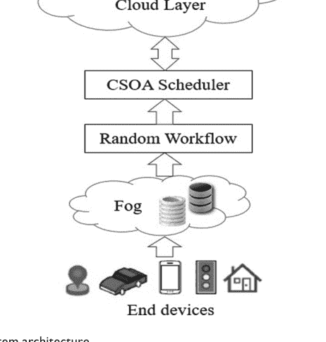

图 1.1 系统架构。

$T_{\text{nodes}} = C_{\text{nodes}} + F_{\text{nodes}}$ (1.1)

上述方程中，$T_{\text{nodes}}$ 表示云节点和雾节点的总和。$C_{\text{nodes}}$ 和 $F_{\text{nodes}}$ 分别表示云节点和雾节点。用于 CFC 环境中物联网任务 TS 的系统模型涉及一个分层架构，旨在高效处理和管理物联网生成的数据和任务。在最高层，云计算基础设施提供庞大的计算资源和存储能力。然而，由于将数据传输到远距离云服务器及返回时可能产生的延迟，引入了中间雾计算节点。雾节点位于物联网设备附近，提供低延迟处理，可以从云卸载计算任务。此外，位于网络边缘的边缘设备通过本地处理数据进一步降低延迟，使其适用于时间敏感的物联网应用。

在此系统模型中，在云、雾和边缘计算层之间高效调度物联网任务对于优化资源利用率和遵守 QoS 标准至关重要。利用 CSOA，任务会根据任务属性、资源可用性和网络条件等参数动态分配给最合适的计算资源。通过利用 CSOA 高效探索解空间并找到最优任务分配策略的能力，调度系统旨在最小化任务完成时间、降低延迟并增强整体系统性能。

为了在 CFC 和边缘计算中实现基于 CSOA 的 TS 系统，系统模型定义了一组参数和约束。这些包括任务属性（例如，计算需求、截止时间）、资源特征（例如，处理能力、内存）以及计算基础设施不同层之间的通信延迟。CSOA 算法迭代评估云、雾和边缘节点之间的潜在任务分配，旨在收敛到一种最大化资源利用率、最小化延迟并满足 QoS 约束的分配策略。通过在云、雾和边缘层之间高效分配物联网任务，调度系统促进了物联网生成数据的及时可靠处理，使可扩展且响应迅速的物联网应用成为可能。

#### 1.3.1.1 随机工作流

在 CFC 环境中调度物联网任务时使用随机工作流既带来挑战也带来机遇。在物联网任务到达遵循随机模式的场景中，传统的确定性调度算法可能难以有效分配资源并满足 QoS 要求。随机工作流使用引入了任务到达率、计算需求和网络条件的变异性和不可预测性，需要能够动态适应变化的工作负载模式的自适应调度策略。然而，这种变异性也提供了优化的机会，因为它允许调度算法探索更广泛的潜在任务分配场景，并在实时中调整决策以最大化资源利用率和系统性能（图 1.2）。

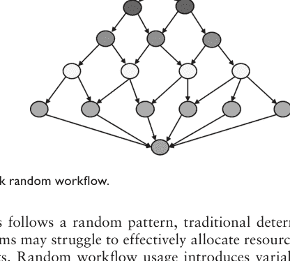

图 1.2 任务随机工作流。

CSOA 为解决物联网 TS 中随机工作流使用带来的挑战提供了一种有前景的方法。通过利用 CSOA 内在的高效探索解空间并发现最优任务分配策略的能力，调度系统可以适应工作负载模式和网络条件的动态特性。CSOA 的运行基于借鉴布谷鸟物种中观察到的巢寄生现象的原理，使其能够根据任务特征、资源可用性和通信延迟的变化动态调整任务分配。通过迭代优化，CSOA 旨在收敛到在 CFC 环境中最小化任务完成时间、降低延迟并最大化资源利用率的任务分配策略。

将 CSOA 纳入 CFC 环境中物联网任务的调度系统，能够利用随机工作流使用来提高系统效率和性能。通过根据实时条件和约束动态分配任务，基于 CSOA 的调度方法优化资源利用率、减少响应时间并增强物联网应用的可扩展性。此外，CSOA 对变化的工作负载模式和网络条件的适应性使其非常适合解决随机工作流使用带来的挑战，为在动态 CFC 环境中优化物联网 TS 提供了稳健的解决方案。


### 1.3.2 问题表述

使用 CSOA 在 CFC 环境中调度 IoT 任务的问题表述始于定义调度系统的关键目标和约束。主要目标是将传入的 IoT 任务分配给合适的计算资源（云服务器、雾节点或边缘设备），以最大限度地减少任务完成时间、降低延迟并最大化资源利用率。此外，系统还必须考虑各种约束，包括每个计算资源的计算能力、设备之间的通信延迟以及诸如任务截止时间和可靠性等 QoS 要求。

本质上，该问题可以被形式化为一个优化挑战，旨在识别一种理想的任务分配策略，在遵守所有约束的同时最小化预定义的客观函数。在此框架内，决策变量表示将每个 IoT 任务分配给特定计算资源的分配，而目标函数通过考虑任务完成时间、资源利用率等因素来衡量整体系统性能。约束的引入用于强制遵守资源可用性、通信延迟和 QoS 标准，从而保证调度解决方案的可行性和可靠性。

问题的复杂性源于 IoT 工作负载的动态特性，其在任务到达率、计算需求和网络条件方面表现出可变性。此外，云和雾环境中计算资源的多样性增加了另一层复杂性，需要能够根据实时条件动态调整任务分配的自适应调度策略。通过将问题表述为优化任务并利用 CSOA，调度系统旨在通过高效地探索解空间并发现能够提高 IoT 部署中系统效率和性能的最佳任务分配策略来应对这些挑战。

#### 1.3.2.1 目标函数

目标函数作为系统性能的衡量标准，指导优化过程找到最有效的任务分配策略。目标函数可以被制定为平衡任务完成时间、资源利用率和 QoS 要求等各种因素。数学上，目标函数 f(x) 可以表示为这些因素的组合：

f(x)=w₁·T_c(x)+w₂·U(x)+w₃·QoS(x)  (1.2)

在此上下文中，设 x 表示任务分配解，其中 T_c(x) 表示任务完成时间，U(x) 表示资源利用率，QoS(x) 表示 QoS 满足度的度量。权重 w₁、w₂ 和 w₃ 用于衡量目标函数中每个因素的相对重要性。目标函数的优化涉及识别任务分配解 x*，该解根据指定的标准最小化或最大化整体系统性能。

CSOA 被用于通过迭代探索解空间并调整任务分配以改善系统性能来优化目标函数。CSOA 根据实时条件和约束动态调整任务分配，旨在收敛到一个最优解，该解最小化任务完成时间、最大化资源利用率并满足 QoS 要求。通过 CSOA 促进的高效优化，IoT 应用可以在 CFC 环境中实现改进的系统效率、减少的响应时间和增强的用户体验。

#### 1.3.2.2 任务完成时间

任务完成时间是 CFC 环境中调度 IoT 任务的关键指标，因为它直接影响 IoT 应用的响应性和效率。数学上，任务完成时间 T_c 可以表示为每个 IoT 任务 i 的总处理时间 P_i，考虑计算、通信以及任何潜在的排队延迟：

$T_c = \sum_{i=1}^{n} P_i$ (1.3)

在此场景中，设 n 为需要调度的 IoT 任务总数。每个任务的处理时间 P_i 取决于多个因素，例如任务的计算需求、分配计算资源的处理能力以及设备之间的通信延迟。在 CFC 环境中，任务可以跨越各种计算层，任务完成时间受任务分配策略的有效性和资源利用率优化的影响。

CSOA 在最小化任务完成时间方面发挥着关键作用，它根据实时条件和约束将任务动态分配给合适的计算资源。通过迭代探索解空间并优化任务分配，CSOA 旨在收敛到一种分配策略，该策略在考虑资源可用性、通信延迟和 QoS 要求等因素的同时最小化整体任务完成时间。通过 CSOA 促进的高效任务调度，IoT 应用可以实现减少的响应时间、改进的系统性能和增强的用户体验。

#### 1.3.2.3 资源利用率

资源利用率是 CFC 环境中调度 IoT 任务的关键方面，因为它直接影响资源分配的效率和成本效益。数学上，资源利用率 $U$ 可以定义为计算资源积极处理任务的总时间与总可用时间的比率：

$$U = \frac{T_{\text{active}}}{T_{\text{total}}}$$ (1.4)

这里，$T_{\text{active}}$ 表示计算资源积极处理任务的总时间，而 $T_{\text{total}}$ 表示总可用时间。高效的任务调度策略旨在通过最小化空闲时间并确保计算资源有效地用于处理 IoT 任务来最大化资源利用率。这涉及根据实时条件和约束，例如计算能力、通信延迟和 QoS 要求，将任务动态分配给计算资源。

CSOA 在优化资源利用率方面发挥着关键作用，通过迭代探索解空间并优化任务分配。通过根据工作负载模式和资源可用性将任务动态分配给适当的计算资源，CSOA 旨在最大化资源利用率同时最小化空闲时间。通过 CSOA 促进的高效资源分配，IoT 应用可以实现 CFC 资源的最优利用，从而提高系统性能和成本效益。

#### 1.3.2.4 拟议算法

拟议 CSO 算法的伪代码如下所示：

```
Input: task characteristics, task priorities, and task requirements
function CSOA_Task_Scheduling(IoT_tasks, cloud_servers, fog_nodes):
    Initialize population of cuckoos randomly
    Evaluate fitness of each cuckoo in the population
    while termination condition is not met do:
        Choose cuckoos for egg laying
        Generate new solutions by performing levy flights
        Evaluate fitness of new solutions
        Replace nests with worse solutions
        Abandon nests with probability pa
    end while
    Return best solution found
function Initialize_population ():
    Initialize a population of cuckoos randomly
    return population
function Evaluate_fitness (solution):
    Calculate task completion time for the given solution
    Calculate resource utilization for the given solution
    Calculate QoS satisfaction for the given solution
    Calculate fitness as a combination of the above factors
    return fitness
function Choose_cuckoos_for_egg_laying (population):
  Choose cuckoos for egg laying based on fitness
  return selected_cuckoos
function Generate_new_solutions (selected_cuckoos):
  Perform levy flights to generate new solutions
  return new_solutions
function Replace_nests (population, new_solutions):
  Replace nests with worse solutions from new solutions
  return updated_population
function Abandon_nests (population):
  Abandon nests with a probability pa
  return updated_population
```

输出：获得的最佳解

在此伪代码中，CSOA_Task_Scheduling 函数初始化一群布谷鸟种群，评估每个布谷鸟的适应度，并在满足终止条件之前迭代执行 CSOA。Initialize_population 函数随机初始化布谷鸟种群，而 Evaluate_fitness 函数根据任务完成时间、资源利用率和 QoS 满足度计算每个解的适应度。Choose_cuckoos_for_egg_laying 函数根据其适应度选择用于产卵的布谷鸟，而 Generate_new_solutions 函数通过执行 Levy 飞行生成新解。Replace_nests 函数用来自新解的较差解替换巢，而 Abandon_nests 函数以一定概率放弃巢。

## 1.4 结果与讨论

### 1.4.1 结果

仿真作为评估 CFC 环境中任务调度算法有效性的关键平台。在本研究中，我们展示了旨在检验使用 CSO 进行任务调度性能的仿真结果。仿真设置经过精心配置，以模拟真实世界的云雾环境，涵盖了准确表示所需的各种参数。本研究中使用的<|message|> 方法经过严格测试并利用 CloudSim 3.0.3 仿真框架实现，结合 Java 编程来模拟云雾计算环境。实验在个人

表 1.2 仿真配置设置详情

|  |  |  |
|---|---|---|
| 总虚拟机数 (VMs) | 云 | [15,20,25] |
| 计算能力 (MIPS) |  | [2000:4000] |
| 内存 (MB) |  | [5000:20000] |
| 带宽 (Mbps) |  | [512:4096] |
| 总虚拟机数 | 雾 | [10,15,20] |
| 计算能力 (MIPS) |  | [2000:4000] |
| 内存 (MB) |  | [250:5000] |
| 带宽 (Mbps) |  | [128:1024] |

计算机配备了 Intel Core i7-8550U CPU，拥有 8 个核心，时钟频率在 1.80 至 2.0 GHz 之间。由 16 GB 内存支持并运行 Windows 10 操作系统，该硬件配置促进了算法的高效执行和评估，确保在云雾计算环境中分析 TS 策略时的稳健性和可靠性。对算法性能和部署策略的研究通过 CloudSim 3.0.3 仿真器进行了全面验证，该仿真器与 Java 编程深度集成，以复制云雾计算场景。实验在配备 Intel Core i7-8550U CPU 的个人计算平台上进行，该 CPU 具有 8 个核心，时钟速度范围为 1.80 至 2.0 GHz。由 16 GB 内存支持并运行 Windows 10 操作系统，该硬件配置实现了对算法的严格评估，确保其在云雾计算环境中协调 TS 机制时的有效性和可靠性（表 1.2）。

在配置仿真时，采用了定制开发的云雾计算仿真器，提供了一个复制动态 TS 场景的复杂框架。仿真器在 CloudSim [24] 中实现，能够模拟云雾环境典型的多样化网络拓扑、任务工作负载和资源特征。关键配置细节，包括网络拓扑、工作负载生成模式、资源异构性和算法参数，均经过仔细选择以确保与真实世界条件的保真度。通过这种全面的仿真设置，我们旨在深入探讨 CFC 环境中 TS 优化的复杂性，并提供 CSO 处理这些挑战的性能见解。

#### 1.4.1.1 任务完成时间

我们提出的 CSOA 相较于传统方法，如蚁群优化 (ACO)、粒子群优化 (PSO) 和和谐搜索优化 (HSO)

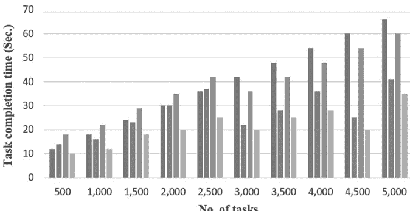

图 1.3 任务完成时间的计算。

在任务完成时间方面进行评估时。通过广泛的仿真和基准测试，CSOA 通过有效利用鸽巢搜索算法中固有的探索和开发能力，始终优于这些传统算法。通过智能地平衡探索和开发，CSOA 表现出迅速收敛到接近最优 TS 解决方案的显著能力，从而最小化任务完成时间并提高整体系统效率。此外，CSOA 对动态环境的适应性和对过早收敛的鲁棒性进一步巩固了其相对于 ACO、PSO 和 HSO 的优越性，使其成为解决 CFC 环境中 TS 挑战的有前景的优化技术（图 1.3）。

#### 1.4.1.2 资源利用率

我们提出的 CSOA 在资源利用率方面显著优于 ACO、PSO 和 HSO 等传统方法。通过严格的实验和比较分析，CSOA 在云雾计算环境中将任务分配给可用资源的效率方面表现出更优。通过利用鸽巢搜索算法的固有探索和开发能力，CSOA 最优地平衡资源分配，最小化资源空闲时间并最大化利用率。由于其自适应特性，CSOA 可以根据资源可用性和工作负载的实时波动动态调整调度决策，从而确保最佳资源利用

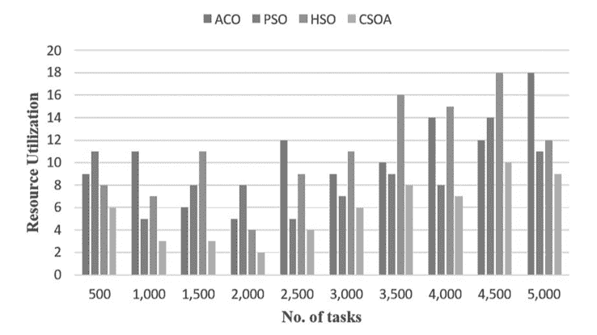

图 1.4 资源利用率的计算。

在不同的运行场景中。这种特性使 CSOA 成为优化云雾环境中资源利用率的强大且稳健的解决方案，在 TS 优化这一关键方面超越了 ACO、PSO 和 HSO 的性能（图 1.4）。

### 1.4.2 讨论

CSO 在云雾环境中优化 TS 方面表现出显著的有效性。通过利用从布谷鸟物种的巢寄生行为中汲取灵感的进化原理，CSO 高效地探索解空间，从而实现接近最优的任务分配和资源配置。这种能力在它协调探索和开发方面的能力上尤为明显，从而在任务完成时间和资源利用率方面取得有竞争力的性能。

此外，与遗传算法 (GA)、PSO 和 ACO 等其他优化技术相比，CSO 通常表现出更优的性能。它处理具有高维搜索空间的复杂非线性优化问题的能力使其非常适合 CFC 环境的动态和异构特性。此外，CSO 的简单性和易于实现性增加了其作为 CFC 中 TS 优化的实用解决方案的吸引力。

然而，尽管具有优势，CSO 并非没有局限性。一个显著的局限性是其对参数设置的敏感性，包括种群大小、发现率和放弃概率。 poorly chosen

参数值可能导致过早收敛或次优解，凸显了参数调优对实现最佳性能的重要性。此外，CSO 对随机化和随机过程的依赖可能导致非确定性行为，使得在所有场景中准确预测其性能变得困难。

虽然 CSO 为 CFC 中的 TS 优化提供了一种有前景的方法，但仍需要进一步研究来解决其局限性并提高其可扩展性、鲁棒性和对多样化运行条件的适应性。通过探索改进参数调优机制的技术、纳入领域特定知识以及研究混合优化方法，CSO 可以继续发展成为提高 CFC 环境中 TS 效率和有效性的宝贵工具。

#### 1.4.2.1 局限性

- 1. 可扩展性挑战：CSO 在处理涉及大量任务和资源的大规模 IoT TS 问题时可能会面临可扩展性问题。随着优化问题规模的扩大，CSO 的计算复杂度可能达到不切实际的程度，导致优化时间延长和内存需求增加。
- 2. 参数调优敏感性：CSO 的性能在很大程度上依赖于算法参数的细致选择，例如种群大小、步长和放弃概率。为给定的 IoT TS 场景找到最佳参数配置可能具有挑战性，并且可能需要大量的实验和微调。
- 3. 对动态环境的适应性不足：CSO 在任务特征、资源可用性和网络条件频繁波动的动态 CFC 环境中的有效性可能会减弱。CSO 的静态特性可能会阻碍其迅速适应变化环境条件的能力，可能导致次优的 TS 选择。
- 4. 异构资源处理能力有限：CSO 可能难以在具有异构计算资源的环境中有效分配任务，例如不同的处理能力、内存容量和能量特征。在这种情况下，CSO 可能会优先考虑某些资源而不是其他资源，导致资源利用不均并可能降低系统性能。
- 5. 解决方案质量缺乏保证：虽然 CSO 通常收敛到接近最优的解，但并不能保证最优性或收敛到全局最优。取决于问题实例和参数设置，CSO 可能收敛到次优解或陷入局部最优，限制了其找到最佳 TS 解决方案的能力。


解决这些局限性需要进一步的研究和开发工作，旨在增强 CSO 在 CFC 环境中调度 IoT 任务时的可扩展性、适应性和鲁棒性。此外，探索混合优化方法并纳入领域特定知识可能有助于缓解这些局限性并提高 CSO 在实际 IoT 部署场景中的有效性。

## 1.5 结论与未来工作

总之，CSO 在 CFC 中用于 TS 的应用具有显著前景，并在研究界获得了相当大的关注。通过其高效探索解空间并在探索与利用之间取得平衡的能力，CSO 在动态云雾环境中优化任务完成时间和资源利用方面表现出具有竞争力的性能。尽管有效，CSO 并非没有挑战，特别是其对参数设置的敏感性和对随机过程的依赖。通过进一步研究参数调优机制、混合优化方法以及纳入领域特定知识来解决这些挑战，对于释放 CSO 在 CFC 中用于 TS 优化的全部潜力至关重要。总的来说，CSO 代表了在追求提高 TS 算法的效率、可扩展性和适应性方面的宝贵工具，有助于推进 CFC 系统及其在各个领域的应用。

## 利益冲突

作者声明不存在利益冲突。

## 参考文献

- 1. Binh Minh Nguyen, et al. “用于云雾计算环境中基于物联网的任务包应用的任务调度问题的进化算法。” *Applied Sciences* 9(9) (2019): 1730.
- 2. Medishetty Santhosh Kumar, and Ganesh Reddy Karri. “一种改进的丁戈优化算法用于云雾计算环境中的资源感知调度。” *Majlesi Journal of Electrical Engineering* 17(3) 31–41 (2023).
- 3. Roop Ranjan, Dilkeshwar Pandey, Ashok Kumar Rai, Deepak Gupta, Pawan Singh, Puranam Revanth Kumar, and Sachi Nandan Mohanty. “一种基于自回归模型的流形级混合深度学习情感分类方法。” *Applied Sciences* 13(5) (2023): 3091.
- 4. Kequan Zhang, et al. “一种基于布谷鸟搜索优化算法的短期风速预测新混合方法。” *Environmental Progress & Sustainable Energy* 36(3) (2017): 943–952.
- 5. Mohammed Azmi Al-Betar, et al. "和谐搜索中记忆考虑的选择方法分析。" *Applied Mathematics and Computation* 219(22) (2013): 10753–10767.
- 6. Medishetty Santhosh Kumar, and Ganesh Reddy Karri. "云计算中任务调度的参数研究。" 2023 12th *International Conference on Advanced Computing (ICoAC)*. IEEE Chennai India (2023).
- 7. Arivazhagan Natesan, Somasundaram Krishnan, Gouse Baig Mohammad, Puranam Revanth Kumar, et al. "用于电子医疗系统的基于混合蛾群火焰优化与深度神经网络算法的云-健康物联网任务调度。" *Scientific Programming* 2022(4) (2022): 1–12.
- 8. Medishetty Santhosh Kumar, and Ganesh Reddy Karri. "EEOA：云雾框架中成本与能源高效的任务调度。" *Sensors* 23(5) (2023): 2445.
- 9. Gouse Baig Mohammad, Selvarajan Shitharth, and Puranam Revanth Kumar. "一种用于 URL 钓鱼检测的集成机器学习模型。" *International Journal of Grid and Distributed Computing* 14(1) (2021): 513–529.
- 10. Sambit Kumar Mishra, Bibhudatta Sahoo, and P. Satya Manikyam. "使用蚁群优化的云任务自适应调度。" *Proceedings of the 3rd International Conference on Communication and Information Processing*, Tokyo Japan (2017).
- 11. Sukhpal Singh, et al. "BULLET：基于粒子群优化的预置云资源调度技术。" *Journal of Network and Systems Management* 26 (2018): 361–400.
- 12. G. Narendrababu Reddy, and S. Phani Kumar. "云计算系统中任务调度的改进蚁群优化算法。" *Smart Intelligent Computing and Applications: Proceedings of the Second International Conference on SCI 2018*, Vijayawada, Andhra Pradesh, Volume 1. Springer Singapore (2019).
- 13. Puranam Revanth Kumar. "基于感应耦合的无线移动充电器。" *Journal of Emerging Technologies and Innovative Research (JETIR)*, 5(10) (2018): 40–44.
- 14. Arun Kumar Sangalaiah, et al. "基于启发式算法的物联网资源分配与优化。" *Sensors* 20(2) (2020): 539.
- 15. Salim Bitam, Sherali Zeadally, and Abdelhamid Mellouk. "基于蜜蜂群的雾计算作业调度优化。" *Enterprise Information Systems* 12(4) (2018): 373–397.
- 16. Jiafu Wan, et al. "智能工厂中面向节能的负载均衡与调度的雾计算。" *IEEE Transactions on Industrial Informatics* 14(10) (2018): 4548–4556.
- 17. Puranam Revanth Kumar and B. Shilpa, "基于物联网的边缘智能计算智能医疗系统。" In Suneeta Satpathy, Sachi Nandan Mohanty, and Sirisha Potluri, *Reconnoitering the Landscape of Edge Intelligence in Healthcare*. CRC Press, Boca Raton, FL 31–46 (2024).
- 18. Dadmehr Rahbari, and Mohsen Nickray. "雾基物联网应用中的低延迟与节能调度。" *Turkish Journal of Electrical Engineering and Computer Sciences* 27(2) (2019): 1406–1427.
- 19. Guangshun Li, et al. “基于优化模糊聚类的雾计算资源调度方法。” Sensors 19(9) (2019): 2122.
- 20. Sambit Kumar Mishra, et al. “面向工业应用的雾服务器中基于元启发式技术的可持续服务分配。” IEEE Transactions on Industrial Informatics 14(10) (2018): 4497–4506.
- 21. Mostafa Ghobaei-Arani, et al. “一种用于雾计算中信息物理系统应用的基于蛾群火焰优化算法的高效任务调度方法。” Transactions on Emerging Telecommunications Technologies 31(2) (2020): e3770.
- 22. Ruilong Deng, et al. “面向均衡延迟与功耗的雾云计算中最佳工作负载分配。” IEEE Internet of Things Journal 3(6) (2016): 1171–1181.
- 23. Xuan-Qui Pham, et al. “一种基于云雾计算协作的成本与性能高效任务调度方法。” International Journal of Distributed Sensor Networks 13(11) (2017): 1550147717742073.
- 24. Rajkumar Buyya, Rajiv Ranjan, and Rodrigo N. Calheiros. “可扩展云计算环境的建模与仿真及 CloudSim 工具包：挑战与机遇。” 2009 International Conference on High Performance Computing & Simulation. IEEE (2009). Leipzig, Germany

# 用于提高性能的 SDN-IoT 与网络功能虚拟化集成

CH N. Santhosh Kumar, Babu Pandipati, Marepalli Radha, and Gouthami Velakanti

## 2.1 引言

物联网允许众多设备互联，形成可在任何地方独立运行的庞大网络。各种各样的互联网连接设备，包括计算机、手机、家用电器、工业系统、电子健康设备、监控设备、精准农业传感器等，构成了这一互联格局。预测显示，到 2020 年 [1]，这些互联设备的数量将超过 450 亿，价值超过 140 亿美元。由于所有这些设备产生的大量数据，将需要部署更多网络接入和核心设备。确保如此庞大的物联网系统无缝运行和集成存在诸多技术障碍。数据收集和分析、隐私、安全、物联网节点拓扑、通信协议、边缘接入以及应用和设备异构性等问题都属于这些困难的一部分。此外，由于物联网设备的移动性引入的动态拓扑变化，可能需要重新建立流 [2]。广泛的应用种类使得本已复杂的生态系统变得更加复杂。虚拟化以及软件和硬件资源的编程能力提供了一种切实可行地降低复杂性的方法，尽管为所有这些问题创建一个单一解决方案可能不切实际。通过软件的使用，虚拟化允许对网络底层硬件元素进行逻辑抽象。通过将控制与硬件解耦，这种抽象使得管理和更新、修改变得更加容易。虚拟化的新发展将其范围扩展到包括集成在硬件中的软件，该软件现被视为一个独立的虚拟功能元素 [3]。

互联网的快速增长使得传统网络的异构性、可扩展性和互操作性问题变得更加严重，而传统网络臭名昭著地僵化且不变。网络功能虚拟化（NFV）[4] 和软件定义网络（SDNs）[9] 是为解决这些困难而发展起来的两种关键通信网络虚拟化技术。通过将物理基础设施

将网络拆分为转发（数据）平面并集中路由设备的控制功能，SDN 彻底改变了网络的设计方式。在此，控制器负责所有策略和流相关数据，而连接控制平面与数据平面之间的协议是 OpenFlow（OF）[5]。存在提供可比功能的其他方式；这些在 Refs. [6,7] 中有所引用。在整个网络中强制执行配置、法规和流的能力是 SDN 的主要优势。除这些优势外，SDN 还允许实现厂商无关性、网络切片虚拟化、安全性提升以及资源利用优化。相反，NFV 涉及将传统基于硬件的任务（如防火墙、负载均衡和路径计算）迁移到基于软件的云中。通过远离专用物理硬件并转向更灵活的虚拟化环境，这种方法提高了灵活性和适应性。

SDN 和 NFV 是正在研究的两种新技术示例，它们有望为这一探索提供有用的答案。例如，SDN 受到了学者的广泛关注，并在数据中心网络中取得了良好成果，其中网络和 IT 资源协同优化是主要目标。Google 使用 SDN 管理其众多数据中心之间的连接就是一个典型例子 [8]。作为网络的新范式，SDN 克服了传统网络的不足。它将网络的控制逻辑与转发平面分离，而后者此前是紧密耦合的。网络操作系统或逻辑集中式控制器实现控制平面，从而简化演进、配置和策略执行 [9]。NFV 为网络编程提供了新方法，使运营商能够自动化数据平面设备的管理并优化网络资源的使用。因此，这改善了网络在数据处理、控制和管理方面的性能 [10]。

一种名为 NFV 的理论网络设计使用运行在商业可获得的现成服务器上的软件来替代专用网络设备，如交换机、路由器和防火墙。节能、优化负载以及使网络更具可扩展性都是该方法的优势。图 2.2 所示的 NFV 架构由一个或多个虚拟机（VMs）组成，这些虚拟机运行各种应用程序和进程，涵盖存储、网络服务器、交换机甚至云计算基础设施。因此，某些网络任务不再需要专用硬件设备。SDN 和 NFV 是互补技术。作为 SDN 的组成部分，NFV 对 SDN 控制器进行虚拟化，使云部署成为可能，并允许控制器动态迁移到最佳位置。相比之下，SDN 通过在 NFV 之间提供可定制的网络连接来使能 NFV，从而改善流量工程。尽管两者兴趣相近，但由于它们是不同标准化组织的产品，NFV 和 SDN 并没有共同的架构。针对物联网（IoT）提出了多种 SDN 设计，但并非所有设计都包含虚拟化方法。一些示例包括软件定义无线网络（SDWN）、Sensor OF、软件定义网络无线传感器网络（SDN-WISE）和 SDWN [11]。这项工作是连接 SDN、NFV 和 IoT 的早期尝试。在实施这种集成方法后，IoT 设备可以以有效且可靠的方式共享网络资源。本文提出了一种易于理解的 SDN-IoT 架构，该架构使用 NFV 解决困扰 IoT 的可扩展性和移动性问题。提高 IoT 应用的网络敏捷性和效率是期望的结果。

在 IoT 环境中，处理、关联和分析从各种设备（包括传感器）获取的原始数据至关重要。不幸的是，由于这些设备资源有限，这些程序需要在外部执行。因此，将 AI 与卓越的分析能力相结合以从 IoT 设备发送的大量数据中学习任何信息至关重要。Cloud of Things 和 Everything as a Service 是由此策略产生的两个独特应用 [12]。在这种情况下，最大的障碍之一是确保服务质量良好。SDN 和 NFV 对于维护服务等级协议（SLAs）至关重要。从服务质量（QoS）角度来看，SDN 和 NFV 对于维护服务等级协议（SLAs）至关重要。它们的适应性允许在 QoS 水平下降或客户对补充服务的需求下控制并引入新的网络功能或传感器。这同时改善了服务的 QoS 和终端用户的体验质量（QoE）。对运营支出和资本支出（OPEX 和 CAPEX）的削减将在服务和电信行业产生乘数效应 [13]。

在本研究中，我们提出了一种使用 NFV 和 SDN 的 IoT 设计，以解决此类场景中的 QoS 问题并展示概念验证。本文分为四个部分，从当前引言开始。第 2.2 节概述了相关工作。后续章节第 2.3 节介绍了方法论。第 2.4 节介绍了结果与讨论。本章以第 2.5 节结束。

## 2.2 相关工作

为处理连接感知域和网络域的不同协议，研究 [14,15] 中提出了面向水平 IoT 服务的基于 SDN 的架构。这些设计使用网关（即基于 OF 的交换机）以允许在多种协议之间发送和接收指令。网关的主要功能是在两个域之间转换协议。另一项研究 [16] 提出了一种使用软件定义数据平面连接两个感知域的方法。在此，数据平面根据情况充当桥梁，使 SDN 模型能够通过在 OF 标准内部扩展编程功能而扩展到包括第 7 层数据包操作能力。尽管前景可期，但在大规模网络环境中部署这些技术存在问题，因为它们需要在网关处消耗更多计算资源和内存。图 2.1 和图 2.2 描述了 SDN 网络和 IoT 设备的互连。

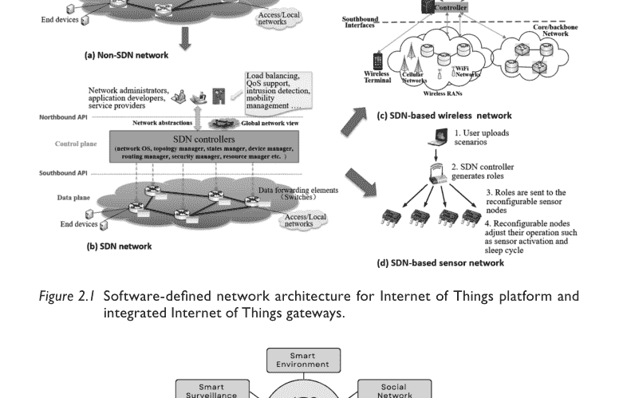

图 2.1 物联网平台的软件定义网络架构及集成物联网网关。

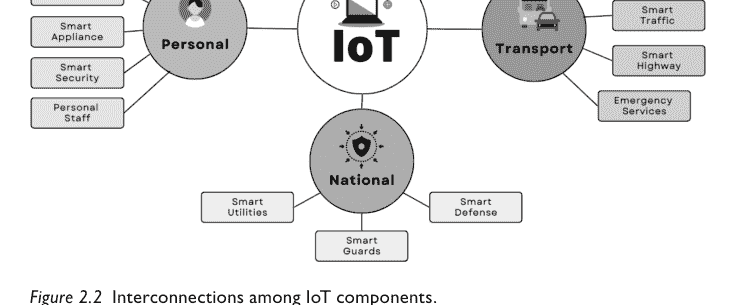

图 2.2 IoT 组件之间的互连。

近期出现了一些针对在 IoT 网关上安装大型软件包问题的提案。例如，一项研究 [17] 提出在大型网络中使用 Docker 容器构建网关服务。为了管理软件定义 IoT 系统，其他研究包括 [18,19] 在网关上部署了代理。研究 [20] 主要关注网关上的推送和拉取配置自动化，其重点在于服务器端的软件创建和打包。就部署、设置和维护而言，随着 IoT 网络数量的增加，管理 IoT 网关变得更加复杂。

为解决此问题，使用 SDN 和 NFV 构建 VNFs，即虚拟网络功能。这些 VNFs 然后作为镜像或容器保存在 VMs 中。因此，NFV 编排可以轻松地生成、激活或更改在 IoT 网关上运行的特定实例或服务的状态。为了构建能够在 IoT 网关上部署不同网络功能的 IoT 基础设施，将 NFV 编排与 SDN 控制器和云软件开发相结合被视为一种可行且稳健的选择。鉴于网络中 IoT 流量大幅激增，减少传输到核心的数据量的存储、处理和传输技术至关重要 [21]。在 IoT 基础设施中，在 IoT 网关上使用 SDN/NFV 和平台特定虚拟化（基于 P4）交换机是一项重要进展。这带来了包括 fabric 端到端（E2E）连接性、动态扩展以及网关处数据预处理等优势。此外，Refs. [22,23] 中的研究探讨了未来 5G 时代 IoT 发展、大数据分析（Big Data）、云计算（Cloud）和 SDN 之间的技术关系。根据这些研究，5G 网络能够处理 IoT 应用的多样化需求，并比前几代更快、更便宜地传输它们产生的大量数据。数据处理和存储可通过云计算和大数据实现，而 SDN/NFV 可建立可扩展网络以实现大数据的最优传输。为了简化为每个网关设置实例的过程，NFV 发挥着至关重要的作用。这些 5G 设计的目标是促进这些技术在 IoT 网络和应用中的顺畅融合，从而加速其发展。在大规模 IoT 生态系统中，一个用例是卸载 IoT 网关服务。

## 2.3 方法论

在 Full-SDMN（软件定义移动中间件）架构的背景下，NFV 编排、Full-SDMN 编排和 SDN 控制器之间的协作在确保以下方面发挥着至关重要的作用：对于网络提供商而言，Full-SDMN 编排意味着制定新的服务策略，使其能够监控和监管诸如安全、IoT 应用、移动虚拟网络运营商（MVNOs）和内容分发网络（CDNs）等事项。虚拟核心网络（VCNs）由

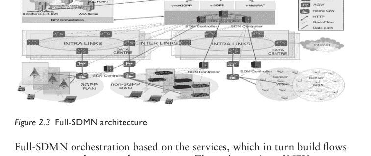

图 2.3 全-SDMN 架构。

Full-SDMN 编排基于服务，而服务又构建流程来编程网络组件。NFV 的编排保证了这些功能在底层网络上的创建和运行 [24]。最后，SDN 控制器管理网络的物理组件和操作。架构中的关键元素包括位于边缘网络的家庭网关（GWs），作为 3GPP RAN（无线接入网）、非 3GPP RAN 或有线网络等各种边缘网络的网关而发挥作用。因此，家庭 GW 需要满足关于灵活性和可扩展性的特定标准 [25]。这涉及创建切片、管理并维持网络以及托管物联网服务的能力（见图 2.3）。

作者详细介绍了在 5G 物联网应用的背景下，各种物联网公司如何在公共网络上部署其服务。图 2.4 中多租户物联网结构中的三个租户代表不同的物联网应用：智能家居（租户 1）、自动驾驶汽车（租户 2）和电子健康记录（租户 3）。在自动驾驶汽车的背景下，车辆与网络基础设施之间的通信对于执行多种服务至关重要，例如提供实时交通警告、地图、本地天气更新、停车信息和热门新闻 [26,27]。由于这些服务的时效性，可以使用 3GPP RAN、非 3GPP RAN 或无线传感器网络（WSNs）等异构网络来连接汽车。通过使用新型空中接口（多无线接入技术（RAT））也可以实现最佳吞吐量和低延迟，该接口通过 VCN 和虚拟无线接入网（VRAN）或与 RAN 相连的相邻家庭网关保证可靠的连接。v-3GPP、v-non3GPP 和 v-multi-RAT 控制器等应用程序可以创建和管理虚拟局域网（VRANs）。同样，多租户控制器应用程序管理并控制 VCN 的构建，以提供一致可靠的服务。为处理服务中断的可能性，实施了服务恢复的控制器应用程序。此外，多租户控制器应用程序可以在车辆需要非安全服务（如存储在物联网服务服务器或互联网上的本地天气更新和停车信息）时设置 VCN 通道并运行它。该应用程序通过创建根据图 2.4 中所述物联网应用的个人需求量身定制的各种网络切片，确保有效且定制的服务交付。

在电子医疗保健场景的背景下，包括心率传感器、身体传感器、血压设备和可穿戴智能医疗传感器等智能传感器和执行器在内的各种智能设备产生大量数据。这些数据包括来自 WSNs（如 6LoWPAN、ZigBee）、非 3GPP RAN（如 Wi-Fi、LoRa WAN、蓝牙低功耗）中传感器的信息，以及个人患者数据、健康状况和医疗治疗历史 [28]。因此，电子健康网络需要具备有效通信、感知、数据处理、分析和将物理数据转换为有形效果的能力 [9]。改善医疗服务同时降低医疗费用是最终目标。下一个场景是智能家居，在那里，与电子医疗保健类似，物联网被用于将智能传感器无缝集成到智能家居环境中。这种集成的最终目标是通过更好地监控和协调生活空间来让家庭用户生活更轻松 [29,30]。中央空调、照明、窗帘和供暖系统，以及视频对讲机、背景音乐和智能家电等其他多媒体系统，都集成了智能传感器。家庭 GW 使这些设备能够连接到远程服务，通过物联网交互，并智能控制其他物理设备用于安全、娱乐、节能和安全等事项。作为网关，家庭 GW 在智能家居环境中至关重要，将数据包发送到其最终目的地并分离服务。

## 2.4 结果与讨论

仿真结果集中于基础设施和控制与虚拟化层的行为，以表明所建议的框架是可行的。为此使用了 Mininet 仿真 [31]。研究界普遍接受 Mininet 作为 SDN 仿真。Mininet 的组件包括虚拟主机、OF 开关和链路，它使用 python 脚本来模拟用户定义的网络拓扑。在实时应用中，仿真性能与底层主机系统的容量之间存在直接相关性。在这种情况下，使用小规模拓扑可确保准确的结果和内存/CPU 分离。使用运行 Linux Ubuntu 16.04 的虚拟计算机在 Acer Swift 3 服务器（Intel i7、2.7 GHz、8 GB）上复制拓扑。这里，所示拓扑使用核心、汇聚和边缘 OpenFlow 启用交换机（s1–s7）来模拟共享数据中心。

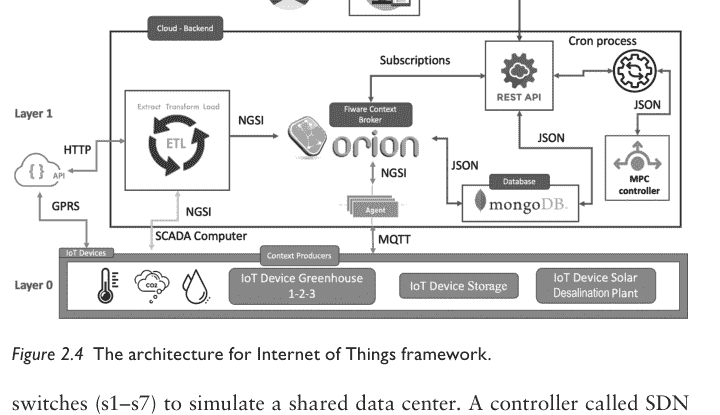

图 2.4 物联网框架的架构。

一个名为 SDN Floodlight（Floodlight 控制器）的控制器连接到交换机。为了请求部署 SDN-Apps 所需的主要 SDN 服务，Floodlight 提供了一种表征状态转移 - 应用程序编程接口（REST-API）。本实验中使用了 Quality-of-Service-App [14]。两个主机 h1–h8 连接到每个边缘交换机（s4–s7）。虚拟主机为视频流创建数据并代表物联网设备。使用实时协议 over 用户数据报协议（RTP/UDP），虚拟主机通过 VideoLAN 客户端（VLC）服务器广播视频文件“highway cif”（电信网络组）。视频分辨率为 352×288，文件大小为 4.23 MB。格式为 highway cif.mp4，这是一个 MPEG4 编码文件。66 秒视频中有两千帧。实验的目标是证明控制器以不干扰网络正常运行的方式修改交换机行为的能力。实验使用了两个流媒体流：一个从 h2 向 h7 传输视频，另一个从 h1 向 h8 发送视频。第一个流没有服务质量认证。两个视频同时在网络上传输。45 秒的流媒体时间用于在控制器上下载和安装 QoS-App。之后，QoS-App 自动设置以根据流调节链路带宽。w-QoS 流媒体（从 h2 到 h7）允许的数据速率为最高 2 Mbps，w/o-QoS 流（从 h1 到 h8）为最高 0.4 Mbps。之后，接收到的流被保存为单独的视频文件。根据参考文献 [32]，由电信系统系开发的 Evalvid Tool 用于分析处理后的文件。解码文件为 .yuv 格式后，Evalvid 比较两个流的指标，如结构相似性指数度量（SSIM）和峰值信噪比（PSNR）。在同一虚拟机中同时执行多个程序（Mininet、Floodlight、VLC、Evalvid）可能会导致 CPU 和内存资源发生变化，因此使用了蒙特卡洛方法。为了考虑这些差异，场景被测试 20 次并分析相关平均值。

实验结果如图 2.5 和 2.6 所示，显示了 PSNR 平均值与帧数的关系。实线代表 w-QoS 流媒体，而虚线代表 w/o-QoS。

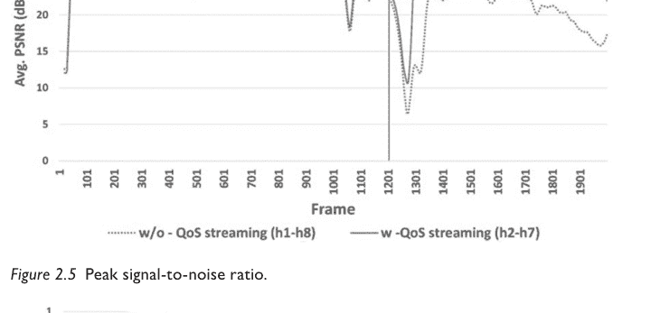

图 2.5 峰值信噪比。

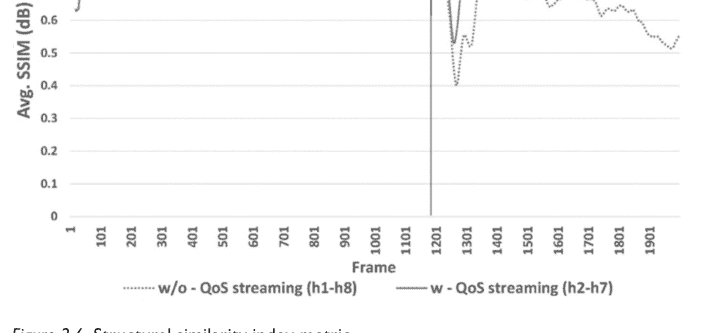

图 2.6 结构相似性指数度量。


最初，两个流媒体流表现出相似的行为（尽力而为），导致平均PSNR值相当。垂直黑线表示QoS-App在Floodlight控制器中下载并配置的点。如预期，在QoS-App配置后，交换机的行为会自动调整以识别流并分配不同的QoS策略。因此，h2–h7流量的PSNR水平优于h1–h8流。在此情况下，w-QoS的平均PSNR为26.54 dB，而w/o-QoS流的平均值为23.73 dB。

图中和实验中出现的一个明显下降表明，这种意外效应主要由该时期的快速运动场景引起。这些场景期间网络负载增加导致PSNR下降。

使用w-QoS时，平均SSIM为0.814，而w/o-QoS流媒体时为0.738。结果表明，控制器可以实时调整网络行为和数据流平衡以满足用户需求。

## 2.5 结论

本工作研究了SDN和NFV范式在物联网环境中带来的益处，并提出了一种专为物联网网络设计的SDN/NFV架构。实验评估了控制器在ITSCO 2018 – 物联网与智慧社区专题会议背景下动态管理网络行为的能力。基于Mininet的测试拓扑和视频流分析表明，Floodlight控制器能够实时修改不同流的QoS/QoE。因此，未来的研究挑战涉及在物联网环境中实现平衡并编排虚拟资源。此外，优化SDN/NFV架构中实时流媒体的算法也是一项重大挑战。

## 参考文献

- 1. R. Bruschi, P. Lago, G. Lamanna, C. Lombardo, and S. Mangialardi. 2016. OpenVolcano：一种面向雾计算的开源软件平台。在第28届国际电讯业务大会论文集，德国第2卷，第22–27页。
- 2. P. Bull, R. Austin, E. Popov, M. Sharma, and R. Watson. 2016. 基于流的物联网设备安全，使用SDN网关。在2016年IEEE第4届未来物联网与云国际会议（FiCloud’16）论文集。IEEE，奥地利维也纳，第157–163页。
- 3. R. Ranjan, D. Pandey, A. K. Rai, D. Gupta, P. Singh, P. R. Kumar, and S. N. Mohanty. 2023. 一种用于情感分类的流形级混合深度学习方法，采用自回归模型。《应用科学》，第13卷，第5期，第3091页。
- 4. S. Chakrabarty, D. W. Engels, and S. Thathapudi. 2015. 面向物联网的黑SDN。在2015年IEEE第12届移动自组织与传感器系统国际会议论文集。IEEE，美国德克萨斯州达拉斯，第190–198页。
- 5. H.-L. Chen and F. J. Lin. 2019. 基于Kubernetes使能的NFV MANO架构的可扩展物联网/M2M平台。在2019年物联网国际会议（iThings'19）及IEEE绿色计算与通信（GreenCom'19）与IEEE网络物理社会计算（CPSCom'19），以及IEEE智能数据（SmartData'19）论文集。IEEE，美国佐治亚州亚特兰大，第1106–1111页。
- 6. N. Arivazhagan, K. Somasundaram, G. B. Mohammad, P. R. Kumar, et al. 2022. 使用混合蛾群火焰优化与深度神经网络算法的云-健康物联网（IOHT）任务调度，用于电子医疗系统。《科学编程》，第2022卷，第1–12页。
- 7. J. H. Cox, J. Chung, S. Donovan, J. Ivey, R. J. Clark, G. Riley, and H. L. Owen. 2017. 推进软件定义网络：综述。《IEEE Access》，第5卷，第25487–25526页。
- 8. P. R. Kumar, G. B. Mohammad, and P. Dileep. 2021. 使用最小二乘法的实时心率监测系统。《罗马尼亚细胞生物学学会年刊》，第25卷，第6期，第16302–16308页。
- 9. S. Dawson-Haggerty, J. Ortiz, J. Trager, D. Culler, and R. H. Katz. 2012. 节能与“软件定义”建筑。《IEEE计算机设计与测试》，第29卷，第4期，第56–57页。
- 10. Y. Demiral and M. Demirci. 2018. 超visor对虚拟网络性能影响的研究。在2018年第26届信号处理与通信应用会议（SIU'18）论文集。IEEE，土耳其伊兹密尔，第1–4页。
- 11. G. B. Mohammad, Selvarajan Shitharth, and P. R. Kumar. 2021. 用于URL钓鱼检测的集成机器学习模型。《国际网格与分布式计算期刊》，第14卷，第1期，第513–529页。
- 12. S. Din, M. M. Rathore, A. Ahmad, A. Paul, and M. Khan. 2017. SDIoT：用于智能城市大数据分析的软件定义物联网。在2017年IEEE第42届局域网研讨会（LCN Workshops'17）论文集。IEEE，新加坡，第175–182页。
- 13. P. R. Kumar. 2018. 使用感应耦合的无线移动充电器。《新兴技术与创新研究期刊（JETIR）》，第5卷，第10期，第40–44页。
- 14. L. Galluccio, S. Milardo, G. Morabito, and S. Palazzo. 2015. SDN-WISE：无线传感器网络有状态SDN解决方案的设计、原型制作与实验。在2015年IEEE计算机通信会议（INFOCOM）。IEEE，中国香港，第513–521页。
- 15. S. Costanzo, L. Galluccio, G. Morabito, and S. Palazzo. 2012. 软件定义无线网络：释放SDN的潜力。在2012年欧洲软件定义网络研讨会（EWSDN）。IEEE，德国达姆施塔特，第1–6页。
- 16. T. Luo, H.-P. Tan, and T. Q. Quek. 2012. Sensor OpenFlow：实现软件定义无线传感器网络。《IEEE通信快报》，第16卷，第11期，第1896–1899页。
- 17. B. Shilpa, P. R. Kumar, and R. K. Jha. 2023. 密集室内LoRa网络中用于干扰缓解的扩频因子优化。*IEEE IAS Global Conference on Emerging Technologies (GlobConET)*, London, UK pp. 1–5。
- 18. P. Thubert, M. R. Palattella, and T. Engel. 2015. 6TiSCH集中调度：当SDN遇见物联网。在*IEEE通信与网络标准化会议论文集（CSCN15）*。东京，日本。
- 19. S. H. Yeganeh, A. Tootoonchian, and Y. Ganjali. 2013. 关于软件定义网络的可扩展性。*IEEE Communications Magazine*，第51卷，第2期，第136–141页。
- 20. A. Al-Fuqaha, M. Guizani, M. Mohammadi, M. Aledhari, and M. Ayyash. 2015. 物联网：使能技术、协议和应用综述。*IEEE Communications Surveys & Tutorials*，第17卷，第4期，第2347–2376页。
- 21. P. Berde, M. Gerola, J. Hart, Y. Higuchi, M. Kobayashi, T. Koide, B. Lantz, B. O'Connor, P. Radoslavov, W. Snow, et al. 2014. ONOS：迈向开放的分布式SDN操作系统。在*第三届软件定义网络热点主题研讨会论文集*。ACM，美国伊利诺伊州芝加哥，第1–6页。
- 22. J. Medved, R. Varga, A. Tkacik, and K. Gray. 2014. Opendaylight：迈向模型驱动的SDN控制器架构。在*2014年IEEE第15届世界无线、移动多媒体网络国际研讨会*。IEEE，澳大利亚新南威尔士州悉尼，第1–6页。
- 23. P. R. Kumar and B. Shilpa. 2023. 基于物联网的智能医疗系统，采用边缘智能计算。在S. Satpathy, S. N. Mohanty, and S. Potluri（编），*探索医疗保健中边缘智能的格局*。CRC Press：美国佛罗里达州博卡拉顿，第31–46页。
- 24. R. Mijumbi, J. Serrat, J.-L. Gorricho, N. Bouten, F. De Turck, and R. Boutaba. 2015. 网络功能虚拟化：现状与研究挑战。*IEEE Communications Surveys & Tutorials*，第18卷，第1期，第236–262页。
- 25. N. Pazos, M. Muller, M. Aeberli, and N. Ouerhani. 2015. ConnectOpen：物联网设备的自动集成。*2015 IEEE第2届物联网世界论坛*，意大利米兰，第640–644页。
- 26. M. Vögler, J. M. Schleicher, C. Inzinger, S. Nastic, S. Sehic, and S. Dustdar. 2015. LEONORE：资源受限物联网部署的大规模供给。*Proceedings - 9th IEEE International Symposium on Service-Oriented System Engineering, IEEE SOSE 2015*，美国加利福尼亚州旧金山，第30卷，第78–87页。
- 27. B.-S. P. Lin, F. J. Lin, and L.-P. Tung. 2016. 5G移动宽带在物联网、大数据、云和SDN发展中的作用。《Communications and Network》，第8卷，第1期，第9–21页。
- 28. B.-S. Paul Lin, Y.-B. Lin, L.-P. Tung, and F. J. Lin. 2018. 通过将SDN/NFV应用于5G和物联网探索网络软warization和虚拟化。《Transactions on Networks and Communications》，第6卷，第4期，第1–13页。
- 29. D. Sinh, L. Le, L. Tung, and B. P. Lin. 2017. 将SDN/NFV应用于5G和物联网的挑战。*第14届IEEE - VTS亚太无线通信研讨会（APWCS）*，韩国仁川。
- 30. D. Sinh, L. V. Le, B. S. P. Lin, and L. P. Tung. 2018. SDN/NFV：部署物联网网络基础设施的新方法。*2018年第27届无线与光通信会议*，第1–5页。


31. L. V. Le, B. S. P. Lin, L. P. Tung, and D. Sinh. 2018. SDN/NFV, machine learning, and big data driven network slicing for 5G. *IEEE 5G 世界论坛，5GWF 2018 - 会议论文集*，硅谷，加州，美国 页 20–25。
32. S. Do, L. V. Le, B. S. P. Lin, and L.-P. Tung. 2018. SDN/NFV based Internet of Things for multi-tenant networks. *《网络与通信学报》*，第 6 卷，第 6 期，1–17。

# 去中心化信任
### 利用区块链确保物联网数据完整性的框架
R. Praveen Sam, A. Ravi Kumar, V. Subbaramaiah, and G. Anil Kumar

## 3.1 引言

物联网的迅速演进从根本上重塑了我们的日常生活 [1]。随着越来越多的物理设备，例如智能手机、可穿戴设备和车辆，通过嵌入式系统和传感器连接到互联网，可以收集大量数据并传输到云计算系统以进行高效的数据分析和更快的决策。此外，这些设备可以执行超出人类能力范围的任务，例如无人驾驶飞行器，或无人机，作为物联网的微观体现，承担包裹投递、作物质量监测和农业异常检测等多样化活动 [2]。然而，随着物联网的扩展，高度的连接性和日益复杂的计算基础设施的复杂性暴露了其对网络攻击的脆弱性。一些物理设备位于不安全环境中，容易受到黑客篡改。无线传感器网络促进了数据和操作命令向互联网的传输，这是一个可能不可信的通信渠道，使其容易遭受未经授权的更改。因此，确保设备授权并维护数据来源 [3,4] 成为一个关键问题。

此外，许多现有的物联网系统依赖于集中式通信模型，连接到服务器或处理处理和数据存储的云计算平台。这里的问题在于服务器成为瓶颈和网络攻击的主要目标 [5]。它也是一个潜在的故障点，可能破坏整个网络，影响数据完整性。因此，建立一个真正值得信赖且集成的环境以支持互联设备和计算基础设施的安全数据传输的挑战仍然存在。在智能城市架构框架内，通过创建基于区块链技术的大数据分析新框架，可以实现多样化环境中的通信安全。区块链是一种革命性的分布式账本系统，由于其去中心化运行而提供改进的安全性 [6]。当新交易记录在已验证的区块中时，会创建包含交易产生的大量数据的链接区块链。这些区块存储大量信息，创建每笔交易的详细审计跟踪。区块链这种分布式账本技术消除了验证交易时对中央权威的需求。传统的数据分析方法面临大数据形式的巨大障碍，大数据被定义为大量测量的集合 [7]。随着实时大数据应用的流行，对预测性大数据分析的需求也在增长。摄像头、基础设施和智能手机应用程序让地方政府能够监控交通、能源使用和空气污染等事物。服务、交通和公共安全都可以通过技术方法处理后的数据受益 [8]。图 3.1 显示了使用大数据为智能城市收集和处理数据的步骤。

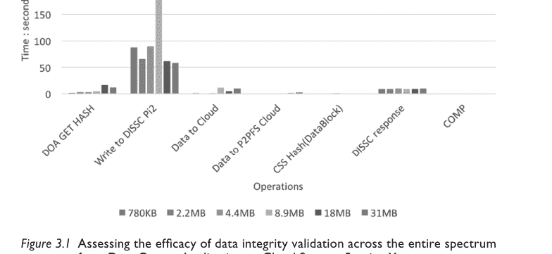

图 3.1 从数据所有者应用程序到云存储服务 Y 全程评估数据完整性验证的有效性。

在当代环境中，多样化的方法被用于在线处理大量交易信息。区块链技术已被证明在促进在线数据处理方面非常有效。在更高层面上，区块链的分布式基础设施使多个远程访问成为可能。在交易过程中，数据由多个不同实体保存在不同的数据库中；区块链技术的实施使这些团体能够访问一个全面的系统 [9]。将区块链与大数据集成以提高智能城市连接安全性的新研究是主要新颖之处。通过开发智能城市中众多互联设备之间通信的有效框架，本研究结合了增强的区块链和大数据组件，标志着重大进步。本研究与其他研究不同之处在于，它旨在解决数据传输、验证、包宽度范围以及节点世代之间信息交换减少的问题。所采用的方法严格且科学实施，导致修订后的框架使我们研究的广泛发现变得可靠可预测。此外，计算结果已得到验证以确保其准确性。

区块链，即比特币的基础技术，引入了一个完全去中心化的系统，促使后续努力将其应用于去中心化现有的互联网服务基础设施 [10]。自其诞生以来，许多研究其潜在用途以验证存储数据完整性的努力都使区块链系统和数据存储程序受益。Retricoin [11] 就是这样一个项目，旨在使用可检索性证明 PoR 而不是耗能的权益证明 PoW 来验证数据完整性并为大文件生成硬币。这些方法预示着完全去中心化数据完整性保证的光明未来。尽管前景乐观，但具有可接受效率的去中心化数据存储的实用性仍然是一个挑战。目前，云存储服务通常被考虑，但对于数据完整性服务，探索去中心化框架变得值得。本论文提出了一种基于区块链的框架，以促进对存储在半可信云环境中的物联网数据进行去中心化数据完整性验证。本文的主要贡献可以简要概述如下。

- 本文用基于区块链的完全去中心化数据完整性服务 DIS 取代了集中式节点的完整性管理服务。这消除了对第三方审计员 TPA 的信任需求，并增强了 DIS 的可靠性。
- 本文提出了在完全去中心化环境中验证数据完整性的协议，并提出了一个框架，允许数据所有者 DO 和数据消费者在不依赖任何单一 TPA 的情况下验证特定数据。
- 本文通过在私有区块链系统上实现的概念验证演示，说明了所建议协议和框架的实用性。

本章的其余部分结构如下：第 3.2 节，我们对相关文献进行回顾，以提供我们研究动机的见解。第 3.3 节提供方法。第 3.4 节概述结果和讨论。研究以总结和对第 3.5 节潜在未来研究的建议结束。

## 3.2 文献综述

在云存储的背景下，确保数据的完整性成为安全策略的重要组成部分。这使用户能够以高效的方式检查其外部存储的数据的完整性。在这里，我们概述了目前在审计系统、公共验证和数据区块链认证方面的情况。

### 3.2.1 静态模型

大量研究工作探索了用于云存储中外包数据审计的两种基本静态模型 [12]。在一方面，在 Ref. [13] 中引入了一种可证明数据占有 PDP 模型，利用基于 RSA 的同态可验证标签。然而，该模型仅针对静态数据存储，并且缺乏彻底的安全分析 [14]。尽管支持公共可验证性 将验证委托给第三方 和无块验证 在不检索原始数据块的情况下进行验证 ，该方案扩展到可扩展 PDP 版本后仍无法完全支持动态数据验证 [15,16]。当用户尝试动态插入、修改或删除块时，它会遇到限制。另一种模型，可证明检索性 PoR 模型，在 Ref. [17] 中提出。该模型确保云服务器正确存储数据并为用户高效检索数据，采用采样和纠错码。然而，PoR 方案假设用户有固定的查询次数，限制了其在静态数据存储场景中的适用性。Ref. [18] 中引入了一种替代恢复证明方案，采用 Boneh-Lynn-Shacham 短签名方案 [19]。虽然高效且紧凑，但该方案不支持动态数据完整性验证。

PoR 策略对数据可恢复性的要求比仅检查数据完整性的 PDP 方案更严格。PoR 策略通过使用纠错码算法对数据进行编码和恢复，提高数据冗余以承受特定程度的数据丢失或损坏。

### 3.2.2 动态模型

[20] 提出了一种动态 PDP 技术，以实现云中彻底的动态数据更新以进行数据完整性验证。该方案涉及将数据文件拆分为等长的数据块。为了完整性验证，每个数据块都被赋予一个标签。数据的修改、插入和删除都发生在最小单元数据块上。该方案使用带有秩信息的认证数据库来维护和验证这些标签的合法性。尽管该方案可以验证动态数据，但它不支持公共验证。


在静态模型中无法动态更新云数据；它保持静态。动态模型使云数据所有者（DOs）能够实时调整其数据。然而，静态和动态模型都需要大量的存储、通信和处理能力。

### 3.2.3 公共验证

在大多数情况下，数据完整性验证需要分配大量的计算和通信资源。为了减轻对计算、通信和存储资源的影响，数据所有者（DOs）经常将验证任务分配给第三方审计员（TPA），以免数据用户自行承担管理和验证数据完整性的开销。这种委托有助于确保数据保持可信和安全，同时最大限度地减轻数据用户的负担，使其能够专注于利用数据而非验证数据。参考文献 [21,22]。由于 TPA 可以了解更多关于外包数据的信息，因此审计中涉及 TPA 会增加安全问题。因此，完全信任 TPA 并非理所当然，这引发了潜在的安全和隐私风险问题。因此，保护用户数据免受 TPA 侵害至关重要，尤其是在关键或机密材料的云存储中。

迄今为止，公共验证工作进展甚微。Ref. [23] 提出了一种有效的方法来公开验证动态数据的完整性。不幸的是，该方案在验证期间的通信开销使其不可行。使用一种称为范围信息认证 2–3 树的已知数据结构，该结构可以安全地处理动态数据，Refs. [24,25] 提供了全面的动态更新能力。在公共可验证性方面 [26]，Ref. [26] 研究了通过在认证前处理外包数据来使公共认证更安全的方法，这将阻止 TPA 在公共验证期间窃取用户数据。该方案计算成本高，但 Ref. [27] 使用随机掩码机制来防止 TPA 在验证期间获取知识。此外，该方案中的集中式审计服务存在漏洞，因为集中式服务的故障可能导致审计服务完全停止。在 Ref. [28] 中，提出了一种针对共享云数据的隐私感知公共审计机制，构建了同态可验证群签名 [29]。然而，该机制面临挑战，包括如果 TPA 受到攻击，审计服务可能中断。此外，用户可能会利用安全问题来操纵来自云服务提供商（CSPs）的补偿。

全球分布式文件系统构建一直是研究的主题，结果不一。在学术界，Andrew 文件系统（AFS）被认为是非常有效的系统。如 BitTorrent、Napster 和 KaZaA 等行业平台现在可容纳超过 1 亿用户。提供去中心化分发、低延迟和全球覆盖的通用文件系统的开发是一个持续进行的努力 [30]。从最初为规模较小且服务器处理能力更强的分布式系统开发的客户端-服务器范式演变出了点对点（P2P）方案。P2P 网络中的每个节点都充当客户端和服务器，允许对称通信。通过促进节点之间的直接通信，P2P 系统克服了文件共享中的带宽限制。当节点分部分共享文件而不是所有客户端同时从服务器请求时，文件共享的可扩展性和效率大大提高。

## 3.3 方法论

拟议系统的四个主要组件如图 3.2 所示：数据所有者应用程序（DOA）、数据消费者应用程序（DCAs）、云存储服务（CSS）和区块链。CSS 有两种子类型：私有和公共。假设存在一个 DOA 用于生成数据并上传到 CSS，我们将在整个研究中采用这一假设。数据完整性检测需要多个 DOA 和 DCA。需要 DIS 的组织可以通过区块链系统访问它，这要求它们在其自己的节点上启动区块链客户端。任何节点都可以随时加入或退出区块链网络。

尽管云在实际中也可以作为区块链节点运行，但为了我们拟议服务结构的简便性，CSS 特指 CSS。托管在区块链上的智能合约使 DIS 的实现成为可能。

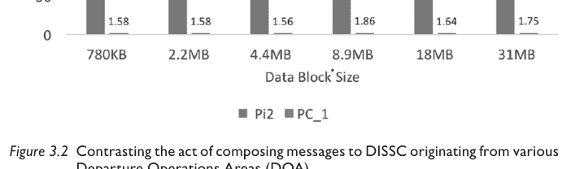

图 3.2 对比来自各种数据所有者应用程序（DOA）的向 DISSC 撰写消息的行为。

这种去中心化部署的结果是 DIS 效率和可靠性的提高。我们做出了一系列假设，以解决关于区块链系统效率和安全性的问题，这些问题对我们的解决方案有重大影响。第一个前提是，由于每个节点都为自己着想，51% 攻击 [31] 极不可能成功。以比特币区块链为例；恶意行为者发起 51% 攻击的可能性较小，更可能参与挖矿。第二个前提是，在区块链上达成共识不会花费很长时间。当前区块链共识周期可能更长（每块 16–18 秒），甚至在网络状况不佳时失败；然而，预计以太坊的区块链可在平均 12.6 秒内实现共识。然而，网络和共识算法的改进有一天可能允许实现持续的短时间共识。

### 3.3.1 区块链

区块链技术是我们拟议的 DIS，即数据完整性服务的支柱。在区块链首次设置时，DOA 和 DCA 都需要加入网络。这是创建密钥对的第一步，其公钥将代表节点的区块链账户。为了完成交易，账户必须有足够的 gas，并且需要私钥来访问账户。假设：区块链系统可以在有足够数量的节点准备充当矿工的情况下继续运行。

我们通过将区块链集成到平台中，为 DIS 实施按交易付费的方法。只有当 DOA 需要与智能合约通信时，才会消耗 gas。我们发现，与之前使用云信息管理系统（IMS）模型 [32] 的研究相比，该方法极大地提高了 DIS 的灵活性。由于处理限制，DOA 可能认为通过充当矿工来获取 gas 是多余且困难的。因此，在我们的模型中，CSP 可以通过充当区块链矿工并赚取 gas 来继续赚钱，因此他们不会损失利润。不久，CSP 将能够使用他们赚取的 gas 与 DOA 进行交易。然后，DOA 可以用其数据与 DCA 交换 gas 或激励。DCA 可以评估其硬件能力和财务状况，以确定是否想作为矿工参与。

### 3.3.2 数据完整性服务（DIS）

使用智能合约实现 DIS。在通过智能合约将数据安全地存储在区块链中之前，必须先在本地加密。所有涉及智能合约的链上交易都可以通过透明审计，因为每个参与方的账户都用于与其交互。一旦区块链服务（BS）开始，节点的区块链数据就会与整个区块链网络同步。当 DOA 利用智能合约将数据插入区块链时，直到区块链达成共识，数据才会被视为有效并可供其他节点使用。然而，DCA 通过智能合约从区块链读取数据操作速度极快，因为 DCA 实际上是从其本地同步的数据集读取数据。与我们之前研究中提出的基于云的 IMS 相比，这一特性使我们的 DIS 更高效 [11]。部署智能合约可保证 DIS 的可访问性和灵活性，允许参与者在任何时刻与其交互。唯一有权取消或更改区块链上 DIS 的人或实体是作者。只要区块链运行，它就始终可访问。关闭区块链系统的过程变得更加复杂，因为与由集中式提供商托管的服务不同，所有参与节点都必须停止提供 BS。我们提出的基于区块链的 DIS 在效率和保证方面优于基于云的 IMS [11]。

**Cloud Storage Service:** 包括 Amazon S3、IBM BlueMix、Microsoft Azure 和 Digital Ocean 在内的每个主要云计算服务提供商都提供数据存储服务。这些服务旨在满足客户的经济能力和应用需求，提供灵活的云存储解决方案。在我们的框架中，CSS 为 DO 提供多功能的数据存储解决方案。同时，点对点文件系统（P2PFS）促进了 DO 与数据消费者之间的数据共享。

## 3.4 结果与讨论

本节详细描述了拟议系统的实现。我们的模型基于拟议的服务框架，其复杂结构如图 3.3 所示。DOA 与连接到互联网的台式计算机和移动设备兼容。诸如数据生成、上传到 CSS、哈希生成、对所得哈希进行加密以及写入区块链上的数据完整性服务（DISSC）等任务是设备 DOA 的职责。同时，使用 PC 上的 DOA 进行数据完整性验证。桌面和基于云的 DCA 必须能够执行 P2PFS 和 BS。BS 绝对在现代 PC 的能力范围内。当我们谈论从传感器收集数据的物联网设备时，我们谈论的是具有通用输入/输出（GPIOs）的单板计算机。许多现代单板计算机都包含此类功能。一个例子是 Raspberry Pi。在将数据块发送到 CSS 之前，物联网设备可以直接从传感器处理它们。以太坊是目前支持智能合约最成熟的区块链平台，因此用于创建区块链系统。一种以类似于超文本传输协议（HTTP）的方式传输文件的尝试是 IPFS（星际文件系统），它用于实现分布式

## DISSC 的响应时间

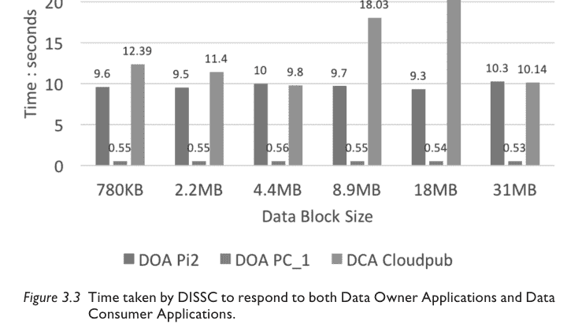

图 3.3 DISSC 对数据所有者应用程序和数据消费者应用程序的响应时间。

P2PFS。借助 IPFS，协议 II 和协议 IV 的数据验证变得更加容易。

为了测试我们框架及其相关协议的可行性，我们构建了一个原型系统。由于物联网数据的不断变化，我们假设其存储在大小不一的数据块中，并且这些数据块被组合以生成数据集。在大多数情况下，您必须在保证整个数据集安全之前检查某些数据块的完整性。我们当前的工作系统构建在至少有四个节点的私有区块链上。其中一个节点负责托管 P2PFS、区块链和 CSS。

一台个人计算机同时运行 DOA 和 DCA。与此同时，一台物联网设备专用于运行 DOA，以执行诸如数据块生成和上传到 CSS 等任务。然而，公共云被分配运行 DCA 的角色，具体用于评估不同网络条件下数据块下载的效率。在图 3.1 中，从 DOA 到 CSS-Y 的数据完整性验证效率得以说明。图 3.2 中的比较结果表明，PC 1 使用的时间明显短于 Pi2。这种差异可归因于至少两个因素：计算能力的差异以及以太坊客户端版本的差异。图 3.3 和图 3.4 描述了不同 DOA 和 DCA 查询区块链上的数据完整性服务 DISSC 所花费的时间。此外，图 3.4 概述了在 CSS-N 模型中检索不同大小数据块所花费的时间。测试结果表明，我们提出的框架可以有效支持多个 DOA 或 DCA 对数据块的完整性验证。

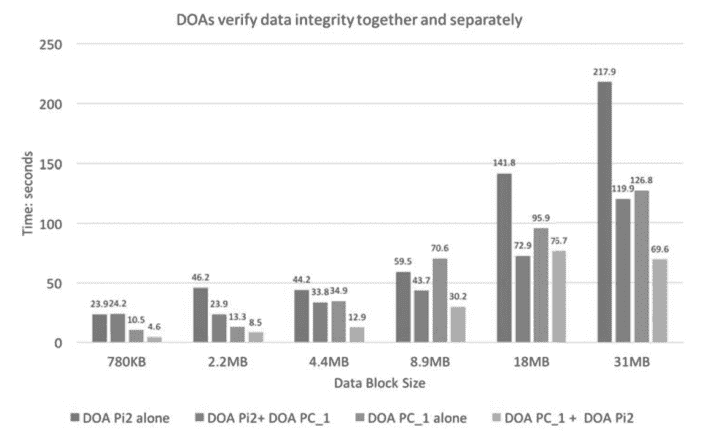

图 3.4 数据块检索所需的时间。

## 3.5 结论

云数据安全围绕三个基本方面展开：保密性、完整性和可用性，通常称为 CIA。在我们早期的研究中，我们提出了数据完整性即服务 Data Integrity as a Service 的概念，以解决 CSS 中与数据完整性相关的问题。现有技术的一个显著缺点是依赖可信的第三方机构来完成数据完整性验证任务。然而，这一假设并不总是成立，可能导致数据完整性验证结果不可信。本文介绍了实施基于区块链的 DIS 的工作，与之前的工作相比具有若干优势。它增强了可靠性，因为该服务不会被单个云方终止。随着客户端数量的增加，数据完整性验证的效率得到提高。所提出的框架支持与数据消费者进行数据交易，并为 DIS 实施按交易付费的模式。

## REFERENCES

- 1. Jiao, Y., Wang, P., Niyato, D., & Suankaewmanee, K. (2019). 面向公共区块链网络的云/雾计算资源分配中的拍卖机制。 *IEEE 平行与分布式系统汇刊*, 30(9), 1975–1989.
- 2. Juels, A., & Kaliski Jr., B. S. (2007). PORs：大型文件的可检索性证明。 *第 14 届 ACM 计算与通信安全会议论文集*. ACM, Alexandria Virginia USA pp. 584–597.
- 3. Koblitz, N. (1987). 椭圆曲线密码系统。 *计算数学*, 48(177), 203–209.
- 4. Ranjan, R., Pandey, D., Rai, A. K., Gupta, D., Singh, P., Kumar, P. R., & Mohanty, S. N. (2023). 基于自回归模型的流形级混合深度学习情感分类方法。 *应用科学*, 13(5), 3091.
- 5. Li, J., Liu, Z., Chen, L., Chen, P., & Wu, J. (2017). 面向分布式云存储的区块链安全架构。 *2017 年 IEEE 平行与分布式处理应用国际研讨会及 2017 年 IEEE 普适计算与通信国际会议 (ISPA/IUCC)*. IEEE, Guangzhou, China pp. 408–411.
- 6. Arivazhagan, N., Somasundaram, K., Mohammad, G. B., Kumar, P. R., et al. (2022). 用于电子医疗系统的基于混合蛾群火焰优化与深度神经网络算法的云-健康物联网任务调度。 *科学编程*, 2022, 1–12.
- 7. Li, K., Cheng, L., & Teng, C. I. (2020). 自愿分享与强制提供：社交网络网站上的私人信息披露。 *信息处理与管理*, 57(1), 102128.
- 8. Li, X., Jiang, P., Chen, T., Luo, X., & Wen, Q. (2017). 区块链系统安全综述。 *未来一代计算机系统*, 107, 1–25.
- 9. Liang, X., Shetty, S. S., Tosh, D., Njilla, L., Kamhoua, C. A., & Kwiat, K. (2019). ProvChain：基于区块链的云数据溯源。 *分布式系统安全的区块链*, 69, 468–477.
- 10. Lin, C., He, D., Huang, X., Choo, K. K. R., & Vasilakos, A. V. (2018). BSeIn：面向工业 4.0 的基于区块链的细粒度访问控制安全互认证系统。 *网络与计算机应用杂志*, 116, 42–52.
- 11. Kumar, P. R., Mohammad, G. B., & Dileep, P. (2021). 基于最小二乘法的实时心率监测系统。 *罗马尼亚细胞生物学学会年刊*, 25(6), 16302–16308.
- 12. Merkle, R. C. (1987). 基于传统加密函数的数字签名。 *密码学理论与应用会议*. Springer, Santa Barbara, CA, USA pp. 369–378.
- 13. Miller, V. S. (1985). 密码学中椭圆曲线的应用。 *密码学理论与应用会议*. Springer, Santa Barbara, CA, USA pp. 417–426.
- 14. Muthanna, A., Ateya, A., Khakimov, A., Gudkova, I., Abuarqoub, A., Samouylov, K., et al. (2019). 利用雾计算、软件定义网络和区块链构建安全可靠的物联网网络。 传感器与执行器网络杂志, 8(1), 15.
- 15. Mohammad, G. B., Selvarajan Shitharth, and Kumar, P. R. (2021). 用于 URL 钓鱼检测的集成机器学习模型。 国际网格与分布式计算杂志, 14(1), 513–529.
- 16. Rass, S. (2013). 基于变色龙哈希的动态可检索性证明。 2013 年安全与密码学国际会议 (SECRYPT). IEEE, Reykjavik, Iceland pp. 1–9.
- 17. Rawat, D. B., Doku, R., & Garuba, M. (2019). 大数据时代的网络安全：从保护大数据到数据驱动安全。 IEEE 服务计算汇刊, 14(6), 2055–2072.
- 18. Kumar, P. R., & Ananthan, T. (2019). 使用 LabVIEW 进行标签检测的机器视觉。 计算机科学与工程创新杂志 (JICSE), 9(1), 58–62.
- 19. Saggi, M. K., & Jain, S. (2018). 面向价值创造的大数据分析与大数据洞察集成的综述。 信息处理与管理, 54(5), 758–790.
- 20. Shacham, H., & Waters, B. (2008). 紧凑的可检索性证明。 密码学与信息安全理论与应用国际会议. Springer, Melbourne, VIC, Australia pp. 90–107.
- 21. Kumar, P. R. (2018). 基于感应耦合的无线移动充电器。 新兴技术与创新研究杂志 (JETIR), 5(10), 40–44.
- 22. Ali, M. S., Vecchio, M., Pincheira, M., Dolui, K., Antonelli, F., & Rehmani, M. H. (2019). 物联网中区块链的应用：全面综述。 IEEE 通信综述与教程, 21(2), 1676–1717, 2nd Quart.
- 23. Kumar, P. R. (2018). 使用 LabVIEW 的步进电机位置控制。 第 3 届电子、信息通信技术最新趋势国际会议 (RTEICT), Bangalore, India pp. 1551–1554.
- 24. Petersen, S., & Carlsen, S. (2011). WirelessHART 与 ISA100.11a：格式之战席卷工厂车间。 IEEE 工业电子杂志, 5(4), 23–34.
- 25. Mekki, K., Bajic, E., Chaxel, F., & Meyer, F. (2019). 大规模物联网部署的 LPWAN 技术比较研究。 ICT Express, 5(1), 1–7.
- 26. Shilpa, B., Kumar, P. R., & Jha, R. K. (2023). 密集室内 LoRa 网络干扰缓解的扩频因子优化。 IEEE IAS 新兴技术全球会议 (GlobConET), London, UK pp. 1–5.
- 27. Khutsoane, O., Isong, B., & Abu-Mahfouz, A. M. (2017). 基于 LoRa/LoRaWAN 的物联网设备与应用。 收录于 IECON 2017 - IEEE 工业电子学会第 43 届年会, Beijing, China, October/November, pp. 6107–6112.
- 28. Lu, X., Niyato, D., Jiang, H., Kim, D. I., Xiao, Y., & Han, Z. (2018). 环境背散射辅助无线供电通信。 IEEE 无线通信, 25(2), 170–177.


- 29. Zhou, J., Cao, Z., Dong, X., & Vasilakos, A. V. (2017). 基于云的物联网的安全与隐私：挑战. *IEEE Communications Magazine*, 55(1), 26–33.
- 30. Roman, R., Zhou, J., & Lopez, J. (2013). 关于分布式物联网中安全与隐私的特征和挑战. *Computer Networks*, 57(10), 2266–2279.
- 31. Kumar, P. R., & Shilpa, B. (2024). 基于物联网的边缘智能计算智能医疗保健系统. In S. Satpathy, S. N. Mohanty, & S. Potluri (eds.), *探索医疗保健中边缘智能的格局*. CRC Press: Boca Raton, FL, pp. 31–46.
- 32. Zheng, Z., Xie, S., Dai, H.-N., Chen, X., & Wang, H. (2018). 区块链挑战与机遇：综述. *International Journal of Web and Grid Services*, 14(4), 352–375.

# 区块链对智能城市中安全物联网应用的推动

Wasswa Shafik

## 4.1 引言

智能城市象征着城市规划和管理方面的范式转变，利用现代技术和信息来提升居民福祉并促进持久的经济和社会进步 [1]。在我们社会中，城市化进程日益加剧，绝大多数国际人口目前居住在城市地区，这实际上产生了迫切需要创新方法来应对与城市生活相关的复杂问题的需求 [2]。智能城市为这些问题提供了一种积极的解决方案，推动了一个以效率、连接和可持续性为标志的独特的城市发展阶段。

智能城市理念的核心概念是利用大数据时代将信息通信技术（ICT）和物联网（IoT）整合到城市基础设施的实际结构中。这种融合促进了从各种资源（如传感器、摄像头和其他物联网设备）进行实时信息收集 [3]。因此，它建立了一个全面的电子神经系统，增强决策能力，改善资源配置，并提升整体城市体验。利用这一庞大的信息库，社区有潜力改善公共服务的质量和效率，涵盖交通、医疗保健、能源管理、环境韧性等不同领域 [4]。

这些先进技术的采用为构建一个能够从不同来源捕获即时信息的综合电子结构铺平了道路，如图4.1所示，例如传感器、摄像头和各种物联网设备 [5]。整合区块链技术提供了一种强大的工具，保护信息完整性和隐私，从而专业地防止任何非法篡改或违规。因此，这种逐步的协同为知情的数据驱动决策、谨慎的资源分配以及改善整体城市环境提供了重要见解 [6]。

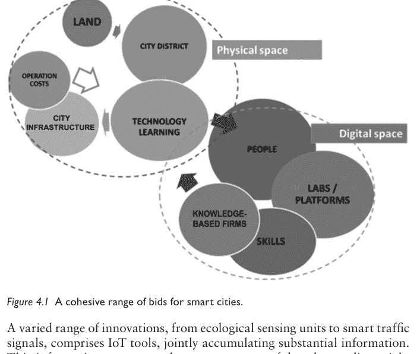

图 4.1 智能城市的一系列协同效益。

从生态传感器到智能交通信号灯等各种创新构成了物联网工具，共同收集大量数据。这些信息因此为城市存在的各个方面提供了非常有用的见解。确保这些信息完整性、透明度和保密性的是将其安全存储在区块链系统上。作为区块链技术的基础，智能合约无缝促进自动化、安全和透明的交易和合同 [7]。其适用范围涵盖多个领域，包括能源使用、废物管理以及公共交通服务。

智能城市原则基于包容性和可持续性，侧重于为所有社区成员提供合理且平等的创新和服务获取。现代区块链技术赋予个人对其数据和交易的主导权的能力与包容性和隐私的概念相一致 [8]。物联网设备具有主动让人们参与决策过程的潜力，使他们能够自愿提供数据以换取改进的服务，同时保护其隐私 [9]。

在智能城市的背景下，安全信息管理的需求至关重要，在那里大量信息被产生并用于城市发展和管理。大体上，它确保了敏感个人和公共信息的保存，从而促进个人的隐私和安全。在智能城市中，信息从多个来源收集，包括物联网设备、安全摄像头以及促进居民互动的系统 [10]。应用强大的信息安全措施，包括加密、访问控制和安全存储，对于降低未经授权访问风险、网络攻击和可能危及个人隐私和智能城市生态系统整体稳定性的数据泄露至关重要。

此外，实施强大的信息管理方法有助于居民和利益相关者之间的信心，而促进数据共享合作的增强参与对于改善城市服务和基础设施至关重要。在智能城市中整合区块链技术的理由基于其增强信息保护、透明度和对城市发展和政府信任的能力 [11]。智能城市依赖于庞大的物联网工具、传感器和信息收集终端网络，它们产生与能源消耗、交通、公共服务和其他要素相关的大量信息。

区块链技术的去中心化和不可篡改的账本维护信息诚信和隐私，有效防止任何篡改或非法访问。这种方法不仅在公民和利益相关者之间增强了对信息准确性的信心，还增强了数据驱动决策流程的应用 [12]。利用现代区块链技术可通过智能合约支持安全、透明和可审计的交易，从而提高城市运营效率、推广经济高效的解决方案并促进对电子通信的信任 [13]。随后，这种改进有助于实现智能城市理念，其特征是可持续、高效和包容的城市生活。

### 4.1.1 本章贡献

本研究贡献如下所述：

- 本研究阐明了物联网对城市景观转型的深远影响。它还审视了物联网在智能城市中的多样化应用，明确探讨了物联网在交通控制、废物管理和能源效率等领域的应用。
- 它提供了区块链技术的概述，包括其原则和特征，解释了区块链中去中心化、不可变性和共识机制的概念。
- 它讨论了区块链技术如何通过探索在智能城市中将区块链与物联网集成的用例来增强物联网系统的安全性和可靠性，例如数据完整性、设备认证和安全交易。
- 它强调了物联网智能城市中的安全和隐私挑战，阐明了区块链如何解决这些问题，包括数据加密和访问控制。
- 它展示了物联网智能城市中的安全和隐私挑战，详细说明了区块链如何解决这些问题，包括数据加密和访问控制。
- 它确定了在智能城市中使用区块链的挑战和局限性，涉及可扩展性问题、能源消耗和监管问题。
- 最后，它展望了区块链和物联网在智能城市的未来，讨论潜在的进步和新兴趋势。

### 4.1.2 本章组织

第 4.2 节介绍了智能城市中的物联网，解释了物联网在改造城市环境中的重要性，并讨论了物联网在智能城市中的各种应用。第 4.3 节提供了区块链技术的概述，包括其原则和特征，并说明了区块链中去中心化、不可变性和共识机制的概念。第 4.4 节描述了物联网智能城市中的安全和隐私挑战，并阐明了区块链如何解决这些问题，包括数据加密和访问控制。第 4.5 节确定了在智能城市中使用区块链的挑战和局限性，并解决了可扩展性问题、能源消耗和监管问题。第 4.6 节推测了区块链和物联网在智能城市的未来，并讨论了潜在的进步和新兴趋势。最后，第 4.7 节提出了结论。

## 4.2 智能城市中的物联网与区块链

本节通过对物联网在智能城市中众多应用的简要讨论，阐明了物联网在改造可持续城市和城镇环境中的相关性。

### 4.2.1 智能城市中的物联网

物联网通过改变城市的建设、实施和体验方式来改善城市环境。一些关键因素显示了其影响，如下所述。

#### 4.2.1.1 基于数据的决策

在信息收集和分析中使用物联网使城市当局能够基于实证做出选择，从而增强

城市规划和监测的效率。通过持续检查和评估来自不同传感单元和设备的累积信息，城市能够迅速应对动态场景，例如调整交通模式以减少拥堵或将资源重新分配到需要及时关注的地点 [13]。数据驱动的方法使大都市能够快速应对动态挑战，从而改善居民的整体健康状况。

#### 4.2.1.2 效率与可持续性
物联网在提高城市可持续性方面发挥着重要作用，其能够高效地优化资源配置。智能废物管理系统的潜在益处之一是能够通过有选择地收集已装满的垃圾桶来优化垃圾收集路线 [14]。这种方法带来成本节约，并减少燃料使用和碳排放。同样，智能照明系统可以根据周围光照条件调节亮度水平，从而降低能源消耗。效率提升与可持续性直接相关，因为它们有效地减少了城市的环境影响并减轻资源负担，从而培育出环境意识强的城市环境 [15]。

#### 4.2.1.3 改善公共服务
物联网在公共服务中的应用显著改善了城市应对居民需求的方式。利用物联网传感器获取的实时数据可实现水质的持续监测，从而有助于及早发现潜在问题并确保饮用水安全 [16]。同样，在消防栓中应用智能传感器可自动向相关部门发出可能紧急情况的警报，提高应急响应程序的有效性。公共服务的改进不可避免地为城市居民带来更优质的生活方式，因为他们体验到了更快、更可靠、更安全的解决方案带来的好处 [17]。图 4.2 显示了 2015 年至 2025 年物联网和非物联网的估算数据。

#### 4.2.1.4 智能交通
物联网实际上在交通运输领域产生了重大变革，其广泛影响从优化交通流量到提升公共交通系统。智能交通监测系统利用来自各种传感器的收集数据动态调整交通信号并改道交通，从而减少拥堵并缩短通勤时间 [17]。此外，将物联网技术集成到公共交通系统中可为旅客提供实时、最新信息，从而提高城市出行的效率和便利性。智能交通通过减少交通堵塞并鼓励环境可持续的交通选择，在塑造城市环境的未来方面发挥着重要作用 [19]。

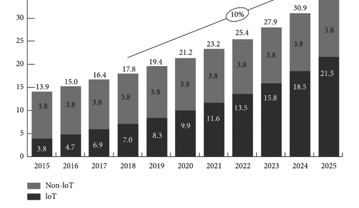

图 4.2 全球总活跃设备（非物联网和物联网）连接数 [18]。

#### 4.2.1.5 环境监测
物联网显著解决了关键的环境监测问题，尤其是在空气和水质方面。战略性部署在城市景观周围的传感器持续收集污染物和环境参数的数据。当限值被超过时，政府机构可以迅速采取措施减轻有害环境影响并保护公众健康 [20]。对环境条件的持续监测实现了保护自然环境和保障城市居民福祉的双重目标，从而成为创建更健康、更可持续城市环境的重要组成部分。

#### 4.2.1.6 安全与增强安全
研究发现实施物联网技术显著提高了城市的安全和保障水平。这通常通过在安全和应急响应领域应用物联网应用来实现。这些摄像头会及时向警方传输实时警报，使其能够快速有效地应对潜在威胁。此外，将物联网设备集成到应急响应系统中可实现事故位置的精确识别并促进资源的有效分配 [21]。这些发展不仅改善了物理安全，还培养了城市居民的安全感和整体福祉。

#### 4.2.1.7 可持续公民参与
物联网使人们能够积极参与其城市环境。移动应用程序、网络平台和社区参与工具使居民能够报告问题、获取实时信息并参与决策过程。这种参与创造了一个更具包容性的城市环境，公民在塑造城市和改善服务质量方面拥有直接利益，培养了社区参与和归属感 [22]。

#### 4.2.1.8 可持续成本节约
物联网的长期成本节约潜力为城市地区提供了显著益处。实施高效的资源配置策略和流程自动化，例如对关键基础设施进行预测性维护，可在未来产生大幅成本降低。通过在基础设施失效前采取主动措施进行修复，城市可以有效减少与紧急维修和服务中断相关的财务负担和运营延误 [23]。同样，实施节能照明和废物管理系统可降低运营成本，从而促进城市更有效地分配资源。

### 4.2.2 智慧城市中的区块链技术
在本小节中，提供了现代区块链技术的概述，包括其概念和特征。它解释了区块链中去中心化、不可变性和共识机制的原理。区块链技术的使用以其增强透明度、加强安全措施、优化运营效率、降低成本和建立信任的能力彻底改变了无数行业 [24]。

区块链的概念和功能对信息管理和数字信任的未来产生了重大影响，正如其在加密货币中的显著应用所见。

#### 4.2.2.1 区块链技术的核心原则
区块链技术运行在去中心化的点对点网络上，通常由节点表示。与依赖中央权威或中介来验证和记录交易的传统系统不同，区块链技术通过参与者组成的去中心化网络运行。

##### 4.2.2.1.1 去中心化
去中心化过程提供了许多益处。首先，使用区块链技术通过确保网络中的所有参与者都能平等访问实时持续更新的共享账本来提高透明度。此外，它通过消除任何单点故障来增强安全性 [24]。而不是依赖单一实体，交易的验证通过网络的共识实现，从而显著阻碍恶意行为者控制系统的能力。

##### 4.2.2.1.2 分布式账本
区块链技术的基础概念集中于去中心化账本。账本作为网络中所有交易的综合记录，通过创建区块按顺序排列，每个区块包含一组交易。将区块链接形成顺序链条是“区块链”一词的由来。网络中的每个参与者都维护该账本的相同副本 [25]。分布式账本系统确保所有参与者一致访问交易历史，从而显著阻碍在未获得整个网络共识的情况下篡改或删除信息的任何企图。

##### 4.2.2.1.3 不可变性
一旦交易被记录在区块中并添加到区块链中，就变得极其难以修改或删除。区块链技术的不可变性可归因于密码学哈希函数的使用。每个区块包含一组交易和前一区块的唯一密码学哈希值。此过程创建了一个安全的互连区块链，一旦建立，就表现出对任何篡改企图的高度抵抗力。更改单个区块需要修改所有后续区块，这是一个在计算上不可行的过程。


### 4.2.3 区块链技术的关键特性

#### 4.2.3.1 安全性和透明性

区块链的高安全性和安全性归功于其去中心化和不可更改的特性。更改单个区块肯定需要更改区块链上所有后续区块，这是一项在计算上不可行的任务。现代区块链技术的使用提高了其对非法活动和网络攻击企图的抵御能力。区块链技术固有的透明性允许所有参与者访问并观察完整的交易历史 [27]。尽管特定交易是假名的，即由字母数字地址标识它们，但数据仍然可访问且可验证。此属性可用于会计和确保问责制等目标。

#### 4.2.3.2 智能合约与速度和效率

现代区块链技术的使用使得能够支持智能合约，这些合约是自执行的协议，其条款清晰地编码到底层代码中。这些法律合约旨在在预编程条件得到满足时自主执行，从而减少了在各种运营流程中对中介的需求 [28]。现代区块链技术的应用可以大幅提升交易的 speed 和性能，尤其是在跨境支付和供应链管理中。

#### 4.2.3.3 可及性

现代区块链技术的承诺超出了金融领域，并在医疗保健、供应链管理、投票系统等多个领域带来革命性变化。去中心化、不可变性和透明性的概念，配合智能合约等特性，增强了在各种应用中的安全性、有效性和问责制 [28]。尽管如此，解决可扩展性、能源效率和监管框架等挑战对于充分发挥区块链技术的潜力至关重要。

## 4.3 区块链与安全物联网应用的集成

在21世纪，智慧城市已成为当代城市规划中的变革力量。日益加剧的国际城市化趋势需要前沿方案来应对传统大都市设施的困难。诸如资源管理效率低下、人口快速增长、资源需求增加、安全和隐私问题以及可持续发展的重要性等问题，实际上推动城市探索先进技术 [29]。其中，区块链和物联网已成为有前景的技术，拥有改变智慧城市发展的巨大潜力。将区块链和物联网纳入智慧城市代表了城市规划和发展的范式转变。我们在本节中探讨这两种变革性技术的集成，深入研究其优势并考察其集成如何应对传统城市基础设施面临的关键障碍。通过对益处的全面分析，本节旨在提供对将区块链和物联网结合在智慧城市中产生的深远影响的理解 [30]。

### 4.3.1 去中心化数据管理

区块链代表了智慧城市中去中心化和防篡改数据管理的重要框架。将其与物联网集成可确保所有来自物联网设备交易和数据都被安全地记录在不可变的账本上，从而保护数据完整性并防止恶意行为者进行未经授权的修改 [31] 鉴于物联网传感器和设备产生的庞大数据，区块链可在无需依赖中央权威的情况下实现安全管理，降低数据操纵风险。

### 4.3.2 安全身份和访问管理

区块链安全且去中心化的身份管理能力是增强智慧城市生态系统内安全性和隐私性的基础 [Khalil et al., 2022]。通过允许居民、设备和实体将其身份存储在区块链上，可实现更高程度的安全性。这种集成还解决了物联网设备的身份验证和授权需求，为管理身份和访问权限提供了一个强大的框架 [32]。该策略确保智慧城市网络内的安全通信，增强系统的整体韧性。

### 4.3.3 用于自动化的智能合约

集成区块链和物联网提供了智能合约，可自动化并执行预定义规则，消除对中介的需求。在智慧城市中，这些合约对于自动化各种流程至关重要，例如能源支付、废物管理和交通控制。配备传感器和执行器的物联网设备可以根据真实世界数据触发事件。例如，将物联网和基于区块链的合约集成到旅游融资中可以简化流程，在满足特定条件时自动执行操作 [33]。这种集成提高了效率并确保旅游业的可持续经济实践。

### 4.3.4 供应链透明度

区块链透明且可追溯的账本在供应链管理中得到应用，确保与商品制造、运输和分销相关的交易得到安全记录。物联网传感器与供应链的协同作用可实时生成有关物品位置、状况和状态的数据 [34]。与区块链结合时，这些数据确保透明度和问责制，减轻欺诈风险并优化供应链整体效率。

### 4.3.5 能源交易、数据安全和隐私

区块链使点对点能源交易成为可能，建立了去中心化且透明的能源交易方法。在物联网世界中，智能电表和传感器监测建筑物中的能源消耗和生产。将这些数据与区块链结合使准确透明的结算成为可能，并实施动态定价模型 [35]。这鼓励节能并促进可再生能源的使用，尤其是在家庭中。安全且去中心化的区块链设计增强了数据安全，加密功能确保只有授权方才能加密访问。物联网设备收集的数据的敏感性使得保护隐私至关重要 [36]。区块链提供去中心化控制系统，显著降低未经授权访问或篡改的风险。

### 4.3.6 以公民为中心的服务

区块链使透明且安全的公民服务成为可能，扩展任务如投票、财产登记和医疗记录。区块链的透明度通过为居民提供对其数据的更好控制来提高对政府服务的信任。公民参与还通过物联网设备收集反馈和实时信息而得到提升，区块链集成确保公民输入的真实性 [37]。这促进了更负责任和更具响应性的治理。

### 4.3.7 实时监控和分析

作为安全透明的框架，区块链促进实时数据的记录和共享。这在数据准确性和完整性极其重要的应用中尤其有价值。物联网设备持续生成有关各种城市运营的实时数据。与区块链的集成允许使用这些数据进行分析、决策和城市服务的优化，特别是在智慧医疗中 [38]。因此，政府机构、私营企业和科技公司之间的合作对于在智慧城市中高效集成区块链和物联网是必要的。应制定互操作性、安全性和数据隐私的标准和协议，以确保无缝且安全的智慧城市生态系统。

## 4.4 物联网安全和隐私问题

在智慧城市中集成区块链和物联网确保了数据管理和治理的转型。尽管如此，这种协同作用带来了一系列需要仔细审视的安全和隐私挑战。本节探讨这些挑战，采用对潜在陷阱和必要保障措施的理论探索。

### 4.4.1 不可变数据和访问控制

现代区块链技术的根本不可变性确保了数据完整性，但在考虑区块链与物联网在智慧城市中的集成时，它成为一把双刃剑。虽然该特性可防止数据篡改，但它引发了关于敏感信息永久性的重大担忧。在智慧城市的复杂生态系统中，无法修改或删除记录信息的特性对个人长期隐私构成潜在风险 [38]。开发强大的访问控制和隐私保护机制对于有效应对这一挑战至关重要。

### 4.4.2 智能合约漏洞

执行智能合约——区块链支持物联网应用的基础组件——引入了恶意行为者可能利用的漏洞。在智慧城市中，智能合约中的缺陷可能导致未经授权的访问、数据操纵或自动化流程中断，类似于在 Web 应用中观察到的担忧。为了加强智能合约抵御潜在威胁，需要采取全面方法，包括严格的代码

审计并实施安全编码实践至关重要 [39]。这种主动策略对于确保智能城市基础设施无缝运行所必需的自动化流程的完整性至关重要。

### 4.4.3 可扩展性和网络共识

随着物联网工具和设备的种类不断增加，可扩展性问题和可靠共识系统的选择成为主要问题。无效的共识算法和可扩展性瓶颈可能危及智能城市基础设施的安全性和实时响应能力。应对这些障碍需要尖端解决方案来提升区块链网络的可扩展性和性能 [40]。通过持续开发支撑这些网络的技术，我们可以更好地满足不断增长的智能城市环境日益增长的需求。

### 4.4.4 网络安全和共识漏洞

区块链网络依赖共识算法来验证交易，这带来了漏洞，尤其是在大规模物联网部署中。恶意行为者利用这些漏洞可能损害交易和存储数据的完整性。先进的共识机制和例行安全审计对于加强网络安全以消除这一威胁至关重要 [41]。主动措施对于确保共识机制的稳健性至关重要，以保护智能城市基础设施免受对区块链网络的潜在攻击。

### 4.4.5 物联网设备的供应链安全

确保智能城市中物联网设备整个供应链的安全是一个复杂挑战。在供应链任何阶段篡改或破坏物联网设备都可能在区块链网络中引入漏洞，削弱智能城市系统的整体安全。实施严格的供应链安全措施和设备鉴权程序对于全面降低这种风险至关重要 [41]。在所有供应链阶段采取主动且警惕的方法对于维护智能城市环境中连接设备的完整性非常重要。

### 4.4.6 身份管理

将物联网与区块链结合需要强大的身份管理系统，这引发了可能暴露个人可识别信息的担忧。糟糕的身份保护措施可能导致个人隐私受损。因此，实施以隐私为中心的身份识别服务（如零知识证明）对于有效降低这些风险至关重要 [42]。通过整合先进的隐私技术，智能城市可以在身份管理的益处与个人隐私保护之间取得微妙平衡。

### 4.4.7 数据可关联性

区块链的透明性带来了数据可关联性的威胁，允许实体链接和分析交易数据。持续的数据可关联性威胁到智能城市环境中居民的隐私和保密性 [43]。密码学方法和隐私增强技术的持续进步对于抵御这一威胁至关重要。这些发展对于打击与数据可关联性相关的风险至关重要，确保智能城市能够利用区块链的好处，同时保护居民隐私。区块链和物联网是智能城市不断发展环境中的技术。

## 4.5 挑战、局限性和影响

本节介绍了在智能城市中使用区块链的挑战和局限性，以及一些影响。

### 4.5.1 挑战

### 4.5.1.1 可扩展性

在区块链方面，问题在于有效管理智能城市动态互联环境中发生的海量交易。随着城市基础设施日益数字化，区块链网络的压力可能阻碍交易处理速度和整体系统性能 [44]。与此同时，物联网设备的激增加剧了可扩展性问题。这些互联设备数量的增长，从传感器到智能家电，增加了无缝管理其交互的复杂性。它们促进了大量实时设备之间的数据交换和通信，需要强大的可扩展性解决方案以避免瓶颈并确保智能城市系统的平稳运行。

### 4.5.1.2 互操作性

这是在智能城市中整合区块链和物联网的关键挑战，重点在于多样化物联网设备与区块链系统之间的无缝交互。具有不同协议和标准的互联设备复杂网络构成了相当大的障碍。物联网设备产生大量数据，必须高效且安全地连接到区块链进行处理。实现能够适应物联网设备多样性的标准通信协议很重要 [45]。没有共同语言，组合技术的潜在益处可能会受损，阻碍智能城市充分利用区块链和物联网协同效应的能力。

### 4.5.1.3 安全问题

在智能城市中整合区块链和物联网时，安全是一个至关重要的问题。在区块链领域，该技术凭借其去中心化和加密原理固有地提供强大的安全性。然而，漏洞可能出现在智能合约（区块链上的自执行代码）或网络的共识算法中 [46]。然而，物联网设备带来了另一层安全挑战。如果未妥善解决设备漏洞，可能被恶意行为者利用，危及整个系统的完整性。此外，物联网设备与区块链网络之间通信中的数据安全问题可能暴露敏感信息。安全通信协议和强大的身份验证机制对于降低这些风险至关重要。

### 4.5.1.4 能耗

区块链的工作量证明（PoW）共识算法相关的能耗是一个重大问题，尤其是在考虑其在智能城市中的潜在应用时。PoW涉及矿工必须解决的复杂数学问题，以验证交易并创建新区块。该过程需要大量的计算能力，导致高能耗。在以可持续性为关键重点的智能城市背景下，PoW的环境影响成为一个显著的局限 [47]。PoW的能源密集型特性可能导致碳足迹增加，并威胁创建高效绿色城市环境的目标。解决这一挑战需要探索以较低能源需求著称的替代共识机制。

### 4.5.2 局限性

### 4.5.2.1 成本

实施和维护区块链基础设施的成本影响对智能城市构成了重大挑战。建立所需硬件、软件和网络基础设施所产生的支出，加上持续的运营和维护成本，可能给市政当局的预算带来压力。智能城市项目通常需要大量财务投资，而采用区块链技术则带来了额外的财务承诺 [48]。成本与初始部署相关，包括确保随时间推移的安全性、可扩展性和合规性的费用。解决这些经济因素对于在智能城市计划中有效整合区块链至关重要，需要谨慎的预算和战略规划，以在技术进步与财务责任之间取得平衡。

### 4.5.2.2 监管不确定性

这对区块链和物联网在智能城市中的广泛实施构成了重大挑战。缺乏明确和标准化的法规造成了不确定性氛围，阻碍公共和私营部门充分采用这些变革性技术 [49]。区块链和物联网应用的复杂性要求全面的法律框架来解决数据隐私、安全和互操作性问题。没有明确的法规，利益相关者可能因担心法律问题而犹豫投资或采用这些进步。因此，政策制定者协作制定和建立明确的监管指南很重要，以促进创新，同时解决区块链和物联网在智能城市背景下整合带来的独特挑战 [50]。

### 4.5.2.3 采用障碍

区块链和物联网技术在智能城市中的采用面临重大障碍，主要源于对变革的抵制以及对现有系统全面改造的需求。城市和城市基础设施通常运行在既定结构上，引入区块链和物联网等颠覆性技术需要思维和基础设施的根本转变 [51]。利益相关者可能因担心整合的复杂性、过渡期间的潜在中断以及相关成本而不愿接受这些变化。克服这些采用障碍需要战略规划、明确传达益处以及逐步实施策略，以降低与此类变革性技术相关的感知风险 [52]。

### 4.5.3 影响

### 4.5.3.1 数据完整性

数据完整性在智能城市中至关重要，物联网设备在其中不断产生大量信息（Andoni et al., 2019）。整合

区块链和现代技术的使用在增强这一充满活力的生态系统中的信息完整性方面发挥着关键作用。区块链固有的不可篡改性确保一旦信息被记录在区块链上，就无法被更改或销毁。在物联网设备的背景下，这种不可篡改性尤为重要，因为它保障了所收集信息的信度和可靠性 [53]。来自物联网设备的每笔交易或信息项都被安全地记录在一个区块中，而区块链的去中心化和分布式特性确保没有单一实体控制整个系统，降低了未经授权修改的风险。该发展依赖于物联网设备生成的数据。它为众多应用提供了稳健的框架，例如智能城市基础设施中的智能合约和透明数据共享系统 [54]。通过区块链集成保证信息完整性不仅增强了信息的完整性，还促进了智能城市系统的整体安全性和可靠性。

### 4.5.3.2 去中心化
去中心化通过实施区块链技术，在增强智能城市系统的耐久性方面发挥着至关重要的作用。通过将信息的控制和存储分布在节点网络中，而不是依赖中央权威，区块链降低了单点故障的风险 [55]。在智能城市的背景下，这种去中心化设计确保如果一个节点或组件出现故障，整个系统仍然可以运行。这种增强的弹性在城市环境中尤为关键，因为信息和系统的完整性对于交通、能源管理、公共安全等不同服务至关重要 [18]。

### 4.5.3.3 效率提升
区块链和物联网技术在智能城市中的应用可以大幅提升运营效率。凭借其去中心化、安全可靠的特性，区块链确保了从物联网设备收集的信息的完整性和不可篡改性。这在智能城市背景下尤其重要，因为大量信息来自传感器、摄像头和其他连接设备等不同来源 [56]。促成性能提升的一个关键因素是智能合约的透明和自动执行。这些由区块链实现的自执行合约可以自动化智能城市中的各种流程，从能源管理和废物处理到交通管理。例如，智能合约可以基于物联网支持的电表实时信息促进能源使用的自动支付，消除中间环节并改善计费流程。此外，区块链的去中心化特性消除了对单一中央权威的依赖，降低了系统故障或数据泄露的风险 [18]。这种去中心化与区块链提供的可靠且透明的审计跟踪相结合，增强了智能城市运营的整体完整性。

### 4.5.3.4 透明治理
透明治理是在智能城市背景下将智能合约集成到区块链中的一个关键方面。智能合约是具有预定义规则的自执行代码片段，提供透明度和自动化，可以彻底改变治理流程。区块链的不可篡改性确保写入这些合约的条款防篡改，培养了利益相关者之间的信任 [5,9]。这种透明度最大限度地降低了非法活动的风险，并允许公众和当局追踪和验证流程的每一步。合约的自动执行进一步增强了治理，减少了对中间环节的需求并最大限度地降低了人为错误的风险 [59]。随着智能城市的发展，实施智能合约成为开发负责任和高效治理框架的基石，为透明和自动化的公共行政新时代树立了标准。

## 4.6 未来方向
将区块链和物联网纳入智能城市的未来方向具有巨大的变革潜力。研究工作应考虑探索混合区块链解决方案，整合公有链和私有链的优势，为可扩展性和隐私问题提供细致入微的方法。探索区块链、物联网和边缘计算之间的协同作用可以缓解延迟问题并增强实时处理能力。解决安全和隐私挑战仍然至关重要，重点是开发保护物联网设备产生敏感数据的创新方法。

未来的研究还应探索节能共识机制，以减少区块链在智能城市应用中的环境影响。标准化不同物联网设备与区块链系统之间的互操作性对于无缝集成至关重要。探索智能合约在自动化城市治理流程和增强供应链管理透明度方面的应用代表了前景广阔的途径。此外，科学家应为制定灵活的监管框架做出贡献，以适应智能城市中区块链和物联网技术不断发展的格局。对以用户为中心的设计、伦理考虑以及专家系统集成的兴趣将共同塑造智能城市应用可持续和包容的未来。

## 4.7 结论
区块链技术正在推动数字化转型，改变我们在互联世界中感知和管理信任和信息的方式。去中心化、分布式账本技术、不可篡改性和共识机制是其基石，改变了交易验证和数据安全。去中心化允许点对点网络在没有中央权威的情况下接受和记录交易，挑战了层级结构。这一举措将使个人能够直接相互信任，消除中间环节。分布式账本维护集成且不可篡改的交易历史，促进透明度并遏制欺诈。区块链的不可篡改账本和加密保护提供了无与伦比的数据完整性和网络安全。透明度和智能合约增强了各行业的问责制和自动化，改变了商业交易。区块链的效率可以加速流程、降低运营成本并促进金融、供应链管理、医疗保健和治理方面的创新。区块链目前正在改变市场，但可扩展性、功耗和法律框架仍然是关注点。它确保了我们在动态数字环境中信任、透明和效率的发展。它是去中心化、安全和基于信任的未来的基础，将以持久的影响力改变我们的数字时代。

## 参考文献
- 1. Aggarwal, S., Chaudhary, R., Aujla, G. S., Kumar, N., Choo, K. K. R., & Zomaya, A. Y. (2019). 区块链助力智慧社区：应用、挑战与机遇. *Journal of Network and Computer Applications*, 144. https://doi.org/10.1016/j.jnca.2019.06.018.
- 2. Ranjan, R., Pandey, D., Rai, A. K., Gupta, D., Singh, P., Kumar, P. R., & Mohanty, S. N. (2023). 基于自回归模型的流形级混合深度学习情感分类方法. *Applied Sciences*, 13(5), 3091. https://doi.org/10.3390/app13053091.
- 3. Ahmed, I., Zhang, Y., Jeon, G., Lin, W., Khosravi, M. R., & Qi, L. (2022). 基于区块链和人工智能的面向可持续城市的智能物联网框架. *International Journal of Intelligent Systems*, 37(9). https://doi.org/10.1002/int.22852.


- 4. Alamri, B., Crowley, K., & Richardson, I. (2022). 基于区块链的健康物联网身份管理系统：系统综述。 IEEE Access, 10, 59612–59629. https://doi.org/10.1109/ACCESS.2022.3180367.
- 5. Alqarni, M. A., Alkatheiri, M. S., Chaudhary, S. H., & Saleem, S. (2023). 物流和供应链中基于区块链的智能合约的应用。 Electronics, 12(6), 1340. https://doi.org/10.3390/electronics12061340.
- 6. Andoni, M., Robu, V., Flynn, D., Abram, S., Geach, D., Jenkins, D., McCallum, P., & Peacock, A. (2019). 能源领域的区块链技术：挑战与机遇的系统综述。 Renewable and Sustainable Energy Reviews, 100. https://doi.org/10.1016/j.rser.2018.10.014.
- 7. Arivazhagan, N., Somasundaram, K., Mohammad, G. B., Kumar, P. R., et al. (2022). 用于电子医疗系统的基于混合蛾群火焰优化与深度神经网络算法的云-健康物联网任务调度。 Scientific Programming, 2022, 1–12. https://doi.org/10.1155/2022/4100352.
- 8. Bandara, E., Shetty, S., Rahman, A., Mukkamala, R., & Liang, X. (2022). Moose：一种用于 5G 赋能物联网的分片和网络切片可扩展区块链架构。 IEEE Wireless Communications and Networking Conference, WCNC, 2022, 1194–1199. https://doi.org/10.1109/WCNC51071.2022.9771885.
- 9. Bansod, S., & Ragha, L. (2022). 使区块链在数字世界中符合隐私要求的挑战：若干措施。 Sadhana - Academy Proceedings in Engineering Sciences, 47(3), 1–17. https://doi.org/10.1007/s12046-022-01931-1.
- 10. Bao, Z., He, D., Wang, H., Luo, M., & Peng, C. (2023). 用于电子健康服务中基于区块链的数据共享系统的具有选择性可链接性和可追溯性的群签名方案。 IEEE Internet of Things Journal. https://doi.org/10.1109/JIOT.2023.3284968.
- 11. Kumar, P. R., Mohammad, G. B., & Dileep, P. (2021). 基于最小二乘法的实时心率监测系统。 Annals of the Romanian Society for Cell Biology, 25(6), pp. 16302–16308. http://annalsofrscb.ro/index.php/journal/article/view/8878.
- 12. Bommu, S., Aravind Kumar, M., Babburu, K., Srikanth, N., Thalluri, L. N., Ganesh, V., Gopalan, A., Mallapati, P. K., Guha, K., Mohammad, H. R., & Kiran, S. (2023). 智慧城市物联网系统网络层路由分析与基于区块链安全性的实现。 Journal of Electrical Engineering and Technology, 18(2). https://doi.org/10.1007/s42835-022-01239-4.
- 13. Centobelli, P., Cerchione, R., Vecchio, P. D., Oropallo, E., & Secundo, G. (2022). 区块链技术在循环供应链中实现信任、可追溯性和透明度的桥梁作用。 Information & Management, 59(7), 103508. https://doi.org/10.1016/j.im.2021.103508.
- 14. Chakravarthi, P. K., Yuvaraj, D., & Venkataramanan, V. (2022). 用于智能电网的基于物联网的智能电能表。 ICDCS 2022 - 2022 6th International Conference on Devices, Circuits and Systems, pp. 360–363. https://doi.org/10.1109/ICDCS54290.2022.9780714.
- 15. Demirel, E. (2023). 基于区块链的智能合约在可持续旅游金融中的应用。 Blockchain for Tourism and Hospitality Industries, 122–138. https://doi.org/10.4324/9781003351917.
- 16. Dieye, M., Valiorgue, P., Gelas, J. P., Diallo, E. H., Ghodous, P., Biennier, F., & Peyrol, E. (2023). 基于零知识证明和区块链的自主身份。 IEEE Access, 11, 49445–49455. https://doi.org/10.1109/ACCESS.2023.3268768.
- 17. Mohammad, G. B., Shitharth, S., & Kumar, P. R. (2021). 用于 URL 钓鱼检测的集成机器学习模型。 International Journal of Grid and Distributed Computing, 14(1), 513–529. http://sersc.org/journals/index.php/IJGDC/article/view/35886.
- 18. Yang, Z., Jianjun, L., Faqiri, H., Shafik, W., Talal Abdulrahman, A., Yusuf, M., & Sharawy, A. M. (2021). 绿色物联网和大数据在智慧城市发展中的应用。 Complexity, 2021, 1–15. https://doi.org/10.1155/2021/4922697.
- 19. Dong, J., Song, C., Liu, S., Yin, H., Zheng, H., & Li, Y. (2022). 能源区块链环境下的去中心化点对点能源交易策略：博弈论方法。 Applied Energy, 325, 119852. https://doi.org/10.1016/j.apenergy.2022.119852.
- 20. Hassanein, A. A., El-Tazi, N., & Mohy, N. N. (2022). 区块链、智能合约和去中心化应用：导论。 Implementing and leveraging Blockchain Programming, 97–114. https://doi.org/10.1007/978-981-16-3412-3_6.
- 21. Jha, S. K. (2023). 区块链技术在图书馆和信息中心服务中的应用。 Library Hi Tech News. https://doi.org/10.1108/LHTN-02-2023-0020.
- 22. Kashif, M., & Kalkan, K. (2024). EPIoT：面向物联网的基于增强隐私保护的区块链机制。 Computer Networks, 238, 110107. https://doi.org/10.1016/j.comnet.2023.110107.
- 23. Kumar, P. R., & Ananthan, T. (2019). 使用 LabVIEW 进行标签检测的机器视觉。 Journal of Innovation in Computer Science and Engineering (JICSE), 9(1), 58–62.
- 24. Khalil, U., Malik, O. A., Uddin, M., & Chen, C. L. (2022). 智慧城市中物联网智能设备区块链与集中式认证架构的比较分析：全面综述、最新进展和未来研究方向。 Sensors, 22(14), 5168. https://doi.org/10.3390/s22145168.
- 25. Khalil, U., Mueen-Uddin, Malik, O. A., & Hussain, S. (2022). 用于智慧城市物联网智能设备认证的区块链足迹：最先进进展、挑战和未来研究方向。 IEEE Access, 10. https://doi.org/10.1109/ACCESS.2022.3189998.
- 26. Kumar, P. R. (2018). 基于电磁感应的无线移动充电器。 Journal of Emerging Technologies and Innovative Research (JETIR), 5(10), 40–44.
- 27. Kushwaha, S. S., Joshi, S., Singh, D., Kaur, M., & Lee, H. N. (2022). 以太坊区块链智能合约安全漏洞的系统综述。 IEEE Access, 10, 6605–6621. https://doi.org/10.1109/ACCESS.2021.3140091.
- 28. Liu, H., Han, S., & Zhu, Z. (2023). 面向智慧建造的区块链技术：综述与未来方向。 Journal of Construction Engineering and Management, 149(3). https://doi.org/10.1061/jcemd4.coeng-11929.
- 29. Liu, Y., Wang, K., Qian, K., Du, M., & Guo, S. (2020). Tornado：通过空间结构化方法实现异构物联网中的区块链。 IEEE Internet of Things Journal, 7(2). https://doi.org/10.1109/JIOT.2019.2954128.
- 30. Ma, N., Waegel, A., Hakkarainen, M., Braham, W. W., Glass, L., & Aviv, D. (2023). 区块链+物联网传感器网络用于测量、评估和激励室内空间的个人环境核算和高效能源使用。 Applied Energy, 332, 120443. https://doi.org/10.1016/j.apenergy.2022.120443.
- 31. Shilpa, B., Kumar, P. R., & Jha, R. K. (2023). 密集室内 LoRa 网络中用于干扰缓解的扩频因子优化。 IEEE IAS Global Conference on Emerging Technologies (GlobConET), London, UK, pp. 1–5.
- 32. Majeed, U., Khan, L. U., Yaqoob, I., Kazmi, S. M. A., Salah, K., & Hong, C. S. (2021). 物联网智慧城市的区块链：最新进展、需求和未来挑战。 Journal of Network and Computer Applications, 181, 103007. https://doi.org/10.1016/j.jnca.2021.103007.
- 33. Makani, S., Pittala, R., Alsayed, E., Aloqaily, M., & Jararweh, Y. (2022). 可持续和智慧城市中区块链应用的综述。 Cluster Computing, 25(6), 3915–3936. https://doi.org/10.1007/S10586-022-03625-Z.
- 34. Makhdoom, I., Abolhasan, M., Franklin, D., Lipman, J., Zimmermann, C., Piccardi, M., & Moghadam, N. S. (2023). 检测受损物联网设备：现有技术、挑战及未来方向。 Computers & Security, 132, 103384. https://doi.org/10.1016/j.cose.2023.103384.
- 35. Nica, E., Popescu, G. H., Poliak, M., Kliestik, T., & Sabie, O. M. (2023). 可持续城市治理网络中的数字孪生仿真工具、空间认知算法和多传感器融合技术。 Mathematics, 11(9). https://doi.org/10.3390/math11091981.
- 36. Nigmatov, A., Pradeep, A., & Musulmonova, N. (2023). 区块链技术在提高政府运作透明度和效率中的应用。 15th International Conference on Electronics, Computers and Artificial Intelligence, ECAI 2023 - Proceedings. https://doi.org/10.1109/ECAI58194.2023.10194154.
- 37. Kumar, P. R. (2018). 使用 LabVIEW 对步进电机进行位置控制。 3rd International Conference on Recent Trends in Electronics, Information Communication Technology (RTEICT), Bangalore, India, pp. 1551–1554.
- 38. Politou, E., Alepis, E., Virvou, M., & Patsakis, C. (2022). 区块链中的隐私。 In Privacy and Data Protection Challenges in the Distributed Era. Learning and Analytics in Intelligent Systems, vol. 26. Springer, Cham, pp. 133–149. https://doi.org/10.1007/978-3-030-85443-0_7.
- 39. Politou, E., Casino, F., Alepis, E., & Patsakis, C. (2021). 区块链可变性：挑战与建议解决方案。 IEEE Transactions on Emerging Topics in Computing, 9(4), 1972–1986. https://doi.org/10.1109/TETC.2019.2949510.
- 40. Rejeb, A., Rejeb, K., Simske, S. J., & Keogh, J. G. (2021). 智慧城市中的区块链技术：文献计量综述。 Quality and Quantity. https://doi.org/10.1007/s11135-021-01251-2.


- 41. Rejeb, A., Rejeb, K., Simske, S., Treiblmaier, H., & Zailani, S. (2022). 物联网和智慧城市的全景：我们所知与我们需要了解的综述。*物联网*, 19. https://doi.org/10.1016/j.iot.2022.100565.
- 42. Kumar, P. R., & Shilpa, B. (2023). 基于物联网的智能医疗保健系统与边缘智能计算。In Satpathy, S., Mohanty, S. N., & Potluri, S. (eds.), *探索医疗保健中边缘智能的格局*。CRC Press, Boca Raton, FL. https://doi.org/10.1007/978-981-16-6301-7_4.
- 43. Sabrina, F., Li, N., & Sohail, S. (2022). 基于区块链的利用设备身份管理的物联网安全系统。*传感器*, 22(19), 7535. https://doi.org/10.3390/S22197535.
- 44. Shafik, W., & Kalinaki, K. (2023). 智慧城市生态系统：对需求、架构、应用、安全和新兴动因的探索。In Reddy, K. H. K., Roy, D. S., Mishra, T. K., & Hussain, M. W. (eds.), *网络支持的物联网应用于智慧城市服务研究手册*。IGI Global, Hershey, PA, 页 75–98. https://www.igi-global.com/book/handbook-research-network-enabled-iot/324384.
- 45. Singh, S., Sanwar Hosen, A. S. M., & Yoon, B. (2021). 区块链安全攻击、挑战及未来分布式物联网网络的解决方案。*IEEE Access*, 9, 13938–13959. https://doi.org/10.1109/ACCESS.2021.3051602.
- 46. Singh, S., Sharma, P. K., Yoon, B., Shojafar, M., Cho, G. H., & Ra, I. H. (2020). 物联网网络中区块链与人工智能的融合以实现可持续智慧城市。*可持续城市与社会*, 63. https://doi.org/10.1016/j.scs.2020.102364.
- 47. Su, X., Hu, Y., Liu, W., Jiang, Z., Qiu, C., Xiong, J., & Sun, J. (2023). 用于智慧微电网安全能源交易管理的基于区块链的智能合约模型。*安全与隐私*, e341. https://doi.org/10.1002/SPY2.341.
- 48. Tang, Y., Yan, J., Chakraborty, C., & Sun, Y. (2023). Hedera：面向物联网的多接入边缘计算中的无许可且可扩展的混合区块链共识算法。*IEEE 物联网期刊*。https://doi.org/10.1109/JIOT.2023.3279108.
- 49. Testi, N., Marconi, R., & Pasher, E. (2023). 探索区块链技术在智慧治理中公民参与的潜力。*欧洲开放研究*, 3, 183. https://doi.org/10.12688/OPENRESEUROPE.16153.1.
- 50. Shafik, W. (2024). ChatGPT 简介。In Obaid, A. J., Bhushan, B., Muthmainnah, S. P., & Rajest, S. S. (eds.), *生成式人工智能与自然语言处理模型的高级应用*。IGI Global, Hershey, PA, 页 1–25. https://www.igi-global.com/chapter/introduction-to-chatgpt/335830.
- 51. Tokkozhina, U., Mataloto, B. M., Martins, A. L., & Ferreira, J. C. (2023). 去中心化在线食品配送服务：智慧城市的区块链与物联网模型。*移动网络与应用*。https://doi.org/10.1007/s11036-023-02119-5.
- 52. Uchani Gutierrez, O. C., & Xu, G. (2023). 区块链与智能合约保障智慧城市中的房产交易。*应用科学*, 13(1), 66. https://doi.org/10.3390/APP13010066.
- 53. Ullah, Z., Naeem, M., Coronato, A., Ribino, P., & De Pietro, G. (2023). 可持续智慧城市中的区块链应用。*可持续城市与社会*, 97, 104697. https://doi.org/10.1016/J.SCS.2023.104697.
- 54. Umran, S. M., Lu, S. F., Abduljabbar, Z. A., & Nyangaresi, V. O. (2023). 石油工业中工业物联网智能设备的多链区块链安全数据共享框架。*物联网*, 24, 100969. https://doi.org/10.1016/J.IOT.2023.100969.
- 55. Verma, S., & Sheel, A. (2022). 政府组织的区块链：过去、现在与未来。*全球运营与战略采购期刊*, 15(3), 406–430. https://doi.org/10.1108/JGOSS-08-2021-0063.
- 56. Yu, Z., Song, L., Jiang, L., & Khold Sharafi, O. (2022). 基于物联网的智慧城市中区块链安全挑战的系统文献综述。*Kybernetes*, 51(1). https://doi.org/10.1108/K-07-2020-0449.

# 用于医疗网络网络物理安全与隐私提升的轻量级增强 KP-ABE 系统

R. Nareshkumar, S. Umarani, Bharathi V, P. Sasikumar, and P. Uma Maheswari

## 5.1 引言

网络物理系统（CPSs）的进步和广泛使用使得物理设备能够通过计算机和网络的利用执行五项关键活动。这些功能包括计算、通信、精确控制、远程协调和自主性 [1]。实施 CPS 将显著提高关键工业部门的竞争力，包括移动医疗网络（MHN）。MHN 的结构见图 5.1。在 MHN [2] 中，移动设备负责收集数据并将其上传到医疗云服务器。患者和医生拥有大量需要存储和在医疗云服务器上访问的数据。医院负责监督移动设备的注册并运营医疗云服务器。医疗云服务器充当 E-医疗数据的主管，提供包括数据存储、上传和下载在内的各种服务。本系统中的 E-医疗数据是疾病管理、控制、科学研究和教学的宝贵资源。这引起了越来越多的关注 [3]。数据共享已成为该环境中的一个基本结构要素，使医疗专业人员和患者之间能够进行实时数据交互，并提供实时监控。为数据共享实施安全措施对于防止未经授权的用户访问并保护 MHN 中的数据至关重要。ABE 公钥密码系统提供对密文访问的细致控制。ABE 系统基于属性在密文和密钥之间建立连接，仅当用户的秘密密钥与密文的特征一致时才允许解密。在 Key-Policy Attribute-Based Encryption（KP-ABE）的开发中，消息是通过使用诸如“职业：护士，性别：女性，机构：医院 A”之类的特征进行加密的，而密钥是根据诸如“职业：护士 ∧ 性别：女性”之类的访问规则生成的。密文的解密取决于特征与访问策略的一致性。Ciphertext-policy attribute-based encryption（CP-ABE）是 KP-ABE 的一种变体，其中密文与访问策略相关联，密钥与特征相关联 [4]。

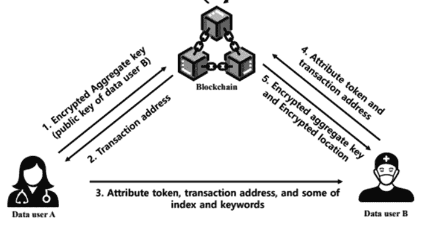

图 5.1 数据委托 [14]。

ABE 是一种有价值的加密技术，允许将信息安全传输到不可信的存储库，例如外部 Web 服务器。ABE 促进了根据各利益相关者的各自角色或特征在众多利益相关者之间提供的数据的高效传输。传统加密方法提供端到端加密，但需要个人提供解密密钥或将数据存储在多个具有不同密钥的加密副本中。两种选择都不合适。与传统加密技术相比，ABE 可以最大限度地减少密钥管理的负担。ABE 提供精确的访问控制和涵盖整个通信过程的加密。狡猾的个人可能会访问存储在公共存储库中与他们的保密密钥不兼容的加密数据。然而，在没有可理解的加密密钥的情况下，他们无法理解数据的实质。此外，KP-ABE 提供用户隐私保护。在 KP-ABE [5] 中，解密用户即使在不知道加密者身份的情况下也可以访问授权的密文。数据所有者只需识别有权解码密文的用户类别即可。保护 MHN 的隐私和安全具有明显的优势。当涉及资源有限的设备时，需要解决某些问题。此外，资源受限的设备包括计算能力、存储容量以及计算和存储组合能力有限的设备，例如 iPad 和智能手机。


## 5.2 相关工作 医疗保健与基于属性的加密

越来越多的项目现在将撤销问题作为优先事项。创建了一个可逆加密系统，能够实现间接撤回，其中系统中的每个功能都有指定的有效时间段。专家定期通知属性并重新分配用户的密钥信息。

### 5.2.1 优化的可变属性基加密

Y. Dong et al. [6] 该研究提出了一个原型，通过保护其免受中心点的攻击来增强区块链方案的鲁棒性。该系统采用 MA-ABE 来消除对集中式权威的需求，从而保证存储在区块链上的数据的安全性和保密性。作者评估了系统的性能并展示了构建具有访问控制的可编辑区块链的实用性。部署具有访问控制的可编辑区块链的可行性得以证明，为寻求在保留内容控制的同时进行安全数据交换的组织提供了一种务实的解决方案。系统的性能得到评估，证明了实施具有访问控制的可编辑区块链的实用性。

该技术采用基于属性的加密方法和变色龙哈希函数来加强区块链系统内部的安全性和隐私性。研究结果对处理机密数据的公司和行业具有重大影响，例如医疗保健、银行和政府，在这些领域保护隐私和确保数据安全至关重要。

Roop Ranjan et al. [7]，一种创新的协作方法，探索了将区块链作为交换消息的手段的实现，并证明访问多项式是快速撤销云存储中访问的有效方法。研究建议使用访问多项式进行密钥分发，这最大限度地减少了群组成员之间共享的消息数量。建议的方法为云中共享文件提供了一种强大且分布式的解决方案，保证了数据的保密性和用户的匿名性。它允许快速删除用户访问权限，而无需与未被撤销访问的用户进行通信，从而提高了云存储中访问控制的效率。该概念使用区块链技术通过智能合约强制执行访问控制，从而消除了对可信实体的需求并减轻了拒绝服务威胁。ABE 允许数据所有者在维护用户匿名性和提高隐私保护的同时对文件强制执行访问控制。评估结果表明，建议的系统具有很高的可扩展性，使其适用于涉及多达 20,000 人的大规模部署。与传统替代方案相比，建议方案中智能合约的加入消除了任何单一漏洞并降低了系统维护相关的费用。

L. Wu and J. Du’s [8] 研究引入了一种创新的植入式医疗设备（IMD）访问控制策略，该策略依赖于代理设备，例如智能手机，来执行复杂的加密计算。这种方法有效地延长了 IMD 的使用寿命。所提出的系统使用以提供精确的访问控制，确保只有合格和授权的用户才能访问 IMD。系统采用 CP-ABE 来对编程操作员的资格建立精确的访问控制。将策略在有形仿真设备上执行说明了其可行性和有效性，为保护 IMD 提供了务实的解决方案。该技术在实际仿真器设备上执行，实证结果表明其高效且有影响力。该研究通过使用真正的仿真设备展示了建议方法的[content]
## 5.2 相关工作 医疗保健与基于属性的加密

越来越多的项目现在将撤销问题作为优先事项。创建了一个可逆加密系统，能够实现间接撤回，其中系统中的每个功能都有指定的有效时间段。专家定期通知属性并重新分配用户的密钥信息。

### 5.2.1 优化的可变属性基加密

Y. Dong et al. [6] 该研究提出了一个原型，通过保护其免受中心点的攻击来增强区块链方案的鲁棒性。该系统采用 MA-ABE 来消除对集中式权威的需求，从而保证存储在区块链上的数据的安全性和保密性。作者评估了系统的性能并展示了构建具有访问控制的可编辑区块链的实用性。部署具有访问控制的可编辑区块链的可行性得以证明，为寻求在保留内容控制的同时进行安全数据交换的组织提供了一种务实的解决方案。系统的性能得到评估，证明了实施具有访问控制的可编辑区块链的实用性。

该技术采用基于属性的加密方法和变色龙哈希函数来加强区块链系统内部的安全性和隐私性。研究结果对处理机密数据的公司和行业具有重大影响，例如医疗保健、银行和政府，在这些领域保护隐私和确保数据安全至关重要。

Roop Ranjan et al. [7]，一种创新的协作方法，探索了将区块链作为交换消息的手段的实现，并证明访问多项式是快速撤销云存储中访问的有效方法。研究建议使用访问多项式进行密钥分发，这最大限度地减少了群组成员之间共享的消息数量。建议的方法为云中共享文件提供了一种强大且分布式的解决方案，保证了数据的保密性和用户的匿名性。它允许快速删除用户访问权限，而无需与未被撤销访问的用户进行通信，从而提高了云存储中访问控制的效率。该概念使用区块链技术通过智能合约强制执行访问控制，从而消除了对可信实体的需求并减轻了拒绝服务威胁。ABE 允许数据所有者在维护用户匿名性和提高隐私保护的同时对文件强制执行访问控制。评估结果表明，建议的系统具有很高的可扩展性，使其适用于涉及多达 20,000 人的大规模部署。与传统替代方案相比，建议方案中智能合约的加入消除了任何单一漏洞并降低了系统维护相关的费用。

L. Wu and J. Du’s [8] 研究引入了一种创新的植入式医疗设备（IMD）访问控制策略，该策略依赖于代理设备，例如智能手机，来执行复杂的加密计算。这种方法有效地延长了 IMD 的使用寿命。所提出的系统使用以提供精确的访问控制，确保只有合格和授权的用户才能访问 IMD。系统采用 CP-ABE 来对编程操作员的资格建立精确的访问控制。将策略在有形仿真设备上执行说明了其可行性和有效性，为保护 IMD 提供了务实的解决方案。该技术在实际仿真器设备上执行，实证结果表明其高效且有影响力。该研究通过使用真正的仿真设备展示了建议方法的实用模型，从而说明了其实用性和效率。

M. Mahdavi et al.’s [9] 研究引入了 KP-ABE 技术，与之前的 KP-ABE 方案相比，使用了更少的配对过程。此外，还使用了椭圆曲线群以保证更短的密钥。同样，该研究建议在模糊身份基加密（FIBE）和 KP-ABE 方案中安全地委派计算密集型任务，例如曲线点上的标量乘法、指数运算和配对。这些解决方案旨在增强物联网（IoT）设备处理复杂操作的能力。此外，文章缺乏对建议解决方案在性能、效率或现实世界物联网情况中的可行性方面的全面评估或审查。可能需要进一步的研究和测试来确定建议方法在实际物联网安装中的有效性和实用性。

N. Arivazhagan et al. [10] 引入了一种名为 CT-MA-ABE（跨信任多授权属性基加密）的新方法来解决这些问题。该方法在跨境交换中纳入了“公证人”的功能，解决了完全去中心化替代方案中的监督问题，同时也考虑了集中式系统中的信任问题。该系统在华南珠海和澳门的法律辖区内的实施是确保数据交换安全的关键基础设施组成部分。这一成功的部署进一步突出了该系统作为可靠且安全解决方案的有效性。

F. Meng [11]，为解决这一困难，学者们提出了几种面向对象的基于属性的密钥共享（OOABKS）方法。这些方法通过离线预计算中间密文来提高在线创建密文的效率。

然而，我们已在当前 OOABKS 方案中发现了若干限制：
- 某些方案由于中间密文中包含访问结构而灵活性有限，使其无法生成在不同访问结构下加密的最终密文。
- 替代方案无法满足基本的安全前提。

本研究对当前 OOABKS 系统进行了全面审查。在此，我们提供了一种改进的 OOABKS 技术，提供可验证的安全性。我们的方法在解决其限制的同时保留了先前 OOABKS 系统中在线/离线密文创建的优点。实验结果表明，我们的改进系统在保持灵活性和安全性的同时，达到了与先前 OOABKS 方案相似的效率水平。

PR. Kumar et al. [12] 大多数可撤销属性基加密（RABE）方案当前的撤销程序由云存储提供商（CSP）执行。由于 CSP 充当公正且好奇的中介，因此无法保证撤销后与修订密文相关联的明文数据保持不变。此外，大多数基于属性的加密系统都存在密钥托管问题。为了解决上述问题，我们提出了一种高效的 RABE 技术，该技术不仅确保数据完整性，还解决了密钥托管问题。

PR. Kumar et al. [13] 为了有效，适应性安全加密（ASE）方案必须能够容纳全面的搜索查询，这些查询可以表述为合取、析取或任何布尔公式。本研究介绍了一种新颖高效的 ASE 算法，即可行近似解决方案评估（FEASE），它提供速度和表达性。对于每组关键字，无论其大小如何，搜索过程仅需要三次配对运算。此外，加密和陷门方法相对于关键字数量具有线性复杂度。FEASE 建立在一种新颖高效的基础上，我们将其作为第一个命题提出。该方案本身就很值得注意。为了增强对关键字猜测攻击的安全性，我们扩展了现有的 FEASE 系统以创建第一个，并且 FEASE 与所有当前可用的表达性 ASE 构造相比表现出更优的性能。

J. Lee et al. [14] 个人健康记录（PHRs）存储可能导致隐私问题的私人信息。此外，在医疗紧急情况下，考虑多个权威机构来处理委托很重要。虽然正在研究不同的数据共享方法，但它们通常无法满足真实 PHR 共享环境中所需的安全标准。本研究介绍了一种利用密钥聚合可搜索加密（KASE）来满足安全要求并利用区块链和智能合约来增强数据完整性、维护数据审计记录并确保透明度的系统。研究人员提出了一种机制，该机制保证了拥有 PHR 数据的个人在委托各种权利时使用属性

令牌。我们同时进行正式和非正式的安全评估，以评估所提系统在可能遭受的对抗性攻击下的弹性。R. Kumar 等人 [15] 代理重加密（PRE）使配备重加密密钥的部分受信任的中介能够将使用一个密钥加密的密文转换为使用不同密钥对同一消息的加密。基于属性的代理重加密（AB-PRE）是 PRE 的扩展，允许对加密数据的访问进行精确控制并能够委托访问权限。然而，传统的 AB-PRE 由于其对执行密文更改的单一代理的依赖而饱受单点故障的困扰。为了解决这个问题，本工作提出了一种新颖的概念，称为基于属性的阈值代理重加密（AB-TPRE），其采用多个代理（N）用于转换。在 AB-TPRE 中，重加密密钥被划分为 N 个份额，每个代理获得一个份额以生成转换后的密文份额。转换后的密文只有在将一定数量的转换后密文份额，即阈值（t），组合在一起时才能成功构建。此外，我们提出实现份额可更新功能，以减轻与份额可能泄露相关的安全风险。该属性能够刷新重加密密钥份额。

当前学术文献和关于ABE在健康服务和电子健康记录（EHR）中的重要性的研究中，明显缺乏一份全面的系统性文献综述（SLR）。这样一份调查将为ABE过去、现在和正在进行的进展提供宝贵的见解。研究人员普遍认可，在开始任何研究项目之前，研究人员会始终进行全面的文献综述，以选择未来研究的特定关注领域。因此，进行一份全面的调查以涵盖迄今为止对ABE方案所做的所有改进至关重要。

本文献综述汇总并概述了自2012年以来专门应用于健康服务的所有基于ABE的方法。它包括各个特定类别中的更新版本和实现，旨在采用明确的技术基于这些调查得出可靠的结论。这项彻底而广泛研究的主要目标不仅是总结现有研究和文献，还为使用ABE在健康服务和其他领域进行的未来研究工作提供框架。

## 5.3 方法论

SLR 的主要目标是对与特定研究主题和兴趣领域相关的所有相关文献和研究进行全面审查和纳入。研究过程通常始于对特定主题的好奇，但对该主题的熟悉有助于为调查制定适当的研究问题。研究人员已采用两阶段筛选方法以从数据库中提取研究成果和论文。在第一阶段，他们首先根据布尔合并搜索字符串、纳入/排除标准和研究关注点对特定研究进行排序。在第二阶段，他们继续从数据库中提取结果和论文的来源。

在本讨论的上下文中，“Domain”一词指的是特定ABE系统所提出并基于的区域或领域。在进行本研究时，共考虑了七个不同的领域类别。这些类别如下：“CP-ABE”、“KP-ABE”、“Hybrid”、“Multiauthority-ABE”、“Searchable Encryption-ABE”、“Blockchain/Decentralized”和“Hierarchical ABE”。正如其名称所示，“Hybrid”领域是两种不同且独立的方法的组合，这些方法无法容纳在其他领域内（见图5.1）。

通过使用这种称为 Multiauthority-ABE 的方法可以实现高端粒度。这种方法允许将分散的访问权限授予数据所有者。在多权威结构框架内，本部分查看了各种不同的文献。每项研究都根据其发表年份进行强调和审查，从2013年开始持续到2021年。这是在考虑各种研究的关键组成部分的同时进行的，例如研究提出的目标、程序和改进。

图5.2中的区块链是一种去中心化技术，无需中央机构即可运行。它建立在分布式账本和共识框架的基础上。因此，从2019年开始到2021年结束的以下段落中强调并讨论了许多消除属性权威和类似技术需求的此类替代方案。

### 5.3.1 一种新颖的基于密钥策略的属性基加密（KP-ABE）

在此，研究人员提供了一种新颖的 KP-ABE [16] 方法，该方法利用可委派的基于身份的广播加密策略的概念来实现图5.3中固定大小的密文。KP-ABE 的构造详细说明如下：

```
Setup(1^λ, U)
```

受信任的属性权威选择三个素数阶循环群 G₁、G₂ 和 G_T，具有双线性配对 e: G₁×G₂ → G_T，给定安全参数 λ。受信任的属性权威从 G₁ 中选择两个生成元 g，从 G₂ 中选择 h，以及来自模 p 非零整数集合的秘密值 α，以及一个将二进制字符串映射到模 p 非零整数的密码学哈希函数 H。安全研究将把 H 视为随机预言机。主密钥记为 msk=(g, α)。公共参数由值 = (w, v, h, h^α, ..., h^{α^n}) 组成，其中 w 等于 g 的 α 次幂，V 等于以 g 为底、以 h 为指数的 e 的指数运算。

v = \hat{e}(g, h)  (5.1)

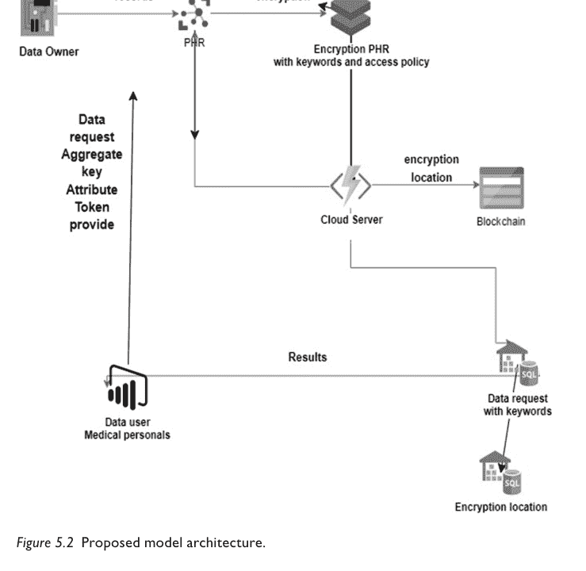

图 5.2 提出的模型架构。

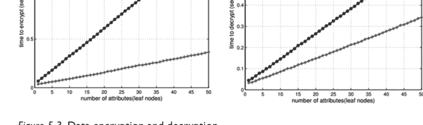

图 5.3 数据加密和解密。

KeyGen 方法使用提供的参数 msk 和 (M, ρ) 为与线性秘密共享方案（LSSS）方案 (M_{ℓ×k}, ρ) 关联的访问结构生成私钥，首先，它使用线性秘密共享方案 (M_{ℓ×k}, ρ) 生成 ℓ 的份额。具体来说，它选择一个列向量 β = (β₁,β₂,...,βₖ)^T，使得 β₁ = s = 1 且 β₂,...,β_k ∈ ℤ_p。对于从 1 到 ℓ 的任何 i 值，程序通过计算 M_i 和 β^T 的内积来计算 λ_i。然后它根据以下规则分配 SK_{(M,ρ)}：

SK_{(M,ρ)} = { D_i, (K_{i,i})^n }_{i=1}^ℓ = { g^{λ_i/(α+H(ρ(i)))}, (b^{λ_i α^i})^n }_{i=1}^ℓ .  (5.2)

Encrypt(params, m, and W): 将 t 定义为属性集 W 的基数，并表示 W。

W = { ω_i }_{i=1}^t .  (5.3)

发送方从非零整数集 ℤ* 中选择元素 s。利用该值，发送方按如下方式计算密文 c=(c₀, c₁, c₂)：c₀ 通过将 m 与值 V 相乘获得，c₁ 通过从 w 中减去 s 获得，c₂ 通过将 s 与 h 相乘然后将结果与 t 个指标的乘积相乘获得，其中每个指标通过将 α 加到每个 i 从 1 到 t 的 ω_i 的哈希值上获得。

c₀ = m · v^s = m · \hat{e}(g,h)^s
c₁ = w^{-s} = g^{-αs}
c₂ = h^s ∏_{i=1}^t (α+H(ω_i))  (5.4)

对密文 c 的解密，该密文标记有特征集 W = { ω_i }_{i=1}^t，并使用密钥 SK(M, ρ)，涉及将 c 解析为 c=(c₀, c₁, 和 c₂)。接收方最初定义集合 I = { i | ρ(i) ∈ W }  (5.5)

并继续计算重建常数

{μ_i}_{i∈I}=Recon((M,ρ),W)  (5.6)

函数。LSSS 方案 $(M,\rho)$ 的解密密钥表示为

$\text{SK}_{(M,\rho)}=\{D_i,(K_{i,j})^n\}_{j=1}^{t}{}_{i=1}^{t}$  (5.7)

接下来，接收方进行计算。

$p_{i,\mathbf{W}}(\alpha)=\frac{\lambda_i}{\alpha}\Big(\prod_{j=1,j\neq i}^{t}(\alpha+H(\omega_j))-\prod_{j=1,j\neq i}^{t}H(\omega_j)\Big)$  (5.8)

$p_{i,\mathbf{W}}(\alpha)$ 是关于变量 $\alpha$ 的 $t-2$ 次多项式，这很明显。解密方可以根据 $j$ 从 1 到 $n$ 的 $(K_{i,j})^n$ 计算 $b^{p_{i,\mathbf{W}}(\alpha)}$。接下来，解密方执行计算。

$Y_i=\big(\hat{e}(c_1,b^{p_{i,\mathbf{W}}(\alpha)})\cdot\hat{e}(D_i,c_2)\big)^{1/\prod_{j=1,j\neq i}^{t}H(\omega_j)}=\hat{e}(g,h)^{s\lambda_i}$  (5.9)

最后，解密方计算。

$Y=\prod_{i\in I}Y_i^{\mu_i}=\hat{e}(g,h)^s,\;m=\frac{c_0}{Y}$  (5.10)

所提出的 KP-ABE 方案是准确的。

证据。假设 $c$ 格式良好，表示 $c$ 使用一组属性加密。$\mathbf{W}=\{\omega_i\}_{i=1}^{t}$ 则 $Y_i=\big(\hat{e}(c_1,b^{p_{i,\mathbf{W}}(\alpha)})\cdot\hat{e}(D_i,c_2)\big)^{1/\prod_{j=1,j\neq i}^{t}H(\omega_j)}$ $=\big(\hat{e}(g,h)^{-s\alpha(\lambda_i/\alpha)\big(\prod_{j=1,j\neq i}^{t}(\alpha+H(\omega_j))-\prod_{j=1,j\neq i}^{t}H(\omega_j)\big)}\hat{e}(g,h)^{s\lambda_i\prod_{i=1}^{t}(\alpha+H(\omega_i))}\big)^{1/\prod_{j=1,j\neq i}^{t}H(\omega_j)}$  (5.11) $=\big(\hat{e}(g,h)^{s\lambda_i\prod_{i=1}^{t}H(\omega_i)}\big)^{1/\prod_{j=1,j\neq i}^{t}H(\omega_j)}=\hat{e}(g,h)^{s\lambda_i}$。表 5.1 提供了目前可用的几种ABE方案效率的比较，特别关注使用的方法


## 表 5.1 先前研究

| 作者 | 方法 | 贡献 | 限制 |
|---|---|---|---|
| Y. Dong et al. [6] | 去中心化联盟区块链系统 | 使用变色龙哈希、数字签名和多权威属性基加密（MA-ABE）实现可编辑性和访问控制的原型。增强了鲁棒性并防止了中心点攻击。在实际场景中证明了可行性。 | 对性能、效率和现实世界可行性的评估细节有限 |
| A. Shafieinejad and Roop Ranjan et al. [7] | 用于安全云文件共享的区块链和ABE | 创新的协作方法确保安全云文件共享。使用访问多项式实现快速访问撤销。在区块链中集成智能合约进行访问控制。高可扩展性。 | 缺乏对性能、效率和现实世界可行性的详细评估 |
| L. Wu and J. Du [8] | 植入式医疗设备的访问控制 | 使用代理设备和密文策略属性基加密（CP-ABE）的植入式医疗设备创新访问控制策略。在有形仿真设备上高效执行。展示了实用且高效的模型。 | 关于可扩展性和现实世界部署的信息有限 |
| M. Mahdavi et al. [9] | 修订的 FIBE 和 KP-ABE 技术 | 提出了模糊身份基加密（FIBE）和密钥策略属性基加密（KP-ABE）方案的修订版本，减少了配对过程。缺乏对现实世界物联网情况下性能的全面评估。 | 缺乏对现实世界物联网情况下性能、效率和可行性的评估细节 |
| N. Arivazhagan et al. [10] | 跨信任多授权ABE | 引入 CT-MA-ABE 用于跨境机构授权，使用 MA-ABE 和区块链认证机构（BCA）。实现基于加密的授权以保护隐私。在中国南方法律管辖区成功部署。 | 在特定地区成功部署，缺乏更广泛的评估细节 |
| F. Meng [11] | 具有可验证安全性的改进 OOABKS | 对当前面向对象属性基密钥共享（OOABKS）系统的全面审查。提出了一种具有可验证安全性和效率的改进 OOABKS 技术。保持灵活性和安全性。 | 缺乏有关当前 OOABKS 方案中特定约束的信息 |

(续)

## 表 5.1（续）先前研究

| 作者 | 方法 | 贡献 | 限制 |
|---|---|---|---|
| PR. Kumar et al. [12] | 可撤销属性基加密（RABE） | 提出一种高效的 RABE 技术，解决数据完整性和密钥托管问题。使用决策 q-并行双线性 Diffie-Hellman 指数（q-PBDHE）假设和离散对数（DL）前提证明了安全性。 | 缺乏有关性能和可扩展性的具体信息 |
| PR. Kumar et al. [13] | 自适应安全加密（ASE） | 引入 FEASE，一种自适应安全加密（ASE）算法，提供速度和表达能力。增强了对关键词猜测攻击的安全性。与现有 ASE 构造相比性能更优。 | 缺乏有关具体限制和潜在漏洞的详细信息 |
| J. Lee et al. [14] | 密钥聚合可搜索加密（KASE） | 引入个人健康记录（PHRs）系统，使用密钥聚合可搜索加密（KASE）实现安全，并使用区块链和智能合约实现数据完整性、审计记录和透明度。使用属性令牌在委托期间确保个人权利。进行了正式和非正式的安全评估。 | 缺乏有关具体安全评估的详细信息，以及现实世界实施中的潜在挑战 |
| PR. Kumar et al. [15] | 属性基阈值代理重加密（AB-TPRE） | 将属性基阈值代理重加密（AB-TPRE）作为传统属性基代理重加密（AB-PRE）中单点故障的解决方案。AB-TPRE 采用具有阈值机制的多个代理进行安全转换。引入可更新共享功能以减轻安全风险。 | 建议的可更新共享功能的有效性和实用性需要彻底测试。需要额外的评估细节，尤其是在现实世界场景中。 |

固定大小的密文。引入了一种用于 CP-ABE 和 KP-ABE 的策略，利用恒定大小的密文。我们分别将它们称为方案 1 和方案 2。

### 5.3.2 BLS 和 Boneh-Gentry-Lynn-Shacham（BGLS）签名的安全性

聚合签名系统是一种密码学方法，允许将多个用户对多条消息的多个签名组合成单个简洁的签名。

不幸的是，目前没有任何完全非交互式的聚合签名方法，即使依赖于随机预言机启发式。这意味着签名者需要相互交换消息，无论是顺序还是替代方式，以便创建签名。与一些有趣的应用交互可能成本过高。

如 S. Ilakiya 等人 [17] 所定义，聚合签名是一种数字签名，允许任何一方将多个用户对多条消息的多个签名合并为单个简洁的签名。当存储或带宽容量有限时，这一基本元素在多个场景中很有价值，因此需要最小化整体密码负担。

基本 BGLS 聚合签名方案 [17]：

|  |  |
|---|---|
| 设置 | $G_1 = \langle g_1 \rangle, G_2 = \langle g_2 \rangle, G_T$, 素数阶 $p$  
$\mathbf{H}: \{0,1\}^* \to G_1$, 全域  
$e : G_1 \times G_2 \to G_T$, 双线性 |
| 密钥生成 | $x \leftarrow_s \mathbb{Z}_p$  
$sk = x \in \mathbb{Z}_p$  
$pk = (y_1, y_2) = (g_1^x, g_2^x) \in G_1 \times G_2$ |
| 签名 $(sk, m)$ | $\sigma = \mathbf{H}(m)^{sk} \in G_1$ |
| 聚合 $(\sigma_1, ..., \sigma_k)$ | $\sigma_A = \prod_{i=1}^k \sigma_i \in G_1$ |
| 聚合验证 $(\sigma_A, (pk_1, m_1), ..., (pk_k, m_k))$ | $\prod_{i=1}^k e(\mathbf{H}(m_i), y_{2,i}) = e(\sigma_A, g_2)$ |

## 5.4 加密与医疗保健

保证医疗系统统一性和强度的首要因素是个人健康信息（PHI）的保护。数字技术在医疗保健中的引入允许便捷地访问这些数据，从而促进提供更高效、更有影响力的健康服务和治疗。目前，医疗专业人员广泛使用 EHR 技术。大多数医疗办公室已将其 EHR 系统 [18] 转移到使用外包选项，其中 EHR 数据保存在第三方云上的集中式数据仓库中，可能缺乏完全的可靠性和安全性。

医疗组织必须具备监控和记录用户进入其网络的能力。为此，提供每个用户一个独特的 user ID 以访问您组织的网络非常重要。确保医疗网络的安全是防止泄露非常成功的策略。成功入侵组织内部网络的恶意行为者有能力在整个组织系统中传播恶意软件，从而感染连接到网络的每台设备。未能采用高效的网络管理可能会对公司产生负面影响。

数据备份和灾难恢复是指创建关键信息副本并建立在灾难发生时检索和恢复这些文件的明确策略的系统性做法。HIPAA 要求在外部设施复制和存储 ePHI。医疗组织还必须建立灾难恢复策略并提供在紧急情况下访问数据的方式。为了遵守 HIPAA 规定，定期备份数据以降低患者数据丢失风险至关重要。

## 5.5 结果与讨论

如图 5.4 所示的 CP-ABE 加密技术，需要在构建多项式 p 期间从 Z_p 中选择一个随机元素，并对每个属性在 G（椭圆曲线群）中运行两次指数运算以加密数据。然而，KP-ABE 加密技术 [19] 仅需对每个属性在 G（椭圆曲线群）中进行两次指数运算，并且只需在所有属性中选择一个来自 Z_p 的随机元素。因此，KP-ABE [20] 加密所需的时间大约比 CP-ABE [21] 快三倍。

就解密而言，最昂贵的计算是双线性映射，在 CP-ABE 中对每个叶节点执行两次，而在 KP-ABE 中仅执行一次。因此，KP-ABE 的解密时间大约比 CP-ABE [22] 快两倍。然而，与 CP-ABE 相比，KP-ABE 在所有三个维度上都更具计算效率，但有两个显著缺点。首先，需要注意的是，公钥和主密钥的维度会随着总体集中特征数量的增加而按比例增加。这可能会导致系统通信开销增加，特别是当系统经常需要用户更新其公钥时。关系

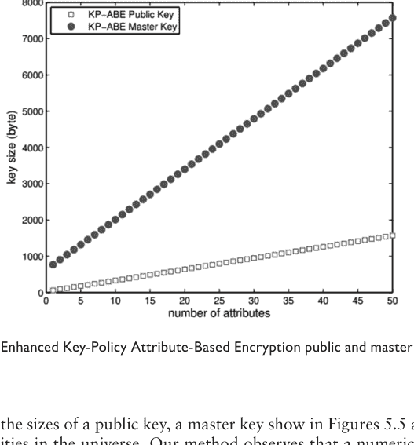

图 5.4 增强型密钥策略属性基加密的公钥和主密钥大小。

公钥大小、图 5.5 和 5.6 所示的主密钥大小与宇宙中的属性之间存在关系。 我们的方法观察到，数值属性最多由 64 个唯一特征表示。 当前 PHR 系统的 KP-ABE [23] 特征宇宙可能相当庞大。 然而，我们可以通过使用 KP-ABE 的大宇宙架构来增强密钥大小的限制。

比较是基于表 5.2 中给出的私钥的维度、密文的大小以及加密和解密期间配对评估的数量进行的。

一个有趣的未解决的问题是开发一种 KP-ABE（见图 5.4 和 5.5）[24] 方法，该方法在保持广泛接受的前提下的安全性或实现更稳健的完全安全定义的同时生成固定大小的密文。 另一个复杂问题是构建一种 KP-ABE 方案，使密文和私钥的大小保持一致。 我们在随机预言机模型中提供了一种同步聚合签名构造，其效率高于我们的传统模型构造。 此外，与当前随机预言机方案相比，它具有一些特性，可能使其对某些应用更具吸引力。 同步聚合签名 [17,25] 可以减少消息签名对网络的带宽需求。 当需要将大量签名发送到收集器时，中间路由节点能够在任何位置聚合签名，而无需携带所有签名数据。

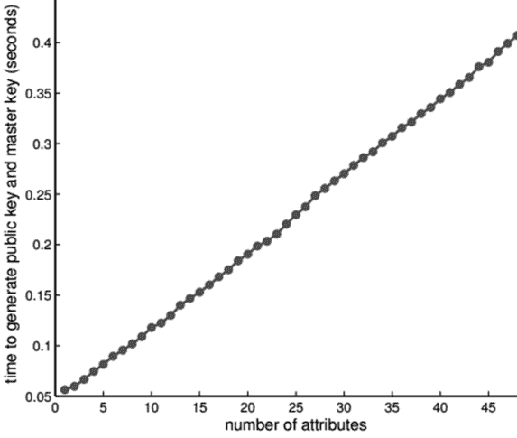

图 5.5 增强型密钥策略属性基加密密钥大小。

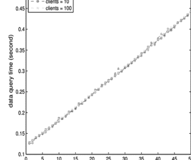

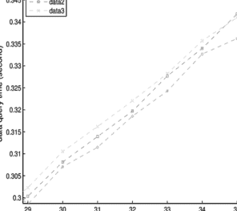

图 5.6 数据查询类别数量。

当涉及大量数据消费者时，数据检索时间尤其有趣。 图 5.6 表明，在存在多个客户端的情况下，查询数据所需的时间与特征数量成正比。 然而，在单个客户端情况下并非如此。 客户数量对总数据查询时间有直接影响。 设想 PHR 系统在全国范围内的部署，同时使用该系统的客户端数量可能达到数十万。 这种情况下可能会导致系统查询响应时间显著延迟。

## 表 5.2 ABE 方案比较

|  | [14] | [15] | [20] | [19] | Enhanced KP-ABE |
|---|---|---|---|---|---|
| ABE 类型 | CP-ABE | CP-ABE | CP-ABE | KP-ABE | KP-ABE |
| 访问 | 与 | 阈值 | 阈值 | 单调 | 单调 |
| 私钥 | 2|G | w|G1|+n|G2| | (n+w)|G|+|Z_p| | (n+1)t|G| | t|G1|+nt|G2| |
| 密文 | 2|G|+|G_T| | |G1|+|G2|+|G_T| | 2|G|+|G_T| | 2|G|+|G_T| | |G1|+|G2|+|G_T| |
| 加密开销 | 0 | 0 | 1p | 1p | 1p |
| 解密开销 | 2p | 3p | 3p | 2p | 2p |

## 5.6 结论

本研究提出了一种新颖的增强型 KP-ABE 方案，可处理任何单调访问结构。 该方法具有密文大小固定的优点。 此外，我们已证明所提出的方案在选择集模型中实现了语义安全性，依赖于通用 Diffie-Hellman 指数假设。 所提出的增强型 KP-ABE 系统的一个固有缺点是，私钥的大小随着访问结构中特征数量的增加而显著增加。 一个有趣的未解决的问题包括开发一种增强型 KP-ABE 系统，该系统在保持广泛接受的假设下的安全性或实现更稳健的安全级别的同时生成固定大小的密文。 另一个复杂问题是创建一种增强型 KP-ABE 系统，使密文和私钥的大小保持一致。

## 5.7 未来工作

通过解决其集合中的诸多限制和不足来加强 ABE 库，包括对复杂访问结构支持有限、密钥生成和加密过程效率低下、对大型属性集处理不足以及缺乏对现实世界应用中可扩展性和性能的优化。 我们的 ABE 库在其集合中存在诸多限制和不足。 使用 ABE 库所需的时间大大削弱了安全优势。 因此，我们将努力将新的 ABE 架构纳入我们的 ABE 库，以提高其整体性能。 调查展示更动态和更有效访问层级的方法。 目前，我们以静态方式定义访问结构，这对于 PHR 等动态系统是不合适的。 此外，更有效的描述方式有可能最大程度地降低密钥管理和策略的复杂性。 建议将密码技术与增强隐私的额外方法相结合。 使用密码算法是保护部分可信云服务器上的私有数据的重要方式；然而，这并不是唯一可用的选择。 鉴于此，我们正在努力发现一种更有效的方法来解决 PHR 系统中的隐私和安全问题。

## 参考文献

- 1. K. Sravanthi and P. Chandrasekhar, “用于同构和异构云区块链交易的高效多用户组内完整性 CP-ABE(GI-CPABE)”， Journal of Electrical Systems, vol. 20, no. 1, pp. 326–349, 2024, doi: 10.52783/jes.685.
- 2. S. Chawla and N. Gupta, “基于代理且抗合谋的多机构可撤销 CPABE 框架，具有高效的用户和属性级撤销 (PCMR-CPABE)”， International Journal of Safety and Security Engineering, vol. 13, no. 3, pp. 527–538, 2023, doi: 10.18280/ijsse.130315.
- 3. B. Shilpa, P. R. Kumar, and R. K. Jha, “LoRa DL：使用自编码器增强 LoRa 数据传输的深度学习模型”， The Journal of Supercomputing, vol. 79, pp. 17079–17097, 2023.
- 4. H. Cui, Z. Wan, T. Zhaolu, H. Wang, and A. Miyaji, “按证明付费：使用区块链的云存储支付的去中心化外包多用户 PoR”， IEEE Transactions on Cloud Computing, pp. 1–14, 2023, doi: 10.1109/tcc.2023.3343710.
- 5. Y. Zhang, H. Geng, L. Su, and L. Lu, “多云存储中的基于区块链的高效数据完整性验证方案”， IEEE Access, vol. 10, pp. 105920–105929, 2022, doi: 10.1109/access.2022.3211391.
- 6. Y. Dong, Y. Li, Y. Cheng, and D. Yu, “具有访问控制的可编辑联盟区块链：利用变色龙哈希和多机构属性基加密”， High-Confidence Computing, vol. 4, no. 1, p. 100168, 2024, doi: 10.1016/j.hcc.2023.100168.
- 7. R. Ranjan, D. Pandey, A. K. Rai, D. Gupta, P. Singh, P. R. Kumar, and S. N. Mohanty, “使用自回归模型的流形级混合深度学习情感分类方法”， Applied Sciences, vol. 13, no. 5, p. 3091, 2023.
- 8. L. Wu and J. Du, “为植入式医疗设备设计新型基于代理的访问控制方案”， Computer Standards & Interfaces, vol. 87, p. 103754, 2024, doi: 10.1016/j.csi.2023.103754.
- 9. M. Mahdavi, M. H. Tadayon, M. S. Haghighi, and Z. Ahmadian, “面向物联网的预计算和外包属性基加密”， Future Generation Computer Systems, vol. 150, pp. 115–126, 2024, doi: 10.1016/j.future.2023.08.015.
- 10. N. Arivazhagan, K. Somasundaram, G. B. Mohammad, P. R. Kumar, et al., “用于电子医疗系统的基于混合蛾群火焰优化与深度神经网络算法的云-健康物联网 (IOHT) 任务调度”， *Scientific Programming*, vol. 2022, pp. 1–12, 2022.
- 11. F. Meng, “在线/离线属性基可搜索加密修订：灵活性、安全性和效率”， *Journal of Systems Architecture*, vol. 146, p. 103047, 2024, doi: 10.1016/j.sysarc.2023.103047.
- 12. P. R. Kumar, G. B. Mohammad, and P. Dileep, “使用最小二乘法的实时心率监测系统”， *Annals of the Romanian Society for Cell Biology*, vol. 25, no. 6, pp. 16302–16308, 2021.
- 13. P. R. Kumar, and T. Ananthran, “使用 LabVIEW 进行标签检测的机器视觉”， *Journal of Innovation in Computer Science and Engineering (JICSE)*, vol. 9, no. 1, pp. 58–62, 2019.
- 14. J. Lee, J. Oh, D. Kwon, M. Kim, K. Kim, and Y. Park, “用于多委托个人健康记录共享的区块链支持密钥聚合可搜索加密方案”， *IEEE Internet of Things Journal*, pp. 1–1, 2024, doi: 10.1109/jiot.2024.3357802.
- 15. P. R. Kumar, “使用电感耦合的无线移动充电器”， *Journal of Emerging Technologies and Innovative Research (JETIR)*, vol. 5, no. 10, pp. 40–44, 2018.
- 16. S. Ilakiya, “属性基加密 (ABE) 文献综述”， *International Journal of Emerging Trends in Science and Technology*, 2016, https://journals.indexcopernicus.com/api/file/viewByFileId/182258.
- 17. M.-S. Lacharité, “多用户环境下 BLS 和 BGLS 签名的安全性”， *Cryptography and Communications*, vol. 10, no. 1, pp. 41–58, 2017, doi: 10.1007/s12095-017-0253-6.
- 18. J. Mary and S. Sunitha, “基于 ABE 的云计算在线个人健康记录系统”， *International Journal of Innovative Research in Computer and Communication Engineering*, vol. 3, no. 7, pp. 6818–6823, 2015, doi: 10.15680/ijircce.2015.0307035.
- 19. Y. Zhao, Y. Fan, and X. Bian, “OO-MA-KP-ABE-CRF：用于身体能力数据的具有密码反向防火墙的在线/离线多机构密钥策略属性基加密”， *Mathematics*, vol. 11, no. 15, p. 3333, 2023, doi: 10.3390/math11153333.
- 20. B. Shilpa, P. R. Kumar, and R. K. Jha, “密集室内 LoRa 网络中干扰缓解的扩频因子优化”， *IEEE IAS Global Conference on Emerging Technologies (GlobConET)*, London, UK pp. 1–5, 2023.
- 21. J. Jusak, S. S. Mahmoud, R. Laurens, M. Alsulami, and Q. Fang, “一种安全云端电子健康记录的新方法及其实验测试平台”， *IEEE Access*, vol. 10, pp. 1082–1095, 2022, doi: 10.1109/access.2021.3138135.
- 22. S. Senthilkumar, K. Brindha, N. Kryvinska, S. Bhattacharya, and G. R. Bojja, “基于 SCB-HC-ECC 的智能卡医疗系统安全云存储隐私保护协议”， *Frontiers in Public Health*, vol. 9, 2021, doi: 10.3389/fpubh.2021.688399.
- 23. P. R. Kumar, “使用 LabVIEW 的步进电机位置控制”， *3rd International Conference on Recent Trends in Electronics, Information Communication Technology (RTEICT)*, Bangalore, India, pp. 1551–1554, May 2018.


- 24. P. R. Kumar 和 B. Shilpa，“基于物联网的智能医疗保健系统与边缘智能计算”，载于 S. Satpathy、S. N. Mohanty 和 S. Potluri（编），*探索医疗保健中边缘智能的格局*。CRC Press，Boca Raton，FL，第 31–46 页，2024 年。
- 25. R. Ganiga、R. M. Pai、M. M. Manohara Pai 和 R. K. Sinha，“基于云的电子健康记录（EHR）系统的安全框架”，*国际电气与计算机工程期刊 (IJECE)*，第 10 卷，第 1 期，第 455–466 页，2020 年，doi: 10.11591/ijece.v10i1.pp455-466。

# 机器学习 unleashed
## 区块链智能的范式转变

Marepalli Radha, MD Asma, Ashlesha Kolarkar,
and Kuncham Sreenivasa Rao

## 6.1 引言

创新应用，包括互联医疗、智慧城市和互联产业，已随着新兴技术、智能手机、传感器和 5G 通信的快速发展而开发。这导致了海量数据的产生。 根据国家有线电视和电信协会（NCTA）[1]进行的一项研究，到 2020 年，连接到互联网的物联网（IoT）设备数量预计增长 50.1%，这引发了合理的担忧。 网络攻击和数据泄露，特别是针对物联网设备的攻击急剧增加，McAfee 报告称自 2018 年 1 月以来各行业发生了大量事件。 物联网设备的脆弱性因其日益增长的互联性而加剧，VDC Research Group Inc. 强调了这一点，该机构将安全要求确定为开发互联设备的重大障碍 [2]。 卡巴斯基实验室的数据显示，2016 年至 2018 年间针对物联网设备的恶意软件样本大幅增加，凸显了这些设备的重大漏洞。 监控基于网络的风险为政府、能源、医疗保健、银行和研究中心等多个行业带来了重大问题。 数据的巨大数量、速度、多样性和真实性使得当前的方法和技术不足以识别针对物联网设备的新型网络攻击 [3]。 如果您处理的是海量数据，每周或每月的网络安全分析报告是不够的。 研究承认了这些不足，并建议将深度学习与大数据相结合以加强物联网设备的安全性。 由于其压缩特性、无监督训练能力以及特征构建中无需人工干预，深度学习非常适合资源有限的网络。 尽管当前文献中深度学习、大数据和物联网安全都已得到独立关注，但本研究旨在彻底调查将这些技术整合的可行性。 通过评估数据流以发现入侵和攻击模式，深度极限学习机（DELM）解决了入侵检测系统（IDS）[4]中标准的基于签名的技术。

集成智能区块链应用程序和用于数据处理的高效算法对于管理物联网设备产生的大量数据至关重要。 作为人工智能（AI）框架的一部分，机器学习涉及训练机器基于统计分析做出预测和决策 [5]。 本研究主张使用 DELM 来增强物联网智能家居的安全性，提供前沿技术的全面回顾，并提出在基于区块链的智能家居中实施的架构。 DELM 框架与区块链相结合，通过关注特定的链段并消除与数据相关的问题，为欺诈检测和盗窃预测等各种应用提供了独特的解决方案。

本文的组织结构如下：下一节提供了相关综述文章的简明摘要。 我们随后深入探讨区块链的基础框架，阐明 DELM 方法在基于区块链的智能家居背景下的应用，并阐述智能家居应用的框架。 随后，我们检查了 DELM 方法所采用的模拟和测试程序。 文章的最后一部分深入探讨了研究结论。

## 6.2 文献综述

本部分提供了深度学习、大数据技术和物联网安全的深入描述。 此外，它还探讨了这三个领域之间的相互联系，旨在提供基本见解并绘制这些前沿主题之间关系的映射。

### 6.2.1 深度学习

深度学习是机器学习的一个子集，涵盖三种不同的学习技术：监督学习、半监督学习和无监督学习。 其特征在于人工神经网络（ANNs）中存在多层，每层由具有激活函数且能够产生非线性输出的神经元组成。 这种方法借鉴了人脑神经元的结构 [6]。 近年来，深度学习获得了研究人员和组织的广泛关注，超过了对传统机器学习方法的兴趣。

Ref. [7] 的作者将深度学习与另外四种机器学习方法进行了比较，即支持向量机（SVM）、决策树、K-means 和逻辑回归。 他们使用 Google Trends 进行了调查。 结果表明深度学习的知名度不断上升。 自然语言处理、搜索引擎、信息检索、图片识别和图像检索只是利用该技术的 AI 学科中的几个

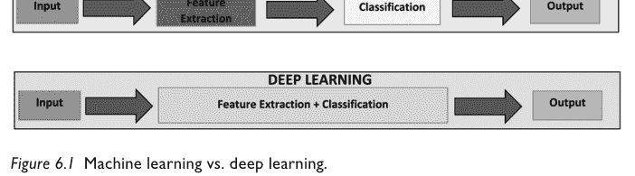

图 6.1 机器学习 vs. 深度学习。

深度学习和机器学习构建模型都有四个步骤。 图 6.1 显示了深度学习与机器学习的区别。 在本节中，我们将在深入探讨其常见技术和特征之前先介绍深度学习的基础知识。

### 6.2.2 大数据技术

大数据描述了由于其庞大的数据量、高速和多样性而需要新的处理方式以获得洞察并做出决策的信息 [8]。 图 6.3 描绘了通常与大数据相关的六个定义特征，即“6V”。 前三个 V’s—volume, velocity, and variety—are requirements for data to be considered big data, but. 在高效处理大量数据方面，所使用的工具和技术被称为大数据技术。 Apache Hadoop [9]、Apache Spark [10]、Apache Storm [11]、Apache Flink [12]、Apache Cassandra [13] 和 Apache HBase [14] 都是此类技术的例子。 之前，我们列出了一些最流行的大数据技术并描述了大数据的特征，其中包括 6V’s。

在物联网的帮助下，智能家居传感器和其他设备可以相互通信并在不同系统之间共享数据。 智慧城市、家庭、办公室、零售店、农业、水管理、交通、医疗保健和能源只是最近从物联网广泛使用中受益的智能系统的几个例子 [15]。 在物联网世界中，数据捕获由移动设备、交通设施、公共区域和家用电器促进，所有这些都严重依赖物联网。 此外，物联网网络允许在不同应用中远程控制设备，这反过来又使它们能够相互通信以及与中央控制设备通信。 物联网能够在广泛的学科中收集地理、天文、环境和后勤数据等 [16]。 保护整个物联网部署架构免受可能的攻击就是物联网安全的全部内容 [17]。 在为物联网开发安全解决方案时，有许多方面需要考虑。 在为物联网开发安全解决方案时，有几个因素需要考虑。


图 6.2 大数据的六个 V。

强健的物联网安全解决方案。我们可以通过利用深度学习和大数据技术的[content]


图 6.2 大数据的六个 V。

强健的物联网安全解决方案。通过利用深度学习和大数据技术的[content]


图 6.2 大数据的六个 V。

强健的物联网安全解决方案。通过利用深度学习和大数据技术的[content]


图 6.2 大数据的六个 V。

强健的物联网安全解决方案。我们可以通过利用深度学习和大数据技术的[content]


图 6.2 大数据的六个 V。

强健的物联网安全解决方案。我们可以通过利用深度学习和大数据技术的[content]


图 6.2 大数据的六个 V。

强健的物联网安全解决方案。我们可以通过利用深度学习和大数据技术的[content]


图 6.2 大数据的六个 V。

强健的物联网安全解决方案。我们可以通过利用深度学习和大数据技术的[content]


图 6.2 大数据的六个 V。

强健的物联网安全解决方案。我们可以通过利用深度学习和大数据技术的[content]


图 6.2 大数据的六个 V。

强健的物联网安全解决方案。我们可以通过利用深度学习和大数据技术的[content]


图 6.2 大数据的六个 V。

强健的物联网安全解决方案。我们可以通过利用深度学习和大数据技术的[content]


图 6.2 大数据的六个 V。

强大的物联网安全解决方案。我们可以通过利用深度学习和大数据技术的[content]


图 6.2 大数据的六个 V。

强大的物联网安全解决方案。我们可以通过利用深度学习和大数据技术的[content]


图 6.2 大数据的六个 V。

强化的物联网安全解决方案。我们可以通过利用深度学习和大数据技术的[content]


图 6.2 大数据的六个 V。

强化的物联网安全解决方案。借助深度学习和大数据技术的能力，我们可以检测到与这些标准相关的各类安全漏洞。图 6.2 表示大数据的 6V。

保密性在确保所有通信中的安全信息传输中发挥着至关重要的作用。当信息在没有适当身份验证或加密的情况下传输时，会暴露出被对手侵犯隐私的可能性 [18]。在大数据技术的背景下，安全的数据传输通常通过加密方法实现，从而防止对手未经授权访问和破坏数据 [19]。完整性对于保持物联网系统的可信度至关重要，因为对手可能试图破坏它。如果保持完整性，则在传输过程中接收到的数据未被更改 [20]。值得一提的是，Apache Spark 是一款大数据平台，允许用户通过在 Spark DataFrame 中支持数据质量检查来对物联网系统进行完整性检查 [21]。在讨论物联网系统时，“可用性”意味着让系统对授权用户保持可访问，同时阻止未经授权者的访问 [22]。这一目标与大数据技术一致，后者优先考虑其对用户的可访问性以及在众多节点上运行的能力，确保应用程序具有高度可用性 [23]。

## 6.3 方法论

简单的区块链加密货币，如比特币，于 2008 年由中本聪作为旨在消除中间商并解决双花问题的点对点支付网络的一部分而引入。

该系统作为一种集群数据结构运行，每个数据块均由安全哈希算法 SHA-256 和前一个哈希块进行身份验证。块的基本组成部分如下：块号、前一个块的哈希、交易详情、nonce 和时间戳。虽然 nonce 被视为随机变量，但时间戳被视为连续变量。网络中验证和挖掘数据的节点通过将静态数据 块 和动态数据 时间戳和 nonce 进行哈希处理，不断解决密码学难题，以生成具有许多连续前导零的数字 [24]。成功通过确定正确的哈希值将区块置入区块链的矿工被誉为冠军。为了确保区块的合法性，采用了工作量证明机制。

作为区块链系统中的矿工，与物联网设备相连的智能家居中的每个节点都与内存池通信。所有等待被纳入区块链以创建新区块的交易都存储在此内存池中。交易使用 Merkle 树进行验证和汇总。然后，智能家居系统中的所有矿工都将能够看到已添加到区块中的有效交易。为了创建区块哈希，矿工会调整 nonce 和时间戳。之后，程序会尝试检查生成的哈希是否与目标匹配 [25]。一旦矿工生成有效的区块，哈希就会附加到链上。此过程重复进行，直到哈希值大于或等于指定的阈值。如果哈希值小于目标值，则工作量证明将被添加到链中并为效率进行验证。此消息发送给网络中的所有节点，以让他们知道备忘录池交易已完成。由于其适应性和与智能家居物联网应用的互操作性，区块链技术对智能家居通信环境的影响日益增加 [26]。图 6.1 所示的四层基于区块链的智能家居网络由物联网数据源层、具有 DELM 能力的区块链网络层、智能家居设备层和客户端节点组成。

### 6.3.1 基于区块链的智能家居中深度极限学习机的集成

2008 年，区块链由 M. C. Thrun 等人 [27] 引入，提供了一个点对点支付网络，通过简单的区块链加密货币如比特币解决了第三方移除和双花问题。该系统作为一种集群数据结构运行，每个数据块均由 SHA-256 以及前一个哈希块进行身份验证。基本块结构具有块号、前一个块的哈希、交易信息、nonce 和时间戳。验证者和矿工在解决密码学难题时，其目标是找到具有连续前导零的数字，该难题涉及对静态数据和动态数据进行哈希处理。获胜者是正确猜出哈希值并获得插入区块绿灯的矿工，然后使用工作量证明机制进行验证。智能家居中的每个物联网设备都与共享内存池通信，其方式与区块链矿工的工作方式相同。所有将成为区块链上下一个区块一部分的交易都存储在此内存池中。交易使用 Merkle 树进行验证和汇总 [28]。然后，智能家居系统中的所有矿工都将能够看到已添加到区块中的有效交易。为了创建区块哈希，矿工会调整 nonce 和时间戳。之后，程序会尝试检查生成的哈希是否与目标匹配。哈希一旦由矿工生成有效区块就会附加到链上。此过程重复进行，直到哈希值大于或等于指定的阈值。如果哈希值小于目标值，则工作量证明将被添加到链中并为效率进行验证。此消息发送给网络中的所有节点，以让他们知道备忘录池交易已完成。

由于其适应性和与智能家居物联网应用的互操作性，区块链技术对智能家居通信环境的影响日益增加。图 6.1 所示的四层基于区块链的智能家居网络由物联网数据源层、具有 DELM 能力的区块链网络层、智能家居设备层和客户端节点组成。物联网信息层从各种设备收集用于评估智能家居、环境和用户的重要数据。这些小工具主要有三种类型：传感器、多媒体和医疗设备。物联网传感器网络中的恒温器和其他传感器确定并控制环境因素，而闭路电视和可穿戴设备也是同一网络的一部分。堆栈的第一层由收集这些节点信息的中央数据库或存储库组成；一个例子是区块链。通过应用 DELM 计算技术，可以使基于区块链的应用程序变得更智能。DELM 既可以提高分布式账本的安全性，也可以提高信息共享路由的效率。此外，它还为通过区块链技术的集中式设计增强框架提供了可能性。

通过在区块链网络上运行 DELM 模型使用的数据集，建议的 DELM 框架能够减少重复数据、缺失值、缺陷和噪声等错误的影响。DELM 框架为包括欺诈检测在内的各种应用提供独特的框架，可以将重点缩小到特定链段而不是整个数据集 [29]。构建在物联网边缘架构之上的模型有三个主要组成部分：智能合约、DELM 层和区块链信息架构。智能家居框架中包含数字市场、访问控制、医疗保健-家庭集成、智能社区服务和自动化基础设施支付等技术。层次结构最顶层是访问层，它为微电网、零售商和公用事业公司等第三方使用基于区块链的智能家居设备打开了大门。


Figure 6.3 Blockchain-based smart home management system empowered with deep extreme learning machine.

Figure 6.3 基于区块链的智能家居管理系统，由深度极限学习机增强。

The backbone of improved smart home environments are smart home gadgets including cameras, CCTV, smart TVs, fitness trackers, cellphones, and actuators.

改进的智能家居环境的支柱是智能家居设备，包括摄像头、CCTV、智能电视、健身追踪器、手机和执行器。

Features such as remote control, alarm generating, and safety surveillance are provided by these devices.

这些设备提供远程控制、报警生成和安全监控等功能。

In order to keep smart home operations running smoothly and identify any suspicious activity, a personalized access control system is essential.

为了使智能家居运行顺畅并识别任何可疑活动，个性化访问控制系统至关重要。

A collection of immutable distributed information network access records for every user contains access permission specifications for the IoT system [30].

每个用户的不可变分布式信息网络访问记录集合包含物联网系统的访问权限规范 [30]。

Using a home user (Admin) with individualized access to the smart house and its applications as an example, we can see how blockchain guarantees secure access.

以具有个性化访问智能家居及其应用的家庭用户（管理员）为例，我们可以看到区块链如何保证安全访问。

Secure access is made possible by blockchain, as seen in Figure 6.3.

如图 6.3 所示，区块链使安全访问成为可能。

After determining the appropriate level of access, users must assign it to the home service machine.

在确定适当的访问级别后，用户必须将其分配给家庭服务机器。

Homeowners (as Admins) have full power, whereas minors, guests, and strangers have intermediate or lower-level permissions.

房主（作为管理员）拥有完全权限，而未成年人、客人和其他人则拥有中等或更低级别的权限。

Whenever a user requests legitimate authentication, the home server checks the access control directory and then notifies the blockchain layer.

每当用户请求合法身份验证时，家庭服务器会检查访问控制目录，然后通知区块链层。

The authorization list for various users and gadgets is stored in a blockchain policy header.

各种用户和设备的授权列表存储在区块链策略头中。

After an administrator approves or rejects an access request, blockchain miners incorporate the policy details into the header and take action, protecting the network from harmful attacks.

管理员批准或拒绝访问请求后，区块链矿工将策略详细信息纳入头信息并采取行动，从而保护网络免受有害攻击。

### 6.3.2 Deep extreme learning machine

### 6.3.2 深度极限学习机

The DELM is useful in many areas, such as predicting health problems, figuring out how much energy a building will use, transportation, traffic control, and more [1].

DELM 在许多领域都有用，例如预测健康问题、估算建筑物能源使用量、交通、交通控制等 [1]。

As described by Ref. [13], the DELM stands out because of its fast-learning capability and efficacy in procedural convolution rates, in contrast to existing ANN algorithms that frequently necessitate several changes and lengthy learning cycles.

如 Ref. [13] 所描述，与通常需要多次修改和长时间学习周期的现有 ANN 算法相比，DELM 因其快速学习能力和程序化卷积速率的有效性而脱颖而出。

Because of its fast learning and procedural convolution rate, the DELM is relevant and useful in many domains for regression and classification purposes.

由于其快速学习和程序化卷积速率，DELM 在回归和分类目的的许多领域中都相关且有用。

As a feedforward neural network, the ELM usually only permits bidirectional data flow over its many layers.

作为一种前馈神经网络，ELM 通常只允许在其多层上进行双向数据流。

But when it comes time to learn, the suggested system uses a backpropagation method.

但在学习时，建议的系统使用反向传播方法。

By using this method, data may be fed back into the network, letting the neural network fine-tune its weights for optimal performance with little room for error.

通过这种方法，数据可以反馈到网络中，使神经网络能够微调其权重以获得最佳性能，误差空间很小。

During validation, when the trained model is used to make predictions based on real data, the weights stay the same.

在验证期间，当训练好的模型用于基于真实数据进行预测时，权重保持不变。

An input layer, two or more hidden layers, and an output layer make up the suggested DELM method.

输入层、两个或多个隐藏层和输出层构成了建议的 DELM 方法。

A DELM has numerous hidden layers with a fixed number of neurons, as opposed to the single hidden layer with multiple neurons that is typical in extreme learning machines.

与极限学习机中典型的单隐藏层和多个神经元相比，DELM 具有多个隐藏层，每个隐藏层神经元数量固定。

As a result of this setup, the network is more efficient.

因此，网络更高效。

As seen in Table 6.1, we outperformed previous machine learning methods by adding more hidden layers while keeping the number of neurons constant.

如表 6.1 所示，我们通过增加隐藏层数量同时保持神经元数量不变，超越了之前的机器学习方法。

Table 6.1 Comparison of the proposed DELM method with other machine learning algorithms with different datasets

表 6.1 使用不同数据集比较提出的 DELM 方法与其他机器学习算法

| Method | Accuracy of Network Security Laboratory - Knowledge Discovery and Data Mining (NSL-KDD) dataset [14] (%) | Accuracy of Knowledge Discovery and Data Mining Cup (KDD-CUP-99) dataset [15] (%) |
|---|---|---|
| Artificial Neural Network (ANN) | 82.3 | 91.49 |
| Support Vector Machine (SVM) | 68.41 | 88.44 |
| Decision Tree (DT) | 82.7 | 92.24 |
| Proposed DELM | 94.87 | 95.7 |

| 方法 | 网络安全实验室-知识发现与数据挖掘 (NSL-KDD) 数据集 [14] 的准确率 (%) | 知识发现与数据挖掘杯 (KDD-CUP-99) 数据集 [15] 的准确率 (%) |
|---|---|---|
| 人工神经网络 (ANN) | 82.3 | 91.49 |
| 支持向量机 (SVM) | 68.41 | 88.44 |
| 决策树 (DT) | 82.7 | 92.24 |
| 提出的 DELM | 94.87 | 95.7 |

To minimize the error rate and change the network weights, DELM combines the backpropagation and feedforward techniques.

为了最小化错误率并改变网络权重，DELM 结合了反向传播和前馈技术。

When contrasted with other machine learning techniques, the DELM framework proves to be more accurate.

与其他机器学习技术相比，DELM 框架被证明更准确。

In order to optimize smart home security, the assessment layer observes many statistical factors, as shown in Figure 6.4.

为了优化智能家居安全，评估层观察许多统计因素，如图 6.4 所示。

Precision, Sensitivity, Specificity, Positive Prediction Value, and False Positive Rate are some of the metrics that fall under this category.

精度、灵敏度、特异性、阳性预测值和假阳性率是属于此类指标的一些指标。

Configuring weights, feeding them forwards, propagating backward errors, and updating distinguishability are all parts of the backpropagation process.

配置权重、正向馈送、向后传播误差以及更新可区分性都是反向传播过程的一部分。

The design of the DELM hidden layer and the sigmoid input function are influenced by the fact that each hidden layer neuron is subjected to a sigmoid activation function.

DELM 隐藏层和 sigmoid 输入函数的设计受到每个隐藏层神经元都受到 sigmoid 激活函数影响的事实的影响。

If the squared difference between the output and the input is less than two, then the hidden layer is doing well.

如果输出与输入之间的平方差小于二，则隐藏层表现良好。

To reduce frequent mistakes in the network, weight modifications are crucial.

为了减少网络中的频繁错误，权重修改至关重要。


Figure 6.4 Performance evaluation of blockchain-based smart home empowered with deep extreme learning machine system model during the prediction of malicious activity or attacks using different statistical measure.

Figure 6.4 使用不同统计度量在预测恶意活动或攻击期间，对基于区块链的智能家居深度极限学习机系统模型的性能评估。

## 6.4 结果与讨论

## 6.4 结果与讨论

In this study, the proposed framework implemented the DELM using input data from Ref. [14].

在本研究中，所提出的框架使用来自 Ref. [14] 的输入数据实现了 DELM。

The dataset was randomly partitioned into 85% for training (125,973 samples), and the remaining 15% was allocated for validation (22,543 samples).

数据集被随机划分为 85% 用于训练（125,973 个样本），剩余 15% 用于验证（22,543 个样本）。

Prior preprocessing of the data was conducted to eliminate irregularities and minimize the potential impact of information errors.

对数据进行了预处理，以消除不规则性并最大程度地减少信息错误的影响。

DELM was employed to detect malicious activities or intrusions across various hidden layers, hidden connections, and activation functions.

DELM 被用于在各种隐藏层、隐藏连接和激活函数中检测恶意活动或入侵。

The evaluation involved assessing different numbers of neurons in hidden layers and various types of activation functions.

评估涉及评估隐藏层中不同数量的神经元和各种类型的激活函数。

The efficiency of the DELM system was properly evaluated in this analysis.

在本分析中，DELM 系统的效率得到了适当评估。

To compare the output with other algorithms, various statistical measures were employed.

为了将输出与其他算法进行比较，采用了各种统计度量。

Table 6.2 presents the intrusion detection model predictions during the training phase for the proposed blockchain-based smart home system empowered by the DELM.

表 6.2 展示了在训练阶段，由 DELM 增强的所提出的基于区块链的智能家居系统的入侵检测模型预测。

The training dataset comprised a total of 125,973 samples, with 67,343 samples representing normal instances and 58,630 samples representing attacks.

训练数据集总共包含 125,973 个样本，其中 67,343 个样本代表正常实例，58,630 个样本代表攻击。

During the analysis, it was found that 66,423 samples from the normal class (indicating instances with no detected attacks) were accurately predicted, while 1,867 records were erroneously predicted as an attack, despite no actual attack occurring.

在分析期间，发现正常类（表示未检测到攻击的实例）的 66,423 个样本被准确预测，而 1,867 条记录被错误预测为攻击，尽管实际上没有发生攻击。

Similarly, in the case of detected attacks, out of a total of 58,630 samples, 57,620 were correctly identified as attacks, while 2,320 samples were inaccurately predicted as normal instances, even though an attack was present.

同样，在检测到的攻击情况下，在总共 58,630 个样本中，57,620 个被正确识别为攻击，而 2,320 个样本被不准确地预测为正常实例，尽管存在攻击。

Table 6.3 illustrates the intrusion detection model predictions for the proposed blockchain-based smart home system empowered by the DELM during the validation phase.

表 6.3 说明了在验证阶段，由 DELM 增强的所提出的基于区块链的智能家居系统的入侵检测模型预测。

The validation dataset consisted of 22,543 samples, with 9,610 representing normal instances and 12,733 representing attacks.

验证数据集包含 22,543 个样本，其中 9,610 个代表正常实例，12,733 个代表攻击。

Furthermore, additional statistical measures have been incorporated to predict values, including false positives, false negatives, likelihood ratios (negative and positive), as well as positive and negative prediction values.

此外，还纳入了其他统计度量来预测值，包括假阳性、假阴性、似然比（负性和正性）以及阳性和阴性预测值。

### Table 6.2 Predicting harmful actions or assaults and training a model for a blockchain-enabled smart home using deep extreme learning

### 表 6.2 使用深度极限学习为区块链智能家居训练模型并预测有害行为或袭击

Proposed DELM-based system model (85% of sample data in training)

基于提出的 DELM 的系统模型（训练样本数据的 85%）

Total number of samples (N=125,973)

总样本数 (N=125,973)

| Input | Expected output (T₀, T₁) | O₀ (normal) | O₁ (attack) |
|---|---|---|---|
|  | T₀=66,423 normal | 65,256 | 1,867 |
|  | T₁=57,620 attack | 2,320 | 56,120 |

| 输入 | 预期输出 (T₀, T₁) | O₀ (正常) | O₁ (攻击) |
|---|---|---|---|
|  | T₀=66,423 正常 | 65,256 | 1,867 |
|  | T₁=57,620 攻击 | 2,320 | 56,120 |

### Table 6.3 Predicting harmful actions or assaults using a blockchain-based smart home equipped with a deep extreme learning machine system model

### 表 6.3 使用配备深度极限学习机系统模型的区块链智能家居预测有害行为或袭击

Proposed DELM-based system model (15% of sample data in validation)

基于提出的 DELM 的系统模型（验证样本数据的 15%）

Total number of samples (N=22,443)

总样本数 (N=22,443)

| Input | Expected output (T₀, T₁) | O₀ (normal) | O₁ (attack) |
|---|---|---|---|
|  | T₀=9,610 normal | 9,337 | 463 |
|  | T₁=12,733 attack | 878 | 11,835 |

| 输入 | 预期输出 (T₀, T₁) | O₀ (正常) | O₁ (攻击) |
|---|---|---|---|
|  | T₀=9,610 正常 | 9,337 | 463 |
|  | T₁=12,733 攻击 | 878 | 11,835 |

The outcomes of these measures are presented in Figure 6.4.

这些度量的结果在图 6.4 中呈现。

The analysis reveals that 9,237 samples from the normal class were accurately predicted, while 473 records were erroneously predicted as an attack despite the absence of any actual attack.

分析显示，正常类的 9,237 个样本被准确预测，而 473 条记录被错误预测为攻击，尽管实际上没有攻击。

Similarly, in the case of detected attacks, out of a total of 12,733 samples, 11,935 were correctly identified as attacks, while 898 samples were inaccurately predicted as normal instances when an attack was present.

同样，在检测到的攻击情况下，在总共 12,733 个样本中，11,935 个被正确识别为攻击，而 898 个样本在存在攻击时被不准确地预测为正常实例。

Figure 6.3 illustrates the performance of the proposed blockchain-based smart home system empowered by the DELM in terms of various statistical measures during both the training and validation phases.

图 6.3 说明了在训练和验证阶段，由 DELM 增强的所提出的基于区块链的智能家居系统在各种统计度量方面的性能。

The results clearly indicate that during training, the proposed system achieves an accuracy of 95.7% and a miss rate of 3.49%.

结果清楚地表明，在训练期间，所提出的系统实现了 95.7% 的准确率和 3.49% 的漏报率。

In the validation phase, the proposed system achieves an accuracy of 94.87% and a miss rate of 6.09%.

在验证阶段，所提出的系统实现了 94.87% 的准确率和 6.09% 的漏报率。

The system model performance is also depicted in terms of sensitivity and specificity during both the training and testing phases.

系统模型性能也在训练和测试阶段的灵敏度和特异性方面进行了描述。

The results indicate that during training, the proposed system achieves 96.43% sensitivity and 96.6% specificity, while during validation, it achieves 91.14% sensitivity and 96.19% specificity.

结果表明，在训练期间，所提出的系统实现了 96.43% 的灵敏度和 96.6% 的特异性，而在验证期间，它实现了 91.14% 的灵敏度和 96.19% 的特异性。

## 6.5 结论

## 6.5 结论

In particular, evaluation and prediction present formidable obstacles to the detection of intrusions in smart homes.

特别是，评估和预测对智能家居入侵检测提出了严峻的障碍。

New developments in blockchain technology and AI hold great potential for tackling these issues.

区块链技术和人工智能的新发展在解决这些问题方面具有巨大潜力。

Yet, it is difficult to execute such solutions efficiently due to the power and processing limits of devices in the majority of smart home configurations.

然而，由于大多数智能家居配置中设备的功耗和处理限制，难以高效地执行此类解决方案。

This research sought to address this knowledge vacuum by presenting a minimally invasive approach to intrusion prediction and detection that makes use of a blockchain-based architecture and DELM.

本研究试图通过提出一种最小侵入性的入侵预测和检测方法来解决这一知识空白，该方法利用基于区块链的架构和 DELM。

The proposed solution was evaluated using several statistical approaches; the findings show that the DELM method is more reliable than the others.

所提出的解决方案使用几种统计方法进行了评估；研究结果表明 DELM 方法比其他方法更可靠。

With an impressive accuracy rate of 94.81%, the suggested DELM method produced outstanding results.

建议的 DELM 方法以令人印象深刻的 94.81% 的准确率取得了出色结果。

Additional datasets and various architectures are being considered as part of the ongoing investigation into these promising results.

作为对这些有希望的结果的持续调查的一部分，正在考虑额外的数据集和各种架构。

## 参考文献

## 参考文献

- 1. M. Wazid, P. Bagga, A. K. Das, S. Shetty, J. J. P. C. Rodrigues, and Y. H. Park, “AKM-IoV: Authenticated key management protocol in fog computing-based internet of vehicles deployment,” IEEE Internet of Things Journal, vol. 6, no. 5, pp. 8804–8817, 2019.
- 2. B. Shilpa, P. R. Kumar, and R. K. Jha, “LoRa DL: A deep learning model for enhancing the data transmission over LoRa using autoencoder,” The Journal of Supercomputing, vol. 79, pp. 17079–17097, 2023.


- 3. L. Nie, Z. Ning, X. Wang, X. Hu, J. Cheng, and Y. Li, “面向智能车联网的数据驱动入侵检测：一种基于深度卷积神经网络的方法,” IEEE 网络科学与工程汇刊, vol. 7, no. 4, pp. 2219–2230, 2020.

- 4. Q. Ali, N. Ahmad, A. Malik, G. Ali, and W. Rehman, “智能交通系统中安全与隐私的问题、挑战及研究机遇,” 应用科学, vol. 8, no. 10, p. 1964, 2018.

- 5. R. Ranjan, D. Pandey, A. K. Rai, D. Gupta, P. Singh, P. R. Kumar, and S. N. Mohanty, “一种用于情感分类的流形级混合深度学习方法，采用自回归模型,” 应用科学, vol. 13, no. 5, p. 3091, 2023.

- 6. S. Garg, A. Singh, G. S. Aujla, S. Kaur, S. Batra, and N. Kumar, “一种基于概率数据结构的软件定义车联网异常检测方案,” IEEE 智能交通系统汇刊, vol. 22, no. 6, pp. 3557–3566, 2020.

- 7. N. Arivazhagan, K. Somasundaram, G. B. Mohammad, P. R. Kumar, et al., “用于电子医疗系统的基于混合蛾群火焰优化与深度神经网络算法的云-健康物联网 (IOHT) 任务调度,” 科学编程, vol. 2022, pp. 1–12, 2022.

- 8. M. Keshk, N. Moustafa, E. Sitnikova, and B. Turnbull, “面向信息物理系统的隐私保护大数据分析,” 无线网络, 28, pp. 1–9, 2018.

- 9. P. Kumar, et al., “PPSF：一种利用区块链机器学习为物联网驱动的智慧城市提供隐私保护和安全的框架,” IEEE 网络科学与工程汇刊, 2021, doi: 10.1109/TNSE.2021.3089435.

- 10. G. B. Mohammad, Selvarajan Shitharth, and P. R. Kumar, “用于 URL 钓鱼检测的集成机器学习模型,” 国际网格与分布式计算期刊, vol. 14, no. 1, pp. 513–529, 2021.

- 11. H. Gao, W. Huang, and X. Yang, “将概率模型检测应用于智能交通系统中的路径规划，使用移动轨迹及其统计数据,” 智能自动化与软计算, vol. 25, no. 3, pp. 547–559, 2019.

- 12. M. B. Mollah et al., “面向智能交通系统的车联网区块链：综述,” IEEE 物联网期刊, vol. 8, no. 6, pp. 4157–4185, 2021.

- 13. P. R. Kumar and T. Ananthan, “使用 LabVIEW 进行标签检测的机器视觉,” 计算机科学与工程创新期刊 (JICSE), vol. 9, no. 1, pp. 58–62, 2019.

- 14. R. Kumar and R. Tripathi, “DBTP2SF：工业物联网系统中基于深度区块链的可信隐私保护安全框架,” 新兴电信交易, vol. 32, no. 4, p. e4222, 2021.

- 15. S. Singh, P. K. Sharma, B. Yoon, M. Shojafar, G. H. Cho, and I.-H. Ra, “区块链与人工智能在物联网网络中的融合，用于可持续智慧城市,” 可持续城市与社会, vol. 63, p. 102364, 2020.

- 16. P. R. Kumar, “使用感应耦合的无线移动充电器,” 新兴技术与创新研究期刊 (JETIR), vol. 5, no. 10, pp. 40–44, 2018.

- 17. T. Rausch and S. Dustdar, "边缘智能：人类、事物与人工智能的融合," 在 2019 年 IEEE 云工程国际会议 (IC2E) 上。IEEE, 捷克共和国布拉格 pp. 86–96, 2019.

- 18. P. Kairouz, H. B. McMahan, B. Avent, A. Bellet, M. Bennis, A. N. Bhagoji, K. Bonawitz, Z. Charles, G. Cormode, R. Cummings, et al., "联邦学习中的进展与开放问题," arXiv 预印本 arXiv:1912.04977, 2019.

- 19. B. Shilpa, P. R. Kumar, and R. K. Jha, "密集室内 LoRa 网络中干扰缓解的扩频因子优化," IEEE IAS 新兴技术全球会议 (GlobConET), 英国伦敦 pp. 1–5, 2023.

- 20. Q. Yang, Y. Liu, T. Chen, and Y. Tong, "联邦机器学习：概念与应用," ACM 智能系统与技术汇刊 (TIST), vol. 10, no. 2, pp. 1–19, 2019.

- 21. S. Georgi and R. Jung, "集体智能模型：如何描述集体智能," 在 J. Altmann, U. Baumöl, 和 B. Krämer (编)《2011 年集体智能进展》中。Springer, 纽约, pp. 53–64, 2012.

- 22. J. H. Watkins, "预测市场作为集体智能的聚合机制," 人类复杂系统会议论文集, Lake Arrowhead, CA, 2007.

- 23. R. M. Livingstone, "理解维基百科上集体智能的模型," 社会科学计算机评论, vol. 34, no. 4, pp. 497–508, 2016.

- 24. K. Zettsu and Y. Kiyoki, "面向基于网络集体智能的知识管理," 在国际知识工程与知识管理会议上。Springer, 法国南锡 pp. 350–357, 2006.

- 25. P. R. Kumar, "使用 LabVIEW 的步进电机位置控制," 第 3 届电子、信息通信技术最新趋势国际会议 (RTEICT), 印度班加罗尔 pp. 1551–1554, 2018 年 5 月.

- 26. S. Zhang, Y. Chen, W. Zhang, and R. Feng, "一种用于时间序列预测的新型集成深度学习模型，具有动态误差校正和多目标集成剪枝," 信息科学, vol. 544, pp. 427–445, 2021.

- 27. M. C. Thrun and A. Ultsch, "用于自组织聚类的群体智能," 人工智能, vol. 290, pp. 103237, 2021.

- 28. M. Rafiee and A. M. Bayen, "多智能体系统中用于高效平均一致性的最优网络拓扑设计," 在第 49 届 IEEE 决策与控制会议 (CDC) 上。IEEE, 美国亚特兰大 pp. 3877–3883, 2010.

- 29. P. R. Kumar and B. Shilpa, "一种基于物联网的智能医疗保健系统，具有边缘智能计算," 在 S. Satpathy, S. N. Mohanty, 和 S. Potluri (编)《探索医疗保健中边缘智能的格局》中。CRC Press, 美国博卡拉顿, pp. 31–46, 2024.

- 30. V. D. Nguyen and N. T. Nguyen, "智能集体：理论、应用与研究挑战," 赛博网与系统, vol. 49, no. 5–6, pp. 261–279, 2018.

# 使用内存区块链保护 HPC 数据集群
### 一种溯源增强方法
Maradana Durga Venkata Prasad and Srikanth T

## 7.1 引言

区块链代表一种分布式存储范式，融合了多种技术，包括加密算法、点对点网络和共识算法 [1]。被视为一项革命性创新，其去中心化、防篡改信息和可追溯性特征使其在近年成为一种颠覆性力量。尽管具有变革潜力，大规模商业区块链应用需要高性能且可扩展的存储架构，超越传统公有区块链架构的能力 [2]。这导致了联盟区块链的出现，专门设计用于处理业务场景中的大量交易，与公有区块链相比提供更优的存储性能 [3]。

然而，现有的联盟区块链平台面临存储瓶颈，主要源于其依赖 LevelDB 等键值数据库。随着数据量的增加，这导致了显著的读写放大和持续的压缩，降低了存储效率并造成性能瓶颈。此外，键值数据库不适合处理大块单条数据，导致随着交易数据大小的增长，存储延迟呈指数级增加。提升联盟区块链存储性能的努力主要集中于减少数据存储量，而非重构底层架构 [4]。诸如压缩节点数据和协作数据存储等方法旨在最小化区块链节点中的数据。然而，过度的數據减少会危及区块链记录的完整性。一些研究人员提出分布式扩展，特别是采用分布式文件系统，以应对海量数据存储挑战。然而，这些架构优先考虑存储扩展而非性能，未能满足企业级业务场景对快速可靠读写能力的高效需求（图 7.1）。

溯源系统传统上分为两类：集中式和分布式。SPADE，一种知名的集中式系统，管理溯源

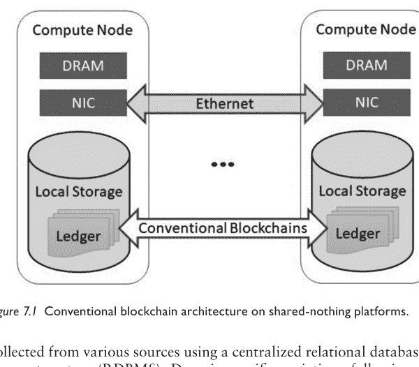

图 7.1 基于无共享平台的传统区块链架构。

来自各种来源的数据使用集中式关系数据库管理系统（RDBMS）收集。遵循类似集中式设计原则的领域特定变体在生物医学工程和计算化学等领域十分普遍 [5]。然而，数据的指数级增长导致了对集中式系统的批评。它们成为性能瓶颈和单点故障。这促使了可扩展溯源的分布式方法的发展。分布式溯源系统通常构建在分布式文件系统而非集中式数据库之上，解决了集中式对应系统的性能限制。它们表现出显著更高的性能，但这种转变引入了一个新的问题：谁应该审计分布式系统中的溯源？这个问题提出了构建溯源的溯源的问题，形成了无尽的递归。虽然由于对集中节点应用了强大的可靠性机制，这一问题在集中式方法中并不那么关键，但在大规模分布式系统中它构成了重大挑战 [6]。在这种设置下，如果任何单个节点被攻破，整个溯源就会失效。为应对这一挑战，分布式溯源系统的最新进展借鉴了区块链技术（图 7.2）。

为了追踪高性能计算（HPC）系统中数据的来源，本研究提出了一种新的区块链架构。该架构经过精心设计，以符合 HPC 环境的特定要求。重要的是，计算节点即使没有访问本地磁盘，也可以选择保持区块链运行。降低持久化数据大小和 I/O 开销是

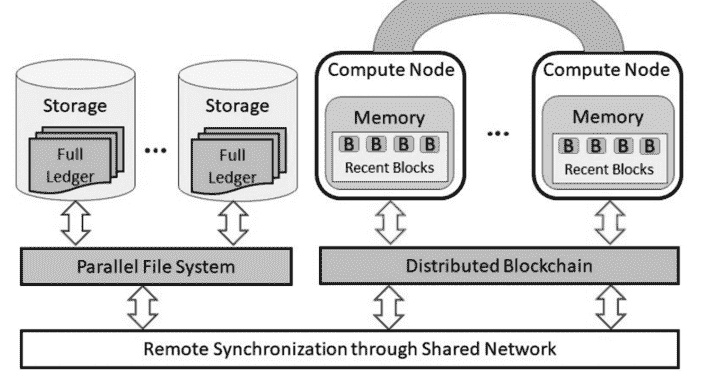

图 7.2 具有共享存储的高性能计算区块链架构。

该新技术的成果。为了验证应用程序数据的来源，文章在定制架构之外建议了一种名为可重复性证明（Proof-of-Reproducibility，PoR）的新共识机制 [7]。Proof-of-Relay（PoR）背后的基本思想是，通过利用工作量证明（Proof-of-Work，PoW）和权益证明（Proof-of-Stake，PoS）这两种分布式账本技术（DLT）可以达成共识。该新共识协议的可靠性已得到正式证明。为了验证所建议的想法，使用大约 1,800 行 Java 代码开发了一个系统原型 [8]。通过对系统有效性的实验验证，我们展示了所提出区块链架构和共识协议在 HPC 系统背景下的实用性。

在本工作的后续章节中，我们将在第 7.2 节检查相关文献。第 7.3 节提出了一种专门为 HPC 设计的区块链架构。所提出区块链系统原型的实现细节在第 7.4 节中进行了阐述。实验结果也在同一章节中概述。本章在第 7.5 节中结束。

## 7.2 相关工作

本节深入探讨了与我们通过内存中区块链增强 HPC 数据集群安全性探索相关的科学研究。如 Ref. [9] 中所述，提出了一种查询溯源的方法，具体区分数据库中的“where”和“why”溯源。过去十年中，数据流量出现了前所未有的激增，引起了人们对具有内存中区块链的 HPC 数据集群概念的独特关注。这种创新方法正受到包括运营管理、计算机视觉和智慧城市在内的各个科学和工程领域的审查。已提出许多技术以有效利用具有内存中区块链的 HPC 数据集群。例如，将 HPC 数据集群与内存中区块链集成，为移动网络提供了提升服务质量的增强机会。从移动网络运营商和用户的角度审视具有内存中区块链的 HPC 数据集群的特性，Ref. [10] 中的研究重点关注移动网络的集成。这需要结合来自多个来源的信息，例如网络运营商的无线接入网络、互联网服务提供商和核心网络；用户数据包括有关用户个人资料和位置的详细信息。移动网络服务的成败在很大程度上取决于网络运营商解读这些数据的能力 [11]。在优化网络方面，有效的数据分析工具绝对必要。尽管此类系统具有诸多益处和用途，但使用具有内存中区块链的 HPC 数据集群改进服务质量仍存在若干障碍。

近期关于区块链技术的研究已将其重点转向各种系统性视角。例如，[12] 引入了一种创新设计，采用网络编码分布式存储来解决区块链中保留膨胀的问题。Ref. [13] 研究了保护区块链网络免受量子计算攻击的方法。为了增强区块链拓扑的硬件级可靠性，[14] 提供了全面的建议。区块链的数据溯源已在少数研究中得到调查 [15–17]，尽管这些研究的范围较为狭窄，通常处理的是非常小的数据集。Gabriel 和 Markus 在他们的文章中研究了区块链 DLT 如何与数据溯源的 PROV 标准相关。他们研究了 DLT 如何利用内存中区块链促进基于云的 HPC 数据集群中的数据溯源。

目前在区块链研究中正在考虑许多新颖的建议，该研究正在调查广泛的系统观点。为了阻止 Sybil 和有针对性的攻击，Algorand [18] 提出了一种新方法。为了提高吞吐量，Bitcoin-NG [19] 从每个 epoch 中选择一个领导者发布多个区块。Monoxide [20] 通过在各个区域间最优分配计算、存储和内存资源来减轻过载节点的负载。分片协议 [21,22] 的目标是使分布式账本更大，而 Hawk [23] 的目标是使公共区块链交易私有化。如果您正在寻找在效率和安全性方面优于 PoW 区块链的 PoS 协议，Ouroboros 协议 [24] 是不二之选。现代出版物 [25–27] 提供了增强拜占庭容错（BFT）的方法。此外，新共识协议正在快速开发中，其设计针对内存架构或为网络参与者建立独特的身份。这些协议的例子包括 PoR [28] 和投票证明（proof-of-vote，PoV）[29]。

Inkchain [30] 是另一个受 Hyperledger [31] 启发的许可区块链解决方案，在各种情况下提供灵活性和改进。受 Hyperledger 启发，BigchainDB [32] 使用实用拜占庭容错（PBFT）思想来提高可靠性和容错性。区块链技术的去中心化和不可变特性与数据库的低延迟、高交易速率以及结构化数据索引和查询能力相结合。单独地，为了加强分布式数据库系统中的数据完整性，Ref. [33] 中提出了一种双层区块链架构（2LBC）。领导者轮换策略与 PoW 方法的结合实现了这一点。需要注意的是，在弥合区块链技术与 HPC 之间的差距方面，迄今为止提到的研究均未涉及超出无共享集群的基本平台架构（图 7.3）。

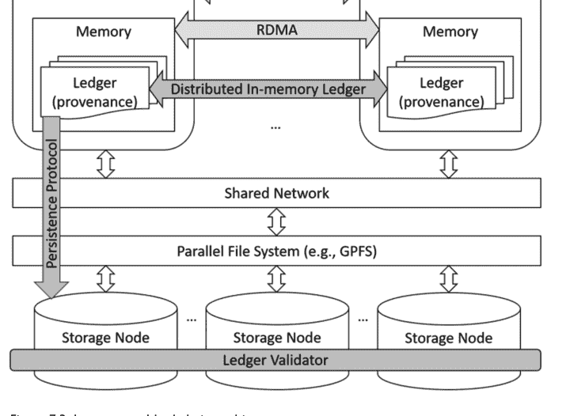

图 7.3 内存中区块链架构。


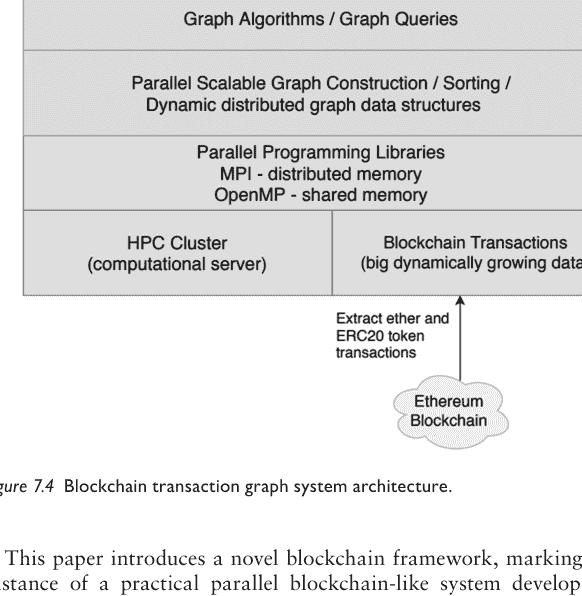

图 7.4 区块链交易图系统架构。

本文介绍了一种新颖的区块链框架，标志着首个使用消息传递接口（MPI）开发的实用并行类区块链系统的实例。该框架旨在利用 HPC 系统中的去中心化机制。在承认内存中区块链系统[3]的最新进展的同时，值得注意的是 MPI 和 HPC 社区在区块链系统方面的进展。过去，几种技术[19,30,34,35,36]集中于改进或表征各种解决方案的 MPI 属性。但这些项目与我们不同，因为它们不想构建一种新的区块链架构，利用 MPI 以并行方式管理分布式账本。因此，我们可以将这些先前的努力纳入我们的框架，以进一步改进 MPI 特定软件包。

我们的区块链图分析系统的设计如图 7.4 所示。您可以通过区块链节点或以太坊网关（如 Infura 或 Cloudflare）获取区块数据。我们选择 Cloudflare 网关进行区块检索，因为同步节点可能是一个耗时的过程。检索后，区块将被处理以检测与以太加密货币相关的交易以及 ERC20 代币的转账。我们随后使用这些文件来存储交易，而我们的区块链图系统将它们用作输入。Zenodo 网站提供对数据集及其所有相关格式的访问[14]。除了以太之外，系统还从区块中检索 31 个 ERC20 代币合约。这些合约包括 USDT、PAX、EURS、BUSD、GUSD、TRYB 和 XAUT 等稳定币。

### 7.2.1 区块链的应用
区块链以其安全性和安全性属性而闻名，在各个领域得到广泛应用。其多用途应用包括加密货币、医疗保健、供应链、智能合约、广告、金融服务、物联网（Internet of Things）、资产管理、音乐、金融市场、投票、银行、网络安全、版权和版税、政府、促进国际支付、武器追踪、成本降低、数字货币、财务管理、身份管理以及土地登记。

### 7.2.2 聚类算法概述
在当代，数据分析中的聚类技术被广泛用于解决与大数据相关的新兴挑战。这种分析方法涉及将数据集划分为两个子集，其中一个子集包含相似实例，另一个子集包含不相似实例[3]。用于此划分过程的各种聚类方法包括双聚类、基于密度的、基于图的、基于网格的、硬聚类、层次的、基于模型的、划分的和软聚类。聚类的首要目标是根据数据点的相似性将它们分组到簇中，从而区分一个簇与另一个簇。该过程涉及将相似点组织到一个簇中，并将其他数据点分离到不同的组中。聚类的顺序阶段在图 7.5 中以视觉方式表示。

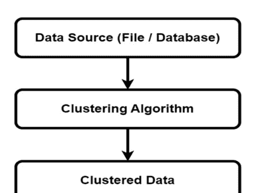

图 7.5 聚类阶段。

聚类的首要目标是识别提供数据中的相似和不相似特征或模式。相似点是使用相似性函数确定的。在聚类过程之后，类标签被分配给簇，这一步骤称为分类。聚类过程从各种数据源获取输入，并以聚类数据形式产生输出。聚类广泛应用于模式识别、图像处理和分析、文档分类、股票市场细分、探索性数据分析、万维网、计量学、医疗保健和社会网络分析等多样化应用中。

## 7.3 面向 HPC 的新型区块链架构
典型的 HPC 系统连同我们提出的分布式内存账本一起在图 7.3 中整体描绘。虽然我们展示了没有磁盘的计算节点，但某些定制的 HPC 系统实际上可能具有节点本地磁盘，请记住这一点。例如，突发缓冲区是劳伦斯伯克利国家实验室的十强超算 Cori [33] 使用的本地固态硬盘（SSD）存储系统。由于突发缓冲区更适合短期数据缓存而非长期归档，因此不适合账本应用。符合科学应用的非分时特性，出于性能和安全考虑，它们通常在作业执行后被清除。我们建议在远程存储上使用二级账本和验证器，以解决本地存储上账本持久性的瞬态特性。我们提出的系统的三个主要组件——分布式内存账本、持久性协议和远程持久账本——在图像中有所描绘。下面是对每个模块的更深入讨论。

其核心，第一模块涉及在计算节点上部署分布式账本，该账本针对 InfiniBand 等高性能互连和 Remote Direct Memory Access（RDMA）等协议进行了优化。目标是通过使用高性能硬件来改进通信密集型共识方法，即 PBFT [34]。Hyperledger [13] 和其他许可区块链使用 PBFT 来确保只有经过验证的用户才能访问网络。这使其有别于像 Ethereum [14] 这样的无许可区块链系统，后者对每个人都开放，并且在 HPC 环境中对于科学应用尤其重要，因为存在严格的身份验证机制。无盘计算节点和远程持久存储同步是第二模块的重点。远程存储中保存的持久账本增强了数据有效性，并且由于这种同步，数据可靠性也得到增强。主要障碍是弄清楚如何将账本从内存导出到远程并行文件系统。在每次交易后进行持久化是不可行的，因为这会因大量的 I/O 开销而导致性能瓶颈。在第三个也是最后一个模块中，我们在持久存储上验证分布式账本。由于每个计算节点都在易失性内存中更新账本（或在作业完成后被擦除的临时持久本地存储），因此必须在永久持久存储上存在一个无损的真实数据，以便在发生灾难（如一半计算节点崩溃并丢失其账本）时验证账本副本。请记住，仅依赖内存的计算节点不一定比具有永久存储的节点更不可靠。然而，如果负责启动内存的进程被终止，则保存在内存中的数据将会丢失。

## 7.4 系统实现
建议的区块链架构和共识方法的原型系统[21]将使用 Java 实现。您可以在 https://explab.org/http://cse.unr.edu/hpdic/proj/imb 找到项目网页，在那里您还可以获取源代码和其他信息。原型的核心模块现已可供下载，我们计划在它们通过质量保证测试后发布补充组件和插件。当前代码库中有超过 1,800 行代码。在原型的虚拟化环境中，本地账本作为独立文件保存，并且网络延迟由随机统计分布（具有平均值、方差和种子）参数化的时间延迟来调节。为了在生产系统上部署原型，我们目前正在将其打包为 Docker 容器。

我们目前的重点是账本和共识，符合参考文献[7]中建议的系统分解，该分解指定了四个主要组件（账本、共识、密码学和智能合约）。我们对链式区块使用 SHA-256 哈希算法[35]。使用伪交易和虚拟数值进行应用封装使原型能够接受多个应用，因为当前实现不支持智能合约。账本和共识实现在以下章节中进行了详细说明。建议的 PoR 共识依赖于计算节点之间的共识协议，其与传统的 PoW 相似，但简化了比特币[12]中发现的计算难题。我们系统的 PoW 由三个主要组件组成。首先，节点存储新创建的交易，然后将它们发送到其他节点和共享存储，直到它们形成可被开采的区块。其次，网络中能够处理数据的每个节点，包括具有共享存储的节点，都会尝试验证区块并将其添加到其本地区块链中。在开采中，找到解决方案的节点将其区块添加到其本地内存区块链中并获得奖励。如果区块在此轮中未通过验证，它将被排队在相应的计算节点上以便稍后处理。此阶段符合

计算节点之间采用标准 PoW，但使用经过修改的 PoW（即 PoR），专为科学数据的溯源设计，然后由存储节点的地面真相进行双重验证。最终，当节点将区块添加到本地区块链并存储在共享存储中时，就达成共识。之后，它会被发送到网络中的其他对等节点进行验证。验证成功后，第一个节点将区块添加到其本地区块链并发送给网络中的其他节点。然后，当每个节点确认区块的合法性时，它们会更新各自的本地区块链。

## 7.5 结果与讨论

本研究使用 Intel Core-i7 4.2 GHz CPU 和 32 GB 2,400 MHz DDR4 内存 [21]。InfiniBand 网络的延迟为 1 µs [36]，而以太网网络的延迟为 250 µs。作为评估的一部分，将有另外两种区块链系统和另外两种溯源系统与所提出的主内存区块链原型进行比较。传统区块链安装在由以太网连接的无共享集群上，是初始的区块链系统。第二个系统是一个假设的区块链，它不使用永久存储，而是使用 InfiniBand 或 RDMA 等高性能网络连接。缺乏数据持久性使其成为不切实际的解决方案，但它确实为所提出的主内存区块链设定了性能上限。所有三种区块链系统均使用 Java 实现，并已做出充分的优化努力。所考虑的数据库和文件系统均将溯源系统作为内置模块。

数据库溯源监控和查询是 SPADE [4] 的主要关注点，SPADE 是一个图数据库系统。FusionProv [1] 建立在分布式文件系统 FusionFS [38] 之上，是文件系统溯源的溯源模块。在交易格式方面，交易的结构类似于银行转账。系统在每个交易开始时检查提交交易的合法性。如果请求合法，则两个节点的状态（余额）将被修改，并且新信息将被发送到网络中的每个其他节点。我们的研究表明，每个区块可以包含一到十笔交易，平均每个区块四笔交易。

### 7.5.1 与文件系统和数据库的比较

在本研究中，我们提出了一种主内存区块链作为溯源工具。另外两种工具，即用于 HPC [38] 的分布式文件系统和用于图处理的关联数据库 [4]，各自带来自身的延迟开销。对于主内存区块链，延迟仅存在于赢得竞争并在最后添加区块的节点。与另外两种系统不同，该系统不会在任何节点上产生延迟。我们将主内存

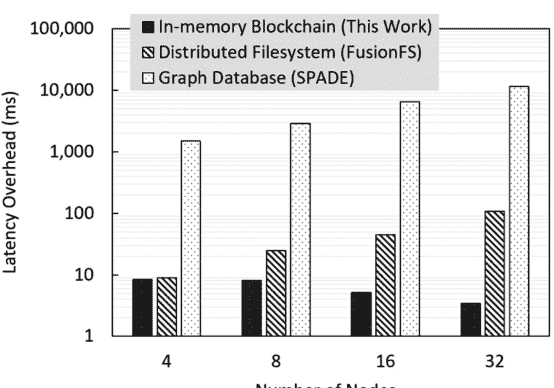

图 7.6 主内存区块链、分布式文件系统和图数据库的延迟开销。

区块链延迟从一个节点分散到所有节点，以确保比较公平。由于基于数据库的溯源无法扩展到数十个节点之外，比较限制在不超过 32 个节点。在较低规模（四个节点）下，如图 7.6 所示，主内存区块链的延迟开销与分布式文件系统相似。然而，当节点数量增加到八个或更多时，主内存区块链优于分布式文件系统。在每个规模下，主内存区块链都远远超过图数据库。在 32 节点规模下，建议的主内存区块链比文件系统快 32 倍，比数据库快 4 倍。随着节点数量的增加，均摊的每节点延迟下降，也是主内存区块链的另一个显著特点。

## 7.6 结论

本章提出了一种主要使用内存存储账本的区块链系统新架构，以及专门为该架构设计的一致性流程。整体而言，这些发展使得能够高效运行类似区块链的账本服务，从而保证 HPC 系统上可信的数据溯源。实验验证和理论支持都支持所提出的一致性。对一个轻量级系统原型的评估，该原型处理超过一百万笔交易，与基于文件系统的溯源服务相比显示出 32× 的加速，与基于数据库的溯源服务相比显示出四个数量级的加速。

## 作者详情

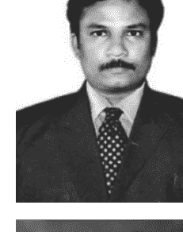

Dr. Srikanth Thota 因其在基于协同过滤的推荐系统方面的研究工作而获得 JNTU, Kakinada 的计算机科学工程博士学位。他获得安得拉大学计算机科学与技术硕士学位。他目前在印度安得拉邦维沙卡帕特南的 GITAM 大学技术学院计算机科学与工程系担任副教授。他的研究兴趣包括机器学习、人工智能、数据挖掘、推荐系统和软计算。


Mr. Maradana Durga Venkata Prasad 于 2008 年从 JNTU, Hyderabad 获得 B.Tech.（计算机科学与信息技术）学位，并于 2010 年从 Jawaharlal Nehru Technological University, Kakinada 获得 M.Tech（软件工程）学位。他是印度安得拉邦维沙卡帕特南 Gandhi Institute Of Technology And Management（GITAM）计算机科学与工程系的注册号为 1260316406 的研究学者。他的研究兴趣包括数据挖掘中的聚类、大数据分析和人工智能。他目前在印度 Ranga Reddy 的 CMR Institute of Technology 计算机科学与工程系担任助理教授。

## 参考文献

- 1. A. Gehani and D. Tariq, “SPADE: Support for provenance auditing in distributed environments,” In *第 13 届国际中间件会议（Middleware）论文集*, Montreal, QC, Canada 2012.
- 2. T. Clark, P. N. Ciccarese, and C. A. Goble, “Micropublications: A semantic model for claims, evidence, arguments and annotations in biomedical communications,” *生物医学语义学杂志*, vol. 5, no. 1, p. 28, 2014.
- 3. E. Pettersen, T. Goddard, C. Huang, G. Couch, D. Greenblatt, E. Meng, and T. Ferrin, “UCSF chimera: A visualization system for exploratory research and analysis,” *计算化学杂志*, vol. 25, no. 13, pp. 1605–1612, 2004.
- 4. R. Ranjan, D. Pandey, A. K. Rai, D. Gupta, P. Singh, P. R. Kumar, and S. N. Mohanty, “A manifold-level hybrid deep learning approach for sentiment classification using an autoregressive model,” *应用科学*, vol. 13, no. 5, p. 3091, 2023.
- 5. D. Dai, Y. Chen, P. Carns, J. Jenkins, and R. Ross, “Lightweight provenance service for high-performance computing,” In International Conference on Parallel Architectures and Compilation Techniques, Portland, OR, USA 2017.
- 6. B. Shilpa, P. R. Kumar, and R. K. Jha, “LoRa DL: A deep learning model for enhancing the data transmission over LoRa using autoencoder,” The Journal of Supercomputing, vol. 79, pp. 17079–17097, 2023.
- 7. X. Liang, S. Shetty, D. Tosh, C. Kamhoua, K. Kwiat, and L. Njilla, “Provchain: A blockchain-based data provenance architecture in cloud environment with enhanced privacy and availability,” In IEEE/ACM International Symposium on Cluster, Cloud and Grid Computing (CCGRID), Madrid, Spain 2017.
- 8. Aravind Ramachandran and M. Kantarcioğlu, “Smartprovenance: A distributed, blockchain based data provenance system,” In Proceedings of the Eighth ACM Conference on Data and Application Security and Privacy, Series, CODASPY’18, NY, United States pp. 35–42, 2018.
- 9. X. Chen, S. Lin, and N. Yu, “Bitcoin blockchain compression algorithm for blank node synchronization,” In Proceedings of 11th International Conference on Wireless Communications and Signal Processing (WCSP), Xi’an, China, pp. 1–6, October 2019.
- 10. R. Ranjan, D. Pandey, A. K. Rai, D. Gupta, P. Singh, P. R. Kumar, and S. N. Mohanty, “A manifold-level hybrid deep learning approach for sentiment classification using an autoregressive model,” Applied Sciences, vol. 13, no. 5, p. 3091, 2023.
- 11. Z. Guo, Z. Gao, H. Mei, M. Zhao, and J. Yang, “Design and optimization for storage mechanism of the public blockchain based on redundant residual number system,” IEEE Access, vol. 7, pp. 98546–98554, 2019.
- 12. Y. Xu, “Section-blockchain: A storage reduced blockchain protocol, the foundation of an autotrophic decentralized storage architecture,” In Proceedings of 23rd International Conference on Engineering of Complex Computer Systems (ICECCS 2024), Melbourne, VIC, Australia pp. 115–125, December 2018.
- 13. N. Arivazhagan, K. Somasundaram, G. B. Mohammad, P. R. Kumar, et al., “Cloud-Internet of Health Things (IOHT) task scheduling using hybrid moth flame optimization with deep neural network algorithm for e healthcare systems,” Scientific Programming, vol. 2022, pp. 1–12, 2022.
- 14. T. Liu, J. Wu, J. Li, and J. Li, “Secure and balanced scheme for nonlocal data storage in blockchain network,” In Proceedings of 2019 IEEE 21st International Conference on High Performance Computing and Communications; IEEE 17th International Conference on Smart City; IEEE 5th International Conference on Data Science and Systems (HPCC/SmartCity/DSS), Zhangjiajie, China, pp. 2424–2427, 2019.
- 15. P. R. Kumar, G. B. Mohammad, and P. Dileep, “Real-time heart rate monitoring system using least square method,” Annals of the Romanian Society for Cell Biology, vol. 25, no. 6, pp. 16302–16308, 2021.
- 16. L. Aniello, R. Baldoni, E. Gaetani, F. Lombardi, A. Margheri, and V. Sassone, “A prototype evaluation of a tamper-resistant high performance blockchain-based transaction log for a distributed database,” In 13th European Dependable Computing Conference (EDCC), Geneva, Switzerland 2017.
- 17. D. Dai, Y. Chen, P. Carns, J. Jenkins, and R. Ross, “Lightweight provenance service for high-performance computing,” In International Conference on Parallel Architectures and Compilation Techniques (PACT), Portland, OR, USA 2017.


- 18. D. Dai, Y. Chen, D. Kimpe, and R. Ross, “面向科学大数据应用的基于溯源的对象存储预测方案，” 载于 IEEE 国际大数据会议 (BigData)，美国华盛顿特区，2014 年。
- 19. G. B. Mohammad, Selvarajan Shitharth, and P. R. Kumar, “用于 URL 钓鱼检测的集成机器学习模型，” 《国际网格与分布式计算期刊》，vol. 14, no. 1, pp. 513–529, 2021 年。
- 20. X. Niu, R. Kapoor, B. Glavic, D. Gawlick, Z. H. Liu, V. Krishnaswamy, and V. Radhakrishnan, “感知溯源的查询优化，” 载于 IEEE 第33届国际数据工程会议 (ICDE)，美国加州圣迭戈，2017 年。
- 21. P. Mehta, S. Dorkenwald, D. Zhao, T. Kaftan, A. Cheung, M. Balazinska, A. Rokem, A. Connolly, J. Vanderplas, and Y. AlSayyad, “科学图像分析工作负载上大数据系统的比较评估，” 载于第43届国际超大规模数据库会议论文集 (VLDB)，美国华盛顿特区，2017 年。
- 22. T. Li, C. Ma, J. Li, X. Zhou, K. Wang, D. Zhao, and I. Raicu, “Graph/z：基于键值存储的可扩展图处理系统，” 载于 IEEE 国际集群计算会议，美国伊利诺伊州芝加哥，2015 年。
- 23. P. R. Kumar and T. Ananthan, “使用 LabVIEW 进行标签检测的机器视觉，” 《计算机科学与工程创新期刊》(JICSE)，vol. 9, no. 1, pp. 58–62, 2019 年。
- 24. D. Zhao, J. Yin, K. Qiao, and I. Raicu, “虚拟块：支持压缩存储系统中的科学数据随机访问，” 载于 IEEE 国际大数据会议，美国华盛顿特区，第 231–240 页，2014 年。
- 25. D. Zhao, J. Yin, and I. Raicu, “通过高效压缩机制提高数据密集型科学应用的 I/O 吞吐量，” 载于国际高性能计算、网络、存储和分析会议 (SC’13)，海报环节，瑞士日内瓦，2013 年。
- 26. P. R. Kumar, “使用感应耦合的无线移动充电器，” 《新兴技术与创新研究期刊》(JETIR)，vol. 5, no. 10, pp. 40–44, 2018 年。
- 27. H. Qin, S. Zawad, Y. Zhou, L. Yang, D. Zhao, and F. Yan, “Swift 机器学习模型服务调度：一种基于区域的强化学习方法，” 载于国际高性能计算、网络、存储和分析会议论文集 (SC)，加拿大魁北克蒙特利尔，2019 年。
- 28. E. Saillard, P. Carribault, and D. Barthou, “多线程环境下 MPI 集体通信的静态/动态验证，” 载于第20届 ACM SIGPLAN 并行编程原理与实践研讨会论文集，PPoPP 2015。ACM，纽约，美国。第 279–280 页，2015 年。
- 29. B. Shilpa, P. R. Kumar, and R. K. Jha, “密集室内 LoRa 网络中干扰缓解的扩频因子优化，” IEEE IAS 新兴技术全球会议 (GlobConET)，英国伦敦，第 1–5 页，2023 年。
- 30. C. Shou, D. Zhao, T. Malik, and I. Raicu, “迈向感知溯源的分布式文件系统，” 载于 TaPP 研讨会，美国 USENIX 网络系统设计与实现研讨会 (NSDI)，美国芝加哥，2013 年。
- 31. J. Sousa, A. Bessani, and M. Vukolic, “面向 Hyperledger Fabric 区块链平台的拜占庭容错排序服务，” 载于 *第48届 IEEE/IFIP 国际可靠系统与网络会议 (DSN)*，卢森堡，2018 年。
- 32. J. Wang and H. Wang, “Monoxide：利用异步共识区域扩展区块链，” 载于 *第16届 USENIX 网络系统设计与实现研讨会 (NSDI 19)*，美国马萨诸塞州波士顿，2019 年。USENIX Association。
- 33. P. R. Kumar, “使用 LabVIEW 的步进电机位置控制，” *第3届电子、信息通信技术最新趋势国际会议 (RTEICT)*，印度班加罗尔，第 1551–1554 页，2018 年 5 月。
- 34. M. Zamani, M. Movahedi, and M. Raykova, “Rapid chain：通过全分片扩展区块链，” 载于 *2018 年 ACM SIGSAC 计算机与通信安全会议论文集*。ACM，纽约，美国，第 931–948 页，2018 年。
- 35. K. Zhang and H.-A. Jacobsen, “迈向可靠、可扩展和无处不在的区块链分布式账本，” 载于 *第38届 IEEE 国际分布式计算系统会议 (ICDCS)*，奥地利维也纳，2018 年。
- 36. P. R. Kumar and B. Shilpa, “一种基于物联网的边缘智能计算智能医疗保健系统，” 载于 S. Satpathy, S. N. Mohanty, and S. Potluri (编)，*探索医疗保健中边缘智能的格局*。CRC Press，佛罗里达州博卡拉顿，第 31–46 页，2024 年。

# DeepShield

一种用于信用卡金融交易稳健欺诈检测的深度学习方法

*Mulagundla Sridevi, Gouthami Velakanti, B. Deevena Raju, and Sadda Bharath Reddy*

## 8.1 引言

财务报表由会计和财务部门编制，然后由 SEBI 和 RBI 等监管机构审查，以确保其真实性。一个国家的经济繁荣取决于其企业的稳定性和投资者资金的安全性。财务报表中可以找到财务状况、投资、义务、支付利息和赚取利息等信息。公司的财务健康状况真实反映了其资产和负债随时间的增长情况。这些声明被公司用来获得额外的贷款或投资。评级机构用它们来分配信用评分，投资者用它们来做出明智的投资决策。政府或第三方利用报表通过奖励来认可卓越表现，而债权人则用它们来批准或收回债务。

由于这些报表被外部各方用来评估公司的财务健康状况，因此公司可能会伪造财务报表以提高其对潜在投资者、贷款人或奖项授予者的吸引力。随着新兴经济体中欺诈行为变得越来越普遍，在做出判断之前确认财务报表的合法性至关重要。一种确认方法是使用机器学习 (ML) 模型，该模型可以是基于标记的财务记录训练的分类模型。专业审计人员使用可信或不诚实等术语对报表进行分类。

这些 ML 模型在企业数字化转型背景下对分类财务信息发挥着至关重要的作用。它们不仅揭示是否存在欺诈，还解释了为什么某些声明被认为虚假。在进行人工审计时，审计人员必须牢牢把握欺诈的主要原因。虽然创建分类模型或提取关键组件的步骤相同，但通常会使用额外的方法，如 SHAP，来确定哪些因素至关重要。过去曾研究过多种算法用于检测财务报表欺诈。逻辑回归 (LR)、xgboost、adaboost 和神经网络 (NNs) 等分类方法被广泛使用；模型的选取取决于数据集的特征和所需的准确度水平。但并非每种算法都可以解释。黑盒模型，如 NNs、xgboost 或 adaboost，会产生可靠的分类，但不会揭示得出该指定的标准。因此，“黑盒”成为这类模型的常用名称。

用于准确分类的成功替代方法包括支持向量 [4,5,6] 和 Zipf 定律 [7]。NNs 和信念网络 [8]、使用反向传播算法的 NNs [9]、用于风险评估的 NNs [10]、用于训练欺诈检测模型的数据准备预处理方法 [11]、数字分布的重要性 [12] 以及其他重要方法 [13] 在以往研究中都得到了广泛研究。通过采用回归和树基方法，作者使用各种数据集组合测试了 38 个模型，以确定最佳模型和重要因素 [14]。该方法包括使用不同技术和数据集训练模型，这些数据集经过过采样或欠采样。

与许多使用人工特征推导输入分类层来建立概率的旧模型不同，ML 模型的预测准确性取决于特征和特征工程。使用深度学习模型可以减少对特征工程的依赖。最近的研究探讨了使用深度学习算法，如卷积神经网络 (CNNs) 和 DNNs 来识别欺诈活动并提取重要特征。CNNs 在 Ref. [16] 中被开发，而 DNNs 随着多位学者的贡献而不断发展 [15]。尽管 CNNs 最初在图像处理行业获得关注，但它们现在已在其他领域找到应用，如自然语言处理 (NLP) 和欺诈检测 [17]。

## 8.2 相关工作

在线购买量的不断增加使信用卡欺诈检测成为研究优先事项的前沿。类别不平衡和数据固有的波动性是有效欺诈检测的两个主要障碍 [18]。重采样是为了解决信用卡欺诈检测中长期存在的类别不平衡问题而开发的几种方法之一 [19]。为此，必须平衡训练数据集，这意味着要么欠采样多数类，要么过采样少数类 [20]。Bagging、boosting 和 stacking 等集成方法也被用于解决类别不平衡问题 [23]。另一种选择是成本敏感学习，它使用基于成本的方法对误分类错误进行分类，通常会给少数类分配更高的成本 [24]。


除数量不平衡外，不同类别样本的空间分布对分类器的结果影响很大。例如，位于多数类与少数类边界附近的样本对正确识别至关重要，因此提出了诸如高斯混合欠采样等技术[25]。用户交易习惯的改变导致消费季节性和欺诈模式的变化，进而造成交易数据动态变化的困难。传统的欺诈检测方法，如CNNs、随机森林(RFs)和支持向量机(SVMs)，经常假设类别同质且数据分布恒定。对1990年至2017年用于识别信用卡欺诈的技术进行全面分析显示，重点是通过联合类别不平衡处理方法提高分类器性能，而对数据动态变化关注甚少[23]。概念漂移是数据不断变化的一种方式；对此主题的研究集中于快速发现新概念并调整分类器更新以应对它们[5]。由于欺诈交易和合法交易本质上不同，因此在欺诈手段不断变化的情况下，推导出能够始终区分两者的准确表示至关重要。利用深度表示学习技术构建可靠的欺诈检测模型是本文的主要重点[12]。

### 8.2.1 Deep supervised representation learning

为了提高分类器或预测器的性能，表示学习涉及为提供的数据学习新的表示，目标是捕获更有价值的信息[12]。该方法在许多领域都相当有效，但在基于监督学习的大规模视觉分类特征提取中表现尤为突出[25]。视觉领域一直是深度表示学习研究的重点，许多研究利用了开源数据集如ImageNet、LFW和COCO[2,7,8]。相关表示模型的性能极限受深度神经网络架构的很大影响。CNNs的深度和宽度可以调节以控制其容量，且有几种设计在此方法上取得了成功，如ResNet、DenseNet和BagNet[1,3,9]。

为了提高分类性能并创建平衡数据集，在信用卡欺诈检测背景下提出了一种全面的机制，该机制使用K-means聚类和遗传算法为少数类聚类生成新的数据样本[14]。该方法受自然选择和遗传学影响的遗传算法，使用无监督学习形成相似数据点的聚类。然后为少数类生成新的样本。目标是创建用于检测卡片欺诈且分布更均匀、分类错误更少的训练集。集成学习是另一项旨在识别信用卡欺诈实例的研究主题[15]。为了做出更好的预测，集成学习使用不同机器学习分类器的组合。为了准确识别欺诈和非欺诈案例，采用了RFs和人工神经网络(ANNs)。该研究使用三种具有不同超参数的前馈神经网络和两种具有不同决策树(DT)的随机森林分类器的组合，承认将合法和无效交易误分类的重大货币成本。最后，通过对五个模型的结果取平均来确定输出。

信用卡欺诈检测是比较研究的主题，其中评估了CNN、多层感知器层(MPL)和基本神经网络。使用金融机构数据库中的常见变量和用于预测建模的传统预测因子，构建了包含60,000笔交易和12个特征的自生成数据集。该研究使用学习率为0.001的‘softmax’激活函数，并通过欠采样平衡不平衡数据集。MPL和CNN显示的准确率分别为87.88%和82.86%。

另一项工作[17]提出了使用包含自动编码器的实时深度学习模型进行信用卡欺诈检测。混淆矩阵、召回率、准确率和精确率是性能度量指标。非线性自回归预测了大多数欺诈交易，但许多真实交易也被误分类。当涉及有效交易时，LR具有最佳的误分类错误率，但在欺诈方面则非常不准确。在此，深度神经网络自动编码器表现出稳定性能，具有更好的预测率和更少的误分类错误。

由于CNNs能够发现隐藏的欺诈倾向并减少过拟合，文献[18]讨论了使用CNNs进行信用卡欺诈检测。交易熵作为特征工程的一部分被引入为新特征，特征工程还包括从交易数据创建聚合特征。为了确保数据集平衡，使用基于成本的采样从实际欺诈数据生成合成欺诈样本。评估标准为F1分数，所使用的CNN为六层结构，类似于LeNet。对于各种样本集，CNN优于神经网络、SVM和RF；当包含交易熵特征时尤其如此。此外，文献[19]深入研究了交易级别的信用卡欺诈检测，强调了考虑一系列交易中时间流逝对于应对欺诈动态性质的重要性。为了提高分类准确性，基于实际特征加入了统计特征。

文献[20]讨论了使用CNN、堆叠长短期记忆(SLSTM)和CNN-LSTM混合模型进行信用卡欺诈检测。CNN擅长从非常短的序列中学习，而LSTM擅长从非常长的序列中学习。该研究使用主成分分析(PCA)降低维度，使用来自印尼银行且具有不同非欺诈与欺诈比例的数据集。根据结果，提高该比例增强了分类器的准确性。训练准确率的顺序如下：SLSTM、CNN-LSTM和CNN。话虽如此，考虑到数据集固有的不平衡，根据曲线下面积(AUC)值，CNN优于CNN-LSTM和SLSTM，突出了欺诈交易模式中短期联系的占主导地位。

## 8.3 方法论

缺乏公开可用数据集是用于检测信用卡欺诈的机器学习方法面临的挑战。这主要是由于金融数据的敏感性以及保护用户隐私的要求。机器学习模型的结果在不同数据集或业务场景中可能会有很大变化，且该领域的大多数研究仅使用一个数据集。本研究的关键研究议程项目包括调查三个具有不同特征和交易数量的数据集之间的性能差异。另一个困难是类别不平衡问题，即欺诈实例远少于常规交易时发生。本研究的一个次要目标是了解处理类别不平衡的不同采样策略如何影响模型的性能。

许多人建议使用LR、SVMs和DT来识别信用卡欺诈。相比之下，大规模数据集可能会挑战这些算法。由于其处理庞大数据集的能力，深度学习算法如CNN和LSTM分别被推荐用于图像分类和NLP。检验各种深度学习技术在信用卡欺诈分类中的有效性是本研究的主要目标。数据预处理是机器学习中的另一个重要步骤。本研究的目的是在信用卡欺诈检测背景下研究数据预处理方法与分类性能之间的关系。

### 8.3.1 One-dimensional CNN (IDCNN)

特别是在图像处理领域，深度学习技术CNN经常与地理数据相关联。虽然CNNs与人工神经网络有相似之处，但它们在使用的卷积层上有所不同，这些层可以具有不同数量的通道。这些层用于隐藏层处理。‘Convolution’是指通过移动滤波器从数据中提取关键信息的过程。CNN在图像处理中如此受欢迎的一个原因是其能够自动减少特征，从而使其更能抵抗过拟合。因此，训练CNN不需要大量的数据预处理。通过减小图像尺寸而不丢失用于预测的关键信息来最小化处理，是CNN在图像处理中的主要目的[21]。特征图、通道、池化、步幅和填充是CNN中的基本概念。与众所周知的多层感知器(MLP)网络相反，

CNN 并不是层与层之间具有全连接拓扑结构。为了减少 CNN 模型中的参数数量，CNN 对每个滤波器使用恒定的权重参数，而与 MLP 相比，MLP 中每个节点都有可变的关联权重。特征检测过程也通过池化方法得到改进，使其对图像中元素大小和位置的变化更具鲁棒性。该研究使用 2DCNN 和 1DCNN 将情况分类为欺诈或非欺诈。2DCNN 应用于 30 个特征的欧洲信用卡数据集。为了输入到 2DCNN 模型中，每个交易样本都被转换为二维图像。

### 8.3.2 Long short-term memory network
长短期记忆，通常称为 LSTM，被归类为一种称为循环神经网络（RNNs）的 NN 类型，并被设计为具备记忆功能的 NN，而与常规 NN 相比，常规 NN 无法记住过去的数据，并且需要为每个新任务重新训练。然而，梯度消失问题使得短期记忆成为 RNN 的常见挑战。简单来说，在反向传播期间，梯度在网络中向后传播时减小，导致权重修改极小。这意味着 RNN 只能存储短期信息，因为网络的早期层学习不多，无法回忆长序列中的早期示例。LSTM 网络通过包含在每个步骤中传递的网络记忆（细胞状态）来克服 RNN 的短期记忆问题。遗忘门、输入门和输出门是与每个阶段相关联的基本组件。过程中的每个门都有特定功能：遗忘门选择从前一阶段保留的数据，输入门选择从当前步骤添加的数据，输出门选择下一个步骤的隐藏状态（表 8.1）。

为了克服短期记忆的限制，细胞状态从序列中最早的示例开始记住重要信息。这与隐藏状态形成对比，隐藏状态具有有限的长期记忆，但记住模型的过去输入。

表 8.1 LSTM 结构

|  |  |
|---|---|
| 层 1 | 输入 |
| 输入形状 | (1, 特征数量) |
| 层 2 | 密集 |
| LSTM 块数量 | 50 |
| 激活函数 | ReLU |
| 层 3 | 输出 |
| 节点数 | 1 |
| 激活函数 | Sigmoid |

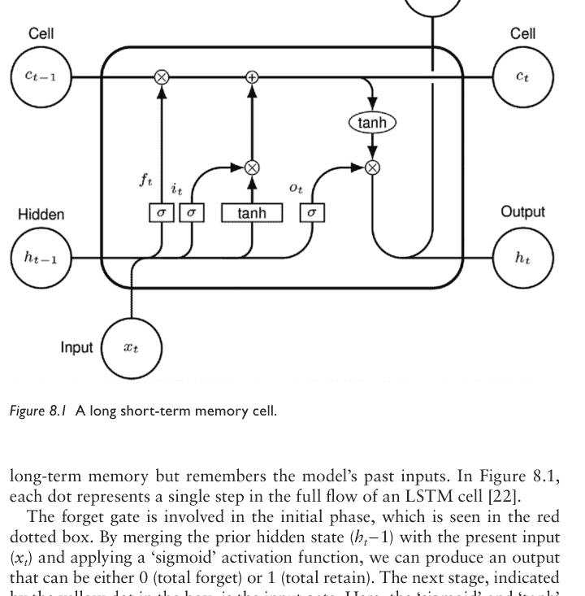

图 8.1 一个长短期记忆单元。

在图 8.1 中，每个点代表 LSTM 单元完整流程中的一个步骤 [22]。

遗忘门参与初始阶段，可在红色虚线框中看到。通过将先前的隐藏状态 (h_t−1) 与当前输入 (x_t) 合并并应用 ‘sigmoid’ 激活函数，我们可以生成输出，该输出可以是 0（完全遗忘）或 1（完全保留）。下一阶段，由框中的黄色点指示，是输入门。在这里，‘sigmoid’ 和 ‘tanh’ 激活函数分别应用于过去的隐藏状态和当前输入，然后将所得值相乘。虽然 ‘sigmoid’ 函数决定从当前调节中保留哪些数据，但 ‘tanh’ 函数控制模型。计算细胞状态是下一步，如紫色虚线框所示。新的细胞状态 (C_t) 是通过将先前的细胞状态 (C_t−1) 与遗忘门的输出相乘，然后以逐点方式将乘积添加到输入门的输出中获得的。计算新的隐藏状态 (h_t) 是输出门的职责，这是虚线框中描绘的最后一步。在与 ‘sigmoid’ 激活函数的输出相乘之前，该激活函数以先前的隐藏状态和当前输入作为输入，新的细胞状态会经过 ‘tanh’ 激活函数。

## 8.4 结果与讨论
在本研究中，我们使用具有不同样本量和特征密度的数数据集来评估分类器检测信用卡欺诈的能力。这是通过使用三个独立的数据集实现的：ET Data（欧洲）、SCD（Small Card Data，小型信用卡数据）和 TCD（Tall Card Data，Tall Card Data）。这些数据集非常不平衡，欺诈发生的次数远少于正常交易；这在信用卡欺诈数据集中很典型。使用 ‘0’ 表示无欺诈和 ‘1’ 表示欺诈来标记本研究中使用的全部三个数据集。下面是对每个数据集的分解，包括类别不平衡的百分比和其他相关特征。

### 8.4.1 European card data
该数据集涵盖了 2013 年 9 月欧洲持卡人两天的交易数据。它从 Kaggle 获取，来源于布鲁塞尔自由大学的机器学习小组。具有 31 个特征和 284,807 个示例，规模相当大。在所有样本中，只有 492 个被发现为欺诈实例，占总数据集的 <0.172%。除 ‘Time’ 和 ‘Amount’ 外，数据集中所有特征均已使用 PCA 转换，以保护客户隐私并保障交易细节的敏感性。‘Time’ 显示自第一个数据集样本以来经过的全部时间，单位为秒，而 ‘length’ 显示交易的总金额。本研究中使用了乌拉圭电力消费数据集 (ECD) 数据集。

### 8.4.2 Small card data
该 3,075 样本、12 个特征的数据集来源于 Kaggle，规模较小。数值特征和分类特征各占一半。在总共 3,075 个样本中，448 个（或 14.6%）被发现为欺诈实例。数据集特征包括商户 ID、交易日期、平均每日交易金额、被拒金额、每日拒付次数、境外交易状态、高风险国家状态、平均每日拒付金额、平均 6 个月拒付金额、6 个月拒付频率和欺诈状态。我们称该数据集为 SCD，因为其行列都相当小。

### 8.4.3 Evaluation metrics
数据集存在很大的类别不平衡，使得准确率成为比较模型时错误的标准。例如，在信用卡欺诈检测系统中，主要目标是在避免误报的同时捕获所有欺诈实例，即合法交易被错误识别为欺诈。解决方案的性质决定了评估指标的选择。本研究使用混淆矩阵，将案例分类为阳性（欺诈）或阴性（非欺诈）。假阳性表示被预测为欺诈的非欺诈案例，真正负例意味着被预测为非欺诈的欺诈实例，而真负例表示准确预测的欺诈案例。请查看下面的 F1 分数、准确率、精确率和召回率方程，以了解更多关于评估指标的信息。

Accuracy = (TP + TN) / (TP + FP + TN + FN)  (8.1)

Recall = TP / (TP + FN)  (8.2)

Precision = TP / (TP + FP)  (8.3)

F1Score = 2 * (Precision × Recall) / (Precision + Recall)  (8.4)

通过减少假阳性的发生可以提高准确率，假阳性与正向预测值相关。当假阳性的成本很高时，精确率是一个合适的指标。为了最大化召回率，应尽量减少假阴性的数量，因为它与实际阳性相关（公式 8.2）。在假阴性成本很大的情况下，通常优先实现高召回率。在检测信用卡欺诈时，在两者之间取得平衡至关重要。将所有样本标记为欺诈的结果是召回率高，但准确率、精确率和 F1 分数较差。然而，如果我们假设所有样本都是合法的，我们将具有很高的准确率但没有召回率，我们的精确率和 F1 分数将未知。为了进行比较，本研究使用了全部四个指标：准确率、精确率、召回率和 F1 分数。

## 8.5 讨论

### 8.5.1 Data preprocessing
数据预处理是实验的第一步，涉及手工检查全部三个数据集并应用统计过程。数据预处理的目的是从分类器获得最佳输出，这涉及向其提供精炼的输入。缺失数据、分类特征、可变可扩展性和高维只是可能影响分类器有效性的几个变量。数据探索和缩放是两种预处理

## 表 8.2 数据探索

| 项目 | 值 |
|---|---|
| **ECD** | |
| 行数 | 284,807 |
| 列数 | 31 |
| 特征类型 | 数值型 |
| 缺失值 | 无 |
| 删除的特征 | 无 |
| 分类到数值 | 无 |
| 是否使用较小样本 | 否 |
| **SCD** | |
| 行数 | 3,075 |
| 列数 | 12 |
| 特征类型 | 数值 + 分类 |
| 缺失值 | 3,075 |
| 删除的特征 | ‘Transaction date’ |
| 分类到数值 | ‘Merchant_id’, ‘Is declined’, ‘isForeignTransaction’, ‘isHighRiskCountry’, ‘isFraudulent’ |
| 是否使用较小样本 | 否 |
| **TCD** | |
| 行数 | 10,000,000 |
| 列数 | 9 |
| 特征类型 | 数值型 |
| 缺失值 | 无 |
| 删除的特征 | ‘custID’ |
| 分类到数值 | 无 |
| 是否使用较小样本 | 是 |

本工作中使用的各种方法以及测试-训练划分。表 8.2 提供了有关数据探索方法的重要细节。ECD 数据集中未发现缺失值，且所有特征均为数值型。为了清洗数据，未删除任何特征。‘Transaction Date’ 特征从 SCD 数据集中被剔除，因为它完全不包含值，且所有其他分类特征均被转换为数值型。ECD 和 SCD 集合中的所有数据均被使用。TCD 数据集使用了完整数据集的一个子集。‘custID’ 特征从 TCD 数据集中被移除，因为它仅包含唯一值且未提供任何信息。数据集中所有值均为数值型。

接下来，我们在探索数据后查看每个数据集特征之间的关联。探索变量之间关系的一个统计工具是相关系数，其取值范围在 −1 到 1 之间。相关值为 0 表示无关联，负相关表示反向关系，正相关表示直接关系。为了降低数据维度，识别相关性很有帮助，以便剔除行为相似的特征。使用低维数据可同时提高训练时间和分类性能。SCD 数据集中的特征相关性如图 8.2 所示。特征之间缺乏负相关以及 SCD 数据集中相关性分布不均的情况都很明显。交易数量越大，平均日交易金额越高。日拒付金额、6 个月拒付金额和 6 个月拒付频率之间存在稳健的关系。在用于分类欺诈的众多因素中，'high-risk nation' 属性尤为突出。由于数据集较小，未进行降维。性能使用测试数据集进行评估，图 8.3 显示了 ECD 数据集中各种类别不平衡比率的比较。

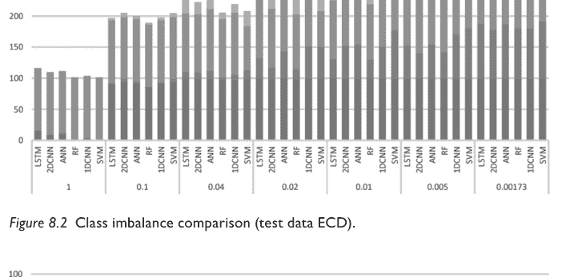

图 8.2 类别不平衡比较（测试数据 ECD）。

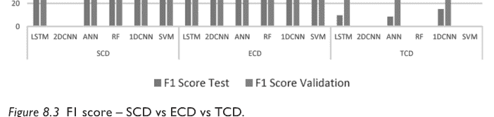

图 8.3 F1 分数 – SCD vs ECD vs TCD。

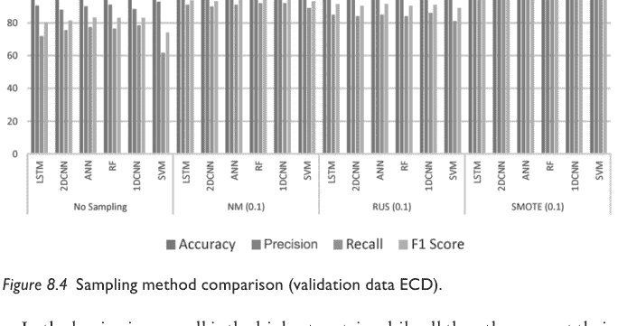

图 8.4 采样方法比较（验证数据 ECD）。

最初，根据观察，召回率是最高指标，而其他指标均处于最低水平。随着类别不平衡的增加，召回率下降，而 F1 分数、准确率和精确率上升。在没有 1:1 类别不平衡的情况下，模型能够准确预测欺诈实例，但在非欺诈案例上的准确率较差。由于测试数据中非欺诈实例的比例远高于欺诈案例，获得的准确率较低。准确率以正确预测比例相对于总预测数的形式衡量，随着类别不平衡的上升而明显改善。随着类别之间的差异扩大，F1 分数和准确率均上升。类别不平衡的增加是原因所在，因为它使模型能够在更多训练案例下更成功地泛化。

确定哪种算法表现出最高性能是本研究的关键目标之一。图 8.4 显示，尽管传统算法和深度学习方法表现相似，但 LSTM 的表现略优于其他算法。我们在实验中还注意到其他一些情况：

- (i) 使用 TensorFlow 库和 GPU 计算的深度学习方法与 SVM 和 RF 等传统算法相比减少了训练时间，尤其是在大型数据集上。
- (ii) 随着 epoch 数量的增加，误分类率增加。
- (iii) 所有 Near Miss 算法变体给出了相同的结果。

## 8.6 结论与未来展望

信用卡盗窃的普遍性正在上升，骗子们总是在想出新的技术来从银行窃取资金。因为欺诈行为总是在变化，所以拥有一个耐用的分类器至关重要。减少假阳性数量同时提高欺诈案例预测准确性是欺诈检测系统的首要目标。输入数据对模型性能有重大影响，且 ML 方法的有效性在不同业务案例中有所不同。大量特征、交易和特征相关性对于检测信用卡欺诈至关重要。使用深度学习技术，如 CNNs 和 LSTMs，进行信用卡欺诈检测已显示出比使用标准算法更有效。在本次研究中，具有 50 个块的 LSTM 取得了最高的 F1 分数 84.85%，然而所有算法表现相似。为了修复类别不平衡问题，我们使用了采样方法，这使我们在旧案例上的性能更好，但在新数据上却差得多。随着类别不平衡程度的增加，未见数据的性能得到改善。用于构建深度学习算法以提高模型性能的超参数是与本研究相关未来工作需要进一步研究的一个领域。

## 参考文献

- 1. R.-C. Chen, T.-S. Chen, and C.-C. Lin, “用于提高信用卡欺诈检测率的新型二元支持向量系统,” *International Journal of Pattern Recognition and Artificial Intelligence*, vol. 20, no. 2, pp. 227–239, 2006.
- 2. S. Xuan, G. Liu, Z. Li, L. Zheng, S. Wang, and C. Jiang, “用于信用卡欺诈检测的随机森林,” In *Proceedings of the 15th IEEE International Conference on Networking, Sensing and Control (ICNSC)*, pp. 1–6, 2018.
- 3. B. Shilpa, P. R. Kumar, and R. K. Jha, “LoRa DL：一种使用自动编码器增强 LoRa 数据传输的深度学习模型,” *The Journal of Supercomputing*, vol. 79, pp. 17079–17097, 2023.
- 4. D. Malekian and M. R. Hashemi, “一种基于自适应配置文件的处理概念漂移的欺诈检测框架,” In *Proceedings of 10th International ISC Conference on Information Security and Cryptology (ISCISC)*, pp. 1–6, 2013.
- 5. R. Ranjan, D. Pandey, A. K. Rai, D. Gupta, P. Singh, P. R. Kumar, and S. N. Mohanty, “一种使用自回归模型的流形级混合深度学习情感分类方法,” *Applied Sciences*, vol. 13, no. 5, p. 3091, 2023.
- 6. J. Deng, W. Dong, R. Socher, L.-J. Li, K. Li, and L. Fei-Fei, “ImageNet：一个大规模分层图像数据库,” In *Proceedings of the IEEE Conference on Computer Vision and Pattern Recognition (CVPR)*, pp. 248–255, 2009.
- 7. G. B. Huang, M. Mattar, T. Berg, and E. Learned-Miller, “野外标记人脸：用于研究无约束环境下人脸识别的数据库,” In *Proceedings of Workshop Faces Real-Life Images, Detection, Alignment, Recognition*, pp. 1–14, 2008.
- 8. N. Arivazhagan, K. Somasundaram, G. B. Mohammad, P. R. Kumar, et al., “用于电子医疗系统的基于混合蛾群火焰优化与深度神经网络算法的云-健康物联网任务调度,” *Scientific Programming*, vol. 2022, pp. 1–12, 2022.
- 9. K. He, X. Zhang, S. Ren, and J. Sun, “用于图像识别的深度残差学习,” In *Proceedings of the IEEE Conference on Computer Vision and Pattern Recognition (CVPR)*, pp. 770–778, 2016.
- 10. G. Huang, Z. Liu, L. Van Der Maaten, and K. Q. Weinberger, “稠密连接卷积网络,” In *Proceedings of the IEEE Conference on Computer Vision and Pattern Recognition (CVPR)*, pp. 4700–4708, 2017.


- 11. P. R. Kumar, G. B. Mohammad, and P. Dileep, “基于最小二乘法的实时心率监测系统，” 罗马尼亚细胞生物学学会年刊, vol. 25, no. 6, pp. 16302–16308, 2021.
- 12. W. Liu, Y. Wen, Z. Yu, and M. Yang, “卷积神经网络的大间隔softmax损失，” 收录于《国际机器学习会议论文集》，pp. 507–516, 2016.
- 13. Irina Sakharova, “支付卡欺诈：挑战与解决方案，” 2012 IEEE 国际情报与安全信息学会议, Arlington, VA, pp. 227–234, 2012.
- 14. P. R. Kumar and T. Ananthan, “使用 LabVIEW 进行标签检测的机器视觉，” 《计算机科学与工程创新杂志》(JICSE), vol. 9, no. 1, pp. 58–62, 2019.
- 15. K. T. Hafiz, S. Aghili, and P. Zavarszky, “在加拿大使用预测分析技术检测信用卡欺诈，” 2016 第十一届伊比利亚信息系统与技术会议 (CISTI), Las Palmas, pp. 1–6, 2016.
- 16. P. R. Kumar, “基于电感耦合的无线移动充电器，” 《新兴技术与创新研究杂志》(JETIR), vol. 5, no. 10, pp. 40–44, 2018.
- 17. S. Makki, Z. Assaghir, Y. Taher, R. Haque, M. Hacid, and H. Zeineddine, “信用卡欺诈检测中不平衡分类方法的实验研究，” IEEE Access, vol. 7, pp. 93010–93022, 2019.
- 18. I. Benchaji, S. Douzi, and B. E. Ouahidi, “使用遗传算法改进信用卡欺诈检测中不平衡数据集的分类，” 收录于《国际先进信息技术、服务与系统会议》，pp. 220–229. Springer, Cham, 2018.
- 19. B. Shilpa, P. R. Kumar, and R. K. Jha, “密集室内 LoRa 网络中干扰缓解的扩频因子优化，” IEEE IAS 新兴技术全球会议 (GlobConET), pp. 1–5, 2023.
- 20. I. Sadgali, N. Sael, and F. Benabbou, “使用神经网络进行信用卡交易欺诈检测，” 收录于《第四届智慧城市应用国际会议论文集》，pp. 1–4, 2019.
- 21. Y. Abakarim, M. Lahby, and A. Attioui, “基于深度学习的信用卡欺诈检测高效实时模型，” 收录于《第十二届智能系统：理论与应用国际会议论文集》，pp. 1–7, 2018.
- 22. P. R. Kumar, “使用 LabVIEW 的步进电机位置控制，” 第三届电子、信息通信技术最新趋势国际会议 (RTEICT), pp. 1551–1554, 2018.
- 23. B. Wiese and C. Omlin, “信用卡交易、欺诈检测与机器学习：利用 LSTM 循环神经网络建模时间，” 收录于 M. Bianchini, M. Maggini, and F. Scarselli (编)，《神经信息范式与应用创新》。Springer, Berlin, Heidelberg, pp. 231–268, 2009.
- 24. Y. Heryadi and H. L. H. S. Warnars, “使用 CNN、堆叠 LSTM 和 CNN-LSTM 学习交易金额的时序表示以识别欺诈交易，” 2017 IEEE 网络与计算智能国际会议 (CyberneticsCom), Phuket, pp. 84–89, 2017.
- 25. P. R. Kumar and B. Shilpa, “基于边缘智能计算的物联网智能医疗系统，” 收录于 S. Satpathy, S. N. Mohanty, and S. Potluri (编)，《探索医疗保健中边缘智能的格局》。CRC Press, Boca Raton, FL, pp. 31–46, 2024.

整合区块链与大数据分析以增强物联网安全性和效率

Sumaiya Shaikh, Saba Sheiba, and Mulagundla Sridevi

## 9.1 引言

欺诈检测是防范诈骗分子通过欺骗手段非法获取金钱或资产的险恶计划的重要过程 [1]。在当今复杂的经济环境中，金融犯罪如洗钱和欺诈对全球经济稳定构成了重大威胁，能够迅速识别和缓解欺诈活动至关重要。利用人工智能（AI）和机器学习（ML）等先进技术，政府、银行、保险、医疗保健和执法等各领域的组织采用复杂的手段在欺诈造成破坏前进行检测和预防 [2]。这些工作涵盖了多样化的欺诈手段，从消费者欺诈、知识产权盗窃和腐败到保险和银行欺诈、资产挪用等。消费者欺诈通过虚假电话营销、电子邮件诈骗和庞氏骗局等欺骗性做法针对个人，而知识产权盗窃则涉及非法获取和交易专有信息。腐败涵盖了贿赂、勒索和回扣等不道德和非法活动的光谱，对治理和透明度构成严重挑战 [3]。在金融领域，欺诈表现为多种形式，包括通过虚假索赔的保险欺诈、欺诈性破产以及现金挪用或滥用公司资源等资产挪用。此外，授权推送支付和账户接管计划利用支付系统和金融账户的漏洞非法转移资金 [4]。其他常见的欺诈类型包括网络钓鱼、身份盗窃、电话或公用事业欺诈、投资欺诈以及彩票或抽奖诈骗，每种都对个人和组织构成独特威胁。网络钓鱼利用网络和电子邮件平台诱骗受害者泄露敏感信息，而身份盗窃则涉及为犯罪目的未经授权访问个人数据 [5]。电话或公用事业欺诈依赖冒充手段获取私人信息或非法付款，而投资欺诈则诱骗受害者投资欺诈性计划或会费，导致财务损失。

同样，彩票或抽奖欺诈通过承诺不存在的奖品以换取预付费用或税款来利用人们的希望。打击欺诈需要多方面的方法，整合打击洗钱、网络攻击、伪造文件和其他非法活动的策略 [6]。通过采用先进技术和强大的预防措施，组织可以减轻欺诈行为者的风险，维护金融系统的完整性，保护个人和企业免受经济损害 [7]（图 9.1）。

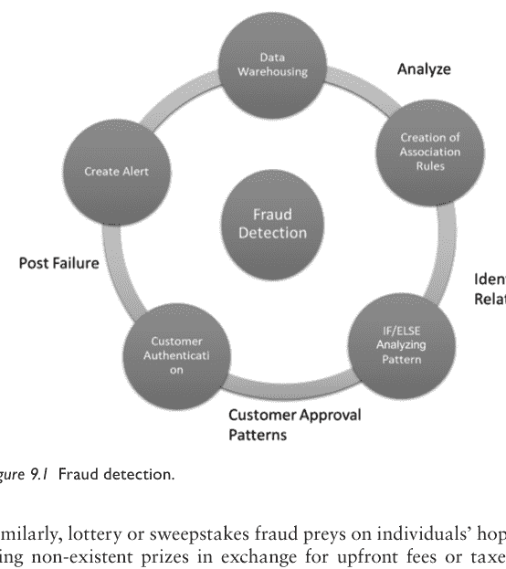

图 9.1 欺诈检测。

数据仓库在数据管理领域扮演着关键支柱的角色，尤其旨在加强和促进商业智能工作。它将多样化的数据集整合到一个集中存储库——数据仓库中，主要用于对历史数据进行查询和分析 [8]。其基本目标在于提取相关见解。然而，这一信息宝库也成为一把双刃剑，因为恶意实体利用它制定超出自身检测阈值的复杂计划。创建关联规则成为穿越庞大数据广阔空间的关键策略 [9]。通过辨别频繁的如果-那么模式，这些规则揭示了重要的关系。计算支持度和置信度指标进一步细化了这些关联，使组织能够挖掘数据宝库中隐藏的关键见解。随后，利用 IF/ELSE 模式审视已建立的关联规则揭示了潜在的客户审批模式。这种分析框架不仅有助于理解客户行为，还能加强客户身份验证机制。通过细致分析，可以挫败规避身份验证措施的欺诈企图，增强系统安全 [10]。客户身份验证在打击欺诈活动中至关重要，因为漏洞往往源于身份失败。成功的身份验证确保系统完整性，而失败则为潜在入侵打开大门。为了抵消此类漏洞，身份验证过程必须发出信号或警报，通知系统和客户任何潜在的妥协 [11]。在系统故障或身份验证被破坏的情况下，主动措施随之展开。系统必须及时生成警报，发出未经授权或异常活动的信号。这些警报作为早期预警，使能够迅速干预以减轻潜在威胁并保护组织资产 [12]。本质上，数据仓库、关联规则创建、IF/ELSE 模式分析、客户身份验证和警报机制之间的协同作用形成了抵御欺诈活动的强大防御 [13]。通过利用数据的力量并部署复杂的分析技术，组织可以领先欺诈者一步，确保其系统和数据资产的完整性和安全性。

## 9.2 相关工作

近年来，将区块链技术与大数据分析相结合以增强物联网（IoT）安全性的整合引起了广泛关注。大量研究和学术工作深入这一跨学科领域，旨在探索这些前沿技术之间的协同作用 [14]。在此，我们对现有文献进行了广泛回顾，涵盖了关于这一引人注目的主题的各种研究、调查和实践视角。领域内的一个重要贡献来自 Doe 和 Smith，他们进行了一项全面回顾，阐明了区块链支持的大数据分析在加强物联网安全方面的潜力 [15]。他们的工作阐明了各种用例、挑战和机遇，强调了区块链在物联网生态系统中确保数据完整性、保密性和可追溯性的关键作用。同样，Johnson 和 Williams 提供了一项调查，对区块链、大数据分析和物联网安全之间的协同作用进行了全景概述。他们的研究探讨了将区块链的去中心化账本用于保护物联网数据交换的整合，并辅以大数据分析在实时威胁识别中的作用 [16]。

Ref. [17] 中的作者通过回顾区块链与大数据分析整合以保护物联网应用的文献做出了贡献。他们的工作突出了这些技术之间的共生关系，强调了区块链在建立信任

以及不可变性，结合大数据分析在预测性安全分析方面的能力。此外，文献[18]中的作者提出了一项系统性文献综述，综合了现有关于通过区块链和大数据分析集成来保护物联网设备的研究的关键发现。他们的研究强调了数据完整性、访问控制和设备认证在确保稳健的物联网安全框架中的重要性。

文献[19]中的作者阐明了区块链驱动的大数据分析在物联网安全中固有的挑战和机遇。他们的研究解决了技术、监管和可扩展性问题，强调了在设计有效解决方案时互操作性和数据隐私的重要性。文献[20]中的作者提供了实践视角，提供了部署区块链赋能物联网安全解决方案的案例研究和实施策略。他们的研究强调了最佳实践和现实挑战，并提供了从实际部署中获得的见解。

在文献[21]中，作者提出了一种新颖的框架，集成区块链驱动的大数据分析以增强物联网安全。他们的研究概述了架构组件和安全机制，强调了可扩展性和对网络威胁的韧性。此外，文献[22]中的作者对物联网安全增强的不同方法进行了比较分析，评估了区块链和大数据分析集成的有效性。他们的研究提供了关于共识机制、数据处理技术和可扩展性考虑的见解，有助于设计具有韧性的物联网安全解决方案。

在文献[23]中，作者提供了比较分析，阐明了不同物联网安全增强方法的有效性。他们的研究评估了区块链和大数据分析集成中固有的各种共识机制、数据处理技术和可扩展性考虑因素。通过检查每种方法相关的权衡和性能指标，他们为设计针对特定用例和部署场景的具有韧性和高效的物联网安全解决方案提供了宝贵的见解。

此外，文献[24]中的作者提出了一种新颖的框架，利用区块链驱动的大数据分析来增强物联网安全。他们的框架阐明了架构组件、数据流机制和安全协议，旨在抵御网络威胁并确保物联网生态系统中的数据完整性。通过将区块链的去中心化账本与大数据分析的处理能力集成，他们的框架为保护物联网设备和数据传输提供了可扩展且具有韧性的解决方案。

除了解决技术挑战之外，伦理考虑和用户隐私问题在将区块链与大数据分析集成以增强物联网安全时至关重要。文献[25]等中的研究人员深入探讨了部署区块链赋能物联网安全解决方案的伦理影响，强调了透明治理模式、同意框架和数据保护机制的重要性。通过培养信任和问责制，伦理考虑在确保利益相关者和终端用户接受和采用区块链驱动的物联网安全框架方面发挥着关键作用。

此外，文献[26]中提供的实践视角为区块链赋能大数据分析在物联网安全方面的部署挑战和实际应用提供了宝贵的见解。通过案例研究和实施策略，他们阐明了克服技术障碍、集成遗留系统以及使安全措施与组织目标保持一致的最佳实践。通过弥合理论与实践之间的差距，他们的工作促进了区块链驱动的物联网安全解决方案在不同行业领域的采用和实施[27]。

最后，探索将区块链与大数据分析集成以增强物联网安全和效率涵盖了广泛的研究工作，跨越理论框架、比较分析、实际实施和伦理考虑[28]。通过解决技术挑战、监管合规要求和用户隐私问题，研究人员正在为创新解决方案铺平道路，这些解决方案可保护物联网生态系统免受新兴网络威胁，同时释放运营优化和价值创造的新机遇。

## 9.3 利用区块链技术增强物联网安全与效率

检测物联网生态系统中的欺诈活动变得越来越重要，需要将区块链技术与大数据分析集成以增强物联网安全和效率。这些前沿技术的融合为分析庞大且异构的数据集提供了一种全面方法，使能够主动检测指示欺诈行为的异常和可疑模式[29]。

将区块链与大数据分析集成以增强物联网安全和效率涉及一个系统性流程，旨在利用每种技术的优势。最初，数据收集涉及从各种物联网设备、传感器和系统中聚合信息，包括用户日志、设备遥测和环境数据。这些数据，无论是结构化还是非结构化，都为设备行为、用户交互和网络活动提供了宝贵的见解[30]。

数据集成对于将不同的数据集整合为统一格式至关重要，使信息能够在不同来源之间无缝分析和关联。Apache Hadoop 和 Apache Spark 等技术在处理和集成这些大规模数据集方面发挥着至关重要的作用，促进了全面的分析和决策。数据预处理涉及细化数据集以解决缺失值、异常值和

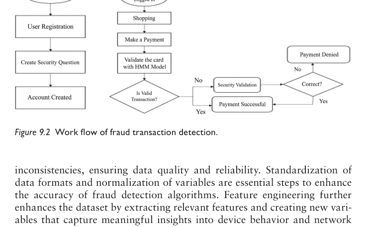

图 9.2 欺诈交易检测工作流程。

不一致性，确保数据质量和可靠性。数据格式的标准化和变量的规范化是提高欺诈检测算法准确性的重要步骤。特征工程通过提取相关特征并创建新的变量来进一步增强数据集，从而捕捉到设备行为和网络活动的有意义见解。机器学习模型用于构建欺诈检测的预测模型，利用历史数据识别指示欺诈行为的模式和异常。神经网络、支持向量机和决策树等技术通常用于训练这些模型，实现对可疑活动的实时自动检测。实时处理对于及时检测和响应欺诈活动至关重要，利用 Apache Flink 和 Apache Kafka 等技术进行流处理和分析。这些实时处理框架能够快速检测异常和偏离正常行为的情况，促进立即干预以减轻潜在威胁（图 9.2）。

异常检测技术，包括统计方法和聚类算法，被用于识别物联网生态系统中可能指示欺诈活动的异常模式或行为。行为分析为设备和用户建立基线行为，使能够检测可能表示安全漏洞或欺诈行为的偏差和异常。图分析用于分析物联网生态系统内的复杂关系和网络，识别可能指示协同攻击或欺诈行为的可疑连接和活动。可扩展性和性能是在物联网安全中部署区块链赋能大数据分析解决方案时至关重要的考虑因素，需要使用分布式计算框架和基于云的解决方案来高效处理大规模数据处理。持续监控和适应对于领先于新兴威胁和不断演变

攻击向量，需要定期更新和重新训练 ML 模型以检测新的欺诈行为模式。与行业同行和利益相关者之间的协作和信息共享增强了欺诈检测能力，使社区的集体智慧能够识别和减轻潜在威胁。

### 9.3.1 大数据分析的应用

大数据在各个行业中发挥着至关重要的欺诈检测作用，因为其处理和分析大量数据的能力很强。以下是大数据的一些应用（图 9.3）。

## 9.4 利用区块链技术进行欺诈检测

区块链是一种去中心化的账本技术，可用于透明且安全地记录交易。由于其固有特性，它非常适合跟踪金融交易并识别任何可疑活动。在当今不断发展的金融环境中，防范欺诈已成为致力于维护信任和安全的机构关注的问题。传统方法往往因其在透明度、数据完整性和运营效率方面的局限性而未能达到预期。然而，随着区块链的出现，一种革命性的解决方案已出现。这有可能重塑反金融犯罪战略。区块链技术的一些关键特征和组成部分如下。

区块链技术是一种具有若干关键特征的革命性系统。其核心是，区块链运行在由计算机组成的去中心化网络上，即“nodes”，消除了需要中央机构监督交易的需求。网络中的每个节点都维护账本的完整副本，即所谓的分布式账本，确保系统跨网络的冗余性和透明度。

交易被组织成区块，密码学哈希将每个区块链接到前一个区块，形成对所有网络活动的按时间顺序排列且安全的记录。这种逐块序列形成了区块链，提供不可变且透明的交易历史。

为了确认账本的当前状态，区块链采用共识机制，例如 proof of stake 或 proof of work。这些机制确保网络参与者在交易有效性方面达成一致，维护账本的完整性。

此外，密码学哈希函数用于验证每个区块内的数据，确保其准确性和完整性。任何试图篡改区块内数据的行为都需要更改所有后续区块，使篡改实际上不可能。

-   **Transaction Monitoring:** 实时分析大量交易有助于识别异常模式
-   **Anomaly Detection:** 用于建立用户或实体的正常行为模式。偏差被视为标记的异常活动。
-   **Pattern Recognition:** 识别数据中可能表明欺诈行为的复杂模式和关系
-   **Machine learning models:** 大数据允许创建可从历史欺诈数据中学习的预测模型
-   **Identity Verification:** 通过交叉核对个人信息、IP地址、设备信息等来帮助验证用户身份。
-   **Social Network Analysis:** 检查社交网络和用户之间的联系可以揭示欺诈活动。
-   **Text and Sentiment Analysis:** 分析来自客户服务互动、电子邮件和社交媒体等来源的文本数据有助于检测欺诈活动
-   **Insurance Fraud Detection:** 大数据通过分析各种数据源来识别不一致性、模式或异常情况，从而帮助检测欺诈性索赔
-   **Healthcare Fraud Detection:** 识别欺诈性计费模式、异常的患者-提供者关系和异常情况

图 9.3 大数据在欺诈检测中的应用。

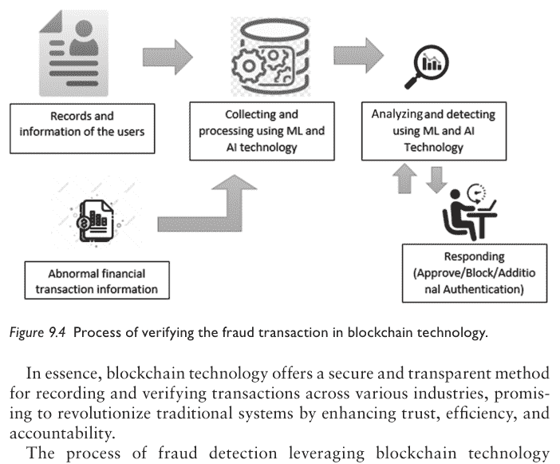

图 9.4 区块链技术中欺诈交易验证流程。

本质上，区块链技术为各行业提供了一种安全透明的记录和验证交易的方法，有望通过增强信任、效率和问责制来革新传统系统。

利用区块链技术进行欺诈检测的过程如图 9.4 所示。最初，客户数据库存储包含用户信息的记录，为交易中的欺诈检测奠定基础。这些记录作为识别异常和潜在欺诈活动所需数据的关键存储库。下一步涉及利用 ML 和 AI 等先进技术处理用户的集体信息。这种整合允许对数据进行全面分析，从而识别可能表明欺诈行为的模式、趋势和不规则情况。随后，数据会使用针对处理需求量身定制的技术进行分析。先进的算法筛选信息，采用复杂的方法准确辨别欺诈活动。通过细致的检查，这些技术能够预测潜在的欺诈实例，从而采取主动措施减轻风险。在整个过程中，审计员在监督身份验证程序方面发挥着关键作用。他们负责验证交易，确保遵守既定协议，并在认为必要时提供批准、拒绝或额外审查。当标记异常金融交易时，审计员会立即收到通知以验证交易的真实性。这种迭代方法强调了在欺诈检测领域持续监控和审查的重要性。通过结合区块链技术、ML、AI 和严格的审计协议，企业可以加强对欺诈活动的防御，保护资产并维护金融交易的完整性。

### 9.4.1 区块链技术中欺诈检测的应用

基于区块链的欺诈检测具有巨大的潜力，可提高各种企业的安全性、透明度和信任度。以下是区块链技术欺诈检测的一些用途。

区块链技术为各领域的欺诈检测提供了广泛的应用，革新了我们处理安全和透明度的方式。区块链在审计智能合约方面表现出色是其关键领域之一。这些固有的区块链自执行合约会经过细致审查，以发现安全漏洞或恶意代码。通过实施欺诈检测方法，组织可以及早识别和解决潜在问题，将被利用的风险降至最低。此外，区块链通过实现从原产地到最终消费者的物品可追溯性，增强了供应链透明度。欺诈检测机制确保记录在区块链上的数据与商品的实际流动一致，迅速识别任何差异或操纵信息的企图。在金融服务领域，区块链通过建立去中心化身份验证系统简化了反洗钱（AML）和了解客户（KYC）程序。欺诈检测算法跟踪并标记可疑交易，加强了安全和合规工作。跨境支付受益于区块链安全透明的账本，欺诈检测机制监控交易中的异常，保护资金并验证相关方的合法性。区块链促进的代币化和资产管理依赖于欺诈检测来监控资产的所有权和转移，确保授权交易并防止房地产和艺术品等领域的欺诈。去中心化金融（DeFi）应用利用欺诈检测审查去中心化交易所和借贷协议是否存在可疑活动、未经授权的访问和潜在的智能合约利用。区块链的安全数字身份验证平台通过分析与身份相关的交易和模式，在检测身份盗窃和欺诈活动方面发挥着重要作用。在保险行业，区块链记录透明且防篡改的索赔数据，而欺诈检测算法识别不规则情况，减少保险欺诈并简化索赔处理。


### 9.4.2 BCT 在检测欺诈中的优势

区块链技术在检测和预防欺诈方面提供了众多优势，彻底改变了我们对待交易安全性和责任制的方式。其中一些关键优势包括：

透明性和可追溯性：区块链的固有特性确保了交易透明且可审计的轨迹。每笔交易都按时间顺序记录，为参与者提供访问整个交易历史的能力。这种透明性促进了欺诈检测，能够快速识别和调查任何可疑或未经授权的活动。

去中心化：与因单点故障而容易受到欺诈攻击的传统集中式系统不同，区块链将账本分布在节点网络中，使其去中心化。这种去中心化显著降低了欺诈活动或非法访问的风险，因为不存在可被利用的单一节点。

增强的安全性：区块链采用先进的加密算法，通过加密来保护用户身份和交易。通过加强数据安全和隐私，这一加密层使区块链免受未经授权访问或数据泄露等欺诈企图的侵害。

实时监控和警报：将欺诈检测算法和实时监控工具与区块链网络集成，可对异常或可疑活动做出即时通知。这种主动方法使组织能够迅速调查并对潜在的欺诈企图采取行动，最大程度地减少欺诈活动的影响。总体而言，区块链技术的透明性、去中心化、安全功能和实时监控能力使其成为在各行业检测和预防欺诈的强大工具，确保交易和流程的完整性和信任。

### 9.4.3 区块链技术在欺诈检测中的缺点

虽然区块链技术为欺诈检测提供了众多优势，但它也伴随着需要解决的诸多挑战和缺点。一些具体缺点包括：

有限的监管和标准：区块链技术缺乏标准化的法规和行业标准，造成了法律和合规框架中的不确定性。这种缺乏明确指导可能阻碍区块链在欺诈检测中的采用，特别是在受严格监管的行业中，遵守合规标准至关重要。

隐私问题：尽管具有透明性，但区块链的公开性质可能引发隐私问题。许多区块链网络会向所有参与者公开敏感的交易细节，可能损害用户隐私。在欺诈检测的透明性与保护用户隐私的需求之间取得平衡，是区块链实施中的重大挑战。

交易的不可逆性：一旦记录在区块链上，交易通常是不可逆的。虽然不可变性是区块链的核心优势，但在处理错误交易或交易后才发现欺诈的情况下，它就成为缺点。与具有退款机制的传统系统不同，区块链交易是最终的，使得纠正变得困难。

## 9.5 利用人工智能进行欺诈检测

人工智能已成为打击欺诈的关键工具，利用先进的算法和机器学习技术来检测和预防欺诈活动。以下是人工智能在欺诈检测中应用的一些关键因素：

异常检测：人工智能算法，特别是无监督机器学习模型，建立正常行为模式并将偏差标记为异常，可能表明存在欺诈活动。这种方法对于识别以前未知且不断演变的欺诈形式至关重要。

机器学习模型：在监督式机器学习模型上训练历史数据，包括合法和欺诈交易。这些模型学习识别与欺诈相关的模式，并可使用决策树、随机森林和支持向量机等算法实时预测交易为欺诈的可能性。

行为分析：人工智能驱动的行为分析分析用户在各种渠道上的行为模式，以检测可能表明欺诈活动的异常，特别是在网上银行和电子商务中。这有助于识别与既定行为模式的偏差。

预测分析：预测分析使用历史数据和统计算法预测未来事件。在欺诈检测中，预测模型根据历史数据中识别出的模式评估交易或活动为欺诈的可能性，从而实现欺诈的主动预防。

实时监控：人工智能系统能够实时监控交易、用户活动和系统日志。通过持续分析传入数据，人工智能算法能够快速识别并响应可疑行为，减少检测和预防欺诈所需的时间。

生物特征认证：人工智能驱动的生物特征认证方法，如面部识别和指纹扫描，为欺诈预防工作增加了额外的安全层。这些技术确保访问系统或进行交易的个人得到安全认证。

机器人流程自动化（RPA）：RPA 自动化欺诈检测过程中的重复性任务，减少人工工作并确保一致性。通过自动化常规任务，RPA 加快响应时间并改善欺诈检测协议。

自适应学习：人工智能系统根据新数据和新兴的欺诈模式进行适应和演变。这种适应性使系统能够在欺诈者不断改变策略的动态环境中保持有效。人工智能在欺诈检测中的集成不仅提高了识别欺诈活动的准确性，还使组织能够领先于不断演变的欺诈手段。随着欺诈者变得更加复杂，人工智能技术为创建强大且适应性强的欺诈检测系统提供了有价值的工具。

## 9.6 结论

总之，欺诈检测和金融犯罪预防是保障金融系统完整性和安全性的不可或缺的组成部分。网络威胁不断变化的地形需要实施稳健且适应性强的措施，包括行为分析、异常检测、加密和事件响应计划。现实世界的案例，例如 Target 数据泄露，强调了持续警惕的重要性以及金融机构需要领先于复杂的对手。与执法部门的合作、透明的客户沟通以及持续的教育工作有助于形成全面的战略。虽然没有任何系统完全不受攻击，但全面而动态的方法对于降低风险、保护客户信任并维护金融生态系统的稳定至关重要。

## 参考文献

- 1. Saxena, S.; Bhushan, B.; Ahad, M. A., Blockchain based solutions to secure IoT: Background, integration trends and a way forward. Journal of Network and Computer Applications 2021, 181, 103050.
- 2. Aldhaheri, S.; Alghazzawi, D.; Cheng, L.; Barnawi, A.; Alzahrani, B. A., Artificial immune systems approaches to secure the internet of things: A systematic review of the literature and recommendations for future research. Journal of Network and Computer Applications 2020, 157, 102537.
- 3. Shilpa, B.; Kumar, P. R.; Jha, R. K., LoRa DL: A deep learning model for enhancing the data transmission over LoRa using autoencoder. The Journal of Supercomputing 2023, 79, 17079–17097.
- 4. Singh, S.; Sharma, P. K.; Yoon, B.; Shojafar, M.; Cho, G. H.; Ra, I. H., Convergence of blockchain and artificial intelligence in IoT network for the sustainable smart city. Sustainable Cities and Society 2020, 63, 102364.
- 5. Deebak, B. D.; Fadi, A. T., Privacy-preserving in smart contracts using blockchain and artificial intelligence for cyber risk measurements. Journal of Information Security and Applications 2021, 58, 102749.
- 6. Ranjan, R.; Pandey, D.; Rai, A. K.; Gupta, D.; Singh, P.; Kumar, P. R.; Mohanty, S. N., A manifold-level hybrid deep learning approach for sentiment classification using an autoregressive model. Applied Sciences 2023, 13(5), 3091.
- 7. Ahanger, T. A., Defense scheme to protect IoT from cyber attacks using AI principles. International Journal of Computers Communications & Control 2018, 13, 915–926.
- 8. Atlam, H. F.; Walters, R. J.; Wills, G. B., Intelligence of things: Opportunities & challenges. In Proceedings of the 2018 3rd Cloudification of the Internet of Things (CIoT), Paris, France, 2–4 July 2018, pp. 1–6.
- 9. Qian, Y.; Jiang, Y.; Chen, J.; Zhang, Y.; Song, J.; Zhou, M.; Pustisek, M., Towards decentralized IoT security enhancement: A blockchain approach. Computers and Electrical Engineering 2018, 72, 266–273.
- 10. Shen, M.; Tang, X.; Zhu, L.; Du, X.; Guizani, M., Privacy-preserving support vector machine training over blockchain-based encrypted IoT data in smart cities. IEEE Internet of Things Journal 2019, 6, 7702–7712.
- 11. Arivazhagan, N.; Somasundaram, K.; Mohammad, G. B.; Kumar, P. R.; et al., Cloud-Internet of Health Things (IOHT) task scheduling using hybrid moth flame optimization with deep neural network algorithm for e-healthcare systems. Scientific Programming 2022, 2022, 1–12.
- 12. Singh, S. K.; Rathore, S.; Park, J. H., Blockiotintelligence: A blockchain-enabled intelligent IoT architecture with artificial intelligence. Future Generation Computer Systems 2020, 110, 721–743.
- 13. Han, X.; Zhang, R.; Liu, X.; Jiang, F., Biologically inspired smart contract: A blockchain-based DDoS detection system. In Proceedings of the 2020 IEEE International Conference on Networking, Sensing and Control (ICNSC), Nanjing, China, 30 October–2 November 2020, pp. 1–6.
- 14. Mohammad, G. B.; Selvarajan Shitharth; Kumar, P. R., Integrated machine learning model for an URL phishing detection. International Journal of Grid and Distributed Computing 2021, 14(1), 513–529.
- 15. Sandner, P.; Gross, J.; Richter, R., Convergence of blockchain, IoT, and AI. Frontiers in Blockchain 2020, 3, 522600.
- 16. Rodrigues, B.; Bocek, T.; Lareida, A.; Hausheer, D.; Rafati, S.; Stiller, B., A blockchain-based architecture for collaborative DDoS mitigation with smart contracts. In Proceedings of the IFIP International Conference on Autonomous Infrastructure, Management and Security, Zurich, Switzerland, 10–13 July 2017, Springer: Cham, Switzerland, pp. 16–29.
- 17. Rathore, S.; Kwon, B. W.; Park, J. H., BlockSecIoTNet: Blockchain-based decentralized security architecture for IoT network. Journal of Network and Computer Applications 2019, 143, 167–177.


- 18. Wu, B.; Li, Q.; Xu, K.; Li, R.; Liu, Z., Smartretro：基于区块链的分布式物联网回顾性检测激励。载于 2018 年 IEEE 第 15 届移动自组织和传感器系统国际会议 (MASS) 会议论文集，成都，中国，2018 年 10 月 9–12 日，第 308–316 页。
- 19. Kumar, P. R.; Ananthan, T., 用于标签检测的 LabVIEW 机器视觉。Journal of Innovation in Computer Science and Engineering (JICSE) 2019, 9(1), 58–62。
- 20. Talukder, S.; Roy, S.; Al Mahmud, T., 基于区块链技术的分布式反恶意软件系统方法。载于 2019 年第 11 届通信系统与网络国际会议 (COMSNETS) 会议论文集，班加罗尔，印度，2019 年 1 月 7–11 日，第 1–6 页。
- 21. Kumar, P. R., 使用感应耦合的无线移动充电器。Journal of Emerging Technologies and Innovative Research (JETIR) 2018, 5(10), 40–44。
- 22. Li, W.; Tug, S.; Meng, W.; Wang, Y., 设计物联网环境中基于协作区块链签名入侵检测。Future Generation Computer Systems 2019, 96, 481–489。
- 23. Spathoulas, G.; Giachoudis, N.; Damiris, G. P.; Theodoridis, G., 基于物联网僵尸网络的协作区块链分布式拒绝服务攻击检测。Future Internet 2019, 11, 226。
- 24. Shilpa, B.; Kumar, P. R.; Jha, R. K., 密集室内 LoRa 网络中用于干扰缓解的扩频因子优化。IEEE IAS 新兴技术全球会议 (GlobConET)，伦敦，英国，2023 年，第 1–5 页。
- 25. Cheema, M. A.; Qureshi, H. K.; Chrysostomou, C.; Lestas, M., 利用区块链进行物联网分布式机器学习入侵检测。载于 2020 年第 16 届传感器系统分布式计算国际会议 (DCOSS) 会议论文集，马里纳德尔雷，CA，2020 年 5 月 25–27 日，第 429–435 页。
- 26. Aldhaheri, S.; Alghazzawi, D.; Cheng, L.; Alzahrani, B.; Al-Barakati, A., Deep DCA：利用人工免疫系统的新型基于网络的物联网攻击检测。Applied Sciences 2020, 10, 1909。
- 27. Nespoli, P.; Mármol, F. G.; Vidal, J. M., 一种针对网络攻击的仿生反应：由 AIS 驱动的最优对策选择。IEEE Access 2021, 9, 60971–60996。
- 28. Kumar, P. R., 使用 LabVIEW 的步进电机位置控制。第 3 届电子、信息通信技术最新趋势国际会议 (RTEICT)，班加罗尔，印度，2018 年 5 月，第 1551–1554 页。
- 29. Ghali, A. A.; Ahmad, R.; Alhussian, H., 一种用于在物联网环境中使用混合方法缓解 DDoS 和 DOS 攻击的框架。Electronics 2021, 10, 1282。
- 30. Kumar, P.; Kumar, R.; Gupta, G. P.; Tripathi, R., 一种利用雾计算检测基于智能合约的区块链-物联网系统中 DDoS 攻击的分布式框架。Transactions on Emerging Telecommunications Technologies 2021, 32, e4112。

## 区块链技术的机器学习技术

近期进展与未解决问题综述

I. Sheik Arafat, S. Karthiyayini,
S. M. Haji Nishath, and R. Karthikeyan

## 10.1 机器学习与深度学习的介绍

### 10.1.1 ML/DL 基础

理解和利用人工智能的强大功能所必需的概念、技术和方法涵盖了深度学习 (DL) 和机器学习 (ML) [9] 中庞大而复杂的领域。ML 背后的基本原理是让计算机系统无需显式编程即可从数据中学习。两种主要的学习形式是无监督学习，即从未标记数据中提取模式和结构的过程，以及监督学习，即算法从标记实例中学习以生成预测或判断。另一种范式、强化学习强调通过与环境的交互进行学习，奖励指导学习过程。由于 DL 作为 ML 的一个子集，能够自动从数据中提取分层表示，因此它已成为该领域的主要力量。DL 的核心要素是神经网络，其复制了人类大脑中神经元的网络组织。它们由处理和改变数据的节点层组成。激活函数为神经网络架构引入非线性，增强其对数据中复杂关系建模的能力。训练神经网络涉及通过反向传播进行迭代优化，其中计算梯度并用于更新模型参数，最小化预测输出与实际输出之间的差异。

循环神经网络 (RNNs) 擅长处理序列数据，这使其适用于自然语言处理 (NLP) 和时间序列预测等任务。深度学习架构，如卷积神经网络 (CNN)，通过利用空间层次结构，在图像识别和计算机视觉等任务中表现出色。正则化策略如 dropout 可减少过拟合并保证对新数据的泛化，而优化方法如梯度下降及其变体则调整模型参数。数据预处理是为 ML/DL 模型准备数据的关键步骤。它涉及清理、操作和编码数据。评估和验证技术用于评估模型性能，指导适当算法和超参数的选择。伦理考虑在 ML/DL 领域非常重要，关于偏见、公平性和透明度的担忧导致了对负责任的 AI 开发的呼吁。随着该领域的发展，先进主题如生成对抗网络 (GANs) 和强化学习提供了新的可能性，而持续的研究和合作促进了创新应用和社会影响，塑造了一个 ML/DL 继续塑造我们世界的未来。

### 10.1.2 神经网络与深度学习架构概述

DL 基于神经网络，其提供了一个受人类大脑组成和运作启发的计算模型。人工神经元是相互连接的节点，排列成层以处理和操作输入数据，构成了这些网络。这种方法在 DL 架构中通过众多层得以扩展，这些层能够实现从数据中自动提取分层表示。在传统的 feedforward 神经网络中，信息从输入节点传输到输出节点，经过隐藏层，这些隐藏层对输入执行一系列加权修改。网络可以通过激活函数引入非线性来学习数据中的复杂相关性。CNN 使用卷积层来提取特征的空间层次结构，这使 CNN 能够处理类似网格的数据，例如照片。语义分割、目标检测和图像分类等任务已被这些系统彻底改变。然而，RNN 专门用于处理序列输入。RNN 使用节点连接形成的定向循环来捕捉时间依赖性。由于 RNN 能够处理不同长度的输入并建模序列，因此在语音识别、NLP 和时间序列预测等任务中非常有效。作为 RNN 的替代方案，长短期记忆 (LSTM) 网络通过实现控制信息随时间流动的门控机制来解决梯度消失问题。这些架构现在对于需要保留记忆和上下文的活动（如情感分析和语言翻译）至关重要。总之，神经网络和 DL 架构的灵活性和适应性推动了各个领域的进步，激发了创造力并彻底改变了人工智能领域。

### 10.1.3 ML/DL 在各个行业的应用

ML 和 DL 已在各个行业得到广泛采用，为复杂问题提供创新解决方案，并在多样化的行业中推动效率和优化。


在医疗健康领域，ML/DL 应用涵盖了广泛的用途，从疾病诊断的医学图像分析到患者预后预测分析和个性化治疗方案。ML 模型检查大量的医疗数据以检测模式并预测疾病的进展，从而对医疗服务交付产生变革性影响并改善患者预后。

金融机构使用 ML 和 DL 进行算法交易、风险管理和欺诈检测。ML 算法会梳理海量数据集以发现金融交易中的欺诈活动，而风险管理模型则评估市场和信用风险以帮助决策。算法交易策略采用 DL 技术分析市场数据并自动执行交易，从而优化投资组合并最大化回报。

零售商采用 ML/DL 进行个性化推荐、库存管理和动态定价。推荐系统分析客户行为以提供量身定制的产品建议，而 ML 模型则预测需求并优化库存水平以防止缺货并降低成本。为了提高销售额和盈利能力，动态定价算法会根据消费者偏好和市场条件实时调整价格。

制造组织使用 ML/DL 进行供应链优化、质量控制和预测性维护。虽然 DL 算法检查产品是否存在缺陷和质量标准偏差，但预测性维护模型使用设备传感器数据来预测故障并减少停机时间。ML 技术通过预测需求、管理库存和提高物流效率来优化供应链运营。

在交通运输领域，ML/DL 推动自动驾驶汽车、优化路线规划并增强公共交通管理。自动驾驶汽车依赖 DL 算法处理传感器数据并做出实时驾驶决策，而 ML 模型则根据交通模式和天气条件优化运输路线。公共交通系统受益于 ML 技术用于预测乘客需求、优化时间表和提高服务可靠性。

在能源领域，ML/DL 应用涵盖基础设施预测性维护、能源消耗预测和智能电网优化。ML 模型预测能源基础设施中的设备故障，优化能源的生成和分配，并在智能电网上平衡供需，促进能源管理的可持续性和效率。

如图 10.1 所示，DL 在图像分析和识别方面的帮助使得能够识别图片中的物体、人物或任何动作。

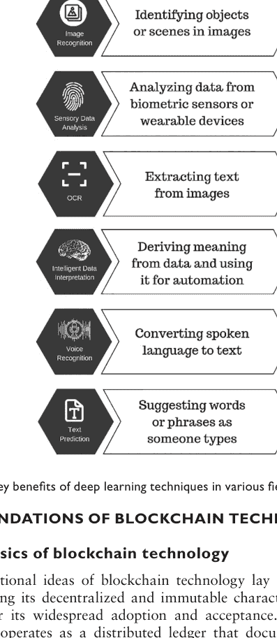

图 10.1 各领域深度学习技术的关键优势 [1]。

## 10.2 区块链技术基础

### 10.2.1 区块链技术基础

区块链技术的基石思想为理解其去中心化和不可变特性奠定了框架，这些特性对其广泛采用和认可至关重要。从根本上讲，区块链作为分布式账本运行，记录网络中链接节点之间的交易，保证了无需中介即可实现信任、安全和透明。区块链中的每个区块都包含一组交易，这些交易通过密码学方式与前一个区块相连，形成区块的顺序排列。通过使用密码学哈希算法，这种互联创建了交易的不可变记录，使得在未经网络大多数用户批准的情况下几乎不可能更改先前的数据 [4]。

区块链运行在去中心化的网络架构上，其中每个参与者或节点都维护整个区块链账本的完整副本。这种去中心化保证了对单点故障的弹性，并防止数据被未经授权篡改，从而增强了网络的安全性和可靠性。

共识机制通过促进网络参与者对交易真实性的达成一致，对维护区块链的完整性至关重要。两种流行的共识技术是权益证明（PoS）和工作量证明（PoW）。为了验证交易并将新区块添加到区块链中，PoW 要求用户解决复杂的数学难题，而 PoS 则根据质押选择区块验证者，并以货币奖励诚实行为。

智能合约是区块链技术的另一个重要组成部分，它们是内置于网络中的具有预定义条款和条件的自我执行协议。这些可编程合约消除了对中介的需求，并在预定条件满足时自动执行活动，从而简化各种企业运营。

区块链技术在多个领域具有众多用途，例如供应链管理、医疗保健和金融。它使交易更安全、更透明，降低了欺诈和错误的风险，并促进了去中心化应用（DApps）和新商业模式的发展。要充分实现区块链技术的颠覆潜力并探索其在现代数字经济中的诸多应用，必须对其基础有透彻的理解。图 10.2 突出了区块链与其他技术相比的独特优势。

### 10.2.2 区块链的类型

区块链技术已发展以适应各种用例，从而产生了不同类别的区块链。这些类别可以大致分为三大类：公有区块链、私有区块链和联盟区块链。每个组都有其独特的特征、优势和用例。

### 10.2.2.1 公有区块链

公有区块链是去中心化的网络，任何人都可以加入、查看、编辑和验证交易而无需获得授权。任何人都可以访问账本并参与共识过程，这得益于这些开放且透明的区块链。公开可访问的区块链包括 Ethereum 和 Bitcoin。

公有区块链以不可变性、透明性和去中心化为基础运行。由于网络中的每个人对账本和权利都有平等访问权，因此不存在审查或不可靠的交易。为了确认交易并保护网络，公有区块链依赖于 PoW 或 PoS 等共识技术。

公有区块链的主要优势之一是其高安全性，通过去中心化共识和密码学哈希实现。一旦确认，公有区块链上的交易是不可逆的，提供了对不可变性和抗篡改的强有力保证。

- **快速交易处理**：区块链技术提高了交易执行的速度，与传统方法相比显著更快。
- **消除中介成本**：通过采用点对点（P2P）结构，区块链技术消除了中介费用，简化了交易。
- **值得信赖的数据存储**：区块链数据的完整性通过复杂的算法和旨在防篡改的软件规则来维护。
- **精简业务流程**：组织利用区块链上的智能合约高效地自动化和简化其业务运营。
- **去中心化自治**：区块链的去中心化特性确保没有任何单一实体控制整个网络的数据。
- **不可变记录保存**：一旦输入区块链，交易和数据的账本就是永久的，任何一方都无法更改。
- **增强透明度**：区块链网络的开放结构允许任何人参与并透明地访问存储的数据。
- **强大的数据安全**：区块链使用数字时间戳和密码学哈希保护交易数据，加强其安全性。

图 10.2 与其他技术相比区块链的优势 [1]。


公共区块链特别适合需要高度安全、抗审查和透明度的应用。它们通常用于加密货币交易、去中心化金融（DeFi）、代币发行和去中心化应用（DApps）。

### 10.2.2.2 私有区块链

参与和访问仅限于授权实体的集中化网络被称为私有区块链，也称为许可区块链。与人人可访问的公共区块链不同，私有区块链需要授权才能加入、读取和更改数据。知名私有区块链平台的例子有 R3 Corda 和 Hyperledger Fabric。

私有区块链通常用于由知名且可靠的成员组成的联盟或组织。得益于权限系统和访问控制，只有授权组织才能访问网络上的敏感数据。

虽然私有区块链牺牲了去中心化和抗审查性以换取更好的性能和可扩展性，但它们提供了增强的隐私、控制和效率等优势。参与者可以在不向公众暴露敏感信息的情况下相互进行可信交易。

对于隐私、合规性和可扩展性至关重要的企业应用，如供应链管理、身份验证和文档管理，是私有区块链技术的理想候选者。

### 10.2.2.3 联盟区块链

联盟区块链代表了一种混合方法，结合了公共区块链和私有区块链的最佳特性。在联盟区块链中，预先选定的参与者共同管理网络，共享权威和决策职责。联盟区块链在保持一定程度去中心化的同时执行许可规则和访问限制。

与人人可访问的私有和公共区块链不同，联盟区块链由多个可靠组织监督。这些组织共同努力维护共识规则、验证交易并保持区块链账本的最新状态。

由于联盟区块链在去中心化和控制之间取得了平衡，因此适用于需要多个利益相关方协作并安全共享数据的用例。跨银行支付系统、行业联盟和供应链网络就是几个例子。联盟区块链的好处包括提高生产力、降低成本和增强参与者信任。联盟通过利用区块链技术可以提高透明度，加快业务流程，并为其成员提供新的价值主张。

## 10.3 区块链驱动深度学习框架的分类

本分类讨论了基于区块链的深度学习框架的组织方式。深度学习算法与区块链技术相结合提供了诸多好处，例如自动化决策、数据保护、精确预测、有效的数据市场管理和增强的系统弹性。在本部分中，提出了一种主题分类法，根据各种标准对深度学习技术与区块链的结合进行分类。如图 10.3 所示，这些要素突出了基于区块链技术的尖端深度学习框架之间的相似性和差异。以下章节将对所选参数及其技术细节进行概述。

## 10.4 智能合约与去中心化应用（DApps）

在区块链技术领域，智能合约和去中心化应用（DApps）是革命性地改变交易执行方式和去中心化网络上应用开发方式的重要组成部分。

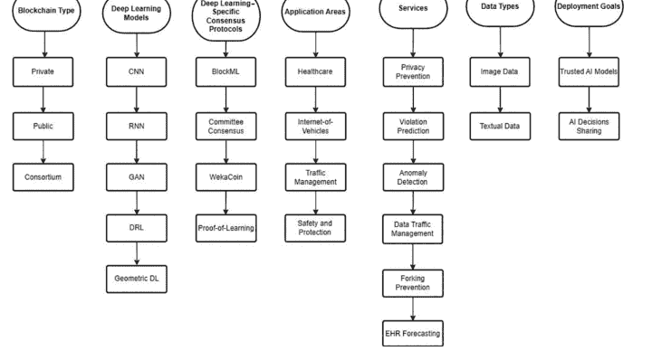

Figure 10.3 深度学习框架的区块链分类。

智能合约是编码在区块链上、具有预定条款和条件的自我执行协议。它们通过自动执行和强制执行协议各方之间的协议条款，确保透明且无需信任的交易，从而消除了对中间人的需求。

智能合约使用如 Hyperledger Fabric 的 Chaincode 和 Ethereum 的 Solidity 等编程语言编写，然后部署在区块链平台上。一旦部署，智能合约就提供了一种可靠的执行协议的方法，不存在欺诈或操纵的可能性。部署后，它们变得不可变且无法更改。智能合约由预定义条件触发并自动执行，促进各方之间资产、信息或服务的交换。

在去中心化网络上运行且没有中央权威或控制的应用被称为去中心化应用（DApps）。这些应用利用区块链技术和智能合约。DApps 设计为透明、开源且抗审查，以便任何人都可以无授权地使用和与其交互。

DApps 可以为包括社交媒体、游戏、银行和供应链管理在内的各个行业的广泛用例创建。它们本质上是安全可靠的，因为它们继承了区块链技术的去中心化、不可变和透明特性。

智能合约和 DApps 能够自动化复杂流程并消除中间人，从而降低成本并提高效率，这是其主要优势之一。在金融行业，智能合约有潜力自动化金融协议的执行，例如保险单、衍生品和贷款。这可以在无需传统中介机构如银行或保险公司的情况下实现。这加快了流程并降低了错误和分歧的可能性。

此外，通过代币化和 DeFi，智能合约和 DApps 使开发新的商业模式和收入来源成为可能。在区块链上，代币代表数字资产或权利，可用于加快交易、授予服务访问权限或参与 DApp 治理流程。DeFi 协议使用智能合约提供去中心化的金融产品和服务，如借贷、交易和收益 farming，而无需依赖传统金融机构。

不过，DApps 和智能合约也存在一些困难。由于智能合约编程中的安全漏洞可能导致资金损失和被利用，因此必须有严格的测试和审计程序。可扩展性和可用性问题也对 DApps 的广泛采用构成挑战，因为区块链网络难以处理大量交易并提供无缝的用户体验。

## 10.5 区块链智能中的挑战与机遇

### 10.5.1 分析区块链数据的复杂性

Jan 等人讨论了分析区块链数据的重要性，并确定了分析的四个方面：安全、隐私、性能和价格预测。然而，它并未具体提及分析区块链数据的复杂性。

分析区块链数据的复杂性涉及浏览存储在区块链上的大量信息、理解其结构并提取有价值的见解以得出有意义的结论。区块链数据由于其去中心化和分布式特性，以及确保安全和不可变的加密机制，本质上是复杂的。

分析区块链数据的主要挑战之一是其庞大的数量和多样性。随着新交易不断添加到账本中，区块链持续增长，导致需要高效存储、检索和处理机制的海量数据集。此外，区块链数据以多种格式存在，包括交易记录、智能合约代码和元数据，这增加了分析的复杂性。

另一个复杂性源于区块链交易的透明性和伪匿名性。虽然区块链数据透明且公开可访问，但由于使用了加密地址，识别交易背后的实体可能具有挑战性。分析交易模式和聚类技术可以帮助将交易归因于特定实体或地址，从而提供用户行为和网络活动的见解。

理解控制区块链网络的底层共识过程和协议准则对于区块链数据分析也是必要的。不同的区块链可能使用不同的共识技术，例如 PoW、PoS 或委托权益证明（dPoS）。每种技术都有其自己的准则和动机。理解这些共识技术对于分析区块链数据以解读交易确认、区块传播延迟和网络安全是必要的。

此外，区块链数据分析通常涉及探索交易的时序方面，例如时间戳和区块间隔。分析交易时间戳可以揭示区块链上的活动模式、交易频率和时间敏感事件。理解区块间隔和确认时间对于评估网络性能、可扩展性和可靠性至关重要。

研究人员和分析师使用各种工具和方法，如数据可视化、统计分析、ML 和网络分析，以高效地分析区块链数据。借助数据可视化技术，可以对区块链数据进行可视化并发现模式和趋势，如

图表、图表和热力图。通过包括时间序列分析和描述性统计在内的统计分析方法，可以获得有关区块链指标和性能指标的定量洞察。

ML 算法可用于识别异常或欺诈活动、预测未来趋势，并在区块链数据中发现隐藏的模式和相关性。区块链网络架构和结构通过网络分析技术进行分析，例如图论和中心性测量，有助于发现重要个体、社区和网络动态。

## 10.5.2 识别安全和隐私挑战

识别区块链技术中与安全和隐私相关挑战至关重要，以确保基于区块链的系统的完整性、保密性和弹性。尽管区块链具有去中心化、透明性和不可变性等众多优势，但它也提出了关于安全和隐私的独特考虑，必须有效解决以减轻风险和漏洞。

51% 攻击的可能性——即单个实体或一组实体控制网络中大部分算力——是区块链技术面临的主要安全挑战之一。当使用 PoW 共识机制（如比特币）的区块链发生 51% 攻击时，攻击者可能能够修改交易确认、双花硬币，甚至审查交易。类似地，PoS 区块链中的多数持币者有能力影响共识过程，从而危及网络安全。

本质上，智能合约是存储在区块链中的具有特定规则的自执行合约。因此，它们容易受到恶意攻击、逻辑谬误和编码错误的影响。通过利用智能合约缺陷，可以窃取数字资产、造成财务损失，甚至扰乱基于区块链的去中心化应用，或 DApps。

区块链技术的另一个主要问题是隐私，尤其是在公共区块链中，交易数据清晰且对所有网络用户开放。尽管区块链交易是伪匿名的——即与加密地址相关联而非真实身份——但仍有可能追踪和检查交易模式，以挖掘用户财务活动的私人数据。

此外，一旦数据记录在区块链上，就无法删除或更改，使其不可更改。尽管这种不可变性保证了区块链数据的完整性和抗篡改性，但也给隐私保护带来了问题。这是由于保存在区块链上的私人数据可能在较长时间内保持不变，使用户面临隐私违规和监管合规问题的风险。

研究人员、开发人员和政策制定者正在积极探索各种解决方案和最佳实践，以应对这些安全和隐私挑战。增强共识过程和区块链协议是一种提高可扩展性和安全性同时降低 51% 攻击和其他网络问题的可能性的方法。例如，使用复杂的加密方法，如同态加密或零知识证明（ZKPs），可以通过允许在公共区块链上进行私人交易来提高隐私性。

此外，开发人员正致力于通过形式化验证、代码审计和建立漏洞赏金计划来增强智能合约的安全性，以便在部署这些合约之前识别和解决漏洞。通过进行全面的安全评估并实施稳健的编码实践，开发人员可以降低智能合约被利用的风险，并保护用户的数字资产免受窃取或操纵。

此外，隐私增强技术的开发正在进行中，例如隐私币、混币器和去中心化身份解决方案，旨在加强公共区块链上的隐私保护。这些技术的目标是让用户对其私人信息拥有更多控制权、隐藏用户身份并匿名化交易数据。

## 10.5.3 探索 ML/DL 集成的机会

探索 ML 和 DL 与各个行业和应用集成的潜力，在推动创新、提高效率和发现新见解方面具有巨大前景。将 ML/DL 技术与现有系统和流程相结合，为不同领域提供了优化、自动化和智能的众多机会。

Li et al. [3] examine the potential of combining data integration methods with ML to enhance model accuracy and automate data transformation workflows.

一个突出的前景是将 ML 和 DL 应用于评估和提取由公司、机构和物联网设备 [5] 产生的大量数据中的知识。ML 算法可以高效地检查海量数据集，以发现人类分析师不会立即看到的模式、趋势和相关性。组织可以通过利用神经网络等 DL 技术，从文本和视频等非结构化数据源中提取有意义的见解并揭示复杂关系。

此外，通过基于历史数据和实时输入提供预测分析和规范性建议，ML/DL 的集成可以改善决策过程。利用 ML 算法，预测模型能够预测未来趋势、预测客户行为并优化资源配置。这使组织能够做出数据驱动的决策，并在不断变化的市场中获得竞争优势。

此外，ML/DL 的集成在各个行业提供了自动化和流程优化的机会。由 ML 算法驱动的机器人流程自动化（RPA）可以简化重复性任务、减少人工工作并提高金融、客户服务和供应链管理等领域的运营效率。计算机视觉和 NLP 等 DL 技术能够实现需要理解和处理视觉或文本信息任务的自动化，例如图像识别、文档处理和语言翻译。

此外，ML/DL 的集成可以通过及时检测和缓解威胁来加强网络安全措施。ML 算法能够分析网络流量、识别异常行为并检测安全漏洞或入侵，从而使组织能够主动防御网络攻击并保护敏感数据和资产。

在医疗保健领域，ML/DL 的集成有可能彻底改变患者护理、疾病诊断和药物发现。ML 算法可以分析医学影像数据，帮助放射科医生检测异常和早期疾病诊断。DL 技术如基于 DL 的药物发现平台可以加快创新药物候选物的识别并优化药物开发流程，从而为各种医疗状况提供更快、更有效的治疗。

此外，ML/DL 与物联网设备和传感器网络的集成使得创建能够对变化环境做出反应的自主智能系统变得更容易。为了预测维护需求、优化智能建筑和工业设施的能源使用并监控设备性能，ML 算法可以实时评估传感器数据。物联网传感器数据可由 CNNs 和 RNNs 等 DL 技术处理，以识别异常、预测故障并提高整体系统可靠性。

## 10.6 区块链分析的数据预处理和特征工程

### 10.6.1 数据收集和预处理技术

数据收集和预处理方法在保证 ML 和数据分析任务数据的质量、可靠性和可用性方面发挥着关键作用。熟练的数据收集需要在结构化和系统的方式下积累相关数据源，而预处理

方法集中于清洗、转换和为分析准备数据。下面对数据收集和预处理方法进行了深入[content]
方法集中于清洗、转换和为分析准备数据。下面对数据收集和预处理方法进行了深入探讨：

数据收集：数据来源识别：数据收集中的主要步骤是识别和选择包含分析所需必要信息的相关数据源。这可能涉及数据库、API、网络抓取、物联网设备、传感器、社交媒体平台或专有数据源。

数据获取：一旦确定了数据源，就可以通过各种方式获取数据，例如文件下载、数据库查询、API 访问，或从传感器或物联网设备进行实时数据收集。确保收集到的数据准确、完整且能代表问题域至关重要。

数据存储：数据收集后，会以适当的格式存储在数据存储系统中，例如关系数据库、NoSQL 数据库、数据湖或云存储平台。数据存储的考虑因素包括可扩展性、可靠性、安全性和对数据隐私法规的合规性。

数据预处理：数据清洗是定位并修复数据集中错误、不一致和缺失值的过程。这可能涉及重复记录删除、缺失数据处理中的插补或删除、数据格式错误校正，以及异常值或异常的处理等。

数据转换：为了将未处理的数据转换为可分析的格式，会使用数据转换技术。为确保特征具有可比较的大小和分布，这可能涉及特征缩放、归一化或标准化。分类变量编码、数据分布转换和特征工程是其他转换的示例。

特征选择：为了确定最能增强模型预测能力的特征或变量，会应用特征选择技术。这有助于防止过拟合、提高模型性能并降低维度。基于统计检验、模型性能或领域专业知识的过滤、包装和集成特征选择技术。

数据集成：为了建立用于分析的单一数据集，会将来自多个来源或数据集的数据合并。这可能意味着使用关系或地理操作连接数据集、在不同粒度上聚合数据，或基于共享身份或键合并数据库。

数据采样：数据采样技术用于从原始数据集中选择用于分析的数据点子集。对于处理整个数据集在计算上昂贵或不切实际的大型数据集而言，这尤其有利。常见的采样方法包括随机采样、分层采样，以及针对不平衡数据集的过采样/欠采样。通过采用有效的数据收集和预处理技术，数据科学家和分析师可以确保用于机器学习和数据分析任务的数据的准确性、可靠性和适用性，从而实现有意义见解的生成和稳健模型的构建。这些技术为成功的数据驱动决策奠定了基础，使组织能够从其数据资产中提取可操作的见解。

## 10.6.2 区块链数据的特征工程方法

特征工程在处理区块链数据时提取有意义的见解和提高机器学习模型性能方面发挥着至关重要的作用。区块链数据具有交易性、带时间戳的记录和加密安全等独特特征，需要专门的特征工程方法来有效捕获相关信息和模式。以下是区块链数据的一些关键特征工程方法：

交易级特征：在最细粒度级别，可以直接从区块链上记录的单个交易中提取特征。这些特征可能包括交易金额、交易类型（例如，支付、转账、合约执行）、发送方和接收方地址、交易费用和时间戳。此外，派生特征如交易量、频率和速度可以提供交易行为和网络活动的见解。

地址级特征：特征也可以从交易中涉及的地址中派生，包括发送方和接收方地址以及智能合约地址。地址级特征可能包括与地址关联的交易数量、交易总价值、独特交易对手的数量以及随时间推移的活动程度。可以应用地址聚类技术将属于同一实体或实体集群的地址分组，从而更准确地建模用户行为。

时间特征：鉴于区块链交易具有时间戳的性质，时间特征可以捕获随时间推移的模式和趋势。这些特征可能包括交易频率和交易量趋势、交易之间的时间间隔、一天中的时间模式以及每周或每月趋势等周期性模式。时间特征使模型能够捕获区块链数据中的季节性、周期性和其他时间依赖动态。Jeyakumar 等人提出了一种自动特征工程技术，用于从区块链交易中提取众多属性以检测可疑活动。

基于图的特征：区块链数据可以表示为图，其中节点代表地址，边代表地址之间的交易。基于图的特征利用交易图的结构属性来捕获网络拓扑、连接模式和中心性度量。节点度、中心性度量（例如，中介中心性、PageRank）和图基模等特征可以提供网络结构的见解并识别有影响力的实体或地址。

交易序列特征：交易数据中的顺序模式可以使用基于序列的特征来捕获。这些特征可能包括交易序列或交易中涉及的地址序列，可以使用序列嵌入或 RNN 等技术进行编码。基于序列的特征使模型能够捕获交易序列中的时间依赖性和行为模式。

交易元数据特征：许多区块链平台支持与交易关联的额外元数据字段，例如交易标签、备忘或智能合约参数。这些元数据字段可以提供有关交易的上下文信息，例如交易目的、交易描述或智能合约参数。提取和编码元数据特征可以丰富特征空间并为建模交易行为提供额外上下文。

## 10.6.3 处理不平衡数据和缺失值

处理不平衡数据和缺失值对于确保机器学习模型的有效性和可靠性至关重要。不平衡数据出现在数据集中的一个类别或类别明显比其他类别更普遍时，导致模型做出有偏预测。同样，数据集中缺失值的存在会给模型引入噪声和偏差，从而影响其性能和准确性。

为应对不平衡数据，存在多种可用的技术。一种常用的方法是重采样，这意味着对少数类进行过采样或对多数类进行欠采样，以实现平衡数据集。过采样技术涉及复制少数类样本或使用 SMOTE（合成少数类过采样技术）等方法生成合成样本。然而，欠采样方法会随机从多数类中消除样本以匹配少数类的大小。另一种方法是调整模型训练期间的类别权重，以便对少数类的误分类施加更重的惩罚，从而确保模型学习平等地优先考虑对两个类别的正确预测。


处理缺失值需要细致的预处理。一种策略是使用统计技术对缺失值进行插补，例如均值、中位数或众数插补，其中缺失值被替换为相应特征的均值、中位数或众数。另一种方法是采用在剩余数据上训练的预测模型来插补缺失值，其中缺失值是基于其他特征的观测值进行预测的。另一种方法是将缺失值视为一个独立类别，或利用领域知识根据上下文信息推断缺失值。

## 10.7 欺诈检测与异常检测

### 10.7.1 检测区块链交易中的欺诈活动

Ogundokun 等人讨论了在区块链交易网络中使用 DL 方法检测钓鱼攻击，但并未具体提及检测区块链交易中的欺诈活动。

检测区块链交易中的欺诈活动是一个重大挑战，这源于区块链网络的去中心化和伪匿名特性。虽然区块链技术提供了透明性和不可篡改性，但恶意行为者可能会利用漏洞或从事洗钱、欺诈或盗窃等非法活动。为应对这些威胁，人们采用了各种技术和方法来有效检测和防止欺诈交易。

异常检测是识别区块链交易中欺诈活动的一种常见方法。异常检测算法能够识别出与合法交易预期行为显著偏离的交易或模式。这些异常可能表现为交易量的突然飙升或下降、异常的交易金额、不规则的交易模式或网络活动的意外变化。包括聚类、分类或异常值检测模型在内的 ML 算法可以利用历史交易数据进行训练，以识别可疑模式并突出显示可能存在欺诈的交易以供进一步审查。

另一种方法是基于行为的分析，其涉及监控和分析区块链网络上实体（例如地址、用户或智能合约）的行为。通过跟踪交易历史、频率、数量以及实体之间的交互，基于行为的分析可以识别出表明欺诈活动的异常或可疑行为。基于图的技术，例如网络分析和中心性度量，可用于识别可疑实体、检测交易洗钱并揭示欺诈行为者之间的隐藏联系。

此外，还可以采用模式识别技术来识别区块链交易中已知的欺诈模式或特征。这些模式可能包括欺诈计划中常用的策略，例如庞氏骗局、拉高出货骗局或钓鱼攻击。通过分析交易元数据、交易图和区块链网络数据，模式识别算法可以检测已知欺诈案例与正在进行的欺诈活动之间的相似性，从而实现对欺诈交易的积极检测和预防。

此外，还可以实施实时监控和警报系统，以在欺诈活动发生时进行检测和响应。这些系统持续监控区块链交易，实时分析交易数据，并为可疑活动触发警报或通知。诸如冻结交易、将地址列入黑名单或触发人工审查流程等自动化响应机制可以集成到这些系统中，以减轻风险并防止进一步的欺诈交易 [11]。

交易所、监管机构、执法机构和区块链分析公司等区块链利益相关者之间的协作和信息共享对于有效检测和打击欺诈活动也至关重要。共享威胁情报、欺诈模式和可疑交易报告可以帮助识别新兴威胁、提高检测能力并协调努力以破坏欺诈计划并起诉肇事者。

### 10.7.2 区块链网络的异常检测技术

区块链网络的异常检测技术已在多篇论文中得到探索。一种方法是使用基于自编码器和注意力机制的 DL 框架，例如 GraphAEAtt，其可以从图结构关系中提取高维特征 [1]。另一种方法是利用 ML 算法通过训练基于联邦学习的异常检测系统来检测区块链攻击，该系统使用从观察区块链活动收集的聚合数据 [2,6]。

异常检测技术对于识别区块链网络内的异常或可疑行为至关重要，在区块链网络中，透明性和不可篡改性至关重要，但欺诈活动仍可能发生。

鉴于区块链技术的去中心化和分布式特性，检测异常需要专门的方法来适应区块链网络的独特特征。在此，我们探讨了区块链网络中使用的一些关键异常检测技术。

Address Clustering Analysis: 地址聚类涉及将可能由同一实体或用户控制的区块链地址归为一组。通过分析交易模式和网络拓扑，地址聚类技术可以识别出表现出相似行为或参与共同交易的地址集群。当地址偏离其典型的聚类模式或表现出意外行为，例如交易量的突然变化或与已知非法实体的连接时，可能会检测到异常。

Transaction Graph Analysis: 交易图分析利用区块链数据的固有结构，将交易表示为图中的节点，将地址表示为边。通过分析交易图的拓扑结构，可以检测到异常的交易流、连接性高的枢纽地址或孤立的地址集群等异常。基于图的异常检测技术，例如图中心性度量或社区检测算法，可以揭示区块链网络内的异常网络结构或可疑活动模式。

Temporal Analysis: 时序分析侧重于根据交易模式随时间的变化识别异常。通过分析交易时间戳、交易频率或交易量趋势，时序异常检测技术可以检测到活动的突然飙升或下降、交易时间的不寻常模式或与历史交易行为的偏差。这些异常可能表明欺诈活动，例如协调攻击或试图操纵区块链网络的内部威胁。

Consensus Mechanism Monitoring: 共识机制监控涉及分析网络参与者和验证者的行为，以检测共识过程中的异常。例如，在 PoW 区块链中，诸如挖矿难度突然变化、算力波动或区块链中出现长分叉等异常可能表明企图进行 51% 攻击或矿池操纵。同样，在 PoS 区块链中，诸如异常投票模式或质押集中等异常可能表明试图破坏网络完整性的企图。

Machine Learning-Based Approaches: 可以通过采用 ML 技术来检测区块链网络中的异常，其中包括监督学习和无监督学习算法。通过利用标记数据，监督学习模型可以根据预定标准训练为交易或网络行为分类为正常或异常。然而，无监督学习算法，例如聚类或自编码器，可以在无需标记示例的情况下识别数据中的不寻常模式或异常值。通过利用 ML 的强大功能，可以自动化区块链网络中的异常检测过程并进行调整，以适应不断变化的威胁和攻击向量。

### 10.7.3 案例研究和实际应用

区块链技术有望改变现有流程、提高透明度并刺激创新的承诺，已引起众多企业的极大兴趣。其益处和实际应用

区块链技术在各个行业的应用通过大量案例研究和实际应用得以证明。

供应链管理：区块链技术最突出的用途之一是在供应链管理中。像 Walmart 和 IBM 这样的大型公司已有效整合区块链解决方案，以监控商品从原产地到最终客户的来源和流向。区块链通过在分布式账本上记录交易，为供应链提供透明度、可追溯性和真实性。因此，效率低下、欺诈和假冒现象大幅减少。

金融服务：由于区块链技术使交易更快、更安全、更经济，它已显著改变了金融服务行业。例如，Ripple 利用区块链帮助金融机构进行国际汇款，从而降低交易费用和结算时间。类似地，像 MakerDAO 和 Compound 这样的 DeFi 平台利用区块链技术提供去中心化的借贷、交易和放贷服务。这通过摒弃传统中介，促进了弱势群体的金融包容性。

医疗保健：区块链技术有可能彻底改变医疗保健行业，通过确保互操作性、提高医疗供应链的透明度，以及安全地存储和传输患者数据。Medicalchain 和 SimplyVital Health 等公司正在积极开发基于区块链的解决方案，用于药品可追溯性、医疗资质认证和电子健康记录（EHR）管理。这些进步使个人能够更好地控制自己的健康信息，同时保证安全性和隐私性。

身份管理：区块链技术的实施可以极大地增强身份管理系统，因为它为个人身份和凭证提供了安全且防篡改的记录。例如，得益于政府对基于区块链的数字身份识别系统的有效整合，爱沙尼亚人现在可以安全地访问政府服务、签署文件并在线进行身份验证。类似地，像 Civic 和 uPort 这样的企业正在积极开发去中心化身份平台，让消费者能够从中受益并安全地管理其个人信息。

供应链可追溯性：区块链技术的另一个值得注意的应用是保证各种行业商品的真实性和可追溯性。例如，VeChain 成功利用区块链追踪并确认处方药、食品和奢侈品的合法性。这提高了消费者的信心，降低了假冒商品的供应，并通过帮助企业监控和减少其环境影响来促进可持续发展。它还允许消费者确认产品的来源和质量。

## 10.8 区块链分析与可视化

### 10.8.1 区块链网络的探索性数据分析

对区块链数据结构、行为和特征的检查和理解，以获得洞察并指导决策，是区块链网络探索性数据分析（EDA）的不可或缺的一部分。

Yap 等人的研究主要关注以太坊区块链网络数据的调查性图分析。为了分析交易数据，该研究除了网络可视化外，还使用了数学和统计建模。对于区块链网络的 EDA，区块链技术的特殊特性——如其不可变性、透明性和去中心化——既带来潜力也带来障碍。本文将探讨区块链网络 EDA 的基本要素和方法 [12]。

区块链网络 EDA 的第一步是收集和准备数据以进行分析。区块链数据通常从区块链浏览器、API 或直接访问区块链网络获取的交易记录、区块信息和网络统计数据中获得。数据预处理任务可能涉及清理、过滤和转换原始数据，以消除噪声、处理缺失值并确保一致性和完整性。

描述性统计：描述性统计提供了区块链数据基本特征和分布的概览。关键描述性统计包括交易数量、区块大小、交易费用、交易量以及随时间推移的网络活动时间序列分析。描述性统计有助于识别区块链数据中的趋势、模式和异常，并提供网络动态和行为的洞察。交易分析：交易分析侧重于理解区块链网络内交易的流动和行为。这涉及检查交易属性，如发送方和接收方地址、交易金额、交易类型和时间戳。交易分析技术包括直方图、饼图和散点图等可视化方法，以探索交易模式、识别异常值并检测可疑活动。网络拓扑分析：网络拓扑分析涉及研究区块链网络的结构和连通性。这包括分析节点的分布、网络的度分布以及节点之间的连通性。网络分析技术如图论、中心性度量和社区检测算法有助于识别区块链网络中的关键节点、集群和子网络。

时间分析：时间分析侧重于理解区块链数据如何随时间演变。这包括分析交易时间戳、区块间隔和网络活动趋势。时间分析技术如时间序列分析、趋势分析和季节性检测有助于在不同时间段内识别区块链数据中的模式、周期性和异常。

使用地址聚类技术将最可能由同一实体或个人控制的区块链地址分组在一起。这使得更容易识别与特定业务相关的地址组，如钱包、交易所或个人。在区块链网络内，地址聚类使得识别实体、归属交易和分析用户行为变得更容易 [10,13,14]。

异常检测技术的目标是定位区块链网络中发生的异常或可疑活动。这涉及寻找异常、偏离常态的情况以及可能的网络安全风险，如 51% 攻击或双花攻击。统计分析、机器学习算法以及针对区块链数据特性定制的基于启发式的技术是异常检测技术的一些例子。

### 10.8.2 可视化区块链数据以获取洞察

可视化区块链数据是获得洞察、理解模式并以更直观、易于理解的方式传达复杂信息的有力技术。Vinceslas 等人 [8] 提出了一种抽象层架构，以提高分布式账本系统复杂业务分析的可审计性和直观性。通过利用各种可视化技术，利益相关者可以有效地探索和分析区块链数据，发现有价值的洞察并为决策过程提供信息。在本文中，我们将探讨可视化区块链数据的重要性，并讨论在此背景下使用的关键可视化技术。

理解复杂关系：区块链数据通常涉及交易、地址、区块和网络参与者之间的复杂关系。网络图、桑基图和弦图等可视化技术有助于直观地说明这些关系，使利益相关者能够理解交易的流动、识别地址集群，并探索区块链网络内的连通性和相互依赖性。


识别交易模式：可视化交易模式对于理解用户行为、识别趋势以及在区块链网络中检测异常至关重要。时间序列图、热力图和直方图可用于可视化随时间变化的交易量、交易频率和交易价值。通过可视化交易模式，利益相关者可以识别活动高峰期、检测不规则情况并评估区块链网络的整体健康状况。

探索网络拓扑：可视化区块链网络的网络拓扑有助于利益相关者理解网络中节点的结构、连接性和中心性。诸如节点-链接图、力导向布局和树形图等技术可用于可视化节点的分布、网络的度分布以及节点之间的关系。网络拓扑可视化使利益相关者能够识别关键节点、检测集群并评估区块链网络的弹性和鲁棒性 [14]。

跟踪交易流：可视化区块链网络内的交易流可提供资产流动、交易路径以及资金在地址间分布的洞察。流程图、桑基图和流程图可用于可视化交易流，突出交易中涉及的来源、目的地和中介。通过可视化跟踪交易流，利益相关者可以检测可疑活动、追踪资金流动并评估区块链网络内交易处理的效率。

监控市场动态：可视化区块链网络（例如加密货币市场）中的市场动态有助于利益相关者分析价格走势、交易量和市场趋势。K线图、折线图和散点图可用于可视化随时间变化的价格波动、交易量和市场指标。通过可视化监控市场动态，利益相关者可以识别交易模式、评估市场情绪并在加密货币交易和投资中做出明智决策。

检测异常和安全威胁：可视化区块链网络中的异常和安全威胁有助于利益相关者识别不规则情况、检测潜在攻击并有效降低风险。异常检测可视化，例如热力图、散点图和箱线图，可用于可视化区块链网络中的异常值、偏离预期行为的情况以及潜在的安全漏洞。通过可视化异常和安全威胁，利益相关者可以采取主动措施保护区块链生态系统的完整性和安全性。

## 10.9 隐私保护与去匿名化技术

### 10.9.1 保护区块链交易中的用户隐私

由于区块链技术本质上是透明且不可变的，因此保护交易中的用户隐私非常重要。虽然区块链技术具有数据完整性和去中心化等诸多优势，但它在用户保密性和隐私方面也存在弊端。为了保护区块链交易中的用户隐私，在此背景下使用了多种策略和战术。

使用加密技术（如加密、ZKPs 和环签名）是保护区块链交易中用户隐私的主要方式之一。数据加密技术可确保包括交易金额或用户身份在内的私人信息在添加到区块链之前被隐藏起来，不受窥探。借助 ZKPs，一方（证明者）可以向另一方（验证者）证明某个陈述为真，而无需透露任何进一步信息。因此，消费者可以在不披露任何个人信息的情况下进行交易。用户可以使用环签名代表一个群体签署交易，这使得难以识别哪个群体成员发起的交易，从而确保匿名性。

通过使用优先考虑隐私的区块链平台和协议也可以保护区块链交易中的用户隐私。这些平台——例如 Monero、Zcash 和 Dash——的明确目的是通过部署尖端加密方法（如隐身地址、环签名和 zk-SNARKs（零知识简洁非交互式知识论证））来保护用户隐私。通过确保交易详情（包括发送方和接收方地址以及交易金额）被隐藏或屏蔽，这些措施在维护区块链完整性和安全性的同时保护用户隐私。

为了提高区块链交易中的用户隐私，除了加密方法和注重隐私的区块链平台外，还使用了混币器和搅拌器等隐私增强技术。为了使追踪单个交易变得困难，混币器和搅拌器将多个交易合并为一个并混合在一起。通过这样做，参与区块链交易的人可以受益于更高的隐私和匿名性，因为发送方和接收方地址之间的关联被有效切断 [15]。

此外，区块链交易中用户隐私的维护在很大程度上取决于监管合规性和数据保护程序。个人数据的处理，包括存储在区块链网络中的数据，受到严格法规的约束，例如欧盟的《通用数据保护条例》（GDPR）。为了确保用户隐私权得到尊重和保护，区块链开发者和运营商必须通过实施隐私增强措施（如数据最小化、假名化和用户同意方法）来遵守这些要求。

### 10.9.2 去匿名化攻击与对策

去匿名化攻击对区块链交易中的用户隐私构成重大威胁，因为它们旨在揭示参与区块链交易的用户的身份。这些攻击利用区块链网络和隐私增强技术中的漏洞来挖掘有关用户的敏感信息，例如其真实身份、交易历史和财务活动。作为对这些威胁的回应，已经开发出各种对策和缓解策略来增强用户隐私并防止去匿名化攻击。

一种常见的去匿名化攻击被称为网络分析，其中对手分析区块链网络的结构和连接性以推断用户之间的关系并追踪交易回其源头。通过分析交易模式、网络拓扑和交易流，攻击者可以识别与特定用户或实体相关联的地址集群，从而使他们能够去匿名化用户并挖掘敏感信息。

另一种去匿名化技术被称为通过辅助信息去匿名化。这种攻击利用外部信息来源，例如社交媒体资料、在线论坛或泄露的数据库，将区块链地址与真实身份关联起来。通过将区块链地址与公开可用信息相关联，攻击者可以识别参与区块链交易的个人并可能暴露其私人活动。

Sybil 攻击是另一个引发区块链网络用户隐私问题的议题。在此类攻击中，攻击者使用多个虚假身份或假名账户试图接管网络的相当大一部分。通过控制大量网络节点或地址，攻击者可以改变网络的共识、控制交易流并对特定用户或交易进行有针对性的攻击。

为应对去匿名化攻击并保护区块链交易中用户的隐私，已经制定了各种对策和策略：

- 1. 使用隐私增强技术：为了提高用户匿名性，像 Monero、Zcash 和 Dash 这样的注重隐私的区块链平台和协议集成了尖端的加密方法以及隐私功能。这些平台隐藏交易数据并

通过使用诸如环签名、隐形地址和零知识证明 (ZKPs) 等技术来保护用户隐私。

- 2. 利用 CoinJoin 和混币服务：通过将自己的交易与其他用户的交易合并，用户可以使用 CoinJoin 和混币服务使对手更难以追踪交易的来源。这些服务将多个用户的交易合并在一起，导致交易历史变得混乱，从而隐藏了来源地址与接收地址之间的关系 [16]。
- 3. 防止地址重用：避免重用地址有助于降低去匿名化攻击的风险。重用地址会促进将多个交易关联到同一用户，使得攻击者更容易识别和利用用户信息。通过为每次交易使用新地址或实施分层确定性 (HD) 钱包，可以降低地址重用的可能性，从而增强用户隐私。
- 4. 网络和交易隐私的增强：在网络层实施隐私增强措施，例如洋葱路由或混网，可以模糊交易元数据并防止对手监控交易的流动。此外，采用交易隐私增强措施，如机密交易或 Bulletproofs，可以隐藏交易金额并进一步提升用户隐私。

除上述技术解决方案外，遵守法规合规并遵循最佳实践对于保护用户隐私和降低去匿名化攻击的可能性至关重要。通过遵守法律标准，例如与数据保护和反洗钱 (AML) 立法相关的标准，可以增强隐私保护。采用用户同意、假名化和数据最小化的最佳实践有助于改善隐私保护并降低用户数据泄露的风险。

### 10.9.3 用于区块链的隐私保护机器学习技术

隐私保护机器学习技术在保护敏感数据安全的同时从区块链网络中提取有价值的见解方面发挥着重要作用。区块链技术在各行业的不断采用凸显了维护数据隐私和保密性的重要性。在这方面，隐私保护机器学习技术提供了创新解决方案，在利用区块链技术带来的优势的同时解决隐私问题。本文探讨了适用于区块链应用的几种关键隐私保护机器学习技术。

一种称为同态加密的密码技术使得可以在不解密的情况下对加密材料进行计算。这确保了敏感数据的保密性，并允许保护隐私的机器学习算法分析存储在区块链上的加密数据。同态加密通过在数据被处理或存储到区块链之前对其进行加密，有效地保护了用户保密性和隐私。它在医疗保健、金融和其他敏感领域中用于预测分析和数据共享等领域。

安全多方计算 (MPC) 是一种密码协议，使多个参与方能够在其输入上联合计算函数，同时保持这些输入的隐私。在区块链的背景下，MPC 允许参与者在不向彼此或第三方透露其私有数据的情况下协作进行机器学习任务，例如模型训练或预测。这确保了隐私和保密性，同时促进了去中心化环境中的协作机器学习。

差分隐私是一种隐私保护技术，通过修改敏感数据查询或计算的结果来引入噪声，从而提供强大的隐私保证。差分隐私通过添加受控水平的噪声，允许进行准确的聚合分析，同时防止对手推导出关于单个数据点的敏感信息。通过使用差分隐私策略，基于区块链数据的机器学习模型可免受敏感信息未经授权披露的侵害。

联邦学习是一种去中心化的机器学习技术，其中只有模型更新与中央服务器或聚合器交换，而模型训练在边缘设备或节点上本地进行。这消除了共享原始数据的需求，并允许在远程数据源（如区块链节点）之间进行协作模型训练。联邦学习通过将敏感数据本地存储在设备上并促进模型进展的集中共享和聚合来保护用户隐私。当隐私是关注点时，它特别适用于区块链网络应用。

零知识证明 (ZKPs) 是允许证明者（一方）向验证者（另一方）证明某个陈述为真而无需透露任何进一步信息的密码学程序。ZKPs 可在区块链框架内用于确认计算或交易的准确性，而不泄露机密输入或信息。通过这样做，区块链的交易真实性和完整性得到保证，用户隐私也受到保护。

## 10.10 网络安全与攻击检测

### 10.10.1 理解区块链网络的安全性

了解区块链安全对于理解区块链技术的强度和可靠性至关重要，区块链技术构成了广泛行业和应用的基础。区块链最初作为比特币的基础技术而创建，已发展成为具有广泛用途的灵活框架，包括供应链管理和银行。其分布式、去中心化的架构以及密码学概念赋予了它固有的安全性。但要真正理解区块链网络安全，需要检查其所有基本要素、可能存在的弱点以及安全风险缓解技术。

区块链技术在网络安全方面的潜力已引起关注。它提供可审计性、安全性、匿名性、不可变性和去中心化。区块链通过提供分布式、透明且不可渗透的账本用于网络中安全的数据传输，克服了其在网络安全应用中的限制和困难。对区块链系统的社会技术安全分析揭示了影响安全和信任假设的社会、技术和基础设施层之间的差异。此外，区块链已成为网络安全领域研究的主题，在该领域中它已被证明有助于解决安全问题并提供数据完整性和保密性等优势。

去中心化、共识机制、密码学、不可变账本和网络设计都是区块链网络安全的一部分。得益于去中心化，区块链网络通过分散的节点网络而不是依赖中央权威来保证其运行。通过消除单点故障并降低敌对攻击或操纵的可能性，这提高了安全性。共识系统，如 DPoS、PoW、PoS 和实用拜占庭容错 (PBFT)，保证网络用户就交易的合法性及其在区块链上记录的顺序达成一致。通过防止双重支付，这些技术保护了区块链网络的完整性。

密码学极大地促进了区块链网络安全，它提供数字签名、加密和身份验证技术。公钥密码学是广泛使用的技术，用于生成密码密钥对、签署交易、确认资产所有权并实现网络用户之间的安全通信。由于区块链账本的不可变性，一旦交易被记录就无法更改或删除。在没有网络大多数用户同意的情况下更改先前交易在计算上是不可能的，这一特性由密码哈希函数和共识过程实现。区块链网络使用点对点 (P2P) 网络，其中节点直接相互交互而无需中介。通过促进冗余、共识和数据分发，这种架构提高了区块链网络的弹性和安全性。虽然区块链技术具有强大的安全功能，但它并非对漏洞和威胁免疫。区块链网络面临多种常见风险和漏洞，例如 51% 攻击。51% 攻击发生在 PoW 共识系统中，当单个个人或组织拥有不成比例的网络算力时。这使攻击者能够更改交易、撤销交易或双重花费硬币。


这种弱点之一是 Sybil 攻击。在 Sybil 攻击中，会创建多个虚假身份或节点，试图控制网络或影响共识过程。由于这些攻击干扰共识过程并传播误导性信息，它们危及区块链网络的安全性和完整性。

智能合约中的漏洞带来了额外的危险。具有预定义条件的自我执行合约，即“智能合约”，可能被利用并存在安全漏洞或编码错误。智能合约漏洞使用户和区块链应用面临被盗、未经授权活动或资金损失的风险。

此外，尽管区块链交易具有假名性，隐私风险仍然出现。公共账本上交易的<|message|>可追溯性允许分析交易模式、网络流量和元数据，这可能揭示用户及其交易的相关敏感信息，对隐私构成威胁。

双花也是一个令人担忧的问题。它发生在用户多次花费同一数字资产时，导致区块链账本出现不一致。虽然 PoW 和 PoS 等共识机制可以防止双花，但在无许可区块链网络中风险仍然存在。

为减轻安全风险并增强区块链网络安全，采用了多种策略和最佳实践。通过混合共识模型多样化共识机制可降低 51% 攻击风险并增强网络安全。透明的治理机制确保有关网络升级、协议变更和安全增强的决策以协作和透明的方式做出。对区块链协议、智能合约和网络基础设施进行定期的代码审计和安全评估有助于在开发生命周期的早期识别和缓解漏洞。

在区块链上，通过实施同态加密、环签名和 ZKP 等隐私增强技术，可以改善用户隐私和保密性。最后，维护安全且稳健的区块链生态系统取决于对开发者、用户和利益相关者进行区块链安全最佳实践、危险和缓解技术的教育。研讨会、安全意识宣传活动和培训课程向参与者介绍安全风险，并为他们提供所需工具，以便采取预防措施保护网络和自身。

## 10.10.2 使用机器学习检测和缓解攻击

ML 已成为在攻击检测和缓解中使用的情况下加强各学科网络安全防御的强大工具。鉴于数字威胁的增长和攻击的日益复杂化，仅依赖传统安全措施来防御新兴威胁往往是不够的。在这种情况下使用 ML 技术可以通过快速识别、分析和实时响应网络威胁来帮助网络安全措施变得更具韧性和有效性。本文探讨了如何使用 ML 来检测和减轻攻击，以及使用它所带来的困难和实施基于 ML 的安全解决方案的最佳实践。

### 10.10.2.1 机器学习在网络安全中的应用

无需显式编程，ML 技术帮助计算机系统从数据中学习、识别模式并做出预测或判断。在网络安全中，ML 技术用于分析大量安全数据，包括系统日志、网络流量和用户行为。此分析的目标是发现异常、识别恶意活动并缓解网络威胁。基于 ML 的安全系统具有许多优势，例如自动化、可扩展性和对不断变化威胁的适应性。

### 10.10.2.2 通过机器学习检测网络攻击

异常检测：这种流行的 ML 技术用于在网络安全数据中查找异常或可疑活动。ML 算法学习网络、系统和用户所表现的标准模式和行为。然后它们将与这些标准实践的任何偏离识别为可能的异常。包括密度估计、聚类和无监督学习在内的方法用于在系统日志、网络流量和用户活动中查找模式。

基于签名的检测：这种识别已知威胁或恶意活动的方法使用签名，即预设规则或模式。通过使用先前数据来识别这些特征，ML 算法可以被训练根据其与现有威胁的相似程度对新实例进行分类。事实证明，基于签名的检测在识别病毒、恶意软件和其他常见攻击向量方面效果良好。

行为分析是对个人、设备和应用程序的行为进行监控和评估的过程，以便发现可能指向恶意活动的任何异常。监督学习和强化学习是两种可用于学习行为特征并快速发现任何异常行为的 ML 技术。在识别内部威胁、先进持续性威胁 (APTs) 和零日攻击方面，行为分析尤其有用。

威胁情报集成：为了提高其检测威胁的能力，ML 算法可以利用威胁情报源、漏洞数据库和安全公告。通过将外部威胁情报源与内部安全数据集成，基于 ML 的安全解决方案可以增强对零日漏洞、新威胁和入侵指标 (IOCs) 的识别。

### 10.10.2.3 使用机器学习缓解网络攻击

- i. 基于 ML 的安全系统自动化事件响应，允许实时识别和缓解网络威胁。自动化响应机制，例如自适应访问限制、网络分段和动态策略执行，可使用 ML 进行威胁分析和风险评估来实现。
- ii. 预测性维护：ML 算法可以通过分析历史数据、发现漏洞模式并主动应用预防措施来预测安全事件。预测性维护方法帮助组织在安全问题演变成全面攻击之前预测和解决它们。
- iii. 自适应防御策略：基于 ML 的安全解决方案支持自适应防御策略，可根据不断变化的威胁态势和变化的风险状况动态调整安全措施。自适应防御机制，例如动态威胁建模、自适应身份验证和自学习安全控制，会持续适应新兴威胁并实时缓解风险。
- iv. 威胁狩猎和归因：ML 算法可以通过关联不同的安全数据、识别攻击模式并将恶意活动归因于特定的威胁行为者或组织，帮助安全分析人员进行威胁狩猎和归因。ML 驱动的威胁狩猎技术，例如基于行为的聚类、相似性分析和链接分析，增强了网络安全调查和事件响应工作的有效性。

### 10.10.2.4 挑战与注意事项

虽然基于 ML 的安全解决方案提供了重大优势，但仍有若干问题和担忧需要解决：

- i. 数据质量和标注：为了成功学习，ML 系统需要高质量且已标注的训练数据。确保训练数据的质量、完整性和相关性对于开发强大的网络安全 ML 模型至关重要。
- ii. 对抗攻击：对抗攻击旨在通过操纵输入数据来欺骗 ML 模型，从而产生错误输出。对抗鲁棒性技术，例如对抗训练、模型集成和输入扰动，对于防御网络安全中的对抗攻击至关重要。
- iii. 模型可解释性：理解和解释 ML 模型做出的决策对于建立信任、理解行为以及防止偏见或歧视至关重要。模型可解释性方法，包括特征重要性分析、模型可视化和解释生成，提高了基于 ML 的安全解决方案的透明度和问责制。


- iv. 可扩展性和性能：基于机器学习的 安全系统需要可扩展性和性能来管理海量数据、实时处理以及众多攻击场景。在网络安全领域，提升可扩展性和性能的解决方案包括优化机器学习算法、建立分布式计算基础设施以及使用云服务。

## 10.10.2.5 实现基于机器学习的 安全解决方案的最佳实践

- i. 持续监控和评估机器学习模型的性能、准确性和有效性。定期更新、重新训练和验证对于随着时间的推移保持基于机器学习的 安全解决方案的相关性和可靠性至关重要。
- ii. 协作威胁情报共享：组织、行业和网络安全社区之间的协作威胁情报共享增强了对网络威胁的集体防御。共享威胁数据、IOCs 和可操作的情报能够实现网络攻击的及时检测和缓解。
- iii. 人机协作：人机协作对于有效的网络安全运营至关重要。基于机器学习的 安全解决方案应增强而非取代人类专业知识和决策能力。安全分析师在验证机器学习生成的警报、调查安全事件以及基于机器学习驱动的洞察做出明智决策方面发挥着关键作用。
- iv. 隐私和伦理考虑：保护用户隐私、尊重伦理原则并遵守监管要求。

## 10.10.3 增强抵御网络攻击的韧性

在当今的数字环境中，增强抵御网络攻击的韧性至关重要，网络威胁不断演变并变得更加复杂。网络攻击对组织、政府和个人构成重大风险，导致数据泄露、财务损失和声誉受损。为了有效打击这些威胁，实施强大的网络安全措施以增强网络基础设施的韧性并减轻攻击影响至关重要。本文探讨了增强抵御网络攻击韧性的策略，包括主动防御措施、事件响应策略以及构建弹性网络架构的最佳实践。

### 10.10.3.1 了解网络攻击

旨在危及网络资源可用性、保密性或完整性的各种恶意行为统称为网络攻击。典型的网络攻击类型包括以下内容：

被称为拒绝服务（DoS）和分布式拒绝服务（DDoS）的攻击会用过量流量使服务器和路由器过载，阻止授权用户使用。恶意软件和勒索软件攻击：为了窃取数据、干扰运营或勒索赎金，恶意软件——如病毒、蠕虫和勒索软件——会渗透网络系统。网络钓鱼和社会工程攻击：用户通过网络钓鱼邮件、虚假网站和社会工程技术被诱骗泄露私人信息，包括登录密码或财务信息。

### 10.10.3.1.1 增强抵御网络攻击韧性的策略

- 1. 应用纵深防御 Protection-in-Depth，即一种称为 'defense in depth' 的安全策略，在多个网络架构层使用各种安全控制。这些控制包括内部控制，如网络分段和终端安全解决方案，以及防火墙和入侵检测系统（IDS）等边界防御。通过实施多层防御，组织可以在网络攻击链的不同阶段识别和阻止网络攻击。
- 2. 为了即时识别和响应网络威胁，持续监控和威胁检测至关重要。系统日志、网络流量和用户行为都必须定期观察。异常检测算法、安全信息和事件管理（SIEM）系统以及入侵检测和预防系统（IDPS）可以帮助检测可疑活动和可能的安全漏洞。通过分析海量安全数据并识别暗示有害行为的模式，应用机器学习和人工智能技术可以进一步提高威胁检测能力。
- 3. 加固网络基础设施涉及实施安全最佳实践和配置设置以减少攻击面并最大限度地降低漏洞。这包括定期修补和更新软件、禁用不必要的服务和协议，以及实施多因素身份验证（MFA）和加密等强身份验证机制。
- 4. 使用配置设置和安全最佳实践来降低攻击面并最大限度地减少漏洞的做法被称为加固网络基础设施。这包括定期应用软件补丁和更新、关闭未使用的服务和协议，并实施加密和 MFA 等强大的身份验证措施。
- 5. 定期创建和测试事件响应计划对于高效应对网络威胁并减少其影响至关重要。在发生安全事件时，事件响应计划应明确角色和职责、升级程序、通信协议和恢复措施。通过运行模拟和桌面演练，可以确保员工准备好迅速有效地应对网络攻击 [7]。
- 6. 在组织内部建立安全意识文化需要对员工进行社会工程技术、威胁意识和网络安全最佳实践的教育。安全意识培训计划应涵盖安全浏览实践、密码卫生和网络钓鱼意识等主题。建立员工识别和报告安全问题的能力可以使组织提高抵御网络入侵的抵抗力。
- 7. 组织、行业部门和网络安全社区之间的协作和信息共享对于共同防御网络攻击至关重要。共享威胁情报、攻击指标和最佳实践使组织能够识别新兴威胁、主动响应并增强其整体抵御网络威胁的韧性。

### 10.10.3.2 构建弹性网络架构

- i. 构建弹性网络架构需要一种全面的方法，将技术、流程和人员相结合。构建弹性网络架构的基本原则包括：
- ii. 冗余和故障转移机制：实施重复的网络组件，如备份服务器、冗余电源和故障转移机制，可确保更高的可用性并在网络故障或攻击发生时最大限度地减少停机时间。
- iii. 可扩展性和弹性：设计可扩展和弹性的网络架构使组织能够适应不断增长的流量需求并适应不断变化的业务需求。基于云的解决方案和虚拟化网络功能促进了对不断发展威胁的扩展和敏捷性。
- iv. 自动化和编排：自动化标准网络管理任务（包括配置、配置和监控）可减少人为错误的风险并提高运营效率。组织可以通过利用编排技术和自动化框架来减轻网络攻击的影响并快速响应安全问题。
- v. 弹性通信协议：使用弹性通信协议，如 IPsec、Secure Shell（SSH）和传输层安全（TLS），可防止未经授权访问网络通信并保护传输中的数据。安全的通信方法可确保通过网络传输的数据具有真实性、保密性和完整性。


vi. 持续评估与改进：持续评估网络安全措施的有效性并适应新兴威胁，对于维护抵御网络攻击的韧性至关重要。定期的安全评估、渗透测试和风险评估有助于识别网络架构中的漏洞，并据此优先考虑安全投资。

## 10.11 挑战、未来方向与新兴趋势

- i. 为了充分实现区块链技术在 DL 系统中的潜力，在研究 ML 和 DL 与区块链技术在智能应用中的融合时，需要解决若干困难和障碍。以下内容包含在最终的思考和重要建议中：
- ii. 通过利用区块链的数据可追溯性、不可篡改性和完整性特性来监控用于训练 DL 模型的数据量和类型，具有很大的潜力。但数据质量问题对于现有区块链系统来说难以高效处理，尤其是在交通和医疗等敏感行业中。
- iii. 系统吞吐量、执行延迟、区块传播时间、数据量、参与者之间的竞争利益以及智能合约漏洞等关键性能指标，显著影响当前基于区块链的 DL 系统的功效。
- iv. 由于其零访问控制策略，公有区块链平台容易受到数据隐私泄露的影响，而私有区块链平台则通过私有通道和访问控制策略提供数据隐私。然而，公有区块链系统在记录 DL 模型在其构建、修改或应用的每一步的发展方面更胜一筹。
- v. 区块链网络的规模对基于区块链应用的可扩展性有显著影响。当使用 DL 技术进行数据压缩和冗余数据最小化时，这些应用可以更高效地运行，尤其是在网络变得更大时。

### 10.11.1 未来方向与新兴趋势

- 1. 区块链智能与 ML 和 DL 融合的未来方向和新兴趋势，有可能对各行各业的智能应用产生重大影响，并在此基础上构建我们之前讨论的挑战和建议。本节概述了一些进一步研究和发明的可能方向。
- 2. 改进数据质量控制：未来的研究工作应主要集中于创建能够保证基于区块链的 DL 系统中数据质量的稳健方法。为解决数据正确性、完整性和一致性问题，这包括研究数据验证、核验和清洗的方法。此外，血缘追踪和数据溯源方面的进展可以提供有关数据在区块链网络中的起源和发展情况的深入信息。
- 3. 优化性能指标：就基于区块链的 DL 系统中的性能指标而言，特别是系统吞吐量、执行延迟和区块传播时间，需要进行更多研究以加以改进。诸如分片和 PoS 等新的共识技术可以提高效率和可扩展性。计算性能还可以通过硬件加速技术的进步来提高，例如量子计算或专用 DL 处理器。
- 4. 隐私保护技术：考虑到数据隐私的重要性，人们热切期待基于区块链的 DL 系统隐私保护方法的未来发展。这涉及研究如同态加密和安全 MPC 等尖端密码技术，以允许在不牺牲保密性的情况下进行私密和安全的数据共享和计算。此外，通过整合差分隐私方法和 ZKP，可以在保持区块链交易完整性的同时提高用户隐私。
- 5. 可扩展性解决方案：可扩展性仍然是区块链网络面临的重大挑战，特别是随着 DL 模型和数据集的规模和复杂性不断增加。研究工作应集中于开发基于区块链的 DL 系统的可扩展解决方案，包括链下计算、第二层扩展解决方案（例如状态通道和侧链）以及网络优化技术。此外，互操作性协议和跨链通信机制的进步可以促进不同区块链网络之间无缝的数据交换和协作。
- 6. 跨学科协作：区块链技术、ML、密码学和特定领域专家应在未来的研究项目中进行跨学科协作。通过促进跨学科合作，学者可以利用各种观点和专业知识来解决复杂问题并激发基于区块链技术的 DL 应用的创新。研究联盟、黑客马拉松和开源社区是促进信息交流和加快科学进步的协作项目的例子。
- 7. 法律和伦理问题：随着基于区块链的 DL 系统的进一步发展，必须解决与数据安全、隐私和责任相关的法律和伦理问题。后续研究应集中于制定标准、指南和监管框架，以确保区块链技术在智能应用中的审慎实施和利用。支持算法决策中的问责制、正义和开放性的举措也有助于降低风险并确保基于区块链的 DL 系统的道德应用。

总之，在 ML/DL 与区块链智能整合的未来方向和发展趋势中，彻底改变各行业智能应用的潜力巨大。通过解决重要问题、拥抱创新并促进多学科协作，研究人员和从业人员可以充分发挥基于区块链的 DL 系统的潜力，并推动自动化、决策和情报分析方面的重大改进。

## 参考文献

- 1. Shafay, M., Ahmad, R. W., Salah, K., Yaqoob, I., Jayaraman, R., & Omar, M. (2023). Blockchain for deep learning: review and open challenges. Cluster Computing 26(1), 197–221.
- 2. Uddin, M., Selvarajan, S., Obaidat, M., UlArfeen, S., Khadidos, A. O., Khadidos, A. O., & Abdelhaq, M. (2023). From hype to reality: unveiling the promises, challenges and opportunities of blockchain in supply chain systems. Sustainability 15(16), 12193. https://doi.org/10.3390/su151612193.
- 3. Li, Z., Sun, W., Zhan, D., Kang, Y., Chen, L., Bozzon, A., & Hai, R. (2024). Amalur: data integration meets machine learning. IEEE Transactions on Knowledge and Data Engineering, Anaheim, CA, USA.
- 4. Selvarajan, S. & Mouratidis, H. (2023). A quantum trust and consultative transaction-based blockchain cybersecurity model for healthcare systems. Scientific Reports 13(1), 7107. doi: 10.1038/s41598-023-34354-x.
- 5. Manoharan, H., Manoharan, A., Selvarajan, S., & Venkatachalam, K. (2023). Implementation of internet of things with blockchain using machine learning algorithm: enhancement of security with blockchain. In Najar, T. et al. (eds.), Handbook of Research on Blockchain Technology and the Digitalization of the Supply Chain. IGI Global: Hershey, PA, pp. 399–430. https://doi.org/10.4018/978-1-6684-7455-6.ch019.
- 6. Shitharth, S., Manoharan, H., Shankar, A., Alsowail, R. A., Pandiaraj, S., Edalatpanah, S. A., & Viriyasitavat, W. (2023). Federated learning optimization: a computational blockchain process with offloading analysis to enhance security. Egyptian Informatics Journal 24(4), 100406. https://doi.org/10.1016/j.eij.2023.100406.
- 7. Aluvalu, R., Kumaran, V. N. S., Thirumalaisamy, M., Basheer, S., Ali ald-hahri, E., & Selvarajan, S. (2023). Efficient data transmission on wireless communication through a privacy-enhanced blockchain process. PeerJ Computer Science. https://doi.org/10.7717/peerj-cs.1308.


8. Vinceslas, L., Dogan, S., Sundareshwar, S., & Kondoz, A. M. (2023). 在分布式账本系统中抽象数据以进行更高级别的分析和可视化。 *Future Internet* 15(1), 33.
9. Selvarajan, S., Srivastava, G., Khadidos, A. O., Khadidos, A. O., Baza, M., Alsheri, A., Lin, J. C.-W. (2023). 用于工业物联网系统安全和隐私的人工智能轻量级区块链安全模型。 *Journal of Cloud Computing* 12, 38. https://doi.org/10.1186/s13677-023-00412-y
10. Diwan, P., Khandelwal, B., Dewangan, B. K., & Shriwas, P. (2023). 关于区块链网络安全的文献计量分析。载于 2022 OPJU 可持续发展新兴技术国际技术会议 (*OTCON*)，页码 1–6。IEEE, Raigarh, Chhattisgarh, India.
11. Selvarajan, S., Manoharan, H., Iwendi, C., Al-Shehari, T., Al-Razgan, M., & Alfakih, T. (2023). SCBC：使用物联网和神经模糊程序的区块链智能城市监控。 *Mathematical Biosciences and Engineering* 20(12), 20828–20851. doi: 10.3934/mbe.2023922.
12. Natarajan, K., Karthikeyan, R., & Rajalingam, S. (2023). 农业中无人机技术的重要性。载于 Mohanty, S. N., Ravindra, J. V. R., Surya Narayana, G., Pattnaik, C. R., & Mohamed Sirajudeen, Y. (编)，*Drone Technology*。Wiley, Hoboken, NJ, 页码 351–374。https://doi.org/10.1002/9781394168002.ch14.
13. Karthikeyan, R., Sundaravadivazhagan, B., Cyriac, R., Balachandran, P. K., & Shitharth, S. (2023). 用于节能联邦云管理系统的资源便捷性和紧迫性迁移算法 (PRH-EM)。 *Mobile Information Systems* 11。https://doi.org/10.1155/2023/7754765.
14. Srinivasarao, U., Karthikeyan, R., Sarangi, P. K., & Panigrahi, B. S. (2022). 通过余弦和 Jaccard 相似性算法的相似性方法实现的增强型电影推荐和情感分析模型。2022 国际计算、通信与智能系统会议 (*ICCCIS*)，Greater Noida, India，页码 214–218。doi: 10.1109/ICCCIS56430.2022.10037722.
15. Hussain, S. F. M., Karthikeyan, R., Ramamoorthi, S., Arafat, I. S., & Gani, S. S. M. (2023). 使用入侵检测系统的信息和网络增强保护。2023 年第 2 届边缘计算与应用国际会议 (*ICECAA*)，Namakkal, India，页码 280–286。doi: 10.1109/ICECAA58104.2023.10212144.
16. Saleem Raja, A., Balasubaramaniam, S., Ganesan, P., Rajasekaran, J., & Karthikeyan, R. (2023). 使用自然语言处理的恶意链接检测加权集成分类器。 *International Journal of Pervasive Computing and Communications*。https://doi.org/10.1108/IJPCC-09-2022-0312.

# HSMAO

使用元启发式调度算法的云雾物联网网络高效资源分配

Santhosh Kumar Medishetti, VNLN Murthy, Ruqqaiya Begum, and Ganesh Reddy Karri

## 11.1 引言

云雾计算 (CFC) 通过提供托管多样化应用和服务的灵活且可扩展的基础设施，彻底改变了分布式计算的格局 [1]。该范式利用集中式云数据中心和更靠近终端用户的分布式雾节点来高效地处理和管理计算任务。任务调度 (TS) 在 CFC 环境中优化资源利用率、最小化延迟并提高整体系统性能方面发挥着关键作用。

传统的 TS 方法通常面临动态分配资源以满足应用程序和用户不断变化需求的挑战。CFC 环境固有的复杂性、异构性和动态性要求采用创新的优化技术来实现高效的 TS [2]。近年来，元启发式优化算法因其能够高效搜索大型解空间并适应不断变化的环境条件而受到广泛关注。

在此背景下，本研究重点提出了一种利用和谐搜索墨西哥蝾螈优化 (HSMAO) 算法的 CFC 环境 TS 新方法。HSMAO 受墨西哥蝾螈在其自然栖息地中的和谐行为启发，旨在在探索与利用之间取得平衡，以有效优化动态和异构计算环境中的 TS [3]。

HSMAO 的独特特性使其非常适合解决 CFC 中 TS 相关挑战 [4]。通过动态适应不断变化的工作负载条件和资源可用性，HSMAO 寻求优化 CFC 环境中的资源分配、最小化响应时间并降低能耗 [5]。

在本章中，我们对用于 CFC 环境 TS 的所提 HSMAO 算法进行了全面研究。我们使用各种性能指标和工作负载场景将其性能与最先进的调度算法进行评估。所获得的结果证明了 HSMAO 在优化 TS 方面的有效性和鲁棒性，从而促进了 CFC 中资源分配策略的进步。本研究的贡献如下：

- 一种新颖的优化方法 HSMAO 引入了和谐搜索 (HS) 与墨西哥蝾螈启发原则的独特融合，用于 CFC TS，解决了动态环境中的资源分配挑战。
- HSMAO 通过动态适应工作负载变化来优化资源分配，最小化 CFC 系统中的响应时间和能耗。
- 本研究将 HSMAO 与最先进的算法进行评估，展示了其有效性，并为设计动态计算环境中的高效资源分配提供了见解。

本章的提纲将从介绍开始，提供 CFC 中 TS 的概述并介绍 HSMAO 算法。第 11.2 节 相关工作 将随后回顾 CFC 环境中 TS 的现有研究。第 11.3 节 研究方法 将详细介绍 HSMAO 的设计和实现。第 11.4 节 结果 将随后展示 HSMAO 与现有算法相比的性能。最后，第 11.5 节 结论 将总结研究结果，讨论影响并概述未来研究方向。

## 11.2 相关工作

表 11.1 对使用 HSMAO 算法的 CFC 中 TS 进行的文献综述为该领域的现有研究提供了全面的概述。综述涵盖了研究 TS 技术、优化算法及其在 CFC 环境中应用的各个方面的各种研究。通过综合所回顾文献的发现，本综述旨在确定当前研究中的差距、趋势和挑战，并为 HSMAO 算法的引入和评估铺平道路。通过对先前工作的系统审查，本综述为理解 CFC 中 TS 的最先进技术奠定了基础，并强调了像 HSMAO 这样新颖的优化方法对于应对动态和异构计算环境不断变化需求的必要性。

### 表 11.1 混合云雾场景中使用的调度参数和技术的分析

| 参考文献编号 | 使用的技术 | 解决的参数 | 局限性 |
|---|---|---|---|
| [6] | 基于优先级的蚁群优化 (PBACO) |  makespan、成本、截止日期违反率和资源利用率 | 在执行过程中，该提议技术在处理多个参数时不会给出准确的结果 |
| [7] | 多组件路径覆盖问题 (MCPCPP) | 执行成本 | 作者无法解决多云环境中海量数据工作流的执行时间、数据传输时间 |
| [8] | 最小总响应面积 (LTRA) | 能耗和任务减少时间 | 在本研究中作者仅考虑了有限数量的参数 |
| [9] | 深度强化学习 (DRL) | 响应时间、成功率和成本 | 作者没有集中于现实世界问题 |
| [10] | 修改粒子群优化或多目标粒子群优化 (M-PSO) | 货币成本 | 未考虑多云环境的多目标启发式优化方法 |
| [11] | 改进的跳蛙算法 (IJFA) | makespan 时间、执行成本和资源利用率 | 作者无法解决多目标模型，降低了集成雾云架构的响应时间和能耗 |
| [12] | 混合遗传算法 (HGA) | 成本和执行时间 | 在这项工作中，未考虑庞大的数据中心空间 |
| [13] | 基于对立混沌鲸鱼优化算法 (OppoCWOA) | 能耗和 QoS 参数 | 在本研究中，未进行基于区块链的 FogBus 平台的数据隐私方面的未来研究 |
| [14] | 猎人算法的增强版本 (可能在人工智能或优化的上下文中，尽管具体含义可能有所不同) (HunterPlus) | 能耗和作业完成率 | 它仅在任何给定时刻记录系统性能的一个快照 |
| [15] | 混合元启发式算法 (HMA) | 任务完成率和功耗 | 无法解决智能制造线任务流程调度问题 |


表 11.1（续）混合云雾场景中使用的调度参数和技术的分析

| 参考编号 | 使用技术 | 涉及参数 | 局限性 |
|---|---|---|---|
| [16] | 混沌多智能体系统或协同多智能体系统 (CMAS) | 成本、完工时间和调度长度 | 无法将部署计划实施到实际系统。我们认为 CEP 是物联网的可行用途 |
| [17] | 基于优先级的自配置群优化 (PSCSO) | 完工时间和能耗 | 作者未考虑多目标优化。所提出的方法不会给出良好的结果量 |
| [18] | 动态电压和频率缩放 (DVFS) | 能耗 | 未涵盖一些关键要素，如隐私指标和信任 |
| [19] | 两阶段流控制 (TSFC) | 总执行时间和平均等待时间 | 该技术未解决包括匹配困难、字符串映射和无感知 RAM 在内的其他问题 |
| [20] | 猫群优化或乌鸦搜索优化 (CSO) | 能耗和资源利用率 | 鉴于作业迁移的需求，将调查作者无法解决抢占式作业调度问题的情况 |
| [21] | 节能优化算法 (EEOA) | 成本、完工时间和能耗 | 所提出的技术的最佳之处仅在于能耗方面。其他指标不足以应对 |
| [22] | EAEFA | 完工时间、响应时间、执行时间和能量使用 | 所提出的技术的 QoS 未达到调度要求的标准 |

## 11.3 系统模型与问题表述

### 11.3.1 系统模型

CFC 中的 TS 系统模型，采用 HSMAO 调度器，首先从终端设备收集物联网 (Internet of Things) 数据。此数据收集阶段涉及从分布在网络中的各种传感器、设备或端点收集信息。随后，收集到的数据会根据其所代表的任务的特征进行分类。具体而言，任务被分为两大类型：延迟敏感任务和非延迟敏感任务。

这种分类对于在 CFC 环境中确定计算资源的适当分配至关重要。基于延迟敏感性对 CFC 中的任务进行分类，可以用一个数学方程来表示，该方程分配一个二进制值，指示任务是否延迟敏感。令 DS_i 表示任务 i 的延迟敏感性，如果任务是延迟敏感的，则取值为 1，否则为 0。分类方程可表示如下。方程在根据预定义标准（如其截止时间、对延迟的敏感性或应用要求）确定任务 i 为延迟敏感时，将值 1 分配给 DS_i。相反，如果任务不被认为延迟敏感，则 DS_i 被分配值为 0。这种二进制分类使系统能够区分需要立即处理的任务和可以容忍更长处理时间的任务，从而指导 CFC 环境中的 TS 决策，以优化资源分配并满足应用性能目标（图 11.1）。

```
{
  1 if task i is delay sensitive
  0 task i non delay sensitive
}
(11.1)
```

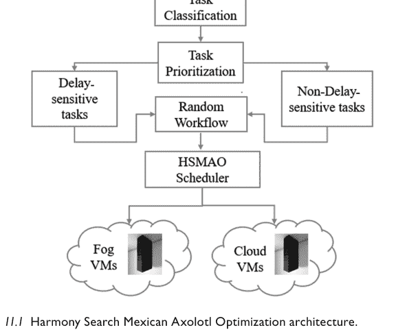

图 11.1 和声搜索墨西哥蝾螈优化架构。

在系统模型中，延迟敏感任务被分配给雾虚拟机 (VMs) 执行。位于网络边缘更近处的雾节点托管这些虚拟机，以最小化延迟并确保对时间关键任务的及时处理。雾计算提供与终端设备的接近性，能够为延迟敏感应用实现更快的响应时间和降低网络拥塞。然而，非延迟敏感任务则安排在位于集中式数据中心的云虚拟机上执行。这些任务通常对延迟要求不那么严格，可以容忍更长的处理时间。云数据中心提供充足的计算资源和存储容量，使其适合处理批量处理和存储密集型任务。

下面的方程 total fog_tasks 和 total cloud_tasks 分别表示分配给雾和云虚拟机的任务总数。这些表达式是通过分别对分配给每个雾虚拟机和云虚拟机的任务数量求和计算得出的。例如，total fog_tasks 是通过将分配给每个单独雾虚拟机的任务数量相加计算得出的，表示为 fog_t1、fog_t2 等，直到 fog_tn。同样，total cloud_tasks 是通过将分配给每个云虚拟机的任务数量相加计算得出的，表示为 cloud_t1、cloud_t2 等，直到 cloud_tn。这些表达式提供了一种简单的方法来计算分配给雾和云虚拟机的总工作负载，这对于分析 CFC 环境中的资源利用率、工作负载分布和系统性能非常有用。

```
Total fog_tasks = fog_t1 + fog_t2 + ⋯ + fog_tm    (11.2)
Total cloud_tasks = cloud_t1 + cloud_t2 + ⋯ + cloud_tn    (11.3)
```

系统模型的核心组件是 HSMAO 调度器，它根据任务特征和系统约束协调任务向雾和云虚拟机的分配。HSMAO 利用 HS 和墨西哥蝾螈启发式优化原理的结合来实现高效的 TS。通过动态适应不断变化的工作负载条件、资源可用性和任务优先级，HSMAO 优化资源利用率、最小化响应时间并增强整体系统性能。将 HSMAO 集成到系统模型中，有助于在 CFC 环境中实现自适应和智能的 TS，以满足物联网应用和终端用户的多样化需求。

### 11.3.1.1 随机工作流

在 CFC 中使用 HSMAO 算法的 TS 中，随机工作流使用策略在高效分配计算资源和优化任务执行方面发挥着至关重要的作用。CFC 环境中的工作流通常表示为有向无环图 (DAGs)，其中节点表示

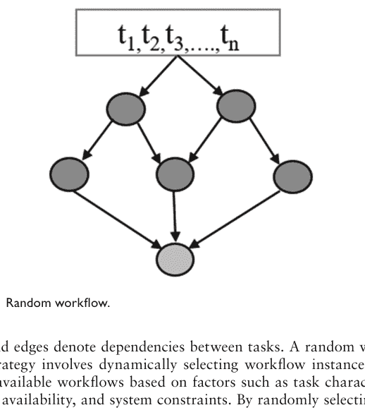

图 11.2 随机工作流。

有向无环图 (DAGs) 为 CFC 环境中任务依赖关系和执行顺序提供了结构化表示。DAG 中的每个节点代表一个任务，而节点之间的边表示任务之间的依赖关系。DAG 通过捕捉工作流的顺序和并行执行要求来促进高效的 TS。没有入边（即没有依赖关系）的任务可以并发执行，而具有依赖关系的任务必须等待其前驱任务完成后再执行。通过分析 DAG 结构和依赖关系，任务调度器可以制定最佳调度策略，以最小化响应时间、最大化资源利用率并满足 CFC 环境中的任务截止时间。

使用 HSMAO 算法的 TS 中的随机工作流使用策略利用 DAG 表示的灵活性和适应性，动态地将任务分配给雾节点和云数据中心。通过根据 DAG 特征随机选择工作流实例，任务调度器可以有效平衡计算工作负载并优化资源利用率。此外，使用 DAG 使任务调度器能够利用任务执行的并行性和并发性，从而提高 CFC 环境中整体系统性能和效率。


## 11.3.2 问题表述

CFC 中的 TS 问题旨在高效分配计算资源以执行一组任务，同时最小化响应时间、最大化资源利用率并满足任务截止时间。形式上，设 T 表示待调度的任务集合，其中每个任务 t_i 由其计算需求 C_i、截止时间 D_i、优先级 P_i 和延迟敏感性表征。此外，设 F 表示雾节点集合，C 表示系统中可用的云数据中心集合。目标是将每个任务分配给合适的计算资源（雾节点或云数据中心），并确定最优调度策略以最小化整体响应时间并最大化资源利用率，同时确保所有任务截止时间得到满足。

HSMAO 算法的时间复杂度主要取决于收敛到最优解所需的迭代次数。通常，HSMAO 的时间复杂度可表示为 O(N·M)，其中 N 表示种群大小，M 表示最大迭代次数。此外，HSMAO 中单个操作（如评估适应度函数和更新解向量）的复杂度可能因具体实现细节而异。

在结合 HS 和墨西哥 Axolotl 优化（MAO）的混合方法中，时间复杂度受各算法执行的迭代次数及其相互作用的影响。假设 N_HS 和 N_MAO 分别为 HS 和 MAO 的种群大小，M_HS 和 M_MAO 为各算法的最大迭代次数，则总体时间复杂度可表示如下。此外，HS 与 MAO 之间交互产生的计算开销也应在时间复杂度分析中予以考虑。

O((N_HS + N_MAO)·(M_HS + M_MAO)) (11.4)

### 11.3.2.1 目标函数

使用 HSMAO 算法时 CFC 中 TS 的目标函数旨在最小化整体响应时间，同时最大化资源利用率并满足任务截止时间。数学上，目标函数 f 可定义如下：

f = Σ_{i=1}^{n} ( w_1·R_i + w_2·U_i + w_3·E_i + w_4·(1 - D_i/C_i) ) (11.5)

其中

- n 为任务总数。
- R_i 表示任务 i 的响应时间，即任务完成所需的时间。
- U_i 表示分配给任务 i 的计算资源的资源利用率。
- E_i 为任务 i 消耗的能量。
- D_i 为任务 i 的截止时间。
- C_i 表示任务 i 的计算需求。
- w1、w2、w3 和 w4 是权重因子，分别决定响应时间、资源利用率和满足截止时间等相对重要性。

目标函数旨在在最小化响应时间、资源利用率和能耗之间取得平衡，并确保任务及时完成。权重因子 w1、w2、w3 和 w4 可根据 CFC 环境的具体要求和优先级进行调整。使用 HSMAO 算法优化该目标函数将产生高效的 TS 策略，提升系统性能并满足期望的服务质量目标。

### 11.3.2.2 资源利用率

资源利用率 U_i 在数学上定义为任务 i 的计算需求 C_i 与分配计算资源的总可用计算资源 C_total 之比。

$U_i = \frac{C_i}{C_{total}}$ (11.6)

上述方程量化了任务 i 所利用的分配计算资源的比例。该比率可作为衡量计算资源用于任务执行效率的指标。资源利用率值接近 1 表示最优利用，任务完全消耗分配的资源，而值接近 0 则表明资源利用不足。高效的资源利用对于最大化系统性能和确保 CFC 环境中计算资源的有效分配至关重要。

### 11.3.2.3 能量消耗

CFC 中能量消耗 E_i 的数学方程可表示为分配给任务 i 的计算资源的功率消耗率与任务执行时间的乘积。

$E_i = P_i \times T_i$ (11.7)

其中 P_i 表示功率消耗率，T_i 表示任务 i 的执行时间。该方程量化了任务 i 在执行期间消耗的能量。通过同时考虑功率消耗率和执行时间，该方程为 CFC 环境中单个任务的能量消耗提供了全面的度量。降低能量消耗对于提高 CFC 系统的可持续性和成本效益至关重要，使该方程在 TS 决策中优化能源效率方面具有价值。

### 11.3.2.4 响应时间

CFC 中响应时间 $R_i$ 的数学方程定义为任务 $i$ 完成执行所需的总时间，包括处理时间和等待时间。

$R_i = W_i + T_i$ (11.8)

其中 $T_i$ 表示任务 $i$ 的处理时间，$W_i$ 表示等待时间，即在队列中花费的时间或等待资源可用。该方程全面衡量了任务完全执行所需的时间，同时考虑了计算处理和排队延迟。最小化响应时间对于提高系统性能和满足 CFC 环境中应用程序和终端用户的响应性要求至关重要。因此，优化该方程是 TS 决策中的关键目标，以增强整体系统效率和用户体验。

### 11.3.2.5 所提算法

下面的算法给出了所提出的 HSMAO 算法的伪代码。

- **Input:** 任务特征、能量消耗、资源利用率和响应时间。
- 初始化和声和 Axolotl 种群。
- 根据目标函数评估每个和声和 Axolotl 的适应度。
- 重复直至收敛：
  执行 HS 阶段：
    使用音高调整和记忆考虑更新和声。
    评估更新后和声的适应度。
  执行 MAO 阶段：
    使用合作和适应原则更新 Axolotl。
    评估更新后 Axolotl 的适应度。
  合并和声和 Axolotl。
- 评估组合解的适应度。
- 选择下一迭代的最佳解。
- 根据获得的解确定任务到雾和云 VM 的分配。
- 在各自的 VM 上执行分配的任务。
- 根据需要重复调度过程以适应不断变化的工作负载条件。

输出：获得的最佳解。

## 11.4 结果与讨论

### 11.4.1 结果

来自 CloudSim 工具包仿真的结果揭示了部署在云和雾计算环境中的 VM 的性能指标。对于云 VM，VM 的总数从 15 到 25 不等，计算能力范围为 2,000 至 4,000 MIPS。云 VM 的 RAM 容量从 5,000 到 20,000 MB 不等，而带宽从 512 到 4,096 Mbps 不等。相比之下，雾 VM 的总数范围为 10 到 20，计算能力和 RAM 容量与云 VM 相似，即 2,000–4,000 MIPS 和 250–5,000 MB 分别。然而，雾 VM 的带宽较低，范围为 128 至 1,024 Mbps，反映了边缘计算资源的限制。

在我们提出的方法中，我们将使用 HSMAO 算法获得的结果与现有优化算法进行比较，包括 MAO、和声搜索优化（HSO）和蚁群优化（ACO）。通过全面评估，我们分析了响应时间、资源利用率和满足任务截止时间等各种性能指标。我们的结果表明，HSMAO 通过根据任务特征和系统约束高效分配任务，优于现有算法。HSMAO 有效地在云和雾资源之间平衡工作负载分配，在确保任务及时完成并满足服务质量要求的同时优化资源利用率。

### 11.4.1.1 资源利用率

就资源利用率而言，我们提出的利用 HSMAO 算法的方法与现有优化算法（如 MAO、HSO 和 ACO）相比取得了显著更优的结果。通过细致的评估，HSMAO 已证明其在优化资源分配方面的有效性，通过在云和雾计算环境中高效分配任务。通过动态适应不断变化

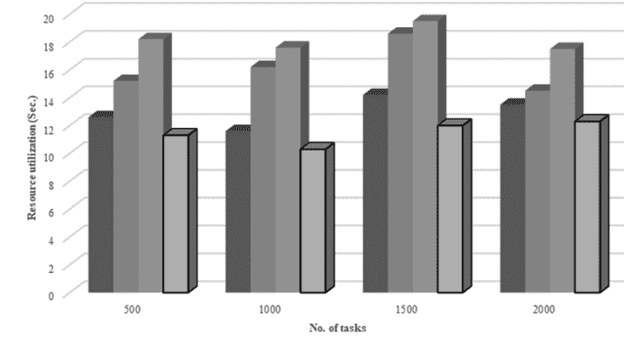

图 11.3 资源利用率计算。

工作负载条件和系统约束下，HSMAO 在最大化资源利用率的同时最小化响应时间并确保任务及时完成。这些结果凸显了 HSMAO 在解决 CFC 环境中 TS 挑战方面的有效性，使其成为增强系统性能和可扩展性的有前景的方法（图 11.3）。

### 11.4.1.2 能量消耗

我们提出的利用 HSMAO 算法的方法与现有优化算法（如 MAO、HSO 和 ACO）相比表现出优越的性能。通过严格的评估，HSMAO 有效地优化了 TS 决策，以在 CFC 环境中满足性能目标的同时最小化能耗。通过根据工作负载特征和系统约束动态分配任务，HSMAO 优化了资源利用率，减少了空闲时间并最小化了不必要的能源消耗。这些发现凸显了 HSMAO 在实现节能 TS 方面的有效性，有助于 CFC 系统的可持续性和成本效益（图 11.4）。

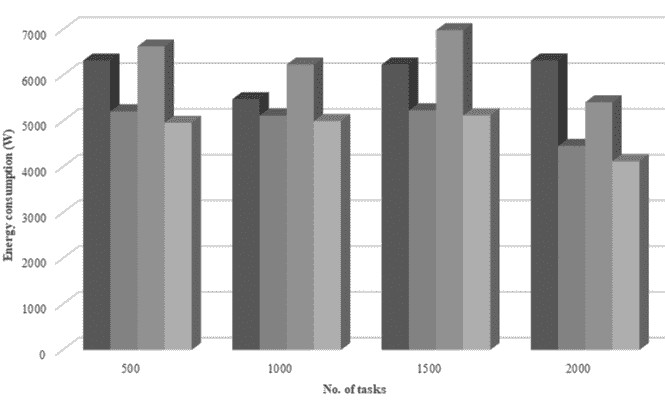

图 11.4 能量消耗计算。

### 11.4.1.3 响应时间

与现有优化算法（如 MAO、HSO 和 ACO）相比，HSMAO 算法显示出显著的改进。通过全面的评估，HSMAO 通过根据任务特征和系统约束在 CFC 环境中动态分配任务，有效地最小化了响应时间。通过在云和雾资源之间平衡工作负载分配并适应不断变化的工作负载条件，HSMAO 优化了资源利用率并减少了排队延迟，从而实现更快的任务完成和增强的系统响应能力。这些结果凸显了 HSMAO 在实现低响应时间并提高 CFC 环境中整体系统效率方面的卓越性能（图 11.5）。

### 11.4.2 讨论

在资源利用率、响应时间和能耗方面，我们采用 HSMAO 算法提出的方法与现有优化算法（如 MAO、HSO 和 ACO）相比显示出显著的功效。首先，就资源利用率而言，HSMAO 优化了跨云和雾计算资源的任务分配，与其他算法相比实现了更高的资源利用率。

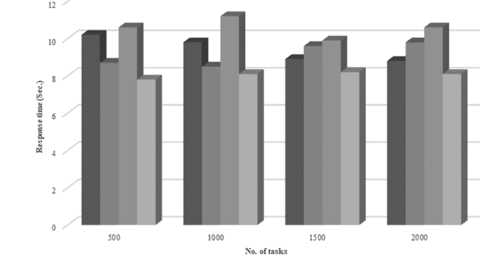

图 11.5 响应时间计算。

通过动态适应不断变化的工作负载条件和系统约束，HSMAO 确保了计算资源的高效利用，最小化了空闲时间并最大化了吞吐量。

关于响应时间，HSMAO 通过根据任务特征和系统动态智能调度任务，显著减少了任务响应时间。通过其自适应特性和稳健的优化技术，HSMAO 最小化了排队延迟并优化了任务执行，从而实现更快的完成时间和改善的系统响应能力。这对于时间敏感型应用和服务尤其有益，在这些应用和服务中，减少的响应时间对于满足性能要求和提升用户体验至关重要。

此外，就能耗而言，与现有算法相比，HSMAO 实现了显著的能源使用量减少。通过优化 TS 决策以在满足性能目标的同时最小化能耗，HSMAO 有效地减少了 CFC 系统的整体能源足迹。通过其动态任务分配和高效的资源利用策略，HSMAO 最小化了不必要的能源支出并促进了 CFC 环境中的可持续性。

## 11.5 结论与未来工作

总之，我们的研究提出了一种用于 CFC 环境中 TS 的新颖方法，利用 HSMAO 算法。通过全面的评估和与现有优化算法（如 MAO、HSO 和 ACO）的比较，我们证明了 HSMAO 在优化资源利用率、响应时间和能耗方面的有效性。HSMAO 根据任务特征和系统约束动态分配任务，与其他算法相比实现了更高的资源利用率、更低的响应时间和更低的能耗。结果凸显了 HSMAO 在提高 CFC 系统效率、性能和可持续性方面的重要性。展望未来，进一步的研究可以探索额外的优化目标、可扩展性考虑以及实际部署，以充分发挥 HSMAO 在应对 CFC 环境中 TS 不断变化的挑战方面的潜力。

## 参考文献

- 1. Binh Minh Nguyen, et al., “用于云雾计算环境中基于物联网的任务包应用的任务调度问题的进化算法。” *Applied Sciences* 9(9) (2019): 1730.
- 2. B. Shilpa, Puranam Revanth Kumar, and Rajesh Kumar Jha, “LoRa DL：利用自动编码器增强 LoRa 数据传输的深度学习模型。” *The Journal of Supercomputing* 79 (2023): 17079–17097.
- 3. Mohamed Shams, EL-BANBI Ahmed, and Helmy Sayyouh, “应用于储层工程辅助历史拟合的和谐搜索优化。” *Petroleum Exploration and Development* 47(1) (2020): 154–160.
- 4. Yenny Villuendas-Rey, et al., “墨西哥 Axolotl 优化：一种新颖的生物启发式启发法。” *Mathematics* 9(7) (2021): 781.
- 5. Roop Ranjan, Dilkeswar Pandey, Ashok Kumar Rai, Deepak Gupta, Pawan Singh, Puranam Revanth Kumar, and Sachi Nandan Mohanty, “利用自回归模型进行情感分类的流形级混合深度学习方法。” *Applied Sciences* 13(5) (2023): 3091.
- 6. Liyun Zuo, et al., “基于蚁群算法的云计算多目标优化调度方法。” *IEEE Access* 3 (2015): 2687–2699.
- 7. Bing Lin, et al., “多云环境中大数据应用的预处理工作流调度方法。” *IEEE Transactions on Network and Service Management* 13(3) (2016): 581–594.
- 8. N. Arivazhagan, K. Somasundaram, Gouse Baig Mohammad, Puranam Revanth Kumar et al., “用于电子医疗系统的基于混合蛾群火焰优化与深度神经网络算法的云-健康物联网任务调度。” *Scientific Programming* 2022 (2022): 1–12.
- 9. Feng Cheng, et al., “利用深度强化学习的云实例成本感知作业调度。” *Cluster Computing* 25 (2022): 1–13.
- 10. Zhou Zhou, et al., “云计算中任务调度优化的改进 PSO 算法。” *Concurrency and Computation: Practice and Experience* 30(24) (2018): e4970.
- 11. Gouse Baig Mohammad, Selvarajan Shitharth, and Puranam Revanth Kumar, “用于 URL 钓鱼检测的集成机器学习模型。” *International Journal of Grid and Distributed Computing* 14(1) (2021): 513–529.
- 12. Gyan Singh, and Amit K. Chaturvedi, “基于混合改进粒子群优化与遗传算法的云雾环境多目标优化工作流调度。” *Cluster Computing* 27 (2023): 1–18.
- 13. Puranam Revanth Kumar, and T. Ananthan, “使用 LabVIEW 进行标签检测的机器视觉。” *Journal of Innovation in Computer Science and Engineering (JICSE)* 9(1) (2019): 58–62.
- 14. Sundas Iftikhar, et al., “HunterPlus：面向云雾计算环境的基于 AI 的节能任务调度。” *Internet of Things* 21 (2023): 100667.
- 15. Zhenyu Yin, et al., “基于云雾计算的智能生产线多目标任务调度策略。” *Sensors* 22(4) (2022): 1555.
- 16. Puranam Revanth Kumar, “利用电感耦合的无线移动充电器。” *Journal of Emerging Technologies and Innovative Research (JETIR)* 5(10) (2018): 40–44.
- 17. Sudheer Mangalampalli, Ganesh Reddy Karri, and Mohit Kumar, “利用灰狼优化的云计算多目标任务调度算法。” *Cluster Computing* 26(6) (2023): 3803–3822.
- 18. Pejman Hosseinioun, et al., “利用混合元启发式算法的雾计算新型节能任务调度方法。” *Journal of Parallel and Distributed Computing* 143 (2020): 88–96.
- 19. Lindong Liu, et al., “基于分类挖掘的雾计算环境任务调度算法。” *Wireless Communications and Mobile Computing* 2018 (2018): 1–11.
- 20. B. Shilpa, Puranam Revanth Kumar, and Rajesh Kumar Jha, “密集室内 LoRa 网络干扰缓解的扩频因子优化。” *IEEE IAS Global Conference on Emerging Technologies (GlobConET)*, London, UK pp. 1–5 (2023).
- 21. Santhosh Kumar Medishetti, and Ganesh Reddy Karri, “EEOA：云雾框架中的成本与节能任务调度。” *Sensors* 23(5) (2023): 2445.
- 22. Santhosh Kumar Medishetti, and Ganesh Reddy Kumar, “EAEFA：云环境中一种高效的节能任务调度。” *EAI Endorsed Transactions on Scalable Information Systems* 11(3) (2024): 1–13.
