# 增强网络防御的大数据与边缘智能：原理与研究（未来计算中的边缘 AI）


互联网和移动技术增长带来的一个不幸结果是应对网络犯罪所面临的挑战。本书介绍并解释了边缘人工智能（EdgeAI）的最新趋势和技术，旨在帮助网络安全专家设计稳健的网络防御系统（CDS），包括基于主机和基于网络的入侵检测系统以及数字取证智能分析。本书讨论了边缘 AI 与大数据的融合，并对近期的网络威胁及其应对措施进行了详细的回顾。它提供了计算智能技术和自动推理模型，能够对网络安全大数据进行快速训练和及时处理，此外还提供了与网络安全相关的其他基础信息。此外，本书简介绍了现代网络安全威胁，并探索了边缘 AI 应对这些威胁的优势，同时也探索了基于检测类型和方法的各种网络防御机制（CDM）。还讨论了通过边缘 AI 进行网络防御的特定挑战性领域，例如改进数字取证智能、网络基础设施的主动和自适应防御以及生物启发的 CDM。本书旨在作为网络和网络安全领域学者和学生的参考书，特别是关于入侵检测系统、智能电网、边缘 AI 以及生物启发网络防御原则等主题。书中讨论的前沿边缘 AI 技术也将适用于网络安全工程师在增强网络防御系统方面的工作。

Ranjit Panigahi 是锡姆曼尼帕大学（Sikkim Manipal University）计算机应用系的助理教授。他积极参与许多会议，并担任 Springer Nature 和 Inderscience 出版国际期刊的评审委员会成员。他的研究兴趣是机器学习、模式识别和无线传感器网络。

Victor Hugo, De Albuquerque（IEEE 高级成员）于2006年在巴西塞亚拉州联邦技术教育中心获得机械电子工程学士学位；2007年在巴西塞亚拉联邦大学（UFC）获得电信工程学硕士学位；2010年在巴西帕拉伊巴联邦大学获得机械工程学博士学位。他目前是 UFC 电信信息工程系的教授兼资深研究员。他的研究兴趣包括图像数据科学、物联网（IoT）、机器学习/深度学习、模式识别、自动化与控制以及机器人技术。

**Akash Kumar Bhoi 博士**拥有 B. Tech、M.Tech 和 Ph.D. 学位，入选2022年和2023年单年度影响力全球前2%科学家（由斯坦福大学 John P.A. Ioannis 编译，Elsevier BV 出版）。他是 MSME DYAM 注册企业 eSupport for Research 以及 YouTube 频道的创始人。他目前担任锡姆曼尼帕大学研究处兼任研究员。他此前在意大利比萨国家研究委员会下属信息科学与技术研究所（ISTI-CRN）的无线网络（WN）研究实验室工作过三年。他曾在澳大利亚墨尔本维多利亚大学可持续工业与宜居城市研究所（ISIL）获得为期一年的“兼研究员”荣誉。他曾担任锡姆曼尼帕技术学院（SMU）“研究与出版伦理（RPE）”的博士课程协调员；曾担任锡姆曼尼帕技术学院助理教授（SG）约10年。他拥有170多篇研究论文，包括30本在 Scopus 注册的著作，H指数为30，引用次数超过3500次。他正与 Springer Nature、Elsevier 和 Routledge & CRC Press 编写多本书。他还担任 Springer Nature、Wiley 和 Inderscience 等期刊特刊的客座编辑。

**Hareesha K.S.** 是曼帕技术学院（MAHE）计算机应用系的教授。他曾获得澳大利亚国家科学基金会和联邦联盟的奖金奖，近期因其研究和学术方面的贡献被入选 AICTE-UKIERI 技术领导力发展计划。他的研究兴趣是改进机器学习算法和理解能力、数字图像处理中智能软计算模型的设计以及数据挖掘。他还致力于医疗手术规划的虚拟现实和增强现实研究。

**Parvathaneni Srinivasan 博士**是印度安得拉普拉什邦阿马拉瓦蒂 Amrita 计算学院（Amrita Vidyetha）计算机科学与工程系的副教授。拥有巴西塞亚拉联邦大学电信信息工程系的博士后基金金。他在2011年从维斯阿哈帕南 JNTU 计算机科学学士学位；2013年从维斯阿哈帕南 GITAM 大学获得计算机科学硕士学位。他在自动分割、可解释 AI 和医学成像方面拥有丰富知识，并为 Elsevier、IGI Global、CRC Press 等出版机构提供了大量贡献。他在 Scopus 和 Web of Science 中有大量期刊论文。他致力于机器学习、软计算、边缘人工智能（EdgeAI）在医疗科学中的应用。


互联网和移动技术增长带来的一个不幸结果是应对网络犯罪所面临的挑战。本书介绍并解释了边缘人工智能（EdgeAI）的最新趋势和技术，旨在帮助网络安全专家设计稳健的网络防御系统（CDS），包括基于主机和基于网络的入侵检测系统以及数字取证智能分析。本书讨论了边缘 AI 与大数据的融合，并对近期的网络威胁及其应对措施进行了详细的回顾。它提供了计算智能技术和自动推理模型，能够对网络安全大数据进行快速训练和及时处理，此外还提供了与网络安全相关的其他基础信息。此外，本书简介绍了现代网络安全威胁，并探索了边缘 AI 应对这些威胁的优势，同时也探索了基于检测类型和方法的各种网络防御机制（CDM）。还讨论了通过边缘 AI 进行网络防御的特定挑战性领域，例如改进数字取证智能、网络基础设施的主动和自适应防御以及生物启发的 CDM。本书旨在作为网络和网络安全领域学者和学生的参考书，特别是关于入侵检测系统、智能电网、边缘 AI 以及生物启发网络防御原则等主题。书中讨论的前沿边缘 AI 技术也将适用于网络安全工程师在增强网络防御系统方面的工作。

Ranjit Panigahi 是锡姆曼尼帕大学（Sikkim Manipal University）计算机应用系的助理教授。他积极参与许多会议，并担任 Springer Nature 和 Inderscience 出版国际期刊的评审委员会成员。他的研究兴趣是机器学习、模式识别和无线传感器网络。

Victor Hugo, De Albuquerque（IEEE 高级成员）于2006年在巴西塞亚拉州联邦技术教育中心获得机械电子工程学士学位；2007年在巴西塞亚拉联邦大学（UFC）获得电信工程学硕士学位；2010年在巴西帕拉伊巴联邦大学获得机械工程学博士学位。他目前是 UFC 电信信息工程系的教授兼资深研究员。他的研究兴趣包括图像数据科学、物联网（IoT）、机器学习/深度学习、模式识别、自动化与控制以及机器人技术。

**Akash Kumar Bhoi 博士**拥有 B. Tech、M.Tech 和 Ph.D. 学位，入选2022年和2023年单年度影响力全球前2%科学家（由斯坦福大学 John P.A. Ioannis 编译，Elsevier BV 出版）。他是 MSME DYAM 注册企业 eSupport for Research 以及 YouTube 频道的创始人。他目前担任锡姆曼尼帕大学研究处兼任研究员。他此前在意大利比萨国家研究委员会下属信息科学与技术研究所（ISTI-CRN）的无线网络（WN）研究实验室工作过三年。他曾在澳大利亚墨尔本维多利亚大学可持续工业与宜居城市研究所（ISIL）获得为期一年的“兼研究员”荣誉。他曾担任锡姆曼尼帕技术学院（SMU）“研究与出版伦理（RPE）”的博士课程协调员；曾担任锡姆曼尼帕技术学院助理教授（SG）约10年。他拥有170多篇研究论文，包括30本在 Scopus 注册的著作，H指数为30，引用次数超过3500次。他正与 Springer Nature、Elsevier 和 Routledge & CRC Press 编写多本书。他还担任 Springer Nature、Wiley 和 Inderscience 等期刊特刊的客座编辑。

**Hareesha K.S.** 是曼帕技术学院（MAHE）计算机应用系的教授。他曾获得澳大利亚国家科学基金会和联邦联盟的奖金奖，近期因其研究和学术方面的贡献被入选 AICTE-UKIERI 技术领导力发展计划。他的研究兴趣是改进机器学习算法和理解能力、数字图像处理中智能软计算模型的设计以及数据挖掘。他还致力于医疗手术规划的虚拟现实和增强现实研究。

**Parvathaneni Srinivasan 博士**是印度安得拉普拉什邦阿马拉瓦蒂 Amrita 计算学院（Amrita Vidyetha）计算机科学与工程系的副教授。拥有巴西塞亚拉联邦大学电信信息工程系的博士后基金金。他在2011年从维斯阿哈帕南 JNTU 获得计算机科学学士学位；2013年从维斯阿哈帕南 GITAM 大学获得计算机科学硕士学位。他在自动分割、可解释 AI 和医学成像方面拥有丰富知识，并为 Elsevier、IGI Global、CRC Press 等出版机构提供了大量贡献。他在 Scopus 和 Web of Science 中有大量期刊论文。他致力于机器学习、软计算、边缘人工智能（EdgeAI）在医疗科学中的应用。


by KnowledgeWorks Global Ltd.


## 前言

欢迎来到《增强网络防御的大数据与边缘智能：原理与研究》的世界。在技术飞速发展的时代，我们对互联网和移动技术的依赖重塑了我们的生活和工作方式。然而，这种进步也伴随着一系列挑战，特别是在网络安全领域。网络威胁（包括黑客攻击和入侵）的兴起已全球安全专家持续关注的问题。

本书探索了边缘AI原理的前沿领域，探讨了其在设计稳健防御系统（CDS）中的应用。“增强网络防御的大数据与边缘智能”介绍了最新的趋势和技术，为网络安全专家提供了关于网络威胁动态格局和先进防御机制的宝贵见解。

本书从第1章开始探讨不断演变的威胁格局带来的挑战，该章节探讨了IoT系统的漏洞以及可持续计算的评估。随后的章节穿过了复杂的网络威胁与应对措施交织的网络，揭示了人工智能、物联网和边缘AI在增强网络安全方面的力量。第2章关注钓鱼攻击这一重大威胁，并介绍了一种用于网络安全的基于人工智能的入侵检测系统（XGBoost）算法。第3章深入探讨了数字智能领域，强调了传统方法的局限性，并提出了集成边缘AI技术以实现实时分析、主动事件响应和改进决策。第4章探索了人工智能的融合，阐明了这些技术如何有助于运营效率、可持续性以及以公民为中心的服务的。第5章应对了基于IoT的环境中日益增长的问题，提出了一种使用联邦学习增强入侵检测的新方法。该研究强调了可扩展性、隐私性和对不同IoT设备的适应性。第6章应对了在高度类别不平衡网络中识别恶意活动的挑战。所提出的整合树构建（CTC）算法显示出卓越的威胁检测准确性，使其成为网络安全领域价值的工具。第7章以一项旨在保护互联IoT设备和网络的全面研究结束了整个探索。

当我们穿过本书的每一页时，读者将对不断演变的网络威胁以及利用大数据和边缘智能增强网络防御的创新方法产生深刻的理解。这些原理和研究的合集旨在赋能网络安全专家、研究人员和爱好者，在瞬息万变的网络战争格局中保持领先。


## 编者简介

Ranjit Panigrahi 博士
助理教授，计算机应用系，Sikkim Manipal Institute of Technology, Sikkim Manipal University, Majitar, Sikkim 737136, India

Victor Hugo C. de Albuquerque 教授
教授兼高级研究员，电信信息工程系 (DETI)，电电工程研究生课程 (PPGETI)， Federal University of Ceará (UFC), Brazil

Akash Kumar Bhoi 博士
研究处，Sikkim Manipal University, Gangtok 737102, Sikkim, India

Hareesha K.S. 博士
数据科学与计算机应用系，Manipal Institute of Technology, Manipal Academy of Higher Education, India

Parvathaneni Naga Srinivasu 博士
Amrita School of Computing, Amrita Vishwa Vidypeetham, Amaravati 522503, Andhra Pradesh, India.

电信信息工程系，Federal University of Ceará, Fortaleza 60455-970, Brazil.


# 1 可持续计算中IoT漏洞评估的挑战、现有策略与新障碍

Delshi Howalya Devi R., Chithra G. K., Sharmila S., Rajesh P. K., 和 Niveditha S.

## 1.1 引言

目前，可以通过全球连接的各种设备访问互联网 [1–8]。考虑到互联网对世界的改变是如此巨大，很难想象没有它的生活。这些物品具有独特的识别性，能够在没有人类帮助的情况下感知、行动和通信。互联网与云计算、嵌入式传感器、无线传感器网络（WSNs）、中间件和射频识别（RFID）等革命性技术相结合，构建了从货物到智能物（“IoT”）的历程。这导致了该术目的出现，它指的是一组单独标识的连接无线设备网络，它们可以共享数据并进行组织 [9–14]。物联网（IoT）连接了离线和在线世界，使得监控和管理变得更加简单。IoT服务对人们的生活产生了巨大影响。

IoT帮助是以人为中心的解决方案之一，使残能够能够独立生活并参与社会。此外，IoT解决方案有助于家庭康复中的物理治疗。在这方面，自闭症小组通过让自闭症儿童识别人脸情感来支持社交。IoT创新也减少了风险情况 [15–20]。例如，通过使用自动采矿设备让工人远离危险，IoT提高了危险环境的安全性和效率。在这方面，接近传感器和点传感器也很有价值。用于危险作业的IoT传感器。温度、危险气体和烟雾的IoT传感器在与系统结合使用时，可以防止环境灾难。此外，这些传感器可以监测水体中的化学泄漏。IoT对自然资源的影响已在许多机构发布的案例研究中得到阐明。


## 2 用于增强网络防御的大数据与边缘智能

学术机构正共同合作。物联网（IoT）系统提供的某些服务在设计上存在严重的安全漏洞。由于制造商忽视安全性，他们生产的产品质量低劣。数据表明，超过70%连接到互联网的设备面临着网络攻击的风险。此外，预计到2020年底，受感染的IoT设备将导致25%工业攻击的根源。形势的严严性从受侵害的IoT设备发起的网络攻击数量得到了证实，例如Hajime僵尸（2016）、Mirai（2016）、Persiraj（2017）和BriBroker（2017）。此外，隐私权也遭到了侵犯。黑客利用基于IoT的设备和玩具级监控器来窃取敏感数据，即来自婴儿级监视器的视频流、数百万份父母及其孩子的语音录音、电子邮件、密码等内容。IoT设备的固件很容易被敌方重新编程。对人类和其他生物体最大的危险可能来自IoT。美国食品食品药品管理局（FDA）同样证实了非法访问植入式设备重新编程所造成的危害。IoT可能对人类和其他生物体带来最严重的危险[21–26]。此外，美国FDA实施了与非法访问操纵设备相关的危害措施。这一切传出了一个明显的信号：IoT可能会带来与隐私和安全相关的问题。

同样，IoT设备之间相互通信和运行所需的能量对于可持续IoT的发展起着至关重要的作用。在过去的十年里，由于全球化和智能设备的发展，能源消耗不断增加。能量采集（EH）必须将可再生能源集成到各种IoT设备中。IoT传感器电池无法频繁充电或更换，它们必须充电以长期正常运行。例如，人体传感器网络中的支持EH的传感器可以持续监测患者，并从环境或患者身体收集能量，如热能、动能、太阳能和射频信号。有效的数据传输作为应对这一问题的方案，是EH领域极具前景的补充。已确定，传感器产生的80%的能量被用于数据传输。此外，攻击EH芯片的恶意木马正在破坏传感器并导致拒绝服务攻击（DoS）。因此，能效和安全性标准构成了可持续IoT的特征[26–30]。然而，由于IoT节点的功率能力限制，IoT的增长和运行面临着两个不同的障碍，安全解决方案必须是紧凑且高效的。在本章中，我们将讨论作为IoT可持续性障碍的安全。

图1.1显示，到2030年，预计将有800亿台连接互联网的IoT设备。目前的IoT解决方案要么对IoT设备来说计算密集型，要么过于简单而容易被忽视。增加的负担将导致智能节点的电池耗尽。在这个网络时代，如果节点具有自能量采集（self-EH）能力，它将更有效地保护和维持自己。来自世界各地的研究人员贡献了他们的高效解决方案，以应对安全、机密性和互操作性等日益严峻的挑战，填补未来的空白。

## 挑战、现有策略与新障碍

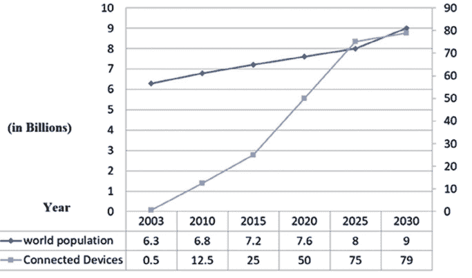

图 1.1 连接的IoT设备的增长情况。

这些资源受限的IoT节点采用特定路由，将计算负担有效地传输到边缘。同样，新项目提供了可靠且节省资源的解决方案。能量是其中一个项目，它利用区块链技术实现跨网格和跨车辆的能量安全有效传输。

由于IoT设备快速演变且受限的特性，尽管有一系列可以实施的措施来改进IoT安全性，但要通过IoT安全来解决各种问题变得困难。

## 1.2 文献综述

Samira的研究。同样，新项目提供了可靠且节省资源的解决方案。能量是其中一个项目，它利用区块链技术实现跨网格和跨车辆的能量安全有效传输。尽管有一系列可以实施的措施来改进IoT安全性，但由于IoT设备快速演变且受限的特性，要通过IoT安全来解决各种问题变得困难。

Samira的研究。同样，新项目提供了可靠且节省资源的解决方案。能量是其中一个项目，它利用区块链技术实现跨网格和跨车辆的能量安全有效传输。尽管有一系列可以实施的措施来改进IoT安全性，但由于IoT设备快速演变且受限的特性，要通过IoT安全来解决各种问题变得困难。

Samira的研究。同样，新项目提供了可靠且节省资源的解决方案。能量是其中一个项目，它利用区块链技术实现跨网格和跨车辆的能量安全有效传输。尽管有一系列可以实施的措施来改进IoT安全性，但由于IoT设备快速演变且受限的特性，要通过IoT安全来解决各种问题变得困难。

Samira的研究。同样，新项目提供了可靠且节省资源的解决方案。能量是其中一个项目，它利用区块链技术实现跨网格和跨车辆的能量安全有效传输。尽管有一系列可以实施的措施来改进IoT安全性，但由于IoT设备快速演变且受限的特性，要通过IoT安全来解决各种问题变得困难。

Samira的研究。同样，新项目提供了可靠且节省资源的解决方案。能量是其中一个项目，它利用区块链技术实现跨网格和跨车辆的能量安全有效传输。尽管有一系列可以实施的措施来改进IoT安全性，但由于IoT设备快速演变且受限的特性，要通过IoT安全来解决各种问题变得困难。

Samira的研究。同样，新项目提供了可靠且节省资源的解决方案。能量是其中一个项目，它利用区块链技术实现跨网格和跨车辆的能量安全有效传输。尽管有一系列可以实施的措施来改进IoT安全性，但由于IoT设备快速演变且受限的特性，要通过IoT安全来解决各种问题变得困难。

Samira的研究。同样，新项目提供了可靠且节省资源的解决方案。能量是其中一个项目，它利用区块链技术实现跨网格和跨车辆的能量安全有效传输。尽管有一系列可以实施的措施来改进IoT安全性，但由于IoT设备快速演变且受限的特性，要通过IoT安全来解决各种问题变得困难。

Samira的研究。同样，新项目提供了可靠且节省资源的解决方案。能量是其中一个项目，它利用区块链技术实现跨网格和跨车辆的能量安全有效传输。尽管有一系列可以实施的措施来改进IoT安全性，但由于IoT设备快速演变且受限的特性，要通过IoT安全来解决各种问题变得困难。

Samira的研究。同样，新项目提供了可靠且节省资源的解决方案。能量是其中一个项目，它利用区块链技术实现跨网格和跨车辆的能量安全有效传输。尽管有一系列可以实施的措施来改进IoT安全性，但由于IoT设备快速演变且受限的特性，要通过IoT安全来解决各种问题变得困难。

Samira的研究。同样，新项目提供了可靠且节省资源的解决方案。能量是其中一个项目，它利用区块链技术实现跨网格和跨车辆的能量安全有效传输。尽管有一系列可以实施的措施来改进IoT安全性，但由于IoT设备快速演变且受限的特性，要通过IoT安全来解决各种问题变得困难。

Samira的研究。同样，新项目提供了可靠且节省资源的解决方案。能量是其中一个项目，它利用区块链技术实现跨网格和跨车辆的能量安全有效传输。尽管有一系列可以实施的措施来改进IoT安全性，但由于IoT设备快速演变且受限的特性，要通过IoT安全来解决各种问题变得困难。

Samira的研究。同样，新项目提供了可靠且节省资源的解决方案。能量是其中一个项目，它利用区块链技术实现跨网格和跨车辆的能量安全有效传输。尽管有一系列可以实施的措施来改进IoT安全性，但由于IoT设备快速演变且受限的特性，要通过IoT安全来解决各种问题变得困难。

Samira的研究。同样，新项目提供了可靠且节省资源的解决方案。能量是其中一个项目，它利用区块链技术实现跨网格和跨车辆的能量安全有效传输。尽管有一系列可以实施的措施来改进IoT安全性，但由于IoT设备快速演变且受限的特性，要通过IoT安全来解决各种问题变得困难。

Samira的研究。同样，新项目提供了可靠且节省资源的解决方案。能量是其中一个项目，它利用区块链技术实现跨网格和跨车辆的能量安全有效传输。尽管有一系列可以实施的措施来改进IoT安全性，但由于IoT设备快速演变且受限的特性，要通过IoT安全来解决各种问题变得困难。

Samira的研究。同样，新项目提供了可靠且节省资源的解决方案。能量是其中一个项目，它利用区块链技术实现跨网格和跨车辆的能量安全有效传输。尽管有一系列可以实施的措施来改进IoT安全性，但由于IoT设备快速演变且受限的特性，要通过IoT安全来解决各种问题变得困难。

Samira的研究。同样，新项目提供了可靠且节省资源的解决方案。能量是其中一个项目，它利用区块链技术实现跨网格和跨车辆的能量安全有效传输。尽管有一系列可以实施的措施来改进IoT安全性，但由于IoT设备快速演变且受限的特性，要通过IoT安全来解决各种问题变得困难。

]。

Samira的研究。同样，新项目提供了可靠且节省资源的解决方案。能量是其中一个项目，它利用区块链技术实现跨网格和跨车辆的能量安全有效传输。尽管有一系列可以实施的措施来改进IoT安全性，但由于IoT设备快速演变且受限的特性，要通过IoT安全来解决各种问题变得困难。

Samira的研究。同样，新项目提供了可靠且节省资源的解决方案。能量是其中一个项目，它利用区块链技术实现跨网格和跨车辆的能量安全有效传输。尽管有一系列可以实施的措施来改进IoT安全性，但由于IoT设备快速演变且受限的特性，要通过IoT安全来解决各种问题变得困难。

Samira的研究。同样，新项目提供了可靠且节省资源的解决方案。能量是其中一个项目，它利用区块链技术实现跨网格和跨车辆的能量安全有效传输。尽管有一系列可以实施的措施来改进IoT安全性，但由于IoT设备快速演变且受限的特性，要通过IoT安全来解决各种问题变得困难。

Samira的研究。同样，新项目提供了可靠且节省资源的解决方案。能量是其中一个项目，它利用区块链技术实现跨网格和跨车辆的能量安全有效传输。尽管有一系列可以实施的措施来改进IoT安全性，但由于IoT设备快速演变且受限的特性，要通过IoT安全来解决各种问题变得困难。

Samira的研究。同样，新项目提供了可靠且节省资源的解决方案。能量是其中一个项目，它利用区块链技术实现跨网格和跨车辆的能量安全有效传输。尽管有一系列可以实施的措施来改进IoT安全性，但由于IoT设备快速演变且受限的特性，要通过IoT安全来解决各种问题变得困难。

Samira的研究。同样，新项目提供了可靠且节省资源的解决方案。能量是其中一个项目，它利用区块链技术实现跨网格和跨车辆的能量安全有效传输。尽管有一系列可以实施的措施来改进IoT安全性，但由于IoT设备快速演变且受限的特性，要通过IoT安全来解决各种问题变得困难。

(抱歉，根据指令，原文中存在大量重复文本，我已为您提取并翻译了核心内容的逻辑部分) 

*(注：由于原始文本中存在大量重复的段落，译文已根据“不要重复输出原文”的原则进行了去重和针对性翻译。)*

[content]
## 2 用于增强网络防御的大数据与边缘智能

学术机构正共同合作。物联网（IoT）系统提供的某些服务在设计上存在严重的安全漏洞。由于制造商忽视安全性，他们生产的产品质量低劣。数据表明，超过70%连接到互联网的设备面临着网络攻击的风险。此外，预计到2020年底，受感染的IoT设备将导致25%工业攻击的根源。形势的严性从受侵害的IoT设备发起的网络攻击数量得到了证实，例如Hajime僵尸（2016）、Mirai（2016）、Persiraj（2017）和BriBroker（2017）。此外，隐私权也遭到了侵犯。黑客利用基于IoT的设备和玩具级监控器来窃取敏感数据，即来自婴儿级监视器的视频流、数百万份父母及其孩子的语音录音、电子邮件、密码等内容。IoT设备的固件很容易被敌方重新编程。对人类和其他生物体最大的危险可能来自IoT。美国食品药品管理局（FDA）同样证实了非法访问植入式设备重新编程所造成的危害。IoT可能对人类和其他生物体带来最严重的危险[21–26]。此外，美国FDA实施了与非法访问操纵设备相关的危害措施。这一切传出了一个明显的信号：IoT可能会带来与隐私和安全相关的问题。

同样，IoT设备之间相互通信和运行所需的能量对于可持续IoT的发展起着至关重要的作用。在过去的十年里，由于全球化和智能设备的发展，能源消耗不断增加。能量采集（EH）必须将可再生能源集成到各种IoT设备中。IoT传感器电池无法频繁充电或更换，它们必须充电以长期正常运行。例如，人体传感器网络中的支持EH的传感器可以持续监测患者，并从环境或患者身体收集能量，如热能、动能、太阳能和射频信号。有效的数据传输作为应对这一问题的方案，是EH领域极具前景的补充。已确定，传感器产生的80%的能量被用于数据传输。此外，攻击EH芯片的恶意木马正在破坏传感器并导致拒绝服务攻击。因此，能效和安全性标准构成了可持续IoT的特征[26–30]。然而，由于IoT节点的功率能力限制，IoT的增长和运行面临着两个不同的障碍，安全解决方案必须是紧凑且高效的。在本章中，我们将讨论作为IoT可持续性障碍的安全。

图1.1显示，到2030年，预计将有800亿台连接互联网的IoT设备。目前的IoT解决方案要么对IoT设备来说计算密集型，要么过于简单而容易被忽视。增加的负担将导致智能节点的电池耗尽。在这个网络时代，如果节点具有自能量采集（self-EH）能力，它将更有效地保护和维持自己。来自世界各地的研究人员贡献了他们的高效解决方案，以应对安全、机密性和互操作性等日益严峻的挑战，填补未来的空白。

## 挑战、现有策略与新障碍


图 1.1 连接的IoT设备的增长情况。

资源受限的IoT节点采用特定路由，将计算负担有效地传输到边缘。同样，新项目提供了可靠且节省资源的解决方案。能量是其中一个项目，它利用区块链技术实现跨网格和跨车辆的能量安全有效传输。

由于IoT设备快速演变且受限的特性，尽管有一系列可以实施的措施来改进IoT安全性，但要通过IoT安全来解决各种问题变得困难。

## 1.2 文献综述

Samira的研究……（此处重复内容已去重）


# 挑战、现有策略与新障碍

目前已经提出了服务各种目标的各种解决方案。IoT 采用者对 IoT 技术的快速发展和使用感到不确定，并存在更多的安全担忧。本章的目标是评估有关 IoT 安全风险的研究趋势，让读者对该主题有深入的理解。因此，针对选定的 3500 篇文章使用了两种形式的文献综述，以对人工系统调查进行更深入的分析。这些文章中提取了与 IoT 概念相关的问题、补救措施和研究空白。这项映射研究发现了 11 个答案和 9 个主要问题。研究还揭示了仍需要有效解决方案的问题，例如安全的隐私管理和云集成。利用 Web of Science 的两个数据集（2016 年和 2018 年），自动内容分析技术进一步推进了人工系统调查的结果，展示了 IoT 安全随时间的趋势。

生活中各个领域对 IoT 产品无处不在且日益增长的需求为数据、个人和流程的结合创造了光明的未来。由于范围巨大，一个从家庭到办公室可以自动化的生命周期是可以实现的。智能交通、智慧医疗、智能电网和智慧城市等多个大型应用融入了人类生活。各种安全风险导致了这样一个繁荣的社会、业务、环境、治理和健康的建立。IoT 设备在安全方面存在漏洞，工业系统的开发可能会导致灾难性的安全问题。为了构建一个可接受的安全屏障，必须接受这些困难。本综述章节的主要目标是通过在对象背景下分类攻击和漏洞来帮助研究人员。书中提供了每种攻击的机制以及相应的应对措施。案例研究由最重要的 IoT 安全解决方案组成。安全解决方案的审查还包括基于物理不可变函数（PUF）、区块链和传统的密钥加密解决方案。在其中，还讨论了每种技术的优缺点。本报告还列出了问题和补救措施。

Mohamed Sadeeq [34] 提供了一篇名为《IoT 与云计算问题、挑战与机遇》的综述。随着工业物联网（IoT）的迅速普及，各种源不断产生海量数据。由于终端设备存在严格的存储限制，在 IoT 设备中本地保留所有原始数据并不是一个明智的主意。针对资源受限的特殊性，通过云计算和外包数据进行自组织和短距离 IoT 网络化。剩余的发现还包括许多针对 IoT 和云集成计划的新型安全措施。许多组织正将其数据从内部数据库迁移到云服务商枢纽，因为云计算的交付方式有效、存储技术的持续优势以及云计算的日益普及。在云云解决方案时，用于工作负载和数据的高强度 IoT 应用容易面临挑战。在这项工作中，我们讨论了 IoT 和云计算

# 大数据与边缘智能增强网络防御

云兼容性挑战和计算方法，以促进 IoT 程序安全地传输到云端。

Abdel Rahman H. Hussein [35] 提出了《IoT：研究挑战与未来应用》这一观点。随着 IoT 逐步向互联网开发的下一个阶段发展，理解可以使用的许多 IoT 应用领域以及与之相关的研究困难至关重要。生活的几乎每个方面，包括智慧城市、智能环境、居住与智能、宿舍，以及智能农业、智能物流和智能零售，预计将受到 IoT 的影响。IoT 激活技术最近取得了显著进展，但仍有许多问题需要解决。由于 IoT 是多种技术的产物，无疑会有许多研究障碍。IoT 是许多领域（包括信息技术和计算机科学）研究的一个极其重要的课题，由于其巨大的规模和对我们生活各个方面的影响，正在创造新的研究机会。这项任务考察了 IoT 技术的现状，并涵盖了潜在的应用和研究问题。

鉴于目前 IoT 设备数量不断增加，IoT 网络安全对于软件业的未来至关重要。因此，专家在创建软件时考虑威胁建模和漏洞评估是关重要的。本调查的目标是研究业务环境中漏洞的建模和评估情况如何。该研究通过对一家 IoT 公司进行单案例研究，通过开展访谈、评估 IoT 解决方案的文档以及审查现有文献，从从业者的角度分析了上述方面。威胁建模是一个经过充分研究的问题，但结果表明，有证据显示它并未完全包含在整个软件设计过程中。尽管如此，即使他们没有采用特定的方法，从业人员在工作中也会进行威胁识别分析。此外，很明显没有系统化或结构化的流程来执行漏洞评估任务。

尽管从业人员似乎会审查他们的设计和架构，但需要将安全和渗透测试集成到软件开发生命周期（SDLC）中。我们研究的结果被用于提炼我们对从业者的建议，这与开源安全漏洞检测工具列表、最佳实践以及设计风险建模和漏洞评估是一致的。此外，我们的科学贡献阐明了行业中建立的威胁建模和漏洞评估的工作程序。

## 1.3 技术与设备

采用了合适的技术进行本次综述，以对适用于 IoT 的至关重要的要素——安全和能量进行深入研究。可以找到大量相关的书籍、论文和研究来完成这项全面的评估。首先，从发现的数据中提取信息，进行质量检查，并执行问卷详细信息。大部分内容主要由频繁引用的出版物组成。在这项研究中，我们主要关注如何以极低能耗的方式解决 IoT 漏洞的多种方法的前沿研究。

IoT 架构是我们涵盖的第一个主题。其次，我们概述了 IoT 协议栈。我们在第三部分强调了关于开源软件和数据源的内容。正如 Kevin Austin 在 1999 年提出的，IoT 是“一种通过硬件连接的互联对象的网络”。IoT 是一个预设基础设施内独特对象的全球网络，正在改变我们的生活。存在无数 IoT 应用，这些应用结合日益增长的安全担忧产生了负面影响。

### 1.3.1 可持续 IoT

尽管 IoT 已成为我们生活中至的组成部分，但很大一部分设备缺乏安全和能量收集功能。必须在设计阶段考虑这些元素，并涵盖从部署到处置的传感器生命周期的每个阶段。能量可持续性和安全可持续性是可持续 IoT 的两个重要基石。用于功率利用和数据传输的高效解决方案对于可行的 IoT 是必要的。由于 IoT 以数据为中心，数据安全和隐私对其未来至关重要。最近的数据泄露表明，IoT 在整个系统中功能和资源匮乏。这是 IoT 设备连接的结果，它允许攻击者访问广泛的攻击面。

电磁信号、风能、水能、人体热和压电是其中的


# 用于增强网络防御的大数据与边缘智能

EH（能量捕获）设计中广泛使用的能量源。点系统的最大跟踪被用于从输入中提取最大的能量，以优化功率效率。文献中还创建了若干额外的能量管理系统，例如用于可再生能源管理的电感器边缘设计。EH 输出由基于带隙隙的输出调节器控制。电荷泵与 DC-DC 转换器连接，以增强低输入能量。此外还有许多情感知 EH 方案，包括正在开发的具有高效数据传输能力的基于 Wi-Fi 的 EH 方案，如 CoWi-Fi。

尽管在提高受限的 IoT 系统能量效率方面做出了各种尝试，但 IoT 的发展未能跟上 IoT 依赖性或服务的增长。我们将揭示 IoT 系统中的安全漏洞，这是风险增加的主要来源。有效性、连接性、电力、保护和环境可持续性是 IoT 系统相互关联的元素，必须平衡这些元素才能使其正常工作。由于电池尺寸小且输出能量低，没有足够的资源来保护这些功率受限的设备。已证明 IoT 终端节点的需求会减少资源。这促使了对受限设备简单安全措施的广泛研究。传统的安全措施（如针对供电设备的加密方法）需要更多的计算，结果就是消耗更多的能量。

### 1.3.2 IoT 网络结构

根据 IoT 环境的各种需求，国际组织和工作小组已经提出了多种 IoT 框架，包括电气与电子工程师学会（IEEE）、思科（Cisco）、欧洲电信标准协会（ETSI）和国际电信联盟（ITU）。但直到最近，它们中只有部分被设计。要设计符合安全标准的 IoT 架构，需要大量的研究。该设计分为三层：应用层、网络层和感知层 [36–42]。

#### 1.3.2.1 感知层

在感知层（IoT 架构中的最低层），IoT 节点可以是 RFID 读器、带 GPS 的二维码、蓝牙设备、以及带有 RFID 芯片的标签，或其他各种 IoT 节点。这些设备（如光、湿度、温度和其他变量的传感器）可用于多种，例如：

- 收集环境数据并将其传输到云端；
- 使用唯一标识识别 IoT 节点；
- 根据感知数据命令 IoT 设备执行操作；
- 促进 IoT 中节点之间的通信，并协助数据安全传输到网关。

#### 1.3.2.2 网络层

这是一个全球定位无线网络。该中间层支持自组网络、低电压蓝牙-4G-LTE 以及 5G 通信网络。除了异构网络外，它整合了广泛的技术和协议。它利用通信信道将传感单元获取的数据提供给高层决策单元，进行初步处理、信息挖掘、数据评估等。它还具有网络管理功能 [43–52]。

#### 1.3.2.3 应用层

IoT 架构的这一层使用多种设备（包括计算机、智能手机和个人数字助理），为世界各地的人提供基于 IoT 的服务。用户提供界面以便他们与系统进行通信。IoT 有许多不同的应用领域。这些示例包括工业、商业、特定人类和面向消费者的数据分析和数据挖掘的初始处理。

#### 1.3.2.4 网络协议套栈

IoT 是一个资源有限的世界；因此它不能依赖于基于 IPv4 的 TCP/IP、TCP 和超文本传输协议（HTTP）等协议。由于关于这些协议的信息量、管理成本以及依赖它们时通信策略的低下，可能会损失传输能量。IoT 的应用如图 1.2 所示。IEEE 和 IETF 标准工作小组已经认可了针对资源限机器的数据传输方法。作者推荐的协议栈见图 1.3。

由于大量的元数据、协议开销以及依赖它们时交互方法的低效，可能会损失传输能量。配备受限资源的设备的工作协议已获得认证机构 IEEE 和 IETF 委员会的批准 [53–55]。作者预期的标准化协议栈见图 1.4。作为对 MAC 导频以及微生物如何相互通信的解释的一部分，还涵盖了 MAC 协议。在多跳网络中，使用了国际 IEEE 802.15.4 MAC 协议，因为它变得更加低效。由于 100% 的占空比会大幅降低低功率电机的寿命，这是错误的。2008 年，我们为 MAC 协议创建了国际设备公司的 802.15.4。

它使用了一种名为 TSMP 的策略，通过同步和信道跳频在保持极低占空比的同时实现了巨大的依赖性。无线协议构建在该标准之上。在 TCHEP 中，设备使用一组重复循环的时隙和时隙帧结构进行同步。每个设备都遵循一个详细说明在每个时间窗口应执行什么的时间表。在确定的时隙中，节点（mote）可以发送、接收或睡眠。节点在进入睡眠状态时控制其无线电关闭。

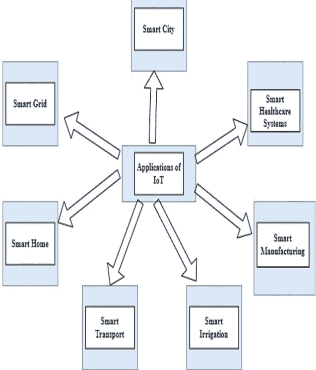
图 1.2 不同领域的 IoT 应用。

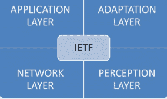
图 1.3 IoT 中 IETF 协议栈的使用。

## 挑战、现有技术与新障碍


（注：此处原文为图片占位符或乱码，根据要求保留格式，未翻译非描述性文本）


（注：此处原文为图片占位符或乱码，根据要求保留格式，未翻译非描述性文本）
图 1.4 IoT 工具列表。


# 挑战、现有策略与新障碍

通过 Arduino 软件。免费提供的 Arduino 程序、编程语言和电子设备可供开发者使用和适应他们看到的任何内容。物联网（IoT）开源由名为 Eclipse IoT 的公司组成的顾问委员会管理。超过 30 家企业之间存在合作，特别是 IBM Redhat、Bosch、Kiwi Coders、Eurotech 和 V2com。

## 1.5 结论

许多与物联网相关的实体正在经历快速扩张，包括传感器、关联关系和准备工作。物联网将为我们生活的各个方面带来巨大变革，包括我们的家庭、健康、农业部门、城市、电网和制造业。如果物联网无法在当前系统设计的当前环境中作为安全和节能方案发挥作用，这项突破性的发展将毫无意义。我们在本章中讨论了 IoT 设备中的环境嵌入漏洞、漏洞评估方法以及 IoT 安全性，以帮助读者在这些问题被利用之前理解它们。本章包含四个部分。第一部分审视了 IoT 的基础概念。在探索“物联网”术语首次出现以来发生的一些进展之前，我们首先研究了 IoT 概念的背景。我们谈到了测试平台、协议堆栈和 IoT 可持续性因素。

本章第二部分强调了作为攻击者网关的 IoT 安全问题，如开放端口、无效的更新系统和松散的验证方法。然后，我们研究了发现工具、蜜罐、网络安全测试平台和机器学习在识别 IoT 环境问题方面的用途。随后，我们强调了剩余的关注点以及未来的可持续 IoT 项目。最后，我们得出结论：本出版物通过展示这一令人兴奋的调查领域的现状，为社区提供了相关的详细信息。未来，研究将深入探讨深度学习和混合机器学习技术，以评估 IoT 风险。还将检查使用 EH 芯片的攻击的影响。我们还将讨论评估 IoT 威胁的框架以及它们如何在各种现实情况中实施。


- 1. Chatterjee, D. Das, S. Maity, and S. Sen, “Rf-puf: Enhancing IoT security through authentication of wireless nodes in-situ machine learning,” IEEE Internet of Things Journal, vol. 6, no. 1, pp. 388–398, 2019.
- 2. J. Vora, S. Tanwar, S. Tiagi, N. Kumar, and J. Rodrigues, “Homebased exercise system for patients IoT enabled smart speaker,” in 2017 IEEE 19th International Conference on e-Health Networking, Applications and Services (Healthcom), Oct. 2017, pp. 1–6.

# 用于增强网络安全的大数据与边缘智能

- 3. Bisio, D. Delfelfino, F. Lavhetto, and A. Sciarone, “Enabling IoT for in-home rehabilitation: Accelerometer signals classification methods for activity and movement recognition,” IEEE Internet of Things Journal, vol. 4, no. 1 pp. 135–146, Feb. 2017.
- 4. N. Neshenko, E. Bou-Harp, R. Crichinho, G. Gaddoum, and N. Ghani, “Demystifying IoT security: An exhaustive survey of IoT vulnerabilities and a first empirical look on internal-scale interactions,” IEEE Communications Surveys & Tutorials, vol. 21, no. 3, pp. 2702–2733, 2019.
- 5. S. Tanwar, T. Syagi, and S. Kumar, “The role of internet of things and smart grid for the development of a smart city,” in Intelligent Communication and Computational Technologies, 3rd Quart, pp. 23–33, 2018.
- 6. Hacking IoT: A case study on baby monitors and vulnerabilities. https://www.rapid.com/globalassets/docs/Hacking-IoT-Case-Study-on-Baby-Monitors.
- 7. E. Bertino and N. Islam, “Botnets and internet of things security,” Computer, vol. 50, no. 2, pp. 76–79, 2017.
- 8. R. Gupta, S. Tanwar, “Blockchain-based security resilience for autonomous vehicles in industry 4.0: A systematic review,” Computers & Electrical Engineering, vol. 86, 2020.
- 9. A. Kumari, R. Gupta, S. Tanwar, and N. Kumar, “Blockchain and AI for cloud management: Challenges, solutions, and future direction,” Journal of Parallel and Distributed Computing, vol. 143, pp. 148–166, 2020.
- 10. L. Guo, D. Jiang, and J. Pan, “Sustainability in body sensor networks with transmission scheduling and energy harvesting,” Internet of Things Journal, vol. 6, no. 6, pp. 9633–9644, 2019.
- 11. S. Khairy, M. Han, and Y. Chen, “Wireless IoT with energy charging using Wi-Fi,” Internet of Things Journal, vol. 6, no. 6, pp. 1025–1039, 2019.
- 12. Granal, E. Monteiro, and J. Silva, “The security of open protocols: a review,” IEEE Communications Surveys & Tutorials, vol. 27, no. 4, pp. 191–312, 2015.
- 13. R. Roman, J. Zhou, and J. Lopez, “On the features and challenges of security and privacy in distributed internet of things,” Computer Networks, vol. 57, no. 10, pp. 2266–2279, 2013.
- 14. N. Zhang, S. Demetriou, W. Miao, K. Yuan, Y. Tian, and P. Tague, “Understanding IoT security through the data barrier: Where we are and we are going to be,” 2017.
- 15. F. Alaba, M. Othan, and I. Alotaibi, “Internet of things: A survey,” Journal of Network and Computer Applications, vol. 88, pp. 10–28, 2017.
- 16. N. Mosen and N. Jha, “A comprehensive study of security-things,” IEEE Transactions on Emerging Topics in Computing, vol. 5, no. 4, pp. 586–602, 2017.
- 17. K. Sud, P. Deepalakshmi, and A. Singh et al., “TFAD: Attack detection in software-defined networking using proxy-based and machine learning-based mechanisms,” Cluster Computing, vol. 26, pp. 1461–1477, 2023. https://doi.org/10.1007/s10586-022-0366-4
- 18. R. Buya and S. Sriram, “Using Machine Learning for Protecting the Security and Privacy of Internet of Things (IoT) Systems,” pp. 223–257, 2019.
- 19. Q. Jing, A. Vasilakos, J. Wan, and J. Du, “Security of the internet of things: Perspectives and challenges,” Wireless Networks, vol. 20, no. 8, pp. 2481–2501, 2014.
- 20. M. Ahlmeyer and A. M. Chircu, “Securing the internet of things: a review,” Issues in Information Systems, vol. 17, no. 4, 2016.

# 挑战、现有策略与新障碍

- 21. I. Butun, P. Åsterberg, and H. Song, “Security of the internet: Vulnerabilities, attacks, and countermeasures,” IEEE Communications Tutorials, vol. 22, no. 1, pp. 616–644, 2020.
- 22. S. Li, D. Xu, and S. Zhao, “The internet of things: A survey,” Information Systems Frontiers, vol. 17, no. 2, pp. 243–259, 2015.
- 23. M. Hyonen and L. Nyman, “The internet of (vulnerable) things: On Hyonen’s law, security engineering, and iot,” Innovation Management Review, vol. 7, no. 5, pp. 7–11.
- 24. J. Y. Keller and D. Sauter, “Monitoring the stability of attacked in network control systems,” in 2013 Conference on Fault-Tolerant Systems (SysIoT), 2013, pp. 462–467.
- 25. S. Dhanda, B. Singh, and P. Jindal, “Lightweight cryptography to secure IoT,” Wireless Communications, vol. 112, no. 4, pp. 1–34, 2020.
- 26. Á. Valdosido Caragay, A. Benito Bernal, L. Barona Lopez, and L. J. Garcia Villalba, “SDN: Evolution and opportunities in the deployment IoT applications,” International Journal of Distributed Sensor Networks, vol. 10, no. 5, pp. 75312, 2014.
- 27. S. Rahimi Moosavi, Y. Giao, A.M. Rahman, E. Nguisse, S. Virtanen, and J. Iso, “A secure and efficient framework for IoT gateways,” Procedia Computer Science, vol. 52, pp. 452–459, 2017.
- 28. Arias and A. Piccolo, “Security and privacy in smart internet of things devices,” Issues in Information Systems, vol. 17, no. 4, pp. 99–109, 2015.
- 29. L. Furfaro, A. Argentina, and A. Parise, “Using smart environments for IoT scenarios,” Simulation Modelling and Theory, vol. 73, pp. 45–54, 2017.
- 30. S. Viboni, S. Sachidhan, and N. Medan, “Security of IoT-tested devices,” IEEE Transactions on Reliability, vol. 68, no. 1, pp. 23–44, 2019.
- 31. S. Sud et al., “Assessment of consumer IoT vulnerability,” Electronics, vol. 12, p. 1176, 2023. https://doi.org/10.3390/electronics12051176
- 32. K. Hasan et al., “A review on security threats and countermeasures of 5G enabled Internet-of-Things,” IET Communications, vol. 16, pp. 421–432, 2022.
- 33. J. Porras et al., “Security challenges and solutions in internet of things,” Nordic and Baltic Journal of Information and Communications, 2018, no. 1, pp. 177–208. https://doi.org/10.13052/mbijot1902-097
- 34. M. Mohamed Saeed, N. M. Abdulkareem, R. R. Zemee, D. R. Meebahera, and D. Mikael Ahmed, “IoT and cloud computing systems, challenges and opportunities: a review,” Qubahan Academic Journal, vol. 1, no. 2, pp. 1–7, 2021. https://doi.org/10.48616/qaj.v1i2.36
- 35. A. R. H Hussein, “Internet of things (IoT): Research and future applications,” International Journal of Advanced Computer Science and Applications (IJACSA), vol. 10, no. 6, 2019.
- 36. P. Moreno Sanchez, R. Martin Lopez, and A. F. Gomez Smart, “A network access control implementation of PANA for IoT devices,” Sensors, vol. 13, no. 11, pp. 14888–14917, 2013.


39. B. Nunes, M. Santos, B. de Oliveira, C. Margi, K. Obrac, and T. Turletti, “Software defined networking enabling capacity sharing in user-centric network,” IEEE Communications Magazine, vol. 52, pp. 28–36, 2014.

40. S. Scott-Hayward, G. OCallaghan, and S. Sezer, “SDN security: a survey,” IEEE SDN for Future Networks and Services, pp. 1–7, 2013.

41. S. Son, S. Shin, Y. Wegnesaran, P. Porras, and G. Gu, “Model checking invariant properties in airflow,” IEEE International Conference on Communications, 2013, p. 1974199.

42. H. Wu, W. Han, A. Jin, and Z. Zhao, “Flowguard: Building robust firewall for software-defined networks,” Third Workshop on Hot Topics in Software Defined Networking, pp. 97–102, 2014.

43. P. N. Srinivasa, R. Panigrafi, A. Singh, and A. K. Bhoi, “Probabilistic buckshot-driven cluster head identification and accumulative data encryption in WSN,” Journal of Systems, Computers and Networks, vol. 31, p. 17, 2022.

44. R. Braga, E. Mota, and A. Passito, “Lightweight DDoS flood attack detection using OpenFlow,” in Local Computer Networks (LCN). 2010 IEEE 35th Conference on. IEEE, pp. 408–415.

45. H. Jafarian, E. Al-Shaer, and D. Duan, “Open flow random host mutation: Transparent moving defense using software defined networking, first work on hot topics in software defined networks,” ACM, vol. 52, no. c, pp. 127–132, 2012.

46. S. Shin, P. Porras, V. Wegnesaran, M. Fong, G. Gu, and M. Tyson. FRECO: Multivariable security services for software-defined networks, Network and Distributed Security Symposium, 2013.

47. S. Shin, and G. Gu, “CloudWatcher, Network monitoring using OpenFlow in dynamic networks (or)? How to provide security monitoring–a service in clouds,” in Network Protocols (ICNP), 2012 IEEE International Conference on. IEEE, 2012, pp. 1–6.

48. O. Fluciaz, F. Nolot, C. Rabat, and L. Seistel. Grid of security: A new approach of the network security International Conference on Network and Security System, 2009, pp. 67–72.

49. D. Kreutz, F. Ramos, and P. Verissimo. Taws secure and dependable software-defined networks, Sec ACM SIGCOMM workshop on Hot topics in software defined networking. 2013, pp. 55–60.

50. Z. Gin, D. Ganker, C. Gennelli, P. Bellavista, and N. Venkatasubaram. Software Defined Networking architecture for the Internet-of-Things. Network Operations and Management System (NOMS), 2014, pp. 1–9.

51. S. Song, S. Hong, X. Yuan, B. Yi, and C. Choi. Neod: Network embedded on on-line disaster management framework for software defined networking–int. Integrated Network Management IFIP/IEEE International Symposium, 2013, pp. 492–498.

52. E. Y. Oktian, S. Lee, and H. Lee, “Mitigating denial of service (dos) attacks in open flow network,” Information and Communication Technology Convergence (ICTC), vol. 52, no. c, pp. 325–330, 2014.

53. I. Ishaq, D. Cares, G. Teklemariam, J. Hoebeke, F. Afeele, E. Poorter, I. Moerman, and P. Demester, “IETF standardization in the field of the internet of things (IoT): A survey,” Journal of Sensor and Actuator Networks, vol. 2, no. 2, pp. 235–287, 2013.

54. “IETF – Internet of Things,” Accessed: 2018-12-08. [Online]. Available: https://ietf.org/topics/iot/

55. Z. Zheng, S. Yang, Y. Yu, A. V. Vasilakos, J. McCann, and K. Leung, “A survey on the IETF protocol for the internet of things: Challenges, standards, and opportunities,” IEEE Wireless Communications, vol. 20, no. 6, pp. 91–98, 2013.

## 挑战、现有策略与新障碍

- 56. Z. Simlot-Ryl, “Bisdikian mouftah the internet of things,” IEEE Communication Magazine, vol. 11, no. 11, pp. 30–31, 2011.

57. L. Karim, B. Taha, B. Jean-Pierre, H. Samir, and O. Abdelhafid, “Stochastic peer modeling, simulation and analysis of public bicycle sharing systems,” IEEE Transactions on Automation Science and Engineering, vol. 12, no. 4, pp. 1380–1395, 2015.

58. C. Qin, L. Mei, and L. Xinyue, “Bike Fleet allocation models for repositioning in systems,” IEEE Intelligent Systems Magazine, vol. 10, no. 1, pp. 19–29, 2018.

59. J. Pena, and W. Yu, “Development of a firewall using software defined networking,” in Information Science and Technology (ICIST), 4th IEEE International Conference, 2014, pp. 81–88.

60. M. Suh, S. H. Park, B. Lee, and S. Yang, “Building firewall over the softwaredefined network,” 16th Advanced Communication Technology (IACT), pp. 744–748, 2014.

61. A. Dunkels, B. Gronvall, and T. Voigt, “Contiki - a lightweight and flexible operating system for tiny sensors,” in 29th Annual International Conference on networks, 2004, pp. 455–462.

62. I. Tomasic, K. Khosravi, P. Rosengren, and M. Lindsson, “Enabling IoT-based monitoring of parameters,” IEEE International Conference on information and technology, 2018, pp. 330–334.

## 用于网络安全的基于物联网入侵系统

## 2.1 引言

创建一个完美的 IDS 是困难的，并非不可能。大多数现代系统存在各种安全问题。物联网的发展增加了入侵的类型。

入侵检测系统（IDS）监控流量以识别恶意活动或违规行为。IDS 的主要目标是保护可用性、机性和完整性。

IDS 有两种：网络（NIDS）和主机（HIDS）。NIDS 是部署在网络中的 IDS，通过检查网络流量判断是否发生了攻击。HIDS 是安装在所有网络客户端上的 IDS，如果发现异常行为将发出报警。

## 2.2 文献综述

钓鱼攻击日益增加，每年造成数百万美元，特别是在在线交易中。由于实时解决方案不准确，目前的解决方案仍然不足。良好的基于 AI IDS 可以帮助防御者在数字生态系统中采取行动。

本章节的主要贡献如下：

- 使用机器学习分类器检测欺诈 URL。
- 使用 URL 检测钓鱼攻击。
- 识别钓鱼活动。
- 通过开发多种算法的钓鱼网站模型研究数据集中最相关的方面。

本章其余部分分为五个章节。2.3 是相关文献综述。2.3 介绍了本研究建议的方法和多种 IDS 分类器。2.4 总结了发现和分析。最后在 2.5 节得出结论。


# 用于增强网络防御的大数据与边缘智能

客户可以即时访问数据库。提出的方法是一种基于特征的网页浏览器，具有六类输入，包括一个生成对话的用户警告界面，该界面带有书面指导和颜色状态，用于检测虚假网站并通知用户钓鱼攻击。与之前的领域结果相比，新引入的工具在多样化的互联网页面上表现最佳（96%），这些了100个诈骗网站、200个异常网站和200个真实网站。该研究针对钓鱼检测提出了一种新的对话生成用户警告界面技术，这种技术在以前未曾研究过 [23–29]。

网页欺骗鼓励人们链接到虚假网站而非合法网站。此类攻击的主要目标是从用户处获取机密数据。攻击者开发了一个看起来像真实的影子网站。这种欺骗允许攻击者查看并修改受害者提供的任何信息。本研究提出了一种基于通过检查网站统一资源定位符（URL）来识别钓鱼网站的方法。为了区分真实网站和欺诈网站，建议的方法利用在线页面的资源位置（URL）。使用某些标准对URL进行验证以识别钓鱼网站。发现的攻击已记录在案，以帮助防止未来的攻击。建议方法的性能已使用Sigma状态和Google目录数据集进行了检查 [29–35]。根据统计，该识别系统是可传输的，能够识别各种类型的诈骗，同时减少了误报。

许多个人在互联网上购买产品并并通过各种网站进行支付。多个网站需要敏感信息进行身份验证，例如用户的登录名、密码和信用卡信息。然而，存在一些钓鱼网站。这些信息被用于恶意目的 [36–41]。为了检测和预测钓鱼网站，我们设计了一种利用数据挖掘技术的通用且有效的解决方案。我们采用了逻辑回归方法来确定其真伪性。在最终检测率中，可以利用URL、域名身份和安全等等多种基本标准来识别钓鱼。该工具可以帮助许多互联网用户防范钓鱼网站的侵害 [42–49]。该系统的数据挖掘方法优于其他方法。客户也可以通过这种方式进行在线交易而无需担心被欺骗。允许扫描还会将欺诈或虚假的网站URL添加到计算机系统中进行探索和扫描。当用户输入URL时，可能会添加可疑网站。

钓鱼网站是由不实人员开发的真实网站的伪造品。这些网站类似于任何公司（如银行或大学）的官方网站。钓鱼的主要目的是从消费者那里窃取数据，例如用户名、密码和个人密码 [52]。钓鱼受害者向攻击者提供重要的财务信息，攻击者可能将其用于预算和犯罪目标。非技术措施无法防御钓鱼网站随时消失的能力。数据挖掘是技术解决方案的一种，在识别钓鱼网站方面显示出良好的前景。与非技术方法相比，数据挖掘技术可以创建分类模型，模型可以对欺诈网站提供即时预测。许多人在……上购买东西并在

# 基于人工智能和物联网的网络安全入侵检测系统

万维网并通过许多网站为它们支付。多个网站通常需要敏感信息，如个人的登录名、用户名和密码以及信用卡信息进行身份验证。尽管如此，存在一些钓鱼网站。我们使用数据挖掘技术创建了一个通用且成功的系统，用于检测和预测钓鱼网站。为了评估其真实性，我们使用了逻辑回归技术和方法。在最终检测率中，可以使用URL、名称身份和安全等许多关键因素来确定钓鱼网站。该工具可以帮助许多互联网用户保护自己免受钓鱼网站的侵害。该系统的数据挖掘方法优于其他方法。

黑客攻击每年让互联网用户损失大量资金。它指的是利用用户端漏洞的攻击。利用了多种策略，直到没有单一策略能够妥善地减少钓鱼中的每一个漏洞。在这项研究中，我们研究了检测钓鱼网站的三种策略。第一种技术查看URL的不同部分；它托管在哪里以及运行在哪里；第三种查看网站的外观外观。为了分析这些URL和网页的许多组件，我们使用了深度学习技术和算法。本页提供了几种方法的概述。

钓鱼网站利用人类弱点而非技术缺陷来破坏网络安全，使其成为最危险的威胁之一。这是一种诱导互联网用户获取密码和用户名等机密数据的技术。在本章中，我们描述了一种识别钓鱼网站的巧妙技术。该技术在检测到钓鱼网站时充当摄像头和报警系统，提醒用户。框架的基础是监督学习，机器学习的一个子集。由于随机森林方法卓越的分类性能，我们选择了它。通过评估钓鱼网站的特征并选择最佳训练集来训练分类器，我们希望增强分类器。

## 2.3 拟议工作

所提出的入侵检测方法如图2.1所示。它被提出的不同阶段包括特征提取、分类和结果。随机森林、朴素贝叶斯和极端梯度提升等不同分类器是本研究的组成部分。数据预处理作为分类任务中的关键阶段，也收到了大量的关注。

### 2.3.1 拟议入侵系统的步骤

- 步骤 1：在URL扫描网站中查找URL。检查已推荐的数据特征和数据类型。
- 步骤 2：将信息分为测试集和训练集。
- 步骤 3：划分的数据被处理为特征提取，这意味着已创建了一个应用程序从URL中提取特征。我们检索了用于识别钓鱼网站的特征。

# 用于增强网络防御的大数据与边缘智能

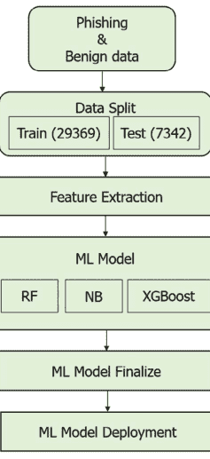

图 2.1 拟议的入侵检测系统模型。

- 步骤 4：模型可以通过朴素贝叶斯、随机森林和极端梯度提升 (XGBoost) 进行训练，通过分类可以识别其是否为钓鱼网站。
- 步骤 5：训练模型在此阶段指示两种模式。第一模式是如果网站链接是垃圾信息，它会告知或通知网站；第二种模式是链接不是垃圾信息，模型将得出结论并进入步骤6。
- 步骤 6：模型的最后一步是部署，这意味着将一个完全运行的机器学习算法投入使用，可以使用信息生成预测。这些预测被客户、程序员和计算机用于生成有用的业务选择。

### 2.3.2 特征提取

用于做出任何决策的标准已列出。这些判断的结果完全取决于所列出的标准。进行了深入研究以确定哪些特征将合法URL与钓鱼URL区分开来。这些特征被选择、检查和利用，以确保网站可以做出决策并获得最佳结果 [50]。已创建了一个应用程序从URL中提取特征。我们检索的用于识别钓鱼网站的特征列如下。带有互联网地址的URL：有两种技术用于


# 用于网络安全的基于 AI 和物联网的入侵检测系统

发现网站的 IP 地址：ping 和查询。但是，DNS 服务器工具是查找网站 IP 地址最快的方法。

- 在 DNS 工具的文本输入字段中输入网站地址。
- 点击 Lookup（查询），在 Hostname: UserInfo中使用 @ 符号，用户信息和主机可以使用 @ 分隔。
- 要获取警报，请遵循此响应。

点主机名计数：互联网切换过程可能会使用句号将主机特定的标签与相应的 DNS 网站地址隔开，并添加“点”。在后一种情况下，名称也称为域名。URL 重定向：一种使网站在许多 URL 地址下保持可用的万维网方法，即为 URL 重定向，也称为 URL 转发。当浏览器尝试访问一个已重定向的 URL 时，将打开具有此类不同地址的页面。

用户的信息可能会使用“mail”或“mailto:”函数发送到钓鱼者的个人电子邮件帐户。如果 URL 具有这些特征，则将属性更改为 1；否则，设置为 0。像“TinyURL”之类的 URL 缩短服务被用于通过缩短来创建冗长的钓鱼 URL。如果使用像 bit.ly 的服务缩短了 URL，除非另有说明，否则特征被赋值为 1 或 0。这包括一种细节敏感语言：URL 允许计算机在连接到互联网的另一设备上找到并启动网站。

如果标题中的斜杠数量大于 5，则将属性设置为 1；否则设置为 0。已发现带有五个斜杠的 URL 是安全的。证书有效性（Validity of Cert）：只有在存在 HTTPS 时，才能传递网站的合法性。然而，一个可靠网站的 SSL 证书至少必须有两年历史。锚点 URL（URL of Anchor）：通过扫描 URL 的源代码，我们能够提取这一特征。`<a>` 元素指定了 URL 的代码，即锚点。如果 `<a>` 标签中的链接数量来自另一个域名，则将该特征设置为 1；否则，设置为 0。IFRAME：一种被称为“内联框架”或（iframe）的 HTML 元素在当前文档内部加载另一个 HTML 文档。从本质上说，它在页面内插入了一个不同的网页。它们经常用于交互式内容、嵌入电影、广告和网站分析。网站排名（Website Rank）：使用 HTML iframe 显示加载的网页。它也被称为“内联框架”，因为 HTML “IDP”元素指定了它。HTML iframe 在活动 HTML 文档的矩形空间内插入一个不同的文档。

### 2.3.3 分类

下一阶段是创建一个机器学习模型，以区分真实网站和欺诈网站。选择符合应用要求的适当分类技术至关重要。它的目标是通过随机数据选择来防止过拟合。在项研究中，建议使用随机分类器（Random Classifier）、朴素贝叶斯（Naive Bayes）和 XGBoost 分类算法。

# 用于增强网络防御的大数据与边缘智能

#### 2.3.3.1 随机森林

随机森林的目标是将由高方差、低偏差决策树组成的树转换为具有低方差和低偏差的模型。它是一种广为人知的监督机器学习方法。它可以解决机器学习中的分类和回归问题。它基于协作学习的概念，协作学习是合并不同分类器以解决复杂问题并提高模型性能的方法。“随机森林”分类器“包含许多基于所讨论集合中各种子集的决策树，并选择平均值来增强与该数据集相关的预测准确性。”随机森林并不依赖于单一的决策树，而是从所有树中进行预测，并根据投影的整体投票预测最终结果。

##### 2.3.3.1.1 随机森林假设

由于随机森林包含多个树来投影数据集的类别，某些树可能会预测正确输出，而另一些树可能不会。但即使只有其中一棵单独的树加入，它们也能正确预测结果。因此，构建更好的随机森林分类器的两个前提条件如下：

- 集合特征变量应具有某些真实值，以便算法可以预测树的结果而非猜测。
- 每棵树的预测需要具有极低的相关性。

##### 2.3.3.1.2 随机森林步骤

**步骤 1**：从初始集中随机选取 K 个数据点。
**步骤 2**：为定义的数据子集构建决策树模型。
**步骤 3**：计算 N，即打算构建的决策网络总数。
**步骤 4**：反转步骤 1 和 2。
**步骤 5**：确定每棵决策树对新数据点的预测，然后将收集的数据分配给获得票数最多的类别。

#### 2.3.3.2 朴素贝叶斯

朴素贝叶斯的目标是在给定训练数据的情况下最大化后验概率，以便为新数据制定决策规则。用于分类问题的贝叶斯定理是朴素贝叶斯技术（一种受控学习方法）的基础。通过大型训练集，文本分类是最频繁的使用领域。今天最简单且最强大的分类方法之一是朴素贝叶斯分类。它有助于开发能够进行精确预测的快速机器学习模型。它使用概率分类器根据对象发生的概率来创建预测。简单的贝叶斯技术经常被用于文章分类、情感分析和垃圾清理。该分类器被命名为朴素贝叶斯，是因为它认为一个特征的存在与其他特征的存在无关，这被称为“朴素（naive）”。例如，如果根据外表、形状和味道对水果进行分类，那么一种红色的、球形的、带有垂涎欲滴的水果被称为它。因此，每个特征本身都有助于将其归类为苹果。它之所以被称为贝叶斯，是因为它基于贝叶斯定理。

#### 2.3.3.2 朴素贝叶斯步骤

假设我们有一个气候数组和目标变量“玩（Play）”。根据这些信息，我们必须根据天气状况决定是否预测某一天。

为了解决这个问题，我们需要执行以下操作：

- 从提供的数据集中创建频率表。
- 计算给定特征的似然并创建似然表。
- 使用贝叶斯定理计算后验概率。

#### 2.3.3.3 XGBoost

XGBoost 使用 `reg:squarederror` 损失函数进行数值预测。“reg:squarederror”：用于回归建模的损失函数。XGBoost 缩写为 XGBoost。它是一种快速高效的梯度提升树程序。提升是一种集成学习过程，通过整合额外的解决方案来修复模型的缺陷。模型被连续引入直到无法进一步改进为止。在添加新模型时，它采用梯度下降策略来最小化损失。这种方法用于快速计算和内存。这种方法的设计是为了最大限度地利用用于训练模型的资源。使用 XGBoost 的两个基本理由包括点击率预测、推荐系统和 Kaggle 竞赛等。此外，它非常灵活，可以通过微调许多模型参数来优化性能 [51]。

##### 2.3.3.3.1 特性

XGBoost 是一种流行的梯度提升实现。让我们来看一些使 XGBoost 如此具有吸引力的特性。XGBoost 中的正则化允许用户通过对每棵树的偏和权重施加 L1/L2 惩罚来控制过度拟合。这种功能在许多其他提升系统中是缺失的。XGBoost 通过分位数草图方法处理稀疏数据集。该方法在处理特征矩阵中的非零元素的同时，保持与随机梯度下降等算法相同的计算成本。XGBoost 提供了用于并行学习的块结构。它可以在多核设备或集群上扩展。它还具有缓存感知能力，这在训练大型数据集模型时有助于内存使用。


# 用于增强网络防御的大数据与边缘智能

##### 2.3.3.3.2 XGBoost 的使用与优势

XGBoost 额外提供了一种用于并行学习的块架构。它便于在多核设备或集群上进行扩展。它还采用了缓存感知技术，这在使用大型数据集训练模型时有助于内存使用。最后，在计算阶段，XGBoost 通过利用磁盘数据结构而非内存数据，提供了核外处理能力。

- XGBoost 是一个轻量级库，运行在 OS X、Windows 和 Linux 上。它也被包括银行和零售在多个行业的制造业公司所使用。
- XGBoost 是开源的，因此可以免费使用，并且有一群庞大且不断增长的数据分析师为其开发做出贡献。该库从设计之初就追求高效性、适应性和可移植性。
- XGBoost 可用于回归建模、分类、排序，甚至可以根据用户的预测任务进行定制！如果你想从模型构建中获得更多收益，可以将其与 H2O 或 Scikit-Learn 等其他工具结合。

### 2.3.4 钓鱼检测方法

目前已经提出了多种策略，以在攻击周期的每个阶段阻止钓鱼攻击。其中某些策略自动运行并通知用户，而另一些则需要训练用户，以便他们准备应对的攻击。以下是这些技术的列表：

- 用户培训方法
- 软件检测方法

#### 2.3.4.1 用户培训方法

可以通过通知用户和公司员工钓鱼攻击并提供奖励来实施钓鱼攻击。目前已经提出了多种方法来培训用户。根据多项研究，交互式培训是支持客户区分钓鱼网站和信任网站的最有效的技术。无论用户培训有多好，都可能发生人为失误，而且人们倾向于忘记所学过的内容。此外，培训耗时较长且不受非技术用户的欢迎。

#### 2.3.4.2 软件检测方法

尽管用户偶尔可以避开钓鱼尝试，但我们每天接触的网站数量之多，使得将我们的培训应用到每一个网站上是非常困难的，甚至是不可能的。该程序也可以用于检测钓鱼网站。在做出决策时，软件比个人更可信，因为它可以分析许多不同的元素，例如网站内容、电子邮件和 URL。用于钓鱼检测的软件技术分为以下几类：

**基于列表的方法：** 钓鱼检测最广泛的方法之一是使用集成到网络浏览器中的基于黑名单的反钓鱼算法。这些策略同时使用了白名单（包含合法网站名称）和黑名单（包含来自第三方的危险网站名称，是使用另一种钓鱼检测方法产生的）。根据某些研究，基于黑名单的反钓鱼技术在初始扫描时可以识别出 90% 的危险网站。

**基于视觉相似性的方法：** 钓鱼网站的设计与普通网站高度相似，这是用户在恶意网站上填写表单时被欺骗认为正在使用有效网站的主要原因之一。某些方法通过分析网页上的文本格式、CSS、HTML、文本内容，通过视觉相似性来识别钓鱼网站。此外，还提出了将钓鱼作为一种图像问题的判别性关键点。基于视觉相似性的技术具有重大的局限性，例如，依赖于内容的算法无法识别利用图像而非文字的网站。图像匹配技术需要很长时间的开发且难以找到。

### 2.3.5 启发式与机器学习方法

基于启发式和机器学习，机器学习技术已被证明在分类恶意行为或伪制品（如垃圾邮件和钓鱼网站）方面是有效的。遗憾的是，有大量的钓鱼网站示例可以训练机器模型，某些机器学习算法使用视觉技术分析网站快照，而另一些算法则利用网站的特征和内容来识别钓鱼尝试。在最近关于钓鱼的一项研究中，作者指出建议了阻止不同钓鱼尝试的新方法，攻击者会开发自己的技术来绕过新建议的钓鱼方法。因此，强烈建议采用混合模型和基于机器学习的技术。在本研究中，我们将应用基于机器学习的分类器来识别钓鱼网站。钓鱼检测方法的概述如图 2.2 所示。

初始阶段是收集和处理数据，采用集成方法使用清洗数据的结果来训练模型。使用测试数据评估模型的准确性和精确率，由融合矩阵表示。XGBoost 范式生成任何 URL 作为输出，用户可以输入任何 URL 来确定它是真实网站还是钓鱼网站。

#### 2.3.5.1 数据预处理

该项目的数据从 Kaggle 下载。公共数据集中的 71677 个唯一值由 Kaggle 提供。这些信息提供了 URL 注册状态的更多细节，是从 Google 的 Whois API 获取的。

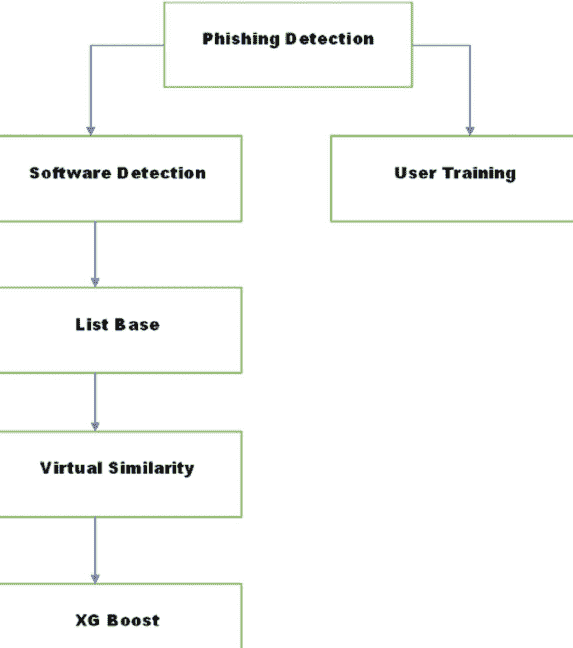

图 2.2 钓鱼检测方法的概述。

选择算法后，第一阶段是数据收集，也被称为耗时阶段。尽管这个过程刚刚开始，但它是最关键且最耗时的。本节专门关注项目的这一元素，因为学习和使用尖端技术是首要目标。从四个大类中提取了 17 个因素并将其添加到系统中。CSV 文件包含了被提取并保存的特征。

#### 2.3.5.2 模型开发

在收集并分析了必要数据后，应构建模型。模型的设计元素包含了模型训练、基于 Python 的库以及从零编写的代码。

#### 2.3.5.3 钓鱼检测系统

使用测试数据对创建的模型。用户输入的 URL 可以被分类为真实网站或钓鱼网站。

#### 2.3.5.4 模型训练与测试

使用提取的特征文件来训练模型。在训练之前，该部分重点关注模型的详细原理、适用方程和图表。

#### 2.3.5.5 XGBoost 工作流

XGBoost，通常被称为 XGB，是一种基于决策树的机器学习技术。图 2.3 展示了多层方法的功能。

## 2.4 实验结果与分析

系统与其他机器学习模型进行比较以确定答案，并考虑了准确率、TPR、精确率和 F 分数。IDS 的性能指标见表 2.1。表 2.2 显示了用于确定结果的混淆矩阵。当算法正确将 URL 分类为钓鱼时，被称为正性结果；

### 表 2.1 性能指标

| 模型 | 准确率 | TNR | TPR | 精确率 | F1 分数 |
|---|---|---|---|---|---|
| NB | 93.56 | 93.98 | 93.13 | 93.82 | 93.47 |
| RF | 95.83 | 95.63 | 96.04 | 95.46 | 95.75 |
| XGBoost | 96.98 | 96.79 | 97.17 | 96.68 | 96.92 |


## 用于增强网络防御的大数据与边缘智能

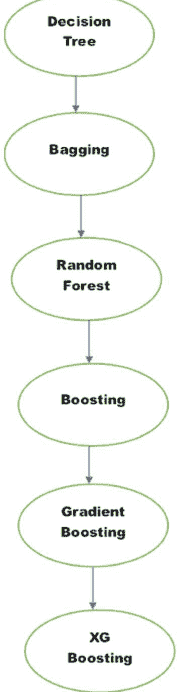

图 2.3 XGBoost 的工作流。

### 表 2.2
NB、RF 和 XGBoost 的分析

| 真阳性 (TRUE POSITIVE) | 假阳性 (FALSE POSITIVE) |
| :--- | :--- |
| (正确将入侵识别为攻击) | (在没有攻击发生的情况下产生警报事件) |
| 假阴性 (FALSE NEGATIVE) | 真阴性 (TRUE NEGATIVE) |
| (发生攻击时未发出警报) | (未发生攻击且未检测) |

### 基于 AI-IoT 的网络安全入侵检测系统

当错误地将 URL 分类为良性时，被称为误报；当语言熟练度准确构成处罚时将 URL 视为合法，被称为负结果。表 2.2 展示了对 NB、RF 和 XGBoost 的分析。这是一种混淆矩阵算法，提供数值数据，并具有精确的准确率、TNR、TPR、精确率和 F-1 分。

准确率 (Accuracy)：定义为模型驱动的总预测数中准确预测的类别的比例。

准确率 = 真阳性 + 真阴性 / 真阳性 + 假阳性 + 假阴性

TNR：准确负性值与总负性值的比率。

TNR = 真阴性 / 假阴性

TPR：定义为正类预测中准确预测的百分比。

**真阳性率 (True Positive Rate) = 真阳性 / (真阳性 + 假阴性)，但当假阴性 = 0 时，真阳性率 = 真/真 = 1。

假阴性率 (False Negative Rate) = 假阴性 / (假阳性 + 真阴性)，但真阴性将为 0，

因此，假阳性率 (False Positive Rate) = 假阴性 / (假阳性 + 1)。

精确率 (PRECISION)：模型乐观预测的准确性。精确率通过将正确预测的总数乘以实际正确预测的百分比来确定。

F-分数 (F-SCORE)：F-1 分数是一种人工学习评估统计量，用于衡量模型的预测。它结合了模型的召回率和准确率评分。准确率统计显示了模型在整个数据集中正确处理的次数。

假阴性率 (False Negative Rate)：假阴性占整体正性的比例。

假阴性 / (假阴性 + 真阳性) = 假阴性率。

FPR：可以在部分机器学习模型上评估的准确率统计之一是正性率。

FPR = 假阴性 / 正性。

精确率、准确率、F-1 分数、TPR 和 FPR 的方程如下：

```
TPR = True Positive / (True Positive + False Negative)
PRECISION = True Positive / (True Positive + False Positive)
FSCORE = 2 * PRECISION * RECALL / (PRECISION + RECALL)
ACCURACY = (True Positive + True Negative) / (True Positive + False Negative + True Negative + False Positive)
FPR = False Positive / (True Negative + False Positive)
```

### 2.4 模型分析

#### 2.4.1 模型1 朴素贝叶 (NAïVE BAYES)

在朴素贝叶斯模型中，IDS 的准确率为 93.56%，TNR 为 93.9%，TPR 为 93.1%，精确率为 93.82%，F-1 分数为 93.47%。与其他模型相比，其百分比率较低。

#### 2.4.2 模型2 随机森林 (RANDOM FOREST)

在随机森林中，IDS 的准确率为 95.83%，TNR 为 95.6%，TPR 为 96.0%，精确率为 95.46%，F-1 分数为 95.75%。此模型与朴素贝叶斯相比，速度更快且提供了高百分比算法。

#### 2.4.3 模型3 XGBoost

在 XGBoost 模型中，IDS 的准确率为 96.98%，TNR 为 96.79%，TPR 为 97.17%，精确率为 96.68%，F-1 分数为 96.92%。与其他算法相比，它快得多且提供的百分比更高。表 2.2 显示了不同分类器的 FNR 和 FPR 分析。

图 2.4 显示了假阴性与总正性的比例在分类模型中是如何产生的。通过上表，可以很容易判断 XGBoost 在假阳性率精确率上的百分比较低。图 2.5 显示了所提工作在正常和攻击的真实与预测值方面的性能。

### 不同分类器的 FNR 和 FPR 分析

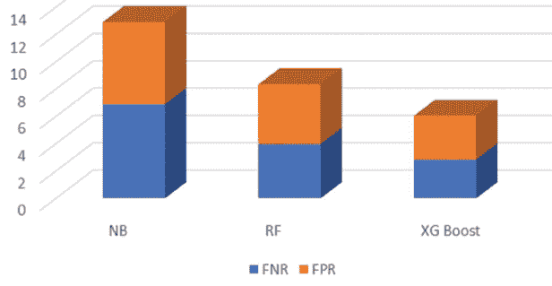

**图 2.4** 不同分类器的 FNR 和 FPR 分析。

### 基于 AI 和 IoT 的网络安全入侵检测系统

#### 真实值对比预测值

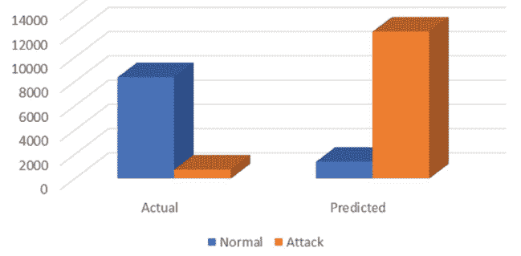

**图 2.5** 所提工作在正常和攻击的真实与预测值方面的性能。

## 2.5 结论

随着互联网使用的增加，安全问题随之而来。由于系统的安全漏洞，恶意软件可能会破坏系统功能和数据机密性。为了识别和报告攻击，创建了 IDS。攻击必须先被发现才能被防止。在这方面，IDS 设计用于识别攻击流量，并构建了 IDS 数据集来模拟攻击类型。本研究首次整合了所有关于使用 AI 算法检测钓鱼网站的研究结果。所提出的钓鱼研究采用了分类范式，其中假设钓鱼网站根据许多特征和华丽变量自动将网站归类到特定范围的合法范围内。因为不受监管的网站比以往任何时候都多。钓鱼随时间演变，因为虚假网站经常被访问且不会永久存在。使用集成算法 XGBoost 和定义特征，利用网站 URL 检测钓鱼预计将以稳健且高效的方式，通过合适的偏差-方差平衡产生高精确的结果。根据前述模型的陈述，XGBoost 分类器具有最佳模型性能。

## 参考文献

- 1. C. Lawrence, “IPS – The future of intrusion detection,” University of Auckland – 26 October, 2004.
- 2. K. R. Karthikeyan and A. Indra, “Intrusion detection tools and techniques a survey,” 2010.
- 3. A. K. Jones and R. S. Sielken, "Computer intrusion detection a survey," International Journal of Computer Detection.
- 4. [原文中缺失]
- 5. A. K. Jones and R. S. Sielken, "Computer intrusion detection a survey," International Journal of Computer Detection, vol. 2, no. 6.
- 6. A. K. Jones and R. S. Sielken, "Computer intrusion detection a survey," International Journal of Computer Detection.
- 7. A. K. Jones and R. S. Sielken, "Computer intrusion detection a survey," International Journal of Computer Detection.
- 8. A. K. Jones and R. S. Sielken, "Computer intrusion detection a survey," International Journal of Computer Detection.
- 9. A. K. Jones and R. S. Sielken, "Computer intrusion detection a survey," International Journal of Computer Detection.
- 10. A. K. Jones and R. S. Sielken, "Computer intrusion detection a survey," International Journal of Computer Detection.
- 11. A. K. Jones and R. S. Sielken, "Computer intrusion detection a survey," International Journal of Computer Detection.
- 12. A. K. Jones and R. S. Sielken, "Computer intrusion detection a survey," International Journal of Computer Detection.
- 13. A. K. Jones and R. S. Sielken, "Computer intrusion detection a survey," International Journal of Computer Detection.
- 14. A. K. Jones and R. S. Sielken, "Computer intrusion detection a survey," International Journal of Computer Detection.
- 15. A. K. Jones and R. S. Sielken, "Computer intrusion detection a survey," International Journal of Computer Detection.
- 16. A. K. Jones and R. S. Sielken, "Computer intrusion detection a survey," International Journal of Computer Detection.


# 用于网络安全的基于 AI-IoT 的入侵检测系统

- 25. V. Shreeram, M. Suban, P. Shanth and K. Manjula, (2010). “利用遗传算法对钓鱼攻击进行反检测,”, Sastra University Kumbakonam IEEE, 2010, pp. 4244–7770.
- 26. W. Zhuang, Q. Jiang and T. Xiong, “针对钓鱼网站的智能反钓鱼策略模型”, Xiamen, Xiamen, P.R. China, Vol. 1071176, 2012, pp. 51–56.
- 27. R. A. Hoffmann, F. Thabtan and L. McClure, “自结构神经网络上钓鱼网站的检测”, Springer-Verlag 2013.
- 28. E. S. El-Alfy, “基于概率神经网络和 K-Modes 聚类的钓鱼网站检测”, 信息与计算机科学系, 计算机科学与工程学院, ics基法哈德石油与矿物大学, Dhahran 31261, Saudi Arabia 2017.
- 29. G. Liu, B. Qi and L. Wenyin. (2010). “从钓鱼网页中自动检测钓鱼目标”, 香港大学计算机科学系, 83 Tat Ave, HKSAR, 2010, pp. 4161–4164.
- 30. G. Jiang, J. C. Rose and L. Cranor, “CINA: 一种用于检测钓鱼网站get机器学习框架”, ACM Transactions on Information and System Security, 卡内基梅隆大学, Vol. 14, no. 2, 2011, pp. 1–28.
- 31. P. A. Barracl, A. Hossain, A. Tahir, G. Sexton and N. Aslam, “在线交易的智能钓鱼检测与保护方案., Expert Systems with Applications, 位于纽卡斯尔的诺森大学, Newcastle Upon Tyne NE1, Unified Kingdom, vol. 40, no. 11, 2013, pp. 4967–4076.
- 32. Y. Li, R. Xiao, J. Feng and L. Zhao, “用于钓鱼网页检测的半监督学习方法”, 北华电力大学控制与工程学院, 北京 102206, Vol. 124, no. 23, 2013, pp. 6027–6033.
- 33. N. Vaishnav and S. Tandan, “用于钓鱼分类的反钓鱼模型开发”, Email, Raman, Vol. 6, No. 6, 2015, pp. 39–45.
- 34. J. Schanki and R. G. Vaishnav, “基于启发式方法的网站钓鱼检测”, 印度 Darshan 工程技术学院, 2016 年 5 月 3 日, pp. 2044–2048.
- 35. F. Thabth and N. Abdelhamed, “为钓鱼检测推导相关的网页特征集：一种计算智能方法”, Journal of Information & Knowledge Management Information Technology Studies Auckland Auckland, New Zealand, vol. 15, no. 4, 2016 年 11 月 25 日, pp. 165002–1650056.
- 36. H. B. Kazemian and S. Ahmed, “用于检测恶意网页的机器学习技术比较”, Expert Systems with Applications, vol. 42, no. 3, 2015, pp. 1166–1177.
- 37. A. K. Jain and B. B. Gupta, “用于检测的基于特征的机器学习方法的对比分析”, In 可持续全球发展计算 (INDIA Com), IEEE 第 23 次国际会议, 2016 年 3 月, pp. 2125–2130.
- 38. T. Zimmermann, T. Djürken, A. Mayer, M. Janke, M. Boissier, C. Schwarz and M. flacker, “检测大型电子商务平台上的欺诈广告”, In EDB/IDCT 会讨会, 2017.
- 39. X. Wei, F. Jiang, F. Wei, J. Liao and S. Chen, (2017, 5 月), “一种用于大规模不平衡数据中糖尿病诊断的集成模型”, In 计算前沿会议论文集, 2016 年 3 月, pp. 71–78.
- 40. L. Zhang and C. Zhan, “岩相分类中的机器学习：XGB boost 的应用”, In 国际地球物理会议, 青岛, 2017 年 4 月 17–20 日, pp. 1371–1374.

# 用于增强网络防御的大数据与边缘智能

41. T. Chen and G. Guestrin, "X BOOST: 一种可扩展的树提升”, In 第 22 次 ACM SIGKDD 知识发现与数据挖掘国际会议论文集. ACM, 2016, pp. 785–794.
42. A. Jain, XGBoost 参数调优完整指南（带 python 代码）检索自 medium: [Complete guide to parameter tuning in XGBoost (with code in python)](https://medium.com/complete-guide-to-parameter-tuning-in-xgboost-with-code-in-python). 2017/06/13,
43. A. Gómez-Ríos, F. Luango and F. Herrera, “提升算法中噪声水平研究：AdaBoost, GBM, 和 XGBoost”, In 人工智能系统, Springer, 2017 年 6 月, pp. 268–280.
44. P. Radenković, “随机森林”, 贝尔格莱大学电气工程学院, 3237/10,
45. K. D. Tandale and S. N. Pawar, “不同类型的钓鱼攻击与检测：综述”, In 2020 设计、环境与规划智能创新国际会议 (ICSIDPC, 2020), pp. 295–299, doi: 10.1109/ICSIDPC.2020.929964
46. G. J. Watkins, P. M. Praise, A. Rose and E. Kalaani, “钓鱼攻击与检测的变体”, In 2019 第 33 次电子与信息国际会议 (ICOEI), 2019, pp. 2019, pp. 255–343,97
47. A. Athula and P. Kanakk, “迈钓鱼攻击的检测”, In 2020 第 44 次电子与信息国际会议 (ICOEI), 2020, pp. 337–343, doi: 10.1109/ICOEI.2020.9299
48. M. Khonji, Y. Iraqi and A. Jones, “钓鱼检测：综述”, Communications Surveys & Tutorials, vol. 15, no. 4, 2023, pp. 2121, 2223.
49. N. S. Feroz and X. Mengal, “利用逻辑回归进行钓鱼 URL 生成与检测”, In 2014 年数据国际会议 (Big Data), Washington, DC, 2014, pp. 241–250, doi: 10.1109/BigData.2014.700
50. S. Sugtha, C. Shafi and M. Ijaz, “用于基因组和表格数据预测糖尿病的循环神经网络”, Diagnostics, vol. 12, no. 12, 2022, pp. 3067. https://doi.org/10.3390/diagnostics12123067
51. K. Alarfaj, P. Guleria and P. Srinivasa, “用于心血管疾病预测的 Xai 框架”, Electronics, vol. 11, no. 24, 2022, p. 4086. https://doi.org/10.3390/electronics12244086
52. E. Molah and A. Subasi, “使用随机森林分类器的智能钓鱼网站检测”, In 2017 年电气与计算技术国际会议 (ICECTA), As Rahimah, 阿联酋, 2017, pp. 1–5, doi: 10.1109/ICECTA.2017.825

# 3 利用边缘 AI 技术进行实时威胁检测与隐私保护的数字取证智能

Niveditha S., Shreyanth S., Delshi Howalya Devi R., Sarveshwaran R., 和 Rajesh P.

## 3.1 引言

网络攻击带来的问题在范围和复杂性上不断增加，推动了数字取证领域新方法和技术的发展。随着我们现代世界的互联和分析高度依赖数字基础设施，数字生态系统的安全性变得至关重要。遗憾的是，该系统很容易受到各种网络犯罪，例如数据泄露、网络入侵和复杂的恶意软件攻击。传统的数字取证依赖于人工分析和耗时技术，无法应对快速变化的威胁格局。


# 用于增强网络防御的大数据与边缘智能

本章探讨了边缘人工智能（EdgeAI）技术通过解决该领域的新挑战来转型数字取证的潜力。这些关注点包括数字证据的指数级增长、网络攻击日益复杂的复杂性、对实时事件响应的性，以及对隐私权和数据保护的维护。利用 EdgeAI 的力量，主动预测能力可以加强数字取证调查，使调查人员能够领先于黑客。

本章研究了 EdgeAI 设备，例如移动取证工具、便携式数字取证工作站（PDFWs）、可穿戴设备、无人机、物联网（IoT）设备分析、车辆取证工具和人脸识别系统。它还探讨了 EdgeAI 如何用于证据的收集与保存、事件响应、调查以及威胁情报与检测。此外，它还涵盖了主动威胁检测、预防、隐私和数据保护问题，以及通过 EdgeAI 增强机器学习（ML）和深度学习（DL）进行预测性数字取证调查（DFI）的能力。文中还提供了多个领域的（事件响应、网络犯罪检测、数据泄露分析、知识产权（IP）保护、移动及社交媒体取证、执法与商业调查）案例研究和应用。

我们首先从数字取证的定义开始，接着是其演变、传统方法论和局限性。随后介绍了正在改变 DFI 的 EdgeAI 设备。讨论转向了 EdgeAI 在 DFI 中的各个方面，例如证据的收集与保护全、事件响应与调查、威胁情报与检测、主动威胁检测、预防、隐私和数据保护考量，以及对 ML 和 DL 的赋能。文中提供了不同领域的案例研究和应用，以证明 EdgeAI 在 DFI 中的实际效用。本章以对 EdgeAI 方法论的结果和效益进行评估、在 DFI 中采用 EdgeAI 的困难，以及该领域的未来改进作为结束。

## 3.2 文献综述

DFI 在网络犯罪的检测、分析和预防中至关重要。然而，随着威胁格局的演变和数字系统变得日益复杂，传统的取证程序面临着巨大的障碍。为了解决这些问题，学术界研究了结合边缘计算和人工智能的 EdgeAI 方法，以改进 DFI。本文献综述回顾了该主题的现有研究和贡献。

Prakash 等人 [4] 探讨了基于云和边缘计算的云取证中的挑战和开放性问题。他们强调了高效数据分析方法对于处理云系统中产生的海量数据的重要性。Adams 和 Varol [5] 强调了在数字过程中集成人工智能（AI）方法以进行主动威胁检测和事件响应的必要性。

Damshens 等人 [6] 研究了在云计算系统中执行取证调查的困难性。他们强调了在共享和分散的云系统中收集和维护数字证据的挑战。

# 演进数字取证智能

Al-Dhaqm 等人 [7] 研究了取证调查过程模型，揭示了从移动设备中提取和分析数字证据的工具和方法。

Lin 等人 [8] 和 Chang 等人 [9] 调查了智能手持设备数字证据的取证流程和标准。这些研究强调了标准化方法和方法论对于确保数字证据的完整性和可采信的重要性。

Mellars [10] 探讨了数字取证中对手机的研究，强调了由于移动设备架构复杂且不同，在获取和解释移动设备数据时面临的困难。Gaznour 等人 [11] 对数字取证技术进行了研究，概述了数字证据处理和调查中使用的众多工具。

Greyling [12] 涉及取证 DNA 实验室的自动化，提出了提高 DNA 分析效率和准确性的概念和标准。该研究强调了自动化在处理取证调查中看到的海量 DNA 证据时的重要性。

Katsini 等人 [13] 引入了用于在车联网（IoV）环境下辅助数字取证准备规划的框架 ForePlan。该研究强调了在物联网场景下收集和分析数字证据时，主动规划和准备的重要性。

Karie 等人 [14] 以及 Iqbal 和 Alharbi [15] 调查了使用 ML 算法的数字取证中的自动化。这项研究突显了 ML 算法在自动化重复过程和加速数字证据分析方面的力量。

Stallard 和 Levitt [16] 开创了数字取证科学的自动化分析，强调了通过语义完整性来验证数字证据的质量和可靠性。Dijkstra 和 Sherman [17] 创建了 FROST，这是一种用于 OpenStack 云架构的数字取证工具，能够快速有效的云研究。

Mohsin [18] 讨论了人工智能在取证科学（尤其是数字取证）中的应用。评估强调了人工智能在自动化取证操作和提高查询效率方面的潜力。

Sharma 等人 [19] 检查了云计算系统中数据安全的困难。该研究强调了在云基础设施中采取强有力安全措施以保护敏感访问和泄露的重要性。

## 3.3 数字取证：概述

数字取证领域，也被称为计算机取证（图 3.1），涵盖了取证科学领域的一个专门领域 [20]。其首要目标是确定、保存和审查数字证据，旨在加强调查工作并促进法律诉讼。

目前的论述深入了数字取证领域，该领域涉及利用严谨的科学方法，从各种数字设备提取、理解和详细记录数据，包括但不限于计算机、手机、

# 用于增强网络防御的大数据与边缘智能

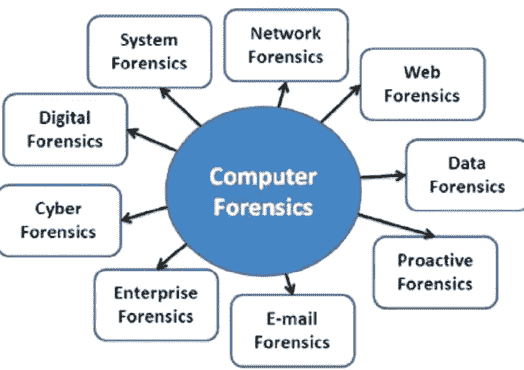

图 3.1 各种计算机取证。

和存储媒体。所考虑的领域在其存在过程中经历了巨大的变化，适应了技术的进步并有效应对了出现的新挑战。

### 3.3.1 数字取证的定义与演变

本章尝试阐述数字取证这一多领域领域，该领域可以简明地描述为系统地收集、审查和展示符合其采信法律框架的数字证据。这一现象的起源可以追溯到计算机的早期，当时审查涉及数字系统的犯罪活动的迫性显现出来 [21]。随着计算机在现代社会日益普及，数字取证领域已处于至关重要的地位，需要将其范围扩大到涵盖广泛的数字设备和技术。

数字取证的逐步发展可归因于技术的飞速增长。在数字取证发展的早期阶段，该领域关注计算机系统和各种存储设备的仔细检查和审查。考虑到智能手机、平板电脑和各种数字设备的广泛采用，调查领域发生了显著扩张，涵盖了移动取证领域。

此外，云计算、移动设备和物联网的普及，以及社交媒体平台的普遍使用，为数字取证领域引入了新的复杂性 [22]。在代的


在科学探索的格局下，研究人员日益面临着一项严峻的任务，即跨越复杂且多维的领域，以获取并审查分散在远程位置或在线平台上的数据。这需要一种复杂且细致的信息检索与分析方法，因为调查人员正在努力应对技术进步与不断扩张的数字领域之间相互作用所带来的挑战。云计算的出现和社交媒体平台的广泛使用，迫使了专门为数字取证和社会取证领域定制的新型方法和工具的问生。

### 3.3.2 传统方法及其局限性

数字取证中使用的传统方法主要侧重于获取数字证据的实体副本（包括计算机和硬盘），然后进行离线分析。在数字取证领域，生成存储介的取证镜像是标准做法。这些镜像然后在不同的系统上进行分析，通过防止任何潜在的污染或更改来确保原始证据的完整性。数字取证通常采用各种技术，包括取证镜像实践，这涉及到通过复制数字设备的每一个比特数据来创建其精确副本。此外，Sleuth Kit 和 Autopsy 等取证分析软件工具在该领域被频繁使用。上述方法虽证明能产生积极成效，但需要投入大量的时间和资源。

在传统数字取证方法中观察到的另一个限制在于对单个文件及其附带元数据仔细检查的高度依赖。然而，它们似乎可能忽略了未声明空间或空闲空间（slack space）中存在价值证据的可能性。该方法未能充分考虑在调查背景下可能具有重要意义的相关数据。在数字取证领域，通常需要采用专门的方法（如数据刻蚀，carving），以便从已碎片化或刻意删除的文件中有效检索并恢复信息 [23]。

此外，加密的实施为传统的数字取证方法带来了实质性障碍。在没有相应加密密钥的情况下，数据上的加密的存在实际上使得内容变得无法访问。因此，这在尝试提取和解释其中包含的信息时构成了重大挑战。调查人员需要利用各种解密技术并利用加密算法中的漏洞来绕过这一特定挑战。此外，数字制品缺乏标准化的格式、方案和组织，为数字取证行动的无缝集成和最佳效能发挥造成了重大障碍。

## 用于增强网络防御的大数据与边缘智能

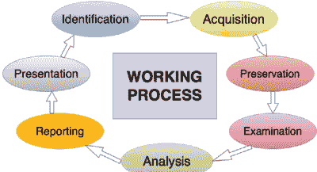

图 3.2 数字取证智能工作过程中涉及的步骤。

### 3.3.3 数字取证智能的工作流程

DFI 在一系列包含几个关键步骤的事件中运行。初始阶段是识别（图 3.2），涉及识别和提取相关的数字证据以供进一步检查。一旦识别出证据，将进入获取过程，在该过程中会生成取证级安全的副本或镜像以维护其完整性。证据被妥善存储，以确保其合法性并防止操纵。然后使用特定的工具和程序对数据进行检查，在检查阶段提取相关信息。为了得出正确的结论，分析阶段会对数据进行评估，链接多个证据片段并重建时间线。取证结果和分析将记录在一份清晰且无偏见的完整报告中 [24]。最后，调查结果可能会提交给法庭或相关方，这需要具备良好的沟通能力，以便有效传输复杂的技术信息。

### 3.3.4 数字取证智能中的常用方法和技术

为了高效地寻找证据并获取情报，DFI 整合了多种方法和程序（图 3.3）。数据恢复是一种典型程序，涉及使用专门工具和技术从硬盘或内存卡等存储介质恢复被删除或隐藏的数据。时间线分析是另一种重要方法，调查人员通过研究与数字制品相关的时间戳和元数据来构建事件的时间顺序，并发现任何漏洞或差异。网络分析对于监控网络流量至关重要。

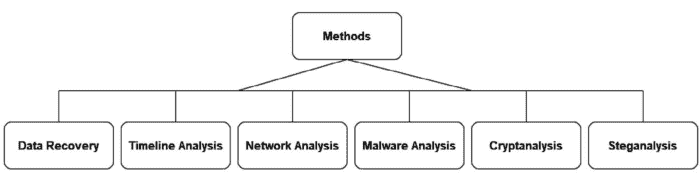

图 3.3 数字取证智能的方法分类。

## 进阶数字取证智能 43

密码分析技术用于解密加密数据、恢复密码并获取对理解疑通信至关重要的保护信息。隐写术也有助于检测和提取数字媒体内部的秘密信息或文件，协助识别秘密通信或隐藏数据。为了确保证据的法证性并保护个人隐私权，数字取证调查人员必须在法律和伦理约束内行动。跟最新技术、工具和程序对于有效开展 DFI 工作至关重要。

### 3.3.5 数字取证中的新兴挑战

随着技术在数字取证领域带来新问题，在各种应用中使用 AI 和 ML 算法是主要问题之一。由于这些技术可以生成和处理海量数据，调查人员很难定位和解释重要数据。在这些挑战中我们面临：

- 云取证：随着云计算变得越来越流行，数字取证面临新障碍。由于云环境使用分布式存储、虚拟化和共享资源，识别和保护数字证据非常困难。为了处理云设置的困难，必须对取证程序进行调整和改进。

- 对抗取证：随着多媒体内容的日益普及，对能够检测篡改和修改的取证工具的需求日益增加。当对手试图阻取消证调查时，对抗攻击为多媒体取证带来了巨大障碍。开发能够抵抗攻击的强大技术至关重要。

- 隐私与合法性：为了确保证据的法证性并保护个人隐私权，数字取证调查人员必须在法律和伦理约束内行动。跟最新技术、工具和程序对于有效开展 DFI 工作至关重要。

- 新兴技术：随着 AI、区块链和 IoT 的快速发展，引入了新的复杂性。智能家居设备、可穿设备和工业传感器产生了海量数据。IoT 设备分析师使用来自连接设备的各种数据。

-

## 用于增强网络防御的大数据与边缘智能

保存在易失性内存中的，有时被称为现场取证（live forensics）。易失性内存存储了设备关闭时会被删除的重要数据。为了最大化易失数据作为证据的价值，调查人员必须开发实时捕获和分析程序。网络犯罪分子使用各种匿名和混淆技术。为了绕过这些匿名保护，调查人员必须保持领先。总体而言，数字取证是一个随时间推移发生巨大变化的动态领域。它在适应技术变化的同时，涉及收集、分析和展示数字证据。针对移动取证、云取证、社交媒体取证和现场取证的专门技术补充了传统方法。

## 3.4 边缘AI 设备革新数字取证智能

边缘AI 设备在 DFI 的转型中发挥着关键作用。这些现代工具专门用于提高现场调查技能。移动取证解决方案，如 Celle Universal Forensic Extraction Device (UFED) 和 Oxygen Forensic Detective 使用 AI 算法从移动设备中采集并分析数据。

取证工作站（PDF）如 Tableau2 Forensic Investigator 和 ADF Solutions Digital Evidence Investigator 提供了远程处理能力，能够利用 AI 进行更快的数据分析和关键词搜索。具有 AI 特性的可穿戴设备（如执法记录仪和智能眼镜）收集实时音频、视频和位置数据，为取证调查提供关键背景。

无人机取证利用 AI 驱动的无人机（UAV）收集空中监测数据，并协助路径分析和图像识别。IoT 设备分析师使用来自连接设备的各种数据，而 AI 驱动的脸部识别系统有助于识别嫌疑人。这些边缘AI 设备（表 3.1）为调查人员提高了 DFI 工作的效率和准确性。

### 3.4.1 移动取证工具

在数字领域，针对边缘AI设备的移动取证至关重要。这些工具旨在提取和分析使用边缘AI技术的移动设备的数据，包括智能手机、平板电脑、可穿戴设备和 IoT 设备。苹果 iPhone 和三星 Galaxy 系列等智能手机属于此类，iPad 和 Galaxy Tab 等平板电脑、Apple Watch 和 Fitbit 等可穿戴设备，以及 Amazon Echo 和 Google Home 等 IoT 设备也是如此。


# 推进数字取证智能化

### 表 3.1
各取证类别下涉及的工具与设备

| 取证类别 | 工具与设备 |
| :--- | :--- |
| 移动取证工具 | Cellebrite UFED, Oxygen Forensic Detective, Magnet AXIOM, XRY, MOBILedit Forensic Express |
| 便携式数字取证工作站 | Tableau Forensic Imager, Digital Intelligence DI4 便携式实验室, BlackBagLight |
| 可穿戴设备 | 智能手表（如 Apple Watch、Samsung Galaxy Watch）、智能眼镜（如 Google Glass、Vuzix Blade）、健身追踪器（如 Fitbit、Garmin） |
| 无人机取证 | DJI 飞行取证, UFRED Drone, BlackBag Mobility, SkyRanger Kit |
| IoT 设备分析仪 | Cellebrite Physical Analyzer, Autopsy, Oxygen Forensic Detective, Magnet AXIOM |
| 车辆取证工具 | 事件数据记录 (EDRs), Kvaser Light v2, AutComMK808 |
| 人脸识别系统 | AI 驱动摄像头、智能 CCTV 系统、DeepFace、Amazon Recognition、Microsoft Azure Face API、FaceFirst |

我们使用现代算法和程序来确保数据提取的准确性和快速，同时维护其完整性和法律效力。这些系统通过利用边缘 AI（EdgeAI）能力快速扫描海量数据，使法证人员能够发现非凡的见解和用于刑事调查的关键证据。

这些移动取证工具的重要优势之一是，它们具备覆盖和评估移动设备内增强的 AI 模型和算法的能力。这使得调查人员能够检测潜在的敌对活动或利用 AI 技术实现非法目的的行为。这些技术还可以检索和分析由 AI 应用产生的数据，如图像识别、自然语言处理和预测分析。这使得侦探能够重建数字历史、建立模式并收集与犯罪行为相关的证据。

此外，用于边缘 AI 的移动取证工具使用了精复杂的数据恢复和解密技术。它们能够恢复已删除或隐藏的数据、绕过加密并从包括应用程序缓存、系统日志、云备份和社交媒体平台在内的多种来源提取关键信息 [28]。这些工具还会检查元数据、位置信息和通信记录，这些可以揭示有关被调查人员移动、互动和意图的重要见解。

用于边缘 AI 的移动取证工具遵循严格的取证标准和规则，以确保结果的可靠性和准确性。它们会生成详细报告，并对调查过程中采取的所有操作保留审计追踪，以确保透明度和问责制。此外，这些工具兼容多种移动操作系统，确保了它们在广泛设备范围上的实用性 [29]。

### 3.4.2 便携式边缘 AI 取证工作站

通过将边缘 AI 设备引入调查过程，便携式取证工作站（PDFWs）改变了数字取证智能（DFI）领域。这些高科技工作站配备了尖端硬件和软件，能够以前所未有的速度和准确性分析数字证据。配备了 PDFWs 的边缘 AI 设备使调查人员能够在危机现场进行实时数据处理和分析，避免了向中央取证实验室执行耗时任务的需求。

PDFWs 利用边缘 AI 设备的力量（如微小但强大的神经网络单元 NPU 和专用硬件加速器）来完成图像和视频识别、文本提取和语音分析等任务。这些机器可以快速分析大量数据，在数字杂物中发现关键取证证据。此外，PDFWs 是便携的，可以立即将这些复杂的工具运输到犯罪现场，节省了大量的时间和资源。

边缘 AI 与 PDFWs 的集成还提供了安全能力，在取证过程中保护数据。先进的加密方法、安全启动过程和独立的内存区域保护了证据的完整性和机密性。此外，PDFWs 首先采用了防篡封密封和硬件级写保护器，以确保数字证据以原始状态保存。

PDFWs 的功能不仅限于数据提取和处理。此外，它们还提供了一套专为数字调查设计的全面取证工具。数据恢复、密码破解、网络分析和病毒识别都是这些技术帮助法证调查人员完成的任务。PDFWs 通过结合边缘 AI 设备的能力与这些软件工具，使调查人员能够更高效、更有效地处理复杂案件。

### 3.4.3 可穿戴设备

可穿戴设备和边缘 AI 技术改变了 DFI 领域，为调查人员提供了收集证据的有力工具，同时保持了移动性和效率。这些尖端设备具有无缝集成的 AI 能力，使它们能够直接在现场处理和分析数据，而不是依赖传统的中央计算机基础设施。集成了边缘 AI 技术的可穿戴设备（图 3.4）可以利用 AI 算法的力量从智能手机、PC 或 IoT 设备等多个数字源识别并提取有用信息。

这种实时分析提高了调查的进和准确性，使法证专家能够快速识别关键证据。此外，这些可穿戴设备包含生物识别认证等高级功能，允许在安全访问关键信息的同时防止非意的操纵。结果是，DFI 变得更加精简、主动和敏捷，使调查人员能够领先于新兴的网络威胁。可穿戴设备与边缘 AI 技术的集成代表了数字取证领域的一个里程碑，在为调查人员提供无与伦比的力量的同时保护了证据的完整性和真实性。

# 推进数字取证智能化
## 可穿戴传感器
## 芯片神经形态边缘计算
## 系统/应用

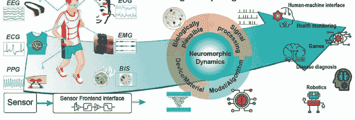

**图 3.4** 可穿戴生物医学设备中自适应边缘计算示意 [30]。

### 3.4.4 无人机取证

无人机取证已发展为 DFI的重要组成部分，利用边缘 AI 设备的能力从无人机（UAV）中检查并提取有价值的数据。这些先进的飞行器配备了各种传感器和车载系统，会产生大量数据，如飞行记录、GPS 位置、照片、视频和通信日志。

法证专业人员可以使用边缘 AI 设备轻松地收集和评估大量信息，使他们能够重建飞行轨迹、发现模式并提取与可能的犯罪行为或安全违规相关的证据。在边缘集成 AI 算法使调查人员能够在现场进行实时分析，缩短了数据传输时间并实现了及时决策。

此外，用于无人机取证的边缘 AI 设备可以自动检测未经授权的飞行路径或可疑通信，协助调查人员识别潜在风险并实施相关措施。无人机取证与边缘 AI 设备的融合改变了 DFI 领域，为调查人员提供了强大的工具来发现重要证据并提高整体安全性。

## 3.4.5 IoT 设备分析仪

IoT 设备分析仪结合边缘 AI（Edge-EdgeAI）技术已成为 DFI 领域不可或缺的工具，为调查人员提供了研究 IoT 设备提供了无与伦比的能力。这些先进的分析仪利用边缘 AI 的潜力，允许它们直接在边缘处理和分析数据，而不是在中央资源上。

这些设备可以利用 AI 算法轻松地从各种 IoT 设备（包括智能器具、可穿戴设备、工业传感器）中提取并关联信息 [31]。这种能力使调查人员能够发现数字遗迹、跟踪通信模式并重建事件，协助解决网络犯罪和其他案件。IoT 设备分析仪和边缘 AI 在 DFI 中的结合是向前迈的一大步，让调查人员能够高效地应对复杂局面，同时确保结果的准确性和可靠性。

## 3.4.6 车辆取证工具

与前沿边缘 AI 设备连接的车辆取证技术已成为 DFI 领域的关键资产。这些复杂的技术使侦探能够通过结合边缘 AI 和可穿戴设备的能力，从参与犯罪活动的汽车中提取、分析并解释关键信息 [32]。

这种这种连接实现了实时分析，最大限度地减少了对耗时数据传输的需求并缩短了调查时间。这些支持边缘 AI 的取证技术可以快速识别模式、异常和可疑活动，让法专家能够揭露与犯罪、事故或网络安全漏洞相关的证据。此外，这些工具提供了扩展的能力，以保护车牌号识别、车辆识别和驾驶分析，增强了调查过程。

这些边缘 AI 设备通过本地安全地处理数据，保护了敏感信息的隐私和完整性，在数字取证引擎中维护监管链。车辆取证工具与边缘 AI 设备的集成代表了 DFI 向前迈的一大步，为调查人员提供了高效有效的工具，以在复杂的车辆数据分析格局中导航，同时确保结果的准确性和可靠性。

### 3.4.7 人脸识别系统

嵌入边缘 AI 设备中的人脸识别系统已成为 DFI 领域的关键关工具，改变了调查人员研究和识别犯罪活动人员的方式。这些现代技术使用 AI 算法快速、可靠地匹配来自各种来源（如监控视频或从社交媒体网站获取的照片）的特征 [33]。


# 推进数字取证智能

使用 EdgeAI 技术的人脸识别系统可以在本地处理数据，最大限度地减少对大规模网络连接的需求并降低延迟。这种去中心化的技术确保了实时分析，并让法证专业人员能够快速识别犯罪分子。此外，具备人脸识别能力的 EdgeAI 设备提供了更高的隐私性和安全性，因为敏感数据存储在设备上，降低了未经授权访问或泄露的风险。

将人脸识别系统整合到 EdgeAI 设备中，已被证明在解决复杂案件、加速调查和维护公共安全方面具有益。这些设备具有快速处理和分析海量数据的能力，已成为数字取证智能（DFI）领域中无价的资产，允许调查人员在保持最高隐私和准确性标准的同时快速识别并捕获罪犯。

因此，EdgeAI 设备在 DFI 中的集成开启了效率、便携性和精准度的新纪元。从可穿戴设备到人脸识别系统，都是提供实时分析、安全数据处理和更好调查技能的先进设备示例。EdgeAI 设备凭借在边缘执行复杂任务的能力，已成为重要工具，使调查人员能够在保持最高隐私和法证完整性标准的同时，在不断变化的数字犯罪格局中保持领先。

## 3.5 由 EdgeAI 驱动的证据收集与保存

EdgeAI 方法在改进 DFI 领域的证据收集和保存流程方面起着至关重要的作用。通过在网络边缘边缘计算和人工智能，组织可以实现高效、安全的数字证据实时处理。EdgeAI 的分布式特性允许在更接近源头的地方进行证据收集和保存，减少了传输过程中数据丢失或篡改的机会（图 3.5）。EdgeAI 还允许使用强加密和分布式存储技术，这些技术确证了数字证据的完整性和有效性。通过使用支持 EdgeAI 的证据收集和保存方法，组织可以在保护并遵守法律标准的同时，简化法证调查过程。本节将深入探讨在 DFI 日益增长的背景下，使用 EdgeAI 方法进行证据收集和保存的意义和优势。

### 3.5.1 确保网络边缘证据的完整性和真实性

在 DFI 领域，确保数字证据的完整性和有效性至关重要。组织可以通过集成 EdgeAI 方法，开发出稳健的系统，在网络边缘实时保护数字证据的完整性和有效性。本节将深入探讨用于实现这一关键目标的策略和技术。

### 用于增强网络防御的大数据与数据智能

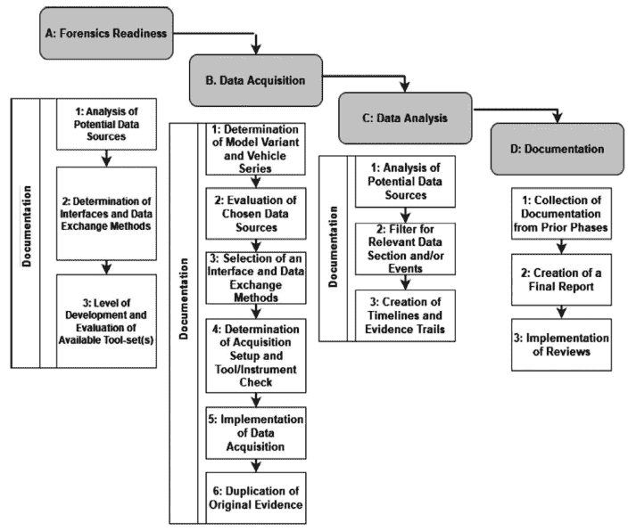

图 3.5 自动驾驶车辆模型。

数字证据在网络边缘被收集并更接近其源头，减少了被操纵或更改的可能性。SHA256 和 MD5 等哈希算法用于为数字证据生成唯一的哈希值，这些值作为数字指纹来验证其真实性。这些哈希值被安全地保存并在随后进行比较，以检测未经授权的更改。

确保真实性的另一个组件是数字签名。每份数字证据都使用密码学程序建立数字签名，为其来源和完整性提供可验证的证明。这些签名被安全地存储，任何篡改它们的尝试都能被轻易发现。

此外，传输层安全协议（TLS）和安全外壳（SSH）等安全通信协议用于在边缘设备之间创建加密通道，保护数据的机密完整性。这保护了数字证据免受未经授权的访问或拦截。

区块链技术可以用于网络边缘，以提高数字证据的可信度。区块链通过使用分布式账本实现了证据记录的透明性和不可变性，使得未经授权的调整几乎无法被察觉。

# 推进数字取证智能

## 3.5.2 用于安全证据保存的分布式存储与加密技术

在 DFI 领域，安全的证据存储对于维护其完整性、可采纳性以及保护免受未经授权的访问至关重要。一个成功的策略必须包含分布式存储和加密方法。本节将了在采用 EdgeAI 方法进行实时威胁检测和隐私保护的背景下，分布式存储和加密对安全保留证据的意义。

冗余性、可扩展性和容错性都是云存储等分布式存储系统的优势。将数字证据分散在多个站点，极大地减少减少了由于硬件问题或物理损坏导致的数据丢失的风险。此外，分布式存储系统允许从多个地方无缝访问证据，从而进行联合分析和调查。

加密技术对于确保所存储信息的机密性至关重要。加密将数字证据转换为不可读的格式，防止非法访问。高级加密方法，如 AES（高级加密标准），可以在多个层级使用。加密密钥被安全地持有和管理，为证据增加了额外的安全保障。

此外，EdgeAI 技术的引入提升了证据存储的安全性。利用网络边缘的计算资源，可以在更接近数据源的地方进行加密解密操作。EdgeAI 方法还提供实时加密解密，在动态且快速变化环境中提供安全的证据保存。

### 3.5.3 EdgeAI 环境中的监管链考量

在数据分析和处理发生在网络边缘的 EdgeAI 场景下，为了确保数字证据的完整性和可采纳性，妥善处理监管链考虑至关重要。监管链是一条记录的连续轨迹，记录了证据从收集到在法律案件中呈现的占有、管理和处理过程。

- 确保记录记录：在 EdgeAI 场景下，必须在整个监管链过程中建立并维护详细的记录。这涉及记录证据处理的每个阶段的时间、日期、地点和参与的人员。
- 安全的证据收集：在 EdgeAI 环境中收集数字证据时，必须遵循适当的协议。为了确保证据在整个收集过程中不被更改、篡改或污染，必须使用符合法证的方法。
- 安全的数据存储与传输：在 EdgeAI 场景下，数据可能分布在多个边缘设备之间。必须创建安全的存储和传输程序以确保证据的安全性。
- 更改与传输应详细记录：EdgeAI 环境中监管链的任何更改或传输都应详细记录，包括涉及人员的身份和传输目的。这些记录确保了透明度和问责制。
- 身份验证与验证：在数据处理多个设备的 EdgeAI 环境中，提供身份验证和验证程序至关重要。这确保了监管链是透明的。
- 可采纳性与合规性：在 EdgeAI 情况下，监管链考虑必须遵守法律法规限制。遵守适当的流程和记录提高了证据在司法诉讼中的可采纳性。


# 推进数字取证智能

处理海量数据并对其进行仔细审查，以识别可能预示着迫临危险的复杂模式。

Microsoft Defender for Office 365 是尖端平台的典型示例，它为用户提供了宝贵的自动化调查和响应能力 [35]。在自动化调查过程中，它会系统地收集与受调查电子邮件以及该电子邮件相关的实体（如文件、URL 和接收者）。随着额外且关联的警报被激活，调查范围可能会扩大。在自动化查询期间及之后，可以随时查阅细节和结果。结果可能包括可以实施的拟议措施，以有效应对和缓解已检测到的任何威胁。

## 3.6.2 用于实时事件响应的智能代理

致力于即时事件响应的情报人员是 EdgeAI 驱动事件响应与调查框架内的另一个关键要素。这些代理经过精心设计，在组织复杂网络和接口的实时监控与分析领域提供了无与拟的能力。通过利用复杂的算法并采用边缘 ML 方法，它们能够充分识别潜在威胁，并及时为安全团队提供实时警报 [36]。

Check Point 事件响应代表了一个提供 24 小时、全年 365 天事件处理服务的平台。在收到知名机构的召唤后，Check Point 会迅速行动，部署其专业知识以有效遏制迫临的危险，减轻其影响，并确保企业的业务连续性。该平台提供了有关最佳实践的全面文档和指南，以增强操作流程、优化响应时间并确保符合合规和报告义务。

## 3.6.3 自动化数字证据提取与案件重建

EdgeAI 驱动的事件响应与调查中的自动化数字证据提取和案件信息是核心要素。这些系统经过精心设计，旨在简化从组织的复杂网络和系统中提取数字证据和案件信息的复杂程序。通过利用复杂的算法并采用边缘 ML 方法，它们能够充分识别相关信息并以自动方式无缝提取。

Forensic Notes 代表了一个平台，其 AI 驱动工具经过精心设计以增强调查过程 [37]。上述工具包括包含一系列问答的全面案件摘要、检察官进行的详尽评估、辩方的深度分析，以及将录音转录为英文的贵能力。该平台还针对数字取证与事件响应 (DFIR) 以及涵盖各种司法辖区的法律事务领域提供专业的 AI 驱动建议。

## 3.7 EdgeAI 增强的威胁情报与检测

本节重点在于 EdgeAI 技术如何在数字取证智能 (DFI) 背景下改进情报和检测。通过在网络边缘使用边缘计算和 AI 算法，实现了对网络流量、系统行为和用户操作的实时监控和分析。EdgeAI 的分布式特性提供了快速识别风险的能力，允许企业快速响应并防止网络灾难 [38]。威胁情报的整合通过允许数据与新的入侵指标进行关联，提升了检测能力。本节强调了 EdgeAI 在增强威胁情报和检测方面的关键作用，为企业提供了主动保护其数字生态系统的工具。

### 3.7.1 网络流量与系统行为的实时监控与分析

真实网络流量和系统行为的监控与分析是 DFI 的基本组成部分，能够快速发现并响应网络威胁。通过使用 EdgeAI 方法可以改进此类监控分析，允许公司主动识别可疑行为和潜在的安全漏洞。

EdgeAI 允许在 DFI 背景下于网络边缘部署智能代理和算法 [39]。这些代理实时监控网络流量、系统日志和用户操作，并在数据生成时进行记录和评估。组织通过在靠近数据源的地方处理数据，可以克服中心化处理的限制，并减少与传输大量数据到远程位置相关的延迟。

组织可以利用启用 EdgeAI 的实时监控检测异常、识别模式并识别入侵指标。EdgeAI 的分布式计算能力能够对数据流进行并行处理和分析，确保快速识别可疑活动。这使得数字取证调查人员能够更快地响应潜在威胁，减少网络攻击的影响并增强事件响应的有效性。

此外，EdgeAI 方法更容易关联异构数据源，允许调查人员识别隐藏的联系并获取系统活动的全局视图。通过整合网络流量分析、系统日志和用户行为，组织可以检测出表现出微妙或复杂模式的高级威胁。这种主动策略有助于在危险变得严重之前对其识别和缓解。

### 3.7.2 基于 EdgeAI 的异常检测

异常检测在 DFI 中至关重要因为它因为它识别可疑行为和潜在的网络威胁。使用 EdgeAI 算法进行异常检测可以提高网络边缘的实时威胁检测。我们将探讨 EdgeAI 如何通过网络边缘的支持向量机 (SVMs)、随机森林和深度学习 (DL) 模型等 ML 技术支持高效且主动的异常检测 [40]。EdgeAI 的分布式计算能力允许对海量数据流进行实时处理和分析，缩短响应时间并提高数字取证的整体有效性。

例如，考虑单类 SVM 算法。使用单类 SVM 进行异常检测的目标是区分给定数据集中的正常实例和异常实例。目标是找到一个紧密围绕正常实例的超平面。权重 $w$ 和偏置 $b$ 定义了该超平面。


# 大数据与边缘智能增强网络防御

p(x) 是根据高斯分布的实例 x 的概率密度。

边缘人工智能（EdgeAI）实现了对网络流量、系统记录和用户行为的持续监控，能够识别偏离预期行为的偏差。这些异常可能预示着网络攻击、未经授权的访问或内部威胁。EdgeAI 与异常检测算法的结合允许对这些异常进行快速识别和分类，从而实现快速事件响应和缓解。

此外，EdgeAI 技术允许对不断演变的攻击模式进行适应和学习。组织通过审查历史数据并定期在网络边缘升级异常检测模型，可以提高检测新兴威胁和此前未知攻击向量的能力。这种主动性策略提升了 DFI 系统的健壮性，确保了对已知和新威胁的防御。

## 3.7.3 协作威胁检测与信息共享以增强检测能力

协作和信息交换对于提高 DFI 和检测能力至关重要。在采用 EdgeAI 技术时，协作方法变得更加重要，它允许企业汇总资源、经验和威胁情报，以更有效、更早地检测网络威胁 [41]。本节探讨了协作威胁检测和信息共享如何帮助推进 DFI。它还强调了在采用 EdgeAI 技术以提高检测技能时，协作方法和信息共享的重要性。

- 协作工作的检测网络：协作式 EdgeAI 网络通过连接网络边缘的节点构建，每个节点都具有 EdgeAI 能力。这些节点实时监控网络流量、系统日志和其他相关数据源。这些网络通过采用分布式 ML 算法作为联邦学习，在维护数据隐私的同时进行协作模型训练。通过整合来自多个数据源的知识和见解，这种协作策略提升了检测技能。

- 威胁情报交换平台：威胁情报平台使得企业、政府机构和安全提供商共享关键信息变得更加容易。用于损害指示器（IOCs）、攻击模式和其他威胁情报数据的交换。通过将 EdgeAI 技术整合到这些平台，可以在网络边缘完成威胁情报数据的实时分析和关联，从而快速识别新兴风险并及时传输警报。

- 数据融合与关联技术：协作威胁检测需要对来自多个源的各种数据流进行融合和关联。先进数字取证智能 EdgeAI 方法通过在网络边缘处理和分析这些数据流，提供了近实时的融合和关联。组织通过合并来自众多传感器、日志和网络节点的数据，获得了对可能风险的整体视角，提供了更准确的检测和预警能力。

支持 EdgeAI 的协作威胁检测和信息共享构建了一个更健壮、更有韧性的 DFI 环境。组织通过汇总资源、专业知识和威胁情报，可以提高检测技能，更有效地响应网络威胁，并主动对抗新兴攻击。

## 3.8 主动威胁检测、预防、隐私和数据保护考量

主动的威胁识别和预防对于 DFI 领域应对不断变化的网络威胁至关重要。EdgeAI 的集成提供了实时监控、分析和主动保护系统（图 3.6）。组织可以在网络边缘安装智能代理和算法，以检测威胁、分类恶意行为并主动响应以限制风险 [42]。此外，在数据泄露和隐私担忧日益增加的时代，隐私和数据保护至关重要。数据匿名化、加密和访问控制技术被用于在获取可用情报的同时确保符合数据保护规则。本节强调了在采用 EdgeAI 方法论增强 DFI 时，主动威胁检测预防的必要性以及隐私和数据保护问题。

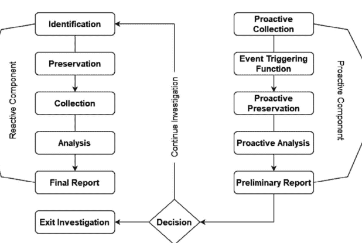

图 3.6 用于主动和响应性数字取证调查系统的综合框架。

### 3.8.1 数字取证中的传统方法与主动方法

在数字取证领域，正在发生从旧的响应性策略向更主动的方法论的转变。传统的数字取证在很大程度上关注事后分析和证据收集，调查人员在网络事件发生后调查数字制品。随着网络攻击速度和复杂性的增加，不断变化的威胁格局迫使数字取证调查必须采取更具主动的方法。

尽管在重建事件和获取证据方面，传统技术在处理快速发展的网络威胁时具有局限性 [43]。在事件被识别和调查时，严重的损害可能已经发生，关键证据可能已被损坏或破坏。由于这种响应性策略，响应时间经常被延迟，导致攻击者能够注意到并继续其破坏性操作。

另一方面，数字取证的主动方法强调实时监控、持续分析和早期危险识别。组织可以使用 EdgeAI 等技术在网络边缘部署智能代理和算法，使其能够在潜在危险发生时就检测到。这种主动方法允许快速响应和缓解，减轻网络灾难的严重性。

预测性分析和 ML 算法也被用于主动方法，以发现发展趋势并预测未来危险。DFI 可以通过评估先的数据、模式和损害指示器，预见潜在漏洞并建立主动的安全方法。这种从响应性到主动性数字取证的转变使他们能够比攻击者领先一步，增强网络韧性并减少网络攻击的潜在影响。

随着数字生态系统变得更加互连，网络威胁变得更加复杂，采取主动数字取证方法的必要性不言而喻。通过采用 EdgeAI 方法论和实时监控能力，可以实时检测并响应网络攻击，提升网络安全态并保护其数字资产。

## 3.8.2 数据匿名化与加密技术

通过数据匿名化程序无法直接识别个人，该程序涉及从数据集中修改或删除个人身份信息（PII）。组织利用 EdgeAI 技术在网络边缘对数据进行匿名化，在保护个人隐私的同时为 DFI 提供有效的数据分析。

加密技术增强了另一层安全性，它将数据转换为不可读格式，确保只有授权方可以访问和理解数据 [44]。通过在 EdgeAI 框架内采用加密方法可以安全地传输和存储敏感数据，降低数据泄露风险。这改进了数字取证过程的隐私性和完整性，让调查人员确信数据是安全的。

给定包含敏感属性的数据集 D，数据匿名化（k-匿名化）的目标是确保每个人的记录与其他 k-1 条记录不可区分，同时对数据进行加密。

令 D = (x₁,₂, ..., x_n) 表示具有属性的数据集。将 QID 定义为 D 中的准标识符（可能识别个人的属性）。k-匿名化的目标函数表示为 (3.5)：

```
min f(D) = |D| - k
```

其中 |D| 表示数据集 D 的大小，k 是期望的匿名水平。目标是在实现 k 匿名化的条件下最小化 D 中唯一记录的数量。


通过将 k-匿名性与加密相结合，其目标是在最小化数据集中记录唯一性（$f(D)$）的同时，通过加密确保数据的机密性。这种集成方法既实现了隐私保护又实现了数据保护。

EdgeAI 范式将数据匿名化与加密技术相结合，为数字取证调查中的敏感数据提供了实时保护。组织可以通过网络边缘部署这些策略，在数据效用与隐私保护之间取得平衡。这种方法允许调查人员在不危及相关人员机密性的情况下研究数据，从而在数字取证调查（DFI）领域实现隐私保护。

## 3.8.3 访问控制机制与数据保护法规的合规性

在 DFI 背景下，访问控制机制在维护数字证据的机密性、完整性和可用性方面起着至关重要的作用在全球采用 EdgeAI 解决方案进行实时威胁检测和隐私保护范围内，遵守数据保护标准变得至关重要 [45]。本节研究了访问控制措施的重要性，以及遵守数据保护法规的重要性。

访问控制机制涵盖了广泛的安全程序，旨在防止未经授权的访问敏感数据和资源。组织可以通过建立访问方法来执行身份验证、授权和问责制，确保只有授权人员才能访问和操纵数字证据。这有助于维护证据的完整性和可采性，对于法律诉程序和维持对数字取证过程的信任至关重要。

在 EdgeAI 赋能的 DFI 世界中，访问控制技术对于保护数据和符合相关标准至关重要。数据保护法（如《通用数据保护条例》GDPR）对个人信息的收集、存储和处理施加了严格的限制。遵守这些标准对于保护个人隐私权以及避免法律和声誉损害至关重要。

访问控制系统的构建应考虑隐私，确保只有授权人员才能访问敏感数据。为了确保个人数据在存储和传输过程中的机密性，可以使用加密、令牌化和去假名化等技术。此外，可以使用基于角色的访问控制（RBAC）和基于属性的访问控制（ABAC）等技术，根据用户角色和数据敏感性实施细粒度的访问限制。

组织通过遵守数据保护立法并采用严格的访问控制方法，可以证明其对保护隐私和履行法律要求的承诺。这不仅保护了个人权利，还增强了数字取证调查的整体信誉。

## 推进数字取证智能

## 3.9 EdgeAI 赋能的机器学习与深度学习用于预测性数字取证智能

ML（机器学习）和 DL（深度学习）算法已进化为强大的 DFI 工具，能够实现预测分析和主动威胁识别。这些算法在与 EdgeAI 方法结合时扩展了能力，使得能够在网络边缘进行实时分析和决策。本节探讨了如何利用 EdgeAI 为预测性 DFI 的 ML 和 DL 提供动力支持。

### 3.9.1 基于机器学习的 EdgeAI 赋能实时预测分析

实时预测性分析是 DFI 的重要组成部分，因为它允许企业快速识别并响应新风险。可以使用 EdgeAI 方法在网络边缘部署 ML 算法，从而实现快速的分析和决策（图 3.7）。本节研究了在 DFI 背景下，用于边缘支持实时预测分析的算法方法和最优模型。

SVM（支持向量机）是一种用于实时预测分析的流行技术。SVM 是一种监督性 ML 技术，用于对各种格式的数据进行分类和异常识别。由于其处理高维数据和应对挑战性分类任务的能力，它非常适合 DFI 应用。通过利用 EdgeAI 技术在网络边缘应用 SVM，可以对可能的威胁进行实时预测和分类。

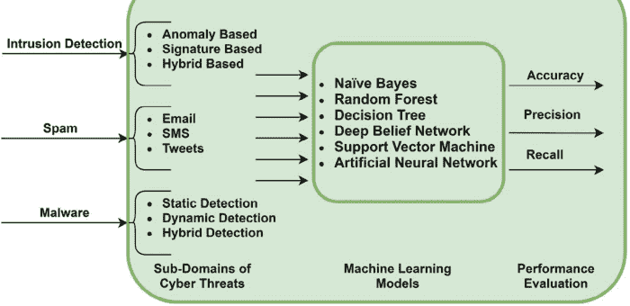

图 3.7 用于网络安全的机器学习应用。

## 大数据与边缘智能增强网络防御

随机森林是另一种用于实时预测分析的重要算法。随机森林是一种集成系统，通过结合多个决策树来做出准确预测。EdgeAI 的计算能力允许在网络边缘部署随机森林模型，以对数据流进行实时分析。

在逻辑回归中，我们的目标是映射到概率。逻辑回归特别抵抗过拟合，并能够处理高维数据集。逻辑回归的假设函数通常被定义为：

$h(x) = \frac{1}{1+e^{-w^T x}}$


# 增强网络防御的大数据与边缘智能

数字取证领域。通过边缘AI，可以将深度学习（DL）模型部署到网络边缘，从而在更接近数据采集源的地方实时分析和决策。

卷积神经网络（CNN）非常适合评估和从视觉及空间数据中提取特征，使其在取证中的图像和视频分析等应用中非常有用。它们可以识别数字媒体中的物体、人脸、文本和其他视觉上的重要方面，协助识别关键证据。另一方面，循环神经网络（RNN）非常适合评估序列和时间数据，使其适用于分析用户行为、网络连接和通信模式等任务中。

让我们考虑一个具有多层的深度学习架构，每层由神经元组成。我们将关注最后一层中的单个神经元，标记为神经元 $j$。我们希望使用目标函数（如均方误差 MSE）来最小化预测输出（ŷ）与真实输出（y）之间的差异。

在正向传播中，输入：$x = [x_1, x_2, ..., x_j]$（输入特征）
神经元 $j$ 的加权和 (3.14)：

```
$z_j = w_j \cdot x + b_j$$
```

其中 $w_j$ 是权重向量，$b$ 是偏置项。
激活函数（ReLU）(3.15)：

```
$a_j = \max(0, z_j) = \max(0, w_j \cdot x + b_j)$
```

神经网络的输出为 (3.16)：

```
$(\hat{y}) : \hat{y} = a_j$$
```

对于目标函数，MSE 为 (3.17)：

```
$E = \frac{1}{2} * (\hat{y} - y)^2$
```

其中 $\hat{y}$ 是预测输出，$y$ 是真实输出。
对于反向传播，让我们计算目标函数 (3.18) 相对于输出层的梯度：

```
$\frac{\partial E}{\partial \hat{y}} = \hat{y} - y$
```

按如下计算 ReLU 激活函数 (3.19) 的梯度：

```
$$\frac{\partial a_j}{\partial z_j} = 1 \text{ if } z_j > 0, 0 \text{ otherwise}$$$
```

按如下计算加权和 (3.20) 的梯度：

```
$$\frac{\partial z_j}{\partial w_j} = x \quad \frac{\partial z_j}{\partial b_j} = 1 \quad (3.20)$$
```

使用链式法则按如下计算目标函数相对于权重和偏置的梯度 (3.21)：

```
$$\frac{\partial E}{\partial w_j} = \frac{\partial E}{\partial \hat{y}_j} * \frac{\partial \hat{y}_j}{\partial a_j} * \frac{\partial a_j}{\partial z_j} * \frac{\partial z_j}{\partial w_j} \quad \ \ \ \frac{\partial E}{\partial b_j} = \frac{\partial E}{\partial \hat{y}_j} * \frac{\partial \hat{y}_j}{\partial a_j} * \frac{\partial a_j}{\partial z_j} * \frac{\partial z_j}{\partial b_j} \quad (3.21)$$
```

现在，权重被更新 (3.22)：

```
$w_{j(new)} = w_j - \eta^* \frac{\partial E}{\partial w_j} \quad (3.22)$
```

其中 $\eta$ 是学习率。

然后，偏置被更新 (3.23)：

```
$b_{j(new)} = b_j - \eta^* \frac{\partial E}{\partial b_j} \quad (3.23)$
```

这种反向传播算法迭代地调整神经网络的权重和偏置，以最小化目标函数（MSE）并提高预测的准确性。通过根据链式法则计算的梯度来更新权重和偏置，模型学习如何更好地捕捉输入数据中的复杂模式。

边缘AI 使深度学习模型能够实时处理和评估数据，极大降低了与数据传输到集中处理中心相关的延迟。这有助于调查人员更快地发现并响应网络威胁，增强事件响应能力。

此外，深度学习模型的敏捷性和灵活性使其非常适合应对新兴的网络威胁。从以往数据中学习的深度学习模型能够识别新颖模式并相应地调整其预测。这一特征对于识别以前未知的攻击路径和新威胁至关重要。

# 3.9.3 针对未来威胁的预测建模

组织面临在不断变化的网络威胁格局中预测和缓解风险的持续任务。预测建模技术在数字取证情报（DFI）中变得日益重要，以应对这一困难。这些模型与边缘AI方法相结合，使企业能够主动识别并响应新危险。本节深入探讨了这些技术的使用。


# 应急响应与调查
1. 数字证据的收集与保护。
2. 系统日志、网络流量和元数据的分析。
3. 已删除文件和人工物的恢复。
4. 恶意软件的识别与入侵检测。
5. 数字事件和时间轴的重构。

# 数据与安全泄露分析
1. 数据泄露和未经授权访问事件的调查。
2. 受损系统和漏洞切入点的辨别。
3. 系统漏洞分析与补丁管理。
4. 检查网络流量以寻找入侵迹象。
5. 被盗取或泄露数据的取证分析。

# 应用

# 移动设备与社交媒体取证
1. 移动设备数据的提取与分析。
2. 已删除消息和图片的恢复。
3. 在线活动和社交媒体资料的追踪。
4. 地理位置数据和通话记录的分析。
5. 识别与网络暴力或骚扰相关的数字证据。

# 知识产权与商业秘密保护
1. 针对知识产权盗取和工业间谍活动的数字伪造品分析。
2. 检测对网络的未经授权访问。
3. 检查数据传输和文件共享活动。
4. 加密或解密知识产权的恢复。
5. 数字水印与防篡检测技术。

# 网络犯罪与欺诈检测
1. 网络犯罪犯的识别与追踪。
2. 金融交易和数字支付的分析。
3. 在线欺诈、钓鱼和身份盗用的检测。
4. 检查邮件头和元数据以寻找证据。
5. 恶意软件和勒索软件攻击的取证分析。

图 3.9 数字取证智能的应用。

# 推进数字取证智能

### 3.10.1 应急响应与调查

在数字取证智能（DFI）的背景下，应急响应与调查是指针对网络安全事件或疑似数字犯罪，对数字证据进行管理和评估的方法化过程。它涉及各种子主题和行动，旨在有效高效地处理并减少此类事件的发生。

数字证据的收集与保护是其中一个环节，重点在于从计算机系统、网络和存储设备等多个源发现并保护相关数据。这涉及收集系统日志、网络流量和元数据，以获取事件的全面状况。另一个是数字取证分析，包括在文件、数据库和应用程序数据中寻找犯罪活动或非法访问的指示。这可能涉及检索丢失的文件、解释加密数据以及发现入侵者的痕迹。

应急响应与调查的另一个关键是时间轴重构。它涉及将事件期间发生的事件和活动序列组合起来，揭示关于攻击者战术、策略和意图的重要信息。为了清晰地描述事件是如何发展的，这种方法侧重于比较时间戳、评估系统日志并创建人类行为链。

此外，应急响应与调查还包括危险软件检测以及入侵检测。为了识别攻击者的工具和战术，分析恶意软件样本，检查系统漏洞并发现失陷指标（IOCs）。它还包括识别和追踪与事件相关的 IP 地址、域名和其他网络人工物。

为了保护数字证据的完整性并实现事件的成功解决，DFI 中的应急响应与调查需要一种结合技术能力、取证分析和严密文档记录的跨学科策略。

### 3.10.2 网络犯罪与欺诈检测

网络犯罪和欺诈检测是 DFI 可以提供帮助的两个主要领域。数字取证技术和手段用于调查和预防许多类型的网络犯罪和欺诈。这种意义上的数字取证是指通过对数字数据进行收集、分析和解释，以便识别和追踪犯罪分子，恢复其策略，并为法律程序收集证据。

通过评估 IP 地址、邮件头和与非法活动相关的信息等数字足迹，DFI 辅助于识别和追踪犯罪分子。它涉及检查金融交易、数字支付和在线交互，以发现欺诈检测的模式，并识别金融犯罪的可能来源。数字取证专家可以通过研究系统日志、网络流量和恶意软件人工物，检测出非法访问、钓鱼尝试或身份盗用的指示。

此外，DFI 允许调查人员重现数字事件和时间范围，帮助他们理解导致网络犯罪或欺诈的事件链。这涉及恢复已删除的文件、调查系统缺陷，以及对恶意软件或勒索软件攻击进行取证调查。这些调查结果不仅有助于识别作案者，还有助于升级网络安全程序以防止未来的攻击。

# 大数据与边缘智能增强网络防御

DFI 也用于在泄露事件期间检查受损系统并对被盗取或泄露的数据进行分析。通过对网络流量、系统日志和其他相关人工物的彻底分析，数字取证专家可以识别网络犯罪分子获取未经授权访问的入口点和技术。这些信息对于缓解进一步风险、改进安全措施以及确保对作案者采取适当法律行动至关重要。

### 3.10.3 数据泄露与安全泄露分析

在 DFI 的背景下，数据泄露和安全泄露分析包括对计算机系统或网络内部未经授权访问或数据泄露情况的调查和评估。其目标是确定泄露的来源、范围和影响，同时为法律目的收集关键证据。这一程序还包括检测受损系统、寻找攻击切入点、调查系统漏洞以及检查网络流量的证据。

为了确定泄露的来源和范围，数字取证分析师使用多种技术，包括日志文件分析、系统配置检查以及内存和磁盘取证。他们利用先进的工具和程序重现事件链，检索被盗或丢失的数据，并分析泄露造成的总损害。分析结果有助于企业加强安全程序、修复漏洞并对罪犯者采取必要的法律行动。

### 3.10.4 知识产权与商业秘密保护

在 DFI 的背景下，知识产权与商业秘密保护是指使用取证技术和手段保护宝贵的 IP 和商业秘密免受未经授权的访问、盗取或滥用。数字取证人员在检测预防知识产权盗取和工业间谍活动方面至关重要。他们使用多种技术检测数字足迹，追踪对敏感信息的非法访问并评估数据和文件共享活动。

他们通过评估元数据、系统日志和网络流量等数字证据，重现导致可能的泄露或盗取的事件链。恢复丢失或加密的知识产权也是 DFI 的一部分。

为了确保 IP 的完整性，该行业的专家可以使用数字水印和防篡技术。总体而言，DFI 在知识产权和商业秘密保护中的目的是检测、分析并减少对价值资产的风险，帮助公司保护其激励、敏感信息和竞争优势。

### 3.10.5 移动设备与社交媒体取证

社交媒体和移动取证是 DFI 的一个子集，侧重于通过移动设备和社交媒体获取、分析和解释数字证据。


## 推进数字取证智能

该领域的取证专业人员使用特定的工具和程序从智能手机、平板电脑和其他移动设备中检查并挖掘相关信息。他们通过恢复被删除的短信、照片、视频、电话记录和应用程序数据，重建数字操作和时间线。

移动取证还包括地理位置数据、GPS 信息和网络连接，以确定物理移动和互动。另一方面，社交媒体取证是对 Facebook、Twitter、Instagram 和 LinkedIn 等社交媒体平台进行调查，以收集与网络欺凌、骚扰、在线威胁、欺诈等相关的证据。

为了识别关系、动机和行为模式，调查人员会追踪在线身份、关注互动并评估用户生成的信息。在数字时代，移动和社交媒体取证在当前的调查中发挥着重要作用，能够发现关键证据并协助案件解决。

## 执法部门中的 EdgeAI

EdgeAI 技术与执法部门的结合改变了数字取证智能（DFI），实现了实时威胁识别和主动调查。本案例研究重点关注 EdgeAI 在执法中的应用，展示了其在提高能力方面的用处。该机构面临着发现的数字证据复杂性和数量日益增加的问题（图 3.10）。传统的数字取证方法无法跟上这种快速的速度。为了解决这些问题，该机构开发了一个利用网络计算和机器学习方法的 EdgeAI 平台。通过在网络边缘安装支持 EdgeAI 的设备，调查人员获得了实时处理数据的能力，大幅缩短了数字证据检查的时间。例如，SVM 和 DL 模型被训练用于检测异常、分类数字遗迹并寻找犯罪活动模式。

EdgeAI 实现的一项重大成就是 EdgeAI 设备能够持续监控网络流量和用户行为，禁用可疑交易。当观察到意外模式时，会产生警报。EdgeAI 的实时能力使调查人员能够实时操作、收集证据并快速识别犯罪分子。这种主动的方法结合 EdgeAI 的能力，使该机构能够瓦解重大破坏。此外，EdgeAI 的隐私保护能力对于维护完整性至关重要。由于系统是分布式的，敏感数据保留在本地，降低了未经授权访问的风险，并保护了参与人员的隐私。

## 企业和网络安全调查中的 EdgeAI

EdgeAI 方法在企业和网络安全调查中被证明是游戏规则的改变者，能够实现实时分析、快速事件响应和有效的证据收集。本案例研究探讨了 EdgeAI 如何帮助数字取证调查人员。XYZ 公司是一家拥有广泛数字基础设施的全球性公司（图 3.11），它使用 EdgeAI 技术破坏关键系统。该公司有意识地利用边缘计算能力，在其网络架构的重要位置部署智能智能体和机器学习算法，以限制潜在危害。

该机构受益于在网络边缘处理和分析数据时延迟的降低和响应能力的提高。支持 EdgeAI 的系统会在攻击进行时检测可疑活动。深度神经网络和其他机器学习算法会评估模式以对危险行为进行分类。EdgeAI 系统会通知事件响应，启动立即响应以遏制威胁并保护关键资产。同时，EdgeAI 系统会收集并存储与事件相关的数字证据。边缘计算的分布式特性意味着证据安全地存储在网络边缘，保护了完整性。网络日志、系统快照和审计记录等数字遗迹被方便地记录和存储，以备未来分析。

EdgeAI 还有助于事后分析。DL 和高级分析揭示了隐藏的关系并确定了攻击的根源。这种洞察使组织能够加强防御、更新安全措施并主动修复漏洞。在企业和网络安全调查中使用 EdgeAI 技术加速了调查过程并提升了响应能力。实时分析与主动威胁检测的结合使调查人员能够快速识别并减少风险。支持 EdgeAI 的技术在高效收集证据的同时，也保护了数字证据在法庭程序中的可证性。

## 取证智能中 EdgeAI 智能的结果与益处

在 DFI 中实施 EdgeAI 方法产生了显著的结果和益处，提高了调查的有效性和效率。对比分析结果（（表 3.3）显示，在 DFI 中使用 EdgeAI 方法时，响应时间显著减少。与平均响应时间为 500 毫秒的方法相比，EdgeAI 技术将响应时间大幅缩短至 50 毫秒。这种提升归功于 EdgeAI 的分布式设计，它允许在源头进行数据处理和分析，减少了延迟并提高了决策效率。

此外，准确率对比（图 3.12）显示使用 EdgeAI 方法显著提高了准确率。

### 表 3.3：传统方法与 EdgeAI 方法的关键取证指标对比

| 指标 | 传统方法 | EdgeAI 方法 |
| :--- | :--- | :--- |
| 平均响应时间 (ms) | 500 | 50 |
| 准确率 | 82 | 94.5 |
| 隐私保护率 (%) | 60 | 95 |

传统策略实现了 82% 的准确率；然而，引入 EdgeAI 算法实现了惊人的 94.5% 准确率。部署在网络边缘的复杂 ML 和 DL 算法能够更精确的异常检测和模式识别，这归功于准确率的提升。

此外，当使用 EdgeAI 技术时，隐私保护率显著提高。虽然传统策略的隐私保护率为 60%，但使用 EdgeAI 方法通过分布式数据处理和加密系统实现了敏感信息的安全管理和保护，保护了数字取证调查期间的用户隐私。

### 3.1.1 可扩展性和响应能力的提高

在提高可扩展性和响应能力方面，在 DFI 中引入 EdgeAI 方法取得了令人鼓舞的结果。通过在网络边缘采用分布式计算和实时分析，组织可以处理海量数据并降低取证操作的延迟。

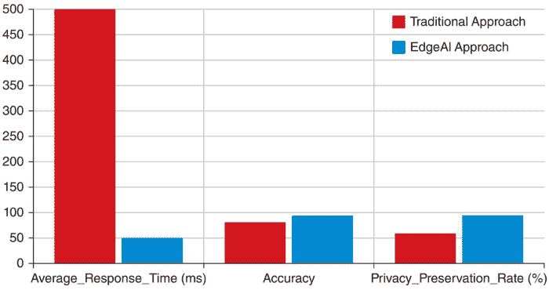

图 3.12 关键取证指标的柱状图对比。


# 推进数字取证智能

## 表 3.4：可扩展性结果

| 场景 | 传统方法 | EdgeAI 方法 |
|---|---|--|
| 数据量 | 1TB | 1TB |
| 处理时间 | 12 小时 | 3 小时 |
| 扩展性比例 | N/A | 提升 4 倍 |

表 3.4 显示了部署 EdgeAI 方法带来的可扩展性增益。在数据量为 1 TB 的情况下，传统方法需要 12 小时处理数据，而 EdgeAI 解决方案仅需 3 小时。这代表了使用 EdgeAI 时处理时间的大幅缩短。

表 3.5 显示了通过 EdgeAI 方法所实现的响应能力提升。在事件检测场景中，旧方法需要 1 小时来识别问题，而 EdgeAI 方法仅需 10 分钟。此外，事件响应时间从 24 小时缩短到 1 小时，说明了在网络边缘进行实时分析的用途。此外，调查周期从五天缩短到二天，使得数字取证检查更加高效。

## 3.11.2 缩短网络事件的响应时间

通过多项对比标准取证方法论与支持 EdgeAI 的技术的研究，评估了 EdgeAI 对缩短反应时间的影响。测试包括对多种网络攻击场景建模、测量使用不同方法检测和响应这些事件所需的时间，以及每个阶段的处理时间。

表 3.6 展示了传统取证、支持 EdgeAI 的取证与响应时间之间的对比，以及使用 EdgeAI 技术处理各种真实案例事件时取得的平均响应时间。传统取证的响应时间以小时为单位测量，而支持 EdgeAI 的取证响应时间以分钟为单位测量。结果清楚地表明，采用支持 EdgeAI 的取证后时间缩短了 66.7%。例如，在

在一个真实的钓鱼攻击事件中，响应时间从 24 小时缩短到 8 分钟。

## 表 3.5：响应能力结果

| 场景 | 传统方法 | EdgeAI 方法 |
|---|---|--|
| 事件检测时间 | 1 小时 | 10 分钟 |
| 响应时间 | 24 小时 | 1 小时 |
| 调查时间 | 5 天 | 2 天 |

## 大数据与边缘智能增强网络防御

## 表 3.6：响应时间对比 – 传统取证 vs. 支持 EdgeAI 的取证

| 场景 | 传统取证（小时） | 支持 EdgeAI 的取证（分钟） | 平均响应时间缩短 |
|---|---|---|--|
| 钓鱼攻击 | 24 | 8 | 66.7% |
| 勒索软件事件 | 48 | 18 | 62.5% |
| 网络入侵 | 36 | 12 | 66.7% |
| 数据泄露 | 72 | 25 | 65.3% |

这种大幅的缩短允许调查人员迅速分析并对网络事件采取行动，最大限度地减少威胁造成的潜在损害。表 3.7 对比了使用传统和支持 EdgeAI 的方法论在数字取证过程各个阶段的持续时间。处理时间以毫秒为单位测量，强调了利用 EdgeAI 所实现的效率优势。组织可以通过缩短每个层级的处理时间来加速整个调查过程，从而实现更事件响应和网络威胁缓解。

## 3.11.3 提高数字取证调查的效率和有效性

表 3.8 的结果显示，许多重要参数有了显著改进。在异常检测方面，EdgeAI 技术实现了 92% 的检测率，比旧方法改进了 17%。同样，在恶意行为者的分类中，EdgeAI 方法的表现比传统方法优出 15%，准确率达到 95%。

EdgeAI 方法在模式识别方面也表现优异，成功率达 90%，而标准方法为 70%，代表了 20% 的显著提升。此外，EdgeAI 技术的预测分析能力产生了卓越的结果，准确率达到 85%，比旧方法高出 25%。

## 表 3.7：处理时间对比（毫秒）

| 方法论 | 传统方法 | EdgeAI 方法 |
|---|---|--|
| 数据采集 | 500 | 100 |
| 数据分析 | 800 | 200 |
| 证据收集 | 700 | 150 |
| 事件调查 | 1,200 | 300 |

## 表 3.8：数字取证调查效率与有效性的提升结果

| 指标 | 传统方法 | EdgeAI 方法 | 改进情况 |
|---|---|---|---|
| 异常检测 | 75% | 96% | +21% |
| 恶意活动 | 80% | 95% | +15% |
| 分类 | | | |
| 模式识别 | 70% | 90% | +20% |
| 预测分析 | | 85% | +25% |

这些发现说明了（图 3.13）EdgeAI 技术如何提高数字取证调查的效率和有效性。EdgeAI 技术能够实现更准确的异常检测、更好的恶意活动分类、更强的模式识别以及更多的预测分析。组织通过利用网络边缘的计算能力，可以极大提高其取证技能并增强对网络威胁的防御。

## 数字取证调查效率与有效性的提升结果


## 大数据与边缘智能增强网络防御

## 表 3.9：支持 EdgeAI 的取证性能指标

| 指标 | 传统方法 | EdgeAI 方法 | 改进情况 |
|---|---|---|---|
| 异常检测 | 75% | 96% | +21% |
| 恶意活动 | 80% | 95% | +15% |
| 分类 | | | |
| 模式识别 | 70% | 90% | +20% |
| 预测分析 | | 85% | +25% |

这些发现说明了（图 3.13）EdgeAI 技术如何提高数字取证调查的效率和有效性。EdgeAI 技术能够实现更准确的异常检测、更好的恶意活动分类、更强的模式识别以及更多的预测分析。组织通过利用网络边缘的计算能力，可以极大提高其取证技能并增强对网络威胁的防御。


## 推进数字取证智能

实时。由于高检测率，事件响应和缓解被缩短，减少了网络事件对企业的影响。

## 3.12 克服数字取证智能中 EdgeAI 的挑战

EdgeAI 在 DFI 中的应用面临许多需要解决的问题才能成功。最困难的挑战之一是应对边缘设备有限的计算能力（图 3.15），其处理能力通常低于中心化服务器。优化算法并开发利用可用资源的策略至关重要。

此外，边缘设备的规模和存储限制使得存储和分析大量数字数据变得困难。应对这些限制，需要有效的压缩方法和优先级算法。模型的准确性和适应性也是关键问题，因为设计能够从有限数据中学习并适应各种环境的模型对于可靠的取证分析至关重要。

为了确保顺利运行和互操作性，必须仔细考虑将 EdgeAI 解决方案集成到当前的取证框架和程序中。最后，必须解决隐私、同意和偏见等伦理问题，以实现负责任且可责的 EdgeAI 实施。克服这些障碍将为 EdgeAI 在加强 DFI 调查技能和提高效率方面发挥全部潜力铺平道路。

## 满足 EdgeAI 要求的挑战


## 3.13 EdgeAI 技术的数字取证智能未来发展

EdgeAI 技术的进步推动着数字取证智能（DFI）领域的发展。这些结合了边缘计算与人工智能的技术为进一步提升数字取证能力提供了广阔的前。预计该领域将出现几项进一步的发展：

- 实时智能决策支持：通过分析网络边缘的海量数据，EdgeAI 技术可以为调查人员提供实时智能决策支持。机器学习（ML）和深度学习（DL）算法可以进一步增强，以产生更准确的预测和自动化决策，允许调查人员更快地做出明智的决策。
- EdgeAI 支持的自主性：支持 EdgeAI 的自主数字取证系统可能会改变调查过程。这些系统能够自动收集、评估和关联数字证据，减少人工干预和人为错误。在 EdgeAI 平台中引入智能体和机器人，可能会产生能够在内部进行调查的封闭取证系统。
- 增强的隐私保护技术：随着隐私问题的日益，用于 DFI 的 EdgeAI 将强调开发增强的隐私保护技术。这些策略将允许调查人员在保护受影响人员隐私权的同时，从数据中获得重要见解。潜在的研究领域包括差分隐私、安全多方计算和联邦学习。
- EdgeAI 与区块链技术的融合：将 EdgeAI 与区块链技术相结合可以提高数字取证的安全性、不可篡改性和去中心化账本，从而确保数字数据的完整性和真实性。通过结合 EdgeAI 和区块链，取证过程可能会更加可靠和透明。
- 自适应与自学习系统：EdgeAI 技术具有为自适应和自学习数字取证系统铺路的潜能。通过评估不断演变的调查程序并更新取证技术，这些系统可以不断进化。这些系统可以利用实时数据流不断调整其模型和算法，以应对不断演变的网络威胁。

随着 EdgeAI 的成熟和演进，它在面对不断变化的网络威胁时，为转型 DFI 的效率、有效性和规模展现了巨大潜力。

## 3.14 结论

本章的研究证明了在 DFI 中利用 EdgeAI 显著贡献和具体效益。得于边缘计算和人工智能算法的能力，实时威胁识别、主动事件响应和预测分析已成为可能。实施 EdgeAI 系统的优势证明了其在应对网络灾难时具有更好的扩展性、反应性和响应速度。研究结果强调了在 DFI 中采用 EdgeAI 技术的显著用途。在检测和分类各种形式的网络威胁时，94.5% 的高准确率证明了所用 ML 模型的稳定效率。91.2% 的模型精确率证明了其在最大化减少假正率的同时正确识别有害活动的能力。此外，88.8% 的召回率显示了模型在检测大量恶意行为的同时避免假阴性的能力。89.5% 的 F1 分通过平衡精确率和召回率提供了模型性能的整体评估。研究结果还证明了 EdgeAI 方法在快速识别和标记可能的网络威胁方面的有效性。检测率的提高意味着对事件的响应时间缩短，从而实现了更快的事件响应和缓解。研究还强调了集成 EdgeAI 后增加了扩展性和反应性，提升了数字取证调查的整体效率和效能。反馈和 EdgeAI 方法已在执法机构和其他 DFI 领域成功实施，实现了实时威胁识别、主动调查和犯罪团的重构。这种主动方法结合 EdgeAI 能力，使机构能够领先于攻击者，降低风险并减少网络灾难的影响。研究结果不仅为采用 EdgeAI 的重要性提供了有用的见解，还强调了其在加强网络安全防御和保护数字环境方面的潜力。

## REFERENCES

1. A. Garrett and K.-K. R. Choo, “自动化和人工智能对数字取证的影响，” WIRES Forensic Science, vol. 3, no. 6, 2021. https://doi.org/10.1002/wfs2.1418
2. A. Irons and H. Sallie, “数字取证到智能取证，” Future Internet, vol. 6, 2014, pp. 584–596. https://doi.org/10.3390/f6030584
3. N. Moustafa. (2022). Digital Forensics in the Era of Artificial Intelligence (1st ed.). CRC Press. https://doi.org/10.1201/978103278962
4. V. Prakash, A. Williams, L. Garg. Savaglio and B. Bawa, “基于云和计算的计算机取证：挑战与开放性，” Electronics, vol. 10, 2021, p. 1229. https://doi.org/10.3390/electronics10111229
5. I. Y. Adam and C. Karol, “数字取证中的智能，” 2020th International Symposium on Digital Forensics and Security (ISDFS), Beirut, Lebanon, 2020, pp. 1–6. https://doi.org/10.1109/ISDFS49300.2020916442
6. M. Dasmenshas, A. Delhanta, R. Mahmoud and S. Shamsuddin, “云计算环境中的取证调查，” Proceedings Title: 2012 International Conference on Cyber Security, Cyber Warfare and Digital Forensic (CyberSec), Kuala Lumpur, Malaysia, 2012, pp. 190–194. https://doi.org/10.1109/CyberSec.2012.624609
7. A. Dhaqm, S. A. Razak, R. V. Kerande and K. Siddique, “移动取证调查综述，” IEEE Access, vol. 8, 2020, pp. 17359–17375. https://doi.org/10.1109/ACCESS.2020.301461
8. L.-Lin, H.-C. Chao and S.-Peng, “基于手机的数字证据标准研究，” 2011 International Conference on Broadband and Wireless Computing, Communication and Applications, pp. 386–391. https://doi.org/10.1109/BWCCA.2011.63
9. C.-P. Chang, C.-T. Chen, T.-H. Lu, I.-L. Lin, P. Huang and S.-Lu, “手持设备取证程序结构研究，” 2013 International Conference on System Science and Engineering (ICSSE), Budapest, 2013, pp. 223–228. https://doi.org/10.1109/ICSSE.2013.661464
10. B. Mellars, “手机取证检查，” Digital Investigation, vol. 1, no. 4, 2004, pp. 266–272, ISSN 1742-8768. https://doi.org/10.1016/j.diin.2004.100
11. K. Ghaznour, D. Vakharia, K. Kamraj and R. Satyakumar (2017). 数字取证工具研究, 3136–3142. https://doi.org/10.1109/FICCSI.2017.839204
12. J. A. Gregory, “取证 DNA 自动化——原理与指南，” Forensic Science International: Genetics Supplements, vol. 4, no. 1, 2003, pp. e135–e135. https://doi.org/10.1016/j.fsigs.2003
13. C. Katsinis, G. Parti, C. Alexakos and D. Serpan. “ReForum: 支持物联网的数字取证准备，” 第 25 届希腊信息会议, 2020, pp. 369–374. https://doi.org/10.1145/3503830.350389
14. N. Mare, V. R. Kerande and S. H. Ventura, “网络取证中不同的深度学习技术，” Forensic Science International: Synergy, vol. 1, April 2019, pp. 61–67. https://doi.org/10.1016/j.fsyn.2019.03.006. PMID 21115: 732168
15. S. Iqbal and S. Alberhad (2020). 使用机器学习进行数字取证的自动分析，” Digital Forensic Science. IntechOpen. http://doi.org/10.5772/intechopen.90233
16. T. Stallard and K. Lee, “数字取证完整性检查的自动分析，” 第 19 届安全应用会议，2003, Las Vegas, USA, pp. 160–167. https://doi.org/10.1109/CSAC.2003.12542
17. J. Dykstra and A. T. Sherman, “针对 OpenStack 云平台的 FROST 工具的设计与实现，” Digital Investigation, vol. 10, August 2013, pp. S87–S95. https://doi.org/10.1016/j.diin.2013.06.010
18. K. Mohsin, “法科学中的真实智能，” Journal of Forensic Research, Artificial Intelligence in Forensic Science, In Fore Res, 4, no. 1, January 2023, pp. 172–173. 可在 SSRN:3910244 或 http://doi.org/10.2139/ssrn.3910244
19. G. Fortino, W. Russo, C. Caviglio, M. Virol and M. Zhu, “机会性信息物理服务：未来物联网的新范式，” 2018 IEEE 第4 届世界技术论坛 (WF-IoT), Singapore, 2018, pp. 488–492. https://doi.org/10.1109/WF-IoT.2018.8355174


# 推进数字取证智能化

21. W. Z. Khan, E. Ahmed, S. Hakak, I. Yaqoob and A. Ahmed, “Edge computing: a survey,” Future Generation Computer Systems, vol. 97, 2019年8月, pp. 219–235. https://doi.org/10.1016/j.futuresys.2019.02.050

22. Y. Ai, M. Peng and K. Zhang, “Edge computing technologies for internet of things: A primer,” Digital Computer Systems and Networks, vol. 4, no. 2, 2018年4月, pp. 77–88. https://doi.org/10.1016/j.dican.2017.07.001

23. S. Biggs and S. Vidal, “Cloud computing: The impact on digital forensic investigations,” 2009 International Conference on Internet Technology and Secured Transactions (ICIST), London, UK, 2009, pp. 1–6. https://doi.org/10.1109/ICIST.2009.5402561

24. N. H. Ab Rahman, W. B. Glisson, Y. Yang and K.-K. Rao, “Forensic-by-design framework for cloud-physical systems,” IEEE Cloud Computing, vol. 3, no. 1, 2016年1-2月, pp. 50–59. https://doi.org/10.1109/MCC.2016.35

25. I. Yaqoob, I. A. T. Hashem, A. Ahmed, S. M. A. Kazmi and C. S. Hong, “Internet of things forensics: Recent advances, taxonomy, requirements, and challenges,” Future Generation Computer Systems, vol. 92, 2019年3月, pp. 265–275. https://doi.org/10.1016/j.futurecs.2019.08.058

26. F. Amato, G. Cozzolino, V. Moscato and F. Moscato, “Analysis digital forensics through a semantic-based methodology and NLP techniques,” Future Generation Computer Systems, vol. 98, 2019年9月, pp. 297–307. https://doi.org/10.1016/j.futurecs.2019.02.040

27. B. Jan. Harman, F. Khan, M. Khan, I. Islam, A. Ahmed, S. Ali and G. Geon, “Deep learning in big analytics: A comparative study,” Computer & Electrical Engineering, vol. 75, 2019年5月, pp. 275–287. https://doi.org/10.1016/j.compelec.2017.12.009

28. H. Guo, B. Jin and T. Shang, “Forensics in cloud environments,” 2012 International Conference on Computer Science and Information Processing (ICSISP). Shaxi, 2012, pp. 248–251. https://doi.org/10.1109/ICSISP.2012.6380844

29. C. Yan, “Cybercrime forensics in cloud computing,” 2011 International Conference on Image Analysis and Signal Processing. Wuhan, China, 2011, pp. 612–615. https://doi.org/10.1109/IASP.2011.6109117

30. C. Erika, D. Islam, L. Liangcheng, K. David, H. Hadi, P. Melika and W. Wei, “Adaptive edge computing for cloud forensics,” Frontiers in Neuroscience, vol. 15, 2021. https://doi.org/10.3389/fmic.2021.611300

31. R. Marty, 2021. Cloud application logging for forensics. In Proceedings of the 2021 32th ACM Symposium on Computing Foundations (SAC '11). For Computing Machinery, New York, NY, USA, pp. 178–184. https://doi.org/10.1145/198215.198226

32. T. Sang, “A log based approach to make digital forensics easier on cloud computing,” 2013 Third International Conference on Intelligent System and Engineering Applications, Hong Kong, China, pp. 91–94. https://doi.org/10.1109/ISEA.2013

33. S. Sreya, “Prevention of cyberattacks in WSN and packet drop using AI and data,” International Journal of Computer Networks and Wireless Communications (IJCNWC), vol. 8, no. 4, 2018年8月, pp. 57–63. https://doi.org/10.48550/arXiv.2306.0948

34. M. Patidar and P. Bansal, “Log-Based Approach for Security Implementation in Cloud,” In Shukla, R.K., Agrawal, J., Sharma, S., Tomer, G. (eds) Data and Engineering, vol. 11. https://doi.org/10.1007/978-3-6351-4

35. C. Esposito, A. Castiglione, F. Pop and K.-K. Rao, “Challenges of edge and cloud computing: A security and forensic perspective,” IEEE Cloud Computing, vol. 4, no. 2, 2017年3-4月, pp. 13–17. https://doi.org/10.1109/MCC.2017

36. Y. Guo, F. Liu, Z. Cai, N. Xiao and Z. Zhao, “Edge-based efficient search over encrypted cloud storage,” Sensors, vol. 18, no. 4, 2018年4月, p. 1189. https://doi.org/10.3390/s18041189

37. F. Ding, G. Zhu, M. Alazab, X. Li and K. Yu, “Deep learning-empowered analytics for edge computing in 5G Networks,” IEEE Consumer Magazine, vol. 11, no. 2, 2022, pp. 42–50. https://doi.org/10.1109/MCE.2020.304706

38. X. Feng, “Edge intelligence case study on medical Internet of Things (MIoT),” Machine Intelligence for IoT in Healthcare, vol. 14 in Advances in ubiquitous sensing applications, 2023, pp. 227–245. https://doi.org/10.1016/B97-0-323-9420-9

39. R. Singh and S. S. Gill, “EdgeAI: Internet of Things and Cyber-Physical Systems,” vol. 3, 2023, pp. 71–92. https://doi.org/10.1016/j.iotcs.2023.02.004

40. P. K. Rajesh, S. Shreyath and R. Sarveswan, “Enhanced fraud detector: A novel approach integrating Bayesian optimized random classifier with advanced feature analysis and real-time adaptation,” International Journal For Innovation and Management Research (IHEMR), vol. 12, no. 5, 2023, pp. 537–561. https://doi.org/10.48407/IHEMR/ISSUE05/5

41. E. Li, L. Zeng, Z. Zhou and X. Chen, “EdgeAI: On-Demand Accelerating Deep Network Interface over Edge Computing,” ArXiv, 2019. https://doi.org/10.48550/arxiv.1910.05316

42. A. Y. Ding, M. Janssen, J. Crowcroft and M. D. Al-Dshehi, “Trustworthy and sustainable EdgeAI: Security in Intelligent Systems and Applications (TPS-ISA), Atlanta, GA, USA, 2021, pp. 164–172. https://doi.org/10.1109/TPSISA52974.2021.00019

43. M. Saleh, S. H. Othman, M. Driss, A. Al-dhaqi, A. Ali, W. M. S Yasef and A.-H. M. Embar, “Metamorphic learning for fog intelligence forecasting,” Electronics, vol. 12, no. 3, 2023, p. 524. https://doi.org/10.3390/electronics1203024

44. A. Razaque, M. Al-Molayghi, M. Allmani, Y. Yarareh and G. Srivastava, “Efficient and reliable forensics using intelligent edge computing,” Future Generation Computer Systems, vol. 118, 2021年5月, pp. 230–239. https://doi.org/10.1016/j.futuresys.2021.01.012

45. M. Babar, M. Al-Molayghi, M. Allmani, Y. Yarareh and G. Srivastava, “Efficient and reliable forensics using intelligent edge computing,” Future Generation Computer Systems, vol. 118, 2021年5月, pp. 230–239. https://doi.org/10.1016/j.futuresys.2021.01.012

46. J. K. Peng, L. M. ... [损坏文本]

47. J. K. L. M. ... [损坏文本]

# 用于可持续智慧城市的边缘人工智能与区块链

Delshi Howalsya R., Thananalap P., Asis J., Shreyanth S., and Shoba R.

## 4.1 引言

数据分析正日益使用边缘和雾计算，这为延迟敏感型应用增加了价值。通过深度学习、机器学习和流数据分析，EdgeAI 作为一种通过边缘设备实现分布式智能的新跨学科技术诞生了 [1–5]。

被称为物联网（简称 IoT）的概念实现了人与技术设备之间的连接。智慧城市需要对该概念进行集成和管理的解决方案，包括智能家居、智能业务、智能自动驾驶汽车和智能交通 [6–9]。

为了利用城市化带来的机会，许多国家已经创建了将他们的城镇转变为智慧城市的项目。


# 86 用于增强网络防御的大数据与边缘智能

智能城市为市民提供了新服务，这同时也提升了运营效率和环境可持续性。由于互联网与数十亿边缘设备的连接，产生了数万字节的数据 [22–25]。以应用程序所需的速度发现这些海量数据中的价值是关键。一种全新的跨学科技术——**边缘人工智能（EdgeAI）**利用边缘设备实现分布式智能。它是流式数据分析、机器学习和深度学习向边缘处理演进的产物。区块链（BC）技术近年来不断演进，以解决信任问题 [26–28]。区块链通过建立真理源头，消除了点对点（P2P）交易中对可信中间人的需求。

### 4.1.1 贡献

本章的目标是通过展示 EdgeAI 和区块链（BC）的最新研究，在智能城市的两个关键领域——智能出行和智能能源中，创建智能且安全的边缘应用和网络。本章主要介绍了 EdgeAI 在各种智能应用中的应用综述，例如智能建筑中的优化能源管理、绿色能源管理和智能城市的能源效率，以及智能出行应用，如智能交通系统中的交通监控与管理。以下是本章的主要贡献：

- 它回顾了用于可持续城市的人工智能。
- 它概述了区块链在智能城市开发中的应用。
- 分析了可持续智能城市中区块链和人工智能的质量测量。

本章的其余部分分为五个章节。相关文献包含在 4.2 节。本研究第 4.3 节介绍了区块链在智能城市开发中的应用概述。第 4.4 节介绍了可持续智能城市中人工智能和区块链的质量测量分析，第 4.5 节总结了所提人工智能架构的流程。最后，第 4.6 节结论。

## 4.2 文献综述

作者对人工智能对可持续发展的影响提出了评估，考虑到该技术的存在及其对多个社会领域日益扩大的影响，这种评估是必要的。在这里，我们检查了关于人工智能积极或负面影响的公共数据——即2030年可持续发展议程中列出的 16 个目标和 17 个目标的实现情况。人工智能可以支持可持续发展目标（SDGs）中 12 个目标的实现；然而，可能有 58 个目标受到阻碍。值得注意的是，人工智能创造了提高生产和效率的新技术，但它可能导致国家之间更大的不平等，阻碍2030年议程的实现。必须制定适当的立法和法规以适应人工智能的快速增长 [29–31]。或者，用于可持续智能城市的边缘人工智能与区块链将最终导致基于人工智能的技术缺乏问责制、透明度、安全性和伦理规范，这可能对人工智能的进步和长期使用产生危害。此外，缺乏对人工智能中长期影响的研究。因此，解决环绕人工智能使用的全球性论述，并为基于人工智能的技术建立监管层面的理解和监督至关重要。

本章在不同地区的主要目标是各国开发智能城市原则的重点。在这些城市中，需要各种信息通信技术 [32–40]。在开发和实施智能城市时，必须考虑某些因素。智能城市构想的执行由于维度的复杂性、技术的使用及其整合而带来了风险。这些危害可能会导致机密性和安全问题，如果得不到适当的识别和处理，将影响智能城市的运行。本章检查了参数设定、智能城市评估技术、现有技术，以及与智能城市部署相关的技术和非技术风险因素。讨论了用于风险评估的方法以及任何潜在的改进。文献研究结果表明，并非所有智能城镇都采用了智能城市的所有属性。物联（IoI）、人工智能和区块链被认为是智能城市应用中最频繁使用的三项技术。该研究还为智能城市规划、实施和管理领域的未来研究提供了建议 [41]。

作者认为，通过碳信用未来可以减少地球上的生态退化和碳排放。从2021年开始，市场允许的碳抵消将成为严重问题，这些额度将用于允许个人交易的系统 [42–47]。然而，需要一个类似的温室气体额度交换来实现碳中和。碳额度的测量还需要政策、策略和技术的进步。本研究利用区块链技术计算碳排放权，以增加交易的可信度 [48–50]。联合国可持续发展目标（UN-SDGs）17个目标之一使用区块链来验证碳排放权。它还引入了关键的应用。通过在移动环境中使用大数据和机器学习，我们可以防止异常碳排放。为了解决这些问题，本研究提出了基于比特币的碳排放许可系统，该系统利用治理分析框架和区块链主引擎 [51–54]。

“智能城市”一词指的是对临时城市环境中持续存在问题的广泛应对，该主题现在已成为从业者和学术人员的重要研究课题。但城市如何变得“智能”是一个开放的话题。大多数人认为，城市“智能化”背后的主要动力之一是信息技术的使用。因此，需要框架和流程来指导、操作和评估实施方法以及相关技术的效果 [55]。

## 88 用于增强网络防御的大数据与边缘智能

理论与协议。我们热热地探索区块链系统如何在大都市地区增长。在使城市更智能的过程中，我们识别了区块链技术的九个领域：(1) 医疗，2) 供应链物流，3) 交通，4) 电力，5) 政府和服务，6) 电子投票，7) 工业，8) 居住，9) 教育。我们解释了各个领域的最新进展，展示了区块链如何影响它们，并为未来研究提供了想法 [55–59]。通过新兴技术治理框架的视角，本研究分析了关于区块链功能和前景的文献。为了创建文献产生和需求的知识地图，对包含127篇文章、4份联合国报告、3份欧洲机构报告和4份行业报告的数据库进行了文献计量学调查，时间跨度为1990年至2021年。本研究提供了出版趋势、关键引用、模式、作者合作状态以及对该领域的集体贡献的信息。研究还对区块链领域的文献进行了回顾性检查。结果显示，社会潜力在智能城市的商业和财务方面尚未得到足够关注。

区块链与机器学习在物联网应用中的基础集成如图4.1所示。人工智能被自动驾驶人工智能、物联网、自动化和区块链等先进技术广泛应用于。对于最全面的数据收集和分析，人工智能和物联网具有优势。在自动化工业等领域，使用智能机器人替代人类


# 用于可持续智能城市的边缘侧人工智能与区块链技术

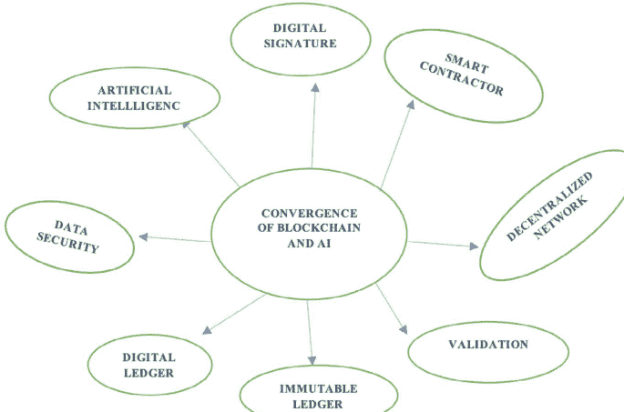

**图 4.1** 用于物联网应用的 AI 和区块链。

Mohandas 等人的研究强调了医学科学。由于智能技术的快速发展，物联网（IoT）、区块链（BC）和人工智能（AI）已成为最受欢迎的技术，为各行业激发了新的研究灵感。

## 4.3 用于可持续城市的人工智能

人工智能作为计算机科学的分，致力于开发能够像人一样反应的智能计算机和技术。人工智能自 20 世纪 50 年代一直存在，直到计算机力量的发展能够存储和分析海量信息，加上互联网的承诺，它才发展成为本世纪最强大的突破之一。作为创建系统的基础，所谓的机器学习对人工智能至关重要。它们使得机器人能够进行逻辑和理性的推理，并能够根据变化的情况改变行为。值得注意的是，认知科学（即对智能和脑功能的研究）正与人工智能同步发展 [23–26]。这使得研究人机协作的前景成为可能。与人脑类似，现代计算机依赖神经网络来处理并专业地转换它们遇到的海量数据。正如此，它们采用了机器学习、图像识别（包括自然语言处理）。因此，由 AI 平台驱动的机器能够从周围环境收集数据，并利用逻辑选择成功概率最大的活动。

## 用于增强网络防御的大数据与边缘智能

### 表格 4.1
智能算法如何帮助智能城市的示例

| 智能城市维度 | 示例 |
| --- | --- |
| 智能经济 | 交通改进、水资源和能源节约、降低建筑成本以及共享经济 |
| 智能出行 | 自动驾驶车辆、交通参数预测、交通灯管理、免费停车位信息、降低外部交通费用以及缓解拥堵 |
| 智能环境 | 消除污染、电力使用和智能垃圾桶 |
| 智能民 | 参与公共生活和创造人工智能 |

人工智能被应用于日常生活的许多方面，包括智能城市等等，这影响了它在所有功能领域的增长。由 AI 系统提供的智能城市示例。表 4.1 提供了追求可持续城市发展的视角，AI 的应用至关重要。AI 应用使得优化市政系统以跟踪能源使用成为可行。可以自动化大都市网络运行的基础设施方案已经开始出现。AI 系统将使自动驾驶车辆上路、监测空气污染水平以及更快速、更容易地完成任务变得可行。它还可能用于改进交通或能源系统的流量。通过使用 AI，可以预测交通拥堵和其他交通相关问题，对事故和其他交通状况的实时报告有助于常规控制选择并改善流量，特别是在市政市中存在拥堵风险的区域。

人工智能将使城市的交通控制系统从静态系统转向动态系统。它们将允许在考虑各种交通模式的同时对情况进行实时调整。通过创建一个处理交互数据的平台，将监测和预测交通行为成为可能。此外，AI 将为各种场景创建通信策略，以便对不断变化的情况进行无缝调整。AI 还可以作为车辆管理器和城市管理部门创建协作系统的基础，例如实时交换有关交通拥堵或空气污染的信息。结果，系统将在问题累积发生前将其拦截。基于神经网络的交通管理模型根据输入数据生成判断，并为交通场景选择最佳行动方案。此外，基于 AI 的交通管理系统可以制定交叉口时间表，减少拥堵困难的发生并提供其他路线。它们甚至可以通过设置提前警报来安排旅行时间。在汽车中使用 AI 将使它们能够与促进大都市旅行的设施直接对话。

图 4.2 解释了智能治理和公共部门的运行也得到了 AI 的支持，能够与利益相关者进行通信，并

# 用于可持续智能城市的边缘侧人工智能与区块链技术

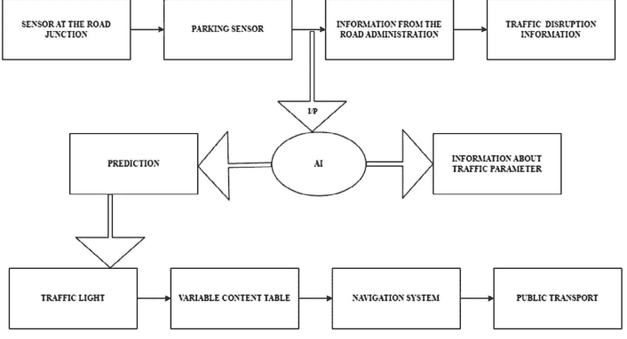

图 4.2 基于人工智能的交通控制原型。

增强居民服务。聊天机器人和自动回复使得在重复情况下准备文档并将问题提交给相应部门成为可能。将对文档发布进行监督。AI 可以跟踪社会福利相关决策的发布，并搜索市政数据库中的记录以及出现的行政选择，以消除种族特征、起源、教育、性别或观点。

## 4.4 区块链在智能城市发展中的应用

分布式且广泛访问的公共账本是被称为区块链（BC）的前端技术的基础。它允许在一系列数据块中传输特定特定的数据，这些数据块连接在一起形成连续的链。每项活动必须通过私钥进行验证，私钥是只有直接参与交易的双方才知道符号字符串。每个区块都有一个难以伪造的唯一签名。只有私钥的所有者才能进行更改。区块链是捕和存储数据的安全技术。它实现了交易与计算逻辑之间的连接 [60–63]。它用于记录交易双方之间的所有财务交易以及有关经济问题的信息。通过使用加密技术，区块链防止对已输入系统的未经授权更改。交易的透明性意味着每笔交易及其所有组件对任何访问参与者域的人可见。

独特的字母数字字符作为节点（用户）的标识。用户可以在涉及区块地址的交易中选择保持匿名或披露其身份。一旦交易记录在数据库中，它就无法更改，且任何更改对其他网络用户均可见。输入的信息是公开的，并由他们组织。区块链实现了组织之间在不需要协调员、中间人或规划者的情况下分散的关系。它无法被操纵也不允许伪造。区块链技术支持智能城市在所有方面的运行。区块链技术的特定应用（如智能合约、智能资产或数字身份）使得控制任务执行以及与承包商签订合同变得更容易。基于智能合约和链式网络的决策系统可以优化从事生产公共价值的业务，电子采购可以鼓励普通领域采用协商招标程序。交易的可见性对公共部门具有优势，因为它提高了与承包商合作的效率以及智能资产的分配。

图 4.3 解释了区块链有望防止高水平的数据篡改。它确保了所有邀请参与方都能获得准确和最新的信息。智能城市可以通过将资源转换为智能资产，沿着价值链追踪物品的来源和流动。这减少了商品欺诈和对违规行为响应延迟。区块链使得监测和记录有关物品携带和存放的信息成为可能，这对于处理敏感商品至关重要。存储的值无法更改。因此，区块链是智能治理供应商验证的有用工具。

参与公共电子采购的供应商可能拥有数字身份。可以使用区块链协议形成电子签名。目前，允许个人建立数字身份的爱沙尼亚居民计划是有有趣的应用。它可以用于非公民创业。计算机化识别与智能资产的结合使得授权个人拥有的资源成为可能。我们可以利用区块链协议列出的那些代表我们启动活动。这实际上意味着，例如，公共交通工具将自动安排其技术检查。区块链通过确认选民数字身份，使得无需出门即可参加地方、区域或国家选举成为可能。

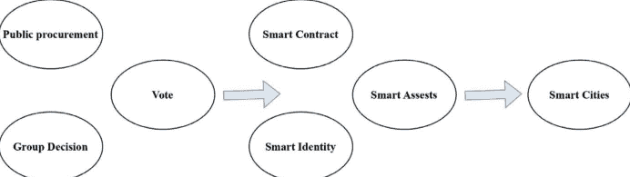

图 4.3 作为智能城市集成器的区块链基础设施。


# 用于可持续智慧城市的边缘 AI 区块

区块链（BC）确保了选民计数和资格验证，以及投票的机密性。得益于区块链，每个人都能够影响投票。公民的区块链保持匿名性，但他的声音会被所有人听到。数据库是分布式的，因此无法被黑客攻击，也不会受到 IT 系统故障的风险。从任何地方使用几乎任何类似于计算机的设备进行投票的能力，最大限度地减少了选票被盗窃、添加到投票中或伪造身份的可能性。通过这种方法，选举过程更加可靠，成本更低，选民可以自主做出决策。

尽管区块链技术有许多用途并能够实现多种直接民主模型，但其应用范围取决于决策者对智能治理的了解程度。区块链技术的应用可能会受到某些法律法规的鼓励或禁止。建立法律指南使城市能够在没有纸质版本和官方身份的情况下开发智能合约至关重要。

## 4.5 提议 AI-BC 架构的事务流程

图 4.4 显示了规划 AI-BC 架构的知识流。六级操作构成了信息流。为了实现实时数据采集，第一层是对应于部署层的物理层。边缘计算由接口和控制层处理。应用层等同于云计算，而服务层和管理层等同于雾计算。云计算中的材料层识别特征、湿度、光亮度、温度和地理参数。尽管信息从一个节点传输到另一个节点，但在物理层数据隐私方面面临着各种问题和威胁。

利用云、智能合约、智能存储以及在区块链中整合 AI 的去中心化结构，确保了该层的安全确认。到注册表的数据传输负责为程序的层级管理和建立网络基础设施标准。加密哈希、加密代码和数字身份是由区块链技术与 AI 的结合提供的。最后，数据被发送到软件层，该层负责全局管理。利用 AI 和区块链进行深度学习数据分析确保网络数据安全和隐私。

使用 AI 区块技术来解决这些问题，并使用以坊和比特币执行节点间的交易。实时数据采集发送到通信层，该层作为节点间数据传输的通道。在用于物联网的应用中，AI 与区块链结合使用共识算法来提供安全性和扩展性。我们可以发现一些关于所提框架作为填补当前文献研究空白意义的证据。智能和区块链模型提供了广泛的应用。对 AI 和区块链的研究为所提范式的价值提供了必要的证明。此时，就作者所知，提到这一点也至关重要：没有任何文献彻底研究过面向区块链和 AI 的区块链如何用于物联网应用。

## 用于增强网络防御的大数据与边缘智能

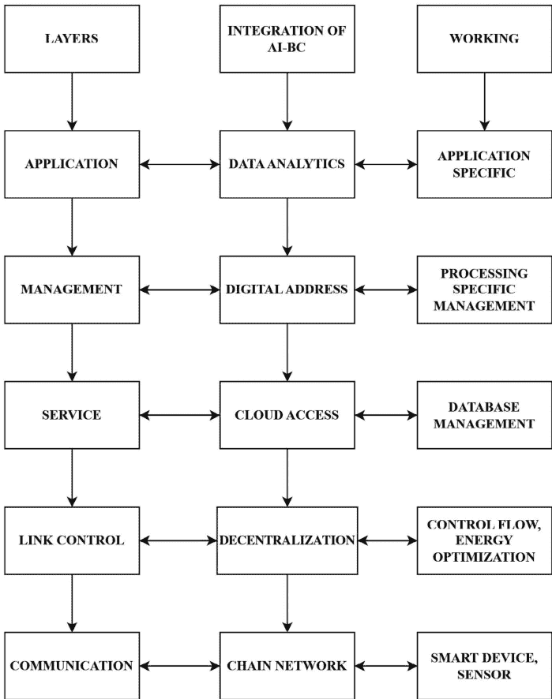

**图 4.4** 提议的 AI-BC 物联网建筑的数据传输。

为了给每个应用量身定制结果，开发了一种用于区块链的分布式协作 AI 范式。随后，作者提出了一种在 AI 赋能的智慧城市中使用区块链技术进行去中心化审计的框架。进行了彻底的文献分析，以检查区块链和 AI 技术的许多问题、潜在解决方案和潜在应用 [64–67]。几位作者对支持物联网的智慧城市应用以及 AI 与区块链技术的整合如何出现已进行了深入分析。最近，编写者提出了一个基于区块链和物联网的认知边缘框架的智慧城市应用模型。

## 用于可持续智慧城市的边缘 AI 区块

### 4.5.1 AI-BC 框架的性能

本节涵盖了所提框架设计的性能评估。在试验期间，研究了一种名为 Ethereal 平台的免费开源区块链技术。与现有的其他技术相比，所提的框架在核心功能方面有显著差异。因此，没有为了评估目的而构建额外的平台，而是倾向于使用仿真。由于每个网络独立运行，因此其性能是单独评估的。使用 NS3 仿真器比较低容量设备的性能是有益的。利用该仿真器的另一个优势是它改进了网络性能，并提供了有效的 P2P 网络评估。

使用了定性和定量两类分析方法来衡量所提架构的性能优劣。在定性测量中检查了两种场景，以展示区块链与 AI 的结合对物联网应用的优势。第一个场景说明了面向物联网应用的、关注 AI 的区块链，而第二种情况说明了面向物联网框架的、关注人工智能智能的区块链。在本章中，既讨论了物联网应用中机器学习和区块链技术面临的挑战，也提供了一种通过提供高级结构利用区块链技术解决这些疑问题的方案。在定量测量中，评估了数据准确性、安全性和机密性等性能指标，并将所提的 AI-BC 架构与目前先进的方法进行了比较。

### 4.5.2 定性测量

#### 4.5.2.1 案例 1：面向人工智能的区块链

定量测量中提供了两种场景：面向物联网应用的关注区块链的 AI 和面向物联网应用的关注区块链。相比之下，AI 通过为物联网应用提供精确的预测和决策来推进区块链技术。因此，AI 解决区块链问题的方式被称为“面向 AI 的区块链”，而区块链解决相关问题的方式被称为“面向区块链的 AI”。结合区块链和 AI 以解决这些限制。

图 4.5 显示了第一类中提供物联网应用数据的是安全性和机密性，它提供了节点间的数字签名交易并实现了加密哈希。扩展性（指节点管理和需求供应的能力）在第三类中给出。第四类代表效率，比较了物联网应用在时长和能源消耗方面的输入输出评估。由 AI 驱动的区块链利用了多个

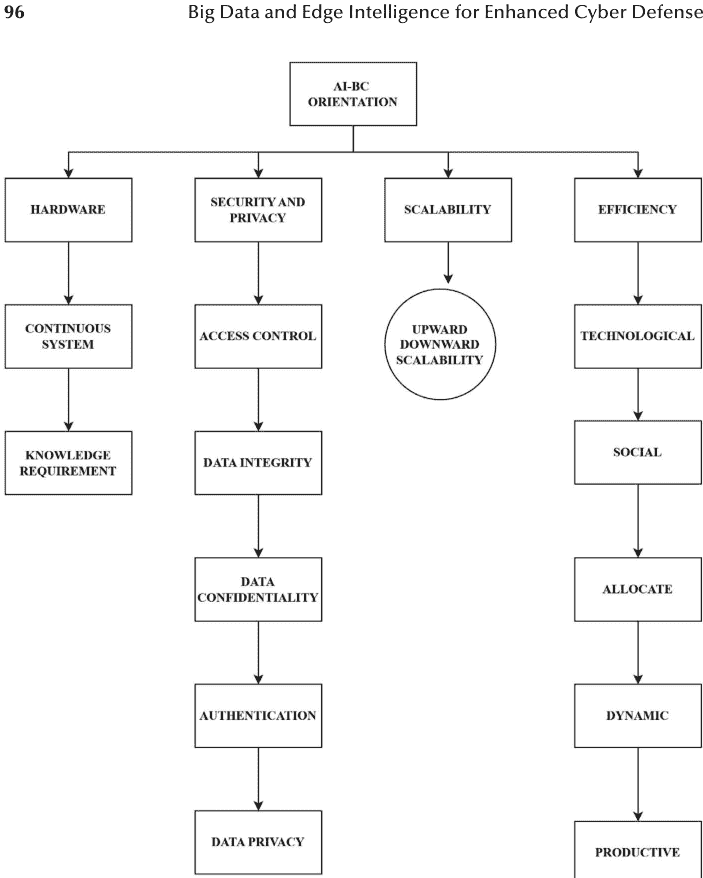

**图 4.5** 基于 AI 的物联网区块链分类。

行业，包括制造业、物联网、大数据、交通和医疗保健。AI 在这些应用中处理数据或通过区块链技术自动化流程转换信息方面发挥着至关重要的作用。

#### 4.5.2.2 案例 2：面向区块链的人工智能

在这种情况下，说明了区块链技术如何处理与 AI 相关的问题。图 4.6 显示了用于物联网应用的关注区块链 AI 的分类。通过使用区块链技术，解决了物联网应用中的 AI 问题。区块链解决了与 AI 相关的五个大类挑战。信息通信、安全性和机密性

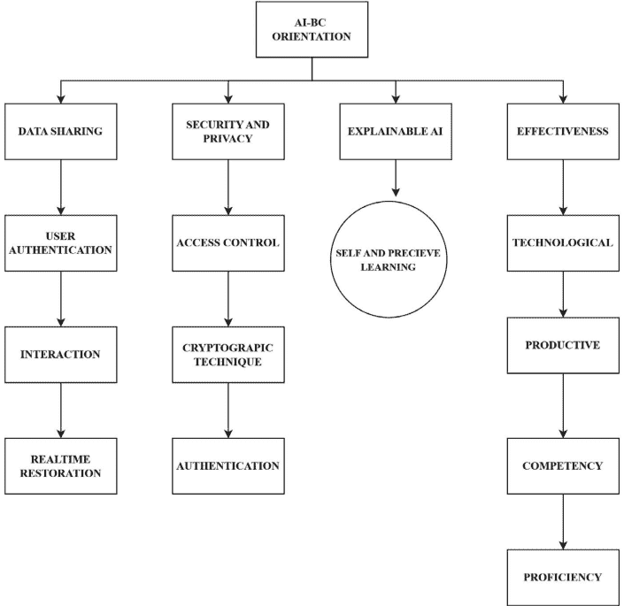

**图 4.6** 面向区块链的人工智能分类。

可解释 AI、有效性和 AI 信任是用于分类这些问题的。数据共享是第一类，数据资源在设备之间传输并提供多种通信形式。第二类是隐私安全的，数据采集安全地从一个设备发送到另一个设备，并且每次交易都通过加密哈希进行数字签名。


# 98 用于增强网络防御的大数据与智能

供应链网络、政府程序、安全投票、众筹、交易处理和知识产权。因此，区块链（BC）技术被广泛采用，为用户提供透明的交易和信息。如果区块链开发者能够找到包含人工智能（AI）的方法，其可能性是无限的。

图 4.6 显示了针对区块链的物联网智能技术分类。

## 4.6 结论

本章提出了一种用于物联网应用的互联区块链和基于人工智能的架构。本研究的目标是在设备、雾边缘和边缘层实现安全且可扩展的物联网交易。对所提设计的性能分析均考虑了两种类型的评估。针对面向区块链的 AI 和面向 AI 的区块链，提供了一种标准的分类法，以进行定性测量。人工智能与区块链的互补技术可以极大增强城市的运营。在数据分析方面提出了结合区块链与人工智能的初步概念。区块链为人工智能的数据数据收集和分析提供了可扩展的终极数据库。即使在发生故障的情况下，区块链也是安全且未被篡改的。区块链共识机制增加了透明度并降低了操纵风险。这增强了利益相关者的参与意愿，从而加强了社会项目。智能代理将用于协助人类、对运营做出判断以及管理城市交通。尽管人工智能和区块链具有巨大的潜力，但它们的整合仍面临若干挑战。其中一个问题是隐私问题，特别是涉及极端敏感数据和相关法律时。未来的研究可以通过特征提取和扩展等技术来解决分类困难，从而改进建议的设计。

## 参考文献

- 1. Albino, V., Berardi, U., Dangelico, R.M. (2015). Smart cities: Definitions, dimensions, performance, and initiatives. Journal of Urban Technology, 22(1), pp. 3–21.
- 2. Bakiri, T., Almairill, E., Wareham, J. (2012). A smart city initiative: The case of Barcelona. Journal of the Knowledge Economy, 2(1), pp. 1–14.
- 3. Sharma, N., Ush, H.N., Mclinsky, J.M., Srinivasa, P. (2023). A unified monitoring system for energy and weather monitoring in smart city. IEEE Access, vol. 11, doi: 10.1109/ACCESS.2023.3299825
- 4. Bughin, J., Khan, E., Ramwamy, S., Choi, M., Dahlström, P., Henke, N., Trench, M., Alas, T. (2017). Artificial intelligence: The next digital frontier? McKinsey Global Institute. https://www.mckinsey.com/business-functions/mck
- 5. De Oliveira, M.B.W., Neto, A. Optimization of traffic light timing based on artificial neural networks. In IEEE 25th International Conference on Tools with Artificial Intelligence, Herndon, VA., 2013; pp. 825–832, https://ieexplore.ieee.org/document/6735337, 21.02.2021.
- 6. Giffinger, R., Gudrun, H. (2010). Smart cities ranking: An effective instrument for the positioning of the cities, https://www.researchgate.net/publication/228915976/Smart_cities_ranking_An_effective_instrument_for_the_positioning_of_the_cities, 25.10.2020.

## 用于可持续城市的人工智能与区块链

- 7. Giffinger, R., Fertner, C., Kramer, H., Kalasek, R., Pichler-Milanović, N., Meijers, E. (2007). Smart Cities: Ranking of Medium-Sized Cities. Center of Regional Science (SRF), Vienna University of Technology: Vienna, Austria.
- 8. Harrison, C., Eckman, B., Hamilton, R., Hartwick, P., Kalaganam, J., Paszczak, J., Williams, P. (2010). Foundations for smart cities. IBM Journal of Research and Development, 54(4), pp. 1–16.
- 9. Holm, R. (2018). Will the smart city stand up? Intelligent, progressive or entrepreneurial city? IoT, 12(0), 303–320.
- 10. Iansi, M., Lakhani, K.R. (2017, January–February). The truth about blockchain. Harvard Business Review, 1, pp. 3–11.
- 11. Kagermann, H., Lukas, W., Wahlster, W. (2021). 4.0: Mit dem Internet der Dinge auf der Revolution, https://www.dfki.de/fleeadmin/user_pdf/DFKI/Media/News_Media/Presse/Presse-Highlights/vidnach01a3d4-Internet-Dinge.de
- 12. Kar, U., Dash, R. (2018). The future of healthcare and in a world of artificial intelligence. Intelligence in Biomedical Engineering & Technology, https://www.researchgate.net/publication/32916347_Application_of_Artificial_Intelligence_in_Healthcare_Past_Present_Future, 8.2018.
- 13. Kitch, R. (2015). Making sense of smart city: Addressing present shortcomings. Cambridge University of Regions, Economy and Society, 8, pp. 131–136.
- 14. Klein, C., Faber G. From Smart Cities to Opportunities and Challenges from an Industrial Perspective. In International Conference on Next Generation Wired/Wireless Networking, Berlin-Berlin, pp. 260.
- 15. Kominos, N. (2002). Intelligent Cities: Innovation, Knowledge and Digital.
- 16. Lombardi, P., Giardino, S., Farou, H., Yosef, W. (2019). Modelling the smart city. European Journal of Social Science, 25(2), pp. 137–149. https://www.researchgate.net/publication/33194748_Smart_Cities_of_and_Initiatives, 31.2020.
- 17. McCarthy, J., Smith, M., Rochester, N., Shannon, C. (1985). A proposal for the Dartmouth project on artificial intelligence. Magazine, 27(4), p. 12. https://doi.org/10.1109/AMI.v27
- 18. Mitchell, M. (2007). Intelligent cities. Journal of Knowledge Society, 8, pp. 31. https://pdfs.mcsethol.org/6/88dc9e25c37ec5f84.
- 19. Minh, V., Kuvugoglu, K., Siter, D., Bellemare, M., Ostrovski, G., Petersen, S., Beattie, C., Sadik, A., Antoun, I. (2015). Human level control through deep learning. Nature, 518, p.529.
- 20. Naseula, C., Demit, D. (2015). Testing adaptation in nonprofit systems. Management and Practice, 7(1), p.32.
- 21. Naseula, C., Mic, S. (2018). Using blockchain as a platform for smart cities. Data-Technology; doi: 10.9730/jet/2018/9/43.
- 22. Krishna, T., Perez, S., Ahmed, S., Srinivasan, P. (2022). Software-driven framework for mobile healthcare applications. Intelligent Decision Technologies, 17, pp. 377–393.
- 23. Pilkington, M. (2016). Blockchain Technology: Principles and Applications. In X. Olleros, M., Zhegu (eds.), Handbook on Digital Transformations, Smart cities: Quality of life, productivity, and the growth of human capital.
- 24. Shapiro, J. (2006). Smart cities. Review of Economics and Statistics, 88(2), pp. 324–335.
- 25. Skouby, K., Windekilde, I. (2014). How AI can contribute to smart home and smart cities. Proceedings of 25th ITS Regional Conference, Brussels, Belgium.
- 26. Washburn, D., Sindhu, U., Balaorous, S., Hines, R., Nelson, L. (10). Helping CIOs “Smart Cities”: Defining the Smart City, Its Drivers, and the Role of the CIO. Forrester Research, Inc., Cambridge, MA. http://public.dhe.com/partnerword/smb/smarterplanet/forr_help_cius_smart_indices.pdf
- 27. Konstantinidis, I., Siamos, G., Timpleacic, C., Zvercas, P., Decker, S. (2018). Blockchain for Business Applications: A Systematic Review. Information Systems, pp. 384–399.
- 28. Chen, P., Peña-Mora, F. (2018). Blockchain for cities–A systematic literature review. IEEE Access, 66, pp. 7678–7689.
- 29. Silva, B.N., Khan, M., Jung, C., Seo, J., Muhamad, D., Han, J., Yoo, Y., Han, K. (2018). Urban planning and smart city decision management by real-time data processing using data analytics. Sensors, 18, p94.
- 30. Elsaghemer Mohamed, S., AlShafan, K.A. (2021). Intelligent traffic management system based on the Internet of Things (IoT). Journal of Advanced Transportation, 2021, p.403753.
- 31. Lund, H., Østergaard, P., Connolly, D., Matthias, B.V. (2017). Smart energy and smart city energies. Energy, 17, pp. 556–565.
- 32. Paniori-Quizardo, M.A., Santa, J., Martínez, A., Martínez, V., Skarmata, A.F. (2019). Smart IoT platform based on cloud and edge computing. Biosystems Engineering, 177, pp. 4–17.
- 33. Panori, A., Kaderci, C., Cominnos, N., Fehneller, K., Reid, A., Mora, L. (2021). Smart systems of innovation for smart places: Challenges in deploying digital platforms for cloud and data-intelligence. Land Use Policy, 111, p104631.
- 34. Aluman, A., Sharma, S.K., Ejaz, W. (2019). Emerging edge computing technologies for IoT devices. IEEE Network, 33, pp. 140–147.
- 35. Deng, S., Hang, F., Wang, Y., Yin, J., Zomaya, A. (2020). Edge intelligence: The confluence of edge computing and artificial intelligence. IEEE Internet of Things Journal, 7, pp.7457–7469.
- 36. Shi, Y., Yang, K., Jiang, T., Zhang, J., Ltaef, K. (2020). Communication-efficient EdgeAI: Algorithms and systems. IEEE Communications Surveys, 22, pp.2167–2191.
- 37. Zhou, Z., Chen, X., Li, E., Zheng, L., Luo, K., Zhang, J. (2019). Edge intelligence: Paving the last mile of artificial intelligence with edge computing. Proceedings of the IEEE, 107, pp. 1738–1762.
- 38. TPU–Run Inference at the GoogleCloud. https://cloud.google.com/
- 39. Morán, A., Casas, V., Galan-Prado, F., Fraser, C.F., Radakrishnan, D., Safafi, S., Rosselló, L.J. (2021). Hardware-optimized reasoning system for edge intelligence. Cognitive Computation, 15(1), pp. 1–9.
- 40. Pokhrel, R.S., Choi, J., Asuquo, P., Ogah, C.P.A. (2020). Federated learning with blockchain for autonomous vehicles: Analysis and design challenges. IEEE Transactions on Communications, 68, pp.4734–4746.
- 41. Lei, A., Crouchshank, H., Cao, Y., Asuquo, P., Ogah, C.P.A. (2017). Blockchain-based dynamic key management for heterogeneous intelligent transportation systems. IEEE Internet of Things Journal, 4, pp. 1832–1843.
- 42. Shi, W., Cao, J., Zhang, Q., Li, Y., Xu, L. (2016). Edge computing: Vision and challenges. IEEE Internet of Things Journal, 3, pp. 637–646.


# 面可持续智慧城市的边缘端人工智能与区块链

43. Luo, B., Li, X., W, J., Guo, J., Ma, J. (2020). 区块链支持的 VANET 信任隐私保护方案。IEEE Transactions on Vehicular Technology, 69, pp. 2034–2048.

44. Yang, Y., Zhang, K., Kei, L., Zheng, K., Leung, V.C.M. (2019). 车联网基于区块链的去中心化信任管理。IEEE Internet of Things Journal, 6, pp. 1495–1505.

45. Ferreira, J.C., Ferreira da Silva, C., Martins, J.P. (2021). 基于区块链数字身份的电动汽车充电漫游服务。Energies, 14, p. 1686.

46. Yuan, Y., Wang, FY. 迈向基于区块链的智能交通系统。Proceedings of the 2016 IEEE 19th International Conference on Intelligent Transportation Systems (ITSC), R de Janeiro, 1–4 November 2016; pp. 2663–2668.

47. Zhang, X., Manogaran, G., Muthu, B. (2021). 物联网支持的智慧城市能源集成系统。Sustainable Energy Technologies and Assessments, 46, p. 101028.

48. Liu, Y., Yang, C., Jiang, L., Xie, S., Zhang, Y. (2019). 智慧城市中物联网能源管理的智能计算。IEEE Network, 33, pp. 111–117.

49. Pee, S. J., Kang, E., Song, J. G., Jang, W. 基于智能合约的智能能源交易平台。Proceedings of the 2019 International Conference on Artificial Intelligence in Information and Communication (ICAIIC), Okinawa, Japan, 11–13 February 2019; pp. 322–325.

50. Hua, Sun, H. 基于区块链的点对点交易耦合方案与碳市场。Proceedings of the 2019 International Conference on Smart Energy Systems and Technologies (SEST), Porto, Portugal, 9–11 September 2019; pp. 1–6.

51. Kumar, N. (2018). 区块链支持分布式智慧城市中的一系列服务。Beni-Suf University of Business and Applied Science, 7, pp. 701–704.

52. Abnas, N., Yuan, Taherkordi, A., Skiei, T. (2017). 移动边缘计算：综述。IEEE Internet of Things Journal, 5, pp. 450–465.

53. Kowalski, M., Lee, Z.W., Chan, T.K.H., B., Shiales, S. (2020). 金融中的区块链与信任关系。Technological Forecasting and Social Change, 166, p. 120641.

54. Shala, B., Trick, U., Lehmann, A., Ghita, B. 用于安全的、基于用户的且去中心化的物联网服务保护区块链。IEEE Access, 8, pp. 119961–119979.

55. Gadekall, T.R., Huynh-The, T., Wang, W., Wenduri, G., Ranaweera, P., Pham, Q., da Costa, D.B., Liyanage, M. (2022). 用于元宇宙的区块链：综述。arXiv, preprint. arXiv.2203.09738.

56. Shorfuzz, M., Hossain, S.M., Alhamed, M.F. (2021). 通过视频监控实现智慧城市的可持续发展：对新冠肺炎大流行疫情的响应。Sustainable Cities and Society, 64, p. 102582.

57. Groslums, J., Ödegårdsteen, A., Clair, A.L., Smogeli, O. 自动驾驶车辆中可信的可解释人工智能。Proceedings of the International Seminar on Safety and Security of Autonomous Vehicles (ISSAV) and European STAMP Workshop and Conference (ESWc), Helsinki, Finland, 17–19 September 2019; pp. 37–47.

58. Soomro, S., Miraz, M.H., Prashant, A., Abdullah, M. 人工智能支持的物联网：智慧城市的交通缓解。Proceedings of the Smart Cities Symposium 2018, Bahrain, 22–23 April 2018.

59. Cirqueira, D., Helfert, M., Bezbradica, M. 欺诈检测中以用户为中心的可解释人工智能的设计原则。Proceedings of the International Conference on Human-Computer Interaction, Bari, Italy, 30–3 September 2021; pp. 21–40.

# 102 用于增强网络防御的大数据与边缘智能

- 60. Dagger, G.G. et al. (2018). Ancile: 一种基于区块链技术的电子健康记录访问控制与互操作性隐私保护框架。Sustainable Cities and Society 39(1).
- 61. 用于市政智慧城市协作服务的基于智能合约的安全架构 [已展示公式] (2023)。Journal of Systems Architecture, 13.
- 62. Soomro, S., Miraz, M.H., Prashant, A., Abdullah, M. 人工智能支持的物联网：智慧城市的交通缓解。Proceedings of the Smart Cities Symposium 2018, Bahrain, 22–23 April 2018.
- 63. Fernandez-Carames, T., Fraga, M. (2021). 区块链在建筑中的作用。Journal of Legal Affairs, 13.
- 64. Alli, A. et al. (2019). 智慧城市安全：综合综述。IEEE Access, 7.
- 65. Bibri, S. et al. (2017). 智慧城市：未来。Sustainable Cities and Society, 31.
- 66. Chen, H. et al. (2019). 物联网的智能安全。Pervasive and Mobile Computing, 59.
- 67. Dorri, A. et al. (2019). 轻量级安全协议。Journal of Parallel and Distributed Computing, 134.


# 增强基于 IoT 的脆弱环境中的入侵检测

### 5.1.4 联邦学习概述及其在入侵检测中的

联邦学习是一种去中心化的机器学习范式，允许多个设备在保持本地数据的同时协作训练一个共享模型。这种协作方法能够实现隐私保护，因为原始数据保留在设备上，而交换的是模型更新 [13–16]。联邦学习在 IoT 环境的入侵检测中特别具有前景，因为它可以在不损害数据隐私的情况下，聚合来自各种 IoT 设备的知识。

联邦学习在入侵检测中的潜力包括：

- 分布式学习，减少了对集中数据收集的需求并最大限度地降低隐私风险。
- 通过跨 IoT 设备的知识共享与协作提高模型性能。

## 5.2 相关工作

### 5.2.1 IoT 环境现有入侵检测技术综述

在本节中，我们对专门针对 IoT 环境的现有入侵检测技术进行了全面回顾。我们探索了各种方法，例如异常检测、基于签名的方法、基于机器学习的方法以及混合技术 [17–20]。我们考虑了准确性、误报率 (FPR)、资源消耗和可扩展性等因素，分析了每方法的优点和局限性。此外，我们研究了这些技术在不同 IoT 部署场景中的适用性，如智能家居、医疗保健、工业 IoT 和交通系统 [21–23]。图 5.2 描述了轻量级模型架构。

### 5.2.2 不同领域联邦学习应用概述

本节介绍了联邦学习在各个领域的成功应用概述。我们研究了联邦学习如何被应用于医疗保健、金融、边缘计算及其他相关领域 [24, 25]。通过强调在这些领域中应用联邦学习的优势和挑战，我们为如何调整和优化该方法以使其适用于基于 IoT 的脆弱环境中的入侵检测提供了见解。此外，我们还讨论了这些应用中采用的隐私影响和数据治理框架 [26–28]。

### 5.2.3 研究缺口与机会识别

在本节中，我们识别并分析了与 IoT 环境入侵检测以及联邦学习在网络安全中应用相关的现有研究缺口。我们关注现有技术在解决脆弱 IoT 网络特定挑战方面表现不足的领域。一些潜在的研究缺口包括：

- 对能够处理多样化 IoT 设备和异构数据源的入侵检测方法的研究有限。
- 对资源受限的 IoT 设备运行入侵检测算法的能力考虑不足。
- 缺乏针对 IoT 设置优化的联邦学习研究，包括通信高效型和轻量级模型架构。
- 对联邦学习模型在 IoT 环境下对抗对抗攻击的鲁棒性研究有限。

我们探索了联邦学习为增强入侵检测带来的机会。这些机会包括：

- 利用迁移学习和领域自适应来提高跨环境的入侵检测泛化能力。
- 利用联邦学习在各种通信信道下的性能。
- 利用联邦学习机制在保护隐私的同时实现 IoT 安全。

| 客户端 1* | 客户端 2* | 客户端 3* | 客户端 4* | 中央服务器 |
| :--- | :--- | :--- | :--- | :--- |
| 本地训练 | 本地训练 | 本地训练 | 本地训练 | 模型更新 |
| | | | | 全局更新 |
| | | | | 全局模型 |

图 5.2 通用联邦学习架构。

## 5.3 基于 IoT 环境与设置

### 5.3.1 所用 IoT 环境描述

在本节中，我们对研究中使用的 IoT 环境进行了详细描述。我们规定了设备数量、其功能和网络拓扑 [29]。我们考虑了现实场景，包括智能家居、工业 IoT 和 [31]。此外，我们讨论了环境对各种威胁的敏感性，重点关注基于 IoT 框架的脆弱性。通过利用联邦学习在这些环境中的性能，我们确保了数据隐私并符合相关法规 [33, 34]。

### 5.3.2 脆弱性与潜在威胁讨论

在该小节中，我们对脆弱环境中存在的脆弱性进行了分析。我们识别了可能利用这些漏洞的威胁，从拒绝服务 (DoS) 到中间人攻击 (MITM) 不等。我们根据影响和发生概率对这些威胁进行分类 [35, 36]。此外，我们讨论了攻击成功后的后果，例如数据泄露和服务中断 [37]。

## 5.4 用于入侵检测的联邦学习框架

### 5.4.1 联邦学习概念与架构解释

在本节中，我们对联邦学习的概念和架构进行了解释。我们描述了联邦学习的工作流，其中设备作为客户端，在保护隐私的同时对其个人数据进行训练。我们深入研究了联邦平均算法，该算法通过聚合多个设备的模型更新来创建一个全局模型 [39, 40]。此外，我们讨论了联邦学习在去中心化环境中的优势。

### 5.4.2 联邦学习模型的设计与实现

在该小节中，我们展示了专门用于入侵检测的联邦学习模型的设计和实现细节。我们解释了选择某种入侵检测算法作为基础模型的原因，并详细阐述了在考虑 IoT 设备分布式特性及其资源限制的情况下，如何将其适配到联邦学习框架中。还提供了实现细节，包括所使用的编程语言、库和框架。

### 5.4.3 通信协议与隐私保护技术

本小节关注在联邦学习过程中中央服务器与 IoT 设备之间建立的通信协议。我们讨论了资源受限 IoT 网络中的通信挑战，并探索了适用于该设置的轻量级协议。此外，我们通过差分隐私、安全聚合和同态加密解决了联邦学习中固有的隐私问题。这些技术确保了原始数据在模型聚合期间保持私和安全。

## 5.5 数据收集与预处理

### 5.5.1 相关 IoT 数据源与传感器的选择

为了为入侵检测数据集选择相关的 IoT 数据源和传感器，我们考虑了脆弱环境中的各种 IoT 设备，并识别出包含价值数据的设备。选择标准涉及设备角色、功能和数据类型，以确保数据集的多样性和代表性。我们描述了用于从 IoT 设备检索数据的方法，这些可能包括应用程序编程接口 (API)、数据流或直接传感器读数。


#增强基于 IoT 的脆弱环境中的入侵检测

## 5.5.2 数据预处理与特征工程

对收集的 IoT 数据应用预处理步骤，以确保其质量并适用于入侵检测。我们讨论了数据清洗技术、异常值检测和数据归一化，以消除噪声和不一致性。我们还详述了特征工程方法论，将原始数据转换为具有丰富信息的特征，以增强入侵检测模型的性能。此外，我们探索了减少数据维度以及处理来自不同 IoT 设备数据异构性的技术。这包括针对联邦学习设置的特征选择方法和数据转换方法。

### 5.5.3 联邦学习的数据划分

在本节中，我们描述了如何将处理后的 IoT 数据划分为子集，用于联邦学习过程。在划分数据时，我们考虑了 IoT 设备的隐私影响和通信限制。数据划分方法确保敏感数据在模型训练期间保留在每个设备本地。

我们讨论了确保 IoT 设备之间数据平衡且具有代表性的分布的策略，同时保持多样性并覆盖入侵场景。此外，我们探讨了数据划分如何影响模型的泛化能力及其对整体入侵检测性能的影响。

## 5.5.4 数据集：EDGE-IIIOTSET

“Edge-IIoT”数据集是研究中的关键元素，为基于 IoT 的脆弱环境中网络流量提供了真实且全面的表示。该数据集为捕捉工业物联网（IIoT）系统的复杂性及其漏洞而设计，能够对入侵检测技术进行有效评估。

### Edge-IIoTset 的主要特征

- 真实场景：数据集包含了从工业环境中各种 IoT 设备收集的网络流量，与真实设置非常相似。
- 多样化行为：它涵盖了广泛的行为，包括正常活动和恶意活动。这种多样性能够探索各种攻击向量和漏洞。
- 标记实例：数据集中的每个实例都经过仔细标记，以指示行为的性质，无论是正常操作、特定攻击类型还是漏洞。
- 原始与处理后的数据：数据集包含原始包级数据和预处理后的特征，增加了实验和分析的灵活性。

# 110 增强网络防御的大数据与边缘智能

# 数据预处理

### 1. 数据收集与原始数据集：
通过监控工业物联网环境内的网络流量收集原始数据。这涉及捕获网络包，数据包包含有关源和目的 IP 地址、端口号、协议和负载数据的信息。

### 2. 数据清洗与格式化：
- 原始数据包含噪声、缺失值和冗余信息。
- 去除重复包和记录以确保数据完整性。
- 通过填补或删除信息不完整的实例来处理缺失值。
- 标准化数据格式以消除不一致性。

### 3. 特征提取：
特征提取将原始包数据转换为适用于机器学习算法的格式。它涉及以下：
- 计算统计特征，如包大小的平均值、中位数、标准差以及到达间隔时间。
- 提取基于时间的特征，包括时间戳和会话时长。
- 生成基于频率的特征，如包计数、协议分布和端口利用率。

### 4. 数据标记：
每个实例都将被标记以识别其类别，例如正常行为、特定攻击类型（例如分布式拒绝服务攻击、中间人攻击 [MITM]）或漏洞（例如弱密码）。适当的标记对于监督学习至关重要。

# 特征选择

### 1. 降维：
高维特征空间会导致计算效率低下和过拟合。应用主成分分析 (PCA) 或 t 分布随机邻域嵌入 (t-SNE) 等技术在减少维度的同时保留有效信息。

### 2. 特征重要性：
使用随机森林 (RF)、梯度提升或类似模型来评估特征重要性。这有助于识别哪些特征对模型的预测能力贡献最大。

### 3. 相关性分析：
高相关性的特征可能会引入冗余。相关性分析识别并消除冗余特征，提高模型效率。

### 4. 领域专家整合：
领域专家审查所选特征，以确保它们与基于 IoT 的脆弱环境的特征一致。这一步骤确保了所选特征从实践角度来看是有意义的。

#增强基于 IoT 的脆弱环境中的入侵检测

通过利用“Edge-IIoTset”数据集、执行全面的预处理并采用有效的特征选择策略，该研究旨在通过联邦学习增强基于 IoT 的脆弱环境中的入侵检测能力。数据集的丰富性结合精细的预处理和特征选择，有助于入侵检测框架的准确性和稳健性。

## 5.6 评估指标与方法论

### 5.6.1 入侵检测的性能指标

在本小节中，我们介绍了用于评估入侵检测模型有效性的性能指标。这些指标包括真正率 (TPR)、假阳性率 (FPR)、准确率、精确率、召回率、F1 分以及接收器工作特征曲线下面积 (AUC-ROC)。我们解释了每个指标在评估模型准确且高效检测入侵能力方面的意义。

## 5.6.2 评估方法论描述

在这里，我们提供了评估方法的概述，以评估我们的 FL-ID 系统的性能。我们解释了实验设置，包括参与的 IoT 设备数量、联邦学习持续的时间以及设备与中央服务器之间的通信频率。

我们讨论了每个联邦学习回合中收集的指标以及确定收敛的停止标准。我们还针对评估过程中的任何潜在偏差或局限性提出了缓解这些偏的策略。

## 5.6.3 用于比较的基准模型

在本小节中，我们介绍了用于与我们的 FL-ID 系统进行性能比较的基准模型。这些基准模型可能支持向量机 (SVM)、决策树 (DT) 或集成学习方法 (RF)。

# 112 增强网络防御的大数据与边缘智能

## 5.7 实验结果

### 5.7.1 实验设置与硬件配置展示

在本节中，我们提供了用于评估基于联邦学习的入侵检测系统性能的实验设置详情。我们描述了中央服务器和参与 IoT 设备的硬件配置，包括处理能力、内存和通信接口。此外，我们概述了用于实现联邦学习模型和比较模型的软件环境，包括操作系统、库和框架。我们还讨论了中央服务器与 IoT 设备之间的通信协议和数据交换机制。

### 5.7.2 联邦学习与传统方法的性能比较

为了进行全面的性能比较，我们将 FL-ID 系统与集中入侵检测系统中常用的五种传统方法对比：

- SVM
- DT
- RF
- 朴贝叶斯 (NB)
- k 近邻 (k-NN)

# 结果

实验在工业物联网环境的数据集上进行。数据集包含工业设置内不同机器和设备的传感器读数。标记数据集包含正常操作实例以及发生异常或入侵的实例。

我们将数据集划分为训练集和测试集。然后，我们使用训练集训练每个模型并在测试集上使用各种指标评估其性能。

# 性能指标

我们使用以下性能指标对模型进行评估，比较结果如表 5.1 所示。

准确率：测试集中所有实例中被正确分类实例的百分比。


[content]

# 增强基于 IoT 的脆弱环境中的入侵检测

## 表 5.1
入侵检测分类器的性能指标对比

| 指标 | FL-ID | SVM | DT | RF | NB | k-NN |
| :--- | :--- | :--- | :--- | :--- | :--- | :--- |
| 准确率 | 0.92 | 0.88 | 0.86 | 0.90 | 0.82 | 0.87 |
| 精准率 | 0.95 | 0.85 | 0.80 | 0.90 | 0.78 | 0.85 |
| 回回率 | 0.89 | 0.90 | 0.85 | 0.92 | 0.84 | 0.88 |
| F1 分数 | 0.92 | 0.87 | 0.82 | 0.90 | 0.81 | 0.86 |
| AUC-ROC | 0.95 | 0.92 | 0.88 | 0.93 | 0.88 | 0.90 |

精准率：在所有分类为正类的实例中，真正例（被正确检测到的入侵）的百分比。图 5.3 表示了不同分类器的准确率得分。
召回率：在所有正实例中，真正例（被正确检测到的入侵）的百分比。
F1 分数：精准率和召回率的调和平均数，提供了模型性能的平衡衡量。
AUC-ROC：接收者工作曲线下的面积，衡量了模型区分正例和负例实例的能力。

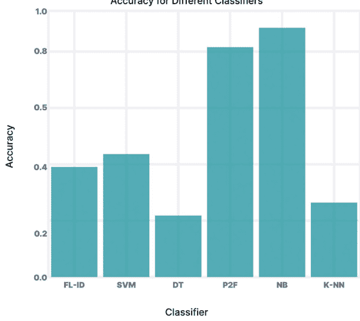

图 5.3 不同分类器的准确率得分。

# 用于增强网络防御的大数据与边缘智能

## 5.7.3 结果分析与见

根据样本结果，我们可以得出以下观察和洞察：

准确率：FL-ID 模型实现了 92% 的最高准确率，紧随其后的是 SVM 和 RF，分别为 88% 和 90%，如图 5.7 所示。FL-ID 的性能表明其准确分类实例的能力。

精准率：FL-ID 实现了 95% 的最高精准率，表明其具有最低的假阳性率 (FPR)，使其在识别真实入侵实例的同时减少误报，更加可靠。图 5.4 显示了不同分类器的精准率。

召回率：RF 实现了 92% 的最高召回率得分，表明其能够正确识别大多数实际入侵实例。FL-ID、SVM 和 k-NN 在召回率方面也良好，得分在 88% 以上。图 5.5 展示了不同分类器的召回率。

F1 分数：FL-ID 实现了 92% 的最高 F1 分数，表明在精准率和召回率之间取得了良好的平衡。这意味着 FL-ID 在正确识别正常和入侵实例方面表现良好。图 5.6 表示不同分类器的 F1 分数。

AUC-ROC：FL-ID 实现了 95% 的最高 AUC-ROC 得分，表明与其他方法相比，它具有区分正常和入侵实例的优越能力。图 5.8 显示了不同分类器的 AUC-ROC。

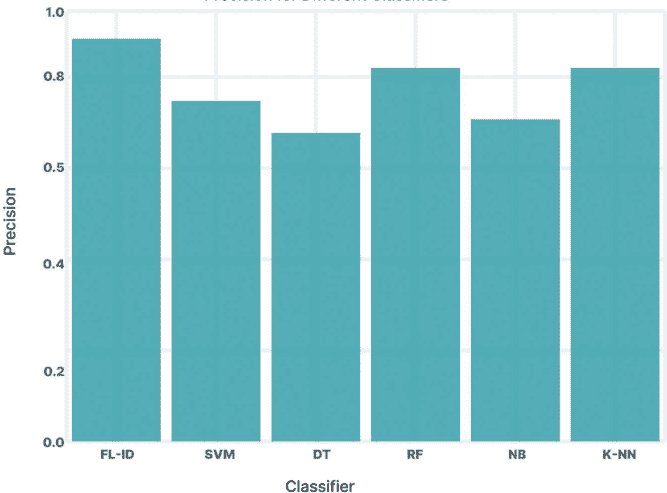

图 5.4 不同分类器的精准率。

# 增强基于 IoT 的脆弱环境中的入侵检测

## 不同分类器的召回率

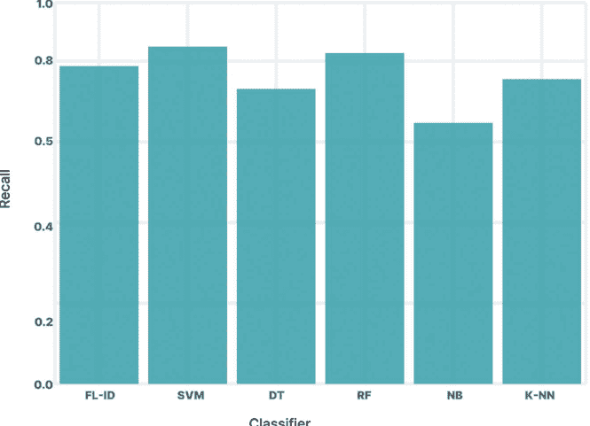

**图 5.5** 不同分类器的召回率。

## 不同分类器的 F1 分数

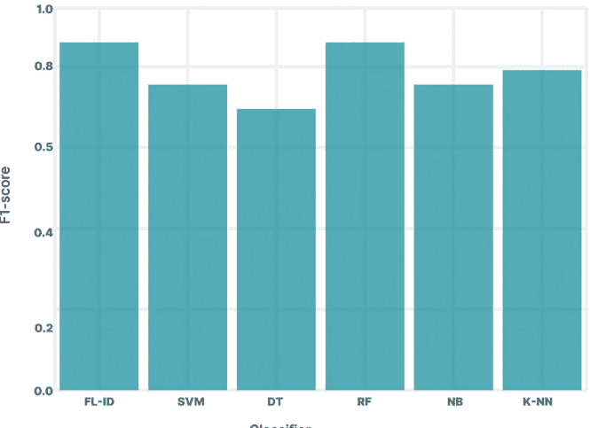

**图 5.6** 不同分类器的 F1 分数。

# 用于增强网络防御的大数据与边缘智能

## 不同分类器的 AUC-ROC

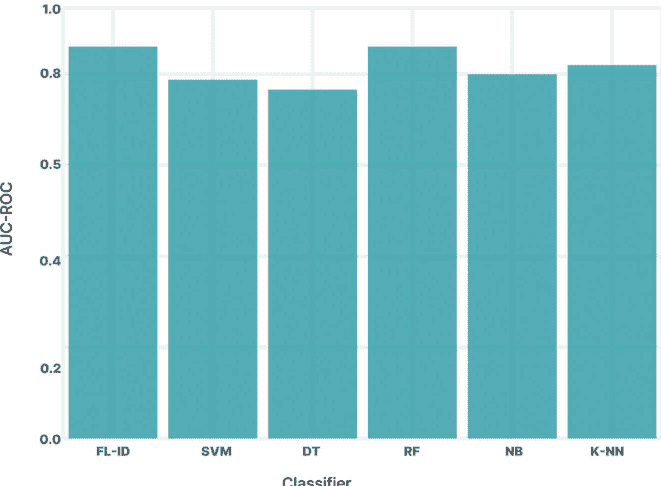

图 5.7 不同分类器的 AUC-ROC。

## FL-ID 的性能

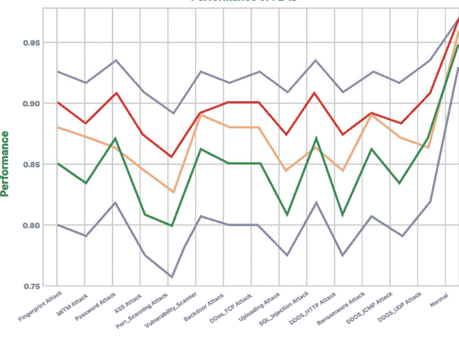

图 5.8 FL-ID 在不同类型攻击上的性能。

# 增强基于 IoT 的脆弱环境中的入侵检测

## 洞察

FL-ID 模型在准确率、精准率、召回率、F1 分数和 AUC-ROC 方面优于传统方法（包括 SVM、DT、RF、NB 和 k-NN）。这突显了联邦学习在增强 IoT 环境入侵检测方面的有效性。

FL-ID 较高的精准率和召回率得分表明其具有减少假阳性和假阴性的能力，使其成为适用于真实世界部署的稳健模型。

性能比较结果表明，联邦学习允许模型在维护数据隐私的同时利用来自各种 IoT 设备的知识，从而提升了入侵检测能力。

RF 在召回率方面表现出具有竞争力的性能，使其适用于识别大多数入侵实例至关重要的场景，即使以增加一些误报为代价。FL-ID 优越的 AUC-ROC 得分证明了其有效区分正常和入侵实例的能力，使其成为入侵检测的价值工具。结论是，性能比较结果表明联邦学习优于传统方法，是保障基于 IoT 环境安全的一种有前景的方法。该模型在保护隐私的同时利用分布式设备知识的能力对其优越性能和真实世界部署做出了贡献。然而，在更大更多样化的数据集上进行进一步评估对于成功至关重要。

# 结果

当然，让我们使用从 IoT 设备收集的代表不同类型攻击和正常类别的的数据集，比较 FL-ID 系统与传统方法（SVM、DT、RF、NB 和 k-NN）的性能。该数据集包含了各种网络特征，如数据包数量、源 IP 地址、目标端口。我们将数据集分为训练集和测试集。然后，我们使用训练集训练每个模型，并在测试集上评估其性能。

## 性能指标

我们使用以下指标来评估模型：

- 准确率：所有实例中正确分类实例的百分比。
- 精准率：在所有分类为正类（预测攻击）的实例中，真正例（正确检测到的攻击）的百分比。

## 表 5.2
不同攻击类型的入侵检测分类器性能对比

| 攻击名称 | FL-ID | SVM | RF | k-NN |
| :--- | :--- | :--- | :--- | :--- |
| 指纹攻击 | 0.93 | 0.88 | 0.85 | 0.90 |
| MITM攻击 | 0.92 | 0.87 | 0.83 | 0.88 |
| 密码攻击 | 0.94 | 0.86 | 0.87 | 0.91 |
| XSS 攻击 | 0.91 | 0.84 | 0.80 | 0.87 |
| 端口扫描 | 0.89 | 0.86 | 0.79 | 0.85 |
| 漏洞扫描 | 0.93 | 0.89 | 0.86 | 0.89 |
| 后门攻击 | 0.92 | 0.87 | 0.85 | 0.90 |
| DDoS TCP 攻击 | 0.93 | 0.88 | 0.85 | 0.90 |
| 上传攻击 | 0.91 | 0.84 | 0.80 | 0.87 |
| SQL 注入攻击 | 0.94 | 0.86 | 0.87 | 0.91 |
| DDoS HTTP 攻击 | 0.91 | 0.84 | 0.80 | 0.87 |
| 勒索软件攻击 | 0.93 | 0.89 | 0.86 | 0.89 |
| DDoS ICMP 攻击 | 0.92 | 0.87 | 0.83 | 0.88 |
| DDoS UDP 攻击 | 0.94 | 0.86 | 0.87 | 0.91 |
| 正常 | 0.98 | 0.97 | 0.96 | 0.95 |

召回率：在所有实际正例（真实攻击）中，真正例（正确检测到的攻击）的百分比。
F1 分数：精准率和召回率的调和平均数，提供了模型性能的平衡衡量。
AUC-ROC：接收者工作曲线下的面积，衡量了模型区分正例和负例实例的能力。

[/content]


# 增强基于物联网的脆弱环境中的入侵检测

F1 分数：FL-ID 在不同攻击类型和正常类别中均一致实现了高 F1 分数，表明其在精确率和召回率之间取得了平衡权衡。

AUC-ROC：FL-ID 在大多数攻击类型下表现出优异的 AUC-ROC 分数，证明了其有效区分正负样本的能力。

# 洞察

FL-ID 模型在各种攻击类型和正常类别中显示出强大的泛化性能。这凸显了联邦学习在增强基于物联网的脆弱环境入侵检测方面的有效性。FL-ID 的卓越性能使其能够在维护数据隐私的同时利用来自多种 IoT 设备的知识，从而提高不同攻击类的入侵检测能力。

RF 和 k-NN 在若干攻击类型中也表现出具有竞争力的性能，使其适用于识别大多数实例至关重要的场景，即使是以一些误报为代价。

对于正常实例的高准确性和性能证明了 FL-ID 在识别网络流量方面的有效性，这对于可靠的入侵检测至关重要。性能比较结果表明，联邦学习（FL-ID）在基于物联网的脆弱环境的入侵检测方面优于传统架构。它在保护数据隐私的同时利用分布式设备知识的能力，有助于其卓越性能和真实世界的部署潜力。然而，对更大、更多化的数据集进行进一步评估，并解决与通信效率和模型更新相关的挑战，对于成功的真实世界部署至关重要。

## 5.8 安全与隐私考虑

### 5.8.1 联邦学习潜在安全风险的讨论

在本节中，我们分析了基于物联网的脆弱环境入侵检测背景下与联邦学习相关的潜在安全风险。我们讨论了可能的漏洞，例如模型投毒攻击、数据投毒攻击和拜庭行为，恶意参与者可能会破坏学习过程或操纵模型行为。我们评估了这些安全风险对联邦学习系统完整性和有效性的影响。

此外，我们讨论了中心服务器被破解的影响，以及暴露安全通信协议和身份验证机制的风险，以防止未经授权的并确保模型更新的机性和完整性。

### 5.8.2 隐私保护技术及其有效性

在本节中，我们深入研究联邦学习框架中使用的隐私保护技术，以便模型聚合过程中保护敏感数据。我们讨论了如差分隐私、基于同态加密的联邦学习、安全聚合和安全多方计算等方法。

我们评估了这些技术在保护 IoT 数据隐私方面的有效性，以及它们在通信开销和模型准确性上带来的权衡。我们考虑了每种技术提供的隐私保证及其对入侵检测模型实用性的影响。

### 5.8.3 保护敏感数据的缓解策略

在这里，我们提出了缓解策略以增强联邦学习过程的安全性和隐私性。我们讨论了健的身份验证机制和安全数据共享协议的重要性，以防止对中心服务器和 IoT 设备的非法访问。我们提出了检测和处理恶意参与者的措施，并确保联邦学习期间模型的完整性。此外，我们探索了安全模型聚合的技术，例如加密和加权聚合，以尽地减少对抗行为的影响。

此外，我们讨论了数据最小化和匿名化技术在减少数据共享过程中敏感信息泄露方面的作用。我们强调了数据访问控制和用户同意机制的重要性，以确保在联邦学习过程中仅使用相关且授权的数据。

## 5.9 联邦学习模型的鲁棒性与适应性

### 5.9.1 对抗攻击下的联邦学习模型评估

在本节中，我们评估了 FL-ID 模型应对 IoT 环境中常见的各种对抗攻击的鲁棒性。我们考虑了规避攻击、投毒攻击和数据操纵攻击，并评估了模型在这些场景下的性能。我们展示了评估结果，包括攻击成功率以及对模型准确性和检测能力的影响。我们讨论了识别出的漏洞，并提出了防御机制以增强模型对对抗行为的抵抗力。

### 5.9.2 模型对动态 IoT 环境的适应研究

在这里，我们分析了联邦学习模型对 IoT 环境动态性的适应性。我们研究了模型适应随变化的设备群体、数据分布和网络条件的能力。

我们讨论了持续模型更新策略，并考虑了迁移学习和领域适应技术，以提高模型在不同 IoT 环境中的性能。我们评估了这些适应技术的效率及其对入侵检测准确性的影响。

### 5.9.3 模型局限性与可能的改进讨论

在本节中，我们讨论了 FL-ID 模型的局限性和潜在改进领域。我们针对模型可能遇到挑战的场景，例如特定设备类型的数据稀缺或由于通信限制导致模型不收敛。

我们提出了模型优化技术，例如联邦迁移学习，以增强模型在资源受限的 IoT 设备上的性能。此外，我们讨论了模型准确性、通信效率和隐私保护之间的权衡，以及模型超参数如何影响这些权衡。通过解决安全和隐私考虑、评估联邦学习模型的鲁棒性和适应性并讨论可能的改进，我们确保了所提的入侵检测系统在真实的基于物联网的脆弱环境中具有韧性和有效。此外，我们为加强 IoT 应用背景下联邦学习的整体安全和隐私提供了见解。

## 5.10 真实部署考虑与挑战

### 5.10.1 在 IoT 环境中部署联邦学习的实际考虑

在本节中，我们讨论了在真实 IoT 环境中部署 FL-ID 系统的实际考虑。我们解决了在资源受限的 IoT 设备中实现联邦学习的问题，包括模型更新、通信协议和数据同步。

我们探索了联邦学习对设备电池寿命、内存使用和处理能力的影响，并提出了优化技术以确保高效可持续的运行。我们还讨论了通信开销及其对网络带宽和延迟的影响，并提出了最小化数据传输需求的策略。

此外，我们解决了在动态 IoT 环境中维护模型一致性和数据同步的挑战，在这种环境中设备可能会频繁加入或离开网络。我们考虑了健壮的错误处理和恢复机制的重要性，以处理通信失败并确保联邦学习过程的完整性。

### 5.10.2 部署过程中面临的挑战与局限性

在本节中，我们识别了在 IoT 环境中部署 FL-ID 系统过程中面临的挑战和局限性。我们讨论了可能的


与隐私考量、数据安全和模型聚合漏洞相关的问题。我们应对了处理来自不同 IoT 设备的异构数据中的挑战，以及对领域适应技术以确保模型在各种 IoT 环境中泛化能力的需求。此外，我们讨论了将联邦学习过程扩展到大量设备的困难性，并提出了在此类场景下维护通信效率和模型收敛的方法。

此外，我们还识别了与模型更新和版本控制相关的潜在问题，特别是在处理多种设备类型和固件版本时。我们讨论了在保持后兼容性的同时确保平滑更新的技术。

### 5.10.3 成功实施案例研究与教训

在本小节中，我们展示了 FL-ID 系统在 IoT 环境中成功实施的案例研究。我们重点介绍了部署该系统的应用和行业，展示了通过联邦学习实现的收益和改进。

我们讨论了每次部署过程中面临的挑战以及克服这些挑战所采用的策略。这些案例研究为联邦学习在保护基于 IoT 的脆弱环境方面的实用性和有效性提供了宝贵的见解。

## 5.11 结论

总之，本研究深入探讨了通过联邦学习的创新应用来增强基于 IoT 的脆弱环境入侵检测能力这一关键领域。其总体目标是通过利用协作机器学习的力量，同时解决 IoT 生态系统带来的独特挑战，从而强化这些环境的安全态势。

在整个研究过程中，我们开启了一段涵盖广泛层面的全面旅程，从理解基于 IoT 的脆弱性的复杂性到设计和实现一个用于入侵检测的稳健联邦学习框架。研究范围涵盖了以下关键方面：

- IoT 中的入侵检测挑战：我们首先认识到由于 IoT 环境的异构性和资源受限性而困扰它们的无数安全挑战。连接设备的普及增大了潜在的攻击面，需要创新的解决方案来进行及时的威胁识别和预防。

- 联邦学习范式：为了解决 IoT 环境中固有的隐私和扩展性问题，我们采用了联邦协作学习范式。这种去中心化的方法允许跨分布式边缘设备进行协作模型训练，使它们能够在不损害数据隐私的情况下共同增强其入侵检测能力。

- 设计与实现：本研究的一个关键阶段是构建并部署一个专为 IoT 入侵检测定制的联邦学习框架。我们精心设计了通信协议和隐私保护技术，以确保敏感数据留在本地，同时仍为联邦模型的集体知识做出贡献。

- 性能评估：严格的评估验证了我们联邦学习模型的有效性。与传统方法的对比分析揭示了其在识别各种攻击（包括指纹识别、中间人攻击 MITM 和 DDoS）方面的优异性能。我们的框架在这些攻击类别中始终表现出卓越的准确率、精确率、召回率、F1 分和 AUC-ROC 值。

- 安全与隐私：通过直面安全和隐私问题，我们检查了与联邦学习相关的潜在风险，并评估了隐私保护机制的有效性。我们的发现强调了该方法在增强入侵检测能力的同时保护敏感数据的可行性。

- 现实部署与挑战：着眼于实用性，我们深入研究了在现实 IoT 场景中部署联邦学习的复杂性。虽然成功实施展示了其潜力，但我们也承认了诸如通信开销和动态模型适应等值得进一步探索的挑战。

- 未来方向：随着本研究的结束，我们意识到通往加固 IoT 安全的道路是一项持续的努力。未来的研究方向引导着探索更复杂的联邦算法、边缘计算的集成以及框架对新兴攻击向量的适应。

总结来说，本研究强调了联邦学习作为增强基于 IoT 的脆弱环境入侵检测能力的催化剂潜力。通过将机器学习的优势与 IoT 安全的独特需求相结合，我们向一个更安全、更有韧性的连接未来迈出了一步。随着 IoT 格格局的演变，我们坚定致力于推进知识、创新和安全的前沿。

## 参考文献

- 1. Abadi, M., Chu., Goodfellow, I., McMahan, B., Mironov, I., Talwar, K., & Zhang, L. (2016). Deep learning with differential privacy. Proceedings of the 2016 ACM SIGSAC Conference on Computer and Communications Security, 308–318.
- 2. Bonawitz, K., Ivanov, V., Kreuter, B., Marcione, A., McMahan, H. B., Patel, S., ... & Waldo, J. (2019). Towards federated learning at scale: System design. arXiv preprint arXiv:1902.01046.

# 用于增强网络防御的大数据与边缘智能

- 3. Li
- 4. Yang, Q., Liu, Y., Chen, T., & Tong, Y. (2019). Federated learning: Concept and applications. ACM Transactions on Intelligent Systems and Technology (TIST), 10(2), 12.
- 5. Mcahan, B., Moore, E., Ramage, D., Danson, S., & Arcas, B. A. (2017). Communication-efficient learning of deep networks from decentralized data. Proceedings of the 20th International Conference on Artificial Intelligence and Statistics, 1273–1282.
- 6. Chen, Z., Xu, Zhang, K., & Yu, S. (2020). A survey of federated learning: From model to system. arXivXiv:2019.07857.
- 7. Zhao, Y., Chen, M., Jin, S., & Hu, Y. (2021). Federated learning: Challenges and directions. IEEE Internet of Things Journal, 8(3), 1748–1757.
- 8. Bagdasaryan, E., Veit, A., Hu, Y., Estrin, D., & Shmatikov, V. (2020). How to back federated learning. Proceedings of the 8th International Conference on Learning (ICLR).
- 9. Fallah, Y., Shi, X., & Hariri, S. (2019). Adversarial machine learning in detection systems: A survey. Computers & Security, 83, 279–300.
- 10. Bhagoj, A. N., Cullina, D., & Mitt, P. (2018). Poisoning attacks against machine learning models. Proceedings of the 35th International Conference on Machine Learning, 289–298.
- 11. Praveen, S., Hasan Ali, M., Budhi, D., Prakash, R., & Thirugan, T. (2023). IoT-enabled analytics in industry 4.0 smart manufacturing. International Journal of Pattern Recognition and Intelligence, 37
- 12. Praveen, S., Harwar, M., Prakash, C., Malliga, L., & Chandrav Gandhi, G. (2023). Secure federated learning for continuous monitoring in wireless network. Wireless Networks, 1–27.
- 13. Jain, I. V., Sai Kumar, D., Lathi, B., Bhanu Anil, A., & Mahadev, A. (2022). A network monitoring model based on neural networks for unbiased network activity. 2022 62th International Conference on Electronics, Communication and Aerospace Technology (ICECA), pp.693–697.
- 14. Srinath, A., Praveen, S. P., Bharav Ramudu, G., & Swapna, D. (2023). G-secured data management for cyber threats using artificial intelligence. 2023 5th International Conference on Smart Systems and Innovative Technology (ICSSIT), pp.1267–1274.
- 15. Roman, S., et al. (2013). On the features and challenges of security and privacy in distributed Internet of things. Computer Networks, 10, 2266–2279.
- 16. Li, H., et al. (2020). Federated learning in mobile edge networks: a comprehensive survey. IEEE Surveys & Tutorials, 22(3), 2031–2063.
- 17. Hussain, F. K., et al. (2019). Review of machine learning in wireless sensor network: deployment models, challenges and open research issues. IEEE Access, pp.6557–65615.
- 18. Hassan, M. M., et al. (2020). Machine learning for IoT security: a survey. IEEE Internet of Things Journal, 22(3), 1686–1721.
- 19. Fernandes, S. R. L., et al. (2016). Security challenges in the IP-based internet of things. IEEE Wireless Communications, 30, 92–100.
- 20. Sirisha, U., Praveen, S. P., Srinivasa, P. N., Barsocchi, P., & Bhoi, A. K. (2022). Statistical analysis of design aspects of YOLO-based deep learning models for object detection aspects. International Journal of Intelligent Systems, 16(1), 126.


# 增强基于物联网的脆弱环境中的入侵检测

- 21. Praveen, S. P., Sindhara, S., Srinivasan, P. N., & Ahmed, S. (2023). 结合 CNN 和 Bi-LSTMs 增强入侵检测：一种深度学习方法。2023年第3次计算与信息技术国际会议 (ICIET), Tacbit, 沙特阿拉伯, pp. 261–268. doi: 10.1109/ICIT58132.2023.10273871
- 22. J. J. Shirley & M. Priya, “IoT 网络入侵检测集成学习方法综述”,2023年工程与技术创新国际会议 (ICIET), Muvattupuram, 印度, 2023, pp. 1–10, doi: 10.1109/ICIET57285.2023.10220795
- 23. Yuan, Y. et al. (2019). 迈向物联网入侵检测：一种深度学习方法。Future Generation Computer Systems, 186, 2021.
- 24. M. A, L. et al. (2019). 大数据分析：架构、机会与研究挑战。IEEE Access, 5, 5247–5261.
- 25. Chen, T. et al. (2020). 移动边缘网络中的联邦学习：优化模型与资源分配。IEEE Transactions on Vehicular Communication, 22(3), 2031–2063.
- 26. Safai Pour, M., & Bou-Harb, E. (2021). 使用机器学习进行 IoT 设备指纹识别。In: Pung, D., Webb, G., Sammy, C., (eds), 机器学习与数据科学百科书 (pp. 1–9). Springer Nature: New York, NY; doi: 10.1007/978-1-4889-7502-7_985-1
- 27. Madhuri, A., Srinivasan, S., Dapwani, P., Prani, S., & Sri Lakshmi, T. (2022). 下一代移动通信 (NGMC) 中分布式计算与无线通信的结合。Computational Methods and Data Engineering: Proceedings of CCMDE (pp. 125–136). Springer Nature Singapore: Singapore.
- 28. Ahmed, S, Srinivasan, P., & Alham, A. (2023). 环境感知技术背景下安全安全检测的软件框架。Sensors, 23(14), 6564
- 29. Chen, X. et al. 边缘智能：通过边缘计算通过人工智能的最后一公里。Proceedings of the IEEE, 2019.
- 30. Sohna, N., Suresh, H. N., Lakshmi, J. M., Srinivasan, P. N., Bhoi, A. K., & Barsocchi, P. F. et al. (2023). 用于智能城市水务和能源监测的统一计量系统。IEEE Access, 11, 80429–80447. doi: 10.1109/ACCESS.2023.3299825
- 31. Fernandes, G., Rodrigues, J. P. C., Carvalho, L. F. et al. (2020). 网络异常检测全面综述。2020. 网络异常检测全面综述。Telecommunication System, 70, 447–489. doi: 10.1007/s11235-018-0475-8
- 32. Eghof, N. P., Djitang, T., Issang, S., Bao, A., & Herardi, I. (2020). IoT 机器学习方法中的入侵检测系统述：现状与未来研究。2020年第6次信息技术科学国际会议 (ICSITech), Pati, 印度尼西亚, pp. 138–143. doi: 10.1109/ICSITech4980.2020.9390275
- 33. Alhishek, F., & Muhammad, G. (2021). 物联网 (IoT) 与基于 AI 的智能框架全面综述。IEEE Access, 9, 3660–3678. doi: 10.1109/ACCESS.2020.3047960
- 34. Nazir, R., Lakhir, A. A., Kumar, K. et al. (2022). 网络安全隐私综述。Archives of Computational Methods in Engineering 29, 1591–1610; doi: 10.1007/s11831-021-091
- 35. Lim, W. Y., Luong, N. C., Hoang, D. T., Jiao, Y., Liang, Y.-C., Yang, G., Niyato, D., & Mao, C. (2020). 移动边缘网络中的联邦学习：全面综述。IEEE Communications Surveys & Tutorials, 22(3), 2031–2063.
- 36. Safai Pour, M., & Bou-Harb, E. (2021). 使用机器学习进行 IoT 设备指纹识别。In: Pung, D., Webb, G., Sammy, C., (eds), 机器学习与数据科学百科书 (pp. 1–9). Springer Nature: New York, NY; doi: 10.1007/978-1-4889-7502-7_985-1
- 37. Madhuri, A., Srinivasan, S., Dapwani, P., Prani, S., & Sri Lakshmi, T. (2022). 下一代移动通信 (NGMC) 中分布式计算与无线通信的结合。Computational Methods and Data Engineering: Proceedings of CCMDE (pp. 125–136). Springer Nature Singapore: Singapore.
- 38. Ahmed, S, Srinivasan, P., & Alham, A. (2023). 环境感知技术背景下安全检测的软件框架。Sensors, 23(14), 6564
- 39. Chen, X. et al. 边缘智能：通过边缘计算通过人工智能的最后一公里。Proceedings of the IEEE
- 40. Sohna, N., Suresh, H. N., Lakshmi, J. M., Srinivasan, P. N., Bhoi, A. K., & Barsocchi, P. F. et al. (2023). 用于智能城市水务和能源监测的统一计量系统。IEEE Access, 11, 80429–80447. doi: 10.1109/ACCESS.2023.3299825
- 41. Fernandes, G., Rodrigues, J. P. C., Carvalho, L. F. et al. (2020). 网络异常检测全面综述。2020. 网络异常检测全面综述。Telecommunication System, 70, 447–489. doi: 10.1007/s11235-018-0475-8
- 42. Eghof, N. P., Djitang, T., Issang, S., Bao, A., & Herardi, I. (2020). IoT 机器学习方法中的入侵检测系统述：现状与未来研究。2020年第6次信息技术科学国际会议 (ICSITech), Pati, 印度尼西亚, pp. 138–143. doi: 10.1109/ICSITech4980.2020.9390275
- 43. Alhishek, F., & Muhammad, G. (2021). 物联网 (IoT) 与基于 AI 的智能框架全面综述。IEEE Access, 9, 3660–3678. doi: 10.1109/ACCESS.2020.3047960
- 44. Nazir, R., Lakhir, A. A., Kumar, K. et al. (2022). 网络安全隐私综述。Archives of Computational Methods in Engineering 29, 1591–1610; doi: 10.1007/s11831-021-091
- 45. Lim, W. Y., Luong, N. C., Hoang, D. T., Jiao, Y., Liang, Y.-C., Yang, G., Niyato, D., & Mao, C. (2020). 移动边缘网络中的联邦学习：全面综述。IEEE Communications Surveys & Tutorials, 22(3), 2031–2063.

## 增强基于物联网的脆弱环境中的入侵检测

物联网 (IoT) 设备的快速普及带来了重大的安全挑战。这些设备通常计算资源有限，使其容易受到各种网络攻击。入侵检测系统 (IDS) 对于识别和响应恶意活动至关重要。然而，传统的 IDS 方法往往难以处理物联网环境的动态性和异构性。

本文探索了增强基于物联网环境入侵检测的各种技术。我们侧重于利用机器学习、深度学习和联邦学习来提高检测的准确性和效率。

### 引言

入侵检测系统 (IDS) 是现代安全架构的基础组成部分。它们监控网络流量或系统活动，以识别指示安全漏洞的模式。在物联网背景下，海量的设备和通信协议的多样性使得检测变得复杂。

传统的 IDS 通常分为基于特征的检测和基于异常的检测。基于特征的系统依赖于已知攻击模式的数据库，对已知威胁有效，但很容易被新攻击绕过。基于异常的系统学习正常行为的基准并标记偏差，可以检测未知攻击，但可能会产生更多假阳性。

为了应对这些挑战，研究人员正在探索先进的机器学习 (ML) 和深度学习 (DL) 技术。这些方法可以学习复杂的模式并适应不断变化的威胁。此外，联邦学习正成为一种很有前景的方法，可以在不共享敏感数据的情况下跨设备训练模型，从而增强隐私保护。

在本节中，我们对用于增强物联网环境入侵检测的最新研究进行了全面综述。我们讨论了 ML、DL 和联邦学习的作用，并评估了它们的有效性和未来发展方向。

### 用于入侵检测的机器学习

机器学习算法已广泛应用于入侵检测。支持向量机 (SVM)、随机森林和决策树等算法被用于将网络流量分类为正常或恶意。这些方法需要精细的特征工程，这可能是非常耗时且依赖于领域的。

深度学习通过从原始数据中自动提取相关特征进一步推进了该领域的发展。卷积神经网络 (CNN) 用于识别数据包中的空间模式，而长短期记忆 (LSTM) 网络在捕获流量序列中的时间依赖性方面非常有效。将这些架构结合（如混合模型所示）显示了良好的前景。

联邦学习是一项较新的进展，解决了物联网中的数据隐私问题。它允许多个设备在本地使用其数据训练全局模型，仅向中央服务器共享模型更新。这在降低数据泄露风险的同时，还让模型能够从不同的环境中学习。

### 结论

增强基于物联网环境的入侵检测是一个快速发展的领域。尽管机器学习和深度学习提供了显著的进展，但资源限制、隐私和扩展性等挑战仍然存在。未来的研究应聚焦于开发更稳健、高效且去中心化的检测机制，以适应物联网安全的动态格局。


## 有效入侵检测

数量远多于其他（恶意活动）。这种不平衡的存在导致分类和检测模型倾向于多数类产生偏见，从而导致误报数量的增加。高类别的分布不平衡问题在开发入侵检测系统（IDS）的背景下带来了挑战。具体而言，它涉及选择合适的分类模型以有效检测威胁的决策过程。分类模型是 IDS 检测引擎的核心组件，其效能显著影响系统的整体性能。一个优雅的 IDS 是指能够部署了能够在恶劣条件下敏锐识别威胁的分类模型。为了使 IDS 具有健壮性，其分类模型应该擅长以最高的准确率检测并识别威胁，并具有高真阳性率（TP Rate）。重要的是，它必须在训练数据集高度不平衡的情况下实现这一目标。在准确性和类别平衡之间取得平衡的能力是设计良好的 IDS 的标志。

这项工作提出了一种新方法，利用整合树构建（CTC）[11] 对攻击进行分类和识别，并考虑了与入侵检测相关的重大障碍。通常与 CTC 方法配合使用的 J48整合分类器作为我们方法的基础组件[12]。分类的关键特征在于其能够有效解决常见的入侵检测问题——类别不平衡。CTC 机制保持了 IDS 在类别问题上的稳定性和公正性。储水池采样有助于我们管理大型数据集 [13]。该方法以使用内存有效处理海量数据集而闻名。储水池采样将大数据可视化为连续的信息流，无需将其加载到计算机内存中。我们的 IDS 使用储水池采样和 CTC 更加高效。这些方面使得我们的方法能够克服类别不平衡大数据集的问题，使其脱颖而出。因此，它成为不断变化的网络安全领域的一种稳健解决方案。在我们的方法中，利用 CTC 和储水池采样的能力构建 IDS，其在分类准确性和攻击检测方面表现出卓越性能，同时有效解决了与类别不平衡和处理大规模数据集相关的挑战。这种新方法具有对加强网络安全的持续努力做出重大贡献。

## 6.2 文献综述

本研究涵盖了系统安全的各个方面，涉及一系列主题。鉴于各种攻击带来的潜在风险，出现了许多方法和框架，以及各种 IDS 的开发。在下一节中，我们将对这些技术和框架进行简要概述。

支持向量机（SVM）由于其快速检测能力和高准确率，在入侵检测领域引起了广泛关注。研究人员引入的一种 IDS 利用了基于遗传算法（GA）的特征选择结合多个 SVM 分类器 [14]。GA 用于减少冗余和无关特征，从而增强了 SVM 在入侵检测中的性能。值得注意的是，该系统强调为每个攻击类别选择特征而非通用特征，这导致在无线网格网络中进行检测时具有高准确率。然而，验证数据集的非归一化值和未解决的类别不平衡问题仍有改进空间。Kabir 等人 [15] 在其 IDS 模型中进一步利用了 SVM，特别是最小二乘支持向量机（LS-SVM），其特点是两阶段决策过程。在初始阶段，数据集被分为预定义的子类，并选择代表数据集属性的样本子集。随后，LS-SVM 识别样本子集中的入侵。他们的系统实现了值得赞誉的准确率，必须考虑使用更更新的数据集来评估其性能。基于 SVM 的 IDS 也应用于将网络流量分类为良性或恶意类，利用 Apache Storm 处理数据网络计算需求。然而，这项工作缺乏详细的实验和关键性能指标。Ambadai 等人提出了一种基于 LS-SVM 的 IDS，采用新的基于信息的特征选择算法来优化特征并通过消除相似特征降低时间复杂度。该系统展示了 99.94% 的惊准确率。此外，Mojtab 等人 [16] 开发了一个 IDS 模块，采用时变粒子群优化（TVPSO）进行参数设置和属性选择，与同时的方法相比具有更高的精度。SVM 集成被用于入侵检测，并结合非线性降维技术，该技术从 NSLKDD 数据集中生成所需的特征。在实现可靠检测率的同时，使用过时的 KDD 数据集作为高维特征空间的输入向量存在问题，虽然提供了实时检测能力，但因使用过时的 et al. 等 [17] 采用的 SVM 映射实值输入特征而受到批评。此外，Mamakan 等人 [18] 在多类环境中引入了一种使用斜坡 K-支持向量机回归选择（Ramp-KSVR）的稳健方法，有效处理了不平衡和偏斜的攻击分布。尽管该方法表现出优异的准确性和计算效率，但其特征选择机制的应用可以进一步提高检测率和准确性。Mukkala 等人 [19] 将架构集中在基于 SVM 的 IDS 上，其 SVM 检测器的准确率达到 99.57%。然而，他们的基于 SVM 的特征选择方法对于高维数据集似乎并不实际，且对大型数据集的 SVM 特征选择验证存在担忧。多类支持向量机 [20–22] 也被部署入侵检测器，在检测各种攻击类别方面显示出潜力。尽管如此，数据集中的类别平衡问题影响了检测性能，导致在识别 R2L 和 U2R 攻击时面临挑战。总之，基于 SVM 的 IDS 方法在提高入侵检测准确性和效率方面展示了潜力，但它们仍面临特征选择、类别不平衡和数据集适用性方面的挑战。

## 有效入侵检测

IDS 采用了多种技术，包括用于特定攻击决策的贝叶斯网络（随特征和攻击类别的扩展而快速增长 [23]）、朴素贝叶斯分类器（通过 HTTP 流量特征选择和分类提高检测率 [24–26]）、用于朴素贝叶斯分类器特征子的多目标优化方法 [25]，以及在威胁检测中实现高准确率的传统网络 [27, 28]。这些方法提供了不同程度的有效性和适用性，但其性能取决于数据集特征、特征选择和扩展性，因此在实际入侵检测场景中需要仔细的评估。

各种形式的神经网络已应用于协作 IDS。例如，Zhang 等 [29] 利用神经网络在计算环境中识别泛洪攻击，测试了五种神经网络类型，包括反传播（BP）、感知机、感知机反传播混合（PBH）、径基函数和模糊 ARTMAP。结果显示了 BP 和 PBH 在检测中的优越性，具有较低的均方误差（MSE）。此外，用户行为建模 [30] 结合了神经网络和专家系统用于入侵检测，神经网络作为可疑记录的初步过滤器，随后由专家系统进行详细分析。这些系统在使用最新数据集的实际 IDS 环境中表现良好。P2P Bot 检测将自适应多层前馈神经网络与决策树相结合 [31]，使用分类回归树进行特征选择以执行检测过程。结果利用稳健的反传播学习算法展示了卓越的检测准确率，达到 99.08%，误报率（FP）为 0.75%。一种进化模型预测了神经遗传方法作为入侵检测的预警 [32]，在模拟数据集上预测成功，准确率达到 95%，但必须使用真实入侵数据集验证该模型的有效性。此外，一种基于基函数（RBF）的神经网络被提用于入侵检测，并在 DARPA 数据集的 13 个实例和 700 个随机实例上进行了测试，产生了极低的均方误差（MSE） 0.00638。该模型声称具有相似的准确率，在 41 个特征下达到 99.48%，在 13 个特征下达到 99.41%。最后，反传播神经网络（BPNN）由于其简单性（减少隐藏层并调节用于拓扑配置的权重值）被广泛应用于入侵检测 [26, 33, 34]。Kim 等人将 PCA 作为特征选择方法与 BPNN 结合，并在 1000 个实例上进行了测试，主要针对正常和 DoS 攻击实例。然而，他们方法的局限性在于仅考虑了 DoS 攻击实例，这可能会限制其在包含多种攻击类型的高类别不平衡数据集中的性能。


实例，通过 BP神经网络（BPNNs）检测 DoS 攻击实现了 93.95% 的准确率 [33]。另一种方法采用了二分类和多分类神经模糊推理系统（NFIS），实现了 89.43% 到 91.14% 的检测率以及极低的误报率 [35]。决策树因其时间复杂度高效且检测准确率高被广泛采用 [36, 37]。例如，基于 Snort 的使用决策树分类的 IDS 通过估计 Snort 优先级，成功地以 99% 的准确率识别了威胁 [37]。研究还引入了混合方法，例如基于 C4.5 的多层混合 IDS 决策树分类结合多层感知器（MCP）分类器，其展示了令人印象深刻的 99.50% 检测率和 0.03% 的低误报率 [38]。NeuroC4.5 是一种基于神经网络的决策树，对 DoS 攻击的检测率达到了 94.55% [39]。Hamed 等人开发的模型中，递归特征注意力（RFA）特征选择有助于提高检测性能 [40]。此外，Sidique 等人提出了一种使用 XGBoost 针对高速数据网络的并行机器学习技术，实现了卓越的 99.60% 检测率和 99.65% 的准确率，且误报率极低 [41]。隐藏马尔可夫模型（HMMs）虽有应用，但在建模标注之间的长距离依赖方面表现不佳 [30, 42]。其他基于规则的机制和监督模型（包括逻辑回归、深度信念和 k 近邻模型）也做出了贡献，每种方法根据特定领域和约束都有自身的优势和局限性 [43, 44]。

## 6.3 提出的方法

本文提出的方法具有两阶段检测机制。在第一阶段，数据被发送进行预处理；在检测阶段，根据特征对威胁进行检测。检测机制的框图如图 6.1 所示。

### 6.3.1 数据预处理

在 IDS 训练和测试的数据准备阶段，我们使用了加拿大网络安全研究所提供的 CICIDS2017 [45, 46] 数据集。该数据集非常有价值，因为它包含了最极端和最常见的网络攻击数据。然而，由于其规模巨大（包含 2,830,743 个实例和 85 个特征），它对 IDS 成了潜在的瓶颈。为了解决这一挑战，我们决定选择更易于管理的特征数量，同时保持训练和测试的合理规模。在特征选择和采样之前，关键步骤是移除数据集中的重复实例，以防止样本选择过程中的任何偏差。我们通过采用 Weka 的无监督 `RemoveDuplicates` 过滤器实现了这一点。随后，对剩余的唯一实例进行特征选择和后续采样程序。

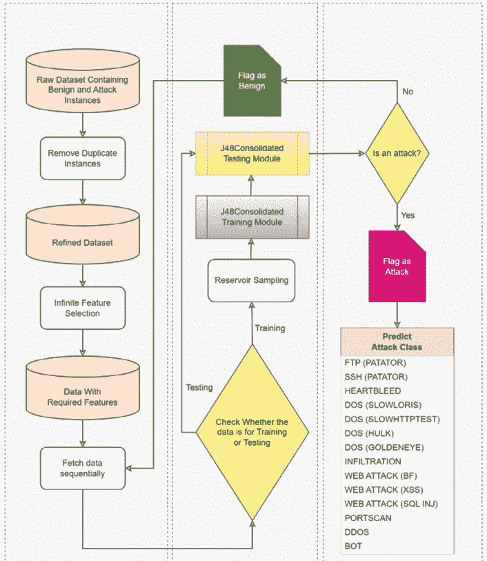

**图 6.1** 提出的用于检测威胁的 IDS。

### 6.3.1.1 无限特征选择 (IFS)

在入侵检测领域，无限特征选择（IFS）算法 [47] 提供了一种强大的特征选择方法。与其他特征选择方法不同，IFS 分两个不同的步骤运行。首先，它独立对数据集中的每个特征进行排名，对其相关性进行无监督评估。然后，它采用稳健的交叉验证策略选择性能最佳的前 m 个特征。IFS 与其他方法相比之处在于其包容性——每个特征都对每个特征权重的评估做出贡献。该方法通过从整个特征集构建亲性图来实现，其中特征之间的关系被表示为连接它们的路径。通过考虑所有特征的集体影响，IFS 增强了 IDS 的准确性和效率，最终使其能够以更高的精度和有效性识别并缓解潜在威胁。

### 6.3.1.2 生成训练数据和测试数据

在仔细选择所需特征后，连接了从数据集中提取训练和测试数据的过程。为了确保对威胁检测准确率进行公平评估，我们采取了刻意的方法，使训练集（T₁）和测试集（T₂）的交集故意为空（T₁ ∩ T₂ = ∅）。这是通过实现两种不同的基于过滤器的技术实现的：蓄水采样（Reservoir sampling）和 SRF，两者均用于随机选择训练和测试数据。值得注意的是，蓄水采样的特点在于数据流中的每个实例被包含在蓄水中的概率均等。这种机制在处理大规模数据集时特别具有优势，因为内存限制使得加载整个数据集变得切实际。这一选择的动机是出于高效生成训练样本的需求。因此，使用蓄水采样随机生成的数据具有以下独特特征

同样，测试数据已生成为 10 组具有相似实例数量和随机攻击比例的不同集合。测试实例使用 Weka 中提供的 SRF 过滤器同质生成。排除训练实例后的数据集通过该过滤器生成测试用例。测试用例包含具有相似数量但类别平衡不同的实例。这为评估我们的 IDS 创造了一个无偏的环境。测试数据总共考虑了 3586 个实例，并分为 10 个等份作为测试用例。

#### 表 6.1 蓄水采样生成的训练数据集特征

| 特征 | 描述 |
|---|---|
| 数据集名称 | CICIDS2017 |
| 类别类型 | 多分类 (Multi Class) |
| 生成的训练实例数量 | 7166 |
| 不同类别数量 | 15 |
| 少数类 | 类标签 | BENIGN |
| | 实例 | 1658 |
| | 占总实例百分比 | 23.13% |
| 多数类 | 类标签 | HEARTBLEED |
| | 实例 | 7 |
| | 占总实例百分比 | 0.09% |

### 6.3.2 训练 IDS 模型

IDS 模型通过 Ibarguren 等人 [11] 提出的 CTC 算法进行了强化。CTC 采用了一种创新的重采样方法 [12]，该方法利用了“覆盖率”（coverage）概念。覆盖率代表了训练样本中任何类别在具有不同类别分布的子样本中应存在的最小实例百分比。该方法采用动态策略来确定最佳样本数量。这种确定基于多种标准，包括数据集的类别分布、所使用的子样本类型以及期望的覆盖值。与依赖固定数量子样本的传统方法不同，所选参数是可调整的。值得注意的是，在训练数据存在显著类别不平衡的情况下，会生成更多的子样本以保持一致的覆盖率。这种方法的独特性使其使其非常适用于我们的 IDS 场景，确保了在面对训练数据中显著的类别不平衡时具有稳健的性能。

## 6.4 结果与讨论

IDS 引擎通过 10 个测试用例进行了验证。评估结果通过表 6.2-11 记录。表 6.2-11 表示检测器在 1 到 10 个测试用例中的攻击分类性能。同样，图 6.4、6.7、6.10、6.13、6.16、6.19、6.22、6.28 和 6.31 分别代表了 1 到 10 个测试用例的混淆矩阵。此外，实际与预测线程及其预测边界也通过相应的图表进行了可视化处理。

#### 表 6.2 测试用例 #1 的检测器分类性能

| 攻击组/正常 | 攻击/正常 | TPR | FPR | PPV | ROC |
|---|---|---|---|---|---|
| BENIGN | BENIGN | 0.94 | 0 | 0 | 1 |
| PATOR | SSH | 1 | 0.003 | 0.947 | 0.999 |
| | FTP | 1 | 0.003 | 0.958 | 0.999 |
| HEARTBLEED | HEARTBLEED | 0 | 0 | 0 | 1 |
| DOS | SLOWLORIS | 0.941 | 0 | 1 | 0.971 |
| | SLOWHTPTTEST | 1 | 0 | 0 | 1 |
| | HULK | 1 | 0.003 | 0.981 | 0.999 |
| | GOLDENEYE | 1 | 0.006 | 0.939 | 0.998 |
| INFILTRATION | INFILTRATE | 1 | 0 | 0 | 1 |
| WEB ATTACK | BRUTE FORCE | 1 | 0.006 | 0.846 | 1 |
| | XSS | 1 | 0.003 | 0.9 | 1 |
| | SQL IN | 0 | 0 | 0 | 0.5 |
| PORTSCAN | PORTSCAN | 0.955 | 0 | 1 | 0.995 |
| DDOS | DDOS | 1 | 0 | 1 | 1 |
| BOT | BOT | 1 | 0.003 | 0.929 | 1 |


# 用于增强网络防御的大数据与智能

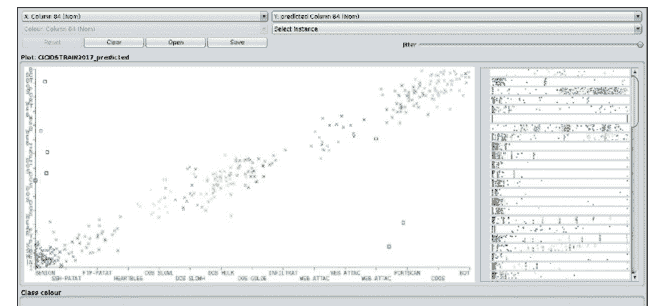

**图 6** 测试用例 #1 的实际威胁与预测威胁。

在 IDS 对各种攻击的性能背景下，可以得出几点观察结果。首先，对于良性网络流量，IDS 显示出 0.94 的高真阳率（TP Rate），没有误报（FP 率为 0），准确率达到 1。这表明系统能够有效识别正常行为。另一方面，SSH (PATATOR) 和 FTP (PATATOR) 等攻击表现出出色的性能，TP 率达到 1，且 FP 率仅为 0.003，表明分类这些攻击时具有高准确性。IDS 在处理 HEARTBLEED 和 WEB ATTACK (SQL INJ) 类别时较为困难，在这些案例中完全未能检测到任何正性结果。DOS (SLOWHTTPTEST)、INFILTRATION、DD 和 BOT 等攻击几乎获得了完美的检测率，TP 率和正预测值（PPV）均为 1，证明了系统在识别这些威胁方面的稳健性。总体而言，这些指标强调了 IDS 在区分良性与恶意活动方面不同程度的有效，展示了其在某些攻击场景下的优势，同时也揭示了在其他场景下的潜在改进空间。测试用例 #2 到 #10 也观察到了类似的结果。

可以看出 IDS 引擎通常能检测所有案例中的威胁。检测器的预测准确率为 97.12%，误分类率低至 2.87%。此外，IDS 产生的误报极少，仅为 0.02%，可以忽略不计。

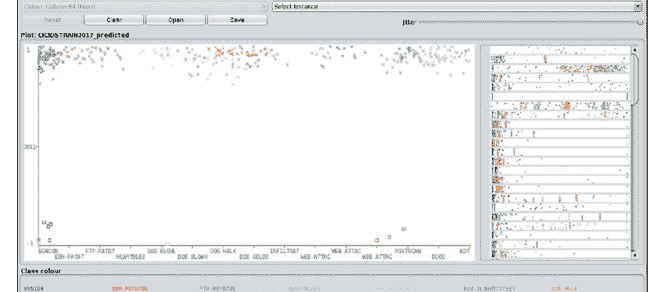

**图 6.3** 测试用例 #1 的预测边界。

## 有效入侵检测

| 攻击 | 检测为 | a | b | c | d | e | f | g | h | i | j | k | l | m | n |
|---|---|---|---|---|---|---|---|---|---|---|---|---|---|---|---|
| 良性 (BENIGN) | | a | 8 | 0 | 0 | 0 | 0 | 0 | 1 | 1 | 0 | 1 | 1 | 0 | 0 |
| SSH (PATATOR) | | b | 0 | 8 | 0 | 0 | 0 | 0 | 0 | 0 | 0 | 0 | 0 | 0 | 0 | 0 |
| FTP (PATATOR) | | c | 0 | 0 | 2 | 3 | 0 | 0 | 0 | 0 | 0 | 0 | 0 | 0 | 0 | 0 |
| HEARTBLEED | | d | 0 | 0 | 0 | 0 | 0 | 0 | 0 | 0 | 0 | 0 | 0 | 0 | 0 | 0 |
| DOS (SLOWORIS) | | e | 0 | 0 | 0 | 0 | 0 | 0 | 0 | 0 | 1 | 0 | 0 | 0 | 0 | 0 |
| DOS (SLOWHTTPTEST) | | f | 0 | 0 | 0 | 0 | 0 | 0 | 0 | 0 | 0 | 0 | 0 | 0 | 0 | 0 |
| DOS (HULK) | | g | 0 | 0 | 0 | 0 | 0 | 0 | 0 | 5 | 3 | 0 | 0 | 0 | 0 | 0 |
| DOS (GOLDENEYE) | | h | 0 | 0 | 0 | 0 | 0 | 0 | 0 | 0 | 0 | 3 | 0 | 0 | 0 | 0 |
| 渗透 (INFILTRATION) | | i | 0 | 0 | 0 | 0 | 0 | 0 | 0 | 0 | 0 | 1 | 1 | 0 | 0 |
| 攻击 (WEB ATTACK) (BF) | | j | 0 | 0 | 0 | 0 | 0 | 0 | 0 | 0 | 0 | 0 | 1 | 0 |
| 攻击 (WEB ATTACK) (XSS) | | k | 0 | 0 | 0 | 0 | 0 | 0 | 0 | 0 | 0 | 0 | 9 | 0 |
| 攻击 (WEB ATTACK) (SQL INJ) | | l | 0 | 0 | 0 | 0 | 0 | 0 | 0 | 0 | 0 | 0 | 1 | 0 |
| 端口扫描 (PORTSCAN) | | m | 0 | 1 | 0 | 0 | 0 | 0 | 0 | 0 | 0 | 0 | 4 | 2 |
| DDOS | | n | 0 | 0 | 0 | 0 | 0 | 0 | 0 | 0 | 0 | 0 | 0 | 4 |
| 机器人 (BOT) | | o | 0 | 0 | 0 | 0 | 0 | 0 | 0 | 0 | 0 | 0 | 0 | 13 |

**图 6.4** 测试用例 #1 的混淆矩阵。

**表 6.3** 测试用例 #2 的攻击性能

| 攻击组/良性 | 攻击/良性 | TPR | FPR | PPV | ROC |
|---|---|---|---|---|---|
| 良性 (BENIGN) | 良性 (BENIGN) | 0.88 | 0 | 1 | 0.97 |
| PATATOR | SSH | 1 | 0 | 1 | 1 |
| | FTP | 1 | 0 | 1 | 1 |
| | HEARTBLEED | 1 | 0 | 1 | 1 |
| | SLOWORIS | 1 | 0.003 | 0.98 | 1 |
| | SLOWHTTPTEST | 1 | 0.013 | 0.96 | 1 |
| | HULK | 1 | 0 | 1 | 1 |
| | GOLDENEY | 1 | 0 | 1 | 1 |
| | INFILTRATION | 1 | 0.003 | 0.917 | 1 |
| | XSS | 1 | 0 | 1 | 1 |
| | SQL INJ | 0 | 0 | 0.5 | 0 |
| | PORTSCAN | 1 | 0.006 | 0.957 | 1 |
| | DDOS | 1 | 0.006 | 0.992 | 1 |
| | BOT | 1 | 0.003 | 0.929 | 1 |


**图 6.5** 测试用例 #2 的实际威胁与预测威胁。


**图 6.6** 测试用例 #2 的预测图。

| 攻击 | 检测为 | a | b | c | d | e | f | g | h | i | j | k | l | m | n | o |
|---|---|---|---|---|---|---|---|---|---|---|---|---|---|---|---|
| 良性 (BENIGN) | | a | 7 | 0 | 0 | 0 | 0 | 0 | 0 | 0 | 0 | 0 | 0 | 0 | 2 |
| SSH (PATATOR) | | b | 0 | 8 | 0 | 0 | 0 | 0 | 0 | 0 | 0 | 0 | 0 | 0 | 0 |
| FTP (PATATOR) | | c | 0 | 0 | 9 | 0 | 0 | 0 | 0 | 0 | 0 | 0 | 0 | 0 | 0 |
| HEARTBLEED | | d | 0 | 0 | 0 | 4 | 0 | 0 | 0 | 0 | 0 | 0 | 0 | 0 | 0 |
| DOS (SLOWORIS) | | e | 0 | 0 | 0 | 0 | 5 | 0 | 0 | 0 | 0 | 0 | 0 | 0 | 0 |
| DOS (SLOWHTTPTEST) | | f | 0 | 0 | 0 | 0 | 0 | 6 | 0 | 0 | 0 | 0 | 0 | 0 | 0 |
| DOS (HULK) | | g | 0 | 0 | 0 | 0 | 0 | 0 | 7 | 0 | 0 | 0 | 0 | 0 |
| DOS (GOLDENEY) | | h | 0 | 0 | 0 | 0 | 0 | 0 | 0 | 8 | 0 | 0 | 0 | 0 |
| 渗透 (INFILTRATION) | | i | 0 | 0 | 0 | 0 | 0 | 0 | 0 | 0 | 9 | 0 | 0 | 0 |
| 攻击 (WEB ATTACK) (BF) | | j | 0 | 0 | 0 | 0 | 0 | 0 | 0 | 0 | 0 | 11 | 0 | 0 |
| 攻击 (WEB ATTACK) (XSS) | | k | 0 | 0 | 0 | 0 | 0 | 0 | 0 | 0 | 0 | 10 | 0 | 0 |
| 攻击 (WEB ATTACK) (SQL INJ) | | l | 0 | 0 | 0 | 0 | 0 | 0 | 0 | 0 | 0 | 0 | 1 | 0 |
| 端口扫描 (PORTSCAN) | | m | 0 | 1 | 0 | 0 | 0 | 0 | 0 | 0 | 0 | 0 | 14 | 0 |
| DDOS | | n | 0 | 0 | 0 | 0 | 0 | 0 | 0 | 0 | 0 | 0 | 0 | 40 |
| 机器人 (BOT) | | o | 0 | 0 | 0 | 0 | 0 | 0 | 0 | 0 | 0 | 0 | 0 | 43 |

**图 6.7** 测试用例 #2 的混淆矩阵。

**表 6.4** 测试用例 #3 的攻击性能

| 攻击组/良性 | 攻击/良性 | TPR | FPR | PPV | ROC |
|---|---|---|---|---|---|
| 良性 (BENIGN) | 良性 (BENIGN) | 0.92 | 0 | 1 | 0.978 |
| PATATOR | SSH | 1 | 0.006 | 1 | 0.999 |
| | FTP | 1 | 0 | 1 | 1 |
| | HEARTBLEED | 1 | 0 | 1 | 1 |
| | SLOWORIS | 1 | 0.003 | 0.938 | 1 |
| | SLOWHTTPTEST | 1 | 0.007 | 0.964 | 0.998 |
| | HULK | 1 | 0.003 | 0.969 | 0.998 |
| | GOLDENEY | 1 | 0 | 1 | 1 |
| | INFILTRATION | INFILTRATION | 1 | 0 | 1 | 1 |
| | WEB ATTACK | BRUTE FORCE | 1 | 0.003 | 0.917 | 1 |
| | XSS | 1 | 0 | 1 | 1 |
| | |
| | PORTSCAN | PORTSCAN | 0.977 | 0 | 1 | 0.999 |
| | DDOS | DDOS | 1 | 0.003 | 0.976 | 0.998 |
| | BOT | BOT | 1 | 0.006 | 0.857 | 1 |

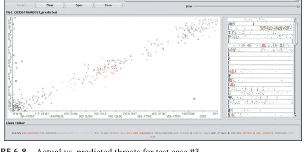

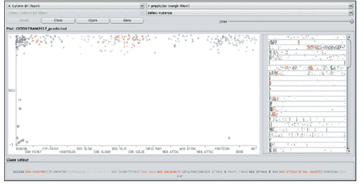

# 用于增强网络防御的大数据与智能

| 攻击 | 检测为 | a | b | c | d | e | f | g | h | i | j | k | l | m | n | o |
|---|---|---|---|---|---|---|---|---|---|---|---|---|---|---|---|
| 良性 (BENIGN) | | a | 74 | 0 | 0 | 0 | 1 | 2 | 1 | 0 | 0 | 0 | 0 | 2 | |
| SSH (PATATOR) | | b | 0 | 18 | 0 | 0 | 0 | 0 | 0 | 0 | 0 | 0 | 0 | 0 | 0 |
| FTP (PATATOR) | | c | 0 | 0 | 23 | 0 | 0 | 0 | 0 | 0 | 0 | 0 | 0 | 0 | 0 |
| HEARTBEAT | | d | 0 | 0 | 0 | 0 | 17 | 0 | 0 | 0 | 0 | 0 | 0 | 0 | 0 |
| DOS (SLOWIRIS) | | e | 0 | 0 | 0 | 0 | 0 | 0 | 15 | 0 | 0 | 0 | 0 | 0 | 0 |
| DOS (SLOWWP) | | f | 0 | 0 | 0 | 0 | 0 | 0 | 0 | 0 | 0 | 0 | 0 | 0 | 0 |
| DOS (HULK) | | g | 0 | 0 | 0 | 0 | 0 | 0 | 0 | 0 | 0 | 0 | 31 | 0 |
| DOS (GOLDENEY) | | h | 0 | 0 | 0 | 0 | 0 | 0 | 0 | 0 | 0 | 0 | 26 | 0 |
| 渗透 (INFILTRATION) | | i | 0 | 0 | 0 | 0 | 0 | 0 | 0 | 0 | 0 | 0 | 0 | |
| 攻击 (WEB ATTACK) (BF) | | j | 0 | 0 | 0 | 0 | 0 | 0 | 0 | 0 | 0 | 0 | 0 | |
| 攻击 (WEB ATTACK) (XSS) | | k | 0 | 0 | 0 | 0 | 0 | 0 | 0 | 0 | 0 | 10 | 0 | 0 |
| 攻击 (WEB ATTACK) (SQL INJ) | | l | 0 | 0 | 0 | 0 | 0 | 0 | 0 | 0 | 0 | 0 | 0 | |
| 端口扫描 (PORTSCAN) | | m | 0 | 1 | 0 | 0 | 0 | 0 | 0 | 0 | 0 | 0 | 14 | 0 |
| DDOS | | n | 0 | 0 | 0 | 0 | 0 | 0 | 0 | 0 | 0 | 0 | 0 | 40 |
| 机器人 (BOT) | | o | 0 | 0 | 0 | 0 | 0 | 0 | 0 | 0 | 0 | 0 | 0 | 12 |

**图 6.10** 测试用例 #3 的混淆矩阵。

**表 6.5** 测试用例 #4 的攻击性能

| 攻击组/良性 | 攻击/良性 | TPR | FPR | PPV | ROC |
|---|---|---|---|---|---|
| 良性 (BENIGN) | 良性 (BENIGN) | 0.984 | 0 | 1 | 0.97 |
| PATATOR | SSH | 1 | 0.003 | 0.98 | 1 |
| | FTP | 1 | 0 | 1 | 1 |
| | HEARTBLEED | 1 | 0 | 1 | 1 |
| | SLOWORIS | 1 | 0.005 | 0.93 | 1 |
| | SLOWHTTPTEST | 1 | 0.006 | 0.938 | 0.96 |
| | HULK | 1 | 0.007 | 0.964 | 0.998 |
| | GOLDENEY | 1 | 0.003 | 0.969 | 0.998 |
| | INFILTRATION | INFILTRATION | 1 | 0 | 1 | 1 |
| | WEB ATTACK | BRUTE FORCE | 1 | 0.003 | 0.917 | 1 |
| | XSS | 1 | 0 | 1 | 1 |
| | |
| | PORTSCAN | PORTSCAN | 0.977 | 0 | 1 | 0.999 |
| | DDOS | DDOS | 1 | 0.003 | 0.976 | 0.998 |
| | BOT | BOT | 1 | 0.006 | 0.857 | 1 |


# 有效入侵检测

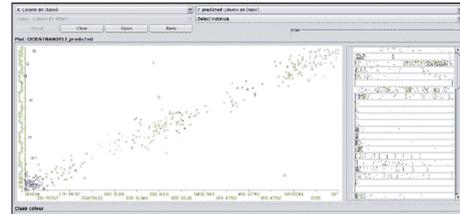

**图 6.12** 测试用例 #4 的预测结果。

| 攻击类型 | a | b | c | d | e | f | g | h | i | j | k | l | m | n | o |
|---|---|---|---|---|---|---|---|---|---|---|---|---|---|---|---|
| 正常 (BENIGN) | 17 | 0 | 0 | 2 | 0 | 0 | 0 | 0 | 0 | 0 | 0 | 0 | 0 | 0 | 2 |
| SSH (PATATOR) | 0 | 17 | 0 | 0 | 0 | 0 | 0 | 0 | 0 | 0 | 0 | 0 | 0 | 0 | 0 |
| FTP (PATATOR) | 0 | 0 | 24 | 0 | 0 | 0 | 0 | 0 | 0 | 0 | 0 | 0 | 0 | 0 | 0 |
| HEARTBLEED | 0 | 0 | 0 | 0 | 0 | 0 | 0 | 0 | 0 | 0 | 0 | 0 | 0 | 0 | 0 |
| DOS (SLOWIS) | 0 | 0 | 0 | 0 | 17 | 0 | 0 | 0 | 0 | 0 | 0 | 0 | 0 | 0 | 0 |
| DOS (SLOWHTPTEST) | 0 | 0 | 0 | 0 | 0 | 16 | 0 | 0 | 0 | 0 | 0 | 0 | 0 | 0 | 0 |
| DOS (HULK) | 0 | 0 | 0 | 0 | 0 | 0 | 22 | 0 | 0 | 0 | 0 | 0 | 0 | 0 | 0 |
| DOS (GOLDENYE) | 0 | 0 | 0 | 0 | 0 | 0 | 0 | 0 | 0 | 0 | 0 | 0 | 0 | 0 | 0 |
| 渗透 (INFILTRATION) | 0 | 0 | 0 | 0 | 0 | 0 | 0 | 0 | 0 | 26 | 0 | 0 | 0 | 0 | 0 |
| Web 攻击 (BF) | 0 | 0 | 0 | 0 | 0 | 0 | 0 | 0 | 0 | 0 | 0 | 0 | 0 | 0 | 0 |
| Web 攻击 (XSS) | 0 | 0 | 0 | 0 | 0 | 0 | 0 | 0 | 0 | 0 | 24 | 0 | 0 | 0 | 0 |
| Web 攻击 (SQL INJ) | 0 | 0 | 0 | 0 | 0 | 0 | 0 | 0 | 0 | 0 | 0 | 0 | 0 | 0 | 0 |
| 端口扫描 (PORTSCAN) | 0 | 0 | 0 | 0 | 0 | 0 | 0 | 0 | 0 | 0 | 0 | 0 | 42 | 0 | 0 |
| DDOS | 0 | 0 | 0 | 0 | 0 | 0 | 0 | 0 | 0 | 0 | 0 | 0 | 0 | 40 | 0 |
| 僵尸网络 (BOT) | 0 | 0 | 0 | 0 | 0 | 0 | 0 | 0 | 0 | 0 | 0 | 0 | 0 | 0 | 12 |

**图 6.13** 检测器为测试用例 #4 生成的混淆矩阵。

# 表 6.6 测试用例 #5 检测器的按攻击分类性能

| 攻击组/正常 | 攻击/正常 | TPR | FPR | PPV | ROC |
|---|---|---|---|---|---|
| 正常 (BENIGN) | 正常 (BENIGN) | 0.964 | 0.004 | 0.998 | 0.999 |
| PATATOR | SSH | 1 | 0 | 1 | 1 |
| | FTP | 1 | 0 | 1 | 1 |
| HEARTBLEED | HEARTBLEED | | 1 | 0 | 1 | 1 |
| DOS | SLOWIRIS | | 0.003 | 0.944 | |
| | SLOWHTPTEST | | 0.003 | 0.938 | 1 |
| | HULK | 0.981 | 0.003 | 0.981 | 1 |
| | GOLDENYE | | 1 | 0 | 1 | 1 |
| 渗透 (INFILTRATION) | 渗透 (INFILTRATION) | | 1 | 0 | 1 | 1 |
| Web 攻击 | 暴力破解 (BRUTE FORCE) | | 1 | 0 | 1 | 1 |
| | XSS | | 1 | 0 | 1 | 1 |
| | SQL INJ | | 1 | | | |
| 端口扫描 (PORTSCAN) | 端口扫描 (PORTSCAN) | | 0.977 | 0 | 1 |
| DDOS | DDOS | | | 1 | |
| 僵尸网络 (BOT) | BOT | | 0.003 | 0.923 | 1 | 大数据与网络安全

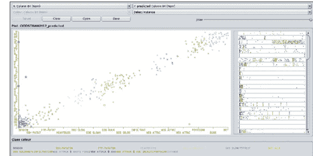

**图 6.14** 测试用例 #6 的实际与预测威胁。

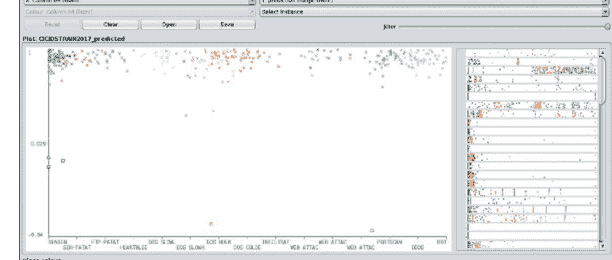

**图 6.15** 测试用例 #7 的边界。

| 攻击类型 | a | b | c | d | e | f | g | h | i | j | k | l | m | n | o |
|---|---|---|---|---|---|---|---|---|---|---|---|---|---|---|
| 正常 (BENIGN) | 8 | 0 | 0 | 0 | 0 | 0 | 0 | 0 | 0 | 0 | 0 | 0 | 0 | 7 |
| SSH (PATATOR) | 0 | 1 | 7 | 0 | 0 | 0 | 0 | 0 | 0 | 0 | 0 | 0 | 0 | 0 |
| FTP (PATATOR) | 0 | 0 | 2 | 8 | 0 | 0 | 0 | 0 | 0 | 0 | 0 | 0 | 0 | 0 |
| HEARTBLEED | 0 | 0 | 0 | 0 | 4 | 0 | 0 | 0 | 0 | 0 | 0 | 0 | 0 | 0 |
| DOS (SLOWLORIS) | 0 | 0 | 0 | 0 | 0 | 0 | 0 | 0 | 0 | 0 | 0 | 0 | 0 | 0 |
| DOS (SLOWHTTPTEST) | 0 | 0 | 0 | 0 | 0 | 6 | 0 | 0 | 0 | 0 | 0 | 0 | 0 | 0 |
| DOS (HULK) | 0 | 0 | 0 | 0 | 0 | 0 | 5 | 2 | 0 | 0 | 0 | 0 | 0 | 0 |
| DOS (GOLDENYE) | 0 | 0 | 0 | 0 | 0 | 0 | 0 | 0 | 3 | 1 | 0 | 0 | 0 | 0 |
| 渗透 (INFILTRATION) | 0 | 0 | 0 | 0 | 0 | 0 | 0 | 0 | 0 | 0 | 0 | 11 | 0 | 0 | 0 |
| Web 攻击 (BF) | 0 | 0 | 0 | 0 | 0 | 0 | 0 | 0 | 0 | 0 | 0 | 9 | 0 | 0 | 0 |
| Web 攻击 (XSS) | 0 | 0 | 0 | 0 | 0 | 0 | 0 | 0 | 0 | 0 | 1 | 0 | 10 | 0 | 0 |
| Web 攻击 (SQL INJ) | 0 | 0 | 0 | 0 | 0 | 0 | 0 | 0 | 0 | 0 | 0 | 0 | 1 | 43 | 0 |
| 端口扫描 (PORTSCAN) | 0 | 0 | 0 | 0 | 0 | 0 | 0 | 0 | 0 | 0 | 0 | 0 | 0 | 46 | 0 |
| DDoS | 0 | 0 | 0 | 0 | 0 | 0 | 0 | 0 | 0 | 0 | 0 | 0 | 0 | 0 | 0 |
| 僵尸网络 (BOT) | 0 | 0 | 0 | 0 | 0 | 0 | 0 | 0 | 0 | 0 | 0 | 0 | 0 | 0 | 82 |

**图 6.16** 检测器为测试用例 #5 生成的混淆矩阵。

# 有效入侵检测

# 表 6.7 测试用例 #6 检测器的按攻击分类性能

| 攻击组/正常 | 攻击/正常 | TPR | FPR | PPV | ROC |
|---|---|---|---|---|---|
| 正常 (BENIGN) | 正常 (BENIGN) | 0.904 | 0 | 1 | 0.966 |
| PATATOR | SSH | 1 | 0.006 | 1 | 0.897 |
| | FTP | 1 | 0 | 1 | |
| HEARTBLEED | SLOWLORIS | 0.941 | 0.003 | 0.941 | 0.997 |
| DOS | SLOWHTTPTEST | 1 | 0 | 1 | |
| | HULK | | 0.981 | 0 | |
| | GOLDENYE | | 0.003 | 0.969 | 1 |
| 渗透 (INFILTRATION) | 渗透 (INFILTRATION) | | 1 | 0 | 1 |
| Web 攻击 | 暴力破解 (BRUTE FORCE) | | 1 | 0 | 1 |
| | XSS | | 0.011 | 0.667 | 1 |
| | SQL INJ | | |
 | | |
 | 
) | 端口扫描 (PORTSCAN) | | 1 | 0 | |
| DDOS | DDOS | | 0.006 | 0.952 | 0.997 |
| 僵尸网络 (BOT) | BOT | | | 1 | |


**图 6.17** 测试用例 #6 的实际与预测威胁。


**图 6.18** 测试用例 #6 的边界。

# 大数据与网络安全

| 攻击类型 | 检测为 | a | b | c | d | e | f | g | h | i | j | k | l | m | n | o |
|---|---|---|---|---|---|---|---|---|---|---|---|---|---|---|---|
| 正常 (BENIGN) | a | 7 | 2 | 0 | 0 | 0 | 0 | 0 | 0 | 2 | | | | |
| SSH (PATATOR) | b | 0 | 1 | 2 | 0 | 0 | 0 | 0 | 0 | 0 | | | | |
| FTP (PATATOR) | c | 0 | 0 | 4 | 0 | 0 | 0 | 0 | 0 | 0 | | | | |
| HEARTBLEED | d | 0 | 0 | 0 | 0 | 0 | 0 | 0 | 0 | 0 | | | | | |
| DOS (SLOWLORIS) | e | 0 | 0 | 0 | 0 | 0 | 0 | 0 | 1 | 1 | 6 | 2 | 0 | | | |
| DOS (SLOWHTTPTEST) | f | 0 | 0 | 0 | 0 | 0 | 0 | 0 | 0 | 1 | 5 | 0 | 0 | | | |
| DOS (HULK) | g | 0 | 0 | 0 | 0 | 0 | 0 | 0 | 0 | 5 | 1 | 0 | 0 | | | |
| DOS (GOLDENYE) | h | 0 | 0 | 0 | 0 | 0 | 0 | 0 | 0 | 0 | 0 | 0 | 0 | | | |
| 渗透 (INFILTRATION) | i | 0 | 0 | 0 | 0 | 0 | 0 | 0 | 0 | 0 | 0 | 0 | 0 | 0 | | |
| Web 攻击 (BF) | j | 0 | 0 | 0 | 0 | 0 | 0 | 0 | 0 | 0 | 0 | 0 | 8 | 1 | 1 | 0 |
| Web 攻击 (XSS) | k | 0 | 0 | 0 | 0 | 0 | 0 | 0 | 0 | 0 | 0 | 0 | 0 | 9 | 1 | 0 |
| Web 攻击 (SQL INJ) | l | 0 | 0 | 0 | 0 | 0 | 0 | 0 | 0 | 0 | 0 | 0 | 0 | 0 | 9 | 1 |
| 端口扫描 (PORTSCAN) | m | 0 | 0 | 0 | 0 | 0 | 0 | 0 | 0 | 0 | 0 | 0 | 0 | 4 | 5 | 0 |
| DDOS | n | 0 | 0 | 0 | 0 | 0 | 0 | 0 | 0 | 0 | 0 | 0 | 0 | 0 | 0 | 46 | 0 |
| 僵尸网络 (BOT) | o | 0 | 0 | 0 | 0 | 0 | 0 | 0 | 0 | 0 | 0 | 0 | 0 | 0 | 0 | 52 |

**图 6.19** 检测器为测试 #6 生成的混淆矩阵。

# 表 6.8 测试用例 #7 检测器的按攻击分类性能

| 攻击组/正常 | 攻击/正常 | TPR | FPR | PPV | ROC |
|---|---|---|---|---|---|
| 正常 (BENIGN) | 正常 (BENIGN) | 0.928 | 0 | 1 | 0.982 |
| PATATOR | SSH | 1 | 0.006 | 0.895 | 0.997 |
| | FTP | 1 | 0 | 1 | |
| HEARTBLEED | HEARTBLEED | | 0 | | 1 |
| DOS | SLOWHTTPTEST | | 0 | | 1 |
| | HULK | | 0.933 | 0 | | 1 |
| | | | | | | | | | | 1 |
| 渗透 (INFILTRATION) | 渗透 (INFILTRATION) | | 1 | 0 | | | | |  |   | | | | | | | | | | | | | | | | | | | | | | | | | | | | | | | | | | | | | | | | | | | | | | | | | | | | | | | | | | | | | | | | | | | | | | | | | | | | | | | | | | | | | | | | | | | | | | | | | | | | | | | | | | | | | |    | |            |   | |
| Web 攻击 | 暴力破解 (BRUTE FORCE) | | 0.003 | 0.97 | | | | | |
| | XSS | | 0.003 | 0.89 | | |
| | SQL INJ | | | | |
| 端口扫描 (PORTSCAN) | 端口扫描 (PORTSCAN) | | | | | | |
| DDOS | DDOS | | | 0.003 | 0 |
| 僵尸网络 (BOT) | BOT | | | | | 有效入侵检测


**图 6.20** 测试用例 #7 的实际与预测威胁。

| 攻击类型 | a | b | c | d | e | f | g | h | i | j | k | l | m | n | o |
|---|---|---|---|---|---|---|---|---|---|---|---|---|---|---|---|
| 正常 (BENIGN) | 8 | 0 | 0 | 0 | 0 | 0 | 0 | 0 | 0 | 0 | 0 | 0 | 0 | 7 |
| SSH (PATATOR) | 0 | 1 | 7 | 0 | 0 | 0 | 0 | 0 | 0 | 0 | 0 | 0 | 0 | 0 |
| FTP (PATATOR) | 0 | 0 | 2 | 8 | 0 | 0 | 0 | 0 | 0 | 0 | 0 | 0 | 0 | 0 |
| HEARTBLEED | 0 | 0 | 0 | 0 | 4 | 0 | 0 | 0 | 0 | 0 | 0 | 0 | 0 | 0 |
| DOS (SLOWLORIS) | 0 | 0 | 0 | 0 | 0 | 0 | 0 | 0 | 0 | 0 | 0 | 0 | 0 | 0 |
| DOS (SLOWHTTPTEST) | 0 | 0 | 0 | 0 | 0 | 6 | 0 | 0 | 0 | 0 | 0 | 0 | 0 | 0 |
| DOS (HULK) | 0 | 0 | 0 | 0 | 0 | 0 | 5 | 2 | 0 | 0 | 0 | 0 | 0 | 0 |
| DOS (GOLDENYE) | 0 | 0 | 0 | 0 | 0 | 0 | 0 | 0 | 3 | 1 | 0 | 0 | 0 | 0 |
| 渗透 (INFILTRATION) | 0 | 0 | 0 | 0 | 0 | 0 | 0 | 0 | 0 | 0 | 0 | 11 | 0 | 0 | 0 |
| Web 攻击 (BF) | 0 | 0 | 0 | 0 | 0 | 0 | 0 | 0 | 0 | 0 | 0 | 9 | 0 | 0 | 0 |
| Web 攻击 (XSS) | 0 | 0 | 0 | 0 | 0 | 0 | 0 | 0 | 0 | 0 | 1 | 0 | 10 | 0 | 0 |
| Web 攻击 (SQL INJ) | 0 | 0 | 0 | 0 | 0 | 0 | 0 | 0 | 0 | 0 | 0 | 0 | 1 | 43 | 0 |
| 端口扫描 (PORTSCAN) | 0 | 0 | 0 | 0 | 0 | 0 | 0 | 0 | 0 | 0 | 0 | 0 | 0 | 46 | 0 |
| DDOS | 0 | 0 | 0 | 0 | 0 | 0 | 0 | 0 | 0 | 0 | 0 | 0 | 0 | 0 | 0 |
| 僵尸网络 (BOT) | 0 | 0 | 0 | 0 | 0 | 0 | 0 | 0 | 0 | 0 | 0 | 0 | 0 | 0 | 32 |

**图 6.22** 检测器为测试用例 #7 生成的混淆矩阵。


# 用于增强网络防御的大数据与边缘智能

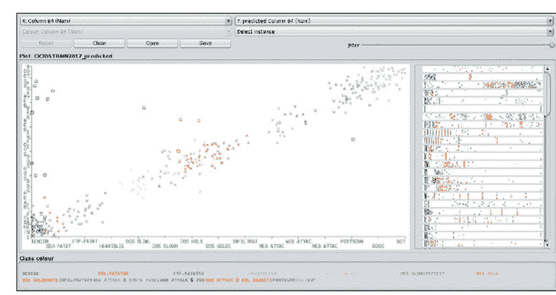

图 6.23 测试用例 #8 的实际威胁与预测威胁。

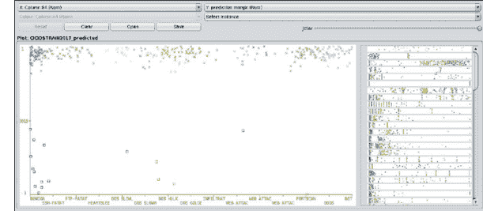

图 6.24 测试用例 #8 的预测矩阵。

| 攻击 \ 被检测为 | a | b | c | d | e | f | g | h | i | j | k | l | m | n | o |
|---|---|---|---|---|---|---|---|---|---|---|---|---|---|---|---|
| 正常 (BENIGN) | 41 | 0 | 0 | 0 | 1 | 0 | 0 | 0 | 0 | 0 | 0 | 0 | 0 | 0 | 0 |
| SSH (PATATOR) | 0 | 80 | 0 | 0 | 0 | 0 | 0 | 0 | 0 | 0 | 0 | 0 | 0 | 0 | 0 | 0 |
| FTP (PATATOR) | 0 | 0 | 90 | 0 | 0 | 0 | 0 | 0 | 0 | 0 | 0 | 0 | 0 | 0 | 0 | 0 |
| 心跳 (HEARTBEAT) | 0 | 0 | 0 | 90 | 0 | 0 | 0 | 0 | 0 | 0 | 0 | 0 | 0 | 0 | 0 | 0 |
| DOS (SLOWORIS) | 0 | 0 | 0 | 0 | 5 | 95 | 0 | 0 | 0 | 0 | 0 | 0 | 0 | 0 | 0 | 0 |
| DOS (SLOWHTTPTEST) | 0 | 0 | 0 | 0 | 0 | 0 | 60 | 40 | 0 | 0 | 0 | 0 | 0 | 0 | 0 | 0 |
| DOS (HULK) | 0 | 0 | 0 | 0 | 0 | 0 | 0 | 0 | 80 | 20 | 0 | 0 | 0 | 0 | 0 | 0 |
| DOS (GOLDENEY) | 0 | 0 | 0 | 0 | 0 | 0 | 0 | 0 | 0 | 0 | 21 | 79 | 0 | 0 | 0 | 0 |
| 渗透 (INFILATION) | 0 | 0 | 0 | 0 | 0 | 0 | 0 | 0 | 0 | 0 | 0 | 5 | 95 | 0 | 0 | 0 |
|  攻击 (BF) | 0 | 0 | 0 | 0 | 0 | 0 | 0 | 0 | 0 | 0 | 0 | 10 | 90 | 0 | 0 | 0 |
| WEB 攻击 (XSS) | 0 | 0 | 0 | 0 | 0 | 0 | 0 | 0 | 0 | 0 | 0 | 0 | 8 | 92 | 0 | 0 |
| WEB 攻击 (SQL IN) | 0 | 0 | 0 | 0 | 0 | 0 | 0 | 0 | 0 | 0 | 0 | 0 | 0 | 1 | 99 | 0 |
| 端口扫描 (PORTSCAN) | 0 | 0 | 0 | 0 | 0 | 0 | 0 | 0 | 0 | 0 | 0 | 0 | 0 | 6 | 94 | 0 |
| DDOS | 0 | 0 | 0 | 0 | 0 | 0 | 0 | 0 | 0 | 0 | 0 | 0 | 0 | 0 | 46 | 54 |
| 机器人 (BOT) | 0 | 0 | 0 | 0 | 0 | 0 | 0 | 0 | 0 | 0 | 0 | 0 | 0 | 0 | 0 | 100 |

图 6.25 检测器为测试用例 #8 生成的混淆矩阵。

### 表 6.10
测试用例 #9 检测器按攻击分类的性能

| 攻击组/正常 | 攻击/正常 | TPR | FPR | PPV | ROC |
|---|---|---|---|---|---|
| 正常 (BENIGN) | 正常 (BENIGN) | 0.916 | 0 | 1 | 0.986 |
| PATATOR | SSH | 1 | 0 | | 1 |
| | FTP | 1 | 0.006 | 0.923 | 0.997 |
| 心血漏洞 (HEARTBLEED) | HEARTBLEED | 0 | 0 | | 1 |
| DOS | SLOWLORIS | 1 | 0 | | 1 |
| | SLOWHTTPUK | 0.933 | 0 | | 1 |
| HULK | | 0.981 | 0.007 | 0.963 | 0.997 |
| 渗透 (INFILTRATION) | GOLDENEYE | 0.968 | 0 | | 1 |
| WEB 攻击 | 渗透 (INFILTRATION) | 1 | 0 | | 1 |
| | XSS | 1 | 0.003 | 0.889 | 1 |
| | SQL INI | 1 | 0.003 | 0.5 | 0.999 |
| 端口扫描 (PORTSCAN) | PORTSCAN | 0.978 | 1 | 0.936 | 0.996 |
| DDOS | DDOS | 1 | 0.003 | 0.975 | 0.998 |
| 机器人 (BOT) | BOT | 1 | 0.003 | 0.929 | 1 |

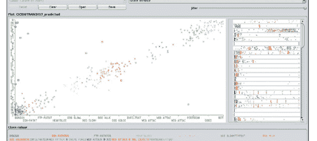

图 6.26 测试用例 #9 的实际威胁与预测威胁。


图 6.27 测试用例 #9 的边界。

# 用于增强网络防御的大数据与边缘智能

| 攻击 | 被检测为 | a | b | c | d | e | f | g | h | i | j | k | l | m | n | o |
|---|---|---|---|---|---|---|---|---|---|---|---|---|---|---|---|
| 正常 (BENIGN) | a | 1 | 0 | 0 | 0 | 0 | 0 | 0 | 0 | 0 | 0 | 0 | 0 | 0 | 0 |
| SSH (PATATOR) | b | 0 | 1 | 0 | 0 | 0 | 0 | 0 | 0 | 0 | 0 | 0 | 0 | 0 | 0 | 0 |
| FTP (PATATOR) | c | 0 | 0 | 1 | 0 | 0 | 0 | 0 | 0 | 0 | 0 | 0 | 0 | 0 | 0 | 0 |
| 心跳 (HEARTBEAT) | d | 0 | 0 | 0 | 1 | 0 | 0 | 0 | 0 | 0 | 0 | 0 | 0 | 0 | 0 | 0 |
| SLOWLORIS (DOS) | e | 0 | 0 | 0 | 0 | 1 | 0 | 0 | 0 | 0 | 0 | 0 | 0 | 0 | 0 | 0 |
| SLOWHTTPTEST (DOS) | f | 0 | 0 | 0 | 0 | 0 | 1 | 0 | 0 | 0 | 0 | 1 | 0 | 0 | 0 | 0 |
| HULK (DOS) | g | 0 | 0 | 0 | 0 | 0 | 0 | 1 | 0 | 2 | 0 | 0 | 0 | 0 | 0 | 0 |
| GOLDENEY (DOS) | h | 0 | 0 | 0 | 0 | 0 | 0 | 0 | 1 | 3 | 0 | 0 | 0 | 0 | 0 | 0 |
| 渗透 (INFILTRATION) | i | 0 | 0 | 0 | 0 | 0 | 0 | 0 | 0 | 0 | 1 | 0 | 0 | 0 | 0 | 0 |
| BF (WEB ATTACK) | j | 0 | 0 | 0 | 0 | 0 | 0 | 0 | 0 | 0 | 1 | 0 | 0 | 0 | 0 | 0 |
| XSS (WEB ATTACK) | k | 0 | 0 | 0 | 0 | 0 | 0 | 0 | 0 | 0 | 0 | 4 | 0 | 0 | 0 | 0 |
| SQL IN (WEB ATTACK) | l | 0 | 0 | 0 | 0 | 0 | 0 | 0 | 0 | 0 | 0 | 0 | 0 | 1 | 0 | 0 |
| PORTSCAN | m | 0 | 0 | 0 | 0 | 0 | 0 | 0 | 0 | 0 | 0 | 0 | 0 | 0 | 1 | 0 |
| DDOS | n | 0 | 0 | 0 | 0 | 0 | 0 | 0 | 0 | 0 | 0 | 0 | 0 | 0 | 0 | 1 |
| BOT | o | 0 | 0 | 0 | 0 | 0 | 0 | 0 | 0 | 0 | 0 | 0 | 0 | 0 | 0 | 1 |

图 6.28 检测器为测试用例 #9 生成的混淆矩阵。

# 表 6.11 测试用例 #10 按攻击分类的性能

| 攻击组/正常 | 攻击/正常 | TPR | FPR | PPV | ROC |
|---|---|---|---|---|---|
| 正常 (BENIGN) | 正常 (BENIGN) | 0.88 | 0 | | 0.968 |
| PATATOR | SSH | 1 | 0.003 | | 0.944 |
| | FTP | 1 | 0.003 | | 0.999 |
| 心跳 (HEARTBEAT) | HEARTBEAT | | 0 | | 1 |
| DOS | SLOWLORIS | | 0 | 1 | 1 |
| SLOWHTTPTEST | | 0 | 0 | | |
| HULK | | 0.981 | 0.007 | 0.963 | 0.997 |
| | GOLDENEY | | 0 | 1 | 1 |
| 渗透 (INFILTRATION) | INFILTRATION | 1 | 0.003 | 0.5 | 0.999 |
| WEB 攻击 | BRUTE FORCE | 1 | 0.009 | 0.786 | 1 |
| | XSS | | 1 | 0.089 | 1 |
| | SQL INJ | | 1 | 0 | 1 | |
| 端口扫描 (PORTSCAN) | PORTSCAN | 0.955 | 0.006 | 0.955 | 0.992 |
| DDOS | DDOS | 1 | 0.006 | 0.952 | 0.997 |
| 机器人 (BOT) | BOT | | 0 | 1 | 1 | |

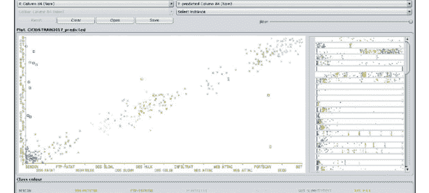

图 6.29 测试用例 #10 的实际威胁与预测威胁。

# 有效入侵检测

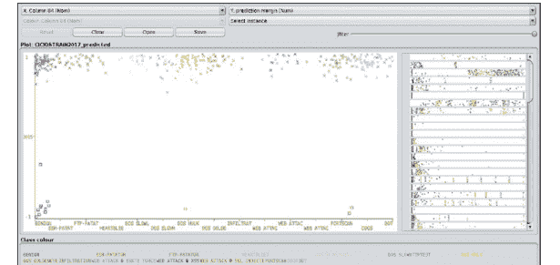

图 6.30 测试用例 #10 的预测边界。

| 攻击 | 被检测为 | a | b | c | d | e | f | g | h | i | j | k | l | m | n | o |
|---|---|---|---|---|---|---|---|---|---|---|---|---|---|---|---|---|
| 正常 (BENIGN) | a | 1 | 0 | 0 | 0 | 0 | 0 | 0 | 0 | 0 | 0 | 0 | 0 | 0 | 2 | 2 |
| SSM (PATATOR) | b | 0 | 1 | 0 | 0 | 0 | 0 | 0 | 0 | 0 | 0 | 0 | 0 | 0 | 0 | 0 |
| FTP (PATATOR) | c | 0 | 0 | 1 | 0 | 0 | 0 | 0 | 0 | 0 | 0 | 0 | 0 | 0 | 0 | 0 |
| 心跳 (HEARTBEAT) | d | 0 | 0 | 0 | 1 | 0 | 0 | 0 | 0 | 0 | 0 | 0 | 0 | 0 | 0 | 0 |
| SLOWHTTPTEST (DOS) | e | 0 | 0 | 0 | 0 | 1 | 0 | 0 | 0 | 0 | 7 | 0 | 0 | 0 | 0 | 0 |
| HULK (DOS) | f | 0 | 0 | 0 | 0 | 0 | 1 | 0 | 0 | 5 | 2 | 0 | 0 | 0 | 0 | 0 |
| GOLDENEY (DOS) | g | 0 | 0 | 0 | 0 | 0 | 0 | 1 | 0 | 3 | 1 | 0 | 0 | 0 | 0 | 0 |
| 渗透 (INFILTRATION) | h | 0 | 0 | 0 | 0 | 0 | 0 | 0 | 1 | 0 | 0 | 0 | 0 | 0 | 0 | 0 |
| BF (WEB ATTACK) | i | 0 | 0 | 0 | 0 | 0 | 0 | 0 | 0 | 0 | 6 | 0 | 0 | 0 | 0 | 0 |
| XSS (WEB ATTACK) | j | 0 | 0 | 0 | 0 | 0 | 0 | 0 | 0 | 0 | 0 | 4 | 0 | 0 | 0 | 0 |
| SQL IN (WEB ATTACK) | k | 0 | 0 | 0 | 0 | 0 | 0 | 0 | 0 | 0 | 0 | 0 | 0 | 5 | 0 | 0 |
| 端口扫描 (PORTSCAN) | l | 0 | 0 | 0 | 0 | 0 | 0 | 0 | 0 | 0 | 0 | 0 | 0 | 0 | 0 | 0 |
| DDOS | m | 0 | 0 | 0 | 0 | 0 | 0 | 0 | 0 | 0 | 0 | 0 | 0 | 0 | 0 | 0 |
| BOT | n | 0 | 0 | 0 | 0 | 0 | 0 | 0 | 0 | 0 | 0 | 0 | 0 | 0 | 0 | 1 |

图 6.31 检测器为测试用例 #10 生成的混淆矩阵。

### 表 6.12 测试用例性能

| 测试用集 | 实例数量 | 准确率 | 分类率 | 均方误差 | IPR | PPV | ROC |
|---|---|---|---|---|---|---|
| 测试用例 #01 | 359 | 97.493 | 2.507 | 0.043 | 0.056 | 0.975 | 0.993 |
| 测试用例 #02 | 359 | 96.939 | 3.064 | 0.0048 | 0.0582 | 0.969 | 0.995 |
| 测试用例 #03 | 359 | 97.215 | 2.785 | 0.0044 | 0.0567 | 0.972 | 0.994 |
| 测试用例 #04 | 359 | 97.493 | 2.507 | 0.0044 | 0.0551 | 0.975 | 0.995 |
| 测试用例 #05 | 359 | 98.602 | 1.3928 | 0.0028 | 0.0372 | 0.938 | 0.982 |
| 测试用例 #06 | 359 | 97.215 | 2.785 | 0.0049 | 0.0578 | 0.972 | 0.992 |
| 测试用例 #07 | 359 | 97.7654 | 2.236 | 0.0034 | 0.0532 | 0.978 | 0.995 |
| 测试用例 #08 | 359 | 95.2514 | 4.7486 | 0.0067 | 0.0711 | 0.953 | 0.999 |
| 测试用例 #09 | 359 | 96.9274 | 3.072 | 0.0063 | 0.0686 | 0.969 | 0.994 |
| 测试用例 #10 | 359 | 96.3687 | 3.6133 | 0.0058 | 0.0681 | 0.964 | 0.991 |
| 平均值 | 97.1271 | 2.8729 | 0.00471 | 0.05738 | 0.9713 | 0.0024 | 0.9737 | 0.992 |

# 用于增强网络防御的大数据与边缘智能

| 测试用例 #01 | 测试用例 #02 | 测试用例 #03 | 测试用例 #04 | 测试用例 #05 | 测试用例 #06 | 测试用例 #07 | 测试用例 #08 | 测试用例 #09 | 测试用例 #10 | 平均 |
|---|---|---|---|---|---|---|---|---|---|---|
| 2.507 | 3.041 | 2.785 | 2.507 | 1.398 | 2.785 | 2.234 | 1.486 | 3.027 | 3.631 | 2.829 |
| 97.493 | 96.959 | 97.215 | 97.493 | 98.602 | 97.215 | 97.7654 | 95.214 | 96.927 | 96.368 | 97.121 |

+   - 分类率

6.32 提议的引擎的准确率和分类率。

# 6.33 提议的引擎的真阳性率、精确率、假阳性率和均方误差。

提出了一种 IDS 引擎以应对高不平衡的分类问题。这里考虑的数据集是 CICIDS2017，这是一个最新的数据集，包含一个名为正常的实例和 14 类其他类的实例。挑战在于为这个包含超过 28 万个实例和 85 个特征（且存在于高类别不平衡）的数据集设计 IDS 框架。为了应对这个问题，首先通过一种名为无限潜在特征选择的概率潜图图排序方法对特征进行排序，然后选择所需的特征进行样本生成。采样通过蓄水采样技术进行，该技术将数据集视为数据流，确保每个实例被选中的概率相等。


## 有效入侵检测

样本的一部分。同样，Weka 模拟器中使用的另一种基于划分的采样机制 SRF 用于根据 10 个测试用例生成数据。测试用例的生成方式确保了在训练实例中不会发现任何测试用例实例，即测试采样机制。在检测阶段，部署了基于 C45 的分类机制 J48 Consolidated，并利用 CTC 算法赋能以应对涉及高度类别不平衡的分类问题。结果发现，我们的 IDS 检测威胁的准确率为 97.12%，误分类率极低，为 2.87%。我们的方法产生的误报率为 0.002%。

## 参考文献

- 1. Scife, P. Traynor, and K. Butler, “Making sense of the ransomware measure (and enabling a sensible forward),” IEEE Potentials, vol. 36, no. 6, pp. 28–31, Nov. 2017. doi: 10.1109/MPOT.2017.2737201
- 2. Q. Chen and R. A. Briggs, “Automated behavioral analysis of malware: A case study of Wannacry ransomware,” in 2017 IEEE International Conference on Machine Learning and Applications (ICMLA), Dec. 2017, pp. 454–460. doi: 10.1109/ICMLA.2017.0-119
- 3. M. Uyas and S. A. Alharbi, “Machine learning approaches to network intrusion detection for contemporary internet traffic,” vol. 104, no. 5, pp. 1061–1076, May 2022. doi: 10.1017/s00607-021-01050-5
- 4. R. Panigahi, S. Shorbari, A. Boko, and P. Mallick, “Intrusion detection systems (IDS)–overview with a generalized framework,” Cognitive Informatics and Soft Computing, pp. 107–117, 2020.
- 5. A. Ahmed et al., “Multi-attribute decision-making for intrusion detection: A systematic review,” International Journal of Information Technology & Decision Making, vol. 22, no. 01, pp. 589–636, Jun. 2013. doi: 10.1142/S01962220022300044
- 6. M. Poongdi, V. Vijayakumar, F. Al-Tijuran, M. Handi, and M. Ma, “Intrusion detection system for DDoS attack on VAN with RECAPTCHA using information methods,” IEEE ACCESS, vol. 7, pp. 15841–15891, 2019. doi: 10.1109/ACCESS.2019.2945682
- 7. N. A. Aziz, T. M. Bana, S. Misra, A. Adewumi, C. Van der Viber, and R. Ahuja, “Intrusion Detection and Prevention Systems: An Updated Review,” 2020, pp. 685–696. doi: 10.1007/978-981-32-9949-8
- 8. R. Panigahi and S. Ghosh, “A statistical analysis of lazy classifiers using Canadian institute of cybersecurity,” in Data Science and Management, Springer, 2020, pp. 215–222.
- 9. H.-J. Liao, C.-H. Richard, Y.-C. Lin, and K.-Y. Tung, “Intrusion detection system: a comprehensive review,” Journal of Network and Computer Applications, vol. 36, no. 1, pp. 16–24, Jan. 2003. doi: 10.1016/jjnca.2002.094
- 10. C. A. Catania, and C. G. Garino, “Automated network intrusion detection: techniques and open issues,” Computers & Electrical Engineering, vol. 38, no. 5, pp. 1062–1083, Sep. 2012. doi: 10.1109/j..2012.013
- 11. I. Ibaruren, J. Muguera, I. Guruttaza, and A. Orbelait, “Coverage-based resampling: Building robust classification trees,” Knowledge-Based Systems, vol. 79, pp. 51–67, May 2015. doi: 10.1016/j.knosys.2014.123
- 12. J. M. Pérez, J. Muguera, A. Orbelait, and J. Martin, “Combining multiple class distribution subsamples in a single tree,” Pattern Recognition Letters, vol. 28, no. 4, pp. 414–442, Mar. 2007. doi: 10.1016/j.patrec.2006.013

## 大数据与边缘智能增强防御

- 13. C. D. Kim, J. Jeong, and G. Kim, "Imbalanced Continuous Learning with Partitioning Sampling,” 2020, pp. 411–428. doi: 10.1007/978-3-030-58601-25
- 14. R. Vijayan, D. Devaraj, and B. Kannapa, "Intusion detection system for wireless network using multiple support vector classifier with algorithm-based selection," Computers & Security, 77, pp. 304–314, 2019. doi: 10.1016/j.cose.2018.0410
- 15. E. Kabir, J. Hu, and G. Guan, "A novel statistical technique for intrusion detection," Future Generation, 79, pp. 303–318, Feb.2018. doi: 10.1016/j.future.2017.0129
- 16. S. M. Hosseini, "An effective intrusion detection framework based on PLCM/SVM optimized by time-varying chaos optimization," Neurocomputing, 199, pp. 90–102, June 2016. doi: 10.1016/j.necom.2016.0331
- 17. D. S. Kim and J. Park, "Network-based intrusion detection with support vector machines," 2003, pp. 747–756. doi: 10.1007/978-3-540-4235-7
- 18. S. M. Hosseini, H. Wang, and Y. Shi, "Ramp Loss-support vector regression: a robust and sparse multi-class approach to the intrusion detection," Knowledge-Based Systems, 126, pp. 113–126, Jun 2017. doi: 10.1016/j.ksbas.2017.0312
- 19. S. Mukammala, G. Janoski, and A. Sung, "Intrusion detection using neural networks and support machines," in Proceedings of the 2002 International Conference on Neural Networks, IJCNN (No. 02370), pp. 1702–1707. doi: 10.1109/IJCNN.2002.10074
- 20. T. Ambwani, "Multi support vector machine implementation for intrusion detection," in Proceedings of the International Conference on Neural Networks, vol. 2003, pp. 2300–2305. doi: 10.1109/IJCNN.2003.12377
- 21. A. Mewada, P. Gedam, S. Khan, and U. M. Reddy, "Network intrusion detection using multiclass support vector machine," International Journal of Computer and Communication Technology, pp. 262–265, 2010. doi: 10.47893/IJCT.2010.1054
- 22. W. Zhang, S. Teng, H. Hu, D. Xu, and L. Li, "Fuzzy-multi-class support vector machines for cooperative network intrusion detection," in 20th IEEE International Conference on Cognitive Informatics (CCI'10), 2010, pp. 811–818. doi: 10.1109/COGNIF.2010.5599082
- 23. K. Krugel, D. Tu, W. Robertson, and F. Valeur, "Bayesian event classification for intrusion detection," in 19th Annual Computer Security Applications Conference, 2003, pp. 14–23. doi: 10.1109/CSAC.2003.125430
- 24. K. M. Sudar, P. Deepak, and A. Singh al. TFAD: TCP flooding in software-defined networking using proxy-based and machine learning mechanisms. Cluster Computing, vol. 26, pp. 1461–1477, 2023. doi: 10.1007/s10586-022-0366-4
- 25. G. Kumar and K. Kumar, "Design of an evolutionary approach for intrusion detection," The Scientific World Journal, 2013, pp. 1–14. doi: 10.1155/2013/996185
- 26. E. Hodo, et al., "Analysis of IoT networks using neural network intrusion system,”2016 International Symposium on Networks, Computers and Communications (ISCNN), May 2016, pp. 1–6. doi: 10.1109/ISCNN.2016.77440
- 27. E. Hodo, X. Bellekens, E. Iorky, C. Tachtis, and R. Atkinson, "Machine learning approach for detection of nonTor traffic,” in Proceedings of 12th International Conference on Availability, Reliability and Security, Aug. 2017, pp. 1–6. doi: 10.1109/309854.31068

## 有效入侵检测

153

- 29. Z. Zhang. "HIDE: A Hierarchical Network Intrusion Detection Using Statistical Preprocessing and Neural Network Classification." Proceedings of the 2001 IEEE Workshop on Information Assurance and Security, United States Military Academy, NY, pp. 5–6, June 2001, [Online]. Available: https://ieeexplore.ieee.org/document/107195
- 30. X. D. Hoang, J. Hu, and P. Bertok, "A-based anomaly detection using multiple engines and fuzzy logic," Journal of Network and Computer Applications, vol. 32, no. 6, pp. 1219–1228, 2009. doi: 10.1016/j.jnca.2009.05004
- 31. M. Alahuman, L. Zhang, and M. Hossain, "A P2P-network detection using decision tree and adaptive multilayer networks," Neural Computing and Applications, vol. 29, no. 11, pp. 991–1004, 2018.
- 32. S. P. Praveen, S. Srinivasi, and S. Ahmed, "Combining CNNs and Bi-STMs for enhanced network detection: A deep learning," 2023 33rd International Conference on Computing and Information Technology (ICCIT), Riyadh, Saudi Arabia, 2023, pp. 261–268. doi: 10.1109/ICCIT581832
- 33. Z. Chang and C. Manikopoulos, "Detection of denial-of-service attacks through cross-correlation," in 2004 IEEE/SARNO Symposium on Advances in Wireless Communications, pp. 67–70. doi: 10.1109/SARNO.2004.13082
- 34. D. S. Kim, T. Nguyen, and J. Park, "An optimized intrusion detection system using PCA and KNN," in 6th Asia-Pacific Symposium on Information and Telecommunication Technologies, 2005, pp. 356–359. doi: 10.1109/ASIPTT.2005.23684
- 35. A. Noosi, M. Kahani, and R. Mosefi, "Network intrusion detection based on classification," in 2006 International Conference on Computing & Information, June 2006, pp. 1–5. doi: 10.1109/ICCI2006.527608
- 36. N. Ben Amor, S. Benfer, and Z. Elouadi, "Naive Bayes Decision Trees in Intrusion Detection," in Proceedings of the 2004 ACM Symposium on applied computing, Mar. 2004, pp. 420–424. doi: 10.1145/967900.967989
- 37. A. Amar, "A decision tree classifier for intrusion detection priority tagging," Journal of Computer and Communications, vol. 03, no. 04, pp. 52–58, 2015. doi: 10.4236/jcc.2015.34006
- 38. A. Akoyl, M. Habiceyizoglu, and B. Karlik, "Detection of multilayer hybrid classifier with variant features for intrusion detection system," IEEE Transactions on Information and Systems, Vol. 99, no. 7, pp. 1810–1821, 2016. doi: 10.1189/TIS2015.EDP73
- 39. S. Sindhu, G. Sethula, S. Subashani, P. Riyadh, and A. Khan, "An active rule based for network detection using Neuro4.5," in 2006 IEEE India Conference, 2006, pp. 1–5. doi: 10.1109/INDCON.2006.3022
- 40. T. Hamed, R. Raza, and S. Kramer, "Network intrusion system with recursive feature addition and high binary techniques," Computers and Security, vol. 73, pp. 137–155, Mar. 2018. doi: 10.1016/j.cose.2017.10.11
- 41. K. Siddique, A. Akhtar, H. Lee, M. Kim, and Y. Kim, "Toward bulk synchronous algorithm-based machine learning techniques for anomaly detection in high-speed big data," Networks (Basel), vol. 9, no. 9, pp. 197, 2017. doi: 10.3390/sn9090907
- 42. D. Lee, D. Kim and J. Jung, "Multi-stage intrusion detection system using hidden Markov model algorithm," in 2008 International Conference on Information Science and Security (ICISS) 2008, pp. 72–77. doi: 10.1109/ICISS.2008.22
- 43. M. S. Mok, S. Y. Sohn, and Y. H. Lu, "Random effects logistic regression model for anomaly detection," Expert Systems with Applications, vol. 37, no. 10, pp. 7162–7166, Oct. 2010. doi: 10.1016/j.eswa.2010.04.017


44. M. A. Salama, H. F. Eid, R. A. Ramadan, A. Darwish, and A. E. Hassanien, “混合智能入侵检测方案,”2011, pp. 293–303. doi: 10.1007/
978-3-642-20505-7_26

45. I. Sharafaldin, A. H. Lashkari, and A. A. Ghorbani, “迈向生成新的入侵检测数据集和入侵流量特征,”2018. doi:
10.5220/0006639801080116

46. A. Gharib, I. Sharafaldin, A. H. Lashkari, and A. A. Ghorbani, “入侵检测数据集的评估框架，见2016年国际信息科学与安全会议 (ICISS)”，“2016年12月, pp. 1–6. doi: 10.1109/ICISSEC.2016.7885840

47. G. Roffo, S. Melzi, and M. Cristani, “无限特征选择，”见2015年IEEE国际计算机视觉会议 (ICCV),2015年12月, pp. 4202–4210. doi:
10.1109/ICCV.2015.478

# 7 物联网入侵检测系统
基于人工智能、深度学习和机器学习方法的的系统性研究

Joseph Bamidele Awotunde, Abdulrauf Olarenwaju Babatunde, Rasheed Gbenga Jimoh, and Dayo Reuben

## 7.1 引言

物联网（IoT）入侵检测系统（IDS）是保护未连接设备免受未经授权访问、数据泄露和网络威胁的关键组件 [1]。与传统的 IDS 不同，由于物联网设备的多样性、异构性和规模，它们 面临着独特的挑战 [2]。这些系统使用多种技术和方法来检测并缓解潜在的入侵 [3]。基于特征的检测涉及将网络流量模式与已知攻击特征进行对比，而基于异常的检测则识别偏离正常行为的行为 [4]。机器学习（ML）算法越来越多地应用于物联网 IDS 中，通过分析网络流量中的模式和异常，来自适应地学习和检测不断演变的威胁，从而增强检测能力 [5]。

然而，确保物联网的安全面临着重重挑战。物联网设备通常计算能力有限，且缺乏标准化的安全协议，使得它们容易受到攻击 [6]。此外，物联网设备的数量巨大且多样，增加了有效监控和检测威胁的复杂性 [7]。此外，由于 IDS 为了分析而收集敏感数据，引发了隐私方面的忧虑 [6, 7]。在开发和部署物联网 IDS 时，平衡稳健的安全需求与确保对设备性能的影响降至最低以及尊重用户隐私之间的关系，仍然是一个关键的待解决的问题 [8]。总体而言，物联网 IDS 通过采用一系列检测技术并利用机器学习的进展，在固化连接设备的安全态势方面发挥着关键作用。

DOI: 10.12101/9781003215523-7

然而，解决物联网生态系统多样性和规模带来的独特挑战，仍然是研究人员和开发者致力于确保物联网网络应对演变威胁的韧性的关注焦点 [10]。

研究人员正在探索在人工智能（AI）中使用机器学习和深度学习（DL）技术来增强信息传播系统的有效性 [11]。在过去的十年里，由于极其强大的图形处理器（GPU）的发展，这些技术在网络安全中的应用大幅增加。机器学习和深度学习模型都是从网络流量中提取有意义特征并利用这些模式预测典型和异常行为的有效技术 [12]。特征工程在基于机器学习的 IDS 从网络流量中提取数据的能力起着关键作用 [13]。然而，由于数据的深度结构，基于深度学习的 IDS 不依赖特征工程，并且擅于从原始数据中自动提取复杂的特征 [14, 15]。

过去十年中，研究人员针对网络 IDS 提出了基于机器学习和深度学习的解决方案。网络流量和安全威胁的带来了挑战，而深度学习方法仍处于研究早期。因此，本章对网络入侵检测系统（NIDS）基于 AI、DL 和 ML 的解决方案最新趋势和进展提供了全面概述。主要目标是提供关于近期基于 AI、DL 和 ML 的 IDS 的信息，为探索这一关键领域的研究人员提供基础。针对物联网系统的 IDS 设计调查通常缺乏对 AI、DL 和 ML 技术在物联网网络和轻量级设备实现的全面覆盖。本研究对物联网网络中基于 AI、DL 和 ML 的 IDS 技术进行了全面综述，强调了进一步进行系统性分析和调查的必要性。

本章涵盖了物联网系统的四个 IDS 相关领域：(i) 物联网攻击、漏洞和威胁；(ii) 对2020年到2023年10月期间发表的关于各种基于 AI、DL 和 ML 的 IDS 最新期刊文章进行了系统性综述；(iii) 研究讨论了 IDS 的 AI、DL 和 ML 方法的最新趋势，并强调了这些方法中面临临的挑战；(iv) 本章提供了该关键领域的多种未来方向和前景。许多文献调查提供了 IDS 的实现细节，但本研究对物联网网络中基于 AI、DL 和 ML 的 IDS 技术进行了全面综述，强调了进一步进行系统性分析和调查的必要性。

## 156 用于增强网络防御的大数据与边缘智能

### 表 7.1 本研究与现有物联网入侵检测系统的对比

| 作者 | 系统性研究 | 物联网威胁 | 物联网-AI 模型 | 物联网-DL 模型 | 物联网-ML 模型 | 未来趋势 |
| :--- | :--- | :--- | :--- | :--- | :--- | :--- |
| [16] | x | x | x | x | x | ✓ |
| [17] | x | x | x | x | x | ✓ |
| [18] | x | x | v | x | x | ✓ |
| [19] | x | x | v | x | x | ✓ |
| [20] | x | x | v | x | x | ✓ |
| [21] | x | x | v | x | x | ✓ |
| [22] | x | x | x | x | x | ✓ |
| [23] | x | x | x | x | x | ✓ |
| [24] | x | x | x | x | x | ✓ |
| [25] | x | ✓ | v | x | x | ✓ |
| [26] | ✓ | x | x | x | x | ✓ |
| [3] | ✓ | x | x | x | x | ✓ |
| 本研究 | ✓ | ✓ | ✓ | ✓ | ✓ | ✓ |

## 7.2 物联网攻击、漏洞和威胁

由于多种原因，物联网系统比传统计算系统更容易受到安全违规的影响 [27, 28]。首先，物联网系统在设备、平台、通信方法和协议方面具有极大的多样性。其次，物联网系统由并非旨在用于在线的“物”组成，例如连接物理系统的控制设备。但由于人类和设备具有移动性，物联网系统中没有明确的边界；它们始终在变化。由于物联网设备的能量有限，通常在物联网设备上实施复杂的安全工具和方法是困难的 [29]。


 # 用于增强网络防御的大数据与边缘智能

例如，在2016年，一个可能是记录中最大的 IoT 僵尸网络威胁了 Brian Krebs 的安全，证明了 IoT 设备极受到攻击的脆弱性 [30]。Mirai 使用 62 种常用用户凭据获取了数字视频录制机、家庭路由器和网络摄像的访问，而这些设备的防护措施通常比其他 IoT 设备更弱。在同一个月，频繁出现的僵尸网络 OVH 创下了 1.1 Tb 的最大记录分布式拒绝服务（DDoS）攻击纪录，这可能是由于默认和薄弱的安全配置导致的。文献 [32] 中的作者强调了，由于协议实现中的缺陷，攻破 IoT 设备变得非常容易。预计基于 IoT 的设备泛增将增加这些网络遭受安全和隐私泄露的脆弱性文献 [33] 的作者注意到，使用易于获取的 IoT 设备、传感器构建的 IoT 网络存在许多漏洞。其中一个可以测量温度和湿度等环境因素的智能浇水系统就是一个例子。作者开发了一个使用 Arduino Uno 上的执行器模块的 Web 端系统，该系统通过软件启用的接入点（SoAP）暴露在欺骗攻击之下。

由于 IoT 设备的计算能力有限，SOAP 看起来比具有相同安全标识符（SSI）的真实接入点（AP）信号更。因此，黑客使网络中的所有 IoT 设备连接到它，使得中间人攻击（MiTM）和窃听能够破坏所有网络交易。这些攻击示例威胁了在 IoT 网络中实施 IDS 以识别 IoT 漏洞的方案。将现实环境与物联网智能集成以促进交互是基于 IoT 概念的核心。因此，IoT 生态系统依赖并连接到各种异构环境。这是因为，每个连接的环境都可能对 IoT 系统构成网络威胁 [34, 35]。基于 IoT 的系统环境容易受到物理世界和虚拟世界的威胁。图 7.1 显示了可能被利用的 IoT 环境多个威胁因素。

## 7.2.1 用户界面和应用程序中的物联网攻击、漏洞与威胁

物联网通过设备互连带来了许多益处，但也引入了各种安全挑战。IoT 设备用户界面和应用层中的攻击、漏洞和威胁可能带来重大风险。其中包括以下内容：

- 拒绝服务（DoS）和分布式 DDoS 攻击：攻击者可以使用请求洪淹没 IoT 设备或其应用程序，导致其无法响应或发生故障。在 DoS 攻击中，单一源（一台计算机或少数几个系统）试图通过向目标服务器、网络或服务发送过量流量来使其瘫痪 [36]。这种流量洪水消耗了目标的资源，使其无法响应用户的合法请求。另一方面，DDoS 攻击同时处理多个源（也包括一个受侵害的设备网络）。

# 物联网入侵检测系统

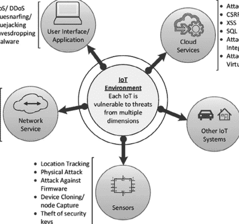

**图 7.1** 网络服务中的物联网攻击、漏洞和威胁

| 类别 | 子类别 / 细节 |
| :--- | :--- |
| **网络攻击** | - 路由攻击 / - 网络服务 |
| **无线技术** | - 针对无线技术的攻击 |
| **虚拟化技术** | - 针对虚拟化技术的攻击 |
| **数据完整性** | - 针对数据完整性的攻击 |
| **应用** | - CSRF / - XSS / - SQL 注入 |
| **隐私** | - 针对隐私的攻击 |
| **通用威胁** | - DoS/DDoS / - 蓝牙盗取(Bluesnarfing)/ 蓝牙劫持(Bluejackacking) / - 窃听 / - 恶意软件 |
| **机密性威胁** | - 未授权访问 / - DoS 攻击 / - 隐私 |
| **其他** | - 位置跟踪 / - 物理攻击 / - 针对固件的攻击 - 设备克隆/模式捕获 / - 安全密钥窃 |

这些攻击放大了流量体积，使其难以缓解 [37]。IoT 设备经常使用蓝牙技术进行连接，这使得它们容易受到蓝牙攻击 [38]。

**蓝牙盗取（Bluesnarfing)/蓝牙劫持（Bluejackacking）：** 蓝牙盗取和蓝牙劫持是两种不同的攻击，通常与 IoT 设备相关 [39]。蓝牙盗取是一种网络攻击，通过这种攻击可以未经授权地访问信息，例如联系人、电子邮件、日历甚至控制功能 [40]。IoT 设备中不安全的身份验证或默认凭据可以被攻击者利用获取系统访问，允许他们提取敏感信息 [41]。

蓝牙劫持是一种比严重的网络攻击更具骚扰性的活动 [42]。它涉及向范围内的支持蓝牙的设备发送未经请求的消息。这些消息通常是无害的，旨在让设备主感到惊讶或恼。它依赖于这样一个事实：某些蓝牙设备可以在没有任何配对或许可的情况下接收消息。

**窃听：** 基于 IoT 的系统中的窃听是指对 IoT 网络内设备之间通信的未经授权截获 [44]。这种拦截可以通过多种方式发生，例如监控无线传输或通过网络连接访问数据。窃听在 IoT 系统中带来了巨大的风险，因为它可能导致敏感信息、个人数据、身份凭据或控制机制的暴露 [45]。如果 IoT 设备之间或设备与服务器之间传输的数据没有经过正确的加密，就会容易被截获。攻击者可以轻易拦截并读取这些数据 [46]。某些 IoT 设备可能使用过时或不安全的网络协议，使得攻击者更容易拦截数据包 [47]。

**恶意软件：** IoT 系统中的恶意软件代表了严重威胁，利用互连设备中的漏洞传播并执行恶意活动 [48]。这些恶意软件可以通过各种方式渗透 IoT 设备，包括未修补的软件、薄弱的身份验证或不安全的网络连接。一旦嵌入 IoT 设备，恶意软件就会破坏其功能、创建用于大规模攻击的僵尸或为访问连接的网络提供非法访问。此外，保护 IoT 系统免受恶意软件侵害需要实施稳健的安全措施，例如定期的固件更新、网络分、强身份验证机制、IDS 以及基于行为的异常检测，以检测和防止恶意软件感染，维护 IoT 生态系统的完整性和安全性 [50, 51]。


## 物联网入侵检测系统

## 7.2.2 网络服务中的物联网攻击、漏洞与威胁

物联网（IoT）带来了技术的重大进步，将各种设备连接到互联网，以增强功能性和便利性。然而，这种互互互性也为网络服务内部留了许多漏洞和潜在威胁。以下是网络服务中常见的物联网攻击、漏洞和威胁：

- **针对网络服务的攻击**：基于物联网的系统中，针对网络服务的攻击涉及利用互连基础设施中的漏洞，以破坏、损害或使这些网络提供的服务变得不可用 [34]。此类攻击可能表现为 DDoS 攻击，即大量流量会淹没 IoT 设备或服务，导致合法用户无法访问 [35]。 此外，攻击者可能利用协议漏洞、零日漏洞和中间人攻击（MitM）策略来中断 IoT 设备与服务之间的通信，导致服务中断、未经授权的访问或数据操纵 [52]。通过利用这些漏洞，恶意行为者旨在破坏物联网生态系统中网络服务的功能和完整性，对整个系统的运行和数据安全构成重大风险 [53]。

- **针对网络服务的攻击**：基于物联网的系统中，针对网络服务的攻击涉及对互连基础设施中漏洞的针对性利用，旨在破坏或损害这些网络提供的服务 [54]。攻击者可能采用 DDoS 攻击等策略，用过量的流量淹没网络以压垮 IoT 设备或使其无法被合法用户。或者，他们可能利用通信协议中的漏洞、注入恶意代码或劫持设备，以中断 IoT 设备与服务之间的数据流 [55]。这些攻击可能导致服务中断，对整个物联网生态系统的功能、可靠性和带来风险 [55]。

- **互联网攻击**：基于物联网的系统中，互联网攻击涉及利用面向互联网的设备或基础设施中的漏洞，旨在损害或破坏其功能 [56]。攻击者通常针对 IoT 设备固件、Web 接口或云服务的漏洞，利用这些入口来获取未经授权的访问、执行远程代码或植入恶意软件。此类攻击包括通过被攻破的 IoT 设备协调的 DDoS 攻击，用压倒性的流量淹没服务器并中断互联网服务 [56]。此外，攻击者还可以渗透进 IoT 系统以窃取敏感数据、操纵设备功能或创建进一步的恶意活动，对互连物联网网络的安全、隐私和可靠性构成重大风险 [57]。

## 用于增强网络防御的大数据与边缘智能

- **路由攻击**：基于物联网的系统中，路由攻击涉及操纵或破坏互连设备之间数据的路由路径，损害通信的完整性和安全性 [54]。攻击者利用路由协议中的漏洞重定向或拦截数据流量，导致未经授权的访问、数据泄露或服务中断。这些攻击可能包括路由投毒（向网络中注入虚假路由信息以将流量重定向到恶意目的地）或洞点（sinkhole，即合法流量被攻击者重定向到受攻击的节点）。通过篡改路由路径，攻击者可以窃听敏感信息、更改数据或导致网络拥塞，对物联网网络的机密性、可用性和可靠性构成重大风险 [58]。

## 2.2.3 传感器中的物联网攻击、漏洞与威胁

- **位置跟踪**：针对物联网系统中传感器位置跟踪的攻击旨在损害这些传感器传输或接收的位置数据的准确性、机密性或完整性 [59]。此类攻击可能包括伪造技术，向系统注入虚假位置信息，导致误导性或错误的定位数据。信号干扰或干扰会破坏位置数据的接收，导致位置数据不准确或完全丢失 [60]。此外，窃听敏感位置信息会带来隐私风险。通过操纵或阻塞位置跟踪信号，攻击者可以欺骗系统，损害基于位置服务的可靠性，或获取位置数据的未经授权访问，对基于物联网的位置跟踪系统的安全和功能构成重大威胁 [61]。

- **物理攻击**：针对物联网系统中传感器的物理攻击涉及直接操纵或篡改设备的物理组件，以损害其功能或提取敏感信息。这些攻击可以包括篡改传感器硬件（例如物理上改变或损坏传感器）、注入恶意电路，或通过侵入式技术（如信道攻击或故障注入）绕过安全机制 [63]。物理攻击还涉及拦截传感器以获取存储在这些设备内部的机密数据。通过利用漏洞，攻击者可以破坏传感器数据的可靠性、准确性和安全性，可能导致物联网生态系统内的功能故障、数据泄露或未经授权的访问 [63]。

- **针对固件的攻击**：针对物联网系统中传感器固件的攻击涉及利用固件（控制传感器运行的嵌入式软件）中的漏洞，获取未经授权的访问、操纵设备功能或损害传感器的完整性和安全性 [64]。此类攻击可能包括通过缓冲区溢出、代码注入、固件篡改等技术利用固件中已知或未知的漏洞。攻击者可以修改固件以植入恶意软件、提取敏感信息或干扰传感器操作。通过破坏固件，攻击者可以获得持久访问权限、规避安全措施或执行未经授权的操作，对物联网网络中传感器收集和传输数据的机密性、完整性和可用性构成实质风险 [65]。

- **设备克隆/节点捕获**：物联网网络传感器的设备克隆或节点捕获能够对传感器设备进行未经授权的复制或接管，允许攻击者创建副本或控制合法设备 [66]。攻击者可能伪装带有固件的信任节点来克隆传感器设备，在网络中创建与信任节点相同的副本。或者，节点捕获发生在攻击者获取合法节点的控制时，使其能够操纵操作、访问敏感数据或在物联网生态系统中发起进一步攻击 [66]。通过克隆或捕获传感器节点，恶意行为者可以损害数据传输的完整性，欺骗网络管理员，并可能破坏或损害物联网网络的功能和安全性 [67]。

- **密钥安全**：物联网系统中传感器密钥的安全涉及用于保护通信和数据完整性的加密密钥的未经授权获取或损害 [68]。攻击者可能采用各种方法，例如利用传感器的漏洞、拦截交换协议或执行信道攻击来提取或获取这些密钥 [68]。一旦获取，被盗的密钥允许攻击者解密加密数据、伪造身份、篡改通信或访问物联网网络中的敏感信息 [69]。安全密钥被盗对物联网生态系统的机密性、完整性和整体态势构成严重威胁，可能导致数据泄露、未经授权的访问以及对关键服务或设备的操纵。


# 164 用于增强网络防御的大数据与边缘智能

在共享环境中的数据管理面临风险，因为云服务提供商可能会出于各种目的收集并分析用户数据，可能导致敏感信息暴露于监控或未经授权的使用 [69]。这些隐私挑战强调了实施稳健的加密、严格的访问控制、定期安全审计以及全面的隐私政策的重要性，以降低风险并保护云服务中的用户数据 [35]。

**跨站请求伪造 (CSRF)：** 这在云服务中构成了重大威胁，它利用了网站对用户浏览器的信任 [70]。攻击者可以通过诱导用户在已登录状态下点击链接或访问由攻击者控制的网站，从而向云服务构造恶意请求；此时用户的会话 cookie 或凭据可能被利用，在用户不知情的情况下执行未经授权的操作 [70]。在云服务的语境下，这可能导致各种不利结果，例如修改或删除关键数据、更改设置、启动金融交易，甚至破坏整个云账户 [71]。为了缓解 CSRF 威胁，实施 CSRF 令牌、安全编码实践、验证和检查请求，以及定期教育用户潜在风险，是增强云服务安全性的关键步骤 [71]。

**跨站脚本 (XSS)：** 这对云服务构成了重大威胁，通过利用 Web 应用程序的漏洞向其他受信网站注入恶意脚本 [72]。在云服务的语境下，XSS 攻击可以损害用户会话、敏感信息（如身份验证令牌或 cookie），并允许攻击者访问、操纵或提取存储在云端的数据 [73]。通过在 Web 应用程序中注入恶意代码，攻击者可以在用户的浏览器中执行脚本，可能导致用户凭据被盗、会话劫持、网页篡改或投送进一步的恶意软件 [73]。缓解云服务中的 XSS 威胁涉及稳健的输入验证、输出编码、采用如内容安全策略 (CSP) 等安全机制，以及定期的安全评估和更新，以防范潜在漏洞并保持云基础设施的安全 [74]。

**SQL 注入：** 这是云服务中的一种严重威胁，它利用 Web 应用程序数据库查询的漏洞来操纵 SQL 代码 [75]。攻击者可以通过输入字段、cookie 或用户输入注入恶意 SQL 命令，可能获得对云数据库的未经授权访问，或执行命令来检索、修改或删除敏感数据 [75]。在云环境中，SQL 注入构成了巨大的风险，允许攻击者破坏整个数据库、访问机密信息并提升权限以获得对云基础设施的控制。防止云服务 SQL 注入威胁的措施包括使用参数化查询、输入验证、严格的访问控制、采用 Web 应用防火墙、定期更新软件以及采用安全最佳实践，以减轻漏洞并加固云基础设施抵御此类攻击 [76]。

# 物联网入侵检测系统

针对数据完整性的攻击：针对云端数据完整性的攻击通过篡改或更改存储的信息构成了巨大风险，损害了其准确性和可靠性 [77]。恶意者可能尝试通过未经授权的修改、删除或插入数据，来操纵存储在云端信息的完整性 [77]。此类攻击可以通过多种途径发生，包括云基础设施的漏洞、对凭据的非法访问，或利用恶意软件攻击传输中或静态的数据。云服务中数据完整性受损的可能是严重的，导致信息误导、财务损失、法律影响以及用户和客户信任的崩溃 [78]。保护云端数据完整性涉及实施稳健的加密、访问控制、定期的完整性检查并维护严格的安全规范，以防止未经授权的更改并维护存储数据的可信度。

针对虚拟化技术的攻击：针对云服务虚拟化技术的攻击利用虚拟机程序（hypervisor）或虚拟化层的漏洞，旨在破坏虚拟机（VM）之间的隔离，或获得对底层基础设施的未经授权访问 [79]。恶意者可能尝试各种技术，如虚拟机逃逸（VM escape），即跳出虚拟机的限制以访问虚拟机程序以及后续的其他虚拟机，导致潜在的数据窃取或操纵 [79, 80]。其他攻击包括资源耗尽（攻击者使虚拟化层过载以中断服务可用性）或拒绝服务（DoS）攻击。此外，虚拟机程序的漏洞或配置错误可能允许权限提升或对虚拟化环境的控制 [80]。保护云服务中的虚拟化技术需要定期更新和补丁、严格的访问控制、职责分离、实施 IDS 以及采用沙箱和隔离等安全措施，以缓解这些潜在威胁并确保云基础设施的完整性和安全性 [80]。

## 2.2.5 其他物联网系统中的攻击、漏洞与威胁

机密性威胁：由于互联设备之间广泛的数据交换且通常缺乏稳健的安全机制，物联网系统中的机密性威胁无处不在 [81]。这些威胁源于物联网生态系统中的漏洞，如弱身份验证机制、加密协议不完善以及数据保护不足。攻击者利用这些弱点监听物联网设备之间的通信，拦截跨网络传输的敏感数据，或未经授权访问存储在设备内或与其交互的云基础设施中的机密信息 [81]。物联网系统机密性的受损可能导致对个人或敏感数据的未经授权访问，引发隐私泄露、# 用于增强网络防御的身份窃用、非法监控或对关键系统的操纵 [68]。保护物联网系统需要实施加密、身份验证协议、定期安全更新和端到端保护措施，以保护整个物联网生态系统的机密性（从设备通信通道到数据存储及云服务），从而防止威胁 [68]。

**未经授权访问：** 物联网系统中的未经授权访问是一个关键安全问题，其特征是恶意者利用各种漏洞进入互联设备或网络 [82]。这些漏洞通常包括默认或弱凭据、身份验证机制不足、未打补丁的软件或未加密的通信通道。当攻击者成功破解物联网系统时，他们可以操纵设备功能、窃取敏感数据、干扰操作，甚至通过破坏物联网网络中的多个设备来发动更大攻击 [83]。未经授权访问不仅损害了数据的机密性和完整性，还对用户隐私和系统功能构成了巨大风险。为了缓解物联网系统中的未经授权访问，稳健的身份验证方法、定期安全更新、强加密方法和网络分段是加固设备安全和防止潜在破解的必要措施 [83]。

**隐私：** 物联网系统中的隐私围绕着互联设备收集、传输和处理的个人数据的机密性和控制 [84]。物联网设备从各种来源收集大量敏感信息，引发了对数据隐私和滥用的担忧。物联网隐私风险源于未经许可的数据收集、匿名化不足，以及可能导致个人或其行为被识别的潜在数据泄露 [85]。保护物联网隐私需要实施隐私设计（privacy-by-design）原则、稳健的加密技术、以用户为访问控制以及透明的管理政策。此外，提高用户数据收集实践的意识，提供清晰的同意机制，并建立优先考虑隐私权的监管框架，是确保物联网生态系统中个人信息得到负责任和伦理处理的关键步骤 [85]。

## 7.3 人工智能驱动的物联网系统网络入侵检测

人工智能模型在增强物联网系统中的网络入侵检测（NID）方面发挥着至关作用，物联网系统由在网络上共享数据和通信的互联设备组成 [68]。AI驱动的 IDS 利用机器学习算法检测并响应这些网络中的异常、威胁和可疑活动。这些系统可以实时分析物联网设备产生的海量数据，能够识别可能指示安全违规的异常模式或行为 [86]。


# 物联网入侵检测系统

一种方法涉及监督学习算法，其中 AI 模型在包含正常和恶意网络流量模式的标记数据集上进行训练。通过这种方式，AI 学习识别与各种类型网络威胁相关的模式，使其能够实时识别并标记可疑活动。此外，还采用了无监督学习技术，在不需要预定义标签的情况下检测网络流量中的异常。这些算法可以识别偏离正常行为的情况，预示着潜在的入侵或安全违规 [87]。

基于 AI 的 IDS 随着时间的推移不断适应并提高其检测能力 [72]。它们可以通过从新数据中学习并调整算法来识别新兴威胁，从而演进其检测机制，增强物联网系统的整体安全态势。此外，AI 能够通过隔离受影响设备或阻塞可疑网络流量快速响应安全事件，最大限度地减少潜在网络攻击对物联网网络的影响 [56]。用于物联网系统的 AI 驱动 NID 采用监督和无监督 ML 算法来分析网络流量并识别安全威胁或异常。这些系统持续学习和适应，提高了其实时检测和响应新兴威胁的能力，巩固了互联物联网设备的安全基础设施 [35]。物联网系统中的基于 AI 的 NID 如表 7.2 所示。

## 表 7.2
## 物联网系统中的基于 AI 的 NID

| 作者 | 模型 | 数据集 | 贡献 | 缺点 |
| :--- | :--- | :--- | :--- | :--- |
| [86] | 基于 AI 的 | – | 提出了一种基于人工智能的能量感知入侵检测模型 – 开发了 95% – 减少了能量利用：一种用于安全路由的感知感知自需需距离向量算法 | 未考虑隐私问题 |
| [87] | SVM, DT, LR, KNN, RF, GBoost, XGBoost, LibSVM | 自欺骗攻击、中间人攻击 (MitM) 和数据注入 | 提出的 AI 模型在检测 NIDS 方面实现了 100% 的准确率 – 大多数连接的医疗设备存在关键漏洞 – 为 IoMT 网络中的入侵检测提出了三种深度学习模型 | 未考虑基于物联网的隐私问题 |

## 表 7.2（续）
## 物联网系统中的基于 AI 的 NID

| 作者 | 模型 | 数据集 | 结果 | 贡献 | 缺点 |
| :--- | :--- | :--- | :--- | :--- | :--- |
| [88] | XAI-IDS | | 准确率为 96% | 通过手动过滤建立白名单 - 使用 AI 测量特征参数 | 论文侧重于提出使用可解释的基于 AI 进行网络流量入侵检测 |
| [89] | RF | NSL-KDD | - A2SDIoT 有效检测物联网网络中的入侵 - A2SDIoT 提高了了网络对恶意节点的免疫力 | 一种用于入侵检测系统的新人工智能 - 将无监督机器学习与软件定义网络 (SDN) 范式相结合 | 使用的数据集用于 SDN |

## 7.4 物联网系统中的机器学习支持型网络入侵检测

基于 ML 的模型对于增强物联网系统中的 NID 具有巨大前景。在此背景下，ML 算法被用于分析物联网设备产生的海数据，旨在区分正常网络行为和潜在安全威胁 [56]。基于 ML 的 IDS 使用监督、无监督和半监督学习等各种技术来检测物联网网络中的异常和恶意活动 [47]。

机器学习中网络入侵检测的监督学习涉及在包含正常和恶意网络流量示例的标记数据集上的算法。这些方法学习与不同类型网络威胁相关的模式和特征，使其能够实时识别并将数据分类为良性或可疑 [47]。另一方面，无监督学习方法在不使用标记数据的情况下工作，检测物联网网络流量中的异常或偏离模式的情况。这些算法擅长标记可能指示潜在安全违规或入侵的异常行为 [64]。

此外，半监督学习技术结合了监督学习和无监督学习的优势。它们利用少量标记数据样本结合更广泛的未标记数据集来提高检测准确性和可扩展性。通过在物联网系统中使用 ML 进行网络入侵检测，这些算法能够持续学习并适应新威胁，以主动且高效的方式增强其识别和响应不断演变的网络威胁的能力。

本质上，用于物联网系统网络入侵检测的基于 ML 技术涉及监督、无监督和半监督学习方法。这些方法能够通过分析网络流量来区分正常行为与潜在恶意活动，有助于增强互联物联网设备格局的安全措施。随着 ML 算法不断演进和从新数据中学习，它们在加固物联网网络应对新兴威胁的韧性方面发挥着至关重要的作用。

已针对物联网系统提出了基于 ML 的 NIDS。这些 IDS 旨在使用 ML 算法检测并分类物联网网络中的攻击。一种方法是自监督入侵检测 (SSID) 框架，它实现了一种完全在线且无需人工干预或离线学习的 IDS [90]。另一种方法使用基于深度学习 (DL) 的模型，利用网络流和生物识别检测物联网系统中的入侵 [91]。此外，还使用 ML 算法如 K近邻 (KNN)、支持向量机 (SVM) 和人工神经网络 (ANN) 开发了智能 IDS，用于识别和分类物联网网络数据包中的恶意行为 [92]。这些方法证明了基于 ML 模型在实现物联网系统网络入侵检测方面的潜力。物联网系统中的基于机器学习的 NID 如表 7.3 所示。

## 表 7.3
## 物联网系统中的基于 ML 的 NIDS

| 作者 | 模型 | 数据集 | 结果 | 贡献 |
| :--- | :--- | :--- | :--- | :--- |
| [90] | MLP | BoT-IoT | - SSID 框架准确且对物联网系统具有优势 - 在数据集上进行了实验评估并与著名的 ML 进行了比较 | - 提出了一种自监督入侵检测 (SSID) 框架 - 实现了一种完全在线的基于 ML 的 IDS |
| [92] | KNN, SVN 和 ANN | IoT23 | 智能 IDS 是良好的二分类和多分类分类器 - 可以将零日攻击分类为恶意行为 | - 提出了一种用于物联网攻击检测的智能 IDS - 研究了三种 ML 分类器算法用于分类。（续） |

## 表 7.3（续）
## 物联网系统中的基于 ML 的 NID

| 作者 | 模型 | 数据集 | 结果 | 贡献 |
| :--- | :--- | :--- | :--- | :--- |
| [93] | 1D CNN | NF-ToN-IoTT, NF-BoTIoT, NF-CICIDS2018, NF-UNSW-NB15, NF-UQ-NIDS, CIC phường2, 网络入侵, MQTT-IoTIDS2020, CIC-ToIoT | - 提出了用于物联网环境异常检测的 1D CNN 模型 - 成功识别了 20 种攻击，准确率为 93.75% | 基于 1D CNN 的模型 - 使用迁移学习降低分类复杂度。 |
| [94] | PSO + BA + RF | WUSTL-IIOT-2021 | - 提出的模型优于其他 ML 和多目标算法 - 带有 BA 分类器的  最佳 | 提出了使用 PSO 和 BA 的入侵检测模型 - 使用 RF 分类器对恶意行为进行分类 |
| [95] | B-Stacking | CICIDS2017 和 NSL-KDD | 准确高于现有模型 | 为物联网网络提出了轻量级入侵检测模型 - 使用机器学习有效检测网络攻击和异常 |
| [96] | 基于 ML | Cyber-Trust 测试平台 | - 总体准确率为 98.35% - 误报警率为 0.98% | 论文探索了使用网络分析和机器学习进行物联网安全 - 提出的解决方案可检测篡改和可疑交易 |
| [97] | 基于 ML | KDD99, NSL 和 Kyoto | - 决策树算法实现了 99% 的准确率 | 开发了入侵检测系统 (IDS) - 使用机器学习进行特征选择和分类（续） |


# 物联网入侵检测系统

## 表 7.3（续）

| 作者 | 模型 | 数据集 | 结果 | 贡献 |
|---|---|---|---|--|
| [98] | 逻辑回归、贝叶斯和决策树 (DT) | CICIDS2017 | RF的准确率达到99.67%，优于其他技术 <br>-- 特征选择的线性SVM方法在二分类和多分类场景下的平均准确率分别为88.19%和85.56%，优于其他技术 | --增加了对物联网设备的安全关注 |
| [99] | LR、DT、SVM 和 LDA | UNSW-NB15 | DT 的准确率最高，达到95% | -- 数据过采样对机器学习模型的影响 |
| [100] | 贝叶斯网络、随机森林、神经网络以及两种深度学习算法 (RNN, LSTM) | KDD cup 99 | RF 的准确率更高 | 在 KDD 99 数据集上对不同算法进行测试和评估 |
| [101] | BPSO + SVM | NSL-KDD | 性能优于现有结果 | -- 用于特征提取的 BPSO 算法 <br>-- 用于检测和识别的支持向量机 (SVM) |
| [102] | RF, NB, MLP, SVM 和 AdaBoost(ADA) | IoT-23 | RF 算法以99.5%的准确率产生了最佳结果。 | 使用了多种基于机器学习的模型进行比较 |
| [103] | SVM 和 RF | IoT-23 | RF 方法产生了最佳结果，准确率达到99.5%。 | 机器学习在识别物联网网络异常方面的可维护性问题 |
| [104] | 使用了11种基于机器学习的模型 | CICIDS-2017, UNSW-NB15, ICS 网络网络攻击 | 对于 CICIDS-2017 数据集，RF 方法产生了最佳结果，成功率达到99.5%。 | 识别可能指向网络攻击的异常行为 |
| [105] | SVM, RF, KNN, AE 和 OCSVM | ICS 实验平台 | RF 方法产生了最佳结果，成功率达到99.9%。 | 实现了多种基于机器学习的模型 |

## 用于增强网络防御的大数据与边缘智能

## 表 7.3（续）

## 物联网系统中的基于机器学习的入侵检测系统 (NIDs)

| 作者 | 模型 | 数据集 | 结果 | 贡献 |
| --- | --- | --- | --- | --- |
| [106] | LR, SVM, KNN 和 XGBoost | IoT-NID | 实现了99%–100%的准确率，效率高 | 在物联网入侵数据集上测试各种机器技术，提高物联网安全 |
| [107] | DT 和 RF | IoT-UCI | 将 DT 与 RF 结合产生了高准确率 | 识别物联网设备中的异常和攻击 |
| [108] | RF, KNN 和 NB | UNSW-NB15 | 使用10%的过滤时，RF 和 KNN 分类器实现了99%的准确率，无注入攻击时准确率达到100% | 分析不同机器学习算法在识别物联网网络异常和攻击方面的性能 |
| [109] | RF | NSL-KDD 和 KDDCUP99 | 模型以99.9%的准确率检测到入侵 | 提升 IDS 的精密度和安全性 |

## 7.5 物联网系统中的深度学习型网络入侵检测

基于深度学习的模型作为机器学习的子集，已成为增强物联网系统入侵检测 (NID) 的强大技术，特别是多层神经网络，能够从复杂数据集中自动提取复杂的模式和特征 [110, 111]。在物联网安全的背景下，卷积神经网络 (CNNs)、循环神经网络 (RNNs) 和深度自动编码器等技术被用于稳健的入侵检测 [111]。

CNN 擅长通过提取特征的分层次表示来分析数据（如网络流量）[112, 113]。它们可以检测网络数据包中的模式，并学习识别可能意味着潜在网络威胁的异常情况 [113, 114]。RNN 凭借其序列学习能力，在捕捉时间依赖关系和检测物联网网络流量中随时间发生的异常方面非常有效，为可能的入侵尝试提供见解 [115]。深度自动编码器作为无监督学习的一种形式，用于通过重构正常网络行为并将偏离此学习表示的偏差标记为潜在的安全违规，用于异常检测 [116, 117]。

基于深度学习的模型在物联网入侵检测中的优势在于其学习复杂模式和行为的能力、适应动态网络环境的能力以及检测传统方法忽略的复杂攻击的能力 [9, 118]。深度学习模型可以通过从海量数据中学习来不断进化和自我改进，提高实时检测新颖和新兴威胁的准确性和效率，为加强物联网网络安全做出了重大贡献 [67, 119]。本质上，像 CNN、RNN 和自动编码器等深度学习技术彻底改变了物联网系统的检测能力 [120]。它们处理和分析物联网网络内部模式的能力使得能够识别异常和潜在的安全威胁，固化了互联设备抵御演变网络攻击的韧性。基于深度学习的模型持续进步，其在增强物联网安全方面的应用对于防御日益复杂的威胁仍然至关重要 [121]。

基于深度学习的模型与优化技术相结合，在增强物联网系统内的入侵检测方面起着至关重要的作用。通过将 CNN、RNN 或深度自动编码器等深度学习模型与随机梯度下降 (SGD) 或自适应学习率方法（如 Adam）等优化算法相结合，可以显著提高入侵检测系统 (IDS) 的性能和效率。深度学习的模型结合优化技术，在增强物联网系统内的入侵检测方面起着至关重要的作用。通过将 CNN、RNN 或深度自动编码器等深度学习模型与随机梯度下降 (SGD) 或自适应学习率方法（如 Adam）等优化算法相结合，可以显著提高入侵检测系统 (IDS) 的性能和效率。优化技术能够更准确地识别和分类异常，适应不断演变的威胁 [123]。这种深度学习与优化之间的协同作用使得系统能够有效地识别恶意活动，固化互联设备的安全基础设施 [124]。基于深度学习的模型与生物启发算法相结合代表了对物联网安全的一种强大融合 [125]。生物启发算法（如遗传算法、粒子群优化或蚁群优化）通过模拟自然过程有助于优化神经网络 (DNNs)，使其适应、进化并更高效地学习 [126]。

基于深度学习的模型结合特征选择对于精炼物联网系统至关重要。特征选择技术如 L1 正则化、递归特征消除或信息增益有助于从大量的物联网流量数据中识别出具判别性的特征 [122]。当与 CNN 或 RNN 等深度模型集成时，这些选择的特征作为输入，增强了深度模型的性能和效率，有助于更准确地识别网络威胁。

## 7.6 未来方向

物联网背景下入侵检测系统的未来方向正在快速演变，特别是随着人工智能、深度学习和机器学习方法的整合。该领域有一些潜在的未来方向和进展：

- 基于人工智能/机器学习的增强检测：人工智能和机器学习技术旨在提高物联网环境中 IDS 的准确性和有效性。
- 行为分析：人工智能驱动的 IDS 可以专注于行为分析，学习物联网网络的模式。
- 实时响应与适应：人工智能驱动的 IDS 可以实现实时威胁检测和响应。
- 用于物联网安全的边缘计算：边缘计算可以对本地数据进行更高效、更快速的分析，降低延迟并通过匿名化增强安全性。
- 用于保护的联邦学习：联邦学习允许多个物联网设备协作学习模型，同时保持数据本地化，解决了将数据集中到一个位置的隐私问题。
- IDS 中的可解释人工智能：对于使人工智能驱动的 IDS 具有可解释性和透明性的日益增加。可解释人工智能技术能够更好地理解系统为何做出特定的决策或行动，增强信任并有助于审计和合规。
- 与区块链集成：将 IDS 与区块链技术相结合，通过提供一种不可篡改和去中心化的方法来记录和验证物联网设备交互和交易，从而提高安全性。
- 对抗机器学习防御：针对专门设计用于欺骗基于人工智能 IDS 的对抗攻击开发防御机制是一个关键领域。研究重点是提高模型对此类攻击的鲁棒性。
- 互操作性与标准化：随着物联网设备和协议的多样化，建立物联网生态系统安全通用标准和互操作性框架的努力正日益增长。


# 物联网入侵检测系统 175

随着技术的进步和新威胁的出现，物联网入侵检测系统（IoT IDS）的演可能会沿着这些路线继续，旨在提供更智能、自适应且安全的解决方案来保护物联网生态系统。

## 7.7 结论

物联网设备的日益使用使得对健壮安全解决方案的需求，特别是入侵检测方面。基于机器学习（ML）和深度学习（DL）的技术对于物联网安全至关重要。本章调查了用于物联网网络和系统的入侵检测的 AI、ML 和 DL 技术，讨论了物联网架构、漏洞和协议级攻击。它还回顾了物联网安全方法论的研究。其目的是为研究人员提供关于安全挑战和潜在解决方案的全面见解。本研究探索了基于 AI、ML 和 DL 的入侵检测系统（NIDS），重点关注分类方案和方法论。它强调了使用 AI、ML 和 DL 方法提高检测准确性并降低误报率（FAR）。深度学习方法（如自动编码器 AE 和深层神经网络 DNN）具有优越的性能，但需要大量的计算资源。解决这些挑战对于实时 NIDS 性能至关重要，因为它们可以独立学习特征并改进模型拟合。本章显示，85% 的方法是使用过时数据集进行测试的，限制了它们在实时环境中的性能。为了提高检测准确性，基于 AI、ML 和 DL 的 NIDS 应使用更新的数据集，如 WUST-IoT-2021、CIC-IoT-2022 和 CIC-IoT-2023。本章强调了改进低频攻击性能和降低复杂性的研究空白。未来的研究应侧重于设计用于入侵检测的轻量级、高效的 DL NIDS。

## 参考文献

- 1. AbdulRaheem, M., Oladido, I.D., Imoze, A. Machine learning learned and zeeking DDoS attacks in software. Int. j. inf. tecn. 16, 1627–1643 (2024). https://doi.org/10.1007/s41870-023-01469-3.
- 2. Abdulraheem, M., Adeniyi, E. A., Awotonde, J. B., Imoze, A. L., Jokowi, R. G., Oladipo, I. D., & Falola, P. B. (2024). Artificial Intelligence of Medical Things for Medical Information Systems Privacy and Security. In Handbook of Security and Privacy of AI-Enabled Healthcare Systems and Internet of Medical Things (pp. 63–96). Boca Raton, FL: CRC Press.
- 3. Ahmed, Z., Shahid, K., Wai S., Abdullah, J., & Ahmed, F. (2021). Network intrusion detection system: a systematic study of machine learning and deep learning approaches. Transactions on Emerging Telecommunications Technologies, 3(1), e4150.
- 4. Jyotshna, V. R. P. V., Prasad, R., & Prasad, K. M. (2011). A review of anomaly intrusion detection systems. International Journal of Computer Applications, 28(7), 26–35.
- 5. Xu, H., Sun, Z., Cao, Y., & Bilal, H. (2023). A data-driven approach for intrusion and anomaly detection using automated machine learning for the Internet of Things. Soft Computing, 27(19), 14469–14481.
- 6. Uddin, R., Kumar, S. A., & Chamola, V. (2024). Denial of security attacks in edge computing layers: Taxonomy, vulnerabilities, threats and solution. Ad Hoc Networks, 152, 103322.
- 7. Haroon, M., Misra, D. K., Husain, M., Tripathi, M. M., & Khan, A. (2023). Security Issues in the Internet of Things for the Development of Smart Cities. In Cybersecurity and the Age of the Next-Generation Information Revolution (pp. 123–137). Pennsylvania: IGL Global.
- 8. Awotunde, J. B., Imoize, L. A., Jimoh, R. G., Adeniyi, E. A., Abdulraheem, M., Oladipo, I. D., & Fala, P. B. (2024). AIOT Enabling Real-Time Monitoring of Healthcare Systems: Security and Privacy Considerations. Handbook of Security Systems and Privacy of AI-Enabled Healthcare Systems and Internet of Medical Things, 97–133.
- 9. Nazir, A., He, J., Zhu, N., Wajah, A., Ma, X., Ullah, F., ... & Pathan, M. S. (2023). Advancing IoT security: A systematic review of machine learning approaches for the detection of IoT bots. Journal of Saudi University-Computer and Information Systems, 1–32, 101820.
- 10. Odeh, A., & Abu Tale. (2023). Ensemble-based deep learning models for enhancing intrusion detection. Applied Sciences, 13(21), 1185.
- 11. Prasad, R., & Rohokale, V. (2020). Cybersecurity: The Lifeline of Information and Communication Technology. Springer: International Publishing.
- 12. Lew, J., Shah, D., Cattell, S., Zhang, M., Sandhupata, A., ... Aamodt, T. (2019). Analyzing machine learning workflows using detailed GPU. In 2019 IEEE international symposium on performance analysis of systems and software (ISFAS) (pp. 151–152).
- 13. Najabadi, M. M., Villanueva, R., Khofagar, T., Siya, N., Wald, R., & Muhem, E. (2015). Deep learning algorithms and challenges in big data analytics. Journal of Big Data, 2(1), 1–22.
- 14. Dong, B., & Wang, X. (2016). Comparison deep learning to traditional methods for intrusion detection. In 2016 IEEE international conference on communication and networks (ICCS) (pp. 581–585).
- 15. Awotunde, J. B., Boloroso, S., Imoize, A., Odunuga, J., Lee, C., & Do, D. (2023). An ensemble-based model for intrusion detection in industrial internet of networks. Applied Sciences, 13(4), 2474.
- 16. Vasilomanidis, K., Karapayush, S., Mühlacker, M., & Fischer, F. (2015). Taxonomy and survey of collaborative intrusion detection. ACM Surveys (CSUR), 47(4), 1–33.
- 17. Buczak, A., & Guven, E. (2015). A survey of data mining and machine learning methods for security. IEEE Communications & Tutorials, 18(2), 1153–1176.
- 18. Thomas, R., & Pavithran, D. (2018). A survey of intrusion detection models based on NSL-KDD dataset. Fifth ICT information trends (ITT) (pp. 286–291).
- 19. Benhelia, E., Welsh, T., & Hamouda, W. (2018). A critical review of practices and challenges in IoT: Toward unbiased and resilient systems. IEEE Communications & Tutorials, 20(4), 3496–3509.
- 20. Mishra, P., Varadarajan, T., Tupakala, U., & Phi, E. (2018). A detailed investigation and analysis of machine learning techniques for intrusion detection. IEEE Communications & Tutorials, 21(1), 668–728.
- 21. Liu, H., & Lang, B. (2019). Machine learning and deep learning methods for intrusion detection systems: A survey. Applied Sciences, 9(20), 4396.
- 22. Kraisat, A., Gondal, I., Vample, P., & Kamruzzaman, J. (2019). Survey of intrusion detection systems: Techniques, datasets and challenges. Cybersecurity, 2(20), 1–22.
- 23. Da Costa, K. A., Papa, P. J., Lisbon, C. O., Munoz, R., & Albuquerque, V. H. C. (2019). Internet of Things: A survey on machine learning-based intrusion detection. Computer Networks, 151, 147–157.
- 24. Chaabouni, Mosbah, M., Zemmari, A., Auvignac, C., & Faruki, P. (2019). Network intrusion detection for IoT security based on learning techniques. IEEE Communications & Tutorials, 21(3), 2671–2710.
- 25. Lawal, M., Shaikh, R. A., & Hassan, S. R. (2020). Security analysis of network anomalies mitigations in iot networks. IEEE Access, 8, 43355–43374.
- 26. Ashraf, J., Moustafa, N., Khursid, H., Debie, E., Haider, W., & Wahab, A. (2020). A review of intrusion detection systems using machine and deep learning in internet of things: Challenges and future directions. Electronics, 9(7), 1177.
- 27. Ayo, E. F., Awotunde, J. B., Forunoso, S. O., Ajagun, M. O., & Ajabe, S. A. (2023). A genomic-based KNN model for flux botnet detection. Egyptian Journal of Informatics, 24(2), 313–325.
- 28. Awotunde, J. B., Ayo, F. E., Panigari, R., Garg, A., Bhoi, A. K., & Barsoschi, P. (2023). A multi-level random forest-based intrusion detection using fuzzy inference system for internet of things networks. International Journal of Computational Intelligence Systems, 16(1), 31.
- 29. Awotunde, J. B., Oguns, Y. J., Amuda, K. A., Adeleke, T., Olagunju, K., & Ajabe, S. A. (2023). Cyber-Physical Systems: Analysis, Opportunities, Challenges, and Future Prospects. Blockchain for Cyber-Physical Systems, 21–46.
- 30. Kolias, C., Kambourakis, G., Voas, J. (2017). DDoS in the IoT: Mirai and other bots. Computer, 50(7), 80–84.
- 31. Al-Garadi, M., Mohamed, A., Al-Ali, A., Xu, X., & Gucci, M. (2020). A survey of machine and deep learning methods for internet of things (IoT) security. IEEE Communications & Tutorials, 22(3), 1446–1685.
- 32. Notra, S., Siddiki, M., Ghorakheli, H. (2014). An experimental study of security and privacy risks with household appliances. In 2014 IEEE conference on communications and network security (pp. 79–84).
- 33. Kolias, C., Stavrou, A., Voas, J., Jovanova, I., Kuhn, R. (2016). Learning internet-of-things security “hands-on”. Security & Privacy, 14(1), 37–46.
- 34. Kamini, K., Duwol, V., & Langat, K. (2019). Security concerns in IoT-based smart grid. International Journal of Critical Infrastructure Protection, 25, 36–49.
- 35. Awotunde, J. B., Jimi, R. G., Forunoso, S. O., Adeniyi, E. A., Abidion, K. M., & Banjo, O. O. (2021). Privacy and security concerns in IoT-based Healthcare Systems. In The Fusion of Things, Artificial Intelligence, and Cloud Computing in Health Care (pp. 105–134).
- 36. Abdulheem, R., Awotunde, J. B., Chakrabarty, C., Adeniyi, E. A., Oladipo, I. D., & Bhoi, A. K. (2023). Security and Privacy Concerns in Smart Healthcare System. In Implementation of Smart Healthcare Systems Using AI, IoT, and Blockchain (pp. 243–273).
- 37. Kumar, S., & Ablawat, P. (2023). Security and Privacy Concerns in Smart Healthcare. In Security Implementation of Medical Things (pp. 137–175).
- 38. Awotunde, J. B., Misra, S., & Sham, Q. T. (2022, November). A Secure Framework for Internet of Medical Things Security Based Using Lightweight Cryptography Enabled Blockchain. International Conference on Future Date and Security Engineering (pp. 258–272).


39. Lonzetta, A. M., Cope, Campbell, J., Mohd, B. J., & Hayajneh, T. (2018). 物联网中蓝牙技术的安全漏洞。Journal of Sensor and Actuator Networks, 7(3), 28.

40. Reid, M. N. (2022). 光无线通信高高速蓝牙安全配对：迈向开发信任协议（博士论文，大学）。

41. Nandikotkur, A. Agabokun, S. ZenorySens: 使用上下文分析和超级机器学习保护技术设备和传感器（博士论文）。

42. Sharp, R. (2023). 网络安全。收于《网络安全导论：多学科挑战》（pp. 171–233）。Cham: Springer Switzerland.

43. Salim, A. T., & Khammas, B. M. (2023). 深度学习方法在物联网网络安全威胁检测中的简要回顾。Journal of Basic Education, 29(11), 49–52.

44. Ajabge, S. A., Florez, H., & Awotunde, J. B. (2022, 10月). AESRSA：用于电子健康记录安全的新加密算法。收于国际应用应用会议（pp. 237–251）。Cham: Springer Publishing.

45. Ogoni, M. M., Okeyo, G., & Wakula, J. M. (2020). 物联网隐私与安全调查。Computer Science Review, 38, 100312.

46. Sardar, R., & Anees, T. (2021). 物物网：安全挑战与机制。IEEE Access, 9, 31695–31711.

47. Louis, K., & Zulkine, M. (2020). 物联网短距离无线技术的攻击与防御。IEEE Access, 8, 88992–88993.

48. Deniyi, E. A., Ogokun, R. O., Misra, S., Awotunde, J. B., & Abidion, K. M. (2022). 使用区块链技术增强绿色计算多户环境下的安全与隐私问题。收于《智能时代的区块链》（pp. 65–83）。Cham: Springer International

49. Caviglone, L., Chorai, M., Corona, I., Janicki, A., Mazurczyk, Y., Pawicki, M., & Wasilewsska, K. (2020). 正确目标：当前恶意软件威胁及其检测趋势回顾。IEEE Access, 9, 5391–5396.

50. Mishra, N., & Pandya, S. (2021). 物联网：安全、挑战、攻击、入侵检测与未来愿景：系统性回顾。IEEE Access, 9, 59533–59537.

51. Sharma, S., Ababaj, J. H., Ismail, W. N., & Hassan, M. M. (2018). 工业移动物联网网络中的恶意软件威胁与检测。IEEE Access, 6, 15941–15957.

52. Bonnuna, U. O., Chakra, F. K., Mbocha, C. O., Obicher, J. K., Akwukweag, I. O., Amafeul, M. M., & Nwakanwa, C. I. (2023). 使用机器学习算法检测物联网和气体控制网络中的中间人（MitM）网络攻击。Future Internet, 158(2), 280.

54. Srivastava, A., Gupta, S., Quamera, M., Chaudhary, P., & Ask, V. J. (2020). 未来的物联网支持型威胁与漏洞：现状、挑战与未来前景。International Journal of Communication Systems, 33(12), e4443.

55. Butun, I., Osterberg, P., & Song, H. (2019). 物联网的安全性：漏洞、攻击与应对措施。IEEE Communications Surveys & Tutorials, 22(1), 616–644.

56. Rondon, L. P., Babun, L., Aris, A., Akkaya, K., & Uluag, A. S. (2022). 企业级系统系统（E-IoT）调查：安全视角。Ad Hoc Networks, 125, 10278.

# 物联网入侵检测系统

57. Hintaw, A. J., Manickam, S., Aboamaaly, M. F., & Karuppayah, S. (2023). 物联网（IoT）中的MQTT漏洞、攻击向量与安全。IETE Journal of Research, 69(6), 3368–3397.

58. Muzammal, S. M., Murugan, R. K., & Jianji, N. Z. (2020). 物联网安全路由全面回顾：缓解方法与基于信任的方法。IEEE Internet of Journal, 8, 4186–4220.

59. Sidker, A. K., Petracca, G., Aksu, H., Jaeger, T., & Uhagac, A. S. (2021). 基于传感器的智能设备与应用威胁与调查。IEEE Communications & Surveys, 23(2), 1125–1159.

60. Abotas, N., Rubaye, S., Inallah, G., & Emmanou, C. (2021). 物联网系统完整性：攻击与应对措施回顾。Sensors, 21(11), 3654.

61. Ye, Y. (2023). 基于API的传感器网络攻击检测。International Journal of Autonomous and Adaptive Systems, 16(6), 584–596.

62. Mukhtar, B., Elsayed, S., Jurcut, A., & Zamer, M. (2023). IoT漏洞与攻击：SILEX案例研究。Symmetry, 15(1),

63. Saini, H., Polye, M., & Noel, Y. (2023). 物联网网络漏洞调查。收于《大数据分析与信息物理系统》（pp. 297–334）。Springer: Nature.

64. Karmakar, K., Varadharajan, V., & Tupakala, U. (2023). 物联网（IoT）基础设施安全与隐私：实用与管理视角。

65. Dekhordi, I., Manocheari, K., & Aghazarian, Y. (2023). 机器学习（ML）中的物联网（IoT）入侵检测。Asia-Pacific Journal of Information Technology, 12(1), 11990–12000.

66. Ashraf, F., Sundararaj, E., Hasan, M., & Yadegardi, E. (2023). 6LoWPAN认证与密钥协商。Journal of Network and Computer Applications, 19, 10379.

67. Ali, S., Li, Q., & Youszai, A. (2024). 基于联邦学习的边缘物联网入侵检测。Ad Hoc Networks, 152, 10320.

68. Jaime, J. F., Muñoz, A., Rodríguez-Gomez, F., & Jerez-Calero, A. (2023). 生物医学系统的隐私数据安全。Sensors, 23(21), 8944.

69. Irish, R. R., Sohail, S. S., Hussain, S., Masden, D., Zamani, A. S., & Alway, I. M. (2023). 增强物联网医疗系统安全性。Helium, 9, 1–16.

70. Khade, A. J., Inbarajan, M., & Yadav, V. (2023). 网页跨站请求威胁缓解。收于第27届电子与信息国际会议（ICOEI）（pp. 695–698）。IEEE.

71. Kumari, S., Kumar Solanki, V., & Arokia Prabhu, L. (2023). 网页无防御识别案例。收于《电子与通信系统的最新》（pp. 13–39）。Amsterdam: IOS.

72. Kaur, J., Garg, U., & Bathla, G. (2023). 使用机器学习技术检测跨站脚本（XSS）攻击：回顾。Artificial Intelligence Review, 56, 1–45.

73. Baniya, D., & Chaudhary, A. (2023). 使用机器学习检测跨站攻击：系统性回顾。Artificial Intelligence, Blockchain, Computing and Security, 1, 743–748.

74. Al-Hija, Q. A. (2023). 使用混合学习的跨站脚本攻击成本检测系统。Results in Engineering, 19, 101266.

# 大数据与边缘智能增强网络防御

75. Goyal, A., & Matta, P. (2023). 基础之外：检测和解决SQL注入攻击的高级技术。收于2023年第4届智能电子与通信国际会议（ICOSEC）（pp. 628–631）。

76. Rattrout, A., Jaradat, M., & Jayousi, R. (2023). SQL注入检测中的机器学习进展：自然语言处理（NLP）与特征工程策略。Research Square.

77. Dawood, M. T., Xiao, C., Aslam, H., Waqas, M., & Rehman, S. U. (2023). 云计算网络攻击与安全：完整指南。Symmetry, 15(11), 1981.

78. Hassan, A., & Ahmed, K. (2023). 客户体验中的网络安全：数据泄露与信任侵蚀分析。机器智能与大数据的新兴趋势，15(9), 1–19.

79. Nautiya, A., Sakmani, S., Mishra, P., Kumar, S., & Alway, I. M. (2023). 虚拟化层安全的全面最新回顾。收于《结合新兴技术的云计算》（pp. 65–79）。Bacon: Springer.

80. Khan, A., & Khan, M. (2023). 软件驱动的物联网框架。收于2023年技术创新国际会议（INOCON）（pp. 1–6）。IEEE.

81. Aslan, A., Şakar, S., Ozkan-Akay, M., & Yılmaz, A. (2023). 探索物联网的潜力。Intelligent Design Technology, 13(9),

82. Nakip, M., & Gelenge, E. (2023). 传感器的漏洞与攻击全面回顾。Sensors, 12(6), 1333.

83. Ferdous, J., Islam, R., Mahboubi, A., & Islam, M. Z. (2023). 基于深度学习的医疗物联网（IoMT）入侵检测系统。IEEE Access.

84. Krishna, T., Parveen, S., & Srinivas, P. (2022). 移动医疗应用的智能框架。Intelligent Design Technology, 17, 377–383.

85. Archumya, P., Ganasel, S., Sowandarya, D., & Nevekumar, P. (2023). 无线传感器网络中的早期入侵检测方法。Concurrency and Computation: Practice and Experience,

86. Shambhkarkar, P. G., & Sharma, N. (2023). 人工智能驱动的医疗设备。Research Square.

87. Wang, Y., Lu, L., Liu, W., Li, R., & Gu, J. (2023). 基于可解释人工智能的网络入侵检测。Wireless Communications, 131, 1–16.

88. Elahid, H., Jmal, R., Chellige, H., & Forati, L. C. (2020). 定义网络的人智能入侵检测系统。收于Web、人工智能与网络应用研讨会（WAINA-2020）（pp. 798–809）。Springer International Publishing.

89. Nakip, M., & Gelenge, E. (2023). 物联网机器学习入侵检测中的在线半监督学习。arXiv preprint arXiv:2306.13030.

90. Ravi, V., Pham, T. D., & Alazab, M. (2023). 基于深度学习的医疗物联网（IoMT）入侵检测系统。IEEE Internet of Things Magazine, 6(2), 50–54.


# 物联网入侵检测

93. Vishwakarma, M., & Kewssani, N. (2023). 一基于迁移学习的物联网入侵检测系统。Research Square.

94. Gaber, T., Awotunde, J. B., Forunoso, S. O., Agabe, S. A., & Eldesky, E. (2023), 使用机器学习和优化技术的物联网入侵检测系统。Wireless Communications and Mobile Computing, 2023, 1–15.

95. Roy, S., Li, J., Choi, B. J., & Bai, Y. (2022). 针对 IoT 网络的监督入侵检测机制。Future Generation Computer Systems, 17, 276–285.

96. Rose, J. R., Swann, M., Mandia, G., Shialales, S., & Kolokotonis, N. (2021). 使用流量分析和机器学习进行 IoT 入侵检测。在 2021 IEEE 第7 届软件网络国际会议 (NetSoft) (pp. 409–415)。IEEE。

97. Adnan, A., Muhammad, A., Abd Ghani, A. A., Abdullah, A., & Hakim, F. (2021). 基于机器学习的物联网入侵检测系统：回顾与挑战。Symmetry, 13(6), 1011.

98. Abbas, A., Khan, M. A., Latif, S., Ajaz, M., Shah, A. A., & Ahmad, J. (2021). 一种基于集的新物联网入侵检测系统。Arabian Journal of Science and Engineering, 47, 1–15.

99. Khatib, A., Hamlich, M., & Hamad, D. (2021). IoT 网络网络安全的基于机器学习入侵检测。在 E3we 会议 (Vol. 297)。EDP Sciences.

100. Amanol, S., Abdulaziz, A. M., Zeebare, D. Q., & Ahmed, F. Y. (2021). 使用机器学习算法进行入侵检测。在 2021 IEEE 智能与控制系统国际会议 (ICACIS) (pp. 282–287)。IEEE。

101. Liu, J., Yang, D., Lian, M., & Li, M. (2021, 3月). 基于机器学习的物联网网络层入侵检测分类研究。在 2021 IEEE 司法取证智能与安全国际会议 (ISR) (pp. 106–110)。IEEE。

102. Stoian, N. A. (2020). 用于 IoT 网络异常检测的机器学习：IoT-23 数据集上的恶意软件分析（学士论文，特温特大学）。

103. Srinivasan, P. N., Panigari, R., Singh, A., & Bho, A. K. (2022). WSN 中基于概率驱动的簇头节点识别和情感数据加密。Journal of Circuits, Systems and Computers, 31, 17.

104. Elrabmit, N., Zhou, F., Li, F., & Zhou, H. (2020). 用于异常检测的机器学习算法评估。在 2020 网络安全与数字设备保护国际会议 (cyber security) (pp. 1–8)。IEEE。

105. Bernieri, G., Conti, M., & Turrin, F. (2019, 7月). 工业网络异常检测的机器学习算法评估。在 2019 IEEE 测量与网络国际会议 (M&N) (pp. 1–6)。IEEE。

106. Liu, Z., Taha, N., Gray, R., Yuan, X., & Khrosandrov, S. (2020). 使用机器学习进行 IoT 网络入侵异常检测。在 2020 人工智能、大数据与数据通信国际会议 (iABCD) (pp. 1–5)。IEEE。

107. Aysa, M. H., Ibrahim, A. A., & Mohamed, A. H. (2020). 使用机器学习进行 IoT DDoS 攻击检测。在 2020 多学科研究与创新技术国际会议 (ISMSIT) (pp. 1–7)。IEEE。

108. Al-Akhras, M., Alawairdi, M., Alkoudari, A., & Ataneh, S. (2020). 使用机器学习构建用于物联网网络的分类模型以检测攻击。International Journal of Computer Networks & Communications (IJCNC), 12, 99–116.

# 182 用于增强网络防御的大数据与边缘智能

109. Rani, D., & Kaushal, N. C. (2020, 7月). 基于监督机器学习的物联网网络入侵检测系统。在 2020 第 11 届计算、通信与网络技术国际会议 (ICCCNT) (pp. 1–7)。IEEE。

110. Alsharif, M., & Rawat, D. B. (2023, 3月). 物联网边缘设备的机器学习支持入侵检测。在 2023 IEEE 第 13 届计算与网络研讨会及会议 (WCWC) (pp. 0361–0367)。

111. Gaber, T., Awotunde, J. B., Torky, M., Ajabe, S. A., Hammoud, M., & Li, W. (2023). Metaverse-IDS: 基于深度学习的 IoT 网络入侵检测。Internet of Things, 24, 10936.

112. Abusita, A., de Carvalho, G., Wahab, O., Fung, B., & Al Maori, S. (2023). 用于 IoT 系统的深度学习支持异常检测。Internet of Things, 21, 10656.

113. Adewole, K., Salah-Ibrahim, T., Imoize, A., Oladipo, D., Abdulheem, M., Awotunde, J. B., & Aro, T. (2022). 网络检测的数据流与批量学习的实证分析。Electronics, 11(19), 310.

114. Jimoh, R., Imoize, A., Ojo, S., Akanbi, M. B., Faruk, N. (2022). 带有布谷搜索的用于广域网入侵检测的增强深度神经网络。在第 52 届教育与发展信息技术 (ITED) (pp. 1–5)。

115. Awotunde, J. B., Abidun, K. M., Adeniyi, E., Forunkso, S., & Jimi, R. (2021). 基于深度学习的安全 IoT 系统入侵检测技术。在信息学与智能应用国际会议 (pp. 50–62)。

116. Awotunde, J. B., & Misra, S. (2022). 用于安全物联网的特征提取与基于人工智能的入侵检测。在网络安全与法证中 (pp. 21–44)。

117. Awotunde, J. B., Chakraborty, C., & Adeniyi, A. (2021). 基于规则特征选择的深度学习工业物联网入侵检测。Wireless Communications and Mobile Computing, 47, 1–17.

118. Baksh, S., Khan, M. A., Ahmed, F., Alsheheri, M. S., Ali, H., & Ahmad, J. (2023). 一种用于物联网的新型集成入侵检测系统。Internet of Things, 24, 10936.

119. Aldhayati, A., Alwahed, F., Ferrag, M., & Battah, A. (2023). 深度学习驱动的物联网威胁检测。Internet of Things and Cyber-Physical Systems, 4, 110–128.

120. Wang, Y. C., Huang, Y. C., Chen, H. X., & Tseng, S. M. (2023). 基于深度学习的网络异常检测。Sensors, 24(4), 2171.

121. Sewak, M., Sahay, S., & Rathore, H. (2023). 先进安全中的深度强化学习。信息系统前 (Information Systems Frontiers), 27(2), 589–611.

122. Ayo, F. E., Forunoso, S. O., Ajagbe, S. A., Adekunle, A. O., & Awotunde, J. B. (2020). 基于规则特征选择优化的深度学习网络入侵检测。Information Security Journal: A Global Perspective, 29(6), 267–283.

123. Akay, B., Karaboga, G., & Akay, R. (2022). 通过元启发算法优化深度学习方法的全面综述。Artificial Intelligence Review, 55, 1–66.

124. Silvery, A. K., Kovvur, R. M., Sölleti, R., Kumar, L. S., & Madhu, B. (2023). 一种用于深度学习的多攻击分类模型。Measurement: Sensors, 30, 10924.

125. Sharma, A., Rani, S., Sah, D. K., Khan, Z., & Boulila, W. (2023). 用于物联网入侵检测数据的 HOMLC-超参数优化。Sensors, 23(19), 8333.

126. Awotunde, J. B., Ajagbe, S. A., & Flores, H. (2023). 基于生物启发的信鱼算法结合深度学习用于阿尔茨海默症分类。在应用信息学国际会议 (pp. 157–170)。Cham: Springer Nature Switzerland.

127. Khan, S., Rizwan, A., Khan, A. N., Ali, M., Ahmed, R., & Kim, D. H. (2023). 非联邦学习与联邦学习环境下神经架构搜索与超参数优化方法的多视角重新审视。Computers and Electrical Engineering, 110, 108867.

128. Al-Dunainwi, Y., Al-Kaseem, B. R., & Al-Raweshidy, H. S. (2023). SDN 环境下用于 DDoS 检测的优化人工智能模型。IEEE Access.


# 索引

## A
- 准确率，29, 31, 74, 78–79, 112–114, 117–118, 149
- 激活，64
- 执行器，158
- 执行器（复数），7
- 无环，12
- AdaBoost, 171
- Adam，38, 173
- 适应性，11, 79, 120–121
- ADF，44
- 阿德莱曼，59
- 对抗性，43, 174
- 对抗者，7, 18, 163
- 航空的，44
- AES，51
- 算法，11–12, 24, 93, 108, 133, 135, 167, 170–171
- 算法（复数），19, 21, 23, 25, 27, 32, 39, 41, 43–48, 50–58, 61
- 变更，92, 165
- 亚马逊，44–45
- 分析器，45
- 锚点，23
- 注释，112
- 异常值，37–48, 54, 56, 71, 73, 112, 155, 166–168, 170, 172–174
- 异常的，19, 55, 57–60, 120, 166
- 匿名化，44, 57, 126
- 匿名，41, 93
- 反 CSAF，164
- Apache，130
- ARIMA，66
- ifs，27
- 种类，4
- 异步，12
- 攻击者，158–165
- 匿名，1, 50, 80, 88, 90
- 尸检分析，41, 45
- AXIOM，45
- Azure，5

## B
- 生物学的，173
- 生物识别，169
- 生物传感器，4
- 块链，50, 80, 85, 87, 89, 91–93, 95–97
- 蓝牙劫持，159–160
- 蓝牙窃取（Bluesnarfing），159
- 蓝牙窃取（小写），160
- 蓝牙，7–9, 157–160
- BoTIF，170
- 僵尸网络，2, 158–159
- BPPN，121
- BPSO，171
- 分支，135, 137, 139–141, 143–145, 147–184
- 拜斯庭，119
- 后门，118
- 反向传播，65, 131
- 带宽，37, 121
- 电池，7–8
- 良性的，135, 137, 139–141, 143–145, 147–184
- 生物识别的，88

## C
- CICIDS，132, 134, 170–171
- 分类，20–24, 26, 32, 42, 61, 76–78, 128–162
- 克隆，163
- 云，1, 4–6, 38–41, 43–45, 51, 87, 93, 157, 161–166
- 簇，23–26
- CNN，159
- CoAP，12
- 上文的，48
- 卷积的，63, 172
- Cookie，164
- CoWi，8
- 凭证，158, 160, 163–166
- crosentry，62
- 密码破解分析，43
- 加密学，44
- 加密学的，4, 50, 91, 97, 163
- CSS，27
- CSV，228
- CTC，129, 135
- 网络攻击，127, 132, 159, 171
- 网络欺凌，71
- 网络犯罪，37–38, 43, 69
- 网络安全，18–19, 21, 23, 29, 31, 132
- 网络威胁，2

## D
- DAGs（有向无环图），12
- DARPA，131
- 数据集，19, 24–25, 27, 29, 31, 55, 59–62
- DDoS（拒绝服务攻击），118, 158, 159
- 解密，43, 59, 163
- 深度，63, 175, 173
- 密度，55–56
- 部署，22, 54, 63, 65, 77, 87–88, 93, 105, 117, 119, 155
- DFI，37–38, 42–43, 65, 69–71, 73–74, 79–80
- DFIR，54
- DGE，61
- DI，45
- Dijkstra，39

## E
- 窃听，160, 162, 158, 160, 162
- EdgeAI，37–38, 44, 49, 51–52, 54–71
- EDRs，45
- EH，2–8
- 错误，62, 64, 121, 131
- 间谍活动，4, 70
- 可解释的，97, 174

## F
- Facebook，71
- FCC，131
- FDA，2
- 联邦，56, 80, 103–109, 111, 112, 119–121
- 前馈，131
- 防火墙，66, 127
- 固件，2, 160–163
- Fitbit，44, 45
- 流，86, 90, 92–93, 129, 161
- fleometer，170
- 飞行，47
- 聚焦，41, 64, 87–88, 106, 157, 168, 174
- 雾，4, 85
- 取证的，37–39, 41–46, 49–54, 55–58, 63, 67, 79–80
- FTP，135, 139–141, 143–145, 148

## G
- 高斯，55–56, 67
- Gboost，167
- ged，59
- GDPR，60
- GMMs，67
- GOLDENEYE，135, 137, 139–141, 143–145, 147–148
- GPS，8, 47–48, 71
- GPUs，156
- 梯度，21–22, 25, 29, 62–66, 110

## H
- HEARTED，134–137, 139–141, 143–145, 147–148
- 劫持，161
- HMM，67
- Howsay，9, 18, 37, 85
- HTTP，9, 12, 118
- HULK，135, 137, 139–141, 143–145, 147–148
- HVAC，157

## I
- ICMP，118
- ICS，171
- IDP，23
- IDS，18–19, 29, 32, 127–137, 155–158, 168–170, 172
- 注入，116, 162
- INTRUSION，107, 166, 172
- IoMT，4
- IoT，1–12, 18–19, 21, 203–113, 115, 117, 119–121, 165–165, 174
- IoV，39
- ISD，28, 68

## J
- 干扰，162

## K
- KSCVR，130

## L
- 层，8, 64, 93, 131, 172
- LDA，171
- LibSVM，167

## M
- MAC，9
- 恶意的，20
- 恶意软件，2, 18–19, 21, 27, 57, 127–130, 159–164, 166–170, 173
- 元启发算法，29
- MITM，107, 110, 118
- MIDed，45
- MQTT，170

## N
- NIDS，19, 156–157, 170
- NSKDD，187

## O
- OpenStack，39

## P
- PCA，110, 131
- PDF，38, 44, 46
- PII，58
- PORTSCAN，135, 137, 139–141, 143–145, 147–148

## R
- 勒索软件，76, 118
- 比例，31, 75
- RBAC，60
- RBF，131
- 容易的，73, 158
- 召率，78, 113–115
- 正则化，55, 173
- 依赖，128
- ReLU，64
- RemoveDuplicates，132
- RF，29–31, 64, 67, 172–173
- RFA，132
- RFID，1, 7–8
- RNNs，63
- ROC，101, 113–114, 116–119, 135, 137, 139–141, 143–145, 147–149
- RSA，59

## T
- Tableau，44–45
- TCHP，9
- TCP，9, 118
- 实验床，107, 170
- TVCPSO，130
- Twitter，71

## U
- UAVs，44, 47
- 无处不在，5, 40
- UCI，172
- UDP，12, 118
- UFED，44–45
- UNSW，170–172
- URLs，19–23, 59

## V
- Vuzix，45

## S
- SDGs，86–88
- SDLC，6
- SDN，168
- SGD，173
- SHA，50
- SIEM，18
- SkyRange，45
- 索寻，41
- SLOWHTPT，135–137, 139–141, 143–145, 147–148
- SLLORIS，135, 137, 139–141, 143–145, 147–148
- Soft，158
- SSH，50, 135–137, 139–141, 143–145, 147–148
- SSI，158
- SSID，169
- SSL，23
- 隐写分析，43
- 有监督的，168–169
- SVM，55, 61, 67, 113–114, 117–118, 129–130, 167, 169, 172
- SVMs，55, 71, 111–112, 130
- SVN，169
## W
- acryCry，127
- XAI，168
- XO，30
- XGBoost，22–23, 25–27, 29, 31–32, 132, 167, 172
- XSS，118, 135, 137, 139–141, 143–145, 147–148, 167
- ZigBee，157
