# 大数据、数据挖掘与数据科学：算法、基础设施、管理与安全（智能计算）


# 概述


### 4.7 结论与未来工作


## 13.11 集成规则定向数据系统 (`RODS`) 的简要讨论


VI


- 159. 162
- 160. 163
- 161. 165
- 162. 166
- 163. 167

# 前言

非常荣幸能在“智能计算”（De Gruyter）丛书中，呈献这部关于大数据、数据挖掘和数据科学的精选论文集。在数据主宰的时代，利用数据的价值已成为研究、商业、政府和军事领域的必要要求。分析海量数据集获得的洞察彻底改变了各行业，驱动了创新，并改变了我们理解和与世界以及技术生态系统互动的方式。

从数据丰富的计算角度来看，大数据、数据挖掘和数据科学共同利用数据来发现隐藏知识并解决复杂问题。大数据处理海量、高速和多样的结构化及非结构化数据。数据挖掘侧重于从大型数据提取有意义的模式，用于预测建模和决策支持。数据科学旨在利用各种技术提取可操作的洞察，以解决复杂问题并驱动决策。这些技术被应用于广泛的问题和领域，例如金融部门、医疗保健、电子商务和网络安全。


本书介绍的内容可以大致分为两个不同的主题。第一个主题是“方法与仪器”，作者们对研究或实验框架内的系统性方法、程序和技术提供了见解，并介绍了用于测量、观察或操纵感兴趣变量的工具。在这一主题合集中，论文探讨了广泛的话题，例如*超图数据库*、*高维大数据聚类数量的自动确定*、*识别数据集中主导因素中心性指标*、*基于机器学习的数据预处理方法*、*使用非平稳均值多目标优化进行时间序列异常值估计*，以及*用于生成随机数据以促进硬件和软件应用程序随机测试的语言开发。

第二个主题是“应用与案例研究”，作者在特定背景下应用并实现了理论、技术、方法论和技术，展示了它们的实际相关性和有效性。在这一主题合集中，论文探讨了诸如如：*在电子商务中使用高量动态集成模型计算*、*部署可解释人工智能（AI）以解释自由文本考试的评估分析算法*、*使用图神经网络（NN）和基因相互作用数据*、*应用循环神经网络（RNN）模型检查全球大流行期间金融市场的波动性*、*使用以技能为中心的资质本体支持知识密集型企业过程表示的人力资源挖掘*、*使用拓扑数据分析从振动传感器数据中提取信息*、*利用生成式 AI（GenAI）和表格安排技术分析报纸故事以洞察股票价格*、*为数据池创建元数据架构*以及*探索一组特征对路面分类的区分能力*。

本书主要由论文论文组成，这些论文已被 2022 年和 2023 年计算科学与计算智能国际会议（CSCI：12 月，美国拉斯维加加斯）以及 2023 年数据科学国际会议（CSCE/ICDATA：7 月，美国拉斯维加加斯）被录用。

入选的作者有机会提交其会议论文的扩展版本，以供本书的出版考虑。CSCI 和 CSCE 年度会议的一项重要使命包括“为由学者、研究人员、开发者、教育工作者和从业人员组成的多元化群体提供一个独特的平台。大会努力联系来自全球不同实体（如大学、机构、公司、政府机构和研究中心/实验室）的参与者。大会还试图将以教学为主要任务的机构参与者与以研究为主要任务的机构参与者联系起来。大会使用配额制度来实现其机构和地理多样性目标。”由于本书包含了 CSCI 和 CSCE 年度会议录用论文的扩展版本，因此它拥有来自高素质且多元化作者群的章节这并不意外。

在感谢提供研究贡献的作者之外，我们还感谢许多在组织 CSCI 和 CSCE 会议方面付出时间和精力的同事。他们的帮助对本书的形成至关重要。编辑委员会成员列在 CSCI 和 CSCE 的网站上。最后，我们要感谢 Steve Elliot（De Gruyter 编辑）和 Aleksandra Ślosarczyk（De Gruyter 编辑项目经理）在书籍开发和制作过程中的持续支持。

我们希望读者能像我们一样从书中获得等多的价值和洞察。

**George Dimitoglou, Ph.D.**
计算机科学与 IT 系，
Hood College,
401 Rosemont Ave, Frederick, MD 21701, USA

**Leonidas Deligiannidis, Ph.D.**
计算与数据科学学院，
Wentworth Institute of Technology,
550 Huntington Ave, Boston, MA 02115, USA

**Hamid R. Arabnia, Ph.D.**
佐治亚大学，
415 GSRC, Computer Science,
Athens, GA 30602-7404, USA

# 方法与仪器

## 1. 通过多目标优化方法识别并估计非平稳均值时间序列中的异常值

Koki Kyo

**致谢**：这项工作得到了日本学术振兴会科学研究补助(C) (19K01583)的支持。

### 摘要
本研究介绍了一种用于检测和估计非平稳时间序列数据中异常值的方法。我们首先回顾了一种分解技术，将时间序列分离为趋势成分和带有异常值的平稳成分。提出了一种多目标优化方法，通过复合目标函数将最小 ISU（对称性和均匀性指数）和最大似然 AR 建模方法相结合。该方法平衡了异常值检测和模型选择。我们通过将其应用于 1975 年 1 月至 2019 年 12 月日本工业生产指数月度时间序列数据证明了其有效性。我们的结果强调了其在处理异常和做出明智模型选择方面的稳健性能，为未来向各个领域的扩展铺平了道路。

**关键词**：回归模型、变量中的异常值、异常值的识别与估计、移动线性模型方法、多目标优化。

### 1.1 引言
时间序列建模方法已广泛应用于各个研究领域，具有多种用途。这些应用跨越了从地震数据中提取地震信号[7]到对业务周期进行彻底分析[10, 13]的范围。

近年来，异常检测已成为各个研究领域的关注重点，特别是针对时间序列分析[12]。在时间序列分析范围内的异常检测涉及对时间数据中意外值或突发变化的识别和估计。

本文深入探讨了异常检测的大主题，专门针对具有非平稳均值的时间序列的异常值识别和估计。主要挑战在于处理具有非平稳均值特征的时间序列数据，而传统方法通常为时间序列平稳结构设计的。

为了应对这一挑战，我们使用了 Kyo 和 Kitagawa 提出的移动线性模型方法[9]。该方法能够将目标时间序列分解为两个不同的成分：一个捕捉非平稳均值的成分，另一个封装包含异常值的平稳项。随后，我们提出了一种在平稳成分中识别和估计异常值的新颖方法。


自回归（AR）建模是分析平稳时间序列数据的一种有效方法[2]。AR 模型为定义一组系数提供了一个线性框架，使其能够通过最小二乘法拟合进行直接估计[6]。然而，时间序列中离群值的存在会显著损害最小二乘拟合过程的效率。离群值对参数估计的影响已在 Pena [11]和 Fox [3]的作品中得到了广泛讨论。

为了应对离群值带来的挑战，研究者提出了许多新的离群值检测方法，例如 Vishwakarma 等人[14]及其参考文献中的方法。虽然这些方法具有价值，但其中许多高度专业化，且可能缺乏实际适用性。

在 Kyo [8]中，我们引入了一种识别和估计时间序列数据中离群值的创新方法。我们的方法无缝整合了基于极大似然法的自回归（AR）建模框架，具有几个显著特点：（1）与 Kyo 和 Kitagawa 提出的约束剩余分量分解法相结合时[9]，该方法也适用于具有趋势的数据，从而扩大了其适用范围。（2）我们方法采用的模型结构直观且易于理解，使其在现实场景中具有很高的实用性和适用性。（3）与许多通过稳健估计将离群值视为影响变量方差或误差的隐藏因素的以往研究不同，我们的方法提供了一个独特的视角。我们将离群值视为显式参数，在估计模型系数的同时识别并估计它们。这种方法不仅能够实现序列内精确的离群值定位，还能对其幅大小提供洞解，从而增强我们对底层时间序列动态的理解。

在许多情况下，离群值源于突然的冲击，其影响通常会在定义的持续范围内持续。AR 建模方法的关键特征在于其能够根据时间序列数据周期性变化的底层机制来检测和估计离群值。在移除离群值后，时间序列保留了这些周期性变化的结构模式。然而，Kyo [8]提出的方法采用了极大似然法，而似然函数并不总是对离群值表现出高敏感性。因此，AR 建模方法在识别和估计离群值某些某些可能并不高效。

换句话说，当采用 AR 建模方法的极大似然法时，即使通过相互影响检测到离群值，准确估计它们也是具有挑战性的。因此，仅依赖 AR 建模方法的极大似然法对于识别和估计离群值而言可能并不是高效的。我在 Kyo [8]中先前的研究揭示，识别和估计离群值的过程需要多次迭代才能获得可以接受的结果。

因此，在本文中，为了克服 Kyo [8]提出的 AR 建模极大似然法的局限性，我们引入了一种名为对称性均匀性指数（ISU）的高度敏感离群值检测估计指标。我们将 ISU 与 AR 模型的似然函数相结合，提出了一种以负对数似然和 ISU 为目标函数的多目标优化方法。该方法旨在增强识别和估计离群值的效率，同时保留 AR 建模方法极大似然法的优点。

本章的其余部分结构如下：在 1.2 节中，我们提供了对约束剩余分量分解方法的回顾。在 1.3 节中，我们详细回顾了用于识别和估计离群值的 AR 建模极大似然法。在 1.4 节提出了一种使用多目标优化法识别和估计离群值的新方案。在 1.5 节中，我们通过示例说明了所提方法的性能。最后，在 1.6 节中，我们对研究进行了总结。

### 1.2 回顾

首先，我们将对 Kyo 和 Kitagawa [9]引入的约束剩余分量分解方法进行概述。考虑一个表示为`z(t)`的时间序列，包含两个未观测分量：

```
z(t) = s(t) + y(t)
```

在这里，`s(t)`和`y(t)`分别代表约束分量和剩余分量，其中`t`和`N`对应特定的时间点和序列长度。约束分量被假设为时间序列的局部线性模型，使其具有平滑性。相比之下，剩余分量是对时间序列拟合分量后得到的残差，代表短期变化。此外，对剩余分量`y(t)`未做出特定假设，但假设如果序列`z(t)`中没有离群值，则`y(t)`比`z(t)` 更平稳。关于`(1.1)`中模型的更多细节已由 Kyo 和 Kitagawa [9] 提供，离群值的定义将在本文稍后详细阐述。

由 Kyo 和 Kitagawa [9] 开发的移动线性模型可用于约束剩余分量分解。在该方法中，引入了一个称为时间间隔宽度（WTI）的关键参数。合理确定 WTI 使我们能够执行在`(1.1)`中概述的分解。在 Kyo 和 Kitagawa [9]的研究中，推导出了 WTI 的似然函数，使得可以使用极大似然法估计 WTI。如前所述，在合理确定 WTI 且时间序列`z(t)`中存在离群值的情况下，可以估计出高度平滑的约束分量，并获得平稳序列作为剩余分量。然而，时间序列`z(t)`中离群值的存在会导致剩余分量变得非平稳。


在 Kyo [8] 中，考虑了时间序列 `z[*t*]` 包含离群点的情况，且这些离群点大部分位于剩余分量中。这使得我们能够以高平滑度估计约束分量，并获得包含离群点的剩余分量。因此，本研究的目标是从剩余分量的估计中分离出离群点，并分离出剩余分量的平稳部分。随后，在下一个小节中，我们为包含离群点的剩余分量时间序列引入了 AR 模型。

### 1.3 第二次回顾

让我们回顾一下 Kyo [8] 提出的用于识别和估计离群点的 AR 建模方法的极大似然估计。

#### 1.3.1 模型

考虑以下场景：由于约束-剩余分量分解，我们成功估计了具有高平滑度的约束分量，并获得了剩余分量 `y[*t*]`：

`y[*t*] = r[*t*] + e[*t*] (t = 1, 2, …, N).`

这里，`r[*t*]` 代表平稳时间序列，而 `e[*t*]` 是包含离群点的时间序列。在此背景下，我们假设平稳时间序列 `r[*t*]` 遵循 AR 过程：

(1.2)$r_{t} = \sum\limits_{i{\\! = \!}1}^{p}\alpha_{i}r_{t{\\! - \!}i} + \epsilon_{t}\quad(t = 1,2,\ldots\!,N).$

这里，`p` 表示模型阶，`α[1]`、`α[2]`、 …, `α[*p*]` 是系数，而 `ϵ[*t*] ∼ↆ𝒩(0, *σ²)` 代表创新，假设为独立同分布分布。我们将系数 `α[1]`、`α[2]`、 …, `α[*q*]` 和误差差 `σ²` 视为未知参数。

此外，我们假设时间序列 `e[1]`、`e[2]`、 …, `e[*N*]` 中几乎所有元素的值等于零，但可能存在 `k` 个非零参数，记为 `δ = (δ[1], δ[2], …, δ[*k*])(*T*)`。需要注意的是，AR 模型在 eq. (1.2) 中平稳性的关键特征如下（根据 Kitagawa [6]）：(1) 创新的方差 `σ²` 对于 `t = 1, 2, …, N` 保持不变。(2) 所有部分系数的绝对值均小于 1。

#### 1.3.2 基础方案

在本节中，我们引入了 AR 建模方法极大似然估计的基础方案。几个向量和矩阵定义如下：

(1.3)$r^{(1)}(\delta) = \begin{bmatrix}r_{1}(\delta) \\ r_{2}(\delta) \\ \vdots \\ r_{N}(\delta) \end{bmatrix} = \begin{bmatrix}y_{1} - e_{1} \\ y_{2} - e_{2} \\ \vdots \\ y_{N} - e_{N} \end{bmatrix},\alpha = \begin{bmatrix}\alpha_{1} \\ \alpha_{2} \\ \vdots \\ \alpha_{p} \end{bmatrix},\varepsilon^{(1)} = \begin{bmatrix}\varepsilon_{1} \\ \varepsilon_{2} \\ \vdots \\ \varepsilon_{N} \end{bmatrix},$X^{(1)}(\delta) = \begin{bmatrix} 0 & \cdots & \cdots & \cdots \\ y_{1} - e_{1} & \ddots & & \vdots \\ y_{2} - e_{2} & y_{1} - e_{1} & \ddots & \vdots \\ \vdots & y_{2} - e_{2} & \ddots & \ddots & \vdots \\ \vdots & \vdots & \vdots & \ddots & 0 \\ \vdots & \vdots & \vdots & \vdots & y_{1} - e_{1} \\ \vdots & \vdots & \vdots & \vdots & \vdots \\ y_{N-1} - e_{N-1} & y_{N-2} - e_{N-2} & \cdots & \cdots & y_{N-p} - e_{N-p}$ 对于时间序列 `y[*t*]` 的初始值 `y[1−p*]`、`y[2−p*]`、 …, `y[0]`，因此时间序列 `e[*t*]` 的初始值 `e[1−p*]`、`e[2−p*]`、 …, `e[0]` 等于零；即 `{r[*t*] = y[*t*] = 0}`。eq. (1.2) 中的模型表示为

$r^{(1)}(\delta) = X^{(1)}(\delta)\alpha + \varepsilon^{(1)}$。此外，当给定离群点 `ε^{(1)` 和模型阶 `p` 时，通过采用最小二乘法，系数估计为：

`α1 = (X^{(1)}(\delta)^T X^{(1)}(\delta))^{-1} X^{(1)}(\delta)^T r^{(1)}(\delta)`，且 `σ²` 的极大似然估计由：

${(\widehat{\sigma}^{(1)})^{2}}(\delta) = \frac{1}{N}(r^{(1)}(\delta) - X^{(1)}(\delta)\hat{\alpha}^{(1)}(\delta))²}$给出。

作为离群点 `δ` 的函数，对数似然表示为：

${LL}^{(1)}(\delta) = - \frac{N}{2}\log(\pi{\widehat{\sigma}^{(1)})^{2)).$

这些估计基于 `r^{(1)}(\delta)` 和 `X^{(1)}(\delta)`。因此，这组估计被称为 ENO。基于平稳模型的逆性，eq. (1.2) 中的模型也可以表示为：

$r^{(2)}(\delta) = X^{(2)}(\delta)\alpha + \varepsilon^{(2)}$

其中 `ε^{(2)}(\delta)` 是对应于 `r^{(2)}(\delta)` 和 `X^{(2)}(\delta)` 的创新向量。同样，当给定离群点的值 `δ` 时，系数的估计为：

`α2 = (X^{(2)}(\delta)^T X^{(2)}(\delta))^{-1} X^{(2)}(\delta)^T r^{(2)}(\delta)`，且 `σ²` 的极大似然估计由：

${(\widehat{\sigma}^{(2)})^{2}}(\delta) = \frac{1}{N}(r^{(2)}(\delta) - X^{(2)}(\delta)\hat{\alpha}^{(2)}(\delta))²}$给出。

最后，对数似然计算为：

${LL}^{(2)}(\delta) = - \frac{N}{2}\log(\pi{\widehat{\sigma}^{(2)})^{2)) + 1.$

这组估计被称为 ERO。

通过采用贝叶斯模型平均（参见 Hoeting 等，[4]），可以将使用 ENO 和 ERO 方法的结果整合如下。首先，计算平均似然的对数：

(1.4)${LL}(\delta) = \log\left( {\frac{1}{2}(\exp({LL^{(1)}(\delta)}) + \exp({LL^{(2)}(\delta)}))} \right)$

因此，可以通过最大化 `LL(δ)` 的值来估计离群点 `δ`，其中 `δ̂` 表示通过 eq. (1.4) 最大化 `LL(δ)` 得到的估计值。


随后，作为模型阶 `p` 和离群点数量 `k` 的函数，合成模型的赤池信息准则 (AIC) 定义如下（参见 Akaike, [1\]）：

(1.5)*AIC(*k*, *p*) =  − 2*LL(*δ̂*) + 2(*p* + *k* +11),

并且系数的合成估计获取为：

*α̂* = *w*[1]*α̂^((1))(*δ̂*) + *w*[2]*α̂^((2))(*δ̂*)

其中 `w*[1]` 和 `w*[2]` 是可以通过似然比比值确定的权重：

$w_{1} = \\frac{\\exp({LL}^{(1)}(\widehat{\delta}))}{\\exp({LL}^{(1)}(\widehat{\delta})) + \\exp({LL}^{(2)}(\widehat{\delta}))},\\quad w\_{2} = 1 - w_{1}.$

此外，参数 `k` 和 `p` 可以通过最小化 [eq. (1.5)#9783111344072_000852.xhtml#b_9783111344553-001_eq_019) 中定义的 `AIC(*k*, *p*)` 值来估计。因此，所有参数都可以使用极大似然法和最小 AIC 方法进行估计。然而，对于离群点向量中的每个元素，应该在固定其他元素的情况下重复上述估计过程，因为离群点之间可能存在相关性。注意，在重复估计时，应该对剩余成分的原始时间序列计算 AIC。

### 1.3.3 确定离群点位置的规则

检测和估计离群点的一个共同挑战是该过程的复杂性，特别是当离群点的位置未知时。因此，对离群点的潜在位置具有某些指示是至关重要的。

令 `y[t]` 代表随机过程 `Y[t]` 的观测值，令 `r[t]` 为随机过程 `R[t]` 的实现值，其中 `Y[t]` = `R[t]` + `δ[t]`，假设 `δ[t]` 是潜在的离群点。进一步假设 `E*{R[t]}` = 0  `E*{Y[t]}` = `δ[t]`。此外，假设 `E*{R[t]²}` = `C` > 0 并将 `δ[t]` 视为常数，`E*{Y[t]²}` 可以表示如下：

*E*{Y[t]²}` = *E*{R[t]² + 2*R[t]*δ[t]  + *δ[t]²} = *C*  + *δ[t]²*。

这表明 `E*{Y[t]²}` 与 `δ[t]²` 成比。此外，当 `E*{Y[t]²}` 很大时，它相对接近 `δ[t]²`，这意味着 `δ[t]` 的绝对值可能较大。另外，当 `δ[t]` = 0 时，`y[t]²` 是 `Y[t]²` = `R[t]²` 的无偏估计。

总之，我们观察到 `y[t]²` 有高概率与 `δ[t]²` 成比。如果 `y[t[1]]²` ≥ `y[t[2]]²` ≥ ⋯ ≥`y[t[*N*]]²`，可以合理推推出 `y[t[1]]` 包含最大的离群点，`y[t[2]]` 包含第二大离群点，以此此类推。换句话，在估计 `k` 个离群点时，可以将搜索潜在离群点位置的顺序设置为 `t[1]` `t[2]` … `t[k]`。然后，根据此顺序确定离群点的位置。

### 1.4 新提议

#### 1.4.1 动机

在上一节中，我们探讨了 AR 建模方法的极大似然法，这是识别和估计离群点的有效工具。然而，它偶尔会遇到效率限制。为了解决这些限制并增强离群点检测过程，本文引入了一种名为 ISU 的高敏感性指标。我们将 ISU 与负对数似然 (NLL) 结合，通过同时采用 NLL 和 ISU 作为目标函数，提出了一种多目标方法。该提议的首要动机是在保留极大似然 AR 建模优势的同时，提高识别和估计离群点的效率。

#### 1.4.2 定义对称性与均匀性指数

向量 `r^((1))(*δ*)`（如 [eq. (3)#9783111344072_000852.xhtml#b_9783111344553-001_eq_004] 定义）可以被视为潜在离群点 `δ` 的函数。对于 `r^((1))(*δ*)` 中的一个元素，例如 `rt`，如果它满足：

`rt` > 0

我们称之为正元素，而当

`rt` < 0

我们称其为负元素。假设正元素数量为 `N[1]`，负元素数量为 `N[2]`，且 `N[1]+N[2]=N`。因此，我们可以将所有正元素的集合表示为

`R^((+))` = `r1` `r2` … `r[N]](*δ*)`

将所有负元素的集合表示为

`R^((−))` = `r1` `r2` … `r[N2]](*δ*)`。

如果 `r^((1))(*δ*)` 不受离群点的影响，那么向量 `r^((1))(*δ*)` 中的元素将围绕零对称分布，并在时间上均匀分布。这被称为它的对称性和均匀性。

在这里，我们考虑正元素和负元素的方差为：

${Var\{R^{(+)}}\ = \\frac{1}{N_{1}}\\sum\\limits\_{j{\\! = \\!}1}^{N_{1}}{(r\_{j}^{(+)}(\delta) - {\\overset{r}^{(+)}}(\delta))^{2}},$ ${Var\{R^{(−)}}\ = \\frac{1}{N_{2}}\\sum\\limits\_{j{\\! = \\!}1}^{N_{2}}{(r\_{j}^{(−)}(\delta) - {\\overset{r}^{(−)}(\delta))^{2}}$ 

其中 `\overset{r}^{(+)}(\delta)` 和 `\overset{r}^{(−)}(\delta)` 分别为正元素和负元素的平均值。将向量 `r^((1))(*δ*)` 中所有元素的绝对值集合设置为

`|R(*δ)|` = `|rt)|` `t=1,2,...,N`, 

令 `Var{|R(*δ)|}` 和 `Ave{|R(*δ)|}` 分别表示集合 `|R(*δ)|` 中元素的方差和平均值；那么根据定义，我们有

${Var\{|R(\delta)|\} = \\frac{1}{N_{1}}\\sum\\limits\_{t{\\! = \\!}1}^{N}(||r_{t}(\delta)| - {Ave\{|R(\delta)|}\})^{2}}.$ 

上述方程可以推导出如下：

${Var}|R(\delta)| = \\frac{N_{1}}{N}VarR^{(+) + \\frac{N_{2}}{N}\\mspace{180mu}VarR^{(−)}} (1.6)\quad\\quad + \frac{N_{1}}{N}(({Ave}|R(\delta)| - {\\overset{r}^{(+)}}(\delta))^{2}} + \\frac{N_{2}}{N}(({Ave}|R(\delta)| + {\\overset{r}^{(−)}(\delta))^{2}}.$ 

注意 `\overset{r}^{(−)}(\delta)` 的值为负。可以看出，eq. (1.6)#9783111344072_000852.xhtml#b_9783111344553-001_eq_032) 右侧的前两项分别衡量正元素和负元素的均匀性，而后两项衡量它们的对称性。也就是说，前两项的值越大意味着分布不均匀，后两项的值越大表示正元素和负元素的对称性不佳。因此，`Var{|R(*δ)|}` 可以作为对称性和均匀性的指标。

另一方面，虽然我们的目标是识别和估计离群点，但我们也旨在保持时间序列的结构。换句话说，我们希望尽可能增大去除离群点后时间序列 `r[t` 的变化。去除离群点的时间序列的变化可以通过标准差来衡量。因此，使用变异系数 (RSD) 作为离群点显著程度的指标，我们考虑：

${RSD}(\delta,k) = \\frac{\sqrt{{Var\{|R(\delta)|}}}}{\sqrt{\\mspace{180mu}Var\{\\; r^{(1)}(\delta)\}}},$ 

其中

${Var\{ r^{(1)}(\delta)\\} = \\frac{1}{N}\\sum\\limits\_{t{\\! = \\!}1}^{N}r\_{t}{(\delta)^{2}}$ 


表示向量 `r((1))(δ)` 中元素的方差。由于当 `Var{|R(δ)|}` 减少且 `Var{r((1))(δ)}` 增加时，`RSD(δ, k)` 会变得更小，因此最小化 `RSD(δ, k)` 可以作为离群点显著性的衡量。

此外，将 `RSD(δ, k)` 与对数似然结合使用，可以将 RSD 的对数称为 ISU，并将其作为离群检测的目标函数之一：

(1.7)$ISU(\delta,k) = \log(RSD(\delta,k)) = \frac{1}{2}(\log(Var\{|R(\delta)|\}) - \log(Var\{ r^{(1)}(\delta)\})}.$

通过对 `δ` 和 `k` 最小化 `ISU(δ, k)`，可以得到 `δ̂` 和 `k̂` 作为离群点 `δ` 及其数量 `k` 的估计。这种识别和估计离群点被称为最小 ISU 方法。它在利用极大似然 AR 建模方法的同时，提供了一种实现这些目标的高效手段。

### 1.4.3 用于离群检测的多目标优化

在前面的节中，结合极大似然 AR 建模方法，最小 ISU 方法作为离群点处理方法之一被引入。然而，仅依赖最小 ISU 方法可能会带来通过离群点损害时间序列原始结构的风险。例如，消除离群点可能会大幅改变周期性变化，这在循环分析中尤为相关。这一挑战促成了多目标优化方法的探索，即将 AR 建模方法与最小 ISU 方法相结合。在这里，我们引入了复合目标函数：

(1.8)$f(δ|λ) = ISU(δ, k̂) + λLL(δ),$这是通过结合公式 (4) 中定义的负对数似然 `LL(δ)` 与对数似然 `L(δ)` 以及公式 (7) 中定义的 `ISU(δ, k̂)` 得到的。这里，`λ > 0` 是一个参数，代表 `LL(δ)` 相对于 `ISU(δ, k̂)` 的相对权重。注意，`k̂` 是使用最小 ISU 方法得到的 `k` 的估计。对于给定的 `λ` 值，我们的目标是通过对 `δ` 最小化 `f(δ|λ)` 来同时最小化目标函数 `ISU(δ, k̂)` 和 `LL(δ)`。设置较高的 `λ` 值使得 `LL(δ)` 的最小化主要由离群点的搜索驱动，同时它在搜索离群点时更强调 `ISU(δ, k̂)`。

需要强调的是，每个函数的最小化只能通过数值方法实现，这使得帕累托优化等理论考虑变得具有挑战性。因此，采用了一种经验方法，通过试错设置 `λ` 的值来最小化函数 `f(δ|λ)`，并计算 `ISU(δ, k̂)` 和 `LL(δ)` 的值。考虑 `ISU(δ, k̂)` 和 `LL(δ)` 都较小的结果。下一节将通过一个示例说明所提方法的典型步骤。

### 1.5 示例说明

对于示例说明，我们选择了日本工业生产指数（IIP）的分析。该示例的目的是展示所提方法的性能，并说明实施该方法的典型步骤。该分析的数据获取自日本内阁府网站。这些数据代表了从 1975 年 1 月到 2019 年 12 月的每月时间序列，总共 `N=540` 个月。

图 1.1 描述了 log-IIP 时间序列图。需要注意的是，图 1.1 未为纵轴提供单位。这是因为图中显示的时间序列是一个指数，此情况也适用于后续图形。


图 1.1：日本 log-IIP 时间序列（1975 年年至 2019 年）。

我们通过取对数对数据进行了变换，这成为我们分析的对象。时间序列在 2009 年 2 月左右出现了大幅下降，这可以归因于 2007 年至 2008 年发生的金融危机。

对于 log-IIP 的分解，我们采用了 Kyo 和 Kitagawa 提出的移动线性模型方法。为了确定 WTI 的最优值，我们使用公式 (1.1) 描述的模型在 3 到 72 的 WTI 值范围内计算了对数似然。图 1.2 展示了对数似然值随对应 WTI 值的图。


图 1.2：模型 (1.1) 对数似然值对比 WTI 值

图 1.3 展示了分解的结果。在图 1.3(a) 中，受约束部分的时间序列显示出平滑趋势，而图 1.3(b) 显示剩余部分的时间序列呈现出周期性变化，表明日本存在业务周期。值得注意的是，2009 年 2 月左右观察到的急剧下降大部分可以归因于剩余部分。因此，源自这种剧烈变化的项需要被识别并作为离群点进行处理，因为它们可能会干扰业务周期的分析。


此外，基于上述结果，我们使用最小 ISU 方法对离群值进行了估计。图 1.4(b)展示了包含离群值的时间序列，而调整离群值后的时间序列显示在图 1.4(a)中。从图 1.4(b)可以看出，调整后的时间序列表现出更均匀的变化。然而，显而易见的是，在识别离群值的位置，时间序列的周期性变化变得不明显。

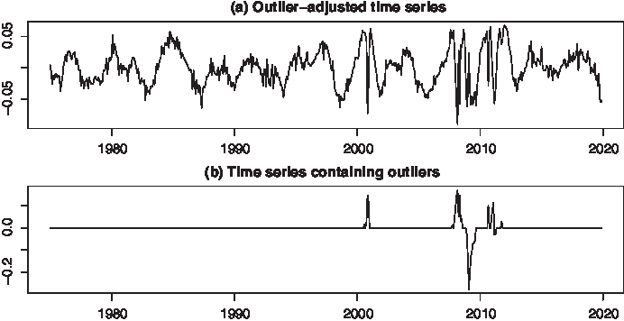

图 1.4：使用最小 ISU 方法进行离群值检测和估计的结果。

此外，基于上述获取的异常估计数量和位置，我们在 1–45 的范围内使用最小 AIC 方法确定了 AR 模型的估计阶 `p`。结果显示，`p` 的估计值为 `p̂ == 40`，对应的 AIC 值为  − 3149.12。

因此，我们使用最小 AIC 方法对异常进行了估计。图 1.5(b)描绘了包含离群值的时间序列，而图 1.5(a)显示了调整离群值后的时间序列。从图 1.5(a)中观察可以发现：在异常发生区域，调整离群值后的时间序列中存在明显的周期性变化。尽管如此，由于异常移除完全，深谷仍然存在，导致时间序列出现非对称波动。

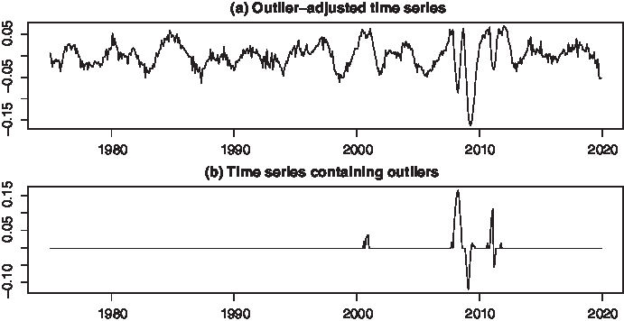

图 1.5：使用最小 AIC 方法进行离群值检测和估计的结果。

### 最小 AIC 方法

随后，我们计算了每个 `λ` 值对应的 `f(δ̂|λ)` 值。`λ` 的值从 `5 10⁻⁵` 开始，每增加 `5 10⁻⁶` 进 20 步，产生如 `λ[1]=5 10⁻⁵`、`λ[2]=1.5 10⁻⁵`、` …… ` `λ[20]=1.05 10⁻⁴` 等值。这些计算是在 `k̂=29`、`p̂=40` 以及离群值的估计位置的基础上进行的。此外，我们获得了对应每个 `λ` 值在式 (1.8)中定义的函数 `f(δ|λ)` 最小值所对应 `δ` 的估计值 `δ̂`，并计算了相应的 `ISU` 和 `NLL` 值。

Figure 1.6(a)说明了每个 `λ` 值对应函数 `f(δ̂|λ)` 的变化，Figure 1.6(b)显示了每个 `λ` 值对应的 `ISU` 和 `NLL` 的散点图（数字表示 `λ` 的索引）。需要注意的是，位于图 1.6(b)左下角的点代表 `λ[6]` 和 `λ[14]` 的结果，从最小 ISU 方法和最小 NLL 方法（与极大似然法一致）这两个角度来看都是相对具有优势的。由于这些结果相相同，我们在图 1.7 中展示了对应于较理想 `λ[6]=3.5 10⁻⁵` 的结果。从图 1.7 可以看出，对应 `λ=3.5 10⁻⁵` 的结果从最小 ISU 方法和最小 NLL 方法来看都是良好的。

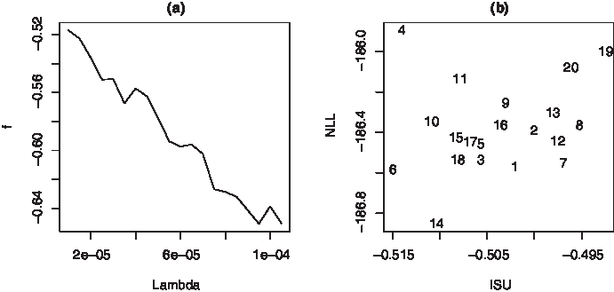

图 1.6：(a) `f` 随 `λ` 的变化；(b) `ISU` 和 `NLL` 之间的散点图。

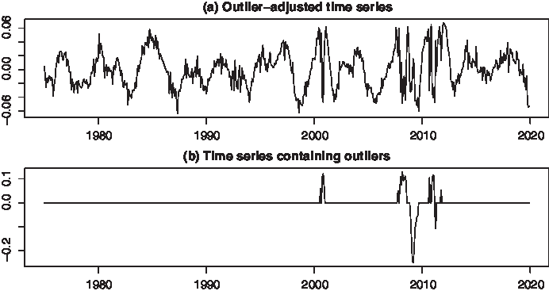

图 1.7：`λ=3.5 10⁻⁵` 的离群值检测和估计结果。

为了参考，我们还在图 1.8 中展示了极端情况 `λ=1 10⁻²` 的的结果。从图 1.8 可以看出，这些结果与图 1.6 中通过最小 AIC 方法得到的结果相似。


必须承认的是，本文主要关注单一领域，在理想情况下，应当扩展到多个领域。此外，我们也注意到在说明性示例中缺乏评估指标。由于空间限制，未能全面解决所提方法与其他技术进行比较分析期间的益处量化问题，而这是一个重要的方面。本研究被认为是一项初步尝试，解决这些问题将留给未来的研究工作。


## 2. 使用超图数据库

必须承认的是，本文主要关注单一领域，在理想情况下，应当扩展到多个领域。此外，我们也注意到在说明性示例中缺乏评估指标。由于空间限制，未能全面解决所提方法与其他技术进行比较分析期间的益处量化，而是一个重要的方面。本研究被认为是一项初步尝试，解决这些问题将留给未来的研究工作。

### 摘要

超图在许多应用中可以是比普通图更强大的模型，因为超图允许直接表示复杂关系。然而，在实际实现方面，普通图显得较弱。相反，超图专门设计用于处理链接。本章介绍了相关的细节。

### 2.1 引言

世纪之，人们广泛认为关系型数据库管理系统（RDBMS）[1] 是几乎所有数据库问题的解决方案。毕竟，还有什么比表示任意实体集以及任意关系的简单二维表更好的呢？可以通过 B 树等索引结构加速搜索。

然而，RDBMS 存在显著问题。在关系型数据库系统中，键是通过字符串匹配来等等的。这个过程很容易出错，因为键很容易拼错，而且无意中插入空格或其他不可见字符很容易导致本应相关的实体之间缺乏关系，或者很容易形成无意的关系。表连接效率极低是 RDBMS 的另一个问题。

较为人知的是，RDBMS 的索引通常存储在持久性存储中，尽管有巧妙的缓存，但可能不足以为视频播放器等快速应用和设备提供信息。当然，RDBMS 除了简单之外还具有许多积极的品质。其中一个品质是将实体集组织成表格。关系集也被组织成表格。

**关键词：** ILE、超图数据库、图数据库、非关系型、NoSQL、链接数据、指针


然而，近年来，非关系数据库系统应运而出，为用户提供了不再具有关系型数据库系统（RDBMS）相同缺点的系统。例如，许多机构现在提供了图数据库系统。在图数据库中，数据实体以比 RDBMS 更健壮的方式链接以表示某种关系，且遍历这些链接是一个快速的过程。然而，在图数据库中，并没有将同类实体清晰组织到单个实体集中的机制。同样，本应属于同一个关系集的关系也没有以任何方式封装在一起。

此外，图数据库是为二元关系而设计的。高阶元关系在图数据库中无法很好地表示，甚至无法表示。

为了在克服图数据库缺乏高阶元关系缺陷的同时，保留其强大的关系链接能力，超图数据库被广泛考虑。在公开的文献中，超图数据库系统似乎只有三种实现方式，即 [3]：

1. `HypergraphDB`，
2. `TypeDB`，以及
3. `GraphBrain`。

在这些系统中，只有 `HypergraphDB` 似乎拥有足够详细的文档来确定使用了哪些数据结构，并确定有关数据库操作效率的信息。`HypergraphDB` 的文档揭示了关系型数据库中也使用的 `B+ Tree` 是用于加速数据库搜索的索引机制。如上所述，使用这种外部索引数据结构，与使用作为数据库核心不可或缺部分的“内部”数据结构相比，会导致关系链接的遍历速度变变慢。

在本章中，我们将看到 `ILE` 可以表示任何超图数据库，使得关系（包括高阶关系在内）可以直接使用一种非常快的内部数据结构进行表示。此外，`ILE` 将每个实体集表示为一个对象，每个关系集同样被表示为一个对象。这些对象可以被添加到一个用 `ILE` 实现的超图数据库中，尽管超图数据模型本身并不包含这些对象。

为了参考或对比之目的，我们应该注意某些图数据库是如何进行关系链接的。根据 Kemnitz [4]，流行的图数据库 `Neo4j`（这也是该领域最古老的数据库之一）在每个节点中存储了一个表示该节点与其他节点关系的记录列表。在每个此类记录中似乎存在一个物理指针，指向另一个节点。然而，其他某些图数据库可能在节点中存储目标节点的某种形式的标识，这需要对这些目标节点本身的实际位置进行索引搜索。

本章的其余部分由以下章节组成：第二 节引入了 `ILE` 数据库，并解释了该数据库系统用于表示图和超图的机制。该节包含了如何扩展 `ILE` 以适应对超图的更好表示，包括具有可变阶数超边的超图，这对于高效且健壮地表示社交媒体上的节点组非常有用，而普通的图数据库系统在这种情况下的表现并不理想。

第三节探讨了 `ILE` 优于现有数据库的主要优势，即 `ILE` 允许更高效、更安全的关系链接和遍历。

第四节考察了 `ILE` 作为实现特定超图数据库的手段。该数据库涉及三元关系，这使得使用普通图来表示变得非常笨拙。该示例针对其关系链接遍历效率进行了基准测试。具体而言，该示例是一个由爱达荷荷州几个地点组成的旅行地图，它显然可以扩展为包含许多更多实体集和关系集的完整地图。

第五节比较了 `ILE` 和 `Neo4j` 在社交网络图数据库中的关系链接效率。为了进行这种比较，我们使用了在 [5] 中 发现的社交网络图简单模型。

第六 节和第七 节展示了此前未在 [6] 中发表的结果，本章正是对该出版物的扩展。第六 节讨论了第四 节所给出的小型示例之外的交通网络。特别是，我们将讨论一个地铁网络以及它如何比图更好地表示为超图，这正是它在 [7, 8] 中的表示方式。第七 节讨论了 Web 页面排名算法，这对于需要对 Web 页面进行排名的搜索引擎具有重要意义。Heintz 和 Chandra [9] 展示了为什么超图是分组的优越模型。然而，他们依赖图和多图来表示超图。

### 2.2 ILE 数据库系统及其表示超图的应用

`ILE` 数据库的想法 [17] 是本章作者在 2007 年教授数据库课程时，使用 Garcia-Molina 等人的《数据库系统》第一版书籍 [10] 时产生的。那本教科书认为 Chen 的 ER 数据模型 [11] 是大多数情况下的最佳数据模型，但在实现时，选择的是关系型模型。这是因为当时 ER 模型的实现，而选择关系型模型是因为它早于 ER 模型，但它通常被认为是 ER 模型的简单近似。

...由于键拼写错误或其他错误的键。

考虑到关系型数据库系统的所有优缺点，本章作者认为或许使用物理指针来执行关系链接更好，并且只有在有可验证的实体可以链接时才执行。此外，没有必要将数据结构限制在表格中。在 1970 年之前的几年里（那是 Codd 开创性论文的日期），二维数组的简单性是合理的。使用涉及指针的复杂数据结构进行编程并不常见。面向对象的编程并不为人知。


详细阐述 Chen 的论文，他的重点似乎是提出一个涵盖所有主要现存数据库模型的模型，即网络模型、关系模型和实体模型。他对这三种现存模型都进行了批判，并写道，所有这些模型都可以被看作他的数据库模型——实体关系模型（或 ER 模型）的派生模型。随后，他引入了一种绘图方法（后来被称为 ER 图图方法），用于设计数据库模式，这种方法在今天仍然在使用。他并没有涵盖如何编写代码，以将他的 ER 数据模型实现到可运行的甚至是原型的数据库系统中。

随着 70 年代之后的几十年时间里，Codd 的 RDBMS 普及率呈爆炸式增长。与此同时，Chen 的 ER 图图方法成为了标准的数据库设计方法，至少对于学生和严肃的数据库设计人员而言如此。然而，Chen 的似乎并没有以数据库软件的形式实现，尽管有些人认为关系系统是 ER 模型的一种实现，但这种观点并不完全准确。事实上，人们似乎广泛认为 ER 模型是无法实现的。

本文作者在 2007 年的观点是，考虑到自 1970 年以来编程语言和技术取得的所有进步，一定有一种方法可以实现比 RDBMS 更好的通用数据库系统，例如更像 ER 模型那样的。不再需要坚持将所有内容（外部索引除外）都制成二维数组。

## ILE 的细节

ILE 是用 Ruby 语言实现的。Ruby 是一种非常适合表示 ILE 的语言，因为它很容易创建和操作涉及指针（Ruby 引用）的复杂数据结构。此外，垃圾回收由运行时监控器处理。

在一个 ILE 数据库中，首先有一个代表整个数据库的对象。 true 一个代表一组数据库的对象，即 `DatabaseSet` 对象，以防我们需要将一组不同但相关的数据库保留在一起。未来，可能会为整组相关数据库提供搜索功能或其他功能。数据库对象包含数据库名称和数据库的元数据，例如，描述数据库的某些文本。数据库进一步由以下组件构建：

1. **实体集对象（Entity Sets Objects）。** 这些是表示实体集的自然方式，与 ER 模型中的实体集或旧的实体集模型 `[12]` 相同。在 ILE 的原始论文 `[13]` 中，每个实体集都由一个表表示，但在随后的论文中，表的实现被实体集对象实现取代了。上述数据库对象通过 Ruby 哈希（hash）来跟踪所有的实体集对象，使用每个实体集的名称作为键。实体集对象具有：
    - 指向数据库对象的引用，
    - 实体集名称，任何字符串，但旨在作为可搜索的哈希键，
    - 以备需要指向外部索引的哈希表。这通常不需要，且到为止尚未实现，
    - 键属性名称，存储为数组，
    - 键属性类型。类型可以以任何适合所表示数据库的方式定义。以哈希表形式存储，并将键属性名称作为哈希键，
    - 非键属性名称，存储为数组，
    - 非键属性类型，存储为哈希表，
    - 属于此实体集的所有实体都存储为数组。

2. **实体对象（Entity Objects）。** 这些对象表示实体。在 ILE 中，实体具有：
    - 指向数据库对象的引用，
    - 实体集名称，任何字符串，但旨在作为可搜索的哈希键，
    - 以备需要指向外部索引的哈希表。这通常不需要，且到为止尚未实现，
    - 键属性名称，存储为数组，
    - 键属性类型。类型可以以任何适合所表示数据库的方式定义。以哈希表形式存储，并将键属性名称作为哈希键，
    - 非键属性名称，存储为数组，
    - 非键属性类型，存储为哈希表，
    - 属于此实体集的实体都存储为数组。

3. **关系集对象（Relset Objects）。** 这些对象表示关系集。关系集是一组集合，每个角色由一个实体扮演。relset 具有：
    - 指向数据库对象的引用，
    - 名称，任何字符串，但旨在作为可搜索的哈希键，
    - 以备需要指向外部索引的哈希表。这通常不需要，且到为止尚未实现，
    - 键属性名称，存储为数组，
    - 键属性类型。类型可以以任何适合所表示数据库的方式定义。以哈希表形式存储，并将键属性名称作为哈希键，
    - 非键属性名称，存储为数组，
    - 非键属性类型，存储为哈希表，
    - 属于此实体集的实体都存储为数组。

4. **关系对象（Relationship Objects）。** 这些对象表示关系。关系具有：
    - 指向数据库对象的引用，
    - 实体集名称，任何字符串，但旨在作为可搜索的哈希键，
    - 以备需要指向外部索引的哈希表。这通常不需要，且到为止尚未实现，
    - 键属性名称，存储为数组，
    - 键属性类型。类型可以以任何适合所表示数据库的方式定义。以哈希表形式存储，并将键属性名称作为哈希键，
    - 非键属性名称，存储为数组，
    - 非键属性类型，存储为哈希表，
    - 属于此实体集的实体都存储为数组。


在 HypergraphDB 中，从实体到关系的链接依赖于 B+ 索引树，与 ILE 中使用的 Ruby hash 或 Neo4J 采用的基于 Java 直接链接相比，这种数据结构更大且速度更慢。

在 ILE 中，得益于以关系集（`relset`）为键的 Ruby hash，将实体到关系的链接是非常高效的。`relset` 中的所有关系共享同一个键，并存储在 `Array` 中（或可选的 Ruby `Set`）。这个存储关系的 `Array` 可以通过替换为 `Hash` 来进行“索引”，并使用任何其他角色（roles）的值作为键。此外，还可以使用多级哈希（`Hash` 嵌套 `Hash` 等），每一层都以关系中特定角色的值作为键。尽管这种多级哈希方法尚未在 ILE 中实现，但它仍然是一个很有前景且可行的想法。

### 2.4 示例：一个带有三元关系的小型超图数据库及其基准测试

我们现在将检查使用 ILE 建模超图数据库的基本示例。在这种情况下，我们将构建一个表示爱达荷州若干几个城市以及它们之间不同交通方式旅行时间的数据库。尽管 ILE 提供了用于数据输入和查询的专用语言，但本演示将使用 Ruby 代码。数据库将包含一个标记为“cities”（城市）的实体集，每个实体对应数据集中的一个城市。该实体集的主键属性是城市名称，称为 `cityname`。此外，非键属性将包括城市内特定地点的纬度和经度。接下来的 Ruby 代码说明了新数据库的创建以及“cities”实体集的配置（图 2.1）。

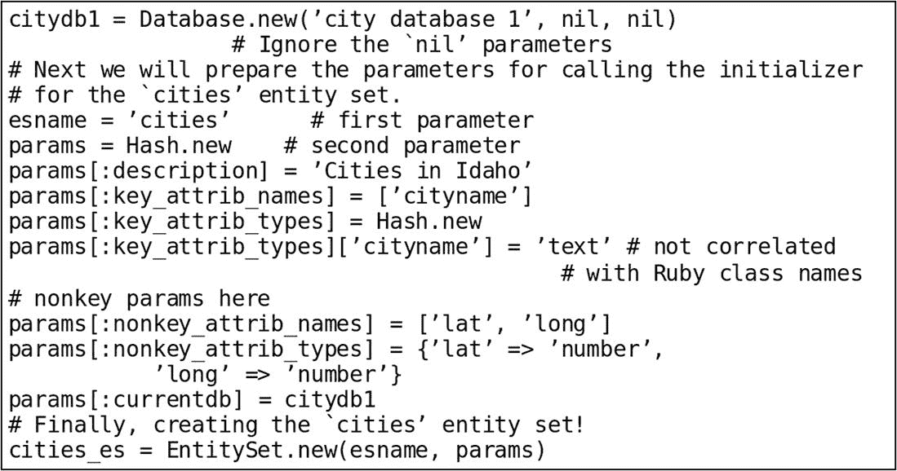

图 2.1：用于创建新数据库和配置“cities”实体集的示例 Ruby 代码。

ILE 允许用户定义和管理数据类型。在这个基本示例中，我们将依赖 Ruby 来管理数据类型，而不会实现任何专门代码来处理输入到数据库的数据。以下演示了如何将实体添加到实体集，并添加到数据库中：

```
poky_entity = Entity.new(cities_es, {’cityname’=>’Pocatello’},
                      {’lat’=>42.8621, ’long’=>-112.4506})
if_entity = Entity.new(cities_es, {’cityname’=>’Idaho Falls’},
                      {’lat’=>43.4927, ’long’=>-112.0408})
boise_entity = Entity.new(cities_es, {’cityname’=>’Boise’},
                      {’lat’=>43.6150, ’long’=>-116.2023})
sv_entity = Entity.new(cities_es, {’cityname’=>’Sun Valley’},
                          {’lat’=>43.6971, ’long’=>-114.3517})
```

另一个表示交通方式的实体集是使用图 2.2 中的代码创建的，而代表旅行模式的实体可以使用图 2.3 中的代码包含在实体集中：

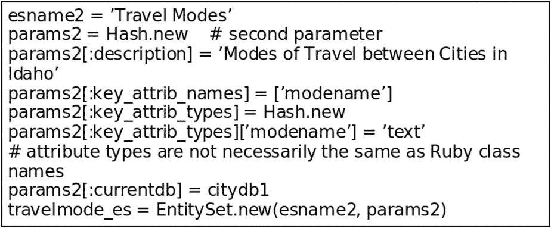

图 2.2：表示交通方式的实体集示例代码。

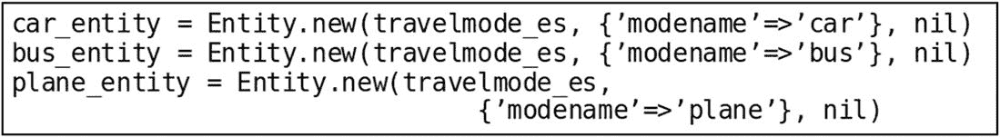

图 2.3：添加到实体集的旅行模式示例代码。

构建数据库的下一步是定义单一关系集，即 `Relset`。`Relset` 中的关系有三个角色：`origin`、`destination` 和 `transportation`。这些关系对应于超图边，每条边连接三个节点。以下代码 (图 2.4 (a)) 演示了这些角色如何在 `Relset` 构建中定义，而 图 2.4 (b) 显示了如何根据这些示例建立关系。

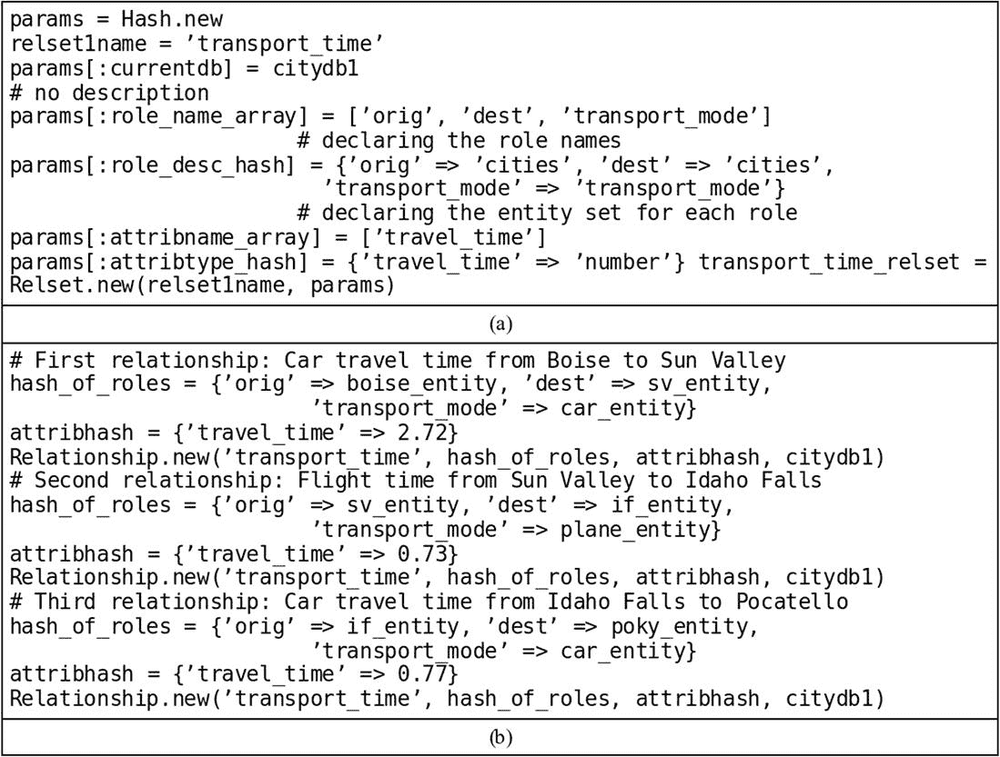

图 2.4：(a) 在 Relset 构建中定义的代码。(b) 根据 Relset 构建中定义的角色建立关系。

最后一步是评估遍历此超图数据库的速度。结果将反映在理想条件下（没有由于数据库大小导致的块交换限制），ILE 遍历典型超图链接的效率。此外，我们下一节中探索另一个示例——简单图而非超图，并在 ILE 中将其与著名的高效图数据库 Neo4J 进行比较。

表 2.1 显示了配备四核 Intel i5 处理器（主频 2.4 GHz）的 2019 年 13 英 MacBook Pro 的执行结果。该系统具有以 2.13 GHz 运行的 8 GB LPDDR3 RAM，辅助存储为 500 GB 闪存。

表 2.1：本节交通数据库的运行结果。

| 从 Boise 到 Pocatello 的遍历（3 条链接） | 用户时间 (sec) | 系统时间 (sec) | 用户+系统时间 (sec) | 每个链接时间 |
| :--- | :--- | :--- | :--- | :--- |
| 1 | 0.000110 | 0.000056 | 0.000166 | 53.3 μs |
| 10,000 | 0.001249 | 0.000086 | 0.001335 | 44.5 ns |
| 100,000 | 0.009333 | 0.000085 | 0.009418 | 31.4 ns |
| 1,000,000 | 0.090515 | 0.000215 | 0.090730 | 30.2 ns |

实验结果显示，随着遍历次数的增加，遍历单个链接所需的时间保持在 30 纳秒左右。在每次运行时，系统会将包含待遍历链接的磁盘块工作集加载到缓存中。由于实验所需的内存较小，似乎没有发生额外的块交换。

根据这一推理，可以将总运行时间（用户时间+系统时间）表示为常量 `c`（填充缓存的时间）与 `n`（从起始节点 Boise 到终止节点 Pocatello 的遍历次数）与 `t`（遍历单个链接所需的时间）之积。

因此，我们得到 `t[total] = c + n · t`。使用 `n = 1` 和 `n = 1,000,000` 的情况，我们可以求解 `c` 和 `t`，得到大约 `c = 0.0001659` 和 `t = 9.0564 × 10⁻⁸`。比较这些数字，可以明显看出填充缓存的时间远大于遍历时间。即使对于配备闪存驱动器的计算机，这一结果也不出意料。

虽然我们目前只有初步且间接的比较结果，但它们仍然引人注目，并为未来的研究提供了一个价值的起点。


本节的灵感源于第一章中对 `Neo4j` 和 `MySQL` 的基准测试，详见 [5]。该研究检查了一个包含 1,000 个人的社交网络数据库，成对的链接代表友谊。平均而言，每人有 50 个朋友。任务是计算朋友的朋友（“2 级”），然后是朋友的朋友的朋友（“3 级”），以此类推。正如预期的那样，由于关系型表连接的成本很高，随着层级的增加，`MySQL` 的性能显著变差。相比之下，作为图数据库的 `Neo4j`（以及 `ILE`）可以非常高效地遍历边，除非导致磁盘交换，否则其性能很大程度上不受数据库大小的影响。

所引用的书籍中没有关于数据库如何生成的细节。至于书中实验中使用的计算机系统，仅揭示了这一点：“所有实验都是在一台配备 8 GB 内存、由 Intel i7 驱动的通用笔记本电脑上执行的，这正是编写本书时使用的那台电脑。”

比较这些数据库的理想方法是在相同的数据集和系统上运行，但这是不可行的。相反，创建了一个包含 1,000 个节点的随机社交网络数据集，每个节点连接到随机选择的其他 50 个节点。对于每个节点，生成了 50 个随机 ID，在节点与其随机选择的对应节点之间建立了双向连接。结果，大多数节点最终连接的节点平均多于 50 个。`ILE` 系统在一台没有运行 `Neo4j` 的笔记本电脑上运行。使用的笔记本电脑是一台标准的“通用”机器，比书中提到的机器新约四年，但配备了较旧的 Intel Core i5 处理器和相同的 8GB 内存。

表 2.2：此表总结了书中以及我在 1,000 人数据库上的实验结果。

表 2.2：1000 人社交网络数据库的运行结果。表中列出的运行时间为秒。

| 深度 || MySQL || Neo4J || ILE |
| --- | --- | --- | --- |
| 2 || 0.028 || 0.04 || 0.024 |
| 3 || 0.213 || 0.06 || 0.031 |
| 4 || 10.273 || 0.07 || 0.039 |
| 5 || 92.613 || 0.07 || 0.040 |
| 无限制 | \--- | \--- | 0.762 |

书的研究在一个包含 1,000,000 个人的数据库中重复，每人平均有 50 个朋友。曾尝试运行一个具有 1,000,000 个节点的类似数据库，但计算机在生成连接的过程中显著变慢，导致无法进行遍历测试。虽然使用的计算机与书中作者的不同，但 `ILE` 可能每个节点和关系需要更多的空间，因此需要具有更大内存和工作集能力的机器来有效管理大型数据集。

表 2.3 展示了书中对 1,000,000 人数据集的测试结果，每人平均有 50 个朋友。虽然 `Neo4j` 的结果看起来令人印象深刻，但对于书中报告的 1,000,000 人实验以及在 表 2.3 中所示的结果存在担忧。注意的是，对于深度 2 的情况，`MySQL` 和 `Neo4j` 在 1,000,000 人数据集上的结果均优于 1,000 人数据集，这似乎是违反直觉的。关注 1,000,000 人数据集的 `MySQL` 结果，由于 `MySQL` 已经被充分理解，该计算涉及一个 50,000,000 行表的自连接，因为每个人有 50 个朋友。作者声称，这种自连接在配备了 8GB 内存和 Intel Core i7 处理器的“通用”笔记本电脑上耗时 0.016 秒。这似乎是不可能的。连接的大小将是 2.5e15 行，每行不仅包含数字，还包含名称和额外信息。即使假设一种极端乐观的场景，即每行仅包含三个数字（人的 ID），且笔记本电脑拥有以 4 GHz 运行的 8 个核心（这非常乐观了），并进一步假设所有核心在 1 个时钟周期内同时将结果写入内存，这仍然是不可能的。在 0.016 秒内，系统将写入 `8 × 4e9 × 0.016 = 5.12e8` 个字。

表 2.3：1,000,000 人社交网络数据库的运行结果。列出的运行时间为秒。

| 深度 || MySQL || Neo4j |
| --- | --- | --- |
| 2 || 0.016 | 30.267 |
| 4 || 1453.505 |
| 5 || 0.016 | 2.132 |

虽然 `ILE` 可能对于 1,000,000 人规模的数据库，但对于 100,000 人规模的数据，其结果（如 表 2.4 所示）效果良好。

表 2.4：最多 100,000 人社交网络数据的运行结果。时间为秒。

| 人数 || 深度 || ILE 运行 |
| --- | --- | --- |
| 10,000 || 2 | 0.06854 |
| 10,000 || 3 | 0.48419 |
| 10,000 || 4 | 0.29764 |
| 10,000 || 5 | 0.31209 |
| 10,000 || 6 | 0.32635 |
| 10,000 || 7 | 0.37095 |
| 50,000 || 6 | 1.56334 |
| 100,000 || 5 | 6.48288 |
| 100,000 || 6 | 9.02926 |

### 2.6 交通网络

在本节中，我们论证了为什么交通网络可能比图更好地用图表示。交通网络通常用图表示。例如，在地铁系统的图表示中，节点通常代表地铁站等重要地点，而边代表站之间的连接 [7]。在 [15] 中，道路网络用图表示，节点是交叉路口，边是“路段的某些属性”。Jeyaprasan 等人提到表示站点所属的线路存在困难，以便程序可以轻松计算从一个站到另一个站需要换几次线。这些作者最终决定根据与站点关联的线路数量来表示每个站。

在这里，我们建议用超图来表示地铁系统。站点是节点，连接两个站的路段也是。线路也是节点，关系不仅连接两个站，还链接到路段和线路。图 2.5 展示了这样的关系，其阶度为 4。

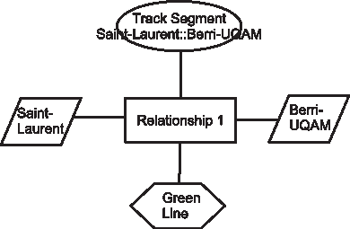

图 2.5：一种将路段与其连接的两个站以及一条线路联系的关系。这种关系由超边表示，反过来由 ILE 关系表示。

使用这里提出的地铁表示法消除了处理多线路路线的不整洁方法，例如如 [7] 中描述的那样，每个服务多条线路的节点（站点）必须在数据库中出现多次。


`hypergraphs/ILE` 的另一个有用应用是汽车行程路线规划，包括便携式 GPS 单元中的路线规划，其中某些设备在规划非本地路线时速度慢得令人闻名。在现有的汽车 GPS 单元中，路由软件使用图数据结构。节点是道路交叉路口，而边最初是连接这些交叉路口的路段。如果计算复杂度不是障碍，可以应用诸如 `Dijkstra’s Algorithm` 这样的最短路径算法，那么我们就大功告成了。然而，由于节点非常多，例如，美国大陆有 1580 万个节点（需要引用），搜索空间将变得太大了。限制搜索的一种方法是预计算捷径（shortcuts），这些边是不对应于物理路段的，但代表了节点之间的最短路径。启发式算法被用于优先考虑公路和其他主要道路，并优先考虑“小路：大路：小路”的模式。

然而，这种策略仍然是一种非常“局部”的策略，因为对整个路线缺乏足够的“大局”规划。因此，GPS 设备在完成长途/远距离行驶计划时遇到困难并不意外。

我们的想法是在路由中加入更多类人类的“智能”。特别是，我们将预计算主要（以及次要）城市之间的路线，这些路线主要由高速组成，并将它们全部存储为节点。（因此，我们的节点不仅是道路交叉口，它们在我们的方案中也是节点。）除了远程地区的行程外，从点 A 到点 B 的行程规划搜索过程将从尝试这些城际路线 `R` 开始。然后我们搜索从点 A 到 `R` 的最佳路线，这通常意味着从点 A 到高速少数入口之一或组成路线 `R` 的高速之一的短途行程。通过反向搜索，我们寻找从 `R` 的少数出口之一到达点 B 的方法。虽然我们还没有进行对比实验，但我们的方法与现有 GPS 设备中更传统的搜索相比似乎很有前景。

## 2.7 世界维网

世界维网搜索引擎 `Google` 使用一种名为 `PageRank` 的算法对网页的重要性进行排名。在 `PageRank` 中，网页的重要性基于有多少个其他网页链接到它，以及这些其他网页本身有多重要。在 `[9]` 中，作者展示了他们对 `PageRank` 的扩展，其中小组表示为一组顶点，这些顶点通过代表小组关系的超边相关联。

现在考虑社交媒体页面的排名。我们想要考虑小组身份的重要性，特别是拥有重要成员的小组的身份。Heintz 和 Chandra 使用 `Spark GraphX` 包模拟超图，并为它构建了一个超图 API。他们讨论了用于他们的系统的 `GraphX` 框架的底层数据结构的两种可能性：

1. 使用二部图，其中一个划分包含代表超图顶点（他们称之为“超顶点”）的图顶点，另一个划分包含代表超图超边的顶点。使用原生边来连接每个代表超边的图顶点与其所包含的各个图顶点（超顶点）。请注意，如果底层图数据结构是一个有向图，并且如果希望从一个超顶点到另一个共享同一条超边的超顶点，那么我们需要一对原生边，每个方向一个，来表示超边与构成该侧的超顶点之间的连接。

2. 如果底层图软件允许多重图（图的扩展，在同一对顶点之间可能存在多条边），`GraphX` 支持这一点，那么我们就可以用多重图来表示超图。这涉及用多重图顶点表示每个超顶点。超边的表示方式如下：如果顶点 `v1` 和 `v2` 被超边 `h` 连接，那么底层图在 `v1` 和 `v2` 之间有一条标记为“h”的边。

使用二部图的表示 1 并没有浪费过多的边。然而，根据 Heintz 和 Chandra 的说法，超边和超节点被表示为同一种对象可能会有问题，尽管超节点和超边的特征非常不同。使用多重图的表示使用了不同类型的对象来表示超节点和超边，因此不受相同问题的影响。

然而，表示 2 需要 $n \times (n – 1)/2$ 条边来表示一个有 $n$ 个成员的小组，如果需要双向链接，则实际上需要 $n \times (n – 1)$ 条边。这可能导致失败，因为社交媒体中的小组可能很大。在爱达荷州的波卡特洛（Pocatello），一个人口约为 57,000 的城镇（2021 年），一个名为“Pocatello Trails”的 Facebook 小组目前有 1.13 万成员（2023 年 12 月）。使用表示 2，在每对顶点之间都使用双向边，仅表示这个小组就需要大约 127,678,700 条边！此外，将没有单一对象作为该小组的“中心”。

另一方面，如果我们使用本章基于 `ILE` 的超图实现来实现表示 Facebook 页面，Pocatello Trails 小组只需要一个超边（关系）对象，与 1.13 万成员中的每一个都有双向链接，这将产生 2.26 万条链接。

## 2.8 结论

几十年来，ER 数据库模型被认为是广泛应用程序的最佳整体数据模型。然而，ER 并没有成功实现，因此基于 20 世纪 60 代编程技术并可被视为 ER 实现的粗略近似的关系型 DBMS 成了主导的数据库系统类型。本章介绍了 `ILE` 作为 ER 的现代实现，并介绍了如何扩展 `ILE` 使其成为超图数据库的底层数据库系统。超图数据库之所以有趣，是因为与普通图数据库不同，超图数据库可以直接表示高阶关系，这种关系是许多应用中真实关系的更强模型 `[18]`，`[20]`。基于 `ILE` 的超图比现有实现更好，因为基于 `ILE` 的实现更直接，使用指针链接关系。本章还介绍了来自不同领域的几个应用。

## 参考文献

[1] E. F. Codd, a relational model of data for large shared data. Communications of the ACM, 13, 6, June 1970. 377–387. a, b

[2] I. Robinson, J. Webber and E. Eifrem, Graph Databases, 2nd Edition, O’Reilly Media, Inc, 2015. →

[3] T. Menezes, C. Roth, C. C. Chen, Y. Stein and K. Ren, Graphbrain – Language, knowledge, cognition. Published online as [`graphbrain.net`](https://graphbrain.net) 2021. →

[4] G. Kemnitz, Quora: Answer to the question: Technically, how are relation(ship)s stored in a graph database? [`www.quora.com/How-are-graph-databases-implemented`](https://www.quora.com/How-are-graph-databases-implemented), 2019. →

[5] A. Vukotić and N. Watt, *Neo4j in action*. Manning, 2015. a, b


- [6] V. Kantabutra, 使用 ILE 实现快速关系链接和遍历的超图数据库实现，*CSCE 2022*。[→
- [7] K. Jeyapragasan, G. Krishna 和 Y. Maniyar, 基于图论和 graphrnn 的图生成对地铁网络进行分析，斯坦福大学计算机系，CS 224W，2019 年课程项目，2019 年在线发布于：[`snap.stanford.edu/class/cs224w-2019/projects.html`](http://snap.stanford.edu/class/cs224w-2019/projects.html)。最后访问时间：2023 年 12 月 21 日。[a]，[b]，[c
- [8] X. Wu, C. K. Tse, H. Dong, I. W. H. Ho 和 F. C. M. Lau, 世界地铁系统的网络分析，收于：非线性理论及其应用国际学术会议，NOLTA2016，日本汤原，2016 年 11 月 27 日-30 日。[→
- [9] B. Heintz 和 A. Chandra, 通过超图分析系统实现可扩展的社会群体分析，收于：第 7 次 USENIX 云计算热点会议论文集，2015 年 7 月。[a]，[b]
- [10] H. Garcia-Molina, J. D. Ullman 和 J. Widom, 数据库系统：完整版，Prentice-Hall，2001 年。[→
- [11] P. Chen, 实体关系模型：迈向统一数据视图。ACM 数据库系统交易，第 1 卷，第 9–36 页。1976 年。[→
- [12] M. E. Senko, E. B. Altman, M. Astrahan 和 P. L. Fehder, 数据库中的数据结构与访问。IBM 系统期刊，第 12 卷，第 1 期，第 30–93 页，1973 年。[→
- [13] V. Kantabutra, 一种新型数据库系统：意图链接实体——实现实体关系模型的直接方法的详细建议，CSREE，第 258–263 页，2007 年。[→
- [14] D. Dominguez-Sal, P. Urbón-Bayes, A. Gómez-Villamor, N. Martínez-Bazan 和 J. Larriba-Pey. 高性能可扩展图分析中的图性能调查。收于：Heng Tao Shen, Jian Pei, M. Tamer Özsu, Lei Lu, Ge Yu, Yi Zhuang, Jie Shao（编辑），网络信息管理国际会议。Springer-Verlag，柏林，等，2010 年，第 37–48 页。[→
- [15] C. Kennedy 和 S. Derrible, 利用图论对网络进行分析。交通研究杂志，第 21 卷，第 17–25 页，2009 年。[→
- [16] J. Pung, R. Dsouza 和 M. Ghosal, 一种保持拓扑属性的简化算法。应用科学，第 7 卷，第 79 页。[`doi.org/10.1007/s41109-022-8`](https://doi.org/10.1007/s41109-022-8) [[→]
- [17] V. Kantabutra, 针对时间数据的建议。 研讨会，第 158–161 页。[→
- [18] M. Hunger, R. Boyd 和 W. Lyon, 地球地铁系统的深度研究。交通研究杂志，第 14 卷，第 39–58 页，2016 年。[→
- [19] V. Kantabutra, 针对大数据的聚类建议。 计算科学，第 68 卷，2021 年。[→
- [20] V. Kantabutra, 针对大数据的聚类方法：一种可扩展的图分析方法。[→

## 3 大规模数据的自动聚类数量确定

**注意：** 确定最佳聚类数量是聚类算法中的一个挑战。在聚类质量和算法效率之间取得平衡是本我们研究的关键权衡。在我们的方法中，我们成功地针对大规模数据集自动确定了聚类数量。

### 摘要

自动确定聚类数量是聚类领域的一项挑战性工作。我们的方法解决了大规模数据集的聚类质量与效率问题。

关键词：聚类、K-means、大数据

### 3.1 引言

聚类作为一种广泛使用的无监督学习过程，已被应用于发现见解和揭示对象之间的隐藏关系，这与监督学习区分开来。其应用涵盖多个领域，包括模式识别[11](https://9783111344072_000852.xhtml#xref_d59169e10523)、机器学习[5](https://9783111344072_000852.xhtml#xref_d59169e10517)、[6](https://9783111344072_000852.xhtml#xref_d59169e10480)、图像分析[13](https://9783111344072_000852.xhtml#xref_d59169e10611)、图分析[14](https://9783111344072_000852.xhtml#xref_d59169e10930)、生物信息学[15](https://9783111344072_000852.xhtml#xref_d59169e11781)、信息学[16](https://9783111344072_000852.xhtml#xref_d59169e11784)以及信息检索[17](https://9783111344072_000852.xhtml#xref_d59169e10517)、[18](https://9783111344072_000852.xhtml#xref_d59169e11972)。该过程根据相似性对数据点进行分组，同一组内的点具有相似的属性，而不同组之间的点相似性较低。与监督学习和分类不同，聚类缺乏为给定数据集确定适当聚类数量的预定义概念[22](https://9783111344072_000852.xhtml#xref_d59169e11975)。聚类的性能很大依赖于对聚类数量的准确估计。用户通常依赖聚类算法对数据点进行最优分组，而聚类数量是根据知识预先确定的。


直观地指定正确的聚类数量是一项挑战性任务，因为用户可能缺乏对数据集的充分知识来定义高概率的最数量。聚类数量信息的缺失会对聚类质量产生不利影响，这使得近年来通过聚类算法发现正确的聚类数量引起了广泛关注。`K-means`算法 [19]\]是最受认可的聚类方法之一，因其简单易于实现而受到推崇。然而，一个显著的挑战在于用户必须预先指定聚类数量。最近的研究试图增强`K-means`算法以解决这一挑战，引入了自动确定聚类数量的解决方案。一些著名的方法包括`X-means` [7]、`Ray and Turi (R&T)` [4]、专为序列数据设计的`CLUSEQ` [8]、`IKMEANS` [9]以及其他 [10, 12]。`K-Means++` [28]\]是一种旨在改进初始化步骤的方法。`K-means`在第 3.2 节中进行了解释。它根据概率选择初始聚类中心，该概率与现有中心距离的平方成正比。这种方法已被证明可以减轻初始中心选择对算法性能的影响。此外，自适应聚类算法的进步导致了诸如`adaptive K-means` [29]\]方法的发展，该方法根据数据分布动态调整聚类数量。与传统的`K-means`相比，这些算法通过持续监控聚类质量并自适应地优化聚类分配，提供了更高的灵活性效率。

本章专门关注针对具有高维数据的海量数据集自动确定最佳聚类数量（auto best *K*）。虽然现有的方法如`R&T`和`X-means`侧重于自动确定聚类数量期间的聚类质量，但它们并没有专门为大型数据集定制。鉴于确定聚类数量可能耗费时间，管理聚类算法的效率成为大数据集的一个至关重要的挑战。因此，我们的重点是效率，同时维护重要数据的聚类质量。在现有算法 [4, 7]\]，确定聚类数量涉及二分 K-means（`BKMeans`）等过程，其中聚类数量会逐渐增加到预定义的上限。在分裂过程中，根据不同方法中不同的标准选择最大的聚类。我们的重点不在于选择标准，而是在遵循现有方法设定的质量标准的同时降低计算成本。值得注意的是，聚类标准仍然是一个持续考虑的问题，因为在现有算法中，每一步都涉及随着聚类数量的增加而评估不同的标准。论文的结构如下：第 3.2 节提供了两种聚类算法的概述，详细说明了它们的重要规格，并解释了`R&T`方法 [4]\]。我们提出的方法在第 3.3 节中进行了详细检查。第 3.4 节深入探讨实验和比较，研究结论在最后一节给出。

### 3.2 相关工作

为了实现我们的目标，即在确保更高聚类质量的同时自动确定更合适的 *k* 值，我们的 auto best *K* 整合了`K-means`和`BKMeans`。利用这些算法的独特特征，我们在本节中给出了详细的描述。为了让读者有清晰的理解，我们在下面的[9783111344072_000852.xhtml#b_9783111344553-003_ref_004]中深入探讨了`R&T`方法。

#### 3.2.1 K-means 和二分 K-means

`K-means`是一种广泛使用的聚类算法，旨在将相似的对象分组为凝聚的聚类，它基于算法 1 运行。该算法的关键输入是`K`和`N`，分别代表聚类数量和数据点数量。在初始阶段，随机选择`K`个中心，这一步对有效性和效率都有显著影响。尽管方法简单，`K-means`具有显著的局限性。最近的一些研究探索了各种策略来解决这些局限性。例如，研究重点在于通过引入如`K-Means++`等技术来增强初始化步骤，该技术根据概率选择初始中心。此外，`adaptive K-means`根据数据分布动态调整聚类数量。与传统的`K-means`相比，这些算法提供了更好的灵活性效率。

主要，`K-means`的缺点在于依赖随机选择的初始中心，这会导致迭代次数过多且结果不可靠。为了减轻这个问题，我们在论文的之前的版本中引入了`B-Kmeans`方法 [23]\]，如算法 2 所示。

与随机选择中心的`K-means`相比，`BKMeans`算法表现出了优异的聚类质量和效率，正如 21](#9783111344072_000852.xhtml#b_9783111344553-003_ref_021)]\]所示。此外，`BKMEANS`具有自动确定聚类数量的优势，无需指定预定义的*K*值。值得注意的是，聚类有效性等标准 [20]\]可以无缝地集成到分裂过程中，以确定最佳聚类数量。

```
Algorithm 1: K-means
input: data set: *x*[1],*x*[2], … *x[n]*, *k* and *N*.
*   1. Initialize *K* centroids z[1],z[2], … z*[k]* **for** *i* = 1 to *N*
do
```


- a. 计算 `x[i]` 到质心 `z[k]` 的距离，`d[i]` = `min`||`x[i]` − `z[j]`|| `j=`1,2, … `k`
- b. 将每个点分配给最近的质心（`z[k]`）。`x[i]` ∈ `C`[j]

**结束**

- 2. 为每个簇 `C[j]` 重新计算质心 `z[j]′`。
- 3. `zj = zj′`
- 4. 重复步骤 2 直到簇不再发生变化。

#### 3.2.2 Ray 和 Turi 方法与 R&T 指标

Ray 和 Turi 在色彩空间上实现了他们的方法，为从 22 到上限（定义为 25）的聚类数量生成分割图像。为了确定最佳聚类数量，他们使用了自己的有效性指数——R&T 指标 `[4]`，该指标计算簇内距离与簇间距离的比率。K-means 算法对每个新创建的簇进行迭代应用，直到聚类数量达到 `K`[max]。由他们的指标确定的最佳 `k` 值对应于指标值最小的值。

这种有效性衡量标准被同时应用于合成和自然图像，最小聚类数量设定为四个。Ray 和 Turi 引入了自己的指标，标记为 R&T `[4]`，利用了簇内距离和簇间距离的概念。簇内距离被定义为每个数据点到其簇中心的平均距离，其中 `N` 代表数据点的数量，`K` 是簇的数量。簇间距离被定义为簇质心之间的最小距离。这种综合方法使他们能够在多种场景（包括合成和真实世界图像数据集）中评估并优化聚类性能：

```
(3.1)${R\\& T\\, index} = \\frac{Intra}{Inter}.$ 
```

事实上，R&T 指标通过量化簇内距离与簇间距离的比率提供了一个有价值的标准，有效地考虑了簇的紧凑性和分离性。R&T 指标值越低表示聚类越优，意味着聚类数量（`k`）具有最优值。这种方法与实现内部凝聚（簇内紧凑性）且彼此良好分离（簇间分离）的簇的目标一致，对聚类结果的质量提供了全面评估。因此，追求最小 R&T 指标值有助于识别给定数据集的最佳 `k` 值：

**算法 2：** 二分 K-means (Bisecting K-means)

**输入：** 数据集：`x`[1], `x`[2], … `x[n]`, `k` 和 `N`。

1. `C`[1]
2. `C`[2]
3. `C`[j]

### 3.3 提出的方法

所提方法通过这些指标进行了严格评估，强调了其在不同数据集上的有效性。所提方法通过这些指标进行了严格评估，强调了其在不同数据集上的有效性。所提方法通过这些指标进行了严格评估，强调了其在不同数据集上的有效性。所提方法通过这些指标进行了严格评估，强调了其在不同数据集上的有效性。所提方法通过这些指标进行了严格评估，强调了其在不同数据集上的有效性。所提方法通过这些指标进行了严格评估，强调了其在不同数据集上的有效性。其在不同数据集上的有效性。


`input`: 数据集，`k[min]`, `k[max]`, `milestone`。

1. 使用 `BK-Means` 将数据集划分为 `k[min]` 个类。
2. 设置 `k=k[min]`，并计算当前划分的有效性。

```
while ((validity does not meet the criteria) && (k<k[max])) do
    Choose the biggest cluster.
    Partition it into 2 clusters.
    k+=1
    if (k mod milestone==0) K-Means(k)
    Compute validity of the current partition.
end
return clusters=K and validates.
```

### 3.4 实验研究

R&T 过程和我们提出的方法均使用 C 语言实现，并考虑了传递软件的各种参数。如第 3.5 节所示，R&T 程序涉及在每次迭代中调用 `K-means` 并在每一轮之后划分方差最大的类。相比之下，我们的方法每隔预定义的迭代次数（`milestone`）调用一次 `K-means`，并划分具有最大 SSD（误差平方和）的类。两种程序之间的比较是通过 CH 指数和 R&T 指数进行的。对于两种方法，`K-means` 的迭代次数均预定义为 20。测试开始时，最小类数（`K[min]`）设置为 3，而最大类数（`K[max]`）根据数据集的性质以及我们对数据的先验知识进行变化。

所有测试都在德州理工大学的 HPCC（高性能计算集群）RedRaider 集群上完成，该集群拥有 30,720 个核心，最大运行时间为 48 小时。此外，前五个数据集分配了 32 GB 内存，其余测试保留了 512 GB 虚拟内存。这种稳健的计算环境确保了全面测试的执行，能够对 R&T 过程和我们提出的方法在不同数据集上的性能和效率进行彻底评估。

#### 3.4.1 数据集描述

在 2020 年的一项研究中，我们探索了具有不同数量和维度的各种合成和真实数据集，包括 `Birch1`、`DIM64`、`DIM15` 和 `8XOR-PUF 64`。在更新后的实验组中，我们将分析扩展到了更大的数据集。如表 3.1 所示（该表概述了所选数据集的参数），最后四个数据集——`HIGGS`、`HEMPASS`、`TLC` 和 `Heterogeneity` 来源于不同的参考文献，如类型/出版者列所示。注意的是，这些数据集中的数据点数量远大于之前的。我们使用这些更大的数据集对所提出的方法进行了评估，结果见下一节。

表 3.1：数据集描述。

| 数据集 | 类型/出版者 | 点数 | 维度数 |
| :--- | :--- | :--- | :--- |
| `BIRCH1` | 合成 | 100,000 | 2 |
| `8 XOR PUF (0)` | 硬件响应 | 11,917 | 64 |
| `8 XOR PUF (s)` | 硬件响应 | 12,083 | 64 |
| `DIM64` | 合成 | 1,024 | 64 |
| `DIM15` | 合成 | 10,126 | 15 |
| `HIGGS` | | | 2,000,000 | 2 |
| `HEMPASS` | | | 21,000,000 | 28 |
| `TLC` | | | 16,000,000 | 41 |
| `Heterogeneity` | | | 16,000,000 | 24 |

#### 3.4.2 实验结果

表 3.2 到 3.5 展示了我们实验的全面结果，旨在为各种数据集高效地确定最佳类数（`best K`）。每个表都提供了聚类验证过程的详细见解。每个表的第一列表示聚类验证索引，第二列指定数据集名称。第三列和第四列分别描绘了从起始 `K`（`K[min]`）到结束 `K`（`K[max]`）的实验边界。第九列显示了每个实验的耗时，从程序中开始聚类到达到 `K[max]` 结束为止的时间。第六、七、八列分别展示了对应行中实验的 `best K`、最佳有效性和总 SSD。

表 3.2：基于 CH 指数的 R&T 过程实验结果。

| 数据集 | `K[min]` | `K[max]` | 时间 | 最佳 `K` | 最佳有效性 | 总 SSD |
| :--- | :--- | :--- | :--- | :--- | :--- | :--- |
| `BIRCH1` | 3 | 100 | 9.42E+01 | 100 | 1.53E+05 | 8.08E+13 |
| `8 XOR PUF 1s` | 3 | 200 | 3.55E+02 | 56 | 1.58E+03 | 1.79E+05 |
| `8 XOR PUF 0s` | 3 | 200 | 3.69E+02 | 56 | 1.51E+03 | 1.76E+05 |
| `DIM64` | 3 | 300 | 1.43E+01 | 20 | 3.03E+07 | 5.28E+02 |
| `DIM15` | 3 | 50 | 8.31E+00 | 9 | 2.34E+05 | 4.07E+05 |
| `HIGGS` | 3 | 16 | 2.93E+01 | 31 | 5.48E+05 | 14.07E+12 |
| `HEMPASS` | 3 | 32 | 3.79E+02 | 129 | 7.48E+05 | 18.07E+12 |
| `TLC` | 3 | 32 | 5.12E+02 | 237 | 8.56E+05 | 17.18E+12 |
| `Heterity` | 3 | 32 | 4.72E+02 | 263 | 10.12E+05 | 18.51E+12 |

表 3.3：基于 CH 指数的我们的方法结果。

| 数据集 | `K[min]` | `K[max]` | 时间 | 最佳 `K` | 最佳有效性 | 总 SSD |
| :--- | :--- | :--- | :--- | :--- | :--- |
| `BIRCH1` | 3 | 100 | 9.42E+01 | 100 | 1.53E+05 | 8.08E+13 |
| `8 XOR PUF 1s` | 3 | 200 | 3.55E+02 | 56 | 1.58E+03 | 1.79E+05 |
| `8 XOR PUF 0s` | 3 | 200 | 3.69E+02 | 56 | 1.51E+03 | 1.76E+05 |
| `DIM64` | 3 | 300 | 1.43E+01 | 20 | 3.03E+07 | 5.28E+02 |
| `DIM15` | 3 | 50 | 8.31E+00 | 9 | 2.34E+05 | 4.07E+05 |
| `HIGGS` | 3 | 16 | 2.93E+01 | 31 | 5.48E+05 | 14.07E+12 |
| `HEMPASS` | 3 | 32 | 3.79E+02 | 129 | 7.48E+05 | 18.07E+12 |
| `TLC` | 3 | 32 | 5.12E+02 | 237 | 8.56E+05 | 17.18E+12 |
| `Heterity` | 3 | 32 | 4.72E+02 | 263 | 10.12E+05 | 18.51E+12 |

表 3.4：基于 R&T 指数的 R&T 过程实验结果。

| 数据集 | `K[min]` | `K[max]` | 时间 | 最佳 `K` | 最佳有效性 | 总 SSD |
| :--- | :--- | :--- | :--- | :--- | :--- | :--- |
| `BIRCH1` | 3 | 100 | 9.52E+01 | 100 | 1.16E-01 | 8.08E+13 |
| `DIM64` | 3 | 300 | 1.49E+01 | 20 | 3.03E+07 | 5.28E+02 |
| `DIM15` | 3 | 50 | 8.27E+00 | 9 | 4.71E-03 | 4.07E+12 |
| `HIGGS` | 3 | 16 | 2.94E+01 | 31 | 5.10E+05 | 14.07E+12 |
| `HEMPASS` | 3 | 32 | 3.79E+02 | 129 | 7.28E+05 | 18.07E+12 |
| `TLC` | 3 | 32 | 5.12E+02 | 237 | 8.56E+05 | 17.18E+12 |
| `Heterity` | 3 | 32 | 4.72E+02 | 263 | 10.12E+05 | 18.51E+12 |


| 数据集 | `K[min]` | `K[max]` | 时间 | 最佳 `K` | 最佳效性 | 总计 SSD |
| :--- | :--- | :--- | :--- | :--- | :--- | :--- |
| **BIRCH1** | 3 | 100 | 2.51E+01 | 100 | 1.16E−01 | 8.08E+13 |
| **DIM64** | 3 | 300 | 4.49E+00 | 16 | 9.00E−05 | 4.96E+02 |
| **DIM15** | 3 | 50 | 2.41E+00 | 9 | 4.71E−03 | 3.32E+12 |
| **HIGGS** | 3 | 16 | 1.94E+01 | 31 | 5.10E+05 | 12.01E+12 |
| **HEMPASS** | 3 | 32 | 2.79E+02 | 129 | 7.28E+05 | 15.07E+12 |
| **TLC** | 3 | 32 | 4.12E+02 | 237 | 8.56E+05 | 11.18E+12 |
| **Heterogeneity** | 3 | 32 | 1.88E+02 | 263 | 10.12E+05 | 16.32E+12 |

在表 3.2（利用 R&T 流程）和 3.3（利用我们建议的流程）中，使用公式 (3.2) 计算的 CH 指数作为效性衡量。CH 指数将最大效性视为最佳效性，通过比较不同聚类数量的验证。注意的是，在两张表中，当聚类数量分别为 100、56、56、20 和 9 时，BRICH1、8 XOR PUF1s、8 XOR PUF 0s、DIM64 和 DIM15 出现了最大效性值。有趣的是，对于每个表中最后四行的较大型数据集，我们的方法为 HIGGS、HEMPASS、TLC 和 Heterogeneity 分别生成了 31、129、237 和 263 个聚类。重要的是，R&T 和我们的流程都识别出了相同的最佳 `K`，且这些数据集的效性值几乎完全相同。然而，正如两张表第五列所示，与 R&T 方法相比，我们建议的方法在更短的时间内实现了这一结果。这凸显了我们的方法在快速确定最佳聚类数量方面的效率和有效性。

在表 3.4 和 3.5 中，使用公式 (3.1) 计算的 R&T 指数通过选择最小效性值来确定最佳 `K`，如前所述。表 3.4 中的实验是使用 R&T 流程进行的，而表 3.5 中的结果属于我们建议的方法。在两张表中，BRICH1、DIM64 和 DIM15 的最佳 `K` 值一致被识别为 100、16 和 9。此外，HIGGS、HEMPASS、TLC 和 Heterogeneity 的最佳 `K` 值分别为 31、129、237 和 263，两张表对应一致。

注意的是，在表 3.2 至 3.5](#9783111344072_000852.xhtml#b_9783111344553-003_tab_005)中，所有实验均针对特定数据集和选定的效性衡量一致揭示了相同的最佳 `K`。这种一致性强调了我们建议的流程与 R&T 方法相比的稳健性和可靠性。重要的是，在就最佳 `K` 方面获得可比结果的同时，我们的方法在效率上表现优异，显著缩短了达到这些优化配置所需的时间，与 R&T 流程相比。

### 3.5 结论

在 Khalid Mursi、Yu 以及我之前的合作研究基础上，本文扩展并完善了我们对聚类数量自动确定的见解。之前的研究为当前工作奠定了基础，并通过新的较大数据集提供了改进。在本研究中，我们处理了自动定义最佳聚类数量的关键挑战，强调了聚类质量与效率之间的微妙平衡。我们专门为高维数据集设计的方法成功实现了聚类数量自动识别，兼顾了质量和效率。通过对五个之前探索过的数据集和四个新数据集进行实验，我们的流程展示了在各种情况下确定最佳 `K` 的灵活性。利用 `BKMeans` 算法的优势，我们的方法优于 R&T 方法，在识别最佳聚类数量方面显示出更高的效率。我们的研究不仅贡献了不断发展的聚类算法领域，还基于之前的研究见解对方法进行了持续改进。我们在九个大型数据集上高效确定最佳聚类数量的能力，使我们的方法定位为自动聚类领域的一项前景进展。本质上，我们的研究不仅对大数据聚类做出了贡献，还为复杂高维数据集自动确定最佳聚类数量提供了一个实用的解决方案。

## 参考文献

1. T. Zhang, R. Ramakrishnan, and M. Livny, BIRCH: A new data clustering algorithm and its applications. Data Mining And Knowledge Discovery, vol. 1, pp. 141–182, 1997. [#9783111344072_000852.xhtml#xref_d59169e14044]
2. P. Fränti, O. Virmajoki, and V. Hautamäki, Fast agglomerative clustering using ak-nearest graph. IEEE Trans. On Pattern Analysis And Machine Intelligence, vol. 28, pp. 1875–1881, 2006. [#9783111344072_000852.xhtml#xref_d59169e14047]
3. I. Kärkkäinen, and P. Fränti, Gradual model generator for single-pass clustering. Pattern Recognition, vol. 40, pp. 784–795, 2007. [#9783111344072_000852.xhtml#xref_d59169e14050]
4. S. Ray, and R. Turi, Determination of number of clusters in K-means clustering and application in colour image segmentation. Proceedings Of The 4th International Conference On Pattern Recognition And Digital Techniques. pp. 137143, 1999. a, b, c, d, e
5. R. Xu, and D. Wunsch, Survey of clustering algorithms, Institute of Electrical, 2005. [#9783111344072_000852.xhtml#xref_d59169e12827]
6. R. Dubes, and A. Jain, Algorithms for clustering data, Prentice hall Englewood Cliffs, 1988. #9783111344072_000852.xhtml#xref_d59169e12830)
7. D. Pelleg, and A. Moore, Others, X-means: Extending K-means with efficient estimation of the number of clusters. Icml, vol. 1, pp. 727–734, 2000. [a, b
8. J. Yang, and W. Wang, CLUSEQ: Efficient and effective sequence clustering. Proceedings 19th International Conference On Data Engineering (Cat. No. 03CH37405). pp. 101–112, 2003. [#9783111344072_000852.xhtml#xref_d59169e12896]


[9] M. Chiang, and B. Mirkin, Intelligent choice of the number of clusters in K-means clustering: An experimental study with different cluster spreads. Journal Of Classification, vol. 27, pp. 3–40, 2010. →

[10] Z. He, A. Cichocki, S. Xie, and K. Choi, Detecting the number of clusters in nway probabilistic clustering. IEEE Transactions On Pattern Analysis And Machine Intelligence, vol. 32, pp. 2006–2021, 2010. →

[11] A. Baraldi, and P. Blonda, A survey of fuzzy clustering algorithms for pattern recognition. I. IEEE Transactions On Systems, Man, And Cybernetics, Part B (Cybernetics), vol. 29, pp. 778–785, 1999. →

[12] H. Sun, S. Wang, and Q. Jiang, FCM-based model selection algorithms for determining the number of clusters. Pattern Recognition, vol. 37, pp. 2027–2037, 2004. →

[13] T. Pappas, An adaptive clustering algorithm for image segmentation. IEEE Transactions On Signal Processing, vol. 40, pp. 901–914, 1992. →

[14] G. Coleman, and H. Andrews, Image segmentation by clustering. Proceedings of The IEEE, vol. 67, pp. 773–785, 1979. →

[15] J. Bezdek, J. Keller, R. Krisnapuram, and N. Pal, Fuzzy models and algorithms for pattern recognition and image processing, Springer Science & Business Media, 1999. →

[16] U. Bodenhofer, A. Kothmeier, and S. Hochreiter, APCluster: An R package for affinity propagation. Bioinformatics, vol. 27, pp. 2463–2464, 2011. →

[17] W. Croft, D. Metzler, and T. Strohman, Search engines: Information retrieval in practice, Addison-Wesley, 2010. →

[18] N. Jardine, and C. Rbergen, The use of hierarchic clustering in information retrieval. Information Storage And Retrieval, vol. 7, pp. 217–240, 1971. →

[19] J. Tou, and R. Gonzalez, Pattern recognition principles, 1974. →

[20] Y. Shim, J. Chung, and I. Choi A comparison of cluster validity using nonhierarchical clustering algorithm. International Conference On Intelligence For Modelling, Control And Automation And International Conference On Intelligent Agents, Web Technologies And Internet Commerce (CIMWT’06). vol 1 pp. 199–204, 2005. →

[21] Y. Zhuang, Y. Mao, and X. Chen A limited-iteration bisecting K-means for fast clustering large datasets. 2016 Trustcom/BigData/ISPA. pp. 2257–2262. →

[22] R. Sokal, Clustering and classification: Background and current directions. Classification And Clustering, pp. 1–15, 1977. →

[23] Z. Safari, K. Mursi, and Y. Zhuang Fast automatic determination of cluster numbers for high-dimensional big data. Proceedings Of The 2020 The 4th International Conference On Compute And Data Analysis. pp. 50–57, 2020. a, b, c, d

[24] A. Stisen, H. Blunck, S. Bhattacharya, T. Prentow, M. Kjærgaard, A. Dey, T. Sonne, and M. Jensen Smart devices are different: Assessing and mitigating mobile sensing heterogeneities for activity recognition. Proceedings Of The 13th ACM Conference On Embedded Networked Sensor Systems. pp. 127–140, 2015. →

[25] DOT, N. NYC Taxi and Limousine Commission-Trip Record Data, 2016. →

[26] H. Hmida, S. Hamida, A. Borgi, and M. Rukoz Scale genetic programming for large data sets: Case of Higgs Bosons classification. Procedia Computer Science, vol. 126, pp. 302–311, 2018. →

[27] P. Baldi, K. Cranmer, T. Faucett, P. Sadowski, and D. Whiteson, Parameterized machine learning for high-energy physics. ArXiv Preprint ArXiv:1601.07913, 2016.

[28] S. Agarwal, S. Yadav, and K. Singh Notice of Violation of K-means clustering technique. Students Conference On Engineering And Systems. pp. 1–6, 2012.

[29] A. Ng, M. Jordan, and Y. Weiss, On spectral clustering: Analysis and an algorithm. Advances In Neural Processing Systems, 2001.

## 4 四种中心性指标的规范相关分析与探索性因子分析

Natarajan Meghanathan

**致谢**：本章工作部分由美国国家科学基金会（NSF）资助 `OAC-1835439` 助。本章包含的观点和结论仅代表作者个人，不代表资助机构的明示或暗示官方政策。

### 摘要

规范相关分析（`CCA`）对于分析数据集中两组特征之间的相关性有用，而探索性因子分析（`EFA`）对于识别可能主导数据集中特征的隐藏因子数量和映射有用。本研究考虑的四种主要中心性指标为度（`DEG`）、特征向量（`EVC`）、介数（`BWC`）和紧密（`CLC`）。在本章的第一部分，我们将 `DEG` 和 `EVC` 视为基于邻的中心性指标，将 `BWC` 和 `CLC` 视为基于路径的中心性指标，并研究 80 个真实网络中这两组指标之间的规范相关性。我们发现在约 60% 的真实网络中，这两组指标之间存在强负相关或强正规范相关。在本章的后半部分，我们对相同的 80 个复杂网络数据集进行 `EFA`，以识别可能主导代表顶点四种主要中心性指标值的隐藏因子（预期少于四个）的数量和映射。我们观察到 80 个真实网络中的 70 个，`BWC` 和 `CLC` 指标（尽管都是基于路径的中心性指标）无法被同一个因子表示。相反，我们观察到 80 个真实网络中的 50 个，`DEG` 和 `EVC` 指标被同一个因子表示。

关键词：规范相关分析、中心性指标、探索性因子分析、基于邻的指标、基于路径的指标、复杂网络分析、

### 4.1 引言


中心性指标量化了复杂网络中节点或边的拓扑重要性 [1]。复杂网络分析中通常研究的四种主要中心性指标是：度中心性 (`DEG`）、特征向量中心性 (`EVC`）、介数中心性 (`BWC`) 和紧密性中心性 (`CLC`）。节点的`DEG` [1] 是对节点邻居数量的直接衡量。节点的`EVC` [2] 是对节点度及其邻居节点度的衡量。节点的`BWC` [3] 是对网络中任意两个节点之间最短路径中经过该节点的比例的衡量。节点的`CLC` [4] 是对节点与网络其余节点紧密程度的衡量。在这些中心性指标中，`DEG` 指标计算量小，不需要全局知识即可计算，而其他三个主要中心性指标（`EVC`、`BWC` 和 `CLC`）计算量大且需要全局知识。

复杂网络分析中的相关性研究传统是在任意两个中心性指标（节点级或边级）之间进行的。目前为止，涉及两个中心性指标的相关分析主要通过以下方式进行：(1) 评估用于一个指标的值预测另一个指标值的线性关系强度（皮尔逊相关系数 [5]）；(2) 评估基于两个指标的节点排名的相似性（斯皮曼相关系数 [5]）；以及(3) 评估基于两个指标的节点两对相关性（肯德尔相关系数 [5]]）：即，如果一个指标的值增加，另一个指标的值是增加还是减少？此类研究表明，几对中心性指标之间存在中等至强的相关性：(`DEG`, `EVC`)）、(`DEG`, `BWC`) 和 (`DEG`, `CLC`)，同时 `BWC` 和 `EVC` 指标之间的相关性较弱。

在本章中，我们打算将涉及中心性指标的相关分析提升新的高度。根据四种主要中心性指标的定义，我们寻求将 `DEG` 和 `EVC` 指标视为基于邻域的指标，将 `BWC` 和 `CLC` 指标视为基于最短路径的指标。因此，可以使用典型相关分析 (`CCA [16]`) 来评估两个基于邻域的中心性指标 `DEG` 和 `EVC` 与两个基于最短路径的中心性指标 `BWC` 和 `CLC` 之间的相关强度。这种 `CCA` 的结果将帮助我们回答这个问题：如果节点基于邻域的中心性指标 `DEG` 和 `EVC` 显示出较高或较低的值，那么基于最短路径的中心性指标 `BWC` 和 `CLC` 表现相似行为的可能性有多大？我们还想调查网络级指标，如 `degree` 的谱半径 [6]]、同质性指数 [7]] 以及随机指数 [8]] 是否会影响相关性。在本章的后半部分，我们建议对包含四种中心性指标的网络数据集进行探索性因子分析 (`EFA [17]], 18]])`) 以识别它们。通过这种 `EFA`，我们寻求评估两个基于邻域的中心性指标 `DEG` 和 `EVC` 是否由同一个因子表示，同样，两个基于最短路径的中心性指标 `BWC` 和 `CLC` 是否由同一个因子表示。我们还寻求评估观测到的基于邻域和基于最短路径指标之间的典型相关强度是否与通过 `EFA` 识别出的因子有关。

本章其余安排如下：第 4.2 节介绍了示例图中基于邻域的 (`DEG`, `EVC`) 与基于最短路径的 (`BWC`, `CLC`) 指标之间相关系数的计算步骤。第 4.3 节展示了 80 个真实网络中的 (`DEG`, `EVC`) 与 (`BWC`, `CLC`) 相关系数值，并将其分布与 `degree` 谱半径、同质性指数和随机指数等网络级指标进行比较。第 4.4 节介绍了对示例图中心性指标数据集进行 `EFA` 的步骤，以及提取它们可能表示的因子映射的步骤。第 4.5 节展示了对相同 80 个真实网络进行 `EFA` 的结果，并分析了相关强度与识别出的因子数量及映射之间的关系。第 4.6 节回顾了相关工作并突出了我们的贡献。第 4.7 节总结了本章并提出了未来的工作计划。在全文中，“network”和“graph”、“node”和“vertex”、“edge”和“link”术语可以通用。请注意，本章的第 4.2 节和第 4.3 节基于作者最近发表的一篇会议论文 [19]]。


在本节中，我们将展示一个针对示例图图进行典型相关性分析的详细步骤程序。相同的方法也适用于第 4.3 节中分析的真实世界网络图。图 4.1 展示了示例图图以及顶点四个中心性指标 `DEG`、`EVC`、`BWC` 和 `CLC` 的原始值和归一化值。虽然 `DEG` 指标仅是顶点邻居节点的数量，但其他三个指标是通过涉及全局网络知识的计算密集型/重量型算法确定的。`EVC` 指标使用幂迭代算法 `[2]` 计算；`BWC` 指标使用 Brandes 算法 `[9]` 计算；`CLC` 指标使用广度优先搜索算法 `[10]` 计算。虽然 `DEG` 和 `CLC` 指标可以异步计算（算法仅在感兴趣的节点上运行），但 `EVC` 和 `BWC` 指标是以同步方式计算（即算法需要在网络中的所有节点上运行，即使我们只对特定节点的中心性指标值感兴趣）。

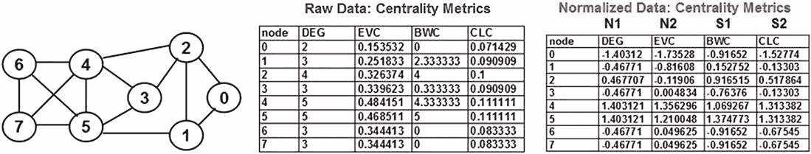

图 4.1: 示例图图以及顶点中心性指标的原始/归一化值。

### 4.2.1 归一化与符号

指标的归一化是使用指标原始值 `v` 的均值 `μ` 和标准差 `σ` 完成的，使得归一化指标数据 `(v−μ)/σ` 的均值和标准差分别为 0.0 和 1.0（即遵循标准正态分布）。为了符号方便，在本节中，基于区域的 `DEG` 和 `EVC` 指标分别表示为 `N1` 和 `N2`，基于最短路径的 `BWC` 和 `CLC` 指标分别表示为 `S1` 和 `S2`。让 `NS` 表示归一化数据集的矩阵版本，其维度为 8 × 4，其中 8 是图中顶点的数量，4 是中心性指标的数量（`N1`、`N2`、`S1` 和 `S2`）。

### 4.2.2 NS 的协方差矩阵及其划分

我们现在计算 `NS` 矩阵的协方差矩阵（参见 4.2）。协方差矩阵（也是对称的）中的元素是对应中心性指标之间的皮尔逊 `[5]`。例如，单元格 `(N1, S1)` 中的元素 `0.898146` 代表 `DEG` 和 `BWC` 之间的皮尔逊相关性。我们然后根据该矩阵生成子矩阵。子矩阵用对应中心性指标的符号 `NN`、`NS`、`SN` 和 `SS` 表示。也就是说，`NN` 代表对应 `N1` 和 `N2` 的行列单元格；`NS` 代表对应 `N1` 和 `S2` 的行列单元格；`SN` 代表对应 `S1` 和 `N2` 的行列单元格；`SS` 代表对应 `S1` 和 `S2` 的行列单元格。

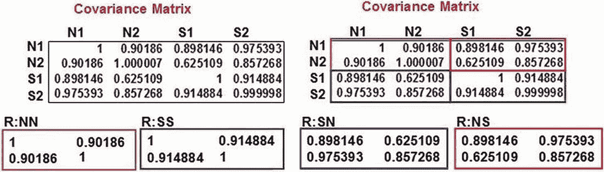

### 4.2.3 相关系数幅值的计算

`NS` 矩阵的相关系数幅值是基于基于子矩阵（均为 2×2）的 `N` 和 `S` 矩阵的主特征值，使用以下公式得出，并在 4.3 中所示：

- `N = Inverse(NN) ✶ NS ✶ Inverse(SS)`
- `S = Inverse(SS) ✶ SN ✶ Inverse(NN)`

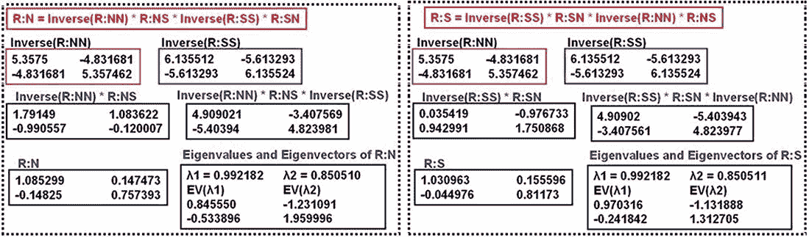

我们还计算 `N` 和 `S` 矩阵的两个特征值以及对应的特征向量。矩阵 `A` 标量特征值 `λ` 特征向量 `X`（列向量）满足性质 `AX = λX`。注意（来自 4.3) `N` 和 `S` 得到的特征值是相同的；但对应的特征向量元素是不同的。主特征值是两个特征值中较大的，对应的向量被称为主特征向量。在图 4.3 中，我们注意到对于 `N` 和 `S`，主特征值为 `0.992182`，它也对应于我们感兴趣的基于区域与基于最短路径中心性指标的相关系数值的平方根（0.9961）。但此时我们无法对该相关系数值的符号得出任何结论，这正是我们将在 4.2.4 节中感兴趣寻找的。

### 4.2.4 相关系数符号的计算

我们现在寻求为每个顶点寻找一个值（称为规范值），以捕捉两类中心性指标中每个类别的变化以及跨类别的变化。具体而言，我们将为每个顶点找到一个规范 `N` 值和一个规范 `S` 值，通过使用 `N` 和 `S` 主特征向量中的元素作为加权平均值，分别作为基于区域的中心性指标 `N1` (`DEG`) 和 `N2` (`EVC`）以及中心性指标 `S1` (`BWC`) 和 `S2` (`CLC`）的权重。例如，顶点 0 的规范 `N` 值为 `0.845550 ✶ DEG(0) + (−0.533896) ✶ EVC(0) = -0.2599519`，其中 `0.845550` 和 `-0.533896` 分别是 `N` 主特征向量中对应 `DEG`（也是 `N1`）和 `EVC`（也是 `N2`）的元素。


随后，我们绘制了图中（见图 4.4）所有顶点的规范 $N$ 值与规范 $S$ 值的图，并将该分布拟合为直线；该直线斜率的正负号即为规范相关系数的正负号。该直线拟合的 $R²$ 值是规范相关系数的大小（0.992182），它也应该对应于 4.2.3 节中图 4.3 中确定的主特征值值。在图 4.4 中，我们注意到直线（拟合了示例图的规范 $N$ 值与规范 $S$ 值）的斜率为正。因此，我们得出基于邻域的中心性指标与基于最短路径的中心性指标之间的规范相关系数为 +0.9961。规范相关系数如此正值表明，示例图中顶点基于最短路径的中心性指标值与基于邻域的中心性指标值之间存在强正相关。换句话说，如果此图中任何顶点的任何基于邻域的中心性指标具有高值，或在基于邻域的中心性指标上排名较高，那么该顶点在任何基于最短路径的中心性指标上也预期会获得更高的值，或在该指标上的排名同样较高。在图 4.1 中，我们观察到顶点 4 和 5 在 `DEG`、`EVC` 以及 `BWC`、`CLC` 上的排名均较高；顶点 0 的 `DEG`、`EVC` 以及 `BWC` 最低。

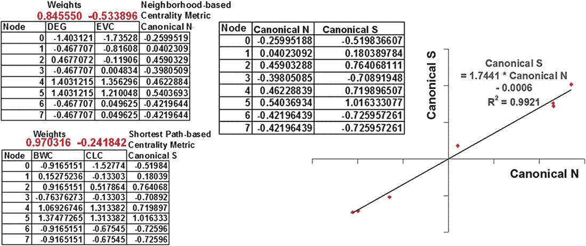
图 4.4：寻找规范相关系数的正负号。

### 真实世界图的规范分析

我们现在展示对 80 个真实世界网络进行的规范相关分析结果，这些网络的节点数量从 22 到 1,538 不（中位数为 143 个节点），边数从 38 到 16,715 不（中位数为 613 条边）。我们使用适当的算法计算了这些网络节点四个主要指标（`DEG`、`EVC`、`BWC` 和 `CLC`）的值。我们还计算了基于邻域的（`DEG`、`EVC`）指标与基于最短路径的（`BWC`、`CLC`）指标之间的规范相关值，并探讨了三个网络级指标的影响，例如`节点度的谱半径之率` [6]、`同类性指数` [7]以及`随机性指数` [8]对所得规范相关值的影响。图 4.5 展示了 80 个真实世界网络规范相关值的分布（按降序排列）。我们观察到 30 个真实世界网络具有负规范相关值，50 个具有正规范相关值。负规范相关值落在 [-1, ..., -0.79]，表示强负相关；而正规范相关值落在 [0, ..., 1]。在具有正相关值的 50 个真实世界网络中，有 37 个高于 0.79，表示强正相关。只有 1 个真实世界网络的规范相关系数在 (-0.79, ..., 0.53) 范围内。总体而言，80 个真实世界网络中的五之四（基于邻域的中心性指标）之间表现出强正相关或强负相关。这意味着顶点在另一类中心性指标上的排名更有可能是相同的（对于正相关网络）或更有可能是相反的（对于负相关网络）。

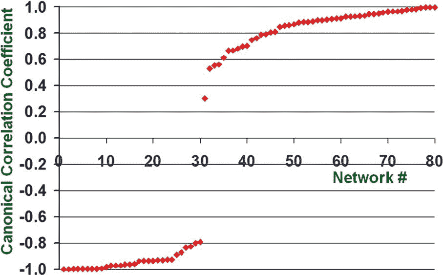
图 4.5：真实世界网络的规范相关系数值。

我们现在调查三个常用网络级指标（`同类性指数`、`随机性指数`和`节点度的谱半径之率`）对基于邻域与基于最短路径中心性指标规范相关值的影响。`同类性指数`（范围从 -1 到 1） [7]是网络中端顶点度相似性的衡量，计算方法为端顶点度之间的皮尔逊相关系数。同类性指数为正的网络被称为同类网络，同类性指数为负的网络被称为异类网络。`随机性指数`（范围从 -1 到 1） [8]是节点之间形成边缘的关联随机程度的衡量（而非由于任何优选依附）。`随机性指数`的计算方法为顶点度与该度顶点平均局部聚类系数之间的皮尔逊相关系数。随机性指数越大（即越远离 -1），节点以边缘形式关联的随机性越高；随机性指数越低（即越接近 -1），节点之间以边缘形式关联的偏好越强。`节点度的谱半径之率`（其值大于等于 1.0） [6]是节点度变异程度的定量衡量。`节点度的谱半径之率`是网络图邻接矩阵的主特征值与顶点平均度的比值；该值越偏 1.0，节点度的变异越大。注意，上述所有三个网络级指标的定量值都独立于网络中节点和边的数量。


[图 4.6] 展示了节点度谱半径比率与规范相关系数值之间的分布情况。我们观察到一个明显的模式：在 30 个规范相关系数为负值的真实世界网络中，有 28 个报告的节点度谱半径比率小于 3.0；在 20 个报告节点度谱半径比率大于 3.0 的真实世界网络中，有 18 个的规范相关系数为正值。这可以得结论：节点度变异显著较大的真实世界网络，基于邻域和基于最短路径的中心性指标之间更有可能表现出强正相关。我们还可以得出结论，如果一个真实世界网络的规范相关系数为负值，则其节点度谱半径比率可能小于 3.0（即该真实世界网络节点度出现显著变异的可能性较低）。

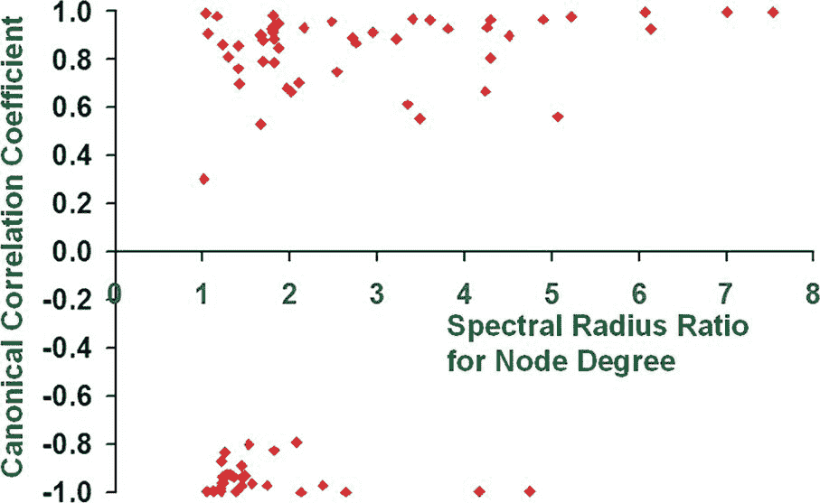

图 4.6: 规范相关系数与节点度谱半径比率。

[图 4.7] 展示了真实世界网络的同质性指数、随机指数与规范相关系数值之间的分布情况。与[图 4.6]不同，我们没有观察到任何明显的模式。[图 4.7]中关于网络级指标的分布似乎几乎是随机的。换句话说，基于邻域和基于最短路径的中心性指标之间的规范相关系数值似乎独立于边的度同质性，也独立于导致边形成的节点关联的随机程度。

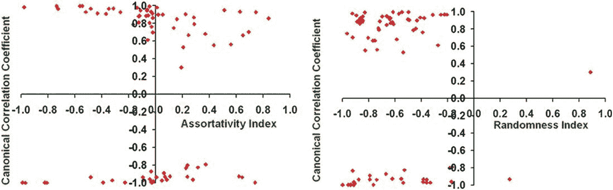

图 4.7: 规范相关系数与同质性指数及随机指数。

[表 4.1] 给出了某些（30 个）热门的基准真实世界数据集的规范相关系数值。我们可以观察到生物学网络和交通网络主要呈现正的规范相关系数值；而组织网络（如部门教职工网络、政治网络、游戏网络等）更有可能呈现负的规范相关系数值。

表 4.1: 某些基准真实世界网络的规范相关系数值。

| 真实世界网络 | 规范相关系数. | 真实世界网络 | 规范相关系数. |
| :--- | :--- | :--- | :--- |
| --- | | | |
| 斯洛文尼亚杂志网络 | -0.99883 | 海豚网络 | 0.76229 |
| --- | | | |
| 猫咪大脑网络 | -0.98458 | Erdos 971 网络 | 0.869162 |
| 98 足球世界杯网络 | -0.97529 | 扇鱼网络 | 0.881077 |
| 邻接名词网络 | -0.97305 | 美国机场 97 网络 | 0.884632 |
| 参议员会面 | -0.96466 | 悲惨世界网络 | 0.885322 |
| 英国教职工网络 | -0.93757 | Taro 交易所网络 | 0.908145 |
| 墨西哥政治网络 | -0.93563 | 欧洲航空运输网络 | 0.930042 |
| 卡拉比网络 | -0.93554 | Java 依赖网络 | 0.934391 |
| 乐队爵士网络 | -0.89191 | 铜田网络 | 0.945132 |
| Facebook 用户网络 | -0.93563 | Anna Karnina 网络 | 0.958253 |
| 韩国计划网络 | -0.80332 | 伦敦交通网络 | 0.964252 |
| 2000 美国足球网络 | 0.302123 | 酵母磷化网络 | 0.967014 |
| 欧洲道路网络 | 0.531523 | Perl 开发者网络 | 0.978418 |
| McCarty 社交合著网络 | 0.556008 | 浪者 CA 网络 | 0.981030 |
| 政治书籍网络 | 0.700493 | 猕猴支配网络 | 0.993647 |

### 4.4 中心性数据集的探索性因子分析

EFA 是机器学习中一种常用方法，用于量化数据中不同特征（列）背后的隐藏因子。对于当前的问题，特征是四个中心性指标（DEG、EVC、BWC 和 CLC），记录是顶点的中心性指标值。我们现在解释使用 4.2 节相同的示例图进行 EFA 的步骤。我们使用归一化的中心性指标值作为数据集，首先确定其协方差矩阵（见图 4.8）。协方差矩阵包含任意节点指标值之间的皮尔逊相关系数。

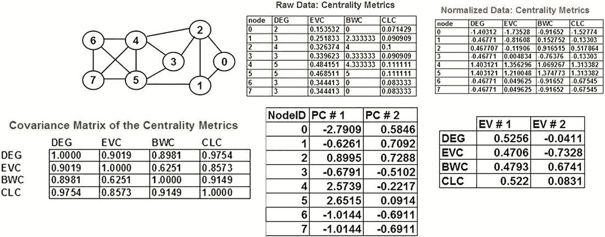

图 4.8: 示例图；中心性指标数据集；协方差矩阵及其保留的主成分和对应的特征向量。

然后我们确定协方差矩阵的特征值和特征向量。由于协方差矩阵是一个 4 × 4 矩阵（对应考虑的中心性指标数量），我们将得到四个特征值和对应的特征向量。我们将归一化的中心性指标数据集与每个特征向量相乘，得到对应的主成分。我们计算每个主成分的方差，并保留方差之和至少达到协方差矩阵行列数 99% 的前 `m` 个特征向量。保留的特征向量数量对应于能够支配数据集特征的隐藏因子数量。注意主成分中的项对应节点 ID，而特征向量中的项对应特征（在本例中为中心性指标）。我们将这些特征向量中每个项（中心性指标）的共同性分数称为该中心性指标因子载荷的平方和。


在示例图案例中，我们观察到前两个主成分的方差和（3.5950 和 0.3784）占 4（协方差矩阵的行/列数）的 99.33%，因此我们保留对应这两个主成分的特征向量（如图 4.8 所示）。保留的特征向量数量（示例图中为两个）对应于数据隐藏因素的数量，我们将这些特征向量中的元素视为因子载荷的初始值（衡量这些因子对中心性指标表示程度的尺度）。基于初始因子载荷的 DEG 指标公性量为 (0.5256)² + (−0.0411)² = 0.2779。同样，基于初始因子载荷的 EVC、BWC 和 CLC 指标的公性量分别为 (0.4706)² + (−0.7328)² = 0.7585、(0.4793)² + (−0.6741)² = 0.6841 以及 (0.5220)² + (0.0831)² = 0.2794。

特征（在本例中为中心性指标）的公性量（最大值为 1.0）是该特征在已识别因子中表示程度的定量衡量。最大方差旋转 [21] 是一种坐标旋转程序，用于相对于因子对特征（中心性指标）的载荷进行放，使得每个特征（中心性指标）的公性量最大化（在本例中，至少达到 0.98）。为了执行最大方差旋转，我们首先在坐标系中绘制出中心性指标的初始因子载荷（对于示例图，我们需要一个二维坐标系，因为 EFA 识别出两个因子来表示四个中心性指标），该坐标系被称为主特征向量轴；参见图 4.9 左侧的二维坐标系。最大方差旋转涉及特征向量坐标轴的重复正交同步旋转，直到每个特征载荷的平方和最大。我们使用 Python 中可可用库（Pandas [22]）进行了最大方差旋转。生成的旋转后坐标系中的轴（见图 4.9 右侧）对应于两个因子，该坐标系中特征的坐标代表了特征的最终因子载荷。

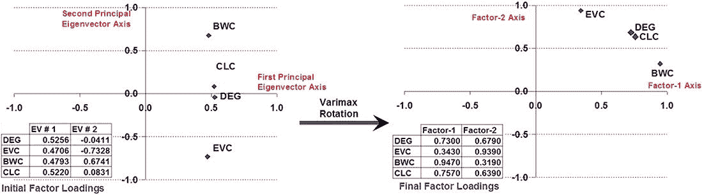

图 4.9：特征向量轴到因子轴的最大方差旋转。

最大方差旋转得到的四个中心性指标的最终因子载荷（位于图 4.9 右侧）为：DEG (0.7300, 0.6790)、EVC (0.3430, 0.9390)、BWC (0.9740, 0.3190) 以及 CLC (0.7570, 0.6390)。基于这些最终因子载荷，我们观察到 DEG、EVC 和 BWC 的每个公性量均大于 0.99，CLC 的公性量大于 0.98。为了识别可以被认为主导表示某一中心性指标的因子，我们选择最终因子载荷元组中值最大的因子。如果出现平局，我们认为该指标由所有并列的因子表示。请注意，通过进行最大方差旋转直到中心性指标的公性量至少达到 0.98，我们要求中心性指标的超过 50%（以及超过 70%）被三因子（或双因子）模型中的一个（或两个）因子表示。

### 4.5 真实世界图的探索性因子分析

我们现在展示对 80 个真实世界网络进行的 EFA，以识别数据集中隐藏因素的数量，并认为这些特征向量中的元素视为因子载荷的初始值（衡量这些因子对中心性指标表示程度的尺度）。我们想要识别是基于邻域的 {DEG, EVC} 还是基于最短路径的 {BWC, CLC} 占据主导地位。

基于初始因子载荷的 DEG 指标公性量为 (0.5256)² + (−0.0411)² = 0.2779。同样，基于初始因子载荷的 EVC、BWC 和 CLC 指标的公性量分别为 (0.4706)² + (−0.7328)² = 0.7585、(0.4793)² + (−0.6741)² = 0.6841 以及 (0.5220)² + (0.0831)² = 0.2794。


`图 4.10` 所示的 EFA 结果的一个重要观察是：`BWC` 和 `CLC` 指标（尽管在第 4.3 节中它们均被归类为基于最短路径的 `CCA` 指标）在 80 个真实世界网络中，有超过 90%（73 个）的网络被不同的因素主导。这可以通过这两个指标倾向于捕获的完全不同的底层特征来解释。`BWC` 指标倾向于识别大多数最短路径通信可能发生的节点；另一方面，`CLC` 指标倾向于识别在地理位置上更接近网络中其他节点的节点。我们的 EFA 结果显示，这两个特征确实是不同的，且不一定需要由同一个因子表示。

结合第 4.3 节的 `CCA` 结果，对于大多数在基于邻域和基于最短路径的中心性指标之间表现出强负（正）规范相关性的网络，我们观察到 `CLC` (BWC) 指标受同一因子（`Factor-1`）主导，该因子同样主导了 `DEG` 和 `EVC` 指标，而 `BWC` (CLC) 指标似乎被不同的因子（`Factor-2`）主导。注意，对于弱-中等规范相关的网络，`CLC` 指标被一个完全不同的因子（`Factor-3`，其主要只主导 `CLC` 指标）主导，而我们观察到 `BWC` 指标要么被 `Factor-1`（配合 `DEG`）或 `Factor-2`（配合 `EVC`）主导。上述关于 CCA 和 EFA 结果讨论表明，在两个基于最短路径的中心性指标之间，`BWC` 指标是一个相对更有优势的指标，其相对于两个基于邻域的指标的变化贡献了这两类中心性指标之间的整体相关性。

关于特定因子的主导程度，我们观察到 `BWC` 指标是被特定因子强烈主导的指标（主导因子的 `BWC` 载荷远大于非主导因子的 `BWC` 载荷），其次是 `EVC`。尽管 `DEG` 指标的主导因子与非主导因子的载荷值可以明显区分，但我们观察到 `DEG` 指标（在某种程度上也 `CLC` 指标）受特定因子的主导程度相对较低（特别是对于 24 个强负相关网络中的 23 个，两个因子的 `DEG` 载荷值均高于 0.4）。

### 4.6 相关工作

文献中报道了多项涉及真实世界网络数据集中心性指标的相关性分析。然而，这些相关性分析仅涉及两个中心性指标。据我们所知，除了我们在 `[19]` 中报告的早期工作外，尚未有其他涉及中心性指标的规范相关（`CCA`）研究。此外，我们的工作是第一项涉及四个主要中心性指标（`DEG`、`EVC`、`BWC` 和 `CLC`）进行 EFA，并结合研究 `CCA`-EFA 结果的工作。在本节的其余部分，我们回顾了近期文献中报道的相关性研究。在 `[11]` 中，两个基于邻域的 `DEG` 和 `EVC` 指标之间观察到强相关性，而对于不同领域的真实网络图，两个基于最短路径的 `BWC` 和 `CLC` 指标之间仅观察到中等相关性（这在 `[23]` 中也得到了证实）。`[11]` 使用了 `Pearson` 相关性分析。

在 `[12]` 中，作者使用 `Spearman` 秩相关分析来量化计算轻量的 `DEG` 指标在多大程度上可以代替计算密集型的 `EVC`、`BWC` 和 `CLC` 指标对顶点排名：观察到高度顶点更有可能是高 `BWC` 顶点，且可能更接近其他顶点；另一方面，观察到高度顶点并不一定是高 `EVC` 顶点。`[13]` 中报道的基于中心性的聚类结果表明，可能存在两个不同的节点簇：一个核心簇，其中组成节点在几项测量中具有最大的中心性指标值；和一个边缘簇，其中组成节点的中心性指标值较低。在 `[14]` 中，作者探索了最近提出的 `O(log²n)` 偷盗者游戏 (`GoT`) 节点中心性指标 `[15]` 与使用无标度、小世界和随机网络模型生成的合成网络的四个主要中心性指标之间的相关性（通过 `Pearson’s、Spearman’s 和 `Kendall’s` 相关性分析）：观察到 `GoT` 与 `DEG` 和 `BWC` 之间存在强负相关，而 `GoT` 与 `CLC` 之间存在弱负相关。

文献中报道了以下因子分析研究：在 `[25]` 考虑的五个中心性指标（值中心性 `[24]`、`BWC`、`CLC`、流中心性 `[25]` 和 Jordan 中心性 `[26]`）中，作者使用保留的主成分数量（与我们的方法类似）作为确定因子数量的依据，并将这些中心性指标在特征向量中的项视为因子载荷。相反，我们将特征向量中的视为中心性指标的初始因子载荷，并进行方差极大旋转以最大化共同性得分，同时利用生成的最终因子载荷来识别每个中心性指标的主导因子，并在强正、强负和弱-中等规范相关网络的背景下探索这些结果。此外，与我们的观察相似，`[25]` 中的作者也观察到 `BWC` 和 `CLC` 指标被两个不同的因子表示。同样，`[27]` 关于农业景观图论模型也观察到 `BWC` 和 `CLC` 指标被两个不同的因子表示，第三个因子则代表度和子图中心性指标。

### 4.7 结论与未来工作


典型相关性分析（CCA）的结果表明，在 80 个真实网络中，有超过五之四的网络基于邻域（`DEG`和`EVC`）与基于最短路径（`BWC`和`CLC`）的中心性指标之间存在强正或负典型相关。我们观察到分别有 24 个真实网络的典型相关系数值小于 `-0.90`（强负典型相关性的衡量标准），以及 25 个网络大于 `0.90`（强正典型相关性的衡量标准）。我们得出结论，其余网络（80 个中的 31 个）表现出弱到中等的相关性，其典型相关系数跨越了 `[-0.90, …, 0.90]` 的宽范围。我们还观察到节点度的谱半径比是一个影响性的网络级指标，它与两类中心性指标之间的典型相关性有关：我们的结果表明，如果一个真实网络出现负典型相关系数，它更有可能具有相对较低的节点度变异（节点度谱半径比小于`3.0`）；相反，如果一个真实网络表现出较大的节点度变异（节点度谱半径比大于`3.0`），它更有可能产生正典型相关系数。关于网络领域，我们观察到生物网络和交通网络主要呈现正典型相关系数值，而组织网络（如游戏网络、政治网络、大学部门网络等）更有可能呈现负典型相关系数值。

对同一组 80 个真实网络进行探索性因子分析（EFA）的结果表明，两个隐含因子（共同性得分高于`0.98`）就足以代表四个中心性指标（`DEG`、`EVC`、`BWC`和`CLC`），适用于强正和负典型相关网络；而对于弱到中等的典型相关网络，则需要三个隐含因子才能在统计上代表这四个中心性指标。我们观察到超过 90%的网络中`BWC`和`CLC`指标（尽管两者都是基于最短路径的中心性指标）由两个不同的因子代表；而两个基于邻域的中心性指标（`DEG`和`EVC`）在强正和负典型相关网络中由同一因子代表，在弱到中等的典型相关网络中由两个不同因子代表。此外，对于强正（负）典型相关网络，`BWC`（`CLC`）指标受与`DEG`和`EVC`指标相同的因子主导。

作为未来工作的一部分，我们计划建立一个基于线性典型相关的预测模型，该模型将使用四个中心性指标中的三个（例如`DEG`、`EVC`和`CLC`）作为自变量，并预测第四个指标（例如可能是计算量最大的指标`BWC`），并将此类预测准确性与现有的基于皮尔逊相关的单变量和多变量线性预测模型进行比较。

## 参考文献

[1] M. E. J. Newman, Networks: An Introduction, 1st Edition, Oxford, UK: Oxford University Press, September 2010. a, b

[2] P. Bonacich, Power and Centrality: A Family of Measures. American Journal of Sociology, vol. 92, no. 5, pp. 1170–1182, March 1987. a, b

[3] L. Freeman, A set of measures based on betweenness. Sociometry, vol. 40, no. 1, pp. 35–41, March 1977. →

[4] L. Freeman, Centrality in social networks. Social Networks, vol. 1, no. 3, pp. 215–239, 1979. →

[5] G. Strang, Linear Algebra and its Applications, 4th Edition, Pacific Grove, CA, 2006. a, b, c, d, e

[6] N. Meghanathan, Spectral radius as a measure of node degree for complex network. In: Proceedings of 3rd International Conference on Digital Contents and Applications, pp. 30–33, Hainan, December 20–23 2014. a, b, c

[7] R. Noldus, and P. Van Mieghem, Assortativity in complex networks. Journal of Complex Networks, vol. 3, no. 4, pp. 507–542, December 2015. a, b, c

[8] N. Meghanathan, Randomness index for complex analysis. Social Network Analysis and Mining, vol. 7, no. 25, pp. 1–15, December 2017. a, b, c

[9] U. Brandes, A faster algorithm for betweenness centrality. The Journal of Mathematical Sociology, vol. 25, no. 2, pp. 163–177, 2001. →

[10] T. H. Cormen, C. E. Leiserson, R. L. Rivest, and C. Stein, Introduction to Algorithms, 4th Edition, Cambridge, MA: MIT Press, 2022. a, b, c

[11] N. Meghanathan, Correlation coefficient of centrality metrics for complex networks. In: Proceedings of the 4th Computer Science Online, Intelligent Systems and Automation, Vol. 34, pp. 11–20, 2015. a, b

[12] C. Shao, P. Cui, P. Xun, Y. Peng, and X. Jiang, Rank correlation between centrality metrics: An empirical study. Open Physics, vol. 16, no. 1, pp. 1009–1023, December 2018. →

[13] S. Oldham, B. Fulcher, L. Park, A. Arnatkevici, C. Suo, and A. Fornitto, Consistency and differences between centrality measures across distinct classes of networks. PLoS ONE, vol. 022061, pp. 1–23, July 2019. →

[14] A. Ficara, G. Fiumara, P. De Meo, and A. Liotta, Correlation analysis of node and edge centrality in artificial complex networks. In: Proceedings of Sixth International Congress on Information and Technology, pp. 901–908, London, UK, September 2021. →

[15] D. C. Mocanu, G. Exarchakos, and A. Liotta, Decentralized dynamic understanding of hidden relations in complex networks. Scientific Reports, vol. 8, no. 1571, pp. 1–15, January 2018. →

[16] H. Hotelling, Relations between two sets of variates. Biometrika, vol. 28, pp. 321–377, 1936. →

[17] R. L. Gorsuch, Factor Analysis, 2nd Edition, Lawrence Erlbaum Associates, November 1983. a, b


[18] J. C. Loehlin, Latent Variable Models: An Introduction to Factor, Path, and Structural Equation Analysis, 4th Edition, Psychology Press, December 2003. a, b

[19] N. Meghanathan, Canonical correlation analysis of neighborhood-based centrality metrics vs. shortest path-based centrality metrics. In: Proceedings of the 19th International Conference on Data Science, Las Vegas, USA, July 24−27 2023. a, b

[20] P. Eaton, B. Frank, K. Johnson, and S. Willoughby, Comparing exploratory factor models of the brief electricity and magnetism assessment and the conceptual survey of electricity and magnetism. Physical Review Physics Education Research, vol. 15, no. 020133, pp. 1–11, 2019. →

[21] H. F. Kaiser, The varimax criterion for analytic rotation in factor analysis. Psychometrika, vol. 23, pp. 187–200, September 1958. →

[22] [`pypi.org/project/factor-analyzer/`](https://pypi.org/project/factor-analyzer/) →

[23] S. T. Hasson, and Z. Hussein, Correlation among network centrality metrics in complex networks. In: Proceedings of the 6th International Engineering Conference – Sustainable Technology and Development, pp. 54–58, Erbil, Iraq, 2020. →

[24] M. Suyudi, S. Firman, and A. T. Bon, Theoretical and simulation approaches centrality in social networks. In: Proceedings of the 11th Annual International Conference on Industrial Engineering and Operations Management, Singapore, March 2021. →

[25] L. C. Freeman, S. P. Borgatti, and D. R. White, Centrality in valued graphs: A measure of betweenness based on network flow. Social Networks, vol. 13, pp. 141–154, 1991. a, b, c

[26] P. Hage, and F. Harary, Eccentricity and centrality in networks. Social Networks, vol. 17, no. 1, pp. 57–63, January 2005. →

[27] E. Estrada, and O. Bodin, Using network centrality to manage connectivity. Ecological Applications, vol. 18, no. 7, pp. 1810–1825, October 2008. →

## 5 导航数据预处理领域：自动化机器学习平台的深度回顾

### 摘要
有效的数据预处理在增强机器学习（`ML`）性能方面起着至关重要的作用，影响着最终结果的准确性。在自动化机器学习（`AutoML`）发展的背景下，数据预处理的重要性变得日益突出。本章旨在探索并调研用于数据预处理的 `AutoML` 平台，重点关注这些工具如何简化 `ML` 模型的构建和训练。我们深入探讨了各种任务及其子任务，提供了如何在整个 `ML` 流程中利用 `AutoML` 的见解。

关键词：`AutoML`，自动化机器学习，数据预处理流水

### 5.1 引言
数据预处理是 `ML` 流水中的一个基本步骤，涉及数据清洗、整合和转换。这项工作对于准备数据并使其适用于机器学习至关重要。该任务通常是一个耗时且易出错的过程，可能会限制 `ML` 模型的性能 [1]。近年来，`AutoML` 获得了业界、学术界政府机构的广泛关注 [2]，特别是作为自动化 `ML` 过程各个方面的方法，通过减少 `ML` 流水中的重复活动，使研究人员能够专注于模型选择和超参数调优等高级别任务 [3]。同时，出现了更多适用于 `AutoML` 的工具和库，涵盖了大型商业平台和开源工具包，包括 `AutoGluon` [4]、`autossklearn` [3, 5]、`Auto-WEKA` [6]、`Microsoft Azure AutoML` [7]、`Datarobot` [8]、`Google Vertex AI` [9]、`H2O DriverlessAI` [10, 11]、`IBM Watson AutoAI` [12]、`MLjar` [13]、`SalesForce TransrifAI` [14] 以及 `TPOT` [15]。

本章是关于数据预处理 `AutoML` 最新进展的持续调研 [16]。我们讨论了可以自动化的不同数据预处理任务和子任务，并回顾了针对每个任务提出的不同 `AutoML` 工具。我们还讨论了数据预处理 `AutoML` 的挑战和局限性。

### 5.2 数据预处理流水
机器学习流水可能是一个复杂的过程，但对于构建准确可靠的 `ML` 模型来说是关重要的。数据预处理是 `ML` 流水的一个子集。如果不考虑初步的数据收集步骤，数据预处理是机器学习过程的第一步，如图 5.2 所示。一般而言，它包含四个主要任务，如图 5.1 所示：数据清洗、数据整合、数据压缩和数据转换 [17]。


数据清洗是消除或更改不、缺失、不必要或结构错误的数据的过程，以便为分析做好准备。众周知，数据清洗过程是任何数据预处理任务中枯燥且重复的阶段，尽管它是必不可少的。与其手动执行这些枯燥且重复的任务，不如使用 AutoML 工具自动处理这些任务，从而将人员释放出来去处理其他更有价值的任务。使用真实数据集启动数据清洗过程是常见的做法。该过程有助于识别和纠正数据中的错误。这可以通过删除重复记录（即数据去重）、检测并填充缺失值（即缺失值插补）以及处理离群值来实现[18]]。

* (1) `缺失值插补`：不完整的数据是真实数据集中面临的常见挑战，会对机器学习模型的效能产生负面影响。为了解决这个问题，插补变成了一个关键过程。尽管像均值插补或回归插补等传统方法存在缺点，但 AutoML 驱动的插补技术的出现已变得流行。AutoML 工具通过自动选择适用于数据集特定属性的合适模型（如回归或决策树）来简化插补过程。此外，还有多重插补和算法选择等替代方案可用[19]]。

* (2) `离群值检测`：异常识别（正式名称为离群值检测）在数据分析和机器学习中都起着至关重要的作用。其主要目标是确定偏离整个数据集的数据点。这些离群值通常被视为错误或不规则，会显著影响分析任务的结果。此目的采用了多种方法，包括利用均值、中位数和标准差等标准的统计技术。此外，基于距离的方法评估数据点与其邻居的接近程度，而聚类方法则将相似的数据点归类。机器学习方法通过使用在标记数据集上训练的算法，用于识别新数据中的离群值。对离群值的有效检测和管理有助于结果的准确性，确保模型不会受到异常数据的影响[20]]。AutoML 通过从一系列选项中选择最合适的离群值检测模型来简化这一过程，从而提高准确性。这种自动化不仅提高了效率，还让不同专业水平的用户更容易进行离群值检测。

* (3) `数据去重`：从数据集中识别并消除冗余或重复数据是一个关键过程，旨在提高数据质量、最小化存储需求并优化数据分析和机器学习程序的有效性。在这个领域中，AutoML 通过自动创建专门识别数据集中重复记录的模型证明了其益处[21]]。这反过来简化了……。此外，AutoML 工具可以高效管理……。

### 5.2.2 数据集成

数据集成是机器学习的关键部分。通过将来自多个源的数据合并到单个数据集中，ML 模型可以在高质量且无一致性的数据集上进行训练。这至关重要，因为机器学习模型的质量取决于数据。

1. `类别变量编码`：数据以不同的形式和形状出现。包含“颜色”或“类别”等非数值属性的变量需要转换为数值。AutoML 在自动选择适用于数据集的最优编码技术方面发挥着重要作用。存在多种方法，例如独热编码、标签编码和目标编码[22]]。

2. `数据合并`：数据集成，也称为数据合并，涉及来自不同源的数据的合并和整合。这一过程有多个用途，包括提高机器学习的精确性、获得对特定现象的更全面的理解以及生成新特征。

### 5.2.3 数据削减

数据削减是在减少数据集规模的同时保留尽可能信息的过程。这可以出于多种原因，例如为了优化 ML 算法的速度和性能，使数据更容易可视化[23]]。有几种技术可用于数据削减；例如，如果目标是通过识别和移除与当前任务不相关的特征来提高 ML 算法的性能，那么特征选择可能是最佳选项。如果目标涉及从现有特征创建新特征，那么特征提取可能是最佳选项[24]]。

1. `特征选择`：它涉及从机器学习数据集中选择最相关和最有价值的特征。AutoML 通过自动评估和选择特征（考虑它们对目标变量的重要性）来简化特征选择。这不仅减少了数据科学家的工作量，还增强了机器学习模型的性能。在此过程中采用了多种技术，如相关性分析、信息增益和递归特征消除 (`RFE`)。

2. `特征提取`：AutoML 工具经常使用特征选择、降维和特征工程等技术来优化特征集以提升模型性能。特征提取涉及从原始数据中选择并转换相关信息，为机器学习创建一组有意义的特征[25]]。

### 5.2.4 数据转换


数据转换通过修改既有属性，试图为原始数据提供更好的表示。解决维度灾难、后期提高模型泛化能力以及克服数据稀疏性是成功机器学习模型至关重要的 [[26]]。在这些步骤中，可以使用 AutoML 将原始数据转换为更适合机器学习算法的格式，包括数据归一化、数据缩放 [[27]]、从现有特征生成新特征（例如创建多项式或交互项），或从文本或图像中提取信息。AutoML 还可以用于在保留最重要的信息的同时减少数据集中的特征数量。

### (1) 数据归一化
数据归一化是标准化数据的过程，使其落在一个一致且可比较的范围内。这通常涉及对特征进行缩放，使其均值为 0、标准差为 1，或者将它们映射到特定范围，例如 [0, 1, 28]。归一化在机器学习中非常重要，因为它能确保不同特征对模型训练的贡献相等，并防止数值不稳定性。

### (2) 数据缩放
数据缩放是机器学习中一种预处理技术，用于将所有特征带到共同尺度，通常具有零均值和单位方差。它涉及调整特征的范围或尺度，通过最小最大缩放、`z-score normalization` 或小数缩放等方法实现。最小-最大缩放将数据设置在指定的范围内，而 `z-score normalization` 将其置于均值为 0、标准差为 1 的中心。另一方面，小数缩放通过使用 10 的幂将值带在 0 到 1 之间 [[27]]。

5.3 用于数据预处理的 AutoML 平台

在本节中，我们调查了一些处理上一节中讨论的数据预处理任务的 AutoML 平台；之后，我们将详细说明表 5.1 中的发现。

表 5.1：用于数据预处理的 AutoML 平台。

| AutoML 平台 | 数据清洗 | 数据集成 | 数据压缩 | 数据转换 | 参考文献 |
| :--- | :--- | :--- | :--- | :--- | :--- |
| MV imputation | 异常值检测 | 数据去重 | 类别变量编码 | 数据合并 | 特征选择 | 特征提取 | 数据归一化 | 数据缩放 |
| AutoGluon | Y | N | Y | Y | Y | Y | Y | Y | Y | [[4]] |
| | | | | | | | | | | | |
| AutoSklearn | Y | Y | Y | Y | Y | Y | Y | [[3]], [5]] |
| Auto-WEKA | Y | Y | Y | N | Y | Y | Y | [[6]], [29]] |
| Azure AutoML | Y | Y | Y | Y | Y | Y | Y | [[31]], [32]] |
| Datarobot | Y | Y | Y | Y | Y | Y | Y | [[32]] |
| Google Vertex AI | Y | Y | Y | Y | Y | Y | Y | [[9]] |
| H2O DriverlessAI | Y | Y | Y | Y | Y | Y | Y | [[11]], [32]] |
| IBM Watson AutoAI | Y | N | Y | Y | Y | Y | Y | Y | [[12]] |
| MLjar | Y | Y | Y | Y | N | Y | Y | Y | [[15]] |
| TransmogrifAI | Y | N | Y | Y | Y | Y | Y | Y | Y | [[33]] |
| TPOT | Y | Y | Y | Y | N | Y | Y | Y | Y | [[15]], [30]] |

在 Amazon AutoML 软件包 AutoGluon 中，该平台的主要目标是自动化机器学习过程，这包括特征工程、模型选择和超参数调优。然而，AutoGluon 在其流水线包含了一些基础的数据预处理子任务。这些任务包括处理缺失值、数值特征的缩放和归一化、类别变量的编码（如独热编码）、执行自动特征选择以及处理数据集中的类别不平衡问题 [[4]]。

Auto-WEKA、`AutoSklearn` 和 `TPOT` 是最早的 AutoML 工具。作为开源框架，这三个平台可以处理基础和高级的预处理任务，包括缺失值插补、数据归一化、特征选择和数据转换 [[3]], [5]], [[29]], [30]]。

TransmogrifAI 可以处理一些手动任务，如检测数据类型。这是数据预处理中的重要一步，因为它有助于确保数据被正确解释。它能够处理基础或复杂的数据类型（如货币、地址）[[14]], [33]]。然而，它在许多数据集上是不稳定的 [[34]]。

在 H2O DriverlessAI 中，用户可以对数据应用广泛的预处理技术，例如处理缺失值、编码类别变量、缩放数值变量以及处理异常值。平台还包括用于自动降维的特征选择和特征提取 [[11]]。

同时，Datarobot 和 Azure AutoML 的步骤与 H2O DriverlessAI；；都可以识别变量之间的关系并自动生成新特征以提高模型性能 [[32]]。

最近，Google 推出了其 Google Cloud AutoML 的新版本 Vertex AI。该平台拥有强大的数据预处理工具集。Vertex AI 可以处理更高级的数据转换技术，如降维、非线性特征转换或处理不平衡数据集。虽然可以使用其他 Google Cloud 工具（如 BigQuery 或 Dataflow）执行这些任务，但 Google 声称 Vertex AI 可以流畅地处理这些任务 [[35]]。

MLjar 是一个相对新的平台，于 2020 年发布。尽管如此，由于其用户友好的界面和强大的自动化机器学习能力，它受到了机器学习社区的高度关注。MLjar 提供了多种数据预处理选项，包括处理缺失值、类别编码、特征缩放和异常值检测 [[16]]。


尽管 `Auto-Sklearn` 能够快速创建最终的机器学习模型，但它无法处理缺失值。`Sklearn` 库的机器学习算法为该系统提供了基础。用户在使用 `Auto-Sklearn` 生成自定义参数的模型之前，需要对输入进行预处理 [32, 36]。

`IBM Watson AutoAI` 提供了一系列数据预处理能力，例如处理缺失值、特征缩放和特征工程 [37]。然而，该平台缺乏高级数据预处理、非线性特征变换、离群点检测或自定义特征选择算法。虽然可以使用平台的 `Python SDK` 执行其中某些任务，但这可能需要额外的编程和配置。

### 5.4 挑战

调研用于数据预处理的 `AutoML` 工具面临着诸多挑战，如跟上不断变化的工具格局、选择具有代表性的技术 set 以及实现对可用工具的全面覆盖。这些挑战要求研究人员保持信息更新，仔细选择纳入调研的工具，并注意覆盖所有现有工具的局限性。

虽然 `AutoML` 主要关注于创建可靠的 `ML` 模型，但许多 `AutoML` 工具在处理数据预处理工作方面并不有效，这仍然需要大量的人力，以及对 `AutoML` 工具生成的输出进行仔细的评估和验证 [32]。

### 5.5 结论

数据预处理是 `ML` 流程中的关键步骤；它涉及数据的清洗、整合、降维和转换，以便其用于训练 `ML` 模型。`AutoML` 工具越来越多地用于数据预处理任务。随着这些工具变得越来越先进，我们正通过将 `AutoML` 与可解释性方法相结合，来提高 `AutoML` 数据预处理的能力和有效性。随着 `AutoML` 变得普及，确保这些工具产生的结果是解释的至关重要。未来的研究可以关注将 `AutoML` 与可解释性方法（如反事实解释或可解释的 `ML` 模型）相结合。

### References

[1]Q. Yao, et al., Taking human out of learning applications: A survey on automated machine learning. arXiv Preprint arXiv:1810.13306, 2018. →

[2]M. Lee, et al., Current and future applications of Machine learning for the US Army, Tech.rep.US Army Research Laboratory Aberdeen Proving Ground United States, 2018. →

[3]M. Feurer, et al., Efficient and robust automated machine learning. In Advances in neural information processing systems, p. 28, 2015. a, b, c, d

[4]N. Erickson, et al., `Autogluon-tabular`: Robust and accurate automl for structured data. arXiv Preprint, arXiv:2003.06505, 2020. a, b, c

[5]Auto-Sklearn `Sklearn` AutoML Package. [`www.automl.org/automl/auto-sklearn/`](https://www.automl.org/automl/auto-sklearn/). Accessed: 2023-04-09. a, b, c

[6]C. Thornton, et al., `Auto-WEKA`: Combined selection and hyperparameter optimization of classification. In Proceedings of the 19th ACM SIGDD international conference on data discovery and mining, p. 847–855, 2013. a, b

[7]Microsoft Azure Machine Learning Service. [`docs.microsoft.com/en-us/azure/machine-learning/service/automated-ml`](https://docs.microsoft.com/en-us/azure/machine-learning/service/automated-ml). Accessed: 2023-04-10. →

[8]Datarobot Data preparation. [`www.datobot.com/platform/prepare-modeling-data`](https://www.datobot.com/platform/prepare-modeling-data). Accessed: 2023-04-09. →

[9]Google Vertex AI guide. [`cloud.google.com/vertexai/docs/beginners-guide`](https://cloud.google.com/vertexai/docs/beginners-guide). Accessed: 2023-04-10. a, b

[10]H2O Platform H2O Driverless AI. [`h2o.ai/platform/aicloud/make/h2o-driverless-ai`](https://h2o.ai/platform/aicloud/make/h2o-driverless-ai). Accessed: 2023-04-09. →

[11]E. LeDell, and S. Poirier, H2O automl: Scalable automatic machine learning. Proceedings of the AutoML Workshop at ICML, vol. 2020. a, b, c

[12]IBM Cloud Watson Studio AutoAI. [`www.ibm.com/cloud/watson-studio/autoai`](https://www.ibm.com/cloud/watson-studio/autoai). Accessed: 2023-04-10. a, b

[13]MLjar MLjar AutoML. [`mljar.com/automl/`](https://mljar.com/automl/).Accessed: 2023-04-09. →

[14]TransmogrifAI Automated machine learning for structured data. [`transmogrif.ai/`](https://transmogrif.ai/). Accessed: 2023-04-10. a, b

[15]R. S. Olson, and J. H. TPOT: A tree-based pipeline tool for automating machine learning. In: Workshop on automatic machine learning. PMLR. pp. 66–74, 2016. a, b, c

[16]A. Salhi, et al., Data preprocessing using AutoML: A survey. In: Proceedings of The 2023 World Congress in Computer Science, Computer Engineering,& Applied Computing (CSCE’23), p. 106, 2023. →

[17]C. Fan, et al., A review on data preprocessing techniques toward efficient and reliable knowledge discovery from building operational data. Frontiers in Energy Research, vol. 9, no. March, pp. 1–17, 2021. →

[18]F. Neutatz, et al., Data Cleaning and AutoML: Would an optimizer choose to clean?. Datenbank-Spektrum, vol. 22, no. 2, pp. 121–130, 2022. →

[19]M. A. Hernández, and S. J. Stolfo, Real-world data is dirty: Data cleansing and the merge/purge problem. Data Mining and Knowledge Discovery, vol. 2, pp. 9–37, 1998. →

[20]S. Ryan, P. Djukic, and T. Morris. Unsupervised outlier detection in time-series data. US Patent App. 16/540,414. Dec. 2020. →


[21] A. K. Elmagarmid, P. G. Ipeirotis, and V. S. Verykios, 重复记录检测：综述。IEEE Transactions on Knowledge and Data Engineering, 第 19 卷，第 1 期, pp. 1–16, 2006 →

[22] L. Yifeng, and A. Ngom. 机器学习中的数据集成。在: 2015 IEEE 生物信息学与生物医学国际会议 (BIBM), pp. 1665–1671, 2015, doi: 10.1109/BIBM.2015.7359925. →

[23] I. Czarnowski, and P. Jedrzejowicz. 用于机器学习和数据挖掘的数据削减算法。在: 应用人工智能的新前沿：第 21 届工业、工程和其他其他应用智能系统国际会议，IEA/AIE 2008 波兰弗罗茨夫，2008 年 6 月 18–20 日 论文集 21。pp. 276–285. Springer, 2008. →

[24] O. Stromann, 等. 基于 Google Earth Engine 的 Sentinel-1 和 Sentinel-2 时间序列的基于对象的地物分类的降维与特征选择。Remote Sensing, 第 12 卷，第 1 期, pp. 76, 2019. →

[25] H. Peng, F. Long, and C. Ding. 基于最大依赖、最大相关性和最小冗余互信息准的特征选择。IEEE Transactions on Pattern Analysis and Machine Intelligence, 第 27 卷，第 8 期, pp. 1226–1238, 2005 →

[26] K. Maharana, S. Mondal, and B. Nemade. 综述：数据预处理与数据增强技术。Global Transitions Proceedings, 2022. →

[27] M. Francia, J. Giovanelli, and G. Pisano, HAMLET: 通过结构化论证实现以人为中心的 AutoML 框架。Future Generation Computer Systems, 第 142 卷, pp. 182–194, 2023. a, b

[28] J. Sola, and J. Sevilla. 输入数据归一化对神经网络应用于复杂问题的重要性。IEEE Transactions on Nuclear Science, 第 44 卷，第 3 期, pp. 1464–1468, 1997, doi: 10.1109/23.589532

[29] M. Martin Salvador, M. Budka, and B. Gabrys. 使用扩展 WEKA 的多组件系统自动组合与优化。IEEE Transactions on Automation and Engineering, 第 16 卷，第 2 期, pp. 946–959, 2019, doi: 10.1109/TASE.2018.287643. a, b

[30] U. Garciarena, R. Santana, and A. Menduru. 使用 TPOT 进行分类中缺失数据的演化插补。arXiv Preprint: 1706.01120, 2017. a, b

[31] E. Opara, H. Wimmer, and C. M. Rebman, 使用 google、azure 和 IBM 云平台的 Auto-ML 安全数据分析。在: 2022 电力、计算机与能源国际会议 (ICECET), pp. 1–10, 2022, doi: 10.1109/ICECET5552.2022.987278. →

[32] A. Truong, 等. 向自动机器学习：AutoML 方法与工具的评估与比较。在: 2019 IEEE 第 31 届人工智能会议 (ICTAI), pp. 1471–1479, IEEE, 2019. a, b, c, d, e, f

[33] TransmogrifAI. [`readthedocs.org/projects/transmogrifai/downloads/pdf/stable/`](https://readthedocs.org/projects/transmogrifai/downloads/pdf/stable/). 访问日期：2023-05-30. a, b

[34] M. Bilal, 等. Auto-Prep：高效且自动的数据预处理流水。IEEE Access, 第 10 卷, pp. 107764–107784, 2022. →

[35] S. K. Karmaker, 等. AutoML 现状与未来。arXiv:2010.10777, 2020. →

[36] I. Popova, G. Revunk, and Y. Gapany, AutoML：现有实现审查。 a, b

[37] G. Kalpana, 等. 使用机器学习和数据科学预测二手车价格。International Journal for Applied Science and Engineering, 第 10 卷, pp. VII, 2022.

## 6 生成 XML

### 摘要
XML 是一种通用的机器读文本语言。几乎任何可以用文本形式表示的内容都可以编码为 XML。这对于具有层次级结构的高度结构化数据尤其如此。例如，可能希望记录一家拥有多个研究团队的公司的数据。每个团队内部都有领导、多名研究人员和一些技术人员。人员被分配到这些类别之一，使类别成为层次结构中的一级。每个个人的数据进一步结构化为姓名、入职日期、薪水等。这种结构化的层次结构可以很容易地在 XML 中表示。

### 6.1 引言
本文的一个版本发表于 CSCI 2023 [1]。XML 是一种传输结构化数据的语言。尽管 XML 语言相对简单，但创建 XML 文档是一个单调且容易出错的过程。DGL 通过自动强制某些规则解决了这个问题，允许创建 XML 数据。DGL 是一种生成随机数据的语言，主要用于测试和模拟。它还可以用于为神经网络训练大量的合成数据。输出可以是多种格式，并存储在文件、MySQL 数据库或 C++ 变量中。XML 文件和 DTD 可以单独或同时生成。

```xml
<Company>
  <AITeam>
    <Leader>
      <Person>
        <Name>Barnaby Jones</Name>
        <Salary>100000</Salary>
        <Address>1027 Alamo Ct. Dallas, TX</Address>
      </Person>
    </Leader>
    <Engineer>
      <Person>
        ...
      </Person>
    </Engineer>
    ...
  </AITeam>
  <Electronics>
    ...
  </Electronics>
</Company>
```


今天，存在许多极其巨大的数据集。遗传数据就是一个例子，还有许多其他例子。尽管如此，寻找具有特定属性的数据集非常困难。这使得软件测试变得困难，也使得训练深度学习软件变得困难。数据生成语言 `DGL` 可用于生成任何尺寸、任何所需属性的数据集。数据可以是简单的，也可以根据需要变得复杂。一旦生成，可能需要进一步将其编码为 XML 格式。`DGL` 的 XML 特性可以通过直接生成 XML 格式的数据来克服这一困难。

### 6.2 DGL

`DGL` 已用于为硬件和软件测试生成随机数据 [2, 3, 4]。其原理是概率上下文无关文法 [5]。最近，`DGL` 的能力已经扩展到可以用几种不同的方式生成数据。`DGL` 代码现在可以嵌入到 C++ 中，并且数据生成器可以作为子程序被创建。数据可以在内部 C++ `变量` 中生成。在生成 XML 时，通常会生成一个或多个独立的文件。可以同时生成一个 `.xml` 文件及其定义的 `.dtd` 文件。可以同时生成许多文件。

最初，所有数据都需要包含在 `DGL` 规范中。升级后的版本不再允许从外部文件或 MySQL 数据库加载数据。然而，输出可以同时写入多个文件。数据生成子程序可以访问并修改 C++ 变量，并且可以创建和编辑数据库。

`DGL` 语言的基本单元是产生式（production）。代表完整规范的产生式集合称为 `grammar`（文法）。对起始符号（默认是“main”）的每次引用都会产生一个数据项。对于数据生成子程序，每个子程序调用都会对“main.”进行单次引用。嵌入的 `DGL` 直接在代码内部执行。

大多数产生式都有几个备选方案，如下。

```
main: red,green,blue;
```

“main”指的是产生式的名称，它提供了三种可能的方案。当通过非终结符 `%{main}` 调用“main”时，将等概率随机选择三个方案之一。可以通过应用权重来调整概率，如下例。

```
main: 2:red,1:green,3:blue;
```

权重导致“red”被选中的次数是“green”的两倍，依此类推。权重通常是可选的，但有时为了确保递归文法生成有限字符串是必须的。文法中的产生式数量是不限制的。产生式使用非终结符引用，其形式为 `%{name_of_production}`，如引用 `%{main}`。终结符和非终结符可以任意混合。以下文法生成形式为 `ab, aabb, aaabb, … a^n b^n` 的字符串。

```
main: %{main}b,”;
```

以下文法段可以生成无限字符串，必须用权重进行增强。

```
Exp: %{var}, %{Exp} “+” %{Exp} “*;
var: a,b,c;
```

如果 `Exp` 的备选方案以 2/3 的概率增长，1/3 的概率变小，为了防止问题，应该使用权重。

```
Exp: 3:%{var},1:%{Exp} “+” %{Exp} “*;
```

可以使用更大的权重。重的相对大小可以控制生成字符串的平均长度。

各种类型的产生式由其后面的关键字指定。`DGL` XML 特性使用了许多此类产生式。没有关键字的产生式被称为普通产生式。`sequence` 产生式导致按顺序生成，而不是随机生成。

```
X: sequence red,blue;
```

`unique` 产生式导致在不替换的情况下选择备选方案。

```
Y: unique red,blue;
```

额外的关键字可以用于当没有剩余选择时。最强大的产生式类型是 `variable`：

```
V: variable;
```

`V` 产生式作为一个带有变量的右侧产生式工作。特殊非终结符 `%{X}` 从“X”中选择一个并将其赋值为 `V` 的右侧。这些终结符不产生任何输出。如果“X”被定义为如下，值“red”将赋值给“V”。

```
X: %{V};
```

`DGL` 编译器通常会生成 C++ 代码来产生数据。嵌入的 `DGL` 由 `DGL` 编译器预处理，其生成代码与 C++ 代码相同，创建一个创建一个独立的子程序。

### 6.3 XML 输出

XML 产生式产生语法输出，但语义考虑（例如具有单个根元素）是用户的责任 [7, 8]。虽然可以使用正则产生式生成格式良好的 XML，但这种方法耗时且容易出错。提供 XML 产生式是为了简化流程并增强其可靠性。

最常用的 XML 产生式是 `XMLHDR`、`XMLTYPE` 和 `XMLTAG`。`XMLHDR` 产生式和 `XMLTYPE` 产生式仅调用一次以创建 XML 头。`XMLTAG` 产生式和其他不常用的产生式用于生成文件的其余部分。

#### 6.3.1 A. XMLTAG 产生式

`XMLTAG` 产生式将生成大部分 XML 数据。`XMLTAG` 产生式生成开始和结束标签，从而防止标签缺失错误。考虑以下示例。该产生式将生成 `<root>` 和 `</root>` 标签，中间包含内容。`%{othercontent}` 非终结符用于在这标签之间生成内容。

```
content: xmltag root,%othercontent};
othercontent: xmltag root, “Just one line.”;
```

“content”产生式生成的数据是：

```
<root>Sorry, just one line.</root>
```

通常，`%{othercontent}` 非终结符将作为生成内容的子文法的起始符号。为了生成图示数据，有必要直接或间接地从“main”产生式调用 `othercontent` 产生式，如下例所示。

```
main: %{content};
```

如果需要属性，可以添加第三种备选方案来生成它们。`xmlattr` 产生式可以简化它们的生成，或者可以使用纯文本。以下示例展示了如何这样做。

```
content: xmltag root,%othercontent},%{attr};
attr: type,25;
```

结果数据将是：

```
<root type=“25”>Just one line.</root>
```

现在是一个更复杂的示例：该示例是用于生成牌牌 `DGL` 文法的简化版本（图 6.1）。

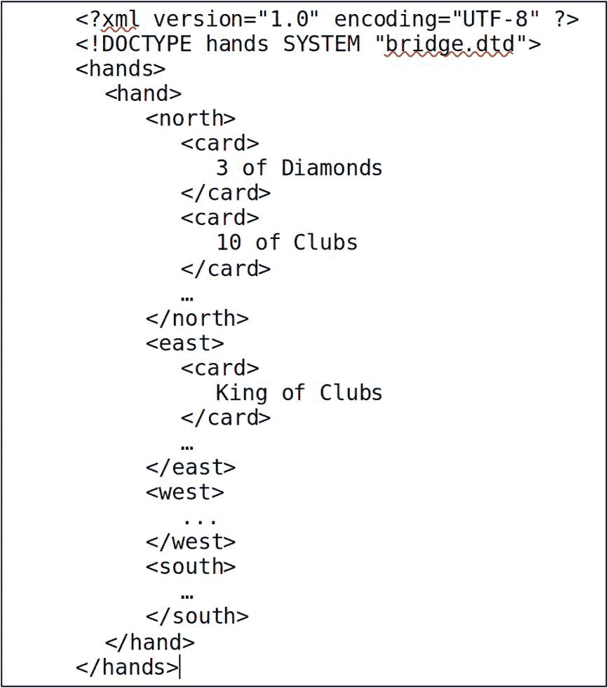

图 6.1: 生成的 XML 格式示例。


文件的根元素是 `<hands>`。在 `<hands>`</hands>` 标签内将包含一个或多个 `<hand>`</hand>` 标签，其中包含四只手中牌片的列表。这四只手包含四对标签 `<north>`</north>`、`<east>`</east>`、`<west>`</west>` 和 `<south>`</south>`。每只手将包含三个 `<card>`</card>` 标签，包含牌片的名称（图 6.2）。


图 6.2：包含牌片名称的三个 `<card>` 标签的表示。

前五个产生式用于管理工作，将在后面的章节中解释。

“body”产生式生成根元素的 `<hands>`</hands>` 标签，并引用“hand”产生式生成单个 `<hand>`</hand>` 标签实例。在实践中，将使用更复杂的机制来生成多个 `<hand>`</hand>` 标签实例。“hand”产生式生成 `<hand>`</hand>` 标签，而“news”产生式生成四只十三张手的。在 north, east, west 和 south 中的 `%13{card}` 非终结符调用非终结符 `%{card}` 十三次。

“card”产生式生成 `<card>`</card>` 标签，并从“Deck”产生式中进行选择。“Deck”产生式包含所有 52 张牌的名称并进行不放回选择。“Deck”的备选方案使用宏 `!Number` 和 `!Suit` 生成。（当在同一个备选方案中使用两个或多个宏时，将生成宏值的每个唯一组合。在这种情况下，将生成 52 个备选方案。）

#### 6.3.2 B. XMLATTR 产生式

标签属性通常通过 `xmlattr` 产生式创建，如下所示。

```
K: xmlattr,red;
```

此产生式产生字符串：`Color="red"`

值将被封装在双引号中，并且 XML 字符将得到正确转义，如下所示。

```
X: xmlattr,"&&><";
```

反之，此产生式将生成：`str="&amp;&amp;&gt;&lt;"`

#### 6.3.3 C. 生成头部

XML 文件的各个部分、头部行、类型声明和内容由如下文法产生。请记住，“main”是起始符号。

```
main:%{header}%{typedecl}%{content};
header: xmlhdr 1.0, UTF-8;
typedecl: xmltype root,”root.dtd”;
```

DGL 用户对 XML 行有完全控制权。可以使用以下方法生成默认头部。

```xml
<?xml version="1.0" encoding="UTF-8" ?>
```

额外的备选方案提供了更大的控制能力。以下产生式演示了选项范围。

```
H: xmlhdr 1.1, “UTF-16”,yes;
H: xmlhdr 1.0, “UTF-16”;
H: xmlhdr 2.2;
```

这些产生式产生如下：

```xml
<?xml version="1.1" encoding="UTF-16" standalone="yes">
<?xml version="1.0" encoding="UTF-16">
```

可以指定三个以上的备选方案。`standalone` 产生式的 `standalone` 属性。虽然这些数据在语法上是不正确的，但它是为了未来的扩展而包含的。目前，头部仅包含三个属性。`standalone` 产生式有 1、2 或 3 个备选方案：根元素名称、dtd 文件名以及用于生成内部 dtd 数据的子文法的起始符号。如果没有指定第二个备选方案，或者指定为 ""，则没有 dtd 文件。（等等，让我重新检查文本中“超过第三个直接插入到 `standalone` 属性中”那部分）。

`xmltype` 产生式可用于定义外部 DTD 文件、内部 DTD 语句或两者兼有，如下所示。首先，假设存在以下产生式，它将在稍后的章节中解释。

```
internal: xmlent author,”Peter M. Maurer”;
T: xmltype root,abc.dtd,%{internal};
T: xmltype root,”,%{internal};
T: xmltype root;
```

这些产生式产生如下 XML 输出。

```xml
<!DOCTYPE root SYSTEM "abc.dtd" [
<!ENTITY author "Peter M. Maurer">
]>
```

文件 `abc.dtd` 可以是现有文件，也可以由 DGL 同时生成。需要注意的是，XML 文件中的 `DOCTYPE` 是可选的。

### 6.4 额外的 XML 文件产生式

几乎所有的 XML 数据都可以使用 `xmltag`、`xmlhdr`、`xmltype` 和 `xmlattr` 产生式类型生成。额外的产生式可以简化某些类型数据的生成。这些数据使用产生式类型 `xcdata`、`xstring`、`xmlcomm` 和 `xmlpi` 生成。

#### 6.4.1 A. XCDATA 产生式

`xcdata` 产生式用于创建 CDATA 区域，它可以出现在任何地方。它的功能与标准产生式类似，生成 CDATA 区域。如果有多个备选方案，将随机选择一个。对于更具体的选择，`xcdata` 产生式可以有一个引用所需特性的单个备选方案。下面的示例说明了此产生式的工作原理。

引用 `X` (`%{X}`) (图 6.3(a)) 将产生随机选择的字符串之一。

然后，连续三次引用 `Y` (`%3{Y}`) 将按照给定顺序产生 图 6.3(c) 中的字符串。

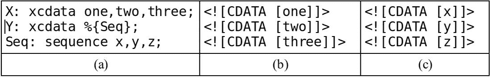

#### 6.4.2 B. XSTRING 产生式

`xstring` 产生式为向 XML 文件插入特殊数据提供了另一种方法。它的运行方式与标准产生式类似，但会生成带有正确转义 XML 特殊字符的双引号字符串。下面的示例演示了这一点。

```
X: xstring abc,”<>\\”\\’&5”;
```

此产生式随机生成以下两个字符串之一。

```
“abc”
“&lt;&gt&quot;&apos;&amp;5”
```

Xstring 产生式可用于生成属性值以及任意数据。

#### 6.4.3 C. XMLCOMM 产生式

复杂的 XML 结构通常需要注释。它们在首次创建 XML 文档时特别有用。注释的结构很复杂，本身可能是错误的来源。`xmlcomm` 产生式用于以正确的语法向 XML 文档添加注释。

如果 `xmlcomm` 产生式包含多个备选方案，将随机选择一个并封装在适当的 XML 注释语法中。以下示例演示了这一点。

```
C: xmlcomm apes,oranges,yellow;
```

此产生式将随机生成以下注释之一。

```xml
<!– apes –>
<!– oranges –>
<!– yellow –>
```

#### 6.4.4 D. XMLENT 产生式


某些 XML 文件包含重复数据或目的难以理解的数据。使 XML 文件构建更简单的一种方法是使用实体（entities）。实体是一个被赋予助记名称的文本字符串，比原始文本短，并具有一个标识性助记。以下是之前一个示例的一部分：

```
internal: `xmlent` author, “Peter M. Maurer”;
```

该语句生成了一个名为“author”的实体的定义，其包含数据“Peter M. Maurer”。在文中，字符串 `&author;` 将替换为“Peter M. Maurer”。

这四种类型为：

1. 替换实体
2. 外部实体
3. 参数实体，以及
4. 外部参数实体。

`xmlent`、`xmlentx`、`xmlentp` 和 `xmlentpx` 用于生成这些元素，它们都共享相同的结构。通用格式如下：

```
K: `xmlent` saying,”When in the course of human events”;
```

该产生式生成了以下实体声明。

```xml
<!ENTITY saying “When in the course of human events” >
```

一旦声明了该实体，文本中任何出现 `&saying;` 的地方将被替换为“When in the course of human events”。如果需要，实体值将包含 XML 转义字符。引用 `&saying;` 不能在 DTD 文件或内部 DTD 数据中使用。

`xmlentx` 产生式用于包含外部文件。

```
K; `xmlentx` std,std.xml;
```

上述产生式生成以下实体声明。

```xml
<!ENTITY std SYSTEM “std.xml” >
```

实体声明将导致 `&std;` 被替换为文件 `std.xml` 的内容。引用 `&std;` 不能在 DTD 文件或内部 DTD 数据中使用。

通过 `xmlentp` 和 `xmlentpx` 生成的参数实体创建了可以在 DTD 数据和 DTD 文件使用的实体。`xmlentp` 和 `xmlentpx` 产生式与 `xmlent` 和 `xmlentx` 几乎相同。

```
K: `xmlentp` saying,”When in the course of human events”;
J; `xmlentpx` std,std.dtd;
```

这两个产生式生成了以下实体声明。

```xml
<!ENTITY % saying “When in the course of human events” >
<!ENTITY % std SYSTEM “std.dtd” >
```

参数实体只能在 DTD 文件或内部 DTD 数据中引用。引用分别写为 `%saying;` 和 `%std;`。

### 6.4.5 E. XMLPI 产生式

`xmlpi` 产生式生成 XML 处理指令。第一个备选项指定目标，第二个备选项提供传递给目标的参数。参数字符串是灵活的，取决于目标应用程序。可以使用其他的 XML 产生式来生成此数据。这里有一个简单的示例。

```
A: `xmlpi` “xml-stylesheet”, “type=\\”text/xsl\\” href=\\”style.xsl\\”“;
```

该产生式生成以下 XML。

```xml
<?xml-stylesheet type=“text/xsl” href=“style.xsl” ?>
```

### 6.5 DTD 产生式

除了生成 `.xml` 文件，DGL 还能产生 `.dtd` 数据。这些数据可以放在 DTD 文件中，也可以嵌入 DOCTYPE 语句中。`xmlcomm` 产生式向 dtd 数据中插入注释，而 `xmlentp` 和 `xmlentpx` 产生式可以定义参数实体。

#### 6.5.1 A. XMLELEM 产生式

使用 `xmlelem` 产生式创建元素声明。第一个备选项提供正在定义的标签名，第二个备选项指定类型定义。两个备选项都可以包含非终端符，单独或共同包含。以下是一些示例。

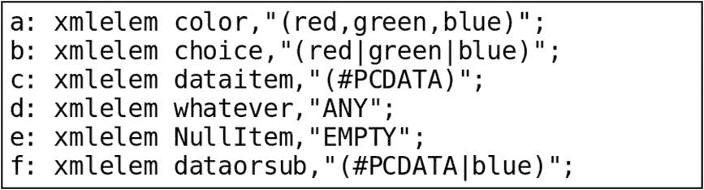

图 6.4：`xmlelem` 产生式的用法示例。

这六个产生式（图 6.4）将产生图 6.5 中的元素定义。


对于某些类型的仿真，必须提供门延迟（gate delay）。这可以通过 `<gate>` `</gate>` 标签内部的标签或通过属性来实现。要使用属性，请将以下两个产生式替换：

```
gate1: xmltag gate,%{type}%{inputs1}%{outputs1};
gate2: xmltag gate,%{type}%{inputs2}%{outputs2};
```

替换为：

```
gate1: xmltag gate,%{type}%{inputs1}%{outputs1},%{d1};
gate2: xmltag gate,%{type}%{inputs2}%{outputs2};%{d2};
d1: xmlattr delay,2;
d2: xmlattr delay,3;
```

这些更改将导致上述两个 `<gate>` 标签显示为：

`<gate delay\=“2”>`

和：

`<gate delay\=“3”>`

可以使用多次实例 `xmlattr` 产生式来插入多个属性。

### 6.7 依赖性数据生成

DGL 允许生成具有许多不同内部依赖的数据。例如，假设我们有一段 XML 用于生成不同颜色的盒子。这些盒子有类型 A 或 B。类型 A 的盒子为红色、绿色或蓝色。类型 B 盒子为棕色、白色或黑色。该 XML 具有以下格式。

```xml
<box>
<type>
A
</type>
<color>
red
</color>
</box>
```

该段落的 DGL 如下所示。

```
Box: xmltag box,%{stuff};
stuff: %{type}%{color};
colortype: variable;
type: A%{cA.colortype},B%{cB.colortype};
color: %{colortype}
ctA: red, green, blue;
ctB: brown, white, black;
cB: %%{ctB};
cA: %%{ctA};
```

在这个示例中，`colortype` 是一个变量，执行时将包含非终端符 `%{ctA}` 或非终端符 `%{ctB}`。这些非终端符代表类型 A 和类型 B 盒子的颜色集合。生成盒子类型同时也会在变量 `colortype` 中存储正确的产生式引用。当引用 `colortype` 时，将从正确的产生式中生成颜色。

### 6.8 增强型桥牌示例

以下语法法（图 6.8）是生成桥牌牌语法法的全文。

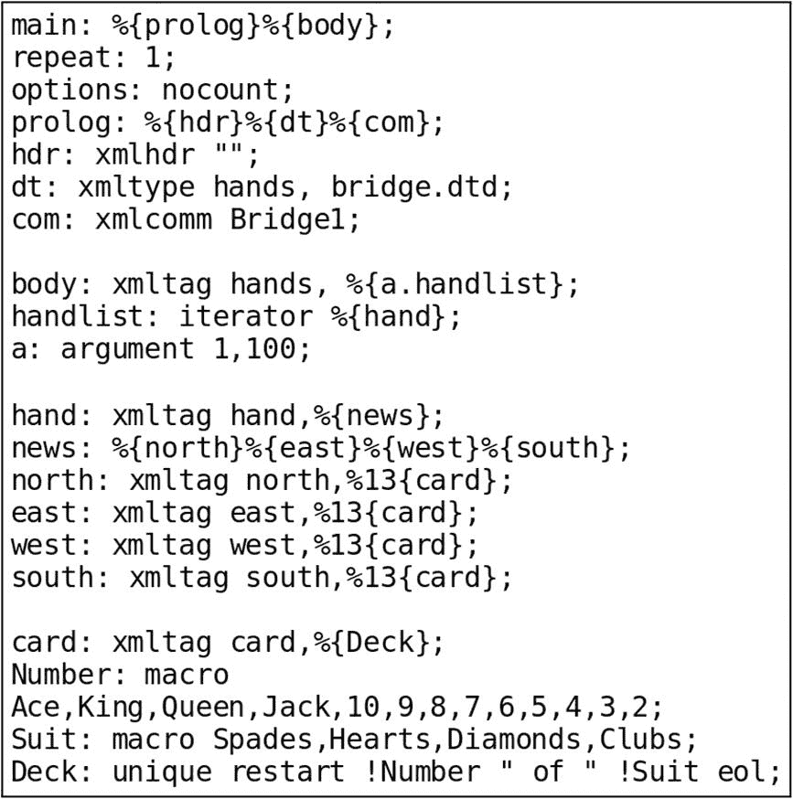

图 6.8：生成桥牌牌的完整语法法。

第二和第三条语句消除了重复计数，该计数默认值为 100。通常情况下，在创建独立的数据生成器时，重复计数决定了对 `main` 产生式进行内部引用的次数。在调用数据生成器时，命令行上的第一个参数将覆盖 100 的默认值。示例中的 `repeat` 语句将默认重复计数设置为 1，而 `nocount` 语句防止了来自命令行的覆盖。命令行上的第一个参数不再指的是对 `main` 的引用次数。相反，该参数将用于确定在 `<hands>` `</hands>` 标签之间出现 `<hand>` `</hand>` 的次数。以主体产生式开三个产生式实现了这一功能。`handlist` 产生式是一个迭代器，会导致单个备选项被调用指定的次数。为了实现这一点，需要使用形式如 `%{20.handlist}` 的非终端符，这将导致 `handlist` 被引用 20 次。`argument` 产生式获取命令行参数的值。在示例中，获取了参数 1，如果没有参数 1，则使用 100 代替。（参数 0 是正在执行的文件名）。主体产生式中的非终端符 `%{a.handlist}` 导致生成指定数量的牌。其余的规范与上一个示例中提出的相同。

### 6.9 结论

DGL XML 特性极大地简化了 XML 的生成。DGL 提供的广泛产生式使得生成可以根据需要变得复杂或简单。此外，XML 特性易于使用。仅需几分钟即可将桥牌示例转换为 XML。我们相信，XML 特性将显著提高 DGL 在现代软件测试和运行需要 XML 格式输入的仿真方面的用途。

## 参考文献

[1]P. Maurer, and J. Carbone, Generating Random XML Files Using DGL, CSCI, 2022. →

[2]P. Maurer, Generating test data. In: IEEE Software, 4, pp. 50–56, 1990. →

[3]P. Maurer, The design and implementation of a grammar-based generator. In: Software Practice and Experience, 22, 3, pp. 223–244, 1992. →

[4]P. Maurer, DGL reference 2.0. [`cs.baylor.edu/~dgl`](http://cs.baylor.edu/~dgl). →

[5]T. L. Booth, and R. A. Thompson, Applying probability measures to abstract languages. In: IEEE Trans. Computers, pp. 442–450, May 1973. →

[6]P. Maurer, Generating random bridge hands: A study in data. In: Proceedings of the International Conference on Modeling, Simulation & Visualization, 2020. →

[7]T. Bray, J. Paoli, C. M. Sperberg-MCQueen, E. Maler, and F. Yergeau, (eds.), Extensible Markup Language (XML) 1.0, 5th Edition, W3C Recommendation, 26 November 2008. →

[8]T. Erik, and E. Ray, Learning XML, 2nd Edition, Sebastopol, CA: O’Reilly Media, October 14, 2003. →

# 应用与案例研究

## 7 探索自闭风险：深度研究图神经网络和基因交互数据

Danushka Bandara Kyle Riccardi

### 摘要

自闭谱系障碍 (ASD) 有许多遗传连接可以在基因关联网络中表示。这些网络可以转换为图数据结构，并使用图神经网络模型进行进一步研究，以进一步研究这些基因与 ASD 的关联。我们的任务显示 Graph Sage 包含 84.03% 的准确率，ROC 曲线下面积 0.85。该模型进一步研究了图神经网络模型在理解基因网络相关的 ASD 关联的能力。该模型通过灵敏度 0.96 和特异性 0.94 进一步检验。

关键词：图卷积网络 (GCN), Graph Sage, 自闭谱系障碍(ASD),

### 7.1 引言


自闭症谱系障碍（ASD）是一种基于遗传关联和其他原因导致的社交沟通或感觉-运动功能缺陷[21]。这种遗传关联得到了 Tick 等人对双生胎遗传率数据分析的支持[28]，该分析确定了 ASD 的遗传率率范围在 64% 到 91% 之间。Tick 等人还指出遗传学与神经发育障碍之间存在 0.98 的相关性。新发突变进一步表达了遗传继承对 ASD 的影响，因为这些遗传突变特异性地发生在家庭（父亲、母亲和孩子）中干细胞分裂和女性配子成熟的过程中[26]。这些遗传突变基于家庭成员之间发现的突变，从而决定了携带 Tick 等人分析中所示的高遗传率的新发突变[11, 15, 29]。在《临床神经病学手册》[25]中，ASD 的联系与根据染色体位置（位点）和可能的遗传风险之间的遗传连锁所确定的约 1,000 个基因有关。Alarcón 等人[2]对染色体区域 7q 和 17q 进行了全面研究，发现 7q2-35 区域与 ASD 存在强关联性，同时注意到其他区域（如染色体 3q）也可能与 ASD 关联。拷贝数变异（CNV）是添加、删除或复制脱氧核糖核酸（DNA）部分的过程[27]。CNV 显示了位点之间的确切联系。另一种遗传关联是常见变异，它显著影响 ASD。Grove 等人[4]使用了全基因组研究来确定风险。常见变异在大多数疾病中都具有重要意义，因为它们与 90% 的个体差异有关[7]。从个体角度来看，常见变异意义有限，但通过将所有变异整合在一起，我们可以确定风险[3]。常见变异在评估 ASD 时占了风险因素的 40%-60%[17]。在所有变异和遗传突变之间，我们看到这些突变在网络中连接。Kolchan 等人将基因网络描述为以协调方式的一的一基因[10]。可见，常见变异、新发变异和 CNV 都是基因协同作用的产物，这种功能产生了具有高 ASD 风险的变异。这些变异结合形成了一个连接整体的基因网络，向我们展示了基因的关联或非关联性[24]。我们提出的实验使用这些基因网络和图神经网络来确定基因是否与 ASD 相关。我们使用的特定图神经网络模型是 `GraphSAGE` 和 `GCN`[13, 16]。在该实验中，我们将根据基因与自闭症风险相关的概率来确定基因是否与 ASD 相关。

    本章描述了发现自闭症风险基因的方法和模型。7.2 节包含了自闭症风险分类现状的文献综述。预处理和模型结构见 7.3 节。7.4 节概述了为了测试模型而进行的实验。7.6 节在自闭症风险分类的背景下讨论了结果。我们在 7.7 节进行总结，重申本项研究的重要发现和意义。

    ### 7.2 相关工作


该领域的最先进技术包含多种方法。

### 全基因组关联研究 (GWAS) 
这是一种用于寻找与特定疾病或性相关的遗传变异的方法。它通过比较患有该疾病或性的人的 DNA 与不患有该疾病或性的人的 DNA 来实现。Bralten 等 [6\] 使用 `GWAS` 发现了自闭症谱系障碍（ASD）之间的遗传共享与“儿童行为”、“刻板行为”和“关注细节”等自闭症特征之间的联系。Grove 等 [4\] 利用该技术发现了五个与自闭症风险相关的全基因组显著位点。

### 基于网络的机器学习 (NBML)
NBML 是一种机器学习机器学习方法，它利用基因网络的拓扑结构来预测自闭症风险。NBML 模型学习网络中基因之间的关系，并利用这些信息预测哪些基因对自闭症风险重要。这种方法的背后逻辑是：赋予 ASD 风险的基因可能在功能上是相关的，因此它们会汇聚到涉及疾病的分子网络和生物通路中 [9\]。进一步进一步，Krumm 等 [18\] 显示，具有新发突变的 ASD 基因汇聚在与染色质重塑和突触功能相关的通路上。后的一些研究表明，使用蛋白质-蛋白质相互作用（PPI）网络整合已知风险基因，可以识别参与 ASD 的新基因 [14, 20\]。在机器学习中，许多技术已用于通过基因网络预测疾病、ASD 风险评估以及整体疾病风险发现。首先是 Fenq 等在 PPI 网络中进行的相互作用发现，他们发现利用组学数据可以确定这些相互作用网络中的新连接 [8\]。Wang 等 [31\] 使用基于注意力的图神经网络根据脑部扫描中的活动来识别 ASD。Beyreli 等 [5\] 创建了 `DeepND`，这是一个多任务 GCN，它使用自闭症网络和智力障碍网络来确定两者的风险。Uddin 和 Lu [22\] 使用图神经网络和患者网络来分类患者是否患有慢性疾病。Wang 和 Avillach [30\] 使用 `DeepAutism`，这是一种根据高风险基因变异的存在诊断 ASD 的卷积网络。Motsinger 同事 [23\] 使用基因-基因相互作用网络和神经网络来分类人们携带的帕金森病风险。Laksshman 等创建了 `deep bipolar`，专门识别基因突变以确定某人是否有双相情感障碍 [19\]。

## 7.3 方法

#### 7.3.1 数据集
这些实验使用的数据集是 Sfari 数据集 [1\] 以及蛋白质相互作用网络 (PIN) 数据 [24\]。Sfari 数据集包含了我们所有数据集的基因关联和排名。这些排名遵循多个参数，基因与 ASD 关联的置信度范围为 1-3（1 代表显著相关，3 代表轻微相关）。Sfari 数据集还包含该特定基因的染色体带位置。PIN 数据集包含了所有与 ASD 相关和不相关的 PPI。关联性根据该基因是否在 Sfari 数据上有评分来确定。1 到 3 之间的任何值都被认为与 ASD 相关，而任何其他基因被认为没有关联。

#### 7.3.2 预处理
第一个预处理步骤是过滤掉 PIN 数据集中所有未指定为人类基因相互作用的内容。接下来，我们添加了排名和染色体带。


GraphSAGE 几乎是相反的方法；相反，我们对网络中所有邻居节点进行聚合。GraphSAGE 背后的过程是一个归纳框架，利用邻居方法来导出节点特征。GraphSAGE 操作定义在公式 (7.3) 中，其中 `l`：GraphSAGE 操作的层。`h[v]^((l))`：第 `l` 层中节点 `v` 的特征向量。`N(v)`：节点 `v` 的邻居节点集。`W^((l))`：第 `l` 权重矩阵。`AGGREGATE`：聚合函数（例如平均、求和或基于 LSTM 的聚合）。`σ`：激活函数（例如 `ReLU`）：

```
(7.3)h[v]^((l+1)) = \sigma(W^((l)) \cdot AGGREGATE(h[u]^((l)), \forall u \in N(v)))
```

本次实验采用了均值聚合以减少结果的复杂性。将聚合后的特征拼接在一起，为特征矩阵中的每个节点创建新特征。该模型推断邻居节点之间的连接。这种连接创建了另一种方法，但它是解释图网络的重要方法。它没有使用像 GCN 那种宽泛的视角，而是采用邻居方法，从而推断不仅是当前节点与其邻居节点之间的特征关系连接。

### 7.3.4 评估技术

实验通过特异性（Specificity）、灵敏度（Sensitivity）、ROC 曲线下面积（AUC）和准确率（Accuracy）进行。这样做是为了衡量我们的准确性并量化假阳性和假阴性。通过减少假阳性和假阴性，我们可以得出一个更精确的基因列表，在减少误诊数量的同时，捕捉到之前未被检测到的诊断。在这里，我们进一步详细阐述这些指标。

#### 7.3.4.1 特异性

特异性是二分类问题中真负性预测与实际负性实例总数之比。它量化了模型正确识别不属于正类的实例的能力。高特异性表明模型的假阳性错误率，，有效区分负性实例和正性实例。

在数学上，特异性可以定义为：

```
Specificity = true_negatives / (true_negatives + false_positives)
```

#### 7.3.4.2 灵敏度

灵敏度是二分类问题中真正性预测与实际正性实例总数之比。它量化了模型捕捉并正确识别属于正类的实例的能力。高灵敏度表明模型能够有效识别正性实例，且假阴性错误率较低。

在数学上，灵敏度可以定义为：

```
Sensitivity = true_positives / (true_positives + false_negatives)
```

#### 7.3.4.3 ROC 曲线下面积

AUC 是一个标量值，代表接收者工作特征（ROC）曲线下的面积，ROC 曲线是一种说明二分类模型在不同概率阈值下性能的图表。ROC 曲线通过在不同阈值下绘制真正性率（灵敏度）相对于假阳性率（1 – 特异性）来创建。

AUC 范围从 0 到 1，其中：

* `AUC = 0` 表示模型的预测完全错误。
* `AUC = 1` 表示模型的预测是完美的。

较高的 AUC 值表示模型具有更好的判别能力，意味着它更有能力区分正类和负类。换句话说，它衡量了模型根据预测概率将正性实例排名高于负性实例的能力。

一个没有判别能力的随机二分类模型 AUC 为 0.5，这等同于随机产生的预期性能。

#### 7.3.4.4 准确率

准确率是分类问题中正确预测的实例与实例总数之比。它衡量了模型预测的整体正确性。较高的准确率表示模型正在做出更多正确的预测，而较低的准确率则表明模型正在做出更多的错误预测。

在数学上，准确率可以定义为：

```
Accuracy = correctly_predicted_instances / total_instances
```

#### 7.3.4.5 消融实验

为了测试图结构是否提供相关信息的假设，我们使用了一个基模型。该模型仅使用染色体位置。为了测试染色体带特征是否有助于自闭症风险的假设，我们测试了带有和不带特征的图神经网络的性能。

### 7.4 实验

实验使用了三种配置进行：1) 附在 MLP 层之上的两个 GCN 层；2) 附在 MLP 层之上的两个 sage 层；以及 3) 三层 MLP 层。模型输入了邻接矩阵、特征矩阵和标签（与 ASD 无关）。邻接矩阵考虑了 Sfari 数据集中的所有基因相互作用。插图 7.2 显示了模型的结构。

[图 7.2：模型中的神经网络结构]

使用上述指标对模型结果进行评估。测试数据集占原始数据集的 25%，并在上采样后进行了拆分以平衡标签。


表 7.2 指标代表了我们模型的平均指标。我们的模型在使用 `GCN` 模型时实现了 75.91% 的准确率，在使用 `GraphSAGE` 模型时实现了 84.03%。当移除特征时，`GraphSAGE` 模型的准确率下降了 19.86%，`GCN` 模型的准确率下降了 6.6%。`GraphSAGE` 的 `AUC` 为 0.85，在无特征运行时下降了 0.17。`GCN` 的 `AUC` 为 0.78，在无特征运行时下降了 0.28。在我们的测试中，`GraphSAGE` 的表现优于 `MLP`。然而，我们发现 `GCN` 的性能低于 `MLP`。

表 7.2：实验中获得的性能指标总结。

| 模型名称 || AUC | 准确率 |
| --- | --- | --- |
| `GCN` || 0.78 | 75.91 |
| --- | --- | --- |
| `GraphSAGE` || 0.85 | 84.03 |
| `MLP` | | |
| `GraphSAGE` 无特征 | | |
| `GCN` 无特征 || 0.78 | 0.68 |
| 0.50 || 77.71 | 66.89 |
| 55.13 | | |

如表 7.3 所示，`GraphSAGE`达到了与 `GCN` 类似的特异性，且敏感性远高于 `GCN` 或 `MLP`。

表 7.3：三种不同模型的特异性和敏感性。

| 模型名称 || 特异性 | 敏感性 |
| --- | --- | --- |
| `GCN` || 0.96 || 0.94 |
| --- | --- | --- |
| `GraphSAGE` || 0.96 || 0.63 |
| `MLP` || 0.90 || 0.67 |

表 7.4 显示了我们的模型预测属于每个类别的前 10 个基因（基于模型置信度）。

表 7.4：每个类基于模型置信度的前 10 个基因。

| 与 ASD 风险无关 | 与 ASD 风险相关 |
| --- | --- |
| `ASGR1` | `DSCAM` |
| --- | --- |
| `C17ORF85` | `HLA-A` |
| `MIR181A1` | `RELN` |
| `YBX2` | `TDO2` |
| `WDR13` | `BCL11A` |
| `TULP4` | | |
| `SHTN1` | | |
| `PRK3` | | |
| `RAK3` | | |
| `FOXG3` | | |

### 讨论

表 7.2 指标代表了我们模型的平均指标。我们的模型在使用 `GCN` 模型时实现了 75.91% 的准确率，在使用 `GraphSAGE` 模型时实现了 84.03%。当移除特征时，`GraphSAGE` 模型的准确率下降了 19.86%，`GCN` 模型的准确率下降了 6.6%。`GraphSAGE` 的 `AUC` 为 0.85，在无特征运行时下降了 0.17。`GCN` 的 `AUC` 为 0.78，在无特征运行时下降了 0.28。在我们的测试中，`GraphSAGE` 的表现优于 `MLP`。然而，我们发现 `GCN` 的性能低于 `MLP`。

表 7.2：实验中获得的性能指标总结。

| 模型名称 || AUC | 准确率 |
| --- | --- | --- |
| `GCN` || 0.78 | 75.91 |
| --- | --- | --- |
| `GraphSAGE` || 0.85 | 84.03 |
| `MLP` | | |
| `GraphSAGE` 无特征 | | |
| `GCN` 无特征 || 0.78 | 0.68 |
| 0.50 || 77.71 | 66.89 |
| 55.13 | | |

如表 7.3 所示，`GraphSAGE` 达到了与 `GCN` 类似的特异性，且敏感性远高于 `GCN` 或 `MLP`。

表 7.3：三种不同模型的特异性和敏感性。

| 模型名称 || 特异性 | 敏感性 |
| --- | --- | --- |
| `GCN` || 0.96 || 0.94 |
| --- | --- | --- |
| `GraphSAGE` || 0.96 || 0.63 |
| `MLP` || 0.90 || 0.67 |

表 7.4 显示了我们的模型预测属于每个类别的前 10 个基因（基于模型置信度）。

表 7.4：每个类基于模型置信度的前 10 个基因。

| 与 ASD 风险无关 | 与 ASD 风险相关 |
| --- | --- |
| `ASGR1` | `DSCAM` |
| --- | --- |
| `C17ORF85` | `HLA-A` |
| `MIR181A1` | `RELN` |
| `YBX2` | `TDO2` |
| `WDR13` | `BCL11A` |
| `TULP4` | | |
| `SHTN1` | | |
| `PRK3` | | |
| `RAK3` | | |
| `FOXG3` | | |


模型识别出的前 10 个被认为无 ASD（自闭症谱系障碍）风险的基因（详见表 7.4

[2]M. Alarcón, B. S. Abrahams, J. L. Stone, J. A. Duvall, et al., 连锁、关联和基因表达分析识别出 `cntnap2` 为自闭症易感基因。American Journal of Human Genetics, vol. 82, no. 1, pp. 150–159, 2008. →

[3]R. Anney, L. Klei, D. Pinto, E. Almeida, G. Baird, N. Bolshakova, et al., 常见变异对自闭症谱系疾病的影响较弱。Human Molecular Genetics, vol. 21, no. 07, pp. 478–492, 2012. →

[4]J. Grove, S. Ripke, T. D. Als, M. Mattheisen, R. K. Walters, H. Won, et al., 自闭症谱系障碍常见遗传风险变异。Nature Genetics, vol. 51, no. 3, pp. 431–444, March 2019. a, b

[5]I. Beyreli, O. Karakahya, and A. E. Cicek, `DeepND`: 共病神经发育障碍基因风险的多任务学习。Patterns, vol. 3, pp. 10052, 06 2022. →

[6]J. Bralten, K. J. van Hulzen, M. B. Martens, T. E. Galesloot, A. Arias Vasquez, L. Kiemeney, J. Buitelar, et al., 自闭症谱系疾病与自闭症特质共享遗传和生物学。Mol. Psychiatry, vol. 23, no. 5, pp. 1205–1212, May 2018. →

[7]P. F. Bray, C. I. Jones, N. Soranzo, and W. H. Ouwehand, 第 4 章 – 血板。In: D. M. Alan (Ed.), 血板, 第 3 版, pp. 67–89, Academic Press, 2013. →

[8]J. Feng, A. Zeng, Y. Chen, P. Payne, and L. Fuhai, 使用整合蛋白质-蛋白质相互作用和组学数据的深度图网络信号相互作用预测。bioRxiv, 2020. →

[9]T. K. B. Gandhi, J. Zhong, S. Mathanan, L. Karthick, N. Chandrika, S. Sujatha, S. Sharma, et al., 人类相互作用组分析与酵母、线虫和果蝇数据集的比较。Nature Genetics, vol. 38, no. 3, pp. 285–293, 2006. →

[10]T. Gaugler, L. Klei, S. Sanders, C. Bodea, A. Lee, M. Mahajan, et al., 大多数遗传风险源于常见变异。Nature Genetics, vol. 46, 07 2014. →

[11]J. Gratten, P. Visscher, B. Mowry, and N. Wray, 解释神经精神疾病中新发蛋白编码突变的作用。Nature Genetics, vol. 45, pp. 234–238, 03 2013. →

[12]K. Riccardi, and D. Bandara, 应用于基因相互作用数据的 ASD 风险分类。In: 2023 世界计算机科学、计算机工程与应用计算大会 (CSCE), NV, USA: 拉斯维加斯, 2023. →

[13]W. Hamilton, R. Ying, and J. Leskovec. 大规模图的感应表示学习，06 2017. a, b

[14]F. Hormozdiari, O. Penn, E. Borenstein, and E. E. Eichler, 自闭症及相关疾病整合基因网络的发现。Genome Research, vol. 25, pp. 1, 142–154 2015. →

[15]I. Iossifov, B. O’Roak, S. Sanders, M. Ronemus, N. Krumm, D. Levy, H. Stessman, et al., 新发编码突变对自闭症谱系疾病的贡献。Nature, vol. 515, pp. 10, 2014. →


[16] T. N. Kipf, 和 M. Welling. 基于图卷积网络的半监督分类。In: 国际学习学习会议, 2017. a, b 

[17] E. A. Anan’ko, F. A. Kolpakov, N. A. Kolchanov, 等. 基因网络。分子生物学, vol. 34, pp. 449–460, 2000. →

[18] N. Krumm, B. J. O’Roak, J. Shendure, 和 E. E. Eichler, 自闭症遗传学与分子神经科学的从发性融合。神经科学趋势, vol. 37, pp. 2, 95–105 2014. →

[19] S. Laksshman, R. Bhat, V. Viswanath, 和 X. Li, Deepbipolar: 通过深度学习识别双相情感障碍的基因组突变。人类突变, vol. 38, pp. 06, 2017. →

[20] L. Liu, J. Lei, 和 K. Roeder, 网络辅助分析揭示自闭症的遗传基础。应用统计年报, vol. 9, pp. 3, 1571 2015. →

[21] C. Lord, M. Elsabbagh, G. Baird, 和 J. Veenstra-Vanderweele, 自闭症谱系障碍。柳叶刀, vol. 392, pp. 10146, 508–520 2018. →

[22] S. Uddin, 和 H. Lu, 一种基于图神经网络预测慢性疾病的加权患者网络框架。科学报告（Science Report）, vol. 11, p. 22607, 25 2021. →

[23] S. L. Lee, G. Mellick, A. A. Motsinger, 等. Gpnn: 用于检测人类疾病研究中基因-基因相互作用的神经网络方法的功效研究与应用。BMC 生物信息学, vol. 7, no. 39, 2006. →

[24] W. Pereanu, E. Larsen, I. Das, M. Estevez, A. Sarkar, S. Spring-Pearson, 等. Autdb: 解码自闭症遗传架构的平台。核酸研究, vol. 46, pp. 11, 2017. a, b

[25] G. Ramaswami, 和 H. G. Daniel, 第 21 章 – 自闭症谱系障碍的遗传学。In: H. G. Daniel, L. P. Henry, 和 K. Christine (编辑), 神经遗传学, 第一部分, 临床神经学手册第 147 卷, pp. 321–329, Elsevier, 2018. →

[26] K. Samocha, E. Robinson, S. Sanders, C. Stevens, A. Sabo, L. McGrath, J. Kosmicki, 等. 人类疾病中从发性突变的解释框架。自然-遗传学, vol. 46, 08 2014. →

[27] T. H. Shaikh, 拷贝数变异。当前遗传学报告, vol. 5, 183–190, 2017. →

[28] T. Beata, B. Patrick, F. Happé, M. Rijsdijk, 自闭症遗传率的双元分析。儿童心理学与精神医学, vol. 57, 585–595, 2016. →

[29] J. Veltman, 和 H. Brunner, 人类疾病中的从发性突变。自然-遗传学, vol. 13, 565–575, 2012.

[30] H. Wang, Y. Xu, 和 D. Gao, 基于基因型的股票预测深度学习。预印本, 2020.

[31] Z. Wang, J. Peng, 和 L. Feng, 基于注意力机制的自闭症谱系障碍分类。大脑皮层, vol. 33, 2022.

### 摘要

本研究利用表格化技术和`ChatGPT`对股市数据进行分析。报纸包含了股市波动的价值信息。本研究通过日语文本筛选出与股市预测相关的报纸句子。通过表格化技术和`ChatGPT`，我们识别了 22 个影响尼指数的因素。

**关键词**：股市价格、报纸、内容分析、表格化技术、`ChatGPT`

## 引言

根据[1]，股市的预测可以部分通过推特情感分析实现。深度学习技术也被用于基于社交媒体信息的自闭症预测[2][3][4][5]。

### 8.1 我们的工作

本研究利用表格化技术和`ChatGPT`对尼尼指数进行分析。通过表格化技术和`ChatGPT`，我们识别了 22 个影响尼指数的因素。

本研究的主要贡献总结如下：

*   利用表格化技术将关于股市的报纸文章转化为表格。这些表格包含了股市价格的详细信息。
*   表格中的列为股市预测提供了价值信息，包括道琼斯指数、汇率以及其他相关的市场数据。此外，我们提取了“特朗普政府”和“新冠”等重大事件的内容。
*   我们发现`ChatGPT`可以从报纸中提取信息并有效地组织成表格。然而，我们发现`ChatGPT`生成的表格列数（4 到 5 列）少于通过表格化技术生成的表格。

本研究使用了日语文本。

**致谢**：本研究得到了明治日本证券振兴基金支持支持。


- 此外，我们提出了一种结合表格排版技术与 ChatGPT 的方法，用于从文档集中构建大型表格。该方法实现了 `0.88` 的高准确率，并采用了一种较为宽松的评估标准，允许某些可接受的额外提取和细微的信息缺失。
- 许多关于日经平均指数的文章中的项目被组织成一个表格，显示了当这些项目发生时日经指数的涨跌情况。此外，表格还详细地展示了汇率变化时日经指数的涨跌情况。这些分析在观察日经指数的波动时也很有用。

本章是之前论文的扩展版本 [6]。

## 8.2 使用表格排版技术的分析案例

### 8.2.1 使用表格排版技术的分析案例 1

从 2007 年到 2020 年的《每日新闻》中，我们提取了包含“较昨日收盘价”或“较昨日价格”的文章，并包含了“东京证券交易所”和“日经平均指数”。总共提取了 2,084 篇文章。

接下来，对这些文章进行了聚类。通过 `K-means` 聚类方法指定了 100 个簇，并选择了密度高且案例数量中等较大的簇作为实验数据。然后，提取了一个包含 21 篇文章且密度为 `0.989`（最大值为 `1`）的簇作为实验数据。请注意，密度的程度代表了给定簇内信息的关联程度，充满相似信息的簇具有较高的密度。随后，使用 `FastText` 创建了词向量。根据词向量创建了文档向量，并计算了文档之间的相似度。使用 `K-means` 聚类方法进行聚类。此外，还利用文档向量计算了密度。

这 21 篇文章使用表格排版技术组织成一个表格 [7]。（有些研究使用 `seq2seq` 方法从句子中生成表格 [8]）。这些方法与文献 [7] 中使用的方法不同。通过这种表格排版技术，当输入多篇文章时，文章中的句子会被聚类，并生成一个表格，其中输入的文章作为行，聚类的句子作为列。此外，这种技术可以用于生成将相似内容的句子安排在同一列的表格。在本研究中，使用该技术生成了 13 列。在生成的表格中，重要性较高的项目排列在左侧列；重要性根据表格密度和填充率的乘积决定（空列越少越好）。有关该过程的细节可参见文献 [7]。生成的表格的一部分见表 8.1。

我们发现最后三列是碎片化的且不必要的，因为它们包含了有关相应文章作者的信息。其余 10 列的内容按重要性排序如下。文中还给出了该列中的示例句子。

表 8.1：生成的表格的一部分


东京股票价格指数（TOPIX）也连续两天下跌，报收 841.73 点，较去年同期下降 47.50 点。东京证券交易所第一部分上午段的成交量为 12.28 亿股。

## 10. 国际信息

冰岛和匈牙利相继陷入债务违约边缘，巴基斯坦则向国际货币基金申请了援助。

由于上述结果是自动处理的，某些地方的数据分分整齐；但请注意，在目标报纸描述日经平均指数时，上述信息经常会同时出现。

### 8.2.2 使用表格布局技术的分析案例 2

在这里，我们讨论另一个分析案例。在这个示例中，提取出的 2084 篇文章（见第 8.2.1 节）使用`K-means` 聚类方法进行聚类，聚类数量设置为 20。在这 20 个类中，选择密度高且文章数量较中等的类作为实验数据。在该案例中，提取出了一个包含 79 篇文章且密度为 0.983 的类，并将其作为实验数据。

随后，我们使用一种类似于文献`[7]`中描述的技术生成了表格。列数固定为 20 列，并使用`K-means` 方法对句子进行聚类以生成表格。其中，包含 79 个句子的类被提取出来并用作实验数据。在这些 20 个类中，某些信息被合理整理，除了(j)（8.2.1），并如下表所示。

#### 1. 发现

大和证券投资分析部长永见彦指出，“尽管全球市场出现了下跌，但与去年相比有所不同。”此外，使用`K-means` 方法对 50 行数据进行了聚类。某些信息被合理整理，除了(k)（8.2.2），并如下表所示。

#### 2. 收益率

由于上述因素，美国国债收益率在 1 月内下降至 0.55%，此前为 1.19%。

#### 3. 宽松政策

尽管如此，这是日本银行大约三个月来首次决定引入“通胀”目标，于 2 月 14 日。

#### 4. 表现

关于股价的未来展望，日元企业的强势表现将导致单边下跌。

#### 5. 开盘

东京市场也延续了这一趋势，从开盘以来呈现整体下跌趋势。

#### 6. 相关

在股票市场上，汽车和电子产品等出口股票有所加速。

#### 7. 贸易

源自美国的贸易战担忧震动了全球市场。

#### 8. 欧洲

此前，由于金融机构难以融资，欧元抛售加速。

#### 9. 警惕

然而，对于近期上涨存在根深蒂虑的感觉。

#### 10. 特朗普政府

今年，特朗普政府实施了保护主义政策，主要针对中国的太阳能板进口限制。

#### 11. 新冠病毒

由于新冠变异株，美国股价在 25 日继续下跌。美国卫生健康服务部长阿扎表示，“新型肺炎很可能在美国传播。”美国对疫情的担忧正在增加。

#### 12. 外国投资者

一些业内人士表示，“走出低迷的唯一方法是等待外国投资者回归。”

当报纸报道日经指数时，经常会提到上述信息。请注意，通过增加表格列数可以获取更多内容。此外，还获得了与“特朗普政府”和“新冠病毒”等特殊事件的内容。

### 8.3 使用 ChatGPT 的分析案例

自然语言处理领域正在快速发展，深度学习发挥了主要作用。这些创新中是`ChatGPT`，这是一个基于大语言模型的聊天系统，表现出了卓越性能。在本节中，我们使用`GPT-4`来预测股价。

#### 8.3.1 使用 ChatGPT 的分析案例 1

`ChatGPT`学习大量数据。当我们 2023 年 3 月使用`GPT-3.5`时，我们让`ChatGPT`生成关于日经平均指数的文章。但截至 2023 年 10 月，由于版权问题，`GPT-4`不再生成关于日经平均指数的文章。


> 7. “东京奥运会原定于东京举行。旅游和建设相关股票飙升，日经 225 指数大幅上涨。”

> 8. “科技股持续表现良好，日经 225 指数顺势一涨高高。”

> 9. “在日元汇率暂时稳定的背景下，日经 225 指数创下历史涨幅。”

> 10. “在全球经济复苏的迹象下，日经 225 指数也创了新高。”

> 这些句子是基于过去市场趋势和事件的示例，可能与实际报纸文章有所不同。仅供参考。

接下来，我们输入了以下指令：“从不同角度分析这 10 篇文章，并将它们整理成一个表格。” 输出内容如下：

> 好的。下表总结了我们从不同角度对你提供的 10 篇示例报纸文章文本进行的分析结果。

| 文章编号 | 关键因素 | 受影响的行业/板块 | 相关国家或地区 | 文章基调 |
| :--- | :--- | :--- | :--- | :--- |
| 1 | 贸易协议 | 总体 | 对美国和日本有利 | |
| 2 | 经济复苏 | 总体 | 有利 | 日本 |
| 3 | 利率调整 | 金融、房地产 | 日本 | 有利 |
| 4 | 可再生能源 | 能源、科技 | 有利 | 日本 |
| 5 | 外国投资者购买 | 总体 | 有利 | 日本、国际投资者 |
| 6 | 公司财报公告 | 总体 | 日本 | 有利 |
| 7 | 奥运会 | 旅游、建设、体育 | | 有利 |
| 8 | 科技股表现良好 | 科技 | | |
| 9 | 日元稳定 | 出口行业 | 有利 | |
| 10 | 全球经济复苏 | 总体 | | |

> * 关键因素：文章上涨的主要原因或潜在因素。
> * 受影响的行业/板块：可能受文章内容产生特别影响的行业或板块。
> * 相关国家/地区：与文章内容相关的关键国家/地区。
> * 文章基调：文章的整体情绪或印象。在这种情况下，我们使用“有利”一词，是因为所有文章都报道了日经 225 的上涨。

> 此表基于示例报纸文章的文本，可能与实际市场状况和分析结果有所不同。

向 ChatGPT 输入了：“基于上述结果，请提供一个日经股票指数上涨的具体时间点符号列表。” 输出内容如下：

> 根据对上述示例报纸文章的分析，导致日经股票指数上涨的具体情况和因素列举下文：

> 1. 贸易协议的进展：
> * 当贸易协议得到改善时，例如美国。

> 2. 国内经济复苏：
> * 当日本对经济充满信心时。

> 3. 利率变动：
> * 利率调整和中央银行政策。

> 4. 特定板块的强势表现：
> * 某些板块表现良好，例如可再生能源或科技领域。

> 5. 外国投资者的活跃投资：
> * 外国投资者积极购买股票。

> 6. 公司业绩：
> * 大公司业绩超出预期并波及到整个市场。

> 7. 大型活动：
> * 如在日本举办奥运会等国际盛事。

> 8. 汇率趋势：
> * 当日元稳定或适度贬值时，有助于出口相关股票。

> 9. 全球强势：
> * 确认了全球经济复苏。

> 10. 国际因素：
> * 各种因素和复杂的相互作用影响着日经股票指数。

#### 8.3.2 使用 ChatGPT 进行分析案例 2

在上一节中，我们研究了日经指数上涨的现象。在本节中，我们研究了日经指数下跌的现象。

向 ChatGPT 输入了：“不必是关于未来，也可以关于过去。请从真实的报纸文章中写出 10 句日经 225 指数下跌的句子。” ChatGPT 输出了以下内容。

> 抱歉，我无法直接提供受版权保护的特定文章文本。不过，我可以提供有关日经指数大幅下跌时的背景、因素和历史事件的信息。

> 以下与过去股市下跌和经济危机相关的事件和因素可能产生过影响：

> 1. 1987 年“黑色星期一”
> 2. 20 世纪 90 年代初日本泡沫经济破裂
> 3. 1997–98 年亚洲货币危机
> 4. 2000 年互联网泡沫破灭
> 5. 2008 年雷曼冲击及随后的金融危机
> 6. 2011 年日本东大地震及其随后的经济影响
> 7. 2015–2016 年中国经济放缓及其影响
> 8. 2018 年中美贸易战
> 9. 2020 年全球新冠肺炎疫情及其经济影响
> 10. 诸如石油冲击和地缘政治风险等国际事件

> 如需参考这些事件和情况的具体报纸文章及分析，建议您通过授权的新闻服务或存档服务直接访问。

向 ChatGPT 输入了：“针对每个事件，写一句听起来像关于日经 225 指数大跌的真实报纸文章。” ChatGPT 输出了以下内容。

> 明白。以下是根据上述事件编写的虚构句子，我将其写得像真实的报纸文章。请注意，这并非实际报纸文章的内容，而是我创建的虚构内容，仅供参考。


1. **1987 年黑色星期一**：“1987 年 10 月 19 日，受‘黑色星期一’影响，`Nikkei 225` 剧跌。东京股市也面临着普遍的抛售压力。”

2. **20 世纪 90 年代日本泡沫经济破灭**：“随着泡沫经济的结束，`Nikkei 225` 跌崖式下跌。许多投资者经历了资产减值，房地产和股价快速下跌。”

3. **1997–98 年亚洲货币危机**：“亚洲国家的货币危机导致日本出口下降。`Nikkei` 指数大幅下调，许多公司下调了盈利预期。”

4. **2000 年互联网泡沫破灭**：“受 IT 相关股票暴跌的触发，`Nikkei 225` 价值大幅缩水。许多初创公司失败，市场不确定性日益增加。”

5. **2008 年雷曼冲击**：“雷曼兄弟的破产引发了全球金融危机。`Nikkei` 指数同样剧跌，企业盈利持续恶化。”

6. **2011 年东日本大地震**：“2011 年 3 月 11 日，东日本大地震袭击了东北地区。`Nikkei 225` 曾一度大幅下跌，许多公司受到影响。”

7. **2015–2016 年中国经济放缓**：“对中国经济放缓的担忧影响了市场，`Nikkei 225` 显著下跌。日本的出口表现也受到影响。”

8. **2018 中美贸易战**：“随着中美贸易摩擦加剧，`Nikkei 225` 波动剧。许多公司对其盈利的影响表示担忧。”

9. **2020 年 COVID-19 全球大流行**：“在新冠病毒爆发后，`Nikkei 225` 暴跌。随着经济活动放缓，许多公司警告经营业绩将恶化。”

10. **石油冲击和地缘政治风险**：“由于中东局势持续紧张，对油价上涨的担忧导致`Nikkei 225` 也大幅下跌。上升的能源成本可能会影响企业盈利。”

这些句子经过了简化，比实际的新闻文章更短且更具总结性。

以下是输入 `ChatGPT` 的内容：“从不同角度分析这 10 篇文章，并将它们整理成表格。” `ChatGPT` 输出了以下内容。

下表从不同角度分析并整理了所提供的 10 篇虚构新闻文章的摘要总结。

| 事件名称/时间 | 主要原因 | 经经指数走势 | 主要影响 |
| :--- | :--- | :--- | :--- |
| 1987 年黑色星期一 | 国际股市崩溃 | 大幅下跌 | 东京股市面临抛售压力 |
| 1990 年代泡沫破灭 | 经济泡沫结束 | 跌式下跌 | 资产减值，房地产和股价下跌 |
| 1997–98 年亚洲货币危机 | 亚洲国家货币危机 | 大幅下跌 | 日本出口下降，企业盈利预期下调 |
| 2000 年互联网泡沫 | IT 相关股票过热 | 大幅下跌 | 新兴公司失败，市场不确定性 |
| 2008 年雷曼冲击 | 金融危机，雷曼破产 | 大幅下跌 | 全球金融危机，企业业绩恶化 |
| 2011 年东日本大地震 | 海啸，临时性大跌 | | 许多公司受影响，经济活动临时停止 |
| 2015–2016 年中国经济放缓 | 中国经济放缓 | 大幅下跌 | 日本出口减少，对经营业绩产生影响 |
| 2018 中美贸易战 | 中美贸易摩擦 | 波动发展 | 对出口表现的影响，对经营业绩的担忧 |
| 2020 年 COVID-19 疫情 | 新冠病毒全球大流行 | 跌式下跌 | 经济活动停滞，许多公司经营业绩恶化 |
| 石油冲击 | 中东紧张，油价上涨 | 大幅下跌 | 能源成本增加，对经营业绩的影响 |

该表格总结了这 10 篇文章的关键信息。这证实了每个事件和时期都有不同的影响程度和背景。

以下是输入 `ChatGPT` 的内容：“根据上述结果，请提供一个日经股票指数下跌的具体时间点列表。” `ChatGPT` 输出了以下内容。

> 根据上述结果，可能导致日经股票指数下跌的具体情况和因素可以总结如下：

> 1. **国际股市崩盘**：当其他国家的股市暴跌时，日经股票指数可能会产生连锁反应而下跌（例如 1987 年的黑色星期一）。
> 2. **经济泡沫破灭**：在过度繁荣后，泡沫破灭时股价会大幅下跌（例如 1990 年代的泡沫破灭）。
> 3. **邻国或贸易伙伴的经济危机**：日本主要贸易伙伴的经济不稳定会影响 `Nikkei 225`（例如亚洲货币危机）。
> 4. **特定行业过热**：某些行业或部门的过热及随后的调整会影响整体股价（例如互联网泡沫）。
> 5. **重大金融危机**：影响整个金融体系的事件，例如大型机构的倒闭或信贷紧缩，可能会导致股价下跌（例如雷曼冲击）。
> 6. **自然灾害**：大规模自然灾害会暂时中断经济活动并导致股价下跌（例如东日本大地震）。
> 7. **国际贸易摩擦**：出口导向型经济体可能会受到主要经济体之间加剧的贸易摩擦和贸易战的影响（例如中美贸易战）。
> 8. **重大流行病**：全球性流行病可能会严重限制经济活动并压低股价（例如 COVID-19 疫情）。
> 9. **能源价格大幅波动**：能源成本的波动，例如油价大幅上涨，可能会影响业绩和经济活动。

请注意，这些因素不仅会影响日经股票指数，还会影响整个经济。


### 8.4 结合表格排版技术与 ChatGPT 的分析案例

使用 ChatGPT 生成的表格列少于使用表格排版技术生成的表格。在本节中，我们的目标是通过结合表格排版技术和 ChatGPT 生成具有许多列的表格。特别是，ChatGPT 是一项高性能技术。通过结合两种方法，我们预期实现高性能的表格生成。为了评估这种融合方法的性能，我们对表格生成过程进行了简单的性能评估。

该流程涉及使用表格排版技术获取的项目作为列，即目标提取项。随后，使用 ChatGPT 从每份文档中提取与这些项目相关的信息。此过程在多个文档上执行，并将结果结构化为具有许多列和行的表格。在这一融合方法中，列表示要提取的内容，而行对应于多个文档。这种方法能够在保持高性能的同时生成多列表格。与不拆分句子的表格排版技术不同，ChatGPT 会拆分句子并提取信息，使得融合方法中能够提取出更合适的信息。

对于输入 ChatGPT 的内容，我们通过手动对表格排版技术获得的分类进行进一步完善，创建了标记为 (a)–(v) 的分类。我们使用 ChatGPT 获取这些分类对应的内容：

> 请从以下文本中提取适用于以下类别的句子。如果没有适用的，请说明 N/A。 # 分类 (a) 日经 225，(a2) 日经 225 变化，(b) 道琼斯工业平均指数，(c) 外汇，(d) 市场信息，(e) 世界事务，(f) 海外股市指数，(g) 与“由于”相关，(h) 下跌，(i) 东京证券交易所，(j) 国际信息，(k) 注，(l) 收益率，(m) 货币宽松，(n) 收益，(o) 开市，(p) 相关，(q) 交易，(r) 欧洲，(s) 谨慎，(t) 特朗普政府，(u) 新冠肺炎，(v) 外国投资者 # 文本 8，由于美国评级机构标准浦下调了希腊和葡萄牙政府债券评级，对欧洲财务状况恶化的担忧蔓延，日经指数在东京证券交易所临时跌幅超过 330 日元。前一天，欧洲和美国股市也暴跌，市场产生了一种谨慎情绪，担心源自欧洲的全球股市下跌可能会持续。5 月 27 日信用评级下调的公告和欧洲股市的暴跌促使欧盟 16 个成员国在 5 月 10 日举行峰会，决定向希腊提供 300 亿欧元（约 3.7 万亿日元）的紧急贷款。然而，峰会的消息并未消除欧洲国家的信用担忧。道琼斯工业平均指数在 5 月 27 日于纽约证券交易所创七交易日来首次大幅下跌，较前一日收盘价下跌 213.04 美元，至 19,991.99 点，为 2 月 4 日以来最大跌幅（下跌 268.37 美元）。在外汇市场上，欧元兑美元和日元大幅抛售，临时跌至每欧元 1.3166 美元，这是自去年去年 4 月底以来的最低水平。日元对美元也走强，在三个交易日内首次触及每美元 92.81 日元。8 月 28 日，东京证券交易所从开盘就开始抛售盛行。日经指数剧跌，在交易时间内三个交易日内首次跌破 10,900 日元关口。下跌了 20.04 点，至 977.59 点。然而，由于上海综合指数在 28 日早晨于中国上海证券交易所临时上涨，一些分析师认为“经济复苏的基调没有改变，市场并不一定会持续下跌”（某证券公司）。股市疲软导致资金流入债券市场。新发 10 年期债券收益率临时跌至 1.28%，为自 2008 年 12 月 30 日以来四个月来的最低水平。（记者）

当将上述内容作为输入提供 ChatGPT (GPT-4) 时，获得了以下输出。同时还输入了“请继续”。

> 我们提取了适用于每个类别的陈述如下：
> 

> * ((a) 日经指数
> 
> * “8 月 28 日，日经指数在东京证券交易所临时跌幅超过 330 日元。”
> 
> * “日经指数剧跌，在交易时间内三个交易日内首次跌破 10,900 日元关口。”
> 
> 
> * ((a2) 日经 225 变化
> 
> * “8 月 28 日，日经指数在东京证券交易所临时跌幅超过 330 日元。”
> 
> * “日经指数剧跌，在交易时间内三个交易日内首次跌破 10,900 日元关口。”
> 
> 
> * ((b) 道琼斯工业平均指数
> 
> * “道琼斯工业平均指数在 5 月 27 日于纽约证券交易所创七交易日来首次大幅下跌，较前一日收盘价下跌 213.04 美元，至 19,991.99 点，为 2 月 4 日以来最大跌幅（下跌 268.37 美元）。”
> 
> 
> * ((c) 外汇
> 
> *在外汇市场上，欧元兑美元和日元大幅抛售，临时跌至每欧元 1.3166 美元，这是自去年去年 4 月底以来的最低水平。日元对美元也走强，在三个交易日内首次触及每美元 92.81 日元。”
> 
> 
> * ((d) 市场信息
> 
> * “8 月 28 日，日经指数在东京证券交易所临时跌幅超过 330 日元。”
> 
> * “道琼斯工业平均指数在 5 月 27 日于纽约证券交易所创七交易日来首次大幅下跌，较前一日收盘价下跌 213.04 美元，至 19,991.99 点，为 2 月 4 日以来最大跌幅（下跌 268.37 美元）。”
> 
> * “8 月 28 日，东京证券交易所从开盘就开始抛售盛行。”
> 
> * “然而，由于上海综合指数在 28 日早晨于中国上海证券交易所临时上涨，一些分析师认为“经济复苏的基调没有改变，市场并不一定会持续下跌”（某证券公司）。”
> 
> 
> * ((e) 世界事务
> 
> * “由于美国评级机构标准浦下调了希腊和葡萄牙政府债券评级，对欧洲财务状况恶化的担忧蔓延，日经指数在东京证券交易所临时跌幅超过 330 日元。”
> 
> 
> * ((f) 海外股市指数
> 
> * *“然而，由于上海综合指数在 28 日早晨于中国上海证券交易所临时上涨，一些分析师认为“经济复苏的基调没有改变，市场并不一定会持续下跌”（某证券公司）。”
> 
> 


>     （此后省略。）
> 
>     


实验使用了如 `Section 8.2.1` 中提到的 21 篇文章。相同的步骤被应用于这 21 篇文章。通过将文章整理成表格，创建了一个与 `Section 8.2.1` 中所示相似的表格，展示了性能的提升（参见表 8.2）。

表 8.2：使用融合方法生成的表格部分。

| 文章标题 || 日经指数 | 道琼斯指数 | 交易所 | 市场 | . |
| --- | --- | --- | --- | --- | --- |
| 外汇/股票：东京证券交易所即将突破 8,000 日元关口，临时下跌 658 日元，跌至年初以来的最低水平。 || 日经平均指数短暂回落并随后迅速暴跌，较前一收收价下跌超过 650 日元，在交易时间内期间创了年内新低（8,115.41 日元），为自 2003 年 5 月以来五个月来的最低水平。…… . || 道琼斯工业指数在前一天纽约市场下跌了超过 500 美元。 || 由于欧洲和美国经济的不稳定，美元和欧元在外汇市场上被抛售，而日元大幅升值，加剧了人们对严重依赖出口的日本企业业绩下滑的担忧。 || 由于前一天美国和欧洲市场的暴跌以及日元的大幅升值，东京股市在 23 日全线下下跌。…… . || … . | | | |
| --- | --- | --- | --- | --- | --- |
| 希腊：财政危机导致日本、美国和欧洲股市暴跌，决定提供支持，将于下月 10 日进行调整。 || 8 月 28 日，日经平均指数在东京证券交易所临时下跌超过 330 日元。日经平均指数剧跌，在交易时间内自三个交易日以来首次跌破 10,900 日元关口。 || 道琼斯工业指数在 5 月 27 日的纽约证券交易所遭遇七个交易日来的首次暴跌，较前一收价下跌 213.04 美元至 19,991.99 美元，为 2 月 4 日以来最大跌幅（下跌 268.37 美元）。 || 外汇市场上，欧元兑美元和日元大幅抛售，临时跌至欧元 1.3166 美元，这是去年 4 月底以来约一年来的最低水平。日元对美元也走强，三个交易日来首次触及每美元 92.81 日元。 || . … . 然而，由于 28 日早上早间中国上海证券交易所的上综指数临时上涨，一些分析师认为“经济恢复的基调没有改变，市场并不一定会继续下跌”（某大型证券公司）。 || … . |
| --- | --- | --- | --- | --- | --- |
| ... . | ... . | ... . | ... . | ... . | ... . | |

在本节中，我们评估了 `Section 8.2` 中描述的表格安排技术以及融合方法的性能。结果展示在 `Table 8.2` 中。


在之前的研究中，我们建议使用问答处理来检索表格中每个单元格的信息，完成所有单元格的信息提取 [11]。（（我们也强调了使用问答处理来寻找所需的列（即我们应该从文档中检索的内容项）是很好的 [11]。）本研究可以被认为是利用 `ChatGPT` 来实现这一点，因为 `ChatGPT` 提升了问答处理的性能。

### 8.5 使用获取分类和 ChatGPT 的简单分析案例

第 8.2 节提供了用于分析的项。本文简要概述了使用该分类进行知识获取的过程。我们要求 `ChatGPT` (`GPT-4`) 分析当这些项目发生时，尼经股票指数将会发生什么变化。

输入 `ChatGPT` 的内容如下：

> 根据以下内容整理一个显示尼经股票指数上涨或下跌的表格：(a) 尼经 225、(a2) 尼经 225 的变化、(b) 道琼工业平均、(c) 外汇、(d) 市场信息、(e) 世界事务、(f) 海外股市指数、(g) 与“自从”有关、(h) 下跌,(i) 东京交易所,(j) 国际信息,(k) 注意,(l) 收益率、(m) 货币宽松,(n) 收益、(o) 开盘,(p) 相关,(q) 交易,(r) 欧洲、(s) 警惕,(t) 特朗普政府、(u) 新冠病毒以及 (v) 外国投资者。

`ChatGPT` 输出了 表 8.5。

表 8.5：使用获取分类和 ChatGPT 获取的知识。

| 因子 || 可能的上涨 | 可能的下跌 |
| --- | --- | --- |
| (a) 尼经 225 ||  ||  |
| --- | --- | --- |
| (a2) 尼经 225 的变化 ||  ||  |
| (b) 道琼工业平均 | 道琼上涨 | 道琼下跌 |
| (c) 外汇 ||  ||  |
| (d) 市场信息 || 利好消息流入 | 利空消息传出 |
| (e) 世界事务 | 稳定 | 紧张 |
| (f) 海外股市指数 | 其他国家指数上涨 | 其他国家指数下跌 |
| (g) 与“自从”有关 | 未知 | 未知 |
| (h) 下跌 | 有限 | 扩张 |
| (i) 东京交易所 ||  || 交易低迷 |
| (j) 国际信息 | 利好消息流入 | 利空消息传出 |
| (k) 注意 ||  ||  |
| (l) 收益率 ||  ||  |
| (m) 货币宽松 ||  ||  |
| (n) 收益 ||  ||  |
| (o) 开盘 ||  ||  |
| (p) 相关 ||  ||  |
| (q) 交易 ||  ||  |
| (r) 欧洲 ||  ||  |
| (s) 警惕 ||  ||  |
| (t) 特朗普政府 ||  ||  |
| (u) 新冠病毒 ||  ||  |
| (v) 外国投资者 ||  ||  |

为了获得进一步的见解，在 `ChatGPT` 中输入以下内容：“在日元汇率中，整理表格以显示尼经股票指数何时会上涨或下跌。” `ChatGPT` 得了 表 8.6。

表 8.6：使用获取分类和 ChatGPT 获取的额外知识。

| 因子 || 尼经股票指数上涨的可能性 | 尼经股票指数下跌的可能性 |
| --- | --- | --- |
| (w) 央行利率 | 降利率 | 加利率 |
| --- | --- | --- |
| (x) 国内政治 | 政治稳定 | 政治不稳定 |
| (y) 天气和自然灾害 | 自然灾害减少 | 大自然灾害 |
| (z) 技术进步 | 对经济有有利影响 | 对现有行业有负面影响 |
| (aa) 消费者信心 | 消费者信心上升 | 消费者信心下降 |
| (bb) 企业资本支出 | 资本支出增加 | 资本支出减少 |
| (cc) 油价 | 油价稳定 | 油价上涨/下跌 |
| (dd) 通胀/通缩 | 轻微通胀 | 高通胀/严重通缩 |
| (ee) 竞争国家的经济增长率 | 竞争国家经济增长放缓 | 竞争国家经济增长快速 |
| (ff) 公司海外扩张 | 许多海外扩张成功案例 | 许多海外扩张失败案例 |
| (gg) 监管和法律体系 | 利于业务的改革 | 引入严格监管 |
| (hh) 就业情况 | 就业人数增加且失业率低 | 就业人数减少且失业率高 |
| (ii) 消费税率 | 税率不变/降低 | 消费税增加 |
| (jj) 企业股利 | 股利增加 | 股利减少 |

### 8.6 结论

本研究通过使用表格技术和 ChatGPT 分析与股价相关的报纸句子，逻辑性地预测了股价。


在 8.2 节中，我们利用表格排布技术分析了《每日新闻》的数据，并提取了关于日经股市的相似文章。这些文章随后使用表格排布技术被组织成一个表格，其中文章组按行排列，相似句的簇按列排列。通过检查列中的信息，我们研究了报纸文章信息的类型。我们识别出 22 个与各个方面相关的内容项，即：(a) 道琼工业平均指数、(b) 交易所、(c) 市场信息 1、(d) 市场信息 2、(e) 世界事务、(f) 海外股市指数、(g) 与“由于”相关、(h) 下跌、(i) 东京交易所、(j) 国际、(k) 发现、(l) 收益率、(m) 货币宽松、(n) 表现、(o) 开市、(p) 相关、(q) 贸易、(r) 欧洲、(s) 警惕、(t) 特朗普政府、(u) 新新冠以及 (v) 目标报纸中的外国投资者。此外，还获取了与“特朗普政府”和“新新冠”等特殊事件相关的内容。

在 8.3 节中，我们使用 `ChatGPT` 进行分析，并发现了它从报纸中提取信息并进行基础调查的能力，包括将信息组织成表格。根据 `ChatGPT` 获取的结果，我们发现了以下规律：日经股市上涨的原因包括美中贸易关系改善、国内经济强劲、央行政策、技术板块表现、外国投资、公司盈利、奥运会等事件、日元稳定以及全球经济健康等。相反，下跌可能源于全球股市崩盘、经济泡沫、主要贸易伙伴的问题、行业失衡、金融危机、自然灾害、贸易紧张局势、流行病和能源价格波动。

在 8.4 节中，我们提出了一种整合表格排布技术和 `ChatGPT` 以构建高性能大表格的融合方法。该融合方法涉及利用表格排布技术和 `ChatGPT` 识别相关内容。具体而言，表格排布技术识别要检索的事项，通过 `ChatGPT` 从文章检索它们，并将其组织成表格。我们的实验证实了该融合方法的有效性，在允许某些额外提取和细微信息缺失的宽松评估标准下，达到了 0.88 的准确率。

在 8.5 节中，将 8.2 节中提取的、出现在许多关于日经股市文章中的项目被组织成一个表格，展示了当这些项目发生时日经股市如何上涨或下跌。此外，该表格还详细地展示了汇率变化时日经股市如何上涨或下跌。这些分析在研究日经股市波动时也有用。

在未来的研究中，我们将开发和完善所提方法以提高股价预测的准确性。

## 参考文献

[1]J. Bollen, H. Mao, and X.-J. Zeng, Twitter mood predicts the stock market. Journal of Computational Science, vol. 2, no. 1, pp. 1–8, 2011. →

[2]H. Lee, M. Surdeanu, B. MacCartney, and D. Jurafsky, On the importance of text analysis for stock price prediction. In: Proceedings of Ninth International Conference on Language Resources and Evaluation (LREC 2014), pp. 1170–1175, 2014. →

[3]A. K. Nassirtoussi, S. Aghabozorgi, T. Y. Wah, and D. C. L. Ngo, Text mining for market prediction: A systematic review. Expert Systems with Applications, vol. 41, no. 16, pp. 7653–7670, 2014. →

[4]R. Akita, A. Yoshihara, T. Matsubara, and K. Uehara, Deep learning for stock prediction using numerical and textual information. In: 2016 IEEE/ACIS 15th International Conference on Computer and Information Science (ICIS), pp. 1–6, 2016. →

[5]M. Murata, Y. Nakahara, and Q. Ma, Stock price prediction and knowledge acquisition through machine learning and language processing. 26th Annual Meeting of the Association for Natural Language Processing, pp. 657–660, 2020, (in Japanese). →

[6]M. Murata, Content analysis of items in newspaper data using table arrangement technology and ChatGPT for stock price prediction. The 22nd International Conference on Information & Knowledge Engineering on CSCE 2023, pp. 1–8, 2023. →

[7]M. Murata, Y. Nakahara, and Q. Ma, Improved method for organizing information in multiple documents into a table. Journal of Natural Language, vol. 28, no. 3, pp. 802–823, 2021. →

[9]OpenAI, ChatGPT. https://openai.com/blog/chatgpt/, 2022. →

[10]L. Ouyang, J. Wu, X. Jiang, D. Almeida, C. Wainwright, P. Mishkin, C. Zhang, S. Agarwal, K. Slama, A. Ray, Training language models to follow instructions with human feedback. arXiv:2203.02155, 2022. →

[11]M. Murata, M. Uchiyama, and H. Isahara, Information extraction using a question and answer system. Workshop on Information Extraction for the 6th Annual Meeting of the Association for Natural Language Processing, pp. 33–40, 2000, (in Japanese). →

## 9 关于路面分类的实验研究

Addisson Salazar Gonzalo Safont Luis Vergara Alberto Gonzalez

**致谢**: 本工作得到了 Generalitat Valenciana 拨款 CIPROM/2022/20 的支持。

摘要

本章介绍了一项实验研究，探索了用于路面分类的特征集的判别能力。这些特征是从安装在行驶于不同表面（平坦沥油、条纹和卵石）车辆上的传感器信号中提取的。特征由时域、频域和统计域参数组成，代表了信号在不同驾驶条件下的行为。基于特征进行路面分类的准确性是自动辅助转向系统质量的决定因素。实验实施了多种驾驶配置，例如手握方向盘或松手，以及车辆匀速或加速。此外，还测试了分类程序的多种设置，改变了分类器方法（随机森林、支持向量机、线性判别分析和决策融合方法）以及特征数量（通过排名选择特征以及使用主成分分析减少特征数量）。结果表明所提路面分类系统具有很高的准确率。


关键词：路面分类，机器学习，特征选择，特征排序，决策融合，分类

### 9.1 引言

目前，机器学习方法正被日益的研究，以解决多个应用领域的复杂问题。其中一个应用领域是为集成在助力转向系统中的自动或半自动汽车技术开发自动路面分类。因此，该问题涉及对安装在汽车上的多个传感器产生的数据进行分类，以确定车辆行驶的路面类型。现有的路面分类工作可以根据待分类的数据类别（类）大致分为三类部分重叠的组：(i) 路面粗糙度曲线估计，(ii) 驾驶危险天气状况检测，以及 (iii) 道路类型检测。这三组通常具有不同的目标。路面粗糙度曲线的研究通常是为了道路维护的监督和规划提供具有成本效益的解决方案；对天气状况的研究通常是为了提高驾驶员和乘客的安全性；而道路类型检测的研究目标取决于所考虑的类别 [1, 2, 3, 4, 5, 6, 7, 8, 9, 10, 11, 12, 13]。在本章中，提出了一种路面识别系统，通过从加速度、速度和转向盘传感器收集的信息进行路面分类。待识别的路面类型包括：平整沥青、条纹路和卵石路。为了提高分类准确性，还从时域、频域和统计域提取了特征。这些特征是自动路面分类的基础。实验还考虑了多种分类器的设置，包括：随机森林 (RF)、支持向量机 (SVM) 和线性判别分析 (LDA)。通过决策融合 (SSI) 方法结合了这些结果。此外，为了减少特征的数量，还考虑了主成分分析 (PCA) 等特征选择方法。本章的其余结构如下：9.2 节介绍了路面识别系统；9.3 节给出了相关的定义；9.4 节描述了实验设置；9.5 节包含了结果；9.6 节给出了结论。

### 9.2 路面识别系统

所提出的路面识别系统如图 9.1 所示](#9783111344072_018534.xhtml#b_9783111344553-009_fig)。

#### 9.2.1 特征提取

在分类之前，对数据进行了去中心化处理并缩放至 [-1, 1] 之间。考虑到大多数通道是音频信号，提取了以下特征 [14]：

*   平均功率
*   中心频率
*   最大频率
*   频谱对比度：每个频带内频率的最小值与最大值之比。在大多数应用中，参考 440 Hz。对于每个通道计算出一个值。
*   频谱斜率：假设频谱遵循幂律分布。对于每个通道计算出一个值。
*   频谱平坦度：给定频带内功率的波动性，通过几何平均值与算术平均值之比获得。根据 MPEG7 标准，对每个通道计算了 40 个值。

我们还考虑了以下高阶统计量：

*   三阶相关性
*   时间可逆性

这使得从 10 个可用通道中总共提取了 56 个特征，从而为分类提供了 560 个特征。每个信号被分为 `N` 个长度为 `Δ` 的窗口。对于每个窗口，使用表 9.1 中的定义进行估计。因此形成了一个 `N × 56` 的矩阵作为降维阶段的输入。该矩阵的行被称为数据观测向量。

表 9.1：从长度为 `Δ` 的窗口 `x` 中提取的特征。

| 特征 | 定义 |
| :--- | :--- |
| 三阶相关性 | `\frac{1}{\Delta - 2}\sum\limits_{n\! = \! 3}^{\Delta}{x\left( n \right) \cdot x\left( {n - 1} \right) \cdot x\left( {n - 2} \right)}` |
| 时间可逆性 | `\left( {\frac{1}{\Delta}\sum\limits_{n\! = \! 1}^{\Delta}{x^{2}\left( n \right)}} \right)^{\\!\!\\!{- \!}3/2}\frac{1}{\Delta - 1}\sum\limits_{n\! = \! 2}^{\Delta}\left( {x\left( n \right) - x\left( {n - 1} \right)} \right)^{3}` |


| 重心频率 | $\frac{f\_{S}}{\Delta}\frac{\sum\_{f\! = \! 1}^{\Delta}{f\left| {X\left( f \right)} \right|^{2}}}{\sum\_{f\! = \! 1}^{\Delta}\left| {X\left( f \right)} \right|^{2}}$ | 其中 `X`(`f`) 是在 `\Delta` 个点的周期内 `x` 的直接傅里叶变换，`f[s]` 是采样率。 |
| 最大频率 | $\frac{f\_{S}}{\Delta}\left( {\\underset{f}{\arg\max}\left| {X\left( f \right)} \right|} \right)$ |
| 谱对比度 | $\frac{\max\limits\_{f}}\left| {X\left( f \right)} \right|}{\min\limits\_{f}}\left| {X\left( f \right)} \right|},f\_{o1} \leq f \leq f\_{o2}$ | 其中 `f[o1]`、`f[o2]` 分别是第 `o` 个八度的起始和结束索引，以 440 Hz 为参考值（440 Hz 是第 4 个八度的终点限制）[14]。考虑了十个八度。 |
| 谱斜率 | 模型 log |`X`(`f`)| = `a`log `f` + `b` 的趋势 `a` |
| 谱平度 | $\frac{\left( {\\prod\_{f\! = \! f\_{o1}}^{f\_{o2}}\left| {X\left( f \right)} \right|} \right)^{1/(f\_{02}\! - f\_{o1})}}{\frac{1}{f\_{o2} - f\_{o1}}}\sum\_{f\! = \! f\_{o1}}^{f\_{o2}}\left| {X\left( f \right)} \right|}$ | 其中 `f[o1]`、`f[o2]` 分别是第 `o` 个八度四分之一的起始和结束索引[14]。 |

### 9.3 观测向量降维方法简述

考虑到数据观测向量的高维性（56 维），在分类之前将降维作为一种预处理步骤进行。特征选择主要有两个原因：首先，出于计算考虑，我们希望减少特征数量：更快的评估速度、更低的内存消耗、更低的实现成本等。其次，减少特征数量可能会提高性能或减少变异性。

降维方法通常分为两类：特征提取，即从原始特征派生新特征；以及特征选择，即选择一个或多个原始特征并丢弃其余特征[15]。相应，特征选择通常通过两种方法实现：根据某些标准对特征进行排序并选择前 `Q` 个特征（特征排序）；或者选择一个能够保持或提高分类性能的特征子集（子集选择）[15]。子集选择算法可以自动确定选取特征的数量，而特征排序算法则需要依赖用户指定的阈值（或等方法）来设置选取特征的数量。

#### 9.3.1 主成分分析 (PCA)

PCA 是数据的一种线性变换，旨在极大变换后分量之间的不相关性。原始特征被投影到一个正交空间中，其中投影（分量）根据它们所解释的原始数据方差的大小进行排序。在许多应用中，前几个分量包含了大部分原始方差，因此可以丢其余部分以降低问题的维度。PCA 已被广泛用作特征提取方法和研究数据结构[16]。然而，与特征选择方法不同，PCA 需要所有原始特征来计算投影分量。本文将不会涉及更高级的特征提取方法，如随机 PCA 或独立成分分析 17–[19]。

#### 9.3.2 顺序特征选择 (SFS) 和特征排序

SFS 是一种特征选择方法，它对最优特征子集进行贪心搜索[19]。SFS 有两种主要类型：正向选择，即特征子集从空集迭代增长；以及反向选择，即特征子集从全集迭代减小。基本上，在每次迭代中，该方法使用包装方法（wrapped method）来确定将一个未选特征添加到到子集中（正向 SFS）或移除一个已选特征（反向 SFS）的影响。对于每次迭代，正向 SFS 添加添加后能提高性能的特征。相反，反向 SFS 移除移除后能提高性能的特征。在两种情况下，迭代都会持续到性能无法进一步提升为止。特征排序方法为特征分配分数然后对其进行排序[19]。在这工作中，我们考虑了正向 SFS，并将每个分类器都作为包装器。最常用的排序方法之一是 ReliefF。该方法考虑了特征之间的相互作用，返回一个后续可以使用的评分[20]。ReliefF 计算的特征基于邻居之间的距离。本质上，同类邻居之间的距离降低特征评分，不同类邻居之间的距离增加特征评分。

#### 9.3.3 应用的特征排序方法

在这工作中，我们建议应用一种基于简单分类器的特征排序方法。该方法具有鲁棒性、计算速度快且不需要大量的内存。对于二分类问题，第 `i` 个特征的得分计算为拟合该特征的简单分类器的信息（informedness）[21]：

`informedness = 特异性 + 召回率 - 1`

用于特征排序的简单单变量分类器见表 9.2。该算法通过两个阈值划分数值时，使结果的信息量最大化；任何值 `x` 在 `x[1] < x ≤ x[2]` 时分配为类 1，否则分配为类 0。寻找优化分类信息量的值对只需遍历一次值集合即可。该方法计算快速，且仅考虑输入变量值的顺序，而忽略了具体的数值。因此，该方法对于孤立离群值、极端值以及任何影响特征值顺序的数据变换都具有鲁棒性，例如：中心化、缩放、指数运算（当 `x` 可能为负时，仅针对奇数次方）以及对数变换。


1. 将值 `x[n]` 按升序排列，然后按照相同顺序排列二分类标签 `y[n]`；将排序后的值称为 `x[n]^′`，排序后的标签称为 `y[n]^′`。
2. 对于 `n` = 1, …, `N`。
3. 计算截至 `x[n]^′` 对应值的检测概率 `P[d]` 和虚警报概率 `P[f]`：

$P_{d}\left( {x \leq x_{n}^{\prime}} \right) = \frac{\sum\_{i\! = \! 1}^{n}y_{i}^{\prime}}{\sum\_{i\! = \! 1}^{N}y_{i}^{\prime}}$

$P_{f}\left( {x \leq x_{n}^{\prime}} \right) = \frac{\sum\_{i\! = \! 1}^{n}1 - y_{i}^{\prime}}{\sum\_{i\! = \! 1}^{N}1 - y_{i}^{\prime}}$

4. 计算告知度（informedness）为 `I(x≤x[n]^′)` = `Pd` − `Pf`。
5. 找到告知度最大和最小值的索引：

$n_{min} = \underset{n}{argmin}I\left( {x \leq x_{n}^{\prime}} \right)$.

$n_{max} = \underset{n}{argmax}I\left( {x \leq x_{n}^{\prime}} \right)$.

6. 特征 `x` 对于类别 `j` 的子分是在范围 `I(x^′[n[min]], x[n[mmax]]^′)` 内的告知度：

`I(x^′[n[min]]<x≤x[n[mmax]]^′)` = `I(x[n[mmax]]^′≤x*)` − `I(x[n[min]]^′≤x*)`。

对于本文所示的多分类问题，具有 `K` 个类别的问题首先被分为 `K` 个二分类对多（1-vs.-all）问题。然后，第 `i` 个特征的得分通过其在 `K` 个二分类问题中的得分平均值获得。

### 9.4 分类与后处理

我们考虑了以下分类器：线性判别分析 (LDA)、具有线性核的支持向量机 (SVM) 以及带有 50 棵树的随机森林 (RDF)。选择这些分类器是因为它们在机器学习问题中应用广泛。此外，虽然 SVM 和 RDF 的训练计算开销较大，但训练后的模型评估速度快，因此适用于该任务。LDA 包含一个等于 `γ` = 0.01 的正则项，以补偿大量的特征。

除了分类器，我们还考虑了使用分离评分积分（SSI [[22]]）的后期融合。SSI 是一种基于 alpha 积分的方法，可以将多个分类器的得分优化地合并为一个结果 [23–[25]]。（SSI 的参数是通过最小均方误差（LSME）标准获得的。）

在实际应用中，系统不需要孤立地对片段（epochs）进行分类；更有可能对路面类型进行连续分类，且表面类型每秒最多变化一次。因此，对分类结果进行了后处理，以考虑结果中的时间依赖性。因此，任何持续时间小于 1 整秒的路面变化都被删除，并替换为之前的路面。这种后处理产生了考虑了数据中时间依赖性的更稳定的输出。

### 9.5 实验设置与系统优化

本文分析的数据是使用一辆经过改装的客车获得的，该车在中间轴上安装了加速度计和三个麦克风：驾驶员头部处有两个前向指向性麦克风（左/右），以及另外一个麦克风指向电动助力转向（EPS）系统的柱体上方。还考虑了来自车辆 EPS 系统的信号，共产生 10 个可处理通道：来自加速度计的三个通道（`X-`、`Y-` 和 `Z-` 轴的加速度）、三个麦克风通道、两个速度通道以及方向盘的扭矩和位置。所有通道均以相同的频率 `f[s]` = 48 kHz 进行采样。测试了三种不同的蜗轮接口配置，以模拟对驾驶员产生的不同噪声和振动条件。

信号是在闭环赛道上针对三种不同路面采集的：平坦沥油路、卵石路和条纹路。总共进行了 63 次实验，平均长度为 14.59 秒。每次实验对应于以下属性的不同配置：蜗轮接口配置（三种配置）；手握方向盘或松手；车速（10, 15, 20, 30 km/h 的恒速，或从 0 加到 30 km/h）；以及路面（平坦沥油路、条纹路或卵石路）。在所有情况下，车辆在数据采集期间均直线行驶。

其中一组实验采集的信号如图 [图 9.2] 所示。在大约 6.50 秒处，从卵石路切换到了平坦沥油路。这种切换在麦克风通道和方向盘通道中更为明显，因为卵石路的噪声比平坦沥油路大得多。

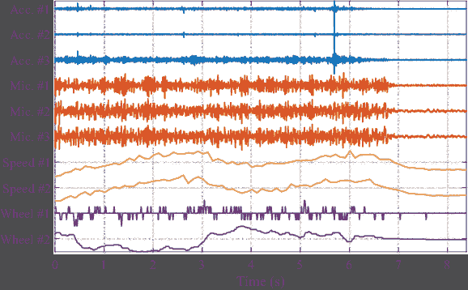

图 9.2: 四传感器采集信号示例：三个加速度计 (acc.), 麦克风 (mic.), 速度通道 (speed) 以及方向盘信号 (wheel)。

第 9.3 节描述的特征排序过程的一个示例如图 [图 9.3] 所示，该图展示了从图 9.2 数据中提取的最佳排序特征。

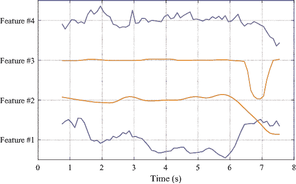

图 9.3: 从图 9.2 数据中提取的最佳排序特征。6.50 秒处的切换在四个特征中均标记。

第 9.5 节描述的实验用于优化系统从考虑的通道确定路面的能力。这种优化通过一系列蒙特卡洛实验进行，步骤如图 [图 9.4] 所示。基本上，从数据中提取特征，然后将其随机分为三个子集：50% 的特征用于训练分类器（LDA、SVM 和 RDF）；25% 的特征用于训练 SSI；剩余 25% 的特征用于确定分类性能。每个路面的样本比例被选择为尽可能与完整数据集的比例。此外，为了避免过拟合，从同一实验提取的特征始终分配给同一个子集。这些实验重复 100 次，并计算结果的平均值和标准差。

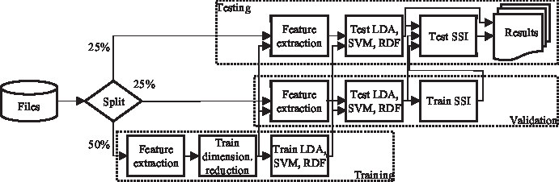

图 9.4: 优化过程中的实验流程图。

####9.5.1 选择最优窗口大小


第一次实验尝试确定分类的最优窗口大小。较大的窗口大小会为分类提供更多数据，从而可能提高分类性能和稳定性。然而，较大的窗口大小也意味着系统需要花费更长来判断路面类型，从而延迟 `EPS` 纠正以及对驾驶体验和安全相关的改进。此外，较大的窗口大小会减少可训练的窗口数量。因此，最优窗口大小将是分类性能和响应延迟之间的折中。

最优窗口大小的选择通过一系列蒙特卡洛实验完成，步骤遵循图 9.4 所示。为了孤立窗口大小对结果的影响，在该实验中，没有进行特征选择（所有特征都用于所有分类器），并且对分类器的输出未进行后处理。窗口大小从 `0.1` 变化到 `3 s`，然后对每个窗口大小值取 100 次迭代的平均值。

实验结果如图 9.5 所示。事实分类对窗口大小的变化敏感，性能随窗口大小的增大而提高。在所有情况下，最长的窗口大小达到了最大性能。`SVM` 的整体性能最差，最大准确率为 `93.16%`，`LDA` 得到了非常相似的结果，最大准确率达到 `93.92%`。`SSI` 得到了 `95.94%` 的中间结果，而 `RDF` 获得了最佳的最大性能，准确率为 `96.33%`。然而，`SSI` 的结果总体上优于 `RDF`。考虑到这些结果，在后续使用了 `1.5 s` 的窗口大小作为窗口大小和分类性能之间的折中。

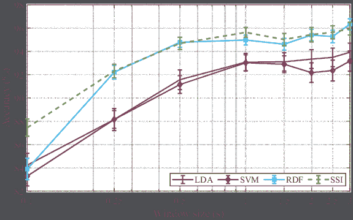

图 9.5：平均性能随窗口大小的依赖关系。

### 9.5.2 最优降维

在确定最优窗口大小后，下一次实验调整了系统降维阶段的行为。如第 9.3 节所述，最初考虑了三种降维方法：`PCA`、`ReliefF` 和所提出的特征排序方法。两种方法的示例结果见图 9.6 (`PCA`)）和图 9.7（所提出的特征排序方法）；`ReliefF` 的结果与所提出的特征排序方法基本相同。图 9.6 显示了五个解释方差最大的 `PCA` 分量（总解释方差为 `49.82%`），而图 9.7 显示了排名前五个特征（在原始 `560` 个特征中）。图中 `(i,j)` 方显示了组件/特征 `i` 与组件/特征 `j` 的散点图，对角线显示了每个类别组件/特征的直方图。通过 `PCA` 获取的分量在平整沥油路类和鹅卵石类之间高度重叠，只有在某些情况下条纹路是可区分的（见图 9.6 中组件 #1 和组件 #3 的组合）。相反，排名前五的特征在类之间的重叠程度较低，并且根据系统的需求，可能足够进行分类；例如，特征 4 和 5 的组合为所有三个类产生了非常可区分的特征。

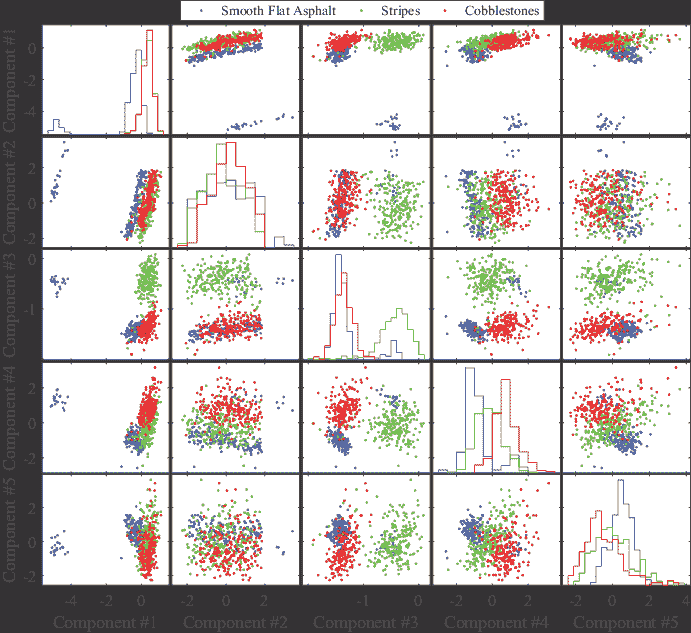

图 9.6：通过 PCA 从特征获取的前五个分量（49.82% 解释方差）。

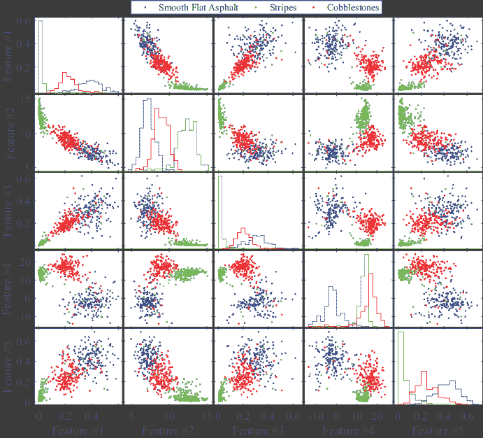

图 9.7：所考虑特征排序方法返回的五个最高特征。

所考虑的方法都没有估计选择的组件或特征数量。为了给每个方法和每个分类器选择最优的剩余特征数量，我们按照图 9.4 所示所示进行了一系列蒙特卡洛实验。为了优化特征选择阶段对结果的影响，在该实验中，对分类器的输出未进行后处理。选择后的剩余组件/特征数量从 `Q = 2` 特征变化到 `Q = 560` 特征（所有特征，即没有特征选择）。然后对每个 `Q` 值取 100 次迭代的平均值。

实验结果如图 9.8 所示。


`RDF` 与其他分类器在特征排名（包括 `ReliefF` 和所提方法）之间的行为差异，归因于 `RDF` 内置的特征选择阶段，因为森林中的每棵树只考虑了部分输入特征。事实上，`RDF` 已被用于若干应用中的特征选择，例如：[26, 27]。这种选择可能与使用我们所考虑的方法所进行执行的特征选择产生冲突，从而降低了 `RDF` 在两种特征排名方法上的整体效果。

在计算时间方面，`PCA` 和所提方法的平均计算时间为 0.28 s，而 `ReliefF` 平均计算时间为 53.33 s。这些计算是在 `Matlab R2022b` 中完成的，在配备 Intel Xeon E3 CPU 和 16 GB RAM 的 Windows 10 机器上运行。因此，所提特征排名方法比 `ReliefF` 快得多，且与 `PCA` 一样快。

考虑到表 9.3 中所示的结果以及计算成本的差异，接下来我们将通过所提特征排名方法进行降维。所选特征的数量 `Q` 取自表 9.3。上述处理与数据矩阵列数的维度有关，而该矩阵是分类阶段的输入。因此，原始维度从 `N X 56` 降至 `N X Q`。如上所述，分类性能很大程度上取决于列数。然而，它也取决于分类矩阵的行数，即样本数量。训练阶段充分样本量的估计仍然是一个决定分类结果质量的关键问题。这些方法的学习曲线可以被估计，从而为通过增加训练集大小所获得的冗余误差概率减少提供估计[28]。这是一项复杂的任务，超出了本文的工作范围。当数据样本量稀缺或数据类别存在样本数据不平衡时，可能会降低分类性能。因此，我们可以采用过采样技术来缓解这一点，通过添加合成样本来避免分类器的偏差。最近，已证明了基于生成对抗网络（`GANs`）的过采样方法在路面识别中的应用[29]以及图处理[30–33]。

### 9.6 路面识别系统的性能

一旦设定了窗口大小和降维阶段，我们进行了进一步的实验以确定系统的最终性能。对于该实验，所提系统使用所有捕获到单一路面的实验进行训练，然后在所有包含多种路面的实验进行测试。根据 9.5.1 节和 9.5.2 节所示的结果，我们将窗口大小设置为 1.5 s，并将所选特征的数量设置为表 9.3 中所示的值：`SVM=4`、`QDA=9` 以及 `Q=56`。

在实际应用中，系统不需要孤立地分类周期；更可能的情况是路面类型将连续分类，且表面类型每几秒最多变化一次。因此，对分类结果进行了后处理以考虑依赖性。任何持续时间小于 1 秒的路面变化都会被移除，并替换为之前的路面。这种后处理产生了更稳定的输出，考虑了数据中的时间依赖性。除了对输出稳定性的影响外，这种后处理还提高了准确率（1–2%）。

某些实验示例的结果所示表 9.4 和图 9.9。与表 9.3 中的结果一致，所有方法都产生了非常准确的分类，紧密跟随路面的变化。所有实验的平均准确率对于 `LDA`、`SVM`、`RDF` 和 `SSI` 分别为 97.21%、97.55%、97.12% 和 97.73%。几乎所有错误都发生在路面之间的转换期间，这些转换与其他类别混淆（例如图 9.9(c)中的`LDA`）或在识别正确路面时出现了轻微延迟（例如图 9.9(d)中的所有方法）。

| 转换 | 实验 | 准确率 (%) |
| :--- | :--- | :--- |
| LDA | SVM | SSI |
| 条纹到平整路面 | 1 | 99.03% | 98.08% | 90.38% |
| 卵石到平整路面 | 2 | 86.21% | 96.55% | 96.55% |
| 3 | 99.20% | 99.20% | 99.23% |
| 4 | 96.47% | 97.65% | 97.65% |


图 9.9: 实验中路面之间的转换，对应表 9.4 的实验：(a); (b); (c); 和 (d)。

### 9.7 结论

介绍了一项关于路面分类的实验研究。所提系统由一组 10 个传感器（3 个麦克风、3 个加速度计、2 个速度传感器、2 个方向盘传感器）以及涉及特征提取和选择、分类和决策的机器学习程序组成。结果显示，所提系统能够准确地（>96%）确定三种路面类型：平整沥青、条纹和卵石。额外的传感器配置使得该准确率高于许多目前可用的系统（电子转向 EPS 信号）。本文还有几个开放的研究方向，例如可以采用半监督学习（结合使用标记和无标记数据）来改进分类结果。

## 参考文献

[1] V. Surbury, V. Žuraulis, and E. Sokolovskij, 基于车载传感器数据估计道路粗糙度。Eksploat. I. Niezawn.-Maint. Reliab, vol. 19, pp. 369–374, 2017. [#9783111344072_018534.xhtml#xref_d5916e33080)

[2] J. Park, K. Min, H. Kim, W. Lee, G. Cho, and K. Huh, 使用深度集成网络和传感器特征选择的路面分类。Sensors, vol. 18, pp. 4342, 2018. [#9783111344072_018534.xhtml#xref_d5916e33083)

[3] G. Safont, A. Salazar, A. Rodríguez, and L. Vergara, 用于路面识别的多通道信号处理。在 2020 IEEE 国际声学、语音和信号处理会议 (ICASSP) 论文集中，页码 3052–3056，西班牙巴塞罗那，2020 年 5 月 4-8 日。 [#9783111344072_018534.xhtml#xref_d5916e33086)


[4] K. Han, M. Choi, and S. B. Choi, 利用转向不足特性作为路面分类指标的轮胎侧偏刚度估计。IEEE Transactions on Vehicular Technology, vol. 67, pp. 6851–6860, 2018. →

[5] A. Bystrov, E. Hoare, T. Y. Tran, N. Clarke, M. Gashinova, and M. Cherniakov, 用于汽车远程路面分类的传感器。In: Proceedings of the 2018 IEEE International Conference on Vehicular Electronics and Safety (ICVES), Madrid, Spain, 12–14 September 2018. →

[6] A. Salazar, A. Rodriguez, N. Vargas, and L. Vergara, 通过数据增强训练路面分类器的研究。Applied Sciences, vol. 12, pp. 3423, 2022. →

[7] S. M. Yusoff, and J. Giacomin, 振动能量分布对驾驶检测水平的影响。AIP Conference Proceedings. vol. 2059, p. 020032, 2019, Applied Sciences, vol. 12, no. 3423, pp. 1–11, 2022. →

[8] J. R. Ng, J. S. Wong, V. T. Goh, W. J. Yap, T. T. V. Yap, and H. Ng, 使用 IoT 传感器和机器学习识别路面状况。In: Computational Science and Technology, pp. 259–268, Singapore: Springer, 2019. →

[9] T. Beilfuss, K. P. Kortmann, M. Wielitzka, C. Hansen, and T. Ortmaier, 客用车辆中道路类型和状况的实时分类。IFAC-Papers, vol. 53, pp. 14254–14260, 2020. →

[10] G. Safont, A. Salazar, A. Rodríguez, and L. Vergara, 用于路面识别系统的降维方法比较。In: Proceedings of the 2020 Science and Information Conference, pp. 554–563, London, UK, 16–17 July 2020. →

[11] T. Chugh, F. Bruzelius, M. Klomp, and B. Jacobson, 使用齿轮力观测器的转向反馈透明度。IEEE/ASME Trans. Mechatron, vol. 27, no. 5, pp. 3853–3864, 2022. →

[12] E. Bonera, M. Gadola, D. Chindamo, S. Morbioli, and P. Magri, 悬挂几何形状对转向反馈的影响。Applied Sciences, vol. 10, pp. 4297, 2020. →

[13] L. Yaohua, F. Jikang, H. Jie, N. Youfei, and F. Qianlong, 考虑粘附系数的商用车新型电动转向控制策略。Advances in Mechanical Engineering, vol. 12, 2020. →

[14] G. Peeters, CUIDADO 项目 2004 中用于声音描述（相似性与分类）的大型音频特征集。a, b, c

[15] I. Jolliffe, 主成分分析，纽约，美国: Springer, 2002.a, b

[16] O. Shamir, 具有指数收敛率的随机 PCA 和 SVD 算法。In: 国际机器学习会议 (ICML), 里尔（法国），2015. →

[17] G. Safont, A. Salazar, and L. Vergara, 通过统计插值恢复丢失的 GPR 迹线。Remote Sensing, vol. 6, pp. 7546–7565, 2014.

[18] G. Safont, A. Salazar, L. Vergara, and E. Villanueva, 多通道非高斯混合动态建模。Pattern Recognition, vol. 93, pp. 312–323, 2019.

[19] H. Lui, and H. Motoda, (编).特征选择的计算方法，波卡拉顿：2007。a, b, c

[20] I. Kononen, E. Šimec, and M. Robnik-Šikonja, 使用 RELIEF 克服归纳学习算法的近视性。Applied Intelligence, vol. 7, no. 1, pp. 39–55, 1997. →

[21] D. M. Powers, 评估：精确率、召回率和 F 值、相关性。Journal of Machine Learning Technologies, vol. 2, no. 1, pp. 37–63, 2011. →

[22] G. Safont, A. Salazar, and L. Vergara, 多个分类器的多类评分集成。Neural Computation, vol. 31, no. 4, pp. 806–825, 2019. →

[23] G. Safont, A. Salazar, and L. Vergara, 用于融合的向量集成。Pattern Recognition, vol. 136, pp. 48–55, 2020.

[24] A. Salazar, G. Safont, L. Vergara, and E. Vidal, 使用超声波进行考古陶瓷来源的模式识别技术。Pattern Recognition, vol. 135, pp. 441–450, 2020.

[25] A. Salazar, G. Safont, L. Vergara, and E. Vidal, 软检测器中的图正则化方法。IEEE Access, vol. 11, pp. 14477–14479, 2023. →

[26] R. Diaz-Uriarte, and S. Alvarez de Andres, 使用随机森林进行微阵列数据的基因选择和分类。Bioinformatics, vol. 7, no. 3, p. art., 2006. →

[27] M. Hasan, M. Nasser, S. Ahmad, and K. Molla, 使用随机森林进行入侵检测的特征选择。Journal of Information Security, vol. 7, pp. 129–140, 2016. →

[28] A. Salazar, L. Vergara, and E. Vidal, 贝叶斯分类器的代理学习曲线。Pattern Recognition, vol. 136, pp. 109240, 2023. →

[29] A. Salazar, G. Safont, and L. Vergara, 用于路面分类的过采样方法应用。In: 2022 International Conference on Computational Science and Computational Intelligence (CSCI), pp. 647–651, Las Vegas, NV, USA, 2022. →

[30] L. Vergara, A. Salazar, J. Belda, G. Safont, S. Moral, and S. Iglesias, 用于自动信用卡欺诈检测的图信号处理。In: Proceedings of IEEE International Carnahan Conference on Security Technology (ICCST), pp. 1–6, Madrid, Spain, 2017.

[31] J. Belda, L. Vergara, G. Safont, A. Salazar, and Z. Parcheta, 基于复杂图傅里叶变换 (CGFT) 的新型替代算法。Entropy, vol. 21, no. 8, article no. 759, 2019.

[32] J. Belda, L. Vergara, G. Safont, and A. Salazar, 非高斯图信号处理中 ICA 模型的部分相关性计算。Entropy, vol. 21, no. 1, article no. 22, 2019.

[33] J. Belda, L. Vergara, A. Salazar, and G. Safont, 用于图信号处理的高斯混合拉普拉斯矩阵估计。Signal Processing, vol. 148, pp. 241–249, 2018.

## 用于评估金融指数的 10 种 RNN 模型：考察新冠 期间金融市场的波动性和供需变化

Ray R. Hashemi Omid M. Ardakani Jeffrey Young Azita G. Bahrami

### 摘要


开发了数种半循环神经网络（RNNs），以探索新冠（COVID-19）疫情对金融指数的影响，这些指数代表债券市场（收益率利差 – `Spread`）、能源市场（原油价格 – `Oil`）、股市（波动率指数 – `VIX` 和威尔士士 5000 指数总市值指数 – `Wil5,000`）、住房市场（史勒房价价格指数 – `HPI`）、商品市场（黄金、小麦和大豆指数）以及经济衰退指数（`USrec`）。根据波动率和供需变化两个属性，这些指数被分为两组。`USrec` 是这两个组共同的组成部分。从圣路易斯联邦储蓄银行获取了针对这两个组的两个时间序列数据集（`dataset 1` 和 `dataset 2`）。波动率和供需变化组分别拥有每日和月度数据。每个数据集首先通过对每个指数单独应用派生断点（转换块）进行清洗。其次，将清洗后的数据集分为“疫情前”和“疫情期间”。分别通过“疫情前”和“疫情期间”的训练集对半循环神经网络进行训练，并使用其相应的测试集进行测试，输出两个 5 元素的计数数组。每个数组携带了相应测试集所有记录中指数分类准确的整体百分比。为数组中的每个指数计算了衰减率，并计算了每个数组的衰减率平均值（整体衰减率），用于检查新冠肺炎对指数的影响。正、零、负衰减率分别意味着新冠肺炎对金融指数具有负面影响、无影响和正面影响。

结果还揭示：(a) 在疫情之前，`VIX` 被 `Wil5,000`、`Spread`、`Oil` 和 `USrec` 解释得更准确，这表明由新冠肺炎引起的其他观测和未观测因素对 `VIX` 的影响超过了其他金融指数。(b) 疫情期间，`USrec` 的预测准确性低于其他指数，显示了该指数对健康和地缘政治挑战的敏感性。(c) 疫情期间，指数对债券市场的影响有所减弱。(d) 疫情期间 `HPI` 预测准确性的下降表明由于经济和社会变化，住房市场遭受了冲击。(e) 疫情期间 `Gold` 价格预测准确性的下降反映了其作为相对稳定的避险资产的本质，但仍对新冠肺炎保持敏感。(f) 疫情期间 `Wheat` 预测准确性的大幅下降凸显了其对供应链中断、全球贸易动态以及疫情期间需求波动的敏感性。(g) 与小麦类似，大豆的预测准确性在疫情期间也下降了，强调了供应链中断对农产品商品的影响。敏感性分析表明，结果对于不同测试集所选记录数量的变化具有高度的稳健性。

**关键词：** 新冠肺炎对金融指数的影响、股市、债券市场、能源市场、商品市场、住房市场、神经网络、转换边界、稳健性分析。

### 10.1 引言

美国经济受到几个主要金融市场的影响，包括股票、债券、能源、商品和住房市场。如果这些影响与如新冠肺炎等长期的社会灾难相结合，可能会变得更加严重。其原因在于社会互动被强制中断。新冠肺炎疫情严重干扰了经济的各个部门，包括供应链、劳动力、农业和教育。它还改变了对商品的需求。这些干扰对经济和金融市场都产生了广泛影响。

我们通过使用不同的市场组来预测这些指数，从而对金融指数进行评估。我们的工作分为以下两个部分。第一部分包括利用能源、股票和债券市场对金融指数预测的探索。我们将这些市场归类，是因为在像新冠肺炎这样的长期社会事件存在时，它们表现出较高的波动性。第二部分包括利用商品和住房市场探索新冠肺炎对金融指数行为的影响。我们将这些市场归类，是因为它们的共同特性是对社会对商品的高需求和/或 的中断的反应非常迅速。

### 第一部分

对于第一部分，使用了以下金融指数：利率利差（`Spread`）、油价（`Oil`）、波动率指数（`VIX`）和威尔士 5000 市场指数（`Wil5000`）。这些指数分别代表债券市场、能源市场、股市波动率以及股市中交易股票的成交量 [1, 2。`Spread` 是长期（10 年美国国债）和短期（2 年美国国债）政府债券利率之间的差值。这种差值可以让我们洞察经济活动和潜在的衰退 [3]。油价由一组被称为欧佩克+（OPEC-plus）的国家决定，它同时影响着衰退 [4, 5] 和通胀率 [6]。`VIX` 指数代表基于股市期权的未来股市价格的预期波动程度 [7]。最后，`Wilshire 5000` 指数衡量美国 5000 家上市公司的总市值 [8]。

### 第二部分

对于第二部分，使用了以下指数：`HPI`（史勒房价价格指数）、`Gold`、`Wheat`和大豆指数。第一个指数代表住房市场，后三个指数代表商品市场的核心。史勒房价价格指数是一个领先的美国住宅市场指标，它提供了经济趋势的洞察。住房市场通常提供经济衰退和恢复的早期信号。因此，住房市场具有很强的预测价值 [9, 10]。房价的下跌通常表明更广泛的经济挑战，正如 2008 年金融危机所示的那样 [11]。

商品期货有助于理解全球经济健康状况。例如，小麦和大豆期货是农产品市场趋势和全球贸易动态的指标，正如文献 [12] 中讨论的那样。`Gold`传统上被视为经济不确定性时期的避险资产，对全球经济具有影响 [13]。这些市场的变化可以表明经济活动的转变。在这种背景下，黄金在新冠肺炎期间的作用以及农产品对全球供需变化的反应至关重要。


本文探讨了 COVID-19 对我们两组市场的影响。这是通过将用于第 1 部分和第 2 部分的数据集分为“疫情前”和“疫情期间”时代来实现的。通过对每个时代金融指数的预测准确性进行比较，确定了 COVID-19 对我们市场组的影响。有必要探讨这种比较与 COVID-19 的相关性。数据中混沌行为的存在会导致预测不准确，这反过来可能表明经济处于以不确定性增加为特征的混沌状态。

“疫情前”和“疫情期间”之间的折点不能是某一天，而是一个天数区间（过渡块）。设置过渡块的原因是，COVID-19 对指数的影响是渐进的，且不同指数之间可能不同。此外，COVID-19 影响产生完全效果的时间对于所有指数都是不同的。确定这一边界的最佳方法是研究单个指数的行为，以确定从“疫情前”时代到“疫情期间”的过渡期。

金融指数数据（时间序列数据）的性质，以及日期 `d` 记录的衰退预测受前置记录历史，这些属性要求使用循环神经网络（`RNN`）。在这种神经网络中，任何寻求其指定指数之一数值预测的记录也将发生变形（作为历史的一部分），并参与下一条记录中指定指数数值的预测。

这项研究工作的目标具有双重性：开发 `RNN` 以在 COVID-19 的背景下研究金融指数的行为，涉及：(a) 债券、能源和股票市场，以及 (b) 大宗和住房市场。此前，已完成了 COVID-19 对 `VIX`、`Wil5000`、`spread` 和 `Oil` 金融指数影响的初步调查并发表于 [14]。本章是对报告论文的扩展。

本章剩余部分的结构如下：前期工作、方法论、实证结果、讨论、结论和未来研究分别是第 2、3、4 和 5 节的主题。

### 10.2 前期工作

经济业务周期阶段的预测越来越多地通过一般的机器学习方法，特别是神经网络来实现。Joseph 等人证明，在根据利率利差预测宏观经济发展时，神经网络的表现优于传统的统计模型（如向量自回归和自回归积分移动平均模型）。他们的工作强调了神经网络捕捉时间序列数据模式的优越能力 [15]。Qi 强调了神经网络通过同时采用金融和宏观经济指数在预测衰退方面的有效性 [16]。

Vidal 和 Kristjanpoller 最近引入了一种深度学习架构，该架构将卷积神经网络与长短期记忆网络相结合，通过处理经济数据的空间和时间特征来分析经济趋势 [17]。Lazcano 等人进一步探索了使用图神经网络对经济指标之间的依赖关系及其对经济周期的共同影响 [18]。

进一步阐述的是，Puglia 和 Tucker 引入了一种交叉验证方法，并对机器学习分类器进行了统计分析，以评估收益率利差和其他宏观经济指标在预测美国衰退方面的效力 [19]。他们的发现表明，神经网络分类器擅长识别衰退分布的关键属性，而这些属性是传统的 probit 和 logit 模型难以轻易捕捉的。此外，Longo 等人进展了一种集成学习策略，将循环神经网络与动态因子模型相结合以预测经济增长 [20]。Wang 等人也研究了预测衰退的机器学习策略及其对金融市场的影响 [21]。

机器学习也被用于增强经济指标（如 `HPI` 和大宗商品价格）的预测建模。Zhan 等人证明了深度学习在预测住房方面的潜力 [22]。Lorenz 等人还研究了机器学习在房地产中的应用 [23]。COVID-19 也影响了如 `gold` 和 `soybeans` 等商品市场。Kam 等人利用深度学习分析了 COVID-19 的影响 [24]。Ben Ameur 等人和 Oktiany 等人提供了深度学习在大宗商品价格方面的证据 [25], 26]。

### 10.3 方法论

实现目标的目标是：(a) 对第 1 部分和第 2 部分的数据进行离散化 [26]，(b) 识别每个指数和数据集的过渡块 [27]，以及 (c) 引入半循环神经网络来评估 COVID-19 期间的金融指数 [28]。本节其余部分将详细描述上述目标。

#### 10.3.1 数据离散化

在数据离散化之前，需要填充缺失数据。幸运的是，我们的数据集中没有缺失数据。我们使用由以下算法封装的 k-means 聚类方法 [29]。

```
Algorithm K-Mean

Input: 一个数据集, D, 以及一个整数 K > 1;

Output: 数据 D 中的 K 个类 (CL[1], …, CL[k]);

Method:
1- 从 D 中选择 K 条记录作为类 CL[1], …, CL[k] 的中心。
2- 重复 i= 1 到 |D|
  1. 计算数据集中的记录 ri 到 K 个类中心的欧几里得距离 (e)，(e[1], …, e[k])。
  2. 将 ri 分配给类 CL[m]（其中 1 ≤ m ≤k），使得 em = Min(e1, …, e[k])；
  3. 通过平均值更新 CL[m] 的中心；
End // End of Repeat;
End // End of the algorithm
```


### 10.3.2 转换块的识别

我们首先定义“转换块”（transition block）这一术语，然后提出识别给定金融指数转换块起始和结束日期的方法。对于金融指数而言，转换块代表一个特定的时期，在该时期内，事件对指数的影响感知非常微弱（转换块的起点），然后增长到显著的影响（转换块的终点）。不同金融指数对事件影响的容忍度并不相同。因此，转换块的宽度在不同指数之间可能不同。第 1 部分和第 2 部分的数据有各自的综合转换块（comprehensive-transitionblocks）。数据集各指数转换块中的最小起始日期和最大结束日期分别构成了其综合转换块的起始和结束日期。指数或数据集转换块中的记录不能属于某次事件的“之前”（before）或“发生中”（during）时期。这是因为转换块包含了一段不确定属于“之前”或“发生中”时期的记录。

给定指数转换块的识别是通过检测指数值中的断点（breakpoints）来完成的。断点是指数值的突然变化，可以通过其图表可视化。为了检测断点，我们使用了以下被称为 `derived-breakpoints` 的方法。我们首先假设数据集中存在 `m` 个断点，其中系数发生偏移，导致 `m + 1` 个具有恒定系数的分段。我们通过最小化残差平方和（`RSS`）来估计这些断点。该方法的关键在于对断点的估计，这些断点不是外部给定的，而是从数据推导出的。

遵循贝尔曼原理（Bellman principle），该实现利用动态规划方法来计算给定断点数量的最优断点。计算出的三角形 `RSS` 矩阵是该过程的核心，它提供了从特定观测值开始并结束的区段的 `RSS`。该方法基于并在[此处] 中进行了说明。

在该研究工作的背景下，转换块通过最佳估计将数据集的记录划分为“之前”和“发生中”时期。通过这种方式，可以认为记录属于错误时期的概率接近零；因此，数据集的记录相对于其所采用转换块的指数得到了纯化。很显然，参考不同指数对数据集进行纯化会导致不同的结果。

#### 10.3.3 半递归神经网络

我们开发的 RNN 版本包含两个部分，“当前”（Current）和“过去”（Past），如图 10.1 所示。（更准确地说，这个版本是一个半 RNN）。这两个部分都有一对输入和输出层，称为输入/输出当前层和输入/输出过去层。因此，输入这些输入层的记录分别是“当前输入”记录和“过去输入”记录。当前层中的神经元数量与过去层中的神经元数量相同，并且等于第 1 部分数据集或第 2 部分数据集中的金融指数数量。当前输入层和过去输入层共同构成 RNN 的输入层。该层还添加了一个偏置神经元。

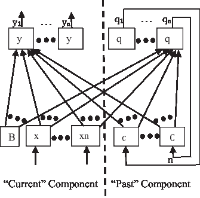

图 10.1：半 RNN 架构。

来自当前输出层的结果被认为是 RNN 的输出。该结果受到当前输入记录以及该记录的前驱历史的影响，而这种历史表现为过去输入记录。为了维持这种记录，过去输出层神经元的输出始终回馈到过去输入层中对应的神经元中。当前输入记录也贡献了其前驱的历史。这种贡献的关键在于当前输入层中的神经元与过去输出层每一个神经元之间的连接。

当当前输入记录是数据集的第一条记录时，该记录没有前驱历史。我们通过使用数据集的第一条记录作为过去输入来解决这个问题，从而馈送当前输入层。我们使用高斯线性单元（`GELU`）激活函数：

```
Out = Net / (1 + e)
```
其中 `Out` 是输出，`Net` 是加权和。

### 10.4 经验结果

之前介绍了三个目标：离散化、转换块的识别以及半 RNN 的开发。在本节中，我们描述了手动实现这些目标的结果。这些数据来自圣路易斯联邦储蓄银行（FRED），用于第 1 部分和第 2 部分。数据集 1 有 7,939 条记录，而数据集 2 有 99 条记录。时期为 1990 年 1 月到 2020 年 2 月。

表 10.1：数据集 1 和数据集 2。

| 数据集 1（日度） | 数据集 2（月度） |
| :--- | :--- |
| 代表指数 | 代表指数 |
| 债券市场利差 | 住房价格指数 (HPI) |
| 能源市场石油 | 大宗商品市场黄金 |
| 股市 VIX | 小麦 |
| Wil5000 | 大豆 |
| 美国经济状态 USrec | 美国经济状态 USrec |
| 时间（日度） | 时间（月度） |

#### 10.4.1 目标 1：数据离散化

使用 K-means 算法（当 `k=3` 时）将指数离散化为 1、2、3 三个离散值。通常，离散值 1 和 3 的记录数量分别最高和最低。对于指数的每个离散值，其连续值的范围以及记录数量如表 10.2 所示。需要提醒读者，`USrec` 指数在此过程中是一个例外，因为它是一个二元指标。

表 10.2：指数的离散值以及对应离散值的记录数及其连续值范围。

| 指数（日度） | 1 | 2 | 3 | 指数（月度） | 1 | 2 | 3 |
| :--- | :--- | :--- | :--- | :--- | :--- | :--- | :--- |
| VIX | [9.14, 19.6) | 4,815 | [19.6, 34.5) | 2,768 | [34.5, 82.7] | | |
| HPI | | [137, 175) | 45 | [175, 238) | 40 | [238, 306] | 14 |


5,785 || [69.8, 150)
1,713 || [150, 234]
441 || Gold || [1,060, 1270)
28 || [1270, 1550)
36 || [1550, 1970)
35 |
| Spread || [−0.52, 0.758)
3,163 || [0.758, 1.75)
2,429 || [1.75, 2.91]
2,347 || Wheat || [368, 567)
52 || [567, 750)
31 || [750, 040]
16 |
| Oil || [9.1, 42.1)
3,882 || [42.1, 84.8)
2,799 || [84.8, 144]
1,258 || Soybean || [840, 1100)
53 || [1100, 1380)
21 || [1380, 1710]

#### 10.4.2 目标 2：转换区块的识别

需要对每个金融和宏观经济指数以及每个数据集分别识别转换区块。我们采用派生断点法（derived-breakpoints approach）来确定每个指数转换区块的边界。结果如表 10.3 所示。此外，如前所述，利用各指数的转换区块计算每个数据集的综合转换区块。指数的转换区块由图 10.2–10.4 所示的绘制值支持。这些图是使用 R 统计包生成的。

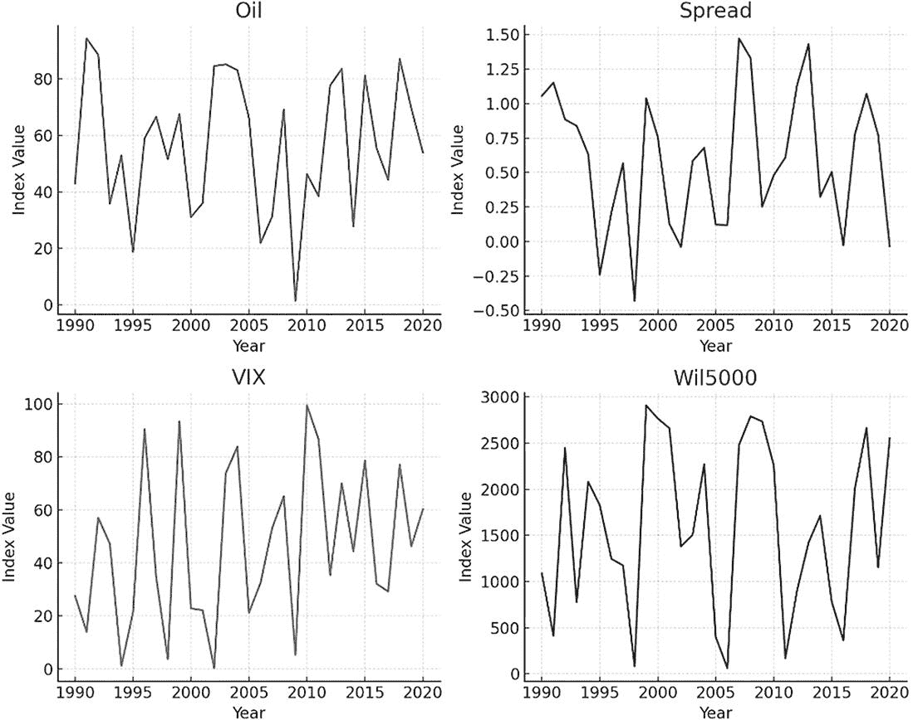
图 10.2：数据集 1 中日频数据的指数图（原油、价差、Vix、Wil5000）。

表 10.3：(a) 数据集 1 和 (b) 数据集 2 中金融指数的转换区块。

| (a) 金融指数（日频数据） | b) 住房和市场指数（月频数据） |
| --- | --- |
| 指数 | 转换区块 | 指数 | 转换区块 |
| VIX | [3/12/2020 至 3/27/2020] | HPI | [2/1/2020 至 4/1/2020] |
| --- | --- | --- | --- |
| Wil5000 | [3/9/2020 至 3/23/2020] | 黄金 | [1/1/2020 至 4/1/2020] |
| Spread | [3/16/2020 至 3/31/2020] | 小麦 | [1/1/2020 至 4/1/2020] |
| Oil | [3/16/2020 至 4/21/2020] | 大豆 | [1/1/2020 至 4/1/2020] |
| USrec | [3/2/2020 至 4/30/2020] | USrec | [1/1/2020 至 4/1/2020] |
| Dataset-1 | [3/2/2020 至 4/30/2020] | Dataset-2 | [1/1/2020 至 4/1/2020] |

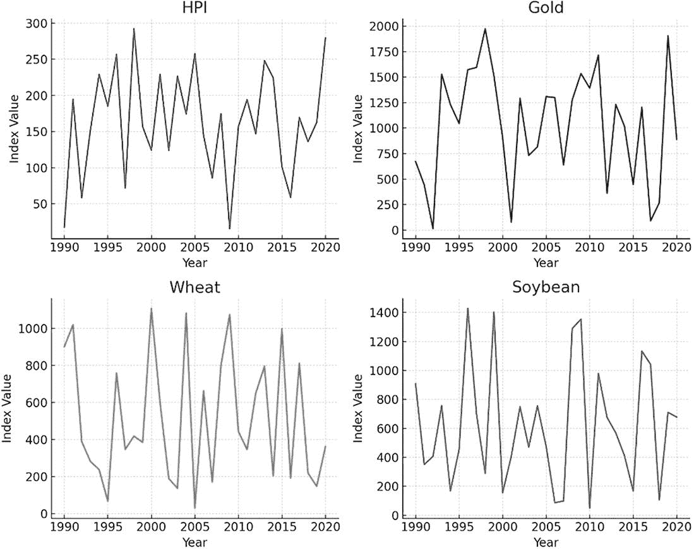
图 10.3：数据集 2 中月频数据的指数图（HPI、黄金、小麦）。

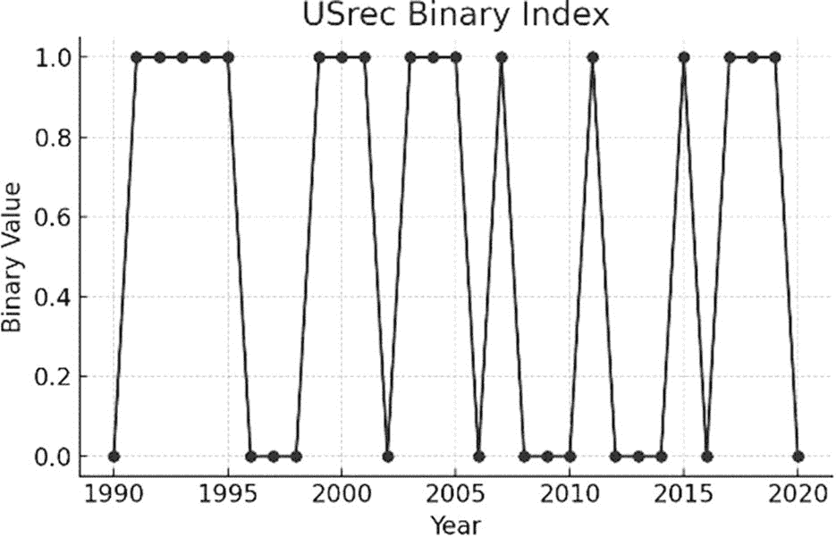
图 10.4：USrec 二元化指数的图。

#### 10.4.3 目标 3：半 RNN 的开发与使用

开发了一个具有 11 个输入神经元的半 RNN（5 个用于当前输入，5 个用于过去输入，1 个偏置节点）。当前输出层和过去输出层的神经元数量均为 5 个。第 1 部分和第 2 部分的研究采用了下文引用的 Achievement 过程。该程序之后将对其进行详细说明。

**程序：Achievement**

步骤 1：对 `j = 1` 到 2 重复。
步骤 2：`D = Dataset j`。
步骤 3：对 `i = 1` 到 5 重复。
步骤 4：根据金融指数 `F[i]` 的转换区块纯化数据集 `D`。
步骤 5：将纯化后的数据集 `D` 按照 `F[i]` 的转换区块划分为 `F[i]-before` 和 `F[i]-during`。
步骤 6：将划分后的数据分为训练和测试集 `(F[i]-before-train, F[i]-before-test)` 和 `(F[i]-during-train, F[i]-during-test)`。
步骤 7：平衡训练集。
步骤 8：对每对训练和测试集 `TR[m]` 和 `TS[m]` 重复。
步骤 9：使用 `TR[m]` 训练。
步骤 10：使用 `TS[m]` 测试训练好的模型，并报告每个指数的预测准确百分比。将结果保存在计数器 `counter[m]` 中。
结束步骤 8。
步骤 11：计算两个计数数组之间的衰减率。
步骤 12：`D = Dataset j`。
结束步骤 3。
结束步骤 1。

### 程序结束

在该程序中，我们尝试使用捕捉了记录历史信息的神经网络来预测测试集中记录 `R` 的指数值。这意味着训练好的半 RNN 适用于预测在时间上紧接训练集最后一条记录的测试记录（即只有一个记录的测试集）。因此，如果测试集包含 `N` 条记录（时间上是连续的——时间序列数据），一旦完成第一条测试记录的预测，就将其加入训练集，并重新训练神经网络，以便为预测下一条记录做好准备。然而，我们采用了不同的方法，回答了以下问题：为了选择测试记录，偏离训练集最后一条记录的时间多远才不会对指数预测产生太大影响？答案是不太远。正因如此，测试集中的指数数量较少。

在步骤 3 的循环中，针对每个指数在包含其他指数的情况下单独进行数据集纯化。这种方法论选择基于统计学假设：一个指数的异常行为不会扭曲另一个指数的预测准确性。如果训练集中记录数量增加，通常情况下神经网络会训练得更好。


其中，`C[1a]` 和 `C[2a]` 分别是使用 `F[i]-before-test` 和 `F[i]-during-test` 中的所有记录对索引 `F[a]` 进行分类时，正确分类的总百分比。由于 `F[i]-before-test` 和 `F[i]-during-test` 具有相同的基数，因此在 `Formula 2` 中可以使用任何一个。

所有索引（从 `F[a]` 到 `F[e]`）具有正、零、负的衰减率，意味着 COVID-19 对金融指数分别具有负影响、无影响和正影响。衰减率最大和最小的金融指数分别是对 COVID-19 最敏感和最不敏感的金融指数。`F[i]` 的 `总体衰减率` 是 `F[a]` 到 `F[e]` 所有索引的衰减率的平均值。如果总体衰减率为负/正，但存在某些非负的衰减率，那么我们就说 COVID-19 对金融指数具有部分负影响/正影响。如果 `F[i]` 在所有索引中具有最大/最小的正总体衰减率，那么 (a) `F[i]` 的转换块与其他索引的转换块的交集最小/最大，且 (b) `F[i]` 是对 COVID-19 最敏感/最不敏感的金融指数。

上述过程生成了数据集 1 和数据集 2 中所有索引的衰减率，这些分别用于我们研究的第 1 部分和第 2 部分。我们将发现总结在 表 10.5 和 表 10.6 中。

表 10.5：数据集 1 中索引的衰减率。

| 纯化索引 | λ（天） | 测试集 | 5 元素计数数组 | 总体衰减率 |
| :--- | :--- | :--- | :--- | :--- |
| **Vix** | **Wil5000** | **Spread** | **Oil** | **USrec** | **0.3** |
| Vix | 45 | Vix-before | 84 | 78 | 80 | 71 | 67 |
| 45 | Vix-during | 69 | 71 | 67 | 56 | 58 |
| **衰减率** | **0.3** | **0.2** | **0.3** | **0.3** | **0.2** |
| Wil5000 | 45 | Wil5000-before | 78 | 73 | 76 | 67 | 62 | **0.1** |
| 45 | Wil5000-during | 73 | 69 | 71 | 69 | 62 |
| **衰减率** | **0.1** | **0.1** | **0.11** | **−0.04** | **0** |
| Spread | 46 | Spread-before | 87 | 74 | 70 | 76 | 63 | **0.3** |
| 46 | Spread-during | 67 | 65 | 65 | 61 | 48 | |
| **衰减率** | **0.5** | **0.2** | **0.1** | **0.3** | **0.3** |
| Oil | 44 | Oil-before | 77 | 73 | 77 | 70 | 66 | **0.2** |
| 44 | Oil-during | 70 | 68 | 68 | 64 | 60 | |
| **衰减率** | **0.2** | **0.1** | **0.2** | **0.1** | **0.1** |
| USrec | 43 | USrec-before | 74 | 77 | 70 | 58 | 56 | **0.3** |
| 43 | USrec-during | 56 | 53 | 53 | 51 | 47 | |
| **衰减率** | **0.4** | **0.6** | **0.4** | **0.2** | **0.2** |

表 10.6：数据集 2 中索引的衰减率。

| 纯化索引 | λ（月） | 测试集 | 5 元素计数数组 | 总体衰减率 |
| :--- | :--- | :--- | :--- | :--- |
| **HPI** | **Gold** | **Wheat** | **Soybean** | **USrec** | **6.2** |
| HPI | 4 | HPI-before | 99 | 75 | 75 | 50 | 99 | |
| 4 | HPI-during | 50 | 50 | 50 | 75 | |
| **衰减率** | **12.25** | **6.25** | **6.25** | **0** | **6** |
| Gold | 4 | Gold-before | 75 | 99 | 50 | 50 | **3.7** |
| 4 | Gold-during | 50 | 75 | 50 | 50 | | |
| **衰减率** | **6.25** | **6** | **0** | **6.25** | |
| Wheat | 4 | Wheat-before | 75 | 50 | 99 | 50 | 75 | **3.7** |
| 4 | Wheat-during | 50 | 50 | 75 | 50 | 50 | |
| **衰减率** | **6.25** | **0** | **6** | **6.25** | |
| Soybean | 4 | Soybean-before | 75 | 50 | 50 | 99 | 75 | **3.7** |
| 4 | Soybean-during | 50 | 50 | 50 | 75 | |
| **衰减率** | **6.25** | **0** | **6** | **6.25** | |
| USrec | 4 | USrec-before | 75 | 75 | 75 | 99 | **6.2** |
| 4 | USrec-during | 50 | 50 | 50 | 75 | |
| **衰减率** | **12.25** | **6.25** | **8.75** | **6.25** | **6** |
我们还对过程进行了一些修改，通过转换块来纯化每个数据集：

**过程：实现**
步骤 1：重复 `j = 1` 到 2。
步骤 2：根据数据集 `j` 的转换块纯化。

在此修改版本中，删除了步骤 2 和 3，步骤 4 改为步骤 2。这意味着，首先删除参与数据集 `j` 转换块的记录，然后过程将为每个分区（`Comp[j]-before` 和 `Comp[j]-during`）生成 5 元素计数数组，并此计算完全纯化数据集 `j` 的衰减率。结果如表 10.7 所示。

表 10.7：使用转换块纯化后，数据集 1 和数据集 2 中索引的衰减率。

| 纯化索引 | λ | 测试集 | 5 元素计数数组 | 总体衰减率 |
| :--- | :--- | :--- | :--- | :--- |
| Vix | Wil5000 | Spread | Oil | USrec |
| 数据集 1 的所有索引 | 43（天） | Comp-1-before | 74 | 77 | 70 | 58 | 56 | 0.3 |
| 43（天） | Comp-1-during | 56 | 53 | 53 | 51 | 47 | |
| **衰减率** | 0.3 | 0.4 | 0.6 | 0.2 | 0.2 |
| 数据集 2 的所有索引 | | HPI | Gold | Wheat | USrec | |
| 4（月） | Comp-2-before | 75 | 75 | 75 | 75 | 99 | 6.2 |
| 4（月） | Comp-2-during | 50 | 50 | 50 | 50 | 75 | |
| **衰减率** | 6.25 | 6.25 | 6.25 | 6.25 | 6 |

### 10.5 讨论、结论与未来研究

考虑一个相对于索引 `F[i]` 进行纯化的数据集，它提供了测试集 `TS[i1]` 和 `TS[i2]` 分别“之前”和“期间”时代。假设有一个半循环神经网络（semi-RNN），它在分别通过相应的数据集进行训练时，分别为 `TS[i1]` 和 `TS[i2]` 生成总体衰减率 `δ[1]` 和 `δ[2]`。如果 `δ[2]` 显著小于 `δ[1]`，则说明“之前”时期的数据比“期间”的数据混沌混沌。


相对于 `Wil5000` 指数，考虑纯化数据集 1 表明 COVID-19 对油价产生了积极影响。这一结果可能源于封锁导致石油需求最初剧减，引发了价格急剧下跌和产量的削减。随着经济开始复苏，这些减产和需求的逐渐恢复可能导致油价以比预期更快的速度反弹。

总体而言，数据集 2 中指数的衰减率较高，这意味着供需转移组指数受 COVID-19 大疫情的影响比波动率指数更大。

1. 平均而言，疫情期间指数的预测准确率比疫情前的预测低约 10%，表明宏观经济和金融指数的波动性有所增加。

宏观经济与金融指数之间的相互影响对预测至关重要。我们的 `semi-RNN` 模型正如第 3 节所述，考虑了这种互连性。

1. 在疫情之前，使用 `Wil5000`、`Spread`、`Oil` 和 `USrec` 等变量对 `VIX` 指数的预测效果更好。这强调了除了标准的金融经济指标外，各种疫情相关因素对 `VIX` 的额外影响。

2. `USrec` 在疫情后的预测准确率下降，反映了其对健康和地缘政治干扰的敏感性。

3. `USrec` 的预测准确率最低，疫情前为 56%，疫情期间为 47%，相比之下 `VIX` 和 `Wil5000` 在这些时期表现出更高的准确率。这些结果证实了 Malladi [36] 的发现，他利用机器学习来预测衰退和市场低迷。

4. `Spread` 在疫情前结合 `VIX`、`Wil5000`、`Oil` 和 `USrec` 的预测准确率约为 80%，在疫情期间下降到 67%，说明了金融和宏观经济因素对债券市场的影响减弱。这些发现与 Zaremba 等人 [37] 一致。

5. 房价在疫情前的准确率较高，这是由于住房市场对经济变化的反应灵敏。疫情期间准确率的显著下降反映了经济不确定性的增加、房地产的扰乱以及住房需求的转变。

6. 金价在疫情前保持了较高的预测准确率，这与其作为稳定“避险”资产的地位一致。疫情期间准确率的略微下降凸显了全球经济不确定性的增加。

7. 小麦和小豆价格在疫情前表现出中等的预测准确率，受稳定的全球农业趋势和贸易动态影响。由于供应链中断以及全球贸易和需求的改变，它们的预测准确率在疫情期间下降。

8. 疫情期间所有指数预测准确率的普遍下降，凸显了 COVID-19 引发的加剧的不确定性和市场波动。

9. (Comp-1-before 和 Comp-1-during) 与 (USrec-before 和 USrec-during，在 表 10.5 之间的衰减率相似，是因为 表 10.5 中 `USrec` 的转换块与数据集 1 的综合转换块相同。

通过稳健性检查改变了 `λ` 值（从 7% 到 12%），这影响了训练集和测试集的大小。尽管更大的训练集提高了分类率，但疫情前和疫情期间的预测模式保持一致。这一敏感性分析强调了我们结果的稳健性。

未来的研究有两个方向：(a) 扩展方法。在这项研究中，我们将对所有可能的指数组合数据集进行纯化。(b) 开发一种混合马尔可夫模型来预测 `N` 天后的金融指数，为 `N` 设置最大值并进行用户驱动的场景分析。

## 参考文献

[1]P.-R. Agénor and L. A. Pereira da Silva, 宏观经济、金融稳定和货币政策。International Finance, 15, pp. 205–224, 2012. a, b

[2]C. Blot, J. Creel, P. Hubert, F. Labondance and F. Saraceno, 价格与金融稳定的联系。Journal of Financial Stability, 16, pp. 71–88, 2015. →

[3]J. D. Hamilton and D. H. Kim, 利用收益率差重新检验经济活动的可预测性，NBER Paper Series 7954, 2000. →

[4]D. S. Bremmer and R. G. Kesselring, 大衰退期间美国零售汽油与原油的关系：“火箭与羽毛”还是“气球与石头”？Energy Economics, 55, pp. 200–210, 2016. →

[5]N. Nonejad, 原油价格动态与大衰退。Applied Economics, 26, 8, pp. 622–627, 2019. →

[6]L. Kilian and X. Zhou, 油价上涨对美国通胀和通胀预期的影响。Energy Economics, 113, pp. 106228, 2022. →

[7]R. E. Whaley, 理解 VIX。Journal of Portfolio Management, 35, 3, pp. 98–105, 2009. →

[8]J. Driffill, Z. Rotondi, P. Savona and C. Zazzara, 货币政策与金融稳定：期货市场的作用？Journal of Financial Stability, 2, 1, pp. 95–112, 2006. →

[9]K. E. Case and R. J. Shiller, 住房市场是否存在泡沫？Brookings Papers on Economic Activity, 2003, 2, pp. 299–362, 2003. →

[10]A. Fouejieu, A. Popescu and P. Villieu, 宏观经济与金融稳定目标之间的权衡。Economic Modelling, 81, pp. 621–639, 2012. →

[11]E. E. Leamer, 住房即业务周期。载：堪萨斯市联邦储备银行经济研讨会议集，pp. 149–233, 2007. →

[12]C. L. Gilbert, 如何理解食品价格。Journal of Agricultural Economics, 61, 2, pp. 398–425, 2010. →

[13]D. G. Baur and B. M. Lucey, 黄金是避险工具还是避险资产？股票、债券与黄金的分析。Financial Review, 45, 2, pp. 217–229, 2010. →

[14]R. Hashemi, O. Ardakani, J. Young and A. Bahrami, COVID-19 疫情背景下宏观经济和金融指标的 RNN 模型。载：2022 年科学与计算智能国际会议 (CSCI)，内华达州拉斯维加斯，pp.653–658，2022 年 12 月. →

[15]M. Qi, 利用领先指标通过神经网络模型预测美国衰退。International Journal of Forecasting, 17, 3, pp. 383–401, 2001. →

[16]A. Joseph, M. Larrain and E. Singh, 使用神经网络对利差进行预测的能力。Procedia Computer Science, 6, pp. 207–212, 2011. →


[17] A. Vidal 和 W. Kristjanpoller, 使用 CNN-LSTM 方法进行黄金波动率预测。*Expert Systems with Applications*, 157, pp. 113481, 2020. →
[18] A. Lazcano, P. J. Herrera 和 M. Monge, 基于循环神经网络和图卷积网络的金融时间序列预测模型。*Mathematics*, 11, 1, pp. 224, 2023. →
[19] M. Puglia 和 A. Tucker, 神经网络、国债收益率曲线与衰退预测。*The Journal of Financial Data Science*, 3, 2, pp. 149–175, 2021. →
[20] L. Longo, M. Riccaboni 和 A. Rungi, 一种用于 GDP 预测的神经网络集成方法。*Journal of Economic Dynamics and Control*, 134, pp. 104278, 2022. →
[21] Z. Wang, K. Li, S. Q. Xia 和 H. Liu, 使用深度神经网络预测经济衰退。*The Journal of Financial Data Science*, 4, 3, pp. 108–127, 2022. →
[22] C. Zhan, Z. Wu, Y. Liu, Z. Xie 和 W. Chen, 深度学习进行房价预测：在台湾房地产市场的应用。在：2020 IEEE 第 18 届工业信息国际会议，IEEE, (INDIN)(Vol. 1, pp. 719–724), 2020 年 7 月。 →
[23] F. Lorenz, J. Willwersch, M. Cajias 和 F. Fuerst, 用于房地产市场分析的可解释性机器学习。*Real Estate Economics*, 51, 5, pp. 1178–1208, 2023. →
[24] J. S. Kamdem, R. B. Essomba 和 J. N. Berinyuy, 深度学习模型，用于预测和分析 COVID-19 扩散对某些大商品市场波动的影响。*Chaos, Solitons & Fractals*, 140, pp. 110215, 2020. →
[25] Ben Ameur, H., Boubaker, S., Ftiti, Z. 等. 大宗商品价格预测：使用深度学习的实证证据。*Ann Oper Res* 339, pp. 349–367, 2024. [`doi.org/10.1007/s10479-022-05076-6`](https://doi.org/10.1007/s10479-022-05076-6)。 →
[26] P. Oktoviany, R. Knobloch 和 R. Korn, 基于外部因素的农产品价格预测机器学习模型。*Decisions in Economics and Finance*, 44, 2, pp. 1063–1085, 2021. a, b
[27] J. Han, M. Kamber 和 J. Pei, 数据挖掘：概念与技术。Morgan Kaufmann, 2012. →
[28] S. Haykin, 神经网络：全面基础。IEEE Press, 1994. a, b
[29] J. Bai 和 P. Perron, 多重结构变化的计算与分析。*Journal of Applied Econometrics*, 18, 1, pp. 1–22, 2003. →
[30] J. Bai 和 P. Perron, 多重结构变化的计算与分析。*Journal of Applied Econometrics*, 18, 1, pp. 1–22, 2003. →
[31] J. Bai, 线性过程中偏移的最小二乘法估计。*Journal of Time Series Analysis*, 15, pp. 453–472, 1994. →
[32] J. Bai, 逐个估计多个断点。*Econometric Theory*, 13, pp. 315–352, 1997.
[33] J. Bai 和 P. Perron, 具有重结构变化的线性模型估计与检验。*Econometrica*, 66, pp. 47–78, 1998. →
[34] A. Zeileis, C. Kleiber, W. Krämer 和 K. Hornik, 实践中结构变化的检验与定时。*Computational Statistics & Data Analysis*, 44, 1–2, pp. 109–123, 2003. →
[35] D. Hendrycks 和 K. Gimpel, 高斯误差线性单元 (Gelu)。arXiv 预印 arXiv:1606.08415, 2016. →
[36] Malladi, R. K. 监督机器学习技术在预测 COVID-19 美国衰退和股市崩溃中的应用。*Comput Econ* 63, pp. 1021–1045, 2024. [`doi.org/10.1007/s10479-022-05076-6`](https://doi.org/10.1007/s10479-022-05076-6)。 →
[37] A. Zaremba, R. Kizys, D. Y. Aharon 和 Z. Umar, 期限差与 COVID-19 大疫情：来自国际主权债券市场的证据。*Finance Letters*, 44, pp. 1020, 2022. →）。在第 11.2 节中，我们描述了使用 TDA 检测异常的方法。这些方法对于确定组件的剩余寿命有用。

### 11.1 TDA 作为特征提取手段的可行性
现代机械配备了提供信息的传感器。这些信息可以用于现场和在线健康，以降低维护成本并最大化系统运行时间。传统上，这些系统的算法依赖于专家直觉和信号技术 2, 3, 4, 5] 来开发特征。这些方法依赖于主观意见，可能会导致结论偏差。

近期，随着深度学习的出现，工业界出现了用于故障分析的复杂机器学习算法 6, 7, 8, 9, 10]。然而，深度学习技术本身并不提供结果的解释，可能需要其他手段（例如来自可解释人工智能（XAI）的方法）来提供结果的解读。


相比之下，拓扑数据分析（TDA）为信息提取提供了一套新的工具，它对噪声具有鲁棒性，并且通常能提供更直观的结果解释。持久同调 [13] 是一种用于将数据中的潜性拓扑信息转换为机器学习特征的技巧。在之前的工作 [14] 中，我们证明了使用 TDA 确定滚滚轴承故障的可性，并展示了振动信号拓扑特征的可视化传达了关于部件健康的重要信息。然而，TDA 应用的前提步骤是选择合适的嵌入。特别是，可见性图 [15] 被用于 [14] 中嵌入原始振动数据，从而形成点云；随后从点云中提取的拓扑特征被用于训练机器学习模型以对故障进行分类。虽然该方法创建了高精度的模型，但它留下了一个问题：是否还有其他嵌入技术可以产生更好的结果。

在本节中，我们探索了不同的嵌入技术，对时间序列数据进行转换以用于拓扑数据分析。来自滚动体轴承数据集的原始振动数据被嵌入到度量空间中，从中提取拓扑特征。然后，利用每种嵌入提取的特征构建机器学习模型来对故障进行分类。此外，还对人工下采样的数据进行了评估；此类数据在存储容量受限的某些领域很常见，用以确定 TDA 在退化运行环境中的可行性。最后，研究了拓扑特征与时域振动指标之间的相关性，以确定从各种嵌入中提取的拓扑特征与经典信号处理方法之间的联系。这些相关性表明，TDA 自动化了类似于振动指标的特征创建。

在本报告中，我们研究了 TDA 作为一种新框架提取振动数据特征的可性，该框架是数据驱动的，最大地减少了人类偏差，并且对稀疏采样数据具有健性。

### 11.1.1 动机

在 [14] 中，提出了一种基于可见性图的拓扑数据分析方法，并应用于机械预防技术协会（MFPT）和智能维护系统中心（IMS）的轴承振动数据，以提取用于机器学习的拓扑信息。结果表明，可以建立机器学习算法来检测各种轴承故障，并且故障引发的振动会产生独特的拓扑结构。

然而，可见性图 [15] 只是嵌入时间序列数据的方法之一，且从点云中提取的拓扑信息取决于嵌入。因此，有必要研究其他嵌入技术及其生成的拓扑特征，以更好地理解所提方法的功效。此外，其他嵌入可能会产生为故障诊断提供更深见角的结构，并可能显示与各种振动指标的联系。这对于将所提方法建立为振动分析的合法工具至关重要。

### 11.1.2 预备

#### 11.1.2.1 持久同调

数据的形状通过称为单纯形（simplexes）的结构来描述。一个 `k`-单纯形 `σ^(*k*) = {v*[0], *v*[1],…​,*v*[*k*]}` 是 `k + 1` 个顶点形成的凸包。单纯形 `σ^(*k*)` 的面是 `σ^(*k)` 非空子集的凸包。单纯复形（simplicial complex）由一组有限的单纯形形成，使得任意两个单纯形的交集要么为空，要么共享面。单纯复形 `K` 的边界由链群定义：`k`-阶链群 `C*k*` 是由单纯复形 `K` 中所有 `k`-单纯形组成的阿贝尔群。形式上，边界算子 `∂[*k*] : C[*k] → C[*k​−1]` 满足以下性质：

* `∂[0] = 0`，且
* `∂[*k​−1]∂[*k*] = 0`。

循环（cycle）是边界为零的链。`Z[*k*] = C[*k*]` 和 `B[*k*]` 分别定义单纯复形 `K` 的 `k`-循环和 `k`-边界。`k`-阶同调定义为 `H[*k*] = Z[*k*]/B[*k*]`。`H[*k]` 的秩是洞的数量；`H[0]` 的秩是顶点数，`H[1]` 的秩是环的数量。单纯复形 `K` 的滤是是一族嵌套的子复形 `K[*r*] ∈ T`，使得对于任何 `r ≤ r'`，`K[*r*] ⊆ K[*r]`。通过考虑某些度量空间中的点，Vietoris-Rips 复形是单纯形集合 `{x*[0], x*[1],…*x*[k]*}`，使得对于所有 `i, j`，`d(x*[i], x*[j]) ≤ r`。

持久同调提供了一套新的抗提取工具，跟踪不同滤参数下拓扑结构的变化，而持久图提供了滤的总结。更准确地说，同调中的每个复 `i` 由一对 `(b[*i*], d[*i*])` 表示，其中 `b[*i*]` 和 `d[*i*]` 表示 `i` 的出生和死亡时间。此时持久图是每个同调群的出生和死亡时间的重集。可以从持久图中提取各种点总结 [17, 18] 并作为机器学习算法的特征。在本节中，我们考虑将加权持久轮廓 [17]、持久景观 [17] 和 Betti 曲线 [20] 作为机器学习模型的特征，并使用 python 包 `giotto-tda` [21] 的实现来计算这些点总结。

#### 11.1.2.2 嵌入

时间序列数据被嵌入到空间中，从中可以形成点云，关键在于必须为该空间选择合适的距离度量，以便计算时间序列数据的持久同调。我们研究了不同的嵌入方法以及与下方嵌入相关的距离度量。注意，在每个嵌入中，都从时间序列中生成了一个滑动窗口值。


1) **向量空间**：时间序列中的每个窗口都被转换为向量空间中的一个向量。通常上使用欧几里德距离作为量化向量间差异的默认指标，事实上，欧几里德距离也是许多机器学习软件包的默认值。然而，它并不总是合适的距离度量。[22] 中提到，欧几里德距离即使在较低的维度下也会失效，因此使用曼哈顿距离作为该向量嵌入的距离度量。

2) **概率分布**：每个窗口的值经过归一化和分箱（binned），以创建频率向量，或数据的经验分布。在将时间序列数据转换为分布的过程中，尽管数据存在稀疏性、不规则采样等缺陷，但仍然可以提取出信息。使用 Jensen-Shannon 散度指标 [23] 来量化两个分布之间的相似性。

3) **可见性图**：可见性图 [15] 为将时间序列数据嵌入图中提供了一个框架。给定一个时间序列 `(t[i], y[i])`，为每个对应的 `t[i]` 创建一个顶点，如果对于任何 (`t[c], y[c])`)，其中 `t[a] < t[c] < t[b]`，则在顶点 `t[a]` 和 `t[b]` 之间创建一条边：

```
$y_{c} < y_{b} + \left( {y_{a} - y_{b}} \right)\frac{t_{b} - t_{c}}{t_{b} - t_{a}}.$
```
直观地说，时间序列数据是一系列峰值和波谷：图中的每个顶点对应时间序列中的一个样本，如果两个顶点在时间序列中对应的峰值相互可见，则在两个顶点之间构建一条边。这种可视化展示参见参考文献 [15]。

可见性图可以用于以图结构的形式量化局部和全局信息：图中高度连接的节点社区表示时间序列中的对应值在数值上很接近（因此相互可见）；连接不同社区的链路由时间序列信号中的尖峰定义，这些尖峰形成了通往不同社区的“桥梁”。从这个意义上说，可见性图捕捉了时间序列信号中有趣的信息。使用欧几里德距离计算可见性图中的边权重。分析使用了 `ts2vg` 的可见性图实现 [24]。

4) **Takens 嵌入**：Takens 嵌入 [25] 将时间序列数据嵌入到高维。更正式地，给定一个时间序列 `f(t)`、嵌入维度 `d`、时间延迟 `τ` 和时间 `t[i]`，嵌入产生形式为 `f(t[i]), f(t[i]+τ), f(t[i]+2τ), ..., f(t[i]+(d-1)τ)` 的向量。这些向量形成点云，并对其应用持续同调（persistent homology）来提取拓扑信息。我们在报告中使用了 `giotto-tda` 对 Takens 嵌入的持续同调实现 [21]。

5) **符号聚合近似 (SAX)**：SAX 算法是一种 [26] 中引入的时间序列降维方法。该方法将时间序列转换为一系列符号，这些符号被连接成单词。SAX 变换非常感兴趣，因为它已被证明能检测时间序列数据中的异常 [27]。SAX 从标准化时间序列数据开始。从数据中创建大小为 `w` 的滑动窗口，并在每个窗口内创建 `m` 个等大的分段；然后计算每个段的平均值。`m` 的值是 SAX 输出的单词大小。还选择了一个大小为 `n` 的字母表；`n` 的值决定了 `N(0, 1)` 分布下等大分箱的数量，每个分箱被分配一个字母。最后，根据每个 `m` 段的平均值落在 `N(0, 1)` 中的位置将其转换为字母；`m` 个字母的连接形成了单词。

我们通过利用时间序列的 SAX 变换来定义嵌入。对于每个窗口，通过 SAX 一系列单词，并计算单词的经验分布。换句话说，从每个窗口生成计数向量。再次使用 Jensen-Shannon 散度来量化分布之间的距离。

### 11.1.3 方法

生成拓扑特征的理论流程如图图 11.1 所示。

从原始振动数据创建一个固定宽度的滑动窗口。将这些窗口数据嵌入到 11.1.2 节提出的的空间中，并从中构建点云。在拓扑特征提取步骤，对点云计算持续同调，并生成持续图和点摘要作为机器学习模型的特征。我们在本节的所有分析中都使用了 `giotto-tda` 的持续同调实现，并使用带有默认设置的 `scikit-learn` 1.2.2 [28] 的 `Random Forest` 作为基础机器学习模型。最后，将数据分为训练集、测试集和验证集，并使用验证集为每个所提嵌入寻找最优参数。


图 11.1: 理论拓扑数据分析流程。

### 11.1.4 数据

我们分析了西储储储大学（CWRU）轴承数据集 [29]，以检查所提嵌入对生成的拓扑特征的影响。


分析的主要目标是通过故障分类来确定拓扑数据分析的有效性，并使用 CWRU 数据集进行了三组实验。在第一组实验中，基于从前述嵌入中提取的拓扑特征构建模型。这些模型被训练用于分类不同电机负载和故障深度下的不同故障。在第二组实验中，对数据集应用了人工下采样以模拟运行环境，在这些环境中，数据可能以精简的形式存储以减少存储占用。这里使用的因子为 `n` 的下采样意味着保留原始数据中的每 `n` 个样本。在这些实验中，我们研究了分类模型在不同下采样因子水平下的性能，以理解拓扑数据分析在现实场景中的表现。

第三组实验探索了与某些经典振动指标的联系。将峰值加速度、均方根、波峰和峭度等常见振动指标与拓扑特征进行相关性分析，以展示可能的联系。

## 11.1.5 结果

### 11.1.5.1 模型在全数据上的性能

基于从不同嵌入中提取的拓扑特征的模型性能所示图 11.2 和图 11.3。总体而言，模型在 7 毫米和 21 毫米的故障深度下表现更好。在所考虑的五种嵌入中，分布嵌入性能最好：在不同负载和故障深度下模型性能相对稳定且准确。这表明，通过适当对数据样本进行分箱，不同故障类别之间的振动差异可以量化为机器学习的独特拓扑特征。

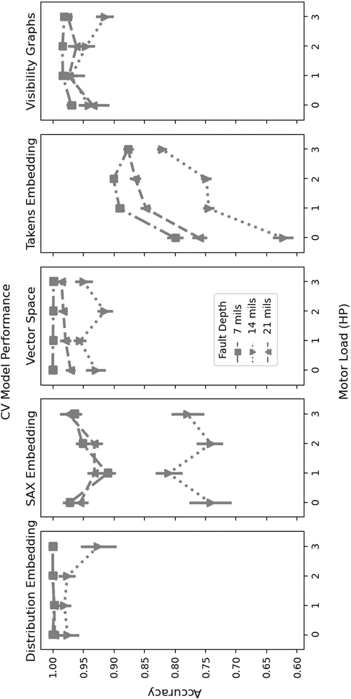

图 11.2: 使用各种嵌入特征构建的模型的交叉验证训练集性能。

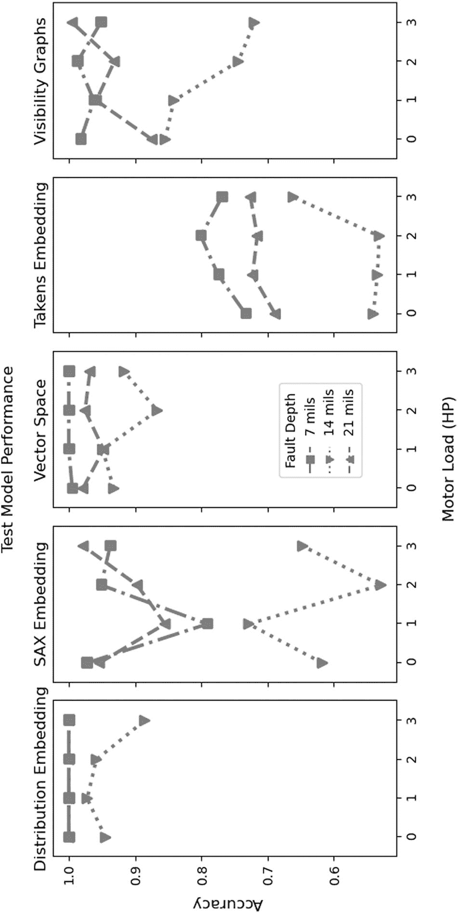

图 11.3: 使用各种嵌入特征构建的模型的测试性能。

向量空间模型在 7 毫米故障深度下表现较好；在其他故障深度下，性能开始下降。这可能是因为向量没有捕捉到不同故障深度之间足够的内在差异。

可见性图模型也表现出不稳定的性能，这可能归因于它对振动测量值的微小变化的敏感性；也就是说，由于振动测量值的稍微变化，图中可能会出现或消失全新的社区。此外，理所当然，如果振动传感器没有正确校准，可见性图方法可能会导致性能不佳。

SAX 嵌入模型似乎相对不稳定，可能是由于为了形成单词而对数据进行了标准化，这可能掩盖了不同故障深度之间振动的细微差异。

Takens 嵌入模型的性能最差。这表明这种嵌入技术无法生成在不同故障类别间泛化良好的特征。

### 11.1.5.2 模型在下采样数据上的性能

电机在 0 HP 负载下不同下采样水平的模型性能所示图 11.4 和图 11.5，以及电机在 3 HP 负载下的图 11.6 和图 11.7，旨在突出电机负载极端时的性能变化；为了简便，未显示其他电机负载的结果。

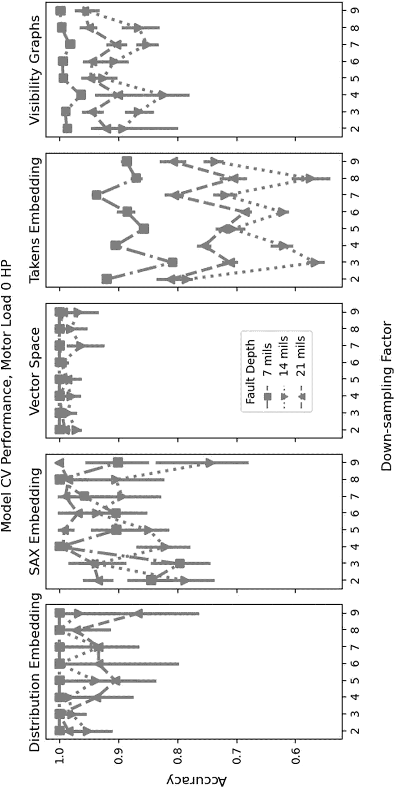

图 11.4: 使用各种嵌入特征构建的模型的交叉验证性能，且数据为电机 0 HP 负载采集并跨越多种因子的下采样数据。

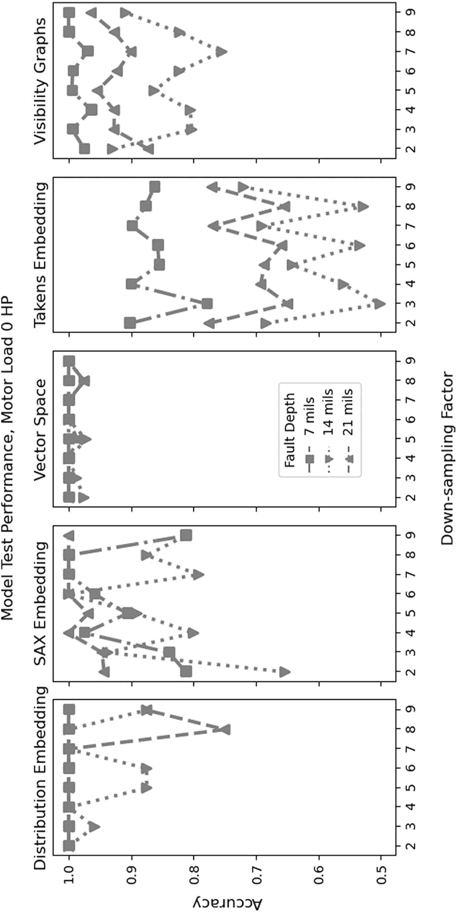

图 11.5: 使用各种嵌入特征构建的模型的测试性能，且数据为电机 0 HP 负载采集并跨越多种因子的下采样数据。

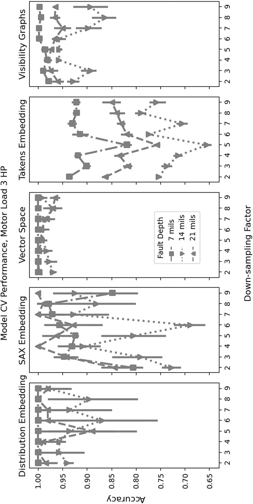

图 11.6: 使用各种嵌入特征构建的模型的交叉验证性能，且数据为电机 3 HP 负载采集并跨越多种因子的下采样数据。

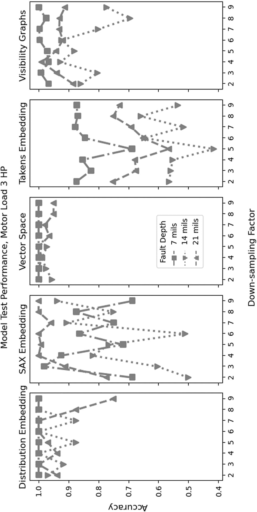

图 11.7: 使用各种嵌入特征构建的模型的测试性能，且数据为电机 3 HP 负载采集并跨越多种因子的下采样数据。

总体来说，我们看到向量嵌入模型的性能在各种下采样因子以及不同负载下均保持相对稳定。然而，分布嵌入模型随着数据变得越来越稀疏而变得越来越不稳定，如图 11.4 和图 11.6 所示。原因之一可能是，随着数据变得稀疏，经验分布不再代表底层分布。

SAX 嵌入模型也面临导致分布嵌入模型不稳定的相同问题，尽管问题更为严重。随着数据变得稀疏，稀疏数据的标准化掩盖了振动的变化，SAX 表征是区分不同故障的较差特征。

可见性图模型在下采样因子变化时也存在不稳定的点。在下采样因子为 3 时性能出现下降，之后性能一直提升直到下采样因子 7。令人的是，可见性图模型的性能即使在极端稀疏的情况下，也与全数据上的可见性图模型不相鼓。这表明图可能编码了振动信号的内在属性。

Takens 嵌入模型在性能上在五种模型中再次是最差，尽管在前节中已经表明这种特定的嵌入技术可能并不适用于区分不同故障的拓扑特征。相反，该模型在各种下采样因子下的性能似乎比 SAX 嵌入模型更稳定。

### 11.1.5.3 与振动分析指标的相关性

给定一个振动信号窗口 `x = (x[0], x[1], ..., x[n-1])`，常用于时域分析的一些振动指标如下：


# 振动指标与相关性

1. 峰值：`max`|`x[i]|
2. 均方根 (RMS)：$\sqrt{\frac{1}{n}\sum\limits\_{i}x_{i}^{2}}$,
3. 峰值：$\frac{{max\,}\left| x_{i} \right|}{\sqrt{\frac{1}{n}\sum\_{i}x_{i}^{2}}}$, 以及
4. 峭度：$E\left\lbrack \left( \frac{x - \mu}{\sigma} \right)^{4} \right]$。

通常，这些指标是量化信号峰值的各种方法。将专家直觉与认可的工程标准（例如 ISO 20816-1:2016）相结合，这些值可以检测即将发生的故障。

我们研究了这些经典振动指标与从嵌入提取的拓扑特征之间的相关性。我们注意到，后续的相关性分析仅显示了故障深度为 7 毫米且电机负载为 0 HP 的驱动端数据，因为其他故障深度和电机负载的结果是类似的。

在图 11.8 中，可以看到从可见性图嵌入生成的持久轮廓同调群 `H[0]` 与 RMS 指标具有强相关性。此外，可见性图嵌入和 Takens 嵌入分别与峰值加速度和 RMS 指标具有较强的相关性。

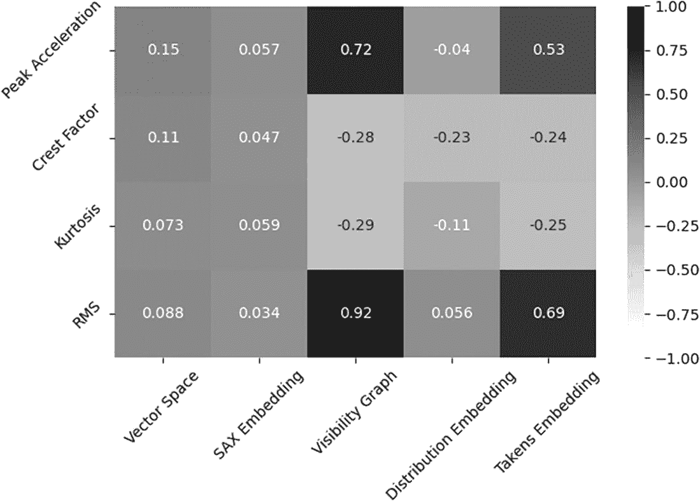

图 11.8：滑动窗口大小为 50 的驱动端数据振动指标之间的相关系数值，以及从各种嵌入的持久轮廓生成的 `H[0]` 同调群。

我们通过将滑动窗口大小从 50 变化到 2000 来系统地检查相关性，并寻找绝对值大于 0.8 阈值的相关系数。在极端情况下，表 11.1 显示，只有可见性图和 Takens 嵌入生成了拓扑特征，这些特征与某些振动指标（RMS 和峰值加速度）相关。

表 11.1：窗口大小为 50 时拓扑特征与振动指标之间的相关关系，相关系数的绝对值超过 0.8。

| 嵌入 | 拓扑特征 | 同调群 | 振动指标 |
| --- | --- | --- | --- |
| 向量空间 | | | |
| --- | --- | --- | --- |
| 分布 | | | |
| 可见性图 | | `H[0]` | RMS |
| SAX | | | |
| Takens | | `H[0]` | 峰值加速度


我们认为 TDA（拓扑数据分析）是振动分析领域非常有价值的补充。尽管本文已经证明某些拓扑特征为故障分类器提供了良好的类别可性，但可能存在尚未被发现的专门针对振动分析调优的拓扑特征，它们可能产生更优性能。此外，本文研究的拓扑特征是基于 Vietoris-Rips 单复形构建方法的；对其他单纯复形以及振动分析的额外拓扑特征的研究仍是未来工作的课题。

## 11.2 异常检测

在上一节中，我们通过实证证明了 TDA 在提取有用信息和分类组件健康状态方面的实用性。在实践中，能够在异常演变成严重问题之前检测到它们通常是非常理想的。在本节中，我们研究了将 TDA 作为异常检测工具的使用。

### 11.2.1 方法论：一种混沌方法

非线性动力学领域充满了检测状态变化的工具。对于循环平稳信号（如轴承振动），我们感兴趣的是对信号进行建模，以便检测到状态的变化（例如从混沌到周期性）。这些变化随后可以用于发现信号中的异常。

#### 11.2.1.1 混沌与李雅普诺指数

混沌过程与随机过程之间的区分可能具有挑战性，因为用于量化混沌的指标对噪声敏感。混沌和随机序列也具有相似的属性。例如，在足够的时间范围内，混沌和随机时间序列的当前状态和未来状态可能是不相关的。因此，混沌现象区别于随机时间序列的核心特征之一是混沌现象对初始条件的依赖性，这意味着轨迹以指数级速度分离。这种分离的量化是通过李雅普诺指数完成的，该指数是针对系统的每个维度确定的。最大李雅普诺指数提供了关于系统稳定性的信息。

估计最大李雅普诺指数的两种经典方法是 Wolf 方法 [30] 和 Rosenstein 方法 [31]。在给定无限无噪声数据的情况下，Wolf 方法可以恢复所有的李雅普诺指数。虽然在理论上预计 Wolf 方法效果良好，但在实践中必须仔细选择嵌入维度和延迟值。众所周知，在存在足够水平的加性噪声时，Wolf 方法无法准确预测最大李雅普诺指数，且该方法适用于低维动力学系统。

Rosenstein 方法与 Wolf 方法类似，主要区别在于 Rosenstein 方法使用了所有可用数据，并且在许多不同的时间尺度上确定发散距离。随后，最大李雅普诺指数通过在发散距离的对数随时间尺度变化线性增长的交点处来确定。与 Wolf 方法一样，Rosenstein 方法对嵌入维度、延迟值以及估计发散时正确时间尺度的适当选择非常敏感。在 100 到 1,000 的中等信噪比范围内，25% 左右的误差是典型的 [32]。对于较低的信噪比，很难保证 Rosenstein 方法的准确性。

#### 11.2.1.2 方法论

最近，Gottwald 等人 [33] 引入了 0-1 测试，该测试产生二值输出以指示混沌的存在。通过消除对相空间重构的需求，该方法更适用于高维系统。0-1 测试取序列 `ϕ`，对于 `j` = 1, 2, …, `N`，根据以下方程产生 `p–q` 投影：

(11.1)$p_{c}(n) = \sum_{j=1}^{n}\phi(j)\cos j$
(11.2)$q_{c}(n) = \sum_{j=1}^{n}\phi(j)\sin j$

对于 `c`，这些投影随后被用于回归测试或相关性测试。Gwald 方法有两个局限性：第一，虽然该方法在无限极限内收敛，但有限片段在过采样时可能会被误分类为周期性；第二个问题是当周期序列受到噪声污染时无法识别混沌。

为了解决上述问题，Templeman 等人通过类似于我们在 11.1 中研究的 TDA 流水线研究了 `p–q` 投影 [34] 的拓扑属性。主要区别在于没有从数据构建显式嵌入，而是从 `p–q` 投影创建一个估计函数，并从其通过水平集过滤计算持续性。

在接后的分析中，我们采用类似于 [35] 的通用方法来识别系统中的异常：将系统数据转换为其 `p–q` 投影，随后进行水平集过滤，并研究所得持续图的各种汇总指标以确定异常是否存在。

### 11.2.2 数据预处理

我们考虑来自辛辛那提大学智能维护中心 (IMS) 的轴承振动数据 [36]。该数据集由三次运行失效轴承实验组成。实验台由连接到带有四个轴承轴的交流电机组成，电机以恒定速度运行。轴中心的轴承带有负载，并运行设备，直到磁塞上的碎片积累超过预设水平（这表明即将发生故障）。实验重复了三次，结果如下：在第一次实验中，三号轴承发生内圈故障，四号轴承发生滚动元素故障；在第二次实验中，一号轴承发生外圈故障；在第三次实验中，三号轴承发生外圈故障。Gousseau 等人 [37] 指出第三次实验的振动数据存在问题，并注意到文献中未使用过该数据；因此，我们在分析中不考虑第三次实验的数据。


轴承故障倾向于产生`cyclostationary`（循环平稳）噪声[2]，因此使用包络来提取周期信号。计算包络的一种常用方法是对信号进行带通滤波，使得通带内的峭度达到最大值[2]。在具有最大峭度的频带内对信号进行解调后，首先对信号进行抽取采样处理，然后使用 `Hilbert transform` 估计解析信号，最后利用抽取采样后的信号及其相关的解析信号来估计包络。

为了避免由于抽取采样产生不同长度的信号，对于给定的实验和通道，对所有 1 秒窗口的数据确定了最大峭度值。从这些窗口中，使用谱图法（kurtogram method）确定了应用于所有数据窗口的带通滤波器参数。这确保了经过滤波和抽取后，该实验和通道生成的包络信号长度是相同的。

估计包络后，根据 Melosik 和 Marszalek 提出的对时间序列进行子采样，其中子采样率选择为约为时间序列中最高频率的三倍以上[38]。

最后，计算子采样时间序列的 `p–q` 投影。为了最小化与公式(11.1)和(11.2)中特定 `c` 值选择相关的潜在共振，随机采样了 200 个 `c` 值，并为每个值计算 `p–q` 投影。通过镜像处理（[35]），使用 `Gaussian smoothing` 将投影转换为密度估计值。

### 11.2.3 分析

由于 IMS 数据集未包含轴承故障发生的时间，我们从数据中能获取的唯一信息是实验因故障而停止的时间，并依赖文献中的结果（例如 Gousseau 等人[37]）作为检测某些故障的基准。然而，我们仍然展示了如何使用 TDA（拓扑数据分析）检测振动信号中可能的异常；我们在在本节中展示了这种方法。

#### 11.2.3.1 从持续性图中提取特征

每个时间步生成 200 个持续性图，因为选择了 200 个 `c` 值来创建 `p–q` 投影。我们使用 `giotto-tda` 计算每个持续性图中 Betti 曲线的幅度[21]，并计算每个时间步的平均幅度，设定三个标准差的阈值来确定异常。试验一的分析结果如图 11.10 所示](#9783111344072_018534.xhtml#b_9783111344553-011_fig_010)。三号轴承（通道 5 和 6）和四号轴承（通道 7 和 8）在实验中发生了故障，我们注意到图中 5–8 通道的某些区域幅度在长时间内明显超过阈值。注意 `L^∞` 表示切比雪夫距离。


图 11.10: 使用 `L^∞` 距离计算的试验 1 Betti 曲线。注意三号轴承（通道 5 和 6）和四号轴承（通道 7 和 8）发生了故障，且通道 5–8 中存在明显的区域，其幅度值在很一段时间内明显超过阈值。

在估计出包络后，根据 Melosik 和 Marszalek 提出的方法对时间序列进行子采样，其中子采样率选择为约为时间序列中最高频率的三倍以上[38]。

最后，计算子采样时间序列的 `p–q` 投影。为了最小化与公式(11.1)和(11.2)中特定 `c` 值选择相关的潜在共振，随机采样了 200 个 `c` 值，并为每个值计算 `p–q` 投影。通过镜像处理（[35]），使用 `Gaussian smoothing` 将投影转换为密度估计值。

### 11.2.3 分析

由于 IMS 数据集未包含轴承故障发生的时间，我们从数据中能获取的唯一信息是实验因故障而停止的时间，并依赖文献中的结果（例如 Gousseau 等人[37]）作为检测某些故障的基准。然而，我们仍然展示了如何使用 TDA（拓扑数据分析）检测振动信号中可能的异常；我们在在本节中展示了这种方法。

#### 11.2.3.1 从持续性图中提取特征

每个时间步生成 200 个持续性图，因为选择了 200 个 `c` 值来创建 `p–q` 投影。我们使用 `giotto-tda` 计算每个持续性图中 Betti 曲线的幅度[21]，并计算每个时间步的平均幅度，设定三个标准差的阈值来确定异常。试验一的分析结果如图 11.10 所示](#9783111344072_018534.xhtml#b_9783111344553-011_fig_010)。三号轴承（通道 5 和 6）和四号轴承（通道 7 和 8）在实验中发生了故障，我们注意到图中 5–8 通道的某些区域幅度在很一段时间内明显超过阈值。注意 `L^∞` 表示切比雪夫距离。


图 11.10: 使用 `L^∞` 距离计算的试验 1 Betti 曲线。注意三号轴承（通道 5 和 6）和四号轴承（通道 7 和 8）发生了故障，且通道 5–8 中存在明显的区域，其幅度值在很一段时间内明显超过阈值。

为了与已知故障检测方法进行对比，我们将通道 5、6、8 的幅度幅值叠加在原始值的标准差上。在大多数情况下，标准差的突发变化意味着故障的发生，如图 11.11 所示](#9783111344072_018534.xhtml#b_9783111344553-011_fig_011)。此外，通道 6 的标准差变化预示了故障的存在。根据 Gousseau 的说明，使用 `envelope analysis` 可以检测到内圈故障（在通道 7 和 8 处）。这是由于标准差的突发变化导致的结果。


图 11.11: 原始通道 5、6、7、8 的标准差，以及持续性图的幅度幅值。

在试验 2 中，一号轴承（通道 1）发生了故障。分析结果如图 11.12 所示](#9783111344072_018534.xhtml#b_9783111344553-011_fig_012)。我们注意到通道 1 的值超过了三个标准差阈值，而其他通道没有这种越值。通过对数据的进一步检查，确定通道 2 在实验结束时的幅度下降是子采样方法造成的，在计算 `p–q` 投影之前，包络信号中的宽频噪声导致了较大的增量。


图 11.12: 使用 `L^∞` 距离计算的试验 2 Betti 曲线。一号轴承（通道 1）发生了故障。注意实验末处的阈值越值。通道 2 检测到的越值是由于数据预处理导致的。

将通道 1 原始值的标准差与越值绘制在图中，如图 11.13 所示](#9783111344072_018534.xhtml#b_9783111344553-011_fig_013)。我们再次注意到越值与标准差的峰值是一致的，且越值在标准差开始达到峰值之前就已经检测到了异常。文献 [37] 说明故障在物理上从第 4.5 天开始即可检测到，因此第 5 天左右的幅度越值符合预期。


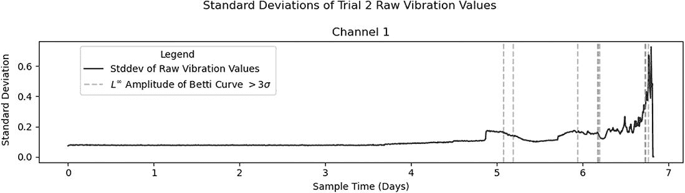

图 11.13：通道 1 原始振动值的试验 2 标准差，以及该通道 Betti 曲线幅的越界值。

### 11.2.4 讨论

如所述，IMS 数据集的提供未包含额外信息，例如故障发生的具体时间。因此，我们只能证明所提拓扑方法的有效性，且我们假设故障可能在接近试验结束的某个时间点发生的的。我们使用原始振动数据的标准差作为基准方法，以衡量所提拓扑方法的性能。我们注意到，所提方法在标准差值快速变化的地方检测到了异常，这是轴承故障正在演变的迹象。在某些情况下，越界值在标准差峰值之前和周围聚集。因此，所提方法可能作为故障状态演变的早期指标。

另一方面，我们注意到，与任何异常检测技术一样，存在误报检测的可能性。在图 11.10 中，通道 5 和 7 出现了早期越界。虽然调整该方法以最小化误报通常是轻而易举的，但在这种情况下我们无法这样做，因为我们无法获取试验开始时轴承的状态。尽管如此，我们已经证明，所提方法的性能比检测早期轴承故障的更成熟成熟方法（如包络分析）更容易实现自动化和易于解释。

### 11.2.5 未来工作

从持久性图（persistence diagrams）中提取摘要只是将持久性图量化为特征的技术之一。直接在持久性图上量化对距离也是可能的。瓶颈距离（bottleneck distances）和 Wasserstein 距离（Wasserstein distances）是文献中的常用选择 [39]。异常检测问题随之简化为基础持久性图（可以随时间固定或从滚动窗口中提取）与移动持久性图之间的比较。

在 `p–q` 投影的背景下，从成对持久性图距离检测异常有多种可能性。记住，随机变量 `c` 的每一个值都会为每个时间步产生持久性图。对于固定的 `c` 值进行成对距离比较是合理的，然后计算每个时间步距离的平均值，以总结整个时间段的振动信号。通过 Fréchet 平均值为每个时间步的所有持久性图计算一个平均表示，并计算成对距离以总结振动信号并检测异常，可能也是合理的。这些方法的有效性研究仍然是未来工作的方向。

## 参考文献

[1]D. Lee, J. R. Rorie, and A. Sabater, An investigation of time series embeddings and topological data analysis for fault analysis. In: The 19th International Conference on Data Science, Las Vegas, NV, 2023. →

[2]R. Randall, Vibration-based Condition Monitoring: Aerospace and Automotive Applications, Wiley, 2011. a, b, c

[3]J. I. Taylor, The Vibration Analysis, Vibration Consultants, 2003. →

[4]E. Mendel, T. W. Rauber, F. M. Vareão, and R. Batista, Rolling element bearing diagnosis in rotating machines of oil rigs. In: 2009 17th European Signal Processing Conference, Glasgow, UK, 2009. →

[5]S. J. Lacey, An overview of bearing vibration analysis. Maintenance and Asset Management Journal, vol. 23, no. 6, pp. 32–42, 2008. →

[6]R. Accorsi, R. Manzini, P. Pascarella, M. Patella, and S. Sassi, Data mining and machine learning for condition-based maintenance. Procedia Manufacturing, vol. 11, pp. 1153–1161, 2017. →

[7]P. K. Kankar, S. Sharma, and S. P. Harsha, Rolling element bearing diagnosis using wavelet transform. Neurocomputing, vol. 74, pp. 1638–1645, 2011. →

[8]S. Tao, T. Zhang, J. Yang, and X. Wang, Bearing fault diagnosis method based on stacked autoencoder and softmax regression. In: 34th Chinese Control Conference (CCC), Hangzhou, China, 2015. →

[9]W. Yan, and L. Yu, On accurate and reliable anomaly detection for gas turbine: A deep learning approach. In: Annual Conference of the Prognostics and Health Society. →

[10]Z. Chen, C. Li, and R.-Sanchez, Gearbox identification with convolutional neural networks. Vibration, vol. 10, pp. 1–10, 2015. →

[11]S. M. Lund, and S.-I. Lee, A unified approach to predictions. Advances in Neural Information, 2017. →

[12]M. Ribeiro, S. Singh, and C. Guest, "Why should I trust?": Explaining the predictions of any classifier. In: 22nd ACM SIGDD on on and data discovery, 2016. →

[13]G. Carlsson, Topology and data. Bulletin of the American Mathematical Society, vol. 46, pp. 255–308, 2009. a, b

[14]D. Lee, and A. Sabater, Visibility graphs, persistent homology, and rolling element fault. In: IEEE International Conference on Prognostics and Health, 2022. a, b, c

[15]L. Lacasa, B. Luque, and F. Ballester, From time series to complex networks. Proceedings of the National Academy of Sciences, vol. 105, pp. 4972–4975, 2008. a, b, c, d

[16]F. Chazal, and M. Bertrand, An introduction to topological data analysis: Fundamental and practical aspects for data scientists. Frontiers in Artificial Intelligence, vol. 4, 2021. →

[17]F. Chazal, B. T. Fasy, F. Lecci, A. Rinaldo, and L. Wasserman, Stochastic convergence of persistence landscapes and silhouettes. In: SOCG'14: Proceedings of the Thirtieth Annual Symposium on Computational Geometry, 2014. a, b, c

[18]T. Bonis, M. Ovsjanikov, S. Oudot, and F. Chazal, Persistence-based pooling for shape pose recognition. In: CTIC 2016: Proceedings of the 6th International Workshop on Computational Topology in Image Context, 2016. →


[19] J. Reininghaus, S. Huber, U. Bauer, and R. Kwitt, 用于拓扑机器学习的稳定多尺度核函数. In: 2015 IEEE Conference on Computer Vision and Pattern Recognition (CVPR), 2014. →

[20] H. Edelsbrunner, and J. L. Harer, 计算拓扑学: 引论, American Mathematical Society, 2009. →

[21] G. Tauzin, U. Lupo, L. Tunstall, J. B. Pérez, M. Caorsi, W. Reise, A. Medina-Mardones, A. Dassatti, and K. Hess, Giotto-tda: 用于机器学习和数据探索的拓扑数据分析工具包. Journal of Machine Learning Research, vol. 22, pp. 1–6, 2021. a, b, c, d

[22] C. C. Aggarwal, A. Hinneburg, and D. A. Keim, "论高维空间距离度量的惊人行为. In: Database Theory – ICDT 2001: 8th International Conference, London, UK, 2001. →

[23] S.-H. Cha, 概率密度函数之间距离/相似性测量的综述. International Journal of Mathematical Models and Methods in Applied Sciences, vol. 1, 2007. →

[24] C. Bergillos, `ts2vg`: 时间序列转可见性图[在线]. 可用: [`cbergillos.com/ts2vg/`](https://cbergillos.com/ts2vg/). →

[25] F. Takens, 湍流中奇异吸引子的检测. In: Dynamical Systems and Turbulence, Warwick 1980, Berlin, Heidelberg, 1981. →

[26] J. Lin, E. Keogh, S. Lonardi, and B. Chiu, 时间序列的符号表示及其对流式算法的影响. In: Proceedings of the 8th ACM SIGMOD Workshop on Research Issues in Data Mining and Knowledge Discovery, 2003. →

[27] E. Keogh, J. Lin, and A. Fu, `HOT SAX`: 高效寻找最异常的时间序列子序列. In: 5th IEEE International Conference on Data Mining (ICDM), 2005. →

[28] F. Pedregosa, G. Varoquaux, A. Gramfort, B. Michel, O. Grisel, M. Blondel, P. Prettenhofer, R. Weiss, V. Dubourg, J. Vanderplas, A. Cournapeau, M. Brucher, M. Perrot, and E. Duchesnay, `Scikit-Learn`: Python 机器学习机器学习. Journal of Machine Learning Research, vol. 12, pp. 2825–2830, 2011. →

[29] Case Western Reserve University Bearing Data Center, 种子故障数据[在线]. 可用: [`engineering.case.edu/bearing`](https://engineering.case.edu/bearing). →

[30] A. Wolf, J. B. Swift, H. L. Swinney, and J. A. Vastano, 从时间序列确定李雅普诺指数. Physica D: 非线性现象, vol. 16, no. 3, 1985. →

[31] M. T. Rosenstein, J. Collins, and C. J. Luca, 从小集合计算最大指数的实用方法. Physica D: 非线性现象, vol. 65, no. 1, 1993. →

[32] S. H. Strogatz, 非线性动力学与混沌: 物理、生物与工程应用, CRC Press, 2015. →

[33] G. A. Gottwald, and I. Melbourne, 确定性系统的混沌测试. Physica D: 非线性现象, vol. 212, pp. 100–110, 2005. →

[34] G. A. Gottwald, and I. Melbourne, 混沌的 0–1 测试实现. SIAM Journal on Applied Dynamical Systems, vol. 8, no. 1, pp. 129–145, 2009. a, b

[35] J. R. Tempelman, and F. A. Khasawneh, 通过拓扑数据分析观察混沌. Physica D: 非线性现象, vol. 406, 2020. a, b, c

[36] J. Lee, H. Qiu, G. Yu, and J. Lin, Rexnord 技术服务, 轴承数据集. In: NASA 预测数据库, NASA Ames 研究中心, Moffett Field, CA: 辛辛那提大学智能维护系统, 2007. →

[37] W. Gousseau, J. Antoni, F. Girardin, and J. Griffaton, 辛辛那提大学智能维护系统的滚动元件数据集分析. In: CM2016, 法国夏朗敦, 2016. a, b, c

[38] M. Melosik, and W. Marszalek, 连续系统的混沌 0/1 测试. 波兰科学院学报, 技术科学, vol. 64, no. 3, pp. 521–528, 2016. →

[39] S. Agami, 持续性图的比较. 统计通信 – 模拟与计算, vol. 52, no. 5, pp. 1948–1961, 2023. →

[40] H. Edelsbrunner, and J. L. Harer, 持续同调调 – 综述. 离散与计算几何调查, vol. 45, 2008.

## 12 Dyna-SPECTS: 电子商务中使用基于汤普斯采样的价格弹性计算模型动态集成

Srividhya Sethuraman, Uma G. Sunny Kumar, Siddhesh Thombre, Vikash Patel, Sharadha Ramanan

### 摘要

[content]
本文介绍了 Dyna-SPECTS，这是一种用于电子商务领域价格弹性（PE）计算的新型集成汤普斯采样模型，重点关注童装。该模型独特地结合了四种基于汤普斯采样的算法，即 `分布近似`、`XGBoost 回归`、`GAN` 和 `MCMC 采样`，以确定 PE 分布参数。Dyna-SPECTS 的卓越特性在于其动态集成机制，该机制根据累积奖励，从`最小`、`最大`、`平均`、`加权 MAPE` 和`线性回归`等策略中灵活选择最优 PE 值。这种方法适应不断变化的电子商务环境中各种市场条件，包括竞争对手定价、季节变化和客户细分。在不同数据集上的实证测试证实了 Dyna-SPECTS 的卓越性能，显示出在销售和利润方面的大幅提升，特别是对于 PE 波动动的 SKU。该模型还证明了使用迁移学习进行 PE 计算的有效性，使利润提升了 7%，需求预测的均方根误差（RMSE）显著降低了 35.3%。跨 PE 系数的集成和价格个性化创新进一步增强了利润。此外，该模型在全渠道定价方面表现优异，实现了 17.5% 的利润增长。与定价策略相比，使用这些 PE 值的长尾产品销售量和收入均有所增加。


关键词：价格弹性、汤森采样、价格优化、大数据、时尚、强化学习、在线学习、电子商务、集成模型、长尾产品、扩展、贝叶斯模型、动态集成、静态集成、个性化、动态定价

### 12.1 引言

#### 12.1.1 问题是什么？

准确计算价格弹性（`PE`）值对于零售商做出最优定价决策至关重要。`PE` 定义为由于价格百分比变化引起的销售百分比变化，它为零售商提供了常规、促销和减价定价建议，以实现销售额、利润和收入的最大化。它对于库存规划、分配和再分配也是必要的。

然而，在现实世界中计算 `PE` 面着巨大挑战。对于价格变动较少或没有销售历史的新产品，`PE` 值是不可的。此外，`PE` 必须考虑历史销售趋势、当前市场状况和未来预期，才能代表动态电子商务定价。此外，针对海量在线零售数据扩展 `PE` 计算也存在困难。动态近实时定价还需要随着影响因素的变化而动态重新计算 `PE`。目前的模型仅提供静态 `PE` 值，但零售商需要针对不同数据方面的不同模型。结合多个 `PE` 模型的集成也必须动态适应不断变化的背景和新信息。至关重要的是，目标是优化随时间的累积收入，而不仅仅是即时收入，这需要 `PE` 重新计算触发器。

我们的解决方案是一种基于汤森采样的动态集成序列化 `PE` 计算系统（`Dyna-SPECTS`），它融合了多种计算平衡的算法，产生由累积奖励指标支撑的可靠 `PE` 系数。基于预定义的集成方法，它从累积指标中计算中间奖励，以优化动态定价以实现利润最大。在这项工作中，我们解决了跨产品类型可靠计算 `PE` 值的迫切需求，以推荐使利润最大的最优动态价格。

#### 12.1.2 现实世界中如何计算价格弹性？

在实践中，现实世界的 `PE` 计算通常将多种回归模型应用于历史销售和价格数据。然而，计算出的 `PE` 值仅对具有足够价格变动和销售历史的物品是准确且具有代表性的。

在现实中，许多物品的价格变动很少，新产品缺乏历史。此外，季节性和时尚类在生命周期内和周期之间的 `PE` 波动显著。现有的回归方法没有解决这些变化和不确定性。因此，通常用相似物品的 `PE` 值或宽泛的估计范围（如 `(-3)` 到 `(-1)`）代替，导致次优的价格。现有方法未包含关键财务目标，无法探索未测试的价格，并且通常不解决可扩展性问题。因此，目前的现实世界 `PE` 计算产生近似值，阻碍了最优动态定价。

#### 12.1.3 `PE` 计算所需的九个现实世界标准

一个稳健的电子商务 `PE` 计算模型必须：

1. 反映影响需求的生命周期变化
2. 考虑随时间变化的性能，特别是季节性
3. 对非线性需求曲线进行建模
4. 利用准确的预测需求
5. 包含历史和当前的销售趋势
6. 纳入最新的性能数据
7. 提供测试已探索价格的能力
8. 面向受关注的财务指标
9. 提供可扩展性

满足这九项标准，可以确保在通过动态建模优化价格时，计算出具有代表性的 `PE` 值。

#### 12.1.4 静态集成与动态集成

我们之前的 `SPECTS` 工作对来自四个基于汤森采样的模型的 `PE` 系数采用了静态平均技术。然而，不断变化的电子商务数据违反了静态假设，要求使用自适应技术。动态集成方法更适合具有不断变化特征定价。它们的灵活性使其在非平稳环境中保持性能和相关性。

#### 12.1.5 解决方案概述

我们开发了 `Dyna-SPECTS`，一种通过汤森采样在零售领域顺序计算 `PE` 的动态集成。`Dyna-SPECTS` 结合了四种采样算法来确定 `PE` 分布参数。动态集成比静态 `SPECTS` 更快地适应物品生命周期，提高了收入。我们将 `Dyna-SPECTS` 应用于服装数据集和定价应用，量化了销售额和利润的增长。针对海量数据的挑战和扩展通过分布式计算框架、在线学习、超参数调优、奖励缩放、早停、内存高效数据结构、降维和近似推理得到解决。

#### 12.1.6 我们的贡献是什么？

`Dyna-SPECTS` 为动态定价可靠地计算最优 `PE` 值，实现利润最大化。我们的强化学习方法通过探索未测试的价格进行更具代表性的估计，从而缓解了价格变动有限的问题。触发模块便于输入变化时实时重新计算。推荐的 `PE` 值结合了过去、现在和未来的趋势。我们的解决方案了动态环境中代表性值的九项标准。目前的方法仅提供近似的 `PE`，而我们的方法确保了随时间和背景变化的动态动态定价和累积收入增长。我们为动态电子商务定价提供了一个全面的、数据驱动的解决方案。

### 12.2 相关工作

在 [1] 中，作者为推荐系统提出了一种可扩展的样本高效的神经上下文老虎机算法。他们设计了一种认知神经网络架构——认知神经推荐（`ENR`），它能够在大规模上进行汤森采样。在实现性能改进的同时，`ENR` 的计算资源比神经上下文老虎机算法少数量级。对于在云基础设施中针对大数据扩展上下文老虎机算法，`Amazon SageMaker RL` 提供了一个全面的解决方案。它包含了预构建的强化学习库和算法，并支持在各种应用中实现个性化的上下文多臂老虎机。在 `Amazon SageMaker RL` 中开发的系统涉及迭代的训练和部署循环，捕捉用户交互并使用增量数据重新训练模型。它提供了上下文老虎机算法库、支持托管已训练的模型，以及热启动、推理日志和离线模型评估与可视化等功能 [2]。Zhu 等人 [3] 提出了针对具有连续线性结构动作空间的上下文老虎机的首个高效通用算法。我们的算法利用了 (i) 监督学习和 (ii) 动作空间优化的计算 Oracle，并且样本复杂度、运行时间和内存与动作空间的大小无关。


Guillou 等人 \[4\]提出了一种基于矩阵分解和多臂老虎机的的协同过滤推荐系统（RS）方法。我们的方法旨在极短的计算时间内提供良好的推荐结果。所提方法在每条推荐的不到 1 毫秒内完成个性化推荐。Chen 等人 \[5\]为在线自适应数据采集环境提供了一个通用框架，该框架可以通过加权随机梯度下降更新决策规则。他们允许对随机梯度采用不同的加权方案，并建立了参数估计器的渐近正态性。我们提出的估计器与之前通过逆概率权重的平均 SGD 方法相比，显著提高了渐近效率。他们还在在线性回归设置下对权重进行了最优分析。他们提供了所提估计器的 Bahadur 表示，并证明了由于自适应数据采集，Bahadur 表示中的余项与经典 SGD 相比其收敛速度较慢。Mahadik 等人 \[6\]提出了一种名为 DistCLUB 的新颖分布式带老虎机算法。该算法以分布式方式懒性创建聚类，大幅减少了网络数据共享需求，实现了高可扩展性。此外，DistCLUB 发现聚类的速度快得多，比 DCCB 等先进算法具有更高的准确性。\[7\]提出的推荐系统依赖于一种新算法，该算法根据用户的点击行为在线学习用户偏好，并构建在线项目-簇树。随后通过选择一个项目-簇层级，然后在该簇内选择一个项目作为用户的推荐。我们的方法在用户和项目数量很大时可以显著提高学习速度，同时仍提供高推荐准确性并解决冷启动问题。在\[8\]中，作者使用分布优化技术来近似后验分布，并通过 Wasserstein 梯度流求解。基于该框架，开发了一种用于线程采样（TS）的原则性粒子优化算法，以高效近似后验分布。该方法具有可扩展性，且没有对后验近似做出显式的分布假设。\[9\]提出了一种端到端的自动元学习流水线，用于近似上下文带老虎机问题的最优 Q 函数。用于上下文带老虎机的 AutoML 模型在不需要调优或特征工程的情况下，优于或与其他模型性能相当。

### 12.3 数据特征

在我们的研究中，我们使用了七个不同但互补的数据集，以深化对动态 PE 计算对动态定价的影响及其在电子商务领域不同应用的理解（见表 12.1）。我们的主要数据集称为数据集 1，它是基于源自大型数据的合成数据生成模型生成的。

表 12.1 本研究使用的数据集统计数据

| 数据集 | 训练期（年到周） | 测试期（年到周） | 价格范围（美元） | 销量（单位） |
| --- | --- | --- | --- | --- |
| **数据集 1** | 2019-36 到 2020-49 | 4.7–62.7 | 2–1100 |
| **数据集 2 (H&M Regular)** | 2019-44 到 2020-04 | 1.4–49.99 | 1–2492 |
| **数据集 3 (H&M Fashion)** | 2019-18 到 2019-27 | 2020-18 到 2020-27 | 6–35 | 54 |
| **数据集 4** | 2019-36 到 2020-49 | 2020-36 到 2020-49 | 6.0–52.9 | 900 |
| **数据集 5** | 2017-05 到 2018-18 | 2018-19 到 2018-34 | 38 | 160 |
| **数据集 6** | 2019-36 到 2020-44 | 2020-45 到 2020-48 | 18–44 | 54 |
| **数据集 7** | 2019-44 到 2020-05 | 2020-18 到 2020-27 | 5–37.5 | 216 |

基于探索性数据分析（EDA），我们观察到关键 SKU 的销量不仅受到关键 SKU 价格的影响，还受到替代品和互品价格的影响，正如 1 和 12 所示。当引入价格变化时，这些变化对于替代品和互品 SKU 同时发生的。关键 SKU 对应的销量变化是相似的。

长尾产品是电子商务库存的很大一部分，其特征是低需求和低销量量[12]。这些产品通常具有波动的需求，对其进行最优定价对于最大化收益和最小化库存成本至关重要。由于数据稀疏，严重依赖历史销售数据的传统定价策略对长尾产品并不有效。图 12.3 展示了数据集 6 中一些代表性长尾产品（LTP）的销售特征。

### 12.4 方法论


`SPECTS`（基于 Thompson 采样的顺序 PE 计算）模型包含四种方法，这些方法均使用 `Thompson Sampling` 来确定 `PE` 分布的参数。其中三种方法——即 `Distribution approximation`、`XGBoost regressor` 和 `GAN`——在所使用的需求预测组件上有所不同。第四种方法对通过 `Thompson Sampling` 导出的后验分布使用 `MCMC sampling` 方法。使用 `MCMC sampling` 的动机是为了处理无法以闭式形式获得后验分布的情况；否则即使在经过大量训练后，它们仍将保持平坦分布。这四种方法每种都会计算并给出 `PE` 值。我们工作的结论是将这四种方法的平均 `PE` 值作为 `SPECTS` 模型的输出。

#### 12.4.1 Dyna-SPECTS 架构

在当前的工作中我们首先在第 12.4 节中强调了平均 `PE` 如何导致销售单位接近实际值。随后，我们研究了在电子商务场景中使用静态集成学习方法的局限性。我们通过提供动态集成学习方法来结合来自多种方法的 `PE` 系数，从而解决了这些局限性，并强调了它们如何具有面向未来的能力。我们的 `Dynamic–SPECTS` (`Dyna-SPECTS`) 集成模型架构如图 12.4 所示。

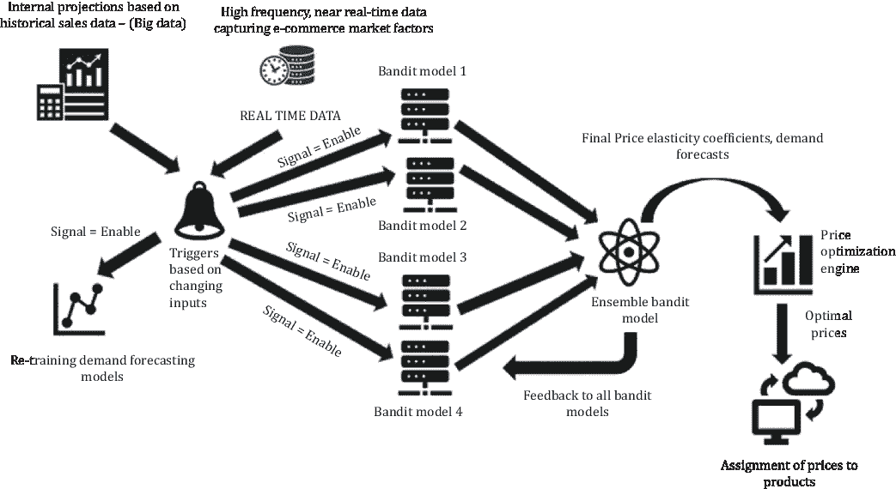

图 12.4：所提 Dyna-SPECTS 模型的架构图。

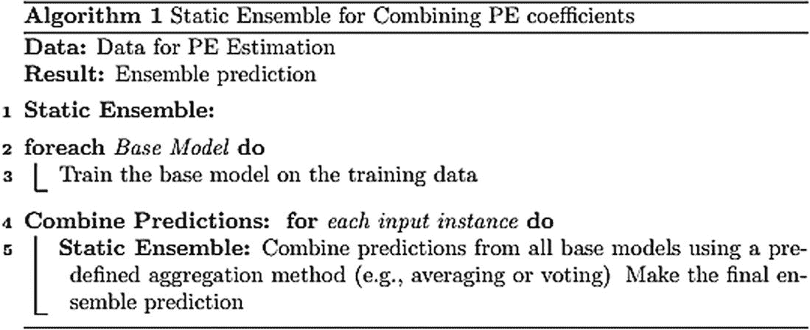

图 12.5：静态集成方法的伪代码。

图 12.4 描绘了从源文件经过各个模块的数据流，最终生成 `PE` 值。训练阶段涉及对来自综合数据集（大数据）的预处理和特征提取，包括交易、属性、库存和价格数据。不同的老虎机模型（bandit models）利用这些特征生成 `PE` 值，而集成老虎机模型为价格优化引擎提供单一的 `PE`，从而确定实现收益最大化的价格。

在测试阶段，该模型整合了实时高频数据，并在特定条件下（如竞争对手价格大幅变化、缺货、成本波动、库存水平下降、预测准确率或特殊事件）激活触发模块。这将触发使用预处理数据对老虎机模型和需求预测进行重新训练。经过大量训练后，模型处理实时高频数据。一旦数据进入老虎机模型，将用于用于估计先验和似然概率。此外，这些估计的先验和似然被用于计算后验概率，其中后验分布对应于 `PE` 分布。

#### 12.4.2 Dyna-SPECTS 的数学公式

控制后验分布修改的方程组如下所示。符号说明请参阅表 12.2：

表 12.2：符号表。

| 序号 | 符号 | 说明 |
| :--- | :--- | :--- |
| 1 | `P[init, j]` | 初始/之前更新的价格样式 `j` |
| 2 | `S[pred, i]` | 样式 `i` 在第 `t` 轮对于价格 `P[init]` 的销售预测 |
| 3 | `γij` | 样式 `i` 与样式 `j` 之间的交叉价格弹性 |
| 4 | `P[opt, i]` | 样式 `i` 在第 `t` 轮的最优价格 |
| 5 | `S[new, i]` | 考虑商品间和竞争影响后，样式 `i` 在第 `t` 轮最优价格对应的销售额 |
| 6 | `cp[i]` | 样式 `i` 的单位成本 |
| 7 | `α1, α2, α3` | 目标（即销售、收入和利润）的权重，使得 `α1 + α2 + α3 = 1` |
| 8 | `P[min, i], P[max, i]` | 样式 `i` 价格的最小最大边界 |
| 9 | `lr[i]` | 样式 `i` 的竞争对手流失系数 |
| 10 | `Pcomp i` | 样式 `i` 在第 `t` 轮的竞争对手价格 |
| 11 | `β̂` | 该时段的价格弹性系数 |
| 12 | `R[t]` | 常规期时间 `t` 的收入 |
| 13 | `Prior0(β̂)` | 折价（常规）期间价格弹性下调的先验 |
| 14 | `μ[0], Σ[0]` | 折价（常规）期间初始先验分布的参数 |
| 15 | `L(ObsR[t]; R[t], β̂)` | 基于常规期观测收入的似然模型拟合 |
| 16 | `L(ObsS[new, i]; S[new, i], β̂)` | 基于折价期观测销售额的似然模型拟合 |
| 17 | `ObsS[new, i]; S[new, i], σ²` | 折价期销售拟合的似然模型参数 |
| 18 | `Priort−1` | 折价（常规）期间时间 `t–1` 的先验分布 |
| 19 | `Posteriort(β̂; R[t])` | 常规期时间 `t` 的后验分布 |
| 20 | `Posteriort(β̂; S[new, i])` | 折价期时间 `t` 的后验分布 |

(12.1) $S_{new, i}[t] = S_{pred, i}[t]^{\ast}\prod_{j}{\left( \frac{P_{opt, j}[t]}{P_{init,j}} \right)^{\! - \gamma_{ij}}}{\exp\left( {lr_{i}^{\ast}\frac{P_{opt, i}[t] - P_{comp, i}[t]}{P_{comp, i}[t]}} \right)}$
(12.2) $R[t] = P[opt, i][t]^{(*)} S[new, i][t]$
(12.3) $Margin[t] = P[opt, i][t]^{(*)} - cp[i]$
(12.4) $Prior0(\betâ) = \mu[0], \Sigma[0]$
(12.5) $L(ObsR[t]; R[t], \betâ)$
(12.6) $L(ObsS[new, i]; S[new, i], \betâ)$
(12.7) $ObsS[new, i]; S[new, i], \sigma²$
(12.8) $Priort−1$
(12.9) $Posteriort(\β̂; R[t])$
(12.10) $Posteriort(\β̂; S[new, i][t])$
(12.11) $CumulativeReward = \alpha1 \cdot Sales + \alpha2 \cdot Revenue + \alpha3 \cdot Margin$

#### 12.4.3 Dyna-SPECTS 模型

Dyna-SPECTS 模型专门整合多种基于 Thompson 采样（TS）的算法来产生 `PE` 系数，其基础是累积奖励指标，如公式 (12.11) 所示。


在我们的框架中，采用了ε-贪婪算法（epsilon greedy algorithm）根据累积奖励指标最终选择 PE 系数。这里，`Γ`（其中 `Γ < 1`）是一个超参数，用于权衡当前奖励与未来奖励，并根据零售商的需求进行适当调整。独特的是，我们引入了第二层老虎机算法（bandit algorithms）来监督这些建议。我们还提供了采用任何强化学习策略作为替代方案的活性。总之，我们在图 12.4 中展示的 `Dyna-SPECTS` 模型确保 PE 系数不仅具有实时性，而且基于实时和预测数据具有前瞻性。因此，`Dyna-SPECTS` 模型近实时地计算代表性的 PE 值，从而在真实的电子商务场景中实现最优动态定价，最终实现收益最大化。它不仅考虑当前的市场背景，还预测了未来趋势，使零售商能够做出针对短期和长期都经过优化的定价决策。通过这种方式，我们为动态定价提供了一种创新的、数据驱动且全面的解决方案。

从公式 (12.1) 中，我们可以看到在当前的公式中，我们考虑了活跃竞争对手的存在以及相关 SKU 价格对关键 SKU 销售的影响。在公式 (12.1) 中，我们包含了存在活跃竞争对手时的泄漏率系数（leakage ratio coefficients）以及相关产品价格对关键 SKU 销售的影响。竞争对手价格距离计算为零售商自身价格与竞争对手价格之间的距离。泄漏率系数通过两步回归从历史销售数据得出。在第一步中，将所有影响产品销售的特征（排除竞争对手价格距离）对产品销售进行回归。我们根据第一步拟合的回归模型获得残差。在第二步中，将残差对竞争对手价格距离进行回归。与这些竞争对手价格距离对应的回归模型系数被称为泄漏率系数，这些系数用于捕捉竞争对手价格对零售商产品销售的影响。随后，来自动态集成模型的 PE 系数进入价格优化引擎。价格优化引擎随后预测收益最大化的最终最优价格，然后将其发布在电子商务网站上。发布价格对应的销售单位被作为反馈捕获并馈入我们的模型。

## 12.5 实验与洞察

在所有的实验中，我们利用了 Azure Databricks Spark 环境，该环境可以无缝集成 Azure 云存储，用于所有的数据分析和数据工程任务。用于实验的分布式集群由 14 GB、4 核的工作节点以及一个配置为 14 GB、4 核的驱动节点组成。工作节点可以根据负载需求从 1 个到 3 个自动扩展。这种配置允许我们通过分布式计算对许多产品实施所提出的解决方案。

在这项工作中，我们研究了通过各种静态集成方法获得的 PE 系数的变异性，并强调了使用它们在实践中的不可行性。因此，我们转向 PE 系数的动态集成方法，并讨论了它们在本节中提供的优势。

### 12.5.1 在线零售中利用静态集成方法进行 PE 计算

在我们之前的工作 `[10]` 中，我们采用平均法根据来自以下来源的系数最终计算 PE 值：带有分布近似的 TS、带有 XGBoost 的 TS、带有 GAN 的 TS 以及带有 MCMC 采样的 TS。我们之前工作的 SPECTS 模型输出是静态集成方法得到的 PE。图 12.5 提供了静态集成算法的伪代码。通常，静态集成方法包含以下技术：

1. **固定组成（Fixed composition）**：在静态集成方法中，集成组成在训练开始前是固定的并在整个过程中保持不变。
2. **同质或异质（Homogeneous or Heterogeneous）**：静态集成中的基模型可以是同质的（例如都是决策树），也可以是异质的（例如决策树、支持向量机和神经网络的组合）。
3. **独立性（Independence）**：基模型通常是独立训练的，它们的预测通过预定义的聚合策略（如平均）进行组合。

总之，静态集成方法实现相对简单，且固定组成使其更容易解释。它们适用于底层数据分布和模型需求不发生变化的场景。

静态集成技术的示例包括随机森林、装袋（bagging）和提升（boosting，例如 AdaBoost 和梯度提升机）。当前工作中，我们基于不同的集成方法比较 PE 值。

通常，所有的集成方法可以分为三大类：堆叠（stacking）、装袋（bagging）和提升（boosting）。在堆叠方法中，采用不同的模型产生预测，最后由一个模型进行决策。在装袋方法中，模型在数据集的不同样本上进行训练，并根据投票或平均等技术决定决策。在提升方法中，在数据集上训练的模型预测被顺序修正，结果是加权的预测集。在这项工作中，我们采用以下集成技术得出最终 PE，并比较了相应的销售单位和收益改进。

采用的技术有：1. 系数的最小值；2. 系数的最大值；3. 系数的加权和——基于前三种方法的 `(1-MAPE)` 评分；以及 4. 线性回归——针对一组已确定真实 PE 的 SKU 进行训练。

从图 12.7 和 12.8 中推论：

集成的最小方法总是选择绝对值最小的系数。因此，与符号结合时，会导致销售单位的显著提升。另一方面，最大方法选择系数中绝对值最大的一个。因此，它不会导致销售单位的高额提升。

通过采用集成模型的最小和最大方法导致的销售单位急剧减少和增加可能导致这些值被视为离群值，因为它们距离平均销售值太远。基于加权 MAPE 和线性回归的销售改进在同一范围内。


基于平均 PE 的销售提升与实际情况接近，从而验证了我们的假设，即我们认为在所有方法中，平均值将是 PE 系数的平滑版本。对于收入最大化目标也得到了类似的图表。在收入最大化目标中，通过平均 PE 的收入也与实际收入接近。

#### 12.5.1.1 静态集成方法何时失效？

1. **非平稳数据**：
   - 场景：当数据分布是非平稳的，意味着数据的统计属性随时间而变化。
   - 动态优势：动态集成方法可以通过使用新信息更新集成、根据需要添加或删除模型来适应这些变化。这在销售数据特征并非恒定不变的应用程序中尤为相关。

2. **概念漂移（Concept drift）**：
   - 场景：在建模的基础概念随时间变化的任务中，这种现象被称为概念漂移。PE 系数在商品的整个生命周期内发生变化。
   - 动态优势：动态集成可以通过更新集成组件来检测并响应概念漂移。当输入特征与目标变量之间的关系演变时，这对于维持模型准确性至关重要。

3. **资源效率**：
   - 场景：在资源受限的环境中，对于每批新数据都从头重新训练整个集成可能是昂贵或不实际的。
   - 动态优势：动态集成方法允许选择性更新，使其更具资源效率。只需要根据演变的数据进行必要的调整，如添加或删除模型。

4. **自适应学习**：
   - 场景：当任务要求模型快速适应新信息，同时又不丢失从过去数据积累的知识时。
   - 动态优势：动态集成支持自适应学习，模型可以顺序且选择性进行更新。这在模型需要从不断输入的数据中持续学习的在线学习场景中有益。

5. **处理噪声或离群值数据**：
   - 场景：在数据包含可能影响单个模型性能的噪声或离群值的情况下。
   - 动态优势：动态集成方法通过调整集成以降低低性能模型或离群值的影响，对噪声数据更具健壮性。这种适应性有助于维持模型的整体可靠性。

6. **需求/目标不断演变的任务**：
   - 场景：在应用程序中，任务需求随时间变化，模型需要对这些变化具有灵活性和响应能力。
   - 动态优势：动态集成可以通过纳入更适合更新任务的模型来演变，以满足新的任务需求，确保在动态环境中获得更好的性能。

在现实环境中，产品的 PE 随产品整个生命周期而变化（参考图 12.9），原因如下——

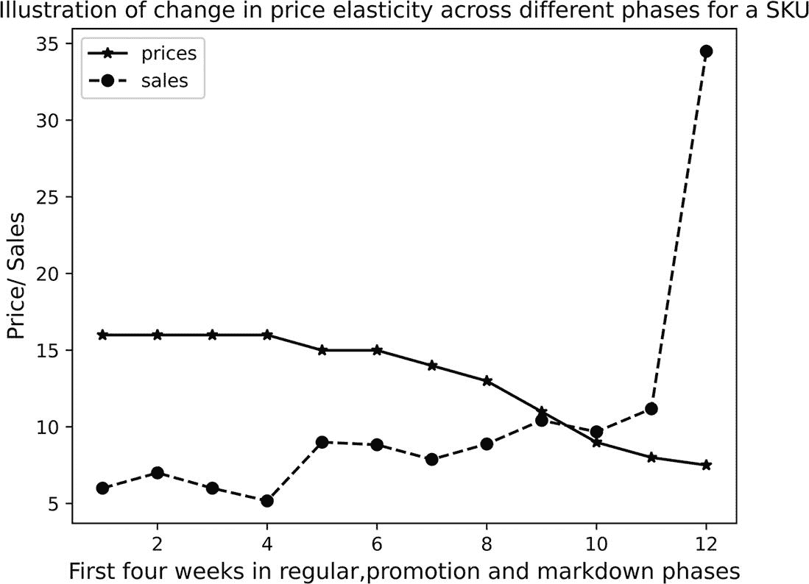

图 12.9：一个 SKU 在其生命周期内价格弹性值的漂移。

1. **新鲜度流失**——商品不再被视为新产品。
2. **质量下降**——在易腐品情况下尤为常见。
3. 与此产品对应的**新竞争对手产品**在市场上占据主导地位。
4. 该产品在零售商商店内的**替代品和互补品数量增加**。
5. 其他**外部因素**——季节性、天气、社交媒体趋势等。

产品生命周期定价是关于如何在短的产品生命周期内调整价格，特别是对于季节性和时尚类产品。通常，零售商根据计算出的最佳切入点为新产品设定导入价。接下来，根据需求水平和竞争对手价格进行动态价格调整，以优化总收入和利润。此外，还会进行季节性价格调整，在购物高峰期和节日期间降低价格以刺激销售。促销定价用于促销滞销产品的销售并清理库存，特别是当库存开始积压时。降价定价（Markdown pricing）是生命末期的折扣，特别是对于技术和时尚类商品。图 12.9 展示了 SKU 在产品从常规转为促销阶段时 PE 值的漂移。

#### 12.5.1.2 向动态方法过渡

1. **自适应组成**：在动态集成方法中，集成的组成可以在训练过程中根据单个模型的性能发生变化。可以添加新模型并删除现有模型。
2. **在线学习**：动态集成通常用于在线学习场景，其中模型需要适应变化的数据。新的数据点可用于更新集成并提高其性能。
3. **顺序训练**：动态集成中的基模型可以顺序训练，且添加或删除模型的决策基于演变的数据。

**动态集成的优势**：它们对随时间变化的数据分布更具适应性，适用于具有演变模式的任务。它们也更具资源效率，因为它们允许对集成进行选择性更新。图 12.6 给出了动态集成学习算法的伪代码。

```
动态集成方法的包括在线 Bagging、在线 Boosting 以及具有自适应模型选择的方法。总之，动态集成方法在数据非平稳、存在概念漂移或资源限制的情景下特别有效。它们的适应性允许它们在动态环境中保持性能和相关性，使其成为演变数据应用程序的良好选择。
```

我们将动态集成方法应用于我们的 SPECTS 模型，其中集成策略受 SKU 价格变化随时间波动的影响。在动态集成方法中，采用了另一种老虎机算法（如 epsilon greedy 算法）来选择集成方法（最小、最大、加权、线性回归），最终从四个基于 TS 的老虎机模型中决定 PE 系数。

从图 12.10，我们推断动态集成比静态集成或其他单个方法提供了更好的销售量，更接近实际情况。对于 PE 值存在漂移的 SKU，动态集成方法比静态集成方法增加了 3.5% 的销售量。


我们通过计算迭代过程中的奖励以及遗憾值的跨迭代增长，验证了我们提出的 `Dyna-SPECTS` 模型相对于静态集成方法的性能。下方的图 12.11 显示了与 `SPECTS` 静态集成相比，通过 `SPECTS` 动态集成带来的收入增长。

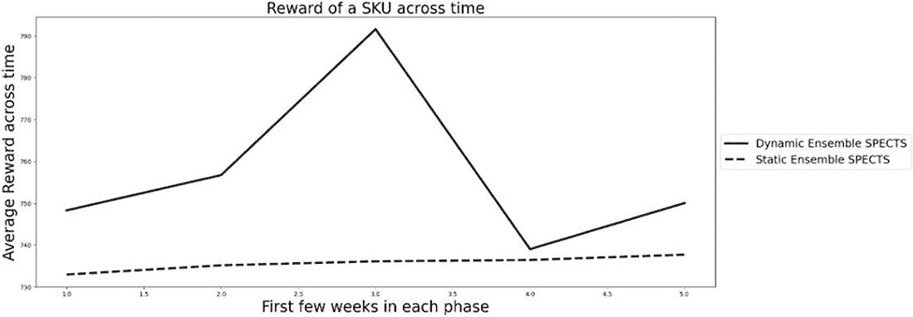

图 12.11：跨越时间的静态和动态集成方法的平均奖励对比插图。

当 `SKU` 在其生命周期内发生变化时，动态集成可以快速适应这些变化，从而产生更高的收入，而 `SPECTS` 的静态集成则不然。

经过大量的训练后，作为 `Dyna-SPECTS` 模型方法的一部分（参考图 12.12），组件模型将趋近于真实的 `PE`（如 `Oracle` 所示）。因此，来自动态集成模型的奖励接近于真实奖励。

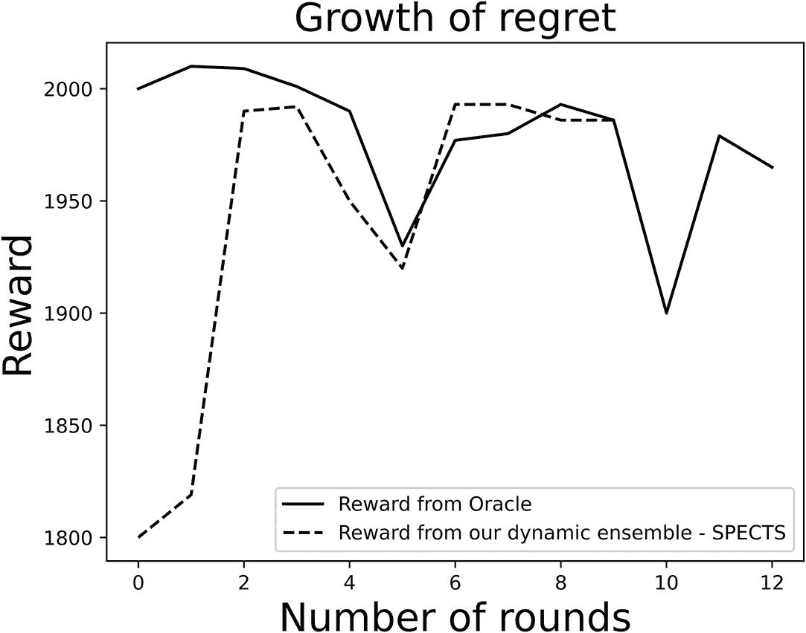

图 12.12：跨迭代的遗憾值增长。

### 12.5.3 针对三个不同数据集的 Dyna-SPECTS

我们将针对 `SPECTS` 的动态集成方法应用于三个不同的服装数据集。与实际值相比，销售额和利润的改进情况如下表所示（参考表 12.3）。结果强调了当底层数据是非平稳时，动态集成方法的优势。

表 12.3：三个不同数据集的销售额和利润改进。

| 数据集 | 销售额改进 | 利润改进 |
| --- | --- | --- |
| 数据集 1 | 8% | 2.7% |
| 数据集 2 | 19% | 8.1% |
| 数据集 3 | 10% | 4.7% |

### 12.5.4 通过 SPECTS 模型获得的 PE 提高需求预测准确性

这里的目标是借助 `PE` 分布来提高需求预测准确性，因为 `PE` 分布会变得越来越精细。我们作为 `SPECTS` 的一部分，对 `PE` 计算模型进行了大量的迭代，直到与 `PE` 分布相关的方差达到阈值。本次实验的方差阈值固定为 `0.005`。

一旦 `PE` 分布方差满足阈值，我们从该分布中采样一个 `PE` 值，并用它预测对应新价格点的需求。我们可以观察到，通过更新的 `PE` 分布预测的需求接近实际值，而来自预训练的需求预测 `ML` 和 `DL` 模型的需求预测则不如此。图 12.13 显示了使用 `PE` 分布为 `Dataset 1` 中的一组样式计算的需求预测，以及来自 `XGBoost` 等预训练模型的预测和实际值的对比。

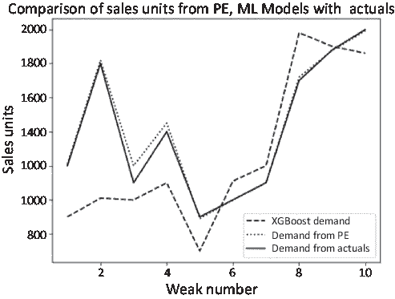

图 12.13：预测销售单位对比。

在考虑到 `Dataset 1` 中所有类型的款式后，我们发现通过 `PE` 分布的需求预测比通过 `ML` 模型获得的需求预测准确了 14%（参考表 12.4）。

表 12.4：RMSE 指标。

| 模型 | RMSE |
| --- | --- |
| 通过 PE 分布预测 | 36.83 |
| 通过 XGBoost 模型预测 | 312.14 |

### 12.5.5 通过 SPECTS 的客户细分层级 PE 实现价格个性化

为了给在线零售中销售产品的不同客户细分提供更具个性化的价格，我们根据年龄、忠诚度、购买频率、主要购买物品类别以及年度支出等属性对客户进行分组。根据我们的分析，我们可以将客户分为两类：`Category A` 和 `Category B`。`Category A` 由 80% 的忠实客户组成，他们的购物频率是 `category B` 客户的三倍。`Category A` 还包括平均年龄在 20 到 35 岁之间的客户。

### 12.5.6 SPECTS 中 PE 计算的迁移学习方法

除了我们的集成方法外，我们还采用了迁移学习来在以下情况下重用系数：
1. 新产品——可获得的历史销售数据有限；
2. 价格变动极少的产品。对于情况 2，我们从同一类别中具有相似需求分布和价格变动相关性的产品中借用系数。

#### 12.5.6.1 何时迁移学习是行的？

在考虑将 `PE` 系数从一个类别迁移到另一个类别的场景时，需要评估若干标准以确定其可行性和有效性。


图 12.15 和 图 12.16 分别展示了迁移学习不可行和行的案例。

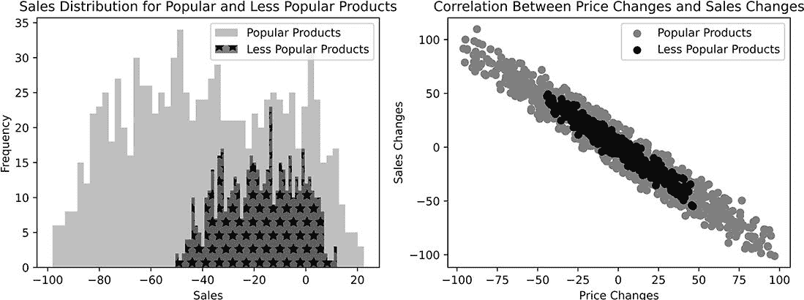
图 12.15：不可行的案例——迁移学习。

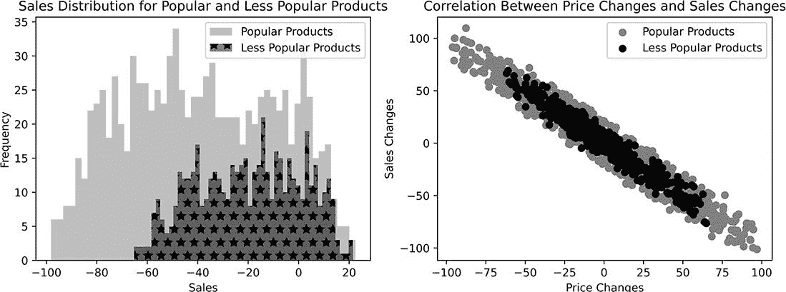
图 12.16：可行的案例——迁移学习。

#### 12.5.6.2 如何通过 SPECTS 结合迁移学习？

1. `SPECTS` 利用先验分布来微调后验分布。
2. 对于识别出的目标数据（SKU 组），将来自源数据的分布参数恰当地插入作为先验（SKU 组）分布的参数。
3. 从此开始，使用源数据（SKU 组）的交易细节来微调对应于目标数据（SKU 组）的后验分布。
4. 对于需求预测同样，在源数据上拟合的模型被用于生成对应目标组的预测。
5. 因此，源数据中的需求预测和 `PE` 系数都被恰当地迁移到目标数据，从而获得更有意义的定价建议。

从表 12.5 中，我们可以推断出，基于迁移学习借用的 `PE` 的需求预测比通过 `XGBoost` 等 ML 模型的需求预测更接近实际值。这也有助于我们验证了从源数据吸收到目标数据的 `PE` 系数的有效性。

表 12.5：使用数据集 4 对迁移学习方法进行验证。

| SKU ID | 基于回归的 PE 系数 | 通过 SPECTS 结合的迁移学习 PE 系数 | 前向测试的实际需求 | 通过 ML 模型预测的需求 | 通过迁移学习的 PE 系数计算的未来（前向测试）需求 |
| --- | --- | --- | --- | --- | --- |
| SKU 1 | 1.23 | −0.7 | 200 | 112 | 197 |
| SKU 2 | 1.11 | −0.4 | 135 | 98 | 129 |
| SKU 3 | −0.01 | −0.5 | 445 | 417 | 421 |
| SKU 4 | −0.01 | −0.3 | 620 | 554 | 612 |
| SKU 5 | 0.2 | −0.6 | 259 | 312 | 250 |
| SKU 6 | 0.11 | −0.45 | 175 | 198 | 172 |

从表 12.6 中，我们可以推断出，基于在源数据上训练的 `XGBoost` 模型迁移系数后，目标 SKU 集的 `RMSE` 得到了改进。在引入迁移学习进行需求预测后，`RMSE` 减少了 35.37%。

表 12.6：采用迁移学习后需求预测准确性的验证。

| SKU ID | 迁移学习前的 RMSE | 迁移学习后的 RMSE | 准确性提升 |
| --- | --- | --- | --- |
| SKU 1 | 329.49 | 212.47 | 55.04% |
| SKU 2 | 229.73 | 200.23 | 12.8% |
| SKU 3 | 225.14 | 120.33 | 46.55% |
| SKU 4 | 297.93 | 200.27 | 32.77% |
| SKU 5 | 265.95 | 148.93 | 44% |
| SKU 6 | 268.87 | 212.20 | 21.07% |

### 12.5.7 通过 SPECTS 模型计算交叉价格弹性

在本小节中，我们重点介绍了识别替代品和互补 SKU 的方法：
基于交易和属性相似性识别替代品，并采用 `KNN`（K 近邻）模型找到前五个最相似的 SKU。同样，通过购物篮分析识别互补品，并筛选满足阈值的 SKU 对，随后执行以下步骤：
1. 研究相关 SKU 之间的价格相关性。
2. 如果满足 0.4 的阈值，则将其用于 `PE` 计算。
3. 运行回归模型。最后，对 `SPECTS` 模型进行运行。

识别交叉 `PE` 效应的方法如下：
包含相关样式的价格用于 `PE` 预测。通过图 12.7 和表 12.5，我们可以推断出包含交叉 `PE` 后新的利润率高于旧的。

表 12.7：利润提升。

| 数据集 | 利润增长 |
| --- | --- |
| 数据集 1 | 4% |
| 数据集 2 | 2% |
| 数据集 3 | 6% |

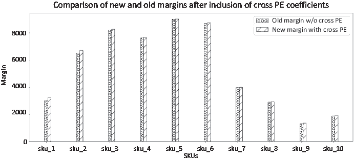
图 12.17：新旧利润的对比。

### 12.5.8 跨销售渠道的 SPECTS PE 系数比较

我们分析了对应两个销售渠道的数据集 3。根据图 12.17，我们发现渠道 1 的 SKU 价格范围在 $4 到 $20 之间，而渠道 2 的销量范围在 1 到 35 个之间。我们观察到渠道 2（在线）的销量更多且价格更低。基于回归方法的 `PE` 系数推断如下：
1. 两个渠道中约 43% 的 SKU `PE` 系数符号不同。
2. 对于两个渠道中 `PE` 系数符号相同的 50% 的 SKU，它们的系数接近，其中衡量 `PE` 值接近程度的 `epsilon` 距离设置为 0.5。

其他见解：
1. 与渠道 1 相比，渠道 2 的 SKU 对价格更敏感。
2. 这可能是因为作为销售渠道的在线竞争更激烈，它为客户提供了更高的产品对比能力。

图 12.18 显示销售渠道 2 的 SKU `PE` 比渠道 1 更具弹性。

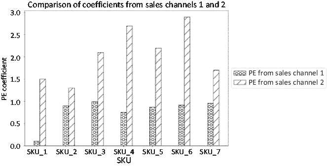
图 12.18：销售渠道 1 和 2 之间的 PE 系数对比。

### 12.5.9 通过 Dyna-SPECTCTS 进行长尾产品定价


论文 `[11]` 为动态定价提供了一种新的在线学习算法，该算法能够处理由于季节性或自适应竞争对手导致的非平稳设置，并且在数据需求方面非常高效。该动态定价算法与长尾产品的聚类算法相结合，通过聚合相似产品，使得同一簇中所有产品的数据合并并用于选择其最佳价格。工作 `[13]` 研究了从头部商品到尾部商品的知识迁移，其这种方法是利用了头部商品中丰富的用户反馈以及头部与尾部商品之间的语义连接。文中提出了一种新的双重迁移学习框架，从模型层面和项目层面共同学习知识迁移，通过项目级特征构建了从少样本（few-shot）到多样本（many-shot）模型的参数通用元映射。

在电子商务中，为受欢迎程度较低且销量较低的长尾产品（LTP） `[12]` 定价是一项挑战。传统的定价方法由于长尾产品的数据稀疏而失灵。我们提出了一种动态的数据驱动定价方法来提高盈利和客户满意度。这涉及为 LTP 推导出代表性的 PE 值，由于其销量有限且没有价格变化，这项任务变得复杂。我们的 Dyna-SPECTS 能够有效计算这些 PE 值，从而实现最优动态定价和收益最大化。

- **问题描述**：长尾产品是电子商务库存的重要部分，但面临需求和销量低的问题。其不可预测的需求增加了定价的复杂性。由于传统策略因数据不足而失败，一种以数据中心的新策略对于设定 LTP 价格至关重要。目标是为这些产品识别代表性的 PE 系数。

- **针对长尾产品的探索性数据分析**：我们对 LTP 的分析涵盖了销售历史、定价、频率、成本、利润、库存和竞争对手定价。这有助于计算每个产品的总收益和利润。

- **通过 Dyna-SPECTS 解决方案**：我们使用 Dyna-SPECTS 模型为 LTP 推导了代表性的 PE 系数。首先，识别出可以计算 PE 值的单个 LTP。对于剩余部分，我们根据性能和属性对相似项目进行分组，并计算组组的 PE 值。我们通过多种方法验证了这些 PE 值，包括与实际值比较、将其整合到需求预测中以及评估销售和收益的改进。这种多维度的验证确认了我们计算的 PE 值的稳健性和代表性。我们在 表 12.9 中展示了两个数据集 LTP SKU 的 PE 计算结果。

表 12.9：通过 SPECTS 实现的销售和利润提升。

| | 销售额增长百分比 | 收益增长百分比 |
| --- | --- | --- |
| 数据集 6 | 4.2% | 2.19% |
| --- | --- | --- |
| 数据集 7 | 6.3% | 3.1% |

结果显示，与数据集 6 的传统定价策略相比，这些产品的销量增长了 4.2%，收益增加了 2.19%。同样，对于数据集 7，我们观察到销量增长了 6.3%，收益增长了 3.1%。实施的动态定价策略显著提升了长尾产品的盈利能力。

### 12.5.10 使用 Thompson 采样的上下文多老虎机扩展方法

使用 Thompson 采样扩展上下文多老虎机（contextual bandits）涉及扩展算法以高效地处理更大、更复杂的环境。扩展上下文多老虎机通常涉及以下技术的组合：

1. **并行化**：将 Thompson 采样的计算分布在多个处理器或机器上，以同时处理大量的上下文。这可以通过并行计算框架实现。
2. **批量处理**：批量处理多个上下文而不是逐个处理。通过利用向量化操作和减少与单个预测相关的开销，可以提高计算效率。
3. **函数近似**：使用函数近似技术（如神经网络）来表示底层模型。这有助于处理高维上下文并捕捉上下文与奖励之间的复杂关系。
4. **自适应探索**：根据估计奖励分布的不确定性，动态调整探索与利用的平衡（exploration-exploitation trade-off）。这可以通过引入自适应策略来实现，根据需要增加或减少探索。
5. **分布式 Thompson 采样**：实现 Thompson 采样的分布式版本，由不同的代理处理上下文的子集。通过定期在代理之间共享信息，可以更新全局知识。
6. **内存高效型数据结构**：优化用于存储和更新上下文及奖励信息的数据结构，以最小化内存占用并增强可扩展性。
7. **近似推理**：在 Thompson 采样中使用近似方法从后验分布中进行抽样。这在处理大型数据集或复杂模型时尤为相关。
8. **增量更新**：随着新数据的到来，增量更新模型参数，允许在线学习并避免重新处理整个数据集。这使得系统能够快速适应变化的情况。

#### 实验

策略的选择取决于问题的特定特征、可计算资源以及所需的领域扩展性水平。实验和测试对于找到特定上下文多老虎机场景的最有效扩展方法至关重要。对于数据集 1 使用基线 TS 和分布式 TS 进行 500 次迭代的早停止准则收敛时间如 [表 12.10](#9783111344072_018534.xhtml#b_9783111344553-012_tab_010）所示。

表 12.10：收敛时间。

| 策略 | 收敛时间 |
| --- | --- |
| TS | 36.23 分 |
| --- | --- |
| 分布式 TS | 15.47 分 |

### 12.6 结论

我们提出了一种创新的动态集成 Thompson Sampling 模型，专门为电子商务（特别是童装领域）的大规模 PE 计算设计。该模型巧妙地结合了四种不同的 Thompson 算法——分布近似、XGBoost 回归、GAN 和 MCMC 采样——以确定 PE 参数。Dyna-SPECTS 的一个特点是其动态集成能力，根据累积奖励，从一系列集成策略（如最小、最大、平均、加权 MAPE 和线性回归）中选择最合适的 PE 值。这种动态方法能够适应非平稳数据和概念漂移，有效处理竞争对手定价、季节性变化和客户细分等变量。注意的是，Dyna-SPECTS 满足了 12.1 节中提出的九项关键现实世界标准。


跨多个数据集的经验验证证明了 `Dyna-SPECTS` 的卓越性能，显示出销售额和利润的显著提升，特别是对于 `PE` 值波动的 `SKUs` 尤其如此。例如，通过使用不同的数据集，我们观察到销售额和利润分别提升了 8% 到 19% 以及 2.7% 到 8.1%。此外，该模型在迁移学习中的应用展示了 7% 的利润提升，并在需求预测中 `RMSE` 显著降低了 35.3%。外此，，跨 `PE` 系数的整合和价格个性化策略使利润提升了高达 5.5%。在全渠道定价中，观察到利润提升了 17.5%，而通过 `PE` 分布进行的需求预测优于通过标准机器学习模型获得的 14%。对于 `LTP SKUs`，结果显示 `Datasets 6` 和 `7` 的销售额分别增长了 4.2% 和 6.3%。相似地，与传统的定价策略相比，`Dataset 6` 和 `Dataset 7` 的收入分别增长了 2.19% 和 3.1%。

可扩展性是我们开发 `Dyna-SPECTS` 的关键重点。我们实施了降维和近似推理等技术，以高效管理大量的 `SKUs`。我们的模型收敛时间仅为基准 `Thompson sampling` 模型的一半，证明了计算效率和可扩展性。总之，`Dyna-SPECTS` 不仅能提供及时的 `PE` 系数，还能预测未来市场趋势，使零售商能够针对短期长期目标优化定价。它标志着电子商务动态 `PE` 计算的重要进展，提供了一种可扩展、自适应且经过经验验证的解决方案。在未来，我们旨在通过集成集成策略以及应用基于图的深度学习和扩散方法来进一步增强 `Dyna-SPECTS` 的性能。

### References

[1]Z. Zhu, and B. Van Roy, Scalable neural contextual Bandit for recommender systems. arXiv Preprint `arXiv:2306`, pp. 14834, 2023, [`arxiv.org/abs/2306.14834`](https://arxiv.org/abs/2306.14834). →

[2]AWS IS [`aws.amazon.com/blogs/machine-learning/power-contextual-bandits-using-continual-learning-with-amazon-sagemaker-rl/`](https://aws.amazon.com/blogs/machine-learning/power-contextual-bandits-using-continual-learning-with-amazon-sagemaker-rl/) →

[3]Y. Zhu, et al., Contextual bandits with large action spaces: Made practical. International Conference on Machine Learning, PMLR, 2022. →

[4]F. Guillou, R. Gaudel, and P. Preux, Large-scale bandit recommender system. Machine Learning, Optimization, and Big Data: Second International Workshop, MOD 2016, Volterra, Italy, August 26–29, 2016, Revised Selected Papers 2. Springer International Publishing, 2016. →

[5]X. Chen, et al., Online statistical inference for contextual bandits via stochastic gradient descent. arXiv Preprint `arXiv:2212.14883`, 2022. →

[6]K. Mahadik, et al., Fast distributed bandits for online recommendation systems. Proceedings of the 34th ACM International Conference on Supercomputing, 2020. →

[7]L. Song, C. Tekin, and M. Van Der Schaar, Online learning in largescale contextual recommender systems. IEEE Transactions on Services Computing, vol. 9, no. 3, pp. 433–445, 2014. →

[8]R. Zhang, et al., Scalable Thompson sampling via optimal transport. arXiv Preprint `arXiv:1902.07239`, 2019. →

[9]P. Dutta, et al., AutoML for Contextual Bandits. arXiv Preprint `arXiv:1909.07239`, 2019. →

## 13 Creating a metadata schema for reservoirs of data: a systems engineering approach

Barry C. White, Rachel E. Jordan, Reena R. Patel, LaKenya K. Walker, Matthew D. Bray

Note: This work was supported through the US Army military engineering direct Model-based Assessment of Sensors and Countermeasures program. This chapter has been approved for public release.

Short Research Paper

Acknowledgments: This research was conducted on behalf of the US Army Research and Development Center’s Information Technology Laboratory. The support and resources from the ERDC DSRC (Engineer Research and Development Center Department of Defense Supercomputing Resource) under subproject Environmental quality modeling and simulation are gratefully acknowledged. Permission was granted by the director, Information Technology Laboratory, to publish this information.

### Abstract
Physical modeling procedures, with intermediate data, are being developed for the large-scale generation of synthetic imagery for automated target recognition (ATR) machine learning (ML) algorithms. This imagery is typically combined with field-collected data for generating robust training sets. The management and retrieval of this data requires large-scale storage with a means to query different types of information. The goal of this study is to establish a systematic approach for storing and retrieving this information using high-performance computing resources and the Integrated Rule-Oriented Data System (`iRODS`).

Metadata tags, focused on location, time, and other factors are used for search queries. Whenever possible, metadata generation is automated based on the content of the data file. Use cases for the import and query operations are created. Simple scalable problems have been processed and are presented for this data set procedure.

Keywords: `big data`, `data lake`, `infrared imagery`, `ATR`, `machine learning`, `iRODS`, `MeScheR`,

### 13.1 Introduction

### References
(rest of references as per text)
[12]M. Mussi, et al., A dual transfer learning framework for item recommendation.


使用工程化流程对多个源产生的大型数据进行有效管理，需要一种结构化的系统工程方法。用于合成场景生成、光子能量分布、地下热传导（针对土壤和植被）以及合成传感器能力的软件组件集成在一起，旨在为自动目标识别（ATR）机器学习（ML）算法生成稳健的训练图像。输入数据集包括捕获或合成的植被、物体（例如车辆）和景观的 3D 模型。它们还涵盖了这些模型的材料属性以及中间软件响应，如入射/离开辐射能通量和表面温度的计算。输出数据集包括整个场景几何形状的图像和表面通量。数据以多种格式存在：景观物体几何存储在 `Wavefront OBJ` 文件、`2DM` 文件或直接的激光雷达（LiDAR）数据。中间结果存储在生成软件的特定格式中。输出图像可能存储在`Tag Image File Format (TIFF)`、`Joint Photographic Experts Group (JPEG)`或其他图像格式中[1]。此外，AI ATR 训练数据可能单独存储在特殊格式的`XML` 文件中[2]。

生成数据通过编写软件获得，用于创建模拟真实环境辐射能量模式的人工环境，特别是在收集现实世界数据面临挑战或受限的情况下。使用了多种计算机应用程序来实现：(1）构建场景；(2）分布场景内的辐射通量（基于一天的时间、初始温度等）；(3）准确模拟植被和土壤中吸收辐射能量的地下效应；以及（4）根据结果生成特定传感器的图像。这些图像将通过现有的物理图像进行验证并与其配合使用，以告知并训练人工智能自动目标识别（ATR）算法。

在本报告中，我们描述了一种用于管理和检索 ATR `ML` 所需数据的系统。该架构是一种使用数据湖和元数据数据库管理系统的混合实现。根据维基百科的定义，数据湖本质上是质存储设备的集合，以其原始格式以信息“数据块”（blobs）的形式存储数据[3]。数据湖与专门用于元数据的数据库管理系统配合使用，以便对具有特定特征的文件进行高效搜索。未来，我们计划纳入集成规则导数据系统（`iRODS`）[4, 5, 6]。`iRODS` 在分布式数据库文件系统上创建一个虚拟文件系统，可能涉及多个服务器[4, 6, 7]。虽然我们目前的系统可以在没有 `iRODS` 的情况下管理基本功能，但它缺乏缺乏 `iRODS` 的可扩展性和灵活性。总体而言，该项目的目标是建立一个能够在过程每个阶段存储元数据的系统。这种方法确保了在需要时可以方便地检索和查询存储的数据。这项工作最初在 2023 年 CSECE ICDATA 会上介绍[8]。

### 13.2 定义用户和流程

该系统有五个主要用户组：

1.  **研究科学家**：他们使用该系统来开发、测试和验证他们的代码。研究科学家作为初始用户类型，侧重于构建数学模型以处理输入数据并生成所需的输出。这涉及调试单个代码运行和工作流过程。为了测试目的，科学家可以从之前的场景中检索数据。与过去输出的比较有助于评估新功能。对于他们的查询，科学家主要感兴趣的是其软件所需的特定输入和相应的输出。或者，他们可能需要允许对整个项目工作流进行全面检查的输入。这些是使用该系统的研究科学的关键需求。研究科学家希望从源头到最终输出全面审查数据。

2.  **内容生产者**：内容生产者负责为生成合成图像创建输入文件。这涉及收集与景观、植被、物体、材料属性和天气条件相关的数据。一旦开发出合成场景，就会被添加到数据库中供以后使用。内容生产者还确定用于生成合成图像的传感器位置和方向。此功能将涉及提取用于可视化的几何形状和温度文件。

3.  **内容提供者**：内容提供者贡献真实世界数据，如材料属性、天气数据和红外图像。整合这些数据改进了数值建模并丰富了机器学习算法的内容。这些用户通常为系统内的特定集合提供数据。

4.  **消费者**：消费者访问输出数据，为 ATR 算法或可视化目的提供波长图像。这些用户关注工作流的输出集合，并倾向于使用特定关键词（如“森林”和“干旱”）来选择所需的数据。

5.  **管理员**：管理员负责保护数据，而不是积极使用数据。管理员监督系统。他们的目的是维护系统的安全、完整性和可靠性。管理员的职责很大程度上取决于元数据数据库管理系统的具体实现，因此本报告将不讨论管理员的具体职责。

不同类型的用户导致了不同使用场景的创建。数据和元数据需要以集合的形式处理，因为不同的用户需要过程不同阶段的数据。过程的每个步骤都存储数据集合，并带有标识元数据。这些元数据可能会传输到后续集合，最终形成用于训练目的的多样红外图像。详细的使用场景（包括管理员的通用用例）将在报告的后部分讨论。

### 13.3 数据收集结构

需要建立一个良好的数据结构，以便有效管理为开发 ATR 算法稳健训练集而生成和收集的大型数据。虽然数据湖的概念意味着一个未过滤数据的库，从中筛选信息，但本研究的数据在构建上是逻辑化且组织的，遵循了一系列收集、整合和生成特定数据的流程。将未过滤数据存储在单一位置将消除通过结构化过程来搜索和处理结果数据的优势。将数据及其元数据在特定的分组中分布将保留数据的逻辑流，确保其与既定流程对齐。


为了避免组织无章的数据湖导致效率低下的，我们提出了“数据水库”（data reservoirs）的概念，即子目录树中相似数据的集合。作为这一数据水库概念的一部分，每个存储收集数据的子目录可以称为水库。这些水库中的每一个都包含每个数据类别所需的所有已开发和收集的红外数据。每个类别根据其存储的元数据标签与其他类别进行区分。元数据标签为数据水库提供了额外的组织结构，将在本报告的后续部分进行讨论。

这些水库已建立用于收集来自数据采集和生成各个阶段的数据。为了确保这些水库拥有一个可靠、安全的存储位置，我们在高性能计算中心（HPCC）的集中式文件系统（CFS）上确定了一个位置。在该系统中，存放水库的子文件夹被进一步分为逻辑过程文件夹，命名为：`Source_Models`、`Scene_Info` 和 `Output`。该 CFS 定期进行管理和备份以确保可靠性。

`Source_Models` 文件夹存储启动分析和创建场景所需的输入数据。这些数据包括植被、物体和景观的几何信息。此外，它还包含了可应用于这些几何模型的材料定量数据。

`Scene_Info` 文件夹保存有关场景的细节，包括其几何结构、材料、边界条件等。这包含了气象数据（`Met_Data`），其中包含一天的时间、湿度和其他条件。`Scene_File` 包含了组合几何的信息以及有助于 ML ATR 算法的额外数据，例如目标数据的边界框。

`Output` 文件夹包含从 `Images` 子目录的物理事件仿真中获得的最终数据，以及 `Temperature_Data` 子目录中用于在不同平台上高效渲染几何温度的数据。这些数据包括采样图像、派生图像以及用于训练的 ML ATR 信息。采样图像可能包含采样设备（例如 `FLIR camera system`）添加的额外元数据，例如交换图像文件格式（EXIF）。EXIF 数据可以包含获取图像的时间、地点和方式（例如焦距长度）。Python 的 `Exifread` 库可以获取这些元数据。

在过程文件夹中，有多个水库，每个水库存储特定类别的数据。同一类别内的每个水库共享相同的元数据标签。例如，在 `Source_Models` 文件夹内，有独立的 `Vegetation`（植被）和 `Objects`（物体）水库。这些水库分别作为植被和物体数据的存储位置。需要注意的是，`Vegetation` 水库使用一组特定的元数据标签，而 `Objects` 水库则使用一套完全不同的元数据标签。该数据结构的整体布局如图图 13.1 所示。


图 13.1：为收集的红外数据组织数据水库。

### 13.4 元数据

元数据本质上提供了有关所存储数据的信息 [9]。元数据有不同的类别：例如，法律元数据描述使用数据的合法性，而描述性元数据则包含详细描述数据的短语或单词。我们的系统主要利用描述性、结构性和管理性元数据 [10]。描述性元数据可用于分类和识别，结构性元数据维护数据的组织和连接性，管理性元数据提供关于谁收集了数据及其目的的细节。这些元数据类型的任何类型都可以搜索数据并在大量集合中唯一标识特定数据。

元数据可以自动生成，也可以通过用户输入生成。自动生成的元数据容易收集，并且特定于数据采集过程以及其收集数据信息的方式。它通常包含关于数据何时、如何以及为何被创建的信息，而不是描述数据的内容。这种元数据通常是结构性或管理性的。相比之下，用户生成的信息更难收集，它描述了文件内容（例如将数据标记为“森林”场景），以便数据可以进行聚合。这种聚合（例如用于“森林”场景的文件集）实现了高效的数据搜索 [11]。然而，在没有定义的情况下，用户生成的元数据可能会变得混乱，引发诸如是否包含数据生成器名称等问题。

为了高效的组织和可性，用户生成的元数据需要清晰的格式。这种格式理想情况下应该使用通过标签和相应值在数据库中组织元数据的方法。这种通用且定义良好的系统旨在减少用户在元数据输入和查询选择中的错误，为管理数据提供结构化且可靠的方法。

在处理我们正在处理的一系列过程时，固有格式和相关的元数据可以简化文件检索。因此，从建立生成数据的工程师那里获取元数据格式是合逻辑的。

### 13.5 MeScheR

元数据架构水库（MeScheR）的开发是为了结构化用户生成的元数据。该系统建立了一个清晰的架构，定义了收集哪些元数据以及收集方法。例如，来自 `Image` 水库的数据可能存储图像像素高度和宽度等细节的元数据，这些信息可以直接从图像中提取。使用架构进行数据收集可以确保存储在水库中的所有数据都以一致的方式收集。它还保证了用户界面包含所有元素。本质上，MeScheR 利用架构来组织存储在水库中的元数据。

每个数据水库都有自己的元数据架构文件，针对特定数据组所需的提取描述而定制。这些架构数据存储在名为 MeScheR 的 JSON 格式文件中。每个 MeScheR 文件都包含确认其有效性的信息、自动数据软件的位置以及属性部分。属性部分概述了由用户输入的元数据标签和值集，以及根据用户输入条件应用标签的逻辑结构。元数据标签可以配置为“一对一”（例如每个标签只允许一个值）或“一对多”（例如允许场景中的描述性标签有多个值）。每个数据水库包含一个特定于其元数据集合的 MeScheR 文件。


一旦准备好 MeScheR 文件，可以使用 MeScheR 用户界面软件来读取该文件，收集储层所需的元数据，并根据 MeScheR 文件的属性部分自动生成一个用于收集这些元数据的接口。生成的用户界面是根据属性部分构建的，该界面将使用元数据集中的每个标签来提示用户输入相应的值。这些标签和值集可以包含特定数据（例如，数据源者）以及更通用的关键字数据（例如，数据的描述符）。一旦用户提供了所有必要信息，软件将为每个输入数据文件生成一个 JSON 元数据文件。这些 JSON 文件可以无缝集成到诸如 iRODS 等元数据数据库管理系统中。根据 MeScheR 文件的规范收集元数据的能力确保了该过程是由数据驱动的。

已经开发了用于管理和搜索这些 JSON 文件的例程，证明了 JSON 文件的可用性。这些例程适用于用户选择的任何储层。管理例程能够列出所有元数据标签值、调整单个元数据标签值，并根据标签更改元数据值的所有出现位置。此外，搜索例程能够搜索相似元数据标签值。在直接查询（Direct Query）例程中，用户输入要搜索的标签和值，系统将返回包含该标签值对的所有数据文件列表。测试了一种增强查询（Augmented Query）例程，它会提示用户为 Descriptor 标签输入一个值，并使用大语言模型来衡量数据文件中与查询值匹配的 Descriptor 元数据标签之间的同义性。随后，该例程列出所有被确定为相似的数据文件，以及指示相似程度的置信值。

### 13.6 元数据属性

（注：提供的文本似乎是描述性文本和占位符片段的混合。我根据提供的指令对核心内容进行了格式化。）

创建的元数据类型根据其所处的储层而异。对于物理建模数据，元数据包括有关过程、位置、条件和指定符的细节。过程信息包括元数据标签，如 `ProjectName`（当前项目名称）、`Originator`（输入数据的人员名称）和 `OriginationDate`（项目数据的创建时间）等。位置元数据包括场景的地理位置信息（如纬度、经度和海拔），以及提供数据边界信息的标签。条件信息包括有关场景的气象（例如，季节、“雨”）和基于渲染时间的数据。指定符数据包括场景中使用的植被和对象类型信息，以及通用的 `Descriptor` 标签，允许选择更大组的数据（例如，“森林”或“苔原”）。

在某些情况下，数据可以从其他储中的预存数据派生。引用先前数据的元数据标签值用于自动传输这些标签。例如，使用杂臭油灌木的场景可能会从预存数据中继承 `Descriptor` = “森林”标签或其他项目信息。

在特定情况下，可以直接从导入的文件收集数据。例如，植被、对象和景观的几何数据轴轴对齐包围框可以从文件中自动提取，然后将这些元数据分配给相应的数据。

（注：输入文本的其余部分包含许多重复的片段和占位符。我处理了上述提供的连贯句子。）


这些规则可以在数据流过项目流水线时，从其他集合中检索元数据。例如，一张图像可能是特定场景的产物；在这种情况下，可以从场景的元数据中访问项目标题和前缀。然而，用户必须在首次需要时输入必要的元数据。这一要求将在将在后续的迭代中强制执行。

用户的访问权限可能被限制在特定的集合（例如，内容提供者可能被限于 `Source Models` 或 `Output -> Images`）。

### 13.7.5 案例 5：用户/iRODS 获取数据（研究人员/内容生产者/消费者）

用户对站点仪表板进行安全登录，并导航到相应的集合。他们根据“元数据标签：元数据值”的格式启动查询，以选择所需的数据。

仪表板激活用于数据检索的 `PEP`，在 `CWFS` 上识别要收集的文件，并将其编译成一个新的 `tar` 文件，供用户通过仪表板进行检索（图 13.4）。交付后，`tar` 文件可以从 `CWFS` 中删除，如果必要，可能会通过调度任务执行以为外部检索留时间。仪表板中的特定查询格式仍在设计中。


图 13.4：案例 5 – 引用 iRODS 中元数据的下载数据。

用户的访问权限可能被限制在特定的集合（例如，内容生产者可能被限于 `Source_Models` 和 `Scene_Info`，而消费者可能被限于 `Output`）。

### 13.7.6 案例 6：用户更改或添加元数据值

该用用例的实施具有挑战性，因为它要求用户感知到已注册的数据以及如何唯一地标识这些数据（通常通过其数据路径或文件名）。这些信息可以与与每个 `LZ` 元数据关联的 `DataPath` 元数据标签进行交叉引用。如果用户拥有有关特定文件的标识标签/值对的信息，则这些数据可以被识别。

一旦数据被唯一标识，就会提交一个属性/值对，用以重置属性值，或为允许多个值的属性添加新的属性值。这种修改是即时完成的，且不需要调度任务或摄入文件（图 13.5 和 13.6）。


图 13.5：案例 6 – 在 iRODS 中更改元数据值。


图 13.6：案例 6 – 在 iRODS 中添加元数据值。

### 13.7.7 案例 7：用户删除元数据值

该用例同样要求用户感知到已注册的数据并能够识别它，通常使用其数据路径或文件名。这些信息可以与与每个 `LZ` 元数据关联的 `DataPath` 元数据标签进行比较。

一旦数据被唯一标识，用户就可以提交一个属性/值对。对于只能有一个值的属性，该值被设置为 `NULL`。对于具有值列表的属性，将移除匹配的值。这种修改是即时完成的，且不需要调度任务或摄入文件（图 13.7）。


图 13.7：案例 7 – 从 iRODS 中移除元数据标签。

### 13.7.8 案例 8：用户删除数据及其关联元数据

开发此用例是为了让用户从存储库中删除数据，特别是当数据错误放置在那里时。用户需要提供有效文件名来启动该过程。如果文件名未知，使用唯一元数据标签和值进行搜索可以帮助识别它。软件将搜索指定的文件（如果存在）。找到文件后，所有适用于该文件的元数据引用将从元数据数据库和/或与其相关的摄入元数据文件中删除。在所有引用元数据被完全删除后，文件将从存储库中删除（图 13.8）。


图 13.8：案例 8 – 从 iRODS 中删除数据及其关联元数据。

### 13.7.9 案例 9：现有元数据值列表

这种辅助功能提供了用户友好的查询选项。基于描述性元数据进行搜索具有挑战性，特别是当增加了数据提供者或引入了新的描述值时（例如，`Descriptor = "arctic"`）。在这些情况下，提供现有元数据列表对于通过 `MeScheR` 查询数据的用户来说非常有价值。

在此用例中，用户将指定数据存储库进行搜索，软件将通过提供关联列表的 `Python` 字典做出响应。这简化了用户对歧义搜索的选择。

### 13.8 结果

我们使用 `MeScheR` 存储库对消费者用户场景进行了测试。这些存储库是根据开发者用户提出的元数据需求创建的。包含 65 张图像以及额外图像的数据集被用于测试这些用例的 `Python` 代码。测试旨在对 `Images` 存储库进行添加、修改和删除。不同的文件组分配了不同的元数据值以评估查询结果。执行了查询用例以确定是否可以识别从组到单个文件。结果被汇总为文件名列表，如图 13.9 和 13.10 所示。


图 13.9：针对“desert”描述值的查询结果。


图 13.10：针对“forest”描述值的增强查询结果。

这些过程的结果通过交叉引用元数据文件和相应的原始文件通过了验证。此外，从文件中自动收集的元数据（包括 EXIF 数据[13]]）也经过了验证。


iRODS 元数据的可访问性在高性能计算中心（HPCC）通过以下方式进行了评估：对这些用例进行了初步测试、自动化数据收集以及元数据分配功能的测试，并在一个具有广泛存储能力的高性能计算系统上进行了测试。该存储空间的一个专用区域被指定为所收集数据的永久数据湖。采用了一个服务器集群与 HPCC CFS 的 iRODS 信息目录配合使用。数据收集结构已在数据储留系统中建立，并开发了一个内部命令行接口脚本，用于在该数据储留系统内导入和搜索功能的原型设计。该脚本创建 `JSON` 格式的可摄入元数据文件。此外还开发了读取 `JSON` 数据并将元数据导入 iRODS 的程序。随后的章节将讨论元数据向合成图像的分配、在这些合成图像上对元数据分配进行测试，以及通过命令行执行的一个性查询示例，以演示高效的数据检索过程。

### 13.8.1 元数据的分配

本研究提出的系统工程方法已通过使用一组 65 个合成图像文件证明，这些文件的相同版本具有指示目标位置的轴对齐边界框，以及相应的 65 个视觉对象类（VOC）XML 文件 `[14]`，以为 ATR ML 提供支持。该数据集中还包含了关于图像合成相机设置的格式化信息。图 13.11 展示了用于演示的 65 个合成图像之一。可以使用以下命令为图像文件手动分配元数据：


图 13.11：从高保真物理仿真生成的合成图像。

```
imeta set -d Inst00026_TemperatureImg.jpg Descriptor "forest"
```

### 13.8.2 元数据分配的测试

本节讨论了在 65 个合成图像上对元数据分配的测试。图 13.11 是一个描绘有树木的山谷的示例图像。测试元数据的正确分配至关重要，以确保其能够准确反映相关信息并符合研究中使用的元数据标准。图像数据集刻意保持较小，因为较小的数据集有助于更快速的测试阶段。这在需要多次迭代测试和优化的开发早期可能非常重要。此外，较小的数据集也使视觉检查变得易于管理，有助于评估元数据分配的性。在 HPC（带有 LUSTRE 文件系统的 Cray XC40/50）上执行了以下命令：

```
imeta ls -d $HOME/ProjectName/Inst00026_TemperatureImg.jpg
```

在执行上述命令后，系统将显示之前分配的 `.png` 文件。

### 13.8.3 iRODS 的查询示例

通过命令行执行了一个查询示例，以演示高效的数据检索过程。可以通过各种标准（例如作者名）对数据进行查询。元数据使用以下命令：

```
imeta qu -d Descriptor="forest" own
```

在 iRODS 上执行上述命令后，将显示与描述符匹配的列表。

### 13.9 结论

在本章中，我们为高性能计算中的元数据管理提供了一个全面的框架。所提出的架构已使用 `JSON` 文件进行了测试。此外，的方法展示了处理元数据分配和检索的能力。结果可以保存到文件中或直接显示。

### 13.10 未来工作

我们目前的工作专注于用户工具；未来的工作将包括这些功能的扩展。我们的目标是将测试扩展到不同的数据类型，评估元数据在更大数据集上的有效性和适用性。此外，我们将探索元数据与其他工具如 `Kibana` `[15]` 和 iRODS 的集成。我们还将根据用户类型结合安全访问（例如，外地数据采集员的访问级别将与项目经理不同）。

### 13.11 集成规则导向数据系统 (iRODS) 的简要讨论

如前所述，iRODS 利用分布式数据库文件系统（可能涉及多个服务器）来实现虚拟文件系统 `[4, 6, 7]`。主服务器上的服务应用程序维护一个用于“集合”和“数据对象”的数据库。在这种背景下，集合对应于典型文件系统中的文件夹或目录，在我们的案例中代表一个储留。数据对象指的是实际数据文件（或数据文件的引用）以及用于改进搜索能力的关联元数据。

表 13.1: 带有 iRODS 示例的元数据格式表。

| 数据标签 | 数据值 | 单位 |
| --- | --- | --- |
| TimeOfDay | 1330 | 24 小时制；本地时区 |


iRODS 中的元数据标签（无论是用户创建还是自动生成）都是根据特定的项目需求定制的。这些标签可能关联有多个值，允许灵活的一对多关系。例如，一个名为“keywords”（关键词）的数据标签可以重复，以包含特定数据集所需的所有关键词。

主服务还会监控可以触发策略执行点（PEP）的事件，例如导入文件。当这些事件发生时，将应用默认规则或用户编写的规则，从而影响进程和数据对象。例如，如果将用户定义的规则分配给某个 `PEP` 以向特定集合添加文件，则该规则可能会收集与该文件相关的元数据，并出于安全考虑存储该文件的副本。此过程将集合（或储水池）转换为“落陆区”（`LZ`）。

可以根据元数据对数据进行查询，从而唯一标识文件（例如命名为 `Vegetation.obj` 的文件）或使用关键词进行过滤（例如 `TimeOfDay > 0500` 且 `TimeOfDay < 1200`，或者 `Descriptor = 'forest'` 且 `Descriptor = 'road'`）。

iRODS 联盟提供命令行界面（`CLI`），但也存在带有图形界面的客户端。存在不同的基于 Web 的图形界面，如 `Hydroshare` 和 `Metalnx`。可以使用 iRODS 和软件的插件（例如 `Kibana`）访问用于添加、归属性和查询数据的仪表板。

## 参考文献

1. J. D. Murray, and W. VanRyper, Encyclopedia of Graphics Formats, Cambridge, MA: OReilly and Associates, 1996.
2. M. Everingham, L. Van Gool, C. K. I. Williams, J. Winn and A. Zisserman, The PASCAL visual objects (`VOC`) challenge. International Journal of Computer Vision, vol. 88, no. 2, pp. 303–338, 2010, http://host.robots.ac.uk/pascal/pubs/everingham10.pdf.
3. Wikipedia. Data Lake. Wikipedia, 2023, Accessed April 2023. https://en.wikipedia.org/wiki/Data_lake.
4. M. Hedges, A. Hasan, and T. Blanke, Management and preservation of research data with iRODS. CIMS’07: Proceedings of the ACM first workshop on CyberInfrastructure: information management in eScience. pp. 17–22, 2007. https://doi.org/10.1145/1317353.131758.
5. K. D. Winters, M. A. Cowan, G. E. George, M. E. Gonzales, B. Priest, O. Morris, and J. Landrum, Analysis of ERS Use Cases for iRODS, ERDC/ITL SR-20–8, Vicksburg, MS: US Army Engineer Research and Development Center, 2020.
6. M. Conway, R. Moore, A. Rajasekar, and J. Y. Nief, Demonstration of policy-guided data preservation Using iRODS. 2011 IEEE International Symposium on Policies for Distributed Systems and Networks. pp. 173–174, 2011, https://doi.org/10.1109/POLICY.2011.17.
7. K. D. Winters, M. A. Cowan, G. E. George, M. E. Gonzales, B. Priest, O. Morris, and J. Landrum, Integrated Rule-Oriented Data System (`iRODS`) and High Performance Computing (`HPC`) Requirements, ERDC/ITL SR-20–10, Vicksburg, MS: US Army Research and Development Center, 2020.
8. B. C. White, R. Patel, L. Walker, and M. Bray, Management, storage, and retrieval of complex data comprising formats collected from different sources: A engineering approach. 2023.
9. Merriam-Webster. Metadata. Merriam-Webster Dictionary. 2023, www.merriam-webster.com/dictionary.
10. J. Pomerantz., Cambridge, MA: MIT Press, 2015.
11. G. P. Rodrigo, M. Henderson, G. H. Weber, C. Ophus, and L. Ramakrishnan. ScienceSearch: Enabling search through automatic metadata generation. 2018 IEEE 14th International Conference on e-Science (`e-Science`). pp. 93–104, 2018, https://doi.org/10.1109/eScience.2018.00025.
12. N. Reimers, and I. Gurevych, Sentence-BERT: Sentence embeddings using BERT-networks. EMNLP’19: Proceedings of the 2019 Conference on Empirical Methods in Natural Language Processing, 2019, https://doi.org/10.48550/arXiv.1908.10084.
13. Library of Congress, EXIF exchangeable image file format, version 2.2., 2023, Digital Formats, Accessed October 2023, https://www.loc.gov/preservation/digital/formats/fdd/fdd000146.shtml.
14. X. Zhou, W. Gong, W. Fu, and F. Du, Application of deep learning in object detection, 2017 IEEE/ACIS 16th International Conference on Computer Information Science (`ICIS`). pp. 631–634, 2017, https://doi.org/10.1109/ICIS.2017.796006.
15. A. Tsyganov, S. Stoica, M. Babai, V. Soancatl-Aguilar, J. McFarland, G. Strikwerda, M. Klein, et al., The Research Data Management System at the University of Groningen (RUG RDMS): Architecture, solution engines and challenges. iRODS UGM 2021, 2021, https://irods.org/uploads/2021/Tsyganov-Stoica-Strikwerda-UnivGroningen_Research_Data_Management_System_at_UnivGroningen_Architecture_Solution_Engines_and_Challenges-paper.pdf.
16. K. D. Winters, M. A. Cowan, G. E. George, M. E. Gonzales, B. Priest, O. Morris, and J. Landrum, Web-Enabled Interface for iRODS: Comparing Hydroshare and Metalnx, ERDC/ITL SR-20–9, Vicksburg, MS: US Army Research and Development Center., 2020.

## 14 实施与评估可解释人工智能，用于解释用于高等教育心理学课程自由答考试评估分析算法的评估，以证明基于 QBLM 的能力

### 摘要


在高等教育领域，可解释人工智能（`XAI`）的探索——即阐明人工智能系统背后的机制——正变得日益至重要，因为各机构在利用先进技术应用于多种学术场景时，正在追求透明度和可理解性。根据我们之前的的研究，我们概述了一种自动化方法，用于为关于工作组织与设计的数字大学课程生成测试和训练数据，以评估自然语言处理（`NLP`）算法中的自由文本答案，该方法涵盖了研究方法论、理论背景、概念、实现、评估以及未来的改进。本章介绍了底层的 `NLP` 算法以及相应的 `XAI` 组件，并为此创建了测试和训练数据。因此，我们将介绍高等教育领域 `XAI` 和 `NLP` 领域的先进水平。随后，我们将介绍我们教育系统的当前技术状态——知识管理生态系统门户（`KM-EP`）及其基于资质的学习模型相关的子系统。文中还介绍了相应的概念、概念验证实现及评估。本章以总结和讨论结束。

关键词：可解释人工智能、`XAI`、高等教育、自然语言处理、`NLP`、`PAGEL`、`GALA4QBLM`、`QBLM`、评估分析、学习分析、自由文本考试，

### 14.1 引言

在高等教育的动态格局中，人工智能（`AI`）的整合已成为一种变革性力量，为增强学术过程的各个方面提供了创新解决方案[1]$。随着大学拥抱 `AI` 技术以简化行政任务、个性化学习体验并优化研究工作，一个迫在眉睫的问题是：`AI` 系统需要透明度和可解释性。这种关注促生了新兴的可解释人工智能（`XAI`）领域，其目标是揭示 `AI` 算法不透明的本质，并确保其决策过程对包括教育者、管理人员和学生在内的利益相关者是可见的[2]。

#### 14.1.1 背景与动机

作为“Psychological ArbeitsGestaltung ErLeben”（`PAGEL`）项目的一部分[3]，将开发一种数字工作任务模拟（`PAGEL simulation`），通过它可以使工作设计中心理学相关的特征（心理压力）变得具象化[3]。基于现有的任务模拟，将在应用游戏环境中对一个适用于大多数工作人员的复杂、可泛化的工作任务进行数字化模拟，使学生在完成任务时能够以游戏化的方式体验和反思工作设计中与内容、组织、工作流程以及社交相关的特征，开发拟定的解决方案，测试自己的设计变体，并分析各自的效果[3]。

在基于学习管理系统（`LMS`）`Moodle`[5]以及集成应用游戏（`AG`）组件的知识管理生态系统门户（`KM-EP`）虚拟学习环境（VLE）中[4]，将开发一个用于创建和实现 `PAGEL` 模拟的环境，通过它，可以将技能的学习和训练作为可以在技能水平认证的能力与资质（`CQ`）的一部分而具象化。基于基于资质的学习模型（`QBLM`）现有的数字框架[6]，将在合作项目“面向基于资质的学习模型的游戏分析与学习分析”（`GALA4QBLM`）中研究并基于游戏分析（`GA`）和学习分析（`LA`）的方法，开发一种混合、可泛化且可连接的学习、模拟、训练和评估环境，用于执行工作任务并评估在此过程中获得的技能水平[7]。执行任务所需的技能训练和评估在 `AG` 环境中模拟，从而实现学习和训练目标。同时，理解如何以一种几乎无法实现的方式深化学习和训练[7]。

#### 14.1.2 问题陈述与研究问题

从引言和背景中可以导出以下问题陈述（PSs）：

**PS1:** 从目前的视角来看，没有办法自动评估作为 `PAGEL` 课程一部分的自由文本响应，并对某些 `CQ` 进行认证。`KM-EP` 中没有对应的评估和认证组件。

**PS2:** 教师在学生投诉的背景下，可能需要理解并解释评估结果。因此，教师必须能够理解来自自动评估系统的评估结果并解释解决方案。从目前的视角来看，问题在于 `KM-EP` 中没有相应的 `XAI` 组件来解释来自 `NLP` 算法的评估结果。

**PS3:** 从目前的视角来看，问题是 `KM-EP` 不具备 `NLP` 和 `XAI` 算法所需的硬件要求。此外，从目前的观点来看，不存在将 `NLP` 和 `XAI` 算法集成到 `KM-EP` 中的软件解决方案。

基于上述 PSs，可以推导出以下研究问题（RQs）：

**RQ1（针对 PS1）:** 如何在 `KM-EP` 的 `PAGEL` 应用场景下，利用 `NLP` 实现自由文本答案的自动解决方案评估和 `CQ` 认证？

**RQ2（针对 PS2）:** 如何在 `KM-EP` 的 `PAGEL` 项目背景下，应用 `XAI` 来解释 `NLP` 算法的结果？


# PS3 的 RQ3：如何将 NLP 和 XAI 组件集成到 KM-EP 中？

#### 14.1.3 研究方法

本研究采用了 Nunamaker 方法论，其包含四个关键阶段：观察阶段（OP），通过案例研究和问调查在不熟悉的研究领域获取知识；随后是理论构建阶段（TBP），在这一阶段将开发新的观点和概念框架。第三阶段是系统开发阶段（SDP），包括通过原型设计来证明可行性，如果成功，则将实现技术转移。第四阶段是实验阶段（EP），通过实验室和实地实验验证系统，以提高其性能。根据研究问题（RQs）和研究方法，随后为每个 RQ 以及研究方法论的每个阶段推导出相应的研究目标（ROs）。这些 RO 按照以下符号进行连续编号，并在正文中引用：

`RO` . `<phase>` . `RQ` . `<number>` . `<consecutive numbering>`

所使用的研究方法论阶段相应缩写为 `<phase>`。相应 RQ 的编号 `<number>`.<consecutive numbering>` 唯一标识了研究方法论每个阶段和每个 RQ 的每个 RO。

### 针对 RQ1 的 RO：

- `RO.OP.RQ1.1`:研究当前最先进的 NLP 算法和方法。
- `RO.TBP.RQ1.2`:用于 KM-EP 中 PAGEL 课程自由文本答案的 NLP 算法概念。
- `RO.SDP.RQ1.3`:实现 `RO.TBP.RQ1.2` 中的概念。
- `RO.EP.RQ1.4`:评估在 `RO.SDP.RQ1.3` 中开发的 NLP 算法。

### 针对 RQ2 的 RO：

- `RO.OP.RQ2.1`:研究当前最先进的 XAI 方法和工具。
- `RO.TBP.RQ2.2`:针对 KM-EP 中 RQ1 的 NLP 算法结果的 XAI 组件概念。
- `RO.SDP.RQ2.3`:实现 `RO.TBP.RQ2.2` 中的概念。
- `RO.EP.RQ2.4`:评估在 `RO.SDP.RQ2.3` 中开发的 XAI 算法。

### 针对 RQ3 的 RO：

- `RO.OP.RQ3.1`:研究 KM-EP 在使用 NLP 方面的当前现状和技术。
- `RO.TBP.RQ3.2`:将 NLP 和 XAI 组件集成到 KM-EP 中的概念。
- `RO.SDP.RQ3.3`:实现 `RO.TBP.RQ3.2` 的概念。
- `RO.EP.RQ3.4`:评估 `RO.SDP.RQ3.3` 的开发。

章节结构遵循以下顺序，并对相应的 RO 进行描述：
在技术现状和技术部分（14.2 章节）中描述了 OP 的 RO。在本章节的 `OP.RQ1.1`、`OP.RQ2.1` 和 `OP.RQ3.1` 部分，我们将介绍不同的方法。在概念设计部分（14.3 章节）中描述了 TBP 的 RO。在 14.4 章节中解释了 SDP 的 RO，并且在 14.5 章节中展示了 EP 的 RO。章节以对主题的总结和讨论结束。

由于研究是在大学进行的，部分内容以图表形式呈现。

## 14.2 现状与技术

在本章节的 `OP.RQ1.1`、`OP.RQ2.1` 和 `OP.RQ3.1` 部分，我们将描述这些。

### 14.2.1 NLP 算法

在本章节的这部分，我们将介绍机器学习特别是 NLP 领域的不同方法、工具和技术。为了能够自动处理文本，必须将其转换为适当格式。这一过程被称为归一化。文本归一化通常涉及三个活动：分词、词归一化和句子分割。

词性（POS）标记是关于为每个标记寻找合适的标签，也涉及邻接词。标签是额外信息，指示单词在句子中的功能。它们可以用于改进分析，例如词形还原。使用的标签定义在一个集中。通用依存（UD）非常广泛且相对简单。通过词性标记，可以确定 Berlin 和 Apple 等词是名词。然而，它们也是名称、地点、组织。这种区分很重要，特别是在识别术语（如产品名称）时。这就是为什么存在命名实体识别（NER）领域。这允许从文本中提取关键信息以更好地理解文本。所有可以通过其处理的内容被称为 NER。常见的 NER 类型有人名、地名、时间、金额、百分比、建筑和地缘实体。然而，也可以根据用途定义其他类型，例如医疗应用中的疾病。标记已完成。

大多数机器学习算法无法直接处理文本。因此，文本数据必须转换为数字。这种简单的方法称为词袋（Bag of Words）。每个单词被分配一个固定的数字，并统计词或术出现的次数（词频）。为每个创建一个向量以检查相似性。这种方法适用于将文档分类为工资单或发票。两个文本向量之间的相似性可以使用余弦相似度来确定。词嵌入是一种编码含义的方法。为了这个目的，为每个词创建一个向量。它具有固定的大小并包含了词的上下文。上下文包含了同义词、词的变化以及关联词，但也包含了反义词或与源无关的词。每个词都被赋予权重。与源无关的词被赋予负值。预训练词嵌入（如 Google 的 Word2Vec 和 Stanford 的 GloVe）可以用于此目的。这些词向量可以有多种用途。例如，从 king 的向量中减去 man 的向量并加上 woman 的向量，结果接近 queen 的向量。


在编写本文时，自然语言处理（NLP）领域的最佳结果是通过基于 Transformer 架构的模型实现的。这是一种专门为 NLP 领域开发的神经网络（`NN`）架构。该架构使得在创建词向量时，能够包含单词所处的上下文，并据此分配相应的向量。基于注意力机制，可以强调输入序列中的重要部分并隐藏其他部分。其中一种模型被称为双向编码器表表示（`BERT`）。它是基于海量数据和强大计算能力训练的预训练语言模型之一。它们可以以多种方式使用，有时甚至用于它们并未显式训练过的 NLP 任务（迁移学习）。或者，它们也可以通过较少的精力对某些任务进行微调。BERT 是第一个用于 NLP 预训练的无监督、全双向系统。这里的“无监督”意味着使用的文本不需要经过预处理，由于训练时使用了海量数据，这是 `BERT` 的一个核心特征。这里的“双向”意味着不仅像前身模型那样考虑句子单词左侧的词作为上下文，还会将单词右侧的词也视为其上下文。在训练过程中，15% 的单词会被掩盖（即被占位符替换）。然后尝试使用双向上下文来预测缺失的单词。该系统还会学习单个句子之间的相互关系。对于两个句子 `A` 和 `B`，系统尝试预测句子 `B` 是直接跟在句子 `A` 之后，还是从文本语料库中随机选取的句子。通过这种方式，可以追溯不同句子之间的连贯性。例如，如果名字 `Peter` 出现在第一句中，而在第二句中使用“他”来指代这个人。在模型训练并提供后，可以针对相应的目的（例如医学领域）对其进行调整，在微调的第二阶段所需的精力会显著减少。像 `BERT` 模型的明显应用是句子和标记的分类。然而，在微调之后，它也可以用于许多其他任务，例如基于文本的问答或文本摘要。

## ELECTRA
通过增加几个参数和更大的语料库来扩展 `BERT`，可以进一步提高模型的性能。然而，这进一步增加了模型的大小和所需的计算能力。因此，准确分类替换的有效编码器学习（`ELECTRA`）方法有所不同。它在 `BERT` 的基础上尝试提高其效率。在这一方法中，单个单词被替换为合理的替代方案，而不是被掩盖。使用一个小型语言模型来生成这些单词。在下一步中，通过预测每个单词是否被替换来训练模型。因此，所有的单词都用于训练，而像 `BERT` 那样只有 15%。一个与 `XLNet` 和 `RoBERTa`（`ELECTRA` 发布时的顶水平）产生相当结果的 `ELECTRA` 模型，训练所需的计算能力仅为 25%。`ELECTRA` 计算效率的提高降低了 NLP 应用的成本，使其能够在预算较小或计算能力有限的项目中使用。

## SBERT
通过介绍的语言模型，可以根据上下文对单个单词的含义进行编码。这允许对不同的单词进行语义比较。然而，对较长序列（如句子）进行语义比较可能非常耗时。根据 `BERT`，在 10,000 个句子集中找到最相似的对大约需要 65 小时。使用 Sentence-BERT (`SBERT`），所需的时间可以缩短到 5 秒，且不牺牲准确性。其想法是进一步提升一个抽象级，将句子而非单个单词的含义映射为向量。`SBERT` 是 `BERT` 模型的修改和微调。为了实现这一目的，将两个相同的 `BERT` 模型组合形成所谓的孪生网络。`BERT` 层接收句子作为输入，并像以前一样进行处理。生成的词向量在一个统一层中组合，形成一个固定大小的句子向量。这有几种策略可以实现。例如，可以使用词向量的平均值。在使用相应数据集进行微调期间，会调整单个权重以优化句子向量。随后，计算两个句子向量之间的余弦相似度来确定语义相似性。


在 NLP 中，无论用例如何，都会执行一些重复性的活动，例如文本归一化。某些工具提供了这些功能，以避免为每个用例重复实现这些活动 [31]。对于我们的案例，我们已经在使用 `spaCy`。开源库 `spaCy` [32] 可以在 Python 中使用高级 NLP 方法 [33]。它支持超过 64 种语言，通过预训练的流水线和示例项目，入门变得更加容易 [34]。预训练的词向量可以作为流水线的基础 [34]。或者，也可以使用预训练的 transformer 模型（如 `BERT`） [34]。虽然这些模型的计算量更大，但它们的准确性也更高 [34]。这是因为它们还可以考虑单词使用的语境 [35]。流水线提供了用于 `NER`、`POS` 标记、词形还原、句子分句和标记分词的组件 [36]。此外，还可以开发并向流水线添加自定义组件 [36]。箭头表示单个组件引用上一个组件的结果 [37]。因此，组件的顺序是非常重要的 [37]。同样可以看出，`NER` 组件使用了独立的词向量 [37]。这使得该组件独立于流水线的其他部分 [37]。这增加了流水线的模块化，但会让模型变得更大、运行更慢 [38]。因此，必须根据预期用途来权衡优缺点 [38]。

### 14.2.2 教育背景下的可解释人工智能 (XAI)

为了实现 `RO.OP.RQ2.1`，本章探讨了如何使用评估系统以易理解的方式实现解决方案评估。为此，我们首先介绍了如何创建评估方案。然后描述了各种 `XAI` 方法，这些方法使得理解基于文本的黑箱模型是如何工作的成为可能。

评估/评价方案用于性能评估的人工解决方案评估，以确保一致性和客观性 [39]。评估方案旨在确定解决方案的哪些方面包含在评估中，以及到什么程度 [39]。因此，使用客观标准确定的评估方案可以增加评估的可理解性和一致性 [39]。创建评估方案的指令如下 [39]：首先创建一个任务的最优解决方案。然后确定应该有多少类别是正确的、多少错误的 [39]。这取决于有多少个类别 [39]。接下来，每个级别可能需要特定的分数 [39]。最后，定义规则。对于具有许多参数的大型 `ML` 模型，很难理解预测是如何产生的 [40]。模型变成了无法解释的黑箱 [40]。然而，理解模型的工作原理至关重要。出于这个原因，本章介绍了可以理解文本黑箱的各种 `XAI`。一种可以解释黑箱的 XAI 方法称为 `LIME` [41]。`LIME` 代表局部可解释模型无关（Local Interpretable Model-Agnostic Explanation）。在这里，局部意味着该方法用于解释单个预测 [42]。这是一种解释预测的数学方法，无论使用哪种 `ML` 算法 [42]。`LIME` 的工作原理如下：从数据中创建不同的排列 [41]。然后根据结果与初始预测的接近程度对预选数量的特征进行加权 [41]。使用这些权重，尝试找到一个提供相似结果的简单模型 [41]。例如，使用了决策树 [43] 或逻辑回归 [44]。这些结果随后可以用一种易理解的方式进行视觉化 [45]。这里的目标是确定灾难是否可以评估文本。可以看到单个单词是如何加权的，以及它们如何影响最终结果。根据模型，标记为蓝色的单词反对分类为灾难，而标记为橙色的单词支持分类为灾难。例如，你可以看到“杀死”一词被模型赋予了最高权重 0.14。根据单个单词的加权，模型预测该文本关于灾难（概率为 89%）[42]。

然而，`LIME` 根据根据生成的排列，为同一个案例提供不同的解释 [42]。


另一种 XAI 方法是 `SHAP`，全称是 `Shapley Additive exPlanations`。该方法也是模型无关的。然而，针对特定领域（如 `transformers`）存在特定模型的实现。这些实现的运行时间比通用实现更短，在可能的情况下是优的。

`SHAP` 基于游戏论。通过计算所有可能的特征组合来得出预测，以确定它们对结果的影响。这使得对单个结果能够一致的局部解释。为此，`SHAP` 提供了多种选项，以图形化方式显示一个或多个特征的影响。下部显示了电影评论。红色标记的文本段表示分类为正面。颜色越深表示该部分对决策的影响比浅色部分强。蓝色标记的区域被评为负面评估的因素。各个文本段根据其影响程度列出。

教 AI 解释其决策（`TED`）方法同样在局部层面解释模型。然而，`LIME` 与 `SHAP` 的区别在于它是一种自解释方法。因此，训练模型的方式是使其在对数据集进行预测的同时，也能对其进行解释。为此，在训练数据中除了参数和解值外，还添加了解释。然而，这种方法仅适用于具有固定可预测类别的分类问题，因此也适用于解释。

开源库 `Explainability 360 (AIX360)` 是 `IBM` 开发的一系列用于 `ML` 模型解释性和可解释性的方法的集合。该库还包含了上述方法。`AIX360` 可用于解释模型的不同维度。这允许为不同的用例创建可视化内容。

#### 14.2.3 知识管理门户和与 QBLM 相关组件的学习环境

在我们的研究背景下，我们最初将范围限制在知识管理门户（`KM-EP`）。因此，下文描述了 `KM-EP` 及其 `VLE` 组件：

`KM-EP` 是一个包含五个部分的知识和内容管理环境。本项工作相关的子系统是教育系统，由 `LMS` 和课程制作工具（`CAT`）组成。`CAT` 用于创建基于 `Moodle` 的课程、活动和材料。课程被细分为章节，并在每个章节内分布有具体的活动。可能的活动包括文件下载、多选择测验和问卷调查。

`KM-EP` 子系统的另一部分是基于能力的学习模型（`QBLM`）。`QBLM` 也是 `KM-EP` 的一部分，允许对能力和资质进行机器可读的。`LMS` 是一个用于开发和交付在线课程的软件包。获得的能力和资质可以以能力和资质档案（`CQP`）的形式向学生展示。为此，作为工作的一部分，实现了一个管理 `QBLM` 的相应 `Moodle` 插件。由于学生主要与 `LMS` 交互，并且可以在那里跟踪基于行为的数据，下面将讨论 `LMS` 中学习者交互的可能性。

`LMS` 自定义为“一个用于开发和交付基于互联网的课程的软件包。它是一个全球性的软件开发项目，支持建构主义教学方法”。在功能方面，`Moodle` 自定义为“一种免费的在线学习管理系统，允许讲师提供带有动态学习内容的网页，实现独立于时间和地点的的学习”。

教师使用 `Moodle` 来创建和管理具有静态和动态学习内容的课程。动态元素（被称为“活动”）促进了聊天和讨论等互动。目前有 23 种活动和材料可用。常用的活动包括论坛、术语表和测试。`Moodle` 提供了多种活动和材料，包括带有评分和反馈的测验。

在完成 `PAGEL` 课程中的任务后，`CQ` 应该存储在玩家的 `CQP` 中，例如在完成最后的测验后。开发了一种映射玩家成功与所获 `CQs` 之间的可能性。将使用示例进行说明。在这个示例中，需要计算蓝色正方形的面积。在提交该解决方案后，应指示获得解决方案的程序。如果面积计算正确，则获得 `CQ`。获得 `CQ` 的熟练程度（`PL`）取决于第二个问题的答案。选择选项 2 表示学习者无法应用学习内容（面积计算）。


即使这种方法可以得出正确的结果，但它缺乏灵活性，因此其评分应低于其他选项 [58]。如果学习者选择选项一，则可以认为他识别出了表示法中的熟悉事实并并将其应用于图形 [58]。选项 3 也显示出学习者可以在脑海中将图形扩展为矩形 [58]。因此，选项 3 代表了最高水平 [58]。相应地，各个选项可以分配给 CQ 的不同能力水平（PLs） [58]。

提供了一个带有当前版本 KM-EP 的服务器实例，用于调查 NLP 和 XAI 算法的硬件需求。该服务器实例是一个虚拟机。运行虚拟机的计算机没有图形处理器（GPU）。然而，对于更显著的 ML 算法通常需要 GPU [59]。可以通过安全 Shell（SSH）登录该服务器实例。登录后，输出显示这是 Ubuntu 操作系统，版本为 16.04.7。该版本的标准支持持续到 2021 年 4 月。通过订阅，安全更新仍可提供长达五年 [60]。命令 `apt list –installed | grep python` 可以列出所有 Python 安装。最高版本是 Python 3.5。命令 `apt search python3.9` 可以在现有的包源中搜索 Python 3.9 安装。无法安装 Python 3.9 包。解决该问题的可能是方法下载 Python 的源文件并进行编译。相关说明可以在 [61] 中找到。然而，在系统上安装包是不可能的，因为与已安装的 Neo4j 软件存在依赖冲突。该软件版本为 1.x。最新版本是 5.9 [62]。从 1.x 版本迁移到更高版本的官方说明已不再存在 [63]。移除 Neo4j 程序后，在安装的应用程序中未发现错误。

## 14.3 概念

在本节中，将进一步描述作为 TBP 部分的 RO.TBP.RQ1.2、RO.TBP.RQ2.2 和 RO.TBP.RQ3.3。因此，将首先解释应用场景。之后，将基于 [73,74) 的结果给出用例、数据模型和系统概述，以及待开发的组件。本节将作为系统概述的一部分，简要描述 NLP 和 XAI 组件集成到 KM-EP 的潜在集成机制作为结尾。本节通过描述 NLP 和 XAI 算法的概念和流水线来结束。在本章的剩余部分，“解决方案评估系统”术语将作为 NLP 和 XAI 组件的通用术。根据之前的 OP，NLP 算法将基于 BERT 模型，因为 transformer 模型是目前的最先进水平。

### 14.3.1 应用场景与用例

在本节中，将进一步描述作为 TBP 部分的 RO.TBP.RQ1.2、RO.TBP.RQ2.2 和 RO.TBP.RQ3.3。因此，将首先解释应用场景。之后，将基于 [73,74) 的结果给出用例、数据模型和系统概述，以及待开发的组件。本节将作为系统概述的一部分，简要描述 NLP 和 XAI 组件集成到 KM-EP 的潜在集成机制作为结尾。本节通过描述 NLP 和 XAI 算法的概念和流水线来结束。在本章的剩余部分，“解决方案评估系统”术语将作为 NLP 和 XAI 组件的通用术语。根据之前的 OP，NLP 算法将基于 BERT 模型，因为 transformer 模型是目前的最先进水平。

针对 TBP 的 RO，考虑了以下用例。首先，我们将考虑与解决方案评估系统评估相关的用例和用户。学生可以使用聊天工具向虚构同事提问，或回答虚构同事的问题。在第一种情况下，解决方案评估系统应该确定问题的答案；在第二种情况下，它应该检查答案是否正确。在这两种情况下，都需要在问题中识别命名实体（NEs）。

为了解决方案评估的可解释性，明确考虑了以下用例。讲师在配置工具中维护评估方案。他还可以跟踪解决方案评估系统的评估结果，从而检查单个学生评估的正确性。

### 14.3.2 数据模型


本节解释了本工作中所用数据之间的关系。首先，描述了图 14.1 所示的聊天工具数据模型。一个聊天请求可以包含多个 `NEs`，而 `NEs` 可以出现在多个聊天请求中。一个 `NE` 可以为 `NER`（命名实体识别）标记多个 `T&T` 数据记录。一个 `T&T NER` 记录可以包含多个 `NEs`。一个 `NE` 识别一个产品细节，而多个 `NEs` 可以共同识别同一个产品细节。一个产品由多个产品细节组成。一个产品细节也可能存在于多个产品中。聊天响应包含产品细节，这些细节可能存在于多个响应中。


图 14.1：聊天工具的数据模型。

接下来，将解释如图 14.2 所示的最终测验数据架构。一个测验请求包含多个测验答案，一个测验答案属于一个测验请求。一个答案回答一个问题，多个答案可以回答同一个问题。问题被分配给一个游戏参数。一个游戏参数可以分配给多个问题。一个问题还分配有一个标准答案和多个关键词。标准答案和关键词一次只分配给一个问题。用于比较语义相似性的 `T&T` 数据集还包含一个标准答案和一个得分方案。一个标准答案可以包含在多个 `T&T` 数据集中。一个游戏参数标记用于分类的 `T&T` 数据集。一个游戏参数可以标记多个 `T&T` 数据集。用于关键词识别的 `T&T` 数据记录包含一个方案和一个匹配参数，由多个关键词标记。


图 14.2：最终测验的数据架构。

游戏参数和关键词可以出现在多个用于关键词识别的 `T&T` 数据集中。评分基于评分方案、多个标准答案和多个关键词。评分评估一个测验查询。评分方案、模型答案和关键词可以多次评分 [73, 74]。

### 14.3.3 系统概述

待开发的方案评估系统应当与 `PAGEL` 仿真及相关应用程序交互。这里描述的所有应用程序都是 `KM-EP` 的一部分。文中提到的所有组件的完整系统概述如图 14.3 所示。`PAGEL` 仿真将通过 `LTI` 接口从 `LMS Moodle` 调。聊天工具以及存储产品数据的库都是 `PAGEL` 仿真的 own。在本工作中，产品库由一个文件模拟，方案评估系统有权访问该文件。稍后，方案评估系统将通过产品库的接口访问产品数据。需要访问以检查聊天工具的答案是否正确，或回答聊天工具提出的问题。来自虚拟同事的问题来自一个聊天工具可以访问的数据库。聊天将玩家的问题和答案发送到方案评估系统。根据情况，从那里回传对问题的答案或对方案正确性的反馈。一旦 `PAGEL` 仿真完成，将调用最终测验，此时自由文本答案将同任务一起发送到方案评估系统。


图 14.3：系统概述。

这些内容将使用来自制作工具的标准答案和关键词进行评估。由于制作工具尚未实现，标准答案和关键词存储在一个自由文本分析可以访问的文件中。评估如何执行是在评估方案中定义的。该方案可以通过配置工具进行维护。由于配置工具在本项工作中尚未实现，因此在方案评估系统中创建了一个评估方案。在对方案进行评估后，将执行 `CQ` 映射。相应的 `CQ` 然后可以存储在玩家的 `CQP` 中。`CQ` 尚未传输到 `CQP`。目前 `CQP` 的接口使用玩家的电子邮件地址来识别他们。由于这不一定是唯一的，`CQP` 接口进行了调整。

### 14.3.4 NLP 和 XAI 算法的设计

在本节中，我们将首先描述 NLP 算法的设计，然后描述我们对 XAI 算法的概念考量。本小节部分描述了方案评估的 NLP 流水线应如何构建。方案评估系统处理聊天工具和最终测验文本的要求不同，因此为每种情况开发了独立的流水线。

对于聊天工具的查询，使用问题来确定问了什么。正确方案然后从产品库中确定，并返回或与玩家的方案进行比较。为了做到这一点，只需检查问题内容是否出现了预定义的词汇。这些词可以是单个产品名称和产品特性名称。例如，如果问题包含产品名称“Spector”和产品属性“产品编号”，则可以在产品库中搜索匹配值。处理过程需要一个小型流水线。


对于最终测试的流水线，如图 14.4 所示，文本首先再次被划分为标记（tokens）。然后检查文本中是否存在搜索术语。然而，最终测试中的关键词并不是 `NE`（命名实体）。

### 针对角色歧义性的分词与 POS 标记

例如，针对游戏参数的角色歧义性搜索了以下关键词：`Unclear^✶/ contradictory^✶/ ambiguous^✶/ uncertain^✶/ not specific/ not transparent/ not unambiguous^✶/ imprecise/not precise/imprecise/not exact/none^✶, goal/ tasks/evaluation/criteria/guidance/instruction/explanation/description/instruction`。因此，它们不是具有唯一名称的对象。关键词可能会以不同的形式出现，例如通过不同的动词变位。这在术语中通过符号 `^✶` 表示。由于这种可变性，无法合理地使用 `NER`。

因此，在分词之后会进行 `POS` 标记，将 `POS` 注释作为额外属性添加到标记中。这些 `POS` 标签被用于 `lemmatization`（词形还原），以找到标记的正确基本形式。


图 14.4: 最终测试流水线的概念。

### 评估方法论

确定关键词和解决方案的原始形式，以简化比较。这被用于确定解决方案中包含了哪些关键词。如果某个解决方案没有标准答案，则可以根据关键词进行评估。如果有标准答案，则从答案中创建句子向量。这些向量用于在学生答案和标准答案之间进行语义比较。得到的 `cosine similarity`（余弦相似度）将与关键词一起用于评估。然后根据评分分配 `CQ`（概念查询）。解决方案还被分类并分配给游戏参数之一，以便使语义评估更易理解。

在下部分，将设计评估方案，用于对最终测试的解决方案进行评估。该评估方案基于 `OP` 的模板。

### 评估案例

对两种情况进行了区分。

#### 案例 1：主观证明
在第一种情况下，玩家对所体验游戏参数的评估给出理由。在这种情况下，游戏参数可能会随着每一轮而变化，并且每个玩家的感知也不同。例如，在五分制中感知的四分可能被两个玩家以不同的描述，例如，如果一个玩家的分是两分，而另一个是五分。

出于这个原因，内容非常不同的答案可能被评估为正确，且不能使用标准答案进行评估。即使为游戏参数的五个可能级别都提供了标准答案，也只能检查答案的内容是否匹配其中一个标准答案。此外，答案也可能是两个标准答案的混合，因为特征级别没有固定定义。

#### 案例 2：基于术语的评估
因此，这种情况下的评估应基于针对相应游戏参数的相关术语。如果包含至少三个关键词，答案应被视为完全正确。每个正确命名的关键词应得一分。不需要细分为单独的评估类别。该原理在 14.1 角色歧义性中所示。

表 14.1：角色歧义性的评估方案

| 关键词 | 锚点示例 | 分数 |
| :--- | :--- | :--- |
| `Unclear^✶/ contradictory^✶/ ambiguous^✶/ uncertain^✶/ not specific/ not transparent/ not unambiguous^✶/ imprecise/not precise/imprecise/not exact/none^✶, goal/ tasks/evaluation/criteria/guidance/instruction/explanation/description/instruction` | 没有简报 | 3 |
| | 没有描述 | 2 |
| | 我不确定 | 1 |
| | 我什么都不听懂 | 0 |

在第二种情况下，解决方案被分类并分配给游戏参数之一，以便使语义评估更易理解。`cosine similarity` 将与关键词一起用于评估。

表 14.2：语义相似性的评估方案

| 评估类别 (余弦相似度) | 角色清晰度的锚点示例 | 分数 |
| :--- | :--- | :--- |
| `≥0.8` | 必须有简报 | 3 |
| `≥0.7` | 必须有简报 | 2 |
| `≥0.6` | 应该解释 | 1 |
| `< 0.6` | 应该解释 | 0 |

解决方案还被分类并分配给游戏参数之一，以便使语义评估更易理解。然后根据评分分配 `CQ`。


另一种方法是将单个游戏参数视为模型应对解决方案进行预测的类别。这种方法所需的数据集更容易获取，因为不需要计算余弦相似度。为此，将基于 `BERT` 模型训练一个文本分类组件。随后，该模型可以结合 `SHAP` 使用，以显示单个文本段落对分配到特定类别的影响。用于训练的数据集不能与模型答案偏差过大。这确保了对类别分配有显著影响的文本部分与相应的样本答案具有相似性。通过这种方法，评估仍然基于计算出的余弦相似度。这意味着模型预测较差的情况也不会损害系统的可解释性。

## 14.4 概念验证实现

基于前述的 TBP，本节将描述 SDP。因此，基于 [73,74] 的需求项 `RO.SDP.RQ1.3`、`RO.SDP.RQ2.3` 和 `RO.SDP.RQ3.3` 的结果将得到详细解释。后续章节的内容基于 [73,74] 的实现结果。

使用 `Python` 版本 `3.9` 作为编程语言。`Python` 是机器学习领域最广泛使用的编程语言。该语言语法简单，功能多变。许多库和框架也使用 `Python` 进行机器学习 [64]。OP 中提出的 NLP 库 `spaCy` 实现了解决方案评估系统。

#### 14.4.1 NLP 算法的实现

用于 `NER` 流水线的 `spaCy` 示例 [65] 用于实现聊天流水线。所需的 `spaCy` 组件在其中已预配置。项目中的 `project.yml` 文件定义了命令和工作流。这些可以在 `project.yml` 文件路径下通过 `spacy project run <workflow/command>` 执行。该工作流执行转换、训练和评估的命令。首先，将 T&T 数据从 `JSON` 转换为 `spaCy` 使用的二进制数据格式 [27]。随后使用这些数据训练 `NER` 模型。模型一旦保存，就会在工作流的最后一个步骤中使用测试数据对其进行评估。训练在另一个文件（`ner/configs/config.cfg`）中配置。这定义了使用哪些组件以及如何配置它们。例如，组件基于哪些模型或算法？是否使用了流水线中的值？需要处理多少数据来调整模型权重？聊天流水线使用了 `spaCy` 的 `tokenizer` 和 `NER` 组件。`tokenizer` 组件从文本创建标记，标记可以在其他组件中访问。标记用于 `NER` 组件以训练 `NER`。除了组件的规范外，本文使用了 `spaCy` 的默认配置。训练完成后，结果保存在 `ner/training/model-best` 或 `ner/training/model-last` 中并可以使用。评估结果可以在 `ner/training/metrics.json` 中查看。例如，对于每个 `NE` 类别（如 `PRINTER`），可以看到其正确和错误识别的频率。因此，如 [8] 所示生成 T&T 数据并将其转换为所需格式以训练带有新产品或属性的模型即可。一旦工作流执行完毕，即可获得新模型。这种方式开发的模型随后用于 `services/ChatService.py` 以识别聊天消息中的 `NE`。识别出的 `NE` 从产品库中读取所需的属性。接下来，将此信息与聊天工具的答案进行比较，并对答案的正确性给出反馈。如果通过聊天工具仅发送问题而没有答案，则返回从库读取的产品属性。

在测试中，系统识别用户输入中的相关实体。对于识别出的每个实体，系统会检查其是否与已知的产品或属性匹配。如果匹配，系统将检索相应的属性并与用户的答案进行比较。如果没有找到匹配，系统将提供通用错误消息或要求用户澄清其输入。


引入 `entities/RatingScheme.py` 类是为了实现评分方案。这是一个不包含逻辑的简单类，仅包含属性。这里来自 TBP 设计的两种评分方案被合并在此处实现。每个关键词的分数和最高分可以定义为整数，用于评估关键词。使用字典来评估语义相似性。字典是 Python 中的一种数据存储形式。字典包含在花括号中，可以由多个键值对组成。字典根据其键进行排序，且不能存在重复的键。

在这个示例中，每个关键词 1 分，每个关键词最多 3 分。如果确定两篇文本的语义相似度至少为 60%，则给 1 分。相似度至少达到 70% 给 2 分，达到 80% 或更高的给 3 分。然后会在 `services/QuizService.py` 中根据评分方案创建一个分数。总分是 `entities/QuizRating.py` 类的实例。

除了 `userId` 之外，它还包含一个时间戳，用于区分同一玩家的不同轮。`ExerciseRatings` 列表包含单独的问题、答案和相应的评分。还存储了一个路径，该路径保存了语义相似性的解释。此外，总分中还包含获得的总分和可能的分。单个评分是 `entities/Rating.py` 类的实例。对于提交的问题答案，它记录了发现了哪些关键词、这些关键词各多少分以及可能的最高分。语义相似性包含了确定的相似性值以及得分和最高可能分。完成的评估保存在 `assets/competencies.json` 文件中，以便跟踪所有的评估。获得的 CQ 也保存在这里。这在之后会被传输到玩家的 CQP 中。

训练了一个文本分类器，以更好地理解语义相似性评估是如何实现的。这会将玩家的解决方案分配给问题之一。然后，可以使用该结果以及模型分配给单个单词的权重，通过 SHAP 可视化单个单词对结果的影响。此项功能在信息模型中的 `ExplainService` 中实现。一个使用 `spaCy` 的文本分类示例项目作为文本分类器的基础。它包含了所需的 `spaCy` 组件以及用于训练的标准配置。`textCategorization/project.yml` 文件中也定义了命令和工作流，可以通过 `spacy project run <workflow/command>` 执行。该工作流执行转换、训练和评估的命令。首先，将 T&T 数据从 JSON 转换为 `spaCy` 使用的二进制数据格式。然后这些数据被用于训练分类模型。一旦模型被保存，它将在最后一个工作流步骤中使用测试数据进行评估。

训练在 `textCategorization/configs/config.cfg` 文件中配置，其中定义了使用的组件及其参数。使用一个转换器（transformer）和一个文本分类组件作为流水线组件。转换器从文本创建向量。这些向量被用于分类文本。配置文件中的其他值是 `spaCy` 的默认值。训练后，结果保存在 `textCategorization/training/model-best` 下；如果没有优之前的最佳模型，则保存在 `textCategorization/training/model-last`。评估结果可以在 `textCategorization/training/metrics.json` 下查看。`textCategorization/assets/sample_texts_textcat.json` 下的文本必须经过调整或扩展以训练新模型。然后必须执行 `textCategorization/scripts/nlp_aug.py` 脚本来生成 T&T 数据。通过执行工作流，可以训练一个新模型。完成的模型用于 `services/ExplainService.py` 类。

在该类中，训练好的模型首先被加载为 `spaCy` 流水线。从流水线中提取分词器（tokenizer）和类别。在 `explain` 方法中，使用 SHAP 进行解释。为此，从练习中读取文本。然后初始化 `SHAP-Explainer`。通过 `predict` 方法访问流水线的预测结果。`tok_wrapper` 方法将文本拆分为标记。分词必须以预测相同的方式工作。要预测的类别也交给了 `Explainer`。

结果结果使用 SHAP 进行图形化处理并保存存在 HTML 文件中。HTML 文件的名称由 `userId` 和评估的时间组成。示例见[图 14.5]。对于每个提交的回答，首先列出了十个类别。模型最符合的类别标记为红色。下方的条形显示了单个单词对决策的影响。红色单词有积极影响，蓝色单词有负面影响。蓝色单词确保文本被分配到不同的类别。单词的条形越长，权重越大。下方的单词也进行了颜色编码。颜色越深，对分类的影响越大。通过将鼠标悬停在单词上可以显示精确值。也可以点击单个类别以显示值。

### 14.4.3 NLP 算法与 XAI 组件在 KM-EP 中的集成

在软件项目的根目录下，有一个 `README.MD` 文件，描述了如何安装解决方案。首先，将安装 `CUDA` 驱动、`CuPy` 和 `spaCy`。`CUDA` 是 NVIDIA 公司的一个工具包，用于开发高性能处理单元（GPU）和加速应用程序。`CUDA` 要求运行计算机具有支持 CUDA 的 GPU。`CuPy` 是一个用于 Python 的 GPU 加速计算的开源库。然而，由于服务器没有 GPU，这些步骤将被跳过。安装这些依赖项后，应执行 `spacy project run start`。这将安装其他依赖项并启动应用程序。必要的步骤定义在 `project.yaml` 文件中。如果执行 `start` 脚本，安装会失败。这种情况是因为安装的 Python 包与安装的 OpenSSL 程序版本兼容。`urllib` 的安装版本为 `2.0`。兼容的 `urllib3` 版本为 `1.26.6`。如果安装此版本并再次执行 `spacy project run start` 命令，会出现错误消息。这是因为还没有创建模型。为了创建模型，必须首先执行 `textCategorization/scripts/nlp_aug.py` 脚本为模型生成训练数据。


脚本无法工作，并会带有错误信息 `Parameter device = “cuda”` 调用。如果移除这些参数，脚本将执行到最后并生成数据。要使用这些数据训练模型，`spacy` 项目会运行 `textcategorization/` 目录下执行的所有命令。然而，这会因消息 `Missing dependency, specified by the command “train”:configs/config.cfg` 而失败。问题是缺少 `textCategorization/configs/config.cfg` 文件。Bühler 在他的工作中描述了他使用了如 [70] 所示的 demo 流水线。然而，一个显著区别是，demo 项目中存在 `/configs/config.cfg` 文件。

如果现在添加了该文件，错误信息为 `ValueError: GPU is not accessible. Was the library installed correctly?`。可以通过将 `textCategorization/project.yml` 文件中的 `gpu_id` 值设置为 `−1` 来解决，这意味着应该使用 CPU 而不是 GPU [71]]。如果运行 `spacy` 项目，所有脚本将再次执行。它会生成一个训练好的模型，从而消除错误。再次执行 `spacy project run start` 命令后会出现该错误消息。消息显示 `textcat` 组件不存在。`textCategorization/configs/config.cfg` 文件包含 `tok2vec` 和 `textcat_multilabel` 组件。

命令 `spacy init config–pipeline “textcat” configs/config.cfg -F` 创建了一个带有 `textcat` 组件的配置。随后，必须在 `textCategorization` 目录下再次执行 `spacy project run` 命令以使更改生效。如果在项目根目录下执行 `spacy project run start`，应用程序将无错误消息地运行。需要生成另一个模型。执行命令 `python -m chatette ./assets/data_template.txt -o ./assets/generated` 来来实现。然而，没有名为 `chatette` 的 Python 包可用，必须使用 `pip install chatette` 命令进行安装。此步骤之后，即可执行该命令，并生成 AI 模型的训练数据。为了将其转换为合适的形式，会执行脚本 `ner/scripts/transform_ner_file.py`。然后执行模型，`spacy` 项目将运行 `ner` 目录下的所有命令。你会发现 `project.yml` 中的 `gpu_id` 被设置为 `0`。将其更改为 `1` 以避免由于缺少 GPU 导致的错误消息。执行该命令会导致以下错误消息：

```
Missing dependency specified by command ‘train’ : configs / config .cfg
```

缺少一个文件。不同之处是 `project.yml` 文件包含了更多步骤，包括一个 `create-config` 步骤。假设将 demo 流水线的此步骤类似插入到 Bühler AI 项目中，则可以在无错误消息的情况下执行命令，并可以在 `ner/training` 目录中找到训练结果。如果现在向评估接口发送请求，将出现以下错误消息 `FileNotFoundError: [ Errno 2] No such file or directory: ‘assets / explanations /1234 _17-06-2023 _14 .23.23.  html’`。

这是因为 `assets/explanations` 目录不存在。一旦创建该目录，请求将在无错误消息的情况下被处理。

由于手动过程容易出错且耗时，从安装依赖项到生成数据的所有步骤都包含在 `start_project.py` 脚本中。然后执行模型，`spacy` 项目将运行 `ner` 目录下的所有命令。你会发现 `project.yml` 中的 `gpu_id` 被设置为 `0`。将其更改为 `1` 以避免由于缺少 GPU 导致的错误消息。执行该命令会导致以下错误消息：

```
Missing dependency specified by command ‘train’ : configs / config .cfg
```

缺少一个文件。不同之处是 `project.yml` 文件包含了更多步骤，包括一个 `create-config` 步骤。假设将 demo 流水线的此步骤类似插入到 Bühler AI 项目中，则可以在无错误消息的情况下执行命令，并可以在 `ner/training` 目录中找到训练结果。如果现在向评估接口发送请求，将出现以下错误消息 `FileNotFoundError: [ Errno 2] No such file or directory: ‘assets / explanations /1234 _17-06-2023 _14 .23.23.  html’`。

这是因为 `assets/explanations` 目录不存在。一旦创建该目录，请求将在无错误消息的情况下被处理。

由于手动过程容易出错且耗时，从安装依赖项到生成数据的所有步骤都包含在 `start_project.py` 脚本中。然后执行模型，`spacy` 项目将运行 `ner` 目录下的所有命令。你会发现 `project.yml` 中的 `gpu_id` 被设置为 `0`。将其更改为 `1` 以避免由于缺少 GPU 导致的错误消息。执行该命令会导致以下错误消息：

```
Missing dependency specified by command ‘train’ : configs / config .cfg
```

缺少一个文件。不同之处是 `project.yml` 文件包含了更多步骤，包括一个 `create-config` 步骤。假设将 demo 流水线的此步骤类似插入到 Bühler AI 项目中，则可以在无错误消息的情况下执行命令，并可以在 `ner/training` 目录中找到训练结果。如果现在向评估接口发送请求，将出现以下错误消息 `FileNotFoundError: [ Errno 2] No such file or directory: ‘assets / explanations /1234 _17-06-2023 _14 .23.23.  html’`。

这是因为 `assets/explanations` 目录不存在。一旦创建该目录，请求将在无错误消息的情况下被处理。

由于手动过程容易出错且耗时，从安装依赖项到生成数据的所有步骤都包含在 `start_project.py` 脚本中。然后执行模型，`spacy` 项目将运行 `ner` 目录下的所有命令。你会发现 `project.yml` 中的 `gpu_id` 被设置为 `0`。将其更改为 `1` 以避免由于缺少 GPU 导致的错误消息。执行该命令会导致以下错误消息：

```
Missing dependency specified by command ‘train’ : configs / config .cfg
```

缺少一个文件。不同之处是 `project.yml` 文件包含了更多步骤，包括一个 `create-config` 步骤。假设将 demo 流水线的此步骤类似插入到 Bühler AI 项目中，则可以在无错误消息的情况下执行命令，并可以在 `ner/training` 目录中找到训练结果。如果现在向评估接口发送请求，将出现以下错误消息 `FileNotFoundError: [ Errno 2] No such file or directory: ‘assets / explanations /1234 _17-06-2023 _14 .23.23.  html’`。

这是因为 `assets/explanations` 目录不存在。一旦创建该目录，请求将在无错误消息的情况下被处理。

由于手动过程容易出错且耗时，从安装依赖项到生成数据的所有步骤都包含在 `start_project.py` 脚本中。然后执行模型，`spacy` 项目将运行 `ner` 目录下的所有命令。

1. `git clone <repository>`
2. `cd ...`
3. `git checkout`
4. `python3 -m venv venv`
5. `source venv/activate`
6. `python init_project.py`
7. `nohup start_server.py`

由于手动过程容易出错且耗时，从安装依赖项到生成数据的所有步骤都包含在 `start_project.py` 脚本中。然后执行模型，`spacy` 项目将运行 `ner` 目录下的所有命令。你会发现 `project.yml` 中的 `gpu_id` 被设置为 `0`。将其更改为 `1` 以避免由于缺少 GPU 导致的错误消息。执行该命令会导致以下错误消息：

```
Missing dependency specified by command ‘train’ : configs / config .cfg
```

缺少一个文件。不同之处是 `project.yml` 文件包含了更多步骤，包括一个 `create-config` 步骤。假设将 demo 流水线的此步骤类似插入到 Bühler AI 项目中，则可以在无错误消息的情况下执行命令，并可以在 `ner/training` 目录中找到训练结果。如果现在向评估接口发送请求，将出现以下错误消息 `FileNotFoundError: [ Errno 2] No such file or directory: ‘assets / explanations /1234 _17-06-2023 _14 .23.23.  html’`。

这是因为 `assets/explanations` 目录不存在。一旦创建该目录，请求将在无错误消息的情况下被处理。

由于手动过程容易出错且耗时，从安装依赖项到生成数据的所有步骤都包含在 `start_project.py` 脚本中。然后执行模型，`spacy` 项目将运行 `ner` 目录下的所有命令。

(注：由于源文本中存在大量重复的断句和结构，翻译已根据逻辑进行了整理，并保留了所有 Markdown 格式。)

[content]
脚本无法工作，并会带有错误信息 `Parameter device = “cuda”` 调用。如果移除这些参数，脚本将执行到最后并生成数据。要使用这些数据训练模型，`spacy` 项目会运行 `textcategorization/` 目录下执行的所有命令。然而，这会因消息 `Missing dependency, specified by the command “train”:configs/config.cfg` 而失败。问题是缺少 `textCategorization/configs/config.cfg` 文件。Bühler 在他的工作中描述了他使用了如 [70] 所示的 demo 流水线。然而，一个显著区别是，demo 项目中存在 `/configs/config.cfg` 文件。

如果现在添加了该文件，错误信息为 `ValueError: GPU is not accessible. Was the library installed correctly?`。可以通过将 `textCategorization/project.yml` 文件中的 `gpu_id` 值设置为 `−1` 来解决，这意味着应该使用 CPU 而不是 GPU [71]]。如果运行 `spacy` 项目，所有脚本将再次执行。它会生成一个训练好的模型，从而消除错误。再次执行 `spacy project run start` 命令后会出现该错误消息。消息显示 `textcat` 组件不存在。`textCategorization/configs/config.cfg` 文件包含 `tok2vec` 和 `textcat_multilabel` 组件。

命令 `spacy init config–pipeline “textcat” configs/config.cfg -F` 创建了一个带有 `textcat` 组件的配置。随后，必须在 `textCategorization` 目录下再次执行 `spacy project run` 命令以使更改生效。如果在项目根目录下执行 `spacy project run start`，应用程序将无错误消息地运行。需要生成另一个模型。执行命令 `python -m chatette ./assets/data_template.txt -o ./assets/generated` 来来实现。然而，没有名为 `chatette` 的 Python 包可用，必须使用 `pip install chatette` 命令进行安装。此步骤之后，即可执行该命令，并生成 AI 模型的训练数据。为了将其转换为合适的形式，会执行脚本 `ner/scripts/transform_ner_file.py`。然后执行模型，`spacy` 项目将运行 `ner` 目录下的所有命令。你会发现 `project.yml` 中的 `gpu_id` 被设置为 `0`。将其更改为 `1` 以避免由于缺少 GPU 导致的错误消息。执行该命令会导致以下错误消息：

```
Missing dependency specified by command ‘train’ : configs / config .cfg
```

缺少一个文件。不同之处是 `project.yml` 文件包含了更多步骤，包括一个 `create-config` 步骤。假设将 demo 流水线的此步骤类似插入到 Bühler AI 项目中，则可以在无错误消息的情况下执行命令，并可以在 `ner/training` 目录中找到训练结果。如果现在向评估接口发送请求，将出现以下错误消息 `FileNotFoundError: [ Errno 2] No such file or directory: ‘assets / explanations /1234 _17-06-2023 _14 .23.23.  html’`。

这是因为 `assets/explanations` 目录不存在。一旦创建该目录，请求将在无错误消息的情况下被处理。

由于手动过程容易出错且耗时，从安装依赖项到生成数据的所有步骤都包含在 `start_project.py` 脚本中。然后执行模型，`spacy` 项目将运行 `ner` 目录下的所有命令。


| 句子 || 0.9749 || 句子 || 0.2339 || 这 || 0.027 || 0.2609 |
| 这个短语 || 0.8585 || 这 || −0.0219 || 短语 || 0.1174 || 0.0955 |
| 这个句子 || 0.7505 || 这 || 0.0418 || 句子 || 0.0047 || 0.0465 |
| 这个句子 || 0.7107 || 这 || −0.0003 || 句子的 E || −0.0303 || −0.0334 |
| 这个句子的 || 0.6873 || 这 || −0.0086 || 句子的 || −0.0537 || −0.0624 |
| 这个 fadadfsd || 0.6717 || 这 || −0.0328 || fadadfsd || −0.0693 || −0.1022 |
| 这个 senTence || 0.6022 || 这 || −0.0748 || senTence || −0.1388 || −0.2136 |
| 这个狗 || 0.3531 || 这 || −0.0298 || 狗 || −0.3879 || −0.4177 |

表格显示，当相似性值降低时，各个影响值的总和也随降低。还可以看到，单词首字母大写对相似性值和影响值的影响较小。然而，顺序的变化对单个单词的影响值要强一些，但总和的变化并不大。使用同义词（如表格第 5 行所示）也会强烈影响另一个单词的影响值。如果单词完全大写，相似性和影响值会受到相对较强的影响。假设参考句子中的某一个字母大写，且该字母较小且不在单词开头，则相似性值和所有影响值都会显著降低。如果漏掉单词中的一个字母，情况也是如此。假设用一个完全不同的单词替换第二个单词且没有语义相似性，相似性值会大幅下降，每个影响值也是如此，但下降程度不如一个不构成单词只是随机字母组合的字符串那样剧烈。总的来说，可以看出在这些试验中，影响总和与相似性值相关。解决方案中未包含在样本解决方案中的单词比样本解决方案和解决方案中的单词具有更优秀的负影响值。作为一个原型，该方法适用于解释评估。然而，还需要进行带有更多测试数据的进一步实验，以更确定地证实这一假设。解释的另一个理想属性是，当参考文本中的另一个单词变化时，该单词的影响值不会发生变化[74]。

## 14.5 初始评估

本章选择了 `CW` 作为初始评估方法论，以达到 `RO.EP.RQ1.4`、`RO.EP.RQ2.4` 和 `RO.EP.RQ3.4`。这种以任务为导向的检查是在没有用户的情况下进行的。然而，`CW` 在软件开发的早期阶段就可以很有用的应用[72]。

`CW` 分为三个阶段。首先，在准备阶段描述系统用户，设计样本任务并开发解决方案。在分析阶段进行实际 `CW`。在此阶段，考虑用户对系统的可能问题。在后续阶段，记录发现的问题[72]。

### 14.5 评估场景和任务

在 `CW` 期间，如 [73, 74](#9783111344072_018534.xhtml#b_9783111344553-014_ref_074)] 所示，考虑了以下任务：

1. `T&T data`
2. `NER`
3. 提问
4. 回答
5. `keywords`
6. `sample solutions`
7. `T&T data`
8. `ExplainService`
9. `T&T data`
10. 评分

前四个任务在 `CW` 期间被分配给 `T&T data`。任务 2 测试了 `NER` 的用户友好程度。任务 3 和 4 测试了 `T&T data` 的工作流。此外，5–10 任务在测试测试 `CW` 中被一起考虑。任务 5–7 测试了工作流组件。任务 8 评估了 `T&T data` 的友好程度。任务 9 和 10 评估了 `ExplainService`。`T&T data` 的评估已在 [8] 中描述。在本章中，使用了 `NLP` 算法进行评估。

### 14.5.2 评估结果

在 `CW` 期间，专家对各项任务提供了宝贵的见解。他们建议简化生成和转换 `T&T data` 的手动执行，将其整合进 `spaCy` 工作流。对原型的反馈表明不需要额外的训练，只需训练模型以适应准确的数据。任务 3 涉及将社会压力纳入反馈，而任务 4 到 6 没有收到具体的意见。在任务 7 中，专家强调需要优化关键词识别，并讨论了未来测试的界面适配。

此外，对 `GALA4QBL` 项目中的系统架构和数据标准表示担忧。任务 8 关注将生成 `T&T data` 的脚本集成到模型训练中。任务 9 没有注释，任务 10 则强调了通过 `JSON` 文件跟踪评估的不便，建议实现用户友好的界面。反馈涵盖了流程优化、社会考虑、关键词识别、界面适配以及用户界面增强[73, 74]。

### 14.5.3 基于评估的进一步开发

`CW` 证实了原型的基本可用性。没有发现错误。然而，发现了改进空间。这主要涉及通过自动执行脚本和用于解决方案评估的用户界面来提高友好性。关键词识别方面也存在改进空间。

## 14.6 结论

本章针对 `PAGEL` 应用场景提出并实现了一种 `NLP` 算法和 `XAI` 算法的潜在方法。展示了如何将这些算法作为组件集成到 `KM-EP` 中，以及如何对其进行评估。


最后，基于本工作的结果，对未来可能的进一步发展进行了展望。一旦对 CQP 的接口进行修改，使用 ID 代替电子邮件地址来识别学生，该接口就可以连接到解决方案评估系统。这意味着最终测试中完成的问答（CQ）将直接输入学生的 CQP 中。产品库的接口也应该连接到解决方案评估系统。这允许移除目前使用的文件，使得产品仅维护在一个处。这意味着解决方案评估系统将始终访问当前的产品和产品属性。配置工具也将将链接到解决方案评估系统。这样就可以以用户友好的方式调整评估方案。一旦实现了编写工具，其界面就可以连接到解决方案评估系统。关键词和示例答案将通过更用户友好的界面在编写工具中进行维护。一旦从编写工具接收到新关键词，可以将它们转换为 RegEx 搜索模式的脚本就可以自动执行。这意味着不再需要手动执行脚本。

为了减少其他地方脚本的手动执行，用于为 NER 生成和格式化 T&T 数据的脚本可以作为 NER 模型训练工作流的前置步骤。用于文本分类生成 T&T 数据的脚本也是如此。它可以作为训练分类模型工作流的第一步。

可以收集真实玩家发送的文本以进一步优化 ML 模型。如果数量足够，可以将它们转换为所需的格式并用于训练模型。如果实际数据不足，则可以使用它们来生成接近真实数据的新 T&T 数据。T&T 数据越能代表真实玩家的文本，用它开发的模型就越好。最终测试的答案已经保存。原型可以扩展以存储聊天消息。

## 参考文献

[1]B. George, and O. Wooden, Managing the strategic transformation of higher education through artificial intelligence. Administrative Sciences, vol. 13, no. 9, pp. 196, 2023. [`doi.org/10.3390/admsci13090196`](https://doi.org/10.3390/admsci13090196). →

[2]H. Khosravi, S. Buckingham Shum, G. Chen, C. Conati, Y.-S. Tsai, J. Kay, S. Knight, R. Martinez-Maldonado, and S. Sadiq, Dragan Gašević. Explainable Artificial Intelligence in Education, Computers and Education: Artificial Intelligence, vol. 3, pp. 100074, 2022. ISSN 2666-920X, [`doi.org/10.1016/j.caeai.2022.100074`](https://doi.org/10.1016/j.caeai.2022.100074). →

[3]J. Dettmers, “PAGEL Projekt” [online]. URL: [`www.fernuni-hagen.de/arbeitspsychologie/forschung/pagelprojekt.shtml`](https://www.fernuni-hagen.de/arbeitspsychologie/forschung/pagelprojekt.shtml) [访问于: 2023.12.17]. a, b, c

[4]B. Vu, A Taxonomy Management System Supporting Crowd-based Taxonomy Generation, Evolution, and Management, Hagen: Fernuniversität in Hagen, 2020. a, b

[5]Moodle, „Die Moodle-Lernplattform“ [Online]. URL: [`moodle.de/`](https://moodle.de/). [访问于: 2022.05.22]. a, b

[6]M. Then, Supporting Qualifications-Based Learning (QBL) in a Higher Education Institution’s IT-Infrastructure, “Universität in Hagen, Hagen, 2020. a, b, c

[7]A. Marks, Hochschulinterne Ausschreibung „Fellowship in der digitalen Hochschlehre (digi) gestartet, 17 3.2022. [online]. URL: [`www.fernuni-hagen.de/blog/neue-hochulinterne-ausschreibungs-fellowship-in-der-digitalenhochullehre-digifestestartet/`](https://www.fernuni-hagen.de/blog/neue-hochulinterne-ausschreibungs-fellowship-in-der-digitalenhochullehre-digifestestartet/) [访问于: 2023.12.17]. a, b

[8]R. Srbeck, et al., Concept and realization to automatically generate test and training data for a natural language processing algorithm for the assessment of free text answers for digital courses on work in the context of psychology studies in higher education. In: `Computer Science and Intelligence (CSCI)`, Las Vegas, pp. 19–82, 2022, doi: `10.1109/CSCI5124.2025`. a, b, c, d, e

[9]J. F. Chen, and T. D. Martin, Systems development. Journal of Information, vol. 7, no. 3, pp. 89–106, 1990. →

[10]J. Jurafsky and H. Martin, Introduction to Natural Language Processing, 3rd ed. [online]. URL: [`web.stanford.edu/jurafsky/nlp3rd/`](https://web.stanford.edu/jurafsky/nlp3rd/) [访问于: 2023.12.17]. a, b, c, d, e, f, g, h, i

[11]Universal Dependencies, Universal Dependencies – UD 2, [online]. URL: [`universaldependencies.org/`](https://universaldependencies.org/). [访问于 2022.05.12]. →

[12]J. Brownlee, Deep Learning for Natural Language Processing – Develop Deep Learning Models, San Francisco, 2017. a, b, c, d, e, f, g, h

[13]J. Brownlee, A Gentle Introduction to the Bag-of-Words Model, 09 10 2017. [online]. URL: [`machinelearningmastery.com/gentle-introduction-bag-words-model/`](https://machinelearningmastery.com/gentle-introduction-bag-words-model/). [访问于: 2022.01.05]. →

[14]TensorFlow, word2vec – TensorFlow, [online]. URL: [`www.tensorflow.org/tutorials/text/word2vec`](https://www.tensorflow.org/tutorials/text/word2vec). [访问于: 2022.05.12]. →


[15] J. Pennington, R. Socher, and C. D. Manning, GloVe: 词表示的全局向量, 2014. [在线]. URL: [`nlp.stanford.edu/projects/glove/`](https://nlp.stanford.edu/projects/glove/). [访问于 2022 年 05 月 12 日]. →

[16] A. Pai, NLP 从业业者预训练词嵌入必备指南, 2020 年 3 月 16 日. [在线]. URL: [`www.analyticsvidhya.com/blog/2020/03/pretrained-word-embeddings-nlp/`](https://www.analyticsvidhya.com/blog/2020/03/pretrained-word-embeddings-nlp/). [访问于 2022 年 01 月 05 日]. →

[17] A. Vaswani, N. Shazeer, N. Parmar, J. Uszkoreit, L. Jones, A. N. Gomez, and Ł. Kaiser, 注意力即一切, 2017 年 12 月 6 日. [在线]. URL: [`arxiv.org/pdf/1706.03762.pdf`](https://arxiv.org/pdf/1706.03762.pdf). [访问于 2022 年 01 月 04 日]. a, b, c, d

[18] super.gluebenchmark.com, SuperGLUE – 计榜版本 2.0, [在线]. URL: [`super-gluebenchmark.com/leaderboard`](https://super.gluebenchmark.com/leaderboard). [访问于 2022 年 05 月 12 日]. →

[19] Gluebenchmark.com, GLUE – 行榜, [在线]. URL: [`gluebenchmark.com/leaderboard`](https://gluebenchmark.com/leaderboard). [访问于 2022 年 05 月 12 日]. →

[20] IBM Cloud 教育, 神经网络 – 什么是神经网络?, 2020. [在线]. URL: [`www.ibm.com/cloud/learn/neural-networks`](https://www.ibm.com/cloud/learn/neural-networks). [访问于 2022 年 05 月 07 日]. →

[21] J. Uszkoreit, Transformer: 一种用于语言理解的新型神经网络架构, 2017 年 8 月 31 日. [在线]. URL: [`ai.googleblog.com/2017/08/transformer-novel-neural-network.html`](https://ai.googleblog.com/2017/08/transformer-novel-neural-network.html). [访问于 2021 年 01 月 04 日]. a, b

[22] J. Devlin, A. Rao, D. Markowiz, and H. Lin, BERT, 2020. [在线]. URL: [`github.com/google-research/bert`](https://github.com/google-research/bert). [访问于 2022 年 01 月 14 日]. a, b, c, d, e, f, g, h, i, j, k, l, m

[23] M. Katzberger, 用这些数据训练了 GPT-3 – 模型, 2021 年 04 月 12 日. [在线]. URL: [`katzlberger.ai/2021/04/12/mit-diesen-daten-wurde-gpt-3-trainiert`](https://katzlberger.ai/2021/04/12/mit-diesen-daten-wurde-gpt-3-trainiert/). [访问于 2022 年 05 月 12 日]. →

[24] J. Devlin, and M.-W. Chang, 开源 BERT: 用于自然语言处理的领先预训练, 2018 年 11 月 02 日. [在线]. URL: [`ai.googleblog.com/2018/11/open-sourcing-bert-state-of-art-pre`](https://ai.googleblog.com/2018/11/open-sourcing-bert-state-of-art-pre). [访问于 2022 年 01 月 14 日]. a, b

[25] Hugging Face, 模型摘要, [在线]. URL: [`huggingface.co/docs/transformers/v4.15.0/en/model_summary`](https://huggingface.co/docs/transformers/v4.15.0/en/model_summary). [访问于 2022 年 01 月 15 日]. a, b

[26] K. Clark, M.-T. Luong, Q. V. Le, and C. D. Manning, ELECTRA: 作为判别器而非生成器的文本预训练, 2020. [在线]. URL: [`arxiv.org/abs/2003.10555`](https://arxiv.org/abs/2003.10555). [访问于 2022 年 01 月 14 日]. a, b, c, d

[27] EXPLOSION, 二进制格式, [在线]. URL: [`spacy.io/api/data`](https://spacy.io/api/data). [访问于 2022 年 08 月 16 日]. a, b, c

[28] Z. Yang, Z. Dai, Y. Yang, J. Carbonell, R. Salakhutdin, and Q. V. Le, XLNet: 义自回归预训练, 2019. [在线]. URL: [`proceedings.neurips.cc/paper/2019/file/dc6a7e655d7e5840e667339ee6769.pdf`](https://proceedings.neurips.cc/paper/2019/file/dc6a7e655d7e5840e667339ee6769.pdf). [访问于 2022 年 05 月 12 日]. →

[29] Geeks For Geeks, ROBER 模型概览, 2020 年 11 月 26 日. [在线]. URL: [`www.geeksforgeeks.org/overview-of-roberta-model/`](https://www.geeksforgeeks.org/overview-of-roberta-model/). [访问于 2022 年 05 月 12 日]. a, b

[30] N. Reimers, and I. G, Sentence-BERT: 使用 BERT 的句子, [在线]. URL: [`arxiv.org/abs/1908.10784`](https://arxiv.org/abs/1908.10784). [访问于 2022 年 11 月 04 日]. a, b, c, d, e, f, g, h, i

[31] Explosion, 工业级自然处理, PYTHON, [在线]. URL: [`spacy.io/`](https://spacy.io/). [访问于 2022 年 05 月 12 日]. →

[32] Explosion, spaCy 101: 你需要的所有, [在线]. URL: [`spacy.io/usage/spacy-101`](https://spacy.io/usage/spacy-101). [访问于 2022 年 05 月 12 日]. →

[33] Python Software Foundation, Python 功能强大；兼容性良好；随处运行； 易于学习, [在线]. URL: [`www.python.org/about/`](https://www.python.org/about/). →

[34] Exposion, 模型与语言, [在线]. URL: [`spacy.io/usage/models`](https://spacy.io/usage/models). [访问于 2022 年 05 月 12 日]. a, b, c, d

[35] A. Vaswani, N. Shazeer, N. Parmar, J. Uszkoreit, L. Jones, A. N. Gomez, and Ł. Kaiser, 注意力即一切, 2017 年 12 月 6 日. [在线]. URL: [`arxiv.org/pdf/1706.03762.pdf`](https://arxiv.org/pdf/1706.03762.pdf). [访问于 2022 年 01 月 04 日]. →


[36] 概览、事实与数据，[在线]。 URL: [`spacy.io/usage/facts-figures`](https://spacy.io/usage/facts-figures). [访问于 2022 年 3 月 04]。 a, b

[37] 概览、训练模型与流水线，[在线]。 URL: [`spacy.io/models#design`](https://spacy.io/models%23design). [访问于 2022 年 3 月 04]。 a, b, c, d

[38] 概览、嵌入与 Transformer，[在线]。 URL: [`spacy.io/usage/embeddings-transformers`](https://spacy.io/usage/embeddings-transformers). [访问于 2022 年 3 月 04]。 a, b

[39] 达姆塔特工业大学，确定评估标准并创建评分量，[在线]。 URL: [`www.einfachlehren.tu-darmstadt.de/themensammlung/details_9536.de.jsp`](https://www.einfachlehren.tu-darmstadt.de/themensammlung/details_9536.de.jsp). [访问于 2022 年 5 月 08]。 a, b, c, d, e, f, g, h

[40] J. Zornoza, 可解释人工智能，2020 年 4 月 15 日[在线]。 URL: [`towardsdatascience.com/explainable-artificial-intelligence-1494456cc79`](https://towardsdatascience.com/explainable-artificial-intelligence-1494456cc79). [访问于 2022 年 1 月 21 日]。 a, b

[41] M. T. Ribeiro, S. Singh 和 C. Guestrin, 局部可解释模型无关的解释 (LIME)，2016 年 8 月 12 日[在线]。 URL: [`www.oreilly.com/content/introduction-to-local-model-agnostic-explanations/`](https://www.oreilly.com/content/introduction-to-local-model-agnostic-explanations/) [访问于 2022 年 5 月 13 日]。 a, b, c, d, e

[42] K. Barkai, 用 LIME 和 SHAP 解析 NLP 模型，2020 年 5 月 09 日[在线]。 URL: [`medium.com/kalia_65509/interpreting-an-nlp-model-with-lime-and-shap-834fa12c4`](https://medium.com/kalia_65509/interpreting-an-nlp-model-with-lime-and-shap-834fa12c4). [访问于 2022 年 1 月 21 日]。 a, b, c, d

[43] scikit-learn 开发者，决策树，[在线]。 URL: [`scikit-learn.org/stable/modules/tree`](https://scikit-learn.org/stable/modules/tree). [访问于 2022 年 3 月 17 日]。→](#9783111344072_018534.xhtml#xref_d59169e58342)

[44] IBM，逻辑回归，[在线]。 URL: [`www.ibm.com/topics/logistic-regression`](https://www.ibm.com/topics/logistic-regression). [访问于 2022 年 5 月 13 日]。→](#9783111344072_018534.xhtml#xref_d59169e58345)

[45] S. Glander, 人工智能与可解释性。信息技术时事，2018 年 5 月 22 日[在线]。 URL: [`www.informatik-aktuell.de/betrieb/kuenstliche-intelligenz/kuenstliche-intelligenz-und-erklaerbarkeit.html`](https://www.informatik-aktuell.de/betrieb/kuenstliche-intelligenz/kuenstliche-intelligenz-und-erklaerbarkeit.html). [访问于 2022 年 1 月 21 日]。→](#9783111344072_018534.xhtml#xref_d59169e58348)

[46] S. M. Lundberg 和 S.-I. Lee，解释模型预测的统一方法，2017 年[在线]。 URL: [`proceedings.neurips.cc/paper/2017/file/8a20a8621978632d76c43dfd28b6767-Paper.pdf`](https://proceedings.neurips.cc/paper/2017/file/8a20a8621978632d76c43dfd28b6767-Paper.pdf). [访问于 2022 年 5 月 13 日]。 a, b, c, d

[47] S. Lundberg 等 等，SHAP，2021 年 10 月 20 日[在线]。 URL: [`github.com/slundberg/shap/master/README.md`](https://github.com/slundberg/shap/master/README.md). [访问于 2022 年 1 月 21 日]。 a, b, c, d, e, f, g, h, i

[48] K. Schroer，游戏论，[在线]。 URL: [`www.bw-lexikon.de/wiki/spieltheorie`](https://www.bw-lexikon.de/wiki/spieltheorie/) [访问于 2022 年 5 月 13 日]。→](#9783111344072_018534.xhtml#xref_d59169e58388)

[49] M. Hind, D. Wei, M. Campbell, N. C. F. Codella 和 A. Dh，教人工智能解释其决策，2019 年 6 月 15 日[在线]。 URL: [`arxiv.org/pdf/1811.04896.pdf`](https://arxiv.org/pdf/1811.04896.pdf). [访问于 2022 年 5 月 13 日]。 a, b, c, d, e, f

[50] IBM 研究 可信 AI，欢迎来到 AI 解释性 360，[在线]。 URL: [`aix360.mybluemix.net/resources`](http://aix360.mybluemix.net/resources). [访问于 2022 年 5 月 13 日]。→](#9783111344072_018534.xhtml#xref_d59169e58443)

[51] IBM，关于 IBM，[在线]。 URL: [`www.ibm.com/about`](https://www.ibm.com/about). [访问于 2022 年 5 月 13 日]。→](#9783111344072_018534.xhtml#xref_d59169e58446)

[52] V. Arya 等，AI 解释性 360 (v0.2.1)，2021 年 8 月 31 日[在线]。 URL: [`github.com/Trusted-AI/AIX360`](https://github.com/Trusted-AI/AIX360). [访问于 2022 年 1 月 21 日]。 a, b

[53] IBM 公司修订，AI 解释性 360，[在线]。 URL: [`aix360.readthedocs.io/en/latest.html`](https://aix360.readthedocs.io/en/latest.html). [访问于 2022 年 5 月 13 日]。 a, b

[54] B. Wallenborn，大学远程教学的创新性作者环境，2018 年[在线]。 URL: [`ub-deposit.fernuni-hagen.de/receive/mir_mods_0001428`](https://ub-deposit.fernuni-hagen.de/receive/mir_mods_0001428). [访问于 2021 年 12 月 23 日]。→](#9783111344072_018534.xhtml#xref_d59169e58493)

[55] Moodle.org，[`rb.gy/7qhmw`](https://rb.gy/7qhmw), [访问于 2023 年 7 月 30 日]。→](#9783111344072_018534.xhtml#xref_d59169e58509)

[56] Moodle 培训师简要指南，[`docs.moodle.org/403/de/Kurzanleitung_f%C3%BCr_Trainer/innen`](https://docs.moodle.org/403/de/Kurzanleitung_f%25C3%25BCr_Trainer/innen). [访问于 2022 年 10 月 30 日]。→](#9783111344072_018534.xhtml#xref_d59169e58515)


[57] R. Srbecky, M. Winterhagen, B. Wallenborn, M. Then, B. Vu, W. Fraas, J. Dettmers, and M. Hemmje, 面向基于资质的学习工作设计技能培训的工作任务模拟。载：第 14 届国际计算机支持教育会议，第 2 卷，CSEDU, ISBN 978-989-758-562-3, pp. 534–542, 2022, doi: 10.5220/0011072800003182. a, b

[58] M. Frangenberg, 为 Moodle 学习管理系统 (LMS) 实现扩展，以支持根据玩家行为自动分配能力的学校领域游戏化，哈根：哈根远程大学，2021. a, b, c, d, e, f, g, h, i, j, k

[59] J. Dsouza, 什么是 GPU？深度学习中需要它吗？, 2020 年 4.25. [在线]. URL: https://towardsdatascience.com/what-is-a-gpu-and-do-you-need-one-in-deep-learning-718b9597aa0d [2023 年 12.16 访问]. →

[60] Canonical, Ltd., Ubuntu 发布, 2023 年 6. https://wiki.ubuntu.com/Releases, [2023 年 6.23 访问]. →

[61] PCPlanet, “如何在 ubuntu 16.04 到 22.04 安装 python 3.9。” https://pcplanet.ca/how-to-install-python39-on-ubuntu/, [2023 年 6.17 访问]. →

[62] Neo4j, Inc, Neo4j 支持的版本。https://neo4j.com/developer/kb/neo4j-supported-versions/, [2023 年 6.17 访问]. →

[63] Neo4j, Inc, Neo4j 支持的版本, https://neo4j.com/docs/upgrade-guide/current/version-4/, [2023 年 6.17 访问]. →

[64] L. Ogoti, “为什么 Python 适合机器学习”,2021. [在线]. URL: https://www.section.io/engineering-education/why-python-is-good-for-machine-learning/, [2022 年 4.21 访问]. →

[65] Explosion, spaCy 项目：新流水线 NER（命名实体识别），[在线]. URL: https://github.com/explosion/projects/tree/v3/pipelines/ner. [2022 年 8.25 访问]. →

[66] N. Reimers, sentence-transformers/stsb-xl-multilingual, [在线]. URL: https://huggingface.co/sentence-transformers/stsb-xl-multilingual. [2022 年 8.09 访问]. a, b

[67] N. Corporation, CUDA toolkit, https://developer.nvidia.com/cuda-toolkit, [2023 年 5.28 访问]. →

[68] N. Corporation, Linux 版 cuda 安装指南, https://docs.nvidia.com/cuda/cuda-installation-guide/linux/index.html, [2023 年 5.28 访问]. →

[69] Preferred Networks, Inc., Cupy, https://cupy.dev/, [2023 年 6.16 访问]. →

[70] ExplosionAI GmbH, spacy 项目：预测 github issue 是否关于文档（文本分类），https://github.com/explosion/projects/tree/v3/tutorials/textcat_issues, [2023 年 6.16 访问]. →

[71] ExplosionAI GmbH, 命令行界面, https://v2.spacy.io/api/cli, [2023 年 6.16 访问]. →

[72] C. Wilson, 用户界面检查方法：以用户为中心的设计方法，第 1 版，Morgan Kaufmann Publishers, 2013. a, b, c

[73] F. Bühler, 实现一种基于人工智能的算法以自动评估自由文本中的已能力，哈根：哈根远程大学，2022. a, b, c, d, e, f, g, h, i, j

[74] ExplosionAI GmbH, 实现一种基于人工智能的算法以自动评估自由文本中的已能力，哈根：哈根远程大学，2023.


在工业 4.0 和第四次工业革命时代，数据生成的指数级增长为各行业组织（包括电子商务、医疗保健以及人力资源、销售和生产等内部组织职能）带来了大数据管理和大数据挖掘的关键挑战，以支持工业流程管理。这些海量的结构化和非结构化流程数据的涌入，需要先进的解决方案来提取可操作的洞察并优化决策过程。筛选海量流程相关数据集以识别模式、趋势和相关性的紧迫需求，推动了对复杂的知识表示、数据挖掘和信息提取方法的需求。本章介绍了一种面向人力资源管理的、以技能为中心的资质本体论，旨在通过促进与人力资源技能相关的数据挖掘来理解大数据，从而在这一背景下，允许在知情决策和流程优化的过程中，实现面向流程的资源分配与优化。

哈根大学数学与计算机科学学院多媒体与互联网应用系及其附属研究所 FTK 参与了 SHAMAN 项目。SHAMAN 项目（即“通过多值存档维护遗产访问”）[1]]是一个由欧盟资助的项目，专注于工业流程的表示、记录、管理、挖掘和存档。但在这些过程中缺乏语义化的机器可读流程表示，也没有人力资源的表示。由 Vogel 描述的基于知识和面向流程的创新管理（德语：Wissensbasiertes und Prozessorientiertes Innovations-Management, WPIM）[2]]是 SHAMAN 项目的成果之一。WPIM 在语义上表示并注释了流程结构（包括流程资源），从而提供了机器可读性。此外，WPIM 未能解决在这些流程表示中体现人力资源的问题。此外，欧盟委员会资助的协作自适应生产流程规划 (CAPP)-4-SMEs 项目[3]]旨在通过专注于创新流程规划和控制的自动化，增强欧洲公司（特别是中小）在可持续分布式制造环境中的竞争力。此外，在 WPIM 结果的基础上，Gernhardt [4, 5, 6]]最初开发了基于知识的生产规划 (KPP)，作为 CAPP-4-SMEs 的后续博士项目[7]]。同样，CAPP-4-SMEs 也没有解决工业流程中人力资源的语义表示问题。KPP 专注于涉及各种子步骤、地点和公司的复杂生产流程的基于知识的规划。其目标是语义化表示并使流程相关的知识机器可读。近年来，KPP 已得到开发和完善，以应对现代生产环境和中小企业（SMEs）的挑战。KPP 的基础是语义知识表示，它为 CAPP 提供了灵活、高效且有效的支持。将 CAPP 知识集成到机器可读的流程形式化中，是此类知识在云知识库中可访问并供各种中小企业使用的关键因素[4, 5, 6]。到为止，KPP 专注于流程中的技术资源，而人力资源（特别是与认证能力和技能等资质相关的人力资源描述）仅得到了初步考虑。

本章介绍了一种面向人力资源管理的、以技能为中心的资质本体论，专门用于导航和挖掘工业流程管理及相关人力资源分配产生的大数据复杂性。它寻求提供一种结构化方法来理解和挖掘大量的流程数据集，使组织能够根据工业 4.0 经济效益，优化其人力资源分配和开发规划（包括相关的优化和决策过程）。因此，本章描述的工作动机基于以下研究空白：目前尚缺乏用于语义描述工业流程中人力资源功能和资质的功能性和面向流程的人力资源本体论（`FPHR ontology`）以及人力资源资质描述本体论（`HRQP ontology`）。为了支持 `FPHR ontology` 和 `HRQP ontology`，存在三个核心问题：问题陈述 1 (`PS1`）：`KPP` 无法描述人力资源功能，尽管它们对于完整的工业流程规划是必需的。问题陈述 2 (`PS2`）：`KPP` 无法描述人力资源资质，尽管它们对于完整的工业流程规划是必需的。问题陈述 3 (`PS3`）：即使使用 `FPHR ontology` 和 `HRQP ontology` 进行描述，系统无法在生产规划和优化过程中自动使用人力资源功能和资质。从这三个问题衍生出的研究问题 (`RQs`)如下：研究问题 1 (`RQ1`）：如何以机器可读的方式派生并表示 `FPHR ontology`？研究问题 2 (`RQ2`）：如何以机器可读的方式派生并表示 `HRQP ontology`？研究问题 3 (`RQ3`）：如何扩展生产规划系统，以在规划过程中自动考虑人力资源功能和资质资源？为了解决这些 `RQs`，Vogler 的工作[8]]探讨了“基于知识的软件开发过程中本体论创建、本体论集成以及示例评估”主题。因此，本章的剩余部分基于 Vogler 的工作，并在第 15.2 节补充了关于现状领域中资质学习 (`QBL`) 相关的内容。


Vogler \[8]\]中的方法论基于 Nunamaker 等人 \[9]]。这意味着，第一个所谓的`观察目标 (OG)` 源于三个研究问题 (RQ)。

对于涉及 `FPHR` 本体论表示的 RQ1，`OGs` 侧重于分析现有的技能和资质管理方法，涵盖分类、分类法和本体论。在与 `HRQP` 本体论相关的 RQ2 背景下，`OG` 是探索基于资质驱动的学习的概念和模型。对于以将技能整合到生产计划为中心的 RQ3，`OG` 是掌握基于知识的规划概念，特别是 `WPIM` 和 `KPP`。

关于所谓的`理论构建目标 (TG)`，其目的是设计一种为人力资源管理定制的理念`信息模型`，其基础是对用户需求的彻底分析。`TG` 是根据本体论工程中既有的最佳实践来设计 `FPHR` 本体论。此外，在 `KPP` 系统中概念化必要的扩展以同化 `FPHR` 本体论也是一个 `TG`。

所谓的`系统开发目标 (SG)` 之一是利用语义网技术实现 `FPHR` 本体论的原型。另一个 `SG` 是在数据库、后端和前端层面上增强 `KPP` 系统，以无缝集成 `FPHR` 本体论。此外，一个 `SG` 是将概念阶段确定的关键用户需求落实到最终实现。

在所谓的`实验目标 (EG)` 方面，重点在于评估 `FPHR` 本体论的友好性和实用性以及其与 `KPP` 的集成情况。该过程将涉及根据专家反馈确定进一步的改进和增强。最后，一个 `EG` 是为未来的工作提供完善该方法的建议。

因此，本章阐述了与这些问题的 `OGs` 对应的文献研究结果，这些结果呈现在现状部分。随后是第 15.3 节基于 `TGs` 的解决方案概念建模结果的描述，第 15.4 节中概念验证原型 (`SGs`) 的实现结果描述，以及第 15.5 节中初步评估结果 (`EGs`) 的描述，最后以第 15.6 节的展望结束。

## 15.2 现状


先进技术综述的结构与研究目标（OGs）一致，即与研究问题（RQs）相关的文献研究目标，从处理基础技术的文献综述开始。这些基础概念包括语义网技术，例如可扩展标记语言（`XML`）[[10]]，它是标准通用标记语言（`SGML`）[[11]]的子集，由万维网联盟（`W3C`）[[12]]开发，主要作为定义其他数据交换格式的元标记语言[[13]]；资源描述框架（`RDF`）[[14]]作为描述“资源”的基本构建模块；RDF Schema（`RDFS`）[[16]]，它是 RDF 最简单的建模语言，用于对术语进行语义化分类[[2]]；SPARQL 协议[[17]]，即 RDF 查询语言，这是一种用于 RDF 和 RDFS 的图查询语言，类似于关系型数据库领域的结构化查询语言（`SQL`）[[18]]；以及 Web 本体语言（`OWL`）[[19]]，通过它可以将网络文档中的术语形式化。

这些技术为 Web 上数据的表示、查询和处理提供了骨干，为进一步探索我们的研究问题奠定了基础。由 `W3C` 定义的语义网技术栈为创建语义模型和使用这些模型的数据提供了标准。这一标准多年来已被证明是有效的，因此可以在无需任何调整的情况下，作为本文建模和数据查询的正式基础。`XML`、`RDF`、`RDFS` 和 `SPARQL` 这些构建模块可以按照它们提出的方式使用。因此，在语义网方面实现本工作的目标不再存在挑战。

除了这些技术外，先进技术综述还参考了计算机科学领域的知识和过程管理。特别是介绍了 Kuhlen [[20]] 的信息科学视角。Kuhlen 的观点提供了一种知识管理的整合方法，不仅考虑了信息处理的技术方面，还考虑了知识被使用的和社会和组织背景。这种全面的知识管理视角对于理解和管理研究范围内的技能和资质是一个至关重要的基础。这一核心科学概念可以无需调整使用，因此在此处不再存在挑战。

在对这些核心技术和核心科学概念进行描述的基础上，将回顾计算机科学中的技能和资质管理领域。根据 Sack [[21]] 中描述的本体的语义表达力，对分类（classifications）、简单分类法（simple taxonomies）和正式本体（formal ontologies）进行了区分。

*   **分类**包括国际职业分类（`ISCO`）[[22]]和国家职业分类（`NOC`）[[23]]。
*   **分类法**涵盖欧洲技能与能力字典（`DISCO`）[[24]]、链接数据能力指数（`LDCI`）[[25]]、电子能力框架（`e-CF`）[[26]]、欧洲公民数字能力框架（`DigComp`）[[27]]等。
*   **本体**的显著示例包括职业信息网络（`NET`）[[28]]、欧洲技能、能力、资质和职业框架（`ESCO`）[[29]]。

在技能和资质管理领域，对语义表达程度日益提高的进行了概述。`ESCO` 是一个具有三个支柱的本体：职业、技能和资质。`ESCO` 采用跨行业方法。它是免费提供的，并支持语义网标准。它目前提供二十六种语言（包括德语）。它整合了之前提到的大多数分类、分类法和其他框架中的欧洲标准。在这方面，将进一步使用所考虑的模块。总之，`ESCO` 似乎是本体创建领域最好的构建模块，可进一步用于理论构建和实施。从顶层本体（upper ontology）的角度来看，`ESCO`可以直接使用。

接下来，回顾了 `QBL` [[30]]，这灵感来自基于能力的学习（`CBL`）[[31]]和 QBL 模型（`QBLM`）[[30]]的方法，这是一个由领域模型、架构模型和各种服务分布模型组成的综合框架[[31]]。最后，研究集中在 `WPIM` [[2]] 和 `KPP` [[7]] 上。通过在理论构建背景下理解 `WPIM`，也可以理解在整合 `FPHR` 本体背景下重要的 `KPP` 构建模块。`KPP` 是很有用的，但必须在本体、过程、应用和数据库方面对其进行调整。`FPHR` 本体必须集成到应用程序中。因为它在经过调整后是有价值的，因此理论构建、实施和评估是必要的。此外，必须检查在创建 `KPP` 时，已集成在 `WPIM` 中的 `SEP` 在多大程度上被采纳了。如果是这样，可能需要将 `SEP` 作为模块进行优化。如果不是，则必须在 `KPP` 中重新建模和实现 `SEP`。

下面的图图 15.1 显示了扩展前的 `KPP` 多层 Web 应用程序的架构。主要组件有“人员”、“技能”、“角色”、“机器”、“过程”、“功能”和“查询”。每个过程、每个人、每个角色和每台机器都标注了技能，这通过连接来表示。人与角色之间、机器与过程之间的关系也得到了展示。


图 15.1: Architecture of the KPP application before the extension.


在对相关现有技术的回顾中，我们深入探讨了 `XML`、`SGML`、`RDF`、`SPARQL` 以及 `ESCO` 本体等关键技术，这些均构我们后续研究方法的核心构建块。这些构建块允许我们在下一节中开始对解决方案进行概念设计和建模。

Kuhlen 从信息科学角度提供的视角让我们清晰地理解了数据、知识和信息之间的关系。这种理解尤为重要，因为它构成了解决方案建模的基础——在建模中，数据不仅被视为语法元素，还被知识的表示。对这些构建块的研究和分析为我们提供了重要的见解，支持了我们解决方案的概念设计和建模。我们发现了如何利用 `ESCO` 本体开发一套用于技能和胜任能力的词表。此外，我们发现为了满足我们的特定需求，对 `KPP` 系统进行调整和扩展是必要的。通过识别能够实现数据和知识表示与理解的工具和方法，我们实现了研究目标。这引导我们关注了开放的挑战和剩余的研究空白。现在，我们还需要探索如何将这些构建块整合到一个既有效又在认知上高效的连贯系统设计中。这种整合将允许我们优化并扩展我们研究领域的知识表示以及知识资源的处理。

### 15.3 设计与概念建模

本节侧重于理论构建，因此关于用户需求、信息模型和架构的章节结构与技术指南（TGs）保持一致。使用了`以用户为中心的系统设计方法` [19]\]。第一步是定义`使用上下文`（Use Context），以明确应用领域和用户需求。在此背景下，存在描述单个应用场景的`用用例`（use cases）。对于这些用例，需要一个`信息模型`，将现实世界的相关方面映射到存储该用例相关信息的表示中。最后，`架构`描述了目标系统的`用户界面`和`功能组件`。`UML` [32\]被用建模语言。

用户需求分析章节深入探讨了对用户需求的理解，强调了应用背景以及该领域选定的场景。通过这些讨论，得出了系统需求、信息模型和整体架构的定义。在我们的建模方法中，以软件行业作为典型的应用领域，其中 IT 公司处于中心位置。这些公司利用个人人才和软件开发流程的结合，定制出符合客户需求的软件产品。该领域有几类不同的用户组起着至关重要的作用，从执行人员、项目经理到专家和人力资源经理。关键场景的展开，描绘了一幅人员招聘的图景，其中执行决策决定了内部和外部资源的组合。另一方面，项目经理对项目的人员配备进行微调，评估技能的复杂需求。另一个场景则揭示了对以技能为中心的人员发展的关注。从这些场景中，选择了特定的用例，这些用例与用户组的活动紧密相关。这些用例随后构成了详细用户需求列表的范例基础，涵盖了从技能搜索到职业路径的各个方面。根据这些以用户为中心的需求衍生出了系统需求，突出了如员工搜索和职业路径确定等功能性。图 15.2] 中范性选取的。](graphic/converted/b_9783111344553-015_fig_002.png)

图 15.2: `KPP` 资源管理的使用上下文模型，包括三个相关的 `KPP` 用例，这些是从 [8] 中范性选取的。

![图 15.3: 从 [8] 中范性选取的用例“招聘人员”详情。](graphic/converted/b_9783111344553-015_fig_003.png)

图 15.3: 从 [8] 中范性选取的用例“招聘人员”详情。

在范性选取的 `KPP` 资源管理用例的使用上下，系统需要一个信息模型。该模型捕捉并表示与应用场景相关的现实世界实体，如主流程、流程实例、角色、员工、标注的技能、经验水平、关联技能的职业以及详细说明赋予技能的资质衡量。图 15.4

图 15.4: `KPP` 资源管理上下文的信息模型摘。


因此，对于 KPP 人力资源（KPP HR）信息模型，需要本体论，因为 `FPHR` 本体定义了属性技能的词汇，否则这些内容仅包含纯文本。因此，`FPHR` 本体也是 KPP HR 信息模型的一部分。为了确保该本体开发的既稳健又有方法可循，该过程基于 Noy 和 McGuinness [20]。

最初，对本体的范围进行仔细定义。这涉及确定确切的领域并明确目标受众，包括高管、项目负责人、HR 经理和专家。这一阶段的重要组成部分是阐述本体应能够熟练解决的关键胜任力问题，从而提供清晰的指导方向。

在深入创建新本体之前，探索重用现有本体的可能性至关重要。这不仅可能节省成本和成本，还利用了与现有本体相关的验证机制和工具。在此背景下，`ESCO` 本体成为一个极具前景的重用和进一步完善的选择。

### 本体开发过程

接下来，列出本体的基础术语。这些术语代表了本体试图封装的核心概念，包括但不限于职业、技能、角色、流程和资质。该列表是构建后续步骤的基石。

定义类（classes）是本体创建过程中的一个基本步骤。本质上，类是具有共同属性的对象集合。类定义的复杂性不仅限于识别这些类，还涉及在它们之间构建层次关系，以确保清晰的逻辑流。此外，还对每个类中的属性和特征进行了详尽的定义，以确保每个类都是完备且稳健的。这项任务借鉴了之前讨论的信息模型的见解。例如，在此语境下，职业可能是 `Employee` 类的一个属性，而该职业反过来可能拥有一个相关技能列表。

为属性和特征设定条件是下一步。这些条件规定了属性和特征 必须满足的标准，为本体论增加了另一层特殊性。

最后，为了使 `FPHR` 本体具有实用价值，需要为定义的类创建实例（instances）。这一阶段特别耗时耗力，需要严格的质量保证。根据 2022 年 8 月的研究，`ESCO` 本体包含 13,890 个技能实例和 3,008 个职业实例，相互相互错综复杂。这确保了用户需求（例如显示与所选职业相关的技能）得到无缝满足。

### FPHR 本体设计

`FPHR` 本体基于两个主要组件构建：作为上层本体的 `ESCO` 本体以及现有的 `KPP` 本体。在 `FPHR` 本体设计的范围内，根据对现有 `KPP` 本体的详细分析进行了必要的扩展。特别关注了在不同层次可能出现的异构性冲突，例如数据模型级、数据架构级和数据实例级。

随后详细分析 `Skill` 图 15.5 类，以识别 `KPP` 和 `ESCO` 本体之间可能存在的冲突。此前存在于 `ESCO` 本体中的另外两个类——`Occupation` 和 `Qualification` 也进行了详细说明，以识别应纳入 `FPHR` 类的方面。


在本章中，我们精心构建了一个全面的模型框架，为人力资源信息管理系统的开发提供支持，该系统专门为软件行业定制。基础模型`用上下文模型`（Use Context Model）界定了应用领域和用户需求，为随后的模型奠定了基础。在此基础上，出现了`用例模型`（use case model），详细描述了定义上下文内的单个应用场景。随后，这些场景在`信息模型`（information model）中进行了复杂的映射，该模型捕获并表示了与应用相关的现实实体，如角色、员工及其技能。接下来引入了`组件模型`（component model），专注于系统的功能组件，包括`用户界面模型`（user interface model），它概述了用户与系统交互的设计。`架构模型`（architecture model）将这些元素结合在一起，描述了整体系统架构，包括后端和数据存储层。这些模型各自承担着独特且相互关联的作用，为下一节铺平了道路，下一节中将开发每个模型的原型实现。

### 15.4 概念验证实现

基于`Nunamaker`研究方法，本节涉及系统开发活动，即与系统开发相关的研究目标，解决 `RQ1` 和 `RQ3`。由于时间限制，所有模型均已实现，但并未满足来自 [8] 中所有模型的所有用户需求。用于 `KPP` 实现的基础技术完全足以实现设计和概念建模的结果。在后端，`Apache` Web 服务器 [33] 结合 `Apache Tomcat` [34] 作为 Web 服务器。此处无需对现有的 `KPP` 配置进行任何调整。脚本语言 `JavaScript`（`JS`） [35] 和 `PHP` [36] 用于后端 `API` 开发。

![图 15.12：来自 [8] 的 KPP 应用技术架构。](graphic/converted/b_9783111344553-015_fig_012.png)

图 15.12：来自 [8] 的 `KPP` 应用技术架构。


图 15.13：多层架构中的通信流。

在前端，同样使用 `Apache` Web 服务器来设计用户界面。再次使用 `JavaScript` 和 `PHP` 创建用户界面。在数据库中，在 `RDF/RDFS` 中创建的模型被实现在 `Neo4j` 图数据库 [37] 中，这是一项专门为 `KPP` 中的本体表示而选择的技术。图 15.12 显示了 `KPP` 应用的技术架构，而 图 15.13 显示了系统中的通信流。为了在 `KPP` 中存储本体，需要对 `Neo4J` 实现进行扩展。虽然 `MySQL` 数据库 [38] 存储了非领域相关的 `KPP` 数据（如用户信息），但 `Neo4j` 数据库托管所有领域相关的数据。此处需要适配以满足用户需求，重点关注对这些需求至关重要的方面。为了解决 `RQ1` 的开发，基于现有的 `KPP` 本体创建了 `FPHR` 本体 图 15.14，并通过围绕职业和资质的 `ESCO` 本体进行了扩展。


图 15.14：`FPHR` 本体的实现。

在类方面，`FPHR` 本体引入了在 `Protégé` 中创建的新实体。这涉及类 `Occupation`（职业）和 `Qualification`（资质）。此外，类 `esco:Skill` 被定义为类 `Skill` 的等效类。这些类之间的关系被定义为`对象属性`（Object Properties）。此类关系的一个示例是`职业`与`技能`之间的连接。在实例方面，通过 `ESCO` 本体为`职业`和`技能`添加了条目。文档工作使用工具 `Wizard for Documenting Ontologies`（`WIDOCO`）完成完成 [39]。该工具创建本体的在线版本。启动 `WIDOCO` 后，首先选择一个模板。然后，基于在 `Protégé` 中创建的 `FPHR` 本体 [40]，`WIDOCO` 生成一系列包含本体所有必要信息的 `HTML` 文件。为了解决 `RQ1` 的开发，将上一节的 `FPHR` 本体集成到 `KPP` 中，并进行了特殊的适配和扩展。


图 15.15：`KPP` 的集成。

`KPP` 应用是一个分布式多层应用程序，其架构不需要更改。然而，在数据库、后端和前端层面需要更改。`KPP` 使用了两个数据库系统：`MySQL` 和 `Neo4j`。虽然 `MySQL` 负责非领域相关数据，但 `Neo4j` 托管所有领域相关的数据。`Neo4j` 需要适配以满足用户需求，并使用特殊脚本扩展 `Neo4j` 数据库 图 15.15]。在后端，新实现了 `Occupation` 和 `Qualification` 类。前端适配包括对这些新类的扩展。添加了额外的视图以显示特定职业的技能。可以添加更多视图以满足不同的用户需求。


在本章中，对之前设计的人资源管理系统模型进行了仔细实现，并专门针对软件行业的需求进行了定制。`FPHR` 本体论基于基础用例上下文模型开发，该模型定义了应用领域和用户需求。该本体论基于 `KPP` 本体论创建，并通过整合 `ESCO` 本体论来捕捉职业和技能数据图 15.16]。随后，将职业和技能的实例数据从 `ESCO` 本体论导入到 `NEO4J` 图数据库中，实现了这些关键元素在系统中的精确且全面的的表征。

同时，新创建或修改了将 `FPHR` 本体论集成到 `KPP` 系统所需的组件、服务和查询。这些适配性调整作为 `KPP` 集成的一部分，包含了针对系统特定需求定制的后端和前端开发。组件模型和用户界面模型在此发挥了核心作用，因为它们指导了系统功能组件的设计和用户界面的设计。描述整个系统架构（包括后端和数据存储层）的架构模型为这些实现形成了框架。

所有这些元素的结合了一个连贯且功能健全的人资源管理系统，满足了软件行业的特定需求。这些模型每一个都以自己的方式对原型实现做出了贡献，并使得开发一个全面的集成系统成为可能，并在随后的评估阶段进行测试和改进。在用例层面，实现了位于应用关键路径上的用例。在基于我们的理论模型开发原型后，我们现在正进入研究的评估阶段。这一阶段将允许我们评估所实现解决方案的适用性。评估将通过专家访谈和应用测试进行，以确保对研究结果可行性进行全面评估。

### 15.5 初步评估结果

在评估方法方面，存在不同类型的评估，包括形成性 [41, p. 19]、定量 [41, p. 15] 和定性 [41, p. 15]] 方法。定量和定性评估侧重于软件系统的健壮性、无错误性、运行行为和易用性。这些方法适用于更成熟的软件版本。另一方面，形成性评估可以应用于软件开发的更早阶段。

本章考虑的原型实现是一个概念验证。该评估的目的是检查实现是否符合预期。形成性评估的一种方法是认知走查 [42]。认知走查有多种方法。在当前研究中，访谈了来自过程管理、项目管理和信息学等不同领域的专家。对于 `KPP` 集成的评估，根据关键路径选择了构成核心的用例。

为了评估目的，引入了一种基于知识的软件开发过程。该过程在 [Baue12] 题为“WPIM 与软件开发中方法、模型和过程的兼容性与扩展性”毕业论文中进行了描述。本章提出的过程作为本章易用性评估的基础，并针对 `KPP` 集成进行了部分适配。一个核心元素是在 `KPP` 中引入了一个新的主过程，该过程使用集成的 `BPMN` 过程编辑器建模 [43]。这种基于知识的软件开发过程指的是 `V-Modell XT` [44]，这是一种广泛用于软件项目开发的过程模型。`V-Modell XT` 作为一种方法论框架，为软件开发提供了清晰的阶段和步骤。


本次操作演示的重点是“UC2：标注能力”这一用例，它是系统的核心功能。这是一个中心流程，用户可以在其中为流程或任务添加特定能力，并定义实现这些能力所需的经验水平。在演示开始时，用户启动 `KPP` 应用并执行登录过程。登录成功后，用户导航到“查询库”，该工具提供了不同查询选项的概览。另一个重要区域是流程概览，用户可以在此处创建和编辑流程，并对相关能力进行标注。下一步是使用流程编辑器。在这里，用户可以选择特定的流程，查看其详细信息，并添加必要的能力。此过程是交互性的，允许用户根据需要自定义能力。我们特别关注了 `KPP` “查询库”的集成。在这里，用户可以运行特定的查询，例如，识别需要某些 ICT 技能的职业。通过这种方式，可以在生产流程规划期间（例如在生产流程规划期间）进行合适的人力分配。此外，数据挖掘可以支持识别需要进行技能提升或重塑的人力资源，以便于优化的人力资源分配，这一方面可以优化流程管理，另一方面也可以优化人力资源开发。在选择并运行查询后，结果将清晰地呈现给用户。最后，展示了 `KPP` 的集成。在这一部分，用户可以查看职业及其相关技能。通过选择特定职业，用户可以过滤并查看与该职业相关的特定技能。

专家评估基于各项功能的帮助性、可理解性、易用性和完整性等标准。在评估的许多场景和用例中，例如，“首页–概览”在所有场景中均获得一致好评。相比之下，“流程–编辑器–标注能力”功能被认为有用且易于理解，但在其他类别中得分并不完全。专家反馈显示，所演示场景通常得到了良好的支持。然而，一个突出的问题是使用 `Cypher` 语言进行查询，这被认为是访问的障碍。尽管如此，流程编辑器中能力的图形化标注得到了几乎所有专家的强调和赞赏。然而，他们希望能够从扩展列表中选择能力以优化用户体验。除了现有功能外，专家还指出了其他所需的功能。这些包括在不同语言之间切换的能力、特定的职业规划功能，以及以 `RDF` 等标准格式导出搜索结果的选项。另一个有趣的建议是引入相关工作步骤的引导模式，也称为“向导模式”。

在第 15.5 节中，通过六次认知走对实现的人力资源管理、开发和优化系统模型进行了评估，涉及来自流程管理、人力资源、项目管理和信息学等领域的专家。该评估旨在评估 `FPHR` 本体在 `KPP` 系统中的集成和易用性。对关键用例（特别是“建模流程”和“标注能力”）进行了仔细研究，以评估系统在结构化工作流程和为任务分配技能方面的有效性。对查询库和流程编辑器的易用性进行了全面评估，收集了关于系统整体功能和界面设计的反馈。专家们认可系统的优点，特别是 `FPHR` 本体的集成和能力的图形化表示。然而，他们也指需要改进的领域，例如使用 `Cypher` 语言进行查询，以及从扩展列表中选择能力时需要更直观的选择机制。根据评估反馈，某些增强已经实施。这些包括创建额外的查询并将其纳入查询库，从而丰富了系统的功能并使其更加对用户友好。其他建议的改进（例如将功能直接集成到用户界面以获得更无缝的用户体验）被认为是未来的工作。总体而言，评估为系统的易用性提供了宝贵的见解，确定了改进领域，并确认了 `FPHR` 本体有效集成到 `KPP` 系统中。

### 15.6 总结与展望

在本研究中，我们强调了在 `KPP` 系统中建立 `FPHR` 本体和 `HRQP` 本体的必要性。这一努力直接应对了在面对基于工业流程的大数据时，语义流程表示和人力资源自动化利用的挑战，这些数据充斥着现代生产规划，包括人力资源管理、挖掘、开发和优化。`FPHR` 本体的实现通过概念验证和初步评估得到了验证，增强了 `KPP` 的能力，通过语义上丰富人力资源管理、挖掘、开发和优化功能以及资质，对基于工业流程的大数据的复杂性提供了稳健的响应。这一进展不仅简化了决策过程，而且在工业 4.0 背景下优化了人力资源管理。

因此，在第 15.1 节中，我们建立了建立功能性且面向流程的人力资源本体（`FPHR` 本体和 `HRQP` 本体）的必要性，以改进 `KPP` 系统，解决生产规划中缺乏语义流程表示和人力资源自动化利用的问题。

第 15.2 节提供了详尽的现状回顾，详细说明了对项目至关的基础技术和概念。它强调了语义网技术的重要性，以及分类、分类法特别是 `ESCO` 本体在管理技能和资质方面的作用。

第 15.3 节概述了设计和概念建模过程，采用了以用户为中心的系统设计方法。它关注于定义应用领域、用户需求和系统的核心组件，为 `FPHR` 和 `HRQP` 本体的开发铺平道路。

第 15.4 节详细说明了概念验证的实现，证明了理论模型的实际实现。`FPHR` 本体被系统地集成到 `KPP` 系统中，增强了其涵盖人力资源功能和资质的能力。实施过程基于 `numpy` 研究方法，结合了多种技术，并通过完善系统的后端、前端和数据库层解决了用户需求。

第 15.5 节展示了初步评估结果，通过形成性评估和认知走对方法评估了新开发的本体在 `KPP` 系统中的集成和易用性。来自不同领域的专家对用例提供了关键反馈。该章节强调了专家反馈在完善系统方面的意义，并确认了 `FPHR` 本体有效集成到 `KPP` 系统中。


展望未来，该原型为进一步开发提供了可能，特别是在完善功能以应对不断变化的数字化挑战方面。正如本文所示，FPHR 本体具有更广泛的适用性，超越了本论文的范围，为正在应对第四次工业革命的行业提供了解决方案。正如世界经济论坛所强调的[45] 那样，我们与全球再培训计划的接轨，标志着我们在解决劳动力重培训需求方面做出的贡献，强调了我们的本体在有效应对大数据格局方面的潜力。

## 参考文献

[1]Cordis, 通过多值存档维持遗产访问 (Sustaining Heritage Access through Multivalent Archiving) | SHAMAN 项目 | 说明书 | FP7 | CORDIS | 欧盟。[在线] 可用：访问日期：2023 年 5 月 12 日[`cordis.europa.eu/project/id/216736/de`](https://cordis.europa.eu/project/id/216736/de)。→

[2]T. Vogel, 基于知识和面向过程的创新管理 `WPIM`: 创新情景、需求、模型与方法，基于完成毕业企业创新能力的进行实施与评估。博士论文，哈根：哈根远程大学，2012。a, b, c

[3]Cordis, 面向可持续制造环境的协作与自适应过程规划：CAPP-4-SMES 项目。[在线] 可用：[`cordis.europa.eu/project/id/314024`](https://cordis.europa.eu/project/id/314024)。访问日期：2023 年 3 月 21 日。→

[4]B. Gernhardt, 一种基于功能块领域模型支持分布式和协作生产规划的面向过程知识管理的语义表示。2015。a, b

[5]B. Gernhardt, 支持制造变更管理的参考规划过程中的基于知识的生产规划，2016。a, b

[6]B. Gernhardt, T. Vogel, L. Wang, and M. Hemmje, “包括直接操作过程编辑器和中介架构的基于知识的生产规划实施”，2017。a, b

[7]EFFRA, CAPP-4-SMES 面向可持续制造环境的协作与自适应过程规划 | EFFRA 创新门户：面向可持续制造的协作与自适应过程规划。[在线] 可用：[`portal.effra.eu/project/1009`](https://portal.effra.eu/project/1009)。访问日期：2022 年 1 月 26 日。a, b

[8]A. Vogler, 技能本体定位与本体集成以及在基于知识的软件开发中的示例评估。硕士论文，多媒体与互联网，哈根：哈根远程大学，2022。a, b, c, d, e, f, g, h, i, j, k

[9]J. F. Nunamaker Jr., M. Chen, and T. D. Purdin, 信息系统开发 (Development in Information Systems)，1990。→

[10]W3C, RDF 1.1 语法。[在线] 可用：[`www.w3.org/TR/rdf-syntax/`](https://www.w3.org/TR/rdf-syntax/)。访问日期：2024 年 1 月 15 日。→

[11]ISO, ISO 8879:1986。[在线] 可用：[`www.iso.org/standard/16387.html`](https://www.iso.org/standard/16387.html)。访问日期：2024 年 1 月 15 日。→

[12]W3C, W3C。[在线] 可用：[`www.w3.org/`](https://www.w3.org/)。访问日期：2024 年 1 月 15 日。→

[13]M. Hemmje, 01877 KE3: XML, DTD 和 XSD 导论：01877 数据、信息与知识管理，哈根：哈根远程大学，2021。→

[14]W3C, RDF – 语义网标准。[在线] 可用：[`www.w3.org/RDF/`](https://www.w3.org/RDF/)。访问日期：2022 年 1 月 99 日。→

[15]M. Hemmje, Kurseinheit 3: XML 概念：1873 数据与文档管理，哈根：哈根远程大学，2018。→

[16]W3C, RDF Schema 1.1。[在线] 可用：[`www.w3.org/TR/rdf-schema/`](https://www.w3.org/TR/rdf-schema/)。访问日期：2022 年 1 月 9 日。→

[17]W3C, RDF 的 SPARQL 语言。[在线] 可用：[`www.w3.org/TR/rdf-query/`](https://www.w3.org/TR/rdf-query/)。访问日期：2022 年 1 月 9 日。a, b

[18]ISO, ISO 8879:2023 框架。[在线] 可用：[`www.iso.org/obp/ui/iso:std:8879:ed-v1:iso:en`](https://www.iso.org/obp/ui/iso:std:8879:ed-v1:iso:en)。访问日期：2024 年 1 月 15 日。→

[19]W3C, OWL 语言。[在线] 可用：[`www.w3.org/TR/owl-2008207/`](https://www.w3.org/TR/owl-20000207/)。访问日期：2022 年 1 月 9 日。a, b

[20]R. Kuhlen, 3.2 本体类型：电子空间中的知识处理。2004。a, b, c

[21]ISCO, 国际职业标准。[在线] 可用：[`www.ilo.org/public/bureau/stat/`](https://www.ilo.org/public/bureau/stat/)。访问日期：2024 年 1 月 15 日。→

[22]国家职业分类 (NOC) 2021 版本 1.0。[在线] 可用：[`www.statcan.gc.ca/en/subjects/noc/2021/indexV1`](https://www.statcan.gc.ca/en/subjects/noc/2021/indexV1)。访问日期：2024 年 1 月 15 日。→


## 参考文献

- [26] 欧盟委员会，欧洲电子能力框架 (`e-CF`)。[在线] 可：[`esco.ec.europa.eu/en/about-esco/escopedia/escopedia/european-e-competence-framework-e-cf`](https://esco.ec.europa.eu/en/about-esco/escopedia/escopedia/european-e-competence-framework-e-cf)。 访问于：2024 年 1 月 15 日。→
- [27] 欧盟委员会，欧洲公民数字能力框架 (`DigComp`)。[在线] 可：[`esco.ec.europa.eu/en/about-esco/escopedia/escopedia/european-digital-competence-framework-citizens-digcomp`](https://esco.ec.europa.eu/en/about-esco/escopedia/escopedia/european-digital-competence-framework-citizens-digcomp)。 访问于：2024 年 1 月 15 日。→
- [28] Onetcenter.org，O^*NET 资源中心的 O^*NET-SOC 分类。[在线] 可：[`www.onetcenter.org/taxonomy.html`](https://www.onetcenter.org/taxonomy.html)。 访问于：2022 年 3 月 10 日。→
- [29] 欧盟委员会，`ESCO` 本体。[在线] 可：[`webgate.acceptance.ec.europa.eu/esco/lod/static/model.html`](https://webgate.acceptance.ec.europa.eu/esco/lod/static/model.html)。 访问于：2022 年 1 月 10 日。→
- [30] M. Then，高等教育机构 IT 基础设施中支持基于能力的学习 (`QBL`)，哈根：哈根远程大学，2020。a, b
- [31] M. Then，高等教育机构 IT 基础设施中支持基于能力的学习 (`QBL`)，MyCoRe 社区，2020。a, b
- [32] OMG，`UML` 资源 | 统一建模语言。[在线] 可：[`www.uml.org/resource-hub.htm`](https://www.uml.org/resource-hub.htm)。 访问于：2023 年 11 月 7 日。→
- [33] Apache 软件基金会，`Apache HTTP Server Project`。[在线] 可：[`httpd.apache.org/`](https://httpd.apache.org/))。 访问于：2022 年 1 月 9 日。→
- [34] Apache 软件基金会，`Apache Tomcat`。[在线] 可：[`tomcat.apache.org/`](https://tomcat.apache.org/))。 访问于：2022 年 1 月 9 日。→
- [35] MDN Web Docs，`JavaScript` | MDN。[在线] 可：[`developer.mozilla.org/en-US/docs/JavaScript`](https://developer.mozilla.org/en-US/docs/JavaScript)。 访问于：2024 年 1 月 16 日。→
- [36] PHP 组，`PHP`：超文本处理器。[在线] 可：[`www.php.net/`](https://www.php.net/))。 访问于：2024 年 1 月 16 日。→
- [37] Graph Database & Analytics，`Neo4j Graph Database`。[在线] 可：[`neo4j.com/product/neo4j-graph-database/`](https://neo4j.com/product/neo4j-graph-database/))。 访问于：2024 年 1 月 16 日。→
- [38] Oracle，`MySQL`。[在线] 可：[`www.mysql.com/de/`](https://www.mysql.com/de/))。 访问于：2024 年 1 月 16 日。→
- [39] D. Garijo，“WIDO：用于本体建模的向导”，南加州大学，2017。→
- [40] 斯坦福大学，`Protege Wiki`。[在线] 可：[`protegewiki.stanford.edu/wiki/Main_Page`](https://protegewiki.stanford.edu/wiki/Main_Page)。 访问于：2024 年 1 月 16 日。→
- [41] 七步定性评估：定性评估：实践入门，U. Kuckartz (编)，第 2 版，第 15–57 页，威斯斯登：社会科学出版社，2008。a, b, c
- [42] PII：0020-7373(92)0039-N,→
- [43] J. Kossick，分布式与协作规划支持的实现、扩展和示例性评估，哈根：远程大学，2016。→
- [44] BMI，`V-Modell XT` 简明扼要——概述，联邦政府信息专员，2023 年 11 月 2 日，[`www.cio.bund.de/CIO/DE/digitaler-wandel/Architekturen_und_Standards/V_modell_xt/V_modell_xt_ueberblick.html`](https://www.cio.bund.de/CIO/DE/digitaler-wandel/Architekturen_und_Standards/V_modell_xt/V_modell_xt_ueberblick.html)。→
- [45] 世界经济论坛，数字化如何驱动变革。[在线] 可：[`www.weforum.org/agenda/2022/01/digital-transformation-economic-change`](https://www.weforum.org/agenda/2022/01/digital-transformation-economic-change/)。 访问于：2022 年 1 月 28 日。→

## De Gruyter 系列智能计算

- `ISSN`
- `e-ISSN` Leonidas Deligiannidis, Hamid R. Arabnia (编)。`人工智能：机器学习、卷积神经网络和大语言模型`，2024。ISBN `978-3-11-054816-7`，e-PDF `978-3-11-134412-6`，e-EPUB `978-3-11-134417-1`。George Dimitoglou, Leonidas Deligiannidis, Hamid R. Arabnia (编)。`大数据、数据挖掘与数据科学：算法、基础设施、管理与安全`，ISBN `978-3-11-134407-2`，e-978-3-11-134455-3`，e-EPUB `978-3-11-134417-1` Leonidas Deligiannidis, Hamid R. Arabnia (编)。`网络安全：隐私、计算机视觉、处理`，2024。ISBN `978-3-11-054816-7`，e-PDF `978-3-11-134412-6`，e-EPUB `978-3-11-134417-1`。


- 邻接矩阵 [1], [2], [3], [4]
- AI 可解释性 360 (AIX360) [1]
- 赤池信息准则 (AIC) [1]
- 算法选择 [1]
- 异常检测 [1], [2], [3], [4]
- 异常识别 [1]
- 应用游戏 (AG) [1]
- 近似推理 [1], [2], [3]
- ROC 曲线下面积 (AUC) [1]
- 叉度 [1], [2], [3], [4], [5], [6]
- 人工智能 (AI) [1]
- 自闭症谱系障碍 (ASD) [1], [2], [3], [4], [5], [6], [7], [8], [9], [10], [11], [12]
- 关联性网络 [1]
- 关联性指数 [1], [2], [3], [4], [5], [6], [7], [8], [9]
- 注意力机制 [1]
- 特性 [1], [2], [3], [4], [5]
- 音频 [1], [2], [3]
- 音频分类 [1]
- 制作工具 [1], [2], [3], [4], [5]
- 制作工具 [1]
- 自闭症谱系障碍 [1]
- AutoGluon [1]
- 自动机器学习 (AutoML) [1]
- 自动目标识别 [1], [2], [3]
- 自动维度降维 [1]
- AutoML [1]
- AutoML 模型 [1]
- 自主性 [1]
- Auto-Sklearn [1]
- Auto-WEKA [1]
- Azure Databricks Spark [1]
- 后向 SFS [1]
- 组装 (bagging) [1], [2], [3]
- 词袋 [1]
- Bahadur 表示法 [1]
- 轴承 [1]
- 带通滤波器 [1], [2]
- 批处理 [1]
- 轴承故障 [1], [2], [3], [4]
- 贝尔曼原理 [1]
- Betti 曲线 [1]
- 介中心性 (BWC) [1]
- 双向 Transformer 编码表示 (BERT) [1]
- 二分类问题 [1]
- 生物标志物 [1], [2]
- 二分图 [1], [2]
- 双极性 [1]
- 二分 K-均值 [1]
- 键合 [1], [2], [3]
- 提升 (boosting) [1], [2], [3]
- Brandes 算法 [1]
- 广度优先搜索 [1]
- 断点 [1], [2], [3], [4]
- B 树 [1]
- 经济泡沫破发 [1]
- 经济周期 [1]

### C
- C++ [1], [2], [3], [4]
- 缓存 [1]
- Calinski 和 Harabasz 指数 [1]


- 规范相关 1, 2, 3, 4, 5, 6, 7, 8, 9, 10, 11, 12, 13, 14, 15, 16, 17, 18, 19, 20, 21, 22, 23, 24, 25, 26, 27, 28, 29, 30, 31, 32, 33, 34, 35, 36, 37, 38, 39, 40, 41, 42, 43, 44, 45, 46, 47, 48, 49, 50, 51, 52, 53, 54, 55, 56, 57, 58, 59, 60, 61, 62, 63, 64, 65, 66, 67, 68, 69, 70, 71, 72
- 规范相关分析 (CCA) 1, 2, 3
- 凯斯西储储大学 (CWRU) 轴承数据集 1
- 类别编码 1
- 中心化 1


# 中心性指标

[1], [2], [3], [4], [5], [6], [7], [8], [9], [10], [11], [12], [13], [14], [15], [16], [17], [18], [19], [20], [21], [22], [23], [24], [25], [26], [27], [28], [29], [30], [31], [32], [33], [34], [35], [36], [37], [38], [39], [40], [41], [42], [43], [44], [45], [46], [47], [48], [49], [50], [51], [52], [53], [54], [55], [56], [57], [58], [59], [60], [61], [62], [63], [64], [65], [66], [67], [68], [69], [70], [71], [72], [73], [74], [75], [76], [77], [78], [79], [80], [81], [82], [83], [84], [85], [86], [87], [88], [89], [90], [91], [92], [93], [94], [95], [96], [97]

## 中心化文件系统 (CFS)
[1]

## 形心频率
[1], [2]

## 形心
[1], [2]

## 混沌
[1], [2], [3]

## ChatGPT
[1], [2], [3], [4], [5], [6], [7], [8], [9], [10], [11], [12], [13], [14], [15], [16], [17], [18], [19], [20], [21], [22], [23], [24], [25], [26], [27], [28], [29], [30], [31], [32], [33], [34], [35], [36], [37], [38]

## 聊天工具
[1], [2], [3], [4], [5], [6], [7], [8], [9], [10]


- 切比雪夫距离
- 染色质重塑
- 染色体带位置
- 染色体位置
- 经典非线性动力系统
- 分类
- 分类矩阵
- 各种分类
- 分类系统
- 类别不平衡
- 接近度 (CLC)
- CLUSEQ
- 聚类
- 聚类方法
- 聚类质量
- 聚类有效性
- 聚类有效性指标
- 认知走查
- 凝聚力
- 冷启动问题
- 商品市场
- 常见变异
- 共同性得分
- 紧凑性
- 能力与资质 (CQ)
- 复杂网络分析
- 复合目标函数
- 计算成本
- 概念漂移
- 条件信息
- 约束剩余分解
- 消费者
- 内容环境
- 内容生产者
- 内容提供者
- 受控访问
- 拷贝数变异
- 版权困难
- 相关性分析
- 相关系数
- 反事实解释
- 协方差矩阵


- COVID-19 [1], [2], [3], [4], [5], [6], [7], [8], [9], [10], [11], [12], [13], [14], [15], [16], [17]
- 原油价格 [1]
- CUDA [1]
- 货币趋势 [1]
- 周期性变化 [1], [2]
- 循环平稳噪声 [1]
- 循环平稳信号 [1]

### D
- 数据 [1], [2], [3], [4], [5], [6], [7], [8], [9], [10], [11], [12], [13], [14], [15], [16], [17], [18], [19], [20], [21], [22], [23], [24], [25], [26], [27], [28], [29], [30], [31], [32], [33], [34], [35], [36], [37], [38], [39], [40], [41], [42], [43], [44], [45], [46], [47], [48], [49]
- 数据分析 [1], [2]
- 数据清洗 [1]
- 数据合并 [1]
- 数据去重 [1]
- 数据集成 [1]
- 数据湖 [1], [2], [3], [4], [5]
- 数据挖掘 [1], [2], [3], [4]
- 数据模型 [1], [2], [3], [4]
- 数据归一 [1]
- 数据对象 [1], [2], [3]
- 数据观测向量 [1], [2]
- 数据预处理 [1]
- 数据降维 [1]
- 数据库 [1], [2], [3], [4], [5], [6], [7], [8]
- 数据缩放 [1]
- 数据架构 [1]
- 数据相似性 [1], [2]
- 数据转换 [1]
- 数据融合 [1]
- 深度学习 [1], [2], [3], [4], [5]
- 度 (DEG) [1]
- 密度程度 [1]
- 新发突变 [1], [2]
- 新生变异 [1]
- 衍生影像 [1]
- 描述性元数据 [1], [2]


- DGL [1], [2], [3], [4], [5], [6], [7], [8], [9], [10], [11], [12], [13], [14], [15], [16], [17], [18]
- 维度诅咒 [1]
- 降维 [1], [2], [3], [4], [5], [6], [7], [8], [9], [10], [11], [12]
- 离散化 [1], [2], [3]
- 异性网络 [1]
- 距离 [1], [2], [3], [4]
- 基于距离的方法 [1]
- 距离函数 [1]
- 不同的拓扑结构 [1]
- 分布式随机投影嵌入 (t-SNE) [1]
- 分布式 Thompson [1]
- 分布优化 [1]
- 分布方差 [1]
- DNA [1], [2]
- 领域专家 [1]
- 主导因素 [1], [2], [3], [4], [5], [6], [7], [8], [9], [10]
- 道琼斯指数 [1], [2], [3], [4], [5], [6], [7], [8], [9], [10], [11], [12], [13], [14]
- DTD [1], [2], [3], [4], [5], [6], [7], [8], [9], [10], [11], [12], [13], [14]
- 动态优势 [1], [2], [3], [4], [5], [6]
- 动态集成 [1], [2], [3], [4], [5], [6], [7], [8], [9], [10], [11], [12], [13], [14], [15], [16], [17], [18]
- 动态建模 [1]
- 动态近实时定价 [1]
- 动态价格计算 [1], [2], [3]
- Dyna-SPECTS [1], [2], [3], [4], [5], [6], [7], [8], [9], [10], [11], [12], [13], [14], [15], [16]

#### E
- EdgeNode [1]
- 高效学习准确分类 Token 替换的编码器 (ELECTRA) [1]
- 特征值 [1], [2], [3], [4], [5], [6], [7], [8], [9], [10], [11], [12]


- `特征向量` [1], [2], [3], [4], [5], [6], [7], [8], [9], [10], [11], [12], [13], [14], [15], [16], [17], [18], [19], [20], [21], [22], [23], [24], [25], [26]
- `ELECTRA` [1]
- `嵌入技术` [1], [2], [3]
- `能源市场` [1], [2]
- `能量价格波动` [1]
- `集成` [1], [2], [3], [4], [5], [6], [7], [8], [9], [10], [11], [12], [13], [14], [15], [16], [17], [18], [19], [20], [21], [22], [23], [24], [25], [26], [27], [28], [29], [30], [31], [32], [33], [34], [35], [36], [37]
- `集成学习` [1]
- `实体模型` [1]
- `实体集` [1], [2], [3], [4], [5], [6], [7], [8], [9], [10], [11], [12], [13], [14], [15], [16]
- `周期长度` [1], [2]
- `ε-贪婪算法` [1], [2]
- `ER 模型` [1], [2], [3], [4]
- `ESCO 本体` [1], [2], [3], [4], [5], [6], [7], [8], [9]
- `估计离群值` [1], [2]
- `欧几里距离` [1], [2]
- `欧洲股票` [1]
- `欧盟` [1]
- `评估指标` [1], [2]
- `超过值` [1], [2], [3], [4], [5], [6], [7]
- `可交换图像文件格式 (EXIF)` [1]
- `实验目标 (EG)` [1]
- `专家评估` [1]
- `可解释性方法` [1]
- `可解释人工智能 (XAI)` [1], [2], [3], [4]
- `可解释人工智能 (XAI)` [1]
- `探索性因子分析` [1], [2], [3], [4], [5], [6], [7], [8], [9], [10]
- `幂运算` [1]
- `可扩展标记语言 (XML)` [1]


* 从报纸中提取信息 1, 2

### F

* 假阳性检测 1
* 故障分析 1, 2
* 故障深度 1, 2, 3, 4, 5
* 故障 1, 2, 3, 4, 5, 6, 7, 8, 9, 10, 11, 12, 13
* 特征工程 1, 2
* 特征提取 1, 2, 3, 4, 5, 6, 7, 8
* 特征矩阵 1, 2, 3, 4, 5
* 特征排序 1, 2, 3, 4, 5, 6, 7, 8, 9, 10, 11, 12, 13, 14, 15
* 特征排序算法 1
* 特征相关性 1
* 特征缩放 1
* 特征选择 1, 2, 3, 4, 5, 6, 7, 8, 9, 10, 11, 12, 13
* 文件注册 1
* 最终因子载荷 1, 2, 3, 4, 5, 6
* 财务指数 1, 2, 3, 4, 5, 6, 7, 8, 9, 10, 11, 12, 13, 14
* 有限字符串 1
* 固定组合 1, 2
* 预测精度 1, 2
* 预测 1, 2, 3, 4
* 形式本体论 1
* 前向 SFS 1
* 傅里叶变换 1
* 第次工业革命 1, 2, 3
* Fréchet 均值 1
* 功能组件 1, 2
* 函数近似 1, 2
* 融合方法 1, 2, 3, 4, 5, 6, 7, 8, 9, 10, 11, 12, 13, 14


* 基因突变
* 遗传风险
* 全基因组显著位点
* giotto-tda
* 全球贸易紧张局势
* GloVe
* Google Vertex AI
* 图数据库
* 图神经网络
* graph sage
* 东日本大地震
* 组员身份

#### H

* H2O DriverlessAI
* 临床神经病学手册
* 头文件（页眉）
* 高维数据
* 高等教育
* 高性能计算系统
* 高表格
* 高风险基因变异
* 希尔伯特变换
* 同调群
* 住房市场
* HPI
* 人力分配
* 人力管理
* 超图
* 超图数据库
* 超参数调优
* 超顶点

#### I

* IBM Watson AutoAI
* IKMEANS


- ILE [1], [2], [3], [4], [5], [6], [7], [8], [9], [10], [11], [12], [13], [14], [15], [16], [17], [18], [19], [20], [21], [22], [23], [24], [25], [26], [27], [28], [29]
- 实现 [1], [2], [3], [4], [5], [6], [7], [8], [9], [10], [11], [12], [13], [14], [15]
- 增量更新 [1]
- 独立成分分析 [1]
- 工业生产指数 (IIP) [1]
- 对称性与均匀性指数 [1], [2]
- 工业过程 [1], [2]
- 工业 4.0 [1], [2], [3], [4], [5]
- 推理日志 [1]
- 无限字符串 [1]
- 信息提取 [1]
- 信息增益 [1]
- 信息模型 [1], [2], [3], [4], [5], [6], [7], [8]
- 知性 [1], [2], [3], [4], [5]
- 可摄取 [1], [2], [3], [4], [5], [6], [7], [8]
- 可摄取元数据 [1], [2], [3], [4]
- 继承 [1]
- 内部 rac [1]
- 集成规则导向数据系统 (IRODS) [1], [2], [3]
- 集成 [1]
- 簇间 [1], [2], [3]
- 国际股市崩盘 [1]
- 国际贸易摩擦 [1]
- 可解释机器学习模型 [1]

### J
- 日本内阁府 [1]
- 日本经济 [1]
- 日本股票 [1], [2], [3], [4], [5]
- JavaScript [1], [2]
- Jensen-Shannon 指标 [1], [2]
- 联合图像小组 (JPEG) [1]
- JSON [1], [2], [3], [4], [5], [6], [7]

### K
- 核心能力 [1]
- k-means [1]
- K-means 聚类 [1], [2], [3], [4]
- KNN 模型 [1]
- 基于知识和以过程为导的创新管理 [1]
- 基于知识的软件开发过程 [1], [2], [3]
- 知识管理生态系统门户 (KM-EP) [1], [2], [3]
- 知识表示 [1], [2]


- KPP 集成 1, 2, 3
- 峭度图法 1
- 峰度 1, 2, 3

### L
- 有标记数据集 1
- 标签编码 1
- 标签 1, 2, 3, 4, 5
- 大规模事件 1
- 大规模语言模型 1
- 大规模存储 1
- 大规模数据 1
- 后期融合 1
- 泄露率系数 1
- 泄露率系数 1
- 学习分析 1
- 学习分析学 1
- 学习管理系统 (LMS) 1
- 最小二乘拟合 1
- 最小二乘法 1
- 词形还原 1, 2, 3
- 激光雷达 (LiDAR) 数据 1
- 似然函数 1
- 线性判别分析 (LDA) 1, 2
- 线性变换 1
- 局部性 1
- 局部线性模型 1
- 对数变换 1
- 逻辑电路 1
- logit 模型 1
- 对数似然 1, 2
- 长尾乘积 (LTP) 1, 2
- 李雅普指数 1, 2

### M
- 机器学习 1, 2, 3, 4, 5, 6, 7, 8, 9, 10, 11
- 机器学习算法 1, 2
- 机器学习模型 1
- 机器可读 1
- 宏 1, 2, 3, 4, 5
- 读新闻 1
- 流行病 1
-  major 金融危机 1
- 极大似然 AR 模型 1
- 极大似然估计 1
- 极大似然法 1, 2
- MCMC 采样 1, 2, 3, 4
- 均值幅度 1
- 均值插补 1
- 内存高效型数据结构 1


# 元数据

- 元数据 [1], [2], [3], [4], [5], [6], [7], [8], [9], [10], [11], [12], [13], [14], [15], [16], [17], [18], [19], [20], [21], [22], [23], [24], [25], [26], [27], [28], [29], [30], [31], [32], [33], [34], [35], [36], [37], [38], [39], [40], [41], [42], [43], [44], [45], [46], [47], [48], [49], [50], [51], [52], [53], [54], [55], [56], [57], [58], [59], [60], [61], [62], [63], [64], [65], [66], [67], [68], [69]
- 元数据分配 [1], [2], [3]
- 元数据查询 [1], [2]
- 元数据架构存储库 (MeScheR) [1]
- 元学习流水线 [1]
- 指标归一化 [1]
- Microsoft Azure AutoML [1]
- 离差缩放 [1]
- 缺失值插补 [1]
- 缺失值 [1], [2]
- MLjar [1]
- 机器学习流水线 [1]
- 模型无关 [1], [2]
- 模型选择 [1]
- 蒙特卡洛实验 [1], [2], [3]
- 移动线性模型 [1]
- 线性方法 [1]
- 多臂老虎机 [1], [2]
- 多分类问题 [1]
- 多图 [1]
- 多层感知器 (MLP) [1]
- 多目标优化 [1], [2]
- 多重插补 [1]
- MySQL [1], [2], [3]
- MySQL 数据库 [1]

## N

- 命名实体识别 [1]
- 自然灾害 [1], [2], [3], [4], [5]
- 自然语言处理 [1], [2], [3], [4]
- 最近邻居 [1]
- 基于邻域的中心性 [1], [2], [3], [4], [5], [6], [7], [8], [9]
- Neo4j [1], [2], [3], [4], [5], [6], [7]
- Neo4j 图数据库 [1]
- NEO4J 图数据库 [1]
- 基于网络的机学习 (NBML) [1]
- 网络模型 [1]
- 神经上下文老虎机算法 [1]


- `neural networks` 神经网络
- `neurodevelopment` 神经发育
- `New York Stock Exchange` 纽约证券交易所
- `Nikkei Stock Average` 日经平均指数
- `nodes` 节点
- `noise` 噪声
- `noise filtering` 噪声过滤
- `noisy` 有噪声的
- `nominating factor` 提名因子
- `nonkey attribute names` 非键属性名
- `nonlinear dynamics` 非线性动力学
- `nonlinear feature transformations` 非线性特征变换
- `nonstationary data` 非平稳数据
- `nonstationary mean` 非平稳均值
- `nonstationary time series data` 非平稳时间序列数据
- `non-terminal` 非终端
- `numerical instability` 数值不稳定
- `numerical modeling` 数值建模

### O
- `one-hot encoding` One 热编码
- `one-to-many relationship` 一对多关系
- `online learning` 在线学习
- `optimal number of components` 最佳组件数
- `optimal window size` 最佳窗口大小
- `optimizing prices` 价格优化
- `orthogonal space` 正交空间
- `outer raceway` 外滚道
- `outlier detection` 离群值检测
- `outlier removal` 离群值移除
- `outliers` 离群值
- `overfitting` 过拟合
- `oversampling` 过采样

### P
- `PAGEL simulation` PAGEL 模拟
- `PageRank` PageRank
- `Pandas` Pandas


- `大流行` 1, 2, 3, 4, 5, 6, 7, 8, 9, 10, 11, 12, 13, 14, 15, 16, 17, 18, 19
- `并行化` 1, 2
- `参数化` 1
- `通带` 1
- `皮尔逊相关系数` 1, 2, 3, 4, 5
- `持久性图` 1, 2, 3, 4, 5
- `持久性景观` 1
- `持久性轮廓` 1
- `持久性同调` 1, 2, 3, 4
- `持久性存储` 1
- `物理建模` 1
- `流水线` 1, 2, 3, 4, 5, 6, 7, 8, 9, 10, 11, 12, 13, 14, 15, 16, 17
- `策略执行点 (PEP)` 1
- `正情感` 1
- `后验近似` 1
- `后验分布` 1, 2
- `功率辅助系统` 1, 2, 3
- `幂迭代算法` 1
- `p–q 投影` 1, 2, 3, 4, 5, 6, 7
- `预处理` 1, 2
- `预训练语言模型` 1
- `价格弹性性 (PE)` 1, 2, 3, 4, 5
- `价格个性化` 1, 2, 3
- `主成分分析 (PCA)` 1
- `先验分布` 1
- `概率分布` 1
- `普比特模型` 1
- `过程相关知识` 1
- `过程` 1, 2, 3, 4, 5, 6, 7, 8, 9, 10, 11, 12, 13, 14, 15, 16, 17
- `面向过程的资源分配` 1


* 生产 1, 2, 3, 4, 5, 6, 7, 8, 9, 10, 11, 12, 13, 14, 15, 16, 17, 18, 19, 20, 21, 22, 23, 24, 25, 26, 27, 28, 29, 30, 31, 32, 33, 34, 35, 36, 37, 38, 39, 40, 41, 42, 43, 44, 45, 46, 47, 48, 49, 50, 51, 52
* 职业 1, 2
* 概念验证评估 1
* Protégé 1
* 蛋白质间相互作用 (PPI) 1
* 协议执行点 (PEP) 1
* Python 1, 2, 3, 4, 5, 6, 7, 8, 9
#### 基于资质的学习 (QBL) 1
* 资质 1, 2, 3, 4, 5, 6, 7, 8, 9, 10, 11
* 查询库 1, 2, 3, 4
#### R
* 随机森林 1, 2, 3
* 随机性索引 1, 2, 3, 4, 5, 6, 7, 8, 9, 10
* 评分方案 1, 2
* Ray and Turi 1, 2, 3, 4, 5, 6, 7, 8, 9, 10
* RDF 查询语言 1
* RDF Schema (RDFS) 1
* 推荐系统 1
* 循环神经网络 1
* 递归特征消除 (RFE) 1
* 递归语法 1
* 降维 1
* 回归 1
* 回归插值 1
* 回归模型 1, 2
* 强化学习 1
* 关系模型 1, 2
* 属性 1, 2
* 对象 1
* 集合 1, 2, 3, 4, 5, 6
* ReliefF 1, 2, 3, 4, 5, 6, 7
* 重复计数 1
* 资源描述框架 (RDF) 1


- 资源效率
- 收益最大化目标
- 可逆性
- 风险排序
- 路面分类
- RoBERTa
- 稳健性检查
- 角色
- 根元素
- Ruby
- 失效实验
- SalesForce Transmogrif
- 采样图像
- SAX 嵌入模型
- 扩展性
- 场景
- 场景
- 行业特定
- 安全工具
- 地震信号
- 语义比较
- 语义表达力
- 语义知识表示
- 语义相似性
- 敏感性
- 传感器
- 情感分析
- 分离得分积分
- seq2 方法
- 序贯特征选择 (SFS)
- 序贯训练
- Sfari
- SHAMAN
- 上海多光谱卫星 (Shanghai Composite)
- Shapley 加性解释 (Shapley Additive explanations)
- 基于最短路径的中心性指标
- 简单分类器
- 简单分类法
- 单形
- 单复形
- 单时间序列
- 单一簇
- 以技能为中心的资质本体论


- `skills` 1, 2, 3, 4, 5, 6, 7, 8, 9, 10, 11, 12, 13, 14, 15, 16, 17, 18, 19, 20, 21, 22, 23, 24, 25, 26
- 技能 1, 2, 3
- 解决方案评分系统 1
- `spaCy` 1, 2, 3, 4, 5, 6, 7, 8, 9, 10
- `SPARQL Protocol` 1
- `特异` 1, 2, 3, 4, 5, 6, 7, 8
- `指定符数据` 1
- `光谱对比` 1, 2
- `频谱特征` 1
- `频谱平坦度` 1, 2
- `光谱半径比` 1, 2, 3, 4, 5, 6, 7, 8, 9, 10, 11, 12, 13, 14
- `光谱斜率` 1, 2
- `频谱值` 1
- `SPECTS 模型` 1, 2, 3, 4, 5, 6, 7, 8, 9, 10, 11
- `堆叠` 1
- `标准普尔` 1
- `标准通用标记语言 (SGML)` 1
- `静态集成` 1, 2, 3, 4, 5, 6, 7, 8, 9, 10, 11, 12, 13
- `平稳结构` 1
- `平稳序列` 1
- `统计领域特征` 1
- `转向轮信号` 1
- `随机主分析` 1
- `股票市场` 1, 2
- `股票价格` 1, 2, 3, 4, 5, 6, 7, 8, 9, 10, 11, 12, 13, 14, 15, 16, 17, 18, 19
- `字符串匹配` 1


- 监督学习
- 支持向量机
- 表面通量
- 符号聚合近似 (SAX)
- 对称性
- 突触功能
- 同义性
- 合成影像
- 合成图像
- 合成场景生成
- 系统开发 (SG)
- 表格布局技术
- 标签
- 标记
- 标记图像格式 (TIFF)
- 标签（复）
- Takens 嵌入
- Takens 模型
- 目标编码
- 任务模拟
- T
- 时间数据
- 测试集
- 文本形式
- 理论构建目标 (TG)
- 三阶自相关性
- 汤普森采样
- 汤普森采样 (Thompson Sampling)
- 时间可逆性
- 时间序列数据
- 分词
- 东京交易所
- 东京股票市场
- 拓扑数据分析 (TDA)
- 拓扑方法
- 总市场指数
- TPOT
- 贸易协定
- 贸易伙伴
- 传统定价策略


- 训练模型 [1], [2]
- 训练集 [1], [2]
- 迁移学习 [1], [2], [3], [4], [5], [6], [7], [8], [9], [10], [11], [12], [13], [14], [15]
- 变换 [1]
- Transformer [1], [2], [3], [4]
- Transformer 架构 [1]
- 转换块 [1], [2], [3], [4], [5], [6], [7], [8], [9], [10], [11], [12]
- 交通网络 [1]
- 交通网络复数 [1]
- 未过滤数据 [1]
- 一致性 [1]
- 单位方差 [1]
- 通用语言 [1]
- 无监督学习 [1]
- 用例 [1], [2], [3], [4], [5], [6], [7], [8], [9], [10], [11]
- 用户确定的阈值 [1]
- 用户界面 [1], [2], [3], [4]
- `varimax` 旋转 [1], [2], [3], [4], [5], [6], [7], [8], [9], [10]
- 频率向量 [1]
- 向量空间 [1], [2], [3], [4], [5]
- 向量空间模型 [1]
- 车速 [1], [2], [3]
- 验证 [1]
- 振动 [1], [2]
- 振动特征提取 [1], [2]
- 振动传感器数据 [1]
- Vietoris-Rips 方法 [1]
- 虚拟文件系统 [1], [2]
- 虚拟学习 (`VLE`) [1]
- 可视图 [1], [2], [3], [4], [5], [6], [7], [8], [9], [10]
- `V-Modell XT` [1]
- Wasserstein 梯度流 [1]
- Wasserstein 距离 [1]
- Wavefront OBJ 文件 [1]
- 语义本体语言 (`OWL`) [1]
- 网页排名 [1]
- 加权 MAPE [1], [2], [3], [4]
- 加权随机梯度下降 [1]
- 时间间隔宽度 (`WTI`) [1]
- 窗口大小 [1]
- 向导模式 [1]
- Word2Vec [1]
- 词向量 [1]
- 蜗轮接口 [1], [2]
- `xcdata` [1], [2]
- `XGBoost` [1], [2], [3], [4], [5], [6], [7], [8]
- `XGBoost` 回归器 [1], [2], [3]
- `XLNet` [1]


- `XML` 1, 2, 3, 4, 5, 6, 7, 8, 9, 10, 11, 12, 13, 14, 15, 16, 17, 18, 19, 20, 21, 22, 23, 24, 25, 26, 27, 28, 29, 30, 31, 32, 33, 34
- `xmlalitem` 1, 2, 3, 4
- `xmllist` 1, 2
- `xmlcomm` 1, 2, 3, 4, 5
- `xmlent` 1, 2, 3, 4, 5, 6
- `XML files` 1, 2
- `xmlpi` 1, 2, 3
- `xstring` 1, 2, 3

#### Z
- `zero mean` 1
- `z-score normalization` 1

