# 保险公司大数据（创新、创业与管理：大数据、人工智能与数据分析系列第 1 卷）


# 前言

大数据不仅仅是一个口号，正如本书所示，它是一个现实。银行、保险和营销领域的许多公司和机构积累了大量数据，但尚未充分发挥其效益。在此之前，统计学家只能通过相关性分析和主成分搜索来使这些数据更具意义：这些方法提供的是有趣的、有时是重要的信息，但它们是聚合后的信息。

主要的创新在于，计算机算力的提升使我们能够完成两件与以往完全不同的事情：

*   – 收集银行或保险公司数千甚至数百万名客户（甚至是尚未成为客户的人群）的个人数据，并对其进行单独处理；
*   – 大规模部署无监督学习算法。

这些算法在原理上已经已知约 40 年，但它们所需的计算能力在当时并不具备，而从那时得到了显著提高。它们是无监督的，这意味着从广泛的行为数据中，它们可以在不知道其个人行为决定因素的情况下，以惊人的准确性预测其随后的决策。

在本书的前三章中，应用统计学和大数据领域的关键专家解释了数据的来源以及如何使用这些数据。特别是第二、三章详细介绍了学习算法的运行机制，这些算法是使用海量数据获得显著结果的基础。第四章和第五章致力于保险领域的应用。这些章节非常引入胜，因为它们由高技能的专业人士编写，他们展示了未来的世界已经到来。

无需强调这项研究的经济影响；在检测欺诈者方面获得的成果是对海量数据投资的巨大回报。

据我所知，这是第一本在专业背景下如此清晰地阐述某些人所谓的“大数据革命”的影响和真实意义的书籍。因此，我认为这本书在公司中将取得巨大成功。

Jean-Charles POMEROL


本书概述了应用于保险问题的大数据方法。具体而言，这是一本多作者合著的书，对五个重要方面提供了较为全面的视角，每个方面都由相关领域内著名的作者撰写，他们拥有互补的背景和专业知识（数据科学家、精算师、统计学家、工程师）。这些内容涵盖了从经典数据分析方法（包括`machine learning`等学习方法）到`大数据`对现在和未来保险市场的影响。

大数据、海量数据（megadata）或大规模数据（massive data）适用于如此庞大的数据集，使得不仅流行的数据管理方法，传统的统计方法（例如推理）失去了意义或无法应用。

计算机算力的指数级发展，结合数据分析与人工智能的交叉，帮助我们为巨型数据库启动新的分析方法，这些数据库主要存在于本书介绍的保险领域。

第一章由 Romain Billot、Cécile Bothorel 和 Philippe Lenca (IMT Atlantique, Brest) 撰写，对大数据及其在保险中的应用进行了良好的介绍。本章关注海量数据的影响，展示了数亿人每天产生数十亿字节的数据。通过 5Vs 对大数据的经典描述得到了很好的说明，并被变化性（variability）和有效性（validity）等其他 Vs 所丰富。

为了弥补经典数据管理技术的不足，作者开发了数据的并行化方法，以及由于并行化发展而可能的任务。书中介绍了包括`Hadoop`在内的主要 IT 工具，以及它们与决策的关系。

第二章由 Gilbert Saporta (CNAM, Paris) 撰写，回顾了从经典数据分析到大数据的转型，展示了大数据如何依赖数据分析和人工智能，特别是通过使用监督或无监督学习方法。此外，作者强调了验证预测模型的方法。

第三章由 Franck Vermet (EURIA, Brest) 撰写，旨在介绍适用于许多寿险和非寿险保险领域的常用精算统计学习方法。它还介绍了监督学习与无监督学习的区别，以及每种方法对神经网络的严谨使用，特别是那些最常用的方法（决策树、反传播感知器梯度、支持向量机、boosting、stacking 等）。最后两章由保险专业人士撰写。在第四章中，Florence Picard (Institute of Actuaries, Paris) 描述了基于大数据发展的现在和未来的保险市场。她通过详细阐述大数据对管理方法、营销和新可保风险以及数据安全的影响，说明了其在保险部门的实施。她敏锐地强调了新型管理技术的出现，这些技术强化了持续培训的重要性。

Emmanuel Berthelé (Optimind, Paris) 是第五章（也是章）的作者，他也是一名精算师。他介绍了大数据在保险中的主要用途，特别是定价和产品提供、汽车和远程信息保险、基于指数的保险、反欺诈和再保险。他还强调了该行业的特定监管限制（偿付能力 II、ORSA 等）以及当前由于审计要求而对某些算法使用的限制，这些限制无疑将在未来得到解除。

最后，从最后几章中得出了基础性的观察，警告保险公司不要盲目保留风险共担原则（这是保险的基石原则），正如 Emmanuel Berthelé 所说：

“即使可用数据量和在定价精炼方面所产生的能力大幅增加，但对于保险公司、被保险人及整个社会而言，价格的个性化既不是完全可行的，也不符合预期。”

结论，本书表明，只要采取了必要的保障措施，大数据对于保险的发展是至关重要的。因此，这本书明确面向保险和银行经理，以及精算科学、计算机科学、金融和统计学的硕士生，当然，还有日益增加的大数据硕士生。

引言由 Marine CORLOSQUET-HABART 和 Jacques JANSSEN 撰写。


## 1.1. 数据的爆炸：2010 年代典型的一天


在像往常一样的周一早上 7 点，某法国大公司的一位女员工醒来开始她一周的工作。对于我们许多人来说，技术已经出现在她生活的每一个角落。她一醒来，她的智能手表（在她跑步或骑行时还会兼当运动教练）就向她提供了睡眠质量摘要，以及对过去几个月的评分和评估。她手表测量的心率数据通过 `WiFi` 传输到安装在她最新款手机上的应用程序中，随后对其睡眠周期进行分析，以生成易于处理的质量指标（如总分），从而鼓励人们对睡眠进行趣味且规律的监测。这是她一段时间以来睡得最好的一晚，她急于通过短信将结果分享给好友，然后通过 `Facebook` 和 `Twitter` 发布在社交媒体上。在这个连接健康的世界里，祝贺信息纷至沓来，赞美她的“表现！”在她洗澡时，`Spotify` 或 `Deezer` 等在线音乐流媒体服务推荐了一个根据数千用户偏好和评论汇的“唤醒”播放列表。她可以对任何一首歌提供反馈，在基于历史数据的强大推荐系统的帮助下，实时调整随后的歌曲。她享受着早餐，正准备上班，此时她订阅的公共交通 `Twitter` 账号警告她发生了一个导致交通网络严重中断的事件。因此，她决定开车应对早高峰交通，希望避免上班得太晚。为了帮助她规划路线，她连接了一个交通信息和社区导航应用，该应用从其他驾驶员设备在整个行程产生的 `GPS` 记录中获取交通信息，以更新实时交通地图。用户可以自己标记交通网络上的特定事件，我们的女主角标记了因事故导致的拥堵。她决定采取应用程序建议的备用路线。到达公司后，她在社交媒体上发泄了对艰难通勤的沮丧情绪。在工作期间，除了专业活动外，她还会连接在线检查银行账户余额，并在超市的“自提”应用上购物，该应用让她让她在线在线选购，稍后直接开车在车里取货。她在在线购物应用上的消费者画像提供了她过去几个月的历史概览，并推荐了她可能感兴趣的产品。在回家的路上，后备箱装满了食物，墙上画的一些街头艺术立即吸引了她的注意力。她停下来拍照，用色彩滤镜进行编辑，并分享到类似于 `Instagram` 的社交网络上。这张照片立即收到了约 10 个“赞”。那天晚上，一位朋友给照片留了评论。认出艺术家后，他给了她一个类似于 `YouTube` 的在线视频网站的链接。该链接是艺术家为了增加曝光率而发布的一段街头艺术创作过程的视频。她很快看完。疲惫的她吃饭、插上睡眠应用便上睡觉了。

从醒来到睡觉之间，我们的女主角产生了大量数据，这种量在几年前是难以想象的。无论她是否知情，都有数百兆字节的数据流以及关于她的品味、心情、欲望、搜索、位置等的数字记录。这种 *homo sapiens*（智人），现在的 *homo numericus*（数字人），并不孤单——我们十亿人都在这样做。这些数字令人震惊，其增长速度惊人：我们已经进入了大数据时代。在 2016 年，Facebook 上每 20 分钟就有百万个链接被分享、两百万个好友请求和三百万条消息被发送 [STA 16a]。这些数字令人叹为观止：

*   每月至少活跃一次的用户达 1,540,000,000 名；
*   974,000,000 名智能手机用户；
*   2014 年至 2015 年间用户增长了 12%；
*   8100 万个 Facebook 档案；
*   每天有 2000 万应用程序安装在 Facebook 上。

自从计算开始以来，工程师和研究人员确实面临着数据量的巨大增长，数据存储在越来越大的数据库中（这些数据库被称为数据仓库），并依靠不断改进的架构来保证高质量的服务。然而，从 21 世纪 20 年代以来，移动互联网和物联网等事物带来了数据的爆炸。这在多多程度上得到了良好的管理，但需要从架构和数据处理两个方面重新考虑经典方案。互联网流量、云端计算机备份、社交网络上的分享、开放数据、购买交易、传感器以及连接对象的记录，构成了人类活动在所有维度上的空间和/或时间上的标记集合。我们产生海量数据，并且随时随地持续产生数据（互联网可以在办公室、家里、机场、火车、汽车、餐厅等地方访问）。只需点击几次，你就可以描述和评价一餐饭，并发送一张菜肴的照片。这种巨大的数据财富无疑带来了一些关于伦理和安全等方面的问题，同时也为社会提供了巨大的机会 [BOY 12]。此前隐藏或保留给精英阶层的数据用途正变得越来越多的人可以触及。

在所有行政层级建立起来的开放数据现象也是如此。对于大公司，特别是保险公司来说，存在多种机会 [CHE 12]。例如，揭示驾驶风格的数据对非寿险有利，而有关健康和生活方式的数据对人寿险有用。在这两种情况下，更多地了解被保险人可以更好地估计未来风险。存储这些数据需要一种灵活且定制的架构 [ZIK 11]，以便在保持“速度”的同时对“海量”的、“多样化”的数据进行并行和动态处理，同时评估其“真实性”，从而得出这些新数据流的巨大“价值” [WU 14]。大数据（或称巨数据）通常用这五个 V 来描述。

在对该术语起源进行初步反思后，并给出一个可靠的定义（第 1.2 节），我们将回到这五个 V 的框架，该框架的优势是提供了大数据特征的务实概述（第 1.3 节）。第 1.4 节 将描述能够利用并行和分布式处理实时处理海量多样化数据的当前架构模型。最后，我们将对保险领域的一些示例进行简要介绍并结束全文。


> “大数据就像青春期的性：每个人都在谈论它，没人真正知道怎么做，大家都认为别人在做，所以每个人都声称自己在做。”

> 

> 丹·阿里莱利（Dan Ariely）

要定义一个像大数据这样通用、被广泛使用甚至陈词滥调的术语是很困难的。根据维基百科^(1)：

> “大数据是一个术语，指规模如此大或如此复杂的数据集，以至于传统的数据处理应用程序软件无法对其处理。”


这种对大数据现象的定义提供了一个有趣的视角。它关注的是经典工具在处理如此大量数据时能力的丧失。这一观点出现在麦肯锡咨询公司 `McKinsey and Company` 的一份报告中，该报告将大数据描述为其规模、分布、多样性和瞬态性需要新的架构和分析技术，而这些技术可以释放新的增值来源 [MAN 11]。当然，这种观点在今天（即写下这些文字的 2016 年）占据主地位，而且一个通用的定义必须使用更通用、经得起时间考验的特征。然而，与许多新概念一样，关于该主题的作者有多少，定义就有多少。我们建议读者参考 [WAR 13] 中关于这一主题的有趣讨论。要追溯大数据的起源，为什么不利用其最大的供应商之一——科技巨头 `Google` 呢？因此，我们借助 `Google Trends` 工具，提取了在该著名搜索引擎上对“大数据”一词的搜索次数的增长情况。图 1.1 显示，从 2010 年开始，使用该搜索引擎的人们的兴趣呈近指数级增长，这表明该术语还很年轻，可能反映了人们对突然无法控制的数据量的某种程度的惊讶，正如在 2016 年仍然有效的 `Wikipedia` 定义所示的那样。然而，自 1998 年以来，文章已广泛使用这一概念来描述数据量和数据库向更大规模发展的未来趋势 [FAN 13, DIE 12]。这篇被科学界广泛引用的参考文章于 2001 年，归于咨询公司 `Gartner` 的 `Doug Laney` [LAN 01]。奇的是，该文档从未提到“大数据”这一术语，尽管它包含了著名的三个 Vs 特性表征：`volume`（量）、`velocity`（速度）和 `variety`（多样性）。“Volume”描述数据的大小，“Velocity”捕捉了数据生成、传输和必须处理的速度，而“Variety”则指的是这些新数据流的异质性。大多数文章认同基本的三个 Vs（见 [FAN 13, FAN 14, CHE 14]），在此基础上增加了第四个 V —— `veracity`（真实性，归于 `IBM` [IBM 16]）以及第五个 V —— `value`（价值）。“Veracity”一术语关注各种数据的可靠性。事实上，数据可能是错误的、不完整的或对于预期的分析而言太旧了。第五个 V 传递了这样一个事实：数据必须首先为相关公司或整个社会创造价值。在这方面，正如某些作者提醒我们小量数据也可以创造价值（“小数据也可能带来大价值”，见 [GU 14]），我们不应忘记公司通过采用适用于大数据的实践，最重要的是存储、处理和创建智能数据。也许我们应该讨论的是 `smart data` 而不是大数据？


在我们对大数据现象的初步评估中，应该注意到由研究公司 `Gartner` [LAN 01] 普及的 `volume`、`velocity` 和 `variety` 的 3 Vs 框架现在已成为标准。因此，我们将从图 1.2 所示的这一经典方案开始，然后考虑其他的 Vs，这些维度很快将被证明是基础性的。

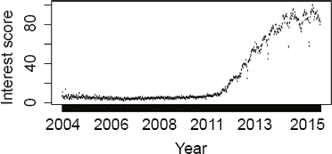

**图 1.1。** *对大数据兴趣的演变*


**图 1.2。** *三个 Vs*


与传统不同，我们将从关注 `variety`（多样性）而不是 `volume`（量）开始。这里指的是各种数据类型：

- 文本
- 消息
- 通话
- 照片
- 位置
- 音频
- 视频
- 社交状态
- 录音

数据的爆炸（特别是在互联网方面）带来了数据的多样性。这是这些新数据流异质性质的多样性。今天，大多数数据是非结构化的。


如果你让一群人定义大数据，大多数人会提到 `volume`（量）或数量。数据使用的爆炸（特别是在搜索方面）导致了单位的不可阻挡的增长：千字节（gigabytes）、太字节（terabytes）、拍字节（petabytes）、艾字节（exabytes），甚至泽字节（zettabytes，一个泽字节是 $10^{21}$ 字节！）。

图 1.3 显示了使用该搜索引擎的人们的兴趣呈近指数级增长。

**图 1.3。** *互联网在使用在短短几年也发生了爆炸*

### 表 1.1. Google 统计 [STA 16]

| 年份 | 年度搜索次数 | 日均搜索次数 |
| :--- | :--- | :--- |
| 2014 | 2,095,100,000 | 5,740,000 |
| 2013 | 2,161,530,000 | 5,992,000 |
| 2012 | 1,873,910,000 | 5,134,000 |
| 2011 | 1,722,070,000 | 4,717,000 |
| 2010 | 1,324,670,000 | 3,627,000 |
| 2009 | 953,700,000 | 2,610,000 |
| 2008 | 637,200,000 | 1,745,000 |
| 2007 | 438,000,000 | 1,200,000 |
| 2000 | 22,000,000,000 | 60,000 |
| 1998 | 3,600,000 | 9,800 |


根据一份物联网年度报告 [GSM 15]，到 2015 年底，全球已有 720 万个移动连接，预计仅智能手机的数量在 2019 年就会超过 700 万个。这种海量数据催生了大数据现象。由于目前的数据存储无法吸收这种数据量的增长，公司、工程师和研究人员不得不创建新的解决方案，特别是为这些海量数据提供分布式存储和处理（参见第 1.4 节）。存储这些数据的场所——著名的数据中心，在能源消耗方面引发了重大问题。一份报告指出，2013 年处理美国数据的数据中心消耗了 910 亿千度电，相当于 34 座大型燃煤发电厂的年发电量 [DEL 14]。这一数字在 2020 年可能会达到 1400 亿千度，相当于 50 座发电厂的年发电量，每年给美国人带来 130 亿美元的电费支出。如果再加上每年 1 亿公吨 CO[2]的排放，就可以看出为什么大型机构已经迅速开始重视这个问题，正如世界范围内寒冷地区频繁建立数据中心，并采用精的自然能源回收系统一样 [EUD 16]。


三个历史 V 中的最后一个，即速度（Velocity），代表了可能更自然被称为“速率”的概念。它还涵盖了多个组成部分，大数据现象的内在属性。从上述关于数据概念发展和规模的数字可以清楚地看到这一点，就像快进电影一样。速度可以指数据生成的速度、传输和处理的速度，以及它们改变形式、提供价值并当然消失的速度。今天，我们必须面对必须实时处理的海量数据浪。这些在线处理的数据让决策者能够做出在过去甚至无法察觉的战略选择。


随着第四个元素——IBM 归的真实性（Veracity）V 的出现 [IBM 16]，大数据的一个更丰富的定义迅速成型。“真实性”一词将我们带回数据质量，这是所有数据搜索过程中至关重要的属性。同样，这一概念涵盖了不同方面，例如不精确、不完整、不一致和不确定性。根据 IBM 的数据，糟糕的数据质量平均每年造成 3.1 万亿美元的损失。该公司补充说，27%的问卷调查者对他们输入的信息并不确定，三分之一的决策者对他们所依据的数据表示怀疑。事实上，数据流的多样性（这些通常是非结构化的）增加了数据认证的复杂性。这让人想到社交网络 Twitter 上的数据质量，其强制的 140 字符格式并不利于生成被自动自然语言处理工具轻松识别的精确散文。数据认证是创造价值的前提，而价值（Value）构成了现代实践中确立的第五个 V。即存储、理解和分析这些新出现的大容量、高速度、多样化数据浪潮的能力。


在快速浏览大量关于该主题的文章时，读者会很快发现，每位作者都想添加自己的 V，每个人都对列表做出自己的贡献。因此，可变性（Variability）和有效性（Validity）这两个直接关系之前多样性（Variety）和真实性（Veracity）的概念也可以加入列表。“可变性”一词关注数据的多功能（另一个 V！）属性，这种属性会随时间而改变；而“有效性”则是对经典数据认证过程更明确的引用。最后，在不沦于毫无帮助的自说自话的情况下，提到最后一个 V 似乎是值得的，即可视化（Visualization）。可见性（Visibility）V 有时与此联系在一起。大数据凭借其目前为止描述的所有特征，要求新的可视化形式，以便让决策者能够理解并直观地展示数据。其范围可以从提供主要特征概览的简单报告工具，到结合了可视化和数据分析的更先进的方法等。


大数据时代正在说服各种规模的企业实施流程，以帮助基于数据分析做出决策。


如前所述，大数据现象的本质在于“经典”工具的局限性，以及对它们进行升级的需求，以便能够收集、存储和分析规模不断增长的新型大规模数据。对于数据收集和存储，虽然所有数据合并后通常是海量的，但每个数据源产生的数据量通常是“合理的”，仍然可以通过“经典”存储和分析工具进行管理。数据库的智能分布通常足以在不同的物理服务器上进行收集和存储，如果需要将它们置于网络上，使用分布式、健壮且具有容错能力的存储系统就已经是“足够”的。当每个数据源产生量与分析工具不兼容时，就需要大数据架构。因此，我们转向并行化，它以两种方式表现出来：

- 数据并行：将单个数据集划分为多个子集并分布在不同的机器上；
- 任务并行：在不同的处理器上并发执行算法和不同的子程序。

目前，最为人知的大数据架构可能是 `Hadoop`。与将 `Hadoop` 的创建归功于 Yahoo 的说法相反，该项目实际上始于 `Google`。Doug Cutting 当时在那里负责网络内容索引，需要一个框架允许大量操作在大量服务器集群上并行运行。处理分布在多个服务器上的数据的 `MapReduce` 原则（这是 `Hadoop` 的编程模型）由 `Google Labs` 于 2004 年发布。Doug Cutting 于 2008 年加入 Yahoo，并启动了第一个主要的 `Hadoop` 项目——`Yahoo! Search Webmap`，它运行在一个包含 10,000 个 `Linux` 核心的集群上。今天，`Hadoop` 是由 `Apache` 基金管理的开源项目 [HAD 16]，其生态系统随着众多优化或添加不同组件的项目而日益发展。2016 年，Twitter 和 Facebook 等主要的 Web 厂商在 `Hadoop` 上存储和检索了它们数十 PB 级的数据。

`Hadoop` 框架可以分为三个主要模块：

- `Hadoop 分布式文件系统 (HDFS)`：文件系统分布在集群的不同节点上。这些数据节点是使用主从模型连接网络的机器。机器本身可以是相当简易（因此不便宜）的服务器，是它们的数量保证了集群的大数据容量。每个文件都被拆分成块。这些块分布在几台机器上，允许存储海量文件，包括超过每台服务器存储容量的文件量。一个特定的节点 `name node` 跟踪不同块的位置并允许访问数据。每个块在三个不同的数据节点上至少复制三次，以确保冗余。这种水平分布（分片）原理具有易于重新扩展的优势，因为可以添加更多数据节点来增加数据存储容量。总体而言，`HDFS` 是一个高效、容错且可扩展的文件系统，这无疑为其成功做出了巨大贡献；

- `MapReduce` 数据处理引擎：一个 `MapReduce 任务`（一个处理任务）分两个阶段完成：将原始数据转换为键/值格式的映射步骤（mapping），以及合并每个键的所有值的归约步骤（reducing）。数据处理通常会产生一系列多个 `MapReduce` 业任务；

- `YARN (又一个资源调度器)` 资源管理器：该模块在 `Hadoop` 第二版本中引入，允许基础设施管理与 `MapReduce` 数据处理模型完全分离。因此，当 `MapReduce` 描述数据操作过程时，`YARN` 调用 `name nodes` 并处理在不同的数据节点上启动这些进程。在最简单的层面，`YARN` 协调不同进程的并行管理，以优化处理工作在不同机器上的分布。

一系列补充这些核心模块的项目增强了提供的用户服务，其中一些如图 1.4 所示。这些服务的示例包括数据库管理 (`Hbase`) 和搜索 (`Hive`)、实时数据流处理 (`Storm`)、高层数据操作脚本 (`Pig`)、促进数据处理的 Web 界面 (`Hue`) 以及当然的，数据分析和搜索库 (`Mahout`)。

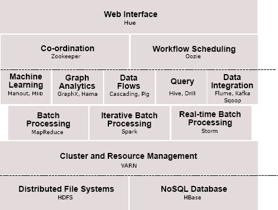

**[图 1.4]。** Hadoop 及其生态系统（非完整）

`Spark` 框架自 2014 年以来声誉日益增长。该项目最初由加州大学伯克利分校的 `AMPL` 于 2009 年开发，并于 2010 年成为 `Apache` 开源项目。`Spark` 构建在 `Hadoop` 和 `MapReduce` 之上，通过尽可能利用随机访问（通过弹性分布式数据集 `RDD`）来改进 `MapReduce`，而不需要像 `MapReduce` 那样读写硬盘。这个聪明的技巧显著加快了大多数数据处理过程，例如排序、词频统计、无监督 k-means 分类或计算图中的 PageRank 中心性。此外，`Spark` 自带一个完整的环境，允许处理实时流问题以及批任务。应用程序可以用 `Java`、`Scala` 或 `Python` 编写，并且 `MLib` 库（Spark 机器学习库）来自 `MapReduce` 的数据搜索库 `Mahout`。RDD 现在已扩展为 `DataFrames`，即允许数据像关系型数据库中的表一样按列分组的数据显示。

专门从事决策解决方案的平台也在快速发展。它们正在提供越来越多与开源工具接口的解决方案。例如，`SAS` 提供了 `SAS® Data Loader` 来与 `Hadoop` 接口，并自 2015 年以来明确定位于该领域的主题中，如网络安全或物联网。另一个例子是，`IBM` 通过其 `Data Science Experience` 服务扩展了 `IBM Cloud Bluemix` 平台。具体来说，这项服务允许数据科学家和开发者访问 250 个数据集，所有这些都由 `Spark` 驱动并配备了不同的开源软件，如 `H2O`（一种机器学习解决方案）。这种数据分析软件不仅与 `Spark` 等大数据平台兼容，还声称允许在 `Python`、`Java` 或 `R` 中开发的机器学习模型轻松部署在这些平台上。`H2O` 由一家加州初创公司 `H2O.ai` 提供。

根据 `KDnuggets`（一个专注于业务分析、大数据、数据科学和数据挖掘领域动态的网站），并没有多少专业人士仅使用专有工具或仅使用开源解决方案。大多数人同时使用这两大类工具。开源社区的活力使得其技术非常受欢迎。根据 O’Reilly 开展的一项 2013 年调查，查看数据科学家薪资时，使用开源工具的数据科学家中位数工资为 130,000 美元，而仅使用专有工具的人员为 90,000 美元。


根据同一网站，“Hadoop/大数据”类别中工具的使用正变得越来越普及。几乎一半的专业人士在使用这些工具（2016 年为 39%，而 2015 年为 29%，2014 年为 17%）。这一发展主要归功于 `Apache Spark`、`MLlib` 和 `H2O` 的增长（参见表 1.2）。

**表 1.2。** 根据数据分析社区和供应商的 2,895 名受访者的调查，大数据工具的使用统计数据。受访者来自美国/加拿大（40%）、欧洲（39%）、亚洲（9.4%）、拉丁美洲（5.8%）、非洲/中东（2.9%）以及澳大利亚/新西兰（2.2%）。他们被询问了 102 种不同的工具，包括此处所示的“Hadoop/大数据工具 [PIA 16]。

| **工具** | **2016** | **2015** | **2015 –> 2016** |
| --- | --- | --- | --- |
| **Hadoop** | 22.1% | 18.4% | +20.5% |
| **Spark** | 21.6% | 11.3% | +91% |
| **Hive** | 12.4% | 10.2% | +21.3% |
| **MLlib** | 11.6% | 3.3% | +253% |
| **SQL on Hadoop tools** | 7.3% | 7.2% | +1.6% |
| **H2O** | 6.7% | 2.0% | +234% |
| **HBase** | 5.5% | 4.6% | +18.6% |
| **Apache Pig** | 4.6% | 5.4% | –16.1% |
| **Apache Mahout** | 2.6% | 2.8% | –7.2% |
| **Dato** | 2.4% | 0.5% | +338% |
| **Datameer** | 0.4% | 0.9% | –52.3% |
| **Other Hadoop/HDFS-based tools** | 4.9% | 4.5% | +7.5% |

继续查看 KDnuggets 的数据 [PIA 16]，R 似乎是数据科学家进行数据分析的首选工具。这种语言通常在办公机器上处理规模合理的数据集，它初初是为统计学家设计的，非常适合探索性分析，因为它自带了丰富的机器学习、评估、图表生成等算法库。结合 `H2O`（或 `Rserver`）等支持，它现在可以迁移到大数据环境中。然而，作为一种计算机编程语言，Python 正日益流行。由于其灵活、开放且通用编程语言的特性，它非常适合数据集成。


只有少数公司可以声称已完成数据导向策略的迁移。迁移分为四个阶段：

1. 实验
2. 实施
3. 扩展
4. 优化

实验阶段是为了识别潜在的用例。实施阶段是为了构建初始解决方案。扩展阶段是为了扩大解决方案的规模。优化阶段是为了改进解决方案。


- – 敏捷性与快速数据归档，能够快速重复更新数据仓库数据所需的处理；
- – 复杂分析，例如在数百万个银行账户上并行应用数百万个评分模型以检测欺诈等。

好消息是，可以将这两个世界结合起来，并将 `Hadoop` 作为针对特定工作负载数据的高效且可扩展的 ETL（提取、转换、加载）解决方案。一旦数据在 `Hadoop` 中提取并加载，就可以通过编写 `MapReduce` 或 `Spark` 任务，或使用 `HiveQL` 或 `Pig` 等高级语言，对数据进行批处理复杂转换。可以分析（解析）非结构化或半结构化数据的语法，并进行计算、连接和聚合，以整合来自不同源的数据，或者对其进行结构化处理，以便按照经典的业务流程将其插入数据仓库中。

`Hadoop` 还可以用于构建一个灵活且可扩展的数据仓库，并将其与传统的 BI 工具对接（例如用于报表）。然而，大多数数据仓库解决方案发布商（如 `Oracle` 或 `Teradata`）更倾向于仅在 ETL 层集成 `Hadoop`，这使得他们的解决方案得到增强而非被取代。相反，开源解决方案的支持者推崇工作负载管理，其中分布式 `Hadoop` 环境充当数据枢纽的角色，公司生态系统中的所有数据在馈入多个分析平台之前都会通过该枢纽进行传输。

分析所有这些方法是复杂的。一些作者制作了比较不同技术选择需求的图表，例如数据分析算法的属性 [LAN 15]，以及它们的潜在影响，例如关于技能和人力资源的影响 [CHA 13]。


数据是保险的核心。它是评分模型的原材料，允许对投人进行细分，以便更好地了解他们并提供定制化产品，更好地估算其当前和未来的风险并做出决策。因此，大数据和数字化转型正在深刻地改变保险业。与所有经济经营者一样，保险公司无疑将面临组织、文化和竞争方面的变化。我们将通过两个大数据发挥核心作用的例子来说明这一发展：第一个说明了共享经济发展的影响，第二个说明了行为改变对细分的影响。

保险已经是共享经济的一部分 [LAC 15]。新的参与者（不一定来自保险领域）正在创建具有特定保险需求的个人社区，以便从保险公司处为他们谈判高度个性化的合同，并在过程中降低成本。如果社区平台允许个体表达他们的需求，那么大数据则允许这些新参与者主动寻找那些在网上积累了不满情绪的小型客户群体。事实上，这只需要分析搜索引擎的查询、博客和社交网络来确定特定的保险需求。这些新参与者因此正在改变被保险人与其保险公司之间的关系，同时也促进了创新，因为这些（非常）个性化的解决方案要么是现有合同的调整，要么是完全全新的合同。尽管这种类型的市场仍是小众的，但这种利基市场很可能会增长。这对于持续发展的商品或服务共享实践（如共享汽车、个人之间的车辆/公寓租赁等）尤为如此。这些做法正在改变风险评估的方式，并且再次必须提供特定的、甚至是定制的保单 [INC 14]。本质上，这些做法正在发生范式从“一物一主”到“一物多用”的转变。这种从所有权向使用权的转变带来了新类型的风险，并对保险公司构成了挑战 [LAC 15]。

大数据还能够易于获取定价所需的部分信息，并将逐步减少传统纸质问卷的使用。因此，它允许更快的决策。更好的是，通过提供以前无法获取的信息，并将减少被保险人（他们几乎知道所有关于自己的信息）与保险公司（仅拥有部分信息）之间现有的信息不对称 [EWA 13]。因此，大数据使得对被保险人及其相关风险的了解有了更深入的认知，从而优化了投保选择和更公平的保费价格。由于保险公司获取了更多知识，这也为保险公司带来了新类型的风险。被保险人如果这符合他们的利益，可以提供其生活方式的非常私密的数据。对于消费者和监管机构来说，对这种方法的接受程度显然至关重要 [THO 15]。“按需付费（pay as you live, drive 等）”口号已经出现，特别是在汽车保险中。例如，联网驾驶可以对驾驶风格（加速、刹车、转弯等）进行精确分析，并取决于道路和天气状况。这种趋势在健康保险中也正在发展，通过联网设备可以衡量被保险人的身体状况（心率、睡眠等）和活动情况（步数、参加运动等）。其日常生活的质量可以使用外部和开放数据进行评估。然而，“超个性化”的保费定价可能会挑战现有的细分和风险共同模式 [HOU 15]、定价的基础原则，以及关于风险组合如何构建的问题 [CHA 15]。保险公司对个人生活的入侵显然带来了数据保护问题。还存在新做法将如何发展以及它们可能对社会产生什么影响的问题。通过这两个例子，我们展示了大数据提供的某些机遇（新市场、创新和减少信息不对称）。提高广告活动的有效性以及目标定位和减少欺诈是其他例子。新的挑战正在出现（中间者的进入、保险基础的受到质疑、数据安全、精算挑战），同时也引发了伦理、安全和法律问题。


大数据时代已经到来。毫无疑问，数据洪流将持续，甚至会不断增长。如果能得到妥当的存储、管理和利用，大数据将带来无数机会。计算领域已经下了一道挑战书：新的架构和新的生态系统已经开发出来并正在不断演进。保险业也未能免于这一现象。大数据将使我们能够抓住新的机会，同时也带来了新的风险。本书的最后三个章节将阐明这些进展。

然而，大数据并不能随时随地完成所有事情。许多著名的例子之一是 Google 流感预测系统的失败（该系统已被废弃）[LAZ 14]。良好的预测有时依赖于深入的理解，而数据科学尽管面临着不可避免的变革和需要应对的挑战，但未来充满光明。这些问题以及主要的机器学习算法将在接下来的两个章节介绍。


[BOY 12] BOYD D., CRAWFORD K., “Critical questions for big data: Provocations for a cultural, technological, and scholarly phenomenon”, *Information, Communication & Society*, no. 5, pp. 662–679, 2012.

[CHA 13] CHALMERS S., BOTHOREL C., PICOT CL ÉMENTE R., Big Data – State of the Art, Report, Télécom Bretagne, 2013.

[CHA 15] CHARPENTIER A., DENUIT M.M., ELIE R., “Segmentation et mutualisation, les deux faces d’une même pièce?”, *Risques*, no. 103, pp. 19–23, 2015.

[CHE 12] CHEN H., CHIANG R.H., STOREY V.C., “Business intelligence and analytics: from big data to gig impact”, *MIS Quarterly*, no. 4, pp. 1165–1188, 2012.

[CHE 14] CHEN M., MAO S., LIU Y., “Big data: a survey”, *Mobile Networks and Applications*, no. 2, pp. 171–209, 2014.

[DEL 14] DELFORGE P., “America’s data centers consuming and wasting growing amounts of energy”, *Natural Resource Defence Council*, 2014. Available at: [`www.nrdc.org/resources/americas-data-centers-consuming-and-wasting-growing-amounts-energy`](https://www.nrdc.org/resources/americas-data-centers-consuming-and-wasting-growing-amounts-energy), accessed 18th April 2017.

[DEM 16] DEMAREST G., “Four Phases of Operationalizing Big Data”, *CIOReview*, 2016. Available at: [`bigdata.cioreview.com/cxoinsight/four-phases-of-operationalizing-big-data-nid-15251-cid-15.html`](http://bigdata.cioreview.com/cxoinsight/four-phases-of-operationalizing-big-data-nid-15251-cid-15.html), accessed 18th April 2017.

[DIE 12] DIEBOLD F., On the Origin(s) and development of the term “Big Data”, Pier Working Archive, 2012.

[EUD 16] EUDES Y., “Visite exceptionnelle dans data center de Facebook”, *Le Monde*, 2016. Available at: [`www.lemonde.fr/pixels/article/2016/06/03/les-datas-du-grand-froid-493256-40896.html`](http://www.lemonde.fr/pixels/article/2016/06/03/les-datas-du-grand-froid-493256-40896.html), accessed 18th April 2017.

[EWA 13] EWALD F., THOUROT P., “Big Data, défis et opportunités pour les assureurs”, *ENASS Papers 5*, no. 315, pp. 1–8.

[FAN 13] FAN W., BIFET A., “Mining big data: current status, and forecast to the future”, *ACM SIGDD Explorations*, no. 2, pp. 1–5, 2013.

[FAN 14] FAN J., HAN F., LIU H., “Challenges of big data”, *National Science Review*, no. 2, pp. 293–314, 2014.

[GSM 15] GSMA, Unlocking the Value of IoT Through Big Data, Report, GSM Association, 2015.

[GU 14] GU J., ZHANG L., “Some comments on big data and data science”, *Annals of Data Science*, no. 4, pp. 31, 2014.

[HAD 16] HADOOP, Welcome to Hadoop!, available at: [`hadoop.apache.org/`](http://hadoop.apache.org/).

[HOU 15] HOULLE O., “Le Big Data modifie le visage de’assurance”, *ENASS* 9, 2015.

[IBM 16] IBM, What is big data?, Available at: [`www.nrdc.org/resources/americas-data-centers-consuming-and-wasting-growing-amounts-energy`](https://www.nrdc.org/resources/americas-data-centers-consuming-and-wasting-growing-amounts-energy), accessed 18th April 2017.

[INC 14] INC, Consommation d’énergie, *Natural Resource Defence Council*, 2014.

[KEL 15] KELTY J., Big data, *National Science Review*, 2015.

[LAC 15] LACZE O., Segmentation et mutualisation, les deux faces d’une même pièce?, *Risques*, no. 103, 2015.

[LAN 01] LANDSET S., Data management, *ENASS*, 2001.

[LAN 13] LANEY D., “Mining big data: current status, and forecast to the future”, *ACM SIGDD Explorations*, no. 2, pp. 1–5, 2013.

[LAN 14] LANSET P., Challenges of big data, *National Science Review*, no. 2, pp. 293–314, 2014.

[LAN 15] LANEY Y., Big Data, défis et opportunités pour les assureurs, *ENASS Papers 5*, no. 315, pp. 1–8.

[LAN 16] LANEY G., Four Phases of Operationalizing Big Data, *CIOReview*, 2016.

[MAN 11] MANY J., Understanding Big Data: Analytics for Enterprise Class Hadoop and Streaming Data, McGraw-Hill Osborne Media, New York, 2011.

[PIA 16] PIAT S., On the Origin(s) and development of the term “Big Data”, Pier Working Archive, 2012.

[SHA 15] SHI Y., Visite exceptionnelle dans data center de Facebook, *Le Monde*, 2016.

[SPA 16] SPARK, Machine Learning Library (MLlib) Guide, 2016.

[STA 16a] STATISTICBRAIN, Facebook Statistics, 2016.

[STA 16b] STATISTICBRAIN, Google Statistics, 2016.

[THO 15] THOUROT P., Big data et tarification de l’assurance, *Risques*, no. 103, 2015.

[WAR 13] WARD J.S., BARKER A., “Undefined by data: a survey of big data definitions, *arXiv preprint*:1309.5821, 2013.

[WU 14] WU X., ZHU X., WU G.-Q. *et al.*., “Data mining with big data”, *IEEE Transactions on Knowledge and Data Engineering*, no. 1, pp. 97–107, 2014.

[ZIK 11] ZIKOPOULOS P., EATON C., *Understanding Big Data: Analytics for Enterprise Class Hadoop and Streaming Data*, McGraw-Hill Osborne Media, New York, 2011.

 Romain Billot, Cécile Bothorel 和 Philippe Lenca 编写。


## 2.1. 从数据分析到数据挖掘

数据分析在这里指的是描述性和探索性方法，也称为无监督学习。其目标是描述和结构化一组交叉了 *n* 个统计单元和 *p* 个变量的矩形数据。我们通常将 *n* 个观测值视为 *p* 维向量空间中的点，如果提供了距离量，它就是一个欧几里得空间。数值变量是 *n* 维空间中的向量。数据分析方法本质上是降维方法，分为两类：


-   一方面，因子方法（针对数值变量的主成分分析、针对分类变量的对应分析）会产生新的数值变量或原始变量的组合，允许在低维空间中表示。在数学上，这些是数据表奇异值分解的变体；
-   另一方面，无监督分类方法或聚类将观测值或变量分为同类组。主要算法是层次类的（通过连续聚类单元逐步构建类别）或通过 k-means 进行直接划分搜索。

许多工作致力于诸如 [SAP 11] 等先有方法。

然而，数据分析也是一种态度，其在于通过对生成机制不加任何（或极少）`a priori` 先验假设来实现“让数据说话”。让我们回想一下 [BEN 72] 中述的原则：“模型必须遵循数据，而不是相反”。数据分析在 20 世纪 60 年代和 70 年代是对形式化滥用的反应而发展起来，参见 [ANS 67] 关于约翰·图基（John Tukey）的内容：“他似乎将统计学与通常被称为数学统计学的怪异现象等同起来，并认为必要用数据分析来取代统计学。”

数据挖掘是一于 20 世纪 90 年代统计学与信息技术（数据库、人工智能、机器学习等）交叉领域的运动，也旨在发现大型数据集中的结构，并促进新工具（如关联规则）。数据挖掘的隐喻意味着数据山下隐藏着宝藏或金矿，可以通过专门工具被发现。数据挖掘是知识发现过程中的一步，涉及应用数据分析算法。[HAN 99] 将其定义为：“我将数据挖掘定义在大型数据集中发现有趣的、意外或有价值的结构。”数据分析分析为其他目的而收集的数据：它通常是对数据库的二次分析，旨在管理个人数据，且不担心如何有效地收集数据（如问卷调查、实验设计）。

数据挖掘还寻求表示为响应变量 `Y` 的预测模型，但其视角与传统建模完全不同。模型无非是一个算法，而不是生成数据的机制的表示。我们随后通过探索一组线性或非线性算法（无论显式或隐式）来选择最优算法，即能提供最准确预测且不落入过拟合陷阱的算法。我们区分了 `Y` 为定量的回归方法，以及 `Y` 为类别的（通常有两种模态）有监督分类方法（也称为判别方法）。海量数据处理强化了数据挖掘中已经存在的趋势。
## 2.2. 过时方法

推断统计是在数据稀缺的背景下发展的，以至于超过 30 个单元的样本就被认为是大型的！数据的规模从根本上改变了统计学实践。以下是一些例子：

-   任何与理论值的偏差都变成了“显著的”。因此，在百万次观测之间计算出的两个变量之间的相关系数 0.01（读者很容易验证甚至更低）将被宣布与零有显著差异。这是一个有用的结果吗？
-   模型参数的置信区间变为零宽度，因为后者通常处于 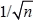。这意味着模型将被确定地获知吗？

通常情况下，不再存在一种适用于大量数据的生成模型，正如那些成为众多文献主题的惩罚似然模型选择规则一样。

需要注意的是，以下类型标准：

[2.1] 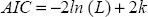

和

[2.2]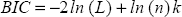

在比较预测算法时（如决策树和下一章讨论的更复杂方法）是无效的，因为在这些情况下，似然和参数数量都是未知的，`k` 是参数数量，`L` 是似然。注意，正如常见所示，同时使用 `AIC` 和 `BIC` 是不符合逻辑的，因为它们来自两个不兼容的理论：第一个是 Kullback–Leibler 信息，第二个是贝叶斯先等概率模型选择。

大量数据可以作为支持 `BIC` 渐近性质的理由（如果它可以计算的话），因为已经证明当观测数趋于无穷时，选择真实模型的概率趋于 1。然而，真实模型必须是研究家族的一部分，而且这种“真实”模型的存在是虚构的：模型（从生成的意义上说）仅仅是现实的简化表示。三十年前，远在我们谈论大数据之前，乔治·鲍克斯（George Box）就宣布：“所有模型都是错误的，但有些是有用的。”

所谓传统统计滥用被广义线性模型共同发明者约翰·内尔德（John Nelder）[NEL 85] 在这篇 1985 年讨论 Chatfield 文章中严厉指责：“统计学与科学技术密切相关，很少有数学家有经验或理解其中任何一种方法。我相信这正是各种统计课程中对显著性检验进行怪异强调背后的原因；建立了一套由功效、一致最强检验、一致最强无偏检验等概念构成的数学体系等等，并将其教给人们，这些人们如果离开时没有学到其他概念，也会记得统计学是关于显著差异的[]。构建他们统计学课程所依据的这套体系往往比无关更糟糕，它在检查数据和做出推断的重要性方面具有误导性。”

## 2.3. 理解还是预测？

学习算法的使用导致了“黑箱”方法，这些方法从经验上证明了为了预测并不非要理解。这一事实令科学家感到不安，但被学习理论者明确主张，例如 [VAP 06]，他写道：“有时通过刻意避免复制真实机制获得更好的模型。”

[BRE 01] 在其于《统计科学》上名为“统计建模：两种文化”的著名文章证实了这一点：“现代统计思维在统计模型与世界之间有着明确的区分。数据底层的实际机制被认为是未知的。统计模型不需要复制这些机制来模拟可观测数据。”因此，Breiman 对比了两种从数据得出结论的建模文化：一种假定数据是由给定的随机模型生成的，另一种则将生成机制视为未知并使用算法。

[DON 15] 最近通过讨论生成建模文化和预测建模文化延续了这一讨论。用于理解的模型与用于预测的模型之间的区别在 [SAP 08] 和 [SHM 10] 中也是明确的。

## 2.4. 预测模型的验证


预测模型的质量不能仅根据其对数据的恰当拟合来判断：它必须在未来提供良好的预测，这所谓的泛化能力。事实上，显而易见，模型越复杂（例如更高阶的多项式），它对数据的拟合程度就越好，直到它通过所有点，但这种表面的质量对于新的观测值将会下降：这就是过拟合现象。

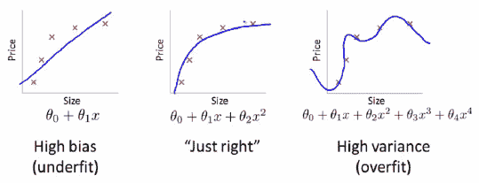

**图 2.1.** *从欠拟合到过拟合* ¶ *(来源: 可访问 [`datascience.stackexchange.com/questions/361/when-is-a-model-underfitted`](http://datascience.stackexchange.com/questions/361/when-is-a-model-underfitted))*

因此，寻求在可用数据（或学习数据）和未来数据上表现相似的模型是合适的。但这并不是一个充分的标准，因为例如，常数模型 \= *c* 证实了这一属性！预测也必须是高质量。


统计学习理论的不等式使得根据学习中观测值的数量和模型族的复杂度，找到学习误差与泛化误差（未来数据）之间差异的界限成为可能。让我们二类监督分类的情况下说明这些不等式之一。分类器是一个 `f(x)` 预测器的函数，使得如果 `f(x) > 0`，我们将观测值 x 分为一组；如果 `f(x) < 0`，则分为另一组。`f(x) = 0` 等点定义了边界。

![图 2.2. 线性和非线性分类器（根据 [HAS 09]）。该图的彩色版本，请见 www.iste.co.uk/corlosquet-habart/insurance.zip](images/fig2-2.jpg)

**图 2.2.** *线性和非线性分类器（根据 [HAS 09]）。该图的彩色版本，请见 [www.iste.co.uk/corlosquet-habart/insurance.zip](http://www.iste.co.uk/corlosquet-habart/insurance.zip)*

分类器错误率是一个随机变量，因为它依赖于样本，它是分类错误的观测值的比例。它的期望被称为经验风险，记为 `R[emp]`。对于来自相同未知分布的未来观测值，它将被标记为 `R`。让我们考虑分类器族，例如固定阶数 `d` 多项式函数（无论对系数是否有约束），或者 `k`-最近邻（我们根据“成员”的最近 `k` 个邻居中的多数派类进行分配）。学习理论已经表明，这些模型的复杂度不取决于参数的数量，而取决于通过边界 `f(x):` 分离点的能力：这就是 VC 维或 Vapnik–Chervonenkis 维，后文记为 `h`。例如，^(*p*) 的线性边界允许我们分离 `p` + 1 个属于不同组别的点，但不能分离 `p` + 2 个点：更准确地说，总是存在 `p` + 2 个不可分点的配置，即使有时存在 `p` + 1 个不可分点的配置。VC 维为 `h = p + 1`。

最著名的不等式之一规定，在概率 1 – `α` 下：

\[2.3\] 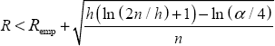

对于固定的 `n`，`h` 的增加导致 `R[emp]` 趋于 0（过拟合），但根号的增加增加了最优复杂度 `h*` 的存在。

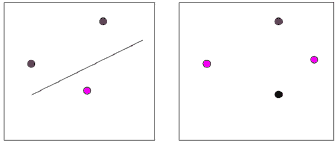

**图 2.3.** *在平面上，某些四个点的配置不是线性可分的*

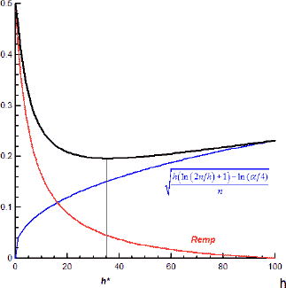

**图 2.4.** *最优 VC 维。该图的彩色版本，请见 [www.iste.co.uk/corlosquet-habart/insurance.zip](http://www.iste.co.uk/corlosquet-habart/insurance.zip)*

应该注意的是，经验风险与风险之间的差距仅取决于比例 `n/h`，且如果 `n` 的增长速度比 `h` 快，则存在收敛。这一结果表明，我们拥有的数据越多，就可以使用越复杂的模型。

统计学习理论充满了此类不等式，但遗憾的是它们在实践中选择模型并不方便，因为 VC 维很难获得。因此，交叉验证是必不可少的：它们通过留出数据部分来模拟算法或模型在未来数据上的行为。

我们必须强调，大数据中模型或算法的验证只能在“新”数据上进行，这确保了结果的可重复性。这与标准的统计实践有本质区别，尽管留一法长期以来用于判别。

### 2.4.2. 交叉验证

为了在几个模型之间进行选择，实践涉及将可用数据随机分为三个子集：学习、验证和测试。这三个子集的典型值为 50%、25% 和 25% \[HAS 09]。学习集用于估计（或校准）每个模型的参数。然后将每个模型应用于验证集，以根据标准（R2、误分类率等）选择最佳模型。然后将最佳模型应用于测试集以估计其性能，之前的阶段由于取了 `sup` 会被高估。因此我们区分了模型的性能评估与模型选择。一旦选择了模型，在投入生产之前必须使用所有可用数据重新估计。

理想情况下，为了避免学习、验证和测试随机划分带来的风险，需要迭代此步骤，但对于非常大的数据集并不这样做。对于小型集合，最好将其细分为 5 或 10 个等数量的部分：以旋转的方式，通过移除 5 或 10 个部分之一（5 折或 10 折交叉验证）来估计模型，并在部分集上评估其性能，然后取平均值。

## 2.5. 模型组合

与其在 `M` 个模型或算法中选择最好的，将它们组合通常要有效得多。我们称之为集成方法；提升（boosting）、装袋（bagging）、随机森林属于此类类，但它们只组合相同族类的分类器或回归器。贝叶斯模型平均也是如此，它线性组合相同族类的子模型，并以已知数据的模型后验概率为系数。在忠实于数据分析原则的同时，我们不讨论为了应用而需要约束假设的贝叶斯模型平均。


对于海量数据，一种特别合适的方法是**堆叠**（stacking），它在机器学习竞赛中取得了卓越成果，其中最著名的百万美元 Netflix 挑战赛。2009 年，两个最优方案根据 [WOL 92] 和 [BRE 96] 引入的堆叠技术结合了许多模型。让我们从回归的背景开始。考虑 `M` 个预测：`[m]` = `f[m]`(x) `m` = 1,… `M`，这些是通过使用 `M` 个模型或不同的算法得到的，可以是任何类型：线性或非线性、神经网络、回归树等。非常简单的想法是寻找一个线性组合：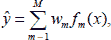，该组合提供了最小平方误差之和。在原始版本中，为了避免更复杂的模型因为在学习中预测更好而获得更大的权重，对标准进行了修改，使得每个 `y[i]` 的预测是通过移除观测值 `i` 完成的（预测残差）：

\[2.4\] 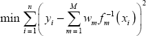

但当 `n` 很大时，其影响很其微。

相反，如 [NOC 16] 所示，一旦这些模型有效，不同模型之间的预测值高度相关，这会导致权重 `w[i]` 的估计变得不稳定。因此，必须对最小二乘法进行正则化。一种可能性是在不含常数项的情况下对 `m` 个预测值进行回归，约束是权重 `w[i]` 为正且之和等于 1，类似于贝叶斯模型平均。另一种更简单的解决方案是进行 PLS 回归（见 section 2.6.1.2）：由于 `M` 个预测值正相关，单个 PLS 分量通常足够了，并能确保权重的正性。

扩展到监督分类时，将 `[m]` 值取为属于感兴趣的类别的概率。由于 `y[i]` 是二分类的，我们将使用 PLS 逻辑回归代替 PLS 回归来估计权重。

预测变量扩展到几何平均值的建议已被提出，此外还对每个预测变量或某些预测变量组合的优势区域进行了搜索。然而，在实践中，堆叠被证明是非常有效的，因为根据构造方式，`M` 个预测值的最优线性组合必然优于其中任何一个。


数据也可能是海量的，意义上 `p`（变量数量）远大于 `n`（观测值数量）。网络数据或生物学数据就是如此情况，在这些领域中计算数千个变量并不罕见。当 `p>>n` 时，无法应用回归类型的预测方法，因为最小二乘估计量不存在。如果我们想保留所有的预测变量，将求助于正则化方法，或者使用稀疏方法。

### 2.6.1. 正则化回归

它们通过投影到子空间或约束系数向量来运行。估计量是有偏的，并且丢失了尺度变化下的不变性性质。在应用这些方法之前，将对数据进行中心化和降维。

### 2.6.1.1. 主成分回归

这无疑是最老的方法，由 Edmond Malinvaud 在 1964 年应用于计量经济学以解决多重共线性问题。它涉及通过使用 `q < p` 个主成分来减少预测变量的空间，然后通过最小二乘法对这些成分进行响应值 `Y` 的回归。由于主成分是预测变量的线性组合，我们最终得到了预测变量的组合：

\[2.5\] 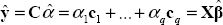

系数  和  向量通过使用重构公式 `q`（截断 SVD）**X** = **CU*** 直接得到，其中 **C** 是主成分矩阵，**U** 是正交主因子矩阵：

\[2.6\] 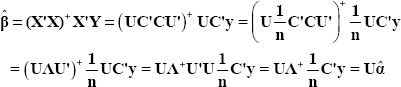

符号 `+` 指 Moore–Penrose 逆。

在这里

\[2.7\] 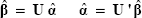

以及

\[2.8\] 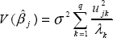

通常情况下，`q` 通过交叉验证选择，但对主成分的回归有以下缺点：主成分仅取决于预测变量而不取决于响应值，且它们的排序并不一定反映与该响应值的相关性。

### 2.6.1.2. PLS 回归

由 H. 和 S. Wold 开发的 PLS 回归类似于主成分回归，因为数据也被投影到预测变量的线性不相关组合上。主要区别在于，PLS 分量经过优化以也对 `Y` 具有预测，而主成分只提取预测变量的最大方差，而不考虑 `Y`。用于获取第一个 PLS 分量 `t = Xw` 的标准是 Tucker 标准：

\[2.9\] 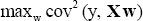

由于

\[2.10\] 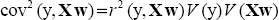

我们在最大化 `t` 与 `y` 之间的相关性（回归）和最大化 `t` 的方差（预测变量的 PCA）之间取得了折中。

解决方案如下：对于第一个 PLS 分量，每个变量的 `w[j]` 系数在乘常数范围内，等于 `x[j]` 与 `y` 之间的协方差，这确保了符号的一致性。后续分量是通过赤化得到的，即在对 `t` 进行回归后，对 `Y` 和预测变量的残差迭代该过程。该算法不需要对角化或矩阵求逆，简单简单使得处理海量数据成为可能。更多细节参考 [TEN 98]。

### 2.6.1.3. 岭回归（Ridge regression）

由 Hoerl 和 Kennard 在 70 年代发明，这是 Tikhonov 正则化的特殊情况：为了避免系数不稳定，我们对它们的范数施加约束：

\[2.11\] 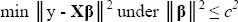

这等同于在 **X’X** 的对角元素上加上常数以“便于”求逆：

\[2.12\] 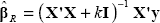

常数 `k` 通过交叉验证确定。

### 2.6.2. 稀疏方法

前面的方法能够获得所有变量的函数，这当 `p` 很大时是一个缺点：如何解释数百或数千个变量的线性组合？与其诉助于逐步选择技术，在 L[1] 范数中使用约束通过允许选择和正则化有效地解决了问题。

### 2.6.2.1. Lasso

Lasso 或最小绝对收缩选择算子由 [TIB96] 引入，由最小化残差平方并加上回归系数绝对值和的限制（L[1] 惩罚）：

\[2.13\] 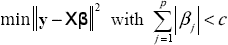

这等同于

\[2.14\] 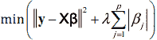

当 `c` 减小时，由于使用了 L[1] 范数，回归系数减小且某些被消除。参数 `c` 通常通过交叉验证获得，目标是获得最佳的 `Y` 预测。

随后出现了许多开发：PLS 回归的稀疏变，以及适用于预测变量分为块的组 Lasso：该方法有助于消除整个变量块。

### 2.6.2.2. 稀疏主成分分析 (PCA) 和多重对应分析 (MCA)


与此类似，主成分分析的稀疏版本自 21 世纪 20 年代以来就被提出。有多个版本，但最广泛使用的是受 `Lasso` 和岭回归的启发，注意到由于主因子是有界的，因此 `SVD` 可以被解释为变量上分量（components）的某种岭回归。我们得到的“分量”是少数初始变量的组合，这有助于解释，但代价是损失了分量和/或因子的正交性。

[BER 12] 开发了多重对应分析的稀疏版本，如下：由于 `MCA` 视作是指标块的 `PCA`，作者将群组 `Lasso` 应用于之前定义的稀疏 `PCA` 中。

## 2.7. 科学的终结？

大数据处理需要新的工具（我们已经简要介绍了一些），以及对那些仅仅是算法的模型采取一种新态度，即基于留出数据集的验证。

这些新工具对于某一领域的专家来说可能是很有用的，正如 [VAR 14] 对计量经济学家所建议的那样。

在一篇具有挑衅性的文章中，[AND 08] 声称数据洪流使得科学方法过时，并本质上宣称：“相关性就足够了，我们可以停止建模了。让我们把数据加载到更大的计算机中，让统计算法在科学无法发现的地方发现结构。”

显而易见，相关性不等于因果关系：一个在统计上准确预测的模型并不一定能指导行动。人们往往认为，变量的影响在线性模型这种简单情况下可以通过其系数来衡量，或者在复杂情况下通过剔除法来衡量：例如在敏感性分析中，我们通过移除所考虑的变量来研究质量准则（`R²`、准确分类观测值的百分比等）的变化。这可能很有趣，但仍然是不够的：一方面，在“其他条件不变”的情况下改变一个变量是一种幻觉，因为变量的修改可能会导致与其相关的变量也发生修改，从而影响响应。另一方面，在没有因果模式的情况下，我们无法知道在干预的情况下其他变量如何反应。

如果我们经常可以在不理解的情况下进行预测，那么在我们理解了的情况下，难道不是可以预测得更好吗？这个主题已经在学习和因果关系专家在多次会议和研究中讨论过，他们在大数据中引入了实验方法（参见 [BOT 13]）。

## 2.8. 参考文献

[AND 08] ANDERSON C., “The end of theory: the data deluge makes the scientific method obsolete”, *Wired Magazine*, 可于：[https://www.wired.com/2008/06/pb-theory/], (最后访问于 2017 年 4 月 15 日），2008.

[ANS 67] ANSCOMBE F.J., “Topics in the investigation of linear relations”, *Journal of the Royal Statistical Society*, vol. B 29, pp. 1–52, 1967.

[BEN 72] BENZÉCRI J.P., *L’Analyse des Données*, *Tome 2*, Dunod, Paris, 1972.

[BER 12] BERNARD A., GUINOT C., SAPORTA G., “Sparse principal component analysis for multiblock data and its extension to sparse multiple correspondence analysis”, in COLUBI A. (ed.), *Compstat Proceedings*, 2012.

[BOT 13] BOTTOU L. *et al*., “Counterfactual reasoning and learning systems: the example of computational advertising”, *Journal of Machine Learning Research*, no. 14, pp. 3207–3260, 2013.

[BRE 96] BREIMAN L., “Stacked regressions”, *Machine Learning*, no. 24, pp. 49–64, 1996.

[BRE 01] BREIMAN L., “Statistical modeling: The two cultures”, *Statistical Science*, vol. 16, no. 3, pp. 199–215, 2001.

[DON 15] DONOHO D., 50 years of Data Science, Tukey Centennial workshop, 可于：[http://courses.csail.mit.edu/18.337/2015/docs/50YearsDataScience.pdf], (检索于 2017 年 4 月 15 日），2015.

[HAN 99] HAND D., “Why data mining is more than statistics write large”, *ISI*, Helsinki, 可于：[http://www.stat.fi/isi99/proceedings/arkisto/varasto/hand0490.pdf], (检索于 2017 年 4 月 15 日），1999.

[HAS 09] HASTIE T., TIBSHIRANI R., FRIEDMAN J., *The Elements of Statistical Learning*, 2nd edition, Springer, New York, 2009.

[NEL 85] NELDER J.A., Discussion of CHATFIELD C., “The initial examination of data”, *Journal of the Royal Statistical Society*, Series A, no. 148, pp. 214–253, 1985.

[NOC 16] NOÇAIRI H., GOMES C., THOMAS M. *et al*., “Improving stacking methodology for combining classifiers; applications to cosmetic industry”, *Electronic Journal of Applied Statistical Analysis*, vol. 9, no. 2, pp. 340–361, 2016.

[SAP 08] SAPORTA G., “Models for understanding versus models for prediction”, in BRITO I. (ed.), *Compstat Proceedings*, Physica Verlag, 2008.

[SAP 11] SAPORTA G., *Probabilités, Analyse des données et statistique*, 3rd edition, Technip, Paris, 2011.

[SHM 10] SHMUELI G., “To explain or to predict?”, *Statistical Science*, no. 25, pp. 289–310, 2010.

[TEN 98] TENENHAUS M., *La régression PLS*, Technip, Paris, 1998.

[TIB 96] TIBSHIRANI R., “Regression shrinkage and selection via the Lasso”, *Journal of the Royal Statistical Society*, Series B, no. 58, pp. 267–288, 1996.

[VAP 06] VAPNIK V., *Estimation of Dependences on Empirical Data*, 2nd edition, Springer, New York, 2006.

[VAR 14] VARIAN H., “Big Data: New Tricks for Econometrics”, *Journal of Economic Perspectives*, no. 28, pp. 3–28, 2014.

[WOL 92] WOLPERT D., “Stacked generalization”, *Neural Networks*, no. 5, pp. 241–259, 1992.

章节由 Gilbert SAPORTA 编写。

# 3 统计学习方法

## 3.1. 引言

本章的目的是介绍精算科学中最常用的统计学习方法。这些方法是对传统统计模型（如线性和逻辑回归）的补充，后者长期以来应用于精算科学。随着海量数据的流入，实施更复杂的数据处理和预测方法变得方便。可能的应用包括：

*   – 估计个人意外理赔的金额和频率；
*   – 估计医疗保险的个人费用；
*   – 检测财产和责任险的欺诈；
*   – 检测有违约风险的借款人；
*   – 结合地理信息（如开放数据）开发保险区域；
*   – 考虑实时采集车辆数据以建立更具针对性的汽车保险费（按驾驶习惯付费概念）。

在更精确地介绍不同的学习方法之前，应该先对监督方法和无监督方法进行一般区分。

### 3.1.1. *监督学习*


在这种情况下，待解释变量 `Y` 的存在是基础性的：通过在个体样本上联合观测变量 `Y` 变量和解释变量，我们的目标是构建一个模型，以便能够预测与新输入相关的输出 `Y`。这就是监督统计学习的数学框架。我们定义一个学习样本：`L[n]` = {(`X[1]`, `Y[1]`), … , (`X[n]`, `Y[n]`)},，即一组独立同分布（i.i.d.）的随机向量，它们与随机向量 (`X`, `Y`) 具有相同的分布。(`X`, `Y`) 耦合对的分布是未知的，监督统计学习的目标是通过观测学习基 `L[n]` 来学习这一分布。随机变量 `X` 和 ` `Y` 向量的作用并不相同：在实践中，`X`指的是输入变量（通常是一个由解释变量组成的向量），而 `Y`指的是输出变量（也称为待解释变量）。`Y` 变量也可以是多维的。监督学习的目的是学习 `X` 和 `Y` 变量之间的联系：注意，仅知道 `X` 和 `Y` 的边缘分布不足以获知 (`X`, `Y`) 耦合对的分布。通过基于观测 `L[n]` 的统计方法，我们将获得信息，从而能够预测与输入的新观测值 `x` 相关的值 `ŷ`，而此时待解释的 `y` 变量是未。根据输出变量 `y` 的性质，我们可以区分两种监督统计学习框架：回归和分类。

## 回归

在回归的情况下，输出变量 `Y` 是具有实值的定量变量。其标准框架如下：

\[3.1]

其中 `f` 是未知函数，被称为我们寻求估计的回归函数。变量 `ε` 是一个期望为零的实值随机变量：它代表噪声，并使得考虑到 `Y` 变量仅由 `X` 变量部分解释的事实。学习基随后由耦合对组成：(`X[i][]`, `Y[i]` = f(`X`) + `ε[i]`)，其中 `ε[i]` 是独立同分布的随机变量。

我们还假设噪声变量 `ε` 关于 `X` 是条件中心化的。我们有：\[`Y` | `X`\] = f(`X`)，这以唯一的方式定义了函数 `f`。在对函数 `f` 没有任何额外约束的情况下，我们可以考虑非参数回归模型，它由由从学习基 `L[n]` 构建一个预测器 ``，以便更好地预测与输入 `x` 相关的输出 `y`。`` 的质量可以通过由以下公式定义的泛化均方误差来衡量：E\ (![images(X)-Y)²]。由于 (`X`, `Y`) 耦合对的分布是未知的，在实践中，预测器的性能通常通过经验平方误差来衡量：

\[3.2]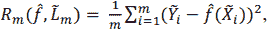

其定义在测试样本上：`[m]` = {(!images](images/xtilde.jpg)[1], [1]), … , (!images](images/ytilde.jpg)`[m]}`，大小为 `m`，且独立于 `L[n]`，其中 (`[i]` 与 (`X`, `Y`) 具有相同的分布。

为了实际实现监督学习方法，必须限制所考虑的回归类，确定预测器的技术将取决于这一选择。一个我们不讨论的常规选项是线性回归，其中 `f(X)` 被假设为解释变量的线性组合。在这种情况下，在学习集上计算的经验平方误差的最小化会导致线性方程组的求解，从而提供显式解。对于更复杂的模型（大多是非线性的），选择和寻找“最佳”模型将不再那么简单，正如我们在后续章节中将看到的。

## 分类

在分类的情况下，输出变量 `Y` 是离散的，代表观测值所属的类别。如果 `K` 表示类别数，我们可以认为 `Y` 的值在 `{1, … ,K}` 中。目标是构建一个模型，为每个输入向量 `X` 关联 `{1, … ,K}` 中的一个类别。一种常用方法是分两步进行：模型实际估计量：P\[Y = k | X = x]，对于 `k` ∈ `{1, … ,K}`，从中选择与观测值 `x` 相关的类别。

我们将介绍以下监督学习方法：决策树、分层神经网络、SVM（支持向量机）和模型聚合方法（bagging、随机森林、stack）。

### 无监督学习

在这种情况下，没有待解释的变量，因此涉及到一个聚类问题。目标是构建同质类，将最相似的个体（相对于变量）聚集在一起，并且这些类之间尽可能不相似。目标是组织数据中包含的信息，使其更直观且易于利用。在常规方法中，我们有层次分类和动态重新分配算法（k-means）。在 section 3，我们将看到霍夫南自组织映射，它的优势是可以在小空间内表示类别。

## 决策树

决策树的原理是将解释变量的值空间划分为矩形，在矩形内待解释变量是常数。这种简单的想法由 Breiman 等 [84] 开发，缩称为 CART（分类回归树），能够获得一个易于可视化和解释的模型，从而成为决策的真实工具。此外，这种以二分方式划分空间的方法既适用于回归也适用于分类。

让我们在以下模型描述该方法：(`X`, `Y`) 是取值于 R^p 的随机向量，其中 = ∈ R^p × G, i = 1, …, n}, 其中 (`x[i]`, `y[i]`) 是与 (`X`, `Y`) 相同分布的随机变量实现。在划分的每个阶段，输入空间被分为部分，并自然地关联到一个二叉树：

- 树的根 `n[1]` 关联整个输入空间，因此包含了所有的观测；
- CART 第一步通过选择如下形式的划分将空间分为二：`{X^j ≤ s} ∪ {X^j > s}`，其中 j ∈ {1, … , p}, X = (X¹, …, X^p) 且 `s` ∈ 。划分这意味着第 j 个变量小于 s 的所有观测值分配给左子树，其余分配给右子树。为了使这种划分有效，该方法选择可能的 (`j`, `s`) 划分，以最小化 `(j, s)` 代价函数。注意：`x[i]` = (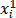, … , 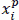),


因此，我们寻求最小化得到的两个子树的方差。在分类情况下，要最小化的函数为：

\[3.8\]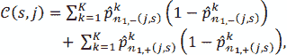

其中 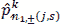是集合`n`中类别`k`的观测值比例 1,±。在这种情况下，我们尝试最小化每个集合的基尼指数（Gini index），从而获得尽可能同质的子树（如果所有观测值属于同一类别，则该集合是完全同质的）。

一旦树的根被划分，就会在得到的两个子树上重复迭代，再次为所选代价函数寻找最佳划分点，直到达到停止准则。经典的停止准则包括不再划分包含少固定数量观测值的树节点。不再进行划分的终端节点被称为树的叶节点。注意，纯节点（即仅包含相同输出值观测值的节点）不会被划分。通过此程序得到的`T[max]` 树被称为极大树，对于属于叶节点`n`的观测值，该模型预测的回归输出值为平均值：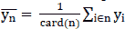(在分类中，则为叶节点中存在的`L[n]`观测值的多数类别)。

CART 算法的第二步是修剪步骤，它将极大树`T[max]`中选择出最佳修剪树（从泛化误差的角度）。这一步是必要的，因为`T[max]`由于其结构非常精细，偏差较低但方差可能极大：它非常依赖于使用的观测值，而且容易过拟合。因此，必须选择一个精确度稍低但能够为新观测值提供等质量预测的模型。与极大树相比，仅由根节点组成的树具有零方差，但有显著偏差。因此目标是在这两个极端之间找到一个中间树。为了实现这一点，我们首先构建一个从`T[max]`开始相互修剪的子树序列（`T[j]`)[1≤`j`≤`J]`，该序列对应于一组嵌套划分。让我们在回归的情况下描述该过程：我们通过最小化一个针对`T[max]`的每个修剪子树`T`以及所有`α` ≥ 0 定义的惩罚准则来获得该序列（`T[j]`)[1≤`j`≤`J]`：

\[3.9\]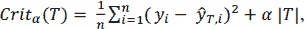

其中`|T|`是`T`的叶节点数量，`ŷ[T,i]`是与`T`相关的模型对输入`x[i]`的预测值。通过逐渐增加`α`，`Crit[α]`的最小化提供了一个叶节点越少越少的序列（`T[j]`)[1≤`j`≤`J]`。接下来只需在由此得到的序列中选择一个候选者。Breiman *等.* 基本上提出了两种方法：使用测试样本或通过交叉验证。第一方法假设存在可用的测试库：*[n[t]]* = {(*[i]*, *[i]*) ∈ *^p* × ,*i* = 1, … , *n[t]*}独立于`L[n]`，其中 (*[i]*, *[i]*)是与(*X*, *Y*)具有相同分布的随机变量的独立实现。我们然后选择索引为的(`T[j]`)[1≤`j`≤`J]`子树：

\[3.10\]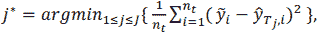

其中`ŷ[T[j]]`[,*i*]是与*[i]*相关的输出。

如前所述，决策树的优点之一是结果的可读性和易解释性，这得益于树图提供的模型自然理解。另一个优势是该方法可以处理原始数据。此外，与广义线性模型不同，它可以考虑线性相关的解释变量，且输出变量与其他变量之间的关系可以是线性的。

然而，该方法也有一些缺点：例如，得到的模型并不特别可靠，因为它们在很大程度上取决于学习样本。学习库的微小变化可能会显著改变得到的模型。这就是决策树现在被用作更复杂方法的模块的原因之一，这些方法并行使用大量模型：模型聚合方法（随机森林、Bagging、Boosting）将在 3.5 节中介绍。我们还注意到，决策树没有为每个解释变量提供整体划分：一个变量可能出现在不同的路径中。

CART 方法允许变体 [BRE 84]，而且还有其他构建决策树的方法，例如 Quinlan [QUI 93] 引入的 C4.5 算法，该算法在 IT 社区中被广泛使用。还可以基于比决策树更规则的递归划分来构建预测器，这些预测器分段定义常数函数（参见 Friedman [91] MARS）。

决策树在许多领域都有应用。它们可以用于精算科学，例如 Paglia 和 M.P. [PAG 11]的文章所示。应该注意的是，决策树在 R 语言中通过`part`包实现。

## 3.3. 神经网络

本节是对“神经网络”或“连接主义方法”的介绍，这些方法可以定义为源自神经生物学的数值求解方法。最早的反思出现在 1940 年左右，可以引用的名字有冯·诺依曼、图灵、维纳、麦卡伦和皮茨。当时的目标是利用生物和认知科学关于大脑的新知识，设计出具有某些特性的计算机系统，例如通过局部修改和信息存储的重新来实现自适应学习，在部分破坏的情况下具有鲁棒性。从这些早期工作中产生了两个学派。第一学派（冯·诺依曼、图灵等）采用了符号方法，是我们计算机中仍使用的概念（内存、处理器）的起源。第二个学派（麦卡伦、皮茨、明斯基等）自愿遵循更贴近生物描述的“连接主义”方法（神经模拟）。当传统人工智能在 20 世纪 8 年代遇到困难时，这种方法经历了复兴。其结果有时是惊人的，并催生了如今许多先进的应用。

神经网络在理论视角和应用方面都构成了一个巨大的研究领域（参见 Du 和 Swamy 的综合著作[DU 14]）。我们将关注分层网络和众知的梯度反向传播算法，它们在监督学习中提供了非常有趣的应用，并且是更简单、更传统的统计模型（线性和逻辑回归）的补充方法。最近，人们对这些方法产生了新的兴趣，随后是更高效的学习方法的出现：特别是深度学习，已经在改变人工智能的世界。

### 3.3.1. *从真实到形式神经元***


神经计算基本单元的最早神经形态构建之一可归于 1943 年的 McCulloch 和 Pitts [MAC 43]。真实的神经元非常图式化的工作原理如下：

- – 通过树突和突触，对其连接的神经元产生的神经脉冲（抑制性或兴奋性）进行加权求和；
- – 如果输入总和超过激活阈值，则在轴突中发射流入。

McCulloch 和 Pitts 的形式神经元重现了这两个属性。对于一个 `x` ∈ *^p* 输入，突触权重单位：`w` ∈ *^p* 和激活阈值：`θ` ∈  计算得出：

- – 加权和：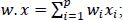
- – 输出 `Pw = Φ(w .*x − θ) = [{*w*.*x*≥*θ*}]；

```
其中函数 [{*A*}] 在 `A` 为实数时为 1，否则为 0。函数 `Φ` 被称为激活函数或响应函数。我们通过设定 `w[l+1] = θ` 并考虑额外的输入：`x[p+1] = -1` 来简化符号，使得我们可以写成 `Pw = {*w*.![images≥*θ*}],其中  和 `* = (x[1], … , x[p+1])`。

注意，这种神经元执行的是 {0,1} 中的 *^p* 函数。没有理由局限于 Heaviside 的响应函数 `Φ(u) = [{*u*≥0}]`，在许多应用中，其他函数已相应取代了它：

- – `Φ(u) = u`（线性神经元或 Widrow–Hoff 方法）；
- – `ΦT = `，称为温度 `T` sigmoid，当 `T` ⟶ 0 时简单地收敛于 `Φ0 = [{*u*≥0}]`。这种激活函数与 Heaviside 响应函数相比的优势之一是它是处处连续且可微的，这对于大多数学习算法都是至关重要的；
- – `ΦT,a,b = a + (b − a) ΦT`，值在 `[a, b]` 中的 sigmoid，特别是 `ΦT,-1,1 = tanh`

McCulloch 和 Pitts 的早期工作诞生了连接主义学。然而，直到 1960 年才观察到第一个应用：Rosenblatt 的 [ROS 62] 感知机。感知机由心理学家 Rosenblatt 于 1962 年引入，指代一组连接的形式神经元。Rosenblatt 的目标是模拟图像视觉识别，其灵感源于生物学结构：视网膜、投影和关联区域通过输入向量和相互连接的连续神经元层进行建模。我们将在下文中看到人工多层神经网络重现了这种结构。在研究神经网络之前，让我们看看简单的感知机（即 McCulloch 和 Pitts 的简单神经元）实际上可以计算什么函数。我们遵循连接主义学校的历史方法。

### 3.3.2. 作为线性可分器的简单感知机

我们关注函数：`Pw = {*w*.![images≥*θ*}]`，从 *^p* 到 {0,1},由突触权重：`w` ∈ ^(p+1) 定义。让我们引入下一个概念。

定义。****两个集合 A, B ⊂ *^l** 被认为是线性可分的，如果存在：`w` ∈ ^(p+1) `使得：*

- – `B` 中的每一个 `x` 均满足：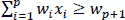;
- – `A` 中的每一个 `x` 均满足：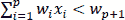。

*同样，一个函数 `f : D ⊂ *^p* ⟶ {0,1}` 被认为是线性可分的，如果集合 `A = {x ϵ D: f(x) = 1}` 和 `B = {x ϵ D: f(x) = 0}` 是线性可分的*。

根据定义，一个给定的 `f : D ⊂ *^p* ⟶ {0,1}` 函数是线性可分的，当且仅当存在一个上述定义的 `P[w]` 函数。

### 3.3.3. 作为函数近似工具的多层感知机

让我们引入层结构化神经网络的数学形式，这些模型在神经网络近似问题中被广泛使用。


定义：– 令 `p`, `m`, `q` ∈ ^∗，`ϕ[c]`, `ϕ[s]` 是从  到  的函数，`W¹` = (, `i` = 1, …, , `p` + 1, `j` = 1, …, `m*) 和 `W²` = (, `j` = 1, …, , `m` + 1, `j` = 1, …. `q*)` 实矩阵

### 函数：

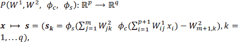

被称为具有隐藏层突触权重 () 和 (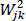) 以及激活函数 `ϕ[c]` 和 `ϕ[s]` 的感知器，其约定为：

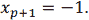

同一层的所有单元的激活函数是相同的，即隐藏层使用 `ϕ[c]`，输出层使用 `ϕ[s]`。在实践中，这些函数通常是海维德阶跃函数（Heaviside step function）、线性函数或 sigmoid 函数。然而，我们可以想象其他选择，例如三角函数。

为了简化符号，我们将定义范围限制在具有一个隐藏层的网络定义上。在具有多个隐藏层的网络情况下，这种构造很容易推广。这一思想是深度学习方法（LeCun, Hinton, Bengio）的源头（例如参见 J. Schmidhuber 的文章 [SCH 15]）。

早在 1969 年，Minsky 和 Papert 就证明了多层网络可以超越简单感知器的局限性。然而，直到 Le Cun (1985)、McClelland 和 Rumelhart (1986) 的工作（包括著名的“梯度反向传播”学习算法），连接主义方法才被实际采用。该算法实际上是 Widrow–Hoff (1960) 提出的算法的推广，而所使用的梯度法是解决最优控制中变分问题的相对经典的方法（例如 Courant (1943), Kelley (1960), Dreyfus (1962), Bryson and Ho (1969)）。该算法将感知器从分类器状态（{0,1}中函数 ^l* 的近似器）转变为通用近似器，其数学性由 Hornik (1989, 1992)、Cybenko (1989) 和 Barron (1993) 的结果证明，这些结果表明，任何在 ^n* 中具有有限间断点的 ^l* 函数都可以由具有隐藏层的网络以任意精度逼。让我们针对某类取值为  的函数给出这些基本定理之一。

定理.– (Hornik, [HOR 93]) 令 `I` ⊂  为一个非空区间。令 `U` 在 ^p 中，`ϕ`: ⟶  是在 I 上有界的 Borel 测度非多项式。

令 (`ϕ`, `I`, `U`) 为从 ^p 到  的具有隐藏层的感知器集合，其形式为：

\[3.11\]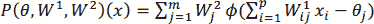

其中：

`m` ∈ ^∗，`W²` ∈ ^m，`W¹` ∈ `U^m` 且 `θ` ∈ `I^m`。令 `K` 为 ^p 的紧集。

因此：

1. i) 对于 `K` 上的每一个有限测度 `μ`，(`ϕ`, `I`, `U`) 在所有 ^r(`μ`) 中，`r` ∈ 1, +∞：对于每一个函数 `f` ∈ ![image^r(`μ`)，存在一个序列 (`f[k]`) ∈ (`ϕ`, `I`, `U`)，使得对于每一个 `ε` > 0，存在 `N` ∈ ，使得对于每一个 `k` ≥ `N`，\[3.12\]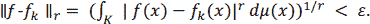

2. ii) 只要 `ϕ` 是几乎处处连续的，(`ϕ`, `I`, `U`) 在 K 上连续函数的集合 `C(K)` 中是稠密的，且提供了无穷范数 ∥ `g` ∥[∞]=sup*{g}。


1. 设置一个学习基 `L[n]` = {(x[i], y[i]) ∈ ^p × ^q,`i` = 1, … , `n`}, 学习步 `M` 以及学习常数 `η(t)`, `t` = 1, … , `M`。

2. 初始化权重 `W¹(0)` 和 `W²(0)`。

3. 对于 `t` = 1 到 `M`:
   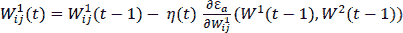 
   for `i` = 1, … ,`p` + 1`,`j` = 1,…`,`m`
   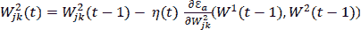 
   for `j` = 1, … ,`m` + 1, k = 1, … , `q`
   结束

4. 结束。

可以从文献中探索一些备注和方向：

– 这里，停止标准是固定数量的学习步骤。在实践中，学习通常在一百步内进行。我们可以对误差 `ε[a]` 设定一个额外的或替代条件，例如，如果 `ε[a]` 不再变化（学习完成）则停止算法。然而，后一种条件并不总是合适的。网络有时会一直改进直到对学习基达到近乎完美的建模，但随后在另一个样本上无法给出合适的值：这被称为“过拟合”。为了避免这种情况，我们假设已知 `L[n]` 的一个有限交集 `V[n[v]]` = {(u[i], v[i]) ∈ ^p × ^q,`i` = 1, … , `n[v]}`}，被称为“验证基”。`V[n[v]]` 的观测值 (`u[i], v[i]`) 被认为是独立的，并且源于与 `L[n]` 相同分布的随机变量。在 `L[n]` 上学习的每一步 `t` 中，我们还评估了 `V[n[v]]` 上的均方误差：

\[3.15\]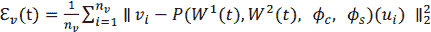

通常，该误差最初随时间减小，与在 `L[n]` 上的情况类似，然后在网络进入过拟合阶段时趋于稳定或增加。这为学习算法提供了一个停止标准：只需当 `ε[v]*(t)` 达到最小值时停止即可。此外，通常还会保留一个与 `L[n]` 和 `V[n[v]]` 不交的第三样本，被称为“测试基”或“验证”，在学习后在该上对模型进行测试。为了在预测中得用，模型必须在三个集合上给出同一数量级的误差。在 `L[n]` 上结果最好的模型并不总是在预测中表现最好的。

过拟合对模型的复杂性非常敏感，因此对隐藏单元的数量也敏感：网络的大小、学习基的大小以及对其泛化能力的信任程度之间存在什么联系？我们可以在 Vapnik 和 Chervonenkis (1971) [VAP 00] 中找到学习的理论结果，但实验结果比理论界限好得多，后者需要庞大的学习基才能获得正确的泛化结果。已经取得了一些结果：对于固定大小的学习语料库，泛化误差随着隐藏神经元数量的增加而增加，因为网络受学习基的限制越来越少。实践证明，性能相等的情况下，小网络往往比大网络泛泛化能力。类似地，我们可以考虑到用多项式近似真实函数：选择高次多项式并不总是解决方案！偏差和方差之间始终存在困境：通过更复杂的模型，我们可以在学习集上获得精度，但代价是预测的不确定性增加。如果待预测的变量无法通过输入变量很好解释，情况尤其如此。最好从简单的模型开始，使用 `m` 个单元。近年来，已经开发了一种统计理论方法，使得从感知机中获得隐藏单元数量的理论标准成为可能。


其中 `sj` 是第 `j` 个输出神经元给的值。这种归一化使得输出获得一个可以解释为概率向量的向量成为。通过在完全析取形式中重新编码不同的类别，类别 `k` 被识别为向量 `[k]` = (0, … ,0, 1,0, … ,0)，对应于 ^`k`（在第 `k` 个位置为 1），并通过最小化交叉熵 `H` 或相对熵  来完成学习：对于学习集 `L[n]` = {(`x[i]`, `y[i]*) ∈ ^`p` × {[1], … [k]}},`i` = 1, … , `n`},

\[3.19\]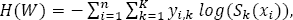
\[3.20\]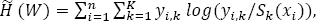

在此可以添加一个参数控制项（例如，`δ` ∥ `W` ∥，`W` 表示模型的参数集），就像均方误差函数一样。一旦学习完成，与观测值 `x` 相关的类别的预测则为：

\[3.21\]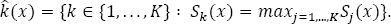

监督学习在多层网络中应用的一些示例包括：形状识别，特别是语音识别和手写识别 \[HAS 09\]，以及邮政编码的自动读取（美国邮政局，1989 年）；语音合成（Nettalk, 1986 年）；雷达、声纳和地震信号的分类；时间序列预测（例如，每日用水量或用电量 \[TOC 95\]，或具有阶段性变化的金融市场数据序列 \[MAY 04\]）；企业破产预测（见 P. du Jardin 的论文及其在该主题上的极大量参考文献 \[DU 07\]）；医学诊断 \[CHA 05\]；数据处理和精算建模（基于银行和保险部门客户数据库的分类（例如，参见 A. Paglia 和 M. Phelippe-Guinvarc’h 的文章 \[PAG 11\]，JM Aouizerate 的 \[AOU 12\] 以及 E. Le Corre 的精算论文 \[LEC 12\]）。此列表并非详尽，但展示了应用领域的多样性。由于它们的非线性本质，神经网络方法允许我们处理没有解析解的复杂问题。在某种程度上，我们通过另一个复杂系统来模拟复杂系统，但人工神经网络方法能够通过调整参数进行学习和控制。

这些方法在 R 语言的 `VR` 包（或 `nnet`）、`AMORE`、`neuralnet` 和 `h2o` 中实现。

## 3.4. 支持向量机 (SVM)

支持向量机（SVM）是一类监督学习算法，最初定义用于两分类。它们被推广到多分类问题和定量变量的预测。在两类分类的情况下，它们基于寻找最优间隔超平面，以尽可能地分离两个观测子集。在这里，我们找到了简单感知机（见第 3.2 节）的原理，其思想是寻求一个最优解，即泛化能力最好的解。这种方法源于 Vapnik 在 1995 年关于统计学习理论中对模型复杂性与其泛化能力之间联系的研究。

### 线性分类器

当观测值线性可分时，我们已经看到 Rosenblatt 的简单感知机及其学习算法使得确定分离超平面的方程成为可能。我们将寻求最优解来阐述这一概念，并将这一概念可以扩展到非线性情况。

让我们考虑学习集 `L[n]` = {(`x[i]`, `y[i]*) ∈ ^`p` × {-1, +1},`i` = 1, … , `n`}, 其中 `y[i]` 表示由变量 `x[i]` = (`x[i]`, … `x[i]`) 表征的个体属于两类中的哪一。我们为 ^`p` 提供一个标量积，记为“。” ^`p` 的超平面 `H` 由其方程定义：`w . x + b = 0`，其中 `w` 是垂直于 `H` 的向量。

如果存在向量 `w` ∈ ^`p`，满足 `∥w∥=1` 且常量 `b` ∈ ，使得以下不等式对于 `i` = 1, … , `n` 成立：


这等价于 `yi ≥ 1`，对于 `i` = 1, … , `n`。在这种情况下，`f(x) = w . x + b` 的符号指示了点 `x` 在超平面的哪一侧以及与 `x` 相关的类别。

常量 1 的选择是任意的，因为超平面是在范围内定义的。`L[n]` 的元素集合被认为是线性可分的，如果存在上述的 `w` 和 `b`。


该均方优化问题的求解便提供了最优超平面 `w^∗.x` + `b^∗` = 0 的方程，其中 `b^∗` = 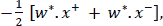，其中 `x^^+` 和 `x^−` 是每个类的支持向量。

随后可以使用得到的分类超平面进行预测：对于呈现给模型的新观测值 `x`，函数 `f(x)` = `w^∗.x` + `b^∗` 的符号决定了它所属的类别。

### 3.4.1.2. 非线性可情形

当观测值无法通过超平面分离时，有必要通过引入控制越界的误差项 `ξ[i]` 来松宽约束条件：

\[3.30\]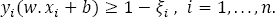

因此，如果相应的 `ξ[i]` 大于 1，模型将对向量 `x[i]` 分配一个错误响应。我们又回到了函数最小化问题：

\[3.31\]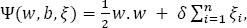

在约束条件 `yi` ≥ 1 − `ξ[i]` 和 `ξ[i]` ≥ 0 下（对于 `i` = 1, …, , `n`），其中 `δ` 是一个严格正参数。使用拉格朗日乘子的方法在这种情况下仍然有效（例如参见 \[COR 95\]）。

注意，存在许多算法来解决均方优化问题，无论是在可分离还是不可分离的情况下。某些算法通过对学习集进行分解，特别适用于在观测值数量 `n` 很大时考虑大量的约束条件。

### 3.4.2. 非线性分类器

当观测值不是线性可分的时，有时可以找到非线性边界。处理这个问题的一种巧妙方法是注意到，通过考虑非线性应用 `Κ` 将观测值映射到维度大于初始空间 \= *^p* 的空间  中，这通常可以让这些观测值变得线性可分。

此外，由于在线可分离情况下使用的方法仅涉及形式为 `y = Κ(x)` 和 `y′ = Κ(x′)` 的向量的内积 `y .*y′`，因此如果我们知道一个对称函数 `k` ∶ × ⟶  称为“核”，则不需要解释函数 `Κ`，使得：

\[3.32\]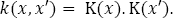

Mercer 条件保证了如果对于所有可能的 `x[i]`，对称函数 `k(. , )` 的通项矩阵 `k(x[i], x[j])` 是正定矩阵，则它就是一个核。在这种情况下，我们证明存在一个空间  和函数 `Κ` ∶ ⟶ ，使得：`k(x ,x′)` = `Κ(x). Κ(x′)`。常用核的示例包括：

* – 次数为 `d` 的多项式核：`k(x ,x′)` = `(c x .*x′)^d`，其中 `c` ∈ ;
* – 双曲正切核：`k(x ,x′)` = `tanh(c[1] x .*x′ + c[2])`，其中 `c[1]`, `c[2]` ∈ ;
* – 高斯（或径向）核：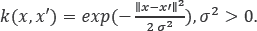

SVM 然后扩展到了多分类情况，并在多个 R 包中开发：`e1071`、`kernlab`、`klaR` 和 `svmpath`（这些包介绍参见 Hornik *et al.* 的文章 \[HOR 06\]）。

## 3.5. 模型聚合方法

在之前的章节中，我们介绍了不同的监督学习方法，它们提供了许多可能的模型，但通常很难确定保留哪一个。与其只选择这些模型中的一个，聚合方法（或集成方法）的般原理是构建预测器集合，然后聚合它们的所有预测。在回归中，最终预测可能是不同模型给出的预测的平均值；而在分类框架内，我们可以对各种预测器提供的类别进行多数投票。这种技术仅在所选的不同基础模型给出显著不同结果时才有意义，例如决策树和神经网络等非线性方法，这些方法在复杂问题上比线性方法具有更小的偏差，但方差更高。对不同模型的聚合可以降低方差，从而降低基础模型的不稳定性。基础模型可以是不同性质，但使用决策树的方法最为成熟，包括特别的“随机森林”。我们现在介绍常用的聚合方法，重点关注两类：

* – 并行方法，独立地汇集基础模型，例如 bagging 和随机森林
* – 自适应方法，每个基础模型都依赖于前一个模型。这些方法被称为 boosting。这些不同的方法被用于精算科学，特别是财产和责任保险，用于预测个人理赔和欺诈检测。

### 3.5.1. Bagging

Bagging 方法由 Breiman \[96\] 引入。Bagging 是自助（bootstrap）和聚合（aggregating）的缩写。给定学习样本 `L[n]` 和一个基础方法，bagging 原则是是独立地抽取 `B` 个自助样本 `L[n]`，并在每个样本上校准基础方法。与 `x[i]` 相关的预测为：

*
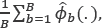 

在分类上下文中，我们采用多数投票。第一情况下，它只是不同估计值的平均值。

通常使用两种技术来生成自助样本：

* – 样本 `L[n],b]` 通过在 `L[n]` 中有放地抽取 `n` 个观测值获得，每个观测值的抽取概率为 `1/n`；
* – 样本 `L[n],b]` 通过在 `L[n]` 中抽取 `l < n` 个观测值（有放或不有回）获得。

Bagging 让弱基础方法变得有效。Biau 和 Devroye \[BIA 10\] 在一个特定示例上通过数学证明了这一点：以 1-最近邻方法作为基础方法（该方法并非一致一致的），大小为 `l[n]` 的自助样本如 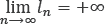，证明了渐近 bagged 估计是一致一致的。

可以使用袋外方法（out-of-bag method）来估计在测试样本上获得的模型的预测误差：这特别允许检查该误差如何随 `B` 演变，以便选择足够数量的基础模型。在 bagging 的情况下，不需要独立于 `L[n]` 的额外样本。事实上，并非所有的基础模型都包含所有观测值。因此，为了对 `L[n]` 中的观测值 (`x[i]`, `y[i]`) 获取独立学习的预测，我们限制在基础模型集  中不使用该观测值进行校准的模型，则与 `x[i]` 相关的预测为：

\[3.33\]

在分类上下文中，我们采用多数投票。袋外误差则定义为：

* 用于回归；
* 用于分类。


为了简化起见，假设所有基础预测器的理论方差为 `σ`²，且通过自助法（bootstrap）构建的两个基础预测器的相关系数为 `ρ`，那么很容易看出，通过 bagging 方法得到的预测器方差为 。因此，方差似乎随着使用的基础模型数量 `B` 的增加而减少，而且基础模型之间的相关性量化了聚合过程的增益：基础模型的相关性越低（|`ρ` 越小），最终模型的方差就越小。这为选取对样本敏感的基础模型（如决策树或神经网络）提供了依据：否则，基础模型之间将强相关，将它们聚合将不会产生任何改进。

Bagging 的编程非常简单。有一个 R 语言包 `ipred`，它提供了该方法的有效实现。

### 3.5.2 随机森林

在 CART 模型的情况下，Breiman [BRE 01] 引入了随机化对 bagging 进行了改进。其目标是通过在选择不同基础模型所使用的变量时引入随机性，降低基础模型之间的相关性。我们在上一节中已经看到了其价值：使用相关性较低的基础模型有助于减少聚合所获得的预测器方差。为此，Breiman 提议在构建树的每个阶段，从 `p` 个解释变量中随机选择 `m` 个变量，并仅考虑这些变量来确定相应的划分点。请注意学习集 `L[n]` = {(`x[i]`, `y[i]`) ∈ ^p × , `i` = 1,…`,`n`*}，其中在回归情况下 = ，在分类情况下 = 1,…k*}。该算法如下：

随机森林算法：

1. 1) 选择 `B`, `m` ∈ ^*。
2. 2) 对于 `b` = 1 到 `B`:
    * – 在 `L[n]` 中抽取一个自助样本 `L[n,b]`；
    * – 使用样本 `L[n,b]` 构建一个 CART 树，定义一个预测器 b。树的每一次划分都是通过限制在 `q` 个解释变量中随机抽取的 `m` 个变量集中决定的，不同划分之间的抽取是独立的。
    * 结束循环
3. 3) 定义 (或 (.) = `argmax [j]` {`b` : (.) = `j`})

当解释变量 `p` 的数量显著时，这种方法的价值已经得到证明（例如参见 [08]）。随机抽取的变量数 `m` 可以作为一个参数。经典的选择是 `m` = （分类中）和 `m` = `p*/3`（回归中）。这是 R `randomforest` 库中的默认选择。与 bagging 类似，袋外误差（out-of-bag error）用于控制 `B` 的值，并可能优化 `m` 的值。

自 2001 年发表以来，由于其非常优秀的预测性能（例如参见 Fernandez-Delgado 等人 [14] 和 Scornet 的 [16a]），该方法已被广泛研究和使用。从理论角度来看，Scornet 在 2015 年证明了难以获得的收敛性。另外注意 Biau 等人最近发表的文章 [16b]，该文章建立了随机森林与神经网络之间有趣的联系。

### 3.5.3 Boosting

Boosting 方法由 Freund 和 Schapire 在 1996 年引入 [FRE 96]，它与 bagging 有一个共同点，即使用基础模型通过聚合来推导出最终预测器。然而，本质区别在于 boosting 是迭代且自适应地构建基础模型，以便逐渐修正错误。最初的想法是提高那些性能优于随机分类器的二分类变量预测模型。这产生了 `AdaBoost` 算法 [FRE 97]，它是最流行的 boosting 算法。记学习集 `L[n]` = {(`x[i]`, `y[i]`) ∈ ^p × {-1,1}, `i` = 1, …,`,`n`*}。因此，算法如下：

AdaBoost 算法：

1. 1) 选择 `M` ∈ ^*。
2. 2) 初始化权重：`w` = (`w[i]` = 1/*n*,`i` = 1, …,n)。
3. 3) 对于 `m` = 1 到 `M`:
    * – 通过权重 `w[1]`, …,`w[n]` 调整加权 `L[n]` 的基础模型 m；
    * – 计算模型 m 在 `L[n]` 上的表面误差率：
    * – 计算：`α[m]` = `log((1 − ε[m])/ε[m])`；
    * – 修改权重：
    * 结束循环
4. 4) 定义：

第一个模型的观测值权重相等；然后在每次迭代中，如果一个观测值被正确分类，则其权重保持不变，否则会增加。最终预测器是基础模型的加权聚合，权重是每个模型调整质量的函数。基础模型可以是弱预测器，但在实践中应确保它们优于随机预测器（犯错几率为二分之一）：我们必须使 `ε[m]` > 0.5，否则 `α[m]` 将会变成负数。

带有权重 `w[1]`, …,`w[n]` 的基础模型校准步骤提供了多种可能性。例如，可以使用权重 `w[i]` 来加权待要最小化的经验误差：


也可以在 `L[n]` 中大小为 `n` 的子样本上调整基础模型，通过随机抽取观测值（有放回）根据权重 `w[1]`, …,`w[n]`。`AdaBoost` 算法已广泛用于决策树基础模型。它也从理论视角得到了广泛研究（例如参见 Bartlett 和 Traskin 的文章 [BAR 07]，展示了通用一致性）。

还提出了多种变体以适应多分类或定量变量（例如参见 [SCH 01]）。1997 年，Drucker 提出了一个回归 Boosting 版本（例如参见 [GEY 06] 关于决策树的性能分析）。注意：`L[n]` = {(`x[i]`, `y[i]`) ∈ ^p × ,`i` = 1, …,n`*}。Drucker 算法如下：

回归 Boosting 算法：

1. 1) 选择 `M` ∈ ^*。
2. 2) 定义：`p[1]` = (`p[1,i]` = 1/*n*,`i` = 1, …,n)。在{1, …,n*}上的均匀分布。
3. 3) 对于 `m` = 1 到 `M`:
    * – 根据 `p[m]` 在 `L[n]` 中有放回抽取大小为 `n` 的 [n]* 样本；
    * – 在 [n]* 上调整基础模型 m；
    * – 在 `L[n]` 上计算模型 m：
    * – 对于 `i` = 1, …, n，其中 `Q` 是损失函数；
    * – 
    * – 
    * – 
    * – 
    * – 如果 `ε[m]` < 0.5 *[m]*, 则定义 
    * – 否则定义 `w[m+1]` = `p[1]`。
    * 结束循环
4. 4) 计算加权预测 m 的均值或中位数，系数为 (`log*(1/*β[m]*), `m` = 1, …, , *M*)`)。


在此算法中，损失函数 `Q` 可以是二次的、指数的或绝对值，回归中的通常选择是二次函数。在最后一步中，中位数的使用消除了极异常预测变量的影响 [GEY 06]。

1999 年，Breiman 提议将提升（boosting）视为一种全局优化算法。根据这一观点，Hastie *等* 证明了分类情况可以被看作是一种通过逐步构建的加法模型进行的近似方法，该算法最小化定义在学习基上的指数损失函数（详见 [HAS 09]）。这一原理由 Friedman 开发，最初使用的缩写为 `MART`（多重加法回归树），随后又缩写为 `GBM`（梯度提升机）[FRI 01]。至于 `AdaBoost` 算法，它是一个通过迭代构建一系列模型的问题，使得后续模型不断改进，最终的聚合提供了一个良好的解决方案。`GBM` 的贡献在于，连续的修改是通过对待最小化的损失函数 `Q` 应用梯度优化方法来确定的（详见 [FRI 01] 或 [HAS 09]）。

## GBM 算法 – 基于函数梯度下降的提升

1. 选择 `∈` ^∗，`λ` ∈]0,1]。
2. 定义：0 = `argmin[*c*]` 
3. 对于 `m = 1 to M:`
    - 计算点 (`z[i]`) = *m−*1 处梯度的反方向 。我们记这些值为 (`u*[1]`, … ,*u[n]**)
    - 在 {(*x*[1], *u*[1]), … , (*x[n]*, *u[n]*)}; 上调整基础模型 *[m]*(.)；
    - 推导出一个新模型 *[m]*(.) = *m−*1 + `λ` *[m]*(.)。
    结束循环
4. 输出是模型 *[M]*(.)。

参数 `λ` 的选择相对不重要。通常建议取 0.1。这个选择与最优迭代次数有关：较小的 `λ` 值需要大量的迭代，反之亦然。

提升算法在 R 语言的 `gbm` 和 `h2o` 包中实现。

### 3.5.4. Stacking（叠加）

叠加（也称为混合）是一种利用第一步不同模型的输出值作为统计学习算法输入的方法。因此，这是一个元模型，以比 bagging 方法更复杂的方式聚合基础模型。原始思想由 Wolpert [WOL 92] 开发，该方法随后被应用于许多场景中。一种特殊情况是元模型是线性模型，而基础模型是非线性的，例如神经网络（详见 [FRI 92]）。`GBM` 的贡献在于，连续的修改是通过对待最小化的损失函数 `Q` 应用梯度优化方法来确定的。

叠加方法在 R 语言的 `h2o` 和其他相关包中实现。

## 3.6. Kohonen 算法

Kohonen 算法是一种用于自动形成映射的无监督学习方法。它由 Teuvo Kohonen 于 1982 年提出，作为感官区域的建模，例如视网膜细胞指向大脑皮层的神经连接。如果我们将视网膜想象成一个二维网格，那么一个重要的事实是，视网膜的拓扑结构得到了保留，即视网膜上的两个相邻细胞与皮层上的两个相邻细胞相连接。

可以区分出两类分类：

- 层次分类：类别的数量是预先固定的。我们考虑 `n` 组，直到获得单个类别。这产生了一棵树。
- 非层次分类：类别的数量通过选择 `n` 个元素来形成表征来决定。

### 3.6.1. 符号和模型定义

网络由根据确定拓扑结构排列的 `n` 个单元（或神经元）组成：

d = 1, 2 或 3 维：一条线、一个正方形或一个立方体。


- 根据某种网格，其邻域结构由邻域函数决定。单位由 `^d*` 的子集 `I` 表示，邻域函数是定义在 `I × I` 上的 `Λ` 函数，其满足：
    - 对称性（即 `Λ(i, j) = Λ(j, i)`），
    - 仅取决于 `I` 上的距离，
    - 随距离增加而减小：当 `(i, j) ⟶ ∞` 时，`Λ(i, j) ⟶ 0`。

通常认为 `Λ(i, i) = 1`。

当 `Λ(i, j) = 1` 时，我们说 `i` 和 `j` 是强连接的；当 `Λ(i, j) = 0` 时，`i` 和 `j` 是完全不连通且没有交互。

每个单位 `i` 都提供一个指向数据空间的状态向量 `Wi ∈ ^p*`，并且可以被修改。网络在 `t` 刻的状态由 `(Wi, i ∈ I)` 给出。

目标是找到具有以下属性的 `W[i]` 向量：
    - 量化：`capx` 中区域 `A` 内 `W[i]` 向量的数量近似正比于 `μ(A)`；
    - 组织：两个靠近的单位 `i` 和 `j`（即 `Λ(i, j) ≈ 1`）具有接近的 `W[i]` 和 `W[j]` 向量。

一旦了这些 `W[i]` 向量，它们被用于定义任何元素 `x ∈ capx` 的类别：我们将类别 `i∗` 归于 `x`，使得：

\[3.34\]

其中 `∥. ∥` 是 `^p*` 上的范数。现在让我们研究 Kohonen 算法，它通过一种学习方法确定 `W[i]` 向量。

### 3.6.2 Kohonen 算法

这是一种迭代学习算法，根据输入它的数据修改 `W[i]` 状态向量：
    - 向量 `Wi` 随机初始化；
    - 如果在 `t ∈ upn` 刻，网络状态由 `W(t) = {Wi, i ∈ I}` 给出，那么 `t + 1` 刻的状态将如下确定：从数据空间 `capx` 中随机选择一个向量 `x(t + 1)`。

随后，“竞争阶段”指定获胜单位：

\[3.35\]

在多个单位最小化该距离的情况下，会约定一种规则，例如对于 `^d*` 字典序取第一个索引 `i`。

“协作阶段”修改 `W[i]` 向量：

\[3.36\]

其中 `Λ[t]` 是邻域函数，它可以随时间变化，且 `ε[t] ∈ [0,1]` 是自适应参数。

只要 `t` 小于预先的阈值 `M`，算法就会继续，否则可以施加一个备选或额外的停止条件，在没有明显改进时停止算法。算法的关键参数是数据空间的维度 `p`、概率分布 `μ`（它刻画了观测值在数据空间中的分布方式）、网络拓扑、常数或随时间变化的邻域函数 `Λ[t]`，以及自适应参数 `ε[t]`（取值在 `[0,1]`，可能随 `t` 恒定或减小）。

邻域函数在这里起着重要作用：只有靠近获胜单位 `i∗` 的单位，其 `W[i]` 向量会被显著修改：因此有了协作的概念。以下是一些邻域函数的常见示例：
    - `i0076-01`（其中 `k` 是固定值，例如 `k = 1` 或 `k = 2`）；
    - `Λt = g(capd(i, j))`，其中 `g` 是钟形函数；
    - `Λt = g(capd(i, j))/λ(t)`，当 `t ⟶ ∞` 时，`λ(t) ⟶ 0`。

一个常见的示例是 `Λt = exp(−capd(i, j)²2σ(t)²)`，其中：
    - `σ(t) = σi((t/M))`，对于 `σ[i] > σ[f] > 0`（例如 `σ[i] = 5` 且 `f = 0.2`）。

自适应参数 `ε[t]` 在算法收敛中起着重要作用。例如，我们可以选择 `ε[t]` 使得 `∑[t≥0] ε[t] = + ∞` 且 `∑t≥0² < + ∞`，如 `ε[t] = 1/t`（来自随机算法的 Robbins–Monro 条件）。

另一个常见的示例是 `ε(t) = εi((t/M))`，对于 `ε[i] > ε[f] > 0`（例如 `ε[i] = 0.1` 且 `ε[f] = 0.005`）。

该算法的收敛性分析是一个复杂的数学问题。尽管大多数 Kohonen 算法应用至少涉及 2 维数据空间并表现出自组织现象。

### 3.6.3 应用

该算法及其变体已被提出。特别是，它是可以应用的。大多数 Kohonen 算法应用至少涉及 2 维数据空间并表现出自组织现象。

Kohonen 算法在 `kohonen` 包中特别有实现。

### 3.7 参考文献

- `AUI12`
- `BAR07`
- `BIA10`
- `BIA16a`
- `BIA16b`
- `BRE84`
- `BRE96a`
- `BRE96b`
- `BRE01`
- `CAR08`
- `CHA05`
- `COR95`


[COT 95] COTTREL M., GIRARD B., GIRARD Y. *et al*., “时间序列神经建模：一种用于权重消除的统计逐步法”,*IEEE Transaction on Neural Networks*, no. 6, pp. 1355–1364, 1995.

[COT 98] COTTREL M., FORT J.C., PAGÈS G., “SOM 算法的理论方面”,*Neurocomputing*, no. 21, pp. 119–138, 1998.

[COT 03] COTTREL M., IBBOU S., LETREMY P. *et al*., “用于数据探索性分析和可视化的组织化地图”,*Journal de la Société Française de Statistique*, no. 144, pp. 67–106, 2003.

[DU 07] DU JARDIN P., 故障预测与神经网络：变量选择方法的贡献，博士论文, 尼斯大学, 2007.

[DU 14] DU K.-L., SWAMY M.,*神经网络与统计学习*, Springer, 伦敦, 2014.

[FER 14] FERNANDEZ-DELGADO M., CERNADAS E., BARRO S., “我们需要数百个分类器来解决现实世界的分类问题吗?”,*Journal of Machine Learning Research*, no. 15, pp. 3133–3181, 2014.

[FRE 96] FREUND Y., SCHAPIRE R., “一种新提升算法的实验”,*第 13 次国际机器学习会议论文集*, 意大利巴里, 1996.

[FRE 97] FREUND Y., SCHAPIRE R., “在线学习的决策理论泛化及其在提升中的应用”,*Journal of Computer and System Sciences*, no. 55, pp. 119–139, 1997.

[FRI 91] FRIEDMAN J.H., “多变量适应回归回归”,*The Annals of Statistics*, no. 19, pp. 1–67, 1991.

[FRI 01] FRIEDMAN J.H., “贪婪函数近似：梯度提升机”,*The Annals of Statistics*, no. 29, pp. 1189–1232, 2001.

[GEY 06] GEY S., POGGI J.M., “回归树的提升与不稳定性”,*Computational Statistics and Data Analysis*, no. 50, pp. 533–550, 2006.

[HAS 09] HASTIE T., TIBSHIMARI R., FRIEDMAN J.,*统计学习方法元素：数据挖掘、推断与预测*, Springer, 纽约, 2009.

[HOR 06] HORNIK K., KARATZOGLOU D., MEYER D., “R 语言中的支持机”,*Journal of Statistical Software*, no. 15, pp. 1–28, 2006.

[HOR 93] HORNIK K., “神经网络近似的一些新结果”,*Neural Networks*, no. 6, pp. 1069–1072, 1993.

[ING 05] INGRASSIA S., MORLINI I., “小数据集的神经网络建模”,*Technometrics*, no. 47, pp. 297–311, 2005.

[ING 09] INGRASSIA S., MORLINI I., “神经网络中等效自由度的计算研究”,*Advances and Applications in Statistics*, no. 13, pp. 49–81, 2005.

[KOH 82] KOHONEN T., “简单自组织过程的分析”,*Biological Cybernetics*, no. 44, pp. 135–140, 1982.

[KOH 96] KOHONEN T.,*自组织地图*, 第 2 版, Springer-Verlag, 柏林, 1997.

[LEB 16] LE BOUCHÉR B., 基于 I.A.R.D. 与开放数据的精算定价, 论文, 精算师学院, 2016.

[LEC 12] LE CORRE E., 偿付能力 II 框架下同质风险群的构建, 论文, 精算师学院, 2012.

[MAC 43] MCCULLOCH W., PITTS W., “神经活动中内在思想的逻辑演算”,*Bulletin of Mathematical Biophysics*, no. 5, pp. 115–133, 1943.

[MAI 04] MAILLET B., OLTEANU M., RYNKIEWICZ J., “金融市场发生机制变化时冲击的非线性分析”,*第 12 次欧洲人工神经网络研讨会 (ESANN 2004) 论文集*, 比鲁日, 2004.

[PAG 11] PAGLIA A., PHELIPPE-GUINVARC’H M., “非寿险风险定价：一种基于统计学习模型的方法”,*Bulletin Français d’Actuariat*, no. 22, pp. 49–71, 2011.

[QUI 93] QUINLAN J.R.,*C4.5*, Morgan, 1993.

[ROS 62] ROSENBLATT F.,*感知器的原理与动力学*, Washington, 1962.

[RYN 12] RYNKIEWICZ J., “随机森林的一致性”,*Neurocomputing*, no. 90, 2012.

[SCH 01] SCHMID J., TAKACS G., “提升的提升”,*arxiv:0911.0460*, 2001.

[SCH 15] SCHMID J., TAKACS G., “堆叠线性”,*Neural Networks*, no. 6, pp. 85–97, 2015.

[VAP 00] VAPNIK V.,*统计学习的本质*, Springer, 纽约, 2000.

[WOL 92] WOLPERT D., “堆叠泛化”,*Neural Networks*, vol. 5, no. 2, pp. 241–259, 1992.


它们是主要的金融参与者。法国很大一部分储蓄通过人寿和人身险合同被托付给它们，这些资金被投资于股市，特别是用于国家债务的融资。它们还受公共机构委托征收多项税费和团结征收，例如用于补充补偿基金的税费，该税费将从每份财产保险合同中扣除固定金额。客户往往并不知道这一点：他们通常将这些征费等同于管理费或价格上涨，这不利于价格的透明度，也不利于给保险公司留下良好印象。

鉴于保险机构在社会中所扮演的经济角色如此重要，这些机构受到严格的监管和监控。它们资本充足，并遵循欧洲的 `Solvency II`（偿付能力二）审慎监管。它们受多项法律法规的约束，其中许多法律旨在确保保险人能够履行其义务。此外，监管旨在保护被保险人，使保险人不滥用其凭借职业获取的客户信息。假设保险人处于信息不对称的境地，这使其相对于客户处于优势地位，因此其定价标准的使用受到限制。法规还规定，使用个人数据时必须在尊重隐私、无歧视、精简且公平的情况下进行，且保险人将采取一切必要的安全措施防止数据被盗取或泄露，否则将面临严厉制裁。

精算师的角色是明智地利用与风险评估和控制相关的数据，包括赔备准备金的计算。数据质量必须经过经过验证。

保险公司主要由审慎监管决决局（`ACPR`）控制，该机构通过频繁且记录详尽的报告支持，对其活动进行严密监督。保险公司的组织和治理由 `ACPR` 监督。高管及关键职能人员（精算职能、风险管理、合规和审计）的任命须获得 `ACPR` 的声明和授权。

作为主要数据用户，保险公司还通过其 `CIL`（数据保护代表）以及现在的 `DPO`（数据隐私官）与 `CNIL`（国家信息与自由委员会）频繁接触，该职位必须在 2018 年 5 月左右设立，并有遵守 `GDPR`（欧盟通用数据保护条例）的截止日期。

## 4.1.2 广泛的长期活动

保险公司发行的保障涵盖了所有经济领域：个人或公司持有财产的保障、自然事件后果的保障、民事责任险、健康、退休、死亡和福利保险，以及人寿险和储蓄险等。

它们的业务处于长期视角，特别是养老金和个人保护险以及公共责任险，尤其是产品险和工程险。在退休方面，考虑到遗属养老金，合同期限可能超过一个世纪。

因此，保险人被要求管理产品组合，其中旧合同仍在使用中，而随着时间的推移，更适应不断变化的新合同被添加到现有的组合中。

因此，保险公司的实力和稳健性与某种程度的管理负担密不可分，这涉及到难以吸收的多层流程和计算机设备，特别是由于一方面，这些保险人是众多公司合并的结果，而另一方面，税收和社会法规不断变化，这使得处理过程变得更加复杂。

保险实践的广泛领域实际上对应不同的行业，具有不同的市场且往往拥有不同的分销渠道。

个人保险很大程度上作为 `B2C`（企业对消费者）销售，但与客户的接触并不总是保险公司的责任。传统公司（如 `Axa`、`Allianz`、`Aviva` 等）提供许多分销渠道：直接将客户与保险人联系起来的员工网络，以及代表保险人具有特定独立性的总代理人，还有具有自主权、使保险人产生竞争并提供个性化建议的经纪人，以及销售储蓄合同并进行干预的独立资产管理顾问（`IAM`）。由于对遗属养老金的考量，个人也可以转向银行网络购买保险合同，这些网络是银行的子公司。这些公司现在占据了寿险市场的三之二，以及汽车险和财产险日益增长的份额。

所有公司及其分销商还拥有电话平台、网站以及手机应用程序，这些销售手段日益受到法国人的青睐。

因此，多渠道营销必须使客户能够利用所有渠道获取信息和建议并进行购买。


保险公司经常被批评将免责声明、保证条款和其他重要细节写成次要项目。保险公司试图弥补这一缺陷，但交易的本质是以合同形式呈现的——即法律行为，而非实体对象，这使其难以被简化。盎格-撒克逊数字参与者的合同比保险合同更有负担且更难理解，但其服务是即时的且通常是免费的，这简化了关系，尽管随着时间的推移，客户往往在自己不知情的情况下被“绑定”了。

保险业务中这种不可否认的法律维度是客户体验中的一个劣势，需要被克服。

### 4.1.5. 基于数据和精算专业知识的经济模型

尽管保险公司是私有的，但它们在社会效用方面发挥着基础作用，特别是在健康和福利合同方面（强制计划之外）。因此，它们通过财政或监管措施受到公共当局的激励或约束。

例如，在健康保险方面，税率取决于健康合同是否被认定为“责任型”或“非责任型”，同时考虑到是由公共当局定义合同必须符合的参考范围和医疗范围，以便其被验证为“责任型”。

显然，客户大多数选择价格最具竞争力的合同，即责任型合同，因为它们的税负较低。

在其他情况下，根据法律或法规，出于非歧视或团结考虑，保险公司的定价自由受到禁止使用某些标准（如性别）的限制，尽管在寿命方面这很具歧视性，或者在病史方面，通过“遗忘权”防止了将其纳入考量。

保险业务由在未来发生随机事件时支付一笔（通常是未知）金额的承诺，基于统计学。这些信息被仔细收集并存储在结构化数据库中。不同客户风险的汇集允许保险公司依靠大数定律，利用少数总结大部分信息的概率数学法则对其自身风险进行建模。它还衡量这种建模的误差风险，监管机构据此对保险公司所做的承保承诺规定资本动员要求。因此，数据是保险公司的原材料。精算师的工作是选择并使用这些数据来评估和控制风险，并计算计入账目的准备金，同时对概率性地预测未来几年的各种技术和商业参数，以确保公司的可持续性和承诺。到目前为止，在数据有限的情况下，保险公司已有效地评估了其风险，并在灾难发生时按期面对了承诺的监管。显而易见，我们所知的数字工业革命数据爆炸（大数据）正在动摇这种既定秩序。

这种新的海量数据对保险公司有什么用处？

## 4.2. 大数据背景：新用途、新行为和新经济模型

观察数字爆炸和以 5V 为特征（数据量 Volume、多样性 Variety、速度 Velocity、真实性 Veracity 和价值 Value）的大数据现象是必然。

大数据最明显的表现是数据“量”的爆炸，由于计算机的力量以及网络、智能手机、社交网络、连接物体、云访问等的普及，数据量呈指数级增长。

然而，大数据还通过交换数据的“多样性”深刻地改变了背景：不仅有数字，还有文本、图像、声音和视频。另一个特征是“速度”，信息瞬间同时到达地球各个角落的速度，来自各种发行者——发送度假照片的人或通过卫星收集理赔信息的个人。在数字时代，一切都是即时的，个人拥有的技术与公司的技术非常相似。

“真实性”仍然是一个焦点，因为数据的收集是在不知道其背景的情况下进行的，在随后使用这些数据时必须记住这一点。所有这些通过新算法和人工智能共享的数据，构成了 21 世纪的新能源来源，产生“价值”。

所有经济参与者都在努力从所有这些数据中提取价值，获取其富有的份额，并成功实现数字化转型，特别是利用这些新数据进行营销。

### 4.2.1. 大数据对保险公司的影响

保险公司如何受到大数据的影响？数字世界对保险公司的活动产生了什么影响？

由于其原始的经济模型（逆向周期），保险公司对这场数字工业革命特别关注，因为数据是它们的原材料。面对昂贵的随机事件（灾难），个人或公司有权选择：接受挑战承担风险并承担成本，或者决定将该风险转移给一个信赖的第三方并支付一个初始价格。“承诺”的销售者是根据已证明的方法对统计学的使用进行仔细评估的，他们是数据专业人士，将个人难以承担的风险转换为一种受控的整体风险。在这方面，新数据的提供只能帮助保险公司更好地工作。

但数字技术的影响本质上难道完全不同吗？它是否不仅在改变保险业务的执行方式，而且改变保险业务本身？

保险活动支持经济和金融活动，因此在很大程度上依赖这些活动。它们服务于个人，帮助他们面对生活方式带来的危险。如果经济发生变化，人们的生活方式不同，保险需求也会不同。

因此，保险公司必须理解并适应不断的需求，甚至预测这些需求。

### 4.2.2. 大数据与数字化：深刻的社会变革

大数据和正在进行的数字工业革命正在带来深刻的社会变革。

每个人都已成为网络节点，所有网络都是互连的。这种通信量的增加加速了时间。邮件必须在当天处理。交流通过手机、推文和其他超短信息系统进行。信息迅速过时。这是通过标题和震惊的图片实现的，这为特写文章、细致且有论据的交流留下了很少的空间。一切进展得很快。我们不再能忍受等待。网站必须快速提供信息，而不需要冗长的问卷。产品必须在当天或第二天交付。我们生活在当下，对未来没有太多的投影。数字化加速了时间。

我们习惯了像亚马逊等这样的数字平台的服务，它们关注“客户体验”，并为传统参与者设定了高标准。

保险公司的长周期和它的逆向周期并不自然地适应这个新的当下的世界。保险公司与客户极有的传统接触机会（保费和理赔）无法充分满足他们的需求。为了生存，必须保持接触。因此，保险公司将寻求接触机会，而数字化将提供这些机会：网站、手机提醒等。


在某些方面，数字技术所青睐的比较工具的发展以及公共机构为了促进竞争而采取的措施（使被保险人处于选择地位），为保险公司带来了新的接触和市场推广机会。然而，由于存在反向周期，保险公司的客户体验比产品销售商更难实现，因为这种周期延迟了“产品的交付”，而客户实际上并不真正想要接收这种产品，因为这意味着灾难的发生。

在经济危机、购买力下降以及生态意识的背景下，个人正在寻求消费解决方案，而非拥有实用物品。许多城市盛起了“vélib’”（共享自行车）以及“Autolib’”（共享汽车）。我们是否已经永久性地进入了一个“使用重于所有”的社会？无论如何，客户（无论是自然人还是法人）日益关注价格，有时甚至以质量为代价。

然而，价格已经失去了其经济价值上的意义。数字技术让个人习惯了 `Google`、`Facebook` 以及其他“免费”服务，而结算通过免费投入所有用户数据来间接完成，这些数据随后成为激烈商业活动的对象。这还允许航空公司和 `SNCF`（法国国家铁路公司）根据预订时的上座率（有时是其他更可疑的标准）收取完全不同的价格，这可能导致乘客在相同的条件下一起旅行，却支付着从 1 到 10 不等的价格。用户不再有任何参考，并倾向于认为大公司获取了过高的利润、浪费资源并收费过高，而且总能找到更低的价格。一方面，用户通过比较工具更了解市场保险费率，通过开放数据（或即将访问的基因组）更了解自己的风险；另一方面，他们对价格不再有稳定的参考标准，而他们并不理解这些价格的形成机制。数字技术带来的客户与保险公司之间信息不对称的减少，并没有真正增强信任。

在这个被平台宠溺、并以智能手机武装的新型数字世界中，个人正在意识到自己的力量：带着一种完全掌控的感觉，他们通过推文对电视节目发表意见，通过拍摄新闻现场充当记者，并直接向政治家提问。有点像青少年一样，他们对未知的网络用户、论坛或平台的信任超过了对公认专家的信任。

这在一定解释了所谓“协作”平台（`BlaBlaCar`、`Airbnb` 等）的成功，这些平台将个人聚集在一起交换服务：拼车、借用房屋或园艺工具，以及公寓、汽车等的临时租赁。经济论点也被强力提出，因为据计算，协作经济带来的经济收益平均每人可达 495 欧元。

得益于监管放宽，这种协作经济也延伸到了金融活动，例如 `crowdfunding`（众筹）。

一些消费者也开始依靠 `blockchain` 技术和社交网络来摆脱平台。通过对经验、技能和机构提出，网络用户中出现了一种通过点对点网络进行组织的趋势。社区正在建立，并且得益于社交网络、集体智能和 `blockchain` 技术，他们正在规划以往委托给受公共机构监管和控制的信誉第三方的交易。在美国，这种类型的社区（点对点动态）提议通过 `LinkedIn` 执行社区的失业保险。另一个名为“Teambrella”的社区对其成员的汽车保险范围感兴趣，并通过投票决定保险价格和新成员的加入。

在 `B2C`（企业对消费者）和 `B2B`（企业对企业）时代之后，现在是 `C2C`（消费者对消费者）的时代吗？

### 4.2.3. 客户对算法和技术的信任

公众正在养成与机器人打交道的习惯，并正在很好地适应：自动取款机、机场、银行、超市、自动地铁。算法被认为比人类更可靠，许多人倾向于接受机器人引导而非人类。机器人永不疲倦，没有生理需求或情绪，也没有情感。由于其理性，它被认为是客观的，尽管它是由人类编写的，并取决于传递给它的文化，且这种客观性在不同国家之间存在差异。算法并非客观的。相反，它具有规范性并强加标准和价值观。个人对技术的信任还涉及加密技术：`Bitcoin blockchain` 似乎是安全的，而 `code is law`（代码即法律）适用于 `Ethereum blockchain`。人们现在倾向于信任技术而非建立了几几个世纪的机构——“信誉第三方”。这种不信任的趋势影响着所有机构，特别是政治家和记者，尽管它尚未完全触及他们。这种趋势在一定程度上被人类接触的需求所抵消（尽管在线购买产品日益增加）。在保险领域，与经理接触以处理理赔的需求增加了。

此外，针对“黑箱”也开始出现抵制，例如针对大学录取的 `APB` 算法的抗议运动。

### 4.2.4. 对数字足迹可能后果的某种忽视

这种对“机构”信任的缺失，与对连接物体和平台留下的数字足迹可能产生后果的不信任形成了对比。这些连接物体正在发展，尽管它们可能需要一段时间。

例如，连接的 `Apple Watch` 经常进步，现在的销量已超过了 `Swatch` 手表。银行卡、会员卡、`Navigo` 卡、网页浏览、智能手机、联网汽车、定位、智能电表、报警器、家居自动化、医疗设备等都在以可持续的方式追踪用户，表面上并没有移动他们。

然而，足迹的增加和交叉（特别是通过深度学习）使每个人变得可追踪，即使是那些在数字网络上不活跃的人也是如此，因为他们与其他连接的人联网。例如，只要有一个 `Facebook` 用户的父母或朋友，`Facebook` 就能通过深度学习了解我们的一切，我们的喜好、兴趣、习惯等。


数字技术引入了新的参与者（亚马逊、La Fourchette、TripAdvisor、Uber 等），这些参与者通过在生产者和客户之间进行介入，并为客户提供无懈可击且个性化的服务，切断了生产者与其客户的联系。这些平台一旦建立，就把生产者降低为外包商的角色，并掌握了定价权，削减了生产者的利润空间，但并不总是能真正降低消费者的价格。

如今，所有经济参与者都日益担心被“Uber 化”，正如这在不同程度上已在出租车司机、书店主和餐厅经营者身上发生的那样。保险公司也担心新数字参与者的到来，即保险领域的“Uber 型”或“免费型”公司，它们将带来价格的下降和灵活的数字化服务，且不会受到复杂投资组合历史负担的阻碍。

保险公司深知，客户并不希望“为他人买单”，高性能平台已经让他们习惯了服务的个性化，而他们希望在所有的供应商处都能获得这种服务。他们紧密观察并经常与金融科技（Fintech）和保险科技（Insurtech）合作。这些领域在千年创意冲动的驱动下蓬勃发展，其背后是那些投身创业的年轻毕业生，他们准备好加速一切，远离他们长辈在大型企业职业中的舒适与束缚。

对于保险公司来说，问题在于分析我们大数据世界这一新数字背景所带来的机遇与风险，并在这一快速变化的宇宙中定义它们的战略方法。

## 4.3. 机会：新方法、新产品、新可保风险、新管理工具

保险经营者是数据专业人士。在技术层面，为了确保偿付能力并履行承诺，他们的风险评估基于对过去结果的观察，并通过严谨的假设-演绎法对未来设定了一系列假设。精算师使用的随机模型（包括广义线性模型 `GLM`）是由假设驱动的。《偿付能力 II》（`Solvency II`）监管本身也基于这些方法，而监管机构 `ACPR` 对数据和使用的内部模型进行控制，并要求具有可解释性。

因此，精算师传统的统计和概率方法远未过时。

### 4.3.1. 新的数据处理方法

在大数据世界，新方法丰富了风险评估、产品构建和与客户接触的能力。

这种方法与建模方法不同。变量数量过高，无法应用相同的技术。然而，这些并非 `a priori`（先验）选择的变量，而是新获得的现有数据，这些数据往往被证明对所研究的主没有解释价值。然而，工作恰恰在于检测这些新数据具有解释性或预测性的情况，而在这些情况下，数据才会产生价值。为了从海量数据中提取相关信息，因此必须从数据驱动的角度来看数据，并使用学习算法：决策树、神经网络、随机森林甚至是无监督分类算法。

精算师过去已知这类某些算法，但在此之前的大数据时代，他们很少有机会使用它们。神经算法和分类方法对于精炼同质化定价群体很有价值。然而，它们仅被用于投保、理赔或其他内部数据数据库的内部数值数据，这限制了它们的预测能力。

因此，数据驱动是一种处理数据的新方法，不预设（`a priori`），有助于发现未被察觉的相关性和相似性。然而，我们不应忘记业务经验，特别是相关性并不同于因果关系。理解背景对于正确使用大数据和算法至关重要。在这方面，由于其特殊的反向周期和与时间的不同关系，保险公司的业务与许多大数据业务有所不同。算法结果必须是可解释的，并且必须能够解释所做的决策。

与大数据中的许多前沿活动不同，大多数传统的保险活动（与客户的互动外）并不需要纳秒级的即时处理。目前，处理速度很少优先于结果的可解释性。在现行保险合同的框架内，合同期限通常较长（通常为 1 年），预测的跨度比大多数数字业务长得多，且情况的重复性也没那么高。


对个性化的追求是否会对这一原则产生质疑？客户难道是自私的个人主义吗？受到威胁将是行业本身。除非以不同的方式进行互助，否则大数据为客户提供了一个机会在受监管和资本化的保险公司之外执行这一点。

客户的新需求正迫使一些保险公司向更精细的价格细分发展。在符合法规和伦理的情况下，客户留下的数字足迹允许保险公司更好地完成工作，并在不干扰现有价格等级的情况下，对价格类别进行精细化。然而，这对于客户来说是可以理解的吗？这符合他们的需求吗？这应该伴随着适当的市场细分，这种划分可能比价格细分更精细。保险公司通过与客户的营销和沟通将有所作为。在这一并非颠覆性的改进过程中，是营销细分使得满足需求成为可能，对于保险公司正如所有公司一样，数据贡献是至关重要的。因为营销细分除了效率外不需要任何其他证明，因此它可以受益于机器学习带来的所有创新可能性，受益于外部数据的贡献——特别是通过开放数据、数据驱动学习，甚至是“黑箱”算法。保险公司可以用正确的论点和正确的关联服务将产品推向正确的客户细群，而价格保持不变。

客户数据使得能够追踪他们的生活时刻并预测他们的需求（例如，在孩子出生后更换汽车或住房）。这使他们能够根据特定目的进行画像（始终符合法规规定），并更好地理解他们想要的关系类型和服务类型。例如，他们是否喜欢在智能手机上接收信息警报或建议？

对于接受连接关系（例如通过手环或家居自动化设备建立连接）的客户，这可能会导致价格的降低或赠品，作为对良好行为的预防精神的奖励。

这些做法的缺点是具有规范性的，且并不总是基于科学相关的标准。为什么每天必须走 10,000 步？为什么不是 9,000 步或 12,000 步呢？如果我每天只走 5,000 步，但我游了 10 圈，我难道不是一个“良好”风险吗？

事实上，这些基于关系而非价格的改变是否足以满足预期？

我们看到此处出现了价格差异化的想法，并被推向极端，这将损害现有的经济模型，并可能导致某些客户面临无法承受的价格，从而将他们排除在保险体系之外，对社区产生严重后果。

市场动态将以一种难以预测的方式改变组合，因为这涉及多方博弈。保险公司对所谓的“良好”风险实施极低价格，对所谓的“坏”风险实施高价，可能会失去大部分组合，并由于收入减少未被对冲而导致账户失衡，因为他们的员工、管理和场所的固定成本正在受到控制。

保险市场的整体偿能力可能会受到此类做法的影响。

此外，价格的精细化（可能达到个人化的程度）将产生另一个“反常”的技术影响。显然，细分越精细，保险公司在评估其承诺时越可能出现错误。保险公司被迫采取更宽的安全边，因此在全球范围内实施高于必要的业务价格，并进行更大的池化。

在这种情况下，监管和监管机构要求更高的资本金，这要求资本回报。极其精细的细分将需要更多的资本动员，这可能是昂贵的，因此通常会违背集体利益。

因此，必须在保险互助水平上找到平衡，以考虑到当前池化中所包含的维度的接受性，并满足部分客户对价格个性化的愿望。

### 4.3.3. 基于新标准的新产品

满足个性化需求的另一种方法是将保险价格直接与被保险风险或客户行为的客观指数挂钩，该指数旨在解释这种风险水平。

新的保险标准应运而生：例如在汽车险中，驾驶员的驾驶行为根据刹车、加速、速度、改变方向、地理定位和行驶时间等参数进行“评分”，这需要与传统的定价方法进行校准。

在新的数字世界中，人们不会等到知道一切后才行动。我们在行动中学习：测试与学习。这种方法是推断。是数据决定了轨迹，并根据每次获取相关信息不断进行修正。尽管组合监控要求所有时刻在精算上都是健全的，但精算基础并没有受到质疑。

大数据和开放数据对于参数化保险的发展也非常有用，例如风暴险，其预先约定的赔金额完全基于风指数触发，无论发生任何可能的损害。还预见了混合保险（部分参数化，部分补偿性），特别是在农业保险中。除了天气数据，保险公司还可以使用无人机和卫星测量田地的干旱程度或草高。

还可以发现许多一次性的卡保险。产品可以在移动设备的应用程序中提供，但得益于地理定位，也可以“转移”到智能手机，提供给有需要的客户（同时非常关注法规）。有很多机会：例如在借用朋友的车之前，或在滑雪之前的承保保险等。

在这些情况下，类似于购买物品提供信贷的机构，机器学习和大数据是至关重要的，因为价格必须尽快产生。定价无疑是困难的，精算监控也是辛苦的，但对于小金额，无疑可以找到技术边际。

因此，为保险公司、营销人员和精算师开启了广阔的可能性领域。有必要确保理赔发生与风险评估一致，并且衡量使用这些技术的额外成本是否通过核保和专家知识获得良好的补偿也是重要的。

### 4.3.4. 需要保险的新风险

任何新技术都有其弊端。考虑到数字化和大数据的巨大机遇，一个令人印象深刻的盗版行业正在发展，它从万物互联中获利。


公司迫切需要涵盖这些新风险。其数据不仅对业务运营至关重要，而且任何数据丢失都会带来企业形象风险和信心损失。在这方面，就个人数据而言，新的欧洲法规（2018 年 5 月生效并强制执行）收紧了要求：规定了在未采取所有安全措施的情况下发生数据盗窃，将面临非常严厉的财务制裁。

网络安全保险对于新的经济世界是至关重要的。它构成了一个需要强劲增长的新市场，且有许多工作需要完成。这一发展领域处于数据隐私背景之下，这使得风险评估变得非常困难。数据的稀缺性需要新的合适模型，这需要精算数学的研究。

算法的泛化以及许多智力任务的机器人化前景开启了新的保险需求领域。如何确保它们的安全取决于为机器人制定的法律框架。欧洲议会正在处理这一课题，目前尚拒绝为机器人设立特殊身份，这使得留在现有的保险框架内成为可能。

自动驾驶汽车发生的事故可能需要对现有合同进行调整。还有一种可能性，考虑到机器人的理性，行人和公共空间其他使用者的行为可能会发生改变。现在与汽车处于劣势的行人会改变他们的行为吗？能确定自动汽车会被设定为让他们通行吗？他们会变得非常胆大并如何过街吗？

因此，风险评估将变得不同，但对保障的需求不会消除。自动驾驶汽车无法逃避某些经典的灾难，还会产生新的风险，包括网络威胁。

### 4.3.5. 更好地服务和管理客户的新方法

大数据和异构数据利用（电子邮件、电话交换、电邮投诉、友好声明、实地访问、卫星图像等）是改进管理、减少时间和成本以及提高数据质量的宝贵来源。

更快地分类理赔文件、为客户提供更好的服务（包括更准确的准备金评估、流失检测、预判、欺诈威慑与检测、数据库的改进与统一），都是为了通过安全、高效且经济的管理来服务和留住客户而需要正确完成的巨大工作。

为了让这个大数据世界的现实更加可感知，数据可视化技术通过让结果根据某些参数（时间、地点等）移动，以一种综合、动态且多维度的方式帮助结果视觉化。

这些技术非常有帮助，因为只要它们不会产生近乎操纵的技巧性展示。

## 4.4. 业务削弱风险：来自新参与者的竞争、“Uber 化”、市场规模萎缩

尽管大数据革命使保险公司面临风险，但也产生了许多幻想。

### 4.4.1. 去互助化的风险

第一个风险主要取决于保险公司本身：即去互助化和排除某些保单人的风险。如果一些大型保险公司从事极端的细分市场，以降价作为确保“良好风险”的关键，它们最初可能取得商业上的成功。其他保险公司很难抵抗这种趋势，尤其是考虑到可能糟糕的财务结果不会立即显现。应该记住，识别“良好风险”并不像看起来那么简单，技术平衡是一项真正的业务，由现有保险公司通过传统技术进行良好控制。

然而，一旦触发了动态性，市场将永久失去稳定，补救局面将变得棘手。ACPR 会保护市场免受这种偏移吗？这关乎所有人的安全。排除被认为是“坏的风险”的保单人（在缺乏团结的情况下，他们只能获得令人望畏的高价），将使社区面临风险。

市场的整体偿付能力和保险业务的持续性也是如此。处于风险中的是需要为债务和经济融资的这些主要金融市场投资者的可持续性。

在不采取极端假设的情况下，我们必须记住，过度细分机械地增加了保险公司结果的不确定性，因此增加了确保偿付能力的资本要求，反过来增加了保险公司的成本和价格。

### 4.4.2. “Uber 化”风险

数字平台的经济模型证明了其有效性和对现有参与者的破坏性影响。

GAFA（Google、Apple、Facebook 和 Amazon），特别是 NATU（Netflix、Airbnb、Tesla 和 Uber），以现有公司为代价经历了巨大的增长：酒店集团、中央出租车服务等；2016 年，Airbnb 的销售额增长了 80%，Uber 增长了 267%。传统模式被这些数字化的、敏捷的新来者所阻碍，他们几乎或没有员工，除了电脑外没有硬件资产，通过在企业和客户之间介入，提供更高质量且更廉价的服务，但不承担这些业务的风险，而是获取了大部分财务利润。

在书店、餐厅、酒店、出租车等之后，保险公司是否也会沦为数字平台的受害者，任其将其传统客户和分销商隔离开？他们是否会被中介，成为技术和管理分包商，在资产负债表上承担所有风险，但失去客户、战略空间和部分利润？

在某种程度上，保险分销渠道的多样性（员工、代理、经纪人、IAM）虽然复杂了保险公司的数字化，但将客户关系植根于物理网络，其优势在于让可能的掠夺性“平台”难以夺权。

### 4.4.3. 由于数据占据主导地位的全知“Google”的风险

最令人恐惧的潜在竞争对手将是 Google 或另一个拥有大量客户隐私细分数据的其他数字参与者。

事实上，保险逆循环的特殊性要求，为了有效，新的保险公司应该提供更具吸引力的价格，并能够将其产品推向合适的客户群体。这要求它拥有识别“良好风险”的信息（和技能）。在这方面，GAFA 和 NATU 处于理想位置：他们对保险公司客户的了解比保险公司本身还要多。

确实，由于于我们在不知情的情况下提供的关于我们的所有信息，他们了解了我们的一切。但这对于评估风险足够吗？识别“良好风险”真的那么容易吗？什么是良好风险？保险业如此简单吗？行为足以防止未来吗？生活是“公平”的吗？

在法国和英国进行几次小规模试验后，作为经纪人，Google 尚未（？）发起进攻。

### 4.4.4. 与为数字世界创建的新公司竞争的风险

传统保险公司的困难之一在于数字化转型。问题在于如何使大量现有合同（这些合同非常多样且并非为数字世界设计）的管理复杂性，与客户体验的新要求相兼容。


# 4.4.1 目录访问与文件查找

进入 `/path/to/xxx` 目录，找到 `xxx.json`。

在表达式 `cvar = varName` 中，我们通过调用 `ClassName.funcName(var1 + var2, "cmd arg0 arg1")` 来处理数据。

# 4.4.2 业务逻辑与表达式执行

在表达式 `cvar = varName` 中，我们通过调用 `ClassName.funcName(var1 + var2, "cmd arg0 arg1")` 来处理数据。

```python
if (condVar > someVal) {
    console.log("xxx")
}
```

# 4.4.3 数据隐私与合规性 (GDPR)

进入 `/path/to/xxx` 目录，找到 `xxx.json`。

在表达式 `cvar = varName` 中，我们通过调用 `ClassName.funcName(var1 + var2, "cmd arg0 arg1")` 来处理数据。

在 `GDPR` 框架下，企业必须确保 `privacy` 的保护。如果 `varName` 不符合标准，则需要执行 `cmdname`。

# 4.4.4 数字化转型与架构设计

进入 `/path/to/xxx` 目录，找到 `xxx.json`。

在表达式 `cvar = varName` 中，我们通过调用 `ClassName.funcName(var1 + var2, "cmd arg0 arg1")` 来处理数据。

在 `architecture design` 过程中，`security by design` 是核心原则。

# 4.4.5 风险评估与技术控制

进入 `/path/to/xxx` 目录，找到 `xxx.json`。

在表达式 `cvar = varName` 中，我们通过调用 `ClassName.funcName(var1 + var2, "cmd arg0 arg1")` 来处理数据。

```python
if (condVar > someVal) {
    console.log("xxx")
}
```

# 4.4.6  数据攻击与网络安全防御

进入 `/path/to/xxx` 目录，找到 `xxx.json`。

在表达式 `cvar = varName` 中，我们通过调用 `ClassName.funcName(var1 + var2, "cmd arg0 arg1")` 来处理数据。

针对 `cyber attacks`，企业需要部署 `cmdname` 来防御 `data`。

# 4.4.7 法律责任与合规审计

进入 `/path/to/xxx` 目录，找到 `xxx.json`。

在表达式 `cvar = varName` 中，我们通过调用 `ClassName.funcName(var1 + var2, "cmd arg0 arg1")` 来处理数据。

在 `compliance` 审计中，企业必须证明其 `data` 处理的合法性。

# 4.4.8 组织架构与员工培训

进入 `/path/to/xxx` 目录，找到 `xxx.json`。

在表达式 `cvar = varName` 中，我们通过调用 `ClassName.funcName(var1 + var2, "cmd arg0 arg1")` 来处理数据。


有必要推动整个组织向更加敏捷的方向发展，通过测试和学习实验以及允许犯错，加强内部的横向整合与协作工作，包括与合作伙伴的合作：例如初创公司、批发经纪人，甚至与客户进行共同构建。

这需要在员工培训方面付出巨大努力，并在管理趋势上发生深刻变革。

## 4.5. 伦理与信任问题

在保险的逆向周期经济模型中，客户的信任是基础。这显然基于保险公司的偿付能力、对数据机密性的充分尊重，以及其声誉质量。关于客户数据，保险原则一直基于信任：客户向保险公司提供其情况的诚实信息，从而使保险公司能够评估其承诺程度并提供合同。保险公司则承诺对收集的信息进行保密。

数字世界对这种信息不对称提出了质疑。一方面，在某些情况下，数字世界改变了这种不对称并使客户处于优势。基因组就是一个很好的例子，因为客户很快就能以低廉使用它，而保险公司将不知道其中包含的预测，而且在任何情况下无无使用这些信息的权利。另一方面，通过手环或汽车等连接设备，保险公司可以直接收集数据，而无需客户的确认。保险公司对其用于评估风险和定价的数据的相关性承担部分责任。

因此，在新的数字世界中，客户与保险公司之间的信任基础在许多情况下发生了变化。

此外，在社交网络时代，一粒沙就能摧毁形象，任何事件都可能被放大，每个人都能在几分钟内获知。保险公司非常关注这一风险。

### 4.5.1. 伦理章程与标签：忠实的证明

尽管保险公司付出了所有努力，仍可能面临包括网络攻击在内的许多危险。

然而，通过保险公司的伦理以及引导员工遵守的方式，可以限制这些危险。如果忽视这些预防措施，他们可能会陷入违背对客户忠实的境地，一旦泄露，将对他们的声誉造成灾难性的后果。这需要特别的努力，因为如果我们不小心，大数据和算法可能会导致这种失败。

事实上，除了某些员工因天真和疏忽促使黑客入侵系统外，大数据和机器学习算法本身也对个人隐私保护构成了风险。大数据导致个人向平台提供各种行为信息，这些信息通常是看似微不足道的，但在机器学习的力量处理下，使得在法律允许范围内无需知道其身份的情况下，无意中为他们贴上画像。

这具有以下优势：通过更了解客户，保险公司可以提供更好的建议、提供更符合其需求的合同以及更精准的价格。然而，这也可能导致身份识别和歧视性行为。

尽管法规（`CNIL 法`、`欧洲 GDPR`、`Lemaire 法`）正在努力保护个人，但法律仍在努力捕捉数字技术。这就是为什么立法者没有精确定义什么是允许的，而是制定了指导性原则。这些原则是决定性的：设计即隐私原则，确保从产品设计开始就对客户数据的机密性采取一切措施；以及问责原则，赋予了公司权力，并给予监管机构事后（ex post）评估的自由。

### 4.5.2. 价格、伦理与信任

大数据使得一些经济参与者，如 `SNCF`、`航空公司`或酒店经营者实施收益管理，这是一种针对可用容量的定价管理系统，旨在优化入住率和周转率。这导致他们进行价格差异，这种差异符合他们特定时刻的财务利益（即其当时的边际经济平衡表），而不是针对所有客户或同类客户群的平均成本。因此，他们根据自己的标准对同一项服务收取极其不同的价格，而这些标准往往与客户无关。


当前对个性化的需求具有不准确性，这与作为保险基础的互助性背道而驰，这在定义保险公司策略时实际上是一个令人尴尬的未知数。消费者期望保险公司提供什么样的定价伦理？客户未成文的预期在保险公司创新定价的能力上受到了何种程度的限制？如何增强信任或相反地破坏信任？保险公司是必须坚持其互助基础，还是投身于短期内迎合消费者的数字营销趋势？保险应该像任何其他商品一样成为消费品吗？应该追随潮流吗？相反，保持“机构”形象是否真的很有趣，但稳固且持久的？

这不应阻碍保险公司利用大数据获取数据价值、实现产品和服务现代化、降低管理成本、倾听客户需求、适应并预判这些需求。

## 4.6. 保险公司在大数据视角下的员

早在 2011 年，大大寿（MetLife）——一家历史悠久的保险公司（截至 2017 年有 49 年历史）就开始了大数据之旅。在美国，一家全球领先的人寿保险公司，在几个月内，得益于大数据项目“The Wall”，实现了独特的“360°客户视图”。该项目多年来一直纳入战略计划，但由于缺乏合适的技术而未能实施。

在法国，是在 2013 年，特别是 2014 年，保险公司才开始认真对待这一第三次工业革命。然而，当时大数据仍被一些人视为一种时尚。相反，其他保险公司非常担心来自“无保险”公司如谷歌（GAFA）的竞争，它们的财务实力和数据量可能会使现有的保险公司“Uber 化”。

### 4.6.1. “新转化”的第一阶段

首先，动力来自总公司，为分销聘用优秀的数据科学家和营销人员拨了巨额预算。数据湖、`Hadoop`架构和数据实验室被建立，并任命了首席数据官。

精算师被要求掌握数据科学所需的新技能（如`Python`语言、随机森林算法等），除了传统技能之外，以利用所有类型的数据。为了精算目的，精算师协会建立了关于数据科学的培训。尽管《偿付能力 II》（Solvency II）的实施带来了挑战，现有的专业人士开始投资数字领域。

为了在所有团队中传播数字文化，任命了首席数据官以促进必要的数字演进、培养跨职能力和主动性。尽管针对公司员工的数字化活动，整个业务链的数字化渗透已被证明是困难的。必须指出，由于法规的深刻变化，执行任务变得非常困难。

首要方向主要涉及营销，效电信行业的公司。`KYC`（了解您的客户）已成为“客户体验”和客户知识的核心，处于行动中心。

然而，从 2015 年开始，一些公司对获取数据进行管理的收益感兴趣。例如，法国巴黎莱丰信卡迪夫在此方面启动了`Kaggle`竞赛（基于匿名数据的算法国际竞赛）。

在精算服务领域，人们做了大量工作来尝试利用数据，特别是天气数据、地理位置数据以及更广泛的开放数据来丰富内部数据。因此，提交了大量的精算论文以获得所需的学位。许多`POCs`（概念验证）在营销和精算服务中被开发，新秩序促使这两个职业在多技能团队中协作，而不是像通常那样顺序工作。

这项工作被某种机密性所围绕。很难知道保险公司的准确进展水平。然而，似乎到目前为止，很少有这些原型转化为产品或服务。通常提出的解释之一是将这些创新整合到现有流程中的困难。

### 4.6.2. 不同领域的采用与实验阶段

大数据催生了创业潮：许多充满热情和新想法的年轻保险科技公司（Assurtech）诞生了。这种运动在保险业尤为明显：尽管投资金融科技（Fintech）的资金在减少，但保险科技的投资额在 5 年内增长了 20 倍（来源：CB *Insights*）。

保险公司对这些年轻创业者的活动及其颠覆性创新能力有着浓兴趣。他们通过各种方式支持他们：孵化器、合作伙伴关系、股权投资等。一些公司试图将他们整合进来以振兴组织；另一些则倾向于让他们保持独立，以避免由于接近日常限制而污染他们的创造力。一些进行股权投资；另一些提供资源或通过跨部委基金（政府通过竞争力集群资助的项目）与他们共同努力。外部数据的输入通常是借助初创公司的帮助完成的。

因此，Covea 与 BlueDME 合作启动了一个可以访问数千外部数据的平台，并带有推荐引擎，让员工更容易为特定目的搜索相关数据集。

事实上，大数据不再局限于数据实验室的数据科学家团队。数字世界正在公司核心逐渐推进，通常是带有微小调整的在不同部门进行。

在精算领域，它已经有助于改进和加速准备金的计算。通过使用文本数据或其他异构数据对文件，灾难管理得到了更好的组织和加速，但随着人工智能的进步，仍有许多工作要做。严重理赔的评估正接受由外部数据增强的数据算法处理，其评估也更加精细。这使得更好的准备和更少的资本需求成为可能。

因此，改进管理有多个优点：管理成本降低，准备金金额得到调整。这倾向于减少资本需求，客户补偿得更快。在未来，是否可能像最近日本经历的那样，实现理赔管理的高级机器人化？


大数据应用的另一个重要领域（也是大幅节省成本的来源）是反欺诈。`FFA`（法国保险协会）及其 `Alpha` 结构自 2014 年起一直与初创公司 `Shift Technology` 一起致力于此工作。一些市场参与者使用了 `IBM Watson` 系统。`Watson` 为 `ProBTP` 在光学牙科领域建立了一个实时运营反欺诈平台 `Solon`。它旨在震慑、检测和预防欺诈。

为了改善与客户的关系，一些计划旨在让客户掌握保险合同法律语言的钥匙，这些语言通常被个人认为是旨在混淆被保人的专业术语。因此，`Aviva` 利用亚马逊的智能助手 `Alexa` 来让保险词汇变得易于理解。

实时简化和精简客户关系是保险公司持续关注的问题。

随着智能手机成为消费者购物的首选工具，人们正投入巨大努力开发移动应用程序。预防性警报会被发送给客户，以告知他们风暴等风险。正如`MetLife` 一样，“360°”客户视野是保险公司的目标。在这方面，`MMA`（营销管理分析）例如在 2016 年部署了一个工具，使客户关系人员在建立联系时能够轻松访问客户的全部数据。

另一个发展领域涉及协助合规管理。一波创新潮来自亚洲，其被称为 `Regtech` 的初创公司提出了解决方案，以方便保险公司约束条件和客户知识（`KYC`）的管理。

其他参与者专注于促进其客户储蓄的财务管理。`SwissLife` 作为一家大型寿险公司，尽管对新技术持谨慎态度，但投资了 `BudgetInsight` 的 `Fin Box API`，该应用程序让个人对其财务资产拥有全球视野，以鼓励其 800 名财富管理专家团队的活动。财富管理咨询也是大数据和 `AI`（人工智能）使用的特权领域。机器人投顾（`Robo-advisors`）提供资产配置和自动化管理，可以提供等同于 `WMC`（财富管理顾问）且触手可及的服务，无需人工干预。它们在亚洲非常成功，并开始出现在法国。

人工智能也通过为客户经理提供的推荐工具引入分销领域。`Crédit Mutuel` 了 `Watson` 来为其网络配备，让客户经理在调整和决策方面保留一定的灵活性。

`Chatbots`（对话机器人）正在兴起，继 `Facebook Messenger` 以及其他领域的成功实验之后：`Voyages SNCF`、`PMU`（城市博彩）、`Accor Hotels`、`Meetic`、`Air France KLM` 等。这些对话机器人全天 24 小时可用，其巨大优势是改善客户体验，同时最终为降低成本开辟道路。机器人仍然相当原始，无法管理客户从 A 到 Z 的路径。但随着 `NLP`（神经语言学中的自然语言处理）的惊人进展，这些机器人似乎将普及并确实取代应用程序。

## 4.6.3 组织与管理的变更以及即将进行的重大培训工作

这种职业转变对员工产生了直接影响。无疑，榜样必须来自上方。我们必须发明新的管理方法，变得更加集体化和包容。在这方面，`AXA` 集团首席执行官 `Thomas Bubbler` 表达了保险公司的心态：“将创新局限于技术是一个错误，因为它必须渗透到我们的整个企业中……在公司最高层，我的第一个决策之一是改变高层开会的方式，为对话创造新空间，并让高管成为真正的伙伴。”

保险公司的人力总监（`HRDs`）正动员团队向更具跨越性和协作性的工作模式演进，并就数字技术的新方面对员工进行培训：内部数字技术培训、可能导致资质认证的外部培训，以获取 `R` 编码或 `Python` 技能，或者计算机架构、数学算法，以及合规所需的培训。

培训还必须涵盖对个人数据和隐私保护新法规的合规。通常，在企业或职业层面已制定了章程，例如对于精算师协会（`Institute of Actuaries`）成员的精算师，必须确保遵守道德准则。

`HRDs` 与首席信息官（`CIOs`）及经理合作，传播计算机安全文化。网络攻击往往是因为员工的天真和无知，他们落入了黑客摆设的陷阱。良好的培训将极大限制这些风险，这些风险是保险公司面临的最运营风险之一。

## 4.6.4 一种新的保险：“连接型”保险

经常被宣布的保险产品巨大颠覆仍然很遥远。目前，数字技术的影响与保险业务的核心及其互助的精算基础关系不大。

发展最明显的领域是通过连接对象进行的保险（`IoT`）：这似乎是未来合同创新的途径。许多保险公司已与连接对象制造商建立合作伙伴关系，其想法特别是与客户建立紧密关系，而不是被处于数据源的连接对象制造商隔绝这种接触。

竞争和战略合作目前正在保险公司、汽车制造商、电信运营商之间进行。

已经推出了多种针对老年人居家护理的远程援助服务：`Groupama`、`Harmonie Mutuelle`、`Mondial Assistance`、`Allianz` 和 `AXA`。然而，到目前，他们都在抱怨这个市场还没有启动。

根据 `Accenture` 2015 年在多个国家进行的一项研究，在 400 家保险公司中，50%的人认为这种新型保险是未来几年的新收入来源，其中 40%已经推出了至少一种基于连接对象的方案。其应用范围最初局限于汽车保险和特定的生活方式（连接手环），现在扩展到房屋和公司建筑、预防以及健康。在法国，推出基于 `IoT` 产品的保险公司比例仅为 26%，这可以用法国市场的情况来解释：法国的传统合同汽车险比其他国家便宜，这为基于行为的保险为“良好风险”提供定价优势留下的空间较小。

至于健康保险，保险公司的范围比其他国家要窄得多，因为社会保障的重要性以及法国在该领域盛行的文化使客户对保险公司产生怀疑。

至于汽车保险，`Allianz` 和 `AXA` 创建了价格取决于驾驶行为的产品：按你的驾驶习惯付钱。由连接车辆数据标记的加速或突然刹车、过度剧烈的转弯和速度过快都不是良好指标，应予以避免以获得折扣。


这些新产品确实吸引了某些兴趣，但到目前为止，它们尚未导致传统合同的大规模取消，而对于“优秀”驾驶员来说，价格优势是不小的：`AXA Global Direct` 承诺减幅最高可 50%。这种优势可能在招募优秀驾驶员时产生偏差，因为根据公司的说法，2017 年的平均减幅比例为 21%。公司对投资组合及其精算平衡进行每日监控，并对保费的个性化持谨慎态度。

到目前为止，这些产品成功程度尚算平平，这也可以解释为消费者不愿向其保险公司提交数据。然而，保险公司非常谨慎地使用数据，并仅访问对它们有用的数据。例如，在 `Allianz`，地理位置仅在发生事故时才可访问。

这种对保险公司滥用数据的担忧在 `Generali` 宣布在法国推出 `Vitality` 产品时愈发强烈。这是一种补充健康方案，对于那些致力于生活方式计划（通过体重或连接手环进行监控）的人员，它会以优惠的形式向保险公司的合作伙伴（`Decathlon`、`Fnac`、`Club Med` 等）提供赠品，这些计划是根据在线问卷调查确定的。该方案包含在由公司承保的集体合同中，在合同中员工受法规保护：对于所有承保员工的价格必须相同，且禁止任何免责条款。

在保险合同中，加入 `Vitality` 计划并非强制性。对于加入该计划的员工，数据由外部机构进行收集和处理。雇主和保险公司只能获得该机构计算出的分数；员工保证该分数不会用于此 `Vitality` 计划之外的任何用途。

然而，所有这些保证似乎并不能完全让客户放心。事实上，在法国，客户已经有些不愿向车险公司提供自己的数据，而涉及到健康保险公司时他们更加不愿。

然而，根据 `Accenture` 进行的一项研究，这种情况可能会发生变化：在全球范围内，67% 的受访者愿意向其银行或财富管理公司提供个人数据，以获得更好的服务。这一比例在保险合同中下降到 57%。法国境外也记录了同样的观察。对于银行服务，59% 的法国人可能会提交个人数据。但对于保险合同，这一人数较少（49%）。然而，对于财务投资的价值建议，这一比例为 64%。

预计未来以数据换取优势的趋势将会增加，因为年轻一代与老一辈的态度非常不同。年轻人不仅迷恋数字产品，而且对他们来说，传统的保险公司并不是他们的主要交流对象。他们的首要任务是速度和便捷性；他们不展望未来，不真正信任承诺，也不确定机构能为他们提供什么样的保护。“我们未来的对手是亚马逊、Apple 或 Facebook，”`AXA Group` 首席执行官 `Thomas Buberl` 在 2017 年告诉 `Echos`。

### 4.6.5. 保险科技与协作经济迫使创新

从协作经济在出行领域的首次突破开始，保险公司就定位自己，用以支持它们的初创公司：拼车（`BlaBlaCar`、`TravelCar`）和私人租赁类型如 `OuiCar` 已与保险公司建立了合作伙伴关系。

然而，真正的保险产品创新近期出现在协作经济背景下，这受到了年轻保险科技公司（Assurtech）的压力。`InsPeer`、`Otherwise` 和 `WeCover` 致力于为社区建立合适的产品。这些技术和产品虽然不同，但这些产品的总体理念几乎相同：为保险公司带来希望共同分担风险的客户群体。这些小组涵盖第一层理赔，并投保超出高免赔额的合同。小组成员的共同利益是采取合理的行为，这倾向于减少理赔。保险公司提供的保障低于个人订阅的保障，但一方面，它们避免了小额理赔，从而降低了管理成本；另一方面，社区应该对其成员施加一种良性压力，这种压力通常会减少理赔。

这些初创公司通常作为经纪公司运营：`Otherwise` 的解决方案由几家保险公司支持，包括 `Thélem`；保险公司 `Suravenir Assurances` 将由 `WeCover` 设计的合同纳入其资产负债表。

共建是一个新的发展领域，属于协作社会演变的背景，并基于集体智能。联系客户社区进行共同创造、收集意见并设计未来的产品和服务是一项持续的趋势。许多保险公司，如 `AXA`、`Covea` 和 `BNP Paribas Cardif` 也与著名的大学合作，有时是在研究讲座的框架内进行。

## 4.7. 未来的战略方向

大数据让保险公司担心会有像 `Google` 这样的大型对手直接进入市场，因为后者了解所有客户，可以以极具吸引力的价格吸引“优秀”客户，并使现有的保险公司边缘化。

`Google` 曾多次尝试进入法国和英国市场，特别是作为经纪人，但目前已经放弃了追求这条路径。

如果真的发生，这种颠覆可能会采取另一种形式。

大数据、算法和人工智能的进步正在剧烈地改变世界。正在进行的第三次工业革命使得对未来的任何预测都非常困难：战略风险正在增加。

### 4.7.1. 悖论与预测困难

目前的状况在许多方面都是矛盾的。海量数据和预测算法提供了预测流。然而，在一个如今正剧剧演变的新世界中，伴随着行业和服务业的新经济模式和新消费习惯，预测保险在未来的地位从未像现在这样充满风险。

客户希望根据自己的身份被对待，这需要了解他们个人，但他们不愿保险公司使用他们的数据，甚至访问此类数据。

一方面，他们需要安全感，立法者正通过不断加强保险公司的约束努力满足这种需求；另一方面，他们公开将自己最私密的数据交给平台，并在毫无保证的情况下参与到或或即兴的社区中。

大数据释放了海量数据，但监管机构倾向于限制保险公司使用这些数据的能力，例如被遗忘权，这标志着保险公司根据成本定价的自由度受挫。

大数据和人工智能允许许多解决方案的出现，可以使许多复杂任务自动化并减轻管理成本。然而，联网对象的发展使得网络风险随之增加，随之而来的是规模巨大的灾难威胁。


旧的法律框架不再适用于新世界：当局和公民社会正努力重新定义规则，以便在一个失去基准的社会中建立新秩序，特别是在算法和数据的使用方面。然而，这种定义模糊的环境构成了风险，如果保险公司遭受个人数据灾难，它们可能会面临巨额财务制裁，尽管他们认为已经尽一切努力保护客户，但在处理链的某一点（例如，其分包商之一）失败了。一方面，保险公司必须分享大数据带来的增值；另一方面，这些不确定性也重新训练了它们的创新能力。

技术正在飞速发展，敏捷性正成为生存要素，而投资组合合同的管理正在动用大量的资源，以满足偿付能力、竞争和数据安全法规日益增长的要求。

在这种背景下，作为长期经营者的保险公司，要制定未来的正确策略并非易事。

在社会演的所有可能假设中，哪些是最可能的？每家保险公司应该在最可能的假设下选择最有效的策略，还是无论未来如何选择最稳健的策略，以获得更大的自由度和适应能力？

## 4.7.2 几种可能的选择

在协作经济和偏好使用（而非所有权）的新背景下，以往个人在 `B2C` 领域投保的部分保险应将转向 `B2B`（由公司承保）。当公司将其自己的财产提供给个人时，它不需要与个人相同类型的保险。至于财产损失，通常作为制造商的公司可以进行自我保险，至少是部分如此：其风险投资组合的规模足以避免与其他参与者进行风险分担。可保基数将严重萎缩。市场将比现在集中得多，并可能消除相关保险领域的小参与者。利润率可以维持，但业务量和人员配置需求将受到巨大影响。

`IoT` 普及的假设似乎是合理的：未来自动汽车的到来、家居自动化的加速、连接城市、以及通过连接物体进行卫生和健康预防。这是友邦（AXA）和安联（Allianz）等某些保险公司的观点：他们认为未来市场将很大程度上通过 `IoT` 实现。这种情景对保险公司而言的风险之一是与连接物体制造商获取的信息源隔绝，从而失去客户关系，并最终失去行动自由，特别是在产品和对利润率水平的控制方面。应对措施可以包括建立合作伙伴关系或收购制造连接物体的公司。这一策略可能允许在 `B2B2C` 中进行交叉协议，为制造商的客户提供连接物体以外的其他保险合同。保险公司确实正在这一方向努力。

然而，在这种情景下，另一种结果也是可能的：建立致力于特定功能（如出行、健康或连接家居）的集团。在这种情况下，对于保险公司来说，被边缘化和失去客户的危险是巨大的。与大型集团建立广泛的伙伴关系，以成为这些集团的主要信赖第三方——例如连接家居集成商或护理协调员。这将防止保险在多服务产品中被稀释。保险公司的经济地位将通过集团所有成员的力量得到加强。在这种情况下，每个主要功能（出行、健康）几乎没有空间只留一个者，正如网络平台的情况，其动态会排除实力较弱的参与者。

关于 `IoT` 普及影响的假设，这似乎不是最具决定性的一个，但如果客户对价格真实个性化的需求强烈，那么价格划分的假设是合理的。但价格划分可以进行到什么种程度？在风险水平同质化的什么程度上应该停止？从技术角度来看，“同质”群体规模越小，该群体的风险概率法则就越不可靠。这种意义上的不受控竞争可能带来市场动稳定的严重风险，并危及其偿付能力。如果一家主要的保险公司投身其中，基层许多参与者将难以抵抗这种趋势。精算平衡可能会失去方向：一旦结果不佳，很难重新平衡局面。根据其立场、公司文化和迄今实施的沟通政策，保险公司在选择细分程度和分段间的价格差异方面将会有不同的灵活性。他们可以选择在压力下脱颖而出，通过维持舒适的共担来承担失去部分客户的风险。或者，他们也可以遵循趋势，大幅降低被识别为“良好”风险的价格并大幅增加其他风险的价格，除了出于保险公司的财务效率外不考虑其他因素。这种情况确实会导致人员因价格水平无法承受而变得无法投保。后果对社区将产生深远影响，因为社区必须以某种或其他方式承担第三方受害者所遭受的索赔成本。此外，长期来看，由于结果波动加大需要更高的偿付能力金，保单持有人的利益将受到不可避免的价格上涨的限制。监管机构是否会干预限制价格差异，就像过去限制年轻驾驶员汽车保险价格那样？

保险本质上是一项去货币化活动：人们聚集在一个信赖的第三方周围以应对可能的未来风险。营销和广告往往损害了保险的“协作”形象，这在协作经济正在成为现实的此时尤为不幸。忘记这一基础难道对我们社会的凝聚力没有坏处吗？


事实上，在当前的协作经济时代，保险公司还有另一种可能的选择：通过回归业务本质并在新的基础上重新建立互助，让保险“重回魅力”。当前的点对点（peer-to-peer）趋势提供了一种途径，它鼓励消费者聚集成为压力小组（请愿书）或买方群体，以便为特定群体产生定制化保险产品的自发需求，或者进行招募（例如当地社区或在社交网络上招募的社区）。初创公司已投资这一利基市场，这需要精算科学和数据科学尖端专业知识的良好结合。这些新的互助形式似乎能够充分响应客户希望其特殊性被认可的需求，也响应了另一场寻求集体解决方案和集体智能的社会运动。这种方法是良性的，它强调了归属于某个特定群体将产生的责任感，并将对某种程度的预防做出贡献。尽管贡献基数在逻辑上应该减少（提高免赔额标准并谈判降价能力），但保险公司可以在开发这种新的分销方法和技术互助中发现优势。一种策略可以包括通过主动联系社区或通过网络和社交网络根据有助于促进构成群体技术同质化的标准来创建社区，从而推动这一发展。是否有必要在加速可保资产流失的风险下伴随点对点运动，或者是否有必要反制这种可能是暂时的趋势呢？

这种积极的方法将抵消部分人对信赖第三方信任感的丧失，并防止他们构建出摆脱保险公司的解决方案，例如，某些社区的项目使用区块链技术结合人工智能和集体智能来取代某些保险合同（美国的 `Dynamis PP` 和 `Teambrella`），而这些是脱离了任何对审慎偿付能力的保证和监管的。保险公司非常关注围绕区块链技术的创造力，因为它为测试创新想法提供了许多机会，这些想法可以在保险公司的框架内被采纳。

数字化转型可以以几种方式设想：通过公司的深度重组，培训并维持大量员工；或者通过广泛的机器人化导致人员缩减。人工智能在语音、文本分析以及图像分析领域的异常快速进展将很快使能够理解上下文并对问题做出相应回答的聊天机器人成为可能。同样，实时翻译软件工具正变得越来越高效。文本分类、摘要以及提取文本关键信息的软件正在转化法律和管理服务的部分工作。

某些保险公司考虑到在内部实施真正的数字化转型方面需要克服的困难，可能会退缩。管理投资组合的负担、过时历史数据的累积、组织和员工有时对数字世界反应迟钝的习惯，都构成了障碍。为什么不在与现有公司并行的创建一个新的数字公司呢？此外，监管机构鼓励新进入者：设计隐私、即时向客户提供公司拥有的其所有数据的能力、满足迁移性要求的便利——所有对于历史性保险公司来说如此复杂的事情都变得简单，因为这是为了此特意创建的新公司的设计。

另一个演变情景，“服务化预防”模型基于技术将显著降低风险的理念，而风险正是保险公司的逻辑：自动驾驶汽车、连接家居等将大幅减少理赔次数和对保险的需求。事实上，即使在这种情景下，也存在着强大的需求。

### 4.7.3 可避免的发展

无论背景如何，`4.7.3. Unavoidable developments`

- 无论背景如何，`4.7.3. Unavoidable developments`

- 无论背景如何，`4.7.3. Unavoidable developments`

- 无论背景如何，`4.7.3. Unavoidable developments`

- 无论背景如何，`4.7.3. Unavoidable developments`

- 无论背景如何，`4.7.3. Unavoidable developments`

- 无论背景如何，`4.7.3. Unavoidable developments`

- 无论背景如何，`4.7.3. Unavoidable developments`

- 无论背景如何，`4.7.3. Unavoidable developments`

`4.7.3. Unavoidable developments`

在当前背景下，让所有员工参与应对网络风险的斗争，是保险公司信息资产安全及其形象的一个重要步骤。这并不是 `DPO` 或 `CDO` 等孤立专家的课题，而是每个企业`公民`的主题。这不仅有助于减少保险公司对黑客的脆弱性并降低网络风险，也是让每个人意识到数据资产对公司重要性的方式，而每个人都是这些数据的守护者。理解每个人都必须成为其价值实现的行动者是关键一步。

## 4.8. 参考文献

- `ACP 16`: `ACPR`, “审慎监管与决议机构”。访问地址：[`https://acpr.banque-france.fr/lacpr.html`](https://acpr.banque-france.fr/lacpr.html), 2016 年 12 月 16 日访问。
- `CNI 17`: `CNIL`, “法国信息与自由委员会”。访问地址：[`www.cnil.fr`](http://www.cnil.fr), 2017 年 2 月 12 日访问。
- `CNN 17`: `CNNUM`, “国家数字委员会”。访问地址：[`www.cnumerique.fr`](http://www.cnumerique.fr), 2017 年 2 月 26 日访问。
- `COU 16`: `COUROT P.`, `FOLLY K.A.`, *大数据：保险业的机遇还是威胁*，`RB Editions`, 巴黎，2016 年。
- `DUP 15`: `DUPUIS M.`, `BERTHELÉ E.`, *保险中的大数据*，`Argus Editions`, 巴黎，2015 年。
- `FFP 16`: `FFA`, “关键数据”。访问地址：[`http://www.ffa-assurance.fr/chiffre-cle`](http://www.ffa-assurance.fr/chiffre-cle), 2016 年 11 月 28 日访问。
- `INS 16`: `INSTITUT DES ACTUAIRES`.访问地址：[`www.institutdesactuaires.com`](http://www.institutdesactuaires.com), 2016 年 9 月 25 日访问。


[OBS 17] 保险职业演变观察（OBSERVATOIRE DE L’ÉVOLUTION DES MÉTIERS DE L’ASSURANCE）。可用于：[www.metiers-assurance.org](http://www.metiers-assurance.org)，访问于 2017 年 1 月 6 日。

[SFD 17] SFDS，“法国统计学会”（Société française de statistique）。可用于：[www.sfds.asso.fr](http://www.sfds.asso.fr)，访问于 2017 年 3 月 1 日。

由 Florence PICARD 编写。

# 5 保险业中的大数据应用

## 5.1 保险业：一个特别适合大数据发展的行业

### 5.1.1 一个通过数据数据而发展的行业

### 过去的 60 年是信息技术及其在各领域应用快速且全面发展的契机。

1960 年至 1970 年期间的特点是开始将信息技术用于后台管理，以便记录、处理和恢复以前以纸质格式处理的大量信息。信息技术的使用者非常有限，但它已经能够显著缩短处理时间并节省大量成本。

1970 年至 1980 年期间，机器、编程语言和程序的发展允许定制化管理应用的开发，并被更多用户采用。因此，信息技术的使用逐渐扩展到所有管理领域：会计和管理控制、支付执行和现金管理、运营与财务规划、薪资管理以及更广泛的人力资源相关问题、业务活动的监测与衡量。公司内部信息技术使用的民主化逐渐导致了内部 IT（信息）部门的发展以及这些部门内人员结构的多样化。需要注意的是，反馈和某些限制（特别是监管方面的限制）是法国市场特有的。

1980 年至 1990 年期间的特点是编程语言的多样化、设备日益进步的小型化和标准化、系统间互操作性的发展，以及公司内部规划的逐步实施，以合理化投资并为 IT 资源的发展制定战略愿景。同时，公司内部的用户数量继续增加，无论公司规模如何，IT 已被用于几乎所有的当前业务，尽管在这一阶段，它在个人层面尚未充分发展到足以构成一种分销渠道。

1990 年至 2000 年期间，针对各种信息技术用途的专用解决方案的进一步发展以及人体工程学的改进，伴随着设备成本的下降。这些发展逐渐鼓励了个人进行设备配置。对于公司而言，存储和数据处理专用解决方案的发展促进了数据仓库的实施和数据挖掘方法的发展。

互联网的快速发展（尽管 2000 年经历了互联网泡沫的爆发，但从该年代后半叶开始）极大为将信息技术扩展到公司之间以及公司与个人之间的商业关系中的努力做出了巨大贡献。此外，2000 年至 2010 年期间 Web 应用的出现和数据的扩散导致了信息系统城市化模式的碎片化。作为回应，分布式计算方法论和能力的发展导致了对流量需求的日益增加，以及一个以解决方案为导向的生态系统的发展。

2010 年以来，通过智能手机使用互联网的发展以及社交网络的发展也促进了对可用资源的需求增加以及信息技术和相关服务用途的多样化。除了用户直接产生的数据外，政府对开放数据的促进了可用数据的倍增和多样化，并通过对其进行价值评估促进了利益相关者的发展。

保险业是最早广泛使用信息技术的行业之一，它是它是执行大量、连续且分段任务的理想工具。这种采用深刻地改变了保险公司与其客户之间的关系，管理的优化逐渐让位于真正的商业竞争，逐渐使保险成为一种消费性产品，在竞争日益激烈的环境中，利益相关者的定位已变得至关重要。

未来几年正朝着物联网（IoT）的爆发和人工智能迈进。最先进的保险公司已经在这些技术上投入了巨资；因此，毫无疑问某些公司将通过改善客户关系、提高利润并提供更符合其需求的保障和服务来获得竞争优势。

互联网访问能力在发展中国家的发展也有助于增加产生和可在不同领域利用的数据量。由于这些国家目前的 IT 系统几乎不存在，它们能够直接采用最先进的技术，并见证了新兴公司的涌起。

### 一个数据作为原材料的行业

从信息技术进入行业以来，数据代表了保险公司的基础资产，后者对于产品定价、准备金和理赔管理至关重要。

数据处于投保人与保险公司关系的核心，有助于建立承诺条款。保险公司通过预测未来理赔发生的概率来经营业务并管理其面临的风险。风险知识和客户行为是确保保险业务可持续性的关键组成部分，也是保险公司竞争定位的关键，以及其市场份额的维护和发展的关键。

在预防和理赔管理方面，对日益增长的信息访问以及实时或近实时处理这些数据的能力有助于支持投保人并降低理赔成本。

机器学习算法通过数据驱动的方法处理海量数据，并在工业化后以自动化运行，逻辑上构成了数据评估的必要工具。它们允许优化利用通过开放数据提供的数据，以及保险公司通过流程日益数字化所收集的数据。

### 一个在监管框架内具有激励的行业

第 2009/138/EC 指令（偿付能力 II）第 82 条引入了计算技术准备金的数据质量要求。根据该条款，保险和再保险公司必须实施内部流程和程序，以确保框架内使用数据的适当性、完整性和准确性。

授权条例第第三章](#chapter03.xhtml)第二节第 19 至第 21 条规定了这些要求。


与偿付能力 II 型（Solvency II）相关的数据质量要求可能对利用大数据计算技术准备金构成了强有力限制，特别是考虑到对审计追踪的严格要求，以及上述《授权条例》（`Delegated Regulation`）第`Article 19`条中列出的关于使用外部数据的补充要求。这种限制是导致在目前精算阶段将大数据用于精算业务目的的因素之一。

**表 5.1.** 关于计算技术准备金所用数据质量的偿付能力 II 型要求

| 标准 | 对计算技术准备金（TPs）时所用数据的预期 |
| --- | --- |
| 完整性 | 数据应包含足够的历史信息，以评估基础风险的特征并识别这些风险的趋势。这些数据对于每个相关的同质风险组均可用。 |
| 准确性 | 数据不含实质性错误。如果用于同一项估算，数据在时间上应保持一致。数据以常规且连贯的方式进行记录。 |
| 适当性 | 数据与其用途相符。其数量和性质应确保基于这些数据做出的技术准备金估算不会出现任何重大估算误差（这类误差可能影响计算结果用户（包括监管机构）的决策或判断）。数据与计算技术准备金时所采用精算和统计技术的基础假设保持一致。数据充分反映了保险或再保险公司就其保险或再保险承诺所面临的风险。数据根据记录的程序以透明和结构化的方式进行收集、处理和应用。保险或再保险公司确保其数据在计算技术准备金时随时间保持一致。 |

欧洲层面统一标准的建立（偿付能力 II 型仅是这种规范标准化趋势的一部分，该趋势涉及整个金融系统）以及欧洲某些人群的保险保障需求，趋向于产品标准化和泛欧产品的出现。数据科学允许的行为分析使我们能够在这一背景下，通过数据驱动的方法将新同质风险组的形成客观化。

关于开发泛欧产品，可以提出第一项倡议：2016 年 9 月底，`Axa Art` 推了`Tailormade`的商业化，这是一种涵盖房地产、艺术品、法律保护、网络风险及援助的家庭保险产品，针对高端客户。产品发布时，在四个欧洲国家（法国、德国、比利时和英国）提供。2017 年初将引入四个新国家（西班牙、意大利、瑞士和荷兰）。

### 5.1.2. 数据与可保资产之间的联系

### 5.1.2.1. 可保性

风险作为保险的原材料，是危险性与人类、物质以及扩展而言的财务利益的对抗。

定义。 风险要具有可保性，风险必须是随机的、未来的、合法的、独立于保单人意愿的，并且足够常见，以便对其发生概率进行计算而不会几乎是必然。

保险人与保单人之间关系的数字化显著增加了数据收集的频率，所收集数据与外部数据的匹配能力增加了可用信息的丰富性，而机器学习方法使得识别最具区分性的变量成为可能，以预测行为或特定风险的发生。事实上，对风险的认知往往变得更加精细，价格可能会出现波动：

- 与保单人年内消费习惯变化相关的年内波动（例如，汽车使用的季节性或次级住所的占用）。从外部角度看，可以预见基于连接设备数据的定价，并进一步延伸到按行为保险；
- 合同内保障范围的精细细分，以及保单人仅承保部分所提供保障的能力（例如，家庭保险合同通常包含可能不适合年轻客户的定额保障）。

除了对现有产品和保障的调节外，由于数据源的可用，可以考虑开发此前被认为不可保的保障。最后，新兴风险的保险也变得更容易。

### 5.1.2.2. 风险集合（Pooling）概念

风险集合是保险的核心原则。它涉及在可能遭受某种危险的成员之间分担风险发生时的成本。

保险在就所考虑危险的同质风险组成员之间组织了公平的财务互助：互助。价格随风险的演变而调整，如果成员发生欺诈，互助将受到损害。

对不同被保风险更好的了解可以精炼所提保障的定价，使其与保险人因承担承诺而面临的风险完全匹配。

### 5.1.2.3. 个性化价格的幻想

大数据在保险领域的出现产生了一种信念，即保险人能够对风险有非常精确的了解，从而使保障价格可以个性化。

尽管价格个性化的想法乍看可能很有吸引力，但有几点与其背道而驰。

首先，个性化意味着对构成危险的因素有完整全面的了解。然而，获取这种水平的知识是不可能的（环境的影响、保单人行为的不稳定性等），而且同质风险组内部即使是精细的集合在技术上始终是必要的，以确保产品和所提保障的可持续性。

此外，由于个性化消除了同质风险组成员之间的集合，仅剩下单个保单人的时间集合，这将产生两个主要后果：

- 一些保单人倾向于通过金融产品自行组织自己的时间集合，而不是寻求保险；
- 对于那些价格可能变得无法负担的人来说，他们倾向于不购买保险，这不仅对他们可能产生灾难性的后果，还对第三方造成了真正的社会问题。

最后，正如 Charpentier 等人在 [CHA 15] 中的文章所示，过度细分（延伸为价格个性化）虽然增加了留保组合中的人均利润率，但会导致利基市场的产生，并导致特定保险公司的被保人数减少（受价格变化影响最大的保单人选择细分程度较小的保险公司），从而导致其营业额和整体利润率下降。

### 5.1.2.4. 凭借可用数据使保险适应用途


生活方式和消费习惯的变化显著推动了可用数据量的增长。活动的数字化前提是保单人采纳了一种生活方式，即所有服务无论在何地、通过何种渠道，都必须是永久可用的。

这种向即时经济的转型伴随着协作模式的发展以及对消费物品的持续评估。保险业并非这一趋势的例外，它正日益成为一种消费品，通过被保客户提供的评估，使得所提供的保障方案和服务能够具有更强的适应性。

与其它行业观察到的趋势类似，被保客户越来越倾向于寻求完美符合其需求的定制化服务和保障。在这种背景下，如果提供数据能够让保险公司提出的提议更具个性化特征，他们似乎越来越倾向于提供这些数据。

产品数据量的增长呈指数级，，每年产生的数据量是前一年的倍以上，导致 90% 的现有数据是在过去 2 年内生成的。

### 5.1.3 潜在价值数据源的倍增

#### 5.1.3.1 保险公司直接获取的数据

目前的进展并未质疑保险公司传统上收集的某些数据的获取：

* – 与保单人相关的数据，尽管在该领域可能存在定价限制（例如，在性别指令发布后，在车险中，性别在定价方面不再具有歧视性，但在准备金提取方面可能继续具有歧视性）；
* – 与被保人员或财产相关的数据；
* – 与已签署合同和保障相关的数据；
* – 与保单人支付的保费及此前发生的理赔相关，更广泛地说，与保险公司和被保人之间存在的不同资金流相关。

然而，活动的数字化产生了两种对立的趋势：

* – 承保流程的简化倾向于限制承保时向保单人请求的数据。然而，对外部数据的匹配能力将补偿所产生的信息损失；
* – 接触渠道的倍增（尤其是网站和移动应用程序）以及保险产品对使用经济的适应，增加了被保人员与保险公司之间接触的机会，并促进了保险公司可利用数据的增加，这既体现在数据获取的频率上和多样性上（特别是保险公司网站上的访问日志，或可以通过语音转文字和语义分析进行价值化的电话交换记录）。

这两种趋势并非相互抵消。保单人的可用数据量及其所面临的保险风险正在显著增加，以至于保险公司实施技术和财务手段来利用这些数据。

#### 5.1.3.2 连接设备数据

尽管来自连接设备的数据被认为是了解被保行为的重要信息来源，且由于它们允许对如何使用连接设备进行非常详细的时间分析，但其在保险方面的用途仍处于边缘地位。

与“量化自我”相关的数据在现阶段尚不能被认为可用于保险目的，因为存在现有的监管限制，且被保人将其提供给保险公司的意愿有限。与连接汽车相关的数据虽然已经在收集，但仍未得到充分利用。

然而，这些设备的强劲发展以及计划到 2020 年推广到所有类型物体的趋势，应使它们充分融入生活方式和消费习惯中，从而预见到监管政策的改变和更自然的数据提供方式。

保险公司将需要解决的问题将更多涉及其在这一领域的投资方向，因为并非所有开发的物体都能获得同水平的成功，某些对象的连接倾向有时会导致一些荒谬的结果，且被保人采用这些物体可能是为了物体本身的主要用途，而不是为了其在保险方面的次要用途。

#### 5.1.3.3 社交网络数据

鉴于个人和职业社交网络被人口大规模采纳及其承载的海量信息，从第一印象来看，它们似乎是保险公司的重要数据源；在意识到大数据对市场潜在贡献的时期，一些保险公司曾计划对其进行价值化。

目前，对这一潜在数据仓库的热情在很大程度上已经消退。尽管可用数据确实很多且具有潜在多样性，但除了个人数据使用问题外，它们许多数据反映的是用户希望向其网络传达的内容。事实上，它们的表象性大于真实性，且难以用于研究行为或分析风险。

#### 5.1.3.4 外部可用数据

除了保险公司与被保人之间直接获取的数据以及来自连接设备的数据外，外部数据源对银行和保险利益相关者也具有重大意义。

在这种背景下，某些公共机构（如 `INSEE`）或特定的气象/气候学网站提供的数据，对于理解被保类型或风险敞口可能具有极大价值。

由某些私人机构（如 `Bloomberg`）或某些聚合器提供的可用数据也可以被价值化，特别是为了理解宏观环境及其随时间对保单人产生的影响。

鉴于现有的数据提供激励机制（例如《法国马雷法》），金融领域的利益相关者逻辑上被引导考虑此类数据的使用，并实施对可用数据进行长期管理的系统。

注意：即使可用数据量和精细定价的能力大幅增加，定价个性化对于保险公司、被保人及整个社会而言既不是完全可行的，理想的。

## 5.2 不同保险活动中的应用示例

本节旨在强调已有的、开发中的或潜在的保险领域大数据应用示例，这些应用对于被保人的服务和保障利益、保险公司竞争力的提升或风险管理具有相关意义。

这些示例虽然多样化，但并非大数据在保险领域所有应用的穷举列表，每家保险公司需自行分析潜在贡献：

* – 自身数据，涉及已使用的数据、尚未价值的数据以及可能收集但尚未产生的数据；
* – 通过开放数据获取的外部数据、从外部合作伙伴购买的数据在连接保险方案框架内实施传感器的数据。


此外，鉴于当前有利于技术创新出现和日益快速采用的背景，不言而喻，这些贡献在现阶段仍然有限，并将通过大数据与其他新兴创新的交叉匹配得到放大，包括：

*   – 区块链和智能合约；
*   – 人工智能以及机器人和聊天机器人的出现。

其他创新将有助于新数据源的指数级产生，包括：

*   – 连接物体的发展；
*   – 个人数据收集平台的出现。

最后，如果目前产生的数据主要来自成熟市场，那么新兴国家的贡献将从 2017 年开始爆发式增长。

### 5.2.1. `用于定价目的和产品定位`

通过将外部数据与相关数据、产品和保障、保单人及其理赔进行匹配，利用机器学习算法可以以数据驱动的方式识别出用于定价的最区分性变量。


**图 5.1.** `Classical data science process` ¶ `(source: DataSquare)`

所进行的研究可能有不同的目的：

*   – 为保险公司希望开发的客户目标提供适应其需求的产品和保障；
*   – 挑战此前使用的价格变量，后者大多数是基于投资组合中唯一的可用数据确定的；
*   – 简化核保流程：保险合同核保的简单性正日益成为促进在线估算转化为正规核保保险合同的因素（例如，`Lemonade` 通过匹配的外部数据，极大地补充了其核保流程框架内要求的数据）；
*   – 在价格区域方面建立精细化价格（微区域 `micro-zoning`、现有区域的审查），其中适用价格取决于被保险人的所在地，例如汽车险或房屋险的情况。

在定价、流程优化和保险公司产品报价定位方面，可能性有很多，且实验和项目在不断增加，但前提是必须满足有关个人数据使用和数据匹配的合规性要求。例如，银行保险公司对保险和银行数据的交叉匹配，尽管可能是出于研究和实验目的，但需要实施一种在集团层面具有法律约束力的数据交换协议。

产品定位是精算师和数据科学家互补专业知识最具互补性的领域之一，并将成为保险公司相互促进和价值创造的源。由于定价和准备金等保险基础要素具有技术和监管要求，逻辑上目前仍将是精算师的专属领域。

### 5.2.2. `汽车保险与远程测控`

通过连接到被保险车辆诊断接口的传感器收集的远程测控数据（在给定的时间范围内，比通过手机收集数据的方法更可靠、信息更丰富），允许对保单人承担的风险进行时空分析，并考虑到他们的驾驶行为和运行环境（天气、交通、道路状况等）。

在此阶段，收集的数据使得建立驾驶评分成为可能，允许保单人在驾驶时改变行为，而且这些评分对驾驶游戏化的考虑多于预防性措施。这些信息还用于在不断演变的合同中为被保险人提供汽车保费折扣。这些信息也见`表 5.2`。

`Table 5.2.` `Existing guarantees`

| `X drive` | `Description of the guarantee` | `Initiators` |
| :--- | :--- | :--- |
| `X = As` | 根据里程对保险价格进行年度调整 | `Amaguiz (2008)`, `Axa and Allianz (2009)` |
| `X = How` | 根据驾驶行为对保险价格进行每月调整 | `Axa and Allianz (2015)` |

从目前收集的数据来看，很难客观地根据理赔提供减免，因为法国与其他国家相比在此类产品的发展上处于落后。此外，授予的减免是基于专家判断的。此外，除了研究驾驶行为外，收集的数据还通过与外部数据的匹配，能够对环境有更好的了解，这除了简单的价格调整外，允许开发新的服务和预防性措施，例如：

*   – 在发生冰雹风险时通知保单人并激励其返回车辆；
*   – 鼓励保单人在过度驾驶后休息；
*   – 在发生事故时呼叫救援服务或在发生故障时提供实时协助；
*   – 告知保单人行程相关的风险。

如果最初被保险人不愿意与保险公司共享数据，现在看来此类服务和预防性措施的发展将促进对此类数据的接受。此外，后者将成为提供此类服务的保险公司增长和留存能力的杠杆，并有助于其形象的提升。事实上，过去汽车保险公司主要在发生理赔或悲剧情况下进行干预，现在他们能够通过允许保单人保护自己而在事故发生前进行干预。

此外，保险公司还可以通过指示事故多发地点做出贡献。

这可能不适用于指数保险，因为该保单本质上真正意义上的保险，因为它并不一定补偿损失。实际上，指数保险检查风险的可保性标准（在`section 5.1.2.1` 中定义），在这种情况下，被保险风险是指达到定义为保险利益触发的标准，例如人寿险中的生存保障。


指数使得损失风险的物质化成为可能，并定义了补偿水平。后者通过简化的声明和理赔流程基于这些指数自动触发。从这个意义上说，其运作机制类似于智能合约，后者通过区块链进行开发。

然而，考虑到这些保证的运作方式，注意到，如果在没有损害的情况下也可以进行补偿，那么指数触发水平的校准不当可能会导致对遭受的实际损害无法获得补偿。在这方面，数据科学可以被证明是一种价值工具，能够根据理赔历史和卫星数据或来自气象站的数据，定义触发所提保证的阈值。

一些运营商（如 `Meteo Protect`）正在开发此类保险解决方案，并逐渐将其业务范围扩大到各种对天气敏感的活动（能源、交通、旅游等）。例如，农业行业已经能够适用于由于天气变化可能产生的运营损失的保证中受益。

保险行业更传统的利益相关者（如 `Swiss Re`、`Allianz`、`Axa Corporate Solutions`、`Pacifica` 等）近年来也进行了了定位，以提供此类保证。鉴于现阶段仍所需的专业知识，所提的保证涉及多种风险且地理覆盖有限，但通过使用数据科学对此类保证进行自动校准的可能性应有助于其发展。

除了天气敏感的经济活动外，日益增长的城市化以及人口增长和加密，与气候和天气相关的人类和财务风险往往趋于增加。更好地理解这些影响有助于提高保险方面的风险管理水平，并在公共机构层面制定合适的风险预防和缓解政策。

### 5.2.4 低利率背景下人寿险储蓄的导向

在当前的低利率背景下，提供人寿险等储蓄产品的保险公司自然对深入理解保单持有人联投资的业务动态感兴趣。

数据科学通过对内部和外部数据的价值化，以及`machine learning algorithms`的使用，使得获得这种理解成为可能。然而取决于取决于可用性、利益相关者的进展程度以及产品和投资组合的特征，要实施的方法、获得的结果以及它们的用途会有所不同。

外部数据（特别是与经济环境相关的数据）匹配所带来的附加值根据各种预测行为的周期性而异。因此，尽管对总退保预测的贡献有限，但根据是否涉及部分退保、保费或转换，其贡献正在增加。

`prediction model` 的步长（pitch）也非常重要。事实上，虽然极少数保险公司能够通过以年度步长进行的经典建模记录周期权衡的实现，但使用`data science`并匹配外部经济数据进行的月度预测有助于更好地捕捉此类行为。虽然这种兴趣可能被认为是有限的（尽管存在），但为了给预测模型提供数据，对于营销兴趣则是不同的，例如一种能够识别有效激励并将其纳入商业保单的预测。


**图 5.2.** 人寿险行为研究的匹配数据类型 ¶ *(来源：DataSquare)*

除了允许理解保单持有人历史行为的精确用途外，能够轻松复用已实现的`algorithms`也是合适的。例如，过去十年见证了利率的几乎持续下降和前所未有的金融危机。事实上，保单持有人未来的周期性行为可能与通过`supervised learning` 从历史中了解的行为不同。`algorithms` 的定期复用使得捕捉行为变化成为可能，由于美国 `Federal Reserve` 的行动预计利率上升以及 `ECB` 计划在 2017 年逐步停止量化宽松，这些演变将不可避免。

同样，`data science` 允许分析和预测关于存款、部分或全部预付或重新谈判的银行行为。所进行的研究可以更好地为 `bank ALM models` 提供数据，并通过使用适当的指标，通过更好的客户定位实现更高效的商业保单导向。

### 5.2.5 反欺诈

对于保险而言，欺诈类型几乎与承诺类型一样多。然而，有两个环节在逻辑上更为敏感：`underwriting`（承保）和 `submissions of claims`（理赔提交）。

`underwriting` 可能是高估被保险财产价值的机会，特别是对于多险种房屋保险。`submissions of claims` 可能是高估所发生理赔的机会，甚至是申报一个未实际发生的理赔案件。

欺诈可以是个体的或网络化的，在适当的情况下，通过利益相关者之间的`interaction graphs`（交互图）识别整个网络，对反欺诈机制的有效性贡献巨大。

反欺诈斗中的利益不胜许多：

![图 5.3. 反欺诈斗中的利益 ¶（来源：Optimind Winter \[OPT 16\]）](images/fig5-3.jpg)

**图 5.3.** 反欺诈斗中的利益 ¶ *(来源：Optimind Winter \[OPT 16\])*

关于反欺诈措施，尽管实时或近实时处理数据的能力至关重要，但必须指出`algorithms` 不能是识别欺诈者的唯一工具：它们允许识别出需要进行调查的潜在欺诈者画像。

可以探索两种主要方法来利用数据科学反欺诈：

- 经典方法，涉及实施传统的欺诈检测流程（欺诈者画像基于直觉驱动因素），识别已证欺诈案件，使用`supervised learning` 完善欺诈者/非欺诈者的画像识别并迭代；

- 传统方法流程的初始化可以用替代方法取代，以识别提交的理赔与理论理赔差异巨大的画像。这种识别可以在该框架内通过数据驱动的方法完成。其余过程与传统方法相当。

### 5.2.6 资产管理

`machine learning algorithms` 已经应用于不同的高频交易`algorithms`。然而，在现阶段，它们在保险资产管理方面的应用非常稀少，因为保险的投资目标并不具有相同的时间性。

尽管有这一观察，可以预见各种有助于投资管理的用途：

- 关于战略性配置（例如，管理跨部门的企业投资）；

- 关于战术性配置（例如，通过预测信用评级迁移来管理部门内的企业资产）。


这些示例并非详尽无遗，可用金融信息的丰富性和多样性，以及将资产负债管理（ALM）约束与后期考虑相结合的能力，将促进数据科学在投资管理领域的应用。

### 5.2.7. 再保险

传统上，希望营销新保障业务的保险公司可以依靠再保险利益相关者的支持。后者拥有来自不同保险公司的数据和大量的资源，与那些希望进入新市场或受新兴风险（例如网络风险）影响但缺乏支持的保险公司相比，他们能够开发出更精细的风险视角。

鉴于再保险公司现在能够将不同保险公司的数据进行相互匹配，并将所有这些数据与外部数据进行匹配，这种相对广泛的方法在开发新型保障方面应引起重新关注，这有助于完善对风险因素触发理赔之影响的理解。

因此，再保险公司应当确立其作为保险公司开发和商业化新型保障及产品之支持者的地位。

注意——数据科学允许对可用数据进行优化，以用于各种用途，特别是在识别风险因素和理解行为方面。鉴于潜在用例数量众多，其识别和优先级必须掌握在业务部门（营销/销售、精算产品、风险管理等）手中，以便为保险公司实现价值最大化。

## 5.3. 新职业与保险公司诱导组织的演变

#### 5.3.1. 与数据管理、处理和估值相关的新职业

数据估值和数据科学的发展往往会为保险公司产生新需求和新职业：

尽管近年来许多公司实施了首席数字官职位来支持其活动的数字化，但一旦数字文化在不同业务部门得到充分渗透，该职位逻辑上最终将会消失。

首席数字官的成功导致了该职消失。

**表 5.3.** 主要数据职业（列表并非详尽，但名称可能根据组织而异）

| **职位** || **职责** |

| --- | --- |
| **首席数据官** || – 协调数据收集（识别与公司相关的数据、行动计划的资金、购买软件软件包或数据等）；– 组织与不同部门（特别是业务部门）的数据共享；– 生成面向业务的建议；– 确保数据使用方面遵守伦理规定。 |
| **数据科学家** || – 协助评估业务需求；– 识别、清洗和准备内部及外部数据（结构化或非结构化）；– 实现算法或机器学习算法组合；– 建立通过开发的算法进行测试的假设；– 支持所开展实验的工业化。 |
| **大数据架构师** || – 构建分布式计算机架构、数据集成、提高数据可访问性并优化性能；– 使 IT 架构能够适应处理需求（例如实时处理）。 |
| **数据可视化专家** || – 使用数据可视化工具实现呈现（仪表板、地图、综合指标等），以便于理解信息和做出决策。 |
| **数据分析师** || – 海量信息的组织、总结和翻译。 |
| **主数据管理员** || – 获取和优化公司内部可用信息，以增强其优化利用（与产品、保障和服务的相关数据、客户和合同数据、法规等）；– 确保数据的合法使用并将其妥善整合到信息系统中。 |
| **数据保护官** || – 确保个人数据保护并支持负责处理的人员（需要计算机、法律和沟通技能的跨职功能）。 |

#### 5.3.2. 保险公司与第三方公司之间合作伙伴关系的发展

技术发展的最新进展使得保险公司可能无法投资所有已开发的技术。致力于确保与保单人生命相关风险利益的保险公司，支持消费习惯的发展，特别是协作经济的发展。

因此，一些保险公司已与不同的利益相关者建立了合作伙伴关系（例如，几乎所有的拼车网站都与某保险公司建立了特权合作伙伴关系），设立种子资金或参加由创新公司组织的圆桌会议。

除了实验室及其直接实施的许多实验外，这些合作伙伴关系是利用正在进行的演变趋势、同时限制并分散与其投资相关的风险的重要杠杆。

## 5.4. 开发约束

### 5.4.1. 保险行业的特定约束

### 5.4.1.1. 与保险行业监管相关的约束

《保险偿付能力 II》（Solvency II）的实施虽然在风险管理方面带来了实质性进展和市场标准化，但由于其对数据使用施加的约束，构成了采用大数据的障碍。

第一支柱和第三支柱对审计追踪和用于行为建模的数据施加了强有约束。

另一方面，在内部风险偿付能力评估（ORSA）框架内，可以设想更广泛的数据使用，通过机器学习算法建立的行为规则（这些算法比传统的广义线性模型 GLM 更有效，但更难审计），来更准确地代表保险或再保险公司的风险状况。在这种背景下，使用的规则差异必须在 ORSA 第三部分评估中考虑：风险状况的偏差。

### 5.4.1.2. 与法国 CNIL 相关的约束

2014 年 11 月 12 日，法国信息技术和自由委员会（CNIL）以及所有相关行业协会发布了针对保险行业的合规方案包。还建立了一个专门的“合规俱乐部”以确保其随时间的持续运行。

合规方案包是规范个人数据使用的工具，涵盖了：

* – 一种工作方法，允许保险和公共部门以及潜在相关用户与 CNIL 协作，以突出良好实践并解决保险行业的特定问题；

* – CNIL 的监管方法，旨在建立个人数据处理的行业参考框架，规则和良好实践通过法律手段（简化标准、单一授权、建议等）以及操作流程和组织流程来表达。

总而言之，它通过为专业人士提供如何遵守特定文本和程序的切实激励，并在现有法律允许的范围内简化手续（利用豁免条款、简化标准和单一授权），旨在提供法律保护。


| Sheet 1 | 保险合同的授予、管理与执行 |
| --- | --- |
| Sheet 2 | 保险业客户及潜在客户的商业管理 |
| Sheet 3 | 目录中注册号 (NIR) 的收集以及国家个人身份目录 (RNIPP) 的查询 |
| Sheet 4 | 犯罪、定罪或安全措施数据的收集 |
| Sheet 5 | 反欺诈 |

保险方案是根据 1978 年 1 月 6 日经修订的有关信息技术、文件和公民自由的`第 78-17 号法律》（被称为《数据保护法》）的要求，但更新将必然随着规范框架的演变而进行。

### 5.4.1.3. 与利益相关者优先事项相关的限制

由于大部分保险业利益相关者的投资能力有限，他们的首要任务并非始终关注创新以及产生价值的方法和方法论开发。

因此，与 `Solvency II`（偿付能力二）以及产品导向型法规（法国的 `Hamon` 和 `Eckert` 法律、欧盟 `PRIIPS` 法律等）相关的合规工作，以及即将进行的与 `IFRS 17` 要求相关的投资，将消耗该行业的部分投资。

此外，市场的逐渐集中以及某些利益相关者的聚集产生了政治和组织上的限制，这些限制很难促进数据科学和大数据的发展；在具有历史悠久的成熟集团中，数据倡议在组织内部的定位仍然是一个具有现实意义的问题。然而，这些限制应该是暂时的，这些集团由于其所拥有的数据量和多样性，理应获得更长期的优势。

### 5.4.2. 非保险行业特有的限制

### 5.4.2.1. 监管限制

除了已开展或正在进行的实验外，利益相关者更倾向于以 IT 和合规为导向的工作。在此阶段，保险业很少有工业化倡议能够真正推进。

就合规而言，主要限制之一是遵守 2016 年 4 月 27 日通过的 `GDPR`（通用数据保护条例）所实施的合规要求。在法国，与 `GDPR` 相关的限制构成了重要的规范更新。目前使用个人数据的参考框架是 1978 年 1 月 6 日的《数据保护法》。

除了规定围绕个人数据的新定义外，该条例还为利益相关者引入了新的义务和责任。

**表 5.5. 区分数据敏感等级的新定义**

| 术语 | 定义 |
| --- | --- |
| 敏感数据 | 直接或间接揭示种族或民族起源、政治、哲学或宗教观点、工会成员或与健康或性生活的数据 |
| 健康数据 | 与个人的身体或心理健康或向该个人提供健康服务有关的任何信息 |
| 医疗数据 | 揭示或可能揭示个人病状况且是在预防、诊断或治疗活动期间产生或收集的数据 |

因此，数据处理官必须确保实施主动措施，旨在尽早防止对人权的侵侵害。

**表 5.6. 数据安全要求**

*(来源：Optimind Winter, 2016 年 9 月 GDPR 出版 [OPT 16])*

| 要求 | 定义 |
| --- | --- |
| 从设计阶段开始的数据保护 | “数据处理官必须在确定处理手段时和处理本身时，都实施适当的技术和组织措施（如去标识化），旨在实施与数据保护相关的原则，例如有效地实现数据最小化，并使处理所需的必要保障以满足本条例的要求，并保护数据主体的权利”。 |
| 默认数据保护 | 数据处理官应实施适当的技术和组织措施，以确保在默认情况下：–仅处理每个特定处理目的必需的个人数据。这适用于收集的个人数据量、处理范围、存储期限和可访问性（数据最小化原则）；– 在不涉及相关自然人的情况下，不向不确定的自然人开放个人数据（个人数据访问限制原则）。 |
| 风险分析和影响研究 | 在进行任何可能产生高风险的处理之前，进行隐私影响评估。这包括产生特定风险的处理，例如“与[…]健康]相关的信息的处理”。在数据的生命周期内，对处理的性质、范围、背景和目标进行客观风险评估。 |

一些公共和私营部门组织有义务任命数据保护官 (`DPO`)，负责加强各参与方对数据保护限制的遵守情况，具体方法是使用数据字典和处理活动登记，以识别每项处理的内部或外部利益相关者、目的、数据类别和涉及人员（包括删除期限）。

鉴于 `GDPR` 规定的新要求，所有银行和保险利益相关者必须在逻辑上遵循衡量合规偏差的影响评估后，在 2018 年 5 月 25 日（该条例立即实施的日期）之前，对其当前的个人数据保护机制进行审查。除了任命 `DPO` 外，所有银行和保险利益相关者正在启动或应快速考虑启动各种组织和治理项目。

作为 `GDPR` 的补充，法国《军事计划法》还对重要性组织定义了特定限制。因此，某些银行和保险利益相关者可能面临比 `GDPR` 规定之外的额外要求。

最后，《数字共和国法》强调了在国家公共服务层面关于开放数据的主动政策、被遗忘权和数据可携带性，但仍需等待实施法令。考虑到将获得的新数据源及其所涉及的额外要求，它既构成了限制，也是机会来源。

注：在 1978 年 1 月 6 日《有关信息技术、文件和自由法律》（2016 年 6 月 2 日合并版本）的含义范围内，个人数据指“与已识别的自然人有关的所有信息，或通过引用识别码或一个或多个元素可以直接或间接识别的信息”。

### 5.4.2.2. 文化限制

在数据估值和机器学习的使用方面，可能存在不同的文化限制：

- 除了规范限制外，对个人数据收集和使用的敏感性：保单持有人似乎倾向于允许保险公司使用他们的数据，前提是能够获得适应其自身的报价或服务。人群或人群群体之间可能存在显著差异，因此这些数据财富在逻辑上尚未被充分开发。


-   测试与学习文化的薄弱以及对失败的重视不足：如果说在美国失败通常被视为成功的先决条件，那么欧洲这种文化并不普及，保险公司往往希望在实施之前，就能识别出可能产生重大贡献的机器学习应用。

实验的实施（通常称为概念证明或价值证明）使得在数据科学方法工业化之前突出其贡献成为可能。然而，尽管所实施的算法通常是为可扩展性而设计的，但所获得的投资回报率（ROI）并不总是是可扩展的。

### 5.4.3. 根据用途对所用算法类型的限制

针对某些流程（特别是技术准备金的计算和定价）的审计要求意味着，某些算法无法充分发挥潜力。因此，可以使用这些算法来识别歧视性变量，但最终的校准必须使用具有更高可审计性的算法（例如广义线性模型）来进行。

因此，随机森林或梯度提升算法虽然提供了具有说服力的预测结果，但通常不能用于定价或风险管理。更偏向营销和分销的方法限制较少，并从中获益；除了保险公司最初优化业务流程的意愿外，这些限制也部分解释了数据科学在风险管理中采用的延迟。

数据科学方法的日益采用和传播，最终可能在对这些算法的强大预测能力进行记录证明并强调其效用的前提下，导致限制放宽。

### 5.4.4. 人才短缺与精算师的主要区别

据估计，法国各行业对数据科学家的需求每年在 2000 到 3000 人之间。尽管近年来开发了适应性培训，但显然，这种需求在现阶段远未得到。

获取数据科学和保险技能的课程更为稀少。此外，法国精算师学会实施了一项针对数据科学在保险领域应用的培训计划，精算师和精算研究人员均可参加。

现在还有其他课程，但仍然非常少，而且数据科学家充分发挥其专业知识所需的业务知识大多数是直接在公司内部获取的。

因此，逻辑上，数据科学家至少首先必须与精算师合作，以利用他们对保险相关流程、产品特性和保障的知识。然而，尽管这些“数字爱好者”之间的合作很容易建立，且不同双方的技能可以在某些方面逐渐汇合，但正如表 5.7 所示，这两个职业的平均特征仍然保持相对独立。

由于任何稀缺的东西都会变得昂贵，接受过充分培训的数据科学家往往有权获得最具竞争力的薪包。此外，一些利益相关者尽管意识到数据价值的战略性质以及可能出现的机遇，但仍然不愿将其薪酬方案与市场标准对齐，因此发现招聘困难。数据科学领域保险专用产品的成熟化，以及针对数据科学家职业的培训课程的增加，应该使得逐渐克服这些困难成为可能。

**表 5.7。** 精算师和数据科学家的预期技能

*来源：Optimind Winter, 《Big Data Book in Insurance, 2014》*

| **精算师** | **数据科学家** |
| :--- | :--- |
| **主要职能** | |
| 定价 | |
| 准备金提取 | |
| 执行盘点 | |
| 遵守监管和审慎限制 | 数据源监控 |
| 实施和使用预测模型 | 商业智能解决方案监控 |
| | 实施和使用预测算法 |
| | 客户行为识别 |
| | 客户价值优化 |
| 对产品创建的贡献 | 对风险管理的贡献 | 数据质量管理 |
| **所需主要技能的预期水平** | |
| 内部数据知识 | +++ | +++ |
| 对外部数据的敏感性 | + | +++ |
| 产品知识 | +++ | ++ |
| 客户知识 | ++ | +++ |
| 会计技能 | + | – |
| 技术和财务技能 | +++ | + |
| 商业智能技能 | + | +++ |
| 预测算法 | + | +++ |
| 前瞻性建模及专用工具 | +++ | + |
| 法律限制 | + | + |
| 战略管理 | ++ | – |
| 遵守决策/治理流程 | ++ | ++ |

*注：不同职能的权重和预期水平仅供参考；它们可能根据组织而异（主要取决于其规模和所从事的保险活动）*。

## 5.5. 参考文献

[ARG 17] ARGUS DE L’ASSURANCE, “Métiers : l’assurance indicielle, une solution prometteuse”, 访问：[`www.argusdelassurance.com/metiers/metiers-l-assurance-indicielle-une-solution-prometteuse.98859`](http://www.argusdelassurance.com/metiers/metiers-l-assurance-indicielle-une-solution-prometteuse.98859), 2017 年 2 月 2 日。

[CHA 15] CHARPENTIER A., DENUIT M., ROMUALD ELIE R., “Segmentation et mutualisation: Les deux faces d’une même pièce?”, *Risques*, no. 103, pp. 19–23, 2015 年 11 月。

[CNI 17] CNIL, “Assurance: création d’un club conformité”, 访问：[`www.cnil.fr/fr/assurance-creation-club-conformite`](http://www.cnil.fr/fr/assurance-creation-club-conformite), 2017 年 2 月 2 日。

[DAT 16] DATASQUARE, Optimind Winter, Retour d’expérience comparé de 100% Data Science, L’Argus Editions, Antony, 2014.

[OPT 16] OPTIMIND WINTER, Entrée en vigueur du règlement européen sur la protection des données personnelles, 2016 年 9 月。

章节由 Emmanuel 撰写。

# 作者列表

Emmanuel Berthelé, Optimind Winter, Paris, France

Romain Billot, IMT Atlantique, Brest, France

Cécile Bothorel, IMT Atlantique, Brest, France

Marine Corlos-Habart, EURIA, Brest, France

Jacques Janssen, Solvay Business School, Brussels, Belgium 

Philippe Lenca, IMT Atlantique, Brest, France

Florence Picard, Institut des Actuaires, Paris, France

Jean-Charles Pomerol, UPMC, Paris, France

Gilbert Saporta, CNAM, Paris, France

Franck Vermet, EURIA, Brest, France

# 索引

## A, B, C

* 精算师 (actuary)
* 人工智能 (artificial intelligence)
* 袋法 (bagging)
* 提升法 (boosting)
* 分类 (classification)
* 客户关系 (client relationship)
* 商业保单 (commercial policy)
* 交叉验证 (cross-validation)

## D, E, F

* 数据 (data)
    * 驱动的 (driven)
    * 挖掘 (mining)
    * 职业 (professions)
    * 科学 (science)
    * 科学家 (scientist)
    * 估值 (valuation)
    * 仓库 (warehouse)
* 决策树 (decision trees)
* 数字 (digital)
* 数字化 (digitalization)
* 分布式计算 (distributed computing)
* 经验风险 (empirical risk)
* 伦理 (ethics)
* 特征工程 (feature engineering)
* 反欺诈 (fight against fraud)

## G, H, I, K

* GDPR
* Hadoop
* 保险包 (insurance package)
* 霍宁算法 (Kohonen algorithm)

## L, M, N

* Lasso
* 机器学习 (machine learning)
* MapReduce
* 匹配 (matching)
* 神经网络 (neural networks)

## P, R, S

* 泛欧洲产品 (pan-European products)
* 惩罚似然 (penalized likelihood)
* PLS
* 定价 (pricing)
* 准备金提取 (provisioning)
* 随机森林 (random forests)
* 实时 (real time)
* 回归 (regression)
* 再保险 (reinsurance)
* 岭回归 (ridge)
* 分割 (segmentation)


* 迸花
* 稀疏
* 堆叠
* 策略
* 监督分类
* SVM

## T, U

* 电信数据
* 优化
* 城市化


### **2017**

AÏT-EL-HADJ Smaïl
*持续的技术系统（智能创新系列 – 第 11 卷）*

BAUDRY Marc, DUMONT Béatrice
*专利：促进还是限制创新？（智能创新系列 – 第 12 卷）*

BÉRARD Céline, TEYSSIER Christine
*风险管理：中小发展的杠杆与利益相关者价值创造*

CHALENÇON Ludivine
*国际并购的区战略与价值创造*

CHAUVEL Danièle, BORZILLO Stefano
*创新企业：一个定义模糊的对象（风险与奖励创新系列 – 第 1 卷）*

CORSI Patrick
*超越极限增长*

D’ANDRIA Aude, GABARRET Inés
*构建 21 世纪的创业精神（创新与技术系列 – 第 2 卷）*

DAIDJ Nabyla
*合作、竞合与创新（创新与技术系列 – 第 3 卷）*

FERNEZ-WALCH Sandrine
*创新项目管理的多重维度（风险与奖励创新系列 – 第 4 卷）*

FOREST Joëlle
*创意理性与创新（智能创新系列 – 第 14 卷）*

GUILHON Bernard
*创新与生产生态系统（风险与奖励创新系列 – 第 2 卷）*

HAMMOUDI Abdelhakim, DAIDJ Nabyla
*管理策略与价值创造的博弈论方法（价值创造的多元全球视角 – 第 3 卷）*

LALLEMENT Rémi
*知识产权与创新保护：新实践与新政策问题（风险与奖励创新系列 – 第 3 卷）*

LAPERCHE Blandine
*企业知识资本（智能创新系列 – 第 13 卷）*

LEBERT Didier, EL YOUNSI Hafida
*国际专业化动态（智能创新系列 – 第 9 卷）*

MAESSCHALCK Marc
*研究与创新知识的反思治理（负责任的研究与创新系列 – 第 6 卷）*

MASSOTTE Pierre
*社交网络与业务中的伦理 1：理论、实践与当前建议。社交网络与业务中的伦理 2：未来与范式转变*

MASSOTTE Pierre, CORSI Patrick
*复杂系统中的智能决策*

MEDINA Mercedes, HERRERO Mónica, URGELLÉS Alicia
*视听行业的当前与新兴问题（价值创造的多元全球视角 – 第 1 卷）*

MICHAUD Thomas
*创新，在科学与科幻之间（智能创新系列 – 第 10 卷）*

PELLÉ Sophie
*商业、创新与责任（负责任的研究与创新系列 – 第 7 卷）*

SAVIGNAC Emmanuelle
*工作的游戏化：游戏在职场所的使用*

UZUNIDIS Dimitri, DAIDJ Nabyla, SUHARA Sumaka
*战略管理与价值创造（价值创造的多元全球视角 – 第 3 卷）*

UZUNIDIS Dimitri, SAULAIS Pierre
*当前与新兴问题（价值创造的多元全球视角 – 第 1 卷）*

### **2016**

CASADELA Vanessa, LIU Zeting, UZIDIS
*开放经济中的创新（智能创新系列 – 第 8 卷）*

BOUGHZALA Imed, ERMINE Jean-Louis
*企业知识管理趋势*

BOUVARD Patricia, SUZANNE Hervé
*银行（智能创新系列 – 第 6 卷）*

BOUTILLIER Sophie, UZIDIS Dimitri
*创业者（智能创新系列 – 第 5 卷）*

GALLAUD Delphine, LAPERCHE Blandine
*循环经济（智能创新系列 – 第 4 卷）*

GUERRIER Claudine
*创新（创新与技术系列 – 第 1 卷）*

HABART-CORLOSQUET Marine, JANSSEN Jacques, MANCA Raimondo
*非高斯金融的 VaR 方法*

### **2015**

FAIVRE-TIGNOT Bénédicte, TANG Corinne
*战略决策（智能创新系列 – 第 2 卷）*

BENHENI Hich,, LEOT BENEDINE
*运营化（智能创新系列 – 第 7 卷）*

CORSI Patrick, NEAU Erwan
MASSOTTE Pierre, CORSI Patrick
*战略决策（智能创新系列 – 第 7 卷）*

MASSOTTE Pierre, CORSI Patrick
*复杂系统中的智能决策*

### **2014**

DUBÉ Jean-Pierre, LEGROS Diègo
LESCA Humbert, LESCA Nicolas
*战略决策与微信号*

MASSOTTE Pierre
*可持续性的运营化*

GODÉ Cécile
*极端环境下的团队协调*

### **2013**

CORSI Patrick, MORIN
CORSI Patrick, MORIN Dominique
*创新工程：无形网络的力量*

### **2012**

DAL PONT Jean-Pierre
MAILLARD Pierre
*竞争性质量*
*UCITS 手册*

### **2011**

LESCA Nicolas, LESCA Humbert
*战略情报的微信号：预测工具*

### **2010**

SZYLAR Christian
*UCITS/IV 下的风险管理*

### **2009**

COHEN Corine, ZANINETTI Jean-Marc
*美国可持续发展*

### **2008**

CORSI Patrick, DULIEU Mike
*技术密集型产品与服务的营销*

DZEVER Sam, JAUSSAUD Jacques, ANDREOSSO Bernadette
*亚洲演变的组织结构与文化 / 全球化的影响*

### **2007**

AMMI Chantal
*全球消费者行为*

### **2006**

BOUGHZALA Imed, ERMINE Jean-Louis
*企业知识管理趋势*

CORSI Patrick 等人
*创新工程：无形网络的力量*

# WILEY 用户许可协议

访问 [www.wiley.com/go/eula](http://www.wiley.com/go/eula) 获取 Wiley 电子书 EULA。

