# 大数据：地理信息学中的技术与技术，第二版

## 大数据

在过去的十年里，自第一版出版以来，在解决复杂的地理信息问题方面取得了新的进展。计算能力、计算平台、数学模型、统计模型、空间算法的进步，以及各个领域数据的可用性，促进了本质上依赖地理数据的复杂真实世界任务和决策的自动化。在从这些最新进展中受益的众多领域中，机器学习（特别是深度学习）、虚拟现实和游戏引擎日益受到许多研究人员和从业人员的关注。本修订版提供了有关利用这三个领域解决地理信息问题的最新进展的知识。

### 特点

- 包含了针对地理信息科学问题的先进大数据处理方法、技术和技术的全面汇编
- 提供了关于深度学习模型、算法和结构的七个新章节，包括一个关于如何使用空间元宇宙构建沉浸式真实虚拟体验的新章节
- 介绍了如何使用深度学习来解决真实世界的地理信息问题

本书旨在用于计算与信息、土木与环境工程、环境科学、地球科学、地质学、地理和城市研究等领域的研究人员、学者、专业人士和学生。

## 编辑者

**Hassan A. Karimi** 是匹兹堡大学计算与信息学院的教授，兼地理信息实验室主任。他在卡尔加里大学获得测绘工程学博士学位。Karimi 博士的研究兴趣包括计算几何与拓扑学、机器学习、空间数据分析、导航技术与应用、基于位置的服务、移动计算以及分布式/并行计算。他在地理信息学方面的研究已在同行评审的期刊和会议论文集上发表了 230 多篇论文，并在许多国家和国际论坛的研讨会中进行过演讲。Karimi 博士与 Taylor & Francis 出版了以下书籍：《Geospatial Data Science Techniques and Applications》（2018）、《Indoor Wayfinding and Navigation》（2015）、《Big Data: Techniques and Technologies in Geoinformatics》（2014）、《Advanced Location-Based Technologies and Services in Geoinformatics》（2013）、《CAD and GIS Integration》（2010）以及《Telegeoinformatics: Location-Based Computing and Services》（2004）。他还在 Springer 出版了《Universal Navigation on Smartphones》（2011），并与 IGI 出版了《Handbook of Research on Geoinformatics》（2009）。

## 贡献者

| 姓名 | 单位 | 地点 |
| :--- | :--- | :--- |
| S. Das | 空间科学系，皇家墨尔本理工学院 | 墨尔本，维多利亚州，澳大利亚 |
| Jamal Jokar Arsanjani | 地理信息科学研究所，海德堡鲁普雷希特大学 | 海德堡，德国 |
| Meixa Deng | 空间信息科学与系统中心，乔治梅森大学 | 费尔法克斯，弗吉尼亚州 |
| Roland Assam | 数据管理与探索小组，亚琛工业大学 | 亚琛，德国 |
| Liping Di | 空间信息科学与系统中心，乔治梅森大学 | 费尔法克斯，弗吉尼亚州 |
| Mohamed Bakillah | 地理信息科学研究所，海德堡鲁普雷希特大学 / 测绘工程系，卡尔加里大学 | 海德堡，德国 / 卡尔加里，艾尔伯塔省，加拿大 |
| Matt Duckham | 空间科学系，皇家墨尔本理工学院 | 墨尔本，维多利亚州，澳大利亚 |
| Michael R. Evans | 计算机科学系，明尼苏达大学 | 明尼阿波利斯，明尼苏达州 |
| Mohammad Kazemi Beydokhti | 空间科学系，皇家墨尔本理工学院 | 墨尔本，维多利亚州，澳大利亚 |
| Amy L. Griffin | 空间科学系，皇家墨尔本理工学院 | 墨尔本，维多利亚州，澳大利亚 |
| Jeffrey Burnett | 计算机科学系，北爱荷华大学 | 西达福尔斯，爱荷华州 |
| Erhu He | 计算机科学系，计算与信息学院，匹兹堡大学 | 匹兹堡，宾夕法尼亚州 |
| Weiye Chen | 地理信息科学，马里兰大学大学帕克分校 | 大学帕克，马里兰州 |
| Chib-Yuan Huang | 测绘工程系，舒利希工程学院，卡尔加里大学 | 卡尔加里，艾尔伯塔省，加拿大 |
| Arie Croitoru | 地理学与地理信息科学，地理空间情报中心，乔治梅森大学 | 费尔法克斯，弗吉尼亚州 |
| Andrew Crooks | 计算科学系，乔治梅森大学 | 费尔法克斯，弗吉尼亚州 |
| Qunying Huang | 智能空间计算中心，乔治梅森大学 | 费尔法克斯，弗吉尼亚州 |
| 加晓威 (Xiaowe Jia) | | |
| 刘忠 (Zhong Liu) | 计算机科学系，计算与信息学院，匹兹堡大学 / 戈达德地球科学数据与信息中心，戈达德空间中心，美国国家航空航天局 | 匹兹堡，宾夕法尼亚州 / 格林贝尔特，马里兰州 |
| B. Karimi | 地球系统科学，威尔克斯大学 / 空间信息科学与系统中心，乔治梅森大学 | 威尔克斯-巴雷，宾夕法尼亚州 / 费尔法克斯，弗吉尼亚州 |
| Hassan A. Karimi | 地理信息实验室，计算与信息学院，匹兹堡大学 | 匹兹堡，宾夕法尼亚州 |
| Lukas Loos | 地理信息科学研究所，海德堡大学鲁普雷希特大学 | 海德堡，德国 |
| Steven Kempler | 戈达德地球科学数据与信息中心，戈达德空间中心，美国国家航空航天局 | 格林贝尔特，马里兰州 |
| 苗立智 (Lizhi Miao) | 智能空间计算中心，乔治梅森大学 | 费尔法克斯，弗吉尼亚州 |
| Amin Mobasher | 地理信息科学研究所，海德堡鲁普雷希特大学 | 海德堡，德国 |
| Jannes Lauer | 戈达德地球科学数据与信息中心，戈达德空间中心，美国国家航空航天局 | 格林贝尔特，马里兰州 |
| Lizhi | 地理信息科学研究所，海德堡鲁普雷希特大学 | 海德堡，德国 |
| Jing Li | 智能空间计算中心，乔治梅森大学 | 费尔法克斯，弗吉尼亚州 |
| Doug Nebert | 计算机科学系，明尼苏达大学 | 明尼阿波利斯，明尼苏达州 |
| Wenwen Li | 智能空间计算中心，乔治梅森大学 | 费尔法克斯，弗吉尼亚州 |
| Dana Oliver | 戈达德地球科学数据与信息中心，戈达德空间中心，美国国家航空航天局 / 信息系统 | 格林贝尔特，马里兰州 / 梅克兰，马里兰州 |
| Zhenlong Li | 智能空间计算中心，乔治梅森大学 | 费尔法克斯，弗吉尼亚州 |
| Steve H. Liang | 工程系，舒利希工程学院，卡尔加里大学 | 卡尔加里，艾尔伯塔省，加拿大 |
| Jacek Radzikowski | 智能空间计算中心，乔治梅森大学 | 费尔法克斯，弗吉尼亚州 |
| Kai Liu | 空间科学，乔治梅森大学 | 费尔法克斯，弗吉尼亚州 |
| Carl Reed | 开放地理协会 | 韦兰，马萨诸塞州 |
| William Teng | 戈达德地球科学数据与信息中心，戈达德空间中心，美国国家航空航天局 / 信息系统 | 格林贝尔特，马里兰州 / 梅克兰，弗吉尼亚州 |
| Thomas Seidl | 数据管理与探索小组，亚琛工业大学 | 亚琛，德国 |
| Monir H. | 地理信息实验室，计算与信息学院，匹兹堡大学 | 匹兹堡，宾夕法尼亚州 |
| A. Teof | 空间科学系，皇家墨尔本理工学院 | 墨尔本，维多利亚州，澳大利亚 |
| Shashi Shekhar | 计算机科学系，明尼苏达大学 | 明尼阿波利斯，明尼苏达州 |
| Terance van Zyl | 地理学与地理信息科学，地理空间情报中心，乔治梅森大学 | 费尔法克斯，弗吉尼亚州 |
| Ranga R. | 计算科学与工程学部，奥克里奇国家实验室 | 奥克里奇，田纳西州 |
| Ramanathan Sugumaran | 地理系，爱荷华大学 | 爱荷华大学市，爱荷华州 |
| K. Wang | 空间科学系，皇家墨尔本理工学院 | 墨尔本，维多利亚州，澳大利亚 |
| Min Sun | 智能空间计算中心，乔治梅森大学 | 费尔法克斯，弗吉尼亚州 |
| Siqin Wang | 空间科学系，皇家墨尔本理工学院 | 墨尔本，维多利亚州，澳大利亚 |
| Q. Sun | 空间科学系，皇家墨尔本理工学院 | 墨尔本，维多利亚州，澳大利亚 |
| Yang Wang | 地理信息实验室，计算与信息学院，匹兹堡大学 | 匹兹堡，宾夕法尼亚州 |
| M. Syydkbaev | 地理信息实验室，计算与信息学院，匹兹堡大学 | 匹兹堡，宾夕法尼亚州 |
| Nicole Bryant | 地形工程中心，美国陆军工程师研究与发展中心 | 亚历山德利亚，弗吉尼亚州 |
| Yaguang Tao | 空间科学系，皇家墨尔本理工学院 | 墨尔本，维多利亚州，澳大利亚 |
| 吴华艺 (Huayi Wu) | | |
| 张建挺 (Jianting Zhang) | 智能空间计算中心，乔治梅森大学 / 计算机科学系，纽约市立学院 | 费尔法克斯，弗吉尼亚州 / 纽约，纽约州 |
| 夏之哲 (Jizhe Xia) | 智能空间计算中心，乔治梅森大学 | 费尔法克斯，弗吉尼亚州 |
| 刘南音 (Nanyin Zhou) | 智能空间计算中心，乔治梅森大学 | 费尔法克斯，弗吉尼亚州 |
| 谢一勤 (Yiqun Xie) | 地理信息科学，马里兰大学大学帕克分校 | 大学帕克，马里兰州 |
| 周勋 (Xun Zhou) | 计算机科学系，明尼苏达大学 | 明尼阿波利斯，明尼苏达州 |
| 晨威 (Chaowei Yang) | 智能空间计算中心，乔治梅森大学 | 费尔法克斯，弗吉尼亚州 |
| Alexander Zipf | 地理信息科学研究所，海德堡鲁普雷希特大学 | 海德堡，德国 |

## 前言

什么是大数据？由于人们对这一现象的兴趣日益增加，最近许多论文和报告都聚焦于该主题的定义和讨论。对这些出版物的回顾可以发现，人们对大数据的感知和解释已达成某种共识。人们广泛认为，大数据具有特定的特征：规模（`volume`），体现在大规模数据存储和处理上；多样性（`variety`），或以不同格式和类型存在的数据；以及速度（`velocity`），指的是数据获取的快速率。这些特征被广泛称为大数据的“三个V”，大多数涉及数据集的项目如果只包含这三个V 中的一个，就会被认为是大数据项目。

为了更好地理解近期对大数据的兴趣，我在此对其提供一个全新的、不同的视角。我认为，“什么是大数据？”这个问题的回答取决于提问的时间、使用了何种应用以及拥有哪些可用的计算资源。换句话说，理解大数据需要对时间、应用和资源进行分析。鉴于此，我将时间元素分为三类：过去（几十年前开始）、近过去（过去几年内）和现在。从时间元素来看，在大数据中，过去意味着处理 `GB` 级的数据集，近过去意味着处理 `TB` 级的数据集，而现在意味着处理 `PB` 级的数据集。我还将应用元素分为三类：科学（用于复杂建模、分析和模拟的数据）、业务（用于业务分析和建模的数据）和通用（用于通用处理的数据）。最后，我将资源元素分为两类：高级计算（特种平台）和通用计算（通用工作站和桌面级电脑）。我希望通过分析这些类别为大数据本质提供洞察，总结如下：

- **过去科学、近过去科学和现在科学**：大数据经常地挑战着来自各个领域的科学家和研究人员，因为这些问题在本质上也是密集型的，并且需要先进的计算方法，主要是高性能计算资源（例如超级计算机、网格计算和并行计算）。
- **过去业务和近过去业务**：虽然业务分析师偶尔需要处理大型数据集，但他们面临着大数据挑战（即数据量大且需要快速数据处理），这需要高级计算，主要是分布式计算（例如集群）和强大的计算资源，这些资源经常被利用。
- **现在业务**：业务分析师现在经常面临大问题的挑战，因为现代业务应用通常要求对海量数据进行分析，这些数据可能具有各种类型和格式，并需要快速分析以产生快速响应。高级计算（主要是云计算，正成为一种常用的计算资源）被用于解决这些挑战。
- **过去通用、近过去通用和现在通用**：在不处理科学问题或业务应用时，业务分析师偶尔会面对超出可用资源能力的复杂数据。在这种情况下，需要更强大的计算资源。

当大数据问题涉及地理空间数据时，这些通用考虑因素会不断加剧。这是因为地理空间应用数据是通过移动设备（如智能手机）广泛提供的先进地理空间采集技术频繁且快速地收集的；而且地理空间数据本质是多维的。考虑到地理空间数据的这些挑战性方面，本书重点关注地理信息学中的大数据技术和工程。书的章节由该领域以及计算和工程等领域的专家编写，涵盖了技术（例如作为集群的分布式计算、超级计算机和云）、方法（例如数据挖掘和机器学习）以及应用（在科学、业务和社交媒体领域的应用）。

第一章提供了分布式计算、高性能计算、网格计算、云计算和分析的概述。第二章讨论了全球地球观测系统系统清算中心（`GEO Sys`），这是一种有助于全球变化地球观测数据集成和访问的架构。第三章讨论了用于处理大型 3D 空间数据集的云环境（`CCE`），并利用案例研究说明了 `CCE` 的应用。第四章描述了构建开放环境作为克服大数据挑战的手段。第五章讨论了为 `NASA` 全球参与产品开发的可视化和分析服务。第六章讨论了地理空间数据的机器学习计算。第七章描述了在不处理科学问题或业务应用时，业务分析师偶尔会面对超出可用资源能力的复杂数据。在这种情况下，需要更强大的计算资源。第八章讨论了地理空间数据的机器学习和机会。第 9 章展示了利用网络处理地理空间数据的深度学习案例研究。第 10 章概述了社交媒体中的大数据挑战。第 11 章讨论了在万维网上处理大数据的分布式计算基础设施。第 12 章提供了如何利用地理空间联盟（`OGC`）标准来处理大数据。第 13 章提供了关于利用地球观测和时空数据进行异构性深度学习的全面概述。第 14 章总结了适应未知区域的地理空间数据深度学习。第 15 章提出了用于环境和空气质量变化的鲁棒框架。第 16 章综述了用于空间推理的机器学习框架。第 17 章探索了用于构建沉浸式虚拟体验的空间推理任务。第 18 章提出了用于空间推理的深度学习模型的概念性和方法论框架。第 19 章讨论了用于空间查询的机器学习模型性能。第 20 章展示了用于空间推理的深度学习方法。第 21 章介绍了用于检测地理空间对象的机器学习方法。

# 分布式计算

Monir H Sharker 和 Hassan Karimi

## 1.1 引言

分布式计算是指在具有多个节点的平台上进行计算，每个节点都有自己的硬件（例如计算机）和软件（例如操作系统）[1]。分布式计算平台中的节点可能彼此很近（例如在一个办公大楼内），通过局域网（`LAN`）连接；也可以分布在较大的地理区域（例如一个城市内），通过广域网（`WAN`）连接。分布式计算平台中的计算机在操作系统、通信协议、`CPU` 速度、内存大小和存储容量等方面可以是同构的、异构的或两者的结合。分布式计算的一个吸引人的特性是可扩展性，这意味着该平台允许根据需求变化不同数量的节点参与计算（即它可以向上扩展或向下扩展）。增加分布式计算平台的节点数量是处理大规模问题的一种方法。分布式计算的另一个特性是同一个服务（或作业）可以同时在多个节点上运行，以在某些节点故障时提高可用性。

**图 1.1** 集群、网格、云和超级计算机的计算可能性。

今天，集群、网格和云计算是常用的分布式计算平台。图 1.1 显示集群、网格和云都可以用于串计算和并行计算，其中节点之间是松散连接的。每个图还显示超级计算机的架构适用于并行计算，节点之间是紧密耦合的。这些分布式计算平台具有相似的特征，即实现了资源池化和网络访问。集群和网格计算平台通常通过局域网/广域网（`LAN/WAN`）提供服务，而大多数云计算实现通过公共网络（如互联网）提供服务。每个分布式计算平台在领域、成本和性能方面提供服务时都有自己的优缺点，将在 1.2.1–1.5 节中进一步描述。

### 1.2.1 集群计算

集群计算平台中的节点通过专用网络系统和协议连接，并在一个集中操作系统的控制下运行 [2]。换句话说，在集群计算平台中，互连的独立计算机（节点）作为一个单一集群机器协同工作。成员计算机相互连接，共享诸如主目录和计算模块等资源，并配备了消息传递接口（`MPI`）[3] 实现，以协调在集群中的计算机上运行程序。与更昂贵的内存系统相比，集群计算可以提供获得所需性能和可靠性的具有成本效益的手段。

#### 1.2.1.1 架构

集群计算平台在单个容器内至少有两个计算机（节点），或者通过专用局域网（`LAN`）单独连接 [2]。无论何种情况，该平台都被视为用户和应用程序的单一高性能计算（`HPC`）平台。集群计算平台的主要组件是网络、计算机、中间件和用户/应用程序。集群计算平台的通用架构如图 1.2 所示。互连网络通过单条网络或局域网提供节点之间的物理连接。集群计算平台通常设计为具有容错性，能够在活动节点上实现连续运行。连接节点的网络接口硬件作为通信处理器，在节点之间传输和接收数据包。集群中的互连网络通常比传统的局域网快，因为通信协议绕过了操作系统，从而减少了通信开销。

**图 1.2** 通用集群架构。

节点作为一个单一虚拟机共同运行，或作为计算机单独运行。中间件在节点与用户程序（串行或并行）之间交互，给用户留下了他们正在单台计算机上工作的印象。编程环境包括消息传递库、调试器和性能分析器，为应用程序开发提供可移植、高效且用户友好的工具。

### 1.2.2 数据与消息通信


共享内存方法是 20 世纪 80 年代集群计算平台数据和消息通信的手段 [3]。然而，今天的集群计算平台基于一种名为文件系统的新方法，该系统由集群计算平台中的所有节点共享。集群文件系统本质上具有冗余性，它提高了可靠性和复杂性，并提供了位置无关的寻址功能 [2, 4]。然而，并非所有的集群计算平台都利用了集群文件系统，因为某些平台依赖于每个节点可用的物理内存。

集群中节点之间的消息通信有两种方法：并行虚拟机（PVM）和 MPI [5]。集群的每个节点上都需要安装软件，以便允许将节点配置为 PVM 的访问库。对于节点之间的消息传递、任务调度、资源管理和故障通知，PVM 确保了运行时环境 [5]。另一方面，MPI 在规范和实现方面提供了商业系统中可用的各种功能。MPI 基本上是一份用于消息传递的库规范，由供应商、开发者和用户作为标准提出。MPI 实现使用 `TCP/IP` 和套接通信，实现了并行编程 [3]。

## 1.2.3 任务管理与管理

任务管理和管理是集群计算面临的一些挑战，这些有时会产生高昂成本。特别是在访问大型数据集时，大型集群计算平台中的任务调度可能非常复杂。另一个挑战是涉及复杂应用程序时节点资源的异构性。在集群计算平台上运行复杂应用程序的情况下，每个任务的性能取决于底层架构的特性、任务如何映射到 CPU 核心，以及结果如何整合。MapReduce 和 Hadoop 是集群计算平台可以用于改进任务管理的技术 [6]。

处理节点故障是集群计算中的常见问题之一，通常使用称为隔离（fencing）[7] 的方法来保持其余节点的运行。在其他情况下，当节点故障时，隔离允许集群像节点故障发生前一样运行。这是通过隔离故障节点来实现的，使其来自集群的共享资源不受其影响。禁用故障节点或拒绝访问共享资源是两种可能的节点隔离方法 [7]。

### 1.2.1.4 集群上的地理空间数据项目示例

IBM Sequoia 是 IBM 为美国国家核安全管理局（NNSA）的高级模拟与计算（ASC）计划的一部分构建的台亿级（petascale）Gene/Q 超级计算机。Sequoia 于 2011 年交付给利物浦国家实验室（LLNL），并于 2012 年 6 月完全部署。Sequoia 是一个算力能力为 16.72 FLOPS 的系统，运行在集群平台上。Sequoia 计划用于全球气候建模等地理数据项目 [8]。

## 1.2.2 网格计算（GRID COMPUTING）

网格计算是高性能计算的一种极端，可以作为超级计算机的成本效益且高效的替代方案。网格计算背后的理念是创建一个强大的、自我管理的计算环境，该环境由异构计算机的大型池组成 [9, 10]。网格平台通常由地理分离但互连的利用资源组成，用户通过单一接口访问，提供了统一的视图。资源共享的想法不仅是文件交换，而是对计算机、软件和数据的直接访问。网格计算中的资源共享受到高度保护，为提供者和消费者提供了关于可以共享、谁允许共享以及共享的概念。应用程序可以并行运行（通过在节点上分发任务），资源被整合并传回调用节点。在大多数网格平台中，可以将所有可用节点分配给应用程序进行快速处理。

### 1.2.2.1 架构

在网格计算架构中，用户通常从工作站或 PC 向称为节点的节点提交任务。主节点监控提交，并可以处理配置的大量提交。在提交任务后，主节点通过分析提交任务的需求以及可用资源及其当前负载，确定处理任务的时间和位置。任务由调度器进行调度，主节点根据可用资源决定使用哪台机器以及何时运行。主节点将任务分配给被认为处理的可用节点。一旦处理节点完成处理，主节点获取从处理节点获得的结果，并响应给客户端节点。

典型的网格计算架构分为五层：织物、资源、集合、元素、本地和应用层 [11]，如图 1.3 所示。织物层与硬件组件相关，负责特定资源的操作并与头部信息共享结果。连接层处理通信和身份验证。通信协议处理织物资源之间的数据交换，而身份验证为用户和资源提供安全性。资源层控制用户和资源的交互、监控、计费和支付。织物层允许资源访问并控制本地资源。集合层包含全局性的协议和服务，例如应用程序接口（API）和软件开发工具包，并跟踪集合与资源之间的交互。应用层是提交任务和交付结果的地方。网格服务架构包括服务提供者（SP）、服务经纪和服务请求 [9]。

分布式与并行计算

5

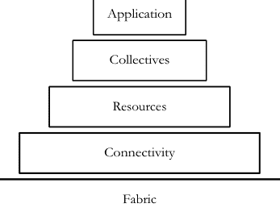

图 1.3 网格层架构。

## 1.2.2.2 网格架构类型

不同类型的网格架构旨在解决不同的问题和计算需求。某些网格旨在利用改进的处理资源，而另一些旨在支持不同资源之间的协作。根据其执行的功能，网格架构可以分为三类：信息网格、资源网格和服务网格 [9, 11]。

信息网格收集、组织并交付各种信息。例如，全球信息能力（GIG）被定义为全球互联的端到端信息能力，能够根据需求为战斗人员、决策制定者和支持人员提供收集、处理、传播和管理信息 [12]。信息网格中的可用信息被认为是易于使用的。

资源网格协调并提供对网格中任何资源（如计算能力、数据库或信息库、通信带宽和存储）的高效且透明的访问，无论这些资源位于何处。网格架构进一步分为两类：计算网格和数据网格 [9, 11]。

计算网格聚合来自分布式处理节点的集合处理能力，为网格计算平台提供统一的处理能力。计算网格使用空闲 CPU 集群构建，聚合可用计算能力，并在需要时随时提供对资源的即时访问。计算网格的其他特征还包括自动部署、拓扑解析、位置韧性、容错性、维护检查点状态、提供网格矩阵、可插性以及数据网格集成 [11]。SEHome 是计算网格的一个著名示例 [13]。计算网格广泛用于计算数学方程、导数、评估投资组合和性能仿真。调度和负载均衡是影响计算网格性能的两个任务 [13]。

服务网格在用户使用单一源时提供对异构数据池的访问。数据网格将数据库集群作为一个统一的虚拟数据库，称为联邦数据库 [9]。联邦数据库提供单点查询服务、建模和一致性。数据网格还连接了位于不同地点的的数据、存储和资源；遵循关于数据使用的本地和全局策略；高效地调度资源（受本地和全局限制）；并提供高速可靠的数据访问以确保数据安全 [9]。

服务网格无论其位置、开发环境和硬件规格如何，都提供服务和应用程序。服务网格还对应计算网格和数据网格，提供对库、API、SDK 和应用程序的透明访问。互联网上的服务如搜索引擎、门户、活动服务器页面（ASP）、电子邮件、文件传输和认证是服务网格执行的服务 [3]。这些服务可能由远程地理位置的服务节点执行。人们在公共资源计算（PRC）项目中通过服务网格共享他们利用率不高的 CPU 功率 [14]。在这里，PRC 项目（如 SETI@home）在一年内（从 2001 年 7 月开始）积累了 2.21 亿个工作单元，该期间的平均吞吐量为 27.36 TFLOPS [3]。

## 1.2.2.3 拓扑

网格架构基于不同的节点拓扑结构。常见的网格拓扑有扩展网格（extragrid）和网间网格（intergrid） [9]。三者中最简单的是内部网格（intratog），它由单个组织内的一组基础计算机（节点）和服务组成。网格设计的复杂性与网格旨在支持的组织内实体数量成正比取决于参与实体的地理位置和限制。加入网格的实体越多，确保安全和提供服务的需求就越复杂，资源的可用性就越低，典型的内部网格拓扑的性能也越低，因为它局限于单个组织内，提供同一组织内的基础网格服务。在这里，节点通过共享公共域进行管理和控制，并在私有网络上进行数据交互。网间网格提供了一个相对静态的计算资源集，网格资源之间可以轻松共享数据。扩展网格适用于那些希望在组织内部处理任务，并在组织内部安全环境中共享数据和资源的组织，在这些组织与外部实体之间没有任何交互 [9]。

扩展网格通过连接两个或多个内部网格来构建，其中通常有多个服务提供者，他们根据组织策略施加并确保安全性。因此，这些多功能策略导致了管理、行政和安全复杂性的增加。扩展网格具有广域网（WAN）连接，资源比内部网格更具动态性，网格对节点/资源故障需要更高的响应速度。一种选择是在内部和外部节点之间进行负载均衡，特别是在节点失败的情况下 [9]。

网间网格连接多个组织、多个合作伙伴和多个集群；它基本上是网格的网格。它是基于与合作伙伴、客户以及任何其他授权组织的应用程序、资源和服务的动态集成，以便通过内部网/广域网访问网格及其资源。在网间网格中，数据是全球且公开的，应用程序（包括纵向和横向的）必须为全球合作伙伴开发，以便任何人都可以加入并获得授权使用网格 [9]。

## 1.2.2.4 视角

可以从不同的视角来看网格：用户、管理员和开发者如 1.2.2.2 节中所解释的 [9]。

计算模型。GEON 正在开发一套软件服务，能够响应以用户视角表达的用户请求，例如：

- 对于给定的区域（即经纬度范围，加深度），使用 10 公里的单元格大小返回一个 3D 模型，并附带密度、地震波速、地球化学和地质年龄等物理参数 [12, 15]。

为了响应此类请求，整合多种多维数据需要一个通用框架。GEON 正在开发 OpenEarth 框架（OEF）以促进这种集成。

## 1.2.3 云计算

云计算是一种新兴的高性能计算（HPC）范式，提供硬件基础设施、计算机、软件应用程序和数据服务，所有这些通常按需付费。然而，由于其进步，云计算正在不断演进，人们对其认知不同。Gartner [16] 指出云计算是通过互联网提供服务的方法，它通过不同的模型和抽象层将计算带来互联网。Armbrust [17] 将云计算视为一种环境，既包括通过互联网服务交付的应用程序，也提供这些服务的数据中心硬件和软件。云计算的这些特性（包括软件应用程序和硬件基础设施）是从有环境转移到第三方数据中心，并可以通过互联网访问。Buyya [18] 将云视为由一组相互连接和虚拟化的计算机组成的分布式系统。参与的计算机根据服务水平协议（SLA）动态配置为一个或多个计算资源。SLA 也称为 QoS 要求，是客户与云提供商之间的协议。SLA 规定了所提供服务的规范、条款和条件、各方约定的指标以及违反协议的惩罚。

美国国立标准与技术研究院（NIST）对云计算的定义如下：

一种能够实现无处不在、便利且按需访问共享可配置计算资源池（例如网络、服务器、应用程序和服务）的模型，这些资源可以以最少的管理工作或与服务提供者的交互进行快速配置和释放 [19]。

NIST 在其云模型 [19] 中识别了五项基本特征，列如下：

- 1. 按需服务：用户可以根据需要访问和选择计算资源（例如服务器时间、存储、数据）。无需与服务提供商（SP）资源交互或扩展/缩小资源利用率。

- 2. 广网访问：资源可以通过互联网可用，并可以使用标准机制通过异构客户端平台（例如 PC、手机手机、平板电脑和工作站）访问。云客户端可以是厚客户端或轻客户端。

- 3. 资源池：STP 的计算资源（存储、处理、内存和网络带宽）被池化，根据用户需求使用多租户模型为多个用户服务并进行动态分配。

- 4. 快速弹性：可用资源似乎是无限的，可以根据用户需要在任何时间分配任何数量，以便扩展或缩小系统。

- 5. 量化服务：云资源的使用可以对提供者和用户进行透明的监控、控制和报告。云平台自动计算并共享按需付费的使用情况及其成本。

# 分布式与并行计算

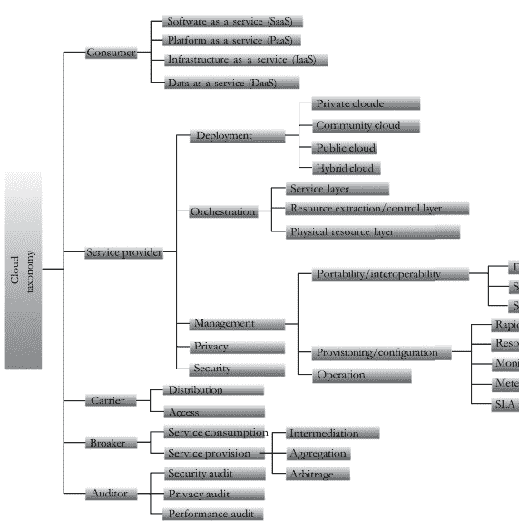

图 1.4 云分类。

## 1.2.3.1 分类法

下面展示了一个四级分类法 [20]，用于描述云计算的核心概念：

- **第 1 级（角色）：** 云计算中相关参与者视为的一系列义务和行为

- **第 2 级（活动）：** 与每个特定角色相关的通用行为/任务

- **第 3 级（组件）：** 为特定活动必须执行的具体过程、操作或任务

- **第 4 级（子组件）：** 每个组件的模块化细节

云计算分类法不同层级 [20] 中的组件如图 1.4 所示。

## 1.2.3.2 云服务模型

**软件即服务 (SaaS)** 为用户提供在云平台上运行应用程序的资源 [19]。用户可以使用轻客户端接口（如 Web 浏览器，例如基于 Web 的电子邮件）或使用所需应用程序的界面来访问应用程序。用户对底层云基础设施（即网络、服务器、操作系统、存储或单个应用程序功能）没有或非常有限（例如应用程序设置）控制 [19]。SaaS 的示例包括电子邮件、客户关系管理（CRM）和企业资源计划（ERP）。

**平台即服务 (PaaS)** 为用户提供在云上部署应用程序的资源。应用程序应使用云提供商支持的编程语言和工具进行开发 [19]。用户对其部署的应用程序以及可能的应用程序托管环境配置拥有控制权 [19]，但无法管理云基础设施。PaaS 的示例包括数据库开发和测试、商业智能、应用程序部署和应用程序版本控制。

**基础设施即服务 (IaaS)** 为用户提供作为处理、存储、网络和其他基础计算资源的资源，用户可以在其中部署和运行操作系统以及应用程序软件 [19]。用户对云基础设施的管理或控制没有权限，但对操作系统、存储、已部署应用程序具有控制权，并可能对网络组件的选择（例如防火墙）具有有限控制权 [19]。IaaS 的示例包括备份和恢复、服务管理和存储。

**数据即服务 (DaaS)** 是云环境中可用的一种特殊服务，数据在其数据中心被收集、存储、提供和管理 [20]。然而，用户对云环境的控制是有限的。DaaS 是一种集中控制的模型，确保数据一致性。

## 1.2.3.3 云部署模型

云有四种部署模型：私有云、社区云、公共云和混合云 [19]，定义如下：

- 1. 私有云：云基础设施仅供一个组织运营。该基础设施可能由组织或第三方管理，并可能位于组织内部或外部。

- 2. 社区云：云基础设施由多个组织共享，支持具有共同关注点（例如任务、安全需求和策略）的特定社区。它可能由组织、第三方或双方管理，并可以位于任何地方。

- 3. 公共云：云基础设施向大众或大型行业开放，由提供服务的组织拥有。

- 4. 混合云：它是上述两个或多个模型（私有、社区或公共）的组合，每个模型可以是独立的实体，连接使得数据和应用程序具有互操作性（例如云间负载均衡的云突发）。互操作性通过标准化技术来确保。

### 1.2.3.3.1 云 API

云提供者为云计算解决方案提供的的一种人的特性是云 API。API 是构建云计算解决方案的主要机制，目前有四个不同层级的基本云 API 类 [21]。

### 1.2.3.3.2 云 API 的层级

云 API 的四个层级 [21] 中的每一层都要求开发者关注不同的任务和数据结构：

- 层 1（头部）：开发者直接编写请求的线缆格式（消息、32 位字、头部、前两个字）的代码。对于基于表示状态转移（REST）的服务，开发者创建适当的 HTTP 头部，创建数据负载并打开 HTTP 连接。对于基于简单对象访问协议（SOAP）的服务，开发者创建 SOAP 包，添加适当的 SOAP 头部，并在 SOAP 包体中填充数据负载。

- 层 2（特定语言工具包）：开发者在此层级使用特定语言的工具包来处理 SOAP 或 REST 请求。工具包有助于管理请求-响应之间的

# 分布式与并行计算

其他开发者仍然专注于在网络上传输的数据的格式和结构。

- 第 3 级（特定服务的工具包）：为了与特定服务交互，开发者使用更高级的工具包，他们能够关注业务对象和过程，而无需过度关注总线协议、结构和格式。

- 第 4 级（服务中性工具包）：开发者使用通用接口来连接多个云服务提供商。与第 3 级不同，在该层级工作的开发者可以免受特定服务问题复杂性的困扰。使用服务中性工具包开发的应用程序应该能够在极少修改代码的情况下使用不同的云服务提供商（CSP）。该工具包处理头部、消息结构、通信以及协议。

## 1.2.3.3.3 API 的分类

云 API 的五类分类如下所示 [21]：

- 1 普通编程：在此类中，没有专门为任何特定云开发的 API。这些 API 通常用 C#、PHP 和 Java 编写。它们可以用于任何支持这些语言的云环境。

- 2 部署：使用云特定的特定的封装技术（如 .Net 程序集）将应用程序部署到云端的 API。

- 3 云服务：云服务可以提供特定的或中性的服务。这些 API 被分为云存储服务、云数据库、消息队列和其他云服务的子类。在每个子类中，API 仅专门用于被分配的任务。

- 4 镜像和基础设施管理：用于镜像的 API 用于上传、部署、启动、停止、重启和删除镜像；而基础设施管理 API 则用于控制细节，例如防火墙、节点管理、网络管理和负载均衡任务。

- 5 内部接口：这些是用于通过云基础设施中不同部分之间的接口，来更改云架构中存储层供应商的 API。

## 1.2.3.4 云端上的地理空间大数据项目

Google 在其自有云上管理 Google Maps 应用 [22]。Google Bigquery 作为 Google 的的一项商业云服务，也为其地图项目部署了查询，该项目本身就是一个地理空间大数据项目。

## 1.3 并行计算

编写计算机程序的传统方法是单体式的。也就是说，软件是为串行计算编写的，一次执行一条指令。为了在具有单个 CPU 的单机上运行程序，根据需要将程序分解为许多单指令，然后逐个执行。但在并行计算中，同时使用多个计算机来处理提交的任务。为了实现并行运行，作业被分解为若干任务，使得每个任务可以在不同的进程上独立且并发运行。并行计算平台可以是一个带有多个处理器的单机，是通过网络连接的多台计算机，或者是两者的结合 [23]。因此，程序必须是可并行的（可分解为独立任务）并能够并行执行。也就是说，作业应该能够被分为离散的任务块，并可以同时执行，且耗时比单机所需的时间短。并行计算相对于串行计算的主要优势是高效计算和解决复杂问题。

# 大数据

| | 单数据 | 多数据 |
|---|---|---|
| 单指令 | SISD 单指令，单数据 | SIMD 单指令，多数据 |
| 多指令 | MISD 多指令，单数据 | MIMD 多指令，多数据 |

**图 1.5** 莱飞的并行计算分类法。

## 1.3.1 并行计算的分类

并行计算最广泛的分类之一被称为莱飞分类法（Flynn's taxonomy）[24]。莱飞分类法根据两个独立的维度来区分多处理器计算机架构：`指令`和`数据`。这两个维度每个都只有两种可能的状态之一：`单路`或`多路`。莱飞分类法 [24] 如图 1.5 所示。

*单指令单数据 (SISD)：* 这是一种串行计算机，在 CPU 的任何一个周期内只能运行一条指令。同样，在任何周期内只能有一个数据流。莱飞分类法 [24] 如图 1.5 所示。SISD 这种类型是主机、工作站和现代 PC，在任何周期内只执行一条指令。


*单指令多数据 (SIMD)*：这是一种并行计算机，在任何一个周期内，所有处理器执行相同的指令，但处理不同的数据。`SIMD` 这种方法是同步的，且执行是确定性的 [24]。

*多指令单数据 (MISD)*：这是一种并行计算机，在任何一个周期内，每个处理器执行不同的指令，但处理同一个数据流。`MISD` 起于卡梅隆大学 [25]。

*多指令多数据 (MIMD)*：这是一种并行计算机，每个处理器可以执行不同的指令，并处理不同的数据流。`MIMD` 的执行可以是同步或异步、确定性或非确定性的。`MIMD` 是最常见的类型，大多数现代超级计算机都是基于此的。

## 1.3.2 共享内存并行处理

共享内存系统多种多样，但通常允许所有处理器访问所有内存。多个处理器独立运行，但共享内存资源。在共享内存中，一个处理器修改的位置对所有处理器都是可见的。共享内存根据访问时间分为两大类：均匀内存访问 (`UMA`) 和非均匀内存访问 (`NUMA`) [26]。

`UMA` 常见于对称多处理器 (`SMP`)，处理器是相同的，且访问内存的时间相等。`UMA` 也称为缓存一致 `UMA` (`CC-UMA`)，当一个处理器更新共享内存的位置时，所有其他处理器都会通知。缓存一致性在硬件层面维护。

`NUMA` 机器通过物理连接多个 `SMP` 构建，一个 `SMP` 可以访问另一个 `SMP` 的内存。与 `UMA` 不同，并非所有处理器访问内存的时间都相等。跨链接内存访问比本地内存访问慢。在缓存一致性的情况下，它也可能是缓存一致 `NUMA` (`CC-NUMA`) [26]。

## 1.3.3 分布式内存并行处理

分布式内存系统多种多样，但有一个共同点，即它们需要通信网络来连接处理器。分布式内存系统中的处理器拥有自己的本地内存。一个处理器的内存地址不会映射到另一个处理器，因此不存在全局空间的概念。由于每个处理器都有本地内存，它们独立运行，对本地内存的修改对其他处理器的内存没有影响。在这种情况下，缓存一致性并不适用。当处理器需要访问另一个处理器的数据时，程序员需要显式定义如何以及何时通信数据。同步也是程序员的责任。用于数据传输的网络织构各异，但可以是简单的以太网 [26]。

# 1.4 大数据

在超计算设计架构中，具有大量处理器的系统通常以两种方式排列：网格（`grid`）和集群（`cluster`）[27]。此外，一组多核处理器，被称为大规模并行处理器（`MPP`）架构，是处理器排列的另一种处理方法。

## 1.4.1 全球超计算世界

根据最新的官方记录（2023年11月），根据 `Top500` 列表，全球超计算系统和性能份额如图 1.6 所示。它显示，与其他国家相比，美国拥有 32.2% 的份额和 53% 的性能份额 [30]。

全球最新的前10强超级计算机规格见表 1.1。`TOP500` 列表中排名第一的是安装在美田纳西州橡树克里奇实验室（`ORNL`）的 `Frontier`。该系统是 `HPE Cray X`，拥有 8,699,904 个核心，峰值性能为 1,194 Exflops [29]。排名第二的是安装在美伊利诺伊州阿贡纳领导计算设施的 `Aurora`。这是一个基于 `HPE Cray X` 的 `Intel` 系统，拥有 7,442,808 个核心，峰值性能为 1059.33 Pflops [29]。第三名是微软 `Azure` 云提供的 `Eagle`。这是一个 `NDV5` 系统，拥有 1,123,200 个核心，峰值性能为 846.84 Pflops [29]。

### 各国系统份额

- 美国
- 中国
- 德国
- 日本
- 法国
- 英国
- 意大利
- 韩国
- 加拿大
- 其他

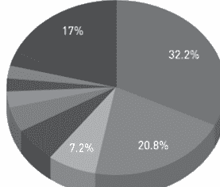

(a)

### 各国性能份额

- 美国
- 中国
- 德国
- 日本
- 法国
- 英国
- 意大利
- 韩国
- 加拿大
- 其他

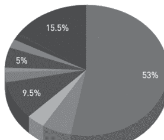

(b)

图 1.6 截至2023年11月的全球超计算系统和性能份额。(a) 系统份额和 (b) 性能份额 [30]。

## 1.4.2 趋势

当今许多超级计算机都使用了 `Intel`、`AMD` 和 `IBM` 处理器。截至2023年11月，世界前10强超级计算机中（见表 1.1），`Aurora`、`Eagle`、`Leonardo`、`Marenostore 5 ACC` 和 `EOS NVIDIA DGX SuperPod` 分别基于 `Intel Xeon` 处理器，`Frontier` 和 `LUMI` 基于 `AMD` 处理器，而 `Summit` 和 `Sierra` 则基于 `IBM` 处理器。在截至2023年11月的全球超级计算机提供商中，拥有20个市场的联想是顶级供应商 [31]。

截至2023年11月，世界上最节能的超级计算机是 `Institut d'Henri Henri` 系统，其能效为 65.40 PFLOPS/Watt [31]。能效排名第二的超级计算机是 `Frontier & Development` 系统，其能效为 19.2 PFLOPS/62.68 GFLOPS/Watt；法国的 `Adastra` 系统其能效为 46.1 PFLOPS/58.02 GFLOPS/Watt，是第三最节能的超级计算机。

截至2023年11月，安装超级计算机数量最多的国家是美国（16台）和中国（10台）[31]。截至2023年11月，全球安装超级计算机数量领先的国家是北美（17台）、亚洲（14台）和欧洲（13台）[31]。

## 1.4.3 未来超级计算机研究

随着计算机硬件、软件、并行以及分布式计算的进步，以下研究有助于解决挑战 [32]：

- 解决内存墙：增加内存带宽
- 节点间互连：增加带宽并降低延迟的新的拓扑
- 光学计算：利用量子现象
- 量子计算：利用量子计算的算法
- 并行语言：用于并行计算的方法
- 算法研究：利用变化的超级计算机硬件特性的算法

## 1.4.4 超级计算机地理数据项目

地震模拟是超级计算机的大型数据项目之一。圣地亚超级计算中心（`SDSC`）提供了 `HPC` 和科学可视化专业知识，而加利福尼亚大学地震中心（`CEC`）是该项目的首席协调者。圣地亚州立大学也参与了该项目 [33]。

## 表 1.2 XSDE 资源与合作伙伴

| 资源名称 | 站点 | 制造商/平台 | 类型 | 峰值算力 (Teraflops) | 磁盘大小 (TB) | 可用性 |
| :--- | :--- | :--- | :--- | :--- | :--- | :--- |
| `Wispy` | 普渡大学 | `HP DL140g3` | 集群 | 0.0 | 0.0 | 生产至2013年7月31日 |
| `GordonION` | `SDSC` | `Cray XC` | 集群 | 0.0 | 4000.0 | 生产至2015年3月1日 |
| `Kraken-XT5` | `NICS` | `Cray XT5` | `MPP` | 1174.0 | 2400.0 | 生产至2014年4月1日 |
| `Mason` | 印第安纳大学 | `HP DL580` | 集群 | 0.0 | 0.0 | 生产至2014年3月31日 |
| `Lonestar4` | `TACC` | `Dell PowerEdge Hemisphere` 集群 | 集群 | 302.0 | 1000.0 | 生产至2014年1月31日 |
| `Keelenand-K` | 乔治亚大学 | `HP` 和 `NVIDIA KIDS` | 集群 | 0.0 | 0.0 | 生产至2014年8月31日 |
| `Steele` | 普渡大学 | `Dell 1950` 集群 | 集群 | 66.5 | 130.0 | 生产至2013年7月31日 |
| `Trestles` | `SDSC` | `Cray` | 集群 | 100.0 | 140.0 | 生产至2014年6月30日 |
| `Quarry` | 印第安纳大学 | `Dell AMD` | `SMP` | 0.0 | 335.0 | 生产至2016年6月30日 |
| `Stampede` | 德克萨斯大学奥斯汀分校 | 带有 `Intel Xeon Phi` 协处理器的 `Dell PowerEdge C8220` 集群 | 集群 | 6000.0 | 14336.0 | 生产 |
| `Blacklight` | `PSC` | `SGI UV100 cc-NUMA` | `SMP` | 36.0 | 150.0 | 生产至2013年6月30日 |
| `Keeneland` | 乔治亚大学 | `HP` 和 `NVIDIA` | 集群 | 615.0 | 0.0 | 生产至2014年8月31日 |

来源：https://www.xsde.org/resources/overview; `XSDE`, 2013, https://www.xsde.org/

- **扩展的协作支持**：与个人研究小组或研究社区的协作。
- **先进的硬件和软件架构**：个性化的用户体验、一致且持久的软件接口、改进的数据管理，以及 `XSDE` 基础设施内复杂系统的透明集成。
- **用户门户网站**：用于监控和访问 `XSDE` 资源、管理这些资源上的作业、报告和分析结果的 `Web` 接口。
- **协调分配**：`NSF` 的高端资源和数字服务。
- **强大且广泛的网络**：`XSDE SP` 以 10 Gbps 的速度连接到位于芝加哥的枢纽，并与另一个研究教育网络有第二个 10 Gbps 的连接。
- **专业化社区**：提供服务以满足特定功能并允许快速的创新和实验。
- **先进的网络安全**：为用户提供 `XSDE` 资源和服务既易于访问又安全。
- **培训与教育**：基于 `XSDE` 的项目、课程开发以及更多培训机会。
- **高级支持**：特别针对新颖和创新的项目。
- **奖学金计划**：让学术界与 `XSDE SPS` 的高级用户支持人员进行紧密合作。

技术导入服务：允许研究人员推荐将其纳入 `XSEDE` 基础设施的技术，并使 `XSEDE` 团队能够评估并整合这些技术。

## 1.5.3 XSEDE 上的地理空间数据项目示例

`XSEDE` 的风暴交互建模是一项地理空间大数据项目。该项目侧重于基于 1970 年以来收集的气象数据进行实时预测（特别是风暴预测）[34]。

## 1.6 选择合适的计算环境

对于给定问题，选择合适的计算平台和资源以获得成本效益且性能权衡良好的解决方案至关重要。用户在为特定问题选择合适的计算平台时，应考虑以下几个因素。以下列出了在考虑用户需求时选择合适计算环境的某些因素 [35]。并非所有因素都适用于每个用户的需求。此外，并非所有因素都可能与每个计算环境相关。

- 业务级目标
- 提供者和消费者的责任
- 业务连续性与灾难恢复
- 系统冗余
- 维护
- 数据位置
- 数据扣收
- 提供者故障
- 司法辖权
- 安全
- 数据加密
- 隐私
- 硬件擦除与破坏
- 监管合规
- 透明度
- 认证
- 关键性能指标的术语
- 监控
- 可审计性
- 人机交互
- 指标
- 吞吐量——获取输入后的响应时间
- 可靠性——服务可用性/可用频率
- 负载均衡——弹性触发
- 持久性——数据存在时间
- 弹性——给定资源无限扩展的能力
- 线性——负载缩放时的系统性能
- 敏捷性——负载缩放时提供者的响应时间
- 自动化——人工交互程度
- 客户服务响应时间——提供者对用户请求的响应时间

# 分布式与并行计算

## 表 1.7 集群、网格、云与超级计算机的对比：提供者视角

| 集群 (`Cluster`) | 网格 (`Grid`) | 云 (`Cloud`) | 超级计算机 (`Supercomputer`) |
| :--- | :--- | :--- | :--- |
| 按需自服务服务 | 否 | 否 | 是 | 否 |
| 广域网络访问 | 是 | 是 | 是 | 是 |
| 资源池 | 是 | 是 | 是 | 否 |
| 快速弹性 | 否 | 否 | 是 | 否 |
| 可计量服务 | 否 | 是 | 是 | 是 |
| 维护 | 是 | 是 | 否 | 否 |
| 异构性 | 否 | 有限 | 是 | 是 |
| 安全性 | 是 | 差 | 差 | 是 |
| 容错性 | 否 | 有限 | 差 | 是 |
| 隐私性 | 是 | 有限 | 是 | 是 |
| 审计性 | 是 | 是 | 是 | 是 |
| 用户控制 | 是 | 有限 | 否 | 否 |
| 线性 | 差 | 中等 | 高 | `SLA` |
| 敏捷性 | 最低 | 中等 | 最大 | 瞬时 |
| 吞吐量 | 低 | 中等 | 较高 | 最高 |
| 学习曲线 | 高 | 中 | 中 | 高 |
| `SLA` 管理 | 较简单 | 简单 | 困难 | 困难 |
| 成本 | 小 | 中等 | 大 | 最大 |
| 性能 | 低 | 中等 | 高 | 最佳 |

分散的。与其他计算机相比，集群中的计算机是紧耦合的，而在网格中它们是松耦合的。此外，集群通常由相似的计算机配置，而云和网格则由异构组件配置。

超级计算机用于通过大规模并行处理器架构解决数据密集型和计算密集型问题。在某些环境中，超级计算机与网格和集群协同工作。`XSDE` 提供了一个平台，必要时可以通过合作伙伴超级计算机使用多台超级计算机。然而，从成本和性能的关键来看，选择一个解决问题的环境是困难的。这些高性能计算（`HPC`）平台的组合可能有助于人们及时解决计算密集型和数据密集型（大数据）问题。

## 参考文献

1. `Hwang, K.`、`Fox, G.C.` 和 `Dongarra, J.J.` Distributed and Cloud Computing: From Parallel Processing to the Internet of Things. Amsterdam, the Netherlands; Morgan Kaufmann, 2012.
2. `Bakery, M.` 和 `Buyuyaz, R.` Cluster computing at a glance. High Performance Cluster Clustering: Architecture and System. Upper Saddle River, NJ: Prentice-Hall, 1999, pp. 3–47.
3. `El-Rewini, H.` 和 `Abd-El-Ba, R.` Message passing interface (`MPI`). Advanced Computer Architecture and Parallel Processing. Hoboken, NJ: John Wiley, 2005, pp. 205–233.


- 4. High-performance computing. Enhancing high-performance computing clusters with parallel file systems, 2013. http://www.dell.com/downloads/global/power/psq25-0040179-Saity-OE.pdf, (Retrieved October 6, 2013).

- 5. Geist, A. PVM: Virtual Machine: A Users’ Guide and Tutorial for Networked Parallel Computing. Cambridge, MA; the MIT Press, 1994.

- 6. Dean, J. and Ghwatwat, MapReduce: Simplified data processing on large clusters. Communications of the ACM, 2008, 51(1): 107–113.

- 7. Erasani, P. et al. Client failure fencing for fencing network file system in a host-cluster environment. IBM's U.Patent No. 7,653,682. January 26, 2010.

- 8. GlobalPost. IBM's 'Sequoia' supercomputer named world's fastest, 2013. http://www.globalpost.com/dispatch/news/business/technology/120618/ibm-sequoia-super-computers-fastest (Retrieved May 30, 2013).

- 9. Ferreira, L. et al. Introduction to Grid Computing with Globus. San Jose, CA: IBM Corporation, International Technical Support Organization, 2003.

- 10. Prabhu, C.S.R. Grid and cluster computing. Pn Learning Pvt. Ltd., 2008.

- 11. Mahajan, J. and Shah, S. Distributed Computing. Delhi, India: Oxford University Press, 2010.

- 12. GEON, 2013. http://www.geon.org/index.php/patlof (Retrieved May 30, 2013).

- 13. SETIhome: What is SETIhome? 2013. http://setihome.le.berkeley.edu/ (Retrieved October 6, 2013).

- 14. Anderson, J. M., Cobb, S., Koper, R., and Welther, D. SETIhome: An experiment in public-resource computing. Communications of the ACM, 2002, 45:56-61.

- 15. GEON. Open framework research, 2013. http://www.geon.org/index.php/projects/of (Retrieved May 30, 2013).

- 16. Gartner. Special cloud group, 2013. http://www.gartner.com/technology/research/cloud-computing/report (Retrieved May 30, 2013).

- 17. Erasani, P. Client failure fencing for fencing network file system in a host-cluster environment. IBM's U.Patent No. 7,653,682. January 26, 2010.

- 18. GlobalPost. IBM's 'Sequoia' supercomputer named world's fastest, 2013. http://www.globalpost.com/dispatch/news/business/technology/120618/ibm-sequoia-super-computers-fastest (Retrieved May 30, 2013).

- 19. Ferreira, L. et al. Introduction to Grid Computing with Globus. San Jose, CA: IBM Corporation, International Technical Support Organization, 2003.

- 20. Prabhu, C.S.R. Grid and cluster computing. Pn Learning Pvt. Ltd., 2008.

- 21. Mahajan, J. and Shah, S. Distributed Computing. Delhi, India: Oxford University Press, 2010.

- 22. GEON, 2013. http://www.geon.org/index.php/patlof (Retrieved May 30, 2013).

- 23. SETIhome: What is SETIhome? 2013. http://setihome.le.berkeley.edu/ (Retrieved October 6, 2013).

- 24. Anderson, J. M., Cobb, S., Koper, R., and Welther, D. SETIhome: An experiment in public-resource computing. Communications of the ACM, 2002, 45:56-61.

- 25. GEON. Open framework research, 2013. http://www.geon.org/index.php/projects/of (Retrieved May 30, 2013).

- 26. Gartner. Special cloud group, 2013. http://www.gartner.com/technology/research/cloud-computing/report (Retrieved May 30, 2013).

- 27. Erasani, P. et al. Client failure fencing for fencing network file system in a host-cluster environment. IBM's U.Patent No. 7,653,682. January 26, 2010.

- 28. GlobalPost. IBM's 'Sequoia' supercomputer named world's fastest, 2013. http://www.globalpost.com/dispatch/news/business/technology/120618/ibm-sequoia-super-computers-fastest (Retrieved May 30, 2013).

- 29. Ferreira, L. et al. Introduction to Grid Computing with Globus. San Jose, CA: IBM Corporation, International Technical Support Organization, 2003.

- 30. Prabhu, C.S.R. Grid and cluster computing. Pn Learning Pvt. Ltd., 2008.

- 31. Mahajan, J. and Shah, S. Distributed Computing. Delhi, India: Oxford University Press, 2010.

- 32. GEON, 2013. http://www.geon.org/index.php/patlof (Retrieved May 30, 2013).

- 33. SETIhome: What is SETIhome? 2013. http://setihome.le.berkeley.edu/ (Retrieved October 6, 2013).

## 22 大数据

## GEOSS 清洁中心集成全球观测的地空间资源

## 2.1 引言

为了更好地理解、记录和预测与人类生活相关的现象，科学家在几百年前就开始收集地球数据。在过去一个世纪里，用于处理信息的数字计算机、卫星的发射以及遥感技术的演进，极大地提高了我们观测地球各种参数的能力，每天达到太字节或拍字节级。这些观测数据对于地球科学的各个领域具有巨大的价值，因为它们提供了特定快照的数据。它们可以用于不同的应用和科学研究，例如构建数字地球、应急响应以及影响政策制定。由于对这些观测数据集及其更广泛传播的需求，政府间地球观测小组（GEO）应建立，以构建这样一个系统，帮助管理、集成、访问和共享地球观测（EO）数据集，以解决全球和区域问题。

这种信息爆炸和不断的使用对数据的更好管理和访问带来了技术挑战。GEO 的范围非常广泛，它关注与全球社区共享地球科学资源。作为第一步，GEO 通过开发地理基础设施（GCI; GEO 2009）（见图 2.1）来识别问题、解决方案并列出应用，该设施作为一个框架，有助于集成 EO 发现、评估和利用以及模型。图 2.1 显示了 GCI 的技术视图，包含三个组件：资源存储库、资源和应用程序。存储库是 GEOSS 清洁中心（CLH），所有元数据都位于维护着资源；这些资源是分布在互联网上的地球遥感（EO）数据、模型或服务；应用是面向领域用户的系统、工具或模块，而服务组件是可以从存储库中发现的在线资源。CLH 与资源之间、CLH 与应用之间应实现互操作性。该架构涵盖了地球遥感的生命周期，从数据获取、管理、应用，到来自应用和决策用户的反馈及决策支持。

面对构建此类 CLH 面临的技术挑战，GEO 在不同机构之间组织了一场竞赛，以展示他们解决这些挑战的最优方案。作为候选之一，智能空间计算联合中心（CSC）基于开源软件 GeoNetwork（Thielker and Hielema 2007; Thielker 2008; Osgeo 2009）开发了 CLH，并选为支持 GEOSS 的官方 CLH（GEO 2011）。

本章报告了我们对 CLH 的研发，包括文献综述（2.2 节）、挑战（2.3 节）、详细实现与功能（2.4 节）以及现状（2.5 节）。2.6 节总结了本章并讨论了未来的研究。

## 2.2 目录与数据交换中心研究综述

### 2.2.1 元数据存储库与标准化元数据

为了促进领域内海量数据的共享，开发用于访问和可视化过程的元数据，开展了各种研究项目来开发数据集和访问数据的在线链接（例如 Huang et al. 2011; Li et al. 2013）。在此过程中，元数据、数据内容和在线访问通过标准标准化，例如联邦地理数据委员会（FGDC）、国际标准组织（ISO 2007）元数据标准（Nativi and Bigagli 2009）以及通用描述、发现与集成（UDDI）。这些元数据存储在目录中，为领域用户提供搜索功能以发现所需数据集（Huang et al. 2011），解决了不同领域的数据共享问题。

### 2.2.2 基于面向服务架构和标准服务的目录与交换中心

为了跨不同系统共享元数据存储库，例如网络目录（CSW）和 Z39.50。标准化服务接口以松散的面向服务架构（SOA）用于不同的目录之间（Paul and Ghosh 2008; Yang et al. 2008）。通过接口标准化和 SOA 实现互操作，以支持领域应用（Bai and Di 2011）。

### 2.2.3 语义元数据共享与数据发现

元数据通常由特定领域用户针对特定用途采集，并在标准格式内共享以实现更广泛的使用。当它们跨领域或跨用途共享时，由于终端用户与元数据内容之间的不匹配，很难检索正确的数据（Li et al. 2008）。本体论和语义被用于捕获用户查询含义以及知识管理和利用功能中数据的潜在用途，以提高搜索性能并精炼最终结果（Zhang et al. 201b）。通过特定的质量控制，搜索结果可以进一步增强（Khaled et al. 2010），用于链式服务（Yue et al. 2007）。

这些研究通过两项主要任务为 CLH 的开发提供了见解：(1) 作为各个领域元数据的存储库；(2) 促进不同应用程序注册服务的使用。这些任务带来了许多未充分解决的技术挑战（Oppen and Dalab 1983; Nebert 2004; GEO 2009; Yang et al. 2010），包括（1) 目录的分布；(2) 元数据的异构性；(3) 海量地球遥感数据的元数据；(4) 数据集和元数据的频繁更新；(5) 相似数据的重复；(6) GEOSS 定义的元数据不匹配；(7) 执行目录和数百万条元数据搜索的可接受性能。2.3 节报告了我们对挑战的解决方案，解决方案在 2.4 和 2.5 节中详细介绍。

## 2.3 技术问题与解决方案

### 2.3.1 互操作性

自从 20 世纪 90 年代初互联网开始提供方便共享地理数据的通道，互操作性一直是地理社区的一个长期问题。由于地理数据的结构和语义异构性，提供统一的架构来共享、交换地理数据是一个普遍问题（Yang et al. 2008; Li et al. 2010）。为了解决这个问题，开放地理空间联盟（OGC）与 FGDC、GEOSS 和 ISO 等组织合作，开发了一系列用于元数据采集和访问的开放标准以推进互操作性（Khalsa et al. 2009）。2.2 标准展示了 CLH 在数据、服务和目录层面的互操作性。

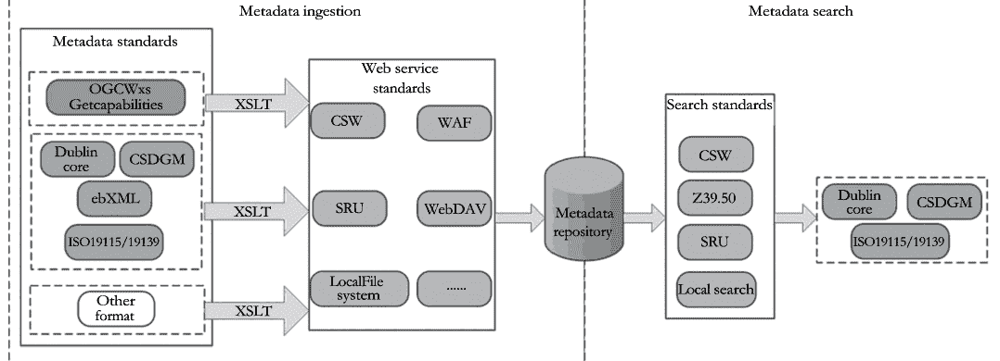

图 2.2 GEOSS CLH 的互操作性和包含性。资源作为数据和服务容器注册到 CLH 中，通过探索元数据的一致性为远程发现提供了多种方法。CLH 支持一系列用于跨系统搜索的模型和协议。这些模型包括（Nebert and Whiteside 2005）和通过 URL 检索（SRU），对于多个 CSW 目录，CLH 被授权解释目录结构并在存储库中存储获取元数据。

在我们的实现中，CLH 存储库支持三种标准元数据格式：柏林核心（DC）、FGDC 和 ISO 19115。当 CLH 提取格式时，元数据直接插入元数据存储库。对于使用 ebXML 提取的元数据，将使用扩展样式语言转换（XSLT）文件将当前元数据格式映射到所需的 ISO 19139。

CLH 支持的另一种信息检索模式是 Z39.50（NISO 2010），它是目录的重要组件。在搜索系统时，用户提供具有复杂性和实现差异的标准化查询。CLH 接收到搜索消息后，将其转换为后端存储库理解的语法。同样，基于 SRU 的发现提供了比 Z39.50 更灵活的响应模式。例如，它是基于 XML 的，并支持 HTTP GET、HTTP POST 以及作为简单对象访问协议（SOAP）的消息传输功能（Zhang and Li 2005）。凭借提供的信息检索模式的灵活性，CLH 能够与其他目录通信以地理数据搜索和互操作。

### 2.3.2 溯源与更新

数据溯源是指数据进入数据库之前的来源描述和处理过程（Buen et al. 2001）。最近，许多项目和调查检查了溯源的作用，以确保高效的信息检索、多文档摘要、问答和知识发现（Simhman et al. 2005）。然而，让科学家或公众能够以高置信度选择最合适的数据。针对这个问题，CLH 设计了存储数据溯源相关数据的结构。存储库内部连接了两个数据库（图 2.3）。一个用于活动数据发现，另一个存储由 CLH 采集的历史数据记录。一旦提取元数据 XML，就会提取字段（UUID、创建日期、修改日期、源、数据源 URI 和元数据架构），其中 UUID 作为元数据表中每条记录的关键索引。日期（创建和更改日期）以 ISO 日期格式存储在活动数据库中。

元数据的日期有不同的格式，例如 RFC8252（ARPA 文本消息格式标准；Cocker 1982）、ISO 8601（Kuhn 2004）或简单的 Java Date 对象。为了避免重复，CLH 解析并将所有日期转换为 ISO 8601 格式。当获取新的元数据文件时，会在数据库中进行基于 UUID 的查询以检查其是否存在。如果记录不存在，则将新记录直接插入元数据表；否则，数据记录的创建和修改日期相同，不执行任何操作。如果指示为更新版本，数据记录将移动到历史数据库，并在活动数据库中插入新记录。

通过这种更新机制，CLH 可以通过减少数据冗余来有效管理数据，并在溯源信息的支持下提供高效搜索。

# 28

# 大数据

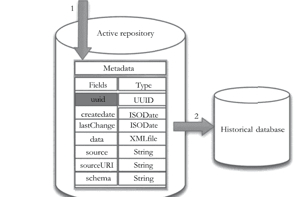

**图 2.3** GEOSS CLH 中地理空间元数据的更新与溯源。

(Li 等人 2010a, b)。此外，还有大量记录与内容相似，但文件标识符不同。为了避免重复，重复的记录在索引到 CLH 之前会被丢弃。

## 2.3.3 系统性能


# 系统性能与及时更新

系统性能对于 CLH 的运行至关重要。如果响应时间超过 3 秒，用户将感到不耐烦（Nah 2004）。保持一致的短响应时间变得至关重要，特别是当 CLH 中存储了数百万条元数据记录且数据量不断增加时。索引是一种在现有的 CLHS 中被利用的解决方案，例如由全球气候主目录（Global Climate Master Directory）提供的 CLH。然而，基于 `Lucene` 的方法会恰当地打开和关闭索引，这导致前端搜索性能较低，特别是在将数据集批量导入 CLH 时。

为了解决这个问题，CLH 采用了以下技术（Yang 等人 2005；Li 等人 2010a, b）：
1. **缓冲**：在写入一组元数据时将索引保留在 RAM 中而不是只写一条元数据；
2. **多线程**：通过多个线程并行进行索引。

同时，操作客户端搜索和索引的模块被封装在独立的线程中。一旦索引关闭，搜索线程将使用存储在硬盘上的旧索引；一旦更新完成并将新索引从 RAM 写回硬盘，搜索线程将释放，并为终端用户提供更新后的搜索结果。利用这些策略，CLH 为来自各种客户端的并发搜索提供了持续的快速响应（1–2 秒）。

## 2.3.4 及时更新

CLH 使用周期性过程进行元数据更新，每天一次。为了及时更新，节点之间连续采集之间需要一个周期性时间（单位为天、小时、分钟），如图 2.4 所示。`Active`（激活）状态显示采集引擎正在等待该节点指定的超时。当达到超时时，开始采集。`Every`（每）状态显示两次连续采集之间的时间（单位为天、小时、分钟）。结合更改日期和第 2.3.2 节中的 GEOSS Clearinghouse 更新机制，周期性采集将更新最新版本的元数据。

| 选择名称 | 类型 | 状态错误 Every | 上次运行 | 操作 |
|---|---|---|---|---|
| gcmndiso | 本地文件系统 | 0:1:30 | 2010-06-14 16:26:03 | 编辑 |
| landset_etm | 本地文件系统 | 0:1:30 | 2010-06-15 02:04:04 | 编辑 |
| wfs map | Web DAV | 7:0:30 | 2010-09-17 12:24:42 | 编辑 |
| wms waf | Web DAV | 7:0:0 | 2010-09-17 11:54:42 | 编辑 |
| onegeology | CSW/ISO | 3:0:0 | 2010-09-19 12:31:33 | 编辑 |

图 2.4 GEOSS CLH 中的及时更新。

# 2.4 CLH 的设计与实现

## 2.4.1 架构

CLH 基于开源 `GeoNetwork` 软件，这是一种基于标准的去中心化空间信息管理系统，旨在通过描述性元数据访问来自各种数据提供者的地理引用数据库和地图产品。CLH 的开发遵循 `SOA` 和空间网络门户（Spatial Web Portal）。`Java Easy Engine for Very Effective Systems (Jeeves)` 技术（Marsella 2005）被用作 Java 引擎。它允许使用 `XML` 作为内部表示并使用 `XSL` 为客户端生成 `HTML` 输出。CLH 架构（图 2.5）包含三层：`Jeeves` 层、`GeoNetwork` 层和数据库层。`Jeeves` 层将所有请求建模为带有 `XSL` 转换的 `XML`。

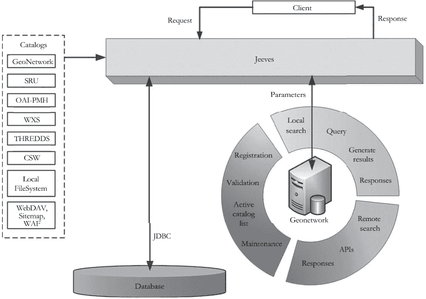

图 2.5 GEOSS CLH 架构。

`GeoNetwork` 层是核心逻辑层，提供大多数系统功能，如采集和搜索。数据库层用于存储元数据和其他信息（例如用户信息、类别和组信息）。`MySQL`、`PostgreSQL`、`Oracle` 或 `MariaDB` 均可用作 CLH 的数据库。

在图 2.5 的左侧是来自 CLH 采集的目录。采集参数（例如采集类型、目录 URL、周期性采集时间）通过 `Jeeves` 发送到 `GeoNetwork`。使用一组服务标准来获取结果并发送到 `GeoNetwork`；例如，`OGC CSW` 标准（Neibbert and Whitehouse 2005）用于 CSW 目录，`SRU` 标准（ISO 2010）用于 SRU 目录。元数据存储在数据库中，并在采集后构建索引。此外，用户可以通过 `Jeeves` 发送请求来执行额外操作，例如搜索元数据、编辑元数据和删除元数据。

## 2.4.2 管理、用户和组管理

CLH 采用用户、组和配置的概念来管理注册用户和访客用户（图 2.6）。每个组都有若干具有不同配置的用户（例如系统管理员、内容审核员、注册用户和访客），这些用户存储在数据库中。根据所有者设置，每个用户组在查看或下载系统中的元数据和交互地图方面具有数据权限。例如，如果用户已注册为编辑者，则可以使用元数据注册服务允许用户向 CLH 添加新元数据。CLH 提供了一套基于引用标准的简化模板：`ISO`、`FGDC` 和 `DC`。CLH 还提供了编辑和删除操作来更新元数据。

| 目录 1 | 目录 2 | 目录 3 |
|---|---|---|
| ...... | | |

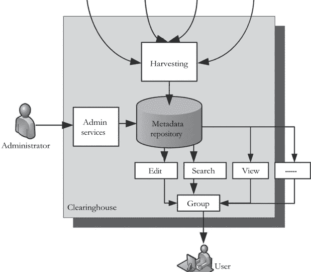

图 2.6 GEOSS CLH 的功能。

这些操作根据用户的权限量身定制。此外，CLH 提供了一个带有交互式地图的默认客户端，用于可视化 Web。

## 2.4.3 采集

CLH 使用周期性过程进行元数据更新，每天一次。为了及时更新，节点之间连续采集之间需要一个周期性时间（单位为天、小时、分钟），如图 2.4 所示。`Active` 状态显示采集引擎正在等待该节点指定的超时。当达到超时时，开始采集。`Every` 状态显示两次连续采集之间的时间。结合更改日期和第 2.3.2 节中的 GEOSS Clearinghouse 更新机制，周期性采集将更新最新版本的元数据。

采集是收集远程元数据并将其整合到本地的过程，例如，它是每周或每天设置的。如图 2.7 所示，当节点添加并启动索引时，参数将通过 `Jeeves` 传输。采集功能将根据目录类型使用。CLH 支持以下协议的采集，并截至 2013 年 4 月：

- `ISO19115`：`GeoNetwork` 实现了一个草案版本，使用元素的短名称。
- `ISO 19119` 应用于数据系列、独立数据集、单个特征和属性，如 `XML` 编码的 `WMS` 文件夹。
- `WebDAV` 静态元数据。
- `OAI-PMH`。
- `ISO SRU`。
- `GeoNetwork` 原生。


图 2.7 GEOSS CLH 的通用工作流。

CLH 的通用采集工作流如图 2.7 所示。当节点添加并启动索引时，参数将通过 `Jeeves` 传输。采集功能将根据目录类型使用。每个记录将被检索并转换为 `ISO 19119`（如果需要）。

## 2.4.4 元数据标准与转换

CLH 能够处理多种元数据模式，包括：

- `ISO 19115`：实现了一个使用元素短名称的版本，以及 `19139` 服务规范。
- `DC` 元素被使用并基于一组能够描述任何元数据的元素。
- `FGDC` 空间元数据标准（FGDC n.d.）。

这些标准定义了如何描述地理信息及其服务，并提供了强制性和条件元数据章节、元数据实体和元数据元素。这些标准可以应用于数据系列、独立数据集、单个特征和属性（Zhang 等人 2010）。例如，`ISO 19115:2003` 是为数字数据设计的。其原则可以应用于多种形式地理数据，如地图、图表和文本文档以及非地理数据。

随着 `ISO 19115:2003` 地理信息标准现在成为首选通用标准，它被广泛用于将旧元数据迁移到新标准。CLH 提供导入和导出功能并拥有许多转换器。系统管理员使用 `XSLT` 安装自定义转换器是一个简单过程（OSGeo 2009）。图 2.8 展示了转换过程：(1) `XML` 响应文档，(2) 应用 `XSLT` 文件，(3) 生成 `ISO 1939 XML`。

## 2.4.5 用户界面与编程 API

### 2.4.5.1 通过 Web 图形界面搜索

CLH 使用 `Lucene` 进行索引和搜索（Liu 等人 2011）。`Lucene` 是为应用程序添加文本索引和搜索功能的 Java 库。它提供了一个简单且强大的应用程序接口（`API`）。通过提供搜索界面，CLH 允许用户进行搜索。

# GEOSSClearinghouse

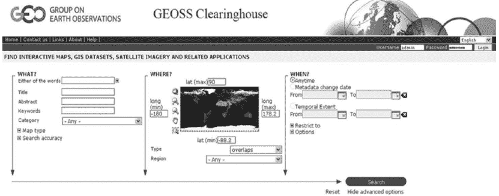

**图 2.9** GEOSS CLH 搜索界面。

根据需要获取元数据，包括内容、地点和时间（图 2.9）。`标题`、`摘要`、`自由文本` 或 `关键词` 被用于 `Lucene` 索引，它们也可以作为搜索准则。支持通过边界坐标或国家名称进行基于位置的搜索。此外，元数据的创建日期、元数据类别或颜色也可用于搜索。

### 2.4.5.2 远程搜索

除了通过 Web 图形界面（`GUI`）进行搜索外，CLH 还支持 `CSW` 接口发现和搜索地球观测（`EO`）。该接口支持四种强制性 `CSW` 请求（`GetCapabilities`、`GetRecords`、`GetRecordByID` 和 `DescribeRecord`）。例如，用户可以使用以下 `GetRecords` 请求查询 CLH 中 CSR 组件记录的总数。

```xml
<?xml version="1.0" encoding="UTF-8"?>
<csw:GetRecords xmlns="http://www.openg.net/cat/csw/2.0.2"
xmlns:csw="http://www.openg.net/cat/csw/2.0.2"
xmlns:gml="http://www.isit211.org/2005/gml"
xmlns:ogc="http://www.openg.net/ogc" xmlns:gml="http://www.openg.net/gml"
xmlns:wime="http://urn:oasis:names:tc:udb:webservices:wml:service:3.0" service="CSW" version="2.0.2"
outputFormat="application/xml" outputSchema="http://www.openg.net/cat/csw/2.0.2"
resultType="hits">
<csw:Query type="GetRecord">
<csw:ElementSet name="brief"/><csw:ElementName>
<ogc:Constraint version="1.1.0">
<ogc:Filter>
<ogc:PropertyIsLike escapeChar="&quot;" singleChar="&quot;?" wildCard="**">
<ogc:PropertyName>AnyText</ogc:PropertyName>
<ogc:Literal>crs*</ogc:Literal>
</ogc:Component>
</ogc:PropertyIsLike>
</ogc:Filter>
</cc:Constraint>
</csw:Query>
</csw:GetRecords>
```

# 大数据

搜索的响应如下：

```xml
<?xml version="1.0" encoding="UTF-8"?>
<csw:GetRecordsResponse xmlns="http://www.openg.net/cat/csw/2.0.2"
xmlns:xsi="http://www.w3.org/2001/XMLSchema-instance"
si:schemaLocation="http://www.openg.net/cat/csw/2.0.2 http://schemas.openg.net/csw/2.0/CSW-discovery.xsd">
<csw:SearchStatus timestamp="2010-05-06T13:42:06"/>
<csw:SearchResults numberOfRecordsMatched="236" numberOfRecordsReturned="0"
elementSet="0" nextRecord="1"/>
</csw:GetRecordsResponse>
```

此外，CLH 还提供了 `SRU` 搜索和 `RSS` 搜索 `API`。图 2.10 显示了获取包含 `Domain:Aerosol` 元数据的结果。

## 2.5 使用与运行状态

### 2.5.1 系统运行

CLH（图 2.11）目前托管在亚马逊弹性云计算（`EC2`）平台上，以响应来自不同地理位置的并发用户（Huang 等，2010）。我们在开发中利用新技术（例如 `AJAX` 框架）来提高用户体验。鼓励用户报告 Bug 和错误以提高系统的稳定可靠性。CLH 的改进将与 `GeoNetwork` 开源发布持续集成。

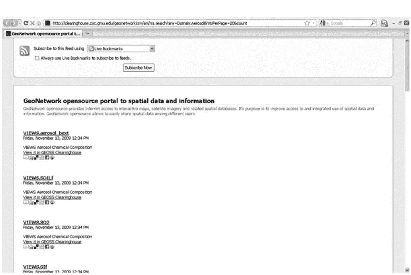

图 10 RSS 搜索结果。

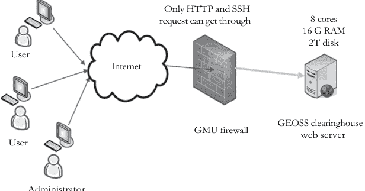

图 11 GEOSS CLH 运行系统。

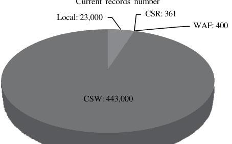

图 12 GEOSS CLH 记录。

### 2.5.2 元数据状态

截至 2013 年 4 月，CLH 托管了约 46 万条元数据，包括数据和目录元数据（图 12）。这些数据被广泛应用于空气质量、土地覆盖和水文学等领域。

### 2.5.3 使用情况

CLH 的一项运行功能是分析使用情况以改进运行，例如：
1. 在探索较少的区域推广 CLH；
2. 利用访问频率对某些区域进行部署调整；
3. 通过数据检查历史使用情况。

使用信息记录了访问次数、访问频率和用户地理区域。从 2012 年 12 月到 2012 年 10 月 31 日，CLH 接收了 202,660 次访问。访问的高度根据访问频率进行缩放（自然对数）。

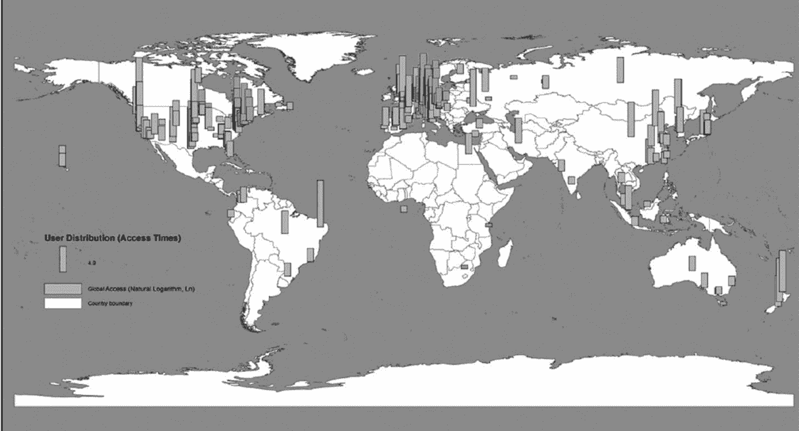

图 13 从 2010 年 12 月到 2012 年 10 月 31 日 GEOSS CLH 的使用分布。

# 美国

美国、欧洲和东亚是三个高访问地区。然而，应该在南美、亚洲和非洲人口密度最高的地区进行推广和宣传。

## 2 地空间数据挑战与解决方案

开发和运行 CLH 需要解决若干空间数据挑战，包括数据复杂度、目录分布和性能。这些挑战在下文中讨论。

### 2.6.1 数据与数据库

CLH 必须解决异构性、关系和大量元数据的挑战：

- **元数据记录数量很大**，因为许多组织每天甚至每小时都会收集、处理并发布新数据集。如何及时收集这些新资源以及如何高效管理收集到的元数据对于 CLH 来说是一个挑战。采用了自动采集（2.4.3）来应对采集挑战，并使用新的溯源和设计机制（2.3.2 和 2.3.4 节）解决更新问题。使用了良好的 `PostgreSQL` 和 `MySQL` 数据库来存储和管理大量的元数据。
- **元数据是异构的**，因为是由不同的组织或领域用户创建的以支持特定的科学领域，如气候和极地科学。这些元数据具有不同的标准、格式和版本。如何处理异构性以及支持 CLH 互操作选择的元数据标识，使用了元数据标准化和转换（2.4 节）。
- **记录之间的关系是复杂的**。元数据描述了不同科学领域的资源；每个记录都指向特定的空间资源。这些记录之间的关系复杂且未明确描述，但在数据跨领域共享时，对于将正确的数据交付给正确的用户非常重要。捕捉这些关系并有效管理它们是 CLH 的另一个挑战。语义和本体论具有解决这一挑战的潜力，并可用于优化元数据共享和发现机制（2.2.3 节）。需要进一步研究如何在元数据共享和发现中使用语义。

### 2.6.2 分布与云计算

需要考虑大数据空间分布的两个方面：
1. CLH 从遍布全球的目录中采集元数据；
2. 全球用户访问 CLH。

由于地球观测数据本质上是以分布式方式收集和发布的，在构建一个集成、管理、访问和共享全球空间数据的系统时，分布式数据是大空间数据挑战之一。CLH 定期从分布式目录中采集元数据；这种采集是一个耗时的过程，很大取决于网络连接和被采集服务器的性能。根据 Yan 等（2011）识别的空间原理，根据目录服务器的空间部署 CLH 服务器可以提高采集性能。

### 2.6.3 搜索性能与索引

大量的并发用户访问会导致 CLH 响应缓慢。随着元数据的不断增长和终端用户数量的增加，这个问题变得具有挑战性。CLH 用户访问显示强的空间模式，人口密度较高的地区（例如美国、欧洲和亚洲）拥有大量的终端用户并产生大量的访问（图 2.13）。考虑用户的分布模式和访问模式可以帮助通过在热点部署多个服务器实例（2.5 节）。为了提高搜索性能，利用了文本索引和空间索引：

- **文本索引**：每个元数据存储了关于数据的文本信息。如果没有适当索引，搜索大量文本将非常耗时。`Lucene`（2.4.5.1 节）被用于 CLH 的文本索引和搜索。`标题`、`摘要`、`自由文本` 或 `关键词` 在 `Lucene` 中索引，它们也可以作为搜索准则。
- **空间索引**：CLH 通过定义搜索的空间范围支持元数据的空间搜索。空间索引通过利用数据数据的空间关系显著提高了 CLH 的搜索性能。CLH 中元数据的空间特征使用 `PostgreSQL` 支持的 `R` 树索引。通过这两个索引，CLH 为并发搜索提供了快速响应（1-2 秒）（2.3.3 节）。

表 2.1 总结了 CLH 用于解决大挑战的技术方案。

# 表 2.1 解决大空间挑战的技术

| 技术/挑战 | 收集/管理 | 元数据异构性 | 元数据间的关系 | 用户与数据的分布 | 搜索性能 |
| :--- | :---: | :---: | :---: | :---: | :---: |
| 数据库自动采集 | X | | | | X |
| 标准化和转换 | X | | | | |
| 溯源和更新互操作性 | | X | | X | X |
| 缓冲/缓存 | | | | X | |
| 多线程 | X | | | X | X |
| 云计算 | | | | X | X |
| 时空索引 | X | | X | X | X |


| 时空原理语义/本体论 | X | X | X | | X |

GEOSS 清理节点

## 2.7 总结与未来研究

本章描述了我们对 CLH 的研发工作，旨在支持为社区服务的地理空间资源整合。为了开发这样一个运行系统，我们解决了四个技术挑战：互操作性、元数据溯源、性能和更新问题。该系统为用户提供了许多端用户功能，用于配置特定的相关标准、管理运行系统、进行搜索以及执行统计分析。

CLH 是一个不断演化的运行系统，持续不断分析、开发和集成新功能。我们目前正在扩展系统的互操作性方面，以支持更多目录、连接到门户和其他应用程序，并添加语义推理以支持跨数据、文化和社区的信息交换。全球化访问的需求启发了我们考虑通过云计算和时空索引在不同大陆部署该系统（Xia 2012）。我们还在添加基于语义推理的功能，以支持基于含义的搜索。此外，我们正在测试整体性能，通过一个内核组件使其成为支持全球地理空间社区的可靠系统，并在未来十年内将其演变为地理空间网络基础设施和地形成科学（Yang et al. 2010b）。

# 致谢

本研究工作得到了 FGDC 和 NASA 的支持。Unche A Saydathat 女士 Steve McClure 先生参与了本章。Manzhu Yu 帮助了本章。

## 注释

- 1 http://www.Earthobservations.org/
- 2 http://clearinghouse.cisc.gmu.edu/geonetwork
- 3 http://www.cmnasa.gov/
- 4 http://dublincore.org/
- 5 http://clearinghouse.cisc.gmu.edu/srv/en/csw
- 6 http://clearinghouse.cisc.gmu.edu/srv/en/portal
- 7 http://clearinghouse.cisc.gmu.edu/srv/en/rss.search
- 8 http://api.ipinfo.co/

## 参考文献

Bai, Y. and Di, L. (2011). Providing access to satellite imagery through OGC catalog service support of the Global Earth Observation System of Geosciences, 37(4), 435–443.

Bishr, Y. (1998). Overcoming the semantic and other barriers to GIS interoperability. International Journal of Geographical Information, 12(4), 299–314.

Buneman, P., Khanna, S., and Wang-Chieh, T. (2001). When and where: A characterization of data provenance. In: Bussche, J. and Vantu, Y. (Eds.), Database Theory–ICDT 2001 (Vol. 193, pp. 316–330), Berlin, Heidelberg–Springer.

Christ, E. J. (2005). Planning for the global earth observation system of communities (GEOSS), Space Policy, 2(1), 105–109.

Christ, E. J. (2008). GEOSS architecture principles and the GEOSS clearing. IEEE Systems Journal, 2(3), 333–337.

Craggle, M., Moonfield, S., F. Monfini, A., Camara, G., Gould, M., Kuhn, W. et al. (2008). Next-generation digital era: A position from the Vespucci Initiative for the Advancement of Geographic Information Science. International Journal of Spatial Data Infrastructures Research, 3, 146–167.

Crock, D. (1982). Standard for the format of ARPA Internet text messages. Retrieved from http://tools.iet.org/rfc822 (Accessed on October 1, 2013).

DCMI (The Dublin Core Metadata Initiative). (2010). Dublin Core. Retrieved from http://dublincore.org/ (Accessed on September 11, 2010).

Wei Mintiu

# 大数据

Duchossois, G. (2006). The global observation system of systems (GEOSS): An example of international cooperation. 2nd ESA/ASAI Workshop on International Cooperation for Sustainable Space Exploration (Siena) May 9–12, 2006, p. 1–29, Siena.

Evans, J. (2003). Web service (WCS), Version 1.0.0, OGC 03-065r6. OGC specifications. Retrieved from http://portal.opengis.org/files/?artifact_id=3837 (Accessed on May 17, 2013).

FGDC (The Federal Geographic Data Committee). (n.d.). Geospatial metadata. Retrieved from http://www.fgdc.org/metadata/geospatial-standards (Accessed on March 11, 2013).

GEO (Group on Earth Observations). (2005). The global observation system of systems (GEOSS) 10-year plan for earth observations, 11 pp. Retrieved from http://www.web.net/professional/publications.php?id=3837 (Accessed on July 02, 2009).

GEO. (2010). The GEOSS common infrastructure. Retrieved from http://www.Earthobservations.org/gci_gp.html (Accessed on September 11, 2010).

Goldberg, S. B., Landea, C. W., Mest-Nuñez, A., and Gray, W. M. (2001). The increase in Atlantic hurricane activity and its implications. Science, 291(5529), 474–479.

Huang, M., Duan, R., and Tian, Y. (2011). Using SOA for water discovery and retrieval. Environmental Modelling and Software, 62(1), 1309–1324.

Huang, Y., Chen, N., Li, K., and Wu, H. (2010). Cloud computing for geosciences: Deployment of GEOSS clearinghouse on Amazon. Proceedings of ACM International Conference on High Performance Systems (pp. 35–38).

International Organization for Standardization. (2010). ISO 19115 Geographic information—XML schema. Retrieved from http://www.iso.org/catalogue_detail.html (Accessed September 11, 2010).

Jacobson, M. C., Hartley, J. R., Robert, L., Held, G. (2002). Earth System: From Biochemical Cycles to Global Changes (Vol. 72).

Khaled, R., Tayeb, L., and Servigne, S. (2010). Geospatial web services diversity approach using quality assurance. Journal of Computer Information, 5(2), 28–35.

Khalsa, S., Natvi, S., and Heller, G. (2009). The GEOSS interoperability project. IEEE Transactions on Geoscience and Remote Sensing, 47(1), 80–91.

Kuh, M. (2009). A summary of ISO-19119 standard. Retrieved from http://www.cam.ac.uk/~mk25/iso.html (Accessed on February 13, 2009).

Kusda, T. and Aenbach, P. R. (1965). Earth and Thermal Diffusion in the United States. Governors, Maryland: DTIC.

Lautenberger, C. (2006). The global observation system of systems: serving society. Space Science, 22(1), 1–8.

Li, W. and Raskin, R. (2008). An enhanced spatial query for web portals. In AAAI Symposium: Semantic Knowledge Integration (pp. 47–50).

Li, W., Wang, C., and Yang, C. (2010a). An active crawler for discovering geospatial web services and their distribution—A case study of OGC web service. International Journal of Geographic Information, 24(8), 1127–1147.

Li, Z., Chen, S., M. L., Huang, Q., and Liu, K. (2013). A high performance web-based system for analyzing and visualizing spotemporal data for climate studies. In: Web and Geographic Information Systems (pp. 190–198). Berlin: Springer.

Li, Z., Yang, C., Wu, H., Li, W., and Miao, L. (2010b). An optimized framework for seamlessly integrating OGC web services. Geospatial Information, 24(5), 595–613.

Liu, K., Wang, C., Li, Z., Wu, H., Rezgui, A., et al. (2011). The GEOSS clearinghouse high performance search engine. June 24–26, 2011, Shanghai, China.

Marsella, M. (2005). Jeeves Developer's Manual. Release 1.0, 31pp. Retrieved from https://www.geocrid.si/au/wiki/phpInfoServices/GeoNetwork/jeeves.doc (Accessed on October 1, 2013).

Native, S. and Bagatti, L. (2009). A study on waiting time: How long are web services to wait for? IEEE Journal of Selected Topics in Applied Earth Observations and Remote Sensing, 2(4), 233–240.

Nebert, D. (2004). Developing spatial data infrastructures: The SDK cookbook, GDI, 2004, p. 171. Retrieved from http://www.gsdi.org/docs2004/Cookbook/cookbookV2.0.pdf (Accessed on September 06, 2010).

Nebert, D. and White, A. (2005). Catalog services. Retrieved from http://clearinghouse.cisc.gmu.edu/geonetwork

# 3 使用云计算环境处理大规模 3D 空间数据集

Ramanathan Sugumaran, Jeffrey Burnett, and Marc P. Armstrong

## 3.1 引言

### 3.1.1 大数据

大数据是一个广泛使用的术语，指的是规模已大到难以使用典型的数据库软件工具进行存储、管理、共享、分析和可视化的数据集（White, 2012）。除了 IBM (2012) 之外，大数据还涵盖四个维度：数据量、速度（实时处理）、多样性（多源）和真实性（数据准确性）。过去几十年大数据的巨大增长很大程度上是因为计算和信息技术能力的提高以及成本的下降。

地理信息在大数据的扩散中起着重要作用。据估计，经理和规划者使用的数据超过 80% 与空间或位置信息相关（Worrall, 1991）。在过去的三十年里，全球各个社区定期积累了数 PB 的 2D 和 3D 空间数据集合。大量的 2D 空间数据存档包含了航空和卫星图像示例。例如，美国地质调查局（USGS）近期宣布了一项涵盖 37 年的全球卫星图像记录（PB级），这些图像持续记录了地球表面状况。这项图像资源现在每天免费提供（Vaisal et al., 2011）。NASA 每天产生约 5 TB 的遥感相关数据。除了这些大型 2D 数据仓库外，随着 LiDAR 等新数据技术的出现，大量的 3D 空间数据（特别是地形信息）现在也变得越来越可用。

与摄影测量技术等方法相比（Hodgson et al., 2003；Ospyayev et al., 2012；Sugarman et al., 2011），LiDAR 技术在高度程采集方面准确、具有成本效益且及时。这种海量高程数据对大量潜在用户（学术界、地方、州和联邦政府机构、环境和工程咨询公司）具有价值，范围涵盖从局部到全球，并可用于生成高分辨率数字高程模型（DEM），从而用于精确绘制建筑物和树木等表面特征（Meng et al., 2010）。因此，3D 空间数据的应用日益增加，涵盖了城市规划、环境影响评估、泛滥区制图、水文学、地貌学、森林资源调查、景观生态学、文化遗产保护、交通管理和防灾准备（Anderson et al., 2005；Campbell et al., 2003；Meng et al., 2010；Reuteuch et al., 2005；Tse et al., 2005）。关于优势以及 LiDAR 数据采集方式的详细解释，请参阅 Ackermann (1999）、Ambercore (2008）、Baltavias (1999）、Hodgson et al. (2005）、Lehr (1998）、Meng et al. (2010）、Reuteuch et al. (2005) 以及 Wehr and Loh (1999)。

### 3.1.2 对云计算环境的需求


尽管 3D 空间数据的收集速度不断加快，但用于处理、存档、管理、分发和分析大数据等问题的负担得技术价格却滞后了（Chen, 2009；Evangelinos and Hill, 2008；Liu, 2009 以及 Zhang, 2008；Meng et al., 2010；Onsypayev et al., 2012；Schön et al., 2010；Sugumaran et al., 2011）。在这些变化中，数据集的大小和处理海量信息所需的计算资源现在对于地方用户等来说更大。除了规模之外，数据集的多样性和更新率往往超过了现代空间计算技术的能力（Shekhar et al., 2012；Wang et al., 2009；Yang et al., 2011）。`LiDAR` 等大型数据集的处理可以使用高性能（`HPC`）环境，如集群、网格计算和超级计算机（Simhan and Ramirez (Ostermann et al., 2010）。Shekhar 等人（2012）的一项研究解决了手机轨迹、`GPS` 设备以及下一代交通服务的详细路线地图带来的挑战。这些新挑战包括详细信息、大数据多样性的增长、对多样方法的需求、地理信息的隐私问题以及跨空的空间推理。由于这些变化，研究人员开始寻找开发大规模数据密集型应用程序的特定算法。

云计算的出现为几个现实提供了可能的解决方案，包括改进供应、按需付费模式、降低软件成本、按需提供资源、可扩展性、弹性、无限的存储容量、设备独立性和数据可靠性（Abrham et al., 2009；Watson et al., 2010；Huang et al., 2010；McEovy and Schulze, 2008；Rezgui et al., 2012）Ji 等人概述的大数据问题包括管理平台、分布式文件系统、数据存储以及云环境中的虚拟化。虽然云计算服务现在已用于处理少数大数据集，但 Krishnan 等人（2010）研究了结合云计算和 `MapReduce` 编程来生成 `DEM`。在另一项研究中，Sugumaran 等人（2011）开发了一种使用各种并行计算的云应用程序。

## 3.2 方法论

尽管 `LiDAR` 数据的获取和使用在过去十年中迅速增长，但只有少数国家（如丹麦、芬兰和瑞士）在近期内完成了全国范围内的采集。在美国，地质调查局（`USGS`）作为领先机构，协调多项开发国家数据集的工作。该项目包含三个 `TB` 数据。爱荷华州是完成全州数据收集的州之一。

# 使用云计算环境处理大型 3D 空间数据集

没有足够强大的计算机来处理大区域的数据。此外，当前版本的 `ILP` 仅允许下载原始数据，并未为终端用户提供额外的处理功能，例如创建数字高程模型 `DEM` 以及衍生产品（如坡度、坡向和山体）。为了支持这些功能，利用成本效益的云资源开发并实现了 `CLIPS` 系统。

为了进行处理、验证和校验，使用了来自爱荷华州 `LiDAR` 项目的几块 `LiDAR` 图形数据。由于瓦片的大小随位置而异，因此选择了三个代表不同地形和 `LiDAR` 回波特征的瓦片：一个地形起伏较小的，一个起伏地形，和一个城市区域。对于每项研究，选择了不同数量的瓦片（`3 x 9`，`5 x 5 = 25`）进行处理。每个瓦片的大小在平坦地形为 `90` 到 `370 MB` 不等，起伏地形为 `137` 到 `491 MB`，城市地形为 `181` 到 `355 MB`。通常，使用指定为最后一个波的 `LiDAR` 点来创建地形的数字地形模型（`DTM`，即裸地），而使用第一个波则创建数字表面模型（`DSM`），它包含了树木和建筑等所有特征。在其他情况下，所有回波指的是 `3D LiDAR`，其中多个回波表示某位置的多个高度，例如树冠层中的开口处。在我们的案例中，我们使用了大型回波数据集来测试和验证该方法。

## 3.2.2 CLiPS 设计与实现

本研究开发的 `CLIPS` 总体架构如图 3.3 所示。网络门户使用 `Adobe` 框架以及 `ESRI` 的 `ArcGIS API for Flex` (ESRI, 2012) 实现。`CLIPS` 框架采用三层客户端-服务器技术设计并实现（图 3.3），包含一个支持用户与系统交互的顶层用户界面；一个提供开发、监控和分析等过程管理服务的中间层；以及一个提供数据库管理功能并专门用于数据和服务服务的第三层。客户端界面使用 `Flex` 开发，服务器端使用我们自定义的工具，这些工具由 `LaTools` (LaTools, 2006）等开源产品和其他特定的空间技术构建。

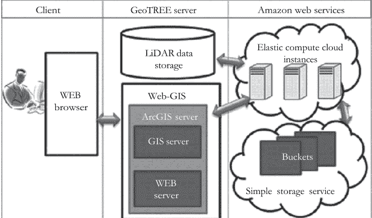

图 3.3 本研究开发的 `CLIPS` 总体架构。

# 大数据

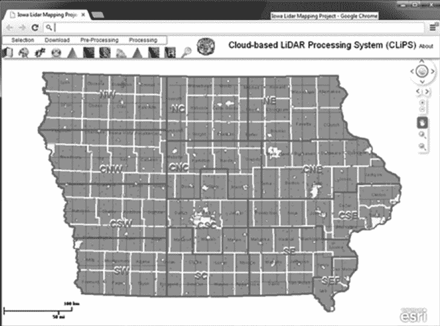

图 3.4 `CLIPS` 用户界面。

## 3.3 结果

项目开发的 `CLIPS` 用户界面如图 3.4 所示。在预处理阶段，用户可以调用数据削减算法（例如顶点精简方法）、裁剪和合并原始数据、启动用户指定的下载工具。顶点精简功能使用户户减少数据量（Orysspayev 等人，2012）。在后处理期间，用户可以选择从不规则三角形网（`TIN`）或点云创建 `DEM`，合并并裁剪 `DEM`，并从 `DEM` 或 `TIN` 派生二次产品（生成等高线，以及坡度和坡向）。

处理界面还允许用户选择项目预定义的计算机基础设施（例如 `EC2` 实例类型：`large`、`XLarge` 和 `double xray`）或针对其特定问题指定处理器配置。表 3.1 提供了这三种实例类型的高级规格。每个实例作为处理器、内存和存储容量的详细规格见 `http://aws.amazon.com/ec2/instance-types/`。为了演示处理流程，下一节提供了一个应用示例。

### 表 3.1

`EC2` 实例类型规格

| | Large | XLarge | 2Xlarge |
|---|---|---|---|
| 内存 (GB) | 7.5 | 15 | 30 |
| 存储 (GB) | 850 | 1690 | 弹性块存储 |
| I/O 性能 | 中等 | 中等 | 高 |
| 平台 | 32 位 | 32 位 | 64 位 |

### 3.3.1 应用示例：使用大型 LiDAR 数据集生成 DEM

在这个示例中，我们演示了 `DEM` 生成过程的全流程，从用户如何从 `CLIPS` 网络门户选择 `LiDAR` 数据，到如何在所使用的商业云计算站点上进行处理（图 3.5）。在典型场景下，用户 (1) 从地图上选择感兴趣区域，(2) 提供 `Amazon Web Services (AWS)` 凭证登录 `AWS` 服务，(3) 选择将使用的 `AWS` 实例类型（计算机资源），(4) 选择首选的处理器类型（例如 `CPU` 或 `GPU`），(5) 指定所需的产品（例如 `TIN`、坡度或等高线），以及 (6) 指定用于处理完成通知的名称和电子邮箱地址（图 3.5）。在用户在客户端侧的用户界面上提供了所需信息后，`LiDAR` 数据将被推送到 `Amazon` 云存储，然后使用用户指定的参数，利用我们在 `EC2` 环境中实现的软件生成 `DEM` 和其他衍生产品。最后，在处理完成后，将向用户发送电子邮件通知，并附上下载链接。

为了测试性能和处理时间，我们使用了 18 种数据集和处理器配置的组合：三种地形数据（平坦、起伏、城市）、瓦片大小（`9` 和 `25`）以及三种 `EC2` 实例类型（`large`、`Xlarge` 和 `double Xlarge`）。图 3.6 描述了不同组合的处理时间。正如预期的，该图显示随着计算机功率

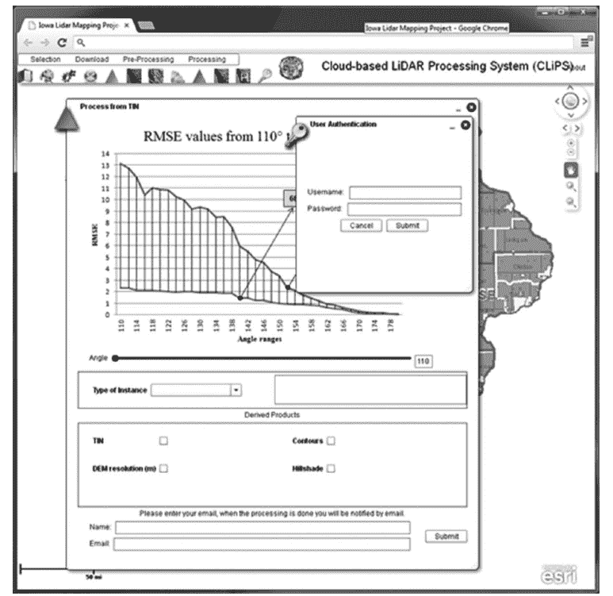

图 3.5 生成 `DEM` 和衍生产品的用户界面。

从 `Xlarge` 增加到 `X2Large`，起伏地形数据比其他两种地形需要更多时间。这些结果清楚表明，城市瓦片消耗的时间比平坦地形更多。

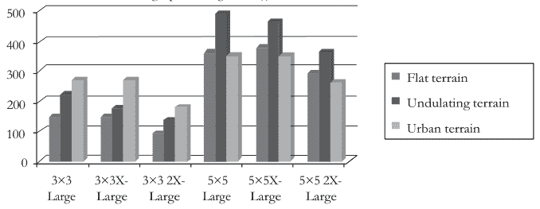

**图 3.6** 本使用的不同计算机资源的时间和性能对比。

处理时间最长的组合是使用最小处理器配置的起伏地形大区块（`5×5`）；合并瓦片并将其转换为 `DEM` 需 `8` 分钟 `12` 秒。然而，作为一种权衡，它是最具成本效益的，处理费用为 `34` 美元。在使用 `EC2` 服务时，任何部分小时都计为一整小时。本研究中各种组合的比较清楚表明，即使使用不同类型的 `25` 瓦片，每个请求也小于小时，处理费用低于 `1` 美元。从 `TREE` 服务器上传数据到云存储的费用低于 `50` 美元。由于涉及成本，我们没有使用 `Amazon` 云设施存储整个州的数据资源，尽管存储成本的下降可能意味着我们可以在不久后再次考虑这一点。在 `Amazon` 云上测试数据的总成本低于 `100` 美元，这对我们任何人来说都是负担得起的。

### 3.3.2 启发式模型开发

基于对不同实例、瓦片大小、地形类型、处理时间和成本的教训，我们开发了两个启发式模型为用户提供一个原型推荐系统：(1) `LiDAR` 数据削减和 (2) 各地形类型的最佳计算机基础设施分配（图 3.5 和 3.7）。

`LiDAR` 数据削减系统使用顶点精简方法来减少 `TIN` 的密度（Oprayev 等人，2012）。顶点精简方法最初由 Schneider 等人 (1992) 提出，反复检查每个顶点对表面模型渲染的显著性。对每个待考虑的顶点根据其定义的三角形数量以及用于精简该顶点的角度阈值进行评估。例如，当六个三角形边的端点，其 `z` 值（高度）与其他顶点有显著差异时。

# 使用云环境处理大型 3D 空间数据集

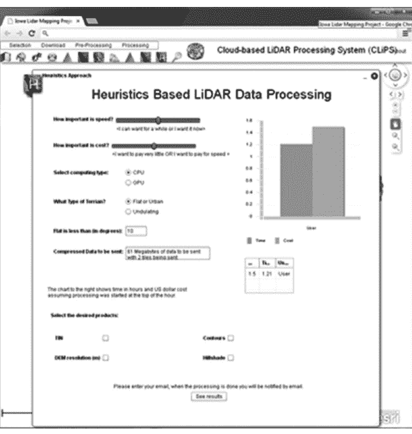

**图 3.7** 为 `CLIPs` 中的 `LiDAR` 处理开发的启发式模型。

将被保留的边缘末端。另一方面，完美定义了四个三角形且 `z` 值差异极小的顶点是变形的候选对象。

为了开发该启发式模型，我们使用从 `110` 到 `180` 度以 `2` 度为增量的角度范围，评估了平坦和起伏地形的抽稀率。对于每次角度缩减，都与原始 `DEM`（无缩减）一起生成一个 `DEM` 以进行精度估计。这两个 `DEM` 之间的均方根误差（`RMSE`）使用以下公式计算：

```
$RMSE = \sqrt{\sum_{i=1}^{n}(X_{Original,i} - X_{Obtained,i})^2 / n}$
```

其中

$n$ 是栅格中的单元格数量

$X_{Original,i}$ 是原始值

$X_{Obtained,i}$ 是单元格 $i$ 的获取值

图 3.5 显示了对于两种地形类型，`RMSE` 值如何随使用角度的变化而减少。它还显示这有助于用户为其应用找到最佳的推荐选择和可接受的 `RMSE` 值。

第二个推荐系统根据地形类型、愿意投入资金以及希望在云环境中完成任务的速度，为用户提供最佳实例和处理器配置。为了开发该启发式模型，我们使用了来自平坦和起伏地形的 `LiDAR` 数据、云平台上的 `GPU` 和 `CPU` 配置，以及在云端处理数据的预计时间和成本（图 3.7）。我们的目标仍然是帮助新手用户指定合适的计算机配置，使其能够在云端处理 `LiDAR` 数据并在时间与费用之间进行权衡。

## 3.4 结论

我们成功地利用云计算开发并实现了一个基于 Web 的 `LiDAR` 数据处理系统。我们使用 `Amazon` 的 `EC2` 服务测试了三种不同计算机资源配置的 `LiDAR` 数据。对于 `5 x 5` 瓦片，起伏数据集比其他类型花费更多时间，而本研究使用的 `3 x 3` 瓦片中，城市地形的计算强度最高。我们的结果清楚表明，随着计算能力的增加，三种类型的 `LiDAR` 处理时间均有所减少。我们的方法在所研究的配置范围内具有扩展性。然而，研究区域的时间和点密度也是影响 `LiDAR` 数据性能的重要因素。无论实例类型和其他因素如何，总成本都是适中的（小于 `100` 美元）。此外，根据从不同类型的实例、尺寸、地形、处理时间和成本中学到的经验，我们开发了两个用于 `LiDAR` 数据抽的启发式模型。这些方法整合到用户界面中，使新手能够探索云环境中各种类型地形的适当基础设施分配。

# 致谢

本研究在 `Amazon Research` 和 `USGS-AmericaView` 项目的支持下进行。

## 参考文献

Ackermann, F. 1999. Airborne laser scanning-present status and future expectations. IPSRS Journal of Photography and Remote Sensing, 542, 64–67.

Ambercore. 2000. Transport aerial services—A white paper on LiDAR mapping. http://www.ambercore.com/files/TransportWhitePaper.pdf (accessed on May 4, 2011).

Anderson, E. S., Thompson, I., and Austin, S. 2005. LiDAR data and linear interpolator over elevation estimates. International Journal of Remote Sensing, 2618, 3889–3990.

Arnbust, M. F., Gough, R., Joseph, D. A., Katz, K., Konwiski, A., Lee, G., Patterson, D. A., Rabkin, R., Stoica, I., and Zhou, M. 2009. The Clouds: A View of Cloud Computing, Technical Report No. UCB/ECS-2009-28, University of California at Berkeley, California.

Balvasais, E. P. 1999. A comparison between photogrammetry and laser sensing. IPSRS Journal of Photography and Remote Sensing, 52, 83–94.

Campeau, L., and Haas, M. 2003. Light detection and ranging-based terrain—a concept. In Proceedings of the 16th International Technical Meeting of the Satellite Division of the Union, Portland, OR, September 9–12.

Chen, Q. 2009. Improvement of the edge-based method for lidar data. International Journal of Remote Sensing, 304, 1069–1074.

Cui, D., and Zhang, Q. 2010. Massive data processing based on cloud computing model, Computational Science and Optimization, 3rd Annual Conference on Computational Science and Optimization, 347–350.

ESRI. 2012. ArcGIS Server. http://www.esri.com/software/arcgis/arcserver.

Evangelinos, C., and Hill, N. 2008. Cloud computing for scientific applications: Feasibility of running coupled-atmosphere models on Amazon’s EC2, In Proceedings of the 1st Workshop on Cloud Computing and its Applications, Chicago, October 22–23.

Hanh, S., He, J., Joon, H., and Yu, K. 2009. Parallel processing for airborne laser scanning using a PC cluster and virtual grid. Sensors, 94, 2555–2573.

Hodgson, M. E., Jensen, J., Raber, G., Tullis, J., Davis, B., Thompson, G., Schuckman, C. 2005. Evaluation of lidar-derived elevation and terrain slope in off-grid conditions. Photogrammetric Engineering and Remote Sensing, 71–77.

Hodgson, M. E., Jensen, J. R., Schmidt, L., Schill, S., and Davis, B. 2003. Evaluation of LIDAR-derived elevation models in off-grid conditions with USGS Level 1 and Level 2 DEMs. Remote Sensing of Environment, 84, 295–308.

Huang, Q., Yang, C., Ebert, D., Liu, K., and Wu, H. 2010. Cloud computing for geosciences: Deployment of GEOSS on ACM SIGPG: Performance and Distributed Geographic Information Systems, New York, pp. 35–38.

IBM. 2012. Big data to bring to the era. http://www.ibm.com/software/data/bigdata/ (accessed on April 4, 2013).


# 参考文献

- Iowa DNR. 2009. Retrieved April 29, from State of Iowa: `http://www.iowa.edu/mapping/index.html` (accessed on April 4, 2013).
- Li, C. L., Ou, Q., Wu, J., Xu, Y., and Qu, W. 2012. Big data processing: Challenges and opportunities. *Journal of International Informatics*, 13(4), 1–19. DOI: `10.1142/S0222965120296510009`
- Krishnan, S., Vary, C., and Crosby, C. 2010. Evaluation of Mapreduce for Gridding LiDAR Data, IEEE 2nd International Conference on Cloud Computing and Technology, pp. 33–40. CloudCom, Indianapolis, IN.
- Lastools. 2006. Award-winning software for LiDAR processing. `http://cs.umc.edu/~isenberg/lastools/` (accessed on May 4, 2011).
- Liu, X., and Zhang, Z. 2008. Digital elevation models by scale: Using cloud grids. *International Archives of Photogrammetry, Remote Sensing and Spatial Information*, 37-S, 173–178.
- Lohr, U., McCoy, G., and Vauche, S. 2009. In Proceedings of 6th International Workshop on Grid Computing (MGC), Belgium, December 1–5.
- Meng, X., Ruth, N., and Kelly, K. 2009. Generic filtering algorithms for LiDAR data: A review. *Remote Sensing*, 23, 833–860.
- Orspayev, D., Dumagov, R., DeGrote, J., and Gray, P. 2012. LiDAR data reduction using vertex decomposition and GPU/CPU multiprocessing. *Computers & Geosciences*, 43, 118–125.
- Ostermann, I., Sousa, A., Yigbasi, N., Prodan, R., Fahriger, T., and Ema, 2010. A performance analysis of EC2 cloud services for scientific computing. In *Cloud Computing*, pp. 115–131. Springer Berlin Heidelberg, Munich.
- Reutebach, S. E., Andrews, H., and McAaughey, R. J. 2005. Light detection and ranging LiDAR: An emerging tool for resource inventory. *Journal of Forestry*, 1036, 286–292.
- Regui, A., Malik, Z., and Yang, C. 2013. High-resolution spatial interpolation on cloud platforms. In Proceedings of the 28th Annual ACM Symposium on Computer Graphics, pp. 377–382. ACM, Coimbra, Portugal.
- Schio, B., Bertolotto, M., Lafer, D. F., and Morris, S. 2009. Storage, manipulation, and visualization of LiDAR Data. In ISPRS International Workshop on 3D ARCH-2009: 3D Virtual Reconstruction and Visualization of Complex Archives, Trento, Italy, February 25–28. *International Archives of Photogrammetry, Remote Sensing and Spatial Information*: Volume XXX-S. International Society of Photogrammetry and Sensing.
- Schweder, J. W., Jarge, A., and Lorenz, W. E. 1992. Detection of triangles meshes. In *ACM SIGGRAPH Computer Graphics*, 26, No. 2, pp. 65–70. ACM, New York.
- Shekhar, S., Guti, V., Evans, M., and Gray, Y. 2012. Big data challenges meeting objectivity and cloud computing. In Proceedings of the Eleventh ACM International Workshop on Data Engineering for Wireless and Mobile Access, pp. 1–6. ACM, Scottsdale, AZ.
- USGS, 2011. Landsat 档案。`http://landsat.usgs.gov/`（访问于 2013年4月7日）。
- Vatsavai, R. R., Ganguly, A., Chandola, V., Stefanidis, A., Klasky, S., and Shekhar, S. 2012. 大空间数据时代的时空数据挖掘：算法与应用。收于第1届 ACM SIGSPATIAL 大地理数据国际工作会议论文集，第1–10页。ACM, 纽约。
- Wang, Y., Wang, S., and Zhou, D. 2009. 云计算环境下的空间数据检索与索引。收于第1届国际云计算计算会议，中国北京，12月1–4日，计算机科学讲义录，第9931卷，第322–331页。
- Watson, P., Lord, P., Gibson, F., Petoriellis, P., and Pitsilis, G. 2008. 用于 CARRSEN 的科学云计算。在第2次伊比利亚网格基础设施会议论文集，第3–14页。英国纽卡斯尔上畔。
- Wehr, A., and Lohr, U. 1999. 空载扫描——介绍与概述。《ISPRS 摄影测量与遥感期刊》，54, 68–82。
- White, T. 2012. *Hadoop 权威指南*。O’Reilly Media, Inc., 加利福尼亚州塞巴斯波尔。
- Worrall, L. 1991. 空间分析与空间政策，Belhaven Press, 英国伦敦。
- Yang, C., Goodchild, M., Huang, Q., Ebert, D., Raskin, R., Bambacus, M., Xu, Y., and Fay, D. 2011. 空间云计算——空间科学如何利用并帮助塑造云计算。《数字地球国际期刊》，4(4), 305–329。

# 构建开放式环境以应对地球科学中的大数据挑战

邓美霞，李立平

## 4.1 引言

大数据是一个随着数据集日益扩大的趋势而出现的流行术语，它指的是一组规模如此庞大或复杂的集合，以至于难以使用常规数据库管理工具或传统数据处理应用程序进行处理（IDC, 2011; White, 2012; Mike 2.0, 2013）。随着数据和信息的指数级增长、可用性和使用，大数据时代的到来为人类社会的每个领域带来了巨大的挑战和机遇（《经济学人》，2010; Reichman 等人，2011）。大数据并不一定非要要在数据规模上是巨大的。当数据量变得如此巨大且多样化（大数据量），或者数据集以各种格式并来自许多来源出现（数据高复杂性），或者数据产生并必须快速处理（例如，实时数据的产生和处理）以满足信息需求（数据高速度）时，就会引发重大问题。目前对大数据以及如何将其科学同化手段的讨论反映了大数据带来的机遇与挑战。

事实上，大数据的特征在现代地球科学（本章中交替使用`地学科学`术语）中是内在的，并且很早就被发现。在过去的几十年里，传感器和数据采集技术的进步使得对地球的观测变得越来越详细，这得益于遥感数据的现象级增长以及多源地球观测数据不断增加的量海量地球观测数据的收集给地球科学带来了挑战，也给地球科学家带来了前所未有的机遇和挑战（Deng and McDonald, 1999; Jaeger and Deng, 2005; Craglia, 2008; Goodchild, Deng and Di）。例如，地球科学已演变为地球系统（ESS）的概念和方法论（Crutzen, 2002）。ESS 除了理解海洋、陆地和大气过程之外，还承认地球的变化是地球系统与人类活动之间复杂交互的结果。它强调使用多学科方法而非传统方法来研究地球（Rankey and Ruzek, 2006）。从本质上说，ESS 是一门多学科且计算密集型的科学，需要访问、分析和建模大数据。它在创造性且有效地利用大数据驱动理解地球的效率和质量方面发挥着至关重要的作用。响应方法论（Deng and Di, 2010a, 2010b），数据密集型教育方法旨在通过数据密集型和计算密集型方法以及增强的现实问题解决能力来培养学生（Deng and Di, 2010b）。它体现了地球科学（或地学）教育界许多公认的教育创新观点，“在课堂教学中使用广泛的遥感数据”（Manduca and Mogk, 2002; Ledley 等人，2008）、“在研究中培养技术能力和智力自信”（Marino 等人，2004）、“培养计算计算思维和定量技能”（Manduca 等人，2004）以及“通过令人兴奋的现实世界应用激发学生兴趣并建立理解”（Marino 等人，2004）。数据密集型教育方法侧重于处理由地球观测收集的大数据。对于地球科学高等教育来说，采用数据密集型方法至关重要，以满足当今社会对大量劳动力的需求，这些人才不仅要接受过数据处理和计算技能的培训，还要精通分析、管理以及基础信息技术（IT）（Deng, 2010）。

## 5 大数据

为了解决地球科学中的大数据问题，最近付出了巨大努力。一项主要努力是构建能够应对大数据挑战的开放数据和信息环境。许多国际组织或学会，例如开放地理空间联盟（OGC）、国际数字地球学会（ISDE）以及数据科学与技术委员会（CODATA），在很大程度上鼓励并促进了这项工作。许多美国联邦机构，如国家科学基金会（NSF）、美国航空航天局（NASA）和国家海洋和大气管理局（NOAA），投入了大量资金支持这项工作。乔治·梅森大学的空间信息与系统中心（CSISS）在许多美国联邦机构和国际组织的资助下，在过去十年中致力于构建一系列开放数据和信息环境来解决

# 构建开放环境以应对大数据挑战

地球科学、教育和应用领域面临着各种大数据问题。例如，CSISS 构建了以下四个开放数据和信息环境：

- 1. **GeoBrain** (`http://geobrain.lts.edu`) 是一个开放且数据交互的数字基础设施，旨在促进地球科学高等教育和研究。它是世界上第一个开发的地理空间 Web 服务系统，通过创新的地理空间 Web 服务方法解决了阻碍有效访问、使用和管理大量地球科学数据的障碍（Di, 2004; Di and Deng, 2005; Di and Di, 2006, 2008, 2009, 2010b）。它特别强调了 NASA 地球观测系统 (EOS) 数据，使用户能够通过连接互联网的计算机随时随地方便地访问、使用和分析 EOS 数据。它通过在线学习和研究环境促进了高等教育和研究。

- 2. **CropSpace** (`https://nassegeodata.edu/CropSpace`) 是一个交互式 Web 农田层 (CDL)，该系统旨在探索并满足对快速访问和分析作物数据及信息的日益增长的需求。基于 GeoBrain 基础设施，CropSpace 能够为美国农业部 (USDA) CDL 数据提供在线和按需查询、可视化、传播和分析的全面能力。它不仅以可操作的方式提供了交互地图操作、数据定制与下载、作物聚合统计、图表绘图以及多时间分析等功能，还提供了 Web 地理处理服务，如自动数据交付和按需作物统计，以供其他应用（Han et al., 2012a）。它促进了地理空间农田信息的交付和分析，为决策支持和研究提供了便利。

- 3. **VegSpace** (`http://dss.csiss.edu/VegSpace`) 是一个利用 Web 技术和遥感技术的国家作物进展监测系统，能够有效支持农业决策，解决了现有作物进展系统/程序存在的严重缺陷（Yu et al., 2009, 2012a, 2012b）。基于 Geophys，使用了先进的工作流技术来构建 Web 服务，自动生成并分发高分辨率的客观定量作物进展图及相关决策数据以及总结报告。

- 4. **全球农业干旱监测与预报系统 (GADMFS)** (`http://gis.csiss.edu/GADMFS/`) 是下一代农业干旱数据和信息系统，提供全球农业干旱的实时监测、按需分析和预报。GADMFS 构建在 GeoBrain 数字基础设施之上，专门解决与历史和实时全球农业干旱数据信息的访问、可视化、定制、传播和分析相关的大问题（Deng et al., 2012, 2013）。GADMFS 满足了对全球农业干旱实时监测、分析和预测服务的日益增长的需求以及来自决策者、研究人员、农民、学生和公众在内的不同用户的完整农业干旱数据信息。

上述四个实例展示了如何通过构建开放数据和信息环境来应对地球科学中的大数据挑战。本介绍了构建这四个开放环境的技术基础、通用开发方法和途径，并通过演示 CSISS 开发的这四个实例，分享了解决地球科学大数据挑战的经验、收获和愿景。

## 4.2 技术基础与方法论

CSISS 构建的开放环境虽然在特定的地球科学研究、教育和应用领域重点不同，但都涉及访问、处理和分析大量的卫星数据（地球大数据）。因此，它们需要通过解决大数据可访问性、互操作性和易用性的基础问题来应对大数据挑战（例如数据可视化和分析）。它们还需要应对大数据背景下的地理处理建模挑战，因为大多数地理空间产品不是直接从测量中获得的，而是通过由构建和执行过程模型组成的地理处理建模从其他数据获得的。地理处理建模是产生用户所需地理空间产品（例如派生数据和信息产品）的重要方法。图 4.1 展示了从地理空间过程模型到用户所需科学产品阶段的三个阶段。在知识捕获阶段，构建地理空间过程模型，在概念上引向生成某类型（或若干类型）科学产品的地理处理步骤。地理空间过程模型始终代表了基于行为的高级地理空间知识，这种知识可以通过两种方式创建：由领域专家手动创建或自动创建。在查询阶段，生成逻辑工作流。在检索阶段，实例化逻辑工作流。

为了应对大数据背景下的地理处理建模挑战，开放环境需要解决三个关键问题：(1) 如何实现数据、功能和语义的互操作性；(2) 如何支持大数据的集成、可视化和分析；(3) 如何展示技术基础和通用方法论。本节将概述用于开放环境中处理大数据的技术基础和通用方法论。

| 地理空间过程模型 | 虚拟产品 | 逻辑工作流 | 请求产品 |
| :--- | :--- | :--- | :--- |
| 知识捕获阶段 | 查询阶段 | 检索阶段 | 执行阶段 |

图 4.1 建模的三个阶段。（源自 Di., Proc. Remote Sens., 2005.）

# 构建开放环境以应对大数据挑战

### 4.2.1 互操作性

互操作性是构建环境时需要解决的第一个关键问题。Goodchild (1992) 和 Bishar (1998) 讨论了互操作的重要性和趋势。互操作性的障碍可以分为不同的类型（例如组织、文化和技术）和不同的层次（例如数据、服务、系统和语义）。导致大数据的根本原因是当前的地理空间数据和系统在数据、功能和层次上无法容易、充分或正确地互操作。为了应对这一挑战，CSISS 在开发 OGC 互操作性等新技术方面付出了巨大努力（Deng et al., 2003, 2004; Deng and Ji, 2009, 2010a）。

- 1. **Web 覆盖服务 (WCS)** 定义了覆盖服务器的标准接口，客户端应用程序可以无缝查询和访问分布式服务器的数据。
- 2. **Web 地图服务 (WMS)** 为 Web 客户端提供了统一访问服务器渲染地图的标准接口。
- 3. **Web 要素服务 (WFS)** 描述了服务器和客户端在矢量层面通信的要素操作。
- 4. **Web 目录服务 (CSW)** 定义了通用接口，允许各种应用程序通过 Web 对空间服务元数据进行发现、浏览和查询。
- 5. **Web 处理服务 (WPS)** 为地理服务提供了输入和输出接口（即请求和响应）。

除了 OGC 标准，还观察并利用了一系列万维网联盟 (W3C) 和结构化信息标准促进组织 (OASIS) 标准，如 `Web 服务描述语言 (WSDL)`、`简单对象协议` 和 `Web 服务业务执行语言 (WS-BPEL)`（SOAP, 2012; WS-BPEL, 2012; WSDL, 2012）。简而言之，通过两种主要方法在开放环境中实现了所需的数据、服务、语义和系统级互操作性：


- 1. 设计并实施通用数据环境 (CDE)，为发现和访问分布式数据存档和存储中的数据信息提供标准接口。实现了一系列 OGC 数据发现和访问规范，包括 `WCS` (Whites and Evans, 2008a)、`WFS` (Vretanos, 2005)、`WMS` (de la Beaujardière, 2006) 和 `CSW` (Martel, 2009)，并与基于 `CSW` 的目录联邦服务 (CFS) (Bai 等，2007) 用于构建分布式数据环境 (CDE)，以实现对分布式数据和信息的联邦式发现与访问。

- 2. 设计并实现了一种通用服务环境 (CSE)，供人类和机器用户使用，以标准方式发现并调用地理处理服务（分析函数），用于处理和分析从 `CDE` 获取的数据。`CSE` 已经实现了一系列标准协议，包括用于 Web 服务和服务链的 `WSDL`、`SOAP`、`WPS` 和 `WS-BPEL`，以及结合了本体论的聚合 `CSW` 和 `CFS` (Bai 等，2009)，用于服务的发现与注册。

上文通过前述的 `CDE` 和 `CSE` 方法实现的多级互操作性也有助于解决数据的可访问性和易用性问题。通过 `CDE` 和 `CSE`，分布式系统中的数据服务可以通过单一入口的机器到机器接口在互联网上进行访问和使用。

## 4.2.2 服务性

地球科学的复杂性导致用户需求与提供者能力之间存在巨大鸿沟。弥补这些鸿沟需要更好的大数据发现、集成、可视化、分析和建模服务，以便用户能够轻松访问、理解和使用所提供的数据。由于当前系统中的数据不互操作，且缺乏足够的服务来处理，问题仍然存在。为了支持大数据的发现、集成、可视化、分析和建模，开放环境将通过改进服务性（即个性化服务性）进一步解决数据互操作性和易用性问题。在 `CSSIS` 中构建的开放环境除了早期的多级互操作性外，还通过将数据与充足的数据、信息和知识服务耦合，实现了开放环境个性化易用性。

充足的数据意味着开放环境中的任何可用数据都涵盖了足够的元数据和数据转换服务（例如子集化、重新格式化、重映射等），以便数据可以被轻松地发现、访问、定制、检索和集成。通过互操作的、个性化的和按需的数据访问服务 (`IPADAS`) 根据用户请求提供定制化数据，是支持充足数据的一种初步方法 (Deng 和 Di, 2009)。`IPADAS` 最初开发在 `GeoBrain` 中，由一系列 OGC 数据（例如 `WCS`、`WPS` 和 `WMS`）和数据转换服务（例如坐标转换服务）组成，有效消除了集成和使用地理空间数据的一些初步困难。

充足的信息意味着可以通过用户需要的产品生成在线按需的、实地理空间数据分析。地理空间数据（如遥感数据）主要涉及多光谱或高光谱图像。这些数据具有高维度，并有许多波段（例如数百个波段），与文本和地图等其他类型的可读性完全不同。远程大数据的地理空间分析依赖于适当计算机计算机。互操作的地理空间 Web 服务为分布式环境中的地理空间处理和地理空间分析任务提供了巨大的便利和灵活性 (Deng 等，2003；Deng 和 Di, 2009, 2010a)。为了在开放环境中提供充足的信息服务，所有数据分析服务都作为符合标准、互操作且动态可变的 Web 服务提供。已经实现了大量的增值地理空间 Web 服务，以满足用户规范的按需地理空间需求。特别是由 Deng 和 Di (2008, 2010a；Li 等，2010) 在地理资源分析系统 (`GLASS`) 中通过封装函数转换的近 80 个 Web 服务供全球用户用于处理光栅格、矢量和卫星图像数据。这些 Web 服务符合标准并支持 `HTTP POST` 请求。每个服务都用 `WSDL` 描述，服务的输入和输出是可访问的网络节点，即统一资源定位符 (`URL`)，可以在互联网上发现。因此，这些地理空间 Web 服务可以被任何用户轻松调用，用于按需地理空间处理和分析。通过这种方法实现充足的信息服务将极大促进需要使用地理空间大数据的科学研究，并最终让用户无需担心计算资源或技能的。

充足的知识服务需要自动的地理处理建模能力，使系统能够理解并响应人类查询，并高级信息和知识产品（例如问题的答案）。由于现实挑战，开放环境尚未完全实现充足的知识服务，但已取得很大进展，例如 Di (2005)、Deng 和 Di (2006a)、Yue 等 (2006, 2007) 以及 Di 等 (2007)。凭借现有技术，可以通过地理空间过程模型的构建、实例化和执行机制实现的显式地理处理建模提供基础知识服务 (Chen 等，2005；Deng 和 Di, 2009b; 2010a)。在 `CISS` 开发的开放环境中，使用地理树 (`geo-tree`) 在概念上描述建模 (Di 和 McDonald, 1999；Di (2005); Deng 和 Di, 2010a)，如图 4.2 所示。

地理树形象地表示了一个地理空间过程模型和可以按需生成的虚拟产品。地理树中有两种节点：过程节点和地理对象节点。过程节点是地理空间服务。地理对象节点包含地理空间产品（例如数据）类型。用户请求的地理空间产品类型被命名为用户对象。用户对象可以分解为地理树，如图 4.2 所示，由一系列过程节点、中间和存档地理对象或其他地理对象组成。因此，地理树中的根节点是虚拟产品。地理树中的叶节点是虚拟产品。地理树中的中间节点是虚拟产品。地理树中的存档地理对象是虚拟产品。地理树中的过程节点是虚拟产品。地理树中的地理对象节点是虚拟产品。


## 构建满足大数据挑战的开放环境

- 2. 可扩展性：该系统从构建角度来看（例如，基于组件和模块化）以及用户为导向的角度来看都是可扩展的（例如，能够根据用户请求处理从本地到全球的任何规模）。

- 3. 可重用性：该系统在功能、组件和系统级上都是可重用的。

- 4. 适应性：系统具有灵活性、扩展性、自演化和可维护性。

遵循这些原则，`CSISS` 中的开放环境共享一个共同的基础：一个三层、符合标准且面向服务的架构 (`SOA`) 地理空间网络服务，如图 4.3 所示。

前端是展示和分发组件/层，包括网络门户和客户端，它们可以访问系统功能并向用户分发数据和信息。该层的网络门户为终端用户提供了非常方便的访问方式，可以使用系统提供的所有数据和信息产品、系统中注册的虚拟产品，以及系统启用的地理空间分析处理/建模能力。除了网络门户外，还可以开发符合标准的客户端作为独立应用程序在此层访问所有系统功能，为用户提供某些功能权限和离线处理能力。该层通过 `CSE` 提供了对系统中所有真实和虚拟数据及信息产品以及所有其他符合 `OGC` 标准的服务的访问。

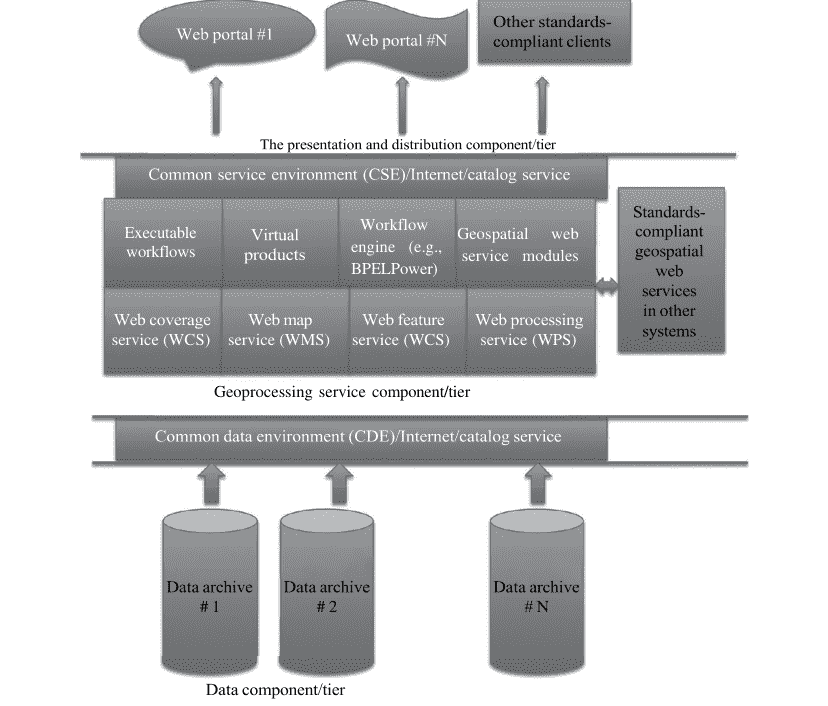

图 4.3 地理空间网络服务系统架构。

中间是重处理服务组件/层，由多个组件组成，执行地理空间数据处理、信息提取、重处理建模、需求分析和知识管理服务。该层还包含所有单个符合标准的地理空间网络服务的执行文件——这些自包含、自描述的应用程序可以在网络上发布、定位并发现和调用（其他网络服务）。一旦部署了网络服务，系统中的其他应用程序就可以按照相应的 `OGC` 网络标准（包括 `OGC WMS`、`WCS`、`WFS`、`WPS` 和 `CSW`）进行访问。它们将作为动态连接系统中复杂地理空间模型的各个构建块。

后端是数据组件/层，允许系统无论数据如何归档，通过具有接口标准的数据提供者服务访问分布式资源。该层由使用定义的 `CDE` 的服务器组成，为数据请求者提供数据，无论格式、投影、分辨率和存档位置如何。系统的数据请求者包括系统的地理空间服务中间件、任何应用程序和数据分析应用、客户端和用户。`CDE` 允许请求者对其所需的数据指定需求。连接 `CDE` 的服务器必须根据需求对数据进行预处理，并以请求者指定的格式将数据返回给请求者。

总结来说，`CSISS` 中的四个环境共享互操作和扩展的地理空间网络服务的共同基础设施，具有以下特点：(1) 在线可用——用户仅需接入连接互联网并带有网络浏览器的 `PC` 即可执行需要分布式计算资源的复杂任务；(2) 基于标准的数据和服务——系统通过符合标准的通用数据和服务环境提供访问分布式数据和服务的单一入口；以及(3) 基于 Web 的数据访问、集成、分析和地理空间建模——所有分析功能都作为互操作且可更改的地理空间服务提供，允许用户轻松集成数据并进行在线和按需的地理空间建模与分析。

## 4.3 讨论

`CSISS`、`GeoBrain`、`CropScape`、`VegScape`、`GADMFS` 这四个数据和信息系统实例在重点、功能、使用领域和目标受众方面非常不同。如前所述，`GeoBrain` 旨在通过数据密集型方法创新地球科学的高等教育和研究，并满足地球大数据用户广泛的计算需求，而另外三个则提供专门的农业数据和信息，以支持应用中有效且及时的农业监测和决策。然而，它们都被设计并实现为开放的、三层的、基于组件的、符合标准的且基于 `SOA` 的地理空间网络系统。为什么它们共享地理空间网络服务系统的共同基础设施？为了回答这个问题，首先需要提到开放环境的基本需求。显然，所有四个数据和信息环境尽管应用领域特殊，但必须解决 (1) 在线可用——用户仅需接入连接互联网并带有网络浏览器的 `PC` 即可执行需要分布式计算资源的复杂任务；(2) 基于标准的数据和服务——系统通过符合标准的通用数据和服务环境提供访问分布式数据和服务的单一入口；以及(3) 基于 Web 的数据访问、集成、分析和地理空间建模——所有分析功能都作为互操作且可更改的地理空间服务提供，允许用户轻松集成数据并进行在线和按需的地理空间建模与分析。

尽管对于采用标准的成本问题存在一些争论，但本章认为这是构建开放数据和信息环境以实现广泛互操作性的最佳选择。在 `GeoBrain` 中开发的地理空间互操作性技术已成功用于 `CSSIS` 构建其他数据和信息环境。然而，由于技术、文化和组织障碍，确保不同数据、服务和系统之间充分且适当的互操作仍然是一个巨大的挑战。

尽管这四个环境都被设计并实现为全面且广泛的网络基础设施，以提供充足的数据、信息和知识服务，但在目前阶段，它们仅在运行层面提供了充足的数据和信息服务（知识服务非常初级，见第 4.2.2 节）。对于数据和信息，由于新需求和不断变化的需求，在某些时刻可能是不够的。为了更好地响应需求和不断的变化，需要考虑两个问题：服务模块化和社区连接性。服务模块化是影响不同地理空间过程模型服务模块灵活性、适用性和重用性的重要因素（Deng and Li, 2010a）。如果服务太小，则需要许多模块来构建复杂的地理空间过程模型，从而影响系统性能；如果服务模块过大，则该模块不易被重用于不同的地理空间过程模型。因此，地理空间 Web 服务的模块化对系统响应新需求有直接影响，必须经过仔细考虑。社区参与是构建有效开放环境的另一个因素，因为地理空间服务系统的真正威力依赖于大量可链的重处理服务模块和地理空间过程模型。从头构建地理空间服务或过程模型是非常耗时的，并且需要特定的领域知识。构建数量足够的重处理服务模块或地理空间工具以满足多样化需求，超出了任何个人甚至团队的开发和演进能力。

目前，知识服务的实现效率很大滞后于需求。从开放环境的角度来看，用户可以通过充分的数据信息服务或通过管理重处理而非原始数据获取初级知识产品，动态按需访问并利用数据产品，但系统无法自动生成知识来回答用户的查询。需要大量的研究工作来提供充分的知识服务并辅助决策。智能知识系统是一种能够提供用户特定知识以响应用户查询的系统，具有一些基本特征，如自动推理机制、动态知识生成和问答能力。在这样的系统中，智能体现为系统理解用户问题并找到正确答案的能力。如果不存在答案，系统应该能够从现有的低级数据或信息中生成答案。因此，智能系统会自动将数据转换为用户特定的地理空间信息和知识，这就是对用户指定问题的回答。这种系统应该能够回答用户提出的问题，并智能地链接单个服务实例以形成复杂的模型，将输入数据与模型匹配并执行模型以向用户交付答案。基于 Web 服务的地理空间问答机制需要解决四个方面：

(1) 基于标准的自动化地理空间数据和服务的发现；

(2) 由领域知识和用户查询本体驱动的、智能分解为用于工作流构建的地理空间过程模型；

(3) 自动化的地理空间 Web 服务链、绑定和工作流执行；

(4) 工作流和地理空间模型管理。

## 构建开放环境应对大数据挑战

基于当前的开放数据和信息环境构建智能地理空间知识系统，将有助于地球科学解决许多威胁人类健康和安全的科学问题，并帮助决策者选择更好的政策，迈出重要的一步。在 `CSSISS` 构建开放环境的功能性需求、方法论和系统架构研究中已经考虑了地理处理和知识构建所需的框架、机制和工具，但尚未完全实现充分的服务和智能知识系统。然而，尽管已为所有开放环境提供了服务指标，并使用 `JMeter` 等软件进行了性能测试（Deng et al., 2013; JMeter, 2013），但对于不同提供者的单个地理空间 Web 服务的质量 (`QoS`) 研究及其测量机制也没有被充分考虑。将未来的精力放在实现充分的知识服务、提高 `QoS` 以及开发具有充分且智能的数据、信息和知识服务的更多开放环境上是符合逻辑。

## 4.4 总结

现代地球探索和发现活动主要依赖于数据密集型地理空间计算和建模能力。快速的气候和环境变化对地理空间计算和建模在理解、预测和有效应对这些变化方面提出了新要求。由于巨大的大数据挑战，目前的数据密集型地理空间计算和建模能力很大程度上受到限制。为地球科学构建开放且数据密集型环境，对于应对气候变化、环境保护等问题提供合理的解决方案具有重要意义。`GMU` 的 `CSSIS` 在地球科学研究、教育和应用方面有广泛的数据信息需求。本章介绍了 `GeoBrain`、`BrainScape`、`VegScape` 和 `GUMaps` 四个环境实例，说明了构建开放、数据密集型信息和知识环境的通用方法和途径，以帮助地球科学和工程活动并提供社会效益。所有环境都是通过创新的地理空间 Web 方法构建的。这些环境的操作表明地理空间 Web 方法可以有效构建开放环境。满足各种需求并构建此类环境是解决地球科学大数据问题的非常务实的方法。这些环境使用户从单一入口即可访问分布式大数据和计算资源进行分析和建模，并为生成定制化的数据、信息和知识产品提供了创新方法。这将促进和推动地球科学的研究、教育和应用，因为由于涉及的复杂性，科学家、教育工作者或学生很难或无法拥有所需的所有资源和技能来开展所有数据密集型研究和教育活动。此外，开放的数据信息知识环境有望在促进科学进步方面发挥关键作用：公众可以自由访问海量数据、信息和计算资源（以前只有少数特权科学家才能获得），根据自己的兴趣进行科学调查。

`CSSIS` 构建的开放环境能够提供经验、教训、技术就绪状态和深刻见解，以针对未来科学家、研究人员、教育工作者、学生和普通大众日益增长的数据挑战以及更广泛的地理空间计算和建模需求开发更有效的数据、信息和知识环境。

## 参考文献

Bai, Y., L., Di, A., Chen, Y., and Wei, J. 2007. 一种地理空间目录联邦服务，《遥测工程与遥感》， 73(6), 699–708.

Bai, Y., L., Di, A., and Wei, Y. 2009. 全球服务发现与互操作性地理空间服务分类法，《计算机与地球科学》， 35(8), 783–798.

de la Bejartjie, J., E. (2006). OpenGIS 地服务器规范 (OGC 06-042, 版本 1.0). 开放地理空间联盟协会, 美国马萨诸塞州韦兰兰. 可于 [http://portal.geospatial.org/files?artifact_id=14416](http://portal.geospatial.org/files?artifact_id=14416), 2023年3月。

Bish, Y. 1998. 人类世：GIS互操作的语义和其他障碍，《国际地理信息期刊》，12(4), 299–314.

Chen, N., L., Di, Y., and M. Min. 2009. 基于Web技术的用于多样化传感器的灵活地理空间传感器观测服务，《ISRPR 遥感与摄影测量杂志》，64(2), 234–242, doi:10.1016/j.isprprs.2008.06.008.

Chen, A., L., Di, Y., and Wei, J. 2009. 利用网格建模虚拟地理空间产品，《国际地理空间信息杂志》，25(5), 581–604.

Craglia, M., Goodchild, M., Annoni, A., Camaro, G., Gould, M., Kuhn, W., M., ander, L. 2008. 下一代数据基础设施，《国际空间数据基础设施研究杂志》，3, 146–165.

Crutzen, P. J. 2002. 地理空间服务规范版本 2.0. OGC 07-006i. 开放地理空间联盟协会, D. Herbert, A. Whiteside, and Panagiotis (Petran) Retvanans (编), 2007-02-23.

DEMployer, 2012. DEM Explorer. 可于 [http://www.gci.com/DEMExplorer/](http://www.gci.com/DEMExplorer/), 访问于2013年4月21日。

Di, M. and L. Dong. 2006a. 基于语义和Web科学技术的原型智能知识系统，2006年国际测地信息会议, 中国武汉。

Di, M. and L. Dong. 2006b. 通过 GeoBas 利用地理空间 Web 服务技术进行遥感扩展，《IEEE 国际地球科学与遥感研讨会论文》(IGARASS 2005), 美国科罗拉多州丹佛。

Di, M. and L. Dong. 2009. 构建在线学习和研究环境以增强地理科学与工程的使用，《IEEE 空间数据基础设施研究进展》， 4, 77–95.

Di, M. and L. Dong. 2010a. 地–A 地理空间 Web 服务方法促进数据驱动的研究与教育。LAMBERT Publishing GmbH & Co, 德国卡斯堡。 In C. Yang, D. Wang, Q. Min, and R. Yang. 高级地球科学, 351. CRC Press.

Di, M. and L. Dong. 2010b. 用于数据密集型地球科学的 GeoBrain (ES)。In C. Yang, D. Wang, Q. Min, and R. Yang. 高级地球科学, 351. CRC Press.


# 参考文献

Di, L., Y. A., Chen Y., and L. 2004. 用于遥感数据的原型地理空间 Web 服务系统开发，《2003年亚洲 GIS 会议》，中国武汉, 11 (CD-ROM)。

Di, M., L. G., Y. A., Yagi, C. P., Zhang, and D. Shen. 2012. 用于全球农业监测和预测的按需 Web 服务开发，《2012年国际地球科学与遥感研讨会》，德国慕尼黑, 22–27.

Di, L., W. Han, A. Yagi, C. Peng, and He. 2013. 基于 Web 的全球农业监测和分析，《遥测工程与遥感》，70(9), 929–934.

Di, L., and GeoBrain-a Web-based 2004. 基于 Web 的地球科学集成系统，《2004年 NASA 地球科学技术会议》，加利福尼亚州帕洛阿尔托, 22–24, pp. (CD-ROM)。

Di, L. and M. Dong. 2005. 在 Web 服务环境中通过自定义地理空间产品增强遥感教育，《IEEE 国际地球科学与遥感研讨会》(IGARASS), 6, pp: 4215–4218.

Di, L. and M. Dong. 2010. 全球空间数据基础设施周围的地球科学科学教育，《IEEE 国际地球科学与遥感研讨会》(IGARASS), 2010, DOI: 10.1109/IGARASS.2010.55046-2: pp. 98–101

# 应对大数据挑战

Di, L., and K. McDonald, 1999. 下一代科学数据和信息系统，《第一次数字地球国际研讨会》，中国北京, pp. 92–101.

Di, L., Zhao. W., Yang. G., and P. Yee. 2005. 智能 Web 服务，《IEEE 国际地球科学与遥感研讨会》(IGARASS) 2005, 韩国首尔, 25–29.

Di, L., P. Yee, Yang. G., P., and Zhou. 2007. 基于本体的地理空间发现自动服务链，《美国摄影与遥感协会》，佛罗里达州坦帕, 7–11, CD-ROM.

Di, L., K. Moe, and van Terence, 2010. 地球观测 Web: 概述，《IEEE 应用地球观测主题期刊》，马里兰州贝塞赛达, 4(4), 415–417. DOI:10.1109/JOTARS.2010.25875.

Geos, S., 2002. SOA 在线分析。于 <http://gebrain.laits.msu.edu/>, 访问于2013年4月21日。

Goodchild, M. F. 1992. 地理信息，《地理信息期刊》，6(1), 31–45.

Goodchild, M. F. 2008. 数字地球的使用，《数字地球期刊》，1(1), 31–42.

Gore, A., 1999. 理解我们在 21 世纪的地位，《遥测工程与遥感》，6(5), 528.

Grant, D. A., and M. Gould, 2010. 环境服务的面向服务应用：可重用地理空间服务，《环境建模与软件》，25(2), 182–198.

Han, W. Y., Jiang, L., and R. Mueler, 2012. Sccape: 用于决策选择和传播当代地理空间产品的 Web 服务，《非洲计算机与电子》，84, 111–123.

Han, Y., P. Zhao, and S. Shi, 2012. DEM: 一种开放互操作的数据共享与分析系统，《地球科学建模》，38, 101–107.

IDC, 2011. 大数据分析：未来的架构、挑战和路线图，2011年9月。

Meter, 2013. Apache JMeter 应用。可于 <http://jmeter.apache.org/index.html>, 访问于2013年2月20日。

Ledley, T. S., A. Prakash, and C. Manduc, 2008. 使地球科学数据可用且易用的建议，《EOS》，89(2), 292.

Li, X., W. Han, P. Zhao, and U. Dadi, 2010. 在 Web 服务面向型环境中共享地球科学算法 (GRASS GIS 004)，《计算机与地球科学》，36(8), 1060–1068, 2010年8月。 DOI:10.1016/j.cage.2010.03.

Lynne, C., 2008. 地球数据系统的可用性，2008年第 7 次 NASA 地球数据系统会议期间的记录文件，佛罗里达州费城。

Manduc, C. and M. Gould, 2002. 在本科地球科学教育中使用数据，2002年4月在明尼苏达州明尼阿利斯卡尔顿学院行的跨学科研讨会报告。<http://ser.carleton.edu/files/usingdata/UsingData.pdf>。

Manduc, C. D., and N. Stillings, 2004. 地球科学学习的研究。国家科学基金会 (NSF) 和约翰逊基金会赞助的研讨会报告，威斯康星州华盛。<http://ser.carleton.edu/files/research_learning/ROL0304_2004.pdf>。

Manduc, C. A., E. Baer, G. Hancock, R. H. Macdonald, S. Patterson, M. Savina, and J. Weiner. 2008. 使量化地球化学理解，《EOS》，89(16), 149–150。<http://ser.carleton.edu/SES-89-16-2008.html>。

Marino, T. M., and M. Wright, 2004. 地球科学教育与网络基础设施，《第一次数字地球国际研讨会报告》，中国，科罗拉多州波尔德, 18–20.

Reichman, O. J., Jones, M. B., and Schidlauer, M. P., 2011. 开放数据科学的挑战与机遇，331(6018), 703–705. DOI:10.1126/science.1197962

SOAP（简单对象访问协议），2012. 最新版本见于 <http://www.w3.org/TR/soap/>，访问于 2012年10月22日。

《经济学人》，2012，数据无处不在。2010年2月25日。见于 <http://www.economist.com/node/15557443>，访问于 2012年4月10日。

Vretanos, P. A. (编), 2005. OpenGIS Web服务实现规范（OGC 04-094, 版本 1.1.0），Geospatial Consortium Inc., 马萨诸塞州华盛顿，131页，见于 <http://www.opengepatial.org/standards/ws>，访问于 2012年10月25日。

WCS（Web覆盖服务），2012. OpenGIS Web覆盖服务标准（OGC 07-067, 版本 1.1.2），Geospatial Consortium Inc.,

WFS（Web要素服务），2012. OpenGIS Web服务实现规范（OGC 04-094, 版本 1.1.0），Geospatial Consortium Inc., P. A. Vretanos (编), 2005. 于 <http://www.opengepatial.org/standards/ws>，访问于 2012年10月20日。

White, D. (2002). Web数据的拓扑结构。见于 <http://www.opengepatial.org/standards/ws>,

A. Whites 和 J. D. (编), 2008. OpenGIS Web覆盖服务 (WCS) 实现标准（OGC 07-067S, 版本 1.1.2），Geospatial Consortium Inc., 马萨诸塞州华盛顿，133页。见于 <http://portal.opengepatial.org/files/artifact?id=27297>，访问于 2011年3月25日。

WMS（Web地图服务），2012. OpenGIS Web地图服务实现（版本: 1.3. OGC 06-042），Geospatial Consortium Inc., 2006-03-15, J. de la Beujlarde (编)。见于 <http://www.opengepatial.org/standards/wms>，访问于 2012年10月14日。

WPS（Web处理服务），2012. OpenGIS® Web处理服务（版本: 1.0.0; OGC 05-007r），Geospatial Consortium Inc., P. Schut, (2007-06-08, 见于 <http://www.opengepatial.org/standards/wps>，访问于 2012年10月14日。

WS-BP（Web服务业务流程语言），2002. Web业务流程执行语言 2.0。OASIS，标准 00-14。见于 <http://www.oasis-open.org/spec/wsbpel/2.0/Os/webspel-v2.0-OS.html>，访问于 2012年10月14日。

WSDL，2012. Web服务描述语言 (WSDL)。1.1. W3C 2001年3月。见于 <http://www.w3.org/TR/wsdl>，访问于 2012年10月10日。

Yu, G., Li, L., Zhang, Y., 2009. 用于国家作物生长监测的地地理服务架构，IEEE国际遥感研讨会论文集 (IGARASS 2009) 4, p. IV-789-IV-792; DOI:10.1109/IGARSS.2009.5417495

Yu, G., Li, L., Zhang, Y., Chen, Z., 2012a. 利用高时间分辨率卫星图像进行作物状况评估，2012年第一届国际地理信息会议论文 (Geo-Informatics 2012)，p. 1–6; DOI:10.1109/Geo-Informatics.2012.6311629

Yu, G., Li, L., Zhang, Y., Chen, Z., 2012b. 利用时序植被指数进行作物生长估计，2012年第一届国际地理信息会议论文 (Geo-Informatics 2012)，p. 1–6; DOI:10.1109/Geo-Informatics.2012.6311639

Yu, P., Li, A., Chen, M., and Meng, Y., 2012. 地理服务的BPEL–A执行，《计算机与地球科学》，47, 101–110。

Yu, P. L., Wang, Y., Yu, G., and Zhou, P., 2006. 地理Web服务的路径规划，《计算机科学丛书》，515–524。

Yu, P. L., Wang, Y. M., and Lu, J., 2007. 基于语义的地理Web服务自动计算，《计算机与地球科学》，33(5), 649–665。

Zhang, B., Li, D., Yu, W., and Han, H., 2012. 用于地球科学模型和观测计算的数据融合，《IEEE地球观测与遥感选性期刊》，2012:2195-22。

Zhao, P., Li, D., and Yu, G., 2010. 传感器网络的自主监测，《信息系统年报》，11, 206–307. DOI:10.1007/s14908-09-8

Zhao, L., Li, D., Wan, H., and Li, X., 2012. 构建基于Web的分析系统，《地球观测与遥感选性期刊》，5(6), 1780。

## 5. 地理数据时代卫星衍生降水产品的在线可视化与分析服务的开发

### 5.1 引言

降水是影响我们生活的的重要变量。每年世界各地的干旱和洪水往往造成严重的财产损失和人员死亡（Obasi 1994）。例如，热带气旋纳尔吉于2008年5月22日登陆，了灾难性的破坏并夺夺了至少13000人的生命（<http://www.unisdr/archive/8742>）。准确测量和中长期预测降水极大有助于准备和缓解工作。然而，由于缺乏雨量计，在海洋、大陆以及非洲等数据稀疏地区很难测量降水。卫星遥感在全范围内测量降水方面起着重要作用（Special Issue on TRMM 2000），并在产品开发、不确定性研究和应用领域已有许多持续活动。

在过去的十年里，卫星衍生产品提供了一种成本效益的方法来从空间填充数据空白。近年来，利用多光谱和红外（IR）传感器的算法提供了实时的全球降水产品，如热带降雨测量任务（TRMM）（Special Issue on TRMM 2000）、多卫星降水分析（TMPA）产品系列（Huffman et al. 1995, 1997, 2001, 2007, 2010）以及Onashi（Onashi et al. 2009; Behavi et al. 2009; Hong et al. 2007; Moraughy et al. 2012; Sorian et al. 2000）。这些产品广泛应用于水文研究和应用。传统的获取和分析降水产品的方法由于各种因素（例如数据格式、数据结构、数据量、子集、软件开发）可能是繁琐且耗时的。基于在线的工具可以在无需下载的情况下快速访问遥感降水产品（Liu et al. 2007, 2009, 2012）。

事实上，卫星衍生降水产品并非完美，存在偏差、不确定性、传感器校准等问题（Chiu et al. 2006; Chokgamwang and Chiu 2008; Habib et al. 2012; Rosante et al. 2010; Tian et al. 2010; Tian and Peters-Lario 2010; Yilmaz et al. 2010）。量化这些问题对于用户在研究和应用中使用这些知识至关重要。另一方面，随着算法的改进和新版本产品的发布，需要充分理解产品特征以便用户对其应用和研究进行调整。传统的获取方法依赖于期刊出版，通常提供概述并解决局部或区域尺度的问题和挑战。此外，结果发布往往需要时间。再次，基于Web的工具可以克服这些问题并提供信息的简单访问（Liu et al. 2009）。

降水是气候研究的关键变量之一（温度、风、云、湿度、空气）。降水经常用于天气和气候研究。热对流年（YoTC）是世界气候研究计划（WCRP）和世界天气研究计划（WWRP)/观测系统研究与预测实验（TORPLEX）的联合活动。这是一个为期两年（2008年5月至2010年4月）的观测、建模和预测时期，专注于组织的热对流及其预测和预测性（Monciff et al. 2012; Ortega et al. 2010）。对热对流的基础知识和实际能力的缺乏，使得我们在建模和预测热大气现象（如赤道辐合带 ITCZ、厄尔尼诺南方涛 ENSO、季风及其活跃/间歇期、马登-朱利环荡 MJO、亚带尺度、近表面海洋、热带气旋和水循环）方面面临困难。主要障碍是目前没有单一的Web门户或应用程序提供NASA卫星、建模和观测数据的站式服务。

降水数据应用对于最大化NASA TRMM和全球降水测量（GPM）任务的社会效益非常重要。广泛的社会经济问题与天气气候有关。例如，Peter（2012）利用降水数据检查了雨养国家埃塞俄比亚降水变率与国内总值（GDP）增长之间的关系。Peter（2014）在分析1980年至2000年的降水和GDP数据后发现，埃塞俄比亚的GDP增长与降水变率密切相关；高于平均降水期间GDP高增长和低于平均降水期间增长较低通常与增长相关。在2007年国家研究委员会的决策调查（Antes et al. 2007）中，建议地球知识和信息系统的开发应考虑社会经济因素。事实上，快速且及时的可用数据和格式对于确保应用的成功至关重要。

NASA戈达地球科学和信息中心（GES DISC）是TRMM和GPM数据库（Liu et al. 2012; Vicente and the GESAC Hydrology Data Support Team 2007）。自1997年11月发射TRMM以来，GES DISC（<https://disc.gsc.nasa.gov/>）开发了促进社区和其他社区获取降水信息的工具和服务（Liu et al. 2007, 2010, 2011, 2012）。例如，GES DISC在线可视化与分析基础设施（GOVANNI）（<https://gianni.gsc.nasa.gov/>）TRMM可视化分析系统（TOVAS）允许用户在不下载任何数据的情况下分析和可视化大部分TRMM降水产品。

## 开发在线可视化与分析服务

以及软件（Aker and Letpok 2007; Berrick; Liu 2007; GIOVANNI TOVAS）为遥感数据的易用化和友好使用开启了新途径，特别是对于那些不熟悉 NASA 分层数据格式 (HDF) 以及其他数据格式的用户，例如来自社会经济学领域的用户（Liu et al. 2007, 2010, 2011; 2012; Vicente 和 GES DAC 水文数据支持团队， 2007）。GIOVANNI 领导的 GES DISC 开发了支持全球降水应用的服务。


随着在空间和时间分辨率上改进产品的持续努力，更高分辨率的产品正在不断出现，例如下一代 TMPA 以及 2014 年发布的集成多卫星降水反演（IMERG）产品（Huffman et al. 2020）。与 TMPA 相比，IMERG 产品在空间和时间分辨率方面有了显著提高（从 0.25° 提高到 0.1°，从三小时缩短至半小时）（Huffman et al. 2020）。IMERG 产品由输出产品、早期延迟（卫星，~小时）、晚期延迟（卫星，~小时）和最终卫星径计数据（时间，~月）以及新的输入和中间文件组成，为卫星间和传感器之间的比较研究创建了新的环境，而这在以前是不可能的。然而，IMERG 的数据量已增长到每年 ~TB，而 TMPA 仅为每年 ~29 GB（不计输入和中间文件）。在本文中，数据量对在线数据服务交付（包括子集提取、格式转换等）、数据分析以及向全球用户提供可视化服务的工具开发带来了巨大挑战，因为目前的软件无法处理在线数据和可视化中的此类文件大小（由于 Web 服务的内存限制和超时）。异构性增加的问题（例如数据结构、文件格式的复杂性）为在线数据服务的发展造成了阻碍。大数据（例如，Sniders et al. 2012）使我们能够利用常用软件捕获、管理和处理数据集，并能够在可接受的间隔时间内完成处理。尽管如此，它现在已成为在线降水服务的大数据。

在本章中，我们介绍了 GES DISC 现有的降水产品和服务，以便更好地理解数据问题。然后我们讨论了所面临的挑战和解决方案，并介绍了一个为解决其中一些问题而开发的原型。本章的结构如下：第 5.2 节介绍 GES DISC 全球降水产品和数据服务的概述，第 5.3 节介绍大数据挑战和解决方案，第 5.4 节介绍原型系统，最后一节是结论。

## 5.2 全球降水产品和数据服务概述

### 5.2.1 TRMM 背景

降水是地球水循环的关键组成部分。TRMM 于 1997 年 11 月 27 日发射，是一项美日卫星任务，旨在监测热带和亚热带（40°N–40°S）降水，以估计其相关的潜热。TRMM 提供了在范围内未采样的热带和亚热带海洋及大陆降水和潜热 4D 分布的第一份全面数据集（TRMM 上载了五台仪器，其中三台用于降水）。来自可见光红外扫描仪（VIRS）、TRMM 微波成像仪（TMI）和降水雷达（PR）的标准 TRMM 产品由 NASA DISC (U) 归档并分发。来自云地球辐射能量系统（CERES）和闪电传感器（LIS）的数据产品分别归存在 NASA 兰利研究中心的大气科学数据中心（ASDC）和 NASA 全球水文资源中心（GHRC）。表 5.1 列出了降水相关仪器的描述。

2001 年 8 月，TRMM 卫星轨道从 350 km 提升到 402.5 km，通过减少维持轨道高度所需的燃料消耗率来延长其寿命。TRMM 从 1997 年运行到 2015 年，收集了超过 17 年的数据。

#### 表 5.1：TRMM 降水相关仪器

| 仪器名称 | 描述 |
| :--- | :--- |
| VIRS | 五通道（0.63, 1.6, 3.75, 10.8 和 12 µm）；空间分辨率，2.2 km（发射前/后）和 2.4 km（发射后）；扫描幅宽，720 km（发射前/后）和 833 km（发射后） |
| TMI | 五个频率（10.7, 19.4, 21.3, 37, 85.5 GHz）；空间分辨率，4.4 km（在 85.5 GHz，发射前/后）和 5.1 km（在 85.5 GHz，发射后）；扫描幅宽，760 km（发射前/后）和 878 km（发射后） |
| PR | 13.8 GHz；空间分辨率，4.3 km（发射前/后）和 5.0 km（发射后）；扫描幅宽，215 km（发射前/后）和 247 km（发射后） |

### 5.2.2 TRMM 产品

TRMM 数据产品由 GES DISC 归档并分发（Liu et al. 2012; Vicente 和 GES DAAC 水文数据支持团队，2007），分为以下几类：(1) 轨道产品（也称为扫描幅数据），(2) 网格产品和 (3) 其他 TRMM 相关产品，包括辅助仪器、地面实验产品以及 A21 TMI 剖面。表 5.2 列出了来自 VIRS、TMI、PR 以及组合 TMI/PR 的原始和定准卫星数据。

#### 表 5.2：标准 TRMM 轨道数据（时间：1997–2015）

| 产品名称 | 描述 |
| --- | --- |
| IA01: VIRS 原始数据 (VIRS) | 重建的未处理 VIRS（0.63, 1.6, 3.75, 10.8 和 12 µm） |
| IA11: TMI 原始数据 (TMI) | 重建的未处理 TMI（0.65, 19.35, 21, 37 和 85.5 GHz） |
| IB01: 可见光红外辐射 (VIRS) | 定准的 VIRS（0.63, 1.6, 3.75, 10.8 和 12 µm），分辨率为 24 km，扫描幅为 833 km |
| IB11: 微波亮度 (TMI) | 定准的 TMI（0.65, 19.35, 21, 37 和 85.5 GHz），分辨率为 5 km，扫描幅为 778 km |
| IB21: 雷达功率 (PR) | 定准的 PR（13.8 GHz），分辨率为 5 km，扫描幅为 247 km |
| IC21: 雷达反射率 (PR) | 定准的 PR（13.8 GHz），分辨率为 5 km，扫描幅为 247 km |
| IA12: 湿度计剖面 (TMI) | TMI 湿度计（云层；水、云、冰），28 层，分辨率为 5 km（85.5 GHz），带有潜热和降雨，扫描幅为 78 km |
| IA21: 雷达水平剖面 (PR) | PR（13.8 GHz）归一化水平剖面，分辨率 5 km，路径衰减（降雨情况），扫描幅为 247 km |
| IA23: 雷达降水特征 (PR) | 降雨类型：风暴、结冰和亮带；来自 PR（13.8 GHz），分辨率为 5 km，扫描幅为 247 km |
| IA25: 雷达降水率和剖面 (PR) | PR（13.8 GHz）降水率、反射率和剖面，分辨率为 5 km 水平和 250 米垂直，扫描幅为 247 km |
| IB31: 组合降水剖面 (PR, TMI) | 组合 PR/TMI 降水和路径积分衰减，分辨率为 5 km 水平和 250 米垂直，扫描幅为 247 km |

#### 表 5.3：标准 TRMM 版本网格数据

| 数据产品 | 描述 | 时间范围 |
| --- | --- | --- |
| 3A11: 月 5° × 5° 海洋降水 | 40°N 到 40°S 纬带的降水率、凝结率、降水频率和结冰高度，来自 TMI | 1997–12 到 2015-03 |
| 3A12: 月 0.5° × 0.5° 平均 2A12、剖面和表面降水 | 0.5° × 0.5° 平均产品，包含平均 2A12 数据和计算的垂直气象剖面以及表面降水 | 1997–12 到 2015-03 |
| 3A25: 月 5° × 5° 空间载雷达降水 | 40°N 到 40°S 纬带的总降水和凝结率、在 2, 4, 6, 10 和 15 处对对流和风暴雨的强度；强、结冰和亮带高度以及雪冰层深度，来自 PR | 1997–12 到 2015-03 |
| 3A26: 月 5° × 5° 表面降水总额 | 40°N 到 40°S 纬带表面、2 km 和 4 km 处的降水概率分布，来自 PR | 1997–12 到 2015-03 |
| 3A46: (版本 2): 月 1° × 1° SSM/I | 来自 SSM/I 的全球降水率 | 1998–01 到 2009-09 |
| 3B31: 月 5° × 5° 组合降水 | 40°N 到 40°S 纬带 14 层的降水率、云水、雨水和雨粒，来自 TRMM 和其他卫星数据合并的 PR 和 TMI | 1997–12 到 2015-03 |
| 3B42: 3小时 0.25° × 0.25° 合并 TRMM 和其他卫星估计 | | 1998–01 到 2019-12 |
| 3B43: 日每日：0.25° × 0.25° 合并 TRMM 和其他卫星估计 | 日每日 TRMM 和其他降水估计 | 1998–01 到 2019-12 |
| 3B43: 月 0.25° × 0.25° 合并 TRMM 和其他来源 | 合并 3B-42 和降水估计 | 1998–01 到 2019-12 |

表 5.3 包含来自单一或多个传感器的网格产品，具有空间和时间感知。例如，`3A46` 提供了 SSM/I 的降水率。

在版本 7 之后，TRMM 产品的重新处理（例如版本 8）已完全集成 GPM 处理，包括 GPM 算法、新的命名规范以及新的格式（`https://dsc.gisa.nasa.gov/information/keywords=gpm&the=%20TRMM%20and%20GPM%20%22precipitation%22quot;`）。可以获取新旧 TRMM 产品的映射（`https://dsc.gisa.nasa.gov/information/faq?where=%20can%20find%20TRMM%20Version%20%288%29%20processing%20products%3F`）。DISC 继续与 GPM 一起归档并分发 TRMM 产品。

表 5.4 列出了其他 TRMM 相关产品。美国国家海洋大气管理局（NOAA）气候预测中心（CPC）全球（60°N–60°S）半小时级、4 km 亮度温度数据（来自全球几颗同步卫星合并的等效黑体温度）不仅是降水算法开发的重要产品，还为 TRMM 和其他气象事件研究提供背景信息。来自地面仪器的雷达

#### 表 5.4：其他 TRMM 相关产品

| 产品 | 描述 |
| --- | --- |
| 辅助数据 (Ancillary) | 全球合并的（60°N-60°S）像素分辨率红外亮度温度数据（等效黑体温度），由所有可用的气象卫星（GOES-8/10, METEOSAT-7/5）合并而成。相关的卫星 ID 文件可通过 FTP 获取（2000-02 至今）。 |
| 地基仪器 (Ground-based instruments) | 来自 10 个 TRMM 地面站的地基雷达数据产品。 |
| 子集 (Subsets) | 地面验证 CSI：当卫星位于地面验证实验或与卫星过境重合的 V 网格指定距离内时，单次卷扫描（VOS）。由 VIRS、TMI 和 PR 衍生的轨道数据网格化子集。CSI 数据：当 TRMM 卫星位于地面验证或实验场指定距离内时的仪器扫描集合。 |
| 野外实验 (Field experiments) | 为 TRMM 卫星测量算法开发提供地面真值。存储在 DISC 的数据包括 KWAJEX、LBA、SG97、SG99、SCSMES、TEFLUN、TEFLINA、TOGA CARE 和 TRMM-LBA。 |

来自热带和亚热带地区 10 个 TRMM 项目相关小组的数据产品。表 5.4 描述了以下子集：（1) 地面验证重合子仪器数据 (CSI)，由卫星位于地面验证站点或与卫星过境相关的网格场指定距离内时产生的单次卷扫描 (VOS)；（2) 由 VIRS、TMI 和 PR 衍生的轨道数据子集；（3) 当 TRMM 卫星位于地面验证或实验场指定距离内的仪器扫描集合。这些增值子集促进了 TRMM 地面验证和其他研究，因为用户不需要下载原始轨道数据并自行执行子集任务。TRMM 野外活动计划旨在为 TRMM 卫星测量算法开发提供独立的地面真值。TRMM 野外活动采用了地基雨计网络以及来自 NASA DC-8 和 ER2 的飞机测量，信息与 TIR 和 PR 类似。TRMM 野外活动涵盖了德克萨斯-佛罗里达飞行观测（TEFLUN A 和 TEFLUN B）、亚马逊大尺度生物圈-大气实验（TRMM-LBA）、夸加莱林群岛实验（KWAJEX）、中国南海对流和季风实验（CAMEX）以及热带海洋全球大气/耦合海洋大气响应实验（TOGA CARE）。

### 5.2.3 TRMM 数据服务

提供 TRMM 数据服务对于探险研究和最大化 TRMM 的社会效益非常重要（Liu 等人，2012）。对于许多用户来说，由于数据格式、数据量大和缺乏软件等许多问题，使用遥感产品可能是一项艰巨的任务。有用的数据服务可以缩短处理时间，从而缩短在科学调查和应用上花费的时间。如果提供用户友好的服务，用户通常更可能评估和使用 TRMM 产品。自 TRMM 启动以来，GES 已经开发并应用了多种数据服务（表 5.5）。GES 磁盘提供了多种下载方法（例如原始文件、ONeAP）。用户可以指定感兴趣的日期和范围。还可以选择变量和维度。提供输出文件格式（例如 `NetCDF`）。对于某些产品，还提供网格化服务以匹配常用产品的网格。

#### 表 5.5：TRMM 数据服务

| 服务 | 描述 |
| --- | --- |
| TOVAS | GES 家族的成员，它是不断发展的 Web 界面家族的基础设施，允许用户交互式地分析网格数据，而无需下载任何数据。 |
| GES 数据服务器 (GES Data Server) | 一种允许空间划分的简单子集；输出为不同格式（例如 `NetCDF`）。 |
| 网格与显示系统 (GrADS) | 稳定的服务器，提供跨互联网的子集和分析服务。GDS 的核心是 OpenDAD（也称为 DODS），这是一种用于网络的软件框架，可以访问远程位置的本地数据。 |
| OpenDAD | 以许多用户使用的格式（如交互式数据查看器 IDV 和 GrADS）提供对数据集中单个变量的访问。 |
| OGC WMS | 地理空间规范联盟（OGC）Web 地图服务通过标准协议在网络上映射描绘，允许客户端使用来自不同网络的数据构建自定义地图。支持应用程序是 GES 的任务之一。例如，美国农业部林业局（USDA-FAS）与 NASA 合作，直接监测全球降水和作物产量。卫星降水产品由 GES 通过半自动化过程产生，并通过 USDA 作物探险者（Crop Explorer）网站公开访问（Liu 等人，2010）。该项目是独特的，它是首次以业务方式利用近实时卫星降水数据。监测全球农业重要的降水情况有助于 USDA-FAS 快速定位天气事件，并帮助改进产量估计。 |

### 5.2.4 全球降水测量任务

GPM 任务由 NASA 和日本宇宙航空开发机构（JAXA）发起，建立在 TRMM 的成功之上。GPM 任务由国际卫星网络组成，提供下一代雨雪观测（`https://pmm.nasa.gov/GPM`）。GPM 的概念基于部署一颗带有先进辐射辐射计/雷达系统的主卫星，从太空测量降水，并作为统一研究型和运行卫星星座降水测量的参考（`https://pmm.nasa.gov/GPM`）。GPM 核心观测器于 2014 年发射。

#### 表 5.6：TRMM 数据应用示例

| 用户国家 | 应用描述 |
| --- | --- |
| 国际 | 国际农业气象学会 |
| 阿富汗 | 阿富汗野生动物保护协会——野生动物保护工作 |
| 非洲、东南亚 | MicroEnsure——为发展中国家开发作物产品 |
| 澳大利亚 | 分析东南亚降水数据用于气候分区和径流量 |
| 澳大利亚 | 研究泰国的历史降水数据 |
| 法国 | 乌干达北部平均月降水量 |
| 法国 | 多米尼加共和国日历史降水用于作物保险 |
| 德国 | 西非农业土地网格化 |
| 伊朗 | 人道主义援助信息技术（ITHACA）强降雨预警系统 |
| 意大利 | 佛罗里达降水事件的模拟 |
| 英国 | 世界粮食计划组织：用于监测东帝汶和印度尼西亚的玉米产量潜力 |
| 美国 | 分析双重降水和尘埃输送 |
| 美国 | 一项寻找阿富汗降水与干旱相关性的研究 |
| 美国 | 将美国月度降水与太平洋和大西洋的海温特征相关联 |
| 美国 | 针对亚亚和埃塞俄比亚季风的研究 |
| 美国 | 将 TRMM 用于蚊媒疾病的预警系统 |
| 美国 | 在不同地区使用 TRMM 确定降水与疟疾的相关性 |

根据极化差分作为光学厚度和含水量的指标的暴雨、中雨和轻雨降水（`https://pmm.nasa.gov/GPM`）。在 GPM 时代，在其预期任务生命周期的不同阶段，有 8–10 颗正在运行的卫星。

在过去的二十年里，人们已经开发了融合卫星数据的算法，以解决 TRMM 空间和时间覆盖范围有限的问题。IMERG 产品套（Huffman et al. 2020）在空间和时间分辨率（从 0.25° 到 0.1°）以及时间（从每三小时到每半小时）方面与 TMPA 进行了比较。它包含了三个产品：早期（延迟约 3 个月）、晚期卫星（延迟约 12 小时），为多卫星和跨时间比较研究创造了新的环境，这在以前是无法实现的。然而，IMERG 数据量已大幅增长（即约 9 TB/年），这还没有计算输入和中间文件。由于额外的仪器、频率、改进的融合算法以及地面验证测量，预计 GPM 时代的数据量将大幅增长，达到 TRMM 存档的 20 倍。

## 5.3 大数据挑战与解决方案

### 5.3.1 大数据挑战

根据 Snijders 等人（2012），大数据通常是指规模超过了常用软件在可接受的时间内捕获、管理和处理数据的数据集。根据 5.2 节的描述，TRMM 和 GPM 的生产由于以下挑战而符合大数据的定义。GPM 时代空间和时间分辨率的提高（即 IMERG）由于数据量的跨越式增长，对数据分析和可视化带来了挑战。例如，IMERG 数据量可以增长到约 9 TB/年。文件大小的增加会导致现有分析和可视化软件在在线工具（如 GIOVANNI）的及时交付分析和可视化方面出现问题，如 5.2 节所示。

庞大的数据量或时间跨度可能导致软件崩溃或处理延迟，引发在线数据分析的 Web 服务超时。数据量的增加会影响其他现有服务，包括子集提取和数据转换等所有支持在线服务所需的环节。


## 5.3.1 挑战

对于 5.2 节中的 TRMM 2级产品，由于内存需求大且数据结构复杂，分析和可视化 TRMM 轨道数据一直是一项挑战。目前，TRMM 轨道数据的可视化是在 Windows 环境中进行的，例如对象查看（https://pps.gsfc.nasa.gov/thoreless.html）。在 GPM 时代，卫星数量从 TRMM 增加到 8–10 颗其他卫星。例如，GPM 时代有多达 12 台微波辐射计（https://g.nasa.gov/sites/files/document_files/GPR_ATB_1D(Dec2010).pdf），将这些异构数据集提供给在线服务是一项挑战。

同样，异构数据也存在于 TRMM 野外观测数据中，这些数据使用了地面雷达、雨计网络以及来自 NASA DC-8 和 ER2 的飞机测量，其仪器与 TIM 和 PRI 相似。每项测量都有自己的格式和数据结构，使得 TRMM 与野外观测之间的数据验证变得困难且耗时。GPM 时代存在的问题也是如此。挑战也适用于其他的 TRMM 和 GPM 辅助数据。

另一个挑战是为水文学社区等群体提供长期数据服务（Teng et al. 2012）。在水文学中，地球表面特征被表示为离散空间对象，如流域、河段和点观测站，而随时间的数据包含在与这些空间对象相关的单个点或特征的时间序列中。大多数遥感降水产品被表示为连续空间场，数据按时间从一个数据文件到下一个文件排序。水文学需要空间上的“窄”和时间上的“深”，这在 GPM 时代带来了一个挑战。例如，要生成一年的序列，需要提取所有 0.1°、半小时的 IMERG 产品文件，由于数据量巨大，这可能非常耗时且不适合在线数据服务。

对于应用而言，目前的 GPM 产品计划存在一些问题。例如，标准产品中没有每日和 10 天产品，而这两种产品对于农业管理活动都至关重要（Liu et al. 2010）。由于上述的此类文件，通过 Web 服务实时生成这些产品可能是一项耗时的任务。

简而言之，开发在线数据服务的早期挑战可以总结为数据大小、数据结构、异构源数据整合、长时间序列等。传统上，信息主要来源于对单一相关数据的分析。在现代时代，信息来源于多个数据量相当的源，需要新的解决方案来解决这些大数据量问题。尽管如此，GES DISC 的在线降水服务仍然存在大数据挑战。

## 5.3.2 解决方案

大数据挑战的解决方案可以分为三类：(1) 开发新软件；(2) 开发能最大化利用现有软件的算法；(3) 结合前二者。在 GES DISC，由于预算限制，(1) 很难实现。由于缺乏数据格式、数据结构、数据量等，(2) 无法完全满足处理 GPM 任务新产品的需求，因此正在考虑 (3)，并重点重用现有软件。我们将在下一节中描述每种方案。

针对 GPM 时代不断增加的数据文件大小，一种解决方案是将高分辨率产品分解为粗空间和时间分辨率的产品。这不仅是为了在线可视化，还为了那些在研究和应用中不需要原始分辨率降水产品的用户提供其他数据服务。例如，TRMM 用户不需要下载每三小时产品，其派生数据就足够用于数据处理。因为 IMERG 的时间分辨率是每半小时，可以根据研究、建模和应用的不同需求，开发每三小时、六小时、每日、五天（五期）和十天等产品（Liu et al. 2010）。IMERG 空间分辨率的增加也需要通过开发不同分辨率的产品对数据分析进行额外处理，因为并非所有用户都想要 IMERG 的原始分辨率。5.4 节中的原型将描述这种方法。

2级幅带（swath）的在线可视化和分析可能面临挑战。不同的算法使用数据结构来描述其产品的内容（https://pps.gsfc.nasa.gov/data/filespec/TRMM.v7.pdf; https://pps.gsfc.nasa.gov/pub/GPM/filespec/GPM.pdf）。特殊软件往往在为在线工具（如 GIOVANNI）及时交付分析和可视化时会遇到问题，如 5.2 节所示。

庞大的数据量或时间跨度，可能导致软件崩溃或处理延迟，引发在线数据分析的 Web 服务超时。数据量的增加会影响其他现有服务，包括子集提取和数据转换等所有支持在线服务所需的环节。

## 5.4 原型

### 5.4.1 数据

自 Nimbus 卫星计划（Bluesteen 1993; Kidder and von Haar 1995）以来，卫星传感器记录的红外（11 µm）被广泛应用于公共电视预报、研究和课堂教科书，作为天气系统移动和演变的插例。例如，如果在美国气象学会（AMS）在线期刊中搜索红外图像，将返回 5000 多个不同的标题。与可见光图像不同，红外图像可以在没有阳光的情况下显示清晰特征，因此红外图像可用于监测天气现象和白天。通过在全球部署静止卫星，可以 24/7 全天监控全球事件，这种时间分辨率是极轨道卫星在相同情况下无法达到的。当不同静止卫星的数据合并成单一产品时（也作为合并产品），允许在全局尺度上同时观测天气。其小时级分辨率也使其成为支持其他卫星任务的理想数据集。对于这里提到的解决方案，我们开发了一个原型来分析和可视化 TRMM 辅助产品，即 4 公里合并红外亮度产品（Janowski et al. 2001）。全球合并红外和 IMERG 具有某些相似之处，例如都是每半小时一次，尽管后者的分辨率更高（4 km）。

利用红外（IR）图像来识别具有云特征的气象事件，例如云类型、中尺度对流系统（MCS）和热带风暴，正如气象教科书中描述的那样（例如 Bluestein 1993; Kidder and von der Haar 1995）。通过一系列连续图像或动画，可以追踪天气系统的发展和移动。研究人员可以使用红外图像对全球的天气事件进行案例研究。学生可以在课堂演示中使用红外图像，协助分析天气系统、遥感、检索方法等。此外，卫星红外对于气象研究和教育至关重要。

GES DISC 可能是 TRMM 数据存档（Li et al. 2012；以及 GEAC 水文数据支持团队，2007）。它拥有一组全球红外亮度温度集合，被称为每小时一次全球（N0°–60°S 或 0–360°经度 × 3298 纬度）红外数据集（Janasek et al. 2001; Li et al. 2012），它是 TRMM 的存档数据集之一。合并产品由来自业务卫星（美国 GOES E75°W 和 75°W，欧洲 Meteosat 0° 和 57°E，日本 GMS/ATS 35°E）的全球红外亮度温度数据（等效黑体温度）组成。GES DISC 收集了从 2000 年 2 月开始的 22 多年的数据，创建了一个对研究人员、学生以及对过去天气事件的研究和教育感兴趣的人来说特别重要的存档，因为许多网络服务只专注于提供当前天气事件的图像。

虽然合并的红外数据集可以通过 ftp 直接下载，但大量的数据对许多用户来说是一个挑战。单个文件占用约 70 MB，过去 13 年总共有约 115,165 个文件（截至 2013 年 3 月约为 7.7 TB）。要生成单个图像，用户需要经过以下步骤：

- 使用配备适当科学数据处理和可视化软件的计算机。
- 获取数据。
- 研究数据文档。
- 获取处理软件，如果可用；否则自写。
- 使用现有软件或自写软件来生成图像。

所有这些步骤对许多用户来说都是一种负担，尤其是非专业用户和发展中国家的用户。因为这些步骤中对设备和时间需要大量投入，随时随地探索数据的能力可能会受到限制。许多现有网络服务只专注于提供当前天气事件的图像。有些服务提供历史重建图像，但不支持交互式图像显示；可以开发一个执行上述任务的在线系统，让科学用户能够更多地关注科学数据的分析和发现。

### 5.4.2 系统描述

合并红外产品的在线可视化和分析是飓风数据分析工具（HDAT，Liu et al. 2011）的一部分。HDAT 架构基于 GIOVANNI TOVAS（Acker and Leptouk 2007; Berrick et al. 2009; Li et al. 2007, 2009, 2010），它主要由 TRMM 产品组成，自 2000 年 3 月以来一直运行，以支持各种研究、应用和教育活动。GIOVANNI 的原则设计目标（Acker and Leptouk 2007; Berrick et al. 2009; Li et al. 2007, 2009, 2010）是为科学数据用户提供一种快速、简单的交互手段，通过尝试不同仪器测量得的参数组合来研究各种现象，得出结论并生成适用于出版的图表（例如：https://disc.gsfc.nasa.gov/information/publications?page=1&tags=service:giovani）。或者，GIOVANNI 提供了一种访问相关的“如果……”（what if）问题的方法并获得能够激发进一步调查的答案。这一切都可以在无需下载和预处理大量数据的情况下完成（Acker and Leptoukh 2007; Berrick et al. 2009; Liu et al. 2007, 2009, 2010）。

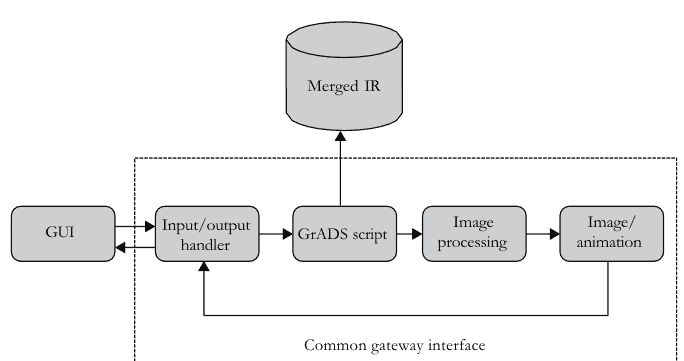

**图 5.1** HDAT 系统原理图。

图 5.1 显示了 HDAT 的系统原理图，由用 Perl 编写的 HTML 和通用网关接口（CGI）脚本、GRADS 脚本以及图像处理脚本组成。此外，还有一个交互式图像地图，用户可以通过它选择边界框来定义感兴趣区域（图 5.2）。选择 GRADS 是因为它被广泛用于提供气象观测数据和模型数据的易于访问、处理和可视化支持。它支持多种数据格式，如二进制、GRIB、NetCDF、GDF 和 HDF-EOS。由于合并的红外是网格化数据集（Janowiak et al. 2001），它可以被 GRADS 读取；因此，GRADS 可以直接作为后端引擎。使用 GRADS 可以显著缩短开发时间，因为不需要编写软件。GRADS 主要用于分析模拟和网格化数据；此外，还需要图像处理脚本（图 5.1）来生成黑白图像、去除噪声和去噪、增强图像等。

### 5.4.3 示例

**图 5.3** 2009年10月3日01 UTC 的大规模图像 (a)，显示了强台风帕玛（Parma，菲律宾北方的风暴）和梅洛（Melor，靠近马里亚纳群岛的东方风暴）。(b) 和 (c)：帕玛在连续和离散（单位为摄氏度）灰度级下的特写。

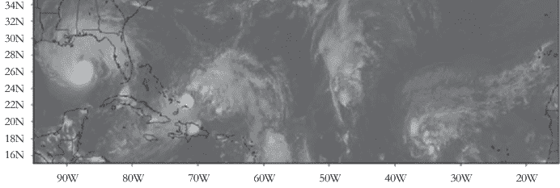

(a)

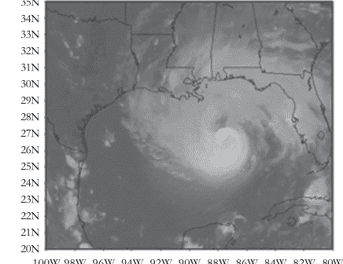

(b)

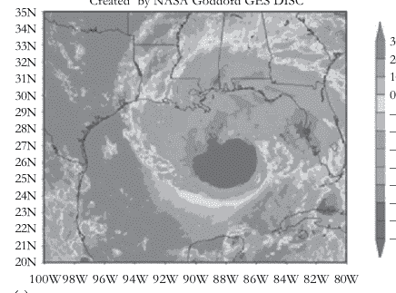

(c)

图 5.4 显示用户可以检索天气事件的图像。例如，图 5.4a 显示了大西洋中部的一次强冷空气过境，图 5.4b 显示了 2005 年 7 月 26 日印度孟买的创纪录降雨量。可以从 HDAT 获取它们的动画，以便每隔 30 分钟以黑白或伪彩色形式研究该系统的演变。

该工具可用于提供辅助信息以解释其他卫星任务。图 5.5 是使用合并红外产品作为其他卫星任务辅助信息的示例。图 5.5a 是来自 CloudSat 的江尼（Jangni）快照（Stephens 等人，2002），图 5.5b 显示了带有 CloudSat 蒋尼轨道演变的合并红外图像。

**表 5.7** HDAT 中的功能

| 功能 | 说明 |
| :--- | :--- |
| 兴趣区域的选择 | |
| 图像类型 | 黑/白、伪彩色 |
| 单图或动画 | |
| 时间增量 | 30 min–24 h |
| 图像大小选择 | |
| 伪彩色图像的色条 | |
| 色条最小和最大值调整 | |
| 单图或动画保存格式 | GIF 或动态 GIF |

## 5.5 结论


NASA 卫星衍生的全球降水及其辅助产品具有不同格式和复杂的数据结构，通常需要自定义软件进行数据处理、分析和可视化。在 GPM 时代，具有改进的空间和时间分辨率卫星产品已加入数据存档。传统的数据处理在提供实时数据服务方面存在困难，特别是在在线可视化和分析方面。这些为服务者带来了大数据挑战。面临的挑战包括：(1) 产品文件增大；(2) 标准和辅助产品中的异构数据结构；(3) 标准、区域和辅助产品之间的不同格式和结构；(4) 为高时间分辨率（例如每半小时）产品提供实时数据服务；(5) 应用需求。

我们已经在 GES DISC 讨论了解决这些问题的几种方法。高分辨率产品可以重新封装或重网格化为粗产品，以满足在线服务的用户需求。异构产品可以重新格式化，与现有软件配合。目前，GIOVANNI 正在使用这种方法整合不同格式的产品。这提供了扩展性和成本效益等许多优势。在开发在线可视化和分析解决方案时，必须考虑 FAIR 原则、开放科学、未来任务（例如大气观测系统 (AOS) (https://aos.gsfc.nasa.gov/)）以及用户需求。简而言之，地理空间大数据领域仍然令人兴奋。

# 致谢

这项工作由 NASA GES DISC 支持。

## 参考文献

- Acker, J. G. and G. Leptoukh, 2007, 地球科学数据的在线分析。Eos. Trans. Amer. Geophys. Union, 88(2), 14–17.
- Anthes, R. et al., 2007, 空间地球科学与应用：未来十年及之后的迫要求。National Academies Press, Washington, DC, pp. 61–78.
- Aonashi, K., Awaka, M., Hirose, T., Kubota, T., G. Liu, S. Shih, et al., 2009, GSMAP 被动微波降水检索算法：算法设计与验证。J. Meteol. Soc. Japan, 87, 111–136.
- Berghi, A. K., L. Shu, B. Imam, S. Sooros, and R. Kilajou, 2009, PERSIAN 降水估算：基于卫星的降水检索。J. Hydeteor., 8, 1412–1449; https://doi.org/10.1175/JHM-D-06
- Wersch, B., G. D., and R. Joyce, 2009, GIOVANNI 使用这种方法整合不同格式的产品。IEEE Trans. Sens., 47(1), 106–113.
- Bluesband, M., 1993, 卫星遥感：观测与理论，Vol. 2, Oxford University, p. 394.
- Campbell, J. B., 2008, 遥感导论，第 4 版。The Guild Press, New York, p. 626.
- Chu, L., S. Morin, 2006, TRMM 降水的组成。Adv. Mol. Sci., 23(1), 5–13.
- Iwara, S., 1921, 运动对称性的自然趋势及其在气象学中的应用。Quant. J. Meteol., 47(200), 277–283.
- Galler, A. and G. David, 2012, 数据路：使用数据库的高速分析。Geodesy and Remote Sensing Instrumentation (IGRESS), Germany, July 22–27, 2012 [链接: https://ieexplore.ieee.org/documentdetails.php?jspr=true&arnumber=6351952&type=abstract]
- Habib, E. A., Y. Tian, and R. Joyce, 2012, 利用密集观测和雷达估计的高分辨率 CHIRPS 产品。J. Hydeteor., 13, 1774–1798. https://doi.org/10.1175/JHM-D-12
- Hong, Y., D. Chang, J.-T. Chen, K.-L. Shu, and S. Sooros, 2007, 使用 NASA 事件网评估 PERSIAN-CCS 降水测量。J. Hydeteor., 8, 469–482; https://doi.org/10.1175/JHM-D-06
- **图 5.4** 过去的天气事件示例：(a) 大西洋中部的一个锋面过境；(b) 印度孟买的创纪录降雨事件。反射率 dBZ (CloudSat) 2008-9-25 04:55:24 – 05:02:39

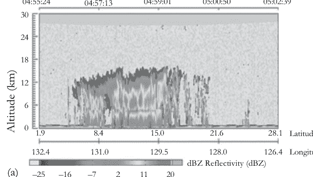

全球合并红外 (00min05Z25SEP2008)

由 NASA 迪德 GES DISC 创建

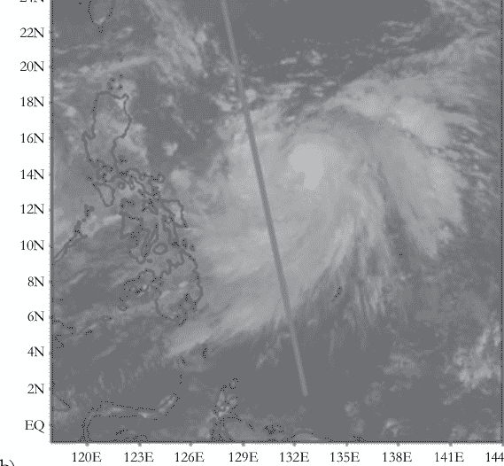

**图 5.5** 合并红外产品作为其他卫星任务辅助信息的示例：(a) 江尼（Jangni）的 CloudSat 快照；(b) 带有 CloudSat 轨道（直线）叠加的最近时间合并红外图像。

# 88

# 大数据

- Huffman, G. J., R. F. Adler, M. Morrissey, D. T. Volvin, S. Curtis, R. Joyce, B. McGavock, and J. Susskind, 2001, 基于多卫星观测的一度分辨率全球降水数据。J. Hydrometeor., 2(1), 3–60.
- Huffman, G. J., R. F. Adler, B. Rudolf, U. Schneider, and P. Keane, 1995, 基于结合卫星估算、雨计分析和数值天气预报降水信息的技术的全球降水估算。J. Climate, 8, 1284–1295.
- Huffman, G. J., D. T. Volvin, B. Krathuis, K. Roy, R. Joyce, C. J. J. Elkin, S. Sorooshian, E. F. Stock, J. Tan, D. Wolf, and J. Aies, 2016, 全球降水测量（GPM）任务的集成多卫星反演（IMERG）。19 in：Global Change Res., Vol. 67, Satellite Precipitation Measurement, V. Levizani, C. Kidd, D. Kirschbaum, C. Kumerow, K. Nakamura, F. J. Turk (Ed.), Springer Nature, Dordrecht, ISBN 978-0-330-24567-2/978-0-330-24568-9 (eBook), 343–355. https://doi.org/10.1007/978-0-330-24568-9
- Janowiak, E. R., R. J. Joyce, and Y. Yao, 2001, 多度全球半小时级像素分辨率红外数据及其应用。Bull. Am. Meteor. Soc., 82(3), 205–217.
- Joyce, R. J., E. R. Janowiak, A. Arkin, and P. Xue, 2004, CMOR: 一种在高时空分辨率下利用微波和红外数据产生全球降水估算的方法。J. Hydrometeor., 5, 487–503.
- Dieter, S. and Q. T. H. van Haars, 1995, 《卫星气象学导论》，Academic Press, San Diego, CA, p. 466.
- Liu, Z., Z. Wen, H. Liu, L. S. Liu, and L. Milch, 2010, 全球农业信息系统及其应用，in Applications: Advanced Geoscience Information, C. Yang, D. Wang, G. Miao, and R. Yang, Eds. Taylor & Francis, Bacon Raton, p. 353–361.
- Liu, Z., D. Ostenga, W. Teng, and S. Kempeler, 2011, 全球半小时像素分辨率红外数据集的在线可视化与分析。Bull. Am. Meteor. Soc., 92(4), 429–432, https://doi.org/10.1175/2010JOBAMS_2976
- Liu, Z., D. Ostenga, W. Teng, and S. Kempeler, 2012, 用于研究的热雨测量任务（TRMM）降水数据与服务，Bull. Am. Meteor. Soc., 93(4), 1317–1325, https://doi.org/10.1175/BAMS-D-11-00251
- Liu, Z., W. H. Liu, L. Chen, J. Lepton, and G. Vicente, 2007, 在线可视化与分析：在多学科研究领域中使用卫星数据的新方法。从卫星数据反演降水——EURINSAT 与事实。Adv. Glob Change Res., 28, 549–558.
- Liu, Z., W. H. Liu, L. S. Liu, G. Joyce, and S. Kempeler, 2009, 用于全球卫星降水算法验证与修正的信息系统原型。J. Appl. Meteorol.-IPWC Special Issue, 48(1), 2581–2589.
- Mahrovsky, M. V. A. Anagantar, H. N. Yooman, A. Jastoos, and K. Liu, 2012, 使用 PERN-CCSS 算法进行卫星降水估计。J. Atmos. Climate. Technol., 29, 922–932, https://doi.org/10.1175/JTECH-D-11-00041
- Moncrief, W. D., E. Wallis, J. J. Miller, A. Shapiro, G. R. Asrar, and J. Crouch, 2012, 多尺度组织与 YOTIC 全球野外活动。Bull. Am. Meteor. Soc., 93–11–1171–1187, https://doi.org/10.1175/BAMS-D-11-00233.
- Oasi, G. P., 1994, WOM 在国家减灾工作中的作用。Bull. Am. Meteor. Soc., 75, 1655–1661. https://doi.org/10.1175/1175
- Petherick, A., 2012, 模拟。Nature, 2, 228–229.
- Rozante, R., Moreira, G., and D. A., 2010, 结合 TRMM 与卫星观测的降水技术。Weather and Forecasting, 25, 885–894.
- Russ, J., 2007, 《图像处理手册》，第5版，CRC Press, Bacon Raton, FL. 8.
- Snijders, C., Matzat, U., and Reips, D., 2012, “大数据”：互联网时代的鸿沟。Int. J. Sci., 7
- Sorooshian, K.-D., Gao, X., and Vance, B., 2000, 针对云的卫星降水观测的评估。美国气象学会, 81, 2035.
- Schwenberg, R., 2017, 《遥感方法与应用》，第3版，Academic Press, Burlington, MA, p. 515.

# 6 地空或时间大数据的算法设计考虑

Terence van Zyl

## 6.1 动机

为了构建地空时间大数据的讨论框架，在数据的“三个 V”（速度、多样性和量）的背景下讨论它们是非常重要的。每一个 V 都为算法设计过程带来了特定的技术需求，而且每一个需求都需要被考虑。同样重要的是，更广泛的大数据社区面临的一些挑战已经存在于地空时间数据分析社区中，并将继续存在。

特别相关的是与大量栅格数据、点云甚至矢量数据相关的体量挑战。

# 地理空间和或大数据的算法设计考虑

空间谓词比关联规则挖掘更为复杂。在这里，忽略数据中的空间自相关性会导致虚假结果，例如聚类过程中的“盐和椒效应”（Goodchild et al. 1992）。

解决大数据挑战的方案虽然简单，但在大多数情况下并不易于追踪。简单来说，重要的是尽可能减少空间复杂度，目标是实现大多数情况线性的空间复杂度，如果无法实现，则目标是对数线性时间复杂度。然而，这通常是不可能的，需要其他技术（Watsavall et al. 2012）。

而且，即使没有丢失数据，空间数据在克服某些大数据挑战方面也面临着挑战。例如，针对固定窗口内数据聚合和过滤的空间自相关性，可以在不过度丢失信息的情况下，减少需要考虑的点总数。它还允许算法设计将距离足够远的点视为单个聚类，从而减少计算量。

## 6.1.1 挑战

许多复杂或更复杂的算法对底层数据结构具有可变且不可预测的遍历路径、模式和访问频率。由于这种某种随机性的数据访问，缓存一致性可能会被算法抖动和减速严重破坏。那些要求在多次迭代或步骤中重新考虑相同数据、或可能多次更改数据的算法，增加了对时间和内存的要求。在处理数据量和速度挑战时，需要从算法中消除这些多次迭代和更改，要么通过重构算法使其进行单次通过操作，要么使用巧妙的技巧来减少当前考虑的数据量。

另一个主要考虑因素是用于支持大数据算法的基础设施。例如，如果要求算法使用 `MapReduce`，那么迭代算法的某些限制就会产生。在为特定基础设施设计算法时，最小化共享资源竞争也是一个主要考虑因素。然而，可用基础设施和平台的选择变得非常庞大，几乎任何算法风格都可以放在相应的框架中（Cary et al. 2009）。

### 6.1.1.1 算法时间复杂度

许多时空算法的复杂度源于它们是为历史环境开发的，在这些环境中，时间和空间上的每个位置都是稀疏的。克服这种稀疏性的传统方法是确保位置之间彼此靠近。这种利用需要对数据的底层结构做出许多假设的复杂算法。大数据改变了这些原始考虑因素，允许人们将给定时间海量数据中的，在相对孤立的较小单元或子空间视为一部分。

考虑较小子空间的典型解决方案是分治法，即算法为每个子空间或每个子空间评估设计一个独立模型。最基本的例子是大型卫星时间序列数据立方，它们通常使用像素算法进行处理。

另一种方法是减少所用算法的复杂度，让海量数据引导过程而不是结构。应用简单算法可以归括为一条经验法则，即：数据量越大，使用的数据应越简单。

使用子空间或更简单的算法并非万灵妙药，而且通常海量数据会产生其自身的挑战。例如，海量数据由于随机误差往往会以许多方式聚类，你通常可以发现任何你想要的的模式。这种算法设计者的偏见可能会导致实体发现的是他们期望的模式，而不是实际存在的模式。

### 6.1.1.2 算法空间复杂度

许多算法面临的一个经典挑战是需要考虑观测值对之间的关系，以构建二次空间复杂度矩阵，例如空间权重 `W`、距离 `D` 或相似性 `S`。对于海量数据，此矩阵的大小超过系统内存容量是不可避免的。在时间序列应用中，由于时间的 1D 特性及其独特的自然顺序，这一挑战较小。然而，当考虑对象之间的空间关系时，组合数量是巨大的，需要在更多维度上进行考虑。例如 2D 空间的情况，不存在对象的自然顺序（Shekhar et al. 2003）。

当不仅需要考虑欧几里得、曼哈顿等可测距离关系，还需要考虑连通性或相似性等语义关系时，大数据的要求更加极端。为了克服这一复杂的挑战，形成一个 `N` 矩阵，其中第 `i` 和第 `j` 元素存储这两个元素之间关系的权重。注意，这种关系是双向的，在不同方向上可能有不同的值。

为了克服大矩阵 `W`，算法设计者使用了三种主要方法：首先，关系需要随着算法的进展迭代计算；其次，对于某些收敛到正确答案的算法，可以使用数据批或子集来不断完善模型参数；第三，权重矩阵可以映射到某些低维空间技术中，如多尺度尺度（MDS）。

现在考虑大数据的挑战：要么数据量巨大（在这种情况下矩阵呈平方级增长），要么速度极快（对于具有高多样性的非结构化数据，此矩阵可能无法完全指定，还需要处理缺失或重叠值）。这由于一个常见的需求——反转权重矩阵 `W` 而变得复杂，目前这至少是一个 `O(N^3)` 操作。遗憾的是，使用权重矩阵是许多传统地理空间统计算法中处理自相关机制的常用做法，因此，许多此类地理空间统计技术在地理空间大数据中变成了不可行的解法（Vatsarai et al. 2012）。

## 6.2 地理空间大数据算法：现状

空间和/或时间算法需要处理多样化的……。

- 时空检测
- 时空插值
- 时空预测
- 时空共出现
- 时空提取

对于半结构化和非结构化数据，复杂性源于处理非结构化数据并提取可用信息的需求。在特征数量巨大的情况下，特征增加了额外的时间复杂度，导致维度挑战，且它们之间往往相互相关，导致不稳定性。此外，由于观测值来自不同的来源，且是针对同一现象的不一致测量，因此大量的特征可能需要进行合并。

多样性（Variety）是大数据领域的一个开放性挑战，可以通过将处理数据量或速度的技术与有效的降维技术相结合来解决。当与有效的降维技术结合时，这些方法有助于克服各种挑战。然而，处理非结构化数据带来的时空复杂度尚未得到很好的理解。

另一方面，考虑到与非结构化数据相关的时空特征，可以通过利用自相关性降低某些复杂性，从而获得更好的解决方案。

## 6.3 经典地理空间和时间算法的分析

简要考虑地理空间统计和地理空间分析社区常用的一些经典地理空间和时间算法。这些算法在历史上大多数是为稀疏数据场景开发的，例如克金（Kriging），用于利用有限数量的核心样本来插值地质属性。针对这一点，经典算法意识到了大数据的挑战，并旨在通过做出适当的假设从相对较小的样本数据中提取尽可能的信息（Shekar et al. 2021）。

许多此类经典算法的主要限制是权重矩阵 `W`，它在空间上施加了 `O(N^2)` 的约束，如果该矩阵求逆，则至少有 `O(N^3)` 的约束，在基于似然的情况下会导致 `O(N^3)`。


首先，一些用于分类和回归常用的算法是地理加权回归（Geographically Weighted Regression）和逻辑回归（Logistic Regression）。这两种算法都有 $O(N^3)$ 的空间复杂度，但通过使用各种改进的优化技术，可以大幅降低它们的时间复杂度。

许多此类算法使用了典型的空间插值，例如克金，它具有 $O(N^3)$ 的空间复杂度。许多算法中使用的高斯估计具有 $O(N^2)$ 的空间复杂度；但通过一些巧妙的技巧可以显著改进。

在考虑参数时，极大似然估计是时空建模中的常用方法；但它会导致 $O(N)$ 的时间复杂度。

所有这些算法的共同点是涉及到巨大的空间和计算需求。显而易见的是，解决时空分析问题即使对于中等规模的数据，也需要对这些算法进行大量的处理（Vatsarai et al. 2012）。

## 6.4 地理空间大数据算法适配的方法

本节介绍了若干用于大数据算法扩展的方法，并暗示了这些方法可能如何应用于第 6.3 节介绍的经典算法。

### 6.4.1 分治法

处理大量数据时，一个重要的考虑因素是 `[N × N]` 矩阵远大于两个 `[N/2 × N/2]` 矩阵。这一事实被分治法显式利用：

算法设计的分治法要求将问题划分为更小的子问题，每个子问题都可以被解决，并从中组合出整体解决方案。在最简单的情况下（例如那些具有许多并行机会的问题），可以完全隔离地考虑划分问题的每个部分，而无需融合结果。这种高度并行技术的示例被遥感社区在对大型数据立方体进行时间序列分析时所使用。它不是独立地考虑每个像素并分析每个像素的时间序列。图 6.1 显示了基于每个像素使用 `Mann-Kendall` 变化检测算法的情况。另一种方法是使用空中边界（如地理边界）甚至自然边界（如河流）将整个区域划分为若干较小的区域，然后对它们进行单独分析。

在数据速度的情况下，可以通过将数据划分为子流来应用相同的技术，每个子流都可以被单独处理，并采用相同的分治方法。

### 6.4.2 采样（Subsampling）

采样是一种使用数据子集作为数据代表的技术。如果以正确的方式选择此子样本，准确性的损失将降至最低。采样的另一个优势是它减少了对时间和空间的需求。对于非结构化数据，可以在不使用全集的情况下对数据进行建模。采样还有第二个影响，它通常会减少数据中的噪声。

### 6.4.3 聚合（Aggregation）

另一种常用方法是通过聚合数据来减少数据。自相关性提供了聚合的机会，因为彼此靠近的位置本质上是相关的，可以聚合。通过将距离的区域视为单个实体，可以减少总数。

### 6.4.4 过滤（Filtering）

处理大数据挑战的一种常用方法是过滤数据。这与采样不同，采样是根据某些标准选择数据子集，我们认为该数据子集将代表建模目的所需的数据。

图 6.2 中心像素及其周围 8 个像素经过过滤以形成单个特征。

### 6.4.5 在线算法 (ONLINE ALGORITHMS)

在线算法是在输入数据项到达时就需要立即采取行动的算法。例如，考虑一种消息在到达后需要立即路由的场景；在这里，数据的近实时约束意味着当每一项到达时，必须选择一条路由并处理该项。

在线算法的需求通常是业务需求的结果，而非专门由于大数据本身引起的。然而，大数据会加剧在线场景下的状况。一个例子是高多样性数据，例如地理位置化的自由文本流，它需要在每条消息到达时就对其进行处理。在这里，处理自由文本的算法对处理需求造成了巨大的时间压力。

### 6.4.6 流式算法 (STREAMING ALGORITHMS)

流式算法与在线算法类似；但其主要考虑因素不是每个数据项都需要立即采取行动，而是空间限制。在这种情况下，答案可以推迟到后期阶段，但由于资源有限，通常需要对考虑的数据量进行某些限制。例如，一种异常检测算法，如水质异常；在这里，并不是每一项都需要立即处理；然而，由于考虑的是连续的数据流，内存限制将很快变得明显，因此算法将只需要考虑数据的某些子集。

流式算法的主要挑战与资源限制有关，这可能是由于用于计算的时间有限，也由于用于存储数据的内存有限。尽管如此，它们是处理大数据挑战的经典方法，因为它们涵盖了所有“V”特征（大数据特性）的需求。

### 6.4.7 迭代算法 (ITERATIVE ALGORITHMS)

在内存需求导致算法无法保存所有待考虑数据的情况下，可以通过将算法从批量处理算法（`bulk algorithm`）更改为迭代算法来解决问题。在这种情况下，算法可以通过使用迭代方法来减少其内存占用，从而增加时间复杂度。

通常，迭代算法有一个副作用，即它们可能会降低相关性并导致算法性能下降。然而，在算法由于内存限制而变得不可计算的情况下，这可能是唯一的选择。

迭代算法作为自然解决方案的另一个地方是高速度场景。在这里，数据需要在在线情况下被考虑（即我们需要在每个数据项到达时就获得一个结果），或者在流式情况下被考虑（即我们自然地需要在每个项到达时考虑它，直到满足某些标准或发生某些事件）。

### 6.4.8 松弛 (RELAXATION)

通常可以通过一个更容易解决的弱化问题来对困难问题进行近似或松弛。松弛可以被看作减少算法总时间复杂度或空间复杂度的方法。对约束的松弛使用在例如整数规划中已被广泛考虑。将约束从离散实体松弛为（例如）实数，这种相同的方法可以允许许多算法在地空场景中运行。例如，使用更弱的距离概念，或将其他空间约束（如连通性）松弛为仅欧式距离（Chandrasekhar and Jordan 2013）。

### 6.4.9 收敛算法 (CONVERGENT ALGORITHMS)

收敛算法不会立即得出解决方案；相反，算法的每次迭代或考虑的每个数据项都会视为解决方案。在其他方面，每次迭代都减少了解决方案中的不确定性并减少了误差。由于许多模型参数化或模型探索都是由于优化函数，因此这种优化通常是收敛的。例如，用收敛算法（如随机梯度下降）来替换线性回归的闭式解的经典例子。

收敛算法的主要优势在于需要近实时或以在线方式提供解决方案的高速度数据情况。在这里，在如此短的时间内获得一个不完善的解决方案也比完全没有解决方案更有价值。例如，某些异常天气检测；在事件发生后发出警告几乎没有意义（Kleinberg and Sandler 2003）。

鉴于海量数据，使用收敛算法也是合理的，因为它们提供了一种在计算努力与风险之间、或在内存使用与风险之间进行平衡的机制。换句话说，算法设计者根据所花费的时间或使用的内存量，选择他们满意的误差范围。鉴于目前商品计算（例如云计算）的出现，这可能是一个重要的考虑因素。

### 6.4.10 随机算法 (STOCHASTIC ALGORITHMS)

随机算法利用某些随机性作为寻找解决方案或克服对抗场景的机制。随机算法有两种形式：随机算法和概率算法。诸如快速排序等随机算法可以保证找到正确解；但它们不保证时间复杂性的上界。诸如蒙特卡洛和维加拉斯等概率算法对计算复杂度不设任何限制，但在蒙特卡洛算法的情况下，在无限时间内，可以保证收敛到正确解，也可能不保证。随机算法在大数据场景中尤为重要，即使是具有收敛到良好解的启发式方法对于其用例也足够了。例如，热优化（warm optimization）使用随机算法或启发式方法来优化给定函数，同时也允许算法设计者决定总计算时间。

### 6.4.11 批量与在线算法 (BATCH VERS ONLINE ALGORITHMS)

时空模型的传统方法（特别是其在环境科学中的应用）是以离线批量方式对模型进行参数化的。也就是说，感兴趣的区域和算法生成模型所需的所有数据都被提供，然后作为一个批次进行处理。大数据需要考虑连续处理的流数据。流式算法和在线算法也用于实时监控和异常检测等场景。实时监控和异常检测的一些例子包括自然灾害、疾病和动乱。用于实时监控和异常检测的数据来自传感器流、模拟模型或非结构化文本消息。

车辆跟踪等移动应用对在线算法空间提出了昂贵的要求。这些应用通常有路由需求或近实时处理需求。在车辆跟踪示例中，典型的异常检测可能涉及车辆盗窃。在这里，立即响应需要处理大数据的两个 V：体量和多样性（相对于异常的二氧化碳排放）。

### 6.4.12 降维 (DIMENSIONALITY REDUCTION)

处理多样性挑战的一种机制是通过降维。降维假设数据位于高维空间中的低维流形上。已经提出了各种技术，最常见的是主成分分析。然而，大多数技术具有很高的时间空间复杂度。在估计协方差矩阵时使用协方差收缩或采样等松弛方法可以大幅降低复杂度（Kaufman et al. 2008）。

### 6.4.13 示例 (EXAMPLE)

为了让之前处理大数据的技术更具体，让我们考虑以下示例。虽然这个示例在大数据设置下是人为设计的，但它服务于评估某些技术在执行时间与解决方案质量方面的目的。使用的算法是可变核密度算法，用于产生活动火的密度估计。图 6.3 显示了该算法的典型输出。这意味着在核密度估计中，每个点都使用唯一的带宽，而不是传统的单一带宽。用于计算带宽的算法是极大似然留一核密度估计器。

图 6.3 10 年间（2002-2012 年）每年活动火灾事件的核密度。深灰色表示每年的事件较多。

## 表 6.1

展示了核密度估计算法的改进方法，以及这些改进带来的速度提升和相关的对数似然得分

| 改进方法 | 时间 (s) | 对数似然 |
|---|---|---|
| 迭代法 | 38335.44 (10.64 h) | -1.196 |
| 松宽约束条件 | 139.69 | -1.225 |
| 放宽收敛标准 | 70.67 | -1.263 |
| 采样 | 45.21 | -1.265 |

使用该算法处理所有 N 个元素的时间复杂度为 $O(N² + D³)$，空间复杂度为 $O(N² + N \cdot D^²)$。

首先，为了使算法具有可操作性，使用了算法的迭代版本，该版本空间复杂度为 $O(N \cdot D²)$，用于计算所需点之间的距离。为了降低时间和空间复杂度，放宽了某些约束，并将核密度估计器的带宽由全协方差矩阵表示简化为对角矩阵，这有效地消除了昂贵的矩阵求逆运算。结果是，时间复杂度降低到 $O(N²)$，空间复杂度为 $O(N, D)$。现在由于使用了迭代算法，可以放宽收敛标准，并允许数据量引导过程，使得每个数据点仅需一次随机下降优化步。

接下来，考虑使用采样来选择点集以计算带宽的情况。如果采样了部分比例 $f = 0.3$ 的样本，带宽计算的时间可以缩短；需要注意的是，这并不会改变时间复杂度。为了克服任何对抗性决策，对每个带宽都会随机选择子样本，以引导给定区域内 $s$ 收敛到正确值。

表格显示了在使用上述技术时算法多次运行的结果，这些技术旨在使算法在大数据环境下更具可操作性。在此示例中，可以明显看出使用采样对准确性（似然得分）几乎没有影响，但执行时间显著减少。请注意，通过放宽算法约束并允许其在对角设置下运行，获得了巨大的时间。诚然这会导致某些精度的损失，但考虑到可以在 45 秒而非 10 小时内获得解决方案，这种精度的损失是可以接受的。

## 6.5 开放挑战

在考虑克服大数据挑战所需的某些策略时，仍需探索的一些主要开放挑战包括：

- 简单模型的集成模型与当前的空间模型相比如何？当从一种模型转换到另一种模型时，我们是否能够作为数据的函数完全描述损失函数？在大数据允许使用简单模型集成时，何时有效？

- 当我们有效使用过滤时，适用于哪些场景以及哪些数学和统计假设？在解决方案完全退化并不再代表实际解决方案之前，允许多大程度的过滤？我们是否能够完全描述所应用的过滤量、数据量与解决方案质量之间的关系？在什么类型的数据下允许什么类型的过滤？

## 6.6 总结

本文评估了算法设计者可用于使地理空间和时间大数据挑战更具可操作性的技术。介绍的技术包括分而治法、松宽约束、过滤、采样、降维、在线算法、迭代算法、聚合算法和随机算法。当这些技术结合使用或与大数据结合时，通过识别数据时空特性所提供的机遇，可以在时间和空间复杂度上获得巨大的收益。

可以说，在解决地理空间和时间大数据挑战方面正在迈进；然而，仍存在许多开放挑战，且永远不存在“万灵药”。目前阶段很明确的是，对于大数据、时间和空间复杂度之间的关系，以及在使用算法有效处理大数据时产生的松宽或近似解决方案的风险，缺乏足够的的形式化和理解。

## 参考文献

Cary, A., et al., 2009. Experiences on processing spatial data with MapReduce. Scientific and Statistical Database Manager. Springer, Berlin, Germany.

Chandrasekan, et al., 2009. Experiences on processing spatial data with MapReduce. Scientific and Statistical Database Manager. Springer, Berlin, Germany. （注：源文件中重复条）

Chandrasekan, et al., 2009. Experiences on processing spatial data with MapReduce. Scientific and Statistical Database Manager. Springer, Berlin, Germany. （注：源文件中重复条）

*（自纠：源文本包含重复/碎片化的引用。我将根据提供的 OCR 内容提供清理后的列表。）*

Cary, A., et al., 2009. Experiences on processing spatial data with MapReduce. Scientific and Statistical Database Manager. Springer, Berlin, Germany.

... （OCR 中的剩余引用为碎片化/不完整，我将保持提供的文本）。

# 104 大数据

使用窗口化方法或更复杂的机器学习算法（如神经网络）。这从以下几个方面增加了大数据给机器学习带来的挑战：

- 窗口的使用增加了维度（dimensionality）。

- 包含空间关系增加了维度（dimensionality）。

- 复杂的地理空间机器学习算法增加了学习的复杂性。

目前机器学习社区处理大的方法的方法是使用大量的简单学习器，然后通过海量数据本身来引导学习。尽管这种方法在地理数据上非常有效，但它的缺陷在于它在某种程度上忽略了空间和时间自相关性。此外，大量的数据意味着大量的噪声，而且根据其本质，这些噪声倾向于聚类，产生虚假模式并使学习过程复杂化。这些挑战在地理空间背景下被进一步放大，因为误差是自相关的（Gilardi et al. 2003; Vatsai et al. 2012）。

## 7.1.1 监督学习、无监督学习和特征学习

机器学习有三个主要领域适用于所考虑的地理数据分析任务：(1) 监督学习、(2) 无监督学习和 (3) 特征学习。

### 7.1.1.1 监督学习

监督学习主要关注分类、插值和预测。也就是说，在监督学习的情况下，学习器被给定一组代表某些现象观测的示例（examples）或输入特征；在地理大数据的案例中，这些特征中的一个或多个可能是空间特征。监督学习器还会为每个训练示例提供一个标签。例如，训练示例的特征可以是质量值，而标签可以是“可饮用”或“不可用”。学习器的功能是学习从训练示例到输出标签的映射或分类。一旦学习了这种关系，就可以使用该学习器来为未标记的数据标记标签。

当标签集为连续值集时，学习过程是回归而非分类（Mitchell 1997）。由于学习到的标签可能是未来的值，因此可以使用监督机器学习进行预测。当我们希望为某个未标记的地理位置获取一个标签时，可以使用监督学习进行插值。此外，由于许多机器学习技术是复杂的，并且能够处理非线性问题，因此它们在处理具有多样性（variety）的大数据挑战时特别有用（Kotsiantis et al. 2007）。

### 7.1.1.2 无监督学习

另一方面，无监督学习主要关注示例的聚类或分组，可以有效用于异常检测，并作为降维过程中的一个预处理步骤。无监督学习的主要目的是为未标记的示例寻找结构。一旦找到结构，就可以以以下方式之一对其进行利用：首先，它可以以某种方式聚合数据，代表一组代表性或泛化示例的子集。其次，不符合所学结构的新示例可以被标记为异常并进行妥善处理。第三，它可以提供一种以更紧凑的方式表示数据的机制，例如降维或密度估计的参数化。在地理空间数据的案例中，向训练示例中添加空间特征是自然的，这作为聚类可以采纳的一组额外维度，且其用途也得到了地理学第一定律的验证。需要注意的是，无监督学习的许多功能（如聚合、代表性示例、降维和密度估计）是解决大数据容量挑战的强大工具（Ng et al. 1994）。

### 7.1.1.3 特征学习

特征学习通常是一个预处理步骤，侧重于从数据中提取用于学习的特征。例如，给定一组具有显式特征的训练示例，训练示例内部还存在其他隐式特征，这些特征可以被学习和提取以用于监督或无监督学习技术。学习和提取这些特征的目的是将它们提供给进一步的机器学习步骤，包括进一步的特征学习，后者可能用于实现这些提取出的特征以改进它们的学习效果。地理空间特征学习是一个相对新的领域，从表 7.1 的流行程度可以看出，尽管如此，它在未来可能具有前景（Coates et al. 2010）。

## 表 7.1 地理空间社区中使用的各种机器学习算法的时间、空间复杂度及流行程度

| 技术名称 | 训练复杂度 | 空间复杂度 | 使用复杂度 | 地理空间流行度 |
| :--- | :--- | :--- | :--- | :--- |
| 监督学习算法（分类） | | | | |
| 人工神经网络 | O(D,N,K) | O(N,D) | O(D,K) | 10 k |


| 算法 | 训练复杂度 | 空间复杂度 | 测试复杂度 | 文献量 |
| :--- | :--- | :--- | :--- | :--- |
| 朴素贝叶斯 | O(N) | O(N,D) | O(N,D) | 6 k |
| 决策树 (C4.5) | O(D,N log) | O(N,D) | O(D log N) | 3 k |
| 逻辑回归 | O(N^2) | O(N) | O(N) | 3.9 k |
| 支持向量机 | O(D,N) | O(N,D) | O(D) | 0.5 k |
| 隐马尔可夫模型 (EM) | O(N) | O(N,D) | | 31 k |
| K-近邻 | O(1) | O(N,D) | O(D) | 21 k |
| 贝叶斯网络 (EM) | O(N) | O(N,D) | | 2 k |
| 归一化 | O(N^2) | O(N) | O(N,D) | 15 k |
| 高斯过程 | O(N^2) | O(N,D) | O(D) | 5 k |
| 集成学习 (ensemble) | | | | |
| Boosting (AdaBoost) | O(N,D) | O(D) | O(D) | 8.5 k |
| Bagging | O(N,D) | O(D) | O(D) | 18 k |
| 随机森林 | O(N,D) | O(D) | | 8.5 k |
| 无监督学习算法（聚类） | | | | |
| 自组织映射 | O(N^2) | O(D) | | 24 k |
| K-means | O(N,D) | | | 47 k |
| 混合模型 (EM) | O(N,D) | O(D) | | 35 k |
| 层次聚类 | O(N^2) | O(D) | | 42 k |
| PCA | O(D^2) | O(D) | | 15 k |
| 核 PCA | O(N,D) | O(D) | | 5 k |
| Isomap | O(N) | O(D) | | 1.5 k |
| 线性判别分析 | O(N^2) | O(D) | | 13 k |
| 无监督学习（密度估计） | | | | |
| 核密度估计 | O(N) | O(D) | | 9 k |
| 自适应 KDE | O(N^2) | O(D) | | 5 k |
| 特征学习 | | | | |
| 自动编码器 | O(N,D) | O(D) | | 5 k |
| RBM | O(N,D) | O(D) | | 5 k |

*注：EM，期望最大化。使用 Google Scholar 评估这些技术的趋势。*

# 地理空间大数据的机器学习

某些机器学习技术，特别是无监督学习组中的技术，可以直接与空间权重矩阵 `W` 协同工作。这里需要将观测值的非空间特征包含在 `W` 中，并在过程中确保每个特征之间的权重保持不变。对于应该如何操作，并没有硬性的规定，通常解决方案往往偏向于艺术而非科学，需要通过尝试、错误和经验来完成。此时必须指出，在涉及数据量（Volume）的大数据挑战中，使用 `N × N` 数据结构（权重矩阵）并不是一个可行的方案，因为其空间复杂度为 `O(N^2)` (Vatsai et al. 2012)。

另一方面，在许多涉及运行时间/经纬度观测值之间的距离或相似性的任务中，通常可以通过计算并降低算法的复杂度。即使是连通关系（如相交或相邻），也可以在运行时进行计算。能够在运行时计算关系意味着几何形状将作为特征向量的额外维度进行存储。将这些几何形状作为特征向量的一部分，要求在进行特征相似性或距离计算时，对使用这些值的机器学习算法进行特殊修改。另一种解决方案是使用多维尺度分析（MDS）结合权重矩阵 `W`，将权重从 `W → R^n` 进行转换，并将其添加到特征向量中，得到一个 `R^(n+D)` 维的特征向量。

## 7.1.3 三个V

### 7.1.3.1 量（Volume）

考虑大规模地理空间时间数据的第一个挑战，特别是远程卫星数据。从历史上看，机器学习一直是处理包括地理空间栅格数据在内的大量图像数据分类和聚类挑战的有效工具。机器学习也被用于许多时间序列预测以及针对海量数据的地理空间向量数据分类和预测任务。鉴于其历史，预计机器学习将继续是应对地理空间大数据挑战的有效工具。

### 7.1.3.2 速度（Velocity）

数据速度根据系统的最终用途对机器学习算法提出了特定的用户需求。如果目的是训练一个分类器来标记输入数据，则可以使用数据的子集来训练机器学习算法，并在新示例出现时使用训练好的模型进行处理。在这个示例中，机器学习算法训练的时间和空间复杂度并不显著，关键在于其使用的时间复杂度。另一方面，如果机器学习用于某些需要以在线方式持续更新学习的异常检测，那么训练和使用的复杂度在计算上都需要是经济的。更正式地说，这两种情况可以用驱动现象观测的底层过程的平稳性表示。如果过程是平稳的，则可以离线学习，这种学习只需要样本。如果过程是非平稳的，则需要持续学习并进行在线学习。

### 7.1.3.3 多样性（Variety）

考虑如文本形式的非结构化数据。可以使用监督学习根据内容的内容学习对文本文档进行地理编码。机器学习是处理非结构化数据的有效工具，决策树等某些技术可以有效地应用于不同类型的数据（序数的、类名的等）。机器学习还经常被应用于由来自许多源的多样化数据所带来的高维数据挑战。由于这里的知识体系非常广泛，且考虑到机器学习在与多样性相关的大数据挑战中被广泛使用，预计且已经证明机器学习是处理地理空间大数据多样性的有效工具。

## 7.2 地理空间大数据特征学习

新兴的机器学习范式之一是特征学习或深度学习。考虑一下，从历史上看，让机器学习在某个领域生效需要一个理解该领域的专家。专家会选择合适的特征，并理解转换类型，以构建实用的特征和适用于所选特征的适当机器学习技术。这种对领域知识的需求在地理空间社区中尤为普遍，例如，那里的人甚至被称为“遥感专家”。特征学习旨在通过允许特征构建过程自动化（实际上是如此），将机器学习提升到下一个水平。这是实现机器学习全部能力的重要一步。

大数据为特征学习提供了两个机会，因为首先，大数据的高量（实例和维度）和高多样性，使得单一领域专家能够构建特征的前景变得遥遥不可及。尽管特征学习技术在其他领域已经通过长时间的栅格化大数据序列中被广泛应用，但在视频这种情况下，它们尚未被广泛应用于大量的地理空间数据。鉴于视频特征提取的需求之间存在巨大的相似性，有良好的迹象表明特征学习技术将非常有效 (Coates et al. 2010)。

现在正在出现并提供研究机会的是，学习到的特征在旋转不变性上达到何种程度，有良好的迹象表明它们可以是平不变的。对于空间向量数据来说，这个问题比栅格数据小得多。我们需要的是一种可靠的旋转不变性理论。为了实现这种能力，应该或需要发生哪些修改？

### 7.2.1 大数据特征学习方法

最著名的特征学习技术是受限玻尔兹曼机和自动编码器。这两种技术都是使用无监督学习范式执行特征学习的人工神经网络。输入层接收训练示例，并使用适当的更新规则。最终是获得一组对应于数据某些固有属性的新特征。这两种技术的计算时间和空间复杂度都是线性的（见表 7.1），使其非常适合大数据应用。未来，地理空间特征学习可能是大数据工具箱中无价之宝。

## 7.3 降低地理空间大数据的维度，使其可行

### 7.3.1 特征构建

特征构建关注在训练示例的特征向量中创建额外的特征，以允许机器学习更有效。通过向机器学习技术提供捕捉现象底层属性的特征或克服学习技术局限性的特征，可以获得更好的结果。例如，通过这种方式转换特征使其线性，为线性机器学习技术提供非线性特征。在地理空间背景下，一种特征构建技术之一是通过使用窗口化。

#### 7.3.1.1 栅格数据中的窗口化

地理空间背景下的栅格数据是将平面 `P`（通常是 2D）划分为若干个连接的单元。栅格数据的典型示例是如卫星数据的图像像素。在考虑栅格的某个位置 `P_i` 时，窗口化考虑了相邻单元，如图 7.1 所示。决定考虑哪些相邻单元以及如何对其进行加权和转换的被称为窗口函数。在最简单的情况下，四邻接窗口将考虑像素的左侧、右侧、上方和下方，如图 7.1 所示。

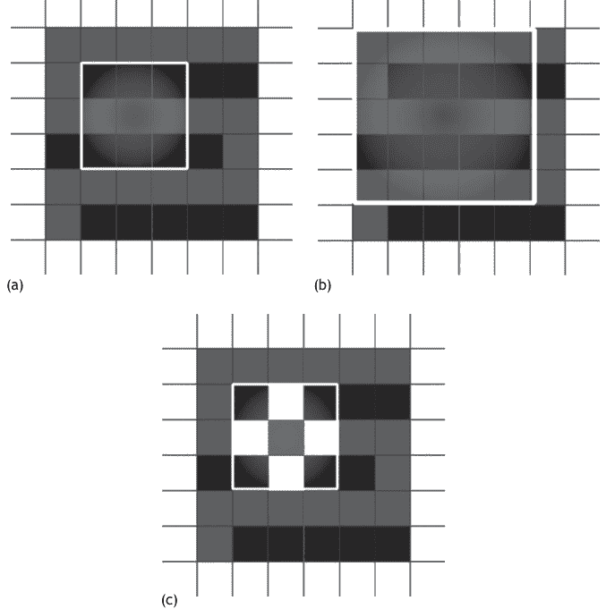

**图 7.1** (a) 以白框中间的像素为中心的典型窗口函数。窗口对周围像素应用任何函数。(b) 以相同像素为中心的更大的窗口函数。(c) 以相同像素为中心的非常简单的窗口函数，仅考虑左侧、右侧、上方和下方的像素。

# 大数据

# 110

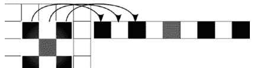

**图 7.2** 一幅展示了如何使用简单的 8 邻域窗口函数将窗口中的像素转换为特征向量的特征的图。

（海拔和栅格数据的时间）作为机器学习训练示例的特征向量的一部分被捕捉。其次，它允许将 `N × M` 的栅格数据转换为 `D × 1` 的特征向量，如图 7.2 所示，这些向量可以作为这些需要此类格式的机器学习算法的训练示例。

然而，窗口变换并不是没有问题的。首先，变体特征向量不具有旋转不变性、平移不变性或缩放不变性。事实上，机器学习中的主要练习之一是通过对窗口矩阵重构进行适当的变换，使移动平均集变为具有旋转、平移或缩放不变性的特征。其次，确定窗口函数的最优大小或参数也是一项挑战，以确保提取的数据子集能够捕捉机器学习所需的最相关的自相关特征。然后，第三个挑战是窗口化会导致栅格中任何全局结构的丢失，并且尚不清楚在考虑局部结构的同时如何保持这种结构。

#### 7.3.1.2 时间序列地理数据中的窗口化

现在，考虑某些现象（如水温）的现场观测序列。进一步，考虑进行这些观测的传感器不是静态的，而是移动的。这里存在观测的时空自相关场景。为了在特征向量中捕捉这种自相关性，使用了窗口函数来确定哪些相邻观测特征应该作为特征向量的额外特征。典型的窗口函数可以作为移动平均，其对时间观测颜色的权重高于其他值，如图 7.3 所示。类似的指数或线性权重也可以应用于空间数据或相似性。例如，在构建特征向量时可能只考虑 k 近邻。此外，例如，空间自相关可以通过产生单个值并将其添加到特征向量中的窗口函数来捕捉，例如局部梯度。

通常，使用窗口化会产生一系列直接的挑战：捕捉自相关性的适当窗口大小是多少？窗口化本身是否有意义？例如，理论上已经证明，在无监督学习中使用窗口化是没有价值的？

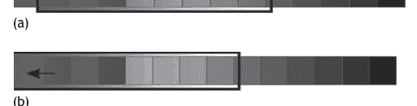

**图 7.3** (a) 时间序列的窗口选择和 (b) 同一窗口函数的左移版本。

# 地理空间大数据的机器学习

此外，尽管窗口化涉及全局结构，但考虑到空间和时间自相关性，局部模型在地理空间机器学习的背景下通常是有意义的。

窗口化的主要挑战之一是缺乏统一的理论。相对于底层数据的变异性、底层结构的全局和局部属性或正在学习的特定现象，应该使用窗口函数的什么大小和参数化？

#### 7.3.1.3 大数据特征构建

使用窗口化进行地理空间特征构建时，大数据面临的主要挑战是它增加了特征向量的维度。例如，考虑 `20 × 20` 的邻域像素窗口可以将特征维度增加 400。考虑到卫星数据分辨率的提高，且空间上的关系是二次的（或者在卫星数据时间序列的情况下是三阶的），使用这种技术时空间复杂度可能会迅速增长。在考虑大数据挑战时，这种维度的增加会导致数据量和复杂性的同时增加。

### 7.3.2 降维

尽管窗口化涉及全局结构，但考虑到空间和时间自相关性，局部模型在地理空间机器学习的背景下通常是有意义的。

窗口化的主要挑战之一是缺乏统一的窗口化理论。相对于底层数据的变异性、底层结构的全局和局部属性或正在学习的特定现象，应该使用窗口函数的什么大小和参数化？

使用窗口化进行地理空间特征构建时，大数据面临的主要挑战是它增加了特征向量的维度。例如，考虑 `20 × 20` 的邻域像素窗口可以将特征维度增加 400。考虑到卫星数据分辨率的提高，且空间上的关系是二次的（或者在卫星数据时间序列的情况下是三阶的），使用这种技术时空间复杂度可能会迅速增长。在考虑大数据挑战时，这种维度的增加会导致数据量和复杂性的同时增加。


# 地理空间大数据的机器学习

## 7.3.1 时间序列地理数据中的窗口化

尽管窗口化涉及全局结构，但考虑到空间和时间自相关性，局部模型在地理空间机器学习的背景下通常是有意义的。

窗口化的主要挑战之一是缺乏统一的窗口化理论。相对于底层数据的变异性、底层结构的全局和局部属性或正在学习的特定现象，应该使用窗口函数的什么大小和参数化？

### 7.3.1.3 大数据特征构建

使用窗口化进行地理空间特征构建时，大数据面临的主要挑战是它增加了特征向量的维度。例如，考虑 `20 × 20` 的邻域像素窗口可以将特征维度增加 `400`。考虑到卫星数据分辨率的提高，且空间上的关系是二次的（或者在卫星数据时间序列的情况下是三阶的），使用这种技术时空间复杂度可能会迅速增长。在考虑大数据挑战时，这种维度的增加会导致数据量和复杂性的同时增加。

海拔和栅格数据的时间）作为机器学习训练示例的特征向量的一部分被捕捉。其次，它允许将 `N × M` 的栅格数据转换为 `D × 1` 的特征向量，如图 7.2 所示，这些向量可以作为这些需要此类格式的机器学习算法的训练示例。

然而，窗口变换并不是没有问题的。首先，变体特征向量不具有旋转不变性、平移不变性或缩放不变性。事实上，机器学习中的主要练习之一是通过对窗口矩阵重构进行适当的变换，使移动平均集变为具有旋转、平移或缩放不变性的特征。其次，确定窗口函数的最优大小或参数也是一项挑战，以确保提取的数据子能够捕捉机器学习所需的最相关的自相关特征。然后，第三个挑战是窗口化会导致栅格中任何全局结构的丢失，并且尚不清楚在考虑局部结构的同时如何保持这种结构。

现在，考虑某些现象（如水温）的现场观测序列。进一步，考虑进行这些观测的传感器不是静态的，而是移动的。这里存在观测的时空自相关场景。为了在特征向量中捕捉这种自相关性，使用了窗口函数来确定哪些相邻观测特征应该作为特征向量的额外特征。典型的窗口函数可以作为移动平均，其对时间观测颜色的权重高于其他值，如图 7.3 所示。类似的指数或线性权重也可以应用于空间数据或相似性。例如，在构建特征向量时可能只考虑 `k` 近邻。此外，例如，空间自相关可以通过产生单个值并将其添加到特征向量中的窗口函数来捕捉，例如局部梯度。

通常，使用窗口化会产生一系列直接的挑战：捕捉自相关性的适当窗口大小是多少？窗口化本身是否有意义？例如，理论上已经证明，在无监督学习中使用窗口化是没有价值的？


**图 7.3** (a) 时间序列的窗口选择和 (b) 同一窗口函数的左移版本。

## 7.3.2 降维

尽管窗口化涉及全局结构，但考虑到空间和时间自相关性，局部模型在地理空间机器学习的背景下通常是有意义的。

窗口化的主要挑战之一是缺乏统一的窗口化理论。相对于底层数据的变异性、底层结构的全局和局部属性或正在学习的特定现象，应该使用窗口函数的什么大小和参数化？

## 7.4 机器学习技术

### 7.4.2.1 在线学习

在线学习通常可以降低训练算法和机器学习算法的复杂度。这意味着，无论是实时异常检测等速度挑战，还是数据量挑战，都不是不可逾越的。在速度挑战方面，在线学习允许在新的新样本出现时进行持续学习。另一方面，考虑到数据量，可以通过许多方法消除某些算法所对数据进行重复处理的需要，而仅需让海量数据在单次通过（`one single pass`）中引导学习过程即可。在人工神经网络中使用随机梯度下降可以允许人工网络在数据的单次通过中完成训练，即时间复杂度为 `O(N)`，空间复杂度为 `O(1)`。从地理空间大数据的角度来看，在线学习的工作方式与其他大数据是一致的（Boutou 2010）。

### 7.4.2.2 集成学习

表 7.1 所示的集成学习通过另一种方式克服了大数据的挑战。在这里，其思想是在数据的子集上使用大量的简单学习器；然后将这些简单学习器组合成一个更强大的学习器。集成学习器是一种元学习算法，它描述了如何对数据进行子分以及如何组合简单学习器。数据可以通过两种方式进行子分：要么将训练集分成多个部分，要么将每个实例拆分为多个实例（Wang et al. 2009）。集成学习在大数据背景下非常有效，已广泛用于聚类分析。此外，考虑到数据的地理空间背景，集成方法中一种有效的技术是根据位置对训练实例进行自然或引导的子集划分，从而利用了彼此距离近的数据中的自相关性或冗余性。随机森林是目前先进的集成学习技术之一，在地理空间大数据领域取得了许多成功。

## 7.5 结论

显而易见，机器学习技术为应对地理空间大数据的挑战提供了充足的机会。尽管许多与特征学习相关的新技术尚未被充分探索，但很显然，来自元稳定学习（如随机森林和其他集成方法）的技术已受到关注并被广泛应用。地理空间大数据机器学习并不是一个被完全攻克的挑战，地理空间数据的许多复杂性和额外复杂性在机器学习框架内尚未得到完全的理解或利用。然而，当这些因素被更充分的理解和整合时，可以获得比目前更好的结果。

## 注意事项

+ 1 万物皆相互联系，但近物比远物更紧密。

## 参考文献

Boutou, L. 2010. Large-scale machine learning with stochastic gradient descent. Proceedings of COMPSTAT'2010. Princeton, NJ: Physica-Verlad HD, pp. 177–186.

Coates, A. H., Lee, and A. Y. Ng. 2010. Analysis of single-layer networks in unsupervised feature learning. Ann Arbor, 1001: 48109.

Girardi, N. et al. 2003. Comparison of four machine learning algorithms for spatial data analysis. Mapping Radioactivity in the Environment-Spatial Interpolation, for Official Publications of the European Communities, Luxembourg, Vol. 97, pp. 222–237.

Kon, M. A., et al. 2006. Complexity of predictive neural networks. Unifying Themes in Complex Systems. Berlin, Germany: Springer Berlin Heidelberg, pp. 181–191.

Kotsiantis, S. B., J. D. Zaharakis, and P. E. Pintelas. 2007. Supervised machine learning: A review of classification techniques. Frontiers in Artificial Intelligence and Applications 160: 3.

Lim, T., W. Loh, and Y. Shih. 2000. A comparison of prediction accuracy, complexity, and training time of thirty-three and new classification algorithms. Machine Learning 40(3): 203–228.

Mitchell, T. M. 1997. Machine Learning. 1997, Burr Ridge, IL: McGraw Hill, p. 45.

Ng, R. T. et al. 1994. Effective and efficient clustering methods for spatial data. 20th Proceedings of the International Conference on Very Large Databases, Santiago, Chile. pp. 144–155.

Vatsavais, R., et al. 2012. Spatiotemporal data mining in the era of big spatial data: algorithms and applications. Proceedings of the 8th SIGSPATIAL International Workshop on Analytics for Geospatial Data, Redondo Beach, CA: ACM.

Wang, Z., Y., and, Song. 2009. Efficient active learning with boosting. Proceedings of the SIAM Data Mining Conference (SDM 2009), Sparks, NV.

# 8 地理空间大数据

## 8.1 引言

地理空间计算涵盖了思想、解决方案、技术和系统，它们通过创建对空间、位置和属性的新理解，改变了我们的生活和社会，以及我们如何导航空间。从虚拟地球到卫星导航系统，地理空间计算正在改变社会。随着新的地理空间大数据（SBD）的兴起，我们认为这些数据代表了地理空间计算的下一个前沿。大数据被定义为三个特征：规模（Volume）、速度（Velocity）和多样性（Variety）。大数据的示例包括来自手机的全球定位系统（GPS）数据、温室气体（GHG）排放测量。地理空间数据经常具有这些特征，如点、线和多形。此外，空间分析被证明比对应数据计算成本更高，因为它们需要考虑自相关性和非稳性等因素。

在本章中，我们从 8.2 节开始定义大数据，列举三类地理空间数据并讨论它们的等效性。我们使用案例研究来展示大数据的三个特征：规模、速度和多样性。8.3 节通过对通勤者 GPS 轨迹数据的案例研究说明了规模。8.4 节在 Orlando, FL 展示了速度。

## 8.2 什么是地理空间数据？

地理空间数据是连续现象的离散表示。由于数字表示的性质，连续空间的离散化是表示空间数据的三个基本模型：栅格（`raster`）、矢量（`vector`）和网络（`network`）。卫星图像是栅格数据的示例。另一方面，矢量数据由点、线和多形组成，空间网络是另一种定义大数据的重要数据类型。在以下讨论中，我们为每种核心空间数据类型提供了大数据示例。大数据源于多个来源：

- 无人机（UAV）数据：广区域图像传感器越来越多地用于包括人口密集地区在内的持续监控。这些系统的广区域覆盖和 `24/7` 持续监控允许发现新模式。然而，使用无人机收集和管理数据集面临若干挑战。首先，由于飞行高度较低，无人机的足迹较小；它在短时间内捕捉了大量图像以实现许多应用的空间覆盖。存储日益增大的数字图像对可用的人类分析师池构成了重大挑战。开发自动化且准确的技术来处理大数据至关重要，如图 8.1 所示。

- 激光雷距或激光雷达（Lidar）：Lidar 数据通过在选定区域上空（飞机或卫星）使用激光脉冲产生表面制图。Lidar 数据对于表面分析或特征提取相关的案例来说非常丰富。然而，这些数据集存在噪声，包含与空间分析无关的数据，有时会丢失关键信息。来自多个源的海量数据对管理、分析和时效性带来了巨大挑战。由于大量的 LiDAR 数据，多源数据集成是另一个挑战。因此，激光传感是一个关键问题。

- 空间矢量数据模型是形式一组对象之间空间关系的框架。矢量数据由点、线和多形组成，随着规模扩大，数据集来自各种来源：

- 志愿者地理信息（VGI）数据：VGI 带来了一种新的基础设施概念，通过地理定位技术、移动设备和地理数据库来收集、合成、验证和重新分配地理数据。这些地理数据基于共享用户在线服务（例如 OpenStreetMap、Wikimap、Google Earth、微软的 Virtual Earth、Flickr）提供和修改。近年来，VGI 导致用户生成地理信息的可用性爆炸式增长，并需要可扩展的模型来处理大规模空间数据集。VGI 的挑战是提高准确性、信誉、可靠性和整体价值的服务质量 [6]。

- GPS 轨迹数据：由于手机、车载导航设备和其他 GPS 记录设备 [7]（如保险公司订阅的设备 [8]）的快速普及，越来越多车辆的 GPS 轨迹变得可用。GPS 轨迹允许通过车辆速度、怠速和拥堵分析燃料效率和温室气体排放。它们还为向用户提供个性化路线建议提供了可能，从而减少消耗和温室气体排放。例如，图 8.2 显示了通勤者的三条 GPS 数据路线，每个点代表每 `1` 分钟记录一次、每天 `24` 小时、每周 `7` 天的 GPS 记录。所示，从该集中识别出家到公司之间的三种替代通勤方案。可以对深色圆表示的发动机怠速进行比较。

假设有一个模型可以根据速度剖面估计燃料消耗，人们甚至可以根据燃油效率对替代路线进行排序。近年来，消费级 GPS 产品 [7, 9] 已经在评估这种方法的潜力。同样，一个关键障碍是数据集的大小，考虑到对美国 `10` 亿辆车辆进行持续的分钟级测量，数据量每年可达到 `10^15` 条。

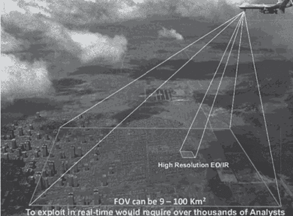

(a)

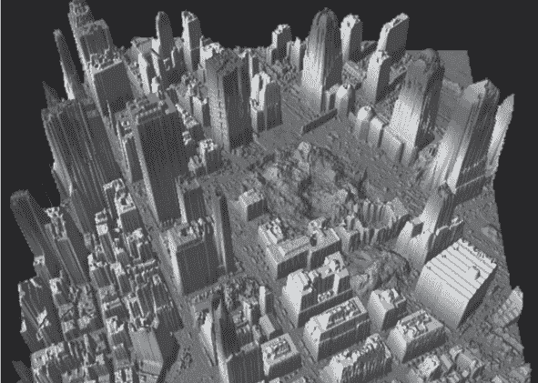

**图 8.1** (a) 通过数据量、速度和多样性带来的空间大数据（SBD）挑战。(a) 广域持续监测 FOV：视野。（照片由美国国防高级研究计划署（DARPA），弗吉尼亚州阿灵格顿提供。）EO：电光学。（源自 Levchuk, G 等人，*Proc. SPIE*, 7704, 77040P, 2010 [4.]）(b) 美国军精确打击演示（JPSD）根据 NOAA/美国陆军 JPSD 收集的数据渲染的 2001 年 9 月 27 日零地点的激光达图像。

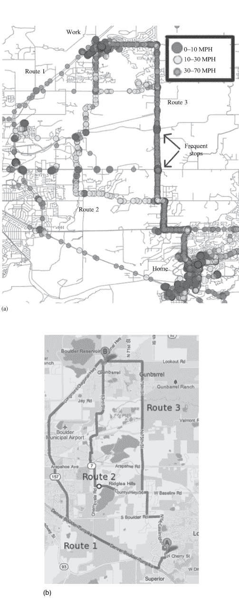


**图 8.2** 过去三个月的通勤者 GPS 轨迹显示了偏好路线。(a) GPS 轨迹数据。

(b) 路线 1 至 3。（源自 [Google Maps](http://maps.google.com)）

# 空间大数据

网络数据通常用于表示路由查询的道路地图。虽然图的网络结构可能不会改变，但关于网络的信息量正在剧增。新的 TD（交通数据）道路提供了分钟级的速度信息，结合海拔和发动机测量数据，允许对道路网络进行更复杂的查询。

## 时空数据（发动机测量数据）

许多现代车队车辆配备了仪器，如 GPS 接收器；周期性测量子系统属性的传感器 [10-15] 以及用于记录和转换累积数据的辅助计算、存储和通信设备。发动机测量数据可用于研究环境特性（例如海拔变化、天气）、车辆特性（例如重量、尺寸、发动机类型）、频率交通管理系统（例如交通灯策略）以及驾驶员行为（例如平缓加速和刹车）对车辆和温室气体（GHG）排放。这些数据集可能包含一系列属性，如车辆位置、油位、速度、里程表值、每分钟转数（RPM）、发动机负载以及温室气体、二氧化碳和氮氧化物的排放。燃油效率可以根据油位、行驶距离以及基于发动机 RPM 的怠速来估算。这些属性可以与地理背景（如海拔变化和交通模式）进行比较，以提高对燃油效率和温室气体排放的理解。图 8.3 显示了 Out Ridge 国家实验室最近一项研究 [16] 的重型卡燃料消耗函数。注意燃料消耗是如何随海拔和坡度变化的。车主已使用此类数据集来精调路线，以减少不必要的怠速 [17, 18]。探索此类数据集的潜力以帮助消费者节省燃料并减少温室气体排放是极具吸引力的。然而，这些数据集可能会变得巨大。例如，在美 100 个城市中，每分钟对 10 个发动机变量进行一次测量，每年可能有 $10^4$ 个数据项。

## 历史速度剖面

通常，导航设备和如 [Google Maps](https) [23] 这样的 Web 应用使用道路地图为用户建议路线。来自 NAVITE [24] 等公司的新数据集使用探头和公路传感器（例如线圈检测器）收集全天和全周范围内跨路段的旅行信息（分辨率为分钟或秒）。这些数据被应用于剖面，全天的道路模式被识别。剖面拥有每 5 分钟的数据，可以应用于路段，构建基于历史数据的路段准确图像。此类 TD 道路包含比给定路段更多信息（例如 Edge 1），TD 道路可能会列出路段的速度/旅行时间（例如 EID 1）。

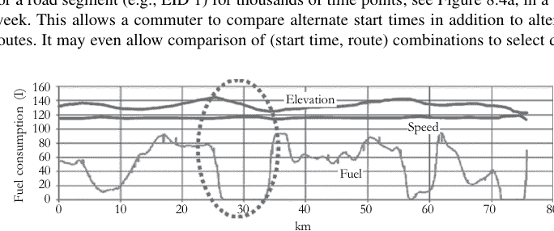

**图 8.3** Out Ridge 国家实验室最近一项研究 [16] 的重型卡燃料消耗函数。注意燃料消耗是如何随海拔和坡度变化的。此类 TD 道路包含比给定路段更多信息（例如 Edge 1），TD 道路可能会列出路段的速度/旅行时间（例如 EID 1）。

# 大数据

## 8.3 流量：在气候数据中发现区间

ST 数据中的子路径（即区间）可以定义为连续的位置。给定一个 ST 数据集和路径，有趣区间发现的目标是识别出主要的子路径。有趣区间对许多社会应用都很重要。例如，沿海当局可能对快速变化的海岸线感兴趣。水质监测可能对发生变化的河流段感兴趣。

一个气候科学的扩展示例详细说明了有趣区间发现问题。该示例源于我们与科学家的合作，研究生态系统对气候变化的响应。植变化的子路径可以勾勒交带的空间足迹，这些区域之间的过渡区域。由于对气候变化敏感，发现并跟踪交带提供了关于生态系统如何响应归一化植被指数（NDVI）的重要信息。图 8.5 显示了在非洲植被上有趣区间发现的应用 [26]。每个纵向路径都作为问题的输入。输出结果如图 8.5b 所示，是一幅用深浅灰色标记的有趣纵向子路径地图。发现了非洲的几个交带。其中之一是萨赫尔地区，那里的植被从南向北呈现出剧的下降趋势。

发现有趣的区间具有挑战性，原因如下：第一，有趣子路径的长度可能会变化，没有预定义的最大长度。例如，长河流（如恒河、密西西河）易洪区的长度可能延伸数百或数千英。第二，子路径中的有趣性可能不具有单调性，也就是说不有趣的区间可能包含在有趣的子路径中。第三，数据量可能巨大。例如，考虑寻找所有长子路径的问题。

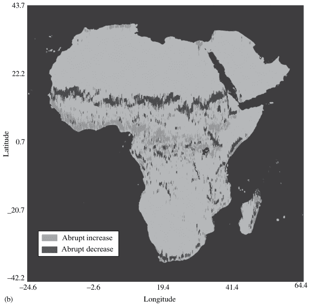

**图 8.5（续）** 有趣区间发现问题的应用。(b) 1981 年 8 月植被突发变化的纵向区间。

在具有植被、温度和降水量等属性的 eoclimate 数据集中，这些来自不同全球气候模型和传感器网络的数百 TB 数据中表现出突发变化。此类空间大数据（SB）的规模从 TB 级到 PB 级不等。以往关于有趣时空（ST）子路径/区间发现的工作主要集中在使用 1D 或 2D 方法进行变化点检测。区间发现（ID）方法寻找时间序列中数据分布发生偏移的点 [27–29]。图 8.6a 显示了特定位置植被覆盖的样本数据集。图 8.6b 显示了该数据集中从位置 5 到 11 的子路径，其数据呈现出突发增长的趋势。相比之下，图 8.6c 显示了流行的统计兴趣度 CUSUM [27, 30] 在相同数据上的特定实现输出结果，其中只有位置 6 被识别为感兴趣点（从均值以下到均值的突发变化）。检测 [31] 等 2D 方法旨在寻找图像中不同区域之间的边界。之前的相关工作限于检测感兴趣点，而不是寻找有趣的时空子路径/区间。相比之下，我们新的计算框架可以根据某些兴趣度发现任意长度的子路径。

在我们初步工作 [32] 中，提出了一种子路径枚举与剪枝（SEP）方法。在该方法中，所有子路径的枚举空间被建模为基于网的有向无环图（G-DAG），其中节点是子路径，边是子路径之间的子集关系。该方法通过对 G-DAG 进行广度优先遍历来枚举所有子路径，从根节点（最长子路径）开始。通过计算其代数兴趣度进行。如果识别出有趣的子路径，则对其所有子集进行剪枝。

## 空间大数据

通过这种方法，我们显著减少了子路径评估的数量。我们将此方法应用于 ecoclimate 数据集，以寻找突发子路径。设计了一种名为“相似性”（sameness degree）的代数兴趣度，用于评估子路径的突发性和持续性。如前，对 NDVI 植被覆盖数据集的研究表明，该方法可以发现重要的模式，例如生态带（如萨赫尔地区）。我们还将此方法应用于时间路径（例如降水时间序列），并发现了如非洲降水突发偏移等模式。在大型合成数据集上的实验结果证实了所提方法是高效且可扩展的。

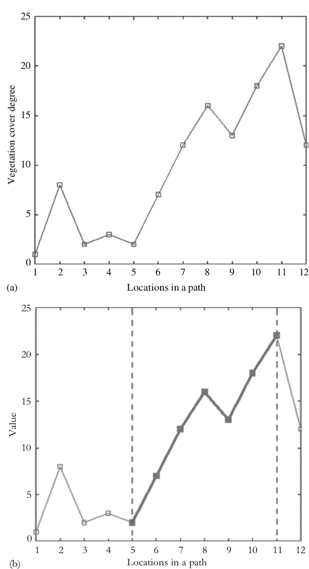

**图 8.6** 数据中有趣的子路径与相关工作发现的变化点的对比。(a) 沿纵向路径的植被覆盖。(b) 路径中有趣的子路径。

（续）

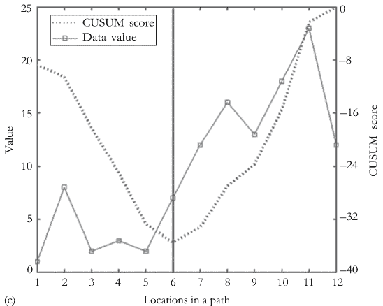

**图 8.6（续）** 数据中插入的子路径与相关工作发现的变化点的对比。(c) CUSUM 的结果。

## 8.4 速度：交通数据中的空间图离群点检测

在本节中，我们通过对检测空间图数据集离群点的实时监控数据集进行案例研究，展示了 SBD 特性速度。我们将时空（ST）检测问题形式化，并提出了一种高效的基于图的离群点检测算法。我们使用该算法检测真实世界中的时空离群点，并展示了我们方法的有效性。

1997 年，明尼阿波利大学和交通中心运营小组加入了一个针对双城高速公路传感器网络测量的项目 [33]。该网络包含约 900 个站点，每个站点根据车道数量包含一个到两个环形检测器。嵌入在高速公路和街道的传感器监测道路的占用率和流量。这些信息定期发送到管理中心用于运营目的，例如匝口控制，以及建模和实验。图 8.7a 显示了双城地区公路的站点地图，每个多边形代表一个站点。州际公路包括 I-35W、I-35E、I-394、I-494 和 I-694。州道公路包括 TH-100、TH-69、TH-212、TH-252、TH-5、TH-55、TH-62、TH-65、TH-77、I-94 和 I-694，它们环绕着双城。I-94 从东部向西北通过，而 I-35W 和 I-35 呈南北方向。明尼阿波利斯中心位于 I-94 和 I-394 的交汇处，圣保罗中心位于 I-35E 和 I-94 的交汇处。对于每个站点，每个车道都安装了一个检测器。每个检测器测量的交通流信息可以-

## 空间大数据

每个识别出的主干道问题都代表原始数据集中自行车道的子集。请注意，k-PC 问题的输出与频繁路线的输出不同，它是将所有给定轨迹划分为 k-PC 后的总结。

k-PC 问题之所以重要，是因为具有许多社会应用场景，例如全市公交路线修改或自行车主干道选择等。

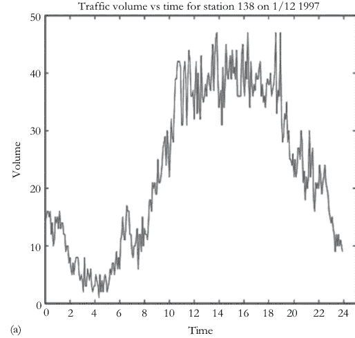

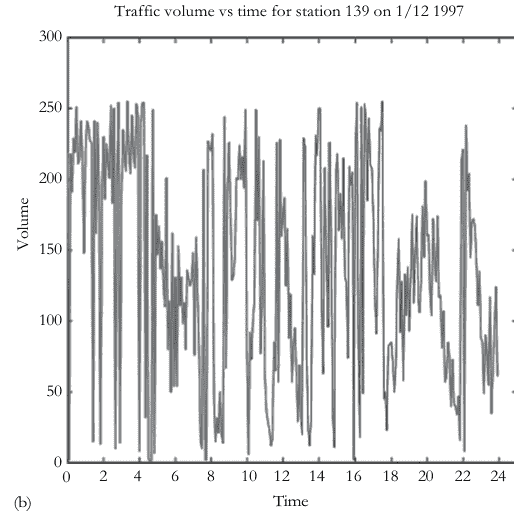

**图 8.8** 离群站点 139 及其邻近站点 1 天内的变化。(a) 站点 138。(b) 站点 139。

（续）

在路网上对轨迹进行聚类具有挑战性，因为正如我们之前的工作 [35] 所示，计算大型数据集中轨迹两对相似性度量（例如，豪斯夫距离 [NHD]）的计算开销巨大。我们提出了一种基于图的基准算法来计算 TSM 的单个元素，这需要多次调用最短路径算法（例如 Dijkstra [36]）。例如，给定包含 100 个节点的轨迹，计算 NHD 的基准方法需要在一个大型数据集（例如 10,000 条轨迹）上计算所有节点对（$10^4$ 对）之间的最短距离，这将需要 $10^6$ 次最短路径距离计算。在没有进一步算法的情况下，这在计算上是不可行的。

轨迹挖掘是一个在几何（欧几里得）空间 [37] 和网络（图）[38] 中具有许多有趣问题的领域。这些领域中传统数据挖掘的一个关键组件是相似性度量概念，即对象之间接近程度的度量。文献 [39] 已经提出了各种几何和网络轨迹轨迹相似性度量。其中一种流行的度量是豪斯夫距离，通常用于比较两个对象（例如多边形、折线、点集）之间的相似性 [40]。许多方法已专注于将豪斯夫距离应用于几何空间中的轨迹 [41–44]。

我们对 NHD 进行了归一化，并提出了一种比基准方法和之前的工作快几个数量级的新方法，能够在大型数据集上高效地计算 NHD。解决 k-PC 问题的基准方法涉及比较每个轨迹组合中的所有节点。也就是说，在比较两条轨迹时，第一条轨迹中的每个节点都需要找到到另一条轨迹的最短距离。

## 空间大数据

- 自行车 GPS 轨迹
- 路网

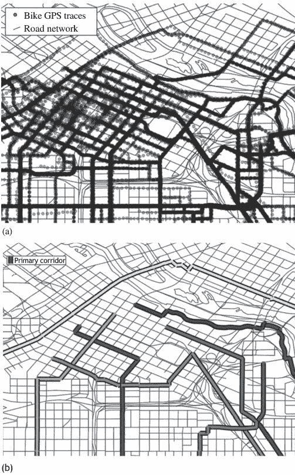

**图 8.9** k-PC 问题的示例输入和输出。(a) 来自明尼苏达州明尼阿波利斯的记录 GPS 点。强度表示点数。(b) 通过单次最短路径计算，从自行车足迹中识别出的主干道集合。找到的最大值是豪斯夫距离 [40]。虽然这种方法确实找到了两条轨迹之间的正确距离，但我们提出了一种新方法，在确保正确性的同时保持计算效率。虽然基准方法依赖于计算节点与节点之间的距离，但 NHD 需要节点到轨迹的距离。我们利用这一洞察，通过修改底层图并在单次最短路径计算中直接计算节点与轨迹之间的 NHD。这种方法在保持正确性的同时，比基准方法和我们之前的工作快得多。

我们之前的工作 [35] 在 k-PC 问题中需要 $O(TP)$ 次最短路径算法来计算必要的 TSM，在处理大量轨迹时变得变得异常昂贵。

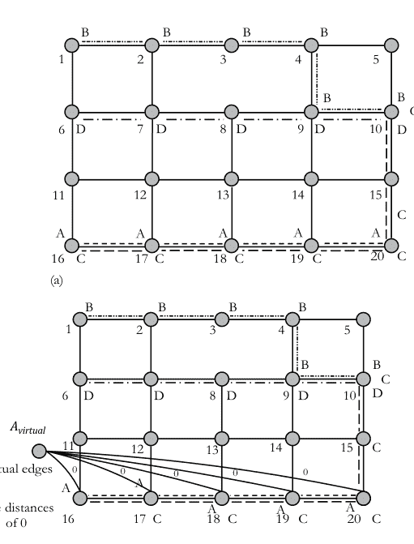

**图 8.10** 为了对所示输入 (a) 快速计算 NHD。(b) 路网被表示为无向图，用虚线所示的四条轨迹。(c) 插入虚拟节点 $A_{virtual}$ 以表示轨迹 A，以便高效计算 NHD。

我们开发了一种新的行算法来在 SBD 上计算 k-PC 问题。


计算两条轨迹之间的 $NHD(t_i, t_j)$ 不需要 $t_i$ 和 $t_j$ 中所有节点对之间的最短距离。我们需要的是 $t_i$ 中每个节点到 $t_j$ 中*最近*节点的最短距离。在 [35] 中，我们提出了一种寻找这种距离的方法，通过枚举所有对最短距离作为基准方法。这显著减少了计算 TSM 所需的距离计算和迭代。在图 8.10b 中，为了计算 $NHD(t_i, t_j)$，通过向图中插入一个代表 A 的虚拟节点 $A_{virtual}$，并将其与 $t_j$ 中的每个其他节点连接（权重为 0）。然后以虚拟节点为源运行最短路径计算，终点为节点 $t_j$。结果是 $t_i$ 中每个节点到虚拟节点 $A_{virtual}$ 的最短距离。由于虚拟节点只与 $t_i$ 和 $t_j$ 中的节点连接，且所有边权重均为 0，因此 $t_i$ 中每个节点到 $t_j$ 中最近节点的短路径正是 $NHD$ 的定义。

每个识别出的主干道问题都代表原始数据集中自行车道的子集。请注意，k-PC 问题的输出与频繁路线的输出不同，它是将所有给定轨迹划分为 k-PC 后的总结。

k-PC 问题之所以重要，是因为具有许多社会应用场景，例如全市公交路线修改或自行车主干道选择等，我们考虑了确定城市中主干道的方法，以促进安全高效的出行。通过为一组通勤者选择代表性轨迹，可以将对通勤者路线的整体改变减少到最低。促进自行车在过去被证明具有许多益处，例如减少温室气体排放和医疗成本 [34]。

# 132

# 大数据

当 k > l 时。基于网络的变变距离聚类方法（N-TCM）[64] 是聚类技术[57–64]的一个示例。N-TCM 将网络中彼此最短距离在一定范围内的活动分组；为了运行 N-TCM，需要一个距离阈值。

在本章中，我们提出了一种 K 主路径（KMR）方法，旨在找到一组能够使活动最大化的 k 条路径。KMR 的目标是最大化每条路径覆盖活动数量。KMR 采用非活动节点剪枝算法，而不是计算所有节点之间的最短路径，仅计算活动节点与空间网络中其他节点之间的路径。这提供了计算上的节省（且不影响生成的摘要路径），这些结果在实验评估中得到了报告。KMR 的输入包括一个无向图 G=(N,E)、一组活动 (A) 以及路径数量 k，其中 k ≤ l。KMR 的输出是一组路径，其目标是最大化每条路径的活动覆盖率。每条路径都是其节点之间的最短路径，且每个活动 a_i 仅关联一条边 e_i。KMR 计算活动节点与其他所有节点之间的最短路径，并选择此类路径作为初始路径。KMR 的主循环（阶段 1 和阶段 2）重复进行直到摘要路径不再发生变化。

## 阶段 1：将活动分配给摘要路径

此阶段的第一步初始化簇集，即条目附近的簇。通常，此阶段通过将每个活动分配给其最近的摘要路径来进行聚类。在该方法中，KMR 使用每个活动和簇来确定距离活动最近的摘要路径。

KMR 使用接近度量来量化邻近性：`prox(s,a)`。活动与路径之间的距离是摘要路径上每个节点与活动所在节点之间的最小距离。一旦确定了每个活动到摘要簇的距离，该活动将被分配给具有最近摘要路径的簇。

## 阶段 2：重新计算摘要路径

此阶段涉及重新计算每个簇的摘要路径，以进一步最大化活动覆盖率。这需要遍历每个簇并为每个簇初始化摘要路径。每个簇的摘要路径根据分配给该簇的活动进行更新。选择覆盖率最大的路径作为簇 c_i 的新摘要路径，其中 `sp_i=max{AC(sp_j), j=1...l}`。重复阶段 1 和阶段 2 直到每个簇的摘要路径不再变化。在每次迭代结束时，簇初始化为下一个簇。当每个簇的摘要路径不再变化时，返回一组 k 条路径。

我们对 KMR 进行了定性评估，将它的输出与 CrimeStat [65] 和 K-means [66]（一种常用的总结技术）在行人真实数据集 [67] 上的输出进行了比较，如图 8.11a 所示。输入包括 2000 年至 2009 年间发生在佛罗里达州奥兰多的 53 次行人活动（点）。正如我们所解释的，KMR 使用路径和网络距离对空间网络上的活动进行分组。相比之下，空间数据的几何划分是基于分布在平面空间中的相似点分组，使用欧几里得距离计算聚类。该技术侧重于高密度区域几何形状（如圆、椭圆）的发现 [52]，并使用了 K-means [66, 68–71]、K-medoid [72]、P-median [74] 以及最近邻域层次聚类 [76] 算法。

图 8.11d 分别展示了使用欧几里得距离的 KMR 和使用网络距离的 K-means 的结果。在所有情况下，K 均设置为 4。每种技术的输出显示了 (1) 由不同灰浅表示的活动划分以及 (2) 每个划分的代表（例如路径或椭圆）。例如，图 8.11c 显示了 (1) 根据活动覆盖率着色的活动以及 (2) 代表每组活动划分的椭圆。

这项工作探索了与犯罪分析和灾害响应等重要应用领域相关的 SNAS（空间空域分析）问题。我们提出了一种 KMR 算法来发现一组用于活动的 k 条路径。KMR 使用活动节点剪枝来进行活动分配，并通过分治法重新计算摘要路径以增强其性能和可扩展性。使用合成和真实数据集进行的实验评估表明，KMR 的决策带来了显著的计算节省，且没有减少摘要路径的覆盖率。定性评估将 KMR 的输出与当前的几何技术输出进行了比较，强调了 KMR 在总结空间网络活动方面的潜力。

# 空间大数据

## 8.7 总结

规模不断增大、多样化且更新频率超过空间计算技术能力的数据集被称为 SBD（空间大数据）。SBD 包括手机、GPS 设备、道路地图和车辆发动机测量数据。麦肯锡的一份最新报告估计，像个人位置数据这样的 SBD 到 2020 年可以通过下一代路由服务产生数百亿美元，有助于解决全球拥堵问题。通过利用这些日益庞大、多样且变化的数据，出现了新的机遇。

图 8.11 针对佛罗里达州奥兰多的行人数据，k=4 的 KMR 与 CrimeStat K-means（来自死亡分析系统 (FARS)，国家公路安全管理局 (NHTSA)，http://nhtsa.gov/FARS）。(a) 输入。(b) KMR。(c) 使用欧几里得距离的 K-means。(d) 使用网络距离的 K-means。

图 8.11 (续) 针对佛罗里达州奥兰多的行人数据，k=4 的 KMR 与 CrimeStat K-means（来自死亡分析系统 (FARS)，国家公路安全管理局 (NHTSA)，http://nhtsa.gov/FARS）。


1. Maynika et al., Big data: The Next Frontier for Innovation, Competition, and Productivity, McKinsey Global Institute, 2011.

2. Shekhar, M. Evans, J. Kang, and P. Mohan, Identifying patterns in spatial application: A survey of methods, Wiley Interdisciplinary Reviews: Data Mining and Knowledge Discovery, 1(3), 193–214, 2011.

3. New York Times, Mapping is awash from drones. http://www.nytimes.com/2010/01/11/business/11drone.html (Accessed: July 1, 2013).

4. Levchuk, A. Bobick, and E. Jones, Activity and function recognition for moving and static objects in urban environments from wide-area persistent surveillance, Proceedings of the SPIE 7704, Evolutionary and Bio-Inspired Computing: Techniques and Applications IV, 7704, 2015, doi:10.1117/1.74002

5. New York Times, Mapping architecture in a matter of days. http://www.nytimes.com/2010/05/11/science/11maya.html, 2010 (Accessed: July 1, 2013).

6. InformationWeb, Red cross unveils social media operation. http://www.informationweb.com/government/information-management/red-cross-unveils-social-media-monitoring/23620219, 2012.

7. Garmin L. Hart, http://www.garmin.com/us/ (Accessed: July 1, 2013).

8. P. D. Correa-Souza, Estimating benefits from mileage-based vehicle insurance, taxes, and fees. Transportation Research Record: Journal of the Transportation Board, 1812(1), 171–178, 2002.

9. Toiton Global, Transportation GPS (Accessed: July 29, 2011).

10. H. Kargupta, Gama, and W. Fan, The next generation of transportation systems, greenhouse emissions, and data mining, in Proceedings of the Ith ACM SIGKDD International Conference on Knowledge Data and Mining, pp. 1209–1212, ACM, New York, 2010.

11. H. Kargupta, V. Putta, M. Kline, and K. Sarkar, On-board vehicle data monitoring using constrained monitoring of traffic correlations, New Generation Computing, 25(1), 5–32, 2006.

12. Lynch Technologies: Lynx GIS. http://www.lynxgis.com (Accessed: July 1, 2013).

13. Mainart, Green solutions. http://www.masterau.com/carbon-calculator/ (Accessed: July 1, 2013).

14. Telaven, Inc. http://www.telaven.com (Accessed: July 1, 2013).

15. TelosGIS. http://www.teligos.com (Accessed: July 1, 2013).

16. G. Orange, O. Franzese, B. Knee, M. Laughlin, and P. Otady, Class-8 heavy truck duty cycle project report, ORNL/TM-2008/8122, Oak Ridge National Laboratory, Oakridge, TN.

- 47. J-R. Wang, H-Y. Kang, and K-J. Li, 使用时间相似性在路网中搜索相似轨迹，载于 *Advances in Databases and Information Systems*, 第 282–295页，Springer，柏林，德国，2006。

## 空间大数据

- 48. E. Tiakas, A. N. Papadopoulos, A. Anapopoulos, M. Manolopoulos, D. Stojanovic, and S. Djordvic-Kajan, 空间网络中的相似轨迹搜索，《Journal of Systems and Software》， 82, 772–788, 2009年5月。

- 49. E. Tiakas, A. N. Papadopoulos, A. Anapopoulos, M. Manolopoulos, D. Stojanovic, and S. Djordvic-Kajan, 空间网络中的轨迹相似性搜索，第10届国际数据库工程与应用会议，2006 (IDEAS06)， 第 185–192页，IEEE，德里，印度，2006。

- 50. F. Harvey and K. Krick, 彗星自行车者行为与设施中断，技术报告号 MnDOT 2007-15，明尼阿波利大学，明尼阿波利斯，明州，2007。

- 51. D. Oliver, A. Bunn, J.M. Kang, S. Shekhar, and R. Bousaire, 接近网络活动摘要的k主路线：结果调查，载于 ICDM Workshops, 第 265–272页，悉尼，新威尔士州，澳大利亚，2010。

- 52. J. Lu, J. Caron, M. Leiter, and R. Wilson, 地图绘制：理解热点，国家司法学院，2005。

- 53. W. Carter, 灾害管理：经理手册，亚洲开发银行，马尼拉，菲律宾，1991。

- 54. Ushahidi: 海地危机，http://www.ushahidi.com (访问日期：2013年7月1日)。

- 55. M. Celik, S. Shekhar, B. George, J. Rogers, and J. Shine, 发现与量化街道：结果调查，技术报告 07-025，明尼阿波利大学，计算机科学与工程系，明尼阿波利斯，明州。

- 56. K. Bu, S. Casper, J. Gudmundsson, M. Löffler, J. Lu, G. Rote, R.I. Siljeva, B. Speckmann, and T. Wolte, 地理网络中的轨迹检测，载于 GIScience, 第 211–237页，Springer，柏林，德国，2009。

- 57. S. Rocha, 随机聚类理论。Methuen出版社，伦敦，英国，1968。

- 58. A. Okabe, K. Okumi, and S. Shide, SANET工具：网络空间分析的新方法，《Transactions in GIS》，104(4), 535–560, 2006。

- 59. S. Shide and A. Okabe, 用于分析网络模式的网络聚类方法，载于美国地理学家协会年会提交的非正式论文，费城，宾夕法尼亚州，2004。

- 60. K. Aerts, J. Tilly, T. Steenenberg, and I. Thomas, 沿路网的交通交通事故空间聚类，载于第11次交通研究会议，伯克利，加州，2007。

- 61. P. Spooner, I. Lunt, and S. Shide, 使用k函数对人口网络中金合树种群进行空间分析，《Landscape Ecology》，19(5), 491–499, 2004。

- 62. T. Steenenberg, D. Dufays, I. Thomas, and B. Flahaut, 使用GIS进行城市内部路口定位与聚类：比利案例，《International Journal of Geographical Information Science》，18(2), 161–181。

- 63. I. Yamada and J. Thill, 空间模式中网络连接类的的位置，《Geographical Analysis》，39(3), 268–292, 2007。

- 64. S. Shide and N. Tolete, 网络空间中多尺度聚类的检测，《International Journal of Geography》，23(1), 75–92, 2009。

- 65. N. Lineve, 犯罪统计：犯罪事件分析统计程序 (v2.0)，Ned Levine & Associates，休斯顿，德克萨斯州，2002，司法学院。

- 66. J. MacQueen et al., 多变量分类与分析方法，载于第五届数学统计与概率研讨会，第1卷，14，伯克利，加州，1967。

- 67. Fatality Analysis Reporting System (FARS)，国家公路安全管理局 (NHTSA)，http://www.nhtsa.gov/fars

- 68. S. Borah and M. Ghosh, 聚类生成的性能，《Journal of Computing》，1(1), 175–178, 2009。

- 69. A. Barackabah and Y. Kiyoko, 用于初始控制优化的支柱算法，计算智能与数据挖掘研讨会 (CIDM)，纳什维尔，田纳西州，2009。

- 70. S. Khan and A. Ahmad, 用于聚类初始化的，《Pattern Recognition Letters》，25(11), 1292–1302, 2004。

- 71. L. Kaufman and P. Rousseau, 数据中寻找群体：聚类分析简介，Wiley，纽约，1990。

- 72. R.T. Ng and J. Han, 空间数据的高效有效聚类方法，载于第20次大型数据库国际会议 (VLDB)，Bocca and Zaniolo (编)，Morgan Kaufmann Inc., 第 144–145页，旧金山，加州，1994。


- 73. M. Resende and Werneck, 用于p位数问题的混合启发式算法，《Journal of Heuristics》，10(1), 59–88, 2004。
- 74. Andrade, 分层聚类，《Psychometrika》，43(1), 59–67, 1978。

# 利用志愿者地理信息（VGI）改进路线导航服务

## 9.1 引言

数据生产和分发的近期技术进步使得前所未有的地理空间数据产生，催生了大数据范式。这一趋势的一部分是志愿者地理信息 (VGI)，即由志愿者贡献的地理信息 (Goodchild 2007)，以及从社交媒体获取的众源数据。无论大数据是指不再适应传统结构的海量数据 (Dumbill 2013)，还是为了处理海量数据必须开发的新技术 (Davenport et al. 2012)，人们达成共识：只有当从中提取具有附加值的知识时，此类数据的潜力才能被挖掘。

对于许多应用来说，利用海量数据集为改进移动服务提供了新机会。传统上，路线导航服务依赖于地图机构主要两家公司（NAVTEQ 和 TomTom）对现有街道的数字化。VGI 和基于众源的应用出现改变了这一观点，提供了广泛的额外信息，可以补充政府和地图机构产生的无法快速或低成本更新的官方数据。例如，开发者可以考虑开发根据旅行者背景保持个性化的路线导航服务。然而，通过各种源检测到的路网变化进行近实时交互，可以减少拥堵、能量消耗、温室气体和颗粒排放等。

虽然 VGI 和众源应用显然是大数据的一种，但它们具有使其利用产生挑战性的特性。本章致力于分析 VGI 和众源数据改进路线导航服务的潜力。文中还讨论了这些类型数据的局限性及其利用的挑战性。基于这些局限性，我们为未来下一代协作路线导航服务的研究提供了一些方向。

本章首先简要回顾大数据和 VGI 范式。通过提供传统路线导航服务的背景，我们解释了可以升级路线导航服务的大 VGI 源类型。然后，根据 VGI 和众源数据的局限性，讨论了利用 VGI 改进路线导航服务的挑战。

## 9.2 什么是大数据？

数据生产和分发的近期技术进步使得前所未有的地理空间数据产生。2012年，估计全球数据量每年以50%的速度增长 (Lohr 2012)，这是由于数字传感器、智能手机、支持 GPS 的设备、众源应用和社交媒体等现象日益传播所致。虽然地理空间数据传统上一直由专家（政府、地图机构）主导，但范式转移已使得越来越多的数据对所有人可用，对企业、公民社会和个人产生潜在利益。

这种海量数据引发了该术语。大数据是一个松散使用的术语，指的是两个观点：首先，它指的是不再适应传统结构的海量数据 (Dumbill 2013)；其次，可能较少地，指的是为了处理数据而必须开发的新技术。例如，Davenport 等人 (2012) 报告说该术语用于“更智能、更具洞察力的分析”，而 Oracle 将定义为“使企业能够收集并分析所有数据的技术” (Oracle 2012)。事实上，如果我们找不到管理和分析相关数据的方法，大数据本身并没有太大价值。

增强型连接算法（Okkan and Riedewald 2011）、查询优化技术（Herodotou and Babu 2011）以及索引技术（Jiang et al. 2010）。虽然这些技术仍在开发中，但它们将在 VGI 的使用中发挥重要作用。

## 9.3 作为大数据的 VGI

回到1997年，Goodchild 指出，随着网络变得无处不在，地理信息（GI）的产生正从中心化过程转向分布式过程。如今，用户可以通过各种互联网应用程序产生 GI；全球范围内的地理知识领域正在形成，无需完全依赖传统的地理空间数据生产（Hardy 2000）。Goodchild 引入了“志愿者地理信息”（VGI）这一术语，指代后来用户通过 Web 2.0 生成的 GI。Latatore 和 Bertollo (2015) 认为，VGI 范式实现了从被动信息消费者到主动贡献者的转变。Coleman 等人 (2009) 认为，用户生成内容（UGC）的概念并不新鲜，他们提到了公共地理信息系统（GIS），用户可以通过基于 Web 的应用程序向决策者和相关社区提供输入和反馈。他们声称，新颖之处在于用户对这一地理知识领域的贡献具有社区属性（Coleman et al. 2009）。VGI 通常是由大型用户社区在共同项目中协作参与创建的，例如 OpenStreetMap (OSM) 或维基百科，在这些项目中，个人可以根据自己对地理现实的本地知识产生 GI，或者编辑他人提供的内容。例如，在 OSM 中，用户可以使用标签创建数据特征——如道路、水域和兴趣点（POI），其提供的信息的详细程度往往超过了传统地理空间数据提供者能提供的细节水平（Goetz et al. 2012）。因此，随着众包应用数量不断增加，VGI 的量正在迅速增长，VGI 现在已成为大数据的重要组成部分。

在 VGI 相关的优势中，研究人员强调了其在更新或完善现有地理空间数据集方面（Goetz and Zipf 2011; Goodchild 2007; Gupta 2007; Tulloch 2008）。这种优势在以下背景下尤为突出：传统的地理空间数据提供者虽然具有全面的空间和时间覆盖，但可能缺乏生成此类路由服务高效所需的数据集的能力（Gupta 2007; Tulloch 2008）。此外，研究还强调了 VGI 可以以及时、近实时的方式提供和传播，这在路由服务中是高度要求的。与 VGI 相关的优势强烈表明，这类知识具有极高价值，并有助于提供环境的动态图景（Mooney and Corcoran 2011）。然而，将 VGI 用于路由和导航等移动应用尚未完全实现，因为它受到了与海量数据、异质性和可信誉相关的各种障碍阻碍。

## 9.4 传统路由服务

车辆路由主要基于数字地理数据。2000年，美国前任总统比尔·克林顿下令取消 GPS 的选择性可用（`http://clinton.nara.gov/WH/EOP/OSTP/html/0053_2.html`），这标志着地球定位新纪元的开始。随后，定位变得更加精确，移动系统能够精确定位。因此，路由与导航结合在一起。许多公司（NAVTEC 和 TomTom，[原 TeleisAtlas]）对街道进行数字化处理，为路由应用提供了必要的数据集。与此同时，路由 Web 服务运而生。最流行的服务之一是 Google Maps，它提供了许多地区的路线（`http://googleblog.blogspot.def/2005/02/mapping-your-way.html`）。自2005年发布以来，该服务已经通过增加公共交通数据得到了改进。

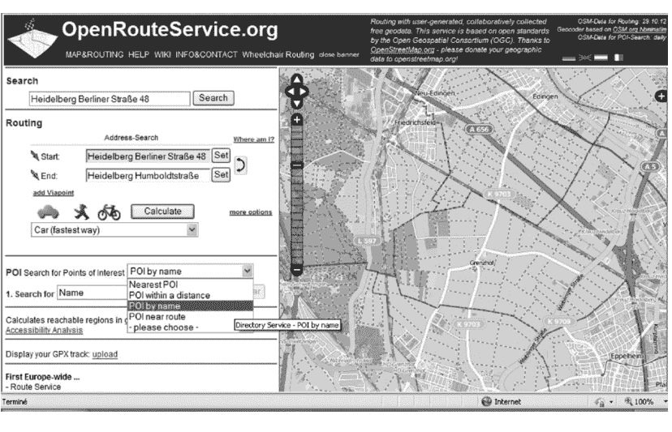

图 9.1 增加了 POI 选择功能的 OpenRouteService.org。

支持 GPS 的设备。目前，大多数活跃的道路用户，如出租车、公共交通工具、货运车辆和农业车辆都在使用导航系统。部分车辆由专用的车载系统跟踪（Lauer and Zipf 2013）。这些车载系统可以产生海量的时空数据，从中可以提取出改进路线的相关信息。GPS 轨迹允许提取车辆轨迹、速度以及交通拥堵情况，并实时了解路段的车辆状况。利用来自 GPS 轨迹的车辆，我们可以估计燃料效率和温室排放。这将实现个性化推荐，从而减少温室排放。然而，提取此类数据涉及访问和分析。

## 9.5.3 社交媒体

传统的交通采集方法基于路边环检测器，其部署和维护成本很高。作为替代方案，可以利用社交媒体来收集道路状况。已开发许多应用程序允许道路信息的共享。例如 [Waze](https://www.waze.com/)，这是一个基于社区的应用程序，可以在发生事故、道路障碍、交通拥堵和天气事件时警报驾驶员，并由贡献者共享。Waze 集成了基于数据的交通流模型，通过调整来完善路线。另一个例子是 Traffic Pulse，这是一个依赖智能手机报告道路状况的参与式网络平台，该应用程序允许实时查询和可视化城市的移动性（Li et al 2012）。现有社交媒体和网络平台报告道路事件在让驾驶员和旅行者了解最佳路线方面具有巨大潜力。

## 9.6 利用 VGI 改进路线服务的挑战

上述与大规模 VGI 和众包数据集相关的限制影响了我们将其用于路线导航服务的能力。

### 9.6.1 VGI 和众包数据的局限性

可靠性和质量是关于 VGI 和众包提出的主要问题（Bishler and Mantelas 2008; Elwood 2008; Flanagin and Metzger 2008; Gouveia and Fonseca 2008; Arjansani et al 2013）。数据被认为缺乏可度和可靠性，因为它们是由非专家产生的，且背景于专家驱动（Elwood 2008）。例如，虽然期望地理数据生产者生成具有特定精度的数据，但 VGI 应用的用户并未正式具备这种能力。正如 Longoue 等人（2010）所解释的那样，VGI 用户可能只感知其一部分。另一个关于 VGI 质量的担忧是贡献者的特征和动机通常是未知的。正如 Longueville 等人（2010）提到的，社会经济、社会和文化因素可能会影响 VGI 的生成，使其变得不可靠。了解贡献者的相关特征可以帮助正确解释 VGI 并评估其适用性。评估空间数据（例如 VGI）的质量是一项挑战性的研究问题（Mobasher 2010）。除了质量问题外，GI 社区仍然面临许多阻碍 VGI 生成和存储的障碍，即使用自然语言而非现有标准化地理数据库中常用的正式术语（Elwood 2008）。根据 Scheider 等人（2011），描述现象的用户缺乏统一解释。尽管如此，某些 VGI 应用如 OSM 需要贡献者使用预定义的本体。Scheider 等人（2011）指出很难就术语达成共识，而 Mooney 和 Corcoran（2011）指出缺乏检查对约定本体遵循的机制。结果，影响 VGI 的异构性可能比影响传统地理数据的异构性更为严重（Grossner and Glenmon 2007）。

### 9.6.2 对路线导航服务发展的影响

#### 9.6.2.1 互操作性

为了正确利用 VGI，可以将各种现有数据源合并到路线和导航服务中。然而，由于互操作性问题，这并非总是可能的。许多研究人员已将 VGI 或众包数据用于路线；例如，Abbasi 等人（2009）使用 Flickr 标签和群组来识别地标。为了改进路线服务，必须对多样源数据应用进一步的数据和数据集成技术。例如，可以从不同源检索地标的不同特征。这目前受到这些源的格式、协议和语义异构性的限制。第一个途径是使用、调整或开发支持互操作性的标准。目前尚无描述 VGI 或众包应用的标准。然而，正在进行的一些研究建议如何使用现有标准来处理 VGI。例如，De Longville 等人（2010）提出了一个框架，其中 OGC 的传感器网络编码（SWE）标准用于传感器观测服务（SOS），将支持对 VGI 源的访问，认为 VGI 可以被描述为传感器观测。另一个例子是，Auer 和 Zipfer（2009）探索了 OpenRouteService 如何使用来自 OSM 以及网络要素服务（WFS）、网络处理服务（WPS）、网络地图服务（WMS）以及用户生成内容的数据，特别是……

#### 9.6.2.2 寻找正确的数据

尽管访问多种来源创造了巨大潜力，但并不能保证提供合适的数据。无疑，VGI 数据包含冗余和噪声数据，需要对数据进行过滤和聚合。在提供更个性化的路线服务时，这尤为必要，此时地理感兴趣区域将显示在地图上。显示在路线和导航地图上的特征应该根据用户的上下文（他/她的位置、旅行位置、出行模式、POI 等）进行选择。然而，这不仅是因为地图应该是个性化的。导航服务不再限于 2D 世界，而是倾向于包含环境的 3D 表征。实验研究揭示了在第三维度创建有效可视化方面的问题，即需要只显示部分相关信息（Shepherd 2008）。用户的上下文信息也可以通过各种类型的处理（例如文本挖掘、聚类）获得，这也有助于推荐更多路线。

#### 9.6.2.3 数据的分析与解释

由于 VGI 和众包的数据量巨大且具有异构性，分析来自来源的数据面临挑战。在语义层面，异构性意味着使用了不同的术语和表示方法来描述相似特征。由于众包和 VGI 应用并不一定遵循标准术语，异构问题难以解决。某些数据集使用本体来促进语义互操作性；但该领域的最新研究表明，建立共识是困难的。解释语义数据的一种解决方案是分类法（folkonomy）。该术语由 folk 和 taxonomy 组合而成（Wagner 2007）。它是一种共享资源及其生成标签的轻量级系统。通过这些资源，用户可以对任何项目进行标记。本体的控制和设计在分类法中被自我组织的概念所取代。许多应用程序展示了标签和分类法收集用户生成信息的有用处。这些应用程序包括用于书签的 Delicious、用于图片的 Flickr 以及用于学术出版物的 CiteLike。通过发现和信息过滤，分类法可以用于应对大量用户生成数据的异构性挑战。然而，分类法可能只是一个工具，不足以解决异构性问题，因为分类法本身就是异构的。需要更多研究来确定分类法是否有助于不同 VGI 集的融合。

VGI 和众包数据的处理与分析受限于贡献者隐私问题的限制。例如，GPS 轨迹数据可能允许追踪个人的轨迹和出行模式，这会对个人的隐私和安全构成的潜在威胁。为了解决这个问题，一种解决方案是在向应用程序提供之前对 GPS 轨迹数据进行聚合。

## 9.6.3 大数据解决方案对大 VGI 的适用性

已被证明处理大数据的解决方案具有增强 VGI 数据集互操作性、发现性和解释性的潜力。然而，仅靠大数据解决方案是不够的，正如本章解释，VGI 显示出与其他传统类型不同的特征。表 9.1 分析了某些提出的处理数据的解决方案，并解释了它们的局限性，或者它们如何通过其他技术进行补充以适用于 VGI。

标准化（方法和服务的标准化）是处理来自不同源的海量数据并确保互操作性的主要解决方案之一。对于 VGI，缺点之一是很难在 VGI 社区中推行标准。另一方面，已经开发了开放标准，例如 OGC Web Processing，更多被 VGI 应用使用，这些标准的`开放本质`与 VGI 的理念目标相匹配，即让数据对任何人`开放`。

在多样性和分析能力方面，并行化技术（如 MapReduce 处理框架）提供了增加这些任务处理能力的潜力。VGI 数据集在本质上比传统数据具有更大的噪声，因此必须专门为 VGI 开发数据管理质量体系。对云计算也可以进行类似的分析，它允许处理海量数据，但没有解决质量问题。

对数据的适当解释是帮助发现 VGI 数据并进行有意义分析的主要关键之一。对数据的适当解释需要与数据相关的显式语义。理解大型数据集的解决方案之一是链接数据（Linked Data）。链接数据是来自不同源、通过资源描述框架（RDF）定义连接起来的数据网（Bizer et al. 2009）。例如，在链接数据中，两个实体（例如，几何系和卡尔加里大学）可以通过它们的唯一标识符（URIs）进行识别，并通过`谓词`进行连接。链接数据包含大量与其他数据集语义关联的数据，它构成了支持数据解释的丰富来源。然而，要应用于 VGI 数据集，需要自动化或半自动化的技术在 VGI 数据集的实体与链接数据中的实体之间生成具有语义意义的链接。在这种情况下，噪声和异构性仍然是建立适当链接的主要障碍。

## 表 9.1 针对 VGI 要求的大数据解决方案分析

| 互操作性 | 发现与分析 | 解释 |
|---|---|---|
| 信息模型和服务 接口的标准化：比传统数据更难在 VGI 上推行 | 并行化和云计算：为了提高处理能力，由于 VGI 比传统数据噪声更大，因此提高处理能力并不能自动确保更好的发现和分析。 | 链接数据（RDF 图）需要自动或半自动的技术来生成具有语义意义的链接 |

## 9.7 总结

路由和导航服务正在从相对静态的、一刀切的视角转向高度个性化的、实时的路由和导航体验。路由服务的不再不再是考虑最短路线，而是推荐考虑了多种信息和偏好的路线。这些偏好包括兴趣点（POIs）、当前状况以及如能耗等各种参数的优化。此外，路由和导航服务不再被仅仅地视为针对个人消费者的服务。它们还呈现出集体界面。例如，虽然路由导航服务可以鼓励驱动员选择减少能量消耗的路线，但也可以被视为政府和社会提高能源效率和减少大气污染的综合战略的一部分。

这在很大程度上源于 VGI 和众包应用的出现，以及这些新类型数据成功使用案例的日益增加。然而，作为大数据范式的一部分，VGI 和众包数据受到限制其在路由和导航中使用的特性的影响。这些在本文章中回顾的局限性影响了此类数据的互操作性、识别、过滤和检索用于路由和导航的相关数据的能力，以及从这些数据中提取信息并进行分析和解释的能力。未来的研究将是必要的，以使能够利用 VGI 和众包应用的标准来促进互操作性；利用大数据技术和手段从 VGI 和众包数据中提取关于用户背景及其环境的信息；能够生产具有当前状况和在高速公路上的时间详细路线地图；实现 VGI 和众包数据的语义描述和处理；并提供接口。

## 参考文献

- Abbasi, R., Chernov, S., Neijdl, W., Paiu, R., and Saab, S. 2009. Enriching Flickr tags and groups for landmark identification. In: 31th European Conference on IR Research, M. Boughen, C. Berrut, J. Mothe, C. Souza-Duppy (eds.), Advances in Information Retrieval, LNCS, 5478. Springer, Berlin, pp. 654–661.
- Auer, M. and Zipf, A. 2009. How to free and open crowdsourced data? The First Open Source University of Nottingham, UK. potential to real applications.


- Bakillah, M., Zipf, A., Liang, S., and Loos, L. 2003. Semantically enriching VGI to support real-time mapping and evaluation. In: D. Vandenberge, J. Jucher and Chomov, Proceedings of WGGI.

- 2013.

- Ballatore, A. and Bertotto, S. 2011. Semantically enriching VGI in feedback. In: K. Tanaka, P. Philipp, and K.-S. Kim (eds.), Proceedings of WGGI.

- Baer, D., Delling, S., Scheidrieder, S., Duliche, D., and Wagner, D. 2008. Combining hierarchical and goal-directed routing for Dijkstra's algorithm. In: C.C. McGeoch (ed.), LNCS, 5038. Springer, Berlin, pp. 303–318.

- Birkin, M. 2012. A bias for geomatics. Geostatistics and Overview: 1(1), 2.

- Bish, M. and Mantlar, L. 2008. A trust and reputation model for classifying urban growth. Geography, 72(4), 229–237.

- B, C., Haith, T., and Beers, L. 2009. Linked data–The story so far. International Journal on Semantic Web and Information Science, 5(3), 1–2.

- Caduf, D. and Tim, S. 2009. The laying spider: Representing landmark knowledge for tasks. In: T. Barkowsky, M. Hegarty, and R. Lowe (eds.), Reasoning with Mental and Spatial Diagrams: Computational Modeling and Spatial Analysis—AAAI, Stanford, CA, pp. 21–25.

- Coleman, D., Geogiadou, Y., and Labont, J. 2009. Integrated geographic information: The nature and motivation of producers. International Journal of Spatial Data Infrastructures, 4, 332–358.

- Coulec, H., Colledge, R., Gale, N., and Tobler, W. 1987. Exploring the anchor-point hypothesis of spatial cognition. Journal of Experimental Psychology, 7, 99–122.

- Davenport, T., Barth, P., and Bean, R. 2012. How "big data" is different. Sloan Management Review, 54(1), 22–24.

- De Longville, E., Ostlander, N., and Keskato, C. 2010. Addressing vagueness in volunteered geographic information (VGI)—a case study. International Journal of Spatial Data Infrastructures, Vol. 5, Special Issue GIS-D.

- Dean, J. and Geraswat, S. 2008. MapReduce: Simplified data processing on large clusters. Communications of the ACM, 51(1), 107–113.

- Delling, D., Saunders, P., Schult, D., and Wagner, D. 2009. Route planning algorithms. In: J. Lenner, D. Wagner, and K.A. Zweig (eds.), Algorithms of Large and Complex Networks, LNCS, 5515. Springer, Berlin, Germany, pp. 117–139, doi:10.1007/978-3-540-72845_0

- Dicht, T. and Quijand, J.-A. 2012. Efficient data processing in HadoopReduce. Proceedings of the VLDB Environment, 5(12), 2014–2015.

- Duncan, M., and Winter, S. 2010. Including labels in routing instructions. Journal of Location-based Systems, 4(2), 18–55.

- Dumbill, E. 2013. Making sense of big data. Big Data, 1(1), 1–2.

- Elwoood, W. 2008. Volunteed geographic information: Future research directions by critical, participatory, and feminist GIS. GeoJournal, 72(3), 173–183.

- Flanagan, A. and Metzger, M. 2008. The credibility of volunteered geographic information. GeoJournal, 72(3), 13.

- Goetz, M., Jauer, L., and Auer, M. 2012. An algorithm-based methodology for the creation of a globally updated online map from volunteered geographic information. In: C.-P. Ruckmann and B. Rech (eds.), Proceedings of Fourth International Conference on Advanced Geographic Information Systems, Applications, and Services, Valencia, Spain, pp. 50–57.

- Goetz, M. and Zift, A. 2011. Towards a framework for the automatic development of 3D CityGML models. In: International Workshop on 3D City Modelling & Applications and 3D Geofencing, Wuhan, China.

- Goodchild, M.F. 1997. Volunteered geographic information.

- Goodchild, M.F. 2007. Citizens as sensors: The world of volunteered information. Computers, Urban and Environments, 21(6).

- Gouveia, C. and Fonseca, A. 2008. New approaches to environmental monitoring: The use of ICT to explore volunteered information. GeoJournal, 72(3), 185–197.

- Gner, K. and Linden, A. 2007. Volunteered geographic information: Level III of a digital earth. Paper Presented at the Workshop on Volunteered Information, Santa Barbara, CA, December 13-14, 2007.

- Gupta, R. 2007. Mapping the global energy system using wikis, opensource, and Google Earth. Paper Presented at the Workshop on Volunteered Information, Santa Barbara, CA, December 13-14, 2007.

- Hardy, D. 2010. Volunteered geographic information. PhD thesis, University of California, Santa Barbara.

- Herodou, H. and Babu, S. 2011. Profiling, with analysis, and cost-optimization of MapReduce programs. Proceedings of VLDB, 4(1), 1111–1122.

- Hyon, Y. 2009. The pathologies of big data. Communications of the ACM, 52(8), 36–44.

# 150 大数据

Li, R., Yang, S.H.L., Lee, D.W., and Byon, J.-J. 2012. TrafficPulse: 一种绿色交通系统. The First ACM SIGSPECIAL International Workshop on Mobile Geographic Information Systems 2012 (MobGIS2012). ACM Digital Library, Redondo Beach, CA.

Liu, X., Bagionni, J., Eriksson, J., Wang, Y., Forman, G., and Zhu, Y. 2012. 用于地图推理的大规模稀疏 GPS 轨迹挖掘: 方法的对比. KDD'12, 中国北京, 2012年8月12–16日.

Lohr, S. 2012. 城市图像. MIT Press, Cambridge, UK.

Mabk, M., Bytkowski, T., Williams, J., Niedzielsk, H., Bishir, Y., Gaillet, J.-F., Crisp, N. C. et al. 2005. Open Location Server (OLS) 核心规范. http://portal.open-geo.org/files/artifact-id=3839&version=1 (2013年4月访问).

Mathiadous, M., Koudas, N., and Marchab, P. 2010. 社交媒体中注意力群的早期识别. Proceedings of the Third ACM International Conference on Web and Data Mining. ACM, New York, pp. 301–310. doi: 10.1145/1181487.2181525

Mobistat, B. 2013. 空间数据基础设施中空间数据集的半自动评估. Journal of ICT Research and, 7(1), 1–14.

Mooney, P. and Cooran, F. 2011. 在 OpenStreetMap 中标注空间特征. Proceedings of GISUK 2011, 英国朴, 2011年4月.

Neis, P. and Zaist, A. 2008. 在 OpenService 中使用 OpenSource, OpenLayers 和 OpenMaps. org. 用于指示导航的 OpenStreetMap, 奥地利萨尔茨堡. Proceedings of the 2011 ACM SIGMOD International Conference on Data Management. 希腊雅典, 2011年6月12–16日. doi: 10.1145/1988293.1988423.

Oracle. 2012. 大数据技术概述. 可于: http://www.oracle.com/corporate/bigdata-technical-overview-pdf20-en.pdf (2013年3月30日访问).

Pacini, F. and Feder, F. 2010. 卷积神经网络在高分辨率图像中的自动变化检测. IEEE Remote Sensing and Geoincience Letters, 7(1), 5–8.

Raub, M. and Winter, S. 2002. 用局部地标丰富路径. In M. Egenfelder and D. Mark (eds.), 地理信息科学. Lecture Notes in Computer Science. Springer, 德国柏林, pp. 243–259.

Russ, P. 2013. 数据分析最佳实践报告. TDWI Research.

Scheider, S., Keller, C., Ortmann, J., Devaraju, A., Tame, J., Kannuppen, T., and Kuhn, W. 2011. 地理空间数据和志愿者地理信息的语义引用. In: N. Smith and A.P. She (eds.), 地理语义与语义网. Semantic Web and Beyond, vol. 12. Springer, 纽约, pp. 27–59.

Shepherd, I. 2008. 三维世界的旅行: 对三维地理可视化的批判性评估. In: M. Dodge, M. McDerry, and M. Turner (eds.), 地理可视化: 概念、工具与应用. Wiley, 英国, pp. 199–222.

Sieber, R. 2007. 用于社交变化的 Geoweb. Position Paper Presented at the Workshop on Volunteered Geographic Information, 加利福尼亚州圣芭芭拉, 2007年12月13–14日.

Teuka, Z. and Tanaka, K. 2005. 地标提取: 一种挖掘方法. In: A.G. Cohn and D.M. Mark (eds.), 空间信息理论. Lecture Notes in Computer Science. Springer, 德国柏林, pp. 379–396.

Tulloch, D. 2008. 志愿者地理信息参与? GeoJournal 72(3), 161–171.

Vatsalsa, R.R., Chandola, V., Khashyap, S., Ganguly, A., Stefanis, A., and Shekhar, S. 2012. 大数据时代的时空数据挖掘: 算法与应用. ACM SIGSPECIAL'12, 加利福尼亚州红海滩, 2012年11月.

Wal, T. 2007. Folksomy. 可于: http://www.wanderwal.net/folksomy.html (2013访问).

Winter, S., Tomko, M., Elias, B., and Seester, M. 2008. 背景中的地标层级. Environment and Planning Planning and Design, 35(3), 381–398.

Zhu, Y. 2012. 移动导航的路由增强及其可视化. 博士论文, 德国慕尼黑工业大学 Technische München.

## 10 基于路网快捷的高效频繁序列挖掘

### 10.1 引言

定位和导航设备现在无处不在。海量的位置数据和运动对象数据正以越来越快的速度产生。从这些数据中发现的模式对于理解人类移动性和缓解交通非常有价值。管理此类数据的先进技术基于空间数据库和运动对象数据库。然而，大多数运动受到基础设施和路网的限制，另一种匹配位置和轨迹的方法可能更高效。例如，一旦全球定位系统（GPS）轨迹转换为路段序列，就可以应用常用的频繁序列挖掘（FSM）算法来识别不同人群的热门路线，用于拼车、司机以及大城市的功能区。

虽然这个想法很有吸引力，挑战在于精确的地图匹配。我们的初步结果表明，由于内在复杂性，基于频率的挖掘算法可能会产生巨大的开销。对于纽约这样拥有数百个路口和数百万次旅行的大都市，计算开销变得难以接受。通过利用许多旅行遵循最短路径模式（Geiser等2011）以及网络收缩（Geisberger等2008）这一事实，我们有效地减少了路段序列的长度。这些高频子序列可能是整个频繁序列，它们比经典的序列挖掘算法高效得多。

本章其余部分安排如下：10.2节介绍背景、动机和相关工作。10.3节介绍原型系统架构和若干组件的实现细节。10.4节提供实验结果。10.5节总结本章并提供未来方向。

### 10.2 背景、动机和相关工作


出于各种目的处理 GPS 数据引起了巨大的研究兴趣，如压缩、分割、查询处理和数据挖掘（Zheng 和 Zhou 2011）。目前的研究关注几何方面，例如范围、近邻和相似性、聚类以及基于个人和小组模式的数据挖掘，例如 Zheng（2011）。许多方法适用于多种运动轨迹数据，但可能会产生巨大的计算开销。将 GPS 点匹配路段的方法（Brakatsoulas 等 2005）主要为导航目的开发，与我们的研究特别相关，因为我们的方法依赖于将序列转换为路段标识符以进行频繁模式匹配。之前的研究建议开发语义模型从 GPS 轨迹中导出个人活动（Yan 等 2011，Richter 等 2012）。我们的方法可以高效地适应从个人 GPS 轨迹中识别频繁序列；我们的重点是理解城市级大规模出租数据中频繁使用的路径，这要求更高，且效率至关重要。

现有城市级轨迹数据分析工作可分为几类。第一类研究关注从轨迹中识别路线（Chen 等 2011，Wei 等 2012），应用于拼车推荐（He 等 2012）。第二类关注识别异常轨迹（Zhuang 等 2011，Chen 等 2013），应用于交通检测（Ge 等 2011）。第三类与识别感兴趣区域（ROI）及其功能有关（Qi 等 2011，Hong 和 Powell 2012，Yuan 等 2013）。第四类研究主要感兴趣分析时空上的起点-终点流（Zhang 等 2011，Yuan 等 2012）。最后，第五类关注从司机的 GPS 出租轨迹开发复杂的知识（Li 等 2010，Powell 等 2011，Yan 等 2011a）以及普通司机（Ziebart 等 2008，Yuan 等 2010b）。

# 轨迹记录中的高效频繁序列挖掘

这些已得到广泛探索（Hipp 等 2000，Han 等 2007，Borgelt 2012）。尽管 Borgelt (2012) 认为，现有频繁模式挖掘的高效优化实现在速度提升上几乎没有空间，但我们认为，有效探索领域以减小频繁模式的大小和数量，可以成为增强现有大规模数据集数据挖掘算法的新增长点。利用源自网络 Sequoia 的 FSM 包的道路分层结构，我们首次介绍了在 Sequoia 中实现的 FSM。

给定一组序列，`FSM` 算法通过预定义的阈值（可以是绝对值或百分比）作为支持度，寻找满足该阈值的唯一有序项集的频繁项集。当允许作为频繁序列构建构建块的项集中仅包含一个项目时，任务变得更加简单。虽然在项集中允许多个项目可以提供更大的灵活性，但对于轨迹数据而言，每个数据集使用单个项目可能更合适，因为在频繁序列中，路段通常是唯一的。Borgelt 开发的 `Sequoia` 程序包从软件开发的角度来看具有高度的工程化水平。它被设计用于寻找项目唯一出现的双闭合序列和闭合序列，这符合我们对唯一路段频繁序列的需求。`Sequoia` 采用了 `FP-growth` 风格（Han 等 2000）来高效修剪搜索空间。我们的实验还显示，`Sequoia` 比替代方案更快，这可能是由于在采用频繁挖掘算法时引入了有效的数据结构以及高效的内存和磁盘 I/O。

使用中介中心性（BCs）提供了理解街道网络中节点利用和受欢迎程度另一种方法（Kazerani 和 Winter 2009，Leung 等 2011）。更正式地，基于边的 $BC_u(e)$ 定义为：

$$
BC_u(e) = \sum_{v \in V} \frac{\sigma_{uv}(e)}{\sigma_{uv}}
$$

其中 $s$ 和 $t$ 是源节点和目标节点，路径函数 $\sigma_{uv}(e)$ 累加了通过边 $e$ 的路径数量。由于 $\sigma_{uv}$ 对于路网通常是常数，我们在本研究中直接使用 $\sigma_{uv}(v)$。与基于关联规则的 `FSM` 算法相比，计算边的操作要简单得多，其复杂度受限于路径中边的总数。然而显而易见的是，一组路段的 BC 可以在地图上可视化，由于相邻路段通常具有相似的 BC，用户可能能够在视觉尺度上识别出具有高 BC 的连续路段。必须明确的是，我们的方法通过使用快捷径（`shortcuts`）作为基础，在基于路段的 BC 和基于序列的关联挖掘之间提供了一种自然的折衷。快捷径是原始序列的一部分，但仅需线性扫描即可统计其频率，直到进行中心性测量。由于快捷径是通过收缩分层（CH）技术得出的，我们接下来提供关于它的更多细节。

CHC 是一种加速最短路径计算（SPC）的技术（Geisberger 等 2008）。核心思想是根据节点的重要性对网络进行启发式排序，并按照此顺序进行收缩。虽然网络节点通过收缩被移除，但快捷径会被添加到正在探索的网络中，这样在计算最短路径的节点扩展期间就不访问快捷径节点。这些快捷径使得在计算最短路径时所需的节点少于经典的 `Dijkstra` 最短路径算法（Geisberger 等 2008）。

此外，基于重要性排序的节点在边扩展时对缓存和并行化非常友好。网络节点和边在顺序上的数据布局与并行硬件架构完美契合。实验表明，在现代多核 CPU 和许多内核 GPU 上使用 CH 技术进行 SPC，速度可以比 `Dijkstra` 算法快多三个数量级（Delling 等 2011）。虽然 CH 技术主要设计用于加速 SPC，但人类活动通常遵循最短路径原则（Eisner 等 2011），构建的节点通过收缩分层（CH）技术得出……

*注：由于提供的英文文本后半部分存在大量逻辑混乱的重复和断句，翻译时已根据上下文逻辑进行了最大程度的还原，以保持技术术语的连贯性。* 必须明确的是，我们的方法通过使用快捷径作为基础，在基于路段的 BC 和基于序列的关联挖掘之间提供了一种自然的折衷。（此处对应原文重复处）。由于收缩分层（CH）……（由于原文存在重复和乱码，此处翻译结束）。

## 10.3 原型架构

尽管在紧密集成频繁挖掘和收缩算法方面存在一些基础研究机会，但作为第一步，我们集成了多个包来实现我们的方法。我们的原型系统架构如图 10.2 所示，其中阴影框表示输入数据。使用了 `USOD-DB` 数据基础设施（Zhang 等 2012）。我们利用 `Open CH` 项目进行网络分层，并利用 `Sequoia FSM` 包进行挖掘。轨迹到序列（`T2S`）转换模块用于将行程映射序列。序列收缩（`SC`）模块用于收缩原始序列。这两个模块目前是占位符（用虚线框表示），因为还没有中间数据。我们开发了第三个模块 `SPC`，用于计算 O 和 D 点之间的最短路径。计算出的最短路径为序列。输出原始最短路径序列和最短序列，它们可以输入 `FSM` 模块（使用 `Sequoia`）。我们还实现了基于边的 BC 计算模块。通过考虑原始最短序列，BC 模块计算每个原始路段的 BC 值。同样，通过考虑最短路径序列，BC 模块计算每个最短的 BC 值。

还开发了预处理和后处理的辅助模块。特别是网络索引（`NDI`）模块用于处理以不同格式提供的网络数据。该模块目前从纽约市规划局（DCP）生成路网数据集，称为 `DCPLION` 并用于我们的实验。该模块还支持纽约市的 `NAVTE` 街道。除了纽约市街道，`NAVTE` 数据还涵盖了邻近县，有利于研究起点或目的地在纽约五个区之外的出租车行程。在生成节点和边列表以及构建 CH 模块所需的各种边权重之外，`NDI` 模块还添加了节点和边标识符，以便将序列挖掘结果中的节点和边映射回其几何形状以便可视化。

生成结构化查询语言（`SQL`）语句。`PostgreSQL/PostGIS` 空间数据库可以接收 `SQL` 语句、填充表并生成环境研究学院（ESRI）形状文件（ESRI 1998），这些形状可以在许多地理信息系统（GIS）软件中可视化，包括 ESRI 的 `ArcGIS`。DB 模块在未来将由一个集成模块所取代，以便在不依赖第三方程序的情况下可视化 FSM 结果。

## 10.4 实验与结果

2009 年，纽约市超过 13,000 台配备 GPS 的黄色（medallion cabs）每天产生近 50 万次出租车行程，每年超过 1.68 亿次行程。年度客人数约为纽约地铁总客人数的五分之一，根据 MTA 乘客运量统计数据（大都会交通管理局 2013）。出租车行程在纽约居民（或全球任何一个大城市）的日常生活中起着重要作用。在我们之前的工作中，我们能够利用 CH 算法，使用单台 `Intel Xeon E405` CPU（2.0 GHz）在 2 小时内计算出所有 1.68 亿对 O-D 对之间的最短路径。该性能比目前的先进水平（2012）快几个数量级。然而，计算出的最短路径序列过多（对于不同模块之间的磁盘驻留文件而言），且对于可视化来说过于繁琐（当视图屏幕分辨率有限时，模式会变得杂乱）。因此，我们选择了 2009 年数据的一个子集进行案例研究。

我们对对曼哈顿与位于纽约的拉瓜迪亚机场（LGA）之间的出租车行程特别感兴趣。作为纽约大都会三个主要机场之一，该机场在 2011 年和 2012 年分别为 2410 万和 2570 万名乘客提供了除冰服务（纽约和新泽西港 2013）。我们提取了 2009 年 1 月从曼哈顿所有 13 个社区区到皇后区 403 社区（LGA 所在地）的所有出租车行程，行程次数为 17,558 次。如 10.3 节所述，我们计算了行程起点（pickup）和终点之间的最短路径，并为每个基于规则的 `FSM` 输出了检测到的最短路径序列标识符。我们还应用了 BC 模块计算了所有边最短路径序列的基于边的 BC 值。为了测试我们所提方法的有效性，我们输出了快捷序列，并应用 BC 模块计算了所有快捷路径的边 BC。这些快捷路径在 DB 模块中被解包，用于后续的可视化目的。接下来我们将介绍三个模块的实验和结果，并在适当的情况下进行比较。

### 10.4.1 原始序列的 BC 结果

图 10.3 可视化了基于边的 BC 分布，其中非重叠边（BC = 0）显示为灰色。图中清楚地表明，根据其 BC 值，四座桥梁和隧道路在曼哈顿与机场之间的交通中起着重要作用。在 17,558 条最短路径中共有 2,620,636 个路段（每条路径平均 150 段），计算 BC 仅需几秒钟。虽然该方法高效且为可视化提供了有价值的信息，但它不能直接用于识别频繁序列。

### 10.4.2 原始序列的关联规则挖掘结果

表 10.1 列出了 `Sequoia` 包在使用支持值从 5 到 50 时的运行时间和其他几项测量。这里，频繁序列指的是由路段组成的序列，其频率等于相应的支持值，因此无法通过单项计数进行剪枝。频繁序列需要进入 `Sequoia` 中实现的 `FP-growth` 算法以进行序列扩展和剪枝。如表 10.1 所示，运行时间随支持值的降低而呈线性增长。随着支持值的降低，频繁序列的数量也显著增加，其中许多序列是重叠的。识别出的频繁序列的平均路段数随支持值的降低而增加，且许多是重叠的。然而，平均路段数并未显著增加。

### 10.4.3 提议方法的结果

为了测试我们所提方法的有效性，我们输出了快捷序列并应用 BC 模块计算了所有快捷路径的边 BC。这些快捷路径在 DB 模块中被解包，用于后续的可视化目的。接下来我们将介绍三个模块的实验和结果，并在适当的情况下进行比较。

# 160 大数据

大数据分析过程。我们深信，通过整合路网层次结构频繁模式挖掘算法以及高效的轨迹 `FSM` 算法，可以开发并针对并行计算进行定制。

## 注释

- 1. http://www.borgelt.net/sequia.html
- 2. http://project-osm.org/
- 3. http://postgis.net/
- 4. http://www.esri.com/software/arcgis
- 5. http://https.microsoft.com/apps/pubs/?id=152883

## 参考文献

Agrawal, R. and Srikant, R. 1995. Mining frequent patterns. Proceedings of the IEEE Eleventh International Conference on Data Engineering. ICDE, Washington, DC, pp. 3–14.

Ali, M., Krumm, J et al. 2012. ACM SIGSPAT GIS Cup 2012. Proceedings of the ACM International Conference on Geographic Information Systems, ACM-GIS, Redondo Beach, CA, pp. 597–600.

Borgelt, T., 2012. Frequent item set mining. Interdisciplinary Reviews: Data Mining and Discovery, 26(6), 437–456.

Brakatsoulas, S., Pserer, D. et al. 2005. On matching vehicle tracking data. Proceedings of the 31st International Conference on Very Large Databases, VLDR, Trondheim, Norway, pp. 853–864.

Chen, C., Zhang, D. et al. 2013. IBOAT: Isolation-based anomalous trajectory detection. IEEE Transactions on Intelligent Transportation, 14(2), 806–818.

Chen, Z., Shen, H.-T., and Zhou, X. 2021. Discovering popular routes from trajectories. Proceedings of the IEEE International Conference on Communications, Irvine, Washington, DC, pp. 900–999.

Delling, D., Goldberg, A. V. et al. 2021. FAST: Accelerated shortest path trees. Proceedings of the 2021 IEEE International Conference on Learning, IPDS, Washington, DC, pp. 921–931.

Eisner, F., Funke, S. et al. 2011. Algorithms for matching and predicting trajectories. Proceedings of the Workshop onhfill Engineering and Experiments, ALEXEN, San Francisco, CA, pp. 84–95. ESRI 1998. Shapefile technical description. Online at http://www.esri.com/library/pdfs/shapefile.pdf. Last accessed October 29, 2009.

Ge, Y., Xiong, H. et al. 2011. A taxi fraud detection system. Proceedings of IEEE International Conference on Data Mining, ICDM, Washington, DC, pp. 181–190.

Geisberger, R., Sanders, P. et al. 2008. Construction hierarchies: Fast and simpler hierarchical clustering of road networks. Proceedings of the Seventh International Conference on Experimental Algorithms, WEA, Portland, MA, pp. 325–333.

Hang, J., Chen, H et al. 2007. Frequent pattern mining: Current status and future directions. Data Mining Discovery, 15(5), 58–64.


# 参考文献

Han, J., Pei, J., and Yin, Y. 2000. Frequent pattern candidates without candidate generation. *Proceedings of the 2000 ACM SIGMOD International Conference on Management of Data*, SIGMOD, Dallas, TX, pp. 1–12.

He, W et al. 2012. Mining routes from GPS data for ride recommendations. *Proceedings of the ACM SIGKDD International Workshop on Urban Computing*, UrbComp, Beijing, China, pp. 79–86.

Hipp, J., Gunter, U., and Nakahaizadeh, G. 2000. Algorithms for association rule mining—A general survey and comparison. *SIGKDD Exploration Newsletter*, 2(1), 58–64.

Huang, Y. and Powell, J. 2012. Detecting regions of disequilibrium in cities under uncertainty. *Proceedings of the ACM International Conference on Advances in Geographic Information Systems*, ACM-GIS, Redondo Beach, CA, pp. 139–148.

Jiang, S., Schubert, J et al. 2017. Covering urban spatial-temporal structure from human activity patterns. *Proceedings of the ACM SIGKDD International Workshop on Urban Computing*, UrbComp, Beijing, China, pp. 95–102.

Kazerani, A. and Winter, S. 2009. When between centrality explain traffic flow. *Proceedings of the 12th AGILE International Conference on GIS*, Hanover, Germany.

Leung, I. X., Chen, S.-Y., and et al. 2011. Intra-city urban network and traffic flow analysis from GPS mobility trace. http://arxiv.org/abs/1105.5839. Last accessed May 25, 2013.

# 订单记录上的高效序列挖掘

Li, B., Zhan, D. et al. 2011. Hunting or waiting? Discovering passenger-strategies from a large-scale real-world taxi dataset. *IEEE International Conference on Pervasive Computing and Communications Workshops*, Seattle, WA, pp. 63–68.

Metropolitan Transportation Authority (MTA). 2013. Subway and bus riding. Online at http://www.mta.info/info/facts/rideship.

Port Authority of New York & Jersey, 2012. LaGuardia Airport. Online at http://www.pj.gov/airports/lagardia.html. Accessed October 29, 2012.

Powell, J. W., Huang, Y. et al. 2011. Reducing taxi cruising time using spatial-temporal maps. *Proceedings of the International Symposium on Advances in Spatial and Temporal Datasets*, SSDAS, Minneapolis, MN, pp. 242–260.

Qi, G., Li, X. et al. 2011. Measuring social functions of cities from large-scale taxi behaviors. *IEEE International Conference on Pervasive Computing and Communications*, PerCom, Seattle, WA, pp. 384–388.

Richer, K.-F., Schmidt, F. and Laub, P. 2012. Semantic trajectory reconstruction: Representing urban movement in cell. *Journal of Spatial Information* 4(1), 1–30.

Uddin, M., Rishankar, C., and Tostras, V. 2011. Finding edges from trajectory data. *Proceedings of the International Conference on Mobile Data Management*, MDM, Ule, Sweden, pp. 39–48.

Wei, L.-Y., Zheng, Y., and Peng, W.-C. 2012. Constructing popular routes from uncertain trajectories. *Proceedings of the ACM International Conference on Knowledge Discovery and Data Mining*, KDD, Beijing, China, pp. 195–203.

Yan, Z., Chakraborty, D. et al. 2011. SemTi: A framework for semantic annotation of heterogeneous trajectories. *Proceedings of the International Conference on Extension Technology*, EDB, Uppsala, Sweden, pp. 259–270.

Yuan, J., Zheng, Y. et al. 2010. T-drive: Direction biases by taxi trajectories. *Proceedings of the ACM International Conference on Advances in Geographic Information Systems*, ACM-GIS, San Jose, CA, pp. 91–108.

Yuan, J., Zheng, Y. et al. 2011a. Driving knowledge from the physical world. *Proceedings of the ACM International Conference on Knowledge Discovery and Data Mining*, KDD, San Diego, CA, pp. 316–324.

Yuan, J., Zheng, Y. et al. 2011b. Where to find my passenger. *Proceedings of the 13th International Conference on Ubiquitous Computing*, UbiComp, Beijing, China, pp. 109–118.

Yuan, J., Zheng, Y., and Xue, X. 2012. Discovering different functions in a city using human mobility and *Proceedings of the ACM International Conference on Knowledge Discovery and Data Mining*, KDD, Beijing, China, pp. 186–194.

Zhang, D., Li, N. et al. 2011. IBAT: Detecting anomalous trajectories from GPS traces. *Proceedings of the 13th International Conference on Ubiquitous Computing*, UbiComp, Beijing, China, pp. 99–108.

Zhang, J. 2012. Smarter detection and deeper understanding of large-scale taxi trip records: A case study of NYC. *Proceedings of the First International Workshop on Urban Computing*, UrbComp, Beijing, China, pp. 157–162.

Zhang, J., Camille, K. et al. 2012. USOD-DB: A database system to manage large-scale urban trips origin-destination data. *Proceedings of the First International Workshop on Urban Computing*, UrbComp, Beijing, China, pp. 163–171.

Zheng, Y., Liu, Y. et al. 2011. Urban computing with taxis. *Proceedings of the 13th International Conference on Ubiquitous Computing*, UbiComp, pp. 89–98.

Zheng, Y. and Zhu, X. 2011. *Computing with Spatial Trajectories*. Springer, New York.

Ziebart, B. D. et al. 2008. Naggle like a cab: Probabilistic reasoning from observed context-aware behavior. *Proceedings of the 10th International Conference on Ubiquitous Computing*, UbiComp, Seoul, South Korea, pp. 322–331.

# 11 地理信息与社交媒体

## 新大数据挑战

Arie Croitoru, Andrew Crooks, Jacek Radzikowski, Anthony Stefanidis, Ranga R. Vatsavai, and Nicole Wayant

## 11.1 引言：社交媒体与环境地理信息

在 Web 2.0、无处不在以及相应技术进步的推动下，社交媒体在过去的十年中变得极其流行。“社交媒体”一词指的是广泛的数字交互和信息交换平台。广而言之，这包括博客和微博客（例如 Blogger、WordPress、Twitter、Tumblr 和微博）、社交网络服务（例如 Facebook、Google+ 和 LinkedIn）以及多媒体内容共享服务（例如 Flickr 和 YouTube）。无论每个平台有何特殊之处，这些社交媒体都有共同的目标，即让公众能够贡献、传播和交换信息（Kaplan and Haenlein, 2010）。这正是大众所做的，使得社交媒体内容成为数字宇宙中一个庞大且快速增长的部分。在 2012 年，其系统处理着 PB 级的数据（InfoQ, 2012），每天处理超过 500 TB 数据的 25 亿个内容元素（TechCrunch, 2012）。

这些社交媒体内容通常带有地理标记，形式为创建这些动态的精确坐标。根据我们小组开发的用于收集和分析社交媒体内容的 `GeoSocial` 系统（Croitori et al., 2012）的研究，我们观察到平均地理标记（精确坐标级别）的推文比例在 0.5% 到 3% 之间。取决于研究区域和条件，这一比例可能会更高。例如，日本灾难后的一个数据集显示，16% 的推文是精确地理标记的（Stefanidis et al., 2013）。这归因于日本数据反映了一个处于移动的技术先进国家（海地震及随后的核事故），当时用户使用手机发布推文。这两种情况，即移动（及其他位置感知）设备的普及和发布技术的出现，都是产生更高比例地理标记内容的条件。除了精确地理标记外，我们观察到大约 40%–70% 带有描述性文本的推文涉及用户的位置。关于社交媒体上发布的图像和视频，最近的研究表明，4.5% 的 Flickr 和 YouTube 内容带有地理标记（Franklin and Sommer, 2015）。

社交媒体的地理内容代表了一种新类型的地理信息。它不属于公民明确且有目的地贡献地理信息以更新或扩展地理数据库这一过程的既有社区定义（Fritz et al., 2009）或自愿地理信息（VGI）（Goodchild, 2007）。这种地理信息的类型可以

## 地理信息科学与社交媒体

从社交媒体中采集的数据可以被称为环境地理信息（AGI）（Stefanidis 等人，2013b）；它被嵌入在这些信息流的内容中，通常跨越多个条目的内容而非单条条目，并且需要被提取。尽管如此，它具有重要意义，因为它可以即时传达有关新兴问题的信息。同时，它为理解社会内部复杂的社交网络和文化动态提供了无与伦比的视角，并捕捉了人类景观的时间演变。

此外，社交媒体信息流正变得越来越地理空间化，意义在于它们具有实质性的地理空间分量。同时，我们可以通过研究交互行为来观察用户社区的底层结构。例如，我们可以识别推文在用户社区内被转发的轨迹，或者我们可以构建一个描述大量用户之间关注关系的社交网络。这让我们首次能够将人们的物理存在与其在线活动相结合进行探索，使我们能够在大规模上将网络空间和空间力量联系起来。这些信息为社交媒体提供了额外内容（即空间），并为分析这些数据提供了背景（即主题和情感基调）。例如，我们识别了参与特定讨论的社区热点以及它们与其他社区的交互。因此，地理空间分析本质上是复杂的，因为它包含了对内容、连接、位置及其随时间变化的研究。正如此，它代表了地理新兴的地理信息替代方案，通过其规模和丰富性，为理解动态事件和形势开启了新的途径和研究挑战。

本章的目标是介绍与大地理空间数据相关的某些特定挑战，以便理解相应的分析和处理需求。因此，本章的结构如下：在第 11.2 节中，我们讨论社交媒体相对于传统空间数据的特定特征。在第 11.3 节中，我们将关注社交媒体内容的复杂性，使用代表性示例。在第 11.4 节中，我们将处理多样化内容，以实现对多个社交媒体信息流的整合地理空间分析。最后，在第 11.5 节中，我们将展望未来展望。

## 11.2 大地理社会数据的特征

大数据的最新定义（TechAmerica, 2012）已超越了单纯的数据，通过另外两个额外属性来识别它，即图 11.1 所示的速度（`velocity`）和多样性（`variety`）。在这种背景下，速度不仅指数据的产生速率，还指其内容的时效性以及对及时分析的需求。以流式速率处理数据并提取信息的需求，其计算需求远高于对同类信息进行周期性（例如每日或每周）处理（例如在处理遥感数据时可能的情况）。另一方面，多样性指的是所处理的数据源和类型的丰富性，以及待提取信息分布在不同来源源的程度。一个事件由公众传达并不罕见，事实上，该事件可能通过多个用户使用各种模态（例如 Twitter 上的文本、Flickr 上的图像和 YouTube 上的视频）跨多个社交媒体渠道传播。这最早的体现之一是 2008 年孟买恐怖袭击期间；Flickr、Twitter 流、Google Maps 地图和维基百科文章被建立，以对不断发生的事件提供实时报道（Arthur, 2008）。每条信息单独都增加了我们对事件的理解，所有这些信息的总和提供了对实际事件完整复杂性的更好理解。这引入了开发更好能力来有序处理地理空间多媒体的需求。这类似于地理传感器网络中的信息聚合（Stanfield and ...）。

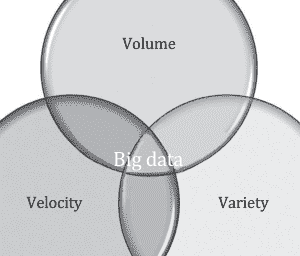

这些信息为社交媒体提供了额外内容（即空间），并为分析这些数据提供了背景（即主题和情感基调）。例如，我们识别了参与特定讨论的社区热点及其与其他社区的交互。因此，地理空间分析本质上是复杂的，因为它包含了对内容、连接、位置及其随时间变化的研究。正如此，它代表了地理新兴的地理信息替代方案，通过其规模和丰富性，为理解动态事件和形势开启了新的途径和研究挑战。

本章的目标是介绍与大地理空间数据相关的特定挑战，以便理解相应的分析和处理需求。因此，本章的结构如下：在第 11.2 节中，我们讨论社交媒体相对于传统空间数据的特定特征。在第 11.3 节中，我们将关注社交媒体内容的复杂性，使用代表性示例。在第 11.4 节中，我们将处理多样化内容，以实现对多个社交媒体信息流的整合地理空间分析。最后，在第 11.5 节中，我们将展望未来展望。

## 11.2 大地理社会数据的特征


# 大数据的最新定义与地理空间分析挑战

大数据的最新定义（TechAmerica, 2012）已超越了单纯的数据，通过另外两个额外属性来识别它，即图 11.1 所示的速度（`velocity`）和多样性（`variety`）。在这种背景下，速度不仅指数据的产生速率，还指其内容的时效性以及对及时分析的需求。以流式速率处理数据并提取信息的需求，其计算需求远高于对同类信息进行周期性（例如每日或每周）处理（例如在处理遥感数据时可能的情况）。


另一方面，多样性指的是所处理的数据源和类型的丰富性，以及待提取信息分布在不同来源的程度。一个事件由公众传达并不罕见，事实上，该事件可能通过多个用户使用各种模态（例如 `Twitter` 上的文本、`Flickr` 上的图像和 `YouTube` 上的视频）跨多个社交媒体渠道传播。这最早的体现之一是 2008 年孟买恐怖袭击期间；`Flickr`、`Twitter` 流、`Google Maps` 地图和维基百科文章被建立，以对不断发生的事件提供实时报道（Arthur, 2008）。每条信息单独都增加了我们对事件的理解，所有这些信息的总和提供了对实际事件完整复杂性的更好理解。这引入了开发更好能力来有序处理地理空间多媒体的需求。这类似于地理传感器网络中的信息聚合（Stanfield and ...）。

这些信息为社交媒体提供了额外内容（即空间），并为分析这些数据提供了背景（即主题和情感基调）。例如，我们识别了参与特定讨论的社区热点及其与其他社区的交互。因此，地理空间分析本质上是复杂的，因为它包含了对内容、连接、位置及其随时间变化的研究。正如此，它代表了地理新兴的地理信息替代方案，通过其规模和丰富性，为理解动态事件和形势开启了新的途径和研究挑战。

本章的目标是介绍与大地理空间数据相关的特定挑战，以便理解相应的分析和处理需求。因此，本章的结构如下：

- 在第 11.2 节中，我们讨论社交媒体相对于传统空间数据的特定特征。
- 在第 11.3 节中，我们将关注社交媒体内容的复杂性，使用代表性示例。
- 在第 11.4 节中，我们将处理多样化内容，以实现对多个社交媒体信息流的整合地理空间分析。
- 最后，在第 11.5 节中，我们将展望未来展望。

## 11.2 大地理社会数据的特征

大数据的最新定义（TechAmerica, 2012）已超越了单纯的数据，通过另外两个额外属性来识别它，即图 11.1 所示的速度（`velocity`）和多样性（`variety`）。在这种背景下，速度不仅指数据的产生速率，还指其内容的时效性以及对及时分析的需求。以流式速率处理数据并提取信息的需求，其计算需求远高于对同类信息进行周期性（例如每日或每周）处理（例如在处理遥感数据时可能的情况）。


另一方面，多样性指的是所处理的数据源和类型的丰富性，以及待提取信息分布在不同来源的程度。一个事件由公众传达并不罕见，事实上，该事件可能通过多个用户使用各种模态（例如 `Twitter` 上的文本、`Flickr` 上的图像和 `YouTube` 上的视频）跨多个社交媒体渠道传播。这最早的体现之一是 2008 年孟买恐怖袭击期间；`Flickr`、`Twitter` 流、`Google Maps` 地图和维基百科文章被建立，以对不断发生的事件提供实时报道（Arthur, 2008）。每条信息单独都增加了我们对事件的理解，所有这些信息的总和提供了对实际事件完整复杂性的更好理解。这引入了开发更好能力来有序处理地理空间多媒体的需求。这类似于地理传感器网络中的信息聚合（Stanfield and ...）。

这些信息为社交媒体提供了额外内容（即空间），并为分析这些数据提供了背景（即主题和情感基调）。例如，我们识别了参与特定讨论的社区热点及其与其他社区的交互。因此，地理空间分析本质上是复杂的，因为它包含了对内容、连接、位置及其随时间变化的研究。正如此，它代表了地理新兴的地理信息替代方案，通过其规模和丰富性，为理解动态事件和形势开启了新的途径和研究挑战。


# 本章目标

本章的目标是介绍与大地理空间数据相关的特定挑战，以便理解相应的分析和处理需求。因此，本章的结构如下：

- 第 11.2 节：讨论社交媒体相对于传统空间数据的特定特征。
- 第 11.3 节：关注社交媒体内容的复杂性，使用代表性示例。
- 第 11.4 节：处理多样化内容，以实现对多个社交媒体信息流的整合地理空间分析。
- 第 11.5 节：展望未来。

# 11.2 大地理社会数据的特征

大数据的最新定义（TechAmerica, 2012）已超越了单纯的数据，通过另外两个额外属性来识别它，即图 11.1 所示的速度（`velocity`）和多样性（`variety`）。在这种背景下，速度不仅指数据的产生速率，还指其内容的时效性以及对及时分析的需求。以流式速率处理数据并提取信息的需求，其计算需求远高于对同类信息进行周期性（例如每日或每周）处理（例如在处理遥感数据时可能的情况）。


图 11.1 大数据的三个维度：体量、速度和多样性。

另一方面，多样性指的是所处理的数据源和类型的丰富性，以及待提取信息分布在不同来源的程度。一个事件由公众传达并不罕见，事实上，该事件可能通过多个用户使用各种模态（例如 `Twitter` 上的文本、`Flickr` 上的图像和 `YouTube` 上的视频）跨多个社交媒体渠道传播。这最早的体现之一是 2008 年孟买恐怖袭击期间；`Flickr`、`Twitter` 流、`Google Maps` 地图和维基百科文章被建立，以对不断发生的事件提供实时报道（Arthur, 2008）。每条信息单独都增加了我们对事件的理解，所有这些信息的总和提供了对实际事件完整复杂性的更好理解。这引入了开发更好能力来有序处理地理空间多媒体的需求。这类似于地理传感器网络中的信息聚合（Stanfield and ...）。

这些信息为社交媒体提供了额外内容（即空间），并为分析这些数据提供了背景（即主题和情感基调）。例如，我们识别了参与特定讨论的社区热点及其与其他社区的交互。因此，地理空间分析本质上是复杂的，因为它包含了对内容、连接、位置及其随时间变化的研究。正如此，它代表了地理新兴的地理信息替代方案，通过其规模和丰富性，为理解动态事件和形势开启了新的途径和研究挑战。


这些信息为社交媒体提供了额外内容（即空间），并为分析这些数据提供了背景（即主题和情感基调）。例如，我们识别了参与特定讨论的社区热点及其与其他社区的交互。因此，地理空间分析本质上是复杂的，因为它包含了对内容、连接、位置及其随时间变化的研究。正如此，它代表了地理新兴的地理信息替代方案，通过其规模和丰富性，为理解动态事件和形势开启了新的途径和研究挑战。

本章的目标是介绍与大地理空间数据相关的特定挑战，以便理解相应的分析和处理需求。因此，本章的结构如下：在第 11.2 节中，我们讨论社交媒体相对于传统空间数据的特定特征。在第 11.3 节中，我们将关注社交媒体内容的复杂性，使用代表性示例。在第 11.4 节中，我们将处理多样化内容，以实现对多个社交媒体信息流的整合地理空间分析。最后，在第 11.5 节中，我们将展望未来展望。

## 11.2 大地理社会数据的特征

大数据的最新定义（TechAmerica, 2012）已超越了单纯的数据，通过另外两个额外属性来识别它，即图 11.1 所示的速度（`velocity`）和多样性（`variety`）。在这种背景下，速度不仅指数据的产生速率，还指其内容的时效性


图 11.1 大数据的三个维度：体量、速度和多样性。

以及对及时分析的需求。以流式速率处理数据并提取信息的需求，其计算需求远高于对同类信息进行周期性（例如每日或每周）处理（例如在处理遥感数据时可能的情况）。另一方面，多样性指的是所处理的数据源和类型的丰富性，以及待提取信息分布在不同来源源的程度。一个事件由公众传达并不罕见，事实上，该事件可能通过多个用户使用各种模态（例如 `Twitter` 上的文本、`Flickr` 上的图像和 `YouTube` 上的视频）跨多个社交媒体渠道传播。这最早的体现之一是 2008 年孟买恐怖袭击期间；`Flickr`、`Twitter` 流、`Google Maps` 地图和维基百科文章被建立，以对不断发生的事件提供实时报道（Arthur, 2008）。每条信息单独都增加了我们对事件的理解，所有这些信息的总和提供了对实际事件完整复杂性的更好理解。这引入了开发更好能力来有序处理地理空间多媒体的需求。这类似于地理传感器网络中的信息聚合（Stanfield and ...）。


## 地理信息科学与社交媒体

从社交媒体中采集的数据可以被称为环境地理信息（AGI）（Stefanidis 等人，2013b）；它被嵌入这些信息流的内容中，通常跨越多个条目的内容而非单条条目，并且需要被提取。尽管如此，它具有重要意义，因为它可以即时传达有关新兴问题的信息。同时，它为理解社会内部复杂的社交网络和文化动态提供了无与伦比的视角，并捕捉了人类景观的时间演变。

此外，社交媒体信息流正变得越来越地理空间化，这意味着它们具有实质性的地理空间分量。同时，我们可以通过研究交互行为来观察用户社区的底层结构。例如，我们可以识别推文在用户社区内被转发的轨迹，或者构建一个描述大量用户之间关注关系的社交网络。这让我们首次能够将人们的物理存在与其在线活动相结合进行探索，使我们能够在大规模上将网络空间和空间力量联系起来。这些信息为社交媒体提供了额外内容（即空间），并为分析这些数据提供了背景（即主题和情感基调）。例如，我们识别了参与特定讨论的社区热点及其与其他社区的交互。因此，地理空间分析本质上是复杂的，因为它包含了对内容、连接、位置及其随时间变化的研究。正如此，它代表了地理新兴的地理信息替代方案，通过其规模和丰富性，为理解动态事件和形势开启了新的途径和研究挑战。

本章的目标是介绍与大地理空间数据相关的特定挑战，以便理解相应的分析和处理需求。因此，本章的结构如下：在第 11.2 节中，我们讨论社交媒体相对于传统空间数据的特定特征。在第 11.3 节中，我们将关注社交媒体内容的复杂性，使用代表性示例。在第 11.4 节中，我们将处理多样化内容，以实现对多个社交媒体信息流的整合地理空间分析。最后，在第 11.5 节中，我们将展望未来展望。

## 11.2 大地理社会数据的特征

大数据的最新定义（TechAmerica, 2012）已超越了单纯的数据，通过另外两个额外属性来识别它，即图 11.1 所示的速度（velocity）和多样性（variety）。在这种背景下，速度不仅指数据的产生速率，还指其内容的时效性。


图 11.1 大数据的三个维度：体量、速度和多样性。

以及对及时分析的需求。以流式速率处理数据并提取信息的需求，其计算需求远高于对同类信息进行周期性（例如每日或每周）处理（例如在处理遥感数据时可能的情况）。另一方面，多样性指的是所处理的数据源和类型的丰富性，以及待提取信息分布在不同来源源的程度。一个事件由公众传达并不罕见，事实上，该事件可能通过多个用户使用各种模态（例如 `Twitter` 上的文本、`Flickr` 上的图像和 `YouTube` 上的视频）跨多个社交媒体渠道传播。这最早的体现之一是 2008 年孟买恐怖袭击期间；`Flickr`、`Twitter` 流、`Google Maps` 地图和维基百科文章被建立，以对不断发生的事件提供实时报道（Arthur, 2008）。每条信息单独都增加了我们对事件的理解，所有这些信息的总和提供了对实际事件完整复杂性的更好理解。这引入了开发更好能力来有序处理地理空间多媒体的需求。这类似于地理传感器网络中的信息聚合（Stanfield and ...）。

## 11.3 地理社会复杂性

除了我们在 11.2 节中识别的特定特征外，地理社会数据还因其复杂性与传统的地理空间数据集区分开来。具体而言，它们主要是链接型信息；用户之间建立链接以形成社交网络，词汇之间建立链接以定义通过信息片段传播的故索。关于用户连接，它们可以通过特定动作建立。例如，用户 A 关注、引用或向用户 B 发推文可以在他们之间建立连接。聚合所有这些连接为我们提供了一个作为结构化、网络化社区的用户视角，该社区可以由图来表示。

在图 11.6 中，我们展示了一个考虑转推活动生成的示例网络。该网络使用讨论 2012 年美国总统选举的 `Twitter` 数据构建。节点（圆点）对应于用户，连接它们的线表示用户转发另一个用户的实例。这种图的表示法为社交网络的结构提供了详细的见解。我们可以识别出，例如一个较大的节点簇，由节点 687、685、667 和 642 及其连接组组成。这些小组相互连接，形成一个更大的簇，其中这四个节点起着主导作用（因为它们领导了相应的较小小组）。我们为每个小组使用了不同的颜色，以便更好地识别小组结构以及两个小组连接形成更大社区的节点。在图右侧，我们识别了一个较小的簇，由节点 1046、1044 和 805（及其对应的小组）形成，与左侧簇脱离。我们在底部看到一些蓝色簇。词汇之间也是链接的，只要它们出现在同一条推文中。在图 11.7 中，我们展示了这样一个网络的快照。节点的大小对应频率，我们可以看到。

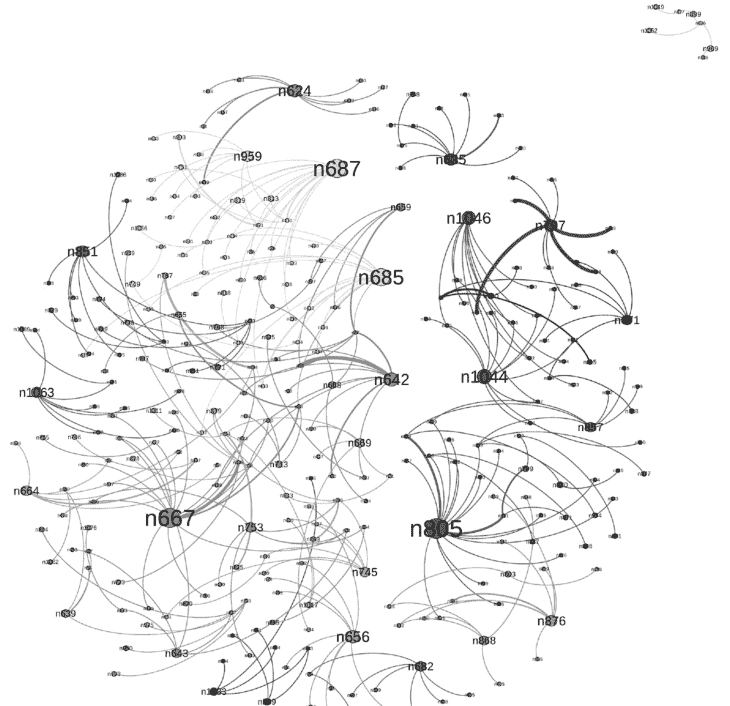

图 11.6 一个网络结构。

这是一个关键词，源于讨论，词汇之间的链接建立在它们出现在同一条推文中。网络边的厚度与频率成比例。某些中心性度量也可以通过流量定义。关于算法的详细综述可见 Hall (1996)。虽然我们尝试使用小语料库来可视化这些，但显然它们很快就会变得复杂。2012 年飓风珊期间捕捉的推文集合产生了近 1000 万的数据集，包括 470 万（占数据集的 47.3%）和 410 万（占数据集的 41.7%）外部。

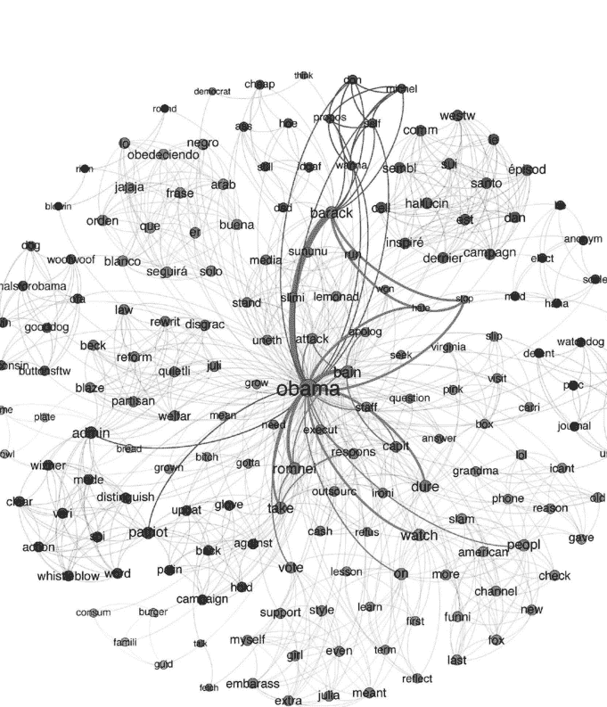

### 11.7 对应于图 11.6 数据集的结构

例如 `Flickr` 照片、网站。我们可以理解高度复杂的数据具有挑战性，这通过图分析来解决。枚举模式（例如大型网络中的三角形）是一项计算密集型任务。这项任务需要列举算法，每个三角形至少需要一次操作，导致最坏情况下界为 `O(n²)`。

存在多种解决方案来支持从此类网络中提取特征（或提取变量）。这些特征（变量）通常编码了节点相对于图中其他节点的位置和重要性。中心性、拓扑和距离度量是支持此类分析的基础指标：

-   **中心性指标**：中心性是社交网络最重要的属性之一（Freeman, 1979）。它通常被定义为网络中给定节点的可达性。某些中心性度量也可以通过流量定义。近年来，人们提出了许多度量，包括度中心性、接近性、介数中心性和流量（Scott, 2012）。度中心性指的是节点的网络活动，通常衡量为节点连接的数量。介数中心性衡量节点的影响力，通常衡量为节点作为另外两个节点之间最短路径桥梁的次数（Wasserman and Faust, 1994）。接近性衡量的是节点的可见性。接近性可以从测地距离或特征向量度中提取。`PageRank`（Page al., 1999）和 `Katz` 中心性（Katz, 1953; Borgatti, 2005）是这些与特征向量中心性度密切相关的其他指标。在大规模图上计算这些特征的开销是超线性的，Sharma 等人（2021）研究了这些算法在三种图划分方法和 `GPU` 实现中的可扩展性。某些中心性指标——如最短路径或随机游走——的计算开销很大，其复杂度为 `O(n^2)`。Kang 等人（2011）表明，并行化（图划分）度量并非易事。因此，在像 `ARIMA` 这样的内存系统中实现这些度量是一项重要的研究任务。


- **拓扑特征**：拓扑特征依赖于图的抽象结构，而不依赖于表示形式。常用的特征包括度分布、聚类系数和连通性。度分布是整个网络中节点度（degree）的概率分布。这是一个重要的指标，因为随机图服从二项分布或泊松分布，而现实世界网络是高度倾斜的（Bollobas et al., 2001），即大多数节点的度很低，但少数节点（被称为枢纽节点 hubs）具有高度。在无标网络中，度分布遵循幂律。聚类决定了节点倾向于聚集在一起的程度（Huang, 2006）。另一个可靠的指标是有效直径，它的衡量方法是：所有连接节点对中某一部分能够相互到达的最小跳数次数。

- **相似性与距离度量**：在异构信息网络中搜索相似模式是一项具有挑战性的任务。异构网络是有向图，包含多种类型的对象或链接。对于具有某些类型节点或链接的网络，存在多种相似性度量。然而，异构网络也是如此。

最近，异构网络定义了新的相似性度量（Sun and Han, 2012）。一种名为 `PathSim` 的特定相似性（Sun et al., 2011b）被证明，与基于随机游走的相似性度量相比，它能发现许多有意义的对象。作者还提供了使用这种相似性度量的检测和聚类算法。

## 11.4 建模与分析地理社交多媒体：异构性与集成

目前，社交媒体提供了许多使用各种技术和平台的平台。因此，其内容在内容上往往非常多样——从文本到照片和视频——在形式上也从结构化内容到非结构化内容不等。此外，社交媒体数据的形式往往是非结构化的或未定义的，这使得有价值的知识被隐藏，限制了通过自动化处理它们的能力（Sahito et al., 2011）。例如，Twitter 和 Flickr 都提供了编程接口（APIs）来查询其内容，但它们的响应通常是不兼容的，不仅在不同服务之间，甚至在单个服务内部也是如此。例如，Twitter API 可以根据特定的 API 调用返回不同格式相同的内容。管理和整合此类多样化的媒体数据需要开发一种独特的概念模型，以在单一模式下支持各种数据结构。通常，这项任务可以被视为数据清洗问题，即消除数据库中的错误和不一致性（Rahn and Do, 2000），这些数据可能来自单源或多个数据源。对于多个数据源，数据清洗问题出现在规模级（例如结构性不一致）或实例级（例如唯一性违背）。

Lyons 和 Lessard（2012）最近提出了一种整合社交数据的更通用解决方案的步骤，他们引入了一种社交特征集成技术，用于整合没有社交关联的集成系统。然而，目前似乎还没有广泛建立的概念模型可以直接应用于多个社交媒体源以进行地理分析。例如，Sahito 等人（2011）展示了一个框架，通过使用语义网资源（如 DBpedia 和 GeoNames）来丰富和推导 Twitter 数据。然而，这项工作只考虑了单一源。一个更通用的概念模型由 Reinhardt 等人（2010）提出，该模型描述了社交媒体源中的关系。这种人工制品-行为-网络（AAN）模型通过链接社交关系来创建。另一项相关工作是 Shimojo 等人（2010）提出的模型，它关注时间段内的数字经历（Kalkaité et al., 2011）。

基于这项工作，我们展示了一个将社交媒体数据收集到结构化地理信息的模型，从中可以提取知识。关注 Twitter（文本）和 Flickr（图像）。图 11.8 展示了我们数据模型的实体关系（ER）图。它由几个构建块组成：名称、条目、地理位置、时间以及作者。由于这些组件之间存在多对多的关系，我们增加了额外的表格来表示这些关系。在接下来的讨论中，我们描述了这些组件及其关系：

- **条目 (Entry)**：条目作为构成数据条目的各种组件。一个条目实例被唯一标识，并关联到一个作者实例。此外，每个条目都与发布时的时间戳相关。

- **源 API (Source API)**：源 API 数据由每个社交媒体服务的特定元素组成。例如，Twitter API 返回包含推文内容的 tweet，而 Flickr API 返回照片 URL 且没有 tweet 属性。由每个社交媒体服务驱动的源特定属性被认为是依赖性的，并存储在专用表中。

- **作者 (Author)**：作者实例代表创建内容的社交媒体用户。由于用户识别相当有限，每个社交媒体服务都会创建自己的作者名称，即一组唯一的用户。由于作者是由用户名和社交媒体标识符组成的元组标识的，不同服务的用户可能具有相同的标识符。需要注意的是，可以在社交媒体内容中引用作者，从而恢复底层的社交网络。在我们的模型中，这是通过链接条目到用户来实现的。

- **地理位置 (Geolocation)**：如前所述，社交媒体流的地理位置可以从内容分析中间接推断，也可以从数据本身提取。贡献者可能直接提供地理位置信息，以坐标的形式或作为地名（例如列出城市名）的形式，后者可以通过地名进行定位。

- **时间 (Time)**：时间信息可以从内容中提取（例如，这是 Flickr 图片描述最后更新的时刻）。在数据模型中，时间信息与每个条目实例嵌入，并带有一个时间戳标识符。

- **关键词**：作为社交媒体条目的一部分，Twitter 上使用关键词或标签（hashtags，如 #）（Huang et al. 2010）或在 Flickr 上使用用户标签（Ames and Naaman 2007）来强调观点和想法，并与其他用户进行互动（Romero et al. 2011）。例如，标签的使用已被证明可以加速从 Twitter（Zhao et al. 2011）和 Flickr（Sun et al. 2011a）的检索。标签还通过允许单条推文根据其内容进行逻辑连接，支持了语义的构建。与显式标记不同，当某些词汇因某条值得关注的条目而被广泛采用时，关键词可能会从用户观察中合并。在数据模型中，关键词实例存储在空间表中。

- **数据源**：社交媒体来源（及其相应的来源）作为可以为分析框架提供数据的不同来源类型的目录。每个源可以与一个或多个馈送（feeds）关联，这些馈送是给定源类型的实例。可能会出现单个条目存在于多个馈送的情况（例如，使用不同的查询从两个馈送中检索到相同的推文），此时只存储推文的一个副本，并使用对馈送的引用通过唯一标识符来避免冗余。

持续精炼过程依赖于有效收集和存储社交多媒体的能力（正如地理空间数据模型中概述的那样）。用于收集数据并从多个社交媒体馈送中提取地理信息的系统通用架构由三个部分组成（图 11.10）：通过 API 从相应的社交媒体数据收集数据；数据解析并存储在关系型数据库中；以及数据分析以从中提取感兴趣的事题。

一旦通过社交媒体摄取器收集并处理，就可以通过协作工作台进行数据分析（图 11.11）。该框架的一个底层设计目标是通过协作的基于 Web 的平台促进知识发现，并支持领域专家（SME）社区的协作。使用此类平台，可以对地理社会数据的收集、聚合和合成，并将其传播到地理分布的用户社区中。同时，终端用户社区也被赋予了与 SME 社区互动的能力，并通过向分析过程提供反馈和输入来响应贡献见解和知识。为了实现这一设计目标，工作台围绕几个相互关联的启用原则设计（Croirotu and Arazy, 2007）：

- **空间赋能**——在现实世界空间设置中表示和引用事件的能力。表示包括为不同的空间实体（例如，点、线和多边形）建模数据的能力，以及事件的其他高级表示，特别是时空表示（例如，Laube et al., 2007）。这种赋能还包括存储、查询和检索空间数据的能力，并支持主题层（例如，人口普查数据）。

- **时间赋能**——将数据实体与时间戳关联的能力。时间不仅对于理解事情何时发生至关重要，对于评估数据相关性也是如此。此外，时间赋能允许用户通过建模进行预测，从而使用户能够在分析中将历史观测和未来预测相结合。

- **社交媒体赋能**——采集社交媒体馈送（例如 Twitter 或 Flickr）用于地理空间分析并发布数据请求的能力。收集机制提供了根据位置、时间以及关键词（标签）采集社交媒体的能力，因此支持对社交媒体进行查询。

- **协作赋能**——赋予 SME 组和用户社区协作制定共同目标以解决并分析该目标，从而产生可操作的知识的能力。这包括隔离和收集相关数据并对其分析以产生知识的能力。

- **分析赋能**——将社交媒体嵌入时空语料库中以进行聚合、分析和推导出定性或定量产物的能力。此类工具以主题工具箱的形式提供给用户，例如，社交网络分析 (SNA) 工具箱、空间分析工具箱和预测工具箱。用户可以创建并共享处理社交媒体的工作流，从而允许专家进行分析。值得注意的是，工作台还允许通过这种方式处理社交媒体。

## 地理信息与社交媒体

（图 11.9）地理空间分析的工作台

（图 11.10）地理空间分析的架构图

（图 11.11）地理空间分析的协作工作台

## 11.12 这种对于地理空间分析的范式转变

## 11.5 展望：大数据的挑战与机遇

本章的动力源于社交媒体的空前发展以及我们讨论的地理数据，随着时间的推移，预计将变得越来越大。我们已经看到由于智能手机和其他设备的普及，数据作为传感器影响人类系统。通过地理空间分析，我们可以获得对人类的内在联系。在某些情况下，例如阿拉伯之春（Crews et al., 2013）、政治事件（Stefanelli et al., 2013）、语言（Mouattan et al., 2013）、选举（Tonkin et al., 2020）、情感（Quera et al., 2013）、危险（Bliss et al., 2011）、愿景（Wohn et al., 2013）以及灾害（Graham et al., 2012），这些数据为我们提供了新的透镜来研究人类系统。

## 地理社交媒体？

我们也可以在大规模（时空）地理上进行探索，该领域自20世纪60年代以来已有大量研究（Hagerstrand, 1967）。

然而，随着地理社交媒体的增长，必须注意到，从地理社交媒体流中收集信息时存在只能获取人口样本的问题，即在该领域活跃的个体。尽管如此，这一样本正在迅速增长，技术的普及也变得无处不在（见 Smith, 2011; Nielsen, 2012）。如此，研究人员在查看地理社交数据结果时，需要考虑新的参与度衡量标准（例如与互联网使用率进行对比）以及归一化方法（例如 Stefanidis, 201a）。与参与率相关的问题涉及虚假信息，其范围涵盖从国家支持的宣传机构（如“五角党”——他们得到中国政府的支持，并资助留言板以推广中国共产党的路线，试图引导公众舆论，见 Bremer, 2010）到对事件的伪造和欺骗（例如 Gupta 等人, 2013），这些都是数据挖掘社区中活跃的研究领域。

地理空间媒体的兴起及其分析也对传统地图绘制和 GIS 解决方案处理此类信息的适用性提出了若干关注。我们不再仅仅绘制建筑和基础设施，而是现在可以映射抽象概念，如背景中的信息流和背景信息，从而将定量和定性分析置于人类尺度。在某种意义上，可以将通用人工智能（AGI）视为正在解决：人类系统是一个不断演变的复杂有机体，人们的角色和活动正在适应变化条件，并影响时空中的事件。通过超越社交媒体流的模式并转向对其内容的实际分析，我们获得了对这一复杂系统的宝贵见解。其意义在于预测。例如，考虑仅在10年前，基于位置的服务和嵌入 GPS 的移动设备还处于婴儿阶段。工具和软件的进步使得地理信息的收集变得更加容易，导致人们越来越多地转向地理空间数据而非权威来源（如国家地图）。最近，带有地理位置标记的社交媒体的流行促进了“位置”作为一种商品的出现，可用于组织内容、规划和提供服务。随着移动设备的感知能力增强，这一趋势往往会增加。还可以将其与在线活动和服务的增长联系起来（例如 Foursquare、Facebook Places、Google Latitude、Twitter、Gowalla 等地理社交媒体网站以及一系列新网站和服务的实时信息）。但更具统计性（从意义上说，人们可以随地上传，并在某种意义上在未实际访问的情况下对某个地方形成观点）。

地理社交媒体还涉及隐私问题。没有人希望住在奥威尔版本的“老大哥”世界；然而，收集信息给隐私问题带来了新的担忧，因为分析数据可能会揭示贡献者并非在知情的情况下贡献（见 Fried and Sommer, 2010）。这不是一个新趋势；它实际上已经发生了一段时间（例如《纽约时报》，2011）。Google 基本上是一个营销工具，利用其收集的信息来改进其服务。同样，Twitter 通过将其推文流连接到搜索引擎来赚钱，而公司可以付费推广推文（见《金融时报》，2010）。TomTom（2011）一直在使用被动感知数据来帮助警察测速摄像头。这还涉及到苹果手机在用户未察觉的情况下定位本地数据（BBC 2011）。然而，人们在分享位置信息时强调隐私放弃问题方面取得了进展。诸如 `pleasereblr.com` 或怪异的地理位置聚合器（`https://elektrojoko.github.io/`）等网站和应用程序已经了聚合社交媒体以精确定位置的潜力。在时代保护人们的身份也是一个广为人知的问题，例如，Standby Task Force（2011）展示了在北非近期动荡期间限制暴露和延迟信息的方法。但采集 AGI 的力量源于对群体更深层次的理解，而不是观察特定个人。

# 地理信息学与社交媒体

社交媒体的普及正呈指数级增长，我们面临着独特的机会，去识别和理解在地理和社会维度上的信息传播机制和活动模式，使我们能够优化对特定事件的响应，而热点的出现识别有助于我们为即将到来的需求分配资源。

## 注释

- 1 `http://dbpedia.org/`
- 2 `http://www.geonames.org/`

## 参考文献

- Ahrekar, H., Gandhe, A., Lazarus, R., Yu, S.H., and Liu, B. (2011) Predicting flu trends using Twitter data, 2011 IEEE Conference on Computer Communications Workshops (INFOCOM WKSHIPS), Shanghai, China, pp. 702–707.
- Ames, M. and Naaiman, M. (2007) Why they? Motivations for annotation in online media, Proceedings ACM SIGCHI Conference on Human Factors in Computing Systems, San Jose, CA, pp. 971–980.
- Arthur, C. (2008) How Twitter and Flickr reacted the Muslim terror attacks, The Guardian, Available at `http://bit.ly/MiMMz` (accessed on June 3).
- BBC (2011) Tracks tweets with network flow. Available at `http://bit.ly/8ei81gt` (accessed on June 3),
- Bliss, J., Kuumant, I.M., Harman, K.D., Dothan, C.M., and Dodds, P.S. (2012) Twitter reciprocal reply networks exhibit associativity with happiness, Journal of Computational Science, 55(3): 388–397.
- Bollabas, R., Riordan, O., Sperner, J., and Tukey, Y. (2001) The dense sequence of a scale-free graph, Random Structures & Algorithms, 18(3): 279–290.
- Borgatti, S.P. (2005) Centrality and network analysis: Information communication and control, For
- Bremmer, I. (2010) Democracy in cyberspace: Water communication and control can do, For Analytics, 2(4): 86–102.
- Castillo, C., Mendez, A., and Poblete, B. (2011) Information credibility on Twitter, Proceedings of the 20th International Conference on World Wide Web, Hyderabad, India, pp. 675–684.
- Christensen, T. (2011) Twitter revolutions: Addressing social media and distance, The Communication Review,
- Compton, S. (2013) What does a petabyte look like? Available at `http://bit.ly/Ywtnqq` (accessed on October 29, 2013).
- Croitru, A. and Ajay, R. (2007) Introduction to location-based collaboration mechanisms, Proceedings of the 17th Workshop on Information Technologies and Systems, Montreal, Quebec, pp. 32–47.
- Croitru, A., Stefanidis, A., Radkowski, J., Crooks, A.T., Stahl, J., and Wayant, N. (2012) Toward a collab- Geospatial analysis workflow, Geo-, Washington.
- Crooks, A.T., Cristian, A., and Radkowski, J. (2013) #Earthquake: Twitter as a distributed network, System and Science, 17(1): 124–147.


- De Longueille, B., Smith, R., and Ghosh, G. (2009) From Here, I Can See Flames! A case study of location based social networks to acquire spatio-temporal data on fires, Proceedings of the 2009 International Workshop on Location Based Social Networks, Seattle, WA, pp. 73–80.

- Dugan, M. and Bremer, J. (2012) The Demographics of Social Media Users–2012, Washington, DC: Research Center, Available at http://bit.ly/YXRH6

- Engardt (2013) DARPA’s SENSE: Social media analysis of influence from 2000 people, Available at http.ly/uGUFYF (accessed on October 29, 2013).

- Financial Times (2010) Coke share ‘phenomenal’ result from Twitter ads, Financial Times, June 25, Available at http.on.ft/3IySkp (accessed on June 3).

- Forbes (2012) Twitter’s Daily Costoc: Twitter makes revenue best desktop on some days, Available at http://bit.ly/3WTPws (accessed on June 19, 2013).

- Lee, R.C. (1979) Censorship in social networks conceptual conflict, Social Networks, 13(3): 215–239.

- Friedland, G. and Sommer, R. (2010) Cyberstalking the joint: On privacy implications of geotagging, Proceedings of the USENIX Workshop on Hot Topics in Security (HotSec 10), Washington, DC.

- Fritz, S., MacCallum, I., Smith, C., Perrer, G., Graymeier, R., Arthur, F., Kraxner, R., and Oberstein, M. (2009) Geo-wiki.org: The use of crowds to improve land cover, Remote Sensing, 1(3): 345–354.

- Gerrard, G. and Thompson, R. (2011) Two million cameras in the UK, CCTV Image, 42: 10–12.

# 180

# 大数据

Golovinsky, A., Kim, V.G., and Funkhouser, T. (2009) 环境中 3D 点云的形状识别，IEEE 国际计算机视觉会议论文，日本京都，pp. 2154–2161。

Goodchild, M.F. (2007) 公民作为传感器：志愿者地理学的世界，GeoJournal, 69(4): 211–229。

Graham, M., Poutheras, A., and Zook, M. (2012) 英国洪水的数字足迹——推文与观测结果的匹配程度如何？《卫报》，访问于 http://bit.ly/3InTOww（访问于2013年5月12日）。

Gupta, A., Lamba, Kamaraguru, P., and Joshi, A. (2013) 伪造桑迪：飓风桑迪期间虚假图像的特征与识别，在线社交媒体安全与隐私第二届国际研讨会，里约热内卢。

Hagerstr, T. (1967) 创新扩散作为空间过程，伊利诺伊州芝加哥：芝加哥大学。

需要多少志愿者才能让一个区域变得真实？语言信息的有效性，《地图杂志》，47(4): 315–322。

Hall, P. (1996) 夏季算法——一个评估的案例研究，《美国信息科学学会杂志》，47(1): 70–84。

Hect, B. and Moxley, E. (2009) 数 TB 级的推特：在领域中立的知识表征中对“第一定律”进行评估，收录于 Horny, K.S., Clarumunt, C., Denis, M., and Ligozat, G. (编), 空间信息：第九届国际会议论文，CS2009，德国柏林：斯林格出版社，pp. 88–105。

Howard, P., Duffy, A., and Hussain, M., Mari, W., and Mazayd, M. (2011) 社交媒体使用在阿拉伯之春期间开启关闭的作用？工作论文 2011.1。信息技术与政策影响项目，华盛顿州西雅图大学传播系。

Huang, J., Thornton, K., and Efthimis, E. (2010) 推特中的对话式标记，第21次 ACM 超文本与多媒体会议论文，加拿大安大略省伦伦，pp. 173–178。

Hunk, G. (2006) 图拓扑上的链接预测：广义聚类系数的有效性，链接网络分析：大型网络的动态与静态 (LinkKDD2006)，宾夕法尼亚州费城。

InFoQ (2012) 来自 Facebook 的微数据，访问于 http://www.infog.com/presentations/Data-Facebook（访问于2013年10月29日）。

Instagram (2013) Instagram 标签，访问于 http://www.instagram.com/press/（访问于2013年10月29日）。

Kalnikite, V., Sellen, A., Whittaker, S., and Krik, D. (2010) 让我们看看我为什么在那：理解生活如何调解媒体消费，第28次计算系统人类因素国际会议论文，佐治亚州亚特兰大，pp. 2045–2054。

Kang, U., Papadimitriou, S., Sun, J., and Tang, H. (2011) 大型网络中的中心：算法与过度连接，SIAM 国际数据挖掘会议，亚利桑那州梅萨，pp. 119–130。

Kaplan, A.M. and Helein, M. (2010) 开放用户的世界：社交媒体的挑战与机遇，《商业视界》，53(1): 59–68。

Katz, L. A. (1995) 计量经济数据分析的新方法，《心理测量学》。

Lebrun, T., Foster, W., and Parker, M. (2007) 移动之外的移动益处——动态地理生命线的分析，《计算机与城市系统》，35(1): 481–501。

Leberman, D. Ma., and Saranarayanan, A. (2010) 利用词汇进行地理编码以构建工程，加利福尼亚州长滩，pp. 201–212。

Lyon, K. and Leonard, L. L. (2012) 识别现有系统中社交特征的新技术，2012年国际会议论文，pp. 263–270。

Nielsen, M. D. (2012) NASA 地球数据系统计划，大学研究协会 (SIRA) 信息技术委员会会议，华盛顿特区，访问于 http://www.nasa.gov/

Marcus, A., Bennett, M. S., Darder, D., Madden, S., and Miller, R.C. (2011) 推特中的处理与视觉数据，《SIGMOD 记录》，40(4): 21–27。

纽约时报 (2011) 再次关注秋季是否会发生变化，《纽约时报》，访问于 http://www.nytimes.com/2011/01/30/weekreview/30shane.html?r=1&ch（访问于2013年7月22日）。

Nielsen (2012) 社交媒体规模报告，访问于 http://slideshare.re/ZruwV6（访问于2013年6月1日）。

Norris, C., Cahill, M., and Wood, D. (2004) CCTV 的增长：公共开放空间监控融合的全球视角，《监控与社会》，2(3): 110–135。

## 地理信息科学与社交媒体

Page, L., Brin, S., Motwani, R., and Winograd, T. (1999) PageRank 引用排名：带给网络，技术报告。斯坦福信息实验室，加利福尼亚州斯坦福。

Querca, D., Caputo, L., and Crocroft, J. (2012) 推特的社交世界：主题、地理与情感，第 6 次 Webslogs 与社交媒体国际会议论文，爱尔兰柏林，pp. 298–305。

Rahm, E. and Do, H. (2000) 数据清洗：问题与方法，《IEEE 时代》，24(5):13。

Raymond, E.S. (1999) 大教堂与集市：开源软件之道。

Reinhardt, V., Nitt, T., Moi, M., and Weise, A. (2010) 意外发现的开源数据，第 18 次国际会议论文，德国卡塞尔。

Romero, D., Meeder, B., and Klein, J. (2011) 监控的差异，第 20 次国际会议，巴基斯坦伊斯兰堡。

Sahito, F., Atari, A., and Matsuo, S. (2011) 异构数据的融合，国际异会议论文，巴基斯坦伊斯兰堡。

Sakai, T., Okazaki, A., and Nakamura, M. (2010) 推特震动：社交媒体测量，世界网会议，pp. 966–568。

Shapiro, G. (2011) Facebook 的数据？每天25  条内容和数百青少年，青少年研究中心，华盛顿特区。

Scott, J. (2012) 社交网络分析，第 3 版，伦敦。

Sharma, P., Kumari, U., Sheridan, B., and Schoen, B. (2011) 美国人为何使用社交媒体维持亲密关系，青少年研究中心，华盛顿特区。

Shimoto, A., Yamada, S., and X, Y. (2011) 路径主义：异构信息网络中基于路径的 top-k 相似性搜索，第37 次大型基准会议论文，华盛顿州西雅图。

Standby Force (2011) 敌对环境中实时制图的伦理与限制，访问于 http://blog.standbyforce.com/pp259（访问于2013年27日）

Stephanidis, A., Crofton, A., Aros, C., Radzikkowski, J., and Rice, M. (2013) 通过社交媒体文本测量的国家，《地理信息科学》，40(2): 116–129。

Stephanidis, A., and Nitt, S. (2004) 地理传感器网络：从社交媒体流中提取环境信息，《GeoJournal》，78(2): 319–338。

Sun, B., and Goldreich, M. (2011) GIS 与社交媒体的意义：GIS 的挑战，《国际地理信息期刊》，25(1): 1737–1748。

Sun, A., Bowick, S., Nguyen, N., Tran, K., and Bai, G. (2011a) 基于标签的社交媒体检索：实证评估，《美国信息科学技术杂志》，62(12): 2364–2381。

Sun, Y., and Han, J. (2012) 异构信息网络挖掘：原理与方法，斯林格数据挖掘与知识发现教程，3(2): 1–19。

Sun, Y., Han, J., X, Y., Pu, S., and Wu, T. (2011b) 路径式：异构信息网络中基于路径的 top-k 相似性搜索，第37 次大型基准会议论文，华盛顿州西雅图。

# 182

# 大数据 (Big Data)

- Tobler, W. (1970) A computer simulating urban growth in the Detroit region, Economic Geography, 46(2): 230–240.

- TomTom (2011) It is what we really do with your data, Available at http://www.tomtom.com/page/facts (accessed on June 3, 2013).

- Tonkin, T., Piefeder, H. D., and Tourte, G. (2012) Twitter, information sharing and the london riots? Bulletin of the American Society for Information Science and Technology, 38(2): 49–57.

- Tumasajan, A., Springer, T., Sanders, P., and Weype, I. (2011) Election forecasts with Twitter: How 140 characters changed the political landscapes? Social Computer Review, 24(4): 402–418.

- Twitter (2011) 200 million tweets per day, Available at (accessed on January 19, 2013).

- Vatsai, R.R. and Bhadhari, B. (2013) Geospatial analysis for big geospatial data: Algorithms, applications, and challenges, Workshop on Big Data and Extreme-Scaling Computing, Charleston, SC.

- Vasserman, S. and Faust, K. (1994). Social Network Analysis: Methods and Applications, New York, NY: Cambridge University Press.

- Wayman, N., Crooks, A.T., Stergiadis, A., Croitou, A., Radzikkowski, J., Stahl, J., and Shine, J. (2012) Spatiotemporal clustering of social media feeds for activity monitoring, GI Science (Seventh International Conference for Geographical Information Science), Columbus, OH.

- West, G. (2013) Big data needs a theory to go with it, Scientific American, 15, Available at http://bit.ly/5wyggl (accessed on May 20, 2013).

- Wohn, D.Y., Ellison, N.B., Khan, M.L., Fewins-Bliss, R., and Gray, R. (2013) The role of social media in sharing first-generation high school students' college aspirations: A social capital lens, Computers & Education 65: 424–436.

- YouTube (2013) YouTube statistics, Available at http://bit.ly/XQBYBW (accessed on October 29, 2013).

- Zhao, S., Zhong, L., Wickramasuriya, J., and Vasudevan, V. (2011) Human as real-time sensors of social and physical events: A case study of Twitter and sports games, Technical report TR0620-2011, Rice University and Motorola Labs, Houston, TX, arXiv:1106.4300v1.

- Zook, M., Graham, M., Shelton, T., and Gorman, S. (2010) Volunteered geographic information and crowdsourcing disaster relief: A case study of the Haitian earthquake, World Medical & Health Policy, 2(2): 7–33.

# 12 洞察与知识

使用 TMC 模式从大地理数据中发现

Roland Assam and Thomas Seidl

## 12.1 引言


# 移动计算与通信领域正以前所未有的速度发展

由于大地理数据可以模拟个人或群体的行为、所属关系和兴趣，因此检测此类数据中隐藏的移动模式或相关性具有极大的研究价值。从用户过去的位置历史中建模轨迹具有重要意义，因为大多数位置任务（包括位置预测、位置推荐、位置分类或异常检测）都强烈依赖于底层的轨迹模型或方案。如果无法对用户过去的位置历史中的轨迹数据进行适当建模，将对上述挖掘任务产生不利影响。

泛在设备的数据通常被称为时空数据。这些数据通常包含三个以上的维度（空间和时间）。因此，移动数据不仅将位置与时间关联，还将位置和时间绑定到一个或多个额外属性（维度）。这些额外属性从社交网络活动、Twitter 信息、环境污染、年龄到电话信息，如图 12.1 所示。已有许多用于轨迹建模（Ashrock and Steiner 2003, Yu et al. 2009）和移动数据提取（Giannotti et al. 2007, Nicholas and Noble 2008, Yawa et al. 2005）的技术。然而，这些技术大部分是新颖的，它们只关注时空维度的提取或从原始地理数据构建轨迹模型。如果社交网络活动（例如 Twitter 信息、Facebook 活动）、电话或疾病包含在移动数据中，则未被考虑。现有轨迹模型（Ashrock and Steiner 2003, Giannotti et al. 2007）无法处理或利用这些非时空维度，我们坚信需要一种新的轨迹模型来满足这种多维地理数据的需求。基于这一观察，我们提出了一种时间移动相关模式（`TMC-Pattern`）。

`TMC-Pattern` 考虑了多种维度，并利用子空间聚类（`SUBCLU`）寻找感兴趣区域（`ROI`）。此外，`TMC-Pattern` 严谨地捕获并集成了大数据中的基础设施、社交和行为模式。`TMC-Pattern` 整合了用户和区域的上下文。表 12.1 显示了我们提出的 `TMC-Pattern` 与一些现有模型的区别。表 12.1 有三个主要观察：第一，`TMC-Pattern` 利用 `SUBCLU`，而其他模型使用全空间聚类。使用 `SUBCLU` 的益处是通过中心性度量区域之间更好的连通性。第三，我们使用这些新概念，如状态模式（`SM`）、通过模式（`PM`）和短暂模式（`BSM`）来描述对象在区域的状态。


图 12.1 设备的维度

### 表 12.1 轨迹模型对比

| 维度 | TMC-Pattern | T-Pattern (Giannotti et al. 2007) | Li 等 (Quannan et al. 2008) | Ashbrook 等 (Ashrock and Starner 2003) |
| :--- | :--- | :--- | :--- | :--- |
| 维度类型 | >3 | 空间、时间、社交网络活动、疾病、短信、电话 `SM`, `PM`, `BSM` | 3 | 空间和时间 | 3 | 空间和时间 |
| 显著记录 | | 时间间隔 | 空间和时间 | 空间和时间 |
| 嵌入基础设施 | 是 | `PrefixSpan` | 否 | 基于枢纽 | 否 |
| 频繁请求 | `PrefixSpan` | | | |
| 聚类 | `SUBCLU` | Grid 和 `DBSCAN` (全空间聚类) | 分层次聚类 (全空间聚类) | `K-means` (全空间聚类) |

此外，许多轨迹模型（Ashbrook and Starner 2003, Giannotti et al. 2007, Quannan et al. 2008, Yu et al. 2009）根据停留时间来决定区域的重要性。停留时间是指对象在区域内停留的时间。提出 `TMC-Pattern` 是由于现有轨迹模型对移动信息的过度泛化。例如，在 Quannan 等（2008）提出的轨迹模型中，如果对象在该区域持续时间超过了定义的阈值时间（例如 20 分钟），则该区域被称为术。

## 地理数据的洞察与知识发现

人们通常在一个区域停留超过 20 分钟。在这里，区域将根据其模型标记为重要区域或停留区域。但一个区域在全天范围内真的是停留区域吗？区域在早上几乎是空的，下午是满的。地理数据技术必须提供精确的洞察以实现决策。Quannan 等（2008）的解释对于位置挖掘是很好的，但在预测用户的下一个位置时非常模糊。更好的描述是在位置中包含一些时间相关的信息。例如，重复位置“傍晚”。`TMC-Pattern` 通过时间段来指定重要区域。Ashbrook 和 Starner（2003）以及 Nicholas 和 Noble（2008）使用路线频率来推导马尔可夫模型的概率，以预测对象的下一个位置。通过观察路线的频率，可以得出根据其流行程度它是最佳路线的结论。然而，上下占据了高路线频率，而其他路线可能由于社交或人类行为（如更好的夜景）具有更高的频率。基于每天最高频率的预测可能非常有误导性并降低预测准确性。

`TMC-Pattern` 可用于从多个领域的地理数据中创建价值，例如社交网络、基于位置的广告、电信、医疗患者监测、交通监控和趋势分析技术。`TMC-Pattern` 可用于研究污染与移动模式影响疾病传播的关系。

在本章，我们提供了一种地理数据建模的技术以及两种从地理数据中提取知识和洞察的技术。对原始且多样化的位置数据进行建模在质量和运行效率方面是非常具有挑战性的。使用技术被迫通过使用阈值时间来为轨迹建模选择特定的粒粒度。Ashbrook 和 Starner（2003）、Quannan 等（2008）关注的是宏观图，即丢弃大量的地理点以获得对象的移动概述。在大数据时代，在决策过程中分组或至少确定哪些对象的移动是可以变化的（例如对于基于位置的广告或推荐系统）是困难但重要的。这强调了对 `TMC-Pattern` 的需求，它能够捕获对象的每一次移动及其所有邻居，以及移动的宏观图。

提出了一种轨迹建模技术，该技术对用户的的位置历史进行建模，并发现多个用户之间的相似性。他们利用“停留”（`stay`）的概念创建了对象在一段时间内停留的地理区域，然后采用层次聚类算法对这些区域内的多个对象进行分组。虽然他们的模型使用停留的概念来获取停留区域，但我们的模型扩展了停留的概念，并提出了诸如 `PM`（通过模式）和短暂模式（`brief mode`）等新概念来捕捉路过。此外，我们使用 `SUBCLU` 从不同视角投影区域的活动。其他工作也提出了提取位置和构建统计模型的方法，例如 Minkowski 等人（2004)，Laenon 等人，Moncale 等人（2009）提出了一种新技术，利用所有用户的全局轨迹历史来预测对象的位置。与 Moncale 等人（2009）不同，后者利用二阶马尔可夫链进行位置预测。Ashcroft 和 Starner (2003)、Jungkeum 等人 (2006)以及 Asahara 等人 (2011)的预测模型基于马尔可夫模型，我们的技术与它们的不同之处在于我们使用了不同的评分指标来计算转移概率。Yavas 等人 (2005)和 Morzy (2006)提出了使用关联挖掘规则预测未来位置的方法。

## 12.2 轨迹建模

我们对大规模地理数据轨迹建模的主要目标是提取并对轨迹历史进行建模，以捕捉对象的移动模式及其频繁的邻居。

### 12.2.1 TMC-PATTERN

在本节中，我们介绍了 `TMC-Pattern`，一种新的轨迹建模技术。图 12.2 展示了这种数据提取和建模技术的概述。

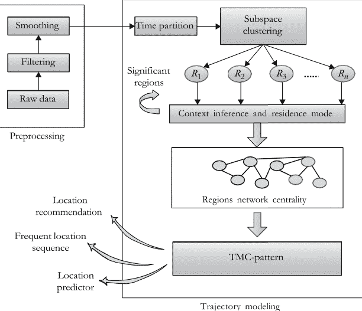
图 12.2 使用 `TMC-Pattern` 进行地理数据提取和建模。

### 12.2.1.1 确定有意义的位置

在许多之前的工作，Ashbrook 和 Starner (2003)、Yu 等人 (2009)以及 Jungkeun 等人 (2006) 通过选择对象停留至少一段时间（通常称为停留时间）的位置，从大型移动数据集中提取出重要或有趣的位置。停留时间是对象轨迹中两个连续轨迹之间的间隔。`TMC-Pattern` 以不同的方式利用停留时间从原始移动数据中识别有意义的位置。在 `TMC-Pattern` 中，如果对象在给定区域停留超过阈值时间，则认为在该区域为 `SM`。

**定义 12.1**

`SM` 是对象在给定区域停留时间大于或等于阈值时间 $T_s$ 的模式。

在之前的工作中，停留时间的概念被泛化了。如果对象在区域的停留时间很短，它们会丢弃或忽略轨迹。例如，图 12.3 展示了一个访问六个位置的人的轨迹。从图 12.3 来看，如果停留时间至少为 5 分钟才认为位置是有有趣的，轨迹为 `Home \rightarrow Work \rightarrow Restaurant`，这未能捕捉到这个人对银行、学校和咖啡店的短时间访问。我们强调了真实的人类移动，例如在银行使用 ATM 机、在学校放孩子或取咖啡。

Liao 等人（2007）提到由于交通拥堵，点可能被视为停留点。直观地说，如果时间小于 5 分钟，停留点的比例会更高。然而，我们认为在数据提取期间未能整合此类重要位置（5分钟以下）会导致信息丢失，从而降低预测精度。为了解决这一信息泄漏问题，我们提出了新时间即通过时间 ($T_{pm}$)，以及两个新模式 `BSM` 和 `PM`。

**定义 12.2**

`PM` 是对象在给定区域停留时间小于阈值时间 ($T_{pm}$) 的模式。


图 12.3 从家到公司的行程。

**定义 12.3**

`BSM` 是对象在给定区域停留时间大于阈值时间 ($T_{pm}$) 但小于阈值停留时间 ($T_s$) 的模式。

在本章中，停留模式将指代 `SM`、`PM` 和 `BSM`。事实上，我们这些模式的主要目的是捕捉邻居对象（例如路过者）的移动。获取邻居对象对于频繁邻居的检测至关重要。

### 12.2.2 时间相关性

在 12.1 节中，我们提到标记重要位置可能会误导位置预测器。我们还提到由于犯罪或基础设施因素，路线在晚上可能非常流行。未能关联区域或基础设施无法反映轨迹模型中的人类行为。`TMC-Pattern` 通过将时间与给定区域的每个停留模式（`SM`, `BSM`, `PM`）来关联区域和基础设施。具体来说，我们将时间划分为有限的时间段集合。例如，一天可以划分为 24 小时，一个月可以划分为若干天或周。

**定义 12.4**

时间段是一个有限集合 $T$，由时间间隔 $t_{\mu}, t_{u}, \dots, t_{\omega}$ 组成，时间间隔通过将原始时间 ($T$) 分分为若干范围形成。时间段的不同元素必须不同，每个时间间隔可以用标签表示。在这项工作中，我们使用 `TMC-Pattern`，其时间段由集合 $T = \{M, A, E, N\}$给出，其中标签 $M, A, E, N$ 分别指早晨、下午、晚上和深夜。集合 $T$ 通过对 $T$ 的划分创建。早晨 ($M$) 是从上午 7:00 到上午 11:59 的时间间隔，而下午 ($A$) 是下午 12:00 到下午 5:59 的时间范围，最后，深夜 ($N$) 被认为是凌晨 12:00 到上午 7:00 的时间间隔。在推导时间段期间，$T$ 的划分取决于数据挖掘任务。如前所述，我们的目的集合 $T$ 只使用四个范围。

### 12.2.3 上下文感知

`TMC-Pattern` 解释了用户或区域的上下文。用户在给定区域的上下文很大取决于他们。这就是为什么 `TMC-Pattern` 关联移动并寻找用户在给定区域的停留模式。用户的上下文是指用户在给定区域和时间的身份或心理状态。同样，区域的上下文是指发生在区域内（给定时间）的事件有限集合。一个区域通常被许多人访问，根据区域的大小，上下文可能因人而异。

**定义 12.5**

`TMC` 上下文是关于给定时间段 $T$ 内区域和用户的有限集合 $C_{um}$，包含活动、事件或信息 $i_1, i_2, i_3, \dots, i_m$。

区域的上下文信息可以使用区域的 IP 或 GPS 位置提取。例如，由商场组成的区域的上下文是 $C_{mc} = \{购物, 餐厅\}$。关于区域的上下文信息可以从短信、推文消息、电话等推断出来。如果在预处理期间没有 $C_{mc} = \emptyset$。

### 12.2.4 区域的相关性指标

区域宿于邻居对象和时间。为了确定区域的重要性进入 `TMC-Pattern`，我们借用了图和网络理论。将区域建模为节点，将区域之间的转换建模为边。在网络理论中，有几种指标用于节点（区域）。这些包括最短路径、特征值、度和中心性。根据 Kitsak 等人（2010）的研究，中心性是最重要的网络指标。我们证明即使是路径，利用路径的概率也更多取决于这种中心性。这种网络连接对于位置预测具有巨大的价值。就此，`TMC-Pattern` 利用中心性来描述区域的重要性。中心性基于最短路径。节点的中心性给出如下：

$$f(b) = \sum \frac{\sigma_{a,l}-c(b)}{\sigma_{a,l}}$$

其中 $\sigma a \mapsto c$ 是从节点 $a$ 到节点 $c$ 的所有最短路径和，而 $\sigma a \mapsto c(b)$ 是通过 $b$ 的最短路径数量。

`TMC-Pattern` 采用的相关指标是用户频率节点频率。用户频率是指用户在特定时间段访问或通过区域的频率，而区域频率对应所有对象在给定时间段访问或通过区域的总频率（例如，11/7770 表示区域11的用户频率，而区域频率为770）。总结来说，`TMC-Pattern` 使用中心性、区域频率和用户频率作为其相关指标。这些相关指标揭示了区域的重要性或区域之间的转换，并在 12.3.2 节中用于预测分配权重。

### 12.2.5 TMC-Pattern

在本节中，我们介绍了 `TMC-Pattern`。

**定义 12.6**

时间移动上下文相关特征 (`TMC-Feature`) 是总结给定区域内对象信息的 7 维向量，表示为

`[R, u, TP, RM, UNF, C, NB]`

其中

- `R` 是区域 ID 或标签
- `u` 是用户 ID
- `TP` 代表时间段
- `RM` 是停留模式
- `UNF` 指用户频率和节点频率
- `C` 和 `NB` 分别代表定义 12.5 中的 `TMC` 上下文和中心性。

示例：假设时间段 $T=\{M, A, E, N\}$ 正如 12.2.2 节所示使用。

假设对象 `O` 的对象 ID 为 10，区域 `A` 的区域 ID 为 `RegA`，其中间性（`betweenness`）为 0.7，给定 `O` 居住在区域 `A`，停留模式为 `SM`（即 `TP=M`），且其 `TMC` 上下文为 $C_{oc} = \{Bar, Shopping\}$。如果 `O` 在此时间段内区域 `A` 的频率为 114，而区域 `A` 的频率为 1400，则 `O` 的 `TMC-Feature` 为：

> `<RegA,10,M,SM,114/1400,{Bar,Shopping}>,0.7`

`TMC-Feature` 反映了对象在区域内的人类、社会基础设施特征。

`TMC-Feature` 为做出预测或推荐决策提供了有效且充分的信息。在这里，我们的位置算法利用了它，这极大地减轻了我们的预测算法疯狂挖掘原始数据的负担。

## 定义 12.7

`TMC-Pattern`（`TMC` 模式）是对应对象轨迹的两个或多个 `TMC-Feature` 的序列。它表示为：

`<R_i,u,TP,RM,UNF,C,CB> c=+(R_i,u,TP,RM,UNF,C,NB),...c=+(R_i,u,TP,RM,UNF,C,NB>`

其中 `R` 是区域 ID 或标签，`TP`, `RM`, `UNF`, `C` 和 `CB` 是与区域 ID `R` 相关的，如定义 12.6 所示。

### 12.2.5.1 确定区域的停留模式

在给定时间段内估算对象在区域内的正确停留模式对于预测下一个位置至关重要。在上一节中，我们展示了对象在给定区域内的 `TMC-Pattern`。从单个 `TMC-Feature` 中检索停留模式很容易的。但从直觉上看，如果一个对象多次穿越某个区域（不同的日期），对象可能在某些时候留在区域内（`SM`），在区域内短暂停留（`BSM`），或快速通过（`PM`）。在对象以不同的停留模式访问区域的多次情况下，确定其停留模式可能会产生歧义。例如，假设对象 `O` 从周一到周五访问区域 `A`，分别具有以下 `TMC-Feature`：

> `<RegA,10,M,SM,114/1400,{Work,Bar}>,0.7`
> `<RegA,10,M,BSM,115/1470,{Work,Bar}>,0.7`
> `<RegA,10,M,BSM,116/1550,Ø,0.7>`
> `<RegA,10,M,BSM,117/1571,{Work,Bar}>,0.7`
> `<RegA,10,M,SM,1158/1590,{Bar,Shopping}>,0.9`

有了这些 `TMC-Feature`，对象 `O` 在早晨区域 `A` 的停留模式是变化的；因此，停留模式具有歧义性。结果，必须确定对象 `O` 在区域 `A` 的净停留模式。我们通过利用关联挖掘中的置信度（`confidence`）概念来解决这种歧义。

## 从大型地理空间数据中洞察与知识发现

## 定义 12.8

给定时间段内区域从 `TMC-Feature` 列表中的停留置信度（$Conf_{RM}$）给出：

$$Conf_{RM} = \frac{Count\ of\ specific\ residence\ mode}{Total\ of\ residence\ modes} \quad (12.1)$$

区域的净停留模式使用公式 12.1 和预定义的最小置信度（$minConf$）如下确定。首先，我们为 `TMC-Feature` 列表中的每个停留模式（即 `SM`, `BSM` 或 `PM`）计算 $Conf_{RM}$，并选择置信度最高的停留模式（$Conf_{RM}$）。接下来，我们确定 $maxConf_{RM}$ 是否高于 $minConf$。如果是（即 $maxConf_{RM} \geq minConf$），则该置信度的模式被视为区域的净停留模式。

## 示例 1

给定 $60\%$ 的 $minConf$，使用 `TMC-Feature` 列表，对象 `O` 在区域 `A` 的净停留模式计算如下：

$$Conf_{RM} = \frac{Count\ of\ SM}{Total\ residence\ modes}$$

$$BSM_{RM} = \frac{Count\ of\ BSM}{Total\ residence\ modes}$$


由于 BSM 具有最高置信度且 $BSM_{RM} \geq minConf$，意味着区域 A 的净停留模式为 BSM。然而，如果公式 12.1 中的最高置信度低于 $minConf$，我们根据以下直觉使用*优先级规则*来处理这种行为。如果对象在区域内 SM 捕获了足够的时间，即使对象大部分时间处于 PM（或 BSM），从人类行为的角度来看，将该区域的净停留模式表示为 SM 是逻辑性的。另一方面，如果 PM 的数量与 BSM 相当，则停留模式被视为 PM，因为对象在该区域内花费的时间较少。因此，$SM \leq PM \leq BSM$。SM 优先于 PM，后者优先于 BSM。优先级规则如下：

- $SM \vee PM \Rightarrow SM$
- $SM \vee BSM \Rightarrow SM$
- $BSM \vee PM \Rightarrow PM$

## 示例 2

使用示例相同的假设，但 $minConf$ 现在为 $70\%$，由于最高置信度低于 $minConf$，我们利用上述优先级规则确定对象 O 在区域 A 的停留模式为 SM。对于下一个位置预测，推断出对象在区域 A 的正确停留模式可以作为正确预测的重要提示。

## 12.2.6 轨迹提取

TMC-Pattern 从原始时空数据中提取并建模，如图 12.2 所示，使用算法 12.1。给定包含多用户轨迹的移动数据集，数据集首先细分为单用户数据（第 2-9 行）。我们确定每个原始点的停留模式。

### 算法 12.1 数据提取与建模

**输入**：轨迹数据集 $D$，时间间隔 $T$，半径 $\epsilon$，MinPts，相关维度 $dim$，最小停留模式 $minConf$

**输出**：聚类 $C = \{c_1, ..., c_n\}$ // 每个 $c_i$ 是任意形状的区域

```
1. $D_{multi} \leftarrow \emptyset$; // 多用户缓冲区 $D_{multi}$
2. 对于 all ($D_u$) do // 处理单用户数据集 $D_u$
3.   考虑 $D$ 中的单用户数据集 $D_u$;
4.   确定 $D_u$ 中原始点的停留模式；
5.   丢弃 $D_u$ 中 $T$ 之间的 PM 点；
6.   获取 $D_u$ 中原始点的移动平均；
7.   将 $D_u$ 中的属性划分为 $TP = \{M, A, E, N\}$；
8.   $D_{multi} = D_{multi} \cup D_u$;
9. end
10. $C \leftarrow getTMCClusters(dim, D_{multi}, MinPts);
11. 对于 all ($c, C$) do
12.   $listOfObjects \leftarrow getListOfObjects(c);
13.   对于 all ($obj$ in $listOfObjects$) do
14.     $objTS \leftarrow getTimePeriod(obj);
15.     $tmcContext \leftarrow getContext(obj, c)$;
16.     $regionNetwork \leftarrow getNetwork(obj, c, C);
17.   end
18. end
19. 返回聚类 $C = \{c_1, ..., c_n\}$
```

逻辑上，在如 2、5 或 10 等短间隔后读取对象的地理位置对对象的运动图景没有深度贡献。因此，丢弃此类点会导致忽略不计的信息损失。然而，我们通过在时间间隔 $T$ 后的点列表中选择某些点来过滤数据，并丢弃停留模式 = PM 的 $T_i$ 点（第 4-5 行）。$T$ 可以是 10、20 或 30，取决于数据集中的点数和采样率。由于 GPS 点测量和 Wi-Fi 位置存在误差，我们使用移动平均滤波器来平滑或估计移动数据的精确位置（第 6 行）。确定更多地理轨迹后，我们将每个轨迹的时间分类为给定时间段 $TP = \{M, A, E, N\}$（第 7 行）。

重复该过程以过滤、估计和分类所有其他用户的轨迹，并在每次迭代后，将单用户的过滤和分类数据集添加到多用户数据集缓冲区。在所有用户的原始轨迹预处理以构建 $D_{multi}$ 后（第 8 行），我们使用 SUBCLU (Kailing et al 2004) 算法寻找不同时间点的聚类。这是通过输入 $D_{multi}$ 到 SUBCLU 算法实现的。


12.2 的目的是创建一个移动性序列数据库（第 3 行）。对应于 TMC-Region 的子空间类被用于形成序列数据库。这是通过表示 TMC-Region 用户所完成的每一次行程来实现的。序列数据库中的每个 TMC-Region 都根据运动的时间和方向按顺序列出。例如，在行程 T1 中，用户在时间 $t_1, t_2, t_3$ 分别通过了三个 TMC-Region：家（$H$）、学校（$S$）和银行（$B$），其中 $t_1 < t_2 < t_3$。数据库中的序列字母标记为 $H \rightarrow S \rightarrow B$ 或 $B \rightarrow S \rightarrow H$。我们需要注意的是，TMC-Region 并非简单的区域。它们的创建是基于给定的时间段，并且它们可能与一个或多个上下文相关。为了挖掘频繁子序列，我们采用前缀和后缀算法 Prefix 来构建对应于区域的投影数据库。

序列数据库创建后，我们首先创建数据库中所有长度为 1 的序列（第 6–7 行）。如果长度 1 序列（或 TMC-Region）的支持率不低于最小支持（第 9 行），则该序列被视为前缀。在定义所有长度为 1 的序列后，搜索空间被划分为 m 个不交的子集，其中 m 是长度为 1 的前缀 TMC-Region 的数量。

为后每个不交子集及其序列模式构建一个长度为 1 前缀的投影数据库（第 10 行）。第 6 行运行直到找到所有频繁序列。也就是说，在扫描长度 1 的频繁投影数据库后（第 11 行），找到了长度为 2 的序列。所有长度为 2 的序列均用于形成其相应的投影数据库。长度为 3 的序列被递归地用于创建投影数据库。该过程持续持续直到无法形成更多的投影数据库。

我们需要注意到，之前的工作（Giamotti et al. 2007, Quanman et al. 2008）将频繁区域视为地点的流行度（因为它们只考虑了时空维度），例如，一个频繁的 TMC 可能与疾病或社交网络活动相关的区域序列。

## 12.3.2 用于预测的 TMC-PATTERN 和马尔可夫链

### 12.3.2.1 马尔可夫链

马尔可夫链是一种概率模型，由有限数量的状态组成，这些状态如如图 12.4a 所示相互链接。从状态 x 到 y 的转移与称为转移概率的概率相关，用 $T_{xy}$ 表示。

马尔可夫链的转移取决于马尔可夫链的阶。例如，一阶马尔可夫链仅取决于当前（当前）状态，而不取决于任何过去状态，

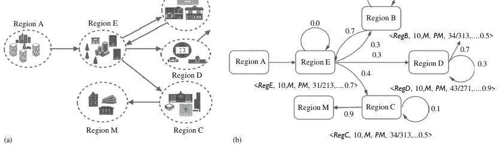

图 12.4 TMC-Pattern 的概率模型。(a) 子空间聚类的 TMC 区域。(b) 马尔可夫链。

来自大规模地理数据的洞察与知识发现

而二阶马尔可夫链取决于当前状态和当前状态之前的上一个状态。在工作中，我们使用了离散时间二阶马尔可夫链。马尔可夫链广泛应用于生物信息学和语音识别等领域。

### 12.3.2.2 来自 TMC-Pattern 的马尔可夫链

图 12.4b 显示了用户从区域 (r) 到当前区域 E 的移动。12.4b 中的所有区域都对应于 TMC-Pattern 轨迹建模过程中形成的子类。使用 TMC-Pattern，我们构建了用户移动的概率模型，如图 12.4b 所示。基于二阶马尔可夫链及其背后的直觉，这意味着尽管对象的移动是从区域 (r) 开始的，但预测对象下一个位置所需的联合概率分布区域 C (r)，对于图 12.4b，给出为：$(r_l | r_j, r)$。现实中的位置序列比图 12.4b 提供的示例要长。

通常，对于从 $r_i$ 开始到 $r_j$ 的序列，联合概率分布给出为：

$P(r_i, \dots, r_j) = P(r_i)P(r_j|r_i)P(r_k|r_j)\dots P(r_j|r_{j-1},r_{j-2})$

在当前区域（区域 E），用户有可能访问区域 B、区域 D 或区域 C。用户移动的 TMC-Pattern 被转换为如图 12.4b 所示的马尔可夫链。马尔可夫链的每个状态由其在 TMC-Pattern 中对应的区域表示，区域标记了各自的 TMC 特性。为了预测下一个位置，我们利用来自 TMC-Pattern 的得分和二阶马尔可夫链的转移概率。

### 12.3.2.3 马尔可夫链转移概率的计算

我们通过考虑用户从当前区域以及当前区域之前的区域访问某个区域的频率，计算二阶马尔可夫链的概率。在这里，我们从用户的移动历史中发现序列 $A \rightarrow E \rightarrow B, A \rightarrow E \rightarrow D, A \rightarrow E \rightarrow C$，并根据这些频率计算转移概率。我们注意到，所有转移概率之和为 1。

# 大规模地理空间数据的洞察与发现

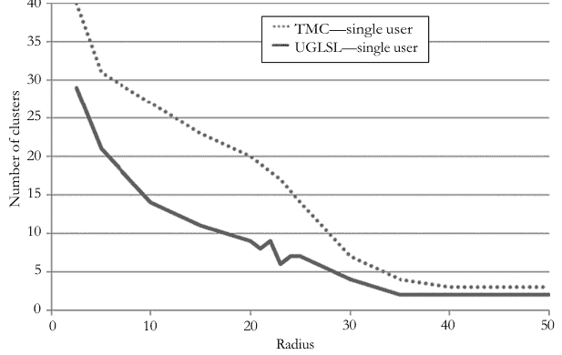

**图 12.5** 单用户提取。

eps-radius（SUBCL 算法的距离）对应于 10 km。我们针对 2.5 到 30 分钟的不同停留时间进行了多次实验。我们与最先进的工作相同，在相同的停留时间阈值下进行了实验，MCBL 和 UGL 分别采用了层层聚类和 k-means 算法。图 12.6 展示了结果。它显示，在给定的阈值下，TMC-Pattern 提取在发现地点数量方面优于 MCBL 和 UGL。这可以解释为：在提取过程中，我们的方法捕捉了物体及其邻居的移动，而其他技术则忽略了这些点。

我们还使用多用户数据进行了另一组实验，其中时间被选为相关维度。这转化为了聚类的形成，即根据时间范围 $T = \{M, A, E, N\}$ 对点进行聚类。图 12.7 展示了结果，显示在早晨和晚上发现了更多的聚类。

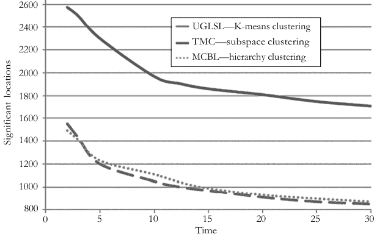

**图 12.6** 显著地点。

# 大数据

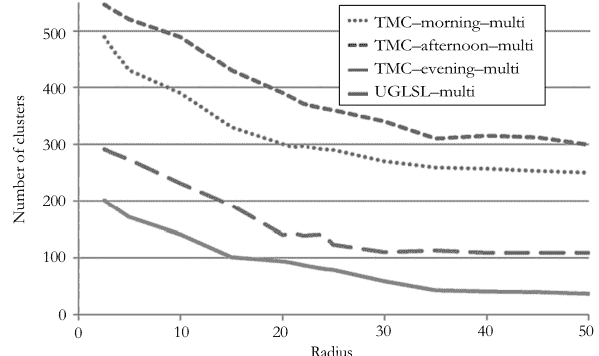

图 12.7 聚类与半径（km）的关系。

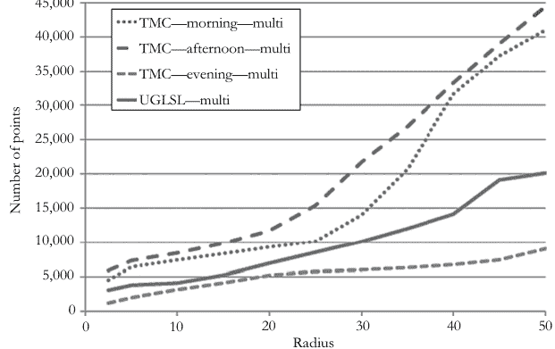

图 12.8 点的数量与半径的关系。

MCBL 和 UGL 不具备完成此任务的能力。此外，我们分析了图 12.8 所示 TMC-Region 聚类的点数，显示随着半径的增加，TMC-Region 中的点数随之增加。我们与 UGLSL 进行了比较，并观察到给定半径下，TMC-Regions 拥有更多的点。

图 12.9 展示了早晨和晚上的 TMC-Regions 以及 k-means 区域。观察图 12.9 中的地图，我们从 TMC-Pattern 的结果中看到用户在早晨停留于中国军事博物馆（绿色框）。然而，用户在晚上并没有访问中国军事博物馆。这些真实数据集上的信息凸显了 TMC-Pattern 在不同粒度下检测感兴趣地点的能力。

## 12.4.3 频繁模式

为了评估 TMC-Pattern 发现频繁模式的能力，我们将通过我们的提取技术创建的多用户 TMC-Regions 输入到我们自定义的 PrefixSpan 算法（算法 12.2）。

# 大规模地理空间数据的洞察与发现

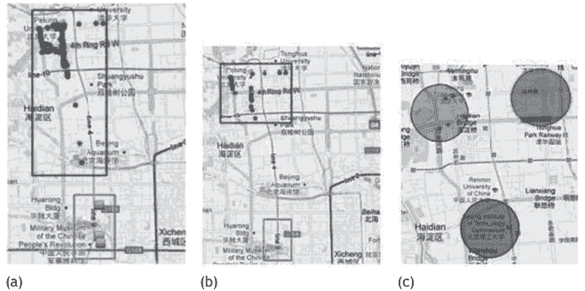

图 12.9 TMC-Region 早晨 (a)、晚上 (b) 和 k-means 区域 (c)。

我们应该注意，在创建 TMC-Region 时，仅空间和时间被选为相关维度。我们使用 Twitter–GeoLife 数据集进行了第二次实验，以寻找基于流感背景而非位置的 ROI（感兴趣区域）。这是首先将流感数据集输入我们的提取算法，并选择空间（经纬度）作为相关维度来实现。这导致了基于这些维度的点聚类。然后将 TMC-Regions 传递给算法 12.2。图 12.10 展示了两个实验在 0.2 到 0.6 不同最小支持度值下的结果。该图比较了我们的 TMC-Region ROI 与 T-Pattern（Giannotti et al. 2007）生成的 ROI。在位置方面，我们的技术产生了更好的结果，因为在相同的最小支持度下，它比 T-Pattern 检测到更频繁的模式。它的轨迹模型是专为仅处理位置时间和而设计的。当使用基于中国的 GeoLife 数据集时，我们的技术从 Twitter 搜索 API 中发现了 24 个疾病相关的 ROI。图 12.10 还显示，随着支持度的增加，频繁地点和疾病模式的数量会减少。


图 12.10 频繁模式。

## 12.4.4 位置预测

我们利用单用户轨迹历史进行位置预测。12.3.2.4 节描述了来自 TMC-Pattern 的评分如何与马尔可夫模型结合以预测用户的下一个位置。我们从 GeoLife 数据集和 Twitter-GeoLife 疾病数据集提取并利用了单用户 TMC-Pattern 进行预测。为了评估实验期间利用 TMC-Pattern 评分或权重的效果，除了在预测期间将 TMC-Pattern 的评分用于二阶马尔可夫链外，我们创建了两个预测模型。第一个仅利用二阶马尔可夫链，而第二个仅使用 TMC-Pattern 的评分来预测下一个位置。此外，我们将下一个位置预测与 Ashbrook 和 Starner (2003) 提出的预测技术进行了比较。我们使用准确率指标评估了我们的预测结果，如图 12.11 和 12.12 所示。我们的准确率和覆盖率由以下公式给出：

```
\text{Accuracy} = \frac{\text{正确预测的数量}}{\text{总预测数}}
```

```
\text{Coverage} = \frac{\text{模式的数量}}{\text{总记录数}}
```

结果显示，TMC-Pattern 评分与二阶马尔可夫模型的结合产生了最佳结果。在使用基于中国的 GeoLife 数据集时，我们的技术发现了 24 个疾病相关的 ROI。图 12.10 还显示，随着支持度的增加，频繁地点和疾病模式的数量会减少。对于 $T = M$ 的 TMC-Regions，我们的技术实现了 81% 的准确率；对于 $T = E$ 的 TMC-Regions，覆盖率为 73%。我们观察到，随着覆盖率的增加，准确率会下降。这功于 TMC-Pattern 的使用。预测流感传播的 Twitter 数据集如图 12.12 所示。


图 12.11 预测准确率。

# 地理数据的洞察与发现


图 12.12 疾病预测。

我们在预测用户的下一个位置时忽略了上述模式进行了此类分析。图 12.13 展示了在不同观测下成功预测的累积概率。该图显示，居住模式和时间的 TMC-Pattern 更重要（Han 和 Kamber 2005）。由于我们在轨迹模型中整合了被其他技术丢弃的大量 GPS 点，可以通过确定均方误差 $\hat{E}$ 来测试：

$$\hat{E} = \sqrt{\frac{\sum_{j=1}^n (x_j - x'_j)^2}{n}}$$

其中 $x$ 和 $x'$ 分别为真实和预测位置。


图 12.13 TMC-Pattern 模式的影响。

# 大数据


**图 12.14** 预测误差。

实验结果如图 12.14 所示。更高的累积概率意味着更大的误差机会。图显示，当 TMC-Pattern 与马尔可夫链结合时，在 100 km 大半径下产生错误的概率为 50%。

## 12.5 总结

我们提出了一种名为 TMC-Pattern 的轨迹模型，可以从大规模地理数据中创造价值。TMC-Pattern 严格捕捉并嵌入了基础设施、人类、社交和行为模式。先进的轨迹模型针对时空维度，而先进设备产生的数据包含了这些之外的维度。我们提出的 TMC-Pattern 处理多种维度并利用 SUBCLCI 提供上下文 ROI。此外，我们展示了一种新技术，利用我们自定义的 PrefixSpan 算法变体来发现和预测地理大数据中的频繁模式。我们还通过实验展示了如何合并社交网络上下文。此外，我们提出了一种利用 TMC-Pattern、SUBCLCI 和马尔可夫链的新位置预测器。我们的实验证明，利用 TMC-Pattern 时准确率会提高。

## 参考文献

- Asahara, A. K. Maruyama, A. Sato, and K. Seto. 基于混合马尔可夫模型的行人移动预测。Proceedings of the 19th ACM SIGSPATIAL International Conference on Advances in Geographic Information Systems, Chicago, IL. 2011, pp. 25–33.
- Ashbrook, D. and Tanner. 使用 GPS 学习显著地点并预测多用户移动。Ubiquitous Computing. 2003, 7(5):275–286.
- Eagle, N. and A. Pentland. 现实感知：感知复杂的社交系统。Personal Ubiquitous Computing. 2006, 10(4):255–268.


- Gianluca, E. M. Manni, F. Pinelli, and D. Pedreschi. 轨迹模式挖掘。Proceedings of the 13th SIGKDD International Conference on Knowledge Discovery and Data Mining, San Jose, CA. 2007, pp. 330–339.
- Han, J. and M. Kamber. Data Mining: Concepts and Techniques. Morgan Kaufmann, San Francisco, 2005.

# 大规模地理空间数据的洞察与知识发现

Han, S.-J. and S.-B. Cho. 结合自组织映射和马尔可夫模型预测用户移动。第16次国际人工神经网络会议论文集——第二卷，希腊雅典，2006年。pp. 884–893。
Jungye, Y., B.D. Noble, L. Mingyan, and K. Minkyong. 通过粗粒度轨迹构建真实的移动性模型。第4次移动系统、应用与服务国际会议论文集，瑞典乌普萨拉，2006年。pp. 177–190。
Kailing, K.-H., P.-P. Kriegel, and K. Pröger. 针对高维轨迹的密度连接聚类。Fjord国际会议，佛罗里达州布埃纳维塔，2004年。pp. 246–257。
Kalanicki, M., H. Song, and D. Cho. 基于位置的推荐系统。移动与城市系统年度国际会议：加拿大多伦多，2009年。
Kitacs, M. L., G. Havlin, F. Litner, and H. Maxke. 复杂网络中影响力演讲者的识别。《自然·物理学》，2010年。6:888–893。
Laasonen, K., M. Raento, and H. Toivonen. 设备端位置识别。《泛在计算》，2003年，301:287–308。
Liao, D., J. Xu, and H. Kaut. 通过GPS轨迹识别地点和活动。《国际机器人研究杂志》，2007年。26(1):119–134。
Minkyong, D., Kot., and K. Songuk. 从真实用户轨迹中提取移动性模型。第25次IEEE计算机与通信学会年度会议(INFCOM)，西班牙巴塞罗纳，IEEE计算机学会，瑞典乌普萨拉，2006年。第12次ACM SIGKDD知识发现与数据挖掘国际会议，法国巴黎，2009年pp. 637–646。
Monreaal, A. F., Brunelli, R. Tracchi, and G. Giamotti. Next: 基于轨迹模式挖掘的轨迹预测器。第15次ACM SIGKDD国际会议论文集。
Morzy, M. 基于频繁轨迹的物体位置预测。第21次计算机与信息科学国际会议，美国威斯康星州密尔沃基，2006年。pp. 583–592。
Nicholson, A.J. and B.D. Noble. BreadCrum: 移动连接预测。第14次ACM移动计算与网络国际会议(MobCom)，美国加利福尼亚州旧金山，2008年。
Pei, J. 等人。PrefixSpan: 通过前缀投影增长挖掘序列。第17次数据工程国际会议(ICDE)，德国海德堡。IEEE计算机学会，2001年。
Quaman, L., Y. Zheng, X. Xing, C. Yukan, L. Weny, and W.-Y. Ma. 基于位置历史的移动相似性。第17次ACM SIGSPATIAL地理信息系统进展国际会议。2008年。31–34, 10。
Yavas, G., D. Katsaros, and Y. Manopoulos. 一种移动环境下位置预测的数据挖掘方法。《数据与知识工程》。Elsevier Publishers B.V，荷兰阿姆斯特丹，第54卷，2005年。121–146。
Yu, Z., L. Lizhu, X. Xing, and W.-Y. Ma. 利用人类位置轨迹挖掘位置之间的相关性。第17次ACM SIGSPATIAL地理信息系统进展国际会议，美国华盛顿州西雅图，2009年。pp. 472–475。

## 13 面全球传感器网大数据挑战的地理空间网络基础设施

Steve H.L. Liang 和 Chih-Yuan Huang

### 13.1 引言

在下一个世纪，地球将穿上一层电子皮肤。它将利用互联网作为支架来支撑和传输它的感觉。这层皮肤正在被缝合。它由数百万嵌入式电子测量设备组成：恒温器、压力计、污染检测器、摄像头、微波炉、葡萄糖传感器、心电图、脑电图。这些设备将探测和监测城市、濒危物种、大气、我们的船只和卡车队、以及我们的对话，甚至超越我们的梦想。

> “地球将穿上一层电子皮肤，”商业周刊，1999年
>
> Neil Gross

近年来，大规模传感器阵列及其在全球范围内产生的海量数据集已由越来越多的研究人员以不断增加的频率利用、共享和发布。例如全球范围的Argos网络网络¹、世界气象组织的气象网络，以及全球GEOSS²总延迟(ZTD)观测网络。人们付出了大量努力（例如GEOSS³和NOAA IOOS³）使这些大规模传感器网络网络化，以便传感器和数据可以通过互操作的传感器标准进行访问。此外，随着低成本传感器网络和数据的出现，单个科学家在战略位置部署和运行中小型传感器阵列以其研究目的在经济上已是可行的。有一种愿景认为传感器网将成为现实，范围从局部尺度到全球尺度。传感器网的这种实现非常吸引研究人员，因为它产生了海量数据（Hsieh 2002）。这种愿景涵盖了此前无法实现的广泛应用（Miwaring 2002）。传感器网概念是由NASA喷气实验室(JPL)在1997年提出的。可以预见，随着全球传感器数量的增加，传感器网每天将产生更多数据。地理空间网络基础设施本质上作为全球网(WWW)，面临挑战（Hart and Martinez 2005）。例子是闭路电视(CCTV)和用于监控的网协议(IP)摄像头。

### 13.2 传感器网的大数据挑战

在信息技术(IT)背景下，“大数据”用于描述无法用传统数据库系统管理的规模巨大或复杂的数据集。最广泛的大数据模型是3V（Laney 2001）。虽然3V代表量、速度和多样性，传感器网也面临着大数据挑战：

- **量（Volume）**：大数据的一个特征是数据规模或数量巨大。虽然已知社交媒体每天产生超过500 TB的数据（Facebook.com），我们预计在未来五年内，传感器网的数据不仅将超过社交媒体的10到20%，而是其10到20倍。因此，如何存储、传输和处理大量数据是传感器网的主要挑战之一。
- **速度（Velocity）**：速度指的是产生数据的速率。与社交媒体中的人类参与不同，传感器网中的传感器由于动力充足可以以极高的频率产生数据。例如，波音飞机发动机在飞行期间每30分钟产生10 TB的传感器数据（Rogers 2011）。其他例子是每秒几帧到30帧的CTV和IP摄像头。
- **多样性（Variety）**：许多例子被用来解释多样性，包括对齐的数据结构、不一致的数据语义和不兼容的格式（Laney 2001）。在传感器网中，尽管与社交媒体数据相比相对化，但在硬件（即不同类型的传感器）、数据类型（如视频、图像、文本和数字）、观测现象（如RGB、气温、风）、通信协议（如专利协议）、数据编码（如`XML`、`JSON`、`JPEG`）、语义（同一概念解释不同）和语法（同一概念描述不同）方面具有巨大的多样性。因此，如何有效整合异构传感器数据并为用户提供连贯的视图是传感器网的主要挑战之一。

在我们理解了传感器网大数据挑战的高级概念后，需要了解目前传感器网的发展，以进一步分析由大数据传感器引起的数据管理问题。

# 大数据

## 13.3 全球传感器网架构

根据我们对当前传感器网发展的了解，全球传感器网的架构与 `WWW` 非常相似。例如，`WWW` 通过可扩展的开放标准协议（如 `HTTP`）连接全球的每个 Web 服务，这已被证明在全球范围内的消息交换具有极强的扩展性。我们可以从许多传感器网项目中看到这一点，例如 `SensorWare Systems`、`Microsoft SenseWeb` 和 `COSM` 等项目部署传感器、收集传感器数据，并通过专有协议在 `WWW` 上托管和共享数据。此外，还有几个工作组正在为传感器服务开发开放标准，例如开放地理空间联盟（OGC）的传感器网启用（SWE）标准（Bots et al 2007）。

与 `WWW` 类似，传感器网分为三层：数据层、Web 服务层和应用层。传感器栈如图 13.1 所示。数据层可以进一步分为物理层和传感器层。当数据层执行`观测`并将数据传输到传感器网层时，Web 服务层为应用程序提供访问，以检索缓存的传感器数据。

由于传感器网和 `WWW` 的架构相似，开发传感器网至关重要的组件如下。例如，在下文中，我们确定了当前 `WWW` 至关重要的三个高层组件：开放标准协议、资源发现服务和客户端平台。

**开放标准协议**：开放标准协议在 `WWW` 的成功中起着最重要的作用。开放标准处理互联网层中的通信，例如 OSI 模型中的七层（ISO/IEC 7498-1）和 TCP/IP 模型中的四层（IETF RFC 1122）。例如，`IEEE 802` 标准定义了用于本地局域网（LAN）的协议，包括以太网和无线局域网。`IP` 接口定义了互联网数据包的格式，并提供了一套用于从源路由数据包的地址系统。传输控制协议（`TCP`）和用户数据协议（`UDP`）是传输层中常用的两种标准。此外，超文本传输协议（`HTTP`）是应用层中的一种协议，控制应用程序之间的高级通信。例如，用户可以使用 Web 浏览器（客户端应用程序）向托管网站的服务器上的应用程序发送 `HTTP` 请求。服务器可以在 `HTTP` 响应中向客户端返回资源，如超文本标记语言（`HTML`）文件。

| | 传感器网浏览器 | 第三方客户端 |
| :--- | :--- | :--- |
| 应用层 | | |
| 传感器数据门户 | | |
| Web 服务层 | 开放标准服务 | 专有服务 |
| 传感器层 | 传感器操作系统 | 传感器应用 |
| 数据层 | | |
| 物理层 | 传感器 | |

**图 13.1** 传感器层栈。

## 地理空间基础设施

由互联网工程任务组（IETF）、`WWW` 联盟（W3C）以及 ISO/国际电工委员会（IEC）开发的这些开放标准（以及许多其他标准）确保了互联网组件的可操作性，对 `WWW` 的成功做出了巨大贡献。另一方面为了防止重复发明，传感器网需要构建在现有的 `WWW` 标准之上。然而，由于传感器的内容与 `WWW` 完全不同，需要定义额外的开放标准协议。例如，OMG 社区开发了 `SWE` 标准，被认为是最全面的传感器网框架。它可以被认为是传感器网愿景的关键推动因素。

**资源发现**：由于标准协议处理托管的 Web 服务之间的通信，由于 `WWW` 的高度分布的特性，资源发现是一个关键问题。如今的 `WWW` 使用搜索引擎（如 Google 和 Bing）和社交书签系统来解决资源发现并帮助用户找到他们感兴趣的资源。同样，传感器网的资源发现也必须得到解决。

**客户端平台**：客户端平台允许用户请求并可视化响应，已成为 `WWW` 的不可或的一部分。最流行的客户端平台类型是 Web 浏览器（例如 Internet Explorer、Chrome 和 Firefox）。只要 Web 浏览器和 Web 服务使用相同的协议，用户就可以使用 Web 浏览器（通过 `HTTP`）与 Web 服务通信，并可视化响应内容（例如 `HTML` 文档、图像、视频）。

对于传感器网，我们认为最常见的客户端平台是传感器数据门户，它们作为用户和传感器数据主机之间的中介。由于传感器数据门户了解其托管的数据（例如传感器位置和采样时间），它们可以根据传感器数据的时空分布预生成索引，以优化数据传输。例如，Ahmed 和 Nath (2008) 提出了 `COL-Tree` 来聚合传感器数据以减小传输尺寸。某些传感器数据门户，例如地下水信息网络（GIN），以静态形式展示许多传感器位置，并大规模展示年度传感器观测，以限制每次请求传输的传感器观测数量。这些传感器数据门户的一个关键缺点是，它们只能展示其预先了解的传感器数据。

相反，我们认为传感器网的客户端平台应该能够与任何传感器网服务通信而无需相同的协议。由于这类客户端平台在检索和可视化传感器数据时不需要任何关于数据的知识，我们将这种客户端应用程序称为传感器网应用程序。

**其他组件**：除了这三个基本组件，`WWW` 的一些其他想法可能对传感器网也有帮助。例如，在线社交网络（OSN）可能有助于向用户推荐传感器。此外，`WWW` 的发展方向之一是语义网，旨在将 Web 上的非结构化和半结构化内容转换为数据。随着传感器网开发向 `WWW` 架构移动，Web 服务的分布式特性将是一个有效的解决方案。然而，除了存储之外，还有其他大挑战需要解决，例如跨网络传输大量传感器数据、高效检索和更新高流速传感器数据，以及有效整合异构传感器数据。

## GeoCENS

该架构被构建作为一个传感器网的在线平台。通过 `GeoCENS`，用户可以在 3D 虚拟地球仪或 2D 基础图上操作传感器浏览器，发现、可视化、分析并共享异构传感器资源和其他信息。我们的目标是通过技术创新方法解决上述挑战，并为实现传感器网提供缺失的软件组件。

图 13.2 类似于 `WWW`，每个人都可以构建和部署传感器网服务来托管传感器数据。由于这些传感器网服务在全球范围内分布且未注册在任何目录服务上，`GeoCENS` 提出了一种传感器网搜索引擎来发现和索引传感器网服务，从而允许用户根据查询标准搜索传感器网服务。`GeoCENS` 还具有一个传感器网浏览器，用于从传感器网服务检索并可视化传感器数据。此外，语义层服务利用传感器网服务的元数据来整合异构传感器数据层。`GeoCENS` 还具有一个 OSN 组件，允许用户建立友并共享传感器数据。

### 13.4.1 基于 OGC 的传感器网服务

`GeoCENS` 使用 OGC `SWE` 标准作为基础互操作架构。`SWE` 是 OGC 的一项计划，旨在建立一个开放且可操作的地理空间 Web 服务框架，以便传感器观测和相关传感器网数据的交换与处理（Botts et al 2007）。


## 地空间网络基础设施

传感器数据 Web 服务实现的可用性，对于传感器数据所有者以互操作的方式轻松安装和共享其传感器数据至关重要。例如，52度北传感器观测服务（`SOS`）^{11}、`MapServer SOS`^{12} 以及 `Degree SOS`^{13} 的实现已供公众下载和安装。`GeoCENS` 还实现了 OGC 服务（Naist and 2007）、`SensorML`（Bott and Robin 2007）以及观测与测量（`O&M`）（Cox 2011）。`GeoCENS SOS` 的实现具有独特之处，即它可以采用 `NoSQL` 数据库方法（例如 `Apache CouchDB` 和 `MongoDB`）来构建 `GeoCENS` 服务器，这可以作为一个更具扩展性的后端。`GeoCENS SOS` 的实现（`CouchDB` 版本）已在网上发布^{14}，以帮助传感器数据所有者管理其数据。

## 13.4.2 去中心化混合混合 P2P Web 服务交付

对于大规模分布式系统（例如万维网），通信和数据管理都归结为资源发现问题。同样，`GeoCENS` 需要一个 Web 资源发现服务。为了处理大量的传感器网络和大量用户，`GeoCENS` 使用 `P2P` 架构进行传感器资源发现。每个 `GeoCENS` 传感器都使用 Web 服务器作为传感器服务发现基础设施的一部分（例如对等节点）。节点按照协作模型运行，每个对等节点利用彼此的资源（即 CPU、存储和带宽）来实现互利。

从文献和现有系统来看，`P2P` 架构主要分为两类：非结构化 `P2P` 网络，例如 `CAN`（Ratnasamy et al. 2001）、`Pastry`（Rowst and Duncan 2001）和 `Chord`（Stoica et al. 2001）；以及结构化 `P2P` 网络，例如。非结构化 `P2P` 网络是节点之间执行彼此操作的网络，没有规则来定义节点之间的连接性。它们虽然简单但缺乏扩展性，因为其基于泛洪的查询会产生巨大的网络流量。结构化 `P2P` 网络使用哈希函数为数据存储构建分布式索引。哈希表类似于分布式索引，成功地减少了对等查询扫描的需求；结构化 `P2P` 网络容易受到节点波动和女巫攻击的影响。

`GeoCENS` 提出了一种使用哈希函数的这种混合设计方法（Chen and Liang 2011）。我们设想传感器网络将具有两种传感器服务器：(1) 由大型机构（如 NASA 或 NOAA）维护的强大传感器服务器（它们不会动态地加入或离开网络——大多数此类服务器 24/7 运行，是网络中的静态节点）；(2) 由小型机构或个人（如大学或公民科学家）维护的性能较弱的传感器服务器（这些可能会频繁地加入和离开网络，是网络中的瞬态节点）。考虑到上述设置，将静态 `P2P` 节点分组为结构化超级节点（以节省维护结构的开销）是一个合理的决策。结构化 `P2P` 网络只能处理精确值值对查询，通过用空间填充曲线（`SFC`）对数据进行标记来启用地理空间搜索功能。我们的架构的独特之处在于它是一个感知局部性的系统，也就是说系统能够利用对等节点之间的局部性信息来有效地交付查询结果。

此外，对于未在 `P2P` 覆盖网络上的非 `GeoCENS` 的 OGC Web 服务（`OWS`），`GeoCENS` 搜索引擎采用爬虫来定期查找并索引在线的 `OWS` 服务。因此，用户仍然可以通过 `GeoCENS` 搜索引擎找到这些服务。`GeoCENS` 搜索引擎的架构如图 13.3 所示。目前，搜索引擎已发现 2,884 个地图服务（`WMS`），包含 88,281 个 `WMS` 层，以及 59 个 `SOS` 服务，包含 6,295 个 `SOS` 观测边界。

# 大数据


图 13.3 `GeoCENS` 搜索引擎架构。

## 13.5 基于 3D 虚拟地球和 2D 地图的传感器Web浏览器


# GeoCENS Web 浏览器

GeoCENS Web 浏览器是所有 OGC SOS 服务和 OGC WMS 的直观 3D 客户端前端（de la Beaudiere 2006）。它允许用户在单个虚拟地球内操控 3D 传感器 Web 浏览器，以浏览、发现、可视化、访问、共享和标记异构传感资源以及相关信息。从地球的缩放视图开始，用户可以选择一个研究地点并飞入其中。在飞向研究地点的过程中，多分辨率地图数据会从 WMS 加载到客户端。GeoCENS Web 浏览器将多传感器数据流和地理数据集相结合，并在连贯统一的虚拟环境中渲染它们。

## 架构设计

我们已经开发了基于开源 World Wind 的 GeoCENS 浏览器。我们设想传感器网络将具有两种传感器服务器：

1. 由大型机构（如 NASA 或 NOAA）维护的强大传感器服务器（它们不会动态地加入或离开网络——大多数此类服务器 24/7 运行，是网络中的静态节点）；
2. 由小型机构或个人（如大学或公民科学家）维护的性能较弱的传感器服务器（这些可能会频繁地加入和离开网络，是网络中的瞬态节点）。

考虑到前述的设置，将静态 P2P 节点分组为结构化超级节点（以节省维护结构的开销）是一个合理的决策。结构化 P2P 网络只能处理精确键值对查询，通过用空间填充曲线（SFC）对数据进行标记来启用地理空间搜索功能。我们架构的独特之处在于它是一个感知局部性的系统，也就是说系统能够利用对等节点之间的局部性信息来有效地交付查询结果。

此外，对于不在 P2P 覆盖网络上的非 GeoCENS 的 OGC Web 服务（OWS），GeoCENS 搜索引擎采用爬虫来定期查找并索引在线的 OWS 服务。因此，用户仍然可以通过 GeoCENS 搜索引擎找到这些服务。GeoCENS 搜索引擎的架构如图 13.3 所示。目前，搜索引擎已发现 2,884 个地图服务（WMS），包含 88,281 个 WMS 层，以及 59 个 SOS 服务，包含 6,295 个 SOS 观测边界。

## 独特贡献

我们已经开发了基于开源 World Wind 的 GeoCENS 浏览器。据我们所知，GeoCENS 是首个基于虚拟地球的 3D 浏览器系统，能够处理标签数据。GeoCENS 具有以下独特贡献：

1. 为了让用户的任务更简单并避免歧义，我们的推荐引擎能够向用户建议标签。
2. 为了防止跨网络传输大量数据，我们开发了一种新的标签模块，在建议标签时考虑了传感资源的标签地理空间特征（Chen and Liang 2011）。

除了 3D 虚拟地球的浏览器，GeoCENS 还具有基于 2D 地图的浏览器功能，能够从调解器检索数据（Nochel et al. 2011）。由于 GeoCENS 引擎处理传感器服务器，2D 地图浏览器可以以轻量化的方式检索数据。此外，为了处理高速数据问题，GeoCENS 引擎利用一个自适应适配器在传感器 Web 上更新标签并获取最新的标签数据（Chen and Liang 2012a）。

## 地理空间网络基础设施


**图 13.6** GeoCENS 推荐引擎标签地图的截图。

3. 协作搜索，允许用户通过点击标签云或输入标签来根据标签查询检索资源。关键在于为这些查询检索出最相关的结果，为此我们提出了一种算法，通过考虑查询和数据的地理空间特征来增强查询处理（Rezel and Liang 2011）。

## 13.8 语义服务层

由于传感器网络在硬件、数据类型、观测现象、通信协议、数据编码、语义、句法以及其他方面具有高度的异构性，这些异构性中的某些可以通过开放标准协议来解决，例如通信协议和数据编码的异构性。然而，即使在应用了相同的标准，我们发现由于缺乏标准命名，存在互操作性问题，例如语义异构和句法异构。例如，考虑 `precipitation`（降水）和 `rainfall`（降雨）这两个字符串。由于降雨是降水的一种，对降水数据感兴趣的用户也会对降雨感兴趣。尽管这些概念对任何人类来说直觉上相关，但对任何计算机来说，它们只是不同的字符序列。另一方面，不同的提供者以不同的方式标记其数据。例如，表 13.1 显示了 SOS 服务中用于表示风速这一相同概念的各种统一资源标识符（URI）。这种句法异构性为设计一个集成所有表示速度的传感器数据层的系统带来了困难。

### 表 13.1 风速概念的各种 URI

| ID | URI |
| :--- | :--- |
| 1 | `um:x-ogc:property:OGC::WindSpeed` |
| 2 | `um:x-ogc:property:universityofsaskatchewan:ip3:windspeed` |
| 3 | `um:x-ogc:de:phenomenon:OGC:1.0.30:windspeed` |
| 4 | `um:x-ogc:de:phenomenon:OGC:1.0.30:WindSpeeds` |
| 5 | `um:x-ogc:de:phenomenon:OGC:windspeed` |
| 6 | `um:x-ogc:property:geocens:geocens1:windspeed` |
| 7 | `um:x-ogc:property:noa:ndbc:Wind Speed` |
| 8 | `um:x-ogc:property:OGC::WindSpeed` |
| 9 | `um:x-ogc:property:berkeleyley:Wind Speed Avg MS` |
| 10 | `um:x-ogc:property:berkeleyley:Wind Speed Max MS` |
| 11 | `http://marinanimetadata.org/cf/windpeed` |
| 12 | `http://nmis.org/on/cfparameters/winds` |

为了解决 GeoCENS 中的这种异构性，所提出的语义层采用了一种自底向上的方法，包括对数据层的文本处理、近似匹配和字符串匹配，通过其现象集成传感器层（Knoeckel et al. 2013），该语义层使用 WordNet 作为词汇数据库来计算成对相似性，并使用这些评分的一组基于集合的不相似函数。通过语义层，我们可以有效地整合异构的传感器数据，并为用户提供连贯的视图。

## 13.9 由 GEOCENS 驱动的应用

由于 GeoCENS 项目是为环境研究人员设计的，我们还证明了 GeoCENS 架构可以应用于许多其他应用。例如，Rocky View Country 项目是一个长期地下水监测项目，农民可以上传其水井水位（即 Web 2.0 和 OGI）。目前，Rocky View Country 项目可以追溯到 2008 年。此外，该项目有 40 多口活跃水井，萨斯喀彻温大学的水文学文学家会接收通知并执行质量保证（QA）和质量控制（QC）过程。图 13.7a 显示了 Rocky View Country 项目的截图。

另一个例子是 Rocky Mountain Eagle 项目，它允许观察者提交他们观察鸟类的时间和地点。Rocky Mountain Eagle Watch 也是一项持续 20 多年的数鹰计数感知（即 OGI）。在过去，观察者使用纸张和 Excel 表格来记录和共享数据，这既耗时又低效。通过采用 GeoCENS 网络基础设施架构，Rocky Mountain Eagle 项目[如图 13.7b 所示]。

这些由 GEOCENS 驱动的应用对传感器网络也有用。

## 13.10 相关工作

最近的几项工作尝试[解决]传感器网络。例如，传感器网络在硬件、数据类型、观测现象、通信协议、数据编码、语义和句法方面具有高度的异构性。

## 地理空间网络基础设施


(a)


(b)

**图 13.7** (a) Rocky View 和 (b) Rocky Mountain。

## 13.11 总结

全球网在以前不可能物理范围内变得非常有用。我们认为传感器网络的潜力尚未完全释放。在这里，我们分析了实现传感器网络愿景所需的挑战和必要的组件。我们首先识别了传感器网络的巨大挑战，随后介绍了传感器网络架构及其组件。我们介绍了 GeoCENS 架构以及每个组件的高级概念，作为解决问题的可能解决方案。此外，我们展示了一些由 GEOCENS 驱动的项目，以证明 GeoCENS 架构如何成功地解决大数据挑战。

# 致谢

作者感谢 CANARIES、Cybera、Alberta Innovates 以及微软研究院对本项目的支持。

## 参考链接

1. `http://argos-system.org`
2. `http://www.earthobservations.org/geoss.shtml`
3. `http://ifos.gov/`
4. `http://www.sensorwares.com/`
5. `http://search.microsoft.com/en-us/projects/`
6. `http://cosm.com/`
7. 这里我们遵循 OGC SWE 对观测的定义，即“为了估计某个属性的值而对该属性进行的观测行为”。
8. `http://standards.ieee.org/about/get/802/802.html`
9. `http://analysis.gw-info.net/gin/public.asp`
10. `http://www.w3.org/standards/semanticweb/`
11. `http://52north.org/communities/sensorseweb/sos/`
12. `http://mapserver.org/ogc/sos_server.html`
13. `http://wiki.degrewiki.org/degreeWiki3/SensorObservationService`
14. `http://wiki.geocens.ca/sos`
15. `http://worldwind.arc.nasa.gov/`
16. `http://rocky.geocens.ca/`
17. `http://eaglewatch.geocens.ca/`

# 参考文献

- Ahmad, Y. and S. Nath. 2008. COLR-Te: 适用于传感器网门户的高通信效率时空索引。在 IEEE 国际数据工程会议上, 墨西哥坎坎恩。
- Potts, M. J. Percivall, C. Reed, and J. Davidson. 2007. OGC 传感器网启用：概述与高层架构 (OGC 07-165)。Open Geospatial 白皮书, 2007年12月28日。
- Potts, M. and A. R. Robin. 2007. OpenGIS 传感器模型语言 (SensorML) 实现规范 (GC 07-000)。OpenGIS 实现规范, 2007年。
- Chen, S. and S. Liang. 2011. 一种用于全球传感器网发现的混合对点架构。在空间知识与信息, 加拿大不列颠比亚。
- Cox, S. 2011. 观测与测量——XML 实现 (OGC 10-025r1)。OGC 实现, 2011年3月22日。
- de la Beguarde, J. 2006. OGC 地图服务器实现规范 (OGC 06-042)。OGC 实现规范, 2005年3月。
- Delin, K. 2005. 传感器网中的在。在《无线网络：系统》， Article House, 英国伦敦。
- Gibbons, P.B., Karp, Y., Ke, S., Nath, and S. 2003. Irisnet: 一种全球传感器网的架构。IEEE Practical Computing 24(4):22–33。
- Goodchild, M.F. 2007. 公民即公民：自愿数据的世界。Geospatial 94(4):211–221。
- Gross, N. 2013. 地球现在将有一层电子皮肤。在线业务, `http://www.business.com/1999/09/b3564a02d4.htm` (访问日期：2013年3月27日)。
- Hart, J.K. and K. Martin. 2002. 环境传感器网络：地球系统科学中的综述？Earth Science Reviews 38:177–191。
- Holtho, A., J. Schmitz, C., and G. Stumm. 2006. 语音学中的信息恢复：搜索与现实。计算机科学讲义 401:411。
- Hsieh, T.T. 2004. 传感器网络用于交通和高场应用。IEEE Tutorials 23(2):13–26。
- Huang, C.Y. and S. Liang. 2012. 一种用于传感器网实时监控的混合推拉系统。在国际摄影与遥感学会第21次大会上, 9月25日-1月1日, 澳大利亚墨尔本。
- Huang, C.Y. and S. Liang. 2012. LOST-Tree: 一种用于传感器网环境中传感器数据加载的时空结构。国际地理信息期刊 27:1190–1209。
- Huang, C.Y., and H.L. Liang. 2011. 用于改进现实 SOS 服务搜索与获取的系统设计与实现。传感器网启用工作坊2011, 11月6日–7日, 加拿大阿尔伯塔省班夫。
- Knockel, B. C., Huang, Y., and S. Liang. 2013. 一种根据对象属性自动生成传感器数据的自下而上方法。ISRPRS 地地理信息期刊 2(1):1–26。
- Kwan, W. 2010. 数据挖掘在线财富。ZdNet, `http://www.zdnet.com/sensor-data-is-attributes-following-2012_006257` (访问日期：2011年11月1日)。
- Laney, D. 2001. 数据挖掘策略：容量、速度和多样性。Gartner.com/blog/docker-laney/files/2012/01/a949-33-Data-Management-Control-Data-Velocity-and-Variety.pdf (访问日期：2013年3月27日)。
- Linh, S.H., A. Croito, and C.V. Tao. 2005. 用于传感器网的分布式地理空间基础设施。Computers and Geosci 32(2):221–233。
- Mawring, R., J. Polakura, R. Stanzuk, D. Waller, and J. Anderson. 2002. 用于栖息地监测的无线传感器网络。在2002 ACM 无线传感器网络与应用工作坊上, 佐治亚州亚特兰大。
- Og, A. 2007. OGC 传感器架构 (OGC 07-165)。OGC 实现, 2007年。
- Rattan, P., M. Handley, and S. Schenker. 2001. Pastry: 一种可扩展的对点寻址服务。在2001年应用、技术与协议通信会议上, 加利福尼亚州圣迭戈, pp.149–160。
- Xu, N. 2002. 传感器网络综述。IEEE Communications Magazine 40:102–144。

# 14 OGC 标准与大数据

## 14.1 什么是 OGC？

开放空间联盟（OGC）成立于1994年，是一个全球行业联合会，其愿景是“实现集成位置信息的全部社会、经济和科学效益”。截至2013年4月，OGC拥有475名成员——包括地理空间技术供应商、系统集成商、政府机构和大学——他们参与开发可用地理空间接口和编码的共识过程。

OGC 的使命是作为开放标准开发、促进和协调的全球论坛。因此，它致力于与其他对位置内容有要求的标准开发组织合作，例如国际标准化组织 (ISO)、结构化信息促进协会 (OASIS)、工程任务组 (IETF)、国家紧急号码协会 (NENA) 以及开放移动联盟 (OMA)。

## 14.2 引言

每天都有大量的地理空间数据被采集。数据量以快速速度增长。每24小时，配备各种传感器的无人机（UAV）、卫星星座、智慧城市应用、广域运动图像（WAMI）以及其他社交媒体应用的数据系统正在捕捉、处理和存档PB级的地理内容。为了说明处理海量地理数据的问题，可以考虑WAMI的例子。一个1.5亿像素的帧，每波段8位，压缩后约为450 MB。在10:1的压缩下，存储需求为45 MB/帧。以每天2帧计算，这意味着每天采样86,000帧，每天产生3.8 TB的图像（OGC 2012）。

由集成到网络中的成百上千传感器捕获。最后，地理空间能力数据的种类是巨大的。从数字化地图到正射摄影、测量、土木工程数据、建筑信息到地理配准照片，列表似乎是无止尽的。

OGC 标准工作与大数据分析相关的一个关键方面，特别是 OGC 术语中定义的“数据融合”（data fusion）。OGC 中的融合定义为：

> 在显式或隐式知识框架内，对一个或多个实体相关的数据或信息进行组合或关联的行为或过程，以实现对这类实体进行检测、识别和表征的能力（或提供新能力）。

位置是伟大的数据集成器。基于地理上下文整合数据源的融合，为基于地理空间的大数据分析和预测建模提供了强大的基础。

为地理空间数据环境建立开放标准框架，将实现超越当前数据融合状态的功能性和程序化开发。功能性扩展将包括在手动和半自动多源可视化与分析中的融合，并作为行业内的首选实践。开放标准将使具有不同技术方法的多个融合研发项目能够协作。研发原型可以通过改进操作能力来增强，包括数据处理、多样化输入的集成以及值值应用。OGC 认可三种类型的融合：特征、检测和观测（传感器）。由于海量的地理空间大数据正在且将继续由具有位置能力的观测（传感器）系统产生，让我们关注这类类型的融合。

## 14.3 什么是观测（传感器）融合？

观测融合考虑了对各种属性的传感器测量值，以获得表征良好的观测结果（包括不确定性）。融合过程涉及将对同一现象（即感兴趣的事件）的多次测量合并为综合观测结果，并对测量特征进行分析。传感器融合涉及为了以下目的对多次测量值进行采集和利用：


- 获取更高级或更准确的测量值
- 识别感兴趣的对象和事件
- 确定特定对象或事件的属性
- 变化检测
- 建模、仿真和告警
- 反恐
- 公共安全
- 环境监测

传感器融合的一个近期案例是欧洲第七次框架计划（FP 7）的一个项目，名为“公民观测站网络（COBWEB）”。COBWEB 由欧盟（EU）FP 7 环境领域的资助，主题为“使用创新和新颖的地球观测应用开发基于社区的环境系统”。

## 14.4 OGC 标准与大数据

许多 OGC 标准已用于可视化和处理具有位置能力的大数据。这些包括 OGC Web 地图服务（WMS）接口、Web 服务（WCS）、传感器观测服务（SOS）和 Web 处理服务（WPS）。此外，一个新的候选 OGC 标准 OpenAI 在未来用于大数据建模的 OGC 标准中起着重要作用。图 14.1 提供了一个关于这些 OGC 标准如何关联以及它们如何适应 Web 服务框架的简单架构图。


图 14.1 OGC 标准与 Web 服务范式。

现在将逐一描述这些标准中的每一个示例。

### 14.4.1 OGC WMS 接口标准

OGC WMS 接口提供了一个简单的 HTTP 接口，用于从一个或多个存储任何类型地理空间数据（如图像或矢量表示的特征）的分布式地理空间数据库请求注册的图像地图。WMS 请求定义了要处理的地理层和感兴趣区域。对请求的响应是一个或多个已注册的图像地图（以 JPEG、PNG 等格式返回），这些可以在浏览器应用程序中显示。该接口还支持指定返回的图像是否透明，从而决定多个服务器的层是否可以合并或不可合并。由于 WMS 是一种可视化接口，其使用独立于大数据仓库的大小。使用相同的服务器性能对于请求一个或多个数据库存储库将是一致的。例如，美国国家航空航天局（NASA）和美国海洋和大气管理局（NOAA）正是使用此机制为它们的存储库提供可视化机制。NOAA 栅格数据统一访问框架（UAF）Grid 实现了 WMS。有许多互操作性要求驱动了 UAF Grid 的开发和使用。这些提供了访问和集成来自多个存档、实时传感器和资产的具有位置能力的数据的能力，以实现异构数据资产的可视化。另一个示例是在 NASA 的地球观测数据系统（EOSDIS）全球图像浏览服务（GIBS）中使用 WMS。

GIBS 提供了一系列标准服务，以高度响应的方式交付全球全分辨率的卫星图像。GIBS 的目标是让广泛的用户能够对 NASA 的 PB 级地球图像进行交互式探索。目前，来自 NASA 地球观测卫星的 50 多个全分辨率全球图像产品实时可用（通常在观测后 3 小时内）。

### 14.4.2 OGC WCS 接口标准

OGC WCS 定义了一个标准接口和操作，实现了对地理覆盖的互操作访问。术语“网格”（grid）涵盖了卫星图像、数字照片、数字高程数据等每个测量点表示的内容。实现这些接口的服务提供了原始或派生的地理覆盖访问，适用于客户端渲染、科学模型和其他应用程序。通过 HTTP 交付的 WCS 请求响应包括覆盖元数据以及以二进制格式编码的输出。

使用 WCS 进行大数据访问的一个示例是 EarthServer。EarthServer 项目由不来梅大学发起，正在开发一种基于标准的、可扩展至字节级（1 EB = 1000 PB）的技术，以直接处理、分析和改变时空数据。核心思想是为时空数据及其元数据定义一种全局查询语言。WCS 也用于 NASA 的 GIBS。

### 14.4.3 OGC SOS 接口标准

SOS 提供了管理和检索异构系统观测数据的标准化接口。传感器系统贡献了地理系统使用的大部分地理数据。例如，原位传感器（如河流）、移动平台（如卫星或无人机）或静态传感器网络（如地震）。SOS 为实时、存档或仿真环境中的发现、绑定和查询单个传感器、传感器平台或网络集合提供了广泛的互操作应用。

SOS 在大数据应用中的一个示例是 NOAA 集成观测系统（IOS）。IOS 是一个“跟踪、预测和适应海洋、海岸和五大湖区变化的关键工具”。OGC SOS 用于为来自多个制造商的 2500 多个传感器平台提供标准接口。这些传感器测量海平面压力、气温、洋流、水下深度（海啸水位）、海水电导率、海水盐度、海水温度以及风力和风向。这些传感器每天收集数百万次观测值。

SOS 在大数据应用中的另一个关键用途是海啸预警。一个示例是印度尼西亚地震预警系统（GITEWS）。由于及时发布告警的时间关键性，已经开发了全新的技术和科学概念，将预警时间从五分钟缩短到十分钟。这包括实时 GPS 变形监测的集成，以及新的建模技术和决策支持协议。对于 GITEWS，SOS 为模拟海啸的所有传感器提供了统一的接口。

### 14.4.4 OGC WPS 接口标准

本文规定了 WPS 的接口。WPS 促进了地理处理的发布以及客户端对这些过程的发现和绑定。过程包括任何在空间引用数据上运行的算法、计算或模型。WPS 可以配置为跨网络提供任何 GIS 功能，包括对空间引用数据的预计算结果和/或计算模型的访问。WPS 可以提供减去一个集合的计算引用自其他来源的数字（例如，确定两个不同季节之间流感病例的差异）或复杂程度仅如全球气候变化模型。WPS 所需的数据可以通过网络交付，也可以在服务器上可用。

WPS 提供了相关机制，用于识别计算所需的空间引用数据、启动计算并管理计算的输出，以便客户端可以进行访问。WPS 目标是处理矢量数据和栅格数据。WPS 标准旨在允许服务以 Web 可访问的方式暴露过程（例如多边形相交），使得客户端可以输入数据并执行该过程，而无需对底层物理过程接口或 API 具备专业知识。WPS 接口标准化了过程及其输入/输出的描述方式、客户端如何请求执行过程的方法，以及如何处理来自过程的输出结果。

尽管 WPS 存在一些问题（例如，过程难以定义），但该标准对于数据环境来说是必不可少的。这是因为 WPS 可用于封装任何算法、计算或模型。这就是为什么各个小组必须将 WPS 实例与 Hadoop 进行有效集成。WPS-Hadoop 提供了一个 Web 接口，用于从外部 HTTP 客户端访问算法。该功能由 gCube 社区创建。gCube 是一个大型软件框架，旨在基于网格/云可用中间件，通过对数据、处理、资源管理等多种技术进行抽象。gCube 是一个专门用于科学研究的框架。

另一个使用 OGC 标准的相关活动是 ENVRI。ENVRI 项目（环境研究基础设施的通用操作）是欧洲研究基础设施战略论坛（ESFRI）集群的一项合作，旨在为这些设施开发通用的电子科学（e-science）组件和服务。这种协作的努力旨在通过将 ENVRI 解决方案作为其 ESFRI 实施计划的一部分，确保每项基础设施都能充分受益项目之外的集成新型 ICT（信息与通信技术）能力。此外，其结果将加强欧洲对全球地球观测系统体系结构（GEOSS）的贡献。GEO-GEOSS 识别并解决的所有九个受益领域都将利用这种方法。图 14.2 显示了 WPS 如何在 ENVRI 框架中使用（Pagano 2012）。


图 14.2 ENVRI 高级架构。

WPS 也被广泛用于灾害建模和报警应用。一个示例是早期预警系统（DEWS）。DEWS 项目由欧盟第六次框架计划（FP6）资助，目标是基于开放传感器平台创建新一代互操作预警系统。该平台集成了符合 OGC 传感器网络启用（SWE）标准的传感器系统，用于快速检测地震以及监测水位、海底事件和地面位移。使用 OGC Web 服务实例访问的数据随后通过 WPS 实例集成到受影响区域系统中。

## 14.5 关键问题

我们（或地球上的任何物种）发生的一切都发生在某地某时。此外，我们做的每一个决定都可能具有位置（地理）因素。因此，大数据分析为组织和个人提供明智决策支持提供了巨大的机遇。预测建模具有潜力，可以帮助科学家和政策制定者应对我们面临的全球问题。预测建模具有许多益处，如降低风险、降低成本、拯救生命以及提供更好的服务。然而，基于地理空间的大数据分析和预测建模也存在潜在的阴暗深渊。

### 14.5.1 问题一：隐私

越来越多，隐私问题以及位置启用内容的使用在媒体上日益受到关注。考虑在使用地理空间支持的大数据时，我们需要考虑的以下两个隐私问题示例：

- 人的日常活动是如此可预测，以至于即使是匿名化的位置数据也可以通过与外部信息的关联而相对容易地链接到个人。为什么？因为我们的模式暴露了我们自己。

> Meyer (2013)

你可能会通过移动设备被持续追踪，即使它处于关闭状态也是如此。此外，你与设备配对的传感器使得识别你的身份变得异常简单……只需通过查看数据（来自 Fitbit 的数据），他们就能以很准确的精度判断出你的性别、你是高还是矮、胖还是瘦。真正有趣的是，你可以保证你的步态会被 100% 识别出来——步态是多么独特。

> Hunt (2013)

### 14.5.2 问题二：来源（Provenance）

溯源意味着某物的起源或来源，或者是对象所有权或位置的历史。当你从制图机构或私营部门供应商访问并处理大数据时，你将获得有关数据如何收集和汇总的信息、数据来源、谁汇总了数据、最近更新日期以及为何收集数据的信息。Web 2.0 大数据并非如此。它没有一致的溯源信息（如果有的话）。如果没有准确的溯源信息，从大数据预测分析过程中生成的结果可能是不可靠的。

### 14.5.3 问题三：数据质量

当你从制图机构或私营部门供应商访问并处理大数据时，你将获得有关数据如何收集和汇总的信息、数据来源、谁汇总了数据、最近更新日期以及为何收集数据的信息。Web 2.0 大数据并非如此。它没有一致的溯源信息（如果有的话）。如果没有准确的溯源信息，从大数据预测分析过程中生成的结果可能是不可靠的。

*(注：此处原文文本似乎存在重复或逻辑混乱，译文已根据要求对可见内容进行了完整翻译)*

COBWEB 输出的商业化出口。最终结果是一个工具包和一组模型，这些模型在不同的欧洲国家已被证明是有效的，并被接受为 WNBR 核心信息系统的组件。COBWEB 的实施将作为技术模型，可能用于增强公民协会在环境决策中的能力。

COBWEB 的一个关键领域是访问与隐私之间的关系。这些是 SDI（空间数据基础设施）开发中的重要议题，但往往被忽视或误解。由于 COBWEB 将构建具有受限访问的众包数据，并在保留多层性的同时将这些数据共享给移动技术，因此需要一种无缝的访问解决方案。

身份验证是与身份提供者（如用户注册的所属机构）建立联系，并针对尝试使用特定资源的用户建立其身份主张的过程。这在许多 SDI 场景中至关重要，例如当我们需要验证用户身份以保护隐私或控制对价值数据的访问时，COBWEB 将倡导联邦式的访问管理方法。这可能允许跨不同成员组织域的安全地共享身份验证信息，并实现对来自不同提供者的多个 Web 服务的单点登录。

## 14.7 总结

目前在各个社区发现的大部分数据已经具有地理引用。符合 OGC 标准的服务可以基于 Web 的分析应用程序提供格式正确、具有空间感知的数据集，促进数据融合以及新见解和预测性分析算法的创建（Hornbeck 2012）。在大数据应用中使用 OGC 标准方面仍有许多工作待完成。OGC 参与了互操作性活动，例如在 GEOSS 和 COBWEB 中，这使得我们能够遵循最佳实践并对我们的标准进行增强，以更好地在大数据框架中允许 OGC 标准的使用。

## 注释

- 1 http://www.opengeospatial/
- 2 https://earthdata.nasa.gov/about-eosdis
- 3 http://earthdata.nasa.gov/about-eosdis/system-description/global-imagery-browse-services-gibs
- 4 http://www.earthserver.eu/index.php
- 5 http://www.iosss.gov/
- 6 http://soft.dbs.nasa.gov/sos/
- 7 http://gcube.wiki.org/gcube-system.org/gcube/index.phpGeospatial_Data_Processing
- 8 http://www.gcube-system.org/
- 9 http://envri.eu/home
- 10 http://cobwebproject.eu/

## 参考文献

Hornbeck, R.L., 2012. Leveraging R and OGC-compliant services. In support of Statistical Analysis, Data Tactics. http://blogspot.com/2012/12/leveraging-r-and-ogc-compliant-services.html

Hunt, G. 2013. CIA and Big Data. GigaOM’s Structure: Data Conference, New York, March 20. http://www.huffingtonpost.com/2013/03/25/why-the-collision-of-big-data-and-privacy-will-require-a-new

Meyer, D. 2013. http://gaiga.com/2013/03/25/why-the-collision-of-big-data-and-privacy-will-require-a-new

realpolitik. March 25, 2013.

OGC, 2012. A primer for dissemination services for wide area motion imagery. http://portal.opengeospatial.org/articles/leaflet-da5048

Pagano, P. 2012. Hybrid data infrastructures: Concept, technology and the complex ENVI RIS use case. http://www.garr.it/comunicazione/press-kit/doc_download/1517-presentazione-pagano

## 15 用于时空数据的高级深度学习模型与算法

Yang Wang and Hassan A. Karimi

## 15.1 引言

### 15.1.1 深度学习

深度学习是人工智能中机器学习的一个子集，它彻底改变我们分析和解释复杂数据集的方式。通过利用具有多层的神经网络，深度学习能够从原始数据中提取更高级的特征，促进复杂且细致的分析。这种范式转移改变了从计算机视觉到自然语言处理的领域，现在正显著地进入地球物理学。

### 15.1.4 贡献

本章旨在对应用于时空数据的深度学习技术提供全面概述，并特别关注其在全球气候研究中的应用。我们深入探讨了各种模型，探索了它们的优势与局限，并讨论了先进的训练方法。其目标是让读者深入理解如何利用这些前沿技术为环境科学及相关领域做出重大贡献。

### 15.1.5 章的结构

本章的结构如下：首先，介绍用于处理空间数据的深度学习模型，包括卷积神经网络（CNNs）和生成对抗网络（GANs）。接下来，我们深入研究处理时空模式的深度学习模型。随后，讨论了这些模型与用于处理空间模式的模型的集成。此外，我们还介绍了专门为时间模式定制的深度学习模型。最后，我们审视了先进的学习技术，如迁移学习、元学习和对比学习，强调了它们在气候研究中的相关性和应用。这种探索凸显了这些复杂方法论在增强理解和分析复杂气候现象方面的潜力。

大部分内容都包含了全球气候研究的案例研究，展示了这些模型在对理解地球环境变化至关重要的领域中的实际应用和影响。

## 15.2 用于空间模式的深度学习模型

### 15.2.1 用于空间数据的 CNNs

CNN 改变了计算机视觉领域，并延伸影响了空间数据的分析（Bengio, Courville and Vincent 2013; Dou et al. 2020）。CNN 的核心设计目标是从输入数据中自动学习特征模式。这种能力使得它们特别适用于关注空间数据的任务，例如土地覆盖物分类、航空影像中的目标检测、高分辨率（HR）与低分辨率（LR）气候数据之间的转换以及灾害评估。与传统神经网络不同，CNN 通过通过学习特征并对输入数据的局部区域应用滤波器，保留了区域之间的空间关系。它们利用一系列卷积层来过滤输入以获取有用信息，并减小用于处理的数据量。在 CNN 的浅层中，可以捕捉到输入的基本特征，如边缘、颜色、梯度和纹理。随着网络的加深，后续层处理前一层的输出，能够从更广泛的视角整合信息，从输入中捕捉更抽象、全局的特征。这种方法使它们能够处理空间数据中固有的复杂性和多变性，提取出显而易见的意义模式和特征。这意味着它们可以自动识别并从原始空间数据中学习信息最丰富的特征，而无需手动特征提取。这在感兴趣特征可能复杂或未定义良好的空间应用中至关重要。在 CNN 出现之前，许多空间分析依赖于手动特征选择和提取，这既耗时，又对新或未见的数据场景的适应性较差。CNN 自动化了这一过程，提供了更健壮、更可扩展的解决方案。它们能够处理海量数据，使得它们在每天产生大量空间数据的数据时代特别有用。

#### 15.2.1.1 CNN 架构基础

CNN 主要由几类层组成：输入层、卷积层、池化层和全连接层。通过堆叠这些层，可以构建出一结构完整的 CNN 架构。卷积层和全连接层对输入执行变换操作，不仅利用激活函数，还利用大量的参数，即神经元的权重和偏置。相比之下，池化层应用固定的去池化函数来缩小数据的空间维度。卷积层和全连接层的参数通过梯度下降过程进行训练，演进以更好地执行其指定的任务。

#### 15.2.1.1.1 卷积层


# 卷积层

卷积层是 CNN 的关键组件。这些层背后的基本思想是通过卷积操作从输入中提取局部特征，并将这些特征用于后续的处理和分析。卷积通常涉及一个扫描输入的滤波器或卷积核（`kernel`），从而生成特征图。卷积层的参数由一组可学习的滤波器组成。每个滤波器在空间上（宽度和高度）贯穿整个输入数据的深度。

卷积操作是一个将滤波器与输入图像之间进行元素级乘积并求和的过程，以产生特征图的每个元素。具体而言，这涉及滤波器的权重与输入图像相应的像素值相乘，然后将这些乘积相和，产生一个新的像素值并放置在特征图对应的位置。图 15.1 显示了卷积操作的示例。考虑到高维输入的复杂性，将所有神经元连接到前一层是不完善的。相反，每个神经元只连接到输入的局部区域以捕捉局部特征。这种连接的空间尺寸被称为神经元的感受野，是一个超参数。该连接的深度始终与输入卷的深度匹配。卷积层中的另一个关键概念是权重共享。如果每个感受野使用不同的权重（那么网络中的参数数量将是极其巨大的）。权重共享意味着在整个输入图像上使用相同的滤波器，从而减少了需要学习的参数数量。

## 池化层

池化层通常插入 CNN 架构中连续的卷积层之间。它们的主要功能是逐步缩小数据的空间维度。尺寸的缩小会导致网络参数数量减少，这不仅减轻了计算需求，还有效有助于控制过拟合。池化的本质是采样。对输入特征图进行池化操作应用了降维技术以加速计算。例如，平均池化（`Average Pooling`）选择 2x2 的池化尺寸涉及选择 2x2 的窗口并提取该窗口内的平均值以更新新的特征图。除了平均池化，其他常用函数还包括最大池化（`Max Pooling`）和 L2 范数池化（`L2-norm Pooling`），每种方法采用不同的方法在降低维度的同时保留关键特征。

| 输入向量 | 卷积核 | 池化向量 | 目标像素 |
| :--- | :--- | :--- | :--- |
| 0 | 0 | 0 | 0 | 0 | 0 | 0 | 4 |
| 0 | 1 | 2 | 1 | 2 | 0 | 1 | 0 | -8 |
| 0 | 1 | 1 | 1 | 1 | 0 | 1 | 0 |
| 1 | 0 | 0 | 0 | 0 | | | | |
| 0 | 0 | 1 | 1 | 0 | | 0 | -4 |
| 0 | 1 | 1 | 1 | 1 | | | | |

（图 15.1 卷积层的视觉化表示。卷积核的中心元素置于输入上。考虑到高维输入的复杂性，将所有神经元连接到前一层是不完善的）

## 全连接层

全连接层作为 CNN 的最后部分在决策和输出中起着至关重要的作用。在之前的卷积和池化层处理输入数据并提取特征后，这些特征被展平并馈入连接层。这些层是“全连接”的，因为每个神经元都接收来自前一层所有神经元的输入，与卷积层的局部连接形成对比。这种互连性允许网络结合所有学习特征并应用非线性变换。全连接层的参数（权重和偏置）在训练期间通过反传播进行调整，以实现预测。全连接层的输出取决于任务；它可以是分类任务的向量或连续值。

全连接层多功能且强大，但它们向网络引入了大量的参数，可能导致计算成本增加和过拟合风险。因此，通常使用 `dropout` 等正则技术来缓解这些问题。

# 案例研究

在本节中，我们介绍了一个名为《深度学习用于多年 ENSO 预测》（Ham, Kim and Liu 2019）的示例，该示例展示了 CNN 在预测厄尔尼诺-南方涛（ENSO）指数的应用。

ENSO 是影响年际到十年尺度气候变率最显著的现象，其特征是热带太平洋和海温度（Zhang et al. 2022; Mahan and Sengupta 2021）。ENSO 不仅影响区域，还具有深远的影响，涵盖了从气候模式到引发全球范围内极端气候和生态事件的一系列异常。这种全球影响被称为遥相关（`teleconnections`），延伸到多种气候干扰，如干旱（Verrano-Secchi et al. 2017）、洪水（Elmers,, and Ni 2001）和温度异常（McPhaden and Zhang 2009）。鉴于其范围和影响，ENSO 对于理解天气和气候模式以及制定减轻极端天气事件社会和社会影响的策略至关重要（Zebiak, and Dole 1986）。随着地球科学研究的进步，预测 ENSO 仍然是一项艰巨的挑战。这一挑战主要是由于其震荡机制复杂的相互作用以及内在的混沌性质（McPhaden, Zebiak and Glantz 2006）。

## 实现细节

图 15.2 展示了用于 ENSO 预测的 CNN 模型架构。该模型由输入层（预测因子）、三个卷积层、两个最大池化层、一个全连接层和一个输出层（预测值）组成。输入层变量对应海温异常图（单位为 °C）和海洋热含量异常（HC，单位为 °C）。输入涵盖连续三个月，范围从东经 0° 到 360°E，纬从 55°S 到 60°N。研究利用 1 到 24 个月的 Nino34 指数作为输出层的变量。

论文采用了迁移学习技术对 CNN 进行优化训练，在训练期间使用了来自 CMIP5（耦合模式比较比较计划 5）的输出和再分析数据。通过从具有丰富样本的相似任务中迁移知识，以增强在目标任务上的性能。在本研究中，最初使用 CMIP5 输出值对 CNN 进行训练，并将获得的权重用作使用再分析数据构建最终 CNN 的初始权重。在第二个训练周期后，使用再分析数据修正 CNN 的系统误差。这种方法有助于通过调整初始 CMIP5 训练数据中的偏差来完善模型。


**图 15.2** 用于 ENSO 预测的 CNN 模型架构（Ham, Kim, and Luo, 2019）。

## 结果

根据 CNN 的结果、SINDEX-F 预测系统（蓝色）和北美多模型集成（NMME）预测，显而易见，CNN 模型能够有效提前一个半月预测 ENSO 事件，其相关性能力超过了当前的先进动态模型，如图 15.3 所示。CNN 模型显示出明显的优势，特别是在相关系数超过 0.5 的区域。

使用自助法（`bootstrap method`），线条周围的阴影区域表示 95% 置信区间。CNN 模型（图 15.3b）和 SINDEX-F 动态预测系统（图 15.3c）的预测时长和预测月份（通过轮廓/阴影以强调相关系数超过 0.5 的预测）的相关热图展示了 CNN 的优越性。它在几乎所有目标季节中都对 Nino34 指数实现了更高的相关性。此外，论文还分析了不同区域的时空特征及其对预测准确性的贡献。

# 用于时空数据的 GAN

GAN 自 Ian Goodfellow (2014) 引入以来，已经彻底改变了深度学习中的生成模型领域。其独特的架构涉及两个神经网络：生成器和判别器相互竞争，为合成数据的生成开辟了新前沿。这种能力在空间数据分析领域具有变革性。空间数据以地理或空间分称为特征，对于从城市规划、环境监测到遥感和地图生成的许多应用都是不可或缺。该领域面临的长期挑战之一是高质量、多样化空间数据集的稀缺或能力有限。GAN 作为一种强大的工具出现，提供了创建真实的合成数据的能力，这对于训练其他机器学习模型或增强现有数据集具有无价价值。

GAN 的核心是生成器与判别器之间的相互作用。生成器产生与真实数据无异的数据，而判别器则准确地区分真实数据和生成数据。对抗过程导致生成器创建出日益真实的数据，这一过程类似于伪造者试图欺骗艺术评论家。在这种背景下，数据意味着生成与真实世界地理特征或城市景观相似的图像或模式。虽然 GAN 的主要作用是数据生成，但其影响远于此。它们可以用于诸如图像到图像转换（将卫星图像转换为地形图）、数据增强（提高空间图像的分辨率）以及为模拟创建全新且真实的地理特征或城市布局。这种多功能性使 GAN 成为空间数据分析中不可或缺的工具。

当我们深入探讨 GAN 在空间数据分析中的能力和应用时，显而易见，它们不仅是数据生成工具，更是地理空间分析创新的催化剂。本节将探索 GAN 在转变空间数据分析格局方面的架构、应用、挑战和巨大潜力。

## GAN 架构基础

GAN 由两个主要部分组成，每个部分充当一个不同的神经网络：生成器和判别器。这两个网络之间的相互作用构成了 GAN 架构和功能的核心。

GAN 的训练过程遵循对抗训练机制。GAN 根据对抗训练原理运行，类似于竞争性游戏。当训练开始时，生成器通常对真实数据的特征一无所知。从随机噪声开始生成非常不真实的数据。在此阶段，判别器很容易区分真实数据和生成数据，因为生成器的输出通常是粗糙的。随着训练进行，生成器开始从判别器提供的反馈中学习。它开始理解描述真实数据的模式和特征。判别器的反馈至关重要。每当它识别出伪数据时，它都会向生成器发送信号，提供如何改进的线索。GAN 的训练是一个迭代过程。在每次迭代中，生成器试图产生更真实的数据，而判别器则试图更好地区分真伪。

一个挑战是避免“崩溃”（`collapse`），即生成器开始重复产生相同的输出。这发生在生成器发现某种可以持续欺骗判别器的特定数据时。另一个挑战是维持平衡：训练过程要求维持生成器或判别器都不会变得过快。如果判别器太有效，可能会扼杀生成器的学习；相反，如果生成器变得过熟练，判别器可能跟不上，导致训练效果差。

## 案例研究

在本节中，我们介绍了题为《气象风力和太阳能数据的对抗超分辨率》（Stengel et al. 2020）的论文示例，展示了如何使用 GAN 获取高分辨率气候数据。

### 实现细节

在本研究中，作者应用 `SRGAN` 模型来生成高分辨率（HR）风力和太阳能数据。两个超分辨率（SR）网络对于低分辨率（LR）到中分辨率（MR）以及 MR 到 HR 的转换步骤至关重要，如图 15.4 所示。图 15.5 展示了受先进 SRGAN 启发的架构，尽管进行了若干修改。这些网络是深度全卷积神经网络，由 16 个带有跳跃连接的残差块组成。所有卷积层均使用 3 x 3 的卷积核，随后是修正的线性单元（`ReLU`）激活函数。在使用训练数据子集的实验阶段，明显架构中的批归一化层是适得其反的。移除这些层显著提升了网络的泛化能力以及向来自不同模型的数据迁移知识的能力。这种改进突显了在开发用于增强地球科学数据集特定分辨率的有效深度学习解决方案时，架构调优的重要性。

| 训练 – WIND 工具包/NSRDB | 粗糙 MR | 真实 HR |
| :--- | :--- | :--- |
| 粗糙 LR | LR → MR SR 网络 | MR → HR SR 网络 |
| | 粗糙 MR | 生成的 HR |
| 测试 – CCSM4 | 粗糙 MR | 生成的 HR |
| 真实 LR | LR → MR 训练 SR 网络 | MR → HR 训练 SR 网络 |

图 15.4 两步超分辨率过程（Stengel et al. 2020）。


图 15.5 GANs 的结构（Stengel et al. 2020）。

图 15.4 展示了两步的 SR 过程。在 SR 的第一步中，使用 LR 和 MR 数据对对网络进行训练。目标是分别对风力和太阳能数据实现 10 倍和 5 倍的超分辨率。在第二步中，来自风能集成国家数据集（WIND）工具包和国家太阳辐射数据库（NSRDB）的全分辨率数据与生成的 MR 数据块进行配对。这一步涉及训练一个网络来学习从生成的 MR 数据到 HR 的转换。通过这一两步过程，风力和太阳能数据分别实现了 50 倍和 25 倍的总分辨率增强。这种方法证明了 SR 技术应用的重大进展，特别是在增强环境数据集分辨率的背景下。

### 结果

在项工作中，作者采用了最初用于 SR 图像处理的对抗学习技术来精炼气候数据。他们引入了一种深度全卷积网络设计，显著提高了粗糙气候的分辨率，将风速数据增强了 50 倍，将太阳辐射增强了 25 倍。整个架构允许应用于任意尺寸的粗数据。他们分别使用来自 WIND 工具包和 NSRDB 的粗化数据训练了风力和太阳能 SR 网络。通过未见的测试数据对这些网络的性能进行了评估。如图 15.6 所示，一个关键发现是对抗训练确保了生成网络引入的小尺度结构与训练数据中观察到的结构在物理上是一致的。因此，在缺乏高分辨率数据的情况下，网络能够以具有物理意义的方式增强粗糙气候数据。

# 用于时空模式的深度学习模型

## 引言

在地球物理学的动态世界中，理解时空模式至关重要。这些模式描绘了空间特征与其时间演变之间复杂的相互作用。时空数据的复杂性在于其双重性，每个数据点不仅关乎某事发生在哪里（空间维度），还关乎它何时发生（时间维度）。这种双重性为分析带来了独特的挑战和机遇。

为了说明深度学习模型在处理时空数据中的应用，我们从两个视角系统方法地探讨这一主题。我们首先关注擅长处理时间模式的模型。这些模型（主要是 `RNN` 及其更高级的形式，如 `LSTMs` 和 `GRUs`）设计用于捕捉序列数据的细微差别，即随时间推移展开的时间模式。在建立时间模式分析的基础后，我们转而研究这些时间模型如何整合空间模型以形成稳健的时空分析工具。这是空间维度和时间维度汇聚的地方，产生了复杂的模型。这些模型代表了模式识别能力（将在后文章节中讨论）与时间动力学的融合。本节的本质在于展示结合空间模型和时间模型可以对时空数据进行更全面的分析。我们将探索每个模型的优势、应用和独特特征，说明它们如何能够理解空间关系和时间模式。本节的目标是为时空数据分析的深度学习模型提供整体理解。在本节结束时，读者将清晰地了解这些模型如何分别适合处理空间数据。


图 15.6 不同方法在 WIND 工具包上的比较（Stengel et al. 2020）。

## 时间模型简介

以其双重性为特征的时间数据在统计学中无处不在。本节将深入探讨处理时间模式的模型。

### 循环神经网络

`RNN` 是一类专门设计用于处理序列数据的神经网络。它们的独特特征是具有记忆，允许它们处理长序列。与前馈网络不同，`RNN` 维持之前的信息。图 15.7 展示了 `RNN` 的架构。它由输入、隐藏状态和输出组成。在每一步中，`RNN` 根据当前输入和之前的状态更新其隐藏状态。网络的参数 `U`、`V` 和 `W` 起着关键作用。


图 15.7 RNN 的结构。

`RNN` 是处理序列数据最常用的深度学习模型之一，例如股票价格、天气预测。`RNN` 的主要问题是梯度消失，这限制了它们捕捉长期依赖的能力（Sherinsky 2015; Bengio, Simard and Fransoni 1999）。

### 长期记忆

`LSTM` 的动机是解决上述问题。顾名思义，`LSTM` 能够记住长期和短期信息的神经网络。`LSTM` 由 Hochreiter 和 Schmiduber 于 1997 年提出，经过几代，产生了更系统、更完整的 `LSTM` 框架，用于许多领域。`LSTM` 能够解决 `RNN` 长期依赖的原因是它引入了控制特征传递的门机制。图 15.8 显示了 `LSTM` 的基本结构。当信息通过 `LSTM` 时，会有动作决定哪些信息被丢弃，哪些新信息被添加。控制信息进出单元的结构被称为“门”。`LSTM` 单元中有三个门，即遗忘门、输入门和输出门。在公式 (15.1) 到 (15.6) 中（Y. Wang and Karimi 2022），`$W$` 是不同门的权重矩阵（`$W_f$` 用于遗忘门，以此类推），`$bs$` 是不同门的偏置向量（`$b_f$` 用于遗忘门，`$b_i$` 用于输入门，`$b_o$` 用于输出门以及 `$b_c$` 用于门单元）。`$tanh$` 是双曲正切激活函数，`$\sigma$` 是 sigmoid 激活函数。

遗忘门决定哪些信息需要记录，哪些可以忽略。来自当前输入 `$x_t$` 和隐藏状态 `$h_{t-1}$` 的信息通过 sigmoid 函数。sigmoid 产生一个 0 到 1 之间的值，可用于描述哪些部分旧输出是必要的（通过使输出接近 1）。`$f_t$` 的此值是遗忘门的输出。

```
$f_t = \sigma \cdot (W_f \cdot [h_{t-1}, x_t] + b_f) \quad (15.1)$
```

输入门通过两个步骤来更新单元状态。首先，当前状态 `$x_t$` 和之前的隐藏状态 `$h_{t-1}$` 被传递到第二个 sigmoid 函数。接下来，关于隐藏状态和当前状态的相同信息被传递通过 tanh 函数。为了调节，tanh 算子创建了一个向量 `$c_t$`，其所有可能的值都于 -1 和 1 之间。

```
$i_t = \sigma \cdot (W_i \cdot [h_{t-1}, x_t] + b_i) \quad (15.2)$
```

```
$\tilde{c}_t = \tanh \cdot (W_c \cdot [h_{t-1}, x_t] + b_c) \quad (15.3)$
```

下一步是决定并将新状态中的信息存储在单元状态 `$c_t$` 中。之前的单元状态 `$c_{t-1}$` 乘以遗忘门 `$f_t$`。如果结果为 0，则从单元状态中移除该信息。接下来，网络获取输入的输出值 `$i_t$`，它更新单元状态并为网络提供一个新的单元状态 `$c_t$`。

```
$c_t = c_{t-1} \odot f_t + \tilde{c}_t \odot i_t \quad (15.4)$
```

输出门决定了下一个隐藏状态的值，该值包含了关于之前输入的信息。首先，模型将当前状态和之前隐藏状态的值传递给第三个 sigmoid 函数。然后，新的单元状态通过 tanh 函数。根据这个输出值，网络决定隐藏状态应该包含哪些信息。该隐藏状态被用于输出。新的单元状态和隐藏状态被传递到下一个时间步。

```
$o_t = \sigma \cdot (W_o \cdot [h_{t-1}, x_t] + b_o) \quad (15.5)$
```


$h_t = o_t \odot \tanh(c_t) \quad (15.6)$

总结来说，遗忘门决定了需要从之前的状态中哪些相关信息。输入门决定了哪些相关信息被添加到当前状态，而输出最终决定了下一个隐藏状态。

## 15.3.2 门控循环单元 (GRU)

GRU 是传统 RNN 的高级变体，被作为 LSTM 单元的更具计算效率的替代方案而引入。GRU 在简化 LSTM 架构的同时，保持了其捕捉序列数据中长距离依赖的能力。

### 与 LSTM 的不同之处

- 更新门（Update Gate）：GRU 中的更新门有助于决定需要将多少过去的信息（来自之前的时间步）传递到未来。它的作用类似于 LSTM 中输入门和遗忘门的结合。

- 重置门（Reset Gate）：重置门用于决定忘记多少过去的信息。当序列具有不一的长度或历史信息的相关性随时间变化时，这一点至关重要。

在每个时间步，更新门定义了应该将多少前一个隐藏状态携带到当前隐藏状态，而重置门决定了过去信息对当前状态有多重要。GRU 中的隐藏状态通过前一个状态和候选状态之间的线性插值进行更新，而候选状态是根据当前输入和前一个状态计算的。

## 15.3.3 结合时空模型以分析时空模式

时空数据的分析需要一种细致的方法，能够同时处理空间模式的复杂性和时间变化的动态性。本节深入探讨了深度学习模型（特别是专门为空间或时间模式设计的模型）如何整合以有效地分析时空数据。时空数据由于其时空本质带来了独特的挑战。这不仅仅是关于单独理解空间或时间序列，而是关于这两个维度如何相互作用并影响。例如，交通模式在一天中如何演变，环境变化在不同区域如何进展。我们探索了擅长空间分析（如 `CNN` 和 `GNN`）的模型与擅长时间分析（如 `RNN`、`LSTM` 和 `GRU`）的模型之间的协同作用。这种整合允许捕捉时空的静态方面和动态方面。在这里，我们引入了卷积长短期记忆（`ConvLSTM`）作为结合空间和时间模型的示例。

### 15.3.3.1 ConvLSTM 架构

`ConvLSTM` 网络是一种特殊的循环神经网络，旨在更好地处理时空数据。它们将 `CNN` 的空间特征提取能力与 `LSTM` 的序列处理能力相结合。

`ConvLSTM` 层替换了传统 `LSTM` 的全连接层。在 Yuan, Zhou, 和 2018 中，输入到状态和状态到状态的转换是通过卷积操作执行的，增强了空间处理。`ConvLSTM` 擅长从输入数据中提取空间特征，同时保持时间关系。每个单元捕捉随时间演变的复杂模式。与 `LSTM` 类似，`ConvLSTM` 有输入、输出、遗忘门来调节信息的流。然而，在 `ConvLSTM` 中，这些门使用卷积操作允许在更新单元状态和隐藏状态时考虑空间上下文。`ConvLSTM` 的循环性质使其能够对数据序列建模，这对于视频预测或天气预报的任务特别有用。

### 15.3.3.2 案例研究

在本节中，我们介绍了来自论文《基于 ConvLSTM 的模型天气数据的作用》的示例（Diaconu et al., n.d.）。该示例强调了 `ConvLSTM` 网络在预测地表状况方面的应用，关注如何有效利用天气数据。模型整合了 `Sentinel-2` 序列图像、天气数据和高程模型 (`DEM`) 来预测未来的地表状况，强调了天气参数在理解土地动力学方面的重要作用。

#### 15.3.3.2.1 实现细节

该研究开发了一种基于 `ConvLSTM` 的模型。具体而言，它利用了四层堆叠 `ConvLSTM`。

## 15.3.4 Transformer 架构基础

`Transformer` 的核心是自注意力机制，它允许模型权衡输入数据不同部分的重要性。在这种机制中，查询（`query`）与数据中的每一个其他键（`key`）进行比较，输出（`values`）通过加权求和进行聚合，其中权重由每个查询与键之间的相似性决定。这使得模型能够捕捉它们在序列中距离远远的依赖关系。

### 15.3.4.1 Transformer 架构基础

`Transformer` 遵循编码器-解码器架构。编码器处理输入数据，解码器生成输出。编码器和解码器都由一组相同的层组成。

- **编码器**：每个编码器层都具有自注意力机制，使模型在处理每个部分时能够考虑整个输入序列，从而增强理解。该机制为序列的每个部分分配一个权重；权重表示序列中所有部分之间的相关性。为了考虑到序列的顺序，`Transformer` 在输入嵌入（`embeddings`）中添加了位置编码，对序列中每个元素的位置进行建模。在自注意力机制之后，每个层都有一个前馈网络，该网络对每个位置独立且相同地应用一组学习到的变换。

- **解码器**：解码器也包含自注意力层，但经过掩码（`masked`）以防止模型访问序列中的未来位置。这在语言建模等任务中至关重要，因为未来的标记不应该被编码。除了掩码注意力外，解码器还包含一个编码器-解码器注意力层。这允许解码器关注输入序列的不同部分，类似于编码器中的自注意力机制。

- **注意力机制**：`Transformer` 中使用的注意力函数是缩放点积注意力（`scaled dot product attention`）。它计算查询与所有键的点积，除以键维度的平方根，应用 `softmax` 函数以获得值的权重。`Q`、`K` 和 `V` 派生自：查询（`Q`）代表我们正在关注的当前项目，键（`K`）对应序列中的所有项目，值（`V`）是这些项目的实际内容。注意力机制计算 `Q` 与所有 `Ks` 之间的对齐得分，然后用这些得分创建 `Vs` 的加权求和。这允许网络以不同的方式权衡输入数据不同部分的重要性，实现对输入序列不同层面的动态关注。注意力可以计算为：

```
Attention(Q, K, V) = softmax(\frac{QK^T}{\sqrt{d_k}})V
```

`Transformer` 模型并没有执行单一的注意力操作，而是使用多个头来运行并行注意力操作，允许模型共同关注来自不同表示子空间的信息。图 15.9 显示了点积注意力和多头注意力的结构。

```
MultiHead(Q, K, V) = Concat(head_1, ..., head_h)W^O
```

```
where head_i = Attention(QW^Q, KW^K, VW^V)
```

在获得这些输出矩阵（例如为 `head_h`）后，在某些实现中，多头注意力会将它们合并为一个单一的统一矩阵。

`Transformer` 的基本结构如图 15.10 所示，其特征是具有编码器-解码器架构和自注意力机制，这使其能够有效处理序列化数据并捕捉依赖关系。它处理长序列和并行计算的能力使其在包括自然语言处理（`NLP`）在内的多个领域以及日益复杂的时空数据分析领域成为了一种突破性方法。

### 15.3.4.2 案例研究：空间模式的 Transformer

`Vision Transformer` (`ViT`) 是 `Transformer` 模型的一项突破性适配，将其能力扩展到主流计算机视觉任务中。`ViT` 在图像分类中取得了巨大的成功，重新定义了这一基础任务的方法。`ViT` 的架构由三个主要部分组成：嵌入层、编码层和最终分类层。它采用 `Transformer` 的编码器，通过将图像斑块（`patches`）序列映射到语义嵌入（`semantic embeddings`）来对图像进行分类。与传统的 `CNN` 架构不同，`ViT` 利用自注意力机制，允许它在处理整个图像信息的同时，关注图像中的关键区域。这使其能够在处理分类任务的同时关注图像中的关键区域。`ViT` 在各种详细的计算机视觉任务（包括目标检测和语义分割）中经过了严格测试。这些研究证实了 `ViT` 在捕捉全局图像特征、表示和上下文感知方面的稳健性，标志着计算机视觉领域的重大进展。

题为《使用 3D 天气雷达进行光照估计》（Lu et al. 2022）的论文介绍了 `ViT` 在增强光强度方面的应用。整体架构利用了 `Transformer` 在处理序列数据方面的优势，并将其适配以处理图像的空间结构。`ViT` 通过将图像划分为多个斑块来处理图像，每个斑块被投影为 `Transformer` 编码器的固定长度向量。这种方法有效地表征和估计了光照强度、灾害风险评估和保护水平确定。该研究强调了模型的稳健性和适用性。

### 15.3.4.3 案例研究 2：空间模式的 Transformer

将 `Transformer` 应用于时空数据的研究（特别是在气候研究领域）仍处于早期阶段。只有少数案例展示了其应用。在这种背景下，我们介绍了来自题为《通过多模态时空 Transformer 进行气候感知作物产量预测》（`MMST-ViT`）（Lin et al.）的论文中的案例研究。这展示了 `Transformer` 如何用于气候相关研究，突显了 `ViT` 模型的创新用法，该模型适配处理多模态时空数据。

## 15.4 理解时空模式的高级训练方法

在深度学习领域，特别是在时空数据分析中，数据的复杂性和多样性带来了独特的挑战。传统的训练技术在许多场景下有效，但在面对时空模式的动态性质时会达到局限。这时，高级训练技术派上了用场，提供了新的策略来增强模型的学习、适应和泛化能力。

时空数据表现出高度的变性和复杂性，其模式随时间和跨不同区域发生变化。标准的训练方法可能难以有效捕捉这些动态变化。常见的挑战包括处理不平衡的数据集（某些类别的代表性不足）以及标记数据的稀缺，这些都会阻碍监督学习模型的性能。

传统方法通常在特定数据集上进行训练，可能无法很好地泛化到新的、未见过的数据，特别是在快速变化的时空背景下。使用标准方法训练的模型可能无法快速适应新的数据模式或环境变化，需要使用新数据进行重新训练或微调。先进的训练方法（如元学习，`meta-learning`）强调模型学习新任务或适应新环境的能力，且通常只需要极少的额外数据或训练。

在时空数据分析领域，超越传统方法是至关重要的，因为数据本身的复杂性和动态性带来了独特的挑战。元学习和对比学习（`contrastive learning`）等先进训练技术提供了具有前景的解决方案，使模型能够更有效地学习、快速地适应并在各种场景中泛化。当我们深入研究这些先进方法的细节时，我们发现了它们在彻底改变深度学习模型在复杂时空背景下的训练和应用方式方面的潜力。

## 15.4.1 迁移学习

迁移学习是一种机器学习技术，将为特定任务开发的模型重用到相关任务中。这种方法在标记数据稀缺，或从零开始开发模型的计算开销大、耗时长的场景下特别有用。它最初在图像处理和自然语言处理领域流行；现在，迁移学习已成为机器学习各个领域的基石。它的核心思想是：解决一个问题时获得的知识可以应用于另一个不同但有益的问题。在时空数据的背景下，迁移学习可能非常有益。时空数据集经常面临数据稀缺、不平衡和标记数据成本高昂等问题。迁移学习提供了将大型数据集上的预训练模型迁移到较小数据集的方法。


# 迁移学习

迁移学习的核心是使用预训练模型。预训练模型之前在大型且通用的数据集上训练过，并学习了一系列有用的特征。这种模型对于相关任务可能特别有用。在迁移学习中，预训练模型的学习特征（权重）被迁移到新任务中。当初始任务中学到的特征具有泛化性时，这种方法特别有效。迁移后，使用较小规模的目标任务数据集对模型进行微调。这一过程涉及对预训练模型的权重调整以适应新任务。利用可用数据，迁移学习可以显著缩短模型训练所需的开发时间和计算资源。它通常能提高性能，特别是在可用数据有限的任务中。迁移学习的一个关键方面是领域自适应，即修改模型以便在目标领域上表现良好的过程，该领域可能具有与使用的源域不同的特征。迁移学习是时空数据分析工具箱中的一种强大方法，使深度学习模型能够应用于限制可能阻碍模型开发和性能的场景中。通过理解和利用迁移学习的原理，可以在高效分析和解释时空数据集方面取得重大进展。

## 15.4.1 案例研究

在我们之前的案例研究“用于多年 ENSO 预测的深度学习”中，利用了迁移学习来解决将深度学习应用于气候预测的一个主要局限性：观测数据的持续时间短。1871 年全球温度分布的观测为每个日历月提供的样本少于 150 个。为了增强数据，该研究通过利用 CMIP5 输出和再分析数据进行训练使用了迁移学习。这种方法涉及首先用 CMIP5 输出训练 CNN 模型，然后将训练好的权重作为初始值，并使用再分析数据精炼模型。这种方法纠正了 CNN 的系统误差（这些误差反映了 CMIP5 样本数据中的偏差），增强了模型在气候预测中的准确性和可靠性。

## 15.4.2 元学习

元学习通常被称为“学习学习”，是机器学习中的一个概念，重点在于设计能够以最少数据快速学习新任务的算法。它在模型需要快速适应新条件或任务的场景中特别相关。元学习涉及在各种学习任务上训练模型，使其能够学习可以应用于新任务的底层模式和原理。这种方法与传统的机器学习不同，后者的模型通常在单个任务上进行训练。在时空数据的背景下，元学习非常有价值，因为此类数据涉及具有演变模式的动态环境。元学习使模型能够适应这些变化，使其快速切换。元学习的核心思想是在多个任务上训练模型。这种接触使模型能够学习到更通用的表示，并可以使用极少的训练数据即可针对特定任务进行快速微调。元学习中的常用方法包括模型方法，如 MAML（模型无关元学习），它侧重于寻找一个可以针对各种任务进行微调的模型初始化。另一种方法是使用内存增强神经网络，它利用外部内存来存储所学习任务的信息。

在元学习中，训练过程被分为两个阶段：元训练和元测试。在元训练期间，模型接触各种任务，学习如何快速适应。在元测试期间，评估模型在有限数据和训练迭代下适应新任务的能力。元学习非常适用于时空应用，因为数据模式可能会不可预测地变化，需要能够快速适应的模型。元学习的核心思想是在多个任务上训练模型。这种接触使模型能够学习到更通用的表示，并可以使用极少的训练数据即可针对特定任务进行快速微调。元学习中的常用方法包括模型方法，如 MAML（模型无关元学习），它侧重于寻找一个可以针对各种任务进行微调的模型初始化。另一种方法是使用内存增强神经网络，它利用外部内存来存储所学习任务的信息。

## 15.4.3 对比学习

对比学习是一种主要用于无监督和自监督学习的技术。它涉及学习区分相似（正对）和不相似（负对）的数据对。这种方法对于依赖大量标记数据集学习特征表示特别有益。对比学习的核心在于通过对比正对和负对来学习表示。模型被训练以收紧正对的表示，同时推开负对的表示。这通常在模型学习的特征空间中。对于时空数据，这通常面临标记限制或成本昂贵的挑战，对比学习提供了一种从数据中提取有效特征的方法，增强了模型分类或异常检测的能力。

在时空数据中，正对可以是同一现象的观测，而负对则是不同的现象。例如，同一区域在不同时间的图像可能构成一个正对，而不同城市区域的图像则是负对。对比学习的目标是学习一个表示空间，其中正对的距离更近，负对的距离更远。对比学习在时空数据分析中的应用非常有前景，为模型处理此类数据提供了一条路径。

例如余弦相似度。对比损失函数（如三元组损失或 InfoNCE）用于训练模型。这些损失函数旨在在学习到的特征空间中最小化正样本对之间的距离，并最大化负样本对之间的距离。对比学习可用于从复杂的时空数据（如卫星图像或时间序列环境数据）中提取特征。在环境监测等任务中，对比学习可用于区分正常模式与异常情况。对于标记数据稀缺或获取成本昂贵的情况，对比学习提供了一种强大的学习范式。通过关注不同样本对之间的对比来学习稳健的表示，使模型能够对时空模式产生更深层次的洞察。这种学习方法在各种应用中正变得日益重要，从环境监测到城市发展，理解时空数据的底层结构都是至关重要的。

### 15.4.3.1 案例研究

标题为《基于时空对比学习的云系统自监督分类》的论文采用了对比学习来解决天气分类中的挑战。传统方法由于缺乏标签以及数据样本之间的测量不准确而面临困难。该研究引入了一种自监督时空对比学习（SCL）框架，用于带有人工标签的云系统进行分类，充分利用了时间上下文和空间稳定性。该方法增强了特征提取和数据空间转换，将相似样本在嵌入空间中聚集得更近，并将异质样本分散。该方法在处理高维多变量气象数据方面优于传统分类方法。

该研究通过空间和时间变换选择正负样本，如图 15.15 所示。具体而言，模型通过随机、裁剪和平均滤波三种方法来生成正样本。从时间变换的角度来看，模型假设连续时间的样本属于同一个天气系统，这意味着它们作为正样本是相关的。该研究使用残差神经网络（ResNet）作为编码器获取样本特征，并使用以下公式计算损失函数：

```
$l_{i,j} = -log \frac{\exp(sim(z_i, z_j)/\sigma)}{\sum_{k\neq i} \exp(sim(z_i, z_k)/\sigma)} \quad (15.10)
```

$l_{k,i}$ 是指示函数，当 $k\neq i$ 时取值为 1，$\sigma$ 表示温度参数。$sim(z_i, z_j)$ 表示经过 $l$ 归一化的 $z_i$ 和 $z_j$ 之间的点积。

## 15.5 总结

本章全面考察了深度学习模型在时空数据分析中的应用，特别强调了气候研究。它涵盖了为空间模式设计的模型（如 CNN 和 GAN），以及为时间及时空模式设计的模型（包括 RNN、LSTM 和 ConvLSTM）。此外，本章还深入探讨了如迁移学习和元学习等高级训练方法，强调了它们在气候科学中的适用性。来自气候研究的案例研究说明了这些模型的实际应用，展示了它们在增强我们对全球环境变化的理解和响应方面的潜力。


图 15.15 L. Wang, Li 和 Lv (2022b) 使用的对比学习过程。

## 大数据

需要注意的是，深度学习模型在时空数据分析中的应用并不是静态的。虽然我们详细介绍了针对特定类型的模型（如空间或时间数据），但它们的应用范围远超这些限制。例如，2D CNN 被视为空间数据，但当扩展到 3D CNN 时，它们也能有效处理时空数据。这种灵活性基于模型的不同配置。

## 参考文献

Bengio, Yoshua, Aaron Courville, and Vincent Pascal, 2013. “Representation Learning: A Review and New Perspectives.” *IEEE Transactions on Pattern Analysis and Machine Intelligence* 35 (8); IEEE: 1798–1828.

Bengio, Yoshua, Patrice Martinez, and Paolo Frascio, 1994. “Long-Term Dependency with Gradient Descent Is Deficient.” *IEEE Transactions on Neural Networks* 5 (2): 57–66. doi:10.1109/72.27981

Cane, A, Stephen H. Seaton, and Sean D. Cole, 1986. “Experimental Faces of El Niño. Nature” 321 (6973): 527–532. doi:10.1038/321527

Cheng, Shengyao, A Zwart, and Xiaowe Ji, 2022. “Physics-Guided Graph Learning for Predicting Water Temperature and flow in Streams.” doi:10.1145/3536476

Diacunu., Andrei, Sudhan Saha, Stephan Gümannann, and Xiao Xing n.d. “Understanding the Role of Weather Data for Earth Surface Forecasting Using ConvLSTM-Based Model.” https://github.com/dcodrout/weather2hand

Dong, Chun, Chen Chang, Loy Kaining, and Xiao Xiang, 2016. “Image Super-Resolution Using Deep Convolutional Networks.” *IEEE Transactions on Pattern Analysis and Machine Intelligence* 38 (2): 295–307. doi:10.1109/TPAMI.2015

Doe, Jie, Ali Mergh,, Ryan, 2020. “Different Sampling Strategies for Deep Learning.” *Science* 720 (February): 13.

Elner, J., Mark Kay, and Christopher Frei, 2001. “Seasonal Changes in ENSO.” *Geophysical Research* 28 (12); doi:10.1039/2005

Goodfellow, Ian, Mehdi Mirza, and Xu, 2014. “Generative Adversarial Networks.” https://arxiv.org/abs/1406.2661

Han, Yum, Gejun Zhang, and Yan Chen, 2019. “Deep Learning for Multi-Year Forecasts.” *Nature* 573 (7775): 568–572. doi:10.1038/s41586-019

Hochreiter, Se., and Jürgen Schmiduber, 1997. “Long-Term Memory.” *Computation* 9: 1735–1780. doi:10.1162/neco.19

Hofstype, Nicholas, Mark Mayock, and Christopher Frei, 2006. “Comparison of Methods for the Interpretation of European Data.” *Geophysical Research Atmospheres* 113 (21); doi:10.1029/2005

Ledig, Christian, Lucas Fei, and Ferenc Huszag, 2017. “Deep Perceptual Scale Recognition Using Generative Adversarial Network.” *2017 IEEE Conference on Computer Vision and Pattern Recognition, CVPR 2017*:5054–5063. doi:10.1109/CVPR.2017

Lin, Fodum, Summer Crawford, and Caleb Guthuth, n.d. “MM-STVIT: Climate-Change Prediction via Multi-Modal Spatiotemporal Vision Transformer.” https://github.com/fuyuzhang/

Lipton, Zachary C., Berkowitz, and Charles El, 2015. “A Critical Review of Recurrent Neural Networks for Sequence Learning.” *arXiv preprint arXiv:1506.0001.*

Lu, Mingyue, Menglong Wang, Qian Zhang, and Manzhu Yu, 2022. “A Vision Transformer for Rainfall Intensity Estimation Using 3D Weather Radar.” *Science of the Total Environment* 853 (December); doi:10.1016/j.scitenv.2022.13854

McMahon, Michael J., Stephen E. Zebiak, and Michael H. Grant, 2006. “ENSO as an Integrating Concept in Earth Science.” *Science* 314 (5806): 1740–1745. doi:10.1126/science.1132588

McMahon, Michael J., and Xue Chen, 2009. “Asymmetry in Zonal Propagation of ENSO Sea Surface Temperature Anomalies.” *Geophysical Research Letters* 36 (13): 1–6. doi:10.1029/2009GL038774


# 参考文献

Nigam, S, and Agupta Sena. 2021. “厄尔尼诺降水对美国及美洲州的影响：尼尼诺 3.4 海温指数的局限性。” *Geophysical Research Letters* 48 (3). doi:10.1029/2020GL091447.

O’Shea, Kieran, and Ryan Nash. n.d. “卷积神经网络简介。” *arXiv预打印* arXiv:1511.08458.

Sherstkley, Alex. 2020. “递归神经网络 (RNN)与长短期记忆网络 (LSTM)的基础。” *Physics D: Nonlinear Phenomena* 404: 132306. doi:10.1016/j.physyd.2019.133206.

Stengren, Andrew Kraus, Dylan Higgins, and Ryan King. 2020. “气候风能和太阳能数据的超分辨率研究。” *美国科学院院报* 117 (29): 16805–110. doi:10.1073/pnnas.19896417.

Vandal, Thomas, Ewan Kodra, Sangam Gandhi, Andrew Michaels, Ramakrishna Ramesh, and Arup Gang. 2019. “基于单图像超分辨率生成高分辨率气候变化：一种桥接视觉。” *IJAI国际人工智能会议* 2018: 5381–5393. doi:10.2490/icai.2789.

Vaswani, Ashish, Sham Parmar, Noam Usazeit, Iljon Jones, Aidan N. Gomez, Lukas Kaiser, and Ilya Poloshuk. 2017. “注意力机制即一切。” http://arxiv.org/abs/1706.03762.

Vercente-Sero, M. E., Aguilar, R., Martínez-Hernández, C. Azorin-Molina, A. Sanchez-Lorenzo, A. Kenney, et al. 2017. “ENSO对干旱的复杂影响。” *气候动力学* 48 (1-2): 405–27. doi:10.1007/s00368-016-3082-y.

Volaire, A., S. Sanchez-Gomez, D. Salas y Mela, B. Beckham, C. Cassou, S. Sénsi, S. Valcke, et al. 2013. “CNRM-CM5全球气候变化预测与评估。” *气候动力学* 40 (9-10): 2099–2121. doi:10.1007/s00368-012-1159-9.

Wang, Linen, Qian Li, and Qi Lv. 2022a. “基于时空对比学习的天气系统自监督分类。” *Geophysical Research Letters* 49(15). doi:10.1029/2022GL099131.

Wang, Linen, Qian Li, and Qi Lv. 2022b. “基于时空对比学习的天气系统自监督分类。” *Geophysical Research Letters* 49(15). doi:10.1029/2022GL099131.

Wang, Y., and Hasan A Karim. 2022. “利用深度学习方法研究农村降水空间分布信息的影响。” *水文学与地球系统* 26 (9): 2387–2403. doi:10.5194/hess-26-2387-2022.

Yuan, Zhuoning, Zhou, and Tianyi Li. 2021. “H-ConvLSTM:一种用于异构时空数据交通意外预测的深度学习方法。” *ACM KGDD知识发现与数据挖掘国际会议集*, 984–992. 计算机机器协会. doi:10.1145/3219819.3219922.

Zhang, Julián David Rojas-Helández, Lei Yan, Óscar José Mesa, and Upmanu Lall. 2022. “隐藏的热带地表温度揭示了从亚季节到年度尺度月降水的全球预测性。” *Geophysical Research Letters* 49(20): 1–9. doi:10.1029/2022GL09572.

# 16 空间数据的深度学习

## 异质性与适应性

### 16.1 引言

海量的空间数据以不断增加的规模和多样性被收集，服务于交通、公共卫生和气候研究等关键领域。通常，空间数据表现为 GPS 坐标、详细说明传染疾病的地图、地理标记的推文、无人机图像、自动驾驶车辆采集的视频以及 LiDAR 生成的点云。空间上下文（例如经纬度）的引入将空间数据与非空间数据区分开来，这反过来带来了挑战。然而，通用计算领域对这些差异并不熟悉。例如，空间数据的应用促使了传统数据库技术的变革，需要专门的索引（如 `R树`、`四叉树`）、查询优化以及考虑空间关系的存储机制。这些变化推动了现代软件基础设施（例如 `Oracle Spatial` 和 `PostGIS`）的进步。

机器学习和深度学习最近的适应关注了空间数据的两个内在特征：空间自相关性和空间异质性。这些特征挑战了机器学习模型基础的独立同分布（`i.i.d.`）的常见假设（Atlah and Kumar 2018; Shekhar, Feiner, and Aref 2015）。空间自相关性确保数据样本不是独立的；例如，属性表现出某种模式，相似性取决于它们的空间邻近性。另一方面，空间异质性破坏了同分布假设，即概率密度 `$p(x)$` 或生成过程是非平稳的。简单来说，具有相似特征的数据可能会根据地理背景产生不同的结果。例如，由于难以观测所有的物理和社会变量，对现实世界中事件或现象的观测往往是不完全的；观测变量在空间上并不是恒定不变的。当尝试使用单一模型来近似空间过程时，这构成了一种挑战，因为一组参数无法充分捕捉跨空间变化的关系。这也适用于深度神经网络，尽管它们具有很强的表达能力，但单个网络无法同时近似不同的函数。此外，当机器学习和深度学习中的算法将空间坐标作为输入特征时，保持谨慎是非常重要的，这可能导致过拟合并阻碍模型的泛化，正如讨论所示。


## 16.2.2 异质感知学习：两个子任务

如图 16.1 所示，异质感知学习包含两个子任务：

- **子任务 1：通过空间划分分离异质过程**：由于数据生成过程（定义 16.1）的空间足迹通常是未知的，该子任务旨在对输入区域进行空间划分，其中每个划分内都遵循一个同质过程 `$X \rightarrow y$`。第 16.3 节提供了该子任务的详细定义。

- **子任务 2：对新区域的适应**：第一个子任务中提到的空间划分只能在有训练样本的研究区域创建。因此，该划分无法直接应用于新区域。该子任务旨在将当前研究区域的已知划分适应到新区域。第 16.2.4 节提供了该子任务的详细问题。

## 16.2.3 子任务 1：通过空间划分分离异质过程

**输入：**

- 区域 `$S$` 中的特征 `$X$` 和标签 `$y$`；
- 数据样本的空间位置 `$L$`；
- 用户选择深度学习模型 `$F$`（例如 10 层卷积网络）；

**输出：**

- `$S$` 的空间划分 `$P = \{p_1, p_2, ...\}$`，其中每个空间划分 `$p \in P$` 属于同一个生成过程 `$\Phi_p$`；
- 基于 `$P$` 对输入 `$F$` 进行的风格化深度网络 `$F_r$`，它为每个划分 `$p_i \in P$` 学习不同的参数 `$\Theta_i$`。

**目标：**

- 最大化整体/全局预测质量（例如，分类的 F1 分数，回归的 RMSE 等）。

取决于具体的预测任务和数据的性质，用户可以灵活地指定其偏好的深度学习模型（如 `DNN`、`LSTM`、`CNN`）作为输入。这将作为构建异质感知框架的基础，且该方法应具有适应不同类型深度学习模型的灵活性。

## 16.2.4 子任务 2：对新区域的适应

**输入：**

- 原始区域 `$S$` 的空间划分 `$P = \{p_1, p_2, \dots \}$`（例如，源自子任务 1 的输出）；
- 区域 `$S$` 中所有数据点的特征 `$X$` 和标签 `$y$`；
- 新区域列表 `$S'_1, S'_2, \dots$`，其中对于所有 `$i$`，有 `$S'_i \cap S = \emptyset$`。如果 `$S'_i$` 中的数据点可用特征 `$X'$`，无论有限还是任意，均可用。
- 用户选择深度学习模型 `$F$`（例如 10 层卷积网络）；

**输出：**

- 在给定输入空间划分 `$P$` 的情况下基于 `$X$` 和 `$Y$` 训练的深度学习模型 `$F'$`（使用 `$F$` 作为基础网络或子网络），该模型可以使用 `$X'$` 适应到新区域 `$S'_1, S'_2, \dots$`。

**目标：**

- 最大化新区域的预测质量（例如，分类的 F1 分数，回归的 RMSE 等）。

## 16.3 相关工作

`CNN` 在深度学习架构取得了取得了成功（Krizhevsky, Sutskever, and Hinton 2012; He 等人 2016）。空间自相关性在某种程度上已经在卷积层中被显式考虑，其中它们的局部感受野捕捉了像素间的空间关系，但空间异质性带来的挑战仍未被。最近的一项研究引入了空间变异神经网络（`SVANN`）方法（Gupta, Xie, and Shekharkar 2020; Gupta 等人 2021），尽管它需要关于异质区域空间属性的先验知识。另一种方法 `ConvLSTM` 使用固定的空间划分（如图）来学习局部模型，然后整合邻近多任务深度学习（`SIMDA`）方法的结果（Gao 等人 2019），依赖于预定义的划分，并在模型表现出显著差异时使用自相关进行惩罚。在这些模型中，需要一个每个划分遵循 `$\Phi$` 的空间划分作为输入。然而，这些模型依赖于每个单独划分都有充足的训练样本，而许多子区域的样本数量有限，且训练数据在空间上往往呈现出偏态分布。显式空间集成方法尝试自适应地划分数据集，但该算法及其迭代仅适用于两个分类问题。`GWR` 专为线性回归量身，使其适用于处理通常由深度学习解决的复杂模式。此外，上述方法在适用性上通常受到限制，无法适应训练数据覆盖空间范围之外的区域。在更广泛的机器学习领域，主题包括迁移学习、领域适应（Pan 和 Yang 2009; Kaya 等人 2019）、元学习（Ben 等人 2010; Finn 等人 2017）、对比学习（Chen 等人 2020; Wei 等人 2021）以及自编码器（Finn 等人 2016; Jean 等人 2019）。这些方法关注于目标领域的层次划分（Wang 等人 2018; Ma 等人 2019）。然而，同质过程的空间足迹通常是不确定的（Goodchild 和 Li 2021）。在空间变换中，空间异质性是一个主要挑战。

## 16.4 分离异质过程：空间变换

在空间变换中，通过层次划分（Xie 等人 2021, 2022a, 2023）处理异质性的一种直观方法是根据地理背景进行划分，使得异质空间被划分为若干个同质区域。现有的划分如行政边界（社区、城市、州）和自然因素（河流、山脉）是可用的。然而，由于复杂的外部因素，这些高层划分是不确定的。这显示了基于异质性的生成划分的必要性。空间划分可以自然地为神经网络生成不同的任务（例如每个划分一个）。这种方法展示了异质感知学习框架。图 16.2 提供了该框架的示意图。该框架在每一步执行划分以分离异质过程，然后层级地对子划分进行重复训练，直到每个划分内共享一个同质过程。如图 16.2 所示，将为每个划分创建一个新的网络分支，以便学习不同的函数表示（`$X \rightarrow y$`）。后续章节将提供训练过程的更多详细信息。

### 16.4.1 表示法：层次多任务学习

在空间变换框架内，空间异质性通过层次二分划分自动捕获。该过程递归进行，直到在子划分内不再检测到异质性。二分划分过程有效地创建了异质后的空间层次，我们将其正式定义为：

#### 定义 16.5

过程的空间层次 `$H$` 被定义为空间异质性的层次表示（Xie 等人 2021b）。`$H$` 采用树结构表示输入区域 `$S$`；每个节点 `$H \in H$` 都是 `$S$` 的划分，`$i$` 是沿层次深度，`$j$` 是第 `$i$` 层划分的唯一 ID。`$H_i$` 的子节点共享相同的底层过程（即 `$\Phi$`），这在叶节点内部是同质的，在跨叶节点之间是异质的。

这种空间层次的定义提供了一种直观的方式，来表示地理空间中数据的划分。图 16.2 和图 16.3 展示了空间划分和层次的示例。

### 16.4.2 统计引导的变换

我们使用层次结构来分离与不同空间过程相关的数据样本，


**图 16.2** 空间变换核心思想的图。三行代表了异质性感知过程的三个方面：第一行寻找最优空间划分以分离异质性；第二行通过创建分支将划分同步到网络架构中；最后第三行显示了其对损失函数减少的影响。


在每一层进行空间二分。这种空间二分设计旨在最大化生成的两个划分之间 `$\phi$` 的差异。然后，我们评估这种划分是否能提升预测质量，且这种提升在统计上是显著的。该过程分层进行，直到在新形成的划分中不再检测到显著的异质性为止。空间变换是一种动态且学习增强的多元性（`DL-MSS`）泛化方法（Kuldorff et al. 2007; Neill et al. 2013; Xie, Shekhar, and Li 2022c），通过以下三个关键组成部分进行讨论。

## 16.4.2.1 第一阶段：基于预测误差的空间划分优化

由于我们无法直接对 `$\Phi:\mathbf{X} \to \mathbf{y}$` 进行空间划分，我们利用了深度网络 `$F$` 的函数近似能力，并使用来自划分 `$H^i \in H$` 的数据样本的预测误差分布作为 `$\Phi^i$` 的代理。直观地说，如果一个划分 `$H^i$` 中的所有数据样本都源于同质的 `$\Phi^i$`，那么单个模型 `$(H^i)$` 产生的预测误差更有可能在每个类别上遵循同质分布。当空间 `$\Phi^i$` 是异质的时，误差分布更有可能是异质的。为了收集误差率的统计数据，我们使用基于网格的方法最初将位置聚类为局部组，用户根据需要也可以选择其他分组策略。我们在后续步骤中确定最优空间划分。我们以分类为例来解释这些方法；然而，它也可以无损地应用于回归问题。我们将 `$y_{c,m}$` 表示为在 `$c$` 处第 `$m$` 类类内样本的预测标签，并用 `$\hat{y}_{c,m}$` 表示。我们将 `$n_{c,m}^i$` 表示为位置 `$c$` 处第 `$m$` 类分类错误的样本数量。此外，`$E_{c,m}$` 和 `$N_{c,m}$` 分别代表整个空间中第 `$m$` 类分类错误的数量和总样本数。为了确定最大化误差分布的任意单元格集合 `$C = \{c\}$`，我们使用了基于泊松的似然性（Neill 2011, 2013）。

```
$\arg\max_c \prod_{c' \in c} \frac{Pr(e_{c',m} \sim \text{Poisson}(q_m E_{c',m}))}{Pr(e_{c',m} \sim \text{Poisson}(E_{c',m}))}$  (16.1)
```

其中零假设 `$H_0$` 认为 `$\Phi^i$` 是同质的，而 `$H_1$` 则认为存在一个集合 `$C$`，其误差率为 `$q_m$`（`$H_0$` 下的预期速率），且 `$E(e_{i,m}) = E_m^i \frac{n_{c,m}^i}{N_{c,m}^i}$` 代表位置 `$x$` 处分类错误的预期数量。我们使用线性时间扫描（`LTSS`）属性（Neill 2012; Xie, Shekhar, and Li 2022）配合梯度上升法，以寻找最优集合 `$C^*$`；关于优化的进一步技术细节可参见（Xie等，2022）。

## 16.4.2.2 第二阶段：结合学习的主动显著性检验

- **同步网络变换**：给定第一阶段生成的划分，我们将网络架构“同步”以表示不同的空间过程。网络变换通过添加并行的分支来实现，并分别对应于两个划分。这允许分支在较低层（较大的空间范围）共享某些参数，而在较高层保持一些私有参数。

- **学习增强测试**：验证划分的一种方法是平衡的，且在 `LSTM` 中引入注意力机制进一步提升了 F 分数。我们还通过图 16.4 展示了空间划分的层级过程。在第一层（最大尺度），`$H_i^1$` 是城市和郊区的混合，而 `$H_i^2$` 包含更多农村。

## 16.4.2.3 通过动态和学习增强层级实现空间变换

由于空间划分和网络参数可以在第一阶段和第二阶段进行更新，`DL-MSS` 以分层的方式捕捉空间异质性。如果划分在第二阶段带来了统计学上的显著提高，`DL-MSS` 将继续进行。

## 16.4.3 验证


我们使用真实的土地覆盖数据集对该方法进行验证。具体而言，我们使用了来自加利福尼亚州中央谷地的多光谱数据，区域大小为 4096x4096 像素（分辨率为 20 米）。对于时间序列模型，我们使用了 2018 年 5 月至 10 月的图像序列（每月 2 张）；对于快照模型，我们使用了 8 月的一个快照。标签来自 USDA 数据层（CDL）（“USDA Data Layer”2021），包含了常见的类型（如玉米、小麦、西红柿、森林、城市等）。

我们将基准 $F_{ij}$ 与基础 $F$ 进行了比较，而两种策略都使用了三种基础架构：`DNN`（快照式和全连接）、`LSTM` 以及 `LSTM+注意力`（Jia et al. 2019）。

在表 16.1 中，我们报告了研究区域的平均 F 分数。得分是类别的加权平均值，根据每个类别的样本数量计算。未加权得分是类别的直接平均值，有助于揭示方法在不同类别之间的性能是否平衡。

# 表 16.1 研究区域的 F1 分数

| F1 Score | DNN | LSTM | LSTM+Attention |
| --- | --- | --- | --- |
| | $F$ | $F_a$ | $F$ | $F_a$ | $F$ | $F_a$ |
| 加权 | .49 | .59 | .63 | .71 | .68 | .71 |
| 未加权 | .30 | .46 | .49 | .56 | .53 | .60 |


山区地区。值得注意的是，某些划分（例如 $H_i^l$）没有进一步拆分，这是通过显著性测试自动学习到的。我们还在图 16.5 中可视化了训练过程中具有异质性感知能力的损失下降概况。在每一层上，我们观察到不同划分的损失都在减少，因为划分持续递归地重复图 16.3 中检测到的 `DL-MSS` 阶段。训练通过通过每次优化划分来打破 $\Phi: X \mapsto y$ 中的冲突，取得了进一步进展，否则损失将停留在平台期（plateau）。

## 16.5 适应新区域

在本节中，我们引入了两种适应新区域的解决方案：(1) 空间监控器，它学习集成来自使用单独划分训练的特定划分模型的结果（例如空间变换的输出）。(2) 一种基于上下文的方法，它使用每个新数据点的空间上下文的嵌入来调整预测。第 16.5.1 节和 16.5.2 节介绍了空间监控的设计和结果，第 16.5.3 节和 16.5.4 节讨论了基于上下文的方法。

### 16.5.1 解决方案 A：空间监控器

空间监控器是一种集成方法，利用了特定划分的模型（例如使用空间变换生成的“空间化”深度网络的不同分支）。在这里，划分是空间变换的输出、其他方法的输出或来自领域知识。其动机是，特定划分的模型对新区域的划分任务的相关性可能不同，而空间监控器旨在根据每个数据点的特征学习并预测每个模型的相关性。然后它使用相关性值作为权重组合划分结果以获得最终结果。

如右所示，空间监控器使用辅助网络 $g$ 在数据样本 $X$ 上动态预测权重矩阵 $W = g(X)$，该矩阵由针对样本 $X$ 的每个特定划分模型的相关性值 $W_j \in \mathbb{R}^1$ 组成，我们用 $W_j$ 表示图 16.6 左侧的

# 空间数据深度学习


**图 16.5** 具有异质性感知能力的训练期间划分级损失下降概况。相邻层之间断的虚线表示空间过程依赖。


**图 16.6** 空间调节器的说明示例。

在图 16.6 的左侧对于 $j^b$，我们通过所有 $k$ 个特定划分模型对 **X** 进行跟踪预测，其中每个模型的预测表示为 $\hat{y}_j \in \mathbb{R}^m$，其中 $j$ 表示来自第 $j$ 个模型的预测，$m$ 是输出维度（例如类别数量）。空间调节器通过以下方式产生最终预测：

```
$(\hat{y}_{\text{mod}})_i = \text{softmax} \left(\sum \mathbf{W}_{ij} \hat{y}_j\right). \quad (16.2)$
```

辅助神经网络 g 的层结构可以是具有若干个全连接层的网络。如果输入 $X_i$ 是时间序列而不是特征的快照，则最后一层被替换为 `LSTM` 层（即前三层用于从原始输入特征构建新特征，无论时间戳如何），时间模式通过最后的 `LSTM` 层进行学习（Jia et al. 2019）。在辅助神经网络 g 的训练期间，所有特定划分模型的参数都被冻结，调节器只学习它自身的权重（图 16.6 的右侧）。

### 16.5.2 空间调节器的验证

为了评估空间调节框架的有效性，我们使用了与 16.4.3 描述相同的加利福尼亚土地覆盖分类数据集，并增加了一个新区域。我们还复用了在该实验中学习的层次结构和“空间化”网络。我们将 16.4.3 中使用的区域标记为 $S_{meta}$，并使用调节将其迁移到新区域 $S_{new}$。新区域 $S_{new}$ 的数据处理方式与 $S_{meta}$ 相同，但使用了 1% 的数据进行微调。


**图 16.8 点到上下文（Point-to-Context）框架的架构：** $F_p$ 是一个点级特征学习网络，也用于生成初步上下文特征；$F_c$ 是上下文级特征学习网络；$R_{agg}$ 代表聚合的上下文特征；$F_{out}$ 结合了从 $X$ 和 $C$ 提取的特征，产生对该点的最终预测。

置换不变性（Permutation immunity）对于避免训练和应用中的顺序敏感性是关重要的。如果没有这种不变性，集合内部的微小变化（即使高度相似，例如是删掉一个点的副本），也可能导致截然不同的结果。此外，在大小和形状不同的上下文之间，数据点的顺序无法以有意义的方式进行标准化。

### 16.5.3 点到上下文的序列（Co-to-Context Sequence）

为了让上下文级特征能够作为调整不同区域分类标准的基础，它们需要与点级特征一起训练。点特征使用 $F_p(X)$ 提取，而 $F_c(X)$ 的骨干是灵活的。例如，在语义分割任务中，可以使用 `PSPNet` 或 `DeepLab` 作为 $F_c$ 的骨干。由于上下文级特征学习的一个预期属性是一致性（**定义 16.6**），我们采用方法 $F_w(X)$ 来为上下文级特征学习生成初始输入，从而产生 $F_p(G)$。当string在 $F_p(G)$ 上进一步提取上下文信息时，通过应用 $F_c-F_c$，它也包含了一种基于平均值的聚合，这种聚合对输入上下文中的点置换是不变的（即平均值对置换免疫）。聚合的上下文 $R_{agg}$ 与点特征 $F_p(X)$ 一起馈入最终网络 $F_{out}$，在产生点级预测之前调整已学习的特征。我们在图 16.8 中提供了点到上下文训练序列置换的可视化。

### 16.5.4 基于点到上下文方法的验证

为了验证点到上下文框架的有效性，我们使用非洲肯尼亚低收入地区（LIA）制图问题进行研究（Z Li et al. 2023）。LIA 制图是一个重要问题。例如，联合国强调了其可持续发展目标中的“不留任何人”，这需要专门的策略来改善大多数脆弱和难以触及的人群的水、卫生和健康状况（WASH）。然而，有关脆弱人群位置信息的匮乏阻碍了资源的分配。

# 空间数据的深度学习


图 16.9 肯尼亚 LIA 和非 LIA 地区的示例，显示了基于上下文的标准的调整的重要性。(a) 凯斯穆穆（Kisumu），(b) 马林迪（Malindi）。

收集这些信息的传统实地调查成本非常高昂，因此此类数据仅在极少数城市中可用。虽然现有数据可以用于训练机器学习方法，但空间异质性对新城市的适应是一个主要挑战。例如，由于各种物理（如干旱气候）或社会条件，某些城市的树木覆盖相对稀疏。在城市中，居住区大树的绿化程度通常是家庭收入较高的指示指标，即非 LIA。然而，在“更绿”的城市中，跨区域的树木覆盖更密、更广泛，基于树的标准需要更严格。图 16.9 显示了一个示例，具有相似树木特征的区域在两个城市中属于不同的类别。建筑的整体质量可能随而异。请注意，在基础设施较好的城市中被描述为 LIA 的特征，在另一个城市中可能被视为典型的 LIA，这为点到上下文方法提供了一个测试案例。LIA 的地面真相是通过对三个城市（凯斯穆、马林迪和纳库鲁）的实地调查收集的。用于生成空间上下文的划分由凯斯穆定义。城市的选择是根据最近的一项研究进行的，该研究模拟了实现联合国全球普及管理卫生设施的 2030 年可持续发展目标的成本。我们使用 Sentinel-2 多光谱图像（13 个波段）以及固定宽带和移动（蜂）网络速度统计（例如下载/上传速度、延迟）作为输入特征。

以下显示了考虑用于比较的候选方法，包括空间调节器（第 16.5 节）和点到上下文框架。我们使用三种骨干网络 `U-Net`、`PSPNet` 和 `DeepLabV3+` 实现了所有候选方法：

- **Base**：选择的骨干网络，在两个训练城市的数据 $X_{train}$ 上进行训练，并在未见的测试城市上进行评估。

- **DA**: 具有领域适应的骨干网络，训练数据包含来自测试城市的特征 $X_{test}$（Yan et al. 2017; J. Li et al. 2020）。添加了一个函数来惩罚散度并学习领域不变特征：$L = L_{pred} + \lambda L_{domain}$，其中 $L_{domain} = \Sigma^{N_B}(\mu(F(X^{test})))$，特征由骨干学习，$N_B$ 是批量大小，$\mu$ 是平均值，$\lambda$ 是权重（0.5）。

- **DA-GAN**: 通过对抗学习进行领域适应的骨干网络（Yan et al. 2017; Huang et al. 2018），骨干网络通过生成对抗网络（GAN）进行了扩展。

- **SE**: 处理空间异质性的空间集成方法，首先为每个数据子集（即此处的每个城市）训练深度学习模型 $\{\mathcal{M}_1, \mathcal{M}_2, \dots, \mathcal{M}_k\}$，然后使用线性回归器推导出最优权重 $\eta$ 以平衡个体预测（Yuan, Zhou and Yang 2018），并应用于测试数据：$y^{test} = \sum \eta_i \mathcal{M}_i(X^{test})$。

- **MOD**: 第 16.5 节所示的空间调节器。与 SE 相比，MOD 使用自适应权重而非固定权重，并应用于测试城市。

- **P2C**: 提出的点到上下文框架。

表 16.2 显示了使用三种骨干网络之一的候选方法的性能。例如，我们使用两个训练城市的数据 $X_{train}$ 进行训练，并在未见的测试城市上评估。表 16.2 显示了具有相似树木特征的区域在两个城市中属于不同的类别。建筑的整体质量可能随城市而异。请注意，在基础设施较好的城市中被描述为 LIA 的特征，在另一个城市中可能被视为典型的 LIA，这为点到上下文方法提供了一个测试案例。

表 16.2 F1 分数用于 LIA 制图（训练）

| 测试区域 | Base | DA-d | DA-GAN | SE | P2C |
| :--- | :--- | :--- | :--- | :--- | :--- |
| U-Net | 0.360 | 0.153 | 0.360 | 0.178 | 0.453 |
| | 0.233 | 0.310 | 0.299 | 0.276 | 0.277 |
| | 0.533 | 0.527 | 0.598 | 0.547 | 0.573 |
| **均值** | 0.375 | 0.226 | 0.419 | 0.334 | 0.434 |
| PSPNet | 0.211 | 0.154 | 0.295 | 0.154 | 0.349 |
| | 0.279 | 0.310 | 0.299 | 0.121 | 0.342 |
| | 0.562 | 0.224 | 0.576 | 0.090 | 0.561 |
| **均值** | 0.351 | 0.229 | 0.390 | 0.121 | 0.417 |
| DeepLabV3+ | 0.342 | 0.192 | 0.396 | 0.128 | 0.424 |
| | 0.208 | 0.313 | 0.341 | 0.167 | 0.281 |
| | 0.513 | 0.236 | 0.450 | 0.403 | 0.385 |
| **均值** | 0.355 | 0.234 | 0.315 | 0.314 | 0.372 |
| **总均值** | 0.392 | 0.197 | 0.276 | 0.366 | 0.413 | **0.489** |

*注：最佳结果加粗并下划线，亚优结果斜体并下划线。*

空间数据的深度学习

## 16.6 结论

空间中的异质性或分布偏移是地理数据集和问题深度学习面临的一项根本挑战。在本文中，我们在机器学习的背景下正式定义了空间异质性，包含两个主要的子任务：(1) 通过空间划分分离异质过程，以及(2) 对新区域的适应。我们进一步讨论了这些子任务的解决方案，包括用于异质感知学习的 astral 变换框架，以及用于更具适应性和泛化性的空间调节器和点到上下文的方法。结果表明，这些方法通过显式建模空间异质性能够提高质量。未来的发展可以将这些框架扩展到其他应用场景，包括交通、环境监测等。另一个相关关系是空间公平性（Xie, He, Jia, Chen, et al. 2022），需要方法来减少由空间异质引起的位置偏差。

## 16.7 资助

本材料基于以下机构支持的工作：国家科学基金会（基金号 2105133、2126474 和 2174195）；美国国家航空航天局（NASA，基金号 80SSC2K1164 和 80SSC2K10314）；美国地质调查局（USGS）资助 G21AC1020、G21AC10564 和 G22AAC0226；Google 社会公益 AI 影响学者；马里兰大学的 DRI 和 Zaratan 集群；以及匹兹堡大学的 Pitt Momentum 奖金和 CRC。

## 注释

- 1. 此项是可选的，仅当不同划分之间偏于使用参数共享时才需要使用。其优点是共享允许每个划分从更多样本中学习低级过程（例如由深度网络较浅的层表示）。默认情况下，本节的讨论假设已启用共享。

- 2. 该名称在 (Z. Li et al. 2023)中称为“点到区域”（Point-to-Region）。为了避免与本文使用的“区域”（region）一词混淆，我们使用“上下文”（context）来替换以保持清晰。

## 参考文献

Atlui, Gowtham, Anil Karpatne, and Vikas Kumar. 2018. “时空数据挖掘：问题与方法综述。”ACM Computing Surveys (CSUR) 51 (4): 1–41.

Ben-David, Shai, John Blitzer, Kevin Kramer, and Fernando Pereira. 2007. “领域适应的表示分析。”Advances in Neural Information Processing Systems 19: 137.


# 空间数据的深度学习

## 参考文献

Brunson, Charles, A Stewart Etheringham, and Martin Carlton. 2009. “地理加权回归统计显著性的一些注释。” *Journal of Regional Science* 39 (3): 497–524.

Chen, Jing, Mohammad Norouzi, and Geoffrey Hinton. 2020. “视觉表示对比性学习的简单框架。” In *International Conference on Machine Learning*, 1597–1607. PMLR.

Finn, Chelsea, Xian Tran, Sergey Levine, and Pieter Abbel. 2016. “用于视觉映射的深度空间离群点。” In *2016 IEEE International Conference on Robotics and Adaptation (ICRA)*, 5119–5122. IEEE.

Finn, Chelsea, Pieter Abbel, and Sergey Levine. 2017. “用于深度网络快速适应的模型无关元学习。” In *Proceedings of the 34th International Conference on Machine Learning-Volume 70*, 1126–35. JMLR.

Fothering, A Stuart, Wenbei Yang, and Wei Kang. 2017. “多尺度地理加权回归 (MGWR)。” *Annals of the American Association of Geographers* 107 (6): 1247–65.

Gao, Yuyang, Liang Zhao, Lingfei Wu, Yanfeng Yi, Xiaiong, and Chaoyi Yang. 2019. “时空事件亚类型预测的全多任务深度学习。” In *Proceedings of the AAAI Conference on Artificial Intelligence*, 33:3638–46. 01.

Goodchild, Michael F. and Wenwen L. 2021. '社会和环境科学中的时空复制必须是弱的。 *Proceedings of the National Academy of Sciences* 118 (35).

Gupta, Jayant, Yuan Xie and Shakshi Shekhar. 2020. '走向空间感知深度神经网络 (SVANN)：结果总结。' *ACM SIGDD Workshop on Deep Learning for Spatiotemporal Data, and Applications*.

Gupta, Jayant and Ren. 2021. '空间变异感知深度神经网络 (SVANN)：一种通用方法。' *ACM Trans. Syst. Technol.* 12 (6). https://doi.org/10.1145/3466648

Ke, H. X, Zhang S, and Ren. 2016. '图像识别的深度学习。 In *CVPR*.

Huang, Wei-Wei, Che-Ting Liu, Shu-Peng Chen, Jen-Yi Wu, Po-Hu Bao, and Shang-Hong Liang. 2019. 'Augcan：基于 GAN 数据增强的跨领域适应。 In *Proceedings of the European Conference on Computer Vision (ECCV)*, 71–88.

Jean, Neal, White Sarah, Ansh Sharma, Aziz Caesar, David Sobolev, and Stefano Roman. 2019.

Vilalta, Ricardo, and Yusef Drisi. 2002. “元学习的视角与综述。” *Artificial Intelligence* 18 (2): 7–95.

Wang, Mei, and Weihong Dong. 2018. “深度视觉领域自适应：综述。” *Neurocomputing* 312: 135–153.

Wei, Zhao Chen, Pengyu Liu, Xiaowe Jia, Yiqun Xie, and Zhan Jiang. 2021. “利用对比学习和多源卫星遥感进行大规模河流映射。” *Remote Sensing* 13 (15): 2893.

Xie, Yiqun, Xiaowe Jia, Han Bao, Xun Zhou, Yu Rao, Rahul Ghosh, and Praveen Ravinathir. 2021a. “Spatial-Datasets:一种针对空间异质数据集的自适应模型无关学习框架。” *Proceedings of the 29th international conference on analytics in geographic information*, 313–23.

Xie, Yiqun, Eru Chen, Xiaowe Jia, Han Bao, Xun Zhou, Rahul Ghosh, and Praveen Ravinathir. 2021b. “针对空间异质数据的统计引导型深度网络转换与模块化框架。” *IEEE International Conference on Data Mining (ICDM)*, 767–76. IEEE.

Xie, Yiqun, Eru Chen, Xiaowe Jia, Han Bao, Xun Zhou, Rahul Ghosh, and Praveen Ravinathir. 2022a. “为了利用空间中异质性而采用的统计引导型深度网络转换（扩展摘要）。” *Proceedings of the Thirty-First International Conference on Artificial Intelligence (CAI-22)*, Le Raci 编选, 5364–5368. *International Conference on Artificial Intelligence Operations*, https://doi.org/10.1109/CAI56443.1004249

Xie, Yiqun, Eru Chen, Wei Chen, Sergji Sakuchi, Han Bao, Zhao Jiang, Rahul Ghosh, and Praveen Ravinathir. 2022b. “通过‘何处’实现公平：一种统计稳健且模型无关的双层级学习框架。” *Proceedings of the AAAI Conference on Artificial Intelligence* 36 (11): 12208–12216.

Xie, Yiqun, Shakil Shekhar, and Yan Li. 2022c. “用于空间热点制图的统计稳健聚类技术：综述” *ACM Computing Surveys (CSUR)* 55 (2): 1–38.

Xie, Yiqun, Wei Chen, Eru Chen, Xiaowe Jia, Han Bao, Xun Zhou, Rahul Ghosh, and Praveen Ravinathir. 2023. “利用统计引导的元学习利用空间中的异质性。” *Knowledge and Information Systems* 65: 2699–729.

Yan, Hongliang, Yuing Ding, Qiong Wang, Yong Xu, and Wangmeng Zuo. 2017. “注意无监督领域自适应中的类权重加权最大差异。” *Proceedings of the IEEE Conference on Computer Vision and Pattern Recognition*, 2272–81.

Yao, Huaxiu, Yiding Liu, Yi Wei, Xianfeng Zhang, and Zhenhui Li. 2019. “从多个城市学习：一种时空预测的元学习方法。” *The World Wide Web Conference*, 2181–2191.

Yuan, Zhuoning, Xun Zhou, and Tianbao Yang. 2018. “Heter-Clon:一种基于异质时空数据交通事故预测的深度学习方法。” *Proceedings of the 24th ACM SIGKDD International Conference on Knowledge Discovery & Data Mining*, 984–92.

# COVID-19 封锁前后澳大利亚多级环境与空气质量变化的评估

## 利用地球观测数据的空间机器学习方法

Qian Sun, Shinjita Das, and Siqin Wan

## 17.1 引言

地球观测（EO）数据在环境监测中的重要性已得到广泛认可，但其在追踪大型事件期间期间变化的潜力尚未受到足够关注。COVID-19 的出现以及随后的全球范围封锁代表了地球观测数据历史上前所未有的场景，导致了我们环境发生意料之外的变化。这些封锁引发了从局部到国家等层层的变化，为研究人员探索地球观测数据的全部潜力提供了极佳的机会。学者强调了理解 COVID-19 引起的环境变化的至关性（Barouri et al.,2021）。此类知识对于制定应对气候变化和促进可持续发展的有效策略具有重要意义。因此，调查疫情对环境的影响不仅扩展了我们对地球观测数据能力的理解，还为地球未来的决策提供了依据。

以 `Google Earth Engine`（`GEE`）为代表的云计算平台的出现，改变了利用地球观测进行环境变化的研究。这些平台提供了对海量卫星图像和地理空间数据集的前所未有的访问，便利了数据的存储、处理和分析（Gorelick et al.,2017）。特别是 `GEE`，为地球观测应用提供了一套强大的工具和算法，使得机器学习技术与复杂的空间建模能够无缝集成。这加速了从地球观测数据中提取价值见解的过程，并能够在无法实现的尺度和分辨率上监测环境参数（Mutanga & Kumar, 2019）。`GEE` 的应用证明了大规模遥感的潜力。

4. 利用空间机器学习技术准确定位表现出显著环境变化的特定局部区域和聚类（`SAIs`）。

该研究框架利用先进技术和全面的数据分析，深入洞察 COVID-19 封锁前后环境因素之间复杂的相互作用，有助于更好地地理解此类前所未有事件对环境产生的更广泛的影响。

## 17.2 方法

### 17.2.1 研究区域

本研究涵盖了整个澳大利亚，由八个不同的州和领地组成。这些区域包括昆士兰州、维多利亚州和新南威尔士州；西部的西澳大利亚州；南部的塔斯马尼亚州和南州；以及两个领地：北领地和澳大利亚首都辖区。每个州进一步划分为一个“城市”（代表大都市区）和一个“州外”地区（涵盖首都城市以外的其余区域）。图 17.1 展示了 16 个首府城市及其对应的“州外”地区，包括大悉尼和新南威尔士州外、大布里斯班和昆士兰州外、大阿德莱德和南澳大利亚外、大霍巴特


**图 17.1** 研究区域：澳大利亚，包括八个州和领地，以及它们的首府城市和区域。根据澳大利亚统计局（`ABS`, 2022）的报告，2021年澳大利亚三分之一的人口集中在其八个首府城市中。

以及塔斯马尼亚、大墨尔本和维多利亚州外、大珀斯和西澳大利亚外、大堪培拉和首都辖区外、大达文和北领地外。细的局部行政边界被划分为统计区域1级（`SA1`），符合澳大利亚统计局（`ABS`）的标准（`ABS`, 2022）。

以其干旱气候闻名，特别容易受到气候变化和全球变暖的影响。极端热浪和事件的发生频率和强度增加，对其居民的健康和福祉产生了不利影响（Cowan et al., 2014）。

2019–2020 年山火的余波，除了空气污染物水平升高外别无其他（Cai et al., 2022）。从城市的角度来看，超过 90% 的澳大利亚人口居住在城市城镇，这意味着他们高度暴露在气候变化和严重热浪的不利影响之下。

## 17.2 遥感卫星数据集

研究使用了一组参数来量化地表环境和空气质量的变化，如表 17.1 所示。这些参数是根据广泛的文献综述及其在 `GEE` 平台上的可用性仔细挑选的。它们用于捕捉陆地状况的关键方面和空气质量的主要指标。具体而言，这些参数包括地表温度（`LST`）、归一化差异植被指数（`NDVI`）、归一化差值建筑指数（`NDBI`）、气溶胶光学厚度（`AOD`）和 `CO`。一项关键指标表征了地表状态以及与大气的能量交换。这些信息结合植被（`NDVI`）和 `NDVI` 参数，提供了对地表环境全面的理解。目前，使用 `NO₂`、`AOD` 和 `CO` 来研究研究区域 COVID-19 封锁前后的空气污染物水平。

为了获得每个环境参数的细粒度局部值，研究在整个图 17.1 中使用了基于多边形的 `SAI`。这些数据源自澳大利亚统计局，如图 17.1 所示。`SAI` 是分发澳大利亚人口普查数据的最小地理单位，每个单位包含 200 到 800 人的人口，平均约 400 人。

## 17.3 研究框架

图 17.2 所示的概念和方法论框架概述了本研究采取的关键参数和分析步骤。为了调查环境变化，涵盖地表环境和空气质量的遥感卫星参数——即 `LST`、`NDVI`、`NDBI`、`NO₂` 和 `CO`——源自 `GEE`。这些参数计算了封锁期间（2019 年 11 月至 2020 年 3 月）和封锁后（2020 年 11 月至 2021 年 3 月）。在 `GEE` 平台上进行矢量化，计算每个 `SAI` 的平均值。这一步骤对于基于行政边界的比较至关重要。在国家尺度上，通过系统性分析对地表和空气质量的变化进行评估。此外，利用分级地图直观地展示这些分布。

## 17.1 地表环境和空气质量参数汇总

| 地表和空气质量 | 遥感数据源 | 空间分辨率 | 来自 GEE 的参数公式 | 定义 |
| :--- | :--- | :--- | :--- | :--- |
| `LST` | `USGS Landsat 8` 反射率 Tier 1 | 30 m | `NDVI` 是归一化差异植被指数 | `LST` 以摄氏度 (°C) 计算，使用：<br>`FV = (NDVI_min) / (NDVI_max - NDVI_min)`<br>`ε = 0.004 * FV + 0.986`<br>`LST = (Band10 * 0.1) / (1 + Band10 * 0.1 + 0.0015) * 275.15` | |
| `NDVI` | `Sentinel-2 MSI` 多光谱仪器 2级 | 20 m | `(NIR - RED) / (NIR + RED)` | `NDVI` 是归一化差异植被指数，使用近红外（Band 8）和红光（Band 4）； | |
| `NDBI` | `Sentinel-2 MSI` 多光谱仪器 2级 | 20 m | `(SWIR - NIR) / (SWIR + NIR)` | `NDBI` 是归一化差异建筑指数，使用短波红外（Band 11）和近红外（Band 8）。 | |
| `AOD` | `Sentinel-2 MSI` 多光谱仪器 2级 | 20 m | `(SWIR - NIR) / (SWIR + NIR)` | `AOD` 是气溶胶光学厚度，使用短波红外（Band 11）和近红外（Band 8）。 | |
| `CO` | `Sentinel-2 MSI` 多光谱仪器 2级 | 20 m | `(SWIR - NIR) / (SWIR + NIR)` | `CO` 是一氧化碳，使用短波红外（Band 11）和近红外（Band 8）。 | |
| `NO₂` | `Sentinel-2 MSI` 多光谱仪器 2级 | 20 m | `(SWIR - NIR) / (SWIR + NIR)` | `NO₂` 是二氧化氮，使用短波红外（Band 11）和近红外（Band 8）。 | |

## 评估多级环境与空气质量变化

在局部主要人口影响区（`SAI`），利用空间机器学习技术来提供细粒度的洞察。针对澳大利亚温度上升这一关键关注问题，采用了双变量分析来检查区域内的温度变化，并评估其对热量的弹韧性。该分析比较了封锁前的 `LST-NDVI` 关系与封锁后的关联，为每个 `SAI` 提供了脆弱性衡量，反之亦然。此外，应用了空间约束多变量聚类（`SCMC`）方法，以对每个 `SAI` 环境和空气质量属性进行全面理解。这种无监督机器学习方法有效处理了数据集的地理方面并绘制了脆弱性地图。该技术基于树边缘删除 K 聚类算法（`SKATER`）和最小生成树算法，根据属性和地理位置识别出自然簇。使用 `Delaunay` 三角化作为聚类方法，确保只有当至少有另一个簇是自然邻居时，`SAI` 特征才会被包含在簇中。这种技术对于城市规划者识别具有相似地表和空气质量变化的空间连续区域具有极高价值。重要的是，它通过消除离群值并生成地图来视觉化所识别簇的地理分布（Duckham et al., 2024; `ESRI`, 2022; Sajad et al., 2020; Sisman and Aydinoglu, 2022），从而产生了可靠的结果。

## 17.3 国家级变化

### 17.3.1 国家级变化

表 17 提供了 `LST`、`NDVI`、`NDBI`、`AOD`、`CO` 和 `NO2` 的关键统计指标概述，包括最大值、最小值、平均值标准差。注意的是，平均 `LST` 下降了 0.98°，从 29.27°C 降至 28.29°C。此外，封锁后观察到平均植被密度（`NDVI`）增加，从 0.28 上升到 0.3。相比之下，`NDBI` 从 0.33 降至 –0.003。空气质量参数也存在显著变化。平均 `AOD` 浓度从 248.83 大幅下降到 67.32 µ，平均 `CO` 水平从 0.03 降至 0.021 mol/m²。平均 `NO` 水平略有下降，从 3 × 10⁻⁵ mol/m² 降至 2.87 × 10⁻⁵ mol/m²。

#### 表 17.2

COVID-19 封锁前后地表与空气质量参数的描述性统计比较

| 环境与空气质量参数 | 最小值 | 最大值 | 平均值 | 标准差 |
| :--- | :--- | :--- | :--- | :--- |


# 多尺度环境与空气质量变化的评估

## 表 17.2 封锁前后全国地表与空气质量参数的统计摘要

| 参数 | 最小值 | 最大值 | 平均值 | 标准差 |
| :--- | :--- | :--- | :--- | :--- |
| LST（封锁前） | 12.76 | 46.49 | 29.27 | 4.34 |
| LST（封锁后） | 10.66 | 43.66 | 28.29 | 3.21 |
| NDVI（封锁前） | –0.274 | 0.74 | 0.28 | 0.10 |
| NDVI（封锁后） | –0.36 | 0.77 | 0.33 | 0.12 |
| NDBI（封锁前） | –0.49 | 0.31 | 0.003 | 0.09 |
| NDBI（封锁后） | –0.51 | 0.35 | –0.03 | 0.09 |
| AOD（封锁前） | 13.00 | 311. | 248.83 | 239.59 |
| AOD（封锁后） | 11.00 | 781.07 | 67.32 | 22.39 |
| CO（封锁前） | 0.02 | 0.08 | 0.03 | 0.006 |
| CO（封锁后） | 0.02 | 0.03 | 0.021 | 0.001 |
| NO₂（封锁前） | 2.5 × 10⁻⁶ | 1.3 × 10⁻⁴ | 3 × 10⁻⁵ | 1.8 × 10⁻⁵ |
| NO₂（封锁后） | 2.4 × 10⁻⁶ | 9.5 × 10⁻⁵ | 2.87 × 10⁻⁵ | 1.77 × 10⁻⁵ |

### 17.3.1.1 封锁前后全国地表与空气质量参数的分布

图 17.3 提供了全国范围内封锁前后地表和空气质量参数分布的视觉表示。值得注意的是，`LST` 在澳大利亚东南部的州尤为显著，某些沿海地区在封锁后经历了温度上升。`NDVI` 的增加和 `NDBI` 的下降在东南部州也很明显。在空气质量参数中，`AOD` 和 `CO` 在新南威尔士州和维多利亚州呈现显著下降，而 `NO₂` 水平在澳大利亚东南边界的某些沿海地区有所增加。

### 17.3.1.2 环境与空气质量参数之间的关联

表 17.3 汇总了 COVID-19 前后环境与空气质量参数之间的相关性。

## 17.3.2 区域变化

图 17.4a 展示了各州地表温度（`LST`）的变化。最大的下降出现在西澳、塔斯马尼亚和北领地。

图 17.4b 描述了各州归一化植被指数（`NDVI`）的变化。

图 17.4c 显示了各州归一化建筑指数（`NDBI`）的变化。

图 17.4d 突出了各州气溶胶光学厚度（`AOD`）的变化。

图 17.4e 代表了各州一氧化碳（`CO`）的变化。

图 17.4f 展示了各州二氧化氮（`NO₂`）的变化。


### 表 17.3 皮尔逊系数显示六个参数之间的关联

| 环境参数 | LST 封锁前 | LST 封锁后 | NDVI 封锁前 | NDVI 封锁后 | NDBI 封锁前 | NDBI 封锁后 | AOD 封锁前 | AOD 封锁后 | CO 封锁前 | CO 封锁后 | NO₂ 封锁前 | NO₂ 封锁后 |
| :--- | :---: | :---: | :---: | :---: | :---: | :---: | :---: | :---: | :---: | :---: | :---: | :---: |
| LST | -.265** | -.598** | -.174** | | | | | | | | | |
| NDVI | | .329** | .633** | -.755** | -.839** | -.833** | | | | | | |
| AOD | .068** | .306** | .041** | -.123** | -.311** | -.191** | .253** | .189** | | | | |
| CO | -.056** | .484** | .097** | -.057** | -.257** | -.501** | .130** | .289** | .301** | .638** | .516** | .665** |
| NO₂ | -.221** | -.056** | .158** | -.118** | -.103** | -.161** | -.158** | -.046** | .100** | .278** | -.202** | .327** | .404** | -.014** | .451** |

## 17.3.3 局部变化

### 17.3.3.1 局部双元 LST-NDVI 关系

对局部地表温度（`LST`）和 `NDVI` 变化的检查揭示了显著的温度差异，特别是在城市地区。鉴于首都市加剧的热强化效应，这些位置在脆弱性评估中至关重要。表 17.3 所示的 `LST` 与 `NDVI` 之间的负相关强调了植被在缓解城市热效应方面的关键作用。因此，`NDVI` 成为评估 `LST` 变化的关键因素。

为了获得更深层次的信息，在 COVID-19 封锁前后生成了深层双元 `LST`-`NDVI` 地图。这些地图可以作为确定对热量最敏感的 `SAI`（敏感影响区）或局部社区的工具。图 17.5 描述了 `LST` 和 `NDVI` 在封锁前（图 17.5a）和封锁后（图 17.5b）的定量关系。

对比封锁前后的关系，悉尼城市地区呈现较高的温度和较低的 `NDVI` 值。墨尔本城市地区在封锁后经历了温度上升。东南部、北部和珀斯市部的 `SAI` 也表现出温度升高和 `NDVI` 减少。达尔文在封锁后显示出更高的 `LST` 和减少的 `NDVI`。阿德莱德城市地区显示出较高的 `LST` 分布。相比之下，霍巴特在封锁后 `LST` 没有明显变化。

### 17.3.3.2 空间聚类分析

执行了空间约束聚类算法以识别局部层面的五个不同簇。这有助于我们理解封锁后地表状况和空气质量模式的规律和相似性。平行坐标图（图 17.6）提供了这些簇及其包含模式的视觉总结。还注意了落在上、下须线之外的离群值。

这些聚类组根据属性和其空间分布，显示了具有相似变化的显著环境敏感 `SAI`。簇 1 表现出 `AOD`、`CO`、`NO₂`、`NDBI` 和 `LST` 的增加。簇 2 包含了 `AOD`、`CO`、`LST` 和 `NDVI` 减少的 `SAI`，且在封锁后 `NDVI` 增加。簇 3 包含 `AOD`、`CO`、`NO₂`、`NDBI` 和 `LST` 减少的 `SAI`。簇 4 包含了 `AOD`、`CO`、`LST` 和 `NDVI` 减少的 `SAI`，且在封锁后 `NDVI` 增加。簇 5 包含 `AOD`、`CO`、`NO₂`、`NDBI` 和 `LST` 减少的 `SAI`。

## 17.4 多层级环境与空气质量变化的评估


在 `NDVI` 方面，观察到城市和地区的植被有所增加。例如，珀斯城市地区的植被增加了 0.01，地区地区增加了 0.02。同样，达尔文和北领地的其他地区绿地密度分别增加了 0.03 和 0.02。根据 `NDBI`，建筑面积的变化表明城市和地区地区均有所下降。例如，珀斯城市地区下降了 0.013，地区地区下降了 0.015。

`AOD` 在城市和地区均显著下降。大堪培拉城市地区下降了 266.99 µm，地区地区下降了 284.99 µm。一氧化碳（`CO`）在城市和地区地区也表现出显著下降。在大堪培拉，`CO` 水平在城市地区下降了 0.018 mol/m³，地区地区下降了 0.015 mol/m³。二氧化氮（`NO₂`）在城市和地区表现出不同的变化。例如，堪培拉城市地区的下降（8.80E-07 mol/m³）大于地区地区（2.20E-06 mol/m³）。相比之下，墨尔本城市和地区的 `NO₂` 浓度均有所上升。

这些发现强调了 COVID-19 封锁对各种环境参数的微妙影响，凸显了在环境评估中同时考虑城市和地区背景的必要性。有关八个首府城市及其各自地区的详细分析和比较，请参阅章节附录注 17.1 和图 17.S1。

## 17.5 讨论

本研究提出的方法论框架与一系列探讨 COVID-19 疫情对环境影响的研究相一致，这些研究强调了在该领域进行全面分析的紧迫需求。例如，阿拉伯联合酋长国的 Alhemi 等人（2021）以及 Slezakova 和 Pereira（2021）的研究考察了封锁对人类活动的影响，为人类活动与环境限制之间的关系提供了关键性的见解。此外，Iliopoulos 等人（2021）强调了在 COVID-19 疫情等事件加剧全球气候变化的背景下研究的影响。本章不仅基于这些贡献，还采用了时空和多层级分析。此外，它通过提供对国家、区域和地区层面环境变化的全面理解，填补了一个关键的研究空白，这一方面在现有研究中往往被忽视（Betsulk & Bullen, 2007; Clark, 2019; Smart et al., 2009）。通过整合云计算、`GIS` 和空间 `AI` 技术，我们的研究显著推进了方法论方法，提供了可重复性和可扩展性（Duchham et al., 2024; Radosevic et al., 2020）。因此，本研究对现有文献做出了贡献，为该领域的探索提供了一个稳健且适应的框架。

尽管我们的方法论框架具有可重复性和扩展性，但承认某些局限性至关重要。首先，卫星数据集在时间和空间分辨率上都受到限制。云层的普遍存在带来了巨大挑战，导致图像中出现缺失或不完整的信息。此外，云层可能会给数据引入异常值，可能影响准确性。其次，我们对比了两个特定时期来展示 COVID-19 封锁前后的变化。虽然这提供了见解，但并未对气候变化提供全面的理解，因为气候变化表现出周期性波动。虽然我们承认 COVID-19 封锁措施对环境和空气质量变化产生了巨大影响，但需要注意的是，尚未明确考虑其他因素。风速、风向、太阳辐射、云量、人类活动等气象变量对影响城市微气候起着关键作用。我们的发现可能无法直接应用于气候变化建模。

## 17.6 结论

本研究系统地量化了封锁前（2019年11月–2020年3月）和封锁后（2020年11月–2021年3月）期间国家、区域和地区层面地表及空气质量的变化。通过使用集成云计算、`GIS` 和空间 `AI` 技术的框架，我们进行了多层级分析。这种方法利用了遥感技术和开源平台的优势，能够获取高质量、可读的环境和空气质量数据集。利用基于地球观测的数据，可以在全国范围内收集环境参数、温度和空气质量指标，并对这些指标进行分解以提供精细分辨率的地区级信息。这种多层级评估在考虑国家和局部空间相互依赖性的同时，对评估差异具有极高价值。通过应用空间、统计和机器学习技术，我们研究了这些变化，揭示了参数之间的变异性和相互关系。

总之，我们的研究代表了跨国家、区域和近郊地区环境变化建模的先驱案例，为政府规划提供了重要见解。对环境和空气质量参数的变化进行全面评估，不仅是因为未来大流行的不可避免性，还提供了一个“自然实验”，用以审视人类活动对关键环境因素的短中期影响。这种多尺度评估与联合国议程中概述的可持续发展目标（Bernstein, 2017）保持一致。令人鼓舞的是，我们的发现指向未来实现 SDG 11“可持续城市和社区”、SDG 13“气候行动”以及 SDG 3“良好健康与福祉”。

## 致谢

感谢 Chaturika Thilakarathna 和 Tsz Ching Hui 在数据获取、清洗和分析方面的帮助。我们还对 Kave Deilami 提供的宝贵反馈表示感谢。本研究得到了 `NCRIS` 支持的澳大利亚研究基础设施网络 (`AURIN`) 2021 高影响力项目“集成热脆弱性评估工具包”的支持。

## 附录

### 注释 17.1

八座城市及其区域地区在 COVID-19 封锁前后六个参数变化的差异

将对比细分为城市中心及其所在的地区，可以为 COVID-19 封锁对环境和空气质量参数的影响提供更广泛的背景。如图 17.S1a 所示，大多数城市及其区域地区的温度均显著下降。例如，在澳大利亚西部，珀斯（`Perth`）的城市和区域地区地表温度（`LST`）分别下降了 0.52 °C 和 1.31 °C。昆士兰州（`Queensland`）在封锁后观察到 `LST` 显著下降。大布里斯班及其周边地区的温度分别下降了 3.36 °C 和 2.24 °C。新南威尔士州（`New South Wales`）的地区在疫情后温度显著下降了 2.16 °C，城市中心下降了 1.09 °C。澳大利亚首都地区在封锁后也观察到温度下降，分别为 1.21 °C 和 0.05 °C。南澳大利亚的大阿德莱德城市中心及其余地区在 COVID-19 封锁后温度显著下降了 4.31 °C 和 3.12 °C。塔斯马尼亚州（`Tasmania`）的霍巴特（`Hobart`）地区温度也下降了 2.49 °C。然而，北领地的城市中心在封锁后温度显著上升。同样，维多利亚州（`Victoria`）的城市中心，即墨尔本地区在封锁后温度显著上升了 3.09 °C，区域地区上升了 3.65 °C。

图 17.S1b 显示了城市及其区域地区 `NDVI`（归一化植被指数）的显著增加。在澳大利亚西部，大部分地区的植被覆盖有所增加。例如，珀斯的城市和区域地区植被增加了 0.01 和 0.02。在澳大利亚北部，达尔文（`Darwin`）的城市地区和北领地的其余地区绿地密度增加了 0.03 和 0.02。观察澳大利亚东南部，大布里斯班城市中心的 `NDVI` 增加了 0.04，而新南威尔士州的其余地区在封锁后 `NDVI` 也显著增加，分别为 0.07 和 0.11。在澳大利亚首都地区，大堪培拉的城市地区 `NDVI` 增加了 0.1，其余地区增加了 0.11。调查大墨尔本城市中心和维多利亚州地区，这两个地区的 `NDVI` 均增加了 0.03。大阿德莱德的城市地区及其余地区 `NDVI` 增加了 0.01。在塔斯马尼亚州，霍巴特的城镇地区 `NDVI` 显著增加了 0.08，其余边缘地区也是如此。


图 17.S1c 强调了封锁后八个首都市城市区和地区 `NDBI`（归一化建筑指数）的空间变化。整个澳大利亚的城市区和地区的平均 `NDBI` 均有所下降。例如，珀斯地区的数值分别下降了 0.013 和 0.015。在澳大利亚北部，达尔文的市区和北领地的其他区域地区分别下降了 0.095 和 0.016。观察南澳大利亚，大布里斯班（`Greater Brisbane`）的市中心下降了 0.016，而区域的下降幅度更大，达到了 0.031。悉尼大都会和新南威尔士州的其他区域的 `NDBI` 值在封锁后也显著下降，分别下降了 0.03 和 0.008。在澳大利亚首都领地，大堪培拉的市区 `NDBI` 下降了 0.08，其他区域则下降了 0.09。

图 17.S1d 显示了首都市城市地区及其对应区域的 `AOD`（气溶胶光学厚度）水平分布。布里斯班市中心的 `AOD` 下降了 266.94 µm，而区域地区的水平下降了 24.99。在大悉尼，市中心的气溶胶水平下降了 421.5 µm，区域地区则下降了 323.6 µm。而在大达尔文，市区的 `AOD` 水平略微上升了 11.7 µm，而区域性城镇则下降了 14.04 µm。大布里斯班的市区及其对应区域的 `AOD` 也下降了 79.46。大阿德莱德市区和对应区域的 `AOD` 浓度分别微减少了 14.3 µm 和 14.6 µm。大霍巴特的市区水平下降了 33.31，而区域地区气溶胶密度的降幅更大，达到了 49.92 µm。在大墨尔本，其市区和区域的 `AOD` 水平分别下降了 114.36 和 131.54。珀斯的市区和区域也分别下降了 9.2 和 8.58。

图 17.S1e 显示，封锁后首都市的城市和地区部分的水平显著下降。在大堪培拉，大霍巴特的市中心在市区下降了 0.018 mol/m²，在区域下降了 0.015 mol/m²。在大悉尼，`CO`（一氧化碳）水平在市区和区域地区分别下降了 0.017 mol/m² 和 0.014 mol/m²。大达尔文的市中心显示 `CO` 下降了 0.007 mol/m²，对应区域下降了 0.005 mol/m²。大霍巴特的市区和对应区域的 `CO` 分别下降了 0.007 mol/m² 和 0.005 mol/m²。`CO` 浓度出现了极大下降，即市区和区域分别下降了 0.001 mol/m² 和 0.002 mol/m²。大墨尔本市中心显示 `CO` 下降了 0.003 mol/m²，其区域地区则下降了 0.004 mol/m²。在西澳州，`CO` 水平下降并不显著，市区下降了 0.003 mol/m²，区域下降了 0.005 mol/m²。

如图 17.S1f 所示，澳大利亚首都市城市区和区域的 `NO₂`（二氧化氮）变化呈现出异质性。在大堪培拉，`NO₂` 水平在市区的下降幅度（8.80E-07 mol/m²）大于区域地区。在大悉尼，该水平显著下降，幅度为 5.28E-06 mol/m²。达尔文市区和新南威尔士州的其他地区 `NO₂` 水平略微下降了 1.90E-07 mol/m²，而昆士兰州的其他地区下降了 1.30E-07 mol/m²。大阿德莱德市区和澳大利亚其他地区的 `NO₂` 水平分别略微上升了 4.20E-07 mol/m² 和 6.44E-07 mol/m²。而大霍巴特市区的 `NO₂` 上升了 6.10E-07 mol/m²，塔斯马尼亚州的区域地区则下降了 2.17E-07 mol/m²。对于维多利亚州，大墨尔本市中心和其他区域城镇的 `NO₂` 分别上升了 2.70E-06 mol/m²。另一方面，大珀斯的 `NO₂` 下降了 1.50E-07 mol/m²，澳大利亚其他地区下降了 1.82E-07 mol/m³。

## 参考文献

-   `ABS`. (2022). Australian Statistical Geography Standard (`ASGS`). 澳大利亚统计局。

-   Algasemi, A., Salt, M., Kogev, K., Azibi, H., Bergman, L., Desselle, C., Dong, E. (2021). COVID-19 upon the. Science of Environmental Research.

-   Cai, D., Wang, N., Riley, S. (2019). The United Nations and governance.

-   Bernstein, S. (2017). Sustainable development. In N. Cage & Biersmann, A (eds.), MIT Press.


- Duckham, M., Sun, Q. C., & Worbors, M. (2022). HIVI: An Open-Source Tool for Constructing Heat Vulnerability Index in Australia. *Environmental Modeling and Development*.

- Environmental Research, Inc. (ESRI). (2022). *ArcGIS Pro*.

- https://www.arcgis.com/en/pro/latest/analysis/statistics/multivariate-clustering.html#title=How-multivariate

- Gorelick, N., Munch, M., Ilyushchenko, S., Thai, D., & Moore, R. (2017). Google Earth Engine: Planetary-scale geospatial assessment. *The International Archives of Photogrammetry, Remote Sensing and Spatial Information*, 48, 175–192.

- Kumar, P., & Shahid, D. (2022). Impact of lockdown on.

- Mahato, S., Pal, S., & Ghosh, G. (2020). Effect of COVID-19 on air quality of.

- Mutanga, O., & Kumar, L. (2021). Impact of lockdown during-9.

- Radosh, N., Duckham, M., Lin, G.-J., & Sun, Q. (2020). Spatial modeling with KNIME and Solar Analysis.

- Sajjad, M., Lin, N., & Chan, J. C. (2020). Spatial heterogeneities of current and future flood risk.

- Sinez, M., & Aydinoglu, E. (2022). The performance of mass real estate value through the distant optimization and Constrained Multivariate Clustering Analysis. *Land Use Policy*.

- Slezakova, K., & Pereira, M. C. (2021). COVID-19 lockdown and the impacts on air quality with emphasis on urban, suburban, and rural sites. *Scientific Reports*.

- Storen, R., & Corrigan, N. (2020). COVID-19: A chronology of state and territory government announcements (up to 30 June 2020). Department of Parliamentary Services, Canberra: Parliament of Australia.

- Sun, Q. C., Doe, S., Wang, Y., Ameri, M., Choi, S. J., & Duckham, M. (2022). HIVI: An Open-Source Tool for Constructing Heat Vulnerability Index in Australia.

- Swart, R., Biesbroek, G., Binnerup, S., Carter, T., Cowan, C., Henricks, T., Loquen, S., Mela, H., Morecroft, M., & Reese, M. (2009). 欧洲适应气候变化：欧洲各国适应策略的比较。PEER。

- Wang, S., Zhang, M., Huang, X., Hu, T., Sun, Q. C., Corcoran, J., & Liu, Y. (2022). 澳大利亚自然灾害社会脆弱性的城乡差异。科学报告 (*Scientific Reports*), 12(1), 13665。

- Xing, H., Zhu, L., Chen, B., Niu, J., Li, X., Feng, Y., & Fang, W. (2022). 中国山东省新冠肺炎前后空气质量的时空变化分析。地球科学信息学 (*Earth Science Informatics*), 15(2), 1–14.

- Yang, Q., Wang, B., Wang, Y., Yuan, Q., Jin, C., Wang, J., Li, S., Li, M., Li, T., & Liu, S. (2021). 新冠肺炎期间全球空气质量变化：卫星、再分析和地面站数据的综合分析。环境研究字母 (*Environmental Research Letters*), 16(7), 074052.

## 18 空间中的公平性感知深度学习

胡如湖、陈维叶、薛义群、贾晓薇

### 18.1 引言

随着机器学习的采用持续繁荣并激发了广泛应用（如驾驶辅助或自动化、人脸识别、医疗保健）的极大兴趣，数据驱动算法中的公平性已引起了高度关注，并成为其应用于决策的关键因素。本章重点关注基于位置的公平性（又称空间公平性），这对于各种在决策和政策制定中大量使用位置信息的社会应用至关重要。学习引入的空间偏差如果不加处理，可能会导致或加剧资源分配的不均、社会分裂、空间差异等问题。在本章中，我们从农业监测的背景下评估了这些方法。人口增长给全球粮食生产和供应带来了巨大压力，而气候变化及其后果（例如极端事件和频繁的干扰）加剧了这种压力。这种压力促成了许多大规模作物监测倡议，包括美国国家航空航天局（NASA）的 GEOGLAM 全球农业监测（GEOGLAM）。这类项目的卫星图像依赖数据驱动方法来生成作物模型（Gosh et al., 2021; Kamilaris et al., 2018; Kuss, Lavrenik, Skakun, and Sheletov, 2017）。主要的派生产品如年龄估计（Olofsson and Bailey, 2010; Boryan, Yang, Mueller, and Craig, 2011; NASEM, 2018）、补贴（Bailey & Boryan, 2010）和其他资源，用以实现对干扰的韧性和长期可持续性。与位置相关的模型也可能导致资源分配的公公。

之前的工作探索了各种保护公平性的方法，适用于可以在种族、性别或收入水平等类别属性上定义公平性的问题。最常见且通用的方法是基于正则化的，它在训练过程中包含额外的公平性相关损失（Kamishima, Akaho, and Sakuma, 2011; Servera et al., 2020; Yan and Howe, Zafar, Valeria, Gomez Rodriguez, and Gummadi, 2017）。另一种方法旨在学习组不变性特征（Alasiadi, Al Hilli, and Singh, 2019），其中在训练中引入对抗判别器，以对抗的方式惩罚那些能够揭示组别身份（例如性别）的特征。敏感性类别分解也采用了对抗学习机制。然而，其目的是缓解每个类别（例如语言）预测（短语的情感）的极化现象，而不是学习组不变性特征（Alasiadi et al., 2019; Sweeney & Nafarajan, 2020; Zhang & Davidson, 2021）。从数据角度来看，人们还为深度学习任务提出了数据收集和过滤的策略（Geras & Gebeda, 2020; Caliscan & Yang, Qaimai-Fe, Deng, and Russovsky, 2020）。Mehrabi, Mostarten, Saxena, Lerner 和 Galstan (2021) 在最近的综述中也讨论了其他方法。这些方法已应用于组由类别属性良好定义的的任务，例如人脸检测（Serna et al., 2020）、文本分析（Sweeney and Nafarajan, 2020）和在线绑定（Nasr & Tschschanz, 2020）。对于空间数据，已经开发了位置明确特征（Xie, He, et al., 2021a, Xie, Jia, et al., 2021b）来提高跨位置的性能，但它们没有考虑空间的公平性。

与为类别组设计的传统公平保护技术相比，空间公平性的评估和执行引入了两大复杂性。首先，与种族和性别等类别属性不同，空间是连续的，并且以不同的方式划分，例如州、县、地区或手动定义的区域。在多个空间分区上评估的统计数据对分区的变化非常敏感。换句话说，一个分区上的地图在其他分区上评估时可能会产生不同的结论。在统计学中，这就是可变区域单元问题（MAUP；定义 18.2, 4），它显示了结论在分区操纵下的脆弱性。一个著名的例子是选民区划分不（gerryendering），指的是政党为了在选举中获得优势而使用的划分实践。日益增长的关注已将此问题提交美国最高法院（NPR, 2019）和州法院（佛罗里达，2015）。另一个挑战是，公平性也会随着环境的变化而改变。因此，从训练年份学习的强制性强制模型在测试年份可能无法保持公平性。

### 18.2 核心概念

为了正式定义公平性，我们依赖于以下概念：

- **定义 18.2.1 分区 `P`**。分区将空间分为不同的区域，例如州、县、地区或手动定义的区域。

- **定义 18.2.2 性能衡量**。评估模型质量的统计量。在空间公平性中，这通常在不同的分区上进行衡量。

- **定义 18.2.4 可变区域单元问题 (MAUP)**。MAUP 指出统计结果对分区 `P` 的选择敏感。具体而言，给定一个聚合分区 `p` 内部信息的统计量 `r`，MAUP 意味着随着 `P` 的变化，`r` 的分布或基于其得结论会发生变化。

### 18.3 空间中的公平性感知学习

使用 `F_θ` 的理想益处是在保持空间公平性（例如 F1 分数）的同时改进目标函数。本章探讨了公平性感知深度学习如何应对这些挑战。

### 18.2.5

**感知 MAUP 的公平性量 `m_fair`**。一种在评估过程中显式考虑多个划分 `{P}` 的公平性量，定义为：

```
$M_{\text{fair}}(F_0, m_i, \{P\}) = \frac{1}{\{|P\|}} \sum_{P \in \{P\}} m_{\text{fair}}(F_0, m_i, P) \quad (18.3)$
```

其中 `\|P\|` 是用于 MAUP 感知公平性评估的划分的基数。

### 18.3 通过双层学习实现公平性强制

在使用 `m_fair` 在特定划分 `P` 上展示结果时，传统方法是将公平性加入损失函数中，即 `L = L_pred + λ · m_fair`，其中 `L_pred` 是预测误差（例如交叉熵或 dice 损失），而 `λ` 是缩放因子或权重。这种基于正则化的公式在用于公平性强制执行时有三个局限性：(1) 等式 (18.1) 中的性能指标 `m_i` 确实是精确函数，如精确率、召回率或 F1 分。然而，通常需要近似（例如基于阈值的、软版本的），因为这些许多指标在用于损失函数时是不可微的（例如使用 arg 来提取细节）。当我们推导公平性继承时，这些指标中产生的误差产生的不确定性会被相乘并放大；(2) 正则化项需要另一个缩放因子 `λ`，其选择直接影响问题的输出和值；以及(3) 由于深度学习通常使用固定大小的数据小批量（mini-batches），在计算 `m_fair` 时，每个小批量很难包含来自所有划分 `{P\}, p \in \{P\}` 的代表性样本。我们提出了一种双层训练策略来解耦这两类损失（例如 `L_pred` 和 `m_fair`）（Xie 等人，2022）。具体来说，在每个轮次（epoch）之前，裁判（referee）使用等式 18.1 和精确指标 `m_i`（F1 分）评估空间公平性；不需要近似，因为反向传播不是裁判的一部分。评估在所有划分 `p_i` 上进行以保证代表性。模型在第一个轮次后进化，公平性驱动的训练从一个基础模型开始，如上一节所述和等式 18.1 解释的。根据等式 18.1 中 `m_fair` 分子中单个划分 `p_i` 的偏差 `m_i(F_0) - E_p`，我们为该轮次分配其学习率 `η_i`：

```
$\eta_i = \frac{\eta_i - \eta_{\text{init}}}{\eta_{\max} - \eta_{\text{init}}} \quad (18.4)$
```

```
$\eta_i' = \max(-(m_i(F_0, P) - E_p), 0) \quad (18.5)$
```

其中 `η_init` 是基础模型的学习率，`η_min = argmin{η_i | η_i > 0, ∀ i}`，且 `η_max = argmax{η_i | η_i > 0}`。直觉是，如果一个划分的公平性低于其预测期望 `E_p`，其学习率 `η_i` 将具有更大的量级（相对于其他划分），以提高其预测。相反，如果一个划分的性能相同或高于预期，则将其设置为 0，以优先考虑其他性能良好的划分。更新后的正学习率被归一化回 `[0, η_max]`。使用裁判分配的学习率 `{η_i}`，我们在小批量中遍历划分 `p_i \in P` 并带有预测损失进行训练。这种双层设计消除了结合预测损失和公平性损失所需的额外缩放因子。

### 空间中的感知学习

### 18.4 空间公平性的脆弱性

本节提出了一系列技术，用于在 MAUP 训练过程中处理空间公平性和偏见（He 等人，2022）。

#### 18.4.1 实例

在下面，我们展示了空间公平问题的三个关键实例。

##### 18.4.1.1 公平性驱动学习

该实例关注由 MAUP 感知公平性量 `M_fair` 定义的公平性目标。

```
$$\min_{\Theta} M_{\text{fair}}(F_{\Theta}, m_F, S_P), \text{s.t.} m_F(F_{\Theta}) - m_F(F_0) \leq \alpha$$
```

其中 `S_P` 是用于感知公平性的用户选择的划分集合，`Θ` 是训练后的参数集，`m_F(F_Θ)` 和 `m_F(F_0)` 评估全局性能，`α \in \mathbb{R}^+`。

##### 18.4.1.2 偏见注入

与实例相反，此实例旨在向模型中注入偏见。我们考虑偏见的两种形式：(1) 目标划分 `P` 上的高 `M_fair` 值；(2) 特定划分 `p \in P` 上的低模型性能 `m_F(F_Θ)`。两种形式见等式 18.7。这里假设较高的性能指标 `m_F` 代表更好的性能（例如 F1 分），而较低的公平性 `M_fair` 代表更好的公平性（例如空间性能指标的方差）。

```
$$\max_{\Theta} M_{\text{fair}}(F_{\Theta}, m_F, p) \text{ or } \min_{\Theta} m_F(F_{\Theta}, p)\ m_F(F_{\Theta}) - m_F(F_0) \leq \alpha$$
```

##### 18.4.1.3 公平性注入

前两个实例训练相对容易，因为每个都只有一个目标（基于公平性或偏见）。与前一个实例一样，此实例使用 F1 分作为性能指标，并处理隐藏在公平下的更复杂场景：

```
$$\min_{\Theta} \left[ p^{bias} - M_{\text{fair}}(F_{\Theta}, P^{bias}) \right] \quad \text{or } \left[ m_F(F_{\Theta}, P^{fair}) - M_{\text{fair}}(F_{\Theta}, m_F, S_P^{fair}) \right]\ m_F(F_{\Theta}) - m_F(F_0) \leq \alpha, p^{bias} \in S^*
```

正如我们所见，目标包含了等式 18.6 的公平性目标和等式 18.7 的偏见注入目标；再次，偏见可以用相同的两种形式表示：`S^*` 代表我们旨在保持公平的划分集；`p^{bias}` 和 `p^{fair}` 分别代表我们打算注入偏见的划分和划分；`β^{bias}` 和 `β^{fair}` 代表对应于保持目标和偏见注入目标的两个权重。对于偏见的形式（划分级），我们确实需要额外的约束，要求 `β^{bias}` 不是 `S_{fair}` 的成员。最后，权重 `β^{fair}` 和 `β^{bias}` 用于结合目标；在工作中，我们将 `β^{bias}` 设置为 1，并将 `β^{fair}` 设置为 `|S_{fair}|`。如果在公平目标的覆盖范围内注入偏见，在实践中识别或检测它们将变得困难得多。理解这些相互作用对于设计更稳健的机制以避免偏见风险至关重要。

#### 18.4.2 纯保持学习


# 纯公平保持学习（第 18.4.1 节）

纯公平保持学习（第 18.4.1 节）可以通过扩展第 18.3 节的训练策略来实现。我们提出了一种随机训练策略，来实现 $S_P$ 中多个划分的公平性。在每次迭代或轮次中，我们从 $S_P$ 中随机采样一个划分并使用它来评估公平性相关的损失 $m_{\text{fair}}$（例如等式 18.1）。然后更新模型以优化每个轮次所选划分的公平性。

由于在反向传播过程中很难应用硬约束，在我们的解决方案中，我们将等式 18.6 到 18.8 中的约束建模为软约束。为了最小化未训练模型 $F_{\Theta}$（不考虑公平性）所实现的整体性能（例如全局 F1 分）的偏差，我们使用以下策略使 $F_{\Theta}$ 的训练通过重调整轮次 $m_l(F_{\Theta})$ 进行。

我们引入了一个新的重调整轮次：

## 定义 18.4.1

重调整轮次临时忽略公平性（或偏见）标准，只关注整体性能 $m_l$。在这种语境下，意味着对于所有划分 $p \in P$，学习率将是相同的。当违反 $|m_l(F_p) - m_l(F_{\Theta})| \leq \alpha$ 时，执行一次性能重调整轮次。

定义 18.4.1 中约束的验证通过在训练数据集上使用精确指标（例如 F1 分而非损失函数的近似）对模型进行评估。如果满足条件，延迟 $t_{eval}$ 个轮次（例如 5 个）评估以节省计算，或者在每个轮次后立即执行，以便可能执行重调整轮次以恢复到整体性能水平。

# 18.4.3 纯偏见注入学习

## 18.4.3.1 划分偏见注入

针对目标划分的纯偏见注入学习（等式 18.7 中的 $\max_{\Theta} m_l(F_{\Theta}, m_p, P)$）可以采用相同的训练训练过程。主要区别在于学习率分配的方式不同。与其将不同划分 $p \in P$ 的性能推向 $m_l(F_{\Theta})$，不如通过仅为性能较低的划分提供学习率 $(\eta_{\max})$ 来缩小它们的差异。为性能较低的划分分配学习率意味着我们在偏见注入轮次中将这些率设置为零。

## 18.4.3.2 分区层级偏置注入

如第 18.4.1.2 节所述，分区层级偏置注入针对单个 $p \in P$ 的性能下降，其中公式 18.7 中的 $min_{\theta_p}(F_{\theta_p})$ 在满足约束条件 $m_p(F_{\theta}) \leq m_p(F_0)$ 时保持。我们进一步讨论了针对单个分区 (p) 级的两种相关场景：

- $m_p(F_{\theta}, p)$ 的不受控下降，偏置注入的唯一目的是降低 $p$ 上的性能；
- $m_p(F_{\theta}, p)$ 的受控下降，其中预测被操纵指向用户特定的目标（例如，从“油棕树种植区”到“森林”）。

这两种场景的训练策略都可以非常简单。对于不受控场景，我们可以从分区训练中剔除数据。人们可以使用更激进的策略，例如梯度下降，即 $\theta = \theta - \eta \nabla L_{\theta}(x, y)$。根据我们的实验，左侧策略在许多场景下已经足够。对于受控场景，我们将 $p$ 中的标签交换为目标标签。请注意，对于这两种场景，仍然需要重调轮（reconditioning epoch）以保持模型性能处于 $m_p(F_{\theta_0})$ 水平。此外，我们只针对大小较小的分区（例如，小于整个面积的 10%）。在标签发生重大变化时，这可能是不可行的。例如，取决于原始的 $m_p(F_{\theta_0})$，一定比例的变化可能会导致 $m_p(F_{\theta})$ 的性能受限，低于 $m_p(F_{\theta_0}) - \alpha$。在未来，我们将探索仅控制学习/优化的子集以注入基于位置的偏置的策略。

# 18.4.4 平性学习

在这里我们考虑第 18.4.1.3 节中的最终问题，其目标是在训练过程中同时保持公平性并注入偏置。这种相反方向的操纵对于传统的公平性问题通常是不可行的，因为组（如种族、性别）是预定义的。在基于位置的公平性问题中，由于非平稳组（即不同的分区）的存在，我们将证明在“公平结果”的掩盖下建模一个“隐藏”偏置是可能的，这可能更容易被察觉或检测。

## 18.4.4.1 分区层级

与两个纯目标问题相比，公平性保持学习可能更具挑战性，因为目标之间 $min_{\theta} [F^{\theta} - M_{fair}(F_{\theta}, P_{\theta})] = \beta^{\theta} M_{fair}(F_{\theta}, S_{\theta})]$ 存在冲突，提醒一下，$M_{fair}$ 值对应于公平性结果。我们还包含了一个额外约束 $P^{\theta} \notin S^{\theta}$，不同分区不是独立的，并且共享共同的重叠层。正如我们注意到的，直接结合第 18.3 节和 18.4.3.1 节中的训练策略会导致陷入巨大的网格中，在 $S^{\theta}$ 或 $P^{\theta}$ 上几乎没有进展。因此，我们提出了一种共识驱动的公平性保持与偏置注入（A-FAB）方法，来控制同一个模型 $F_{\theta}$ 的两个目标。在第一，我们证明了该任务的可行性并提出了 A-FAB 算法。

**可行性：** 图 18.2 显示了分布中公平性的两个说明性示例，这使得结果中的一个分区比另一个更公平，另一个更有偏见，分区中的数字显示了模型实现的准确率。为了实现的简单性，我们假设所有分区具有相同数量的数据样本。第一个示例由图 18.2 (a) 和 (b) 组成，所有分区共享整体性能（例如，全局准确率为 0.5）。从 (a) 到 (b) 的变化使得基于位置的公平性

| 0.4 | 0.6 | | 0.5 | 0.5 | | 0.6 | 0.6 | | 0.5 | 0.3 |
|---|---|---|---|---|---|---|---|---|---|---|
| 0.4 | 0.6 | | 0.5 | 0.5 | | 0.2 | 0.2 | | 0.5 | 0.3 |
| 0.5 | 0.3 | | 0.5 | 0.7 | | 0.8 | 0.2 | | 0.8 | | |
| 0.5 | 0.3 | | 0.5 | 0.7 | | 0.4 | 0.4 | | 0.5 | 0.3 |
| 0.5 | 0.3 | | 0.5 | 0.7 | | 0.9 | 0.3 | 0.1 | 0.7 | | |
| 0.4 | 0.4 | | 0.6 | 0.6 | | 0.4 | 0.4 | | 0.6 | 0.6 | | |

**图 18.2** 显示了在另一个分区注入偏置时提高一个分区公平性的可行性。(a) 全局 F1: 0.5 (b) 全局 F1: 0.5 (c) 全局 F1: 0.4 (d) 全局 F1。

同样，分区显示了模型实现的准确率。为了实现的简单性，我们假设所有分区具有相同数量的数据样本。第一个示例由图 18.2 (a) 和 (b) 组成，所有分区共享整体性能（例如，全局准确率为 0.5）。从 (a) 到 (b) 的变化使得基于位置的公平性

**图 18.2** 显示了在另一个分区注入偏置时提高一个分区公平性的可行性。(a) 全局 F1: 0.5 (b) 全局 F1: 0.5 (c) 全局 F1: 0.4 (d) 全局性。

**A-FAB 算法：** 为了实现这一点，A-FAB 使用了以下步骤：

**期望方向：** 给定两个分区 $p^{fair} \in P^{fair}$ 和 $p^{bias} \in P^{bias}$，它们之间的方向一致意味着它们在该轮次中的变化方向是相同的。

```
$dir^{bias}(p) = \begin{cases} 1, & \text{如果 } m_i(f) \leq m_0 \\ -1, & \text{否则} \end{cases}$
```

**方向一致性：** 图 18.3 显示了一个在一个轮次内对 ($p^{fair}, p^{bias}$) 之间方向一致的示例。方向一致性很重要，因为它识别了冲突轮次之间的共同基础。

这些被用作输入特征，标签 $y$ 来自于美国农业部 (USDA) 作物数据层 (CDL) (CDL, 2017)。在测试中，我们随机选择 20%、20% 和 60% 的位置分别用于训练、验证和测试。

绘制印度尼西亚油榈种植园地图：我们验证了我们的框架在检测油榈种植园方面的能力，这些种植园的绿色程度与热带森林相似。我们的真实值标签是 2014 年在印度尼西亚加里曼丹创建的，基于可持续棕油圆桌会议 (RSPO) 手动创建的种植园地图 (Gunaro, Hartoyo, Agus, et al., 2013) 以及树木种植 (Petersen et al., 2016) [Tree Plantation]）。每种作物被标记为三个类别之一（种植园、非种植园、未知），其中“未知”类代表 RSPO 和 Tree Plantation 数据集之间标签不一致导致的不一致性。我们在分类中不考虑“未知”类。我们利用了 500 米分辨率的光谱中分辨率成像光谱仪 (MODIS 卫星图像，该图像由 NASA 卫星上的 MODIS 收集，包含 7 个反射段（620 – 2155 mm），并采集于 2014 年 1 月。

# 18.4.5.2 候选方法

我们实现了一系列化的方法：

- **Base（基础模型）**：基础深度学习模型（全连接深度神经网络 (DNN) 和长短期记忆网络 (LSTM)），且未考虑空间公平性。
- **REG（正则化）**：强制空间公平性的方法涉及在基础模型的损失函数中添加一个正则化项。在本次实验中，我们将正则化器的权重设置为 10。
- **对抗判别学习 (Adversarial Discriminating-based Learning)**：基于判别器的公平性强制方法的基线 (Alasadi et al., 2019)。我们为 $S^{fair}$ 和 $P^{bias}$ 中的每个划分使用单独的判别器。为了保持公平性，模型旨在学习组不变（或公平的）特征，使其难以识别数据来自哪个 $p \in P$。对于偏差注入，我们采取相反的操作，以奖励有利于判别器的特征。
- **FAIR**：第 18.4.2 节描述的提出的纯公平性保持学习。
- **BI**：第 18.4.3 节描述的提出的偏差注入学习方法。BI 有三种变体：(1) $BI_p$：分区偏差注入；(2) $BI_l$：分区级偏差注入（带有标签控制）；以及 (3) $BI_t$：带有目标控制的分区偏差注入。
- **A-FAB**：第 18.4.4 节讨论的提出的同时执行公平性和偏差注入的方法。类似于，根据偏差注入的类型，有三种变体：$A-FAB_p$、$A-FAB_l$ 和 $A-FAB_t$。

# 18.4.5.3 结果

## 18.4.5.3.1 加利福尼亚作物制图数据集

我们使用随机选择的种植园通过公平性保持和偏差注入来评估所提出的方法。我们报告了每种方法在向 (4, 4) 划分中注入偏差的同时在不同划分集上保持公平性的性能（图 18.4）。划分集的数量不同，从 1 到 4，如图 18.4(a-d) 所示。

**整体性能：** 作物制图数据集上的结果显示了几个主要趋势。

首先，我们提出的方法 (FAIR、BI 和 A-FAB) 能够与其他方法保持相似的全局 F1 分数。这证实了训练策略在公平性-偏差领域内控制结果（即提高或降低公平性）的能力。


**图 14** 具有数量公平性保持划分（从 1 到 4）的公平性和整体性能。对于每个测试，我们展示了所有方法的三个结果：左侧——获得每个公平性保持划分的公平性分数（定义 18.2 中的 $m_{fair}$）；中间——获得偏差注入划分的公平性分数；右侧——整体性能。公平性分数越高，表示公平性越差。(a) 公平性保持 (1, 3)，偏差注入 (4, 4)，(b) 公平性保持 (2, 2) 和 (1, 5)，偏差注入 (4, 4)，(c) 公平性保持 (2, 4),(2, 3), 和 (1, 5)，偏差注入 (4, 4)，以及 (d) 公平性保持 (2, 5),2(4)(1, 3), 和 (1, 2)，偏差注入 (4, 4)。不损害整体分类性能的情况下，揭示了在重要应用中显式且彻底考虑基于位置的公平性的重要性。

**公平性保持性能：** 与基础模型、REG 和 ADL 相比，所提出的方法 (FAIR 和 A-FAB) 在公平性-性能的划分下通常产生更好的公平性（根据定义 18.2，分数越低越好）。这证实了我们的方法通过基于学习率的策略（即改进的重采样）维持公平性的有效性。A-FAB 获得的公平性分数与 FAIR 方法相似，表明 A-FAB 可以在保持某些划分公平性的同时，为目标划分注入偏差，这归功于使用方向一致性。ADL 方法侧重于缩小跨划分的分布差异。因此，它通过消除特定于划分的信息将划分与分类过程同等对待，但对于跨划分的公平性强制并不有效。

**偏差注入：** 与 FAIR、REG 和 ADL 相比，所提出的方法 (A-FAB 和 BI) 在分区级偏差注入方面更为有效。我们还观察到，在某些情况下，A-FAB 在 (4, 4) 划分上的偏差比 FAIR、REG 和 ADL 较小。（注：此处原文存在大量重复句子，翻译时已按要求去重并保留核心逻辑）。

# 306

# 大数据


**图 18.8** 受控的分区级偏置注入：棕油园（白色）到森林（蓝色）。(a) 地面真值和 (b) BI$_p$ 生成的结果。

到 1817 年，{A-FAB$_p$，A-FAB$_s$\} 与 [Base, FAIR] 之间的差距比作物数据集中的要小。这也是由于种植园的同质性 Nature的，即降低特定分区上的 F1 性能可能会破坏保持公平性的分区 (3, 3) 和 (2, 1)。最后，图 18.8 显示了通过 BI$_p$ 进行受控分区级偏置注入的一个示例结果（突出显示了第 5 个分区中的局部区域），其中棕油园面积大部分变为了森林（整个区域的全局 F1 分数保持与图 18.7(c) 所示的相似水平）。

# 18.5 时间感知公平性

由于不同位置环境条件的随时间变化，在先往年份数据上训练的强制公平性模型在测试随后的年份时可能无法保持公平性。本节介绍了一种物理引导网络模型，该模型利用来自物理模型的物理知识来引导代表性信息的提取，并发现跨年份的时间数据漂移（He et al., 2023）。

## 18.5.1 问题表述与预备

**问题：** 目标是预测作物标的的作物级产量。对于每个县 $i$，我们提供了每一年 $t$ 内的特征 $X_{i,t}=\{x_{i,t}^1, \dots, x_{i,t}^{x_j}\}$，这些特征在天尺度上是可用的，其中非闰年 $D=365$。每日特征包括天气驱动因素（例如，降水量、雨量）以及土壤和作物属性。特征值是通过每个县内随机采样农场位置变量值的平均值获得的；详情请见实验章节（第 18.5.4 节）。此外，我们还可以从训练年份 $R$ 的农业调查中获取作物标签 $Y=\{y_i\}$。在测试年份 $T$ 中，我们仅有输入特征，但在训练过程中没有作物标签。在这个问题中，我们使用预测均方根误差 (RMSE) 作为性能指标，而公平性保持与公式 18.1 一致。

除了作物产量数据集外，我们还运行了基于物理的生态系统（Zhou et al., 2021）来模拟作物产量。我们使用 $S$ 表示我们具有模拟作物产量的位置和年份集合 $(i, t)$。基于物理模型的另一个优势是，它可以模拟作物生长过程中的某些中间物理变量，例如涉及碳氮循环的变量。值得注意的是，物理模型通常是有偏的，因为由于知识不完全或建模过程过于复杂，它们是对现实的必要近似。因此，模拟数据只能用于弱监督。

**基于注意力机制的作物产量预测模型：** 本工作中使用的预测模型 $\mathcal{F}_{\theta}(\mathbf{x}_i)$ 基于 LSTM-Attention 网络。在该模型中，$\Theta$ 代表网络中的参数。具体而言，我们使用 LSTM 网络提取每个时间步（$i$，年份中的每一天）的隐藏表示，如 $\mathbf{h}_i^{t,d} = \text{LSTM}(\mathbf{x}_i^{t,d})$。然后我们通过线性变换和 softmax 函数为每个时间步从其对应的隐藏表示创建注意力权重，如下：

```
$$\alpha_{i,j} = \frac{\exp(\mathbf{w}_a^T \mathbf{h}_{i,j} + b_a)}{\sum_d \exp(\mathbf{w}_a^T \mathbf{h}_{i,d} + b_a)}$$
```

其中 $\mathbf{w}_a \in \mathbb{R}^{D_a}$ 和 $b_a \in \mathbb{R}$ 是注意力参数；因此我们使用 $\{\mathbf{w}, \mathbf{W}_* , \mathbf{b}_*\}$ 来表示模型参数。

年份 $t$ 中每个县 $i$ 的嵌入可以通过注意力权重对时间步进行加权平均来确定，如下：

```
$$\mathbf{e}_{i,j} = \sum_d \alpha_{i,d} \mathbf{h}_{i,d}$$
```

最后，模型输出 $t$ 年县 $i$ 的预测产量为：

```
$$\mathcal{F}_{\theta}(\mathbf{x}_i) = \mathbf{w}\cdot\mathbf{e}_{i,j} + b.$$
```

模型可以通过最小化均方误差损失函数进行训练，如下所示：

```
$$\min_{\theta} \mathcal{L}_{msep} = \frac{\sum_{i \in S} (\mathcal{F}_{\theta}(\mathbf{x}_i) - y_{i,j})^2}{N}$$
```


其中 $N$ 是县的总数。已经探索了样本加权策略以缩小源数据和目标数据之间输入空间的差距（Bichel, Brückner & Scheffer, 2007; Freedman & Berk, 2008）。在我们问题中，我们使用分类器 $\mathcal{G}$ 来区分源数据和目标数据。分类器 $\mathcal{G}$ 实现为四连接网络。它的输出在 $[0,1]$ 范围内，如果预测数据类似于目标年份则接近 1，否则接近 0。然后每个样本（例如每年的中的县 $i$）的权重估计如下：

```
$$w_{i,j} = \frac{\mathcal{G}(\mathbf{e}_{i,j})}{1 - \mathcal{G}(\mathbf{e}_{i,j})}$$
```

收集权重后，我们将它们归一化到 $[\gamma,1]$ 范围，其中 $\gamma$ 是一个小值 0，以确保所有样本参与训练过程。我们将归一化权重表示为 $w$。得到的权重可用于损失函数以缓解时间偏移，如下：

```
$$\min_{\Theta} \mathcal{L}_{rew} = \frac{\sum_{t=1}^{T} \sum_{i=1}^{N} (\mathcal{F}_{\Theta}(\mathbf{x}_{i}) - y_{i,j})^2}{N} \quad (18.5)$$
```

## 18.5.2 物理引导加权

我们构建 PG-AN 模型以嵌入生态系统中的关键变量并改进作物产量预测（图 18.9）。在作物生长过程中，碳通过大气、作物和土壤循环。碳对土壤肥力和保水能力有主要贡献（Zhou et al., 2021）。碳被土壤吸收二氧化碳，当作物生长时，它们的根系和叶片也影响碳存储。虽然碳循环中的大多数变量是不可观测的，但它们可以通过基于理论的现有物理模型进行模拟：自养呼吸（Ra）、异养呼吸（Rh）和净生态系统交换（NEE）。整个循环可以通过质量守恒关系捕捉，即 $NEE = NPP - Rh$，其中 NPP 代表初级生产力，可以从遥感估计。

给定 LSTM-Attention 模型每天提取的隐藏表示 $h^t_d$，我们使用另一种变换 $\hat{q}^t_d = f(h^t_d)$ 预测物理变量 Ra、Rh 和 NEE，其中 $\hat{q}^t_d$ 代表 $d$ 日 Ra、NEE 的预测值，$f(\cdot)$ 可以实现为全连接网络。通过在数据上应用模型，我们可以预测每年的预测 $q$ 和模拟 $q$，如下：

```
$$Diff-sim_{t,d} = \sum_d ||q^t_d - \hat{q}^t_d||^2 \quad (18.16)$$
```

给定 GPP 值，我们还考虑了违反质量守恒的惩罚，如下：

```
$$MC_{t,d} = \sum_d (GPP^t_d - Ra^t_d + NEE^t_d)^2 \quad (18.17)$$
```


**图 18.9** 提方法的整体流程。使用 LSTM-Attention 网络作为基础模型。

我们将 Diff-sim 和质量守恒 (MC) 为物理损失。这里 Diff-sim 只能在模拟数据上测量。MC 使用预测的 Ra、Rh 和 NEE 在模拟数据和真实数据（$\mathcal{R}$ 和 $\mathcal{T}$）上测量。物理损失可以表示为：

```
$$\mathcal{L}_{phy} = \beta_1 \sum_{(i,j) \in \mathcal{S}} |Diff-sim_{i,j}| + \beta_2 \sqrt{\sum_{(i,j) \in \mathcal{R} \cup \mathcal{T}} \frac{MC_{i,j}^2}{|N|} + \sum_{(i,j) \in \mathcal{S}} \frac{MC_{i,j}^2}{|S|}} \quad (18.18)$$
```

其中 $\beta_1$ 和 $\beta_2$ 是超参数。最后，我们通过结合监督损失（公式 18.13）和物理损失（公式 18.18）优化模型，如下：

```
$$\mathcal{L}_{PG-AN} = \mathcal{L}_{sup} + \mathcal{L}_{phy} \quad (18.19)$$
```

我们通过最小化损失 $\mathcal{L}_{PG-AN}$ 获取模型 $\mathcal{F}$。然后我们使用来自 PG-AN 模型的嵌入遵循公式 18.14 和归一化估计权重 $\hat{w}_{i,j}$。

## 18.5.3 公平性驱动的模型优化

收集归一化权重 $\hat{w}_{i,j}$ 后，我们优化 PG-AN 模型 $\mathcal{F}$ 以缓解时间域偏移，同时保留空间公平性。注意，使用初步加权损失函数（公式 18.15）进行微调仅缩小了时间差距但损害了空间公平性。因此，我们为 PG-AN 模型提出了一种双层公平性驱动的优化策略，同时考虑了时间数据漂移和空间公平性。

首先，我们通过考虑与目标数据集 $\mathcal{T}$ 的相似性修改原始公平性目标（公式 18.1），基于得到的样本权重 $w_{i,j}$。每个分区包含多个位置和多个年份的样本。如果相应的权重 $\hat{w}_{i,j}$ 较高，则增加样本 $(i, j)$ 的权重。这将反映在公平性定义（公式 18.1）中的性能衡量 $m_{\mathcal{F}}(p)$ 和总体平均性能 $E_p$ 中。在工作中，我们使用预测 RMSE 作为性能指标，每个分区的加权性能和加权目标可以计算：

```
$$\tilde{m}_{\mathcal{F}}(p) = \sqrt{\sum_{(i,j) \in \mathcal{R}} \frac{(\mathcal{F}(\mathcal{S}_{i,j}) - y_{i,j})^2}{\hat{w}_{i,j}}}$$
$$\tilde{E}_p = \sqrt{\sum_{(i,j) \in \mathcal{R}} \frac{(\mathcal{F}(\mathcal{S}_{i,j}) - y_{i,j})^2}{\hat{w}_{i,j}}}} \quad (18.20)$$
```

然后我们使用加权性能衡量来重新定义空间公平性，如下：

```
$$\tilde{m}_{tail} = \sum_{p \in P} \frac{d(\tilde{m}_{\mathcal{F}}(p), \tilde{E}_p)}{|P|} \quad (18.21)$$
```

最后，将通过基于加权公平性目标的双层优化过程对物理引导的神经网络进行精炼。

## 18.5.4 实验

### 18.5.4.1 数据集

我们使用了美国农业部国家农业服务（NASS）提供的 2000–2020 年伊利诺伊州和爱荷华州的玉米数据。具体而言，我们的研究区域包含 199 个县（伊利诺伊州 100 个县，爱荷华州 99 个县）。每年都有玉米产量数据（单位为 cm²）。输入特征具有 29 维，包括 NLDAS-2 数据（Xia 等，2012）、0-30 cm gSURGO 土壤属性、作物类型信息、250 米调整后近红外反射率（SANIR）植被偏差每日 GPP 产品（Jian, Guan, Wu, Peng, & Wang, 2021）以及日历年。我们使用基于物理的 Ecosys 模型（Zhou 等，2021）进行模拟。

在我们的实验中，我们考虑了产量预测、数据再分析和未来预测的两种主要情况，因此应用了测试场景，使用 2005–2006 年和最近的 2019–2020 年作为目标年份，剩余用于模型训练。我们还考虑了两种不同的空间划分。第一次划分 $P_{199}$ 将每个县视为一个空间划分，共有 199 个划分。第二次划分 $P_{40}$ 将 6-10 个县合并为一个划分，包含 30 个划分。每个划分中的县数各不相同，因为我们需要确保每个划分在空间上是连续的。

### 18.5.4.2 实验设计

我们的目标是在实验中回答几个问题：

1. 在存在时间数据偏移的情况下，提出的方法是否优于现有方法？将提出的方法与多个基准模型进行了对比：标准的 LSTM-Attention 网络（LSTM-Attn）、对抗领域自适应方法（DA）（Ganin 等，2016）、ADL（Alasadi 等，2019）、基于正则化的公平性强化方法（REG）（Kishimoto 等，2011；Yan & Hove，2019）、带有加权策略的 REG（$REG^w$）以及自训练公平性强化方法（Self-training）（An, Che, Ding, & Huang，2022）。所有方法都使用 LSTM-Attn 模型，但在预测公平性或时间数据偏移方面采用了不同策略。在这些方法中，ADL、REG 和 Self-training 同时考虑了两者。我们还比较了两种利用模拟数据来平衡 LSTM-Attn 模型的方法。受前人工作（Jia 等，2021；Read 等，2019）启发，第一种方法 SIM-pt-re 使用模拟产量数据训练 LSTM-Attn 模型并使用真实数据进行微调。第二方法 SIM-imp 涉及使用模拟数据预测 Ra、Rh 和 Nee，然后将它们作为输入特征。我们还实现了带有双层精炼的 SIM-imp 方法。我们评估了提出的方法的两个版本：PG-AN（使用双层精炼）和 PG-AN^w（使用双层精炼）。在每种方法中，我们测量了预测 RMSE 以及两个不同划分 $P_{199}$ 和 $P_{40}$ 之间的空间公平性（使用绝对距离的公式 18.1）。

2. 增加样本权重和不同级别的物理信息会对性能产生什么影响？我们比较了 LSTM-Attn、LSTM-Attn + 样本权重（LSTM-Attn^{rew}）、LSTM-Attn + 样本权重 + 使用模拟产量的预训练（LSTM-Attn^{rew+pretr}）、LSTM-Attn + 样本权重 + 使用模拟产量、Ra、Rh、Nee 以及对这些模拟变量和 GPP 的质量守恒进行预训练（LSTM-Attn^{rn-synth}），以及使用模拟产量、Ra、Rh、Nee、模拟数据与真实数据预测值的质量守恒进行 LSTM-Attn 样本权重训练以及真实数据（提出的 PG-AN 模型）。我们还将报告每个模型在带有或不带有双层公平性强化时的性能和公平性。

3. 双层驱动的强化是否优于其他公平性强化方法？我们将为 REG 和 AD 方法引入相同水平的物理信息和样本权重，创建两个基准模型 PG-AN^{ref} 和 PG-AN^{ef}；并将它们的性能与提出的 PG-AN^{ref} 方法进行比较。

### 18.5.4.3 结果

**性能比较：** 表 18.1 报告了除了使用不同年份和空间划分外，提出的方法与其他方法的性能。可以看出，提出的方法（PG-AN 和 PG-AN^{ef}）在 RMSE 和公平性指标方面均显著优于其他方法。

(1) 与基础模型 LSTM-Attn 相比，显著的公平性强化方法（AD、REG）仅在某些测试用例中改进了公平性，在 2005–2006 年测试时甚至可能导致公平性下降。这是因为它们没有考虑跨年份的时间偏移。

(2) DA 方法的性能通常差于 LSTM-Attn，因为它无法在对抗学习中提取出用于强制不变性的信息性特征。

(3) 使用模拟数据的方法（SIM-ptr、SIM-inp 和 SIM-inp^{ref}）优于 LSTM-Attn 模型和其他方法，这证实了引入模拟数据的有效性。SIM-inp 优于 SIM-ptr，因为它捕捉了碳循环中间变量。

(4) SIM-inp 与 SIM-inp^{ref} 以及 PG-AN 与 PG-AN^{ef} 之间的比较显示了双层强化增强公平性的有效性。图 18.1 显示了 LSTM-Attn 模型、自训练模型和提出的 PG-AN 模型在 2005–2006 年 $P_{199}$（即每个县）的 RMSE 分布。显然，提出的方法可以有效减少。

#### 表 18.1 两种场景下的公平性与总体 RMSE

| 方法 | 2019-2020 | | 2005-2006 | |
| :--- | :--- | :--- | :--- | :--- |
| | 划分 $P_{199}$ | $P_{40}$ | 划分 $P_{199}$ | $P_{40}$ |
| | RMSE | 公平性 | RMSE | 公平性 |
| LSTM-Attn | 37.4284 | 11.0158 | 37.4268 | 16.8612 |
| DA | 38.0840 | 11.0802 | 38.0850 | 32.2888 |
| ADL | 36.8144 | 10.9356 | 38.2536 | 32.2870 |
| REG | 37.6318 | 10.9102 | 38.5752 | 31.6674 |
| REG^{ref} | 36.2342 | 10.4966 | 36.5012 | 29.5364 |
| Self-training | 35.6784 | 10.9312 | 39.5250 | 16.1510 |
| SIM-ptr | 36.0920 | 10.5768 | 36.0920 | 31.4054 |
| SIM-inp | 34.3598 | 9.9868 | 34.3598 | 15.9064 |
| SIM-inp^{ref} | 33.9338 | 9.3982 | 33.9889 | 15.4732 |
| PG-AN | 30.3688 | 7.8064 | 30.3688 | 13.6378 |
| PG-AN^{ef} | 29.9558 | 7.2682 | 30.9058 | 12.5252 |

**图 18.10** 2005–2006 年和划分 $P_{199}$ 下，三个模型在 199 个县的预测 RMSE 分布；(a): LSTM-Attn 模型。(b): 自训练模型。(c): 提出的 PG-AN 模型。

对于 LSTM-Attn 方法和自训练方法建模较差的，空间 RMSE 的公平性感知深度学习。此外，总体 RMSE 显著提高。

**消融实验：** 图 18.11 显示，随着我们引入样本权重和更多物理信息，模型性能和空间公平性得到了提高。PG-AN 模型性能优于 LSTM-Attn 是由于模拟数据与真实数据之间的差异。此外，双层精炼始终可以在提高每个模型的空间公平性的同时保持相似的总体性能。

**双层训练的有效性：** 表 18.2 显示，带有双层精炼的 PG-AN 模型在不损害 RMSE 的情况下实现了最佳公平性。这是因为双层精炼缓解了预测性能与空间公平性之间的直接竞争，并允许选择超参数。

**图 18.11** 2005–2006 测试年份的性能变化。较高的公平性得分表示绝对距离值越大，公平性性能越差。(a) $P_{90}$ 上的公平性和预测 RMSE，以及 (b) $P_{199}$ 上的公平性和预测 RMSE。

## 表 18.2

双级精化与其他公平性强化方法在精化 PG-AN 模型方面的对比

| 方法 | 测试场景 2019–2020 | | | 测试场景 2005–2006 | | | |
| :--- | :--- | :--- | :--- | :--- | :--- | :--- | :--- |
| | 分区 $P_0$ | 分区 $P_{19}$ | | 分区 $P_0$ | 分区 $P_{19}$ | | |
| | RMSE | RMSE | 公平性 | RMSE | 公平性 | RMSE | 公平性 |
| PG-AN | 30.3688 | 7.8064 | 30.3688 | 13.6370 | 24.7858 | 6.6092 | 24.7858 | 10.2498 |
| PG-ANGL | 30.5730 | 7.7638 | 30.8316 | 13.5254 | 25.9296 | 6.3658 | 25.4034 | 10.2104 |
| PG-ANREG | 29.3228 | 7.7154 | 31.5000 | 13.5916 | 24.5180 | 6.3400 | 25.4384 | 10.2210 |
| PG-ANFE | 29.9558 | 7.2682 | 30.9058 | 12.5252 | 25.7476 | 5.7254 | 25.3546 | 9.8554 |

## 18.6 结论

本章强调了在处理空间数据时，机器学习背景下公平性的重要性。我们对空间数据公平感知深度学习的最新进展进行了回顾，该领域解决了连续和动态空间分区带来的挑战。我们证明了这些方法在增强空间公平性的同时，保持预测结果质量的有效性。这些进展在空间研究的现实应用中培养公平且稳健的机器学习解决方案具有广阔的前景。

## 致谢

这项工作得到了 NSF 2417195, 2239175, 2105133 和 2126474, USGS G21AC10564 和 G22AC00266, NASA 奖励 80SSC22K1164，匹兹堡大学的 Momentum 奖，马里兰大学的 DRI 奖，以及匹兹堡大学研究计算中心的支持。

## 注释

1. https://quickstats.usda.gov/
2. https://gd.sc.usda.gov/

## 参考文献

Alasadi, J., Hilli, A., & Singh, V. K. (2019). Toward fairness in face matching algorithms. In Proceedings of the 1st international workshop on fairness, accountability, and transparency in multimedia (pp. 19–25).

An, B., Che., Ding, M., & Huang, F. (2022). Transferring fairness under distribution shifts via fairness consistency regularization. preprint arXiv:2206.12790.


# 参考文献

Bailey, T. J., & Boryan, C. G. (2020). Remote sensing applications in agriculture at the USDA national agricultural services survey. *Journal of Research and Development, USA, NASS, Fairfax, VA*.

Bickel, A., Decker, M., & Scheffer, T. (2017). Discriminative learning for differing and test distributions. In *Proceedings of the 24th international conference on machine learning* (pp. 81–88).

Boryan, C., Yang, J., Mueller, R., & Craig, M. (2011). Monitoring agricultural usage: the US department of agriculture, national agricultural statistics service, cropland data layer. *Geocarto International, 26*(5), 341–358.

CDL. (2017). Cropland data layer — USDA nass. https://www.usda.gov/ResearchAndScience/Cropland/SARS1a.php (Accessed: 03/20/2022).

Florida has struck another blow against gerrymandering. (2015). *Vox News*. https://www.vox.com/2015/12/9581152/florida-gerrymandering-running 314 Big Data

Freedman, D. A., & Berk, R. A. (2008). Weighting regressions by propensity scores. *Evaluation review, 32*(4), 392–409.

Ganin, Y., Ustinova, E., Ajakan, H., Germain, P., Larochelle, H., Laviolette, F., ... & Lempitsky, V. (2016). Domain-adversarial training of neural networks. *The Journal of Machine Learning Research, 17*(1), 1–35.

GEO Group on earth observations global agricultural monitoring initiative. (2021). https://earthobservations.org/geo_glam.php

Gunario, P., Hartoyo, M. E., Agus, F., & et al. (2013). RSPO, Kuala Lumpur, Malaysia. Reports from the tech panels of 2nd greenhouse gas group of RSPO.

He, E., Xie, Y., Jia, X., Chen, W., Bao, X., ... & RaviVaratharajan, P. (2022). Sailing in the location-based fairness-bias sphere. In *Proceedings of the 30th international conference on advances in geographic information systems* (pp. 11–20).

He, E., Li, L., Chen, W., Wu, J., & Jia, X. (2023). Physics guided neural networks for time-aware fairness: An application in deep learning. In *AAAI conference on artificial intelligence*.

Jia, X., Willard, J., Karpatne, A., Read, J. S., Zwart, J. A., Steinbach, M., & Kumar, V. (2021). Physics-guided machine learning for scientific discovery: An application in simulating landscape patterns. *ACM/IMS Transactions on Data Science, 2*(3), 1–26.

Jiang, C., Kwon, W., Wu, G., Peng, B., & Wang, S. (2021). A daily, 250 m and half-meter primary product (2000) covering the contiguous States. *US Earth Service, 14*(2), 278–285.

Jo, E. S., & Gebru, T. (2020). Strategies for strategic data collection in machine learning. In *Proceedings of the 2020 conference on fairness, accountability, and transparency* (pp. 306–316).

Kamishima, T., et al. (2018). Deep learning in agriculture. *Computers and electronics in agriculture, 14*, 70–90.

Kamishima, T., Akaho, S., & Sakuma, J. (2021). Fairness-aware learning through regularization. In *2021 IEEE 11th international conference on data mining* (pp. 643–650).

Kussul, N., Lavreniuk, M., Skakun, S., & Shelestov, A. (2017). Deep classification of land types using remote sensing data. *IEEE Geoscience and Remote Sensing Letters, 14*(5), 778–782.

Mehrabi, N., Morstatter, F., Saxena, N., Lerman, K., & Galstyan, A. (2021). A survey on fairness and bias in machine learning. *ACM Computing Surveys*.

NASEM. (2018). Improving crop estimates by integrating multiple sources. *National Academies Press*.

Nash, M., & Tancster, M. (2020). Building strategies with gender constraints. In *Proceedings of the 2020 conference on fairness, accountability, and transparency* (pp. 337–347).

NPR. (2019). Supreme court rules partisan gerrymandering is beyond the reach of federal courts. https://www.npr.org/2019/06/27/731847/supreme-court-rules-partisan-gerrymandering-is-beyond-the-reach-of-courts (Accessed: 03/02/2022).

Olofsson, P., Foody, G. M., Herold, M., Stehman, S. V., Woodcock, C. E., & Wulder, M. A. (2014). Good practices for estimating and assessing accuracy of land cover. *Remote Sensing of Environment, 148*, 42–57.

Petersen, R., Gordon, M., Harris, N., Sargent, S., & Jenkins, D. (2016). Mapping tree plans with multispectral imagery: preliminary results for six tropical countries. *World Resources Institute*.

Read, J. S., Jia, X., Willard, J., Appling, A. P., Zwart, J. A., Oliver, S. K., et al. (2019). Physics-guided predictions of lake temperature. *Water Resources Research, 55*(11), 9173–9180.

Serna, I., Morales, A., Perez, J., Cebrian, M., Obradovich, N., & Rahwan, I. (2020). Senseless-aware deep learning. *arXiv preprint:2004.11246*.

Sweeney, C., & Nafajian, M. (2020). Reducing sentiment polarity for adversarial learning. In *Proceedings of the 2020 conference on fairness, accountability, and transparency* (pp. 359–368).

Sreed, R., & Caliskan, A. (2021). Image representations learned with unsupervised pre-training for demographic attributes in word embeddings. In *Proceedings of the 2021 ACM conference on fairness, accountability, and transparency* (pp. 701–713).

Xia, Y., Mitchell, K. M., Cosgrove, B., Sheffield, J., Luo, L., et al. (2012). Continental-wave and energy flux analysis and validation for North American land assimilation system phase 2 (NLADS-2): 2. doi:10.1029/2011J001605.

Xie, Y., He, E., Jia, X., Bao, H., Zhou, Z., Ghosh, R., & RaviVaratharajan, P. (2021a). A statistically-guided network transformation and framework for data heterogeneity. In *2022 IEEE international conference on data mining (ICDM)* (pp. 677–776).

Xie, Y., Jia, X., Bao, H., Zhou, Z., Yu, J., & RaviVaratharajan, P. (2021b). Spat-net: A self-adaptive and model-agnostic deep learning framework for highly heterogeneous datasets. In *Proceedings of the 29th international conference on advances in geographic information systems* (pp. 313–323).

Xie, Y., He, E., Jia, X., Chen, W., Bao, H., ... & RaviVaratharajan, P. (2022). Fairness by “where”: a statistically-robust and model-agnostic bi-level framework. In *Proceedings of the AAAI conference on artificial intelligence* (Vol. 36, pp. 12208–12216).

Yan, A., & Howe, B. (2019). Fair: Equitable spatial and temporal demand prediction for new mobility systems. In *Proceedings of the ACM SIGSPATIAL international conference on advances in geographic information systems* (pp. 552–555).

Yang, K., Qinami, K., Fei-Fei, L., Deng, J., & Russakovsky, O. (2020). Towards fairer debates: Filtering and balancing the distribution of the subtree in the ignorant hierarchy. In *Proceedings of the 2020 conference on fairness, accountability, and transparency* (pp. 547–558).

Zafar, M. B., Valera, I., Gomez Rodriguez, M., & Gummadi, K. P. (2017). Fairness beyond disparate treatment & disparate impact: Learned mistreatment. In *Proceedings of the 26th international conference on world wide web* (pp. 1171–1180).

Zhang, H., & Davidson, I. (2021). Towards fair deep anomaly detection. In *Proceedings of the 2021 ACM conference on fairness, accountability, and transparency* (pp. 138–148).

Zhou, W., Guan, K., Peng, B., Tang, J., Jin, Z., Jiang, C., ... & Mezbahuddin, S. (2021). Quantifying carbon budget, crop yields and their responses to environmental variability using the ecosystems model for midwestern agroecosystems. *Agricultural and Forest Meteorology, 307*, 108521.

# 大语言模型与定性空间推理集成

Mohammad Kazemi Beydokhti, Yaguang Tao, Matt Duckham, and Amy L Griffin

## 19.1 引言

所有处理空间数据的 AI 技术——所谓的“GeoAI”——都可以分为两类：知识表示与推理（KR 或 KR²）以及机器学习（ML）。GeoAI 的 ML 方法关注从空间数据中学习；而 KR 方法关注对空间概念的符号化和逻辑处理（Duckham, Sun, and Worboys 2023b）。定性空间推理（QSR）是用于空间知识推理的一种重要 KR 技术示例。QSR 关注基于定性信息对现实世界物体之间的空间关系进行推断。例如，如果 A 属于 B 且 B 属于 C，那么我们可以推断出 A 属于 C。

QSR 特别具有吸引力，因为它比几何或统计推理更贴近人类的推理能力（Galton 2000）。定性知识始终从数量中推导出，因此在概念上比定量知识更简单。例如，导航中的方位角可以很容易转换为定性方向，而“北”或“南”等方向比精确的数值角度更易于人类进行处理和推理。定性空间通常对应于具有意义的数量和边界（Galton 2000; Duckham, Sun, and Worboys 2023b）。“北”或“南”等概念源于人类对世界、太阳和星辰的经验。近几十年来，研究人员已经开发并完善了各种定性空间演算，包括用于对基本方向进行推理的逻辑（Frank 1992; Ligozat 1998; Liu et al. 2010）。

另一方面，文本语言数据多样性和价值的增长、高性能计算成本的降低以及 ML 领域的进步，共同使得 ML 在空间数据方面的能力取得了令人瞩目的进展。语言模型（LLMs），如生成式预训练器（GPT），已引起广泛关注并应用于许多问题领域，包括空间问题领域（例如 Mai et al. 2022; Y. Hu et al. 2023）。这一发展引发了人们的疑问：此类模型究竟能够做什么，它们是否可以被有效地辅助——甚至替代现有的 KR 技术（如 QSR）。

因此，本章的主要贡献是：

- 调查 LLM 在多大程度上可以直接辅助回答定性空间推理查询；
- 调查 LLM 在多大程度上可以间接辅助空间推理，重点关注提取主谓-宾三元组（命名实体识别，NER）以支持定性空间推理。

## 19.2 大语言模型与定性空间推理


# 第 19 章 集成大语言模型与定性空间推理

## 19.1 引言

第 19.2 节回顾了空间推理和空间 NER 的文献。第 19.3 节介绍了我们探索大数据和 LLM 在定性空间推理任务中边界的方法。第 19.4 节探讨了 `GPT3.5` LLM 直接回答空间推理查询的性能。第 19.5 节调查了 `GPT` LLM 在空间 NER 任务中的性能。最后，第 19.6 节通过展望未来研究的影响总结了全文。

## 19.2 背景

定性空间推理（QSR）是 KR 领域的一个研究领域。在过去的 40 年里，QSR 开发了多种用于表示和推理定性空间及时间对象的逻辑。最著名的空间逻辑之一是区域连接演算（RCC）。RCC 基于区域之间的二元关系（Randall, Cui, and Cohn 1992）。例如，一种变体（RCC-5）定义了五种拓扑关系来描述区域关系：内部（“真部分”）`PP`、重叠（“真部分的逆”）`PPI`、相等（`EQ`）、不同（“不同区域”）`DR` 和重叠（“侧重叠”）`PO`（Anthony G. Cohn 等人 1997）。

还有其他定性空间和时间逻辑用于描述和推理方向上的空间关系类型。例如，基本方向演算（CDC）最早由 Frank（1992）定义，规定了八个基本方向以及两个推理系统（基于对基本方向的定性或解释）。关于空间和时间逻辑及其计算特性的更多信息可以在该主题的相关文献中找到（例如 A. G. Cohn and Hazakura 2001; Dylla 2017; Duckham, and Worboys 2023b）。

相比之下，ML 是基于从数据中学习，而不依赖于问题领域的先验知识。定性空间推理相关的一个重要 ML 应用领域是从自然语言文本中提取结构化空间知识。此类任务属于更通用的自然语言处理（NLP）问题类——命名实体识别（NER）——即从自然语言文本中识别并提取语言实体的过程。例如，Kordmashidi 等人（2012）采用了一种 ML 方法进行“空间角色标注”（SpRL）。问题角色标注项 NER 任务，关注根据三类实体（“角色”）：轨迹、地标和空间关系从自然语言中提取定性空间对象和关系。

“轨迹”被定义为一个位置也是 Freksa（2005）术语的对象，或在本体工程中称为主体。在此背景下，“地标”是相对于轨迹位置的参考对象。Freksa（2005）优先使用位置（location）一词（或在本体工程中称为对象）。

本章的剩余部分探讨了空间推理与从自然语言文本中提取空间知识之间的联系，作为未来更深度集成 ML 和 KR 方法于 GeoAI 研究议程的基础。为了构建我们的方法，我们提供了以下动机示例。

## 19.3 方法论

### 19.3.1 动机示例

假设我们有一个关于空间配置的自然文本描述，如下所示：

> 在墨尔本中央商务区（CBD）的核心地带，RMIT 大学位于维多利亚州立图书馆的北部。墨尔本博物馆位于 RMIT 大学的东北部，菲茨罗伊花园位于其东南部。

从这段文本中可以推出的简单结论示例可能包括：墨尔本 CBD 包含 RMIT 大学，以及墨尔本博物馆位于菲茨罗伊花园的东北部。可以使用更复杂的推理来得出关于其他方向关系的结论，例如，菲茨罗伊花园位于 RMIT 大学的东北部、东部或东南部。图 19.1 释了这种定性配置，展示了菲茨罗伊花园相对于 RMIT 大学的三种可能位置，每个位置都与所提供的信息一致。

使用上述文本对该类定性空间推理（如图 19.1 所示）进行自动化处理，可以分解为至少三个不同的阶段。首先，有必要从文本中提取嵌入的定性知识以形成 SpRL 三元组，如下：

- a) RMIT 大学 – 位于 – 墨尔本 CBD
- b) RMIT 大学 – 北部 – 维多利亚州立图书馆
- c) 墨尔本博物馆 – 东北部 – RMIT 大学
- d) 菲茨罗伊花园 – 东南部 – 墨尔本博物馆

这种主谓宾表示法在 Kordjamishidi (2013) 中被称为“语言级”。接下来，有必要将提取的 SpRL 三元组映射到形式表示（例如 CDC 或 RCC），在 Kordjamishidi (2013) 中被称为“形式级”。这一步产生了机器可读的结构化空间关系，与现有的空间逻辑和推理引擎兼容，例如：

- a) `RCC(RMIT 大学, 恰部分, 墨尔本 CBD)`
- b) `CDC(RMIT 大学, 北部, 维多利亚州立图书馆)`
- c) `CDC(墨尔本博物馆, 东北部, RMIT 大学)`
- d) `CDC(菲茨罗伊花园, 东南部, 墨尔本博物馆)`


**图 19.1** 根据文本提供的证据推断出的 RMIT 大学（关系主体）与菲茨罗伊花园（被关系体）之间的三种可能关系。

最后，基于这些表示，可以使用自动定性空间推理来可靠地推断出新的空间关系，如图 19.1 所示。此类空间推理引擎的示例包括著名的 `SparQLib` (Dyla et al. 2006)、`QSRLib` (et al. 2016)，以及概率定性空间推理方法 (Duckham et al. 2023a)。

总而言之，回答关于给定文本的推理问题需要两个步骤：提取文本中的空间关系和对象，并将它们映射到适用于推理的形式表示。探索 LLM 支持该任务中一个或多个步骤（单独或组合）性能，是后续章节实验的主要重点。在深入实验本身之前，我们首先回顾了自然语言数据集以及用于推理的 LLM——GPT。

### 19.3.2 数据集

有几种用于空间推理任务的合成语料库（Weston et al. 2015; Clark et al. 2019; Shi, Zhang, and Liang）。`bAbI` 数据集是一组自然语言文本问答对，旨在训练和测试机器的理解和推理能力。`bAbI` 包含与 20 个不同任务相关的问题，包括我们最感兴趣的任务：位置推理。对于这项任务，`bAbI` 提供了 100 个训练问题和 1000 个测试问题。每个问题都围绕一个推理者需要解析以给出正确答案的故事设计。表 19.1 显示了来自 `bAbI` 数据集的位置推理任务示例。

作为早期领域之一，`bAbI` 数据集被认为太简单，因为问题只需要两步推理，并且由模板化的短故事组成（Weston et al. 2015）。因此，我们在本文中还包含了一个较新的基准数据集：`SpaQA`。`SpaQA` 旨在更好地反映自然语言空间推理的复杂性（Mirzaee et al. 2021）。`SpaQA` 数据集包含了自然语言故事。

它们在空间语言和推理能力的模式上存在系统性的差异，尽管预计未来在任务性能可能会有所提高。因此，正如 Anthony G. Cohn (2023) 所示，我们同样认为无论测试哪种特定的 LLM，我们的结论都普遍成立。

## 19.4 实验 1：直接使用 GPT 回答空间查询

正如所述，众所周知 LLM 在通过适当推理来回答空间问题方面的能力是有限的（参见 Anthony G. Cohn 和 Hernandez-Orallo 2023；Anthony G. Cohn 2023）。然而，作为稍后探索知识表示（KR）与机器学习（ML）技术集成的初步步骤，我们选择通过几个查询来挑战 `GPT3.5`，以更清楚地理解此类推理能力的局限。我们从表 19.4 所示的某些日常示例开始。研究这个示例可以看出，`GPT` 详细描述了它的“推理”过程，同时提供的答案形式从表面上来看，可能与人类生成的答案难以区分。然而，虽然表 19.4 中的输出看起来很智能，但它显然是基于频率统计模型的，对于所涉及的概念没有底层的语义。因此，虽然推理步骤许多是合理的，但最终答案至少是不完整的，而且极有可能是错误的，这并不完全令人惊讶。

详细来说，表 19.4 中语义描述的精确含义是有待解释的。因为，“物体 A 位于物体 B 的南方”这一断言可能是更松散的泛指方向，带有一些东西方面的歧义。图 19.2 描述了相对于最常见的逻辑关系解释的空间配置，以及 Frank (1992) 提出的基于点的 CDC 关系。

在对表 19.4 文本场景的投影解释中，物体 D 和 A 之间的实际关系是极不确定的。与输入一致，可以构建一个投影方向，其中 A 相对于 D 的方向可以是罗针上的任何位置。然而，实际关系最可能位于西方，而且不太可能是其他位置。在这种解释下，表 19.4 中提供的答案至少是不完整的，因为它遗漏了从 D 到 A 的所有可能的（且更有可能的）西方方向关系。

在基于点的解释中，A 相对于 D 的方向必须严格是西北、正西或西南之一（图 19.2b）。在这种解释下，表 19.4 中提供的答案在事实上是错误的。为了解决这些歧义，问题为问题设定了背景，指定了著名的 QSR 逻辑 `RCC-5`，希望 `GPT` 可以被限制在这一既定逻辑中，因为它广泛出现在许多开放论文和网站上，如维基百科。在这种情况下，`GPT` 的答案和解释都是正确的（表 19.5）。

### 表 19.4 GPT 对“日常”方向问题的提示与输出

| 提示 (Prompt) | Completion (Completion) |
| :--- | :--- |
| 物体 A 位于物体 B 的南方，物体 B 位于物体 C 的南方，物体 C 位于物体 D 的北方。物体 A 对于 D 的方向是什么？ | 物体 A 位于物体 B 的南方，这意味着物体 B 位于物体 A 的北方。物体 B 位于物体 C 的西方，这意味着物体 C 位于物体 B 的东方。物体 C 位于物体 D 的北方，这意味着物体 D 位于物体 C 的南方。因此，我们可以推断出物体 A 位于物体 D 的南方和东方。 |


**图 19.2** 基于两种常见的基准方向（CDC）解释表 19.4 中提示的两种逻辑实现（Frank 1992）。(a) 投影 CDC 解释。(b) 基于点的 CDC 解释。

### 表 19.5 显式指定推理演算的示例查询

- **Prompt**: 在区域连接演算术 (RCC-5) 中，可以与另一个区域分离、部分重叠、作为其真部分、与之相等或作为其真部分的逆。区域 B 是区域 C 的真部分。区域 A 和区域 C 之间的 RCC-5 关系是什么？

- **Completion**: 根据给定信息，我们可以推断区域 A 是区域 C 的真部分。这是因为如果 A 是 B 的真部分，且 B 是 C 的真部分，那么结论 A 是 C 的真部分。在 RCC-5 中，真部分关系具有传递性，这意味着如果 A 是 B 的真部分且 B 是 C 的真部分，那么 A 就是 C 的真部分。因此，我们可以得出区域 A 是区域 C 的真部分。

### 表 19.6 涉及真实地名的反事实空间证据

| 提示 (Prompt) | Completion (Completion) |
| :--- | :--- |
| 墨尔本位于维多利亚州，维多利亚位于新南威尔士（NSW）。墨尔本相对于 NSW 的位置在哪里？ | 根据空间关系，我们可以推断墨尔本位于维多利亚州，维多利亚位于 NSW。因此，墨尔本位于 NSW。 |

为了进一步探索基于表 19.6 给出信息进行推理的能力，我们提出了一个关于与事实冲突的空间场景查询。表 19.6 的结果显示，即使在其训练数据包含许多真实示例的情况下，它也能根据指定的推理给出答案。这两个示例似乎表明了空间技能。然而，进一步的研究表明此类答案并非系统性的而是随机产生的。为了对 `GPT3.5` 进行定量评估，我们需要执行查询并在更大范围内进行准确性评估。`GPT3.5` 默认答案在没有清晰结构的情况下可能是随意的。这在之前的示例中显而易见，人们必须手动阅读答案以确定每个答案的正确性。

为了让 `GPT3.5` 产生清晰直接的答案，我们构建了一个提示，将空间查询呈现为选择题，其中选项是显式列出的。这确保了答案更容易被自动解析器摄取并统计总结。如表 19.7 所示，`GPT` 模型能够以更有效的方式处理这种选择题。

从这个特定的示例中学习，我们通过显式输出指令构建了我们的推理任务。表 19.8 显示了一个示例，它作为提示工程的一部分，显式列出了可用选项。使用表 19.8，我们将所有的 `bAbI` 测试题向 `GPT3.5`，并将答案与标准答案进行比较。相同的过程也应用于 `SpaQA` 数据集，特别是 Y/N 问题和 FR 问题。`GPT3.5` 的结果产生了以下准确率：

- `bAbI` 中 1000 个 Y/N 问题的准确率为 50.3%
- `SpaQA` 中 194 个 Y/N 问题的准确率为 43.0%
- `SpaQA` 中 105 个 FR 问题的准确率为 23.8%

### 表 19.7 带选择题的提示

| 提示 (Prompt) | Completion (Completion) |
| :--- | :--- |
| 有一个区块 A。里面有一个红色的三角形也是一个黑圆。黑圆在 A 的底部。一个黄色正方形在 A 的顶部。有一个红色的椭圆在 A 的边缘。有三个正方形，一个棕色的，一个绿色的，一个红色的。绿色正方形是红色正方形并接触底部和右边缘。棕色正方形在棕色正方形的左侧。黄色正方形与黑色物体之间的关系是什么？A. 左 B. 右 C. 上 D. 下 不知道 | C. Above |

### 表 19.8 带有显式格式指令的提示

| 提示 | Completion |
|---|---|
| 根据以下上下文回答问题。从以下选项中选择：是，否。上下文：三角形在粉色矩形上方。蓝色正方形在三角形左侧。查询：粉色矩形在蓝色正方形的右侧吗？ | 是 |

## 19.4.1 讨论

尽管取得了一些孤立的成功（例如表 19.5 和 19.6），结果表明，`GPT-3.5` 在定性空间推理方面的平均表现优于随机猜测。卡方检验显示，Y/N 问题的准确率 $\chi^2(n=1000) = 0.036$, $p=0.84$ 以及 $\chi^2(n=14) = 2.062$, $p=0.15$ 和 FR 问题的 $\chi^2(n=105) = 0.536$, $p=0.46$ 与通过抛硬币可能获得的结果没有显著差异。

基于 `bAbI` 数据集中简单空间场景的测试问题，以及基于 `SpaQA` 数据集中所示较为复杂的场景的数据集，结果证实了 `GPT-3.5`（以及更广泛的 LLM）既不是为直接回答定性空间查询而设计的，也没有这种能力。这正是 LLM 被描述为“随机鹦鹉”（Bender et al. 2021）的生动特征——它们擅长操控文本的统计属性，使其听起来像人类生成的，但缺乏任何将单词与其所指文本联系起来的机制。

## 19.5 实验 2：GPT3.5 在 SPRL 任务上的表现


在确认 LLM（如 GPT）不适应空间推理后，下一步是探索它们在多大程度上可以用于支持空间推理，例如与基于知识表示（KR）的逻辑推理方法相结合。正如第 19.3.1 节所预测的，QSR 使用自然语言的一个特殊挑战是需要从文本中提取空间对象和关系，作为逻辑推理过程的输入。因此，我们在第二个实验中解决的主要问题是：LLM 在多大程度上能从给定文本中提取 SpRL 三元组？在第二个实验中，我们测试了 `GPT-3.5` 模型，首先是不使用训练数据（即所谓的“零样本”学习），以及在数据集的一个小保留样本上进行训练（“少样本”学习）。

## 19.5.1 零样本学习

首先，我们将查看 `GPT-3.5` 模型在没有训练数据的情况下执行 SpRL NER 任务的表现。通过向 `GPT-3.5` 模型提供每个数据集中的所有句子，我们要求它识别主语、谓语和宾语，分别代表轨迹、空间关系和地标。模型根据每个句子中构建的提示返回三元组（如果有的话）。表 19.9 显示了一个结合了表 19.2 中第 6 项的示例提示以及 `GPT-3.5` 模型生成的答案。

## 19.5.2 少样本学习

在微调模型之前，数据以提示和 Completion 的格式进行了准备，以对齐 OpenAI 的标准格式。简而言之，这种格式要求提示是我们想要提取 SpRL 实体的输入句子，而 Completion 则由识别出的命名实体及其对应的 SpRL 标注器组成。

## 表 19.9：对应表 19.2 中第 6 句的零样本学习示例提示

| 提示 | Completion |
|---|---|
| 提取以下提示中的主语、谓语和宾语：'区块 B 包含一个中等正方形；仅以以下格式提供答案。如果存在主语、谓语和宾语：Subject: ['subject'] Predicate: ['predicate'] Object: ['object'] | Subject: ['Block B'] Predicate: ['contains'] Object: ['one medium black square'] |

# 集成大语言模型与定性空间推理


**图 19.5** 少样本 GPT3.5 和 Kjordshamidi 模型中的外部效性评估指标，其中：(a) 在 SportQA 上训练但在 mSpRL 数据集上测试；以及 (b) 在 mSpRL 上训练但在 SportQA 数据集上测试。

可能是更具异质性的句子。此外，SportQA 经过了详尽注释，提供了全面且详细的标注，而 mSpRL 包含一些空或不完整的注释，并且缺乏相同程度的细节和描述信息。

对比图 19.4a 中的 GPT3.5 模型和图 19.4b 中的 Kjordshamidi 模型在两个数据集上的结果，由于 GPT3.5 模型在 SportQA 数据集中的所有实体上的表现似乎都显著超过了 Kjordshamidi 模型。然而，在使用 mSpRL 数据集时，Kjordshamidi 模型在提取所有实体方面比 GPT3.5 模型略占优势。

与图 19.3 相比，两个模型的内部效性说明了即使是对 LLM 进行微小的调优，对于提取空间知识的整体性能也至关重要。最值得注意的是，GPT3.5 模型通过简单的少样本训练方法就取得了满意的结果，特别是在训练数据标注良好（SportQA）的情况下。这与 Mai 等人 (2023) 的研究一致，他们证明了当仅使用少量少样本示例时，LLM 在定义良好的地理空间语义方面的表现可以优于全能的、特定任务的模型。然而，我们在图 19.5a 中看到了一个完全不同的结果模式，在图中两个模型均在 SportQA 数据集上进行训练，但得到的是 MLP 结果。尽管 GPT3.5 在图 19.5a 中显著优于 Kjordsmidt 模型，但两个模型在细节上的表现都极差，特别是对于地标（landmarks），这表明两个模型都失败了。图 19.5b 中的其他外部效性衡量标准与之前的结果进一步一致，仅是两个模型在空间关系和轨迹实体上的性能略有提高。事实证明，两个模型在处理类人类提示（human-like prompts）时提取实体的更大，但在某些实体上使用半结构化提示显示出更好的结果。

# 19.6 结论

虽然结果和本章概述了 LLM 在空间推理任务中的局限性，但我们必须警惕一种观点——这种观点在某些最近的研究中隐含——即 LLM 技术正在快速进步，该技术将能够解决这些局限性。这种乐观的假设忽略了 LLM 背后的根本机制：生成词频频率的统计模型，而不可能生成将单词与现实世界中的对象和概念连接起来的“智能”或“理解”，无论文本看起来有多有吸引力或多智能。

相反，需要使用自然语言文本有效地处理空间推理查询——事实上，还需要广泛的 GeoAI 任务。从这个角度来看，研究人员发现 GeoAI 的前沿并不在于 ML 和 LLM 中那些偶然的但最终有缺陷的推理能力；而在于利用 LLM 的强大力量，将自然语言结构化和分类，作为逻辑推理的输入。例如，这里的结果表明

# 集成大语言模型与空间推理

微调 LLM 以提取空间知识——或者更倾向于开发用于空间任务（如 NER）的 LLM——可以为空间查询提供可靠的、人类可读答案。因此，本工作开始勾勒我们对集成 GeoAI 系统的未来愿景。在 ML 和 KR 子系统之间的相互作用中，我们认为 GeoAI 的下一次进展预计

## 注意

1. <https://platform.openai.com/docs/guides/fine-tuning/preparing-dataset>

## 参考文献

Bender, M., Timnit Gebru, Angelina McMillan-Major, and Shmayarger Shmitchell. 2021. “On the Dangers of Stochastic Parrots: Can Language Models Be Big?” in Proceedings of the ACM Conference on Fairness, Accountability, and Transparency (FACT), 61–23. <https://doi.org/10.1145/3442188.344592>

Bergmann, Alex Singleton, and Jeremy Morley. 2023. “Transformer Based Entity Recognition for Place from Unstructured Text.”

Brown, T., Minnie Bennett, Nick Ricker, John D. Kaplan, Dhariwal, and Neelakantan et al. 2020. “Language Models Are Few-Shot Learners.” Advances in Information Processing 33:1877–1901.

Clark, Christopher, Kenton Lee, Wei-Chang Wang, Martin Collins, and Kristina Toutuana. 2019. “Exploring the Boundaries of Natural vs Questions?” arXiv preprint:1905.10004.

Cohn, G., and S. Martin. 2001. “Qualitative Spatial Representation: An Overview.” Funda Informatica 46:2–32.

Cohn, Anthony G. 2023. “An Evaluation of ChatGPT-4’s Reasoning Capabilities.” arXiv preprint:2305.1577.

Cohn, Anthony G., Bradley Benton, John Gordon, and Nicholas Marks. 1999. “Qualitative Spatial Representation with Language.” Geoinformatica 1:275–316.

Cohn, Anthony G., and Hernandez Orizaldo. 2023. “LLMs: Language Model Evaluation: An Appraisal.” arXiv preprint:2304.1164.

Devlin, Jacob, Wei-Chang Wang, and Kristina Toutuana. 2018. “Pre-training of Bidirectional Transformers for Language Understanding.” arXiv preprint:1810.0405.

Dufresne, Jackson, Alexander Rossi, Brian Leg, Shakila Khan, Rubi Da Sala, and Maria Yasarden. 2023. “Qualitative Spatial Reasoning Using Logic Networks.” International Journal of Geographical Science 37(9):2007–2100.

Duquham, Matt, Qian Sun, and Michael F. Forbes. 2023. “GIS: A Computing Perspective.” CRS.

Dyla, Laura, Frank Jaeger, Oliver Waldreich, and Dietrich Wolff. 2002. “SparQ: A Tool for Qualitative Representation in Constraint Calculus: Application and Integration,” KI, 79–90.

Dyla, Frank, Hae Jee Lee, Thomas Schmitz, Andreas van Delen, and Dietrich Wolff. 2017. “A Survey of Spatial and Temporal Reasoning.” ACM Computing Survey (CSUR) 50(1):1–39.

Frank, Adam. 1992. “Qualitative Reasoning about Distances and Directions in GeoSpace.” Journal of Visual Computing 3(4):343–71.

Frank, Christian. 2005. “Using Orientation Information for Qualitative Reasoning.” in The International Conference, 162–178. Springer.

Galton, Anthony. 2000. “Qualitative Spatial.” Oxford: Oxford University Press.

Gatsoulis, Yamin, Muhammad Alomari, Chris Donguy, Paul Duckworth, and Marc Hancheide et al. 2016. “Qslib: A Software Library for Acquisition of Spatial Relations from Video.” in Workshop on Qualitative (16) at IJCAI16.

Hu, Xuke, Yeran Sun, Fried Kirsten, Hongchao Fan, and Matti Wiegmann. 2022. “GazPNE: A General Place Name Extractor for Microblog Fusing Gazetteers and Pretrained Models.” IEEE Internet of Things Journal 9(17):16259.

Hu, Yingjie, Gengmei Mai, Candy Chun, Ni Lao, Gaurish Laplacian, Ran Zhenqi Zhou, and Kenneth Joseph. 2023. “Knowledge-Guided GPT Models Improve the Extraction of Location from Descriptors-Related Social Messages.” International Journal of Geographical Science 37(11):2289–318.

Huang, Jianshu, Kashin Subhami, Jamie Jones, Shobana Balakrishnan, Weizhen Chen, Baolin Peng, and Jun Ma. 2020. “Few-Shot Named Entity Recognition: A Comprehensive Study.” arXiv Preprint arXiv:2012.14978.

Martijn van Oterlin, and Jan O. Wallis. 2019. “GeoText: A Scalable Scaling System for Unstructured Geolocations.” Transactions in GIS 23(1):18–36.

Kordjishi, Parisa. 2013. “Structured Machine Learning for Mapping Natural Language to Ontologies.”

Kordjishi, Parisa, Joana Hois, Martijn Oterlin, and Marie-France Moens. 2011. “Machine Learning for Interpretation of Spatial Natural Language in Terms of QR.” in Proceedings of the International Conference on Spatial (COST), 1–5.

Kordjishi, Parisa, Frank, Martijn Oterlin, Marie-France Moens, and Luc De Raardt. 2012. “Relational Learning for Spatial Relation Extraction from Natural Language.” in Proceedings of the 21st International Conference on Inductive Logic Programming (ICLP), 20–29.

Kordjishi, Parisa, Marie-France Moens, Martijn Oterlin, Nicoletta Calzari, Choukri Khalil, and Meeguard Bento, 2010. “Spatial Role Labeling: Tagging and Annotation Scheme.” in Proceedings of the Seventh Conference on European Language Resources and Evaluation (ELRC), 41–50. European Language Resources Association (ELRA).

Kordjishi, Samir Rah, Marie-France Moens, Jan Pustesovsky, Umar Mansoor, and Kirk Roberts. 2017. “Multilingual Spatial Roleing (SRL) Task.” in Proceedings of the 8th International Conference of the CLEF, 367–376.

# 集大语言模型与空间推理

Peters, E., Mark Neumann, Mohit Iyer, Matt Gardner, Christopher Clark, Kenton Lee, and Luke Zettlemoyer 2018. “深度语境化词表示.” In Proceedings of the Conference of the North American Chapter of the Association for Computational Linguistics, 2227–37. New Orleans, Louisiana: Association for Computational Linguistics. <https://doi.org/10.18653/v1/n18-1802>

Raffel, Colin, Noam Shamer, Adam Roberts, Katherine Line, Sharan Narang, Michael Matena, Yanqi Zhou, Wei Li, and Peter Ji 2020. “文本到文本 Transformer 迁移学习的局限。” The Journal of Machine Learning Research 21(1): 5485–551.

Randell, David. A., Zhan Cui, and Anthony G. Hunt 1992. “基于区域和连接的空间逻辑。” KDD:165–176.

Rautal, Martin, and Stefan Winter 2002. “利用本地地标丰富寻路指令。” In Proceedings of the International Conference on Geographic Information Science (GIScience), 23–59. Springer.

Roberts, Adam, Colin Raffel, and Noam Shamer 2020. “你可以在语言模型的参数中装入多少知识？” arXiv Preprint arXiv:2002.08910.


# 参考文献

Roberts, Kirk, and Sarahabiu 2021. “UTD-SPRL: 空间标注的联合方法。” In *Proceedings of the Sixth International Workshop on Semantic Evaluation (SemEval)*, 419–24.

Shi, Zhengxiang, Qiang Zhang, and Aldo Lipani. 2022. “Stepgame: 任务中鲁棒空间推理的基准。” In *Proceedings of the AAAI Conference on Artificial Intelligence*, 36: 11321–29, 10.

Sukuyan, Johan A.K., Lukas Lukas, Paul Van Doeren, Bart De Moor, Joos Vandewelle, et al. 1999. “最小二乘支持向量分类器：一种大规模算法。” In *European Conference on Circuit Theory and Design, ECDD*, 99:83–42.

Touvron, Hugo, Thibaut Lavril, Gautier Izacard, Xavier Martinet, Marie-Anne Lachaux, Timothée Lacroix, Baptiste Rozier, et al. 2023. “LLama: 开源且高效的基础语言模型，2023: https://arxiv.org/abs/2302.13971”

Wang, Shuibo, Xiaofun Sun, Xiaoya Ouyang, Fei Wu, Tianwei Zhang, Jiwei Li, and Guoyin Wang 2023. “GPT-NER: 基于大语言模型的命名实体识别。” *arXiv Preprint arXiv:2304.10428*.

Weston, Jason, Antoine Bordes, Sumit Chopra, Alexander M. Rush, Bart Van Merrienen, Armand Joulin, and Tomas Miklov 2015. “迈向 AI问答：一组先决查询任务。” *arXiv Preprint arXiv:1502.05698*.

Yang, Zhilin, Zihang Dai, Yiming Yang, Carbonell, Russ R. Salakhutdinov, and Quoc V Le. 2019. “XLnet: 用于语言理解的广义自回归预训练。” *Advances in Neural Information Processing Systems* 32.

# 20 通向空间元宇宙

利用地理编码数字孪生和游戏引擎构建沉浸式虚拟体验

Qian Sun, Shinjita Das, Kaifeng Wang, and Athenee Teofilo

## 20.1 引言

### 20.1.1 开发真实、高体验数字孪生的动力

物理世界的可视化和表示的演变经历了巨大的变革，从纸质模型变为数字化模型。这种转变不仅是因为其内在属性（如可定制性、效率和易访问性），也源于其有效性（Bourdakis, 2001; Chen, 2003）。

在发达国家，`3D` 建模已成为城市规划的重要工具（Ketzler et al., 2015; Shi, 2020）。对支持城市规划和交互式体验的 `3D` 模型的需求日益增长（Yte et al., 2000）。使用 `3D` 模型进行城市规划和交互式体验正成为一种增长的趋势（Yte, 2007; Wang, 2009）。

将真实世界数据集成到游戏引擎虽然面临技术挑战，但它提供了一个数字环境的机会（Lakshona & Aditya, 2019）。这一过程为用户提供了在空间中导航和交互的沉浸式体验。

推动了这一演进，超越了静态的 `3D` 模型，转化为动态、富传感器的对应物，镜像物理环境中的实时状况。

### 20.1.2 使用数字孪生、VR 和游戏引擎构建空间元宇宙的新机会

元宇宙的概念最早由尼尔·斯蒂芬森（Neal Stephenson）在其 1992 年的小说《雪崩》中引入，它定义了通过化身和软件代理将互联网与 `AR` 织在一起的 `VR` 空间 (Joshua, 2017)。它定义了一个同步共享并供用户体验的实时 `3D` 渲染世界，具有沉浸感和数据连贯性 (Oliveira & Cruz, 2023)。元宇宙强调具有强空间点的嵌入式 `VR` 体验 (Zauskova et al., 2022)。创建元宇宙有两种主要方法：第一种侧于沉浸式数字空间，与游戏引擎技术对齐，优先考虑沉浸式体验 (Horowitz, 2022)。第二种涉及构建物理世界的表示（通常是 `3D` 模型），利用源自摄影测量或激光雷达（`LiDAR`）的数字孪生等技术 (Horowitz, 2022)。值得注意的是，地理空间信息在空间元宇宙中现实与游戏的融合中起着关键作用。

沉浸式技术的进步使 `VR` 的获取民主化，为数据可视化和理解开辟了新途径 (Horowitz, 2022)。游戏引擎不仅利用了数字孪生的能力，还引入了现实物理学以实现真正的沉浸式体验，将数据与可视化无缝融合 (Keil et al., 2021)。这种演进将游戏引擎置于 `VR` 和 `AR` 革命的前沿 (Horowitz, 2022)。

在空间元宇宙领域，地理空间信息奠定了物理世界的基础，弥合了现实与虚拟之间的差距 (Allam et al., 2022)。基于游戏引擎技术的三维空间多视角多模态重建成为关键功能，促进了复杂系统向统一基础设施建模（`BIM`）和城市信息模型（`CIMs`）的融合。通过建立物理领域之间的联系，可以通过优化数据流和决策获得洞察 (Allam et al., 2022)。这种将真实数据集成到数字环境中的做法标志着向实现元宇宙潜力的重大趋势。空间元宇宙将其应用范围扩展到游戏之外的行业，特别是在流行文化中。它为动画师和电影制作人提供了一个强大的工具，用于复杂地视觉化景观和结构。从下俯和地面视角来看，空间元宇宙使创作者能够捕捉传统方法可能会忽略的细微差别 (Cipe et al., 2023)。

本质上，空间元宇宙融合了地理空间技术、数字孪生和沉浸式体验，为新现实奠定了基础。随着 `5G` 等技术和标准的出现，地理空间数据成为基石，通过各种可穿戴设备与元宇宙进行无缝交互 (Portman et al., 2015)。个人规划了自己的道路，但也拥有构建完全全新体验的自由。通过开放标准和 `API` 获取的地理空间数据是这些技术发展的基础组件，实现了元宇宙。这些组件构成了通往人类体验和连接全新维度的路径 (Vaquopol et al., 2023; Yaqob et al., 2023)。

韩国是该领域的显著先驱。2021 年，首尔市政府宣布了成为首个完全集成到元宇宙的城市的计划。通过“元宇宙首尔”，居民可以佩戴虚拟现实头戴设备探索首尔市厅及其广场的 `3D` 渲染图。这一创新平台让公民能够与虚拟服务互动，提供更具沉浸感且易的体验 (de Almeida et al., 2023)。

此外，多个城市正在利用元宇宙在公共参与中与其公民进行互动。在美国的圣莫尼卡（Santa Monica），正致力于促进虚拟经济。通过与当地企业合作，在元宇宙实现了城市购物区域副本的本地化。该平台允许个人解锁数字体验或与现实世界进行交换 (Allan et al., 2023)。罗切尔（Rochelle），纽约州采用 `VR` 平台体验更真实的环境。同样，新西兰的惠灵顿（Wellington）正在开发数字孪生，向居民展示他们的日常生活选择如何影响气候的各种情景 (Chick, 2023)。保加利亚的索菲（Sofia）已开发 (Dimitrov & Petrova-Antonova, 2021)，为重新思考空间开辟了新方法，承认少数群体的需求并为利益相关者提供了一种建设性的方法 (Lehtola et al., 2022)。

### 20.1.3 目标

本章旨在开发由地理空间数据支撑的高度真实和深度沉浸式环境，作为元宇宙的概念。通过利用 `3D` 模型、物联网（`IoT`）集成、`VR` 以及尖端游戏化工具，该项目展示了精确的环境模拟。具体目标是：

- 使用最先进的 `3D` 建模技术对物理校园进行全面重建，形成完整的三维环境。
- 将 `3D` 模型集成到游戏化平台，以实现无缝的人机界面。
- 通过无缝集成物联网（`IoT`）建立一个物理系统，最终创建一个动态且有响应的校园数字孪生。
- 结合化身技术的 `VR` 技术，打造令人入迷的虚拟体验，使其镜像真实的校园景观。

## 20.2 方法论

### 20.2.1 空间元宇宙开发的概念与方法论框架

为了构建“元宇宙”，位于墨尔本市中心（`CBD`）的 `RMIT` 校园开发了一个技术框架和流程，以实现沉浸式体验。目前缺乏城市规模的集成模型，因此需要开发一种针对可用数据的定制解决方案。该框架允许创建真实的、沉浸式的环境，这不仅有利于规划者做出决策，也让学生对大学及其环境有更深入的理解。研究由三个主要阶段组成：

1. 首先，通过倾斜摄影结合 `3D` 数据处理创建区域的 `3D` 高真模型。
2. 其次，将校园数字孪生与物联网（`IoT`）集成，这是实现真正沉浸式体验的关键要素。
3. 最后，通过 `VR` 应用的使用强调沉浸式校园体验。

这些细节详见图 20.1，图中展示了各种尖端地理空间技术：

| 阶段 | 描述 |
| :--- | :--- |
| 重建校园 | `3D` 高真模型 |
| 开发物理系统 | 校园数字孪生 |
| 构建沉浸式虚拟体验 | `RMIT` 元宇宙 |


图 20.1 `RMIT` 校园元宇宙开发的概念与方法论框架。

# 通向空间元宇宙

游戏引擎能够按需生成真实世界位置的栩生表示。例如，`ESRI` 针对游戏引擎的 `ArcGIS` 软件开发包（`SDK`）能够检索并重建 `3D` 内容，为开发者构建了一个基础场景，使其能够利用游戏和 `VR` 技术在实际位置构建沉浸式体验。

在初始阶段，研究采用了 Bentley 的 `ContextCapture`（By Bentley, 2020）来重建 `3D` 点模型。这是根据 Kinglard (2020) 的研究，该研究强调了 `ContextCapture` 与其他使用的软件相比，从无人机（`UAV`）拍摄的摄影测量数据生成高质量输出的优越性。在研究的第二阶段，`Unity 3D` 游戏引擎和 `ArcGIS Maps` 插件为数字孪生创建具有交互能力的完整 `3D` 环境起了关键性作用。在最后阶段，该研究提供了沉浸式体验：通过计算机人机交互以及通过 `VR` 头显设备。该研究的结果使使用户能够视觉化、交互并扩展 `RMIT` 校园。`Unity` 游戏引擎（Unity Technologies, 2022）被选为实现环境，因为它包含许多游戏开发框架，包括 `3D` 和物理仿真、渲染以及用于 `C#` 的脚本 `API`，可以集成 `VR` 和 `IoT` 连接等第三方组件。

该工作流在澳大利亚墨尔本实施。该校园城市自 1887 年以来拥有墨尔本 100 多年的历史。这是由于校园不仅拥有丰富的遗产和现代建筑，还具有复杂的景观，如户外休闲空间、校友庭院（Alumni Courtyard）和 `A'Beckett` 城市广场。与其他大学不同，`RMIT` 校园是开放的，因为校园周围没有物理围墙，并且有火车、巴士等多种交通模式。观察 `RMIT` 校园的环境结构，它可以被认为是复杂的，因为涵盖该区域的元素众多，要获得校园真实的复制，需要高端性能技术和高保真数据来准确显示案例区域。通过该框架，该研究的这一阶段通过游戏引擎在地理参考场景层中的物联网（`IoT`）同步，确保了沉浸式体验。

## 20.2.2 3D 真实摄影校园模型构建

重建 `3D` 真实摄影校园模型的目的是复制校园的真实世界环境，包括纹理、颜色和形状，以便将摄影测量信息渲染在地理参考粒度结构上，用于案例研究。

`3D` 模型可以通过不同的方式视觉化，例如 `BIM` 和 `CIM`。在这项研究中，将使用之前的模型构建校园模型，三维校园模型的一个主要目标之一是描述几何和结构。这种环境可以包括景观、设施、植被、建筑结构和其他特征。在这一阶段，所有这些元素都旨在被重建。然而，为了实现模型，需要先进行网格生成（`mesh generation`）。此阶段的网格生成经历了从最初收集摄影测量数据到后期处理阶段的真实摄影渲染、清理和纠正畸变的变过程过程——最后是第二部分，即集成网格层的创建。在第二部分中，网格模型被上传并转换为 `ArcGIS Scene Package (.slpk)`；这种格式优化了文件，使其可以通过 `ArcGIS Online` 随时共享和访问（ESRI, 2022），这对于研究后续章节中 `RMIT` 数字孪生的部署也是可行的。

### 20.2.2.1 3D 真实摄影瓦片生成

`3D` 真实摄影瓦片获取自商业制图公司 Aerometrex, 2022 (www.aerometrex.com.au)，该公司使用专利摄影测量技术和软件制作了墨尔本市大型 `3D` 网格模型。这涉及使用配备有相机的航空飞行器覆盖指定区域。对相机（类型、设置、角度和倾斜）以及飞行参数（高度、速度、重叠百分比和帧数）进行了详细考虑。在区域内建立地面控制点（`ground control points`）对于达到所需的精度和细节水平至关重要（Viling et al., 2020）。


在工作流中，采用了倾斜摄影测量来捕捉原始数据，包括点云和航空图像。这些数据集随后使用 Bentley 的 `ContextCapture` 进行处理，生成三角不规则网（TIN）、顶点和面，构成了构建 3D 网格的基础元素。图 20.2 提供了 RMIT 校园的快照，展示了 3D 网格的组成元素。

此外，捕获的帧经过分析和建模，根据相机的位置重建物体。随后是进行重建以创建带纹理的网格。为了确保准确和地理位置的精确，数据与地面控制点绑定并投影到适当的基准上。在网格生成的后期处理步骤中，采取了纠正措施，包括物体畸变的修正和水体的平整等程序。一旦严格应用了所有质量检查，RMIT 的高分辨率 3D 校园网格模型就准备好集成到后续阶段。

![img/7c79e82750415a3dd6b437e488d77_354_0.png]

(a) (b)

![img/7c79e82750415a3dd6b437e488d77_354_1.png]

(c) (d)

图 20.2 3D 校园模型的组成。(a) 三角形；(b) 顶点；(c) 面；以及 (d) 合并的三角形、顶点和面。

# 通向空间元宇宙

此外，为了补充详细的 3D 模型，整合了一系列地理空间层。这些层包含了建筑足迹、道路网络、植被覆盖等重要信息。这种整合不仅丰富了数字孪生的视觉保真度，还增强了其分析能力，是虚拟表示的骨干。

## 20.2.2 创建集成网格场景层

作为数字孪生的基础元素，3D 网格模型作为了功能基础。它利用地理参考坐标来精确定义和定位 3D 物体。在 ESRI 的术语中，集成网格场景层通过自动化过程得出，该层涵盖了道路、树木等自然和人工特征（ESRI, 2022）。为了优化不同比例范围内的性能和可见性，3D 场景层经过了自动精简过程。

创建集成网格场景层主要涉及将场景层文件 (`.slpk`) 上传到 `ArcGIS Unity`。一旦上传并作为新项目添加，必须考虑该层的“共享”功能以符合其用途。上传成功后，通过 `ArcGIS REST API` 生成该层的 URL。该 API 是添加集成网格瓦片到数字孪生的关键组件。

## 20.2.3 使用游戏引擎构建校园数字孪生

为了给元宇宙的用户提供真实的体验而创建准确且详细的数字孪生，采用了以强大的 3D 能力闻名的游戏引擎。其高定义渲染管线（HDRP）用于开发具有高级图形保真度的应用程序。`C#` 是 Unity 中的脚本语言，便于操作虚拟环境中的游戏行为。在 Unity 平台上实现 RMIT 校园数字孪生的过程遵循以下步骤：

- 场景层
- 将 3D 照片集成到地理参考游戏环境中
- 模拟天空和光照等真实元素
- 实现教学目的的交互性
- 将游戏环境与 IoT 连接，增强整体功能。

### 20.2.3.1 在游戏化环境中原型数字孪生

为了使用 Unity 实现沉浸式体验，利用了引擎中的多种工具和功能。这包括使用 `Unity Editor`，这是一个用于设计、构建和评估 3D 环境和活动元素的通用平台。此外，Unity 的脚本能力在创作行为和交互方面至关重要，同时也促进了与其他服务和平台的无缝集成。值得注意的是，在元宇宙领域存在专门的平台和框架，它们各自为元宇宙体验的创建、传播和货币化提供了独特的工具和功能。这些平台培养了自己的社区和生态系统，为开发者和用户之间的协作提供了肥沃的土壤（Khatib et al., 2023）。

项目。为了实现与 3D 模型的交互，在 Unity 场景中添加了脚本。随后配置了 SDK 以确保 Unity 场景与元宇宙平台兼容，克服了空间锚点（`spatial anchors`）的限制，并建立了与空间元宇宙服务器的通信。进行了测试和调试，以验证功能的正常并解决任何出现的问题。

- 加载集成的 3D 场景层并模拟真实环境基石，以构建真实的 3D 模型，对源数据进行地理配准，使其与真实的地理空间数据集对齐。这一过程将数字环境与物理位置关联，使 Unity 能够确保地理坐标。选择合适的坐标系（CRS）对于精确的位置表示至关重要，CRS 内的 XYZ 坐标分别表示为东/北/上方向。

- 使用特定的地理坐标（如纬度和经度）确保了物体在虚拟世界中的准确定位。高性能计算（HPF）的集成允许以准确和精密度渲染大规模地理数据，克服了游戏引擎原生定位系统的局限性。

- 为严肃游戏实现交互性：交互性是数字孪生的关键组成。`ArcGIS` 相机在允许用户与虚拟对象和环境交互方面起着核心作用。该相机将游戏引擎坐标转换为 GIS 坐标，定义了场景中的真实位置。然而，相机的变换值可以动态调整，提供可定制的体验。为了增强用户体验，创建了图形用户界面（GUI）。该 UI 简化了用户的任务，提供了文本、按钮等视觉元素。它允许在数字孪生环境中进行无缝导航和交互。这确保了用户能够轻松理解并参与场景，从而带来更具沉浸且对用户友好的体验。

## 20.2.3.2 将 IoT 实时数据连接到 Unity 环境

校园数字孪生开发中的一个关键操作阶段是通过与 IoT 传感器接口，建立一种定时自动过程以进行近实时数据更新。这是通过实现一个 Unity 脚本函数来设计一个用于作为 API 的 Web 服务层实现的。因此，源自墨尔本城市的 Minecraft 数据通过物联网（IoT）无缝集成到 Unity 引擎中。这种集成允许对校园周围的热舒适状况和空气质量进行建模。数据集涵盖了环境温度、湿度、气压、PM2.5 和 PM10 颗粒物（PM）水平以及风速等指标。这些数据点每小时刷新一次，更新间隔为 15 分钟，能够识别全天的各种微气候变化。

游戏环境与 IoT API 之间的连接不仅促进了实时分析，还在校园数字孪生内部建立了一个物理信息系统。这种集成通过丰富的真实且多样化的数据增强了真实的 3D 模型，提升了整体的沉浸式体验。

## 20.2.4 构建虚拟校园体验

为了在虚拟校园内构建体验，使用 Unity 游戏引擎制作了三层级的交互功能。第一层侧重于实现无缝移动和路径规划。这涉及实现一个系统，让角色在导航通过游戏环境的同时，能够考虑其周围环境、潜在障碍和各种环境特征。

第二层涉及与环境的交互并引发简单的行为反应。这一方面旨在模拟各种活动，因此需要与周围环境交互并根据环境的变化调整行为的能力。最后（第三层），开发过程包括创建一种决策机制。这一关键元素赋予了角色根据上下文因素和情境案例做出明智选择的能力。

### 20.2.4.1 游戏角色形象与体验开发

游戏角色是用户的虚拟表示，在元宇宙体验中起着重要作用。与其与网站和地图进行真实的 2D 交互，不如角色增加了另一个维度，鼓励了平台中的参与和交互。它允许用户感受环境并在数字领域中表达自己的身份。

在开发可互操作的城市孪生模型时，我们在场景中添加了 3D 角色。Unity 动画系统有一套专门的工作流来展示人形角色或角色的特征，包括腿、手臂和躯干。角色预设包含一个编写好的 `C#` 脚本，用于启用角色在场景中的行走和飞行模式。这还附加到 `ArcGIS` 相机模型并将 `ArcGIS` 位置赋予角色。这会设置角色在场景中的位置并加载场景中的经纬度。这为场景设置了双向导航。用户可以将角色从第一人视角切换到第三人称视角。

### 20.2.4.2 VR 体验开发

VR 体验开发：作为研究的一部分，进行了 VR 体验开发以提供沉浸感。高性能计算（HPF）的集成允许以准确和精密度渲染大规模地理数据，克服了游戏引擎原生定位系统的局限性。

游戏环境与 IoT API 之间的连接不仅促进了实时分析，还在校园数字孪生内部建立了一个物理信息系统。这种集成通过丰富的真实且多样化的数据增强了真实的 3D 模型，提升了整体的沉浸式体验。

角色预设包含一个编写好的 `C#` 脚本，用于启用角色在场景中的行走和飞行模式。这还附加到 `ArcGIS` 相机模型并将 `ArcGIS` 位置赋予角色。（注：此处内容重复）这会设置角色在场景中的位置并加载场景中的经纬度。这为场景设置了双向导航。用户可以将角色从第一人视角切换到第三人称视角。

## 通向空间元宇宙

（注：此标题下的文本似乎是标题或片段）。

## 20.3 结果

### 20.3.1 用于数字孪生的 3D 校园写实模型

重建 3D 校园的目的是建立可靠的副本，即数字孪生，它满足了高保真数字孪生的需求。建筑、景观和街道设施在尺寸、形状和颜色上相对真实。

### 20.3.2 3D 校园与集成场景层

该影像具有澳大利亚地理数据（GDA 2020）水平基准和澳大利亚高度或 AHD（EPSG 5711）垂直基准，投影在 MGA Zone 55（EPSG 7855）。该模型覆盖了 RMIT 校园范围，分辨率从 2 cm 到 75 cm，全天捕获了 59,500 帧。该影像拍摄时像素大小为 20–30 m，绝对精度为 50 mm，而 75 mm 像素的绝对精度为 150 mm。

# 迈向空间元宇宙

# 345


**图 20.4** 虚拟校园沉浸式体验范围概述。(a) 包含在 3D 校园模型中的 RMIT 校园建筑地图（RMIT 房产服务部，2022年），以及 (b) 3D 校园模型范围的俯视图捕捉。


**图 20.5** 3D 校园模型示例：RMIT 建筑——1号楼（弗朗西斯·奥蒙德楼），作为性中世纪复兴风格街景的整体组成部分。

最显著的特征是方形角塔楼，配有陡峭的二帝国风格风格屋顶，短屋脊上带有角塔尖顶和精美的铁质装饰。

学习区域的 3D 模型与其现实世界中的对应物非常相似。数字 3D 模型的这种写实方面是本研究试图实现的关键方面之一。通过 `Unity3d` 游戏引擎，模型和资产都得到了充分渲染。在图 20.7 和图 20.8 中可以看到 RMIT 校园模型的示例透视图。


图 20.6 沿斯斯斯顿街（Swanston Street）的 RMIT 3D 城市校园模型街景。


图 20.7 3D 校园模型中 22 号楼的不同视角。(a) 正视图；(b) 俯视图；(c) 建筑侧视图。

# 迈向空间元宇宙

# 347


图 20.8 3D 校园模型中 80 号楼的不同视角。(a) 后视图；(b) 侧视图；(c) 建筑正视图。

## 20.3.2.1 RMIT 校园 3D 及其现实世界对应物

GIS 中复杂 3D 数据集的扩散需要能够保留空间数据原始维度的接口，允许 GIS 科学家和其他利益相关者在分析可视化环境中，对可视化、体验、查询和这些本质上是 3D 的形态和拓扑表示进行交互，并能支持空间和时间（4D）的 3D 分析。本节讨论并总结了已开展工作的主要发现。

图 20.9 对 RMIT 校园虚拟表示中的模型建筑与其实世界中的对应物进行了全面比较。这种视觉分析为利益相关者提供了一个实用的机会，以评估模型在准确可视化现实资产方面的可靠性。该图强调了模型的组成和复杂的细节，阐明了其在复制物理环境方面的准确性。3D 虚拟建筑展示了虚拟体验的保真度，为利益相关者提供了关于模型在忠实捕捉现实元素方面可靠性和有效性的关键视角。

### 20.3.2.1.1 校园 3D 模型的组成与规格

在检查 3D 模型时，通常会将颜色、渲染细节、文本和标签呈现等元素与其现实世界中的对应物进行比较和观察。在图 20.9 中，仔细检查发现，虽然模型看起来很真实，但存在明显的差异，特别是在与实际环境的颜色渲染方面。绿色建筑，

图 20.9 RMIT 22 号楼比较。(a) 校园 3D 模型，(b) 2022 年 11 月 29 日使用 iPhone13 Pro Max（12MP 4032x3024 广角 26mm f1.5）拍摄的实际建筑。

## 表 20.1 模型与实际建筑的颜色比较（使用 RedKetchup 选择器）

| 模型建筑的 HTML/CSS 颜色 | 实际建筑的 HTML/CSS 颜色 |
| :--- | :--- |
| A | rgb(89, 146, 114) | rgb(62, 149, 130) |
| B | rgb(115, 176, 12) | rgb(78, 204, 157) |
| C | rgb(159, 150, 132) | rgb(218, 218, 208) |
| D | rgb(90, 57, 46) | rgb(102, 66, 66) |

https://rezketchup.io/color-picker，2022 例如，在现实中显示出不同的色调，但仅考虑图 20.1 中标记的主色调。在细节方面，存在明显的差异。3D 虚拟建筑展示了虚拟体验的保真度，为利益相关者提供了关于模型在忠实捕捉现实元素方面的可靠性和有效性的关键视角。

研究区域的 3D 模型与其现实世界中的对应物非常相似。数字 3D 模型的这种写实方面是本研究试图实现的关键方面之一。通过 `Unity3d` 游戏引擎，模型和资产都得到了充分渲染。在图 20.7 和图 20.8 中可以看到 RMIT 校园模型的透视图。

研究区域的 3D 模型与其现实世界中的对应物非常相似。数字 3D 模型的这种写实方面是本研究试图实现的关键方面之一。通过 `Unity3d` 游戏引擎，模型和资产都得到了充分渲染。在图 20.7 和图 20.8 中可以看到 RMIT 校园模型的透视图。

研究区域的 3D 模型与其现实世界中的对应物非常相似。数字 3D 模型的这种写实方面是本研究试图实现的关键方面之一。通过 `Unity3d` 游戏引擎，模型和资产都得到了充分渲染。在图 20.7 和图 20.8 中可以看到 RMIT 校园模型的透视图。

研究区域的 3D 模型与其现实世界中的对应物非常相似。数字 3D 模型的这种写实方面是本研究试图实现的关键方面之一。通过 `Unity3d` 游戏引擎，模型和资产都得到了充分渲染。在图 20.7 和图 20.8 中可以看到 RMIT 校园模型的透视图。

研究区域的 3D 模型与其现实世界中的对应物非常相似。数字 3D 模型的这种写实方面是本研究试图实现的关键方面之一。通过 `Unity3d` 游戏引擎，模型和资产都得到了充分渲染。在图 20.7 和图 20.8 中可以看到 RMIT 校园模型的透视图。

研究区域的 3D 模型与其现实世界中的对应物非常相似。数字 3D 模型的这种写实方面是本研究试图实现的关键方面之一。通过 `Unity3d` 游戏引擎，模型和资产都得到了充分渲染。在图 20.7 和图 20.8 中可以看到 RMIT 校园模型的透视图。

# 迈向空间元宇宙

# 349


(a) (b) (c)

图 20.10 沿斯斯斯顿街的 RMIT 3D 城市校园模型街景。(a) (b) (c)

## 20.3.2.2 沉浸式体验集成

GIS 中复杂 3D 数据集的扩散需要能够保留空间数据原始维度的接口，允许 GIS 科学家和其他利益相关者在分析可视化环境中，对可视化、体验、查询和交互这些本质上是 3D 的形态和拓扑表示。

增强现实（AR）与实时数据接入空间元宇宙实现了城市环境的动态表示。通过利用传感器数据，数字孪生可以反映城市的当前状态。

图 20.11 80 号楼的设计对比。(a) 校园 3D 模型。(b) 2022 年 11 月 29 日使用 iPhone13 Pro Max（12MP 4032x3024 广角 26mm f1.5）拍摄的实际建筑。

# 迈向空间元宇宙

# 350


“RMIT UNIVERSITY”在建筑一侧的


“RMIT UNIVERSITY”玻璃嵌入。


## 表 20.2 模型建筑与实际建筑之间的文本表示比较

| 模型建筑中的文本 | 实际建筑中的文本 |
| :--- | :--- |
| 提取自校园 3D 模型 | 2022 年 11 月 29 日使用 iPhone13 Pro Max（12MP 4032x3024 广角 26mm f1.5）拍摄的真实世界捕捉 |

# 迈向空间元宇宙

## 乎实时温度读取

| 日期 | 温度 |
| --- | --- |
| 2022-11-17 | 18.0 |
| 2022-11-18 | 21.3 |
| 2022-11-19 | 18.1 |
| 2022-11-20 | 19.8 |
| 2022-11-21 | 13.4 |
| 2022-11-22 | 14.6 |
| 2022-11-23 | 17.2 |


玩家坐标

导航指南和界面

图 20.12 Unity 平台中的 RMIT 界面。

关于本地温度以及 IoT 同步到数字领域的角色。在游戏引擎中加入地理空间数据并创建了沉浸式体验。最后，用户定义的 3D 形象和非玩家角色（NPC）的引入不仅赋予了用户不受物理障碍的自由，还促进了以用户为中心的元宇宙的发展。

图 20.12 显示了带有交互 3D 场景的 RMIT 界面。左上角用户可以查看实时温度。左下方显示了在 3D 场景中移动而变化的经纬坐标。右侧显示交互按钮。主场景适应了两种导航模式：第三人视角（TPP）和第一人视角（FPP）。移动通过键盘按钮和鼠标点击控制，如图 20.13 所示。

为了动态和沉浸式的导航，界面集成了数字形象，可以激活这些模式，用户可以使用 `W-S-D` 键向前、向后和向左移动（图 20.14）。

用户使用“V”键激活 TPP 以显示形象以及周围 RMIT 校园的角色。用户还可以使用“F”键将形象切换到“飞行模式”，可以悬停在校园建筑上方，如图 20.15 所示。在 FPP 模式下，用户可以在校园周围导航，通过形象的眼睛看到场景（图 20.16）。


## 20.3.4 虚拟导航与寻路的沉浸式体验

开发的校园元宇宙（即 `RMITverse`）捕捉了多个方面，如保真度、视觉内容深度以及 3D 空间世界内形象行为的交互媒介。交互性是元宇宙的基础组件，用于捕捉数字领域最引人注目的特征。兼容 VR 的 3D 空间环境可以创建有意义的自我中心视角和立体视角，超越了用户传统的“经典”屏幕感知。


图 20.13 形象控制的用户导航指南。


图 20.14 空间元宇宙设计主场景中的数字形象。

飞越校园可以带来新的获奖建筑，如斯旺斯顿大楼和设计中心，以及包括校友庭院和 A 桶广场在户外休闲空间（图 20.17）。

与显示器上查看传统的桌面或移动 3D 游戏相比，VR 版本的游戏让用户通过佩戴 VR 头显并移动头部即可自由探索 360 度视图的沉浸能力。为了增强用户体验，我们赋予用户使用 VR 控制器无缝穿越整个 RMIT 校园的能力，为游戏环境提供了交互式和动态的维度。

### 迈向空间元宇宙


| 日期 | 温度 |
| --- | --- |
| 2022-11-28 | 21.5 |
| 2022-11-29 | 20.1 |
| 2022-12-01 | 19.8 |
| 2022-12-02 | 19.9 |
| 2022-12-05 | 21.5 |
| 2022-12-06 | 20.1 |

图 20.15 第三人视角下的 `RMITVerse` 游戏。

图 20.18 展示了带有 Oculus Quest 2 控制器的 VR，具有三种不同的移动模式：飞行、指针和拖拽，每种模式都带有旋转加速能力。左控制器控制角色的移动，右侧控制视角和加速。在飞行模式下，用户使用左摇杆沿视线平行导航。指针模式允许传送到点位置，从控制器的锚点延伸。在拖拽模式下，控制器的触发器（A 键）允许方向性移动。加速（右摇杆）进一步增强了控制。此外，用户可以使用键盘和鼠标进行导航。这种交互性不仅捕捉了元宇宙的多样性，还为用户带来了动态且更现实的沉浸式体验。


| 日期 | 温度 |
| --- | --- |
| 2022-11-28 | 19.2 |
| 2022-11-30 | 19.5 |
| 2022-12-01 | 18.2 |
| 2022-12-03 | 21.1 |
| 2022-12-05 | 23.7 |
| 2022-12-06 | 18.8 |


图 20.16 第一人视角下的 RMIT 游戏界面。


| 日期 | 温度 |
| --- | --- |
| 2022-11-28 | 19.2 |
| 2022-11-30 | 19.5 |
| 2022-12-01 | 18.2 |
| 2022-12-03 | 21.1 |
| 2022-12-05 | 23.7 |
| 2022-12-06 | 18.8 |


图 20.17 RMIT 大学的标志性建筑和开放空间（校友庭院拥有一个中心活力的草坪区域和宁静的边缘）。

图 20.18 使用 Oculus Quest 2 控制器进行 VR 操作说明。

图 20.19 空间元宇宙应用中的寻路。

## 20.4.4 解释放元宇宙中地理空间数据的潜力

3D GIS（地理信息系统）正变得越来越重要，特别是对于地球物理数据分析（如地质雷达 `GPR`、重力研究甚至钻孔数据）。VR（虚拟现实）为执行此类分析提供了一个令人兴奋的空间，让从业者能够“进入数据”内部并在其周围移动。他们可以以自然、简单的方式与变化进行交互并塑造数据。“真实世界”数字孪生与虚拟元宇宙空间的融合，通过地理空间数据无缝集成到游戏引擎中得到了体现。这种集成使得光实级 3D 场景的实时渲染成为可能，并且可以使用现有的消费级硬件实现。真实元宇宙的真正价值在于其能够精确模拟现实世界的场景，从火灾到施工序列不等，这彻底改变了我们解决基本需求的方式。此外，地理空间数据在城市规划和发展中起着至关重要的作用，为可持续、设计的居住环境铺平了道路。城市的数字孪生在各个方面提供了无与价值的支持，包括分区、市政建设、高层建筑规划、气候模拟，以及建筑竞赛和参与性活动的可视化。苏黎锡市提供了成功实施的重要案例（Leotho 等人， 2022）。虽然专家预计 AR（增强现实）应用在日常生活中的普及将比沉浸式 VR 更广泛，但两者都有其独特的领域。数字孪生是构建元宇宙的基石。

专门从事在线游戏服务的公司为用户提供了创建自己的数字化身或参与城市建模交互的能力，是这一变革性格局中的潜在候选者。元宇宙的演变与创造“镜像世界”的雄心相一致，桥接了数字与物理领域，开启了无限可能。元宇宙为配备 VR/AR 头戴设备的用户提供了城市校园数字孪生的第一手体验，允许直观的交互，使用户以一种类人类的方式更接近中心，类似于使用笔记本电脑或手机，但现在已提升到混合现实头戴设备。这种创新方法可以验证地理空间数据集或城市数字孪生。从业者可以步入数据内部，利用我们进化而来的三维感官，以自然、直观的方式获得全面的理解。例如，房所有者可以通过 VR 设备探索与其房产相关的数据集，从而加深理解。除了现实世界的应用外，元宇宙中的地理空间技术在虚拟开发决策方面也具有前景，反映了物理世界中的实践。这证明了地理空间技术不仅可以改变我们的现实世界交互，还可以改变元宇宙内部的决策过程。

本章介绍了处理地理空间数据的方法论，能够在 VR 环境中创建 3D 景观。这里详细说明的逐步过程指导了将地理空间数据转换为沉浸式 VR 应用程序的，为研究人员和从业者提供了宝贵的资源。通过利用游戏引擎，这开创了一类新的应用，增强了与真实世界 GIS 资产的可视化和交互。这一新框架完善了现有的工作流，为探索和利用地理空间数据提供了沉浸式途径。

## 20.5 结论

城市环境的准确重建（正如本研究通过大学校园的改造所所示）是实现空间元宇宙的关键一步。高分辨率 3D 数据在增强虚拟平台方面起着至关重要的作用，弥合了物理与虚拟领域的差距。用户现在寻求 3D 地图来导航和理解空间，就像在现实中一样计算能力的进步将 3D 技术推向了新的高度，实现了从城市模型到复杂建筑内部的无缝过渡。将地理空间数据集成到游戏引擎是一项突破，使得在标准消费级硬件上实时渲染近真实的 3D 场景。这种集成利用了地理空间数据与游戏行业数十年的合作。Cesium 的发布让地理空间数据通过 Unity 可用。通过摄影测量创建的大型 3D 模型不仅将告知元宇宙，还将通过其集成发生变革。空间元宇宙与游戏化的协同效应对于用户设计、虚拟监控和维护物理基础设施具有潜力，能够改变大学参与城市环境的方式。空间元宇宙技术的未来是重新定义我们感知和与环境交互的方式，模糊了现实与虚拟的边界。

# 致谢

3D 网格由 Aerometex 创建；IoT 传感器读取由墨尔本市提供。技术支持来自 ESRI 小组（Tamar Aloni, Rea Hanson, Taisha Fabricius, Adrien Mériaux 和 Andreas Lippold）。

## 参考文献

- Aerometex (2022). Aerometex 产品服务 3D建模 https://aerometex.com/productservices/3d-modelling/ 访问于2022年12月。

- Bentley Systems. (2022). ContextCapture 4D 数字孪生 https://www.bentley.com/software/contextcapture/ 访问于2022年12月2日。

- ESRI. (2022a). SLPK（场景包）https://doc.arcgis.com/en/arcgis-pro/help/index.html 访问于2022年12月2日。

- ESRI (2022b). 场景层-ArcGIS Online |文档 https://doc.arcgis.com/en/arcgis-online/help/scene-layers. 访问于2022年12月2日。

- Allam, Z., Sharifi, A., Bibri, S., Jones, D., & Krostie, J. (2022). 元宇宙作为城市的虚拟形式：环境、经济和社会可持续性。Smart Cities, 5(3), 771–801。

- Austin, M., Delgohasi, P., Coelho, M., & Heidar, M. (2020). 智慧城市数字孪生：结合语义和机器学习的方法。Journal of Management Engineering, 36(4), 040206。

- Biljoski, F., Jodex, L., Zlatanov, S., & Coltkin, A. (2015). 3D 数字城市的应用：现状。ISPR International Journal of Geo-Information, 4(4), 2842–2889。

- Bourdain, V. (2021). 关于开发 VR 城市模型。Architecture Information Management Proceedings 第19届 CAADE会议，赫尔辛基（芬兰）。

- Brumas, R. N., Lucas, M., Rodríguez, A., & Seo, D. (2014). 拓扑约束的不可测量空间数据集。International Journal of Geographical Science, 28(1), 56–82。

- Chen, R. (2021). 3D 城市模型的发展及其在城市规划中的应用。2019第11届国际地理会议。

- Chick, M. (2023). 数字风城Open Access Herenga Waka-惠灵顿大学。

- Cuipe, A., Munteanu, S., Parmaxi, A., Nicolau, A., Gabadan, O., Nochi, Schl., Orza, B., Campian, C., Maracuc, C. (2023). 从口语技巧到虚拟现实：VR 技术在通信中的能力。2023 IEEE 全球工程会议 (IEEE)。

- Daborski, G. F. (2023). 元宇宙中的城市与陆地：元宇宙 SEUL 类。

- Dimitrov, H., & Petro-Antova, A. (2021). 3D 城市模型作为迈索菲城市数字孪生的第一步。《摄影测量、遥感和空间科学国际档案》, 43, 23–30。

- Gholamani, F., Tassinari, P., & Barbasi, A. (2022). 开发 3D 城市孪生：通过意大利科莫市的步行网络（GPN）增强可步行性。Local, 1(1), 1917。

- Holossi, A., & Nelson-Berger, T. (2022) 实时目标检测以为关键任务规划提供地理围栏对象服务。NATO 科学与技术组织 (STO)。

- Rantenen, T., Virtanen, J.-P., Hyyy, H., & Vaaja, M. (2023). 城市应用游戏引擎中的地理空间数据集成。ISPRS International Journal of Geo-Information, 12(8), 310.

- Shiode, N. (2000). 3D城市模型：三维城市环境数字建模的最新进展。GeoJournal, 52, 263–269.

- Stanney, K., & Cohn, J. (2009). 虚拟环境。In: Sears, A. (eds.), 人机交互 (第1版), pp. 294–307.

- Temple, T. (2023). 智慧城市与社区制图。In: Kent, A. (eds.), 地理空间技术手册 (第1版)。

- Venugopal, J., Subramanian, A., & Peachimittu, J. (2023). 元宇宙领域：综述。Computer Animation, 34(5), https://doi.org/10.1002/cav.2023

- White, J. (2007). 虚拟现实与建筑环境。Routledge.

- Yaqob, I., Salah, K., & Omar, M. (2023). 智慧城市中的元宇宙应用：赋予的机遇、挑战与未来方向。Internet of Things, 23, 100884. https://doi.org/10.1016/j.iot.2023

- Zaauska, A., Mikencic, R., & Popescu, G. (2022). 元宇宙中的视觉成像与制图，基于深度学习的技术。Review of Contemporary Philosophy, 21, 122–137.

## 多通道集成的拓扑机器学习地理空间对象检测方法

### 1 引言

基于机器学习（`ML`）的地理空间对象检测技术通常用于目标检测或实例分割。基于机器学习的目标检测识别地理空间对象的类别，并以边界框的形式给出其位置。随着机器学习模型数量的增加以及带标签地理空间数据集的扩展（Hafiz, Dengel, & Lindenbaum, 2018），使用机器学习模型来检测地理空间对象已变得流行。此外，近期基于机器学习的目标检测模型已取得了显著改进（Bishke & Kramer, 2020）。在机器学习模型中，包含除传统的红、绿、蓝（`RGB`）之外的通道已成为一种新兴且普遍的做法，特别是在使用遥感数据的目标检测任务中。多样化的光谱传感提供了对地表更丰富、更详细的表示，增强了算法在识别特定特征时的判别能力。通过多光谱和高光谱遥感，增加近红外（`NIR`）、短波红外（`SWIR`）等通道有助于捕捉传统 `RGB` 空间中无法区分的细微差异。

不同土地覆盖类型、植被健康状况、水体或建筑区域的光谱反射异质性可以通过更宽的光谱范围有效捕捉，从而提高检测效果。数字高程模型（`DEM`）、坡度或其他派生变量与土地边界的融合可以创建一个有效的组合，以增强机器学习模型在目标检测任务中的精度和精度（Wieland et al., 2023）。`DEM` 和坡度提供了地形洞察，使模型能够根据高度和梯度信息区分不同的地貌和模式。其他派生变量（如坡向、曲率或粗糙度）可以分割复杂的地貌特征。实施边缘检测，特别是在使用拉普拉斯滤波器，可以为地理空间对象检测引入另一个层面的精度（Tchinda et al.）。拉普拉斯滤波器是一种二阶导数算子，以其在突出图像中强度变化区域而闻名，这些区域通常对应于边缘或边界（Selik, 2019）。这些还可以用于划定生态区、过渡区或人工特征，帮助机器学习算法进行特征提取和对象识别（Xiao et al., 2021）。

通过将源自拉普拉斯滤波器的边缘或边界集成到预期的光谱和地形数据中，我们为模型引入了另一个维度。这种增强允许模型考虑到边界处典型的剧烈变化或梯度（Yeland et al., 2023）。这种增强使得模型对景观有了更丰富、更细致的理解。

拓扑数据分析（`TDA`）也源于拓扑学和数据分析（Chazal & Michel, 2021）。给定一组点集，`TDA` 结构和结构可以提供关于形状的信息，即拓扑信息，而几何信息是局部且刚性的，而拓扑信息是多尺度且全局的（Hessel, 2021）。`TDA` 包含多种工具，其中最重要的两个是持续同调（`PH`）和 Mapper（Chazal & Michel, 2021）。`PH` 是一种通过研究连接和间隙从数据中获取拓扑信息的工具。此外，`PH` 工具可以描述数据集的复杂结构，例如环和空洞，这些结构在基于几何的技术中是不可见的（Otter et al., 2017）。Mapper 是另一种通过图表示数据集来获取拓扑信息的工具（Singh et al., 2007）。`PH` 和 Mapper 工具被用于感知点之间的邻近概念。

`PH` 工具已证明其在提高机器学习模型准确性方面的有效性（Hessel et al., 2021）。许多工作试图利用 `PH` 工具的输出对数据集产生根本不同的视角。这些工作主要侧重于将拓扑信息表示为结构化特征，作为机器学习模型的输入特征（Pun et al., 2018）。随着这些工作，“拓扑学习”一术近期开始作为 `TDA` 与机器学习的交叉领域出现（Hessel et al., 2021）。然而，当前机器学习模型的缺点在于，它们没有利用形成拓扑信息的点的位置信息。换句话说，当前机器学习模型的表示可以用于测试数据集是否包含圆。形成圆的点子集的位置信息对于目标检测等任务可能是至关重要的。

在本章中，我们将 `PH` 和 Mapper 作为多层方法的额外通道，并用于增强对源自拉普拉斯滤波器输出的地理空间边界的检测和表示。`PH` 擅长突出圆形模式的边界，捕捉传统检测方法可能会忽略的地理过渡。Mapper 提供了区域边界的图可视化，对地理背景提供了详细且直观的理解。此外，我们开发了算法来转换

### 一种拓扑机器学习方法

将拓扑信息转换为多通道图像，并进行了实验，其中多通道图像被用作特征用于拓扑机器学习地理空间目标检测方法。

本章的贡献包括：

- 开发了一种新的机器学习地理空间目标检测方法，该方法将拓扑信息作为辅助输入特征利用。
- 开发了两种新算法，用于将拓扑信息转换为多通道图像。
- 进行了全面的实验，涵盖了额外的层（如 `NIR`、`SWIR`、`DEM`、坡度层以及包含拓扑信息的图层），以评估不同输入对地理空间目标检测性能的影响。

凭借这些贡献，本章旨在探索拓扑信息在增强目标检测方面的潜力，以及通往地理分析领域更有效方法论路径。


本章的结构组织如下：在第 21.2 节中，我们总结了地理空间目标检测技术的背景，并介绍了 `TDA`（拓扑数据分析）。第 21.3 节深入探讨了我们提出的机器学习地理空间目标检测方法。第 21.4 节介绍了实验设置，详细说明了用于验证我们方法的数据源、实验设计和评估指标。在第 21.5 节中，我们展示了实验结果，在第 21.6 节中提供了全面的讨论，评估了我们方法的性能、意义以及潜在的改进。本章以第 21.7 节结束，总结了研究的关键见解和贡献。

## 21.2 背景

本节介绍了基于机器学习的地理空间目标检测，这是地理空间数据分析不可或缺的一部分。首先，讨论了 `PH`（持续同调）和 `Mapper` 工具的数学基础，这两者都是 `TDA` 框架的关键组件，能够从复杂的高维数据中提取有意义的特征。然后，介绍了拓扑机器学习，这是一个桥接代数拓扑学与机器学习的新兴领域。

### 21.2.1 地理空间目标检测

地理空间目标检测确定给定数据集是否包含一个或多个属于感兴趣类别的地理空间对象，并确定它们的位置。存在不同的目标检测技术，Cheng 和 Han (2016) 将其分为四类：基于模板的、基于知识的、基于对象的图像分析（基于 `OBIA`）以及基于机器学习的。这些类别中的大部分在本章中都有涉及并在下方进行了描述。

#### 21.2.1.1 基于机器学习的目标检测

机器学习模型中的目标检测技术使用特征和标签来训练分类器，从输入数据中捕捉关键信息。分类器的输入是多通道图像，输出是地理对象的预测标签和边界（Cheng & Han, 2016）。目标检测技术使用机器学习模型，并且要么基于目标检测，要么基于实例分割（Haziz & Bhat, 2020）。基于机器学习的目标检测技术提供对象类别以及以边界框形式的每个对象的位置（图 21.1a）。现有的基于机器学习的目标检测技术有两类：基于区域提议的技术和基于回归的技术（Li, Wan, Chen, Meng., & Han, 2020）。第一步创建一系列可能包含地理空间对象的候选区域。第二步寻求将候选区域归类为对象类别或背景环境，并进一步微调边界框的坐标（Li et al., 2020）。

Girishick, Donahue, Darrell 和 Malik (2014) 提出了基于区域的卷积神经网络（`R-CNN`）目标检测算法，该算法通过修改卷积神经网络（`CNN`）模型为目标检测生成特征。`R-CNN` 由几个阶段组成。在第一阶段，从图像生成约 2,000 个候选区域。在第二阶段，使用 `CNN` 提取每个区域的特征。在第三阶段，使用分类器识别给定区域是否为对象或背景的一部分（Girishick et al., 2014）。为了获得更好的准确性，`Fast R-CNN`（Girishick, 2015）被提出。基于回归的技术将任务视为一个回归问题。与基于提议的技术相比，基于回归的方法不需要创建候选区域，因此更高效且简单。

`Fast R-CNN`（2015）。

`YOLO`（You Only Look Once）目标检测算法（Redmon, 2016）将输入图像划分为网格，使用 `CNN` 识别目标中心落在哪个网格内。`YOLO` 预测每个网格的边界框。为了获得更好的准确性，`SSD`（Liu et al., 2016）、`YOLOv2`（Sang et al., 2018）和 `YOLOv3`（Redmon & Farhadi, 2018）被提出。

基于机器学习的分割技术提供对象的类别和位置（图 21.1b）（Hadiz & Bhat, 2020）。实例分割预测每个掩码和类别。语义分割中，图像中的每个像素都被标记为某个类别。如果图像包含多个对象（例如湖泊），在语义分割中所有像素都将被标记为“lake”，而在实例分割中，每个像素将被标记为“lake_1”、“lake_2”等。

Zhang, Sun, Ao 和 Dimirovski (2021) 将实例分割分为两类：无边界框的和基于边界框的。无边界框的技术使用 `CNN` 在像素级检测地理对象，然后对实例周围进行聚类（Bai & Urtasun, 2017）；基于边界框的技术则识别对象的边界框并进行像素级分割。He, Ghioxari, Dollár 和 Girishick (2017) 提出了 `Mask R-CNN`，它是利用 `Faster R-CNN` 创建的。`Faster R-CNN` 识别对象的类别和边界框，而 `Mask R-CNN` 在类别和边界框之外识别对象的像素级位置。为了获得更好的准确性，混合级联（K. Chen et al., 2019）、全局上下文网络（Cao, Xu, Lin, & Hu, 2019）、`YOLACT`（Bolya, Zhou, Xiao, & Lee, 2019）和 `BlendMask`（H. Chen et al., 2020）被提出。

#### 21.2.1.2 拓扑数据分析

`TDA` 包含一组有效算法，用于对数据集的形状和结构进行调查和定量，以回答特定领域的问题（Chazal & Michel, 2021）。`TDA` 不仅仅使用统计描述（这在分析不同形状的对象时可能会产生误导，图 21.2）（Matejka & Fitzmaurice, 2017)），而是分析通过探索底层形状以一种根本独特的方式处理数据（Chazal & Michel, 2021）。在拓扑数据分析（`TDA`）中广泛使用的两种方法是 `PH` 和 `Mapper`。

`PH` 通过研究对应的数据连接和间隙从数据中获取拓扑信息（Otter et al., 2017）。`PH` 利用单纯复形的所有属性来推导出不同维度的拓扑信息。Chazal 和 Michel (2021) 提出了包含四个步骤的基本 `PH` 流水线（如图 21.3 所示），用于从给定数据集提取信息：

1.  向 `PH` 输入带有距离信息的有限点集（Carlsson, 2009）。距离度量取决于应用场景，选择正确的度量至关重要。例如，蛋白质数据可以用纳米米测量，而卫星图像分析的度量可以用米测量。
2.  使用不同的 $r$ 值从点集中构建一个嵌套的单纯复形序列。
3.  从嵌套的单纯复形序列中导出拓扑信息。这一步包含两个函数：同调群根据给定的单纯复形返回拓扑信息；持续同调利用不同 $r$ 值的同调群。换句话说，当 $r$ 改变时，与新生成的复形相关的拓扑信息也会发生变化，第二个函数记录了这些变化。
4.  将提取的拓扑信息作为数据集的描述符，以帮助更好地理解。这些拓扑信息可以可视化，或作为机器学习（`ML`）模型中的特征。

`Mapper` 基于保留信息的思想。与 `PH` 创建并分析一系列嵌套复形以推导拓扑信息相比，`Mapper` 设计用于生成一个图中的低维单纯复形，从中提取关于底层数据的信息。`Mapper` 的输入与 `PH` 相似是一个点集：关于 `Mapper` 的详细信息可以在 Ristova 等人 (2019) 的研究中找到。

### 21.2.2 拓扑机器学习

在本节中，我们讨论了作为机器学习模型输入的拓扑特征。这些输入特征包含了关于数据集形状的信息。`PH` 工具输出的最常见表示形式是持续图（`PD`）和条形码（`barcodes`）。`PD` 是一个带有出生和死亡时间的图表（图 21.4a），而条形码是每个特征从出生到死亡的一系列线（图 21.4b）。然而，`PD` 和条形码都不是结构化的，因此无法直接作为机器学习的输入（Otter et al., 2017; Pun et al., 2018）。为了将 `PH` 工具的输出作为机器学习模型的输入，需要将拓扑信息转换为结构化特征。关于如何将拓扑信息转换为结构化特征以及拓扑机器学习的更多信息，可以查阅 (2021)。

#### 拓扑机器学习方法

Pun 等人 (2018)。下面，我们讨论了将拓扑信息转换为结构化特征以作为机器学习模型输入的方法。在机器学习模型中使用拓扑信息的简单方法是汇总统计量，例如持续图的总持续性、平均值、中位数和标准差（Pereira & De Mello, 2015; Szydkovsky & 2020）。尽管这些表示在简单的机器学习模型中有用，但它们通常不适用于复杂的机器学习模型，需要更具表现力的表示方法。等人 (2021) 讨论了两种使用拓扑信息的方法，在这些方法中，我们只讨论基于向量的方法和基于内核的方法。在本章中，我们讨论了将拓扑信息转换为不同维度多通道图像的方法。最常见的基于向量的方法是持续景观（`persistence landscape`，Bubenek, 2015）和持续图像（`persistence images`，Adams et al., 2017）。

持续景观是拓扑信息的向量表示（Bubenek, 2015）。为了计算持续景观，需要对持续图进行根处理（图 21.5a 和 b）。接下来，使用以下方程计算持续景观：

$$\lambda(k,t) = \max \{f_{b,d}(t)\}_{t\in I}$$

其中

$$f_{b,d}(t) = \max\{0, \min\{t-b, d-t\}\}$$

其中 $k$ 是 $f_{b,d}(t)$ 的第 $k$ 大值（Bubenek, 2015）。换句话说，持续景观涉及计算持续图中每个点的影响区域。第 $k$ 个持续景观的基础可以使用具有 $k$ 个交点的连通阴影区域形成（图 21.5c）。

持续图像的思想是将持续图转换为向量，同时保持与原始持续图之间可解释的联系。与持续景观相比，持续图像将图转换为矩阵。正如其名称所示，这种表示可以表现为单通道图像（Adams et al., 2017）。为了获得与持续景观相似的持续图像，首先需要对持续图进行转换（图 21.6a），从出生-死亡对转换为出生持续坐标 $(x, y)$，其中 $x=b$ 且 $y=d-b$（图 21.6b）。然后，每个点由以 $(x, y)$ 为中心的高斯函数 $g$ 表示：

$$g(x,y) = \frac{1}{2\pi\sigma^2}e^{-\frac{(x-x_0)^2+(y-y_0)^2}{2\sigma^2}}$$

然后，为了将 `PH` 工具的输出作为机器学习模型的输入，将拓扑信息离散化为网格，其中：

$$p(x,y) = \sum_{i=1}^{N} g_i(x,y)$$

其中 $y_{max}$ 是 $y$ 的最大值（2021）。

## 21.3 方法

在这工作中，我们开发了一种利用拓扑信息检测地理空间对象的新方法。该方法的工作流如图 21.7 所示。工作流的第一步涉及使用 `Mapper` 和 `PH` 提取拓扑信息。第二步涉及将提取的拓扑信息转换为多通道图像。第三步涉及实现拓扑机器学习以检测地理空间对象。

### 21.3.1 从 PH 和 Mapper 中提取拓扑信息

存在许多方法可以使用阈值或提取线性特征来将图像转换为点集。通过阈值，可以创建一个二值图像，其中非零值转换为点集（Tymochko, Munch, Dunin, Corbiero, & Torn, 2020）。为了关注地理空间对象的边界，需要一种线性特征提取算法；当输入数据为数字高程模型（`DTM`，Sydzykbayev et al., 2020）时尤其如此。如果输入数据是 `RGB` 图像或卫星多通道数据，则实现计算机视觉中常用的边缘检测算法，如拉普拉斯滤波器（Szeliski, 2010）。

对于 `PH` 而言，提取的拓扑信息包含维度、出生时间、死亡时间和寿命。对于 `Mapper` 而言，除了图的一般信息外，节点的位置以及每个聚类内部点的数量也是推导并存储的。

### 21.3.2 将拓扑信息转换为多通道图像

基于 `ML` 的目标检测和基于 `ML` 的实例分割方法在检测地质对象方面都取得了良好的性能。它们都基于 `CNN` 架构，并需要多通道图像作为输入（Cheng & Han, 2016; Hafiz & Bhat, 2020）。我们将通过使用 `PH` 和 `Mapper` 推导出的拓扑信息转换为多通道图像，同时保留了形成拓扑信息的点集的位置。这种转换要求多通道图像的形状与输入的大小一致。由于 `PH` 和 `Mapper` 的输出不同，我们实现了两个算法：一个将 `PH` 的输出转换为多通道图像（算法 1），另一个将 `Mapper` 的输出转换为多通道图像（算法 2）。

```
ALGORITHM 1 将 PH 输出转换为多通道图像

Input:
$M_d \leftarrow$ PH 工具的输出，其中 $d$ 是一个维度；
Output:
$L_c \leftarrow$ 多通道图像，其中 $c$ 是通道数；
Initialize:
$overlap() \leftarrow$ 点到图像 $L_c$ 的重叠；
$cmax \leftarrow$ 最大通道数;
$lmin \leftarrow$ 最小寿命尺寸;
$d \leftarrow 0$;
while $d \ge 1$ do
$M_d \leftarrow sort(M_d)$;
$i \leftarrow 1$;
$L_d \leftarrow M_d$;
while $M_d \neq$ empty or $lmin \ge lifetime(L_d)$ do
$c \leftarrow 1$;
$overlapped \leftarrow$ False;
while $overlapped \neq$ True or $cmax \ge \textbf{c}$ do
$if$ $L_d$ 存在于 $L_c$ then
$c \leftarrow c + 1$;
else
$L_c \leftarrow$ overlap($L_d, L_c$);
$M_d \leftarrow$ remove($L_d$ from $M_d$);
$i \leftarrow i + 1$;
$overlapped \leftarrow$ True;
end
end
end
$d \leftarrow d + 1$;
```

```
ALGORITHM 2 将 MAPPER 工具的输出转换为多通道图像

Input:
$G \leftarrow$ 图：Mapper 工具的输出；
Output:
$L_c \leftarrow$ 多通道图像，其中 $c$ 是通道数；
Initialize:
$overlapV() \leftarrow$ 节点到图像 $L_i$ 的重叠；
$overlapE() \leftarrow$ 边到图像 $L_i$ 的重叠；
$V \leftarrow$ $G$ 中的节点列表；
$E \leftarrow$ $G$ 中的边列表；
$i \leftarrow 1$;
$c \leftarrow 1$;

while $V \neq$ empty do
  $v \leftarrow V_i$;
  $L_c \leftarrow$ overlapV(v, L_i);
  $V_i \leftarrow$ remove $v$ from $V_i$;
end
$j \leftarrow 1;
c \leftarrow 2;

while $E \neq$ empty do
  $e \leftarrow E_i$;
  $L_c \leftarrow$ overlapE(e, L_i);
  $E_i \leftarrow$ remove $e$ from $E_i$;
  $j \leftarrow j + 1;
end
```

算法 1 将 `PH` 的输出（特别是子连通分量和圆）转换为多通道图像（图 21.8）。算法 1 的通用逻辑是跟踪带有拓扑信息的点集。首先，初始化一个空的多通道图像和两个阈值值：一个用于多通道图像中的最大通道数，另一个用于最小寿命值。图像每个通道的大小等于输入图像的形状，且 `PH` 的输出按寿命排序。`PH` 输出的点集中的每个点（维度、出生时间、死亡时间、寿命）（如图 21.8a 所示）都与与点集相交的子集重叠在空图像的第一个通道上，点集中的每个点都重叠到下一个通道上。空图像与代表出生时间或寿命等拓扑信息的点集重叠后的像素值集合。

算法 2 的输出是一个没有重叠节点或边的点集。首先，初始化一个空的多通道图像，每个通道的形状与输入图像的形状相等。接下来，图的每个节点和每条边根据相应的坐标重叠到空图像上（图 21.9b）。空图像与边重叠后的像素值集合代表表示信息，如节点的度值或或的长度（图 21.9b）。

## 21.4 实验设置

为了解决第四个研究问题，将推导的多通道图像作为特征用于基于 `ML` 的实例分割方法。我们使用由人工智能高级研究所提供的 `LandSlide4Sense` 竞赛地理空间数据集（LandSlide4Sense, n.d.）作为输入。


LandSlide4Sense 数据集源自 2015 年至 2021 年全球范围内不同的滑坡影响地区（LandSlide4Sense, n.d.）。该数据集由训练集、验证集和测试集组成，包含约 3799 个图像块。这些图像块由输入图像和标签组成。数据集中的所有标签都被调整为约 10 米的分辨率。标签带有边界掩码，每个标签为 128×128 像素。输入图像是具有 14 个通道的多源卫星图像（见图 21.10）。

- 来自 Sentinel-2 的多光谱数据（`B1`, `B2`, `B3`, `B4`, `B5`, `B6`, `B7`, `B8`, `B9`, `B10`, `B11`, `B12`）（见表 21.1）
- 坡度和 DEM 数据

数据集被分为训练集（2849 个）和测试集（950 个），为了训练模型，使用了 `PyTorch` 框架（Paszke et al., 2019）。


图 21.10 (a) 多源卫星图像和 (b) LandSlide4Sense 竞赛的标签对。

### 表 21.1 Sentinel-2 波段：规格与描述

| 通道 | 像素大小 | 描述 |
| :--- | :--- | :--- |
| B1 | 10 米 | 气溶胶 |
| B2 | 10 米 | 蓝 |
| B3 | 10 米 | 绿 |
| B4 | 10 米 | 红 |
| B5 | 20 米 | 近红外 |
| B6 | 20 米 | 近红外 |
| B7 | 20 米 | 近红外 |
| B8 | 20 米 | 短红外 |
| B9 | 20 米 | 短红外 |
| B10 | 20 米 | 短红外 |
| B11 | 20 米 | 短红外 |
| B12 | 20 米 | 短红外 |

### 表 21.2 编码与解码设置

| 编码器名称 | 解码器名称 | 损失函数 | 迭代次数 | 通道名称 | 通道数 |
| :--- | :--- | :--- | :--- | :--- | :--- |
| U-Net | VGG11 | Jaccard Loss | 300 | RGB | 3 |
| U-Net | VGG11 | Jaccard Loss | 300 | RGB, Slope, DEM | 5 |
| U-Net | VGG11 | Jaccard Loss | 300 | 所有通道 | 14 |
| U-Net | VGG11 | Jaccard Loss | 300 | RGB + Edge | 3 |
| U-Net | VGG11 | Jaccard Loss | 300 | RGB, Slope, DEM + Edge | 6 |
| U-Net | VGG11 | Jaccard Loss | 300 | 所有通道 + Edge | 15 |
| U-Net | VGG11 | Jaccard Loss | 300 | RGB + PH | 7 |
| U-Net | VGG11 | Jaccard Loss | 300 | RGB, Slope + DEM | 9 |
| U-Net | VGG11 | Jaccard Loss | 300 | 所有通道 + PH | 18 |
| U-Net | VGG11 | Jaccard Loss | 300 | RGB + Mapper | 9 |
| U-Net | VGG11 | Jaccard Loss | 300 | 所有通道 + Mapper | 11 |
| U-Net | VGG11 | Jaccard Loss | 300 | RGB, Slope, DEM + Mapper | 13 |
| U-Net | VGG11 | Jaccard Loss | 300 | 所有通道 + PH + Mapper | 22 |
| U-Net | VGG11 | Jaccard Loss | 300 | 所有通道 + PH + Mapper + Edge | 23 |

## 一种拓扑机器学习方法


图 21.11 RGB、坡度和 DEM 子集。

## 大数据

预测图像与 LandSlide 竞赛提供的真值之间的性能使用四种常用指标进行评估：准确率、精确率、召回率和 f1 分：

```
Accuracy = \frac{TP + TN}{TP + TN + FN} \quad (21.5)
```

```
Precision = \frac{TP}{TP + FP} \quad (21.6)
```

```
Recall = \frac{TP}{TP + FN} \quad (21.7)
```

```
F_score = \frac{2 * Precision * Recall}{Precision + Recall} \quad (21.8)
```

### 21.5 结果

我们的实验设计旨在全面理解不同数据集（特别是带有拓扑信息的层）对地理空间检测任务性能的影响。我们进行了 16 组不同的评估，结果如表 21.3 和图 21.12。

### 表 21.3 300 次迭代后编码器-解码器模型的 F1 分

| 编码器名称 | 解码器名称 | 损失函数 | 通道名称 | 通道数量 | 300 次迭代后训练集的 F1 分 | 300 次迭代后测试集的 F1 分 |
|---|---|---|---|---|---|---|
| U-Net | VGG11 | Jaccard Loss | RGB | 3 | 0.805 | 0.627 |
| U-Net | VGG11 | Jaccard Loss | RGB, Slope, DEM | 5 | 0.771 | 0.694 |
| U-Net | VGG11 | Jaccard Loss | 所有通道 | 14 | 0.749 | 0.717 |
| U-Net | VGG11 | Jaccard Loss | RGB, Edge | 4 | 0.788 | 0.628 |
| U-Net | VGG11 | Jaccard Loss | RGB, Slope, DEM + Edge | 6 | 0.792 | 0.678 |
| U-Net | VGG11 | Jaccard Loss | 所有通道 + Edge | 15 | 0.792 | 0.717 |
| U-Net | VGG11 | Jaccard Loss | RGB + PH | 7 | 0.779 | 0.623 |
| U-Net | VGG11 | Jaccard Loss | RGB, Slope, DEM + PH | 9 | 0.804 | 0.666 |
| U-Net | VGG11 | Jaccard Loss | 所有通道 + PH | 18 | 0.767 | 0.717 |
| U-Net | VGG11 | Jaccard Loss | RGB + Mapper | 8 | 0.813 | 0.601 |
| U-Net | VGG11 | Jaccard Loss | RGB, Slope, DEM + Mapper | 9 | 0.774 | 0.684 |
| U-Net | VGG11 | Jaccard Loss | 所有通道 + Mapper | 18 | 0.790 | 0.717 |
| U-Net | VGG11 | Jaccard Loss | RGB + PH + Mapper | 11 | 0.812 | 0.604 |
| U-Net | VGG11 | Jaccard Loss | RGB, Slope, DEM + PH + Mapper | 13 | 0.807 | 0.662 |
| U-Net | VGG11 | Jaccard Loss | 所有通道 + PH + Mapper | 22 | 0.794 | 0.721 |
| U-Net | VGG11 | Jaccard Loss | 所有通道 + PH + Mapper | 23 | 0.775 | 0.716 |

### 表 21.4 300 次迭代后编码器-解码器模型的实验配置与准确率结果

| 编码器名称 | 解码器名称 | 损失函数 | 通道名称 | 通道数量 | 300 次迭代后训练集的准确率 | 300 次迭代后测试集的准确率 |
|---|---|---|---|---|---|---|
| U-Net | VGG11 | Jaccard Loss | RGB | 3 | 0.991 | 0.983 |
| U-Net | VGG11 | Jaccard Loss | RGB, Slope, DEM | 5 | 0.990 | 0.986 |
| U-Net | VGG11 | Jaccard Loss | 所有通道 | 14 | 0.989 | 0.986 |
| U-Net | VGG11 | Jaccard Loss | RGB, Edge | 3 | 0.991 | 0.983 |
| U-Net | VGG11 | Jaccard Loss | RGB, Slope, DEM + Edge | 6 | 0.991 | 0.985 |
| U-Net | VGG11 | Jaccard Loss | 所有通道 + Edge | 15 | 0.991 | 0.987 |
| U-Net | VGG11 | Jaccard Loss | RGB + PH | 7 | 0.990 | 0.982 |
| U-Net | VGG11 | Jaccard Loss | RGB, Slope, DEM + PH | 9 | 0.991 | 0.985 |
| U-Net | VGG11 | Jaccard Loss | 所有通道 + PH | 18 | 0.989 | 0.987 |
| U-Net | VGG11 | Jaccard Loss | RGB + Mapper | 7 | 0.992 | 0.982 |
| U-Net | VGG11 | Jaccard Loss | RGB, Slope, DEM + Mapper | 9 | 0.990 | 0.985 |
| U-Net | VGG11 | Jaccard Loss | 所有通道 + Mapper | 18 | 0.991 | 0.987 |
| U-Net | VGG11 | Jaccard Loss | RGB + PH + Mapper | 11 | 0.992 | 0.982 |
| U-Net | VGG11 | Jaccard Loss | RGB, Slope, DEM + PH + Mapper | 13 | 0.991 | 0.984 |
| U-Net | VGG11 | Jaccard Loss | 所有通道 + PH + Mapper | 22 | 0.991 | 0.987 |
| U-Net | VGG11 | Jaccard Loss | 所有通道 + PH + Mapper | 23 | 0.990 | 0.987 |

### 表 21.5 300 次迭代后编码器-解码器模型的实验配置与精确率

| 编码器名称 | 解码器名称 | 损失函数 | 通道名称 | 通道数量 | 300 次迭代后训练集的精确率 | 300 次迭代后测试集的精确率 |
|---|---|---|---|---|---|---|
| U-Net | VGG11 | Jaccard Loss | RGB | 3 | 0.819 | 0.651 |
| U-Net | VGG11 | Jaccard Loss | RGB, Slope, DEM | 5 | 0.781 | 0.694 |
| U-Net | VGG11 | Jaccard Loss | 所有通道 | 14 | 0.749 | 0.708 |
| U-Net | VGG11 | Jaccard Loss | RGB, Edge | 3 | 0.804 | 0.654 |
| U-Net | VGG11 | Jaccard Loss | RGB, Slope, DEM + Edge | 6 | 0.805 | 0.686 |
| U-Net | VGG11 | Jaccard Loss | 所有通道 + Edge | 15 | 0.796 | 0.712 |
| U-Net | VGG11 | Jaccard Loss | RGB + PH | 7 | 0.792 | 0.637 |
| U-Net | VGG11 | Jaccard Loss | RGB, Slope, DEM + PH | 9 | 0.822 | 0.692 |
| U-Net | VGG11 | Jaccard Loss | 所有通道 + PH | 18 | 0.768 | 0.719 |
| U-Net | VGG11 | Jaccard Loss | RGB + Mapper | 7 | 0.833 | 0.638 |
| U-Net | VGG11 | Jaccard Loss | RGB, Slope, DEM + Mapper | 9 | 0.788 | 0.704 |
| U-Net | VGG11 | Jaccard Loss | 所有通道 + Mapper | 18 | 0.797 | 0.717 |
| U-Net | VGG11 | Jaccard Loss | RGB + PH + Mapper | 11 | 0.829 | 0.631 |
| U-Net | VGG11 | Jaccard Loss | RGB, Slope, DEM + PH | 13 | 0.824 | 0.686 |
| U-Net | VGG11 | Jaccard Loss | 所有通道 + PH + Mapper | 22 | 0.799 | 0.733 |
| U-Net | VGG11 | Jaccard Loss | 所有通道 + PH + Mapper | 23 | 0.780 | 0.721 |

### 表 21.6 300 次迭代后编码器-解码器模型的实验配置与召回率

| 编码器名称 | 解码器名称 | 损失函数 | 通道名称 | 通道数量 | 300 次迭代后训练集的召回率 | 300 次迭代后测试集的召回率 |
|---|---|---|---|---|---|---|
| U-Net | VGG11 | Jaccard Loss | RGB | 3 | 0.792 | 0.608 |
| U-Net | VGG11 | Jaccard Loss | RGB, Slope, DEM | 5 | 0.771 | 0.694 |
| U-Net | VGG11 | Jaccard Loss | 所有通道 | 14 | 0.752 | 0.728 |
| U-Net | VGG11 | Jaccard Loss | RGB, Edge | 3 | 0.773 | 0.660 |
| U-Net | VGG11 | Jaccard Loss | RGB, Slope, DEM + Edge | 6 | 0.780 | 0.674 |
| U-Net | VGG11 | Jaccard Loss | 所有通道 + Edge | 15 | 0.790 | 0.723 |
| U-Net | VGG11 | Jaccard Loss | RGB + PH | 7 | 0.768 | 0.611 |
| U-Net | VGG11 | Jaccard Loss | RGB, Slope, DEM + PH | 9 | 0.788 | 0.645 |


| U-Net | VGG11 | Jaccard Loss | 所有通道 + PH | 18 | 0.766 | 0.717 |
| U-Net | VGG11 | Jaccard Loss | RGB + Mapper | 7 | 0.794 | 0.571 |
| U-Net | VGG11 | Jaccard Loss | RGB, Slope, DEM + Mapper | 9 | 0.762 | 0.667 |
| U-Net | VGG11 | Jaccard Loss | 所有通道 + Mapper | 18 | 0.784 | 0.719 |
| U-Net | VGG11 | Jaccard Loss | RGB + PH + Mapper | 11 | 0.796 | 0.581 |
| U-Net | VGG11 | Jaccard Loss | RGB, Slope, DEM + PH | 13 | 0.791 | 0.643 |
| U-Net | VGG11 | Jaccard Loss | 所有通道 + PH + Mapper | 22 | 0.789 | 0.711 |
| U-Net | VGG11 | Jaccard Loss | 所有通道 + PH + Mapper | 23 | 0.771 | 0.713 |

## 21.6 讨论

从图 21.12 展示的分析中，可以在测试结果中观察到两个明显的趋势：

*   **水平趋势**：在所有案例中，测试集的 F1 分从左到右持续增加。这种向上趋势表明，加入 DEM、坡度、NIR 和 SNIR 等额外通道有效提升了地理对象的检测准确率。
*   **垂直趋势**：当从上到下观察结果时，F1 分保持不变。这种稳定性表明，虽然增加 DEM、坡度、NIR 和 SNIR 等通道可以提高准确率，但引入拉普拉斯滤波器和带有拓扑信息的额外层并未带来相应的检测准确率提升。

通过对测试集中选定的图像（经过 300 次训练后）进行深度分析，进一步获得了关于拓扑层有效性的见解，如图 21.13a、d、g、j 所示。在这些图像中，建模仅使用 RGB 数据进行，没有使用拉普拉斯滤波器和拓扑层等额外层，且没有包含 DEM、坡度、NIR 或 SNIR 等拓扑机器学习方法特征。通过对这些图像的仔细检查，出现了独特的模式，阐明了将拓扑层引入模型产生的细微影响。具有和不具有这些拓扑增强图像之间的对比，形象地展示了特定层如何与底层 RGB 数据相互作用，为拓扑信息在地理空间目标检测和表征中的潜力提供了新的光。

有了拓扑层，定位结果能够突出 RGB 图像中存在的精确循环，即使这些循环在掩码中是泛化的（图 21.13g）。相比之下，在缺少拓扑层的情况下，模型未能突出循环，而是仅仅尝试确认掩码结果（图 21.13a）。这一观察强调了包含拓扑层有助于对检测到的物体进行更精确的表示。


图 21.12 每个 epoch 训练和测试结果的 F1 分数图表。(a) RGB, (b) 所有通道, (c) RGB+ 边缘, (d) RGB、坡度、DEM+ 边缘, (e) 所有通道+边缘, (g) RGB+PH, (h) RGB、坡度、DEM+PH, (i) 所有通道+ PH


**图 21.12（续）。** 每个 epoch 训练和测试结果的 F1 分数图表。(j) RGB+Mapper, (k) RGB、坡度、DEM+Mapper, (l) 所有通道+Mapper。(m) RGB+PH+Mapper, (n) RGB、坡度、DEM+Mapper, (o) 所有通道 +PH+Mapper, (p) 所有通道 +PH+Mapper+Edge。

形状，特别是当物体具有内部空隙或洞时。分析说明了不同层和通道之间复杂的关系，强调了地理空间目标检测的复杂性。虽然某些额外的通道证明是有益的，但拓扑层尽管具有精炼物体形状的能力，并不一定意味着整体检测准确性的提高。


(a)

(b)

(c)

(d)

图 21.13 训练 300 个 epoch 后模型的 RGB 图像和预测结果。(a) RGB, (b) RGB、坡度、DEM, (c) 所有通道, (d) RGB、+边缘。

| RGB | Mask | 预测 |
|---|---|---|
|  |  |  |
| (e) | | |
|  |  |  |
| (f) | | |
|  |  |  |
| (g) | | |
|  |  |  |
| (h) | | |

图 21.13（续）训练 300 个 epoch 后模型的 RGB 图像和预测结果。(e) RGB、坡度、DEM+边缘, (f) 所有通道+边缘, (g) RGB+PH, (h) RGB、坡度、DEM+ PH。


图 21.13（续）训练 300 个 epoch 后模型的 RGB 图像和预测结果。(i) 所有通道+ PH, (j) RGB+Mapper, (k) RGB、坡度、DEM+ Mapper, (l) 所有通道+ Mapper。


图 21.13（续）训练 300 个 epoch 后模型的 RGB 图像和预测结果。(m) RGB+ PH+ Mapper, (n) RGB、坡度、DEM+ Mapper, (o) 所有通道+ PH+ Mapper, (p) 所有通道+ PH+ Mapper+ Edge。

## 结论

在本文中，我们通过利用包含拓扑信息的多通道图像研究了地理空间目标检测的潜在增强。核心假设是将拓扑信息集成到机器学习模型中可以显著提高检测准确性，引发了对输出敏感性和拓扑信息表示的研究。我们开发了一种基于拓扑的方法，并设计了将拓扑信息转换为多通道图像的算法。通过涉及 NIR、SWIR、DEM 和拓扑层的实验，我们探索了不同输入对地理空间性能的影响。

分析揭示了关于 F1 分数的两个趋势，反映了各种通道和检测准确性的影响。虽然集成 DEM、坡度和 NIR 等额外通道是有益的，但拓扑层尽管能够表示形状（特别是当物体包含空洞时），并没有带来改进。尽管拓扑层没有提高整体检测准确性，但它们有助于对检测到的物体进行更精确的表示，阐明了该领域的复杂性。本文对地理空间分析的持续讨论为拓扑信息在检测中的作用提供了新视角。虽然拓扑层没有直接转化为准确性的提高，但它们为研究开启了新途径，并强调了通道之间相互作用的重要性。未来的工作可能会进一步探索以优化检测技术。

## 参考文献

- Adams, H., Emerson, T., Kirby, M., Neville, R., Peterson, C., Cephtanova, S., Hanson, E., Motia, F., & Ziegelmeier, L. (2017). Persistence images: A vector representation of persistent homology. Journal of Machine Learning Research, 18, 1–35.
- Bai, M., & Urtasun, R. (2021). Deep watershed for instance segmentation. Proceedings of the IEEE Conference on Computer Vision and Pattern Recognition, 5221–5229.
- Boya, D., Zhou, C., Xiao, F., & Lee, Y. J. (2019). Yolact: Real-time instance segmentation. Proceedings of the IEEE/CVF International Conference on Computer Vision, 9157–9166.
- Dubnik, P. (2015). Statistical topological object detection using persistence landscapes. Journal of Machine Learning Research, 16(1), 77–102.
- Cao, Y., Xu, J., Lin, S., Wei, W., & Sun, H. (2019). GCN: Non-local networks meet squeeze-excitation networks and beyond. Proceedings of the IEEE/CVF International Conference on Computer Vision, Seoul, South Korea.
- Chazal, F., & Michel, B. (2021). An introduction to topological data analysis: fundamental and practical aspects for scientists. Frontiers in Artificial Intelligence, 4, 1–28.
- Chen, K., Pang, J., Wang, J., Xiong, Y., Li, X., Sun, F., Feng, W., Liu, Z., Shi, J., & Yang, Y. (2019). Hybrid task cascade for instance segmentation. Proceedings of the IEEE/CVF Conference on Computer Vision and Pattern Recognition, 4974–4983.
- Chen, H., Sun, K., Tian, Z., Huang, Y., & Yan, Y. (2020). Blendmask: Top-down meets bottom-up for instance segmentation. Proceedings of the IEEE/CVF Conference on Computer Vision and Pattern Recognition, 875–881.
- Cheng, G., & Han, J. (2016). A survey on object detection in remote sensing images. ISPRS Journal of Photogrammetry and Remote Sensing. https://doi.org/10.1016/j.isprprs.2016.03.014.
- Girshick, R. (2015). Fast r-CNN. Proceedings of the IEEE Conference on Computer Vision, 1440–1448.
- Girshick, R., Donahue, J., Darrell, T., & Malik, J. (2014). Rich features for object detection and semantic segmentation. Proceedings of the IEEE Conference on Computer Vision and Pattern Recognition, 260, 578–587.
- Hafiz, A. M., & Bhat, G. M. (2020). A survey on image datasets with varied attention: state of the art. International Journal of Multimedia Information Retrieval, 93, 171–189.
- He, K., Glockner, D., Ding, P., & Girshick, R. (2017). Mask r-CNN. Proceedings of the IEEE Conference on Computer Vision and Pattern Recognition, 291–299.
- Helber, P., Bischke, B., Bengel, A., & Barth, D. (2019). Eurosat: A new dataset and deep benchmark for land and land cover classification. IEEE Journal of Selected Topics in Earth Observations and Remote Sensing, 12(6), 1067.
- Henzel, F., Moor, M., & Rieck, B. (2021). A survey of topological machine learning methods. Frontiers in Artificial Intelligence.
- Hoeser, T., Kuenzer, C. (2020). Object detection and image segmentation with deep learning over data data: A survey of recent trends. Remote Sensing, 12(10), 1667.
- Hoeser, T., Bachbauer, F., & Kuenzer, C. (2020). Object detection and image segmentation with deep learning over Earth observation data: a report–Part II. Applications. Remote Sensing, 12(18), 3053.
- LandSide-Sense. (2022). Retrieved 12 April 2022, from https://www.iarai.at/landside-sense/4-challenge/
- Li, K., Wang, G., Cheng, M., Lu, & Han, J. (2020). Object detection in remote sensing images: A survey. IEEE Transactions on Geoscience and Remote Sensing, 59, 96.
- Liu, W., Angelov, D., Erhan, D., Szegedy, C., Reed, S., Fu, Y., & Chen, A. (2016). SSD: Single shot detector. European Conference on Computer Vision, 21–37.
- Matzka, J., & Fitzjerason, M. (2017). Same graphs: generating datasets with varied attention and identical statistics through simulated annealing. Proceedings of the 2017 CHI Conference on Human Factors


# 参考文献

Oter, R. K., Miller, D. J., & Harrington, H. A. (2017). A roadmap for the classification of persistent imagery. *IEEE Data Science*: https://doi.org/10.1109/s41368-017-01095-5

Paska, A., Green, S., Massa, F., Lerer, A., Bradbury, J., Ghanan, G., Kielen, T., Lin, Z., Michelin, S., Antila, L. (2019). An invertible architecture: high-performance deep learning. *Advances in Neural Information Processing Systems*, 32, 1–12.

Pereira, C. M., & De Mello, R. (2017). Persistent learning for time series and spatial clustering. *Elsevier Atlas*: https://doi.org/10.1016/j.esas.2015.04.010

Pun, C. S., Xia, K., & Lee, X. S. (2018). Persistent-Based Machine Learning and its Applications – A Survey. *IEEE Intelligent Journal*: https://doi.org/10.1109/JIRO.20179

Redmon, J., & Faradi, A. (2018). Yolov3: An incremental improvement. *arXiv Preprint arXiv:1804.02767*.

Redmon, J., Divolysh, A., & Faradi, A. (2016). You look once: Real-time object detection. *Proceedings of the IEEE Conference on Computer Vision and Pattern Recognition*, 779–788.

Ren, S., He, K., Girshick, R., & Sun, J. (2015). Faster R-CNN: Object detection with region proposal networks. *Advances in Neural Information Processing Systems*, 28.

Ristova, D., & Sekulski, P. (2019). Mapper algorithm and applications. *Mathematical Modelling*, 33, 79–92.

Sung, J., Wu, Z., Guo, P., Hu, X., Zhang, H., Zhang, Q., & Cai, B. (2018). An improved YOLOv2 for vehicle detection. *Sensors*, 18(12), 4272.

Ghi, J., Ménoli, F., & Carlour, G. (2007). Topological methods for the analysis of high dimensional data sets and 3d object recognition. *PBG GitHub*, https://theresearch.math.osmu.edu/tgda/pbgg.pdf

# 一、拓扑机器学习方法

Van Eiten, A., Lindenbaum, D., & Bacastow, T. M. (2018). Spacenet: A remote sensing dataset and challenge series. *ArXiv Preprint arXiv:1807.01232*.

Wieland, M., Martinis, S., Kiefl, R., & Gstaiger, V. (2023). Semantic segmentation of water bodies in very high-resolution satellite and aerial images. *Remote Sensing of Environment*, 287, 113452.

Xiao, Z., Song, K.-Y., & Gupta, M. M. (2021). Development of a CNN edge detection model of noisy X-ray images for enhanced performance of non-destructive testing. *Measurement*, 174, 109012.

Xu, Y., Li, Y., Wang, Y., Liu, M., Fan, Y., Lai, M., Eric, I., & Chang, C. (2017). Gland instance segmentation using deep multichannel neural networks. *IEEE Transactions on Biomedical Engineering*, 64(12), 2901–2912.

Zhang, H., Sun, H., Ao, W., & Dimirovski, G. (2021). A survey on instance segmentation: Recent advances and challenges. *International Journal of Innovative Computing, Information and Control*, 17(3), 1041–1053.

# 索引

*斜体表示图表，粗体表示表格。*

## A

- Ackermann, 42
- `Active Server (ASPs)`, 5
- `Advanced Simulation and Computing (ASC)`, 4
- `Adversarial Reinforcement-learning (ADL)`, 302
- Aerospace Pty Ltd, 339–340
- aggregation, 96
- `application frameworks (APIs)`, 4, 37
- `ambient geographic information (AG)`, 162–163
- `American-Meteorological Society (AMS)`, 79
- application, 342–341
- Asahara, A., 186
- Ashbooth, D., 185–186, 193, 200
- Assain, Roland, 183–202
- `Atmospheric Data Center (ASDC)`, 71
- `augmented reality (AR)`, 334–335

## B

- Bakillah, Mohamed, 139–148
- Badar, O., 172
- Bary, C., 43
- Bisher, Y., 57
- Borgelt, C., 42–50
- Burnett, Jeffrey, 42

## C

- candidate-box techniques, 365
- `cataloging service (CFS)`, 58
- camera, 342
- `cardinal detection (CDC)`, 317, 319, 323
- `Center for Intelligent Spatial (CISC)`, 24
- `Center for Spatial Information and Systems (CSIS)`, 54, 57–58, 62–64
- Chazal, F., 366
- Chen, G., 185, 353
- Chen, W., 293–313
- Cho, S.-B., 185
- `Climate Prediction Center (CPC)`, 73
- cluster computing
  - architecture, 2–3
  - data and message communication, 3
  - geospatial data project, 4
  - task management and administration, 3–4
- clustered file system, 3
- Cohn, Anthony G., 318–322
- `consecutive intermediate dataset (CSI)`, 74
- customer management, 9
- `(CODA)`, 54
- `common data environment (CDE)`, 57
- `Common Message Gateway Interface (CEGI)`, 81
- `common service environment (CSE)`, 58
- `computing-based LiDAR system (CLIPs)`, 43
  - architecture, 45–46
  - DEM using large LiDAR datasets, 47–48
  - heuristics models, 48–50
- `conditional random fields (CRFs)`, 317
- `contraction hierarchy (CH)`, 153–154
- `convolutional neural networks (CNNs)`, 318
- Croirotu, A., 162–179
- Crooks, A., 162–179
- `cropland data layer (CDL)`, 55, 302
- CropScope, 55
- crosby, C., 42
- Curitt, N., 42
- `relation management (CRM)`, 9

## D

- Darrell, T., 364
- `Data as a Service (DaaS)`, 10
- `Data Bridge (DB) module`, 155
- datasets for spatial reasoning tasks, 320–321
- Davis, B. A., 42
- DeepPavlov, 330
- `Defense Advanced Projects Agency (DARPA)`, 17, 164
- Deng, Mexiko, 53–65
- `digital element model (DEM)`, 42, 63, 361–374, 375–377
- `digital surface model (DSM)`, 46
- `digital twin model (DTM)`, 39
- digital twins, 356
  - building campus, using game engine, 341–342
  - RMIT campus, 349–351–354
  - suburban/urban, 335
  - 3D camera photorealistic model, for 344
  - 3D city models, 334–335
- Dijkstra’s shortest path algorithm, 123
- Di, 53–56
- Diminkowski, G., 365
- distributed computing
  - cloud
    - cloud deployment models, 10–11
    - cloud service models, 9–10
    - taxonomy, 9

## E

- Eagle, N., 185
- `Earth Observation System (EOS)`, 55
- `Earth Observation System and Information System (EOSDI)`, 164
- Earth science, 53–55
  - Big Data, 53
  - infrastructure, 60–62
  - interoperability, 57–58
  - isues, 62
  - servability, 58–60
  - phases of geophysical modeling, 56
- `Earth science system (ESS)`, 53
- edge-centers
  - association rule mining, 156–157
  - BC on original sequences, 156
  - proposed approach, 157
- `El Niño southern oscillation (ENSO)`, 70
- ensemble learning, 105, 113
- `enterprise resource planning (ERP)`, 9
- `Environmental System Research Institute (ESRI)`, 156
- Evans, M. R., 43, 115–135
- `Extensible Language Translation (XLST)`
- `Extreme Science and Engineering Discovery Environment (XSEDE)`
  - big geospatial data project, 18
  - resources, 16
  - services, 16–18

## F

- F-score, 379–389, 385
- Facebook, 143, 162, 178, 203, 211
- 公平性技术, 293–295, 297, 299, 301–302, 305
- Forhabi, A., 364
- `Faster R-CNN`, 365
- Fay, D., 39
- `联邦地理数据社区 (FGDC)`, 24
- 小样本学习, 325–327
- Flick, 143, 171
- Fox, D., 185, 187
- `FP-growth 算法`, 157
- `FP-growth 策略`, 153
- Frank, U., 317, 322
- Freian, 317
- `频繁序列挖掘 (FSM)`, 151, 153

## G

- `CLH 的运行功能`, 35–37
- 性能与索引, 38
- 远程搜索, 33–34
- 服务用架构, 25
- 标准化元数据和存储库, 24
- 系统元数据, 35
- 系统操作, 33–34
- 系统性能, 28
- 地理空间元数据的更新与溯源, 27–28
- Web 图形用户界面, 32–33
- 地理树 (geo-tree), 59
- Giamotti, F., 185–186, 193
- Girshak, R., 363–364
- Gkiostart, G., 365
- `全球农业监测与预测系统 (GADMFS)`, 35
- `全球上下文网络 (Global Context Network)`, 365
- `全球地球观测系统体系 (GEOSS)`, 23
- 共同基础设施, 24
- Gallos, L., 189
- 游戏角色, 343
- 游戏引擎, 336
- 用于 GIS 软件开发工具包, 339
- 数字孪生应用, 319–342
- 地理空间 3D 数据,
  - 集成真实世界数据, 335
- `生成式预训练变换 (GPT)`, 316, 322–325, 323–324; 另见 `GPT-3 LLM`
  - 解答空间查询, 322, 323, 325, 332
  - 多选题, 324, 324
- GeoAI, 310–336
- GeoBean, 55, 58, 62, 65
- `地理信息系统 (GIS)`, 141, 156, 335, 30, 357
- `地理信息编码 (GI)`, 139
- `地理空间资源分析支持系统 (GRASS)`
- 地理空间元数据, 164
  - `应用程序接口 (API)`, 171
  - 产物地图网络 (Artifact-Atlas Network), 172
  - `实体-关系 (ER) 图`, 172, 173
  - 地理空间分析框架, 175
  - 地理空间分析系统, 175
- 地理空间数据, 336
- 空间测量, 357
- 地理空间目标检测技术, 361, 385; 另见
  - `机器学习 (ML) 模型`
  - 基于 ML 的目标检测, 363, 365, 364
  - 拓扑数据分析, 365, 366
  - 基于拓扑的机器学习工作流, 69
- 地理空间 Web 服务系统, 61, 63–64
- `GEOSS 清晰变化 (CLH)`
  - 管理、用户和群组管理, 30–31
  - 架构, 29–30
  - 采集, 31–32
  - 互操作性, 25–27, 26
  - 元数据架构, 32
  - 元数据共享与数据发现, 25
- `全球水资源中心 (GHRC)`, 71
- `全球信息网 (GIG)`, 5
- 全球合并 IR, 83
- `全球定位系统 (GPS)`, 115, 151
  - 轨迹数据, 116
  - 轨迹, 152
- `地理空间决策测量 (GPM)`, 70
  - 任务, 75–77
- `戈达地球地球数据信息系统中心 (GES DISC)`, 70
- Goodchild, M., 37, 57
- `PMW 微波图像 (GMI)`, 76
- GPS 支持的媒体设备, 156
- `GPT-3 LLM`, 挖掘指令器, 317–318, 322
  - 显式格式化指令, 324
  - 在小任务上的性能, 325
  - 小样本学习评估, 325–327
  - Kordjahl 模型, 327, 328–329, 330
  - 残差, 327–329
  - 零样本学习, 326, 327
  - 定性评估, 324
- GPT 的空间推理能力, 318
- `GPT NER 模型`, 318
- `图形用户界面 (GUI)`, 321
- `图形处理器 (GPU)`, 152
- `温室气体 (GHG)`, 115, 144
- `网格分析与显示系统 (GRADS)`, 75
- `基于网格的无环图 (GAGG)`, 122
- 网格计算
  - 管理员, 7
  - 开发者, 7
  - 架构, 4, 5
  - 拓扑, 6
  - 类型, 5–6
  - 用户, 7–
- 国内生产值 (GDP), 70


# 索引

## G

- 地球观测 (GEO), 23
- Gunturi, V., 43

## H

- Hall, D., 169
- Han, J., 163
- Han, S.-J., 185
- Havlin, S., 189
- He, E., 293–313
- He, K., 365
- Hensel, F., 366–367
- Hernandez-Orallo, Jose, 318
- 分层数据格式 (HDF), 71
- 高定义渲染流水线 (HDRP), 344
- 高性能计算 (HPC), 1, 43, 317, 343
- 高性能计算 (HTC), 16
- Hodgson, M. E., 442
- Huang, Q., 23–39
- Huy, Yingjie, 318

## I

- 沉浸式校园
  - 实现, 356–357
  - 建筑, 342–343
  - 游戏角色, 343
  - VR 开发, 343–344
  - 导航, 351–353, 355–356
  - 寻路, 353
- 独立分布 (ID), 90
- 多卫星检索 GPM (IMERG), 71
- 交互式数据查看器 (IDV), 75
- 数字地球国际学会 (ISDE), 54
- 国际标准组织 (ISO), 24, 57
- 物联网 (IoT), 337
- 实时数据到 Unity, 342
- 热带对流层 (ITC), 370

## J

- 日本宇宙航空机构 (JAXA), 75
- Jensen, J., 42–45
- Jia, Xiao, 293–313
- Junek, Y., 186–187
- Yu, Yiting, 330

## K

- Kalasp, S., 185
- Kamada, S., 172
- Kang, U., 171
- Karger, D., 172
- Karimi, Hassan, A., 1–21
- Katsaros, D., 186
- Kaut, H., 185, 187
- Kempfler, S., 69–87
- Khurana, U., 171
- Kingsland, K., 339
- Kits, M., 189
- 知识主路径 (KMR) 方法
  - 路径活动, 132
  - 重新计算路径, 132–134
- 知识表示与推理 (KR 或 KR²), 316, 330–331
- Kordjahl, Parisa, 317–319
  - 模型, 327–330, 328–329
- Kotz, D., 186
- 主要校正器 (PC), 126–127
- Krishnan, S., 43
- 波段段雷达 (KuPR), 76

## L

- Laason, K., 186
- 关达机场 (LGA), 156
- 滑坡, 372, 373, 376
- 拉普拉斯滤波, 361–362, 374, 378
- 大语言模型 (LLMs), 316–317, 330–331
  - 微调, 318
  - 上下文学习, 318
  - 空间推理, 318
- 激光测距与激光雷达 (Lidar), 116
- Latif, A., 172
- Lauer, Johannes, 198
- 洛伦斯利弗莫实验室 (LLNL), 4
- Liang, S. L., 31
- Liao, L., 185, 187
- Lu, C., 23–39
- Liu, Z., 69–87
- Liu, W., 189
- 局域网 (LAN), 207
- 基于位置的服务 (LBS), 142, 178, 220
- 位置-用户地标, J., 171
- Lohr, U., 42
- 长短期记忆 (LSTM), 303
- Loos, L., 139–148
- Lore, W. E., 48
- LSTM-注意力方法 (LSTM-ATT), 310
- Lyons, K., 171

## M

- 机器学习 (ML), 316–317, 330–331
- 大挑战, 数据速度, 107
- 降维
  - 特征提取, 111–112
  - 特征选择, 111
  - 特征构造, 108–109, 111
  - 特征学习, 105
  - 监督学习, 104
  - 时空数据, 110–111
  - 栅格数据窗口, 109–110
- 地理空间目标检测, 361–363, 369–370, 376–378
- 基于 ML 的分割, 364–365, 370, 372–373, 374
- 基于 ML 的目标检测, 361–363, 364, 385
- 模型, 持续同调 (PH) 工具
- Madden, 振荡 (MIO), 70
- Madden, S., 172
- Mai, G., 330
- Maskey, B., 188–189
- Malik, J., 364
- Manopoulos, Y., 185
- 索引工具, 362, 366, 369, 374
- 从中提取拓扑信息, 369–370
- 多通道图像 (算法 2), 371–372
- 多通道图像, 385
- 目标, 367
- 拓扑信息, 370–372
- 大规模并行处理器 (MPP) 架构, 14
- Marcus, A., 172
- Maruyama, K., 186
- CNN, 365
- Matsumoto, S., 172
- Ma, W., Y., 184–185, 197
- 最大子图发现 (MSGF), 131
- McGauley, R. J., 42
- 麦肯锡全球研究院, 115
- Meng, X., 42
- 消息传递接口 (MPI), 2
- 创建网格的方法, 336
- Liao, M., 23–39
- Michel, B., 366
- Mingyan, L., 186–187
- Minkov, R., 186–187
- Mitra, A., 139–148
- Mobasheri, A., 139
- 中分辨率成像光谱仪 (MODIS), 392
- Moi, M., 172
- Monreale, A., 186
- Morzy, M., 186
- MSPRL 数据集, 321, 321, 327–328
- 索引工具与算法 (2), 371–372
- 持续同调 (PH) 工具, 370–371
- 维度缩放 (MDS), 92
- 多卫星降水分析 (TMPA), 69
- 多源卫星图像, 372, 373

## N

- Nakamura, T., 172
- 命名实体识别 (NER), 316, 371, 330–331
- Manni, M., 185, 193
- 美国航空航天局 (NASA), 70, 87, 294
- 美国国家标准技术研究院 (NIST), 8
- 美国国家海洋和大气管理局 (NOAA), 73, 164
- 自然语言处理 (NLP), 317
- Nebert, D., 23–39
- 净生态系统交换 (NEE), 308
- 网络数据摄入 (NDI) 模块, 155
- 网络文件系统 (NFS), 7
- 网络豪斯道距离 (NHD), 128
- Nicholson, A. J., 185
- Noll, B., 185–187
- 无级联技术, 365
- 非均匀内存访问 (NUMA), 13
- 归一化植被指数 (NDVI), 121

## O

- 橡树岭国家实验室 (ORNL), 14
- Oculus Quest, 2, 342, 352, 353
- 现成处理器, 133
- Diver, D., 115–116
- 在线界面, 123
- 开放地球框架 (OEF), 8
- 开放地理空间联盟 (OGC), 25, 54, 57, 75, 207, 220
- OpenStreetMap (OSM), 141
- 结构化信息标准促进国际组织 (OASIS), 57
- Ospyayev, D., 43

## P

- Papadimitriou, S., 171
- 并行计算
  - 大数据项目, 13
  - 类别, 12
  - 分布式内存系统, 13
  - 混合分布式共享内存, 13
  - 共享内存, 12
- 并行虚拟机器 (PVM), 3
- Pedras, D., 185, 193
- Pentland, A., 185
- 持续同调 (PH) 工具, 362, 369, 374
- 从中提取拓扑信息, 369–370
- 多通道图像 (算法 1), 371–372
- 目标, 367
- 拓扑图, 366
- 流水线, 366
- Pelli, F., 185–186, 193
- 平台即服务 (PaaS), 6
- 兴趣点 (POIs), 141
- 预测空间关系
- PreFix 算法, 188–199
- 概率约束训练模型 (PCT), 318
- 公共资源计算训练 (PRC), 6
- Pun, C. S., 367
- PyTorch

## Q

- QRLib, 320
- 定性空间知识, 316–317, 319
- 定性空间推理 (QSR), 316–317, 330
  - 自动化的, 319–320
- 服务质量 (QoS), 65
- Quannan, L., 184–185
- Seto, K., 186
- Sharker, Monir, H., 1–21
- Sharma, P., 171
- Shekar, S., 43, 115–135
- Shen, H. T., 152
- Shiroy, A., 172
- Shiderman, B., 171
- 短路径检测 (SPC), 153
- 简单复杂对象检测 (SOAP), 27, 57
- Singh, G., 366
- Slany, W., 172
- 斜度, 361–362, 373–374, 315
- 社交媒体, 162

## R

- Raber, G., 242
- Radzikowski, J., 162–179
- Rasento, M., 186
- Raskin, R., 317
- RCC 变体 (RCC-5), 317, 322, 323
- 红、绿、蓝 (361), 373–374
- 图像和光学拓扑结构, 381–348
- 区域卷积神经网络 (R-CNN)
  - 对象检测算法, 364–365
- 区域连接演算术 (RCC), 317, 319
- 感兴趣区域 (ROI), 152, 174, 183
- 受监管的偏置公平性强制 (REG), 310
  - 兴起, 165–167
- 软件即服务 (SaaS), 9
- 软件开发工具包 (SDKs), 4
- Song, H., 185
- Songuk, K., 186
- 南加州地震中心 (SCEC), 16
- SparQ 工具箱
  - SparQat 数据集, 320–321, 326–329
- 空间数据大数据
  - 定义, 115
- Redmond, J., 354
- 资源描述框架 (RDF), 147
- Reutbeh, S. E., 42
- Ristovska, D., 366
- RMT 校园模型
  - GPS 轨迹, 116–119
  - 激光成像与测距, 116
  - 无人机, 116
  - 速度, 124–129
- 体素，志愿地理信息, 116
- 空间数据挖掘, 90, 140
- 空间数据孪生, 335
- 空间公平性
  - 候选方法, 302
  - 数据集, 310
- 数字用户界面, 349–351, 351–354
  - 现实世界对应, 347, 348
- 3D 模型规范, 347, 348, 348–349, 350
- 3D 照片, 344–345, 347–348
  - 使用 VR 控制器, 352
- RMT 元宇宙
  - 可用性, 356
  - VRAR 头戴设备, 357
  - 设计, 349
- 游戏界面
  - 第一人称视角, 351, 354
  - 第三人称视角, 351, 353
  - 界面, 351
  - 虚拟导航和, 351–353, 354–355, 356
- 加利福尼亚作物制图, 301–305
  - 实验设计, 310–311
- 印度尼西亚棕油种植园, 302, 305–306
- 公平性强制, 294–295
- 错误公平性学习
  - 分区层, 299–301
  - 分区级, 310
  - 可变空间单元, 295–296
  - 错误公平性学习, 297
  - 纯偏置学习, 297
  - 纯公平性驱动, 297
  - 纯公平性学习, 298
  - 性能比较, 311–313
  - 性能测量, 294
- 可持续棕油协会 (RSPO), 302
  - 纯偏置学习, 298–299
- 空间元宇宙, 355
  - 数字化身, 352
- 地理空间数据点, 357
- 地理空间信息和, 336

## S

- Saito, 172
- 圣地亚哥超级计算机中心 (SDSC), 16
- Sato, A., 186
- Scharenbrech, M., 171
- Schweizer, W. J., 48
- Schuckmann, K., 42
- URL 检索 (SRU), 27
- Seid, T., 183–202
- Sekulski, P., 366
- 传感器操作服务 (SOS), 145
- 传感器网络增强 (SWE) 标准, 145
- Sentinel-2 波段, 373
- Sequoia 局部, 155, 159
- 服务等级协议 (SLAs), 88
- 面向面向的架构 (OA), 61
- “元宇宙，”平台, 336
- 本体论框架, 337–339, 338
- NLP 平台, 377
- 空间网络摘要 (SNAS), 131
- 空间关系, 317, 330
- 空间角色标记 (SRL), 319
- GPT 的性能, 325–330
- 空间 SDK, 341–342
- 时空 (ST) 引擎测量数据, 119
- Stahl, J., 172
- Starner, T., 185–186, 193, 196, 200
- Stefanidis, A., 162–179
- Stephenson, Neal, 336
- 结构化查询语言 (SQL), 156
- 领域专家 (SMEs), 174
- 子路径枚举和修剪 (SEP), 122
- 子空间聚类 (UBCLU), 183
- Sugaran, R., 42–50
- Sun, H., 365
- Sun, J., 171
- Sun, M., 23–39
- 支持向量机 (SVMs), 317–318
- 热带降雨任务 (TRMM), 69
  - 数据服务, 74–75
- 降水相关仪器, 72
  - 卫星, 71
- Tullis, J., 42
- Twitter, 143, 168

## U

- 统一内存架构 (UMA), 123
- 唯一资源标识符 (URIs), 147
- 美国农业部 (USDA), 302
- Unity Editor, E., 339, 341, 356
- Unity 游戏引擎
  - 连接实时数据, 342
  - 数字孪生类型, 341–342
  - Unity 界面中的, 351
  - 339
- 通用发现与集成 (UDDI), 24
- Teng, W., 69–87
- 得克萨斯-佛罗里达 (TEFL), 74
- 观测系统研究与预测实验 (TOPO), 70
- Thompson, G., 42
- 3D 景观和集成场景, 344–345, 345–347
- 3D 城市模型, 337, 358
- 开发, 334–335
- 3D 写实级校园, 339
- 用于数字孪生, 344
- 集成网格尺度, 349
- 3D 网格生成, 339–341, 340
- 时间感知空间公平性
  - 物理引导求解器, 307–308
  - 问题公式与最优性, 307–309
- 时间相关模式 (TCM), 185–185
  - 计算, 195
  - 发现频繁模式, 198–199
  - 多用户轨迹, 196–198
  - 单用户数据, 196
  - 位置预测, 200
- Mark, C., 184–198
- 真实生命序列, 195
- Tobler, W., 177
- Tovinen, H., 186
- Hong, T., 171
- 拓扑数据分析 (DA), 362–363, 365–366
- 拓扑机器学习, 366–369
- 持久性图像, 368–369
- 持久性地貌, 367, 368
- 模式算法, 196
- 轨迹管理中心, 124
- 轨迹, 317, 330
- 轨迹到序列 (TS) 转换, 155
- Trai, R., 186
- 空间不规则网络 (IN), 46
- 热带对流响应 (YOTOC), 70
- 全球对流实验 (Yo CORE), 74

## V

- van Ziel, J., 90–101
- Vavas, G., 172
- Vatsai, R., 162–179
- 虚拟现实 (VR), 334, 336
  - 沉浸式虚拟体验, 344
- 可见和红外传感器 (VIS), 71
- 视体地理信息 (VIG), 132
- 大数据, 140
- 轨迹服务, 116
- 分析原始数据, 146–147
- 适用性, 147
- 路由的互操作性, 145
- GPS 轨迹的, 143–146
- 社交媒体的报告, 144
- 车辆路由, 141–142

## W

- Wang, S., 318
- Wayant, N., 162–179
- Web 覆盖范围服务 (WCS), 57
- Web 要素服务 (WFS), 57
- Web 地服务 (WMS), 57–75
- Web 处理服务 (WPS), 57
- Web 服务描述语言 (WSDL), 57
- Web 业务过程语言 (WS-BPEL), 57
- Wehr, A., 42
- Yang, W., 59
- Wei, Y., 59
- Vavas, G., 186
- Wenyu, L., 184–185
- 热带对流年 (YoTC), 70
- West, G., 177

## Y

- YOLACT, 365
- 广域网 (WAN), 1
- 你只需一次 (YOLO) 对象检测算法, 364
- Wilke, A., 172
- YOTOC 162, 164–165, 178
- 全球气候研究计划 (WCRP), 70


# X

Xia, J., 23–39

Xie, Y., 293–313

Xing, X., 184–185, 187, 193

XR 工具包, 343

Xu, Y., 37

# Y

Yang, C., 23–39

Yang, K., 43

Yu, P., 59

Yu, G., 59

Yu, Z., 185, 187, 193, 196

Yukun, C., 184–185

# Z

Zarge, J. A., 48

Zhang, H., 365

Zhang, J., 151–160

Zhao, K., 42

Zhao, P., 59

Zheng, Y., 184–185

Zhou, N., 23–39

Zhou, X., 115–152

Zipf, A., 139–148

全球天气研究计划 (WWRP), 70

万维网联盟 (W3C), 57

零样本学习, 325, `326`, 327

Wu, H., 23–39
