# 大数据交通运输系统

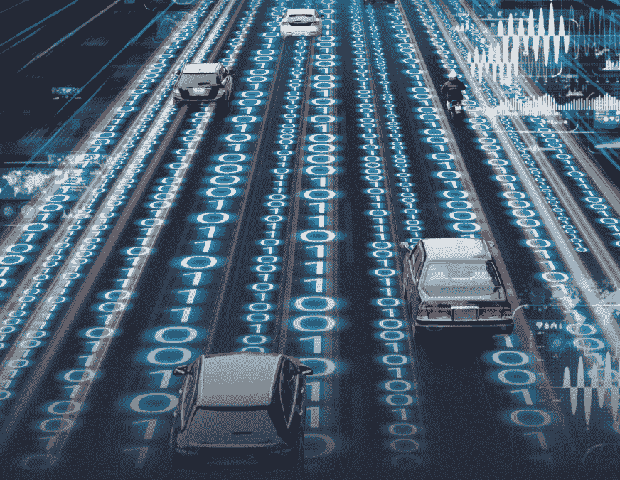

## 前言

2017年5月10日，我的学生赵光辉博士和我在杭州AIMS讨论了与智能交通发展相关的问题。后来，他计划写一些关于交通大数据的内容。我告诉他，密歇根大学拥有世界领先的智能交通实验室。他们花了几年时间试图优化密歇根大学旁边的几个交通信号灯。随后，他们来到中国的一座大城市，开始通过大数据管理交通信号灯来开展交通大数据实验。借助传统摄像头和感应线圈，通过人工操作，每90秒切换一次信号灯。通过分析发送到监控室的拥堵数据，利用人工智能调整交通信号灯。两个月后，该城市高峰时段的拥堵缓解了20%。未来，世界上更多城市将通过大数据优化交通信号灯，这将有助于最大限度地利用有限的道路资源，节省大量时间和交通资源。此外，中国拥有1.5亿至2亿辆私家车。这些汽车每天约有95%的时间停放在停车场里闲置。它们占用大量空间，浪费资源，并造成拥堵。借助大数据，这些闲置资源可以被调动起来，为需要乘车的人提供服务。这一实践将做出多大的贡献啊！

在阅读了赵光辉博士和朱古生教授撰写的本书手稿后，我深信大数据技术已推动了中国交通的发展。例子包括交通大数据源的收集、交通大数据平台的应用、交通物流、公共交通和交通安全的痛点、案例和商业模式、运营经验，以及其他国家交通大数据的现状、战略和行动。赵博士提出，交通大数据已改变了中国社会的出行模式，从过去的“人找车”转变为现在的“为想乘车的人安排车辆”。通过分析雨天、晴天、高峰时段、正常时段、工作日和节假日的数据，可以预测这些情况下特定地点未来的出行状况和乘客数量。准确率目前已达到85%–90%。可提前15分钟做出决策，将车辆送往指定地点。通过提前15分钟进行分配、路线规划和定位，网约车为人们带来了巨大便利，这在以前是不可想象的。现在人们已经非常习惯了。

匹配乘客和车辆的努力并非唯一的应用。由于大数据，匹配人员和物资的努力也发生了巨大变化。2017年11月11日24:00，当天天猫销售额达到1682亿元。其中，网上购物贡献了90%，卖家和买家覆盖222个国家和地区。在11月11日之前，卖家通过大数据预测，快递包裹量将比2016年增加30%以上，大数据预测11月11日的包裹量将达到1.4亿件，超过170万名快递员将参与物流。通过加强协作和数据共享以改善物流服务，运单已覆盖整个行业的80%以上。这是大数据预测首次覆盖行业超过一半的快递包裹，效率通过大数据与社会协作的连接得以提高。在物流预警雷达升级的基础上，大数据平台已从时间间隔预测全面提升至实时预测，覆盖中国超过50%的快递包裹。算法优化使更多维度的大数据得以使用。结果是，提供了每日投递包裹数量的实时预测，准确率超过90%。这些数据可以帮助快递合作伙伴部署运力，企业可以根据预测数据提前准备运力。因此，提前增加了4000名临时工人和5240辆卡车，并提前增加了飞机租赁吨位。“大数据配送路线”可以根据运单上的信息自动计算配送路径，并将包裹分配给离买家最近的网点。超过50%的包裹通过大数据配送路线更快地送达买家。卖家利用大数据对各类畅销商品进行预测，并管理全国各地仓库的库存，使包裹能尽可能靠近买家。通过使用大数据预测包裹量，商品能尽早送达买家。模式从“买家等待包裹”转变为“包裹寻找买家”。

《大数据交通系统》为我们提供了一种全新的视角来观察和利用大数据，这要感谢赵光辉博士从密歇根大学回国后的辛勤工作，以及朱古生教授对中国交通的持续关注。我之前为他们写过的一本书《互联网+交通》写了序言。本书《大数据交通系统》描绘了交通发展的新阶段。在中国致力于建设交通强国的战略背景下，这种前瞻性研究、学者与交通领域从业者的互动，以及学者对世界交通发展的贡献变得更加必要。每个人都必须有人生目标，因为你的存在会对社会和你周围的人产生影响。无论扮演什么角色，每个人都能对世界产生影响。我希望赵博士继续努力工作，保持勤奋，掌握世界上的重大技术变革，顺应世界潮流，以其国际视野、胸襟和非凡智慧为交通强国梦想提供更多研究成果，并向读者奉献更多作品。

我相信，得益于中国交通领域人才的智慧和全球各地人才的贡献，中国的交通大数据在未来一定会更加先进。中国将更接近成为世界交通强国的目标，中国借助大数据发展交通的前景也将更加光明。

## 前言

大数据是一个备受全球关注的热门领域，因为它将深刻改变人们的工作和生活方式。其巨大的潜在应用已在许多领域得到充分体现。通过应用大数据技术，菜鸟物流建立了由“天空网络 + 地面网络 + 人员网络”支撑的中国智慧物流骨干网；今日头条积极构建具有个性化设计、广泛覆盖和高投入产出比的智能推荐算法；亚马逊正专注于开发智能化、基于互联网和自动化的智能供应链管理系统。大数据在交通领域的应用也备受期待。交通大数据是指具有大规模、多源、多类型、复杂结构和低价值密度等特征的数据的收集。通过利用大数据技术和分析方法探索其关联和共同规律，我们可以为相关部门的管理决策提供强劲的数据支撑，加速智能交通和智慧城市的成功实施。

尽管中国的交通运输业起步较晚，但通过借鉴后发优势，已取得显著进展。作为幅员辽阔、地形气候复杂、地域差异巨大的国家，中国在多年实践中积累了在基础设施项目研究、设计、测试、建设、维护和管理方面的丰富经验。我们攻克了在高原冻土、膨胀土和沙漠地区修建公路和铁路的世界性难题，我国高速铁路已成为“中国制造”的新典范，并已引入其他国家。然而，作为支撑国民经济发展的基础性、先导性和服务性产业，交通运输业是一个庞大而复杂的系统。要追上日本、欧洲和美国等交通强国，绝非易事。要发展交通运输业，单纯投入资金远远不够。我们不仅需要提供足够的人才、资金和技术，还需要在顶层设计上制定科学合理的战略规划、有效的实施方案和全面的长期保障机制。

毫无疑问，中国各级政府都高度重视交通运输业的发展。凭借他们的努力，公路和铁路里程迅速增长；公共交通系统和地铁建设有序进行；共享汽车租赁和共享单车等新兴的“互联网 + 交通”模式也在地方政府的支持和指导下蓬勃发展。然而，中国的交通运输业总体上仍处于发展初期。区域发展不平衡、互联互通不足以及信息技术滞后等问题，引发了交通拥堵、交通事故频发、运输效率低下和成本高昂等诸多问题。这些问题给人们的工作和生活带来不便，并制约了中国经济的平稳健康发展。交通大数据的出现为上述问题提供了有效的解决方案。

美国、英国等发达国家已在交通领域大数据的应用方面开展了深入的研究和实践，在解决交通拥堵、恶劣天气下的应急响应以及道路状况分析与预测等方面取得了良好效果。中国各级政府正努力赶上，他们已在北京、上海和杭州积极探索应用，为全国树立了良好榜样。事实上，中国在推动交通大数据的过程中投入了大量资源。然而，由于缺乏整体战略规划，重复建设和资源利用率低等问题尤为严重。与此同时，大数据人才十分稀缺。即使在发达国家，这方面的人才也是稀缺资源，因此，大数据理论和应用的研究仍然相当有限。在中国，能够将大数据技术和分析方法应用于交通运输的跨学科人才更是稀缺。

不仅如此，信息孤岛问题尤为严重。高效、低成本地收集、分析和应用来自多源的海量交通数据，是推进交通大数据实施的基础和前提，但中国不同地区、不同层级和不同部门之间的信息系统尚未实现无缝对接，阻碍了交通数据的传播和共享。因此，打破不同地区、不同层级和不同部门之间的信息孤岛，已成为中国交通大数据发展的重要任务。本书对交通大数据兴起的宏观背景，以及交通大数据的发展现状、痛点、重点、战略规划和实施方案，提供了系统而深入的分析。本书推荐了一条发展具有中国特色交通大数据的路径。本书对中国交通大数据发展的系统回顾令人印象深刻。特别是，在总结美国、英国等交通强国交通大数据案例的同时，本书还对北京、上海、贵州、云南在该领域的探索与实践进行了详细分析。这为决策者、管理者、各级政府、技术服务提供商和设备制造商提供了宝贵经验。交通大数据的发展不仅将加速大数据、云计算、传感器和人工智能等下一代信息技术在交通领域的深入应用，更重要的是，它将为交通运输业带来新的思维方式和发展理念。

与欧洲和美国相比，中国在技术、设备、信息系统等交通大数据软硬件方面仍处于劣势，但只要借鉴他们的经验，我们就能赶上。然而，如果在思维方式和发展理念上落后，我们将永远只是模仿者和追随者，成为交通强国的梦想永远无法实现。因此，未来中国应抓住交通大数据带来的重要机遇，创新思维方式和发展理念，引进先进的技术、设备和管理模式，通过发展交通大数据与他们追平，从而将自己从交通大国转变为交通强国。

赵光辉是倪钧教授的学生。作为交通运输部认可的青年科技人才，他潜心钻研大数据，致力于严谨精确的研究，并擅长创新与探索。我非常高兴为他的著作《大数据交通系统》撰写前言。2014年，我率团队赴美国密歇根大学M. Wu制造研究中心考察美国制造业。那时，倪钧教授恰好在中国。在研讨会上，赵博士告诉我们，他曾在交通运输部工作，后来来到密歇根大学学习大数据制造和交通大数据。那是一次非常有收获的访问。四年过去了，我仍然清晰地记得在密歇根大学校园与赵博士合影留念的情景。过去四年里，他撰写了一系列关于交通大数据的著作，其中部分已在海外出版。他始终兢兢业业、勤奋不辍，年轻学者可以向他学习。

右征
中国清华园
2018年4月13日

## 前言

在当今信息迅速扩张的世界里，数据已成为人类社会发展的宝贵资源。

互联网时代以电子商务、电子办公、电子政务等形式，已将人类数据通信带到PB级别，在我们生活的大多数场景中，大数据已成为描述大量非结构化和半结构化数据的一种方式和代名词。

特别是，大数据在与我们生活密切相关的交通运输领域的价值和作用不断被凸显。

交通运输领域海量的数据和信息，如果未被正确挖掘和利用，将仅作为宝贵资源被浪费。

此外，智能化、个性化和自助化交通的目标将成为空话。

从某种意义上说，大数据交通即智能交通和自助交通。

在大数据的支持下，交通将更加合理和高效。

自2005年智能交通领域快速发展以来，大数据已受到政府高度重视，成为“确保安全、提高效率、改善环境和节约能源”的目标。

交通运输领域的许多技术处于国际领先水平。

随着大数据日益普及，大数据交通和智能交通变得越来越普遍。

相关产品和服务也在不断进入人们的生活。

例如，共享单车、滴滴打车、拼车、自助旅行、高德地图和智能物流是智能产品和服务，在大数据支持下展现出旺盛的生命力，交通运输变得更加高效和环保。

大数据交通的发展不仅被中国视为极其重要，也是全世界的重要课题。

然而，发展较早的日本、美国和欧洲拥有各自独特的技术和经验。

这些技术和经验值得我们学习和借鉴，以更好地发展我国大数据交通。

接受他人的良好建议未必能解决我们自己的缺陷，但将其转化为己用是可能的。

在大数据交通的发展和研究中，我们必须向他人学习，必须善于应用和模仿，事物永远不可能独立。

全书在第一部分和第二部分中阐述了讨论与研究，先认知后实践的顺序也符合读者的认知习惯。

本书引用了大量国内外案例，包括相关政府行动案例，以及企业探索案例，试图描绘大数据交通发展现状与未来的全面图景。

大数据交通的发展并非一帆风顺。

虽然取得了许多成就，但仍存在各种问题。

例如，中国大数据交通的发展相对混乱，缺乏统一布局的形成。

行政区域有些碎片化，缺乏统一标准，这不利于大数据交通的未来发展，无标准的数据无法作为一个整体使用。

如果未来共享交通数据，协调格式和标准可能会耗费大量成本和时间。

此外，由于中国大数据交通起步较晚，在数据交通共享层面，没有大型平台来实现数据资源的开放和共享。

与国外相比，这些方面还有很长的路要走。

如果没有提前规划和研究，未来可能会出现各种障碍。

总体而言，中国大数据交通的发展非常成功，未来前景极其光明。

在符合国情的发展基础上，我们应该多学习国外经验，提前规划，并利用早期布局的优势。

准确把握大数据在智能交通领域的优势，对于提高交通效率、解决交通拥堵、保障交通安全、减少环境污染，以及在新的高度和起点上改善中国的交通状况，起着非常重要的作用。

未来，我们期待更加便捷、便利的交通。

无论是政府还是企业，都可以在大数据交通和智能交通领域探索更好的模式，从而实现交通畅通、环境友好、交通便利的美好未来。

本书匆忙成书，难免存在各种错误。

感谢所有读者热情指正！

此页故意留空

## 关于作者

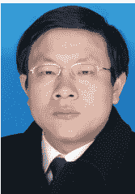

赵光辉（1976—）是武汉大学的研究员、教授和法学学士。

他获得中南财经政法大学行政学硕士学位；中国农业大学经济学硕士学位；武汉理工大学管理科学与工程博士学位；武汉大学和中国社会科学院博士后。

他还是密歇根大学工学院高级访问学者；贵州财经大学教授；交通部管理干部学院现代交通发展研究中心创始主任兼交通部支援西部地区培训办公室主任；北京交咨智库信息技术研究院首席研究员；武汉大学产学研问题研究中心研究员；中国科学技术大学MPA导师；交通部“交通青年科技人才”、交通部表彰的优秀科技管理者和交通部名师团专家；全国交通局长培训课程教师；贵州省智库核心专家；广西壮族自治区核心专家；广西壮族自治区钦州市交通局副局长兼广西交通运输厅“强厅兴交”特聘专家。

他负责国家社会科学基金项目以及交通部业务部门委托的研究项目等。

他还参与中国博士后基金项目、中国博士后基金特别资助项目以及30多项国家教育科学规划项目。

他在各种重要学术期刊上发表了100多篇学术论文和20多部专著。

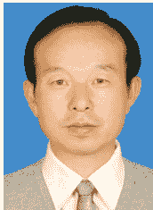

**朱古生**，曲靖师范学院学报教授、编辑部主任；国家社科基金规划办通信评审专家；云南省重点学科“应用经济学”学科带头人；云南省哲学社会科学省级重点研究基地首席专家；曲靖市委联系专家；曲靖市政府重大行政决策咨询论证专家；上海师范大学和云南农业大学硕士生导师。

他主要从事珠江上游经济文化研究，参与了国家社会科学规划项目、教育部人文社会科学项目的研究工作，主持了省级哲学社会科学规划项目、省级社会科学省级重点研究基地项目、校省合作项目、省教育厅研究基金项目等多项研究项目，并获得了一系列荣誉称号，如省级杰出贡献的突出专业技术人才、地方高校学报“优秀编辑”，并获得市级杰出骨干教师政府特殊津贴。

## 引言

这本书定位为一本关于交通大数据的科普读物。它首先向读者概述交通大数据，接着从全球视角介绍各国交通大数据的发展，包括战略、现状、行动、优势等，最后解释相关概念和技术基础，阐述交通大数据创新的广阔前景。在解释概念之后，它从实践角度探讨如何利用交通大数据。首先，它探讨大数据的来源，这是基础，同时也分析互联网企业接入争议的目的，接着是交通大数据平台的应用。最后，它详细阐述了交通行业中物流、公共交通和交通事故领域的大数据痛点、应用案例、商业模式和运营经验。

这本书定位为大数据交通科学的大众读物。

它旨在让人们对大数据交通有直观的场景感知。它从全球视角介绍各国大数据交通的发展，包括战略、现状、行动、优势等，澄清相关概念和技术基础，并从创新视角补充大数据交通创新的广阔前景。这有助于我们对大数据交通有一个基本的认识。

基于对大数据交通的认知，我们应当从实践角度考虑如何应用它。大数据的来源是大数据交通应用的基础。它还分析了互联网企业争夺入口的目的。在讨论数据之后，将探讨大数据交通平台的应用。涉及交通行业中物流、公共交通和交通事故的大数据痛点、应用案例、商业模式、运营经验等具体领域也已有所描述。还可以添加不同层级的更多交通平台，如县级、三四线城市层级，使不同岗位的人都能有自己的参考和启发性案例。

## 第一部分 认知：理解大数据

第一部分涵盖了大数据交通的理解，包括大数据交通的各种应用场景、国外大数据的发展现状、大数据交通概念的澄清、安全问题以及创新的本质。

本页故意留空

## 第1章 什么是大数据交通？

所谓大数据交通，是指通过互联网技术和大数据技术，利用数据处理工具对交通行业产生和沉淀的数据进行处理、分析和运营，从而产生更有效、便捷、高价值的交通、优化和治理方案，为人们出行带来便利，提高交通效率，节约能源资源，减少污染排放，并优化产业结构。

### 1.1 大数据交通与互联网+

#### 1.1.1 大数据来势汹汹

随着工业社会向信息社会迈进，人类所有成就都以二进制信息的形式存储和传输，信息被转化为数字形式。一些学者将人类社会的信息化进程划分为三个时代，即计算机时代、互联网时代和大数据时代。1 随着信息技术革命的出现，互联网、移动互联网、社交网络、物联网、物联网

1 徐继华、冯钦娜、陈臻如：《智能政府：大数据治理时代来临》，中信出版社，2014年版，第11页。

车辆、智能手机和平板电脑，人类产生的数据呈指数级增长。

MBA在线网站发布的信息图表显示，每天发送2940亿封电子邮件，在线发布200万个博客，在Facebook上上传2.5亿张照片，在YouTube上上传864万小时视频，在流媒体音乐网站Pandora上播放1.87亿小时音乐会。根据IBM的分析，人类整个文明所获得的数据中，90%是在过去两年内产生的。到2020年，世界生成的数据规模将达到当今的44倍。

根据国际数据公司（IDC）的一份研究报告，在未来十年中，全球大数据将增长50倍，到2020年，世界将达到35泽字节（约3.5 × 10^22字节）的数据信息量。正在出现许多类型的数据。数据在通信网络中快速传输，待开发的数据数量不断增加。人类社会已正式进入大数据时代。

#### 1.1.2 大数据交通已趋完善

随着大数据技术的逐步完善，各行业对大数据的整合和应用日益深入。当今，从国家政策到商业营销，随处可见大数据的身影，大数据的价值也日益凸显。交通作为数据沉淀的自然领域，与大数据密切相关。大数据在手机地图或政府交通管理平台中发挥着至关重要的作用。

随着互联网与行业的持续融合、升级和发展，交通行业与各行业的数据联系越来越紧密，海量信息为大数据交通的发展带来了机遇和挑战。把握信息化和数字化的浪潮，是实现交通行业转型、优化和发展的关键。

大数据交通收集大数据集，并使用数据处理工具对其进行处理、分析和运营。作为天然的大数据应用行业，交通行业拥有大量数据来源和多种多样的数据，各地区经济发展不平衡给行业管理系统的数据采集和集成带来了困难，导致数据处理低效甚至无效，并因数据快速增长而增加成本。挑战与机遇始终同在，但大数据交通行业符合经济社会发展，为人们的出行带来便利，提高了交通效率，节约了能源资源，减少了污染排放，并优化了产业结构。

大数据与交通的紧密融合与中国汽车行业的智能化发展密切相关。2017年9月9日，工业和信息化部报告称，《公路智能网联汽车适配性验证管理规范（试行）》的初稿已完成并正在修订。作为世界上最大的汽车市场，中国的互联网智能化正在迅速发展，比亚迪、猎豹、东风启辰等无一例外，其中“智能互联”是重点。新的车载互联系统、语音控制等方面改善了人机交互；驾驶过程中随时可以唤醒导航，并可实现语音导航、电话拨打等功能，所有这些都需要大数据技术的支持。增加汽车技术含量还可以随时有效监控道路信息，因此大数据与交通管理的结合不仅局限于行业中的高端应用，而且与普通民众息息相关。

与此同时，中国汽车数量的增加和高速公路的快速建设也提高了大数据的应用价值。截至2016年底，中国大陆高速公路总里程已达13.1万公里，位居世界第一。机动车出行在各种交通方式中排名第一，同比增长17.6%。在用机动车数量超过3亿辆，今年上半年增长率为3.18%。因此，从行业到社会，将大数据与交通管理相结合的必要性日益增加。

#### 1.1.3 互联网+交通正逢其时

2015年3月5日，李克强总理首次在《政府工作报告》（图 1.1）中提出了“互联网+”行动计划。互联网与传统产业的融合发展将彻底改变传统产业并催生新业态。互联网与交通的碰撞也形成了“在线资源合理分配和线下高效优质运营”的新模式。互联网+交通模式在国家政策的推动下实现了快速发展。

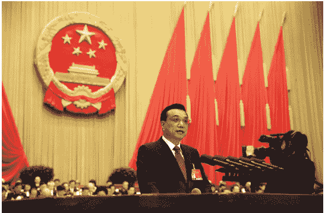

图 1.1 第十二届全国人民代表大会第三次会议在北京人民大会堂开幕。李克强总理作政府工作报告。

来源：中华人民共和国中央人民政府。

如今，“互联网+交通”模式日益完善。例如，铁路部门推出了网上购票方式，让消费者可以使用电脑和手机通过互联网购买火车票，无需出门，免去了过去排长队购票的麻烦。民航部门早已实现了网上订票。在积累数据的基础上，经过大数据分析，消费者可以使用手机APP实现购票、办理登机手续以及查询航班状态等功能。大力推进高速公路ETC网络建设是公路方面推动网络化的措施。此外，人们越来越离不开导航系统和打车软件。

大数据交通和互联网+交通模式的发展已逐渐成为人们生活中习以为常的内容。

### 1.2 大数据交通与智能交通

#### 1.2.1 什么是智能交通

智能交通的概念被提出得很早。早在1990年，日本人井口八一（Iguchi Yaichi）首次提出了智能交通系统（简称ITS）的概念。但当时，ITS并未引起广泛关注。直到1994年，美国将其交通研究组织智能车辆公路协会（IVHS）改为ITS America，ITS的概念才受到重视。

多年来，随着互联网技术、大数据技术、云计算、区块链等技术的发展，智能化趋势愈发明显，智能化在交通领域的比例不断上升。包括美国、欧洲、中国在内的世界重要经济体越来越重视智能交通，并为其发展投入了大量人力和物力。

至今，智能交通尚无权威定义，各研究人员对其有各自的理解。不过，我们可以借助首届ITS世界大会主席给出的智能交通定义来理解这一概念。

智能交通系统是在相对完善的道路基础设施基础上，有效地整合和应用先进的信息技术、通信技术、控制技术、传感器技术及系统综合技术到地面交通系统，从而建立一个实时、准确、高效的地面交通系统，并发挥大范围作用。

通常，智能交通系统由七个部分组成，即高级交通信息系统（ATIS）、高级交通管理系统（ATMS）、高级公共交通系统（APTS）、高级车辆控制系统（AVCS）、货运管理系统、电子收费系统（ETC）和紧急医疗系统（EMS）。这七个部分共同构成一个立体的智能交通系统，影响着人们生活的方方面面。

对于中央政府新批准的雄安新区，政府正以建设智能公共交通作为主要出行方式来牵头推进。

根据2017年10月14日微信公众号“雄安发布”的消息，雄安新区与百度集团举行了对接会议。双方就在大数据、人工智能、云计算等潜在合作领域进行了对接。

河北省委常委、常务副省长，雄安新区党工委书记、管委会主任陈刚表示，雄安新区是一座从零开始建设的城市，要绘好这张蓝图，需要在信息技术与智慧城市发展的融合方面取得突破。

未来，雄安新区将实施以智能公共交通和无人驾驶私人车辆个性化驾驶行为为基础的出行模式，这将构成雄安新区未来的道路网络结构和空间分配模式。雄安新区未来规划建设的核心理念之一是将城市还给人民，即从按照汽车规模传统方式设计城市和道路转变为按照人的规模进行设计，从而将城市还给人民，将道路和空间还给人民。百度集团在智慧城市建设、大数据、自动驾驶等方面具有领先优势。我们欢迎百度筹划在雄安新区建设开放型国际级国家人工智能实验室和高端应用研究机构，尤其是建设无人驾驶高新技术产业示范区。

百度集团总裁兼首席运营官陆奇表示，百度集团希望在智慧城市规划设计、信息基础设施建设、智能产业试点示范等领域与雄安新区深化合作。

从雄安新区的建设可以看出，在传统交通系统中，由于技术等因素，人、车、路无法实现统一、协调和融合，整个交通系统的效率和安全性无法得到保障。在智能交通系统中，我们运用信息技术、数据通信传输技术、电子传感器技术、卫星导航定位技术、电子控制技术、计算机处理技术和交通工程技术，这些技术可以实现集成与融合。传统交通系统的不足和难题已逐一克服，人、车、路协调得更加紧密。交通效率得到了提升，交通安全得到了保障，交通环境得到了极大改善，能源效率也得到了大幅提高。

#### 1.2.2 智能交通中的大数据

智能交通之所以不同于传统交通，在于其智能化。先进的信息技术、数据通信与传输技术、电子传感器技术、控制技术和计算机技术，以及大数据技术，确保交通系统在指挥调度方面能够发挥更强大的作用，比传统交通系统更能主动预测风险并防范各种突发事件。

大数据技术为此价值提供了有力支撑。

随着社会经济的快速发展，全球交通将面临越来越复杂的局面。随着机动车数量增加，城市化发展导致交通道路系统失衡，传统交通信息系统无法满足当前交通状况。例如，在北京、上海、深圳等一线城市，交通拥堵已成为全市治理的难题。

然而，通过汇集各类分散的交通数据形成一种数据池，并利用大数据技术处理数据，我们可以分析一些交通趋势、需求、难题等。然后通过精细的数据处理和图像处理，形成交通建议和决策。例如，有些人对某个交通路段有特定的信息需求。虽然这类需求在数量和份额上看似很小，但通过大数据技术的处理和其他类似需求的聚合，可以形成特定的个性化服务。在此基础上，交通管理系统将更加智能化。

大数据使交通管理更加智能，体现在以下几个方面。

- 首先，跨行政区域的数据将被整合，交通管理将突破以往行政区划的限制，树立整体的“棋盘”管理意识。这将帮助政府部门更有效地开展交通设施建设，更合理地进行交通路线规划。

- 其次，大数据技术可以合理分配交通信息资源，提高信息利用率。目前，中国交通部门的职责存在重叠，部分职责界定不清。利用大数据技术，我们可以合理配置人力和物力资源，协助相关部门制定更合理的整体规划，从而提高交通信息利用率，使交通管理更加智能。

- 第三，大数据技术改变了以往的交通管理思维模式。在传统的交通管理思维中，遇到交通拥堵时，会采取拓宽道路、增加里程的措施来提高交通通行能力。事实上，这种管理往往近视。土地资源是不可再生资源，拓宽道路只会浪费更多土地。此外，在交通高峰期，拓宽道路也无法解决所有问题。通过大数据技术的分析与集成，我们可以清晰了解交通拥堵的时段、地点和原因，从而因地制宜，进行合理的疏导与治理，减少对土地、空间等资源的依赖，实现交通设施与系统的良性循环。

我们可以通过观察长沙市智能交通的建设，来理解大数据在智能交通中的价值。

目前，长沙在交通信息化方面主要建设两个平台、六个系统和五个应用软件。2016年3月，智能交通第三期建设启动，由青岛海信网络科技有限公司承建，并与百度、高德等互联网公司签订数据交换协议，以利用科技手段助力交通管理。

目前，长沙所有交警业务都可以通过手机APP进行管理，包括车价、驾驶违章记分和查询等。下一步，手机APP还可用于查询周边停车场信息及停车位容量。

智能交通管理的两个平台是指挥调度平台和视频网络共享平台。六个系统是高清电子警察系统、高清电视监控系统、智能交通信号控制系统、交通流量采集系统、网络安全与存储系统，以及二级和三级子控制中心改造。五个应用软件系统是道路交通PBE的实时采集、处理与分析；智能交通的价值将不复存在。

- 第三，数据可以广泛共享。交通行业的信息资源复杂且宝贵。不仅政府部门对其有巨大需求，相关企业也有强烈需求。这些数据和信息的收集需要由政府部门和企业共同完成，其目的也需要共享。否则，将产生孤立的信息孤岛，无法实现信息资源的统一分配和使用。

- 第四，智能交通必须高度稳定。特别是对于交通指挥与引导，如果无法实现高稳定性，就无法保障交通的高安全性、高效率和高精度。可能会出现城市交通拥堵，导致资源浪费和环境污染。

### 1.3 大数据交通与云计算

众所周知，大数据在应用层具有集成优势和组合效率。在大数据技术的支持下，任何领域的信息资源都可以改变信息分散、信息内容单一、混乱和孤立的局面。

然而，为了存储、分析和共享海量数据，我们必须拥有云计算技术提供的强大平台。云计算技术可以快速计算大量数据，并

用户可以便捷地使用数据。它甚至可以让用户每秒体验10万亿次的计算能力。拥有如此强大的计算能力，云计算可以模拟核爆炸，预测气候变化和市场趋势。访问云计算平台的用户可以通过电脑、笔记本电脑、手机等方式，根据自身需求进行计算。

在交通领域，大数据和云计算技术可以帮助建立全面的三维交通信息系统。交通系统中的任何节点都可以高效地计算信息并调用数据。所有交通参与者都将被纳入系统，发挥交通的整体功能。例如，在基础设施建设、交通信息发布、交通企业增值服务和交通指挥等方面，大数据和云计算可以提供决策和仿真支持，效率非常高。

此外，云计算技术具有通用性、高可扩展性、按需服务、极低成本等特点，是大数据交通发展的必然需求。在云计算的支持下，大数据交通的建设过程中的发展速度和质量将更快、更高。

贵州省作为中国大数据建设基地，在大数据交通和云计算的探索中也处于前列。由此，我们也可以看到云计算在大数据交通发展中的巨大价值。

……我愿借此宝贵机会，与大家分享贵州交警在运用大数据和云计算技术提升道路交通安全方面的实践与探索。

去年这个时候，李克强总理在国务院常务会议上提出支持云计算关键技术研发和重大项目建设。今天，贵州交警已建成中国最大的政务私有云平台。去年这个时候，国务院正在利用大数据发展市场化和个人征信业务，并加速征信评估系统业务的系统建设。去年这个时候，贵州高速公路重大交通事故频发。今年，全省5000公里高速公路的事故数量下降了11起，死亡人数同比下降47人，创下贵州高速公路通车以来事故预防效果最好的记录。

去年这个时候，贵州农村道路交通安全监管工作也受到“有机制而未落实、有机构而无人员、有措施而无手段、有责任而未追究”等问题的困扰。今年，贵州交警在省、市、县、乡、村、组各级建立了数据围栏和农村道路交通安全监管云平台，以加强农村道路交通安全。

所有变化都源于贵州交警云的建设，以及云计算平台建成后从云到端对智能交通的支持。依托大数据和云计算技术，结合现代治理理念和现代信息技术，贵州“互联网+”道路交通管理模式正逐渐形成。在大数据、云计算和“互联网+”已成为互联网热词的时代，贵州交警已经走出了如何培训云平台的困惑。

我们的经验是，我们并不迷信云服务，因为云服务并非万能。没有业务应用的标准建设，没有精细的数据框架设计，仅仅将混乱杂乱的数据汇集并放到云平台上，也会创造出危险的数据服务。

我们的具体做法是在公安部和公安部云计算建设中心的指导下开展。公安云平台的功能需求以贵州公安信息化建设中存在的问题为导向，以贵州交警的主营业务为重点。已与公安部交通管理科学研究所建立战略合作，吸收阿里巴巴的成熟云计算技术，采用华为硬件，租用中国电信的机房和设备，并按照业务应用+数据框架的顺序，建设了618台服务器、46台网络交换机和12 PB的存储容量。该云平台兼容各种传统数据类型，使用廉价的X6服务器作为视频和图片存储单元，可存储75万张高清图片，具有1万核心的计算能力，每秒处理2万张图片，以及分布式数据库和大数据在线离线计算等各种云服务，攻克了制约贵州交警信息化建设的四大难题，即数据不能存储、不能运行、不能好用、不能共享。

建成云计算平台后，我们的实际应用可以概括为两句话。第一是实现大数据资源池的跨界融合与数据共享。云平台建设使我们能够实现大数据资源池化，为信息资源服务提供数据基础，为跨区域、跨行业、跨部门、跨警种的信息资源共享和大数据应用提供坚实的服务保障。公安信息资源内部共享为构建立体公安防控体系奠定了坚实基础。信息资源对外向社会各界共享。各行业各部门的数据在大数据资源池中被解构、交叉和集成。通过汇聚、清洗和整理，形成标准化的数据资源目录并汇聚为海量数据，一个良好的大数据生态系统正在逐渐形成。

第二是依托云平台实现责任共享和安全共治。针对关键车辆、高速公路和农村道路的管理难题，我们在云计算和云平台支持下开发了三个监管云平台，解决了管理问题。针对运输危险货物的关键车辆缺乏关键管理手段的问题，我们建设了贵州道路交通安全综合监管云平台，依托各种金融关系型数据库等云计算技术，实现车辆动态违法的精准预警和动态干预，监控车辆的一举一动。

自平台上线以来，各级省级监管部门登录并使用该平台189,000次，企业用户登录并使用该平台570,000次。交警、交通、安全监管和企业实现了信息的实时共享，解决了安全监管中的信息不对称问题，明确了各部门的安全监管责任和企业的管理责任。

结合关键驾驶员征信系统，我们对全省600多万名驾驶员进行了核查，实现了对关键驾驶员的精准管控，发挥了前所未有的管理效果。目前大屏幕显示的是全年全省企业撤销关键驾驶员资格和交警对关键驾驶员实施终身禁驾等相关数据，旨在解决高速公路无法依靠传统警务运行机制实现管理效果的问题。

我们建立了智能综合监管云平台，依托关联数据库的运行，使用视频图像大数据分析技术来控制和采集关键车辆，对双站超速等关键违法行为实施精准预警，实施违法数据信息四推送，五步动态干预消除，并对关键车辆实施精准控制。在今年前三季度，推送了超过340,000条违法车辆信息，并采取了包括路网发现前端采集、动态跟踪、安全指导和现场处罚在内的五个步骤。由执法站和服务区现场执法并处理了超过374,000起交通违法行为。

针对农村道路长期被占用和管理力量严重短缺的问题，我们自主研发了农村道路交通安全综合监管云平台，将触角延伸至占全省总里程95.5%的农村道路。该平台用于采集农村居民、车辆、道路、气候等方面的道路交通安全数据和关键时期信息。利用大数据群体分析技术，对各乡镇驾驶员车辆的异常情况进行预警，跟踪调查隐患路段，并自动将婚丧嫁娶、民俗活动、国家节假日等方面的预警信息推送给五级负责人，将监管责任落实到个人。通过评议指挥、预警、过程监督、事后追责，各级党政属地管理责任已得到真正落实，实现了责任共享、安全共享的目标。

去年建设并应用的贵州交警云虽取得的成绩不大，但找到了正确方向，开局良好，迈出了坚实步伐。随着大数据、云计算、物联网等新技术的飞速发展，智能交通蓬勃发展带来了巨大的

对传统交通理论和实践的影响。下一步，贵州交警将深入研究其他省份公安道路交通管理的先进经验，吸收本次论坛的智能交通研究成果，在公安部交通管理局领导和无锡研究院大力支持下，继续扩大大数据应用，探索利用云计算技术开展道路交通安全监管的精准治理和个性化管理方案，努力实现道路交通安全监管问题的精准监管和针对性治理，进一步推动一批改善交通安全和交通管理的变革性成果，创造安全、和谐、便捷的交通，为道路交通管理、公安以及经济社会发展作出更大贡献。⁴

### 1.4 大数据交通与人工智能

近年来，人工智能变得非常流行。无论是自动驾驶技术还是电子警察，人工智能都不可或缺。一般来说，人工智能通过互联网、大数据、云计算、机器人等技术和手段来模拟、延伸和扩展人类智能。借助人工智能技术，人类希望机器能完成只有人类才能做的工作。事实上，近年来人工智能技术发展迅速。在某些领域，人工智能已超越部分人类能力，例如AlphaGo战胜人类棋手柯洁。

人工智能在交通领域的应用更加广泛和深入。

⁴内容引用自王建武（贵州省公安厅交通管理局局长）在“2015年第十届中国智能交通系统市场研讨会”上的主题报告《贵州公安交通管理工作中大数据与云计算技术的实践与应用》，该报告已被删除和修改。

在2017年3月23日结束的第六届中国智能交通系统市场研讨会上，多位行业专家表示，国内智慧城市建设仍停留在传统垂直应用阶段，缺乏深度应用。通过人工智能+大数据+交通，城市智能交通系统可通过自我调节，为智慧城市的建设和发展提供“外脑”。

诸如交通拥堵等“大城市问题”长期以来一直受到诟病。如何解决交通拥堵问题已成为城市管理决策者的重要议题。行业内有些人认为，如何通过信号控制提高路口效率是解决问题的关键，这也是智慧城市建设和发展中最基本的关键环节。

近期，基于智慧城市建设中的人工智能数据挖掘和深度学习，海信向外界展示了其在交通领域早期布局的突破性应用方案。据说，海信开发的“数据立方”可在30秒内完成10亿条大规模交通数据的可视化分析，并实现基于深度学习的交通预测。

“基于海量交通数据，我们分析交通运行的规律性和相似性，构建智能学习模型，并通过机器学习预测交通流量、拥堵等交通参数”，海信城市交通信息控制专家马晓龙表示。通过对道路交通流量的实时监测和分析，根据动态交通数据自动切换和分配信号时间，最直观的变化是交通信号灯时间不再固定，甚至全程绿灯无需停车。

据了解，之前描述的更理想的交通状态已实现。在海信的自适应信号控制系统中，根据建议车速，可实现“一路绿灯”。数据显示，在山东省青岛市，智能交通系统建设完成后，高峰时段缩短了1.48小时，平均速度比提高了9.71%，为车辆节省了107,938,000小时的交通时间。

上述应用仅是中国人工智能交通应用的一个缩影。中国所有主要城市都在不断探索和应用人工智能，以提高交通效率，使城市交通更加顺畅。此外，中国已出台许多政策和法规，鼓励人工智能和大数据交通的发展。未来，中国的大数据交通和人工智能交通将焕发新面貌。

当然，从全球视角来看，世界各大经济体都在发展人工智能。美国已将“智慧地球”理念上升为国家战略。日本和韩国正通过人工智能和大数据技术涉足国民生活和生产的各个领域，不断提高人民生活水平。欧盟也在不断关注人工智能领域的智慧城市建设，如环境、交通、医疗和智能建筑等，这些领域的发展比中国更早、更深入。

虽然人工智能仍处于发展阶段，但其未来前景非常光明。交通领域每时每刻都在产生一系列数据，通过人工智能的分析和学习，这些海量数据将更好地为交通参与者绘制蓝图。对于政府交通部门、铁路、航空公司和旅游机构，可以精准找到客户群体，提供更加个性化的服务。

## 第2章

## 大数据交通：越来越贴近生活

许多人觉得大数据交通离自己的生活很遥远，但事实上，它无处不在。日常出行信息预报、共享单车以及地铁公交调度都与大数据交通密切相关。它对我们的生活产生深远影响，极大地改变了我们的出行行为和习惯。

### 2.1 大数据交通的自助出行

随着汽车日益普及、交通方式多样化以及智能交通的发展，人们的出行方式越来越个性化。无论是通勤还是节假日出行，自助出行都越来越受到消费者的青睐。人们的自主性和自助意识日益增强，出行期间不再需要工作人员全程指导，可以通过手机APP完成整个查询流程。

观察当前市场，人们自助出行的方式涉及各种交通工具，包括自行车、汽车、火车、高铁、飞机等。

#### 2.1.1 自行车自助出行

自助自行车，又称公共自行车，最初是政府部门提供的自行车租赁服务，旨在改善城市交通、减少城市拥堵和交通污染。在政府设立的公共自行车租赁点，人们可以通过刷卡或手机解锁来使用自行车。然而，由于押金支付不便、需要将自行车归还至指定地点以及自行车款式陈旧等原因，政府主导的自行车租赁用户体验不佳。

近年来，随着共享单车的兴起，自助自行车出行越来越普遍。从用户注册、押金支付、自行车使用、自行车归还等，均由用户自行完成。共享单车运营团队仅负责交通信息数据处理、自行车数量调度和自行车维护。

例如，摩拜、ofo等人人熟知的共享单车是人们自助出行的最佳方式。用户可以随时随地取用和归还自行车。在地铁站到公司、公交站到家等短途出行场景中，共享单车价值巨大。尤其是在公交线路密集、交通繁忙的一线城市，共享单车在短途出行中发挥着重要作用，提供了更快捷、更经济、更直接的出行方式。尽管共享单车在一定程度上与公交车和出租车的短途运输形成竞争关系，但它在一定程度上缓解了交通拥堵，减少了环境污染，可作为城市公共交通衔接“最后一公里”的补充。

此外，根据CBNData发布的最新《2017中国共享出行行业大数据观察》，在自助出行方面，共享单车等出行方式正在颠覆和创新交通模式。随着共享单车行业的快速发展，共享单车已成为中国最广泛、使用最频繁的出行方式。到2018年，中国共享单车市场规模将达到100亿元。

CBNData基于ofo共享单车平台的数据分析表示，共享单车解决了近80%用户“两公里内出行难”的需求。它发挥着短途出行和短途衔接的作用，极大地提高了出行效率，

有效补充中长途出行，是消费者短途出行和短途衔接的最佳选择。

基于OFO平台的数据分析，CBNData声称共享单车是消费者短途出行和短途衔接的最佳选择。例如，36.2%的OFO用户骑行距离在500–1,000米以内，26.4%的OFO用户骑行范围在1–2公里。

在上海，近20%的OFO用户每天在地铁站周边一公里范围内出行。共享单车解决了近80%用户“两公里内出行难”的需求，发挥了短途出行和短途衔接的作用，并有效补充了中长途出行。¹

#### 2.1.2 其他自助出行

在自助出行的其他方面，高铁和飞机在一定程度上已实现自助出行，为消费者提供了诸多便利，缓解了城市交通，并优化了交通条件。

例如，在代驾方面，传统模式是客户下单，平台通过信息匹配将订单发送给司机。在此过程中，客户的独立选择较少，大部分流程由平台完成。

但现在代驾模式已经改变，自助和自主权已转移到客户手中。客户可以使用智能手机上的地图软件寻找代驾服务。通过定位服务，他们可以选择离自己最近的代驾司机，选择信誉良好的司机，并根据其他需求筛选司机。这一过程由客户自己完成。地图软件提供相应的信息服务，但自主权掌握在客户手中。

根据高德相关负责人称，虽然代驾服务看似简单，但涉及车主及其他车辆的人身和财产安全，因此代驾司机的资格审查极为严格。代驾司机必须具备良好的品行和熟练的驾驶技能。如果客户想要自己出行，则需要在安全方面得到保障。

在高德APP中，“附近”功能里有一个寻找代驾司机的选项。高德利用地图和手机定位，向用户精准推荐五名合适的代驾司机。系统会显示每位司机与客户的距离，以便客户在选择时心中有数，且无需等待太久。此外，这些代驾司机的信息包括照片、驾龄、出生地、代驾次数、评分星级等。客户在自行选择时可以了解他们的相关信息，从而更好地安排出行。

在公共交通领域，尤其是地铁，自助出行的程度日益提高，尤其随着智能手机的普及，手机自助充值、刷卡和乘车已成为完全的自助流程。南京地铁推广手机蓝牙进站闸机便是此方面的绝佳例证。

- **亮点1：** 手机进站快速便捷，我们或许可以告别“排队”——手机一刷，乘客即可进出车站。开启“蓝牙”以激活“过闸”功能，并与地铁“闸机”交互，乘客即可无需购票即可进出闸机，避免忘记携带市民卡或出行无现金的尴尬。现在，无需排队购票，只需使用手机蓝牙进闸，非常方便。

- **亮点2：** 一键充值，随时随地充值——南宁轨道交通APP的“充值”功能可帮助乘客随时随地充值，可自行设置金额或自行输入（范围为2–500元）。“充值”功能连接三种在线充值方式：银联卡、支付宝和微信。进入APP的“账单”功能，用户还可以实时查询账户余额、每笔消费明细、充值及半年内的消费统计等信息。乘客剩余多少乘车资金可通过手机查询。

- **亮点3：** 查询地铁信息，“管家”守护出行——南宁轨道交通APP保存了购票和充值链接，乘客随时可享受高质量的乘客服务。“时刻表”可查询列车的往返时间及首末班发车时间。“票价查询”可根据起点和终点提供路线并了解票价。“车站信息”可查询车站信息、出入口及车站周边信息。南宁轨道交通APP是乘客身边贴心的出行管家。

- **亮点4：** 提前了解到站信息，约会绝不迟到——乘客可在APP主页将“小时钟”向左滑动，查看“到站提醒”功能，用于定位附近车站并查看最近列车的到站时间。乘客日常出行时可使用该功能更精准地定位自身与地铁站之间的距离。即使不在地铁站内，也能查询最近两趟列车的到站时间，帮助乘客根据实际情况调整行程。约会绝不会迟到。

- **亮点5：** 多功能集于一体，没有比APP更了解你的——“发现”功能还能为你自动推荐地铁站附近的热门商家，周边地铁的餐厅和活动也会列出。在“附近商家”中，你可以选择切换到其他车站进行查询。乘客的出行生活更加丰富，带动地铁周边商圈，在手机上“发现”智慧生活更加精彩。²

有了如此便捷的公共交通，旅客无需再排队购票，也无需因忘记携带公交卡而焦虑。凭借手机，所有出行行为均可完成，且可通过手机轻松查找出行轨迹，这对地铁运营商和旅客而言是双赢的局面。

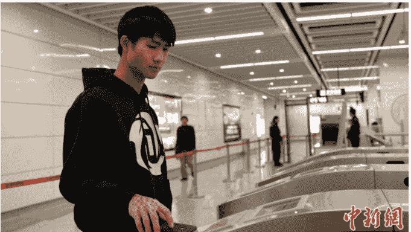

图2.1 乘客使用蓝牙传感器通过地铁闸机。

来源：中国日报新闻。

对于地铁运营公司，大量的旅客行为数据可帮助其更好地规划地铁发车频率和运行时间，并可提供更多自助服务以降低运营成本。对于旅客，任何信息、轨迹和运输时间均可在手机上找到。非常方便快捷（见图2.1）。

自助出行遍布交通系统的各个环节。从短途出行到长途出行，大数据在交通领域的价值日益重要，尤其是地图软件在自助出行过程中发挥着核心作用。如果没有定位数据、驾驶、街道等其他数据，消费者生活的便利性将无从谈起。

### 2.2 大数据交通下的高铁出行

随着中国高铁网络的密集分布，中国人选择高铁出行的频率越来越高。据

根据中国铁路总公司的相关数据统计，自2008年京津城际铁路运营以来，到2017年9月30日，中国高铁单位已发送乘客超过70亿人次，年均增长率超过35%。需要知道的是，根据不完全统计，世界总人口不超过73亿人。如果按每年20亿人次计算中国高铁通勤乘客数量，到2018年，累计发送乘客总量肯定将超过世界总人口数。

中国高铁建设速度之快令人惊叹。仅用了五年时间（2012年至2017年），北京–广州铁路、上海–昆明铁路、哈尔滨–大连铁路、贵阳–广州铁路、兰州–乌鲁木齐铁路、海南环岛铁路等多条关键高铁项目已建成通车，“四纵四横”高铁网络基本形成。从中国北方的小城市到南方三亚海滨，从西部新疆到东部沿海地区，高铁如同人体动脉，连接起全国。据统计，中国高铁连同其他铁路，已形成超过40000公里的快速客运网络，基本覆盖中国省会城市及人口超过50万的城市。长三角、珠三角、环渤海等城市群通过高铁更加紧密地连接在一起，东西中北四大板块已实现高铁互联互通。

高铁如此便捷高效，人们的出行自然也变得更加智能。但庞大的高铁网络需要大数据技术来统一管控。一旦某个环节出问题，可能会影响后续列车运行。此前，高铁调度问题导致后续列车晚点的情况时有发生，但现在此类新闻已少之又少。因为中国交通网络系统日益完善，大数据技术也越来越强大，能够保障高效复杂的高铁网络运行。

我们可以从同程旅行与中国交通新闻社发布的“2018年春运大数据报告”中看到一些端倪。

在2018年春运期间，铁路预计发送旅客3.93亿人次，较去年增长10%，且远高于公路交通1.1%。随着人们消费观念的转变和民航运力的增加，越来越多的消费者在春运期间选择民航，预计2018年民航将发送旅客6700万人次，较去年同期增长14%，在三大运输领域中增幅最大。3

铁路部门发送旅客数量同比增长10%，这与高铁线路的逐步投入使用密不可分。目前，中国拥有超过2700列D系列动车组，每日运行超过4500趟列车，居世界第一，累计发送旅客超过60亿人次。以京沪高铁为例，其六年运营期间已安全运送6.72亿名乘客。

高铁出行是一种重要的交通方式，其在大数据方面的应用与实践体现在以下几个方面。

#### 2.2.1 智能化

无论是购买高铁车票还是乘坐高铁时的检票闸机，高铁网络正变得越来越智能。例如，北京西站已开放人脸识别系统；乘客刷身份证进站，然后通过人脸识别系统进入闸机。检票过程仅需1–2秒即可完成。这些过去依赖人力完成的任务，如今让出行变得更加高效。

#### 2.2.2 自助服务

自助服务背后实际上是智能化的体现。乘客可以根据要去的地方、转乘地点和出发时间，通过自己的APP进行查询和购票，这不仅提高了效率，还节省了人力和物力资源。高铁还开通了点餐和订票功能，让旅客在出行过程中更加便捷、环保。

#### 2.2.3 低成本

虽然高铁票价远高于普通列车票，但从社会整体经济价值和时间价值来看，高铁节省了出行时间，提高了单位时间的经济价值，降低了消费者的出行成本，如下文新闻所述。

高铁发展也活跃了大城市周边地区的经济与商业。陈先生从事金融行业，正在候车大厅里用两部手机和一台笔记本电脑处理邮件。由于工作原因，他每周需要多次往返于北京和天津武清之间。北京与武清相距约90公里，开车即使不堵车也需要超过一小时，而高铁仅需24分钟。“交通节省了时间和人力。开车很麻烦，尤其是在北京。开车去北京可能会堵车。坐火车没有堵车风险，所以不会耽误工作。如果开车，成本会太高。实际上，油费和过路费远远超过高铁票价。我往返只花七八十元。如果开车，成本肯定比这高”。4

#### 2.2.4 安全性

在准点率和乘客人身安全方面，高铁出行相较于航空和公路出行具有更明显的优势。

中国拥有世界上里程最长的高铁线路和公众出行频率最高的高铁网络。高铁出行

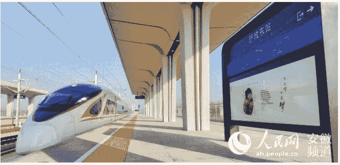

图2.2 高铁车站。
来源：人民网。

将继续改变人们的出行方式，进一步提升交通效率，便利生活，减少环境污染（见图2.2）。这一切都与交通大数据网络密切相关。可以说，高铁网络就是一个数据网络。在海量数据的支持下，高铁可以极其便捷、高效且安全。

### 2.3 大数据交通中的公路出行

公路出行是中国人们出行最重要的方式之一。公路出行侧重于短途出行。当出行距离小于200公里时，人们更倾向于选择公路出行。根据同程旅行与中国交通新闻社发布的“2018年春运大数据报告”，200公里以内和800公里以上的出行距离占比最高，分别为33.5%和30.1%，这表明公路出行的作用和价值巨大。

在日常生活中，如果从出行方式来看，公路出行通常包括汽车、公交车、摩托车等几种。从出行方式来看，出行方式丰富多样，如自驾、拼车、租车、坐公交、坐出租车、滴滴打车等。从出行场景来看，包括城市道路出行，

高速公路出行、国道、省道、县道出行等。

无论是哪种高速公路出行，都可以说它是交通管理的重中之重。在交通管理中，高速公路出行数据也是最复杂、最分散的，但也是分析研究价值最高的。

#### 2.3.1 大数据下的高速公路出行

近年来，中国公路建设里程不断增加，道路网络维护与管理的挑战日益突出。高速公路上的收费、监控、通信等领域工作还不够智能化。需要投入大量人力和物力，增加了高速公路管理的成本。

目前，许多高速路段的路况信息仍高度依赖人工汇报或显示屏。因此，路况信息无法实时反馈，人们出行的盲目性和不确定性将增加。特别是在大雾、结冰、降雪等恶劣天气下，如果高速公路管理部门不能及时发布信息，也不能通过数据监测和指挥各路段交通状况，可能会造成重大安全风险。

我们可以简单地将高速公路大数据管理分为安全管理、路政管理和服务管理。

在安全管理方面，高速公路拥有大量分散的交通数据、先进的电子传感器技术、视频监控设备、近场通信设备等。如果明智地利用这些设备和数据，可以帮助管理部门建设一个大规模、全覆盖、实时且高效的安全管理系统。通过大数据分析和程序开发，该系统可以监控交通流量、天气状况、路况及车辆事故等信息，并可通过车联网、交通广播、微信等渠道，将事故多发路段的信息发布给公众。

当然，百度地图、高德地图等地图软件现在已与政府部门的先进交通信息系统（ATIS）连接，也可以通过地图软件实时推送。2017年，北京市高速公路路政系统首次尝试高速公路机器人巡逻。此类尝试将在未来成为一大趋势。

例如，在隧道等特殊区域，可以通过专用交通区域控制器利用大数据及时调整隧道内的照明。如果外面阳光明媚，隧道入口内侧区域的灯光会更亮，然后逐渐恢复正常，让驾驶员自然适应隧道环境。当人们在高速公路上遇到事故时，可以通过路边的可视电话求助，并与专业人员进行视频对话，大大提高了救援效率。

在路政管理方面，借助大数据，高速公路路政管理部门可以减少人力物力投入，提高管理效率。例如，管理部门将高速公路两侧及中央隔离带上的所有波形护栏板、百米桩、公里桩、电子信息板、摄像头等整合到统一管理系统中，因此一旦相关设备损坏或丢失，系统可以准确定位，并快速更换和更新。对于高速公路建筑、立交桥和地下通道，也可以以数据形式进行管理和监控，以更合理地维护和保护高速公路资产。

在服务管理方面，大数据的价值更加突出，例如高速公路收费和服务区管理。对于收费站，每辆车通过时都会留下视频和文档，这些原始资源是极其重要的数据资源。在此基础上，通过数据处理、分析和挖掘可以形成一系列高效高价值的数据资产。例如，如果有人发生交通事故后逃逸，收费站的大数据资料非常有价值，可以帮助警方调查和定位相关人员。在超速情况下，管理系统可以借助大数据主动在收费站拦截相关车辆，以确保交通安全。

对于服务区，停留时长和车辆停靠次数等数据对管理部门的安全监督非常有价值。这也是服务区内服务企业商业决策中不可或缺的资源。通过大数据分析，可以得知哪个服务区在哪个时间段对某项服务需求量大，哪个区域偏好某种商品或服务。一方面，这将减少服务企业的库存浪费，能更好地在节假日等特殊时期服务旅客；另一方面，它将为旅客提供个性化服务，提升他们的便利性。

未来，随着新能源汽车的普及，充电桩等充电设备的服务将成为重要的服务内容。根据大数据分析，服务区可以提前安排电动汽车的充电设备和服务设施。

#### 2.3.2 大数据下的城市道路出行

城市出行比高速公路出行更复杂，需要更多的交通管理系统来匹配。除了车辆自身的控制系统和车联网外，由管理部门主导的系统也是城市交通中的重要参与者。

- (1) 交通信息系统。该系统基于发达的信息网络，交通参与者通过道路、车辆、换乘站、停车场和气象中心等处配备的传感器和传输设备，向交通信息中心提供实时本地交通信息。接收到反馈后，系统可使用大数据技术进行快速处理，并将处理后的数据方案实时推送给交通参与者。根据这些方案，旅客可以清晰了解周边道路交通信息、公共交通信息、换乘信息、交通天气信息和停车信息，从而独立选择自己的出行方式、出行路线等。

- (2) 交通管理信息。该系统主要由交通管理人员使用，用于监测实时交通状况、交通事故、天气状况和交通环境，结合车辆检测技术和大数据处理技术，可以对特定时间的当前和未来交通状况做出准确判断。有了这些准确判断，控制交通（例如交通信号灯、诱导信息发布、道路管制、事故处理和救援）就会容易得多。

- (3) **公共交通系统。** 公共交通是城市的主动脉，无论是公交车还是地铁，都必须安全、快速、准点、顺畅。通过安装在公共交通工具和场所的闭路电视等设备，可以实时监控交通，并通过多个平台推送车辆路线和站点等实时信息。正是有了这个系统，城市公共交通才能更顺畅地运行，否则城市交通将变得混乱无序，浪费物质资源和时间，并污染环境（参见图 2.3）。

- (4) **车辆控制系统。** 车辆控制系统的目的是帮助驾驶员更高效、更安全地控制和驾驶车辆。在紧急情况下，可以对驾驶员进行警告、帮助和指挥。我们生活中安装在公交车上的许多控制系统都是这个系统的一部分。

- (5) **电子收费系统。** 该系统的代表产品是ETC，这是世界上最先进的道路和桥梁收费方式。

图 2.3 手机扫码支付。

车辆通过高速公路收费站时，设备可快速进行通信并扣款。ETC涉及高速公路联网系统、银行收费系统和短波通信。这些系统交互产生的数据是一项宝贵的数据资源。除此之外，当前流行的城市智能停车电子收费系统也属于此类。值得注意的是，支付宝的免停车收费模式很可能会彻底颠覆未来的停车收费习惯。

(6) **紧急救援系统。** 紧急救援系统通常与交通信息系统和交通管理系统紧密集成。当发生交通事故时，另外两个系统会提供及时反馈。经过数据分析后，紧急救援系统可为旅行者快速提供急救、拖车、现场救援以及事故车辆故障排查等服务。

高速公路出行是旅行者最频繁、最密切相关的出行方式，因此管理过程涉及的领域和维度也极其广泛，正因如此，高速公路出行数据也是最复杂、最分散的。

### 2.4 大数据交通中的民航出行

在同程旅行与中国交通新闻社发布的《2018春运大数据报告》中，我们可以清楚地看到，随着人们消费升级和出行方式改变，民航出行逐渐成为人们的共同选择。

在2018年春运期间，铁路预计运送3.93亿乘客，同比增长10%，高于公路运输1.1%。随着人们消费观念的改变和民航运力的增加，越来越多的消费者在春运期间选择民航，预计2018年将运送6700万乘客，同比增长14%，是三大运输领域中增幅最大的。

[6] 内容引用自《2018春运大数据报告：春运出行更趋理性，智能交通服务潜在需求巨大》，china.com。

对于民航出行，除了机票的完全在线预订外，乘客选座、安检和行李托运也已全面实现数字化和智能化。对于民航企业来说，利用大数据不仅可以进一步提升服务水平、降低运营成本，还能确保安全和良好的机场管理。

#### 2.4.1 民航大数据是一座宝库

在民航数据中，个人信息占据了极大的数据量。这些信息包括预订信息、支付历史、飞行过程、高频航线、购买偏好、受让人关系、关联效应等。与高速公路出行的分散数据相比，民航数据更加集中，基本存储在航空公司的售票和值机系统、航空公司座位预订和出发系统、机场安检系统等地方。这些信息经过集成和优化，可以准确描绘客户画像。从预订过程开始到旅程结束，客户的消费习惯和行为特征都可以通过这些大数据轻松得出，航空公司据此提供个性化服务也不再困难。

此外，民航公司可以根据这些信息扩展服务内容。例如，许多航空公司可以与其他公司合作，从里程兑换机票到兑换商品，从与地空联运合作到与航空合作伙伴共享资源，再到跨境消费积分，所有这些都可以帮助航空公司开拓市场、实现差异化竞争，不仅能够盘活自身资产，还能提升效益（参见图2.4）。

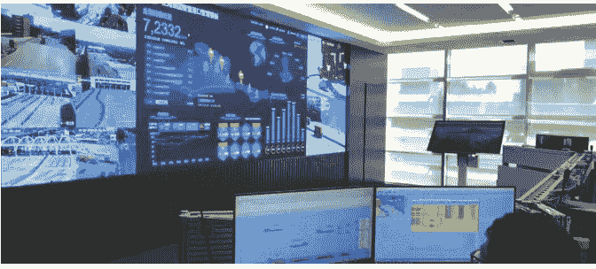

图2.4 实时交通监控系统。

#### 2.4.2 民航高度自助化

自助出行在交通的许多领域都已发展，但相对而言，在民航领域，除了安检之外，其他环节也具有高度自助性，具体如下。

- (1) 自助出行。从订票开始——乘客在智能手机上预订机票，并在前往机场途中通过手机APP查询路况、航班状态和机场动态。

- (2) 自助值机。抵达机场后，乘客首先进行值机，不再需要排长队，而是自行办理值机。例如，在浦东机场，国内航空公司在自助值机设备数量上取得了突破，过去国内航空公司统一提供的值机设备不足30台，而现在已有100台。此外，每家航空公司都有自己的企业文化和色彩特征，浦东机场还与主要航空公司的自助值机合作，提供了一些特色个性化服务——色彩更丰富，效率更高。

- (3) 自助行李托运。在传统的行李托运中，无论是起飞前还是着陆后，乘客都不知道自己的行李状态。随着大数据的普及，航空公司可以告知乘客行李信息，例如行李是否已经打包，以及离开航站楼时行李在转盘上的位置。乘客能够清晰了解这些信息，因此不再需要打扰工作人员，这大大提高了航空公司的效率。

- (4) 自助安检。机场的安检人流并不均匀。在高峰期，安检处的人数大幅增加，因此分流安检人数并快速通过安检点尤为重要。一些机场已开放自助验票服务，例如浦东机场引入了快速安检通道服务。乘客登记身份证后，即可享受无需排队的便利。在高峰期，会为乘客设置专用通道或安检区域，最大限度地节省乘客在安检上的时间。

- (5) 自助登机。在自助登机方面，海口美兰国际机场的自助登机系统于2016年正式启用，从而实现了中国机场地区首次自助登机。中国其他机场也在取得进展，例如浦东机场已在一号航站楼开放自助登机。然而，自助登机仍处于推广阶段，也出现了一些问题。由于乘客仍处于学习阶段，自助登机的效率不尽如人意；此外，还存在与自助登机相关的政策和安检规定问题，这需要随时间推移进行推广和适应。

#### 2.4.3 民航大数据可以提升服务质量

过去，乘客的出行信息、满意度和需求并未与民航服务真正融合，既无法在同一层级对接，也无法在数据分析后形成合理的解决方案。而现在，民航大数据可以在服务质量方面实现全面提升。

例如，TravelSky的Umetrip软件是中国最权威、功能最强大的民航信息服务产品，可以通过手机为用户提供全方位的民航出行信息服务，解决民航出行问题。它具有数据权威、信息及时、功能完整、覆盖全面等特点，包括全球近70万个航班的实时信息，可以根据用户信息从年度飞行记录中自动导入，同时，该软件可以清晰了解

[8] 同上。

航班延误的原因以及前一航班的执行情况。此外，该软件还可用于通过手机实现值机、机票查询、机票验证、机票余额显示、航班动态、机场信息和登机口查询、地图导航以及以相同方式寻找同行人员等功能。⁹

#### 2.4.4 民航大数据提升航空安全指数

近年来，虽然选择民航出行的人数有所增加，但许多旅客尚未养成相应习惯，暴露出中国乘客在国内和国际航空旅行中的不文明行为。这些不文明行为有时会危及其他乘客的安全。通过大数据管控，这些安全隐患可以被消除。

例如，2015年，民航局与国家旅游局就共同加强文明旅游、遏制不文明旅游行为、维护航空运输和旅游秩序达成共识。当发生不文明旅游行为时，国家旅游局将相关信息与民航局共享，民航局将依法进行处理，甚至将相关人员列入“黑名单”。如果乘客在飞行过程中扰乱航空秩序或危及他人安全，航空公司将处理该情况，并将相关信息与国家旅游局共享，以维护文明旅游环境。

此外，例如，飞机本身的航班大数据也将作为相关评估数据传递给航空公司的飞机维护人员，以帮助他们及时消除潜在安全隐患，确保飞行安全。

### 2.5 大数据运输中的货运运输

与客运相比，货运物流运输和周转也是大数据运输和智能交通的重要组成部分。此外，随着车联网和物联网的完善，货运数据变得更加有价值。

从货运运输方式来看，当前更重要的运输方式包括铁路运输、公路运输、水路运输和民航运输。这些货运运输产生的数据各不相同，但关键信息具有共同价值。

根据交通运输部2017年4月发布的《2016年交通运输行业发展统计公报》，2016年全社会完成货运量431.34亿吨。其中，全国铁路货运量为33.32亿吨，全国公路货运量为334.13亿吨，全国水路货运量为63.82亿吨（不含港口数据），民航货运量为666.9万吨（含国际航运数据）。

综合比较来看，货运运输侧重于公路运输的灵活性、便捷性以及网点密集的特点。在城市智能交通的建设和运营过程中，公路运输更为重要。在运输过程中，视频监控、交警、道路信息、控制信息、运营信息、GPS定位信息和RFID识别信息产生的日数据量可达PB级，并呈指数级增长。如何明智地利用这些数据是大数据运输货运运输的核心。

#### 2.5.1 如何提前预测货运运输

对货运司机而言，每次运输都满载返回是最具成本效益的方式。但在许多情况下，为了运输货物，总是存在空载驾驶的单程运输，这不仅造成资源浪费，还降低了货运司机的利润并增加了货运成本。如果所有需求信息都与货运数据匹配，并实现提前预测，货运司机可以合理安排自己的货运路线，确保运输满载货物。

此外，货运运输过程中也存在信息不对称。货主找不到合适的车辆运输，货运车辆找不到货源。在大数据的整合与调度下，此类情况可以得到彻底改变。

例如，市场上的“管车宝”平台致力于通过大数据解决此类问题。通过大数据整合，它可以调度全国数百万辆货运车辆，实现车辆资源的聚合与优化。在运输过程中，车辆位置可全程查询，驾驶员证件也可进行核查验证，货运运输更有保障。

#### 2.5.2 开展货运运输计划并错峰运输

货运运输在时间上具有明显的周期性和集中性特征。根据一些数据机构的统计，货运量通常从周一开始增加，周三达到高峰，然后一直到周末才下降。若将时间延长至整个月，也呈现出此类特征。若存在重大节日或重大活动，货运运输需求将非常集中。根据货运运输过程中的数据沉淀，大数据技术可以轻松制定货运运输计划。在将信息提供给车主和司机后，可指导货运参与者提前规划、错峰运输，从而减轻全国交通压力。

#### 2.5.3 货运数据可更好地服务于货运参与者

根据统计，一般而言，一辆大卡车每小时最多可行驶50公里（含装卸货），而大多数货运司机每天7:00开始工作，11:00是送货时间，2:00是高峰时间，因为大卡车受到城市交通管理规定的限制。10 对这些数据的研究与整合可以清晰地描述货运参与者的各个环节和细节。当政府管理部门和相关企业提供服务时，服务将更具针对性，提升服务质量，提高运输效率。

## 第 3 章

## 大数据运输战略蓝图

放眼世界，许多不同的国家都高度重视大数据运输的发展，尤其是欧洲、美国、日本和韩国。他们的大数据运输技术日新月异。在中国的发展进程中，只有不断借鉴先进经验、引进先进技术，才能更快更好地发展交通运输网络，提升人们出行效率，减少交通污染（见图3.1）。

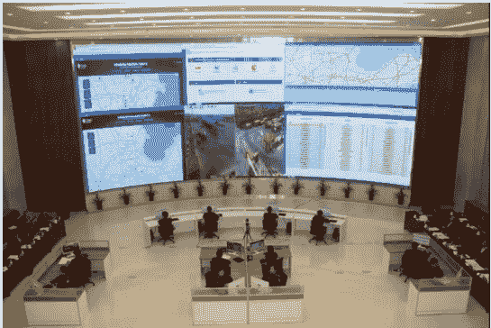

图 3.1 实时交通监控。

### 3.1 美国的大数据运输

美国的大数据运输发展较早，其技术成熟度和经验积累远超其他国家和地区。作为全球大数据应用的发源地和全球大数据发展中心，再加上美国政府对大数据应用的政策支持，以及美国完善的交通运输网络，美国的大数据运输发展引领着全球大数据运输的发展。

从发展逻辑来看，美国坚持政府指导规范、市场主导发展的理念。美国政府出台了一系列关于大数据研究和应用的政策，例如于2016年5月发布了_联邦大数据研究与开发战略计划_。这些政策从政府框架层面为企业发展大数据应用设定了规范。在相关规范到位后，企业只需在框架内推动大数据应用以实现行业融合。作为重要应用领域，大数据运输必将得到政府和市场的大力发展。

正是在政策和相关技术基础的支持下，美国的大数据运输发展呈现出一些独特特征。

#### 3.1.1 多年技术成熟与创新

在大数据运输领域，美国多年的技术积累促成了两方面的发展。一方面是交通运输网络的积累与完善。美国拥有密集的交通运输网络，以及交通领域经验丰富的基础设施和治理体系，这是大数据运输的基础。自20世纪90年代起，美国也一直在实施建立信息高速公路的计划。到现在，网络基础设施已建立健全并作为战略资产受到保护。早在2007年，沃尔玛就已建成一个存储容量超过4Pb的大型数据中心。¹

第二是大数据技术的技术精巧性与创新积累。作为世界的大数据中心，美国在大数据技术的各个领域有着悠久的融合与应用历史。此外，多年来，美国政府和企业一直致力于逐步完善大数据领域的相关规范和法规。在数据应用、信用、隐私等领域，更成熟的法律框架和伦理规范已经到位。例如，2010年，美国国会通过了一项更新的法案，以进一步提高数据采集和报告的进度和频率，使国家层面的数据采集和汇总系统更加完善。

#### 3.1.2 极度开放的数据

对于运输过程中产生的大数据，政府不仅需要数据用于交通管理和交通环境优化，更重要的是，企业也需要数据来参与运输过程的每一个环节，以便更好地制定企业发展战略、优化客户服务、开发公共服务软件等。

美国长期以来一直在实施开放政府，包括开放数据。美国最重要的开放数据平台是Data.gov，该平台启动于2009年，是美国“开放政府”承诺的关键部分。到2012年11月，Data.gov已开放了388,529份原始和地理数据，涵盖农业、气象、金融、就业、人口、教育、医疗保健、交通、能源等约50个类别，汇集了“从家庭和企业能源消耗趋势分析到实时全球地震通知，甚至包括根据好奇号火星车发回的数据查询火星天气”等内容，按原始数据、地理数据和数据工具三大类划分。为方便公众使用和分析，Data.gov平台还融入了数据分级评级、高级搜索、用户沟通及与社交网站互动等新功能。例如，Data.gov上的白宫访客搜索工具不仅可以搜索访客信息，还可以将白宫访客与Twitter等社交网站关联，进一步提高访客的透明度。2

通过向公众开放交通领域的信息，企业家和相关企业可以利用数据寻找商业机会，向公众提供更有价值的公共服务，从而让人们的生活更加便捷和高效。

#### 3.1.3 众多创新要素与完整的产业链

与人们生活密切相关的交通运输行业对自身行业有着强劲的需求。此外，作为人均车辆拥有量世界最大的国家，美国对车辆和交通运输的需求也高于其他国家。正是凭借这一市场，美国在大数据交通领域涌现出一批又一批初创企业，为美国大数据交通的发展提供了持续的创新动力。特别是，谷歌等巨头公司在大数据交通领域深耕细作，无人驾驶技术等新技术的研究与应用正是建立在此基础之上的。这些新技术进一步催生了公共出行需求，推动企业、学校和科研机构投入其中，形成了完整的产业链。

美国大数据交通有许多成功案例。让我们来看看美国空军利用大数据调度车辆的一个案例。

美国空军机队支持美国空军在天空、太空和虚拟空间执行飞行和作战任务。在世界各地的众多任务中，需要配备包括巴士、特种车辆和军用车辆在内的各种车辆车队，以完成复杂任务。

作为美国第四大联邦政府车队，拥有超过70亿美元的资产，该车队驻扎在美国及世界各地的基地。

美国国内外空军基地如同“自成一体”的城市，需要各种车辆，从汽车到除雪车，从消防车到加油车，等等。目前，已获授权使用的车辆类型超过500种。

美国空军机队由美国空军单位车辆和设备管理支援办公室管理，该办公室制定车辆法规、补贴、维护计划、优先级计划、预算等，总部位于弗吉尼亚州兰利。

该机构提供集中式车辆管理，涵盖11个主要作战司令部、307个基地，雇佣6,100名机械师，年度采购计划预算为3亿美元。作为管理机构，它提出通过持续而严格的流程再造，以最有效的方式保障行动。

其机队管理涵盖法规、预算、资产管理、维修保养、能源管理和法规制定等各个方面。

自2001年以来，美国空军一直在扩展其企业级数据仓库，主要使用Teradata Dynamic Enterprise Data Warehouse Platform 6690，现已扩展至六个节点，存储容量为95.8 T。它还协助部署了Business Objects的Informatics Power Center及相关产品。

从美国空军的数据分析演进过程来看，2007年之前，其关注点在于分析师视图，最初版本仅关注单架飞机及其维护流程。从2007年到2013年，实现了从企业视图向企业互操作性的快速演进。2009年，该解决方案通过支持添加资产查询视图，扩展到了车辆、设备和军用物资；2013年，还扩展了库存跟踪、供应和运输环节等额外的流程管理。

其中，车辆视图应用程序的核心组件分为两部分。第一部分是规划组件，包括授权和验证、预算规划以及优先级采购模型。第二部分是运营组件，包括主导视图、快速查询、保留成本、高性能以及交易请求工具。

在授权和验证方面，美国空军基地上的每一项标识都会经过验证，例如车辆类型、使用机构和使用代码，每项需求都会在3年内反复识别。工作流程也使得为了确定需求而创建问题和法规变得非常繁琐。每个基地还会生成调查问卷，预计管理人员能快速处理调查问题。这项调查的结果将作为规则处理引擎，为车辆需求计算提供洞察。

针对上述情况，美国空军进行了管理变革，例如，通过计算和比较当前库存中需要授权的车辆。针对美国空军单位车辆和设备管理支援办公室的不同用户，采取行动对申请进行批准或撤销。

从修改后的汇总分析报告可以看出，统计内容涵盖授权数量的增减、自动和手动授权的不同数量等。最终结果表明，绩效和方法带来了显著的效率提升和成本节约。据统计，美国空军在过去3年通过授权和验证总共节省了3.09亿美元！

在优先级采购模型中，它为美国空军车辆部署了替换策略算法，以高效规划来年的车辆采购，例如计算每辆车的预计生命周期、优先更换每辆车、向不同车辆类型分配资金以平衡车队、模拟假设情景下的资金调整、分析车队分配指标，以及为即将到来的财政年度生成车辆采购清单。

在具体计算中，车辆生命周期是指当维护和运营成本大于折旧价值时，即认定车辆已达到使用寿命终点。同一车辆类型的各项现有资产按优先级顺序更换。资金按车辆类型确定，每种车辆类型在类别内获得均匀的资金分配，以帮助车队的平衡分布。车辆更换资格是指用户在特定时间段（通常为3年）内计算车辆生命周期的结束，且没有车辆分配来替换它。随后计算采购数量，具体车辆的更换基于优先级分配。它还允许用户创建假设情景，以查看预算调整对模型结果的影响，例如预算增加和预算减少。良好车辆分配的一个指标是不在生命周期结束时更换车辆，而是采用结构化、逻辑化的方法来衡量未来影响。

最终结果显示，在模型第一年和车辆生命周期结构中，空军车辆的采购需求减少了150万美元。

例如，车队使用Teradata地理空间功能来计算基地之间的距离。

Teradata 的地理空间解决方案通过将地理空间信息集成到企业级数据仓库中，并利用 Teradata 强大的数据库内分析能力，为地理空间数据处理提供快速且准确的分析。同时，地理空间数据与数据仓库中其他业务数据的集成为用户带来了新的数据分析功能。

出于这个原因，美国空军机队被《政府车队杂志》（Government Fleet Magazine）评为“百佳车队”之一，荣获 2014 年“绿色车队”称号，并在过去 24 个月中获得 9 个 A4/7 年度和季度奖项、3 个 A4L 奖项以及“十大联邦车队主管”奖项。³

³ 内容引自《界面》：“解密美国空军如何利用大数据管理全球机队”，该文章已被删除和修改。

美国大数据交通的发展已逐渐完善，不仅涉及政府机构，还涉及市场企业，实现相互融合与开放。未来，大数据交通将迎来快速发展的黄金时期。

### 3.2 欧洲的大数据交通

在大数据交通的发展中，除了美国占据领先地位之外，欧洲作为一个拥有高度发达交通网络的地区，也在大数据交通方面拥有丰富经验和其独特的发展网络。此外，欧洲联盟（EU）汇集了欧洲各国，使城市交通的先进发展经验得以共享，各国的大数据交通技术得以传播。

西班牙巴塞罗那是西班牙首屈一指的智慧城市。其在大数据交通和智能交通方面的发展非常具有代表性。

在智能交通方面，巴塞罗那人出行时可以随时查看租赁自行车的可用性，就像中国人出行时可以查看公共自行车的分布一样。除了推广租赁自行车的普及，巴塞罗那还推广了免费充电站，市内拥有超过 300 个面向电动交通工具的免费充电站。

为了让人们乘坐公共交通出行更加便捷，巴塞罗那将城市公交站升级为智能公交站亭。智能公交站亭非常智能，其体现在以下方面：

- (1) 智能触控系统：智能公交站亭配备了智能触控设备，乘客在等车时可以查看相关交通信息，并使用近场通信技术和快速响应“QR”码下载与交通、出行和娱乐相关的多个应用程序。
- (2) Wi-Fi：提供充足的 Wi-Fi 连接，以及用于智能手机充电的充电端口。
- (3) 智能广告屏：智能屏幕可以根据等车乘客的性别、年龄及其他特征推送和显示不同的广告。

除了智能公交候车大厅，巴塞罗那市议会还引入了智能快速支付系统，让人们出行时可以在线支付停车费。人们只需注册相关账户并通过自助服务填写相关信息即可。停车结束后，系统可以自动扣费。在此基础上，市议会大力投资在停车位安装大量传感器，以便实时获取停车位信息。基于大数据算法，政府交通管理平台可以实时向人们推送停车信息，帮助他们快速停车，减少交通污染和浪费。

此外，还有智能交通灯。巴塞罗那市议会为盲人提供了可以随身携带的小型智能遥控设备。当盲人过马路时，当交通灯变为绿灯时，设备会发出警报，告知其安全过马路的合适时机。此外，智能交通灯还可与紧急通道配合使用。例如，如果发生火灾或交通事故，当紧急车辆通过智能交通灯时，智能交通灯可以将交通信号变为绿灯，让紧急车辆快速通过。这样一来，紧急车辆可以一路畅通至目的地。

这种智能交通对城市居民出行非常便利。盲目出行减少了，这不仅节省了人们的时间，还减少了污染。

同样，作为欧盟主要成员国，德国在大数据交通方面的行动也非常具有代表性。基于欧盟完善的空间地理基础信息框架以及德国现有传统信息产业体系的优势，德国在大数据交通等数字城市建设方面已被推向非常高的发展水平。

例如，德国城市中布设了大量传感器，可以将交通、天气和行人移动的数据传输到数据中心。数据中心会将相关信息告知市议会和道路管理局，相关政府部门会设置路灯等交通设备，使路灯亮度能够根据实际需求自动调节。

此外，在德国建设大数据交通和智慧城市的早期阶段，信息基础设施的建设是重点。其中最重要的是基础地理空间信息的建设，它是自然、社会、经济、人文和环境信息的载体，是大数据交通和智慧城市的基础。根据相关信息，德国各州法律要求所有信息系统使用各州测绘部门提供的基础地形图（官方）。地形图的坐标系在整个德国是统一的，地理空间信息的采集和存储标准以及交通网络信息的采集和存储标准也是统一的。

为了便于数据的管理、共享和使用，德国通过协调工作委员会的磋商，采用了统一的数据交换格式。从所有来源收集的数据可以通过标准数据交换软件进行交换，成为各团体和行业都可自由使用的数据格式。这样一来，大数据的共享和使用变得非常便捷，避免了在数据资源的采集、存储和使用中出现重复建设和浪费。

可以看出，欧洲在大数据建设方面拥有其独特优势，可总结如下。

#### 3.2.1 大数据交通的发展更加人性化，更有利于人民

无论是英国、法国、德国还是西班牙，欧洲国家在构建大数据交通时，始终将人们的出行需求作为主要目标。此外，政府大力投资建设相关基础设施，这不仅方便了民众，也方便了欧洲企业。政府和企业合作建设了大量大数据交通基础设施，为大数据交通的发展提供了良好的条件。

包括中国在内的许多国家和地区，在构建大数据交通过程中在标准化方面做得还不够。各地区和行政区划总是自行制定标准，导致交通大数据的采集、存储和使用分散，无法形成统一调用。即使各国通过行政手段实现统一调用，由于数据格式问题，也常常造成严重的资源浪费。特别是一些新兴国家，正处于大数据交通建设的起步阶段，如果标准化工作做不好，可能会导致大量资源浪费和重复建设。

#### 3.2.2 财务投资增加

大数据交通的建设通常需要政府协调和指导，统一制定相关政策和规范。如果允许地方行政单位或企业自行发展，往往会导致信息孤岛，即政府或企业即使拥有巨大的数据资源，也无法与其他数据资源集成，最终导致浪费。如果政府在建设早期进行大规模且统一的投资，这本可以得到有效避免。

#### 3.2.3 大数据交通建设侧重于公共交通

无论人们的出行需求多么多样，总体而言，公共交通是大多数人所需的。尤其是在智慧城市建设中，公共交通

是最重要的。公共交通领域的大数据建设不仅需要政府的大力投资，还需要政府和企业对公众进行教育，使公众也能主动参与智慧城市的建设。

作为大数据交通和智慧城市的领导者，欧洲的建设经验和成就值得我们认真研究。这样，中国的大数据交通建设可以更具特色和智能化。

### 3.3 日本的大数据交通

我们上面已经提到，早在1990年，日本的Masaichi Iguchi首先提出了智能交通系统（ITS，简称）的概念。尽管这一概念后来由美国人推广，但日本在智能交通和大数据交通的建设中从未落后。在亚洲国家中，日本在大数据交通建设方面领先于其他国家，值得学习。

2013年，日本政府发布了一份题为《创建世界一流IT国家宣言》（"Declaration on the Creation of a State-of-the-Art IT Nation"）的文件。在这份文件中，日本政府详细阐述了2013–2020年期间的国家战略，重点发展开放公共数据和大数据，并强调“大数据的应用对于增强日本的竞争力不可或缺”。这样的政府文件反映了日本政府在大数据建设和大数据交通应用方面的投资和决心。在政府的支持和监管下，大数据交通的发展自然会更加蓬勃。

日本在大数据交通建设方面在预防交通事故和保障交通安全方面表现非常出色。

20世纪90年代，日本开始推动数据交通和车联网的建设。自1995年以来，由于政府的数据交通建设，日本的交通死亡人数一直在下降。到2013年，日本的交通死亡人数已降至4,373人，这已经是一个极低的事故死亡率。

在日本，车联网的安全服务主要分为两大类，即危险信息提供和事故紧急救援。危险信息提供是指通过车对车信息交互（以下简称V2X）和移动互联网，将交通信息（如事故多发危险信息和天气状况等）发送给车辆用户。这些数据通过大数据的挖掘和分析产生，能够准确反映交通危险，并警告车辆用户注意。危险信息提供的主要目的当然是预防，使交通参与者意识到预防的重要性并能采取预防措施。

相比之下，事故紧急救援则侧重于保障时间和效率，以便在交通事故发生后，以最高效率开展救援，从而降低死亡率。例如，在丰田T-Connect的紧急救援中，当事故发生时，车辆用户可以通过HelpNet一键联系后台工作人员，并在GPS信息的辅助下，救援人员和警察会迅速抵达事故现场。当事故严重时，车联网可以直接联系后台，而无需任何人按下按钮。这样的系统能够最大限度地保护交通参与者并减少损失。

众所周知，车联网的产业链可分为汽车制造商、TSP、车载终端供应商、网络运营商等环节，其功能无非是安全、驾驶、娱乐和服务。在任何环节，都会产生海量数据，这些数据可能被政府行政部门或相关企业所需要。本田汽车公司的Internavi可以根据日本的VICS（车辆信息与通信系统）信息、本田汽车内部存储的FCD（浮动车数据）以及交通拥堵统计数据来计算拥堵路段。这些道路信息正是政府所需要的，因为结合其自身的交通系统，可以分析交通拥堵的原因并改善交通状况。通过与政府共享本田车联网的信息，政府可以减少一些重复的建设和支出。对本田而言，有了这些数据，在向用户提供信息服务时，就能精准引导他们避开拥堵路段，更快地抵达目的地。现在，许多地图导航软件和汽车公司正在合作共享信息、提升服务效率，这也能降低燃料消耗和环境污染。

根据研究，本田Internavi的环保路线服务是基于通过本田内部存储的FCD计算每条路线的燃油消耗，然后在设定的目的地进行累积，以推荐消耗最低的环保路线。例如，从横滨市到东京府中市，环保路线会多花5分钟时间，但可减少0.8升燃油消耗和17.8%的CO2排放。除此之外，车联网的B2C应用还包括车载远程控制、保养提醒和智能停车。⁴

此外，日本的车联网还会与外部数据结合使用。例如，日本VICS的实时信息主要由高速公路和干线道路上的路边设备推送，但有些路段没有路边设备，因此系统只能依赖地图上的静态信息来确定道路信息。当接入本田的FCD时，道路信息可以实时捕获。Internavi与本田FCD的结合使得车辆即使在没有路边设备的道路上行驶，也能接收到来自Internavi信息中心推送的交通信息。高速公路和干线道路也能实现同样的效果，大大扩大了智能交通的道路覆盖范围。

日本的智能交通和大数据交通建设结合了美国和欧洲的优势，形成了具有自身特色的大数据交通，如下所示。

#### 3.3.1 政府主导与统一规范

日本政府一直在大数据交通建设中充当推动者和资金提供者，发挥着积极作用。正是由于基础设施投资以及统一的规范和框架，日本的大数据交通和车联网发展才非常强劲，尤其是车联网的发展，具有自身的特色。

#### 3.3.2 汽车公司电子化程度高

作为大数据交通的重要参与者，汽车公司与美国和欧洲在市场上竞争，以进一步增强其竞争优势并不断提升自身的电子化水平。自20世纪80年代以来，丰田、本田、日产等汽车巨头一直积极与电子制造商合作，共同开发车身电子控制、车载电子信息等设备，以提升日本汽车的电子化水平。这种方式无形中为大数据交通的发展奠定了基础。有了电子设备，数据信息的采集和存储变得更加容易，在大数据交通建设中，投资可以减少，时间可以缩短。

#### 3.3.3 高度市场化

在大数据交通的发展中，一些国家和地区的政府发挥了更大的作用，而另一些国家和地区的企业则参与度更高。在日本的大数据交通发展中，汽车业巨头与电子业巨头合作，以便实现数据的即时传输和数据资源的实时调用与推送。

需要注意的是，自2007年以来，OBD2系统已被强制引入日本制造的所有汽车。该系统可以自动检测灯光、发动机、热交换器等设备中的问题故障。它还可以监测排气传感器、胎压、电动汽车电池状态，并读取车速、燃油消耗和里程等车辆数据。用户在手机上下载相应的APP后，可以实时获取车辆信息和其他信息。如果政府和企业整合这些信息，就能提供更好的服务。例如，新开放的道路会根据FCD的位置信息自动绘制在地图上，并根据紧急刹车的统计数据识别事故多发区域，通过语音提醒用户。通过将本田Internavi信息中心与日本气象协会的数据库相关联，并将FCD与实时天气信息相关联，本田对用户的服务将更加准确和个性化。

汽车企业在车联网和大数据交通的建设过程中发挥着重要作用。政府不做的事情有很多，而汽车企业为了应对竞争，无意中也做了政府不做的事情。

> 4 内容摘自《车联网带来的新机遇——从日本经验出发》，已进行删改。

#### 3.3.4 信息共享充足

日本企业和政府在共享和使用交通数据方面做得更好。企业可以与政府共享各种数据资源，政府也可以根据其收集和存储的数据资源为企业提供更好的服务，从而使企业降低数据使用成本，并在面对国际竞争时更具竞争力。

综上所述，日本的大数据交通发展起步很早，且已发展较好。随着云服务、人工智能等技术的发展，日本汽车公司在这些领域可用的数据资源将更加丰富。拥有巨大交通资源的政府与企业更加合理、充分地共享资源，将是双赢局面。

### 3.4 中国的大数据交通

中国的大数据交通发展正处于快速增长期或起步阶段。尽管中国交通网络近年来取得了巨大发展，获取、存储和使用交通信息的平台已经出现，且政府投入巨大，但仍存在许多不足。

中国大数据交通发展的优势极其明显，可从以下几个方面看出。

#### 3.4.1 发展迅速

中国经济发展的速度有目共睹。自20世纪初以来，随着网络的普及，中国的大数据交通开始迅速扩张。交通设施和路线等基础设施的增长是基础，而数据资源的高度集中生成是首要任务，数据资源的数量也在迅速扩大。根据相关统计，中国大数据交通的数据量每2年翻一番，这是一个非常令人生畏的数据增量。在交通过程中，随着卡口、电子警察、摄像头、传感器等设备数量的增加，以及互联网数据传输速度的增长，中国大数据交通领域未来将出现爆炸式发展。

例如，中国大数据中心贵阳于2016年启动了交通大数据中心。

交通大数据中心第一阶段将整合市交通委员会的内部数据，包括低碳数据中心、数据笼、公交数据、甲醇汽车数据和水上搜救六类数据的整合。第二阶段将整合横向协同数据，包括省交通厅数据、住房建设数据、气象数据、交通管制数据、城市控制数据、停车数据、铁路数据和民航数据。第三阶段将向市政府报告，协调中石化和中石油的数据，例如智能网联汽车信令数据、移动运营商手机数据以及新能源汽车数据，以实现交通要素的“一网统管”。

交通大数据中心的建成将实现公共交通的可视化和综合分析、综合调度、拥堵指数、车辆需求和建设规划。利用大数据技术对城市客运交通特征进行定量分析，探索城市交通需求热点、分布规律、特征变化等。形成交通拥堵、资源分配和执法薄弱等领域的自主预警、预知和预测，构建指导行业科学决策和智能调度的智能交通新管理模式。

未来，贵阳将基于市交通委员会的统一指挥、协调和联动调度机制，纵向连接省、市、县交通数据服务资源，横向整合水陆空港公共服务信息，形成调度、投诉和监督的“一指挥”。

贵阳将整合全国交通投诉服务热线12328和市长热线12345，形成集客运枢纽、公共交通服务、出租车投诉和执法管理，以及城市公共交通拥堵预警预测、交通服务事件监管等于一体的对外公共服务功能。将与公安和交通管制执法力量完成全面协调，并开展打击不合规行为的联合执法。还将与航空和铁路协调，在衔接运输、换乘服务等方面形成数据融合，推进贵阳综合交通枢纽的“零换乘”。⁵

#### 3.4.2 数据类型多样且数据资源丰富

中国的交通情况涵盖公路、铁路、航运等多种运输方式，将产生大量数据资源。就公路而言，城市道路、高速公路、乡村道路等路段产生大量数据资源。这些资源的主要类型包括传感器数据（位置、温度、压力、图像、速度、RFID及其他信息）、系统数据（日志、设备记录、MIBs等）、服务数据（充电信息、互联网服务及其他信息）和应用数据（制造商、能源、交通、性能、兼容性及其他信息）。因此，中国的交通数据类型繁多，数据量巨大。未来，随着人口从农村向城市转移，视频监控、卡口报警、路况信息、管控信息、运营信息、GPS定位信息和RFID识别信息等越来越多的数据将出现在交通领域。这些数据浩瀚而宝贵。

多样化的数据可以为政府部门和企业提供相应支持。例如，我们可以深度挖掘大数据交通，公安部门可以启动车辆轨迹、道路交通、案件聚类等大数据模型。基于大数据模型，可以启动车牌、车身颜色、车型、车标、款年份等特征的识别，以及遮阳板检测、安全带检测、接听电话检测和驾驶员人脸识别等分析，用于智能跟车分析、轨迹碰撞、人脸比对、舆情分析等。这种数据资源探索可以帮助政府部门逐步解决行业的深层次问题。

此外，政府部门可以利用此类大数据交通管理系统获取路面天气、施工情况和事故情况数据，结合大数据分析，还可以为驾驶员和交通管理部门提供天气、路况、事故多发地点和停车场等信息。相关服务企业可以根据车辆目的地、驾驶习惯和路况推荐驾驶路线。

#### 3.4.3 后发优势明显

美国、欧洲和日本的大数据交通技术和经验积累多年，中国可以在这些国家和地区的先进基础上发展，具有更明显的后发优势。一方面，中国政府和企业可以借鉴现有的建设经验和技术，快速转化和使用大数据交通。另一方面，政府和企业可以在此基础上进行创新和本地化。例如，作为“四新发明”之一的中国高铁，是在吸收和引进的基础上拥有自主知识产权的高铁产品。

然而，与其他国家和地区大数据交通的发展相比，中国大数据交通的发展仍存在许多问题，需要政府和企业共同面对和解决。

#### 3.4.4 综合规划不足

中国有特殊国情，各省、市、自治区的发展条件不同；因此，在大数据交通建设过程中，目前地方色彩过重。各行政区域独立发展，未形成全国统一的局面。因此，在交通数据资源的采集标准、存储标准、使用规范和共享原则方面缺乏全国统一规划。在大数据交通发展初期，情况可能蓬勃发展。然而，随着连接全国的交通网络的形成，全国范围内的交通联系越来越紧密，这导致 a

此前缺乏统一规划，成为大数据交通发展的瓶颈，容易形成信息孤岛。

#### 3.4.5 政府与行政部门职能划分导致闭环管理失效

提到交通，中国有许多行政单位，例如公安部、交通运输部和建设部。这些部门在交通管理过程中会出现沟通失误，各自为政，形成一种管理混乱，各部门都有自己的要求和标准。

如果能够借鉴欧洲和日本的大数据交通发展经验，统一协调政府部门、科研机构、企业及其他相关主体，划分各自的职责范围，并进行统一规划，各方就能充分发挥自身优势，专注于擅长的工作。例如，政府部门专注于规划、部门协调、政策研究、技术开发、标准化、市场秩序维护、质量监督、信息服务等。企业则可以集中精力开发各类尽可能便利交通参与者的公共服务产品。

#### 3.4.6 财政投入应保持平衡

政府将在构建大数据交通的过程中持续投入。然而，各地区的发展状况不同，导致政府在资本投入上无意识地侧重某些地区或某些方面。虽然此类财政投入对某些地区有益，但会导致中国无法形成统一且有价值的大数据交通网络。此外，财政投入的不平衡可能导致大数据交通领域的一些技术远远落后于其他技术，最终受制于人。

#### 3.4.7 数据资源共享不足

随着政策的变化，公安部、交通运输部、建设部及其他相关行政主管部门的数据资源正在逐步开放。然而，企业获取这些资源仍然困难。中国尚未形成统一的数据共享平台，也缺乏相关的数据资源安全保护，导致政府部门和企业都面临数据安全不足的问题。此外，政府部门和企业对共享数据资源仍心有顾虑。但是，如果无法实现信息共享，将会形成信息孤岛，即使数据资源丰富，其价值也无法体现。在这方面，我们应更多借鉴日本的经验，政府与企业应密切合作。

#### 3.4.8 行业人才缺乏

大数据交通发展迅速，但相关人才培训滞后。大数据分析和交通关键技术领域人才短缺，尤其是交通领域的关键技术人才；如果无法自行培养，将长期受制于人，限制大数据交通的发展。这些方面需要政府进行综合规划和协调。

## 第 4 章

## 大数据交通：八种创新模式

大数据交通正在全球逐步普及，在此过程中涌现出许多具有代表性的案例。无论这些创新案例成功与否，都值得政府决策者和企业家借鉴。

### 4.1 大数据交通特征 1：共享经济

虽然共享经济模式在国外发展较早，但其发展速度和创新模式是在进入中国后才得到提升的。通过移动互联网和大数据，共享经济可以合理重新分配资源，提高资源利用率，降低拥有成本。它还能减少浪费，对整个社会经济效益的提升有明显效果。

共享经济具有以下特征：

- (a) 资源要素的分配迅速高效。
- (b) 所有权发生变化，所有权与使用权分离。
- (c) 所有资源分配均基于共享平台的数据挖掘。
- (d) 每个人都可以成为共享经济的参与者。
- (e) 用户体验至关重要，参与者的行为数据在平台上展示，参与者的行为受评价机制约束。
- (f) 文化属性发生变化，个人所有权不意味着一切，只有个人使用时才能体现其真正价值。

从这些特征不难看出，无论在哪个领域，共享经济的核心价值始终是资源配置和用户体验，这都需要大数据来实现。在交通领域，在共享经济模式下有许多创业案例，其核心要素仍然是资源配置和用户体验。

据2017年1月18日《欧洲时报》报道，设计并运营巴黎自助电动汽车租赁系统（AUTOLIB’）的BOLLORE公司提交了一份财务文件，称AUTOLIB’录得1.79亿欧元的亏损。

巴黎电动汽车租赁系统于2011年10月推出，采用的是由BOLLORE集团设计和运营的BLUECARS电动汽车。如今，巴黎大都会区及巴黎郊区设有电动汽车租赁站。该服务非常受欢迎，目前拥有13万名订阅者。系统推出时，BOLLORE集团表示，当订阅者达到10万名时，该系统将实现盈利。

然而，BOLLORE集团声称AUTOLIB’的支出远超预期，经常亏损，是个无底洞。据《连环鸭报》（Le Canard enchaîné）公布的数据，BOLLORE集团提交给巴黎市政府的财务文件显示，AUTOLIB’录得1.79亿欧元的亏损。1

对于Autolib'来说，它得到了巴黎市政府的大力支持。采用了自助租赁系统，其核心要素是分析和挖掘大数据，以使市民出行尽可能便捷，并提高资源配置效率。然而，由于运营公司存在问题，最终以失败告终。

相比之下，中国的共享单车要成功得多。以摩拜（Mobike）和ofo小黄车为代表的国内共享单车曾是中国的无桩共享单车出行平台。它创造了“无桩单车共享”模式，致力于解决城市出行问题。用户只需在微信公众号或App上扫描车辆上的二维码，或直接输入相应车牌号获取解锁密码，解锁骑行，随时随地取用，或者将单车分享至ofo共享平台，获得所有ofo小黄车的终身免费使用权，实现1换N。自2015年6月推出以来，ofo小黄车已连接1000万辆共享单车，在全球20多个国家的250多个城市，为超过2亿用户提供了40多亿次出行服务。2018年10月至11月期间，ofo被北京市第一中级人民法院、北京市海淀区人民法院等多家法院列入多起案件，涉及执行超过限额的5360万元。目前，ofo共享单车品牌已退出中国市场。ofo发展迅速。自共享单车诞生以来，仅一年多时间，活跃用户规模便达到7000万，用户忠诚度也相对较高。特别是在短途出行需求方面，共享单车的使用频率非常高。

通过结合用户位置信息和单车位置信息，共享单车可以合理分配单车的分布位置，使用户能够快速找到单车。当用户使用智能手机扫码解锁单车时，智能锁会验证用户信息，然后通过智能锁与单车运营后台之间的信号连接打开。在整个骑行过程中，用户的骑行轨迹、行程、时间等数据都可以在共享单车的后台查看。这些后台大数据不仅被单车运营公司用于调度单车以满足用户需求，还用于精准营销。

根据摩拜（Mobike）发布的《2017年共享单车与城市发展白皮书》，中国共享单车的总骑行里程已超过25亿公里，相当于地球往返月球约3300次，骑行在某种程度上替代了部分私家车出行，带来了显著的“绿色效应”。共享单车的诞生使骑行出行的使用量翻了一番。在城市中，共享单车已成为公共交通（公交、地铁）和私家车的良好替代方案。在一定程度上，共享单车的使用降低了对私家车的依赖，在共享单车出现后，私家车出行的比例下降了约3.2%。

共享单车只是交通领域共享经济的一个缩影。随着共享汽车、共享摩托车、共享公交车等如雨后春笋般涌现，这些共享模式对大数据交通产生了以下影响。

- (a) 它使现有的交通运输资源重获活力，提高了资源利用率。共享汽车（如宝嘉租车）使私家车重获活力，从而提高了全社会的资源利用率（见图 4.1）。

- (b) 它提高了出行效率。例如，共享单车解决了出行“最后一公里”的问题，在短途出行中，它改变了过去非法摩托车出租车的状况，让人们自由出行，从而减少交通拥堵。

- (c) 数据分析使交通更智能、更有目标性。在共享经济下，用户使用交通工具时目的性很强，再加上大数据挖掘下的精准解决方案，使人们不再有过去出行的盲目性，交通拥堵也能得到缓解。

- (d) 共享经济模式使城市交通更智能、更环保。

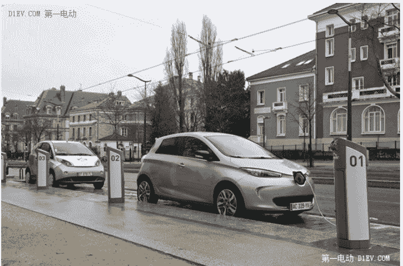

图 4.1 路边充电的电动汽车。
来源：www.DIEV.com。

### 4.2 大数据交通特征 2：充分利用资源

交通中汽车的高空载率一直是交通管理者的头疼问题。一辆五座汽车，如果坐满，五个人共用一辆车是没问题的。如果五个人各自开一辆车，路上就会多出四辆车，这些车自然会增加交通拥堵，汽车尾气也会增加污染。

允许五个人共用一辆车的模式是拼车模式或顺风车模式。滴滴出行早已提供顺风车和拼车服务。当乘客选择拼车时，一名滴滴出行司机可以同时接送几名乘客前往不同的目的地，从而减少出行所使用的交通工具数量，同时确保乘客能够正常出行，交通拥堵也大幅缓解。

据统计，2017年春节期间，滴滴顺风车服务运送了420万名乘客，这相当于在既有铁路运输能力基础上增开1909趟绿皮火车或5874辆8节编组动车组。这是去年同期运送列车数量的四倍。共有280万名车主参与了空座位共享。即使在除夕夜（1月27日22:00至次日6:00），也有7万人踏上了团圆之路。春节期间（1月28日－2月1日），跨城市顺风车主要是短途出行、探亲以及周边城市短途旅行。

就乘客人数而言，温州人最喜欢独自出行，66.3%的温州人回家路上独自搭乘顺风车。广州人最喜欢和朋友一起出行，52.11%的广州人回家时结伴搭乘顺风车。²

在拼车和顺风车模式下，闲置资源得到了最大限度的利用，这使这些模式成为缓解交通压力的有效方式。最重要的是，政府和企业通过顺风车和拼车获取人们出行的真实一手数据。基于这些数据，政府将制定交通缓解计划和决策，企业的服务也将更加精准。

² 内容引自滴滴顺风车大数据，“渤海早报：看到这个数字，人们都震惊了”。该内容已被删除和修改。

除了小汽车拼车之外，其他交通方式也尝试了拼车。例如，2017年10月，西安铁路局通过众筹方式进行了火车拼车，参与众筹的乘客在预定时间准时乘坐火车。火车更改了原定发车时间，改为乘客方便的时间。这样一来，乘客到达目的地后就不会遇到深夜无法乘坐公交车或出租车的情况。这种尝试是另一种形式的拼车，但以众筹的形式表达。如果发展成熟，许多专列可以通过拼车定制，以避免空车运行（见图 4.2）。

当然，达达巴士等公交车也有拼车和顺风车模式。无论哪种模式，平台上留下的数据都是最真实、最有价值的。正是有了这些数据的支持，大数据交通才更高效、更智能。

### 4.3 大数据交通特征 3：精准需求

精准匹配需求并提供精准服务是大数据的重要特征。在交通领域，为了实现精准，服务提供方和被服务方都必须拥有精准数据，这样需求和服务才能完美匹配。当

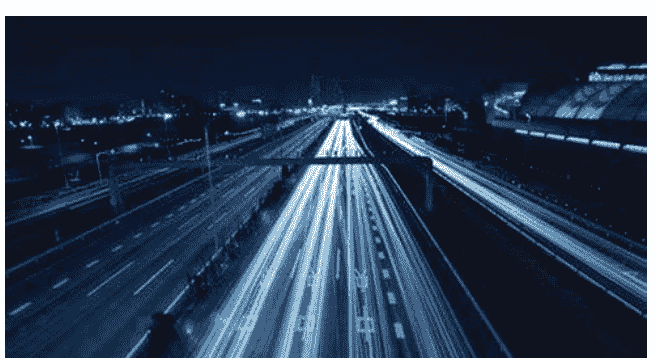

图 4.2 夜间高速公路。

数据量足够大且足够丰富时，量化的需求就会凸显出来。此时，提供精准需求服务就不再困难。

作为中国的大数据中心，贵州在交通领域的精准大数据服务方面处于领先地位。

自启动“数据笼”型大数据融合平台以来，贵阳市交通运输行政审批局逐步实现了对行政执法、行政审批、公共服务等行政权力运行平台的实时监控和全面监督。

居住区、工业园区和拥有3万人以上的学校等公共交通服务盲区是“定制公交”的重点服务区域。定制公交面向相对集中的区域招募和预留乘客，实行点对点、固定人固定座位的定制服务。

贵州黔西绿色出租车服务有限公司是中国首家获得在线预约出租车经营许可的公司，这标志着中国首个合法运营的定制出租车服务品牌诞生，为贵阳市交通数据开启了新篇章。

黔西公司采用“专业车辆和专业司机”的B2C运营模式，为每位乘客提供安全、舒适、便捷的出行体验。

下午5点，在乐湾国际附近工作的陈戴玉上公交车回家。“每个人都有座位，所以闭上眼睛放松一下，很快就到家了”，陈戴玉微笑着说。但在去年7月之前，陈戴玉准备下班坐公交车回家时，并没有如此轻松的心情。“那时等公交车非常麻烦，因为时间不确定。错过一辆车会浪费很多时间。这个地方的出租车不好打，而且价格贵，所以那时，只要我下班坐公交车，就很焦虑”。

去年7月（2015年），贵阳市北京路省立博物馆至武当乐湾国际的首条“定制公交”线路开通。许多像陈戴玉这样需要在这两个地点之间通勤的上班族感到如释重负。“定制公交开通后，准点定时发车，从家到工作地点一站直达，节省了时间，提高了工作和生活质量”。随后，贵阳市公共交通（集团）有限公司开通了四条从省政府到科学城、市行政中心到钟楼等地的“定制公交”。

此外，普通公众也开始享受“定制公交”的便利，例如2015年贵州大学城的学生也开始在周末和节假日乘坐“定制公交”。

2016年4月，大学城首班“定制公交”开通，数百名学生乘坐“定制公交”安全快速地抵达金阳汽车站和贵阳火车站。
“乘坐‘定制公交’意味着我们不用担心挤不上公交车，最终导致赶不上回家的火车”，大学生小李说。

“‘定制公共交通’是我们‘定制公交’之一，也是目前最早的试点项目。目前，从公众的反应来看，它相当可接受，并为我们下一步在全市实施‘定制公交’积累了经验”，贵阳市道路运输管理局客运处副处长刘向龙说。

刘向龙告诉记者，定制公交是公共交通的重要组成部分。基于大数据交通的民用应用，市交通运输行政主管部门建立了定制公交网络服务平台。该平台的运营监管和应用服务已纳入贵阳低碳交通信息指挥中心的整体管理。该数据中心依托贵阳数据资源中心建设，相关数据已接入贵阳市政府的数据交换和共享平台。

通过互联网和后端数据处理与分析，该平台提供市场调查、需求分析、路线推送、价格计算、班次预订、网络支付、宣传公告、乘客互动、车辆管理、团体预订和校园服务等定制公交基本功能。

贵阳市交通运输局的定制公交网络服务平台去年开始建设，目前基本完成，即将投入使用。“居住区、工业园区和拥有3万人以上的学校等公共交通服务盲区是‘定制公交’的重点服务区域。此外，‘定制公交’还可以弥补公共交通能力不足，满足群众个性化出行需求”。

该平台基于大数据和用户个人需求计算最佳路线，平均出行时间可缩短

与传统公共交通相比，通过提供“不拥挤、廉价且快速”的服务解决三大痛点，使其成为缓解高峰时段交通拥堵、改善出行体验的有效手段。

“自处理”数据推送提升了执法的精准度。

5月18日，贵阳市交通运输局第二稽查支队驾培行业专项监管员夏训贵在他的手机APP上不断收到“数据围栏”的警示信号。“原因是云岩区一家驾校的教练有一辆车在‘电子围栏’范围外停放了三天”。

夏训贵向记者表示，2015年底，贵阳市交通运输局推出了一套针对驾驶员培训的新计时系统，该系统成为该局大数据融合平台绩效效能六大子模块之一。该系统的重要功能之一是监控教练车的训练场地，通过定位系统形成“电子围栏”，可跟踪教练车的行驶状态。

“过去，我们完全无法监管城市里成千上万辆教练车。现在有了大数据融合平台，通过大数据对教练车进行实时管理变得非常便捷有效。平台发现异常后也会启动自处理和主动预警”，夏训贵说。

2016年5月19日，夏训贵来到这家驾校，核查平台预警的培训车运行情况。“这使我们的执法更加精准有效”，夏训贵说。

除了教练车越过电子围栏发出报警外，贵阳市交通运输局的大数据融合平台还可针对各类异常数据（如车辆营运权过期、评级过期）启动自处理警报。“每种异常数据都有不同的判定标准，一旦发现异常数据必须及时处理。如果在规定时间内未处理，将上报给监督人员”。

大数据融合平台还将整合相关数据，全面监控各部门的工作流程。一旦出现异常数据和不规范的流程操作，平台就会发出警报。工作人员应在三天内进行自查。如果情况没有合理解释，三天后平台会自动将异常情况推送给分管领导。如果在某个时间段内类似异常频繁发生，该局的纪检监察部门将介入调查。

贵阳市道路运输局局长金瑞表示，该局将继续沿着“信息化、数据化、自流化、集成化”的方向推广数据围栏的应用深度和广度，按照市委、市政府的工作要求建立和完善监督考核机制，推动工作取得实际成效。³

在大数据交通中，精准需求匹配包括多个方面。例如，通常可以通过大数据预先预测用户需求，从而制定相应策略并开发新产品，引导用户需求的凸显和满足。例如，通过对现有大数据的分析和预测，可以优化交通过程中的某些环节，准确发现不必要的和浪费的资源。另一个例子是，我们可以通过大数据精准发现交通过程中的风险，并精准地将信息推送给交通参与者，以避免不必要的损失（参见图4.3）。

总之，在大数据时代，准确挖掘并满足需求是最明显的特征之一。在大数据交通过程中，精准需求匹配将产生大量创业机会，使未来交通更加智能。

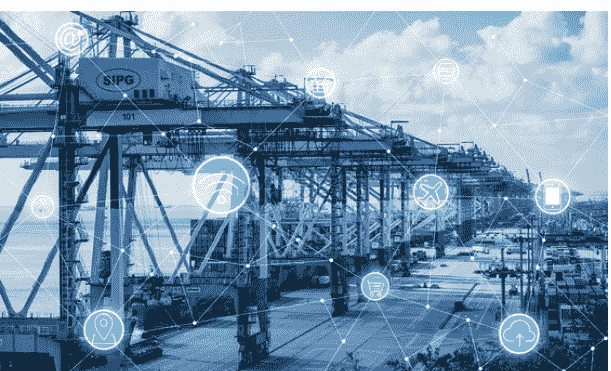

图4.3 码头起重机卸货。

### 4.4 大数据交通的特征4：实时控制

随着城市交通的逐步改善，以及移动互联网、大数据等技术的进步，人们越来越希望能够实时掌握交通信息，自由做出选择，以最合理、最有效的方式完成出行行为。

过去，无法获取实时交通信息。即使前方有交通拥堵，驾驶员也不知道。只有当他们被困在路上时，才会想到其他道路是否畅通。这种盲目的出行方式常常浪费驾驶员的时间和交通资源，造成环境污染。

在大数据以及中国和企业大力建设的智能交通大数据平台的支持下，人们在出行过程中实时掌握交通信息的愿望已经实现。

智能交通大数据可视化平台可支持集成视频监控系统、智能卡口系统、交通流量检测系统、信号控制系统等交通业务系统，实现视频监控、智能卡口分析、交通运行监控、交通信号监控等功能，帮助管理人员实时了解道路网络的运行状态和变化规律，为交通管理决策、交通规划和设计提供科学数据支持，并实现道路交通状态的远程实时监控。它还实现了日常服务与值班的可视化管理，帮助管理人员实时掌握服务人员的部署和动态，以便及时调度，并支持服务岗位分布、服务监督、服务考核等功能（参见图4.4）。

通过视频监控系统、检测系统和移动终端，实现了交通基础设施的信息化管理，帮助管理人员全面感知和监控基础设施结构状态，为交通基础设施安全管理和维护管理提供支持，提升交通运营管理水平和服务保障能力。

同时，它还可以对历史交通流量、交通违法、交通事故等数据进行分析、汇总、整合和专题分析，以实现对交通

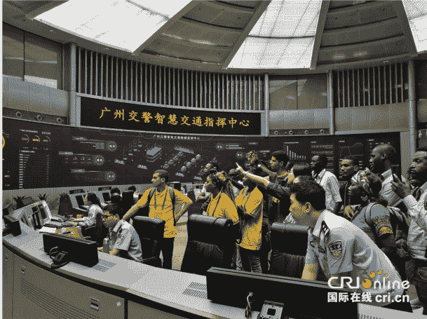

图4.4 广州交警智慧交通指挥中心。

状况的分析与判断，实现科学精细化管理的目的，并为交通管理部门在交通组织、警力部署、设备布局等方面的优化提供决策依据。⁴

总体而言，实时掌握交通信息体现在以下几个方面。

- (1) 道路交通实时掌握。许多人在驾驶过程中的首要需求是清晰掌握前方道路的交通状况。无论是交通拥堵、交通事故、道路维护还是自然灾害；在相关信息提供给驾驶员后，驾驶员将根据经验和地图软件的推荐选择自己的路线。

- (2) 随时掌握公共交通。整个社会发展的步伐越来越快，人们对时间准确性的要求越来越高。在选择公共交通时，至关重要的是

让人们准确了解公交车、地铁及其他交通工具的时刻表。

- (3) 交通安全的实时掌控。最明显的表现是，当亲人出行时，无论是乘坐火车还是飞机，人们都想了解亲人出行的实时情况。如果亲人能实时知道火车和飞机的运行状态，他们也会少一些担忧。例如，在“航班管家”APP中，有航班起飞、飞行状态、着陆等实时航班信息，一目了然。

- (4) 政府机关可以实时掌控交通状况，采取更好的措施指导交通，例如交通信号灯控制和临时交通管制。

- (5) 企业可以实时掌控交通信息，为公众提供更好的服务。例如，百度地图、高德地图等地图软件，在为旅行者提供导航服务时，必须实时掌握交通状况，否则可能会误导旅行者（参见图4.5）。

### 4.5 大数据交通特性5：效率与便利

大数据交通的优势显而易见：它帮助交通管理者高效管理交通领域的所有要素，也方便交通参与者获取交通设施。目前，政府和企业正在

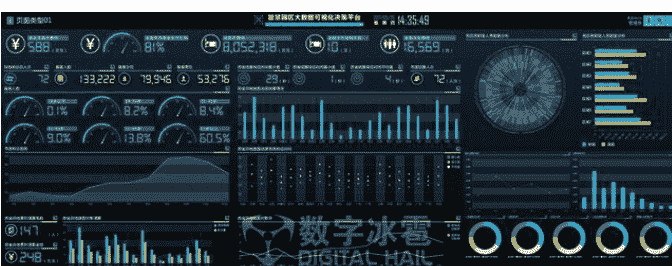

图4.5 大数据可视化决策平台。

正在开发相关的大数据交通平台。这些平台在确保交通高效运行的同时，为公众增添了许多便利。

例如，在2017年北京国际城市轨道交通展览会（UrTran）上展出的“轨道交通大数据专家系统”，是大数据交通效率与便利的一个缩影。

该系统基于烽火星空FitData大数据平台构建，利用大数据分析和车辆健康模型，对车辆设备运行健康状况进行评估，实现智能故障诊断和运营风险预警，进而达成车辆和设备的智能运维。它能够有效提升轨道交通运营企业机车及设备的健康运行管理水平，并为轨道交通运营企业机车及相关设备的安全运行提供专家级智能运维服务。

专家知识库是轨道交通大数据专家系统的一个特征。

- (1) 故障分析基于现有故障数据，通过大数据分析展示不同故障的对比数量，并计算其故障相关性。

- (2) 不同故障采用不同的故障树结构，更便于故障分析和定位。专家系统支持基于实际经验数据和机器学习技术，不断修改故障树结构，添加、修改或删除节点中的事件，并持续改进故障树。

通过使用该系统，可以有效提高设备运行可靠性，提高运维效率，降低运维成本。根据运维数据的聚类分析，为车辆设备制造商提供设计和制造改进建议。

此类大数据交通平台和系统，除了为轨道交通运营商提供相应信息、解决方案和改进建议外，更重要的是，它们保障轨道交通正常运行，确保人们能够准时、准确地出行。否则，在北京、上海、广州等一线城市，一旦轨道交通出现故障，将影响大量旅行者的正常工作和生活。如果旅行者的工作和生活受到影响，整个社会的经济发展将受到损害。因此，大数据交通的效率关系到国家和人民的许多方面。

### 4.6 大数据特性6：智能

大数据交通与智能紧密相关。当大数据交通变得更高效、便捷、自助和免费时，人们的出行将变得更加智能。

早晨起床时，你的手机或车联网会推送去往上班路上的实时交通状况，因此你可以根据实际情况提前出门或选择其他绕行路线。

当遇到交通拥堵时，路边的检测设备可以检测并报警，交通管理部门将根据数据分析选择最佳方案，确保交通拥堵得到快速解决。

发生交通事故时，车联网系统可以自动呼叫救援，保障旅行者的安全。

所谓智能，是指通过大数据分析和挖掘，交通参与各环节及其信息传输能够自主、自助进行，交通管理者能够及时响应，所有交通行为都能按既定规则有序运行。效率得到大幅提升，安全指数大幅提高。在这所有方面，大数据交通在其发展过程中已得到完美解决。

例如，为了及时获取交通数据、准确构建交通数据处理模型，为未来构建智能交通奠定良好基础，济南市政府通过大数据技术，实时控制全市4,764条车道、路口196个信号灯，实现区域自适应信号控制。若出现道路拥堵，将自动报警，并自动检测交通流量。

- (1) 依托警务“云”实时控制4,764条车道。按照“动态防御、精准指挥、一体运作、全域防控”的理念，依托警务云大数据处理技术，构建了由1,758个点组成的四道防线，4,764条车道处于实时控制之下，采用实时数据分析模式和分布式存储架构，实现城市任何检查点交通数据的实时处理、车辆运行轨迹的实时显示、历史交通数据的精准查询与比对、GIS地图上的行驶轨迹回放，以及各平台间各类警务资源的互联互通，从而在实战中取得了显著成效。

此外，济南还开发了公交优先信号控制系统以及占用黄色格线、不礼貌行人等交通管理应用系统。市区内已建成22个优先信号控制点，安装了255套公交车载抓拍和路段违章抓拍设备。每年非法占用公交车道行驶的平均车辆数超过150,000。已安装39套黄色格线占用抓拍设备和5套未礼让行人抓拍设备。通过抓拍，记录了7,574起占用黄色格线的交通违法行为和24,136起未礼让行人事件。公交车道、非机动车道占用以及抢行现象显著减少，礼让斑马线的文明驾驶行为逐渐增加，公共交通和慢行交通的空间得到有效保障。

- (2) 交通拥堵防控：若出现交通拥堵，将自动报警。济南积极推进智能视频监控系统建设，完善612路模拟视频功能，增加道路拥堵、交通流量自动检测等异常事件自动报警功能。同时，济南深化高清数字视频监控一体化应用，建成481个高清视频监控点和368个多功能电子警示，极大地提升了图像质量，实现各类动静态交通违法行为的自动采集，支持二次图像识别技术的应用扩展，形成了

城市低点和高点监测的有机结合，为日常交通管理和突发现场处置提供实时视频信号支持。

另一方面，济南深化并升级了信号控制系统升级项目，建设了便捷高效的精准交通信号控制系统和区域自适应控制系统，更新旧设备，并升级现有交通信号系统，真正实现了信号时序与交通流量变化的同步调整；建立并完善基于各级指挥中心的信号远程控制系统，实现精准、可靠、便捷的信号协调控制，减少行驶和停车延误，提升交通效率。

- 济南交警官方账号已推出三个模块和八项功能。在“互联网+”模式下，智能交通离不开面向民生、拓展交通管理服务的价值取向。“互联网+”的最终效果是深入千家万户，消除过去限制创新的环节，连接孤立的创新，让信息为公众服务。

以移动互联网技术为载体，济南公安建成了济南交警公共服务平台，涵盖APP、微信、微博等多种信息渠道，直接触达公众手机，开展交通管理业务及各类出行相关服务，全民参与共同提升城市生活质量，并已被列为今年市委市政府18件“民生实事”之一。

微信服务号已推出快速事故处理、交通管理业务、账号绑定与认证三个模块和八项功能，为公众提供快速事故处理、车辆抓拍查询、驾驶证查询等服务，粉丝总数达115,000人，认证驾驶员31,000人，绑定车辆21,000辆。公共服务APP分两期建设，目前处于内测阶段。第一期推出了个人中心、交通管理业务、信息中心等多个模块，为公众提供通知推送、出行状况、交通管理信息、业务查询与办理、周边服务、意见建议等20余项功能。第二期将在第一期基础上实现50余项功能，以扩大便民利民服务领域。⁶

通过这一系列措施，济南使城市交通更加智能，其中大数据发挥着重要作用。未来，随着交通数据的积累，交通环节中任何不足之处都可以通过数据体现出来。大数据可提供解决方案，这将有助于交通变得更加智能。

⁶内容引用自中国安防展览网，“大数据下，济南智能交通更便捷，济南受益匪浅”。内容已被删除和修改。

## 第二部分

### 应用：大数据交通的实际实施

本书第二部分讨论大数据交通的实施，即将通过大数据交通领域大企业竞争、大数据助力公共交通规划、大数据交通与物流、大数据交通的未来等案例，说明如何在各个领域引入和应用大数据交通。

本页故意留空

## 第5章

### 大数据交通的入口

近年来，“入口”已成为一个流行词，有人说如果你找到了入口，就找到了出路。更诱人地说，拥有入口者可得天下。对于大数据交通，所谓入口是最基本的价值点。通过科学地创建、管理和运营入口，大数据交通平台上的价值点可以相互连接，并推导出数据价值链，从而更好地促进大数据交通系统的效率。

### 5.1 T-union（岭南通）

2015年11月，《十三五规划》提出推动交通低碳发展，并优先发展公共交通。一些城市已引入智能公共交通系统，其中公共交通IC卡收费系统（T-union）是该系统中应用最广泛的子系统。

广东省签发的T-union（岭南通）总数已达4600万张，涵盖公共交通、地铁、出租车等公共交通领域。从地域范围来看，广州、深圳、东莞、佛山、肇庆、江门、汕尾等21个城市已实现互联互通，并与香港八达通、澳门澳门通完美对接。岭南通以统一方式规划和采集全省数据。最大日数据量超过1200万条，每条数据至少包含20个属性。包括持卡人交易时间、地点、交易类型、交易频率、发卡数据、客服数据、充值消费数据、终端记录数据、公交站点信息、线路信息等。¹

目前，交通部门签发的T-union广泛使用，每天产生大量刷卡交易。交通部门可以准确采集其记录的出行信息。因此，T-union系统的应用领域不断扩大，承载着大量交通数据，自然构成了大数据交通系统的重要入口。

#### 5.1.1 T-union数据入口的准确性

T-union系统的成熟度和普及性可以确保数据源的准确性。在北京，交通管理机构设立了专门的管理系统，可以准确统计一天内地铁的客流量，或提取一组用户的出行路线。此外，每天使用T-union乘坐公交车的人流量也可以准确统计。即使有些用户选择使用现金乘坐公交车或地铁，统计部门也可以根据比例计算一天内的人数。

从长远来看，城市居民一天的出行通常具有回归特征。具体表现为从居住地到结束居住地，使得公交站点具有特殊的对称效应。与其他数据源相比，公交T-union信息记录的居民多日出行数据，即使偶有变化，长期来看也基本相同，这也确保了公交T-union采集的数据可以准确确定乘客的出行目的地。

这种精确的采集效果，在数据后续分析中无需对乘客的下一站点进行大规模分析和判断，从而有效降低复杂度，提高效率和精度。

¹引自于虹玲、梁亮、吴家寅，“城市T-union大数据应用系统构建”。内容已被删除和修改。

#### 5.1.2 T-union入口的科学性

城市公共交通的基本数据可分为静态数据和动态数据。动态数据主要随时间实时更新，包括线路客流、站点客流、交通流量、车辆实时速度等数据。静态数据是指在一定时期内不会改变或不需要实时更新的数据，例如公交站点位置数据、每条公交线路经过的站点信息、站点间距离以及换乘站点位置信息。

通过同时采集和提供静态数据和动态数据，T-union确保所获数据的科学性和全面性，为进一步的数据保留和分析奠定良好基础。

#### 5.1.3 T-union数据的广泛应用

在广泛运营平台和海量数据的支持下，T-union数据的采集和应用呈现多元化发展态势。客流信息和运营信息的采集与分析变得更加及时、准确和广泛。

例如，由于T-union系统覆盖面广且数据时效性强，其数据结果可广泛应用。通过采集相关数据属性，公共交通部门可以计算可按时间段、路段、人群划分的出行参数，并应用甚至创建公共交通模型。

此外，利用T-union采集的数据，公共交通管理部门可以采取针对性措施，提前为不同情况制定应对方案。例如，科学分配运力、及时处理各类交通问题以及提高决策的针对性，都是典型的大数据应用。

#### 5.1.4 T-union数据采集的未来发展

利用T-union信息采集和挖掘数据具有数据量大、处理易、实时性强等优势，可为大数据交通系统建设节省大量成本。

同时，T-union的数据收集在未来发展方面仍有相当大的空间。

到目前为止，手机NFC近场支付功能在中国消费群体中尚未普及。因此，T-union的数据收集尚未与移动支付相结合。随着科学技术的发展，一旦NFC支付功能普及，T-union的数据收集能力和效果将随移动支付系统的数据收集一同提升。届时，T-union将成为一个更重要的数据入口，能够更准确地向交通管理部门输出城市居民的出行规模、相关信息及其他数据（参见图5.1）。

此外，目前，全国智能公交卡并未实现像银行卡那样的联合系统；许多城市的票价仅与路线长度相关，部分城市的公共交通仍然非常不确定。因此，随着未来城市发展新要素的加入，进一步提升T-union系统的性能，例如改进公共交通IC卡数据库的解构、建立公共交通数据仓库、整合公共交通基础信息、IC卡信息及公共交通企业运营管理信息，并实现信息融合，都能使其在大数据时代的数据入口实现中发挥重要作用。

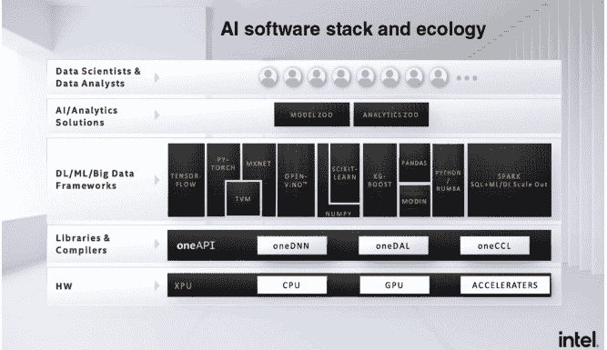

图5.1 AI软件栈与生态。

### 5.2 GPS和北斗系统

美国GPS卫星定位系统由美国国防部于1973年设计开发，并于1993年建成。其空间部分由24颗工作卫星组成。这些卫星的分布设计使得世界上任何地方、任何时间都能观测到超过四颗卫星。接收机的位置可通过定位信息的求解来确定。

1994年，中国开始建设“北斗第一代”卫星导航定位系统。预计到2020年，将建成由30多颗卫星组成、可覆盖全球的全球“北斗二代”卫星导航定位系统。其建设目标是为中国及周边地区的军事和民用用户提供陆地、海洋和空中导航定位服务。

目前，GPS和北斗系统都承担着车辆追踪、紧急援助、信息查询、出行规划等功能。此外，为了利用大数据分析交通状况，GPS和北斗系统收集的实时信息被用于整合其他交通数据并形成数据源，这也使得这两个系统成为重要的高质量数据入口。

2016年，武汉市交通管理局交通数据工作室建立了一个基于互联网的大数据交通指导系统。在该研究所大屏幕的实时数据源接入栏目中，已实现2.6亿条GPS数据。通过这些数据，可以显示城市道路从0:00到24:00的热力情况。它不仅可以实时反映当前的拥堵位置，还可以预测一小时内的拥堵路段。

在使用GPS数据源之前，一旦道路拥堵，只能通过公众报警和警方视频检查确认后现场处理。目前，基于GPS的大数据管理系统在发生拥堵时可以立即报警。通过对全市道路GPS数据的分析，交通管理系统可以更好地进行指挥调度决策，提前人工干预，有效缓解拥堵。

同样，北斗卫星定位系统也为大数据交通提供主动且充足的数据源。

2017年4月，上海浦东所有公交车均已安装北斗卫星定位芯片，每10秒向后台调度系统发送一次信号。与GPS相比，北斗卫星定位芯片采用“短信”技术，可在通信环境较差的情况下传输数据。利用实时数据，公共交通管理部门构建了智能集群调度系统。凭借这一强大的后台支持，车辆运行轨迹可通过安装在公交站牌上的接收机在站牌上实时生成，从而为乘客提供到达预测。

无论是GPS还是北斗系统，它们都具有定位精确、终端便捷、安装迅速、数据提取方便等特点。因此，GPS和北斗系统可以随时记录城市交通和人群流动的动态变化，为城市数据交通管理研究提供大量重要数据信息。与问卷和计量表等传统方法相比，该数据信息更丰富、更准确，且可直接使用。

#### 5.2.1 出租车车载系统的数据应用

出租车是城市交通不可或缺的一部分，其车速和交通密度在很大程度上可以反映道路交通状况。因此，车载GPS和北斗系统反映的出租车轨迹数据可用于分析城市交通拥堵的变化。例如，构建交通流密度模型，并利用大型出租车轨迹数据库自动确定各路段的通行能力，从而估算路段平均车速并预测交通状况及潜在交通拥堵。

由于城市交通流量的变化通常遵循特定模式，出租车司机通常会选择相对固定的路线。利用GPS和北斗系统挖掘出租车的长期运行数据，不仅可以自动识别正常轨迹，还可以及时发现和管理异常轨迹以及交通事故、主干道封闭等事件。

#### 5.2.2 城市交通的运营管理与支持

通过对车载GPS和北斗提供的数据进行进一步的统计分析，可以获得不同的指标和数据，例如行驶里程、载客行程、时空比率及分布的时空特征。这些信息不仅可用于出租车和公交车的日常管理，也可供公共交通管理部门使用，并作为出租车或公交车决策的基础。

进一步思考，如果对上述车载设备累积的数据进行挖掘，可以进一步发现数据中隐藏的规律，从而为城市交通规划和管理提供指导和决策依据，并优化城市交通。

#### 5.2.3 智能手机移动数据的应用

近年来，智能手机的使用越来越普遍。同时，智能手机配备的GPS或北斗系统也可用作目标点的交通探测器，以收集固定点的实时数据，用于预测交通流速度。

传统交通流数据收集依赖地面感应线圈获取数据，但地面感应线圈的覆盖范围小、成本高、普及率低。相比之下，交通管理部门可以与无线运营商合作，获取通话数据、短信数据、基站间的手机切换数据、手机所在基站的位置数据以及手机信息量的变化，并利用手机定位系统及时获取路段交通数据。

通过手机收集道路信息后，交通管理部门的相关机构可以通过训练统计模型来估算和预测包括旅行时间和拥堵在内的相应交通状况，从而为手机持有者乃至所有出行车辆提供便捷的出行规划服务。

此外，移动GPS或北斗系统收集的交通数据可以显示具体的运动方式。运动方式是描述人们交通行为的重要属性。通常，运动方式包括驾车、骑行、公交、地铁和步行。引入运动方式概念后，GPS或北斗系统的数据可以进一步划分为不同的运动方式，然后根据挖掘结果做出合理的管理或建议。

通过任何提供GPS或北斗功能的设备，都可以收集海量交通数据。但在大多数情况下，交通

管理部门无法直接使用这些数据。这是因为相关数据量非常大，GPS或北斗系统的单个点对全市交通管理应用的意义不大。未来，相关研究和管理机构必须从GPS和北斗系统的数据中挖掘频繁周期模式，并通过分析周期模式，找出不同地区、不同社区以及城市不同道路上居民的运动和生活规律。同时，周期模式也可以被视为交通移动轨迹的压缩。GPS和北斗系统的数据可以被周期化，同时还能节省存储和处理空间。

### 5.3 车联网

车联网的概念是基于中国的物联网提出的。2009年9月，第四届全国GPS运营商会议在深圳举行，“车联网”一词首次出现。同年11月，在上海举行的第四届RFID技术发展国际研讨会上，“车联网”的定义正式形成。

车联网是指加载在车辆上的电子标签。通过射频识别等技术，现在可从信息网络平台提取并有效利用车辆的所有属性信息、静态信息和动态信息。根据不同的功能需求，车联网将能够支持所有车辆的运行状态，实现有效监督并提供全面服务。

当然，上述定义主要是从信息技术角度提出的。随着技术和社会的发展，车联网的作用无法在其中得到充分体现。本质上，车联网的意义和价值在于收集和处理城市交通网络中每辆车的数据和信息、共享数据，以及车辆、道路与互联网之间的共同连接，从而建立一个不受视觉、天气条件和人工操作限制的交通管理系统。

以下是使用车联网获取和应用数据的典型案例：

车载自动诊断系统（OBD）最初在美国用于检测不同类型的车辆废气排放。通过该接口，我们可以读取车辆运行的各种数据，包括发动机数据、驾驶行为和燃油消耗数据、车辆安全数据等等。

在中国，一家初创公司推出了可以插入车辆OBD接口的小型硬件。该硬件通过蓝牙将汽车中的有用数据传输到手机，再通过移动互联网传输到大数据平台。通过这一通道，可以提取和传输车辆中的数据，记录燃油消耗、驾驶行为和轨迹，从而提醒有关车辆安全信息。

事实上，车联网的数据来源非常广泛，包括车内通信、车辆与道路、车辆与车辆、车辆与外部世界、车辆与人员之间的通信。如果我们全面且仔细地收集和挖掘这些数据，就能实现“人、车、路、环境”的和谐统一。

#### 5.3.1 车辆与道路设施之间的数据交换

通过构建车联网，数据交换与传统车辆与交通信号（如标志、驾驶线、限速、交通信号灯等）之间的数据传输兼容。之后，通过获取联网车辆的查询信息和导航请求，将所需数据返回给相关联网车辆。在这个闭环系统中，连接到车联网的车辆可以通过车载无线数据传输模块获取交通信号系统的数字信息，直接在车辆中显示，并将信息与车辆中的驾驶系统连接，作为驾驶员的参考信号。

#### 5.3.2 车辆互联互通的数据

通过在车辆中安装各种无线数据传输模块，不同车辆可以同时发送传统交通指示信息和数字信息。这样，相关车辆之间可以形成数据同步，不同车辆的数字信号可以同时在车辆中获取和显示，且信息可以与车辆中的驾驶系统连接和交互，这成为车辆安全驾驶的基础。

#### 5.3.3 车辆与交通管理部门之间的数据交换

车联网系统分为三部分：车载终端、云计算处理平台和数据分析平台。根据交通管理行业的要求，车联网可以有效监控和管理车辆数据。

在实际交通中，特定车辆操作通常涉及许多数据，例如开关量、传感器模拟值和CAN信号数据。当驾驶员操作车辆时，生成的车辆数据将发送回后台数据库，形成海量数据，云计算平台将实现对海量数据的“过滤和筛选”，然后数据分析平台将以报告形式处理数据，以便管理人员可以直接查看。

#### 5.3.4 车联网的数据集成服务

通过车联网获取实时数据，可以建立一个精准高效的综合交通管理和控制系统，有效连接“人、车、路、环境”。此外，根据不同的功能需求，交通管理部门将对所有车辆的运行状态进行有效的数字监督，并提供全面服务。

例如，碰撞预警、电子道路标志、交通信号灯预警、在线车辆诊断和道路湿滑检测等数据服务可用于向驾驶员提供即时警告，提高驾驶安全性；通过交通拥堵检测、路径规划、道路收费等，可以提高居民的出行效率。

随着大数据交通管理的发展，车联网作为数据入口将创造一种新的管理方式。此时，必须指导交通管理部门在车辆制造商、IT企业和消费者之间建立有效的协调机制和完整的产业链，形成行业相关技术标准，从而促进车联网行业的增长。

### 5.4 道路网络监控

道路网络监控（全称公路网络监控系统）以公路网络监控中心为指挥总部，负责协调整个道路网络的交通监控和控制，并负责整个道路网络交通监控系统的统一协调、指挥、调度、数据收集与分析以及统计报告。通过科学应用道路网络监控系统，交通管理部门可以及时获取各种数据，并对道路状况信息和道路服务水平进行统计和分析。

2017年春节期间，全国道路网络的实时路况和趋势判断在央视新闻直播间、中国交通广播、交通运输部和微信公众号等多种媒体上持续滚动。这份关于春节期间全国道路网络的运行研究和分析报告，加强了对道路网络运行的实时检测、应急响应和信息发布，体现了道路网络监控系统的重要作用。

2016年，交通运输部道路网络中心加强了与不同社会资源的合作，与交通运输部规划研究院、交通运输部公路研究院、中国交通信息中心、中国科学院和高德地图等单位共同，先后开发了公路路况运行信息管理业务系统（GIS-T综合业务系统）、全国公路网络实时路况系统、全国公路拥堵和流量趋势系统以及京沪高速公路综合路况业务系统，这些系统于2017年春节期间投入试运行。

1月28日，通过全国公路网络实时路况系统，值班道路网络监控人员发现，在北京—昆明高速公路四川省雅安—西昌段的若干路段出现拥堵，拥堵长度达到数十公里，车速低于

每小时20公里。值班人员迅速联系四川省交通运输厅进行核实和了解。查明原因后，当地道路管理人员和高速公路交警采取远程计数、定点分流、多渠道信息发布等方式加强疏导。到1月31日下午，雅安－西昌路段拥堵已缓解。

通过应用道路网络监测系统，可以及时、准确地收集道路交通的各种数据信息，对数据信息进行计算和分析，以便做出科学决策，然后通过优化控制快速实现管理意图。此外，道路网络监测系统还可以通过收集道路数据信息来支持有效信息的发布，为驾驶员提供全面的信息服务，然后引导驾驶员正确驾驶，努力维护城市交通的动态平衡。

道路网络交通监测系统主要通过以下方式实现交通数据的采集和应用：

- (1) 交通流量检测系统：许多城市已开发并使用交通流量检测系统，特别是针对城市交通状况和混合交通流量特性。此类系统采用相应的智能数字图像信息处理技术，具有技术先进、性能稳定、不对路面造成损坏、适用性强、安装和操作方便等诸多特点。

实时响应软件用于交通流量检测系统。系统在待检测车道顶部设置车辆图像信息采集摄像头。使用视频触发识别软件分析摄像头发回的数字视频信号，以确定是否有车辆通过。当车辆进入检测区域时，立即启动交通流量检测模块，系统会对每辆通过的车辆自动加一。

在很短的时间内，交通流量检测系统可以完成交通流量检测、排队长度、等待时间、车道占用率、道路信息分析和检索数据处理。这些实时数据可以与数据库中的交通流量参数进行比较，判断道路拥堵情况，并进行远程数据发布、更新、查询等处理。

此外，系统还可以按日期统计通过车辆，包括交通流量、等待时间、车道占用率等数据。数据结果可以以表格、直方图和图表的形式输出和打印，并按时传输至交通管理中心。管理部门可以根据数据采取相应措施分散交通，以满足城市交通智能管理和监控的要求。

- (2) 路况检测系统：该系统主要用于收集道路上的原始数据，主要依赖车辆探测器、检测线圈、各种通信设备等。这些设备设置在城市道路的主要位置，并安装摄像头和视频设备，以获取道路运行的实际数据。

此外，道路上的紧急信号也可以通过路边紧急电话获得。通过完善的气象信息采集系统，可以检测地面湿度、温度、能见度、风向、风速、雨雪天数等不同气象数据，为道路运营支撑能力的合理分配提供前提。同时，上述数据还可以通过电视墙、计算机和互联网以集中或单独的方式显示，可为车辆驾驶和交通管理提供参考。

此外，为了更好地实现道路网络监测的数据采集功能，需要保障野外监测的数据采集能力，即避免监测盲区。目前，野外监测分为自动模式和手动模式两种。分别采用道路环境数据、交通数据、气象数据和异常数据。

#### 5.4.1 道路网络监测的技术优势

在数据源接入方面，道路网络监测具有其独特的优势。首先，道路网络监测可以实现多参数、大规模检测。一方面，网络监测可以从视频信号中快速提取大区域内的各种交通参数，并提取其他方法难以检测的参数。另一方面，道路网络监测系统可以同时使用一个视频信号覆盖4-6条车道，并实现大区域的交通流量检测。

其次，道路网络监测可以实现多阶段检测，也就是说，它可以检测路口的交通需求及相关变量，也可以检测信号控制方案实施的具体数据，从而完成自动信号控制全过程效果的反馈。

在安装和使用方面，道路网络监测系统可以在不损坏路面或干扰正常交通的情况下完成探测器的复位。与安装在车辆上的终端相比，其使用方法更简单。更重要的是，在系统基础上，可以开发更多实用的数据采集方法。

总而言之，一个完善的道路网络交通监测系统是大数据交通系统中成熟的数据入口，其正确使用可以提高道路交通管理效率，充分发挥道路使用价值，确保交通管理，并使交通系统平稳运行。

### 5.5 电子导航地图

如果大数据交通管理系统正在改变每个人的出行和生活方式，那么电子导航在大数据交通系统中发挥着重要作用，直接关系到大数据交通系统的成败。

近年来，由于中国导航与位置服务行业规模不断扩大，电子导航地图行业迅速发展。2010年，中国电子导航地图市场规模约为11.28亿元，同比增长35.17%；2015年，中国电子导航地图市场规模攀升至36.91亿元。其中，车载电子导航地图行业规模持续扩大，保持高速增长。2015年，车载电子导航地图市场规模达到20.57亿元，年增长率为17.61%。

2016年，武汉大量出租车配备了新的车载电子导航地图系统。使用电子导航地图时，驾驶员和乘客只需在系统中设置起点和终点，即可自由选择驾驶路线。对于交通管理机构，电子导航系统具有强大的数据采集能力，配备信息屏、服务评价器、监控设备和智能顶灯，以确保全市所有出租车信息同步。管理部门可以通过GPS定位、运营、服务评价、费用、行业认证等信息，对出租车和驾驶员进行智能网络管理，大大提高效率。

本质上，电子导航地图是一种基于计算机系统的空间数据系统，具有数据内容丰富多样、数据关系复杂、信息共享等特点。同时，电子导航地图本身也是一种地理数据系统，具有地理数据系统的大部分功能。因此，电子导航地图可以通过互联网在计算机屏幕上显示数字信号（包括数字地图、遥感数字图像和采集的数字数据）和模拟信号。

事实上，由于数字制图技术的可视化功能、数据查询和分析功能、多媒体技术和虚拟现实技术相结合，电子导航地图自出现以来就赢得了交通管理部门的广泛关注。随着GPS导航、北斗导航等应用的普及，电子导航地图不断为大数据交通管理系统提供数据信息。

电子导航地图需要收集大量数据，这些数据必须通过多种综合方式获取，以确保信息全面、实时、可靠。获取数据信息的主要方式如下：

- (1) 直接数据获取与共享：对于大部分基础地理信息，各国、大多数地区和城市都已建立自己的基础地理数据信息系统。例如，中国已建立1:10000和1:2500比例尺的基础地理数据库，大多数地区和城市都有

建立了比例尺为1:500和1:200的基础地理信息数据库。

这些基础数据系统作为交通信息的重要载体，发挥了重要作用。对于这些现有数据信息，可直接用作电子导航图的数据源。整理后，可直接输入至交通管理部门的电子地图数据库中。

同时，交通管理部门还可将其他系统的数据共享至电子导航系统。例如，交通信号灯控制系统、公交调度动态变更表和车辆收费系统包含大量交通地图专题数据。若整合这些资源，在确保数据准确性和全面性的前提下，交通地图数据采集将能更好地完成。

#### (2) 结合GPS和北斗系统的数据采集：

通过电子导航图、GPS和北斗系统相结合，可以准确采集点要素的空间数据信息，例如车辆位置和交通事故位置。

由于GPS和北斗系统可提供全球覆盖、全天候免费的高精度导航与定位服务，车载接收机可将系统获得的信息与电子导航图匹配。这样一来，交通道路上车辆的具体位置数据可提交给交通管理部门。

#### (3) 与GIS智能交通监督系统的数据共享：

通过将电子导航图与GIS智能交通监督系统连接，可直接帮助交通监督组织在地图上实现以下数据操作：

- (a) 电子导航图无级放大与缩小；
- (b) 电子导航图平移与切换；
- (c) 显示模式可选；
- (d) 任意调用数十个图层；
- (e) 图形编辑；
- (f) 各类信息查询（地理目标、车辆信息等）。

例如，2009年，西安交通指挥中心的GIS系统集成了电子导航图系统，因此拥有多种地图数据操作功能，如地图漫游、地图缩放、查询地图中的场站设施以及“鹰眼”快速定位（见图5.2）。

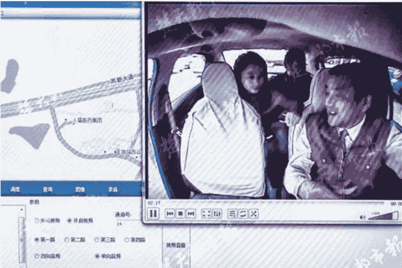

图5.2 出租车内监控图像。

来源：武汉交通网。

通过使用地图数据，系统可以显示视频设备、信号机、诱导屏、车载GPS监控终端设备、电子警察以及其他动态和静态设备的动态和静态数据，同时，可以将它们显示在GIS地图显示屏幕上。我们只需在地图上点击，即可集成详细的交通动态，并立即在计算机屏幕上显示。

电子导航图是大数据交通管理的重要入口。交通管理部门必须全面协调企业、社会、研究人员和用户，形成合力，以确保电子导航图在未来能充分发挥数据采集和挖掘的价值。

### 5.6 ETC

近年来，电子不停车收费（ETC）技术日趋成熟，大规模工业应用已得到充分发展。2007年5月1日，智能交通系统ETC国家标准正式颁布实施，ETC系统的建设和推广在全国范围内再次开展。2009年5月，北京ETC电子不停车收费系统开始运行。

在日常收费过程中，ETC系统记录车辆通行的原始数据，其中包含大量交通流量信息。因此，ETC系统具有为大数据交通系统提供统计数据和信息服务的功能。

刘二伟在北京工作多年，年初拿到了车牌号。他听朋友说，安装ETC高速返回河南老家非常方便。因此，当他买新车时，安装了ETC。

近日，刘二伟驾车与家人一起返回老家。刘二伟说，“从北京到洛阳，我们经过了四五个收费站，一次都没排队。与排长队的人工收费道相比，我们就像插上了翅膀”。

根据交通部数据，中国有像刘二伟这样安装了ETC的5000万用户。5000万意味着什么？到2016年底，中国汽车保有量达到1.94亿辆，私人汽车总数达到1.46亿辆，这意味着平均每四辆车中就有一辆安装了ETC。

到今年4月底，全国高速公路ETC用户已覆盖29个省份，主要收费站ETC车道覆盖率超过98%，日ETC交通量占高速公路交通量的30%以上。³

目前，国外ETC系统相对完善，但中国在系统渗透率、收费信息采集和服务方面仍存在较大差距。在普及率低、采集手段较少的条件下，如何利用ETC收费数据构建高速公路交通运行的数据入口，具有重要的研究和实践意义。

#### 5.6.1 车辆通行信息高效采集

通过ETC系统，可以高效获取车主个人信息、卡内余额以及车速、时间、路径等数据信息。在数据采集方面，ETC远优于摄像头监控、车牌识别、地感线圈等传统车辆信息采集方式。所采集的交通信息更加全面、准确。

此外，在海关、港口或景区等重要区域的出入口，使用ETC的车辆可直接免停车通行，为管理部门提供基础数据。对于对数据准确性和质量要求较高的道路路段，通过分析日常车辆通行记录，还可以通过数据检查是否存在异常交通运行。

#### 5.6.2 向主管部门提供分析报告

高速公路的ETC系统可以记录车主信息和收费金额，而城市中的ETC系统可以记录车主的每日驾驶时间。充分利用这些数据可以最大限度地发挥ETC的价值。

事实上，目前无论是高速公路ETC网络还是城市单一ETC，在数据采集和分析方面都有成熟的技术应用。每日ETC收费数据将存储在基础数据中，交通管理部门可以随时检索和查询，并形成分析报告。

#### 5.6.3 准确获取道路行程数据

道路行程信息是道路某一路段车辆的实际整体运行状态，包括行程时间、行驶速度等。这些数据对评估道路交通畅通程度和分析车辆延误原因至关重要。特别是在高速公路大数据管理中，道路行程数据是最有效、最有意义的信息。然而，传统的固定检测方法只能获取某一路段的交通流量信息，无法准确提供道路的整体行程数据。

使用ETC系统，可以对进出出入口车辆的时间数据进行归一化处理，计算时间差，并获取行程时间数据。通过查询道路行程，可以获得行驶速度和平均行驶速度数据。

利用这些数据，我们可以了解高速公路状况演变的特点，并制定有针对性的高速公路大数据交通管理政策。

当然，在实际应用中，由于ETC模式下高速公路上的车辆数量仅占高速公路总交通流量的一部分，因此可以通过比例观测间接计算总交通流量。

#### 5.6.4 尝试通过收费调节交通拥堵

2017年，第二代ETC系统将开始投入实际应用。与第一代ETC系统不同，第二代系统具有更快的道路与车辆信息交互速度和更全面的数据采集。第一代每次数据采集最多仅100–200字节，但升级到第二代后，数据量将激增，通信速率将达到几K/s。

有了该系统，除了常规的非停车收费功能外，数据采集还可用于通过收费来支持城市拥堵调节。

例如，在高峰期，当数据显示交通流量接近饱和时，城市交通管理部门可以下达提高通行费的指令。当交通量被低估时，车辆可免费通行。

利用ETC系统获取数据并构建大数据交通管理系统需要进一步探索和尝试。从交通管理部门内部结构的调整与优化，到数据采集和使用渠道的优化，都应实现统一。只有实现统一使用和监管，ETC系统才能在更大范围内发挥更大作用。

## 第 6 章

大数据运输平台

大数据运输系统的建设与发展离不开多平台在大数据方面的应用。从过去单一管理模块到即将到来的智慧交通平台，再到完全融入智慧城市综合管理系统……这与大数据运输的连接与共享以及对不同来源交通数据特征的理解和应用密不可分。

### 6.1 高速公路管理平台

目前，在高速公路交通管理中，大数据应用管理平台的建设正如火如荼。通过整合高速公路相关部门现有业务系统的数据资源，我们可以构建基于网络的数据库，搭建数据交换平台，建立数据丰富、技术先进、使用便捷的大数据应用管理平台。这样一来，可以促进城市和区域高速公路数据资源的统一处理、交换和共享，为整个高速公路网络提供全面的数据交换和共享保障，为管理人员和公众提供多样化的数据服务和支持。

2017年12月20日，江西省首条智能高速公路——宁都-定南高速公路建成并投入试运营。当高速公路沿线设有交通控制站时，可以实时监测交通流量。监控系统设置在关键路段的隧道和高边坡处，能够准确监测安全运行情况。此外，该高速公路还采用北斗卫星技术，整合手机警情定位和路况预测功能，以实现交通事故的快速处置。

作为江西省首条智能旅游公路，省道和郊万公路的路面重建工程最近已完成。该高速公路配备了车辆弯道监测与预警、道路结冰预警和自动除冰功能。

随着高速公路建设的快速发展和路网规模的不断扩大，有必要进一步打破高速公路管理的障碍。管理组织应站在整个路网的角度，重视数据资源的利用，构建数据丰富、技术先进、使用便捷的数据管理平台，促进高速公路数据资源的统一处理、交换和共享。

#### 6.1.1 高速公路大数据管理需求定义

只有需求明确，才能有明确的目标。要建立高速公路大数据管理平台，其需求点主要集中在以下几个方面：

- (1) **信息共享目的。** 整理高速公路交通信息中的基础数据和通用数据，形成统一的共享标准，以支持不同的业务应用。

- (2) **信息汇总目的。** 对高速公路交通管理中产生的业务数据进行汇总，以实现管理组织中上下级业务管理的透明化和科学性。

- (3) 信息挖掘目的。利用大数据管理平台发现不同信息数据之间的管理关系，以实现数据的深度应用，提升管理系统的功能和效率。

#### 6.1.2 平台总体框架设计

高速公路管理平台由四个部分组成：

- (1) 基础设施层包含两个部分。一是支持必要的基础设施，二是整合基础设施。其中包括可纳入管理平台的路段子中心设备和业务接口设备，以及连接这些设备的光纤或网络。

- (2) 数据资源层。在此层级，利用云计算技术整合分布式物理资源，形成统一的数据资源。通过分布式数据库，实现硬件资源和数据资源的整合。

  在此层级，数据资源分为三类：基础数据、业务数据和视频数据。前两类存储在数据库中，视频数据以文件形式存储。

- (3) 支撑平台层。此层级涵盖支撑底层资源和上层应用的软件模块，包括应用管理平台软件、分发管理软件和业务流程软件。此外，还包括相关系统环境软件。

- (4) 该层面面向最终用户，主要基于支撑平台层应用于特定的管理业务。

#### 6.1.3 系统数据流设计

在整个高速公路管理平台中，系统数据流分为四个层级：数据源、数据处理、数据应用和数据展示。经过这些层级，一方面，可以实现数字信息资源的整合，形成一系列基础数据库和业务数据库。另一方面，对这些数据库进行分析和挖掘，形成综合应用，并以不同方式呈现给用户。

#### 6.1.4 数据接口系统设计

高速公路管理平台作为不同数据信息的集中展示平台，其核心作用需要通过接口系统体现。接口系统应确保该平台与其他业务系统（包括路政管理系统、收费系统、呼叫中心系统、ETC系统、设备检测系统、交通调度站交通检测系统、视频监控系统等）的顺畅连接。

具体接口功能模块如下：

- (1) 组网数据的外部接口主要方便第三方平台检索高速公路大数据管理平台的基础数据。

- (2) 路政管理系统接口模块可通过区域高速公路综合路政管理平台获取区域高速公路的事故信息、施工信息和隐患信息。

- (3) 收费系统接口模块可获取总交通量、ETC交通量、客货车分类、历年总交通量等数据信息。

- (4) 设备监控系统接口模块主要从设备监控系统获取收费系统设备和交通调度站设备的工作状态。

- (5) 视频监控系统接口模块主要获取全区域高速公路的监控视频。

- (6) 气象系统接口模块用于接收区域气象数据和信息。

当然，高速公路数据管理平台仍存在许多问题。例如，系统建设各自为政，形成信息孤岛，信息资源未共享，旅客无法获取交通信息等。无论在数据采集还是数据分析与应用方面，其数据处理和应用能力都有待提升。

有理由相信，在不久的将来，随着众多部门和企业的共同努力，跨部门协作和跨系统集成的局面将更加显著。随着高速公路管理平台运营质量的提高，大数据交通管理将为公众创造良好的出行体验。

### 6.2 交通事故检测平台

交通事故每天都在发生，这不仅威胁旅行者的人身和财产安全，还会造成交通拥堵和道路交通状况恶化，导致交通事故进一步增加。

因此，有必要加强城市交通事故检测平台的建设，它不仅能及时处理交通事故，还能更好地利用大数据技术，减少损失，避免拥堵，确保城市交通网络畅通。

杭州新城隧道已建立起完善的事故检测平台系统。在隧道内，每100米设置一台监控摄像头，可实现全过程无缝监控。这些视频监控系统基于事故检测平台系统的延伸应用。因此，现场无需增设设备。只需从交通管理控制室CCTV监控系统的分配器引出一个视频信号，并连接到事故检测器。

事故检测器处理后，平台可及时向中央计算机系统提供相应的交通检测数据和事故告警信号。因此，平台可以自动检测包括车辆停驶、交通拥堵、车辆逆行、超速、物体掉落、交通事故及其他事件在内的各种交通事故。此外，平台可在短时间内检测到火灾和交通延误，以便为交通管理中心监控人员提供准确信息，采取有效措施处理突发事件，避免更大损失。

交通事故检测平台是指利用各种设备协同工作，收集高速公路上的事件数据。一旦发现数据信息，也就是说事故发生，平台将自动报警并确定事故地点。

#### 6.2.1 事故检测平台的设计

一个完整的自动交通事故检测平台应包含硬件和软件。硬件包括交通流量探测器、通信设施以及用于数据处理的中央计算机；软件包括用于事故检测的数据采集、处理及数据算法。

#### 6.2.2 事故检测平台的运行模式

目前，事故检测平台更有效的运行模式如下：

- (1) 查找突变数据信息。交通事故发生后，平台获取的交通数据会出现突变，主要体现在交通流量、占有率和车速方面。

  例如，由于交通事故的发生，可能导致道路通行能力急剧下降并形成交通瓶颈。通过对路段交通流量急剧减少的实时检测，可以计算出交通事故的位置。

  交通事故发生后，会导致车辆行驶缓慢，从而使探测器的占有率突然增加。此外，交通事故的发生会导致交通拥堵，从而使相邻探测器检测到的车速突然降低。通过获取和分析上述数据，可以解释道路上的异常交通状况，从而测量和计算交通事故。

- (2) 查找偏离正常值的数据。检测平台获取的数据信息与过去该地点和该时段的历史信息偏差较大，这也表明在该时段和该地点的道路上发生了交通事故。

  例如，探测器检测到的交通流量数据远小于历史平均值，表明探测器上游或下游可能发生交通事故。探测器检测到的占有率远大于之前的历史数据，表明探测器下游存在交通事故。探测器检测到的车速远小于历史数据，表明探测器下游可能发生交通事故。

突变数据检测和偏离正常值的数据检测是交通事故检测平台的重要运行模式。在平台的实际运行中，仅一两个数据变化无法确定交通事故，需要结合不同类型的数据变化来判断。

#### 6.2.3 交通事故位置

交通事故位置不能仅根据路段探测器提供的数据来确定。在综合数据信息后，检测系统可以判断交通事故发生在路段的上游还是下游，但无法确定距离路段的距离。

因此，事故监测平台需要整合高速公路上相邻路段探测器获取的数据，以确定交通事故的具体位置。

事实上，交通事故发生后，上游探测器和下游探测器收集的数据不同。利用这一特征，检测平台可以按以下方式确定交通事故路段的位置：

- (1) 上游探测器的数据。当交通事故发生时，事故发生地点路段的通行能力会突然下降，形成交通瓶颈，从而导致事故发生地点上游发生交通拥堵。因此，探测器检测到的交通数据将具有以下特征：车速降低、占有率增加、交通流量减少。利用这三个数据特征，交通事故监测平台可以判断交通事故位置位于监测位置路段的下游。

- (2) 下游探测器。当交通事故发生时，下游探测器检测到的交通数字信息的变化与上游探测器检测到的不同。一般来说，下游探测器检测到的交通流量数字信息的变化具有以下三个特征：车速增加、占有率降低、交通流量减少。

  车速增加是由于交通事故发生在探测器上游路段后，探测器上游路段的通行能力下降，导致下游交通密度降低。因此，车速自然会显著增加。当车速增加时，下游探测器路段获得的流量份额或事故发生车道上的流量份额将显著减少。同样，下游探测器路段获得的交通流量数据也将显著减少。

总之，通过充分利用数据功能并收集和检测交通数据信息，我们可以诊断道路上的交通状况，并及时发现交通事故的时间和地点。

### 6.3 客流检测平台

交通运营的客流数据是交通规划、设计和运营管理的重要数据库。利用客流检测平台对城市交通运营的客流数据进行科学统计分析，可以为交通运营评估提供依据，协助和支持管理部门和运营单位制定相应计划，同时也为公共交通的规划和设计提供数据支持。

2017年4月，重庆交通行政执法总队发布消息称，重庆市第一套综合交通执法闭环管理系统在重庆北站正式启用。该系统不仅可以实时监测通过车辆数量，还可以反映北站的运输能力需求。

系统新增的四台鹰眼全景摄像头可实现北广场地面监控90%的覆盖率。50余台监控摄像头分别安装在北站一楼、乘客出口等处，以实现北站地下监控的覆盖。通过监控视频，可以了解现场的实时情况。

该系统可以实时反映通过车辆数量。鹰眼监控将清晰发现人群主要聚集地点，尤其是在春节和国庆节假期的交通流量高峰期。它可以实时反映北站的运力需求，从而及时调配运力，确保乘客疏散。

客流监测平台的运行结果是交通运营和客流数据分析的重要依据。根据乘客和车辆进入及离开某区域的位置和时间数据，可以分析客流的时空规律，以反映实际客流需求。

此外，交通运营管理者还需要依赖客流监测平台来了解、分析和控制异常情况下的交通客流动态情况，例如特殊天气条件、节假日以及演唱会和体育赛事等大型活动中的客流变化规律。

让我们以地铁客流检测平台为例，来演示其大数据应用。

#### 6.3.1 客流检测平台的设计

客流检测平台的功能是监测当前客流数量，获取准确的客流数据并进行分析，以实现客流的动态化和网络化管理控制，进而实现对客流的全面控制。只有当客流检测平台能够充分且科学地收集和使用大数据时，才能帮助交通管理部门人性化地疏导客流，从而有效应对大客流高峰并提高运营效率。

一个成熟的客流检测平台由四部分组成：

- (1) 客流监测模块。在此模块中，各区域的乘客数量和流向将实时获取，

并将客流动态监控与各种监控技术相结合，以最大限度地提高客流数据采集的准确性。

- (2) **控制决策模型。** 根据客流检测模块获得的数据，生成不同的控制决策方案。该模型的建立取决于最大化运营效率和乘客安全的客流控制指数。

- (3) **仿真模块。** 根据客流实时数据，计算客流疏散所需时间，以检验决策方案的有效性。经过多次仿真，获得最佳决策方案并存储在检测平台中。

- (4) **辅助决策显示与信息发布软件模块。** 它向管理与控制人员展示平台检测形成的结果和控制决策方案，并以不同方式引导客流。

#### 6.3.2 关键节点客流监控

在地铁站及其他大型客运站中，客流过程和路线被称为“流线”。以入口为例，从入口、安检设备到直达入口（或购买临时单程票），再到楼梯、自动扶梯和地铁车辆，均属于典型的进站流线。出口客流则相反。

通过监控每个节点，获取并分析数据，平台可以计算车站内客流的动态分布。

具体而言，可划分为非付费区、付费区和站台区三个区域。在区域连接的关键节点，平台使用适合该位置客流特征的监控手段采集数据。

在安检闸机处，可使用红外线设备采用双向红外线技术检测客流。目前，绝大多数安检闸机设备具备相关技术功能。客流检测平台可开发接口，将安检闸机数据记录库与中央计算机平台相连接，从而将客流统计数据传输至决策平台进行处理。

在闸机处，利用闸机数据进行统计。在原有闸机数据库中，可开发数据调用端口，进而将闸机记录的乘客数量传输至检测平台进行处理和分析。

此外，站台与站厅之间楼梯入口处可采用视频识别与计数，站台区可采用电磁感应技术，等等。

利用不同节点和多种技术检测客流大数据。充分考虑客流流线数据的特点和规律。充分利用各种技术手段的优势。将不同来源的数据集中到同一平台。这种客流检测与控制决策平台能够有效减轻人员工作量，提高交通管理与运营服务水平，并降低事故发生概率。未来，客流检测系统可与其他平台有效集成并广泛应用，前景广阔。

### 6.4 交通执法平台

近年来，随着信息技术的飞速发展，不同执法部门建立了各自的执法平台。然而，由于中国城市交通管理系统的行业划分以及部门职能重叠，这些执法平台仍存在相对局限性。结合大数据交通管理模式的构建，交通执法平台的统一已迫在眉睫。

事实上，在交通执法过程中，还需要与公安、交警等部门的信息互联互通。其中，交通、道路和行政执法需要核实管理对象提供信息的真实性，这需要与公安、交警等部门的执法数据进行核对。同样，公安和交警部门也拥有大量交通视频信息。如果能有效连接到统一的执法平台，这些视频信息也可作为交通、道路和行政执法工作的有力证据。

2016年4月，上海静安分局率先开展交通违规监控智能识别设备的试点应用，形成了“系统智能采集+人工筛选”的交通违法查处新模式。随后，通过16个区县的共同努力，该技术在上海全市推广。

该系统主要由四部分组成：前端采集设备、后端识别、数据传输与交换以及数据接口，整合了道路前端收集的图像监控信息，如电子警察、公安检查站和高清探头。该平台利用大数据分析技术，对高清监控设备采集的交通违法视频数据进行智能识别和分析，并根据技术标准形成车辆违法数据。最后，经公安和交警部门审核后，对违法车辆进行处理，实现交通违法的实时检测和实时告警处理。

在交通执法平台上，有效利用大数据技术可及时发现执法对象的违法行为和位置，从而增强执法工作的针对性并提高执法效率。同时，还可及时统计执法人员的执法行为，减少随意执法行为，全面分析各种执法指标，提升执法工作的科学决策水平。

#### 6.4.1 交通执法平台数据云中心

构建交通执法平台必须建立数据云中心。云中心技术用于整合道路行政管理、交通行政管理、出租车等交通行业的基础数据信息，包括人员信息、车辆信息、户籍信息等。此外，还包括执法业务系统信息、高速公路路口、客运站周边、货源分布中心、检查站等关键区域的视频信息。同时，整合公安和交警的相关视频信息及车辆信息，构建交通执法大数据云中心。

在云中心，可以充分利用大数据技术的特点，如海量存储和快速计算，实现交通运输执法信息资源的互换、共享及挖掘分析，从而支持不同的应用系统。

#### 6.4.2 交通综合执法协调系统

在该平台上，道路行政管理、交通行政管理、出租车、养路和驾培的审计与执法业务系统得到整合，交通管理、道路、出租车、养路和驾培的执法信息也得到整合。通过各执法部门基础数据和信息的共享与互联，实现了各部门执法与案件处理的协调。

此外，该平台还可利用大数据技术，对与交通运输执法案件相关的重点区域监控视频和车辆基础信息进行深入挖掘与分析。例如，通过分析案件的区域分布、增长趋势、高发地点、涉案车辆来源及其他违法行为，可以发现数据背后的分布规律。通过监控区域视频，可以获取更高频、更具规律性的车辆数据，为执法人员开展精准执法提供支持。通过分析特定时间段内多次违法车辆的数据，应建立侧重监控的执法体系。

#### 6.4.3 交通执法信息服务系统

该系统可通过网站、大屏幕、微博、微信公众号和手机APP等多种手段进行宣传，以公布与交通执法案件相关的信息。使用该系统，不同部门可以查询案件信息和执法人员，还可以实现公众对不规范执法行为的线上投诉和举报，从而提高交通执法的信息透明度（见图6.1）。

此外，通过该系统，我们可以主动推送和交换违法数据信息，并将其与出租车、公共交通及其他企业管理人员共享，以实现执法与企业管理的协调。

无论是交警、路政，还是交通运输管理和出租车，在交通执法过程中，都需要与其他部门的数据进行交互。因此，利用大数据技术建立统一、全面的交通执法平台并整合业务数据已刻不容缓。

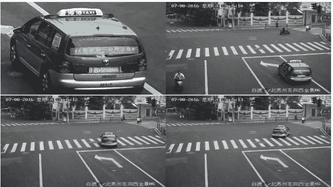

图 6.1 智能交通监控系统。

来源：安全网站，上海首个智能交通监控系统。

### 6.5 物流信息平台

随着移动互联网技术的不断完善和大数据时代的到来，社会生活和消费模式发生了巨大变化。利用现代大数据运输管理技术可以降低企业运营成本，提高企业生产和运营效率。因此，物流信息平台必须与大数据信息技术有效结合，使物流管理的创新能力提升到更高阶段。

京东商城自主研发的“青龙”大数据物流运营平台可以在系统前端收集客户信息，而后端则对应公司的物流部门和第三方物流公司。“青龙”平台利用深度神经网络和地图区域划分等大数据技术实现自动货物分拣系统，以确保客户在最短时间内收到货物。

阿里巴巴集团的菜鸟驿站也建立了类似的物流信息平台。在该平台上，通过使用大数据技术进行深入调查和规划，以确定驿站的具体位置和数量。

使用类似的大数据物流信息平台可以确保物流服务提供商和用户的经济效益，也能让客户更方便地寄件和取件。

#### 6.5.1 利用大数据改进物流信息平台的运行功能

利用大数据技术，物流信息平台的管理和控制系统发生了巨大变化。其中，最突出的创新是预警功能。

在物流运营过程中，材料的接收、存储、运输、分发、维护和管理都离不开物流信息的收集和处理。在平台上使用大数据技术可以有效提高市场需求预测的准确性，还可以对产品库存和运输状态发出预警。

例如，如果某件产品在仓库存放超过一段时间，大数据技术可以发挥作用并在物流信息平台上发送预警信号。这样，相关岗位的员工可以及时处理。

此外，引入大数据技术还可以帮助企业和交通管理部门共享数据，并实时关注运输车辆的运输状态。例如，一旦车辆遇到交通事故或部件损坏，就可以及时发现，从而及时消除潜在的安全隐患。

因此，利用大数据技术改进物流信息平台的运行功能可以有效提高物流运营效率，并提升物流带来的经济效益。

#### 6.5.2 增强利用大数据信息的能力

在与大数据进行数据整合的过程中，物流信息平台需要发现和收集与物流业务相关的数据。这包括客户对产品订单数量、产品库存、最佳运输路线、包装、分发等相关数据信息的要求。

其中，收集这些大数据信息是实现物流信息平台高效运行的前提，数据信息必须科学、及时、完整。同时，大数据时代的数据不仅海量，而且不断变化。因此，物流信息平台不仅应通过增加传统信息存储设备的数量来扩大信息存储空间，还应依赖网络存储系统、虚拟存储技术和虚拟数据存储系统。

在计算和分析过程中，物流信息平台应通过使用一体机数据库、数据集市等商业大数据分析工具来实现。这样，数据和信息可以得到科学处理和分析，以确保它们可以作为可用的数据和信息资源。

#### 6.5.3 提高物流信息平台的安全级别

我们必须注意到，物流行业是黑客主要关注的行业之一，数据信息泄露显然会给物流企业和客户带来损失风险。因此，在大数据运输环境下，物流信息平台必须注意以下几个方面的数据信息保护：

- (1) 大数据信息的集中存储必然会增加被盗窃的风险；
- (2) 由于大数据的海量存储特性，内部必然存在大量无效数据，可能导致制作恶意错误信息的风险；
- (3) 大数据物流信息平台的数据信息来源广泛，因此需要扩大安全保护范围。

针对上述问题，物流信息平台可以改进安全保护系统的技术，实现数据信息的有效筛选、分散存储和分类管理，从而更好地保护物流信息平台的安全。

在大数据运输环境下，物流信息平台的建立和建设需要进一步的研究和分析。我们不仅应充分寻找大数据技术与传统物流管理的结合点，还应解决类似运营技术不完善、大数据应用不广泛或安全保护系统等问题。

可以合理地相信，当物流信息平台充分利用大数据技术时，物流行业的管理水平将能够实现新的飞跃。

### 6.6 应急指挥平台

大数据运输时代的到来为政府应急管理带来了多重意义。一方面，在交通应急指挥中，管理部门必须从平台上不同来源的数据中去伪存真，并从多个角度验证数据的全面性和可信度，这导致应急指挥平台收集和处理大数据的复杂性。另一方面，大数据的应用也为应急指挥平台的管理带来了良好的前景。

2016年1月6日，潍坊交通应急指挥中心正式投入使用。该应急指挥系统不仅实现了城市关键交通场所的视频集成，还整合了出租车信息调度管理系统和道路运输车辆动态管理系统，并实现了与公安机关的互联互通。该平台可用于监督车站安检是否正常，以及公众在出租车上丢失物品时是否需要查询车辆轨迹。4

在应急指挥平台上，主管部门可以通过卫星、传感器、视频监控、移动通信、射频识别设备、社交媒体等方式持续接收与交通相关的数据。通过对这些数据的摄入、分析、分发和功能应用，可以将其转化为有意义且有价值的危机管理信息。

因此，在危机情况下，交通主管部门可以适当地管理、建模、共享和转换大数据，以便以传统情况下无法想象的方式做出紧急决策。

4 据潍坊晚报2016年1月7日报道。

#### 6.6.1 紧急平台的大数据共享

在大数据时代，大数据信息的集成与共享已成为紧急平台系统建设最基本的要求。管理部门应主动变革，打破原有的数据分离和封锁，开放信息。在此基础上，基于大数据技术构建紧急平台系统，可以提高不同政府机构和部门的效率。

关于紧急平台系统的建设，技术体系可以基于大数据技术构建，包括有线通信、无线通信、移动指挥通信、移动互联网技术和大数据应用软件，这些技术具有不同的功能，如有线通信调度、无线通信指挥、移动应急指挥和远程会商。通过政府内网、外网和互联网，我们可以为交通紧急情况的公共安全应急管理构建一个统一的信息平台。这样一来，交通管理部门连同公安、水务、地铁、电力、供热、燃气供应以及其他企事业单位，可以获取全面的城市运行监测数据，为制定科学的应急指挥和决策提供重要支持。

#### 6.6.2 云应急系统

在大数据时代，云计算技术是不可或缺的 IT 基础。紧急平台应基于云计算技术建立云应急系统，为应急部门提供智能应急服务。

具体到交通紧急信息平台，云应急系统应能够收集实时交通紧急情况的现场感知数据、历史数据和决策支持模型。这些数据通过标准化接口无缝集成，实现快速全面的挖掘和提取，并实现云应急平台上信息和数据的综合集成。根据不同的应急需求和不同部门的服务性质，形成应急指挥协作网络。

#### 6.6.3 移动监测与应急响应应用

在发生自然灾害、交通事故或当地监控设备难以工作的情况下，交通监控中心可以依靠应急指挥平台，快速了解现场情况，进行客观分析和救援处置。

基于大数据技术，移动监测与应急响应的具体方案如下：

- (1) 移动平台迅速调至现场开展工作。包括开通卫星信道、将视频电话系统与远程紧急指挥中心连接，并将现场信息实时返回检测中心。
- (2) 使用网站、微博、微信、短信等互联网渠道作为载体，及时发布紧急路况、天气预警提醒和绕行建议。
- (3) 根据移动平台人员的报告，应急指挥平台人员应利用事故周边可用的监控设备，密切关注周边交通流量变化，并在发现或接收到相关异常情况后立即向上级监管部门报告相关情况。
- (4) 应急指挥平台人员在接收各类现场数据后，应及时收集和整理，以研究未来的发展趋势。通过数据共享，他们应协调路政、交警、收费部门与其他部门，开展救援或交通疏导，并做好流量平衡控制，以便第一时间制止所有潜在的灾害事件。

应急指挥平台在改进大数据运输监管手段、提高应急响应效率、加强交通管理和控制以及促进各部门联动方面发挥着不可替代的作用。加强大数据的运营可以提升应急指挥平台的工作水平，从而提高交通管理部门的运营和管理水平。

本页故意留空

## 第 7 章

## 大数据运输与物流

作为贸易大国，中国的物流应用越来越广泛，这对中国的经济增长和发展起到了积极推动作用。作为一项战略产业，物流受到社会各界的广泛关注，大数据运输的到来可以为物流信息提供丰富而有效的实用信息。为了使物流行业获得更好的发展，研究物流与大数据运输之间关系的建立和构建非常重要。

### 7.1 大数据运输与运输组织

物流运输组织包括一系列运输活动，例如运输的调查与预测、运输计划的制定、运输车辆和船舶的分配、客货车站的组织、运输车辆调度与路线优化、运输过程的跟踪、定位与监控，以及多式联运的协调。

信息运输的组织离不开大数据运输技术的应用，该技术渗透到运输生产的各个方面，包括电子技术、网络技术和通信技术的应用，并以不同的软硬件形式存在。

2017 年 12 月，CCTV1 重点报道了京东的无人机配送，这促使许多人更加关注新的运输组织体系。

目前，京东已建成世界首个无人机运行与调度中心。通过大数据技术，监控大屏幕上可以清晰看到每架无人机的坐标位置和飞行参数。通过监控航线和订单数据，工作人员可以确保货物按照系统设定的航程飞抵目的地。

通过由大数据支持的无人机运输服务，运送普通生活必需品原本需要两三个小时，而现在只需大约 20 分钟。

利用大数据运输技术，我们可以充分提高物流效率，帮助企业解决问题，并通过优化运输组织来扩大推广空间。

具体来说，大数据运输技术对运输组织的影响体现在以下几点：

#### 7.1.1 运输环境预测

过去，物流企业习惯通过过去经验、问卷调查或事前联系来预测运输环境，例如寻找货源、设计最佳路线和了解交通变化。但实际上，当调查结果汇总时，运输环境很可能已经发生变化。

与过去相比，大数据可以帮助物流企业通过真实有效的数据全面准确地勾勒运输环境并反映环境变化，从而对产品运输的各个阶段进行预测。这样一来，运输组织者可以合理制定运输计划。

#### 7.1.2 运输节点位置

在运输组织中，运输节点选址问题要求物流企业在充分考虑自身业务特性、商品特性和交通状况的基础上，尽量降低配送成本。该问题可以通过大数据技术中的分类树方法来解决。

#### 7.1.3 运输路线优化

在运输组织中，物流企业可以利用大数据分析商品的规格和特点以及客户在时间和金钱方面的不同需求，然后利用最快响应准确反映这些影响运输计划的因素，例如选择哪种运输方案、采用哪种运输成本模式、选择哪种运输路线等。这样，就可以制定出最合理的运输路线。

同时，物流企业可以通过分发过程接收到的实时数据快速分析运输路线的交通情况，以便对可能影响运输路线的情况进行预警，准确分析运输过程的信息，使运输配送管理更加智能化。

#### 7.1.4 货位优化

合理安排商品的货位对提高运输路线管理效率具有重大意义。对于商品数量大、配送频率高的运输路线，货位优化能带来直接的工作效率和经济收益。

事实上，可以通过大数据关联模式方法分析哪些商品可以以恒定速度放在一起以提高分拣率，哪些商品存储时间短且运输要求高，从而获得运输过程中商品之间的数据关联关系，以便更合理地安排运输位置。

现代物流与传统物流最本质的区别在于运输组织。现代物流离不开大数据及其他信息技术的支持，这体现在系统化、信息化、网络化和智能化的运输组织中。

目前，由于计算机应用较少、大数据应用意识较薄弱、员工素质较低等原因，中国的物流企业尚未将运输组织与包装、储存、流通加工、配送和信息处理等功能充分融合。因此，重视大数据在运输组织中的作用，以提高物流管理决策水平，具有重要意义。

### 7.2 大数据运输与农村物流

与城市物流相比，农村物流的运输环节更多。农村物流通常分三个步骤进行：仓库点检、区域运输和最后一公里配送。事实上，在绝大多数农村地区，除了最后一公里配送外，其他物流步骤与城市配送相似。最后一公里配送已成为决定物流效率的最关键步骤。

2016年5月底，在第3届中国县域电商峰会上，菜鸟网络农村物流负责人熊剑表示，菜鸟网络正利用数据系统组织全国快递和物流公司的运输能力，并在农村地区建立更密集、更深入的配送网络。通过农村末端物流网络，超过30%的农村包裹可以当天从县区送达农村地区，近70%的包裹也能次日送达村庄。菜鸟网络已在全国建立了覆盖320多个县区和近16,000个农村服务站的农村末端网络。

由于收货人地址不明确、路径规划不符合实际以及农村物流中偶然因素过多，物流中经常出现错发、多发等现象，导致配送成本增加、收货人满意度下降等问题。针对农村电商物流“最后一公里”配送问题，许多物流公司尝试使用各种特殊形式的配送，但未能有效提高效率。

鉴于此，我们必须引入大数据运输技术，正确分析农村物流的区域分布状况和收货人的生活条件，提出有针对性的方法，以有效解决农村物流问题。

#### 7.2.1 运输服务创新

大数据的收集、整理、分析和应用可以有效整合农村物流的社会运输能力，从而提高效率、降低成本。农村物流资源整合的关键在于建立专门的物流信息平台，这可以通过以下两种模式实现。

大型企业应牵头建立专门的农村物流信息平台并负责运营。当其他物流企业或个人使用该平台时，其产生的每笔业务和发货数据都会被记录。通过对大量数据的分析，农村地区的消费习惯、信用记录、地址准确性、路径可信度等信息将被记录和显示，以便为后续客户选择提供有效依据。

应建立专门的运输能力生态系统。通过为农村货车安装GPS设备，物流公司可能拥有数千辆车辆的数据。虽然这些车辆在功能和车型上各不相同，但它们可以构成农村物流能力的基础。此外，大型物流企业还可以建立私有信息平台，掌握并整合自身信息，从而提供个性化和专业化的物流信息服务。当上述平台相互连接时，可以形成覆盖特定区域农村市场的物流能力系统。例如，面对农村市场时，如果企业的私有运输能力不足，可以从社会运输能力中获取。同样，社会运输能力也可以根据自身特点主动为有需要的企业服务。尤其在大数据技术的作用下，车辆和货源可以确保信息及时可靠，有利于农村市场货物交易的最后一公里。

#### 7.2.2 解决“最后一公里”运输能力不足问题

使用大数据可以解决农村物流配送最后一公里运输能力不足的问题。物流企业可以开发面向公众、农村工人、学生、基层政府人员或长途货运司机、出租车司机等人的开放式信息系统，通过其移动应用程序承担物流配送任务。这样，企业可以获得“临时运输能力”并有效管理，从而减轻自身运输能力的负荷。

这种基于大数据的众包模式特别适合在人口众多的农村和山区推广。当然，面对如此大量的移动物流运输资源管理，我们必须具备大数据技术的海量数据处理能力才能完成。

#### 7.2.3 加快农村物流信息网络建设

大数据技术在农村物流领域的应用离不开强大的农村物流信息网络。这项任务不能由单一企业完成，必须由相关政府部门协调并逐步完成。

一方面，有必要建立和完善农产品信息中心，建立响应迅速的农产品信息网络，并确保大数据能够及时发现和传输。特别是在整个农村信息网络仍在建设的情况下，必须进一步完善农产品大数据收集的基础设施。

另一方面，有必要培训农村物流专业人才。通过企业、政府部门和科研机构之间的合作，利用各种教育资源，通过不同形式和层次的培训，提高物流服务人员和管理人员的质量意识和行业意识，利用信息技术全面提升农村地区大数据信息服务水平，以满足农村物流服务的人才需求。

### 7.3 大数据运输与城市配送

目前，中国城市物流缺乏整体系统规划，城市物流配送路线混乱。此外，城市交通限制、交通拥堵和多样化的客户需求导致

在这个阶段，城市物流效率相对较低。幸运的是，随着互联网和信息技术的快速发展，大数据运输将能够改变传统的城市物流行业。

12月16日上午，义乌市首个公共物流信息平台“顿达配送”正式投入运营。顿达配送是由义乌顿达供应链管理有限公司独立开发的城市公共物流信息平台。该平台支持在线下单、在线接单、在线结算、在线查询等功能，实现从配送到签收的全过程信息管理。它实现了配送车辆的统一管控，运行轨迹清晰，充分保障了货物配送的及时性和安全性。同时，它还合理纳入社会车辆，实现共享配送，提高车辆利用率和真实载重率。

城市物流缺乏整体规划，会导致不同企业的物流设施重复投资和巨大浪费，并限制资源的有效利用和整合。同时，各物流企业出于自身利益，自信地规划物流中心和配送路线，且不共享物流数据，因此无法在宏观运输层面形成最优配送系统。此外，移动互联网的发展也使城市物流客户的需求趋向于定制化。许多客户希望能够从多个方面和角度随时掌握物流信息，控制所有环节。

面对这些情况，应当从以下视角运用大数据技术来解决问题。

#### 7.3.1 政府牵头建立城市物流资源共享平台

在主管政府部门的领导下，将建设城市物流资源共享平台。政府应当有效配置本地物流资源，并在城市配送过程中对其进行监控。这样一来，不仅可以实现地方经济增长，还可以充分利用物流配送中获得的大数据，实现城市物流乃至更多行业的综合规划与管理。当然，对于政府而言，直接寻求城市物流企业的合作并完成物流大数据的提取、收集和管理，是一个相当具挑战性的目标。

#### 7.3.2 行业联盟构建共享平台

在政府的领导下，可以建立涉及物流公司和企业的城市物流配送行业联盟。这是因为物流行业企业可以掌握城市物流的第一手信息，而行业联盟可以构建信息资源共享平台，从而解决物流大数据的资源问题。同时，行业联盟将所有数据和信息存储在同一数据库中，以便物流地点之间即时共享和信息交换，避免交通拥堵、物流运营紊乱、客户满意度低等问题。

#### 7.3.3 重视城市物流和存储平台建设

为了建立城市配送资源共享平台，有必要利用大数据支持城市物流存储平台。城市物流存储平台是影响城市配送效率的重要因素，其基础包括存储中心、调度中心、结算中心等。通过该平台，可以对所有配送渠道进行全面分析，包括人力资源、物力资源、物流方向、配送速度和配送成本，从而计算出最佳位置和配送方案并优化资源（参见图7.1）。

总之，解决城市配送问题的最佳方式是：聚焦由政府部门主导、物流企业参与、专业公司提供技术支持的大数据运输技术，并构建一个城市配送信息共享平台。

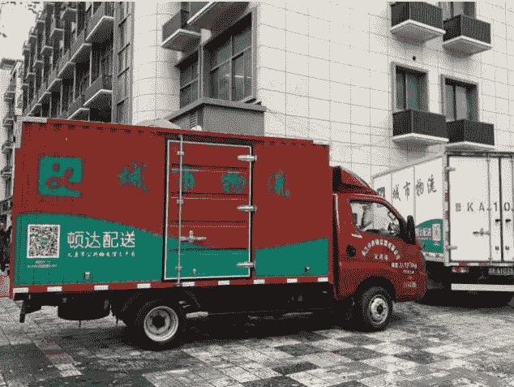

图7.1 物流卡车。

### 7.4 大数据运输与快递物流

目前，快递物流已经进入人们生活的每个角落。毫不夸张地说，很多时候，一次快递的质量都会影响我们的生活体验。面对电商行业的不断升级，快递物流企业也需要主动转型升级，利用大数据技术从同质化竞争走向多元化竞争。

2017年5月31日，顺丰与阿里旗下菜鸟网络的互联网冲突被公开。菜鸟发布声明称，收到了顺丰关于暂停蜂巢数据接口的通知。随后，顺丰先后关闭了面向菜鸟的蜂巢自营柜数据接口以及淘宝平台全包裹的回传物流信息。6月1日，阿里巴巴宣布建议商家暂停使用顺丰寄件。

然而，顺丰发布的声明截然不同。5月，菜鸟出于数据安全考虑停止了与蜂巢的合作，并于6月1日0点下线了蜂巢接口信息，随后阿里巴巴集团平台从物流选项中移除了顺丰。

电商和快递行业的巨头为何会围绕数据产生如此冲突？事实上，商业矛盾的爆发反映出，中国快递物流企业很可能依托大数据运输时代数据资源的价值，完成行业内外的整合与提升。

事实上，尽管中国快递服务企业的业务量在迅速增长，但在表面一片大好的形势下，却存在着不可避免的危机。由于竞争模式从规模战争转向价格战争，加上人力成本居高不下且快递业务的毛利率开始急剧下降，同时还面临着来自电商领域的跨界企业（如京东、苏宁）的竞争。因此，快递公司必须尽快利用大数据资源配置来扩大竞争力并提升市场影响力。

#### 7.4.1 快递物流中的电子面单应用

电子面单是一种高效、环保的信息面单。与传统快递的三联单和四联单不同，电子面单由电脑打印，带有二维码标志，背面带有胶水，易于粘贴和撕除。

借助电子面单，快递系统可以在亿万件包裹中轻松识别、处理和投递单个包裹。通过电子面单支持的数据流，企业自身的电子面单系统可以自动连接寄件人、快递公司、消费者以及主干线和支干线的所有数据信息。根据所连接的海量大数据，企业可以优化快递环节。

目前，大多数主流国内快递公司已完成电子面单的普及，这表明大数据技术已成为快递物流企业的标准配置。

#### 7.4.2 大数据路由分拣的应用

大数据路由分拣可以通过对海量地址的大数据分析，结合互联网地图的空间定位技术，直接完成包裹与网点的精准匹配。目前，该技术的应用准确率超过98%，随着各快递物流公司大数据的不断积淀，准确率很快将接近100%。

在采用该技术之前，来自全国各地的大量包裹必须先集中到企业的分拣中心，然后根据寄送地址进行分类，再分发到下一个网点。在这个过程中，流水线上会有大量分拣员。他们必须查看包裹上的地址信息，然后凭记忆判断包裹下一个将到达哪个网点。借助大数据路由分拣技术，分拣速度可缩短至每单1-2秒，仓库分拣效率得到大幅提升。

目前，大数据路由计算可以确保订单生成后，能够尽快显示到配送网点。该技术的普及可以帮助快递公司预测网点的配送量。

此外，根据大数据路由计算生成的四级地址库，快递公司可以第一时间将消费者的配送地址匹配到结构化的乡镇和街道。凭借这些结构化地址信息，快递公司可以准确定位收件和寄件地址，从而为快递员提供更精准的配送和路线规划。

#### 7.4.3 意外情况管理的大数据技术

快递公司大部分运营压力来自意外情况。其中，最糟糕的意外情况包括无法正常投递的异常包裹以及配送压力激增的时期。

逾期异常包裹是指超过48小时仍未投递的快递包裹。通过大数据技术，可以对这些包裹和订单数据进行有效筛选，从而帮助快递物流公司及时了解产生了多少逾期异常包裹、哪个网点问题最严重。通过订单数据，我们可以及时了解原因，从而有针对性地开始改进。

包裹量暴增通常集中在电子商务消费高峰期，如节日、双十一和双十二。通过物流预警系统，可以利用大数据提前预测包裹量，以指导电子商务商家做好仓储配送准备，并帮助快递公司分配有限的运力资源。

除上述应用外，快递大数据技术还可以帮助电商公司控制网购的最终流程。通过对物流订单流通数据的全过程监控，电商平台管理人员可以获取数据，识别“刷单”和“购买好评”等虚假订单，从而实现对商家的有效管理。

目前，大数据已在快递业务中广泛应用。未来，随着大数据运输环境的日益成熟，该技术将越来越充分地渗透到快递业务的各个环节，成为快递物流行业的重要组成部分。

### 7.5 大数据运输与冷链物流

随着物流行业的不断发展，以及科学技术的持续进步和制冷技术的快速增长，以冷冻技术为基础、以制冷技术为手段的冷链物流日益受到市场重视。随着物质生活的不断丰富和消费者对食品安全的日益关注，冷链物流被广泛应用于农产品、肉类等产品的配送。

另一方面，中国目前的冷链物流体系尚未完全发展。在物流配送过程中，高损耗率和低流通率问题尚未完全解决。如何将大数据技术应用于冷链物流，实现冷链物流一体化，从而发展和壮大冷链物流行业，已成为一项紧迫任务。

2016年9月10日，中国冷链物流智能云平台在镇江正式启用，标志着国内首个基于大数据和物联网技术、集在线展示交易、冷链物流订单、冷链物流仓储等功能于一体的冷链物流智能云平台投入市场运营。

智能云平台可以实现冷链物流的智能监控、在线订单匹配和在线订单交易。该平台将有效整合行业上下游信息，实现冷链运输的全过程监控。浙江数据监控中心可以24小时监控冷链运输的温度、湿度、GPS位置等信息。一旦运输过程中出现异常，它将第一时间接收报警并第一时间进行人工干预，从而大大提高了冷链运输的安全性。

目前，许多中小型冷链物流企业独立运营，业务模式相对分散，产品和物流信息不畅通，信息传输更加受阻。与发达国家相比，中国在冷链物流领域应用大数据技术的水平相对较低，仍处于初级阶段。

具体来说，缺乏数据采集和系统是冷链物流中大数据技术应用的一大严重问题。此外，冷链物流运输的农产品数据在市场和政府部门中相对独立，高度依赖传统人工操作，缺乏自动采集方法和手段，因此数据的准确性、客观性和时效性不强。

因此，有必要推动大数据运输技术与冷链物流行业的结合，使物流企业、冷链产品供应商、消费者和政府监管者能够通过大数据查看运输信息、产品信息、消费者信息和天气信息。

具体方法如下：

- (1) **利用大数据技术建立冷链产品可追溯系统。** 冷链运输的大部分产品属于广义的农产品，包括鲜活产品、水果蔬菜、农作物等。冷链行业有必要建立信息追溯大数据平台，利用物联网技术采集数据源，并建立智能追溯系统。这样一来，可以形成完整的智能信息追溯网络，确保冷链产品在运输过程中的质量与安全。

例如，冷链产品应配备位置数据、制造商数据、生产周期数据、交付数据等。这样，可以利用大数据对冷链产品的流通进行全过程管理。

- (2) 利用大数据技术全面协调冷链物流与运输。

目前，许多地区已采用物联网、GPS、智能车载终端等监控技术，通过移动端和大数据处理全面提升冷链物流效率。

例如，建立车辆身份和认证系统可以降低冷链配送中心和第三方物流公司的运营风险。另一个例子是实现冷链配送车辆的全过程可视化监控，从车辆运行速度、产品状态到驾驶路线和驾驶员状态，实现全过程可视化监控，从而实现车辆的合理分配、管理与监督。

更重要的是，冷链物流运输系统可以通过GPS实时监控车辆，确保检查车辆是否有冒烟，温度和湿度是否符合产品储存和运输要求。通过智能车载系统，还可以将冷藏车的文件和图纸等技术参数实时传输到企业监控中心。无论是产品消费者还是企业，都可以通过互联网查看相关参数。

- (3) 保障后台运营策略的及时准确调整。

及时引入大数据可以确保冷链物流企业在研究策略时随时获得集成的实时数据，并通过非结构化数据的查询和处理获得准确、快速的查询。

同时，在冷链物流行业中，最重要的特征是时效性保障。由于冷链物流配送产品的特殊性，如产品来源不均匀、各类产品典型的季节性以及生产的高峰年和低谷年，冷链物流企业的成本和风险大大增加。利用大数据技术，可以通过现有数据分布规律调整冷链物流企业的运营策略，并从内外两方面给予支持。此外，企业可以及时获取最需要的数据，以制定需要准确的部署计划，包括获取维护成本、故障频率、运营路线等。

现有冷链物流企业融合云计算、大数据、移动互联网等技术用于冷链物流，已成为不可逆转的趋势。可以肯定的是，大数据技术在冷链物流中的应用拥有无限的发展潜力。大数据运输服务与冷链物流将共同迈向广阔的发展前景。

### 7.6 大数据运输与多式联运

多式联运是指两种或两种以上运输方式相互衔接、中转完成的物流运输过程。随着国民经济的发展，蓬勃发展的多式联运是“十三五”时期综合交通运输发展的关键工作。从战略角度看，这是中国推动交通运输供给侧结构性改革的重要切入点。从企业角度看，这是降低物流成本的有效方式。

在多式联运发展战略创新过程中，目前，各地区已共同呈现出向大数据运输迈出的重要一跃。

2017年5月19日，郑州机场国际物流多式联运数据交易服务平台正式启用。该平台的启用实现了国内公路、铁路、海港等运输方式与国际航空及海外陆运整个运输链条的信息共享

transportation and ensured the formation of information linkage in Zhengzhou Airport, free trade test zone, bonded park, and other areas.

在政府方面，郑州相关部门表示将提供一站式信息服务，实现物流企业的信息服务“一站式”。此外，他们将依托领军骨干企业，构建涉及多式联运企业的互联网数据交互平台，以持续释放大数据资源红利。

在多式联运过程中，构建大数据平台相当于为多式联运所有参与者植入“中枢神经”。在已建并应用的多式联运一体化信息平台上，大数据运输技术已建立预订信息平台、箱管理信息系统和公路物流系统等分支系统，可实现车辆、箱和货物的全程信息监控。

#### 7.6.1 铁路供应链中大数据的应用空间

铁路货物运输在多式联运中发挥着重要作用。大数据技术对铁路供应链转型的支持也需要拓展更多空间。事实上，互联网、大数据、云计算等科学技术手段可以使铁路货物运输凭借其原有优势找到新的改进机遇。

目前，铁路货物运输在多式联运中仅扮演承运人的角色，其吸引客户的优势在于运费低廉，但距离终端客户较远。铁路货物运输利用其他物流运输渠道的能力不足，无法与公路、水路和航空运输的资源顺畅共享数据。

因此，铁路货物运输必须掌握如何利用大数据优势，并通过有效推动集装箱多式联运构建自身独特的数据资产。然后，根据多式联运的运作模式，实现上下游物流企业的数据共享与集成，完成跨界融合。最终，可以实现大数据资源的有效转化。

#### 7.6.2 多式联运路线的优化与调度

在多式联运物流配送过程中，企业最关注的是产品质量和运输速度。为确保产品质量并降低运输成本，企业必须持续优化和调度路线。

通过多式联运车辆内部的感应系统，在装卸产品时，车载系统可将产品传感器的数据信息上传至服务器。服务器接收数据后，可实时分析车辆和产品信息，并根据实际运输能力、客户偏好和配送路线数据进行动态计算，从而获得最新的最优路线。随着数据积累和技术进步，可结合GPS定位系统和交通状况进行实时更新。

从宏观角度看，远程控制系统还可通过大数据分析获取多式联运过程中的剩余配送时间，从而及时通知客户提货。由于多式联运是一个连续过程，环节断裂容易导致整个系统失效。因此，必须利用大数据实现从制造商到客户的整体联动，将损坏率降至最低，将等待时间最小化，节省物流公司成本，提高配送效率。

#### 7.6.3 大数据推动集装箱多式联运的改进

标准化集装箱是多式联运的基本单元和运作基础。然而，在中国公路运输和铁路运输中，集装箱利用率较低，限制了多式联运的发展。

针对集装箱多式联运当前面临的困难，集装箱单元细分能够采用更小尺寸且适用于小型配送车辆的运输标准。相应的管理也必须利用大数据提高效率。在集装箱多式联运的新模式中，大数据、传感器、云计算等技术手段可实时采集、获取和分析大量信息，并通过各种通信终端平台实现新集装箱中的配置平衡。这样，可大幅降低设备建设和运营的高成本，并提高多式联运业务的占比。

通过大数据技术的应用，多式联运流程可持续优化。未来，将能够实现货代、报关企业、铁路、港口和监管场站等多式联运箱管理参与者的关键数据和信息同平台互联，从而实现全流程电子化作业和所有环节的实时跟踪，提升整体物流效率。

### 7.7 大数据运输与跨境物流

在全球化背景下，跨境电商蓬勃发展。然而，由于跨境物流中存在海关监管等环节，加之不同国家的政策、法律环境、营商环境、文化环境、支付方式、税收政策及汇率体制各异，跨境物流的复杂性显著增加。

鉴于此，跨境物流融入大数据运输系统的关键性已变得迫在眉睫。

2017年12月20日，“共享仓库”跨境生态服务平台正式上线。该平台可为跨境物流海外仓出口提供专属服务。在跨境物流和清关服务领域，该平台利用大数据、云服务、互联网等新型服务技术，挖掘海外物流仓储等闲置资源，构建跨境物流共享经济模式。

通过“共享仓库”服务，外贸企业可实现跨境物流上下游企业之间的数据互联与共享互动，从而解决中国跨境出口企业面临的物流瓶颈。

事实上，跨境物流的运输和信息流已实现实时联网。跨境物流模式各具特点，因此数据碎片化现象始终存在。此外，跨境物流的个性化需求日益增长。快速、高效、安全且个性化的跨境物流方案离不开大数据、物联网和云计算的结合。

以下是跨境物流未来可通过大数据技术获得的推广方向：

- (1) **建立统一的跨境物流大数据平台。**

  目前，急需形成统一的跨境物流大数据平台。该平台由政府部门牵头，开发并整合企业资源，形成第四方物流服务，构建智能化跨境物流，这是解决该问题的重要方案。

  例如，2017年12月26日，在中国-缅甸边境经贸会议上，东南亚智能物流大数据中心建设正式宣布启动，这反映了未来的发展方向。

  在新的跨境物流大数据平台上，应以整个服务链为平台整合各类资源，从而提供跨境物流数据信息和增值数据服务链解决方案。

- (2) **建立跨境物流大数据信息中心。**

  目前，中国正在与周边国家和地区发展经贸交流。在此过程中，货物的生产、储存和运输产生了大规模数据。其中，数据种类繁多、数据与模型之间的管理不确定性、物流对象的多样性以及更先进的数据采集、分析和处理工具，都是传统技术无法完全应对的特征。因此，建立跨境物流大数据信息中心，必须着重捕获、清洗、整合、筛选和更新各国和地区物流合作各阶段和各环节的数据，然后利用数据挖掘技术挖掘数据中的潜在信息，从而实现

数据的增值价值。最后，结果应以可视化方式呈现，以便为提升跨境物流服务质量提供准确指导。

#### (3) 构建大数据跨国物流系统

跨境大数据信息中心的建设是实现大数据跨国物流系统的第一步。基于大数据技术的智能物流系统可以使在线信息与离线物流相互融合，实现联动发展。

首先，应通过大数据中的数字化和可视化技术，提高跨境物流过程中物流信息识别的准确性。

其次，应利用大数据根据所服务客户预期的物流需求和条件，确定需要配置的物流资源，从而为跨境物流规划更高效的一站式解决方案。

第三，应充分利用大数据技术、GPS系统和地理信息系统（GIS）的有效组合，准确获取物流过程中货物位置的实时信息。此外，通过使用RFID技术，可以实时采集不同时间点、不同地点的货物状态。上述数据和信息将与客户同步共享，以便调整和优化实时物流计划。

应注意的是，跨境物流存在一些风险。对于使用自有物流的跨境企业，当产品进入当地市场时，可能不再受欢迎且难以销售。这样一来，将产品运回本国将耗费巨大成本，因此只能销毁。但借助大数据分析，企业可以有效整合大数据，分析全球商品需求和货运信息，并通过数据分析结果判断产品投放的市场。例如，大数据技术可以通过整合客户的点击、浏览、偏好、评价和购买数据来分析区域的产品偏好，从而指导物流运作。

#### (4) 提高海外仓利用率

仓储管理和利用效率是影响物流服务水平的重要因素。许多跨境物流企业因缺乏数据保障，在海外仓利用方面处于被动地位。事实上，设立海外仓的决策依据取决于大数据分析。企业必须根据自身业务规模、贸易地经济状况、物流订单等数据进行系统分析，并通过直接结果判断是租赁还是自建海外仓。随后，根据贸易地经济状况、消费者数量、交通网络成熟度等数据，选择最佳位置。

在海外仓智能管理方面，大数据技术可以通过数据挖掘和分析整合海外仓分散且广泛的数据资源，从而构建互联网和大数据技术统一协调管理的物流模式。通过数据分析，实现海外仓货物的综合分类，并实现货物从仓储、分拣、配送到信息查询的全过程集成。

大数据运输技术的应用为跨境物流提供了一种新的服务模式。借助此类服务，跨境物流可以从传统物流向现代物流和生态物流转变，摆脱过去的经验思维，建立数据思维，提升核心竞争力。

### 7.8 大数据运输与航空物流

航空物流是指以航空运输为主要运输方式，实现货物从供应地到收货地的高效、有效流通和存储，以满足客户需求。航空物流的优势在于多功能和综合集成服务。该物流模式的应用可以有机结合运输、仓储、装卸、加工、分拣、配送和信息等资源，从而形成完整的物流供应链。

因此，国内航空物流货运量以平均每年26.8%的速度增长，中国已成为全球航空物流发展潜力最大的地区。这一状况也为航空物流与大数据运输技术的结合提供了更多空间。

2017年1月1日凌晨1点，上海国际机场有限公司总经理袁顺洲宣布，由上海浦东国际机场与VariFlight联合开发的“浦东准点”机场协同决策系统（A-CDM）已上线。

随着该系统的上线，浦东机场的运营已正式进入“智能运营”时代，这表明在构建智能机场的过程中，上海浦东国际机场已将大数据应用于生产领域，实现了运营数据的自动化、可视化和智能化。

多年来，不同企业、机场和航空公司积累了大量物流数据。然而，由于许多有价值的数据未得到充分利用，这些数据系统中的大多数只能进行简单的会计管理，缺乏决策管理功能。随着物流行业市场竞争的加剧，有必要利用大数据技术对航空物流数据进行决策分析，这有助于改善货源和经济效益。

大数据与航空物流行业的结合主要体现在以下几个方面：

- (1) 有效管理预订服务项目。客户对航空物流的期望首先在于能够尽快找到所需的承运人信息。航空物流企业可以通过移动网站、移动应用和社交媒体上的行为数据以及这些数据的关联分析，为其自身服务创建个性化的产品和价格。

  通过有效管理预订服务项目，航空物流公司可以确保客户能够快速获得所需信息，并大大提高信息发布后被预订的可能性。

- (2) 提升物流服务能力。事实上，航空物流也是大数据的早期参与者之一，数据收集难度较小。但在实际层面，他们必须有选择地获取有用数据并将其转化为有用信息。

  例如，航空物流企业利用大数据了解客户需求，使客户可以根据自身需求选择货运出发地、目的地、价格、时间或保证优先级等条件，随后系统自动推荐最佳多式联运方案。这样一来，时间、路线、位置、历史支持和销售价格可以清晰地显示在客户使用的终端上。

- (3) 改革物流企业管理。航空物流企业的运营与一般物流企业相同。因此，航空物流企业大数据挖掘和利用的目标应集中在提高收入水平、降低成本和提高客户满意度。

  例如，航空物流的收入管理是物流企业定价优化信息系统的核心，必须通过大量数据进行优化。同时，将大数据和云计算作为收入管理系统的辅助运营，以确保收入管理系统的作用得到显著提升，这是未来的必然趋势。

  在长远未来，就收集和预测天气信息、调度信息以及安全管理而言，航空物流企业的管理也离不开大数据和云计算提供的信息。正是在这些信息的支持下制定的精确预算，才能确保企业业务的顺利运行。

  可以说，在航空物流管理中，每个系统都需要大量数据支持。每个系统进入大数据运输系统后，其性能将得到不同程度的提升。未来，航空物流企业将在现有数据处理系统的基础上整合并建立大规模数据库，处理大量数据信息，提高运营效率，赢得更多客户。

### 7.9 大数据运输与无车承运人

无车承运人是全球物流行业最新崛起的分支。无车承运人不需要拥有运输货物的车辆。此类企业主要通过互联网等技术构建物流信息平台，以

集约化整合并科学调度车辆、站点、货源等物流资源。随着互联网的高效利用，开展非道路货运承运业务的企业将成为中国物流行业发展的新趋势。

7 月 20 日，云南省首个非道路货运承运平台“云南智能交通”上线运行。同日，云南物流联盟大数据交易中心也同步启动。

该平台是移动互联网、大数据技术与货运物流行业深度融合的创新商业模式。在智能报价和智能调度方面，该平台帮助货主更轻松地找到性价比高的承运人，同时货运代理公司能获得更稳定的货源组织。实际承运公司或货运司机在寻找货源、收取运费以及提高货车利用率方面也更有保障。

此外，该在线平台还具备司机定位实时跟踪功能，不仅为物流公司提供全程运输轨迹的可视化数据，还提升了物流效率。

开展非道路货运承运业务的企业不仅促进社会分工与合作，有效提升社会物流综合效益，而且客观上推动中国物流行业整体向智能化、服务化和协作化转型升级。在此过程中，大数据运输系统自然发挥着重要作用。

#### 7.9.1 由大数据建立和保障的风险控制体系

为实现非道路货运承运行业的快速发展，除政府和企业自身的监管与运营外，还应致力于规避风险、确保交易安全。因此，必须依托大数据信息技术，开发、建立并确保风险控制管理体系的有效运行。

借助大数据技术，非道路货运承运平台可以建立三方风险控制体系。事前，平台应建立严格的资质审查和身份认证机制，每个业主和承运人需预先缴纳保证金并录入数据库。事中，非道路货运承运平台承担监管角色，由大数据技术负责整个运输过程中的流程管理与监督、调用与调度、跟踪与监控、风险评估以及大宗货运结算。事后监控方面，非道路货运承运平台还需与保险公司对接数据，建立相应的担保沟通机制。

#### 7.9.2 提升用户体验与黏性

作为一种新型物流，非道路货运承运必须有效提升用户体验，以获得市场份额的持续增长。因此，应充分利用大数据技术，使平台能够采集和处理具有强多边属性的海量动态车源和货源信息。在此基础上，还可以利用定量信息，结合平台上某一地区的天气、温度、社会状况等数据，通过复杂核心算法，获取该地区未来的需求数据趋势。

此外，平台可通过大数据分析货主的历史送货时间、配送路线、类型、批次及车辆使用情况，有效掌握货主的配送规律与需求，并向货主推送货源预测和空车信息。

相应地，平台还可分析承运人的历史发车频率、行驶路线、货物类型和批次，以掌握承运人的偏好与流向，并向承运人推送货源预测和推荐信息。

在此类数据分析下，开展非道路货运承运业务的企业将能够大幅改变货主和承运人的物流体验。一方面，货主可以获得快速、安全、低价格的运输能力；另一方面，承运人可以根据自身业务需求和路线偏好提前规划发车和路线，减少因中间环节造成的滞留时间和绕行，节省司机成本。

#### 7.9.3 对接公共平台以保障运输质量

道路货运车辆国家公共监管与服务平台（道路货运车辆公共平台）是目前世界上最大的车联网，也是货运车辆数据采集、信息交换和第三方监管的工业与公益平台。开展非道路货运承运业务的企业可以对接该公共平台，获取数据服务，从而保障运输质量。

开展非道路货运承运业务的物流企业独立监控运输过程，是非道路货运承运企业业务链中的重要环节。通过大数据平台，企业可利用车辆实时位置接口、轨迹接口、进出接口等硬件设置，对接交通运输部道路货运车辆公共平台，并及时发现运输过程中的潜在问题。例如，车辆里程利用率、运输效率、成本控制等重要问题应第一时间主动规避。

在运力补充方面，承运企业还可以通过向道路货运车辆公共平台提供车辆需求，挖掘入网车辆，利用车辆位置、轨迹分析、车辆画像和安全驾驶指数等数据指标及大数据核心算法，获取附近优质车源。

未来，借助大数据技术，开展非道路货运承运业务的物流企业可以进一步深化资源整合，获得全方位的技术支持与流程服务，从而在市场竞争中取得实质性进展，为中国物流行业发挥积极作用和价值。

### 7.10 大数据运输与物流成本

与任何商业活动一样，物流也需要花费必要的成本，包括企业在包装、搬运、装卸、运输、储存、流通和加工等一系列活动中投入的劳动、物资和财力资源。

事实上，物流成本的计算相对复杂。这是因为许多物流成本是隐性的。物流成本的计算取决于计算范围和方法。为了有效管理、控制甚至降低物流成本，企业必须运用大数据运输的视野和方法。

在 2017 年 12 月 11 日举办的新一代全球物流峰会上，京东物流 CEO 王振辉表示，通过使用大数据技术，京东打造了覆盖仓储、分拣、运输、配送和客服全供应链的无人智能物流系统。2012 年，京东的库存周转期超过 30 天。到 2017 年，尽管京东日均订单量增长了 8 倍，库存周转期仍保持在这个数字，远低于行业平均水平。通过这种智能物流系统，京东将把农村物流成本降低 50%–70%。

王振辉表示，随着大数据、云计算和人工智能在物流领域的应用，还将带来物流成本的进一步降低，从而实现企业运营效率的显著提升。

事实上，物流成本不仅是企业需要面对和解决的问题，也是政府和社会应予关注的领域。贫困和偏远地区欠发展甚至落后，原因就在于它们承担的物流价格远高于一线城市和重要城市。如果物流成本得到有效降低、物流价格下降，将直接带来更多就业机会和商业机遇，从而推动这些地区脱贫致富、发展经济。

那么，如何利用大数据运输有效克服自然地理条件的障碍，进一步降低物流成本呢？

#### 7.10.1 规划层面的有效成本节约

我们以家庭物流和超市配送为例。长期以来，30 kg 以内的这些城市配送主要依赖人工规划和实施。许多企业一直选择人工调度，包括计算需要多少辆车、路线、人力和工作时间。即使是经验丰富的

调度人员不一定能确保所得出的物流方案完美。因此，车辆的满载率不稳定，资源浪费时有发生。

基于大数据，智能调度平台可以依据优化算法进行精确计算。在最短时间内，可以形成科学的调度方案，为不同的配送场景生成不同的配送方案。

显然，这种方案形成模式不仅节省了人工调度时间，还保证了配送过程的科学性，避免了浪费。

#### 7.10.2 制造企业物流成本核算方法优化

物流成本管理不仅涉及物流企业，还涉及作为客户的制造企业。对于后者，其传统的核算系统难以存储、转换和处理大量物流成本相关信息，尤其是一些隐性成本，更容易导致成本损失。

在基于大数据技术的云会计平台上，通过云技术构建的制造企业物流成本管理模式，可以有效收集、处理和分析制造企业交易活动中产生的物流信息，满足数据挖掘需求，处理这些物流成本的相关数据以形成结果，为统计核算提供数据支持。

#### 7.10.3 挖掘配送客户潜在需求以实现战略延伸

大数据技术的战略意义在于对掌握信息的专业化处理和价值挖掘。在物流大数据技术的应用中，我们可以发现客户的潜在需求，例如预测产品销售的类型和数量，以及分析市场的中长期发展。

随着大数据在物流行业应用的不断深入，未来物流行业获得和使用的数据来源不仅限于狭义的物流行业内部，还包括大量的外部信息。通过这些数据的共享，物流企业将能够为每一位客户寻求定制化服务。通过这种变化，我们可以在宏观层面降低通用物流成本。

当前，物流成本是全社会关注的问题。只有充分发挥大数据运输技术的神奇作用并分析问题，才能不断突破原有的技术和管理障碍。事实上，这已成为造福中国和人民的重要议题，值得每一位物流人员和每一家物流企业投入。

## 第8章

### 大数据运输与运输规划

大数据运输可以指挥车辆快速通行，帮助旅行者找到最佳路线，当然也能帮助交通管理者规划交通路线、道路、车站、枢纽、运输能力等。大数据运输利用累积数据进行深入挖掘、合理规划，并最终做出最佳选择。这比过去仅靠人工进行交通规划要快得多、更合理、更省力。

### 8.1 大数据运输与路线规划

城市发展速度正在加快。如何利用大数据规划公共交通路线是解决城市交通拥堵、提高交通效率的重要手段。借助大数据的云计算能力，路线规划更加合理准确，从而有效改善公共交通服务。

#### 8.1.1 传统路线规划中的问题

对于城市交通来说，路线规划是基础。只有建立完善的路线规划方案，才能为后续的网络线路详细规划、道路规划、枢纽规划等打下基础。路线是交通的大背景。在对大背景进行清晰、完善的规划后，小分支、节点及其之间枢纽的网络线路才能呈现出多点分散和合理交叉的目的。

2008年之后，中国汽车保有量的迅速增加给城市交通带来了巨大挑战，而大多数城市在规划以前的交通路线时往往未意识到这一点。因此，中国大部分城市交通存在以下问题：

- (1) **缺乏合理的网络。** 大多数城市的交通路线存在许多检查站和堵塞，出口不畅通。东西向和南北向的连通性问题日益严重。特别是对于一线和二线城市，许多干线需要穿过市中心和居民区，加剧了道路交通的矛盾。以前的路线规划无法满足当前需求。

- (2) **道路功能混乱。** 在同一条道路上，功能定位通常非常混乱，包括商店、医院、学校、购物中心、办公楼和酒店，因此交通干扰问题非常严重。与欧洲和美国相比，在那里大多数道路沿线的功能都非常明确，尽管车辆数量也很多，但交通拥堵问题不像在中国那样严重。道路无法发挥作用，路线规划中存在明显的漏洞，这些是影响交通质量的重要原因。

传统交通路线规划之所以会出现这些问题，是因为以前的方法基于“四步法”。“四步法”诞生于20世纪60年代。它基于对城市居民出行的大规模调查，通常每5-10年进行一次，抽样率较低，通常在2%到5%之间。由于时间长、抽样率低，准确性有限，交通预测中存在明显问题。

在汽车未广泛使用的时代，这种规划方法的漏洞不会暴露出来。然而，随着汽车时代的到来，“四步法”规划方法的问题变得越来越明显，最终导致城市地区频繁出现交通问题。

#### 8.1.2 大数据运输规划的新模式

大数据技术的持续发展为城市交通路线规划带来了新的变化。通过使用车载数据设备、智能手机设备和智能监控设备，所有数据不再孤立，并开始得到有效整合。因此，居民出行的大样本甚至全样本数据已被有效捕获，这可以对城市交通的发展趋势做出实用判断。

大数据的特点在于通过计算机数据库方法进行数据统计，其效率和准确性远优于人工统计方法，从而实现持续观察和分析的目的。传统交通规划的数据分析模式是“开放式循环”，太多因素影响最终调查数据；而大数据将形成“闭环效应”，所有信息将在数据库中进行统计分析，因此数据将更加准确，并能促进城市交通的可持续发展。

大数据交通规划旨在通过更丰富的采集手段实时捕获城市交通系统的运行状态，为交通规划、诊断和区域协同控制提供有效数据。

- (1) **车联网技术。** 车联网技术实现了车与车、车与路之间的信息捕获，大大提高了道路利用的效率和安全性。

- (2) **数据分析。** 除了实时监控外，借助智能手机等设备，大数据技术将对旅行者的行为习惯和交通需求进行持续数据分析，从而了解不同人群的交通需求，帮助制定有针对性的交通需求管理政策，对道路进行有针对性的调整，并促进道路交通资源的有效利用。

- (3) 社交平台数据统计。社交平台数据统计也可在支持交通规划中发挥作用。社交平台包括微信、微博、QQ和贴吧，这些是公众目前常用的平台。通过相关交通评估，规划部门可以了解公众对交通政策和措施的态度，从而制定相应法规，减少交通政策和措施的不利影响。

#### 8.1.3 自贡市大数据“交通大脑”的构建

大数据在路线规划中变得越来越重要。因此，许多城市也在积极探索。例如，自贡市的“交通大脑”是大数据的灵活应用。

On December 25 of 2017, West China Metropolis Daily reported:

> “2017年，四川省自贡市投资超过5000万元，全面升级自贡‘智能交通’系统建设。自贡市升级了交通信号控制系统、交通引导系统，并建设交通数据采集系统，以解决现有交通信号控制、交通流量采集和交通引导中功能落后、数量不足、多方建设、缺乏维护等问题。同时，自贡市整合各类道路交通资源，构建城市‘交通大脑’，挖掘海量交通数据，解析城市交通运行规律与特征，实现城市交通精准、科学、常态化管理，努力让人们的出行更安全、便捷、高效。”

通过自贡市大数据交通路线规划，我们可以看到，大数据的应用已不再局限于特定接收方，能够跨越行政区域限制，使整个城区的交通规划呈现统一联动的局面，各部门能够有效协同（见图8.1）。

通过整合不同区域、区域和领域的“数据仓库”，将发挥公共交通信息综合利用模式，从而更全面地了解城市路线。同时，结合气象、城建、保险部门的综合数据以及公共交通IC卡数据，可以有效获取城市交通分布，使路线规划更加准确有效。

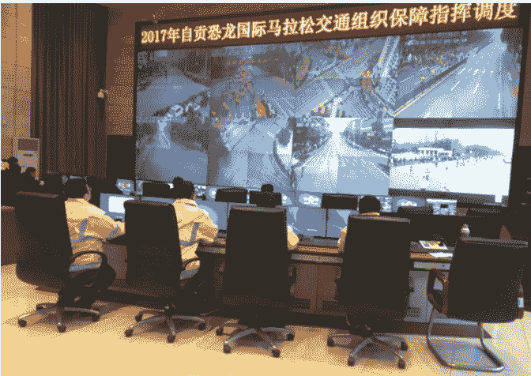

图8.1 2017年自贡恐龙国际马拉松交通组织与安保指挥调度。

来源：自贡交警。

### 8.2 大数据交通与网络线路规划

网络线路规划直接决定城市交通拥堵状况。由于过去交通规划模式存在明显漏洞，城市网络线路规划不合理，死胡同道路过多、交叉道路不平衡，城市拥堵问题日益严重。大多数城市面临网络线路拥堵问题，通常采用拓宽道路、增加里程的方法。这些方法虽然能短期解决问题，但长期来看无法有效解决城市拥堵问题。同时，投入了大量人力、物力和财力，导致民众不满。有些城市一年内反复拆除和修建同一条街道，不仅未能有效实现网络线路规划目的，反而导致网络进一步拥堵。

因此，必须引入大数据技术，以有效提升网络线路规划能力，进一步增强城市交通运输能力。

#### 8.2.1 大数据技术对网络线路规划的意义

网络线路规划对城市路线更为细致，不仅涉及交通部门，还涉及城市管理部门、城市建设部门等。大数据技术的应用在于对各部门数据进行有效统计和细化，从而形成完善的交通预测模型，有效模拟未来交通运行状态。特别是对于网络线路，是否会发生频繁车辆碰撞、网络周边是否有学校等，都能进行有效统计和预测，从而为网络线路规划提供指导和建议。

- (1) **关注所有数据。** 对于网络线路规划，所有数据的捕获和分析是关键。单个绝对数值并不重要。只有当其与周围数据点相结合时，网络线路设计才能更有效。例如，当某条网络线路上有一所小学时，可以快速有效地捕获该小学网络线路上的车辆数据，并有效分析周围网络线路，从而在避免交通对学校影响的同时，利用周围网络线路进行疏导，实现交通资源的互补。

- (2) **接受混合数据。** 大数据的特征在于能够捕获大量数据，从而制定规律和未来趋势。传统数据统计模型中的海量数据完全无法相比。传统模型往往耗费大量资金和经验，但数据只能关注某个细节，例如火车站前的车辆数据。数据过于单一，会给网络线路规划带来一定程度的“欺骗”，导致问题无法真正得到有效解决。

大数据可以接受混合数据，包括基本车辆信息、天气、季节以及周边具体环境。

例如，当某条网络线路上有一个大型展览馆时，车辆会定期激增，因此网络线路设计将相应调整。只有从宏观角度接受大量混合数据，才能在微观层面获得准确性，这是网络线路规划的关键。网络线路属于微观领域，因此应更加关注宏观数据的捕获，结合多条网络线路的周边信息，才能使网络线路规划合理。

#### 8.2.2 网络线路规划的完整性

网络线路规划注重完整性，能够有效结合不同属性街道的数据，通过大数据应用提升网络线路应用效率，并实现公共交通无缝衔接的整体运营，有效减少城市交通混乱和拥堵。

例如，对于公共交通网络调整，交通规划部门可以利用大数据对周边居住社区、轨道交通干线、场馆和设施进行有效统计，从而调整公交线路，实现“一路一线、便捷换乘”的目的。这种网络线路规划可以让乘客进入网络线路后快速换乘到达任何地方，逐步将过去的单线调整模式转变为区域整体调整的新模式。大数据对网络线路规划的意义在于从整体出发，形成整体联动模式。

目前，上海的网络线路规划在中国最为成熟。借助大数据技术，上海的公共交通得到了显著改善。特别是，网络线路规划采用分层模式，使公共交通成为解决城市交通的主体。

“交通都市”是上海未来的交通导向。通过大数据信息技术的应用，上海为网络线路设定拥堵等级，并采取相应管理模式。随着互联网信息的实时发布，公共交通部门将第一时间获取相关数据。根据实际情况，公共

交通部门将采用限制高速公路外地车牌的模式，并尝试限制交通拥堵频发区域道路上的外地车牌，以提高公共交通利用率。上海将进一步扩大运力。2015年，上海新建了140公里的公交专用道，而原有的161.8公里公交专用道则基于大数据的应用进行了重新评估和调整。

上海线网规划的亮点是“最后一公里”。几乎所有社区和街道都已覆盖，居民可以快速进入公交车站。通过大数据分析，发现陶泽地区交通流量过大。因此，实施了“微循环试点”。选用长度不足7米的公交车，可直接进入大型社区，有效避免这些路段的拥堵。同时，轨道交通站点、医院、学校和社区服务中心的出租车接驳点和共享单车停靠点也得到了进一步完善，周边接驳服务和线网线路规划合理。

解决城市交通问题的关键在于，将线网规划模式从过去的单一模式升级为整体模式，并以大数据形式整合线网网络。我们应该研究该区域线路的特点，哪些街道交通流量过大，哪些街道适合紧急疏导，以便整个区域的交通运营有序进行。

### 8.3 大数据交通与道路规划

道路规划涉及交通规划的细节。线路规划和线网规划从宏观角度出发，通过捕捉大流量大数据来探索区域规划特征；而在道路规划中，应注重细节，解决道路实际问题。

#### 8.3.1 传统道路规划的缺点

传统道路规划通常通过设计部门基于经验和当前情况的快速判断来做决策。通常，设计院中有一位经验丰富的设计师担任负责人，因此容易出现个人意志和团队意志主导运作的问题。甚至有小型设计单位盲目行事，使用“复制手段”进行道路规划，导致更严重的问题，完全不符合“互联网+”大数据应用的当前需求。

一个简单的例子最能说明这个问题：

某城市北部建有一个工业园。每天早上，车辆会明显前往城市北部，同时，下班后从城市北部返回的车辆数量会显著增加。这是许多城市中的“潮汐效应”。如果按照过去道路狭窄、可变道路不足、交通信号灯无法根据高峰时段进行智能调整的设计，迟早会导致严重的交通拥堵，给交通管理人员带来很大麻烦。

因此，在道路规划中，有必要通过大数据进行初步研究，例如使用电子警察和视频探测器收集的通过车辆信息和交通流量数据，来找出该路段的规律，从而使道路规划更加合理。

无论是交通车辆统计还是道路周边环境调查，传统规划都存在一些缺点。对于道路规划，还需要包括道路空间和景观设计。建筑物、绿化、地面铺装、街道设施、户外广告、景观节点、停车场、照明和人类活动，都属于道路周边环境。过去，这些信息的收集通常采用人工观察，导致数据采集有限、数据结构简单、深度不足，无法有效为道路规划和改造提供数据支持。

#### 8.3.2 大数据带来的道路规划新思路

与传统道路规划模式相比，大数据技术的应用主要从以下几个角度出发，改变道路规划思路：

- (1) 网络数据。网络数据包括居民广泛使用的热点和WiFi数据，将记录用户数据，包括视频网站、物联网、微博、博客、播客或论坛。这些数据可以通过大数据平台有效展示热点地图，并分析人流量最大的地方。因此，在设置公交车站和出租车站点时，可以有效精准定位并最大限度利用资源。

- (2) 传感器数据。新的交通传感器可以有效感知道路环境，并持续将数据发回平台。新传感器可以放置在街道建筑、街道家具、街道绿化和街道广告上，可以快速捕捉道路变化并提供实时数据。因此，有了这些数据，交通信号灯设置和路口立交桥设计都有了有效的数据参考。

#### 8.3.3 道路规划的大数据便利性

在大数据帮助下，可以有效且科学地改善道路规划，并带来最直观的视觉体验，从而使道路规划更加便捷。同时，公众也可以参与其中，进一步提高道路设计的实用性和交通便利性。

- (1) 设计早期阶段。在道路设计早期阶段，积极引入大数据将使公众了解相关信息，并从被动的信息接收者变成信息提供者。传统道路设计由设计师主导，公众参与度非常有限；然而，通过大数据平台，设计部门可以通过官方网站和当地媒体披露信息，公众可以为设计提供建议。例如，通过APP提供信息，公众可以登录并根据智能手机中的大数据采集上传信息，这将为设计提供参考。在大数据帮助下，设计师可以有效筛选有意义的信息和无意义的信息，这最终影响道路建设结果。同时，由于大数据的快速交换，电力、水利和燃气管道信息也将被纳入大数据信息，以便设计师考虑这些内容，从而避免因铺设管道而反复拆除和修复道路，并有效避免道路拥堵问题。

- (2) **设计后期阶段。** 在道路设计后期阶段，大数据也可以发挥作用。大数据可以以直接且易于理解的方式呈现道路成果，公众可以及时提供反馈。例如，通过微信和微博，可以发布可视化道路设计系统，并解释相关功能和特点，供公众查询和表达意见。大数据将对这些信息进行有效统计和分类，供设计师进一步参考，最终开发出既满足交通需求又符合公众需求的道路设计。

- (3) **智慧街道建设的支持保障。** 未来，智慧街道将成为所有城市的主流。智慧街道的特点是通过物联网智能感知设备整合云计算、移动互联网等技术，使道路不再是简单的道路，而是一条具有管理服务和智能服务的新街道。同时有效缓解交通压力；道路的属性边界将得到有效扩展，以实现主动和智能的贴心服务。例如，当我们准备停车时，显示屏将立即显示停车场位置和可用车位数量。这种智能操作将大大提高交通效率并缓解交通压力，而大数据是这些智慧生活的核心基础。因此，道路规划中大数据的应用将更加深入，并充分实现城市智能化的目标。

### 8.4 大数据交通与站点规划

站点包括城市及其周边地区公共交通的各种上下车点，如公交车站、出租车站点和路边停车场。将大数据引入站点规划，可以有效完成交通资源配置，实现站点间资源利用，并减少交通部门运营人力。根据大数据，它将在地面交通主干道优化中发挥非常积极的作用，使地面公共交通网络和客流组织计划实现多站点优化。

#### 8.4.1 大数据在主动泊车系统中的应用

停车问题已成为城市中普遍存在的交通问题，不仅影响出行时间，还因车辆无法快速找到泊车位而影响交通效率。因此，泊车问题是站场规划中的关键问题。

随着大数据的应用，泊车系统将得到有效改善。其中，主动泊车系统正受到越来越多的关注。

所谓主动泊车系统，是指大数据能够快速捕获周边停车场信息，并将相关内容推送给用户。例如，当电子车牌具有 GPS 定位功能时，泊车引导系统将快速将车辆位置与附近停车场信息进行比对，并为车辆推送路线以预测抵达停车场的时间。这样一来，车主可以提前选择停车场或预订泊车位，从而实现快速泊车的目的。

目前，辽宁省沈阳市已开始在这方面进行探索。在一定规模的停车场中，沈阳市已开始实施泊车引导系统，在停车场内设置 GIS 技术，并接入城市泊车信息管理平台。此外，该系统与移动终端集成，车主可以快速查询数据、获取泊车引导并缴纳停车费。随着大数据与云平台的结合，沈阳的停车场已融入统一的管理系统，以解决泊车问题。

同时，主动泊车系统还可以根据泊车位置判断是否存在乱停乱放问题。一旦发现违规，相关信息会立即推送给车主，提醒车主及时驱车离开。如果驾驶员在规定时间内未离开当前区域，相关信息将发送给相关交警部门以采取进一步措施。这样一来，可以有效避免因乱停乱放造成的交通拥堵，并有效利用周边停车场。

#### 8.4.2 大数据在公交车站中的应用

大数据在公交车站中的应用最基础的功能是信息预测与发布。目前，呼和浩特和嘉兴等城市已开展“智能公交站台”建设。该平台的特点不仅能够有效分类统计各班公交信息，还能集成 GPS/北斗定位系统、3G/4G 交通技术、GIS 技术等。当乘客抵达智能公交站台时，可以快速连接 WiFi 查询车辆运营信息和站点信息，例如车辆到达前还有多少站、预计到达时间等。借助这些准确数据，乘客可以根据实际情况灵活调整，因此公交车站的秩序得到有效缓解，人流和出租车减少，最终可避免公交车站周边的拥堵和交通问题。

“站点疏导”只是大数据在公交车站中的基础应用。它还可以为公交车站建设提供更丰富的数据和更准确的建议。目前，大多数城市正处于新城建设过程中。借助大数据，交通部门可以有效收集各路段的人群信息。公共交通需求最大的地方，人口数据也最高。借助大数据，公交车站建设将更加合理，既能满足大多数人的需求，又能避开拥堵路段。

#### 8.4.3 定制公共交通：大数据公共交通系统的应用

与公交车站应用相比，大数据在站场规划方面有着全新的尝试，完全颠覆了公交车站的传统模式，即定制公交。

定制公交是近年来中国出现的一种新型公共交通模式，主要服务于同一区域、具有相同出行时间和需求的人群。定制公交的特点是一人一座、定时快速到达，同时行驶于专用公交线路上，因此出行成本更容易控制。当乘客通过专用手机 APP 填写出行信息后，该信息可发送给公交集团进行分析，乘客可在定制公交平台上招募，最终按照约定的时间和目的地发车定制公交。

这一系列举措离不开大数据的应用。大数据将组织乘客信息收集、定制路线发布及乘客反馈信息，服务于拥有共同目标的特定人群，从而有效优化道路通行、便捷性和经济性，同时减少私家车使用。

目前，北京、成都、青岛、天津、大连等城市已推出“定制公交”服务，以有效缓解高峰交通压力。由于无需换乘，城市道路资源得到有效解决。北京公交集团统计显示，北京每天将新增 150–200 个订单，出座率可超过 90%。特别是对于办公族集中的住宅区，定制公交更受欢迎，有效提高了道路效率。这种站点优化可以有效减少公交车的停靠次数，从而确保道路通畅，尽量减少拥堵。

### 8.5 大数据交通与枢纽规划

枢纽对交通至关重要。它连接城市的不同部分及城市之间的换乘，是城市交通的主要动脉，直接关系到速度和效率目标的实现。

目前，中国许多地区的枢纽规划存在严重问题。例如，北京西直门位于西北第二环路节点，是城市交通的核心。然而，由于西直门枢纽建设较早，立交桥、地铁、轻轨和公交车站的设计存在一定混乱，道路网络连接不便，出现混乱和拥堵问题。西直门枢纽是北京交通拥堵最严重的路段之一，未能有效发挥枢纽作用。类似问题在许多城市都有体现，因此借助大数据进行枢纽重新规划已成为当前的发展方向。

#### 8.5.1 大数据在枢纽规划中的探索

一般来说，交通枢纽常承载巨大的交通压力，包括公交、地铁、轻轨、道路乃至铁路、机场等任务。因此，在枢纽规划的初步调查中，大数据将汇总这些内容，查询行政区划功能、沿线项目经济指标分析、公交和地铁承载能力以及商业区消费潜力。

在探索阶段，大数据的目的是不断分析数据，找出交通枢纽的特征。例如，对于公交和地铁，可以根据乘客进出站、上下车的时间有效采集数据。探索时间越长，样本越准确，有利于未来进行有针对性的建设。这是随机抽样以前无法获得的模式。

借助大数据，可以有效配合交通枢纽信息，优化各部门协同运作能力，并根据快速响应、灵活处置、协商合作的原则进行有针对性的调整。

大数据交通枢纽的意义在于构建多平台、多渠道的出行模式。例如，贵州高新区大数据智能交通枢纽项目，包括环城铁路白云站、轻轨换乘站、公交车站和社会停车场，形成多种综合交通平台。这对周边交通将产生非常积极的影响，所有交通调度均由平台完成，从而解决了“各部门各自为政”的局面，有效解决了交通问题。

同时，这类交通枢纽往往具有地标特征——解决交通问题意味着会迅速产生“聚集效应”，围绕其形成集商业、酒店、购物和人才公寓于一体的综合平台及新型城市综合体项目。大数据应用将继续从交通领域延伸出去，对地方经济和文化具有深远意义。

#### 8.5.2 城市间交通枢纽

随着城市化不断发展，许多城市之间的交流日益频繁，交通枢纽不再局限于城市内部，呈现出“两城互动”局面。与城市交通枢纽规划相比，城市间交通枢纽更需要大数据应用。

从而实现“白天在北京工作，晚上在天津生活”的目的。

以“广佛”交通枢纽为例，我们可以看到大数据规划对城际交通枢纽的作用。不仅广州和佛山依赖大数据的应用，珠三角地区也已形成相对完善的枢纽体系，以确保城市间的连接更加便捷。

- (1) 地铁规划。地铁具有快速、高效、准时的特点。因此，在两城枢纽建设中，广州和佛山通过大数据分析将地铁作为最重要的交通方式，并有效连接两地的重点商业区和学校。例如，广州地铁7号线一期及西延段全长约32公里，共有16个车站，其中广州10个车站，佛山6个车站，将连接大学城、广州南站、顺德北区域、佛山新城等重要区域。

此次建设恰恰源于大数据分析。广州的大部分地铁线路位于商业区、写字楼等商务区，而佛山主要是居住区，可以满足“在广州工作，在佛山生活”的需求。与其他交通方式相比，地铁起着最重要的作用，因此可以有效发挥枢纽作用。

- (2) 公交规划。除了地铁，公交网络也是这两座城市的关键枢纽。截至2016年，广州与佛山之间已有67条公交线路，实现了广州和佛山城际公交线路的覆盖，形成了“以广佛地铁线路为骨干，广佛城际公交为主体，其他交通方式（如出租车）为补充”的新交通模式。由于大数据得到有效应用，这些线路可以覆盖人流需求最大的道路，并加强两城之间的联系。

广州与佛山之间的交通枢纽功能不仅极大缓解了两城市间的交通不便，还有效提升了人流、物流、信息流和资金流在两城市间的流动。数据显示，截至2015年底，广佛地铁运送的总乘客量已达2.4亿人次，是两城总人口的10多倍，两城的人才交流、信息交流和金融交流也得到了快速提升。“一业兴，百业兴，交通带动百业兴”，佛山市南海区区委书记黄志豪对广佛交通枢纽如此评价。在确保交通的基础上，创造更大的经济意义，这对其他地区的城市群具有非常强的参考意义。

未来，交通枢纽不仅将局限于高速公路和地铁，还将包括高铁、城际铁路和航空，从而形成更多立体的枢纽模式。因此，在交通枢纽建设中，我们应首先引入大数据技术，协调各部门的相关数据，并进行精确分析，使各种交通方式都能发挥自身特点，真正体现枢纽功能。就像北京西直门交通枢纽一样，在新的改造中，积极引入大数据技术，解决死胡同路、瓶颈路和立交桥标志等问题，努力有效解决西直门过去交通混乱的状况。

### 8.6 大数据交通与运力规划

运力与公众的出行需求相关。运力规划是一项非常科学的工作，尤其是大数据的应用，例如哪些地区最需要公共交通工具，哪些地区因车辆不足而导致高等待时间，哪些道路的运力已饱和——所有这些都需要通过数据来完成。没有大数据，运力规划只能空谈。

目前，中国许多城市存在交通运力规划不完善的问题，这导致人们通过论坛、民生网站等渠道频繁投诉。一些本应增加的运营线路，成为乘车和打车难的持续难题。因此，一旦这些地区进入高峰时期，人山人海，这对道路安全构成严重威胁，并导致公共交通资源的浪费。

事实上，许多城市运力不足并非真正因为缺乏公共交通工具，而是因为运力未得到最大化利用。洛杉矶研究所的一项分析发现，只需16%–54%的车辆即可实现更高水平的运输。目前，城市运力不足的问题并不在于公共交通工具的增加，而在于通过捕获大数据优化运力，这是提高城市运力的关键。

例如，中国许多城市实施的“智能公交”就是借助大数据对运力进行优化和调整。依靠定位技术和GIS技术，公交公司可以有效掌握车辆运营情况，包括车站停靠时间、车上乘客数量、车站等候乘客数量、城市公交等候热点图等。通过这些数据，公交公司可以及时调整公交车，使载客空闲的公交车迅速进入运力饱和的路段，优化资源配置，有效缓解交通拥堵。因此，这种“智能公交调度中心”必将进一步推广，并逐渐渗透到三四线城市，甚至农村城际道路。

#### 8.6.1 大数据在运力方面的综合利用

运力不仅包括公交，还包括地铁、轻轨、出租车以及公交车和出租车的空载率等。许多城市存在这样的现象：在某些时间段，公交、地铁和出租车的空载率过高，这也是运力配置不当以及交通资源浪费的表现。

一旦能够接入大数据，这类问题便可得到解决。例如，为了避免高铁和航班延误，大多数乘客常常选择提前几小时赶往火车站。由于公交车和出租车在许多情况下无法准时到达，路上花费的时间甚至比高铁和飞机还要长。当大数据技术被应用后，出租车公司可以及时获取高铁交通部门和机场部门推送的信息内容，掌握乘客的出行时间。然后，出租车公司可以与交通信息平台互动，分析乘客出行的交通信息，并预测接送乘客的需求。这样一来，乘客可以通过手机GPS定位获取附近出租车的信息，出租车司机可以选择最佳路线到达火车站。这样一来，既节省了乘客的时间，也有效利用了出租车。

这种模式已在滴滴出租车等平台上得到良好应用，成为大多数人的首选。未来，基于大数据的运营优化将进一步深化，例如，公交系统也将被纳入，能够灵活判断路况，将空闲车辆分配到关键路段，提高运营能力，降低成本。通过传感器，交通信息将及时告知驾驶员，数据可以被有效捕获和使用，交通运营将更加合理。在不增加机动车数量的情况下升级运力规划，是未来城市交通发展的核心。

事实上，大数据对运力的优化和推广不仅在城市地区开展，还在广大农村地区进行。浙江省余姚市进行了一次有效的尝试。2012年，城乡客运一体化改革启动，公交线路重新规划，但也存在许多问题。例如，部分公交线路每天载客不足50%，甚至出现612路公交客流量为零的情况。

2016年，为了解决公交运力存在的明显漏洞问题，余姚市交通部门借助大数据调整公交运力，并对城市105条公交线路的实际运营情况进行了彻底调查。经过大数据分析和建议，余姚的公交运力进行了重新配置。原来，632路公交有两辆运营车辆和10个班次，后来减少为一辆，并优化了发车时间。结果，原本运力不足30%的632路公交，在不影响居民出行的前提下，显著提升了运力。对于山区，余姚将发车时间和频率集中在早晚高峰，方便山区农民出行。通过这种调整，余姚公交公司一年节省了超过100万元的运营成本，但其运力得到了显著提升。每辆公交车都有自己的“工作休息安排”研究报告。

因此，在容量规划方面，大数据可以广泛应用。持续的智能公交改造是对交通运输能力规划的调整与优化。利用IC卡开展大数据手机（数据）并根据不同道路和不同时期调整运输能力，将使城市交通运行更加顺畅，降低运营成本，并有助于城市环境建设。

### 8.7 大数据交通与应急规划

2003年，南京一名市民在上班前打开了“南京智慧出行”APP。该APP向他推送了一条消息：他每天必须经过的道路发生了事故，因此建议绕行。通过这一预警，市民选择了新路线，并准时到达了工作单位。

这样的场景并非来自科幻小说，而是现实。借助大数据，可以及时识别突发事件并提出相应的路线建议，这已成为大数据在交通应用中的另一个关键方向。

在任何国家，事故或其他突发事件都不可避免。如何建立完善的应急规划方案，是公共交通管理的重要评估方法之一。过去，应急规划往往具有临时性和突发性的特点，无法有效地向公众传达。结果，容易产生摩擦和矛盾，公众不理解治理措施。然而，在互联网时代，借助快速的大数据，应急规划应更加成熟、前瞻和可沟通，这也是未来交通部门的职责。

#### 8.7.1 交通应急系统建设

在大数据时代，应急系统的建设不再局限于公共交通部门，而应以交通部门为核心，并通过网络系统与消防部门、公安部门和电力部门建立无缝连接，使大数据能够发挥真正作用，并有效整合各类信息，实现应急数据的快速开发与发布。

应急指挥服务平台的建立已成为大数据应急规划的关键。这样一个平台将发挥三项重要作用：事前监督与预测、事中应急响应与调度、事后总结与归档。

- 事前监督与预测。交通指挥中心通过系统对各路段进行实时巡检，对拥堵路段加强自动监控，并及时处理发现的隐患。数据平台将与其他部门共享数据，例如某路段的房屋装修和消防演练。预测信息应通过平台提前发布给公众，提醒公众绕行。

- 事中应急响应与调度。发生交通事故时，交通应急平台应立即启动应急预案，及时将事故现场传输至交通指挥中心，同时，信息也应尽早传输至医院和公安部门，以做好应急处置并避免交通拥堵。

- 事后总结与归档。应急平台可以有效记录各部门之间的互通信息并保存图片。事故处理后，数据可被分类汇总，为今后处理类似事件提供依据。

上述所有工作都需要大数据支持，包括城市道路状态判断、信息查询、各部门信息传输等。只有这样，大数据才能发挥作用，高效及时地处理事件，并确保道路畅通。否则，当事故发生时，如果交通部门未收到信息或医疗机构未收到治疗呼叫，将不可避免地导致交通进一步混乱，并大大影响出行。

#### 8.7.2 大数据智能设备的应用

应急规划的建立离不开各类设备的支持。特别是大数据智能设备的应用，将从科技水平上有效提升应急能力，并改变应急规划的科学性。例如，传感器技术、通信技术和GIS技术的应用将使数据采集过程更快，并形成“采集、分析与建议同步”的效果。

智能信号灯是典型应用。智能信号灯将自动捕捉道路状况的调整周期，在出现问题时及时更改信号，现场拍摄和捕捉事故，并制定公交优先方案，以缓解紧急情况下的交通问题。

与传统信号灯相比，智能信号灯配备了车辆检测板，可以有效收集周围车辆的数据，包括交通流量、占有率、速度、排队长度等。一旦发生紧急情况，它将根据交通流的实际情况进行调整。这样一来，即使在紧急情况下，其他车辆也可以按照信号灯的指示正常行驶，从而有序通行并保持道路畅通。

#### 8.7.3 应急机制运行模式

针对交通紧急情况，大数据必须实时，以便有效解决问题。因此，大数据平台必须稳定。一旦某条街道发生事故，它可以有效处理信息，并确保交通不会被阻塞。

同时，大数据智能设备的安装应尽可能在公共交通车辆中普及。特别是公交车，应制定全面的升级计划，在一段时间内完成设备的安装和调试，以真正实现数据采集。否则，数据无法形成一致性和连续性，不利于后续工作。尽管大数据智能设备会产生一定的财务支出，后期维护也需要消耗一定的人力和财力资源，但从长远来看，其经济效益和社会影响无疑是巨大的。

特别是在预测方面，大数据应急系统应发挥重要作用。例如，针对大型活动和特殊服务任务，大数据应第一时间收集周边信息，对可能出现拥堵的路段发布预先通知，提醒市民绕行，对周边酒店入住、餐饮预订等信息进行有效统计，找出可能出现交通拥堵的时间段，估算人流量，并制定针对性方案。同时，还需与其他部门配合，准备应急支援物资并统一联动，从而真正发挥大数据预测的作用，并提前为可能发生的突发事件做好准备。

## 第9章

### 大数据交通与重大活动

从奥运会到G20峰会，近年来，中国举办的重大世界性活动越来越多，这对交通应急响应与指挥提出了更高要求。借助大数据的参与，重大活动的交通规划可以得到遵循。即使发生紧急情况，大数据也可以帮助交通管理人员提前预测并合理解决局面。

### 9.1 大数据交通与北京奥运会

2008年，奥林匹克圣火来到北京，这是北京最重要的全球性盛事。吸引全世界关注的北京奥运会，在奥运期间接待了652万国内外游客和38.2万入境游客，这无疑对北京的交通是一项巨大挑战，也是对首都形象的全面展示。

那么，大数据交通是如何服务于2008年北京奥运会的？哪些成就值得未来大型活动学习和借鉴？

#### 9.1.1 大数据设备应用

为了奥运会，出租车是最重要的交通工具。北京奥运会对出租车的大数据应用也是中国首次全面尝试。2008年之前，北京五环路以内的所有高速公路基本完成了RBMS流量计的安装，可以有效捕捉高速公路的交通状况。

最大亮点来自出租车。2008年奥运会开始时，北京所有出租车都已配备GPS。交通管理部门可以有效定位每辆出租车，实时跟踪，并高效解决问题。

此外，电子收费模式也开始在奥运企业中运行。北京奥组委与北京交通部门、中国移动、中国联通和中国电信的深度大数据合作可以有效识别车牌，快速解决交通事故，并及时存储和备份这些数据。

同时，在北京奥运会期间，数百台交通事件探测器分布在北京街道上。这些设备可以最早发现交通事故、道路积水等问题并设置自身报警。信息随即在指挥中心立即显示，交通部门人员以最快速度处理情况。这种自动报警装置将交通事故处理时间缩短了3–5分钟，极大提高了交通事故快速处置能力，确保了城市交通的有效运行。

北京奥运会安装了智能信号灯。由于北京路网的特点是行人、机动车和非机动车混行，北京交通部门会根据实际情况全面升级信号灯。信号灯可以由计算机有效调整，并随道路的交通高峰和平峰而变化。这样一来，路口交通得到优化，路网综合交通能力提高了15%。奥林匹克中心的信号灯还增加了盲人语音提示功能，大大提升了以人为本的服务特点，进一步保障和改善了交通安全。

2008年，“大数据”一词尚未被公众理解。但北京奥运会借助这些手段进行了成功尝试。因此，北京奥运会可被称为“历史上最成功的奥运会之一”，北京交通为此做出了巨大贡献。与2016年里约奥运会频繁发生的交通事故相比，北京奥运会在交通保障方面取得了巨大成就，其中使用这些大数据智能设备为交通管理部门提供了准确数据，有效实现了交通事故预警，并快速解决了问题。

#### 9.1.2 大数据交通提前响应

事实上，北京已开始大数据交通的应用。正是由于早期进行了大量测试，大数据才能在奥运会期间发挥有效作用。

- (1) **智能公交。** 奥运会开始前，亿华诺集团和北京公交集团承担了国家科技研究计划“奥运公交智能运营调度系统”，该系统在奥运会前已正式投入运行。

- (2) **监控系统。** 北京奥运会期间，互联网大数据应用主要集中在电视监控、交通信号控制等模式。北京奥运会开始前，北京交通部门制定了完整计划并实施智能调度。奥运交通指挥中心、杨山桥交通服务指挥中心和38个场馆组交通指挥哨所构成了完整的数据监控网络，实时监控道路交通，以实现交通的有序并行与和谐运行。

- (3) **高清数字检测系统。** 奥运会正式开始前，奥运中心区域安装了高清数字监控系统。该系统可对车辆进行全方位检测，实现中心区域的视频监控、车辆识别、违法检测、流量统计等多种功能。使用该系统可有效确保奥运中心区域交通有序发展，这也是中国首次采用单一综合检测设备，比传统的多种设备更集成、统计更全面。

#### 9.1.3 大数据系统应用

除了大数据硬件和提前的大数据响应，大数据系统建设保障了奥运会的顺利进行。以下内容构成了北京奥运会的大数据交通系统：

- (1) 移动处置方案。为服务北京奥运会，北京交通部门制定了完整的移动处置方案。一旦出现交通问题，大数据平台将尽快启动，配备卫星通信、无线传输、图像采集等大数据系统的指挥车将尽快赶赴现场。到达现场后，指挥车将立即通过信号系统向周围路口发送数据。2008年，微信和微博尚未诞生。北京交通部门通过信息板提示司机绕行。尽管手段相对落后，但有效缓解了事故位置的交通拥堵。

- (2) 监控系统方案。北京奥运会开始时，所有高速公路、主干道和奥运专线都安装了数万个检测线圈。这是城市交通管理的神经末梢，可以24小时不间断工作，分析道路交通流量数据。同时，它们会自动检测车辆。一旦发现违反“单双号限行”规定的车辆，就能第一时间拍照记录并上传到数据平台，有效确保市民遵守法律法规，保障交通顺畅运行。

- (3) 公交优先控制系统。为便于出行，北京建议公众优先选择公交系统，因此北京交通部门也优化了公交服务。北京共安装了126个带优先控制的信号灯。当公交车通过这些路口时，信号灯会检测公交车并将相关信息传输到计算机。根据路口实际情况，计算机可以调整交通流量、缩短放行信号事件或延长绿灯事件，从而有效压缩公交车在路口的延迟事件，避免道路延误问题。

- (4) **数字交通执法系统。** 为处理北京的交通违规行为，过去在道路上安装了1100套联网电子警察，可自动检测九种交通违规行为，包括闯红灯、超速等。这些信息将尽快上传到数据库，并快速比对以及时锁定违法者。同时，移动巡逻车也配备了相关设备，可实现无线传输，有效发现套牌车。从识别到系统终端报警，每小时可监控2200辆车，耗时不到一秒，实现真正的高速高效。

- (5) **高速公路交通控制系统。** 北京的环路（即高速公路）是北京交通的主干道。奥运会期间，它一方面承担城市交通流量，另一方面也是奥运专线的组成部分。因此，北京交通部门为高速公路建立了智能交通控制系统，利用二环路、三环路、四环路及主要出入口的智能信号灯捕捉高速公路交通流量变化，并实现出入口自动关闭和开放功能。当高速公路主要路口发生交通拥堵时，出口信号灯将控制上游辅助路的交通流量，使车辆能快速驶离高速公路。同时，路边信息板会及时更新信息，提醒司机选择路线，从而有效避免出入口处的交通事故。

虽然“大数据交通”一词在北京奥运会期间并未正式诞生，但可以看出，借助一系列大数据设备和系统，北京交通部门，

与其他部门通力合作，已对交通运输进行了全面保障，并为中国未来举办的各类大型活动积累了丰富经验。可以说，北京奥运会是大数据交通的开端。随着互联网的不断升级，尤其是移动互联网的全面爆发，大数据交通已越来越成为大型活动的关键部分，为活动的有效开展提供了全方位保障。

### 9.2 大数据交通与上海世博会

2010年，上海世博会是北京奥运会之后中国举办的另一项重大活动，也吸引了全世界的关注。与北京奥运会相比，世博会的影响范围更广，不再局限于体育，涵盖了世界上大多数国家的文化，因此游客数量更多。据数据显示，有46个国家和国际组织参加了上海世博会，接待游客7308.4万人次，日均游客39.7万人次，创造了世博会历史上的纪录。

与2008年北京奥运会相比，大数据经过了两年的发展，技术能力更加成熟。因此，上海世博会进一步改进了大数据的应用，尤其是在预测等方面。大数据发挥了关键作用，为世博会期间更好的交通服务奠定了基础。

#### 9.2.1 大数据预测

在上海世博会正式启动之前，上海交通大数据已正式开始运行。通过与票务平台、酒店、餐饮等机构的合作，相关部门逐步掌握了上海世博会期间的相关数据。上海大多数商业机构都已接入大数据系统，数据可以在最早可能的时点进行统计。

同时，汽车4S店的销售数据也进入了大数据系统，完善了相关信息。借助这一大数据模型，上海交通部门还对世博会期间的交通进行了预测：2010年，上海的交通量将达到5000万人次/天，汽车保有量将达到160万辆。在高峰期，8号线、6号线等轨道交通线路将面临巨大挑战，尤其是在世博会期间，9月至10月的交通压力将进一步增加。

通过大数据，上海交通部门对世博会期间的交通运行做出了初步判断。因此，根据数据，相关部门制定了以下交通建议：

- (1) **倡导乘坐公共交通出行。** 为应对道路交通压力，在世博会开幕之前，上海一直持续呼吁鼓励游客乘坐公共交通工具，尤其是公交车。交通部门希望超过90%的游客可以乘坐轨道交通和地面公交出行。

- (2) **均衡入园。** 借助大数据分析，我们可以看出世博会期间的客流在周末和节假日达到最高。由于这些时期酒店预订率较高，我们提前制定了“均衡入园”策略，将客流从高峰日引导至普通日，并制定了详细计划。鼓励游客从高峰时段出行至平峰时段，并从浦西进入浦东，以此缓解交通压力，让来自世界各地的游客都能真切感受到上海世博会的魅力。

- (3) **适当管理措施。** 为减少世博会交通与日常交通的相互影响，上海交通部门还出台了其他管控政策，包括车辆使用管理和施工区域管理，以避免交通压力无法得到控制。

正是通过大数据的应用，上海交通部门才发现了潜在问题并制定了这三项交通管理计划。这三项计划定下了世博会交通管理的基调，并通过大数据进一步优化，使工作更加细致。

#### 9.2.2 大数据智能系统的应用

为了更好地服务世博会，上海交通管理部门基于大数据建立了智能交通综合信息平台和世博园区交通信息子平台，以提供智能服务。世博会大数据平台的特点是数据处理能力强，不仅供内部使用，也面向所有游客开放。当大数据遇到前方道路明显拥堵等交通问题时，会立即将相关信息发送至世博会交通导览、世博会交通网站、交通服务热线、广播电视台、可变信息标志以及手机车载导航终端，不断提醒游客并提供换乘方案查询等服务。同时，该系统还与一线交通指挥员关联。交通指挥员可以随时随地获取世博园区内的交通信息，从而尽快开展交通指挥工作。与北京奥运会相比，世博会大数据平台得到了显著改进。每个人都可以通过互联网快速查询相关信息，而无需等待信息标志的提示。

围绕大数据平台，上海世博会将大数据智能交通发挥到了极致。这类亮点有四个，为未来大型活动提供了非常好的参考。

- (1) **综合出行信息服务系统。** 上海世博会推出了综合出行信息服务系统。该系统的服务对象是广大游客。它涵盖了各类交通方式的全部综合信息，高度集中了信息，并可通过一个平台查询所有交通信息情况，避免了过去需要反复查询的问题，极大地提高了游客出行效率和道路交通效率。特别是，“一网一电”的服务模式让游客只需点击一下即可获得综合交通信息。游客可通过众多世博交通网站、移动通信服务、世博热线、交通广播专用频道等方式获取上海的交通信息，这不仅为游客带来了便利，也为一线交通指挥员提供了便利。他们可以快速了解相关路段的信息，从而对交通做出精准调整。

- (2) **电子收费系统。** 在上海，大多数路段都是收费道路。过去，人工收费道路效率低下，容易导致交通排队，并直接影响道路通行。世博会之前，所有这些路段都已升级为电子收费系统，更加灵活多样。该系统不仅能实现快速电子收费，还能结合多种优惠方案，深受车主欢迎。借助电子收费系统，交通资源得到了有效平衡，车辆速度显著提升。同时，运输公司的成本也有所降低，以提供更好的服务。

- (3) **交通监控系统。** 与北京奥运会类似，上海世博会也推出了大数据交通监控系统。经过两年的技术改进，世博会大数据交通监控系统更加成熟。它首次能够建立视频图像监控系统，监控交通路口的交通流量、周边交通流量、人流量、交通安全等方面。所有监控数据都会尽快发送到监控中心，覆盖全上海。同时，监控系统可以发出紧急电话报警并动态发布预警，因此对道路上的车辆有更好的指导意义。车辆可以提前了解前方的交通突发事件，从而改变行驶方式，避开明显拥堵。

- (4) **决策支持系统。** 世博会期间，上海交通部门推出了创新的“交通决策系统”，该系统依托大数据，解决流量检测、疏导和决策等问题。传统的人工模式已被完全淘汰，相关工作将在系统中完成。系统能够创建模型以快速找到解决方案，其效率远高于传统的人工模式。由于系统中拥有数以万计的交通数据模型，它可以应对几乎所有交通突发事件，并做出准确、科学的规划建议。

这四个系统构成了上海世博会大数据运输的基础。这四个系统的空间范围包括世博园区、周边交通管控区域、世博专用通道、综合交通换乘枢纽、轨道交通网络、世博公交专线通道、世博园区游船航道以及其他直接相关区域。此外，这些大数据技术已突破地理限制，不仅服务于上海地区，还影响到长三角地区，涵盖所有与世博会相关的空间。因此，尽管上海世博会的参观人数创下了纪录，但有序的交通运输中并没有明显的遗漏，为世博会的举办提供了积极保障。

随着上海世博会的闭幕，这些大数据平台系统继续服务于上海并取得进一步发展。车牌识别数据、土地利用遥感影像数据、移动通信数据等，如今已在上海全面实施。可见，大数据应用可以保障重大活动，更多地服务于城市建设，形成更广泛的大数据运输系统，并确保城市交通协同发展。

### 9.3 大数据运输与杭州G20峰会

2016年9月4日至5日，G20峰会在中国杭州举行。与奥运会和世博会相比，在杭州召开的世界20个重要国家元首齐聚的G20国际经济合作峰会论坛，在政治和经济上更具重要性，也是中国国家实力和经济的又一重要展示。作为国家经济发展的重要风向标，交通运输也已成为世界关注的焦点。

2016年，互联网发展已进入新阶段，与2008年和2010年不同。大数据概念已广泛应用于商业领域。越来越多的专业大数据服务公司应运而生。因此，与北京奥运会和上海世博会相比，G20峰会的大数据运输更为成熟，并呈现出精细分化的特征。无论是交通运输部门、交警部门，甚至浙江省政府，都将大数据运输列为重点。

#### 9.3.1 政府层面对大数据运输的关注

2016年5月，在杭州G20峰会前夕，浙江省省长李强检查了G20峰会筹备工作，特别强调交通问题。他指出，有必要加快建设互联互通的现代综合交通运输体系，以支持杭州未来的发展，这为政府层面的大数据运输提供了明确指导，有利于大数据平台的快速建立。

随后，李强前往视察大数据运输，特别是杭州G20峰会交通安全综合信息指挥中心。G20峰会交通安全综合信息指挥中心已完全实现大数据接入、主要运输方式整合以及全交通的实时监控与调度。公路、铁路、民航等信息也已纳入该平台。这一平台是保障G20峰会交通运输的核心，在信息收集和信息传输方面发挥了重要作用。

#### 9.3.2 大数据对道路交通的支持

在杭州G20峰会上，为应用大数据运输，引入了专业大数据公司，其中Dt Dream参与了交警支队的工作。Dt Dream为杭州交警支队提供了一个完善的交通大数据平台，能够实时分析交通动态并同时进行信息研究和判断。它能根据区域交通特征快速制定交通措施，极大地保障了杭州的交通畅通与安全。

同时，该系统还与公共交通系统连接，杭州T-union数据能以最快速度进入平台。这样一来，交警部门可以通过实时分析控制公交车的发车班次，降低空车率，确保道路交通流畅；还可以根据道路高峰情况优化路线。为了配合大数据应用，杭州所有公交车均配备了GPS定位系统，接入车联网、道路网络监控等。因此，尽管杭州交警人数未增加，但通过大数据技术，可以充分掌握杭州交通状况，并根据实际情况随时进行路线调整，以避免城市拥堵。

可以说，该系统在G20峰会交通优化中发挥了关键作用。市民可以享受更精准的服务并缩短出行时间。公共交通也可以实时调整路线，实现“精准灵活调度”的目的，维护道路交通稳定。

#### 9.3.3 大数据的精准预测

由于第三方大数据公司的迅速崛起，以更专业的运营方式为G20峰会服务的更精准预测成为可能。其中，滴滴的一系列数据发布不仅为杭州交通管理部门提供了非常有效的数据参考，还让市民直接了解G20期间可能出现的交通问题，从而提前规划路线，避免交通突发事件。

2016年7月27日，滴滴发布了《智能出行大数据报告：杭州》，明确表示预计G20期间杭州总出行量将下降22%，平均速度将提高45%，峰会期间杭州市民的出行需求将比周末增加80%。此外，由于近年来杭州基础设施建设进度快，杭州工作日的早晚高峰在一定程度上得到了缓解。

在此报告中，滴滴甚至对速度进行了大数据精准预测：由于交通限制措施，杭州交通将更加畅通，平均速度将从峰会前的24.9 km/h变为36.2 km/h，增长45%。由于大多数杭州市民获得了“峰会专属七天假期”，大数据还开始进行垂直约束分析，并向杭州市民推荐“周边游”。这样一来，杭州交通可得到进一步保障。根据这一大数据，周边省市的旅游局也为杭州制定了各种旅游优惠活动，以吸引杭州市民。

借助大数据的这种精准预测不仅针对G20峰会开始阶段，还延伸至峰会后。杭州旅游委市场推广部部长江军表示，“根据大数据判断，G20峰会后杭州游客将激增，这体现在相关酒店和餐饮行业的大数据统计中”。随着G20峰会的举行，杭州新增了许多景点，而G20结束正值中秋节和国庆节。因此，针对G20后的交通，杭州再次进行了有针对性的战略调整，以迎接大量游客。数据显示，9月10日至11日周末，以杭州为目的地的周边游订单量同比增长超过一倍，乘坐高铁和长途汽车的游客比例分别位居第二和第三，这与大数据结论一致。多亏大数据的支持，杭州在G20峰会前、中、后期交通状况始终良好，过去“大型活动后混乱”的情况未再出现。

#### 9.3.4 智能大数据的生根发芽

随着大数据技术的爆发式发展，在杭州G20期间，智能大数据的应用更加广泛，越来越多的大数据技术和智能产品企业加入这一活动，进一步确保了杭州G20峰会的顺利举行。

- (1) 海信智能公交系统的应用。G20峰会前，杭州与海信签署协议，为杭州所有公交车提供智能升级。海信改造了杭州4700辆公交车，在中国率先推出“返程预测”功能。该功能的

功能在于有效结合各公交车的数据、判断道路状况，并准确预测各公交车的返回时间。这样一来，公交公司就能有效调整路线，例如增加或减少班次、调整发车时间。该系统大幅降低了人工调度成本，使公交系统的自动发车率达到 90%，打破了行业原有纪录。

同时，智能公交系统还推出了公交 App，使市民能够在家中进行出行规划，并获取到站预测、到站提醒铃等服务，大大提高了公交线路的便利性。

- (2) 建立交通社区。社区文化是近年来备受关注的互联网新术语。借助大数据，不同人群将聚集在一起，从而使信息传输更加高效和准确。在杭州 G20 峰会期间，这种“交通社区”取得了有效尝试。G20 峰会期间，交通局开展了“微博微信、一端、一线、一网、一室、两群”活动。通过杭州交通微博、微信、APP 客户端、12328 热线、杭州交通信息网、新闻直播室、微信群和 QQ 群等八个社区平台，向公众持续传播各类交通信息，如客流预测、交通气象、场馆票务销售等。因此，市民和外国游客能够第一时间获取相关信息，并提前安排出行，避免因信息疏忽而频繁出行，影响城市正常交通。

- (3) “互联网+交通”的应用。手机的快速普及、4G 网络的不断提速以及 WiFi 便利性的提高，使大数据应用在民众中更加普及。“互联网+交通”模式已成为主流。该模式在 G20 峰会期间得到广泛应用。乘客出行时，无论乘坐公交、地铁还是共享单车，都可以通过手机扫码，无需办理额外的公交卡，从而实现“一机在手，畅行天下”。便捷的购票和支付方式极大地优化了交通，因此杭州的交通效率得到了显著提升，道路拥堵也大幅减少。

从北京奥运会到上海世博会，再到杭州 G20 峰会，我们可以看到，大数据在交通领域的应用越来越广泛，同时也越来越深入地融入人们生活。每个公民都已成为大数据交通的重要组成部分。只有形成这种局面，城市交通才能得到进一步改善，大数据的作用也将愈发明显，形成“边际效应”，突破单纯的交通领域，实现与旅游、经济、文化的跨界合作，这对城市建设更有明显的帮助。

### 9.4 大数据交通与“一带一路”国际论坛

2017 年 5 月 14 日至 15 日，“一带一路”国际合作高峰论坛之一在北京举行，这是中国主办的重要外交活动，对于推动国际和区域合作具有重大意义。作为“一带一路”论坛的发起人和组织者，中国必须确保论坛顺利召开。同时，这也是北京奥运会后最重要的国际活动。

此次论坛还吸引了来自世界各地的众多国家元首、政府官员和机构，以及 29 个外国国家元首和政府首脑和三个重要国际组织的负责人：联合国秘书长和国际红十字会委员会主席出席了高峰论坛。来自 130 多个国家的约 1500 名各界嘉宾作为正式代表出席了论坛。全球超过 4000 名记者注册报道该论坛。可见，论坛规格高、影响深远。

对于这个重要的国际论坛，北京交通面临着继 2008 年奥运会后的又一挑战。对于“一带一路”，大数据交通发挥了什么作用？

近年来，随着大数据技术的不断发展，北京交通已形成较为完善的大数据交通模式。因此，针对“一带一路”国际论坛，这些新技术得到了广泛应用。这些技术不仅服务于“一带一路”国际论坛，还为北京构建了完善的大数据交通网络，在确保国际论坛顺利召开的同时，也为北京市民带来了真正的便利，极大地改善了北京的交通状况。

#### 9.4.1 大数据下的交通限制措施

重大会议实施交通管制是国际惯例。“一带一路”国际论坛也不例外。过去，交通限制往往凭经验判断，执行存在滞后，给公众正常出行带来很大困扰。但针对“一带一路”国际论坛，北京交通部门利用大数据对关键路段进行了长期的信息采集。借助智能交通信号灯、道路监控设备等大数据渠道，相关信息于 2017 年 5 月初发布，使公众能够提前做好准备。

同时，限制路线也根据大数据判断进行了优化。与过去大部分道路被封闭不同，现在仅对影响论坛的道路实施限制。这不仅确保了论坛顺利进行，也保障了公众日常生活和工作不受影响。同时，得益于大数据的积极应用，北京交通管理部门还发布了相关绕行建议，进一步保障了居民的正常出行。

- (1) 对怀柔区雁栖湖国际会城周边道路实施交通管制。自 5 月 7 日 0 时起至 5 月 15 日活动结束，从怀柔区帆棋路与慧渡路路口（不含），经帆棋路、雁栖湖西路至白崖山庄桥（不含），雁栖湖西路、雁栖湖南路，除持有“高峰论坛”专用证件的车辆外，其他车辆禁止通行。社会车辆和公交车需经雁栖湖北路绕行，绕行路线沿线不得停放机动车。自 5 月 15 日 0 时起至活动结束，从雁栖湖北路东入口，经雁栖湖北路至神堂峪路，除持有“高峰论坛”专用证件的车辆外，其他车辆禁止通行。社会车辆和公交车需经京家路绕行。

- (2) 对朝阳区国家会议中心周边道路实施交通管制。自 5 月 10 日 0 时起至 5 月 15 日活动结束，北辰东桥、经北四环路、北辰西路、大屯北路、北辰东路至北辰东桥（以上道路除外）区域内的道路，除持有“高峰论坛”专用证件的车辆外，其他车辆禁止通行。社会车辆和公交车可经大屯北路、大屯路地下隧道、汇中路地下隧道、北辰西路和北辰东路绕行。

自 5 月 14 日 6 时至活动结束，除持有“高峰论坛”专用证件的车辆外，其他车辆禁止通行北辰东路、北辰西路、科荟南路、大屯北路、大屯路地下隧道、汇中路地下隧道和民族园路。社会车辆和公交车必须经安利路、京藏高速公路、北五环路和北四环路绕行。

利用大数据进行交通限制是北京自奥运会以来开展的一项重要实验。基于数据而非经验，能够更有效地解决交通问题，这也是未来重大活动交通管制的主要方向。在确保城市交通正常运行的同时，还可以向世界领导人展示北京的新面貌、北京的发展，乃至中国必将日益成熟的事实。

#### 9.4.2 北京智能交通的应用

在大数据实施交通限制的同时，大量新型大数据交通应运而生。北京交通从细节处得到优化，在“一带一路”国际论坛期间展现出北京新的交通特征。

- (1) **用于交通服务的手机。**2017年，北京市移动大数据交通应用全面开展。市民不仅可以通过手机乘坐公交和地铁，还可以通过移动APP智能缴费、查询路况和公交到站信息。同时，“北京交通APP”、“定制公交APP”等软件已打通道路交通和航空渠道，交通信息可一键查询，极大地提高了交通运营的便利性。

- (2) **TOCC系统的持续完善。**2011年，北京交通运营监测调度中心正式开通，简称TOCC系统。到2017年，该系统已成熟运行，并在城市交通规划中发挥了积极作用。到2017年12月，TOCC系统已包含超过6000条静态和动态数据以及60000条道路视频，数据存储量达到20T。可以说，大数据和云计算提供了强有力的保障。未来，交通管理将不断从这些数据中检索信息，建立交通仿真系统，以可预测性和主动性为起点，对交通做出更多判断，并将决策发送给相关部门进行快速处理。

- (3) **智能预测系统。**智能预测系统是北京交通的重要探索。该系统广泛应用于北京所有高速公路和主干路。它24小时收集道路交通流量，并通过大数据分析以直观的图形方式直接显示道路状况。一旦超过历史正常值，系统将发出预警，为基层交通管理部门的下一步决策提供有效参考。同时，通过视频图像识别技术和交通事故自动检测，交通事故可以得到快速处理，确保道路畅通。

作为中国首都，北京是中国新形象的重要展示，也承办了一系列重要国际会议。因此，随着北京大数据交通的不断完善，它也将向周边省市辐射，以改善中国的整体交通面貌。可以预测，未来北京在大数据交通改善方面将有更多空间，以确保这座国际城市的有效运行。

## 第10章
## 大数据交通与交通管理

交通管理是交通领域的重要问题，有交通就需要交通管理。它涉及交通过程的方方面面，包括主要交通设施和交通信息的管理，以及技术变革、管理模式和组织模式的管理。全方位管理需要强大的实时响应和分析能力，而大数据正好满足这些要求。

### 10.1 大数据交通的状态诊断

大数据交通状态诊断依赖于各类信息收集，然后进行多维数据分析，最终借助历史记录、当前交通状况等形成完整数据。与大数据发展初期相比，状态诊断的内容过于模糊，难以理解。如今，当前的大数据诊断将形成完整报告，并以图表等直观方式展示，能够被有效应用。因此，越来越多的城市有效整合交通大数据，形成完整的大数据诊断系统，提升运营能力。

以南京为例。早在2012年，南京就开始构建交通大数据信息。当时的核心项目是“两卡一中心”，即市民卡、车辆卡和政府云计算中心。从2013年起，随着大数据的不断升级，这些核心项目整合为“两网一平台”，即LTE政府专网、物联网和市民综合服务平台，有效提升了大数据的状态诊断能力，并有效传递各类信息。

特别是针对公众和服务平台，该平台不仅会向公共交通部门提供相关数据和建议，也面向市民开放。通过实时路况，市民可以获取各站点和道路的具体信息，提前获得最佳路线建议，确保道路交通流畅。这种状态诊断是交通管理的未来趋势，不仅能让数据更加准确，还能有效降低交通监管和运营成本。

从技术手段来看，大数据交通如何进行这些状态诊断？

#### 10.1.1 信息收集模块的运行

为了进行状态诊断，必须首先进行数据收集，这是大数据运作的基础。目前，信息收集有两种模式：静态模式和动态模式。

大多数城市已开放静态信息收集。该方法的特点是：当汽车通过固定在道路上的视频监控设备或感应线圈时，快速捕捉相应数据，从而实现车辆信息收集。例如，安装在北京高速公路和主干路上的成千上万个信息采集器属于静态采集设备。这类设备价格低廉、固定安装和维护简单，但缺点是灵活性有限。一旦车辆躲避监控范围，就会导致数据采集失败。因此，静态信息收集设备的数量通常较多。

与静态信息收集的缺点相比，动态信息收集设备更加灵活。例如，安装在交通车辆和监管车辆上的采集设备，通过磁频、光电、重量传感器等方法采集数据，能够有效采集车辆的实时运行速度。数据在不断流动，因此拥堵预测更加准确。

准确的数据是交通管理的前提，也是大数据做出准确判断的基础。因此，应形成“静态+动态”的组合模式，以确保数据采样的准确性。

智能公交车是“静态+动态”信息收集的典型组合模式。新的智能公交系统在行驶过程中可以持续收集周围车辆的行驶状况，并快速判断前方道路状况。同时，它还可以对公交站台和交通路口进行完整的静态数据捕捉，为下一步交通管理提供数据支持。因此，推广智能公交车的使用不仅是为了低碳生活，也是为了城市道路优化。

#### 10.1.2 大数据分析模块的应用

当大数据信息收集完成后，相关信息将进入大数据平台进行下一步分析。目前，第三方大数据公司发展迅速，因此不同品牌的大数据交通产品分析模式各不相同。但其共同特点是：来自不同渠道的信息将被有效汇总，并建立交通信息数据模型。然后，这些数据形成图像视频，通过大数据平台分类的深度分析，可以获得有价值的信息数据。

大数据平台越完善，分析的准确性就越高。即使某些数据模糊，大数据平台也会通过历史记录、自有数据库等方式进行有效的数学建模，以改进数据分析。

目前，服务于交通领域的大多数第三方大数据企业已建立完整的分析模块，百度、阿里巴巴等互联网巨头也在不断进军相关领域，呈现出百花齐放的局面。地方交通部门应尽可能选择市场经验丰富的企业合作。首先是确保大数据平台的安全，其次是借助完整的数据库管理区域交通。例如，截至2014年，阿里巴巴的大数据品牌已存储100PB数据内容，相当于40000个西雅图中央图书馆和580亿本书。特别是对于新区的交通发展，借助其他数据文件

该地区，可对此区域进行数据补充，并为道路和网络线路规划提供更合理的建议。

#### 10.1.3 交通数据处理模块的应用

在数据收集和分析之后，下一步将是最后一步——处理。处理直接关系到大数据交通的状态诊断，从而进行有针对性的交通调整。一般来说，交通数据处理模块会处理分布式数据并做出最终决策。例如，当某个路口出现明显拥堵时，数据将被快速分析，然后做出决策：优化信号灯时长，优先放行南北方向车辆，东西方向车辆可适当等待。

交通数据处理不仅是为了调整交通管理的细节，还要积累数据并预测其他周边区域。通过分析交通异常行为并对比数据库中的相关数据，交通部门可以掌握一段时间内的路况，从而制定更科学的规划。这些数据看似杂乱无章，但经过大数据分类优化后，即可直接应用于工作。

归根结底，对于交通状况诊断，大数据需要经历信息收集、信息分析、信息处理三个阶段，以构建良好的交通网络。随着大数据技术的不断升级，将涵盖越来越多的交通相关内容，例如航班、高速铁路、城市建设和城市维护。数据越丰富，状态诊断就越准确。未来，大数据交通的发展关键在于此。通过充分利用大数据技术，将实现高效安全的交通管理模式。

### 10.2 大数据交通信息分析

随着中国城镇化的快速发展，大多数城市甚至农村地区都在经历严重的交通拥堵。交通拥堵不仅导致道路拥堵，还造成交通资源严重浪费，甚至影响经济发展。例如，在美国，每个有车的家庭每年因交通拥堵损失1700美元。中国正处于汽车数量快速增加的时期。此外，城乡重建也会因交通不畅导致经济浪费。

因此，大数据交通的应用重点在于解决交通不畅、交通拥堵和道路优化问题。不同地区的交通拥堵原因不同，因此必须利用大数据分析信息。只有找到问题的根源，才能对症下药。

#### 10.2.1 传统信息分析的不足

道路拥堵的原因有很多，其中一些是由于交通流量过大，导致超过道路承载能力；由于基础设施不完善，导致交通流无法正常通行；由于周边停车场缺乏，导致车主乱停乱放；以及由于城市建设的发展，导致更多占道施工，从而引起道路拥堵。

当然，许多地区的交通拥堵是多方面的。上述原因共同作用。因此，单一的信息分析难以制定出有效的解决方案。然而，传统交通信息分析由于技术能力滞后，导致信息分析存在明显漏洞。

- (1) 数据不够全面。在大多数城市，交通监控系统通常覆盖主干道，忽略了对支路和岔路的数据监控。接收到的信息无法全面反映交通状况，因此难以制定有效的策略。

- (2) 随机抽样不足。传统交通信息分析通常依赖随机抽样。但由于需要大量人力和财力，样本不足、随机性强且数据不具代表性，因此分析自然存在问题。

- (3) 地理限制。过去，部门间信息流通较少，这限制了交通数据的收集。例如，城市建筑重建属于住房和城乡建设部的职责范围，交通部门无法获得相关数据，因此难以实施交通疏导，导致周边交通拥堵。没有信息来源，就难以做出正确的分析和预测。

#### 10.2.2 大数据模型的信息分析与推广

当交通与大数据结合时，传统信息分析的不足可以得到解决。因为，在大数据模式下，信息分析将呈现以下特征：

- (1) 全数据监控。大数据能识别城市各角落分布的智能设备并统一收集信息，比随机抽样更关注所有交通数据。

- (2) 数据丰富化。在信息分析过程中，大数据不局限于单一数据。同时，由于存储量大，数据分析更加丰富。通过静态数据与动态数据的结合，信息分析更加准确且有价值。

- (3) 实时信息分析。大数据的特点是数据可以第一时间进入数据库，并且可以实时动态分析数据，避免数据滞后。这样一来，我们可以在短时间内了解交通运行状态，从而制定有效的交通计划。

- (4) 微观数据采集。虽然大数据关注整体局面，但数据采集是从微观入手的，因此分析可以更具针对性。例如，对于公共交通信息的分析，我们将从每位乘客的公交IC卡入手，并结合移动GPS数据。数据精确到每个人和每个时间节点。

#### 10.2.3 贵阳大数据交通信息分析与应用

随着各城市智能交通系统建设日益完善，当今，大数据交通信息分析已深入开展。微波、线圈、GPS、车牌、公交IC卡和移动APP都构成了有效的数据来源。借助这些数据和信息，交通部门可以有效掌握交通信息、地铁和公交信息，并迅速制定调整计划。

正是通过此类大数据信息分析，贵阳市对城市交通进行了彻底的改造。贵阳位于山区，与平原城市相比，基础交通建设相对落后。尽管近年来建设力度不断加大，但随着人口、机动车和房地产的快速发展，交通拥堵和停车难等问题日益凸显。

为解决相关问题，2014年，贵阳交通部门引入了MySQL等大数据库软件，并开始对269个交通监测点的大数据进行筛选。因此，这项大数据应用取得了非常好的成果。2014年9月1日至13日，大数据累积了1.54亿条原始数据。通过大数据库的筛选，贵阳的交通特征被迅速发现。

例如，根据“黄金路与枣山路路口”的大数据调查，发现该路段交通量在每天早晨6:00显著增加，在8:00–9:00达到高峰，期间近有8000辆车辆通过。从10:00到19:00，一直处于高峰的交通量略有减弱。在22:00，小高峰再次出现。

在过去，这种数据分析无法通过基层人员的调查来实现。但凭借大数据强大的计算能力，数百台监控设备协同工作，很快就能找到贵阳各个路口的交通数据。有了这些数据，下一阶段的城市交通改造才能精准有效。

经过几天的大数据分析，贵阳交通部门发现了一些问题。例如，私家车保有量过高，超过70%，这意味着贵阳的公共交通存在明显不足。未来，公共交通的发展必将成为重点，以有效缓解交通拥堵问题。特别是对第一环路及环内路段的监测发现，这里的路口是拥堵的主要地点，也是未来解决问题的主要方向。同时，与……相比

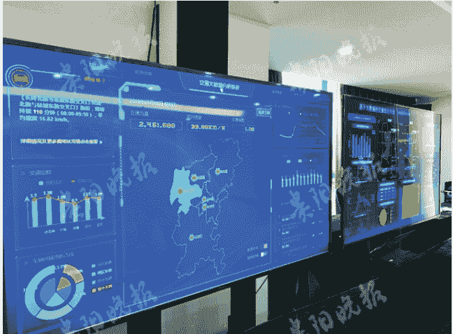

图 10.1 贵阳智慧交通系统。

来源：贵阳网。

与其他城市不同，贵阳不仅仅是早高峰拥堵的简单城市。贵阳的拥堵全天都会发生，甚至持续到午夜之前，因此照搬其他城市的做法并不有效（见图 10.1）。

基于此类数据分析，贵阳城市交通的转型必须有的放矢，而非盲目增加公交车或拓宽道路。

这种大数据分析模式可以在每个城市有效开展，为交通提供最直接的数据。例如，公交卡可以积累海量的乘客出行数据，通过数据分析可找出乘客的主要方向和集中车站，从而建立公共交通模型，有效制定应对方案并科学分配运力。

### 10.3 大数据交通的技术变革

大数据与交通的结合并非一成不变。随着大数据技术的不断完善，交通管理技术也在持续变化，以适应时代的发展。因此，对于基层交通部门来说，有必要不断升级大数据技术并采购新的大数据检测设备，从而不断改进工作，始终符合时代的发展。

#### 10.3.1 硬件设备升级

早期的大数据检测通常只是对具有视频拍摄和数据回传功能的传统交通设备的升级。但随着技术的不断创新，硬件设备已得到显著改善。特别是，这些硬件设备的使用为大数据检测提供了更丰富的手段。

- (1) **物联网传感器。** 与传统传感器相比，物联网传感器的信息捕获内容得到大幅改善。交通管理部门在道路上嵌入物联网传感器，可以在移动端观察实时车辆通行和客流信息，并监督车辆尾气排放。物联网传感器可以对多辆车辆实现同步数据采集，效率更高。它为指挥交通管理系统奠定了基础，并能更高效地采集数据。

- (2) **卫星地图应用。** 过去，卫星地图数据未向公众开放，大多属于军事应用。但随着大数据在商业和民用领域的广泛应用，卫星地图也可有效用于交通管理。因此，交通管理部门应尽快接入卫星地图，并通过卫星对交通状况的实时捕获制定相应策略，从而开展交通规划和道路规划。

- (3) **智能手机应用。** 对于公众，大力倡导智能手机的大数据应用也能有效解决交通问题。智能手机已被广泛使用。它们可以轻松链接并与交通管理部门的相关平台交互，例如微信、微博和相关 APP。同时，GPS 定位和北斗定位系统的应用使地图供应商能够在自身的大数据应用中发挥良好作用，优先向乘客和车主推送道路拥堵和出行趋势。这些信息可以优化道路。

基于这三项技术变革，智能交通信号灯、大数据票务平台等技术已日趋成熟。企业和政府部门都已开始利用这些技术改革红利来转型交通行业。将先进技术积极引入交通系统将为交通管理带来新局面。

#### 10.3.2 新的大数据技术变革

大数据技术仍在不断更新，为交通管理带来新变化。例如，当前主流的智能大数据交通技术主要使用路口监控设备和电子警察。它仍属于传统技术，用于实现车辆抓拍、车牌识别等工作。虽然车辆可以快速分析，但难以深入挖掘。传统算法使大数据交通遇到瓶颈。

新的大数据技术呈现出如下特征：通过拍摄的照片，可以检测年检编号、年检标志形状、车窗是否悬挂危险物品，以及驾驶员是否存在违法行为。例如，北京图村科技研究院开发的智能交通识别算法可以实现这些目标，帮助交警部门快速获取路面信息。一旦发现问题，数据将尽快存储，为公安机关未来的案件处理提供有力证据，并让驾驶员关注自身行为，以进一步保障交通安全。

同时，“驾驶感知技术”的持续推广也显著改善了交通数据的接入技术。未来，相关设备将在汽车出厂时安装。通过车载“互联网”，汽车的相关数据将首先发布到相关大数据平台。甚至驾驶员的紧急刹车也会被记录，周围情况会被快速拍摄，道路隐患将尽早发现。复杂的驾驶环境由感知技术有效记录，并通过大数据平台的分析和筛选获得报告。如果驾驶员在某路段频繁紧急刹车，意味着存在交通隐患，这将为交通部门和城市建设部门后续的道路调整提供数据支持。

“驾驶感知技术”目前在中国尚未成为主流，但随着汽车制造商的不断努力，相信这项技术将很快成为汽车的主流配置。通过大数据技术的发展，我们可以看到，未来的交通管理不仅限于交通管理部门，所有车主都是其中的一部分。只有当自身信息被有效捕获时，才能引起相关部门的关注，并最终促使相关部门做出相应的调整和变化。

大数据的意义在于：它不是一个简单的工具，而是连接交通管理部门、车主、市民、城市和交通的枢纽。通过这个枢纽，各方信息得到有效汇总，从中发现规律以实现精准解决。因此，当每个人都能通过大数据发送自己的信息时，交通管理效果可得到显著提升。这也意味着，未来的大数据升级将不可避免地与每个人更紧密地相连，并能有效捕获交通过程中的每一个细节，甚至包括行人等红绿灯的时间、公交站到家门口的距离等等。这些看似无用的数据可以被有效收集和筛选，以创建一个真正的智能立体交通系统。

#### 10.3.3 深圳：大数据交通应用的先行者和领导者

深圳，中国最年轻、最具活力和创新精神的城市，也是中国第一个尝试大数据智能的城市。依托大量新兴 IT 企业，深圳在大数据交通技术方面的转型一直走在全国前列。与北京、上海和广州相比，深圳的交通也最好。因此，全国其他城市学习深圳模式是值得的。

早在2000年，深圳就已建立智能交通指挥中心。依托智能信号灯、闭路电视、智能交通违章管理系统，深圳的交通管理融合了信息、监控和指挥，能够有效管理城市交通。

随后，大数据技术在深圳交通领域持续应用。2007年8月，深圳的八家企业成立了深圳智能交通安全协会，构建了一个更高效、更智能的沟通与发展平台。深圳投资10亿元人民币的“智能交通1+6”项目，使大数据技术获得了新的升级。

“智能交通1+6”项目中的“1”是“一个资源共享平台”，涵盖交通信息、交警、城市建设等部门，所有信息均已得到有效交换。“6”指平台下的六大服务系统：交通监控信息、交通管理信息、道路交通管制信息、公众出行信息、交通指挥应急信息、以及交通管理决策信息。正是凭借“1+6”系统，深圳的大数据交通才实现了全面升级，并有效服务于城市交通。

为了更好地利用大数据，深圳不断加快智能综合交通运行指挥中心的建设，并根据实际情况建设子中心，汇聚更多公共交通海量数据。对于中国绝大多数城市来说，深圳模式是最佳参考，不断升级大数据交通技术，以应对不断增长的汽车数量和城市人口。科技服务于人民。科学技术的每一次进步都可能为以往工作带来巨大改进。

### 10.4 大数据交通的组织模型

大数据交通的应用不仅不能仅依靠交通部门独立行动，还必须结合多个部门开展，并积极引入第三方大数据企业的先进技术，从而形成完善的组织模型。组织模型决定了大数据的系统和框架。组织越成熟，数据就越充分。否则，一旦形成“信息孤岛”，数据必然会失真，无法有效服务于交通管理。

#### 10.4.1 大数据模型改变“信息孤岛”效应

“信息孤岛”效应是指信息来源非常狭窄，往往仅限于个人和小团体，没有参考价值，也难以在更广泛范围内应用。传统的交通组织模式仅依靠交通部门的人力资源，数据统计非常有限，且带有强烈的个人主观特征。往往是由调研负责人决定最终数据，因此过去许多城市的交通规划效果不理想。如今，随着车辆激增，交通拥堵和事故频发。

大数据的组织模式旨在打破“信息孤岛”效应。以汽车传感器为例，当车辆通过某个路口时，监控设备会快速采集数据，相关数据将被迅速收集。在此过程中，不仅交通部门需要安装相应设备，车辆监管机构还需配合并监督车辆安装。同时，城市建设部门在相关设施建设过程中，会为交通部门预留相应接口，以便大数据能够真正发挥有效作用。因此，可以建立完善的公共交通云，所有组织都能有效接入，从而实现数据流通，使数据统计更加高效，以满足交通管理的需求。

#### 10.4.2 大数据的三级管理组织结构

大数据的组织模式不仅在于不同部门之间的信息传输，还在于不同部门的不同组织结构，形成“三层结构”。其中，通信服务提供商是完成最终数据采集的支撑。

- (1) **信息层。** 三层结构的第一层是信息层，其功能是信息采集。这需要交通部门、卫星数据部门和通信服务提供商之间的协作，通过卫星和手机终端快速采集数据，再通过网络将其传输到交通服务器。随后，相关技术人员通过各种算法对车辆或个人的具体位置和路线进行数据调查，并将其存储和管理在云服务平台上，同时居民可以通过手机等移动终端APP查看相关信息，享受大数据交通带来的便利。

- (2) **网络通信层。** 第二层是网络通信层。该组织系统的工作是有效组织数据，并通过WLAN、4G等方式将数据传输到云服务平台。为此，第三方大数据公司必须发挥积极作用，确保服务器高效运行，避免信息遗漏、丢失等问题。

- (3) **云服务层。** 第三层是云服务层。该层的主要工作是对数据进行编码和转换，挖掘信息，并预测交通拥堵。这需要专业人员利用大数据平台，确保信息筛选的准确性和有效性。尤其是对于市中心和商业区等人口密集路段，该层的工作更为繁忙，提供完善的路径优化、实时公共交通查询等服务，因此需要多部门协作，以有效解决问题。

#### 10.4.3 大数据交通的组织体系

随着大数据技术的不断升级，大数据交通已形成完整的产业链，包括数据采集、集成、分析、挖掘、展示和服务。未来，大多数城市将根据这五个方面建立详细的组织结构，从而更好地开展大数据交通工作。这些组织不仅由交通管理部门组成，还包括第三方大数据企业。

- (1) 数据采集。城市中大多数大数据交通应用通常依赖感应线圈和微波雷达，这些设备构成城市交通监控的主体，主要由交通管理部门安装和监控。然而，这些采集设备难以覆盖整个城市的道路网络，因此需要第三方检测公司介入。这些公司中的大多数拥有自己的一整套完善设备，会对员工进行专业培训，并在新技术应用方面更加熟练。因此，数据采集可以部分外包，形成“交通管理部门+第三方大数据企业”联合运作模式，以提高信息采集的普遍性和专业性。

- (2) 数据获取。过去，国内城市的交通数据往往由多个部门掌握，如市政、交通、城市建设、规划和交警等。大数据交通的应用将有效统一这些信息，将其汇集并整合到交通管理部门，以实现数据采集和存储的标准化。不同地区建立的交通信息中心是典型的“集中式大数据”组织。只有统一数据管理，才能从不同角度发现和解决问题。目前，交通管理部门收集的信息大多是公共交通信息，如公交车和地铁。未来，出租车信息、共享汽车和共享单车信息也将被有效纳入，数据将更具信息量。因此，加强与这些商业公司的合作，尽快实现数据信息统一，是大数据交通发展趋势的任务。

- (3) 数据分析。对于大数据分析，大多数将采用与第三方合作的模式。与交通部门相比，第三方公司在数据分析方面往往具有强大优势。无论是平台设备还是人才储备，都远远超过政府部门。例如，上海

美惠公司和上海电力科学研究院是中国优秀的数据分析公司。交通部门可以向这些公司告知自身需求，它们会立即处理相关大数据，如出行信息、交通决策信息等。例如，出租车 GPS 数据分析是第三方公司的专长。

- **(4) 数据思维。** 纯粹的绑定分析只是大数据的初级应用。大数据交通的发展目标是让数据产生分析并形成更好的交通管理模式。因此，交通部门必须与第三方公司和高效公司进行深入合作，并通过专利和论文让大数据发挥更大作用。例如，同济大学参与了深圳城市交通模拟系统，极大地提高了大数据平台的规划水平，对改善城市交通做出了重大贡献。

- **(5) 信息服务。** 信息服务将直接面向最终用户，并将大数据处理后的信息直接推送给居民。在此过程中，交通部门应与第三方信息服务部门合作，使信息传输更加广泛和准确。例如，交通部门通过 APP 发布完整的交通信息，校园 APP 发布校园周边的具体措施，车主 APP 推送具体的绕行方案，从而形成完整的信息发布系统。

由此可见，大数据交通的组织模式已不再局限于交通管理部门，而是变成了“多点协作、全方位发展”的局面。只有形成这种组织模式，大数据才能真正完成从理论到实践、从信息采集、信息分析到信息发布的实践。

### 10.5 大数据交通管理模式

大数据交通管理模式有很多种，但其本质相同：即通过持续捕获数据并整合各种数据，最终发现有价值的数据应用。不同的处理方式仅在实际手段上有所不同。尤其是第三方企业创建的大数据平台，其本质相似。因此，在大数据应用中，只要找到管理模式的共同点，就能迅速开拓局面并精准服务于交通领域。

#### 10.5.1 常见的大数据管理模式

一般来说，以下类型的大数据管理模式是目前最常见的管理模式：

- **(1) 空间状态分析。** 借助街道上安装的各种大数据设备，大数据分析空间状态，找出交通流分布的特征和变化趋势，监测道路状况以制定拥堵指数，并通过调整交通信号灯来管理交通。该模式是一种常规管理模式，适用于日常交通管理。

- **(2) 风险管理模式。** 对于高风险交通路段，借助大数据进行风险和脆弱性分析。通过历史数据对比，预测即将发生的问题，并建立风险管理机制。该模式通常在临时大型活动之前使用。

- **(3) 集成模式。** 集成模式的特点是综合利用定位、通信和网络技术，尤其是预测可能发生的重大事件风险，提高防范能力，确保交通有序发展。一般来说，在重大节假日之前，集成模式将被启动以应对即将到来的交通。

- **(4) 轨迹追踪模式。** 轨迹追踪模式借助各种信息的关联（如车牌追踪和新车牌追踪），实现相同编号的搜索，并牢牢锁定人员和车辆的轨迹。一般来说，如果发生重大交通事故且需要快速抓获肇事者，该大数据管理模式将启动。

- **(5) 系统综合分析模式。** 通过大数据集成和关联历史等模式，系统综合分析将进行完善的交通处理。在新区设置交通条件时，系统综合分析模式将提前在道路规划中发挥积极作用，以避免风险。

这些常见的管理模式涵盖交通的各个方面，有效提升了大数据的应用。通过分类建立精准的管理系统，将大大保障交通运营。

#### 10.5.2 大数据交通管理模式的升级

五种基本管理模式构成了大数据交通管理的基础。在此基础上，大数据交通管理进行升级，使大数据能够发挥更有效的作用。针对中国当前的交通状况，大数据交通管理的升级方向应重点关注以下几点：

- **(1) 跨区域管理系统。** 各地区交通部门拥有一定的行政自主权，因此区域间的信息流动不畅。这一问题在省市之间尤为突出。因此，大数据交通应突破此类信息壁垒，实现资源共享，从宏观角度优化交通状况。

- **(2) 充分发挥集聚优势。** 因为各级交通部门实行行政区域自主模式，且不同交通主题由不同部门负责，数据往往过于分散，效率难以提升。引入大数据管理模式旨在突破各部门之间的信息壁垒，如公交公司、地铁公司、出租车公司和共享单车公司的数据，使各站点在建立时能够相互学习，从而提高效率。这不仅是交通管理的优化，也是不同部门之间合作模式的优化，从而有效提升行政效率。

- **(3) 资源配置优化。** 资源配置不足是传统交通管理体系的短板。有些部门人员配备充足、监控设备齐全，甚至缺乏资源应用；有些部门因人力和财力资源不足，无法有效开展交通管理工作并充分利用资源。借助大数据集聚，资源可以有效集中，以弥补分布不均的问题。

由此可见，大数据管理模式的升级在于“资源共享和部门协作”。只有建立完善的管理体系并进行综合组织优化，大数据才能发挥更大作用，提升交通管理效率。

#### 10.5.3 杭州模式：大数据的综合利用

目前，浙江省杭州市的大数据交通管理模式已逐渐清晰，形成了“一个中心、三个系统”的新管理模式，并有效整合了全市交通部门。“一个中心、三个系统”指的是交通指挥中心、交通管理信息系统、交通控制系统和交通工程信息系统。

该管理模式使各城区交通管理部门能够有效协作，交通支队成为地面交通服务的主力。根据平台信息，它将在主要城市道路和交叉口实施分级预警和干预机制。同时，交通中队的数字服务室进行网上巡逻和值班。通过大数据应用，交通问题在计算机终端被发现，道路管理的覆盖范围得到有效扩大。当问题集中出现时，应立即开展联合行动，交通支队、城管、城建及

其他部门应迅速响应以解决道路交通问题，这将极大缓解交通拥堵，并确保道路交通流的安全和畅通。

杭州大数据交通模式也积极引入第三方企业的力量。滴滴、百度地图等数据也被导入杭州大数据交通平台，该平台由杭州市交通警察部门发布。例如，借助第三方企业的大数据统计，杭州交通管理部门发现，截至2017年2月底，杭州女司机人数已达139.64万，占机动车驾驶员总数的36.3%，这可以为交通法律法规的制定提供数据支持。停车场的设立、排水和路线规划可以照顾女性群体，这更符合杭州的交通特点。

2017年12月，杭州又发生了一起大数据交通事件。12月2日，23家大数据企业成立了浙江交通大数据众创空间，以“互联网+交通”为特色，服务于杭州乃至整个浙江省的交通。其中，不仅有浙江省交通信息中心、浙江省高速公路局结算中心、浙江省旅游信息中心、浙江高速信息工程技术有限公司等机构，还有百度、华为、阿里云、普洛斯、北京易华录、中科四方以及三大运营商，共同构建起一套完整的大数据管理新模式。未来，大数据管理模式必将呈现“部门和机构+第三方企业”的思路，共同协作，有效整合各方力量，找到城市交通发展的关键。

### 10.6 大数据交通信用模型

交通大数据的运行也需要信用的支持。这是因为，无论是数据的收集、筛选、分析还是发布，基层人员往往处于接收端。如果信息经常出现偏差，不可避免地会导致人们对大数据交通的不信任，并影响大数据的运行。

那么，我们应该从什么角度来解决大数据交通的信任问题呢？

#### 10.6.1 多渠道与专业发布

在发布大数据时，交通部门应除了自身平台外，还应与其他渠道合作，尤其是当地交通广播电台、电视台、车载终端、车辆滚动显示屏、可变信息板和交通警示标志等官方平台和认证平台。大数据应及时与这些渠道连接，第一时间发布信息，以便公众第一时间了解相关动态。

此外，在公共场所，交通部门还应与区域微信公众平台和微博建立合作关系，向运营商提供相关信息并通过其平台发布数据。我们必须选择经过认证的平台进行合作，以确保信息真实有效地推送给公众，并提升数据发布的可信度。一旦缺乏与这些渠道的合作，将不可避免地导致虚假信息和谣言迅速传播，大数据的价值将无法体现，这将进一步影响交通管理部门的信用价值。

#### 10.6.2 通俗易懂与专业解读

对于大数据交通信息，由于涉及专业性，许多内容必须经过再加工，以便公众能够轻松理解和掌握。然而，通俗易懂并不意味着“不专业”。否则，容易导致公众对大数据信息产生误解和不信任。

因此，在大数据通俗易懂的过程中，交通部门也应从专业角度进行解读，使公众能够了解大数据的运行机制并深信不疑。例如，在发布数据时，应强调交通流量分析、超时预测和时间识别，公众可以通过历史记录对比来发现问题。同时，应结合静态照片和动态视频分析交通状况，让用户感受到有价值的信息，同时也看到大数据如何挖掘信息、如何分析信息、如何做出决策，从而大大提升大数据的信用价值。

一旦公众对大数据产生信任，他们将积极参与信息收集过程。例如，大多数移动APP都具有定位功能。当公众意识到定位可以有效进行数据传输并进一步优化交通路线时，他们也会主动上传地理位置并启用监控功能，从而促进大数据收集更加完善。

#### 10.6.3 联合公安部门打击谣言

交通与公众的基本生活息息相关，是公众关注的焦点，因此也是谣言的焦点。如果交通管理部门不处理这些谣言，将容易导致虚假信息传播，极大影响正常的交通信息发布，并使公众对大数据交通管理产生怀疑。因此，交通部门应主动与公安部门合作，打击交通谣言，避免虚假信息进一步扩散。

例如，2014年7月，广东省肇庆市广宁县突然传出消息称，前一天在广宁县南街镇某路段发生一起重大交通事故，造成四人死亡，并附有三张图片。该消息在当地迅速传播，大量网民转载。当地人质疑交警的工作。随后，当地交警部门迅速介入，发现这是一个网络谣言。嫌疑人为了博取眼球，在其QQ空间发布了虚假信息。交警部门与公安部门迅速联动，依法拘留了嫌疑人，最终辟除了谣言，交通部门的形象得以恢复。

对于这类事件，交通部门必须严格对待数据，否则容易让公众对交通部门产生负面印象。一旦发生这种情况，即使发布准确的大数据信息，也难以获得公众的信任，大数据交通管理的意义也将不复存在。

## 第11章 大数据交通的未来发展

大数据交通已经发展多年并逐渐成熟，但也面临诸多挑战。此外，随着行业细分，为了更好地服务公众，交通大数据需要不断改进技术并不断整合多层次的内容和技术，从而在未来，大数据交通将更加智能化和人性化。

### 11.1 大数据交通行业个性化服务

尽管由于涉及基本民生问题以及主要商业公司的快速布局，中国大数据交通行业起步较晚，但该行业呈现出快速发展的态势。过去，中国的大数据交通需要依赖美国等发达国家的技术，但如今中国已成为大数据交通行业的领导者，各种新技术和新概念层出不穷。从行业发展来看，未来的大数据交通行业将进一步渗透到个性化服务，甚至形成“一人一数据的交通大数据”模式，实现“定制化专属服务”。

以下部分个性化服务已经开始进入研发阶段，而另一些仍处于项目立项阶段。它们勾勒出未来大数据交通行业的发展方向。

#### 11.1.1 智能车路协同技术

目前，中国汽车市场已开始尝试“智能系统”。比亚迪、长安等一系列自主品牌，已在新车型上开展车路协同技术的尝试。例如，MG名爵汽车推出的“斑马技术”整合了多种导航模式，能够实时显示当前道路拥堵情况，有效帮助驾驶员重新规划道路并优化道路资源。这是典型的“车路协同”尝试。

然而，尽管部分厂商已经开始尝试，但大规模应用尚未完全推开。尤其是在高速行驶过程中，对远距离环境的感知尚不够成熟。同时，车路协同的标准与规范体系尚未建立，这导致系统上线时技术混乱，用户体验不佳。

可以预见，在未来几年，“智能车路协同技术”将进入爆发期，甚至成为标准汽车配件之一。该技术可以有效结合驾驶员，捕捉驾驶员的个人驾驶习惯，并结合大数据来定制和优化驾驶模式及路线规划。

#### 11.1.2 自动驾驶技术

自动驾驶技术是近年来最受关注的新交通变革。目前，全球大多数汽车企业已开始开展自动驾驶技术研发，中国百度也已成功推出自有自动驾驶车辆，这意味着自动驾驶已迈出关键一步。

与传统驾驶模式相比，自动驾驶技术完全依赖大数据进行运行。它是一种高端人工智能，能够基于海量地图数据实时判断路况。相比人工驾驶，自动驾驶技术在路线、驾驶模式和紧急避让方面将发挥极端作用，使大数据产生最大效果。因此，未来自动驾驶技术将逐渐取代传统驾驶模式，大数据将成为自动驾驶的第一个“自然人”。

#### 11.1.3 互联网汽车

与车路协同技术和自动驾驶技术相比，互联网汽车已被广泛应用。互联网汽车的特点是将互联网技术植入传统驾驶模式，例如道路信息语音实时播报、通过语音实现手机与车辆在紧急道路驾驶中的关联、进入高速公路时快速支付、停车场智能支付等。许多汽车品牌已植入移动支付，这是互联网技术的有效尝试。

例如，车辆体检是通过互联网应用大数据的有效方式。通过大数据，互联网汽车收集所有用户的用车数据，分析车辆优势、保养周期和胎压等信息，并通过车载屏幕或手机应用等方式发送给车主。这样，车主将充分了解车辆状况，并进行及时维护和修理，避免车辆在道路上突然损坏。当车辆处于健康状态时，道路交通事故也将大幅减少。

#### 11.1.4 ETC技术快速推广

目前，ETC技术在许多省份正积极有效地推广。它也是大数据交通行业个性化服务的体现。ETC即电子不停车收费系统，目前是世界上最先进的收费方式。当车辆安装ETC卡后，可利用高速公路收费站ETC车道前方微波天线之间的微波专用短程通信，并使用计算机网络技术与银行进行后台结算处理。车辆可无需等待即可完成支付，极大缓解了高速公路收费站排队缴费问题。

毫无疑问，ETC技术可用于交通优化，不仅适用于高速公路收费站，也适用于各种支付场景。未来，ETC将进一步发挥“交通资源优化”作用，与公共交通卡和电子交通管理卡深度融合，实现“一卡三用”目的。这样，“交通+大数据”模式将进一步形成。该卡可满足多种用途，如驾驶、乘车和缴费，极大提高交通效率，缓解交通拥堵和资源浪费问题。

#### 11.1.5 与个人的进一步融合

所谓个性化服务必须结合个人，以突出“非大众化”，从而满足个性定义。对于大数据交通行业的个性化探索，必须精准面向个人。随着大数据的积累，我们可以分析出行者的日常出行习惯、购物习惯和生活习惯，从而做出准确建议和判断。甚至大数据可以通过分析出行者的个性、身体状况和环境，提供独特的出行方式。例如，对于一位老人，大数据将根据其身体状况和生活习惯，快速推送“卧铺”出行计划；对于热衷探索的年轻人，大数据将推送“飞机+租车”组合。这种个性化服务不仅能为出行者提供独特的出行体验，还能高效利用出行时间，优化各种交通方式，实现交通资源的有效利用。

#### 11.1.6 互联网出租车“下乡”

与城区相比，农村地区交通问题较小，但随着城镇化不断发展，农村地区交通问题日益突出。在城区，互联网出租车已成为主流。它能有效优化交通资源，通过大数据信息传输，让空驶车辆迅速找到需要用车的人。交通优化效果非常明显。未来，这种出租车模式将逐步下沉至农村地区。

例如，贵州省已经开始尝试。贵州为农村地区推出了“通村村APP”，村民可通过该应用叫周围的出租车和公交车。同时，APP还将详细显示出发时间、停靠站点、座位等信息，村民可直接通过系统购票。这种“通村村”农村版互联网叫车模式已受到资本市场广泛关注，大数据交通行业也开始向农村地区渗透。

除上述内容外，大数据交通行业还将从内容方面进一步解决出行交通问题，例如为个人购车提供精准推荐推送。当大数据交通行业变得越来越个性化时，资源能够有效互补，道路问题能够有效优化，从而创建一种新的交通运营系统。

### 11.2 大数据交通行业扩张趋势

当今，大数据交通已形成完整产业体系，在理论研究、产品生产、平台服务等方面呈现大规模特征。随着汽车数量进一步增加和城镇化快速发展，大数据交通行业将进一步扩张，并逐步渗透到生活方方面面。未来，大数据交通将呈现何种新的产业升级模式？

#### 11.2.1 跨界的大趋势

居民出行高度依赖出租车。然而，大多数城市出租车数量有限，供需无法平衡。尤其在高峰期，出租车难以叫到，甚至有些地区出现高峰期出租车私自涨价的情况。这种现象不仅导致用户体验差，还极大干扰正常交通发展。

通过对大数据的分析，我们可以看到一个现象：在交通领域，汽车是服务的入口。如果不解决汽车问题，就无法解决交通问题。

因此，未来，交通行业将以“汽车”为突破口，通过大数据的连接形成跨界行业发展模式。汽车不仅仅是简单的出行工具，也是生活服务的入口。例如，汽车可以收集餐饮、住宿、旅行、购物和娱乐方面的数据，以了解用户的生活特征。当乘客踏上出租车时，大数据系统将迅速进行数据分析，并通过汽车推送乘客信息，以满足“衣食住行”服务。所有场景都相互关联，而汽车是关联的出口，大数据将整合一切。

可以预见，大数据交通行业将继续渗透到娱乐、餐饮和生活服务领域，完成跨界融合，并使汽车的定义产生新的变化。

#### 11.2.2 共享文化的进一步发展

自2016年以来，共享文化越来越受到关注，最受关注的是“共享交通”——从最初的共享单车到今天的共享汽车，资本和人们的关注点都投射在了交通上。无论是共享单车还是共享汽车，它们只有一个目的要实现，即方便居民出行和优化社会资源。一辆车可以由多人轮流使用，从而最大限度地利用交通资源，这是对低碳生活和城市交通改善的积极探索。

共享交通文化的深化表明，该行业仍有更大的机会可供挖掘。国家信息中心也对共享汽车进行了预测：每辆共享汽车可以减少13辆汽车的购买行为。统计显示，目前一辆汽车每天使用约1.5小时，在停车位停放20–23小时。时租租赁可以让一辆车在路上行驶6–9小时，大大提高了停车效率。这是对城市交通最积极的改进。当共享文化被更多人接受时，交通效率将得到显著提升，非法占道问题也将得到很大解决。因此，北京、上海、广州、深圳以及其他二线城市的交通主管部门对这种新出行方式持鼓励态度。

无论是共享单车还是共享汽车，它们都是绿色出行的代表。共享汽车的主流模式是新能源电动汽车，可以有效减少空气污染和机动车数量。它是传统交通的重要补充。在解决出行问题的同时，可以减少道路拥堵。当大多数人选择共享汽车并放弃购车时，城市交通将得到明显改善。

同时，与私家车相比，共享单车和共享汽车在大数据应用方面更为活跃。只有引入大数据技术，用户才能快速找到可用的车辆。在应用过程中，大数据仍在运行，将记录用户的驾驶轨迹、驾驶频率和驾驶时间，并进一步丰富大数据库。这些数据可以被交通主管部门有效利用，为交通管理提供第一手参考数据。

因此，尽管共享经济如今“如火如荼”，各企业正竞争市场，但其市场潜力决定了这里还有更多机会可挖掘。这是大数据交通行业扩张的关键方向之一。

#### 11.2.3 大数据智能导航行业的新机遇

导航也是大数据交通行业的重要组成部分。导航的作用毋庸置疑，它可以为车主提供最直接的交通信息服务，优化道路驾驶，有效降低交通事故概率，缓解交通压力。

新的智能大数据导航系统不仅可以提供地图服务，还能有效打击各种交通违法行为。例如，它可以实时告知车主车辆是否超速；当前区域是否有停车位；前方存在何种交通事故，预计等待时间是多少。目前，许多车辆已安装这种智能导航设备，并在道路交通优化中发挥了重要作用。

未来，大数据智能导航的功能将进一步发展，实现个性化服务。

- (1) **与交通主管部门大数据对接。** 导航系统将接入交通主管部门的大数据平台。一旦发现即将超速，将立即发出预警提示。同时，交通主管部门可以直接向智能导航终端推送信息，为车主提供有效建议。

- (2) **更先进的语音识别技术。** 目前大多数导航系统的语音识别效果较差，导致车主需要停车输入，极大地影响了道路交通的畅通。未来，智能导航系统将大幅提升语音识别能力，甚至能有效识别地方口音，让车主能快速输入语音，从而缩短道路停车时间，避免因停车造成的交通拥堵。

随着智能导航行业得到有效拓展，中国也从政策层面进一步支持大数据智能导航行业。2013年，国务院办公厅印发了《国家卫星导航产业中长期发展规划》，提出“到2020年，中国卫星导航产业规模将超过4000亿元，北斗及其兼容产品将广泛应用于国民经济的重要行业和关键领域，并逐步普及到大众消费市场，对国内卫星导航应用市场贡献60%，对重要应用领域贡献80%以上，并在全球市场具有强大的国际竞争力”。这意味着，随着卫星技术的不断升级，导航作为衍生行业，必将进入更加蓬勃的发展阶段。预计到2020年，中国卫星导航产品和服务的市场规模有望达到4000亿元，这是大数据交通行业的扩张趋势。

#### 11.2.4 大数据行驶记录仪的应用

行驶记录仪也是未来需要爆发式发展的行业领域之一。传统行驶记录仪只能实现视频拍摄功能，而大数据行驶记录仪将直接连接云数据库，实时拍摄的数据价值将得到有效利用。

例如，当一个城市中成千上万甚至数十万辆汽车配备此类记录仪时，捕获的信息将立即被大数据库接收，大数据库将根据实时画面快速分析城市道路运行情况。这些数据将形成有效信息，同时发送给其他所有车主，甚至自动设置导航目的地和驾驶路线，预测下一时段的道路状况信息。这些信息完全是实时捕获和分析的，因此具有很大的实际价值。因此，大数据行驶记录仪不仅能为道路交通提供有效帮助，还能创造巨大的商业收入。

此外，围绕大数据产生的智能轮胎也属于大数据交通行业的一部分。这些行业目前正呈现出非常扩张的趋势，将为交通发展带来新变化。

### 11.3 大数据交通行业的投资与融资

行业的持续发展必然会形成大规模的投资和融资。大数据交通行业也是如此，它正处于风口阶段，必然会引发新一轮的投资和融资。近年来，关于大数据交通行业的一系列新闻都反映了这一点。

#### 11.3.1 中国交通信息与Inrix的战略合作

2015年2月，大数据领域传出重大新闻：中国交通信息科技股份有限公司与Inrix签署战略合作协议，标志着中国大数据交通发展进入新阶段。

## 为什么中国交科选择与Inrix进行战略合作？

这是由Inrix的技术能力决定的。Inrix于2004年由微软前雇员布赖恩和查普曼创立。Inrix是一个交通智能平台，致力于将智能数据和先进分析方法带到全球交通问题中。到2012年12月，它已为32个国家的企业提供服务。Inrix的合作伙伴包括奥迪、德国汽车协会、荷兰汽车协会、宝马、微软、福特和丰田，这些都是世界顶级的大数据交通运营品牌。

得益于与世界上一系列顶级汽车品牌建立合作模式，Inrix拥有1亿辆车辆和设备来收集大数据资源，包括出租车、运输车辆、卡车等。借助这些数据，Inrix建立了一个完整的大数据信息库，它不仅可以提供交通路线指导和路况提醒，还可以预测全球路况。动态数据帮助Inrix为客户提供一系列服务，甚至包括如何为驾驶员节省燃油时间等细节。

正因为这种实力，中国交科选择与Inrix进行战略合作。借助Inrix的大数据库能力，中国交科可以快速探索国内市场的大数据并准确服务于交通；同时，借助中国交科，Inrix也可以快速进入中国市场，享受中国交通快速增长带来的红利。

与Inrix进行战略合作后，中国交科在河南省洛阳市开展了快速业务探索、交通规划与设计，并将业务扩展到另外10多个城市。除了传统的道路设计、航班、水路运输和城际交通外，道路全部纳入其中，实现了交通大数据实现路径、停车场搜索和服务运营等领域的资源积累。

这一事件拉开了大数据交通行业投融资热潮的序幕。越来越多的企业看到，大数据交通行业具有巨大的潜力和丰富的变现渠道，例如城市道路设计与规划、采用PPP模式的电子站牌、O2O实现、电信运营商的增值服务等。这些服务可以实现数亿利润，因此受到资本机构的青睐。

#### 11.3.2 初创企业的融资概率大幅增加

由于大数据交通行业的发展潜力无限，那些技术实力强大的初创企业的融资机会也大大增加。例如，2017年7月，杭州远迕科技有限公司成功融资，为企业注入了新的活力。

与中国交科相比，远迕科技无疑是大数据交通行业的“年轻一代”。然而，该公司于2013年在中科院院士的指导下，凭借其卓越实力成立。它拥有一支由“千人计划”专家、浙江大学的教授和博士组成的高端技术团队；因此，具有很强的创新能力。在短短几年内，它在大数据交通领域取得了辉煌成就。其产品包括综合交通态势分析机和预警机。其产品体系涵盖“大数据+交通管理”和“大数据+交通”两个主要方向，并推出了基于大数据分析的拥堵控制专项项目。资本机构看到了该企业的潜力，因此英华资本与SVB Capital China（硅谷银行）的联合投资成功完成了5000万元人民币A轮融资，用于引进高端人才和构建“大数据+智能交通”产品体系。

同样，2017年6月，另一家初创公司也成功融资。6月20日，九曲数据完成了由上海易森投资的225万元天使轮融资。这家企业同样基于大数据交通行业，专注于大数据实时管理控制系统SVDM，为客户提供数据可视化和AI技术等大数据产品。九曲数据的合作对象是交通管理局。该系统可以收集车型、排量、上牌时间等静态数据，结合硬件收集的驾驶行为、位置等信息，整合天气、路况等动态数据，分析每辆车的常规运行路线，从而获得事故分析指数，并在交通管理指挥中心的屏幕上实时显示。这是交通大数据的一次积极尝试。

两家初创公司接连顺利融资，表明大数据交通行业的关注度在不断提高。如果我们能提出一个优秀的大数据交通方案，能够直接解决交通中存在的问题，那么此类初创公司必将受到资本市场的广泛关注。随着初创公司成功融资，大数据交通行业的创新将得到进一步增强。可以预测，未来几年中国的交通大数据将呈现爆炸式发展的趋势。

#### 11.3.3 大数据交通行业投资激增

在初创公司不断赢得资本市场青睐的同时，大公司也开始在大数据交通行业领域发力。其中，有许多像百度和阿里巴巴这样的互联网巨头。

百度无疑是最强大的。百度地图和百度自动驾驶汽车是百度集团直接进军大数据交通行业的举措。随后，一系列投资和收购事项也迅速推进。2017年11月，百度宣布战略投资首汽约车。百度资本、蔚来资本和丝路华创牵头，完成了总计7亿元的融资。百度以实际行动表达了对大数据交通行业的关注，并一直在该领域努力。

阿里巴巴的步伐也很坚定。2017年10月，阿里云与上海地铁展开合作，开发了语音购票、人脸刷卡等技术，并宣布进入大数据智能交通领域。在此之前，阿里巴巴已通过一系列投资和并购在大数据交通行业积累了丰富经验。2013年，阿里巴巴对出租车领域浓厚兴趣，先后投资了快速、实时公交服务提供商“车来”以及公交班车“捷我顺班车”。同时，亿图通科技和高德地图也是阿里巴巴的投资品牌。

阿里巴巴的大数据技术是中国领先的技术公司。阿里云系统已与许多商业机构建立合作关系，因此在交通大数据应用方面具有很高的熟练度。

腾讯在大数据交通行业也有快速布局。2017年12月，中和科技宣布与腾讯合作，进入大数据智能交通市场。腾讯关注的重点是中和科技的交通行业经验。中和科技立足于浙江大学，从事城市轨道交通系统和综合票务系统的建设。其业务已开展至沈阳、西安、郑州等城市的地铁项目，并先后创新开发了轨道交通无人驾驶信号系统和智能列车相关产品。可以看出，腾讯也对大数据交通行业虎视眈眈。

无论是初创公司还是互联网巨头，越来越多的企业都在参与大数据交通行业，这意味着行业的爆发即将到来。交通关系到人们衣食住行的基本需求，反映了一个城市的发展活力和潜力，因此我们有理由相信，未来大数据交通行业的发展必将越来越成熟，并引领世界趋势。

### 11.4 政策对大数据交通行业的指导

大数据交通在商业领域的发展正在蓬勃兴起。国家政策领域也对此高度关注，并不断发布政策指导以鼓励行业发展。

#### 11.4.1 对“十三五”规划的明确支持

在“十三五”规划中，明确提出了建设现代综合交通运输体系、实现网络化和智能化发展前景的目标。规划纲要指出：“我们将建设综合交通网，实现交通枢纽的一体化连接。我们将逐步优化综合交通枢纽的空间布局，完善国家、区域和地方层面的交通枢纽建设。”为实现这一目标，我们必须积极对接大数据系统，形成数据系统模式，有效连接各个环节

参与交通运输。该规划纲要将进一步激发行业活力，为行业未来趋势奠定基础。

#### 11.4.2 国务院关于积极推进“互联网+”行动的指导意见

2015年，国务院印发了《关于积极推进“互联网+”行动的指导意见》，并对大数据在交通运输领域的应用作出了明确说明。《指导意见》指出：

- (1) **创新驱动，支持引领。** 应充分利用互联网、大数据、云计算等信息技术，优化交通组织方式，提供多元化产品，更好满足多样化需求。应以智能交通发展为引领，提升行业创新能力，培育新的业态和商业模式。

- (2) **市场运营，提质增效。** 应充分发挥传统交通运输企业和互联网企业的积极性，鼓励以资本运营、技术合作、管理合作等形式开展全方位合作。应充分发挥技术和市场优势，以客户为中心，提升综合交通运输系统的整体运营效率和服务质量。

“互联网+”便捷交通重点示范工程将于2018年实施，基本实现公众通过移动互联网终端获取动态道路交通信息，并完成包括导航、购票、支付在内的全程客运一站式服务，以提升用户出行体验。关键城市群“T-union”互联互通及重点营运车辆（船舶）“一车一网监控”将基本实现。还应推动线上线下企业加快融合，率先在国家骨干物流通道实现“一单到底”。实现交通基础设施、交通工具和运营信息的物联网，使系统运行更安全、更高效。

应重点提升交通运力、缓解交通拥堵、减少排放，并提高国家高速公路ETC车道的覆盖率。应改进ETC系统安装和支付的便捷性。应增加ETC用户发展数量。应重点提升道路、车辆、出租车及其他类型营运车辆的利用率，并力争三年内公交ETC使用率超过50%。应研究并推广标准厢式货车货运ETC。应提升客服网点和省级在线结算中心的服务水平，构建高效结算体系。应推动ETC系统与互联网的深度融合，实现ETC系统在高速公路、城市公共交通、出租车、停车场、道路客运和铁路客运等交通领域的广泛应用。

应充分发挥交通运输企业和互联网企业各自的优势，鼓励线上线下资源融合，为公众提供多样化、高质量的服务。应挖掘并满足乘客的潜在需求，依托线下资源拓展线上，延伸服务链条，创新商业模式。应充分发挥互联网个性化需求、及时响应、高效组织等特征。应积极整合线下资源，通过定制化交通、网络预约出租车、共享汽车等方式，发展城市交通、道路客运、货运、停车、车辆维修等领域的“互联网+”交通新业态，逐步实现规模化、网络化、品牌化，促进大众创业、万众创新。应鼓励交通运输企业和互联网企业开展战略合作，实现信息资源、资本、技术与业务的深度融合，并与上下游产业链相结合。

#### 11.4.3 交通运输部通知

2015年6月，交通运输部印发了《交通运输部办公厅关于进一步加快城市公共交通智能应用示范工程建设的通知》，进一步推进大数据智能交通发展，并提出了明确要求：

为确保城市公共交通智能应用示范工程有序建设，对不同类型城市分步骤、分阶段推进。

- (1) 到2015年底，完成第一批10个试点城市示范工程主体建设。济南、郑州、大连、哈尔滨、深圳、南京、西安、长沙等省级交通运输主管部门以及已申请第一批示范工程建设的北京、重庆交通运输主管部门，应以城市为主体，进一步加快示范工程建设进度，于2015年底前完成示范工程主体建设，包括公共交通数据资源中心、企业运营智能调度平台、行业监管平台和乘客出行信息服务平台，同时确保示范工程建设符合相关标准和规范。

- (2) 到2016年底，完成第二批27个试点城市示范工程主体建设。太原、石家庄、青岛、武汉、株洲、贵阳、苏州、乌鲁木齐、杭州、保定、银川、兰州、昆明、宁波、合肥、南昌、新兴、广州、沈阳、西宁、柳州、福州、海口、呼和浩特、长春等省级交通运输主管部门以及已申请第二批示范工程建设的上海、天津交通运输主管部门，应以城市为主体，加快示范工程建设启动，于2016年底前完成示范工程主体建设。对于尚未完成示范工程前期工作的试点城市，应加快完成项目可行性研究报告、资金申请报告和初步设计的编制及审批，并按照《交通运输部办公厅关于规范行业信息化建设项目前期工作管理的通知》（交科技〔2014〕41号）及相关文件要求，及时报送交通运输部。

- (3) 到2017年6月底，完成37个示范城市示范工程建设。

#### 11.4.4 智能交通发展实施计划

2016年，国家发展改革委和交通运输部印发了*促进“互联网+”便捷交通推动智能交通发展实施计划*：

- (1) 应充分认识推进“互联网+”便捷交通和智能交通发展的重要性。以乘客便捷出行、货物高效运输为导向，全面推进交通运输与互联网的更广泛、更深度融合，为中国交通运输现代化提供有力支持。

- (2) 认真组织实施该计划。各级地方政府及部门应加强组织领导，明确职责分工，结合实际主动作为，积极推进重点示范项目实施，聚焦任务落实。

- (3) 加大资金投入。应充分发挥政府投资在示范和撬动方面的主导作用，充分吸引社会资本参与智能交通建设和运营。应构建开放包容的发展环境。应完善法律法规，鼓励新业态、新模式的标准化。

- (4) 发展改革委和交通运输部将统筹组织实施相关工作，加强协调指导，对重点示范项目开展监督推进和效果评估，并及时总结推广经验。

## 第 12 章

## 无人驾驶：席卷全球的交通革命

无人驾驶掀起了席卷全球的交通革命，开启了智能交通的新时代。自动驾驶是交通发展的主流趋势，并将从长远上颠覆和重塑交通生态。无人驾驶出租车和共享出行、无人驾驶卡车车队将变得司空见惯。在城市中，轨道交通也将实现自动化和无人驾驶。同时，我们的道路将变得更安全、更高效。

### 12.1 无人驾驶技术的起源、发展与应用

#### 12.1.1 无人驾驶开启智能交通新时代

在蓬勃发展的科学技术推动下，无人驾驶技术在社会研究中的作用日益重要。基于环境感知技术，无人驾驶汽车可以感知汽车周围的环境并处理周围环境的信息。无人驾驶技术可以利用计算机信息技术来控制和调节汽车的速度和行驶方向，从而保证汽车在道路上正常工作并到达预定目的地。

在无人驾驶汽车的发展过程中，精准的信息技术已被应用于汽车，以开发人机交互，其效率得到提升，操作复杂度随之降低。无人驾驶技术不仅可以提高汽车的运营效率，还可以避免交通事故的发生，并为尚未学会驾驶的人群提供出行服务。

##### 12.1.1.1 无人驾驶技术发展概况

从长远来看，自动驾驶是汽车发展的主流趋势，而无人驾驶是自动驾驶的一种体现，也是智能交通的重要组成部分。广义而言，无人驾驶汽车可以被视为计算机技术、网络通信技术以及互联网背景下的智能控制技术的综合应用。无人驾驶汽车是一种可移动的特种智能机器人，因此该领域的许多专家也将其称为带有自动车轮的移动机器人。

无人驾驶汽车可以利用车载传感器实现对周围环境的自动感知，获取实时路况信息，并通过以智能计算机系统为核心的智能驾驶装置，使汽车无需任何干预即可驶向目的地。在行驶过程中，无人驾驶汽车可以使用配备安全控制功能的系统来应对各种突发情况，以确保行驶安全。

##### 12.1.1.2 无人驾驶技术的应用方向

- (1) 公路环境中的无人驾驶系统：高速公路道路标志清晰，在这种结构化环境中使用的无人驾驶系统需要承担跟踪道路标线和自动识别车辆的功能。在这种更标准化的环境中进行高速自动驾驶时，无人驾驶系统致力于实现完全自动化的驾驶水平。这些应用难以迁移到其他环境，但如果能够实现完全自动驾驶，无人驾驶应用的全部价值就能得到体现，因为高速公路驾驶既危险又枯燥。

- (2) 城市环境中的无人驾驶系统：与高速公路驾驶相比，城市中的无人驾驶发展前景广阔，因为其对车速要求较低，且相对更安全。目前，它可以分担城市高载量公共交通的压力，缓解城市地区的交通紧张状况。具体应用场景包括机场、工业园区、公园、校园或其他公共场所。

- (3) 特殊环境中的无人驾驶系统：一些国家拥有更先进的无人驾驶技术，并致力于在军事及其他特殊环境中使用无人技术。这些领域的无人驾驶技术与高速公路和城市环境中的应用存在共性，但在技术性能的相关性方面也存在差异。

##### 12.1.1.3 无人驾驶技术发展的瓶颈

无人驾驶汽车大多仍处于实验和测试阶段，在能够投入真实复杂交通环境使用之前还有很长的路要走，其发展面临着法律法规、技术限制、数据泄露、伦理等各种瓶颈。在不久的将来，无人驾驶汽车不太可能像人类一样思考和做决策，保护车辆及车内乘客的安全是无人驾驶汽车的首要任务。在有人驾驶的情况下，如果自身生命不受威胁，大多数驾驶员会为保护他人生命而牺牲部分自身利益。

例如，如果行人正在路口闯红灯，同方向左侧有其他车辆行驶，右侧有路障，在这种情况下，许多驾驶员宁愿向右转入路障，以免危及他人生命，即使行人闯了红灯，虽然修理损坏的汽车会花费他们一些钱。然而，自动驾驶汽车会判断前方阻力最小，从而直接撞向行人。因此，无人驾驶技术的发展之路并非一帆风顺，这不仅需要政府、大学、研究机构进行深入布局，还需要广大企业家和企业积极参与，借助市场的强大力量加速其发展进程，使颠覆性的无人驾驶技术和智能交通真正造福数亿人。

##### 12.1.1.4 无人驾驶技术的未来展望

汽车诞生后，汽车工业的进步对社会发展做出了积极贡献。依托先进的技术手段，无人驾驶有效提高了驾驶的安全性和准确性，减少了涉及汽车驾驶的交通事故机会。随着技术的进一步发展和成熟，无人驾驶在乘用车和商用车中的应用范围也将不断扩大，这将在全球范围内掀起一场革命性浪潮。

中国庞大的人口为汽车工业的发展奠定了坚实的市场基础，汽车工业在全球汽车发展中占据着非常重要的地位。近年来，国内汽车工业一直专注于打造自有品牌产品，为新汽车技术的应用创造了良好机遇，这有利于扩大该新汽车技术在中国汽车领域的应用范围。智能驾驶可能推动整个汽车领域的发展，并促进商用车的进步。从乘用车的角度来看，使用智能驾驶技术的商用车可以在人们的日常生活和工作中发挥作用，为他们节省更多时间和精力，从而提高他们的生活质量。

例如，如果高速公路上的商用车能够实现无人驾驶，这将为驾驶员提供更多时间，以便与他人交流其当前位置和预计到达时间。如果在物流行业使用无人驾驶，将提高物流中心的分拨效率，加快整个系统的运行。对于商用车来说，无人驾驶技术的应用可以有效地为驾驶员提供更多休息时间，避免驾驶疲劳，减少交通事故发生的几率，避免危及人们的生命和财产安全。

#### 12.1.2 无人驾驶技术发展的四个阶段

为应对汽车主动安全技术的爆炸式增长，国家公路交通安全管理局（NHTSA）于 2013 年发布了汽车自动化五级标准，将车辆的自动驾驶功能划分为五个等级：L0 到 L4。

##### 12.1.2.1 L0 级：无自动化

L0 级表示汽车不具备任何自动驾驶功能，驾驶员对汽车的所有功能拥有完全控制权。在驾驶汽车时，驾驶员需负责汽车的启动、制动和操作，同时观察周围道路状况。只要由人类控制汽车，无论汽车配备了什么驾驶辅助技术，均被归类为 L0 级。因此，虽然普通汽车配备了前方碰撞预警、车道偏离预警、雨刷自动控制和大灯自动控制等功能，但只能由人类控制驾驶，仍被归类为 L0 级。

##### 12.1.2.2 L1 级：单一功能级别自动化

L1 级表示驾驶员负责行车安全，但驾驶员可以放弃部分控制权并将其交给系统。在这个阶段，部分功能已经实现自动化，例如自适应巡航控制、紧急制动辅助、车道保持等。L1 级只具备单一功能，驾驶员在驾驶时仍掌控汽车，汽车不能完全脱离人工看管。

##### 12.1.2.3 L2 级：部分自动化

在 L2 级，汽车可以与驾驶员共享控制权。在某些预设环境下，驾驶员无需控制汽车，汽车可以自动工作，但驾驶员始终处于待命状态，负责行车安全并随时准备接管车辆。在这个阶段，汽车部分自动化的关键不在于拥有超过两个功能，而在于驾驶员不再是汽车的主要操作者。例如，ACC 与 LKS 组合形成的跟随功能以及特斯拉发明的自动驾驶功能均属于 L2 级功能。

##### 12.1.2.4 L3 级：有条件自动化

在这个阶段，汽车可以在有限情况下自动控制，例如在高速公路或车流量较小的道路上行驶。驾驶员有足够的时间在紧急情况下接管汽车以确保行驶安全。在这个阶段，驾驶员得到了最大程度的解放，不再需要负责行车安全并在驾驶时持续监控路况。

##### 12.1.2.5 L4 级：全自动化（无人驾驶）

在这个阶段，通过预先输入出发地和目的地信息，汽车可以在无需人工协助的情况下自行前往目的地。汽车将在整个行程中负责行车安全，对驾驶员的依赖程度极低，且车辆可以无乘客情况下行驶。

除了 NHTSA 之外，汽车工程师学会（SAE）也对自动驾驶进行了分级，将自动驾驶技术划分为 0 到 5 共六个等级，其中 0 到 3 级与 NHTSA 的自动驾驶分类一致，分别强调无自动化、驾驶辅助、部分自动化和有条件自动化。至于全自动化，SAE 对其进行了细分，并进一步强调了道路和环境方面的行驶要求。

在这个阶段，根据 SAE 对自动驾驶 L4 级的规定，汽车只能在特定道路条件下实现自动化，例如封闭公园和固定行驶路线。而 L5 级则允许在多种环境下实现自动驾驶，并能对复杂的车辆、行人和道路状况做出有效响应。

总体而言，不同等级的驾驶功能相应递增。高级驾驶辅助系统（ADAS）是驾驶员辅助系统的最高级别，属于 L0 到 L2 级（参见表 12.1）。

| NHTSA | L0 | L1 | L2 | L3 | L4 | L5 |
| :--- | :--- | :--- | :--- | :--- | :--- | :--- |
| SAE | L0 无自动化 | L1 驾驶辅助 | L2 部分自动化 | L3 有条件自动化 | L4 高度自动化 | L5 完全自动化 |
| Functions | 夜视、行人检测、交通标志识别、盲点检测、道路汇合辅助、倒车侧方预警、车道偏离预警 | 自适应巡航控制、自动紧急制动、停车辅助、前后碰撞预警系统、电子稳定系统 | 车道保持辅助 | 拥堵驾驶辅助 | 停车场自动泊车 | — |
| Features | 感官检测和决策提醒 | 单一功能（上述功能之一） | 组合功能（L1/L2 的组合） | 特定条件，特定任务 | 所有条件，所有任务 | — |
| | | ADAS | | | 自动驾驶 | |

其中，L0 级自动驾驶仅具备传感器检测和决策提醒功能；如果配备夜视系统，将能够检测车辆前方的行人、识别交通标志，并在车辆偏离车道时发出警告等等。

- L1 级自动驾驶具备单一控制功能，例如主动紧急制动、自适应巡航控制等。
- L2 级自动驾驶可以执行多个控制功能，例如为车辆配备 AEB 和 LKA。
- L3 级自动驾驶可以在特定条件下执行，如果超出有限条件，汽车的控制权需要移交给人类驾驶员。
- SAE 定义的 L4 级允许在指定条件下进行无人驾驶，例如在固定路线上无人驾驶。
- SAE 定义的 L5 级是指完全无人驾驶，是最高级别和自动驾驶的最终形态，允许在任何场景下进行无人驾驶。

与半自动化汽车相比，全自动化无人驾驶汽车更安全，因为前者可能会受到人为错误的影响，而全自动化无人驾驶汽车则不会。例如，弗吉尼亚理工学院交通研究所（VTTI）的一项调查显示，L3 级自动化汽车的驾驶员响应汽车接管请求需要 17 秒，如果汽车以 65 英里/小时的速度行驶，在这 17 秒内车辆将行驶 1,621 英尺（即 494 米）。

从在道路上看到一个物体到对汽车刹车，人类驾驶员需要 1.2 秒，这远比车载计算机使用的 0.2 秒长得多。尽管间隔仅为 1 秒，但如果汽车以 120 公里/小时的速度行驶，汽车在 1.2 秒内可以行驶 40 米，而在 0.2 秒内只能行驶 6.7 米。在紧急情况下，这 1 秒的间隔可能就是乘客生死攸关的关键。因此，对于整个汽车行业而言，无人驾驶是自动驾驶的最终目标。

#### 12.1.3 无人驾驶技术的演进路径

无人驾驶技术是基于传统汽车制造技术，融合智能化、自动化、电动化、互联网等技术的一项综合技术。无人驾驶汽车，也称为“自动驾驶汽车”或“轮式移动机器人”，通过车辆传感器系统感知附近道路环境，对行驶路线进行合理规划，并控制车辆朝预定目的地行驶。无人驾驶汽车是自动控制、人工智能、模式识别、视觉计算等多种技术发展的产物，也是计算机科学、模式识别和智能控制技术发展到一定阶段的产物，目前被视为衡量一个国家科研实力和经济发展水平的重要指标，未来可广泛应用于国防、国民经济等领域。

中国人口众多，国内交通问题十分严重。如果无人驾驶能够全面推广，城市交通拥堵、环境问题和城市发展问题将得到解决，工业制造水平将得到有效提升，人们的生活也将尽快得到改善。随着无人驾驶技术逐渐成熟，交通管理部门必须做好准备，推动无人驾驶技术融入智能交通，实现全面发展。

近年来，国内外高科技企业和传统汽车制造商都在无人驾驶领域积极布局，涌现出许多产品，其中许多已通过道路测试，部分测试里程已覆盖数十万公里，为无人驾驶汽车最终实现商业化大规模生产奠定了良好基础。有说法称，智能网联汽车将成为未来最具前景的产业。对主要汽车制造商和互联网公司发布的计划进行分析显示，无人驾驶汽车商业化的第一年后，无人驾驶汽车的商业应用将进入爆炸式增长阶段。

从整体来看，无人驾驶汽车有两条发展路径，一条是 ADAS，另一条是人工智能。ADAS 和人工智能的最高形式相互一致，都支持完全无人驾驶，也就是说，完全无人驾驶是自动化和智能化发展到最高阶段的结果。

在未来，汽车工业必将继续向智能汽车方向发展，最终会出现无人驾驶汽车。正是无人驾驶汽车承担起减少交通事故、缓解交通拥堵、减少环境污染的责任，但在安全驾驶、识别普及、法律伦理等方面也存在问题。根据专家的预测，无人驾驶将成为现实，到2030年，无人驾驶市场价值将达到870亿美元，到那时，无人驾驶技术的应用将实现什么？

智能汽车的最终目标是使无人驾驶成为现实。无人驾驶技术的应用可能满足三大潜在需求，即可感知性、连通性和汽车的个性化。实现无人驾驶技术的普遍应用，需要我们构建智能汽车标准体系和智能交通系统，最终使汽车共享、缓解交通拥堵和减少环境污染成为现实，从而实现人类和汽车生产力的全面解放。

##### 12.1.3.1 无人驾驶技术的应用

无人驾驶技术的应用应解决三大潜在需求：第一是从现实世界到数字世界的感知需求，即通过结构化数据可供人和设备理解的需求，包括人感知汽车的需求、汽车感知人的需求以及汽车感知周围环境的需求。第二是不同设备之间的连接需求，如智能手机、智能穿戴设备、智能汽车等。第三是汽车个性化的需求，未来的汽车可能发展成为智能机器人，不仅能执行人类的指令，还能猜测其需求并为其推荐生活服务。

##### 12.1.3.2 无人驾驶技术的推广

首先建立和完善智能汽车标准、智能汽车法律法规、智能交通系统，然后加强信息产业、电子产业、交通运输产业、互联网产业及其他相关产业的合作，推动无人驾驶技术发展，充分考虑技术未来发展趋势、硬件和软件接口、数据通信格式与协议、平台安全建设以及国际智能汽车技术标准，最终建立具有中国特色的智能汽车标准体系。此外，中国还将加快智能汽车试点示范项目建设与实施，构建智能交通网络，出台智能汽车相关法律法规，并使自动化汽车交通事故后的责任认定等问题明确化。

##### 12.1.3.3 无人驾驶技术的使命

在无人驾驶技术的支持下，共享汽车将继续发展，汽车将兼具公共交通和服务的双重功能。随着共享汽车普及度的提高，私家车购买需求将持续下降，交通拥堵和停车难问题将得到有效缓解，温室气体排放将大幅减少。结合时限、安全精准的共享汽车运行，无人驾驶技术不仅能降低交通事故频率，还能让残疾人、无驾照人士、无车人士和老年人享受驾驶乐趣，从而充分解放人们的时间与生产力。

#### 12.1.4 无人驾驶颠覆与重塑交通生态

生态是指所有生物的生存条件以及它们之间、它们与环境之间的相互联系关系。相应地，交通生态是指交通系统内车辆、道路及其他要素之间的关系，以及它们与外部环境之间的关系。目前，中国交通生态存在许多问题，如交通事故频发、城市交通拥堵严重、空气污染严重等。无人驾驶技术的出现为这些问题带来了新思路和新解决方案。

曾有预测称，到2021年，无人驾驶汽车将全面进入市场，颠覆汽车工业现有格局，推动汽车工业转型升级进入新阶段。根据世界经济论坛发布的数据，汽车工业数字化转型创造的价值将超过670亿美元，创造的社会效益将达3.1万亿美元，包括无人驾驶车辆改进、乘客连通性以及整个交通行业生态系统的改进。

预计，未来几十年半自动驾驶和全自动化车辆具有巨大的市场增长潜力。例如，到2035年，中国自动化车辆数量将达到860万辆，其中340万辆为全自动化无人驾驶车辆，520万辆为半自动化车辆。

根据相关行业主管部门的预测，中国汽车销售、公交、出租车及相关交通服务每年可产生约1.5万亿美元的收入。根据波士顿咨询集团的预测，无人驾驶车辆要在全球汽车市场占据25%份额，至少需要15至20年。换句话说，如果无人驾驶车辆于2021年上市，意味着它们要到2035–2040年才能在全球汽车市场占据25%份额。

正是由于无人驾驶车辆产生了前所未有的影响，它们才正在引起汽车工业的巨大变革。相关研究表明，随着无人驾驶汽车的问世，高速公路安全将大幅提升，空气污染和交通拥堵将得到有效缓解。

##### 12.1.4.1 提升高速公路安全

当今，高速公路事故是困扰世界的重大问题。据统计，美国每年约有3.5万人死于车祸，中国每年约有26万人死于车祸，日本每年约有4000人死于高速公路事故。根据世界卫生组织的统计，全球每年死于高速公路事故的人数高达124万人。

据统计，致命车祸造成的年度损失高达2600亿美元，车祸造成的伤害损失高达3560亿美元，高速公路事故造成的年度损失约为6250亿美元。根据兰德公司的调查，在各种导致致命交通事故的因素中，酒后驾驶占39%。在这方面，无人驾驶车辆的广泛应用将有效改变这一状况，减少甚至避免车祸伤亡。此外，根据交通部门发布的数据，中国60%的交通事故是由行人、自行车和电动自行车与汽车及卡车之间的碰撞造成的。而人为错误导致了美国约94%的所有机动车事故。

美国公路安全保险研究所的研究表明，安装自动安全设备（碰撞制动系统、碰撞预警系统、车道偏离预警、盲区检测等）后，汽车在高速公路上会更加安全，高速公路事故死亡人数可降低31%，即每年可避免约1.1万人在交通事故中丧生。

##### 12.1.4.2 缓解交通拥堵

交通拥堵是大城市的一种流行病。在美国，每位司机每年因交通拥堵在路上浪费约40小时，交通拥堵成本约为1210亿美元。在莫斯科和里约热内卢等大城市，交通拥堵浪费的时间更严重，每位司机每年在交通堵塞中浪费超过100小时。在中国，拥有超过100万辆汽车的城市约有35个，拥有超过200万辆汽车的城市有10个，大城市市区约75%的道路处于拥堵状态。私家车数量现已达1.26亿辆，较前一年增长15%。

唐纳德·肖普的研究发现，大城市城区30%的交通拥堵是由司机反复绕圈寻找停车位造成的，这正是导致交通拥堵和空气污染的因素，因为30%的二氧化碳排放来自汽车，而二氧化碳被认为是气候变化的原因之一。此外，据估计，23–45%的交通拥堵发生在道路交叉口。由于交通信号灯和停车标志是固定的，时间间隔提前设定，无法考虑各方向的交通流量，因此难以在交通流量调控中发挥实际作用。

随着无人驾驶车辆在交通流中占据越来越大的比例，车载传感器将与智能交通系统相结合，以优化道路交叉口的交通流量，交通信号灯的时间间隔将自动调整

根据各方向的交通流量，从而提升路口车辆交通流的效率，为缓解交通拥堵问题提供有效解决方案。

##### 12.1.4.3 降低空气污染

汽车是造成空气污染的重要因素。根据RAND公司（James M. Anderson、Nidhi Kalra、Karlyn D. Stanley、Paul Sorensen、Constantine Samaras、Tobi A. Oluwatola等，www.rand.org/t/RR443-2）的一项研究，与人工驾驶相比，无人驾驶技术可通过更平顺的加速和减速将燃油效率提高4%至10%。根据调查，工业区的雾霾与汽车数量密切相关，一些研究还证明，在红绿灯或交通拥堵中被迫停止的汽车，其废气排放量比正常行驶时高40%。无人车数量的增加可以在很大程度上缓解空气污染。

无人驾驶车辆共享系统有助于实现节能。德克萨斯大学奥斯汀分校的研究人员对一氧化碳、二氧化硫、氮氧化物、挥发性有机化合物、细颗粒物和温室气体开展了研究，发现无人车共享系统可以节能并减少多种污染物的排放。

Uber发现，洛杉矶30%的乘客和旧金山50%的乘客选择拼车。全球范围内，约20%的乘客选择拼车。无论是无人车还是传统汽车，乘客选择拼车越多，环境效益越好，交通拥堵也越能得到缓解。拼车改变了一人一车的乘车模式，从而有效改善空气质量。

### 12.2 全球分布：争夺无人驾驶制高点

#### 12.2.1 全球无人驾驶行业竞争格局

无人驾驶汽车是一种智能汽车，也称为轮式移动机器人，主要依靠车内的智能驾驶系统使无人驾驶成为现实。

简单来说，无人驾驶汽车在高精度地图的基础上实现了车辆自动驾驶，高精度地图由车载感知设备收集的数据补充，并在智能算法的帮助下成功实现识别、决策和车辆控制等操作。通过无人驾驶汽车的工作原理可以看出，无人驾驶技术是人工智能、车辆制动、环境识别等多个领域技术成果的集成，为汽车、智能芯片、传感器和地图导航市场带来了新的发展机遇。

##### 12.2.1.1 从加州道路测试资格看无人驾驶行业

目前，加州是全球首个通过无人驾驶立法的地区，也是世界上领先的无人驾驶汽车测试场地。负责监管美国汽车安全的美国国家公路交通安全管理局总部设在加州，因其开放性、权威性和包容性，加州已成为全球领先的无人驾驶汽车测试场地。

加州机动车管理局（DMV）向无人驾驶汽车公司颁发加州无人驾驶道路测试许可，该许可允许在特定公共道路上测试无人驾驶汽车。2014年9月，DMV颁发了首批无人驾驶道路测试许可（见图12.1）。截至目前，全球已有45家公司获得无人驾驶道路测试许可，这些公司涵盖传统汽车公司、零部件供应商、科技巨头和初创企业等多种类型。

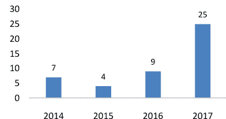

图12.1 加速加州无人驾驶道路测试许可的颁发。

全球无人驾驶行业正在以越来越快的速度发展。2014年，有7家公司获得加州无人驾驶道路测试许可；2015年有4家，2016年有9家，2017年有25家。仅2017年获得加州无人驾驶道路测试许可的公司数量就超过了总数的一半，呈现出爆发式增长趋势。这一现象表明，全球无人驾驶行业正在快速发展，世界各地的主要公司都专注于无人驾驶汽车的研究，该领域的竞争日益激烈。

随着智能电网路线图的发布，无人驾驶汽车的核心技术将得到进一步界定。随着智能网联路线图的发布，无人驾驶所需的核心技术将得到进一步明确，整个行业将朝着网联化和其他无人驾驶核心技术方向发展。

远见工业研究院发布的《中国无人驾驶行业发展前景与投资战略规划分析报告》显示，到2025年，无人驾驶市场价值将达到2000亿至1.9万亿美元。到2035年，全球无人驾驶汽车销量将达到1180万辆。从2025年到2035年，无人驾驶汽车的复合年增长率将达到48.35%，到那时中国在全球无人驾驶汽车市场的份额将达到24%。

##### 12.2.1.2 全球自动驾驶渗透率将快速增长，市场空间可能超过千亿美元

SAE将自动驾驶划分为六个等级，0级为完全手动驾驶，5级为完全无人驾驶，中间各等级包含不同程度的手动驾驶和自动驾驶。目前，1级和2级的自动驾驶技术已相对成熟，3级自动驾驶技术将实现量产，而完全无人驾驶的5级则需要十年以上才能实现工业化。预计在不久的将来，全球自动驾驶渗透率将快速增长。预计到2020年，1级和2级自动驾驶的渗透率

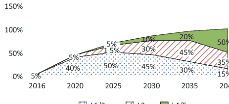

图12.2 不同级别无人驾驶汽车的渗透率。

表12.2 加州道路测试许可颁发时间

| 颁发时间 | 公司 |
| :--- | :--- |
| 2014 | Volkswagen, Mercedes-Benz, Google Waymo, Delphi, Tesla, Bosch, Nissan |
| 2015 | GM, BMW, Honda, Ford |
| 2016 | Zoox, Drive.ai, Faraday Future, Baidu, Wheelgo, Valeo, NIO, Telenav, Nvidia |
| 2017 | AutoX, Subaru, Udacity, Navya, Renault, Uber, PlusAI, Nuro, CarOne, Apple, Bauer, Xiaoma Zhixing, Tucson Future, Jingchi, SAIC, Almotive, Nullmax, Samsung, Voyage, Continental, CYNGN, Roadster, Changan, Lyft |

会达到40%；到2025年，预计超过20%的量产汽车将实现不同级别的自动驾驶；到2040年，所有新生产的汽车都将配备自动驾驶功能，其中4级和5级自动驾驶汽车的渗透率将达到50%，相应的市场规模将超过千亿美元（见图12.2）。

##### 12.2.1.3 初创企业是全球无人驾驶行业推动多产业融合的重要力量

到2017年底，45家公司在加州获得了无人驾驶许可，其中11家是传统汽车制造商，如大众、长安等；6家是包括德尔菲、法雷奥、大陆集团、博世等在内的汽车零部件供应商；7家是科技巨头，如苹果、特斯拉、英伟达等；21家是初创企业，如Zoox、Drive.ai、Celeste、Pony.ai等（参见表12.2），

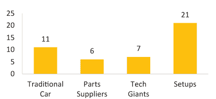

图 12.3 初创公司占比最大。

其中，初创公司占比达 47%，或接近总数的一半，使其成为全球无人驾驶行业的重要参与者（见图 12.3）。

因此，我们可以判断，汽车技术的未来可能会朝着机械、电子、通信与人工智能深度融合的方向发展。传统汽车公司、知名高校和科技巨头将催生更多初创团队，这些团队凭借跨界背景有望实现快速发展。

##### 12.2.1.4 初创公司高速发展重塑无人驾驶行业竞争格局

2014年和2015年，没有初创公司获得加州无人驾驶牌照；2016年，有5家公司获得加州无人驾驶牌照，占总数的56%；2017年，有16家公司获得加州无人驾驶牌照，占总数的64%，这表明该领域呈现出快速发展的趋势。由于初创公司刚进入该行业且负担较轻，预计将实现飞跃式发展。因此，我们可以判断，初创公司最有可能凭借自身优势，在无人车制造与运营、系统方案、关键零部件等领域占据重要地位。

#### 12.2.2 全球无人驾驶技术的发展

交通技术的持续发展为人们的出行带来了诸多便利，汽车更新换代的速度也越来越快。除了强大的动力、个性化的设计和良好的人机交互体验外，还在环保、安全和智能化等方面提出了更高要求。在此背景下，无人驾驶技术拥有广阔的应用前景，是汽车行业的主流趋势。

##### 12.2.2.1 国外无人驾驶技术的发展

西方发达国家对无人驾驶汽车的研究始于20世纪70年代，在可行性和实用性方面取得了重大突破。到20世纪80年代末和90年代初，许多国家退出了无人驾驶汽车研究项目，开始专注于高速公路民用车辅助驾驶项目，因为预期目标过于复杂且技术条件不成熟。然而，这一时期的无人驾驶汽车是半自动驾驶车辆，与真正的无人驾驶汽车之间仍存在很大差距。

直到1999年，美国卡内基梅隆大学开发的无人驾驶汽车成功穿越了美国东西部部分地区。在5000公里的洲际公路上，车辆以每小时50至60公里的速度自动行驶了超过96%的路程，因此无人驾驶汽车项目被宣布取得成功。

2000年，丰田汽车公司开发了无人驾驶巴士及其自动驾驶系统，包括道路引导、防尾随、车队驾驶、运营管理等部分。2007年，德国推出了无人驾驶汽车Lux，该车由普通汽车改装而成，采用了激光传感器技术、智能计算机和全球定位设备。无人驾驶汽车Lux能够处理复杂路况，并在城市高速公路系统中自动行驶。

2010年，柏林自由大学罗哈斯教授率领的一个团队改装了一辆大众Passat，开发出一辆无人驾驶汽车，能够准确识别道路上的其他人和车辆，甚至在地下隧道中也是如此。该无人驾驶汽车利用摄像头、激光扫描仪、热传感器、卫星导航等技术和设备，可根据交通信号调整汽车的行驶状态。

为了根据路况采用更科学合理的驾驶策略，无人驾驶汽车通常需要在车载计算机中构建3D图像。无人驾驶汽车可通过分析路况、车辆位置等数据，为汽车制定科学合理的驾驶路线，为乘客或控制者提供预计到达时间。

2010年，伦敦希思罗机场使用了名为ULTra的无人驾驶汽车，该车由布里斯托尔大学及一些先进的运输系统公司共同开发，但该车需要在专用道路上行驶。

法国公司INRIA开发的无人驾驶汽车Saikabo较为成熟，采用了先进的GPS全球定位技术，并配备了触摸屏，乘客或控制者可以通过触摸屏规划驾驶路线。同时，双镜头摄像头可以准确识别道路标志，借助物联网和移动互联网，可以实现车辆与车辆、车辆与道路、车辆与人之间的交互，促进交通信息共享的自由流动，缓解交通拥堵，提高交通网络容量。

##### 12.2.2.2 中国无人驾驶技术的发展

在中国，国防科技大学于1989年研制了第一辆智能汽车；1992年，国防科技大学研制了第一辆真正的无人驾驶汽车，中国无人驾驶技术的研发正式开始并进入探索阶段。

Cyber C3智能汽车是由上海交通大学主导的城市无人驾驶汽车项目，主要在非结构化道路（如城市非主干道，道路类型和环境背景复杂，车道线和道路边界不明确）上行驶，平均时速低于10公里/小时，具备自动定位、导航、驾驶、避障和交互能力。

西安交通大学郑南宁教授于2001年底成立了无人驾驶智能汽车项目，并于2002年推出了无人驾驶汽车“思源一号”；2005年，“思源一号”成功完成了校园道路环境测试。此后，项目团队尝试将“思源一号”智能汽车驶出校园，并开展“新丝路挑战”计划，旨在让“思源一号”从西安自动行驶至敦煌，但在实际测试中发现，“思源一号”难以适应真实的交通环境。经过10多年的研究，“思源一号”逐步取得重大突破：可以从特定路段行驶到复杂道路，从直线行驶到转弯和超车，速度从每小时10–15公里提高到70–80公里。

2011年，一汽红旗HQ3无人车完成了286公里的道路测试；2015年，百度无人驾驶汽车完成了北京开放高速公路自动驾驶测试；2016年，长安无人驾驶汽车完成了2000公里的超级自动驾驶测试，这一切都标志着中国无人驾驶技术日趋成熟。

在无人驾驶技术快速发展的过程中，涌现出许多其他新技术。根据《汤森路透知识产权与技术报告》，2010年至2015年间出现了22000项与无人驾驶技术相关的专利，其中许多技术已投入使用。尤其是在深度学习算法和云服务技术的支持下，无人驾驶技术的发展速度越来越快。

#### 12.2.3 无人驾驶商业应用的全球前景

由于无人驾驶汽车必须安装雷达、摄像头和人工智能系统，其初始制造成本将很高，价格自然也会非常高，普通消费者无法承受。因此，率先采用无人车的领域将是某些特殊行业和特殊人群，例如快递行业、工业企业、出租车、为老年人或残疾人提供服务等。

##### 12.2.3.1 公共交通

未来，公共交通行业将大规模使用无人驾驶车辆。据德克萨斯大学奥斯汀分校对共享无人驾驶车辆（SAV）进行的一项研究表明，一辆共享 SAV 可以替代 11 辆传统汽车，并使运营里程增加至少 10%。这意味着，随着共享 SAV 的广泛使用，交通拥堵可以得到有效缓解，环境退化可以得到有效控制，并且由于使用便捷，共享 SAV 将成为人们首选的交通方式。

为了推广无人驾驶车辆，一些城市计划为无人驾驶车辆划定特殊区域，其中有人驾驶车辆和无人驾驶车辆不会同时运行，无人驾驶出租车和共享 SAV 将承担为用户提供所有交通服务的责任。为了为无人驾驶车辆创造良好的运营环境，城市规划部门将进行区域优化。

##### 12.2.3.2 快递车辆和工业应用

无人车辆也将广泛用于快递行业的排队卡车领域。随着互联网电子商务的快速发展，快递公司迅速涌现。在线购物的消费者总希望以最短的时间收到货物，尤其是新鲜水果和其他食品，他们希望快递公司能在几小时内将货物送到家。根据商务部提供的数据，2018 年上半年，中国电子商务行业销售额达到 4.08 万亿元，其快递包裹总量超过了 2015 年的全年业务量，且更多电子商务公司承诺当日达，进一步推动了电动汽车和卡车配送的发展。

电动汽车和卡车数量的增加在一定程度上导致了交通事故数量的增加。根据一项调查，在美国，卡车行驶里程占总机动车行驶里程的 5.6%，但卡车造成的交通死亡事故占交通死亡事故的 9.5%。一般来说，大卡车的生产成本超过 15 万美元，如果配备摄像头和传感器，成本可能更高。相比之下，小型汽车的生产成本本质上更低。因此，由于成本限制，在早期阶段很难实现无人驾驶卡车的大规模采用。

##### 12.2.3.3 老年人和残障人士

目前，无人驾驶车辆已大规模用于两类人群：老年人和残障人士。由于身体局限，老年人和残障人士面临出行不便的问题，使用无人驾驶车辆可以帮助这两类人解决出行问题。

预计到 2050 年，美国老年人口将超过 8000 万，占总人口的 20% 以上，其中三分之一将面临出行问题，中国也是如此。到 2050 年，中国老年人口预计将占总人口的 33%。在日本，到 2060 年，老年人占总人口的比例预计将达到 40%。同时，残障人群的规模巨大。例如，美国约有 5300 万残障人士，占成年人口的 22%。约 13% 的美国成年人有行动障碍，4.6% 有视觉障碍。

这些残障人士和老年人为推广使用无人驾驶车辆提供了广阔的市场，两类人都寻求独立，希望能够自由出行。正是无人驾驶车辆可以精准满足他们的需求，使他们能够独立生活，并对生活保持积极乐观的态度。

#### 12.2.4 世界领先公司的无人驾驶汽车研发

近年来，互联网、人工智能等技术的发展为无人驾驶汽车的发展奠定了技术基础，世界领先的互联网公司和汽车巨头凭借其在无人驾驶领域积累的技术优势，在无人驾驶汽车发展中构筑了某些竞争壁垒。

##### 12.2.4.1 特斯拉计划实现完全无人驾驶

电动汽车制造商特斯拉在驾驶辅助技术和无人驾驶技术领域处于领先地位，其首席执行官埃隆·马斯克认为完全无人驾驶技术大有可为，完全无人驾驶可在 2 到 3 年内实现，而监管批准仍需 1 到 5 年。2015 年 10 月，特斯拉在 Model S 上安装了 Autopilot 软件，该软件允许车辆自动转向、变道和停车，但特斯拉在 2016 年夏天因 Autopilot 中发生的首起交通死亡事故受到批评，尽管 Autopilot 本身未被发现存在安全缺陷。

事故发生后，特斯拉与 Mobileye 终止了合作关系，并开始致力于增加对雷达和摄像头系统开发的控制。特斯拉已向公众承诺半自动驾驶和完全无人驾驶服务。它已为其 Model 3 收到 40 万份订单。特斯拉还拒绝与 Uber 合作开发无人驾驶车辆。

自 2016 年 10 月以来，特斯拉生产的所有汽车都配备了新的传感器和计算机软件包——Autopilot Hardware 2，当软件成熟时，该软件包将允许汽车完全无人驾驶。该系统用 Nvidia’s DrivePX2 取代了 Mobileye’s EyeQ3，用户需要付费激活才能享受完全无人驾驶功能。根据用户反馈，Autopilot 2.0 软件的初始应用效果不佳，但该系统此后已更新和改进。

特斯拉延续了此前一贯的作风，向公众承诺了交付无人驾驶功能的激进时间表，并计划在 2017 年底前发布该功能。该公司扭转了之前的数据收集策略，使用客户的车载摄像头收集视频信息以创建新系统。特斯拉无人驾驶用户协议还规定，希望从共享车辆中获益的客户只能在特斯拉网络上进行交易。此外，特斯拉收购了 SolarCity，以创建一个完整的可持续交通生态系统。

##### 12.2.4.2 沃尔沃计划于 2021 年实现自动驾驶

在自动驾驶乘用车领域，沃尔沃取得了巨大进展。沃尔沃在安全技术创新领域享有盛誉，将与自动驾驶车辆相关的技术称为“智能安全”，希望利用这些功能将沃尔沃汽车的致命事故发生率降至零。过去，2017 年，沃尔沃成功为瑞典的 100 位客户提供了配备自动驾驶功能的 XC90 SUV，尽管在自动驾驶区域、时间和条件方面存在诸多限制。

沃尔沃承诺，如果车辆在自动驾驶时卷入事故，将承担全部责任，并宣布将自动驾驶计划扩展到美国和中国。沃尔沃与宝马等竞争对手保持同步，并设定了 2021 年的截止日期，以实现自动驾驶汽车的全面部署。

在跟上竞争对手的同时，沃尔沃也在积极寻找合作伙伴，与瑞典的 Autoliv 合作成立自动驾驶合资企业 Zenuity，该合资企业计划率先商业化驾驶辅助系统，并在 2019 年将其提供给其他汽车制造商。

##### 12.2.4.3 百度计划分拆其自动驾驶汽车业务以实现量产

从 2015 年开始，百度就进行了无人驾驶技术的公开测试。2016 年 11 月，百度邀请公众乘坐一辆国产电动无人驾驶汽车体验无人驾驶技术测试，测试持续了一周。同时，百度还获得了加州无人驾驶汽车自主测试许可。2016 年 6 月，百度宣布希望在五年内实现自动驾驶汽车量产，为此在硅谷设立了人工智能研究实验室。2018 年 9 月，百度启动了无人驾驶移动开发基金项目，总项目价值为 15 亿美元。百度总部计划生产少量无人驾驶汽车，并计划在 2021 年实现无人驾驶汽车量产。

##### 12.2.4.4 奥迪成立自动驾驶子公司

奥迪基于 A7 和 RS7 车型发布了多款自动驾驶汽车原型车，其中部分车辆已开始面向消费者进行测试。2016 年 7 月底，奥迪成立了

作为其全资子公司，SDS专门用于开发无人驾驶技术，通过此举奥迪加入了无人驾驶领域的竞争。2017年4月，奥迪聘请了特斯拉自动导航项目的前负责人担任自动驾驶分部的CTO，凸显了奥迪进入无人驾驶领域的决心。

根据奥迪的发展计划，A8旗舰轿车中的自动驾驶技术将实现商业化。L3级自动驾驶功能被定义为“特定条件下的自动驾驶”，其商业应用需经监管机构批准。作为大众的豪华品牌，奥迪进入自动驾驶领域意义重大。

奥迪、戴姆勒和宝马已经合作成立了一个联盟，耗资31亿美元收购了诺基亚HERE地图的精密定位资产。近年来，HERE正在加快其标准化车辆传感器数据采集和传输的计划。

##### 12.2.4.5 微软寻求与车企合作

微软也参与了自动驾驶汽车研究，在初期阶段，微软的战略是开展合作。例如，2015年11月，微软达成协议，利用其HoloLens技术与沃尔沃合作开发自动驾驶汽车。

2016年3月，微软宣布扩大与丰田的五年合作伙伴关系，为丰田在机器人、自动驾驶、AI及其他领域的研究提供有力支持。截至2016年6月，微软的战略仍然是为合作伙伴公司提供技术支持，且尚未推出自己的研发战略。微软自身的Azure云业务因其汽车客户业务而实现了快速增长。据相关报道，微软也参与了由宝马、戴姆勒和大众掌握的先前HERE HD地图服务，并持有一定股份。

##### 12.2.4.6 丰田的“守护天使”

2014年，丰田发表声明称，出于安全原因，它不会开发无人驾驶汽车，但这一立场此后已被推翻。2015年，丰田宣布将投资10亿美元开发无人驾驶汽车，并成立了丰田研究院（TRI）来研究无人驾驶技术，聘用了斯坦福大学和麻省理工学院的教授和研究人员，并邀请无人驾驶汽车公司捷桥机器人（Jaybridge Robotics）加入。

2016年4月，丰田宣布与密歇根大学合作共同开发无人驾驶汽车，这是丰田合作的第三所大学。

丰田计划将无人驾驶汽车的研发任务分配给三所大学，由密歇根大学负责完全无人驾驶汽车的研发，斯坦福大学负责部分无人驾驶汽车的研发，麻省理工学院负责机器学习算法的研究。2016年8月，丰田增加了对每所大学的投资，向密歇根大学投资2200万美元，以推动机器人技术和无人驾驶技术的研究。

丰田计划在2021年让AI汽车上路。TRI首席执行官吉尔·普拉特一直是“守护天使”系统的大力支持者，该系统仅在人类驾驶员即将面临危险或操作失误时才会启动，以监控和干预驾驶员的行为。目前，TRI正在研发第二套系统Chauffeur，旨在实现L4和L5级无人驾驶，该系统将在“守护天使”之后部署用于应用。2017年3月，该研究院向公众展示了一个更新的自主开发平台。

### 12.3 技术路线：无人驾驶行业的关键技术

#### 12.3.1 无人驾驶技术的关键组件

近年来，大学、研究机构和技术公司积极探索无人驾驶领域，创建了许多无人驾驶汽车项目，无人驾驶汽车市场已进入爆炸式增长阶段。根据前瞻产业研究院发布的《无人驾驶汽车行业发展前景及投资战略规划分析报告》，2016年全球无人驾驶汽车市场规模为40亿美元；2018年，全球无人驾驶汽车市场规模为48.2亿美元；到2021年，全球无人驾驶汽车市场规模将达到70.3亿美元。为了促进无人驾驶行业的快速发展，各国都在聚焦其他相关技术的研究。

无人驾驶技术是一个庞大而复杂的系统，实现了多个领域和学科的有机融合，包括以下内容。

##### 12.3.1.1 汽车的系统结构

汽车的系统结构为汽车系统构建了骨架，并定义了无人驾驶汽车系统硬件和软件组织、集成方法以及支持流程的原则。

##### 12.3.1.2 外部环境的感知与识别

人工智能系统是一个数据驱动的系统，无人驾驶汽车系统也不例外。无人驾驶汽车感知环境和掌握实时道路信息的核心手段是基于车载传感器的外部环境感知与识别技术。在外部环境感知与识别技术的支持下，无人驾驶汽车可以让车载智能系统实时获取道路上物体（例如行人、汽车、障碍物等）之间的相对位置、距离、速度等信息，为汽车的决策和指令执行提供必要支持。

##### 12.3.1.3 定位导航系统

在无人驾驶汽车行驶过程中，定位导航系统将提供汽车位置、速度、方向等各种信息，这是无人驾驶汽车的基础软件。经过多年发展，定位导航技术体系不断完善，卫星导航技术、道路地图定位技术、视觉定位技术、轨迹估计技术、地图匹配技术、惯性导航技术等多种定位导航技术相继出现。事实上，在实际情况中，两种或两种以上的定位导航技术会同时应用，以提高导航的准确性和效率。

##### 12.3.1.4 路径规划技术

无人驾驶领域的路径规划技术是指无人驾驶汽车的智能系统通过分析道路状况、车速、行驶距离、信号灯数量等数据，在既定起点和终点之间设计安全高效的行驶路线的技术，这需要应用统计学、大数据、云计算等技术。

在路径分析方面，人类驾驶员在驾驶汽车时可以结合实时道路状况做出灵活决策，但在无人驾驶状态下，智能控制系统需要利用高精度3D道路模型，高效计算汽车与周围事物之间的相对位置、距离、速度等信息，从而实现安全驾驶。

道路状况思维模型需要实时调整，这一过程将涉及海量数据，必须借助GPU或分布式神经网络算法进行高效处理。需要指出的是，为了实时更新高精度三维道路地图，有必要在区域内自动驾驶汽车的智能系统之间共享数据。为了获取更丰富、更多样的道路状况信息，自动驾驶汽车需要安装激光测距雷达、惯性雷达以及各种传感器等软硬件设备。

在路径规划方面，路径规划不仅需要高精度三维道路地图，还高度依赖高精度定位技术。无人驾驶汽车必须能够实时感知和识别自身位置，执行智能系统设定的最佳路线方案，遵守交通秩序，及时避开障碍物，并坚持以人为安全为第一优先，安全高效地完成驾驶任务。

路径规划功能主要包含三个方面：

- (1) 车道规划会综合考虑整体环境，在出发点和目的地之间设计最佳路线，同时兼顾乘客的个体需求。

- (2) 通过整合车道信息，并利用导航、传感器、智能算法等手段和工具，选择最佳行驶车道。

- (3) 通过理解车道信息、充分运用深度学习算法、分析车道对车速、转向等方面的具体要求所形成的条件，使智能系统在控制车辆行驶时能够做出更科学、更合理的决策。

##### 12.3.1.5 车辆控制技术

在获取环境信息的前提下，应使用车辆控制技术，通过自动转向控制系统使汽车保持平稳行驶状态；在具体的道路行驶中，车辆控制技术不仅可以控制汽车的行驶速度和距离，还可以使汽车完成超车、变道等驾驶操作。为了实现这些多样化功能，有必要在无人驾驶汽车中安装控制和操作系统，例如卫星导航系统、自适应巡航控制系统、紧急制动系统、车道偏离系统、自动泊车系统等。

- (1) 紧急制动和卫星导航系统：当出现紧急情况时，制动系统将立即启动以响应，确保无人驾驶汽车处于人类的有效监控之下。

- (2) 自适应巡航控制系统：该系统旨在确保无人驾驶汽车与前车保持安全距离，从而使汽车在道路上安全行驶。

- (3) 车道偏离检测系统：该系统旨在确保汽车能够遵循道路标志和声音指引进行行驶。当车辆发现车道偏离迹象时，它会进行快速方向调整，以避免汽车行驶错路。

- (4) 自动泊车系统：这是确保无人驾驶汽车能够自动停在正确位置，并能安全驶出的系统。

这些技术相互作用，将确保无人驾驶汽车能够有目标、有方向地安全工作。

上述技术表面上看似相互独立，但实际上，它们可以系统地分为三个层次：感知层、决策层和执行层。其中，外部环境的感知和识别归入感知层，定位导航系统和路径规划归入决策层，车辆控制技术归入执行层。除了这些主要技术之外，无人驾驶还涉及许多其他技术，详细内容如下。

#### 12.3.2 感知层：收集环境和驾驶信息

无人驾驶汽车充分利用雷达、传感器、卫星导航系统、人工智能计算模块以及其他硬件和软件设施之间的协作，使汽车能够在没有任何人干扰的情况下自主驾驶。无人驾驶汽车将配备大量车载传感器，这相当于给汽车装上无数只眼睛，因此，无人驾驶汽车比普通汽车安全可靠得多。

在无人驾驶过程中，最重要的是基于环境感知实施无人操作，而这项技术在无人驾驶技术中起着基础支撑作用。除了进行环境感知之外，这项技术还涉及车辆控制技术的应用，也就是说，无人驾驶的发展必须依赖环境感知和车辆控制技术的支持。

在相对完善的无人驾驶系统中，信息采集网络收集汽车周围环境的信息，然后由智能算法制定驾驶计划，随后使用智能车辆驾驶控制器将汽车送至目的地。

感知层是无人驾驶汽车获取外部信息的重要渠道。目前，无人驾驶汽车用于感知外部环境的智能传感器系统主要包含三个部分：视觉传感器、LiDAR 和毫米波雷达。通过视觉传感器进行的导航也称为视觉导航。车辆将通过摄像头获取道路周围环境的局部图像，并利用图像识别等技术，实现车辆定位和周围环境检测。

LiDAR 使无人驾驶汽车能够实时监测动态障碍物，并具有抗光干扰能力和高检测精度的特点，可为动态障碍物监测和运动状态评估提供有力支持。LiDAR 能够获取许多环境参数，如线数、精度、点密度、扫描频率、检测距离、水平和垂直视场角等，提供位置和距离等基本信息，以及目标物体密度反馈，从而使算法能够推导其反射率，这有助于深入分析。

毫米波雷达的频率范围在 30 到 300 GHz 之间，类似于低频段或厘米波段，能够实现全天候成像。高频段充分利用红外波的高分辨率。毫米波雷达和 LiDAR 遵循相同的检测原理，它们利用物体对雷达波的反射来获取目标物体数据，但毫米波雷达技术更成熟。在穿透性和成本方面具有某些优势，但缺点也更为突出，例如，频段对检测距离的影响太大，难以感知行人，且无法实现精细目标识别。

无人驾驶汽车探索项目的主流趋势是通过综合运用多种智能传感系统，提高汽车感知自身运行状态和周围环境的能力。一般来说，无人驾驶过程包含两个步骤：第一步是利用雷达等技术获取环境信息；第二步是基于对环境的判断控制汽车的制动和转向系统，以确保汽车能够在道路上安全平稳地运行。通过结合这两个模块并发挥它们之间的协同作用，整个无人驾驶过程即可完成。

汽车可以利用环境感知技术捕获其当前位置、道路、周围车辆和障碍物的信息，并将这些信息发送到汽车内的中央计算机，以便掌握行驶途中情况，帮助汽车设定和调整驾驶路线，最终达到计划目标。换句话说，汽车可以通过环境感知技术获取其位置和周围物体的信息，判断这些物体的性质及其与自身的距离，并从宏观层面掌握当前环境信息。

在现阶段，环境感知中使用的技术主要包括视觉感知、激光感知和微波感知。借助这些技术，汽车传感器、车载通信系统和雷达系统可以捕获环境信息，利用信息技术呈现二维或三维图像，并将获取的信息发送到信息处理终端，技术人员将处理三维图像以感知和判断汽车的实时环境。此外，不同汽车还可以相互连接，以收集不同车辆的实时环境和驾驶信息。远程通信技术和李永乐的无线网络技术在无人驾驶领域的应用，有效提高了汽车感知环境的能力，并促进了无人驾驶整体的发展。

#### 12.3.3 决策层：路径规划与实时导航

无人驾驶汽车决策层的主要功能是规划驾驶路线并提供实时导航服务。实现这两项功能需要使用高精度地图，也称为“高清数字地图”。高精度地图与普通地图的区别在于，前者更准确、信息更丰富，并且专门用于无人驾驶汽车。

无人驾驶汽车无法使用普通地图，原因是普通地图标记的信息很简单，用两条平行线表示道路，用交叉点表示十字路口。人们可以根据这些简单信息运用认知能力进行判断，但无人驾驶汽车很难以这种方式运作。因此，高清数字地图是三维的，涵盖了大量信息，包括车道线和附近设施的坐标位置，并且精度极高，可达厘米级。

与普通电子地图相比，高精度地图的另一个特殊功能是其能够收集道路激光雷达反射的强度。对于人类驾驶员来说，此功能没有意义，但对于自动驾驶汽车来说，它极其宝贵。道路激光雷达反射强度是一种变化非常缓慢且微小的道路特征，可以利用光学雷达为定位无人驾驶汽车提供依据。通过将使用光学雷达扫描获得的信息与高精度地图中已有的信息进行比对，无人驾驶系统将能够精确定位车辆位置。

无人驾驶决策系统的运行需要两个条件：一是独立的智能车辆，二是智能交通系统，例如V2V。V2X是除高精度地图之外还能实现路径规划的另一项技术，它基于V2I。V2X允许车辆连接到周围环境，形成一个涵盖车对车通信系统、车对多种通信系统（如基础设施通信系统和车对行人通信系统）的物联网。

如果车辆在行驶过程中能够“获取”信号灯信息，而不仅仅是“看到”信号灯信息，则可以完全避免闯红灯。这里的“获取”是指，当传感器尚未“看到”信号灯时，例如在距信号灯100米的距离处，信号灯会主动向车辆发送当前信号状态、变化时长等信息，提醒车辆减速、加速或刹车，从而避免闯红灯。此外，如果无人驾驶汽车在行驶过程中能够“获取”周围车辆的驾驶意图，例如停车、变道、转弯等，将能够有效避免交通事故。

在高精度数字地图和V2X通信网络的支持下，自动驾驶系统可以利用搜索算法准确评估各种驾驶行为的成本，从而规划最佳行驶路径。

#### 12.3.4 智能交通执行层：对汽车运行的精确控制

在整个控制系统中，执行层位于最底层，其主要功能是执行制动、转向、加速等操作。系统使用“线控装置”来控制方向盘和节气门，并配置由多个处理器组成的子系统，以对自动驾驶车辆的整个机械系统进行稳定、准确的控制。

汽车驾驶控制器是实现车辆控制和自动驾驶的核心模块，包含两种功能：一方面，它将结合自动驾驶汽车的动力学特性和车内传感器的性能，通过调整车辆行驶参数，以安全、高效、低能耗的方式完成驾驶任务；另一方面，基于无人驾驶汽车的动力学特性和传感器识别性能，汽车将能够像拥有多年经验的驾驶员一样进行思考和决策，同时还可能考虑安全、经济、舒适、伦理等众多因素，并根据实时道路状况调整行驶状态，这同时将为乘客带来良好的出行体验，并保持车辆与其他车辆和行人之间的和谐。

对车辆的精确控制是自动驾驶的关键，车辆控制的基本原则是确保人员和车辆的安全，这显然需要先进制动系统的大力支持。当汽车发生事故时，制动系统能够在智能驾驶控制器的指令下进行精确、实时的制动，以避免或减轻事故的负面影响。在配备强大制动系统的同时，智能车辆还需要更智能的控制算法，这是赋予制动系统更强控制力、精确性和鲁棒性的主要手段。

目前，几乎所有自动驾驶汽车项目都可能利用机器学习等技术，让汽车学习和模拟人类驾驶经验，并将其与智能系统相结合，实时分析和控制车辆。但是，如果无人驾驶汽车具有处理紧急情况的能力，将能够有效控制风险；用于处理紧急情况的智能系统不会像人类那样，在面对紧急情况时可能感到紧张和恐慌，因为无人驾驶汽车的决策是理性且果断的，当然，其前提是强大的“智能大脑”。

安全是无人驾驶汽车的首要考虑因素。在人工驾驶状态下，驾驶员的驾驶技能、心理素质、紧急情况处理能力、操作习惯等方面存在一定差异。当驾驶员遇到紧急情况时，可以采取差异化的应对措施，但无人驾驶汽车没有情感，安全保障应作为首要任务。其次，我们还应考虑汽车的使用体验。目前，市场上的智能汽车主要是提供驾驶员辅助服务的半自动化汽车，因此确保无人驾驶汽车乘客的舒适体验是未来的一个重要问题。

未来，成熟的人工智能将能够像人类一样分析周围环境并做出决策。在分析特定场景下的驾驶策略时，不需要每次都重新分析，而是可以利用汽车处理该场景的先前策略来控制车辆，或模仿前方车辆，这将对汽车行业产生颠覆性影响，人类生活也将发生重大变化。

理论上，无人驾驶汽车将通过感知、决策和执行系统的结合，具备“驾驶”的条件。正如《无人驾驶：智能汽车与前方之路》的作者Hod Lipson和Melba Kurman所说：“尽管技术几乎已经准备就绪，但部署这种独特技术的社会环境可能尚未就绪。例如，管理无人驾驶的法律法规尚未完善。然而，无人驾驶汽车的数量必将增加，基于无人驾驶汽车的高效率和安全性等优势，无人驾驶汽车时代最终将到来。我们认为，‘无人车辆’的发展趋势是不可阻挡的。”

#### 12.3.5 无人驾驶在智能交通领域的应用

无人驾驶技术包括人机交互技术、智能控制系统、防抱死制动系统、牵引或稳定性控制系统等。以下对这些技术在智能交通领域的应用进行详细分析：

- (1) 人机交互技术确保行车安全：智能交通系统将人类安全作为首要任务，车辆与人类需要相互交互，以确保人类安全的方方面面，这需要使用人机交互技术。人机交互不仅涉及车辆与车内人类之间的交互，还涉及车辆与车外人类之间的交互。目前，无人驾驶汽车领域中关于人机交互技术的研究更多侧重于车辆与外部行人之间的交互；通过构建一种让车辆与人类能够高效、便捷地交互的通信机制，可以实现车辆与道路之间的高效协作。从长远来看，未来的无人驾驶汽车在进行智能决策时将模仿人类的行为模式。

高效便捷的人机交互能为用户带来更好的出行体验，这对提升无人驾驶汽车的市场竞争力有非常积极的影响。如果没有人机交互，汽车很难完全理解人类的需求。无人驾驶汽车将实时分析海量数据，用于路径规划、变道、避障、停车等。

- (2) 智能控制系统提升出行体验：车辆的智能决策是评估无人驾驶汽车性能的重要指标。通过传感器及其他设备获取的数据将由处理器处理，并应用数据模型和智能算法来实现最优决策。当然，这种智能算法应具备自学习和自我完善能力，以便在各种驾驶场景中满足无人驾驶汽车的实际需求。自动控制是决策指令的执行者，使汽车能够做出一系列行为动作，例如加减速、转弯、避障等，这些行为直接影响人类的出行体验。

在许多交通事故中，由人为因素引起的交通事故占比相当高，因为当人受到声音、图像或其他外部因素刺激时，会感到疲劳和心理波动，从而导致人为错误，威胁人身和财产安全。基于无人驾驶技术的智能控制系统可以长时间保持客观和冷静。

没有任何疲劳感，从而可以有效减少人为造成的交通事故数量。

- (3) 防抱死制动系统减少交通事故：防抱死制动系统（ABS）是应用较为广泛的相对成熟的无人驾驶系统之一。未配备ABS的车辆在紧急制动事故后可能会出现轮胎锁死，导致汽车打滑，经验丰富的驾驶员可以通过反复踩踏制动踏板来避免轮胎锁死，但大多数驾驶员在几秒钟内容易分心，甚至将油门踏板当作制动踏板。当车辆配备防抱死制动系统时，在发生事故时，系统可以在轮胎即将锁死前实时监控轮胎状态，并采取有效措施来降低交通事故的可能性。

- (4) 支持车辆自主行驶的牵引力或稳定性控制系统：牵引力或稳定性控制系统也是广泛应用于无人驾驶系统的技术。与防抱死制动系统相比，该系统更加复杂，可以实时监控道路状况、车速、行驶方向以及关键部件的工作状态等信息，以便在发现车辆可能失控和翻车时及时采取有效措施，确保行驶安全。在真正意义上的无人驾驶中，汽车可以独立高效、安全地完成乘客或控制者下达的任务。

- (5) 各系统的交互真正实现无人驾驶：交通信息采集系统、信息处理与分析系统以及信息发布系统是与无人驾驶技术密切相关的智能交通系统。在这些系统中，交通信息采集系统基于全球定位系统（GPS）技术以及包括红外线雷达探测系统在内的多种系统构建；信息处理与分析系统通常应用于GIS应用系统、专家系统等；而信息发布系统则在很大程度上依赖于移动互联网、手机终端等媒体技术。

像美国、日本等发达国家凭借在计算机控制、网络技术、定位导航、人工智能等领域的领先优势，率先构建了以无人系统为核心的智能交通系统，因此无人驾驶汽车项目大量涌现，在探索和实践中成本更低。

#### 12.3.6 无人车辆对城市交通流的影响

近年来，随着城市人口和私家车数量的不断增加，城市交通拥堵问题日益严重。为了更好地规划城市道路网络，使城市道路建设的规模和形式更加合理，人们开始分析城市交通效率及其影响因素。影响交通流的因素多种多样，那么无人车辆在这些因素中扮演什么角色呢？

无人车辆配备车载传感器以收集车辆周围的环境数据。车载传感器主要由摄像头、全球定位系统、激光雷达等部分组成。同时，无人车辆中的智能处理模块可以有效控制无人车辆的运行参数，例如转向参数、速度参数等，以确保无人车辆安全行驶。

具体来说，智能处理模块由决策模块、控制模块等部分组成，可以获取多种数据，包括摄像头采集的视频图像数据、激光雷达采集的点云数据、GPS采集的位置数据、决策模块输出的转向数据或速度数据、控制模块输出的执行结果数据等。智能处理模块用于控制无人车辆的运行。

在许多地区，由于车道数量等原因，交通承载能力非常有限。无人车辆实现自动驾驶，可以缩小车辆间距，确保车辆行驶安全，减少交通事故发生，增加道路交通容量，提高道路通行能力。

##### 12.3.6.1 影响因素分析

影响高速公路通行能力的因素有很多，为进行分析，选取了三个因素，即路线数量、所有行驶车辆中无人驾驶车辆的比例以及道路峰值通行能力，以获取它们之间的对应关系。

无人驾驶车辆没有驾驶员，如果道路上发生紧急情况，汽车的反应时间接近于零。根据数据，无人车辆的平均速度远快于人工驾驶员的平均速度，因此，行驶车辆中无人车辆所占比例越高，道路的通行能力就越高。另外，路线数量越多，道路的通行能力也就越大。除了这两个主要因素外，道路是否有交叉路口也会对道路通行能力产生显著影响，交叉路口越多，道路的通行能力就越差。

交通流不仅受道路通行能力影响，还受地理位置、道路网密度、道路服务水平、区域车辆保有量、通行时间等其他因素影响。将详细分析这五个因素。道路所在地区越繁荣，道路网密度越大，道路服务水平越高，区域车辆保有量越多，高峰出行期间的交通流量就越大。

##### 12.3.6.2 不同道路引入无人驾驶车辆的分析

道路网密度不同的地区，引入无人驾驶车辆所需的方法也不同。首先，道路通行能力受多种因素影响，如果道路状况没有从根本上改变，随着越来越多的无人驾驶车辆上路，道路的通行能力将受到显著影响。为了深入了解这一影响，各组织已经开展了研究，研究结果如下。

首先，在通行顺畅且无人车辆比例低于54%的道路上，随着无人车辆比例不断增加，道路通行能力的增长率将继续放缓；而在无人车辆比例高于54%的道路上，随着无人驾驶车辆比例不断增加，道路通行能力的增长率将加快，但考虑到无人驾驶车辆的制造价格，无人驾驶车辆不宜投入此类道路。

其次，在总体通行顺畅的道路上，当无人车辆比例为40%时，无人驾驶车辆对道路通行能力的影响最大，随着无人驾驶车辆比例继续增加，这种影响将越来越弱。因此，可以在该类道路上引入无人驾驶车辆以缓解交通压力。

最后，在极易拥堵的道路上，当无人驾驶车辆比例达到45%时，道路通行能力最强。随着比例增加，道路的通行能力将下降。这种现象的原因是道路的最大容量限制了交通量的增长，对于这类路段，交通主管部门可以划设无人驾驶车道来缓解交通压力。

将拥堵道路与实际地图对比可知，市中心的交通流量最大，尤其是在周围道路密集的主干道交叉路口处，因此，如果能在此区域开设无人驾驶车道，就可以解决交通拥堵问题。

### 12.4 基于无人驾驶的智能交通管理模式

#### 12.4.1 自由出行与共享模式的深度融合

如果无人驾驶汽车必须取代有人驾驶汽车，我们不仅需要打破物联网、大数据、云计算、传感器、人工智能等技术之间的壁垒，还需要在城市规划调整、交通规则改进、监管体系建设等管理方面取得突破。从众多行业的发展实践来看，技术与管理相辅相成，只有两者协同发展，无人驾驶汽车才有可能实现大规模推广普及。

因此，在探索与无人驾驶汽车相匹配的交通管理模式时，等到无人驾驶技术完全成熟再进行探索就为时已晚，规划、建设、监督等方面的滞后将给技术发展带来许多限制。例如，设定高门槛

道路上的无人驾驶汽车将导致其无法进行道路测试，并给无人驾驶技术的发展带来重大障碍。

世界各国如今都已意识到智能交通管理模式的重要价值。例如，2014年8月，新加坡政府成立了新加坡自动道路交通委员会，从货运、固定路线、点对点运输和公共设施运营四个主要维度，为无人驾驶汽车的发展提供指导和协助。

- (1) 货运：通过自动化卡车车队完成货物的运输和配送。
- (2) 固定路线：在城市内部及城市之间的公共交通路线上提供运输服务。
- (3) 点对点运输：通过共享车辆满足点对点及短途出行的需求。
- (4) 公共设施运营：提供植物灌溉、垃圾收集和道路清扫等公共服务。

2017年12月，由北京市交通委员会会同市公安和交通局以及市经济信息化委员会联合发布了两份指导文件，即《关于加快自动驾驶汽车道路测试相关工作的指导意见》和《自动驾驶汽车道路测试管理实施细则》，这无疑将对无人驾驶汽车技术及管理模式的进一步发展产生非常积极的影响。

智能交通管理模式的建立应以人们的出行模式为基础，并需突出其人性化与智能化考量。从出行用户数量的角度看，人们的出行模式可分为两类。

- (1) 自由出行：在自由出行模式下，个体出行者对出行工具拥有完全独立的控制权和使用权，可自由分配其内部空间设施，从而满足人们的个性化出行需求。
- (2) 共享出行：在共享出行模式下，两名或以上出行者共同使用一台出行工具，彼此相互影响。内部空间和设施的分配受到一定限制，同时也涉及一定的隐私保护问题。严格来说，只有个人自驾出行才被视为自由出行。

自由出行与共享出行共同存在的一种特殊情况是：当一个人独自乘坐出租车时，出租车司机就像出租车一样是服务提供者，并非共享用户。出租车司机本身是一个拥有独立意识的独立个体，乘客无法忽视其存在，因此其自由将受到限制。如果遇到不道德的出租车司机，乘客及其财产的安全可能会受到威胁。

自由出行的优势主要体现在便利性、安全性和舒适性，而共享出行的优势主要在于低成本和绿色环保，能够有效减少城市汽车总量，缓解交通拥堵和停车难题，并提高资源利用效率。在一定经济条件下，大多数人倾向于选择自由出行，共享意识仍需提升。

从出行工具所有权的角度看，人们的出行方式可进一步分为私家车出行和公共出行两类。当人们使用的车辆所有权不属于用户时，即视为公共出行方式，例如出租车、网约车、公交车、地铁、通勤巴士、旅行车，以及使用家人或朋友的私家车。

在载人驾驶状态下的公共出行，以及两人及以上共享私家车的出行，均不被视为自由出行。待无人驾驶技术成熟发展后，乘坐无人驾驶出租车将类似于乘坐汽车出行，并成为真正的自由出行。

换句话说，无人驾驶出租车将实现自由出行与公共出行的深度融合，让人们既能享受自由出行带来的便利、舒适和安全优势，又能获得公共出行的低成本、绿色优势。考虑到无人驾驶汽车在发展初期价格较高且用户有限，以及无人驾驶出租车可以降低人力成本，无人驾驶出租车率先在市场上大规模应用成为一种自然而然的事情。

#### 12.4.2 无人驾驶出租车与自由出行模式

2016年8月，新加坡的出租车初创公司nuTonomy在新加坡对自动出租车进行了试运行，合格乘客可通过智能手机访问该服务。试运行阶段投入6辆无人驾驶出租车，12名乘客有资格体验，出租车行驶范围限定在2.5平方英里的商住区，且乘客需在特定地点上下车。根据nuTonomy的计划，随着更多无人驾驶汽车投入使用，新加坡汽车总量未来将从90万辆减少到30万辆。2017年10月，Delphi Pike Electric宣布已完成对nuTonomy的全资收购，交易金额为4.5亿美元。

对于像新加坡这样面积小且经济发达的国家，推广无人出租车的难度相对较小，其应用将为人们的出行带来诸多便利，对缓解交通拥堵将产生非常积极的影响。应当指出，公共交通是新加坡交通系统的核心组成部分，无人驾驶出租车的应用并非旨在完全取代传统出租车，而是进一步完善它。在新加坡发布的未来交通发展计划中，预计到2025年，公共交通将承担新加坡高达75%的高峰出行服务。

例如Uber等公司不仅在新加坡，还在加州、密歇根州、匹兹堡等多个城市测试无人驾驶汽车，力求推出无人驾驶出租车服务。特别是对于像Uber这样的网约车公司，在应用无人驾驶出租车后，平台能够为人们的日常出行定制并设计完美的出行计划。通过智能系统可以有效预测人们的出行需求，从而高效分配车辆资源；更重要的是，通过结合大数据和云计算技术，可对不同区域的交通资源分配进行针对性调整，以更好地满足高峰出行需求并降低空驶率。

滴滴研究院联合Uda Xue Cheng和知乎举办的算法竞赛口号为：“改变世界的梦想可以成真，你的算法将应用于现实出行世界，也许有一天你会说：‘在这个城市，我的算法决定你乘哪辆车。’”如果无人驾驶出租车能够大规模推广和普及，人们将不再需要购买、维修和定期保养私家车，这将消除停车难、车辆保险、交通拥堵、故障以及途中事故等各种问题，高度契合人们对美好生活的向往。

儿童、老年人、残疾人以及没有驾照的人也可以通过无人驾驶出租车享受出行自由，这将大幅减少私家车数量，有助于保护环境、减少交通事故，并提升出行效率和体验。

科学研究发现，如果无人驾驶出租车作为城市机动化交通的主要方式加以推广，并严格限制私家车数量，那么城市车辆总量将减少近50%，占用的停车空间减少40%，事故率将降低约90%。如果无人驾驶汽车升级为电动及其他新能源车辆，车辆尾气排放将减少约80%。届时，城市将有更多空间提升居民生活质量，例如建设更多公园、足球场等公共休闲设施，自行车道也可相应拓宽。

为解决市中心空气污染问题，挪威奥斯陆计划在2019年之前实现“零私家车”；西班牙马德里宣布，到2020年将禁止车辆进入约2平方公里的市中心区域。当然，为了满足人们的个性化出行需求，私家车在相当长一段时间内不会消失，但体验驾驶私家车的自由并不一定意味着必须购买私家车，未来可能会出现一些提供无人驾驶汽车长期租赁的服务商。

无人驾驶出租车有助于让公众以更低成本获得优质的共享出行服务。在中国、印度、新加坡等亚洲市场，拼车在大量人群中很受欢迎，这在一定程度上与经济发展水平密切相关。在经济发达的欧洲国家，如

像英国、法国、德国以及其他欧洲市场，人们对拼车的接受度相对较低。然而，不同年龄群体对拼车的接受度存在一些差异。在欧洲市场的拼车意愿调查中，45%的30岁以下受访者表示愿意拼乘出租车，而50岁及以上人群中只有22%的人愿意接受出租车拼车。

无人驾驶出租车的成本对大规模拼车有很大影响：当无人驾驶出租车的成本为20美元时，只有11%的受访者愿意拼车；当无人驾驶出租车成本降低50%至10美元时，愿意拼车的受访者比例上升至37%；当无人驾驶出租车成本进一步降低75%至5美元时，愿意拼车的受访者比例上升至52%。此外，许多受访者积极询问车辆内是否存在玻璃隔断、摄像头等个人安全功能，并表示如果做得当，他们会更愿意乘坐无人驾驶出租车拼车。

使用出租车等小型车辆而非大型巴士的原因是，较小且分散的车辆对满足个人出行需求、改善道路通畅度、疾病预防与控制以及反恐安全具有相当积极的影响。

有人说巴士环境可能促进人际互动，但事实是，除了商务会议和与朋友及亲戚出行等少数情况外，人们出行更多是为了自身娱乐和放松，而非与毫无交集的陌生人聊天。因此，大型巴士等大巴场景不仅不能促进人际互动，反而会影响人们的出行体验。

未来，随着城市发展水平的不断提高和无人驾驶出行成本的降低，越来越多的人将选择在小型无人驾驶车辆中拼车或独立乘坐。

#### 12.4.3 基于车路融合的智能交通管理

从出行模式角度探索智能交通管理模式，将符合以人为本的发展理念。然而，若要建立健全的智能交通管理模式，仅考虑消费者远远不够，还需考虑涉及的政府部门、制造商、经销商、运营商等各方主体。从无人驾驶汽车的研发设计到投入运营本身就是一个庞大而复杂的系统工程，需要各方协作与交互。

车与车、车与路、车与人之间的通信和交互需要统一的行业标准。同时，仅依靠单一互联网出行平台或汽车企业来挖掘大交通数据的深层潜在价值远远不够，还需要企业资源的共享与深度合作。此外，车辆质量、交通事故等问题尚未明确界定，更为激进的观点主张由汽车企业承担无人驾驶汽车制造与道路运营全过程的责任。

在这种情况下，汽车公司将负责车辆的研发、配置以及道路建设和管理，最终建立起一套车路融合、一体化运营的智能交通产业模式，为城市交通发展提供强有力的支持。

在无人驾驶汽车的研发、生产方面，有必要积极拓展产业链上下游，这有助于提升产业链的价值创造能力并降低成本和风险。百度充分发挥其资源整合优势，与政府部门、零部件制造商、出行服务提供商、车辆制造商、行业协会等展开深度合作，建立和完善“智慧出行”生态，使大众能够享受更便捷、更高效的交通服务。

2016年8月，美国加州硅谷科技公司Velodyne宣布，其激光雷达公司Velodyne LiDAR获得百度和福特的投资，总投资高达1.5亿美元。资金的注入显著降低了激光雷达产品的价格，且得益于Velodyne LiDAR强大的供应能力，Velodyne 64线激光雷达的供应价格从之前的70万元降至50万元。Velodyne LiDAR的一位发言人表示，当64线激光雷达订单量达到百万级时，其成本将降至500美元。

换言之，价格预计将不再是限制激光雷达销售的主要障碍，无人驾驶技术的商业化进程将进一步加速。目前，许多传统汽车公司正在投资无人驾驶初创企业，以抢占先机。为确保无人驾驶汽车的安全并增强其控制能力，未来无人驾驶汽车服务的供应及特定区域的运营管理将由单一企业负责。在这种情况下，无人驾驶汽车公司争取的目标客户将不再是个人消费者，而是城市、区域甚至国家。从行业竞争角度来看，这有助于减少行业内部耗竭，外部竞争与基于行业的区域间竞争将主导行业竞争格局。

自动驾驶出租车等自动驾驶工具只是众多出行方式之一，人们还可以选择自行车、电动汽车、公交车、地铁等其他出行方式。移动互联网和移动智能终端的大规模应用已广泛普及，因此服务更加多样、基础设施更完善的城市和地区将吸引更多人才。

从技术角度来看，将自动驾驶安全性提升至大规模应用水平在技术上是可行的，但达到一定水平后，将安全性从80%提升到99%颇为困难，而从99%提升到99.99%则更加困难。诚然，大数据技术的数据分析能力和云计算技术的算力可以超越人类，但新问题层出不穷。合理解决问题需要综合考虑情感、道德、伦理、法律等因素，解决方案不能仅从技术角度设计。

从长远来看，在无人驾驶进入商业化阶段后的相当长一段时间内，我们不能将安全完全交给无人驾驶汽车和系统，而应将其与更可靠、更安全的辅助手段相结合，例如分类用车和分道行驶。

##### 12.4.3.1 将车辆划分为不同用途

根据实际场景的需求特征，将车辆划分为不同用途将有助于为无人驾驶汽车制定差异化设计和运营管理。从不同角度看，有多种方式对无人驾驶车辆进行分类。

- (1) 从行驶范围来看，无人驾驶车辆可分为市区内低速运行的短途车辆和城际高速运行的长途车辆。
- (2) 从载运对象来看，无人驾驶车辆可分为服务于人员的乘用车和服务于货运的卡车。
- (3) 从乘客数量来看，无人驾驶车辆可分为单人座、双人座和多人座车辆。
- (4) 从不同用户来看，无人驾驶车辆可分为警车、商用车、商务车和家庭汽车。
- (5) 从特殊场景来看，无人驾驶车辆可分为紧急车辆、消防车、能源供应车和工程紧急车辆。

按照车辆分类应用车辆，在减少资源浪费、控制成本和提高服务质量方面具有重要价值。例如，市区内低速运行的短途车辆只需实时更新本地地图，这有助于保留更详细的本地交通信息，减少数据总量，提高车辆系统的速度；对于室内短途车辆和城际车辆，可以采用不同的设计方案，在轮胎、照明、车身材料、传感器等方面进行差异化，以减少资源浪费并提高资源利用率。

在划定车辆运营区域后，该区域的车辆规模将得到有效控制，这能提高交通运营效率和质量，减少交通拥堵和交通事故。随着移动支付的普及和

收费政策改革，未来道路收费站将不复存在，并将被服务用户转移乘客和货物的中继站所取代。

未来，乘客或行李无需下车即可完成转乘或过路。例如，当高速列车到达车站时，乘客将能够在不停车的情况下上下车。对于乘坐无人驾驶汽车出行的人，当前方因交通事故或拥堵而无法通行时，反向行驶的乘客无需原路返回，也可以通过更换车辆继续到达目的地。

##### 12.4.3.2 分道行驶

分道行驶将为行人、自行车、电动车、私家车、公交车及其他不同车辆设置不同车道，它们将在相应车道上行驶，并在行驶范围内控制行驶路线。目前，高速公路和铁路运输已几乎实现分道行驶。在无人驾驶汽车的早期应用中，有必要为无人驾驶汽车设置专用车道，以提高安全性并减少事故的负面影响。

未来，当交通路口的交通信号灯被取消时，从人到车的车道分离将是必然选择，因为普通人难以判断无人驾驶车辆的路线，同时无人驾驶车辆系统也难以在大量不规则车流中发现固定模式。诚然，随着物联网技术的广泛应用，未来行人将能够与无人驾驶汽车交互，但车内乘客可能不愿意妥协，这可能导致不必要的冲突和纠纷，而车道分离将有效解决这个问题。

此外，当无人驾驶汽车和有人驾驶汽车在同一道路上运行时，由于具有统一调度功能的智能交通中心系统对人驾驶汽车缺乏约束力，指令将无法得到有效执行，冲突将频繁发生，这绝不是期望的结果。

### 12.5 从概念到实践中无人驾驶的关键因素

#### 12.5.1 安全：无人驾驶发展的必然归宿

对安全的追求正在推动无人驾驶车辆需求快速增长。根据世界卫生组织发布的数据，全球每年约有120万人死于道路交通事故。在中国，人为造成的交通事故占93%，平均每天有500人死于交通事故。随着无人驾驶汽车的出现，传统的“人—车—路”三元控制将转变为“车—路”二元控制，其结果是消除不可控的驾驶员并实现“零违规”，从而大幅提高交通系统的效率和安全性，显著降低交通事故频率，有效确保行车安全。研究表明，汽车配备自动制动系统后，追尾事故发生率将降低40%；如果所有机动车都配备自动制动系统，每年可减少70万起交通事故。

无人驾驶发展的前提是安全。由于无人驾驶技术仍处于试验和改进阶段，其安全性和可靠性尚未得到广泛认可。例如，英国监管机构要求无人驾驶汽车在上路行驶时必须有人工监控，并且随时可以切换至人工驾驶模式；德国计划出台一系列关于自动驾驶车辆的监管政策，包括要求无人驾驶汽车必须配备方向盘，并安装类似于民用飞机黑匣子的设备，以便在发生车祸时相关调查人员可以根据黑匣子分析事故原因，从而明确各方责任。

瑞典沃尔沃公司的一项调查显示，超过一半的消费者支持在自动驾驶汽车中安装方向盘，80%的消费者表示，如果自动驾驶汽车发生事故，制造商应负责处理索赔，因为事故原因是自动驾驶系统故障。事实上，如果无人驾驶汽车在行驶中遇到紧急情况，用户不信任自动驾驶系统能有效响应，而控制权之争可能会带来极其严重的后果。这是因为驾驶员在自动驾驶过程中往往更加放松，不太注意道路状况，面对意外情况时可能会做出错误判断并使自己陷入危险。

面对驾驶员与车辆争夺控制权的此类情况（交通事故）时，交通部门难以判定事故责任方。另一方面，如果要求驾驶员在车辆行驶中保持警惕并随时准备切换至人工驾驶模式，不如直接采用人工驾驶。这种“人或车”的设计使无人驾驶失去意义，并增加了驾驶员的心理负担，这将使自由舒适驾驶的愿望落空。

此外，从本质上看，这种“人或车”的设计是对无人驾驶安全性的一种不负责任的表现。如果有人工驾驶的“后路”，相关人员将不会专注于无人驾驶安全问题，无人驾驶汽车的设计和制造统一标准也无法在短期内建立，因此用户的安全无法得到有效保障。

2016年5月7日，启用自动驾驶辅助系统的特斯拉Autopilot在行驶中与一辆白色牵引拖挂卡车相撞，Autopilot的车顶被完全撞毁，驾驶员当场死亡。特斯拉对事故的解释是，白色卡车在蓝天背景下未被识别，且从Autopilot的视角来看，牵引拖挂卡车的侧面悬空于地面，导致Autopilot系统误判并未启动自动刹车，从而导致两车相撞。此外，由于车辆碰撞位置位于Autopilot的挡风玻璃处，碰撞安全系统未能发挥作用，驾驶员当场丧生。

该事故引起轰动，因为特斯拉曾声称美国每9400万英里发生一起致命交通事故，而事发时Autopilot辅助驾驶系统已行驶了1.3亿英里。此外，特斯拉强调无人驾驶技术在不断发展，Autopilot并非完美。因此，对于这起事故，究竟谁该受责备？有人认为责任方是特斯拉，有人认为是不注意的驾驶员，还有人认为是传感器供应商Mobileye。对无人驾驶交通事故的这种看法让我们想起了特斯拉与爱迪生之间的交流电之争。

1880年，特斯拉发明了世界上第一台交流发电机，爱迪生发明了电椅，旨在让人们意识到交流电的危险。后来，在双方激烈的较量之后，特斯拉的交流电占据了上风，并为人类文明的发展做出了卓越贡献。因此，所有新事物都是优劣共生的，并没有绝对的好与坏。因此，面对无人驾驶汽车等新事物，我们应把握发展趋势，不能仅因一起事故就完全否定它。

那么，如何解决无人驾驶汽车的安全问题？

为了减少无人驾驶车辆行驶过程中交通事故的发生，无人驾驶汽车制造商应建立严格的定期返厂维护和驾驶紧急处置服务系统，尤其是建立“双系统”控制模式，以解决车辆网络可能遭受破坏的问题，例如黑客入侵、病毒破坏等。“双系统”中的主系统指联网开放系统，而次系统指独立封闭系统。一旦驾驶员发现主系统已被破坏，驾驶员可以立即切换到次系统，以确保车辆正常运行，驾驶员和乘客安全下车，然后将车辆送往维修组织进行维修。

如果说主系统已受损而驾驶员未发现任何异常，例如，由于系统代码被修改，汽车会向前撞上障碍物而不是绕行，而驾驶员可能无法及时切换系统，这将导致交通事故。换句话说，车辆制造商必须为无人驾驶汽车安装防护软件，使车辆能够自动检测故障、查杀病毒，并对防护不当造成的交通事故承担责任，从而不逃避车辆的责任。

制造商在交通事故发生时，导致用户的权益受损。此外，无人驾驶车辆制造商还应确保车辆的内外接口难以拆卸和改动，以防止用户和其他人为破坏车辆，从而有效提高车辆的安全性能。

此外，如果交通部门规定无人驾驶车辆必须随时能够切换到人工驾驶模式，那么最适合引入无人驾驶车辆的公共交通公司和出租车公司将完全失去无需人工劳动的优势。原因是，如果公司不为无人驾驶汽车配备全职司机，他们必须首先检查用户的驾驶执照、是否饮酒或吸毒等。整个流程并未简化，反而变得越来越繁琐，无人驾驶汽车便捷的宗旨可能落空。

综上所述，交通部门不应制定“无人驾驶汽车必须随时能够切换到人工驾驶模式”的规定。否则，这将导致整个行业的标准不清、责任不清，使行业发展陷入混乱和尴尬的境地。换言之，如果为了避免交通事故而接受人工辅助做法，无人驾驶就存在重大漏洞。为实现无人驾驶发展的最终目标，交通主管部门必须改革现有的交通系统，明确无人驾驶车辆制造商、无人驾驶系统软件提供商、无人驾驶公交公司的责任，以及保险公司的责任，让用户放心乘坐无人驾驶汽车。近期，美国联邦政府及一些州已确认无人驾驶的合法性，谷歌无人驾驶汽车已获得美国公路安全管理局的认可，该管理局确认车辆接受自动驾驶系统的控制，而非车主的手动控制。换言之，之前“无人驾驶汽车必须配备方向盘和刹车”的规定已不再适用。

未来，无人驾驶汽车将不再配备方向盘、踏板、仪表、杠杆、观察镜等设备，反而会配备全景门窗、3D屏幕、宽敞敞开式车厢、移动通信和办公设备等。届时，汽车不再是通往生活的“纽带”，而将成为生活空间的延伸，人们的时间和精力将被完全解放，投入到更有意义、更有价值的事情中。

#### 12.5.2 性能：无人驾驶实践

随着用户对无人驾驶汽车需求的爆发，无人驾驶汽车将迅速进入人们的生活，成为日常生活空间的重要组成部分，并成为最重要的交通工具。届时，纯电动无人驾驶汽车的性能将越来越好。无人驾驶汽车不仅会在道路上行驶，还会直接进入办公楼、住宅楼，甚至进入房间内，成为用户的办公室、休息室、会议室，它们可能成为功能齐全的“房车”。

不仅如此，办公区和居住区也可能演变成巨大的“房车”。无人驾驶汽车将像包装一样层层嵌套，小车嵌入中型车，中型车嵌入大型车，从而产生无限变化。当然，纯电动无人驾驶汽车也可以露天停放，利用太阳能充电，同时在行驶之外继续为用户提供服务。

新概念汽车将借鉴碰碰车的理念，车身采用韧性强的柔性环保材料，以减少摩擦和碰撞，缓冲任何摩擦、碰撞及意外撞击造成的损伤。传统金属车身坚固美观，但在环保和节能方面较差，且耐腐蚀性差、隔音性差、安全性差，不太实用。为车身采用新型柔性材料可以让车身发生多种变化，从而创造出伸展车、变形车以及陆地、水上、空中两栖车等多种车型。

此外，使用柔性材料制造车身，是为了使车身的存储、组装和运输更加便捷，而纯无人驾驶电动汽车的结构相对简单，这将使车辆制造更加容易，成本大幅下降。可以预见，在不久的将来，世界各地的道路上将出现外观和尺寸各异的无人驾驶电动汽车。凭借宽敞的车厢、丰富完善的功能、更贴近自然、更低的价格、更大的灵活性和抗灾能力，无人驾驶汽车可以与传统住房相媲美，甚至更受欢迎。

此外，无人驾驶汽车还需要能源便利性。例如，一辆纯无人驾驶电动汽车可以在无需人工控制的情况下提前找到充电站完成充电，或者利用空闲时间充电，乘客可以利用充电时间处理其他事务，因此即使纯无人驾驶电动汽车目前无法快速充电，也无需担心用户浪费时间。在无人驾驶汽车加油的情况下，车辆会自动前往加油站加油，无需乘客在车内，这也可以降低安全风险。此外，在无人驾驶环境下，可以设置更少的充电站，以减少基础设施建设和维护成本。

在续航里程方面，虽然纯无人驾驶电动汽车的续航里程不如燃油车，但它们可以在行驶中完成移动充电，因为纯无人驾驶电动汽车具有更高的能源安全性和更好的运行能力，这就像飞机空中加油一样。需要进行移动充电的纯无人驾驶电动汽车可以转向专用充电服务车，或与之同行的其他纯无人驾驶电动汽车。

为无人驾驶汽车充电的方法可以是直接更换电池，或采用车辆对接方式。无论采用何种充电方式，为无人驾驶汽车充电都比为载人驾驶汽车充电简单得多。主要是私家车在途中进行移动充电，而公共汽车和出租车可以计算行驶距离和用电量，并在适当的时候安排乘客换车出行。

#### 12.5.3 体验：满足用户的生活方式与娱乐需求

##### 12.5.3.1 外观造型、空间布局与基本功能的优化

在无人驾驶条件下，驾驶员的身体姿势可以更加放松，不仅可以坐姿，还可以是躺姿或站立姿势等。为了响应驾驶员的需求，车厢必须被加高和加大，座椅必须能够收纳和缩回，既可作为驾驶员躺卧的座椅，也可放平成为驾驶员躺下的床铺，甚至可以折叠起来以便驾驶员自由站立。加高加宽的车门可采用“步入式”设计，比传统轿车的“坐入式”设计方便得多。此外，车内可以放置一张小折叠桌，创建一个简单的办公空间。

无人驾驶汽车制造商可以根据用户需求设计各种车型，例如单人、双人和多人车辆，以节省能源并降低出行成本。事实上，单人无人驾驶汽车必将深受上班族的欢迎。单人无人驾驶汽车可以设计为单排宽轮车辆，外观类似带有车篷的大型摩托车，这不仅节省空间、驾驶更灵活，还能节能环保。多人无人驾驶车辆可以进一步分为可共享空间的公共汽车、中巴车和具有空间隐私的舱体，这将进一步提升驾驶安全性。无人驾驶汽车可以像火车一样组装，形成一个内部空间相连的大型车辆，因为无人驾驶汽车是按照统一标准设计的。如果需要运输更多物品，可以召集其他无人驾驶车辆，将它们组合在一起以扩大车内空间。

此外，无人驾驶车辆还可以根据驾驶环境和任务分为短距离和长距离车辆，短距离无人驾驶车辆主要在市内行驶，速度不宜过快、功能不宜过于复杂，而应具备强大的综合感知能力。而长距离车辆则主要在城市间高速公路上行驶，因此速度可

被设计得较高，功能应当适当丰富，综合感知能力可以稍微减弱。这种车辆分工可以节约资源并降低成本。

##### 12.5.3.2 基于车联网的通信办公与生活娱乐服务

在无人驾驶环境下，驾驶员无需亲自驾驶，可以利用出行时间做其他事情。根据美国交通部的估计，每个人每天往返上下班大约花费52分钟。在无人驾驶汽车中，人们可以更高效地利用这段时间。如果无人驾驶汽车的车厢足够大，行程时间足够长，并且配备了必要的信息技术设备，无人驾驶车辆可以创建一个舒适的办公空间，使移动办公和移动家庭成为现实，这将真正实现“汽车即服务”和“汽车即生活”的理念。

这样一来，无人驾驶汽车也会涉及用户隐私，对于公职人员而言，甚至可能涉及国家安全。无人驾驶汽车可以使用非实名支付方式来保护隐私和国家安全。同时，用户可以关闭手机的定位功能，使用移动互联网时无需实名认证，甚至可以在乘车期间断开互联网连接。采取这些措施后，即使车辆仍处于车联网的监控之下，车辆与用户之间也不会存在实名对应关系，因此用户隐私可以得到很大程度的保障。此外，用户在行程中可以手动关闭车内的摄像头和指向设备，以避免隐私泄露。

当然，用户通过采取这些措施在阻断安全监控，这将在发生事故时妨碍交警快速处理事故。无人驾驶汽车在切断网络连接后，将真正意义上成为“黑车”，既无法接收指令中心发送的指令，也无法将驾驶意图反馈给指令中心。指令中心只能通过路边的监控和周围车辆提供的信息来监控它。为了确保车辆安全，指令中心和管理部门必须为公共汽车、出租车等交通方式保留一定的监控权限，并利用自动检测技术及时发现危险物品和遗失物品，以确保乘客安全，并为乘客找回遗失物品提供便利。

### 12.6 城市轨道交通中的无人驾驶技术应用

#### 12.6.1 国内外地铁自动化技术应用概况

随着中国经济发展水平的不断提高，各地区轨道交通系统的建设进程正在加快。在大学、研究机构、企业及其他各方的积极努力下，大量新型城市轨道交通技术应运而生，尤其是完全自动化无人驾驶技术在城市轨道交通领域的应用，对促进城市轨道交通系统的质量与效率、改善城市轨道交通网络以及与交通强国的轨道交通系统标准对接具有重大的实践意义。

##### 12.6.1.1 无人驾驶技术的优势

- (1) 完全自动化无人驾驶地铁可以自动唤醒、休眠、清洁、停止、驾驶、开关车门、修复故障等。可以设置常规运行、降级运行、中断运行等不同运行模式，以满足不同场景下的个性化需求，提高运营安全性和乘车体验。

- (2) 无人驾驶列车的启动和停止更加平稳，因此可以以更快的速度为乘客提供高品质的出行体验，并降低人们的出行成本。

- (3) 完全自动化无人驾驶地铁的自动化水平更高，可以显著降低人力和物力成本。诚然，建设这种地铁的成本可能更高，但其在提高地铁运营效率和质量、降低运营成本方面的积极作用是显而易见的。

##### 12.6.1.2 城市轨道交通中外无人驾驶技术应用概况

- (1) 巴黎地铁1号线：该线路最早于1900年7月开通，是该地区最繁忙、最古老的东西向线路，全长17公里，覆盖25个车站。该地铁涵盖凯旋门、卢浮宫、戴高乐广场和香榭丽舍大街等著名景点。2011年，该线路应用了基于Trainguard MT安全控制系统的无人驾驶列车。

- (2) 西班牙巴塞罗那地铁9号线：该线路全长41.4公里，其实时数据传输通过扩展频谱无线电实现，列车由完全自动化无人系统自动驾驶。

- (3) 在日本爱知县名古屋，建造了一套HSST-100磁悬浮系统，线路全长8.9公里，覆盖9个站台，采用ATO（自动列车运行）无人驾驶模式。

##### 12.6.1.3 中国无人驾驶技术应用概况

中国已有大量地铁线路充分利用自动化无人驾驶技术。

- (1) 北京轨道交通机场线：该线路采用完全自动化无人驾驶列车，可以根据客流优化和调整列车运行策略和运行密度，同时配备了相对完善的运行辅助系统，可以实时定位列车、使列车自动折返、缩短运行间隔并提高客运能力。

- (2) 上海地铁10号线：该线路是中国首条应用无人驾驶技术的线路，可以实现更精确的加速和减速控制，无需考虑司机的轮班计划，并且每天启动列车后要进行大量自检。列车具有更高的安全性和可靠性。

- (3) 北京轨道交通燕房线：该线路是中国自主研发的第一条完全自动运行地铁线路，也是继上海地铁10号线之后第二条应用无人驾驶技术的线路。一期工程于2017年底开通，二期工程预计于2020年开通，列车运行平稳高效，可以为乘客提供优质的乘车体验，与普通列车相比可减少10%至15%的能耗。

由于城市轨道交通在特定轨道上运行，行人和其他车辆的干扰较少，无人驾驶技术的应用带来了诸多便利。无人驾驶技术的研究与开发不仅将推动城市轨道交通不断完善，还将为无人驾驶技术在交通领域的大规模应用提供宝贵的参考经验，使人类社会迎来无人交通时代的新篇章。

##### 12.6.2 无人城市轨道交通系统的功能特点

近年来，城市轨道交通的发展进程不断加快，相关支撑技术也在快速迭代。许多人口众多的一线城市不得不承受更大的客流压力，因此只能缩短新线建设周期，增加繁忙线路的数量和班次频率，这必须吸纳更多乘务员、司机等人员，同时无疑还需要投入更多成本。

此外，增加列车班次会增加人工工作的劳动强度，如果长时间进行高强度的体力劳动，容易因疲劳而引发安全事故。鉴于这一情况，城市轨道交通行业越来越多地引入无人驾驶技术。

综上所述，城市轨道交通中无人驾驶系统的功能特点体现在以下几个方面：

- (1) 对列车运行的自动化控制具体体现在列车启动、列车对位、障碍物识别、列车与屏蔽门监控、编组调整等许多其他方面。

工作流程。列车运营可以采用智能运营，而非传统的人工运营，从而实现运营的机电一体化。

- (2) 列车的效率和舒适度可以提高，同时还能节省能源。节能目标可以通过以计划时刻表为参考，合理控制列车运行间隔和运行时间来实现；计算机能有效控制牵引制动的冲击率，且仅在必要时才进行加速和减速。基于对历史客流时空分布、实时断面客流变化、大客流预警信息的分析，并将其与原计划相结合，对开行方案进行调整，并保持列车运行间隔的合理性；如有必要，将立即疏散乘客。

- (3) 车辆、通信和信号系统的运行可以相互协作，各部分形成相对完善的子系统，充分发挥综合监控系统（ISCS）的作用。不同子系统之间的连接得到加强，以在列车救援、设备故障排除等工作中发挥不同功能。COCC与ISCS结合，用于共同实施自动化网络运营，整体提升运营效率。

- (4) 在列车正常运行状态下，开放人机监控界面及相应界面，向运营人员、乘客和维护部门发送相关信息，方便需求者查询和使用；若发生异常，安全程序将自动启动并发出预警，以自动化方式或配合技术人员明确影响程度并查找问题根源，同时开放界面服务，便于维护人员介入。

#### 12.6.3 无人驾驶对城市轨道交通的要求

- (1) 列控和控制系统要求高安全性。作为无人驾驶系统的重要组成部分，控制系统负责广泛的安全控制，并在与有人系统协调的情况下结合多种功能。为提高整体运营安全性，需在实施安全分析的基础上解决相关问题。例如，在设计线路过程中，需确保驾驶环境不受外部因素干扰；在后续开发过程中，需持续完善安全系统，并通过传感器及时感知安全风险。

- (2) 由于无人系统中参与的人员有限，只有具备足够的安全性、可维护性、可靠性和可用性，才能维持正常运行。发生设备故障或紧急情况时，需使用远程监控系统及时有效地响应问题；此外，无人系统还应具备及时分析场景并发布应急预案的能力。发生异常情况时，预案的制定应全面考虑乘客的不同需求，并将保障乘客人身安全置于首要位置。

- (3) CBTC（基于通信的列车控制）移动闭塞系统广泛应用于无人驾驶系统，最重要的是利用完善的网络来维持系统的正常运行。若要在运营过程中充分发挥不同系统之间的协同作用，完善的网络系统的价值将更加凸显。

- (4) 无人驾驶系统颠覆了传统的人工管理方式，要求城市轨道交通部门改变现有的建设方式、调整组织结构，积极借鉴国内外成功项目的优秀经验，并在中国城市特定且独特场景的基础上制定更合理的规划方案，从各方面推动无人驾驶系统的发展和完善，提升相关部门的管理能力。

- (5) 无人驾驶系统的建设可从多个方面推动城市轨道交通系统的发展，提高其自动化和智能化水平。除了用自动化运营取代驾驶员运营外，无人驾驶系统的价值还体现在主导层面，应有勇气凸显传统观念的局限性并积极创新。在后续开发过程中，无人驾驶系统将利用大数据和人工智能技术，重点应对客流、运营、故障排除和灾害管理等方面的问题，以改进运营策略，为乘客及其他交通运营参与者提供优质服务。

#### 12.6.4 城市轨道交通中无人驾驶应用面临的困难

- (1) 在线测试与监控：监控车辆运行状态只是无人驾驶系统在线监控工作的一部分，还包括自动售票系统、信号系统、乘客信息系统、火灾报警系统等多个系统。发生系统故障时，也应及时响应并作出相应处理。障碍物检测是无人驾驶系统不可忽视的重要组成部分，除检测外，还应采取适当的处理措施。目前，接触式检测是行业内常用的检测方法，缺乏有效的非接触式障碍物检测。若检测到障碍物，将通过紧急制动响应，这使得难以提高无人驾驶的效率。同时，还需重视烟火探测、反恐反暴力监控、外来物入侵监控及其相应处理方法，以减少无人驾驶车辆运营中的阻力。

- (2) 车辆自动联挂：若列车在运行中遇到紧急情况导致抛锚，需启动紧急救援。在紧急救援过程中，故障列车需与救援车辆连接，自动联挂可解决这一问题。然而，若要在救援现场快速完成抛锚列车与救援车辆的一次性自动联挂，必须提升相关技术水平。当前自动联挂存在诸多局限，只有同方向运行且车门处于关闭锁定状态的通信列车才能实现自动联挂。未来应更加注重提升故障列车救援效率，降低自动联挂的局限性。

- (3) 运营中的紧急事故处理：运营中若发生紧急情况，尤其是列车出现不可预见的情况时，可能会引发严重危机。例如，当乘客在运行区域内按下列车紧急制动按钮，且列车处于完全自动运行模式、无随车乘务员时，可能会发生严重危机。针对此类情况，运营管理者需制定针对性解决方案。车站内偶尔会出现乘客违反地铁运营规则的情况，例如乘客强行闯入站台屏蔽门，或列车关门时车门被夹，这些都会导致列车运行异常。所有这些紧急情况均应由车站工作人员处理，这要求他们能够预判风险并做出高效处置。

目前，无人驾驶仍有许多技术难题需要攻克，例如构建更优的信号系统。中国一线城市的地铁承受着巨大的客流压力，包括高频次的发车和对安全的严苛要求，但随着技术水平提升，地铁系统功能将逐步完善，无人驾驶技术面临的困难也将逐步被克服。当运营系统不断完善时，越来越多的城市轨道交通将引入无人驾驶技术，这将推动地铁运营实现跨越式发展。

#### 12.6.5 基于无人驾驶的城市轨道交通解决方案

城市轨道交通作为城市交通建设的重要组成部分，是城市居民日常出行的主流工具，对其出行体验具有至关重要的影响。近年来，城市轨道交通技术迎来快速发展时期，大量无人驾驶技术应用涌现，

为控制列车运营成本和提升旅行服务质量提供了新思路，也是交通领域的一个重要热门方向。因此，分析城市轨道交通中无人驾驶技术的应用并寻找有效解决方案，将推动该技术在城市中的应用，对无人驾驶技术在轨道交通领域的大规模应用将产生积极影响。

##### 12.6.5.1 设施设备保障

**列车功能保障**：运行中的无人驾驶列车不需要人工介入，因为列车不仅具有自动运行功能，还能对自身故障进行测试。当列车某个部分存在潜在安全隐患或故障时，列车需要能够找出问题根源，提供有效解决方案，并及时采取有效措施防止情况恶化，从而确保列车的稳定安全运行。

列车还需要具备自动进行倒位回送的功能。当无人驾驶列车越过停车位置时，执行装卸客运作业可能会导致安全事故。因此，必须确保无人驾驶列车能够进行倒位回送，以保障列车上下车乘客的安全。

列车还需要具备自动检测和处理障碍物的功能。当无人驾驶列车在运行中遇到障碍物且未能及时采取有效措施时，可能会发生重大交通事故。因此，无人驾驶列车必须能够自动检测并有效处理障碍物，以确保运行中列车的安全。

列车还需要具备视频监控功能。在视频监控系统的支持下，列车运营控制中心可以实时掌握列车内外的情况，从而使控制中心在列车运行出现问题时能够及时做出有效调整，防止交通事故的发生。

**信号**：信号是影响无人驾驶列车运行的重要因素。只有当信号系统稳定运行时，列车才能完成加速、减速、转弯、停车、开关车门等操作。当信号系统出现问题时，可能会发生夹伤乘客和列车脱轨等安全事故。因此，信号系统的自动检测和维护至关重要。

**疏散平台**：当列车运行中发生事故时，事故处理可能更具挑战性，因为工作人员无法及时到达现场进行有效处置。为了减少事故的负面影响，隧道内必须设立疏散平台，以便在事故发生时将乘客转移到安全区域。

无人驾驶技术本身对支持硬件和软件设施有高度依赖。当支持硬件和软件设施出现问题且控制中心无法有效解决问题时，解决方案必须手动制定。因此，列车运营部门必须对列车支持设施和设备进行实时巡检，以充分确保无人驾驶列车运行的可靠性。

##### 12.6.5.2 创新管理模式

在某些情况下，控制中心的远程控制无法有效解决问题，当运行中的列车出现故障时，工作人员必须进入列车内部进行处理。人工处理也需要一定的时间。列车乘务员无法像传统载人驾驶列车那样及时处理问题。因此，有必要在管理模式上进行创新，以提高无人驾驶列车的处理速度。

无人驾驶列车中不存在司机角色，传统载人驾驶模式下司机的职能将转移至调度部门，这要求后者更加精细化，即无人驾驶列车的调度部门应具备强大的沟通协调能力和专业驾驶技能等，从而能够实时监控列车客流，立即响应列车乘客的反馈，并在最短时间内为乘客提供问题的有效解决方案。

此外，还应建立更完善的维护调度系统，以解决更复杂的无人列车运行问题，从而在出现信号系统故障、列车轨道损坏等复杂问题时能够快速解决。为此，维护调度、交通调度和客运调度需要保持高效协同，这要求将三者同时集成到控制中心调度系统中。

##### 12.6.5.3 人员素质

无人驾驶技术在城市轨道交通领域的应用高度依赖专业人员。虽然列车内部可能不再有工作人员，但这并不意味着无人驾驶列车不再需要人力支持。相反，对相关工作人员的整体素质和技能提出了更高要求。

- (1) 控制中心：例如，当发生列车故障时，更有可能由控制中心远程处理，而此前可能仅由司机简单处理。现在由于无人驾驶列车上没有乘务员，列车调度员不仅应具备调度技能，还应具备列车事件处理技能，如安抚乘客、分析并解决列车故障。当然，为了使列车调度员具备这些技能，他们需要接受专业培训。

- (2) 车站：随着无人驾驶技术在城市轨道交通中的应用，车站需要配备更多具备更高专业水平和服务水准的人员，以便有效应对列车可能发生的各种事故。

##### 12.6.5.4 乘客配合

乘客在列车运行时需要做好配合无人驾驶列车的工作。一方面，应减少对列车运行的人为干扰。如果乘客对列车运行的部分干扰未能及时制止，由于列车上没有乘务员，将对列车运行产生重大负面影响。在这种情况下，除了对干扰列车运行的行为进行严厉惩罚外，还需要乘客主动配合。另一方面，乘客可能在救援中提供协助。列车事故发生后，专业人员需要一段时间才能到达事故现场，可能会错过最佳救援时间。如果乘客能够按照事故处理要求自发妥善处理事故，将能有效减轻事故的危害。

无人驾驶技术在轨道交通运输领域的应用前景值得我们充分期待。政府部门需要采取平衡的方法，把握关键点，在鼓励创新并为企业家和企业提供更优营商环境的同时，指导无人驾驶技术的安全、规范应用与发展，以确保中国无人驾驶技术的快速稳定发展。

## References

- [1] 陆广明. 宁波建设智能交通管理系统. 人民公安报，交通安全周刊，2017年8月18日，第2页.
- [2] 李海峰和马晓磊. 交通大数据的“青年中坚”. 科技日报，2017年10月10日，第6页.
- [3] 刘琪. 大数据告诉你交通事故为何发生. 长沙晚报，2017年4月8日，第7页.
- [4] 林刚. 青岛智能停车综合平台启用. 青岛日报，2017年7月27日，第4页.
- [5] 罗云辉，李琳，和齐文洲. 基于大数据的单点交通信号定时优化策略研究. 公路与汽车交通，2017(04): 22–27.
- [6] 许继华，冯琪娜，和陈臻如. 智慧政府：大数据治理时代的到来. 北京：中信出版社，2014.
- [7] 张晓明. “战”热，不仅仅是体力活. 文汇报，2017年7月13日，第2页.
- [8] 李昆. 建设世界级智能平台，助力京津冀协同发展. 中国改革报，2017年7月3日，第7页.
- [9] 闫伟. 交通大数据及应用技术研究. 天津电子行业协会. 天津电子行业协会2017年年会论文集. 天津电子行业协会：2017，第4页.
- [10] 徐宗本. 中国科学院院士，西安交通大学教授，用好大数据需要大智慧. 中国教育网，2017(06): 31–32.

- [11] 胡继华，高礼晓，和梁贤贤. 基于交通大数据的公交线路OD矩阵推断方法. 科学技术与工程，2017(11): 309–314.
- [12] 7its.com. 微信公众平台：长沙智能交通系统建设的现状、应用与益处，2017年11月30日.
- [13] 赵冰宇. 大数据时代遇见大交通. 延安日报，2017年7月17日，第1页.
- [14] 于硕和李泽宇. 交通大数据及应用技术研究. 中国高新技术企业，2017(04): 90–91.
- [15] 夏欢（主编）. 以数据为中心的智慧城市行业解决方案集. 武汉：中国地质大学出版社（2016），第11页.
- [16] 肖子谦，陈静友，和傅石. 大数据背景下智能交通系统发展概况. 软件导刊，2017(01): 182–184.
- [17] 赵光辉. “互联网+”背景下大数据交通发展的思考. 物流技术，2016(06): 19–24.
- [18] 张斌，毛琳，和张依雯. 基于实时路况的交通大数据关联性研究. 河南科技，2016(11): 108–110.
- [19] 闫军伟，凌伟庆，和王剑. 基于本体的交通大数据分析框架. 计算机知识与技术，2016(01): 25–27.
- [20] 张红，王晓明，郭秀成，曹捷，朱旭生，和郭义荣. 出租车GPS轨迹大数据在智能交通中的应用. 兰州理工大学学报，2016(01): 109–114.
- [21] 陈涛. 大数据在智能交通系统中的应用研究. 智能城市，2016(02): 36–37.
- [22] 陈然. 基于本体的交通大数据分析框架. 科技经济导刊，2016(06): 27.
- [23] 张梓. 大数据助力贵阳智能交通. 计算机与互联网，2015(19): 9.
- [24] 田强. 突出大数据应用优势，创新立体防控体系. 人民公安报，交通安全周刊，2015年10月9日，第3页.
- [25] 蔡彩伊和杨新淼. 基于大数据的综合交通枢纽信息服务. 综合交通，2015(07): 60–62.
- [26] 别坤. 大数据驱动智能交通. 计算机世界，2013年7月15日，A10版.

- [27] 高舒东. 大数据时代商业银行面临的挑战——访交通银行股份有限公司数据中心副总经理周燕蒂. 中国金融计算机，2013(07): 22–24.

- [28] 岳建明和袁仲渠. 智能交通发展中的大数据分析. 生产力研究，2013(06): 137–138, 165.

- [29] 孟庆凤. 大数据下的交通问题解决. 中国通信新闻，2013年7月17日，第5页.

- [30] 郭涛. 大数据一体机让城市交通智能化. 中国信息世界，2012年12月31日，第16页.

- [31] 陈梅. 大数据在公共交通中的应用. 图书馆与情报，2012(06): 22–28.

- [32] 刘海永. 大数据时代助力智能增长，培养高端人才——IBM与北京交通大学联合发布信息管理联合人才培养计划. 中国教育信息化，2012(19): 89.

## Index

### A

- 异常数据，69
- 事故探测器，105
- 意外情况，133
- 积累数据并预测其他周边地区，198
- 大数据积累，220
- 市场需求预测的准确性，116
- 精准灵活的调度，188
- 主动停车系统，164
- 活跃用户，63
- 自适应巡航控制系统，264
- ADAS，243
- 行政单位，59
- 聚合的优势，212
- 自由旅行的优势，277
- 事后总结与归档，173
- 农产品信息中心，128
- 航空公司合作伙伴，34
- 警报，75
- 阿里巴巴的大数据技术，228
- 全数据监测，200
- 全网一体，56
- 全方位管理，195
- Amap，22
- 亚马逊，ix
- 洛杉矶研究所的分析，170
- 路径分析，263
- 区域分布分析，113
- 防抱死制动系统（ABS），272
- 应用准确率，133
- 应用数据，57
- 不同道路网密度的区域，274
- 人工智能技术，16
- 奥迪，259
- 奥迪的发展计划，260
- 权威数据，36
- 自动驾驶分为六个等级，250
- 自动驾驶工具，282
- 自动报警装置，178
- 自动驾驶安全，282
- 车辆自动联动，298
- 自动模式，93
- 自动停车系统，264
- 自动执行后向定位，300
- 单功能级自动化，239
- 汽车，251
- 汽车巨头，54
- 自动驾驶，236
- 自动驾驶程序，259
- 自动驾驶技术，218
- 航空物流管理，145
- 航空物流，143-144

### B

- B2C运营模式，67
- 有人驾驶的备用道路，286
- 百度集团，8
- 百度集团的直接进入，228
- 巴塞罗那，47
- 事前监督与预测，173
- 北斗系统，85
- 北京公交集团，166
- 北京奥运会，177
- 北京，82
- 北京公路道路管理系统，30
- 北京环路，181
- 自行车运营公司，63
- 大城市问题，17
- 大数据精准预测，188
- 智能手机的大数据应用，203
- 大数据智能设备，174
- 世博会大数据平台，184
- 智能出行大数据报告，188
- 大数据资源池，14
- 大数据路由计算，133
- 跨国大数据物流系统，142
- 自贡大数据交通路线规划，156
- 杭州大数据交通管理模式，213
- 大数据交通管理模式，210
- 大数据交通，3
- 商品货位，125
- 二进制信息，3
- 黑车，292
- 黑名单，37
- 公共交通服务的盲点，67
- 盲流交通模式，71
- 区块链，7
- 百花齐放的局面，197
- 爆炸式发展，55
- Bluetooth，89
- 蓝牙进入，22
- 博雷集团，62
- 预订流程，34
- 边界效应，191
- 打破壁垒，275
- 民航局，37
- 公交App，190
- 公交卡，202
- 公交规划，168
- 公交优先控制系统，180
- 企业链条，148

### C

- 第三届中国县域电商峰会，126
- 菜鸟网络，126
- 加利福尼亚州无人驾驶道路测试许可，249
- 加利福尼亚州无人驾驶执照，252

加利福尼亚州, 249
草鸟物流, ix
高速公路通行能力, 273
容量补充, 148
汽车即生活, 292
汽车即服务, 292
汽车驾驶控制器, 269
房车车队, 289
持卡人, 82
卡内基梅隆大学, 253
拼车模式, 65
车行道, 263
车路, 285
汽车反应时间, 274
中枢神经, 138
城市交通流量变化, 86
大数据特征, 155
互联网汽车特征, 219
中国铁路总公司, 25
中交远星科技股份有限公司, 225
中国汽车保有量, 98
中国的发展历程, 41
中国高速铁路网, 24
中国交通运输业, ix
中国城市物流, 128
中国特色, xi
重庆北站, 108
重庆市首个综合交通执法封闭式管理系统, 108
市议会, 49
城市治理, 9
民航局, 6
民用航空, 26
文明旅游, 37
车辆按不同用途分类, 283
清晰运行轨迹, 129

闭环效应, 155
云会计平台, 150
云计算, 7
云应急系统, 119
云平台, 14
云服务层, 208
冷链物流, 134
冷链产品, 136
冷链运输, 135
协作与交互, 281
协同发展, 275
采集效应, 82
各级指挥中心, 77
商业大数据分析工具, 117
商用车, 238
无人驾驶技术商业化进程, 282
车辆间共同连接, 88
共同价值, 38
基于通信的列车控制, 297
无人驾驶汽车发展的竞争壁垒, 257
完整报告, 195
综合出行信息服务系统, 184
有条件自动化, 240
驾驶条件, 270
道路功能混乱, 154
拥堵道路, 275
不同子系统之间的连接, 296
长沙智能交通建设, 10
城市轨道交通系统及综合票务系统建设, 229

- 城市交通事故检测平台建设, 105
- 技术持续创新, 203
- 对人类文明发展的贡献, 287
- 空气污染源, 248
- 控制中心, 302
- 控制模块, 273
- ETC系统安装与支付的便捷性, 231
- 便捷与绿色, 27
- 合作关系, 215
- 协同数据, 56
- 核心竞争力, 143
- 核心模块, 269
- 核心价值, 62
- 企业运营成本, 115
- 快递业, 256
- 碰撞安全系统, 286
- 危机, 132
- 跨境物流, 140
- 群体效应, 167
- 众包, 66
- 当前市场, 19
- 客户, 22
- 客户形象, 34
- 定制巴士, 67, 165
- 定制独家服务, 217
- 定制公共交通, 67
- 面向每位客户的定制服务, 151
- Cyber C3智能汽车, 254
- 周期模式, 88

- 达达巴士, 66
- 京东日均订单量, 149

- 出租车和公交车日常管理, 87
- 日常收费, 98
- 每日车辆出入记录, 99
- 数据采集, 99, 209
- 事故检测数据算法, 106
- 数据分析演进过程, 45
- OFO平台数据分析, 21
- 数据分析, 197, 209
- 数据分析, 64
- 数据孤岛, 67
- 农产品数据采集, 135
- 数据立方体, 17
- 数据分布规律, 137
- 数据交换平台, 101
- 数据碎片化, 141
- 上游探测器数据, 107
- 数据信息保护, 117
- 数据思维, 210
- 数据工具, 43
- 数据驱动系统, 262
- 决策与仿真, 12
- 决策模块, 273
- 关于创建一流IT强国的宣言, 51
- 行业深层次问题, 57
- 德尔福派克电气, 278
- 部门及机构+第三方企业, 214
- 郑州市各部门, 138
- 道路空间与景观设计, 161
- 设计师, 162
- 详细交通动态, 97
- 检测设备, 75
- 发达国家, x

人类社会的发展, xiii
城市建设的发展, 199
发展理念, xi
滴滴顺风车服务, 65
滴滴研究院, 278
滴滴打车, 65
不同故障树结构, 74
两公里内出行难, 20
数字形式, 3
数字化, 4
外交活动, 191
发现, 23
国内外案例, xiv
唐纳德·舒普的研究, 247
下游探测器, 107
《无人驾驶：智能汽车与前方之路》, 270
驾驶员, 22
驾驶感知技术, 204
驾驶范围, 283
驾驶路线, 95
驾驶路线, 58
京东无人机配送, 124
DT梦想, 187
双轨制, 287
敦达配送, 129
建设重复, 50
动态数据, 83
动态信息采集设备, 196

### E

鹰眼, 97
电子商务行业, 131
电子商务商家, 134
电子运单, 132
道路设计早期阶段, 162

生态, 245
物流服务提供者与用户的经济效益, 115
同步对采集、分析与建议的影响, 174
列车的效率与舒适性, 296
信息利用效率, 10
老年人和残疾人, 257
电子充电模式, 178
电子围栏, 69
电子导航地图, 94
电子导航, 94
电子警察, 181
电子收费系统, 185
电子收费, 97
电子收费系统, 32
电子巨头, 54
信息技术革命的兴起, 3
运营中的突发事故处理, 299
突发事故救援, 52
紧急制动与卫星导航系统, 264
应急指挥平台, 118, 120
应急指挥服务平台, 173
应急救援系统, 33
应急救援, 298
道路上的紧急信号, 93
应急保障物资, 175
应急系统, 172
新兴国家, 50
新兴IT企业, 205
能源便利, 290
数据丰富, 200

### F

- 企业生产与运营, 115
- 入口, 81
- 道路环境, 162
- 环保路线, 53
- ETC车道覆盖率, 98
- 高速公路ETC网络, 6
- ETC系统, 100
- 欧盟(EU), 47
- 疏散平台, 301
- 过量交通流量, 199
- 车辆交换, 284
- 实验与测试阶段, 237
- 交通管理模式探索, 275
- 探索阶段, 167
- 快递系统, 132
- 快递物流, 131
- 高速公路管理平台, 104
- 生活空间延伸, 289
- ETC系统在交通领域的广泛应用, 231

第十三个五年规划, 229
故障分析, 74
虚假订单, 134
联邦大数据研究与开发战略计划, 42
蜂巢自提, 131
烽火星空FitData, 74
交通领域, 191
最终数据, 207
智能汽车的最终目标, 244
资金投入, 59

第一批, 232
智能网联汽车上路适应性验证管理规范草案, 5
第一代, 100
江西省第一条智慧旅游公路, 102
第一届世界智能交通大会, 7
1989年第一辆智能汽车, 254
一线城市, 20
五套应用软件系统, 11
五种基本管理模式, 212
与丰田的五年合作伙伴关系, 260
车队管理, 45
飞行管家, 73
浮动车数据(FCD), 52
公众关注焦点, 216
谣言焦点, 216
预测, 182
外国经验, xiv
国外无人驾驶技术, 294
格式问题, 50
四大新发明, 58
四大系统, 186
四级地址库, 133
四阶段, 154
美国第四大联邦政府车队, 44
第四届全国GPS运营商大会, 88
免费充电站, 47
自由出行, 276
货运数据, 38
货车司机, 38
货物运输, 38
货运车辆, 39
货运量, 39
全自动化, 240
全自动无人驾驶地铁, 293
自动检测和处理障碍物的功能, 300
回报预测功能, 189
城市轨道交通无人驾驶系统的功能特点, 295
资金, 46
雄安新区未来道路网结构及空间分配模型, 8

### G

- 地理限制, 186
- G20峰会, 186
- 门架数据, 111
- 地理数据信息系统, 95
- 地理数据, 43
- 地理空间数据处理, 47
- 德国, 49
- 电子商务和快递业巨头, 132
- 全球覆盖, 96
- 全球渗透, 250
- 全球化, 140
- 快速发展的黄金期, 47
- 货物, 39
- 政府机构, 73
- 政府部门, 20
- 政府应急管理, 118
- 政府框架, 42
- 政府内网、外网与互联网, 119

日本政府, 51
政府交通管理平台, 4
政府指导规范, 42
绿色效应, 63
绿色出行, 223
地面感应线圈, 87
管车宝, 39
广佛交通枢纽, 168
广州-佛山地铁, 169
公安部和公安云计算建设中心的指导, 13
贵阳市, 201
贵阳市交通运输局, 69
贵阳, 56
贵阳城市交通转型, 202
贵州高新区, 167
贵州“互联网+”道路交通管理模式, 13
贵州省, 12
贵州交警云, 15
贵州交警, 12

### H

- 海口美兰国际机场, 36
- 杭州市交通管理部门, 214
- 杭州市交警部门, 214
杭州, 105, 186
杭州交通, 189
硬件, 89
危险信息提供, 52
高清数字检测系统, 179

- 高度依赖, 301
- 高安全性, 296
- 车辆高空载率, 65
- 高清数字地图, 267
- 高清数字视频监控, 76
- 初创企业高速发展, 252
- 高铁出行, 26
- 高速公路环境, 236
- 高速公路管理部门, 29
- 高速公路网监控系统, 91
- 海信, 17
- 呼和浩特, 164
- 自制无人驾驶汽车, 259
- 本田汽车公司的Internavi, 52
- 枢纽规划, 166
- 海量数据, 83
- 人力和物力资源, 29
- 人脸识别系统, 26
- 人类智能, 16
- 人工干预, 135
- 人或车, 286
- 人工支持, 302
- 人为造成的交通事故占比, 285
- 人性化和智能化考量, 276
- 人机交互技术, 270
- 人机监控界面, 296

### I

- 3D图像, 254
- IC卡, 84
- 即时预警, 90
- 无人驾驶运营的实施, 265
- 关于推动互联网+便捷交通促进智能交通发展的实施方案, 233
- 实施方案, 233
- 引进并应用, 79
- 不合理的运输能力, 170
- 在爱知县, 294
- 增加资金投入, 233
- 城市轨道交通不断改善, 295
- 共享汽车日益普及, 245
- 自主品牌, 218
- 产业链, 44
- 实时信息分析, 200
- 信息壁垒, 212
- 信息基础设施, 49
- 信息孤岛效应, 207
- 信息孤岛, xi
- 信息层, 208
- 信息资源, 11
- 信息高速公路, 42
- 信息可追溯性, 136
- 创新与发展, 230
- 创新案例, 61
- Inrix, 225
- 设备安装与调试, 174
- 教练车, 69
- 美国公路安全保险协会, 247
- 货物综合分类, 143
- 集成模式, 211
- 完整性, 159
- 深圳智能交通安全协会, 206
- 智慧机场, 144
- 智能汽车法律法规, 244
- 智能汽车标准, 244
- 智能公共调度中心, 170
- 智能控制系统, 271
- 中国汽车工业智能化发展, 5
- 智能数字图像信息处理技术, 92
- 智能互联, 5
- 奥运巴士智能运营调度系统, 179
- 智能预测系统, 194
- 智能报价与智能调度, 146
- 智能交通识别算法, 204
- 智能交通系统, 7, 244, 268
- 南京智能出行, 172
- 各系统交互, 272
- 阶段性应急响应与调度, 173
- 国际竞争, 55
- 国际领先水平, xiii
- Internavi信息中心, 53
- 互联网+行动, 230
- 互联网+便捷交通, 233
- 互联网+交通, x
- 互联网+运输, 6
- 互联网时代, xiii
- 互联网渠道, 120
- 互联网冲突, 131
- 物联网传感器, 203
- 车联网, 31
- 互联网技能, 219
- 黄金路与枣山路交叉口, 201
- 大数据交通行业投融资热潮, 226

### J

- 日本公司, 55
- 日本气象学会数据库, 54
- 嘉兴, 165
- 济南市政府, 75
- 九曲数据, 227
- 无人驾驶技术发展历程, 238

### K

- 自动驾驶的关键, 269
- 关键驾驶员信用系统, 14

### L

- 省力, 153
- 数据安全缺失, 60
- 缺乏国家统一规划, 58
- 周边停车场不足, 199
- 车道偏离检测系统, 264
- 车道分隔, 284
- 大型活动, 175
- 设计后期, 163
- 执法人员的执法行为, 112
- 执法站和服务区, 15
- 大数据交通行业领军企业, 217
- 政府领导, 130
- 无人驾驶的合法性, 288
- 0级, 239
- 1级, 239
- 2级, 239
- 5级, 240
- 李永乐的无线网络技术, 267
- 激光雷达, 266
- 车辆生命周期, 46
- 装载物体, 283
- 交通事故地点, 107
- 物流与超市配送, 149
- 物流成本, 149
- 物流企业, 124
- 发货人和承运人的物流经验, 147
- 中国物流, 123
- 物流行业管理, 118
- 物流行业, 117
- 物流信息平台, 115
- 物流运输渠道, 138
- 物流运输, 123
- 漏洞, 157
- 交通低碳发展, 81

### M

- 宏观背景, xi
- 中国制造, ix
- 城市机动化交通主要方式, 279
- 国内主流快递公司, 132
- 城市居民日常出行的主流工具, 299
- 无人驾驶汽车探索项目的主流趋势, 266
- 保持高效协调, 302
- 重大世界事件, 177
- 管理措施, 183
- 贵阳低碳交通信息指挥中心管理, 68
- 物流成本管理, 150
- 船公司管理, 145
- 管理混乱, 59
- 人工处理, 301
- 手动模式, 93
- 无人车的制造与运营, 252
- 地图软件, 21
- 市场运营, 230
- 中国卫星导航产品和服务市场规模, 224
- 市场主导的发展, 42
- 大规模拼车, 280
- 大规模存储与快速计算, 113
- 海量数据, 11
- 成熟技术应用, 99
- 国家卫星导航产业中长期发展规划, 224
- 巴黎地铁1号线, 294
- 广州地铁线路, 168
- 地铁运营公司, 24
- 地铁运营, 299
- 地铁规划, 168
- 微数据采集, 200
- 微循环试点, 160
- 微软, 260
- 毫米波雷达, 266
- 挖掘并满足需求, 70
- 混合数据, 158
- 移动APP, 6
- 移动充电, 290
- 机动处置方案, 180
- 移动巡逻车, 181
- 交通服务手机, 194
- 手机地图, 4
- 移动平台, 120
- Mobileye, 258
- 现代物流与传统物流, 125
- 监控设备, 120
- 监控系统, 102, 179
- 区域视频监控, 113
- 更明显的优势, 27
- 最先进的收费方式, 219
- 移动模式, 87
- 多参数大规模检测, 93
- 多日出行, 82
- 多平台多渠道出行模式, 167
- 多点协作与全面发展, 210
- 多阶段检测, 94
- 多式联运, 137
- 市交通委, 56
- MySQL数据库, 201

### N

- 南京地铁, 22
- 南宁轨道交通APP, 23
- 国情, xiv
- 朝阳区国家会议中心, 193
- 国民经济发展, 186
- 国民经济, x
- 美国国家公路交通安全管理局(NHTSA), 239
- 国家信息中心, 222
- 国家智能公交卡, 84
- 国家政策领域, 229
- 国家道路网, 91
- 国家战略, 51
- 国家旅游局, 37
- 导航服务, 73
- 导航行业, 223
- 邻国, 141
- 网络布线规划, 158
- 网络通信层, 208
- 北京网络, 178
- 网络线路拥堵, 157
- 网络线路规划, 157
- 基于网络的数据库, 101
- 新能源电动汽车, 223
- 新丝路挑战计划, 255
- 北京新交通特征, 193
- 新型城市轨道交通技术, 293
- 新思维, xi
- NFC, 84
- 宁都–定南高速公路, 101
- 无自动化, 239
- 缺乏合理网络, 154
- 节点与多种技术, 111
- 非付费区, 110
- 不普及, 220
- 非卡车运营普通承运人, 145
- 正常运营, 297
- 乘客数量, 65, 283
- 私家车数量, 247
- 车道共享数量, 108

### O

- OBD, 89
- OBD2系统, 54
- 客观与冷静, 271
- 获得视频监控功能, 300
- 占用率, 106
- 单双号限行规则, 180
- 官方平台与认证平台, 215
- 车载传感器, 273
- 车载电子导航地图行业, 94
- 一机在手，畅行天下, 190
- 一辆共享SAV, 256
- 一站式信息服务, 138
- 一个网站，一个电话, 184
- 一带一路论坛, 191
- 一日出行, 82
- 在线测试与监控, 298
- 开放政府, 43
- 开环, 155
- 运营平台, 83
- 快递公司运营压力, 133
- 光纤, 103
- 最优驾驶路径, 268
- 资源配置优化, 213
- 城市公共交通智能化应用示范项目有序建设, 232
- 组织模式, 207
- 组织, 123
- 原有的技术与管理障碍, 151
- 奥斯陆, 279
- 行业爆发, 229
- 棋局式的整体管理意识, 10
- 海外仓, 142

### P

- 包裹量暴增, 134
- 发展步伐, 72
- 付费区, 110
- 巴黎电动汽车租赁系统, 62
- 停车诱导系统, 164
- 部分无人驾驶汽车研发, 261
- 零部件供应商, 251
- 客流检测平台, 108
- 客流检测平台, 110
- 乘客干扰, 303
- 路径规划技术, 263
- 路径规划, 263
- 大客流高峰, 109
- 以人为本的发展, 280
- 人们的出行方式, 19, 278
- 人们的出行, 41
- 人均车辆保有量, 44
- 感知层, 265
- 完善的应急预案, 172
- 个人信息, 34
- 个性化服务, 220
- 试点城市, 232
- 规划驾驶路线, 267
- 公共交通规划与设计, 108
- 站台区域, 110
- 警务云大数据处理技术, 76
- 在全球汽车发展中的地位, 238
- 定位导航系统, 262
- 精准数据, 66
- 行业主管部门的预测, 246

### P
- 初步研究, 161
- 无人驾驶汽车的首要考虑因素, 269
- 优先信号控制点, 76
- 出租车私下涨价, 221
- “最后一公里”配送问题, 126
- 自动驾驶过程, 286
- 网上购物流程, 134
- 运输执法流程, 111
- 处理, 198
- 各种技术发展的产物, 243
- 产品质量, 139
- 汽车工业进步, 238
- 推动交通大数据, x
- 提供实时导航服务, 267
- 公共自行车, 20
- 公众对大数据信息的误解和不信任, 215
- 公众参与, 162
- 公路货运车辆公共平台, 148
- 公安信息资源, 14
- 公共交通系统, 32
- 公共交通, 22
- 公众的网上投诉和举报, 114
- 浦东机场, 35
- 浦东准时, 144

### Q
- 青龙平台, 115
- 以更低成本提供高质量共享出行服务, 279
- 定量信息, 147
- 对安全的追求, 285

### R
- 轨道交通大数据专家系统, 74
- 研发阶段, 218
- 铁路供应链, 138
- 迅猛发展的势头, 217
- 快速客运网络, 25
- 原始数据, 43
- RBMS 流量计, 178
- 交通拥堵原因, 199
- 区域自适应控制系统, 77
- 区域气象数据和信息, 104
- 亲戚出行, 73
- 相关政策和规范, 50
- 相关服务企业, 58
- 远程控制系统, 139
- 西方发达国家无人驾驶汽车研究, 253
- 德克萨斯大学奥斯汀分校的研究人员, 248
- 资源分配, 62
- 资源共享与部门协作, 213
- 应对预案, 83
- 限制路线, 192
- RFID 技术, 142
- 风险与脆弱性分析, 211
- 路政局, 49
- 路政管理, 30
- 路况探测系统, 93
- 道路信息, 29
- 道路网维护与管理, 29
- 极易拥堵的道路, 275
- 问题根源, 300
- 线路规划与网络线路规划, 160
- 线路规划, 153
- 农村物流专业人才, 128
- 农村物流, 126
- 互联网叫车模式的农村版, 221
- 高峰时段, 100

### S
- 2018年春节交通大数据报告, 25
- 2018年春节运输, 33
- 1+6系统, 206
- 无人驾驶技术的安全规范化应用与发展, 303
- 安全事故, 301
- 安全和良好的机场管理, 34
- 安全管理, 29
- 卫星地图数据, 203
- 节省出行时间, 27
- 科学技术, 206
- 科学决策, 92
- 第二批, 232
- 物流信息平台安全, 117
- 抓住信息化浪潮, 4
- 自学与自我完善能力, 271
- 自助处理, 69
- 自助单车出行, 20
- 自助登机, 36
- 自助行李托运, 35
- 自助安检, 35
- 自助出行, 21
- 半自动化车辆, 242
- 半自动驾驶和全自动驾驶车辆, 246
- 传感器数据, 57
- 传感器, 49
- 一系列基础和业务数据库, 103
- 服务管理, 30
- 服务质量, 36
- 几种特征, 61
- 几种高速公路出行方式, 28
- 山东省, 17
- 上海静安分局, 112
- 上海地铁10号线, 295
- 上海交通大数据, 182
- 上海交通部门, 183
- 上海世博会, 182
- 上海网络线路规划, 159
- 共享文化, 222
- 共享经济模式, 61
- 共享交通文化, 222
- 共享出行, 277
- 共享仓储跨境生态服务平台, 140
- 共享配送, 129
- 共享模式, 64
- 沈阳, 164
- 深圳模式, 205
- 托运人, 39
- 短途出行, 28
- 短途, 21
- 短信技术, 86
- 短途和长途车辆, 291
- 顺丰, 131
- 信号, 301
- 新加坡自动道路交通委员会, 276
- 新加坡, 278
- 大规模活动后的混乱局面, 189
- 六大系统, 11
- 汽车系统的骨架, 262
- 天网 + 地网 + 人网, ix
- 较小车辆, 280
- 智能广告屏, 48
- 智能公交站台, 48
- 智慧城市发展, 8
- 智慧地球, 18
- 智能电网路线图, 250
- 智能锁, 63
- 智能快捷支付系统, 48
- 智能安全, 259
- 智慧街道, 163
- 智能轮胎, 225
- 智能触控系统, 48
- 智慧出行生态, 281
- 智能手机, 87
- 畅通道路, 274
- 社会生活和消费模式, 115
- 社会资源, 91
- 社会运输能力, 127
- 社会车辆, 129
- 机动车工程师学会(SAE), 240
- 软件模块, 103
- 分拣速度, 133
- 东南亚智慧物流大数据中心, 141
- 空间数据系统, 95
- 空间状态分析, 211
- 无人驾驶车辆专用路段, 256
- 特殊环境, 237
- 特种智能机器人, 236
- 专用物流信息平台, 127
- 特殊国情, 58
- 特殊场景, 283
- 特殊服务任务, 175
- 特殊运输能力生态系统, 127
- 对掌握信息的专业化处理与价值挖掘, 150
- 语音识别技术, 224
- 独立式智能车辆, 268
- 标准厢式货车ETC, 231
- 标准化集装箱, 139
- 斯坦福大学和麻省理工学院, 261
- 初创公司, 228
- 国务院, 230
- 交通运输状态诊断, 195
- 状态诊断, 196, 198
- 静态+动态, 197
- 静态数据, 83
- 静态信息采集, 196
- 站场疏导, 165
- 站点规划, 163, 165
- 车站, 302
- 交通运输业发展统计公报, 38
- 统计部门, 82
- 各公交车信息统计, 165
- 战略合作, 226
- 园区平衡进入策略, 183
- 精简, 110
- 加强大数据运营, 121
- 颠覆传统人工管理方式, 297
- 中国地铁线路, 294
- 总结分析报告, 46
- 峰会论坛, 192
- 无人驾驶技术支持, 245
- 兰德公司调查, 246
- 弗吉尼亚理工学院交通研究所(VTTI)调查, 242
- 系统综合分析模型, 212
- 信用评价系统业务的系统建设, 12
- 系统数据, 57
- 系统故障, 298
- 系统智能采集与人工筛选, 112

### T
- 2035, 246
- T-型工会, 81
- 行驶记录仪, 225
- 定制出租车服务, 67
- 出租车初创公司 nuTonomy, 278
- 出租车轨迹数据, 86
- 科技巨头, 251
- 技术难题, 299
- 环境感知中使用的技术, 267
- 交通管理技术, 202
- 临时运输能力, 128
- Teradata 动态企业数据仓库平台 6690, 45
- Teradata 地理空间特性, 46
- 特斯拉, 258
- 西班牙巴塞罗那地铁9号线, 294
- 互联网与传统产业, 6
- 过去交通管理的思维模式, 10
- 第三方大数据公司, 188
- 第三方平台, 104
- 千人计划, 227
- 三大潜在需求, 244
- 三项技术变革, 204
- 三维交通信息系统, 12
- 三层结构, 208
- 三方风险控制系统, 147
- 蓬勃发展的科学技术, 235
- 票价查询, 23
- 潮汐效应, 161
- 时效保障, 137
- TOCC 系统, 194
- 同村村 APP, 221
- 前100佳车队, 47
- 世界顶级汽车品牌, 226
- 丰田汽车公司, 253
- 丰田研究院(TRI), 260
- 牵引力或稳定性控制系统, 272
- 贸易国, 123
- 传统汽车制造商, 251
- 传统道路规划, 160
- 传统交通路线规划, 154
- 传统运输, 9
- 传统车辆, 89
- 交通事故, 105
- 交通大脑, 156
- 交通状况, 72
- 交通拥堵, 9
- 交通死亡事故, 51
- 交通决策系统, 185
- 交通部门, 288
- 交通流量检测系统, 92
- 交通流量检测器, 106
- 交通流量, 75
- 深圳交通, 205
- 交通不便, 168
- 实时交通信息, 71
- 交通问题, 187
- 公安部交通管理局, 16
- 交通管理部门 + 第三方大数据企业, 209
- 交通管理信息, 31
- 交通管理者, 65
- 交通地图专题数据, 96
- 大型活动交通规划, 177
- 交通污染, 41
- 交通排队, 185
- 交通限制, 192
- G20峰会交通安全综合信息指挥中心, 187
- 交通信号, 89
- 交通监管组织, 96
- 交通量, 104
- 交通区域控制器, 30
- 火车事故, 303
- 火车拼车, 66
- 驾驶员培训, 69
- 轨迹跟踪模型, 211
- 交易安全, 146
- 轨道交通大都市, 159
- 运输车辆运行状态, 116
- 交通运输大数据中心, 56
- 运输能力, 169
- 交通运输共同体, 190
- 运输配送管理, 125
- 交通运输生态, 245
- 运输效率, 40
- 交通运输行业, 4
- 交通运输信息资源, 10
- 交通运输信息系统, 31
- 交通运输管理, 5
- 交通运输领域, 44
- 运输速度, 139
- 交通运输系统, 24
- 出行行为和习惯, 19
- 居民出行效率, 90
- 分道路出行, 284
- 旅客行为数据, 24
- 航旅纵横的 Umetrip 软件, 36
- 试点项目, 68
- 公众信任, 216
- 两地互动情况, 167
- 两网一平台, 196
- 智能交通管理的两个平台, 11
- 双向红外技术, 110

### U
- 无人机运输服务, 124
- 美国空军, 44
- 美国 GPS 卫星, 85
- 优步, 248
- 不文明航空出行行为, 37
- 不可预见的情况, 299
- 配送车辆统一控制, 129

统一跨境物流大数据平台, 141
统一数据共享平台, 60
统一执法平台, 112
统一共享标准, 102
大学城, 68
一汽红旗HQ3无人汽车, 255
无人驾驶汽车, 236
无人驾驶汽车行业发展前景及投资战略规划分析报告, 261
Lux无人驾驶汽车, 253
无人驾驶汽车制造商, 291
无人驾驶条件, 291
无人驾驶环境, 292
无人驾驶智能汽车项目, 255
无人驾驶立法, 249
Saikabo无人驾驶, 254
无人驾驶出租车, 277
无人驾驶列车, 293
无人驾驶私家车, 8
城乡客运, 171
城市配送, 130
城市发展, 153
城市环境, 237
城市智能交通系统, 17
城市物流存储平台, 130
城市运行监测数据, 119
城市交通拥堵, 11
城市交通, 18
美国国家公路交通安全管理局, 249

用户需求, 70
用户体验, 62, 147
用户对无人汽车的需求, 289
用户隐私, 292
Uterra, 254

### V

可能影响交通流的各种因素, 273
各种交通工具, 19
车身, 289
车辆碰撞, 158
车辆控制系统, 32
车辆控制技术, 264
车辆数据, 90
车辆身份和认证系统, 136
车辆信息与通信系统(VICS), 52
车辆运行区域, 283
车速, 108
车路协同技术, 218
车对车对接, 290
持有特殊证书的车辆, 193
车辆内部和外部接口, 288
Velodyne激光雷达, 281
VICS实时信息, 53
关键区域视频信息, 113
视频监控系统, 71
可视电话, 30
沃尔沃, 258

### W

资源浪费, 50
交通资源浪费, 170
微信服务号, 77
潍坊交通应急指挥中心, 118
成熟的无人驾驶系统, 265
轮式移动机器人, 243
Wi-Fi, 48
无线运营商, 87
工作流, 45
世界经济论坛, 246
世界卫生组织, 285
世界大数据中心, 43
世界首个交流发电机, 287
世界首个无人机运行与调度中心, 124
世界最长高铁总里程和公众出行最高频次, 27
武汉市交通管理局, 85
无锡研究院, 16

### X

雄安新区, 8
西直门枢纽, 166
西直门交通枢纽, 169

### Y

远瞭科技, 227
云南智能交通, 146
余姚公交公司, 171
余姚交通部门, 171
余姚, 171

### Z

斑马技术, 218
零私家车, 279
中和科技, 229
自贡, 156
