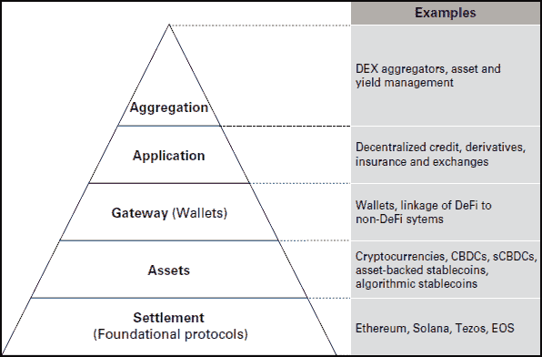
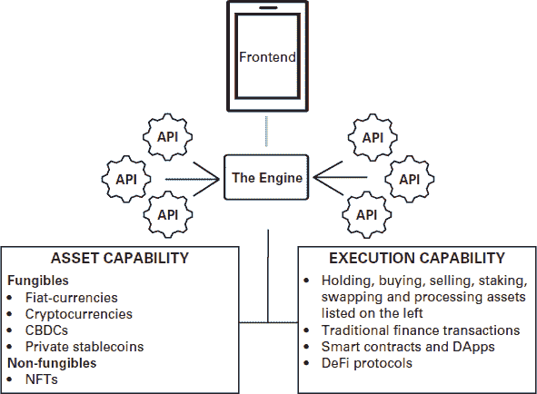

# 金融科技巨头：在区块链、数字货币和 Web3 时代取得胜利的方法

Igor Pejic 是银行和金融领域技术驱动转型的领先专家。他是 `Blockchain Babel`（Kogan Page, 2019）的作者，2016 年布莱肯-鲍尔奖入围者，2020 年独立出版奖（技术类别）得主。`Blockchain Babel` 还曾是《金融时报》当月图书。

Igor Pejic 是备受推崇的行业通讯 `The New Frontier` 的出版者。他的文章和采访经常出现在媒体上，包括《纽约时报》、《美国银行家》、Bloomberg 和 PwC 的 `strategy+business`。

作为一位全球主题演讲者和专家小组成员，他在大型会议以及私人行业活动和学术讲座上发表演讲。他创建了关于新技术长期战略影响的在线课程、白皮书和定制分析研究。

他在银行和支付领域担任过不同的管理职位，目前在欧洲最大的银行集团之一任职。在此之前，他曾担任管理顾问为 `Fortune` 100 公司提供咨询，担任商业记者，并在维也纳大学担任讲师。

如需更多信息，请访问 [`www.igorpejic.net`](http://www.igorpejic.net)。

像世界各地数百万人一样，Armando Aguilar 将他的钱投资于房地产。他的逻辑经过验证：有限的土地面对不断增长的需求。不过，有一个特点让 Aguilar 感到自己不仅是一位精明的投资者，更是一位先驱：他购买的土地不是由土壤和岩石组成的，而是由比特、字节和像素组成的。它不位于美国或英国，而是位于 Sandbox，一个仅作为数字账本上的条目存在的虚拟现实。这样的交易是新世界的先兆，在投资者和企业中变得越来越频繁。“我从未想过公司会如此迅速地加入这股潮流。然而，他们发布的任何报告都无法捕捉数字经济的全部价值和广度。我们的生活正在转移到线上，这是不可否认的。而有人会将其货币化，这是不可避免的”（Aguilar, 2022）。

像这样的投资之所以引人入胜，不仅因为底层资产，还因为执行方式。Aguilar 在没有银行、没有公证人，甚至没有政府发行的法定货币的情况下购买了土地。此外，如果他需要现金，他可以将资产投入一个自主协议，该协议将把他的土地作为抵押品锁定，贷款将在几分钟内到账。无官僚主义，无信用检查，无银行费用。这是一个新世界和一个新领域，将塑造金融的未来。然而，这只是冰山一角。

全球货币和金融体系正以前所未有的规模和速度进行重塑。中央银行正努力维持其货币印刷垄断。商业银行的客户关系经常被大科技公司夺走。由大量代码和无人组成的自治组织正在处理越来越复杂（和风险）的金融交易。

多年来，五大科技巨头——Alphabet、Amazon、Meta、Apple 和 Microsoft——一直在努力切入金融领域。这是一个巨大的行业，但更重要的是，它拥有最有价值的客户数据。技术突破一次又一次地为大科技公司提供了便利。首先，智能手机的胜利使它们成为守门人，让它们在金融的核心——支付领域占据了独特的地位。然后，`APIs`（`application programming interfaces`）引发了对金融服务的抢占。`APIs` 就像胶水，让两个计算机程序能够相互通信。对于科技公司来说，`APIs` 意味着它们可以构建银行应用程序，并轻松将其与持牌银行的后端机器连接起来。但它们的野心不仅仅是统治前端：除了银行牌照本身，要捕获一切。

构建杀手级应用程序并沿着价值链前进，仅仅是开局棋。虽然 Apple 或 Google Pay 等项目被限制在单一层面，但区块链技术的发明让大科技公司能够在资产、结算、网关和应用层面进行竞争。在《Blockchain Babel》（2019）中，我曾警告说，分布式账本技术将让大科技公司切入银行业。四年后，这一预测已成为现实。然而，其发生的规模和速度超出了我最疯狂的想象。Amazon 的云为绝大多数加密货币提供动力。Google 的资本推动了区块链独角兽的崛起。而 Facebook 曾试图发行一种全球性的超级货币，以取代美元成为世界霸权。尽管后者被立法者扼杀，但该公司（现已重新命名为 Meta）并未退缩；其下一次尝试，名为 Meta Pay，正在筹备之中。

本书讲述了一小撮非传统人物如何发明加密货币以消除集中化机构，但在此过程中却为大科技公司提供了一种工具，用于金融史上最大规模的权力夺取。我将展示科技巨头如何抓住机遇，以及他们正在采取什么策略。我们将看到，区块链——一种与大科技公司世界观背道而驰的技术——正如何进入其投资组合、产品和策略部门、移动应用程序，直至成为头号优先项目。

本书的一个关键问题是，大科技公司进入银行业是福还是祸。在可用性和金融包容性的旗号下，数据巨头正在重写我们金融体系的规则。但无论你对它们侵蚀银行资产负债表有何感受，都应该引起注意。它们对我们的金钱的夺取可能威胁国家的货币主权，扼杀自由市场，并完全扼杀数据隐私。问题是，它也可能推动创新，降低消费者成本，并为自主经济奠定基础。究竟会是哪一种？

事情变得更加复杂。关于货币未来的争夺，也对美国和中国之间的地缘政治冲突至关重要。几十年来，美国凭借强大的美元和 SWIFT 等先驱机构主导着全球金融体系。然而，今天，中国正试图通过大力押注区块链及其科技巨头来挑战这一秩序。由腾讯和微信协助发行的数字人民币，旨在为该货币在中国科技圈及其之外提供立足点。因此，科技巨头参与金融不仅关乎金融稳定、竞争、创新、隐私以及所有其他问题，而且具有至关重要的地缘政治意义。它们是否能带来更多好处还是坏处，仍有待争论。

监管机构正在努力在机遇与风险之间找到正确的平衡，而中央银行和商业银行则以自己的集中式区块链进行反击。成群的独角兽正在将这项技术的潜力推向极限。战场是一个西部荒野，淘金者、强盗男爵和警长都在争夺主导明天自主经济的权力。最有机会成功的公司将是那些构建我所谓的“超级货币引擎”的公司，这是一个可以处理所有类型的链上和链下资产、执行智能合约并运行复杂去中心化应用程序的中心。

前线并未结束，更多新的战场正在涌现。赌注更高了。我将讨论智能合约如何将自动化提升到新水平，去中心化金融（`DeFi`）的组合特性如何对系统性风险产生同样的影响，以及元宇宙中的货币可能成为一个早期实验室，在其中大科技、大银行和大政府之间将进行决定性的代理战争。

为此书，我采访了每个受影响群体的领导者，他们都有生动的故事和敏锐的头脑。我采访了启发比特币背后密码学家的早期货币经济学家，以及美国反对科技垄断的主要声音，后者感受到大科技公司对其自身职业生涯及其员工职业生涯的控制。我采访了监管机构、银行经理和科技高管，他们非正式地分享了自己的抱负和焦虑。我还采访了赚取和损失数百万的企业家和投资者，他们正在重新寻找金融未来的下一个大事件。

尽管他们的角度独特且愿景截然相反，但所有受访者都同意一件事：大科技公司正以前所未有的规模和速度重塑全球货币和金融系统。无论你是商业银行还是中央银行，挑战者公司、立法者还是监管机构，都是时候采取行动了。《Big Tech in Finance》正是为此而准备的跳板。

在这本书中，银行和企业将了解大科技公司一直在使用并将继续用于进入金融世界的策略，以及这对其市场有何影响。他们将了解如何应对这一趋势，甚至可能从中受益，尤其是通过了解他们在主要战场——支付领域——需要做什么。最终，读者将获得洞察力，围绕未来几十年最具决定性的技术——区块链——构建顶层战略。他们将识别每个重要技术层面的主要参与者群体和动态，认识如何使平台原则为自己所用，并了解应该在哪些即将到来的领域早期布局，以便在明天的混合市场中取得成功，在那个市场中，链下世界与链上世界融为一体。

## Reference

*   Aguilar, A (2022) Personal interview, 19 August

## The high-tech era

2011 年，著名风险投资家 Marc Andreessen 向世界宣告，世界正在被软件吞噬（`Andreessen`，2011）。事实确实如此。无数程序员一个接一个地吞噬着各个行业。Uber 和其他众多独角兽公司以分销效率低下和旧系统为食。世界各地的消费者都享受着免费的剩余物。我们中有谁最近还为导航付费或买过词典吗？上次你去旅行社寻找最佳航班优惠是什么时候？然而，Andreessen 描述的革命，实际上早在大约 30 年前就已随着创新突破开始。经过一系列里程碑式时刻，互联网于 1983 年正式上线。得益于一种名为传输控制协议/互联网协议（`TCP/IP`）的新协议，计算机网络首次能够与地球上每一台其他计算机进行通信。

然而，网络时代真正开始于 1995 年，当时 Netscape 上市并引发了 dot-com 热潮。该公司开发了 `Navigator`，一款曾占据 70% 市场份额的网络浏览器（`Campbell`，2020）。其两位创始人之一是时年 24 岁的 Marc Andreessen。

公开募股（首次公开募股，`IPO`）引发的公众淘金热情显而易见。此前，网络空间仅被技术娴熟的先驱者所涉足，但大多数人都听说过它的故事。而且，首次有可能将网络的承诺转化为巨额财富；至少投资者是这么相信的。毕竟，Netscape 尚未盈利。而投资者深信不疑，以至于准备将资金投入到一位刚毕业大学生的创意中，此人穿着像是要去参加兄弟会聚会，而不是去董事会开会。Andreessen 还通过挑衅性的隐喻来推广他的品牌，例如将他的竞争对手 Microsoft 比作《教父》。最终，他成为了第一位网络超级明星（Campbell, 2020）。

当时的《华尔街日报》（*Wall Street Journal*）陶醉地写道，Netscape 仅用一分钟就变得和成立 43 年的通用动力公司（General Dynamics Corp）一样有价值（Baker, 1995）。尽管一片狂欢，但没有人能想象到，科技公司在未来几十年里将以何种方式重塑世界。

在 2000 年互联网泡沫破裂后的洗牌中，一大批幸存者和新进入者崛起，构建了我们今天视为理所当然的数字经济。新时代需要数据库和硬件，因此早期的计算机巨头，如 IBM 和 Oracle，通过构建我们日常生活的无形基础设施而重获活力。Adobe 等软件专家和 Twitter 等社交媒体巨头让我们的工作更轻松，个人生活更丰富。PayPal 使我们能够安全地在线购物，从而推动了电子商务的兴起。

所有这些科技公司至今仍然存在。它们经受住了比线下世界更为残酷的市场竞争。然而，Netscape 并未幸存。它成为了数字时代激烈竞争和赢家通吃机制的牺牲品。Microsoft 的 Internet Explorer 最终赢得了浏览器大战，Netscape 在千禧年之前被 AOL 收购（Campbell, 2020）。

## 二线科技 vs 大科技

PayPal、IBM、Oracle——这些都是市值远超 1000 亿美元的公司（[CompaniesMarketCap.com](http://CompaniesMarketCap.com), 2022）。然而，尽管它们令人印象深刻，这些技术专家最好被描述为二线科技，因为数字时代也催生了一批商业史上最强大的公司，统称为大科技。

大科技有时也被称为五大科技。该术语基于构成该集团的五家美国公司：Alphabet（Google 的母公司）、Amazon、Meta Platforms（Facebook 的母公司）、Apple 和 Microsoft。在全球范围内，中国的 Tencent 和 Alibaba 完善了名单。

很难用几句话就公正地评价这些公司，所以我将让最令人印象深刻的数字来发言。在世界上最大的 10 家公司中，有 7 家是科技巨头。在最大的 7 家公司中，有 6 家是科技巨头（Wallach, 2021）。它们达到这种主导地位的速度同样引人注目；2008 年只有 Microsoft 和 Google 入选（Johnston, 2018）。2022 年，Apple 成为有史以来第一家市值超过 3 万亿美元的美国公司（Leswing, 2022）。其价值超过德国在 DAX 指数上市的 30 家最大上市公司的总和（`combined`）（`The Economist`, 2021a）。

此外，与过去专注于特定领域和单一行业的企业巨头不同，例如 AT&T 专注于电信，Walmart 专注于零售，大科技没有此类限制。五大科技正在一个接一个地占据各个行业。即使在不直接竞争的地方，它们也是价值链的一部分。当今三大云计算服务是 Microsoft 的云业务、Amazon 的 AWS 和 Google Cloud Platform。十家使用托管软件的公司中有六家依赖这三家科技巨头（`The Economist`, 2021b）。

即使在洛克菲勒和卡内基的时代，也从未出现过如此集中的权力和财富，无论是掌握在公司手中，还是其创始人手中。更不用说其全球影响力了。这种大规模整合得益于能够实现闪电扩张（blitzscaling）的技术——即指数级公司。正如 Azeem Azhar（2021）所解释的，它们受益于第一个指数时代。在当今时代，高科技创新以一种令人震惊的速度冲击着世界，既有机构也有竞争对手都无法跟上。网络效应和平台经济学完成了其余部分。

最重要的是，数字经济依赖的资源与蒸汽或电力不同：它依赖于数据。而数据容易出现 Jim Collins（2001）所描述的“飞轮效应”。简单来说，你拥有的数据越多，就能提供越好的服务，因为你了解客户的偏好。这反过来会带来更多客户，从而产生更多数据，进而改进你的产品，如此循环。无论你给飞轮的哪个部分加力，都会加速你的业务。

## 大科技的世界观

大科技带来的超级增长也助长了超越股息和股价上涨的高期望。政客和社会对他们的要求也不吝啬。在他们看来，Facebook 或 Google 的 YouTube 等平台应该通过让每个人都能获取信息，来消除全球的信息不对称。然而，与此同时，根据这些人的看法，它们还应该消除仇恨言论，与执法部门合作，打击假新闻。并且要在世界上所有语言中做到这一切。

但大科技本身也助长了其全能的形象。为了寻找鼓舞人心的目标，创始人从不回避设定改变世界的目标。Amazon 的创始人 Jeff Bezos 通过他的太空计划 Blue Origin，希望殖民太空以保护地球，并将人类转变为星际物种。事实上，Bezos 从高中时期就对太空飞行着迷（`Wired`, 1999）。Google 自称的使命莫过于组织整个“世界的信息，并使其普遍可访问和有用”（Google, no date）。Alibaba 的创始人 Jack Ma 声称，他并非领导一家普通公司，而是一个整个经济体，到 2036 年将连接数十亿用户，而 1 亿家企业依赖于这些用户（Skinner, 2018）。

他们的乐观源于其技术中心主义。更重要的是，大科技尤其运行在以 `应用` 为中心的世界观中。因为数据飞轮在应用层旋转得最快，大科技才能实现指数级增长。纯硬件和基础设施公司的成功螺旋远没有如此之快。

这种对应用层的执着也解释了对人工智能（`AI`）的着迷。它是你利用收集的海量数据所能做的事情的顶峰（Gilder, 2018）。在许多未来学家眼中，AI 是历史上最强大的工具，将把人类变成智能生命的神一般的创造者。像 Yuval Harari 这样的科技布道者给软件开发的进步赋予了宗教般的确定性。像他的《`Homo Deus`》（2018）这样的书籍大受欢迎；它们假设人类全能，只要我们正确部署 AI 即可。

别管 AI 这个误称，它与类人智能相去甚远。尽管机器学习、预测分析或光学字符识别等 AI 子学科的进步有助于流程工业化，但在机器意识、创造力和自由意志方面，我们并不比 1950 年 AI 术语被创造时更进一步。如果要谈论`真正的`智能，后者才是必需的。

## 1995 年随 Netscape 掀起的数字浪潮

1995 年随 Netscape 掀起的数字浪潮仍在席卷全球。新冠疫情让人们痛苦地意识到，在数字化方面仍有大量追赶工作要做。在疫情的整整一年里，五大科技巨头的收入增长了 40%，利润率飙升了 90%。大型公司总体表现良好，但市场更加倾向于大型科技公司。2020 年 1 月，它们的总价值占标准普尔 500 指数的 17.5%，到 2021 年 10 月已攀升至 22%（《经济学人》，2021b）。

## 数字范式的裂痕

然而，正如我在其他地方所写（Pejic，2021），大数据集中时代已达到顶峰并开始出现衰退迹象。最令人担忧的趋势是 IT 安全。我们都听说过计算机漏洞和黑客攻击的恐怖故事，这些事件暴露了数百万客户的个人和关键数据。比信用卡信息和密码更糟糕的是税务数据和病史。而 Nicole Perlroth（2021）——一位《纽约时报》网络安全记者——的研究描绘了一幅更为严峻的图景。得益于零日漏洞，几乎没有任何设备能免受黑客的无声入侵。

网络安全成本在激增，但仍无法跟上威胁的步伐。此外，疫情导致网络钓鱼攻击增加了七倍（Aiyer, Caso and Sorel, 2022）。IT 专家试图修补系统并将安全性追加到系统中。数据安全被视为额外的一层，而非架构设计的一部分。但就像我们的 DNA 一样，如此关键的功能无法事后添加。它们必须是初始设计、初始架构的一部分。而安全性并非网络的 DNA 一部分。网络的初衷是公开共享信息，而非价值。

## 新边疆是否与科技巨头相悖？

随着我们的生活几乎完全转移到线上，仅仅共享信息已不够。我们越来越多地发送金钱和价值，这些交易已成为我们日常生活的一部分。

随着 Netscape 的大规模首次公开募股，Marc Andreessen 在 1995 年站在了数字时代的前沿。如今，他是推动新边疆的人之一。通过他的风险投资公司 Andreessen Horowitz，他向 Coinbase、Compound 和 Uniswap 等区块链公司投入了巨资。2021 年，他的公司甚至启动了一个价值 22 亿美元的加密基金（Rooney, 2021）。

区块链的最初核心理念与大型科技公司相悖，但那些认为一批巨头会被另一批巨头简单取代的人将会失望。正如本书所论，恰恰相反会发生。Andreessen 本人就是最佳例证。尽管他对区块链技术深信不疑，但他仍担任 Facebook 母公司 Meta 的董事会成员（Meta Investor Relations，无日期）。事实上，他对元宇宙的兴趣非常明确地指向一个方向：大型科技公司与区块链将融合。而真相时刻将发生在金融服务行业。

## 不仅仅是黄金之城

五大科技巨头都遵循同一座右铭，成长为如今的庞然大物：在核心业务中占据主导地位，不惜一切代价保护它，并将触角伸向其他行业。这意味着它们分别在搜索、电子商务、硬件、软件和社交媒体领域首先实现了霸权。然后，它们收购了现有和新兴的竞争对手。当达到一定规模时，初创公司经常谈论“死亡区”，在其中它们要么被收购，要么在市场上失败。大多数挑战者选择前者，这可能非常有利可图（Instagram 可以告诉你）。Facebook 为这个年轻平台支付了有史以来最高的每人价格：7700 万美元（Thompson, 2012）。

一旦在核心业务中赢得战斗，它们便觊觎其他行业。这些行业通常与现有业务领域相邻，其主要能力使它们具有竞争优势。

### 要一窥未来，请看大型科技公司的收购策略

如今，大型科技公司控制着通信、娱乐和零售等超级行业。这些是巨大的收入驱动力，但同样重要的是它们的战略意义：它们在人们生活的关键时刻提供数据，例如当注意力被吸引时（社交媒体）、当他们积极关注某个话题时（搜索）或当他们购买商品时（电子商务）。

经过 16 个月关于数字经济状况的深入调查并汇总了 130 万份文件后，美国国会委员会发布了一份报告（Judiciary Antitrust Subcommittee, 2020），揭示了 Google、Amazon、Facebook 和 Apple 的巨大规模。可以学到很多东西，尤其是从那些几乎总是透露巨头下一步行动的收购中。

Google 收购 Motorola Mobility 是其努力掌控当今最常用设备——智能手机的一部分。它进入导航领域是因为它理解了与智能手机的协同效应，并意识到当位置数据与其他信息结合时将有多么有价值。最近，它正在收购许多 AI 公司，这项技术可以最好地处理其最大的资源：数据。Amazon 于 1998 年收购了电影数据库 IMDB，远在其构建流媒体服务 Amazon Prime 之前。Apple 收购了音乐服务 SoundJamMP，这一举动暗示了一年后 iTunes 的推出。

### 金融行业更接近圣杯

列表可以填满几十页，但原则始终相同。要了解大型科技公司的发展方向，查看最近的收购将让你走得很远。

然而，有一个行业可以被视为大型科技公司的最终目标，一个比任何其他行业都更激发其想象力的行业：金融服务。它本身就是最大的经济部门之一。全球金融市场将在 2021 年达到 22.5 万亿美元，复合年增长率为 9.9%（GlobeNewswire, 2021）。简而言之，财务是一个埃尔多拉多，充满了以收入形式存在的黄金，并保证大型科技公司的资产负债表将继续像过去几年一样膨胀。

但实际上，财务对大型科技公司来说不仅仅是无法估量的财富：它是其圣杯，为发现者配备了神奇的力量。金融服务使金钱和几乎所有其他价值在世界上流动。它是经济的命脉。无论是金钱的流动、贷款的发放还是对冒险项目的保险——金融中发生的一切都会在其他地方引起波浪或至少涟漪。

有时银行创新会带来风险，例如 2000 年代末期，高风险投资产品引发了全球金融危机。但在人类历史的大部分时间里，它一直在推动经济扩张。无论是硬币和钞票的发明、复式记账法、股票交易所、债券还是金本位制——如果没有那些天才的突破，我们就不会在讨论大型科技公司。根本不会有任何技术。

大多数人知道 Sir Isaac Newton 是才华横溢的物理学家和我们对重力理解之父。鲜有人知道他也是皇家造币厂的主管，因此实际上是他那个时代最有影响力的中央银行家。在这个职位上，他彻底改革了货币系统，就像他彻底改革物理学一样。怎么做到的？Isaac Newton 将世界经济推向了金本位制，这意味着他将英镑的价值与流通中的黄金挂钩。从此以后，企业可以假设可靠的汇率和稳定的利率，这使它们能够将资金投入到世界各地更雄心勃勃、风险更大、更长期的项目中。

金本位制已不再使用——理查德·尼克松总统于 1971 年放弃了它——但如果没有艾萨克·牛顿当时的开创性转变，商业、资本主义和探索活动就不可能像那样兴起。

这一集表明，进入金融服务也意味着坐在世界经济的方向盘后面。进入金融领域既有利可图又能获得权力，但大科技公司痴迷于涉足金融还有另一个原因。成为金融之主意味着你知道谁在何时、为了什么、向谁汇款多少钱。它告诉你人们拥有多少钱，他们愿意为何贷款，以及他们珍视到愿意支付保险费的东西是什么。简而言之，金融不仅仅是推动数据飞轮，它还在给数据飞轮加装涡轮增压器。亚马逊之所以与其他科技巨头不同，是因为其数据最接近客户的购买决策，因此比“仅仅”了解人们感兴趣的信息更有价值。现在想象一下，了解价值的真实流动——不仅限于你的平台，而是贯穿客户的整个生活——会有多有价值。

## 科技金融只是金融科技的倒写吗？

科技公司介入金融领域几乎与计算机一样悠久。银行是最早认识到比特和字节巨大潜力的机构之一。他们在大型机——即用于处理大量数据的关键任务大型主 frame 计算机——上花费巨资。那个时代建立的许多核心银行系统功能强大，对银行运营至关重要，以至于至今仍在使用。IT 已成为金融如此重要的一部分，以至于更换核心银行系统通常被比作在 35000 英尺高空更换喷气式发动机。

但正如我们在上一节所见，科技巨头的胃口已经变大。虽然 IBM 等 B2B 巨头不介意在幕后摸索并赚取丰厚利润，但这对谷歌或苹果来说不是选项。为了让数据飞轮持续运转，他们必须自己提供金融服务。西方大科技公司早已意识到这一点，但他们的努力直到智能手机的兴起和 2011 年谷歌支付（Google Pay）的推出才真正疯狂起来。

### 迈入金融的第一步是在硅谷之外迈出的

然而，真正的先驱来自太平洋对岸：阿里巴巴。2003 年，中国电子商务巨头阿里巴巴推出了淘宝，这是一个第三方零售商可以直接向阿里巴巴客户销售商品的平台。其美国对应物是亚马逊的市场。然而，那时电子商务还处于早期阶段，对卖家的信任甚至低于美国。因此，为了促成交易，阿里巴巴采用了托管方式保管客户支付的款项。这意味着阿里巴巴控制买家支付的款项，只有在确认商品完好无损送达后，才会将资金释放给卖家。该系统并非什么高科技。恰恰相反，员工们还在传真订单。但它奏效了。淘宝的销售额增长，最终在 2014 年，支付宝被剥离出来以更系统地处理交易量（Skinner, 2018）。

如今，支付宝只是蚂蚁集团众多金融服务中的一员。因此，并非巧合，正是阿里巴巴的创始人马云给大科技公司的金融项目贴上了`Techfin`标签（Soo, 2016）。

他在 2016 年中国会议上发言，特意希望将科技巨头的努力与喧嚣的金融科技世界区分开来。马云带着慈善的口吻，声称他进入金融的主要动机是金融包容性。乍一看，他的论点似乎站得住脚。地球上有 17 亿无银行账户的人，甚至无法获得最基本的金融服务，例如安全地存放他们拥有的少量资产，或贷款创办小企业（世界银行集团，2017）。此外，支付宝之所以发展到今天，很大程度上要归功于将农村人口纳入金融体系。当支付宝扩展到金融欠发达地区时，金融包容性作为目标可能仍然可信。然而，2019 年，支付宝也在英国推出，英国并非一个缺乏信用卡和银行的国家。

### 科技金融的关键特征

暂且不论利他主义的问题，马云在区分金融科技和科技金融方面一针见血。在他看来（引自 Soo, 2016），金融科技公司只不过是改进当前的金融系统。它们通过使用新技术、降低运营成本和更明确的聚焦，使系统更高效。但本质上，它们仍然是用钱赚钱的生意。

科技金融则根本不同。它希望彻底改造金融。这大多是一条可以划定的合法界限，但对于许多区块链初创公司来说，也可以说它们瞄准的是一种新的金融模式。因此，更准确的说法是：金融科技利用技术改进金融，而科技金融利用金融改进技术。在这方面，阿里巴巴是科技金融的典范。支付宝的推出是为了促进电子商务，而不是为了盈利。它是一项旨在使平台更具吸引力的相邻服务。

这意味着大科技公司与金融科技挑战者拥有完全不同的商业模式，这使它们对传统银行巨头极具威胁。如果你是一家金融巨头，一家年轻的新兴企业通过提供更低费用来攻击你的核心业务，那么在该特定服务上压低他们的价格很容易。你可能不得不承受一些损失，但你可以将他们击退。这是你熟悉并完美掌握的游戏。那么，你如何应对一家提供与你相同服务，但因其收入来自电子商务或广告而将这些服务永久免费化的数据巨头呢？

### 为什么科技金融合作棘手

让银行对科技金融公司感到担忧的另一件事是营销模式。金融科技公司是初创企业。它们的客户数量微不足道，无论它们资金多么充足，直接与传统银行巨头竞争都是注定失败的。因此，不足为奇的是，超过四分之三的金融科技创始人将与成熟机构合作列为主要战略目标（Capgemini, LinkedIn 和 Efma, 2018）。接触零售银行庞大的客户群是实现指数级增长的可靠途径。因此，金融科技公司要么被大银行收购，要么与它们集成。得益于应用程序编程接口（`API`）等创新，技术兼容性今天变得相当容易。但金融科技公司绝对不在做的事情是让银行变得过时。

另一方面，数据巨头一直是全球营销机器。尽管几乎不进行电视或广播广告活动，但世界上每个人都认识他们的品牌。不仅如此，他们还是世界上占主导地位的广告参与者。谷歌和 Facebook 垄断了数字广告，捕获了超过 50%的广告支出。他们最接近的竞争对手是其他科技巨头，如亚马逊、腾讯和阿里巴巴（Cramer-Flood, 2021）。史蒂夫·乔布斯是许多商学院案例研究的中心，因为他的营销天才。苹果产品在魅力创始人去世后仍然享有类似邪教的追随者。大科技公司的营销才能造就了前所未有的用户群。例如，Facebook 拥有 29 亿活跃用户（Statista, 2022）。因此，当大科技公司提供金融服务时，无需开展电视广告活动或在报纸上购买广告。他们的优势在于其高度活跃的用户。

### 科技金融公司及其对支付的痴迷

金融科技与科技金融之间最后一个决定性的区别在于它们所瞄准的金融服务类型。虽然每个金融科技公司最初都瞄准一个小而明确的细分市场，但金融科技作为一个整体却是分散的。它们的大多数服务要么属于支付、资产管理、投资或融资。一些挑战者还致力于保险或比较平台等其他用例。换句话说，银行业中有很多松散的螺丝需要他们拧紧。科技金融则专业化程度更高。如我们在即将到来的章节中将看到的，支付一直是大型科技公司金融计划的核心。虽然有些公司开始将触角延伸到其他金融领域，但几乎所有公司都从货币转账开始。

除了融合技术和金融之外，金融科技公司与大型科技公司几乎没有共同之处。表 1.1 总结了可用于区分它们的五个维度。

表 1.1 金融科技与科技金融特征对比

跳过表格

|  || 金融科技 || 科技金融 |

| --- | --- | --- |

| **挑战者** || 初创公司 || IT 巨头 |

| --- | --- | --- |

| **核心业务** || 金融服务 || 技术 |

| **商业模式** || 费用和其他传统收入来源 || 平台改进、数据生成 |

| **关注点** || 不同金融细分领域中的明确用例 || 主要是支付 |

| **市场杠杆** || 合作伙伴关系 || 自有用户 |

## Facebook 和 WeChat 希望你交换的不只是猫咪照片

马云可能是第一个使用“科技金融”一词的人，但蚂蚁金服绝不是唯一实践该概念的公司。其最紧随其后的公司在中国本身：微信支付。拥有 5.5 亿活跃用户，它落后于支付宝 1 亿（Curry, 2022）——考虑到中国市场的规模，这并非不可逾越的差距。微信支付是微信消息应用程序的核心功能，因此是强大的腾讯集团的一部分，该集团主导着中国的社交媒体、娱乐和游戏。

微信是所谓的“超级应用”。之所以这样称呼，并非因为它拥有超过十亿用户——尽管它确实如此——而是因为它为用户提供了一站式服务。用户可以预订航班或酒店、在商店付款、与朋友聊天、给他们转账、玩游戏或管理财富，而无需离开该应用程序。

超级应用不仅拥有受欢迎的原生功能，而且得益于小程序功能，它们还可以将第三方应用程序集成到平台中。这意味着程序员不需要根据操作系统的规格构建，也不需要为 Android 和 iOS 分别构建版本。像微信这样的应用程序不仅仅是在操作系统上增加一个额外的主屏幕，而是在重写规则并掌握智能手机的主导权。

支付宝显然也是另一个超级应用。还有更多。Line 是日本的一个超级应用，甚至在泰国和台湾等国外市场也占据了份额。在一个应用程序中，用户可以访问消息服务、点播视频、漫画卡片、叫车、购物，以及非常受欢迎的 LinePay 功能，该功能允许您通过二维码付款。原理与其中国同类产品类似。

如今，超级应用主要在亚洲为人所知。Facebook 提供了最好的例子，说明该概念在美国未能立足。它为社交网络和其信使应用程序提供了单独的应用程序，这两个功能极其相关。虽然也做过一些胆怯的超级应用尝试。想想 Uber Eats。或者更好的是，PayPal。除了经典的支付之外，它还向其应用程序添加了储蓄或先买后付（BNPL）等功能。这是一种多元化的尝试，但这些仍然都是金融服务。总体而言，西方世界的应用程序集成仍处于萌芽状态。

### 为什么超级应用未能传播到欧洲和美国

许多市场特征迄今为止阻碍了超级应用在美国和欧洲的兴起。首先，高度竞争和多元化的生态系统。中国是一个移动优先的国家；西方用户来自桌面世界。在大屏幕上竞争如此激烈，以至于成功的唯一方法往往是专业化。移动应用程序只是附加品或扩展。

其次，监管机构将自己视为自由市场的守护者，因此也是垄断打击者。这种审查阻止了大规模合并。相比之下，中国培养了国家冠军企业，这些企业利用市场规模且更容易控制。

第三，欧洲人和美国人对政府和数据集中化持怀疑态度。（数据）隐私被视为基础价值，这种担忧正在进入诸如欧盟《通用数据保护条例》（GDPR）等严苛法规。中国则走相反的道路。对政府机构没有与生俱来的怀疑态度，正如社会信用系统（Chen, 2018）所示。这是一项庞大的工程，根据共产党眼中公民的表现给中国人打分。两大数据巨头自然成为了该系统的推动者。阿里巴巴和腾讯都推出了自己的社会信用系统。得分高的公民租房无需支付押金，并可以通过平台免费租用自行车。收集的数据默认会共享给支付宝（Niewenhuis, 2018）。对于中国的科技巨头来说，这个社会信用计划就像是征信机构和忠诚度计划的混合体。

第四，也是非常重要的是，只有当存在一个共享支付平台将这些“小程序”连接在一起时，超级应用才能兴起。如果没有一种轻松转移价值的方式，比如从银行账户到叫车服务，或者从聊天线程到财富管理基金，那么在智能手机之上再叠加一层有什么附加价值呢？这不可能仅仅是为了少一个登录账号。此外，在美国和欧洲，应用程序或小程序之间共享数据在法律上很棘手，但如果你提供交易服务，数据必然必须经过你的手才能提供服务。在美国和欧洲，超级应用将更难以实现，因为相当大的文化差异塑造了我们对金钱的看法。在大多数西方国家，金钱被视为私人和孤立的事情。你不会给成年人送钱，你不会谈论你的薪水，在大多数场合你不会 AA 餐费。中国文化对金钱持有更加社交的态度。人们经常互相赠送金钱。例如，一对夫妇在纪念日互相赠送装有现金的红包并不罕见。你会在春节、出生、婚礼和任何其他庆祝场合这样做。事实上，当微信推出红包的数字版本时，用户疯狂追捧，使微信支付获得了历史上最大的市场追赶，首次挑战了支付宝的市场主导地位（Chen, 2018）。

### 支付功能

仍然有一些西方科技巨头渴望构建超级应用。就像微信一样，Facebook 推出了 Facebook Pay 作为其超越社交媒体的首批功能之一。用户在其 Facebook、WhatsApp 或 Instagram 应用程序中添加支付详细信息——这些都属于 Facebook 的帝国——他们可以在线购物、向朋友转账或向慈善机构捐款。自从 Facebook 与 Shopify（Shopify, 2020）达成协议以来，该公司还在 Facebook 生态系统之外的领域架起了一座桥梁。Shopify 为超过 100 万家在线零售商提供电子商务支付模块。使用其模块的商家可以在其原生应用程序中提供 Facebook 和 Instagram 支付选项。

Facebook Pay 是横扫市场的大量支付应用的典型代表。它不构建自己的支付系统，而是将自己围绕现有的支付提供商（如 `PayPal` 以及信用卡和借记卡发行商）进行包装。

与 techfin 典型特征一样，客户可以完全免费使用这些功能。目标是让平台充斥着客户，更重要的是，将用户转化为重度用户。因为每笔交易都会产生更多数据，并使档案对广告商更有价值。

虽然不属于 Big Five 俱乐部，但 `Uber` 同样很好地说明了支付平台锁定效应。自 2019 年以来，`Uber Money` 为客户在 `Uber` 宇宙中的每一笔消费（例如在 `Uber Eats` 下单或使用其叫车服务）提供 5% 的返现（Hazlehurst, 2019）。双面平台的另一侧，`Uber` 司机受益更多。得益于 `Uber` 直接借记账户，他们在乘车结束后即可获得收入，而无需等待每周结算。信用卡由一家传统银行（`Barclays`）提供。一家新兴银行（`Green Dot`）为该账户和借记卡提供支持。毫不奇怪，所有服务均免费。

然而，在所有科技公司中，有两家公司独特地有能力掌控支付接口：`Google` 和 `Apple`。

## Google 和 Apple 发挥其移动优势

我记得大约 10 年前曾参加过无数次合作推介会。当时我正在一家大型信用卡公司领导营销部门。企业家们热情地展示他们认为是支付未来的东西。一位创始人开发了与银行账户关联的 SIM 卡手表。另一位在我面前挥舞着一只毛绒长颈鹿，解释说他给它装上了支付芯片，从此以后我可以把实体钱包留在家里。还有另一位在手机背面贴了一张非接触式贴纸，并自豪地宣称 `Google` 和 `Apple` 的日子屈指可数了。

如今对这些想法嗤之以鼻很容易，但请考虑，许多演示是在 `Apple Pay` 发布之前进行的，当时许多市场的信用卡仍在使用磁条而非芯片。而且，所有这些企业家和研发远见者在进行重大推介之前，就已经对这些原型摆弄了多年。当时根本不存在 `Host Card Emulation` 这种东西，也找不到任何非接触式终端。其中一些人非常出色，但时机和市场尚未成熟。他们完全理解支付终端产生的数据的价值。然而，他们不理解的是，`Google` 和 `Apple` 在发布任何支付产品之前，就已经赢得了移动支付战争。

### 强大的守门人

`Google` 和 `Apple` 都早早押注智能手机的普及及其对日常生活的影响。自 `iPhone` 发明以来，`Apple` 凭借智能手机硬件赚得盆满钵满。正是这些设备将其推向成为历史上最有价值的公司。然而，`Apple` 和 `Google` 通过其移动操作系统（分别为 `Android` 和 `iOS`）所达到的霸权，至少同样具有决定性。这使他们独特地有能力推出钱包，即客户可以在手机上存储信用卡的数字表示。得益于 `NFC` 天线（近场通信）的引入，将手机轻触任何非接触式终端并模拟塑料卡片成为可能。这大约发生在 `iPhone 6` 发布之际。移动支付不仅仅是数字化卡片；在你可以在网上商店输入卡片凭证进行购买的那一刻，这已经发生了。移动支付真正做的是提供从数字生态系统到物理 `POS` 世界的链接。这与中国科技巨头使用 `QR` 码所做的并没有太大区别。

对于钱包提供商来说，移动支付是一台提款机。银行和其他卡片发行商必须每次其客户使用自己的卡片时，就向 `Apple` 和 `Google` 支付费用。正如《金融时报》当时报道的那样，`Apple` 在美国向银行收取 0.15% 的费用，在英国则稍低一些（Arnold, Felsted and Thomas, 2015）。根据你愿意让 `Apple` 访问多少数据，你可以支付稍多或稍少的费用。无论如何，在利润微薄的支付业务中，这是一笔可观的金额。作为比较，在欧盟，消费者业务中借记卡的交换费上限为 0.2%，信用卡为 0.3%。英国的价格类似（`Visa`, 2020）。在美国，这个金额可能是其 10 倍（`Adyen`, 2021），这解释了为什么美国银行对价格不那么敏感。

与 `Apple` 不同，`Google` 在推广移动支付方面遇到了困难。该项目最初名为 `Google Wallet`，后来变成了 `Android Pay`，最终演变为 `Google Pay`。即使在 2021 年，它仍落后于 `Apple Pay`，甚至在美国落后于 `Starbucks Pay`（`eMarketer`, 2021）。但这并不意味着它已经举白旗投降。它仍在多样化其功能，例如通过添加点对点（或 `P2P`）跨境支付服务（`Trivedi`, 2021b）。

`Apple` 在行使其守门人权力方面要冷酷得多。对 `NFC` 芯片的访问权仅授予了 `Apple Pay`。这实际上禁止了银行或零售商等其他人使用 `iPhone` 的技术能力进行支付。因此，他们被迫在 `Apple` 钱包之外提供任何支付服务，向公司输送数据和费用。在一项被称为“`Lex Apple Pay`”的努力中，德国立法者于 2020 年迫使 `Apple` 允许其他人直接访问 `NFC` 芯片。库比蒂诺的巨人被发现滥用其地位以规避竞争（`Franck` 和 `Linardatos`, 2021）。这一事件已经预示了监管机构将在大科技公司挤进银行业时发挥的关键作用。

### 支付是每个真正超级应用的基础

长期以来，移动支付在美国和欧洲未能站稳脚跟。现有的基于卡片的系统几十年来运行可靠，甚至覆盖了农村地区。转向智能手机支付没有真正的动力。我本人（`2019`）曾撰文介绍过移动电话艰难的开端。然而，自 `Covid-19` 疫情爆发以来，将手机轻触非接触式终端的人数急剧上升。病毒不仅推动了数字化，而且对钞票和硬币上细菌的恐惧也让人们远离现金。信用卡显然获得了普及，智能手机也是如此。

在 2021 年疫情高峰期，56% 的德国人使用过移动支付，而 2016 年仅为 10%（`Postbank`, 2021）。在美国，2020 年店内移动支付增长了 29%，疫情甚至使用户的平均年消费额上升（`eMarketer`, 2021）。

支付不仅是通往金融的窗口，更是大科技公司进行代理人战争的战场。你是否注意到，数据巨头很少在其核心业务中互相攻击？是的，这里那里会有一些摩擦，例如当 `Apple` 决定调整其隐私政策，从而损害 `Facebook` 的广告收入时。但你不会看到 `Apple` 推出自己的社交网络。`Facebook` 不会构建搜索引擎，`Amazon` 不会发布移动操作系统。从技术和财务上讲，他们可以涉足对方的领域，但他们更倾向于保持冷和平。

Payment, on the other hand, is up for grabs for each of them. And as we have seen from Asia’s super apps, it is foundational to every effort of building an ecosystem. Other companies are realizing that too. PayPal, the first real fintech, is straightforward about its goals. It says it wants to build both of its major brands – PayPal and Venmo – into financial super apps. It has continuously been expanding the possibilities of what you can do with your money within the app. Payment via QR codes and BNPL offerings are just some of the latest additions (Trivedi, 2021a).

Other heavyweights are joining the race too. Though its core business is neither in finance nor technology, Walmart has built its own fintech start-up called One. Its major concern: Amazon and its first steps into the offline world. The Beast of Bentonville, as Walmart is known, is as candid about its goals as PayPal: it wants a financial super app where customers can spend, save and lend (Nassauer, 2022).

In a nutshell, while for a long time it was a given that whoever ruled the operating systems also ruled mobile payments, the explosion of new competitors and aspiring super apps speaks a new truth. And those who turn out at the top of mobile finance will be the best candidates to run powerful ecosystems like Alipay and WeChat.

## Amazon wants to be your banker

In March 2019 a hitherto unknown Chinese name made headlines in the United States. The *Wall Street Journal* (Xie, 2019) reported that Yu’e Bao had become the world’s largest money market fund, with 588 million ‘investors’ parking their cash in it, 114 million of whom had used the service for the first time within the last year. Though Yu’e Bao feels like a mutual fund, that was not the initial idea behind it. In reality, it is a micro savings tool, bearing some interest. Mostly, it is used by rural Chinese people who don’t have (easy) access to bank accounts. They can deposit as little as one yuan. Yu’e Bao then invests the money and passes most of the yield to customers, which makes it more profitable than keeping money at bank deposits. The company behind it: Alibaba.

Launched in 2013, Yu’e Bao has become an indispensable pillar of Jack Ma’s finance empire. Payment is a window into financial services, the opening gambit. But there is a thick line between facilitating the transfer of money and actually taking custody of other people’s money. Since Alibaba had crossed this line, it decided to go full in. In 2015 China allowed private companies to obtain banking licences. Alibaba-backed Mybank was among the first to receive such a licence. Ever since, it has served farmers and other SMEs (IFC, 2020). Even more intriguing is the powerful by-product that came with the launch: the Ali Finance Cloud. Foreign cloud services such as those offered by Amazon were forbidden in mainland China, so Alibaba decided to build the cloud in-house. It didn’t stop there: it sold cloud services to other banks and fintechs.

Alibaba’s financial services grab was also reflected in its organizational structure. In 2014 Alipay was rebranded as Ant Financial (now Ant Group) to manage all financial products. Among its portfolio are Mybank, Yu’e Bao and Alipay. Furthermore, the Ant Group has splurged on financial apps abroad. In 2015 it invested $680 million in India’s Paytm. It acquired Korea’s Kakao and bid for MoneyGram in the US, which was eventually blocked in 2018, citing national security concerns (Skinner, 2018).

### Ruling e-commerce payments

The reason I am going into such detail with Alipay and the Ant Group is that they are the best example of Big Tech being obsessed with capturing all types of finance, not just payment. The Western equivalent of Alibaba is Amazon. I am not referring to both of them being e-commerce supertankers. I mean their ambition with regard to financial services.

Amazon’s financial flagship is obviously Amazon Pay. Google and Apple may be ruling the interface of mobile phones and the brick-and-mortar store, but when it comes to the ever-expanding e-commerce sector, Amazon reigns supreme. Whether you are shopping on `amazon.com`, its virtual assistant Alexa or even beyond the borders of the Amazon empire – Amazon Pay is the way to go. Despite sustained speculation it would also introduce a bank account (e.g. Glazer, Hoffman and Stevens, 2018), it has not. The question is ‘why should it?’ Customers can already load money onto their Amazon account in the form of vouchers. And why wake sleeping regulators to impose banking rules?

It is fascinating to see Amazon’s market power. Imagine giving your fiercest competitor a place at the checkout, the most valuable spot in a consumer journey, and paying handily for it. Yet this is exactly what many other web shops are doing. They hand over the customer relationship and transactional data. And the fees paid to Amazon are everything but marginal. On top of a $0.30 fixed fee, a processing fee of 2.9 per cent domestically or 3.9 per cent for cross-border payments is added (Bilotta and Romano, 2019). Amazon, in turn, touts partners with a checkout that is up to 70 per cent faster and a conversion up to 5 per cent higher. Another impressive figure their research arrived at is that 91 per cent of all customers who have used Amazon’s payment method would do so again (Amazon, 2022). For many online retailers this seems to justify the trade-off. After all, Amazon Pay has already reached a market share of 22 per cent in the US online payments market, in spite of being neither a credit card company nor a fintech (CBInsights, 2022).

Amazon is strongarming payment giants as well. In the UK it threatened to block all Visa credit cards should the company go ahead with increasing its payment fees, a harsh warning shot for possible upcoming price hikes in the US. In Singapore it delivered on its threats and levied a 0.5 per cent surcharge for purchases with Visa cards (Adams, 2021).

The tech titan also wants to expand this power into the offline world and has introduced services such as Amazon Cash. Customers can charge their Amazon Pay balance by handing cash to participating retailers such as Walgreens or Gamestop. The process is simple and free. You generate a QR code via the Amazon account, the retailer scans it and the amount is credited to the account within minutes.

### Reaching for credits and loans

Unlike other members of the Big Five, Amazon has also dared to dive directly into the world of credit. Amazon lending for customers is provided in cooperation with credit cards from Chase bank. This is still nothing special as it is tied to a payment instrument. Apple is doing the same with Goldman Sachs. But Amazon is also lending money to SMEs. This is significant for two reasons: first, it is a premiere that data giants charge forward into the B2B world. Second, lending is more strictly regulated and requires much highly specific expertise in how you deal with default risk. Strategically, however, the move fits perfectly into the techfin model. Amazon serves two sides of its platform, the buyers and the sellers, so it needs to make its ecosystem more attractive for both. In this concrete case, if a third-party seller is paralyzed by liquidity shortages, they cannot offer their goods on Amazon’s website, resulting in less product variety for customers. Hence, the entire platform would lose attractiveness. Since Amazon does not have a banking licence, it has to cooperate with traditional banks such as Goldman Sachs in the US or ING in Germany.

# 所以，亚马逊不仅仅是透过金融领域那扇半开的窗户伸出手

所以，亚马逊不仅仅是透过金融领域那扇半开的窗户伸出手，它已经站在了大厅里。而阿里巴巴的网商银行则已经在客厅里了。它不需要与传统银行合作。相反，它声称效率比传统银行高出 1,000 倍。贷款流程更快、更便宜且完全自动化。而其核心优势在于：利用其网络和数据驱动的资产，网商银行的企业借款人违约率远低于传统银行。不良贷款率（NPLs）低于 1%。许多这些客户在其他银行根本无法获得贷款，因为他们没有抵押品。网商银行的巨大优势在于它可以挖掘阿里巴巴的数据。例如，通过查看零售商的过去表现，如其销售历史和评价，网商银行能够做出自动化的信贷决策（Bilotta and Romano, 2019）。

这正是银行家们的噩梦，因为它使其核心竞争力失效。主要问题变成了谁能更快地转动数据飞轮。目前看来，这场战斗似乎属于大型科技公司。蚂蚁集团就是这种模式的最佳例子。它可以实时监控其 4.5 亿用户基数的所有交易。该系统每秒可处理 120,000 笔交易，或每天高达 100 亿笔，其性能超过了长期运营的支付巨头如 Visa 或 Mastercard。按交易量计算，支付宝已经是世界上最大的支付处理器。而且它正在不断融合机器学习、云和微服务等新技术，以挖掘这些数据宝库中的相关性（Skinner, 2018）。

我们经常听到这种数据挖掘，但其益处究竟是什么样子呢？一个说明性的例子是，蚂蚁金服的数据科学家注意到，为智能手机屏幕维修付费的女性也很可能购买紧身牛仔裤。他们推测这两个变量之间存在联系，因为智能手机更容易从紧身牛仔裤中滑落。结果，购买此类牛仔裤的女性也被提供了屏幕保护保险。总的来说，这种定向营销非常成功。在蚂蚁金服提供的五项金融服务中，80% 的客户至少使用其中三项（Azhar, 2021）。

## 大型科技公司的游戏计划令人费解

操作系统、超级应用、数字钱包——这就是大型科技公司在 21 世纪金融霸权战争中的武器库。银行业正在数字化，因此正在进入它们的领地。是的，这将是最难吞噬的行业，但它们不必改变自己的游戏计划。加速数据飞轮，等待洗牌，然后拿走有利可图的部分，将受监管的管道留给银行。如果不是因为一小撮与银行董事会或大型科技公司园区相距甚远的叛逆者，这一场景本可能是不可避免的。他们远离公众视线，正在构建一台将彻底重写金融和科技规则的机器。

# References

*   Adams, J (2021) 亚马逊在英国禁止 Visa 可能预示着美国将爆发更大的争议，American Banker，11 月 17 日，[www.americanbanker.com/news/amazons-u-k-visa-ban-could-foreshadow-larger-fight-in-u-s](http://www.americanbanker.com/news/amazons-u-k-visa-ban-could-foreshadow-larger-fight-in-u-s) (archived at [`perma.cc/53AE-9K6B`](https://perma.cc/53AE-9K6B))

*   Adyen (2021) 交换费说明，11 月 2 日，[www.adyen.com/blog/interchange-fees-explained#:~:text=How%20much%20are%20interchange%20fees,They%20are%20also%20regularly%20adjusted](http://www.adyen.com/blog/interchange-fees-explained#:%7e:text=How%2520much%2520are%2520interchange%2520fees%cThey%2520are%2520also%2520regularly%2520adjusted) (archived at [`perma.cc/M49V-X9CQ`](https://perma.cc/M49V-X9CQ))

*   Aiyer, B, Caso, J and Sorel, M (2022) 网络安全提供商尚未解决的机遇，麦肯锡公司，1 月 5 日，[www.mckinsey.com/business-functions/risk-and-resilience/our-insights/the-unsolved-opportunities-®17 for-cybersecurity-providers?cid=exp-pde-pro-mip-mck-oth-2201](http://www.mckinsey.com/business-functions/risk-and-resilience/our-insights/the-unsolved-opportunities-%c2%ae17%20for-cybersecurity-providers?cid=exp-pde-pro-mip-mck-oth-2201) (archived at [`perma.cc/C58N-3J8S`](https://perma.cc/C58N-3J8S))

*   Amazon (2022) 关于亚马逊支付的常见业务问题，2 月 3 日，[`pay.amazon.co.uk/blog/Common-business-questions-about-Amazon-Pay`](https://pay.amazon.co.uk/blog/Common-business-questions-about-Amazon-Pay) (archived at [`perma.cc/PP53-ZSYL`](https://perma.cc/PP53-ZSYL))

*   Andreessen, M (2011) 为什么软件正在吞噬世界，*华尔街日报*，8 月 20 日，[www.wsj.com/articles/SB10001424053111903480904576512250915629460](http://www.wsj.com/articles/SB10001424053111903480904576512250915629460) (archived at [`perma.cc/D773-NUM2`](https://perma.cc/D773-NUM2))

*   Arnold, M, Felsted, A and Thomas, D (2015) 英国银行对 Apple Pay 费用施压，*金融时报*，7 月 14 日，[www.ft.com/content/02287f44-2a3d-11e5-8613-e7aedbb7bdb7](http://www.ft.com/content/02287f44-2a3d-11e5-8613-e7aedbb7bdb7) (archived at [`perma.cc/2F27-JE8H`](https://perma.cc/2F27-JE8H))

*   Azhar, A (2021) *指数时代：加速技术如何改变商业、政治和社会*，Diversion Books，纽约

*   Baker, M (1995) 技术投资者对新欢倾倒不已，*华尔街日报*，8 月 10 日，[`the1995blog.files.wordpress.com/2015/03/netscape-ipo\_wsj.jpeg`](https://the1995blog.files.wordpress.com/2015/03/netscape-ipo_wsj.jpeg) (archived at [`perma.cc/4D3F-K55J`](https://perma.cc/4D3F-K55J))

*   Bilotta, N and Romano, S (2019) 银行业的科技巨头：新市场力量的影响，IAI Papers，6 月 13 日，[www.iai.it/sites/default/files/iaip1913.pdf](http://www.iai.it/sites/default/files/iaip1913.pdf) (archived at [`perma.cc/4BEX-78W5`](https://perma.cc/4BEX-78W5))

*   Campbell, J (2020) 非凡年份中的难忘时刻：1995 年 Netscape IPO，1995 博客，8 月 7 日，[`1995blog.com/2020/08/07/memorable-moment-in-an-exceptional-year-the-netscape-ipo-of-1995/`](https://1995blog.com/2020/08/07/memorable-moment-in-an-exceptional-year-the-netscape-ipo-of-1995/) (archived at [`perma.cc/J7SG-4PXN`](https://perma.cc/J7SG-4PXN))

*   Capgemini, LinkedIn and Efma (2018) 世界金融科技报告 2018，2 月 27 日，[www.capgemini.com/wp-content/uploads/2018/02/world-fintech-report-wftr-2018.pdf](http://www.capgemini.com/wp-content/uploads/2018/02/world-fintech-report-wftr-2018.pdf) (archived at [`perma.cc/82TA-2PHN`](https://perma.cc/82TA-2PHN))

*   CBInsights (2022) 关于亚马逊在金融服务领域所做的一切你需要知道的信息，3 月 15 日，[www.cbinsights.com/research/report/amazon-across-financial-services-fintech/](http://www.cbinsights.com/research/report/amazon-across-financial-services-fintech/) (archived at [`perma.cc/8XL3-CHM6`](https://perma.cc/8XL3-CHM6))

*   Chen, C (2018) 为什么中国的“超级应用”在美国永远不会成功，Prototypr.io，5 月 20 日，[`blog.prototypr.io/why-chinas-super-apps-will-never-succeed-in-the-us-64c686c8c5d6`](https://blog.prototypr.io/why-chinas-super-apps-will-never-succeed-in-the-us-64c686c8c5d6) (archived at [`perma.cc/KG8N-K2UC`](https://perma.cc/KG8N-K2UC))

*   Collins, J (2001) *从优秀到卓越：为什么* *有些公司能实现飞跃而有些不能*，HarperCollins，纽约

*   [CompaniesMarketCap.com](http://CompaniesMarketCap.com) (2022) 按市值排名的最大公司，[`companiesmarketcap.com/tech/largest-tech-companies-by-market-cap/`](https://companiesmarketcap.com/tech/largest-tech-companies-by-market-cap/) (archived at [`perma.cc/XTL3-SWNC`](https://perma.cc/XTL3-SWNC))

# 参考文献

*   Cramer-Flood, E (2021) Duopoly still rules the global digital ad market, but Alibaba and Amazon are on the prowl, eMarketer, 10 May, [`www.emarketer.com/content/duopoly-still-rules-global-digital-ad-market-alibaba-amazon-on-prowl`](http://www.emarketer.com/content/duopoly-still-rules-global-digital-ad-market-alibaba-amazon-on-prowl) (archived at [`https://perma.cc/TGQ2-YB6B`](https://perma.cc/TGQ2-YB6B))

*   Curry, D (2022) Mobile payments app revenue and usage statistics (2022), BusinessofApps, 25 October, [`www.businessofapps.com/data/mobile-payments-app-market/`](http://www.businessofapps.com/data/mobile-payments-app-market/) (archived at [`https://perma.cc/U99C-R72D`](https://perma.cc/U99C-R72D))

*   eMarketer (2021) US payment users will surpass 100 million this year, 30 March, [`www.emarketer.com/content/us-payment-users-will-surpass-100-million-this-year?ecid=NL1016`](http://www.emarketer.com/content/us-payment-users-will-surpass-100-million-this-year?ecid=NL1016) (archived at [`https://perma.cc/SA4L-JE9H`](https://perma.cc/SA4L-JE9H))

*   Franck, J-U and Linardatos, D (2021) Germany’s ‘Lex Apple Pay’: Payment services regulation overtakes competition enforcement, `Journal of European Competition Law & Practice`, 2 February, [`https://academic.oup.com/jeclap/article-abstract/12/2/68/5905712?redirectedFrom=fulltext`](https://academic.oup.com/jeclap/article-abstract/12/2/68/5905712?redirectedFrom=fulltext) (archived at [`https://perma.cc/QP6C-5UGT`](https://perma.cc/QP6C-5UGT))

*   Gilder, G (2018) `Life after Google: The fall of big data and the rise of the blockchain economy`, Regnery Gateway, Washington, DC

*   Glazer, E, Hoffman, L and Stevens, L (2018) Next up for Amazon: checking accounts, `Wall Street Journal`, 5 March, [`www.wsj.com/articles/are-you-ready-for-an-amazon-branded-checking-account-1520251200`](http://www.wsj.com/articles/are-you-ready-for-an-amazon-branded-checking-account-1520251200) (archived at [`https://perma.cc/KSJ7-NQBH`](https://perma.cc/KSJ7-NQBH))

*   GlobeNewswire (2021) Financial Services Global Market Report 2021: Covid-19 impact and recovery to 2030, 31 March, [`www.globenewswire.com/​news-release/​2021/03/31/2202641/0/en/Financial-Services-Global-Market-Report-2021-COVID-19-Impact-And-Recovery-To-2030.html`](http://www.globenewswire.com/news-release/2021/03/31/2202641/0/en/Financial-Services-Global-Market-Report-2021-COVID-19-Impact-And-Recovery-To-2030.html) (archived at [`https://perma.cc/8M6A-83FT`](https://perma.cc/8M6A-83FT))

*   Google (no date) Our approach to Search, [`www.google.com/search/howsearchworks/mission/`](http://www.google.com/search/howsearchworks/mission/) (archived at [`https://perma.cc/435Q-TXDK`](https://perma.cc/435Q-TXDK))

*   Harari, Y (2018) `Homo Deus: A brief history of tomorrow`, Harper Perennial, New York

*   Hazlehurst, P (2019) Introducing Uber Money, 28 October, [`www.uber.com/newsroom/introducing-uber-money/`](http://www.uber.com/newsroom/introducing-uber-money/) (archived at [`https://perma.cc/3XX7-B5P8`](https://perma.cc/3XX7-B5P8))

*   IFC – International Finance Corporation World Bank (2020) MyBank: MYBank’s gender-driven approach to lending, August, [`www.ifc.org/wps/wcm/connect/3e0cfba8-12c9-42fe-943b-e99f4a36de73/202008\_D2E\_MyBank.pdf?MOD=AJPERES&CVID=nfvyYCR`](http://www.ifc.org/wps/wcm/connect/3e0cfba8-12c9-42fe-943b-e99f4a36de73/202008_D2E_MyBank.pdf?MOD=AJPERES&CVID=nfvyYCR) (archived at [`https://perma.cc/JP9D-RHE2`](https://perma.cc/JP9D-RHE2))

*   Johnston, S (2018) Largest companies 2008 vs. 2018, a lot has changed, Milford Asset, 31 January, [`https://milfordasset.com/insights/largest-companies-2008-vs-2018-lot-changed`](https://milfordasset.com/insights/largest-companies-2008-vs-2018-lot-changed) (archived at [`https://perma.cc/QP43-ML39`](https://perma.cc/QP43-ML39))

*   Judiciary Antitrust Subcommittee (2020) Investigation of competition in digital markets: Majority staff report and recommendations, Subcommittee on Antitrust, Commercial and Administrative Law of the Committee on the Judiciary, 6 October, [`https://judiciary.house.gov/uploadedfiles/competition\_in\_digital\_markets.pdf`](https://judiciary.house.gov/uploadedfiles/competition_in_digital_markets.pdf) (archived at [`https://perma.cc/4Z6R-RXY7`](https://perma.cc/4Z6R-RXY7))

*   Leswing, K (2022) Apple becomes first U.S. company to reach $3 trillion market cap, `CNBC`, 3 January, [`www.cnbc.com/2022/01/03/apple-becomes-first-us-company-to-reach-3-trillion-market-cap.html`](http://www.cnbc.com/2022/01/03/apple-becomes-first-us-company-to-reach-3-trillion-market-cap.html) (archived at [`https://perma.cc/ST6L-KV5C`](https://perma.cc/ST6L-KV5C))

*   Meta Investor Relations (no date) Marc L. Andreessen, [`https://investor.fb.com/leadership-and-governance/person-details/default.aspx?ItemId=67f254ec-d2aa-46e4-85e3-e3ddda492518`](https://investor.fb.com/leadership-and-governance/person-details/default.aspx?ItemId=67f254ec-d2aa-46e4-85e3-e3ddda492518) (archived at [`https://perma.cc/7GYQ-SNB2`](https://perma.cc/7GYQ-SNB2))

*   Nassauer, S (2022) Walmart-backed fintech startup is acquiring two firms and a new name, `Wall Street Journal`, 26 January, [`www.wsj.com/articles/walmart-backed-fintech-startup-is-acquiring-two-firms-and-a-new-name-11643199601`](http://www.wsj.com/articles/walmart-backed-fintech-startup-is-acquiring-two-firms-and-a-new-name-11643199601) (archived at [`https://perma.cc/D3C7-XW8L`](https://perma.cc/D3C7-XW8L))

*   Niewenhuis, L (2018) Tencent launches a social credit system similar to Alibaba’s, The China Project, 31 January, [`https://thechinaproject.com/2018/01/31/tencent-launches-social-credit-system-similar-alibabas/`](https://thechinaproject.com/2018/01/31/tencent-launches-social-credit-system-similar-alibabas/) (archived at [`https://perma.cc/HJ8X-HJZ4`](https://perma.cc/HJ8X-HJZ4))

*   Pejic, I (2019) `Blockchain Babel: The crypto-craze and the challenge to business`, Kogan Page, London

*   Pejic, I (2021) Dawn of a new frontier: Welcome to the distributed economy, The New Frontier, 10 August, [`https://igorpejic.substack.com/p/dawn-of-a-new-frontier?s=w`](https://igorpejic.substack.com/p/dawn-of-a-new-frontier?s=w) (archived at [`https://perma.cc/SB5Q-UN99`](https://perma.cc/SB5Q-UN99))

*   Perlroth, N (2021) `This is How They Tell Me the World Ends: The cyber weapons arms race`, Bloomsbury Publishing, London

*   Postbank (2021) Studie: Mehr als jede\*r zweite Deutsche nutzt kontaktlose Bezahlmethoden, 6 July, [`www.postbank.de/unternehmen/medien/meldungen/2021/juli/studie-mehr-als-jeder-zweite-deutsche-nutzt-kontaktlose-bezahlmethoden.html`](http://www.postbank.de/unternehmen/medien/meldungen/2021/juli/studie-mehr-als-jeder-zweite-deutsche-nutzt-kontaktlose-bezahlmethoden.html) (archived at [`https://perma.cc/J7FF-WU5G`](https://perma.cc/J7FF-WU5G))

*   Rooney, K (2021) Andreessen Horowitz launches $2.2 billion crypto fund and is ‘radically optimistic’ despite price fluctuations, `CNBC`, 24 June, [`www.cnbc.com/2021/06/24/andreessen-horowitz-launches-2point2-billion-crypto-fund.html`](http://www.cnbc.com/2021/06/24/andreessen-horowitz-launches-2point2-billion-crypto-fund.html) (archived at [`https://perma.cc/X5WD-VK7P`](https://perma.cc/X5WD-VK7P))

*   Shopify (2020) Shopify partners with Facebook to help businesses launch branded Facebook Shops, 19 May, [`https://news.shopify.com/shopify-partners-with-facebook-to-help-businesses-launch-branded-facebook-shops`](https://news.shopify.com/shopify-partners-with-facebook-to-help-businesses-launch-branded-facebook-shops) (archived at [`https://perma.cc/327B-A2FZ`](https://perma.cc/327B-A2FZ))

*   Skinner, C (2018) `Digital Human: The fourth revolution of humanity includes everyone`, Wiley, Oxford

*   Soo, Z (2016) TechFin: Jack Ma coins term to set Alipay’s goal to give emerging markets access to capital, *南华早报*，2 December，[`www.scmp.com/tech/article/2051249/techfin-jack-ma-coins-term-set-alipays-goal-give-emerging-markets-access`](http://www.scmp.com/tech/article/2051249/techfin-jack-ma-coins-term-set-alipays-goal-give-emerging-markets-access) (archived at [`https://perma.cc/LNB5-QTYN`](https://perma.cc/LNB5-QTYN))

*   Statista (2022) Most popular social networks worldwide as of January 2022, ranked by number of monthly active users, [`www.statista.com/statistics/272014/global-social-networks-ranked-by-number-of-users/`](http://www.statista.com/statistics/272014/global-social-networks-ranked-by-number-of-users/) (archived at [`https://perma.cc/45DX-WN8X`](https://perma.cc/LNB5-QTYN))

*   *The Economist* (2021a) Europe is now a corporate also-ran. Can it recover its footing? 5 June, [`www.economist.com/briefing/2021/06/05/once-a-corporate-heavyweight-europe-is-now-an-also-ran-can-it-recover-its-footing`](http://www.economist.com/briefing/2021/06/05/once-a-corporate-heavyweight-europe-is-now-an-also-ran-can-it-recover-its-footing) (archived at [`https://perma.cc/DY8X-9BMW`](https://perma.cc/DY8X-9BMW))

*   *The Economist* (2021b) Cloudy with a dearth of chips: How the pandemic has changed the weather in the technology industry, 30 October, [`www.economist.com/business/2021/10/30/how-the-pandemic-has-changed-the-weather-in-the-technology-industry`](http://www.economist.com/business/2021/10/30/how-the-pandemic-has-changed-the-weather-in-the-technology-industry) (archived at [`https://perma.cc/3ZRV-DNGR`](https://perma.cc/3ZRV-DNGR))

*   Thompson, D (2012) Instagram is now worth $77 per employee, *The Atlantic*，9 April，[`www.theatlantic.com/business/archive/2012/04/instagram-is-now-worth-77-million-per-employee/255640/`](http://www.theatlantic.com/business/archive/2012/04/instagram-is-now-worth-77-million-per-employee/255640/) (archived at [`https://perma.cc/6QYL-E22W`](https://perma.cc/6QYL-E22W))

*   Trivedi, V (2021a) PayPal forecasts boom in QR-code payments, plans BNPL expansion, Payments Dive，6 May，[`www.paymentsdive.com/news/paypal-boom-qr-code-payments-expanding-bnpl-to-australia/599680/`](http://www.paymentsdive.com/news/paypal-boom-qr-code-payments-expanding-bnpl-to-australia/599680/) (archived at [`https://perma.cc/L2R9-R3DC`](https://perma.cc/L2R9-R3DC))

*   Trivedi, V (2021b) Google Pay launches P2P cross-border payments, Payments Dive，11 May，[`www.paymentsdive.com/news/google-pay-western-union-wise-p2p-cross-border/599937/`](http://www.paymentsdive.com/news/google-pay-western-union-wise-p2p-cross-border/599937/) (archived at [`https://perma.cc/6EX7-SAKP`](https://perma.cc/6EX7-SAKP))

*   Visa (2020) United Kingdom | Domestic multi-lateral interchange fees，16 January，[`www.visa.co.uk/dam/VCOM/regional/ve/unitedkingdom/PDF/fees-and-interchange/uk-interchange-january-2020.pdf`](http://www.visa.co.uk/dam/VCOM/regional/ve/unitedkingdom/PDF/fees-and-interchange/uk-interchange-january-2020.pdf) (archived at [`https://perma.cc/QTZ2-ZTAT`](https://perma.cc/QTZ2-ZTAT))

*   Wallach, O (2021) The top 100 companies of the world: The U.S. vs everyone else, Visual Capitalist，19 July，[`www.visualcapitalist.com/the-top-100-companies-of-the-world-the-u-s-vs-everyone-else/`](http://www.visualcapitalist.com/the-top-100-companies-of-the-world-the-u-s-vs-everyone-else/) (archived at [`https://perma.cc/CCM5-FPBK`](https://perma.cc/CCM5-FPBK))

*   *Wired* (1999) The Inner Jeff Bezos，1 March，[`www.wired.com/1999/03/bezos-3/`](http://www.wired.com/1999/03/bezos-3/) (archived at [`https://perma.cc/C8R3-BTCG`](https://perma.cc/C8R3-BTCG))

*   World Bank Group (2017) Financial inclusion on the rise, but gaps remain, Global Findex Database shows，19 April，[`www.worldbank.org/en/news/press-release/​2018/04/19/financial-​inclusion-on-the-rise-but-gaps-remain-global-​findex-database-shows`](http://www.worldbank.org/en/news/press-release/2018/04/19/financial-inclusion-on-the-rise-but-gaps-remain-global-findex-database-shows) (archived at [`https://perma.cc/GA4J-RD4P`](https://perma.cc/GA4J-RD4P))

*   Xie, S (2019) More than a third of China is now invested in one giant mutual fund, *Wall Street Journal*，27 March，[`www.wsj.com/articles/more-than-a-third-of-china-is-now-invested-in-one-giant-mutual-fund-11553682785`](http://www.wsj.com/articles/more-than-a-third-of-china-is-now-invested-in-one-giant-mutual-fund-11553682785) (archived at [`https://perma.cc/MJ4L-LBA`](https://perma.cc/MJ4L-LBA))

2

## Pioneers tinker with a truth machine

Data giants were not the only ones galvanized by the idea to rewire money with technology. Much before they got in the race, a computer programmer in his mid-30s watched with curiosity at how his chosen field was transforming the world before his eyes. He was a polymath, with degrees in computer science and a Juris Doctor from Law School. A cryptographer genius with a distinct interest in economics, he was interested in far more than just lines of code or codices. One of his major obsessions was money. Unlike most hot shots and entrepreneurs of his time he was not absorbed by the question of how to make it, but where it came from, how it worked and how its shortcomings could be remedied. Money, he was convinced, was fundamental to humans. It enabled cooperation, altruism, mitigated aggression and set us apart from animals.

The young cryptographer was particularly intrigued by the characteristics of gold. Its supply was limited, its extraction burdensome. The scarcity in the market gave it its unique value. Gold was durable, portable, divisible and anonymous – superior to any other payment tool in history (Szabo, 2002). If only it could be mimicked in the digital age.

In an email describing the design of such a possible digital gold he shared his view with a few elect cryptographers. Their email addresses had found their way onto a list of brilliant computer scientists dreaming of a money fit for the computer age. The author suggested a completely decentralized cryptocurrency that needed no government to issue it, no bank to hold it and no payment processor to move it. Algorithms effectively eliminated all middlemen. The proposal was built on the so-called proof-of-work (PoW) mechanism, a design in which network participants race to solve complex cryptographic puzzles by investing massive computing power. This mechanism produces blocks with transactions, each of which is cryptographically linked to the preceding one.

I know what most of you are thinking now: it feels like bitcoin. It works like bitcoin. So, it must be bitcoin. But it isn’t. The story takes place in the year 1998 and the invention described is Bit Gold, a brainchild of the exceptional Nick Szabo. Admittedly, the Bit Gold system uses many of the same technical principles as today’s cryptocurrencies. These principles include PoW, one-way functions (meaning no backwards computability) and timestamping (Szabo, 2008). In fact, Nick Szabo is also the father of the smart contract idea. As a law school graduate *and* cryptographer, he was the natural candidate to invent those computer programs that are based on if-then logic (Szabo, 1996). Smart contracts are the dynamization of blockchain technology, almost as profound to the crypto world as the PoW mechanism. If you haven’t heard about them yet, you will later in this book.

### The first search for digital gold

像我们大多数人一样，Szabo 是其时代的产物。在技术上，以及在意识形态上都是如此。例如，PoW 并非 Szabo 发明。相反，他对其他先驱的工作进行了调整和拼凑。在此情况下，那是由英国人 Adam Back 于 1997 年开发的 Hashcash 算法，另一位 30 多岁的计算机科学家。Back 实际上发明了多少 PoW 机制，以及多少是建立在他人工作之上的，至今仍有争议；哈希函数早在 1992 年就由 Cynthia Dwork 和 Moni Naor 提出。然而，清楚的是，Hashcash 并非设计用于转账，而是作为一种反垃圾邮件概念。或者，用 IT 安全的术语来说，‘一种拒绝服务对策工具’（Stradbrooke, 2021）。为了防止垃圾邮件发送者发送未经请求的大量电子邮件，Hashcash 迫使他们以少量计算工作的形式支付费用。虽然对普通用户来说不易察觉，但发送大量电子邮件会给计算机资源带来压力，并最终体现在发送者的电费账单中。

数字货币的想法在 Szabo 提出 Bit Gold 之前也流传了一段时间。其中之一是 e-gold。其发明者 Douglas Jackson 既不是密码学家也不是经济学家，而是一位来自佛罗里达的肿瘤学家，他无法忍受理查德·尼克松终止了美元与黄金的挂钩。通货膨胀的担忧让这位自学成才的经济学家彻夜难眠。因此，他利用自己的自学天赋和彻夜难眠的时光学习如何编程。瞧，他启动了自己的全球金融网络：e-gold。简单来说，你购买（或者更确切地说，让做市商购买）真实的黄金，然后将其存入。之后你会得到等值的数字黄金。这并非一个边缘实验。在 2000 年代，e-gold 成为第二受欢迎的在线支付方式，仅次于 PayPal。它拥有超过 350 万个账户。在对黄金的崇拜上，Jackson 是早期加密愿景家的典型代表。然而，使他与众不同的是，他仍然认为实物黄金是数字时代的一部分。

不幸的是，并非所有账户都由诚实的公民持有。最终，e-gold 屈服于几年后几乎要了比特币命的同一个问题：它成为洗钱工具。2013 年，几起联邦诉讼最终击碎了该项目（Mahler, 2018）。

## 尝试解决双重支付问题

与黄金的联系甚至不存在于第一个著名的数字现金发明中，即 eCash。1983 年，加州密码学先驱 David Chaum 为个人电脑编写了旨在使互联网支付安全的软件。

eCash 与 PayPal 的共同点比与当今加密货币更多。它与比特币、Bit Gold 和 e-gold 的主要区别在于，eCash 将自己包裹在银行系统之中。eCash 出现在 PoW 机制等突破之前，并且无法在没有中介的情况下解决所谓的双重支付问题。换句话说，eCash 无法仅靠自动计算机算法来确保数字货币价值只能花费一次。想想你通过电子邮件发送的 PDF。你的收件人收到了它，但这并不意味着它从你的电脑或电子邮件程序中消失。为了让货币发挥作用，解决这个双重支付困境是基础。在 Chaum 的情况中，这只能通过与银行合作来补救。他确实这样做了：花旗银行、德意志银行以及许多其他银行与 Chaum 及其公司 DigiCash 合作。在某个时刻，他甚至与微软坐在谈判桌前，拒绝了一项将支付他 1.8 亿美元并使 eCash 成为每台电脑一部分的报价（注意大型科技公司对数字支付方式的早期兴趣）。早在 20 世纪 80 年代，微软就理解了其在战略上的独特地位，以及货币业务中潜藏的潜力。但 Chaum 最终失败的原因是他远远领先于他的时代。与他之前的许多创新者一样，他看到自己的脑子产物平滑了第二波采用者，而不是取得持续的商业成功。

Nick Szabo 是那些后来采用者之一。他最初与 Chaum 合作开发 eCash。这是一个显而易见的选择，因为他专注于寻找一种在线转账的方式，这并不完全使他成为大众运动的一部分。然而，Szabo 在意识形态上不喜欢 eCash 的设置。整个概念仍然需要一个中央权威和中介。而 Szabo（2001, 2004, 2005）对信任第三方的看法非常直言不讳。其中许多，如 Visa，过去通过在陌生人之间斡旋信任从而促进了商业，是有益的。然而，他的结论是，最受信任的第三方是根本不需要存在的，因为协议的设计方式。在中介的所有缺点中，他最担心的是它们是安全漏洞。

## 认识密码朋克

所有加密先驱共有的一点——除了加密经济创造力和故意看起来过时的网站——是他们都是`cypherpunk`运动的杰出人物。这个词是‘cyberpunk’（一种未来主义、反乌托邦的科幻类型）和‘cypher’（一种加密方法）的混合词。早期运动有几百名成员，他们讨论新颖的保护隐私的通信方法。

这些谈话不仅围绕技术展开。政治、哲学和尤其是经济学也被同样激烈地辩论。将他们所有人团结在一起的是相信个人自由是最高善。为了实现它，隐私至关重要。

密码朋克在 20 世纪 90 年代通过一个同名邮件列表进行沟通。他们的创始文件，他们的宣言（May, 1992; Hughes, 1993），也是以这种方式共享的。他们明确表示，（数字）隐私是整个运动的基本原则，也是自由社会的基础。

正如其名称所暗示的那样，科幻小说是灵感来源，特别是对技术进步可能造成什么的一种威慑。对反乌托邦超级国家的恐惧推动了大部分创造力。然而，密码朋克拥抱技术，而不是妖魔化它。无论它有什么缺点，它当然也提供了解决方案。在这种情况下，他们将其视为信息加密（Popper, 2015）。

该运动有一种明显的自由意志主义倾向。自由意志主义是一种可以追溯到 17 世纪思想家如 John Lock，有些人甚至说可以追溯到古代中国的政治哲学。密码朋克的信念受到 20 世纪 70 年代和 80 年代盛行的美国品牌自由意志主义的影响。它倡导公民自由和极端资本主义，国家的作用仅限于设定基本框架，以便自由市场可以发挥其魔力。那些熟悉 Ayn Rand 的小说`Atlas Shrugged`（1957）的人会明白。

## 自由银行——铸造你自己的货币

自由意志主义附带了一套完整的经济理论：奥地利学派。其许多原则影响了密码朋克。一种是强烈的放任态度，对一切带有政府干预痕迹的事物产生本能反应。这在涉及货币或隐私问题时尤其令人担忧。另一件让他们感到不适的事情是通货膨胀。为了防止价格失控，奥地利学派以及因此密码朋克主张结束部分准备金银行制度并回归金本位制。根据 ECB（2012）的说法，这种思维后来也对比特币和其他加密货币起到了关键作用。

密码朋克特别崇拜由 Friedrich Hayek（1974 年诺贝尔经济科学奖获得者）倡导的奥地利学派分支。他们与他一样，对财产、合同和——尤其是——货币着迷。

哈耶克货币理论的一个重要支柱是自由银行，或者说哈耶克（1976）所称的“货币去中心化”。他假设，政府和国家银行并无神授的铸币和印钞垄断权。应当允许私人公司和商业银行发行自己的货币。无形之手最终会使自由市场围绕最好的货币汇聚。这一思想是所有主要加密项目的前提，从 eCash 到比特币。

### 对密码朋克更为古怪的影响

像萨博这样的密码学家的世界观，也受到当时另一股运动的影响，即外星人主义者。他们同样在钻研密码学，但也在探索死后生命。不是宗教或哲学意义上的，而是技术意义上的。冷冻保存是当时的热门词汇。外星人主义者将身体深度冷冻，有时只冷冻头部。如果你认为这是个疯狂的想法，本应仅局限于科幻小说的篇章，那就等等。他们实际上梦想着将整个人类大脑下载到计算机硬盘上进行存储，以防万一意外导致失忆或致命。他们大多数是无神论者或不可知论者，甚至提出了一种不以基督诞生为中心的新纪年系统。一篇《连线》杂志文章（Regis, 1994）描述了诸如此类……让我们称之为奢侈之举。他们还包括建设星际总部以及以公社方式聚会，尽管其成员激进地反对共同所有权。

很容易摇头不信，将外星人主义者视为一群技术嬉皮士。然而，将他们作为塑造加密先驱世界的生态系统的一部分牢记在心很重要。外星人主义者完美地说明了这些圈子中普遍存在的动态乐观主义和对技术的超凡信念。他们的许多想法激发并点燃了加密社区的想象力，并导致了跳出常规的想法。

### 与大科技截然不同的心态

那么，所有这些与大科技有什么关系呢？萨博、乔姆和巴克与马克·扎克伯格或史蒂夫·乔布斯一样，对技术着迷。他们和年轻的杰夫·贝佐斯一样，梦想着将火箭发射到太空。他们和谢尔盖·布林与拉里·佩奇一样，对人工智能创造超人类同样欣喜若狂。然而，他们的世界观从根本上不同。

五大科技巨头和大多数其他科技公司的创始人对权力分配有着截然不同的看法。密码朋克的几乎所有讨论、发明和项目，都源于对中心化行为体会获得过多权力的担忧。虽然谷歌和脸书将大数据视为改进服务的方式，但密码朋克将其视为对隐私终结的威胁。对强大行为体的拒绝甚至导致他们重新构想整个货币体系。一个数据私密、中央政府不能随意增加货币供应的体系。换句话说，他们对大政府持怀疑态度。如今，大银行和大科技也加入了这个名单。

考虑一下乔治·吉尔德（2018）所哀叹的谷歌时代的缺陷：在线安全、肆意印钞、监管机构过大的作用、强大且集中的网络，以及由此产生的中间人激增。这份清单很容易出现在密码朋克的邮件列表中。他们在 80 年代和 90 年代感到恐惧的事情，如今正在困扰着今天的世界。愤世嫉俗者可能会称密码朋克是对技术比对货币更了解的激进分子。这可能是事实，但他们为一项技术奠定了基础，这项技术将以前所未有的规模震撼世界，其规模是他们从未梦想过的。

## 信任危机与比特币的诞生

2009 年 1 月，加利福尼亚州。工程师哈尔·芬尼正坐在四台电脑屏幕前，这时一封电子邮件叮咚作响。他过去几周一直急切地等待着这封邮件。它不是来自他的老板或同事，而是来自一位与他同在一个邮件列表上的化名密码朋克。两人此前开始过电子邮件交流，这个自称中本聪的人给他发送了一篇九页的论文，概述了一种基于点对点技术的电子现金系统。论文的内容具有爆炸性。它承诺的不亚于建立一个完全不需要银行的新银行体系。它将是匿名的。它将拥有自己的货币。它将终结通货膨胀。并且它将允许任何人参与其中。它的名字：比特币。

芬尼过去曾帮助人们绕过官方金融系统，此刻他热血沸腾。他曾亲身讨论过比特金或哈希现金等突破，大卫·乔姆本人早在 1991 年就向他介绍了公钥密码学。但所有这些提案最终都未能成功。相比之下，中本聪似乎回答了芬尼和密码朋克们试图解决了 20 多年的所有紧迫问题。

### 在加密社区普及比特币

芬尼成为中本聪比特币概念的坚定倡导者，并试图在社区内普及它，起初社区持怀疑态度。芬尼得出结论，白皮书过于理论化，缺乏技术概念验证。于是他要求中本聪提供一些可以在他的电脑上运行的代码，以确保白皮书没有夸大其词。现在，代码就在芬尼的收件箱里，它会让他忙碌一整天。不管那是他儿子的生日，他嫂子也从法国飞来探望。

这封电子邮件包含一个指向 `www.bitcoin.org` 的链接，这是中本聪拥有的域名，他在那里上传了一个简单的 `.exe` 文件，包含第一个比特币代码。功能非常有限。芬尼可以看到公共比特币地址和他的私钥，并且拥有“发送硬币”等功能。不过他做不到。他没有硬币，也不确定硬币是否真的存在。此外，他可以看到网络上只有另外两台计算机连接，且都来自同一个加州 IP 地址。这种数字货币还远未拥有庞大的用户群。

系统很快崩溃了，两位密码学家来回发邮件以消除更多错误，但最终系统稳定下来。中本聪又发给他一个功能，即“生成硬币”。他提醒说，挖矿可能需要一些时间，因为芬尼没有专用设备。因此，芬尼点击了该功能，最终设法参加了附近一家中餐厅举行的儿子生日庆祝会。

当他回到电脑前时，他已经挖出了第一个区块（总共是第 78 个区块），并获得了 50 个比特币的奖励。他无法用它购买任何东西，也无法出售它。即使有潜在买家，这些硬币也毫无价值。但这并没有削弱芬尼的兴奋；毕竟，他刚刚铸造了他的第一个数字货币（Popper, 2015）。

最终，哈尔·芬尼，一个彻头彻尾的密码朋克和外星人主义者，在历史书中找到了自己的位置，作为比特币兴起过程中功不可没的加密先驱。毕竟，他是有史以来第一个收到比特币交易的人。芬尼于 2014 年去世，作为一个真正的外星人主义者，他的身体被深度冷冻在洛杉矶附近的一个冷冻保存库中。

一些人推测芬尼是否就是中本聪本人，但实际上芬尼并不知道隐藏在日本听起来的化名背后是谁。十多年后的我们也不知道。我们之前遇到的许多加密货币先驱都是严肃的竞争者。在比特币白皮书（中本聪，2008）中，在 [`bitcointalk.org`](http://bitcointalk.org) 上，中本聪也承认了尼克·萨博的影响。后者也有许多其他线索指向他。萨博构思了比特币的前身比特黄金，发明了智能合约，并且在比特币白皮书发布前不久，他在自己的博客上宣布将推出比特黄金的实时版本。此外，对中本聪文本的多次法语言学分析得出结论，这些文本最可能出自萨博之手（例如 Grieve et al, 2014）。这也可能是一个合作项目，而萨博作为一位口才出色的法学教授，只是将其写下来的最佳候选人。

最终是谁并不重要。没有这些先驱中的任何一个，无论他们是否直接参与了白皮书，比特币都永远不会问世。

## 信任机器崛起的肥沃土壤

比特币的故事非常有启发性。中本聪的化名性质、构建和启动系统的协作方式、社区的国际性以及缺乏机构——老天爷保佑不要是政府。然而，最引人注目的是比特币白皮书的发布时间和创世（即第一个）区块的挖矿时间。它紧随一代人中最大的金融危机之后。即使那些从未为货币、权力和数据的中心化绞尽脑汁的人，也对管理我们日常生活的机构失去了巨大的信任。

首先是大银行。作为金融世界的守护者，它们本应保持金融运转和经济繁荣。相反，雷曼兄弟等机构正利用其创造力制造风险和金融产品，以破坏系统。其次，政府和监管机构未能履行其检查系统性相关参与者并将其置于适当位置的主要职责。第三，一旦衰退开始，中央银行也成为愤怒的目标。为了刺激世界各地的经济并快速恢复危机期间失去的工作，它们开动了印钞机。通货膨胀来袭，储蓄缩水。

中心化的大科技公司也过得艰难。它们的信任并未因金融危机而受损，而是因黑客攻击、自找的鲁莽行为和用户数据的滥用。例如，2007 年，Facebook 推出了一个名为 Beacon 的广告计划，基本上在未经许可的情况下将所有用户的购买记录发布到他们的时间线上（Heiligenstein, 2022）。2009 年，Google、Yahoo!、许多其他公司以及美国执法机构遭到中国黑客的入侵，窃取了个人用户数据（Nakashima, 2013）。

仿佛金融危机让密码朋克的努力如虎添翼。他们对中心化受信机构的所有噩梦基本上在一夜之间成真。中介经济暴露了其所有危险。在危机之后的几年里，当时的科技公司也一直在推动金融的肥大。我们在 `Chapter 1` 中看到的所有支付努力，从 PayPal 到 Apple Pay，都只是将自己包裹在现有基础设施之上，并增加了一个数据中心化的层。

## 比特币——一种新协议 *和* 货币

但比特币究竟是什么？它是一个系统（`bitcoin` 首字母大写），它启用并管理其原生货币（`BTC` 或 `bitcoin` 首字母小写）的流动。由此，它是一个替代性的、自包含的货币体系。它消除了对国家或中央银行发行货币的需求。比特币通过一种称为挖矿的过程铸造，该过程由比特币算法指定。没有任何中心化机构可以影响该算法。

挖矿通过一种工作量证明机制运行，这与我们在上一章中看到的 HashCash 类似。非常简单地说，加入网络的计算机——也称为节点或矿工——竞争解决复杂的数学难题。这些难题实际上只能通过暴力破解来解决，这意味着每个矿工都在一个接一个地插入随机值。谁先命中中奖号码，谁就会获得新铸造的比特币作为奖励。每挖出 210,000 个区块，发行的币种数量就会减半，这大约每四年一次。因此，芬尼为他挖出的第一批区块获得了 50 BTC，而今天的矿工则获得 6.25 BTC。这是对 PoW 的极度简化描述，所以请务必在 Nakamoto (2008) 或 Pejic (2019) 中进一步阅读。

比特币协议使每个人都能以比特币或其分数的形式以数字方式发送、接收和存储价值。这是在钱包中完成的。地址要么写在纸上，要么存储在外部硬盘或托管钱包中，或者——如果你想要一些真正艰巨的脑力锻炼——记在脑子里。后两种选择不推荐。将币存放在托管提供商（如交易所）那里意味着你实际上并不拥有它们。比特币和其他加密货币的所有权是通过拥有币的访问权来建立的。访问权通过私钥授予，私钥是一个 64 字符的十六进制数字。

这些高度复杂的数学函数以及计算机投入解决它们的能量，使比特币能够独立运行。没有它，它仍然需要银行或受信任的中介，如支付处理器。但得益于 PoW，用户可以信任网络，而不是中心化机构。

这也是比特币与其最先进的前身比特黄金的关键区别。比特币真正上线了，而比特黄金没有。原因是萨博没有设法在没有受信任第三方的情况下解决双重支付问题。换句话说，比特币的核心缺失了：区块链。

## 绝对不止是一匹更快的马

比特币显然重新定义了资金流动的规则。但比特币只是开篇之战。真正的范式转变并未发生在应用层，即货币层。毕竟，私人货币在世界许多地方是一个已知的概念。直到内战之前，以哈耶克意义上的自由银行业务在美国已普及。银行在不受任何联邦机构约束的情况下印制自己的货币。这些银行通常严重资本不足，被称为野猫银行，它们发行了如此多的货币，以至于最终无法履行其义务。当人们想用他们的银行券和硬币付款时，他们发现这些货币一文不值。在更近期，你可以争辩说 Airmiles 和其他忠诚度计划充当了一种私人发行的货币。航空公司可以自行发行它们，并确定服务或法定货币的汇率。它们充当其忠诚度货币的中央银行。

因此，加密革命发生在后端，即协议层。新颖的区块链技术是使加密货币成为可能的绝妙之举。之所以这样称呼，是因为交易被收集到区块中，经过验证，然后链接到前一个区块。链条是防篡改的，因为一旦有人试图更改区块中的哪怕一个数字，整个链条就会断裂。与普通链条不同，每添加一个新区块，链接就会变得更强。

### 伟大的范式转变

区块链是相对于现有系统的一种范式转变，现有系统由中心化机构存储和处理交易。它采用分布式、共享账本。这意味着账本（即交易列表）的副本存储在网络的每个节点上，使其在遭受攻击时具有韧性。无论有多少个节点宕机，只要其中一个还在运行，区块链的历史记录就可以访问。所有这些节点都在同一条链上工作。因此，没有人可以作弊、拒绝某人访问或重写历史。每个攻击者都必须颠覆网络超过一半的算力。

这是一个改变游戏规则的技术，尤其是在更复杂的场景中。任何在金融领域工作过的人都会告诉你，复杂的情况比简单的情况更多。曾经沉重、昂贵且缓慢的中介结构拖累了系统，而区块链则砍掉了不必要的层级。这就是为什么一些最贴切的区块链描述包括“信任机器”（《经济学人》，2015 年）和“真理机器”（Vigna 和 Casey，2018 年）。它也是一台精简机器。比特币的美妙之处也在于其简单性。白皮书的精炼程度在其极简的代码中得到了体现。比特币仅由 31,000 行代码组成。相比之下，Google 的 Chrome 浏览器由 4,490,488 行 C++ 代码组成（Gilder，2018 年）。简单机器无法执行许多功能，但它们效率高且不易出错。因此，比特币非常适合向世界展示区块链的工作原理。

Arthur（2011 年）广泛描述了技术如何产生以及如何演进的模式。在他看来的一个关键原则是“递归性”，这意味着新发明从不凭空出现，而是始终参考其他先前的突破。因此，创新的间隔不断缩短。比特币就是完美的例子。在中本聪能够将它们精妙地编织成一台防篡改的信任机器之前，PoW、拜占庭容错、时间戳、非对称加密等关键概念必须先被发明出来。

Arthur 接着描绘了新技术的初始版本总是粗糙的，并通过“结构深化”的过程添加额外组件。这些组件要么帮助新技术克服其缺陷，要么扩展其功能。这告诉我们，比特币并非终点，而只是对其底层技术潜力的初步一瞥。正如我们将在本书中看到的，Arthur 关于技术发展的理论适用于比特币。加密货币是第一个也是最坚实的概念验证，但最终，更复杂、更强大的版本将推动经济。

## 一种为经济提供动力的通用发明

区块链最好被视为一种“通用发明”（Breshnan 和 Trajtenberg，1995 年；Breshnan 和 Gordon，1997 年）。就像内燃机或电灯一样，它为许多子发明铺平了道路。内燃机为喷气式飞机、直升机、汽车、机车、船舶和工厂提供动力。链锯或吹叶机等小型发动机也依赖它。电灯用于汽车、房屋和工厂。它使路灯、手电筒以及无数其他应用成为可能。这种通用技术是飞速经济增长的支柱（Gordon，2016 年）。

区块链也可以部署在任何关键行业，不仅是为了提高效率，而且往往是为了彻底颠覆竞争。金融是第一个也是最重要的受影响行业。然而，分布式账本技术的变革力量适用于任何需要在不信任各方之间建立信任的场景。供应链、能源、医疗保健、贸易、公共服务、数据安全以及无数其他领域都适合区块链应用。此外，新发展定期扩展可能的应用领域。你将在后面阅读到的最近的 NFT 热潮，可以数字化艺术，并将在线游戏转变为一个功能齐全的经济。

在每个领域中都有无数应用可能性。以公共服务为例。区块链可以帮助卫生和税务部门保护公民数据安全，可以简化公共采购，或者可以用于确认文凭和文件。

这种跨行业的颠覆性影响预示着新“技术经济范式”的到来（Freeman，1982 年，1987 年；Freeman 和 Perez，1988 年）。这些范式构建了经济史。每个延长的阶段都围绕着一种主导资源：工业时代的水，20 世纪的电力和石油，或者信息时代的数据。每个范式都由一项激进的技术突破推动，使关键资源广泛负担得起。这些突破几乎总是通用发明。此类创新的例子包括蒸汽机、内燃机和计算机。区块链可以加入这个列表。它降低了数字信任的成本结构并创造了数字稀缺性。它让不相识的各方能够就共享的数字历史达成共识，而无需建立和支付一支庞大的中介队伍。

这种潜力激起了许多咨询公司对区块链对 GDP 影响进行量化的愿望。其中之一是 PwC（2020 年）。他们假设区块链技术将在 2030 年之前每年直接为全球 GDP 增加 1.76 万亿美元。其中，4330 亿美元归属于金融服务。可能所有此类预测都远远低于我们未来将看到的实际数字。毕竟，人类在预测指数增长方面非常糟糕。此类预测仍然非常有启示性，因为它们所依据的假设。大多数分析，包括 PwC 的分析，都预期会出现一种冰球棒效应，将在 2020 年代中期开始。在缓慢而线性的区块链采用阶段之后，将达到临界质量，从而触发陡峭的指数曲线。

## 银行开始倾听的时刻

早在咨询公司研究区块链将如何改变经济之前，他们就研究了它将如何改变银行业。最早确定该技术对金融服务益处的研究之一出现在 2015 年，预测它每年可为银行节省 150 亿至 200 亿美元，从 2022 年开始（Santander InnoVentures, Wyman 和 Anthemis，2015 年）。当时，几乎不可能掌握所有用例，更不用说考虑非传统银行业务的潜力了。因此，该研究只考察了跨境交易、证券交易和监管合规。当时对华尔街银行家的一项调查发现，94% 的人认为这项新技术有潜力永久颠覆银行业（Leising，2015 年）。他们是全球金融体系的守护者，并且非常早就认识到了分布式账本的开创性潜力。他们谈论的不是变化或渐进式改进，而是颠覆。而且他们是认真的。次年，72% 的银行报告称他们已经开始了区块链之旅（Deloitte 和 Efma，2016 年）。

但是，一种由少数技术自由主义者发明、旨在使银行过时的技术，是如何从晦涩的邮件列表进入世界银行巨头的董事会的呢？让我们从头开始。在今天的术语中，我们会说比特币是以敏捷模式发布的。原始代码中充满了需要修复的错误。必须添加新功能。但密码朋克和其他程序员的社区继续共同致力于该软件，使其准备好面向大众。

### 比特币走红（或臭名昭著）

在 2011 年，比特币开始在密码学圈子之外为人所知和使用。两个机构在其扩张中变得至关重要。第一个是 Mt. Gox，一家由 Jed McCaleb 创立的加密货币交易所。在 Mt. Gox，用户可以像交易股票一样买卖比特币。这是通往主流道路上的关键一步，因为没有交易所，你总是需要知道你想发送比特币的确切对象。你不能只是去一个网站就买到它们。

McCaleb 早期将交易所卖给了 Mark Karpeles。转折点发生在不久之后，当时 Ross Ulbricht 加入了该交易所。Ulbricht 是推动比特币在程序员社区之外流行的第二个机构——丝绸之路市场的创始人。这是一个暗网上的市场，购物类别贴有“枪支”和“毒品”等标签。不用说，Ulbricht 对绕过银行和信用卡公司受监管的支付系统的可能性深感着迷。比特币交易可能是公开的，但用户可以隐藏在化名背后。此类网站的用户和投资者也迅速认识到这种新型加密货币如何能帮助他们。

直到今天，比特币的形象仍由这个早期阶段决定。当时媒体和政客也跟风炒作。在创世区块被挖出仅两年后，比特币就已经进入了美国参议院，尽管是以负面的形象出现。2011 年，参议员查克·舒默（Chuck Schumer，10 年后将成为参议院多数党领袖）嘶哑着嗓音说，比特币无非是一台洗钱机器，并错误地声称它是一种用于犯罪交易的不可追踪货币。（舒默，引自 Jeffries，2012）。除了揭露政客们当时对加密货币知之甚少——比特币与不可追踪恰恰相反——这一声明清楚地表明，比特币仅仅是透过规避官方金融系统的视角来看待的。

2014 年在达沃斯，JPMorgan Chase 的首席执行官 Jamie Dimon 称比特币为“糟糕”。美国最大银行的最高行政人员担心其被用于非法活动，更不用说它对寻求安全价值存储的投资者所构成的危险（Flitter，2021）。

那么，比特币的态度是什么时候、为什么发生改变的？在立法者的敌意和负面新闻的情况下，加密货币怎么可能没有被禁止？一个转折点发生在 2013 年 10 月，地点是旧金山的一家公共图书馆。FBI 特工以好莱坞式的行动抓获了 Ulbricht，并关闭了丝绸之路市场。在政客中，一种认识逐渐明朗：不需要任何特别立法，只需运用现有的法律武器就能遏制加密货币的黑暗面。比特币只是一种支付手段，而非本身的非法活动。如果它可以被监管，比如在法币与加密货币交换的交易所，那么就没有禁止的理由。此外，比特币有两个对执法部门很有用的特性：不可篡改性和透明度。比特币区块链的完整历史对所有人可见，且任何单笔交易都无法事后更改。如今，甚至有像 Chainalysis 这样的公司向执法部门提供自动化的加密货币分析服务。

因此，两年后，在一次重要的参议院委员会听证会之后，参议员舒默改变了主意。他在一条推文中称赞比特币具有巨大的潜力（舒默，2013）。比特币的重量级人物成功说服了立法者，在 2013 年的听证会上认为杀死这项技术为时过早。

另一方面，大多数银行家，比如 Jamie Dimon，并不买账，并继续对加密货币持批评态度。像 Wells Fargo 这样的机构，据称曾寻找合作伙伴来建立比特币交易所，但最终成了例外，并没有实施他们的计划（Young，2017）。正如我们在本书后面将看到的，银行花了数年时间才开始对任何带有加密货币气味的事物采取谨慎的步骤。但他们确实对新货币背后的引擎押下了重注。

## 大解耦

最终激发银行家想象力的是，他们意识到后端技术（区块链）可以与应用层（比特币）解耦。第二个重大的加密货币项目——以太坊——于 2015 年上线，并壮观地证明了区块链与比特币之间的联系可以被打破，信任机器可以在无数行业中使用，并且区块链可以以一种方式进行参数化，使其不与合规性和监管相悖。我们将在即将到来的章节中大谈以太坊，因为它释放了大量新的可能性。目前，只需说它预示了即将到来的区块链应用的寒武纪大爆发。

新兴银行被证明是区块链使用的先驱。德国 Fidor 银行于 2014 年成为第一家集成 Ripple 支付协议的银行（Rizzo，2014）。Ripple 是一家分布式账本公司，最著名的是其 XRP 代币，多年来该代币一直位列按市值计算的顶级加密货币之列。与其他加密货币项目不同，Ripple Labs 致力于与金融机构合作。这一目标以及其为跨境交易提供非区块链银行间解决方案的做法，常常受到加密货币圈的批评。

银行巨头们也迅速将新技术列入他们的路线图。JP Morgan Chase，作为加密货币领域最激烈的批评者之一，也是最热情的区块链倡导者之一。2016 年，它推出了 Quorum 网络，这是一个在原本去中心化的以太坊区块链上的集中式应用。许多其他举措相继而来，包括一个区块链卓越中心及其自己的与美元挂钩的基于区块链的代币。银行为何如此迅速地拥抱分布式账本技术，并在该话题上达成如此早期的共识？毕竟，金融机构常因行动缓慢、过于谨慎而受到批评。

答案或许可以在 Western Union 的 Pinterest 页面上找到，该页面上公司展示了一封 1873 年的电汇电报（Western Union，1873）。上面我们可以看到，一个叫 C.C. Antoine 的人向纽约的 Jason Ingraham 汇款 300 美元。对我来说，这份历史文件最迷人的地方在于汇款手续费。总额为 9.73 美元，即汇款金额的 3.24%。经过一个半世纪的稳步技术进步，我们本可以期望今天的费用要低得多，对吧？幸运的是，人们仍然可以以几乎相同的方式在全国范围内汇款，而且我们甚至有同一家公司提供服务。因此，我们可以进行直接比较。假设你想复制 C.C. Antoine 的同一笔交易。你在柜台以现金存入款项，你的接收者也以现金取出，只是在另一个美国城市。根据 Western Union 的网站，今天的费用为 28 美元，即汇款金额的 9.3%（Western Union，2022）。

想象一下，为你的电视机支付比 10 年或 20 年前多三倍的价格。在电子邮件出现之前，你必须付邮费寄信，而且需要几天或几周的时间。今天，这几乎是免费的。技术进步推动价格下降，但为什么我们在金融服务领域看到了相反的情况？怎么可能 150 年后，当你可以瞬间免费向世界各地的人发送消息时，更新两家银行的账户却要花一笔小小的财富？答案是银行业从未被数字化。当然，我们都使用银行应用程序查看账户余额，并使用 iPhone 在非接触式终端支付杂货费。然而，后端仍然是基于纸质逻辑设计的。

## 大生产力提升器

# 区块链技术对金融服务的颠覆性影响

银行深知这一点，因此他们比任何人都更清楚，架构层面的技术飞跃可以极大地提升生产力，也能成为新产品和新商业模式的推动者。近年来，银行过度部署了应用程序接口（APIs）或微服务等工具。不仅支付领域需要进行彻底的改革，我还识别出未来几年可能因区块链技术而被颠覆的七大金融服务领域：

1. 支付和汇款
2. 清算与结算系统
3. 筹资
4. 证券和资产管理
5. （银团）贷款
6. 贸易融资
7. 合规——了解你的客户（KYC）、反洗钱（AML）、反恐怖融资（CTF）等

银行早已身处区块链飓风的中心。无论他们是否愿意，都必须对加密货币和区块链采取立场。提供加密货币购买等加密服务是一回事，但随之而来的问题需要立即做出决定：是否允许加密企业开设银行账户？是否允许客户向加密交易所转账或从中接收资金？另一方面，媒体和评论员嗅到了颠覆的气息。这种替代性银行体系的迅速普及是一个不容错过的好故事，这也增加了对传统机构的压力。

大型科技公司则不然。由于它们在官方层面只是既有银行机构的合作伙伴，因此并未被迫采取行动。它们被视为连接客户的桥梁，安全地位于应用层。后端发生的事情与它们无关，也不会影响其商业模式。叙事曾经如此。正如我们稍后将看到的，大型科技公司实际上一直高度关注。五大科技巨头理解区块链将重写金融系统竞争规则，也理解协议创新的力量。谷歌或脸书等公司常被视为纯粹的应用参与者，但为了实现其规模化，在基础设施和协议方面进行了大量创新。

一些 IT 巨头早早涉足区块链。百度，当时中国最大的搜索引擎和全球第五大访问量的网站，开始接受比特币支付（Clinch, 2013）。仅两个月后，中国央行对加密货币进行了打击，百度不得不停止接受比特币支付。IBM 是区块链技术的早期采用者；自 2015 年以来，它一直是超级账本项目的主要推动者，该项目将使私营企业受益于中心化区块链。然而，在银行谴责加密货币、接受区块链理念并积极投身区块链竞赛的那些年里，五大科技巨头中没有一家公开宣布任何区块链技术计划。

# 参考文献

* Arthur, B (2011) *The Nature of Technology: What it is and how it evolves*, Free Press, New York

* Back, A (1997) Hash cash postage implementation, 18 March, `http://www.hashcash.org/papers/announce.txt` (archived at `https://perma.cc/R5Y4-8ZSS`)

* Breshnan, T and Gordon, R (1997) The economics of new goods, *Studies in Income and Wealth*, **58**

* Breshnan, T and Trajtenberg, M (1995) General purpose technologies: ‘engines of growth’? *Journal of Econometrics*, **65** (1) (January), pp 83–108

* Chaum, D (1983) Blind signatures for untraceable payments, *Advances in Cryptology Proceedings*, **82** (3), pp 199–203

* Clinch, M (2013) Baidu division now accepting bitcoins, *CNBC*, 16 October, `www.cnbc.com/2013/10/16/baidu-division-now-accepting-bitcoins.html` (archived at `https://perma.cc/FT8G-BQVT`)

* Deloitte and Efma (2016) Out of the blocks: Blockchain: from hype to prototype, May, `www2.deloitte.com/content/dam/Deloitte/nl/Documents/financial-services/deloitte-nl-fsi-blockchain-from-hype-to-prototype-out-of-the-blocks.pdf` (archived at `https://perma.cc/94Q5-VDBE`)

* Dwork, C and Naor, M (1992) Pricing via processing or combatting junk mail, `www.wisdom.weizmann.ac.il/~naor/PAPERS/pvp.pdf` (archived at `https://perma.cc/J8PM-4P7V`)

* ECB (2012) Virtual Currency Schemes, October, `www.ecb.europa.eu/pub/pdf/other/virtualcurrencyschemes201210en.pdf` (archived at `https://perma.cc/Z6JW-UU4S`)

* Flitter, E (2021) Banks tried to kill crypto and failed. Now they’re embracing it (slowly), *New York Times*, 1 November, `www.nytimes.com/2021/11/01/business/banks-crypto-bitcoin.html` (archived at `https://perma.cc/LTP9-MDVR`)

* Freeman, C (1982) *The Economics of Industrial Innovation*, Frances Pinter, London

* Freeman, C (1987) *Technology Policy and Economic Performance: Lessons from Japan,* Pinter, London

* Freeman, C and Perez, C (1988) Structural crisis of adjustment: business cycles and investment behaviour, in G Dosi et al (1989) *Technical Change and Economic Theory*, Frances Pinter, London, pp 38–66.

* Gilder, G (2018) *Life after Google: The fall of big data and the rise of the blockchain economy*, Regnery Gateway, Washington, DC

* Gordon, R (2016) *The Rise and Fall of American Growth: The U.S. standard of living since the Civil War*, Princeton University Press, Princeton/Oxford

* Grieve, J et al (2014) Researchers uncover likely creator of bitcoin, `Phys.org`, 16 April, `https://phys.org/news/2014-04-uncover-creator-bitcoin.html` (archived at `https://perma.cc/42ZM-9ZYD`)

* Hayek, F (1976) *Denationalisation of Money*, The Institute for Economic Affairs, London

* Heiligenstein, M (2022) Facebook data breaches: full timeline through 2022, *Firewall Times*, 18 January, `https://firewalltimes.com/facebook-data-breach-timeline/` (archived at `https://perma.cc/6XCW-F2RT`)

* Hughes, E (1993) A Cypherpunk’s Manifesto, 9 March, `www.activism.net/cypherpunk/manifesto.html` (archived at `https://perma.cc/5AL9-7QBV`)

* Leising, M (2015) The blockchain revolution gets endorsement in Wall Street survey, Bloomberg, 22 July, `http://www.bloomberg.com/news/articles/2015-07-22/the-blockchain-revolution-gets-endorsement-in-wall-street-survey` (archived at `https://perma.cc/8PVJ-TS3K`)

* Mahler, T (2018) ’96 | Oncologist + Gold = Revolution? *blogwhat?* 17 October, `https://medium.com/blockwhat/96-oncologist-gold-revolution-c08a8dc26880` (archived at `https://perma.cc/672V-FZXG`)

* May, T (1992) The Crypto Anarchist Manifesto, 22 November, `https://activism.net/cypherpunk/crypto-anarchy.html` (archived at `https://perma.cc/4NG9-FL9B`)

*   Nakamoto, S (2008) Bitcoin: A Peer-to-Peer Electronic Cash System, [`https://bitcoin.org/bitcoin.pdf`](https://bitcoin.org/bitcoin.pdf) (archived at [`https://perma.cc/7WVN-QJXA`](https://perma.cc/7WVN-QJXA))

*   Nakashima, E (2013) 美国官员称，入侵谷歌的中国黑客获取了敏感数据，《华盛顿邮报》，5 月 20 日，[`www.washingtonpost.com/world/national-security/chinese-hackers-who-breached-google-gained-access-to-sensitive-data-us-officials-say/2013/05/20/51330428-be34-11e2-89c9-3be8095fe767_story.html`](http://www.washingtonpost.com/world/national-security/chinese-hackers-who-breached-google-gained-access-to-sensitive-data-us-officials-say/2013/05/20/51330428-be34-11e2-89c9-3be8095fe767_story.html) (archived at [`https://perma.cc/MKL2-962C`](https://perma.cc/MKL2-962C))

*   Pejic, I (2019) *区块链巴别塔：加密狂热与对商业的挑战*，Kogan Page，伦敦

*   Popper, N (2015) *数字黄金：比特币及试图重塑货币的异类与百万富翁的内部故事*，Harper，纽约

*   PwC (2020) 信任之时——重新思考区块链的万亿美元理由，10 月

*   Rand, A (1957) *耸耸肩*，New American Library，纽约

*   Regis, E (1994) 认识外星人，《连线》，10 月 1 日，[`www.wired.com/1994/10/extropians/`](http://www.wired.com/1994/10/extropians/) (archived at [`https://perma.cc/VF3S-2WWR`](https://perma.cc/VF3S-2WWR))

*   Rizzo, P (2014) Fidor 成为首家使用 Ripple 支付协议的银行，CoinDesk，5 月 5 日，[`www.coindesk.com/markets/2014/05/05/fidor-becomes-first-bank-to-use-ripple-payment-protocol/`](http://www.coindesk.com/markets/2014/05/05/fidor-becomes-first-bank-to-use-ripple-payment-protocol/) (archived at [`https://perma.cc/VR5Z-ZR38`](https://perma.cc/VR5Z-ZR38))

*   Santander InnoVentures, Wyman and Anthemis (2015) 金融科技 2.0 白皮书：重启金融服务，[`www.oliverwyman.com/media-center/2015/fintech-2-0-paper.html`](http://www.oliverwyman.com/media-center/2015/fintech-2-0-paper.html) (archived at [`https://perma.cc/4VPP-592H`](https://perma.cc/4VPP-592H))

*   Schumer, C，引自 A Jeffries (2012) 参议员查克·舒默抨击比特币八个月后，丝绸之路依然繁荣，《观察家报》，1 月 26 日，[`https://observer.com/2012/01/eight-months-after-sen-chuck-schumer-blasted-bitcoin-silk-road-is-still-booming/`](https://observer.com/2012/01/eight-months-after-sen-chuck-schumer-blasted-bitcoin-silk-road-is-still-booming/) (archived at [`https://perma.cc/7C37-V9CY`](https://perma.cc/7C37-V9CY))

*   Schumer, C (2013) #比特币具有巨大潜力。参议院银行委员会将于下午 3:30 听取行业和政府官员的意见，11 月 19 日，Twitter，[`https://twitter.com/senschumer/status/402846475409170432`](https://twitter.com/senschumer/status/402846475409170432) (archived at [`https://perma.cc/8N4W-6SHH`](https://perma.cc/8N4W-6SHH))

*   Stradbrooke, S (2021) 加密犯罪卡特尔：亚当·巴克和 Blockstream 试图限制比特币的幕后，Coingeek，5 月 18 日，[`https://coingeek.com/crypto-crime-cartel-behind-adam-back-and-blockstreams-attempts-to-constrain-bitcoin/`](https://coingeek.com/crypto-crime-cartel-behind-adam-back-and-blockstreams-attempts-to-constrain-bitcoin/) (archived at [`https://perma.cc/U9TQ-MFPF`](https://perma.cc/U9TQ-MFPF))

*   Szabo, N (1996) 智能合约：数字市场的构建模块，[`www.fon.hum.uva.nl/rob/Courses/InformationInSpeech/CDROM/Literature/LOTwinterschool2006/szabo.best.vwh.net/smart_contracts_2.html`](http://www.fon.hum.uva.nl/rob/Courses/InformationInSpeech/CDROM/Literature/LOTwinterschool2006/szabo.best.vwh.net/smart_contracts_2.html) (archived at [`https://perma.cc/AG4N-AMXC`](https://perma.cc/AG4N-AMXC))

*   Szabo, N (2001, 2004, 2005) 可信第三方是安全漏洞，[`www.fon.hum.uva.nl/rob/Courses/InformationInSpeech/CDROM/Literature/LOTwinterschool2006/szabo.best.vwh.net/ttps.html`](http://www.fon.hum.uva.nl/rob/Courses/InformationInSpeech/CDROM/Literature/LOTwinterschool2006/szabo.best.vwh.net/ttps.html) (archived at [`https://perma.cc/ZV9J-RJEC`](https://perma.cc/ZV9J-RJEC))

*   Szabo, N (2002) *掏钱：货币的起源*，[`https://nakamotoinstitute.org/shelling-out/`](https://nakamotoinstitute.org/shelling-out/) (archived at [`https://perma.cc/CY3H-STVC`](https://perma.cc/CY3H-STVC))

*   Szabo, N (2008) 比特金，12 月 27 日，[`https://unenumerated.blogspot.com/2005/12/bit-gold.html`](https://unenumerated.blogspot.com/2005/12/bit-gold.html) (archived at [`https://perma.cc/P6SA-7NPH`](https://perma.cc/P6SA-7NPH))

*   *经济学人* (2015) 简报 区块链：确信万物的伟大链条，10 月 31 日，第 21–24 页

*   Vigna, P and Casey, M (2018) *真相机器：区块链与万物的未来*，St. Martin’s Press，纽约

*   Western Union (1873) 汇款单，1873 年 8 月 25 日，#WesternUnion，[`https://co.pinterest.com/pin/183029172338781725/`](https://co.pinterest.com/pin/183029172338781725/) (archived at [`https://perma.cc/HM9T-TMHZ`](https://perma.cc/HM9T-TMHZ))

*   Western Union (2022) 在线汇款，[`www.westernunion.com/us/en/web/send-money/start?ReceiveCountry=US&ISOCurrency=USD&SendAmount=300&FundsOut=AG&FundsIn=DebitCard`](http://www.westernunion.com/us/en/web/send-money/start?ReceiveCountry=US&ISOCurrency=USD&SendAmount=300&FundsOut=AG&FundsIn=DebitCard) (archived at [`https://perma.cc/8V9C-3CY2`](https://perma.cc/8V9C-3CY2))

*   Young, J (2017) 富国银行为何试图在 2013 年开设比特币交易所，CCN，3 月 16 日，[`www.ccn.com/wells-fargo-tried-start-bitcoin-exchange-2013/`](http://www.ccn.com/wells-fargo-tried-start-bitcoin-exchange-2013/) (archived at [`https://perma.cc/CP8U-W3X`](https://perma.cc/CP8U-W3X))

3

## 重新定义货币的概念

当银行开始梦想在瞬间将英镑和美元传输到世界各地时，加密极端主义者不仅认为最初的反银行理念已被窃取和扭曲，还认为银行根本没有看清全貌。是的，中本聪希望绕过金融体系，是的，他希望在数字世界中复制稀缺性。但这只是图景的一部分。虽然可以将区块链与法定货币一起使用，但这并非重点。加密货币的支持者认为，它们让人们能够从零开始重新想象货币，从而摆脱法定货币所遭受的弊端。该列表的首位：通货膨胀。

我们已经了解过尼克·萨博对黄金的迷恋，而比特币尤其旨在模仿这种稀有金属的特征。最重要的相似之处在于其有限供应。中本聪将流通中的比特币最大数量限制在 2100 万枚，系统中新增的币种数量将持续减半，直到大约在 2140 年左右新供应耗尽。

其目的是从中央银行手中夺取此前集中的货币控制工具。有了加密货币，没有任何机构可以故意决定铸造新货币。这本应是防范通货膨胀的保障。但供应量上限使得成熟的加密货币成为正常货币的对立面；它使它们变得通缩。人们将其作为投机资产购买，将其据为己有，而不是有动力在日常贸易中使用它。

### 货币的三个关键功能

在经典经济理论中，货币有三个关键功能：它必须是价值储存手段、交换媒介和记账单位。理论上，加密货币可以满足所有这些标准。但实际上，它们做不到。法定货币在所有这些方面都表现更好。首先，将货币视为价值储存手段。货币的作用是帮助其用户将购买力从今天转移到未来的某个时间点。你可以用加密货币做到这一点，但阻止它们成为高效价值储存手段的是其极端的波动性。当然，英镑或欧元随着供应量的增长会随时间贬值，但这与每个具有独立汇率的真实加密货币的剧烈波动相比微不足道。购买比特币来对冲通货膨胀，就像买彩票一样。

加密货币也不是一个非常强大的交换媒介。一些零售商开始接受它们，但对其中许多零售商来说，这不过是一场公关噱头。如果国家强制公民使用加密货币，加密货币能成为交换媒介吗？这违背了加密货币诞生之初的自由意志主义思维。然而，有一个国家做出了这个决定，并为我们提供了一个现实生活中的实验。2021 年，萨尔瓦多成为第一个宣布比特币与美元并行作为法定货币的国家。后者自 2001 年以来就拥有这一地位。做出这一决定后，每个企业都必须接受比特币支付。批评声从四面八方涌来。国际货币基金组织敦促萨尔瓦多撤销这一决定，以免危及宏观经济稳定（McDonald and Vizcaino, 2021）。与此同时，一项研究发现，95.9%的人口反对这一举措（Central American University José Simeon Cañas, 2021）。这种不满很大程度上源于比特币作为交换媒介的缺陷。公民必须通过其访问比特币的 Chivo 钱包经常出现故障。企业和金融机构必须大量投资于接受和处理基础设施。此外，要成为有效的交换媒介，一种货币必须广泛可及。在世界的许多角落，（稳定的）互联网接入和数字素养仍然不存在。

货币必须满足的第三个特征是作为记账单位。在这里，比特币和其他加密货币同样不足。加密货币在我们脑海中缺乏一个参考价值。除此之外，你怎么解释当我们谈论某人投资了多少比特币时，我们不说他们买了多少枚硬币，而是说他们的投资值多少美元。以加密货币报价的零售商会频繁更新价格，这表明它们实际上是锚定在法定货币上的。

### 货币作为记录债务的历史

传统加密货币的辩护者已经意识到这些缺陷，并且现在越来越多地谈论加密货币作为一种“通用记账单位”（例如，Casey, 2021）。更具体地说，你可以将其想象为一个数字物物交换系统。加密货币的初衷是将货币带回基于账本的模式，即债务的记录历史。他们的论点是，我们太经常把硬币、钞票和其他资产误认为是实际价值，而它们只是对价值的表征和衡量。所有这些货币工具的发明都是因为无法跟踪债务，即谁给了谁什么。但这正是区块链的工作方式。它是一个永久的、复杂的账本。当你购买一个比特币时，它不会移动到任何地方。记录（即区块链）只是反映发生了一笔交易，并且你购买的比特币现在可以通过一组不同的私钥访问。其背后的论点是，这种新的货币概念使得价值储存前提过时了。在这种观点下，无论通货紧缩和波动性如何，加密货币都可以成为高效的货币。

这种理解存在诸多问题。首先，它将剥夺中央银行非常强大的工具，例如用于刺激出口和消费或对抗经济周期。危机往往需要政府采取“不惜一切代价”的立场，以防止完全的经济崩溃。只需想想 2012 年欧元濒临崩溃的时候，或者 2020/2021 年新冠疫情使世界上每一个经济体都陷入瘫痪的时候。

其次，在货币方面不可能存在通用记账单位，因为货币总是与它所衡量的事物相关联。想想一千克、一英里或一小时——这些都是由物理定律固定的标准。一分钟或一秒钟客观上始终具有相同的长度。但是，一美元、一盎司黄金、一份公司股票或一个比特币则不然。它们总是随着所衡量的事物而变化。它们的价值完全取决于人们愿意为它们支付多少。这是一个无法通过区块链技术解决的悖论。

### 一项有前途的新发明：稳定币

但加密货币领域充斥着其他想法。近年来最有前途的发明之一是稳定币。正如其名称所示，它们不随供需波动，因此作为投机资产毫无用处。稳定币与稳定的储备资产挂钩，可以是中心化的，也可以是去中心化的。在大多数情况下，稳定资产是法定货币。例如，一个 JPM Coin 始终价值一美元，并由银行的储备支持。USDT（美元泰达币）有相同的锚定，但它是一个去中心化的应用程序。DAI 也是一种与美元挂钩的稳定币，但它不持有美元抵押品，而是持有一篮子加密抵押品。

储备资产也可以是黄金或石油等自然资产。甚至还有非抵押稳定币，它们通过纯粹算法调整其代币供应量以匹配参考资产的价值来维持与资产的挂钩。然而，2022 年 5 月算法稳定币 Terra 及其姐妹币 Luna 的惊人崩溃明确表明，稳定币的未来只能在于安全的资产储备。Terra 作为市场上三大私营稳定币之一，失去了与美元的挂钩，从而引发了整个加密货币领域的大规模收缩。与之无关的蓝筹加密货币遭受了双位数百分比的损失。一周内，4000 亿美元的市值蒸发（Chow, 2022）。

在我看来，有资产支持、受监管的稳定币将成为真正数字经济中最基本的构建块之一。它们将基于区块链的货币转移的优势与法定货币的稳定性结合在一起。而且，它们是大科技公司试图并将继续试图用来挤入金融世界的载体。这就是为什么我们将在第 8 章中更详细地讨论它们。

## 淘金热与 Telegram

对货币理论的深刻反思和自由意志主义乌托邦一直是加密货币王国的常态。它们驱动着赛博朋克和大部分早期比特币运动。然而，思考货币并不是引发加密货币热潮的原因。而是赚钱的前景。

然而，比特币运动的早期岁月以大量失败为特征，而不是一场激动人心的淘金热。这并不意味着充满热情的技术人员一直孤身一人，直到行业诞生了鼓舞人心的“从洗碗工到百万富翁”的故事。重塑货币的承诺吸引了一群完全不同的人参加加密货币派对。当银行仔细审视比特币背后的技术时，它们也开始遭受员工流失。各级银行家都嗅到了颠覆的气息，希望站在构建新金融系统的最前线，而不是改进现有系统。一个突出的例子是 Blythe Masters，她是前摩根大通高管，于 2015 年离开银行业加入 Digital Asset Holdings。

当我与艾玛·托德（Emma Todd）交谈时，她也是在那个时期转行的另一名前银行家，她向我解释了这个新领域的吸引力。她对银行业感到厌倦，并一直在研究金融科技。虽然她早在 2013 年就通过一位朋友了解了加密货币，但她并没有真正关注过。直到三年后，托德在多伦多参加了一场区块链会议，才被安德烈亚斯·安东诺普洛斯（Andreas Antonopoulos）等比特币大佬的鼓舞人心的演讲所迷住。她被加密货币颠覆她所工作的货币体系的潜力所激励。

但回到银行后，她的同事对此一无所知。即使她向他们解释了，他们也无法理解她为何如此兴奋。“我知道我自己。如果你还没准备好听这个消息，那就什么都做不了。”她很快意识到，银行业对她已毫无吸引力，如果她想从事区块链工作，就必须离开银行业。她确实这样做了（Todd, 2022）。

当被问及是否是快速致富的承诺吸引了汉堡店翻工和银行家进入这个领域时，托德只是摇摇头：“那时候，百万富翁比现在少得多。有些人确实在赚钱，但大多是人们在摸索技术，看看它能带他们去哪里。那是在开创性事物上工作的兴奋感。”

自比特币诞生以来，加密世界一直突出的另一个特征是其惊人的速度——无论是在技术、商业模式，还是职业发展方面。托德离开银行业后，先从事加密货币营销，两天后转入战略，很快就开始组织无数会议和圆桌会议。她后来甚至转入了挖矿行业（Todd, 2022）。她的故事非常典型，许多早期进入的非程序员都是这样。他们在将区块链技术的吸引力扩展到技术社区之外方面发挥了关键作用。

## 自力更生的百万富翁登场

然而，很快，“从贫穷到富有”的故事就开始涌现。你会读到关于普通办公室职员的故事，他们在 2010 年投资了 3000 美元购买比特币，后来变成了 2500 万美元（Bishop, 2017）；或者是代课老师，每周投入 25 美元购买比特币，最终成为拥有数十万社交媒体粉丝的百万富翁（Schlott, 2022）。

几乎没有人能像赵长鹏（Changpeng Zhao，绰号“CZ”）那样体现加密货币成功的承诺。赵长鹏出生后不久，他的父母就从中国移民到温哥华。他们过着典型的中产阶级生活，赵长鹏在青少年时期曾在麦当劳和加油站工作以补贴家用。学习计算机科学后，他开启了辉煌的职业生涯，先后在东京证券交易所和彭博社工作。在彭博社，他两年内被提拔了三次，但他依然不安分，最终辞职前往上海。在那里，他从事高频交易系统工作。2013 年，他偶然得知比特币，消息来源是一位碰巧是风险投资家的扑克同事。不久之后，赵长鹏在多个知名区块链项目中积累了经验，甚至将他在上海的房子卖掉，将资金投入比特币（Ambler, 2018）。

最终，2017 年他决定创办自己的加密货币交易所：币安。不到七个月后，《福布斯》杂志将他的净资产估值超过 10 亿美元。当时有超过 600 万人在使用币安，该平台具备每秒处理 140 万笔交易的技术能力。除了强大的技术平台，币安还在炒作的高峰期发行了自己的代币。收入和员工人数激增得如此之快，以至于公司都租不到合适的办公室。房东查看了币安前一年的纳税记录，根据这些记录，该公司甚至连一个月的租金都付不起（Ambler, 2018）。

正是这样的故事煽动了媒体的狂热，将风险投资家、企业家以及想要快速赚钱的普通人变成了加密货币爱好者。2017 年，流入加密货币的资金如雪球般滚动。投资界巨头如马克·安德里森（Marc Andreessen）和彼得·蒂尔（Peter Thiel）向项目投入数百万美元。IT 专业人士开始购买挖矿芯片，并在业余时间赚取奖励。出租车司机、学生和销售员试图效仿他们的朋友或表亲，那些人两年前买了一些比特币，现在正开着兰博基尼兜风。他们来自各行各业和所有大陆，但都被同一种基本的人类本能所驱动：害怕错过。身边的人似乎凭空变富了。他们需要在机会从眼前溜走之前赶上这班车。

受欢迎程度的爆炸式增长甚至让一些最早进入加密世界的人也感到震惊。乔治·塞尔金（George Selgin）如今是卡托研究所（Cato Institute）货币与金融替代中心（Center for Monetary and Financial Alternatives）的名誉主任，他是 20 世纪 90 年代早期赛博朋克邮件列表中为数不多名字在列的人之一。考虑到塞尔金是一名在技术人员主导的领域中的经济学家，这更加引人注目。尼克·萨博（Nick Szabo, 2018, 2019）称塞尔金关于自由银行的工作“非常鼓舞人心”，并反复强调他是加密货币运动的重大影响者。然而，即使是塞尔金也无法预料那些思想实验二十年后会走向何方：

> 那时候，这只是一些关于匿名货币的引人入胜但纯属假设的讨论。我当时没有想象过，任何既不是商品也不是可兑换其他有价值事物的索取权的潜在私人货币能够运行起来。我当然也没有预料到这样的媒介会变得如此流行。（Selgin, 2022）

## 自由主义渠道助推炒作

加密货币热潮唤起的意象与大多数人产生了共鸣，因为这些意象非常熟悉。将比特币比作数字黄金，以及一夜暴富的故事，与 19 世纪中叶驱动淘金者前往加利福尼亚海岸的意象如出一辙。关于在美国西海岸发现比特币闪亮等价物的故事，通过当时一项最近的发明——电报——传播得极快。从许多方面来说，这场通信革命促成了淘金热。

快进到 2010 年代，你可能会期望数字淘金者会通过当时的通信渠道组织自己。像 Facebook 和 Twitter 这样的社交媒体，或者像 WhatsApp 和 iMessage 这样的即时通讯服务，非常适合推销新的加密货币业务、筹集资金和招募人才。但这一切都没有发生。至少没有达到能够推动新淘金热的规模。相反，大多数新铸造的代币是通过电报吸引投资者的。诚然，这些电报与 19 世纪的技术无关，而是一个同名的新消息服务，并且明确不由科技巨头提供。Telegram 于 2013 年由两位俄罗斯兄弟创立，他们对爱德华·斯诺登（Edward Snowden）情有独钟。当 ISIS 恐怖分子等组织使用该应用程序来防止政府机构窃听他们的通信，甚至将其用作营销渠道时，这款即时通讯应用迅速声名狼藉（Auchard, 2015）。

但是，为什么大科技公司放弃了成为即将彻底改变金融（他们最大的目标行业）运动的中央通信枢纽的机会呢？许多人认为，Telegram 在技术上仅仅更适合。用户可以拥有多个账户，构建 API 以将实时加密货币汇率输入平台，并可以在独家群组和公共频道之间进行选择。

然而，真正推动加密货币爱好者转向 Telegram 的有两件事。首先，大型科技公司明确避开加密货币。Facebook 和 Google 甚至禁止新代币发行的广告。正如我们稍后将看到的，他们理解区块链的颠覆力量，但去中心化的权力仅仅是他们的 DNA 不支持的东西。毫不奇怪，关于新代币的讨论和推广也避开了这些反加密应用程序的私密空间。

Telegram 具有吸引力的第二个原因是其意识形态。深植于自由意志主义世界观，它与大型科技公司及其大规模权力聚集正好相反。Telegram 是一个明确反政府、明确支持隐私的通信渠道。它不收集大量客户数据。它不构建用户的数字档案来运行 AI 算法。它也不将用户数据出售给广告商。Telegram 甚至多次迁移其总部，以避免政府施压要求披露其用户的通信。虽然不是一个去中心化的组织，Telegram 立即吸引了加密社区。

创建账户时，用户不必像使用 WhatsApp 那样透露电话号码。启动筹款项目比在 Kickstarter 上简单得多。所有通信都完全加密。对隐私的关注超越了单纯的意识形态共鸣。许多项目处于灰色地带，但即使对于那些寻求遵守法律的项目来说，这也说起来容易做起来难。当时大多数司法管辖区对加密货币的合法性是一个悬而未决的问题。而且，由于新代币发行大多是全球项目，它们肯定触及了对带有加密资产最微弱气味的一切都持敌对立法的领土。

简而言之，媒体普及的加密货币百万富翁形象使得寻求繁荣的热潮在 Telegram 上如野火般蔓延。冒险者们前往未开发的加密领土。成为私人（因此有限）Telegram 群组的一部分让他们感到走在趋势前沿，并获得了一个绝佳投资机会的内幕消息。虽然群组中的参与者有限，但群组的数量并不有限。随着越来越多的资金涌入，一场加密货币淘金热爆发了。这推高了代币价格，媒体再次为之倾倒。

## 遭遇公牛与熊

2017 年，加密货币投资者在圣诞节没有用新车或头等舱机票犒劳自己。12 月，他们的资产开始失去点石成金的魔力，对比特币泡沫破裂的担忧开始占据上风。接下来的几个月里情况变得更糟。2018 年 1 月，日本交易所 Coincheck 宣布遭受了 5 亿美元的黑客攻击。研究开始证实传闻证据：大多数新项目都是彻头彻尾的欺诈（参见 第 5 章 之前的时期。云是当时的炒作，但亚马逊低调地推出了 AWS。今天，该子公司可以被描述为世界的计算机，运行着迄今为止最大的云，每季度为公司带来约 180 亿美元的收入，同时仍以约 40% 的速度增长（Novet, 2022）。

快进十年，一幅熟悉的图景浮现。科技巨头们不再让他们的公关部门发言，而是让他们的钱说话。虽然大部分投资是在内部进行的，因此保持不可见，但有一家科技巨头尤其向外部公司敞开了钱包：Alphabet。

Google 的母公司 Alphabet 在 2012 年至 2017 年间成为世界第二大区块链初创公司投资者。它向该领域投入的资金比高度活跃的银行投资者如高盛还要多（Kharpal, 2017）。仔细查看获得资助的公司，可以了解 Alphabet 当时的策略以及它在过去五年中是如何扩张的。

一些区块链投资是显而易见的。Storj 就是一个例子。该公司致力于去中心化云存储系统，这意味着它使数据中心更高效。Alphabet 参与其 2017 年的 300 万美元种子融资轮，就像万事达卡投资支付应用程序一样——显而易见。

但事情变得更加有趣。Google Ventures（现称为 GV）早期投资了 Ripple，这是一家与数据中心、搜索或任何可被视为谷歌核心竞争力的领域都相去甚远的公司。Ripple 专注于改善结算，特别是跨境交易。那么，Alphabet 为何要做出这样的押注？仅仅是一个好的投资机会？难以置信。2013 年，当 Google Ventures 为 Ripple 提供融资时，其盈利的可能性远不及多年后 Standard Chartered 或 SBI Holdings 等公司加入时的情况。或许，其想法是创造一种 Alphabet 加密货币？当时主导该投资的 Kevin Rose 承认，他从未相信 Ripple 能作为一种货币取得成功，而是将其视为一种结算手段（引自 Loizos, 2020）。不仅这种结算并非 Alphabet 的传统业务，它甚至离用户或应用界面都很遥远。结算是银行的深水区。这项投资标志着大型科技公司在金融领域竞争中的一个里程碑时刻。第一次，一家硅谷巨头触及了一个完全超出其触及范围的金融领域。

与 Ripple 的合作仅仅是一个异常现象吗？如果是孤立事件，可能是的。同样重要的是要了解 Alphabet 如何投资其资金。该控股公司确实有一个名为 Google Capital（或 CapitalG）的后期投资部门，其首要关注点是纯粹的财务收益。另一方面，GV 介入较早，且比 CapitalG 更具战略性。GV 的投资意味着该技术不仅受到 Alphabet 的详细观察，而且该公司愿意大手笔投入，将其纳入自己的生态系统。

## 揭示收购与合作伙伴关系

Alphabet 涉足金融并未止步于 Ripple。它还资助了 LedgerX（Chavez-Dreyfuss, 2017），后者在 2021 年被 FTX US Derivatives 收购。LedgerX 是一家加密货币衍生品结算组织。再次，这并非科技公司传统上会涉足的领域。

2018 年 7 月，Alphabet 宣布将与区块链专家 Digital Asset（Roberts, 2018）建立合作伙伴关系，这是一家由前述 Blythe Masters（一位前 JP Morgan 银行家）领导的资金充足的初创公司。Digital Asset 专注于利用分布式账本技术打破金融服务中的数据孤岛。其最具知名度的项目是澳大利亚证券交易所（ASX）转向分布式账本，计划于 2023 年实施。像 Amazon 或 Microsoft 一样，Alphabet 认为区块链的未来在于云端。通过 Digital Asset，它获得了一种名为 DAML 的专有编程语言，借助该语言，这个数据巨头可以自行构建智能合约应用并将其授权给其他公司。

同年，Alphabet 还与 BlockApps 建立了合作伙伴关系，这是另一项合作，使公司能够通过 Google Cloud 快速部署区块链解决方案（BlockApps, 2018）。

这些早期投资有一个共同的模式。首先，每家目标公司都将其业务建立在中心化区块链之上。几乎没有哪家公司带有传统加密货币的丝毫气息。此外，它们都是拥有关键技术资产的初创公司。最后，它们都是传统银行体系的挑战者，同时又寻求与银行合作。Ripple 和 Digital Asset 都将其商业模式建立在与成熟金融参与者合作的基础上。这清楚地表明了 Alphabet 成为金融世界区块链引擎的雄心。

## Alphabet 的投资策略发生转变

多年来，Alphabet 一直保持着开放的钱包。然而，其区块链投资策略发生了转变。虽然它仍致力于构建金融行业的分布式、基于云的骨干，但在 2021 年，它也开始向经典加密货币公司投入资金。Google Ventures 参与了 `blockchain.com` 的 1.2 亿美元融资轮次，后者是加密资产最广泛使用的钱包（LedgerInsight, 2021）。

同年晚些时候，Alphabet 通过其子公司 CapitalG 投资了另一家名为 Digital Currency Group（DCG）的加密原生公司。DCG 是多家加密货币重量级公司的集团，并持有大量加密资产。在有史以来第二大的加密货币投资轮次中，Alphabet 贡献了 1 亿美元（Vigna, 2021）。投资 DCG 表明 Alphabet 不仅相信某家特定公司可能帮助其构建强大的区块链产品，也相信加密货币领域的未来。正如我们稍后将看到的，这是去中心化金融兴起和监管清晰度增加所引发的普遍浪潮的结果。更重要的是，Alphabet 意识到对去中心化数字资产日益增长的市场需求，并可能在未来将其与其集中式系统相连接。其银行策略并不仅限于后端。

# 参考文献

* Ambler, P (2018) From zero to crypto billionaire in under a year: Meet the founder of Binance, *Forbes*, 7 February, `www.forbes.com/sites/pamelaambler/2018/02/07/changpeng-zhao-binance-exchange-crypto-cryptocurrency/?sh=2eae86a11eee` (archived at `https://perma.cc/YQ6J-4HL3`)

* Auchard, E (2015) Islamic State makes Telegram messaging app a major marketing tool, Reuters, 18 November, `www.reuters.com/article/france-shooting-telegram-idCNL1N13C2YG20151118` (archived at `https://perma.cc/M5C3-9BXB`)

* Bishop, J (2017) Meet the man traveling the world on $25 million of bitcoin profits, *Forbes*, 7 July, `www.forbes.com/sites/bishopjordan/2017/07/07/bitcoin-millionaire/?sh=b4aedec62615` (archived at `https://perma.cc/WKA9-XFMT`)

* BlockApps (2018) BlockApps partners with Google Cloud platform to provide rapid-deployment blockchain solutions, Press Release, 23 June, `https://blockapps.net/blockapps-partners-google-cloud-platform-enterprise-blockchain-solutions/` (archived at `https://perma.cc/M38W-T3J3`)

* Casey, M J (2021) How crypto becomes money: A new theory for a universal digital barter system, CoinDesk, 12 November, `www.coindesk.com/policy/2021/11/12/how-crypto-becomes-money/` (archived at `https://perma.cc/G56J-6X78`)

* Central American University José Simeon Cañas (2021) La población salvadoreña opina sobre el bitcoin y la situación socioeconómica del país, *Boletin de prensa Año XXXV*, No. 5, `https://uca.edu.sv/iudop/wp-content/uploads/Boletin-BTC-Coyuntura-2021-2.pdf` (archived at `https://perma.cc/Z4CC-2FJ8`)

* Chavez-Dreyfuss, G (2017) Bitcoin options exchange raises $11.4 million in funding, Reuters, 22 May, `www.reuters.com/article/us-ledgerx-exchange-funding-idUSKBN18I0B9` (archived at `https://perma.cc/M677-PN99`)

* Chow, A (2022) The real reasons behind the crypto crash, and what we can learn from Terra’s fall, *Time*, 17 May, `https://time.com/6177567/terra-ust-crash-crypto/` (archived at `https://perma.cc/462V-76WX`)

*   *Forbes* (2022) Profile: Changpeng Zhao, [`www.forbes.com/billionaires`](http://www.forbes.com/billionaires) (archived at [`https://perma.cc/HNM2-G6KV`](https://perma.cc/HNM2-G6KV)); World’s billionaires list 2022, [`www.forbes.com/profile/changpeng-zhao/?list=billionaires&sh=7dd9baef6277`](http://www.forbes.com/profile/changpeng-zhao/?list=billionaires&sh=7dd9baef6277) (archived at [`https://perma.cc/KZN5-SGGH`](https://perma.cc/KZN5-SGGH))

*   Kharpal, A (2017) Google and Goldman Sachs are two of the most active investors in blockchain firms: Report, *CNBC*, 19 October, [`www.cnbc.com/2017/10/18/google-goldman-sachs-investors-blockchain.html`](http://www.cnbc.com/2017/10/18/google-goldman-sachs-investors-blockchain.html) (archived at [`https://perma.cc/WE2A-PVFV`](https://perma.cc/WE2A-PVFV))

*   Ledger Insights (2021) Google Ventures backs [`Blockchain.com`](http://Blockchain.com) $120 million funding, 18 February, [`www.ledgerinsights.com/google-ventures-backs-blockchain-com-120-million-funding/`](http://www.ledgerinsights.com/google-ventures-backs-blockchain-com-120-million-funding/) (archived at [`https://perma.cc/S5B2-LC3B`](https://perma.cc/S5B2-LC3B))

*   Loizos, C (2020) Kevin Rose on health apps, crypto and how founders get through this time with their sanity intact, TechCrunch, 16 May, [`https://techcrunch.com/2020/05/15/kevin-rose-on-whats-next/?guccounter=1`](https://techcrunch.com/2020/05/15/kevin-rose-on-whats-next/?guccounter=1) (archived at [`https://perma.cc/5ELA-VRCW`](https://perma.cc/5ELA-VRCW))

*   McDonald, D and Vizcaino, M (2021) IMF sees risks after El Salvador makes bitcoin legal tender, Bloomberg, 10 June, [`www.bloomberg.com/news/articles/2021-06-10/imf-sees-risks-in-el-salvador-law-making-bitcoin-legal-tender`](http://www.bloomberg.com/news/articles/2021-06-10/imf-sees-risks-in-el-salvador-law-making-bitcoin-legal-tender) (archived at [`https://perma.cc/SZ7U-8UGM`](https://perma.cc/SZ7U-8UGM))

*   Novet, J (2022) AWS growth accelerates in quarter marred by outages, *CNBC*, 3 February, [`www.cnbc.com/2022/02/03/amazon-web-services-earnings-q4-2021.html`](http://www.cnbc.com/2022/02/03/amazon-web-services-earnings-q4-2021.html) (archived at [`https://perma.cc/ZTY5-E8WU`](https://perma.cc/ZTY5-E8WU))

*   Roberts, J (2018) Google expands blockchain push with digital asset tie-up, Fortune, 23 July, [`https://blog.digitalasset.com/news/google-expands-blockchain-push-with-digital-asset-tie-up`](https://blog.digitalasset.com/news/google-expands-blockchain-push-with-digital-asset-tie-up) (archived at [`https://perma.cc/LZ26-38DR`](https://perma.cc/LZ26-38DR))

*   Rooney, K (2018) Bitcoin is down more than 80% from last year’s high, nearing its worst-ever bear market, *CNBC*, 26 November, [`www.cnbc.com/2018/11/26/bitcoin-nears-its-worst-ever-bear-market-down-more-than-80percent-from-the-high.html`](http://www.cnbc.com/2018/11/26/bitcoin-nears-its-worst-ever-bear-market-down-more-than-80percent-from-the-high.html) (archived at [`https://perma.cc/RWA5-7QW3`](https://perma.cc/RWA5-7QW3))

*   Selgin, G (2022) Personal interview, 28 April

*   Schlott, R (2022) Four ordinary people share how they got rich from crypto, *New York Post*, 5 February, [`https://nypost.com/2022/02/05/how-cryptocurrency-made-these-four-ordinary-people-rich/`](https://nypost.com/2022/02/05/how-cryptocurrency-made-these-four-ordinary-people-rich/) (archived at [`https://perma.cc/XB5B-4657`](https://perma.cc/XB5B-4657))

*   Szabo, N (2018) Dr. Selgin was on the mailing list with Wei Dai and myself where in 1998 cryptocurrency (bit gold, and a bit later b-money) was invented. His description of free banking was very inspirational and informative, Twitter, 24 July, [`https://twitter.com/NickSzabo4/status/1021650312350691328?s=20`](https://twitter.com/NickSzabo4/status/1021650312350691328?s=20) (archived at [`https://perma.cc/4K6C-24F2`](https://perma.cc/4K6C-24F2))

*   Szabo, N (2019) Nick Szabo on cypherpunks, money and bitcoin, *What* *Bitcoin* *Did Podcast #163*, 1 November, [`www.whatbitcoindid.com/podcast/nick-szabo-on-cypherpunks-money-and-bitcoin`](http://www.whatbitcoindid.com/podcast/nick-szabo-on-cypherpunks-money-and-bitcoin) (archived at [`https://perma.cc/3LY5-3FXJ`](https://perma.cc/3LY5-3FXJ))

*   Todd, E (2022) Personal interview, 20 April

*   Vigna, P (2021) Digital currency group wants to be crypto’s standard oil, *Wall Street Journal*, 21 November, [`www.wsj.com/articles/digital-currency-group-wants-to-be-cryptos-standard-oil-11635764400`](http://www.wsj.com/articles/digital-currency-group-wants-to-be-cryptos-standard-oil-11635764400) (archived at [`https://perma.cc/3V63-8X9Q`](https://perma.cc/3V63-8X9Q))

4

## 意识形态之争：去中心化还是不去中心化？

“我当然个人希望中心化交易所尽可能地下地狱。”当被问及中心化运营的加密货币交易所时，以太坊创始人维塔利克·布特林（Vitalik Buterin，2018）毫不掩饰地给出了这样的回答。他这种过敏式的反应显示了关于中心化的辩论究竟有多么充满情绪。考虑到密码朋克的意识形态根源以及中本聪白皮书中的论述，这并不奇怪。

但是，去中心化究竟意味着什么？不幸的是，在谈到区块链时，它可能是被滥用最严重的术语，所以让我们超越八卦，深入问题的核心，进入谜团的关键所在。中心化与谁可以使用网络无关。它也与数据存储在何处无关。数据是位于一台服务器上，还是分布在 10,000 个节点的网络中，这是*分布*的问题，而不是去中心化的问题。这就是为什么我们把所有区块链都称为分布式账本；它们始终由网络的多个节点运行。

中心化关乎谁有权*确认*交易。要理解中心化，有必要理解区块链共识。这基本上是区块链网络就继续处理哪个版本的区块链达成一致的机制。区块链节点的任务不是验证一个区块——每个节点都可以自己做到这一点——而是就哪个版本的区块链是正确的达成一致。只有大多数节点同意的版本才能成为集体真理。

共识机制是区块链的核心。它保护链不被分裂，在区块链术语中这种情形被称为分叉。当你拥有两个相互分歧的真理版本时就会发生这种情况。作为第一个区块链，比特币设定了人们对区块链运作方式的期望。虽然比特币的共识机制可能是最流行的一种，但它只是众多机制中的一种。在其工作量证明（POW）机制中，大量算力被消耗以筛选出恶意参与者。其他机制如权益证明（PoS）则需要不同的承诺，例如投资于网络的代币。但所有这些机制都与某种成本相关，因为它们都可以总结为去中心化共识机制。这意味着每个人都可以自由加入网络作为活跃的验证者。

你向我借 50 美元的场景是一个中心化设置。我们双方同意该交易，并都在各自的笔记本上记录下来。没有其他第三方可以加入。但是，如果我们想要扩展网络，可以让其他人也监督该交易。他们会在自己的笔记本上记录我给了你 50 美元。只要我们批准每个记录该交易的人，它仍然是中心化的。让我们想象一下，我不在密室里把钞票递给你，而是在公共广场上把它塞进你手里，每个人都可以自由记录。这才是真正的去中心化。

### 封闭、开放、私有和公有区块链

请注意，封闭网络与开放网络的区别并不指谁可以验证交易。相反，它是指个人或公司是否可以在未经批准的情况下使用网络的服务，例如转移加密资产。因此，一家*仅向其客户*提供基于区块链的跨境支付的银行将被视为封闭网络。

有时区块链也被描述为私有和公有。同样，这与验证无关，而是指分类账的读取权限是否受到限制。在像比特币这样的开放网络中，每个人，甚至非用户，都可以扫描分类账以查看其历史记录。

简而言之，如果有一个特权方决定谁在网络中获得验证权力，那么它被称为中心化区块链。有时它也被称为许可区块链。与去中心化或无许可区块链不同，这种设置需要信任运行网络的人。我需要知道负责的实体不会让恶棍决定哪些交易是合法的，哪些不是。

### 中心化是程度问题，而非种类问题？

中心化区块链不仅仅是增强型数据库。它们仍然意味着机构正在放弃权力，因为它们提名的节点不一定受其控制。将其比作总统提名大法官。总统会选择一个与他关系亲近、可能会像他一样做出决定的人。但一旦大法官被确认，总统就不再拥有正式控制权。此外，区块链是不可更改的。在某些中心化设计中，它们甚至是公开的。与公司和银行在其数据方面目前的全能相比，这算不了什么。

一个中央机构是否控制谁来运行网络的问题至关重要。它确保了交易的当前和过去的合法性。然而，未来会发生什么以及分类账如何发展也同样重要。这里的问题是谁控制代码。它是开源的还是专有的？

即使从这些非常表面的考虑来看，也清楚地表明去中心化有许多不同的色调。它不是一个简单的是/否问题。此外，与比特币不同，大多数协议实际上是作为高度中心化的应用程序诞生的。正如第 7 章更详细地所示，许多项目最初是实际的有限责任公司，其他项目有若干特权签署人，而其他项目（如瑞波币）则只是缓慢地添加更多外部验证节点。去中心化是一段旅程，极少数旅行者实际上能走到终点。

中心化与去中心化之间缺乏明确的区分，导致许多评论家（例如 Roubini, 2018）对宣扬的自由意志主义意识形态背后的诚实表示怀疑。他们声称，贪婪而非理想主义是炒作的主要驱动力。

加密爱好者反驳说，那些推动中心化区块链的人不理解这项技术的核心理念。中本聪并不是为了提高数据库效率而发明这种神奇的信任引擎。而且大多数人甚至拒绝称它们为区块链，而是诉诸于分布式账本技术（DLT）这一术语。

然而，技术并不总是遵循其创造者所设想的路径。一旦你将其推向市场，市场就会自动将其塑造成完美的形式。那些理解区块链开创性潜力的人喜欢将其与互联网相比较。但他们不（想）看到所有相似之处。正如佐治亚理工学院教授 Ian Bogost (2020) 精彩地阐述的那样，互联网最初也是一个去中心化的理念。有远见的人将其视为一种解放力量，可以推翻通信的把关人。绕过记者和出版商，每个人都可以未经过滤地实时发布信息。“信息渴望自由”是互联网先驱 Steward Brand (1987) 呼喊的战斗口号。然而，一旦网络空间在商业上变得有趣，中心化就开始了。Facebook 和 Google 等公司成为新的把关人，其力量远大于前数字时代所见过的任何事物，也远为集中。

## 去中心化的问题

去中心化的捍卫者提出了一个特殊的卖点：只有去中心化的区块链才能凭空创造信任；只有它们才能容纳没有特权方的模式。但这种完全的算法信任不仅要付出矿工必须进行的计算能力或其他投资的代价，还要付出处理速度的代价。中本聪将区块大小设定为一兆字节，并建立了一种机制，允许网络大约每 10 分钟铸造一个区块。

这就是比特币的心跳。但这是一个缓慢的心跳，其低脉冲致命地限制了可以验证的交易数量。比特币每秒可以处理七到八笔交易。Visa、Mastercard 和其他支付巨头可以处理数千倍更多的交易。这没有简单的解决办法。增大区块大小会增加分叉的风险。缩短 10 分钟的间隔会导致币种供应很快耗尽，因为中本聪将其上限设定为 2100 万枚以确保没有通货膨胀。其他去中心化币种，如比特币现金或莱特币，已改进了性能，但产出仍远远达不到当前支付系统或中心化区块链的水平。

速度是去中心化共识的一个问题。能源是另一个问题。根据剑桥替代金融中心（CCAF）的数据，比特币网络每年消耗 119.47 太瓦时的电力（2022 年测量）。这算多吗？是的。你可以将其比作荷兰、奥地利或阿根廷等国家的整个能源消耗量。每年用于比较的国家都在变大，尽管比特币仍在金融系统的边缘挣扎。一旦进入主流，无论是区块链还是地球都无法承受。

众所周知，比特币消耗惊人的能源，但其环境影响远不止于此。它使用的硬件留下了巨大的 CO[2] 足迹。矿工，即参与 PoW 验证的节点，需要高度专业化的设备。计算机芯片在执行重复任务（如插入数值）方面极其高效，有时专门用于挖矿，必须以越来越短的周期更换。平均而言，专用硬件的寿命为 1.29 年，然后变成电子垃圾。结论是，一笔比特币交易相当于丢弃两部 iPhone。有毒化学品和重金属最终进入土壤；空气和水受到污染（de Vries 和 Stoll, 2021）。

### 速度和能源消耗之外的不足

带宽和存储需求也很高。下载比特币账本（如果你想挖矿，就必须这样做），截至 2022 年 5 月，将花费你 407 GB 的存储空间（YCharts, 2022）。随着每天向记录中添加更多交易，所需的存储空间在不断增加。其他区块链占用的硬盘空间更多。

比特币是区块链的第一个概念验证。它引入了一种范式转变；它的任务不是创建最有效的解决方案。因此，根据比特币的能力来评判所有去中心化应用程序是不公平的。当第一辆汽车推出时，它拥有 0.55 kW 的惊人动力，并且有三个轮子（奔驰，无日期）。一年半后，汽车需求不断增长，制造商仍在寻找改进它们的方法。同样，PoW 区块链正在变得更加资源高效。今天，大量数据通常存储在链下，只有数据的指针和引用存储在区块链本身中。

但正如我们汽车改进所带来的进步一样迷人，其核心功能仍然是将人们从 A 地送到 B 地，而这两地之间的距离通常都很短。无论汽车行驶得多么快，人们总是会乘坐飞机前往更远的地方，甚至如果时间紧迫，也会前往相对较近的地方。

去中心化与中心化区块链之间的性能差距，可比拟于汽车与喷气式飞机之间的差距。即使比特币能将其交易吞吐量提高 1,000%，其每秒交易量也仅约为 70 笔。现在将其与中心化应用程序进行比较，特别是由波士顿联邦储备银行（Boston Fed）和麻省理工学院数字货币倡议（`MIT DCI`）开展的 `Project Hamilton`。这项关于中央银行数字货币的研究项目成功将多达 170 万笔交易处理在一秒钟内（波士顿联邦储备银行，2022 年）。

效率辩论无疑是最重要的，但还有许多其他需要注意的事项，如果被忽视，可能会导致项目失败。例如，去中心化区块链很容易无法启动。如果你无法动员足够数量的用户充当验证者，区块链将不安全。平台点火失败便是结果。如果没有成千上万遍布全球的节点，比特币和以太坊也绝不会赢得如此多的信任。

此外，去中心化区块链还有一些特征，这些特征不一定是弱点，但在某些场景下会使其变得毫无用处。在选择方案时，有必要确定用例是否能容忍过时或错误的数据。换句话说，数据是否适合被设为不可变？另一个关键问题涉及交易透明度。应用程序的数据是否需要对所有人公开？数据公开是否有害，即每个人都能追踪账户之间的资产转移？

## 大科技与大银行纷纷入场

桑达尔·皮查伊和他的高级副手们在每周一的会议上不得不面对一个不寻常的问题。谷歌，多年来一直是世界上最受欢迎的雇主之一，却看到越来越多的经理和顶尖人才递交辞职信。这个问题变得如此紧迫，以至于在 2021 年底，它已经成为 CEO 需要处理的事项。

并非谷歌失去了作为好工作场所的吸引力，也没有经历过可能让员工望而却步的丑闻。谷歌仍然是一个备受信任的品牌，提供了不错的工作环境，并且不断地在各种令人兴奋的未来技术上进行钻研。从各方面衡量，对于所有与 IT 工作甚至远远相关的人来说，它本应是顶峰。真正的大问题在于，一代新公司如雨后春笋般涌现，像磁铁一样吸引了最优秀的人才：加密货币初创公司（Wakabayashi 和 Isaac，2021 年）。

但跳槽者并非像大卫·乔姆或尼克·萨博那样的硬核密码朋克。这场人才流失是由技术人员害怕错过天文数字般的财富所驱动的。这是一场全新的加州淘金热。这表明，许多大科技公司的顶尖表现者实际上如此坚定地相信未来将是去中心化的，以至于他们愿意放弃高薪和体面的工作。谷歌和其他公司可能在基因中携带中心化，但并非所有员工都如此。随着加密货币变得越来越流行，这种意识形态的裂痕变得越来越明显。

推特创始人兼 CEO 杰克·多西退出了这家社交媒体巨头，以便专注于他另一家著名的公司：金融科技公司 Square。他明确表示自己看好区块链和 Web3 的未来，于是将公司更名为 `Block`。Meta 的 Libra 之父大卫·马库斯辞去了工作，联合创立了比特币初创公司 Lightspark。

在受益方一方，有 Mysten Labs 这样的公司。Mysten Labs 由四名前 Facebook 员工创立，旨在为 Web3 构建基础设施——换句话说，就是以太坊的竞争对手。这个 20 人的团队此后已从安德里森·霍洛威茨等机构获得了数百万美元的投资。如今，五分之四的员工来自谷歌、Facebook 或 Netflix 等公司（Wakabayashi 和 Isaac，2021 年）。

银行老牌机构多年来一直在目睹这一趋势。对于它们的员工来说，将行业专业知识带过来，利用更高效的技术建立挑战者公司，更是顺理成章。还记得前 JP Morgan 银行家布莱斯·马斯特斯吗？她离开华尔街去管理 Digital Asset。这样的例子比比皆是，现在大科技公司开始关注区块链，其员工也开始如此。

### 区块链与 AI 的复杂关系

但是，为什么大科技和大银行与去中心化如此不兼容呢？这里有几个不同的原因。银行一直享有特权地位，因为它们受到特殊的监管审查。银行牌照和国家担保使银行成为信任机构，必须将客户的货币价值（和数据）收归内部。它们对这些负责，其经营牌照很大程度上取决于对客户资产的妥善处理以及对系统性相关任务的完成。识别和阻止流向恐怖分子的资金流或执行制裁，需要对系统拥有完全控制权，就像保障资金安全一样。

另一方面，对于科技巨头来说，中心化对其商业模式至关重要。拿走数据，积木塔就会倒塌。Gilder（2018 年）拆解了谷歌的世界观，以及为什么它与去中心化背道而驰。谷歌有自己的知识理论，认为我们学习的方式是通过分析大数据。这意味着进行分析的行为者必须中心化地收集数据，以便拥有足够的数据来做出有效的推断。世界观的一部分还包括一种心智理论。大脑被视为本质上是算法的。因此，如果给予足够的数据，计算机也可以自主产生知识。人工智能祭司声称，人工智能在处理能力上远远优于人脑。因此，谷歌转向了 AI-first 的口号。这与谷歌以云计算为中心的技术愿景相辅相成。为了捕获数据并将其带到其发电厂，即数据中心，最好是当人们和公司使用云服务时，数据就直接存储在其中。最后，世界观还辅以一种关于金钱和价值的理论。知识和互联网应该是免费的。客户不为搜索、导航、电子邮件或日历付费。至少他们不用用美元和英镑付费。这确保了让谷歌机器运转不息的数据之井永远不会干涸。

谷歌可能是大科技的典范，但大多数五大科技公司都沿着这些路线看待世界。苹果和微软在某种程度上是个例外。微软有非常独特的 B2B 模式，而苹果的大部分收入来自硬件。但将它们团结在一起的是它们的知识理论。它们都通过大数据学习，而大数据只有在中心化囤积数据时才能实现。拥抱去中心化区块链，你就不再拥有这些数据。你的核心竞争力就不再是核心竞争力了。

即使超越中心化和分布的问题，区块链和 AI 也有相悖的信条。“前者是不可变的，后者是概率性的和可适应的。区块链是透明且防篡改的，而 AI 的决策过程往往是一个谜”（Pejic，2019 年）。

中心化范式的极致体现可以在 Alphabet 疯狂尝试将两种热门技术结合——而非合并——中一览无余。Alphabet 拥有伦敦的人工智能初创公司 DeepMind，该公司长期以来一直秘密地与英国国家医疗服务体系（NHS）交换敏感的患者数据。这一做法公开后，DeepMind（2017）表示将使用中心化区块链技术。这将为收集和交换数据创建一个强大的审计追踪，随后这些数据将由其人工智能算法进行处理。

## 一场席卷开源领域的专利海啸

银行和科技巨头都已上马，正朝着同一个中心化区块链方向前进。这一点从他们选择的架构——许可型区块链——可以看出；这一点从他们对基础设施——云计算——的独特关注中可以看出；这一点还从他们试图保护自身投资的方式——专利——中可以看出。

去中心化区块链协议本质上是开源项目。当然，有些公司贡献的代码比其他公司多，许多关键参与者试图将项目引导向某些方向，但每个人都可以自由使用它，并且与受保护的知识产权不同，不会产生许可费用。中心化区块链则恰恰相反。因此，也是科技和银行巨头主导了区块链相关专利名单。

直到 2017 年，传统金融参与者提交的区块链专利最多。美国银行名列榜首，领先于万事达卡。随后 IBM 接过领先地位，提交的专利数量是美国银行的多倍。2018 年，阿里巴巴开始接连提交专利申请，最终其专利申请数量甚至超过了 IBM，到 2020 年已超过 200 项（Baker, 2020; KissPatent, 2020）。

大型科技和大型银行越活跃，就越暴露出沿着中心化界线延伸的意识形态分歧。比特币最初旨在消除信任机构，而科技公司则看到了成为信任机构的机会。同样，银行也看到了一种可能性：如果他们能将区块链挤进自己的中心化世界观，就能变得更高效。在这个世界观中，需要一个值得信赖且需承担责任的网络管理者来制定规则并决定谁可以加入。加密货币活动的爆炸式增长证明了他们是对的，因为它暴露了完全去中心化或无许可区块链的弱点。可扩展性、成本、速度——这三个致命缺陷使得大规模部署难以想象。

除了最铁杆的加密货币爱好者，所有人都很快意识到，货币的本质不会发生根本性改变。相反，加密货币越来越被视为资产。然而，当银行和科技公司加倍投入中心化架构时，加密货币社区却急于挖掘区块链的隐藏潜力。

# 参考文献

*   Baker, P (2020) 阿里巴巴有望在 2020 年底成为最大的区块链专利持有者：研究，CoinDesk，9 月 17 日，[`www.coindesk.com/markets/2020/09/17/alibaba-on-track-to-be-the-largest-blockchain-patent-holder-by-end-of-2020-study/`](http://www.coindesk.com/markets/2020/09/17/alibaba-on-track-to-be-the-largest-blockchain-patent-holder-by-end-of-2020-study/)（存档于 [`https://perma.cc/HY23-G5CX`](https://perma.cc/HY23-G5CX））

*   Bogost, I (2020) 去中心化互联网之说不攻自破：最近的 Twitter 入侵事件可能没有吓到你。但它应该让你警惕，原因如下，*The Atlantic*，7 月 26 日，[`www.theatlantic.com/technology/archive/2020/07/twitter-hack-decentralized-internet/614593/`](http://www.theatlantic.com/technology/archive/2020/07/twitter-hack-decentralized-internet/614593/)（存档于 [`https://perma.cc/GJZ5-W9LE`](https://perma.cc/GJZ5-W9LE））

*   Brand, S (1987) *媒体滞后：在 MIT 发明未来*，Viking，纽约

*   Buterin, V (2018) Vitalik Buterin：“我当然希望中心化交易所见鬼去吧”，*TechCrunch 区块链会议，楚格*，YouTube，7 月 6 日，[`www.youtube.com/watch?v=sBcdpTsvDnk`](http://www.youtube.com/watch?v=sBcdpTsvDnk)（存档于 [`https://perma.cc/VU8M-8W5N`](https://perma.cc/VU8M-8W5N））

*   Cambridge Centre for Alternative Finance (2022) 剑桥比特币电力消耗指数：比特币网络电力需求，动态列表，[`https://ccaf.io/cbeci/index`](https://ccaf.io/cbeci/index)（存档于 [`https://perma.cc/65XL-F2X9`](https://perma.cc/65XL-F2X9））

*   DeepMind (2017) 信任、信心和可验证的数据审计，*DeepMind* 博客，3 月 9 日，[`www.deepmind.com/blog/trust-confidence-and-verifiable-data-audit`](http://www.deepmind.com/blog/trust-confidence-and-verifiable-data-audit)（存档于 [`https://perma.cc/6GL7-3G3Q`](https://perma.cc/6GL7-3G3Q））

*   De Vries, A and Stoll, C (2021) 比特币日益严重的电子垃圾问题，*资源、保护与回收*，**175**，12 月，[`www.sciencedirect.com/science/article/abs/pii/S0921344921005103`](http://www.sciencedirect.com/science/article/abs/pii/S0921344921005103)（存档于 [`https://perma.cc/3SMC-UTWK`](https://perma.cc/3SMC-UTWK））

*   Federal Reserve Bank of Boston (2022) 汉密尔顿项目第一阶段：专为中央银行数字货币设计的高性能支付处理系统，白皮书，2 月 3 日，[`www.bostonfed.org/publications/one-time-pubs/project-hamilton-phase-1-executive-summary.aspx`](http://www.bostonfed.org/publications/one-time-pubs/project-hamilton-phase-1-executive-summary.aspx)（存档于 [`https://perma.cc/C5FZ-QUH7`](https://perma.cc/C5FZ-QUH7））

*   Gilder, G (2018) *谷歌之后的生活：大数据的衰落与区块链经济的兴起*，Regnery Gateway，华盛顿特区

*   KissPatent (2020) 区块链专利现状：KISSPatent 的全面研究，[`https://kisspatent.com/blockchain-patents-study`](https://kisspatent.com/blockchain-patents-study)（存档于 [`https://perma.cc/H7JT-32VB`](https://perma.cc/H7JT-32VB））

*   Mercedes-Benz (无日期) 1885–1886 年。第一辆汽车，公司历史，[`https://group.mercedes-benz.com/company/tradition/company-history/1885-1886.html`](https://group.mercedes-benz.com/company/tradition/company-history/1885-1886.html)（存档于 [`https://perma.cc/M25Y-J3QH`](https://perma.cc/M25Y-J3QH））

*   Pejic, I (2019) 为什么区块链和人工智能尚未契合，*Kogan Page 博客*，6 月 13 日，[`www.koganpage.com/article/blockchain-and-ai`](http://www.koganpage.com/article/blockchain-and-ai)（存档于 [`https://perma.cc/X56J-BKB7`](https://perma.cc/X56J-BKB7））

*   Roubini, N (2018) 区块链与民主和去中心化无关——它关乎贪婪，*Guardian*，10 月 15 日，[`www.theguardian.com/technology/2018/oct/15/blockchain-democracy-decentralisation-bitcoin-price-cryptocurrencies`](http://www.theguardian.com/technology/2018/oct/15/blockchain-democracy-decentralisation-bitcoin-price-cryptocurrencies)（存档于 [`https://perma.cc/B665-QGRL`](https://perma.cc/B665-QGRL））

*   Wakabayashi, D and Isaac, M (2021) 硅谷新的快速致富工作：加密货币初创公司，*The New York Times*，12 月 20 日，[`www.nytimes.com/2021/12/20/technology/silicon-valley-cryptocurrency-start-ups.html`](http://www.nytimes.com/2021/12/20/technology/silicon-valley-cryptocurrency-start-ups.html)（存档于 [`https://perma.cc/YKG3-SY8T`](https://perma.cc/YKG3-SY8T））

*   YCharts (2022) 比特币区块链大小，动态列表，[`https://ycharts.com/indicators/bitcoin\_blockchain\_size`](https://ycharts.com/indicators/bitcoin\_blockchain\_size)（存档于 [`https://perma.cc/8UD3-JA32`](https://perma.cc/8UD3-JA32））

5

## 以太坊和其他瑞士军刀

Vitalik Buterin 是最不可能在没有学位的情况下退学的人之一。四岁时，这位俄裔加拿大人最喜欢的玩具是 Excel 电子表格。七岁时他自学了中文，至今仍能说一口流利中文。他被传 IQ 为 257。Buterin 是一个天才，其才华得到了培养。他的父母把他送进私立学校；他的老师把他安排在天才儿童班。在滑铁卢大学，他成为了顶尖计算机科学家——也是密码朋克——Ian Goldberg 的助手（Martin, 2022）。

2011 年，他的父亲向他介绍了比特币。起初持怀疑态度，Buterin 开始为博客 `Bitcoin Weekly` 撰写文章，每小时赚取 1.50 美元。同年，他联合创办了有影响力的 `Bitcoin` 杂志。他染上了加密货币的“瘾”，最终退学，因为他的新爱好占据了大部分时间（Buterin, 2019）。

离开大学后，Buterin 环游世界，了解加密领域的所有前沿项目。一次以色列之旅尤其具有塑造意义，他在那里遇到了正在为不同目的尝试彩色币的企业家。他们无疑正在拓宽区块链的概念，但对 Buterin 来说，这还远远不够。他希望构建一台通用应用机器，一款不局限于高度特定用例的机器。结果：以太坊区块链（Buterin, 2019）。

回到北美后，他申请了 Thiel 奖学金。PayPal 联合创始人、硅谷名人 Peter Thiel 经常为少数几位 22 岁以下的年轻人提供一个实现改变世界想法的平台。条件是：他们必须退学，开始为期两年的计划，在此期间实现他们的项目。

评委团喜欢 Buterin 的提案以及他赋予以太坊的巨大潜力，但他们不相信 Buterin 拥有足够的魅力和商业头脑来真正完成一个具有全球影响力的项目。毕竟，他在撰写以太坊白皮书时年仅 19 岁（Buterin, 2014）。幸运的是，双方都改变了主意，将 Buterin 列为 12 名奖学金获得者之一。这位年轻的天才现在拥有 10 万美元的预算来实现他的心血之作。结果不仅让他成为最著名的 Thiel 奖学金获得者，也让他成为区块链世界最大的名人。2015 年，这个开源区块链的创世区块被挖出。

## 一台图灵完备的机器

以太坊之所以具有革命性，是因为它是一个能够支持整个经济体系而非单一用例的区块链。它设计了一种名为 Solidity 的新编程语言，该语言是图灵完备的，这意味着所有类型的应用程序都可以在区块链之上编程。以太坊就像一把瑞士军刀，可以处理各种数字资产和数字身份，而不仅仅是加密货币。它就像你智能手机上的操作系统。

以太坊并非唯一一个将区块链理念与比特币分离并用于转移非货币资产的网络，但它是最深刻的一个。其吸引力一方面源于其图灵完备性，另一方面源于高度标准化，这对开发者极具吸引力。由以太坊企业联盟（EEA）推动，该联盟定义技术规范，创建开放标准以增强互操作性和以太坊的采用。

处理各种资产已经是巨大的进步，但以太坊背后的真正魔力在于这些资产如何转移。与比特币用户只能手动发起转账不同，在以太坊中，这可以完全在链上自动化。Buterin 为以太坊配备了 Nick Szabo 约 20 年前设想的智能合约功能。

智能合约是运行在区块链之上的计算机协议。它们不一定是法律意义上的合同，但更广泛地可以被视为编码在区块链上的 if-then 场景。可以将它们视为一种规则引擎，能够根据触发器自动执行操作。这种能力使智能合约获得了“区块链 2.0”的绰号。商业协议可以完全由算法执行。因此，智能合约是一个在很大程度上无需人工干预即可运行的经济体系的基础。

这并非假设性的用例。瑞士保险公司 AXA 于 2017 年在以太坊区块链上启动了这样一个实验。2019 年，该公司终止了该项目，理由是该产品缺乏市场需求（Wood, 2019）。但问题比这更深层。

## 关于预言机和 Gas 费用

每个智能合约都至少需要与链下世界进行两次交互。首先，它需要由程序员设置。假设所有各方都同意合同的逻辑，并且代码无误地创建出来。这两项都是艰巨的任务，但为了简单起见，假设两者都已完成。与链下世界的第二个连接是链上执行的触发器。这些第三方数据馈送被称为预言机。

在航班保险场景中，决定性问题变成了：数据来自哪里，告诉智能合约索赔是否合法？大多数保险摩擦发生在保险公司决定客户的索赔因某种原因不予承保时。他们可能声称延迟可能是由于 `force majeure`，即超出其控制的事件。或者他们可能以医疗原因或安全顾虑为借口。如果是保险公司向预言机馈送信息，那么区块链就不再提供真正的好处。在其他用例中，这些接口可能更容易管理。如果智能合约在你的比特币价值跌破每枚 20,000 美元时立即出售，那就很简单。智能合约只需调用像 Coinbase 这样的交易所的最新价值即可。

合约由以太坊虚拟机（`EVM`）执行。EVM 不是一台物理计算机，而是矿工算力的总和。为机器提供动力的是以太币作为 Gas。如果你希望网络执行你的应用程序，你必须支付以太币交易费，也称为“Gas 费用”。与物理机器一样，费用由两个变量决定：当前 Gas 价格和使用的 Gas 数量。执行越复杂，Gas 消耗越高。

## 强大机器的缺点

当然，如此多功能并非没有缺点。瑞士军刀可能完成与刀、剪刀和螺丝刀相同的任务，但通过结合这些功能，工具可能更容易损坏。系统的复杂性总是意味着它更容易出错，简单是因为有更多的部分可能会损坏，并且它们是相互依赖的。如果一个损坏，其他部分也会随之损坏。相比之下，比特币被设计为只做一件特定的事情：在没有中介的情况下转移货币价值。它从未被黑客攻击过。其系统没有可能危及项目的漏洞。

此外，比特币的代码库在质量上远优于以太坊。加密代码审查研究所分析了 170,000 行比特币代码和 35,000 行以太坊代码，并在 -5 到 +5 的评分范围内对其进行评分。比特币最终得分为 2.53 分，而以太坊仅得 1.69 分。25% 的以太坊代码需要重构；2% 被标记为关键。即使是早期的比特币克隆币 Litecoin，其代码库也比以太坊稍微更稳固（Sandner, 2018a, 2018b）。

Ethereum 是一个可以构建去中心化应用程序的平台。每个此类应用程序都会带来额外的漏洞风险。因此，即使底层以太坊代码没有问题，构建在其上的应用程序也可能被攻破。来自新加坡和英国的研究人员（Nikolic et al, 2018）分析了近 100 万个以太坊智能合约，发现其中 34,200 个存在漏洞。这一比例高达 3.4%。可以肯定的是，这并不危及底层基本链，但可能会给整个项目带来不良声誉。2016 年的 DAO 黑客攻击就是如此，当时智能合约代码中的漏洞让攻击者窃取了价值 5000 万美元的资金。DAO 代表去中心化自治组织，这是一种我们稍后将讨论的强大智能合约应用程序。2016 年的 DAO（令人困惑地也被称为 DAO）是其首个著名案例，但这次黑客攻击引发了关于如何处理攻击的根本性争议。最终，这甚至导致链分裂为以太坊和以太坊经典。

### 所谓以太坊杀手的诞生

以太坊的另一个缺点是它经常过载。与竞争平台相比，这使得智能合约的执行相当昂贵。市场上的其他平台迅速注意到以太坊所挖掘的巨大潜力。因此，许多资金充足的竞争对手试图分一杯羹，力求弥补以太坊的不足。

前摩根士丹利分析师 Arthur Breitman 和他的妻子 Kathleen 于 2017 年成立了这样一个挑战者，名为 Tezos。它获得了比任何先前加密项目更大的众筹资金。经过一系列法律问题后，它现在在许多大型交易所上市。其卖点：Tezos 原生构建于权益证明（PoS）验证机制之上。

两个相当相似的智能合约支持平台是 Cardano 和 EOS。与 Tezos 类似，它们都是无需许可的，但由于采用 PoS，其可扩展性远高于以太坊。Cardano 由以太坊联合创始人之一 Charles Hoskins 发起。EOS 是 Dan Larimer 的 Steemit 的副产品，Steemit 是一个基于区块链的社交媒体应用程序，用其原生代币奖励成功的内容创作者。

NEO 是一种不同类型的竞争对手。由于其对链上身份的独特关注，它对监管机构友好。这是其在中国（其国内市场）取得无与伦比成功的前提条件。该项目于 2014 年以 AntShares 之名启动——与蚂蚁金服无关——随后于 2017 年重新命名为 NEO。

以太坊中最具分量的竞争对手是 Hyperledger Fabric。它是一种涵盖与以太坊同样广泛功能范围的协议，但它通过部署中心化区块链来实现这一点。Hyperledger 倡议是一个由 Linux 于 2015 年创立并由非营利组织 Hyperledger 基金会自那时起领导的开源中心。它作为各种 DLT 应用程序的家园，其中 Fabric 是最突出的一个。Hyperledger Fabric 没有原生货币。其许可性质吸引了那些希望（在大多数情况下法律要求）保留对其应用程序控制权的企业。Fabric 的速度值得尊敬。虽然以太坊每秒可处理约 15 笔交易，但 Fabric 设计为每秒处理约 3,000 笔交易，尽管研究人员甚至提出了将该数字提高到 20,000 的方法（Gorenflo, Lee and Keshav, 2019）。

Hyperledger 的主要缺陷是构建在链上的应用程序之间通常无法互操作。这阻止了它成为支撑明天经济的全球区块链平台。Fabric 是模块化且可配置的。它带有多个可插拔选项，这意味着实施它的公司可以选择适合其当前系统的参数。公司可以自行定义诸如以何种格式存储日期等事项。这有助于上架，并对充斥着旧系统的企业具有很高的吸引力，但最终会导致许多孤岛式解决方案。

众多 Hyperledger 成员中，许多是美国运通、Swift 和 JP Morgan Chase 等巨头。二级科技公司（例如 IBM、Oracle、华为、联想、SAP）也有强劲的代表性。然而，在科技巨头中，只有微软（Hyperledger, 2022）在列。微软在区块链战略方面一直是五大科技巨头中的异类。例如，它一直是以太坊企业联盟（EEA）的创始成员之一，表明其关注点一直仅限于后端。

尽管这些常被媒体称为“以太坊杀手”的平台崛起，以太坊在智能合约方面仍然是事实上的金标准，至少在无需许可的应用程序中是如此。其货币以太币在加密货币的市值方面仍然稳居第二位。除了投资者，许多银行和公司也信任其安全性。然而，如果以太坊未能提高效率，这一切都将徒劳。这就是为什么 Vitalik Buterin 和 EEA 多年来一直致力于将共识机制从 PoW 切换到 PoS 模型。这是一件微妙的事情，就像在列车全速行驶时更换发动机。自 2022 年 9 月以来，以太坊验证者不再是插入数值来命中正确数值，而是需要质押 32 枚或更多以太币，如果行为不端，这些币将无法退还。在这些节点中，获胜者是随机选出的。节点持有的币越多，解决区块的可能性就越大（[Ethereum.org](http://Ethereum.org), 2022）。

## 代币经济的兴起

技术的影响与其解决的问题的规模相关。比特币解决了双重支付问题；以太坊消除了“公地悲剧”。在一篇同名的有影响力的文章中，生态学家 Garrett Hardin 于 1968 年写到了 19 世纪农民在公共土地上放牧牛群的情况。他的结论是，如果共享资源不受监管，最终将会耗尽。个人寻求最大化自身利益，即使这会损害公共利益。Hardin 的论点证明了外部治理在监管构成公共产品的稀缺资源方面的作用。如今，“公地”一词也指代言论自由或技术基础设施等无形资源。区块链就是这样一种公共产品。每个人进行交易都依赖它，但参与者可能会通过过度使用而阻止其他人使用它。

以太坊及其他构成共享基础设施的可比区块链，通过一种称为代币的东西来解决这一困境。简单来说，代币是原生于区块链的数字资产。它们是可以在网络上转移的单位，其移动由分布式账本技术（Token Alliance, 2018）跟踪。

代币在链上创建、在链上转移、在链上管理。它们始终由区块链保护，可转移且可编程。然而，尽管它们不存在于链下世界，但可以用来在区块链上代表房地产或法定货币等外部资产。

一个代币总是意味着 `digital scarcity`。它不能被复制、复制或修改。因此，它与其他可以随意更改的数字商品截然相反。此外，作为智能合约的一部分，代币的使用可以实现自动化。粗略地说，代币是可编程货币。之所以说粗略，是因为它们不一定代表货币。代币种类繁多。有些代表自然资产，例如黄金或石油，其他代币代表证券，例如债券或股票。还有其他代币将无形资产代币化，例如人类注意力。它们可以是可替代的，例如加密货币，其中每个单元都与任何其他单元相同。或者它们可以是非可替代的（NFT），代表独特的数字艺术或收藏品。代币还可以赋予用户投票权。举一个更世俗的例子，伦敦的阿森纳足球俱乐部或意大利的尤文图斯足球俱乐部等足球俱乐部正在发行粉丝代币，让支持者对球队巴士设计等事项进行投票。

### 实用代币维持生态系统

并非所有代币都同样重要。对生态系统来说最基本的代币称为实用代币或生态系统代币。所有其他代币都是次要的，没有底层代币就无法工作。实用代币是解决公地悲剧的代币。以太坊的以太币就是最典型的例子。那些寻求访问公共资源（在此例中为以太坊平台及其虚拟机）的人，必须在公地中有买入或质押。实用代币用于支付网络节点以处理其次要代币。

无论一个代币是否被视为实用代币，对监管机构来说都至关重要。不被视为实用代币的代币必须遵守严格的证券发行规则。除了以太币之外，证券交易委员会（SEC）接受的作为实用代币的代币寥寥无几。但更重要的是，实用代币是代币经济中的基础齿轮。它们是所有其他代币和应用程序依赖的基础层。例如，基本注意力代币（BAT）是用户在 Brave 浏览器上观看广告时获得的奖励。但是，移动 BAT 代币的智能合约执行需要区块链的原生代币以太币。矿工因提供处理能力来为庞大的以太坊虚拟机供电并处理智能合约而获得以太币形式的 Gas 费用。

从经济学角度来看，这意味着以太坊等通用机器从每个成功的新代币中获益。每次购买和转移像 BAT 这样的次要代币时，也会提升底层实用代币的价值。以太坊的巨大吸引力在于其标准化，这允许次要代币之间的互操作性。对于可替代代币，该标准称为 ERC-20。它确保一个代币始终等于所有其他代币。

以太坊区块链是开放的、非营利性基础设施。开放基本上意味着任何人都可以无需批准加入作为验证节点，即以太坊是去中心化或无需许可的。非营利意味着以太坊不是一家寻求为股东实现利润的公司，而是非常像 Linux 基金会一样，目标是让尽可能多的人访问一个将改善他们生活的公共网络。

这并不意味着建立在其之上的代币和应用程序无法为其产品变现。代币可比作付费 API 密钥。任何希望使用这些 API 的开发人员都需要购买代币并在去中心化协议中使用它们。这可比作互联网的兴起。像网络协议 http 或电子邮件协议 SMTP 这样的基本协议，与以太坊一样是开放的。它们由大学和非营利组织构建。然而，包括五大科技公司在内的科技公司，在这些协议之上编写了专有软件。这些就是互联网时代的利润涡轮。

建立在以太坊等区块链之上的应用程序被称为 DApps，即去中心化应用程序的缩写。可以将其视为 Facebook 或 YouTube 应用程序，只不过它不驻留在集中式大科技服务器上，而是驻留在许多不受单一实体控制的分布式节点上。为了实现这一点，DApps 依赖于代币和智能合约。

### 首次代币发行

要理解代币经济，同样重要的是了解代币是如何发行的。这种情况发生在一个称为首次代币发行（ICO）的事件中。与同名的 IPO 类似，它是一种投资工具，为项目提供推出解决方案并进行市场推广所需的资金。这是一种极其高效的筹集资本的方式，因为它让创始人立即获得流动性，减少官僚主义，并可以轻松地在全球范围内获取资金。

发行人不必在 ICO 中出售所有预挖代币。他们可以预留一些代币，要么是为了自己从价格上涨中获益，要么是作为平台后期用户的激励。例如，BAT 代币预留了一个池子来吸引用户，也预留了另一个池子来奖励改进其开源软件的开发人员。ICO 不仅限于次要代币。底层（或主要）代币，例如以太币，也以与次要代币非常相似的方式出售以筹集资金。以太坊竞争对手 EOS 就是如此，有些人开玩笑地称其为“类固醇版以太坊”，因为它是一个可以在其上构建其他代币的平台，就像以太坊一样。它通过出售代币筹集了超过 40 亿美元的惊人资金（Volpicelli, 2022）。

ICO 流程始于白皮书，这是项目创始人概述其事业以及投资者为何应加入的文件。与 IPO 不同，很少有国家对此类白皮书应有的样子，或者谁应对项目和资金负责有规定。在这方面，ICO 更类似于众筹活动，而不是 IPO。

投资者保护几乎为零。Satis Group 在 2018 年 ICO 热潮高峰期进行的一项研究得出了一个毁灭性的结论：81% 的所有 ICO 都是彻头彻尾的骗局，只有 8% 最终在严肃的交易所上市。难怪 ICO 热潮在 2019 年已经消退，但新兴的监管使该领域再次变得有吸引力，正如 第 9 章 所示。

以太坊的兴起导致了去中心化区块链应用程序的激增。每个行业都注意到了并嗅到了可能的颠覆。对于金融服务而言，这意味着不仅仅是资金的流动受到威胁。虽然比特币和其他早期加密货币可以轻易地被抵御，甚至被忽视，但代币经济为大多数主要银行领域被攻克敞开了大门。

## 金融自动化 – 从智能合约到 DAO

乍一看，纽约初创公司 R3 与其他成功的区块链挑战者有很多共同点：夸大其词地宣称要彻底改变金融，从信誉良好的投资者那里筹集了数亿美元，并在其核心产品中拥有一个功能强大的平台。

然而，R3 与普通的区块链公司截然不同。它于 2014 年作为一个由 60 多家银行支持的财团启动（R3, 2022）。美国银行、法国巴黎银行、摩根大通、高盛、德意志银行、巴克莱银行、瑞士联合银行、摩根士丹利、桑坦德银行——这是一个令人印象深刻的名单。除了这些银行巨头，成员还包括加拿大银行或香港金融管理局等监管机构。R3 是银行业对其面临的区块链技术挑战所做出的有力回应。

### 银行优先的智能合约平台的诞生

2016 年，R3 推出了其面向金融的 Corda 平台，两年后也向企业开放。就像以太坊一样，Corda 具有智能合约功能。它可以在强大的虚拟机上运行所谓的 CorDapp 代码。

但是有一个重大差异标志着 Corda 作为银行平台：它是中心化的。部署它的银行可以决定谁来验证交易。还有许多其他特征使其区别于经典的无许可区块链。例如，交易不是分批打包在区块中，而是实时处理。此外，你不需要数百个节点来拥有可靠的共识机制；链可以由最少两方达成协议。这些特征直接源于与中心化机构的接近。加密世界中许多人无法接受对原始技术的这种调整。他们认为这是对原始区块链理念的歪曲，其初衷是摆脱银行。一名前员工甚至抱怨管理层穿着西装（Behrens, 2018）。

Corda 的许可设置将区块链的发展推入银行束身衣中。与其无许可的同行不同，它可以执行复杂交易以确保可扩展性、隐私性和合规性。在 Corda 上，银行和公司可以使用企业防火墙，并拥有区块链世界中被视为异域的其他功能。24/7 支持和可预测的发布计划是你在以太坊和 EOS 上找不到的。表 5.1 显示了 Corda 与其他两大竞争对手的对比。

表 5.1 支持智能合约的三大区块链摘要

跳过表格

|  || **Ethereum** || **R3 Corda** || **Hyperledger Fabric** |

| --- | --- | --- | --- |

| **用例重点** || 音乐和内容分发、数字货币或资产支持代币、赌博和在线游戏、注意力代币化 || 起源于金融，但已扩展到更广泛的企业应用 || 供应链、供应商库存管理、投票 |

| --- | --- | --- | --- |

| **治理** || 以太坊基金会和开发者 || R3 联盟 || Linux 基金会 |

| **中心化** || 无许可 || 许可 || 许可 |

| **加密货币** || ETH || n/a || n/a |

| **共识类型** || PoW（→PoS）|| 可插拔——仅涉及交易的各方验证 || 可插拔——只要网络的一部分参与即可 |

| **提供商体验** || 高 || 中等 || 高 |

| **执行成本** || 高 || 低 || 中等 |

| **互操作性** || 高 || 高 || 低 |

| **每秒交易数** || 15 || 170/1.678 || 3.000–3.500 |

许多银行已离开 R3 联盟转向其他区块链倡议，但这并未阻止其生态系统的增长。R3 的区块链 Corda 如今支撑了大部分金融系统，包括贸易金融联盟 Marco Polo 和 Voltron、与区块链无关的 Nasdaq 以及央行数字货币试点。然而，它并未在金融领域垄断。银行同样也在使用 Hyperledger。他们甚至正在寻找在无许可区块链（如以太坊）上构建合规应用程序的方法。虽然我们看到围绕少数几个平台集中，但竞争还为时过早，难以定论。但很明显，金融参与者正在利用加密世界产生的任何概念。

现实生活中的例子比比皆是。银行间消息网络 SWIFT 使超过 11,000 家银行机构之间能够转账，它曾针对跨境支付在区块链上运行了一个概念验证。法国资产管理公司 Meta Capital 对价值超过 3.5 亿欧元的房地产资产进行了代币化，并引入了基于智能合约的自动 KYC（了解你的客户）检查。开放银行专家 Finastra 启动了一个名为 Fusion LenderComm 的银团贷款平台。领先的银行，如法国巴黎银行、法兴银行和 NatWest 已加入试点，这使它们更容易为大型基础设施项目提供联合资金。银团贷款可能有超过 1,000 名资助者，因此拥有一个作为透明单一事实来源的共享账本是巨大的进步。

这完美地说明了大银行和大科技如何让早期的加密冒险家走他们的去中心化区块链之路，最终他们提出的功能也使中心化参与者受益。然而，虽然智能合约、代币化和稳定币并未消除中心化银行或公司，反而使它们更加高效，但另一项发明正威胁要消灭它们。三个字母对我们所熟知的组织构成生存威胁：DAO。

### 去中心化自治组织（DAOs）

缩写 DAO 代表去中心化自治组织。这些组织完全由算法运行，是智能合约的下一个层次。它们既不需要员工也不需要注册，但 DAO 不仅仅是智能合约。与其说是单纯的操作，不如说 DAO 还有自己的资金需要管理，因此更类似于公司。

就像智能合约一样，DAO 存在于每个行业。它们自 2015 年以来就已存在，最初由 Dan Larimer 提出，他创立了多家重要的加密公司，如 BitShares、Steemit 和 EOS。如今，应用领域正在爆发式增长。例如，MolochDAO 集合资金为推动以太坊平台发展的人提供资助。文化 DAO 让粉丝聚集在一起购买数字艺术收藏品，并在虚拟博物馆中展示。其他 DAO 则设立用于管理知识产权开发所得收益。玩家使用它们来交易游戏内收藏品。然而，最重要的 DAO 可以在去中心化金融（DeFi）中找到。许多 DeFi 协议的设置使得投资者可以，例如，集合资金并借给那些愿意将其加密资产作为抵押品的人。DAO 进行借贷、保障抵押品、收取利息支付并将收益分配给投资者——全部自动完成。

这就是 DAO 诞生的方式：起初，创始人制定 DAO 运作的规则。它的目的是什么？它如何赚钱？它如何支付资金？协议变更如何决定？你明白意思。成百上千甚至数千个此类问题需要决定，但 DAO 的美妙之处在于，一旦回答完毕，逻辑就可以编码到智能合约中。然后它完全自主运行。不需要管理人员或操作人员。它是最精简的组织。人为错误：消失。欺诈企图也是如此；代码是不可腐化的。

简而言之，DAO 使建立在区块链层之上的完全新颖且自包含的经济成为可能。技术可能性激发了最狂野的想象力。如果监管、规则执行和司法都能即时自动管理，为什么止步于经济？如果经纪人和支付处理器可以被剔除，为什么不连琐碎的官僚也剔除？虽然这些目前仍是乌托邦式的愿景，但技术突破已为 DeFi 奠定了基础。

## References

*   Behrens, A (2018) Blockchain startup R3 could burn through $100 million in just two years, sources claim, *Blockchain News*, 11 June, [www.the-blockchain.com/2018/06/11/blockchain-startup-r3-could-burn-through-100-million-in-just-two-years-sources-claim/](http://www.the-blockchain.com/2018/06/11/blockchain-startup-r3-could-burn-through-100-million-in-just-two-years-sources-claim/) (archived at [`perma.cc/T9QL-7NNZ`](https://perma.cc/T9QL-7NNZ))

*   Buterin, V (2014) Ethereum Whitepaper, [`ethereum.org/en/whitepaper/`](https://ethereum.org/en/whitepaper/) (archived at [`perma.cc/S3K6-AG4W`](https://perma.cc/S3K6-AG4W))

*   Buterin, V (2019) Vitalik Buterin, About Me, [`about.me/vitalik\_buterin`](https://about.me/vitalik_buterin) (archived at [`perma.cc/S3FS-DM7R`](https://perma.cc/S3FS-DM7R))

# 参考文献

*   [Ethereum.org](http://Ethereum.org) (2022) The Merge, 15 September, [`ethereum.org/en/upgrades/merge/`](https://ethereum.org/en/upgrades/merge/) (archived at [`perma.cc/RXZ6-JCGR`](https://perma.cc/RXZ6-JCGR))

*   Gorenflo, C, Lee, S and Keshav, L (2019) FastFabric: Scaling hyperledger fabric to 20,000 transactions per second, arXiv, 14 March, [`arxiv.org/pdf/​1901.00910.pdf`](https://arxiv.org/pdf/1901.00910.pdf) (archived at [`perma.cc/TTA3-EC6L`](https://perma.cc/TTA3-EC6L))

*   Hardin, G (1968) The Tragedy of the Commons, *Science: New Series*, 162 (3859) (13 December, 1968), pp 1243–48, [www.jstor.org/stable/1724745](http://www.jstor.org/stable/1724745) (archived at [`perma.cc/S6D4-9638`](https://perma.cc/S6D4-9638))

*   Hyperledger (2022) Members, dynamic list, [www.hyperledger.org/about/members](http://www.hyperledger.org/about/members) (archived at [`perma.cc/H5CD-WXLX`](https://perma.cc/H5CD-WXLX))

*   Martin, K (2022) Exploring Vitalik Buterin Net Worth 2022, The co-founders of Ethereum, *Key Management Insights*, 20 March, [`keymanagementinsights.com/​vitalik-buterin-net-worth-2022/`](https://keymanagementinsights.com/vitalik-buterin-net-worth-2022/) (archived at [`perma.cc/6H74-SHDF`](https://perma.cc/6H74-SHDF))

*   Nikolic, I et al (2018) Finding the greedy, prodigal, and suicidal contracts at scale, arXiv, 14 March, [`arxiv.org/pdf/1802.06038.pdf`](https://arxiv.org/pdf/1802.06038.pdf) (archived at [`perma.cc/LT7D-R2WM`](https://perma.cc/LT7D-R2WM))

*   R3 (2022) About R3: History of R3, dynamic list, [www.r3.com/history/](http://www.r3.com/history/) (archived at [`perma.cc/S8H6-DKKR`](https://perma.cc/S8H6-DKKR))

*   Sandner, P (2018a) Ethereum: Why the code needs to be improved, Medium, 20 May, [`philippsandner.medium.com/ethereum-why-the-code-needs-to-be-improved-926833b42656`](https://philippsandner.medium.com/ethereum-why-the-code-needs-to-be-improved-926833b42656) (archived at [`perma.cc/86E9-844F`](https://perma.cc/86E9-844F))

*   Sandner, P (2018b) Bitcoin: Higher code quality than Ethereum, Medium, 22 July, [`philippsandner.medium.com/bitcoin-higher-code-quality-than-ethereum-d8f98b6958f0`](https://philippsandner.medium.com/bitcoin-higher-code-quality-than-ethereum-d8f98b6958f0) (archived at [`perma.cc/RVX7-9QJG`](https://perma.cc/RVX7-9QJG))

*   Satis Group, quoted in Seth, S (2018) 80% of ICOs are scams: Report, Investopedia, 2 April, [www.investopedia.com/news/80-icos-are-scams-report/](http://www.investopedia.com/news/80-icos-are-scams-report/) (archived at [`perma.cc/29BK-LMH6`](https://perma.cc/29BK-LMH6))

*   Token Alliance (2018) Understanding digital tokens: Market overviews and proposed guidelines for policymakers and practitioners, 9 August, [`digitalchamber.s3.amazonaws.com/Understanding-Digital-Tokens-08\_09\_2018-Web.pdf`](https://digitalchamber.s3.amazonaws.com/Understanding-Digital-Tokens-08_09_2018-Web.pdf) (archived at [`perma.cc/8TGG-AFAN`](https://perma.cc/8TGG-AFAN))

*   Volpicelli, G (2022) EOS was the world’s most-hyped blockchain. Its fans want it back, *Wired*, 18 May, [`bit.ly/3t1Kic3`](https://bit.ly/3t1Kic3) (archived at [`perma.cc/5L8P-BW7T`](https://perma.cc/5L8P-BW7T))

*   Wood, N (2019) AXA withdraws blockchain flight delay compensation experiment, Ledger Insights, 11 November, [www.ledgerinsights.com/axa-blockchain-flight-delay-compensation/](http://www.ledgerinsights.com/axa-blockchain-flight-delay-compensation/) (archived at [`perma.cc/4TN5-QGSC`](https://perma.cc/4TN5-QGSC))

6

## DeFi 与加密货币的回归

在加密货币价值长期低迷、大多数不合法且薄弱的项目被淘汰的漫长阶段之后，BTC、ETH 及其追随者强势回归。前者在 2021 年 11 月达到每枚超过 67,000 美元的历史新高（CoinMarketCap, 2022c）。但加密货币的回归并非 BTC 价格上涨的结果。究竟发生了什么？

部分原因是监管透明度的提高，但主要驱动力是新功能及其对金融行业所承载的承诺。智能合约、代币和 DAO 等功能在技术和组织方面都得到了完善。

更重要的是，这些功能被强力组合起来，以应对更复杂的金融用例。大规模涌现的应用被称为 DeFi，即去中心化金融。这批新兴金融技术不仅停留在使用区块链和智能合约转移价值、提升金融流程效率。DeFi 还承诺了法定货币或房地产等实物资产无法实现的新金融操作。得益于基于区块链的代币层，DeFi 包括闪电贷、合成资产和去中心化保险等金融工具。

### DeFi 的主要特征

DeFi 始终构建在区块链之上。正如名称所暗示，它必须是去中心化应用，这意味着中心化或许可型区块链均不符合条件。有些人得出结论，认为这是唯一决定性特征，因此每种无许可加密货币都构成 DeFi。但世界经济论坛（2021）提出了迄今为止最好的定义。根据 WEF，DeFi 必须包含四个关键组件：

1.  **金融服务或产品：** 相关协议必须直接负责价值转移，而不仅仅是价格馈送等信息。

2.  **最小化信任的运行和结算：** 这意味着 DeFi 必须运行在公共、无许可区块链上。它还意味着相关区块链必须具备智能合约功能，以便资金转移自动化。

3.  **非托管设计：** 账户所有者对资金拥有完全控制权。没有任何公司或组织能够访问资金的私钥。资金发生的一切，仅取决于所有者在智能合约中同意的内容。

4.  **可编程、开放且可组合的架构：** 每个 DeFi 应用程序都必须构建在开源代码之上，因此可以通过可访问的接口轻松链接到其他应用程序。这可比作开放银行或欧盟 PSD2 强制规定的银行应用程序之间的兼容性。

第 2 点和第 4 点清楚地表明，加密货币不能被视为狭义上的 DeFi。根据这一定义，第一个 DeFi 既不是比特币，也不是以太坊，而是臭名昭著的 2016 年 DAO，它曾遭到黑客攻击。DAOs 的概念花了几年时间才从冲击中恢复，并被精明的程序员和企业家重新发现。只有在所谓的 2020 年“DeFi 之夏”，它才重新回到头条新闻，当时 Uniswap 等 DeFi 协议的交易价值在几个月内增长了百倍。

### 衡量 DeFi 交易量的难度

衡量该领域表现如何的关键指标是所谓的 TVL。它指的是锁定在代币中的总价值。2021 年底，TVL 达到 1890 亿美元，同比增长 767%。DeFi 中锁定的绝大部分价值（1150 亿美元）在以太坊中，其次是 BSC（219 亿美元），以及 Terra、Solana 和 Avalanche——这是唯一跨越 100 亿美元门槛的其他区块链（Herrera, 2021）。

尽管 TVL 是最常用的指标，但它可能非常具有误导性。TVL 增长 1000% 可能会让你相信 DeFi 活动增加了十倍。然而，现实情况是，随着 DeFi 活动增加，以太坊价格因需求增加而飙升。仅仅因为底层资产的价值增加，TVL 就会上升。这意味着在美元方面，增长似乎比实际高出多倍。

### 更多面向 DeFi 世界的协议

尽管以太坊看似占据主导地位，但它已经失去了在 DeFi 浪潮初期所拥有的准垄断地位。当以太坊推向其可扩展性极限时，DeFi 应用的成本飙升，最终我们看到了多链范式的兴起。合法的应用现在也可以在 Solana 或 Avalanche 等竞争协议上构建。得益于原生钱包和 DApp，以及更高效的共识机制，它们已成为严肃的竞争者。

与 NFT 和游戏（我们将在 第 12 章 中探讨）一起，DeFi 构成了去中心化应用（或 DApp）领域。使用 DApp 的活跃钱包数量在 2021 年激增，增长了七倍，最终在年底达到 270 万个（Herrera, 2021）。

连流行的非区块链公司也开始涉足 DeFi 领域。即使是（半）大型科技公司也对这一想法持开放态度。Twitter 最近推出了加密货币部门（Lyons, 2021）。Square 也是 Twitter CEO Jack Dorsey 的另一脑子，也是 PayPal 最激烈的竞争对手之一，已更名为 Block 并公布了开设去中心化交易所（`DEX`）的计划。`DEX` 总体在 2021 年增长了 550%（Elliot, 2021）。`DEX` 在扩大 DeFi 领域方面发挥着重要作用，因为它们将寻求资产以参与 DeFi 领域的人与出售资产的人联系起来。DeFi 的承诺最好由 Tyler Winklevoss（2020）的一条推文总结，他是 Gemini 加密货币交易所的创始人，也是加密货币界的重量级人物：“软件正在吞噬世界。DeFi 是开始吞噬华尔街的软件。”

### DeFi 层级及竞争位置

DeFi 生态系统的复杂性是加密货币的多倍。要找到金融体系的主要挑战者，区分 DeFi 的关键层级至关重要。对于每家渴望成为金融价值链一部分的公司来说，确定其想要在哪里竞争也是必不可少的。图 6.1 中的 DeFi 栈金字塔说明了不同的层级及其依赖关系。每一层都建立在其下方的层级之上。

Figure 6.1 The DeFi stack pyramid

基础是结算层。这些是以太坊或 Solana 等基础协议。它们是将为 DeFi 经济提供动力的加密货币重量级选手。这是设定基本规则、保障安全并确定速度和成本等因素的层级。

其上是资产层，代表用于在链上转移价值的代币。这里有两大类别：首先是纯加密资产，例如底层结算层的代币（如 Ether）。第二类包括各种稳定币，从 CBDC 和合成或 sCBDC 到私人发行的稳定币。它们代表了从数字到传统金融系统的链接，因为它们与政府发行的法定货币挂钩。这种挂钩可以通过算法维持，也可以由稳定币发行者锁定储备来维持。

然后，资产会经过一个可选的网关，即你可以在其中持有和管理资产的钱包。它们是访问各种数字资产服务的门户。就像今天的网上银行应用程序一样，功能和用户体验将至关重要。虽然 DeFi 钱包在易用性方面已经取得了长足进步，但我们仍处于可能性的开端。除了只能看到我的余额，它可能会成为我操作和组合所有资产被锁定的应用程序的驾驶舱。

钱包也是 DeFi 和传统金融将被捆绑的地方。银行老牌机构和科技新秀的目标必须是成为连接所有金融服务的平台或枢纽。网关层是为此最合适的地方。因此，大型科技公司和银行必须致力于开发能够处理加密资产、实物资产和各种其他金融服务的强大钱包。那些少数成功的公司将继续成为其客户的主要财务经理，获得完整的交易数据，并能从将其应用程序连接到其平台的提供商那里提取租金。

DeFi 栈金字塔顶层由应用程序及其聚合组成。类似于智能手机，这些层级将是最多样化的，并容纳最多竞争者。当今绝大多数 DeFi 应用程序都属于五大类别之一。

## 五大 DeFi 应用类别

### 去中心化借贷

信贷是第一个应用领域，也是 DeFi 导致中介化消除的典型例子。在传统借贷中，银行从储蓄者那里吸收存款，并将其贷给信贷寻求者。储蓄者的利率接近于零，在一些国家甚至低于零。同时，许多无担保贷款以两位数的利率发行。差额代表了银行的利润。得益于自动化的 DeFi 借贷机制，该利润直接流向资金提供者和寻求者。人们可以相互借贷，无需银行，要么直接以点对点方式，要么通过资金池。

银行会检查客户的征信评分、收入、过去的付款行为以及许多其他变量，以确定其是否具备信用资格。它们还会计算最大信贷额度以及适合客户风险状况的适当利率。而在 DeFi 中并非如此。大多数贷款都有过度抵押，因此风险评估变得多余。许多 DeFi 贷款人甚至不需要 KYC（了解你的客户）流程，即客户必须妥善证明其身份。

一个典型的 DeFi 借贷示例是 Aave，这是一个基于以太坊智能合约、使用资金池的流动性协议。借款人存入的抵押品远高于他们从协议储备中取出的贷款（Aave, 2020）。提供资金的人会收到一个代表其存款加利率的代币。该代币还决定他们获得的利息，全部基于供需关系。如果借款人多于提供资金的人且储备减少，利率将相应调整以重新平衡供需。贷款人和借款人可以随时将代币兑换回其资产。如果抵押币的价值暴跌——例如 ETH 价值急剧下跌——智能合约将在资产达到预定阈值时自动出售。这对冲了可能的（连锁）违约（关于利率机制的详细信息见 Aave, 2021）。

即使无担保贷款也可以以闪贷的形式实现。资产以利息借入，必须在同一个区块内偿还。如果借款人未能做到这一点，交易将自动撤销（Wharton, 2021）。

### 去中心化交易所（`DEX`s）

加密世界中大部分价值是通过 Coinbase 或 Binance 等交易所交易的。但这些都是中心化机构，由一个或多或少对其拥有的公司负责的团队运营和管理。无论如何，人们必须信任它们，这正是加密货币爱好者不想要的。得益于智能合约和 DAO，自动且非托管的替代方案（即 `DEX`s）成为可能。

最广泛传播的 DEXs 形式是自动化做市商，它们无需订单簿即可运作。相反，资产持有者投入资产用于交易，并因此从交易者那里获得收益。算法根据供需关系自动设定价格。每当购买一种代币时，它就会从流动性池中移除，这会触发自动价格调整。因此，这些匹配引擎取代了传统的做市商。而经纪商则被完全取消（Wharton, 2021）。

Uniswap 是最著名的 DEXs 之一。它是一个建立在以太坊上的典型自动化做市商协议。该协议背后的商业模式是交易者支付费用，然后将费用分配给流动性提供者。另一个著名的 DEX 是 Uniswap 的一个分叉，称为 SushiSwap，它通过治理代币允许更大范围的社区参与。

### 去中心化衍生品

在最基本的形式中，衍生品是与另一种资产或一组资产相关联的代币。这些高级金融工具可能是期货、期权或预测市场。将它们联系在一起的是，它们都使用激励性抵押品池。并且就像借贷一样，DeFi 衍生品始终是超额抵押的，以降低风险。

一些应用程序，例如 Synthetix，允许用户创建合成资产。这些资产可以由加密货币、法定货币、股票或商品组成。它们由锁定在智能合约中的代币抵押，这些智能合约还定义了协议和激励机制。

Augur 是一个预测市场的示例。使用这个 DeFi 应用程序，用户可以对经济事件、体育比赛以及选举结果和天气等事情进行下注。得益于 DeFi，您不需要交易者、清算或期货佣金商。

### 去中心化保险

从技术上讲，保险也是一种衍生品形式，因为您是在对未来的负面影响进行下注。区别在于保险赔付的触发因素取决于预言机，这意味着来自链下世界的一些输入。

保险是一个广泛的领域，虽然您理论上可以去中心化几乎每个保险场景，但 DeFi 保险已经特指保护 DeFi 应用程序中固有的风险。这些风险可能包括针对软件漏洞、协议黑客攻击或激励系统故障的保障。可能最重要的被覆盖风险是黑客攻击。根据 REKT (2022)，从 2021 年 5 月到 2022 年 5 月，DeFi 黑客攻击造成的资产损失超过 30 亿美元，其中不到三分之一被追回。这显示了 DeFi 保险日益重要的相关性。

一个典型的 DeFi 保险公司是 Nexus Mutual，您可以在那里购买针对 DeFi 交易所黑客攻击以及智能合约漏洞的保障。其理念是保险公司拥有足够广泛的保费池，通过该池可以分散被保险风险。

### 应用程序聚合

总而言之，我们已经研究了 DeFi 的结算层（例如以太坊区块链）、资产层（例如以太币）、网关层（钱包）和应用层（例如信贷或保险）。在应用程序之上只有聚合层。

这里需要强调的是 DEX 聚合器，以及资产和收益管理工具。DEX 聚合器会自动且持续地扫描所有当前的 DEX，以找到最佳汇率。资产和收益管理工具基本上自动化了人类资产管理者所做的事情，即构建投资组合、保持一定的投资组合平衡、投资您的资产等等。银行家和资产管理者的咨询功能可能会受到 DeFi 算法的显著威胁。

Zapper、Rotki 和 Zerion – 已经有许多投资组合跟踪器和管理器的示例，但随着下层的增长，此类聚合服务的重要性将呈指数级增长。在这方面，钱包也将至关重要。它们可能会成为用户访问聚合服务并在一个地方管理其全部 DeFi 活动的地方。

## Money LEGO

Carlota Perez 是一位研究人员，她花费了大部分学术生涯来研究技术经济范式以及从一个范式转向另一个范式。她工作的一项深远结论是，金融创新改变我们的经济，就像重大的技术突破一样。因此，特别关注金融创新的 `type` 非常重要。Perez (2003) 将它们分为五大类别：

1. 为新产品或服务提供资本的工具（例如银行贷款或风险投资）。

2. 用于增长或扩张的工具（例如债券）。

3. 金融服务本身的现代化（例如 ATM 或电子银行）。

4. 利润获取以及投资和风险分散（例如 IPO、衍生品或对冲基金）。

5. 用于再融资义务或动员资产的工具（例如互换或期货）。

DeFi 之所以如此重要，是因为它的应用程序不仅颠覆了上述类别中的一个，而是颠覆了每一个类别。稳定币改变了资本提供的方式。抵押加密借贷和代币发行是融资增长的新工具。去中心化交易所以及更广泛的分布式账本理念从范式上改变了金融服务本身。去中心化保险和衍生品颠覆了第四类别。在接下来的段落中，我们还将看到 DeFi 服务是如何结合起来改变义务再融资和资产动员的方式的。

DeFi 意味着对现有金融服务的范式彻底改革，以及以前用法定货币不可能实现的新应用程序的爆发。但它也意味着金融技术中的碎片化可能即将结束。Lex Sokolin（无日期）预测：“我们离全球金融行业运行在共同软件基础设施上只有一步之遥。”这主要与 DeFi 的开放性和互操作性有关。

DeFi 应用程序的天才之处在于它们都可以结合和自动化。我不仅仅是指上一章讨论的应用程序聚合器，而是指模块之间更普遍的兼容性。这就是 DeFi 获得“金钱乐高”绰号的原因。DeFi 贷款可以是一块砖，DeFi 保险可以是另一块砖。它们可以轻松地相互插入，然后通过 DEX 出售，DEX 又是另一块砖。或者 DeFi 信贷工具本身可以被证券化并在 DEX 上交易。稳定币和法定货币可以结合成一个 DeFi 衍生品，而该衍生品反过来可以成为 DeFi 贷款的抵押品，该贷款可能成为预测市场的对象，被去中心化保险并在 DEX 上交易。可能性是无限的，可结合的 DeFi 砖块的数量也是无限的。

### 网络效应

可组合性和兼容性利用网络效应推动了 DeFi 的爆发。这与我们在开放银行运动或欧盟 PSD2 强制要求银行开放 API 方面所看到的情况类似：一旦您可以访问和使用现有模块（即第三方应用程序），创新和新功能就会爆发。规模经济效应不再是创新型年轻企业的障碍。这种开放性也利用了病毒式传播原则：每个新功能都会激发并使许多其他功能成为可能。同时，程序员不必从零开始构建工具。在开源精神下，DeFi 提供了标准化 API、智能合约库和一套安全工具。

兼容性是通过使用相同的结算层和资产来确保的。大多数应用程序运行在以太坊的 ERC-20 代币上，这是区块链上发行和交易代币的最流行标准。您可以将其比作标准化 API。甚至还有尝试构建兼容层，以粘合基于不同结算协议（例如 Solana 和 以太坊）的应用程序之间的交易（Chawla, 2021）。

### 兼容性与可组合性导致的系统性风险

这种组合可能构成系统性风险，尤其是在存在众多可能层级的衍生品的情况下。连接性的增加伴随着可见性的降低。大多数应用程序都过度抵押，但如果比率被调整，如果更多的应用程序和用户进入该领域，如果 DeFi 包含更复杂的现实资产（如房地产），那么没有人能拥有完整的风险概览。一旦太多乐高积木堆叠在一起，结构可能会像叠叠乐塔一样轰然倒塌。

第二个风险是“金融传染”（Gudgeon et al, 2020）。比应用程序互联更危险的是 DeFi 堆栈插图中所示的分层金字塔结构。如果较低层（例如结算层）出现问题，那么建立在其之上的所有层也都会崩溃。

### 底层协议中的危险漏洞

虽然以太坊区块链已被证明异常坚韧，但总会存在即使是那些基础协议也可能面临不足的场景。以太坊从 PoW 切换到 PoS 可能会产生意想不到的后果。

其他流行的以太坊竞争对手测试得还不够充分。例如，2021 年 9 月，Solana 网络中断了 17 小时，在此期间其 SOL 代币既无法出售也无法购买。Solana Labs 联合创始人 Anatoly Yakovenko 的反应揭示了金融传染的危险是真实存在的。他对 Bloomberg 表示，运行区块链的大多数人都是志愿者，因此这些网络总会受到漏洞的困扰（Yakovenko，引自 Bloomberg，2021）。该声明引发的强烈反应表明，硅谷的“快速行动，打破事物”格言不适用于金融服务。

## 链条帮派

我们在上一章开头探讨了金融创新和技术经济范式，随后又看到了 DeFi 强大的能力，这些能力可能开启金融服务的新时代。而无论对 DeFi 成立什么，对区块链整体来说都成倍成立。无论是中心化还是去中心化的分布式账本，都将使数字信任在整个经济中轻松且廉价地获得。每当历史上新范式占据主导地位时，新经济体系的建设者都会崛起，成为新时代的守护者。互联网时代的大型科技公司如此，信任时代的区块链巨头也将如此。

虽然 Alphabet、Meta 及其他科技和银行巨头正在培育技术以保持领先地位，但区块链原生挑战者的崛起已不可逆转地开始。问题仅仅在于谁会先掌控市场。

然而，识别这些新挑战者是棘手的，因为我们有了新的市场规则。即使是衡量公司规模的指标在区块链时代也有所不同。如果仅按纯年度收入来看，前 10 名列表（Johnston, 2021）主要由矿池以及以某种方式与经典加密货币宇宙相关的公司（如交易所或挖矿芯片制造商）主导。而且这些公司中很少有上市公司，因此你也无法使用基于股票的市值。你可以查看投资轮次中的公司估值，但我怀疑这在千禧年之交是否有助于识别谷歌或 Facebook 等待成为全球巨头的公司。

相反，使用 DeFi 堆栈金字塔（[图 6.1](#11_chapter06.xhtml#ch06_fig_001））来分析市场更有意义。为此，该模型基本上可以应用于所有区块链业务，即使是采用中心化设置的业务。每一层都将容纳少数几家巨头，且并非所有层级都同样重要。你越往下走，竞争就越激烈，但得益于平台经济机制，收益也就越高。

### 应用层与聚合层

这是我们将看到大多数区块链应用涌现的领域，但这些也是将支撑大多数公司的层级。这可比作众多的网络门户或移动应用程序；每个应用都可以专注于某个特定利基市场，或服务于广大受众，但有可能成为新一代大型科技公司的应用数量却非常有限。以应用为重点的科技巨头的典型例子是 Amazon 和 Facebook，以及中国的 Tencent。首先，因为它们征服了零售和通信等超级行业；其次，因为它们一直在向更具战略意义的领域多元化。只需想想 Amazon 进军云计算，或 Tencent 的微信成为超级应用，能够处理远超消息传递的更多功能。

区块链也是非常相似的。目前，最大的公司要么与挖矿有关，要么与加密货币交易有关。随着区块链迁移到其他共识机制（如 PoS）或以中心化方式构建，挖矿将不断失去重要性。交易将继续保持相关性，但仅凭交易本身可能永远无法成为可与购物或聊天相媲美的主流应用。

美国最大的加密货币交易所 Coinbase 非常清楚这一局限性。它已着手开发更具战略意义的应用，并加入了运营 USD Coin 的联盟，后者是市场上最重要的私人稳定币之一，并兼容所有主要的 DeFi 协议。Coinbase 还在研究支付基础设施，这将使商家能够接受加密货币，同时它还与 Visa 共同发行了一张卡。因此，Coinbase 并非专注于狭窄的用例（管理加密资产），而是寻求支撑广泛的经济活动。

互联网正式发明于 1983 年；花费了大约 30 年时间以及泡沫破裂的痛苦，新时代的主宰者才逐渐显现。鉴于第一个比特币区块于 2009 年被挖出，现在还为时过早，无法断言谁将赢得下一个杀手级应用的竞赛。然而，市值飙升的速度令人惊叹。最大的去中心化交易所 Uniswap，在六个月内（2021 年 10 月至 2022 年 4 月）规模增长了 39 多倍，市值达到 220 亿美元（Coinmarketcap, 2022a，超过许多中型银行（CompaniesMarketCap, 2022a）。

### 网关与工具层

集成、聚合和互操作性是区块链的主要障碍。严格来说，这不一定是一个链上层，但对于使区块链协议运作仍然至关重要。网关往往是将应用程序连接到区块链的粘合剂，并使某些资产的使用成为可能。

这一层中一个典型的公司是 ConsenSys。它通过对以太坊区块链进行改造，帮助企业使用以太坊区块链。假设你需要确保用户隐私，或者需要构建合规机制。这些功能并非原生以太坊区块链所支持，因此有公司帮助构建应用程序或网关，以将以太坊与公司的系统连接起来。

2020 年，ConsenSys 收购了 Quorum，这是 JP Morgan Chase 在以太坊区块链上构建的许可型实现（ConsenSys, 2020）。你可以把 Quorum 想象成旅行适配器，用于让你的电源插头匹配。它是一个帮助你连接最初并非设计为兼容的事物的层级。ConsenSys 已成为以太坊开发的金标准。它利用这一地位作为跳板，也涉足其他层级，例如支持多个 ICO。

对集中式区块链的实施需求更大。而这正是新挑战者与科技巨头之间分歧变得非常明显的地方。虽然集中式和去中心化区块链的集成服务需要类似的技能，例如精通区块链的程序员，但科技巨头正专注于许可应用程序。IBM 已成长为企业区块链集成的领导者，但全部基于 `Hyperledger Fabric`。

企业并非唯一需要网关的人。钱包是非区块链软件，帮助最终客户管理加密货币和 NFT 等资产。如前所述，钱包可能是区块链金融时代的智能手机。它们很可能成为管理应用程序和资产的中央驾驶舱。同样，ConsenSys 迄今已占据制高点。他们的钱包 `Metamask` 是最大的非托管以太坊钱包，拥有超过 1000 万用户（ConsenSys，2021）。Coinbase 也宣布了其竞争对手钱包。这仍是早期阶段，因此预计银行和科技巨头很快将推出自己的强大钱包。确实，我们将在 第 8 章–第 12 章 中看到，这两类群体正在系统地准备推出我所谓的超级货币引擎。这些是能够处理所有类型资产并具有高级交易执行能力的强大枢纽。

### 结算与资产层

这一层可能会产生对科技巨头和大银行最严重的竞争对手。可以将它们视为区块链时代的微软、字母表和苹果。这三家公司都拥有广泛的产品组合，但凭借 Windows、Android 和 iOS，它们也拥有所有其他活动运行的基础。

基础区块链协议也是如此。如果我使用一个应用程序交易加密资产，或使用另一个应用程序购买一件数字艺术品，底层网络就会参与其中。为了执行操作，用户必须支付某种费用。此外，每个在原始区块链上构建的应用程序都需要购买和交换该原生代币。这推高了投资者需求，从而推高了价格和市值。

许多结算协议竞相主导这一领域。一些更知名的名称包括 `Tezos`、`Solana`、`EOS`、`Avalanche`、`Polkadot`、`Cosmos`、`Binance Smart Chain`、`Algorand` 和 `NEAR`。这些都是智能合约兼容的区块链。

但无可争议的第一名是 `Ethereum`。2022 年初，其市值达到 2500 亿美元（CoinMarketCap，2022b），即使在今天，这也与市值在 5000 亿至 2.5 万亿美元之间的科技巨头相差不远。`Alibaba`（2410 亿美元）和 `IBM`（1180 亿美元）的市值甚至更小（CompaniesMarketCap.com，2022b），许多主要银行也是如此。`JP Morgan Chase` 拥有唯一可比的市值，为 3700 亿美元（CoinMarketCap，2022a）。由于其长期的记录，对 `Ethereum` 的信任似乎也非常稳固。此外，得益于先发优势，互操作性和提供商体验也极高。

在 DeFi 世界之外，结算层可能由 `Hyperledger Fabric` 和 `R3 Corda` 等公司主导。这两条链都是去中心化的，效率更高，因为它们不需要繁琐的共识。很难将它们的足迹与 `Ethereum` 进行比较，因为在集中式设置中没有原生代币被铸造和出售，但 `Hyperledger Fabric` 是企业应用程序的 *区块链标准*。`Tencent`、`IBM` 和 `Oracle` 等科技公司都是 `Hyperledger Foundation` 的成员。另一方面，`R3` 的 `Corda` 是构建银行应用程序的最大区块链生态系统。`R3` 几乎完全由大银行和一些监管机构资助。

与结算协议密切相关且同样重要的，是所使用的资产。这些底层协议的原生资产远非唯一的资产。这里的战斗不仅将在年轻的金融科技挑战者和商业银行之间进行，还将在科技巨头和中央银行之间进行。这是一场对金融未来至关重要的战斗，因此我将一直讨论到本书结束。第 8 章 描述了科技巨头征服金融的最傲慢的推动，即 Facebook 的 Libra Coin。它被设想为与一篮子货币挂钩的稳定币，旨在重写全球货币系统。与此同时，中央银行正在通过以 CBDC 形式发行法定数字货币来反击，问题是是否允许私人稳定币，如果允许，采取何种监管。

### 开源自治时代的企业模式

现在你可能会问，为什么我们要谈论新巨头，而其中许多“公司”都是去中心化的，甚至根本不是公司？其中一些，例如 `ConsenSys` 或 `R3`，是经典的、以利润为导向的公司，但 `Ethereum` 或 `MakerDAO` 呢？

对于 Windows 或 iOS，模式很简单。你有一家公司发明了代码，保护它，并试图让它在尽可能多的设备上运行。营销方法很棘手，因为你需要吸引市场的两个方面：使你的平台更具吸引力的开发者，以及为服务付费的用户。但至少商业模式是清晰的。

`Ethereum` 和 `MakerDAO` 呈现了两种不同的方法。`Ethereum Enterprise Alliance` 是一个非营利基金会，引导区块链走向共同利益。你可以将其与 `Mozilla` 或 `Linux` 基金会相比，但有一个重要区别：创始人通常持有最初铸造的大量代币，这使他们从代币价值增值中获利。一旦其区块链标准的接受度提高，这就会自动发生。

`Hyperledger` 有些相似，因为它是由 `Linux` 基金会发起的开源中心，旨在促进企业区块链实施标准的普及。然而，没有原生代币，这意味着它更接近经典的非营利基金会，而不是 `Ethereum`。

对于 DAO，情况更模糊。例如，`MakerDAO` 是一个 DeFi 借贷协议，将加密资产抵押为一种名为 `DAI` 的稳定币。像所有其他 DAO 一样，它是一个基于算法的联合项目。没有高管，没有法律地位，没有集中所有权，因此对科技巨头和大银行没有威胁，对吗？继续阅读。在 第 7 章 中，我们将揭露完全去中心化是一个海市蜃楼，即使实现了，也可能特别容易受到科技巨头的攻击。

## 云端的科技巨头

在去中心化金融的西部荒野中奔驰的独角兽饥饿的群体似乎是一股不可抗拒的力量。它们由看似无穷无尽的资本供应所驱动。2021 年，区块链初创公司的融资激增，增长了 713%，达到总计 252 亿美元。在 47 家区块链独角兽中，有 40 家诞生于 2021 年。首次每年完成超过 1000 笔大额交易，DeFi 公司的区块链交易数量几乎翻了一番。区块链巨额融资轮次，即价值超过 1 亿美元的交易，增长了近 2500%（CBInsights，2022）。根据美国财政部长（Yellen，2022）的说法，数字资产的总市值在 2021 年底达到 3 万亿美元，而五年前仅为 140 亿美元。

似乎银行和监管机构都无法轻易驯服它们。然而，科技巨头可以。它们拥有独角兽奔跑的土地：巨大的数据中心。如果协议和应用程序是数字时代的静脉和动脉，那么无尽的服务器和交换机机架就是它的肌肉。

对于大多数独角兽来说，离开大科技的“牧场”是不可能的。祝你好运，去硅谷风险投资家那里寻求投资来构建自己的基础设施。有一个根深蒂固的共识，即你使用其中一家大型云服务商，并专注于应用层。这一直是初创公司成长为有价值公司的行之有效的配方。Instagram 和 Netflix 展示了初创公司如何在只有少数员工和由 `AWS` 管理的后端的情况下，迅速成长为价值数十亿美元的公司（Gilder, 2018）。在区块链时代，风险投资家接受新来者超越应用层，并敢于涉足协议层，但不要指望他们会出钱让你建立自己的数据中心。这就是为什么大科技将始终对有前途的初创公司掌控有加。

诚然，闪电扩张的公司可以从 `Amazon`、`Alphabet` 或 `Microsoft` 运营的庞大基础设施的按需资源和扩展可能性中获益匪浅。但如果业务没有如预期般起步，或者付费客户和非付费客户的比例不佳，它可能会更快地掐断初创公司的命脉。将其比作一家在市中心租赁黄金地段的餐馆老板。盈利能力远高于郊区，但如果疫情袭击或你失去关键人员，企业的韧性将大大减弱。高昂的固定成本会迅速扼杀业务。疫情可能不会让加密货币和 DeFi 公司彻夜难眠，但价格波动会。加密寒冬可能会在一夜之间摧毁有前途的企业。代币的价值可能会急剧下跌；而对昂贵云资源的需求却不会。

另一方面，云端的主宰者对加密货币周期毫不在意。在牛市中，企业家涌入他们的生态系统。当情绪转为看跌时，他们不能简单地下架应用或网络。但是，大科技真的在乎云端的区块链吗？

## AWS 和 Azure 将区块链带入其数据中心

2017 年，我在《美国银行家》杂志上写道，推动区块链主流化的将不是金融科技公司，而是 `Google` 或 `Amazon` 这样的数据巨头。我的一个论点是，无论是中心化还是去中心化，它们的云算力都将成为世界上许多区块链的支柱。2017 年 11 月，Amazon 云计算部门 `AWS` 的首席执行官 `Andy Jassy`（引自 Lardinois, 2017）明确否认区块链会在近期列入公司议程。仅仅几个月后，情况就大不相同了。`AWS` 推出了两款主要的区块链产品，并在其网站上吹嘘自己拥有“构建端到端区块链解决方案的最大全球基础设施”（Flores, 2017）。

第一款产品名为 `Amazon Quantum Ledger Database (QLDB)`。顾名思义，它是一个账本，用于记录并保存每个新条目到不可变的日志中，非常类似于典型的中心化区块链。`QLDB` 是云端的加密保护交易日志。与传统数据库不同，它基于仅追加原则，利用区块链的不可变性。这使其非常适合审计、合规性和其他监管需求。

不过，必须指出的是，`Amazon` 不认为 `QLDB` 是区块链，承认它是中心化运行的。然而，它的第二款产品是一个：`Amazon Managed Blockchain`。加密极端主义者也会反对将其称为区块链，因为毕竟中间有一个中心化的管理实体。但 `Amazon Managed Blockchain` 允许用户利用开源平台，要么构建私有网络，要么加入公共网络。它运行大多数主要框架，包括 `Ethereum`、`Hyperledger Fabric` 和 `R3’s Corda`。简单来说，`Amazon Managed Blockchain` 的工作原理如下：一个 `AWS` 合作伙伴在例如 `Hyperledger Fabric` 上开发区块链应用，然后将其部署在 `AWS` 基础设施上。从那里，它可以像任何其他云应用一样进行扩展。

此外，`AWS` 还与 `R3` 达成了一项重要协议，`R3` 是一家由银行支持的初创公司，正在构建 `Corda`（`R3`, 2017）。得益于 `Corda`，企业可以将 `CorDApps` 部署到 `AWS` 云上。请注意，`AWS` 特意选择与一家致力于掌控银行业的合作伙伴开始其区块链之旅，而不是一个通用型参与者。这完全符合 `Amazon` 针对金融服务的更广泛战略。毕竟，它提供的金融产品比五大科技巨头中的任何一家都多。

但 `Amazon` 实际上来晚了。第一个理解云对区块链潜力的科技巨头是 `Microsoft`，它此前对金融服务表现出的兴趣最少。它早早就意识到可以利用其 `Azure` 平台提供所谓的 `Blockchain-as-a-Service (BaaS)`。类似于 `Software-as-a-Service`，该公司出租功能。对于其客户来说，无需为物理 IT 基础设施（如服务器）进行初始投资，也无需安装或维护软件。即使是那些无法自行建立专业知识的公司，也能轻松接触区块链。这就是为什么 `Google` 和 `AWS` 也为其云产品采用了 `BaaS` 模式。

不用说，`Azure` 是三大区块链云之一，可以处理大多数主要协议，包括许多金融用例。例如，`Microsoft` 已支持 `Bakkt` 平台，这是一个数字资产生态系统。2019 年 6 月，它为 `Bank Hapoalim` 创建了一个运行在其 `Azure` 云上的区块链工具。`Hapoalim` 因此成为第一家使用区块链技术提供银行担保的以色列银行（`Solomon`, 2017）。其他如主要关注区块链互操作性的 `Nasdaq`，选择了 `Azure` 来推行多区块链策略，采用账本无关的实现。

## Alphabet 超越区块链即服务模式

`Google Cloud` 已成长为第三大 `BaaS` 提供商。正如其早期投资策略一样，`Alphabet` 高度专注于封闭式和许可型区块链，但开始对开源平台（如 `Ethereum`）持开放态度。在区块链云端战争中，与应用开发者达成尽可能多的交易以使自己的云比竞争对手更具吸引力至关重要。这一策略的一部分也是培养开发者人才。因此，`Google Cloud` 提供诸如 *DevOps and Blockchain Developer Bundle* 等工具，或认证考试，帮助新来者在 `Google` 环境中建立专业知识。他们使用的这些服务越多，就越受 `Google` 云的约束。这家搜索巨头充分展示了其对双边市场的理解。

`Google Cloud` 仅仅提供其他区块链可以运行的托管硬件和软件环境，还更进一步。以其参与视频流媒体服务 `Theta Labs` 为例。`Google` 成为了少数几个验证节点之一，这意味着它在确认交易和引导网络方面发挥着积极作用。该公司热衷于推行成为区块链网络积极参与者的策略。`Google` 还与智能合约平台 `EOS` 和 `Hedera Hashgraph` 达成了进一步协议。两者都是主导 `Ethereum` 协议的更具中心化的挑战者，并且现在都在 `Google` 云上托管验证节点。

`Google Cloud`、`AWS` 和 `Microsoft Azure` 运行如此广泛的 `BaaS` 服务，不仅显示了它们为明天的无信任经济提供动力的意图，也显示了对区块链应用的迫切需求。从这个意义上说，`BaaS` 成为更大云端战争中的一场决定性代理战。`Alphabet` 在市场份额方面与 `AWS` 和 `Azure` 相比仍有追赶之路。这家搜索巨头可能主导区块链初创公司的投资，但就云端而言，`Amazon` 依然称霸。

为什么不是 Azure？这个消息是在 2021 年 5 月传来的。它在 Microsoft 文档网站上被很好地隐藏起来了（Altimore, 2021），但这无法改变这样一个事实：它对区块链云战来说是一颗重磅炸弹：Microsoft 毫无预兆地宣布结束其 Azure 区块链服务。它表示将不再接受任何区块链上的新部署，而正在使用它的公司——摩根大通、星巴克、Xbox 等——被要求迁移到 Quorum。你可能记得，Quorum 是一种基于以太坊的开源协议，最初由摩根大通构思，后来被 ConsenSys 收购。许多人认为这对 Microsoft 来说就是终点了，其区块链野心已被埋葬。但他们不知道，Microsoft 将在另一个区块链领域强势回归，正如我们将在 第 12 章 中看到的那样。元宇宙的兴起——一个建立在区块链技术之上的新边疆——将为 Microsoft 带来巨大优势，因为该公司是硬件和游戏接口领域的领导者。

### 银行区块链也会最终落入科技巨头的云端吗？

那么，这种云端主导地位在多大程度上转化为对区块链领域的影响力？影响力极大。事实上，那些奔腾的独角兽已经被大科技牛仔秘密驯服了。仅 AWS 就运行着大约四分之一的所有以太坊节点（Stevens, 2019）。

此外，使用托管服务商运行节点变得越来越容易。2021 年，Amazon 还推出了其以太坊托管服务，这为开发者节省了时间和精力，从而加强了 Amazon 在加密领域的发言权。这种集中化趋势将是不可逆转的，正如下一章所展示的那样。

由一家中心化公司运行大量节点，破坏了去中心化网络的基本理念。在最极端的场景下，分布式应用可能会被中央机构关闭，因为它们只需关闭托管这些应用的云服务器即可。更糟的是，控制机构可能会以有利于自己的方式验证交易，或者，取决于治理设置，可能会引导链的进一步发展。

与区块链独角兽不同，传统银行很幸运（或不幸——这取决于你问谁）拥有自己的数据中心。这使它们在很大程度上独立于云端巨头。这种状况是否会持续，将取决于云服务商和银行多大程度地采用区块链。看看中国，我们发现即使是大型银行也开始同意将其运营迁移到大科技公司的数据中心，只要收益足够大。

2010 年，中国政府禁止外国云服务商。出于必要，阿里巴巴推出了 OceanBase，这是一个内部云，能够支撑支付宝及其数字银行 MyBank 的惊人交易量。该云变得如此有吸引力，以至于很快就处理了数百个客户的运营，其中包括国有工商银行或中国建设银行等银行。功能不断扩大，区块链功能被纳入，最终 OceanBase 成为中国最大的 BaaS 提供商。它甚至将处理由中央银行发行的基于区块链的数字人民币，但这部分内容稍后再述（DigFin, 2021）。

银行可以从这种云端主导地位中汲取多方面的经验：

1. 银行自己的数据中心如果资金充足且管理得当，可以成为巨大的资产。
2. 自有云通常具有竞争优势，原因在于其较低的成本结构以及对法律和银行规则遵守的高度关注。
3. 对于较小的银行，联合数据中心可以形成一个不受大科技公司控制的银行云。

## 合并旧领域与新领域

如果存在什么数字原生技术，那就是区块链。它的本质就是生成数字稀缺性。随着每一项完善技术的新功能，它开辟了新的可能性，行业变得过度自信。自信到现在它开始触及链下甚至离线世界。

连接物理世界的相当原始的例子包括比特币 ATM 和加密卡。这些已经有着悠久的传统。比特币 ATM 这个术语具有误导性，因为它们不仅仅是现金发放机。相反，比特币 ATM 是一个联网的自助终端，人们可以在其中购买或出售比特币，而无需经过经典交易所。他们会在手机钱包上生成一个二维码并扫描它，以便系统知道将代币发送到哪个地址。然后用户可以向机器投入纸币或刷信用卡。比特币 ATM 也可以反向工作；用户可以出售他们的加密货币并从机器中获取现金。

这并不具有颠覆性。加密信用卡也不是。基本上，它们是经过大型卡组织的传统支付卡，但用户使用它们会获得一些加密代币奖励。其中一些是预付卡，你首先需要购买原生加密代币，但这并不能掩盖这样一个事实：加密奖励卡只是在支付上增加了一层，而不是削减它们。信用卡公司也是其中的一部分，发卡银行也是如此。

### DeFi 和 DAO 触及物理世界

随着时间的推移，将物理世界连接到链上的手段变得更加复杂，而 DAO 是这一雄心勃勃事业的主要载体。传统上，DAO 是 DeFi 协议，帮助人们集合资金并将其投资于加密原生领域，例如质押以赚取奖励或借给支付利息的人。然后，艺术爱好者用它来购买昂贵的 NFT。他们离开了传统金融生态系统，但仍然专注于区块链上发生的事情。

当网络上的模因开始嘲讽 DAO 看似无所不能时，情况开始改变。苏富比，这家享有盛誉的拍卖行，将最后一份私人拥有的美国宪法副本拍卖。社交媒体上的笑话是，如果一些加密货币人士凑钱真的买下这份文件会怎样。演员尼古拉斯·凯奇的模因像野火一样传播开来。在一次 Zoom 通话中，一些这些加密货币人士见面，一笑置之，然后决定真的试一试。Jonah Ehrlich，当时在通话中并后来成为发起人之一，回顾了随后发生的事态发展速度之快。他们建立了一个网站和一个 Discord，联系了博物馆，在七天内，他们在苏富比的投标人手中就有近 5000 万美元可用（引自 Patel, 2021）。

准确地说，该 DAO 从超过 17,000 名个人捐助者那里众筹了约 4700 万美元的以太币。最终，这被证明还是稍微少了一点。美国亿万富翁、Citadel 创始人 Ken Griffin 从 DAO 鼻子底下抢走了这份副本。他支付了创纪录的 4320 万美元。ConstitutionDAO 将其出价上限设定为 4300 万美元，因为它仍需留出资金来管理现实世界中的资产。这与之前仅处理链上资产的 DAO 有很大不同。它们的主要任务是持有加密抵押品并根据智能合约的规定进行转移。但对于美国宪法，你需要为其物理安全做准备，建立链下保险合同，并与有兴趣展示它的博物馆进行沟通。

这些类似的任务也是 ConstitutionDAO 等项目备受批评的原因。最终，整个项目仍然需要一个高度信任的环境才能启动。投资者必须信任 ConstitutionDAO 的创始团队，该团队最初通过多签钱包进行决策，这意味着决定项目方向的是创始人，而非 `$PEOPLE` 代币的持有者。而 Ehrlich 本人也承认，他们计划将该 DAO 转变为非营利组织（Patel, 2021）。最终，竞购美国宪法的失败既展示了日益增长的雄心，也揭示了自治组织的局限性。

然而，物理世界很快将与区块链相连。推动这一进程的，却不会是艺术爱好者或稀有物品收藏家，而是银行业。一个具有代表性的举措是 `MakerDAO`。尽管它已成长为市场上的主要参与者之一，但能够转化为抵押品的加密资产数量有限。因此，`MakerDAO` 必须架起通往物理世界的桥梁，才能成为一位分量十足的金融参与者。

最终，`MakerDAO` 确实接受了代表房地产池或其股份的以太坊代币。它签署了多项涉及传统资产的协议。其中最大的一笔是与法国主要银行 Société Générale 的交易，该银行申请了一笔价值 2000 万美元的贷款。这些是银行与 DeFi 参与者尝试法律框架、流程和生态系统的初步步骤。正如 Christensen（引自 Marsh, 2019）所总结的：“在加密生态系统成为这个庞大的自给自足经济体之前，还有大量工作要做。”但这一趋势是不可逆转的。

## References

*   `Aave` (2020) `Aave Protocol Whitepaper V1.0`, Github, January, [`https://github.com/aave/aave-protocol/blob/master/docs/Aave\_Protocol\_Whitepaper\_v1\_0.pdf`](https://github.com/aave/aave-protocol/blob/master/docs/Aave_Protocol_Whitepaper_v1_0.pdf) (archived at [`https://perma.cc/BPK3-DG9B`](https://perma.cc/BPK3-DG9B))

*   `Aave` (2021) Borrow Interest Rate, `Aave Docs`, [`https://docs.aave.com/risk/liquidity-risk/borrow-interest-rate`](https://docs.aave.com/risk/liquidity-risk/borrow-interest-rate) (archived at [`https://perma.cc/7X3S-PZL7`](https://perma.cc/7X3S-PZL7))

*   `Altimore, P` (2021) Migrate Azure Blockchain Service, Github, 1 September, [`https://github.com/Azure-Samples/blockchain/blob/master/abs/migration-guide.md`](https://github.com/Azure-Samples/blockchain/blob/master/abs/migration-guide.md) (archived at [`https://perma.cc/LUB9-XUDB`](https://perma.cc/LUB9-XUDB))

*   `CBInsights` (2022) State of Blockchain, Global 2021, [`https://bit.ly/3lD3ecU`](https://bit.ly/3lD3ecU) (archived at [`https://perma.cc/XP4G-8663`](https://perma.cc/XP4G-8663))

*   `Chawla, V` (2021) Ethereum virtual machine now compatible with Solana via Neon Labs, Crypto Briefing, 20 July, [`https://cryptobriefing.com/evm-now-compatible-with-solana-neon-labs/`](https://cryptobriefing.com/evm-now-compatible-with-solana-neon-labs/) (archived at [`https://perma.cc/Y8C3-CH8S`](https://perma.cc/Y8C3-CH8S))

*   `CoinMarketCap` (2022a) Uniswap, dynamic list, [`https://coinmarketcap.com/currencies/uniswap/`](https://coinmarketcap.com/currencies/uniswap/) (archived at [`https://perma.cc/7VZN-DBTT`](https://perma.cc/7VZN-DBTT))

*   `CoinMarketCap` (2022b) Ethereum, dynamic list, [`https://coinmarketcap.com/currencies/ethereum/`](https://coinmarketcap.com/currencies/ethereum/) (archived at [`https://perma.cc/QP3P-AAUQ`](https://perma.cc/QP3P-AAUQ))

*   `CoinMarketCap` (2022c) Bitcoin, dynamic list, [`https://coinmarketcap.com/currencies/bitcoin/`](https://coinmarketcap.com/currencies/bitcoin/) (archived at [`https://perma.cc/UA8Q-LTSW`](https://perma.cc/UA8Q-LTSW))

*   `CompaniesMarketCap` (2022a) Largest banks and bank holding companies by market cap, [`https://companiesmarketcap.com/banks/largest-banks-by-market-cap/`](https://companiesmarketcap.com/banks/largest-banks-by-market-cap/) (archived at [`https://perma.cc/4ZM6-J4NK`](https://perma.cc/4ZM6-J4NK))

*   `CompaniesMarketCap` (2022b) Largest tech companies by market cap, [`https://companiesmarketcap.com/tech/largest-tech-companies-by-market-cap/`](https://companiesmarketcap.com/tech/largest-tech-companies-by-market-cap/) (archived at [`https://perma.cc/U3G7-HCC3`](https://perma.cc/U3G7-HCC3))

*   `ConsenSys` (2020) ConsenSys acquires Quorum® platform from J.P. Morgan, Press Release, 25 August, [`https://consensys.net/blog/press-release/consensys-acquires-quorum-platform-from-jp-morgan/`](https://consensys.net/blog/press-release/consensys-acquires-quorum-platform-from-jp-morgan/) (archived at [`https://perma.cc/BL6Y-WXAQ`](https://perma.cc/BL6Y-WXAQ))

*   `ConsenSys` (2021) MetaMask surpasses 10 million MAUs, making it the world's leading non-custodial crypto wallet, Press Release, 31 August, [`https://consensys.net/blog/press-release/metamask-surpasses-10-million-maus-making-it-the-worlds-leading-non-custodial-crypto-wallet/`](https://consensys.net/blog/press-release/metamask-surpasses-10-million-maus-making-it-the-worlds-leading-non-custodial-crypto-wallet/) (archived at [`https://perma.cc/8WS6-78Y4`](https://perma.cc/8WS6-78Y4))

*   `DigFin` (2021) Ant may be more relevant to China’s banks than ever, DigFin, 28 June, [`www.digfingroup.com/ant-oceanbase/`](http://www.digfingroup.com/ant-oceanbase/) (archived at [`https://perma.cc/X22Y-F889`](https://perma.cc/X22Y-F889))

*   `Elliot, S` (2021) DeFi trading volume on large DEXs has jumped 550% in 2021 so far: Chainalysis, Decrypt, 9 November, [`https://decrypt.co/85570/defi-dex-trading-volume-chainalysis-report-2021`](https://decrypt.co/85570/defi-dex-trading-volume-chainalysis-report-2021) (archived at [`https://perma.cc/N8B7-9ET8`](https://perma.cc/N8B7-9ET8))

*   `Flores, A` (2017) AWS is investing in blockchain through our partner community, `AWS Partner Network (APN) Blog`, 20 December, [`https://aws.amazon.com/blogs/apn/introducing-aws-blockchain-partners/`](https://aws.amazon.com/blogs/apn/introducing-aws-blockchain-partners/) (archived at [`https://perma.cc/9VDB-LAER`](https://perma.cc/9VDB-LAER))

*   `Gilder, G` (2018) `Life after Google: The fall of big data and the rise of the blockchain economy`, Regnery Gateway, Washington, DC

*   `Gudgeon, L et al` (2020) The decentralized financial crisis. In 2020 Crypto Valley Conference on Blockchain Technology (`CVCBT`), pp 1–15, IEEE

*   `Herrera, P` (2021) 2021 Dapp Industry Report, DappRadar, 17 December, [`https://dappradar.com/blog/2021-dapp-industry-report`](https://dappradar.com/blog/2021-dapp-industry-report) (archived at [`https://perma.cc/MR82-4AQG`](https://perma.cc/MR82-4AQG))

*   `Johnston, M` (2021) 10 biggest blockchain companies: COIN, MNXBF and BTCM lead the 10 biggest blockchain companies list, dynamic list, Investopedia, 21 December, [`www.investopedia.com/10-biggest-blockchain-companies-5213784`](http://www.investopedia.com/10-biggest-blockchain-companies-5213784) (archived at [`https://perma.cc/C8Y2-GYNK`](https://perma.cc/C8Y2-GYNK))

*   `Lardinois, F` (2017) Don’t expect AWS to launch a blockchain service anytime soon, TechCrunch, 29 November, [`https://techcrunch.com/2017/11/29/dont-expect-aws-to-launch-a-blockchain-service-anytime-soon/`](https://techcrunch.com/2017/11/29/dont-expect-aws-to-launch-a-blockchain-service-anytime-soon/) (archived at [`https://perma.cc/C939-YU4D`](https://perma.cc/C939-YU4D))

*   `Lyons, K` (2021) Twitter is launching a dedicated crypto team, part of its push toward decentralization, `The Verge`, 10 November, [`www.theverge.com/2021/11/10/22774501/twitter-crypto-dedicated-team-dorsey-square-decentralization`](http://www.theverge.com/2021/11/10/22774501/twitter-crypto-dedicated-team-dorsey-square-decentralization) (archived at [`https://perma.cc/NX6P-Y94Z`](https://perma.cc/NX6P-Y94Z))

*   Marsh, A (2019) 加密货币反叛者在通往金融乌托邦的道路上互相绊倒，Bloomberg，10 月 5 日，[`www.bloomberg.com/news/features/2019-10-05/crypto-rebels-trip-over-each-other-en-route-to-financial-utopia?sref=3REHEaVI`](http://www.bloomberg.com/news/features/2019-10-05/crypto-rebels-trip-over-each-other-en-route-to-financial-utopia?sref=3REHEaVI) (archived at [`https://perma.cc/3E48-UXQD`](https://perma.cc/3E48-UXQD))

*   Patel, N (2021) 从迷因到 4700 万美元：ConstitutionDAO、加密货币与众筹的未来，*The Verge*，12 月 7 日，[`www.theverge.com/22820563/constitution-meme-47-million-crypto-crowdfunding-blockchain-ethereum-constitution`](http://www.theverge.com/22820563/constitution-meme-47-million-crypto-crowdfunding-blockchain-ethereum-constitution) (archived at [`https://perma.cc/3TGK-J7M5`](https://perma.cc/3TGK-J7M5))

*   Pejic, I (2017) BankThink：科技巨头对区块链不会长期保持沉默，American Banker，5 月 18 日，[`www.americanbanker.com/opinion/tech-giants-will-not-be-silent-about-blockchain-for-long`](http://www.americanbanker.com/opinion/tech-giants-will-not-be-silent-about-blockchain-for-long) (archived at [`https://perma.cc/YTB3-B7M2`](https://perma.cc/YTB3-B7M2))

*   Perez, C (2003) *技术革命与金融资本：泡沫与黄金时代的动力学*，Edward Elgar Publishing Limited，Cheltenham

*   R3 (2017) R3 的 Corda 成为首批在 AWS Marketplace 上提供的 DLT 平台之一，Press Release，12 月 5 日，[`www.r3.com/press-media/r3s-corda-becomes-one-of-the-first-dlt-platforms-available-on-aws-marketplace/`](http://www.r3.com/press-media/r3s-corda-becomes-one-of-the-first-dlt-platforms-available-on-aws-marketplace/) (archived at [`https://perma.cc/PV4G-XLCX`](https://perma.cc/PV4G-XLCX))

*   REKT (2022) REKT 数据库，动态列表，[`https://defiyield.app/rekt-database`](https://defiyield.app/rekt-database) (archived at [`https://perma.cc/2K2X-7R36`](https://perma.cc/2K2X-7R36))

*   Sokolin, L (no date) 用于去中心化金融 (DeFi) 的区块链？Consensys，[`https://consensys.net/blockchain-use-cases/decentralized-finance/`](https://consensys.net/blockchain-use-cases/decentralized-finance/) (archived at [`https://perma.cc/26M5-DTM9`](https://perma.cc/26M5-DTM9))

*   Stevens, R (2019) 四分之一的以太坊节点运行在 Amazon Web Services 上，yahoo!finance，9 月 26 日，[`https://finance.yahoo.com/news/quarter-ethereum-nodes-run-amazon-164044333.html?guccounter=1`](https://finance.yahoo.com/news/quarter-ethereum-nodes-run-amazon-164044333.html?guccounter=1) (archived at [`https://perma.cc/T7KU-YY9Q`](https://perma.cc/T7KU-YY9Q))

*   Solomon, S (2017) Bank Hapoalim 与 Microsoft 联手开展区块链技术，*The Times of Israel*，9 月 6 日，[`www.timesofisrael.com/bank-hapoalim-microsoft-join-forces-on-blockchain-technology/`](http://www.timesofisrael.com/bank-hapoalim-microsoft-join-forces-on-blockchain-technology/) (archived at [`https://perma.cc/BUC6-W63T`](https://perma.cc/BUC6-W63T))

*   Wharton (2021) DeFi 超越炒作：去中心化金融的新兴世界，5 月，[`https://wifpr.wharton.upenn.edu/wp-content/uploads/2021/05/DeFi-Beyond-the-Hype.pdf`](https://wifpr.wharton.upenn.edu/wp-content/uploads/2021/05/DeFi-Beyond-the-Hype.pdf) (archived at [`https://perma.cc/5B4W-64SX`](https://perma.cc/5B4W-64SX))

*   Winklevoss, T (2020) 软件正在吞噬世界。DeFi 是开始吞噬华尔街的软件，Twitter，12 月 7 日，[`https://twitter.com/tyler/status/1335969161248387072?lang=en`](https://twitter.com/tyler/status/1335969161248387072?lang=en) (archived at [`https://perma.cc/6WY3-LXLJ`](https://perma.cc/6WY3-LXLJ))

*   World Economic Forum (2021) 去中心化金融 (DeFi) 政策制定者工具包，White Paper，6 月，[`www3.weforum.org/docs/WEF\_DeFi\_Policy\_Maker\_Toolkit\_2021.pdf`](http://www3.weforum.org/docs/WEF_DeFi_Policy_Maker_Toolkit_2021.pdf) (archived at [`https://perma.cc/Z4QZ-4GE2`](https://perma.cc/Z4QZ-4GE2))

*   Yakovenko, A, quoted in Bloomberg (2021) Solana 中断揭示了加密货币的脆弱性，Bloomberg，9 月 18 日，[`www.bloomberg.com/news/articles/2021-09-18/solana-trading-how-outage-reveals-vulnerability-of-crypto-blockchains`](http://www.bloomberg.com/news/articles/2021-09-18/solana-trading-how-outage-reveals-vulnerability-of-crypto-blockchains) (archived at [`https://perma.cc/M5XN-JB5Z`](https://perma.cc/M5XN-JB5Z))

*   Yellen, J (2022) Janet L. Yellen 关于数字资产的讲话，press release printed in *Traders Magazine*，4 月 12 日，[`www.tradersmagazine.com/featured\_articles/janet-l-yellen-remarks-on-digital-assets/`](http://www.tradersmagazine.com/featured_articles/janet-l-yellen-remarks-on-digital-assets/) (archived at [`https://perma.cc/N38G-WZ3Z`](https://perma.cc/N38G-WZ3Z))

7

## 谁在主导加密-DeFi 秀？

2021 年 10 月 1 日，许多加密货币信徒醒来时看到 Robert Leshner (2021) 发布的一条令人不快的推文，他是长期受 DeFi 青睐的 Compound Labs 的首席执行官。推文写道：

> 如果您因 Compound 协议错误而收到大量错误的 COMP 代币：
>
> 请将其归还给 Compound 时间锁 (`0x6d903f6003cca6255D85CcA4D3B5E5146dC33925`)。保留 10% 作为白帽奖励。
>
> 否则，这将被作为收入向美国国税局 (IRS) 报告，而你们中的大多数人都将被 doxxed。

这个故事实际上始于两天前，当时许多 Compound 协议的用户在没有买彩票的情况下中了大奖。协议中的一个错误——总共只有两行代码出错——意外地将价值约 8000 万美元的 COMP 代币转移给了随机的 Compound 用户。这些代币不属于其他用户。它们来自一个为以后奖励矿工而预留的代币池 (Thurman, 2021)。

Leshner 的推文引发了一场愤怒的风暴。在他的 Twitter 页面上，加密社区沸腾了。虽然许多人选择通过迷因和 GIF 表达嘲讽，但大多数人只是感到不安。一位用户 (Hallam-Baker, 2021) 指责他们敲诈勒索。

这里有很多事情需要拆解。首先是沟通问题。想象一下，您银行的核心系统出现故障，将数千美元转入您的账户。银行的首席执行官公开威胁说，如果您不纠正一个您甚至不负责的错误，他将向当局举报您。银行可能会永久关门歇业。没有任何公关部门能够平息这件事。而在 Compound 的案例中，情况要糟糕得多。Compound Labs 一直将去中心化、自主性和不可更改性奉为金融的圣杯。其愿景是让 DAO 完全在没有外部干预的情况下运行协议。而现在 Leshner 却扮演如此巨大的角色？在加密货币行业曾声称没有信息而反对报告要求之后，突然间它却可以举报自己的用户？

对许多人来说，这条推文让加密货币整个反银行论调看起来像是一种借口，试图用极客但同样强大的科技创始人取代旧的金融主宰者。但并非所有人都这么认为。一些观察者庆祝去中心化的成功。正是 Leshner 这条绝望的推文证明了他的无能，以及账本的不可更改性。如果他是银行家，他可以单方面撤销交易。相反，他不得不诉诸威胁，后来又诉诸恳求。

然而，一条推文就扼杀了中本聪和许多其他人所建立的大部分理想主义。这一事件暴露了创始人愿意违背加密货币理想，并在压力下迅速诉诸中心化倾向。

### 从未存在过的静态机器

这是一个最顽固的谬误，认为比特币等去中心化区块链在过去的某个时间点被编写并启动，此后就成为无需任何维护或开发即可永久运行的机器。在第 4 章中，我们将比特比作第一辆汽车，它在许多方面效率低下，但证明了由内燃机驱动的构造可以将你从 A 点带到 B 点的概念。以太坊或瑞波币等其他代币可以被视为新的汽车型号，但这并不意味着第一款型号会保持原样。尾灯可能会损坏，你就不得不更换它。或者想象你对高速时的抓地力不满意，决定使用更宽的轮胎。如果你在下雨时第一次驾驶这辆车，你可能会想到加装雨刮器。或者立法者可能会抱怨交通事故中伤亡人数不断上升，并要求你加装安全带。

汽车需要工程师来提出新功能并想出如何添加它们。它需要高管来决定添加哪些功能、使用哪些材料以及成本是多少。它还需要机械师来最终升级功能。它还需要机械师来修复损坏的部件并进行定期检查。通常这些群体意见不一，利益相冲突。

开源去中心化区块链和加密货币的运作方式大致相同。有时需要安全补丁，有时监管环境会发生变化。而且开发者时不时会提出改进协议的想法，例如使交易更快。我们可以大致区分去中心化协议中的三个利益相关方群体。

首先是矿工。他们有非常明确的财务激励来决定协议的未来变更。他们为区块链投资资产——比如采矿设备——并需要通过新铸造的代币来获得回报。例如，如果挖矿区块的速度减半，那么他们的收入也会减半。

第二组是生态系统中的风投支持企业，例如交易所或钱包提供商。有时他们的利益与最终用户一致，但并非总是如此。

第三组是负责为代码贡献更新的开发者。然而，虽然比特币是开源的，但并非所有程序员都是志愿者。其中一些人是有薪水的，尤其是首席开发者。有时，像 MIT 数字货币倡议或比特币基金会这样的非营利公司会承担费用，但有时这也由像 Blockstream 这样的营利性公司完成。

区块链开发动态性的最佳例子就是后来被称为比特币“内战”的事件。自比特币开始获得人气以来，可扩展性一直是核心开发者试图解决的问题。2017 年，一些人建议将比特币的区块大小从 1MB 增加到 2MB。另一些人甚至建议增加到 8MB。另一组人主张坚持 1MB 的限制，但建议通过部署名为闪电网络的协议来实现可扩展性。这将把大部分共识活动移至链下。交易大小将缩小，因此更多的交易可以被塞进一个区块。因此，就不需要增加区块大小了。然而，这反过来会损害矿工的利益，这就是他们反对的原因。这可能看起来像是一个详细的讨论，但它完美地说明了不同利益集团的作用。

最终，内战以最极端的形式结束，即硬分叉。这意味着比特币分裂成两个不兼容的链，即原始比特币（BTC）和比特币现金（BCH），后者拥有 8MB 的区块大小。BCH 仍然存在，但 BTC 版本是主导市值榜单的版本。

## 关于链上治理的必要性

但毕竟，对如何推进网络进行民主投票，难道不是一种方式吗？区块大小争论和 DAO 黑客攻击的回滚都是由矿工决定的。而 DeFi 特别代表 `decentralized` 金融，决策是由网络做出的，不是吗？去中心化交易所 UniSwap 的用户在 2021 年 7 月了解到，理论与实践之间存在差异。

Uniswap 发展得非常成功，以至于引起了监管机构的关注。他们担心在该平台上交易的合成资产。合成资产是与股票等传统货币工具挂钩的代币。因此，SEC 警告称，这种资产本身可能构成证券，因此必须受到 SEC 的监管。Uniswap 的设计是由 DAO 运行的，这意味着网络必须投票决定如何应对 SEC 的警告。理论上，Uniswap DAO 的成员使用其原生代币 UNI 对更改进行投票。但这只是理论。现实中发生的情况是，Uniswap Labs（启动 DAO 的公司）单方面限制了对某些代币的访问，通过限制其界面的访问来实现（Casey, 2021）。因此，虽然理论上每个人都可以参与（即它是去中心化的），并且区块链协议赋予所有代币持有者投票权，但另一层（即界面）可以构建在其上，从而限制这些基本权利。因此，该项目并非真正去中心化。

## 智能合约治理模型

即使是最好的 DeFi 也无法绕过“算法不完备”的核心问题。就像传统合同一样，智能合约永远无法涵盖所有意外情况，并且需要一种在签署后进行修改的方式（Aramonte, Huang and Schrimpf, 2021）。

智能合约治理有三种类型。第一种是理想化的去中心化模型，代币持有者直接投票决定智能合约更改。第二种是部分去中心化模型。这是一种代理设置，由若干签署者代表代币持有者做出决定。第三种是集中式模型，代币持有者完全没有发言权。相反，是程序员直接决定如何重写智能合约（世界经济论坛，2021）。

当然，这是一个非常理想化和简化的分类。关键的治理问题包括：谁可以对哪些提案投票，实施了什么样的阈值，如何更改治理流程本身，是否存在管理密钥，这些密钥如何存储，等等。但正如 Uniswap 和 Compound 的例子所表明的，大多数加密应用程序远离项目网站上宣称的去中心化理念。这当然远离我们谈论革命性 DeFi 空间时所想到的东西。或者你想象一个 DAO 会由拥有主密钥的开发者来引导，这些密钥允许他们随意更改协议吗？

后续情况仍有待观察。但让我们给 DeFi 创始人一个信任的机会，说他们确实瞄准完全去中心化和完全自治。如果实现了这一点，会发生什么？当然不是加密乌托邦者告诉我们的那样，所以请做好准备。

## 付费参与共识

距离雷克雅未克机场不远，沿着冰岛无数的间歇泉和瀑布，四座工业建筑延伸至平原。它们看起来像一个大农场，确实是一个农场。但不是为了养鸡或牛，而是为了铸造虚拟代币。里面，无数排列的服务器机架闪烁着灯光。它们产生的噪音堪比冶炼工业。数十万个 GPU 处理器与无数冷却它们的风扇一起嗡嗡作响。天花板上，六台巨型涡轮机以 360 台洗衣机的功率旋转（Mallonee, 2019）。欢迎来到 Enigma，世界上最大的比特币矿场之一。

# Genesis Mining 与 Enigma

Genesis Mining，运营 Enigma 的公司，在其网站上声称自己是全球最大的比特币算力提供商，服务的客户远超 200 万（Genesis Mining, 2020）。Enigma 也是大型矿场的典型代表。这些矿场配备了高度专业化的设备，并建在能源最便宜的地方。尽管冰岛的能源成本较低，但 Enigma 的电费每月仍超过 100 万美元（Mallonee, 2019）。

任何人只要看过 Alphabet 在俄勒冈州达尔斯的数据中心，或其他地点的图片或视频，都会立刻明白我的论点所指向的地方。如果不是天花板上带有 Google 颜色的管道，你根本无法分辨自己身处中心化的大型科技公司数据中心，还是比特币矿场。服务器执行的操作可能不同，但基础设施非常相似。如果 PoW 真的成为未来，正如加密货币强硬分子所相信的那样，那么大型科技公司的数据中心很快就能被改造或扩展，以主导挖矿是非常容易想象的。他们手中握着所有王牌。是的，他们仍然需要大部分节点来控制网络，但什么能阻止科技巨头不断增加挖矿节点呢？毕竟，没有任何单一用户或挖矿公司能与 Alphabet 或 Amazon 的成本结构相抗衡。即使能，大型科技公司也有雄厚的资金来赢得一场能让他们掌控自己最垂涎行业的战斗。

然而，大概率 PoW 在金融的未来中将扮演边缘角色。它根本无法充分扩展以支撑新经济，这也是大型科技公司迄今忽视挖矿的原因。许多加密货币信徒早就意识到了这一缺陷，因此一直在努力寻找无需中央权威即可让网络达成一致的替代方案。许多替代共识机制应运而生。例如，在证明容量（proof of capacity）中，矿工用硬盘空间“支付”。他们分配给网络的硬盘空间越多，挖出下一个区块并获得奖励的机会就越大。证明销毁（proof-of-burn）的工作方式有些类似，只是矿工必须将币发送到一个无法找回的钱包地址来销毁（“烧毁”）它们。他们烧毁得越多，也就是投资越多，挖出区块的机会就越大。

除了一个之外，这些替代验证机制都没有普及：权益证明（Proof-of-Stake，PoS）。与其投资昂贵的挖矿设备，不如节点投资于原生代币。对于每个区块，节点可以选择质押多少代币。同样，投资越高，获得奖励的可能性就越大。如果矿工行为违背网络利益，例如同时处理两个版本，他们将失去所有质押的代币。

许多人批评 PoS 将天平倾向于大节点，但实际上，每个去中心化共识机制都会这样做。每种达成一致的方式都是一种“付费参与”机制，投资越高，从中获利的可能性就越大。这反过来加剧了已经存在的不平衡。无论矿工必须购买超快计算机芯片、支付巨额电费、提供硬盘空间还是购买代币股权，口袋最深的人都会掌握决策权。

这是去中心化区块链的必然本质。必须有一个屏障来保护网络免受对项目合法性没有任何利益的人的影响。这就是比特币需要像 Enigma 这样大量投资于高度专业化设备的矿场的原因。GPU 和 ASIC 芯片仅用于挖矿，并且需要频繁更换为更新、更强大的芯片。这就是保护区块链免受恶意用户侵害的门槛。

## 为什么权益证明有利于大型科技公司

如前所述，PoS 正在成为 PoW 的继任者，赢得这场竞赛。PoW 棺材上的最后一颗钉子是以太坊转向 PoS。作为 DeFi 和加密货币经济的事实上的支柱，以太坊将使大部分行业倾向于 PoS。

而这正是大型科技公司更大的机遇所在。如果说科技领袖比服务器和数据中心拥有更多的东西，那就是可投资的资本。事实上，据报道 Apple 有一个（倒置的）现金问题。它持有 2026 亿美元的现金，却难以足够快地将其花掉。Alphabet、Microsoft、Amazon 和 Meta 分别持有 1692 亿美元、1323 亿美元、862 亿美元和 548 亿美元的现金（Krantz, 2022）。手握如此多的资金，科技巨头可以购买大部分原生加密货币，例如以太币，从而实际上运行区块链。不管节点数量及其设备如何。

当然，在这样的购币运动中，价格会飙升，使得获取以太币变得更加昂贵。但即使 IT 巨头无法一次性获得多数，获得大部分权力也意味着他们将从运行金融系统中获得巨额回报。随着时间的推移，他们可以增加在网络中的投票权份额。

竞赛已经开始。Mastercard 已经开始购买以太币，因为它认为以太坊是金融和非金融世界的关键基础设施。此外，它还资助了 ConsenSys，这是以太坊生态系统中的战略推动者。还有证据表明，JP Morgan Chase 和 Walmart 等大型参与者正在购买以太币。科技巨头也是如此。在对 10000 个持有以太币的钱包进行的研究中，Adam Cochran (2020) 发现其中一些属于 Microsoft、IBM 和 Amazon。

根据国际清算银行（Aramonte et al, 2021）的数据，2021 年底，大型金融参与者每人持有 1.5 亿至 3.8 亿美元的加密货币股权。BCG Platinion 的研究表明，55% 的银行和保险公司正在评估 DeFi 应用程序，而 23% 已经测试过它们（Harrison, 2021）。该研究采用了 DeFi 的广义定义，但它表明加密货币正在金融公司中获得接受。

无论结果如何，中心化似乎是不可避免的。这有利于大型科技公司。无论是中心化的区块链设置首先占主导地位，还是 PoW 卷土重来，或者 PoS 机制彻底改变金融，科技公司从未像现在这样适合成为金融的主宰。

## Treacherous concentration

西部荒野代表个人自由和缺乏强大政府，但征服广袤空间却需要集中运营的火车。如今，加密货币爱好者也正在意识到类似的真相。你可以无视银行和公司的许可区块链，但即使是最无需许可的项目最终也会落入少数人之手。

随着网络变得更大、更专业化，集中化是不可避免的。我们在科技巨头的云平台上见过这种情况，也见过“付费参与”共识的集中化特性。整合还发生在其他层面。

### Concentration in wallets

# 加密货币最初将权力和财富分散给许多人，而非集中在少数人手中的目标正在失败

鲸鱼，即持有超过 1% 流通供应量的投资者，正在瓜分越来越大的蛋糕。这对大多数主要加密货币都适用。前 10 个 BTC 地址持有所有可用代币的 6.12%（BitInfoCharts，2022）。美国国家研究局的一项估计显示，1000 名主要投资者拥有约 300 万个 BTC，即流通中所有代币的七分之一（Makarov 和 Shoar，2021）。以太坊的集中化程度更为严重。17% 的以太坊集中在仅 10 个钱包地址中（Cochran，2020）。这一趋势正在恶化。查看更近期的数据显示，2022 年初前 10 个地址持有 24.13%（Etherscan，2022）。因此，技术去中心化不等于商业去中心化。

许多大币持有者是为投资者持有代币的托管服务，但从技术上讲，谁拥有私钥，谁就拥有代币。无论如何，去中心化看起来并不一样。

## 矿池中的集中化

对昂贵且高度专业化设备的需求使得挖矿向大型玩家倾斜。活跃挖矿比特币的节点始终超过 10,000 个。2021 年夏天，甚至创下超过 13,000 个的历史新高（Avan-Nomayo，2021）。这意味着一个节点可能运行多年才能率先解决一个区块。因此，节点们联合起来组建矿池。它们汇总哈希算力，无论矿池中的哪个节点赢得奖励，都会与网络分享。这使得现金流更加可预测，投资更加容易。

然而，矿池也有弊端。2020 年，彭博社报道称，五大矿池控制了全球超过一半的哈希率（Kharif，2020）。2021 年，这一数字已降至四个（[Blockchain.com](http://Blockchain.com)，2022）。

如果，正如我之前所声称的，PoW 被 PoS 取代，这一切还重要吗？很重要。PoS 也无法免于集中化。在“委托权益证明”中，参与者可以汇集其质押代币以提高获得奖励的概率。该机制和结果与矿池类似。

## 地理上的集中化

在上一节中，我们参观了冰岛的 Enigma 矿场，该矿场战略性地建在环境寒冷、电力便宜的地方。这是决定挖矿在经济上是否可行的主要成本驱动因素。过去几年，中国提供了全球 50–75% 的哈希算力（Statista，2022）。许多加密货币批评者因此担心中国可能会控制网络。然而，情况恰恰相反。中国并不认为比特币具有地缘政治利益，而是将其视为对内部稳定的威胁。2021 年中国第三次禁止挖矿并严厉打击后，全球挖矿格局被打乱。剑桥替代金融中心（2022）发现，美国是主要受益者。其全球哈希率份额从 2021 年 6 月的 26.2% 跃升至 8 月的 42.7%。

任何考虑设立或开发 PoW 区块链的人都应考虑到这种地理集中化，因为它凸显了 PoW 模型的脆弱性。虽然许多人赞扬 PoW 具有至高无上的安全标准，但它特别容易受到两个因素的影响：主要市场出现意外的监管打击以及能源成本上升。这两者都会削减活跃矿工的数量，从而降低安全级别。

对于 PoS 机制来说，地理集中化问题较小。虽然它们仍高度依赖某些国家是否允许其货币和代币，但它们不受能源价格的显著影响。以太坊转向 PoS 使网络节省了 99.95% 的能源消耗（[Ethereum.org](http://Ethereum.org)，2022）。另一方面，中心化区块链既不受能源价格依赖的影响，也不受监管兴趣的影响。政府为加密货币等具体应用制定法律，而不是为背后的机制制定法律。

## 网络周围的集中化

比特币最初的主张是中间人的终结。承诺是双重的：摆脱中心化机构，彻底摆脱中介。然而，随着时间的推移，越来越多的层级被构建在加密货币之上。去中心化的链上机制催生了中心化的参与者，这些参与者以很少竞争的方式运营加密生态系统。专业硬件提供商仅为挖矿设计 ASIC 芯片。交易所和钱包通常是托管投资者代币的传统公司。像 BitPay 这样的支付处理器使电子商务商店能够接受加密货币作为支付方式。然而，其他公司在购物中心安装比特币 ATM，让客户无需使用电脑即可购买加密货币。另一方面，Chainalysis 或 BitAML 等公司分析交易并为执法部门进行研究。

生态系统的大部分以传统方式开展业务，并集中化了区块链试图去中心化的关键数据。数据在链上交易中分布并没有帮助，当数据在使加密购买成为可能的支付处理器处被汇总时。黑客仍然有一个中心化的攻击向量。比特币是假名的这一点也没有帮助，当 Chainalysis 可以将该假名与您的身份关联时。因此，在将区块链集成到您的企业时，不仅要关注链上机制，还要关注链下环境。原生区块链优势，如无信任共识或假名性，可能会被数据离开区块链后您对其所做的事情所抵消。

钟摆正在摆回一个中心化和集中的世界。虽然 DeFi 和 PoS 无疑将处理金融世界的部分，但这不会阻止中心化的发生。无论是在基础设施、投资、决策权，还是仅仅是链下生态系统方面，最初的乌托邦梦想已经结束。然而，在区块链时代之前，金融守门人是受到严格监管的、地区分散的银行，而明天可能是少数几个全球科技巨头，奉行“快速行动，打破事物”的格言。他们的市值高于大多数国家的 GDP，有时他们的品牌和内容比政府机构更受信任。

# 参考文献

*   Aramonte, S, Huang, W and Schrimpf, A (2021) DeFi risks and the decentralisation illusion, *BIS Quarterly Review*, 6 December, [www.bis.org/publ/qtrpdf/r\_qt2112b.pdf](http://www.bis.org/publ/qtrpdf/r_qt2112b.pdf) (archived at [`perma.cc/Z6HQ-FJAH`](https://perma.cc/Z6HQ-FJAH))

*   Avan-Nomayo, O (2021) Bitcoin network node count sets new all-time high, *Coin Telegraph*, 15 July, [`cointelegraph.com/news/bitcoin-network-node-count-sets-new-all-time-high`](https://cointelegraph.com/news/bitcoin-network-node-count-sets-new-all-time-high) (archived at [`perma.cc/J7Z9-QXW3`](https://perma.cc/J7Z9-QXW3))

*   BitInfoCharts (2022) Top 100 richest bitcoin addresses, BitInfoCharts, dynamic list, [`bitinfocharts.com/top-100-richest-bitcoin-addresses.html%205.1.2022`](https://bitinfocharts.com/top-100-richest-bitcoin-addresses.html%25205.1.2022) (archived at [`perma.cc/E3E3-8Y8S`](https://perma.cc/E3E3-8Y8S))

*   [Blockchain.com](http://Blockchain.com) (2022) Hashrate distribution, dynamic list, [www.blockchain.com/charts/pools](http://www.blockchain.com/charts/pools) (archived at [`perma.cc/Z78Z-YCLV `](https://perma.cc/Z78Z-YCLV%20))

* Casey, M (2021) Money reimagined: Can DeFi stay decentralized? CoinDesk, 30 July, [`https://old.coindesk.com/money-reimagined-can-defi-stay-decentralized`](https://old.coindesk.com/money-reimagined-can-defi-stay-decentralized) (archived at [`https://perma.cc/7MB4-6BH7`](https://perma.cc/7MB4-6BH7))

* Cambridge Centre for Alternative Finance (2022) Bitcoin Mining Map, dynamic list, [`https://ccaf.io/cbeci/mining\_map`](https://ccaf.io/cbeci/mining\_map) (archived at [`https://perma.cc/JM3B-LYJZ`](https://perma.cc/JM3B-LYJZ))

* Cochran, A (2020) The 10k audit, Medium, 29 April, [`https://medium.com/@adamscochran/the-10k-audit-42c100dd32bb`](https://medium.com/@adamscochran/the-10k-audit-42c100dd32bb) (archived at [`https://perma.cc/VCR9-V9YZ`](https://perma.cc/VCR9-V9YZ))

* Dale, B (2020) MakerDAO Foundation Plots Its Own Demise, CoinDesk, 4 April, [`www.coindesk.com/tech/2020/04/03/makerdao-foundation-plots-its-own-demise/`](http://www.coindesk.com/tech/2020/04/03/makerdao-foundation-plots-its-own-demise/) (archived at [`https://perma.cc/43Q7-C94Z`](https://perma.cc/43Q7-C94Z))

* [`Ethereum.org`](http://Ethereum.org) (2022) The Merge, 15 September, [`https://ethereum.org/en/upgrades/merge/`](https://ethereum.org/en/upgrades/merge/) (archived at [`https://perma.cc/HPJ8-NJ4H`](https://perma.cc/HPJ8-NJ4H))

* Etherscan (2022) Top Accounts by ETH Balance, dynamic list, [`https://etherscan.io/accounts/1`](https://etherscan.io/accounts/1) (archived at [`https://perma.cc/PDH9-L4H9`](https://perma.cc/PDH9-L4H9))

* Genesis Mining (2022) The world’s leading Hashpower provider, dynamic site, [`www.genesis-mining.com/about-us`](http://www.genesis-mining.com/about-us) (archived at [`https://perma.cc/3AMC-P3RD`](https://perma.cc/3AMC-P3RD))

* Hallam-Baker, P (2021) Are you aware that threatening to dox people to the IRS unless they give you money is called extortion? You might think you have a moral claim but that doesn’t make a difference. If you think you have a legal claim, your sole recourse is the courts, Twitter, 1 October, [`https://twitter.com/hallam/status/1444024317365325827`](https://twitter.com/hallam/status/1444024317365325827) (archived at [`https://perma.cc/2HSV-QUAM`](https://perma.cc/2HSV-QUAM))

* Harrison, P (2021) Why traditional banks are embracing DeFi to catch up to challenger banks, *The Fintech Times*, 16 April, [`https://thefintechtimes.com/why-traditional-banks-are-embracing-defi-to-catch-challenger-banks/`](https://thefintechtimes.com/why-traditional-banks-are-embracing-defi-to-catch-challenger-banks/) (archived at [`https://perma.cc/VT2E-8ANA`](https://perma.cc/VT2E-8ANA))

* Kharif, O (2020) Bitcoin’s network operations are controlled by five companies, Bloomberg, 31 January, [`www.bloomberg.com/news/articles/2020-01-31/bitcoin-s-network-operations-are-controlled-by-five-companies`](http://www.bloomberg.com/news/articles/2020-01-31/bitcoin-s-network-operations-are-controlled-by-five-companies) (archived at [`https://perma.cc/EG42-892T`](https://perma.cc/EG42-892T))

* Krantz, M (2022) 13 firms hoard $1 trillion in cash (we’re looking at you big tech), *Investor’s Business Daily*, 3 February, [`www.investors.com/etfs-and-funds/sectors/sp500-companies-stockpile-1-trillion-cash-investors-want-it/`](http://www.investors.com/etfs-and-funds/sectors/sp500-companies-stockpile-1-trillion-cash-investors-want-it/) (archived at [`https://perma.cc/WY2W-ZFXB`](https://perma.cc/WY2W-ZFXB))

* Leshner, R (2021) If you received a large, incorrect amount of COMP from the Compound protocol error: Please return it to the Compound Timelock (`0x6d903f6003cca6255D85CcA4D3B5E5146dC33925`). Keep 10% as a white-hat. Otherwise, it’s being reported as income to the IRS, and most of you are doxed, Twitter, 1 October, [`https://bit.ly/3LJewal`](https://bit.ly/3LJewal) (archived at [`https://perma.cc/D5GL-KNUB`](https://perma.cc/D5GL-KNUB))

* Makarov, I and Shoar, I (2021) Blockchain analysis of the bitcoin market, *NBER Working Paper Series 29396*, October, [`www.nber.org/system/files/working\_papers/w29396/w29396.pdf`](http://www.nber.org/system/files/working_papers/w29396/w29396.pdf) (archived at [`https://perma.cc/N82M-GY7U`](https://perma.cc/N82M-GY7U))

* Mallonee, L (2019) Inside the Icelandic facility where bitcoin is mined: Cryptocurrency mining now uses more of the Nordic island nation’s electricity than its homes, *Wired*, 3 November, [`www.wired.com/story/iceland-bitcoin-mining-gallery/`](http://www.wired.com/story/iceland-bitcoin-mining-gallery/) (archived at [`https://perma.cc/24C2-2CN7`](https://perma.cc/24C2-2CN7))

* Statista (2022) Distribution of bitcoin mining hashrate from September 2019 to January 2022, by country, dynamic list, [`www.statista.com/statistics/1200477/bitcoin-mining-by-country/`](http://www.statista.com/statistics/1200477/bitcoin-mining-by-country/) (archived at [`https://perma.cc/U872-MZGK`](https://perma.cc/U872-MZGK))

* Thurman, A (2021) Compound Founder Says $80M Bug Presents ‘Moral Dilemma’ for DeFi Users, CoinDesk, 1 October, [`www.coindesk.com/tech/2021/10/01/compound-founder-says-80m-bug-presents-moral-dilemma-for-defi-users/`](http://www.coindesk.com/tech/2021/10/01/compound-founder-says-80m-bug-presents-moral-dilemma-for-defi-users/) (archived at [`https://perma.cc/KUZ3-WKK2`](https://perma.cc/KUZ3-WKK2))

* World Economic Forum (2021) Decentralized Finance (DeFi) Policy-Maker Toolkit, Whitepaper, 30 June, [`www3.weforum.org/docs/WEF\_DeFi\_Policy\_Maker\_Toolkit\_2021.pdf`](http://www3.weforum.org/docs/WEF_DeFi_Policy_Maker_Toolkit_2021.pdf) (archived at [`https://perma.cc/FL5X-YACL`](https://perma.cc/FL5X-YACL))

8

## Becoming captains of blockchain industry

We have seen how Big Tech quietly but zealously raced to master blockchain technology. We have seen how they filed patent after patent, poured a fortune into blockchain companies and partnered across the value chain, all to intrude deep into banking territory. We have seen how quick they are to change tack, as when AWS did a brutal 180 on blockchain in the cloud and within record time became the major BaaS platform.

In fact, the only thing we did not see was tech titans embracing cryptocurrencies. Both Google Ads and Facebook Ads even explicitly banned advertisements for cryptos and wallets on their platforms up until late 2021. In China, Ant Financial and Tencent unsurprisingly steered clear of them too since the government forbade any dealings with cryptocurrencies.

Yet speculation that Big Tech would enter the space abounded. Companies are at their strongest when they control multiple layers of the supply chain. And they are most profitable when they control the customer interface. So why focus on the protocol layer, shut-off blockchains that make finance more efficient, rather than on bitcoin and Ethereum that excite end-customers? Each nod in that direction, regardless of how small, was eyed very closely. When in 2017 Amazon secured three crypto-domains ([`AmazonEthereum.com`](http://AmazonEthereum.com), [`AmazonCryptocurrency.com`](http://AmazonCryptocurrency.com) and [`AmazonCryptocurrencies.com`](http://AmazonCryptocurrencies.com)) the blockchain world held its collective breath (Zafar, 2021). And it kept holding it for a long time, because the e-commerce titan from Seattle made no more hints towards the crypto-space for years.

### Catching the crypto bug

Those with the longest breath lived to see the inflection point. At the end of 2021 Amazon published a job advert looking to hire a ‘Head of Digital Currency and Blockchain’. The ad made clear that the candidate would not only spearhead Amazon’s centralized blockchain efforts but also its crypto adoption. It included building up an entire team and a roadmap (Cag, 2021). Whether this means Amazon will soon accept crypto-payment on its platform or build its own native token remains to be seen.

Amazon 也通过投资 Dibbs 证明了其对加密资产的信心，Dibbs 是一个基于区块链的体育纪念品市场。收藏家可以将体育卡寄送到该公司的金库。然后，会生成一个 NFT，将其分割并出售给众多投资者（Cag, 2021）。中国科技巨头们甚至在此之前就开始构建 NFT 市场了。腾讯是其 Huanhe 平台的先驱，而阿里巴巴则迅速跟进，推出了 Blockchain Digital Copyright and Asset-Trade，这是一个拍卖市场，艺术家和创作者可以在其中出售其产品的版权。

Alphabet 也在 2021 年染上了加密货币的“瘾”，尽管其策略略显谨慎，主要是将由交易所发行的加密信用卡从 Google 的黑名单中移除。持有 Gemini（自 2021 年 4 月起）和 Coinbase（自 2021 年 6 月起）发行的虚拟卡的持卡人，终于可以将其与 Google Pay 和 Apple Pay 一起使用。2021 年 10 月，Google 以类似的方式与加密货币市场和托管机构 Bakkt 合作。值得注意的是，付款在后台仍然转换为法定货币。Bakkt、Visa、Google Pay——谈消除中间人就到此为止吧。

但一旦迈出进入加密世界的第一步，就很明显再也没有回头路了。一封泄露给 Bloomberg 的电子邮件显示，Alphabet 正准备启动一个名为 Labs 的新部门，该部门将整合区块链等远见卓识的技术。经验丰富的 Google 高级副总裁 Shivakumar Venkataraman 即将担任领导职务（Berg, 2022）。差不多同时，Google 还聘请了一名前 PayPal 高管来重建其支付部门，加密货币是一系列金融服务的主要构建模块。

### 持有牌照的区块链银行

五大科技巨头及其中国同行正在各个层面加强对区块链技术的掌控。他们运营基础设施层。他们在挑战者公司上投入巨资。他们与银行合作构建许可型区块链。现在，他们甚至在背书加密货币——作为其支付应用的一种手段，作为验证节点，以及作为分布式应用的 BaaS 提供商。还需要更多证据来证明他们正在利用区块链严肃地进攻银行业吗？

还有一个更进一步的举措，明确得不能再明确了。2019 年，腾讯的 Fusion Bank 获得香港监管机构的绿灯，成立一家基于区块链的虚拟银行（Pan, 2019）。因此，它拥有银行牌照，甚至不再需要将金融管道留给传统的银行机构。Fusion Bank 是腾讯、中国工商银行（ICBC）以及两家总部位于香港的机构投资者的合资企业。尽管它仍然与银行合作，但腾讯现在可以获得运营一家全功能银行所需的所有专业知识和知识。它正在效仿蚂蚁金服的 MyBank，这是一家持牌数字银行，将越来越多地从蚂蚁的区块链倡议中获益。毕竟，该公司已经使用分布式账本让农民工廉价地将钱汇回家乡，改善贸易融资，甚至追踪捐款。目前，它还在致力于利用该技术进行资产管理。

## One tech giant chooses another path

你可能已经注意到，一家科技巨头在关于区块链的讨论中明显缺席：Apple。乍一看，这令人惊讶。从战略角度来看，库比蒂诺的这家巨头掌握区块链技术将有很大收获。凭借其 iPhone，它掌控着移动硬件层。其 iOS 和 App Store 控制着软件层发生的事情。Apple 钱包是移动支付界面的强大守门人。而且它不仅拥有智能手机渠道，还拥有一个完整的生态系统。想想 Apple TV、Apple Watch、iPad 和 MacBook。它们都无缝交织在一起。Apple 是垂直产品和水平供应链整合的大师。那么，为什么不亲自承担金融后端流程呢？

并非 Apple 对金融世界不感兴趣。Apple Pay 是最好的证明。这是一个最高战略优先级的项目。即使最初的客户怀疑和令人沮丧的采用率威胁要将该项目变成失败，公司也一直坚持下去。捕捉商店结账和生成的支付数据的愿望是如此核心。

然而，在区块链方面，Apple 只登上过一次头条新闻。2017 年提交的一项专利引发了猜测（US Patent and Trademark Office, 2017）。该专利确立了一种创建和检查数字时间戳的方法。描述了三种场景，其中一种涉及使用区块链技术。从那以后，在这个方向上没有采取进一步的措施，今天该专利已成昨日黄花。

Apple 对加密货币的态度与其他科技巨头相似：起初禁止，然后慢慢转向怀疑的考虑。至少 iPhone 现在允许使用加密钱包，交易所发行的信用卡可以与 Apple Pay 一起使用。2021 年 11 月，Apple 的老板 Tim Cook 甚至承认他私人投资组合中持有加密货币，但他很快补充说，Apple 作为一家公司不会投资于它们（de la Merced, 2021）。

Apple 不像 Amazon 或 Alphabet 那样是云端重量级选手。它不像 Facebook 那样拥有社交连接。它也没有 Microsoft 那样的软件分量。Apple 的主要资产是硬件和品牌。这可能不会使该公司立即适合区块链技术，但这些并不是它回避区块链的原因。

### Apple 与开放网络世界观

整个区块链理念——无论是中心化还是去中心化——都与 Apple 的本性背道而驰。作为一种技术，区块链在理念上是开源的。而作为一个行业，金融出于必要性是互操作的。如果你想将这两者合并，你必须让你的服务尽可能容易被尽可能多的人访问。无论区块链是由某个实体控制，关于其开放访问和兼容性的性质都不应有讨论。当然，我不是在谈论贸易融资等应用程序，但当我想给家人汇款或与朋友交易加密资产时，我不应该受到我所使用的硬件的限制。

Apple 通过做完全相反的事情成为世界上最赚钱的公司，即将平台锁定做到完美。只需比较 Microsoft 的软件和 Apple 的软件。你可以在几乎所有硬件和操作系统上运行 Microsoft Office。无论你使用的是 Windows 还是 macOS，你都能在 Excel 电子表格中进行计算。现在将其与 Apple 在与 Epic Games 的法律斗争中突出的锁定策略进行比较。例如，Apple 拒绝将其流行的 iMessage 应用程序提供给 Android 设备（Lamont, 2021）。

拥有不兼容的充电或耳机端口是一回事，但在所有网络效应之母——通信——上放弃网络效应则是完全不同的事情。

获得客户锁定只是策略的第一步。一旦客户的转换成本过高，你就可以从他们那里榨取高额租金。第三方开发者也遭受同样的机制；与 Epic Games 的法律纠纷是对此最好的证明。这阻碍了平台的吸引力，从而阻碍了其创新产出。在区块链世界中，每天都有新的突破性应用颠覆市场，而此类限制将是平台的杀手。

Apple certainly has most of the key ingredients to become a benefactor of blockchain’s promise, not least a gargantuan customer base willing to pay high premiums for its products. And maybe it is secretly working on a blockchain product that will stun us all. After all, it wouldn’t be the first tech giant to do so. But it will have to shun its closed ecosystem mindset. Only when it understands the nature of distributed ledgers and financial services can it become a rival to its Big Tech peers. This can be a tricky thing to accomplish. Successful companies often fall prey to what management thinkers refer to as the ‘Icarus Paradox’ (Miller, 1990). It explains how companies that have become successful with a certain mindset, business model, or worldview blindly stick to it. What has worked in the past, they assume, must work in the future as well. They fail to understand that tomorrow’s market might follow a different logic from yesterday’s. This is particularly true when a technology sets off a new techno-economic paradigm.

Apple might be the most obvious example, but the Icarus Paradox is relevant for every company entering the blockchain age. The new technology will alter the rules of competition, so whether tech giant or bank, it is important to check if the current strategy and mindset are still fit for it. Regardless of how successful the past has been, it is no indicator of how well a company is equipped for the future.

## 现代天秤座的狂妄之梦

随着 19 世纪加利福尼亚淘金热的兴起，闪亮的金属充斥着整个大陆。为了存放黄金并将金锭铸成硬币，旧金山造币厂于 1854 年开业。仅成立 20 年，它就不得不搬入更大的建筑，即今天的旧金山旧造币厂。造币厂发展成为重要的流动性生成器，20 世纪初，该建筑物中储存了多达三分之一的美国黄金储备。虽然旧金山旧造币厂不再生产金币，但 2019 年 6 月，它成为了震动全球金融的公告中心。

从新古典主义花岗岩建筑的讲台上，Facebook 高级高管兼前 PayPal 总裁 David Marcus 宣称，金融系统即将被彻底重塑。这场革命的推动者是一个公众从未听说过的 Facebook 主导的倡议：一种名为 Libra 的新型基于区块链的代币。该项目的名称展示了其宏大的野心。它指的是古罗马最基本的重量单位；libra 曾被用作衡量黄金和白银以及铸造硬币的标准。Facebook 的 Libra 将让全球无银行账户的人们无需银行账户且几乎零成本地发送和存储资金。Libra 将大规模实现微交易。Libra 将消除中央银行和商业银行的权力，并将其交到……大型科技公司手中。Marcus 实际上并没有说出最后一句话，但从协议及其治理的设置中，这一信息已清晰明了。

Libra 代币将由一个由 Facebook 发起和领导、并得到 Uber、PayPal 和 eBay 等 27 家合作伙伴支持的全球联盟管理。每家合作伙伴都需支付 1000 万美元以获得参会席位，其中包括成为网络验证节点的选项。目标是在造币厂发布前拥有 100 名成员（Popper 和 Isaac，2019）。

Libra 将建立在一个中心化的区块链上，不应与具有独立汇率的加密货币混淆。Libra 将是一种经典的稳定币，其价值与一篮子法定货币挂钩，涉及美元（50%）、欧元（18%）、英镑（14%）、日元（11%）和新加坡元（7%）。显著缺失的是中国人民币（Bartz，2019）。

合作伙伴公司名单中也存在显著的缺席。显然，Facebook 的任何大型科技竞争对手都未加入该联盟，也没有任何银行加入。尽管链条采用中心化治理，且银行过去曾为支付科技平台的市场力量买单——例如 Google Pay 和 Apple Pay——但没有一家机构支持该倡议。

他们的直觉被证明是正确的。监管机构、立法者和中央银行家们猛烈抨击 Libra，公开拆解了 Facebook 的想法。他们担心全球金融稳定、数据隐私、市场垄断、小币种美元化、洗钱、逃税和规避制裁。这是一个漫长而沉重的名单。因此，在公告后不到半年，最初加入 Libra 的所有支付巨头都退出了联盟：Visa、Mastercard、PayPal 和 Stripe。《华尔街日报》推测，他们的离开剥夺了 Facebook 实现其雄心勃勃项目所需的影响力（Andriotis 和 Rudegeair，2019）。

### Libra 背后的商业模式

但 Facebook 并未放弃。David Marcus 尤其不厌其烦地向公众保证，这些只是暂时的挫折，Libra 确实具有革命性。那么，是什么让 Facebook 不断向这个项目投入大量资金和人才呢？这家社交媒体巨头如何从一种无法大幅增值且由公司财团运营的代币中赚钱呢？

该倡议背后的商业模式是最受争议的谜团之一。收入驱动力不可能是微不足道的资金转账费用。这些费用仅设定得足够高以防止攻击者过度负载系统，但又足够低以不打扰任何用户。每个 Libra 利益相关者都能从用户注入系统的免费资本中受益。为了获得 Libra，用户本应存入法币并换取 Libra 代币。他们可以发送和接收这些代币，以及购买商品。

人们存入的法币被指定为抵押品。用户只能通过将 Libra 兑换回法币来取回法币。这就是代币资产支持保持平衡的方式。由于用户对其存入的法币不获得利息，Libra 联盟成员可以使用免费资本。这在某种程度上可与 Jack Ma 的 Yu'e Bao 相比，我们在第 1 章中讨论过这个微型储蓄工具。它仅凭庞大的用户基础，以超高速度成为世界上最大的货币市场基金。

但 Facebook 通过掌握项目方向盘具体获得了什么好处？这全都归结于客户界面，即管理 Libra 的驾驶舱：Calibra。Facebook 推出了子公司 Calibra 来提供同名的数字钱包。Calibra 被构思为一款智能手机应用程序，使用户能够保存、发送和花费虚拟货币。请注意我们在第 6 章讨论 DeFi 时提到的网关层的重要性。虽然 Libra 不是去中心化金融的示例，但它表明钱包是拥有客户关系的地方。

钱包是驱动数据飞轮的地方。金融交易是所有数据模块中最重要的，可以帮助更好地定向广告并以更高价格出售。然而，Facebook（2019）明确承诺 Calibra 将与其他应用程序（如 Facebook Messenger 和 WhatsApp）在逻辑上分离。不会交换数据，也不会使用资金流动信息来优化广告定位。立法者们在对 Mark Zuckerberg 进行长达七小时的 Libra 国会听证会期间，对这一说法表达了严重怀疑（《华盛顿邮报》，2019 年）。

但是即使在 Facebook 官方的 Libra 叙事中，广告也扮演着角色。扎克伯格向国会承认，Libra 的目标是提升广告收入。它将通过抢夺竞争对手的电子商务活动，而非更精准的定位来实现这一目标（*Washington Post*，2019）。Libra 是一种锁定机制，因为用户无法将其代币带到不属于该联盟的平台，例如 Amazon 或 Google。Libra 购买的便捷性和低成本将刺激 Facebook 及其盟友网站上的购物活动。并且，它将把更多价值链纳入其控制之下。不再需要在社交网络上看到广告的人离开 Facebook 宇宙来完成购买。这是典型的科技金融方法：通过包含金融服务来加强核心平台。

但这仅仅是开局棋。Facebook 将目光投向了金融服务的核心：贷款。Calibra 副总裁 Kevin Weil（2019）公开思考向客户和企业提供贷款。这可以通过两种方式实现：要么由 Facebook 充当经纪人，通过连接贷款人和贷款寻求者赚取费用；要么由其自行发放贷款。在更遥远的未来，还可以设想 Libra 联盟可能会瞄准部分准备金银行模式。与其让代币拥有 100% 的法币支持，为什么不提供比储备金中可用的更多信贷呢？简而言之，挑战和取代银行可能是一个漫长且多步骤的过程，但大型科技公司清楚理想的战略蓝图。至少，不应怀疑科技巨头是否真的计划超越支付。

## 地缘政治

Facebook 并非普通公司。金融并非普通行业。美元也并非普通货币。因此，Libra 迅速成为不仅关乎金融稳定，更关乎地缘政治战略的问题。毕竟，Facebook 在 2019 年拥有近 25 亿月活跃用户，这一数字在 2022 年攀升至近 30 亿（Statista，2022）。

美国大部分经济、政治和金融霸权源于美元的独特地位。绿钞是全球金融无可争议的霸主。它是构成世界储备约三分之二的货币。美元参与了 88% 的全球货币交易、79% 的国际贸易发票和 60% 的国际银行负债。超过 65 个国家的本币直接与美元价值挂钩。而在协调超过一半全球跨境交易的 SWIFT 系统中，美元确保了美国及其盟友对国家和国际货币流动的控制。这种美元主导地位转化为全球范围内的硬实力。美国可以单方面对国家、公司和个人实施严厉制裁。俄罗斯入侵乌克兰后立即被切断金融系统。美国几乎可以随意制定和检查合规规则，从而有效监控大多数全球货币流动。美元的特殊地位还使美国政府及其企业获得决定性的经济优势，因为美国可以轻松发行低息债务，从而保持资本成本低（Sung and Thomas，2022）。

### 像 Libra 这样的货币能挑战美元的霸权吗？

如果绿钞面临一个足够受信任且作为国际贸易手段强大得多的挑战者，所有这些特权都将岌岌可危。但是 Libra 实际上会挑战美元，还是会增强其吸引力？对此意见不一。英格兰银行行长 Mark Carney 将其视为结束单方面美元主导地位的手段。他甚至提出了一种基于类似 Libra 的储备货币的新金融体系计划（Swint，2019）。

另一方面，Mark Zuckerberg 则持完全相反的观点，声称 Libra 是对抗中国全球野心的屏障。这发生在他对中国态度急转直下之后。据报道，Zuckerberg 曾接近习近平，询问他的孩子是否可以拥有一个荣誉性的中文名字，开发了 Facebook 审查工具以进入中国市场，并在中国建立了 Facebook 创新中心。当这家社交媒体巨头仍被禁止跨越防火墙时，它改变了策略。Libra 被吹捧为美国金融领导力和民主价值的火炬手。论点变成了，如果 Libra 在中国数字货币之前未能上线，这两者都将受到威胁（Glaser，2019）。

无论你如何看待这种对中国态度的反复无常，Libra 并未威胁美联储的货币垄断。至少在放弃货币篮子挂钩的想法后并非如此。Libra 被重命名为 Diem，计划改为提供多种代币，每种与一种货币挂钩。内部人士向《金融时报》透露，Diem 将从美元代币开始，然后再过渡到其他代币（Murphy，2020）。放弃货币篮子想法是让项目存活下来的先决条件。如果 Facebook 没有这样做，Libra 实际上将成为一个超国家货币行为体，通过改变篮子的构成，甚至可能对大型经济体造成混乱。

正如货币经济学家 George Selgin（2022）所解释的，担心 Diem 会削弱美元主导地位几乎没有理由：货币必须被视为一种网络经济。始终是最流行、即使用最广泛的交换媒介占据主导地位，而不是持有量最大的资产。虽然 Facebook 可能拥有其他服务的大量用户网络，但这并不自动转化为庞大的货币网络。它不会一夜之间变成货币巨兽。

这里的教训非常简单直接：谁想铸造明天的大币，就必须为其配备如此明确的利益，不仅人们会使用它，而且还会将大部分金融交易转移到新币上。另一领域（例如通信）的用户基础本身是不够的。

Selgin 还挑战了 Diem 会是一件坏事的观念。只要它仅与美元挂钩，而不是像最初构想的那样与一篮子货币挂钩，Diem 就会让美元更受欢迎，而不是不那么受欢迎。当然，在储备资产、适当披露或赎回程序等方面需要规则，但 Facebook 的巨大规模不应自动排除其发行稳定币。美联储不会倒闭；恰恰相反，使用美元越容易，它就越受欢迎。毕竟，绿钞在过去正是通过这种方式成长为世界第一货币的。用 Selgin（2022）的话说：“私人美元创新使美元强大。这就是我们应该关注的重点。”

### 国家冠军：危险还是善的力量？

如果没有国家科技巨头，就必须建立它们。欧盟多年来一直在尝试这样做。例如，法国总统马克龙设想到 2030 年拥有 10 家价值 1000 亿欧元或以上的欧洲科技巨头。为了实现这一愿景，他发起了 Scale-Up Europe 倡议（Kayali，2021）。

毫无疑问，私营企业是国家繁荣的源泉，但 Facebook 关于 Libra 的论点更进一步。在 2019 年向美国众议院金融服务委员会就 Libra 项目发表开场发言时，Mark Zuckerberg（2019）声称，让美国公司而非中国公司发行第一种全球数字货币符合美国的战略利益。尽管该代币将由总部位于瑞士且由多达 100 家公司组成的联盟发行，这一点不容忽视。但确实，外国科技公司经常被视为国家安全威胁。只需想想中国的 Google、Facebook 和 Twitter，或者美国的 Huawei 和 ByteDance（TikTok 的母公司）。那么，国家是否应当至少部分将安全交由私营公司掌管，这一论点难道没有道理吗？

Barry Lynn（2022）如此总结道：“英国东印度公司被允许拥有一支军队，在某个时期，这支军队甚至比英国本土的军队还要庞大。但我们在美国不会这样做。保障我们安全是政府的职责，而非公司的职责。政府对安全拥有垄断权。”通过公司和私营平台施加的影响并非单向通道。对手同样可以利用它们在本国施加影响：“事实上，Facebook 与其说是美国利益的保护者，不如说是国家安全的威胁，因为它允许绝对主义政权的宣传塑造民主话语”（Lynn, 2022）。

## 如果大科技公司运营我们的金融系统，那又如何？

Cornerstone Advisors 的一项研究（Shevlin, 2021）提出了一个关键问题：客户是否愿意将银行业务托管给科技巨头？不幸的是，该研究仅调查了 Amazon Prime 客户，但考虑到 62% 的美国人拥有 Prime 订阅，它能很好地描绘出客户情绪的初步图景。虽然人们很容易表示对免费产品的兴趣，但看到有多少受访者表示愿意为 Amazon 支票账户每年多支付 10 美元，这令人印象深刻：Z 世代，42%；千禧一代，48%；X 世代，38%；婴儿潮一代，15%。在每个群体中，超过一半表示愿意接受该优惠的人还表示会将其设为主账户。然而，对银行最令人担忧的数字是，这些客户中有 90% 目前为其支票账户不支付任何费用（Shevlin, 2021）。

这一发现与众多品牌信任研究相吻合，这些研究将科技品牌置于信任阶梯的顶峰。例如，Morning Consult（2021）将前五名排名如下：Google、PayPal、Microsoft、YouTube 和 Amazon。Visa 是唯一进入前 15 名的经典金融服务公司。

那么，为什么美国和欧洲的反垄断执法者——最近中国也是如此——对大科技公司的扩张持怀疑态度呢？这并非因为客户看到 Apple Pay 或 Google Pay 导致支付成本上升。中国的消费者也并非如此。恰恰相反，WeChat Pay 或 Alipay 进入银行领域，已将数百万没有银行账户的中国农村居民纳入金融体系。答案很简单：因为其权力集中所构成的威胁超出了消费者福利的范畴。

Barry Lynn 可以告诉你这一点。他在有影响力的华盛顿智库 New America Foundation 工作了 15 年，领导 Open Markets Program。然而，2017 年 6 月 27 日，他的职业生涯发生了转变。在一份新闻稿中，Lynn 赞扬欧盟委员会（EC）对 Google 处以创纪录的 24.4 亿欧元罚款，原因是 Google 在其搜索引擎中未能平等对待竞争对手。换句话说，EC 认定 Google 未能明确区分其平台及其产品和服务。事件发生后，Lynn 及其 10 名学者的整个团队不得不离开 New America。《纽约时报》（Vogel, 2017）报道称，来自 Google 的压力导致 Lynn 被解雇。作为该智库的有影响力的资助者，当时 Google 正在贡献约 2100 万美元。New America 对该文章作出回应，否认 Google 在其与 Lynn 的 Open Markets Program 分道扬镳一事上有任何发言权（Slaughter, 2017）。

### 科技垄断与反垄断

但 Barry Lynn 也是垄断，尤其是科技垄断方面的权威。超过二十年来，他对美国对反垄断的理解产生了决定性影响。因此，我决定为本书采访他，以了解大科技公司进入银行业是否只应让银行担忧，还是应让整个社会担忧。

要理解市场集中的危险，必须首先理解反垄断存在的原因。“反垄断法的原始目标是限制资本集中过多权力，因为资本利用公司在现实世界中施加权力”（Lynn, 2022）。当我问 Lynn 反垄断的最终目标是什么时，他将其描述为一种层级。“优先事项列表的首位是保护个人自由免受权力侵害，其次是保护民主以及人们掌控自己社区的能力。然后，反垄断还应保障国家安全，促进创新，并确保消费者的效率和适当定价。”这与芝加哥学派经济学所宣扬的、自 20 世纪 80 年代以来在美国实行的以消费者福利为驱动的方法形成鲜明对比。虽然在拜登政府下，钟摆正在向回摆动，但欧盟的 DG Competition 仍然主要保护消费者的钱包。

对于金融业尤其如此，你如何看待科技垄断的危险，决定着一切。如果你只关心价格和创新，那么就没有理由阻止五大科技公司让你使用他们的应用程序支付、将资金存放在他们的账户中并为你的汽车融资。免费是他们的商业模式，因此无需担心他们会比银行收取更高的租金。而且，很难认为从事移动支付和数字货币的公司正在削弱一个行业的创新，而该行业自引入 ATM 和信用卡以来，客户几乎没有看到什么变化。

将其视为个人自由问题，图景就会改变。大科技公司向消费者口袋中投入的每一行新的应用程序代码、每一台新的云服务器和每一台新设备，都会增加他们对消费者的权力。金融数据是最强大的信息类型。只需想想信用局向银行收取多少费用来窥探非常有限的一组数据。那些愿意为 Amazon 支票账户付费的受访者，基本上将把大部分生活暴露给一家公司，而该公司已经知道他们在购买什么（`amazon.com`）、正在观看什么（Amazon Prime）以及正在搜索什么（Alexa）。

从企业账户中收集的信息更加至关重要。账户提供商可以窥探这些账户，提取企业最佳客户的姓名，查看哪些客户付款延迟或根本不付款，并推断出与供应商、客户和合作伙伴的大部分商业协议。想象一下，如果银行或提供支票账户的任何人决定与其企业客户所在的行业竞争。这份宝贵的情报将造成重大的信息不对称，并有效地暂停至关重要的自由市场机制。

### 金融服务的特殊地位

# 反垄断与银行业的系统性相关性

无论哪种反垄断解释占据主导地位，毫无疑问，银行业因其系统性相关性而与其他行业不同。银行业的独立性至关重要，因此在美国内战以来，商业银行与公司之间一直存在严格的分离。1863 年和 1864 年的《国家银行法》及其后续法院解释，禁止国家银行投资房地产或经营业务。银行与公司不断试图模糊二者之间的界限，例如通过银行控股公司。国会和监管机构则通过诸如 1956 年《银行控股公司法》等立法予以反击，该法禁止此类将银行业务与非银行业务合并的尝试（Shull, 1999）。

将银行业与商业分离的理念尤其在 20 世纪 30 年代银行体系崩溃后声名鹊起。但根据广泛研究货币史的 Selgin（2022）的观点，没有令人信服的证据表明商业与银行业的混合导致了金融动荡。在他看来，将银行业与商业合并实际上会通过多元化增强银行实力。事实上，世界上许多国家并没有这种严格的分离，且没有哪个国家因此遭受过问题。

虽然其他国家对银行可以或不可以做什么有更为宽松的规则，但它们都对谁可以从事银行业务、谁不可以有着特殊的限制、规则和法规。贷款和信贷受到最严格的监管，仅限于持有银行牌照的机构。对于支付，规则则宽松得多。然而，考虑到支付数据的巨大价值，获取它也将导致强大的权力攫取。垄断专家 Lynn（2022）对此有明确看法：“无论是贷款还是支付，科技巨头都不应插手任何人的钱，除了他们自己的。”

# 参考文献

*   Andriotis, A and Rudegeair, P (2019) Mastercard, Visa, eBay Drop Out of Facebook’s Libra Payments Network, *Wall Street Journal*, 11 October, [www.wsj.com/articles/mastercard-drops-out-of-facebook-s-libra-payments-network-11570824139](http://www.wsj.com/articles/mastercard-drops-out-of-facebook-s-libra-payments-network-11570824139) (archived at [`perma.cc/9HJW-6CKG`](https://perma.cc/9HJW-6CKG))

*   Bartz, T (2019) Absicherung von Kryptogeld: Facebook verzichtet bei Libra auf chinesische Währung, *Der Spiegel*, 20 September, [www.spiegel.de/wirtschaft/facebook-will-kryptowaehrung-libra-nicht-an-yuan-koppeln-a-1287853.html](http://www.spiegel.de/wirtschaft/facebook-will-kryptowaehrung-libra-nicht-an-yuan-koppeln-a-1287853.html) (archived at [`perma.cc/7GFY-SVRS`](https://perma.cc/7GFY-SVRS))

*   Berg, M (2022) Google forms blockchain group under newly appointed executive, Bloomberg, 20 January, [www.bloomberg.com/news/articles/2022-01-19/google-forms-blockchain-group-under-newly-appointed-executive](http://www.bloomberg.com/news/articles/2022-01-19/google-forms-blockchain-group-under-newly-appointed-executive) (archived at [`perma.cc/9TAB-788V`](https://perma.cc/9TAB-788V))

*   Cag, D (2021) Amazon to build blockchain and digital currency roadmap, *Fintech*, 1 November, [`fintechmagazine.com/financial-services-finserv/amazon-build-blockchain-and-digital-currency-roadmap`](https://fintechmagazine.com/financial-services-finserv/amazon-build-blockchain-and-digital-currency-roadmap) (archived at [`perma.cc/SR8A-9CKK`](https://perma.cc/SR8A-9CKK))

*   de la Merced, M (2021) Tim Cook has invested in cryptocurrency personally, but Apple has no plans to do so, *New York Times*, 11 November, [www.nytimes.com/2021/11/09/business/dealbook/tim-cook-cryptocurrency-apple.html](http://www.nytimes.com/2021/11/09/business/dealbook/tim-cook-cryptocurrency-apple.html) (archived at [`perma.cc/H4EQ-MNVL`](https://perma.cc/H4EQ-MNVL))

*   Facebook (2019) Coming in 2020: Calibra, Press Release, 18 June, [`about.fb.com/news/2019/06/coming-in-2020-calibra/`](https://about.fb.com/news/2019/06/coming-in-2020-calibra/) (archived at [`perma.cc/X43M-6FFK`](https://perma.cc/X43M-6FFK))

*   Glaser, A (2019) Why Mark Zuckerberg keeps saying Facebook needs to win against China, Slate, 23 October, [`slate.com/technology/2019/10/mark-zuckerberg-facebook-libra-cryptocurrency-china-free-speech.html`](https://slate.com/technology/2019/10/mark-zuckerberg-facebook-libra-cryptocurrency-china-free-speech.html) (archived at [`perma.cc/J6ZZ-4Z34`](https://perma.cc/J6ZZ-4Z34))

*   Kayali, L (2021) Macron aims for 10 European tech giants valued at €100B by 2030, Politico, 15 June, [www.politico.eu/article/macron-aims-for-10-european-tech-giants-valued-at-e100b-by-2030/](http://www.politico.eu/article/macron-aims-for-10-european-tech-giants-valued-at-e100b-by-2030/) (archived at [`perma.cc/VGA5-C5EF`](https://perma.cc/VGA5-C5EF))

*   Lamont, J (2021) Apple used iMessage exclusivity to maintain platform lock-in, MobileSyrup, 9 April, [`mobilesyrup.com/2021/04/09/apple-imessage-exclusivity-platform-lock-in/`](https://mobilesyrup.com/2021/04/09/apple-imessage-exclusivity-platform-lock-in/) (archived at [`perma.cc/YFN8-65UJ`](https://perma.cc/YFN8-65UJ))

*   Lynn, B (2017) Open Markets applauds the European Commission’s finding against Google for abuse of dominance, New America press release, 27 June, [www.newamerica.org/open-markets/press-releases/open-markets-applauds-european-commissions-finding-against-google-abuse-dominance/](http://www.newamerica.org/open-markets/press-releases/open-markets-applauds-european-commissions-finding-against-google-abuse-dominance/) (archived at [`perma.cc/ZP5X-X64U`](https://perma.cc/ZP5X-X64U))

*   Lynn, B (2022) Personal interview, 5 April

*   Miller, D (1990) *The Icarus Paradox: How* *exceptional companies bring about their own downfall*, Harper Business, New York

*   Morning Consult (2021) Most Trusted Brands 2021, [`morningconsult.com/most-trusted-brands-2021/`](https://morningconsult.com/most-trusted-brands-2021/) (archived at [`perma.cc/EXW6-2WC6`](https://perma.cc/EXW6-2WC6))

*   Murphy, H (2020) Facebook’s Libra currency to launch next year in limited format, *Financial Times*, 27 November, [www.ft.com/content/cfe4ca11-139a-4d4e-8a65-b3be3a0166be](http://www.ft.com/content/cfe4ca11-139a-4d4e-8a65-b3be3a0166be) (archived at [`perma.cc/Z5KJ-RSCZ`](https://perma.cc/Z5KJ-RSCZ))

*   Pan, D (2019) Tencent to build virtual bank after Hong Kong regulator approves license, CoinDesk, 8 November, [www.coindesk.com/markets/2019/11/08/tencent-to-build-virtual-bank-after-hong-kong-regulator-approves-license/](http://www.coindesk.com/markets/2019/11/08/tencent-to-build-virtual-bank-after-hong-kong-regulator-approves-license/) (archived at [`perma.cc/69YU-MB98`](https://perma.cc/69YU-MB98))

*   Popper, N and Isaac, M (2019) Facebook plans global financial system based on cryptocurrency, *New York Times*, 18 June, [www.nytimes.com/2019/06/18/technology/facebook-cryptocurrency-libra.html](http://www.nytimes.com/2019/06/18/technology/facebook-cryptocurrency-libra.html) (archived at [`perma.cc/2JGL-4FKZ`](https://perma.cc/2JGL-4FKZ))

*   Selgin, G (2022) Personal interview, 28 April

*   Shevlin, R (2021) When will Amazon offer a checking account? *Forbes*, 14 June, [www.forbes.com/sites/ronshevlin/2021/06/14/when-will-amazon-offer-a-checking-account/?sh=4dc4ca9e7312](http://www.forbes.com/sites/ronshevlin/2021/06/14/when-will-amazon-offer-a-checking-account/?sh=4dc4ca9e7312) (archived at [`perma.cc/XFX2-A34Y`](https://perma.cc/XFX2-A34Y))

*   Shull, B (2021) The separation of banking and commerce in the United States: an examination of principal issues, *OCC Economics Working Paper 1999–1*, [`www.occ.gov/publications-and-resources/publications/economics/working-papers-archived/pub-econ-working-paper-1999-1.pdf`](http://www.occ.gov/publications-and-resources/publications/economics/working-papers-archived/pub-econ-working-paper-1999-1.pdf) (archived at [`https://perma.cc/XZJ4-F5HS`](https://perma.cc/XZJ4-F5HS))

*   Slaughter, A (2017) New America’s response to the *New York Times*, New America press release, 30 August, [`www.newamerica.org/new-america/press-releases/new-americas-response-new-york-times/`](http://www.newamerica.org/new-america/press-releases/new-americas-response-new-york-times/) (archived at [`https://perma.cc/Z56F-STAU`](https://perma.cc/Z56F-STAU))

*   Statista (2022) Number of monthly active Facebook users worldwide as of 1st quarter 2022, dynamic list, [`www.statista.com/statistics/264810/number-of-monthly-active-facebook-users-worldwide/`](http://www.statista.com/statistics/264810/number-of-monthly-active-facebook-users-worldwide/) (archived at [`https://perma.cc/UR94-KDTJ`](https://perma.cc/UR94-KDTJ))

*   Sung, M and Thomas, C (2022) The innovator’s dilemma and U.S. adoption of a digital dollar, Brookings Institute, 24 March, [`www.brookings.edu/techstream/the-innovators-dilemma-and-u-s-adoption-of-a-digital-dollar/`](http://www.brookings.edu/techstream/the-innovators-dilemma-and-u-s-adoption-of-a-digital-dollar/) (archived at [`https://perma.cc/N57A-CX6Y`](https://perma.cc/N57A-CX6Y))

*   Swint, B (2019) Carney urges Libra-like reserve currency to end U.S. dollar dominance, Bloomberg, 23 August, [`www.bloomberg.com/news/articles/2019-08-23/carney-urges-libra-like-reserve-currency-to-end-dollar-dominance`](http://www.bloomberg.com/news/articles/2019-08-23/carney-urges-libra-like-reserve-currency-to-end-dollar-dominance) (archived at [`https://perma.cc/2TGU-3DSU`](https://perma.cc/2TGU-3DSU))

*   US Patent and Trademark Office (2017) Obtaining and using time information on a secure element (SE), Database, 7 December, [`https://patents.google.com/patent/US20170353320A1/en`](https://patents.google.com/patent/US20170353320A1/en) (archived at [`https://perma.cc/KU4B-BLGA`](https://perma.cc/KU4B-BLGA))

*   Vogel, K (2017) Google critic ousted from think tank funded by the tech giant, *New York Times*, 30 August, [`www.nytimes.com/2017/08/30/us/politics/eric-schmidt-google-new-america.html?_r=0`](http://www.nytimes.com/2017/08/30/us/politics/eric-schmidt-google-new-america.html?_r=0) (archived at [`https://perma.cc/VER8-3YBT`](https://perma.cc/VER8-3YBT))

*   *Washington Post* (2019) Watch live: Facebook CEO Zuckerberg is grilled in Congress on cryptocurrency, 2020 election, YouTube recording, 23 October, [`www.youtube.com/watch?v=wLOBd45OGG4`](http://www.youtube.com/watch?v=wLOBd45OGG4) (archived at [`https://perma.cc/L47R-H2UQ`](https://perma.cc/L47R-H2UQ))

*   Weil, K (2019) An interview with Kevin Weil and Dante Disparte about Libra and Calibra, Stratechery, 26 June, [`https://stratechery.com/2019/an-interview-with-kevin-weil-and-dante-disparte-about-libra-and-calibra/`](https://stratechery.com/2019/an-interview-with-kevin-weil-and-dante-disparte-about-libra-and-calibra/) (archived at [`https://perma.cc/Z5WF-9UHD`](https://perma.cc/Z5WF-9UHD))

*   Zafar, T (2021) Amazon could be the first among FAAMG to launch a crypto token, FX Empire, 23 December, [`www.fxempire.com/forecasts/article/amazon-could-be-the-first-among-faamg-to-launch-a-crypto-token-849008`](http://www.fxempire.com/forecasts/article/amazon-could-be-the-first-among-faamg-to-launch-a-crypto-token-849008) (archived at [`https://perma.cc/Z88A-CG2Q`](https://perma.cc/Z88A-CG2Q))

*   Zuckerberg, M (2019) Opening Statement to the House Financial Services Committee on Project Libra, *American Rhetoric Online Speech Bank*, 23 October, [`https://www.americanrhetoric.com/speeches/markzuckberglibraprojectcongress.htm`](https://www.americanrhetoric.com/speeches/markzuckberglibraprojectcongress.htm) (archived at [`https://perma.cc/8G7Q-Q25Y`](https://perma.cc/8G7Q-Q25Y))

9

## Libra backlash

The immediate outpouring of rejection of Libra was overwhelming. Testifying before the House Financial Services Committee on Facebook’s plan the Federal Reserve Chairman Jerome Powell made his scepticism clear, voicing concerns on everything from money laundering to the stability of the financial system, as well as privacy and consumer protection. He warned that these concerns must be addressed before a go-live. President Trump’s tweet was more direct: Facebook could not become a bank without becoming subject to all banking regulations (both quoted in Jimenez, 2019). Internationally Libra was greeted with similar hostility. While the Bank of England tried to keep an open mind, countries such as France, Germany, China and India all made clear they would block Libra (Mearian, 2019).

The headwind the project received became too strong. Diem withdrew its application for a payment system licence with the Swiss regulator FINMA and instead partnered with Silverbank, a Californian state-chartered bank. In this new setup Diem would be issued by Silverbank, so no special licence was needed (Diem, 2021). But even the watered-down proposal (giving up the peg), the name change (Diem) and moving the Diem Association from Switzerland to the United States did not appease lawmakers. In 2022 Facebook had to officially call it quits as it became clear from talks with regulators that the project could not go live. Eventually, Silverbank bought the Diem assets for $200 million (Diem, 2022).

It is also unclear whether Facebook and its partners would have succeeded commercially. While focusing on the unbanked has worked very well for mobile network operators in Africa and WeChat Pay and Alipay in China, it would have been much tougher in the West. The US and Europe boast highly mature payment systems with cutthroat competition. Whether it is credit cards, instant payments via bank account or the likes of PayPal – transactions between individuals and shops within a country are quick, easy and mostly free.

### Unleashing a regulatory mania

But Facebook’s foray did have a long-term impact: it kicked regulation on Big Tech and the crypto-world into high gear. Governments around the world had already been sceptical about the power of tech titans, but through Libra/Diem they started realizing how dangerous those could really become if given a free hand.

The ‘Keep Big Tech Out Of Finance Act’ (116th Congress, 2019) was the most direct rebuttal of projects like Diem. It basically carries its simple contents in its name: no large technology company shall offer financial services, neither licensed nor unlicensed. The proposal also explicitly prohibits any involvement with cryptocurrencies, as well as any partnerships between tech behemoths and banks. The bill was never passed, but it was a foretaste of what was to come.

The pressure to crack down on Big Tech also rose from the private sector. Banks urged regulators to toughen their stance on tech giants. Banking trade groups unanimously complained about technology companies providing the same financial services as banks but not being regulated the same way, eventually hurting consumers and competition (Berry, 2021). In the US a rare bipartisan consensus emerged on the issue. More than a dozen tech-focused bills were introduced to Congress in the year before Diem gave up (*The Economist*, 2021).

太平洋对岸，中国监管机构也在打击大型科技公司，只不过力度更大。首次公开募股（IPO）受阻，公司被迫关闭，市值大幅缩水（Yuan, 2022）。可以肯定的是，`Diem`从未设计为在中国提供，但该项目的雄心壮志引起了人们的关注，即科技巨头能多么迅速地试图重塑金融体系。在国家巨头积累过多影响力并变得不可控之前，必须对其权力加以限制。

### 对加密规则的影响——认识欧盟的 MiCA

立法者和监管机构不仅瞄准了大型科技公司，也瞄准了加密领域。中国禁止所有挖矿、加密货币交易以及虚拟货币衍生品。`Bitcoin`和`ICOs`多年来一直被禁止，但 2021 年，政府与中央银行（`PBoC`）、商业银行和大型科技公司联手，消除任何涉及加密资产的可能性。宣传加密货币的社交媒体账户被禁止，外国交易所不得为中国国民提供服务。

德国开创了一种更为温和的方式。一项关于监管加密领域的法律于 2020 年 1 月生效（Deutscher Bundestag, 2020）。该法的核心是将加密资产的托管和交易提升为金融服务的地位，因此必须持有`BaFin`许可证。但是，尽管`BaFin`（联邦金融监管局）也是监管银行的金融监管机构，但该法律要求银行业务与加密资产严格分离。银行不能直接提供加密货币或稳定币（尽管可能通过子公司实现）。

欧盟名副其实地兑现了其“监管超级大国”的称号，是最早提出全面框架的地区之一。加密资产市场提案——`MiCA`——定义了现有金融市场法规（如第二支付服务指令（`PSD2`）或金融工具市场指令（`MiFID`））无法回答的所有内容（European Commission, 2020a；另见欧洲联盟理事会，2021 年对该提案的大幅扩展更新）。它旨在防止各州碎片化的监管方式，因此无需在国家立法中单独实施。`MiCA`尚未签署成为法律，但即使是如此详细的草案的发布，也有助于行业了解未来监管的方向。

`MiCA`将加密资产定义为一种新的投资类别。基于区块链的货币将成为受许可的业务，因此`MiCA`将终止加密项目长期以来享有的“西部荒野”地位。加密托管人和交易者将需要一种加密许可证，该许可证可以通过护照制转移到其他国家，类似于现有的银行许可证。

欧洲银行管理局（`EBA`）和欧洲证券和市场管理局获得重大监管权力，而`ECB`可以发表意见。加密货币发行人必须在成员国之一设有办事处，并必须正式提交白皮书并经过审批流程。这与发行人更严格的责任和增强的投资者保护相辅相成。例如，购买加密资产的个人可以在购买后最多 14 天内撤销购买。

`MiCA`显然是以大型科技公司为起草对象的。大部分法规仅适用于超过一定阈值的发行人和项目。该提案的一个核心要素是稳定币，特别是那些与`basket`中的其他资产挂钩的稳定币（`MiCA`将其称为资产挂钩代币）。如果稳定币达到一定的日交易量或交易数量，则必须采取额外的保障措施。发行人需要暂停发行新代币，直到交易量再次低于阈值。稳定币也需要监管机构授权。这种授权可以基于多种理由被撤销，这增加了任何潜在发行人的运营风险。这将有效阻止诸如`Diem`之类的倡议，但可能也会阻止其他流行的私人发行稳定币，例如`DAI`。算法稳定币（如崩溃的`Terra`）无论如何都将被禁止。此外，对稳定币收取利息也被禁止，因此影响了`DeFi`模式，如质押。

`MiCA`也展示了建立有效加密监管的艰巨任务。尽管 2021 年的草案已增长到 400 多页，但它甚至没有完全解决加密借贷等主要用例。随着所有创新爆炸超越监管进程——想想`DeFi`、`DAO`和`NFT`——这将是一场永无止境的追赶游戏。

### 英国和美国也朝着类似方向迈进

英国的方法与`MiCA`大体一致。截至 2021 年 1 月，所有英国加密资产公司必须向金融行为监管局（`FCA`）注册，并必须遵守诸如`AML`、制裁、逃税等准则（`FCA`，2022 年）。

美国对全面框架更为谨慎，许多机构，如证券交易委员会（`SEC`）或商品期货交易委员会（`CFTC`）都发表了各自（往往不同）的意见。虽然趋势明确，即将加密资产主要作为证券监管，并使其受到与其他金融资产相似的规则约束，但许多问题（如`DAOs`的合法性）已留给各个州处理。然而，在一项行政命令中，拜登总统勾勒出一项加密货币监管框架，旨在为六项加密资产优先事项带来清晰度和统一性（`Biden`，2022 年）。在美国，稳定币也是特别关注的事项。总统金融市场工作组提出了一系列建议，以遏制稳定币的风险（美国财政部，2021 年）。

## 监管狂欢

尽管关于监管加密资产和稳定币的最终结论尚未定论，但大致轮廓已逐渐显现。与此同时，监管的困难也变得痛苦地清晰。一个是行业发展的极快速度。当前的监管尝试正在与加密货币等基本概念搏斗，而`DAOs`、`NFTs`和`DeFi`借贷等进步却在创纪录的时间内如雨后春笋般涌现。加密创新周期变得越来越短，越来越难以识别它们可能带来的风险。

虽然立法者可能在创新压力下呻吟，但这是一个备受欢迎的趋势。确实，保持创新爆炸是一个主要目标，并为立法者带来第二个挑战：如何平衡消除风险和保持创新活力的使命。只有采取轻触式方法和少量官僚主义，创新才能发生。政府干预越多，突破就越少。公式很简单，但找到正确的位置很棘手，英国政府可以告诉你这一点。英国政府几乎在这条安全与进步的钢丝上迈出了致命的一步。为跟随`MiCA`而制定的法规被加密领域认为过于严格，并迅速导致区块链初创公司大量外流。因此，政府改变了对稳定币的立场。稳定币被认为如此核心，以至于这种转向被认为将把英国打造成加密资产的全球中心。政府还宣布将通过设立沙盒、发布`DeFi`贷款立法以及更广泛地解决金融领域的`DLT`问题来创造激励（英国政府，2022 年）。

显然，当你禁止加密货币或稳定币时，创新将会停滞不前。但过重的合规要求同样会扼杀创新，就像直接禁止一样。欧洲委员会（2020b）对 MiCA 进行了影响分析，得出结论：白皮书的成本将从近乎零上升至 35,000 欧元至 75,000 欧元之间。其他合规成本高达数百万。投资者保护可能会终止诈骗和不确定性，但也可能同样扼杀基于区块链的挑战者的寒武纪大爆发。

最后，监管始终是一种理论评估。采取的措施往往无法产生预期效果，有时甚至会产生相反的结果。以旨在拆分金融服务的开放银行规定为例。银行必须向竞争对手开放其 API，理论上这将使新的挑战者能够专注于价值链的特定部分。规模经济和范围经济将不再构成进入壁垒。最终，这将导致市场上更多的多样性和竞争，从而带来更多创新和更低的价格。在某种程度上，这确实发生了，但开放银行也让大型科技公司逆转了金融服务的拆分。作为平台经济的主宰者，它们正从标准化中获益，并利用其规模重新整合价值链。

### 监管大型科技公司的难题

我们看到，大型科技公司在金融领域的野心一直保持沉默，直到突然宣布重大消息。想想 Libra 或 Apple Pay。由于其无与伦比的消费者触达能力、财务资源和技术专长，这些涉足可能会一夜之间成为系统性金融风险。而且，由于大型科技公司全球化和跨行业运营的性质，这种风险可能会像野火一样蔓延到全球经济。

金融稳定委员会（FSB, 2019）指出了特定于大型科技公司的若干系统性金融风险。一是其前述的快速扩张速度。另一是与传统金融参与者的强烈交织。技术公司出现的系统中断或流动性短缺等问题，很容易波及整个传统金融体系。两家科技巨头运营着绝大部分云基础设施，而云基础设施如今是金融价值链中至关重要的一环。这种集中度并未使系统更具韧性。

这些独特的新风险必须决定竞争的结构。大多数监管都基于“同一活动、同一风险、同一监管”的原则——但根据 IMF 的 Tobias Adrian（2021）的说法，这并非监管大型科技公司的适当方法。政府在基于活动的监管（例如支付）和基于实体的监管（例如银行或保险）之间有选择。无论规模如何，科技公司目前受其所做之事而非其身份的约束。如果它们从事支付业务，就必须遵守反洗钱和数据隐私规则。不会有关于必须建立何种公司治理的具体指导方针，它们也无需向监管机构报告财务数据。

在这种基于活动的模式中，合规是通过处以罚款来确保的，而在基于实体的模式中，无视监管可能会使公司失去经营许可。在基于实体的方法中，持牌公司从事受监管的活动。规则在组织层面施加。想想银行的资本要求。监管机构会持续参与和监管。管理活动而非公司的理念本应刺激竞争，但其缺点在于很难全面了解涉及的风险，尤其是跨境和跨行业的活动。简而言之，目前对科技巨头的处理阻碍了全面监督，并可能将它们转变为具有其商业模式固有风险的影子银行。

此外，与同样作为实体而非仅根据其活动进行监管的银行相比，大型科技公司将占据优势。这是不公平竞争，因为银行的合规成本更高，在商业模式、定价等方面的灵活性更低。这不仅不公平，而且危及金融稳定。来自大型科技公司的竞争可能会削弱银行抵御金融冲击的韧性。一方面，免费或低价定价削减了盈利能力，从而缩小了应对困难时期的缓冲。另一方面，这可能会削弱银行的资金稳定性。

### 远离基于活动的监管

这就是为什么 IMF（Adrian, 2021）自 2014 年以来一直倡导对大型科技公司采用混合方法。基础将是实体层面的监管，但具体要求将因每个科技巨头从事的活动而异。这主要取决于科技巨头的母国。中国已经表现出愿意将此类规则应用于其自身巨头。欧盟预期已采取东道国立场，通过《数字服务法案》和《数字市场法案》，这意味着一切最终都将取决于华盛顿特区。将大型科技公司指定为系统性重要基础设施提供商至关重要，无论是由于其云计算主导地位，还是至少在它们进入金融领域时。

国际清算银行（BIS, 2021）也在倡导重新校准基于实体和基于活动的监管。基于活动的规则只能作为补充，而不能替代对系统性重要组织的监管。数据巨头的运作方式证实了仅监管活动可能不足的担忧。没有西方科技巨头拥有银行牌照——尽管蚂蚁金服和腾讯拥有。然而，它们在支付领域非常活跃。亚马逊和 Facebook 在其美国、英国和欧盟的企业集团内拥有支付牌照。谷歌在其集团内拥有自己的牌照，并且在所有三个市场都与一家成熟的金融机构合作。苹果在美国采用相同模式，但在英国和欧盟，它不运营持牌业务，而是诉诸合作伙伴关系。亚马逊和 Facebook 在信贷牌照方面采取后一种策略（BIS, 2021）。

这种不同法律地位的快速增长使基于活动的方法容易出现盲点和严重的相互关联风险。当大型科技公司进入 DeFi 领域时，这些风险将被加速。DeFi 只有在其构建模块相结合时才能释放真正的潜力。很难想象大型科技公司会止步于让客户购买和持有加密资产。相反，加密资产将被质押、投保、用作贷款抵押品或与衍生品挂钩。仅基于活动的监管只会监测孤岛内的风险，这可能会产生灾难性的影响。

## 确定性吸引定居者

无论具体规则如何，新发现的确定性最终促使企业和银行巨头谨慎地进入去中心化区块链领域。许多问题仍然存在，当技术以如此快速的速度发展时，很难制定持久的规则。但法律和条款的引入向行业发出了总体认可的信号。这使得投资变得更加容易。特斯拉、Square 和 Coinbase 等公司已经购买了大量比特币（Graves and Phillips, 2021），正如我们将在 第 11 章 中看到的那样，银行也是如此。

购买加密货币是一回事，但为其提供投资服务则是另一回事。毕竟，在许多司法管辖区，这伴随着一系列需要遵守的规则和许可要求。即便如此，谨慎的银行也开始朝这个方向迈出小步。与自 2017 年起就提供加密货币交易的数字原生银行（如 Revolut）不同，大型银行先驱直到 2021 年才开始涉足这一领域。2021 年 1 月，西班牙 BBVA 在瑞士推出了其首个比特币交易和托管服务（Dolghier，2021）。两个月后，摩根士丹利成为第一家向客户提供比特币投资渠道的主要美国银行。高盛及其他银行随后也发布了类似公告。这些服务起初比较谨慎；摩根士丹利设立了 `$2 million` 的门槛（Son，2021），而高盛将交易限制在净资产超过 `$25 million` 的私人财富客户（Hale，2021）。

这些门槛和限制可能会随着时间的推移而放宽，但服务已经摆上桌面这一事实表明了一种思维转变。2021 年 10 月，首个基于期货的比特币 ETF 在美国开始交易。这是主街投资者首次能够对加密货币的未来价格进行投机。几个月后，高盛甚至接受比特币作为现金贷款的抵押品（Yang，2022）。一旦迈出进入加密领域的初步步伐，事情可能会发展得非常快。事实上，根据 `Forbes` 的研究，在 10 家最大的上市公司中，有 8 家是加密货币看涨派。沃伦·巴菲特（伯克希尔·哈撒韦公司）和蒂姆·库克（苹果公司）是唯二对加密货币不感兴趣的人。苹果对区块链的沉默尤其被视为“最令人惊讶”（del Castillo，2021）。

### 战场再次是支付

钟摆甚至正在摆回区块链起步的地方：资金转移。毫不奇怪，支付巨头 Visa 一直在研究如何通过区块链增强结算。它决定，最佳方式是利用稳定币。当信用卡用户使用加密货币支付（在此情况下通过与 `crypto.com` 的合作伙伴关系）时，Visa 在结算过程中需要将该货币兑换为法定货币。Visa 为试点选择了 USD Coin (USDC)，但未来该设置可以轻松扩展到其他类型的稳定币（Visa，2021）。

此外，监管透明度的提高使许多支付公司重新审视加密货币购买。Stripe 是最大的私人持有的金融科技公司，估值约为 `$95 billion`，它曾是比特币支付的早期倡导者，但于 2018 年因波动性和资金转移效率低下而停止提供该服务。四年和一波监管浪潮之后，Stripe 重返加密货币业务，甚至扩大了其服务范围。它现在允许 Twitter 用户通过 USDC 稳定币收款。此外，Stripe 并未排除在未来阶段接受比特币作为支付手段的可能性。除了 Visa 和 Stripe，包括 PayPal 和 Mastercard 在内的其他处理商最近也做出或宣布了类似举措（Browne，2022）。

不仅仅是支付处理商。特斯拉实际上曾在 2021 年 3 月至 5 月间接受比特币作为新车支付手段。当特斯拉老板埃隆·马斯克发现该加密货币存在能源问题——这对电动汽车制造商来说不是最佳关联——时，它停止了该服务。但在该年年底向 SEC 提交的文件中，该公司明确表示可能会再次开展加密货币交易（Tesla，2021）。

另一家公司加入了战局：一家科技巨头，它曾在数字货币上受挫，并最初引发了整个监管狂潮——Meta。自 David Marcus 在旧金山旧铸币厂的讲台上宣布 Libra 倡议以来，公司名称可能已经改变，但其雄心未变。尽管最近遭遇挫折，Meta 毫不浪费时间，开始着手另一次试图挤入金融领域的尝试。其坚持在金融领域的区块链中攀登至顶峰，最终证明了谁赢得区块链竞赛，谁将掌控全球金融。

Meta 新战略的核心再次是支付——这次称为 `Meta Pay`——但这家社交媒体巨头用更主流的加密货币方法取代了稳定币的想法。Meta 提交了五项商标申请（USPTO，2022）。它们让我们得以窥见该公司的未来战略。`Meta Pay` 被设计为一个钱包，用于持有各种加密和法定资产，从 NFT、稳定币和加密货币到英镑和美元。发生的事情是，Meta 重新定义了其寻求主导的层级。由于监管机构禁止其在资产层级，它将重点转向了上层：网关。

我们在 Chapter 6 中讨论过钱包形式的网关的巨大重要性。谁控制网关，谁就控制客户界面。因此，转移资金只是第一步。从商标申请的文本来看，`Meta Pay` 似乎还将具有加密货币交易功能，并可能后来提供借贷和投资服务；与立法者和监管机构的下一轮博弈已成定局。

将你的钱包作为用户财务的中心枢纽，是主导终端客户金融的关键。对 Meta 来说，这甚至不止于此。钱包是另一项与其推进金融领域同样庞大的努力的重要组成部分：元宇宙经济。但在进入这个新的虚拟世界之前，我们必须看看谁将填补 Diem 终结后资产层留下的真空。毕竟，资产是位于其上的应用程序和网关的基础。

## References

*   116th Congress (2019) H.R.4813 – Keep Big Tech Out Of Finance Act, 23 October, [www.congress.gov/bill/116th-congress/house-bill/4813/text](http://www.congress.gov/bill/116th-congress/house-bill/4813/text)

*   Adrian, T (2021) BigTech in Financial Services, International Monetary Fund, 16 June, [www.imf.org/en/News/Articles/2021/06/16/sp061721-bigtech-in-financial-services](http://www.imf.org/en/News/Articles/2021/06/16/sp061721-bigtech-in-financial-services) (archived at [`perma.cc/M4ML-8Q6B`](https://perma.cc/M4ML-8Q6B))

*   Berry, K (2021) Banks get behind CFPB’s tough approach to tech giants, American Banker, 9 December, [www.americanbanker.com/news/banks-get-behind-cfpbs-tough-approach-to-tech-giants](http://www.americanbanker.com/news/banks-get-behind-cfpbs-tough-approach-to-tech-giants) (archived at [`perma.cc/Q95H-JF2P`](https://perma.cc/Q95H-JF2P))

*   Biden, J (2022) Executive Order on Ensuring Responsible Development of Digital Assets, 9 March, [www.whitehouse.gov/briefing-room/presidential-actions/​2022/03/09/executive-order-on-ensuring-responsible-​development-of-digital-assets](http://www.whitehouse.gov/briefing-room/presidential-actions/2022/03/09/executive-order-on-ensuring-responsible-development-of-digital-assets) (archived at [`perma.cc/PFQ2-AUAJ`](https://perma.cc/PFQ2-AUAJ))

*   BIS (2021) Big techs in finance: regulatory approaches and policy options, FSI Briefs, March, [www.bis.org/fsi/fsibriefs12.pdf](http://www.bis.org/fsi/fsibriefs12.pdf) (archived at [`perma.cc/WA3T-6XTL`](https://perma.cc/WA3T-6XTL))

*   Browne, R (2022) CNBC DISRUPTOR 50: Fintech giant Stripe jumps into crypto with a feature that lets Twitter users get paid in stablecoin, `CNBC`, 22 April, [www.cnbc.com/2022/04/22/stripe-launches-crypto-payments-feature-with-twitter-as-first-client.html](http://www.cnbc.com/2022/04/22/stripe-launches-crypto-payments-feature-with-twitter-as-first-client.html) (archived at [`perma.cc/AJF3-95VP`](https://perma.cc/AJF3-95VP))

# 参考文献

* 欧盟理事会 (2021) 欧洲议会和理事会关于加密资产市场的条例提案，并修订指令 (EU) 2019/1937，11 月 19 日，[`www.consilium.europa.eu/media/53105/st14067-en21.pdf`](http://www.consilium.europa.eu/media/53105/st14067-en21.pdf) (存档于 [`https://perma.cc/CE3Y-64U2`](https://perma.cc/CE3Y-64U2))

* Del Castillo, M (2021) 沃伦·巴菲特和蒂姆·库克对区块链冷落，而企业巨头拥抱区块链，`Forbes`，5 月 13 日，[`www.forbes.com/sites/michaeldelcastillo/​2021/05/13/warren-buffett-and-tim-cook-snub-blockchain-as-corporate-giants-embrace/?sh=7e220fe6bd5c`](http://www.forbes.com/sites/michaeldelcastillo/2021/05/13/warren-buffett-and-tim-cook-snub-blockchain-as-corporate-giants-embrace/?sh=7e220fe6bd5c) (存档于 [`https://perma.cc/H9SQ-M6Y6`](https://perma.cc/H9SQ-M6Y6))

* 德国联邦议院 (2020) 关于实施第四项欧盟反洗钱指令修订指令的法律，1 月 1 日，[`https://dip.bundestag.de/vorgang/.../251728`](https://dip.bundestag.de/vorgang/.../251728) (存档于 [`https://perma.cc/4G36-HCLF`](https://perma.cc/4G36-HCLF))

* Diem (2021) Diem 宣布与 Silvergate 建立合作伙伴关系，并战略转向美国，新闻稿，5 月 12 日，[`www.diem.com/en-us/updates/diem-silvergate-partnership/`](http://www.diem.com/en-us/updates/diem-silvergate-partnership/) (存档于 [`https://perma.cc/NY2A-62TD`](https://perma.cc/NY2A-62TD))

* Diem (2022) Diem 首席执行官 Stuart Levey 关于将 Diem 集团资产出售给 Silvergate 的声明，新闻稿，1 月 31 日，[`www.prnewswire.com/news-releases/statement-by-diem-ceo-stuart-levey-on-the-sale-of-the-diem-groups-assets-to-silvergate-301471997.html`](http://www.prnewswire.com/news-releases/statement-by-diem-ceo-stuart-levey-on-the-sale-of-the-diem-groups-assets-to-silvergate-301471997.html) (存档于 [`https://perma.cc/VZ3T-QG2Q`](https://perma.cc/VZ3T-QG2Q))

* Dolghier, C (2021) BBVA 的目标是为客户提供进入新数字资产市场的途径，The Tokenizer，1 月 25 日，[`https://thetokenizer.io/​2021/01/25/bbvas-goal-is-to-provide-our-customers-with-access-to-new-digital-asset-markets/`](https://thetokenizer.io/2021/01/25/bbvas-goal-is-to-provide-our-customers-with-access-to-new-digital-asset-markets/) (存档于 [`https://perma.cc/6ELF-7ZHD`](https://perma.cc/6ELF-7ZHD))

* 欧洲委员会 (2020a) 欧洲议会和理事会关于加密资产市场的条例提案，并修订指令 (EU) 2019/1937，9 月 24 日，[`https://eur-lex.europa.eu/legal-content/EN/TXT/?uri=CELEX%3A52020PC0593`](https://eur-lex.europa.eu/legal-content/EN/TXT/?uri=CELEX%253A52020PC0593) (存档于 [`https://perma.cc/NW3G-GKVF`](https://perma.cc/NW3G-GKVF))

* 欧洲委员会 (2020b) 委员会工作人员文件影响评估：随附文件。欧洲议会和理事会关于加密资产市场的条例提案并修订指令 (EU)，9 月 24 日，[`https://eur-lex.europa.eu/legal-content/EN/TXT/PDF/?uri=CELEX:52020SC0380&from=EN`](https://eur-lex.europa.eu/legal-content/EN/TXT/PDF/?uri=CELEX:52020SC0380&from=EN) (存档于 [`https://perma.cc/S692-RRKX`](https://perma.cc/S692-RRKX))

* FCA (2022) 加密资产，5 月 23 日，[`www.fca.org.uk/consumers/cryptoassets`](http://www.fca.org.uk/consumers/cryptoassets) (存档于 [`https://perma.cc/4TAM-B5AV`](https://perma.cc/4TAM-B5AV))

* FSB (2019) 大型科技公司在金融领域：市场发展及潜在金融稳定影响，12 月 9 日，[`www.fsb.org/2019/12/bigtech-in-finance-market-developments-and-potential-financial-stability-implications/`](http://www.fsb.org/2019/12/bigtech-in-finance-market-developments-and-potential-financial-stability-implications/) (存档于 [`https://perma.cc/LW5D-FJKY`](https://perma.cc/LW5D-FJKY))

* Graves, S 和 Phillips, D (2021) 拥有最大比特币投资组合的 10 家上市公司，Decrypt，12 月 30 日，[`https://decrypt.co/47061/public-companies-biggest-bitcoin-portfolios`](https://decrypt.co/47061/public-companies-biggest-bitcoin-portfolios) (存档于 [`https://perma.cc/SLZ2-V3K4`](https://perma.cc/SLZ2-V3K4))

* Hale, K (2021) 高盛对加密货币的认可推动财富管理，`Forbes`，4 月 5 日，[`www.forbes.com/sites/korihale/2021/04/05/goldman-sachs-cryptocurrency-endorsement-boosts-wealth-management/?​sh=311bfc4461cb`](http://www.forbes.com/sites/korihale/2021/04/05/goldman-sachs-cryptocurrency-endorsement-boosts-wealth-management/?sh=311bfc4461cb) (存档于 [`https://perma.cc/9W9X-RSWU`](https://perma.cc/9W9X-RSWU))

* Jimenez, G (2019) 特朗普在推特抨击比特币和 Facebook 的 Libra，Decrypt，7 月 12 日，[`https://decrypt.co/7848/donald-trump-blasts-bitcoin-facebooks-libra-twitter-tirade`](https://decrypt.co/7848/donald-trump-blasts-bitcoin-facebooks-libra-twitter-tirade) (存档于 [`https://perma.cc/LW7U-BG7D`](https://perma.cc/LW7U-BG7D))

* Mearian, L (2019) 为什么法国和德国担心 Facebook 的加密货币——并计划封锁它，Computerworld，9 月 18 日，[`www.computerworld.com/article/3439436/why-france-and-germany-fear-facebooks-cryptocurrency-and-plan-to-block-it.html`](http://www.computerworld.com/article/3439436/why-france-and-germany-fear-facebooks-cryptocurrency-and-plan-to-block-it.html) (存档于 [`https://perma.cc/4ZA5-A2WX`](https://perma.cc/4ZA5-A2WX))

* Son, H (2021) 摩根士丹利成为首家向富裕客户提供比特币基金访问权限的大型美国银行，`CNBC`，3 月 17 日，[`www.cnbc.com/2021/03/17/bitcoin-morgan-stanley-is-the-first-big-us-bank-to-offer-wealthy-clients-access-to-bitcoin-funds.html`](http://www.cnbc.com/2021/03/17/bitcoin-morgan-stanley-is-the-first-big-us-bank-to-offer-wealthy-clients-access-to-bitcoin-funds.html) (存档于 [`https://perma.cc/R2RM-CKVH`](https://perma.cc/R2RM-CKVH))

* Tesla (2021) 根据 1934 年证券交易法第 13 或 15(D) 节提交的季度报告，`美国证券交易委员会 – 表格 10-Q`，截至 9 月 30 日的季度期间，[`www.sec.gov/Archives/edgar/data/1318605/000095017021002253/tsla-20210930.htm`](http://www.sec.gov/Archives/edgar/data/1318605/000095017021002253/tsla-20210930.htm) (存档于 [`https://perma.cc/J8QQ-NQU2`](https://perma.cc/J8QQ-NQU2))

* `The Economist` (2021) 乔·拜登的科技政策日益清晰，12 月 27 日，[`www.economist.com/united-states/2021/11/27/joe-bidens-tech-policy-is-becoming-clearer`](http://www.economist.com/united-states/2021/11/27/joe-bidens-tech-policy-is-becoming-clearer) (存档于 [`https://perma.cc/N4CF-AKWQ`](https://perma.cc/N4CF-AKWQ))

* 英国政府 (2022) 英国政府制定计划，将英国打造为全球加密资产技术中心，新闻报道，4 月 4 日，[`https://bit.ly/3Ov2zGO`](https://bit.ly/3Ov2zGO) (存档于 [`https://perma.cc/Q6NA-6XMP`](https://perma.cc/Q6NA-6XMP))

* 美国财政部 (2021) 总统金融市场工作组发布关于稳定币的报告和建议，新闻稿，11 月 1 日，[`https://home.treasury.gov/news/press-releases/jy0454`](https://home.treasury.gov/news/press-releases/jy0454) (存档于 [`https://perma.cc/K42G-SY2W`](https://perma.cc/K42G-SY2W))

* USPTO (2022) 商标/服务商标申请，主注册册，序列号：97409240，5 月 13 日，[`https://tsdrsec.uspto.gov/ts/cd/casedoc/sn97409240/APP20220517095918/1/webcontent?scale=1`](https://tsdrsec.uspto.gov/ts/cd/casedoc/sn97409240/APP20220517095918/1/webcontent?scale=1) (存档于 [`https://perma.cc/QQ49-6QER`](https://perma.cc/QQ49-6QER))

* Visa (2021) 数字货币来到 Visa 的结算平台，《Visa 博客通讯》，3 月 29 日，[`https://usa.visa.com/visa-everywhere/blog/bdp/2021/03/26/digital-currency-comes-1616782388876.html`](https://usa.visa.com/visa-everywhere/blog/bdp/2021/03/26/digital-currency-comes-1616782388876.html) (archived at [`https://perma.cc/E9VY-XCMN`](https://perma.cc/E9VY-XCMN))

* Yang, Y (2022) 高盛在加密货币推进中提供其首笔比特币担保贷款，Bloomberg，4 月 28 日，[`www.bloomberg.com/news/articles/2022-04-28/goldman-offers-its-first-bitcoin-backed-loan-in-crypto-push#xj4y7vzkg`](http://www.bloomberg.com/news/articles/2022-04-28/goldman-offers-its-first-bitcoin-backed-loan-in-crypto-push#xj4y7vzkg) (archived at [`https://perma.cc/QZ8A-KP7T`](https://perma.cc/QZ8A-KP7T))

* Yuan, L (2022) 随着北京接管，中国科技公司失去工作和希望，《纽约时报》，1 月 5 日，[`www.nytimes.com/2022/01/05/technology/china-tech-internet-crackdown-layoffs.html`](http://www.nytimes.com/2022/01/05/technology/china-tech-internet-crackdown-layoffs.html) (archived at [`https://perma.cc/BX7U-GVDK`](https://perma.cc/BX7U-GVDK))

10

## 为什么要创造新的中央银行货币？

Facebook 的 Libra 不仅对立法者和监管机构，而且对中央银行来说都是一个分水岭时刻。他们已经玩弄中央银行发行的数字货币的想法相当长一段时间了。然而，只有当他们意识到大科技对其货币垄断的威胁可能多么突然和真实时，他们才将努力提升到高档。中央银行意识到潜力并亲自进入竞技场，而不是单纯地阻止新参与者发行系统性相关的稳定币。国际清算银行发现，86% 的中央银行（代表全球 95% 的 GDP）正在积极研究基于区块链的货币（BIS, 2021）。50 多个国家已经处于先进阶段，即开发、试点或启动。巴哈马是第一个发行其货币数字版本（沙币）的国家。东加勒比（dCash）和尼日利亚（e-naira）效仿（Atlantic Council, 2022）。

这种形式的区块链货币被称为 CBDC 或中央银行数字货币。CBDC 是现金或准备金之外的第三种形式的中央银行货币。它们是一种特定类型的稳定币。就像其他稳定币一样，它们与该国的法定货币 1:1 挂钩，但决定性的区别是 CBDC 是中心化的。中央银行对网络拥有完全权力，这就是为什么他们在区块链上发行的代币与硬币和钞票具有相同的权威。同时，CBDC 不仅仅是美元或英镑的数字表示，因为它们拥有底层分布式账本技术的所有优势。CBDC 支持智能合约，这意味着你可以以前不可能的方式对货币进行编程。CBDC 受益于不可篡改性，因此历史无法被重写。此外，由于其分布式特性，网络更具韧性。

CBDC 将区块链的优势与法定货币的优势结合在一起。首先，CBDC 消除了价格波动，并使数字资产的广泛使用成为可能。其次，CBDC 使中央银行能够根据经济状况调整货币供应和汇率。请注意，这与最初将通胀视为货币政策的巨大邪恶之一的加密理想主义背道而驰——这也与最初的加密理念背道而驰。第三，CBDC 实际上是一种高效的支付形式。有一个信任机构管理这种新货币的供应和流动，因此不需要笨拙的去中心化共识机制。CBDC 可以达到前所未有的交易容量。比特币每秒可以处理七到八笔交易；中国 CBDC 试点在同一时间内处理 300,000 笔交易（Tonkovska, 2022）。汉密尔顿项目——由波士顿联邦储备银行和 MIT 数字货币倡议构建的中心化系统——每秒处理惊人的 170 万笔交易（Federal Reserve Bank of Boston, 2022）。

### CBDC 的支持论点

因此，CBDC 是一种更高效的区块链货币。但我们为什么需要它们？就像马云将科技金融的讨论围绕金融包容性展开一样，政府也喜欢谈论使金融服务可及。通过智能手机钱包持有、接收和发送 CBDC 不需要银行基础设施，即使在最偏远的地方也能工作。新兴经济体因此可以完全跳过信用卡和银行账户。难怪八个成功研究 CBDC 的中央银行中有七个来自新兴经济体（BIS, 2021）。但是，像英国或加拿大这样拥有成熟支付基础设施的国家，为什么要致力于 CBDC 计划呢？

一个给出的解释是国内和跨境支付效率。但 CBDC 对此的影响大大被夸大了。只有当 CBDC 以其最激进的形式实现时，去中介化才会发生，而在大多数国家，它们不会这样。有两种竞争的 CBDC 模式。在极端的零售方式中，中央银行将直接向公民发行 CBDC。人们可以选择将钱存在中央银行账户中，这将使商业银行从方程式中移除。由于许多原因，这不太可能发生。中央银行将剥夺自己强大的货币工具。此外，他们将不得不直接与客户打交道，没有哪个中央银行乐意这样做。事实上，2022 年全球通胀的飙升被归咎于中央银行执行了太多核心范围之外的任务，而不是专注于通胀（例如，《经济学人》，2022）。因此，批发方式是最可能的场景。中央银行将铸造新的 CBDC，但将是商业银行作为与公民的纽带。

随着对俄罗斯入侵乌克兰的制裁，另一个论点已成为焦点，即 CBDC 可以帮助政府惩罚坏行为者。制裁可以通过向 CBDC 区块链添加新规则轻松实施，打击洗钱或恐怖主义融资将变得更容易。这是一个脆弱的论点。无论有无 CBDC，你都不能在朝鲜使用 MasterCard 或 Visa，也不能向当地毒贩汇款。即使在今天，制裁也可以非常迅速地实施。无论是 SWIFT 网络、支付处理器还是支付应用，都有许多杠杆可以拉动（另见 Pejic, 2022）。

更有说服力的 CBDC 论点是金融霸权推理。一方面，它们可以作为对制裁的防御措施。担心可能成为国际孤立目标的国家可以建立自己的 CBDC，以拥有不依赖主要美国公司和基础设施的高效交易系统。然而，更重要的是 CBDC 的进攻性用途，即发行国在其他领土获得影响力，例如通过在跨境交易中使用。这尤其一直是中国的动机。

中国寻求将人民币转变为主要储备货币。它是其他国家的大贷款人，这些国家欠它约 5 万亿美元（Lee, 2019），但这些贷款主要以美元为基础发行，而不是以人民币。事实上，美元占世界储备的 60% 以上，欧元占 20% 以上，而人民币甚至落后于英镑和日元（Statista, 2021）。

数字人民币如何改变这一比例？很难相信西方会有人开始使用人民币进行交易，但它很容易传播到被视为中国技术势力范围的一部分的东南亚经济体。而这正是大型科技公司再次登场的地方。毕竟，它们与该国的大型银行一样，都是数字人民币试点项目的一部分。借助支付宝或微信支付等巨头的平台，这些平台在许多亚洲国家拥有庞大的用户基础，这确实可能使数字人民币变得具有吸引力。

## 为自主经济铺平道路

所有支持引入央行数字货币（CBDC）的论点都依赖于一个关键假设：即它们将被民众使用。如果没有人使用数字英镑进行交易，那么针对其实施的制裁就不会奏效，任何效率提升也将徒劳无功。那么，人们和公司为什么应该使用它呢？

CBDC 不仅仅是法定货币的数字化表示；这一点已经存在。它们为法定货币赋予了（先进）区块链的功能，尤其是智能合约。这使得支付和更广泛的价值交换具有可编程性。可以构建各种场景，在其中资金自动转移，无论我是想出售股票还是释放贷款抵押品。在如此大规模的情况下，这既无法通过当今的法定货币，也无法通过比特币来实现。大多数此类自动转移规则都依赖于稳定币，但 CBDC 消除了将所需资产兑换为稳定币再兑换回来的步骤。

这消除了私人稳定币发行商的风险，收益是累加的。在明天的数字化经济中，货币必须在个人、公司、银行、政府和机器之间无缝发行和转移。最后一点经常被忽视，但物联网（IoT），也称为自主机器经济，将在 2030 年连接 240 亿台设备（Hatton, 2020）。物联网是一个由连接的计算设备组成的网络（即各种物理对象中的计算芯片——“物”），它们自主通信，无需人工干预。这些设备需要一种自动交换价值的方式。CBDC 与私人稳定币一起，目前看起来是实现这一目标的最佳方式。同样重要的是机器之间的通信，以及机器之间的交易。机器对机器交易和按使用付费模式都要求支付具有可编程性。而且它们通常还需要微支付。经常被提及的能够自动订购牛奶的冰箱，可能会将该交易的数据出售给一家人工智能公司。此类信息的价值可能只有几分钱的一小部分。基于区块链的法定货币也可以处理如此微小的金额。

根据德国联邦银行（Deutsche Bundesbank, 2020）的分析，没有其他网络能像 CBDC 那样成为机器经济高效的基础。传统法定货币和经典加密代币不提供智能合约功能。具有智能合约功能的私人发行代币可以提供可编程支付，但德国联邦银行得出结论，三个因素使其无法成为 CBDC 的可行替代方案：

1. 波动性：CBDC 的价值与法定货币挂钩。

2. 法律确定性：使用中央银行货币的规则已经非常成熟。

3. 互操作性：只有一种稳定币（如果替代产品被禁止）或甚至一种受到优惠待遇的稳定币，将阻止市场分裂成多种流行的代币（即格式）。

在我看来，只有互操作性是（部分）有效的论点，因为第 1 点和第 2 点可以轻松补救。波动性可以通过让私人发行的稳定币价值与法定货币挂钩来轻松应对。随着我们在上一章中看到的所有动向，稳定币的法律确定性很快将得到实现。互操作性论点确实是一个强有力的论点。CBDC 将设立一个事实上的标准，这将有助于该代币快速达到规模，而私人稳定币则必须先经历艰苦的格式战争。另一方面，开放竞争将确保最强大的应用最终胜出。有一种方法结合了这两种场景，即德国联邦银行所谓的“代币化商业银行货币”，这无非就是银行发行的私人稳定币。这将是一个中间地带，因为能够推出稳定币的银行数量有限，但与 CBDC 不同，这里存在竞争，这最终激励银行开发出更优越的代币。

无论 CBDC 还是私人发行的稳定币占据主导地位，自动化机器经济都将推动 GDP 增长。英格兰银行（Barrdear and Kumhof, 2016）发现，用数字货币替代一部分支付，可以使全球 GDP 永久增长 3%，降低金融包容性的障碍，并赋予消费者权力。

### 大型科技公司作为桥梁

如果除了中央银行和商业银行之外，还有谁能够发行稳定币并招募到足够强大的用户群来维持它，那便是大型科技公司。Libra 因立法者和监管机构的反对而失败，但这并不意味着未来的项目会遭遇同样的命运。亚马逊、谷歌和苹果在信任度调查中的表现都优于 Facebook（例如，Seitz, 2021）。而且任何新项目都会从 Libra 的错误中吸取教训，主要是试图将价值挂钩到一篮子货币，并将倡议总部设在美国之外。

然而，即使数据巨头不全力投入，它们也将成为 CBDC 的重要推动者。它们在过去几年构建的支付应用程序和钱包，是向最终用户分发数字法定货币的渠道。这在中国已经发生。阿里巴巴的网商银行已加入 e-CNY 项目（*CNBC*，2021），微信支付和支付宝也是如此（Kharpal, 2022）。在这方面，中国的科技巨头正在履行与商业银行相同的功能——他们让中央银行货币为大量用户所用。

阿里巴巴和微信的对应者正准备走完全相同的道路。亚马逊（Cag, 2021）发布了一则招聘广告，寻求雇佣一名“数字货币和区块链负责人”来制定公司的路线图，特别是专注于在各种平台上接受加密货币。非常有趣的是，该招聘广告还要求了解 CBDC。即使大型科技公司不直接掌控资产层，它们也将是支撑自主经济的重要参与者。

## 超级国家的担忧

西部荒野曾是自由的空间，没有任何政府干预。但随着边疆的关闭，国家进入了这片广阔的空间并变得更加强大。CBDC 的引入标志着加密领域的类似发展。虽然监管正在逐步到来，但 CBDC 是一种垄断性的事业，完全排挤了私人行为者。加密爱好者的强烈反应并不令人意外，因为比特币是中央银行发行货币的对立面。与此同时，关于政府越权和隐私消亡的主流呼声也在不断高涨。

CBDCs 是私有区块链，这意味着只有运行它们的节点才能看到交易。但中央银行的员工可以访问 CBDC 账本，该账本将显示所有使用数字法币进行的交易。今天，银行可以看到你的交易，信用卡公司可以概览你的购买情况，像 PayPal 这样的处理商知道你在网上买了什么，等等。如果这些交易使用 CBDC，它们都将在账本上可见。而且更多信息将被汇总在那里。中央银行还将看到谁获得信贷。如果政府想向有需要的人发放支票——比如作为一种新冠救济形式——那么这种信息也将出现在账本中。另外，当你将货币流动的信息集中在一个地方时，为什么不监控它们以用于反洗钱（AML）、反恐怖融资（CTF）和其他崇高的目的呢？为什么不让高级分析穿过它们，以改进未来的合规协议和分析？还要考虑，即使人们没有主动选择使用 CBDC，它们仍然可能在后台被使用，例如作为法币和加密货币之间的稳定币桥梁。

CBDC 很可能会将中央银行变成金融超级监控机构。这种新权力将再次分散中央银行的注意力，其主要目的是控制通胀并保持低失业率。其次，它将危及中央银行的独立性。即使在今天，政客们也在施压以影响货币政策。只需想想恳求中央银行家提高利率以抑制由乌克兰战争引起的通胀。现在想象一下，如果有一个机构可以点击一下就访问近乎全知的账本，会发生什么。对于加密极端主义者来说，所有中心化都自动可疑。然而，公司提供集中化解决方案与国家提供集中化解决方案是不同的事情。正如 Selgin (2022) 所解释的，“我们在私营公司之间有选择。没有人 *必须* 使用 Facebook 或 Amazon 来进行支付。在这方面，私营公司滥用数据的风险小于国家。CBDC 不会改善一种货币作为国际储备货币的地位，但它将通过让它们监视其公民来扩大控制。”

## 隐私与 CBDC 竞赛

隐私讨论是如此基本，以至于迄今为止它决定了谁将在 CBDC 竞赛中领先。在所有主要经济体中，中国人民银行（PBoC）在其 CBDC 项目方面远远是最先进的中央银行。而美国、英国和欧盟在讨论是否应该给予任何公共行为者那种权力方面陷入僵局，巨大的集中控制的承诺似乎成为了中国的催化剂。数字人民币（e-CNY，早前称为 DC/EP 或数字货币电子支付）早在 2020 年 4 月就开始试点。在 2022 年 2 月的冬奥会上，钱包已经在 11 个地区上线，并且对游客开放。到那时，已开设了超过 2.6 亿个钱包，包括许多企业钱包。公民通过抽奖被激励使用它，e-CNY 可以通过该国的大型支付渠道（如支付宝和微信支付）访问（Atlantic Council, 2022）。

与此同时，欧洲央行（ECB, 2021a）进行了一次公众咨询，询问公民和专业人士对数字欧元的看法。迄今为止最大的担忧是隐私。43% 的受访者表示这对他们至关重要，而 18% 的人担心排名第二的安全方面。因此，担心官员能否看到其交易的人数，是担心可能会损失金钱的人数的两倍多。参与研究的商家和其他公司也有类似的担忧。毕竟，交易数据中可以提取出商业秘密。

与日本银行一起，欧洲央行一直在开展 Stella 项目，这是一个 CBDC 概念验证，将作为数字欧元的基础，预计将在 2020 年代中期推出。为了解决隐私问题，欧洲央行（2021b）设想了匿名凭证，这些凭证隐藏交易对方的身份。这些凭证由反洗钱机构发放给公民。它们不可转让、价值较低且仅在有限时间内有效。隐私增强技术将部署在 CBDC 之上，而不是其组成部分。匿名凭证很可能会进入许多西方 CBDC，这将使用户更容易接受——当然，前提是他们基本信任中央银行会创建此类凭证而不留下任何后门。设定什么阈值、使用什么技术、隐藏什么信息——这些问题最终将在民主话语中确定，但保护隐私的技术可能性已经存在。因此，CBDC 最终是促进民主还是威权的工具，取决于一个国家的制度和人民。

## CBDC 是否在为私人稳定币敲响丧钟？

一个国家在 CBDC 中扮演过大角色，不仅是隐私问题，也是未来创新潜力的问题。中国的 CBDC 努力受到世界各地许多专家的钦佩。但政府和中央银行实际上做的是垄断一个由多个行为者高效供应的市场。这种政府越权行为抑制了市场创新，因为公共行为者不感受到创新的压力。货币历史充满了 *私人* 创新的例子，例如 17 世纪瑞典发明欧洲第一张纸币。“这就是为什么我们需要货币竞争，包括所有官方政府法币替代品的竞争”（Selgin, 2022）。

私人金融部门的创新力在过去几十年中尤其明显。信用卡和 ATM 是在没有政府投入的情况下开发的，更不用说金融科技时代私人货币创新的寒武纪大爆发了。

因此，禁止私人稳定币绝对是错误的做法。但我们如何相信私人稳定币发行者不会危及货币稳定？我们如何确保一种达到主流采用并成为我们经济中重要齿轮的代币不会像 Terra 和 Luna 那样崩溃？当稳定币 TerraUSD 失去与美元的挂钩时，它消灭了加密世界大部分市场价值。这种灾难性的影响不允许溢出到链下经济。为了防止这种情况，首先要做的是对 *算法* 稳定币的规模设置上限，或者直接禁止它们。算法稳定币像任何其他稳定币一样与法币挂钩，但挂钩以及因此整个代币要脆弱得多。它们仅通过调整其发行的两个虚拟代币的供需来维持价值。因此，没有用真实法币作为硬支撑。算法稳定币发行者理论上可能持有零美元储备，但仍将代币与该货币挂钩。但是，如果算法在代码中存在不足或无法足够快地调整，价值将脱钩并随之出现急剧下跌。毫无疑问，可行的 CBDC 替代方案必须由足够资金支持并得到适当监管。

有两种方式，实际或潜在的稳定币发行人可以让监管机构相信其代币不构成任何系统性风险。首先，发行人可以成为一家具备 FDIC（联邦存款保险公司）保险的全功能银行。这是一条相当直接的路径，经过验证且法律稳固。此外，存款有保险，因此客户会更容易信任该产品。然而，这是一个艰巨的过程，许多稳定币发行人并不准备经历。因此，坚持这一点可能意味着没有一个具有竞争力和创新性的稳定币行业。

第二种可能性是，美联储允许未投保的私人稳定币发行人在中央银行开立主账户。这是保持真实法定货币储备的最安全方式。美联储至少应考虑允许稳定币发行人在其处持有 100% 的储备，作为为其代币投保的替代方案。这就是 Selgin（2022）所称的“窄稳定币”选项。该概念类似于窄银行理念，后者已被提出作为普通银行存款保险的替代方案。其他国家已经采取了类似的方法。英格兰银行早在 2017 年就将其结算账户开放给了金融科技公司。IMF（Adrian，2019）提出了一种类似的方法，称之为“合成 CBDC”。对中央银行的优势还在于，它可以外包成本和风险。技术选择、客户管理或合规监控——所有这些都由合作伙伴完成，以便中央银行家能够专注于其核心职责。

授予稳定币发行人在中央银行持有账户的权利还将带来另一个好处：这将使他们成为结算系统的一部分，从而大大提高其代币的效率。他们可以像今天借记卡和支票交易结算的方式一样，与其他账户持有人结算交易。

此外，稳定币发行人将不再在银行体系之外运营。他们将不再依赖于在代理银行开立账户。只要他们仍受制于代理银行，他们不仅要支付相当高的费用，更重要的是，银行可以强加其条件。到目前为止，在大多数情况下，这意味着他们完全拒绝为稳定币发行人提供服务（Selgin，2022）。

### CBDC 和私人稳定币可以共存吗？

如果私人稳定币发行人受到适当监管，甚至可能被允许将其余额存放在中央银行，那么它们与 CBDC 共存是否重要？这很重要。单一的经营许可并不能使竞争环境公平。

强大的中央银行本质上无法与私人供应商公平竞争。它们可以监管其竞争对手，并可以补贴自己的产品。最重要的是，“它们不会失败，如果你在商业上不会失败，你就不是在真正竞争”（Selgin，2022）。

如果中央银行发行 CBDC 以与私人稳定币发行人竞争，这必然会阻碍私人进入，从而抑制创新。没有人能说出这会排除哪些新奇事物，Selgin（2022）表示：“关于数字货币技术，我们还没有听到最后一句话。如果我们禁止了加密货币，今天就没有人会谈论 CBDC 了。它们根本不会存在。企业家挑战了现状，这正是加密领域看到了如此多创新的原因。”

对于中央银行来说，这是一个关于介入程度的艰难平衡行为。如果放弃 CBDC，它们将放弃许多好处。也许最大的好处之一是为其数字法定货币变体设定标准的机会。纯粹的私人供应商竞争需要一些时间才能围绕最佳标准汇聚，而垄断倾向很难避免。合并私营部门竞争和中央银行规定的统一性的一种方式，就是 IMF 提出的上述合成 CBDC 概念。在这种公私合营中，中央银行提供信任，而私人行为者负责创新和客户管理。在这种情况下，私人合作伙伴必须是受高度监管的公司，最好具备金融服务能力，并且规模足以处理合规要求。因此，无论稳定币领域如何发展，银行和科技巨头都将为金融的未来而相互竞争。

## References

*   Adrian, T (2019) Stablecoins, central bank digital currencies, and cross-border payments: a new look at the international monetary system*, Remarks by Tobias Adrian at the IMF-Swiss National Bank Conference, Zurich*, 14 May, [`www.imf.org/en/News/Articles/2019/05/13/sp051419-stablecoins-central-bank-digital-currencies-and-cross-border-payments`](http://www.imf.org/en/News/Articles/2019/05/13/sp051419-stablecoins-central-bank-digital-currencies-and-cross-border-payments) (archived at [`https://perma.cc/25VV-BHNZ`](https://perma.cc/25VV-BHNZ))

*   Atlantic Council (2022) Top 100 Central Bank Digital Currency Tracker, dynamic list, [`www.atlanticcouncil.org/cbdctracker/`](http://www.atlanticcouncil.org/cbdctracker/) (archived at [`https://perma.cc/H3KB-V2RA`](https://perma.cc/H3KB-V2RA))

*   Barrdear, J and Kumhof, M (2016) The macroeconomics of central bank issued digital currencies, *Bank of England Staff Working Paper No. 605*, July, [`www.bankofengland.co.uk/-/media/boe/files/working-paper/2016/the-macroeconomics-of-central-bank-issued-digital-currencies.pdf?la=en&hash=341B602838707E5D6FC26884588C912A721B1DC1`](http://www.bankofengland.co.uk/-/media/boe/files/working-paper/2016/the-macroeconomics-of-central-bank-issued-digital-currencies.pdf?la=en&hash=341B602838707E5D6FC26884588C912A721B1DC1) (archived at [`https://perma.cc/Y6QU-7SVB`](https://perma.cc/Y6QU-7SVB))

*   BIS (2021) Ready, steady, go? – Results of the third BIS survey on central bank digital currency, *BIS Papers No 114*, January, [`www.bis.org/publ/bppdf/bispap114.pdf`](http://www.bis.org/publ/bppdf/bispap114.pdf) (archived at [`https://perma.cc/RN34-CDHF`](https://perma.cc/RN34-CDHF))

*   Cag, D (2021) Amazon to build blockchain and digital currency roadmap, *Fintech*, 1 November, [`https://fintechmagazine.com/financial-services-finserv/amazon-build-blockchain-and-digital-currency-roadmap`](https://fintechmagazine.com/financial-services-finserv/amazon-build-blockchain-and-digital-currency-roadmap) (archived at [`https://perma.cc/4WKC-57V4`](https://perma.cc/4WKC-57V4))

*   *CNBC* (2021) Online bank backed by Alibaba’s Ant Group joins China’s digital yuan pilot, 22 February, [`www.cnbc.com/2021/02/23/mybank-backed-by-alibabas-ant-group-joins-chinas-digital-yuan-pilot.html`](http://www.cnbc.com/2021/02/23/mybank-backed-by-alibabas-ant-group-joins-chinas-digital-yuan-pilot.html) (archived at [`https://perma.cc/7DPU-88YA`](https://perma.cc/7DPU-88YA))

*   Deutsche Bundesbank (2020) Money in programmable applications: Cross-sector perspectives from the German economy, 21 December, [`www.bundesbank.de/resource/blob/855148/ebaab681009124d4331e8e327cfaf97c/mL/2020-12-21-programmierbare-zahlung-anlage-data.pdf`](http://www.bundesbank.de/resource/blob/855148/ebaab681009124d4331e8e327cfaf97c/mL/2020-12-21-programmierbare-zahlung-anlage-data.pdf) (archived at [`https://perma.cc/J4GQ-2W27`](https://perma.cc/J4GQ-2W27))

*   ECB (2021a) ECB publishes the results of the public consultation on a digital euro, Press Release, 14 April, [`www.ecb.europa.eu/press/pr/date/2021/html/ecb.pr210414~ca3013c852.en.html`](http://www.ecb.europa.eu/press/pr/date/2021/html/ecb.pr210414~ca3013c852.en.html) (archived at [`https://perma.cc/L7LP-NA7P`](https://perma.cc/L7LP-NA7P))

# 参考文献

* ECB (2021b) 附录：欧元体系对中央银行数字货币中隐私增强技术的分析，[`www.ecb.europa.eu/pub/pdf/annex/ecb.sp210414_1_annex~43eee6196e.en.pdf`](http://www.ecb.europa.eu/pub/pdf/annex/ecb.sp210414_1_annex~43eee6196e.en.pdf) (存档于 [`https://perma.cc/5B6F-99TX`](https://perma.cc/5B6F-99TX))

* 波士顿联邦储备银行 (2022) 汉密尔顿项目第一阶段执行摘要，2 月 3 日，[`www.bostonfed.org/publications/one-time-pubs/project-hamilton-phase-1-executive-summary.aspx`](http://www.bostonfed.org/publications/one-time-pubs/project-hamilton-phase-1-executive-summary.aspx) (存档于 [`https://perma.cc/E9ZG-B8KZ`](https://perma.cc/E9ZG-B8KZ))

* Hatton, M (2020) 2030 年的物联网：240 亿台连接设备产生 1.5 万亿美元，IoT Business News，5 月 20 日，[`https://iotbusinessnews.com/2020/05/20/03177-the-iot-in-2030-24-billion-connected-things-generating-1-5-trillion/`](https://iotbusinessnews.com/2020/05/20/03177-the-iot-in-2030-24-billion-connected-things-generating-1-5-trillion/) (存档于 [`https://perma.cc/TXH5-ATPV`](https://perma.cc/TXH5-ATPV))

* Kharpal, A (2022) 中国的数字货币登陆其最大的即时通讯应用微信，该应用拥有超过十亿用户，`CNBC`，1 月 6 日，[`www.cnbc.com/2022/01/06/chinas-digital-currency-comes-to-tencents-wechat-in-expansion-push.html`](http://www.cnbc.com/2022/01/06/chinas-digital-currency-comes-to-tencents-wechat-in-expansion-push.html) (存档于 [`https://perma.cc/UA46-ZPX6`](https://perma.cc/UA46-ZPX6))

* Lee, A (2019) 中国对世界其他地区的贷款价值 5 万亿美元，占全球经济的 6%，新研究揭示，`South China Morning Post`，7 月 9 日，[`www.scmp.com/economy/china-economy/article/3017902/chinas-loans-rest-world-worth-us5-trillion-6-cent-global`](http://www.scmp.com/economy/china-economy/article/3017902/chinas-loans-rest-world-worth-us5-trillion-6-cent-global) (存档于 [`https://perma.cc/Z98K-GZQS`](https://perma.cc/Z98K-GZQS))

* Pejic, I (2022) 支付系统制裁到底有多有效？The New Frontier，3 月 1 日，[`https://igorpejic.substack.com/p/how-effective-are-payment-system`](https://igorpejic.substack.com/p/how-effective-are-payment-system) (存档于 [`https://perma.cc/E83E-X4HM`](https://perma.cc/E83E-X4HM))

* Seitz, P (2021) 调查揭示消费者最信任哪些科技公司，`Investor’s Business Daily`，8 月 2 日

* Selgin, G (2022) 个人访谈，4 月 28 日

* Statista (2021) 从 1999 年第 1 季度到 2020 年第 4 季度全球外汇储备中持有的货币份额，[`www.statista.com/statistics/233674/distribution-of-global-currency-reserves/`](http://www.statista.com/statistics/233674/distribution-of-global-currency-reserves/) (存档于 [`https://perma.cc/5C4U-PXPK`](https://perma.cc/5C4U-PXPK))

* `The Economist` (2022) 过度分心的危险，4 月 20 日，[`www.economist.com/special-report/2022/04/20/the-danger-of-excessive-distraction`](http://www.economist.com/special-report/2022/04/20/the-danger-of-excessive-distraction) (存档于 [`https://perma.cc/WYX5-TJDE`](https://perma.cc/WYX5-TJDE))

* Tonkovska, K (2022) 数字人民币——东方的金融革命，Industria，2 月 9 日，[`www.industria.tech/blog/digital-yuan-the-financial-revolution-of-the-east/#:~:text=The%20digital%20yuan%20has%20a,new%20system%20should%20reflect%20this`](http://www.industria.tech/blog/digital-yuan-the-financial-revolution-of-the-east/#:%7e:text=The%2520digital%2520yuan%2520has%2520a%2cnew%2520system%2520should%2520reflect%2520this) (存档于 [`https://perma.cc/T8SF-9XYD`](https://perma.cc/T8SF-9XYD))

11

## 仍然集中化，但已发生转变

到现在应该已经清楚，近年来技术对银行业施加了前所未有的压力。这导致了新法规、客户需求增加、价格敏感度提高，尤其是大型科技公司进入银行业。银行的反应是双重的：既要守住自己的地盘，同时又要利用技术改进现有流程。

没有哪个故事能像谷歌雄心勃勃的 Plex 项目的命运那样说明这一点。2019 年 11 月，谷歌在金融包容性的旗帜下揭示了其移动银行账户的愿景。这些账户将包括利用其他谷歌产品的功能。用户可以点击名为“加油”和“买食物”的按钮，应用程序将显示最近的加油站或餐厅。购买可以直接从账户中自动完成。据《华尔街日报》(Rudegeair, Benoit and Ackerman, 2021) 报道，有 40 万人报名参加了 Plex 的等候名单，因此谷歌在 12 个月后放弃该项目更加令人惊讶。谷歌表示，由于战略转变而终止了该项目。它不再想直接服务最终客户，而是为金融机构提供数字化赋能。换句话说：它将成为银行的供应商，而不是提供自己的 B2C 账户。但这种转变又是从何而来？

一位谷歌高管暗示，一些银行对这位新竞争对手并不满意，这导致一些人（例如 Shevlin, 2021）推测，这家搜索巨头不得不在摩根大通、富国银行和美国银行等一些大型参与者的压力下退让。但为什么他们的意见如此有分量？虽然银行可能是竞争对手，但首先，它们是谷歌母公司字节跳动（Alphabet）的主要客户和重要合作伙伴。该巨头的核心业务是广告、云计算和人工智能——所有这些领域中，银行都是关键客户。同时，要用银行业务产生的新收入来弥补任何失去的业务是非常困难的。一方面，建立一个盈利的业务需要时间，另一方面，以某种形式与银行合作是必要的。后者在美国尤其适用，因为美国的商业和金融是严格分开的。即使是 Plex 项目也本应由花旗银行提供支持。因此，将银行变成公开的敌人目前不是一个选择。

与 Apple Pay 出现时不同，银行开始有力地回应一些大型科技公司旨在保护其核心业务的举措。然而，这只是抵御技术进攻所需的第一步。第二步是利用新技术来扩展业务。

### 银行是否误解了区块链的要点？

我们在 第 2 章 中看到过，像摩根大通这样的银行正在追求的众多区块链项目。在 第 6 章 中，我描述了大银行如何联合起来，例如为金融科技公司 R3 提供资金。R3 的 Corda 区块链已成为金融领域占主导地位的智能合约平台。我们还看到，银行如何相互联手，以及与物流和科技公司合作，参与基于区块链的贸易金融联盟。在部署新技术方面，银行绝非闲置，如今它们是拥有最高区块链专业知识的参与者之一。

金融老牌机构从涉及跨境支付、银团贷款或资产管理的最直接用例入手。而且，正如我们将看到的，它们甚至不再回避去中心化金融应用程序。然而，银行仍然是集中化的堡垒。它们自己的区块链工作要么建立在集中化的区块链上，要么使用某种赋予其控制权的层级的去中心化区块链。只需看看摩根大通推出的 Quorum，它是建立在无许可的以太坊协议之上的许可应用程序（参见 [第 2 章](#07_chapter02.xhtml#ch02_sec_001））。

而且，每当银行向客户提供去中心化金融的访问权限时，它们都将其包裹在自身的中心化结构之中：投资比特币可能只能通过交易所交易基金（ETFs）实现，即通过在传统交易所出售的加密相关资产池来实现。显然，DAO 最多只能是合作伙伴，而不能是子公司。银行绝不会部署任何人都可以无需许可即可读取或编辑的区块链。而智能合约被视为一种 IT 资产，用于使现有流程更高效，而不是作为将控制权外包给开放协议的工具。

加密领域经常宣称，这要么是因为银行不了解区块链的颠覆潜力，要么是因为它们回避自我蚕食。两者都不是真的。银行，以及大型科技公司，也明白金钱受到我（2019）所称的“货币的制度性命运”所支配。虽然你可以去中心化和自动化金融价值链的大部分，但信任机构始终会发挥至关重要的作用。一个由无领导 DAO 运行的系统可能处理单一维度的任务，例如将加密资产作为抵押品锁定在数字金库中。但它无法识别系统性风险，而这种风险随着 DeFi 提供的可能性而不断增加。它无法让中央银行在危机和经济冲击期间采取必要的激进货币政策措施。它阻止政府惩罚流氓国家并制裁网络上的非法交易。最后，如果事情出了问题，无论是由于代码薄弱还是系统性故障，都没有人需要承担责任。

不再是秘密的是，中心化区块链对商业银行、中央银行以及各种公司都是一大利好。然而，矛盾的是，即使是 DeFi 最终也可能会强化中心化机构的重要性。微观和宏观经济风险越高，就越需要集中化和受监管的组织。那些在去中心化技术方面拥有最深厚专业知识的人将最受追捧。银行正在朝这个方向发展，但大型科技公司也是如此。虽然技术巨头在监管方面苦苦挣扎，但银行则在与其 IT 系统作斗争。

## 将旧系统封入博物馆

不过，在区块链的力量得以释放之前，银行必须驯服其旧系统。旧 IT 基础设施和糟糕的软件代码在整个经济中普遍存在。在欧洲和美国，平均 IT 系统已有 32 年历史；在中国，其年龄仅为七八年（Zhu, 2014）。但银行尤其受到技术债务和单体核心银行系统的困扰。得益于银行在大规模部署计算方面的先驱作用，许多 IT 系统建于 20 世纪中叶，不幸的是，它们从未被完全替换。正如 PwC 卢森堡（2022）所强调的，银行 75% 的 IT 预算用于维持运转，而不是用于开发新产品和功能。

这是与科技巨头的一个主要区别，后者不断完善其系统。虽然银行每年通常只有四次或更少的 IT 发布，但亚马逊有时每秒钟就要调整其系统五次（McComb, 2018）。例如，蚂蚁金服不仅以罕见的热情追求云计算、人工智能和区块链，而且每三四年就会彻底淘汰其整个基础设施（Skinner, 2018）。

迟缓的旧系统对企业绩效是沉重的拖累。系统经常宕机，变通方案成本高昂，关键资源无法用于开发新产品。与新技术的兼容性受到阻碍。程序员变得越来越昂贵且难以找到。而且，公司投入旧系统的资金越多，锁定效应就越强。

而且，旧系统往往直接危险。比比皆是：旧软件和缺失的安全更新为黑客敞开了大门，导致大规模客户数据被盗或公司完全瘫痪。Equifax 事件是最突出的案例。Equifax 是全球最大的信用追踪公司之一，因此当 2017 年攻击者成功从中窃取 1.48 亿客户的部分最敏感数据时，打击更为毁灭性（美国众议院监督与政府改革委员会，2018）。

虽然将密码以明文存储等 IT 安全的重大错误加剧了局势，但问题的根源在于公司后端系统中旧系统交织的混乱。关键安全补丁未被实施，入侵检测证书 19 个月未更新，等等。旧系统变得如此复杂，以至于公司内没有人能概览谁负责哪个数据库。此外，越来越少的员工在公司待得足够久，无法真正理解这些陈旧系统以及如何修改它们。Equifax 旧系统泛滥的驱动因素之一是其激进的增长战略，该战略导致自 2005 年以来收购了不少于 18 家公司（美国众议院监督与政府改革委员会，2018）。泛滥的收购、缺乏精通旧编程语言的员工以及对关键安全漏洞的迟缓反应——Equifax 是旧系统控制力过强时可能出错的典型案例。

正如 2000 年代末全球金融危机所显示的，旧 IT 系统可能更具毁灭性。在导致灾难性崩溃的众多原因中，一个是银行业旧系统的普遍存在。尽管金融巨头在 IT 上的支出超过任何其他行业——2009 年全球支出 5000 亿美元（《经济学人》，2009）——但其基础设施无法及时执行关键功能。分散的 IT 格局使得在危机前和危机期间追踪银行的整体风险暴露变得极其困难。虽然新技术本可以实现总体风险的实时显示，但决策者每天只能看到一次新数据。这些数据对于预见危机来说毫无用处，更不用说控制危机了。

### 为什么旧系统如此普遍，它究竟是什么？

没有人怀疑旧系统的危险。但其增长往往是稳健商业决策（或更确切地说，这些决策的累积）的不可避免的结果。活跃的并购活动、向后兼容性的要求以及本地化的分散决策，都导致旧系统疯狂增长。人们常常忘记，旧技术有时具有特定优势。COBOL 是编程语言中的化石，其批处理系统能达到惊人的处理速度。但最重要的是，现有系统运行可靠。46% 的银行认为，对核心系统进行任何形式的修改都是重大的操作风险（Bloomberg, 2015）。

每个旧系统都是旧系统吗？‘旧’到底有多旧？旧系统很难定义，因为它们在整个经济中无处不在。贸易融资中的信用证大多通过传真发送。阿丽亚娜 5 号 501 航次，一枚欧洲空间局火箭，在起飞后不久就爆炸了，因为旧软件被证明与新架构不兼容（Hein, 2014）。根据 2016 年的一份国会报告，美国国防部使用八英寸软盘来协调国家的核武力量（美国政府问责局，2016）。旧系统在机器、流程、员工、客户和思维模式中已经存在了数千年。

没有一个截止日期，系统会在某一天凝固成旧系统结构。相反，需要考虑许多因素：是否有足够的程序员？它能否扩展并连接到更现代的应用程序？软件或硬件是否已达到生命周期终点？

另一个关键指标是复杂性增长的速度。公司系统中的复杂性是主要的成本驱动因素和敏捷性抑制因素。随着每个新软件包、每个新功能和每个新权宜之计的增加，依赖关系呈指数级增长。最终，每个新单位的成本会更高，而不是更低。规模经济优势被逆转。

复杂性的扩散还会导致所谓的遗留锁定。这是一个恶性循环，每当你觉得自己在向前迈出一步时，它就会让你对系统和供应商更加依赖。过去的重大发明，如 ERP 或关系型数据库，本应改善复杂性，但实际上却使其变得更糟（McComb, 2018）。银行业正在宣扬敏捷性，但如果要将其作为企业特征而非仅仅是一种工作方式，就必须控制住遗留系统。

业务复杂性始终与成本相关，不仅是线性的，而且是指数级的。大多数大型项目都会延期，成本是预算的数倍，最终其中许多项目被彻底放弃。但真正的危险是隐藏成本。三分之二的首席财务官表示，他们没有时间处理战略任务，因为被整理数据和解决不一致性等琐事所压垮（BCG, 2017）。首席营销官和其他高管也面临类似问题。

以金钱和新功能计算的机会成本更难估算，而后果同样严重。错失未来市场或竞争优势的危险位居威胁清单之首。产品功能滞后和外部接口会抑制竞争力和盈利能力。麦肯锡（2015）发现，高管们认为新 IT 带来新收入的潜力大于削减开支的潜力。然而，这些高管也承认，公司并没有相应行动。

### 技术和技术债务

尽管存在所有危险和弊端，构建遗留系统可能是一种好策略。说不通？请关注单词 `can` 一下。1992 年，Ward Cunningham 创造了 `technical debt` 这一术语，解释了公司在创建第一个代码时，为了快速进入市场而接受其不完美之处。就像财务债务一样，它在开始时能实现快速增长，但随着利息累积，后来会拖慢债务人。如果被忽视，它会导致破产。

事实上，在许多情况下，缺陷从未得到解决。公司花费巨资，并因流动性短缺而积累更多债务，在这里指的是程序员的时间。积累债务可以是一种非常成功的商业策略。事实上，大多数闪电扩张的初创公司之所以能够快速增长，仅仅是因为他们愿意接受不完美，以换取快速上市和持续的高速增长（Hoffman 和 Yeh, 2018）。然而，关键在于做出设计选择，使未来的变更成本保持可控，并确保你可以使用最新的可用技术。

Cunningham 将技术债务用于非常狭义的含义，即描述旧的和不完美的代码。我建议更广泛地应用它，以指示遗留系统普遍遭受的拖累，无论是旧的和废弃的代码，还是已被新创新取代的整个系统，例如芯片卡取代磁条卡时。因此，银行应使用更广泛的术语 `technological debt`。这将使他们能够全面了解企业在哪些地方需要现代化，在近期和中期需要多少投资水平，以及如果系统不进行彻底改造将面临哪些弊端。简而言之，技术债务的概念是进行库存盘点和规划组织准备情况的绝佳工具。

### 其他形式的继承问题

更进一步，遗留系统是一个超越代码行的问题。将遗留仅仅视为 IT 运营话题已经过时。首先，遗留可以在多个层面表现出来，包括机器和人员。例如，银行可能有坚持去网点而不使用网上银行的遗留客户。继承思维可以在高管中找到，他们在模拟世界度过了成长岁月，从未理解银行业的数字化转型。或者继承问题可能存在于你的营销策略中，例如为了增加利润率而对错误的产品定价过高。

### 应对遗留系统

那么，识别遗留的最佳方案是什么？哪些遗留需要推翻，哪些需要现代化，哪些需要接受？又该如何执行转型？最好的方法是拥有一个记分卡，指出组织中存在哪些遗留，以及首先应解决哪些痛点。对于每个功能领域——IT、财务、营销、人力资源、战略——银行应识别最常见的继承问题，并提出消除它们的方法。

摆脱遗留远不止是用新系统替换旧的技术系统。组织变革同样重要。首先要做的是改变工作方式，例如利用敏捷软件开发或 DevOps 等方法。这些工作方法起源于软件开发，但最近也在传播到其他企业领域。它们主要依赖于快速进入市场，然后根据直接客户反馈进行迭代改进的理念。

另一个建议是创建一个名为首席数字官（`CDO`）的新角色。像首席财务官一样，`CDO` 比首席信息官（`CIO`）和首席技术官（`CTO`）更具战略性和业务导向，因此可以将技术遗留话题提升到组织层级的更高位置。此外，这是一个具有损益责任的职位，能够很好地做出非常艰难的决定，例如是否以及何时彻底改造核心系统。

与此有些相关的建议是将遗留作为负债列入资产负债表。这将迫使公司保持系统有序，因为投资者可以像检查公司财务状况一样检查公司的技术健康状况。

最后，应该在员工层面（例如，招聘和晋升具有动态技能的冒险者）和客户层面来对抗遗留。例如，在努力提高客户满意度时，仍然依赖银行网点的客户不应该是你首要考虑的群体。此外，拥有旧合同条件或不盈利产品的客户应迁移到更有利的条件。有关遗留系统和管理工具的更多细节，请参见 Pejic (2022a, b and c)。

## 平台化 – 入侵大科技领域

彻底改造旧的技术系统与改变商业模式以利用平台经济相辅相成。随着 API、开放银行和模块化 IT 基础设施的兴起，银行可以将其僵化的核心系统与可适应的面向客户的 IT 模块解耦。因此，它们可以轻松连接周围蓬勃发展的数字生态系统。今天，银行提供服务收取费用，并为利息支付提供资本。这将始终是银行业不可或缺的一部分，在所有严苛的银行监管下，银行不太可能成为通过出售广告赚钱的数据经纪人。但如果不模仿大科技的平台方法，银行在长期竞争中几乎没有机会。首先，因为平台协调者已被科学证明是最盈利的公司（Libert, Beck 和 Wind, 2016）。但更重要的是，平台是客户花费时间的地方。长期关系正是在此处形成。

银行家们已经意识到平台对其收入的潜力。有点意识到了。根据对德国银行的一项调查，71%的高管打算自行运营平台（PwC，2021 年）。而且十分之九的高管希望整合非银行服务。因此，虽然像 PayPal 或 Revolut 这样的参与者正在争相成为金融超级应用，但银行希望更进一步。它们希望在客户的日常生活中重建自身的相关性。大型科技公司已将其伏击重点放在客户界面上，并试图将现有企业降级为不可见的后端。

利用新技术构建自己的平台是银行夺回市场的方式。如果客户通过其银行运营的平台查找房地产或购买衣服，这必然会增加金融核心产品的收入。这种方法被称为嵌入式金融，意味着在客户关注另一款产品时向其提供支付或贷款等服务，因此价格敏感度和进行比较的意愿较低。然而，要使这奏效，银行还必须改变其客户细分方式。平台应基于客户生活的领域（如流动性或教育）来构建，而非基于社会人口细分。

但上述研究还表明，43%的银行将仅投资 50 万欧元来构建其数字生态系统，而四分之一的银行计划仅花费高达 10 万欧元。有了这笔钱，你可能只能雇佣一名开发者。甚至不是特别优秀的那种，仅仅是一名开发者。要让平台成功是极其昂贵的。虽然大型银行有足够深的口袋，但做出如此深远的投资决策很困难。你可以在没有成功保证的情况下迅速耗尽大量资金。摆脱这一困境的一种策略在银行业有着悠久的历史：财团、合资企业及其他合作。无论是 Visa、Mastercard 还是 SWIFT，银行经常与竞争对手联手以利用网络效应。如果至少一些大型参与者承诺参与此类倡议，这可以降低风险，同时限制投资规模。

## 超级金钱引擎

关键问题变成了：客户为什么会使用银行运营的平台，而不是大型科技专业人士的平台？关键在于支付。当支付为客户提供附加值时，它可以成为一种强大的粘合剂，将看似不相关的领域联系在一起。银行自然会转向围绕实物价值事物的平台，例如购物或房地产门户，而不是像 Facebook 这样的纯社交网站。这意味着围绕资金流动的能力将处于核心地位。它需要易于使用、可接受、安全、与用户当前的系统关联，并且应无缝整合其他金融产品，如贷款或投资。

无论是大型科技还是大型银行将统治这一系统，取决于我们在第 6 章中讨论的 DeFi 之战的结果。要在结账环节获胜，仅拥有品牌知名度和一个运转良好的转账方式已不再足够。随着 DeFi 的兴起，公司们争相主导多个层级的资金，无论是结算和资产层级（即底层协议和移动的代币）、网关和工具层级（即让你访问代币和区块链应用的钱包），还是链上应用程序本身。

所有层级都同样重要，但决定平台成败的是网关层级。移动资金已经是一件高度复杂的事情，但在未来，它将需要一个指数级更复杂的引擎，能够处理传统金融和去中心化金融。这就是我所谓的超级金钱引擎。在去中心化世界中运营主导平台，只有拥有超级金钱引擎才有可能。而且这必须不仅仅是一个可以持有美元和比特币余额的钱包。它必须能够管理——至少意味着持有、购买、出售、质押和交换——所有类型的法定货币和加密货币、私人稳定币、数字央行货币，以及 NFT。超级金钱引擎还必须能够构建和执行智能合约，以及整合 DApps。简而言之，它必须是所有与资金和资产相关事物的一站式商店。用户不应该必须去另一个市场出售他们的 NFT，然后再去交易所将收到的以太币兑换成美元，以便购买股票或证券。所有这些都应该在超级金钱引擎中无缝运行。

Figure 11.1 The super money engine

今天，没有简单的白标解决方案供银行或公司实施。相反，拥有超级金钱引擎将是决定性的竞争优势。任何想要实现它的人都必须在内部构建区块链专业知识和与强大（即支持智能合约和 NFT）且广泛使用的协议兼容的应用程序。如果你想实现完全的资产能力，与中心化和去中心化区块链的互操作性至关重要。此外，超级金钱引擎不能是一台有限的机器。新资产和新功能将不断涌现，引擎必须能够将其纳入。

这样的引擎的可能性远不止于此。下一个逻辑步骤是，银行超越其作为货币价值保险库的功能，也演变为个人数据等事物的保险库。无论你是保护银行账号、邮政编码、健康数据还是身份的数字安全，都没有区别。如果你有一个可信的钱包，这就是你存放所有有价值事物的地方。这是你整个数字生活的中心枢纽。在运行区块链技术的世界中，平台效应可能比互联网时代强大多倍。

但这一切都取决于谁能提供最好的引擎，以及谁拥有 DeFi 与传统资产的最佳整合。正如我们将在下一章中看到的，银行已经踏上了这段旅程。它们仍处于可能性的开端，但这表明一个重要的认识已经到来，明天的金融领域绝不会不战而降。

## 银行整合 DeFi

Coinbase 于 2021 年 4 月上市被许多人誉为传统金融与 DeFi 整合的第一大步（Tepper，2021）。确实，这一举动不同寻常，因为该公司选择了直接上市而非 IPO。但 Coinbase 是一家传统的、持牌公司，由一个清晰可辨的团队运营。而且 Coinbase 有一个成熟的商业模式：促进资产交易并收取费用。它与 DAO、非托管架构和去中心化服务相去甚远。它也与银行业相去甚远。因此，它没有回答中心化银行是否与去中心化服务兼容的问题。DeFi 是金钱的乐高；产品模块可以相互组合。但它们也能与传统银行服务整合吗，还是 DeFi 将继续作为一个独立系统存在？

银行一直极其犹豫，不愿研究 DeFi。然而，最近，一种认识正在萌生：他们无法长期忽视它。是的，中心化运营的应用程序将继续是经济的支柱，但 DeFi 将长期存在。它不是经典银行业的替代品，而是一种补充。由于银行争相成为强大的平台和所有金融服务的聚合者，他们迫切需要这种补充。

### 银行开始关注

第一批银行已经开始认真研究高级 DeFi 应用。ING 对 Aave（Meegan 和 Koens，2021）进行了深入分析。Aave 主要提供有担保借贷。它是一个非托管流动性协议，用于存款赚取利息和借贷加密资产。Aave 与许多其他 DeFi 竞争对手一样，严重依赖超额抵押。你存入价值 100 美元的加密货币，就可以借出价值 75 美元的贷款。

这与传统银行有根本区别，传统银行并非仅仅是从一位客户那里取出资金再给另一位客户。当银行发放信贷时，涉及创造新货币。贷出的资金远超存入的资金。这被称为杠杆。在 DeFi 中不存在这种货币创造。正是这种根本区别，使作者得出结论：DeFi 与银行之间存在强大的互补性，而非竞争关系（Meegan 和 Koens，2021）。

银行积极进入 DeFi 领域还有另一个迫切原因：负债端。由于 DeFi 大量使用稳定币，它可能会向银行资产负债表注入资金。稳定币不一定必须与法币挂钩，也可以持有定期存款或商业票据。如果这种情况发生，且 DeFi 继续以 2020 年和 2021 年的速度增长，稳定币挤兑可能会给银行带来资金冲击，BIS 的研究人员如是说（Aramonte、Huang 和 Schrimpf，2021）。

有一家大银行已经走得更远，不仅研究 DeFi 协议，还与 MakerDAO 建立了合作。通过其投资部门 SG-Forge，法国兴业银行将房地产债券放上了以太坊区块链。SG-Forge 对这些代币化债券进行代币化，然后将其锁定在 MakerDAO 的借贷协议中。以其作为抵押品，它借入了价值 2000 万美元的 DAI（Carreras，2022）。DAI 是 MakerDAO 的稳定币，因此 SG-Forge 随后会将其兑换为法币。当债券到期时，银行只需逆转流程，即使用法币购买 DAI 并解锁一直作为抵押品的链上债券。这是链下资产如何集成到 DeFi 协议中的典范。

但银行需要 DeFi 的同时，DeFi 也需要传统银行。DeFi 仅处理加密资产，永远无法达到所需的流动性。它必须将房屋、商业地产或大宗商品等实物世界资产代币化。这只有在与银行合作的情况下才能大规模实现。在法国兴业银行的示例中，MakerDAO 协议不仅从交易量的提升中受益，还通过将现实资产加入其储备而受益。这使得协议及其底层的 DAI 稳定币更加安全。

实物项目与数字代币之间的桥梁在法律上棘手。如今，在许多司法管辖区，需要一个被认可的（且集中化的）代理人，如公证人，来验证这种关联。这是原始 DeFi 生态系统中未预见的角色。

另一个问题是可用性。DeFi 领域的易用性已大幅提升，但产品对大众市场客户来说仍远非易于理解。理解它们需要投入大量时间和精力，而大多数人不愿意投入。绝大多数人都在为复利等基本金融概念而苦苦挣扎。现在想象一下要教他们关于质押和收益耕作的知识。这将要求银行“翻译”这些新可能性，并理想情况下将区块链和加密术语放在后端。

这导致了一种有些矛盾的情况。过去，许多银行-金融科技合作之所以诞生，是因为金融科技增强了银行提供的金融产品的易用性，而现在这种关系被颠倒了。DeFi 挑战者构建了技术能力，但要进入主流，将需要银行以易于理解的方式向客户展示它们，并将其集成到银行的产品版图中。例如，如果银行自动扣除我的加密投资资本收益税，并将其与我的投资产品的收益和损失相结合，那么这不仅是巨大的附加值，还降低了新用户的入门门槛，否则他们不会费心自己管理所有这些。这是银行的重大机遇，而且是必须抓住的机遇，因为大型科技公司本身就能提供功能和用户体验。DeFi 集成是否成功，将取决于其与银行提供的其他产品的契合度。充分集成需要深入了解 DeFi 领域的潜力和风险。

## 深度集成的首批模型

大型银行已开始首次投资加密相关公司。根据 BIS（Aramonte、Huang 和 Schrimpf，2021）的数据，截至 2021 年底，大型金融参与者各持有 1.5 亿至 3.8 亿美元的加密股权。BCG Platinion（2021）的研究表明，55% 的银行和保险公司正在评估 DeFi 应用，而 23% 已经对其进行了测试。该研究采用了 DeFi 的广义定义，但表明加密货币正在金融公司中获得关注。

投资是第一步。像法国兴业银行那样弥合链上与链下资产之间的差距是第二步。然而，银行的目标必须是成为连接所有金融服务的平台或枢纽。为此，最合适的地方是网关层。因此，银行必须致力于开发强大的钱包，能够处理加密资产、实物资产以及各种其他金融服务——即我们前面几页讨论过的超级资金引擎。那些少数成功的银行和公司将继续成为客户的主要金融管理者，获得完整的交易数据，并能从将其应用连接到其平台的提供商那里获取租金。

其中大部分仍然是理论，但有些人正朝着这个方向迈进。DeFi 与传统金融之间这种链接的早期示例是 EQUIFI。它是一个与一家名为 EQIBank 的受监管且完全持牌银行相关联的 DeFi 平台。EQUIFI 是一家以数字为先的新兴银行，当然是为全球加密富裕客户而构建的，但其产品组合展示了可能性。一方面，EQUIFI 提供经典银行服务，如借记 Mastercard；另一方面，客户可以用加密抵押品对其贷款进行证券化。EQUIFI 还提供 DeFi 收益聚合平台，这意味着新兴银行中的协议会自动决定客户存款投资于哪些加密资产。

EQUIFI 还拥有自己的治理代币，称为 EQX。它使持有者能够对协议更改进行投票，任何拥有超过 200,000 个代币的人甚至可以提出网络必须投票的治理更改。此外，你拥有和质押的代币越多，收益越高。

另一个同样新颖的功能是与 Polkacity 共同提供的卡片 NFT。Polkacity 是一个建立在 Polkadot 协议上的基于区块链的游戏平台，允许你在任何类型的区块链之间转移任何类型的资产（Polkadot，无日期）。我们将在下一章讨论 NFT；目前，让我们简单地将它们定义为数字原件，类似于独一无二的数字艺术品。在 EQUIFI 的例子中，该卡片仅铸造了 2,000 个数字作品（NFT）。卡片 NFT 的购买者获得该数字原件的所有权证明，但还有其他好处，这些好处巧妙地结合了链上和链下世界。卡片 NFT 持有者有资格获得免费银行账户、借记卡和信用卡，并且每周获得加密奖励。只要他们不出售 NFT，就以另一种称为 POLC 的代币形式获得奖励（Polkacity，2021a）。

# 链上与链下营销

链上与链下营销同样相互交织。EQIBank 将作为一家虚拟银行出现在 Polkacity 即将推出的 3D NFT 游戏中。你可以把它想象成传统的 PlayStation 或 Nintendo 游戏，只是建立在区块链之上。你不再是在《超级马里奥》或《侠盗猎车手》的土地上行走，而是在 Polka City 行走，这是一个类似的虚拟空间，但有一个显著的不同：它作为一个独立的经济体运作，你可以在其中花钱和赚钱。因此，对 EQUIFI 和 EQIBank 而言，合作的一个好处是它们能在这个经济体中获得显著的曝光。它们的品牌和服务将在游戏内的广告牌上做广告。持有卡片 NFT 的用户将能够解锁一些游戏功能和折扣（Polkacity, 2021b）。

EQIBank 不是一家大型零售银行，也没有迹象表明它会挑战美国银行或巴克莱银行等巨头。之所以值得关注这类先驱，是因为它们展示了如何将技术的潜力转化为新服务、新渠道和新商业模式。它们也可以成为客户和监管接受度的绝佳实验。因此，如果其他银行希望效仿 EQIBank 的 DeFi 集成，它们可以提供以加密货币抵押为担保的贷款和 DeFi 收益聚合器，并通过 NFT 激励客户，这些 NFT 不仅仅是营销噱头，而是具有真正的功能，例如对协议更改进行投票和接收每周奖励。

那么，这一切与大科技公司有什么关系？谷歌或脸书为什么要在意银行在某个边缘前线争夺极客玩家的关注？很简单：因为今天前沿的边缘，就是明天的中心。

# 参考文献

* Aramonte, S, Huang, W and Schrimpf, A (2021) DeFi 风险与去中心化幻觉，《BIS 季刊评论》，12 月，[www.bis.org/publ/qtrpdf/r\_qt2112b.pdf](http://www.bis.org/publ/qtrpdf/r_qt2112b.pdf) (存档于 [`perma.cc/E6LK-J25E`](https://perma.cc/E6LK-J25E))

* BCG (2017) 绩效管理的艺术，CFO 卓越系列，4 月 30 日，[www.bcg.com/publications/2017/finance-function-excellence-corporate-development-art-performance-management](http://www.bcg.com/publications/2017/finance-function-excellence-corporate-development-art-performance-management) (存档于 [`perma.cc/H4RX-T5ZW`](https://perma.cc/H4RX-T5ZW))

* BCG Platinion (2021) 引自 Harrison, P J：为什么传统银行拥抱 DeFi 以追赶挑战者银行，《金融科技时报》，4 月 16 日，[`thefintechtimes.com/why-traditional-banks-are-embracing-defi-to-catch-challenger-banks/`](https://thefintechtimes.com/why-traditional-banks-are-embracing-defi-to-catch-challenger-banks/) (存档于 [`perma.cc/9LUW-YZ69`](https://perma.cc/9LUW-YZ69))

* Bloomberg (2015) 银行现代化核心系统太慢，彭博社，11 月 17 日，[www.bloomberg.com/professional/blog/banks-too-slow-to-modernize-core-systems/](http://www.bloomberg.com/professional/blog/banks-too-slow-to-modernize-core-systems/) (存档于 [`perma.cc/ZNL4-JUTH`](https://perma.cc/ZNL4-JUTH))

* Carreras, T (2022) MakerDAO 将 Société Générale 加入其金库，Crypto Briefing，7 月 14 日，[`cryptobriefing.com/makerdao-adds-societe-generale-to-its-user-list/`](https://cryptobriefing.com/makerdao-adds-societe-generale-to-its-user-list/) (存档于 [`perma.cc/9BS4-RVGQ`](https://perma.cc/9BS4-RVGQ))

* Cunningham, W (1992) WyCash 投资组合管理系统，《OOPSLA ‘92 经验报告》，3 月 26 日，[`c2.com/doc/oopsla92.html`](http://c2.com/doc/oopsla92.html) (存档于 [`perma.cc/4G7L-5NBF`](https://perma.cc/4G7L-5NBF))

* Hein, A (2014) 如何在早期阶段评估遗留系统？《SECESA 2014》，10 月 8–10 日，[www.academia.edu/8441540/How\_to\_Assess\_Heritage\_Systems\_in\_the\_Early\_Phases](http://www.academia.edu/8441540/How_to_Assess_Heritage_Systems_in_the_Early_Phases) (存档于 [`perma.cc/8537-KLSZ`](https://perma.cc/8537-KLSZ))

* Hoffman, R and Yeh, C (2018) 《闪电扩张：构建极具价值公司的极速路径》，Currency，纽约

* Libert, B, Beck, M and Wind, J (2016) 网络革命：通过平台、人员和技术创造价值，Wharton 知识，4 月 14 日，[`knowledge.wharton.upenn.edu/article/the-network-revolution-creating-value-through-platforms-people-and-digital-technology/`](http://knowledge.wharton.upenn.edu/article/the-network-revolution-creating-value-through-platforms-people-and-digital-technology/) (存档于 [`perma.cc/T6Y3-9L9C`](https://perma.cc/T6Y3-9L9C))

* McComb, D (2018) 《软件荒原：以应用为中心的思维如何阻碍我们的企业》，Technics Publications，新泽西州 Basking Ridge

* McKinsey (2015) 破解数字密码，9 月 1 日，[www.mckinsey.com/business-functions/mckinsey-digital/our-insights/cracking-the-digital-code](http://www.mckinsey.com/business-functions/mckinsey-digital/our-insights/cracking-the-digital-code) (存档于 [`perma.cc/VT3W-R2A4`](https://perma.cc/VT3W-R2A4))

* Meegan, X and Koens, T (2021) 从去中心化金融（DeFi）中吸取的教训，《ING 白皮书》，[www.ingwb.com/binaries/content/assets/insights/themes/distributed-ledger-technology/defi\_white\_paper\_v2.0.pdf](http://www.ingwb.com/binaries/content/assets/insights/themes/distributed-ledger-technology/defi_white_paper_v2.0.pdf) (存档于 [`perma.cc/CWF8-RSZ3`](https://perma.cc/CWF8-RSZ3))

* Pejic, I (2019) 《区块链巴别塔：加密货币狂热与对商业的挑战》，Kogan Page，伦敦，纽约，新德里

* Pejic, I (2022a) 技术进步与遗留陷阱，The New Frontier，6 月 7 日，[`igorpejic.substack.com/p/technological-progress-and-the-legacy`](https://igorpejic.substack.com/p/technological-progress-and-the-legacy) (存档于 [`perma.cc/2KTK-S2CV`](https://perma.cc/2KTK-S2CV))

* Pejic, I (2022b) 遗留的三种色调，The New Frontier，7 月 5 日，[`igorpejic.substack.com/p/the-three-shades-of-legacy`](https://igorpejic.substack.com/p/the-three-shades-of-legacy) (存档于 [`perma.cc/A93K-A9S4`](https://perma.cc/A93K-A9S4))

* Pejic, I (2022c) 5 种斩断技术债务戈尔迪之结的方法，The New Frontier，8 月 2 日，[`igorpejic.substack.com/p/5-ways-to-cut-the-gordian-knot-of`](https://igorpejic.substack.com/p/5-ways-to-cut-the-gordian-knot-of) (存档于 [`perma.cc/E2A8-DL3H`](https://perma.cc/E2A8-DL3H))

* Polkadot (无日期) 面向下一代网络的可扩展、互操作且安全的网络协议，[`polkadot.network/technology/`](https://polkadot.network/technology/) (存档于 [`perma.cc/WXE2-X72K`](https://perma.cc/WXE2-X72K))

* Polkacity (2021a) EQIFI 银行 NFT，Medium，12 月 16 日，[`polkacity.medium.com/eqifi-bank-nft-5dbbbab1934a`](https://polkacity.medium.com/eqifi-bank-nft-5dbbbab1934a) (存档于 [`perma.cc/RUZ4-MP5T`](https://perma.cc/RUZ4-MP5T))

* Polkacity (2021b) Polacity EQIFI 合作伙伴关系，Medium，10 月 21 日，[`polkacity.medium.com/polkacity-eqifi-partnership-90dbb8ca67ed`](https://polkacity.medium.com/polkacity-eqifi-partnership-90dbb8ca67ed) (存档于 [`perma.cc/QUR9-WQ9W`](https://perma.cc/QUR9-WQ9W))

* PwC (2021) 商业模式的新支柱：数字生态系统对德国银行的相关性——德国银行决策者调查，PwC 研究，2 月，[www.pwc.de/de/finanzdienstleistungen/studie-relevanz-digitaler-okosysteme.pdf](http://www.pwc.de/de/finanzdienstleistungen/studie-relevanz-digitaler-okosysteme.pdf) (存档于 [`perma.cc/QL25-S9TV`](https://perma.cc/QL25-S9TV))

*   PwC Luxembourg (2022) 遗留系统的隐藏成本是什么？Techsense，5 月 2 日，[`https://techsense.lu/news/hidden-costs-legacy-systems-pwc`](https://techsense.lu/news/hidden-costs-legacy-systems-pwc)（存档于 [`https://perma.cc/6HSU-MRYV`](https://perma.cc/6HSU-MRYV)）

*   Rudegeair, P, Benoit, D 和 Ackerman, A (2021) Google 放弃向用户提供银行账户的计划，`Wall Street Journal`，10 月 1 日，[`www.wsj.com/articles/google-is-scrapping-its-plan-to-offer-bank-accounts-to-users-11633104001`](http://www.wsj.com/articles/google-is-scrapping-its-plan-to-offer-bank-accounts-to-users-11633104001)（存档于 [`https://perma.cc/6YHB-WVZV`](https://perma.cc/6YHB-WVZV)）

*   Shevlin, R (2021) Google 放弃 Google Plex：本可成为数字支票账户杀手级应用，`Forbes`，10 月 1 日，[`www.forbes.com/sites/ronshevlin/2021/10/01/google-kills-the-google-plex-it-could-have-been-a-digital-checking-account-killer-app/?sh=211ffa6320d5`](http://www.forbes.com/sites/ronshevlin/2021/10/01/google-kills-the-google-plex-it-could-have-been-a-digital-checking-account-killer-app/?sh=211ffa6320d5)（存档于 [`https://perma.cc/5QH5-LMXY`](https://perma.cc/5QH5-LMXY)）

*   Skinner, C (2018) `Digital Human: The fourth revolution of humanity includes everyone`，Wiley，英国康沃尔

*   Tepper, T (2021) Coinbase IPO：你需要知道的事，`Forbes`，4 月 14 日，[`www.forbes.com/advisor/investing/cryptocurrency/coinbase-ipo-direct-listing/`](http://www.forbes.com/advisor/investing/cryptocurrency/coinbase-ipo-direct-listing/)（存档于 [`https://perma.cc/GSY7-TBMV`](https://perma.cc/GSY7-TBMV)）

*   `The Economist` (2009) 外壳致命：混乱的 IT 系统是金融危机中被忽视的一个方面，12 月 3 日，[`www.economist.com/finance-and-economics/2009/12/03/silo-but-deadly`](http://www.economist.com/finance-and-economics/2009/12/03/silo-but-deadly)（存档于 [`https://perma.cc/9DY5-TL7P`](https://perma.cc/9DY5-TL7P)）

*   美国政府问责局 (2016) 众议院监督与政府改革委员会证词，5 月 26 日，[`www.gao.gov/assets/gao-16-696t.pdf`](http://www.gao.gov/assets/gao-16-696t.pdf)（存档于 [`https://perma.cc/29UU-C222`](https://perma.cc/29UU-C222)）

*   美国众议院监督与政府改革委员会，(2018) Equifax 数据泄露事件，`Majority Staff Report 115th Congress`，12 月，[`https://republicans-oversight.house.gov/wp-content/uploads/2018/12/Equifax-Report.pdf`](https://republicans-oversight.house.gov/wp-content/uploads/2018/12/Equifax-Report.pdf)（存档于 [`https://perma.cc/BR92-VU3V`](https://perma.cc/BR92-VU3V)）

*   Zhu, J (2014) `China Cloud Rising: China’s journey towards technology supremacy`，Springer，海德堡/纽约/伦敦

12

## NFT-狂热

2021 年初，一个极不可能的参与者在区块链世界引起轰动：美国拍卖行佳士得。数字艺术家 Beeple 刚刚以高达 6900 万美元的价格售出了一组名为《每一天：前 5000 天》的作品。你可能会好奇，为什么有人愿意为一张无法钉在墙上的数字图片支付如此高昂的价格；事实上，佳士得网站的访问者（Christie's, 2021）实际上可以点击按钮查看并复制该图片。这个问题触及了这一时刻对加密世界至关重要的本质。Beeple 的数字图片是记录在以太坊区块链上的其作品的唯一副本。虽然这张图片确实可以被复制，但只有一个人被登记为代表 Beeple 图片的这个特定代币的所有者。

绝大多数早期区块链应用都是围绕记录谁拥有货币价值构建的。无论是比特币还是稳定币，它们都有特定的计量单位。要么直接与法定货币挂钩，要么模仿其属性。随着越来越多的人开始绞尽脑汁思考这项新技术能做什么，各种各样的东西都移到了区块链上。只需想想我们在书中前面讨论过的基本注意力代币（BAT），以及它如何将人类注意力压缩成一个代币，最终将其转化为区块链上一个整齐划分的资产。

### 一种新型代币，实现非同质化所有权

但 Beeple 的图片又是一种完全不同的资产类型。它被称为 NFT，即非同质化代币。如果某物是同质化的，意味着它可以轻易地与同类的东西交换。美元和英镑是同质化的，比特币和盎司黄金也是。每个比特币的价值都等于任何其他比特币。每张美元钞票在商店购买的价值都相同。依此类推。Beeple 的图片则不是这样。我不能简单地用他的收藏品换取一个广受欢迎的无聊猿游艇俱乐部 NFT，就像我不能简单地把蒙娜丽莎换成《呐喊》一样。

NFT 是区块链账本中不可更改的条目，用于追踪所有权，不是金钱的所有权，而是数字文物的所有权。这些独特的数字资产可以是从图片、音乐会门票到计算机游戏中的虚拟物品等任何东西。拥有代币的所有权证明意味着你拥有一个特定的数字副本。可以把它想象成拥有一枚稀有邮票。你可以交易它、出售它、为它谈判，但你不拥有复制它并从其设计上赚钱的权利。而且，虽然 NFT 通常不附带商业权利，但它们也可以被设计为代表那些权利。

就像加密货币一样，NFT 基于区块链技术来解决双重支付问题，这意味着它们都是无法复制的数字资产类别。关键区别在于，使用 NFT 时，没有同类交换这一说法。

NFT 的人气爆发了。Beeple 只是冰山一角。一些名为 CryptoPunks 的像素化收藏品以八位数的价格售出。像 Visa 这样的公司、像 Albertina 这样的博物馆以及像都灵足球俱乐部这样的足球俱乐部都迅速铸造了自己的 NFT。媒体充满了热情，而那些在加密货币领域待得足够久的人则感到似曾相识，回到了 ICO 开始在加密货币舞台上崭露头角的时代。2021 年 9 月售出的艺术 NFT 价值从两个月前微薄的 3800 万美元飙升至 8.44 亿美元。然而，它也像上涨一样迅速下跌。2022 年 3 月，对艺术 NFT 的投资每月回落至 3700 万美元（Statista, 2022）。毫无疑问，炒作已经结束。大多数 NFT 不值得它们所占用的硬盘空间。当然也不值得铸造和转移它们时排放的碳。

### 寻找数字原件的实用价值

Twitter 老板杰克·多西铸造了一个代表他第一条推文的 NFT，并以 290 万美元的价格售出。当购买它的西纳·埃斯塔维被问及为何投入如此巨资时，他将其比作蒙娜丽莎。他深信，这是一件独特的历史文物，其价值将成倍增长。一年后，埃斯塔维决定检验他的假设，试图以 4800 万美元的要价拍卖该 NFT。他收到的最高报价：2 ETH，当时相当于 6800 美元（Reuters, 2022）。与蓝筹加密货币不同，这些数字原件没有内在价值。艺术 NFT 最终被证明是一种纯粹的投机性资产类别。

但是，如果这种创新仅仅是为了货币化空洞的投资者预期，我们又何必对其讨论如此之久？此外，这本书是关于金融的，为什么要写艺术和收藏品呢？因为最初作为艺术家出售数字图片的方式，将成为 NFT 发挥效用功能的数字世界的基石。Emma Todd（2022）尖锐地将第一条推文 NFT 称为“没有衣服的皇帝时刻”。然而，这并不否定所有 NFT。虽然有些 NFT 没有真正的效用意义，其价值只是被人为地夸大，但其他情境大大受益于拥有一个数字原件（Todd，2022）。

效用 NFT 具有巨大的前景。例如，它们可以用于交易和管理开发权。就像图片 NFT 可以是独特资产一样，知识产权也可以。记录在公司资产负债表中的版权、钻探权以及各种其他非同质化资产，如果放在区块链上，可以轻松部署或交易。效用 NFT 可用于抗审查的互联网域名、增强角色能力的计算机游戏物品，或不可篡改的土地登记。用户的想象力是唯一的限制。

但最具颠覆性的 NFT 影响将在别处：一个完全超越我们在在线技术方面所见的全新虚拟世界。进入元宇宙。而 NFT 正是构建这片土地的砖块。

## 虚假房地产还是下一代社交媒体？

2021 年底，一笔房地产交易登上了头条。一位化名投资者花费 45 万美元购买了一块位于说唱歌手 Snoop Dogg 豪宅旁边的土地。关键在于：这处房产不在加利福尼亚，而是在一个名为 The Sandbox 的元宇宙游戏中。许多购房者为包括其所在土地在内的砖石房屋支付类似金额。在此案例中，买家收到一个 NFT，其唯一目的是在区块链上记录一块像素化虚拟土地的所有权。

这次购买并非孤立事件。知名投资者名单包括 Adidas、Samsung 和 PwC 香港等公司，以及 Paris Hilton 和 Justin Bieber 等名人。巴巴多斯成为第一个在 Decentraland（另一个领先的元宇宙）开设大使馆的国家。大型风险投资家正涌入这个新市场，甚至银行也开始向其中投入资金。摩根大通在 Decentraland 的一个著名地段购买了一块土地，以开设其 Onyx Lounge。这是对该银行同名区块链产品套件的致敬。典型的早期元宇宙表现形式是，摩根大通利用其存在仅用于推广和教育目的。人们可以听取该银行首席执行官 Jamie Dimon 的消息，查看 Onyx 产品套件，并参加一些关于加密货币的讲座。虽然大部分投资流向四个元宇宙——The Sandbox、Decentraland、Cryptovoxels 和 Somnium——但今天存在数百个相互独立的不同宇宙（Birch，2022）。

但是，元宇宙到底是什么？难道它只是一个炒作的在线计算机游戏吗？不。元宇宙是一个完全沉浸式的、3D 版本的互联网。但它远不止是一个玩视频游戏和与他人头像社交的有趣场所。元宇宙是一个完整的经济体系，其中财产被建立、交易并用于产生收入。例如，你可以拥有一个 NFT，使你有权在元宇宙中经营一家工厂或主题公园，并向人们收取使用或访问的费用。这种商业模式将以加密代币的形式产生价值，你可以将其兑换为法定货币。

如果你现在觉得这听起来像科幻电影里的东西，那你就错了。它实际上源于一部名为 `Snow Crash`（Stephenson，1992）的科幻小说。而且，这个想法在近 30 年间基本上一直停留在科幻小说阶段，直到 2021 年 10 月，Mark Zuckerberg 宣布他的公司将全力支持元宇宙理念。他将为他的社交媒体平台 Facebook、Instagram 和 WhatsApp 创建一家控股公司。公司名称：Meta。在五年内，Meta 的目标是仅在欧盟就至少有 10,000 人从事元宇宙相关职位（Clegg and Olivan，2021）。为了实现这一目标，Meta 迅速开始从 Microsoft（Tilley，2022）和 Apple（Gurman，2021）挖角工程师。

## Facebook 寻找新土地——认识元宇宙

Facebook 刚刚走出一场公共关系噩梦。其巨型项目 Diem 在全球监管机构在国会听证会上直播拆解后正在消亡。 whistle-blower Frances Haugen 发布了数万份关于该平台在推动极化和极端主义方面的作用，以及其将利润置于安全之上的有害文件（Waterson and Milmo，2021）。因此，当 Zuckerberg 宣布重新品牌化时，大多数评论家认为这是试图转移公众对毁灭性新闻周期的注意力。

然而，元宇宙理念证明异常持久。它没有消退，反而激发了企业家、记者甚至一些银行家的热情。一项 Citibank 研究（Citi，2022）将元宇宙的广泛可寻址市场估计为 50 亿用户，这转化为到 2030 年 8 万亿至 13 万亿美元的货币价值。Van Rijmenam（2022）将估计值提高到 15 万亿至 20 万亿美元。其背后的思路是：仅当前的前 10 家互联网公司就价值高于此，而元宇宙将比互联网更大。独立数字资产策略师 Armando Aguilar（2022）指出，这两项预测都没有考虑到创作者经济的衍生品，真正的附加值将呈指数级更高。如果元宇宙信徒即使只是部分正确，那么 NFT 对元宇宙经济的影响将超越其在艺术及其他所有领域的价值。

### 区块链和 DeFi 作为元宇宙的重要推动者

有着如此天文数字般的承诺，元宇宙引起争议并不奇怪。`New York Post`（Hope，2022）刊登标题称其为“虚假房地产”，而 Mark Zuckerberg（2021）将其视为网络的下一步演进。在他看来，革命性的地方在于，你不是在屏幕上观看投射的现实，而是你是这个现实的一部分。在这个现实中，你可以遇到来自世界各地的人。它类似于下一代社交媒体。

但是，是什么让元宇宙理念从小说页面迅速传播到许多公司董事会的议程上？仅仅将 Facebook 改名为 Meta 还不够。简短的答案是，一系列快速的技术突破并行发生，它们都在不同的领域，但都对元宇宙至关重要。扩展现实和沉浸式界面使我们能够体验数字生活，而不仅仅是看屏幕来打发时间。佩戴智能眼镜与在计算机键盘上打字不同。5G 网络的兴起使得无缝流式传输这个新虚拟世界成为可能，而不会有沙漏图标打断你的每一个动作。得益于强大的云数据中心，新宇宙可以同时被每个人进入，而不仅仅局限于像当今流行的在线游戏那样几百名玩家。AI 有助于用自动化角色填充这个世界。

然而，若不是一系列区块链突破性进展将游戏转化为一个运作良好的经济体系，所有这些进步只会让游戏变得更高效、更具吸引力。NFT 是构建基石。它们允许人们在元宇宙中拥有事物，无论是虚拟土地、头像的牛仔裤和 T 恤、数字绘画，还是元宇宙中的商业权利。DAO 允许对这些资产进行大规模自动化管理。加密货币和稳定币为新宇宙提供了一个与物理世界兼容但摒弃中介，甚至有时完全摒弃集中化机构的货币体系。最后，DeFi 的兴起正在用精巧的金融产品丰富这个虚拟金融体系。正如我们在前一章中看到的，链上金融与链下金融之间的联系将意味着各种资产将相互交织。因此，谁最终在元宇宙中掌控资金，谁也将塑造元宇宙之外货币的未来。

## 在元宇宙中取得成功

[Tokens.com](http://Tokens.com) 是一家上市的元宇宙孵化器，通过其子公司 Metaverse Group 在数字土地上投资数百万美元。它在多个元宇宙中购买地块，对其进行开发并出租给租户。当我问他们的 CEO Andrew Kiguel 为什么押注元宇宙时，他将其归结为两个词：“数字稀缺性”。Kiguel 来自比特币挖矿行业，他立即得出了类比：“有限的某种东西遇到了不断增长的需求。就像比特币的数量被限制在 2100 万个一样，Decentraland 中的地块数量不能超过 45,000 个（Kiguel, 2022）。

作为元宇宙基础的新货币体系的重要性无论如何强调都不为过。在一次采访中，Mark Zuckerberg 毫不含糊地表示，元宇宙在某种程度上是 Libra/Diem 项目的延续，并宣称 Facebook 在 DAO 和智能合约方面是大型科技公司中最先进的（Heath, 2021）。如果 Diem 成功，它将为这家社交媒体巨头带来无与伦比的优势。主导结算和资产层意味着即使对主导元宇宙硬件和软件的公司也具有优势。然而，随着 Diem 的失败，竞争的大门已打开。

对大多数公司来说，瞄准结算和资产层将过于雄心勃勃，而销售进入该领域的接口设备仅是少数公司的选择。然而，仍有大量机会可以从元宇宙中获益。第一种是通过投资虚拟土地并在那里展示存在，甚至提供基本服务。巧妙利用元宇宙应用程序不仅可能为公司提供额外的收入潜力，还能让他们在元宇宙用户基数增长时占据先机。

大量元宇宙原生企业正涌入这个领域。它们的核心产品包括创始协议、虚拟投资或元宇宙应用程序。但这些是互补的。对 Meta 来说，更令人担忧的是其大型科技竞争对手的举动。

## 元宇宙经济中的其他大型科技公司

Meta 正试图在不得不放弃 Diem 后重返区块链舞台，抢占这个新的前沿领域。但另一家科技巨头也将从元宇宙中获益匪浅。你可能还记得在 第 6 章 中，Microsoft 曾是区块链云领域的领导者之一，直到它宣布将停止其 Azure 区块链服务。在元宇宙世界中，它拥有卷土重来的所有筹码。它是游戏领域的重量级公司，拥有 Xbox 游戏主机。与其对硬件和软件的掌控同样重要的是，Microsoft 在接口方面的进步。其 HoloLens 虚拟现实眼镜注定将成为通往元宇宙的门户。再加上 Microsoft 的云计算实力、高度发达的 B2B 业务以及深厚的区块链知识，元宇宙成为它可以整合其核心竞争力的地方。Microsoft 的投资讲述了一个类似的故事。2022 年，它大力投资了以太坊专家 Consensys 并收购了游戏制作商 Activision。Microsoft 曾经是 B2B 区块链领域的领导者，而元宇宙将让它也能面向 B2C 客户。

Alphabet 也在关注这个新领域。Google Cloud 与加拿大区块链工作室 Dapper Labs 达成协议，将 NFT 开发迁移到 Google 数据中心。Dapper Labs 是 NFT 专家，拥有 CryptoKitties 和 NBA Top Shots 等高知名度项目，以及其他元宇宙就绪的游戏和应用程序。它还运营着按销售额计算的第四大 NFT 市场，其 Flow 区块链是看似无处不在的以太坊及其 NFT 的 ERC-721 代币标准的替代方案（Del Castillo and Bambysheva, 2021）。Google Cloud 将成为一个网络运营商，为 Flow 提供必要的基础设施。这一举动标志着对 Amazon Web Services 的明确挑战，后者区块链友好的云工具使其在区块链开发者中占据优势。

在与 Dapper Labs 达成协议几个月后，Google Cloud 加大了元宇宙方面的努力，宣布将组建一个 Web3 团队。该产品和工程团队将由前花旗集团高管 James Tromans 领导。这又是一个明显的迹象，表明元宇宙的成功与货币的未来密不可分。Alphabet 似乎已经领悟了元宇宙原本的开放性质。据 Google Cloud 部门负责人称，其工具也可在其他环境中使用，例如 Amazon 的云（Novet, 2022）。

Amazon 一直在就元宇宙理念与 Meta 争论，宣称它更愿意关注现实世界而非幻想（Clark, 2022）。同时，它发布了一款名为 AWS Cloud Quest 的类元宇宙游戏，并且仍然是当今大多数区块链应用程序（尤其是运行在以太坊上的应用程序）的核心基础支柱。此外，AWS 已开始为元宇宙招聘技术产品经理（Choudhary, 2022）。

然而，Amazon 对其雄心仍然保持沉默。当包括 Meta、Google 和 Microsoft 在内的一大批科技公司成立了元宇宙标准论坛（一个旨在确保联合标准并因此实现元宇宙应用程序互操作性的机构）时，Amazon 及其子公司 AWS 都没有参与（Paul, 2022）。密切关注该公司沟通策略的人会想起 AWS 首次推出区块链即服务模式并一夜之间成为领导者的时刻，此前它曾否定区块链理念（参见 第 6 章）。

更值得注意的一点是，Apple 缺席了元宇宙标准论坛。正如我在 第 8 章 中所论述的，这家来自库比蒂诺的巨头的理念与开放且互操作的区块链理念根本相悖。这就是它在 DeFi 方面遇到困难的原因，这也是它在元宇宙方面将遇到困难的原因。Apple 偏好它拥有绝对控制权的封闭生态系统。在一次全体会议上被问及 Apple 及其在元宇宙中的角色时，Mark Zuckerberg（引用自 Heath, 2022）毫不掩饰地将这家硬件巨头视为竞争对手，但补充说它持有不同的世界观。他认为开放与封闭生态系统之间存在着斗争，并补充说过去对 iPhone 奏效的方法在元宇宙中可能不再奏效。然而，Zuckerberg 似乎也认为 Apple 即将在这个新领域竞争。如果真是这样，那将是通过其 VR 或 AR 头显以及可能的关联应用商店来实现。元宇宙中更接近货币的层面——例如协议和应用程序——很可能由其同行运营。

## 中国科技巨头与元宇宙

# 对中国科技巨头而言，元宇宙并非易触之境

对中国科技巨头而言，鉴于对加密资产的严格法律限制，元宇宙并非易触之境。NFT 被视为高度投机性资产，因此被禁止。然而，据报道，蚂蚁金服和腾讯正在寻找绕过禁令的创造性方法。他们在“非同质化代币”的中文翻译中去掉了“代币”一词，并且避开以太坊网络。相反，科技巨头们正在其自身的混合型半中心化区块链上铸造其版本的 NFT。他们非常谨慎，以免越界。阿里巴巴在意识到一个 NFT 转售价格达到其原始价值 1000 倍后，禁止了其 NFT 转售。目标是让项目保持低调（Yang, 2021）。

腾讯和阿里巴巴正在寻找方法开展元宇宙工作，这并不奇怪。毕竟，两者都拥有深厚的区块链专业知识，且腾讯是游戏巨头。更令人惊讶的是中国公司元宇宙活动的广度。总计，他们已提交了超过 16,000 项与元宇宙相关的商标申请（Sundararajan, 2022）。这与旨在对抗去中心化技术的监管如何协调？答案是，元宇宙的构建存在两种根本不同的方式。

## Web2、Web3 与元宇宙的区别

在欧内斯特·克莱恩的小说《头号玩家》（2011 年）中，2045 年反乌托邦世界的居民正在退入一种名为 OASIS 的元宇宙。就像 Meta 的愿景一样，这是一个人们社交、工作、上学并进行现实世界中能做的所有其他事情的地方。其原生货币是世界上最稳定的货币。到目前为止，一切都很好。但 OASIS 由其创建者的公司运营，小说围绕着争夺已故创始人的遗产展开。这意味着一个人或一家公司可以有效地决定元宇宙如何运营，谁可以参与其中，谁通过广告赚钱，以及基本上这个世界的所有其他规则。

这并不是 Andrew Kiguel（2022）所设想或投资的那种元宇宙。“像《我的世界》和 Roblox 这样的元宇宙是当今最成功的，但最终 Roblox 是一个数字监狱。我可以用法币购买游戏内货币 Robux，但随后我就被困住了。我无法在外部使用这些代币。我无法交易它们。我不拥有它们。”另一方面，像 The Sandbox 和 Decentraland 这样的世界拥有名为 SAND 和 MANA 的成熟加密货币。它们可以像 NFT（例如我的虚拟形象的一双运动鞋或我的整个身份）一样在其宇宙之外购买、出售和交易。

### Web3 关乎基础设施和底层经济

OASIS 和 Decentraland 都是元宇宙，但它们的核心各自拥有根本不同的世界观。要理解这种二分法及其引起的术语混淆，我们必须回顾互联网的历史。在 Web1 时代，你拥有自己的数据、服务器、电子邮件等等。然后突然出现了一些公司，让销售商品变得容易——亚马逊；让构建网站变得容易——WordPress；让托管内容变得容易——云服务提供商——你明白我的意思。这被称为 Web2。大问题是，元宇宙是否会走向中心化之路，从而让大科技公司更紧地掌控我们的生活，还是企业会利用 Web3 的空白画布再次创建一个去中心化的网络（Van Rijmenam, 2022）。

Web3（Web 3.0 的缩写）是一个由以太坊联合创始人 Gavin Wood 于 2014 年提出的术语。它代表互联网的第三代，以及回归其去中心化和更民主的根源。在他看来，这意味着通过区块链支持的无信任协议的技术可能性，扭转大科技公司的集中趋势。这并不意味着像 Meta 或微软这样的公司注定会失败，而是通过拥有多个互操作系统来预防垄断（Kharpal, 2022）。

作为一个概念，Web3 至少和元宇宙一样重要，甚至更重要。这个术语常与元宇宙混淆，但区别至关重要。“Web3 是基础设施。元宇宙建立在基础设施之上，该基础设施可以是 Web3，也可以是 Web2。如果建立在 Web2 上，那么我们就有了与现在相同的场景：围墙花园和没有互操作性。如果基础是 Web3，你就拥有资产、身份和数据的所有权”（Van Rijmenam, 2022）。

换句话说，元宇宙是一种沉浸式互联网，以极其便捷和无缝的方式复制和延伸我们的生活。Web3 关乎底层技术和经济。它围绕身份和资产的自我主权展开。我可以创建、持有并将我的身份和财物带到不同的元宇宙和现实世界中。运营这些世界之一的任何中央机构都无法夺走我的财产或删除我的虚拟形象。它是去中心化的，这就是为什么区块链是 Web3 的基础。

表 12.1 总结了基于 Web2 的元宇宙与基于 Web3 的元宇宙之间的核心区别。两者都不存在于其最纯粹的形式中，尤其是 Web3。统治元宇宙的竞赛将在数十年的时间范围内决定。Van Rijmenam（2022）最终认为，具有 Web3 思维的公司将脱颖而出。这不一定意味着它们会是 DAO。其中一些新公司将是采用传统公司架构的初创公司。尽管 DAO 将在元宇宙中发挥至关重要的作用，但平台不能作为 DAO 开始。一些初创公司可能在过程中转变为 DAO，而另一些可能渴望成为下一代大科技公司。

另一方面，对于银行和金融服务公司来说，结论非常明确：任何想要在未来运营金融的人都必须能够处理 *两种世界观* *原生的* 资产、支付和金融产品。集成到超级货币引擎中（参见 第 11 章

|  || WEB2 || WEB3 |

| --- | --- | --- |

| **平台特征** |

| --- |

| **治理和所有权** || 

*   中央化拥有和治理

*   由大科技公司主导

 || 

*   由区块链网络的活跃参与者拥有和治理

*   DAO

 |

| **数据存储** || 中央化服务器 || 去中心化节点 |

| **访问方式** || PC、主机、VR/AR 硬件、移动端/应用 || 通常与 Web2 相同，但特别关注沉浸式技术（例如 AR/VR） |

| **用户特征** |

| **身份** || 平台所有者任意摆布的平台内虚拟形象 || 

*   自我主权且互操作的身份

*   身份基于私钥且为化名

 |

| **角色** || 被动消费者 || 消费者、价值提取者，有时是代码贡献者 |

| **金融特征** |

| **资产所有权** || 

*   锁定在平台内

*   外部价值较小

 || 

*   可转移

*   不可篡改

*   可用于产生新价值

*   可成为金融服务的一部分（例如贷款抵押品）

 |

| **支付** || 传统（例如信用卡） || 加密货币、稳定币 |

| **商业模式** || 

*   用户和开发者的费用和购买流向平台

*   广告收入

 || 通过资产销售、交易、利用进行价值创造 |

| **示例** || Second Life, Roblox, Fortnite, World of Warcraft || Decentraland, The Sandbox, Somnium Space, Cryptovoxels |

改编自 JP Morgan Chase, 2022

### Web3 中的治理——乌托邦还是反乌托邦？

# 宣布重新品牌为 Meta

宣布重新品牌为 Meta，Mark Zuckerberg（2021）强调，元宇宙从第一天起就需要安全且私密。元宇宙专家兼企业家 Van Rijmenam（2022）对 Meta 是否能兑现这些承诺持怀疑态度：“Zuckerberg 说的都是正确的话。我们需要隐私、安全、互操作性，但我不信任 Facebook。Z 世代和阿尔法世代不信任 Facebook。我认为它不会成功。”他承认 Meta 早期就认识到元宇宙将是一个重大话题，但他们采取了错误的方法。他们将元宇宙视为价值提取的另一种工具，而非价值创造。最终，这将使他们失去竞争力（Van Rijmenam, 2022）。

对于 Meta 是否能成功，意见不一。Vitalik Buterin（2022）在推特上表示，现在创建的任何东西都可能会失败，因为我们仍然不知道人们想要什么。Aguilar（2022）指出 Meta 过去在数据处理上的失误以及社区参与度的下降。他建议最好通过风险投资部署资本。像 Kiguel（2022）这样的其他人则表示，你永远不应该低估 Meta。许多加密社区的人不喜欢它，但它将打造一个具有竞争力的元宇宙。“Meta 资金雄厚。它可以雇佣世界上最优秀的人才。此外，Zuckerberg 精明能干，并认同其元宇宙的 Web3 远景。”

但即使 Web3 公司最终胜出，是否会带来其支持者所暗示的民主乌托邦呢？如果你相信 Twitter 创始人 Jack Dorsey（2021）的话，那就不会。他明确表示，Web3 可能不会直接由公司拥有，但最终是由风险投资家掌控，因此它仍然是中心化的。

这条推文引发了数字时代精英们关于 Web3 的一场主要辩论。Elon Musk 站在 Dorsey 一边；Marc Andreessen 则没有。Andreessen 的风投公司持有 Web3 DeFi 协议 Compound 和 Uniswap 的股份。在这两个协议中，前 1% 的代币持有者拥有 95% 的所有治理代币，并且根据 Pitchbook 提供给《纽约时报》的数据，风险投资家和 Coinbase 或 FTX 等交易所确实是 Web3 最大的投资者（Livni, 2022）。

Web3 乌托邦的问题与我们在 第 7 章 中讨论的关于加密货币治理的问题类似。无论网络是由工作量证明、权益证明还是任何其他共识机制维持，要参与其治理，都需要某种形式的投资或对链的买入。DAO 也是如此。因此，即使在完全去中心化的元宇宙中，大银行和大科技公司也将凭借其巨额资本储备拥有掌控局面的筹码。

中心化不仅在投资和治理层面不可避免，而且还由用户驱动。用 Kiguel（2022）的话说：“一切最终都会变得中心化。我们甚至在比特币和以太坊上也看到了这一点。”大多数人通过 ETF 或其他代理投资加密货币。当他们直接购买时，则是通过 Kraken 和 Coinbase 等中心化交易所。购买后，许多人继续将密钥存放在托管钱包中。“中心化使事物易于访问并实现大规模采用。此外，人们信任由中心化实体运营的机构。这就是为什么他们会去 Wells Fargo 这样的地方”（Kiguel, 2022）。

去中心化之路还很漫长。根据 Van Rijmenam（2022）的说法，混合版本的元宇宙将主导未来二十年。在这一过渡期，Web3 基础设施将用于资产和身份的控制与所有权。然而，所有这些数据都将通过中心化的 Web2 技术传输。即使是 Web2 技术也将面临性能要求的挑战，尽管它比 Web3 基础设施高出多倍。

无论是谁控制了元宇宙的基础协议，无论是 Web2 还是 Web3，都将制定金融系统的规则。提供哪些 DeFi 服务？谁可以提供它们？这个世界内是否有需要遵循的规则和法规？同样重要的是，这些行为者还将对将使用哪些底层结算资产有发言权。

## MetaFi – 元宇宙中的金钱

就我个人而言，自从 Facebook 宣布重新品牌为 Meta 那天起，我就对基于区块链的元宇宙着迷。我确信这在某种程度上是 Diem 野心的延续，因此是对银行业的一次触及。但直到我读到 Umar Farooq（2022）（JP Morgan 区块链套件 Onyx 的首席执行官）在 LinkedIn 上的一则公告，我的理论思考才得到了证实。该银行正在 Decentraland 开设一个休息室，从而成为第一家在元宇宙建立存在感的主要美国银行。金钱未来之争已扩展到一个崭新、时髦的竞技场。

其他金融老牌机构也对元宇宙表现出了兴趣。HSBC 透露了购买 The Sandbox 土地的计划，因为它希望在电子竞技和游戏社区站稳脚跟。American Express 正在申请暗示元宇宙计划的专利（Crosman, 2022）。在元宇宙友好的韩国，最大的金融机构之一 Kookmin Bank 已经开发了一个完整的金融小镇。他们开设了真正功能齐全的银行分支机构，柜员可以办理汇款业务。员工虚拟形象还将与客户进行咨询（Zelealem, 2021）。

这些尝试试图将现有的银行模式复制到元宇宙中。人们可能会好奇，当大多数人在现实世界中都避开银行分支机构时，谁会去元宇宙的银行分支机构呢？这可能违反直觉，但做这些事情仍然很重要。这不仅将元宇宙列入银行的议程，这些努力还表明了存在感。毕竟，并非每个人都期望在新的数字世界中遇到自己的主力银行。这就像一场大型宣传活动。

然而，银行业务的大部分将迁移到所谓的 MetaFi。我们的虚拟形象拥有与我们不同的能力，它们的钱也是如此。TerraZero Technologies 就是一家为在 Decentraland 购买虚拟土地提供抵押贷款的公司。它的运作方式类似于普通的房地产贷款，只是逻辑记录在区块链上并自动执行。客户借钱购买一块数字土地。TerraZero 提供融资，但在贷款偿还之前，仍然是土地的合法所有者。抵押品就是土地，即 NFT（Rosen, 2022）。一个 DeFi 协议规定了 NFT 何时易手以及客户何时违约。这是链上金融处理元宇宙资产的一个典型示例。

一些挑战者银行也在努力连接链上和链下金融。Zelf 围绕元宇宙构建了其银行业务（Zelf, 2022）。客户获得一个受 FDIC 保险的存款账户和一张经典 Visa 卡。如果他们缺钱，可以用他们因锁定元宇宙资产（例如游戏代币或加密货币）而获得的发薪日贷款为账户充值。NFT 可以在 Apple Pay 和 Google Pay 中显示。游戏战利品可以出售为法定货币。DAO 也在尝试连接物理世界和数字世界。使用 Boson Protocol，用户可以将物理资产转换为 NFT 并在元宇宙中用于 DeFi 交易。这个合并物理世界和数字世界的领域有时被称为全元宇宙（omniverse）（Kamin, 2021）。

### DeFi 的下一个层级

‘MetaFi 是 DeFi 的下一个阶段。了不起的是，NFT 和同质化代币可以协作’（Van Rijmenam, 2022）。这意味着，你可以拥有数字原件，例如表示元宇宙土地产权的 NFT，并将其作为抵押品用于抵押贷款。或者，你可以对电影、歌曲或书籍的版权和开发权进行代币化，并将其放入基金中。甚至可以对这些代币进行分割化，这意味着你可以将昂贵的（虚拟）房地产（如办公楼）的所有权分割成多个部分，并让散户投资者将资金投入其中。

像 MetaFi 贷款这样的应用将成为激烈竞争的领域。同样重要，甚至更重要的是，使用哪些底层资产和哪些结算协议。元宇宙的金钱主宰者将是那些能够将所有这些层级整合到一个引擎中的公司。

元宇宙中的大多数交易是通过本地货币进行的。在 Decentraland 中，你使用 MANA 支付土地或独特头像名称的费用。The Sandbox 中的 NFT 通过转移 SAND 代币进行交易。到目前为止，尚未形成首选的跨元宇宙交换货币。相反，多代币趋势正在兴起。虽然 SAND 和 MANA 都建立在以太坊区块链及其 ERC-20 代币标准之上，但竞争链正在元宇宙中站稳脚跟。因此，我们不仅正朝着多代币范式迈进，也正朝着多链范式迈进。在未来几年，竞争预计将变得更加激烈，而非减弱。一旦主要经济体的央行发行首批 CBDC，它们也将加入行列。一旦美国、欧盟和英国对私人发行的稳定币地位作出澄清，另一个强大的竞争者群体将出现。

然而，从长远来看，我认为我们将看到多代币和多链范式的削弱。就像所有格式之争一样，市场会围绕少数几种格式收敛，有时甚至只围绕一种格式。无论是用于打开文档的 .pdf 格式，还是用于操作 PC 的 Windows——提供互操作性是吸引大量用户群的关键。归根结底，货币也是一种格式，而美元一直是历史上排名第一的储备货币和跨境货币。我深信，它将继续主导基于区块链的全球金融系统，无论是通过美联储发行的 CBDC，还是由银行或公司发行的稳定币。自由浮动的加密货币在货币三大关键功能（见 第 3 章）方面所做的工作实在太差了。

不过，这种格式收敛需要一些时间，并将由实际使用情况决定。在短期和中期，对政府发行货币的抵制将推动加密货币的重要性。Kiguel (2022) 认为元宇宙中的经济在某种程度上与法币挂钩，但大多数元宇宙仍将拥有自己的货币供人们使用。关于为什么仍然需要它们，而不是直接诉诸 CBDC 或其他法币支持的稳定币，他呼应了加密社区中普遍存在的怀疑态度：“我不是稳定币的大粉丝，因为最终它们受货币的中央银行和底层国家控制，而政府通常不会就其货币做出最佳决策。”

银行正在认识到这种多资产未来。Citi (2022) 在其报告中得出结论，MetaFi 最好被定义为去中心化金融（DeFi）、传统金融（TradFi）和中心化金融（CeFi）的结合。中心化金融意味着由商业银行、中央银行和公司部署由中心运行的区块链，以模拟加密货币的能力，同时仍由信任机构运行。这三个分支——DeFi、TradFi、CeFi——不仅会共存，还将合并，为元宇宙生态系统开发所需的新产品。

JP Morgan (2022) 持有类似的愿景，并旨在提供互操作性。美国最大的银行将各种元宇宙视为拥有自己的居民、GDP、货币和资产的经济体。在许多方面，这类似于物理世界，因此它可以借鉴其在跨境支付、外汇、资产托管和交易以及金融资产创造方面的核心能力。JP Morgan 旨在成为新一代网络中支付和金融交易的组织者。为了实现这一目标，它指出必须构建新能力，特别强调代币化和数字身份。这是一个适用于每家银行的教训。

这表明，MetaFi 的主宰者将是那些拥有最快、最好的超级货币引擎的公司，如在 第 11 章 中讨论的那样。银行和科技公司都意识到了这一点。两者都谨慎地开始接受加密货币，这并非巧合。如果 Google 和 Apple Pay 扩展其功能，它们可能成为主导的货币引擎。Meta Pay（见 [第 9 章](#14_chapter09.xhtml#ch09_sec_001））是构建一个可以处理所有类型链上和链下资产引擎的明确努力，并且很可能配备加密货币交易所和 DeFi 功能。行业内部人士（例如 Kiguel, 2022）不认为 Meta Pay 会像 Diem 一样被监管机构扼杀。Meta 可能会为其元宇宙提出一个钱包和一种加密货币。本质上，这与 Decentraland 或 The Sandbox 所做的类似，因此很难证明单独对待是合理的。

## 入口和出口

因此，超级货币引擎必须能够处理所有类型的资产并执行 DeFi 逻辑。它确保元宇宙所需的无缝高容量金融基础设施。除了处理货币和资产之外，最好的引擎还将成为身份中心。一个完整的资金转移引擎必须执行各种 KYC、AML 和其他合规检查，而不会造成任何摩擦或延迟。

监管机构打击加密领域洗钱的方式是强制要求人们购买加密货币（入口）和将其卖回法币（出口）时进行 KYC 检查。这样，他们可以将一个人的现实身份与钱包地址关联起来，并绕过区块链的假名性。将客户引入金融系统是银行长期以来拥有专业知识的领域。账户验证或制裁筛选等事项，无论是在链下世界还是链上世界执行，都大体相同。但是，元宇宙中身份管理的重要性远不止于此。

入口和出口身份检查通常要求客户上传身份证件照片、银行账户单据，有时还需要视频身份验证。虽然客户愿意偶尔这样做，例如在加密货币交易所注册账户时，但他们不会接受在元宇宙的多个点上经历这些程序。此外，客户对数据隐私越来越敏感，他们会反对多家公司想要获取、存储和处理其身份数据。银行的机会就在这里。

对于每个钱包来说，如果除了处理多种资产外，还能成为元宇宙的身份工具，那将是一个卖点。例如，当我在元宇宙购买一块地时，我可以证明我的身份，而无需实际透露我的个人数据。我不需要上传我的身份证，而只需证明我拥有我的私钥知识。这就像中世纪信封上的蜡封。信使和收件人会相信发件人的真实性，而无需打开信件并透露内容。底层技术（如零知识证明）的法律地位仍需澄清，但越来越多的机构正在使用它。

虽然银行有利地位提供此类服务，但它们是否会成为元宇宙的身份管理者，远未定论。身份是另一个大型科技公司可以瓜分大部分价值链的领域。微软多年来一直在开发一种去中心化身份解决方案（`DID`），该方案已标准化并被接受，但用户仍掌控自己的数字数据。身份在不同链和账本之间运行。身份属性安全地存储在链下的身份中心中，访问权限或证明可由个人的私钥提供（参见 Microsoft, 2018 的白皮书）。

## 大型科技、大型银行和大型政府的较量

我以马克·安德里森的那句“软件正在吞噬世界”开启本书。巧合的是，安德里森（Fung, 2014 引用安德里森的话）也为上一章的开篇提供了贴切的分析。谈到 `bitcoin` 及其底层技术的突破性潜力时，他解释了其在不同行为者群体中的极端动态性：后端的去中心化技术增强了人民、合作与政府的力量。与此同时，每个群体都非常警惕这种动态如何提升其他群体的力量。人们担心政府监视他们。政府担心公司会公然无视金融规则，个人可能逃脱其严密控制。诸如此类。

元宇宙将这种权力升级机制置于放大镜下。此外，争夺主导权的公司阵容正在扩大。普遍认为，元宇宙要全面普及还需要数十年，但它已经是一个竞争激烈的地方。原因在于：元宇宙中许多不同领域交汇，而这些领域都被不同类型的巨头视为自家地盘。它融合了游戏、金融、身份管理以及数字技术栈的所有层级。这些领域各由巨头主导，而对每个领域而言，在元宇宙中占据高地不仅对于扩大影响力至关重要，更是为了保护其核心业务。

元宇宙在 10 年或 20 年后会是什么样子，无人能说。更不用说钱会是什么样子了。`cryptocurrencies` 或 `CBDCs` 会成为元宇宙经济的支柱吗？商业银行能否将其作为货币主宰的地位转移到新世界？还是这一切都在为大型科技公司做嫁衣？`DAOs` 能否消除一般的集中式机构？监管机构会允许元宇宙金融有多大的自由度？

答案将决定谁将主导元宇宙银行业，但这并非唯一需要考虑的事。元宇宙是原生于区块链的，因此围绕资产所有权构建。即使在元宇宙中实际赚钱之前，公司也可以将其作为实验室，摸索 `DeFi` 及其与传统金融结合的可能性。这是一个新的虚拟游乐场。更令人担忧的是，一些政客呼吁逆转过去几年取得的监管进展。

### 政府宜采取轻触式监管

构建超级货币引擎的基础是处理所有资产的许可。因此，即使你将业务转移到虚拟元宇宙，游戏规则仍将由实体当局制定。这可能是一件令人困惑且有时自相矛盾的事情。以美国为例。`Fed`、`FDIC`（`Federal Deposit Insurance Corporation`）和 `OCC`（`Office of the Comptroller of the Currency`）都有发言权，而后者曾有些许领先。`OCC` 已发布解释性信函，允许银行提供加密资产托管服务、持有支持稳定币的储备，并使用稳定币和其他区块链技术进行银行间支付。

然而，2022 年 8 月，包括伊丽莎白·沃伦和伯尼·桑德斯在内的多名民主党参议员要求 `OCC` 收回其授予银行的权利（De, 2022）。尽管目前没有迹象表明 `OCC` 会重新考虑其对加密货币的开放态度，但此类要求是警示信号，表明一些政客将寻求政府发挥过大的作用。这反过来将显著阻碍金融服务行业的创新，反而增加风险。

通过禁止受高度监管的机构处理加密资产，他们正将新货币体系的构建推向无监管领域。这正在放大新应用此前未知的风险，尤其是当前围绕加密资产几乎没有明确规则。禁止银行涉足加密货币和稳定币是个糟糕主意的第二个原因，触及本书的核心：金融的未来是一个多资产世界，既运行在链上资产，也运行在链下资产。阻止银行在其核心业务范围内提供服务，将把元宇宙及其同行多年觊觎的行业端到银盘上呈上。并非大型科技公司提供金融服务本身有什么固有的坏处，但每个参与者都应享有相同的竞争条件。否则，自由市场原则将被搁置，创新、金融稳定和客户福利都将受损。政府不应成为胜负的裁定者。

禁止金融老牌机构参与加密经济，也将使其核心业务面临风险。Aguilar (2022) 描述了一个例子，其中加密挑战者已经夺走了金融老牌机构的核心业务。墨西哥是美洲最大的汇款市场，过去曾由西方联盟和 MoneyGram 主导。加密交易所 `Bitso` 在创纪录的时间内扭转了这一局面。“传统金融机构的收入正在大幅削减。其整个基于费用的商业模式正在被颠覆。这就是他们急于进入新领域的原因。最终，技术和银行巨头将变得适应”（Aguilar, 2022）。

### 归根结底，客户将决定金融的未来

我们讨论了大型科技公司如何进入金融领域，银行如何应对，以及政府如何努力在控制冲动与自由市场原则之间取得平衡。我们还探讨了爱好者和先驱如何推动技术极限，以及所有可能开辟的路径。但我们将选择哪条路径，哪些参与者最终将胜出，最终将由用户和客户决定。毕竟，正是市场需求将加密资产塑造成了目前的形式。

如果政府如愿以偿地对待加密货币，`bitcoin` 和其他加密货币早就被限制在暗网的最深处了。但消费者以越来越多的数量购买加密货币。这引起了企业、银行、企业家、投资者和大批世界级程序员的关注。密码朋克听到中心化区块链时可能会不适，但经济需要它们，因此企业会构建它们。追踪 `bitcoin` 的公共账本以将钱包地址与身份关联，受到加密货币圈的不齿，但合规经理正在松开钱包，因此分析公司如雨后春笋般涌现。一些零售商接受加密货币，但购物者更愿意花美元和英镑，因此其他零售商保持原状。

最终，市场接受度将连最精明的行家也感到惊讶。对以下任何一个问题给出与预期不同的答案，你将得到一个完全不同的未来：人们是否真的会在元宇宙中花费如此多时间，还是它连传统游戏都达不到？人们是否会对 `DAOs` 感到自在？用户是否会为了更轻松的登录而放弃自主主权？或者为了注册奖励？

# 从小众到主流：加密资产与元宇宙的未来

It is one thing to ignite an initial following and capture headlines, but it is another to break into the mainstream. The big cryptocurrencies are only now on the verge of mass usage, so it will be a long time until the verdict is decided on the metaverse and Web3.

The transition to mainstream will also answer one question that will fundamentally decide the nature of money inside and outside of the metaverse: will people use stablecoins and if so, which ones? This more than anything else will shape the power relations between Big Tech, Big Banking and Big Government.

Technically CBDCs and private stablecoins are the most efficient solution in a multi-asset world. They combine the stability of fiat with blockchain characteristics such as programmability or immutability. It would be much easier to use them directly instead of resorting to private stablecoins or individual cryptocurrencies. But whether they live up to their potential will hinge on whether users prefer them to private variants. Their big drawback is privacy. Most people don’t want the government to have direct access to their transactions, regardless of any self-imposed restrictions. And user preferences change over time, especially when the composition of user groups changes. ‘The crypto-native crowd will never use CBDCs. They really care about pseudonymity and have an inbred distrust towards governments. But it really depends on whether one day they will be outnumbered by those users who don’t really care,’ says Armando Aguilar (2022).

The time of the consumer in crypto-assets has not yet come. True, we are seeing some early trends. People are holding digital assets with custodians rather than in paper wallets. They trust big institutions over small ones. And they invest mostly in tried-and-tested blue-chip assets. But overall, the space is still emerging and thus driven by tinkerers and trailblazers. Crypto-enthusiasts still make up most of the consumers. It is like in the early days of the Wild West: the first daredevil settlers are conquering the new land but it will be the later settlers that will eventually shape the way it looks and works.

## References

* Aguilar, A (2022) Personal interview, 19 August

* Andreessen, M quoted in B Fung (2014) Marc Andreessen: In 20 years, we’ll talk about bitcoin like we talk about the Internet today, *The Washington Post*, 21 May, [www.washingtonpost.com/news/the-switch/wp/2014/05/21/marc-andreessen-in-20-years-well-talk-about-bitcoin-like-we-talk-about-the-internet-today/](http://www.washingtonpost.com/news/the-switch/wp/2014/05/21/marc-andreessen-in-20-years-well-talk-about-bitcoin-like-we-talk-about-the-internet-today/) (archived at [`perma.cc/2PUX-LFM2`](https://perma.cc/2PUX-LFM2))

* Birch, K (2022) PwC, JP Morgan, Samsung – buying land in the metaverse, Business Chief, 19 February, [`businesschief.com/technology-and-ai/pwc-jp-morgan-samsung-buying-land-in-the-metaverse`](https://businesschief.com/technology-and-ai/pwc-jp-morgan-samsung-buying-land-in-the-metaverse) (archived at [`perma.cc/JG7K-PDKZ`](https://perma.cc/JG7K-PDKZ))

* Buterin, V (2022) My critique is deeper than ‘Metaverse Wikipedia will beat Metaverse Encyclopedia Britannica’. It’s that we don’t really know the definition of ‘the metaverse’ yet, it’s far too early to know what people actually want. So anything Facebook creates now will misfire, Twitter, 31 July, [`bit.ly/3AUtEQ3`](https://bit.ly/3AUtEQ3) (archived at [`perma.cc/EU96-MFUN`](https://perma.cc/EU96-MFUN))

* Choudhary, V (2022) Amazon is quietly hiring for the Metaverse, The Street, 18 February, [www.thestreet.com/technology/amazon-is-quietly-hiring-for-the-metaverse](http://www.thestreet.com/technology/amazon-is-quietly-hiring-for-the-metaverse) (archived at [`perma.cc/K9HT-X69G`](https://perma.cc/K9HT-X69G))

* Christie’s (2021) 25 Feb–11 Mar 2021 | Online auction 20447 Beeple | the first 5000 days, 11 March, [`onlineonly.christies.com/s/beeple-first-5000-days/beeple-b-1981-1/112924`](https://onlineonly.christies.com/s/beeple-first-5000-days/beeple-b-1981-1/112924) (archived at [`perma.cc/GG73-NQ4T`](https://perma.cc/GG73-NQ4T))

* Citi (2022) Metaverse and money: decrypting the future, Citi GPS, March, [`ir.citi.com/gps/x5%2BFQJT3BoHXVu9MsqVRoMdiws3RhL4yhF6Fr8us8oHaOe1W9smOy1%2B8aaAgT3SPuQVtwC5B2%2Fc%3D`](https://ir.citi.com/gps/x5%252BFQJT3BoHXVu9MsqVRoMdiws3RhL4yhF6Fr8us8oHaOe1W9smOy1%252B8aaAgT3SPuQVtwC5B2%252Fc%253D) (archived at [`perma.cc/H7GK-UKN6`](https://perma.cc/H7GK-UKN6))

* Clark, M (2022) Amazon hardware exec takes another swipe at Zuckerberg’s metaverse fantasy, *The Verge*, 20 May, [www.theverge.com/2022/5/20/23131767/amazon-hardware-meta-metaverse-virtual-reality-vs-real-world](http://www.theverge.com/2022/5/20/23131767/amazon-hardware-meta-metaverse-virtual-reality-vs-real-world) (archived at [`perma.cc/BAA8-FA2U`](https://perma.cc/BAA8-FA2U))

* Clegg, N and Olivan, J (2021) Investing in European talent to help build the Metaverse, Meta, 17 October, [`about.fb.com/news/2021/10/creating-jobs-europe-metaverse/`](https://about.fb.com/news/2021/10/creating-jobs-europe-metaverse/) (archived at [`perma.cc/3TUS-7STU`](https://perma.cc/3TUS-7STU))

* Cline, E (2011) *Ready Player One*, Crown Publishing Group, United States

* Crosman, P (2022) 4 ways banks are experimenting in the metaverse, American Banker, 21 March, [www.americanbanker.com/list/4-ways-banks-are-experimenting-in-the-metaverse](http://www.americanbanker.com/list/4-ways-banks-are-experimenting-in-the-metaverse) (archived at [`perma.cc/X2U3-TELR`](https://perma.cc/X2U3-TELR))

* De, N (2022) US Senators Warren, Sanders ask key bank regulator to rescind crypto guidance, CoinDesk via yahoo!finance, 10 August, [`finance.yahoo.com/news/us-senators-warren-sanders-ask-171959792.html`](https://finance.yahoo.com/news/us-senators-warren-sanders-ask-171959792.html) (archived at [`perma.cc/VSZ7-PFXB`](https://perma.cc/VSZ7-PFXB))

* Del Castillo, M and Bambysheva, N (2021) Google takes giant step towards powering blockchain-based Web3, *Forbes*, 14 September, [`bit.ly/3PTlQlH`](https://bit.ly/3PTlQlH) (archived at [`perma.cc/HXK8-ZU3Y`](https://perma.cc/HXK8-ZU3Y))

* Dorsey, J (2021) You don’t own ‘web3.’ The VCs and their LPs do. It will never escape their incentives. It’s ultimately a centralized entity with a different label. Know what you’re getting into… , Twitter, 21 December, [`twitter.com/jack/status/1473139010197508098?lang=de`](https://twitter.com/jack/status/1473139010197508098?lang=de) (archived at [`perma.cc/MU29-KTXC`](https://perma.cc/MU29-KTXC))

* Farooq, U (2022) Another first by Onyx by J.P. Morgan! The first major bank in the #Metaverse Visit us at the Onyx by J.P. Morgan lounge at the Metajuku mall in Decentraland ! 🚀This wouldn’t be possible without Christine Moy and Nicole Parina doing the heavy lifting to get us to the Metaverse #onwardsandupwards #dlt, LinkedIn, February, [www.linkedin.com/posts/umarfarooq10\_metaverse-onwardsandupwards-dlt-activity-6899407759394050048-VxHz/](http://www.linkedin.com/posts/umarfarooq10_metaverse-onwardsandupwards-dlt-activity-6899407759394050048-VxHz/) (archived at [`perma.cc/6E65-JE88`](https://perma.cc/6E65-JE88))

* Gurman, M (2021) Apple aims to prevent defections to Meta with rare $180,000 bonuses for top talent, Bloomberg, 28 December, [www.bloomberg.com/news/articles/2021-12-28/apple-pays-unusual-180-000-bonuses-to-retain-engineering-talent?sref=xRwgZENh#xj4y7vzkg](http://www.bloomberg.com/news/articles/2021-12-28/apple-pays-unusual-180-000-bonuses-to-retain-engineering-talent?sref=xRwgZENh#xj4y7vzkg) (archived at [`perma.cc/8JEX-NJMK`](https://perma.cc/8JEX-NJMK))

# 参考文献

*   Heath, A (2021) Mark Zuckerberg on why Facebook is rebranding to Meta, *The Verge*, 28 October, [`www.theverge.com/22749919/mark-zuckerberg-facebook-meta-company-rebrand`](http://www.theverge.com/22749919/mark-zuckerberg-facebook-meta-company-rebrand) (archived at [`https://perma.cc/A7WX-JTYA`](https://perma.cc/A7WX-JTYA))

*   Heath, A (2022) Zuckerberg says Meta and Apple are in ‘very deep, philosophical competition’ to build the metaverse, *The Verge*, 26 July, [`www.theverge.com/2022/7/26/23279478/meta-apple-mark-zuckerberg-metaverse-competition`](http://www.theverge.com/2022/7/26/23279478/meta-apple-mark-zuckerberg-metaverse-competition) (archived at [`https://perma.cc/8ERD-JMSK`](https://perma.cc/8ERD-JMSK))

*   Hope, A (2022) This is why New Yorkers are spending hundreds of millions on fake real estate, *New York Post*, 9 March, [`https://nypost.com/2022/03/09/this-is-why-new-yorkers-are-spending-hundreds-of-millions-on-fake-real-estate/`](https://nypost.com/2022/03/09/this-is-why-new-yorkers-are-spending-hundreds-of-millions-on-fake-real-estate/) (archived at [`https://perma.cc/J5TY-A4D3`](https://perma.cc/J5TY-A4D3))

*   JP Morgan Chase (2022) Opportunities in the metaverse: How businesses can explore the metaverse and navigate the hype vs. reality, JPM Onyx report, [`www.jpmorgan.com/content/dam/jpm/treasury-services/documents/opportunities-in-the-metaverse.pdf`](http://www.jpmorgan.com/content/dam/jpm/treasury-services/documents/opportunities-in-the-metaverse.pdf) (archived at [`https://perma.cc/2NRF-8C2Q`](https://perma.cc/2NRF-8C2Q))

*   Kamin, D (2021) Investors snap up Metaverse real estate in a virtual land boom, *New York Times*, 30 November, [`www.nytimes.com/2021/11/30/business/metaverse-real-estate.html`](http://www.nytimes.com/2021/11/30/business/metaverse-real-estate.html) (archived at [`https://perma.cc/8M2B-KBTJ`](https://perma.cc/8M2B-KBTJ))

*   Kharpal, A (2022) What is ‘Web3’? Here’s the vision for the future of the internet from the man who coined the phrase, *CNBC*, 19 April, [`www.cnbc.com/2022/04/20/what-is-web3-gavin-wood-who-invented-the-word-gives-his-vision.html`](http://www.cnbc.com/2022/04/20/what-is-web3-gavin-wood-who-invented-the-word-gives-his-vision.html) (archived at [`https://perma.cc/ZV53-EU9J`](https://perma.cc/ZV53-EU9J))

*   Kiguel, A (2022) Personal interview, 17 August

*   Livni, E (2022) Tales from crypto: a billionaire meme feud threatens industry unity, *New York Times*, 18 January, [`www.nytimes.com/2022/01/18/business/dealbook/web3-venture-capital-andreessen.html`](http://www.nytimes.com/2022/01/18/business/dealbook/web3-venture-capital-andreessen.html) (archived at [`https://perma.cc/QB4A-CD8X`](https://perma.cc/QB4A-CD8X))

*   Microsoft (2018) Decentralized Identity: Own and control your identity, [`https://query.prod.cms.rt.microsoft.com/cms/api/am/binary/RE2DjfY`](https://query.prod.cms.rt.microsoft.com/cms/api/am/binary/RE2DjfY) (archived at [`https://perma.cc/937Y-KRWL`](https://perma.cc/937Y-KRWL))

*   Novet, J (2022) Google’s cloud group forms Web3 team to capitalize on booming popularity of crypto, *CNBC*, 6 May, [`www.cnbc.com/2022/05/06/googles-cloud-group-forms-web3-product-and-engineering-team.html`](http://www.cnbc.com/2022/05/06/googles-cloud-group-forms-web3-product-and-engineering-team.html) (archived at [`https://perma.cc/ER7C-3BV2`](https://perma.cc/ER7C-3BV2))

*   Paul, K (2022) Meta and other tech giants form metaverse standards body, without Apple, Reuters, 21 June, [`www.reuters.com/technology/meta-other-tech-giants-form-metaverse-standards-body-without-apple-2022-06-21/`](http://www.reuters.com/technology/meta-other-tech-giants-form-metaverse-standards-body-without-apple-2022-06-21/) (archived at [`https://perma.cc/QT95-8ZSJ`](https://perma.cc/QT95-8ZSJ))

*   Reuters (2022) via the *Guardian*: Man who paid $2.9m for NFT of Jack Dorsey’s first tweet set to lose almost $2.9m, *Guardian*, 14 April, [`www.theguardian.com/technology/2022/apr/14/twitter-nft-jack-dorsey-sina-estavi`](http://www.theguardian.com/technology/2022/apr/14/twitter-nft-jack-dorsey-sina-estavi) (archived at [`https://perma.cc/P68B-2GZS`](https://perma.cc/P68B-2GZS))

*   Rosen, P (2022) Metaverse mortgages are being issued to buy virtual land – and one of the first ever was just signed for a property in Decentraland, Markets Insider, 1 February, [`https://markets.businessinsider.com/news/currencies/metaverse-mortgage-terrazero-decentraland-virtual-land-real-estate-crypto-finance-2022-2`](https://markets.businessinsider.com/news/currencies/metaverse-mortgage-terrazero-decentraland-virtual-land-real-estate-crypto-finance-2022-2) (archived at [`https://perma.cc/L86Y-W62L`](https://perma.cc/L86Y-W62L))

*   Statista (2022) Total value of sales involving a non-fungible token (NFT) in the art segment worldwide over the previous 30 days from April 15, 2021 to July 15, 2022, July, [`www.statista.com/statistics/1235263/nft-art-monthly-sales-value/`](http://www.statista.com/statistics/1235263/nft-art-monthly-sales-value/) (archived at [`https://perma.cc/FR7A-4EE2`](https://perma.cc/FR7A-4EE2))

*   Stephenson, N (1992) *Snow Crash*, Bentam Books, London/New York/Toronto/Sidney/Auckland

*   Sundararajan, S (2022) Metaverse trademark applications reach 16,000 in China, yahoo!news, 22 February, [`https://yhoo.it/3CDCbrL`](https://yhoo.it/3CDCbrL) (archived at [`https://perma.cc/T7U8-UFE7`](https://perma.cc/T7U8-UFE7))

*   Tilley, A (2022) Microsoft hit by defections as tech giants battle for talent to build the Metaverse, *Wall Street Journal*, 10 January, [`www.wsj.com/articles/microsoft-hit-by-defections-as-tech-giants-battle-for-talent-to-build-the-metaverse-11641819601`](http://www.wsj.com/articles/microsoft-hit-by-defections-as-tech-giants-battle-for-talent-to-build-the-metaverse-11641819601) (archived at [`https://perma.cc/6X45-HP3Q`](https://perma.cc/6X45-HP3Q))

*   Todd, E (2022) Personal interview, 20 April

*   Van Rijmenam, M (2022) Personal interview, 25 April

*   Waterson, J and Milmo, D (2021) Facebook whistleblower Frances Haugen calls for urgent external regulation, *Guardian*, 25 October, [`www.theguardian.com/technology/2021/oct/25/facebook-whistleblower-frances-haugen-calls-for-urgent-external-regulation`](http://www.theguardian.com/technology/2021/oct/25/facebook-whistleblower-frances-haugen-calls-for-urgent-external-regulation) (archived at [`https://perma.cc/KL5C-6GGM`](https://perma.cc/KL5C-6GGM))

*   Yang, Z (2021) Can NFTs happen in a crypto-less China? Amazingly, yes, protocol, 24 September, [`www.protocol.com/china/china-nft-crypto-workarounds`](http://www.protocol.com/china/china-nft-crypto-workarounds) (archived at [`https://perma.cc/HZ8W-RFTC`](https://perma.cc/HZ8W-RFTC))

*   Zelealem, F (2021) South Korea’s KB Bank enters metaverse space, yahoo!finance, 30 November, [`https://finance.yahoo.com/news/south-korea-kb-bank-enters-121438920.html`](https://finance.yahoo.com/news/south-korea-kb-bank-enters-121438920.html) (archived at [`https://perma.cc/TRU5-2UBU`](https://perma.cc/TRU5-2UBU))

*   Zelf (2022) Bank of the Metaverse, [`https://zelf.co/us/`](https://zelf.co/us/) (archived at [`https://perma.cc/8DA8-6GP3`](https://perma.cc/8DA8-6GP3))

*   Zuckerberg, M (2021) Founder’s Letter, 2021, Facebook News, 28 October, [`https://about.fb.com/news/2021/10/founders-letter/`](https://about.fb.com/news/2021/10/founders-letter/) (archived at [`https://perma.cc/ADD4-56WY`](https://perma.cc/ADD4-56WY))

# 区块链与大科技在金融领域的扩张

在书的开头，我将区块链比作西部荒野时期铁路的发展。当第一条铁路轨道铺设到整个大陆时，它们使广阔的新空间变得可及。然而，让第一批火车头穿越广袤的沙漠和山脉是一项艰巨的任务，只有异常强大的公司才能完成，而这些公司在修建铁路的过程中变得更加臃肿。为了不阻碍它们，政府保持了宽松的监管。没有安全标准，没有高效的市场，也没有对控制业务的大亨进行制衡。没有人挑战这一点。毕竟，系统必须增长。直到州际贸易委员会起草了关于票价和轨道平等使用权等方面的规则，才花了几十年时间。这同样是一个问题重重的阶段，直到 20 世纪初，效率才进入系统。

与大科技在金融领域的情况类似。五大巨头在区块链上滑向新领域，就像火车穿越美国边疆的大平原和草原一样顺畅。传统银行受到资本要求、公司治理和报告以及众多活动和风险敞口限制的约束。另一方面，五大巨头可以挑选符合其宏大战略并使其数据飞轮旋转最快的价值链部分。对于 KYC、AML 和金融系统的其他不可见管道，它们只需通过 API 连接到金融机构。这使得 IT 巨头可以自由地在其钱包中提供加密货币或购买 NFT 市场，而无需为自己辩护。投资者没有因为不负责任而责备他们，反而奖励他们的勇气和远见。

科技巨头已经学会了巧妙地绕过敏感领域，同时掏空银行业务。以 Apple Pay Later 为例。最初的 Apple Pay 产品做了什么？它将公司的守门人地位货币化。如果银行希望客户使用他们的卡与 iPhone 配合，他们就必须将一部分收入分给 Apple。随后进入先买后付领域的举动不仅标志着额外的功能，Apple 还将传统银行价值链的大部分内部化。运营、风险管理甚至信用检查均由其子公司 Apple Financing LLC 执行。该子公司持有贷款许可证，但没有银行特许状。Apple 的合作伙伴高盛只剩下提供 Mastercard 支付凭证的小任务。据报道，Apple 还在开发自己的欺诈检查和支付处理引擎（Gurman, 2022）。

对金融的控制只会变得更紧。正如我们在本书中所见，区块链栈的所有层次都觊觎。Big Tech 的云中心为运行分布式节点提供基础设施。Libra/Diem 试图征服资产和结算层。钱包正在逐步升级，以处理更多资产并捕获网关层。Meta 或 Google 等公司几乎毫无疑问能开发出下一个杀手级应用，这次是在链上。

随着世界越来越多地（但并非完全）转向链上并进入多资产范式，竞争将转向创建主导的超级资金引擎——每个未来金融平台的核心。超级资金引擎将强大的资产能力（包括法定货币、加密货币、CBDC、私人稳定币和 NFT）与强大的执行能力（包括传统金融交易、智能合约、DApp 和 DeFi）合并在一起。

当第一批冒险家乘坐新的铁路连接时，总体风险微不足道。只有当大量乘客定期登上火车并使其成为美国经济的重要纽带时，潜在的危险才开始困扰监管者。随着区块链和加密货币使用进入主流，并出现更复杂的技术形式，必须缓解新的危险。特别是 DeFi 的兴起，将风险呈指数级放大。不仅不同的应用程序相互交织，现实世界资产也正在成为图景的一部分。Big Tech 已经处于转变为具有系统性重要性的影子银行的边缘，带有固有的跨行业风险。如果它们诚实地实现其愿景，例如构建元宇宙，那么它们不可避免地必须将其重量投入到 DeFi 中。它们之前努力所展现的速度结合其规模，可能会导致远离监管者警惕目光的灾难性连锁反应。

那么立法者应该怎么做？正如我们以为加密货币和分布式账本的监管正在成形，边疆即将关闭时，DeFi 和 Web3 等新突破再次搅动局面。诚然，这些将像第一代加密货币一样需要特定的规则。然而，更重要的是要更广泛地审视 Big Tech 的角色。立法者已经亮出了反垄断的利爪。当华盛顿出现两党共识时，你可以确定一场风暴正在酝酿。在大西洋对岸，伦敦和布鲁塞尔也在效仿。北京也长期密切关注其两大科技巨头。但是，这种怀疑态度如何转化为具体政策？禁止货币篮子挂钩的稳定币是好政策；禁止 Big Tech 巨头进入金融不是。拆分它们也不是。

数据巨头是创新强国和关键基础设施提供商，但它们不应享受优惠待遇，也不应在不被察觉的情况下积累系统性风险。平衡之举只有在当前的基于活动的方法让位于基于实体的方法时才能成功。科技巨头从监管者那里唯一需要担心的是罚款，而银行却不断为其经营许可证而担忧。在处理数据安全时，“我们很抱歉，我们正在努力解决”不应该是一个可以接受的答案，更不用说在管理资金时了。

第二件必须做的事是让竞争处于平等地位，允许科技公司、银行和初创公司公平竞争，并利用新土地的承诺。法律不能禁止一个群体摆弄加密资产，同时允许另一个群体这样做。链上和链下资产将融合在一起，无论监管者是否喜欢。尽早制定规则比梦游进入不可避免的未来更好。

新的金融世界也迫使中央银行做出一些艰难的抉择。不仅因为它们是货币稳定的守护者，还因为新技术的地缘政治性质。哪个国家货币将占据主导地位（如果有的话）的问题，与稳定币和 CBDC 的问题密不可分。国家银行真的应该在监管私营公司的同时与它们竞争吗？

监管者的重要性不应暗示 Big Tech 在金融的未来将完全由它们决定。当瞄准资金流动时，Alphabet、Amazon、Meta、Apple 和 Microsoft 不会遇到被动的抵抗。银行决心继续成为金融的主宰。金融科技和 DAO 决心到达那里。无论它们是开辟有利可图的利基市场还是构建超级资金引擎，它们都不会像 Big Tech 在闪电战中征服的其他行业的老牌企业那样倒下。尽管区块链技术和市场变化的速度惊人，金融之战将持续很长时间。

# 银行和企业若要进入这个新兴世界，必须立即采取行动

银行和企业若要进入这个新兴世界，必须立即采取行动。在所有可以给予他们的建议中，有一条高于其他所有建议：在组织内部建立对新技术的深厚专业知识。专业部门至关重要，但同样重要的是那些推动并批准企业战略的知识型决策者。如果高层管理人员不了解最新的突破及其如何塑造公司的市场，那么争夺未来的战斗必将失败。如果管理人员未能认识到行动的紧迫性，情况也将如此。区块链技术的进步比金融历史上任何其他颠覆性创新都更具动态性。

因此，第二条关键建议是密切且定期地关注市场。不仅技术在快速发展，竞争也是如此。发现市场走向的细微迹象可以为你带来关键优势。某家科技巨头是否正在为 CBDC 发布招聘广告或提交 DeFi 支付专利？最新的加密货币交易所被黑客攻击事件有多严重？新的监管草案对私人稳定币有何说法？老牌企业的实力是决策不会迫在眉睫的原因之一。区块链作为一种技术的发展轨迹是另一个原因。19 世纪美国西进的某些冒险家是为了寻找黄金和致富，另一些人是为了在廉价土地上定居，而还有一群人则是出于探索的冲动。同样的精神给我们带来了比特币及其背后的技术。它继续产生 DeFi、自治组织、Web3 以及所有即将到来的突破。一种直到 2009 年才问世的技术，当然还远未呈现其最终形态。

# 参考文献

*   Gurman, M (2022) Apple will handle lending itself with new pay later service, Bloomberg, 8 June, [www.bloomberg.com/news/articles/2022-06-08/apple-will-handle-the-lending-itself-with-new-pay-later-service#xj4y7vzkg](http://www.bloomberg.com/news/articles/2022-06-08/apple-will-handle-the-lending-itself-with-new-pay-later-service#xj4y7vzkg) (archived at [`perma.cc/3WPR-YEWD`](https://perma.cc/3WPR-YEWD))

# 术语表

## 活动监管

: 一种监管方法，直接且孤立地约束个别企业活动，而非在实体层面进行监管。活动监管不因实体执行的其他活动而有所不同。它与实体监管相反。

## AI

: 人工智能是一个统称，涵盖了旨在让计算机模仿人类行为的不同技术。子学科包括机器学习、人工神经网络和深度学习。

## 算法稳定币

: 一种特定类型的稳定币，它不通过持有必要的资产支持（如法定货币）来维持与稳定资产的挂钩，即它是无抵押的。相反，它通过算法调整两种代币的供需来维持挂钩。

## API

: 应用程序编程接口是一种预定义的方式，允许应用程序访问彼此的功能，即相互通信。

# 奥地利学派

: 一种强调个人行为并将其视为社会现象驱动力的经济学派。它起源于 19 世纪末的维也纳，但传播到世界各地，并在 1970 年代重新引起关注，尤其是通过弗里德里希·哈耶克的著作。自由银行的理念尤其启发了加密货币的出现。

## BaaS

: 区块链即服务是指云服务提供商在其云基础设施上构建、托管和管理区块链解决方案。BaaS 归功于经典的云优势（如可扩展性和专业运营），从而推动了区块链的采用。

# 大数据

: 作为 AI 算法燃料的收集数据。它与经典数据分析的区别在于，大数据的特征是 5V：价值、真实性、数量、速度（实时更新）和多样性（数据结构）。经典数据收集通常仅限于价值和真实性。

## 大型机

: 用于指代银行大型主 frame 计算机的术语，这些计算机用于处理大量数据的关键任务处理。

## 科技巨头

: 指五家美国科技巨头的集合术语：Alphabet（Google 的母公司）、Amazon、Meta Platforms（Facebook 的母公司）、Apple 和 Microsoft。中国的腾讯和阿里巴巴表现出类似特征。这些公司的规模、权力和财富超越了地区和行业，这种情况在历史上从未见过。

## 比特币

: 世界上第一个完全成熟的加密货币，也是区块链技术的第一个用例。至今，比特币在所有加密货币中拥有最高的市值。

## 比特币内战

: 2017 年发生的一场斗争事件，不同阵营为比特币交易中的区块大小而争斗，以缓解可扩展性限制。

## 区块链

: 分布式账本技术的一种特定版本，用于跟踪记录在分布式节点上的经过验证的交易中的代币所有权。交易记录在区块中，每个区块都链接到前一个区块，使交易历史具有其名称来源的形状。任何试图篡改过去交易的行为都会立即打破链条及其与所有后续交易的链接。区块链的合法性通过加密技术得到保证。

## CBDC

: 中央银行数字货币是指由中央银行发行并与法定货币价值 1:1 挂钩的稳定币。它是一种中央银行货币，等同于现金或准备金。CBDC 是中央银行的直接负债。大多数 CBDC 在中心化区块链上发行。

## 中心化

: 中心化常与分布式混淆。分布式描述数据存储和处理的位置，而中心化指的是任何人是否可以作为验证节点加入网络的问题。在中心化（许可）区块链中，只有预先批准的节点拥有编辑权限，而在去中心化（无许可）区块链中，每个人都可以参与区块验证。

## 芝加哥学派

: 一种新古典主义、市场自由主义经济学派，在自由市场经济中特别流行，并常与凯恩斯主义经济学相对比。其核心信念是市场机制是资源的最佳配置者，因此政府干预应限制在最低限度。

## 中国技术势力范围

: 中国在特定地理区域（特别是东南亚国家）的技术影响力范围。该术语通常与中国科技巨头强大的本地存在相伴而生。

## 云计算

: 一种计算范式，其中存储或处理等计算资源可以按需租赁。公司不再需要本地数据中心，而是可以将 IT 基础设施及其管理外包出去。

## 币值市值

: 数字货币的市值，通过将单个代币的价值乘以流通中的代币数量来计算。

## 共识

: 共识机制是每个区块链的核心。区块链共识协议对于验证节点就账本的当前数据状态达成共识（共识）是必要的。共识机制形式多样，但两种最普遍的去中心化共识机制是工作量证明（PoW）和权益证明（PoS）。

## 核心银行系统

: 银行处理金融交易并更新其他 IT 系统的主要后端系统。

# 加密货币

# 术语表

## Cryptocurrency

在区块链上发行的具有独立汇率的数字资产。从技术上讲，加密货币可以实现货币的三个关键功能：价值储存、交换媒介和记账单位。实际上，在所有三个维度上，它们迄今为止都不如法定货币。因此，它们更像投资资产而非货币。

## Cypherpunks

一群在比特币之前的密码学家，将密码学的大量使用与政治和社会变革联系起来。作为自由银行和自由意志主义的倡导者，他们提出了为区块链技术的发明奠定基础的关键技术概念。该术语是 cypher（一种加密方法）和 cyberpunk（一种反乌托邦科幻类型）的混合词。

## DApps

去中心化应用程序，可以执行常规应用程序的所有功能，但构建在区块链之上。因此，它们受益于不可变性和可编程性等属性。

## DAOs

去中心化自治组织由智能合约代码组成。它们不需要员工或注册，但仅凭软件代码就能够执行类似于公司的任务。与智能合约的区别在于，DAO 也有自己的资金，而智能合约是执行机制。

## Data flywheel effect

没有一个数据池为数据巨头提供动力。相反，数据来自多个来源。更多数据意味着更好的服务，因为客户的偏好更为人所知。反过来，这带来了更多客户和因此更多的数据，进而改进产品，如此循环。无论飞轮的哪个部分被供给，都会加速业务。

## DeFi

去中心化金融是基于去中心化区块链的颠覆性金融服务的统称。DeFi 最具定义性的特征是其可组合架构，这使其获得了“金钱乐高”的绰号。

## DEX

去中心化交易所是集中式加密货币交易所的自动且非托管的替代方案。你可以在 DEX 上购买和出售加密货币，而无需信任一家公司。此类交易所是 DeFi 的重要构建模块。

## Digital assets

数字资产一词包括可替代代币（例如加密货币、数字货币、CBDC）和非可替代代币（例如代表数字土地的 NFT），它们记录在区块链上并在区块链上转移。尽管名为数字资产，但数字资产可能被视为证券、商品、衍生品或其他金融产品。

## Digital currencies

数字货币是基于区块链的货币。它们是比加密货币更广泛的类别，因为它们还包括私人稳定币和 CBDC。

## DLT

分布式账本技术意味着跟踪资产流动的账本不是存储和运行在集中式服务器上，而是在多个分散的节点上。区块链是 DLT 的一种特定形式，因为它具有链上区块的特征形式。

## DMA

欧盟的《数字市场法案》制定了旨在防止大型技术平台（例如搜索引擎或社交媒体公司）滥用其市场主导地位的规则。

## Double-spend problem

描述了数字文件在发送过程中被复制的现象，这对所有具有货币价值的东西都会产生灾难性影响。同样的钱或资产可以在网上多次花费。双重支付问题可以通过中介或区块链机制来解决。

## DSA

与 DMA 类似，欧盟的《数字服务法案》旨在限制在市场中发挥系统性作用的科技守门人的权力。目标是保护用户权利，并在数字服务提供商之间公平竞争。

## e-CNY

也称为数字人民币或 DC/EP 计划，这是由中国中央银行（PBoC）发行的稳定币。它是主要经济体发行的第一种数字货币。

## ECB

欧洲中央银行。

## Ecosystem tokens

也称为实用代币、平台代币或主代币。这是区块链中最重要、最基本的代币类型。其流动是执行由次级代币运行的智能合约和 DApp 所必需的。ETH 是以太坊的生态系统代币。当次级代币（例如 BAT）的流动被执行时，也需要 ETH 来运行底层机器。

## Entity-based regulation

这种监管方法的重点是防止系统性相关实体失败，从而间接使核心活动更具韧性。经营许可是实体监管的特征。它与活动监管相反。

## ETF

交易所交易基金是与特定指数、商品或其他资产挂钩的集合证券。ETF 在某种程度上可比拟于共同基金，但可以在股票交易所交易。

## Ethereum

图灵完备的区块链，可以处理所有类型的资产，并可以通过其以太坊虚拟机（EVM）执行智能合约，该虚拟机由其矿工维护。

## Exponential age

高科技突破正在以越来越快的速度发生，并以社会无法适应的速度重塑世界（正如 Azeem Azhar 在其同名书中所描述的那样）。

## Fed

美联储系统（美国中央银行体系）的简称。

## Fiat currencies

由政府发行但不以黄金等硬资产为支撑的货币。

## Financial inclusion

人们能够以可负担的价格获得基本金融服务（如银行账户或贷款）的理想状态。当金融包容性高时，无银行账户人群的数量就低。

## Fintech

试图通过使用 DLT 或 AI 等新技术改进金融服务的公司。金融产品仍然是商业模式的核心。

## Free banking

一种中央银行没有货币发行垄断权的体系。银行可以发行自己的货币，不受特殊监管。市场机制最终将奖励最好的货币。其最著名的支持者包括经济学家 Adam Smith、Friedrich Hayek 和 George Selgin。自由银行理念在自由意志主义世界观中最为突出，并启发了 Cypherpunks。

## Gas fees

用户如果希望其智能合约由以太坊网络执行，需要支付的费用。

## GDPR

《通用数据保护条例》，管辖欧盟成员国个人数据的收集和处理。

## Gold standard

一种货币体系，其中政府发行的货币价值固定为指定数量的黄金。

## Governance token

一种加密资产，赋予持有者对区块链协议变更进行投票的权利。

## Hashing

对输入变量进行数学混淆，生成固定长度的唯一输出（数字指纹）。哈希是单向函数，意味着仅从输出反向计算（即推导正确的输入变量）只能通过暴力破解来实现。

## Icarus Paradox

一种理论，解释了那些以某种思维模式、商业模式或世界观取得成功的公司如何盲目地坚持它。他们认为过去有效的东西在未来也必须有效。这种僵化往往导致衰落，特别是当技术进步改变了竞争方式时。

## ICO

首次代币发行——通过出售新加密货币的代币来筹集资本的过程。与同名的 IPO 不同，没有严格的监管，投资可以在几分钟内在全球范围内筹集。同时，ICO 缺乏投资者保护，许多被发现是骗局。

## IoT

# 术语表

## The Internet of Things
The Internet of Things 是一个由连接的计算设备（即各种实体物体中的计算芯片，即“事物”）组成的网络，这些设备能够自主通信，无需人工干预。这些具备网络功能的智能设备（通常通过传感器收集数据）会与其他设备交换数据，并广泛应用于生活各个领域，从家用电器到工业应用。

## Leapfrogging
公司或国家直接跳过传统发展路径，立即采用最新技术的现象。

## Legacy systems
仍在使用的过时软件和硬件。旧系统通常的特点是与新系统缺乏兼容性、缺乏程序员专业知识以及缺乏供应商支持。

## LEGO of money
`See DeFi`

## Libertarianism
一种强调个人自由和私有财产的政治哲学，其基础是古典自由主义传统，由 John Locke、David Hume 和 Adam Smith 等人体现。政府监管、财富分配或监控个人通信等行为被视为不合理的强制。

## Libra/Diem
由 Facebook 和 Libra Alliance 主导，Libra 是一个旨在构建与一篮子法定货币挂钩的全球基于区块链的货币的项目。在面临强烈的监管阻力后，Libra 计划重新品牌化为 Diem。这个被削弱的版本放弃了货币篮子的想法。相反，Diem 应该拥有美元版本、英镑版本等等。最终，该项目于 2022 年停止。

## MetaFi
元宇宙金融的缩写，可以最好地描述为去中心化金融、中心化金融和传统金融的结合。MetaFi 的特点是可替代代币和非可替代代币高度交织。

## Metaverse
元宇宙应用程序是完全沉浸式的、3D 版本的互联网。如果构建在 Web3 基础设施上，元宇宙是一个完整的经济体系，其中资产被构建、交易并用于产生收入。

## MiCA
欧盟的《加密资产市场》（MiCA）监管提案为目前不属于任何其他欧盟监管范围的加密资产制定了规则。它排除了非可替代代币和证券代币。

## MiFID
《金融工具市场指令》（MiFID）是一项欧盟法规，旨在提高在欧盟金融市场运营的公司的透明度并标准化监管披露。其主要关注点是股票。证券代币等加密工具也受 MiFID 规则约束。

## Mining
许多加密货币验证新交易并由此铸造新币的过程。

## Mobile payment
用于指代使用智能手机进行实体 POS 支付的术语，包括 NFC、SMS 或 QR 码等多种技术。

## Multi-chain paradigm
多个不同区块链的共存。

## National champions (corporations)
规模已大到足以促进国家利益（在国内和国外）的私营公司，其目标因此不仅被视为最大化股东价值，还包括追求国家的共同利益。政策通常偏袒国家冠军企业，这与自由市场原则相悖，但使国家在国防或技术等战略重要领域占据优势。

## NFT
非可替代代币是一种记录在区块链上的数字资产形式，不能以一对一的基础进行交易。NFT 构成了数字原件。

## Node
区块链网络中的活跃参与者，参与共识并因此验证交易。

## Open banking
一项监管规定，迫使金融服务提供商向其他持牌第三方（如银行、金融科技公司或科技金融公司）开放其 API。

## Oracles
第三方数据馈送，充当区块链与链下数据之间的接口。在智能合约中，预言机通常触发链上执行逻辑。

## PBoC
中国人民银行（即中央银行）。

## Permissioned vs permissionless
`See Centralization`

## Productivity paradox
新技术需要很长时间才能比其前身更具生产力和盈利能力的现象。

## Project Hamilton
由波士顿联邦储备银行和 MIT 数字货币倡议构思的中心化区块链系统，旨在每秒处理多达 170 万笔交易。

## Project Stella
日本银行和欧洲央行的联合项目。这个 CBDC 概念验证也应该作为数字欧元的基础，数字欧元预计将在 2020 年代中期推出。

## PSD2
欧盟的第二支付服务指令（PSD2）是开放银行业的开创性立法和监管基础。最值得注意的是，它试图通过迫使金融服务提供商向竞争对手开放其 API，来在提供商之间实现公平竞争。

## Reserve currency
又称锚定货币，储备货币是中央银行和主要金融机构持有的大量外币，用于国际贸易和交易。自 20 世纪下半叶以来，美元一直是世界上无可争议的头号储备货币。

## Smart contracts
区块链上的算法定义的 if-then 场景。智能合约允许链上交易实现自动化。并非每个区块链都支持智能合约。该概念由 Nick Szabo 首创，并由 Ethereum 在加密社区中推广。

## Stablecoins
与加密货币不同，稳定币是价值与稳定资产挂钩的数字资产。在大多数情况下，价值与法定货币或加密货币挂钩，但价值可以与任何稳定资产（如黄金或石油，甚至是一篮子稳定资产）挂钩。

## Super apps
功能强大的一站式智能手机应用程序，在移动操作系统之上构建了一个全新的平台。用户可以在不离开应用的情况下管理财务、购物、预订餐厅等。超级应用在亚洲占据主导地位，在西方几乎不存在。

## Super money engine
一个功能强大的中心，可以处理所有类型的链上和链下资产，执行智能合约并运行复杂的去中心化应用程序。它将强大的资产能力（包括法定货币、加密货币、CBDC、私人稳定币和 NFT）与强大的执行能力（包括传统金融交易、智能合约、DApp 和 DeFi）相结合。

## Synthetic CBDC (or sCBDC)
这种特定形式的 CBDC 是一种公私合作伙伴关系，中央银行提供信任，而私营行为者负责创新、技术和客户管理。

## Techfin
Jack Ma 创造的术语，用来描述大型科技公司进入金融领域。虽然金融科技利用技术改进金融，但科技金融利用金融改进技术。Techfin 的底层商业模式是平台改进和数据收集，而不是费用和利息支付。

## Technical debt
由 Ward Cunningham 在 1992 年提出的术语，描述了公司在创建第一段代码时接受其不完美以换取快速进入市场的情况。就像财务债务一样，它在开始时能实现快速增长，但随着利息累积，后来会减慢债务人的速度。如果被忽视，会导致破产。

## Technological debt
比技术债务更广泛，因为它泛指过时和不完美的系统，而不仅仅是软件代码。

## Technology stack
技术栈或 tech stack 是指运行一个应用程序所需的所有技术组件。DeFi 栈是一个特定的技术栈，包括多个层级（例如基础设施、资产），这些层级是去中心化金融应用所需的。

## Telegram
2013 年创立的即时通讯服务，具有明显的隐私重点和独立于政府的特点。Telegram 成为加密社区事实上的通讯渠道。

# 二级科技公司

市值超过 200 亿美元，有时甚至超过 1000 亿美元的令人印象深刻的科技公司。二级科技公司包括所有大型科技公司，但不包括统称为 Big Tech 的五家巨头。

# 代币

在区块链上记录所有权转让的可交易资产。

# 公地悲剧

生态学家加勒特·哈丁于 1968 年描述的概念，声称如果共享资源不受监管，最终将被耗尽。个人寻求最大化自身利益，即使这会损害公共利益。哈丁的论点证明了外部治理在监管构成公共产品的稀缺资源方面的作用。如今，`commons`也指代区块链等技术基础设施。

# TVL

指锁定在 DeFi 应用或整个 DeFi 领域中的总价值。要计算 TVL，需将协议中的代币数量乘以代币的价值。

# 效用代币

`See` 生态系统代币

# 钱包

允许用户管理记录在区块链上的特定资产的软件。有托管钱包和非托管钱包。在前者中，第三方管理资产的私钥；在后者中，控制权完全掌握在用户手中。

# Web2

指互联网的第二代，其特征是集中化，特别是在 Big Tech 的云计算中心。Web2 通常与围墙花园和缺乏互操作性相关联。它是元宇宙的一种可能基础设施，但这些元宇宙将具有游戏的特征，而非数字经济的特征。

# Web3

指互联网的第三代，其特征是去中心化和分布式。Web3 建立在区块链技术之上，允许对资产、身份和数据的所有权和经济开发。

# 鲸鱼

持有加密货币流通供应量超过 1%的投资者。

# 收益聚合器平台

一种 DeFi 协议，可自主决定将用户资产投资于哪些加密质押机会。收益也可以自动再投资。

# Aave 协议

116, 222

# Big Tech 公司的收购策略

11–13

# 基于活动的监管

183–85

# Adobe

6

# Adrian, Tobias

183

# Aguilar, Armando

1, 235–36, 244

# Algorand

126

# Ali Finance Cloud

25

# Alibaba

7, 8, 14–15, 19, 88–89, 126, 158, 199, 240

# 进入金融服务领域

24–25, 27

# OceanBase 云服务

133

# Alipay

14–15, 17, 18, 19, 25, 27, 196, 199, 201

# Alphabet

2

# 加密货币采用

158–59

# 尝试结合区块链和 AI

88

# 区块链投资策略

72–75

# 区块链策略

131, 132

# 元宇宙策略

238–39

# 规模

7–10

`see also` Big Tech; Google

# Amazon

2

# 区块链和加密货币采用

157–58

# 以太坊托管服务

132–33

# 元宇宙策略

239

# 进入信贷和贷款领域

26–27

# 规模

7–10

`see also` Big Tech

# Amazon Cash

26

# Amazon 云

2

# Amazon Managed Blockchain

130

# Amazon 市场

14

# Amazon Pay

25–26

# Amazon Quantum Ledger Database (QLDB)

130

# Amazon Web Services (AWS)

72, 128, 129–30, 131, 132

# Andreessen, Marc

5–6, 10, 67, 244, 251

# Andreessen Horowitz

86

# Ant Financial

27–28, 159, 240

# Ant Group

14, 17, 25, 27–28

# 反洗钱 (AML) 检查

55, 250–51

# 反垄断、科技垄断及

170–72

# Antonopoulos, Andreas

65

# APIs (应用程序编程接口)

2, 16, 54

# Apple

2

# 对区块链精神的反感

159–62

# 对加密货币明显缺乏兴趣

186

# 商业模式

87–88

# 封闭生态系统世界观

239–40

# 客户锁定策略

161–62

### 移动支付策略

20–22

# 规模

7–10

# 易受伊卡鲁斯悖论影响

161–62

`see also` Big Tech

# Apple Pay

45, 158, 160

# Apple Pay Later

262

# 应用，超级应用

17–20, 24

# 艺术 NFT

231–33

# 人工智能 (AI)

9, 41, 87

# Augur 预测市场
118

# 奥地利学派
39–40

# 金融自动化
103–07

# 自主经济，以 CBDC 铺平道路
196–99

# 自主机器经济 (IoT)
197–98

# Avalanche 协议
113, 126

# Azhar, Azeem
7

# Azure (Microsoft)
130–31, 132

# Back, Adam
36, 41

# Baidu
56

# Bakkt 平台
131, 158

# Bank Hapoalim
131

# Bank of America
210

## 银行业

### 区块链技术的采用
50–56

## 大型科技公司的雄心
157–59

### 缺乏数字化的后果
54

### Corda 区块链平台
103–05

### 大型科技公司在金融领域的未来
261–65

### 独立性的重要性
172

### 与去中心化的不兼容性
86–87, 88–89

### 人才流失至加密货币领域
65–66, 86

### 元宇宙中的货币
245–51

### 大型科技公司进入银行业的趋势
24–28

### R3 联盟
103–06

### 对加密货币的怀疑
52–53

### 来自 Techfins 的威胁
27–28

### 云端使用 BaaS
132–33

*另请参见* 大银行

# 银行
209–26

### 应对遗留系统
216–17

### 与大型科技公司合作
26–27

### 遗留 IT 系统的定义
214–15

### 将传统金融与 DeFi 集成
221–26

### 对信任机构的需求
210–12

### 平台化
217–19

### 遗留 IT 系统的问题
212–17

### 潜在遗留问题的范围
216

### 对大型科技公司举措的反应
209–10

### 保护其核心业务
209–10

### 仍然集中化，但已转型
209–12

### 超级资金引擎
219–21, 242, 249–51, 252, 262

### 技术债务问题
215–16

### 技术债问题
216

### 为何遗留系统如此普遍
214–15

*另请参见* 中央银行数字货币 (CBDCs)

# BAT (Basic Attention Token)
101, 102

# BBVA (银行)
185–86

# Beeple
231, 232

# Bezos, Jeff
8, 41

# Biden, Joe
181

# Big Banking
4, 41

### 与大型科技公司和大型政府的权力关系
251–55

# 大数据

### 大型科技公司的核心竞争力
87–88

# 网络安全问题
9–10

### Big Five
6–10

# Big Government
4, 41

### 与大银行和大型科技公司的权力关系
251–55

# Big Tech

### 应用程序中心的世界观
8–9

### 支付系统的吸引力
23–24

### Big Five
6–10

### 集中化的商业模式
87–89

### 与密码朋克的对立观点
41–42

### 监管难度
183–84

### Big Five 的五家公司
2

### 金融领域的未来发展
261–65

### 目标与使命
8–9

### 在金融领域的参与增长
1–4

### Big Five 的增长战略
10–13

### 人才流失至加密货币初创公司
85–86

### 与西部荒野铁路发展的相似之处
261–65

### 与大银行和大型政府的权力关系
251–55

### 相互尊重各自的核心业务领域
23

### 可用于投资的盈余资本
148–49

# Binance
67, 71–72, 117

# Binance Smart Chain
126

# Bit Gold
36, 42, 44, 46

# 比特币 (BTC)

### 诞生
42–45

### 区块大小争论
143–44

### 态度转变
51–56

### 代码
48

### 与以太坊的比较
96–97

### 有限供应的后果
61–62

### 早期发展
51

### 赋能技术
47–48

# 区块链技术的特性

47–50

# 加密革命的特性

46–50

# 系统的工作原理

45–46

# 创世（第一个）区块的挖矿

43–44

# 挖矿过程

45–46

# 私钥

46

# 去中心化区块链的问题

83–85

# 工作量证明（PoW）机制

45–46

## 致富竞赛

65–70

# 对传统金融缺乏信任的回应

44–45

# 交易处理速度

83

# 在暗网市场中的应用

51, 52

# 加密市场的波动性

70–72

# 泡沫破裂时

70–72

# 比特币 ATM

134

# 比特币现金（BCH）

144

# Bitcoin 杂志

93

# Bitcoin Weekly

93

# BitShares

106

# Bitso

253

# Block（公司）

86, 113–14

# BlockApps

74

# 区块链即服务（BaaS）

130–33, 239

# 区块链分叉（拆分）

80, 97

# 区块链原生竞争对手

123–28

# 区块链专利

88–89

# 区块链初创公司，Alphabet 投资策略

72–75

# 区块链技术

## 大型科技公司的雄心

157–59

## 作为公共产品

100

## 作为通用发明

48–50

## 集中化与去中心化

79–89

# 封闭网络与开放网络

81

# 共识机制

79–80

## 实现加密货币

47

## 特性

47–50

## 发展历史

35–56

## 对 GDP 的影响

50

## 与大型科技公司的互动

10

## 大型科技公司的地位

55–56

## 对各种金融服务的潜在颠覆

55

## 银行业的采纳过程

50–56

## 应用范围

48–50

## 与 AI 的关系

87–88

## 金融系统的转型

50–56

# TVL（代币锁定总价值）

113

# BNPL（先买后付服务）

23

# Bogost, Ian

82

# Brand, Steward

82

# Breitman, Arthur and Kathleen

97–98

# Brin, Sergey

41

# Buffet, Warren

186

# Buterin, Vitalik

79, 93–94, 95, 99, 244

# Calibra

164–65

# Capgemini

15

# CapitalG

73, 74

# Cardano 平台

98

# Carney, Mark

167

# 中央银行数字货币（CBDCs）

193–205

## 优势

193–94

## 支持理由

194–96

## 大型科技公司作为推动者

198–99

## 特征

193–94

## 对私人稳定币的影响

202–05

## 为自主经济铺平道路

196–99

## 隐私与监控担忧

199–201

## 对超级国家的担忧

199–201

# 集中化，驱动因素

245

# 集中化区块链

## Corda 银行平台

103–05

## 定义

79–81

## 集中化程度

81–82

## 去中心化的问题

83–85

## 与去中心化的对比

79–89

# Chainalysis

52

# Chaum, David

37–38, 41, 42

# 芝加哥学派经济学

171

# 中国

## 区块链和加密货币的采纳

158, 159

## 数字人民币的雄心

196

## 大型科技公司作为 CBDC 推动者

199

## 人民银行的 CBDC 项目

200–01

## 对金融秩序的挑战

3

## e-CNY（数字人民币）项目

196, 199, 200–01

## 科技巨头的元宇宙访问限制

240

## 挖矿

151

## 对大型科技公司的监管打击

178–79

## 社会信用体系

18–19

## 超级应用的使用

17–19

# Christensen, Rune

146

# Cline, Ernest

240–41

# 封闭网络与开放网络

81

# 云平台

7

# 云服务

25

# 区块链即服务（BaaS）

130–33

## DeFi 独角兽对其的依赖

128–32

# Coinbase 交易所
10, 117, 185, 123–24, 125, 221–22, 244

# Coincheck 交易所被黑事件 (2018)
70

# Collins, Jim
8

# 加密领域的合规性检查
250–51

# Compound
10, 244

## 协议错误 (2021)
141–42

# 集中度

## 围绕网络
152–53

## 在去中心化区块链中
149–53

# 共识机制
79–80, 146–49

# ConsenSys
124–25, 132

# 非接触式终端
21, 23

# Cook, Tim
160, 186

# Corda 银行平台 (R3)
103–05, 126, 130

# 企业商业模式，去中心化方法
127–28

# Cosmos
126

# 反恐融资 (CTF)
55

# Covid-19 大流行

## 对五大科技巨头收入的影响
9

## 移动支付使用量增加
23

# 信贷，去中心化借贷与借款
116–17

# 冷冻人学
40

# 加密分析
52

# 加密信用卡
134, 158

# 加密经济学
93–107

# 加密市场波动性
70–72

# 加密百万富翁
66–70

# 加密货币
36

## 大型科技公司与加密货币关系的变化
157–59

## 交易所
51, 67

## 行业洗牌
70–72

## 在货币功能方面的局限性
62–64

## 致富竞赛
65–70

## 被视为资产
89

## 重新想象货币
61–65

## 用作投机资产
61–62

# Cryptovoxels
234

# Cunningham, Ward
215–16

# 客户，决定金融的未来
253–55

# 网络安全问题
9–10

# 密码朋克
39–42, 68

## Hal Finney
42–44

# DAI 稳定币
64

# DAML 编程语言
74

# DAOs (去中心化自治组织)
106–07, 135, 136

## 2016 年 DAO 被黑事件
97, 112

## ConstitutionDAO
135

## MakerDAO
127–28, 136, 146, 223

## MolochDAO
106

## 触及现实世界
134–36

# Dapper Labs
238–39

# DApps (去中心化应用程序)
101–02, 113

# 黑暗网络市场
51, 52

# 数据，驱动数字经济
7–9

# 数据收集，大型科技巨头的集中化商业模式
87–88

# 数据飞轮效应
8–9, 13–14, 27, 28

## 由钱包驱动
165

# 数据挖掘
27–28

# 数据隐私
18, 41–42

# 数据安全问题
9–10

# Decentraland
234, 237, 241, 246, 247–48

# 去中心化

## 对大型科技巨头和大型银行的影响
86–89

## 相关漏洞
97

# 去中心化自治组织 *参见* DAOs

# 去中心化区块链

## 带宽和存储需求
84

## 共识机制中的集中度使科技巨头受益
146–49, 151

## 链下环境中的集中度
152–53

## 用户和权力的集中度
149–53

## Compound 协议错误 (2021) 的后果
141–42

## 对反银行论点的幻灭
141–42

## 能源消耗问题
83

## 环境问题
83

## 区块链治理
144–46

## 各种利益集团的影响
141–53

## 并非静态机器
142–44

## 存在的问题
83–85

## 处理速度问题
83, 84–85

## 智能合约治理模型
145–46

## 利益相关方群体
143–44

## 技术去中心化与商业去中心化
149–53

# 索引

## D

### DeFi（去中心化金融）
- 趋向中心化 152–53
- 去中心化借贷 116–17
- 去中心化交易所 *see* DEXs
- 去中心化金融 *see* DeFi
- 去中心化保险 111
- DeepMind 88
- DeFi（去中心化金融）106–07，111–36
- 聚合层 118–19
- 兼容性与可组合性 120–21
- 企业商业模式 127–28
- 去中心化借贷 116–17
- 去中心化衍生品 117–18
- 去中心化交易所（DEXs）117
- 去中心化保险 118
- 测量 DeFi 交易量的难度 113
- 对金融服务的颠覆 119–20
- 生态系统层级与依赖关系 114–15
- 金融工具 111
- 五大应用类别 116–19
- 对加密货币回报的影响 111–15
- 针对固有风险的保险 118
- 与传统金融的整合 221–26
- 竞争发生的层级 114–15
- 金钱的乐高 119–22
- 主要特征 112
- MetaFi 作为下一阶段 247–49
- 网络效应 120–21
- 投资组合跟踪与管理工具 119
- DeFi 协议范围 113–14
- 触及实体世界 134–36
- 底层协议中存在危险漏洞的风险 121–22
- 系统性风险 121–22
- TVL（代币锁定总价值）113
- 云服务的使用 128–32
- 钱包 115
- DeFi 栈金字塔 114–15
- 不同层级的竞争 123–28
- 金融传染风险 121–22

### 其他 D 术语
- 加密货币的通缩性质 61–62
- 防拒绝服务攻击工具 37
- 衍生品，去中心化（DeFi）衍生品 117–18
- DEX 聚合器 119
- DEXs（去中心化交易所）113–14，117
- Di Iorio, Anthony 71
- Dibbs 市场 158
- Diem 167–68，177–79，237
- DigiCash 38
- Digital Asset Holdings 65，73–74
- 数字货币，构想的起源 37–38
- Digital Currency Group（DCG）74–75
- 数字经济，历史 5–12
- 数字隐私 39–40
- Dimon, Jamie 52–53，234
- 分布式账本技术（DLT）82
- 应用范围 49
- Dorsey, Jack 86，113–14，233，244
- dot-com 泡沫 6
- 双重支付问题 37–38
- Dwork, Cynthia 36
- eCash 37–38
- e-CNY（数字人民币）196，199，200–01
- 电子商务支付系统 25–26
- e-gold 37
- 生态系统代币（实用代币）100–02
- Efma 15
- Ehrlich, Jonah 135
- 萨尔瓦多，比特币被宣布为法定货币 62–63
- Enigma 矿场 146，148
- 基于实体的监管 183–85
- EOS 平台 98，102，106，126，132
- Epic Games，与 Apple 的法律诉讼 161
- EQIBank 225，226
- Equifax 被黑客攻击（2017）213
- EQUIFI 平台 225–26
- EQX 代币 225
- ERC-20 可替代代币标准 101
- Estavi, Sina 233
- Ether 代币 99，100–01，102，113
- Ethereum 区块链 79，86
  - 诞生 53
  - 商业模式 127
  - 挑战者 97–99
  - 强大机器的弊端 96–97
  - 创立 241
  - 通用应用机器 93–99
  - 市值 126
  - 智能合约 95–96，97，104–05
  - 链分裂 97

# 索引

## 转向权益证明 (PoS)
148–49, 151–52

## 以太坊企业联盟 (EEA)
99

## 以太坊虚拟机 (EVM)
96, 101

## 欧洲中央银行 (ECB)，数字欧元项目
201

## 欧盟 (EU)，通用数据隐私条例 (GDPR)
18

## 交易所
51, 67

## Coincheck 黑客攻击 (2018)
70

## 指数级公司
7

## 外星人 (Extropians)
40–41, 43

## Facebook
2, 8, 82

### 收购 Instagram
11

### 元宇宙构想
235–40

### 品牌重塑
235–36

### 信任问题
244

*另请参见* `Big Tech`; `Libra coin initiative`; `Meta`

## Facebook Pay
19–20

## Farooq, Umar
246

## 金融危机 (2000 年代末)
213

## 对比特币诞生的影响
44–45

## 金融创新，类别
119–20

## 金融服务

### 采用去中心化金融 (DeFi)
111–36

### DeFi 的颠覆性影响
119–20

### Big Tech 的未来发展
261–65

### Big Five 的增长策略
10–13

### 技术参与的历史
13–17

### 区块链技术的潜在颠覆
55

### 特殊地位
172

### 特定于 Big Tech 的系统性风险
183–84

### 金融系统，由 Big Tech 运营的影响
169–72

## Finney, Hal
42–44

## 金融科技公司，与科技金融公司的区别
13–17

## 闪电贷
111, 117

## 自由银行
40, 47, 68

## 自由市场理论
40

## FTX
244

## Fusion Bank (腾讯合资银行)
159

## Fusion LenderComm
105

## 游戏
113

### Polkacity 的 3D NFT 游戏
225–26

*另请参见* `metaverse`

## gas 费用 (交易费用)
96

## GDP，区块链技术的影响
50

## Gemini 加密货币交易所
114

## 通用应用机器，以太坊区块链
93–99

## 通用发明
48–50

## Genesis Mining
146

## 采矿的地理集中度
151–52

## Gilder, George
41

## 黄金，经济和文化特征
35, 37

## 金本位制
12–13, 37, 40

## Goldberg, Ian
93

## 高盛
186

## Google
82

### 专注于 AI
87

### 游说能力
170

### 人才流失至加密初创公司
85–86

### 移动支付策略
20–22

### Plex 项目
209–10

*另请参见* `Alphabet`; `Big Tech`

## Google Capital *另请参见* `CapitalG`

## Google Cloud
131–32, 238

## Google Pay
14, 158–59

## Google Ventures (GV)
72–73, 74

## 区块链治理
144–46

## 政府

### 对监管技术创新的态度
252–53

### 对 CBDC 越权的担忧
199–201, 202

*另请参见* `Big Government`

## Griffin, Ken
135

## DeFi 应用程序中的黑客攻击风险
118

## Harari, Yuval
9

## Hardin, Garrett
99–100

## Hashcash 算法
36–37, 42

## Haugen, Frances
235

## Hayek, Friedrich
40, 47

## Hedera Hashgraph
132

## Hoskins, Charles
98

## HSBC
246

## Huanhe 平台
158

## Hyperledger Fabric
98–99, 104–05, 125, 126, 127

## Hyperledger 项目
56

## IBM
6, 13, 88–89, 125, 126

## Hyperledger 项目
56

## Icarus 悖论
162

## 元宇宙中的身份管理
250–51

## 意识形态冲突，集中化 vs 去中心化
79–80, 86, 89

## 通货膨胀
37, 44, 61–62, 194

## 首次代币发行 (ICOs)
102–03

## 创新，私营金融部门的作用
202

## Instagram
11, 20, 235

# 索引

## I

- insurance, decentralized (DeFi) insurance 118
- internet of things (IoT), autonomous machine economy 197–98
- invisible hand of the free market 40

## J

- Jackson, Douglas 37
- Jassy, Andy 129
- Jobs, Steve 41
- JP Morgan Chase 53, 126, 210, 211, 234, 246, 249
- JPM Coin 64

## K

- Kakao 25
- Karpeles, Mark 51
- Keep Bit Tech Out Of Finance Act (2019) 178
- Kiguel, Andrew 237, 241, 244, 248
- know your customer (KYC) checks 55, 105, 116, 250–51
- Kookmin Bank 246

## L

- Larimer, Dan 98, 106
- LedgerX 73
- LEGO of money *see* DeFi (decentralized finance)
- Leshner, Robert 141–42
- libertarianism 39–40, 69–70, 82
- Libra coin initiative 86, 127, 162–69, 237
  - business model behind 164–66
  - challenge to banking 164–66
  - geopolitical issues 166–69
  - launch of 162–64
  - potential challenge to the dollar 166–68
  - range of concerns about 163, 165
  - regulatory backlash 177–81
  - role of national tech champions 168–69
- Lightspark 86
- LinePay 18
- LinkedIn 15
- Linux 98, 101
- Lock, John 39
- Luna stablecoin 64, 202
- Lynn, Barry 169, 170, 172

## M

- Ma, Jack 8, 14–15, 24
- machine learning 9
- Macron, Emmanuel 168
- MakerDAO 127–28, 136, 146, 223
- Marco Polo consortium 104
- Marcus, David 86, 162–64
- marketing model of techfins 15–16
- Markets in Crypto-Assets proposal (MiCA), EU 179–80
- Mastercard 187
- Masters, Blythe 65, 73
- McCaleb, Jed 51
- medium of exchange, function of money 62
- Meta 2
  - Big Tech rivals in the meta-economy 238–40
  - creation of 235
  - views on the future of 244
  - *see also* Big Tech; Facebook
- Meta Capital 104, 105
- Meta Pay 2, 187–88, 249
- Meta Platforms, scale of 7–10
- MetaFi
  - money in the metaverse 246–51
  - next level of DeFi 247–49
- Metamask wallet 125
- metaverse
  - being successful in 237–38
  - Big Tech players in the meta-economy 238–40
  - blockchain and DeFi as enablers 236–37
  - definition of 234–35
  - gaming in 236–37
  - governance in Web3 244–45
  - identity management 250–51
  - impact of NFTs 233–34, 236
  - money in 245–51
  - origin and spread of the idea 235–36
  - power escalation concerns 251–55
  - purchasing virtual real estate in 234–35
  - restrictions on Chinese tech giants 240
  - visions of 240–41
  - Web3 and 241–44
- Metaverse Group 237
- micro-savings tools 24
- micro-payments 197
- microservices 54
- Microsoft 2
  - blockchain strategy 99, 130–31, 132
  - business model 87–88
  - early interest in digital payment methods 38
  - metaverse strategy 238
  - scale of 7–10
  - *see also* Big Tech
- Minecraft 241
- mining for bitcoins 45–46
  - Enigma mining farm 146, 148
  - geographic concentration issue 151–52
  - mining pools, concentration in a few big players 150–51
- MMH Technology Group 71
- mobile payments

impact of the Covid-19 pandemic 23

role of Apple and Google 21–22

MolochDAO 106

money

altering the nature of 89

history of recorded debt 62–64

medium of exchange 62

nature of 35

redefining the idea of 61–65

store of value 62, 63–64

three key functions of 62–63

unit of account 62–64

money laundering 52, 250

anti-money laundering (AML) checks 55, 250–51

digital currencies and 37

MoneyGram 25, 253

monopolies, tech monopolies and antitrust 170–72

Morgan Stanley 186

mortgages for buying virtual land 246–47

MtGox exchange 51

Musk, Elon 187, 244

MyBank 24–25, 27, 159, 199

Mysten Labs 86

Nakamoto, Satoshi 42–44, 61, 82, 83

Naor, Moni 36

Nasdaq 104, 131

national tech champions, role of 168–69

native wallets 113

Navigator web browser 5

NEAR 126

NEO platform 98

Netscape 5–6, 10

New America Foundation 170

Newton, Isaac 12–13

NFC (near field communication) 21, 22, 23

NFTs (non-fungible tokens) 100, 113, 134–35, 225–26

Dapper Labs 238–39

definition of 232

impact in the metaverse 233–34, 236

marketplaces 158

money in the metaverse 245–51

NFT-mania 232–33

non-fungible ownership 232

origins of 231–35

utility value for digital originals 233–34

Nixon, Richard 13, 37

OASIS 241

OceanBase cloud service 133

omniverse concept 247

One (fintech start-up) 24

open vs closed networks 81

Oracle (company) 6

oracles (third-party data feeds) 95–96, 118

Page, Larry 41

patents, blockchain related 88–89, 160

pay-to-play consensus, consequences of 146–49

payment applications 2

payment systems

attraction for Big Tech 23–24

Big Tech strategies for control of 17–24

competition over 186–88

e-commerce payment 25–26

PayPal 6, 18, 23, 45, 94, 187

Paytm 25

Perez, Carlota 119

Perlroth, Nicole 9

permissioned blockchains 81 *see also* centralized blockchains

permissionless blockchains 81 *see also* decentralized blockchains

Pichai, Sundar 85

Polkacity 225–26

Polkadot 126

portfolio tracking and management, DeFi tools 119

PoS *see* proof-of-stake

PoW *see* proof-of-work

Powell, Jerome 177

power escalation, concerns about the metaverse 251–55

predictive analytics 9

privacy

concerns about CBDCs 199–201

Telegram messaging app 68–70

Project Hamilton (Boston Fed) 84–85, 194

proof-of-burn 147

proof-of stake (PoS) mechanism 22, 80, 98, 99, 147

Ethereum switch to 148–49, 151–52

why it plays into the hands of Big Tech 148–49, 151

proof-of-work (PoW) mechanism 36, 45–46, 80, 99

fragility of the model 151

shortcomings of 147

QR codes 22, 23

Quorum network (JP Morgan Chase) 53, 124–25, 132, 211

R3 consortium 103–06, 126, 130

# Rand, Ayn 39

# *一号玩家* (Cline, 2011) 240–41

# 监管

## 基于活动的监管与基于实体的监管 183–85

## 避免扼杀创新 181–82

## 明确法律鼓励投资 185–88

## 监管大型科技公司的难度 183–84

## 监管加密资产的难度 181–82

## Libra 遭遇反弹 177–81

## 欧盟加密资产市场提案 (MiCA) 179–80

## 特定于大型科技公司的系统性金融风险 183–84

## 英国金融行为监管局 (FCA) 181

## 美国监管方式 181

# Revolut 185

# Ripple 53, 72–73, 74, 82

# Roblox 241

# Rose, Kevin 73

# Rotki 119

# 俄罗斯，入侵乌克兰后的制裁 195

# 制裁执法 195

# The Sandbox 1, 234, 241, 246, 247–48

# Sanders, Bernie 252

# Schumer, Chuck 51–52

# 二级代币 101, 102

# Selgin, George 67–68, 167–68, 203–204

# Silk Road 市场 51, 52

# Silverbank 177–79

# 智能合约应用 74

# 智能合约 36

## 支持合约的区块链 103–06

## 去中心化自治组织 (DAOs) 106–07

## Gas 费用 (交易费用) 96

## 治理模型 145–46

## 在以太坊上 95–96, 97

## 预言机 (第三方数据馈送) 95–96, 118

# 智能手机 2, 11, 14, 17

## 移动支付的发展 21–22

# Snowden, Edward 69

# 社会信用体系 18–19

# Société Générale 223

# Sokolin, Lex 120

# Solana 网络 113, 122, 126

# Somnium 234

# Sotheby’s 135

# Square (金融科技公司) 86, 113, 185

# 稳定币 64–65, 186

## 算法稳定币 202

## 中央银行数字货币 (CBDCs) 193–205

## CBDCs 对私营稳定币的影响 202–05

## Libra 币倡议 162–69

## 私营发行稳定币的局限性 197–98

## 银行的潜在责任 222–23

# Steemit 应用程序 98, 106

# 价值存储，货币的功能 62, 63–64

# Storj 72

# Stripe 186–87

# 超级应用 17–20, 24

# 超级货币引擎 219–21, 242, 249–51, 252, 262

# 监控，关于 CBDCs 的担忧 199–201

# SushiSwap 117

# SWIFT 104, 166

# 合成资产 111, 118, 144

# Synthetix 118

# Szabo, Nick 35–37, 38, 41, 44, 46, 61, 68

# Taobao 14

# techfins

## 与金融科技公司的区别 13–17

## 关键特征 15

## 营销模式 15–16

## 金融倡议的性质 16

# 技术债务 215–16

# 技术经济范式 49

# 技术债 216

# Telegram 即时通讯应用 68–70

# Tencent 3, 7, 17, 19, 158, 159, 240

# Terra 稳定币 64, 71, 202

# TerraZero Technologies 246–47

# Tesla 185, 187

# Tezos 平台 97–98, 126

# Theta Labs 131

# Thiel, Peter 67, 94

# 二线科技公司 6–7, 99

# Todd, Emma 65–66, 71

# 索引

token economy 99–103 *参见* NFTs (non-fungible tokens)

[Tokens.com](http://Tokens.com) 237

Tragedy of the Commons 99–101

Transfer Control Protocol/Internetwork Protocol (TCP/IP) 5

Trump, Donald 177

trust

decentralized blockchains and 83

in tech brands 169–70

lack of trust in Facebook 244

role of distributed ledger technology 49

trust crisis, influence on the advent of bitcoin 44–45

Trust Machine 48

Truth Machine 48

Turing-complete machines 94–95

TVL (total value locked in tokens) 113

Twitter 6, 86, 233

Uber 5, 20

Uber Money 20

UberEats 18, 20

Ulbricht, Ross 51, 52

unicorn companies 2, 3, 5

unicorns of DeFi, dependence on Big Tech infrastructure 128–32

Uniswap 10, 112, 117, 124, 144–45, 244

unit of account, function of money 62–64

US Constitution, ConstitutionDAO 135

USD Tether (USDT) 64

utility tokens (ecosystem tokens) 100–02

Venkataraman, Shivakumar 158–59

Venmo 23

Visa 186

Voltron consortium 104

wallets 125

concentration of coin ownership 150

controlling end-customer finance 188

owning the customer relationship 164–65

Walmart 24

Warren, Elizabeth 252

Web1 241

Web2 241, 242, 243, 245

Web3 86, 241–44

governance in 244–45

WeChat 3

WeChat Pay 17, 19, 196, 199, 201

Weil, Kevin 165

Wells Fargo 52–53, 210

Western Union 54, 253

WhatsApp 20, 235

Winklevoss, Tyler 114

Wood, Gavin 241

Xi Jinping 167

XRP token 53

Yakovenko, Anatoly 122

YouTube 8

Yu’e Bao 24–25

Zapper 119

Zelf 247

Zerion 119

Zhao, Changpeng (‘CZ’) 66–67, 71–72

Zuckerberg, Mark 41, 165, 167, 168, 235, 236, 237, 239–40, 244

## Publisher’s note

Every possible effort has been made to ensure that the information contained in this book is accurate at the time of going to press, and the publisher and author cannot accept responsibility for any errors or omissions, however caused. No responsibility for loss or damage occasioned to any person acting, or refraining from action, as a result of the material in this publication can be accepted by the editor, the publisher or the author.

First published in Great Britain and the United States in 2023 by Kogan Page Limited

Apart from any fair dealing for the purposes of research or private study, or criticism or review, as permitted under the Copyright, Designs and Patents Act 1988, this publication may only be reproduced, stored or transmitted, in any form or by any means, with the prior permission in writing of the publishers, or in the case of reprographic reproduction in accordance with the terms and licences issued by the CLA. Enquiries concerning reproduction outside these terms should be sent to the publishers at the undermentioned addresses:

2nd Floor, 45 Gee Street

London

EC1V 3RS

United Kingdom

[www.koganpage.com](http://www.koganpage.com)

8 W 38th Street, Suite 902

New York, NY 10018

USA

4737/23 Ansari Road

Daryaganj

New Delhi 110002

India

Kogan Page books are printed on paper from sustainable forests.

© Igor Pejic, 2023

The right of Igor Pejic to be identified as the authors of this work has been asserted by him in accordance with the Copyright, Designs and Patents Act 1988.

## ISBNs

Hardback 978 1 3986 0898 6

Paperback 978 1 3986 0896 2

Ebook 978 1 3986 0897 9

## British Library Cataloguing-in-Publication Data

A CIP record for this book is available from the British Library.

## Library of Congress Cataloging-in-Publication Data

Names: Pejic, Igor, author.

Title: Big tech in finance : how to prevail in the age of blockchain, digital currencies and the metaverse / Igor Pejic.

Description: London, United Kingdom ; New York, NY : Kogan Page, 2023. | Includes bibliographical references and index.

Identifiers: LCCN 2023003592 (print) | LCCN 2023003593 (ebook) | ISBN 9781398608962 (paperback) | ISBN 9781398608986 (hardback) | ISBN 9781398608979 (ebook)

Subjects: LCSH: Finance–Technological innovations. | Financial institutions–Effect of technological innovations on. | Digital currency. | Blockchains (Databases) | Metaverse.

Classification: LCC HG4515.5 .B45 20234 (print) | LCC HG4515.5 (ebook) | DDC 332.0285–dc23/eng/20230202

LC record available at [`lccn.loc.gov/2023003592`](https://lccn.loc.gov/2023003592)

LC ebook record available at [`lccn.loc.gov/2023003593`](https://lccn.loc.gov/2023003593)

Typeset by Integra Software Services, Pondicherry

Print production managed by Jellyfish

Printed and bound by CPI Group (UK) Ltd, Croydon, CR0 4YY

