# 生物信息学和RNA：基于实践的方法（大数据与机器学习创新）


## 前言

本书旨在带领读者踏上一场关于迅速发展的新学科——生物信息学的技术之旅。在涵盖该领域最重要的主题（即比对）之后，本书进一步介绍了系统发育学。此外，它还涵盖了较少被探讨的主题，如假结语法及其类型。本书还重点介绍了生物信息学中用于解决各种问题的计算技术。最后，它介绍了生物信息学的灰色地带。本书还包含在 Dot Net 框架中实现的几个重要算法及其代码。

## 图书组织

本书的组织旨在涵盖各个领域中生物信息学的相关基础知识和应用。全书共八章。本书各章的简要描述如下。

## 生物信息学简介

第 1 章首先描述了生物信息学这一术语，随后探讨了生物信息学及其领域的相关性。接着，进一步阐述了人类生命的基本构建模块——DNA、RNA 和蛋白质。最后，讨论了蛋白质折叠、基因组学和蛋白质组学的问题。还阐述了分子生物学的中心法则。

## 计算生物学

第 2 章聚焦于生物信息学中一个非常重要的方面，即序列比对。在进行全局序列比对和局部序列比对的过程中，会逐步创建图形表示。此外，还讨论了多序列比对。

## 系统发育学

第 3 章详细阐述了系统发育学作为一门研究生物体之间生物关系的科学。此外，还解释了分子系统发育学。本章后半部分聚焦于系统发育树构建。通过使用距离矩阵法和基于字符的方法，解释了系统发育树构建的逐步过程。

## RNA

第 4 章介绍了 RNA 作为生命最重要的基本构建模块之一，另外两个是 DNA 和蛋白质。RNA 是这些分子中最具多功能的因子。讨论了多种 RNA 类型，例如 rRNA、tRNA、snRNA、mRNA 等。最后，详细讨论了 RNA 的特征。

## 假结

第 5 章将假结介绍为 RNA 二级结构中的一个重要基序。由于假结不是真正的结，因此展示了真实图片以区分它们。展示了各种假结的示例结构，并讨论了假结的各种表示方法。最后，以结构形式展示了所有类型的假结。

## 假结预测技术

第 6 章介绍、分类并对比了当前的假结预测模型。这些模型分为六类：动态规划、比较法、启发式方法、形式文法、反向折叠、整数规划以及反向折叠技术模型。讨论了这些方法的优缺点。

## 假结语法

第 7 章首先介绍形式文法的乔姆斯基谱系，并附带讨论这些文法之间的关系。展示了 RNA 二级结构与无上下文文法之间的相关性。最近，形式文法技术被用于预测假结。进一步讨论了各种文法类型：平行通信文法系统、成对随机树连接文法、无上下文文法、多无上下文文法、有上下文文法、树增广文法和路径控制文法。

## 生物信息学的新领域

第 8 章阐明了生物信息学最新和正在发展的领域。讨论了药物靶点识别和靶点识别。此外，营养基因组学和毒理学基因组学被视为对人类健康有重大影响的生物信息学重要领域。最后，探讨了生物恐怖主义，这是当今最热门的话题，原因是当前的全球大流行 SARS-COVID-19。

## 作者

Dolly Sharma 博士是诺伊达 Amity 大学的副教授。她于 2004 年在库鲁克希特拉大学获得计算机科学与工程学士学位；2007 年在昌迪加尔旁遮普大学获得信息技术硕士学位并荣誉毕业（她是该校第二名优秀毕业生）；并在昌迪加尔旁遮普工程学院获得计算机科学与工程博士学位。Sharma 博士拥有十四年的丰富教学经验。她的研究兴趣包括生物信息学、网格计算和数据挖掘。她发表了多篇被 SCOPUS 和 SCI 收录的研究论文和书籍章节。Sharma 博士曾担任重要会议和期刊的审稿人，主持过国际会议并做过受邀报告。此外，她还申请了两项专利。Sharma 博士指导过许多 MTech 学生。她与 Springer 出版了一本书，与 Vayu Publishers 出版了另一本书。Sharma 博士是 ISTE 和 AIENG 的终身会员。

Shailendra Singh 博士是印度昌迪加尔旁遮普工程学院（被认定为大学）计算机科学与工程系的教授。他获得印度坎普尔 HBTI 的计算机科学与工程学士学位；印度帕提亚拉 Thapar 大学的计算机科学与工程硕士学位；以及印度帕提亚拉 Panjabi 大学的计算机科学与工程博士学位。他的研究兴趣包括生物信息学、自然语言处理、语音技术和软计算。他在该领域获得了多项奖项和认可，并且是多个专业学会的成员，例如 IEE、IEEE、IEEE 计算智能学会、印度计算机学会等。他在国际和国家期刊及会议上发表了多篇研究论文。

Mamta Mittal 博士是新德里奥克拉 G. B. Pant 政府工程学院（属于 NCT 德里政府管辖）计算机科学与工程系的助理教授。她在库鲁克希特拉大学获得计算机科学与工程学士学位；在法里达巴德 YMCA 获得计算机科学与工程硕士学位（荣誉）；并在帕提亚拉 Thapar 大学获得计算机科学与工程博士学位。她的研究领域包括数据挖掘、大数据和机器学习，拥有十六年的丰富教学经验，侧重于数据挖掘、机器学习、软计算和数据结构。Mittal 博士是 CSI 的终身会员，在 SCI、SCIE 和 Scopus 索引期刊上发表和通信了 60 多篇研究论文，并参加了许多研讨会、FDPs 和研讨会。她发表了两项关于人体监控系统和用于爆炸物处理及消除的无人机的专利，并获授一项关于自动肿瘤检测方法的专利。她正在新德里 Dwarka 的 GGSIPU（古鲁·宾德·辛德拉普拉斯特大学）指导博士生。Mittal 博士是《面向大数据的数据密集型计算应用》和《使用 Spark 进行大数据处理》的主编，以及《国际传感器、无线通信与控制杂志》的执行主编。她正在进行一个 DST 批准的项目，“面向中型自动驾驶车辆的基于 IoT 的混合导航模块开发”，研究资助金为 25 Lakhs，并作为 G. B. Pant 政府工程学院的教师协调员/代表牵头开展总理 YUVA 项目创业电池活动。Mittal 博士是多家知名期刊的审稿人，并主持过多次会议。

# 1 生物信息学简介

生物信息学一词是“生物”+“信息学”的组合。这里，“Bio”代表生物学，“Informatics”涉及信息技术。生物信息学是指将信息学技术应用于生物学问题以寻求解决方案。生物信息学一词于 1970 年由一位荷兰作者创造。各位研究者将生物信息学定义为

... 研究生物系统中信息的表示与分析，涉及分子层面的信息 [1]。

生物信息学是将生物学概念化为大分子（在物理化学意义上），然后应用“信息学”技术（源自应用数学、计算机科学和统计学等学科），以大规模理解和组织与这些分子相关的信息 [2]。

生物信息学也被描述为计算机科学与分子生物学的结合。生物信息学是一门跨学科研究领域，它将生物学与信息技术、数学、统计学、物理学和化学相结合，如图 1.1 所示。

当今是大数据时代。目前存在大量的生物信息学项目来处理生物信息学的大数据。第一个生物信息学项目是 1990 年的人类基因组计划。该项目的目标是对人类基因组进行测序和注释。另一个项目，赛莱拉基因组计划，于 1998 年启动。该项目研究的是酵母基因组。这些项目成功完成后，启动了其他几个项目；具体来说，2001 年，HapMap 项目开始了。

为了开展此类项目，产生了创建、存储和传播大型数据库的需求。此外，生物数据需要以计算机可读的形式存在。因此，创建了 GenBank [3]、Ensembl [4]、PubMed、M5NR [5]、SWISS-PROT [6]、OMIM [7]、PDB [8]、KEGG [9] 等数据库。今天，由于生物信息学领域的研究人员数量不断增加、生物数据的爆炸式增长以及为项目提供资助的机构数量增加，生物信息学存在大量项目。在序列分析、基因组学、结构生物信息学和计算进化生物学等各个生物信息学领域，有许多正在进行中的项目。这些领域在图 1.2 中有所说明。


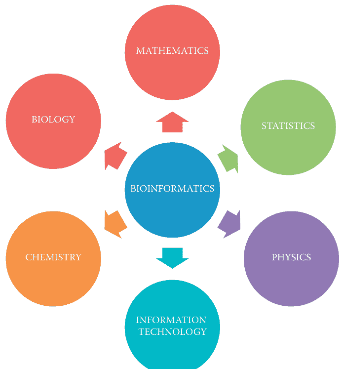

图 1.1 生物信息学：一个跨学科领域

## 1.1 生物信息学的重要性

生物信息学无处不在，从疾病检测到疾病预防和治愈，从微生物研究到地球上所有生命的研究，再从序列比对到基因表达。

以下是生物信息学的重要领域和应用：

- 疾病早期检测
- 通过RNA干扰疗法诊断和治愈疾病
- 发现生物体系中未被揭示的事实
- 处理大规模生物学数据的工具
- 地球上所有生命的系统发育研究

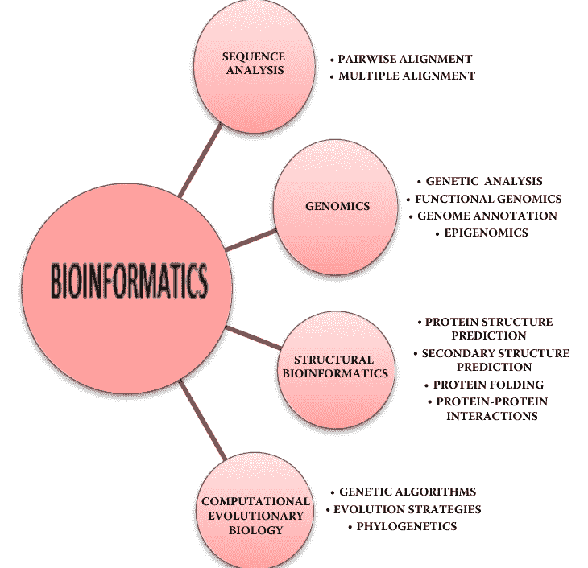

图 1.2 生物信息学领域

- 分子结构预测
- 序列比对
- 基因组功能和结构分析
- 作物杂交
- 蛋白质的表达、相互作用和生产
- 用于医学和法医学的DNA测序
- 包括制药和微生物工业在内的生物技术的不同方面
- 通过基因的低表达和过表达控制疾病
- 通过预防医学研究一个人对各种疾病的易感性
- 通过药物基因组学研究个体对人体的反应
- 分离使微生物能够生存的基因

## 1.2 DNA、RNA和蛋白质序列

生物信息学的大厦建立在DNA、RNA和蛋白质的基础之上。这三者是生命的基本构建块。

生物体拥有细胞，细胞相互沟通和相互作用以形成组织、器官和生物体。细胞由膜、蛋白质、碳水化合物、维生素和核酸组成。许多细胞形成组织。大量组织形成器官，器官构成整个生物体。

细胞部分的组装需要包含在脱氧核糖核酸（DNA）中的额外信息。组装完成后，身体的完整功能由蛋白质负责。DNA通过RNA（核糖核酸）作为中间体转化为蛋白质。

### 1.2.1 DNA

DNA存在于细胞核内。它是制造蛋白质的“食谱”。它携带细胞的所有遗传信息。DNA的特点如下：

- 它是一种核酸，编码构建细胞所需的信息。
- 它包含可从一代传到另一代的遗传信息。例如，孩子眼睛等位基因的颜色与母亲眼睛的颜色相同。
- 它存储和维护细胞信息，并将其从一代传给下一代。
- 它是蛋白质合成的“食谱”。
- DNA是一种稳定的分子。
- 每个细胞中存在一份DNA副本。
- DNA在细胞分裂时自我复制。
- DNA结构
  - DNA是双螺旋结构，如图1.3所示。
  - 它包含四个碱基，即A代表腺嘌呤；G代表鸟嘌呤；C代表胞嘧啶；T代表胸腺嘧啶。

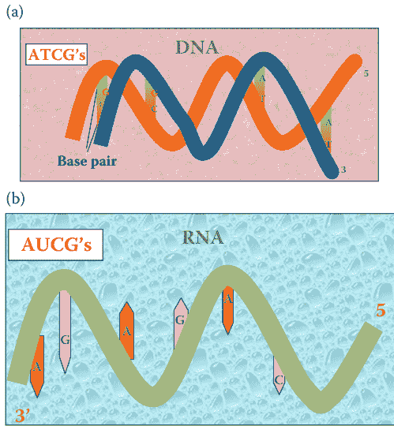

图 1.3 (a) DNA结构；(b) RNA结构

### 1.2.2 RNA

DNA在转化为蛋白质之前先转化为RNA。RNA是另一种与DNA在某些方面相似的核酸。

RNA的特点如下：

- RNA协助DNA合成特定蛋白质。
- RNA位于细胞核、细胞质或核糖体中，即细胞核内部和外部。
- RNA是一种不稳定的分子。
- 每个细胞中存在多份RNA副本。
- RNA有多种类型，即mRNA、tRNA、rRNA、snRNA、siRNA、miRNA、asRNA
- RNA结构
  - RNA是单链结构，如图1.3所示。
  - 它包含四个碱基，即A代表腺嘌呤；G代表鸟嘌呤；C代表胞嘧啶；U代表尿嘧啶（与DNA中的胸腺嘧啶相反）。
  - RNA结构有四个层次——初级结构、二级结构、三级结构和四级结构。

### 1.2.3 蛋白质

蛋白质是生命的基本构建块。蛋白质就是“我们”。我们的身体依赖蛋白质来发挥功能。蛋白质有三种类型：

- 纤维蛋白质——这些蛋白质构成肌肉纤维、结缔组织和骨骼。例如——角蛋白、肌动蛋白、肌球蛋白、胶原蛋白等。
- 球形蛋白质——这些蛋白质执行运输、催化和调节等功能。例如——血红蛋白、球蛋白、凝血酶等。
- 膜蛋白质——这些蛋白质具有连接细胞、受体蛋白质和运输分子等多种作用。例如——组蛋白、葡萄糖转运蛋白等。

它们由二十种氨基酸组成，通过称为肽键的键连接在一起。我们体内氨基酸的来源是饮食。少数氨基酸包括丙氨酸、赖氨酸、谷氨酰胺、苏氨酸和天冬氨酸。蛋白质结构有四个层次——初级结构、二级结构、三级结构和四级结构。初级结构或初级序列（图1.4）由成千上万个氨基酸的序列形成。在此序列折叠之前，它被称为 _初级序列_。当这个氨基酸序列折叠并通过氢键连接氨基酸时，所得结构称为蛋白质的二级结构。


图 1.4 蛋白质初级序列

二级结构进一步以两种形式存在——α-螺旋结构和β-折叠片状结构，如图1.5所示。

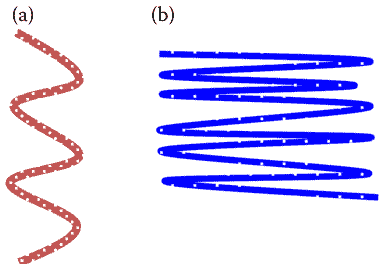

图 1.5 蛋白质二级结构：(a) α-螺旋蛋白质结构；(b) 蛋白质的β-折叠片状结构

此外，二级结构自行折叠以形成三级蛋白质结构，即α-螺旋和β-折叠片状结构之间的键合。这是一种三维结构，如图1.6(a)所示。当两条或多条氨基酸链键合在一起形成结构时，就会形成四级蛋白质结构。氨基酸链也称为多肽链。蛋白质的四级结构如图1.6(b)所示。

蛋白质的功能如下：

- 运输——血红蛋白在体内运输氧气。
- 结构成分——角蛋白为我们的皮肤和指甲形成结构。
- 激素——受体蛋白质接收信号并将其传递给其他蛋白质。

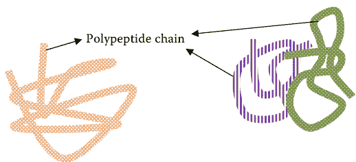

图 1.6 (a) 蛋白质三级结构；(b) 蛋白质四级结构

- 收缩结构——我们肌肉中的这些蛋白质导致身体运动；例如，肌动蛋白和肌球蛋白。
- 抗体蛋白质保护我们免受致病病毒的侵害。
- 酶——这些蛋白质催化或加速各种生物化学反应。它们在细胞中随时处于活跃状态。

## 1.3 分子生物学的中心法则

分子生物学是关于RNA、DNA和蛋白质等分子的生物学，这些分子积极参与称为转录和翻译的过程。分子生物学的中心法则是指转录后随之进行翻译的集体过程，通常称为基因表达。基因表达过程是我们体内所有化学反应的基础。

该过程从DNA开始。如图1.7所示，双链DNA自我复制成两条单链DNA。然后这条单链DNA转化为mRNA（信使RNA）。这个过程称为转录。mRNA中的字母或碱基以三个为一组进行分组。这些组称为密码子。每个密码子对应一种特定的氨基酸。tRNA（转运RNA）翻译这些密码子，并将游离氨基酸转移到目标位点。密码子和氨基酸结合的目标位点在核糖体中进行。氨基酸序列形成多肽链，从而形成蛋白质。核糖体随后将蛋白质送入细胞。这些蛋白质是我们身体的基本构建块，并负责我们身体的所有功能。

## 1.4 蛋白质折叠问题

蛋白质折叠问题是指通过分析氨基酸序列来预测蛋白质结构。换句话说，如果任何二十种氨基酸以某种特定方式序列在一起，我们应该能够判断这条多肽链或氨基酸序列将如何折叠，以及最终形成的蛋白质是什么。

此外，多肽链可能会经历两个疏远相关但最终由于大规模折叠而靠近的成对之间的相互作用


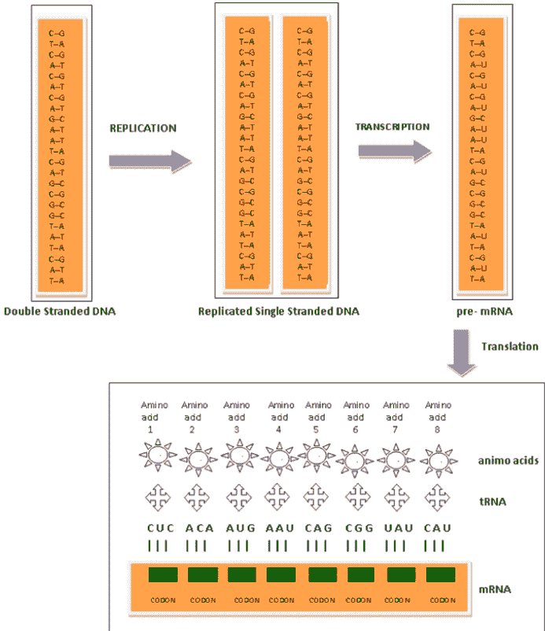

图 1.7 基因表达——从 DNA 到蛋白质

polypeptide sequence. These interactions are quite important in understanding the structure and function of proteins.

多肽序列。这些相互作用对于理解蛋白质的结构和功能非常重要。

A lot of computer-based software are designed for the prediction of protein structures from sequences. These software take amino acid sequences as input and output protein structures.

大量基于计算机的软件旨在从序列预测蛋白质结构。这些软件以氨基酸序列作为输入并输出蛋白质结构。

With the sensation of automatic prediction of some of the proteins, designing our own protein has become possible. Things that were never seen in the biological world can now be made; for example, metacin, which can target the flu virus. This has brought new insights into the field of medicine.

随着部分蛋白质自动预测的实现，设计我们自己的蛋白质已成为可能。生物世界中从未见过的事物现在可以被制造出来；例如，metacin 可以针对流感病毒。这为医学领域带来了新的洞察。

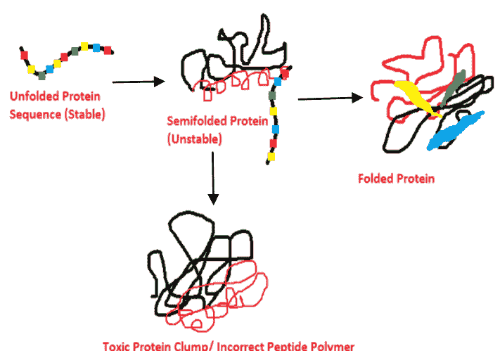

图 1.8 蛋白质折叠问题

The second issue related to protein folding is proteins that erroneously folded, as shown in Figure 1.8. If the folded protein structure deviates from the expected or actual structure, it leads to diseases in our body. The cause of formation of deviated structures may be environmental factors, or external stimuli in our body etc. Scientists and researchers have been working on this for decades. This can be controlled at the gene expression level. Genes may be allowed to under-express or over-express so as to control the structure of the resultant protein. Lots of therapeutic techniques have been developed for this. Consequently, this information is used to invent new drugs for targeted diseases.

与蛋白质折叠相关的第二个问题是错误折叠的蛋白质，如图 1.8 所示。如果折叠后的蛋白质结构偏离预期或实际结构，就会导致我们身体患病。偏差结构的形成原因可能是环境因素或体内的外部刺激等。科学家和研究人员在这方面工作已有几十年。这可以在基因表达水平上得到控制。可以允许基因低表达或过表达，以控制所产生蛋白质的结构。为此已开发出大量治疗技术。因此，这些信息被用于发明针对性疾病的新药。

## 1.5 基因组学和蛋白质组学

The journey from genotype to phenotype is characterized by genomics and proteomics. Genotype refers to all genetic material inside our body and phenotype refers to how we look on the outside of our body. As shown in Figures 1.9 and 1.10, RNA is synthesized from DNA, which in turn manufactures proteins. Protein–protein interaction leads to chemical reactions in our body that catalyze metabolism.

从基因型到表型的旅程由基因组学和蛋白质组学所表征。基因型是指我们体内所有的遗传物质，表型是指我们体表的外观。如图 1.9 和 1.10 所示，RNA 由 DNA 合成，进而制造蛋白质。蛋白质-蛋白质相互作用导致我们体内催化代谢的化学反应。

The aim of genomics and proteomics is the:

基因组学和蛋白质组学的目标是：

- Identification of proteins as targets to cure diseases.
- Understanding of cell processes and genetics.
- Study of evolution through phylogenetic trees.

- 将蛋白质作为治愈疾病的靶点进行鉴定。
- 了解细胞过程和遗传学。
- 通过系统发育树研究进化。

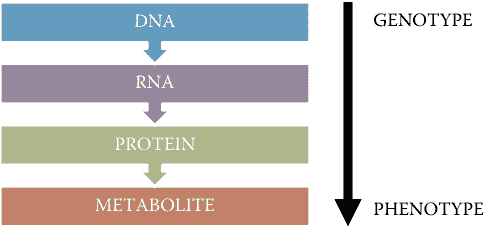

图 1.9 从基因型到表型

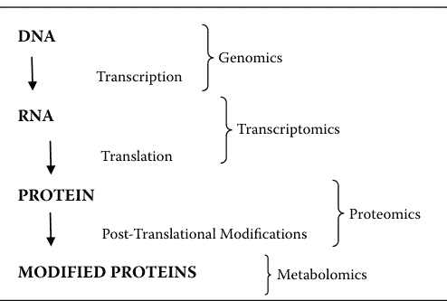

图 1.10 基因组学、转录组学、蛋白质组学和代谢组学

### 1.5.1 基因组学

The study of genes in the genome is called genomics. The entire genetic content or DNA of an organism is called genome. Each cell in our body contains base pairs that are formed from four bases of DNA (A, C, G, T). There are approximately 3.5 billion base pairs in a cell. The base-pair sequence folds multiple times to fit inside a cell. The most condensed form of this sequence is called a chromosome. We have twenty-three chromosomes in our body. Chromosomes contain genes, as shown in Figure 1.11. Massively coiled DNA exists in the form of chromosomes. Genes are the basic units of genetics. Each gene codes for a specific protein. The aim of genomics is to:

研究基因组中基因的学科称为基因组学。生物体的全部遗传物质或 DNA 称为基因组。我们体内的每个细胞都含有由四种 DNA 碱基（A、C、G、T）组成的碱基对。一个细胞中约有 35 亿个碱基对。碱基对序列多次折叠以装入细胞内。这种序列最凝聚的形式称为染色体。我们体内有二十三条染色体。染色体含有基因，如图 1.11 所示。高度卷曲的 DNA 以染色体的形式存在。基因是遗传学的基本单位。每个基因编码一种特定蛋白质。基因组学的目标是：

- Study DNA sequences and its mutations.
- Study the flow of information within a cell.
- Diagnose new diseases and their possible treatments.
- Detect diseases in the body.
- Predict behavioural status based on gene expression.

- 研究 DNA 序列及其突变。
- 研究细胞内的信息流。
- 诊断新疾病及其可能的治疗方法。
- 检测体内的疾病。
- 基于基因表达预测行为状态。

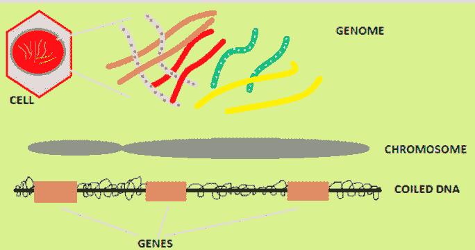

图 1.11 基因、染色体、DNA 和基因组

- Figure out how to resist diseases.
- Genetically modify food.
- Provide a comprehensive list of genes for the whole organism.
- Figure out information about the function of the DNA sequence, often called functional genomics.

- 找出如何抵抗疾病。
- 对食物进行基因改造。
- 为整个生物体提供基因的全面列表。
- 找出关于 DNA 序列功能的信息，通常称为功能基因组学。

### 1.5.2 蛋白质组学

The term *proteome* was coined in 1994 by Marc Williams. A collection of proteins in a cell is referred to as a proteome; the qualitative and quantitative study of proteomes of cellular organisms is proteomics.

术语 *蛋白质组* 由 Marc Williams 于 1994 年提出。细胞中蛋白质的集合称为蛋白质组；对细胞生物体蛋白质组的定性和定量研究称为蛋白质组学。

Specifically, proteomics can answer the following:

具体来说，蛋白质组学可以回答以下问题：

- Identification of the structure of proteins
- Protein function
- Protein expression
- Protein post-translational modification
- Protein-protein interaction
- Protein localization

- 蛋白质结构的鉴定
- 蛋白质功能
- 蛋白质表达
- 蛋白质翻译后修饰
- 蛋白质-蛋白质相互作用
- 蛋白质定位

The protein-to-protein interaction is termed *proteomics*; in other words, the study of large sets of protein sequences is called proteomics.

蛋白质-蛋白质相互作用被称为 *蛋白质组学*；换句话说，对大量蛋白质序列的研究称为蛋白质组学。

There are more than 25,000 genes within the human genome. Each gene can produce more than one protein product. The total number of proteins in the human proteome is estimated to be more than one million.

人类基因组中包含超过 25,000 个基因。每个基因可以产生多种蛋白质产物。人类蛋白质组中蛋白质的总数估计超过一百万。

The goal of proteomics is to study the dynamic protein product of genomes and their interactions. It leads to understanding cells, which are the units of life. Proteomics deals with the study of the interaction of RNA, DNA and proteins.

蛋白质组学的目标是研究基因组的动态蛋白质产物及其相互作用。这有助于理解细胞，细胞是生命的单位。蛋白质组学涉及 RNA、DNA 和蛋白质相互作用的研究。

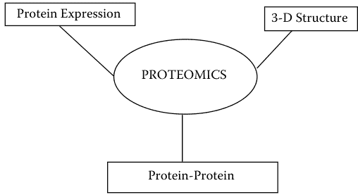

图 1.12 蛋白质组学

There are two major techniques for studying proteomics – two-dimensional electrophoresis and mass spectrometry.

研究蛋白质组学的两种主要技术是二维电泳和质谱法。

Two-dimensional electrophoresis is the process of separation of complex protein molecules. Mass spectrometry includes identification and structure analysis.

二维电泳是复杂蛋白质分子分离的过程。质谱法包括鉴定和结构分析。

Proteomics can be classified as follows (Figure 1.12):

蛋白质组学可分为以下几类（图 1.12）：

- 1. Protein Expression Comparison – Qualitative and quantitative study of protein expression between samples that differ by some variable.
- 2. Structural Proteomics – The goal of structural proteomics is to map the three-dimensional structure of protein and protein complexes.
- 3. Functional Proteomics – Functional proteomics aims to study protein-protein interactions, three-dimensional structure, cellular localization and post-translational modification in order to understand the functions of proteins.

- 1. 蛋白质表达比较——对不同变量下样品之间蛋白质表达的定性和定量研究。
- 2. 结构蛋白质组学——结构蛋白质组学的目标是绘制蛋白质和蛋白质复合物的三维结构。
- 3. 功能蛋白质组学——功能蛋白质组学旨在研究蛋白质-蛋白质相互作用、三维结构、细胞定位和翻译后修饰，以了解蛋白质的功能。

## 附录

### 练习

#### 选择题

1. The identification of drugs through genomic study is
- a. genomics.
- b. cheminformatics.
- c. pharmacogenomics.
- d. pharmacogenetics.

1. 通过基因组学研究鉴定药物属于
- a. 基因组学。
- b. 化学信息学。
- c. 药物基因组学。
- d. 药物遗传学。

2. The human genome contains about
- a. two billion base pairs.
- b. three billion base pairs.
- c. four billion base pairs.
- d. five billion base pairs.

2. 人类基因组包含大约
- a. 20 亿个碱基对。
- b. 30 亿个碱基对。
- c. 40 亿个碱基对。
- d. 50 亿个碱基对。

3. To synthesize a protein, a ribosome reads groups of three nucleotides called ________. Each of these represents one ________.
- a. amino acids; protein
- b. a reading frame; gene
- c. codons; amino acid
- d. DNA; allele

3. 合成蛋白质时，核糖体读取称为 ________ 的三个核苷酸组。每个组代表一个 ________。
- a. 氨基酸；蛋白质
- b. 读取框；基因
- c. 密码子；氨基酸
- d. DNA；等位基因

4. Below is the sequence of an extremely short mRNA:
5' GCCAAUUACAUGGUGUCACUCCACCUAGGACUCACUC
Show the DNA molecule from which this mRNA was transcribed.
- a. TACATGGTGTCACTCCACCTAGGACTCACTC
- b. CGGTAAATGTACCCAGTGGAGTGGGATCCTGAGTGAG

4. 下面是一段极短 mRNA 的序列：
5' GCCAAUUACAUGGUGUCACUCCACCUAGGACUCACUC
显示转录出这段 mRNA 的 DNA 分子。
- a. TACATGGTGTCACTCCACCTAGGACTCACTC
- b. CGGTAAATGTACCCAGTGGAGTGGGATCCTGAGTGAG

5. As the complexity of an organism increases, all of the following characteristics emerge except ________.
- a. the gene density decreases
- b. the number of introns increases
- c. the gene size increases
- d. an increase in the number of chromosomes
- e. repetitive sequences are present

5. 随着生物体复杂性的增加，以下所有特征都会出现，除了 ________。
- a. 基因密度降低
- b. 内含子数量增加
- c. 基因大小增加
- d. 染色体数量增加
- e. 存在重复序列

6. The collection of proteins that can be produced by a given species is
- a. considered that species' genetic complement.
- b. correlated with the size of the organism.
- c. called the proteome.
- d. All of these.
- e. None of these.

6. 特定物种能够产生的蛋白质集合是
- a. 被视为该物种的遗传互补体。
- b. 与生物体的大小相关。
- c. 称为蛋白质组。
- d. 以上都是。
- e. 以上都不是。

7. The term *proteomics* was coined by
- a. Marc Wilkins.
- b. Marc Anthony.
- c. Marc Jacobs.
- d. Marc Wilkings.

7. 术语 *蛋白质组学* 是由以下谁提出的
- a. Marc Wilkins。
- b. Marc Anthony。
- c. Marc Jacobs。
- d. Marc Wilkings。

8. 1 gene = 1 protein
- a. True
- b. False
- c. Can't say
- d. Rare situation

8. 1 个基因 = 1 个蛋白质
- a. 正确
- b. 错误
- c. 无法确定
- d. 罕见情况

9. Proteins are made of amino acids linked together by specific bonds called
- a. peptide bonds.
- b. nitrogen bonds.
- c. hydrogen bonds.
- d. hydrogen and nitrogen bonds.

9. 蛋白质由氨基酸通过称为 ________ 的特定键连接而成
- a. 肽键。
- b. 氮键。
- c. 氢键。
- d. 氢键和氮键。

10. Which of the following is a correct definition of genetics?
- a. the study of transmission of traits from parent to offspring
- b. the study of genes and traits defined by genes
- c. the study of DNA
- d. the study of variation between members of a species

10. 以下哪项是遗传学的正确定义？
- a. 研究亲代向后代传递性状的学科
- b. 研究基因及由基因定义的性状的学科
- c. 研究 DNA 的学科
- d. 研究物种成员之间变异的学科

11. What is the main function of DNA?
- a. It stores information for protein synthesis.
- b. It can be mutated.
- c. It directs the process of protein synthesis.
- d. It provides energy for the cell.

11. DNA 的主要功能是什么？
- a. 它存储蛋白质合成所需的信息。
- b. 它可以发生突变。
- c. 它指导蛋白质合成过程。
- d. 它为细胞提供能量。

12. Identify the correct order of the organization of genetic material, from largest to smallest.
- a. genome, chromosome, gene, nucleotide
- b. gene, chromosome, nucleotide, genome
- c. chromosome, gene, genome, nucleotide
- d. chromosome, genome, nucleotide, gene

12. 识别遗传物质组织的正确顺序，从大到小。
- a. 基因组、染色体、基因、核苷酸
- b. 基因、染色体、核苷酸、基因组
- c. 染色体、基因、基因组、核苷酸
- d. 染色体、基因组、核苷酸、基因

13. Identify which of the following terms refers to the overall three-dimensional shape of a protein.
- a. primary structure
- b. secondary structure
- c. tertiary structure
- d. quaternary structure

13. 识别以下哪个术语指蛋白质的整体三维结构。
- a. 初级结构
- b. 二级结构
- c. 三级结构
- d. 四级结构

14. Glucose is a
- a. protein.
- b. disaccharide.
- c. nucleic acid.
- d. monosaccharide.
- e. starch.

14. 葡萄糖是一种
- a. 蛋白质。
- b. 二糖。
- c. 核酸。
- d. 单糖。
- e. 淀粉。


15. 将基因的 DNA 序列复制为 RNA 序列的过程称为
a. 复制。
b. 转录。
c. 翻译。
d. PCR。

16. 哪个分子包含遗传密码？
a. DNA
b. mRNA
c. tRNA
d. rRNA

17. RNA 含有哪些碱基？
a. 腺嘌呤、胸腺嘧啶、鸟嘌呤、胞嘧啶、尿嘧啶
b. 腺嘌呤、胸腺嘧啶、鸟嘌呤、胞嘧啶
c. 胸腺嘧啶、鸟嘌呤、胞嘧啶、尿嘧啶
d. 腺嘌呤、鸟嘌呤、胞嘧啶、尿嘧啶

18. 哪种信息传递方式通常不会发生？
a. DNA 到 DNA
b. DNA 到 RNA
c. DNA 到蛋白质
d. 在活细胞中都会发生

19. 蛋白质组学
a. 是人类基因组学的另一个术语。
b. 是对特定细胞中产生的蛋白质集合的研究。
c. 是对特定基因产生的蛋白质的研究。
d. 证明单个基因只编码一种蛋白质。

20. 将序列为 AACGTAACG 的 DNA 链进行转录。合成的 mRNA 分子序列是什么？
a. AACGTAACG
b. UUUGAUUGC
c. AACGUAACG
d. TTGCATTGC

#### 论述题

Q1. 对以下内容撰写简短笔记：

- a. 人类基因组
- b. DNA 组织
- c. 非编码区域
- d. 分子生物学的中心法则

Q2. a. 我们如何确定基因的活跃程度？

b. 对以下内容撰写简短笔记：

- i. 基因组学与蛋白质组学
- ii. 分子生物学的中心法则

Q3. 生物信息学是一门交叉学科。请用理由支持这一观点。

Q4. a. “蛋白质组学弥合了基因组学与细胞信息之间的鸿沟”。您同意这一观点吗？请用理由支持您的回答。

b. 基因组学、转录组学、蛋白质组学和代谢组学之间有何关系？

Q5. 什么是核酸？有哪些类型？

Q6. 区分 RNA 和 DNA。

Q7. 您所说的基因表达是什么意思？我们可以控制这一过程吗？如果可以，请用理由支持。

Q8. 基因、DNA 和染色体之间有何关系？

Q9. 讨论各种类型的 RNA 及其功能。

Q10. 蛋白质形成总是正确的吗？如果不是，体内蛋白质形成不当会有什么影响？

# 2 计算生物学

少数研究人员将 _生物信息学_ 和 _计算生物学_ 这两个术语混用。但这些术语实际上是不同的。生物信息学更多与生物学背景相关。它借助可用工具来解决生物学问题。另一方面，计算生物学家倾向于编写算法和代码，用于开发生物信息学家所使用的工具。换句话说，计算生物学家比生物信息学家更偏向计算机专业人士。

在上一章中，我们了解到有三种类型的序列：

- RNA 序列
- DNA 序列
- 蛋白质序列

在本章中，我们将学习这些序列的比对。

## 2.1 序列比对

序列比对是将两个或多个序列逐行对齐的过程，以便定位最大相似区域，如下所示。

| H | E | L | L | O | 序列 1 |
|---|---|---|---|---|---|
| H | E | L | P | — | 序列 2 |
| ✓ | ✓ | ✓ | ✗ | o | |

序列 1 包含五个字母，序列 2 包含四个字母。对勾（✓）表示字母匹配。叉号（✗）表示不匹配，圆圈（O）表示空位。总结来说，相似性搜索可能有三种结果。

- 匹配
- 不匹配
- 空位

序列比对的另一个重要方面是发现最大相似区域，如下示例所示。

| U | C | A | U | G | 序列 1 |
|---|---|---|---|---|---|
| C | A | U | U | G | 序列 2 |

场景 1

| | U | C | A | U | G |
|---|---|---|---|---|---|
| 序列 1 | U | C | A | U | G |
| 序列 2 | C | A | U | U | G |
| | X | X | X | ✓ | ✓ |

场景 2

| | U | C | A | U | G | – |
|---|---|---|---|---|---|---|
| 序列 1 | U | C | A | U | G | – |
| 序列 2 | – | C | A | U | U | G |
| | o | ✓ | ✓ | ✓ | X | o |

场景 3

| | U | C | A | – | U | G |
|---|---|---|---|---|---|---|
| 序列 1 | U | C | A | – | U | G |
| 序列 2 | – | C | A | U | U | G |
| | o | ✓ | ✓ | o | ✓ | ✓ |

场景 4

| | U | C | A | U | – | G |
|---|---|---|---|---|---|---|
| 序列 1 | U | C | A | U | – | G |
| 序列 2 | – | C | A | U | U | G |
| | o | ✓ | ✓ | ✓ | o | ✓ |

场景 1 显示两个匹配、三个不匹配和零个空位。场景 2 显示三个匹配、一个不匹配和两个空位。场景 3 和 4 显示四个匹配、零个不匹配和两个空位。序列比对的得分基于预定义的得分函数计算。例如，得分函数可定义为：

```
Score = {
  +2 if a match occurs
  -1 if a mismatch occurs
  -2 gap penalty
}
```

使用该得分函数对场景 1 进行评分的结果为 1（2+2-1-1）。同样，其他场景的得分分别可计算为 1、4 和 4。因此，最佳比对为场景 3 和 4。

## 2.2 全局序列比对

全局序列比对是指对序列的所有核苷酸进行比对的过程。该方法由 Needleman, S. B. 和 Wunsch, C. D. 于 1970 年提出。该算法称为 Needleman-Wunsch 算法。

创建一个得分矩阵，其行数和列数分别对应两个序列中的核苷酸（字母）数量。矩阵填充规则如下：

步骤 1. 选择合适的得分函数。我们使用以下得分函数：

```
Score = {
  +2 if a match occurs
  -1 if a mismatch occurs
  -2 gap penalty
}
```

| | | A | C | G | C |
|---|---|---|---|---|---|
| C | -6 | | | | |
| A | -5 | | | | |
| T | -4 | | | | |
| C | -3 | | | | |
| A | -2 | | | | |
| G | -1 | | | | |
| 空位 | 0 | -1 | -2 | -3 | -4 |
| | | A | C | G | C |

**图 2.1** 全局序列比对-步骤 1

步骤 2. 填充矩阵其余部分的规则：

- 相邻单元格（添加空位）
- 下方单元格（添加空位）
- 对角线单元格（考虑匹配和不匹配）

步骤 3. 在第一列和最后一行插入空位，如图 2.1 所示。

步骤 4. 在两个空位的交叉处填入零。

步骤 5. 第二列（C2）和倒数第二行（R7）通过在相邻单元格中依次添加空位值来填充，如图 2.1 所示。

步骤 6. 考虑矩阵中的一个小正方形，如图 2.2 所示。该小正方形如图 2.3 所示。

高亮单元格的值通过考虑来自水平方向、垂直方向以及对角线方向的值来填充。

步骤 7. 如所述，在水平方向或垂直方向移动时会添加空位值。因此，来自水平方向的结果值计算如下：

```
Resultant Value = value from beside box + gap value
= -1 + (-1)
= -2
```

步骤 8. 同样，来自垂直方向的结果值计算如下：

| | | A | C | G | C |
|---|---|---|---|---|---|
| C | -6 | | | | |
| A | -5 | | | | |
| T | -4 | | | | |
| C | -3 | | | | |
| A | -2 | | | | |
| G | -1 | | | | |
| 空位 | 0 | -1 | -2 | -3 | -4 |
| | | A | C | G | C |

**图 2.2** 全局序列比对-步骤 2

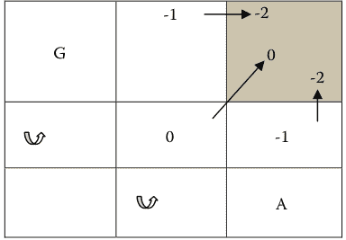

**图 2.3** 全局序列比对-步骤 3

结果值 = 下方单元格的值 + 空位值
= -1 + (-1)
= -2

步骤 9. 最后，来自对角线方向的结果值计算如下：

结果值 = 对角线单元格的值 + 匹配/不匹配值
= 0 + 0
= 0

由于 G 和 A 字母不匹配，因此不匹配得分（即零）将添加到来自对角线单元格的值中。

步骤 9. 现在考虑这三个结果值中最高的一个，即 2、0 和 0。最大值为零，因此零被保存为高亮单元格的最终值。此外，最终值来源的方向也会保存，用于回溯步骤。结果矩阵如图 2.4 所示。

步骤 10. 重复步骤 5 至 9 以完全填充矩阵，如图 2.5 所示。

| | | A | C | G | C |
|---|---|---|---|---|---|
| C | -6 | | | | |
| A | -5 | | | | |
| T | -4 | | | | |
| C | -3 | | | | |
| A | -2 | | | | |
| G | -1 | 0 | | | |
| 空位 | 0 | -1 | -2 | -3 | -4 |
| | | A | C | G | C |

**图 2.4** 全局序列比对-步骤 4


| C | ↖-6 | ↖-4 | ↖-2 | ↖-1 | ↖ 1 |
|---|---|---|---|---|---|
| A | ↖-5 | ↖-3 | ↑-1 | → 0 | ↖ 1 |
| T | ↑-4 | →-2 | ↖ 0 | → 1 | → 0 |
| C | ↖-3 | ↖-1 | ↑ 1 | → 0 | → 0 |
| A | ↑-2 | ↖ 0 | ↖ 0 | ↖-1 | →-1 |
| G | ↑-1 | → 0 | ↖-1 | ↖-1 | →-2 |
| ⌐ | ↓ 0 | →-1 | →-2 | →-3 | →-4 |
| | ⌐ | A | C | G | C |

第11步。下一步是回溯。找出矩阵中的最大值。在我们的示例中，最大值是1。通常，最大值位于最后一列。
第12步。现在回溯到该值来源的单元格。在我们的示例中，单元格(C6, R1)的值来自单元格(C5, R2)，如图2.5所示。单元格(C5, R2)的更早值来自单元格(C4, R3)。同样，回溯到单元格(C2, R6)。回溯过程如图2.6所示。
第13步。回溯之后，下一步是序列比对。比对规则如下：

- 回溯时，对于对角线箭头，比对时填入字母。
- 对于水平箭头，比对时填入空隙。

第14步。从单元格(C6, R1)到单元格(C5, R2)的箭头是对角线，因此单元格(C1, R1)和(C6, R8)的相应字母分别进行比对并导致匹配字母。
第15步。接下来的从(C5, R2)到单元格(C4, R3)的箭头又是一条对角线，因此单元格(C1, R2)和(C5, R8)的相应字母分别进行比对并导致错配。
第16步。相反，接下来的从(C4, R3)到单元格(C4, R4)的箭头是垂直箭头，因此空隙写作如下所示：

| C1 | C2 | C3 | C4 | C5 | C6 | |
|---|---|---|---|---|---|---|
| C | -6 | -4 | -2 | -1 | 1 | R1 |
| A | -5 | -3 | -1 | 0 | 1 | R2 |
| T | -4 | -2 | 0 | 1 | 0 | R3 |
| C | -3 | -1 | 1 | 0 | 0 | R4 |
| A | -2 | 0 | 0 | -1 | -1 | R5 |
| G | -1 | 0 | -1 | -1 | -2 | R6 |
| ⌐ | 0 | -1 | -2 | -3 | -4 | R7 |
| | ⌐ | A | C | G | C | R8 |

| G | A | C | T | A | C |
|---|---|---|---|---|---|
| - | A | C | - | G | C |

第17步。比对完成。

## 2.3 局部序列比对

与全局序列比对相反，局部序列比对是指比对序列的一段而不是完整序列。

序列相似性通常与同源性相关。同源序列是指属于同一祖先的序列。因此，可以从序列比对中推断结构或功能。可能没有必要比对完整序列；相反，我们可能只需要比对序列的部分。在这种情况下，局部序列比对是更好的选择。

局部比对方法由Smith, T. F.和Waterman, M. S.于1981年提出。该算法广为人知，称为Smith-Waterman算法。

Needleman-Wunsch算法与Smith-Waterman算法的区别在于填充矩阵。评分函数以及填充矩阵的规则保持不变。唯一的区别在于矩阵的值。负数写为零，正数照写。另一个微小的区别在于回溯步骤。在这里，我们将从最大数字开始并沿对角线回溯，直到到达值为零的单元格，如图2.7所示。

得到的比对如下所示：

| A | T | C |
|---|---|---|
| C | G | C |

在以下情况下，局部序列比对很重要：

- 我们需要比对两个部分重叠的序列
- 一个序列是另一个序列的子集

| C | 0 | 0 | 0 | 0 | 1 |
|---|---|---|---|---|---|
| A | 0 | 0 | 0 | 0 | 1 |
| T | 0 | 0 | 0 | 1 | 0 |
| C | 0 | 0 | 1 | 0 | 0 |
| A | 0 | 0 | 0 | 0 | 0 |
| G | 0 | 0 | 0 | 0 | 0 |
| ✓ | 0 | 0 | 0 | 0 | 0 |
| ✓ | ✓ | A | C | G | C |

## 2.4 多重序列比对

局部序列比对和全局序列比对统称为双序列比对。有时我们需要比对多于两个序列；例如，待比对序列的数量可能是10、20，甚至60。随着待比对序列数量的增加，比对算法的复杂度也随之增加。

多重序列比对的一个应用可能是构建系统发育树。系统发育树是显示生物体之间亲缘关系远近的树。为了构建这样的树，需要找到保守区域。保守区域可以借助多重序列比对来定位。双序列比对可能无法保证两个物种序列之间的祖先关系，但多重序列比对可以显著分析祖先关系。

双序列比对需要二维矩阵。同样，三个序列的序列比对将需要三维矩阵。进一步，四维序列将用于比对四个序列，以此类推。

例如，我们取三个序列——AGCT、GGT和CGCT——如图2.8所示。

需要在三维矩阵上绘制的顶点是(1,0,0)、(1,0,1)、(2,1,2)、(2,2,2)、(3,2,3)和(4,3,4)。

此外，二维矩阵中单元格的值以前来自三个方向：对角线、水平和垂直。但是，在n维矩阵的情况下，值将从各个方向进入评分矩阵的单元格，如图2.9所示。

可以使用ClustalX、ShadyBox、PrettyBox等比对工具实现多重序列比对。进行多重序列比对的步骤如下：

| I | 1 | 1 | 2 | 2 | 3 | 4 |
|---|---|---|---|---|---|---|
| | A | - | G | - | C | T |

| J | 0 | 0 | 1 | 2 | 2 | 3 |
|---|---|---|---|---|---|---|
| | - | - | G | G | - | T |

| k | 0 | 1 | 2 | 2 | 3 | 4 |
|---|---|---|---|---|---|---|
| | - | C | G | - | C | T |

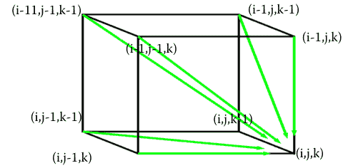

### 图2.9 多重序列比对的n维矩阵


### 图2.10 NCBI – 多重序列比对

第1步。打开NCBI (https://www.ncbi.nlm.nih.gov/)并获取蛋白质序列，如图2.10所示。
第2步。获取蛋白质序列后，运行Blast查找相似序列，如图2.11–2.14所示。
第3步。选择分类学报告以生成生物体报告。随机选择生成序列的登录号，如图2.15所示。
第4步。现在在NCBI（图2.16）主页上搜索所选序列，如第1步所用。
第5步。得到的序列如图2.17所示。
第6步。序列可以通过点击“摘要”以FASTA格式或FASTA（文本）格式保存，如图2.18和2.19所示。
第7步。现在将所有序列的FASTA格式复制到多重比对工具中，例如Clustal Omega (http://www.ebi.ac.uk/Tools/msa/clustalo/)并运行多重序列比对。结果如图2.20和2.21所示。

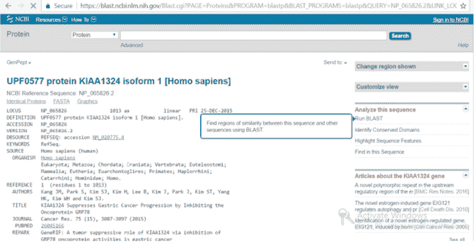

### 图2.11 NCBI – 多重序列比对


### 图2.12 BLAST – 多重序列比对（第1步）


### 图2.13 BLAST – 多重序列比对（第2步）

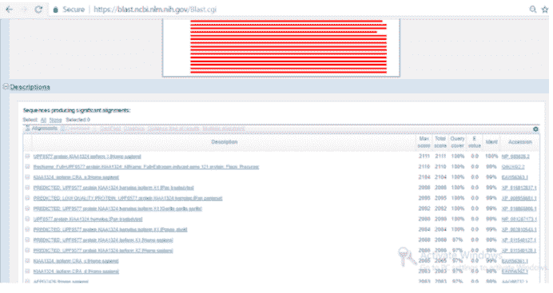

### 图2.14 相似序列 – 多重序列比对（第1页）

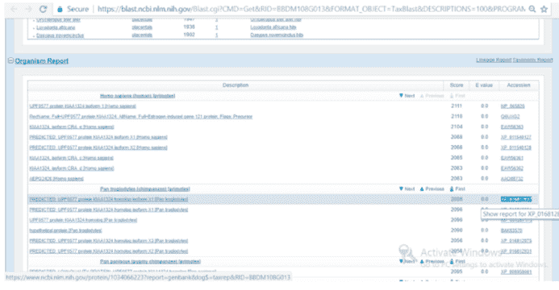

### 图2.15 相似序列 – 多重序列比对（第2页）


### 图2.16 NCBI – 多重序列比对（第1步）

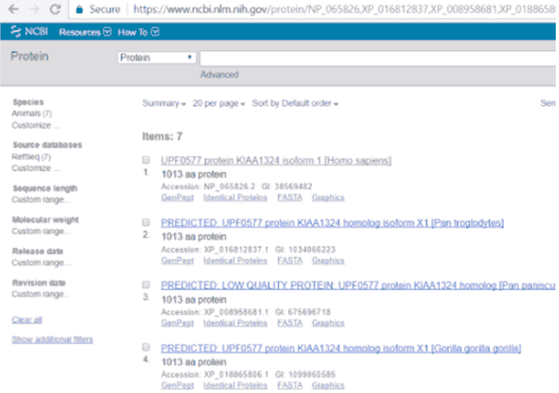

### 图2.17 NCBI – 多重序列比对（第2步）


### 图2.18 NCBI – 多重序列比对（第3步）


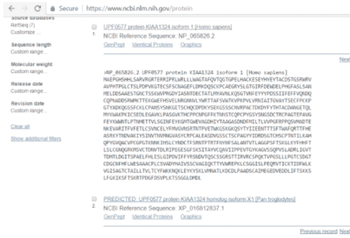

### 图 2.19 NCBI – 多序列比对（步骤 4）

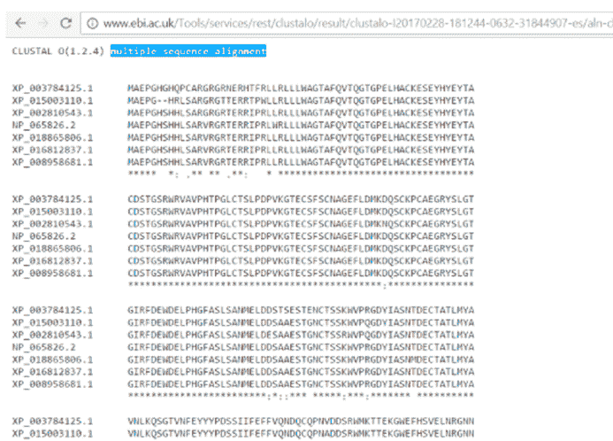

### 图 2.20 多序列比对

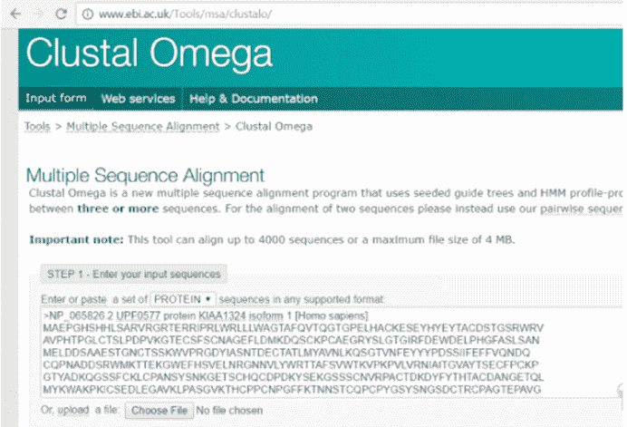

### 图 2.21 Clustal Omega – 多序列比对示例


### 图 2.22 Clustal Omega – 多序列比对

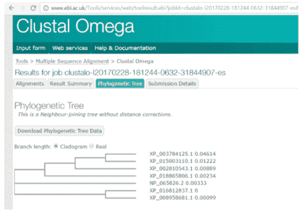

### 图 2.23 分支图 – Clustal Omega 系统发育树

步骤 8。现在可以单击“系统发育树”构建分支图或系统发育树，如图 2.22 和 2.23 所示。

## 附录

### 使用 ASP.net 和 C# 实现 Needleman-Wunsch 全局序列比对算法

序列比对是排列两个或多个字符序列的一种方法，以识别相似区域——相似性可能是这些序列之间功能或进化关系的结果。

它是一种通过查找一系列在这些序列中具有相同顺序的单个字符来比较两个或多个序列的过程。

为给定规则集查找序列之间的最优全局比对。

共有三个步骤：

- 1. 初始化步骤
- 2. 矩阵填充步骤
- 3. 回溯步骤

#### 设计前端

- 1. 放置五个输入框和一个按钮，前两个文本框用于序列，三个文本框用于匹配、错配和间隙值，按钮用于执行单击操作。
- 2. 放置两个 GridView 和标签以可视化矩阵操作并输出两个序列比对结果。

#### C# 代码说明

- 1. 输入五个变量，分别为第一个序列的长度、第二个序列的长度、匹配、错配和间隙。
- 2. 定义两个矩阵，大小均为第一个和第二个序列长度加 1，一个用于得分，另一个用于回溯。
- 3. 根据得分值填充两个矩阵（最大得分值为 opt）。
- 4. 在回溯矩阵中，D 表示对角线，L 表示左侧，U 表示上方得分值。
- 5. 将两个矩阵转换为数据表，以便在网格视图中可视化数据。
- 6. 调用回溯函数在标签中显示两个比对后的序列。
- 7. 如果值为 D，即对角线，则写出两个序列的两个字符；否则，对于 L 和 U 得分值，仅写出相应序列的一个字符。

```csharp
using System;
using System.Collections.Generic;
using System.Data;
using System.Web;
using System.Web.UI;
using System.Web.UI.WebControls;
public partial class GlobalSeq: System.Web.UI.Page
{
    protected void btnFillMatrix_Click(object sender, EventArgs e)
    {
        int a = txtSeq1.Text.Length+1;
        int b = txtSeq2.Text.Length+1;
        int ma=Convert.ToInt32(txtMatch.Text);
        int mi=Convert.ToInt32(txtMisMatch.Text);
        int Ga=Convert.ToInt32(txtGap.Text);
        int[,] ScoreMatrix=new int[a,b];
        char[,] tracebackMatrix = new char[a, b];
        ScoreMatrix[0,0]=0;
        for (int i = 1; i < a; i++)
        {
            ScoreMatrix[i, 0] = i * Ga;
            tracebackMatrix[i, 0] = 'U';
        }
        for (int j = 1; j < b; j++)
        {
            ScoreMatrix[0, j] = j * Ga;
            tracebackMatrix[0, j] = 'L';
        }
        for (int i = 1; i < a; i++)
        {
            for (int j = 1; j < b; j++)
            {
                int scoreDiag = 0;
                if (txtSeq2.Text.Substring(j - 1, 1) == txtSeq1.Text.Substring(i - 1, 1))
                    scoreDiag = ScoreMatrix[i - 1, j - 1] + ma;
                else
                    scoreDiag = ScoreMatrix[i - 1, j - 1] + mi;
                int scoreLeft = ScoreMatrix[i, j - 1] + Ga;
                int scoreUp = ScoreMatrix[i - 1, j] + Ga;
                int maxScore = Math.Max(Math.Max(scoreDiag, scoreLeft), scoreUp);
                ScoreMatrix[i, j] = maxScore;
                if (ScoreMatrix[i, j] == scoreDiag)
                {
                    tracebackMatrix[i, j] = 'D';
                }
                else if (ScoreMatrix[i, j] == scoreLeft)
                {
                    tracebackMatrix[i, j] = 'L';
                }
                else if (ScoreMatrix[i, j] == scoreUp)
                {
                    tracebackMatrix[i, j] = 'U';
                }
            }
        }
        GridView1.DataSource = ConvertArrayToDataTable(ScoreMatrix, a, b);
        GridView1.DataBind();
        GridView2.DataSource = ConvertArrayToDataTable(tracebackMatrix, a, b);
        GridView2.DataBind();
        TraceBack(tracebackMatrix, txtSeq1.Text, txtSeq2.Text);
    }

    public DataTable ConvertArrayToDataTable(int[,] ScoreMatrix, int a, int b)
    {
        DataTable dt = new DataTable();
        for (int j = 0; j < b; j++)
            dt.Columns.Add(j.ToString());
        for (int i = 0; i < a; i++)
        {
            dt.Rows.Add();
            for (int j = 0; j < b; j++)
                dt.Rows[i][j] = ScoreMatrix[i, j];
        }
        dt.AcceptChanges();
        return dt;
    }

    public DataTable ConvertArrayToDataTable(char[,] ScoreMatrix, int a, int b)
    {
        DataTable dt = new DataTable();
        for (int j = 0; j < b; j++)
            dt.Columns.Add(j.ToString());
        for (int i = 0; i < a; i++)
        {
            dt.Rows.Add();
            for (int j = 0; j < b; j++)
                dt.Rows[i][j] = ScoreMatrix[i, j];
        }
        dt.AcceptChanges();
        return dt;
    }

    public void TraceBack(char[,] tracebackMatrix, string sequenzA, string sequenzB)
    {
        int i = tracebackMatrix.GetLength(0) - 1;
        int j = tracebackMatrix.GetLength(1) - 1;
        string alignedSeqA = "";
        string alignedSeqB = "";
        while (i != 0 || j != 0)
        {
            switch (tracebackMatrix[i, j])
            {
                case 'D':
                    alignedSeqA += sequenzA[i - 1];
                    alignedSeqB += sequenzB[j - 1];
                    i--;
                    j--;
                    break;
                case 'U':
                    alignedSeqA += sequenzA[i - 1];
                    alignedSeqB += "-";
                    i--;
                    break;
                case 'L':
                    alignedSeqA += "-";
                    alignedSeqB += sequenzB[j - 1];
                    j--;
                    break;
            }
        }
        lblSequence1.Text = reverseString(alignedSeqA);
        lblSequence2.Text = reverseString(alignedSeqB);
    }

    public string reverseString(string strInp)
    {
        char[] arr = strInp.ToCharArray();
        Array.Reverse(arr);
        return new string(arr);
    }
}
```

#### 输出截图

www.medixny.com/globalseq.aspx

输入序列 1
输入序列 2
填充矩阵

得分矩阵
输出

匹配 1
错配 0
间隙 -1

#### 两个给定序列 ACGC 和 GACTAC 的输出

输入序列 1: ACGC
输入序列 2: GACTAC

| 0 | 1 | 2 | 3 | 4 | 5 | 6 |
|---|---|---|---|---|---|---|
| 0 | -1 | -2 | -3 | -4 | -5 | -6 |
| -1 | 0 | 0 | -1 | -2 | -3 | -4 |
| -2 | -1 | 0 | 1 | 0 | -1 | -2 |
| -3 | -1 | -1 | 0 | 1 | 0 | -1 |
| -4 | -2 | -1 | 0 | 0 | 1 | 1 |

| 0 | 1 | 2 | 3 | 4 | 5 | 6 |
|---|---|---|---|---|---|---|
| | L | L | L | L | L | L |
| U | D | D | L | L | D | L |
| U | D | D | D | L | L | D |
| U | D | D | D | D | D | D |
| U | U | D | D | D | D | D |

-AC-GC
GACTAC

## 附录

### 练习

#### 选择题

Q1. Needleman-Wunsch 算法使用哪种编程技术来高效执行全局比对？

- a. 启发式方法
- b. 列表推导式
- c. 动态规划
- d. 矩阵代数

Q2. 如果两个序列显示出显著相似性，这意味着

- a. 它们是旁系同源基因。
- b. 它们是直系同源基因。
- c. 它们从共同祖先进化而来。
- d. 已发生水平基因转移。

Q3. 以下哪项是序列比对工具？

- a. BLAST
- b. PRINT
- c. PROSITE
- d. PIR

Q4. 对相关基因进行多序列比对可以识别蛋白质功能所需的氨基酸。

- a. 正确
- b. 错误

Q5. BLAST 程序用于

- a. DNA 测序。
- b. 氨基酸测序。
- c. DNA 条形码。
- d. 生物信息学。

Q6. Clustal W 是一种

- a. 多序列比对工具。
- b. 蛋白质二级结构预测工具。
- c. 数据检索工具。
- d. 核酸序列分析工具。

Q7. 通过在序列中查找相同顺序的模式来比对两个序列的过程是

- a. 序列比对。
- b. 两两比对。
- c. 多序列比对。
- d. 以上都是。

Q8. 序列比对帮助科学家

- a. 追踪进化关系。
- b. 推断新合成基因的功能。
- c. 预测基因家族的新成员。
- d. 以上都是。

Q9. 多序列比对中保守良好的区域

- a. 反映结构重要区域。
- b. 反映功能重要区域。
- c. 反映功能和结构重要区域。
- d. 反映可能具有功能和/或结构重要性的区域。

Q10. 为什么配色方案在创建和分析序列比对中很重要？

- a. 它们看起来漂亮。
- b. 它们使打印件和演示文稿更清晰。
- c. 它们让你更容易区分保守残基和残基组。
- d. 它们让你检测蛋白质的活性位点。

#### 论述题

Q1. 你对序列比对是什么意思？它在计算生物学中的应用有哪些？

Q2. 详细解释全局序列比对。另外，对以下提到的 DNA 序列执行全局序列比对：

T G A
T T A


Q3. 区分进行全局序列比对和局部序列比对的程序。

Q4. 比对以下提到的序列：

- ACTGATTCA
- ACGCATCA

Q5. 局部序列比对何时重要？

# 3 系统发生学

## 3.1 系统发生学简介

术语*物种*被定义为一组相似生物的集合。相似程度使得与其他集合的不相似程度显著。相似性说明了物种之间的基因流。换句话说，物种通过产生可存活的后代而繁衍。与这种基因转移隔离的生物会随着时间的推移偏离其原始物种。这称为物种形成。正式地，物种形成可定义为导致新物种形成的进化过程。例如，一群蜥蜴可能会偶然迁移到其原生地之外。随着时间的推移，这些蜥蜴试图适应环境，以在新环境中维持生存。这些蜥蜴可能会发生结构变化，例如蜥蜴喉咙下方色彩鲜艳皮瓣的变化，从而导致不再与原蜥蜴物种交配的新蜥蜴物种。经过几百年，旧物种甚至可能不再识别新物种，从而形成生物分类学。

这种生物分类学与术语*系统发生*相关。因此，系统发生学是一门研究在一段时间内从共同祖先演化而来的生物之间生物学关系的科学。

系统发生关系由树状图或称为系统发生树的层级图表示。换句话说，系统发生树是一种展示物种之间遗传亲缘关系的方法。它描绘了从共同祖先演化而来的、在一段时间内发展的进化关系。图3.1显示了一棵系统发生树，其中分类群X和分类群Y有共同祖先。X、Y和Z被称为树的叶子。分类群X和分类群Y彼此之间比与分类群Z的关系更密切，因为它们共享一个共同祖先。但这并不意味着分类群X、Y和Z不相关。它们关系非常密切，因为它们也在第二层级共享一个共同祖先。这样一来，我们可以说系统发生树展示了生物之间的亲缘关系是近是远。

系统发生树有两种类型：有根系统发生树和无根系统发生树。

### 3.1.1 有根系统发生树

有根系统发生树如图3.1所示。这里的生物通过共同祖先彼此有明确的关系。进化关系可以通过生物体的生理特征、形态特征以及显著的遗传特征来构建。生理特征与特定器官的功能有关；例如，生物体的新陈代谢如何运作。

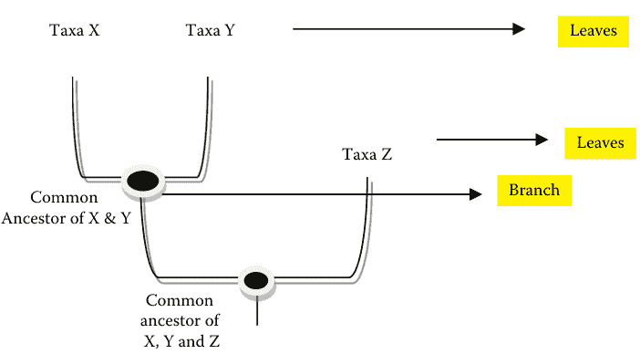

图3.1 有根系统发生树

形态特征与器官的各种形式（morph）及其他结构特征（例如骨骼结构）有关。生物体的遗传特征与通常从父母传递给子代的特征有关；例如，母亲和子代眼睛等位基因的颜色。

### 3.1.2 无根系统发生树

与有根系统发生树不同，无根树是全方向的。更准确地说，仅仅通过观察无根树很难找到生物的祖先。换句话说，当我们对两个或多个生物的祖先不确定时，会构建一棵无根树。图3.2显示了一棵无根树，其中包含X、P、Y、Z。如果有关于形态、生理或遗传的额外信息，无根树也可以转换为有根树。由于缺乏额外信息，得到的有根树不一定总是正确。

## 3.2 分子系统发生学

分子系统发生学是系统发生学的一个分支，它分析分子序列（本质上是DNA序列）的差异，以理解进化关系。随着时间的推移，分子序列会发生突变。

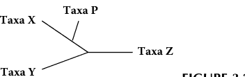

图3.2 无根系统发生树

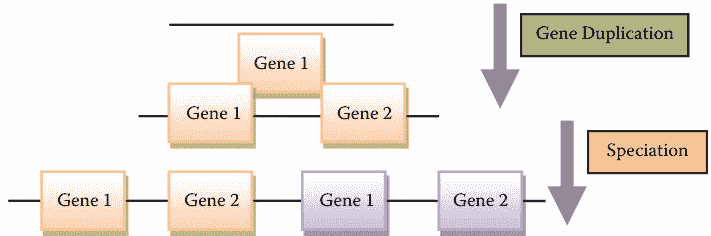

图3.3 同源旁系基因和直系同源基因

在分子系统发生学中，会追踪分子序列中的突变率，以研究物种之间的进化关系。序列中的突变是指分子序列中核苷酸的插入、删除、倒置或替换。

信息通过基因演化或DNA序列从一代传递到下一代。基因演化会产生同源旁系基因、同源基因和直系同源基因。同源旁系基因是由于基因复制而相关的同源序列，如图3.3所示。直系同源基因是通过物种形成产生的同源序列。换句话说，直系同源基因有一个最后共同祖先。同源基因可能源于物种形成或基因复制。同源基因可能是同源旁系基因或直系同源基因。

相关物种的分子结构具有高度相似性。

## 3.3 系统发生树及其构建

理解生物之间的系统发生关系有助于创建系统发生树，如图3.4所示。

系统发生树构建方法可以分类，如图3.5所示。

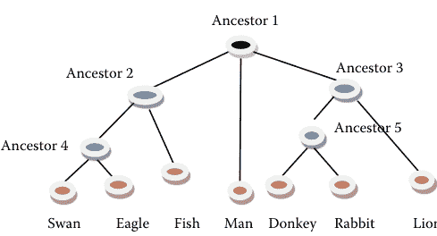

图3.4 系统发生树

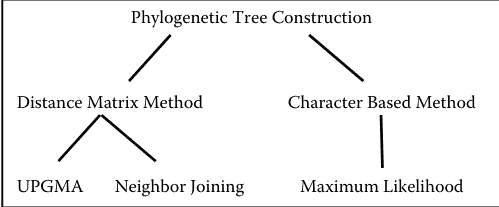

图3.5 系统发生树构建方法

## 3.4 系统发生树构建的距离矩阵方法

基于距离的矩阵方法使用矩阵作为数据结构来进行系统发生树构建。数据被转换为成对距离。

### 3.4.1 无权组平均法（UPGMA）– 距离矩阵方法

UPGMA基于凝聚聚类技术。在这种方法中，关系密切的簇逐渐合并为一个簇。合并簇的过程持续进行，直到所有簇合并形成树结构。让我们以四个节点为例，即a、b、c和d，如图3.6所示。

节点之间的距离在表3.1中以二维矩阵的形式体现。

- 步骤1. 找到彼此最近的两个节点。在上述示例中，最近的节点是c和b，距离为三个单位。

- 步骤2. 合并节点b和c，如表3.2所示，形成簇bc。

```
Distance (a to bc) = (7 + 5)/2 = 6
Distance (d to bc) = (8 + 8)/2 = 8
Distance (e to bc) = (5 + 15)/2 = 10
```

- 步骤3. 根据新簇创建系统发生树，如图3.7所示。新簇是节点“bc”，节点“bc”到节点“b”的距离与节点“bc”到节点“a”的距离相等。因此，距离3被分为各1.5。

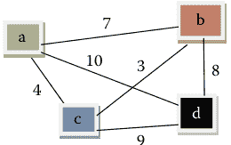

图3.6 UPGMA方法示例

表3.1
UPGMA示例：节点/簇之间的距离

| | a | b | c | d | e |
|---|---|---|---|---|---|
| a | - | - | - | - | - |
| b | 7 | - | - | - | - |
| c | 5 | 3 | - | - | - |
| d | 10 | 8 | 8 | - | - |
| e | 8 | 5 | 15 | 7 | - |

表3.2
UPGMA示例：节点/簇之间的更新距离（步骤2）

| | a | bc | d | e |
|---|---|---|---|---|
| a | - | - | - | - |
| bc | 6 | - | - | - |
| d | 10 | 8 | - | - |
| e | 8 | 10 | - | - |

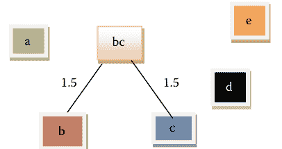

图3.7 UPGMA方法示例：步骤3

- 步骤4. 重复步骤1至3，直到矩阵中只剩下单个距离值。现在考虑表3.2。最小距离值为6。因此，节点“a”和“bc”将像表3.3和图3.8所示那样聚类。

```
Distance (d to abc) = (10 + 8)/2 = 9
Distance (a to abc) = (10 + 8)/2 = 9
```

- 步骤5. 同样，计算可能如下所示。

```
Distance (de to abc) = (9 + 9)/2 = 9
```


表 3.3 UPGMA 示例：节点/簇间更新距离（步骤 4）

| | abc | d | e |
|---|---|---|---|
| abc | 0 | | |
| d | 9 | 0 | |
| e | 9 | 7 | 0 |

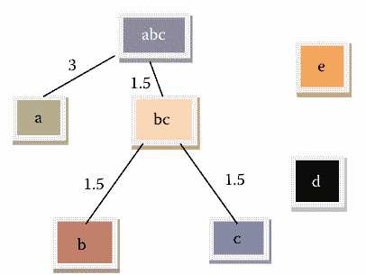

图 3.8 UPGMA 方法示例：步骤 4

让我们再次考虑这棵树。簇“abc”的距离是六，在“a”和“bc”之间平分。现在从节点“abc”到每个叶节点的总距离应为 3。节点“bc”到节点“b”的距离已经是 1.5。因此剩余距离将是，

距离（abc 到 bc）= 距离（abc 到 b）– 距离（bc 到 b）= 3 – 1.5 = 1.5

步骤 6。从表 3.3 可以清楚地看出，节点“d”和“e”将被聚类。结果树和对应的表格如图 3.9 和表 3.4 所示。

步骤 7。通过重复该过程，系统发育树如图 3.10 所示生成。

应当注意的是，从每个父节点到其各自叶节点的距离之和相同。从根节点到所有叶节点的距离相同。

这一问题被认为是 UPGMA 算法的主要缺点，因为在现实世界中，从一个分类单元到另一个分类单元的突变数量可能不同。

为了考虑可变突变，提出了一种新方法——邻接法。

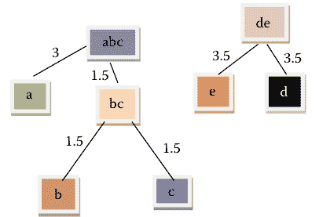

图 3.9 UPGMA 方法示例：步骤 6

表 3.4 UPGMA 示例：节点/簇间更新距离（步骤 6）

| | abc | de |
|---|---|---|
| abc | 0 | |
| de | 9 | 0 |

### 3.4.2 邻接法 – 距离矩阵方法

邻接法也是一种基于距离的聚类方法，但它生成的系统发育树中，从父节点到叶节点的长度是可变的。它生成的是无根树。

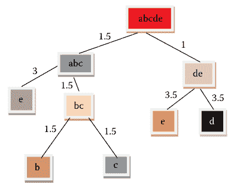

图 3.10 UPGMA 方法示例：步骤 7

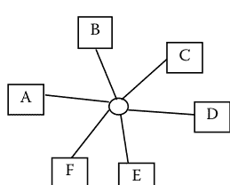

图 3.11 邻接法示例

步骤 1. 对于输入，使用星形拓扑创建一棵随机树，如图 3.11 所示。
步骤 2. 找出最近的节点并将它们连接。
步骤 3.1. 对于每个节点，计算 u_i，使得 u_i = \Sigma_j D_ij / (n–2)，其中 D_ij（表 3.5）是节点 i 和 j 之间的距离，如矩阵（图 3.12）所示，n 是节点总数。结果矩阵为：
步骤 2.2. 使用此公式计算距离矩阵：

**D_ij – u_i – u_j**

例如，对于节点 A 和 B，该值计算如下：

表 3.5 邻接法矩阵

| I | u_i = \Sigma_j D_ij/(n–2) |
|---|---|
| A | (16 + 20 + 26)/(4 – 2) = 31 |
| B | (16 + 11 + 17)/(4 – 2) = 22 |
| C | (20 + 11 + 13)/(4 – 2) = 22 |
| D | (26 + 17 + 13)/(4 – 2) = 28 |

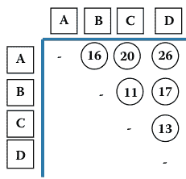

图 3.12 邻接法示例（步骤 2.1）

| | A | B | C | D |
|---|---|---|---|---|
| A | - | -37 | -33 | -33 |
| B | | - | -33 | -33 |
| C | | | - | -37 |
| D | | | | - |

图 3.13 邻接法示例（步骤 2.2）

```
D_AB-u_A - u_B = 16 - 31 - 22 = -37
```

结果距离矩阵如图 3.13 所示。
选择彼此最近的节点。在此情况下，A、B 和 C、D 等距。因此，我们随机选择 C、D 作为最近邻居。

步骤 3. 计算 V_i 和 V_j，如下：

```
V_i = 0.5 D_ij + 0.5 (u_i-u_j)
V_j = 0.5 D_ij + 0.5 (u_j-u_i)
```

例如：

```
V_C = 0.5 D_CD + 0.5 (u_C-u_D) = 0.5 * 13 + 0.5 * (22 - 28) = 3.5
V_D = 0.5 D_CD + 0.5 (u_D-u_C) = 0.5 * 13 + 0.5 * (28 - 22) = 9.5
```

步骤 4。节点 C 和 D 之间的距离现在分为两部分，分别为 3.5 和 9.5。系统发育树的构建现在可以开始。生成的树如图 3.14 所示。

步骤 5. 下一步是在距离矩阵中合并节点 C 和 D。此外，还需要计算其他节点到 X 的距离，如图 3.15(a) 和 3.15(b) 所示。

```
D_XA = (D_CA + D_DA - D_CD)/2
= (20 + 26 - 13)/2 = 16.5

D_XB = (D_CB + D_DB - D_CD)/2
= (11 + 18 - 13)/2 = 8
```

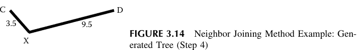

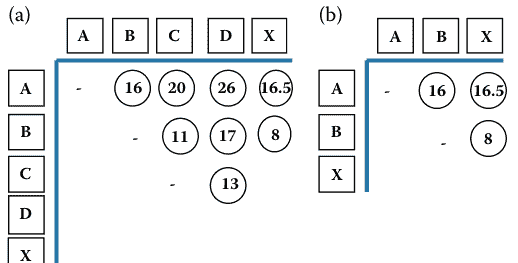

图 3.15 邻接法示例（步骤 5）

步骤 6. 重复步骤 2 至 4，直到矩阵中只剩一个节点（图 3.16、3.17 和 3.18）（表 3.6）。

```
V_A = 0.5 * 16 + 0.5 * (32.5 - 24)
= 12.25

V_B = 0.5 * 16 + 0.5 * (24 - 32.5)
= 3.75

D_XY = (D_AX + D_BX - D_AB)/2
= (16.5 + 8 - 16)/2 = 4.25
```

系统发育树的中间版本如图 3.17 所示，最终树如图 3.19 所示。

结果系统发育树中节点之间的距离可以从初始距离矩阵进行交叉验证。例如，D_AB = 12.25 + 3.75 = 16。节点 A 和 B 之间的距离在初始矩阵中也是 16。同样，其他距离也可以进行交叉验证。

该方法的优点是处理速度快且为多项式时间算法。但是，该方法生成无根树，因此无法预测共同祖先。

## 3.5 最大似然法 – 用于系统发育树构建的基于字符的方法

基于字符的方法使用排列好的字符，如 DNA 或蛋白质序列，来构建系统发育树。

例如，考虑物种 A 到 E 的排列 DNA 序列（图 3.20(a)）。第一组字符中的转换（或进化步骤）可能会导致一个系统发育树，如图 3.20(b) 所示。

该方法的输入是一个 n * m 字符矩阵，其中 n 表示物种，m 表示字符。输出是一棵树，其中具有相似字符值的物种彼此相邻。特征可以是手指数量、行走腿的数量、有无毛发等。特征数据放置在字符状态矩阵中，如图 3.21 所示。系统发育树生成的第一步是对矩阵内容进行排列，以便它传达物种特征之间的某些关系。此外，在创建树时，进化步骤的数量应保持最少。

图 3.21 显示了各种分类单元（鱼形目、鳃形目、鲔鱼、蝾螈、龟、豹）及其相应特征的字符状态矩阵，即毛发、羊膜卵、四条行走腿、铰状颌和脊柱。分类单元豹具有全部五个特征，而分类单元鱼形目没有给定的任何特征。因此，这两个分类单元将出现在

| Taxa | Characters |
|---|---|
| Species A | ATGGC TAT TTC TTA TAG TAC G |
| Species B | ATCGC TAG CTT ATA TTA TCA |
| Species C | TTC ACT AGA CCT GTG GTC CCA |
| Species D | TTG ACA CAG ACC TGG TGG CCG |
| Species E | TTG ACC CAG TTC TCT TAG TTC G |

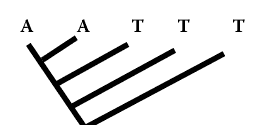

图 3.20 (a) 各物种的 DNA 序列；(b) 基于特征的系统发育树

(a)

| | 鲔鱼 | 鳃形目 | 龟 | 蝾螈 | 鱼形目 | 豹 |
|---|---|---|---|---|---|---|
| 脊柱 | 1 | 1 | 1 | 1 | 0 | 1 |
| 羊膜卵 | 0 | 0 | 1 | 0 | 0 | 1 |
| 四条行走腿 | 0 | 0 | 1 | 1 | 0 | 1 |
| 铰状颌 | 1 | 0 | 1 | 1 | 0 | 1 |
| 毛发 | 0 | 0 | 0 | 0 | 0 | 1 |

(b)

| | 鱼形目 | 鳃形目 | 鲔鱼 | 蝾螈 | 龟 | 豹 |
|---|---|---|---|---|---|---|
| 脊柱 | 0 | 1 | 1 | 1 | 1 | 1 |
| 铰状颌 | 0 | 0 | 1 | 1 | 1 | 1 |
| 四条行走腿 | 0 | 0 | 0 | 1 | 1 | 1 |
| 羊膜卵 | 0 | 0 | 0 | 0 | 1 | 1 |
| 毛发 | 0 | 0 | 0 | 0 | 0 | 1 |

图 3.21 (a) 字符状态矩阵；(b) 重新排列的字符状态矩阵


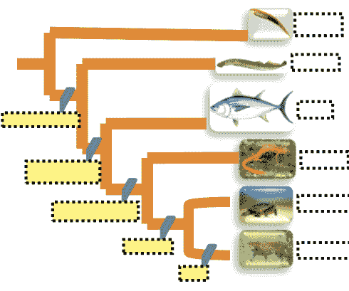

图 3.22 字符矩阵分支图

系统发生树，如图 3.22 所示。另一方面，海龟拥有所给五个特征中的四个，因此看起来最接近豹。

物种特征实际上是通过统计物种 DNA 的相似性百分比来比较的。图 3.23(a) 得到的系统发生树实际上称为分支图。系统发生树的实际表示如图 3.23(b) 所示。

创建分支图时需要牢记的另一个重要点是，可能需要在多个选项中进行选择来创建分支图。可能需要考虑多个特征。这里的目标是在分支图中从一个分支移动到另一个分支时，使进化步骤数最少。哺乳动物–鸟类分支类群和蜥蜴–鸟类分支类群的示例如图 3.24 所示。

### (a)

| 特征 | 氙鱼 | 七鳃鳗 | 金枪鱼 | 蝾螈 | 龟 | 豹 |
| :--- | :---: | :---: | :---: | :---: | :---: | :---: |
| 毛发 | 0 | 0 | 0 | 0 | 0 | 1 |
| 羊膜卵 | 0 | 0 | 0 | 0 | 1 | 1 |
| 四条步行腿 | 0 | 0 | 0 | 1 | 1 | 1 |
| 可动颚 | 0 | 0 | 1 | 1 | 1 | 1 |
| 脊柱 | 0 | 1 | 1 | 1 | 1 | 1 |

### (b)

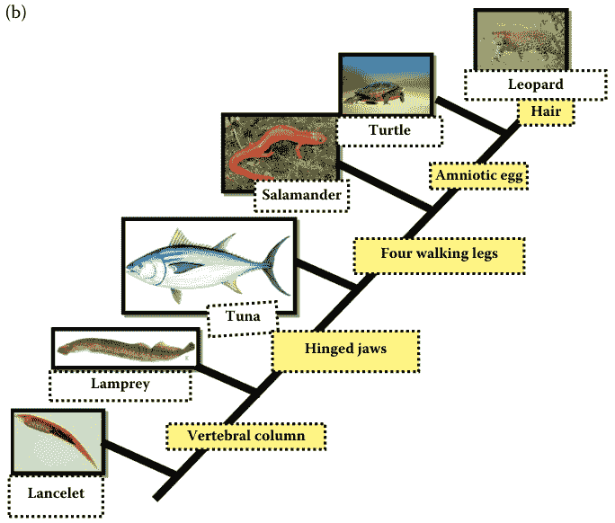

图 3.23 (a) 字符矩阵；(b) 系统发生树

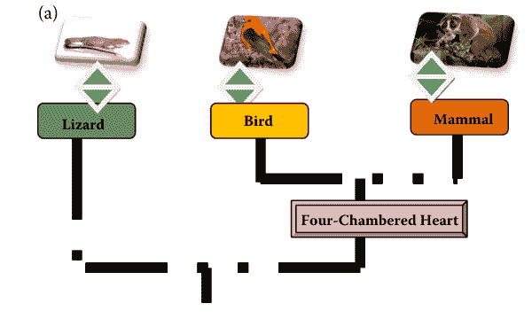

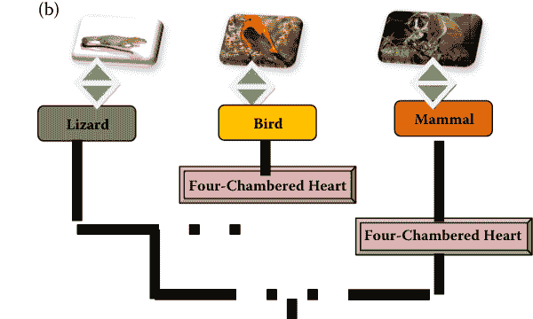

图 3.24 (a) 哺乳动物–鸟类分支类群；(b) 蜥蜴–鸟类分支类群

## 附录

### 使用 ASP.NET 和 C# 实现 UPGMA 算法

### 基于距离的 (UPGMA)

新生物的进化由以下因素驱动

- 多样性：不同个体携带相同基本蓝图的不同变异
- 突变：由于单碱基变化、DNA 片段的插入/删除等，DNA 序列可能发生改变
- 选择偏差

现代生物学方法允许使用分子特征，即基因序列和蛋白质序列。目标是生成一棵树，使得相似序列（短距离）彼此更接近，且两个节点的支距之和等于它们的距离。

UPGMA：非加权对组算术平均法。

- 假设存在分子钟（恒定的进化速率）
- 生成有根树
- 超度量条件：对于任意三个分类单元 (a,b,c)，dac <= max(dab, dbc)。

换句话说：两个最大距离必须相等。

或者：所有分支的进化速率恒定。

### UPGMA 条件

dAB <= max(dAC,dBC)
dAC <= max(dAB,dBC)
dBC <= max(dAB, dAC)

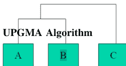

初始化：定义 T 为叶节点集合，每个序列对应一个叶节点。每个节点的高度均为零。令 L = T。重复

- 选择最接近的两个节点 (A, B) 并为它们创建父节点 K。分别连接 A、B 和 K。将节点 K 的高度设置为 dAB/2。将 K 与 A 之间的支长设置为 height K – height A，将 K 与 B 之间的支长设置为 height K – height B。
- 从 L 中移除 A、B 并将 K 加入 L。重新计算 K 与 L 中其他节点之间的距离。K 与其他节点之间的距离是 K 下方叶序列与该其他节点之间的平均距离。

直到只剩一个节点

### 前端设计

- 1. 添加文本框和按钮以获取矩阵大小的输入。
- 2. 添加 DataList 以获取输入矩阵坐标。
- 3. 添加 Div 以显示输出。

### C# 代码说明

- 1. 生成一个 DataTable 并将 DataList 的数据源绑定到它，以获取矩阵元素的输入。
- 2. 将 DataList 的值存储到数据表 (dtMain) 中。
- 3. 为步骤打开一个 for 循环。
- 4. 查找最小值及其坐标。
- 5. 在 Label 中显示它们，并将 Label 添加到 Div 中以显示步骤输出。
- 6. 现在用新元素重建矩阵。合并最小值对应元素的坐标。计算所有对应距离的平均值。
- 7. 现在将 DataTable 绑定到 GridView，并将 GridView 添加到 Div 中以显示步骤输出。
- 8. 循环按矩阵大小执行。
- 9. 每个步骤的输出将在 aspx 页面上可用。

### ASP.CS 页面代码

```csharp
using System;
using System.Collections.Generic;
using System.Data;
using System.Web;
using System.Web.UI;
using System.Web.UI.WebControls;
public partial class upgma: System.Web.UI.Page
{
static int step = 0;
DataTable dtMain = new DataTable();
protected void btnStart_Click(object sender, EventArgs e)
{
int size = Convert.ToInt32(txtSize.Text);
dtMain = new DataTable();
for (int i = 0; i <= size; i++)
dtMain.Columns.Add();
dtMain.AcceptChanges();
for (int i = 0; i <= size; i++)
{
dtMain.Rows.Add();
for (int j = 0; j <= size; j++)
{
TextBox txt = (TextBox)dlInput.Items[(size * j) + i + j].FindControl("txtInput");
dtMain.Rows[i][j] = txt.Text;
}
}
dtMain.AcceptChanges();
GridView gvInput = new GridView();
gvInput.ID = "gvMatrix";
gvInput.ShowHeader = false;
gvInput.DataSource = dtMain;
gvInput.DataBind();
divResults.Controls.Add(gvInput);
step = size;
DataTable dtTemp = new DataTable();
dtTemp = dtMain;
int r=0, c = 0;
for (int l = 0; l < size-1; l++)
{
    decimal min = Convert.ToDecimal(dtTemp.Rows[1][2]);
    r = 1;
    c = 2;
    for (int i = 1; i <= step; i++)
    for (int j = i + 1; j <= step; j++)
    {
        if (min > Convert.ToDecimal(dtTemp.Rows[i][j]))
        {
            min = Convert.ToDecimal(dtTemp.Rows[i][j]);
            r = i;
            c = j;
        }
    }
}
Label lbl = new Label();
lbl.ID = "lblSteps" + l;
lbl.Text = "Step " + (l + 1);
lbl.Text += "<br/> Min Value is " + min.ToString() + " at coordinates["+ r +","+ c + "]";
lbl.Text += "<br/> Merge the elements of rows and columns corresponding of (" + dtTemp.Rows[0][c] + ") and (" + dtTemp.Rows[r][0] + ")";
divResults.Controls.Add(lbl);
DataTable dtT = new DataTable();
step--;
for (int i = 0; i <= step; i++)
dtT.Columns.Add();
int pc = 0;
int pr = 0;
for (int i = 0; i <= step; i++)
{
    dtT.Rows.Add();
    for (int j = 0; j <= step; j++)
    {
        if ((i == r || j == r) && (i != j))
        {
            if ((i == 0 || j == 0))
            {
            dtT.Rows[i][j] = dtTemp.Rows[0][r].ToString() + "," + dtTemp.Rows[0][c].ToString();
            if (i == 0)
            pc++; // increase column index because of column merge from beginning or middle
            else
            pr++; // increase row index because of row merge from beginning or middle
            }
            else if (j > i)
            {
            dtT.Rows[i][j] = getMeanDistance(dtT.Rows[i][0].ToString(), dtT.Rows[0][j].ToString()).ToString();
            //dtT.Rows[i][j] = "rc";
            }
        }
        else
        {
        if (i != j)
        {
        if (c != step + 1)
        {
        if (j > r && i > r)
        dtT.Rows[i][j] = dtTemp.Rows[i + pr][j + pc];
        else if (j > r)
        dtT.Rows[i][j] = dtTemp.Rows[i][j + pc];
        else if (i > r)
        dtT.Rows[i][j] = dtTemp.Rows[i + pr][j];
        else
        dtT.Rows[i][j] = dtTemp.Rows[i][j];
        }
        else
        dtT.Rows[i][j] = dtTemp.Rows[i][j];
        }
        }
    }
}
dtT.AcceptChanges();
dtTemp = dtT;
GridView gv = new GridView();
gv.ID = "gvMatrix" + 1.ToString();
gv.ShowHeader = false;
gv.DataSource = dtT;
gv.DataBind();
divResults.Controls.Add(gv);
}
}
protected decimal getMeanDistance(string a, string b)
{
    decimal rslt = 0;
    string[] stra = a.Split(';');
    string[] strb = b.Split(';');
    for (int i = 0; i < stra.Length; i++)
    for (int j = 0; j < strb.Length; j++)
    {
        int posx = GetCharPosition(stra[i], "From");
        int posy = GetCharPosition(strb[j], "To");
        if (posx < posy)
        rslt += Convert.ToDecimal(dtMain.Rows[posx][posy]);
        else
        rslt += Convert.ToDecimal(dtMain.Rows[posy][posx]);
    }
    rslt = rslt / (stra.Length * strb.Length);
    return Math.Round(rslt, 2);
}

protected int GetCharPosition(string strChar, string strType)
{
    int pos = 0;
    if (strType == "From")
    {
    for (int i = 1; i < dtMain.Rows.Count; i++)
    if (dtMain.Rows[i][0].ToString() == strChar)
    {
    pos = i;
    break;
    }
    }
    else
    {
    for (int j = 1; j < dtMain.Columns.Count; j++)
    if (dtMain.Rows[0][j].ToString() == strChar)
    {
    pos = j;
    break;
    }
    }
    return pos;
}

protected void btnGenerateMatrix_Click(object sender, EventArgs e)
{
    DataTable dt = new DataTable();
    int size = Convert.ToInt32(txtSize.Text) + 1;
    dt.Columns.Add();
    for (int i = 0; i < size * size; i++)
```


```
dt.Rows.Add();
dt.AcceptChanges();
dllInput.RepeatColumns = size;
dllInput.DataSource = dt;
dllInput.DataBind();
}
}
```

### 输出截图与执行

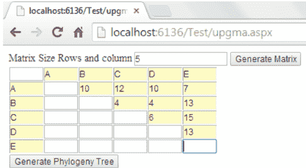


#### 步骤 1
最小值为 4，位于坐标 [2,3]
合并 (C) 和 (B) 对应的行和列元素

| | A,B,C,D | E |
|---|---|---|
| A | 11 | 10 | 7 |
| B,C | | 5 | 14 |
| D | | | 13 |
| E | | | |

#### 步骤 2
最小值为 5，位于坐标 [2,3]
合并 (D) 和 (B,C) 对应的行和列元素

| | A,B,C,D,E |
|---|---|
| A | 10.67 | 7 |
| B,C,D | | 13.67 |
| E | | |

#### 步骤 3
最小值为 7，位于坐标 [1,3]
合并 (E) 和 (A) 对应的行和列元素

| | A,E,B,C,D |
|---|---|
| A,E | 12 | 17 |
| B,C,D | | |

#### 步骤 4
最小值为 12.17，位于坐标 [1,2]
合并 (B,C,D) 和 (A,E) 对应的行和列元素

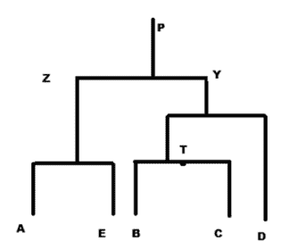

### 练习

#### 选择题

- 1. “有根”的系统发育树是指

  - a. 可追溯至地球生命起源的树。
  - b. 其基部位于该树上所有类群共同祖先的树。
  - c. 说明生命早期发生大量基因交换的树。
  - d. 指示我们对该树上类群进化关系存在不确定性的树。
  - e. 分支点很少的树。

- 2. 存在数十种马铃薯品种，它们在块茎大小、皮色、肉色和形状上各有不同。有人可能根据这些形态性状构建马铃薯分类。以下哪些批评最可能来自 phylocode 分类法的拥护者？

  - a. 肉色，而非皮色，是用于分类的有效性状，因为它较少随块茎年龄而改变。
  - b. 花色是更好的分类标准，因为地下块茎受土壤中矿物质的影响可能与受基因影响一样大。
  - c. 更有用的分类将根据块茎肉的质地和风味对马铃薯进行编目，因为这是人类所关心的。
  - d. 最准确的系统发育代码是林奈的代码。应根据林奈原则对马铃薯进行分类，而非按其颜色。
  - e. 马铃薯品种唯一生物学上有效的分类是能准确反映其遗传和进化亲缘关系的分类。

- 3. 以下哪些性状不能帮助将动物与其他生命形式区分开来？

  - a. 细胞核中存在 DNA
  - b. 存在两种组织：用于冲动传导的神经组织和用于运动的肌肉组织
  - c. 具有结构支持作用的细胞壁
  - d. b 和 c
  - e. a 和 c

- 4. 分支图或系统发育树

  - a. 是关于一组动物类群进化关系的假设。
  - b. 是一种图表，其中分支序列说明了进化事件的历史年代。
  - c. 反映了分类群在更具包容性的群体中嵌套的层级分类。
  - d. 以上皆是。

- 5. 以下哪项描述了系统发生？

  - a. 系谱
  - b. 树
  - c. 进化途径
  - d. 生物体间的自然关系
  - e. 以上皆是。

- 6. 物种通过以下哪种方式进化？

  - a. 多样化。
  - b. 进展。
  - c. 线性进步。
  - d. 魔法。
  - e. 以上都不是。

- 7. 以下哪项不是从分子数据生成系统发育树的算法？

  - a. 邻接法
  - b. 简约法
  - c. 最大似然法
  - d. Jukes 和 Cantor
  - e. 以上皆是。

- 8. 在系统发生学中使用的简约原则表明，最简单且符合数据的树更受青睐。

  - a. 正确
  - b. 错误

- 9. 一位研究人员想要确定几种狗（Canis familiaris）品种的遗传亲缘关系。研究人员应比较已知为 ______ 的同源序列的 ______。

  - a. 碳水化合物；保守性差
  - b. 脂肪酸；高度保守
  - c. 脂质；保守性差
  - d. 蛋白质或核酸；保守性差
  - e. 氨基酸；高度保守

- 10. 使基因能充当分子时钟的最重要特征是

  - a. 拥有大量碱基对。
  - b. 外显子 DNA 占比高于内含子 DNA。
  - c. 拥有可靠的平均突变率。
  - d. 其近期起源于基因复制事件。
  - e. 受自然选择作用。

#### 论述题

Q1.
- a. 讨论分子系统发生学的重要性。系统发育树在检索进化信息方面有何用处？
- b. 使用 UPGMA 方法为下述分子数据表构建系统发育树。

| | A | B | C | D | E |
|---|---|---|---|---|---|
| A | 0 | 5 | 4 | 9 | 3 |
| B | | 0 | 2 | 4 | 3 |
| C | | | 0 | 5 | 7 |
| D | | | | 0 | 8 |
| E | | | | | 0 |

Q2. 什么是分支类群？

Q3. 为给定序列绘制系统发育树。

| | SEQ1 | SEQ2 | SEQ3 | SEQ4 | SEQ5 |
|---|---|---|---|---|---|
| SEQ1 | 0 | 48 | 51 | 51 | 70 |
| SEQ2 | | 0 | 66 | 66 | 85 |
| SEQ3 | | | 0 | 45 | 80 |
| SEQ4 | | | | 0 | 93 |
| SEQ5 | | | | | 0 |

Q4. 讨论用于调查现代人类起源及人类/黑猩猩分化日期等问题的任何通用技术。


## 泰勒与弗朗西斯

## 泰勒与弗朗西斯集团

http://taylorandfrancis.com

# 4 RNA

从生物学角度看，生物体必须遵循某些规则、法规和指南，以确保活细胞正常运作。这一信息由 RNA 传递，RNA 代表核糖核酸。蛋白质是生命的基石，这是公认的事实。如果没有上述信息从细胞核正确传递到核糖体，就无法生产出准确的蛋白质。这一事实凸显了 RNA 的重要性。蛋白质的产量不足、过量或生产故障都会导致疾病。

RNA 的结构如下：RNA 是单链分子，可自行折叠以模仿 DNA（脱氧核糖核酸）的双螺旋结构。RNA 的骨架含有核糖作为糖，并带有四种碱基：腺嘌呤、胞嘧啶、鸟嘌呤和尿嘧啶。磷酸基团也连接到核糖上。RNA 碱基形成碱基对，以构成二级和三级结构。RNA 可由 DNA 合成。DNA（与 RNA 不同）具有双螺旋结构，可长期存储遗传密码。与 DNA 相比，RNA 更具多功能性。除在蛋白质合成中发挥重要作用外，RNA 还参与生物化学反应、基因调控、甲基化等。此外，RNA 不像 DNA 具有复制能力。不同类型 RNA 的寿命各不相同。有些寿命较长，有些则在创建后很快被销毁。

## 4.1 RNA 结构

RNA 结构从一级结构演变为二级结构，再发展为三级结构。下面将分别说明这三种结构。

### 4.1.1 RNA 的一级结构

RNA 的一级结构是由磷酸二酯键连接在一起的核苷酸（A、G、C 和 U）序列。
RNA 由核苷酸和骨架组成。RNA 骨架由糖磷酸组成。RNA 结构包含三个成分：核糖（糖）、磷酸（PO4）和核苷酸碱基。图 4.1 展示了 RNA 的四种碱基，即腺嘌呤、鸟嘌呤、胞嘧啶和尿嘧啶。图 4.2 详细说明了核糖和磷酸的结构。RNA 的化学结构如图 4.3 所示。

### 4.1.2 RNA 的二级结构

RNA 一级结构中的碱基形成碱基对，从而构成二级结构。RNA 的二级结构以 Watson-Crick 碱基对（GC 或 AU）和 Wobble 碱基对（G-U）为特征。GU 和 AU 碱基对具有两


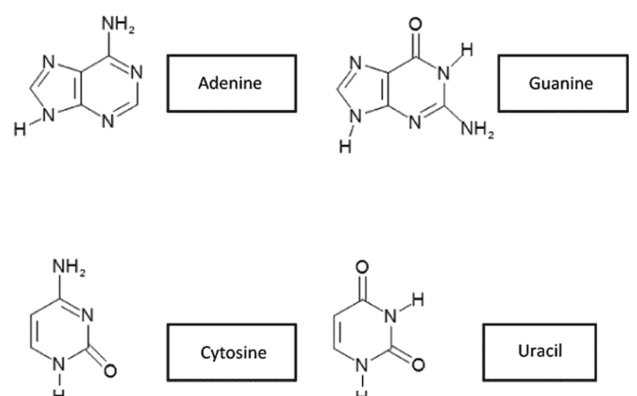

图 4.1 RNA的四种碱基 – 腺嘌呤、鸟嘌呤、胞嘧啶和尿嘧啶

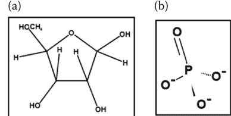

图 4.2 (a) 核糖体；(b) 磷酸基团

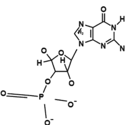

图 4.3 RNA化学结构

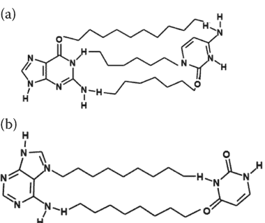

图 4.4 (a) GC碱基对；(b) AU碱基对

氢键。GC碱基对有三个氢键。GC碱基对结构和AU碱基对结构分别显示于图 4.4(a) 和 (b)。除了这些常见碱基对外，RNA甚至可以形成AC、UU和GA碱基对。

RNA的二级结构形成特定的结构，如发夹环、突出环、内环、外环、假结等，如图 4.5 所示。每种结构都有其自身的特征和重要性。

- 螺旋 – 螺旋由堆叠的碱基对形成。当螺旋中存在至少三个未配对的核苷酸时，就会形成发夹环。RNA通过自身折叠形成双螺旋结构。
- 突出环 – 螺旋两侧任一侧的未配对核苷酸称为突出环。它可被称为不对称结构。

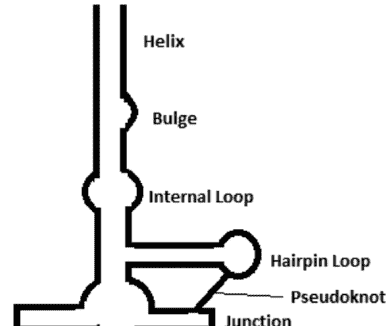

图 4.5 RNA二级结构基序

- 内环 – 螺旋两侧的未配对核苷酸导致内环的形成。它可被称为对称结构。
- 外环 – 外环包含序列的末端。
- 多分支环 – 当各种结构从螺旋中出现时，形成多分支环或连接环。
- 假结 – 假结是一种特殊结构，当上述结构与剩余的未配对碱基形成碱基对时产生。

### 4.1.3 RNA的三级结构

二级结构可以形成碱基对以形成三级结构。RNA二级结构中的一些未配对碱基进一步形成碱基对，从而形成三级结构。RNA的三级结构在tRNA中很常见。

- 茎的同轴堆积 – RNA的长双链彼此堆积形成长链。随着链长增加，形成三级相互作用的机会也增加。
- 四环受体基序 – 常见的四环核苷酸序列是GAAA。然后可能存在相应的受体，例如CCUAAGUAUGG。四环受体如图 4.6 所示。

## 4.2 RNA的类型

RNA根据其性质、功能和结构被分为三类，即rRNA、tRNA和mRNA。它们在

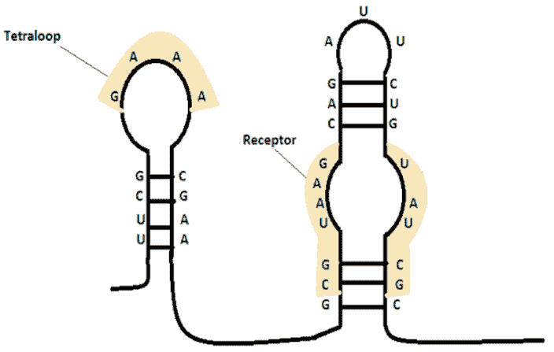

图 4.6 四环受体基序

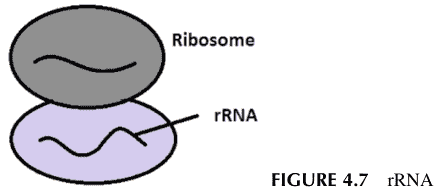

蛋白质组装过程中发挥主要作用。除此之外，其他类型的RNA也存在，并发挥重要作用，如下所述。

- A. 核糖体RNA (rRNA)：核糖体的RNA组分之一，对蛋白质合成是必需的。由于rRNA的关键功能，蛋白质合成得以发生。核糖体存在于所有生物体中，并帮助将mRNA（信使RNA）中的信息翻译为蛋白质。核糖体约含60%的rRNA。rRNA结构如图 4.7 所示。
- B. 转运RNA (tRNA)：转运RNA在核酸的DNA和RNA序列与氨基酸的蛋白质序列之间充当物理连接。它帮助解码mRNA（信使RNA）。tRNA是蛋白质翻译的重要组成部分，包含75至95个核苷酸。tRNA结构如图 4.8 所示。
- C. 信使RNA (mRNA)：mRNA负责将遗传信息从DNA转移到核糖体，是RNA分子中最大的家族。mRNA由两位科学家埃利奥特·沃尔金和拉撒路·阿斯特拉坎于1956年发现。DNA被复制成mRNA，然后解码为


图 4.9 mRNA

蛋白质。一个mRNA分子用于编码一个蛋白质的信息，但对于细菌，一个mRNA分子可以编码多个蛋白质的信息。mRNA结构如图 4.9 所示。
- D. 非编码RNA (ncRNA)：这些是不编码蛋白质的功能性RNA分子。然而，非编码RNA包含关键信息并具有多种功能。ncRNA的一种功能是在转录水平调节基因表达。
- E. 转运-信使RNA (tmRNA)：这些是具有类似于tRNA和mRNA两种特性的RNA分子。大多数细菌产生单个tmRNA；然而，少数变位tmRNA编码两片段tmRNA。它像质量控制系统一样，监控蛋白质合成。
- F. 小核RNA (snRNA)：这些是小RNA分子，参与RNA的剪接或其他反应。snRNA的长度约为150个核苷酸。snRNA复合物也称为snRNP（小核核糖核蛋白），通常称为“snurps”。
- G. 微RNA (miRNA)：微RNA也来自非编码RNA家族。它在基因表达调节和RNA沉默中发挥重要作用。这些是单链RNA分子，长度非常短，约二十二个核苷酸。动物和植物都有微RNA。
- H. 小干扰RNA (siRNA)：小干扰RNA也称为沉默RNA或短干扰RNA。siRNA由20至25个碱基对的双链RNA分子序列形成。siRNA用于敲除长非编码RNA基因。
- I. 小核仁RNA (snoRNA)：这些是特殊的小RNA分子类别，指示其他RNA（主要是核糖体RNA、转运RNA和snRNA小核RNA）的化学修饰。还提议这些来自转运RNA (tRNA)的基因复制进化。
- J. 反义RNA (asRNA)：这些是单链RNA，与信使RNA互补。asRNA有时被称为mRNA干扰性互补 (micRNA)，但micRNA不那么流行且未被广泛采用。“义链”是核苷酸序列，也会产生蛋白质（基因产物）。
- K. 信号识别颗粒RNA (SRP RNA)：SRP是一种RNP（无处不在的复合物，可导致分泌蛋白和膜）。这些对于共翻译蛋白质靶向是必需的。通常称为Alu的家族
- L. 异质核RNA (hnRNA)：如前一章所述，转录是从DNA合成mRNA的过程。但这实际上不是一个一步过程。中间步骤是合成pre-mRNA或hnRNA。换句话说，它是DNA的第一个拷贝。在转录过程完成之前，所有来自hnRNA的内含子都被移除。这个过程称为剪接。hnRNA是一种短寿命RNA。
- M. 催化RNA或核酶：催化RNA在没有蛋白质的情况下催化化学反应。自剪接内含子也是催化RNA。核酶包括肽基转移酶、锤头酶、剪接体和乙型肝炎德尔塔病毒 (HDV)。
- N. 端粒酶RNA：端粒酶RNA分子有助于将特定的一组核苷酸添加到复制链的3'端，以维持端粒末端，使染色体不会与其他染色体融合。RNA端粒酶对基因组的稳定性很重要。
- O. 导向RNA (gRNA)：在RNA编辑过程中，gRNA用于mRNA中核苷酸的插入和删除。

## 4.3 RNA的功能

RNA的各种功能如下所述：

- 1. 分子生物学的中心法则表明，细胞内信息的传递是从DNA到蛋白质。
- 2. 人体需要蛋白质来执行多种功能。转录和翻译过程导致蛋白质合成。RNA在这两种过程中都发挥着至关重要的作用。
- 3. RNA使细胞能够创造支持基因表达的氨基酸。
- 4. 通过RNA，细胞能够访问存储在DNA中的信息。
- 5. RNA充当酶。酶是加速我们体内反应的物质。由于RNA是单链的，它可以自身折叠以改变形状。这就是RNA可以充当酶而DNA（双链）不能的原因。
- 6. 文献揭示，在早期生命形式中，存在RNA而非DNA。
- 7. 包含重要遗传信息的DNA必须留在细胞核内。如果移出，可能会受损，因此一部分DNA以mRNA的形式被复制。
- 8. RNA易受碱性水解。通过碱性溶液，RNA可以被降解而不影响DNA。
- 9. 众所周知，DNA包含遗传信息，但某些病毒不包含DNA。在这种情况下，RNA保存遗传信息。
- 10. RNA可以作为生化反应的催化剂、蛋白质合成中的适配器分子以及细胞器中的结构分子。


- 11. 非编码 RNA 可以上调或下调基因的表达。
- 12. RNA 在环境变化或细胞分化条件下调节基因活性。
- 13. 某些 RNA，例如自剪接 RNA 转录本、核酶和 RNase P，具有内在的酶活性，可以直接催化 RNA 修饰反应。
- 14. 核糖开关是存在于 mRNA 中的一种自调节单元，能够结合微小分子并改变其结构，从而调节核糖体。它们还可以开启或关闭特定基因。
- 15. miRNA 影响多细胞真核生物的生长和功能。
- 16. 微 RNA（miRNA）导致基因沉默和降解。
- 17. RNA 的结构灵活性导致二级结构的形成，而二级结构又具有特定功能。
- 18. RNA 中的发圈结构可以作为其他调节分子的结合位点。
- 19. 小非编码 RNA 可以保护细胞免受病毒感染。
- 20. RNA 帮助核糖体选择正确的氨基酸，而氨基酸是构建体内新蛋白质所必需的。
- 21. 小核 RNA（snRNA）参与剪接活动，从一个基因产生多种蛋白质。
- 22. 没有 RNA，DNA 就无用了。
- 23. rRNA 发挥 RNA 的结构作用，它控制氨基酸之间肽键的形成。
- 24. 核糖体中 RNA 的催化作用由核酶发挥，核酶催化某些生化反应。
- 25. RNA 的调节作用由非编码 RNA（ncRNA）承担。

## 附录

### 练习

#### 选择题

Q1. 以下哪种类型的 RNA 编码蛋白质？

- a. dsRNA
- b. mRNA
- c. rRNA
- d. tRNA

Q2. 从混合物中纯化出一种核酸。分子相对较小，含有尿嘧啶，且大多数与氨基酸共价结合。纯化的是以下哪种物质？

- a. DNA
- b. mRNA
- c. rRNA
- d. tRNA

Q3. 以下哪种 RNA 以其催化能力而闻名？

- a. dsRNA
- b. mRNA
- c. rRNA
- d. tRNA

Q4. 核糖体由 rRNA 和什么其他成分组成？

- a. 蛋白质
- b. 多肽
- c. DNA
- d. mRNA

Q5. 以下哪种可能将 RNA 作为其基因组？

- a. 细菌
- b. 古细菌
- c. 病毒
- d. 真核生物

Q6. 巨眼一侧未配对的核苷酸称为

- a. RNase P。
- b. 内部环。
- c. 巨眼。
- d. 连接区。

Q7. 核糖体主要由 RNA 组成。

- a. 正确
- b. 错误

Q8. 双链 RNA 通常存在于细胞内。

- a. 正确
- b. 错误

Q9. 三向配对之间的空间称为

- a. 巨眼。
- b. 连接区。
- c. RNA 功能。
- d. 类病毒。

Q10. RNA 含有遗传物质

- a. 与 DNA 一起。
- b. 仅在没有 DNA 时。
- c. 以上两种情况均可。
- d. 都不是。

Q11. 就 DNA 和 RNA 结构而言，什么是核苷酸？

- a. 核苷酸是杂环碱基。
- b. 核苷酸是与杂环碱基共价键合的糖分子。
- c. 核苷酸是与磷酸基团和杂环碱基结合的糖分子。
- d. 核苷酸是与磷酸基团结合的杂环碱基。

Q12. DNA 以双链形式存在，而 RNA 主要是单链分子。DNA 为何为双链的可能原因是什么？

- a. RNA 链不能形成碱基对。
- b. 双链 DNA 是更稳定的结构。
- c. DNA 不能以单链形式存在。
- d. 复制双链 DNA 比复制单链 RNA 更容易。

Q13. 用什么术语描述一段 DNA 被复制以产生信使 RNA 分子的过程？

- a. 生殖
- b. 复制
- c. 翻译
- d. 转录

Q14. 用什么术语描述从遗传代码合成蛋白质的过程？

- a. 生殖
- b. 复制
- c. 翻译
- d. 转录

Q15. 信使 RNA 在蛋白质合成中起什么作用？

- a. 它催化该过程。
- b. 它为蛋白质提供遗传蓝图。
- c. 它将遗传代码翻译为特定氨基酸。
- d. 它在蛋白质合成前修饰信使 RNA 分子。

Q16. RNA 的碱基与 DNA 相同，只是 RNA 含有

- a. 由半胱氨酸代替胞嘧啶。
- b. 由尿嘧啶代替胸腺嘧啶。
- c. 由胞嘧啶代替鸟嘌呤。
- d. 由尿嘧啶代替腺嘌呤。

Q17. 以下哪种不是一种 RNA？

- a. nRNA（核 RNA）
- b. mRNA（信使 RNA）
- c. rRNA（核糖体 RNA）
- d. tRNA（转运 RNA）

Q18. 以下哪种是最小的 RNA？

- a. 信使 RNA
- b. 转运 RNA
- c. 核糖体 RNA
- d. 以上都是。

Q19. 信使 RNA 的功能是什么？

- a. 它携带氨基酸。
- b. 它是核糖体的组成部分。
- c. 它是基因的直接副本。
- d. 它是某些生物体的遗传物质。

Q20. 细胞中 mRNA 与总 RNA 的比例为

- a. 3–4%。
- b. 3–6%。
- c. 3–8%。
- d. 3%。

#### 论述题

- Q1. DNA 和 RNA 有什么区别？
- Q2. RNA 代表什么？
- Q3. 讨论各种类型的 RNA。
- Q4. RNA 的主要功能是什么？
- Q5. RNA 就像 DNA 一样可以包含遗传物质吗？请论证你的答案。
- Q6. 请举例讨论 RNA 的化学结构。

# 5 假结

RNA 初级序列中的四个碱基是腺嘌呤（A）、鸟嘌呤（G）、胞嘧啶（C）和尿嘧啶（U），它们形成碱基对。换句话说，RNA 初级序列自身折叠形成二级结构。二级结构进而折叠形成三级结构。RNA 的功能取决于其结构。预测 RNA 的三级结构代价很高。因此，研究人员专注于 RNA 二级结构的准确预测。第 4 章中已提及，RNA 二级结构中已识别出各种图景，如发环、巨眼、内部环、多分支环等。

另一个在预测 RNA 二级结构时被研究人员忽视多年的重要图景是假结。忽视假结的原因：

- 假结的存在使结构复杂化。
- 使用从头递归算法无法预测最优结构。
- 与其他图景相比，假结出现的频率较低。

尽管如此，如果忽视假结，RNA 二级结构预测算法的预测准确性无法提高。假结与其他图景的主要结构差异在于碱基配对的方式，如图 5.1(a) 和 (b) 所示。如果没有假结，结构是递归的，但假结的存在打破了递归关系，从而使其预测变得困难。

## 5.1 定义

单链 RNA 自身折叠形成二级结构。当二级结构中的一个环与环外的互补序列配对时，就会形成假结，如图 5.1(a) 和 (b) 所示。

假结只是两个重叠的碱基对。两个碱基对 i、j 和 i’、j’ 如果满足 i<i’<j<j’ 或 i’<i<j’<j，则称为重叠。因此，假结中的碱基配对是非嵌套方式，这与非假结结构中的碱基配对相反。

### 5.1.1 假结与真结

假结有时被称为伪结。如果将假结的两端向相反方向拉开，它会变成一条直线。这就是假结被称为“伪结”的原因。与此相反，如果将真结的两端


图 5.1 (a) 非假结结构；(b) 假结结构

向相反方向拉伸时，它会收紧结而不是释放它。最近，在 2015 年，这种结在异常长的脐带中被观察到，如图 5.2 所示。这种结可能是胎儿活动增加的结果。脐带中结的其他病例如下


图 5.2 脐带中的真结 (http://www.pathologyoutlines.com/topic/placentaknots.html)


图 5.3 脐带中的真结 (http://library.med.utah.edu/WebPath/PLACHTML/PLAC010.html)

图 5.3 和 5.4。结和假结的区别可以在图 5.4 和 5.5 中轻松识别。

### 5.1.2 假结示例

文献中展示了各种假结示例，如图 5.6 至 5.10 所示。它们是：

- 转叶黄嵌花病毒 (TYMV) 的 tRNA 样结构
- 小鼠乳腺肿瘤病毒 (MMTV)
- 肝炎德尔塔病毒


图 5.4 脐带中的结 (http://library.med.utah.edu/WebPath/PLACHTML/PLAC028.html)


图 5.5 脐带中的假结 (http://library.med.utah.edu/WebPath/PLACHTML/PLAC073.html)


图 5.6 假结 – TYMV RNA 的 tRNA 样结构

- 甲型流感病毒
- 马铃薯黄脉病毒 (PYVV)

## 5.2 RNA 假结的生物学意义

假结于 1982 年首次在转叶黄嵌花病毒中被发现 [10]。假结具有多种多样的功能。假结的一个重要功能是移码。它诱导核糖体进入替代阅读框。


图 5.7 假结 – 小鼠乳腺肿瘤病毒 (MMTV)


图 5.8 假结 – 肝炎德尔塔病毒


图 5.9 假结 – 甲型流感病毒


图 5.10 假结 – PYVV

假结包含核酶、自剪切内含子、核蛋白复合物、病毒基因组以及许多其他生物系统中的功能域。它也是端粒酶活性所必需的，端粒酶在衰老中起重要作用。当假结与信使 RNA 共存时，它在重编码中起着基本作用。它还在蛋白质合成中发挥调节作用。假结已在多种 RNA 类别中被发现；例如，核糖体 RNA、mRNA、tmRNA、催化性和自剪切 RNA、病毒基因组 RNA、端粒酶等。假结导致翻译控制，维持复制信号，并还参与催化活性。病毒 RNA 中的假结在病毒基因表达和基因组复制中起着关键作用。

## 5.3 假结的表示

假结可以以多种形式表示。所有表示都必须保留碱基对的交叉，如图 5.11 所示。


图 5.11 RNA 碱基对相互交叉


图 5.12 假结的平面图表示

### 5.3.1 平面图表示

假结的平面图结构可以看作由顶点和边组成的图，如图 5.12 所示。RNA 的碱基是顶点，碱基对代表边。请注意，假结的平面表示具有交叉边。

### 5.3.2 圆形表示

再次考虑平面结构。如果将平面结构的两端连接形成一个圆圈，拉伸碱基对的长度，得到的表示称为圆形表示，如图 5.13 所示。该表示中边的交叉确保了结构中存在假结。

### 5.3.3 点括号表示

点括号表示法是 RNA 结构的一维表示。RNA 序列的所有碱基均从左到右书写，如图 5.14 所示。非交叉碱基对由圆括号 (( )) 表示。


图 5.13 假结的圆形表示

序列：GAAGUACAAUAUGUAACCG
结构：. . { . ( ( ( ( . . . . . ) ) ) } ) . .

图 5.14 假结的点括号表示

交叉碱基对随后由花括号 ({,}) 表示。更多交叉碱基对可由方括号 [[,] ] 表示。任何开括号及其对应的闭括号都代表一个碱基对。

### 5.3.4 弧表示

假结的弧表示也是一维的，由从左到右书写的碱基组成。碱基对由弧表示。弧的数量等于碱基对的数量。对于假结，至少有两条弧相互交叉，如图 5.15 所示。

## 5.4 假结的类型

假结已根据其碱基配对结构被分类为多种类型。下面将讨论所有类型。


图 5.15 假结的弧表示


### 5.4.1 H 型假结

最常见的假结类型是 H 型假结，如图 5.16 所示。H 型假结是 RNA 发卡结构的延伸。发卡结构与剩余链的未配对碱基形成碱基对，从而形成碱基对的交叉。PseudoBase++ [11] 是 PseudoBase 的扩展，包含 236 个 H 型假结。

### 5.4.2 H-H 型假结

H-H 型假结包括两个发卡环之间的碱基配对，如图 5.17 所示。PseudoBase 包含一个带有 H-H 型假结的序列。

### 5.4.3 H-L 型假结

当发卡环与鼓泡环、内环或多环的单链部分之间发生碱基配对时，形成 H-L 型假结。H-L 型假结有两种形式：H-Lout 型假结和 H-Lin 型假结。PseudoBase 有二十四个包含 H-Lout 型假结的序列和十一个包含 H-Lin 型假结的序列。

#### 5.4.3.1 H-Lout 型假结

H-Lout 型假结如图 5.18 所示，当发卡环与内环或多个内环之间发生碱基配对时形成。

#### 5.4.3.2 H-Lin 型假结

H-Lin 型假结如图 5.19 所示，当发卡环与外环或多个外环之间发生碱基配对时形成。


图 5.17 H-H 型假结


图 5.18 H-Lout 型假结


图 5.19 H-Lin 型假结

### 5.4.4 L-L 型假结

当两个鼓泡环之间发生碱基配对时，形成 L-L 型假结，如图 5.20 所示。PseudoBase 有十三个包含 L-L 型假结的序列。


图 5.20 L-L 型假结


图 5.21 接吻发卡或 H-H-H 型假结

### 5.4.5 接吻发卡假结或 H-H-H 型假结

多个发卡环之间的碱基配对形成 H-H-H 型假结，如图 5.21 所示。三个发卡环依次一个接一个地形成。之后，这些发卡环在它们的未配对碱基之间形成碱基对。接吻发卡对柯萨奇病毒的复制至关重要。它们还在病毒质粒 DNA 复制或 RNA 合成中发挥作用。两个环之间的相互作用异常稳定。

### 5.4.6 三结假结

三结假结由三个 H 型环之间的碱基对相互作用形成，如图 5.22 所示。


图 5.22 三结假结


### 5.4.7 闭合五链假结

闭合五链假结由五个H型环之间的碱基对相互作用形成，如图 5.23 所示。

### 5.4.8 多环假结

当二级结构中的一个茎环绕一个或多个假结时，形成多环假结。tmRNA 的假结多环如图 5.24 所示。子结构 P1、P2、P3、P4 和 P5 为 H 型假结；茎1 和茎2 环绕假结。

### 5.4.9 I 型假结

I 型假结是指涉及内部环与二级结构中剩余未配对单链区域之间碱基配对的假结。图 5.25 显示了一个 I 型假结。


图 5.23 闭合五链假结


图 5.24 多环假结


图 5.25 I 型假结

### 5.4.10 B 型假结

B 型假结由二级结构中鼓泡环与剩余未配对单链区域之间的碱基配对形成。这种碱基对中的两个碱基实际上是在二级结构形成过程中留下的未配对碱基，如图 5.26 所示。


图 5.26 B 型假结

## 附录

### 练习

#### 选择题

Q1. 以下哪项不是 RNA 假结的一种类型？

- a. H 型
- b. H-H 型
- c. H-L 型
- d. L 型

Q2. ______ 是指二级结构中一个环与剩余互补序列的碱基配对。

- a. 发卡环
- b. 内部环
- c. 假结环
- d. 螺旋连接点

Q3. 二级结构可识别五种主要亚型。它们是发卡环、鼓泡环、内部环、多分支环和假结。

- a. 正确
- b. 错误

Q4. ______ 是指单链区域（环）的两端连接碱基配对区域（茎）的结构。

- a. 螺旋连接点
- b. 发卡环
- c. 鼓泡环
- d. 内部环

Q5. ______ 是指相对链上的两个单链区域连接两个相邻碱基配对片段。

- a. 发卡环
- b. 内部环
- c. 假结环
- d. 螺旋连接点

Q6. 假结不同于结。

- a. 正确
- b. 错误

Q7. 假结可以表示为

- a. 点阵图表示。
- b. 圆形表示。
- c. a) 和 b) 均可。
- d. 都不是。

Q8. 假结包含 ______ 内的功能域。

- a. 核酶
- b. 自剪接内含子
- c. DNA
- d. a) 和 b) 均可

Q9. 假结的一个例子是

- a. 小鼠乳腺肿瘤病毒 (MMTV)。
- b. 肝炎德尔塔病毒。
- c. 流感 A。
- d. PYVV。
- e. 以上皆是。

Q10. PseudoBase 是一个假结数据库。

- a. 正确
- b. 错误

#### 论述题

Q1. 什么是假结？它们是真正的结吗？请用合适的例子支持你的回答。

Q2. 讨论各种类型的假结及其碱基对相互作用。

Q3. 假结在 RNA 中出现频率不高，但它仍然是 RNA 中一个重要的动机。请支持你的回答并讨论假结的重要性。

Q4. 假结的表示有哪些？请用合适的例子说明。

Q5. H-L 型假结和 L-L 型假结看起来相似。请解释两者的区别。


Taylor & Francis

Taylor & Francis Group

http://taylorandfrancis.com

# 6 假结预测技术

预测 RNA 的二级结构有助于理解其功能。RNA 二级结构已通过各种算法 [13–17] 进行预测。RNA 二级结构预测始于碱基对最大化 [18] 的概念，其中预测基于结构中碱基对的最大数量。预测基于动态规划，即通过分治策略求解给定问题。问题被递归地分为子问题。然后求解最低层级的子问题。利用子问题的解来递归地求解给定问题的解。

```
S(p, r) = max { S(p, r - 1) max (S(p, q - 1) + S(q + 1, r - 1) + 1) p < q < r }
```

如上所示的递推关系已被用于求解 RNA 二级结构预测问题。S(p, r) 表示 RNA 二级结构预测问题，其中 p 和 r 分别表示待折叠为二级结构的 RNA 序列的第一个和最后一个核苷酸或碱基。问题 S(p, r) 被递归地分为子问题 S(p, q – 1) 和 S(q + 1, r)，其中 q 表示 RNA 序列中 p 和 r 之间的某个碱基。子问题 S(p, r – 1) 表示碱基 r 与 RNA 序列中的任何其他碱基均未配对。如果 r 已配对，则问题被递归地分为多个子问题。通过求解子问题并递归地将它们的解相加来构建总解，从而预测最终的 RNA 二级结构。碱基对最大化为另一种称为热力学能量模型 [12] 的技术奠定了基础。在这种技术中，将 RNA 二级结构子结构的估计能量参数相加以求得整个二级结构的总能量。热力学能量值最小的二级结构被视为最优二级结构。

[12] 的能量模型经 [18] 进一步改进。形式语法技术也被用于预测 RNA 二级结构。2003 年曾尝试使用随机上下文无关文法 [19] 预测假结。该模型使用同源 RNA 序列及其系统发育树作为输入。该模型使用 CYK 算法和内外算法生成输出结构。其 Web 服务器可于 www.daimi.au.dk/~compbio/pfold 访问。该模型声称能产生高质量的结果。已在二级结构中预测的动机包括发卡环、堆叠对、鼓泡环、内部环和连接点。RNA 中的各种动机在结构上是保守的，即即使两个 RNA 序列不同，它们可能包含相同的动机。与其他动机一样，假结也是 RNA 二级结构中一个重要的动机。假结执行关键的功能作用，例如通过诱导核糖体移码来改变基因表达、调节翻译和剪接、模拟以及硒半胱氨酸合成。因此，在 RNA 的结构和功能分析中不能忽略假结。此外，用于二级结构预测的比较序列分析方法已揭示保守的假结，例如在 rRNAs、核糖核酸酶 P RNA 和 tmRNA 中。关于假结的结构、功能和序列数据已收集在 PseudoBase [20]、RFAM 等数据库中。[21] 基于文献调查，假结预测模型可分为七类。这些类别是动态规划模型、基于比较的方法模型、启发式模型、形式文法模型、反向折叠模型、整数规划模型和软计算模型。

包括假结在内的 RNA 二级结构预测中最流行的类别模型是动态规划 [22–27]。动态规划模型需要迭代估计对二级结构有贡献的能量项。不幸的是，动态规划模型需要巨大的时间和内存需求。通过自由能量最小化预测带有任意假结的 RNA 二级结构是 NP-hard 问题。因此，一些模型使用动态规划的修改形式 [28,29]。[28] 提出的模型是针对序列比对算法的动态规划修改形式。[29] 提出的模型是一种稀疏化算法，引入了动态规划算法中矩阵稀疏化的概念，以减少空间和时间需求。假结预测的第二类模型是比较分析 [30,31]。比较模型使用基于最大权重匹配概念的协变分数。它们是可靠的方法，但其性能取决于同源序列比对的准确性。然而，它们可以很好地处理长序列。假结预测模型的第三类是启发式 [32,33]。启发式技术以临时方式应用。与动态规划模型相比，这些模型执行速度快，但它们不保证结构的最优性。第四类侧重于基于形式文法的假结预测 [34–38]。将使用语法进行的 RNA 二级结构预测视为分析问题。第五类是反向折叠模型 [39]。反向折叠模型以目标结构作为输入并输出 RNA 序列。第六类是整数规划模型 [40,41]。这些模型使用预构建的整数规划软件进行密集计算。出于此原因，这些算法可应用于更长的序列。最近，研究人员已尝试使用软计算技术（如支持向量机 [42]、神经网络 [43]、遗传算法 [44] 和神经网络 [45]）来求解假结预测问题。这些技术通常需要与其他方法（如动态规划）结合以求解预测问题。[46] 讨论了实现 RNA 二级结构的各种其他软计算技术。


## 6.1 动态规划技术

动态规划模型假设给定问题存在递归解，并记录子解以便重复使用。结构的最小自由能通过递归累加其子结构的能量来计算。子结构的能量采用标准热力学参数[27]进行计算。不幸的是，假结缺乏标准热力学信息。因此，研究人员只能依赖近似值，这也留下了优化空间。由于动态规划模型与自由能最小化背后的理论是“最稳定即最可能”，因此该方法计算出一个最小能量的最优结构。使用动态规划预测RNA二级结构中假结的最早尝试之一由[22]提出。针对单条序列预测最优最小自由能结构，他们提出了各种递归关系，用于计算不同子结构（包括膨胀环、发卡环、多环以及假结）的得分。其模型（pknots）通过累加所有子结构的得分来计算最小自由能得分。非假结子结构的得分使用标准热力学参数计算，而对于假结则采用近似参数。pknots的效率取决于得分参数。因此，为这些参数提供准确值至关重要。假结结构采用间隙矩阵的图形表示，并借助这些间隙矩阵形成递归关系。该算法可处理最多含有两个间隙矩阵的结构，即忽略非常复杂的结构。在计算子结构的最小自由能得分时，该算法还借助估计得分参数考虑了嵌套和非嵌套结构的同轴堆叠能。这同样创造了优化空间。尽管该算法在处理小RNA序列时效果良好且不会产生任何伪假结，但该模型的最大缺点在于由于考虑了最广泛的假结结构类，导致其内存和时间需求过高。

另一位研究人员[24]采用了[22]的递归关系，并提出了另一种基于动态规划的模型。但他的递归关系比[22]提出的递归关系更受限制。这种动态规划模型同样受到[47]提出的一个模型的启发。这是一种用于预测假结的复杂且难以理解的树附加语法（TAG）方法。[24]沿用了Uemura的概念，但未使用TAG，使得算法更加简单灵活。观察发现，两种算法的时间复杂度相同。最初，该算法使用了一个基于碱基对总数的得分函数。随后，该算法以多种方式进行了扩展。首先，该算法被扩展为包含基于相邻碱基对的能量函数。另一种扩展是考虑循环区域的自由能。由于假结缺乏热力学信息，循环的能量是根据循环长度近似得出的。这就是算法性能可以得到提升的地方。[48]一直在研究RNA二级结构的自由能参数，包括H型假结，以改进其模型[49]的性能。他们在计算预测结构的总自由能时引入了一个惩罚因子。对于能量值预测，分别收集长度为3、4和5个核苷酸的子序列。在训练数据集中统计它们的出现次数，并对计数值进行归一化。他们声称，除了出现次数外，还可以基于更多因素来预测能量值，因为其模型的准确度并非100%。[24]提出了一个时间近似算法，其时间复杂度为O(n⁴-δ)，通过将他先前提出的近似技术[50]应用于其动态规划模型实现。术语δ表示0到1之间的任意固定常数。Akutsu的基本动态规划模型适用于简单假结。因此，另一种扩展是包含递归假结。对所提议基本算法所做的扩展将时间复杂度提高到O(n⁵)，这在实际中不切实际。Akutsu证明了假结可以通过动态规划来处理。但他也提供了强有力的数学依据，证明广义假结的预测是NP-hard的。

由[26]提出的名为pknotsRG的模型也基于[22]的模型。他们进一步限制了所使用的假结结构类。pknotsRG通过将标准折叠算法扩展到标准简单递归假结类来进行扩展。他们定义了一类结构（sr-pk），该类结构排除了三重交叉螺旋和接吻发卡环，以减少候选结构的数量。结构类sr-pk通过应用三条规范化规则进一步受到限制。所得类被命名为csr-pk。这些规则对假结结构的螺旋施加了一些限制，例如螺旋长度、排除膨胀环等。它不仅计算序列的最小自由能结构，还计算其他k个最佳结构，并以点括号字符串形式显示。该模型已引入三个变体：pknotsRG-mfe、pknotsRG-enf和pknotsRG-loc。pknotsRG-mfe生成的最小自由能结构偶尔可能包含一个假结。pknotsRG-enf生成至少包含一个假结的能量最佳结构。pknotsRG-loc生成在特定位置包含一个假结的结构。与其他在C、C++或其他编程语言中实现算法的模型不同，pknotsRG使用代数动态规划来实现其算法。使用代数动态规划的动机是使实现可重用。与[22]相比，该算法执行速度快且内存需求较低，但代价是对结构施加了限制。早期的动态规划模型忽略了一个与RNA从一级序列折叠到稳定三级结构相关的重要概念。这个概念被称为分层折叠，它指出一级结构形成二级结构，而二级结构又形成三级结构。在这方面，首先形成一个无假结结构，然后添加一个形成假结的碱基对来形成带有假结的结构。HFold模型[51]使用了这一概念来预测假结结构。其算法可以将一条RNA序列作为输入，并输出可分为两个无假结结构的结构。他们可以将接吻发卡假结预测为两个H型假结之间的相互作用。2014年，提出了另一个名为CCJ[52]的模型来预测接吻发卡环。该模型基于最小自由能概念。它在O(n⁵)时间内预测了几种类型的假结。2014年，提出了对HFold的扩展[53]。迭代HFold基于最小自由能概念和分层折叠。它以无假结结构作为输入，并产生一个带有假结的结构。在迭代HFold模型中，作者尝试在预测与HFold相同结构的同时降低空间复杂度。

另一种动态规划模型由[27]提出。该模型是对[54]算法的扩展，旨在包含任意假结。该模型的动机是使用动态规划概念来对齐任意假结，同时生成最优结构。最优对齐通过最小编辑距离计算，采用的操作包括碱基删除、碱基替换、弧不匹配、弧断裂、弧移除、弧改变等。对齐成本是通过递归计算并累加这些子对齐的成本来得出的。RNA结构分为两类：简单结构和复杂结构。相应地，简单逻辑和复杂逻辑分别应用于这两类。正因如此，运行时间可以大幅降低。它还为进一步优化创造了空间。一些知名动态规划模型的运行时间和内存需求也得到了降低[29]。使用的方法是稀疏化，用于处理带间隙的片段。一般而言，稀疏化减少了候选子结构的数量，从而自动降低时间需求和内存需求。它对流行算法[22–26]进行了稀疏化。在[22]中，通过提供接近实际算法方程的递归方程，对碱基对最大化算法进行了稀疏化。同样，在其自由能最小化算法中，矩阵中的递归也进行了稀疏化。在[26]提出的算法中，通过限制其评分方案来实现稀疏化。[23–25]提出的模型被视为[22]结构类的一种限制。因此，它们的稀疏化或多或少以类似的方式进行。

另一种动态规划模型的修改由[28]提出。假结局部基序模型和动态伙伴序列堆叠（PLM_DPSS）模型能以高灵敏度预测RNA假结。它是序列对齐算法的动态规划修改版，用于计算干形成区域之间的最低堆叠能。它假设相邻区域无干扰。它输出所有与PLM模型兼容的假结。PLM模型是通过在从PseudoBase中选择H型假结时应用各种约束而形成的。PLM_DPSS首先通过应用假结干能量限制从RNA序列中预测潜在干。通过计算最低Turner堆叠能来选择一个干。干选择后，将它们组装起来预测假结。该算法不仅输出最低能量的假结，还输出其他兼容的假结。尽管该算法能以高灵敏度预测假结，但它没有考虑非交叉干区域。此外，它通过对假结应用各种限制（例如允许的最大环大小）来构建PLM模型，因此只能应用于非常受限的结构类。动态规划模型的主要缺点是其时间和空间需求。研究人员继续在这方面开展工作。研究人员Wong提出了一种基于最大预期准确率（MEA）的内存高效动态规划模型[55]。该算法基于与[56]在其PAL模型中提出的相同概念，但它可以以较低的内存需求完成相同的工作。


同时还具有相同的要求。这两种算法通过在给定未知结构序列中查找包含嵌入式简单假结的已知查询序列，来对ncRNA进行结构比对。这种内存高效的算法通过分治策略扩展了PAL算法，以产生最大结构比对得分。它仅适用于嵌入式简单假结。[56]的结构比对概念被[57]扩展，以同时纳入序列相似性，用于RNA二级结构预测。

## 6.2 比较序列分析技术

基于比较方法的假结预测模型基于这样一个事实：由进化保守的结构更有可能是功能形式。基于比较方法的假结预测模型需要多个比对序列作为输入。序列相似性应使它们能够最初进行比对。此外，它们应足够不相似，以便能够找到保守残基和协变碱基对。如果序列差异过大，比对将变得困难。因此，了解应使用哪些同源序列非常重要。有人提出了一种基于GC稳定性和GU中间状态约束来选择用于比较分析的序列的方法。基于比较方法的假结预测可应用于定义为两个不相交二级结构叠加的二级结构。模型Hxmatch [30]基于序列比对，并基于热力学得分和协方差得分为碱基对赋予得分。利用二级结构表示法，它通过删除冲突的螺旋将结构转换为二级结构。这种最大权重匹配程序会重复进行，直到删除所有此类螺旋。为了表现良好，该模型需要具有高序列协变的准确比对。它有时也会产生伪假结。[31]提出了另一种probknot模型。Probknot是一种类似于最大权重匹配概念的模型。它使用成对概率最高的碱基对，将配对概率总和最大的结构称为最大期望准确性结构。这些碱基对概率是使用包含同轴堆积的配分函数预测的。从碱基对概率中，形成最大期望准确性结构。该模型预测了许多假结，但其在已知结构中的预测碱基对百分比较低。此外，所使用的配分函数并未显式处理假结。利用同源序列进行比较序列分析可产生更好的预测准确性。DotKnot-PW算法 [58]使用两个同源序列来预测H-type假结。首先使用DotKnot [59]（一种单序列预测方法）生成H-type假结候选物。为了减少计算时间，计算成对碱基相似性得分，而不是进行完整的结构比对。使用结合自由能和相似性得分的方法输出了最优结构。最近，[61]给出了对Ipknot [41]、CCJ [52]、Iterative HFold [53]和Hotknots [60]的比较。它们在相同的能量参数下对这些模型进行了比较。它们表明，没有任何模型实现了PPV和灵敏度值均超过0.9。

## 6.3 启发式方法

启发式假结预测模型基于实验。这些模型旨在减少动态规划等方法的计算时间。[62]对基于启发式的假结预测进行了早期尝试。该模型（Kinefold）通过结合简单结构模型和精确聚类随机（ECS）模拟来预测假结。ECS模拟使用聚类技术来加速RNA折叠随机模拟。

[32]提出了另一种启发式模型。迭代循环匹配（ILM）是基于循环匹配（LM）算法的一种启发式算法。ILM基于热力学方法和比较方法的结合。它用于单个序列。输入可以是单个序列或序列比对。假结被视为两个环区域之间的相互作用，因此会执行多次LM算法迭代。特定迭代中形成的二级结构对应的碱基对会从原始序列中移除，以备下一次迭代使用。在迭代过程中，仅考虑得分最高的碱基对。通过结合协方差得分和热力学得分，从序列或序列比对中构建碱基对评分矩阵。对于单个序列，最高得分计算忽略协方差得分。这种启发式算法也不对最优结构进行预测。该算法并不太复杂，在小序列上效果良好，但资源需求较高。此前已有多种用于预测RNA假结的模型，但很快意识到应增强这些模型以预测出现的H-type假结。因此，提出了另一种模型HPknotter [63]，它结合了一些现有模型，即RNAMotif [64]、pknots [22]、Nupack [25]和pknotsRG [26]。这种组合模型的优势在于，通过在预测过程中不时应用各种过滤机制，提高了预测实际H-type假结的效率。

另一位研究人员提出了启发式模型hotknots [33]，这是一种基于自由能最小化的迭代过程，用于预测包含假结的RNA二级结构。hotknots是从输入序列使用简单局部比对算法计算得出的，随后进行修改，以防止hotknots的总长度过大。hotknots被定义为由堆积碱基对组成的茎结构，包含一个未配对碱基的膨出环以及含有两个（相对的）未配对碱基的内环。由一组选定的hotknots（优质hotknots）构成一棵树，每个节点包含一组hotknots，并被展开为二级结构。为了输出具有最小自由能的无假结二级结构，使用了另一种算法SimFold [65]。该算法还使用Turner [49, 82]的热力学参数，结合[25]用于假结环的参数，以确定结构能量并修剪部分结构树。启发式hotknots模型在相对于底层能量模型预测最优结构方面表现不佳。此外，该模型的运行时间也需要改进。受hotknots模型启发，提出了另一种基于进化信息和热力学的迭代模型 [66]。该模型在灵敏度和特异性方面的性能优于hotknots。[67]进行了另一种启发式尝试。他们的实现Pkiss结合了动态规划和[26]的规范化规则，以减少搜索空间，从而降低空间和时间复杂度。这种启发式模型专注于接吻发夹假结，并使用代数动态规划实现。该模型后来进一步改进 [68]。已添加形状分析和概率以提高预测准确性。2007年，提出了另一种启发式假结预测模型 [69]。他们将其命名为vsFold5，可在 http://www.rna.it-chiba.ac.jp/vsfold5 上获得。vsFold5利用聚合物溶剂相互作用和库恩长度等生物特征来预测假结。库恩长度是刚度的度量。该模型倾向于按照热力学上最可能的折叠路径进行折叠。它适用于长度不超过450个核苷酸的序列。该模型的输入为RNA序列、最小茎长度和连续茎的数量。大多数参数的默认值均已给出，还提供了聚合物模型选项。输出的二级结构基于库恩长度、温度和聚合物溶剂突出度，具有最小自由能，无论是否存在假结。假结结构已被分类为核心假结和扩展假结。扩展假结在二级结构形成后形成，而核心假结在二级结构形成之前形成。

vsFold5的最坏情况时间复杂度与序列长度对应。在此模型中，库恩长度的自动估计是一个重要因素。此外，他们的未来工作将包括纳入蛋白质相互作用、次优结构等参数。2010年，提出了另一种迭代模型Cyclofold [70]。该模型通过基于自由能迭代选择螺旋来折叠RNA序列。它还检查所选螺旋的空间位阻可行性以提高准确性。空间位阻可行性与分子中原子距离产生的能量有关。它可以预测多种类型的假结。2011年，提出了另一种模型NanoFolder [71]。该模型专注于具有多条交叉弧的多链RNA二级结构。评分函数使用碱基对堆积能量。为相似链之间的碱基对引入了惩罚得分。两条不同链之间的惩罚得分从训练集中计算得出。该模型收集所有带有碱基对的螺旋并计算它们的得分。NanoFolder以FASTA格式的RNA序列作为输入，仅以点括号表示法输出最可能的结构。可在 https://matchfold.ncifcrf.gov 上获得。

## 6.4 形式文法技术

基于形式文法的假结预测模型是基于形式文法的数学模型。形式文法正被用于预测RNA序列中是否存在假结 [37]。已使用不同类型的文法（如上下文无关文法、多上下文无关文法（MCFG）和随机上下文无关文法（SCFG））来预测假结。[72]的作者阐述了上下文无关语言、正则语言、树附加语言、多上下文无关语言及更多文法之间的包含关系。这些文法中的大多数将在第7章中详细阐述。


[73]提出了一种基于规则的模型。该模型基于MFold [74]，并使用Maude进行假结结构预测。Maude与术语重写相关。RNA结构被视为术语，并发现规则用于结构预测。首先，使用术语重写预测和解析无假结结构，然后使用术语重写进行基于分数的基序-基序相互作用以预测带假结的结构。该算法对平均长度序列表现良好，但只能处理RNA序列中两个未配对区域之间的相互作用。[35]提出了另一种形式文法模型。该模型旨在改进[23]的性能。它使用两种文法来预测包括假结在内的RNA结构，即简单线性树连接文法和扩展简单线性树连接文法。它使用TAG的一个子模型TAGRNA来预测假结。它考虑H型假结，包括两个假结之间的相互作用或发环与假结之间的相互作用。使用的评分函数基于最小自由能概念。

[75]使用一种专门用于建模RNA二级结构的语言，对假结进行了另一种建模尝试。RNA的各种基序被称为令牌。令牌已在形式文法语言中用于使用CFG识别RNA结构。它们的规范可能仅有助于建模简单结构。此外，它仅适用于长度不超过50的序列。与无上下文文法相反，有上下文文法考虑其所处的上下文。因此，建模各种RNA结构很容易。不幸的是，CSG没有已知的自动解析器。该研究人员尝试使用扩展转换网络来解析所述CSG。他们没有明确解释他们的模型如何处理假结。[76]提出了TAG的一个子模型TAGRNA来建模假结。最初，TAGRNA的时间复杂度为O(n^5)。因此，他们构建了一个随机正规文法（SREG）来筛选候选结构，从而降低时间复杂度。随机参数是使用概率值的对数计算的。为了测试系统的效率，生成了两种文法，一种使用优化的概率参数，另一种使用未优化的概率参数。大多数RNA假结预测模型的开发旨在减少时间和空间复杂度。相比之下，Gfold [36]的开发旨在定义一个更适合递归构建的结构类。Gfold也基于MCFG。除了MCFG的优点外，Gfold还结合了RNA结构的拓扑特性，即属。RNA结构的属定义为最小g，使得盘图可以在属为g的曲面上绘制且没有交叉弧。无假结结构的属为零。对于串联结构和嵌套结构，属是两个子结构的属之和。利用这种递归结构形成，Gfold使用动态规划实现。属的概念可以用于对包括复杂假结在内的RNA二级结构进行拓扑分类，并预测RNA序列中二级结构的数量。

[77]使用SCFG对假结进行了另一种预测尝试。首先使用SCFG预测子结构，然后将其组合以预测假结和其他基序。该算法时间效率高，但只能应用于与算法使用的训练序列匹配的同源RNA序列。

## 6.5 整数规划技术

整数规划是一种基于线性规划的技术，定义为在整数变量上受一组线性约束的线性函数优化。[40]将RNA带假结结构预测问题定式为整数规划问题。目的是最小化反映输入RNA序列折叠结构热力学自由能的目标函数值。假结的内部碱基对在形成该假结的螺旋打开之前打开。使用整数规划进行假结预测的优势在于，一旦预测问题通过整数规划建模，CPLEX软件[78]、LINDO API 6.0 [79]等各种整数规划软件系统可用于求解整数规划问题。该模型仅对短长度RNA序列表现出良好的准确性性能。[41]提出了另一种解决RNA假结预测问题的整数规划模型。Sato的模型Ipknot可处理长达500个核苷酸的更长序列。他们在使用整数规划寻找最大期望准确性（MEA）结构时引入了阈值截断概念。引入此阈值截断是为了更快地运行算法。该算法可用于单序列和比较序列分析。使用[60]的参数集时，基于MEA的方法的准确性显著高于使用[14]的参数。[80]通过整数规划对假结进行了另一种预测尝试。碱基对数量最多的结构为输出结构。其输出结构具有最小自由能。它适用于部分假结类。

## 6.6 反向折叠技术

RNA序列的反向折叠是一种不同的概念，即将目标结构转换为RNA序列。它在[39]中提出。INV是传统反向折叠模型的扩展，用于包含规范假结结构预测。这些模型以目标结构作为输入并输出RNA序列。INV是一种局部随机搜索，用于预测非双极结构，即最多有两个交叉的三种非交叉RNA结构。它通过识别特定的环分解来从给定结构获得RNA序列。结构的总能量由其子结构的能量之和计算得出。构成结构的所有序列都可以通过神经网络实现。最近提出了另一种反向折叠模型[81]。该模型使用Fatgraph进行所述转换。Fatgraph将二级结构作为骨架或带状结构，并以顶点关联边的循环顺序。该模型利用无上下文文法和Turner的能量模型来查找目标RNA序列。该模型的复杂度与属的概念相关，因为碱基对时其复杂度是指数级的。

## 附录

### 练习

#### 选择题

Q1. 在RNA二级结构中，形成单个碱基对所需的能量不受相邻碱基对的显著影响。

- a. 正确
- b. 错误

Q2. 如果碱基对与环或突出相邻，相邻的环和突出倾向于 \_\_\_\_\_ 碱基对形成。

- a. 对……无影响
- b. 降低……的能量
- c. 稳定
- d. 使不稳定

Q3. 点阵法和动态规划法可用于检测序列的自身互补区域。

- a. 正确
- b. 错误

Q4. RNA二级结构预测中最广泛研究的方法分别基于最小自由能方法和比较方法。

- a. 正确
- b. 错误

Q5. 至今，尚不存在假结的标准热力学参数。

- a. 正确
- b. 错误

Q6. 关于RNA二级结构预测，请选择错误的陈述。

- a. RNA矩阵中的匹配行是互补核苷酸的表示。
- b. 每个碱基都与其他可用的互补碱基进行比较，就像点阵分析一样。
- c. 如果RNA矩阵中部分列和行匹配，则表示互补核苷酸配对失败。
- d. 可能的碱基对为GC、GU和AU。


- Q7. SCFG 是 CFG 的随机版本，类似于概率论。
  - a. 正确
  - b. 错误

- Q8. 在 RNA 二级结构的逆折叠技术中，预测目标结构被转换为 RNA 序列。
  - a. 正确
  - b. 错误

- Q9. 动态规划方法的时间复杂度合理且实用。
  - a. 正确
  - b. 错误

- Q10. 灵敏度是指尽可能多地找到正确命中的能力。
  - a. 正确
  - b. 错误

#### 论述题

- Q1. 讨论假结在 RNA 二级结构预测中的作用。

- Q2. 研究人员在一段时间内提出了各种假结预测模型。根据所使用的算法对这些模型进行分类。

- Q3. 根据特异性、灵敏度等少数参数比较 RNA 二级结构预测模型。

- Q4. 我们如何说明启发式模型并不总是适用于所有情况？

- Q5. 逆折叠如何帮助预测 RNA 二级结构？

# 7 假结文法

## 7.1 文法的乔姆斯基层次结构

文法可以由四元组 (V, T, P, S) 定义，其中 V 是非终结符集合，T 表示终结符集合，P 表示产生式规则集合，S 表示开始符号。

符号是语言中的基本构建块，例如 0 和 1。任何文法中符号的数量都是预定义的。文法有对应的语言。有限非空符号集称为字母表，例如 {0,1}。符号的有限序列称为字符串，例如 001。最后，一组字符串称为语言，例如 0n1m（其中 n 为偶数，m 为奇数），可能生成 001、000011 等。

当产生式规则应用于 S 时，推导树的构建开始。推导树的末端节点或叶节点称为终结符。树中除了叶节点之外的所有其他节点称为非终结符。开始符号 S 是一个特殊的非终结符，用于启动推导。文法 G 的典型推导树如图 7.1 所示。

```
S-> SS
S-> a
S-> b
```


图 7.1 给定文法的推导树

1956 年，诺姆·乔姆斯基将文法分为四种类型：类型 0、类型 1、类型 2 和类型 3 文法。

文法的属性使得它们严格嵌套，如图 7.2 所示。类型 3 是最严格的文法，类型 0 是最不严格的文法。

每组文法都由一组规则表征。此外，每种类型都有其对应的语言，即由文法生成的字符串集及其相关自动机。

乔姆斯基层次结构中的文法类型如图 7.3 所示。

此外，Type$_{i+1}$ ⊂ Type$_i$，其中 i = 0, 1, 2，即类型 3 文法是类型 2、类型 1 和类型 0 文法的子集，以此类推。

换句话说，如果一个文法是正则文法，那么它自动是无上下文文法、上下文相关文法和无限制文法。


图 7.2 文法的乔姆斯基层次结构

| 类别    | 文法           | 语言                 | 自动机         |
|---------|----------------|----------------------|----------------|
| 类型 3  | 正则           | 正则                 | 有限           |
| 类型 2  | 无上下文       | 无上下文             | 下推           |
| 类型 1  | 上下文相关     | 上下文相关           | 线性有界       |
| 类型 0  | 无限制         | 可枚举               | 图灵机         |

图 7.3 乔姆斯基层次结构中的文法类型

但逆命题不成立。如果文法是上下文相关的，则不一定是无上下文的。

类型 0 文法或无限制文法可以采用以下形式的产生式：

```
A → B
```

其中 A 可以是终结符或非终结符或两者的组合，表示为 {VUT}+，B 可以是空、终结符、非终结符或两者的组合，表示为 {VUT}*。换句话说，产生式规则的两边都可能包含终结符和非终结符的组合，但左边不包括空符号或空字符串。

在类型 1 文法或上下文相关文法中，产生式规则的左边和右边属于 {VUT}+，但有一个进一步的限制。

左边的长度小于或等于右边的长度，即：

|A| < |B| 或 |A| = |B|

这就是为什么这些文法也被称为非收缩文法。

最常见的文法形式是类型 2 文法或无上下文文法。

在这种文法中，右边可以是任何终结符和非终结符的组合，但左边包含一个单一的非终结符，即 B ∈ {VUT}*，但 A ∈ {V}。

如果文法是左线性文法或右线性文法但不是两者兼具，则它是正则文法。

左线性文法是指其推导树向右偏斜的文法。

同样，右线性文法是指其推导树向左偏斜的文法。

中线性文法不是正则文法。

如果文法是正则的，它也是线性的，但逆命题不成立。

例如，A → aA | a 产生一棵向右偏斜的树，而 A → Aa | a 产生一棵向左偏斜的树。

同样，A → aAb | a 产生一棵在中间生长的树。

随着从类型 0 到类型 3 文法限制的增加，其对应的语言从类型 0 到类型 3 变得简单。

换句话说，文法越复杂，其对应的语言就越简单。

## 7.2 无上下文文法

无上下文语言类概括了正则语言类，即每个正则语言都是无上下文语言。

逆命题不成立，即每个无上下文语言不一定是正则的。

例如，正如我们将看到的，{0^k 1^k | k >= 0} 是无上下文的但不是正则的。

正式地说，无上下文文法 (CFG) 是一个 4 元组：

- V – 变量或非终结符的有限集
- T 或 Σ – 终结符的有限集（V 和 T 不相交）。
- P – 产生式的有限集，每个产生式形式为 A → α，其中 A 在 V 中，α 在 (V ∪ T)* 中
  - 注意 α 可以是 ε
- S – 起始非终结符（S 在 V 中）

**无上下文文法示例：**

G = ({A, B, C, S}, {a, b, c}, P, S)

- P:
  - 1. S -> ABC
  - 2. A -> a
  - 3. A -> ε
  - 4. B -> bB
  - 5. B -> ε
  - 6. C -> c
  - 7. C -> ε

### 示例推导：

```
S => ABC
=> BC
=> C
=> ε
```

```
S => ABC
=> aaABC
=> aaABC
=> aaBC
=> aabBC
=> aabC
=> abcC
=> abc
```

无上下文文法 (CFG) 在包括假结在内的 RNA 二级结构预测方面一直是研究重点。

[82] 提出了一种使用随机无上下文文法的模式匹配技术。

将概率分配给上述 CFG 模型的规则，将其转换为随机无上下文模型。

通过扩展协方差模型计算概率。

发射概率和传输概率已分配给文法规则。

使用多序列比对来寻找 RNA 的可能基序。

他们的概念将二级结构划分为各种子结构，他们称其为相关残基和不相关残基。

由于没有同时分析结构，他们能够将时间复杂度降低到 O(n²log n)。

[77] 还尝试使用 SCFG 进行假结预测。

首先使用 SCFG 预测子结构，然后将其组合以预测假结和其他基序。

该算法时间效率高，但只能应用于与算法使用的训练序列匹配的同源 RNA 序列。

## 7.3 平行通信文法系统

2003 年，引入了平行通信文法系统 (PCGS) [83]。

它由多个乔姆斯基文法组成，其中一个是主文法。

该文法已被用于解决 RNA 二级结构问题。

这里介绍了各种 RNA 基序的文法，它们由主 PCGS 控制。

RNA 基序被视为组件，被查询字符串中的 RNA 子序列替换，形成 P-结构。

P-结构本身需要是非假结的。

然后通过向文法规则应用概率将该文法系统转换为随机版本。

这些概率在 CYK 算法的帮助下计算得出。

由于 P-结构本身需要是非假结的，这对正在预测的假结类型施加了严格限制。

此外，平行文法需要考虑条件概率，因为存在多个相互通信的文法组件。

该算法的时间复杂度为 O(n^6)，空间复杂度为 O(n^4)。

## 7.4 上下文相关文法

上下文相关文法是一种无限制文法，其中所有产生式均采用以下形式：

$\alpha \rightarrow \beta, \alpha, \beta \in (V \cup T)^* \text{ and } |\alpha| <= |\beta|$

其中 $\alpha$ 和 $\beta$ 分别是非终结符和终结符的字符串。

上下文相关文法比无上下文文法更强大，因为有些语言可以由 CSG 描述但不能由无上下文文法描述，且 CSL 比无限制文法弱。

这就是为什么在乔姆斯基层次结构中，上下文相关文法位于无上下文文法和无限制文法之间。

- 上下文相关文法有 4 元组。G = {N, $\Sigma$, P, S}，其中
  - N = 非终结符集合
  - $\Sigma$ = 终结符集合
  - S = 产生式的开始符号
  - P = 产生式的有限集合

P 中的所有规则均采用 a1 A a2 $\rightarrow$ a1 $\beta$ a2 的形式，其中 a1, a2 $\in$ (N $\cup \Sigma$)，$\beta \in$ (N $\cup \Sigma$)+

如果 S 是开始符号且不出现在任何产生式的右侧，则允许产生式 S $\rightarrow$ $\epsilon$。

CSG 是一种非收缩文法。

由上下文相关文法生成的语言称为上下文相关语言。

如果 G 是上下文相关文法，则 L(G) = {w | (w $\in \Sigma$ *) $\land$ (S $\Rightarrow$+G w)}。

```
S -> aTblab
aT -> aaTblac
L(G) = {ab} U {a^rcb^n|ln > 0}
```

这种语言也是无上下文的。


## 7.5 成对随机树连接文法

正如我们所见，上下文无关文法无法捕捉所有语言现象，另一方面，上下文相关文法的分析时间是指数级的，因此讨论树连接文法在此至关重要。树连接文法与上下文无关文法类似，但重写的基本单元是树而不是符号。

树连接文法使用两种类型的初级树，称为初始树和辅助树。TAG 中的规则是带有一个特殊叶节点的树，称为足节点，它锚定到一个单词。辅助树的根（顶）节点和足节点标记为相同的符号。推导从一个初始树开始，通过替换或连接进行组合。替换用一个顶节点标签相同的另一棵树替换边界节点。辅助树的根/足标签必须与其连接处的节点标签匹配。连接的效果可以将辅助树插入到另一棵树的中心（图 7.4）。

正式地，树连接文法可以用以下元组表示。G (N, Σ, S, I, A) 其中 N 表示非终结符的有限集，Σ 表示终结符的有限集，S 表示表示整个句子的开始符号（S ∈ N）。I 表示初始树的有限集，A 表示辅助树的有限集。产生式规则包括替换和连接。

### 7.5.1 替换

替换仅适用于初始树。TAG 的替换过程如图 7.5 所示。


### 图 7.4 TAG 初始树和辅助树


### 图 7.5 TAG 替换


### 图 7.6 TAG 连接


### 图 7.7 TAG 连接到初始树中

### 7.5.2 连接

连接适用于辅助树。TAG 的连接过程如图 7.6 所示。

将 T 连接到初始树的示例如图 7.7 所示。

树连接文法比上下文无关文法更强大，但不如上下文相关文法强大。

上下文相关文法的一个子类，称为成对随机树连接文法（PSTAGs），已被用于预测假结 [34]。他们将树结构上的成对隐马尔可夫模型 [84] 扩展到包含假结。他们定义了 TAG 的两个子类——简单线性 TAG（SLTAG）和扩展简单线性 TAG（ESLTAG）。这些子类通过初始树和连接树实现。RNA 子结构可以通过应用连接、推导等各种操作，借助这些树来表示。PSTAGs 基于结构排列概念工作。它以一对线性序列作为输入，并生成假结的 TAG 表示。使用递推关系，动态解析器生成结构排列。基于分配给 TAG 树所有排列的概率，计算出最可能的排列。此方法的优点是不需要模型训练。该算法的预测准确性可以通过使用更强大的语法方法来提高，但代价是资源成本。该算法的时间复杂度为 O(KnN^4 + KmN^5)，其中 m 和 n 是节点数，K 是 PSTAG 中的状态数，N 是序列长度。树连接文法具有足够的计算能力来建模假结，但解析时间过长。因此，研究人员尝试通过使用其他形式的语法来降低时间复杂度。

## 7.6 多上下文无关文法

仅靠上下文无关文法无法轻松建模假结。因此，作为上下文无关文法的扩展，多上下文无关文法（MCFG）已被应用于 RNA 假结预测 [85]。MCFG 是 CFG 的扩展，用于包含分叉、碱基配对、未配对碱基等功能。MCFG 中的每条规则都附有两种概率：转移概率和发射概率。使用 CYK 算法找到最可能的树。CYK 算法使用五维动态规划矩阵实现。MCFG 借助内外算法转换为 SMCFG 版本。由于他们的 CYK 算法版本占用空间过大，因此使用哈希来减少空间复杂度。

[38] 进行了另一次使用多上下文无关文法的尝试。他们的解析算法基于比较方法。他算法的最佳之处在于，它不需要训练数据来设置解析算法的参数。他的结果与 Hxmatch [30] 相当。

## 7.7 路径控制文法

路径控制文法（PTCG）是一种受限生成树的新文法类。它由 [86] 引入，并由 [87] 和 [88] 进一步探索。路径控制文法沿特定预定义路径生成树。换句话说，对于给定的上下文无关文法 GR，树生成将由指定的预定义路径处理。

路径控制文法比上下文无关文法更强大，但仍保留上下文无关语言（CFL）的基本属性。对于给定的 CFG $\bar{G}$，CFL $\bar{L}$ 和序列 x，

$$
x \in \bar{G} \ \& \ x \in \bar{L} \text{ 当且仅当 } \bar{G} \text{ 通过推导树 } T \text{ 推导出 } x \text{，且在 } \bar{L} \text{ 中存在 } T \text{ 的路径}
$$

设计路径控制文法时，需要同时具备 CFG 和 CFL。其思想是对推导树中的路径施加限制。

上下文无关文法具有中等的生成能力，不足以建模假结等复杂结构。一种具有更好生成能力的文法类是上下文相关文法。但使用上下文相关文法建模假结的问题是算法复杂度大幅增加。因此，其思想是在不使实现过于复杂的情况下增强 CFG 的生成能力。解决方案是 PTCG。在不向文法添加上下文的情况下，仅通过控制推导树的路径生成来提高生成能力。

此外，输出树的数量受到控制，因为只有那些与假结结构对应的给定 CFL 匹配的树才会被生成。

## 附录

### 练习

#### 选择题

Q1. tRNA 分子中与将三联子密码子转换为氨基酸相关的两个特征是

- a. 在 T 环和 D 茎及环中。
- b. 在反密码子环和 D 茎环中。
- c. 在反密码子环和 3’ CCA 末端。
- d. 以上都不是。

Q2. 下列哪个陈述是错误的？

- a. 在推导树中，每个叶节点的标签是终结符。
- b. 在推导树中，除叶节点外所有节点的标签是变量。
- c. 在推导树中，如果子树的根是 X，则称为 – 树。
- d. 以上都不是。

Q3. 正规文法是

- a. 一个 CFG。
- b. 一个非 CFG。
- c. 一个英语文法。
- d. 以上都不是。

Q4. 以下文法

```
G = (N, T, P, S)
N = (S, A, B)
T = {a, b, c}
P: S → aSa
S → aAa
A → bB
B → bB
B → c is
```

- a. 是类型 3。
- b. 是类型 2 但不是类型 3。
- c. 是类型 1 但不是类型 2。
- d. 是类型 0 但不是类型 1。

Q5. 传统的 CYK 算法可以直接应用于路径控制文法以建模假结。

- a. 正确
- b. 错误

#### 论述题

- Q1. 解释形式文法的 Chomsky 层次结构。

- Q2. 什么是 TAG？讨论与其相关的两种操作。

- Q3. 举例说明如何使用路径控制文法表示假结。

- Q4. 讨论几种生成能力强于上下文无关文法的文法系统。

- Q5. 识别几种使用形式文法预测假结的模型。


# 8 生物信息学的新领域

## 8.1 药物靶点识别

药物发现始于靶点识别的初步步骤，并进入后期的先导优化阶段。多种来源有助于确定有效的疾病靶点，包括学术研究、临床工作和商业部门。所选靶点随后由制药行业或研究人员用于对分子进行分类以生成有效药物。该过程涉及各种早期步骤，如图 8.1 所示。

### 8.1.1 靶点识别与验证

靶点识别与表征是一个重要步骤。它始于识别可能治疗靶点（基因/蛋白）的功能及其在疾病中的作用。相关领域之一是RNA疗法。RNA疗法药物旨在增加或减少参与疾病的蛋白质的产生。它是一种调节正常基因表达以根除多种失调（如癌症、丙型肝炎、亨廷顿病、HIV、疟疾等）的机制。靶点讨论的分子通路表征伴随着靶点的识别。一个好的靶点应当有效、安全、符合临床和商业要求并且是“可成药的”。RNAi概念导致基因沉默，意味着关闭目标基因。它防止某个基因的表达。基因沉默技术的应用之一是治疗亨廷顿病，该病由名为亨廷顿的蛋白质产生引起。药物靶点识别的各种方法如下：

- 1. 使用生物信息学进行数据挖掘，包括识别、选择和优先排序潜在疾病靶点。
- 2. 遗传关联，涉及遗传多态性与疾病的关系。例如，囊性纤维化是一种影响肺部和消化系统的遗传病。囊性纤维化正在借助LUNAR技术进行治疗。
- 3. 表达谱与mRNA/蛋白水平的变化有关。由于基因表达是蛋白质形成的过程，其中DNA作为mRNA的模板，mRNA进而转化为蛋白质。因此，改变基因表达过程可能预防某些疾病的发生。更准确地说，是在mRNA水平上改变基因编码。


图 8.1 药物靶点发现步骤

### 8.1.2 靶点识别与验证的工具

有各种用于靶点识别和验证的工具和技术。它们如下所述：

- 1. 遗传学和表达变化：它们与疾病关联有关。基因表达是蛋白质形成的过程，中间步骤使DNA转化为mRNA。
- 2. 基因沉默：在翻译或转录过程中阻止基因表达过程的过程称为基因沉默。
- 3. LUNAR技术：LUNAR代表Lipid-enabled and Unlocked Nucleic Acid modified（脂质使能和解锁核酸修饰）
- 4. RNA递送技术：在这种技术中，脂质颗粒融入细胞膜，导致生物降解过程并递送所需的RNA。
- 5. PMO：PMO（磷酰二胺酸噻吩寡聚体）是一种合成RNA，用于延缓基因表达以防止细胞产生特定蛋白质。它们是与RNA在特定位置结合的分子结构。
- 6. RNA干扰：RNA干扰（RNAi）的机制涉及使用特定的小干扰RNA（siRNA）来处理致病基因，siRNA靶向特定的信使RNA（mRNA）。
- 7. RNAi疗法：在mRNA水平上改变基因编码称为RNAi疗法。RNA疗法药物旨在增加或减少参与疾病的蛋白质的产生。
- 8. siRNA：小干扰RNA也称为沉默RNA或短干扰RNA。siRNA由长度为20–25个碱基对的双链RNA分子序列形成并被使用。

### 8.1.3 靶点验证

靶点验证涉及分子靶点，治疗该靶点可导致治疗效果。靶点验证需要伴随多重验证方法。

其中一种方法包括对靶基因进行体外遗传操纵，包括敲低基因（shRNA、siRNA、miRNA）、敲除基因（CRISPR、ZFNs）和敲入基因。另一种方法可能是使用与靶点高亲和力相互作用并阻断进一步相互作用的抗体。

在当前由SARS-CoV-2病毒引起的COVID-19全球大流行中，靶点识别和验证非常重要。迫切需要识别有效药物来控制这场灾难性的病毒爆发。全球努力已经以战争状态全面展开，以识别最佳药物组合来应对这种疾病[89]。一些国家正在对疫苗进行试验。最近，印度也宣布了其首款疫苗。

在全球范围内，研究实验室和药物开发组织不懈努力，评估可以抑制人类中SARS-CoV-2传播的化合物。为了实现这一目标，首先识别药物靶点，然后识别和评估可以有效结合这些靶点并抑制传播的化合物和生物制剂非常重要[89]。

了解病毒的生物学、传播方式和复制周期非常重要，以便理解药物靶点并欣赏旨在针对SARS-CoV-2识别疗法的正在进行的努力。这尤其重要，因为任何成功的SARS-CoV-2疗法理想情况下应针对病毒生命周期中的各个阶段。

## 8.2 营养基因组学

根据世界卫生组织对遗传学和基因组学的定义，营养遗传学可定义为营养与遗传的研究，而营养基因组学是研究膳食分子、基因和基因功能之间相互作用的学科。基因组学与遗传学之间的关键区别在于，遗传学研究单个基因的功能和结构，而基因组学则研究所有基因及其相互关系，以理解它们对生物体生长和发育的集体影响。

在此意义上，营养基因组学既指营养遗传学也指营养基因组学。为了在遗传学和基因组学领域被视为有价值的合作伙伴，并充分利用出现的许多新机遇，营养研究人员（尤其是营养基因组学领域的研究人员）需要全心全意、通力合作地将生物信息学专业知识纳入其工具箱中。

一组欧洲部门正在建立一个欧盟支持的卓越网络，即欧洲营养基因组学组织（NuGO），用于营养基因组学的整合和发展。一个主要观点是，人类营养的科学和应用都能最好地从新的基因组学生物学方法中获益，利用转录组学、蛋白质组学和代谢组学。该网络的关键目标将是开发、数据仓库化和利用营养与健康相关的生物信息学，以造福欧洲营养研究人员以及整个社区[90]。

### 8.2.1 营养基因组学的前景与应用

“营养基因组学”一词被提出以确定基因与营养素之间的关系。人们对新的“组学”技术将带来对食物中生物活性化合物（如水果、蔬菜和牛奶中的成分）对基因表达和细胞生物学影响的更全面理解充满乐观。不同生物活性成分之间可以揭示新的协同作用。这些技术可以用于研究膳食成分在人类膳食研究或干预研究中对血白细胞及其他细胞基因表达的影响。这也有助于开发用于膳食影响评估的新生物标志物。此外，针对特定疾病患者治疗性饮食效果的评估，某些方法在临床营养中可能相关。在寻找受影响基因之后，需要对选定的目标基因进行详细研究。

在实践中，营养基因组学的应用利用各个学科中的多种“组学”技术，包括基因组学、表观基因组学、转录组学、蛋白质组学和代谢组学，以独立或整合的方式研究动物细胞和分子对不同膳食营养素的反应，从而分别揭示营养素对动物基因组、甲基组/表观基因组、转录组、蛋白质组和代谢组的全球影响[91]。

## 8.3 毒性基因组学

毒性基因组学是一门科学领域，涉及收集、解释和存储关于生物体特定细胞或组织内基因和蛋白质活性及其对有毒物质反应的信息。毒性基因组学结合了毒理学与基因组学。它是药物基因组学的一个子学科。各种环境暴露、年龄、有机物和个体易感性是与毒性基因组学相关的导致人类疾病的因素。它研究基因组如何响应环境应激因素和有毒物质。

毒性基因组学包括对基因组控制的细胞产物（信使RNA、蛋白质、代谢物等）的研究。RNA、蛋白质和中间代谢物（图 8.2）被称为“-组学”技术，基于其在单次分析中表征分子家族中所有或大多数成员的能力。用于此类分析的强大方法包括基因表达、microRNA网络等。这些进步为识别和评估潜在人类和环境毒物以及监测接触这些毒物的影响提供了改进方法的令人兴奋的机会。预计这些新技术将（1）导致新的生物标志物家族，使细胞扰动的表征和高效监测成为可能，（2）提供对遗传变异影响的更深入理解


图 8.2 毒理基因组学

toxicological outcomes and (3) allow the definition of environmental causes of genetic alterations and their relationship to human disease [92]。

The top three phthalate toxicity categories are found to be cardiotoxicity, hepatotoxicity and nephrotoxicity, and the top twenty diseases include cardiovascular, liver, urologic, endocrine and genital diseases.

## 8.4 生物恐怖主义

The advances in RNA and DNA have led to their use in areas like identification of victims, paternity test, medical diagnostics, forensic archaeology, DNA fingerprinting, RNA therapeutics, etc. But with these advents, there comes a danger of producing superbugs either accidentally as bioterrorism agents or explicitly for the use of biological weapons.

Biological weapons are the combination of biological agents such as viruses, bacteria and their derivatives like toxins, and the means of keeping the agents alive and virulent, transporting them to where they will be dispersed and a dissemination mechanism.

Bioterrorism is terrorism involving the intentional release or dissemination of biological agents. These agents are bacteria, viruses, insects, fungi or toxins, and may be in a naturally occurring or a human-modified form, in much the same way in biological warfare.

It is a type of warfare that makes use of biological agents or biological weapons to harm the enemy. These weapons use chemicals from either animals or plants or microorganisms. Apart from this, deadly infectious agents may also be used to turn these weapons into bioterrorism agents. These infectious agents may include viruses, protozoa or fungi. Bioterrorism agents may also be modified versions of normally occurring pathogens.

There are three categories of bioterrorism agents. All of the three categories have the potential to be weaponized and they can cause substantial damage to human life.


图 8.3 (a) A类炭疽杆菌；(b) A类炭疽杆菌 https://www.shutterstock.com/image-vector/anthrax-bacteria-bacillus-anthracis-endospore-labeled-1555428107 https://www.shutterstock.com/image-illustration/cutaneous-anthrax-most-common-form-infection-1919661365

### 8.4.1 A类生物恐怖主义制剂

This category of bioterrorism agents is the most dangerous. One of the agents that falls in this category is Bacillus anthracis, as shown in Figure 8.3(a) and 8.3(b).


图 8.4 (a) 马堡病毒；(b) 肉毒梭菌；(c) 马堡病毒 https://www.gettyimages.in/detail/illustration/marburg-virus-particles-illustration-royalty-free-illustration/758310809?adppopup=true https://www.shutterstock.com/image-illustration/botulism-clostridium-botulinum-bacterium-3d-illustration-1060051259 https://image.shutterstock.com/image-illustration/marburg-virus-600w-208187764.jpg

Other agents that fall in category A are Clostridium botulinum, Yersinia pestis, Francisella tularensis, plague, Ebola, Marburg virus, Machupo virus, variola major, Lassa virus, etc. Some of them are shown in Figure 8.4(a) and 8.4(b), which is taken from “https://www.cbsnews.com/pictures/ore-man-survives-black-death-plague-graphic-images/”, and 8.4(c). These agents can result in symptoms like conjunctivitis, headache, deafness, fever, nausea, vomiting or flu-like illness. Marburg virus is a single-stranded RNA virus that is linear and non-segmented and was spread through an animal. The Machupo virus caused massive oral bleeding.

### 8.4.2 B类生物恐怖主义制剂

This category is more dangerous than category C but less dangerous than category A. The death rate due to category B virus is less. They result in moderate illness.


图 8.5 斑疹伤寒 – B类
https://www.gettyimages.in/detail/photo/spotted-fever-bacteria-royalty-free-image/583679158?adppopup=true

The examples are Glanders, Melioidosis, Ricin, Q. fever, typhus (Figure 8.5), Staphylococcus, Brucellosis, viral encephalitides, Clostridium perfringens (Figure 8.6), Ricinus communis, etc. The symptoms caused by these agents are nasal discharge, abscess formation, acute pneumonia, chronic TB, heart failure, food poisoning, etc.

### 8.4.3 C类生物恐怖主义制剂

Category C of bioterrorism agents are the ones easily available, easily produced and spread. They include pathogens that could be engineered for mass spread. These agents have the potential to cause a high fatality rate and major death impact.


图 8.6 福氏梭菌
https://www.shutterstock.com/image-illustration/clostridium-perfringens-bacteria-anaerobic-sporeproducing-causative-1035620098


图 8.7 汉坦病毒 https://www.shutterstock.com/image-photo/text-hantavirus-man-removes-protective-mask-1684896415

Examples are Nipah virus, Hantavirus (Figure 8.7), Tuberculosis, SARS, Yellow fever, Influenza, Chikungunya, etc. Symptoms include fever, arthralgia, etc.

### 8.4.4 为什么生物武器或生物恐怖主义制剂如此具有颠覆性？

Biological weapons or bioterrorism agents are termed as very disruptive because of the following reasons:

- They can easily cause and transmit the infection.
- Their life expectancy is high.
- Capacity spreading is strong.
- If warehoused, they will be stable.
- They are resilient to environmental conditions.
- They are difficult to trace.
- They are unseen and microscopic.

### 8.4.5 生物攻击的影响

The consequences of biological attacks are very dangerous. According to the World Health Organization:

- Release of 50 kg of Anthrax spores in a 40 km² area will cause 1 lakh death in individuals.
- Release of 50 kg of plague spores in a 20 km² area will cause 36,000 people to die.

## 附录

### 练习

#### 选择题

- Q1. Which of the following statements best describes the role of proteins as therapeutic targets?
  - a. Very few drugs exert their effects by interacting with proteins.
  - b. Drugs targeting enzymes usually activate their target protein.
  - c. Drugs often work by enhancing the binding of an enzyme’s substrate.
  - d. Drugs targeting proteins are often very specific and can be less likely to produce side effects.

- Q2. The identification of drugs through the genomic study is called _______.
  - a. genomics
  - b. pharmacogenomics
  - c. pharmacogenetics
  - d. cheminformatics

- Q3. Proteomics refers to the study of _______.
  - a. a set of proteins in a specific region of the cell
  - b. biomolecules
  - c. a set of proteins
  - d. the entire set of expressed proteins in the cell

- Q4. Which of the following are not the application of bioinformatics?
  - a. drug designing
  - b. data storage and management
  - c. understand the relationships between organisms
  - d. None of these.

- Q5. The laboratory work using computers and computer-generated models generally offline is referred to as _______.
  - a. in silico
  - b. the wet lab
  - c. the dry lab.
  - d. All of these.

- Q6. Which statement about the process of drug discovery is true?
  - a. It only encompasses the non-clinical laboratory and animal testing.
  - b. It is the process that ascertains the effectiveness and safety of potential drug candidates.
  - c. It is the process by which therapeutic compounds are formulated into medicines.
  - d. It ensures there are no side-effects associated with the potential drug candidates.

- Q7. Which statement best describes the distinction between the purposes of the two RNAi pathways within the eukaryotic cell?
  - a. miRNA-mediated gene silencing represents a back-up pathway should siRNA-mediated gene silencing be unsuccessful at silencing the target dsRNA.
  - b. siRNA- and miRNA-mediated gene silencing pathways must both be active to successfully silence the target dsRNA.
  - c. miRNA- and siRNA-mediated gene silencing represent evolutionary-independent pathways that confer identical silencing mechanisms on the target dsRNA.
  - d. siRNA-mediated gene silencing represents a cell defense mechanism against exogenous dsRNA; miRNA-mediated gene silencing is an integral gene expression regulation process.

- Q8. The studies that led to the discovery of post-transcriptional gene silencing phenomena were performed on ________.
  - a. a petunia
  - b. a sunflower
  - c. maize
  - d. wheat

- Q9. RNA interference is evolved as a genetic immune system.
  - a. True
  - b. False

- Q10. The first RNAi therapeutics was aimed at treating ________.
  - a. muscular dystrophy
  - b. macular degeneration
  - c. multiple myeloma
  - d. neurodegeneration


#### 论述题

- Q1. 将 RNA 干扰与人类疾病相关联。
- Q2. RNA 具有高度保守性。您同意这一说法吗？请给出理由以支持您的答案。
- Q3. 基因表达在 RNAi 疗法中起什么作用？
- Q4. 生物恐怖主义如何危害人类人口？
- Q5. 讨论毒理基因组学作为对人类生命的威胁。

## 术语表

### 生物信息学
生物信息学是将生物学概念化为巨分子（在物理化学意义上），然后应用“信息学”技术来理解和组织与这些分子相关的信息，规模宏大。

### 茎轴向堆积
长 RNA 双链彼此堆叠形成长链。

### 计算生物学
计算生物学涉及编写算法和代码，以开发生物信息学家将使用的工具。

### 表观遗传学
对染色质（组蛋白、DNA）中的遗传标记的研究。

### 基因表达
我们体内所有化学反应的基础。

### 基因沉默
在翻译或转录过程中阻止基因表达过程的过程称为基因沉默。

### 遗传变异
对基因组变异的研究。

### 基因组学
对基因组以及功能和调控元件的研究。

### 螺旋
通过堆叠碱基对形成螺旋。

### H-type 假结
最常见的假结类型是 H-type 假结。

### 代谢组学
对细胞、组织和体液中代谢物的研究。

### 非编码 RNA（ncRNA）
这些是不编码蛋白质的功能性 RNA 分子。

### 营养遗传学
营养遗传学可定义为营养与遗传的研究。

### 系统发生学
系统进化学是一门研究在一段时间内从共同祖先演化而来的生物之间生物学关系的科学。

### 蛋白质组学
对蛋白质（包括其结构）的研究。

### 假结
RNA 二级结构中的重要基序。

### RNA 干扰
RNA 干扰（RNAi）的机制涉及使用特定的小干扰 RNA（siRNA）来处理致病基因，该 siRNA 靶向特定的信使 RNA（mRNA）。

### 序列比对
序列比对是将两条或多条序列上下排列，以便定位最大相似性区域的过程。

### Snurps
保守的 RNA-蛋白复合物。

### 物种
物种被定义为一组相似的生物体。

### 系统生物学
对细胞生物化学相互作用网络的整体分析。

### 毒理基因组学
毒理基因组学是处理生物体特定细胞或组织中基因和蛋白质活性及其对有毒物质反应的信息的收集、解释和存储的科学领域。

### 转录组学
对转录本（包括非编码 RNA 和 microRNA）的研究。

## 重要数据库

- EMBL-Bank: www.ebi.ac.uk/embl/
- Ensembl: www.ensembl.org/
- Ensembl-Genomes: www.ensemblgenomes.org/
- GenBank: www.ncbi.nlm.nih.gov/GenBank
- 1000 基因组计划: www.1000genomes.org/
- KEGG Compound: www.genome.jp/kegg/compound
- PseudoBase: http://www.ekevanbatenburg.nl/PKBASE/PKB.HTML
- PseudoBase++: https://www.ncbi.nlm.nih.gov/pmc/articles/PMC2686561/
- RNACentral: https://rnacentral.org/
- tRNAdb: trnadb.bioinf.uni-leipzig.de/1000

## 参考文献

[1] S. D. Mooney, J. D. Tenenbaum, 和 R. B. Altman，“生物信息学”，收录于：Shortliffe E., Cimino J. (编)，生物医学信息学。Springer，伦敦，第 695–719 页，2013 年。https://doi.org/10.1007/978-1-4471-4474-8_24

[2] N. M. Luscombe, D. Greenbaum, 和 M. Gerstein，“什么是生物信息学？一门拟议的定义与领域概览”，《医学信息学方法》，第 40 卷，第 4 期，第 346–358 页，2001 年。PMID: 11552348。

[3] D. A. Benson, I. Karsch-Mizrachi, D. J. Lipman 等，“Genbank”，《核酸研究》，第 28 卷，第 1 期，第 15–28 页，2000 年。

[4] T. Hubbard, D. Barker, E. Birney 等，“Ensembl 基因组数据库项目”，《核酸研究》，第 30 卷，第 1 期，第 38–41 页，2002 年。

[5] A. Wilke, T. Harrison, J. Wilkening 等，“MSNR：一种包含来自多个来源的蛋白质序列和注释及相关工具的新型非冗余数据库”，《BMC 生物信息学》，第 13 卷，第 141 页，2012 年。

[6] A. Bairoch 和 R. Apweiler，“2000 年 SWISS-PROT 蛋白质序列数据库及其补充 Trembl”，《核酸研究》，第 28 卷，第 1 期，第 45–48 页，2000 年。

[7] A. Hamosh, A. F. Scott, J. S. Amberger 等，“人类基因和遗传疾病知识库：在线孟德尔人类遗传（OMIM）”，《核酸研究》，第 33 卷（数据库专辑），第 D514–D517 页，2005 年。

[8] H. M. Berman, J. Westbrook, Z. Feng 等，“蛋白质数据库”，《核酸研究》，第 28 卷，第 1 期，第 235–242 页，2000 年。

[9] M. Kanehisa 和 S. Goto，“KEGG：京都基因与基因组百科全书”，《核酸研究》，第 28 卷，第 1 期，第 27–30 页，2000 年。

[10] K. Rietveld, R. V. Poelgeest, C. W. Pleij 等，“Turnip Yellow Mosaic Virus RNA 3’ 末端的 tRNA 样结构——与典型 tRNA 的差异与相似性”，《核酸研究》，第 10 卷，第 1929–1946 页，1982 年。

[11] M. Taufer, A. Licon, R. Araiza 等，“Pseudobase Plus Plus：用于易于搜索、格式化和可视化假结的 Pseudobase 扩展”，《核酸研究》，第 37 卷，第 D127–D135 页，2009 年。

[12] M. Zuker 和 P. Stiegler，“利用热力学和辅助信息对大 RNA 序列进行最优计算机折叠”，《核酸研究》，第 9 卷，第 133–148 页，1981 年。

[13] I. L. Hofacker, W. Fontana, P. F. Stadler 等，“RNA 二级结构的快速折叠与比较”，《Monatshefte Chemie》，第 125 卷，第 2 期，第 167–188 页，1994 年。

[14] D. H. Mathews, J. Sabina, M. Zuker 等，“热力学参数的扩展序列依赖性可改善 RNA 二级结构预测”，《分子生物学杂志》，第 288 卷，第 911–940 页，1999 年。

[15] I. Hofacker, M. Fekete 和 P. Stadler，“比对 RNA 序列的二级结构预测”，《分子生物学杂志》，第 319 卷，第 1059–1066 页，2002 年。

[16] Y. E. Ding, C. Y. Chan 和 C. E. Lawrence，“基于玻尔兹曼加权集群中质心的 RNA 二级结构预测”，《RNA》，第 11 卷，第 8 期，第 1157–1166 页，2005 年。doi: 10.1261/rna.2500605

[17] R. Nussinov 和 A. B. Jacobson，“单链 RNA 二级结构预测的快速算法”，《美国国家科学院院刊》，第 77 卷，第 11 期，第 6309–6313 页，1980 年。

[18] A. E. Walter, D. H. Turner, J. Kim 等，“螺旋轴向堆积可增强寡核糖核苷酸结合并改善 RNA 折叠预测”，《美国国家科学院院刊》，第 91 卷，第 9218–9222 页，1994 年。

[19] B. Knudsen 和 J. Hein。“Pfold：使用随机上下文无关文法进行 RNA 二级结构预测”，《核酸研究》，第 31 卷，第 13 期，第 3423–3428 页，2003 年。

[20] F. H. D. V. Batenburg, A. Gulyaev, C. W. A. Pleij 等，“Pseudobase：含有 RNA 假结的数据库”，《核酸研究》，第 28 卷，第 201–204 页，2000 年。

[21] G. J. Sam, B. Alex, M. Mhairi 等，“Rfam：RNA 家族数据库”，《核酸研究》，第 31 卷，第 1 期，第 439–441 页，2003 年。

[22] E. Rivas 和 S. R. Eddy，“包含假结的 RNA 结构预测动态规划算法”，《分子生物学杂志》，第 285 卷，第 5 期，第 2053–2068 页，1999 年。

[23] Y. Uemura, A. Hasegawa, S. Kobayashi 等，“用于 RNA 结构预测的树连接文法”，《理论计算机科学》，第 210 卷，第 277–303 页，1999 年。

[24] T. Akutsu，“带有假结的 RNA 二级结构预测动态规划算法”，《离散应用数学》，第 104 卷，第 45–62 页，2000 年。

[25] R. M. Dirks 和 N. A. Pierce，“包含假结的核酸二级结构分配函数算法”，《计算化学杂志》，第 24 卷，第 1664–1677 页，2003 年。

[26] J. Reeder 和 R. Giegerich，“基于热力学的实用假结折叠算法的设计、实现与评估”，《BMC 生物信息学》，第 5 卷，第 104–115 页，2004 年。

[27] M. Mohl, S. Will 和 R. Backofen，“包含任意假结的 RNA 结构固定参数可处理比对”，《组合模式匹配》，第 5029 卷，第 69–81 页，2008 年。

[28] X. Huang 和 H. Ali，“高灵敏度 RNA 假结预测”，《核酸研究》，第 35 卷，第 2 期，第 656–663 页，2007 年。

[29] M. Mohl, R. Salari, S. Will 等，“包含假结的 RNA 结构预测稀疏化”，《分子生物学算法》，第 5 卷，第 1 期，第 39 页，2010 年。

[30] C. Witwer, I. L. Hofacker 和 P. F. Stadler，“包含假结的共识 RNA 二级结构预测”，《计算生物学与生物信息学学报》，第 1 卷，第 2 期，第 66–77 页，2004 年。

[31] S. Bellaousov 和 D. H. Mathews，“Probknot：包含假结的 RNA 二级结构快速预测”，《RNA》，第 16 卷，第 10 期，第 1870–1880 页，2010 年。

[32] J. Ruan, G. Stormo 和 W. Zhang，“用于预测带有假结的 RNA 二级结构的迭代环匹配方法”，《生物信息学》，第 20 卷，第 1 期，第 58–66 页，2004 年。

[33] J. Ren, B. Rastegari, A. Condon 等，“Hotknots：包含假结的 RNA 二级结构启发式预测”，《RNA》，第 11 卷，第 1494–1504 页，2005 年。

[34] H. Matsui, K. Sato 和 Y. Sakakibara，“用于比对和预测假结 RNA 结构的双随机树连接文法”，《生物信息学》，第 21 卷，第 11 期，第 2611–2617 页，2004 年。

[35] S. Rajasekaran, S. A. Seesi 和 R. A. Ammar，“ESLTAGS：一种适用于 RNA 假结的语法模型的改进解析算法”，《计算生物学与生物信息学》，第 7 卷，第 4 期，第 619–627 页，2010 年。

[36] C. M. Reidys, F. W. D. Huang, J. E. Andersen 等，“RNA 假结的拓扑与预测”，《生物信息学》，第 27 卷，第 8 期，第 1076–1085 页，2011 年。

[37] A. Jiwan 和 S. Singh。“基于学习语法的 RNA 序列中假结识别软计算模型”，《计算机应用国际期刊》，第 54 卷，第 9 期，第 1–7 页，2012 年。


- [38] H. Seki, N. Mizoguchi 和 Y. Kato, “基于多上下文无关文法的 RNA 假结构预测比较方法”，国际会议 AWF5 论文集，上海，中国，vol. 13–14，2011。

- [39] J. Z. M. Gao, L. Y. M. Li 和 C. M. Reidys，“RNA 假结构的反向折叠”，分子生物学算法，vol. 5，pp. 27，2010。

- [40] U. Poolnap, Y. Kato 和 T. Akutsu，“使用整数规划预测带有假结构的 RNA 二级结构”，BMC 生物信息学，vol. 10，no. 1，pp. S38，2009。doi: 10.1186/1471-2105-10-S1-S38

- [41] K. Sato, Y. Kato, M. Hamada 等，“Ipknot：使用整数规划快速且准确地预测带有假结构的 RNA 二级结构”，生物信息学，vol. 27，pp. 185–193，2011。

- [42] R. Achawanatakun 和 Y. Sun，“基于线性 SVM 的包含假结构的 ncRNA 形状和二级结构预测”，BMC 生物信息学，vol. 14，Suppl 9，pp. S1，2013。http://www.biomedcentral.com/1471-2105/14/s2/s1。doi: 10.1186/1471-2105-14-S2-S1

- [43] R. Christian，《RNA 的组合计算生物学：假结构和中性网络》，Springer-Verlag New York，2011。ISBN 978-0-387-76731-4。doi: 10.1007/978-0-387-76731-4

- [44] D. Lee 和 K. Han，“预测 RNA 假结构的遗传算法”，计算机科学讲义，vol. 2659，pp. 130–139，2003。

- [45] A. Jiwan 和 S. Singh。“RNA 假结构预测技术综述”，国际计算、电子和电气技术会议 (ICCEET) 论文集，pp. 975–978，2012。doi: 10.1109/icceet.B2012.6203854

- [46] S. S. Ray 和 S. K. Pal，“使用软计算进行 RNA 二级结构预测”，IEEE/ACM 计算生物学与生物信息学汇刊，vol. 10，pp. 2–17，2013。

- [47] Y. Uemura 和 A. Hasegawa，“RNA 二级结构的语法建模与预测”，基因组信息学研讨会。Universal Academy Press Tokyo，67–76，1995。

- [48] K. Tong, K. Cheung, K. Lee 等，“用于改进带有假结构的 RNA 二级结构预测的修正自由能模型”，第 13 届 IEEE 生物信息学与生物工程国际会议论文集，2013，doi: 10.1109/bibe.2013.6701532

- [49] K. K. Tong, K. Y. Cheung, K. H. Lee 等，“GAknot：使用遗传算法预测带有假结构的 RNA 二级结构”，生物信息学和计算生物学中的计算智能论文集，pp. 136–142，2013。doi: 10.1109/CIBCB.2013.6595399

- [50] T. Akutsu，“RNA 二级结构预测和随机上下文无关语言识别的近似算法与精确算法”，组合优化期刊，vol. 3，no. 2–3，pp. 321–336，1999。

- [51] H. Jabbari, A. Condon, A. Pop 等，“HFold：使用分层折叠预测 RNA 带假结构的二级结构”，生物信息学算法，vol. 4645，pp. 323–334，2007。

- [52] H. L. Chen, A. Condon 和 H. Jabbari，“核酸中接吻发夹和 4-链 MFE 预测的 O(n5) 算法”，计算生物学期刊，vol. 16，no. 6，pp. 803–815，2009。

- [53] H. Jabbari 和 A. Condon，“RNA 带假结构二级结构预测的快速鲁棒迭代算法”，BMC 生物信息学，vol. 15，pp. 147，2014。

- [54] T. Jiang, G. Lin, B. Ma 和 K. Zhang。“RNA 结构之间的通用编辑距离”，计算生物学期刊，vol. 9，no. 2，pp. 371–388，2002。

- [55] T. Wong, Y. S. Chiu, T. W. Lam 等，“内嵌简单假结构的 RNA 结构排列的内存高效算法”，计算生物学与生物信息学期刊，vol. 9，no. 1，pp. 161–168，2012。

- [56] B. Dost, B. Han, S. Zhang 等，“带假结构 RNA 的结构排列”，计算生物学研究，vol. 3909，pp. 143–158，2006。

- [57] C. Ma, T. K. F. Wong, T. W. Lam 等，“在长基因组序列中搜索简单假结构的高效排列算法”，IEEE/ACM 计算生物学与生物信息学汇刊，vol. 9，pp. 1629–1638，2013。

- [58] J. Sperschneider, A. Datta 和 M. J. Wise，“跨两条 RNA 序列预测带假结构的结构”，生物信息学，vol. 28，no. 23，pp. 3058–3065，2012。

- [59] J. Sperschneider 和 A. Datta，“Dotknot：基于细化能量模型的概率点图假结构预测”，核酸研究，vol. 38，no. 7，p. e103，2010。doi: 10.1093/nar/gkq021.ePub2010Jan31

- [60] M. S. Andronescu, C. Pop 和 A. E. Condon，“RNA 带假结构二级结构预测的改进自由能参数”，RNA，vol. 16，pp. 26–42，2010。

- [61] H. Jabbari, I. Wark 和 C. Montemagno，“带有假结构的 RNA 二级结构预测：算法与能量模型的贡献”，PloS One，vol. 13，no. 4，p. e0194583，2018。

- [62] A. Xayaphoumminne, T. Bucher, F. Thalmann 等，“使用精确聚类随机模拟预测和统计 RNA 结构中的假结构”，PNAS，vol. 100，no. 26，pp. 15310–15315，2003。

- [63] C. H. Huang, C. L. Lu 和 H. T. Chiu，“检测 RNA H 型假结构的启发式方法”，生物信息学，vol. 21，no. 17，pp. 3501–3508，2005。

- [64] T. J. Macke, D. J. Ecker, R. R. Gutell 等，“RNAmotif：RNA 二级结构定义和搜索算法”，核酸研究，vol. 29，no. 22，pp. 4724–4735，2001。

- [65] M. Andronescu, Z. C. Zhang 和 A. Condon，“相互作用 RNA 分子的二级结构预测”，分子生物学期刊，vol. 345，pp. 987–1001，2005。

- [66] K. C. Wiese 和 A. Hendriks，“通过进化算法预测 RNA 假结构”，进化计算国际会议，CEC，特隆赫姆，挪威，pp. 270–276，2009。

- [67] C. Theis, S. Janssen 和 R. Giegerich，“包含接吻发夹基序的 RNA 二级结构预测”，第 10 届生物信息学算法国际会议论文集，WABI’10，Springer-Verlag Berlin Heidelberg，52–64，2010。

- [68] S. Janssen 和 R. Giegerich，“RNA Shapes Studio”，生物信息学，vol. 31，no. 3，pp. 423–425，2015。

- [69] W. K. Dawson, K. Fujiwara 和 G. Kawai，“使用带有映射和顺序折叠的启发式建模预测 RNA 假结构”，PLOS One，vol. 2，no. 9，p. E905 (1–7)，2007。

- [70] E. Bindewald, T. Kluth 和 B. A. Shapiro，“CyloFold：包含假结构的二级结构预测”，核酸研究，vol. 38，pp. W368–W372，2010。

- [71] E. Bindewald, K. Afonin, L. Jaeger 等，“Shapiro：包含假结构的多链 RNA 二级结构预测和纳米结构设计”，ACS Nano，vol. 5，no. 12，pp. 9542–9551，2011。

- [72] Y. Kato, H. Seki 和 T. Kasami，“假结构正式文法比较研究”，基因组信息学，vol. 14，pp. 470–471，2003。

- [73] X. Z. Fu, H. Wang, W. Harrison 等，“RNA 假结构预测的基于规则的方法”，数据挖掘与生物信息学国际期刊，vol. 2，no. 1，pp. 78–93，2008。

- [74] M. Zuker，“Mfold：核酸折叠和杂交预测 Web 服务器”，核酸研究，vol. 31，no. 13，pp. 3406–3415，2003。

- [75] K. Y. Sung，“RNA 假结构的软件规范语言”，《软件工程研究与实践》，CSREA Press，pp. 684–687，2006。

- [76] K. Ogasawara 和 S. Kobayashi，“树文法的随机正则近似及其在更快 ncRNA 家族注释中的应用”，《信息与媒体技术》，vol. 3，no. 1，pp. 26–36，2008。

- [77] C. Yuan 和 Y. Sun，“包含假结构的已知 ncRNA 高效搜索”，《BMC 生物信息学》，vol. 14，Suppl 2，pp. S25，2013。http://www.biomedcentral.com/1471-2105/14/s2/s25

- [78] R. Lima，“IBM ILOG CPLEX 演示文稿”，2010。http://egon.cheme.cmu.edu/ewocp/docs/rima_cplex_ewo_dec2010.pdf http://www.ilog.com/products/cplex/

- [79] LINDO。LINDO API 6.0 文档。Lindo System Inc，芝加哥，伊利诺伊州，2009。http://web.ist.utl.pt/~ist11038/compute/or/lindo/lindoapi_part.pdf

- [80] G. H. Shirdel 和 N. Kahkeshan，“RNA 结构的整数线性规划问题”，《应用数学科学》，vol. 6，no. 54，pp. 2695–2702，2012。

- [81] F. Huang, C. Reidys 和 R. Rezazadegan，“RNA 结构的 Fatgraph 模型”，《基于分子的数学生物学》，vol. 5，pp. 1–20，2017。

- [82] R. Garcia，“使用随机上下文无关文法 (SCFG) 预测 RNA 带假结构的二级结构”，《CLEI 电子期刊》，vol. 9，no. 2，pp. 1–12，2006。

- [83] L. Cai, R. L. Malmberg 和 Y. Wu，“RNA 带假结构结构的随机建模：一种语法方法”，《生物信息学》，vol. 19，pp. 166–173，2003。doi:10.1093/bioinformatics/btg1007

- [84] Y. Sakakibara，“树结构上的成对隐马尔可夫模型”，《生物信息学》，vol. 19，no. 1，pp. i232–i240，2003。

- [85] Y. Kato, H. Seki 和 T. Kasami。“RNA 假结构建模的随机多上下文无关文法”，《第 8 届树连接文法及相关形式国际研讨会论文集，计算语言学协会》，悉尼，pp. 57–64，2006。

- [86] S. Marcus, C. Martín-Vide, V. Mitrana 等，“一种新旧类的语言学动机的受控文法”，《语言与计算机》，vol. 37，no. 1，pp. 111–125，2001。

- [87] M. Cermak, J. Koutny 和 A. Meduna，“基于 n-路径树受控文法的分析”，《理论与应用信息学》，vol. 23，no. 3-4，pp. 213–238，2011。doi: 10.2478/v10179-011-0015-7

- [88] C. R. Gramatiky，“路径受控文法”，硕士论文，信息系统系：布尔诺理工大学，2015。

- [89] A. Saxena，“COVID-19 治疗的药物靶点：正在进行的全球努力”，《生物科学期刊》，vol. 45，87，2020。https://doi.org/10.1007/s12038-020-00067-w

- [90] B. Åkesson, G. Önning, H. Lindmark Månsson 和 Å. Nilsson，“营养基因组学：营养科学的新工具”，《斯堪的纳维亚营养学杂志》，vol. 48，no. 2，pp. 95–97，2004。doi: 10.1080/11026480410020713

- [91] M. S. Hasan, J. M. Feugang, S. F. Liao，“使用 RNA 测序技术研究农业动物中营养素-基因相互作用的营养基因组学方法”，《营养学的最新进展》，vol. 3，no. 8，2019。https://doi.org/10.1093/cdn/nzz082

- [92] M. J. Aardeema 和 J. T. MacGregor，“‘毒基因组学’新时代的毒理学和遗传毒理学：‘-omics’ 技术的影响”，《突变研究》，vol. 499，no. 1，pp. 13–25，2002。doi: 10.1016/s0027-5107(01)00292-5。PMID: 11804602。


## 泰勒与弗朗西斯

## 泰勒与弗朗西斯集团

http://taylorandfrancis.com

## 索引

### A
- 腺嘌呤，4，66
- 代理，121，122
- 等位基因，4
- 炭疽，122，125
- 反义RNA，70

### B
- 炭疽杆菌，122
- 生物信息学，1
- 生物武器，125
- 生物恐怖主义，121
- B型假结，90
- 凸环，67

### C
- 催化RNA或核酶，71
- 乔姆斯基层级，107
- 茎的同轴堆叠，68
- 计算生物学，17
- 上下文无关文法，109
- 上下文相关文法，111
- 胞嘧啶，4，66

### D
- 数据挖掘，117
- 药物发现，117
- 动态规划，97
- 距离矩阵方法，42

### E
- 表观基因组学，1，120
- 进化生物学，1
- 外环，68

### G
- 基因表达，7，8
- 基因沉默，118
- 遗传变异，120
- 基因组，11
- 基因组学，3，9，10
- 鸟嘌呤，4，66
- 导向RNA，71

### H
- 螺旋，67
- 启发法，101
- H-H型假结，85
- H-H-H型假结，88
- H-L型假结，85
- hnRNA，71
- H型假结，85

### I
- 整数规划，104
- 内环，68
- 内环，68
- 反向折叠，104
- I型假结，89

### K
- 接吻发卡假结，88
- 结，77

### L
- L-L型假结，87
- 环，67

### M
- 马尔堡病毒，123
- 信使RNA，69
- 代谢组学，10，120
- 微RNA，70
- 分子系统学，40
- 多分支环，68
- 多上下文无关文法，114

### N
- 非编码RNA (ncRNA)，70
- 非编码RNA，70
- 营养遗传学，119

### P
- 对随机树连接文法，112
- 平行通信文法系统，110
- 路径控制文法，115
- 系统发育树，40，41
- 系统发生学，3，39
- RNA一级结构，65
- 蛋白质组学，11，12
- 假结，68，77

### R
- 核糖体RNA，69
- RNA干扰，118

### S
- RNA二级结构，65
- 序列比对，17
- 信号识别颗粒RNA，70
- 小干扰RNA，70
- 小核仁RNA，70
- 小核RNA，70
- Snurps，70
- 物种，39，50
- 结构生物信息学，1

### T
- 靶点发现，118
- 端粒酶RNA，71
- RNA三级结构，68
- 四环受体基序，68
- 三结假结，88
- 毒性基因组学，120，121
- 转录组学，10
- 转运RNA，69
- 转运-信使RNA，70

### U
- 脐带，79
- 尿嘧啶，4，66

