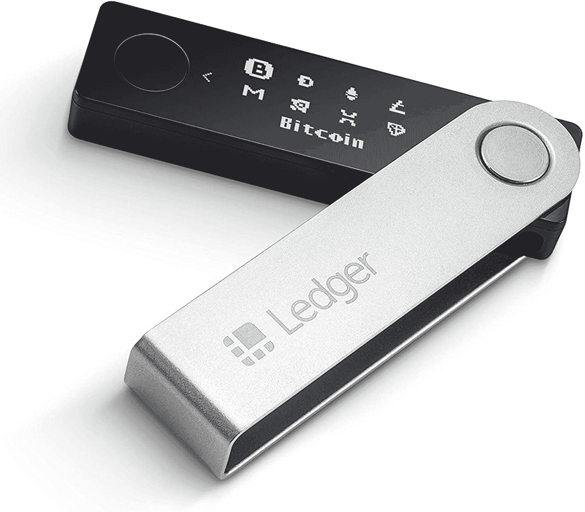
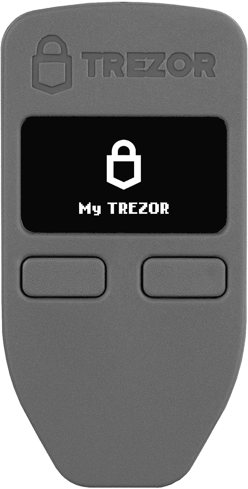
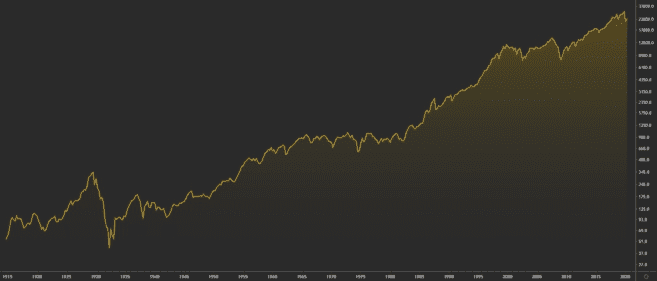
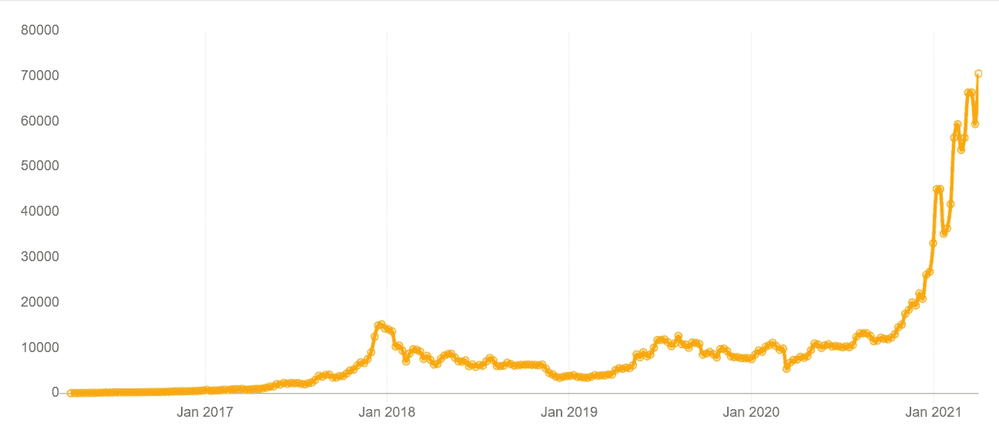
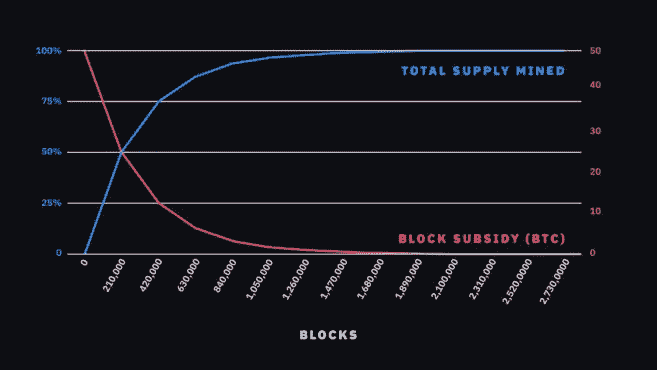
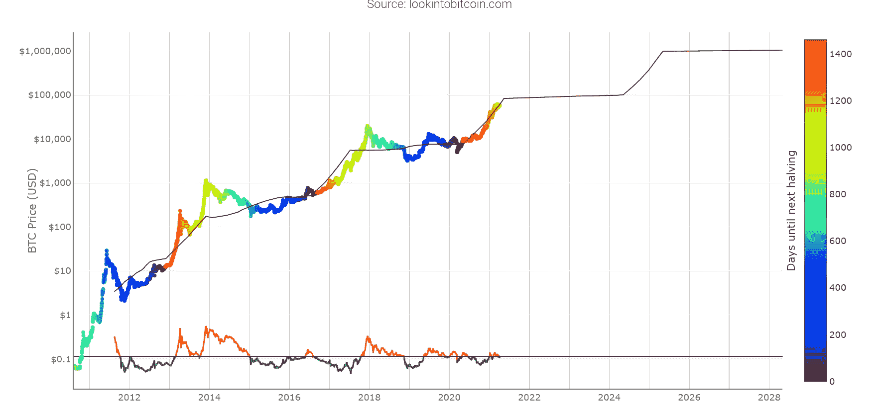
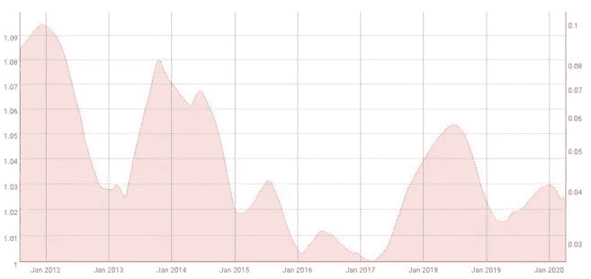
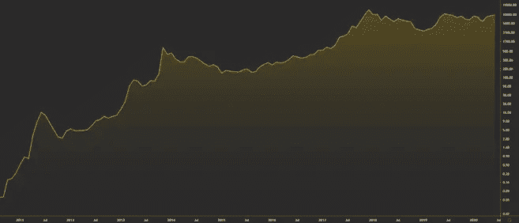
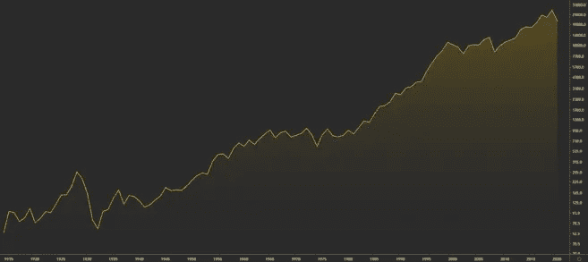

# 比特币 2021：新货币标准的崛起——加密货币和区块链世界初学者掌握指南：发现唯一盈利的比特币投资策略

# 简介

比特币在去年 12 月突破每枚 20,000 美元时，再次席卷全球。在经历了超过 2 年的熊市后，最著名的加密货币超越了其之前的历史最高点。许多人现在试图让自己成为专业投资者，并损失了大量资金，这只会帮助那些真正知道自己在做什么的人积累难以置信的财富，从而带来跨代的财富。要加入那些真正成功的少数投资者的行列，你需要正确的策略和正确的心态。请注意，我们并未包含大额初始资金。事实上，虽然拥有更多资金进行交易意味着拥有更强的火力，但积累比特币和建立财富并不需要数千美元。事实上，当我们开始投资比特币时，我们只有几百美元投入市场，但这笔钱在几年内为我们带来了数千美元的收益。在这本书中，你将发现所有使我们将投资技能提升到新水平的策略，以及一切帮助我们理解比特币的东西。如果你认真遵循我们的建议，我们相信你将在相对较短的时间内看到惊人的结果，因为这次牛市提供了大量的机会。请远离加密货币世界中所有花哨的东西。只需专注于比特币，深入研究它，然后像对待奶牛一样榨取它！祝你成功！Charles Swing 和 Masaru Nakamoto

## 第 1 章 - 什么是比特币？

比特币（₿, BTC, XBT）是一种加密货币，也称为加密货币。在单位面值的情况下，它写作“bitcoin”，而在点对点支付系统的情况下，它写作“Bitcoin”。该想法最初于 2008 年 11 月由一个人或一群人以中本聪为化名提出。比特币的实现源代码于 2009 年发布。G20 将比特币视为“加密资产”。“加密资产”一词指的是“存储在电子钱包中的虚拟资产，允许接受其作为支付的用户社区在不诉诸法定货币的情况下进行交易”。

## 运作

要创建和管理比特币，比特币依赖于软件。在这个软件中，比特币根据一种协议创建，该协议支付给处理过交易的代理人（称为“矿工”）。这些代理人使用他们的计算能力来验证、保护和记录交易到一个称为区块链的虚拟账本中。区块链一词来自这样一个事实：比特币的基本实体称为区块，然后这些区块被连接成一条链。对于每个新接受的区块，验证-安全-记录活动（称为挖矿）由新创建的比特币和处理过的交易的费用来报酬。

作为一种货币或商品，比特币可以兑换成其他货币或商品、商品或服务。加密货币汇率在专业市场上设定，并根据供求法则波动。可以在专业平台、实体终端上在线购买比特币，或者与已经拥有比特币的人交换任何商品或服务（交易可以从智能手机到智能手机进行）。这些平台还使得可以实时跟踪比特币相对于其他货币或加密货币的价格演变。

## 记账单位

比特币的记账单位是比特币。其发行量限制为 20,999,999.977 个单位，每个单位可分割到小数点后第八位（称为聪或 Sat）。官方货币符号于 2015 年注册并被 Unicode 接受。交易平台使用的相应缩写是 BTC 和 XBT。使用的非官方符号包括฿和Ƀ。

## 去中心化

该系统在没有中央机构或单一管理员的情况下运行。它通过网络中所有节点的共识以去中心化的方式进行管理。比特币是最大的去中心化加密货币，截至 2021 年 4 月 5 日，其市值超过一万亿美元（2020 年 1 月 1 日为 1300 亿美元）。

## 支付手段

作为一种支付手段，比特币被越来越多的商家接受，他们受到交易费用通常低于信用卡组织收取的 2%至 3%且与金融交易金额无关的鼓励。然而，在 2017 年，费用在几个月内大幅上涨，从 2016 年的 0.2 美元到 2017 年 12 月某些天的 20 美元，以至于 Steam 平台或微软撤回了比特币作为支付方式，正是因为交易费用过高（微软于 2018 年 1 月再次授权比特币）。为了解决交易费用过高的问题，2018 年和 2019 年各种技术增强（Segwit、闪电网络、批量交易、Schnorr）的逐步推出使得非紧急交易的费用降至约 0.05 美元，甚至闪电网络类型交易的费用低于 0.0001 美元。与信用卡不同，任何费用都由买家承担，而不是由卖家承担，买家自愿选择支付这些费用。比特币交易是不可撤销的，无法撤销。尽管 2014 年接受比特币的商家数量增长了 500%，但这种加密货币在零售贸易中并不十分确立，但继续在贸易中站稳脚跟。

## 用途

在 2009 年 1 月至 2010 年 3 月之间，使用比特币是加密货币爱好者之间的一种爱好，比特币没有实际价值。然而，在 2010 年 4 月，比特币开始以 0.003 美元的价格在交易所交易，不久之后，在 2010 年 5 月，它已经值 0.01 美元。几个月后，在 2010 年 7 月，其价值又增加了 0.08 美元。这些数字反映了这种零价值的加密货币经历的价格快速上涨，达到了 10 美分。从 2009 年创建以来，直到 2013 年美国当局关闭丝绸之路，比特币主要被犯罪网络用作赌博、购买非法物质或被黑客攻击的数据库的交换媒介。这种加密货币引起了金融当局、各国立法机构（尤其是美国）和主流媒体的关注。然而，近年来，加密货币已经成熟，越来越多的研究得出结论，这些非法活动虽然仍然像任何支付系统一样存在，但只涉及加密货币交易的一小部分。美国参议院也承认比特币可以提供完全合法的金融服务。

## 安全的价值存储

根据一些专家的说法，比特币更像是一种避风港，而不是一种支付手段，尽管与黄金不同，比特币确实可以用于这两种目的。相反，其他金融专家认为比特币波动太大，不足以成为避风港，但它自 2009 年才存在，其可能的避风港地位只有在经历一段剧烈波动期后才有可能实现。至于比特币是否能达到黄金的市场价值（甚至超过它），这个问题仍然备受争议。然而，应该注意的是，凭借其万亿美元的估值，比特币离达到白银的价值并不太远，白银的价值约为 1.4 万亿美元。

## 第 2 章 - 比特币的历史

比特币是对魏岱（Wei Dai）于 1999 年构思的 b-money 概念以及尼克·萨博（Nick Szabo）于 2005 年描述的 bitgold 的改进。特别是，比特币解决了信任模型这一关键问题：被认为可靠的服务器通过其算力投票来确定合法的交易链。在 b-money 中，服务器本应根据一种不太明确的机制支付安全押金。使用计算证明链的想法是在 bitgold 项目中提出的，尽管尼克·萨博只提议使用大多数地址来确定交易链的合法性，这留下了控制地址数量的问题。中本聪声称他从 2007 年到 2009 年致力于比特币的开发。早在 2008 年，他就在邮件列表上发布了一份描述数字货币的文档。2009 年 2 月，他在 P2P 基金会网站上发布了关于其工作的公告。2009 年 1 月 3 日，第一个区块或创世区块被创建。2009 年 2 月，他在 P2P 基金会网站上分发了第一个版本的比特币软件，并使用自己的计算机来运行网络，从而生成了第一批比特币。与其他开发者一起，中本聪一直持续实现该软件及其 Bitcoin-Qt 版本直到 2010 年。开发者和比特币社区在 2010 年中期逐渐与他失去了联系。2010 年 12 月 12 日，中本聪在主论坛上发布了最后一条消息。在消失之前不久，中本聪指定加文·安德烈森（Gavin Andresen）为其继任者，授予他访问 SourceForge 比特币项目的权限以及一份警报密钥的副本。后者是一个独特的私有加密密钥，允许减轻对比特币系统潜在攻击的影响，例如发现允许修改交易的加密缺陷，或网络中超过 51% 的节点被控制。在警报期间，网络节点的操作者可以警告其用户或停止记录交易。2012 年 9 月 27 日，比特币基金会成立。来自新技术界的重要人物迅速支持了该项目，例如文塞斯·卡萨雷斯（Wences Casares）。

## 中本聪的身份

几个人声称自己是中本聪，但没有人能够证明这一点。在比特币创建之前，没有关于他身份的任何痕迹。在他的个人资料中，中本聪声称自己是一名 40 岁的日本人。2014 年 3 月，Newsweek 杂志的记者利亚·麦格拉思·古德曼（Leah McGrath Goodman）宣布，她已经找到了比特币的发明者，她称该发明者是一名 64 岁的日裔美国人，出生名为“中本聪”，尽管他在 23 岁时将名字改为“多里安·普伦蒂斯·中本聪”（Dorian Prentice Satoshi Nakamoto）。他被认为是一名居住在加利福尼亚州的退休物理学家。这一论点一个月后被英国阿斯顿大学的语言学家有条不紊地推翻，他们对比特币白皮书作者的文字作品与几名涉嫌人物（尤其是多里安·中本聪）之间的语言对应关系进行了深入研究。2016 年，澳大利亚企业家克雷格·史蒂文·赖特（Craig Steven Wright）声称自己是中本聪。然而，强烈的怀疑依然存在。

## 采用

比特币采用的历史非常引人注目，因为它经历了一个漫长的过程，充斥着对加密货币领域的伪禁令和无理威胁。在接下来的页面中，我们将追溯比特币的采用过程，从 2012 年开始。以下是 BTC 采用的主要里程碑。

- 2012 年 11 月 16 日，WordPress 开始接受比特币作为其付费服务的支付方式。
- 2012 年 11 月 28 日，矿工的报酬首次下降，从 50 降至 25 BTC。比特币源代码规定每挖掘两百一十万个区块（大约每四年）报酬减半。
- 2012 年 12 月 6 日，初创公司 Paymium（法国交易所）与公司 Aqoba（支付机构）之间的合作伙伴关系使 Paymium 能够作为支付服务提供商运营，因此可以保存欧元账户并发行可用欧元和比特币的支付卡。
- 2013 年 2 月 14 日，Reddit 社区网站建立了一个使用比特币购买“Reddit Gold”的系统。
- 2013 年 2 月 16 日，在线存储网站 Mega（Megaupload 的继任者）开始接受比特币支付。
- 2013 年 10 月 14 日，巨头百度（中国的谷歌）开始为其 Jiasule 防火墙服务接受比特币交易。
- 2013 年 10 月 29 日，第一台自动比特币取款机-兑换机在温哥华投入使用。2016 年 9 月，全球安装了超过七百七十台这些自动取款机-兑换机，其中包括四台在法国。
- 2013 年 11 月 21 日，尼科西亚大学宣布接受比特币，并开设了专注于数字货币的经济学硕士学位。
- 2013 年 11 月 22 日，理查德·布兰森（Richard Branson）宣布维珍银河（Virgin Galactic）将接受比特币作为其太空旅游航班的支付方式。
- 2013 年 11 月 29 日，江苏电信（中国第三大运营商，中国电信的子公司）开始接受比特币。
- 2014 年 3 月 25 日，美国税务机关宣布比特币不应被视为货币，而应被视为商品，其交易需缴纳资本增值税。这涉及考虑比特币获取时的汇率和使用时的汇率，以计算实现的收益，这使得比特币在美国的合法使用尤其困难。
- 2014 年 5 月 9 日，美国选举委员会接受竞选活动可接受比特币资助，每个选举周期上限为 100 美元。
- 2014 年 9 月 23 日，Paypal 允许由合作比特币支付处理商选定的某些北美数字商品商家接受比特币支付，从而非常逐渐地向比特币开放。截至 2017 年 10 月 16 日，全球已有比特币 ATM。
- 2017 年 12 月，法国公共账目部长热拉尔·达尔马宁（Gérald Darmanin）提醒法国纳税人，在涉及比特币交易产生的资本收益时，有义务申报收入。
- 2018 年 11 月，俄亥俄州政府宣布接受比特币纳税。
- 2020 年 1 月，一项 investing.com 的研究揭示，9% 的金融顾问已将部分客户资金投入比特币，以保护其免受货币动荡的影响。

## 重要时刻

在采用阶段，发生了许多改变比特币进程的重要时刻。以下是其中最重要的几个。

- 2010 年 8 月 15 日，一个区块被生成，其中包含一笔为三个不同地址创建 184,467,440,737 个比特币的交易。这个缺陷与代码未预见创建如此大量比特币的情况有关。这个问题由比特币区块链自动解决，这些比特币不再存在。
- 2013 年 3 月 12 日，发生了与版本 0.8.0 不向后兼容相关的事件：链分裂成多个版本，其中一些被阻塞了几个小时。在短暂的恐慌之后，系统能够自我纠正，表明了区块链技术的强大。
- 2013 年 4 月 11 日，比特币价值从 266 美元崩溃至 105 美元，并在不到六小时内稳定在 160 美元。4 月 13 日，价格达到 66 美元。这次大幅下跌发生在一轮大牛市之后，比特币价格在短短几周内上涨了六倍。对于那些已经熟悉比特币价格走势的人，我们确信他们一想到如此低的价格就会微笑。
- 2013 年 10 月 2 日，罗斯·乌尔布雷希特（Ross Ulbricht）被捕。他是丝绸之路（Silk Road）的涉嫌创始人，该网站被 FBI 关闭，并且所有交易都只使用比特币。关于这一点将在专门章节中详细介绍。
- 2014 年 2 月 11 日，比特币网络遭到在众多交易平台上发起的大规模协调攻击，相当数量的比特币被盗。这只是几天内将要发生的事情的预演。事实上，2014 年 2 月 24 日，Mt. Gox 交易平台遭受了 744,408 BTC 的创纪录损失，相当于 440 多亿美元。该网站在不久之后关闭。一份危机管理文件已制定并在其网站上公开提供，我们建议您查看，因为它非常有趣（`https://www.mtgox.com/`）。由于此事件，比特币在 2014 年第一季度损失了超过 38% 的价值。2015 年 9 月 11 日，Mt. Gox 平台所有者马克·卡佩莱斯（Mark Karpelès）在日本因贪污被起诉。他被怀疑贪污了 230 万美元的比特币存款。
- 2016 年 5 月，Gatecoin 交易所被黑客攻击，250 个比特币和 185,000 个以太币被盗。黑客设法绕过了交易平台资产的在线存储限制：虽然只有 5% 的存款未冷存储，黑客设法清空了这些存款，同时通过从交易平台转移冷存储资产继续为地址充值。此事件后，几乎每个交易和兑换平台都决定实施新的保护机制，以提高其安全性。
- 2016 年 8 月 3 日，Bitfinex 交易所报告其交易平台被盗 119,756 个比特币，当时价值约 6500 万美元。
- 2019 年 5 月 7 日，黑客从 Binance 加密货币交易所窃取了超过 7,000 个比特币，价值超过 4000 万美元。Binance 首席执行官赵长鹏表示，“黑客使用了多种技术，包括网络钓鱼、病毒和其他攻击。他们有耐心等待，并在最合适的时机通过多个独立账户执行精心策划的行动”。正是这一事件激励 Binance 进一步改进其保护机制。与交易平台相关的所有事件只影响那些不持有自己比特币钱包私钥的人。正如他们所说，不是你的钥匙，就不是你的比特币。正如您所见，每次比特币网络受到攻击后，都会找到新的解决方案，以确保同样的问题不再发生。在我们看来，这是该系统的主要优势之一。事实上，由于它由人开发，可以轻松适应新的黑客攻击方法和攻击。观察比特币的演变非常有趣，如果您想安全地投资它，您也需要了解一些它的历史。

## 一种常见的黑客技术

被称为特洛伊木马的技术使得更改加密货币交易收款人地址成为可能。CryptoShuffler 是使用这种技术的软件之一。这种罕见的技术影响很小，因为付款发送者只需目视检查目标地址的首/尾字符，即可确保自己没有被欺骗。

## 与美元的价格演变

该加密货币于 2009 年 2 月创建之初，仅由少数用户作为实验进行交易，其价值为零。2009 年 10 月 12 日，首次已知的比特币交易发生，两名用户通过 PayPal 转账用 5,050 个比特币交换了 5.02 美元，相当于每个比特币约 0.001 美元。2010 年 3 月，Bitcoinmarket.com 是第一个开放的比特币交易平台，从而允许比特币价格的持续报价。这是一个时代的开始，每个比特币爱好者都应该感谢这个网站为社区所做的一切。2011 年 2 月 9 日，比特币达到了 1 美元的估值。2013 年 11 月 29 日，一个比特币的价值超过了盎司黄金，接近 1,250 美元。再次强调，对于那些熟悉当今价格走势的人来说，这些数字似乎并不那么令人难以置信。但是，如果你仔细想想，我们谈论的是仅仅几年内的巨大价格发展。还有哪种资产在短短两年内就上涨了超过 1000%？答案很简单：没有其他资产做到过这一点。比特币主要以人民币和美元交易，也可以在十几个平台上以欧元交易。直到 2013 年 11 月，Mt. Gox 都是这些平台中交易量（约 70%）最大的平台，并且惯例是将其价格视为市场的代表。由于遇到的问题，用户远离了它，导致比特币在 Mt. Gox 上的价格急剧下跌，而其他平台上观察到的价格仅受轻微影响。价格在 2013 年 1 月至 3 月间上涨了 400%，但在 4 月 10 日严重回调，此前 Mt. Gox 交易网站出现故障，并可能出现恐慌性抛售。价格回落到上个月的水平，约为 50 美元。2013 年 12 月 4 日至 5 日，在中国人民银行和法国银行发出警告后，价格在 24 小时内损失了近 35%。2014 年 2 月 19 日，在 Mt. Gox 上宣布丢失 850,000 个比特币后，价格崩溃。在这个交易平台上，比特币从 2 月 18 日的 185 美元跌至 24 小时后的 73 美元，而其他平台上的价格仍接近 400 美元。Mt.Gox 于 2014 年 2 月 28 日宣布破产。2014 年 5 月 1 日，一家名为 Sunlot Holdings 的投资者集团提出以一个象征性的比特币购买该网站。2016 年，在 6 月 24 日 Brexit 公告之后，比特币价值飙升，上涨了 9% 以上，而所有金融中心在超过一周的时间里都暴跌了。这可能是第一次向世界展示比特币的真正实力。事实上，BTC 是一种在世界动荡时表现特别好的资产。我们在 2020 年看到了这一点，当时它在短短一年内上涨了超过 600%。2017 年，比特币在约 19,000 美元处触顶，并进入了长达 2 年多的熊市。在那段时间积累比特币的人足够勇敢，在超过 700 天内没有看到资产回升至历史高点而幸存下来。然而，在 2020 年，比特币终于突破了那个水平并飙升。在撰写本书时，一个比特币价值约 60,000 美元。想想看，如果你在 2011 年 2 月 9 日购买了价值 10 美元的比特币，你现在将拥有相当于超过 600,000 美元的资产。这类数字确实令我们印象深刻。

## 第 3 章 - 比特币背后的理念

比特币的理论根源在于奥地利学派经济学及其对当前货币体系以及政府和其他实体干预的批评，该学派认为这种干预加剧了商业周期和大规模通货膨胀。由 Eugen von Böhm-Bawerk、Ludwig von Mises 和 Friedrich A. Hayek 领导的奥地利学派经济学关注的主题之一是商业周期。事实上，根据奥地利理论，商业周期是市场上不可避免的货币干预的后果，即银行信贷的过度扩张导致部分准备金制度下银行信贷存量增加，进而导致人为压低的利率。在这种情况下，企业家在扭曲的利率信号引导下，开展了与消费者当时对跨期消费（即短期决策和未来消费）的偏好不匹配的过于雄心勃勃的投资项目。迟早，这种普遍的失衡将无法持续下去并导致衰退，在此期间，公司必须清算失败的投资项目，并根据消费者的跨期偏好重组其生产结构。因此，许多奥地利学派经济学家呼吁通过废除部分准备金银行制度并恢复基于金本位的货币来放弃这一过程，这种货币不容易被当局操纵。奥地利经济学家非常活跃的另一个相关领域是货币理论。Friedrich A. Hayek 是该领域最著名的名字之一。他撰写了一些非常有影响力的出版物，例如《货币非国家化》（1976 年），他在其中假设政府不应拥有货币发行的垄断权。相反，他建议应允许私人银行发行不计息证书，并基于其自身商标。这些证书（即货币）应向竞争开放，并将以不同的汇率进行交易。任何能够保证稳定购买力的货币都将从市场上淘汰其他不那么稳定的货币。这种竞争和利润最大化过程的结果将是一个高效率的货币体系，其中只有稳定货币才能共存。以下观点通常为比特币支持者所共享。

● 他们将比特币视为结束中央银行货币发行垄断的一个良好起点。
● 他们强烈批评当前的部分准备金银行制度，该制度允许银行将其信贷供应扩展到其实际储备之外，同时允许存款人随时将其资金提取到支票账户中。

## 比特币的特殊性

我们必须区分比特币（加密货币）和另一方面的比特币（这种货币的支付系统）。在这两个方面，比特币与预先存在的系统在某些重要点上有所不同。首先，与其他货币不同，比特币不是任何国家、银行或企业权力的体现。比特币的价值由其经济用途以及外汇市场以完全浮动的方式决定。组织货币发行的规则完全由比特币软件的自由计算机代码确定。此外，作为支付系统，比特币的特点在于其运行不需要使用集中式基础设施来保存持有金额的账目以确保交易。担保和验证的作用存在，但大约每十分钟分配一次给网络中根据其算力随机选择的一台计算机。比特币基于一种加密协议，其主要目的是，一方面，解决所谓的双重支付问题，此问题此前一直阻碍此类货币的出现，另一方面，“禁止”伪造利益相关者标识符以及由给定地址标识的电子钱包中比特币存量的价值。

## 比特币背后的货币原则

从货币角度来看，比特币与其他货币的主要区别在于，货币总量并非设计用于适应财富的生产。单位的总量和发行率明确写入软件的计算机代码中，遵循一种等比数列类型的数学规则。比特币缓慢而稳定地发行，呈递减趋势，预计在 2140 年左右达到 2100 万的最大数量。所有法定货币都会经历通货膨胀，程度取决于其中央银行的政策，从低到高不等。相反，比特币货币最终可能会经历通货紧缩，因为可创建的比特币最大数量在软件中预先设定为 2100 万。除此之外，用户丢失的比特币永远不会被替换。这就是为什么比特币项目被其创建者社区视为一项在经济学方面的原创实验，构成了一种对奥地利学派经济学货币论点的测试。事实上，经济学诺贝尔奖获得者 Friedrich Hayek 在 1976 年的著作《真正的货币竞争》中呼吁恢复货币自由意志。比特币的成功或失败很难预测，但到目前为止，不可能说它表现不佳。

## 协议的可扩展性

2010 年 7 月 14 日，比特币系统启动后不久，Satoshi Nakamoto 在比特币区块链上为每十分钟新创建的区块设定了 1MB 的限制。当时，交易是免费的，因为交易数量很少，开发人员有合理的担忧，即攻击者可能会“垃圾邮件”交易网络，任意创建巨大的区块并永久膨胀区块链的大小。此限制旨在防止此类攻击，直到能够实施更好的解决方案。Satoshi Nakamoto 提出了一种方案，即将区块大小增加到特定的区块高度，从而将限制有效地提高到预定的速率，类似于新比特币的发行方式。自引入此区块大小限制以来，比特币系统的可扩展性一直是社区持续辩论的来源。这个 1MB 限制最初被认为将每秒交易数量限制为七笔，在实际交易数量几乎未超过每秒 2.3 笔（2010 年）的时代，这并不构成问题。因此，每秒七笔交易是当时比特币最繁忙日交易量的三倍，为开发人员留出了数年时间来寻找更好的解决方案。除此之外，协议规定随时间推移引入交易费用，这将使此类攻击变得更加昂贵和无效。

### 交易集成容量饱和

从 2014 年开始，比特币系统的成功导致交易数量持续上升，最终在 2016 年达到了 1MB 的限制。开发人员 Gavin Andresen 最初提议了 20MB 区块，但社区认为增加幅度过于激进。另一项提议 BIP10191，建议从 8MB 开始每年增加区块大小 40%，这导致创建了一种不同于比特币的新加密货币，称为 Bitcoin XT92。还提出了其他提议，例如 BIP10093，采用 2MB 区块，导致了 Bitcoin Classic 加密货币，以及更激进的“新兴共识”方法，允许用户通过 Bitcoin Unlimited 在特定时间“投票”决定最佳区块大小。社区的其他成员倾向于不支持增加区块大小，而是改变协议本身，以便通过减少交易大小或增加新区块的创建频率，在一个区块中集成更多交易。当交易数量最终达到区块大小限制时，待处理交易池变得满载。用户要想让特定交易更快进入区块链，唯一的方法是增加交易费用，2016 年底交易费用已达到近 5 美元。这使得比特币在速度和成本的严格基础上，无法与西方联合汇款或 PayPal 等现有服务竞争。

### 纽约协议

关于可扩展性的停滞辩论削弱了比特币核心系统，并导致支持比特币无限运动的投票日益成功，尤其是在矿工中，很大程度上是由于对缺乏升级解决方案的沮丧。开发团队的方法，称为隔离见证（segwit），即不增加区块大小限制，而是将交易的数字签名以不同的方式分区到“扩展区块”中，未能达成足够的共识。2017 年，在行业共识中找到了一个妥协方案，称为隔离见证 2x（Segwit2x97），它结合了隔离见证提议和将区块大小增加到 2MB。该提议于 2017 年 8 月 1 日针对隔离见证实施，区块大小增加于 2017 年 11 月在区块 494,784 生效。这是比特币系统的一次重大更新。尽管如此，可扩展性辩论仍然激烈，一个分裂团体于 2017 年 8 月 1 日单方面将区块大小增加到 8MB，同时拒绝隔离见证提议。这一决定导致了一种新加密货币的出现，称为比特币现金。比特币 XT（创建于 2015 年 8 月）、比特币无限（创建于 2016 年 1 月）、比特币经典（创建于 2016 年 2 月，后于 2017 年 11 月停止）、比特币现金（创建于 2017 年 8 月）和比特币黄金（创建于 2017 年 10 月）是比特币（也称为比特币核心）的替代加密货币，旨在解决交易费用问题。

## 财富分配

比特币集中在少数大户手中。“财富”的分配方式是，2100 个地址持有总量的 40.2%。然而，这种信息并不十分有用，因为其中一些地址已经失效（当一个比特币单位还不值 1 美分时，密钥丢失）。我们的观点是，既然我们现在看到机构纷纷入场，那么在大户持有的比特币数量方面，我们将看到更高的集中度。随着价格上涨，普通人要拥有一个完整的比特币将变得越来越困难。

## 第 4 章 - 比特币如何工作

比特币并不独立于比特币支付系统存在，该系统允许从一个账户向另一个账户进行交易，这要归功于称为钱包的软件，而权威性由称为矿工的验证软件来确保。所有交易的数据构成一个私法下的公共账本，由于其结构被称为“区块链”，代理人通过在比特币系统的区块链中记录其交易来使用比特币。比特币系统是基于计算机的。换句话说，比特币系统位于互联网上。下载并安装适当的软件，您可以通过与您选择的硬件（包括智能手机或计算机）交互来成为比特币用户。要支付或接收比特币，用户必须连接到系统。此连接提供两个功能：创建任意数量的账户，以及轻松执行交易，该交易包括将比特币从自己的账户转移到第三方的账户。比特币系统的基本功能在于交易，这些交易由有资格的计算机进行有效性检查，并不可撤销地记录在公共登记簿中。这个公共账本或区块链可以由任何人在任何地方查看，只要他们有互联网连接。在查询过程中，无法进行任何更改。

## 比特币交易机制

比特币交易需要两个基本步骤。首先，专用网络节点（“矿工”）通过将最近完成的交易分组并添加包含日期和时间、校验和（“哈希”）的标题来创建新块，该校验和还将作为块的唯一标识符，以及前一个块的标识符。其次，在检查此新块中包含的所有交易的有效性及其与已记录交易的一致性后，每个矿工将其添加到其本地版本的登记簿（或区块链）中。公共登记簿被多次复制。然后可以通过查看网络中管理区块链副本的所有节点来读取所有交易的完整历史记录。副本可以揭示文件之间可能存在的差异，以防出现分歧。在这种情况下，这些副本之间的任何差异必须由软件解决。如果你仔细想想，交易包括借记某些账户以贷记其他账户。它们由输入和输出组成。每个输出包括一个金额和被贷记地址的公钥，或者更一般地说，是一个程序（脚本），用于授权或不授权将此输出的金额转移到另一笔交易。每个输入指定先前交易的一个输出，并有一个程序（脚本），为出现在该输出中的脚本提供所需的数据。输出值的总和必须小于或等于输入值的总和。差额构成矿工的报酬。创建交易时，将执行每个条目的脚本；首先执行条目本身的脚本，然后执行条目引用的较早退出的脚本。只有当所有输入的结果均为“真”时，交易才会提交。这些脚本是用中本聪设计的内部语言编写的。这种语言故意极简且非图灵完备，以防止系统陷入无限循环。使用脚本应使软件能够轻松适应未来的发展，并支持多签名交易或智能合约等高级功能。节点发出的交易会广播到其邻居节点。这些邻居节点验证接收到的交易，并逐渐将其整合到本地池中，然后再传递给自己的邻居节点。有效的交易就这样逐步广播到网络的所有节点，并在每个步骤中进行新的检查。在将交易永久记录在区块链之前，网络会多次执行一组检查，特别是检查输入引用的输出是否存在且尚未被使用、交易发起者是否确实是这些输出中贷记地址的所有者，以及交易输出中出现的金额总和是否远小于或等于输入引用的输出金额总和。这有点复杂，但如果你多读几遍最后这句话，你就会更好地理解交易过程中实际发生的情况。将交易记录在区块链中的效果是禁止将来引用该交易输入所指定的输出，从而防止这些输出金额的双重支出，这将相当于以未经授权的方式从零开始创建比特币。唯一允许从零开始创建比特币的方式是通过一种称为 Coinbase（非交易所）的特殊交易，该交易插入链中每个块的开头，以支付插入该块的矿工。交易会被网络即时考虑，并在大约 10 分钟后首次确认。每个新的确认都会加强交易登记簿中交易的有效性。

## 比特币地址

每个用户可以拥有任意数量的地址，这些地址可以通过钱包创建。每个比特币地址都与一个公钥和私钥对相关联。地址等于其公钥的 160 位（20 字节）加密哈希。比特币地址还有一个标识版本号（默认为 0）的前缀和一个四字节校验和。总的来说，比特币地址占用 25 字节。地址以 ASCII 格式表示，得益于一种专用的 58 个字母数字字符编码：大小写数字和字母，但字母和数字 l、I、0 和 O 除外，中本聪因其在某些字体中的相似性而将其排除。下面是作为示例的第一个比特币地址，它接收了比特币。`1A1zP1eP5QGefi2DMPTfTL5SLmv7DivfNa106`。要使用现有交易输出中记入比特币地址的金额，用户必须在交易的输入中使用相应地址的私钥对交易进行签名。网络使用与记入地址相关联的公钥，利用非对称加密技术检查此签名的有效性。该操作对交易的每个输入重复进行。

## 钱包

每个用户的钱包包含其个人数据，包括其每个账户的地址、公钥和私钥。它还可以包含从区块链构建的用户特定信息，例如可用交易输出列表或账户余额。钱包软件提供创建账户、查询账户、构建和发送交易的功能。所有类型的设备（包括智能手机）都有多种钱包软件可供选择。它们在辅助功能的范围和用户界面方面有所不同。用户钱包中包含的信息至关重要，必须严格防止任何入侵。如果账户的私钥丢失，用户将无法再访问资助该账户的交易，也无法从该账户创建新交易。他的比特币将永久丢失，并将永远留在数据库中而无法更改地址。2013 年，一名用户不小心扔掉了包含其私钥的硬盘，损失了 7,500 个比特币，当时价值 750 万美元。另一名用户发现账户的私钥，将允许该用户窃取合法账户持有人的身份，并花费其中的比特币，这相当于比特币被盗。

## 挖矿过程

挖矿操作包括将交易组装成“块”，并添加一个标题，该标题特别指示块的大小、记录的交易数量、日期和时间、校验和（“哈希”），该校验和禁止对块进行任何修改，并也作为块的唯一标识符，以及前一个块的标识符。矿工在其构建的块中包含一笔特殊交易，该交易为他们记入为此目的创建的一定数量的比特币，并包含特定的交易费用。但是，只有当块被其他节点最终接受到区块链中时，这笔报酬才会生效。正是这种货币创造解释了“挖矿”这一术语的使用，类比于金矿开采。一个块可以包含任意数量的交易，通常在 1000 到 2000 之间，但块大小不能超过 1 兆字节（针对比特币核心系统）。在块中，交易以默克尔树的形式存储。块的校验和（或指纹）是通过对以下组件组成的六元组应用两次 SHA-256 哈希来计算的。● 软件版本号；● 前一个块标题的指纹；● 块交易树的根（它本身是所有块交易的间接指纹）；● 时间戳（自 1970 年 1 月 1 日以来的秒数）；● “随机数”。由于要求校验和小于某个值（由以一定数量的零开头的二进制表示体现），因此计算此指纹被故意设计得困难。为此，指纹包含一个任意的 32 位数字，称为“随机数”。即使知道某些随机数对应的哈希值，哈希也使得在不重新运行算法的情况下无法确定新随机数的哈希值。因此，我们只能通过多次尝试来找到满足指纹值约束要求的适当随机数。对于给定的随机数值，计算出小于难度的指纹的概率非常低，因此在实现之前必须进行许多尝试。在 2014 年至 2016 年间，每个矿工在每次创建块之间必须测试的随机数平均数量从 10 亿增加到 2000 亿。此计算包括从不同数据中多次执行相同的计算，因此非常适合并行计算。难度每 2016 个块重新调整一次，以考虑网络的实际计算能力，并平均每 10 分钟添加一个块，这相当于说，网络上最强大的计算机或计算机组计算有效指纹的可能持续时间为 10 分钟。这种工作量证明和通过指纹链接块的系统使得区块链的任何更改几乎不可能（51% 攻击除外）。希望修改给定块中交易的攻击者将被迫重新计算其校验和以及所有后续块的校验和。由于难度随时间增加，修改后的交易之后的块数量（其确认程度）也随之增加，进行此类修改所需的时间会非常迅速地增加。当矿工构建了一个校验和满足难度条件的有效块时，它会将其广播到邻近节点，这些节点在检查其有效性后再次转发。挖矿工作的报酬以比特币支付。该支付称为块奖励。当前块奖励为 6.25 个比特币。每 210,000 个块，该奖励减半。有效块就这样逐步广播到网络的所有节点，不是在事先检查后无法修改，而是在无法修改的情况下广播。从标题中包含的随机数，可以快速轻松地检查块的有效性（可以与数独游戏做一个简单的类比：解决它很困难，需要时间和人工计算，但一旦找到解决方案，验证就非常容易）。

## 环境困境

挖矿是一项经常因其能源消耗的所谓环境足迹而受到批评的活动。然而，一些观察人士通过指出“经典”货币网络消耗的能源要多得多（通过数百万台取款机或经典货币系统正常运行所需的基础设施，例如数据中心）来减轻批评。大多数比特币矿工使用可再生能源，因为在有利于挖矿的世界地区（低温、水坝、地热能等），可再生能源更便宜。

## 电力消耗估计

由于挖矿活动的去中心化，比特币挖矿的电力消耗难以评估。媒体最常引用的数据来自一位荷兰金融分析师创建的“Digiconomist”网站。根据他的估计，该估计基于挖矿收入和成本之间经济平衡的假设，挖矿造成的全球电力消耗将为每年 71.1 太瓦时（1 太瓦时（TWh）= 10 亿千瓦时（kWh））。这将占全球电力消耗的约 0.32%。2018 年每天只有约 20 万笔交易，2018 年 7 月 1 日比特币的电力消耗约为每笔交易 1,000 千瓦时。相比之下，Visa 在 2017 年消耗了 0.19 太瓦时/年，用于管理 1110 亿美元的交易（每天约 3 亿笔交易），即每笔交易 0.0017 千瓦时。比特币每笔交易消耗的能源大约是 Visa 的 600,000 倍。但是请注意，挖矿消耗与交易数量无关。然而，“Digiconomist”网站的估计值受到质疑，并被认为被夸大了。事实上，根据计算机安全工程师 Marc Bevand 的说法，它们将比特币矿工的电力消耗高估了 1.5 到 2.8 倍（可能是 2.2 倍），这将使总电力消耗降至每年 32.3 太瓦时，即每笔交易 424 千瓦时（相当于 1000 瓦电暖器运行近 18 天的消耗量）。这些估计由于所需的假设而存在不确定性，但可以根据可验证的数据计算比特币网络的最小电力消耗。● 每秒哈希数：2018 年 7 月 1 日为 37.1 × 10¹⁸ H/s；● 市场上最高效机器（比特大陆的 Antminer S9）的功率和哈希能力：1323 W 对应 13.5 × 10¹² H/s。因此可以断言，2018 年 7 月 1 日比特币网络至少有 280 万台挖矿机，其电力消耗至少等于每年 32.2 太瓦时。保障比特币网络的实体数量不断增加，这增加了比特币的价值。根据美国银行 2021 年 3 月发布的一份报告，2020 年底比特币网络消耗了全球 0.4% 的电力，大约相当于荷兰的用电量，并排放的温室气体相当于美国航空公司燃烧的石油。两年内，这些排放量增加了 4000 万吨，相当于 830 万辆汽车，达到 6000 万吨。全球四分之三的挖矿产能位于中国；27% 的中国矿工位于四川，这是一个拥有强大低碳水电生产的省份，但 43% 位于新疆，那里 80% 的电力来自燃煤电厂。

## 为什么电力消耗如此重要？

比特币非常高的能源消耗与新的区块挖矿系统有关，该系统旨在在没有中央权威的情况下保护系统免受欺诈。安全性基于一个数学问题，其解决方案难以找到，且求解过程本身成本高昂。为了有机会将下一个区块添加到链中，矿工必须确实大量投资于服务器农场，以拥有强大的计算能力。这些农场使用大量电力为服务器供电和冷却。为了在区块链上记录新区块，矿工必须解决提交给所有竞争者的数学问题，最先找到解决方案的人将进行记录并获得比特币费用。由于解决方案只能通过试错法找到，因此能够进行最大尝试次数的矿工获胜的机会最大。问题的难度会进行调整，以便其求解所需的计算时间大约为 10 分钟。电力消耗的规模与计算强度以及这些计算由大量矿工同时进行的事实有关。它与比特币的价格有关，因为价格越高，报酬就越多，矿工就越多。这让人想起亨利·福特在二十世纪初的预测：“一种能源货币将取代黄金并结束战争”。根据伊索-电信学院的 Fabrice Flipo 和 Michel Berne 的说法，加密货币的普及可能导致能源消耗超过法国电力消耗的八倍，即美国电力消耗的两倍，因为它们的安全性和我们对它们的信任基于一个数学问题，其答案难以找到，且其求解本质上成本高昂。设备优化和技术进步将使 2021 年的电力消耗仅为 417 兆瓦，但这仍然需要近 5,500 千瓦时来生产一个比特币，相当于美国家庭一半的年用电量。因此，里昂/圣埃蒂安分析与经济理论小组的研究员 Nicolas Houy 表示，“大量资金完全可以由少数矿工管理”。

## 矿工群体

挖矿的难度导致矿工组建矿池，以结合其计算资源并更快地构建新区块。构建每个区块对应的报酬随后按比例在成员之间分配，扣除费用后，这使得他们的收入更加平稳且不确定性降低。2016 年，大约十个这样的合作社提供了 95% 的区块。它们主要位于中国（占比特币网络大部分哈希算力），但也位于捷克共和国和格鲁吉亚。挖矿活动的报酬导致了越来越专业化技术的发展。最高效的硬件使用集成电路，其性能优于通用处理器，同时耗电更少。截至 2015 年，不使用专门为挖矿设计的设备的矿工，即使加入矿池，也很难覆盖其电力和设备成本。

## 第 5 章 - 区块链

比特币系统的区块链可比作记录交易的公共账本。它存在于 10,000 多个副本中，由网络节点并行管理，没有任何节点扮演特权角色。部分账本副本存储在免受任何天灾破坏的区域，例如瑞士山脉下的地下掩体中。

网络中每个节点的操作员可以决定安装“全节点”，该节点会构建并维护区块链的本地副本。相反，操作员可以选择使用轻量节点，该节点会调用邻近的全节点，使用 `SPV`（简单支付验证）协议来验证交易。由于这些决策完全去中心化，无法得知各类型节点的数量。唯一由 `blockchain.info` 或 `bitnodes` 等专业网站永久识别的节点类型是“监听节点”，它们在测量时接受来自其他节点的交易和区块。其数量徘徊在 10,000 左右。网络节点可能达到数万个。对于全节点，其数量与区块链中的副本数量相匹配，估计范围从 5,000 到 30,000 个，分布在所有大洲的 85 个国家。这种冗余确保了服务的连续性。

每台计算机都可能断开连接或崩溃，而不会危及整个系统的正常运行。当它重新投入运行时，其托管的区块链构建协议会通过调用邻近节点自动重建缺失的部分。只要用户能够访问互联网，总能在网络中找到一个节点来接受和中继写入操作，随后，遍布全球的大量矿工和全节点会记录该写入操作，并使其在区块链中可访问，它将始终保持可访问状态，任何拥有互联网连接的世界各地的点都能访问，且无法被修改。

这种冗余，加上网络中每个节点在使用接收到的信息前检查其有效性的“预防原则”，使得欺诈活动无法传播。特定计算机上仍有可能出现错误和欺诈，无论是由网站操作员还是操纵该网站的黑客造成；甚至有可能通过传染或勾结在本地传播。然而，此类问题传播到区块链副本的显著百分比，更不用说整个网络，几乎是不可能的。

## 区块链的构建

当接收到新区块时，每台管理完整节点的计算机都会执行一个协议，该协议会导致以下结果之一：如果区块已接收或无效，则拒绝该区块；或者在对其包含的所有写入进行最终检查后，将其添加到本地区块链中；或者将其搁置。每个区块包含其矿工区块链中前一个区块的标识符，在最常见的情况下，该前驱区块是本地链的终端区块，新区块在对其有效性进行最终验证后被添加到该链中。

然后，节点会验证该新区块中包含的交易，特别是支付比特币给创建该区块的矿工的那笔交易。该区块会传输给邻近节点，并逐步传播到整个网络。如果在验证区块有效性时发生故障，该区块会被保留待处理，并被纳入区块链的次要分支中。如果节点接收到包含本地链中已存在的交易的新区块，则该区块会被拒绝。因此，每个节点会在其区块链中记录接收到的第一个有效区块。其他矿工在同一个 10 分钟周期内构建的相同区块会被拒绝，因此矿工们竞争让自己的区块被添加到链中并相应获得报酬。

由于区块在网络中传播所需的延迟，同一周期内创建的两个区块可能会以不同的顺序到达接收节点，这些节点随后会构建不同版本的账本。在这种情况下，我们说存在分叉。大多数情况下，分叉是暂时的，区块链构建协议会在下一个周期中纠正它。

## 共识机制

为了使所有节点上的所有区块链副本保持一致，尽管它们是独立构建的，该协议包含一个所谓的“共识”机制，这是系统的核心部分。比特币采用的规则是保留构成该链的区块构建所需工作量最大的链。为此，每个区块的头部指示构建该区块所完成工作的难度。区块的校验和遵守强制约束这一事实构成了“工作量证明”，保证该工作已被执行。

如果在将区块添加到次要链后，发现次要链所需的工作量比主链更多，那么该次要链应成为主分支。为此，程序会回溯到它与主分支分离的地方，逐个重新验证区块及其包含的交易，并将每个区块添加到正在处理的新链的末尾。这个非常复杂的过程是系统的真正核心，因为它是改变区块链的唯一方式，且其结果是不可逆的。它还提供诸如解决分叉情况以及在计算机或网络关闭时重建链等功能。

在这个第二阶段结束时，存在于完整节点上的成千上万个区块链副本中的每一个都被每个节点从矿工的提议中应用编程共识规则选择的一个区块所扩展。如果所有全节点实现相同的写入和区块验证规则，那么这个额外的区块对所有节点都是相同的，因此所有区块链副本保持相同。几千笔新交易因此被最终记录，并在成千上万个相应的站点上可访问。

## 密码学的作用

密码学用于对参与者进行身份验证，但数字数据未被加密：密码学仅用于确保签名。

### 签名密钥

要使交易有效，每笔交易都必须在密码学意义上进行签名，使用非对称密码学技术。为此，每个比特币地址也构成公钥的密码学指纹。任何交易都会在输入中指明一笔之前交易的引用，以证明交易涉及资金的可用性，并在输出中指明一个或多个比特币地址以及必须分配给它们的金额。交易始终平衡其输入和输出。

要传输比特币，用户必须对交易进行密码学签名，该交易在输入中引用一个或多个之前的交易，其输出金额足以覆盖该交易。用于签署该交易的私钥必须与先前接收比特币的公钥匹配。因此，用户必须以机密和安全的方式存储所有私钥。软件中的相应文件，称为 `wallet.dat`，必须由用户以机密方式保存和备份。

密码学通过交易签名和单向函数实现了上述的身份验证和不可否认性。系统在任何时候都不确保通过网络传输的数据的机密性或加密。因此，所有交易都是明文的。交易签名使用椭圆曲线密码学，称为 `ECDSA`。在此情况下，使用的曲线是 `secp256k1`。

## 透明度

即使软件不使用用户的任何个人数据，匿名性也无法保证。事实上，如果 IP 地址可追踪，或者作为对交易数据库进行细致复杂的统计研究的结果，或者当一个国家或一组国家的法规采取法律措施来终止虚拟货币平台上交易的匿名性时，用户的身份可以被确定。然而，可以通过所谓的“混币”服务以及对交易平台应用的 `AML` 和 `KYC` 措施的良好了解，在比特币网络上保持匿名。

比特币系统不加密其使用的任何数据。密码学仅用于创建防篡改签名并实现单向函数。只有私钥钱包可能由用户加密，但这是可选的。

## 工作量证明

比特币使用工作量证明方法，该方法最初设想用于解决垃圾邮件问题，并特别在 `Hashcash` 系统中实现。哈希算法是 `SHA-256` 和 `RIPEMD-160`。双重 `SHA-256` 哈希用于获取区块的哈希值，因此也是工作量证明，而 `SHA-256` 后跟 `RIPEMD-160` 用于构建比特币地址。

## 第 6 章 - 比特币的特定功能

## 比特币系统的记账单位

比特币系统的记账单位是比特币。用于表示它的符号是 `BTC` 和 `XBT`。比特币还可以细分为更小的单位，例如毫比特币（`mXBT`）、微比特币（`μXBT`）甚至聪，代表 10 纳比特币（`10nXBT`）。微比特币有时被称为 bit。Unicode 联盟于 2015 年 11 月同意将比特币添加到其字符中，为其分配代码 `20BF`。

## 比特币的特殊性

作为一种虚拟货币，比特币有三个特点。

- 在监管方面，缺乏法律地位和监管框架意味着虚拟货币不提供任何价格或流动性保证。在没有索引的情况下自愿限制发行的单位数量会带来投机风险，导致高波动性。
- 在透明度方面，受益人和下单者身份的加密导致交易完全匿名。所进行的交易记录在公共账簿中，但这种可追溯性是有限的。事实上，它无法得知本金和实益所有人，它既不确定也不系统，既不能在技术上也不能在法律上被利用。
- 在域外性方面，主角、服务器和利用它们的法人可能位于合作可能难以获得的国家和地区。

交易终端允许比特币虚拟货币兑换为法定货币，就像 ATM 可以从银行取现金一样。为此，这些终端可以考虑基于生物识别控制的身份识别手续：采集掌纹、扫描身份证件并将面部特征与身份证上出现的照片进行比对。

比特币的另一个特殊性是非法交易的不可撤销性，这使得确保资金发送到正确地址至关重要。

## 所有权证明

拥有比特币的用户可以通过特定地址和也称为私钥的密码访问它们。由于私钥知识对于签署交易至关重要，因此如果不使用私钥，比特币无法花费。网络使用非对称加密技术，利用用户的公钥检查私钥的有效性。另一方面，只需知道地址的公钥即可进行存款。您可以将公钥想象为您的银行账户号码，而私钥是访问您家庭银行的密码。

## 交易和费用

来自不同交易的比特币不能合并。接收多笔付款的用户会在其钱包中保留尽可能多的不同金额（称为输入数据），即使他们的软件为了使其更易读而显示总金额。当用户想要花费它们时，其软件将计算要转移的最佳输入数据集，以最小化输出数据的大小，从而限制交易成本。

示例：用户收到 13 笔付款，分别为 `1 × 2.3 XBT`、`5 × 1.0 XBT`、`2 × 0.7 XBT`、`1 × 0.5 XBT`、`1 × 0.3 XBT`、`2 × 0.2 XBT` 和 `1 × 0.1 XBT`。软件会告诉他们拥有 `10.0 XBT`。

（情况 1）：如果他们想花费 `3.0 XBT`，最佳输出数据集将是合并之前收到的 `2.3 XBT` 和 `0.7 XBT`。

（情况 2）：如果他们想花费 `3.05 XBT`，最佳输出数据集是将 `2.3 XBT` 与之前收到的 `0.7 XBT` 捆绑，并将 `0.1 XBT` 的交易拆分为一个 `0.05 XBT` 的退出交易，另一个 `0.05 XBT` 的交易部分保留在钱包中。

如您所见，此过程相当复杂，需要一些内部交易。比特币网络的美妙之处在于，最终用户不需要做任何事情。一旦交易发出，一切都会自动完成。

交易费的支付在理论上是可选的，但矿工根据用户提供的交易费确定要集成到新块中的交易的处理顺序。用户愿意支付的交易费越高，其交易处理速度就越快。在费用相同的情况下，优先处理较早的交易。未支付交易费的交易在所有其他交易之后处理；在实践中，这些交易平均从 120 分钟开始处理，并可能持续无限长的时间。

最具竞争力的交易费，可提供几乎即时确认，平均在 0 到 35 分钟之间，约为 `80 satoshis / byte`（`0,000,000 80 XBT / byte`）。因此，在 2016 年，对于中位交易大小为 `265 bytes` 的交易，这代表约 `21,200 satoshis`（或不到 `$0.11`）的成本，无论要转移的比特币数量如何。

为了阻止低价值交易的激增，软件对任何金额小于 `0.01 XBT` 的交易收取强制交易费 `0.0001 XBT`。要进行交易的输入数据集合越大，编码所需时间就越长，成本也就越高，但总体金额仍然非常低。比特币软件的算法旨在尽可能避免聚合金额小于 `0.01 XBT` 的输入数据，以限制强制交易费。

如果要转移的比特币数量较低，或者交易较近期，只有支付交易费才能立即处理交易。事实上，每笔交易都会根据其金额、年龄和大小（由聚合在一起的输入数据数量决定）分配一个优先级顺序。具体来说，软件计算一个商数，由要转移的比特币数量乘以交易年龄，再除以聚合输入数据的大小。低于某个商数时，交易只有在支付交易费的情况下才会立即处理。如果用户选择不支付交易费，商数会随时间增加，直到超过阈值，从而触发交易处理；它将免费处理，但会有延迟。要转移的比特币数量越高，商数就越高，用户看到其交易处理（无论是免费还是付费）的速度就越快。对于相同数量的要转移的比特币，涉及少量输入数据的交易处理速度比其他交易更快。

比特币软件通常会计算转账时处理交易所需支付的最佳费用。这些费用因转账时要处理的交易数量而异，但总体上非常微不足道。用户自行决定愿意支付多少交易费。

## 特殊情况

如果用户在其钱包中注册了来自两笔 `1` 和 `2 XBT` 交易的 `3 XBT`，并希望免费购买价值 `2,999 XBT` 的产品或服务，比特币软件将不得不合并这两笔交易，并将 `1 XBT` 的交易拆分为一笔 `0.999 XBT` 和一笔 `0.001 XBT`。但是在这种情况下，`0.001 XBT` 行将自动收取 `0.0001 XBT` 的费用。用户将无法进行购买，因为这将花费他们 `2 XBT + 0.999 XBT + 0.0001 XBT`，而他们拥有 `3 XBT` 并希望保留 `0.001 XBT`。在这种情况下，最好将 `3 XBT` 免费发送给卖家，尽管有些卖家希望收到确切的购买金额。

Reddit 网站报告了一个用户在赌博网站上赢得 `XBT 1,280` 大奖的案例，该网站的赌注金额为 `XBT 0.02`。为了转移大奖金额，游戏网站必须聚合 `64,000` 笔金额为 `XBT 0.02` 的交易作为输入数据，这代表了一个 `51,203 byte` 的交易；立即处理所需的费用为 `0.026 XBT`，即约 `$15`，这超过了玩家的赌注金额 `$12`，也超过了通常为普通交易支付的费用。

一些矿工可能会选择通过违反比特币协议规则来处理交易。在这种情况下，他们将交易包含在一个新块中，由于其计算能力较低，他们需要更长时间才能挖出该块。

## 比特币的创建

创建新块会奖励为此目的创建的比特币。每当 `210,000` 个交易块被添加到区块链时，此奖励金额就会减半。这个过程称为“减半”，是支撑比特币价格上涨的基本原因之一。其工作原理如下。

从创世块（第一个区块）到 2012 年 11 月 28 日创建的第 `209,999` 个区块，每个矿工为创建一个新的有效区块都会获得 `50` 个新创建的比特币作为奖励。

从第 `210,000` 个区块到 2016 年 7 月 9 日创建的第 `419,999` 个区块，每个新创建的区块奖励为 `25` 个比特币。

从第 `420,000` 个区块到 2020 年 5 月 11 日创建的第 `629,999` 个区块，每个新创建的区块奖励为 `12.5` 个比特币。

从第 `630,000` 个区块到第 `839,999` 个区块，每个新创建的区块奖励为 `6.25` 个比特币。

下一次减半预计将在 2024 年 5 月左右进行，届时奖励将减少到每个区块 `3.125` 个比特币。

随着 `210,000` 个区块系列的一个接一个，奖励系统趋向于零，因此最多将创建 `20,999,999.9769` 个比特币，可能在 `2140` 年左右。奖励创建新区块的新比特币数量的逐渐减少将由交易费的发展所抵消。换句话说，比特币系统的发明者试图定义一种货币政策，使得比特币总数不能超过 `2100 万` 个单位，新单位的创建速率趋向于零。这种货币体系被描述为通缩性。如您所知，基于美元的体系是通胀性的，因为为了维持经济增长而印刷更多单位。

## 保密性

比特币系统在公共账簿上显示与每个地址关联的比特币数量。记录在区块链上的所有交易也是公开的。比特币地址所有者的身份不是公开的，但可以确定，例如通过记录其用户身份的交易平台。交易平台通常将其用户的持有量汇集到单个地址，并通过其交易软件为每个用户重新分配比特币信用额度。用户可以将其比特币兑换为其他加密货币或法币。平台通过将存款分散到多个地址或将其存储起来以防止任何盗窃来保障其存款安全。当用户将平台的存款转移到另一个地址时，平台会扣除信用额度，并将要兑换的金额从其一个地址转移到用户指示的地址。

斯坦福大学和康考迪亚大学的研究人员表明，为了防止黑客攻击，比特币交易平台可以使用零知识协议证明其信用度，而无需透露其地址。也可以将比特币存储在“冷存储”中的不连接网络的数字介质上，这有助于保护它们免受盗窃。2017 年至 2018 年间，一家法国初创公司在 `165` 个国家销售了超过 `1.5 million` 个这些比特币保险柜。如今，Ledger 和 Trezor 是销售硬件钱包的两家主要公司。

研究人员认为，在没有特定保护措施的情况下，使用比特币协议进行的支付并不比银行卡支付更私密。

## 交易所和金融工具

作为一种虚拟货币，比特币很难分类。因此，一些资产管理公司认为，由于缺乏价格历史，虚拟货币既不能被视为良好的投资，也不能与黄金相比。对于前 SEC 主席 Jay Clayton 来说，“首次代币发行”（ICO）比传统证券保护较少，允许更多的市场操纵和诈骗。对他来说，就像其他投资一样，需要极度谨慎以及意识到可能失去一切的风险。没有 ICO 向美国联邦金融市场监管机构和监督者（称为 SEC）注册，而且持有加密货币的交易所交易产品的上市和交易迄今尚未得到 SEC 的批准。

## 市场平台

法定货币（`USD`、`EUR`、`CNY` 等）或加密货币（`ETH`、`LTC` 等）可以通过互联网上活跃的各种交易所或专业交易平台兑换为比特币，通过银行转账进行交易转账。经纪费用通常非常低，用户必须提供身份证明才能访问这些平台。正如您可能认为的，这样一来，比特币的匿名性就消失了。

托管平台连接买家和卖家，以交换比特币换取现金、汇票或银行转账。单向销售点允许支付比特币，需支付费用，通过在银行卡或预付卡上借记相应的美元金额。最后，还有收取通常更高佣金的自动售货机。

自 2016 年 11 月以来，瑞士联邦铁路与 SweePay 公司合作，在其火车票机上提供购买比特币的服务，从而创建了世界上最大的比特币分销网络。

## 第 7 章 - 中本聪

正如我们所见，比特币网络的创建至今仍是个谜。在本章中，我们试图收集所有关于中本聪身份的信息。请记住，他的身份从未被揭晓，我们只能对他的真实身份做出推测。

中本聪是加密货币比特币发明者的化名。2008 年 11 月，中本聪在 `metzdowd.com` 网站上的 The Cryptography Mailing list 发布了比特币协议。2009 年，他分发了第一版客户端软件，随后与其他开发者匿名共同参与了该项目，最终于 2010 年退出比特币社区。中本聪的最后一次联系发生在 2011 年，当时他声称已转向其他项目，并将比特币托付给了加文·安德森（Gavin Andresen）等可靠的人手中。

关于中本聪真实身份的理论众说纷纭。没人知道他是“他”、“她”还是不止一个人。在日语中，“satoshi”意为“清晰、迅速且明智的思想”。“Naka”可以表示“中间”、“内部”或“关系”。“Moto”可以表示“起源”或“基础”。但不确定这些含义是否有助于追溯发明比特币系统的个人或团体。

最初有人认为是迈克尔·克利尔（Michael Clear），他是都柏林三一学院的密码学毕业生，但他予以否认。其他人怀疑是维利·莱赫东维尔塔（Vili Lehdonvirta），一名前芬兰游戏开发者（同时也是社会学家和经济学家），但他也否认与中本聪有任何关联。纽约大学教授亚当·彭嫩伯格（Adam Penenberg）声称，这个神秘人物背后有三个人：尼尔·金（Neal King）、弗拉基米尔·奥克斯曼（Vladimir Oksman）和查尔斯·布赖（Charles Bry）。彭嫩伯格的论点基于对比特币协议中某些特定短语的谷歌搜索，这些搜索指向一项关于更新和分发加密密钥的专利申请。该专利由金、奥克斯曼和布赖申请，他们否认与比特币有任何关系。

尼克·萨博（Nick Szabo）是一名计算机科学家和密码学家，长期以来与合作者拉斯洛·汉耶奇（Laszlo Hanyecz）一起被怀疑是中本聪。两人始终坚决否认，但在接下来的页面中，我们将告诉你更多关于萨博的信息，因为我们相信他是中本聪。其他人认为是马蒂·马尔米（Martii Malmi），一位芬兰开发者，他从比特币创立之初就参与其中，并创建了系统的用户界面。还有关于 MtGox 创建者杰德·麦卡莱布（Jed McCaleb）的传闻，他是一位热爱日本文化并居住在日本的美国人。其他理论则指向唐纳尔·奥马霍尼（Donal O'Mahony）和迈克尔·皮尔斯（Michael Peirce），他们撰写了一篇关于电子商务平台数字支付的论文。

2017 年，在一名 SpaceX 员工的线索后，网络上出现了埃隆·马斯克（Elon Musk）隐藏在化名背后的想法，这一理论后来被这位企业家本人在其 Twitter 账户上予以否认。

## 克雷格·史蒂文·赖特（Craig Steven Wright）

2015 年 12 月，根据 Wired 和 Gizmodo 发表的两篇调查文章，澳大利亚企业家克雷格·史蒂文·赖特（Craig Steven Wright）被认为是比特币的创建者。几小时内，澳大利亚联邦警察对赖特的住所和办公室进行了搜查，但与该事件无关。

2016 年 5 月 2 日，克雷格·史蒂文·赖特公开声称自己是中本聪。赖特向 BBC、《经济学人》和 GQ 透露了他的身份。为了证明他的主张，他使用与第一笔比特币交易相关的私有加密密钥对一条消息进行了签名。然而，该签名的验证存在争议，即使其有效性得到证明，许多密码学专家也不认为这是确凿的证据，因为它指的是第二个区块，而不是第一个创建的区块。

2016 年 5 月 4 日，赖特承诺将发布更多证据来证明其身份。然而，第二天，他删除了博客上的所有帖子，并发布了一篇题为“对不起”的便条，声明他准备发布更多证据，但没有勇气这样做。他以“再见”结束了这篇便条。

同年，赖特为最初由中本聪撰写的比特币白皮书提交了版权申请。然而，由于所有权证明不足，该版权申请被驳回。

## 尼克·萨博（Nick Szabo）

我们承认：我们的观点是尼克·萨博是中本聪。我们没有他身份的实际证据，但在广泛研究了这个主题之后，这是我们的观点。

尼克·萨博是一名计算机科学家、律师和密码学家，以其关于数字合同和数字货币的研究而闻名。他于 1989 年毕业于华盛顿大学，获得计算机科学学位。

“智能合约”的表达和概念是由萨博开发的，旨在将他所谓的“高度演进”的合同法实践，从构思到互联网上陌生人之间的合同协议协议的应用。智能合约是加密货币的主要特征之一，也是编程语言 `E` 的特征。

萨博在 90 年代中期曾担任电子货币“E-Cash”的发明者大卫·乔姆（David Chaum）的顾问。1998 年，萨博设计了一种名为“比特黄金”（Bit gold）的去中心化数字货币机制。比特黄金未获得足够支持，从未被实现，但被视为比特币架构的直接前身。

在比特黄金的原理中，参与者将其计算机的算力用于解决密码学难题。解决的难题会被发送到一个对拜占庭将军问题不敏感的公共登记册，并分配给解决难题的参与者的公钥。每个解决方案随后被整合到下一个挑战的输入数据中，创建出越来越长的链条。直到大多数参与者同意当前谜题的解决方案，解决下一个谜题的工作才能开始。这是一种工作量证明类型的共识模型。这也使得可以管理新比特黄金代币的发行，并作为检查其时间戳的一种手段。

数字形式交易的主要问题是所谓的双重支付问题。一旦数据被创建，复制它只是简单的复制和粘贴。大多数数字货币通过将部分控制权交给一个中央机构来解决这个问题，该机构跟踪每个账户的余额。萨博认为这是不可接受的。在一次采访中，他如下表示。“我试图尽可能在网络空间中模仿黄金的安全性和信任特征，其主要特点之一是它不依赖于任何中央机构”。

2008 年，一位使用中本聪化名撰写的神秘人物发布了一份关于比特币的提案。如你所知，中本聪的真实身份此后一直保密，导致关于一长串被怀疑是中本聪的人的猜测。尽管萨博多次否认，但一些人（包括我们）曾推测他是中本聪。金融作家多米尼克·弗里斯比（Dominic Frisby）的研究提供了间接证据，但正如他承认的那样，没有正式证据表明中本聪确实是萨博。

在 2014 年 7 月弗里斯比给萨博的电子邮件中，萨博说：“谢谢你告诉我这个。恐怕你把我揭露为中本聪是错的，但我对此已经习惯了”。

纳撒尼尔·波珀（Nathaniel Popper）在《纽约时报》中写道，关于比特币创建的最有说服力的证据指向一位名为尼克·萨博的匈牙利血统的美国人。2008 年，在比特币发布之前，萨博在他的博客上发表了一条评论，表达了创建其假设货币可行版本的意图。这篇博客文章正是让我们认为他是这个惊人货币网络的实际发明者的原因。

## 第 8 章 - 拜占庭将军问题

在前面的章节中，我们多次提到拜占庭将军问题。在接下来的几页中，我们将深入探讨这个主题，并了解比特币如何为这一问题提供了一个惊人的解决方案。

拜占庭将军问题是一个计算机问题，涉及在可能出现错误的情况下如何达成共识。特别是，在分布式计算机系统中，可能存在关于组件（例如服务器）故障的不完整信息，该组件对故障检测系统来说可能看起来不一致、无法正常工作或正常运行，并向不同的观察者呈现不同的症状。

## 问题

拜占庭将军问题指的是一个协议问题（由 Leslie Lamport、Robert Shostak 和 Marshall Pease 在其 1982 年的文章《拜占庭将军问题》中描述），其中一群将军指挥着拜占庭军队的一部分。这些将军包围了一座城市，想要制定一个攻击计划。在最简单的形式中，将军们只需要决定进攻还是撤退，有些将军倾向于进攻，而另一些则倾向于撤退。重要的是，每个将军都接受一个共同的决定，因为某些将军的孤军作战将导致失败，这比协调进攻或协调撤退更糟糕。

问题因叛徒将军的存在而变得复杂，他们不仅会投票支持次优策略，还可以有选择地这样做。例如，如果九名将军投票，其中四人支持进攻，另外四人支持撤退，那么第九名将军可以向支持撤退的将军发送撤退票，向其他人发送进攻票。那些从第九名将军那里收到撤退票的将军将撤退，而其余的人将进攻。

问题因将军们地理位置分离，必须通过信使发送投票而变得更加复杂，信使可能不会报告投票或伪造投票。如果忠诚（非故障）将军在其策略上达成多数同意，就可以实现拜占庭容错。请注意，丢失的消息可能有一个默认的投票值。例如，丢失的消息可以被赋予值 `<null>`。此外，如果协议规定 `<null>` 票是多数，则可以使用预先确定的策略（例如，撤退）。

这个故事映射到计算机系统中的典型方式是：计算机是将军，它们与数字通信系统的连接是信使。虽然问题在类比中被表述为决策和安全问题，但在电子领域，它不能仅通过加密数字签名来解决，因为错误电压等错误可以通过加密过程传播。因此，一个组件可能对一个组件来说看起来是正常的，而对另一个组件来说是有缺陷的，这阻止了对该组件是否有缺陷达成共识。

## 拜占庭错误示例

在一个类似的问题中，蜜蜂群被用作示例。它们必须找到一个新家，蜜蜂必须就它们可以到达的哪个候选家园达成共识。然后每个人都必须和它们的蜂王一起飞过去。蜜蜂的方法很可靠，但当研究人员找到两座同样吸引人的房子（符合所有蜜蜂标准）时，就会发生灾难，蜂群分裂，所有蜜蜂都会死亡。

## 最初的解决方案

1982 年，Lamport、Shostak 和 Pease 描述了几种解决方案。他们首先指出，将军问题可以归结为解决一个“指挥官和副官”问题，其中忠诚的副官必须集体行动，并且他们的行动必须对应于指挥官下达的命令（如果指挥官是忠诚的）。一种解决方案考虑了消息可能被伪造的场景，但只要叛徒将军的数量不等于或超过将军总数的三分之一，就能容忍拜占庭缺陷。

无法处理三分之一或更多叛徒的问题，归根结底在于证明：如果指挥官是叛徒，那么一个指挥官和两个副官的问题无法解决。要理解这一点，假设我们有一个叛徒指挥官 A 和两个副官 B 和 C。当 A 告诉 B 进攻，告诉 C 撤退，并且 B 和 C 交换消息，转发来自 A 的消息时，B 和 C 都无法找出叛徒是谁，因为不一定是 A。事实上，另一个副官可能伪造了看似来自 A 的消息。

可以证明，如果“n”是将军的总数，“t”是其中叛徒的数量，那么只有在 `n > 3t` 且通信是同步的情况下，该问题才有解决方案。

第二种解决方案要求非强制消息签名。对于关键安全系统，数字签名（在现代计算机系统中，这可以在实践中使用公钥加密实现）可以在存在任意数量叛徒将军的情况下提供对拜占庭缺陷的容忍。前两种解决方案还有一种变体，允许在并非所有将军都能直接相互通信的某些情况下表现出对拜占庭错误的容忍。

大约在 1980 年，设计了几种实现拜占庭容错的系统架构。这些包括：Draper 的 FTMP、Honeywell13 的 12 MMFC 和 SRI.14 的 SIFT。

## 容错

1999 年，Miguel Castro 和 Barbara Liskov 引入了“BFT（拜占庭容错）算法。简而言之，拜占庭容错（BFT）是系统抵抗源自拜占庭将军问题的那类故障的属性。这意味着 BFT 系统即使在某些节点故障或行为不诚实的情况下，也能继续运行。

拜占庭将军问题不止一种解决方案，因此，构建 BFT 系统也不止一种方式。同样，对于旨在实现拜占庭容错的区块链，也有多种不同的方法。这使我们来到了所谓的共识算法。

## 比特币与 BFT 算法

BFT 使用的一个示例是比特币，一个点对点数字货币系统。比特币网络并行工作，生成 Hashcash 风格的工作量证明链。工作量证明链是克服拜占庭故障并获得系统状态连贯全局视图的关键。

我们可以将共识算法定义为区块链网络达成共识的机制。最常见的实现是工作量证明（PoW）和权益证明（PoS）。让我们以比特币为例。虽然比特币协议确立了系统的主要规则，但 PoW 共识算法定义了遵循这些规则以达成共识的方式（例如，在验证和确认交易时）。

尽管工作量证明的概念比加密货币更古老，但中本聪开发了一个修改版本，创建了一个允许将比特币作为 BFT 系统创建的算法。应该记住，PoW 算法并非 100% 拜占庭容错，但由于昂贵的挖矿过程和底层的加密技术，PoW 已被证明是区块链网络最安全、最可靠的实现之一。

从这个意义上说，由中本聪设计的工作量证明共识算法被许多人认为是解决拜占庭将军问题最巧妙的方案之一。

正如我们所见，拜占庭将军问题是一个有趣的困境，最终催生了 BFT 系统，这些系统广泛应用于不同场景。除了区块链领域，BFT 系统的一些用例包括航空、航天工业和核能。在加密货币的背景下，拥有高效的网络通信以及有效的共识机制对于任何区块链生态系统都至关重要。保障这些系统的安全是一项持续的努力，现有的共识算法尚未克服某些限制（例如可扩展性）。尽管如此，PoW 和 PoS 作为 BFT 系统是非常有趣的方法，其潜在应用无疑正在激发广泛的创新。

## 第 9 章 - 法律框架

比特币的法律性质并非一个统一决定的问题。比特币的国际性，就法律框架的区域性（特别是欧盟、美国、中国）而言，在当前法律状态下，无法作出全面的法律回应。特别是，G20 认为，如果加密资产在消费者和投资者保护、市场完整性、逃税、洗钱和恐怖融资方面引发问题，那么它们应由各国管理，而非由 G20 本身管理。

## 欧盟

根据欧洲央行的说法，对欧盟成员国施加的重要银行和金融法规不涉及比特币。欧洲银行管理局警告消费者注意与比特币相关的风险（2013 年 12 月 13 日），将加密货币视为货币的“虚拟表现形式”。它还于 2014 年 7 月 4 日建议欧洲银行和金融机构不要使用比特币，也不要围绕比特币提供服务。2015 年 10 月 22 日，欧洲联盟法院确认，比特币与传统货币的兑换交易免征增值税，将比特币视为“虚拟货币”，而非商品或服务。

## 澳大利亚

2013 年 12 月，澳大利亚储备银行（RBA）行长在接受关于比特币合法性的采访时表示，“如果人们想在商店里用另一种货币进行交易，没有什么能阻止他们。对此没有法律禁止，因此我们有竞争性货币”。澳大利亚官方确认，比特币将于 2017 年 7 月 1 日被视为现金，并且不再受双重征税。

## 比利时

财政部长表示，政府对比特币系统的干预似乎没有必要，因为欧盟才应该专注于监管这一主题。比利时央行在一份声明中估计，“私人行为体发行的数字货币对货币稳定性构成的威胁目前相当有限，因为它们被用作交换媒介，因此对经济条件的影响较弱”。

## 中国

2013 年 12 月 5 日，中国央行禁止当地银行进行任何比特币交易，这一措施导致虚拟货币价值开始崩盘。BTC China（全球领先的比特币交易平台）禁止用户向其账户进行新的人民币存款，理由是“遵循新的政府法规”。2014 年 1 月 8 日，中国集团阿里巴巴禁止比特币支付，以符合新的中国法规。2017 年 9 月 4 日颁布的一项法律导致交易平台关闭或停止接受法定货币。2018 年 2 月，中国政府宣布希望通过审查所有中国或外国比特币交易网站来加强禁令。

## 韩国

在韩国，比特币和加密货币是合法的，并被认可为金融工具。个人之间持有和交换比特币没有限制。交易平台必须确保拥有至少 5 亿韩元，以保护交易者和企业免受贪污和欺诈。韩国政府与 14 个被称为货币兑换所的“虚拟现金”交易平台有协议。得益于这些协议，这些平台只接受由银行等金融行为体验证身份的用户。

## 美国

参议员 Tom Carper 的议会报告（2014 年 2 月 3 日）首次概述了比特币的法律问题。该报告得出结论，比特币具有经济利益，需要监管其发展，以控制其特定风险。它也没有对比特币给出明确的法律定义。2014 年 2 月 26 日，美国参议员 Joe Manchin 要求在美国禁止比特币，理由是其不受控制的波动性以及可能被用于非法目的（特别是洗钱）的风险。目前，美国认为基于比特币模式开发的虚拟货币没有法律价值，但构成可能需缴税的资产。2017 年 12 月 10 日，芝加哥证券交易所将比特币制度化，推出了比特币期货交易的可能性。2018 年，当局（特别是证券交易委员会和商品期货交易委员会）起诉了各种实施诈骗的行为者，例如承诺通过比特币或二元期权致富的诈骗。

## 法国

在法国，法律和判例法均未具体明确地规范比特币的性质和法律制度。有些律师认为它不是货币。另一些人认为比特币是“一种电子性质的货币，不具有法偿性”。对于全国竞选账户和政治融资委员会来说，它是一种“法律地位未定义的货币”。对于公共财政总局来说，比特币被视为动产，其购买或出售时的价值以及财政年度末的价值均合法。如果比特币被视为电子货币，则电子货币的现行规则适用于比特币（货币和金融法典第 `L. 133-29 et seq. 191` 条）。在其他情况下，必须为比特币发明一种法律制度。在 2014 年的一份报告中，指出虚拟货币不代表对发行人的债权，也不是在汇款资金的情况下发行的，在电子货币指令的意义上，这并未赋予其电子货币地位。另一方面，没有文本将比特币交易排除在现行税务义务之外，特别是关于利润征税或资本利得税征收方面。税务机关于 2014 年 7 月 11 日再次强调了这一情况。同样，根据《普通税法典》（CGI）第 92 条的定义所获得的利润需缴税。2018 年 1 月，经济部长 Bruno Le Maire 表示他理解“投机和可能的贪污风险”。他委托 Jean-Pierre Landau（法国银行前副行长）负责一项关于比特币的使命。在他的报告中，Jean-Pierre Landau 建议不直接监管加密货币（除了在打击洗钱的背景下），创造有利于该技术发展的环境，并严格限制金融部门对加密货币的敞口。2018 年 9 月 12 日，法国成为世界上第一个为首次代币发行（ICO）授予法律框架的国家。

## 日本

日本央行正式承认比特币和加密货币是一种支付手段。事实上，修订后的《支付服务法》第 2-5 条规定，虚拟货币被接受为一种支付手段，但不是法定货币。

## 英国

比特币被视为“私人货币”。当加密货币兑换成英镑或其他法定货币（如欧元或美元）时，无需缴纳增值税。但是，所有可以用比特币交换的商品和服务均适用增值税。加密货币的盈亏需缴纳资本利得税。

## 俄罗斯

2014 年 2 月 6 日，俄罗斯宣布该货币在其领土上非法，理由是俄罗斯唯一的官方货币是卢布，该国不能合法使用其他任何货币。

## 新加坡

2013 年 12 月，新加坡金融管理局断言，用比特币交易商品和服务构成了该机构不应干预的贸易。2014 年 1 月，新加坡国内税务局发布了一套税务指南，根据该指南，如果比特币交易作为购买真实商品和服务的支付方式，可以被视为以物易物。从事比特币交易的公司将根据其销售水平征税。

## 瑞士

在瑞士，联邦委员会认为比特币是一种边缘用途的虚拟货币，因此原则上适用常规货币的立法。然而，它建议当局和负责任的消费者组织敦促比特币用户保持谨慎。根据联邦委员会的说法，以虚拟货币签订的合同的执行原则上可以得到保障，使用这些货币犯下的罪行可受惩罚。例如，在瑞士进行虚拟货币的专业交易和运营交易平台原则上属于反洗钱法的范围，该法律要求验证个人身份。然而，从瑞士的角度来看，没有监管虚拟货币的国际标准。比特币将始终存在，无论当局是禁止还是建议，你只需通过电缆或卫星连接到互联网，即可在你的账本上进行交易。此外，居住在对比特币持敌意的国家的人们可以使用 Samourai 或 Wasabi 等方法，例如，以避免被追踪。

## 围绕比特币和恐怖主义的辩论

关于比特币与恐怖主义之间实际或所谓联系的各种观点已被提出。多次，比特币被宣传为可用于恐怖分子资助其犯罪行为的工具。在我们看来，说比特币可用于恐怖主义，就像说美元可以出于同样的原因被使用一样。这两种说法都可能是正确的，但我们永远不会因为这个潜在问题而停止使用美元。

## Chapter 10 - 与比特币网络相关的潜在风险

从一开始，比特币就一直是许多讨论的主题，涉及技术、经济甚至政治。从这些讨论中，人们讨论了比特币网络的许多优点和缺点。其中一些评论不一定特定于比特币，也可以应用于具有类似特征的其他支付系统。然而，最近，我们意识到与比特币相关的风险在其性质和范围方面知之甚少或理解不足。比特币，如同大多数现有的加密货币一样，没有底层资产或抵押品。无论谁购买比特币，都只是支付给卖家。因此，货币价值的增长完全来自持续存在的、能够支撑其价格的买家流。因此，经过仔细检查，比特币的运作方式可能看起来更像是一个庞氏骗局系统，而不是货币系统。然而，如果你一直跟随我们，你会知道实际上情况大不相同。事实上，当你存储比特币时，你正在为货币网络的稳定性和强度做出贡献，该网络随着投资者注入的资金量而增长和增强。

## 波动性

比特币是一种波动性货币，因为在需求增长的情况下，币种数量有限。价格根据加密货币的新闻而变化。加密货币像任何货币一样浮动，并对不同货币产生不同的波动。

## 不可逆性

比特币交易是不可逆的，无法撤销。这意味着如果你提供或输入了错误的地址，你的币将永远丢失。

## 依赖互联网

比特币协议是 IP 协议的叠加层，IP 协议是互联网运行的基础。在发生互联网关闭（例如大规模停电/IT 故障或政府强制关闭互联网服务提供商的路由器）或政府不促进或捍卫互联网中立性的情况下，比特币协议可能会减慢甚至完全被阻止。

## 网络的技术限制

数据库的大小增长非常迅速，需要硬盘中几个千兆字节的内存。一些专家对该数据库未来的大小表示质疑，并讨论可能的解决方案以节省磁盘空间，例如修剪形成 Merkle 树的最旧交易。然而，鉴于存储技术的进步，这似乎并不必要。区块大小是另一个重要方面。正在考虑比特币“超级节点”以促进信息通过网络节点的传播，这些节点难以跟上数据库大小的增加。一些学者认为，摩尔定律可以帮助使用个人电脑跟踪网络增长。

## 机构风险

要将加密货币转换为法币，通常需要通过私营公司运营的交易平台，这些平台可能容易出现违约或破产，就像 Mt. Gox 发生的情况一样。但是，你可以将比特币兑换成现金、黄金或服务，以避免这个陷阱。

## 环境影响和风险

它们与挖矿产生的电力消耗有关，据估计，这占全球电力消耗的 0.15% 到 0.32%。当电力来自可再生能源时，影响较低；但对于化石燃料（全球变暖和空气污染）来说则很重要。越来越多的服务器农场安装在气候寒冷的国家（以便于散热）且拥有廉价可再生能源的国家，例如加拿大和冰岛。一项关于挖矿农场消耗的电力来源的研究表明，消耗的能源中有 74.1% 来自可再生能源。然而，在受到批评后，该研究的主要作者承认研究中存在一些错误。确实，中国的主要可再生能源水电，一年中的某些时期才低价可用。其余时间，电力生产主要来自煤炭。

## 伦理风险

比特币似乎有利于该货币的首批获取者（“早期采用者”）。这一说法有时被某些研究证实，这些研究表明比特币中的财富分配非常不均等。有人认为比特币可以被比作庞氏骗局，但正如我们在前面的页面中所见，这并不适用。事实上，加密货币的价格是寻求获取货币的买家和寻求出售货币的卖家之间的平衡。在庞氏骗局中，新进入者支付给早期采用者，但没有任何回报。一些中央银行（欧洲央行、法国银行、中国人民银行）已就比特币的使用发出警告，强调其高度投机性质、由于其作为非受监管货币的地位而产生的法律风险，以及其可能被用于犯罪目的（洗钱、恐怖融资）。欧洲银行管理局（EBA）也于 2013 年 12 月发出警告，反对通过比特币这种支付方式缺乏消费者保护。然而，其他机构持有更细致甚至相反的观点。因此，德国和美国政府对这种货币持有一定的善意态度，前美联储主席本·伯南克表示，比特币有潜力彻底改变货币系统。

## Chapter 11 - 对比特币的褒贬不一的看法

经济学家们对比特币发表了各种意见。对于美国诺贝尔经济学奖获得者约瑟夫·斯蒂格利茨来说，比特币是一个泡沫，在上涨之前会非常令人兴奋，但随后会下跌。在他看来，它没有任何社会有用的功能。其成功归功于其规避能力。因此，他认为比特币应该被永久禁止。法国诺贝尔经济学奖获得者让·蒂罗尔警告人们警惕比特币，称其为“没有内在价值的资产”、“没有经济现实”。他在两个标准上持怀疑态度：它是长期可行的货币吗？它是否有助于共同利益？关于可行性，让·蒂罗尔特别批评 2017 年三十亿美元的首次代币发行（ICO）。作为金融去中介化工具的宣传，在他看来，ICO 忽视了金融的基本原理。事实上，使用可靠且资本充足的中介来监控项目，是确保一切正确进行的根本。对于这位经济学家来说，比特币的社会角色是“难以捉摸的”。比特币集中在私人手中，特别是用于欺诈和逃税。比尔·盖茨（微软前首席执行官）、杰克·多西（Twitter 首席执行官）、理查德·布兰森、查马思·帕拉哈皮蒂亚（Facebook 联合创始人）、温克利沃斯双胞胎以及一系列其他亿万富翁认为比特币是不可避免的。法国商业新闻记者让-马克·西尔维斯特预测将出现崩盘，并强调其在毒品交易、非法枪支交易和国际卖淫中赚取黑钱的人群中以及没有银行账户但拥有智能手机的新兴国家人口中的成功。除此之外，比特币在勒索软件攻击中起着关键作用，勒索软件通常要求以这种难以追踪的货币支付赎金。正如你所见，关于比特币及其作为货币的有效性存在不同的看法。实际上，我们认为它更像是数字黄金，这是 Microstrategy 首席执行官迈克尔·塞勒和埃隆·马斯克共享的同一想法。在接下来的章节中，我们将讨论如果你想购买比特币并以安全的方式存储它，你需要知道的技术方面。

## 第 12 章 - 购买比特币

虚拟货币的交易量不断增加，这从用户对加密货币交易所的兴趣中可见一斑。尽管比特币在全球最为知名，但这并不意味着它是唯一可供购买或出售的加密货币。选择最佳的加密货币交易所至关重要，尤其是考虑到投资资本的总价值。事实上，加密货币投资存在风险，其中之一正是交易所的选择。在列出购买和出售加密货币的最佳交易所网站之前，我们将详细解释什么是交易所以及其运作方式。因此，我们将关注当今市场上最有利的解决方案，这些方案适用于经验丰富的投资者以及刚刚进入数字货币领域的用户。

## 加密货币交易所

加密货币交易所是可以交换代币的平台。最常见的交易是美元或欧元与相应价值的虚拟货币之间的交换。例如，如果您想购买一个 BTC，您将需要 58,000 美元（单个 BTC 的当前价值）加上交易所的佣金价值。交易完成后，新获得的加密货币必须存入钱包（电子钱包）。钱包可以比作银行账户，但与之不同的是，您只能提取、存入或发送部分或全部加密货币到另一个数字钱包或交易所。

## 钱包

每个钱包都分配有一个特定地址，可以将其比作传统支票账户的银行账户号码代码。此外，首次登录电子钱包还需要一个密钥。然后您可以设置登录密码并加密数据。

钱包分为三种类型：

- **软件钱包**。下载到计算机或移动设备上的程序。它们通常是保证更高安全性的钱包之一。
- **在线钱包**。可以通过互联网使用私钥访问的数字钱包，大多数由交易所管理。在三种类型中，它是最不安全的。
- **硬件钱包**。一种物理设备（通常是 USB 闪存盘），只有在连接到第二个设备时才能访问钱包。在所有类型中，它提供了最大的安全性。

我们将在专门的章节中详细讨论加密货币钱包。

由于存在不同的钱包，也存在不同类型的交易所：

- **法币兑换加密货币交易所**。它们允许您将法币（例如美元或欧元）兑换为虚拟货币。
- **集中式管理交易所**。由第三方管理的平台。积极方面包括交易速度快，以及与去中心化加密货币交易所要求的佣金相比较低的佣金。然而，缺点之一是更容易遇到诈骗的风险。
- **去中心化管理交易所**。流程是自动化的，因为一切都委托给区块链技术。因此，这种类型的交易所在完全安全的环境下运行。然而，交易速度也较慢。此外，与其他交易所的供应相比，可用的加密货币种类仍然较少。

最后要强调的方面涉及向在交易所平台上操作的用户收取的佣金。大致来说，有四种不同的费用：

- 存储费；
- 提现费；
- 吃单费；
- 挂单费。

通常，费用与每月交易量成反比。这意味着交易量越大，费用越低，而当交易量低时，费用往往会上升。因此，如果我们想要总结迄今表达的概念，选择一个交易所而不是另一个应该基于对三个重要方面的分析：

- **安全性**。只要有可能，选择去中心化交易所平台将是最佳决定，但也事实是这是一个相当新的解决方案，存在上述限制（操作速度低和可交易的加密货币种类少）。
- **策略**。在选择一个交易所而不是另一个之前，您应该已经制定了一个计划。在这方面，了解您是想针对法币兑换加密货币交易所，还是只存在虚拟货币的交易所非常重要。
- **佣金**。分析未来将要进行的操作所需的成本对于做出最终选择非常重要，同时也要考虑其他两个因素。

## 最佳加密货币交易所

最佳加密货币交易所列表包括长期存在的平台，如 Coinbase Pro、Kraken 和 Bitstamp，以及更现代的 Binance。下面我们对每个交易平台进行简要介绍，列出优缺点。

### Binance

Binance 是最大的国际加密货币交易所。它成立于 2017 年，在短时间内成功赢得了虚拟货币交易者的兴趣。Binance 最近还创建了自己的加密货币（Binance Coin，代码：BNB）。目前 BNB 在 CoinmarketCap 排名中位列前十，该排名由比特币和以太坊主导。

直到最近，Binance 上的交易者只能用加密货币交换其他加密货币。然而，最近引入了用虚拟货币兑换法币的可能性。主要优势是有超过 130 种加密货币可供选择，且佣金约为 0.1%。唯一的缺点是图形界面对初学者不够友好。事实上，我们发现刚开始接触加密货币的人很难在网站的众多可能性中导航。它是加密货币交易所中的法拉利：如果您是第一次购买比特币，不需要一辆法拉利。

### Wirex

Wirex 是一个数字支付平台，也是英国持有 FCA 许可的电子货币机构，其使命明确：消除真实货币与虚拟货币之间的差异，使加密货币的使用更加便捷和普及。得益于创新的移动应用和新一代 Wirex 多币种卡，用户可以购买、交换和持有广泛的法币和加密货币（包括 BTC、ETH、LTC、XRP、XLM、WXT、WAVES、DAI 和 NANO），并可在实体店消费。这一切都快速、安全且无佣金。

拥有 Wirex 账户有许多优势，从无限访问加密货币交易的 OTC 汇率，到新一代奖励。

#### 提供的服务和优势

- **无佣金货币兑换**。用户可以在应用上即时免费兑换法币和加密货币，并享受有利的汇率。
- **Wirex 多币种卡**。这允许用户在接受 Mastercard 和 Visa 的地方消费加密货币和法币，并参与世界上第一个加密货币返现计划（Cryptoback），每笔消费可获得高达 2% 的返现。
- **每月免费 ATM 取现高达 500 美元且无月费**。Wirex 提供的优势还包括免费账户设置和卡片发行，以及商店卡交易无佣金。此外，用户有机会通过银行转账无限制地为账户充值，每笔交易最高 50,000 美元。

#### 注册流程和验证

要注册，您需要连接到网站或下载可在 App Store 和 Play Store 上免费获取的应用。注册程序快速简便：只需填写表格并点击确认邮件中收到的链接。验证过程只需几分钟。您需要上传文件以验证身份，验证通过后，设置密码以提高安全性。

说到安全，为了保护用户数据免受可能的黑客攻击和隐私侵犯，Wirex 在服务器和网页浏览器之间的所有通信中都使用 SSL（安全套接层）技术，这保证了数据保护。此外，双重身份验证和 BitGo 的多签名技术使得在未经所有相关方签名授权的情况下无法转账。最后，平台不保留支付卡号、到期日期或 CVV 代码。这是一款非常适合购买第一个比特币的应用，我们推荐它。

### Coinbase Pro

Coinbase Pro 是世界上最知名的加密货币交易所。它位于旧金山，并且也出现在最长寿平台的排名中（Coinbase 的成立年份可追溯至 2012 年）。与其他交易所相比，Coinbase Pro 上可供交易的加密货币较少。更新后的列表包括比特币、比特币现金、以太坊、莱特币、EOS、恒星、以太坊经典、Ox 和稳定币 USD Coin (USDC)。应当注意的是，可以用虚拟货币兑换法币。在谈到 Coinbase Pro 时，另一个需要考虑的重要方面是平台的易用性，这对于初次接触加密货币交易的人也同样适用。

### Kraken

Kraken 成立于 2011 年，比 Coinbase 早一年。它之所以受欢迎，归功于其丰富的比特币法币兑换部分（用户可以在欧元、美元、英镑、日元等之间选择）。Kraken 交易所目前支持 17 种加密货币。这些包括比特币、比特币现金、比特币 SV、以太坊、以太坊经典、瑞波币、莱特币、门罗币、EOS、ZCash、DASH、狗狗币和稳定币 Tether。

在 Kraken 的负面方面，我们可以提到一些由普通用户管理的账户被任意关闭，一些交易者对此颇具争议地谈论了该平台，该平台由 Jesse Powell 近十年前创立。加密货币的可用性大于 Coinbase Pro，而能够兑换法币为虚拟货币的能力使其对新加密货币爱好者具有吸引力。然而，与其他同样知名的交易所相比操作速度较慢，以及鉴于关于某些账户被任意关闭的投诉而对安全性存在疑问，这使我们不敢向刚开始接触加密货币的人推荐它。

### Bitstamp

Bitstamp 成立于与 Kraken 相同年份（2011 年），由非常年轻的 Nejc Kodrič 和 Damijan Merlak 创立。Kodrič 出生于 1989 年，22 岁时创建了 Bitstamp。该交易所目前总部位于卢森堡，最初是作为 Mt. Gox 的欧洲替代方案而创建的，Mt. Gox 是历史悠久的加密货币交易所网站，于 2014 年倒闭（在几个月前，它曾持有全球 70% 的比特币交易）。

Bitstamp 的主要特点之一是佣金价值低于其他竞争对手。例如，国际银行转账的佣金为 0.05%，而提现的费用为 0.09%。然而，与 Coinbase Pro 类似，Bitstamp 不允许交易者交易大量加密货币。目前，允许交易比特币、比特币现金、莱特币、以太坊和瑞波币。

### Bittrex

Bittrex 是与迄今提到的最知名平台并列的 5 大加密货币交易所之一。其总部位于美国西雅图，这使得 Bittrex 成为交易者最安全的交易所之一（在华盛顿州，安全是与虚拟货币管理相关的辩论中的核心主题）。在 Bittrex 上，只允许加密货币之间的交换，因此对于那些希望在法币和虚拟货币之间交换的人来说，它不是理想的选择。佣金成本也应予以强调，其平均百分比达到 0.25%。基于其结构，Bittrex 也是加密货币种类最多的平台。列表还包括比特币、以太坊、瑞波币和卡尔达诺。

关于最佳加密货币交易所网站的介绍到此结束。我们提醒您，每天都有新的交易所诞生，但我们建议您只使用本章中提到的交易所。事实上，加密货币世界以大量诈骗而闻名。保持谨慎，一切都会好起来的。

## 第 13 章 - 存储你的比特币

现在你已经了解在哪里购买第一个比特币，是时候妥善存储它了。事实上，一旦购买完成，你就不希望将你的币留在交易所。到现在你应该知道，如果你不拥有私钥，就不能说你真正拥有你的比特币。因此，拥有一个可靠的地方来存储和积累你的币以备将来使用非常重要。在本章中，我们将看看一些最受信任的加密货币钱包。让我们从我们个人用来存储比特币的那个开始：Ledger Nano X。

## Ledger Nano X

在接下来的几页中，我们将考虑所有需要知道的重要方面，包括 Ledger Nano X 的价格。我们还将看到如何使用它来保持你的加密货币安全，将它们离线保存在一个完全保护它们免受任何网络攻击的设备中。我们提醒你，这个系统是唯一真正可靠的系统：交易所的在线钱包，即使是最著名的，也连接到互联网，因此暴露于网络攻击之下。而硬件钱包则不同，它们只在你需要执行操作时连接，其余时间完全不可访问。除了无法从外部受到攻击之外，硬件钱包还能保护你免受丢失设备的可能性。事实上，得益于一种以独特方式识别你的密码系统，如果你丢失了 Ledger Nano X，你只需要购买另一个并恢复所有虚拟货币资产。该设备比之前的设备更加紧凑和轻便，仅重 34 克，比普通 USB 闪存盘更方便携带。包装包括以下内容。

- 设备；
- 一根用于连接计算机或智能手机的 USB 电缆；
- 一张带有使用 Ledger Nano X 说明的图示纸；
- 一条用于悬挂设备并可能挂在脖子上的带子；
- 三张用于恢复密码的纸，有空间标记它们，并附有丢失时的说明。

正如你所想象的，这款顶级产品什么都不缺。Ledger 让我们有机会直接通过包装中的说明学习如何使用设备，并且还为我们提供了所有工具将其连接到我们的电子设备。Ledger Nano X 的核心是 BOLOS，这是 Ledger 开发的操作系统。代码不是开源的，这意味着开发者无法对其进行定制，但也无法被寻找漏洞的潜在攻击者访问。该公司严密保护 BOLOS 代码的每一行，事实上，这种直觉多年来对其设备的安全性证明非常有用。BOLOS 已经预装在 Nano X 微芯片中，因此不需要通过下载到计算机并通过 USB 电缆传输软件来进行任何外部安装。一些竞争产品预留的这一步骤，一方面允许每个人下载他们偏好的固件版本；另一方面，不必要地将硬件钱包暴露在互联网连接下会增加被攻破的风险。Ledger Nano X 兼容运行 Windows 8 或更高版本的计算机，以及运行 Mac iOS 10.9 或更高版本的 Apple 设备。它还连接到移动设备。特别是，你需要 Android 7.0 和 iOS 9 才能建立成功的连接。如果要划一条分界线，我们可以说它与 2017 年之后发布或更新的所有操作系统兼容。无论如何，我们建议你检查设备上安装的系统特性，以确保它与 Ledger Nano X 兼容。

Ledger Nano X 可以通过两种方式连接到你的设备。首先，与其他所有硬件钱包一样，它可以通过 USB 电缆进行连接。然而，今年的新功能是可以通过蓝牙将 Ledger 连接到你的设备。当公司宣布此功能时，争议立即爆发。事实上，蓝牙连接比通过互联网的连接更容易受到攻击。如果设备已经设计为尽可能短时间保持网络连接，那么让它连接蓝牙数小时似乎与加密货币的理念不太一致。然而，Ledger 确认通过蓝牙传输的数据是公共数据。这意味着，即使被他人窃取，也无法以任何方式有用；所有私有加密密钥都是唯一的，并在钱包内严密保护，永远不会离开设备。当通过蓝牙或 USB 电缆连接到设备时，Ledger Nano X 就像一个存钱罐，可以用来接收或发送加密货币。显然，每个设备都必须使用专用软件和个人密码进行配置，以便即使在被盗的情况下，也无法有人将其连接到他们的计算机并随意使用。然而，即使在这种情况下，连接的设备也因专用应用程序而受到屏蔽，该应用程序过滤信息的传递。得益于这种中介，所有关键数据永远不会在 Nano X 之外传输。

新的 Ledger 兼容超过 1,100 种加密货币，软件更新逐渐扩大了选项范围。尽管如此，每个 Nano X 只能存储 100 种不同的加密货币。虽然很少有人需要存储超过 100 种不同的加密货币，但对于喜欢分散投资组合并充当加密货币风险投资家的人来说，这仍然是一个限制。要添加加密货币，只需从任何设备打开 Ledger Live 软件。程序打开后，你将被要求使用凭据进行身份验证，从而访问包含所有可用功能的主面板。此时，你需要前往可用加密货币目录，选择你感兴趣添加到我们钱包中的一种。选择应用程序后，其下载将开始。代码将被传输到你的 Ledger Nano X，从那时起，它将准备好托管所选加密货币的钱包。要添加你的投资组合，你需要打开应用程序并完成流程。你将被要求提供钱包的访问密钥，一旦完成，我们就已正确配置了设备上的存储。

重要的是要理解，从技术上讲，加密货币并不是被“发送”到 Ledger，因为它们不是从一个钱包转移到另一个钱包。唯一改变的是区块链上关于资金存放位置的信息。无论如何，为了简单起见，我们将继续使用“发送”一词来使主题更清晰。一旦你打开应用程序，假设是比特币的应用程序，顶部你会找到两个按钮：“发送”和“接收”。点击“接收”将显示一个唯一代码，可以用作将你的比特币直接发送到 Ledger Nano X 的目标地址。此时，只需使用此密钥作为发送加密货币的地址即可。发送程序因你之前存储代币的位置而异；如果你第一次从交易所购买，你可以让它们直接发送到 Ledger Nano X 上显示的地址。发送加密货币的程序几乎与之前相似，唯一的区别是你需要点击“发送”按钮而不是“接收”按钮。你的离线钱包会要求你输入接收方钱包。输入后，只需点击“发送”按钮即可完成程序。得益于 Ledger Nano X 上的加密货币应用程序，你可以随时查看余额以及进出交易。这样你可以随时掌握资产概览并控制现金流。

有各种在线商店出售 Ledger，但能够信任零售商变得极其重要。事实上，有人可能会出售被攻破的设备，目的是窃取其中包含的币。事实上，只需更新操作系统并安装一个专门编写代码的系统，就能实现这种恶意效果。如果你不想冒任何风险，我们建议你直接在 Ledger 网站上购买（`https://www.ledger.com/`）。

## Trezor

Trezor 是一个通过 USB 端口连接到计算机的硬件钱包。它可以存储、发送和接收不同类型的加密货币，其中包括比特币、以太坊、以太坊经典、莱特币、名称币、狗狗币、达世币、比特币测试网，甚至 ZCash。它包括重要的安全功能，例如密码管理器和双重身份验证。它还可以与其他非常流行的钱包集成，例如 MyEtherWallet 和 Copay，以安全地管理你可能在这些特定平台上开设的虚拟钱包。Trezor 是一个设计简洁的硬件钱包，体积小巧，易于连接到你的 PC，并且还附带一条小带子，允许你将其直接连接到钥匙链上，使其更方便携带。 

在撰写本文时，它有黑色和白色两种不同颜色可供选择。在设备正面，你还会发现一个黑底白字的低分辨率显示屏以及两个按钮，你需要使用它们来继续操作或取消操作。还可以通过随硬件钱包提供的软件，尤其是 Trezor 提供的 Google Chrome 扩展程序，与互联网上几乎所有主要交易所进行交互。Trezor 在管理包含大量加密货币的钱包方面提供了肯定足够的安全性。首先，它允许你在安装阶段生成一个 24 字助记短语来备份钱包。首次安装后，还必须输入 PIN 码：输入 PIN 码时的任何错误都会指数级增加下一次尝试的等待时间。这意味着进行 30 次尝试大约需要 17 年。借助 24 字助记短语，你可以随时恢复钱包，即使你购买的 Trezor 丢失或损坏。同样重要的是要考虑到将恢复方法与 Electrum 等虚拟钱包集成的可能性。这是 Ledger Nano X 没有的功能。关于 Trezor 的另一个重要安全功能是，批准交易时必须在硬件钱包上按下按钮。这意味着，即使在极不可能的情况下有人远程进入你的 Trezor，他们也无法在未经你同意的情况下批准交易。TREZOR 的隐私档案也很有趣。事实上，我们面对的是一个没有序列号的设备，因此无法被任何人追踪，更不用说制造商了。在加密货币世界中，用户追踪几乎是每种服务的现实，这是一个巨大的优势。一旦你购买了它，没有人能将你的 Trezor 与你的订单关联起来。还值得一提的是，Trezor 还兼容世界上大多数流行的软件钱包，其中包括 Electrum、GreenAddress、Multibit、Mycelium，以及 myTREZOR.com 提供的软件钱包。还值得记住制造商公布的技术规格。

- 重量：12 克
- 尺寸：6 x 3 x 0.6 厘米
- CPU：ARM Cortex M3 120 MHz
- 显示屏：128 × 64 像素 OLED 亮屏
- 连接性：Micro USB
- 支持的系统：Windows、Mac、Linux、Android

此外，Trezor 的源代码可在 github 上找到，母公司邀请任何有兴趣和能力的人修改代码，并将上述更改提议给固件代码的主分支。这对于那些希望在更技术层面上了解更多关于加密货币和编程的人来说是一个绝佳的机会。如果出于任何原因你不想购买 Ledger Nano X，那么 Trezor 绝对是目前第二好的硬件钱包。

## 第 14 章 - 钥匙证明日

正如我们在上一章中所见，保管好私钥对于确保财务独立至关重要。不幸的是，许多加密货币投资者将资金完全托管给交易所。考虑到交易所对加密货币存款拥有完全控制权，这种做法远非安全。自比特币早期以来，数十亿资金已因针对交易所的诈骗和网络攻击而损失。2014 年 Mt.Gox 交易所被黑客攻击是最著名且最具争议的案例之一，至今仍在调查中。

钥匙证明日的想法由 Trace Mayer 创立，他是一名播客主持人和加密货币投资者。他创立这一概念作为年度庆典，旨在鼓励投资者重新掌握货币自主权。如上文所述，许多人将加密货币留在交易所。这种做法本质上很危险，因为这些交易所对存款地址的私钥拥有完全控制权。在此背景下，钥匙证明日旨在防止投资者依赖交易所来存储其加密货币。该概念通常以简短而有效的口号呈现：非你的钥匙，非你的比特币。

第一个钥匙证明日于 2019 年 1 月 3 日举行——即比特币网络创世区块诞生 10 周年的日子。换句话说，钥匙证明日庆祝的是财务主权。其目标是鼓励加密货币投资者将资金从交易所转移到个人钱包。通过完全掌控我们的私钥，我们可以确保除了我们自己之外，没有人能访问我们的资金。

## 钥匙证明日的结果

钥匙证明日背后的哲学与比特币的哲学完全一致。通过用无需信任的价值转移系统取代第三方中介，个人可以自信地相互合作——而无需放弃其货币自主权。

### 新投资者学习如何转移他们的币

加密货币投资者应该能够熟练地将加密货币从一个地方转移到另一个地方。虽然这对某些人来说可能很简单，但初学者通常很难理解不同类型的钱包及其使用方法。为此，钥匙证明日鼓励投资者了解更多关于不同类型加密货币钱包的信息，并练习使用它们。它也是对去中心化区块链网络内价值如何转移的提醒。

### 提醒投资者谁真正拥有私钥

如前所述，Trace Mayer 在发起钥匙证明日之初设定的核心使命，是鼓励每一位加密货币投资者拥有自己的私钥。将加密货币留在交易所意味着你对自己的资金完全没有控制权。即使一年只发生一次，钥匙证明日也是每位投资者掌控自己资金的机会。虽然这一天是一个关于谁拥有什么的伟大警告，但如果投资者不全力保护自己的币，它就意义不大。

### 揭露可疑或不诚实的交易所

金融机构因其所谓的准备金制度而臭名昭著。本质上，这是一种允许机构通过贷出比其实际拥有的更多资金来利用现有存款的系统。不幸的是，这对存款人来说是有风险的，因为“挤兑”可能导致破产。在加密货币领域，钥匙证明日可以鼓励成千上万的投资者从交易所提取资金。如果大量投资者在同一天决定这样做，他们最终可能会揭露那些实行准备金制度或对其储备金撒谎的交易所。幸运的是，比特币和其他区块链网络的透明度为交易所提供了一种非常简单的方法，使其资金公开可验证。

### 庆祝比特币创世区块

最后但同样重要的是，钥匙证明日是庆祝比特币网络上第一个被挖出的区块的一种方式。这个区块被称为创世区块。创世区块包含了第一笔比特币交易，即中本聪向哈尔·芬尼发送了 50 BTC。另一笔令人难忘的交易发生在 2010 年 5 月 22 日，当时两个披萨以 10,000 个比特币购买。这一事件现在被称为比特币披萨日。

## 如何参与钥匙证明运动

无论你是加密货币领域的新手还是老兵，参与钥匙证明日都非常简单。正如我们之前所说，其理念是通过从交易所（或其他第三方服务）提取所有资金来宣告财务自主权。

首先，你可以清点所有在加密货币交易所拥有的资金。这将让你了解在比特币和山寨币方面，谁才真正拥有什么。然后，找到一个你感到舒适的加密货币钱包。除了易用性，在做出选择之前，还需要考虑每种钱包类型的安全级别。最后，将资金发送到你的个人钱包，以拥有和控制你的私钥。

有些人每年只参与一次钥匙证明运动，在 1 月 3 日这一天将资金从交易所转出，以庆祝和肯定他们的财务主权。这种做法在活跃交易者中很常见，他们必须将资金留在交易所才能进行交易。然后，在庆祝之后，他们将资金移回交易所。然而，不进行短期或中期交易的长期投资者应将资金留在个人钱包中，直到他们决定出售自己的币。

钥匙证明日是一个简单但重要的事件，提醒加密货币投资者谁真正拥有他们的私钥。数百万加密货币爱好者加入庆祝活动，将资金从交易所转移到个人钱包。随着区块链行业的发展，像钥匙证明日这样的活动不仅将帮助社区了解私钥所有权的重要性，还将帮助他们了解一般的安全原则。

## 第 15 章 - 比特币期货

在前面的章节中，我们一直在讨论购买“实物”比特币。然而，金融世界极其迷人，并具有创造极其复杂且与“现实”没有直接联系的金融工具的能力。由于本书是关于比特币的，我们认为谈论与该资产交互的不太为人知的可能性至关重要。因此，在接下来的几页中，我们将介绍您需要了解的关于期货的所有内容。许多人想知道比特币期货是如何运作的。从严格的技术角度来看，这些是正常的期货合约，就像它们在金融市场上存在已久一样。它们的特殊之处在于它们以 BTC 作为基础资产。事实上，期货合约正是两方之间关于在未来日期或到期时，以及双方商定的特定价格购买或出售商品的合同。在合同到期时，双方实际上有义务履行协议，以先前商定的价格买卖，无论基础资产的价格在此期间是下跌还是上涨。它们被用作一种对冲价格波动风险的保险。然而，它们也经常被用于投机。它们也是可交换的，即一旦期货合约签发，签署合同的各方可以在市场上出售。当两方之间签署期货合同时，一方同意买入，另一方同意卖出。决定买入基础资产的人被认为开立了多头头寸，而决定卖出的人被认为开立了空头头寸。期货合约最初是专门为商品交易而创建的，但实际上它们可以用于交易任何资产，包括纯粹的金融资产，例如比特币或其他加密货币。比特币期货可以用来保护自己免受 BTC 价值大幅波动的影响，但实际上它们经常被用于在不实际拥有比特币的情况下投机 BTC 的价格。此外，许多允许 BTC 交易的交易所并未完全受到监管，而允许 BTC 期货交易的交易所，例如 ICE 或 CME，则完全受到监管。期货允许那些不信任未受监管交易所，或者那些根本无法投资于未完全受监管市场的机构投资者进行交易。每个单独的合约包含一定数量的基础资产，而在比特币期货的情况下，该数量通常为 1 BTC。还有基于实物比特币的期货合约，例如 Bakkt 的合约，以及基于复制价格的指数的合约，例如 CME 的合约。那些不基于实物比特币的合约以现金结算，即在到期时交易以普通法定货币进行，而不是以 BTC 进行。自 2017 年 12 月首批比特币期货合约上市以来，其成功程度逐渐增长，以至于近期的交易量开始变得显著。事实上，说句实话，在那些既可以交易实物比特币也可以交易比特币期货合约的平台上，后者的交易量往往显著超过真实 BTC 交易的交易量，这正是由于期货特有的特性，允许非常便捷的交易，并且即使是对要求最严格的投资者也触手可及。这是一个不仅在比特币市场有效，而且在其他商品市场也有效的特性。但是，请记住，当您交易期货时，您永远不拥有实际的基础资产。使期货如此具有投机性的是使用杠杆的可能性。让我们来发现它是什么以及它涉及什么。

## 杠杆

杠杆是一种工具，允许您以相对较小的资本投资增加在金融市场上的风险敞口。它无疑是期货交易中最重要的特性之一。当您投资于杠杆产品时，交易所会要求您仅存入总头寸价值的一小部分。剩余部分的资金将由交易所本身提供。但是，您的盈亏将基于整个风险敞口。因此，您获得或损失的金额可能看起来远高于实际投资的资本。它甚至可能超过您的初始投资。这是杠杆的关键概念，也是吸引大多数加密货币爱好者的原因。初始支出被称为保证金或存款要求。您的提供商会要求它来覆盖您可能遭受的全部或部分潜在损失。保证金通常是整个风险敞口的一小部分，其价值取决于各种因素。例如，一个流动性更好且波动性更低的市场需要的保证金（例如 5%）低于波动性大且流动性低的市场。某些产品要求每个合约支付固定保证金，而在其他情况下，保证金按头寸价值的百分比计算。

### 杠杆的工作原理

让我们从一个澄清疑问的例子开始。如果某个特定市场要求 10% 的保证金，这意味着您只需投资 100 美元就可以获得 1000 美元投资的风险敞口。因此，杠杆等于您投资价值的 10 倍，或者如技术术语所说，杠杆为 10:1。假设您想购买 1 个比特币期货合约。如果当前价格为 60 欧元，该交易将花费您 60,000 美元。如果价格每合约上涨 2000 美元，您可以以 62,000 美元平仓。然而，一些交易所为您提供使用杠杆购买比特币期货合约股份的机会，只需支付保证金（即 6000 美元总额的百分比）以换取总风险敞口。假设初始保证金要求为 10%。您将支付 10% x 60000 美元 x 1 个合约 = 6000 美元。如果股价从 60,000 美元上涨到 62,000 美元，您将获得与非杠杆交易相同的利润（2000 美元）。在两种情况下，您都获得了相同的利润，但使用杠杆您只需支付 6000 美元的保证金，而不是全额 60,000 美元。您的回报率为 100%，远高于直接购买合约所能实现的 20%。尽管杠杆是一种出色的金融工具，但仍建议您始终记住，它不仅放大了潜在利润，也放大了损失，在市场对您不利的情况下，损失有时甚至可能超过初始存款。

### 杠杆的优势

杠杆的主要优势是它允许您在投资组合中保留更多流动性，因为您只需占用一小部分资本。您还可以充分利用您的资本，也许投资于多种不同的资产，而不是仅一两种，从而分散您的投资组合。但是，应记住，通过杠杆操作，您放弃了实际拥有比特币所带来的所有优势。同样重要的是要记住，如果市场向对您不利的方向移动，您可能需要支付额外保证金以覆盖损失。

### 谁应该使用杠杆

投资者和交易者使用杠杆来放大其对各种市场的风险敞口。这使他们能够在投资组合中保留更多流动性用于其他投资，比实际购买资产更好地分散资本。您可以在 Binance 上对大多数加密货币使用杠杆。公司也使用杠杆来投资能够带来相对较高回报的资产。一种流行的商业策略是使用债务来融资资产。这是因为公司相信他们可以从这些投资中获得的回报超过他们必须为债务支付的利息成本。

### 金融杠杆的影响

您必须始终牢记，杠杆放大了收益和损失的范围。虽然您有很好的机会获得可观的利润，但您的潜在损失并不局限于初始存款。以投资百分比表示的最大损失，在使用杠杆交易时更高。但是，应注意的是，最大风险，即您可能损失的最高金额，无论您是以全额购买资产还是仅支付保证金，都是相同的。因此，重要的是您要考虑总头寸价值，而不仅仅是您预期的保证金。因此，您不应在没有准备好全额覆盖任何损失的情况下进行杠杆投资。

## 比特币期货的 6 个优势

根据一些专家的说法，交易比特币期货也可能是押注世界上最流行的加密货币的最佳方式。以下是一些人相信这一点的六个主要原因。

# 1. 期货交易所由市场专家管理

比特币的创造者发明了区块链，这是一项前沿技术，承诺将彻底改变世界。然而，他们并不是创建市场的专家。CME 和 CBOE 都有长期创建买卖期货合约的经验。这些交易场所的推出将改善价格管理。这意味着任何新的比特币信息都将迅速反映在合约价格上。

# 2. 大型金融公司熟悉期货

华尔街公司熟悉期货交易所及其运作方式。其中大多数都进行后台操作，使您能够轻松交易此类工具。这种易用性将吸引更多比特币相关合约的美元交易量。因此，比特币期货市场将变得非常流动性，甚至可能比比特币本身更具流动性。例如，SPDR S&P500 ETF 的交易量比指数中的基础股票更大，类似的动态也可能发生在比特币期货上。

# 3. 参考价格

合约将在每个交易日使用透明的参考价格进行结算。参考价格可能并不完美，但很快将写入合同中，规定支付或接收比特币，就像其他市场中的情况一样。例如，珠宝制造商和零售商经常在合同中使用黄金参考价格。简而言之，拥有透明的结算价格将简化将比特币作为支付方式的问题。

# 4. 期货合约不会丢失

你可能会亏钱，但你永远不会丢失期货合约。然而，在加密货币交易所，比特币已经发生过丢失或被盗的情况。

# 5. 你可以押注价格下跌

在期货合约上做空就像买入一样简单。那些认为比特币价格处于投机泡沫中的人，因此可以押注价格下跌。

# 6. 这是一个受监管的市场

商品期货交易委员会（`CFTC`）监管期货交易。那些喜欢比特币因为它不是政府货币的人不会同意监管是一种优势。然而，这对大多数比特币爱好者来说是一个显著的优点。好消息是 `CFTC` 的规则不像股票和债券的规则那么严格。它所做的是引入所有市场参与者都必须遵守的一些规则，并为所有接触期货合约的投机者和投资者设定一个公平的竞争环境。这一特点将吸引专业交易者，从而增加市场的交易量。更多的交易量将对比特币爱好者有益，因为它将使加密货币期货成为一种重要的金融工具，进而使比特币本身也成为如此。

## 第 16 章 - 比特币期权

既然你了解了比特币期货的基础知识，我们可以讨论一种更复杂的金融工具。我们谈论的是期权。期权在散户投资者中备受误解，但在传统市场上却被大型投资者广泛使用，比特币期权是对冲现货头寸的绝佳工具。在本章中，我们将尝试澄清它们是什么，并尝试证明它们在普通大众眼中享有的坏名声实际上是毫无根据的，相反，如果正确且有意识地使用，它们具有使其成为非常有用的工具的特性，可以丰富你的投资和交易策略库。

为此，让我们先澄清基本概念，然而许多人却从一开始就把它弄复杂了。比特币期权是如何运作的？期权实际上可以被视为对你持有的资产（在你的例子中是比特币）针对你认为或担心可能发生的特定场景的保险。为了拥有这种可能性，你支付一笔初始金额（正如你在签订保险时支付保费一样），金额高低取决于该场景成为现实的概率。并且正如保险的情况一样，期权也有一个到期日，由购买者选择，超过该日期后它不再有效，并且可以由持有者行使。

如果你的看法是比特币价格上涨，你将购买一个看涨期权，它“保护”你免受价格超过某个价值的上涨，并将允许你在未来以更便宜的价格（`strike price`）购买 BTC。这种期权称为 `CALL` 期权。如果另一方面，你的看法是看跌，你将购买一个看跌期权，它保护你免受比特币价值低于你选择的价值（始终称为 `strike price`）的下跌。这种期权称为 `PUT`。

现在自然而然地出现的问题是：“但是如果我的看法是看涨，为什么不立即在价格上涨前购买比特币？如果是看跌，为什么不现在卖出？”嗯，期权的优势正在于此。它给你机会将决定推迟到未来的某个时刻。如果你是对的，保险/期权将让你收获签订时决定的价值与出售当天（或期权到期日）实际价值之间的价格差异。否则，期权到期，你将损失最初支付的保费。

应当强调，就像保险一样，最大损失是签订时支付的金额。没有强平风险，以至于购买期权不需要维持保证金，并且除了最初的购买支出外，没有额外的“隐藏”支出。

## 在哪里购买期权

当然，首先要提到的市场是 `CME`，芝加哥商品交易所，期货及相关期权在传统金融市场上市。从 2020 年起，比特币期权也已添加。`BAKKT` 平台也是如此，它属于 `ICE` 集团。然而，在这些市场的交易仅对机构和专业投资者开放。

普通投资者如果想购买比特币期权，必须依赖其他类型的平台。几乎所有交易所都提供购买期货的可能性，但不提供比特币期权，目前其交易仅限于 `Binance`、`FTX`、`Deribit`、`Okex` 和 `LedgerX`。虽然就期货而言，所有交易所都提供相似甚至相同的服务，但期权的情况不同。事实上，`Binance` 和 `FTX` 仅按需提供服务，即没有由买盘和卖盘组成的市场深度，如我们习惯看到的那样，而是需要请求具有所需特征的特定期权，并期待来自交易所本身或平台上另一愿意将其卖给我们的用户的报价。这种交易可以定义为 `OTC`，即每个期权都是为申请人量身定制的，并且仅推荐给了解自己在做什么的专家用户，因为这种市场流动性较差且透明度较低。

相反，`Deribit`、`Okex` 和 `LedgerX` 提供类似于任何加密货币或加密货币期货的交易类型。因此，它们是标准化的，配有买卖盘，并且对每个市场参与者都具有相同的特征。这一特点使得购买、出售和了解自己在做什么变得更加容易。

如果你是初学者，我们建议你坚持购买和出售现货比特币的基本策略。事实上，期货和期权是两种极其复杂的金融工具，应该仅由具有某些交易经验的人使用。

## 第 17 章 - 积累比特币的最佳方式

我们已经写过一本关于比特币和加密货币交易的书，其中鼓励读者掌握高买低卖的艺术。这一次，由于我们面对的是许多初学者，我们想建议一种与主动交易相辅相成的方法。事实上，主动交易可能会带来压力、充满挑战，并且仍然可能产生不理想的结果。但是，还有其他选择。像许多投资者一样，你可能正在寻找一种不那么费力且耗时更少的投资策略。或者你更喜欢更被动的投资风格。在加密货币生态系统中，你有很多选择，包括质押、借出你的资产、参与挖矿池等等。但是，如果你想投资市场却不知道从哪里开始呢？更准确地说，建立长期头寸的最佳方式是什么？在本章中，我们将讨论一种被称为 DCA（定投法，即美元成本平均法）的投资策略，它提供了一种简单的方法来减轻开仓所涉及的一些风险。

## 什么是 DCA？

美元成本平均法是一种旨在减少波动性对资产购买影响的投资策略。它包括在固定间隔内购买等量的资产。其前提是，通过这种方式进入市场，投资可能比一次性大额购买更不受波动性影响。为什么？因为在固定间隔内购买可以平滑平均价格。从长远来看，这种策略可以减少糟糕的收入对你投资的负面影响。让我们看看美元成本平均策略是如何运作的，以及你为什么可能想考虑使用它。

## 美元成本平均法的优势

美元成本平均法的主要好处是它降低了在错误时机下注的风险。市场择时是交易或投资中最困难的要素之一。通常，即使交易方向正确，时机也可能是错误的——这使得整个交易变得不准确。资本积累计划有助于降低这种风险。如果你将投资分成较小的部分，你可能会比将相同金额的资金一次性投入获得更好的结果。时机不佳地进行购买出乎意料地容易，并可能导致不理想的结果。此外，你可以消除决策过程中的一些先入之见。当你依赖美元成本平均法时，策略将为你做出决策。当然，美元成本平均法并不能完全消除风险。其理念只是让市场进入更平滑，以最大限度地降低时机错误的风险。资本积累计划绝不是成功投资的保证——还必须考虑其他因素，例如投资期限和你投资的资产。正如我们已经说过的，在市场中找到正确的时机极其困难。即使是最伟大的交易老手有时也难以读懂市场。因此，如果你使用美元成本平均策略建立了头寸，你可能还需要考虑你的退出计划，即退出头寸的交易策略。现在，如果你已经确定了目标价格（或价格范围），这可能相当简单。同样，你需要将投资平均分配，并在市场接近你的目标时开始出售。这样，你可以降低在错误时机退出的风险。但是，这完全取决于你个人的投资系统。有人采用“买入并持有”策略，其基本目标是永远不卖出，因为预计购买的资产价值将随时间继续上涨。请查看下面过去一个世纪道琼斯工业平均指数的表现。  尽管存在短期衰退，道琼斯指数一直处于持续上升趋势。买入并持有策略的目的是进入市场并保持头寸足够长的时间，以消除时机的重要性。但是，重要的是要指出，这种策略通常面向股票市场，可能不适用于加密货币市场。请记住，道琼斯指数的表现与现实世界经济相关。其他资产类别的表现会非常不同，尤其是如果它们完全由投机支持。我们并不是说比特币也是这种情况。恰恰相反，在这种情况下，美元成本平均策略效果很好。

## 美元成本平均策略示例

让我们通过一个示例来看看这个策略。假设你有一笔固定的 10,000 美元，并且我们认为投资比特币是一个合理的赌注。你也相信价格有很大机会留在当前区域，这是一个使用美元成本平均策略建立和发展头寸的好点子。你可以将 10,000 美元分成 100 份，每份 100 美元。每天，无论价格如何，你都会购买价值 100 美元的比特币。这样，你将在大约三个月的时间内分配你的资金。现在，让我们尝试用一个不同的计划来展示美元成本平均法的灵活性。假设比特币刚刚进入熊市，并且至少两年内不会出现持续的牛市趋势。但是，你确实预计最终会出现牛市趋势，并且你希望提前做好准备。你应该使用和之前相同的策略吗？可能不应该。事实上，这个投资组合的时间跨度要长得多。你的 10,000 美元将分配给这个策略几年。那么计划是什么？你可以再次将投资分成 100 份，每份 100 美元。但是，这一次，你将每周购买价值 100 美元的比特币。一年大约有 52 周，因此整个策略将持续近两年。这样，随着下跌趋势的发展，你将建立一个长期头寸。当上涨趋势开始时，你不会错过机会，并且你也降低了一些在下跌趋势中买入所关联的风险。请记住，当你在下跌趋势中买入时，这种策略可能有风险。对于一些投资者来说，最好等待下跌趋势结束得到确认后再开始进入。如果他们等待，平均成本可能会更高，但另一方面，许多下行风险将被降低。

## 美元成本平均计算器

你可以通过访问 [www.dcabtc.com](http://www.dcabtc.com) 找到一个用于比特币美元成本平均计划的优秀计算器。你可以指定金额、时间跨度、间隔，并了解各种策略随时间的进展情况。你会发现，在比特币的情况下，由于它处于持续的长期上升趋势中，该策略一直表现稳定。下面你可以看到，如果你在过去五年中每周只购买价值 10 美元的比特币，你的投资表现如何。每周 10 美元似乎不多，对吧？在 2021 年 4 月，你总共投资了大约 2600 美元，你的比特币持仓价值大约 70,000 美元。 

## 第 18 章 - 比特币作为价值储存手段

当我们想到安全资产时，可能会想到黄金或白银等贵金属。它们作为对冲传统市场动荡的投资非常受欢迎。关于比特币在这些资产足迹中的地位的争论仍在继续。在本章中，我们将探讨支持和反对比特币作为价值储存手段的一些核心论点。

## 什么是价值储存手段？

价值储存手段是一种能够随时间保持其价值的资产。如果你今天购买了一个好的价值储存手段，你可以相当确定其价值不会随时间下降。未来，你会期望该资产具有相似（甚至更高）的价值。当你想到这种类型的“避风港”资产时，你可能会想象黄金或白银。这些资产之所以传统上能够保持其价值，有几个原因，我们将在稍后探讨。

## 良好价值储存手段的特性

为了了解良好价值储存手段的特征，让我们先探讨一下糟糕价值储存手段的特征。如果我们想要长期保存某物，它必须耐用，这似乎是合乎逻辑的。让我们考虑一下食物。苹果和香蕉有一些内在价值，因为人类必须进食才能生存。当食物稀缺时，这些产品无疑会非常有价值，但这并不使它们成为良好的价值储存手段。如果我们将它们保存在保险箱里几年，它们的价值将大大降低，因为它们显然会降解。

相反，让我们考虑一下既具有内在价值又耐用的东西，例如意大利面。从长远来看，它更好，但仍然没有保证它能保持其价值。意大利面是从容易获得的资源中以低成本生产出来的。任何人都可以向市场投放新的意大利面，因此流通中的意大利面在供应超过需求时会看到其价值下降。因此，为了使某物保持价值，它还必须稀缺。

有些人认为法定货币（美元、欧元、日元）是保存财富的有效方式，因为它们能保持长期价值。实际上，它们是非常糟糕的价值储存手段，因为随着新单位的创建，其购买力会显著下降（就像意大利面一样）。你可以把毕生积蓄藏在床垫下二十年，但当你最终决定花掉它们时，它们的购买力将不再相同。在 2000 年，用 `$100,000` 你可以买到比今天多得多的东西。这主要是由于通货膨胀，指的是商品和服务价格的上涨。在许多情况下，通货膨胀是由法定货币的过度供应引起的，这是政府印制新货币的做法所致。

为了说明这一现象，假设我们拥有 `$100 billion` 总供应量的 25% - 因此，`$25 billion`。时间过去，政府决定例如再印制 `$800 billion` 来刺激经济。我们的那份蛋糕突然下降到约 3%。现在外面有更多的钱了，所以我们的那份蛋糕不再具有以前的购买力是合理的。就像我们之前提到的意大利面一样，美元的制作成本不高。我们上面描述的情况可能在几天内发生。对于良好的价值储存手段，应该很难向市场投放新单位。换句话说，我们的那份蛋糕应该非常缓慢地稀释，或者根本不减少。

以黄金为例，我们知道其供应量是有限的。我们也知道它很难开采。因此，即使黄金的需求突然增加，开动印刷机也不足以创造更多。它必须像往常一样从地下开采。即使需求增长，供应也无法实质性地增加以满足需求。

## 比特币作为价值储存手段

自比特币早期以来，其支持者就提出了论文，认为加密货币更像“数字黄金”而不是简单的数字货币。近年来，许多比特币爱好者采纳了这一叙事。比特币作为价值储存手段的论文认为，这种加密货币是人类已知的最稳固的资产之一。该论文的支持者认为，比特币是保护财富免受贬值、随时间保存财富的最佳方式。

比特币以其惊人的波动性而闻名。一个一天内可能损失 20% 价值的资产，被许多人视为价值储存手段，这似乎不合逻辑。然而，即使考虑到其众多崩溃，它至今仍是历史上表现最好的资产。那么，为什么比特币被视为价值储存手段呢？

### 比特币的稀缺性

也许支持价值储存手段论文的更有力论点之一是，比特币的供应量有限。如你可能从前面章节中回忆的那样，比特币永远不会超过 2100 万个。协议通过编码在代码中的规则来保证这一属性。新币只能通过挖矿过程创建，在某种程度上类似于黄金开采。然而，比特币矿工不是钻入地下，而是必须使用计算能力解决加密难题。通过这样做，他们将赚取新币。随着时间的推移，奖励会随着被称为减半的事件而减少。顾名思义，每次减半都会将奖励减半。在比特币早期，系统向每个生成有效区块的矿工分配 50BTC。在第一次减半期间，这个数字减少到 25 BTC。下一次减半将其减半到 12.5 BTC，下一次将奖励减少到每个区块 6.25 个比特币。这一过程将继续 100 多年，直到最后一枚硬币的最后一部分进入流通。

让我们创建一个类似于我们之前用法定货币做的示例的模型。假设我们多年前购买了比特币供应量的 25%（即 5,250,000 枚硬币）。当我们获得这些硬币时，我们知道我们的百分比将保持不变，因为没有实体能够向系统中添加更多硬币。这里没有政府——或者更准确地说，不是传统意义上的政府（稍后会有更多细节）。因此，如果我们在 2010 年购买了最大供应量的 25%，那么我们今天仍然拥有 25%。

### 去中心化

也许你在想，这只是开源软件。每个人都可以复制代码并创建自己的版本，增加 1 亿个更多硬币。事实上，你可以。假设你可以克隆软件，进行更改并运行一个节点。一切似乎都能工作。但是只有一个问题：没有其他节点可以连接。你看，一旦你更改了软件参数，比特币网络的成员就开始忽略你。你进行了分叉，你运行的程序不再是全球公认为比特币的东西。你刚才做的事情，功能上相当于拍一张蒙娜丽莎的照片，并声称现在有两个蒙娜丽莎。你可以让自己相信这是事实，但祝你好运，让别人也相信。

我们提到比特币有一种政府。这个政府由每个运行软件的用户组成。协议唯一能够更改的方式是大多数人接受更改。要让大多数人同意增加硬币将不容易——毕竟，你要求他们贬值自己的资金。目前，即使是看似微不足道的功能，也需要数年时间才能在网络中达成共识。随着网络的发展和变得越来越大，推动变化将变得越来越困难。因此，持有者可以相当确定供应量不会被通胀。尽管软件是人造的，但网络的去中心化意味着比特币更像一种自然资源，而不是可以随意修改的代码。

## 良好货币的特性

价值储存手段论文的支持者还指出，比特币具有使其成为良好货币的特性。它不仅是一种有限的数字资源，还共享了几个世纪以来在历史上各种货币中被采用的特性。黄金自几个文明诞生以来就被用作货币。这一选择背后有几个原因。我们已经讨论了耐用性和稀缺性。这些特性可以创造良好的资产，但不一定是良好的货币形式。为此，需要可替代性、便携性和可分性。

### 可替代性

可替代性意味着单位是不可区分的。使用黄金，你可以拿任何两盎司，它们将具有相同的价值。这也适用于股票和现金等事物。你拥有哪个特定单位并不重要——它将与任何其他同类型单位具有相同的价值。

比特币的可替代性是一个棘手的话题。你拥有哪枚硬币不应该重要。在大多数情况下，`1 BTC = 1 BTC`。当我们考虑到每个单位都可以与之前的交易相关联时，事情变得复杂了。有些公司会将他们认为涉及犯罪活动的资金列入黑名单，即使持有者后来收到了这些资金。这应该重要吗？很难理解为什么。当你用一张纸币支付东西时，无论你还是商家都不知道它三笔交易前被用来做什么了。没有交易历史的概念——新纸币的价值不比旧纸币高。最坏的情况是，较旧的比特币（拥有更长历史）可能会以低于新比特币的价格出售。取决于你问谁，这个假设可能是比特币面临的最大威胁，或者是你不需要担心的事情。然而，目前比特币在功能上是可替代的。只有少数几起涉及因历史怀疑而冻结硬币的孤立事件。

### 便携性

便携性表示资产运输的便捷程度。`$10,000` 的 `$100` 纸币？相当容易移动。`$10,000` 石油当量？稍微不那么容易。稳健的货币必须具有小型外形。它必须易于运输，以便个人可以相互支付商品和服务。黄金传统上在这方面表现出色。在撰写本文时，一枚标准金币的价值接近 `$1,500`。不太可能进行价值一整盎司黄金的购买，因此更小面额的占用空间更小。

在便携性方面，比特币确实优于贵金属。它甚至没有物理足迹。你可以将价值数万亿美元的资产存放在一块可以放在手掌中的硬件上。移动价值十亿美元的黄金（目前超过 20 吨）需要巨大的努力和成本。即使是现金，你也应该携带几个托盘装满 `$100` 纸币。使用比特币，你可以花费不到一美元的费用将相同金额发送到世界任何地方。

### 可分性

货币的另一个重要品质是其可分性，即将其分成更小单位的能力。使用黄金，你可以拿一个一盎司的硬币并将其切成两半，制成两个半盎司单位。你可能会破坏其上的美丽鹰或野牛图案，但黄金的价值保持不变。你可以反复切割半盎司单位，以产生更小面额。

可分性是比特币表现出色的另一个领域。只有二千一百万枚硬币，但每枚由一亿个更小的单位（聪）组成。这为用户提供了对其交易的高度控制，因为他们可以通过指定最多八位小数来发送金额。此外，比特币的可见性使得小投资者更容易购买 BTC 的分数。

## 价值储存手段、交换媒介和记账单位

公众对比特币当前角色的看法存在分歧。许多人认为比特币只是一种货币——一种将资金从 A 点移动到 B 点的工具。我们将在下一节讨论这一点，但这种观点与许多价值储存手段论文支持者所主张的相悖。价值储存手段支持者认为，比特币在成为最终货币之前必须经历各个阶段。它始于收藏品（可能是我们目前所处的阶段）：它已被证明功能正常且安全，但只被一个小众群体采用。其主要受众由爱好者和投机者组成。只有在更好的教育、机构基础设施以及对其保值能力的更大信心之后，它才能进入下一阶段：价值储存手段。有些人认为它已经达到了这个水平，因为机构也在投资比特币。

此时，由于格雷欣法则，比特币尚未被广泛花费，该法则指出劣币驱逐良币。这意味着当面对两种硬币时，个人会被提示花费较低的一种并积累较高的一种。比特币用户更喜欢花费法定货币，因为他们对其长期生存能力缺乏信心。他们更喜欢保留自己的比特币，因为他们认为比特币将保持其价值。如果比特币网络继续增长，越来越多的用户将采用它，流动性将增加，价格将变得更加稳定。由于稳定性的提高，将不再有动力将其保留以期在未来获得巨额收益。因此，我们可以预期它将在日常交易和支付中被更多地使用，作为一种强大的交换媒介。使用量的增加将进一步稳定价格。

在最终阶段，比特币将成为记账单位——它将用于为其他资产定价。正如我们可以将一加仑油定价为 `$4`，在比特币作为货币统治的世界里，我们将用比特币来衡量这一价值。如果这三个货币里程碑得到实现，支持者预见一个未来，其中比特币已成为一种新标准，取代当今使用的货币。

## 反对比特币作为价值储存手段的论点

前面几页提出的论点，对某些人来说可能完全合乎逻辑，对另一些人来说则完全荒谬。比特币爱好者和加密货币怀疑论者都对将比特币视为“数字黄金”的观点提出了一些批评。

### 比特币作为数字货币

当在这个问题上出现分歧时，许多人会迅速指出比特币白皮书。对他们来说，很明显，从一开始，中本聪就设计比特币是为了花费。事实上，我们在文件的标题中就能找到这一点：“比特币：一种点对点电子现金系统”。该论点认为，只有当用户花费他们的硬币时，比特币才有效。通过囤积它们，你并没有帮助采用——你是在阻碍它。虽然比特币尚未被广泛视为数字货币，但其核心主张是由投机而非实用性驱动的。

2017 年，这些意识形态分歧导致了一次重大分叉。比特币的少数派想要一个区块更大的系统，以提供更低的交易费用。由于原始网络的使用量增长，交易成本可能会急剧增加，排除了许多用户的低价值交易。如果平均佣金是 `$10`，那么花费硬币购买 `$3` 的商品就没什么意义了。分叉网络现在被称为比特币现金。原始网络在大约同一时间实施了一项更新，称为隔离见证。隔离见证名义上增加了区块的容量，但这并不是其主要目标。它还为闪电网络奠定了基础，闪电网络旨在通过将交易移至链下来促进低成本交易。然而，闪电网络远非完美。常规比特币交易要容易理解得多，而管理闪电网络容量和通道则有着陡峭的学习曲线。尚不清楚它是否可以简化，或者解决方案设计是否从根本上太复杂而无法合理化。由于对区块空间的需求不断增长，在繁忙时期，链上交易不再非常便宜。为此，可以认为不增加区块大小损害了比特币作为货币的功能。

### 无内在价值

对许多人来说，黄金和比特币之间的比较是荒谬的。黄金的历史，本质上，就是文明的历史。贵金属在数千年来一直是社会的支柱。毫无疑问，自废除金本位制以来，它失去了一些主导地位，但它仍然是终极避险资产。确实，将资产之王的网络效应与一个存在了十一年的协议进行比较，似乎有点过分。黄金作为地位象征和工业金属已被尊崇千年。相比之下，比特币在其网络之外没有用途。你不能将其用作电子产品中的导体，也不能在决定成为嘻哈明星时将其加工成一条巨大的闪亮链条。它可能模仿黄金（挖矿、有限供应等），但这并不改变它是一种数字资产的事实。从某种意义上说，所有货币都是一种共同的信念——美元之所以有价值，是因为政府这么说，社会接受它。黄金之所以有价值，是因为每个人都同意它有价值。比特币也无不同，但那些重视它的人在整个金融世界中仍然是一个小群体。

### 波动性与其他资产的相关性

那些在早期发现比特币的人，肯定看到他们的投资增长了巨大的数量级。对他们来说，它确实保住了价值——甚至更多。然而，那些在历史高点附近首次购买硬币的人并没有这种体验。许多人在之后的任何时间出售都遭受了巨大损失。比特币波动性极大，其市场难以预测。与黄金和白银等金属相比，其波动微不足道。你可能会认为我们仍处于早期阶段，价格最终会稳定。但这本身就会表明，比特币目前不是一种价值储存手段。还必须考虑比特币与传统市场之间的关系。自比特币推出以来，传统市场一直处于持续上升趋势。如果所有其他资产类别都表现良好，加密货币就无法真正作为避险资产接受考验。比特币爱好者可能会称其与其他资产“无关”，但在其他资产下跌而比特币保持稳定之前，无法得知。

### 郁金香狂热和比恩宝宝

如果不提到与郁金香狂热和比恩宝宝的比较，就不能算是对比特币价值储存属性的真正批评。它们最多是薄弱的类比，但它们用来说明泡沫及其破裂的危险。在这两个事件中，投资者蜂拥而至购买他们认为稀有的物品，希望转手获利。这些物品本身并不那么有价值——它们相对容易生产。当投资者意识到他们严重高估了投资时，泡沫破裂，结果郁金香和比恩宝宝市场崩溃。同样，这些是薄弱的类比。比特币的价值来自用户对它的信任，但与郁金香不同，它不能被种植以满足需求。话虽如此，不能保证投资者不会在未来将比特币视为高估，从而导致泡沫破裂。

比特币当然与黄金等价值储存手段共享大部分特征。单位数量有限，网络足够去中心化以向所有者提供安全性，并可用于存储和转移价值。最终，它尚未证明自己是一种避险资产——现在还为时过早，无法确定。事情可能朝任何一方发展——世界可能在经济危机时寻求比特币庇护，或者它可能继续仅被少数群体使用。只有时间才能告诉我们，但自 2020 年 3 月以来，我们看到从债券、黄金和白银向比特币和加密货币的渐进转变。我们坚信比特币是一种价值储存手段，并且我们每周都在定投它。

## Chapter 19 - 比特币诈骗及如何避免

区块链行业存在多种与加密货币相关的诈骗。最常见的包括敲诈勒索、虚假交易所、虚假赠送、社交媒体网络钓鱼、复制粘贴恶意软件、网络钓鱼电子邮件、庞氏骗局和传销，以及勒索软件。在本章中，我们将分析其中一些诈骗，以便你掌握不被其欺骗的知识。事实上，在涉及比特币和加密货币时，最重要的是能够保护你的资产。我们确信接下来的几页将极其重要。在新技术被引入世界之前，骗子将继续寻找新的花招来欺骗受害者。不幸的是，比特币作为一种无国界的数字货币，为加密行业的骗子提供了一个有趣的机会。比特币的去中心化特性使你能够完全控制你的代币。然而，这也使得设计适当的监管和法律框架变得更加困难，正如我们在前一章中所见。如果骗子成功说服你在使用比特币时犯错，他们可能会窃取你的 BTC，而你几乎无法找回你的代币。话虽如此，了解骗子的运作方式并找出如何识别潜在的危险信号至关重要。有大量涉及比特币的诈骗需要警惕。在本章中，我们将讨论最常见的几种。

## 敲诈勒索

敲诈勒索是许多骗子用来威胁受害者的方法，除非以某种方式获得回报，否则将披露敏感信息。这种回报通常以加密货币支付的形式出现。在这一诈骗中，犯罪分子获取受害者的敏感信息并利用它迫使他们发送比特币或其他形式的资金。避免敲诈勒索并保护你的比特币的最佳方法是，在选择登录凭证、访问哪些网站以及将信息提供给谁时要非常小心。此外，尽可能使用双重身份验证也是很大的帮助。如果你被敲诈的信息是虚假的，并且在发送付款之前发现这一点，你可能就能摆脱麻烦。

## 虚假交易所

顾名思义，虚假交易所是合法加密货币交易所的欺诈性复制品。通常，这些诈骗以移动应用程序的形式出现，但你也可能会发现它们以桌面应用程序或虚假网站的形式存在。一些虚假交易所与原版非常相似，因此你需要非常小心。它们乍看之下可能似乎合法，但它们的目标是窃取你的资金。通常，这些虚假交易所通过提供免费加密货币、有竞争力的价格、最低手续费甚至礼物来吸引加密货币交易者和投资者。为了避免在虚假交易所上受骗，你应该将真实的 URL 保存为浏览器书签，并在登录前始终仔细核对。你也可以使用 Binance Verify，这是一个允许你验证 URL、Telegram 群组、Twitter 账户等合法性的工具。对于移动应用程序，请查看开发者信息、下载量、评论和评价。

## 虚假赠送

虚假赠送是通过提供免费物品来换取少量存款，从而窃取加密货币的手段。通常，骗子会要求你先将资金发送到一个比特币地址，以便收到更多的比特币（例如，“发送 0.1 BTC 以接收 0.5 BTC”）。但是，如果你进行这些交易，你将一无所获，并且再也找不到你的资金。涉及虚假赠送的诈骗有很多种变体。除了 BTC，一些诈骗会要求其他加密货币，例如 ETH、BNB、XRP 和许多其他币种。在某些情况下，他们可能会要求你提供私钥或其他敏感信息。虚假赠送通常出现在 Twitter 和其他社交媒体平台上，骗子会附着在热门推文、病毒式新闻或公告上（例如协议更新或即将进行的 ICO）。避免此类诈骗的最佳方法是，永远不要参与任何要求你先提交有价值物品的赠送活动。合法的赠送活动绝不会要求资金。

## 社交媒体网络钓鱼

社交媒体网络钓鱼是一种常见的比特币诈骗，与虚假赠送一样，通常出现在社交媒体平台上。首先，骗子会创建一个类似于加密行业中具有高度权威人士的账户。之后，他们会通过推文或私信提供虚假赠送。保护自己免受社交媒体网络钓鱼的最佳方法是验证该人是否真的是他们声称的那个人。某些平台有指标可以查明，例如检查 Twitter 和 Facebook 上的已验证账户。

## 复制粘贴恶意软件

复制粘贴恶意软件是骗子用来窃取你资金的一种非常隐蔽的方法。这种类型的恶意软件会篡改你设备上的数据，如果你不小心，它会诱骗你直接将资金发送给骗子。假设你想向你的朋友 Bob 发送一笔 BTC 付款。像往常一样，他会将他的比特币地址发送给你，以便你复制并粘贴到你的钱包中。但是，如果你的设备感染了复制粘贴恶意软件，骗子的地址将在你粘贴的那一刻自动替换 Bob 的地址。这意味着，一旦你的比特币交易发送并确认，你就已经付给了骗子，而 Bob 将不会收到代币。为了避免此类诈骗，你需要密切关注计算机的安全性。警惕包含受感染附件或危险链接的可疑消息或电子邮件。注意你访问的网站以及在设备上安装的软件。你还应该考虑使用防病毒软件并定期扫描威胁。此外，保持设备操作系统的更新并在确认交易前手动检查地址也很重要。

## 网络钓鱼电子邮件

网络钓鱼有不同类型。最常见的一种涉及网络钓鱼电子邮件，试图诱骗你下载受感染的文件或点击指向看似合法的恶意网站的链接。当这些电子邮件模拟你经常使用的产品或服务时，尤其危险。通常，骗子会包含一条敦促你采取紧急行动以保护你的账户或资金的消息。他们可能会要求你更新账户信息、重置密码或提交文件。在大多数情况下，他们的目标是获取你的登录凭证并尝试入侵你的账户。保护自己免受网络钓鱼的第一步是检查电子邮件是否来自原始来源。如果有疑问，你可以直接联系公司以确认收到的电子邮件是由他们发送的。此外，你可以将鼠标悬停在电子邮件链接上（不要点击）以检查 URL 是否有拼写错误、不寻常的字符或其他不规则之处。即使你没有发现任何警告信号，也应该避免点击这些链接。如果你需要登录你的账户，请以其他方式进行，例如手动输入 URL 或使用你保存的书签。

## 庞氏骗局和传销

庞氏骗局和传销是两种最古老的金融诈骗。庞氏骗局是一种投资策略，使用新投资者添加的资金向长期参与的投资者分配回报。当骗子无法再引入新投资者时，资金流动就会停止。OneCoin 是加密货币中庞氏骗局的一个很好的例子。传销是一种商业模式，根据成员引入的新成员数量向其支付报酬。当新成员耗尽时，资金也就耗尽。避免这些诈骗的最佳方法是在购买加密货币之前进行研究——无论是山寨币还是比特币。如果一种加密货币或比特币基金的价值仅取决于新投资者或成员的加入，那么它很可能是庞氏骗局或传销。

## 勒索软件

勒索软件是一种恶意软件，它会锁定受害者的移动设备或计算机，或阻止他们访问重要数据，除非支付赎金（通常以 BTC 支付）。当这些攻击针对医院、机场和政府机构时，可能特别具有破坏性。通常，勒索软件会阻止访问重要文件或数据库，并威胁如果在截止日期前未付款则将删除它们。不幸的是，然而，没有保证犯罪分子会遵守他们的承诺。有一些措施可以让你保护自己免受勒索软件攻击。最佳实践如下。

- 安装防病毒软件并保持操作系统和应用程序的更新。
- 不要点击可疑的广告和链接。
- 注意电子邮件附件。你应该特别警惕 `.exe`、`.vbs` 或 `.scr` 文件。
- 定期备份你的文件，以便在遭受攻击时恢复它们。

如你可能已经注意到，如果你不采取正确的保护措施，比特币的世界可能非常危险。但是，如果你小心谨慎并拥有正确的知识，它也是存储你财富的最安全方法。请花些时间研究这个话题，因为它与决定你的投资策略同样重要。

# 第 20 章 - 比特币更新：闪电网络

在本章中，我们将讨论一个非常有趣的话题，这个话题在实施后永远改变了比特币网络的历史。我们要谈论的是闪电网络。让我们更仔细地看看它是什么。

闪电网络的概念由 Joseph Poon 和 Thaddeus Dryja 于 2015 年提出。该项目背后的主要思想是开发一种支付协议，可作为链外解决方案来解决困扰比特币区块链的可扩展性问题，尽管该概念也适用于其他加密货币。闪电网络的引入是对比特币和许多其他加密货币所面临的局限性的回答。目前，比特币区块链每秒可处理 2 到 7 笔交易。随着加密货币生态系统的增长以及越来越多的人加入网络，传输到区块链的交易可能会增加。逐渐地，网络变得越来越拥堵，整体性能受到损害，显著降低了比特币作为全球数字货币的实际可用性。在此背景下，闪电网络被创建为一种尝试，以减少比特币区块链网络的拥堵。

## 闪电网络的工作原理

闪电网络由在比特币区块链上开发的链外转账网络组成。该系统在点对点（P2P）级别运行，其使用基于创建所谓的“双向支付通道”，用户可以通过这些通道进行直接的加密货币交易。当两个交易对手决定开设支付通道时，他们有能力将资金从一个钱包转移到另一个钱包。尽管创建新支付通道的过程涉及链上交易，但在通道内进行的所有交易都是链外的，不需要全局共识。因此，这些交易可以通过智能合约快速执行，费用显著降低，TPS（每秒交易数）率显著提高。

要开设支付通道，两个感兴趣的交易对手必须设置一个多签名钱包并向其中添加资金。多签名钱包中的资金只有在提供双方的私钥（两个或更多，具体取决于情况）时才能访问。这意味着一方在未经另一方同意的情况下无法访问钱包。例如，假设 Alice 想使用闪电网络与 Bob 交易比特币。首先，两人开设一个支付通道，使用多签名钱包。虽然支付通道的工作方式类似于智能合约，但多签名钱包充当保险箱，要交换的资金存放在其中。只要支付通道保持打开，Alice 和 Bob 就可以进行任意数量的链外交易。每笔交易后，Alice 和 Bob 立即签署并更新他们各自的资产负债表副本，该表记录了他们持有的币种数量。当他们不再需要时，可以关闭支付通道并将最终余额传输到比特币区块链。闪电网络智能合约保证双方将根据财务报表的最终版本收到他们的比特币。换句话说，参与者只需要与比特币区块链交互两次。一次是开设支付通道，一次是关闭它。因此，在通道内进行的所有交易都不直接与主链交互。

## 网络路由

即使两个交易对手没有可用的直接支付通道，他们仍然可以通过互连的支付通道发送和接收比特币。这意味着 Alice 可以向 Charlie 发送资金，而无需与他创建直接通道，只要它们之间有一条包含足够资金的路由。因此，如果 Alice 与 Bob 有开放的支付通道，Bob 与 Charlie 有一个通道，Alice 可以通过 Bob 发送比特币。支付路由可能涉及闪电网络的多个节点，但智能合约会自动搜索可用的最短路径。

## 闪电网络的优势

正如我们所看到的，闪电网络项目正在努力实现一种链外解决方案，以解决可扩展性问题。如果成功，它可以减少比特币区块链上的流量。通过使用双向支付通道，闪电网络使几乎即时的交易成为可能。闪电网络可能适合微支付，因为它允许转账非常小的金额，甚至可以达到 1 聪。此外，机器对机器经济可以实施自动微支付，在其中交易在电子设备之间进行，无需人工干预。

## 闪电网络的局限性

与链上交易不同，在闪电网络中，如果接收方离线，则无法进行支付。因此，网络参与者可能需要定期监控支付通道以保护他们的资金（通过使用外部监控服务可以消除此风险）。此外，闪电网络不适合大额支付。该网络基于多个多签名钱包（实际上是共享钱包），这些钱包很可能不包含足够的余额来作为大额支付的中介。开设和关闭支付通道需要链上交易，这通常需要人工操作和更高的费用。

## 闪电网络何时实施？

考虑到 Lightning Labs 宣布的主网测试版，闪电网络的推出日期原定于 2018 年 3 月 15 日。然而，闪电网络尚未在比特币区块链上实际实施。在测试版推出后，闪电网络节点和支付通道的数量大幅增加。一些交易所，如 Kraken，宣布将于 2021 年开始支持闪电网络。节点和支付通道的集体工作使闪电网络成为解决可扩展性问题的一个有趣的解决方案。测试版目前正在测试中，其效率有待证明。尽管如此，闪电网络有巨大的潜力来改善比特币和加密货币生态系统。

## 闪电火炬

2019 年 1 月 19 日，化名 Twitter 用户“hodlonaut”开始了一场类似游戏的闪电网络推广测试，向一位可信的接收者发送了 100,000 聪（0.001 比特币），每位接收者都会向下一位可信的接收者发送增加 10,000 聪的金额。所谓的“闪电火炬”支付传递给了多位知名人士。其中包括 Lightning Labs 首席执行官 Elizabeth Stark、Twitter 首席执行官 Jack Dorsey 和 Binance 首席执行官“CZ”赵长鹏。闪电火炬传递了 292 次，之后达到了之前硬编码的 4,390,000 聪的限制。闪电火炬的最终支付于 2019 年 4 月 13 日发出，作为向 Bitcoin Venezuela（一个在委内瑞拉推广比特币的非营利协会）捐赠 4,290,000 聪（当时价值 217.78 美元）的款项。我们有幸参与了闪电火炬活动，并为该事件感到无比自豪。

## Chapter 21 - SegWit 更新

隔离见证（`SegWit`）是 2015 年开发的协议更新。该概念被引入作为解决区块链网络至今仍面临的可扩展性问题的方案。平均而言，比特币网络每 10 分钟验证一个新块，每个块包含多笔交易。因此，块的大小影响每个块中可以确认的交易数量。目前，比特币区块链每秒可处理约 7 笔交易。SegWit 的核心思想是重新组织块数据，使签名不再与交易数据一起放置。换句话说，SegWit 更新包括将见证（签名）与交易数据分离。这允许将多笔交易存储在单个块中，从而提高网络交易方面的性能。考虑到比特币每秒可处理约 7 笔交易，执行一笔交易有时可能需要很长时间。这一过程远比传统支付解决方案和金融网络慢，后者每秒可处理数千笔交易。SegWit 由比特币开发者 Pieter Wuille 与其他比特币核心贡献者于 2015 年开发。2017 年 8 月，SegWit 更新作为比特币网络上的软分叉实现。目前有几个加密货币项目使用 SegWit，包括比特币和莱特币。协议更新带来了许多好处，包括提高交易速度和增加块容量。此外，SegWit 修复了所谓的交易可变性漏洞（稍后详述）。

## 块容量增加

SegWit 的最大优势之一是块容量增加。通过从交易输入中删除签名数据，更多交易可以存储在单个块中。交易由两个主要组件组成：输入和输出。本质上，输入包含发送者的公钥地址，而输出包含接收者的公钥地址。但是，发送者必须证明其转移资金的所有权，并通过数字签名来实现。如果没有 SegWit，签名数据可占块的 65% 以上。使用 SegWit 后，签名数据从交易输入中删除。这使实际块大小从 1MB 增加到约 4MB。需要注意的是，SegWit 并非实际块大小增加。相反，它是一种高级解决方案，允许在不增加块大小限制（这将需要硬分叉）的情况下增加实际大小。更准确地说，当前块大小仍为 1MB，但实际块大小限制为 4MB。SegWit 还引入了块重量的概念。我们可以将块重量视为取代块大小概念的概念。本质上，块重量是一种包含块中所有数据的度量，包括交易数据（1MB）和签名数据（3MB），后者不再属于输入字段。

## 交易速度提高

通过创建可以容纳更多交易的块，SegWit 也使提高交易速度成为可能，因为可以有更多数量的交易在区块链中流动。虽然挖出一个块所需的时间可能相同，但其中处理的交易更多，因此每秒交易率更高。交易速度的提高也有助于降低比特币网络中的交易成本。在 SegWit 之前，一笔交易花费超过 30 美元并不罕见。然而，SegWit 已将此成本大幅降低到每笔交易不到 1 美元。

## 交易可变性修正

过去，比特币的一个主要问题是可能更改交易签名。如果签名被更改，可能会导致双方之间的交易损坏。由于存储在区块链上的数据几乎不可更改，因此可能永久在区块链上存储无效交易。使用 SegWit 后，签名不再是交易数据的一部分，这消除了更改此数据的可能性。此修复使区块链社区能够进行进一步创新，包括第二层协议和智能合约。

## SegWit 与闪电网络

第二层协议的开发部分得益于交易可变性漏洞的修正。简而言之，第二层协议是在区块链（例如比特币区块链）之上开发的新平台或新产品。正如我们在上一章中看到的，最著名的第二层协议之一是闪电网络，一个链下微支付网络。

## SegWit 与 SegWit2x

SegWit 是软分叉升级，这意味着它是向后兼容的。换句话说，未更新以包含 SegWit 的比特币节点仍然能够处理交易。然而，另一个名为 SegWit2x（`S2X`）的 SegWit 实现已被提议，这将需要硬分叉升级。SegWit 与 SegWit2x 之间的关键区别在于，后者不仅涉及交易批处理的变化，还涉及块大小增加（从 1MB 到 2MB）。然而，更大的块大小会增加节点运营商和矿工的负载，因为这将导致需要管理的数据量翻倍。另一个重要区别是，SegWit 提案得到了比特币社区的支持和执行。这一事件催生了 UASF 的概念，即用户激活软分叉。相反，SegWit2x 提议对比特币的核心规则之一进行重大更改，由于开发者未能就其采用和实现达成共识，SegWit2x 运动被搁置。SegWit 的实现标志着比特币协议的最大更新，并且它被去中心化社区支持和实施的事实使其更加重要。引入 SegWit 是解决比特币和其他区块链网络相关许多问题的重大进步——尤其是在可扩展性方面。通过 SegWit 与第二层协议的结合，区块链网络可以处理更多交易，效率更高且成本更低。尽管是一种强大且创新的解决方案，SegWit 尚未实现完全采用。目前，使用 SegWit 的比特币地址百分比约为 53%。

## 第 22 章 - Schnorr 签名

如你所知，比特币通过我们称之为椭圆曲线数字签名算法（或 ECDSA）的方式来强制执行产权。该算法允许你取一个数字（即私钥）并从中推导出公钥。这一步骤的神奇之处在于，虽然你从私钥获取公钥很简单，但反过来则是不可能的。你的私钥是你进入比特币网络的通行证。它允许你生成一个地址来接收币并稍后花费。在本章中，我们将讨论 Schnorr 签名算法，它是 ECDSA 的一种替代方案，可能会在比特币中引入一些有趣的变化。

## 数字签名摘要

数字签名的工作方式就像它们在纸笔上的祖先一样，但它们要安全得多。只要花一点时间和精力，任何人都可以伪造纸上的签名。你不能对一个稳健的数字签名方案做同样的事情，即使你有数十万年的时间。

数字签名有几种用例。最流行的一种涉及向世界证明你写了一条特定的消息。如前所述，你可以从私钥创建公钥。为此，只需在 `secp256k1` 曲线上进行一些数学幻想即可。之后，你也可以从公钥生成公共地址。等等，你不知道 `secp256k1` 曲线是什么？别担心，如果你刚开始学习比特币，这不值得解释，因为它与密码学的关系比与加密货币更大。你只需要知道，向任何人展示你的公钥是完全安全的。你可以将其添加到你的网站或 Twitter 个人简介中，以允许他人验证你的身份。同样，你可以与他人共享你的公共地址以转移加密货币。

你的私钥允许你创建数字签名。通过写一条消息并使用你的私钥对其执行操作，你创建了一条签名消息。任何人都可以审查它并将其与你的公钥进行比较，以验证它确实是由你签名的。

### 这与比特币有何关系？

每当你在比特币中进行交易时，你都在数字签署一条消息，内容是“我正在发送这些之前发送给我的币”。然后，当它发送到网络上的其他节点时，它们可以检查 ECDSA 签名是否与消息匹配。如果不匹配，节点会拒绝它。

## 什么是 Schnorr 签名？

Schnorr 签名是一种不同类型的算法。它的运作方式与我们目前使用的椭圆曲线数字签名算法类似，但比它具有许多优势。Schnorr 签名实际上比 ECDSA 更早，这导致许多人想知道为什么它们没有从一开始就集成到比特币中。一个可能的解释是，Claus P. Schnorr - 该算法的创建者 - 为其申请了专利。专利在 2008 年初到期，比比特币白皮书发布早几个月，但该算法仍然缺乏通用标准化。出于这个原因，中本聪选择了更广泛接受的（且开源的）ECDSA。

## Schnorr 签名的优势

与其他算法相比，Schnorr 签名非常简单。因此，它们比替代方案更安全。乍一看这可能意义不大，但它们还有一个强大的功能：线性。简单来说，这使得该算法对某些企业特别有吸引力 - 特别是对于多重签名交易。

你可能知道比特币已经支持多重签名，但方式并不理想。当你创建一个多重签名地址时，任何向你发送资金的人都不需要知道你为花费输入设置了什么条件。他们甚至可能不知道他们正在向多重签名设置发送资金。事实上，地址唯一明显的区别在于它以“3”开头。但是，当你想要移动资金时，你会揭示其性质。

假设你使用了与 Alice 和 Bob 的 2-of-3 设置。要花费 5 BTC，你们三人都必须提供公钥和有效签名。当你将资金从地址中移出时，整个网络可以通过检查区块链来了解发生了什么。从隐私角度来看，这不是好消息。此外，如果你创建一个更大的多重签名（例如，8-of-10），你将占用区块链上的大量空间。这可能很昂贵，因为这会导致更长的交易 - 请记住，你的交易中的字节越多，你就需要支付更多费用才能让它通过网络。

Schnorr 签名被提出作为解决这些隐私和可扩展性问题的方案。它们允许诸如签名聚合之类的功能，将多个签名者的签名合并为一个签名。生成的“主签名”长度与正常的单个签名相同，从而带来显著的空间节省。此外，合并的签名使观察者更难确定谁签署了交易。在 m-of-m 方案中（所有参与者都必须签名才能花费资金），你甚至无法区分单签名和多重签名交易。

本质上，Schnorr 签名是进一步进步的重要组成部分。一旦实现，它们可以被用来改进诸如原子交换和闪电网络等加密技术。

## Schnorr 签名的实现

与比特币协议的大多数更新一样，比特币用户的一般社区可能需要一些时间才能同意包含 Schnorr 签名。比特币核心贡献者 Pieter Wuille、Jonas Nick 和 Tim Ruffing 已提交了一份比特币改进提案（BIP）草案，但仍有工作要做。Blockstream 已经发布了一个名为 MuSig 的可能实现。通过允许签名和密钥聚合，它可能成为比特币 Schnorr 签名算法的基础。

Schnorr 签名可以通过软分叉集成到代码中，这是一种不会分裂网络的更改。这种分叉将是一个“选择加入”的更新。然而，假设我们将在不久的将来看到它们集成将过于乐观 - 在达成共识之前可能需要几年时间。

Schnorr 签名是比特币当前路线图上最受期待的目标之一。通过单次更新，它们可以提供显著的隐私和可扩展性优势。也许更有趣的是，它们还为比特币智能合约的进一步发展以及 Taproot 等更高级的构造创造了条件，我们将在下一章中讨论。

## 第 23 章 - Taproot

与 Schnorr 签名一起，Taproot 是自 SegWit 引入以来备受期待的比特币技术升级。Taproot 的目标是改变比特币脚本的运作方式，以提高隐私性、可扩展性和安全性。通过将 Taproot 与相关更新 Schnorr 签名相结合，这以及更多功能都将成为可能。任何熟悉加密社区的人都知道，隐私性、可扩展性和安全性是首要任务。尽管比特币是世界上最流行的加密货币，但这些问题仍然需要解决。Taproot 旨在做到这一点。比特币经历过起起落落，但它已被证明是支撑加密世界的基石。尽管多年来发生了各种事件，例如针对 Mt.Gox 的黑客攻击或著名的比特币硬分叉，加密社区仍然继续支持比特币。但是，存在某些不可忽视的问题，其中最大的一个是隐私性。比特币是一个公共区块链，任何人都可以监控网络上发生的交易。对某些人来说，这是一个重大问题。你可以通过币币混合和 CoinJoins 等技术来提高匿名性。不幸的是，这些都无法使比特币成为一种私有货币。虽然 Taproot 也是如此，但它可以帮助提高网络上的匿名性。许多人认为 Taproot 更新是解决比特币缺乏隐私性及其他相关问题的重要第一步。但是，Taproot 究竟是什么，它将如何惠及比特币？让我们一起找出答案。

## 什么是 Taproot？

Taproot 是一个软分叉，它改进比特币脚本以提高隐私性以及与复杂交易相关的其他因素。比特币网络上的交易可以使用各种使其更复杂的功能，包括定时问题、多重签名要求等。如果没有 Taproot，任何人都可以识别使用这些复杂功能的交易，这些功能需要创建多个交易。但是，Taproot 更新将允许你“隐藏”包含此类复杂性的比特币交易的所有移动部分。因此，即使交易采用这些功能，它们也将显示为单个交易。这对比特币隐私倡导者来说是一大胜利。事实上，Taproot 允许你完全隐藏比特币脚本的执行。例如，使用 Taproot 花费比特币可以使闪电网络通道中的交易、点对点交易或复杂的智能合约无法区分。但是，应该注意的是，这并不改变初始发送者和最终接收者的钱包将被暴露的事实。Taproot 提案最初由比特币核心开发者 Greg Maxwell 于 2018 年 1 月提出。2020 年 10 月，在 Pieter Wuille 的拉取请求后，Taproot 被集成到比特币核心库中。为了完全实施该更新，节点运营商必须采用 Taproot 的新共识规则。根据这种动态，实际实施可能需要数月时间。

## Taproot 对比特币的好处

如我们已经提到的，Taproot 将为比特币的隐私性带来重大改进。结合 Schnorr 签名，Taproot 还可以提高执行交易的效率。除了提高隐私性之外，其他潜在好处包括以下内容。

- 减少需要在区块链中转移和存储的数据量；
- 每个区块的交易数量更多（每秒交易率更高）；
- 降低交易成本。

Taproot 的另一个优势是，签名将不再具有可塑性，这是比特币网络中已知的安全风险。简单来说，签名的可塑性意味着在交易确认之前，从技术上讲有可能更改交易的签名。这样做会使攻击看起来交易从未发生过。这使比特币容易受到臭名昭著的双重支付问题的影响，这可能会破坏分布式账本的完整性。如你现在所理解的，Taproot 是比特币备受期待且广受支持的升级。当与 Schnorr 签名一起实施时，我们将看到隐私性、可扩展性和安全性的显著改进。此外，这些更新可以增加对闪电网络的兴趣，并鼓励将多重签名解决方案作为行业标准。无论你在比特币社区中的参与程度如何，提高隐私性、效率和安全性的好处很可能会影响你使用比特币的体验。我们对这个令人难以置信的更新感到无比兴奋！

## 第 24 章 - 比特币与 Web 的演进

自互联网诞生以来，它发生了巨大的变化。从互联网中继聊天（IRC）到现代社交媒体，它已成为人类互动的重要组成部分，并且仍在不断演进。Web 3.0 是下一代互联网技术，它在很大程度上依赖于机器学习和人工智能（AI）的应用。其目标是创建更加开放、互联和智能的网站及 Web 应用程序，专注于自动化数据理解。通过使用 AI 和先进的机器学习技术，Web 3.0 旨在以更快的速度提供更加个性化和相关的信息。这得益于智能搜索算法的使用以及大数据分析的发展。

当前的网站通常包含静态信息或用户发布的内容，例如论坛和社交媒体。虽然这使得信息可以分发给大量人群，但可能无法满足特定用户的需求。网站应该能够为每个用户个性化其提供的信息，类似于现实世界中人类沟通的动态。在 Web 3.0 中，海量信息将可供网站和 Web 应用程序使用，它们将能够以与个别用户相关的方式理解和使用数据。

## 互联网演进的简史

在过去几十年中，网站和 Web 应用程序发生了巨大的变化。它们已从静态网站演变为用户可以与之交互和修改的数据驱动网站。

### Web 1.0

最初的互联网基于现在被称为 Web 1.0 的技术。该术语于 1999 年由作者和网页设计师 Darci DiNucci 提出，用于区分 Web 1.0 和 Web 2.0。在 20 世纪 90 年代初，网站是使用静态 HTML 页面开发的，这些页面只能显示信息——用户无法修改数据。

### Web 2.0

这一切在 20 世纪 90 年代末发生了改变，当时向更具交互性的互联网过渡开始成形。随着 Web 2.0 的出现，用户可以通过数据库、服务器端处理、表单和社交媒体与网站进行交互。这导致了从静态网络向更动态网络的过渡。Web 2.0 带来了对用户生成内容以及不同网站和应用程序之间互操作性的更大重视。Web 2.0 更多的是参与而非观察。到 2000 年代中期，大多数网站已完成向 Web 2.0 的过渡。

## 互联网的未来

回顾互联网的历史，向更具语义智能的网络演进是合乎逻辑的。数据最初是以静态方式呈现给用户的。后来，用户可以动态地与这些数据进行交互。现在，所有这些数据都将被算法用于改善用户体验，并使网络更加个性化和熟悉。

Web 3.0，即使尚未完全定义，也可以利用对等（P2P）技术，例如区块链、开源软件、虚拟现实、物联网（IoT）等。目前，许多应用程序仅限于在单一操作系统上运行。Web 3.0 可以通过使应用程序更加与设备无关来实现应用程序，这意味着它们可以在不同类型的硬件和软件上运行，而无需任何额外的开发成本。

Web 3.0 还旨在使互联网更加开放和去中心化。在当前环境中，用户必须依赖网络和电信服务提供商来监控通过其系统传递的信息。随着分布式账本技术的引入，这可能很快就会改变，用户可能会将数据重新掌握在自己手中。

## Web 3.0 的优势

Web 3.0 相较于其前身具有巨大的优势。其中一些优势如下。

- 没有中心控制点。由于中介被从方程式中移除，用户数据不再受其控制。这降低了政府或企业审查的风险，并降低了拒绝服务（DoS）攻击的有效性。
- 信息的互连性更强。随着更多产品连接到互联网，更大的数据集为算法提供了更多可分析的信息。这可以帮助它们确保更准确的信息，以满足个别用户的特定需求。
- 更高效的导航。在过去，找到最佳搜索引擎结果相当具有挑战性。然而，多年来，这些引擎在根据搜索上下文和元数据查找语义相关结果方面有所改进。这带来了更便捷的网页浏览体验，可以帮助任何人相对容易地找到所需的确切信息。Web 2.0 还引入了社交标签系统，这些系统可能被操纵。借助更智能的算法，被操纵的结果可以被 AI 过滤。
- 改进的广告和营销。没有人喜欢被在线广告轰炸。然而，如果广告与用户的兴趣和需求相关，它们可能很有用，而不仅仅是浪费时间。Web 3.0 旨在通过利用更智能的 AI 系统并根据消费者数据区分特定受众来改进广告。
- 最佳客户支持。在涉及网站和 Web 应用程序时，客户服务是积极用户体验的关键。然而，由于巨大的成本，许多成功的 Web 服务未能及时扩展其客户服务运营。通过使用可以同时与多个客户对话的更智能聊天机器人，用户在与支持代理打交道时可以享受更优质的体验。

互联网的演进是一段漫长的旅程，并且无疑将继续进行进一步的迭代。随着可用数据的巨大增加，网站和 Web 应用程序有能力转向一个为世界各地越来越多的用户提供显著更好体验的网络。虽然 Web 3.0 尚无具体定义，但由于其他技术领域的创新，它已经存在，而比特币无疑正在发挥作用，为每个人创造更智能的金融。

## 第 25 章 - 提升区块链可扩展性

在前面的章节中，我们提到了正在比特币区块链上实施的不同更新，以使其更具可扩展性。在接下来的几页中，我们将深入探讨这个话题。可扩展性一词指的是系统增长以满足不断增长的需求的能力。在计算机技术中，你可以通过更新硬件来提高设备的性能，使其在执行某些活动时更快。当我们谈论区块链中的可扩展性时，我们指的是其管理更多交易的能力的增长。像比特币这样的协议有许多优势，但可扩展性不是其中之一。如果比特币在集中式数据库中管理，管理员提高速度和性能将相对容易。然而，比特币的价值主张（例如，抗审查性）要求许多参与者同步一份区块链副本。

## 区块链可扩展性问题

运行一个比特币节点相对便宜，即使是简单的设备也可以做到。尽管如此，鉴于成千上万个节点必须彼此保持同步，它们的能力存在一些限制。对链上可以处理的交易数量设定了限制，以防止数据库变得太重。如果它变得太大太快，节点就无法跟上。另外，如果块太大，就无法通过网络快速发送它们。结果，我们面临一个障碍。区块链可以被视为在定义间隔发车的火车服务。每个车厢提供有限的座位，要获得车票，旅行者必须出价以赢得座位。如果每个人都试图同时上车，价格就会很高。同样，一个充斥着待处理交易的拥堵网络将要求用户支付更高的佣金，以确保他们的交易在合理的时间内被包含。一个解决方案可能是扩大车厢。这将意味着更多的座位、更高的性能和更低的车票价格。但不能保证座位不会像之前的情况一样被填满。车厢不能不断扩大，就像区块和 gas 也不能无限扩展。后者使得节点留在网络上的成本更高，因为它们需要更先进的硬件来保持同步。以太坊的创建者，第二大加密货币，Vitalik Buterin 创造了可扩展性三难困境一词来描述区块链必须面临的挑战。Buterin 理论认为，协议必须在可扩展性、安全性和去中心化之间做出妥协。这些元素之间存在冲突。事实上，如果过于关注其中两个属性，你就会忽略第三个。因此，许多人将可扩展性视为链下需要实现的东西，而安全性和去中心化应在区块链本身上最大化。

## 链下可扩展性解决方案

链下可扩展性是指在不增加区块链负担的情况下执行交易的方法。连接到区块链并允许用户发送和接收资金的协议，而无需交易出现在主链上。

### 什么是侧链？

侧链是一个独立的区块链，但它不是一个独立的平台，因为它以某种方式锚定到主链。主链和侧链是互操作的，资产可以在两者之间自由流动。有几种方法可以确保资金可以转移。在某些情况下，资产通过存入特定地址从主链移出。事实上，它们并没有实际发送到侧链，而是被锁定在地址中，并在侧链上发行相应数量的资产。一种更直接的选择是将资金发送给托管服务，该服务将存款兑换为侧链上的资金。然而，在这种情况下，中心化可能成为一个问题。

### 侧链的功能

假设你的朋友 Alice 有五个比特币。她想将它们兑换为比特币侧链上的五个等值单位——让我们称之为 sidecoin。所涉及的侧链使用双向锚定，因此用户可以将自己的资产从主链转移到侧链，反之亦然。请记住，侧链是一个独立的区块链。因此，它将具有不同的区块、节点和验证机制。要接收 sidecoin，Alice 将五个比特币发送到另一个地址。该地址可能由某人拥有，一旦他收到比特币，就会在她的地址上记入五个 sidecoin。或者，你可以提出某种最小化信任的配置，当软件检测到付款时，sidecoin 会自动记入。Alice 现在已经将她的币转换为 sidecoin，但她随时可以逆转过程以找回她的比特币。现在她已经进入侧链，她可以在这个独立的区块链上自由进行交易。她可以发送 sidecoin 或从他人接收，就像在主链上发生的情况一样。例如，她可能支付 Bob 一个 sidecoin 作为标志的费用。当她想回到比特币时，她可以将剩余的四个 sidecoin 发送到一个特殊地址。一旦交易确认，四个比特币将被解锁并发送到她在主链上控制的一个地址。

### 侧链的用例

也许你在想这一切有什么用。为什么 Alice 不直接使用比特币区块链呢？答案是侧链可能能够做到比特币无法做到的事情。区块链是精心组织的妥协系统。虽然比特币是最安全、最去中心化的加密货币，但在性能方面它并不是最好的。比特币交易比传统方法更快，但与其他区块链系统相比仍然相对较慢。区块每十分钟挖出一次，当网络拥堵时，手续费可能会大幅上涨。事实上，对于小额日常支付，可能不需要这种级别的安全性。如果 Alice 在付咖啡钱，她不会等待交易确认。在付款完成之前，她的咖啡就会凉了。侧链不受相同规则的约束。事实上，它们甚至不需要使用工作量证明来运行。你可以使用任何共识机制，信任单个验证者，或更改任何参数。你可以引入主链上不存在的更新，生成更大的区块并强制执行快速规则。值得注意的是，侧链可能存在严重错误，但这不会影响底层链。这使得它们可以用作实验平台，并实现原本需要网络大多数同意才能实现的功能。只要用户对妥协感到满意，侧链可能是迈向有效可扩展性的一个基本步骤。主链节点不需要记录侧链上的每一笔交易。Alice 可以通过一笔比特币交易进入侧链，运行数百笔 sidecoin 交易，然后退出侧链。就比特币区块链而言，她只进行了两笔交易——一笔进入，一笔退出。

### 支付通道

支付通道在可扩展性方面与侧链具有相同的目的，但本质上非常不同。与侧链一样，它们将交易推出主链，以防止区块链拥堵。然而，与侧链不同，它们不需要单独的区块链来工作。支付通道使用智能合约来允许用户执行交易，而无需将其发布到区块链上。这得益于使用软件在两个参与者之间强制执行的协议。

#### 支付通道如何工作？

在像著名的闪电网络这样的模型中，双方首先将币存入他们共同拥有的地址。这是一个多重签名地址，需要两个签名才能花费资金。因此，如果 Alice 和 Bob 创建了这个地址，资金只有在双方同意的情况下才能移动。假设他们各自向一个现在包含 20 BTC 的地址存入了 10 BTC。他们很容易维护一个预算，一开始就说 Alice 和 Bob 各有 10 BTC。如果 Alice 想给 Bob 一枚币，他们可以更新预算，表明 Alice 有 9 BTC，Bob 有 11 BTC。只要他们继续更新这些预算，就不需要将结果发布到区块链上。当他们决定结束交易时，他们可以创建一笔交易，将这些余额发送到双方拥有的地址，对其签名并广播。Alice 和 Bob 可能在他们的预算上记录了十笔、一百笔或一千笔交易。但就区块链而言，只进行了两个链上操作：一笔用于初始交易，另一笔用于在最后实现资金。除了这两笔之外，所有其他交易都是免费且几乎即时的。不需要支付矿工费用，也不需要等待区块确认。显然，我们上面讨论的例子需要双方的合作，这对两个陌生人来说并不是理想的情况。但是，你可以使用特殊机制来惩罚任何欺诈尝试，这样各方可以确定地在不相互信任的情况下进行交互。

#### 支付路由

显然，支付通道对于进行大量交易的双方来说很方便。但事情并没有结束。可以创建这些通道的网络，以确保 Alice 可以支付一个她没有直接连接的参与者。如果 Bob 与 Carol 有开放的通道，Alice 可以支付给她，只要容量足够。Alice 会将资金传输到 Bob 通道的一方，然后 Bob 会将其传输到 Carol 通道的一方。如果 Carol 连接到另一个参与者，她可以做同样的事情。这种类型的网络以分布式拓扑结构演变，任何人都连接到不同的对等节点。我们通常会找到多条通往目的地的路径，用户可以选择最有效的路径。我们讨论了两种可扩展性方法，允许在不增加底层区块链负担的情况下进行交易。这两种技术，侧链和支付通道，仍需成熟，但已经被希望绕过基础层交易缺陷的用户广泛使用。随着时间的推移，随着更多用户加入网络，保持去中心化完好至关重要。这只有通过对区块链增长施加限制才能实现，以确保新节点可以轻松加入。链下可扩展性解决方案的支持者认为，随着时间的推移，主链将仅用于监管高价值交易，或用于进入/退出侧链和开启/关闭通道。

## 第 26 章 - 存量流量模型

在本章中，我们将探讨一种名为存量流量（Stock to Flow）的价格预测模型。简单来说，存量流量模型（`SF` 或 `S2F`）是一种衡量特定资源丰富程度的方法。存量流量比率是储备中资源数量除以每年产量。存量流量模型通常应用于自然资源。

让我们以黄金为例。虽然估算可能有所不同，但世界黄金协会估计历史上已开采约 190,000 吨黄金。这个数量（即总供应量）就是我们所说的存量。此外，每年大约开采 2,500 至 3,200 吨黄金。这个数量就是我们所说的流量。我们可以利用这两个参数计算存量流量比率。

但在实际生活中，它意味着什么呢？本质上，它显示每年进入市场的给定资源的新单位数量，与总供应量相比。存量流量比率越高，相对于总供应量，进入市场的新供应量就越少。因此，理论上，存量流量比率高的资产应该能在长期内有效保持其价值。相反，消费品和工业产品通常会有较低的存量流量比率。为什么呢？因为它们的价值通常来自于其销毁或消耗，存量通常仅足以满足需求。这些资产作为持有物不一定具有高价值，因此作为投资资产往往表现不佳。

在某些特殊情况下，如果预见到未来会出现短缺，价格可能会迅速上涨。但除此之外，生产仍与需求保持同步。需要强调的是，稀缺性本身并不一定意味着资源是珍贵的。例如，黄金并不那么稀有 - 毕竟，我们有 190,000 吨可用！存量流量报告表明，黄金之所以有价值，是因为与现有供应量相比，年产量相对较小且恒定。

## 黄金的存量流量比率

从历史上看，黄金在所有贵金属中拥有最高的存量流量比率。但确切数字是多少呢？回到我们之前的示例 - 将 190,000 吨的总供应量除以 3,200，你将得到约 59 的存量流量比率。这告诉我们，按当前生产速率，开采 190,000 吨黄金大约需要 59 年。

然而，值得注意的是，每年将被开采的新黄金量的估算仅仅是估算。如果我们将年产量（流量）增加到 3,500，存量流量比率将下降到约 54。既然如此，为什么不计算历史上所有开采黄金的总价值呢？如果我们按每盎司黄金约 1500 美元的价格计算，所有黄金的总价值将达到约 9 万亿美元。话虽如此，听起来很多，但如果我们将所有这些黄金合并成一个立方体，它可以放在一个足球场上！

作为比较，比特币网络的最高总价值在 2021 年初达到 1 万亿美元。

## 存量流量与比特币

到现在，你应该已经了解比特币的工作原理。因此，你不会觉得难以理解为什么将存量流量模型应用于比特币是有意义的。本质上，该模型将比特币视为有限资源，如黄金或白银。黄金和白银常被称为作为价值储存手段的资源。理论上，由于其相对稀缺性和低流量，它们应该能保持长期价值。此外，在短时间内显著增加供应量有些困难。

根据存量流量模型的支持者，比特币是一种类似的资产。它稀缺，生产成本相对较高，且其最大供应量限制为 2100 万枚。此外，比特币的供应发行在协议层面定义，这使得流量完全可预测。你应该已经熟悉减半的概念，即每 210,000 个区块（大约四年）进入系统的新供应量减半。

根据该模型的拥护者，这些属性的组合创造了一种稀缺的数字资产，具有维持长期价值的深层有效特征。此外，他们假设存量流量与市场价值之间存在统计学上显著的关系。根据该模型的预测，由于比特币始终保持较低的存量流量比率，其价格预计会随时间显著增加。其中，将存量流量模型应用于比特币通常归功于 PlanB 及其文章“用稀缺性建模比特币价值”。

## 比特币的存量流量比率

比特币当前的流通供应量约为 1800 万枚比特币，而新供应量约为每年 0.7 百万枚。在撰写本文时，比特币的存量流量比率在 50 左右波动。在下图中，您可以看到比特币存量流量 365 天移动平均值与其价格之间的历史关系。我们还在垂直轴上标明了比特币减半的日期。

## 存量流量模型的局限性

虽然存量流量是衡量稀缺性的一个有趣模型，但它并不能解释图景的所有部分。该模型完全依赖于其假设。首先，存量流量基于这样一个假设：由模型衡量的稀缺性应该带来价值。根据存量流量模型的批评者，如果比特币除了供应短缺之外没有其他有用特性，该模型就会失效。黄金的稀缺性、可预测的流量和全球流动性使其相对于法定货币（后者面临贬值）成为相对稳定的价值储存手段。根据该模型，比特币的波动性预计也会随时间降低。这由 Coinmetrics 提供的历史数据所证实。

资产估值需要考虑其波动性。如果波动性在某种程度上是可预测的，估值模型可能更可靠。然而，比特币以其巨大的价格波动而闻名。虽然波动性在宏观层面可能会降低，但比特币自诞生以来就在自由市场中估值。这意味着价格主要由用户、交易者和投机者在自由市场上自我调整。将其与相对较低的流动性相结合，比特币可能比任何其他资产更容易暴露于突发的波动性激增。因此，该模型可能也无法考虑这一点。

其他外部因素，例如经济黑天鹅事件，可能会破坏该模型。然而，应该注意的是，这种可能性本质上适用于任何试图基于历史数据预测资产价格的模型。黑天鹅事件，按定义，具有惊喜因素。历史数据无法考虑未知事件。

我们的观点是，存量流量模型迄今为止非常准确，并且在可预见的未来将能够预测未来的价格走势。

## 第 27 章 - 革新银行系统

银行通常作为全球经济中的中介机构，通过其内部账簿来管理和协调金融系统。由于这些账簿不对公众开放以供检查，人们被迫对银行及其往往过时的基础设施寄予信任。区块链技术有可能不仅革新世界货币市场，而且革新整个银行业，消除这些中介机构，并用无需信任、无国界、透明且人人都能轻松访问的系统取代它们。区块链有可能帮助使交易最快速且最经济，增加资本获取，确保更大的数据安全性，通过 `Smart Contract` 达成无需信任的协议，使合规性更容易，等等。此外，得益于区块链的创新性，新金融项目之间相互作用的方式有可能带来全新类型的金融服务。

## 区块链对银行系统的优势

区块链提供了不同的优势，可以真正帮助银行系统变得更加无需信任和去中心化。以下是区块链可以为我们的金融系统提供的主要好处。

● `Security`。基于区块链的架构消除了单个故障点，并减少了将数据交到中介机构手中的需求。

● `Transparency`。区块链标准化共享流程，并为所有网络参与者创建单一共享的事实来源。

● `Trust`。透明的账簿允许不同方进行协作，并使达成协议更容易。

● `Programmability`。区块链允许通过创建和执行智能合约来可靠地自动化商业流程。

● `Privacy`。区块链使可能的隐私技术允许公司之间选择性地共享数据。

● `Performance`。网络旨在支持大量交易，同时支持不同链之间的互操作性，从而创建一个互联的区块链网络。

## 使用区块链快速转账

在当前银行系统中汇款可能是一个相当漫长的过程，可能会对银行和客户征收各种手续费，并可能要求额外的检查和行政工作。在即时连接时代，传统银行系统未能跟上其他技术发展的步伐。区块链技术提供了一种更快的支付方式，手续费更低，随时可用，无国界，并提供与传统系统相同的安全保证。

## 区块链上的资产代币化

买卖证券和其他资产，如股票、债券、商品、货币和衍生品，需要银行、经纪商、结算机构和交易平台之间进行复杂且协调的努力。这个过程不仅应该高效，还应该准确。增加的复杂性直接对应于时间和成本的增加。区块链技术通过提供一个基本技术层来简化这一过程，使任何类型资产的代币化成为可能。鉴于大部分金融资产是通过在线经纪商数字化买卖的，区块链上的代币化似乎是所有相关方的便捷解决方案。

一些创新的区块链公司正在寻找实物资产代币化，例如房地产、艺术品和原材料。这将使资产所有权的转移在现实世界中通过一个便捷且经济的过程进行。此外，它将为资本有限的投资者提供新机会，允许他们购买昂贵资产的分数所有权——以前无法获得的投资产品。

## 使用区块链发放贷款

银行和其他贷款公司垄断了信贷部门，从而能够提供利率相对较高的贷款，并根据信用评分限制资本获取。这使得长期且昂贵贷款的发放过程变得漫长而昂贵。虽然银行占据优势，但经济依赖于银行提供购买高成本产品（如汽车和房屋）所需资金。区块链技术允许世界上任何人参与一种新型的贷款生态系统，这通常被称为去中心化金融 (`DEFI`) 运动的一部分。为了创建一个更易于访问的金融系统，`DEFI` 旨在在区块链上开发和提供所有金融应用。区块链允许的点对点货币贷款，让每个人都能以简单、安全且廉价的方式借贷，而没有任意限制。随着贷款部门竞争力的增强，银行将被迫为其客户提供更好的条款。

## 区块链对全球贸易的影响

参与国际贸易由于对进口商和出口商施加的大量国际标准和法规而极为明显。跟踪货物并将其通过每个阶段仍然需要手动流程，充满了文档和手写记录。区块链技术允许商业金融参与者通过共享账簿提供更高水平的透明度，该账簿准确监控全球范围内的货物流动。简化和优化复杂的商业金融世界，区块链技术允许进口商、出口商和其他公司节省大量时间和金钱。

## 通过智能合约达成安全协议

合同的存在是为了在人们和企业达成协议时保护他们，但这种保护成本高昂。由于合同的复杂性，创建合同所需的流程需要法律专家进行大量手动工作。智能合约通过在区块链上运行的抗篡改的确定性代码测试，实现协议的自动化。资金可以安全地保留在 `ESCROW` 中，只有在协议的某些条件满足后才会释放。智能合约大大减少了达成协议所需的信任要素，最大限度地降低了与金融协议相关的风险以及最终诉诸法院的可能性。

## 区块链实现的数据完整性和安全性

与可信中介共享数据总是存在数据被泄露的风险。此外，许多金融机构仍然使用基于纸张的存储方法，这显著增加了会计成本。区块链技术实现了优化的流程，自动化验证和数据记录，数字化 `KYC / AML` 数据和交易历史，并使金融文件的实时身份验证成为可能。这有助于降低运营风险、欺诈风险，并减少金融机构与数据管理相关的成本。

银行和金融业将是区块链革新的主要领域之一。潜在的应用场景众多，从实时交易到资产代币化、贷款、更简单的国际贸易、更安全的数字协议等等。解决阻碍这种新金融基础设施潜力的所有技术和监管难题似乎只是时间问题。基于无需信任、透明和无国界基础层的银行和金融系统，是创造更开放和互联经济的最有效工具。

## Chapter 28 - Bitcoin Blockchain and Safety

在本书中，我们经常提到区块链是一种极其安全可靠的存储交易的技术。但究竟是什么让它如此安全呢？那么，在本章中，我们将深入探讨这一方面。区块链通过多种机制得到保护，包括先进的加密技术以及行为和决策数学模型。区块链技术是大多数加密货币系统的基础结构，也是防止此类数字货币被复制或销毁的关键。区块链技术目前正在其他需要不可更改性和数据安全性的场景中开发应用。一些示例包括有益捐赠的注册与监控、医疗数据库以及物流链管理。然而，区块链安全绝非简单话题。因此，理解为这些创新系统提供强大保护的概念和基本机制非常重要。

## The concepts of immutability and consensus

虽然有许多因素有助于区块链相关的安全性，但其中最重要的两个是共识和不可更改性的概念。共识是指分布式网络区块链中的节点就网络的实际状态和交易的有效性达成一致的能力。一般来说，达成共识的过程依赖于所谓的共识算法。另一方面，不可更改性是指区块链防止已确认交易被篡改的能力。虽然这些交易通常与加密货币的转移相关联，但也可以指其他形式数字数据的登记。共识和不可更改性共同为区块链网络提供数据安全结构。共识算法保证系统规则得到遵守，所有相关方都同意网络的当前状态，而不可更改性则保证每个新数据块被确认有效后，数据和交易记录的完整性。

## The role of encryption in the safety of Blockchain

区块链广泛使用加密技术来实现数据安全。在本语境下，哈希函数是一种极其重要的加密函数。哈希是一种过程，其中已知算法作为哈希函数接收任意大小的数据输入，并返回包含固定长度值的确定输出。无论输入的尺寸如何，输出始终具有相同的长度。如果输入发生变化，输出将完全不同。但是，如果输入不变，生成的哈希始终相同——无论哈希函数执行多少次。在区块链中，这些输出值（称为哈希）被用作数据块的唯一标识符。每个区块的哈希是相对于前一个区块的哈希生成的，这一因素将区块连接在一起，从而形成链。此外，区块哈希取决于其中包含的数据，因此对数据的任何更改也需要修改区块哈希。因此，每个区块哈希既基于其中包含的数据，也基于前一个区块哈希。这些哈希标识符在确保区块链的安全性和不可更改性方面发挥着根本作用。哈希也用于验证交易的共识算法中。例如，在比特币区块链中，用于达成共识和挖掘新单元的工作量证明（POW）算法利用了一种名为 SHA-256 的哈希函数。正如其名称所示，SHA-256 将输入数据转换为 256 位长的哈希或 64 个字符。除了为存储在账本上的交易提供保护外，加密还用于保障用于存储代币的钱包的安全。允许用户接收和发送付款的公钥和私钥对是通过非对称或公钥加密技术创建的。私钥用于为交易生成数字签名，从而允许您验证转移代币的所有权。出于本章的目的，无需深入细节，只需知道非对称加密的性质防止任何人（除私钥所有者外）访问加密货币钱包中保存的资金，从而使这些资金保持安全，直到所有者决定花费它们（只要私钥未被共享或泄露）。

## Crypto Economy

除了加密之外，一种相对较新的概念——密码经济学——在维护区块链网络安全方面也发挥着作用。它指的是博弈论这一研究领域，该领域在具有预定义规则和奖励的情况下，对理性行为者的决策过程进行数学表述。虽然传统的博弈论可以应用于广泛的案例，但密码经济学模型专门描述了分布式区块链系统中节点的行为。简而言之，密码经济学是研究区块链协议的经济方面及其设计可能根据参与者行为产生的可能结果。通过密码经济学实现的安全性基于这样一种观念：区块链系统为诚实行为的节点提供比采取恶意或不正确行为更好的激励。同样，比特币挖矿中使用的工作量证明共识算法为这种激励方案提供了绝佳示例。当中本聪为比特币挖矿创建结构时，该过程被有意设计为在资源方面成本高昂。由于其复杂性和计算需求，挖矿过程涉及大量的时间和资金投资——无论挖矿节点位于何处。因此，这种结构对恶意行为构成了强大的抑制力，并为诚实的挖矿活动提供了显著的激励。不诚实或低效的节点会被迅速驱逐出区块链网络，而诚实且高效的矿工则有可能为区块获得丰厚的奖励。同样，这种风险与回报的平衡也保护了免受旨在通过将区块链网络的大部分哈希率集中在单一群体或实体手中来破坏共识的潜在攻击。这些攻击被称为 51% 攻击，如果成功实施，可能会造成极大危害。由于比特币工作量证明挖矿的竞争性以及比特币网络的规模，攻击者能够控制大部分节点的概率非常小。此外，获得对大型区块链网络 51% 控制权所需的计算能力成本将是天文数字，这对如此巨大的投资构成了即时抑制力，而潜在回报却很小。只要建立大部分不诚实节点的成本仍然高昂，并且诚实活动有更好的激励，系统就能在没有重大混乱的情况下蓬勃发展。应强调，较小的区块链网络无疑容易受到上述攻击，因为专门用于这些系统的总哈希率远低于比特币。通过博弈论和加密技术的结合使用，区块链作为分布式系统能够达到高水平的安全性。然而，与几乎所有系统一样，必须充分应用这两个知识领域。去中心化与安全性之间的准确平衡对于开发可靠且有效的网络至关重要。随着区块链用例的不断发展，安全系统也将发展以满足各种应用的需求。例如，目前为商业企业开发的私有区块链更多地依赖于基于访问控制的安全性，而不是基于许多公共区块链安全所必需的博弈论机制。

## Chapter 29 - 2021 年牛市

市场趋势是金融市场中最基本的方面之一。我们可以将市场趋势定义为资产或市场移动的总体方向。出于这个原因，市场趋势受到技术分析师和基本面分析师的密切关注。牛市往往相对容易利用，因为它们允许使用最简单的交易和投资策略。即使是经验不足的投资者，在非常有利的牛市条件下也能表现良好。然而，理解市场是周期性波动的仍然至关重要。那么，你应该了解关于牛市的哪些内容？投资者如何利用牛市？你可以在本章中找到答案。

## 什么是牛市？

牛市（或牛市行情）是指金融市场中价格上涨的情景。牛市一词通常用于股市的语境中。然而，它可以用于任何金融市场，包括外汇、债券、商品、房地产和加密货币。此外，牛市一词也可以指特定资产，例如比特币或以太坊。它可以描述一个板块，例如实用代币、隐私币或生物科技股票。你可能已经听过华尔街交易员使用“看涨”和“看跌”这两个术语。当投资者说他在某个市场看涨时，意味着他预期价格会上涨。当看跌时，他预测价格会下跌。通常，看涨可能意味着在市场上持有多头头寸，但这不一定总是如此。看涨的状况可能在当下并不呈现多头机会，而只是表明价格正在上涨或预期会上涨。同样重要的是要强调，牛市并不意味着价格不会下跌或波动。出于这个原因，在更长的时间框架内考虑牛市更为合理。从这个意义上说，牛市将包含下跌或盘整时期，而不会使整体市场趋势失效。请看下面的比特币图表。尽管存在下跌时期和一些剧烈的市场崩盘，但自诞生以来，它一直处于整体看涨趋势中。从这个角度看，牛市的定义取决于所考虑的时间段。一般来说，当我们使用牛市一词时，我们指的是数月或数年的时间跨度。与市场分析中使用的其他技术一样，在更长时期内观察到的趋势往往比短期趋势更有价值。因此，在延长的牛市中，可能会出现长期的下跌阶段。这些反趋势价格走势以其特定的波动性而闻名——尽管这在不同资产之间可能差异很大。

## 牛市示例

一些最著名的牛市示例来自股市。我们谈论的是股票和市场指数（例如纳斯达克 100）价格不断上涨的场景。考虑到全球经济，我们知道它在牛市和熊市之间波动。这些市场周期可以持续数年甚至数十年。有些人认为，始于 2008 年金融危机后并因冠状病毒大流行而结束的牛市是“历史上最长的牛市”。这一说法的有效性尚不确定——正如我们所说，在更长时间内的牛市可能是一种观点问题。无论如何，让我们来看看道琼斯工业平均指数（DJIA）的长期表现。我们可以看到，它基本上处于一个长达一个世纪的牛市中。当然，也有持续数年的下跌时期，如 1929 年或 2008 年的情况，但整体趋势仍在向上。有些人认为我们可能会在比特币中看到类似趋势，但我们无法确定比特币何时会面临多年熊市。重要的是，大多数其他加密货币可能永远不会经历如此大的增值，因此你投资什么必须非常小心。

## 牛市与熊市

这些是相反的概念，因此区别并不难猜测。在牛市中，价格持续上涨，而在熊市中，价格持续下跌。这也导致在两种条件下投资的最佳方法存在差异。在牛市中，投资者通常希望持有多头，而在熊市中，他们希望持有空头或退出市场持有现金。在某些情况下，即使持有现金（或稳定币）也可以意味着看跌市场，因为这意味着预期价格会下跌。主要区别在于，持有现金更多是关于保全资本，而空头头寸旨在从资产价格下跌中获利。然而，如果你出售资产意图以更低价格买回，你本质上处于空头头寸——即使你并未直接从下跌中获利。另一个需要考虑的因素是费用。持有稳定币不太可能导致费用，因为通常与托管无关费用。相反，许多空头头寸需要融资费或利率来确保其开仓。因此，季度期货可能适合长期空头头寸，因为它们不收取资金费率。

## 投资者如何从牛市中获益

牛市投资的核心思想相对简单。价格正在上涨，因此开多头并买入回调通常是一种合理的策略。出于这个原因，买入持有策略和定投计划通常适合长期牛市。有一句名言：“趋势是你的朋友，直到它不再是。”这仅仅意味着顺着市场趋势交易是有意义的。同时，没有趋势会永远持续，同样的策略在市场周期的其他部分可能表现不佳。唯一的确定性是市场可以而且将会改变。正如我们在 COVID-19 大流行中看到的那样，多年牛市可能在几周内被抹去。当然，大多数投资者在牛市中会看涨。这是有道理的，因为价格在上涨，因此整体情绪也应该看涨。然而，即使在牛市中，一些投资者也会看跌。如果他们的投资策略允许，他们也可能通过短期看跌交易取得成功。因此，一些投资者会尝试在牛市的近期高点开空头。然而，我们谈论的是高级策略，通常更适合专业投资者。对于经验较少的投资者，顺着市场趋势交易通常更有意义。许多投资者在试图通过做空牛市获利时会陷入困境。毕竟，面对一头狂暴的公牛可能很危险。

## 第 30 章 - 通过比特币获得被动收入

我们希望以一章专门介绍如何使用你购买的比特币来获得被动收入来结束本书。如果结合我们在前一章中解释的美元成本平均法，这是一个很好的策略。在向你解释如何做之前，需要知道这涉及一家名为 Blockfi 的第三方公司。如果你读完了整本书，你就知道当你拥有加密货币时，完全控制你的私钥有多么重要。Blockfi 是我们信任的唯一一家加密货币相关公司，因为他们已证明自己透明且定期提供资金所有权证明。他们也有联盟计划，但我们不会与你分享我们的联盟链接，因为我们不希望你认为我们有推荐这家公司的利益。既然我们已经澄清了这一点，让我们深入了解 Blockfi 是什么，以及为什么它是一家在比特币上赚取利息的绝佳公司。

## Blockfi 概述

Blockfi 是一个加密资产管理平台，为用户提供在其代币上赚取利息的机会。它向试图将其资源货币化的公司和组织提供加密货币、稳定币和美元贷款。这可能是在 Blockfi 平台上让你的加密货币产生被动收入的最简单方式。一旦开设账户，你可以存款并从第一天开始赚取复利。你可以通过访问 Blockfi 网站创建一个利息账户，为此你必须年满十八岁。你需要经过 KYC 流程，上传身份证的清晰照片。如果所有详细信息正确，你的账户将在几分钟内获批。如果你的账户在 48 小时内未获批，你可以写信至 onboarding@blockfi.com 寻求帮助并完成验证流程。对于企业账户，你需要发送你公司股份的经理和所有者的身份信息。Blockfi 还提供促销活动来吸引客户，目前提供最高 250 美元的注册奖金，存款至少 25 美元或更多。正如我们所说，要求你精确完成 KYC 是因为这有助于 Blockfield 组织防止洗钱活动和其他类似的非法行为。Blockfi 利息账户在每月的第一个工作日对存款提供利息。赚取利息不需要最低余额。如果你没有平台支持的某些代币，你可以直接将美元或欧元转入你的 Blockfi 利息账户。传统法币将转换为可用的任何代币。利率可能会因不同因素而有所变化，但他们会提前向你提供相关信息。此外，利率每两到三个月变化一次，而其他平台则每周变化利率。因此，Blockfi 随着时间提供相当稳定的收益。Blockfi 在付款方面也提供一些灵活性。如果你以特定形式的加密货币存入资金，你可以选择以你喜欢的加密货币获得利息。例如，如果你存入了 BTC，你可以以 BTC、ETH、LTC、USDC 或 USDT 的形式获得收益。你需要在每月最后一个工作日之前至少两个工作日更改此信息，以便选择能按时生效。否则，如果你不更改，你将获得你最初存入的加密货币类型的利息。Blockfi 还提供月度报表，列明你存入的资金、已赚取的利息以及下个月可赚取的利息。Blockfi 会通过电子邮件发送月度报表，你也可以直接从平台下载 PDF 格式的报表。你还可以在个人账户的相应部分下载 CSV 格式的交易历史。此外，你还可以在特定日期范围内筛选交易并下载报告。Blockfi 通过将其资金提供给可信赖的公司和机构借款人、购买 ETF 和其他金融证券来产生利息。在向任何人放款之前，会进行深入的信用分析。你也可以随时关闭账户。如果你的投资组合中有加密货币，你可以连同相关应计利息一起将其转移到其他账户。如果你在开设账户后六十天内没有存入任何金额，系统将自动关闭该账户。

## 加密货币贷款

最低贷款金额为 10,000 美元，你可以存入比特币、以太坊或莱特币作为抵押品。资金随后以美元转入客户账户。Blockfi 将此服务宣传为融资重大购买（如房产、汽车、假期等）的理想方式，或作为多元化你的财务投资组合的机会。

## 如何使用 Blockfi 交易平台

Blockfi 用户还可以在平台上存入资金，并用它们购买更多加密货币或稳定币。Blockfi 拥有自己的交易所，所有拥有个人账户的用户均可使用。这使得平台上的投资者可以以直观的方式在一种加密货币和另一种加密货币之间切换。最棒的是，在交易时你仍然可以赚取复利。要注册 Blockfi 账户，请按照以下简单步骤操作：

- 访问 Blockfi 网站并创建账户；
- 完成电子邮件验证并登录你的账户；
- 通过用户仪表板向账户添加资金；
- 点击位于顶部的导航面板中的“交易”；
- 选择你想要交换的加密货币；
- 输入你想要购买的金额；
- 查看订单详情并点击 Enter 以完成交易。

Blockfi 引入了一项新功能，允许用户通过银行转账向平台发送现金存款。这涉及法币传输，以便在平台上直接购买稳定币。对于从未购买过比特币的初学者来说，这个过程相当简单。他们可以在 Blockfi 注册，通过银行转账存入传统货币，并在 Blockfi 利息账户中获得高达 8.6% 的收益。美元存款会自动兑换为 Gemini 美元（GUS），然后可以使用 Blockfi 交易平台将其转换为比特币、以太坊、莱特币和 USDC。要使用 Blockfi 通过美元购买稳定币，请按照以下步骤操作：

- 登录你的 BlockFlen 账户。
- 点击顶部导航栏中的“存款”。
- 选择“USD (bank transfer)”作为存款货币。
- 选择“Bank transfer”作为支付方式。
- 输入你的详细信息并将银行转账发送到 Blockfi。

## Blockfi 团队

该公司成立于 2017 年，总部位于新泽西州。其联合创始人是 Zac Prince 和 Flori Marquez，分别担任首席执行官和运营高级副总裁。Prince 拥有德克萨斯州立大学的国际商务学位，并具有技术背景，曾担任 Orchard Platform 的业务发展副总裁和 Sociomantic Labs 的销售经理。Marquez 毕业于康奈尔大学，是银行和金融领域的新星之一。Rene Van Kesteren 是首席风险官，在加入 Blockfi 之前在 Bank of America Merrill Lynch 工作了十三年。执行团队的另一位主要成员是 CTO Mahesh Paolini-Subraminya，他于 1980 年代末从圣母大学毕业后一直在技术领域工作。其余管理团队在金融科技和传统金融方面拥有类似的经验组合，而公司整体雇佣了 65 人，分布在新泽西州、纽约州、阿根廷和波兰的四个办公室中。在评估一家相对新公司时，最可靠的指标之一是其初始投资者名单。Blockfi 在此方面拥有令人印象深刻的支持，包括 Akuna Capital 级别的参与者、coellid ventures、Galaxy Digital Ventures 和温克利沃斯双胞胎。

## Blockfish 如何运作

如果你想赚取利息、获得贷款或进行交易，你只能使用比特币、以太坊或莱特币。在贷款方面，你需要存入更多资本作为担保，才能享受最低 10,000 美元的贷款。最高贷款价值比率（LTV）为 50%，并提供额外利率。有必要详细讨论这些贷款是如何构建的。请求处理迅速，如果你在工作日申请，大约两小时内可以等待 Blockfi 的决定。Blockfi 使用多种因素来计算利率，包括贷款金额、地点和提供的特定担保。这无疑对那些试图摆脱传统金融所设限制的加密货币领域人士具有巨大吸引力。显然，如果在该时间段内抵押品价值上涨，你可能能够收回一些费用佣金。相反，如果抵押品价值突然下降，你可能需要提供额外资金或偿还贷款余额。

## 谁可以使用 Blockfi？

该公司确定了“三种主要类型的组织”使用其提供的服务：

- 交易者和投资基金。本质上是那些寻找套利机会、需要借入加密货币以缩小不同市场之间价差的人。“保证金”交易者也可能需要签订贷款以支付其交易策略的成本。
- “场外交易”市场操作者（OTC）。这些是希望远离公共交易所进行交易的买卖双方，公共交易所通常收取高额佣金。
- 需要加密货币流动性的公司。他们可能希望将大部分资产存放在冷钱包中，但仍需要流动性来为客户提供日常运营。加密货币 ATM 可以作为一个例子。

## Blockfi 佣金

创建 Blockfi 利息账户的用户将受到以下限制和取款佣金约束：

- 比特币：佣金 0.0025 BTC，每周限额 100
- 以太坊：佣金 0.0015 ETH，每周限额 5,000 美元
- 莱特币：佣金 0.0025 LTC，每周限额 10,000 美元
- 稳定币：佣金 0.25 美元，每周限额 100 万美元

在 Blockfi 赚取利息没有最低余额要求。你每月还可以享受一次免费的加密货币和稳定币取款，并且可以在你喜欢的任何时间进行。每次免费取款每月适用于一种加密货币。提出请求后，你的加密货币首先会转移到 Blockfi Trading LLC，然后再转到请求的地址。如果你想进行额外取款，将收取我们之前列出的相关佣金。

## Blockfi 与安全

Blockfi 的主要托管交易所是 Gemini（著名的温克利沃斯双胞胎所属），该交易所最近完成了“SoC 2”合规性认证，成为首个达到此安全级别的加密货币交易所。该交易所受纽约州金融服务部（NYDFS）监管，并将 95% 的资产存放在冷钱包中。根据网站说明，即使是双胞胎本人，如果没有许可，也无法转移该钱包中包含的加密货币。简而言之，Gemini 的安全协议无出其右，资金被盗的可能性极低。即使发生此类违规，所有资金均由 AON 投保，任何损失都将得到补偿。

## 更高级别的安全系统

除了 Gemini 的安全性之外，Blockfi 还使用一系列功能来保护客户的账户安全。双重身份验证已启用，所有密码、个人和敏感信息均已加密。该平台还允许用户在其账户上实践“AllowListing”（也称为 Whitelisting），因此资金只能转入指定并批准的某些地址。要从 Blockfi 提取资金需要极其复杂的攻击，即使在这种情况下，保险也将覆盖任何损失。没有客户存款被盗过，如果账户被盗，将立即冻结一周，并将与相关客户进行视频会议以确认其身份。然后你可以执行更改密码和电子邮件地址的步骤，以确保客户能够重新控制其个人账户。

## 机构 Blockfi 服务

Blockfi 提供机构服务，如个性化贷款，也可以是稳定币、加密货币和法币（如美元）形式。Blockfi 支持快速入职，即与其公司级别报告的快速交易执行。你将在整个贷款创建过程中逐步得到指导。如需更多详情，可以通过填写网站提供的特殊请求表格联系团队。在基于加密货币的贷款和加密账户领域，Blockfi 无疑在市场上可用的前 3 个平台中位置良好。该平台不断创新，并始终添加新功能。考虑到它目前提供的高利率以及它已经运营超过 4 年的事实，我们可以建议你将一部分持有资产存入 Blockfi 利息账户。

## 结论

恭喜你读完了这本书，希望你能从中获得一些有用的见解，将你的加密货币交易技巧提升到一个新的水平。正如你现在应该知道的，比特币的世界极其复杂，无论你往哪里看，都会出现新的“机会”。然而，我们的经验告诉我们，只有认真对待事情并制定合适的计划，你才能将投资技巧发展到能够积累财富的程度。我们的最终建议是，远离加密货币世界每天向你提供的那些耀眼的事物。只需定投比特币，并深入研究加密货币的世界。在你对所讨论的内容有足够的了解后，你可以继续投资其他加密货币。分析你的结果，改进你的资金管理技能，并成为你情绪的主人。正如你所见，没有任何捷径可走。轻松的钱不存在。存在的是从零开始，一步步成长为专业比特币投资者的可能性。这段旅程可能会很困难，但绝对值得。祝你成功！Charles Swing 和 Masaru Nakamoto

