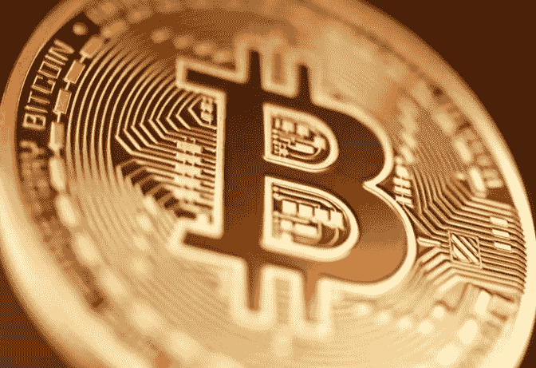
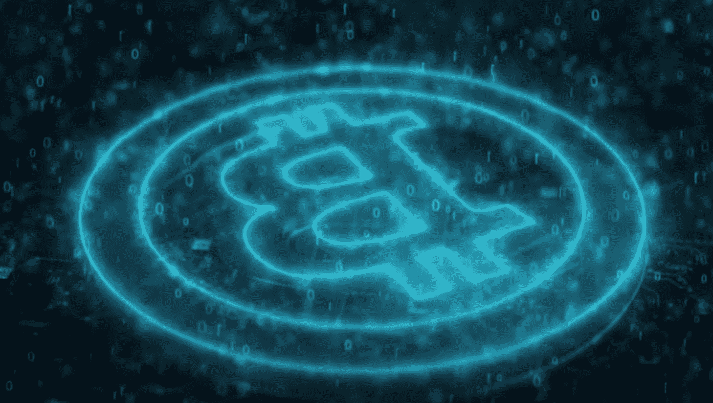
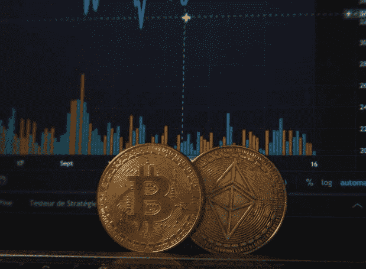

## 比特币与区块链基础 2021

# 简介

你是否认为比特币和区块链是神秘的术语？不，这些主题很容易理解和使用。本书以最简单的语言介绍加密货币，让任何初学者都能掌握并开始进行投资。

比特币和区块链是全球金融领域流行的不断演进的技术。比特币不是市场上唯一的加密货币。大多数金融科技专家通过交易和投资比特币赚得盆满钵满。

区块链行业由加密金融驱动。但你需要了解可用的各种加密货币类型，以及如何获取并盈利性地使用它们。通过本书，你将了解可用的加密货币以及如何交易或投资它们。

# 第一章

# 理解比特币

## 一堆比特币

2009 年 1 月，一种名为比特币的数字货币被创建。与比特币相关的缩写是 `BTC`。这一被称为比特币的现象源于时髦而神秘的中本聪，这是一个化名的个人或团体，被认为是这种货币的发起者和创造者。

尽管有此推测，但比特币的发明者是一个隐藏的人物，没有明确的身份。专家认为，隐藏其身份的原因是为了逃避某些政府法规、调查和随后的监禁，因为这种不断发展的货币已经扰乱了许多国家、跨国公司和个人的金融体系。

在财政估值方面，比特币已经在与世界上几种主要货币竞争，其价值高于大多数金融工具。与其他在线常规支付平台相比，交易费用非常低。

这种数字货币由一个去中心化的监管机构管理。它不受任何政府或银行管理或控制，也不具备作为商品使用的价值。比特币作为公共账本上记录的余额而存在。在这种情况下，每个人都可以无限制地访问记录。

比特币的出现导致了其他被称为山寨币的加密货币的演变，尽管它不被用作法定货币。但最流行的加密货币是比特币。

## 比特币的起源

2008 年 8 月 18 日，`bitcoin.org` 被注册为域名。然而，注册它的个人或团体身份不为公众所知。原因可能是出于隐私或安全目的。因此，该域名被视为受 WhoisGuard 保护。

此外，在 2008 年 10 月 31 日，密码学邮件列表上发布了一篇文章。这篇文章由一个名为中本聪的个人或团体发布在 `metzdowd.com` 上。内容写道：“我一直在研究一种新的电子现金系统，它是完全点对点的，没有可信的第三方”。

现在，这份白皮书发布在 `bitcoin.org` 上，标题为“比特币：一种点对点的电子现金系统”。如今，它已成为比特币运营和管理的《大宪章》。

再者，在 2009 年 1 月 3 日，被视为创世区块的区块 0，即比特币的第一个区块被挖出。该区块包含一段铭文：“The Times 03/Jan/2009 Chancellor on brink of second bailout for banks”（泰晤士报 2009 年 1 月 3 日 大臣在第二次银行救助边缘）。这段文字可能暗示它是在该日期或之后被挖出的。它也可用于政治评论。

此外，比特币软件的第一个版本于 2009 年 1 月 8 日在密码学邮件列表上发布。

而且，比特币的区块 1 于 2009 年 1 月 9 日被挖出。此后，比特币挖矿成为一种流行的生意。

## 虚拟支付网络

比特币被设计为一个虚拟支付网络。它充当信用卡刷卡设备的基于网络的版本，使商家能够通过电话、互联网或邮件处理订单。

那些用信用卡难以完成的支付，可以通过虚拟支付平台使用比特币来实现。供应商需要通过注册其支付信息来注册虚拟终端支付服务。这些数据包括姓名、地址、卡片验证值、类型和信用卡号码。这些信息将用于在线零售交易。

这些虚拟支付方案不需要专用软件或硬件。交易通过虚拟支付提供商的网站完成。因此，第三方提供商将确保满足 `PCIDSS`（支付卡行业数据安全标准）的要求。

## 什么是聪？

比特币加密货币的最小单位称为聪。这个名称源自加密货币创始人中本聪的名字。他设计了比特币和区块链中使用的协议。

聪与比特币的汇率是一亿聪兑换一比特币。你可以将比特币分割成更小的单位，以简化和促进小额交易。

正如我所说，比特币存在于数字世界中。

因此，一比特币（`BTC`）= 1,000 千比特币（`mBTC`）

一比特币 = 1,000,000 微比特币（`µBTC`）

一比特币 = 十万聪

然而，据信中本聪可能拥有多达一百万比特币。这相当于 100,000,000,000,000 聪。你可以将比特币兑换成其他货币，也可以从其他货币兑换。

## 改变你的看法

大多数人尚未相信这种流行数字货币的真实性。其他人正在考虑其合法性，因为他们认为投资比特币是虚假和欺诈的活动。曾有多次预测称比特币永远不会超过其 2017 年两万美元的峰值。

比特币持续增长

然而，许多人相信比特币将归零。但一些投资者希望以远高于 0 美元的价格买入。例如，有些人愿意以一千美元以上的价格买入，而另一些人则在等待其升值至一万美元以上再买入。他们推测价格可能会在他们耐心等待做出买入决定的过程中上涨。

这一趋势缓冲了比特币的相关性，使其在对失去价值的恐惧中站稳脚跟并蓬勃发展。

# 第二章

# 比特币如何运作

## 如何设置比特币钱包

您可以在智能手机或电脑上设置比特币钱包。通过在您的设备上安装它，它将生成您的第一个比特币地址，但如果您愿意，也可以创建更多。设置好您的比特币钱包和地址后，您可以将您的地址发送给您的朋友、客户和雇主，以便他们将款项发送到您的钱包中。

您也可以向您的员工、朋友和家人的钱包发送付款。它是一种网络现金，但简单来说，比特币被称为数字货币、虚拟货币或加密货币。

### 如何获取比特币

您可以通过多种方式获取比特币，例如：

#### 1. 挖矿

挖矿——通过将待处理交易添加到区块链中来确认它们的方法。挖矿也被视为一种分布式共识系统，用于验证比特币网络上的交易。此过程在区块链内强制执行时间顺序。它使不同的计算系统能够就网络的状态达成一致。挖矿还保障了系统的中立性。如果您想确认交易，付款必须被组织在一个符合严格加密原则并经验证的区块中。

通过这种方式，之前的区块将不会被修改，因为这会使后续区块失效。因此，没有人能够指令或控制添加到区块链中的内容。他们也无法替换区块链的部分内容以包含他们自己的支出。

#### 2. 付款

付款——大多数人更倾向于以比特币接受服务或商品的付款。通过这种方式，人们可以囤积加密货币以备将来使用。

## 在交易所使用比特币

您知道比特币可用于兑换吗？一个交易者可以用各种山寨币买卖比特币的数字市场被称为比特币交易所。这个在线平台是连接加密货币卖家和买家的中介。用专业术语来说，它被分析为加密货币制造者和接受者之间的中介。

此交易所的功能类似于经纪公司，您可以通过电汇、银行转账或银行存款存入现金。使用比特币交易所通常会产生费用。

如果您想在加密货币之间进行交易，您将支付货币兑换费。这类似于在传统银行系统中交易不同货币。此外，买卖比特币基于经纪系统，接受者设置限价单，如果制造者提供匹配请求的比特币，则可以出售。

因此，比特币交易所将接受者与制造者配对。在这种情况下，他们设置限价单或市价单。当此限价被设定并选定时，您授权交易所按市场上可用的选项或现行价格进行交易。

设定此限价后，交易者将指示平台以低于或高于当前出价的价格交易加密货币。

### 如何在交易所进行交易

*   在交易所注册。
*   通过进行不同的验证流程来验证用户身份。
*   认证通过后，将为用户开设账户。
*   用户在购买币种前将资金转入账户。

您可以使用汇票、银行直接存款、转账、银行汇票、礼品卡、信用卡、借记卡以及各种支付方式向交易所存入资金。

此外，从账户提取资金可通过 PayPal、银行电汇、支票、现金、信用卡以及交易所规定的其他选项完成。

另一种可使用的交易所类型是去中心化比特币交易所。

这种类型的交易所无需中心化权威机构即可运行。它们允许点对点交易加密货币，无需交易所权威机构发起和管理交易。

### 使用去中心化比特币交易所的优势

1.  去中心化交易所符合适合大多数加密货币的去中心化结构。
2.  用户所需提供的个人信息较少。
3.  这些交易所通过维持流动性和交易量，维护了用户的基本利益水平。
4.  资产可直接转移给其他成员，无需交易所干预。
5.  直接将资产转移至交易所将最大程度降低黑客攻击和盗窃的风险。
6.  交易欺诈将减少，且不会出现数字或价格操纵。

## 比特币与加密货币的区别

### 比特币

比特币被视为一种使用加密货币技术并由去中心化权威管理的数字货币。这不同于由政府发行和监管的货币。此外，加密货币是一种安全可靠的技术特性，用于在比特币平台上进行各种金融交易。

以下是比特币与加密货币的一些区别。

### 比特币

1.  比特币是一种数字货币，也被称为加密货币。
2.  它由中本聪于 2008 年创立。
3.  比特币是一种用于转账的开源软件。
4.  它在政府较少监管和控制的情况下促进跨境交易。
5.  为点对点交易提供安全环境。
6.  它比其他加密货币更受欢迎。
7.  比特币灵活，影响者成本和交易时间较低。
8.  它常被用作货币，且仅限于交易用途。

### 加密货币

1.  这是一种用作在线金融交易媒介的技术。
2.  使用加密技术为交易提供安全可靠的平台。
3.  它是一种没有实体形式的虚拟货币。
4.  没有中央银行系统，但拥有去中心化组织。
5.  利用分布式账本进行点对点交易，同时保持交易透明度。
6.  加密技术可用于处理互联网上几乎所有形式的交易。
7.  有各种用于交易的加密货币，但它们的份额低于比特币。

## 比特币与传统货币的区别

比特币是一种数字货币，相对于纸币、银行券、贵金属、岩石、贝壳以及令人难忘的以物易物交换体系等传统货币而言。

在考虑比特币与其他传统货币的区别之前，我们应该看看什么因素能使任何物体或物品成为货币。这些是将比特币纳入货币世界的因素。

1.  它应可被识别并被接受用于交易。
2.  货币应可分割成更小的单位。
3.  它应具有耐用性。
4.  货币必须便于携带。
5.  它不是可食用商品。
6.  货币专为交换而设计。
7.  货币不能被伪造。
8.  它是稀缺的。

但这两类货币的区别包括：

### 比特币

*   比特币是去中心化的。这意味着没有人监管或控制比特币。
*   它是一个独立运行的点对点货币系统。
*   这种货币基于网络成员的联合算力。
*   所有参与者地位平等。
*   降低交易时间和费用。
*   比特币的价值不挂钩任何经济或政治事件和环境。
*   比特币没有优越性。没有组织支持这种加密货币。
*   没人能影响您的资金和交易。
*   比特币交易所没有任何形式的保险，例如 FDIC 保险和 SIPC 保险。

### 传统货币

*   传统货币由中央银行、商业银行、政府及其他支付处理商（如万事达卡或 VISA）管理。
*   这些组织可以批准或拒绝您的交易。
*   它们还决定您使用的是否为法定货币。
*   银行需要传统货币附带的交易时间和费用来维持运营。

# 第三章：如何存储比特币

## 比特币存储与钱包安全指南

### 概述

2019 年至 2020 年间，比特币经历了远超以往任何时期的暴涨。这导致针对网络的黑客活动比以往任何时候都更加频繁。然而，大多数新投资者不知道如何保护和保障其数字货币的安全。

其他可能导致加密货币丢失的原因包括：私钥访问权限丢失、电脑故障、代币被盗以及其他问题。

您可以通过不同方式安全地存储比特币，例如离线钱包或冷存储以及热钱包。这些钱包创建于电脑设备、智能手机上，或通过打印在纸上的地址和私钥生成。

每个钱包都有私钥，使加密货币所有者能够访问存储其中的资金。但如果您丢失了私钥，您的投资可能将永远消失。

冷钱包比特币存储是保管比特币最安全的方式之一。这些钱包无法在线访问。热钱包比特币存储可通过互联网访问，但对大多数比特币持有者而言仍然安全。

但存储加密货币最安全的方式之一涉及硬件钱包。这是一种长期比特币存储方案。

让我们详细了解所有这些存储钱包。

### 冷钱包

网络上最安全的存储系统是冷钱包。它也被称为硬件钱包或离线钱包。这种类型的钱包不连接互联网。因此，它不太可能被攻破。

它们将用户的私钥或地址存储在非基于网络的设备上。它们提供相应的设备，使用户能够连接并查看其加密货币投资组合，而无需冒险暴露其地址或私钥。

冷钱包的一个例子类似于纸钱包。这是由不同网站生成的。它生成可打印在纸上的公钥和私钥。在这里，没有任何对应的用户界面。没有恶意软件损坏或电脑故障会影响您的密钥和地址。这已被证明是保管加密货币最安全的方式。

### 热钱包

热钱包运行在基于网络的设备上，如平板电脑、电脑和手机。热钱包被视为在线钱包。这些钱包生成您在线货币的私钥。在这些钱包上访问和管理资金很容易，但可能会危及安全性。您的资金可能在这种类型的钱包中被盗。

热钱包用于少量资金。它的作用类似于传统的支票账户，用于紧急提款和支付，而其他钱包则用于储蓄或其他投资。

### 硬件钱包

您可以安全地存储您的私钥。这比热钱包具有优势，因为它不受病毒攻击的影响。原因在于硬件钱包中的私钥未连接到任何计算机系统。

### 比特币钱包类别

有各种类型的比特币钱包供每位用户采用并保障其钱包安全。这些包括纸钱包、硬件钱包、网页钱包、桌面钱包和移动钱包。

### 纸钱包

这是最早用于存储加密货币的钱包之一。它旨在通过允许您打印私钥和地址，将您的加密资产离线保管。然后，您将加密货币转入其中。

然而，由于技术进步以及其他更易于操作的钱包类型的出现，这种类型的钱包几乎已过时。

### 硬件钱包

您是长期投资者吗？那么您需要硬件钱包。这是加密货币世界中最安全的钱包类型。它旨在保管公共地址和私钥。

硬件钱包是带有 OLED 屏幕的 USB 形态设备。它们还具有侧边按钮，用于浏览钱包界面。有各种加密货币的桌面应用程序。您可以使用 USB 轻松将其连接到智能手机或电脑系统。

在该系统中，您的地址显示在硬件钱包窗口（外部屏幕）上，包括保存在硬件钱包上的私钥。这一过程使存储您的山寨币变得简单且非常安全。

### 网页钱包

这些是连接互联网的热钱包类型，可通过各种浏览器访问，如 Internet Explorer、Google Chrome 和 Firefox。这些类型的浏览器用于存储私钥。已证明它们容易遭受 DDOS 攻击。

网页钱包的一个例子是使用加密货币交易所存储山寨币。但在这种系统中，您无法访问比特币钱包的私钥。因此，如果网络关闭或被黑客攻击，您可能会失去加密资产。

网页资产也称为托管资产。在这种类型的钱包中，您无法访问私钥。其中一些钱包包括 Coinbase、Binance 等。

### 桌面钱包

桌面钱包专为 Linux、Mac 和 Windows 等桌面操作系统设计。大多数加密货币通常从一开始就建立自己的钱包。现在，由于您通常将系统连接到互联网，您需要安装防病毒软件以防范恶意软件。已有多个桌面钱包专为比特币设计，如 Electrum、Exodus 和 Bitcoin Core。

### 移动钱包

最简单且常见的比特币钱包是移动钱包。这些钱包方便携带，可随时随地访问。这些类型的钱包可用于 Android 和 iOS 设备。

### 选择移动钱包的因素

1.  合适的用户界面。
2.  钱包必须拥有您可访问的私钥。
3.  必须具备备份功能。
4.  移动钱包必须兼容不同的操作系统。
5.  应有活跃的开发者社区。

移动钱包示例包括 Coinomi、SafePal、Electrum、Trust Wallet 和 Mycelium。

### 选择与使用钱包

如果您决定投资比特币，您需要一个钱包来保障加密资产的安全。但您应根据您的需求和便利性选择合适的钱包。

以下是选择比特币钱包前需考虑的一些因素：

1.  确保钱包安全——比特币地址应具有 Http 或 https。这意味着它拥有安全协议。
2.  平台必须具备多重签名——如果您使用网页钱包，它必须具备多重签名。
3.  您必须拥有私钥访问权——为了您投资的隐私和安全。
4.  钱包必须易于使用。
5.  确保钱包具有双因素认证 (2FA)。
6.  应具备备份功能——提供商应提供账户备份流程，以防您意外丢失或删除密钥。
7.  钱包提供商必须透明——钱包代码必须开源且信息保持最新。
8.  钱包应具有良好的用户体验——钱包应易于在移动设备上使用。您可以购买比特币硬件设备。
9.  钱包必须使用加密技术保护成员数据不被泄露。
10. 钱包提供商应信誉良好。确保您能在 Bitcoin Forum、Bitcoin Reddit 等平台上搜索并找到该钱包。

### 监管机构与政策

在世界上大多数国家，比特币尚无监管机构，除少数国家的中央银行使用禁令来减少对这些加密货币的关注。

此外，政府可通过中央银行发布关于投资加密货币风险的警告，这些加密货币不受任何国家或机构监管。任何投资山寨币的人均需自行承担风险。一旦发生损失，没有法律追索途径。

### 使用区块链的优势

## 区块链技术的兴起

区块链技术的兴起促成了比特币于 2008 年的诞生。它成为了首个去中心化的点对点电子现金系统。各国经济体的众多企业正在寻找将区块链整合到其运营中的方法。一组组合在一起形成区块的计算机网络，因此得名“区块链”。

### 在您的业务中使用区块链的优势

以下是在您的业务中使用区块链的一些优势：

1.  **效率**：区块链助力企业高效完成任务，因为它不给中介留任何空间。
2.  **可审计性与可追溯性**：审计变得容易，交易可追溯。该流程通过使交易真实有效来防止欺诈活动。
3.  **安全性**：利用加密链接和网络促进更好、更安全的交易。这个网络区块被添加到账本中以形成一条链。区块链由一串复杂的数学数字组成，因此一旦形成，很难被更改或破坏。在这种情况下，很难伪造数据，每个人都能安心交易。
4.  **透明度**：它促进透明化运营，因为交易账本对公众开放，可供查看和审查。这一过程将增强业务运营中的问责制和诚信。

# 第四章：如何挖掘比特币

## 交易费用

比特币交易费用以美元计算。这在处理完一笔比特币交易后生效。然后，矿工将确认该操作。如果业务活动激增或网络拥堵，比特币交易费可能会零星上涨。

截至 2021 年 2 月，比特币交易的价值为 22.32 美元。

验证此值的公式为：`某一天的比特币总交易费 / 某一天的比特币交易笔数`。

## 挖矿流程概览

如果您对挖掘比特币感兴趣但不知道如何开始，本章将让您更好地了解相关流程。

### 1. 获取比特币挖矿设备

比特币挖矿要求您拥有一台挖矿设备。在比特币挖矿初期，矿工使用普通家用电脑。过了一段时间，他们升级为显卡。如今，这些机器用于比特币挖矿已逐渐过时，因为您可能在很长一段时间内几乎挖不到任何东西。

如今，有专门用于比特币挖矿的特种机器。这些硬件也可根据算法用于挖掘其他货币。这种硬件被称为**专用集成电路芯片 (ASIC)**。这种特定机器功耗较低，挖掘比特币的速度更快。它是一款昂贵的设备，但产出能力强。

它每秒可解算高达 14 万亿次哈希。这意味着，每秒它最多尝试一万亿零一百二十次来解算一个区块。

#### 选择 ASIC 挖矿设备

在开始挖矿前，请考虑算力、价格和耗电量等因素。然后，查看其他矿工对这些设备的评价，再挑选合适的一款。

此外，使用在线计算器计算特定设备的盈利能力。您将计算 `Coinwarz` 和 `Nice Hash`。同时，您还应预估矿池的不确定因素和费用。

选择一个方便的地方放置您的挖矿设备，因为 ASIC 机器可能噪音很大。您可以通过待在阴凉处、降低电费和妥善监控来增加利润。

### 2. 设置比特币钱包

获取并设置好挖矿设备后，下一步是设置比特币钱包。这是您存储比特币并按意愿使用它们的地方。有了比特币钱包，您可以管理您的比特币地址。这些地址附带私钥。

这类似于银行账户。要接收比特币，您将把您的比特币地址发送给对方，他们就会给您的账户打款。

比特币钱包中的每一笔交易都可追溯。您需要私钥来访问您的账户并管理资金。但如果您弄丢了密钥，您将失去您的加密资产。

从各种可用的比特币钱包中进行选择，例如热钱包、冷钱包和硬件钱包。将您的私钥保存在设备上，并在另一台设备上备份，以确保您不会丢失资金。

### 3. 参与矿池

加入一个大型矿场，以便轻松产出比特币，因为即使拥有最好的 ASIC 矿机，单独挖到一个比特币仍然很难。这可能需要相当长的时间。但如果您能与矿池中的矿工合作，就能轻松取得成果。

在矿池中，收益在矿工之间平均分配，但您需要向矿池管理员支付少量代币或奖励的百分比，如 2%。

推荐的比特币矿池之一是 **Slush Pool**。初学者可以尝试一下。Slush Pool 是现存的第一个比特币矿池，并一路保持了信誉。

它由捷克程序员 **Marek Palatinus** 设计并推广。

如果您找到某个矿池的网站，请通过注册您的详细信息来设置您的账户。然后，您将获得一个用于挖矿活动的工作人员**标识符 (ID)**。

### 4. 在您的设备上安装挖矿客户端

在您拥有硬件、比特币钱包和矿池后，让挖矿客户端在您的设备上运行。一些矿池拥有自己的挖矿软件。这将您连接到区块链和比特币技术网络。

该软件向个别矿工分发工作，收集挖矿结果，并将数据重新放回区块链。该程序还监控每个矿工的运行情况，并显示算力、挖矿速度、温度和散热效果等统计数据。

不过，有多种用于挖掘比特币的软件可在各种操作系统上运行。一个合适的矿池软件是 **Nice Hash Miner**，它可以挖掘多种加密货币，并一次性选择最有利可图的算法。它易于理解和使用。只需下载软件并选择您可用于挖矿的设备即可。

### 5. 开始挖矿并赚取比特币

完成所有这些步骤后，开始挖矿并赚取比特币。只需将您的 ASIC 设备连接到电源插座。将其连接到计算机系统。然后，安装挖矿程序并开始挖矿。

## 什么是协同挖矿？

协同挖矿是指一组矿工通过运营商的网站挖掘比特币的过程。这些独立的矿工在一段时间结束时，从分配给每个人的奖励中获得代币。收益可能不多，但稳定且持续。

## 云端挖掘比特币

云端挖掘比特币即云挖矿。这种方法是通过租用云端算力来挖掘比特币。在这种情况下，您无需在想要使用的硬件上安装和运行软件。

感兴趣的人可以开设账户并远程参与比特币挖掘过程。这是以特定成本为回报进行的。它使全球许多人都能接触到挖矿。

云挖矿在云端进行。因此，设备维护成本和能源成本极低。

此外，云挖矿涉及从第三方提供商购买或租赁挖矿设备。他们也负责设备维护。

## 云挖矿的类型

两种知名的云挖矿程序包括租赁算力和托管挖矿。

### 租赁算力或算力

该模式涉及与比特币相关的算力。租赁算力来自矿场。投资者从比特币矿场挖掘加密货币的总体利润中获益。

这是一种挖掘加密货币而非比特币本身的常用方法。在这种情况下，您应该通过网站在云挖矿公司开设账户。然后，您将确定算力和合同期限。

### 托管挖矿

## 云挖矿模式

这是一种熟悉的云挖矿模式，投资者通过租赁或购买获取挖矿硬件。硬件保管在矿工的设施中，由矿工负责维护设备并确保日常运营正常进行。

这样，投资者可以妥善管理其加密货币。此外，由于这是大型矿场，通过电力和存储产生的高昂挖矿成本将降至最低。

## 云挖比特币的优势

*   降低与挖矿相关的成本。
*   使普通投资者和缺乏技术知识的有意向矿工能够每日挖掘比特币。
*   减少经常性支出和硬件投资成本。

## 云挖比特币的劣势

*   多种加密货币的流行导致诈骗增加。
*   利润可能下降。
*   对山寨币需求的增加和算力的降低可能导致矿工收益微薄。

## 关于加密货币的事实

以下是您应了解的关于加密货币的一些事实：

1.  骗子可能利用您的手机或电脑算力进行隐秘挖矿。通过这种方式，他们会在您的系统中植入恶意代码。检测隐秘挖矿的一个迹象是您的手机或设备会变得异常缓慢。这也可能导致电池电量消耗加快。
2.  由于外部因素，加密货币的价值波动剧烈。价值可能突然向有利于您的方向变动，也可能相反。
3.  您的比特币钱包拥有私钥和公钥。您不会丢失钱包，但可能丢失私钥。如果您丢失了私钥，您的加密货币将永远消失。
4.  您可以在无需兑换的情况下进行跨境交易。加密货币无国界，不受特定地理区域限制。
5.  许多国家的政府和中央银行反对这种全球货币，原因在于其去中心化和缺乏监管。但加密货币无法在物理层面被禁止。
6.  在第三世界国家开设银行账户可能很困难，但互联网设施却易于获取。此流程适合电子商务。
7.  中国控制着全球高达 75% 的比特币挖矿活动。它们是最大的加密货币矿工。
8.  比特币的创造者是匿名的。除中本聪这一人设或理念外，没有可信来源能证明发起比特币的人是谁，这仍然模糊不清。
9.  部分国家已禁止加密货币。这些国家包括厄瓜多尔、玻利维亚、孟加拉国、阿尔及利亚、尼泊尔和阿尔及利亚（注：原文阿尔及利亚重复）。

## 保护您的比特币

处理比特币在线交易时请务必小心。以下是一些保护比特币的方法：

1.  避免可能导致资金损失的电脑故障和人为错误风险。
2.  在钱包中仅保留少量比特币供日常使用。这在您丢失私钥并被锁定钱包时是必要的。
3.  确保备份钱包以防故障和错误。
4.  加密数据以防私钥被盗。
5.  不要忘记密码，但要使用包含数字、字母、标点符号等的强密码。
6.  使用 CG（注：原文 CGs，推测指光盘）、纸张和 USB 密钥备份数据。
7.  定期备份以保护地址变更。
8.  通过加密为钱包设置密码。
9.  为家人和同伴制定备份计划。
10. 设置离线钱包或冷钱包以保存比特币。
11. 使用两台电脑练习离线交易签名。
12. 设置硬件钱包以增强安全性并使交易易于使用。
13. 更新您的软件。
14. 使用多重签名进行保护。

## 比特币挖矿危险吗？

比特币挖矿可能在以下方面存在危险：

1.  比特币挖矿导致高昂的计算和电力成本。
2.  攻击者可使用网络钓鱼手段诱骗成员点击链接，从而在其设备上加载加密货币挖矿代码。
3.  部分网站设计有在访问者电脑上运行并为其挖掘比特币的代码。
4.  这些恶意活动会导致您的系统异常变慢。
5.  比特币挖矿使您的数据面临风险。

## 比特币挖矿硬件产品

比特币挖矿涉及解决算术谜题。此过程用于验证比特币交易，也用于挖掘新的加密货币区块。

比特币挖矿过程需要图形处理单元（`GPU`），也称为显卡，或专用集成电路（`ASIC`）。

如果您正在设计挖矿设备，硬件采购成本可能难以承受。此外，您还需计算电力成本。

## 挖掘比特币所需的必要工具

1.  内存和存储设备（硬件）– Newegg Patriot Memory 4GB DDR（软件）
2.  显卡（硬件）– Nvidia GTX 1070 / AMD Vega 56（软件）
3.  主板（硬件）– Asus B250 Mining Expert（软件）
4.  CPU（硬件）– Intel Celeron / Pentium / Ivy Bridge（软件）
5.  电源（硬件）– Corsair HX1200i / EVGA SuperNOVA 1600（软件）

## 比特币矿工所需条件

1.  比特币矿工需要开放式机框以保证通风良好。
2.  更换烧毁的显卡。
3.  清除灰尘和碎屑。
4.  您可以自行搭建挖矿设备。
5.  如果无法自行设计，可购买预装的 2 GPU 设备。
6.  设备可在普通 Windows 操作系统下运行。
7.  获取可定制的主板，也称为 `MOBO`。

# 第五章

# 区块链简介

区块链作为一种分布式软件，可用作数字账本。它增强了无需中介的资产安全转移，也促进了价值单位的在线交换。土地、房屋、货币等任何可估量的价值均可表示为代币并存储在区块链系统中。

第一个区块链是比特币区块链技术。它于 2009 年作为一种用于数字货币的点对点技术开发而成。它作为一个公共区块链，对所有人开放。

## 区块链的重要性

您认为区块链在任何方面都重要吗？以下是区块链的一些重要特性：

1.  区块链提供真正去中心化的服务，这是动态社会的枢纽。这在经济的各个领域都是必要的，如电力部门、资产管理等。
2.  它利用密码学提供更好的安全性，以提升存储在区块链系统上的数据安全性。这得益于区块链的去中心化特性，账本和其他交易对公众公开。
3.  区块链透明——区块链的本质使其透明。公司和组织利用它在商业交易中与公众互动。
4.  区块链不可篡改——区块链上的交易不可更改，使交易易于追踪。
5.  它创造了数字自由。没有人能冻结您的账户或因任何理由扣押您钱包中的资金。
6.  与其他技术相比，区块链技术成本低廉。没有中央权威消除了维持系统最优运行所需的缓冲。
7.  保持成本效益，因为无需支付中介费用。此外，它最大限度地减少了操作中纸张的使用。
8.  它适用于不同的用例，是社会的优秀技术。一些用例包括银行、医疗、贸易、石油、金融、政府和教育等领域。
9.  区块链作为一种颠覆性技术，可用作区块链即服务（`BaaS`），尽管管理和控制成本昂贵。
10. 促进区块链效率。这带来更好的流程、增强的安全性，并消除了中介。

## 区块链的不同应用

区块链有不同的应用用例，这些用例已经影响着政府、企业组织和个人的商业决策和交易。这些应用旨在用于经济各个领域的智能合约。这些领域包括医疗保健、房地产、政府、银行业等。

这些应用和行业的示例包括：

| 序号 | 应用名称 | 行业 |
| --- | --- | --- |
| 1. | Mediachain | 音乐 |
| 2. | BurstIQ | 医疗保健 |
| 3. | Propy | 房地产 |
| 4. | Opskins | 加密货币、游戏和金融科技 |
| 5. | Circle | 加密货币和金融科技 |
| 6. | Chainanalysis | 网络安全、金融科技和加密货币 |
| 7. | Filament | 软件、物联网和硬件 |
| 8. | Hypr | 网络安全和物联网 |
| 9. | Chain | 云计算和金融科技 |
| 10. | Xage Security | 网络安全和物联网 |
| 11. | Illinois blockchain Initiative | 技术和政府 |
| 12. | Civic | 金融科技和身份安全 |
| 13. | Evernym | 软件和 IT |
| 14. | Shipchain | 供应链和物流 |
| 15. | Block array | 供应链和物流 |
| 16. | Voatz | 网络安全、政府和政治 |
| 17. | DHL | 供应链和物流 |
| 18. | STEEM | 社交媒体 |
| 19. | Maersk | 供应链和物流 |
| 20. | Ocular | 金融科技和网络安全 |

## 区块链透明吗？

是的，区块链是一个透明的网络。它提供了一个可供审计的交易账本。任何人都可以进入网络并查看或访问所有交易。区块链非常透明，以至于记录被加密，没有人能以任何方式篡改任何已生成的记录。

区块链技术以加密方式存储记录，使得第三方的数据不可篡改。所有支付都是透明的，使系统对平台上发生的每一笔交易负责。

因此，区块链网络上的每一笔交易都无法更改，并公开供大众查看和审查。这将防止任何人或团体操纵记录。

## 区块链的基本单元是什么？

为了进行适当的分析，区块链被划分为四个基本单元。它们包括节点应用、共享账本、虚拟机和共识算法。

## 共享账本

区块链是一个具有逻辑组件的共享账本。它是一个分布式账本，其数据结构在节点应用中受到控制。如果节点应用功能正常，您可以在该生态系统中看到相应的账本或区块链内容。

使用比特币客户端，您可以参与比特币生态系统，并根据比特币节点应用程序代码中规定的策略进行操作。

## 节点应用

设置并运行一个特定于您想要使用的生态系统的计算机应用程序，是每一台联网 PC 的一大特性。因此，每台计算机设备都必须运行比特币钱包应用程序。

区块链中存在服务覆盖网络 (SON)。为了使区块链成为网络中的一个节点，您的设备应能够处理特定于应用程序的消息，并影响服务覆盖网络的共享状态。

## 虚拟机

这是作为节点应用一部分应用的最终逻辑层面，生态系统中的每个用户都会操作它。通过该系统，您将了解计算机程序如何在网络上运行。

计算机程序的指令命令设备以特定方式运行并改变其状态。计算机设备中状态变化的各种表现形式包括：显示器显示数据和图形、内存中存储的数据发生变化、声音分发到扬声器、数据保存在固态硬盘上。

虚拟机作为由计算机程序设计并用指令表示的语言操作的机器的代表。它还作为存储在机器内部的机器的抽象而发挥作用。

## 共识算法

共识算法是生态系统的一个逻辑部分，作为节点应用的一个组件实现。这提供了关于生态系统在账本视图下将呈现何种状态的指导方针。

在各种生态系统中，您可以根据生态系统所需的特殊特性达成共识。

## 区块链技术

区块链技术可以促进金融交易和记录保存中的信任与透明度。区块链的原则涉及以一种无法篡改、无法黑客攻击、无人能操纵系统的方式记录数据。

这包含一个交易的数字账本，该账本被复制并分发到区块链上连接的整个计算机系统网络中。链上的每个区块包含许多交易。每当区块链上发生新交易时，该交易的记录就会被添加到每个参与者的账本中。这被称为分布式账本技术 (DLT)。在这种情况下，去中心化数据库由参与网络的多个个人管理。

因此，区块链是一种使用哈希来记录交易的分布式账本技术，具有不可更改的加密签名。

以下是分布式账本的一些特性：

1. 它是不可变且不可更改的。
2. DLT 是一致同意的，因为所有用户都验证记录。
3. 此账本带有时间戳并记录在区块上。
4. 用户拥有假名或匿名身份。
5. 分布式账本技术是可编程的。
6. DLT 上的记录受到保护并加密。
7. 通过确保所有用户都拥有账本副本，保持最高透明度。

# 第六章

# 如何使用区块链

区块链在许多方面都很有用，因为它作为锚定电子货币的基本分布式账本技术 (DLT)。这些是共享数据库，其条目可以通过点对点系统确认，但必须加密。

区块链有几个用例：

* 区块链在资本市场中很有用，可用于改善运营、加快清算结算和提供适当的审计追踪。
* 这项技术在国际支付和汇款中很有价值。
* 区块链用于缓解洗钱。该技术支持了解您的客户 (KYC) 协议，这对于维护客户记录是必要的。
* 贸易金融——在此之前，处理贸易金融很困难，因为缓慢的流程扰乱了业务，使流动性管理变得繁琐。跨境贸易涉及大量数据，但区块链简化了流程。企业组织可以跨国界相互交易。
* 这项技术在媒体行业相关，因为它降低了成本、欺诈活动，保护了期刊、音乐等知识产权内容的权利。
* 会计和审计安全。它通过确保清晰可信的记录来减少错误的可能性。
* 智能合约是最适合保险业的区块链应用。保险公司及其客户使用这些合同来处理索赔，同时保持透明度和安全性。
* 对于房屋销售很有用，可在房地产经纪人之间发起快速交易，利用加密减少欺诈活动，从而最大化透明度。
* 管理电力供应交易，如计量、账单和清算流程。区块链必要的其他领域包括可再生能源证书更新、原产地担保、资产管理和所有权记录。

## 点对点支付结构

*   点对点支付结构是可靠的，尽管它们存在局限性。某些服务可能会收取费用，或根据您的位置限制交易。然而，其中一些服务可能会被黑客攻击，这会影响在线展示其个人数据的客户。
*   区块链通过使结果可访问，增强了投票过程中的安全性和透明度。在这种情况下，黑客攻击终端将非常困难。每位选民使用其身份访问终端，这使得使用伪造身份证件变得困难。
*   适用于医疗服务，如年龄、性别、病历数据和生命体征。
*   维护数据存储流程，如出生证明、死亡证明、财产转让和婚姻证明，这些过去仅以纸质形式办理。
*   区块链用于身份管理。在这种情况下，您只需提交出生日期即可证明或确定您的身份。

## 区块链的生命周期

区块链的生命周期取决于区块链的技术。这意味着它必须是一个分布式数字账本。这是维护智能合约透明度和完整性所必需的。

区块链的生命周期包含四个不同阶段：创建、冻结、执行和最终确定。

## 使用当前的区块链

当前的区块链旨在改变您的日常活动，从商业交易到资产管理。它还涵盖了您的投票方式、机械设备的使用以及汽车租赁。同样，政府、金融机构、医院和各类组织需要比特币分布式账本，以实现恰当、透明且高效的交易。

以下是当前区块链的各种用途：

1.  保险理赔处理。
2.  跨境交易和支付。
3.  资产管理中的交易处理和结算。
4.  适用于智能家电。
5.  适用于您的汽车或智能手机。
6.  硬通货借贷或非传统借贷所需。
7.  对物联网（IoT）区块链具有价值。
8.  与音乐区块链相关。
9.  护照处理。
10. 身份证区块链。
11. 准备结婚证、出生证明和死亡证明。
12. 也可用于政府区块链。

## 未来区块链的不同应用

区块链应用用于强制执行智能合约。这些应用消除了中介，促进了系统的透明度，从而使所有参与方都负起责任。与传统合约相比，这一过程更具优势，因为它为所有参与方节省了金钱和时间。

以下是一些与未来区块链相关的应用：

1.  Propy 将用于房地产行业。
2.  Mediachain 将用于音乐行业。
3.  Circle 将用于金融科技和加密货币。
4.  Filament 将用于硬件、软件和物联网。
5.  Xage Security 将用于网络安全和物联网（IoT）。
6.  Chainalysis 将用于金融科技、网络安全和加密货币。
7.  Opskins 用于游戏、加密货币和金融科技行业。
8.  Chain 将用于金融科技和云计算。
9.  Hypr 将用于物联网和云计算。

## 使用比特币作为分布式账本

比特币作为一个分布式账本运行。它是一个在世界各地不同站点、组织和地区之间同步和共享的数据库。这一特性使比特币易于使用，且可被世界各地的各类人士访问。

在这种情况下，交易对公众可见。节点上的每个参与者都可以访问分布在系统中的交易和记录。用户甚至可以拥有或维护此类交易的相同副本。如果任何用户篡改任何记录，此类记录将立即发布给网络的每个用户。

在分布式账本中，没有中央机构监督网络上每个用户的活动。每笔交易都可供所有连接到网络的人访问。

因此，比特币的数据库是一个分布式账本。这是一个以去中心化格式维护在多个地区、由不同人员处理的合约或交易账本。

在比特币网络中使用分布式账有助于最小化欺诈，包括网络攻击。

分布式账本使互联网上的通信和协作变得容易。这一过程使审计轨迹易于追踪，方便会计经理和职员在审查财务报表时进行核查。

比特币分布式账本是自动化的，且全天候随时可访问。它加快了处理交易所需的时间，并最大限度地减少了低效的运营流程，从而降低了运营成本。

比特币分布式账本在经济的不同领域具有价值，如各种供应链、金融、音乐和娱乐、贵金属和资产、房地产，包括艺术品。

## 谁在运营比特币技术？

比特币不受任何人监管或运营。它是基于网络中所有参与者的共识来运营的。然而，一个名为中本聪（Satoshi Nakamoto）的个人或团体在 2008 年提出了产生比特币的构想。该加密货币于 2009 年推出。

2011 年，随着比特币价值上升至与美元持平，比特币货币引起了关注。中本聪于 2011 年停止了在比特币网络中的活跃参与。他将开发比特币软件的责任转移给了开发者加文·安德烈森（Gavin Andresen）。多年来，他一直是比特币网络的首席开发者。

因此，比特币技术由安德烈森作为开源网络进行维护和运营。此外，一个推广比特币的非营利组织称为比特币基金会。他们负责管理比特币社区的观点，安德烈森是该基金会的工作人员。

# 第七章：比特币面临的问题

阻碍比特币走向主流采用的一些问题包括：

1.  **波动性问题。** 比特币是一种波动的金融工具。其价值作为货币尚未稳定。
2.  **易用性问题。** 确实存在可以购买或兑换比特币的地方（比特币兑换商），但对许多人来说，获取和使用比特币仍然遥不可及。它不是一个用户友好的产品。
3.  **普遍接受度问题。** 您可能会问：“比特币是否被所有人普遍接受？” 任何不被普遍接受的货币都不适合作为货币。
4.  **可扩展性问题。** 这是一个技术问题。区块链技术限制了每个区块存储的数据量。因此，每个区块预计拥有 1 兆字节的数据。在此限制下，它每秒可处理约三笔交易，而 Visa 技术每秒可处理超过两千笔交易。
5.  因协助洗钱和其他犯罪活动而臭名昭著，尤其是在互联网上。
6.  比特币存在税务问题。原因在于根据现行法律，比特币和其他数字货币被视为无形资产。因此，它们不征税。

## 区块链与比特币的区别

区块链和比特币是相互关联的概念，但它们并不意味着同一件事。给您一个区块链的基本定义：它是计算机中用于存储数据的文件。您也可以称之为开放分布式数据库或账本。这一定义意味着区块链中包含的信息可以在计算机网络中复制。这一特性使区块链具有去中心化甚至变革性的特点。数据由所有参与者访问和验证。这使得区块链安全且透明。

## 比特币与区块链

但比特币是一种点对点电子系统，或一种去中心化的数字货币。比特币用户可以在没有银行或政府（被视为第三方）干预的情况下互相发送资金。比特币是一种使用区块链技术的加密货币，尽管所有山寨币都使用区块链技术。因此，比特币是通过区块链技术进行交易的。

以下简要列出了区块链与比特币的一些区别：

1. 区块链技术用途广泛，可应用于医疗、政府、选举、音乐等经济的其他领域。
2. 区块链有利于审计供应链，使用户能够追踪其商品的详细信息。
3. 比特币提倡匿名性，而区块链是一个透明的系统。
4. 区块链可用于为全国所有公民提供保险覆盖，并处理保险索赔。
5. 比特币是一种加密货币，而区块链是一种分布式账本或数据库。
6. 比特币利用区块链技术运行，而区块链可适应各种应用。

## 什么是去中心化网络？

去中心化网络涉及相互连接的不同独立机器，以提供资源池。然而，每个节点都由独特的准则单独控制，用于管理工作负载和维护网络上的数据。这些网络以分布式形式运行，因为它们在网络中连接的所有服务器之间共享处理能力，包括工作负载活动。

此外，每个节点都像一个独立的权威机构，拥有关于其如何与其他网络通信的独立决策权。但控制所有这些互连的服务器可能很困难。然而，借助 `IoT`（物联网）设备和边缘计算，去中心化网络可以管理位于远程的复杂计算机设备结构。

扩展网络比仅仅增加另一台计算机系统要好。这可以增加可用的去中心化计算资源。

去中心化网络是可靠的，因为每个节点都可以独立运行。这些互连系统形成了一个资源池，使网络安全且透明。在这种结构下，如果一台系统被黑客攻击，其他互连设备将不受影响。

但构建和管理去中心化网络是一项艰巨的任务。你需要持续更新和修补系统以保持效率。信息需要通过不同的路由才能到达接收者，这可能需要一些时间。此外，设备的效率可能不高，具体取决于延迟和功耗。

## 比特币与黑客

由于数据加密，在比特币网络中黑客攻击是不可能的。但山寨币可能会从个人钱包中被盗，特别是如果你的私钥丢失。此外，你可能会在在线比特币交易中丢失比特币。

导致区块链网络难以被黑客攻击的原因有：

1. 比特币集成在一种不易被黑客攻击的区块链技术中。
2. 信息存储在去中心化服务器中，使其难以被黑客攻击。这些服务器的用户始终在访问和验证数据，以确保整个系统的透明度。因此，如果你想黑客攻击区块链网络，你需要闯入大量服务器或系统才能完成任务。
3. 钱包可能被黑客攻击，但整个比特币技术不会。
4. 曾发生过网络钓鱼、破解、黑客攻击和系统劫持的案例，但从未有过成功的尝试。

## 互联网与区块链

互联网问世时是一场革命性的趋势。它给人类事业的各个领域带来了显著的增长和发展。这种相似性和重要性目前被归因于区块链技术。

因此，区块链网络被视为互联网。互联网正在影响区块链，因为如果没有互联网设施，你无法访问加密货币的区块。然而，组织正试图将物联网集成到区块链中。

互联网过去正式用于共享数据和发送消息。但其功能扩展到了涵盖交易和货币兑换。然而，这需要第三方的确认。

如今，互联网对于国际交易、在线交易和其他基于互联网的服务很有价值。但这种互联网系统的问题在于所有数据都存储在中心化服务器中。这使得系统容易受到黑客攻击。

2009 年，随着比特币的推出，区块链技术正式启动。这是加密技术的主要销售货币。然而，区块链超越了比特币，因为它带来了各种应用和功能，使其成为未来经济增长和可持续发展的重要技术。

随区块链而来的一些主要应用包括：

1. 加密货币钱包。
2. 智能合约。
3. 加密货币
4. 首次代币发行 - `ICO`。

但以下是区分互联网和区块链的一些功能的关键视角：

* 区块链采用点对点技术。
* 区块链中的记录不可篡改。
* 区块链技术中没有中间商。
* 区块链保证数据安全。
* 数据可轻松追溯到原始来源。
* 透明的交易。
* 区块链采用去中心化账本系统。

## 区块链中的功耗

通常，关于区块链功耗的讨论主导着论坛。比特币挖矿消耗大量电力，因为电能被转化为热能。因此，区块链的能源消耗令人担忧，因为我们基于气候变化和在不利条件下维持挖矿的可能性来考虑它。

由于比特币网络的电力使用率，这已成为一个问题。

## 比特币挖矿的困难

比特币挖矿的困难浮出水面，并在 `ASIC` 挖矿机器发明期间达到了高百分比。这一事件始于 2012 年，使矿工们欣喜若狂，因为他们预期会有高比例的利润。

这种难度是竞争挖掘新比特币所需资源量的相对度量。它在 2016 个区块纪元期间上升和下降。这也取决于系统消耗的总哈希算力是减少还是增加。

# 第八章：理解和使用加密技术

加密技术的另一个词是区块链技术。正如我之前所说，区块链是点对点系统上的去中心化数据库或账本。通过这个网络，用户可以在没有中央权威机构批准的情况下确认他们的交易。使用该技术的应用示例包括投票应用、交易和资金转账。

加密技术基于区块链网络。区块链被设计为一种面向未来的应用，可以为整个经济提供动力。这个透明的系统被设计为一种具有成本效益的网络，可以在互连系统之间快速处理通信和商业交易。其效率是不可预测的，并且可以增加投资回报。

## 什么是新功能层？

比特币的新功能层称为闪电网络。它是一个第二层协议，以比特币的基础层协议作为安全保障。多年来，分层货币一直存在。因此，作为世界储备财富热门焦点的比特币也被设计为分层结构。

2008 年，比特币的第一层被开发出来，并已达到全球共识状态。这种加密货币正在与世界各地的不同货币按价值进行兑换。

## 闪电网络：一种第二层协议

然而，第二层是**闪电网络**，一种建立在比特币之上的协议。在这种情况下，比特币被用作原生计价单位。这意味着只有持有原始比特币的人才能使用闪电网络。这意味着**闪电网络**是一组双向支付通道的集群。

这一新的功能层实现了比特币在点对点间的快速转移，与第一层只有微小的差异。借助此功能，您可以更改通道余额，而无需在基础层进行即时结算。由此，我可以推断未结算或未申领的比特币交易可被视为闪电网络交易。

区块链网络中的这种情况存在风险。原因在于，存储在**闪电网络**协议或系统通道中的加密货币可能被欺诈性参与者窃取。如果节点运营者不保护基础层并检查节点，就可能发生这种情况。这种欺诈行为可能清空此类通道中的所有加密货币。

**新功能层（闪电网络）**至关重要，因为它是一个零和的全额准备金路由网络。如果您拥有原始比特币，就可以访问并使用此协议。此外，流动性用户产生的所有路由费用都将全额支付给流动性提供者。有了这个系统，**新层**可以利用比特币的真实特性之一——稀缺性——来运行。

**新层**的另一个重要特性是闪电网络不承担确认第一层的负担。这使得比特币交换更加容易且持续进行，而无需占用区块空间。

第一层交易可以表示为金融协议。这种情况使该协议具备了资本市场层的特征。**新层**被设计为流动性和资本的市场。有了这套系统，您可以将比特币分发到世界各地，而无需等待任何人的确认或批准。

因此，**新层功能**具备了金融交易的两个核心方面：风险溢价和资产的时间价值。

## 将比特币作为金融工具使用

根据美国（U.S.）通用会计准则（GAAP），比特币不能作为金融工具使用。原因是它不代表确立接收或交付现金义务或权利的合同。此外，它也不代表现金或任何其他金融工具。

## 影响比特币价格的因素

影响比特币价格的因素包括：

1.  给予比特币矿工的报酬或福利，用于验证添加到区块链的交易。
2.  相互竞争的替代币（altcoins）的数量。
3.  区块链技术的内部管理。
4.  买卖比特币所采用的指导方针。
5.  交易这些加密货币的交易所。
6.  影响比特币的另一个因素是通过挖矿生产一个比特币的成本。
7.  市场上比特币的供需关系。

## 比特币价格的波动性

作为一种点对点现金流程，但价格需要在市场上保持稳定。此外，它需要政府的监管和控制。比特币的波动性超过了其在投资组合中的潜在作用。

在这种情况下，比特币无法充当交换媒介。此外，它作为投资工具的用途有限。比特币价格的波动性极大，远高于美元、欧元和日元等主要货币的波动性。

过度的波动性影响了其在投资组合中的潜在作用。由此，我可以推断比特币因价格波动无法充当交换媒介，但可以作为价值储存手段。

比特币也受通货紧缩影响，但如果您能投资小额资金并长期持有，可能会获得巨大的加密货币投资回报。但如果您将其用作货币或投资，都可能因波动程度而受到不利影响，这使得比特币成为一种糟糕的货币选择。

为了最小化比特币的过度波动并增强区块链网络的优势，开发了其他替代币，因为它们被认为波动性较小。

## 使用比特币有哪些风险？

以下是使用比特币相关的一些风险：

*   它作为一种投资机会，但没有抵押品支持您的投资。
*   也没有政府监管来保护您的加密货币。
*   面临财务损失的风险，因为它被视为庞氏骗局。
*   比特币技术高度依赖数字技术。
*   矿池可以创建新区块并将其从网络中隐瞒。
*   它不是一种被广泛接受的货币。
*   市场价格波动剧烈。
*   比特币容易遭受黑客攻击、网络欺诈和其他加密货币在线盗窃。
*   比特币是一项新技术。未来前景尚不确定。请谨慎投资。

## 如何规避风险

比特币有潜力成为一种全球货币，用于跨境在线货币交换，而不受国家货币问题的困扰。随着在线交易日益普及，中本聪于 2009 年推出比特币成为了一项成功的事业。

使用比特币存在一些风险，您应了解并理解如何规避它们。

1.  市场价格持续波动变化。最好在比特币上进行小额投资并等待其增值，而不是大额投资并面临更大的潜在损失。
2.  虚假比特币交易所可能导致欺诈交易。证券交易委员会（SEC）和消费者金融保护局（CFPB）已对此类交易发出警告。
3.  投资容易遭受网络犯罪分子通过黑客攻击进行盗窃。丢失的比特币无法找回。大多数人在交易或挖矿过程中损失资金。黑客攻击在比特币交易所频繁发生，尤其是在比特币钱包上。
4.  比特币是一项不断发展的技术。没人能预知加密货币的未来。它可能被全球禁止或归于沉寂。因此，请谨慎行事，并为比特币在市场上的最好或最坏结果做好心理准备。
5.  比特币钱包密钥丢失。请确保将您的私钥存储在纸张或其他设备上，以便轻松找回。
6.  矿池可以利用算力创建区块并将其隐瞒或不向他人公开。
7.  没有中央银行或政府等监管机构控制投资者在比特币网络上的活动。
8.  比特币被用作投资机会。投资者购买比特币并投资以获利。
9.  它免税。这使其因市场竞争对政府货币构成巨大风险。
10. 比特币是一种基于技术的金融工具。比特币挖矿在线进行。比特币存储在虚拟钱包中。因此，数字技术使比特币具有价值。
11. 它的用途有限，因为大多数个人和组织尚未将其接受为一种金融交易形式。
12. 它构成了财务损失的途径。一些人将其视为庞氏骗局。处于顶层的发起人受益最多。

# 第九章：比特币交易与投资

如果您想了解如何交易和投资比特币，`BTC` 是用于代表该加密货币的符号。

要在您的加密资产上获得高额利息，您可以从储蓄账户开始。这类账户最高可支付您高达 12% 的年化收益。然而，您可能会遇到此类账户的一些风险。

尽管比特币市场波动剧烈，但您投资比特币的方式与投资股票类似。

以下是需遵循的流程：

*   在允许比特币投资的机构注册经纪账户。

## 资金转账与购买比特币

*   将资金从您的银行账户转入经纪账户。
*   使用这些存入的资金（现金余额）购买加密货币，或确切地说是购买比特币。
*   当您觉得可以获利时卖出股票。
*   售出后，资金会被重新转回您的账户并计入现金余额。

这些流程可能因交易平台而异。此外，您也可以使用信用卡购买比特币。另一种方式是直接从您的银行账户转账。其他平台则接受直接将比特币转入其交易所。

## 交易平台

以下是一些您可以在其中交易和投资比特币的网站：

1.  **BlockFi** – 允许您借出资产并赚取利息。您还可以以资产为抵押进行借贷。
2.  **Gemini** – 专注于保护投资者的资产。
3.  **Robinhood** – 在平台上提供免费加密货币交易。投资 Robinhood 可获得一股免费股票。
4.  **Coinbase** – 您可以用美元投资并购买以太坊、莱特币、比特币等。
5.  **Bitcoin IRA** – 您可以在此兑换货币，但您的收益将相应纳税。

## 交易比特币与投资比特币有何区别？

投资比特币与交易比特币的区别，正如股票交易与股票投资在实质上有所不同。

因此，交易是一个短期过程。某人进入市场并交易几个月。当价格达到最高点时，他会撤资。从事比特币交易的人对价格敏感，一旦觉得交易无利可图就会离场。

您可能听过“日内交易者不是严肃交易者”这种说法。但在比特币交易中，日内交易者是严肃的交易者，他们充分利用价格的波动性和波动性问题来获利。

投资比特币是一项长期交易。在这里，投资者可以接触到各种加密货币投资组合。比特币投资还涉及法币风险、对冲及其他角色。价格波动不影响比特币投资者。他们准备长期持有投资。

在这种情况下，他们会继续持有投资，直到合适的卖出时机。这种投资可能在交易所持续数年。

## 降低比特币交易与投资中的风险敞口

比特币交易和投资伴随着大量风险。由于比特币和其他加密货币使用量的激增，心怀不轨之人设计了各种手段骗取无辜投资者的辛苦钱。个人和组织纷纷选择数字货币，使其变得稀缺且珍贵，如同一块金子。

以下是降低比特币交易和投资中风险敞口或风险的不同方法：

1.  **将投资分散到多个比特币交易所** – 这可以防止您因某个交易所的欺诈行为而损失所有可投资资金。
2.  **调查您想要托管投资组合的比特币交易所** – 在投资前阅读关于它们的评论。
3.  **不要向比特币交易商暴露您的私钥** – 请记住，谁拥有您的私钥，谁就能取走您的加密资产。当您与比特币交易商进行业务往来时，不要允许他们持有您的密钥。
4.  **避免在比特币交易所存储大量加密货币** – 在您的热钱包中存放足量的比特币即可。不要在比特币交易所存放大量资金，以防止损失。

## 管理比特币交易中的风险

管理比特币交易所带来的风险将助您在该领域取得成功。然而，风险是指不良事件在您的行动中发生的可能性或概率。事件可能背离您的预期。

风险可能导致加密货币市场上的损失。但我们需要了解一些与比特币交易相关的风险类型。这些包括：

1.  **流动性风险** – 当投资者无法将其加密资产兑换成法币时发生。
2.  **操作风险** – 这可能导致交易者无法在其比特币钱包中存入、提取或交易资金。
3.  **市场风险** – 在公开市场情况下，币价波动违背您的意愿。
4.  **信用风险** – 此风险导致加密货币项目持有者无法履行其义务。这可能是由加密货币网络中的欺诈行为引起的。
5.  **法律风险** – 当局的政策和法规可能影响加密市场，导致业务亏损。

以下是管理这些风险的方法：

1.  **止损和止盈策略** – 当价格跌至特定点位时，止损通过结束未平仓合约的执行订单来触发。这能防止您进行无利可图的交易。此外，止盈是指当价值达到一定水平时，通过执行订单平仓未平仓订单。这种策略使您能在系统对您造成严重打击前退出交易。
2.  **仓位管理策略** – 该策略有助于确定投资者可以舒适购买的代币或比特币数量。大多数时候，交易者可以投入高达其交易资金百分之百的资金，但一旦情况变糟，会使其在财务上陷入困境。
3.  **风险回报比策略** – 在这种方法中，您将潜在风险与可能的回报进行比较。有时，如果交易仓位风险较大，它具有成为更有利可图的潜力。正确理解这一体系将帮助您知道何时开始交易，以及在交易无利可图时何时退出。

## 交易和投资加密货币的合法性

尽管加密货币交易和投资蓬勃发展，但仍需关注其合法性。这项新技术对全世界的许多人、政府、央行和其他金融机构来说仍是一个谜。因此，如果您想从事加密货币数字投资，将面临可能出现的各种法律风险。

以下是投资和交易加密货币的一些法律隐患：

1.  **欺诈和洗钱风险** – 当今一种危险的观点认为，一些心怀不轨之人正利用比特币和其他加密货币跨境洗钱。但实施这些金融犯罪的投资者，可能不会面临与传统洗钱案件中被捕者相同的法律后果。但如果您不倾向于利用加密货币网络实施金融犯罪，则可能不会面临相同的法律风险。
2.  **交易所被黑风险** – 投资和交易数字货币的另一个隐患是比特币交易所可能被黑客攻击，导致投资者资金损失。没有保险或法律途径可以追回此类加密资产。这是去中心化区块链技术相对于传统金融机构中心化方式的问题之一。鉴于这些法律风险，交易所正在开发新型钱包和其他安全措施，以打击网络上的此类犯罪。
3.  **去中心化风险** – 加密金融没有监管机构来管理交易产生的法律责任。还有所有权问题。比特币归谁所有？假定的所有者（中本聪）仍然是匿名的。因此，没有人能预测明天可能出现什么问题，并因所有权争夺导致投资损失。
4.  **美国的税务影响** – 在美利坚合众国，美国国税局（IRS）已声明比特币和其他加密货币属于财产而非货币。因此，加密货币的所有者和投资者需缴纳资本利得税。
5.  **对手方风险** – 发起交易的投资者详细信息明天可能成为挑战。与传统金融机构由组织负责解决和清偿债务或存款索赔不同，如果出现存款问题，在线加密货币交易所无法承担此类责任。

# 6. 许可与注册的风险

开展此类业务需要注册和许可。但大多数情况下，比特币兑换商未进行注册，尤其是基于此类地区的货币法规。如果黑客攻击此类企业，这将使投资者的资金面临风险。

## 获取加密货币许可证

如果您想建立并运营比特币交易所，可以获得加密货币许可证。您需要向 `FinCEN` 注册您的业务，因为每一家货币服务企业都必须向其注册。这将使您能够获得货币传输许可证。

如果您想申请许可证，可以在 `FinCEN` 的网站上轻松注册。但获得许可证确实非常困难。拥有货币服务许可证的组织示例包括美国运通、西联汇款和 PayPal。

有时，您可能需要等待很长时间才能获得货币传输许可证（`MTL`）。因此，通过 `MTL` 获得加密货币许可证是可能的，尽管费用非常高。在大多数情况下，这可能需要数年时间。

尽管获得了注册许可证，但监管比特币兑换商的流程尚不确定，即使在美国也是如此。因此，比特币兑换商可能不遵守监管法律。

在继续之前，有以下几点需要考虑：

*   决定您的交易所能够处理的业务范围。您可以决定在特定领土、地区、国家或国际范围内开展业务。
*   第二步是满足法律要求。在法律考量下，决定是否咨询法律专业人士，以协助您确定办公地点、运营程序和公司架构。此外，考虑如何将风险敞口降至最低以及减少责任的其他方式。查阅您所在地区的金融法规类型、要求和合规事项。您可以使用 `Merkle Tree`（默克尔树）来获取一份富有洞察力的高级国际监管领域地图。
*   确定要建立的银行关系类型，以使您能够成功开展业务。但银行可能不愿或不情愿为在线货币兑换提供金融服务。
*   考虑您的运营量。您需要拥有足够的活跃、实时交易量以维持成功的运营。这将使您能够从 `Bitfinex` 等大型交易所转移流动性到您自己的比特币交易所。您还将确定如何提升媒体曝光度、设计并维护您的品牌、管理消息服务，以及处理广告和重定向营销。
*   通过明确定位是面向投资者和交易员的高级比特币交易所，还是面向大众的零售比特币交易所，将您的品牌与其他品牌区分开来。
*   考虑您交易所的技术要求。这可能涉及能够处理存款和取款（包括订单撮合）的复杂技术架构。这些技术结构包括风险管理系统、会计与审计、撮合引擎、支付网关和钱包管理。
*   为您的公司采用更好的安全架构。要采取的一些安全措施包括：为参与者提供双因素认证、反洗钱解决方案（`AML`）、了解您的客户（`KYC`），并确保网络和硬件安全的安全数据中心。
*   最后一个考量是员工之间的标准内部安全架构。这也被称为 `CCSS`——加密货币安全标准。

# 第十章

# 在加密货币中赚钱

随着比特币在全球掀起波澜，工业界领袖、政府高管和个人都在询问：“我们如何在加密货币中赚钱？”

以下是一些您可以通过比特币赚钱的方式：

1.  使用主节点——这最初用于追踪区块链。节点始终保持运行状态，类似于比特币的全节点。它还涉及验证、广播和将真实交易添加到节点。主节点可以处理区块链中的各种任务，如选举和其他协议操作。
2.  通过在企业和组织的系统中发现漏洞和错误获得比特币奖励。这发生在许多比特币交易所和点对点组织中，以改善其运营。
3.  通过交易——在比特币交易中，您利用比特币的波动性。但在涉足之前，您必须了解市场。不同类型的交易包括日内交易、波段交易和套利交易。
4.  通过比特币水龙头——如果您能处理并完成调查和观看广告，您将获得一些比特币奖励。
5.  通过挖矿赚钱——在此过程中，矿工使用计算机解决复杂的数学问题。通过破解算术代码，矿工会获得一些比特币代币作为报酬。过去，人们在家使用个人电脑，但现在，您可以使用成本高达数千美元的复杂设备。您可以加入云挖矿，这是一组通过互联挖矿设备协同工作的矿工。另一个选择是比特币矿池。
6.  参与二元期权交易——在加密货币中，二元期权交易有双重选择。这两个选择包括交易员买入期权和到期时间。可能是交易亏损或盈利。您只需押注资金流向。
7.  通过比特币接收付款——您可以通过收入和薪水获得比特币。
8.  在线做微任务，包括点击付费——为公司进行在线调查、观看视频或广告，可以让您有机会赚取一些加密货币作为回报。
9.  通过撰写比特币相关内容赚取加密货币——作者可以通过撰写加密货币相关内容赚取比特币。
10. 将比特币借给他人并获得利息。
11. 参与比特币博彩市场。
12. 通过买入持有法获取加密货币——买入持有是一个用于描述买入比特币并终身持有的术语。
13. 通过联盟营销——您可以通过联盟营销带来新客户。通过此过程，您可以交易并赚取比特币。

## 什么是买入持有？

这是一个关于如何交易比特币并赚钱的清晰明了的策略。Hodl 代表买入并持有比特币。这是一种简单便捷的比特币投资方式。

获取一个比特币钱包并购买比特币（`BTC`）。购买后，怀揣希望，等待价格在未来上涨后再卖出。

Hodl 最初是 hold 的拼写错误。但在比特币社区中，它被采纳为“hold on for dear life”（为亲爱的生命坚持持有/死拿不动）的缩写。

## 设计您的比特币投资计划

如果您想设计比特币投资计划，应考虑两个关键投资目标，即财富积累和财富保值。

以下是设定比特币投资计划的经验证策略：

1.  设定目标并识别风险中的机遇——确定比特币的风险、机遇和价值。问自己比特币是否能长期生存。与法币相比，过段时间它是否会比其他传统货币更有价值？总体上要对比特币中的可用机遇、风险的接受与应对（包括投资目标）深信不疑。然后，您就可以开始这段旅程了。
2.  设计财富保值的行动计划——您计划如何实现目标？应充分考虑应对没收、自然灾害和贬值的影响。您可以通过将一定比例的储备转换为比特币来保值。您可以通过点对点、比特币交易所、比特币 ATM 和场外交易柜台（包括经纪商）获取比特币。

## 3. 设计积累财富的行动计划

在此过程中，拿出一部分现有资金并将其兑换为比特币。一个人的寿命会影响其投资计划的模式。但行动计划应涵盖投资的理由和方法、投资金额以及投资平台。

## 4. 立即执行你的计划

光有计划是不够的。走出舒适区，开始执行投资计划，你会惊讶地发现，长期来看你可能积累了多少财富。要实现目标，请坚持执行你的投资计划。

## 如何管理比特币价格波动

各种因素都可能导致加密货币在市场上的价格发生波动。你可以管理比特币的价格波动。这被视为加密货币交易所上的即期汇率。你可以使用波动率指数来衡量传统交易市场的波动性。但是，比特币波动率指数旨在通过市值在给定时期内制衡并追踪这种数字货币将变得多大程度的波动。

让我们评估一些导致比特币波动性的因素。

*   **新闻事件或坏消息**会对比特币价格产生负面影响。此类新闻包括某些政府禁止加密货币，或监管机构可能出台监管政策的消息。
*   **相对于法币的价值存储。** 这被称为价格的感知波动。比特币开发者希望将其产量限制在约两千一百万枚。这与法币的管理和分发形成对比，当局希望通过投资资本资源来最小化通胀、维持高就业和可观的增长。
*   **比特币的未来未知**，这使其具有波动性，因为一些投资者无法确定其在可预见的未来作为价值存储的价值。价值存储使资产在未来具有可预测的实用性。
*   **通货膨胀率高的国家中的比特币价格**远高于发达国家。
*   **如果发生大额亏损**，恐惧会赶走投资者，从而导致系统出现双重波动。
*   **大额货币持有者（如持有超一千万美元）的风险。** 投资者担心持有大量现金的人如果将大笔投资转移出系统，会动摇系统稳定。这可能导致价格波动。
*   **处理安全修复**可能使社区面临风险，从而导致系统波动。

## 如何成为比特币小规模兑换商

成为比特币小规模兑换商需要你安装比特币兑换软件。以下是一些相关指南，可帮助你在当地开展比特币兑换业务：

1.  **确定你想要开展兑换业务的特定区域。** 通过注册和许可获得当局的必要批准以经营比特币兑换业务。
2.  **了解你所在地区或国家控制此类金融运营的政策。** 你可能需要咨询法律从业者，以掌握指导你金融服务的相关法律。这涉及 `KYC (Know Your Customer)` 流程。这是使用法币处理支付所必需的。你可以选择当地一家信誉良好的银行和其他数字支付处理商，使你的业务顺利开展。
3.  **与支付处理商或银行建立业务关系。** 为了满足大量客户的订单，你需要为你的兑换平台提供流动性以使其顺利运行。其他实现方式包括实施 `API` 接口，将你的比特币兑换平台连接到其他交易所。通过在你的兑换平台上用两个模拟账户进行买卖来模拟交易活动，并加入其他加密货币交易所网络。
4.  **在兑换平台上设计交易历史和流动性。**
5.  **应用优质的安全架构。** 这是保护你和客户资金所必需的。
6.  **为客户提供支持和协助。** 你需要待命员工来管理客户请求、处理投诉、办理法币存取款。
7.  **确保你的比特币兑换软件拥有撮合引擎、`UI (用户界面)`、钱包和管理面板。**

以下是比特币兑换软件组件的简要分析。

1.  **撮合引擎** – 这是兑换软件的主要部分。它访问订单簿、执行交易、撮合买/卖订单，并确定客户余额。这是你业务的核心，决定了整个系统的功能性。
2.  **用户界面 (`UI`)** – 这也是你网站的前端。这是你兑换平台的门面，决定了客户如何看待你的业务。保持你的平台适配移动端、用户友好且直观。它帮助你注册和访问客户账户、下买卖单、查看图表、当前订单、交易历史，包括用户余额。
3.  **钱包** – 运行在你兑换平台服务器上的比特币守护进程。兑换商及其客户的加密货币存放在这些钱包中。它们包括热钱包和冷存储钱包。
4.  **管理面板** – 整合了兑换平台的智能管理软件。它有助于调整流动性、编辑点差和交易费用，并处理 `ETH`、`USD`、`BTC` 等货币。它还控制 `比特币/以太坊`、`美元/比特币` 等交易市场。该面板有助于处理客户发送的所有请求。

# 第十一章：如何在互联网上出售比特币

你可以在交易所将比特币出售给投资者，换取 `USD`、`日元`、`欧元` 等法币或其他加密货币。在比特币官方页面出售比特币的服务面向欧洲和英国公民。

以下是通过比特币官方页面在线出售比特币的步骤：

*   访问官方出售比特币页面 (`https://sell.bitcoin.com`)
*   选择你想要出售的货币和数量。
*   选择你想要收到欧元还是英镑。
*   输入你想要收到的金额。
*   仔细核对你输入的数据。
*   然后，填入你的支付详情并完成出售流程。

如果你使用点对点交易平台（仅限比特币现金），请采取以下步骤：

*   访问 `Localbitcoin.com` 并创建账户。
*   自行创建新的卖单。
*   此外，你可以寻找想要购买比特币现金 (`BCH`) 的老买家。
*   与特定买家创建交易，并将你的 `BCH` 转入盲托管账户。
*   如果买家已通过银行转账或其他支付方式发送款项，你可以确认收到资金。
*   此后，你出售的 `BCH` 将从盲托管中释放并转入买家的数字钱包。

如果你从比特币交易所出售：

*   访问任意比特币或加密货币交易所。
*   注册账户。
*   按提示验证身份。
*   遵循指南出售你的 `BTC` 或 `BCH`。
*   如果你兑换法币，现金将存入你的银行账户。
*   如果你兑换其他加密货币，你可以将加密货币发送到你的比特币钱包。不过，发送到存储账户前，请确保你的钱包能接收该加密货币。

## 什么是波段交易？

波段交易是一种适合新手的交易模式。由于涉及可控的时间跨度，它适合表达对市场的看法。这类交易者可见于加密货币市场、外汇市场和股票市场。

## 市场策略概述

该市场策略用于捕捉短期或中期时间框架内发生的价格波动。若处于较长时间框架，此类机会极佳，交易者可从巨大的价格摆动中获利。然而，若为震荡整理市场，波段交易可能难以驾驭。该交易模式在趋势市场中效果更佳。

## 如何跟随加密货币市场趋势

若有意在加密货币交易中获利，需关注市场趋势。通过跟随这些趋势，您将能够监控事件并作为交易者取得成功。

以下是一些可帮助您成功跟踪加密货币市场趋势的建议：

1.  投入您承担得起损失的资金。这应为您近期不需动用的现金。若资金被盗，不应影响您的生活。避免将账户中最后的资金投入加密货币交易。
2.  在正式投资前先练习加密货币交易。不要仅因他人在做就盲目跟风。花时间学习研究后再开始。
3.  分散投资组合。不要将所有鸡蛋放在同一个篮子里。
4.  利用交易所间转账。该策略下，您将购买其他不太热门但未来可能增值的加密货币。所需货币可能包括以太坊和比特币。
5.  在投资前对各种市场情况（包括不同加密货币）进行可行性研究。
6.  通过将加密货币存储在钱包而非交易所来保障其安全。
7.  警惕加密货币领域的诈骗及其他欺诈活动。
8.  寻找加密投资领域的成功人士并向他们学习。
9.  投资前务必分析市值。仅依赖加密货币的单位价值来判断其投资潜力，不足以预测代币在市场上的表现程度，因为价格会波动。因此，应研究总市值，其计算公式为：代币给定价值 × 流通代币总数。您会发现，高市值且增长潜力较小，优于弱市值。依据此趋势，您可界定自首次代币发行（ICO）以来的市值增幅。若加密货币自 ICO 以来已获得足够价值，其进一步大幅增长的可能性较低。此外，若加密货币自 ICO 以来贬值，可能实际上是欺诈项目。

## 如何采用比特币交易策略

在加密世界的所有山寨币中，比特币是最受欢迎的加密货币。鉴于其自 2009 年诞生以来巨大的增长潜力，全球投资者正投入巨资获取这一宝贵资产。

比特币交易和投资需要策略。若不选择良策，您可能成为市场欺诈行为的受害者。

以下是应采用的策略：

1.  **从小额投资开始**。第一步是用少量资金起步。一次仅使用小额本金。
2.  **选择比特币钱包存储加密资产**。可使用 Coinbase 或其他安全钱包。可选择热钱包或冷钱包。
3.  **投资前通过研究更好地了解市场**。
4.  **通过研究图表进行市场技术分析**。
5.  **选择交易策略**。即根据您愿意在交易所交易的时间，决定想成为哪类交易者。这些类型包括：抢帽子交易者、波段交易者、日内交易者和被动交易者。

- **抢帽子交易者** 在交易所保持活跃账户。他们每天进行多笔交易以获取微小收益。
- **波段交易者** 对市场进行深度技术分析。这种知识使他们能够捕捉并拥抱市场趋势从而取得成功。
- **日内交易者** 在一天（24 小时）内完成交易并退出交易所。
- **被动交易者** 长期持有投资组合以获取巨额利润。

6.  **严格遵守止盈单和止损单**。开仓前，检查交易中可舒适获得的收益水平。比特币是波动性金融工具。您还将设定止盈和止损幅度，以知晓何时退出交易。通过这种方法，您不会在业务中暴露于不适境地。
7.  **利用其他加密货币进行分散投资**。作为新手，若仅关注比特币潜力而忽视其弊端，途中可能陷入陷阱。若分散投资，当一种代币下跌时，另一种可能增值。
8.  **谨慎使用杠杆**——这允许您在交易中持有超过账户资金的头寸。您可能获得更多利润，也可能经历更大亏损。但您可在杠杆操作中维持风险与回报的平衡。
9.  **采用买入持有策略**。即买入并持有头寸数月或数年，待市场有利增值后再收回投资。
10. **警惕使用假交易所和假钱包的骗子**。
11. **注意系统恶意软件**，避免因无法访问比特币钱包而损失投资。

## 在技术分析中使用比特币成交量

这涉及比特币交易中的图表阅读。图表上将显示线条、形状和颜色。若您能掌握加密货币交易基础（包括术语），便踏上了在加密货币市场成功的道路。

以下是利用比特币成交量进行技术分析的方法：

1.  **使用道氏理论**——借此，您将了解更多市场走势，因为市场价格包含一切因素。资产的市场价值是外部发展、当前及未来商品交易等因素的组合。该理论表明，检查市场上的不同变量将使您了解资产的交易历史。因此，道氏理论认为市场价格包含一切考量。
2.  **比特币市场分析**——您的加密货币价格在市场分析中至关重要。您必须摒弃外部变量，使用能推动价格的技术指标。
3.  **考虑道氏理论的六大原则**。这些包括三种市场走势：主要走势、中级回调和短期波动。三个市场阶段包括：积累、吸收和分配。

## 市场走势

- **主要走势**——正在进行的基本趋势，将涵盖之前的市场活动。
- **中级回调**——可持续数月的市场反应，涉及价格回撤。
- **短期波动**——涉及每日价格波动。这是由市场投机引起的次要走势，可持续一个月。

## 市场阶段

- **积累阶段**——基于经验丰富的投资者获取的信息，市场情况发生重大变化时发生。
- **吸收阶段**——若所有人都观察到新兴市场趋势。这将导致投资激增，因所有人都会涌入业务，导致错失恐惧症（FOMO）。
- **分配阶段**——首次投资者在获利后开始向公众展示其投资。

4.  **比特币成交量决定趋势**。这意味着市场上发生的活动量。若为牛市，交易量将出现跳跃式增长，导致市场成交量增加。
5.  **趋势可能发生反转**，尽管规则指出：运动中的市场将保持运动，直到出现反转。很难确定趋势反转何时到来。

## 使用技术分析进行比特币交易

这意味着利用现实生活中的事件来预测市场的未来。通过这种方式，您可以查看加密货币的过往统计数据以及走势和成交量等因素。这种分析还将通过查看模式和分析图表工具来评估内在价值，从而表达比特币的优势和劣势。

在比特币交易中，技术分析基于道氏理论，该理论指出市场中资产的价格包含了对一切因素的考量。在这种情况下，“一切”包含了投资者的预期、交易者的知识、当前、过去和未来的需求，包括市场法规。价格表明了投资者对特定产品已形成的情绪和情感。

加密货币价格的趋势导致历史重演，即交易中发生过的事情可能会再次发生。价格区域的变动并非随机，技术分析即基于这一原则。这些价格波动遵循长期或短期趋势。

技术分析关注的是**正在发生什么**，而不是**为什么会发生**。因此，重点在于供需关系，您可能不再那么关注影响价格变动的各种变量。

# 第十二章：理解交易信号

加密货币交易信号旨在帮助您了解最大的盈利潜力。购买正确的币种后，您就打开了通往巨额回报的大门。我们可以将这些信号用作技术因素、传闻和最新消息。

如果这些信号来自信誉良好的专业人士，它们可以帮助您作为投资者做出决策。这些是在特定价格买入或卖出加密货币的建议或想法。它还建议了购买这些货币的便利时机。您可以通过交易算法和机器人获取这些信号，它们会自动发送信息，也可以从专业交易员那里获取。

交易信号附带止盈和止损，在各方面保护您的安全。一些交易平台允许跟单交易，使您能够根据自己的交易技巧和潜力与他人分享。

您可以免费获得交易信号，但通过订阅可以获得更多。订阅按月度、季度和年度计划进行。这些信息可发送至您的电子邮箱、手机短信及其他可用渠道。

## 加密货币交易信号中的数据示例

1.  **买入或卖出操作** – 交易信号包含买入或卖出资产的操作。如果您想减少损失，却收到了 `SELL` 通知而非 `BUY`，您应立即采取行动。

2.  **买入或卖出哪种加密货币或金融工具** – 您将收到关于买入或卖出哪种币种或加密货币的信号。您可以卖出比特币、以太坊、莱特币和其他山寨币。

3.  **加密资产的价格** – 您将收到关于买入或卖出货币价格的信号。

4.  **加密信号包含止盈和止损单** – 这带有显著的风险回报比。在您的网络上启用此功能后，您可能不需要时刻亲自监控交易。无需猜测在哪里平仓，因为这些订单会让您远离亏损。

5.  **您将接收其他有用的见解、技巧和指导，以成功交易您的加密资产。**

## 保证金交易分析

交易比特币使您有可能使资产翻倍或翻三倍。这也称为杠杆交易。这是一种利用借入资金交易大量特定资产的交易方式。

这是在比特币交易所进行管理的一种高风险交易。在这种交易类型中，您可以以高利率借入资金以增加您的交易资本。

在某些情况下，您可以借入高达您持仓 100% 的资金。也就是说，如果您持有 1 个比特币，您可以再借入 1 个，从而拥有 2 个比特币。

保证金交易有两个特点，即追加保证金通知和强制平仓。

### 强制平仓

如果保证金交易亏损的现金超过投资者拥有的金额，交易将被强制平仓。在这种情况下，仓位将自动关闭，投资者将损失所有资产和持仓。

### 追加保证金通知

为了防止强制平仓订单，当交易出现亏损时，您将被要求向账户追加资金。若交易员无法追加更多资金以保障订单，该订单将被自动终止。

## 如何评估趋势

获取比特币网络中的趋势对于掌握区块链上的所有动态至关重要。您可以使用互联网上提供的一些监控工具，以获取关于这项不断发展的技术的最新信息。

以下是一些可为比特币网络提供准确且更新的统计数据的在线网站：

1.  **比特币浏览器** – 用于检测比特币技术分布式账本中发生的所有交易的完整历史。

2.  **Tradeblock** – 用于分析比特币网络数据的统计信息。它提供大量图表，显示比特币的历史和当前统计数据。在该网站的用户界面上，您将看到挖出的区块数量、网络图表和图示、内存池计数和交易计数。它还制衡以太坊区块链，尽管它有自己独特的区块链。

3.  **节点计数器** – 有助于追踪网络中比特币的节点。它以图形化方式包含 Bitcoin Classic、Core 节点、XT 和 Bitcoin Unlimited (BU)。每个表格显示网络中的各种节点，连同显示替代比特币客户端的矿池。它使用饼图和折线图突出显示数据。

4.  **开放探索工具 (OXT)** – 它突出显示系统上发生的交易。它使用不同的图表工具和绘图工具来检测和分析网络上的各种行为类型。这些信息包括交易、手续费、脚本等。它向您展示散点图和比特币地址行为的不同视角，包括交易。

5.  **Coin Dance** – 这用于显示网络上节点的不同图表和摘要。网络的图形用户界面显示 Core 和 XT 以及其他类型的图表。它是分析网络统计数据（如 Paxful 交易量和 Localbitcoins）的好网站。

6.  **Blockchain.info** 用于查看比特币的内容。它还帮助您识别特定交易并查看网络内发生的所有交易。信息包括每笔交易支付的费用、交易被添加时的区块高度。它还显示区块链中发生的确认次数。您还可以看到挖矿信息、货币统计数据、每 BTC 价格、平均区块大小等。其他包括每日交易数量、内存池大小、区块详情以及网络上的其他活动。

7.  **Satoshi.info** 是实时比特币网络统计。在仪表板上，您将看到节点计数、费用估算、内存池数据、系统指标、带宽使用情况等。仪表板旨在显示包括网络和协议特定部分在内的不同图表。

8.  **Blockseer** 被称为探索性区块链工具。借助此工具，您可以追踪比特币并查看系统上交易的解释，包括与个人地址的关联。有一个可视化图表，用于通过追踪比特币在区块链中移动的路径来溯源比特币的起源。

## 9. Bitcoin Wisdom

它拥有网络中著名的价格图表。它显示了不同的交易所，如 `Bitstamp`、`Kraken`、`BTCC` 等。在这个网站上，你将了解各种哈希率，包括当前和过去的哈希率，甚至区块链中的网络难度。

# 结论

比特币和区块链是两个在全球范围内颠覆经济活动的基本术语。这些不断演变的趋势未来也将接管基本上所有人类活动的各个方面，从医疗保健、银行和金融、选举、政府到生活的其他方面。

这些加密货币已经在与世界上几大顶级货币竞争，其价值在货币价值方面高于大多数金融工具。与其他传统数字支付平台相比，交易费用更有利。

这种数字货币由一个去中心化的监管机构管理。它不由任何政府或银行管理或处理，也不作为商品具有价值，尽管金融专家将其视为资产，因此得名“加密资产”。比特币作为公共账本上记录的余额而存在。在这种情况下，每个人都可以无限制地访问记录。

但区块链是第一个去中心化的点对点电子现金系统。世界各地的组织都在寻找将区块链集成到其运营中的方法。它是一个计算机网络，它们结合在一起形成一个区块，因此得名“区块链”。

