# 比特币和区块链：历史与当前应用

谨以此书献给我的姐妹 Sujata 和 Bhaina Sukanta，外甥 Surya Datta，妻子 Itishree (Leena)，儿子 Jay Jagdish，以及我已故的父亲 Jaya Gopal Panda 和已故的母亲 Pranati Panda。

Sandeep Kumar Panda

谨以此书献给我的父母、兄弟、姐妹，以及我的孩子们 Farida 和 Seif，你们的微笑给我的生活带来了幸福。

Ahmed A. Elngar
## 前言

在全球范围内，各行业为服务、零售、制造、商业、医疗保健、地方和中央政府、金融部门等主要商业领域中的约5亿人提供了就业机会。所有这些领域都通过复杂的业务流程实现了自动化或半自动化，这些流程构成了数字经济不可或缺的一部分。在这场革命中，互联网在核心业务中发挥着至关重要的作用，而数字经济的金融方面仍然依赖于银行和税务机关等中心化机构来进行认证和结算支付与交易。这些中心化服务往往需要人工操作，难以自动化，并且成为实现无摩擦数字经济的瓶颈。区块链技术是一种分布式、去中心化的公开账本，通过在区块链网络上维护所有交易的记录来解决这些问题，有望实现复杂服务和制造流程自动化的智能世界。

区块链网络是一个点对点网络，不需要中心化机构或可信中介来认证或结算交易。第一代区块链网络由中本聪（Satoshi Nakamoto）在2008年的白皮书中提出，其主要应用是使用称为比特币的电子现金或加密货币。第二代区块链网络称为以太坊，于2013年推出。以太坊允许一个可编程的区块链网络用于开发不同类型的应用，每个应用采用智能合约的形式，以高级语言实现并部署在区块链网络上。

目前，很少有书籍能够作为高校在区块链、智能合约和去中心化应用领域创建新教育项目的基础教科书。现有书籍侧重于区块链的商业层面以及基于案例研究的应用评估。

我们编辑本书是为了满足高校的需求。本书可作为商业分析、金融、物联网、计算机科学、数学和商学院等领域的高年级和研究生课程的教科书。本书也献给那些希望从头开始使用 Solidity 和 Hyperledger Fabric 构建强大、健壮、优化的智能合约的初级程序员和解决方案架构师。

本书共分为13章。

第1章《比特币：一种点对点数字货币》概述了数字货币，讨论了比特币交易和工作量证明，回顾了比特币安全攻击，并展示了比特币开发环境。

第2章《探索比特币网络》描述了比特币网络的整体流程，如交易、数字签名、中继网络和比特币脚本。

第3章《区块链技术：无信任系统》详细讨论了区块链技术，并重点介绍了一些可以应用该技术的场景。它还指出了这项技术的一些挑战和优势，这些技术必将改变数字世界。


第4章，*共识与挖矿概览*，提供了共识模型的概述，叙述了使用共识的交易过程，并探讨了不同的共识攻击。

第5章，*区块链：共享信息技术简介*，讨论了矿工的激励、攻击、区块链类型，以及区块链在金融和工业领域的影响。

第6章，*金融交易向比特币和区块链技术的发展*，阐述了加密货币的介绍、其历史和定义。尽管如此，本章还讨论了区块链的一些网络安全方面。

第7章，*区块链算法简要概述及其对云连接环境的影响*，聚焦于区块链算法及其对云连接生态系统的影响。

第8章《*Solidity 精要*》的重点在于对 Solidity 语言的简要理解。讨论了 Solidity 的需求。其用例和实现也得到了阐述。还提供了其环境设置和编译的细节。其重要组件连同示例一起解释，以便更好地理解语法。到本章结束时，读者将熟悉 Solidity 并能够在其上编写智能合约。

第9章，*在以太坊平台上安装框架、部署和测试智能合约*，涵盖智能合约编程，特别强调 Solidity，智能合约账户相关的属性，从 Ganache 模块获取账户，使用 Web3 和 Infura 部署智能合约，使用 Remix 等开源工具和用于异步测试的 Mocha 框架测试智能合约，测试覆盖率报告，以及使用任何断言库。因此，本章强调了使用各种作者工具（如 Visual Studio）编写智能合约的方法。然而，开发和测试智能合约最简单、最快的方式是使用一种称为 Remix 的基于浏览器的工具。接下来，我们使用 Solidity 语言编写几个智能合约应用程序并解释其中使用的所有常见函数类型。gas 和交易的概念得到了透彻讨论。最后，本章的安排方式有助于读者全面了解编写智能合约。

第10章，*医疗保健领域的区块链*，讨论了医疗保健领域基于区块链系统的实施、挑战、应用以及未来方向的现有和最新发展。

第11章，*区块链理论及其应用*，描述了区块链为金融交易提供可追溯性和透明度的金融应用，这使其成为处理金融应用的独特技术。金融应用包括银行业务、保险行业——健康保险、经济商业应用、财务审计以及加密货币支付和兑换。非金融应用：医疗保健——在医疗保健领域，患者的记录应在保密的前提下与医疗保健利益相关者共享；区块链是处理这一过程的有效技术。治理——区块链技术可以成为地方和中央政府处理治理的游戏规则改变者。

## 编辑


Dr. Sandeep Kumar Panda 目前在印度泰伦加纳邦海得拉巴 ICFAI 高等教育基金会（被视为大学）理学院和技术学院计算机科学与工程系担任副教授。他的研究兴趣包括软件工程、Web 工程、密码学与安全、区块链技术、物联网和云计算。他在享有盛誉的国际期刊和国际会议上发表了许多论文。他于2020年1月在新德里获得了由印度政府中小企业部和印度政府科技部旗下 WIEF 和 EduSkills 主办的“年度研究与创新奖”。他拥有八项印度专利。他的专业隶属关系为 MIEEE、MACM 和 LMIAENG。


Dr. Ahmed A. Elngar 是埃及贝尼苏韦夫大学计算机与人工智能学院计算机科学助理教授、科学创新研究小组（SIRG）的创始人兼主席，以及技术与信息研究中心主任。他是《网络安全与信息管理杂志》（JCIM）的执行主编。他在享有盛誉的国际期刊上发表了超过25篇科学研究论文，并出版了五本以上涵盖数据挖掘、智能系统、社会网络和智能环境等多样化主题的书籍。研究工作和出版物。他是合作研究者。他是埃及数学学会（EMS）和国际粗糙集学会（IRSS）的成员。他的其他研究领域包括物联网（IoT）、网络安全、入侵检测、机器学习、数据挖掘、人工智能、大数据、身份验证、密码学、医疗保健系统和自动化系统。他是许多国际期刊的编辑和审稿人。他获得了多个奖项，包括2019年1月31日（星期四）在印度德里举行的全球外展教育峰会和奖项2019颁发的“计算机科学工程青年研究员”奖，以及在印度拉贾斯坦邦举行的全球教育和企业领导力奖（GECL-2018）颁发的“最佳青年研究员奖（男性）（40岁以下）”。此外，他拥有名为“ElDahshan Authentication Protocol”的知识产权，信息技术产业发展局（ITIDA），技术报告，2016年。他在社区和环境服务方面的活动包括组织12场研讨会，由埃及几乎所有省的大量大学主办。他参加了关于智能手机技术及其在视障人士技能发展在生活各个方面的作用的研讨会。


Prof. Valentina Emilia Balas 目前在罗马尼亚阿拉德“Aurel Vlaicu”大学工程学院自动化与应用软件系担任正教授。她拥有蒂米什瓦拉理工大学应用电子与电信学博士学位。她是同行评审期刊和国际会议上超过300篇研究论文的作者。她的研究兴趣在于智能系统、模糊控制、软计算、智能传感器、信息融合、建模和仿真。她是《国际先进智能范式杂志》（IJAIP）和《国际计算系统工程杂志》（IJCSySE）的主编，是多个国家和国际期刊编委会成员，并是国家和国际项目及博士论文的专家评估员。她是智能系统研究中心主任，也是阿拉德“Aurel Vlaicu”大学国际关系、项目和计划部主任。她于2005年至2018年在罗马尼亚和匈牙利举办的八届国际软计算与应用研讨会（SOFA）担任大会主席。她以组织者、名誉主席、会议主席以及指导委员会、咨询委员会或国际项目委员会成员的身份参加了许多国际会议。她是 EUSFLAT、SIAM、TC – 模糊系统（IEEE CIS）、TC – 新兴技术（IEEE CIS）和 TC – 软计算（IEEE SMCS）的成员，也是 IEEE 高级会员。她曾于2013-2015年担任 IFSA 国际模糊系统协会理事会副主席（奖项），并是印度跨学科数学论坛（FIM）理事会联合秘书，该论坛是一个多学科学术机构。


**Mohammed Kayed博士**于2002年在埃及明尼亚的明尼亚大学获得计算机科学硕士学位，并于2007年在埃及贝尼苏韦夫的贝尼苏韦夫大学获得计算机科学博士学位。2005年至2006年，他在台湾国立中央大学计算机科学与信息工程系担任研究和教学助理。自2007年起，他担任埃及贝尼苏韦夫大学理学院数学与计算机科学系的助理教授。目前他是埃及贝尼苏韦夫大学计算机与人工智能学院计算机科学系的副教授兼系主任。他已发表超过18篇文章。他的研究兴趣包括Web挖掘、观点挖掘、信息抽取和信息检索。

## 贡献者

**Naseem Ahamed**
金融与会计系
ICFAI商学院
印度特伦甘纳邦海得拉巴

**Chiranji Lal Chowdhary**
信息技术与工程学院
VIT大学
印度泰米尔纳德邦韦洛尔

**Jaipal Dhobale**
运营与IT系
ICFAI商学院
印度特伦甘纳邦海得拉巴

**Ahmed A. Elngar**
计算机科学
贝尼苏韦夫大学
埃及贝尼苏韦夫

**Parv Garg**
计算机科学与工程
ICFAI高等教育基金会（视为大学）
印度特伦甘纳邦海得拉巴

**Ajay Kumar Jena**
计算机工程学院
KIIT（视为大学）
印度奥迪沙邦布巴内斯瓦尔

**D. Kesavaraja**
计算机科学与工程系
Sivanthi Aditanar工程学院
印度泰米尔纳德邦蒂鲁琴杜尔

**Neeraj Khadse**
计算机科学与工程
ICFAI高等教育基金会（视为大学）
印度特伦甘纳邦海得拉巴

**Vaibhav Mishra**
运营与IT系
ICFAI商学院
印度特伦甘纳邦海得拉巴

**Subhasish Mohapatra**
计算机工程学院
ADAMAS大学
印度西孟加拉邦加尔各答

**Sandeep Kumar Panda**
计算机科学与工程
ICFAI高等教育基金会（视为大学）
印度特伦甘纳邦海得拉巴

**Smita Parija**
电气工程系
国家技术学院
印度奥迪沙邦鲁尔克拉

**S. Porkodi**
计算机科学与工程系
Sivanthi Aditanar工程学院
印度泰米尔纳德邦蒂鲁琴杜尔

**K. Varaprasada Rao**
计算机科学与工程
ICFAI高等教育基金会（视为大学）
印度特伦甘纳邦海得拉巴

## 译者

**P. Praneeth Reddy**
计算机科学与工程
ICFAI高等教育基金会
（视为大学）
印度特伦甘纳邦海得拉巴

**Tushar Sharma**
计算机科学与工程
ICFAI高等教育基金会
（视为大学）
印度特伦甘纳邦海得拉巴

**S. Saikrishna**
计算机科学与工程
ICFAI高等教育基金会
（视为大学）
印度特伦甘纳邦海得拉巴

**Santosh Kumar Swain**
计算机工程学院
KIIT（视为大学）
印度奥迪沙邦布巴内斯瓦尔

**Sathya A.R.**
计算机科学与工程
ICFAI高等教育基金会
（视为大学）
印度特伦甘纳邦海得拉巴

**Mutyala Sree Teja**
计算机科学与工程
ICFAI高等教育基金会
（视为大学）
印度特伦甘纳邦海得拉巴

## 1 比特币
### *一种点对点数字货币*
*Sathya A.R.*
ICFAI高等教育基金会
（视为大学）

*Ahmed A. Elngar*
贝尼苏韦夫大学

### 目录
- 1.1 引言 ...... 2
- 1.2 比特币之前的数字货币 ...... 2
- 1.2.1 盲化现金 ... 3
- 1.2.2 基于网络的货币 ... 3
- 1.2.3 B-Money ... 3
- 1.2.4 Bit Gold ... 3
- 1.2.5 Hashcash ... 3
- 1.3 比特币概览 ... 4
- 1.4 交易 ... 5
- 1.4.1 构建交易 ... 5
- 1.4.2 获取正确的输入 ... 5
- 1.4.3 创建输出 ... 6
- 1.5 时间戳服务器 ... 6
- 1.6 工作量证明 ... 7
- 1.7 比特币开发环境 ... 9
- 1.7.1 比特币核心实现 ... 9
- 1.7.2 钱包设置与加密 ... 11
- 1.8 密钥、钱包和地址 ... 12
- 1.8.1 数字签名 ... 12
- 1.8.2 密钥 ... 13
- 1.8.3 钱包 ... 13
- 1.8.4 地址 ... 14
- 1.9 比特币系统上的安全攻击与对策 ... 15
- 1.9.1 主要安全攻击 ... 15
- 1.9.1.1 双重支付 ... 15
- 1.9.1.2 矿池攻击 ... 15
- 1.9.1.3 客户端安全威胁 ... 17
- 1.9.1.4 比特币网络攻击 ... 17
- 1.9.2 次要攻击 ... 18
- 1.9.2.1 Sybil攻击 ... 18
- 1.9.2.2 Eclipse攻击 ... 18
- 1.9.2.3 篡改 ... 19
- 1.10 比特币中的隐私与匿名性 ... 19
- 1.11 回收磁盘空间 ... 20
- 1.12 结论 ... 20
- 参考文献 ... 20

### 1.1 引言
在过去的几十年里，互联网上出现了许多新的应用，以支持性和分布式的方式解决问题。有许多著名的非商业性和协作性应用，例如Hashcash、匿名通信和BitTorrent。一般来说，在软件概念被提出后不久，很少有应用能够立即实现。但也有少数例外，数字货币就是其中之一。数字货币的概念自20世纪80年代就已存在，但经过几十年的发展才成为一种完全分布式的解决方案。根据参考文献[1]，曾有过多次构建数字货币的尝试，但它们需要一个像银行这样的中心化机构来处理交易。后来的方法如Bitgold、B-money、可重用工作量证明（RPoW）和Karma建议采用一种名为“工作量证明”（PoW）的密码难题。基于这种模式，每个用户都可以挖掘自己的货币，但需要一个中央银行来维护交易细节。

为了消除中心化权威，记录所有交易细节的账本也应当具有分布式特性。然而，数字货币或任何分布式货币面临的一个严重风险是双重支付。由于数字副本易于复制，恶意用户有可能使用同一枚代币向两个不同用户发起两笔平行交易。在传统的中心化模式中，像银行这样的中心化权威能够识别并阻止此类恶意行为，但在分布式模型中并不容易。原因是，将分布式信息和相互接受保持为一致状态具有挑战性，尤其是在存在恶意用户的环境中。这与拜占庭将军问题[2]类似。这一构想促成了法定人数系统的采用。法定人数系统[3]理解并接受在分布式环境中，可能存在错误信息和恶意用户。因此，为确保账本正确，引入了投票概念，假设大多数对等节点是诚实的。然而，这种选举方式会引发Sybil攻击[4]，恶意用户可以设置多个对等节点来挑战选举过程并植入错误信息。传播延迟被忽略，导致了短暂的不一致。比特币的设计克服了所有这些困难。

### 1.2 比特币之前的数字货币
最早尝试创建加密货币的努力之一始于几十年前的荷兰。当荷兰的一个加油站遭遇夜间盗窃时，一些开发者试图将货币与新设计的智能卡联系起来。需要进入加油站的用户可以使用这些智能卡而不是现金。这可以


最早可能导致我们今天所知的数字货币的电子现金示例之一。以下解释了比特币之前的一些数字现金概念。

#### 1.2.1 盲化现金

1983年，大卫·乔姆首次描述了数字货币。他指出，信用卡支付与数字现金之间的关键区别在于匿名性。根据乔姆的说法，用户可以匿名地从银行接收数字货币。银行可以查看谁进行了兑换以及兑换了多少钱，但不能知道这些钱被用于什么目的。乔姆利用密码学创建了一种称为“盲化现金”的盲数字签名，以使现金匿名化。因此，“盲化现金”可以通过携带身份签名和不可追溯的变更能力，在个人之间安全地交换。但在1988年，乔姆破产了。然而，他的概念、公式和加密工具在后来发展数字货币的过程中发挥了关键作用。

#### 1.2.2 基于网络的货币

在20世纪90年代，许多公司试图扩展乔姆的想法。其中一家公司就是PayPal。它允许用户通过网页浏览器快速安全地发送资金。结合eBay，它拥有了忠实的用户群，并且至今仍是一个主要的支付服务。一些公司甚至尝试通过网页浏览器交易黄金。一个成功的运营案例是e-gold，它提供信用以换取黄金或其他贵金属。但在2005年，由于诈骗问题，联邦政府不得不将其关闭。

#### 1.2.3 B-money

开发者戴维在一份分布式匿名电子现金系统中引入了名为B-money的系统，该系统的构想于1998年提出。B-money在分布式环境中使用数字假名来传输数字货币。它甚至可以在不借助第三方的情况下在网络中执行合约。但B-money并未成功，也没有引起任何关注。然而，中本聪在他的比特币白皮书中使用了B-money的一些元素。

#### 1.2.4 比特黄金

后来，另一种数字货币Bitgold由尼克·萨博提出。与当今的比特币挖矿过程类似，Bitgold拥有自己的工作量证明（PoW）机制，通过该机制，解决方案经过密码学签名并向公众广播。Bitgold在一定程度上试图避免对中央机构的依赖。然而，它并未成功，但为数字货币的演变增添了一些元素。

#### 1.2.5 哈希现金

根据默克尔的说法，哈希现金是20世纪90年代中期开发的最成功的比特币前数字货币之一。哈希现金的开发旨在实现多个目的，例如减少电子邮件垃圾邮件、防止分布式拒绝服务（DDoS）攻击等。像许多其他现代数字货币一样，哈希现金也使用PoW算法来帮助生成和分发新币。事实上，在1997年，哈希现金也遇到了其他货币面临的相同问题。由于对处理能力需求的增加，哈希现金最终变得不那么有效。2009年，当比特币被提出时，它开启了一代新的数字货币。比特币与区块链技术的结合以及去中心化的特性，使其区别于之前开发的许多加密货币。同时，比特币无法被可视化，这使得之前的加密货币尝试成为历史。

### 1.3 比特币概览

比特币和许多其他加密货币使用开源软件来解决点对点（P2P）网络相关问题。P2P系统的运作方式不同于政府发行的法定货币。法定货币的创建、认证和发行由一个人执行，并被许多人使用。这更像是网络中的客户端-服务器模型，其中服务器接收并响应来自许多客户端的请求。服务器负责确保提供给它或由它提供的数据或信息的正确性。伪造法定货币是困难的，并且是一种违法行为。

一组连接到网络的节点称为P2P网络。这些节点既充当客户端，又充当服务器。P2P网络速度更快，其维护成本也低于客户端-服务器模型。它对单点攻击或问题的适应性更强。除了依赖P2P网络之外，比特币还依赖于开源软件。在开源软件中，源代码的分发对使用程序的版权限制很少或没有限制。

比特币的设计克服了数字货币面临的困难。它由中本聪分别于2008年和2009年宣布并部署。比特币在此之后立即获得了普及。中本聪的身份仍然不确定，并引发了许多猜测。比特币巧妙地将许多现有技术[5,6]结合起来，并通过在PoW方案中限制每个实体的投票数，使去中心化变得切实可行。

所有交易将由比特币矿工收集到一个区块中，矿工将尝试通过更改其随机数值来解决给定的密码学难题。一旦获得解决方案，它可以与交易一起广播到其他节点，并更新分布式账本。可以通过遍历区块链直到找到该币的最新交易来确定币的所有权。由于恶意操作和传输延迟，链上可能出现分叉。在这种情况下，可以通过考虑最长（区块）链来达成共识。通过这种方式，将区块链添加到PoW贡献中可以在一定程度上缓解女巫攻击和双重支付攻击。PoW为矿工持续产生比特币供应作为激励。比特币不需要中央机构来执行这些活动，从而使分布式数字货币变得可行。表1.1区分了中心化信任模型和去中心化模型的各种特征。

### 表1.1
中心化与去中心化模型的比较

| 特性 | 中心化模型 | 去中心化模型（比特币） |
|---|---|---|
| 交易准则 | 中央机构 | 共识 |
| 交易验证 | 中央机构 | 共识 |
| 货币生成 | 通过贷款 | 通过挖矿 |
| 货币供应 | 无限 | 有限 |
| 货币价值 | 基于汇率 | 基于PoW、供需 |
| 货币转移 | 可通过中央机构逆转 | 无中央机构。直接且不可逆转 |
| 隐私 | 部分匿名，但对中央机构可见 | 部分匿名 |
| 费用 | 交易费用 | 相当低的交易费用 |
| 交易延迟 | 延迟数天 | 延迟数分钟 |

### 1.4 交易

一个公开可用的数据库记录了每一次加密货币交易。每个比特币都有一个称为比特币地址的地址。比特币从一个比特币地址转移到另一个比特币地址即为一次交易。尚未记录的交易和最近的交易存储在区块中。每当一个区块完成时，它就会引入一个新的区块。区块生成会给用户带来奖励。奖励系统会在区块中实施一笔新的、独特的交易作为第一笔交易。这第一笔交易被称为Coinbase交易。矿工始终是该区块的创建者。一笔交易在添加到一个区块之前永远不会完成。矿工们竞相将区块添加到现有区块中。添加新区块的过程称为挖矿。每个区块都附带激励。每次生成区块时，都会生成新的比特币并发放给区块的创建者。交易被哈希、组合，并在每个区块中再次哈希，直到获得单个哈希值。这被称为默克尔根[7]。默克尔根和前一个区块的哈希值存储在区块头中。典型的比特币交易结构如图1.1所示。

#### 1.4.1 构造交易

用户的钱包软件包含所有选择交易所需输入和输出的逻辑。一旦用户选择了要转移的比特币和目标地址，其余过程将由钱包本身处理。用户无需在线即可让钱包构造交易。即使离线，钱包也仍可构造交易；用户只需连接到网络即可执行交易。

#### 1.4.2 获取正确的输入

首先，钱包需要验证用户的余额。这确保了用户有足够的余额进行交易。因此，每一


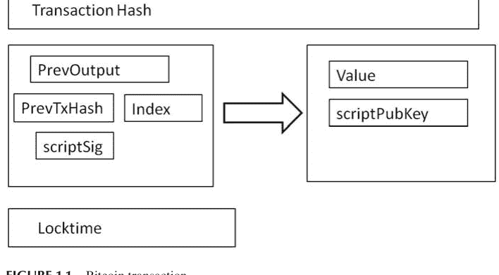

**图 1.1** 比特币交易。

钱包维护未花费交易输出的余额。如果钱包中未维护此类副本，它始终可以请求网络检索信息。有各种应用程序编程接口（APIs）可用于执行此任务。一旦钱包中有所需的比特币数量，它就可以创建交易的输出。

#### 1.4.3 创建输出

为交易输出创建脚本，通过提供脚本的解决方案即可赎回交易价值；也就是说，谁提供与接收方公钥地址对应的密钥的签名。由于目标钱包仅拥有与该地址相对应的密钥，因此预期接收方可以提供所需的签名并赎回硬币。最后，为了使交易正常进行，发送方的钱包应用程序将收取少量费用。这种收费不会明确体现；它是输入与输出之间的差额。该交易费用稍后将被矿工收取以验证并在网络中添加区块。

为了管理输入和输出，比特币使用一种脚本语言，该语言规定了赎回比特币必须满足的条件。最流行的脚本是“Pay-to-PubkeyHash”（P2PKH）。它只需要所有者一个签名即可批准付款。相比之下，另一种脚本“Pay-to-ScriptHash”对各种交易使用多签名地址。

比特币交易的示意表示如图 1.2 所示。

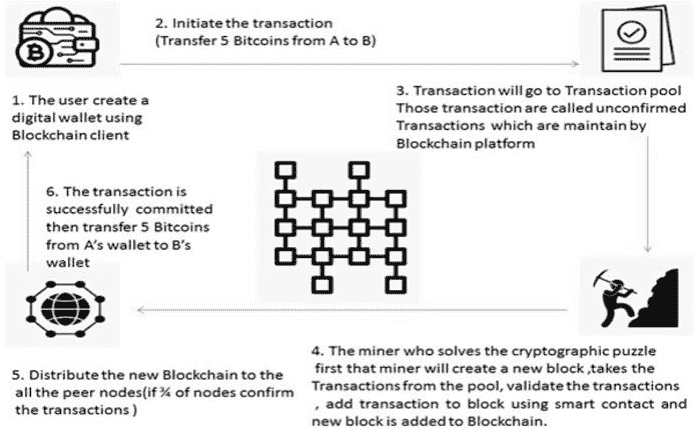

**图 1.2** 比特币交易摘要。

### 1.5 时间戳服务器

时间戳服务器通过对包含交易的区块进行哈希处理并像报纸或 Usenet 一样向公众分发其功能。时间戳服务器的目的是保证交易区块在时间戳时确实存在。这使得节点能够验证交易分发的顺序。因此，用户可以拥有网络上所有交易的历史记录。图 1.3 显示了时间戳的过程。

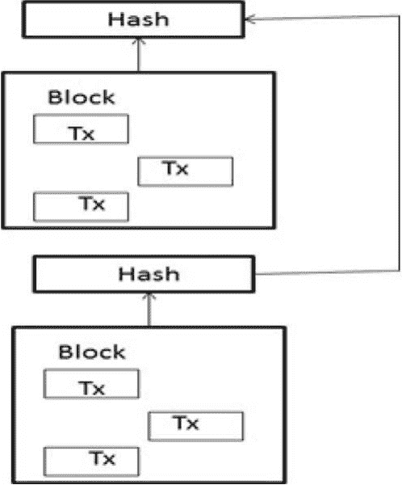

**图 1.3** 时间戳服务器。

### 1.6 工作量证明

在比特币中，网络中存在区块链的多个副本，有必要保持区块链的全局视图一致。例如，可以使用相同的硬币创建两笔不同的交易发送给不同的接收者，这称为“双花”。如果两个接收者基于其对区块链的本地视图分别处理并验证其交易，则区块链会变得不一致。 这样的问题可以通过以下方式解决：

- (i) 共享交易的验证过程以保证交易的正确性；
- (ii) 让每个人都知道已成功处理的交易以确保区块链的一致性。

比特币使用 PoW 和分布式共识协议来满足上述规范。

如前所述，验证过程的分布是为了通过大多数有效用户确保数据的正确性。因此，如果区块链在任何时候进入不稳定状态，所有用户都可以将其本地区块链副本更新为大多数矿工接受的副本。但这种选举过程容易受到 Sybil 攻击 [4]。在 Sybil 攻击中，恶意用户创建许多虚拟节点并使其为错误的事务投票，从而扰乱选举过程。

PoW 模型有助于比特币克服 Sybil 攻击。在此模型中，矿工必须解决一个密码学数学难题来证明其真实性，类似于 Hashcash。PoW 包含一个名为“nonce”的值，当与 SHA-256 一起哈希时，它会生成一个以所需数量的零位开头的哈希值。目标设定了所需的零位数。所需的哈希值必须低于当前目标值，并且应具有一定数量的前导零位以小于目标。为此，PoW 通过验证施加了高水平的计算成本，而要进行 PoW，矿工需要高水平的计算资源。因此，伪造计算资源非常困难。 这样，Sybil 攻击问题得以解决。

通常，交易不是单独开采的。矿工收集待处理的交易以形成区块，然后通过测量区块的哈希值并改变 nonce 来开采区块。nonce 必须不断变化，直到最终值小于或等于给定的目标值。矿工共享 256 位目标值。计算哈希值并不简单。SHA-256 是比特币中使用的哈希函数 [8]。如果密码哈希函数找不到必要的哈希值，唯一的替代方案是尝试不同的 nonce 直到找到解决方案（低于目标的哈希值）。因此，难题的复杂性取决于目标值，即目标值越低，解决方案的数量越少，从而使计算哈希越困难。一旦为区块确定了正确的哈希值，矿工会立即将区块连同测量的哈希值和 nonce 广播到网络中，然后将区块附加到其私有区块链。在收到已开采的区块后，其他矿工会将哈希值与接收区块中的目标值进行比较并验证其正确性。他们还将通过添加新区块在本地升级其区块链。区块成功添加到区块链后，第一个解决难题的矿工将获得奖励。没有中央机构提供奖励。在区块生成系统中，每当矿工为其比特币地址添加 Coinbase 交易或奖励生成交易时，就会提供奖励。

除了这些奖励外，矿工还会在区块中成功添加每笔交易时收取交易费。交易费通常是交易中所有输入价值与所有输出价值之间的差额。研究表明，较高的交易费用会导致交易费用较低的交易遭受饥饿问题，即服务被拒绝的时间更长。比特币从不强制要求交易费。设置费用的是交易所有者，费用不是恒定值。 然而，随着用户努力使交易在区块链上公开，交易费用增加到阻碍比特币使用的水平，说明了区块链面临的一个主要结构性问题。

### 1.7 比特币开发环境

比特币是一个开源项目，MIT 持有其源代码的许可证。Bitcoin Core 可以免费下载。一个志愿者社区创建了比特币项目。最初，项目中只有中本聪。到 2016 年，它拥有约 400 名贡献者，其中包括少数开发者和几名兼职开发者。由于它是关于如何实现该技术每个部分的权威参考，Bitcoin Core 可以被视为比特币系统的参考实现。它被标记为 Satoshi 客户端。Bitcoin Core 充当比特币节点，一组比特币节点构成比特币网络。中本聪最初发布了“Bitcoin”软件，但为了使其与网络区分开来，他后来将其重命名为“Bitcoin Core”。Bitcoin Core 具有比特币的所有功能，例如钱包、区块验证引擎、交易以及 P2P 比特币网络中的完整网络节点。

#### 1.7.1 Bitcoin Core 实现

Bitcoin Core 可以从 http://Bitcoin.org/en/choose-your-wallet 下载，并通过点击 Bitcoin Core 按钮进行安装。安装完成后，名为“Bitcoin–QT”的新应用程序将列在应用程序中。双击图标即可启动比特币客户端。比特币客户端开始运行时，它将下载区块链，完成需要数天时间。当显示“Synchronized”消息时，表示下载过程成功。

比特币开发者可以作为 ZIP 文件下载完整源代码，或从权威数据库 https://github.com/Bitcoin/Bitcoin 克隆。另一方面，可以使用 git 命令行在您的系统中创建源代码的本地副本。


以下Linux操作系统中的命令用于克隆源代码。

```sh
$ git clone https://github.com/bitcoin/Bitcoin.git
```

执行上述命令后，在Bitcoin目录中将会得到一份完整的源代码数据库本地副本。文档也会随源代码一起提供，并分布在众多文件中。主要文档位于Bitcoin目录中的README.md文件中。执行以下命令进入Bitcoin目录。

```sh
$ cd bitcoin
```

为了确保下载源代码的系统拥有编译所需的所有库，必须执行以下脚本来找到正确的设置。

```sh
$ ./autogen.sh
```

上述autogen.sh脚本会生成一组自动配置脚本。这些配置脚本将检查你的系统以找到正确的设置，并确保系统拥有编译代码所需的所有库。

最重要的脚本是“Configure”脚本。它提供了多种用于自定义构建过程的选项。命令./configure --help将列出可用于为你的系统创建自定义构建的选项。

```sh
$ ./configure
```

该脚本会自动查找所有必要的文件，从而创建自定义构建。如果一切顺利，configure脚本将无错误地完成执行，并创建有助于编译Bitcoin的自定义构建脚本。否则，它将以错误终止。错误可能是缺少库或库不兼容。在这种情况下，请重新分析构建文档，确保已安装必要的先决条件，然后重新运行configure代码。

下一步是编译源代码，这可能需要数小时才能完成。必须经常监控编译过程，以检查是否显示任何错误消息。

```sh
$ make
```

一旦源代码无错误地编译完成，将Bitcoin可执行文件安装到系统路径中就是最后一步。这可以通过执行make命令来完成。

```sh
$ sudo make install
```

为了确认Bitcoin安装成功，可以执行以下命令。sudo make install命令会询问两个可执行文件的路径。

```bash
$ which bitcoind
/usr/local/bin/bitcoind

$ which bitcoin-cli
/usr/local/bin/bitcoin-cli
```

Bitcoin的默认安装位置是/usr/local/bin。当我们第一次运行Bitcoin命令时，系统会提示我们为JSON-RPC接口创建一个强密码。

```bash
$ bitcoind
```

执行此命令会抛出一个错误，要求用户在配置文件中设置rpcpassword。要更改密码，可以编辑配置文件，并按照Bitcoin的建议设置新密码。最后，运行Bitcoin Core客户端。首次运行时，Bitcoin区块链将被重建，平均需要两天时间才能完成。

#### 1.7.2 钱包设置与加密

下一步是设置钱包配置。首先，我们用密码加密钱包。

```bash
$ bitcoin-cli encryptwallet newpwd
```

在上述命令中，encryptwallet命令用于加密钱包，newpwd是为钱包设置的密码。类似地，backupwallet、importwallet和dumpwallet命令分别用于备份钱包、恢复钱包以及将钱包导出为文本文件。

```bash
$ bitcoin-cli backupwallet wallet.backup
$ bitcoin-cli importwallet wallet.backup
$ bitcoin-cli dumpwallet wallet.txt
```

用密码设置好钱包后，可以将其配置为接收交易。Bitcoin参考实现维护着一组Bitcoin地址。这些地址用作接收地址和找零地址。地址是自动生成的。要获取地址，必须执行getnewaddress命令。

```bash
$ bitcoin-cli getnewaddress
```

现在，系统会提供一个随机地址。例如，新生成的地址可以是：1hvzAofGwT8cjb8JU4nBsCSfEVWX5u9CL。这个地址可以用来从外部钱包接收资金。要查看钱包收到的所有交易，可以使用以下命令。

```bash
$ bitcoin-cli listtransactions
[
```

```json
{
  "account" : "",
  "address" : "1hvzSofGwA8cjb8JU7nBsGSfEVQX5u6CL",
  "category" : "Receive",
  "amount" : 0.06000000,
  "confirmations" : 0,
  "txid" : "9ca8f969be3ef5ec2a8685660fdbf798bd365524c2e1fc66c319acbae2c14ke3",
  "time" : 1392660908,
  "timereceived" : 1392660908
}
]
```

“getaddressesbyaccount”命令用于获取钱包中的所有地址。

```bash
$ bitcoin-cli getaddressesbyaccount ""
```

现在，可以讨论来自区块和交易的信息。例如，如果我们知道交易被添加到的区块，我们可以使用“getblock”命令查询该区块。

```bash
$ bitcoin-cli getblock
```

getblock命令会列出区块中存在的所有交易。例如，如果该命令显示的输出有大约250个交易ID，则可以解释为区块中存在367个交易。listunspent、gettxout、createrawtransaction和sendrawtransaction是一些交易命令，分别用于查看未花费输出、获取未花费输出的详细信息、创建交易和进行交易。

### 1.8 密钥、钱包和地址

#### 1.8.1 数字签名

网络中的每个用户都有一对私钥和公钥。私钥用于签署交易，应予以保密。用户可以使用私钥签署交易，并使用接收者的钱包地址进行交付。这些地址可以通过计算发送者公钥的加密哈希来获得。经过数字签名的交易可以在整个网络中广播。数字签名有两个阶段。(i) 签名阶段，用户A使用其私钥加密数据，并将加密数据和原始数据发送给用户B。(ii) 验证阶段，用户B使用用户A的公钥验证数据。通过这一过程，可以检查数据是否被篡改。数字签名是使用椭圆曲线数字签名算法（ECDSA）[9]生成的。Bitcoin的所有权由数字密钥、数字签名和Bitcoin地址决定。

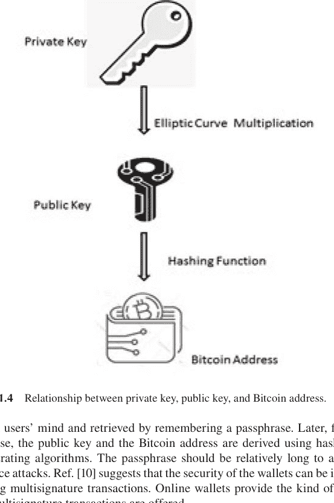

## 图1.4 私钥、公钥和比特币地址之间的关系。

存储在用户的脑海中，并通过记住一个口令来检索。之后，使用哈希和密钥生成算法从该口令派生出公钥和Bitcoin地址。口令应相对较长，以避免任何暴力攻击。参考文献[10]建议，通过采用多重签名交易可以提高钱包的安全性。在线钱包提供的安全级别中，就包含多重签名交易。

### 1.8.4 地址

接收者的公钥是Bitcoin被发送到的地址。使用发送者的私钥，用户的数字签名被加密，并可以使用发送者的公钥进行解密。通过这一过程，可以验证发送者的身份和接收者的地址。如果某人丢失了私钥，就无法发送Bitcoin。如果有人获取了某人的私钥，也有可能窃取这些Bitcoin。即使受害者知道入侵者的公钥，也无法取回自己的Bitcoin，因为他不知道入侵者的私钥，而且交易无法逆转。因此，每笔交易都有发送者和接收者的名称，以便在区块链中识别。公钥密码学用于识别过程。之前的交易历史与接收者的公钥进行哈希运算，并添加发送者的数字签名。

### 1.9 针对Bitcoin系统的安全攻击及对策

由于Bitcoin在不可控的分散式模式下运行，欺诈者和黑客认为交易欺诈很容易实施。对Bitcoin系统的一些常见攻击是(i)双重支付、(ii)钱包攻击、(iii)网络攻击和(iv)挖矿攻击。

#### 1.9.1 主要安全攻击

##### 1.9.1.1 双重支付

双重支付是指欺诈用户试图在同一时间使用同一组币在两次不同的交易中进行支付的情况。例如，恶意用户使用一组Bitcoin Bc在时间t创建一笔交易T，并向供应商V购买商品。同时，该用户使用相同的币Bc创建并广播另一笔交易T′，将币发送到自己的钱包地址。这种情况被称为“双重支付”，此时V会接受购买并发货，但无法兑换这些币，因为币被转到了用户的账户。这个问题可以通过网络矿工强制执行规则来解决，他们会验证并处理交易，确保先前交易中花费的币不会用作后续交易的输入。此外，基于PoW的共识和时间戳有助于交易在区块链中有序存储。在这种情况下，当矿工收到T和T′两笔交易时，可以检查两笔交易是否都试图使用相同的币，从而只处理一笔交易并拒绝另一笔。图1.5显示了双重支付攻击。

为了检测支付系统中双重支付的可能性，提出了三种技术。这些技术是(i)监听期：在这种技术中，卖方将每笔交易与一个监听持续时间相关联，只有在未发现任何双重支付尝试时才交付产品。(ii)插入观察者：这是第一种技术的扩展，供应商在网络中部署几个受其控制的观察者（节点）。这些观察者检查是否有任何双重支付，然后将交易发送给供应商。(iii)转发双重支付攻击：在这种技术中，节点将尝试双重支付的交易转发给邻居，而不是丢弃它们。

##### 1.9.1.2 矿池攻击

为了减少区块的验证时间，人们创建了矿池以增加计算资源。这缩短了验证时间，从而赢得奖励。矿池有一个矿池管理者，他将未解决的工作发送给矿池成员（矿工）。矿工推导出部分工作量证明（PPoW）和完整工作量证明（FPoW），并将其作为份额提交给管理者。如果矿工


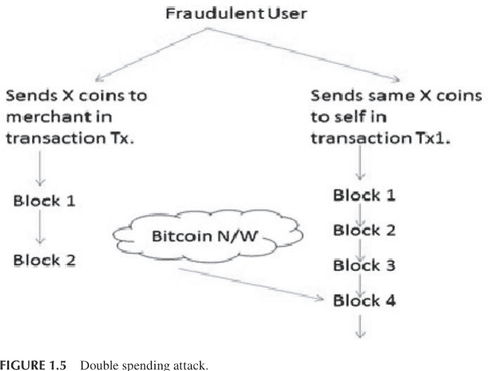

图 1.5 双重花费攻击。

当一个区块被验证后，它会被提交给矿池管理者。管理者随后将区块广播到网络中以获得奖励。奖励将根据PPoWs在矿池内的矿工之间分配。矿池管理者根据矿工在寻找新区块时发现并提交的份额数量来决定每个矿池成员完成的工作量。份额可以是数学难题的解。矿池也会遭受内部和外部的攻击。内部攻击是指矿池内一组恶意矿工试图获取超出其应得的份额，或者干扰其他矿工成功挖矿的行为。外部攻击是指矿工利用其算力进行双重花费攻击。

在这种情况下，攻击者的目的是破坏矿池，而不是真正地挖矿。Courtois和Bahack [11] 采用了一种博弈方法，其中矿工使用一种称为“自私挖矿”或“区块丢弃攻击”的被动挖矿策略。自私挖矿是一种攻击方式，攻击者最初隐藏已挖出的区块，然后以一种使其获得远超其算力份额的收益的方式揭示该区块。或者，它迷惑其他矿工，使他们浪费资源。

针对矿池攻击最诚实的解决方案在参考文献[12]中提出。在该方法中，当矿工发现存在多个相同长度的分叉时，它会将信息传递给所有其他节点，并选择一个分叉进行扩展。类似地，其他节点也会选择一些随机分叉进行扩展，从而最大限度地减少自私挖矿的可能性。另一种解决方案称为“偏好新鲜度”（FP），即区块带有时间戳，具有最新时间戳的区块将优先被选择。该方法中的时间戳是不可伪造的。为了防止矿工使用来自未来的时间戳，该方法使用了随机信标[13]。由于自私挖矿中可能存在区块扣留，该方法通过网络优先选择新鲜区块来减少奖励。

##### 1.9.1.3 客户端安全威胁

由于其巨大的成功，比特币吸引了越来越多的用户加入网络。每个比特币客户端都拥有一对私钥和公钥。因此，需要有安全的密钥管理技术。否则，如果密钥丢失，用户将遭受更高程度的金钱损失。由于密钥存储在钱包中，通过系统黑客攻击、有缺陷的软件安装和钱包的错误使用等机制，钱包盗窃事件频发。公钥密码学的使用引发了对用户密钥安全存储和管理的担忧。

为了保护钱包，人们提出了“冷钱包”。这是一种手动方法，使用用户的另一个账户来存储用户的额外资金。此方法使用两台计算机，其中一台不连接到互联网，并使用钱包软件生成新的私钥。由于第二台系统未连接到互联网，攻击者无法破解该钱包。

##### 1.9.1.4 比特币网络攻击

网络攻击主要针对比特币和P2P通信网络协议。最常见的网络攻击是拒绝服务攻击（DoS），其目标是比特币交易所、钱包和矿池。由于比特币网络本质上是分布式的，DoS对网络操作的影响很小。因此，要破坏整个网络，必须实施像DDoS这样的强力攻击。与单个攻击者攻击网络的DoS攻击不同，在DDoS中，多个攻击者同时攻击网络。入侵者通过将诚实的矿工从网络中移除来执行DDoS攻击，从而增加网络中恶意用户的数量。在这种情况下，诚实的矿工可能会被来自恶意矿工的大量交易请求所淹没。一段时间后，矿工可能会丢弃输入的请求，甚至包括来自诚实矿工的请求。总共对40个比特币服务执行了142次DDoS攻击，7%的已知运营商是这些攻击的目标[17]。

已经提出了几种解决方案来避免或减轻网络攻击。对于DDoS攻击，使用了博弈论方法。该方法假定较小的矿池比大型矿池的权重更低。因此，在参与者和矿池之间形成了一种平衡，拥有更多参与者的矿池比小矿池获得更多奖励。参考文献[14]建议，活动证明（PoA）可以抵御DDoS攻击。在PoA中，放置第一笔交易的用户在每个区块头中存储一个加密值，因此随后该区块中的任何交易存储只能通过诚实的矿工完成。

上述所有主要攻击又衍生出若干其他类型的攻击，如图1.6所示。

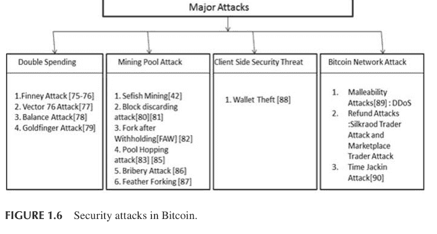

图 1.6 比特币中的安全攻击。

#### 1.9.2 次要攻击

##### 1.9.2.1 Sybil攻击

在Sybil攻击中，攻击者安装虚假节点以使得网络的一部分受到威胁。这些被攻破的节点对网络进行集体攻击。有时攻击者隐藏或更改其身份，并利用被攻破的节点执行碰撞攻击。在碰撞攻击中，攻击者将一个诚实的矿工隔离开来，破坏由该矿工发起的交易，或操纵该矿工选择攻击者支持的区块。如果没有任何矿工批准一笔交易，那么该交易就可能被用于双重花费攻击。

##### 1.9.2.2 Eclipse攻击

在Eclipse攻击中，攻击者通过将受害者的IP地址重定向到攻击者，在受害节点与公共网络之间创建隔离。图1.7显示了网络分区。

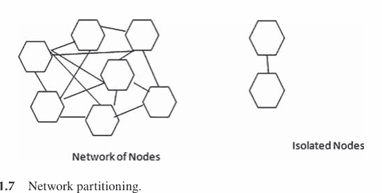

图 1.7 网络分区。

##### 1.9.2.3 篡改

在比特币网络中，一旦一个区块被挖出，节点就会将信息广播给其他节点。这个过程在网络中定期发生。网络假定信息以公平的速度广播，但攻击者可能会通过在网络中制造拥塞来延迟广播。这种篡改可能导致上述任何网络攻击。

### 1.10 比特币中的隐私与匿名性

在传统模型中，受信任的第三方在交易中共享并保护较少的用户详细信息。然而，受信任方知道所有客户信息。根据Bradbury [15]的说法，隐私意味着上下文被隐藏，而匿名性隐藏其所有者。在某些情况下，隐私比匿名性更受重视，反之亦然。匿名的概念是不可识别和不可追踪。在传统模型中很难确保100%的匿名性。许多应用，如混合服务、洋葱路由和Tor（The Onion Router），都声称是匿名的，但往往会泄露身份信息。匿名性和隐私总是有代价的。要么声称提供这两者的系统需要更多的时间、空间和计算资源，要么用户需要为保持匿名和隐私支付更多费用。在比特币中，一切都是透明的，所有交易都公开共享。因此，通过保持公钥匿名，即使用假名作为地址，来提供匿名性。由于使用了假名，人们假定比特币是匿名的。

尽管如此，人们普遍认为比特币并非匿名，而是被描述为“可能是世界上最开放的支付网络”。所有交易都是公开的，所有用户都使用其地址的假名，网络中的每个人都可以追踪用户之间的比特币交易。用户的真实身份不得而知，因为没有存储用户的其他信息。即使用户之间需要揭示身份，也不会告知网络中的任何其他用户。比特币用户无法完全保持匿名，但他们可以保持假名。人们相信，用户在使用比特币时可以确定一定程度的隐私。为每笔交易使用一对新的密钥（地址）可以在很大程度上提高安全性。因为创建新的密钥对并将其与每笔交易关联，可以避免使用与用户之前交易相关联的密钥，从而无法得知用户拥有的比特币数量。另一个建议是，为不同目的使用多个钱包，这些钱包无法与不同交易关联。对于使用钱包的用户，他们的钱包交易和地址会被托管钱包的服务追踪。因此，托管服务有可能通过用户的IP地址追踪其比特币地址并泄露用户身份。为了防止这种情况，人们使用TOR这一流行工具来隐藏真实的IP地址。TOR是一个分布式覆盖网络，由用于基于传输控制协议（TCP）应用的TOR节点组成。TOR基于Chaum的混合网络设计。在TOR中，数据被多次加密，并通过节点路径传输，每一层的解密在各个节点处完成。


另一个洋葱路由工具“I2P”（不可见互联网项目）[16]在网络内部创建了一个称为暗网的隐藏网络。I2P 的结构允许多条消息在加密层内进行加密。I2P 的主要缺点是使用 I2P 访问互联网的真实用户数量较少。很少有比特币客户端被开发出来以允许通过 I2P 运行和交换比特币。除了 TOR 之外，Anoncoin 也是另一种旨在成为完全 I2P 暗网货币的货币。

在受 TOR 启发后，另一种新的匿名化技术交易远程释放（TRR）被发布。TRR 的设计目的是克服在使用 TOR 上比特币时发生的攻击。TOR 和 TRR 在加密和路由数据方面相似，而比特币交易的传输方式则不同。由于 TRR 是专门为比特币设计的，它仅加密并传输新交易。然而，TOR 会加密所有区块链数据。这导致节点的生产率和性能更好。TRR 的唯一缺点是需要更改比特币协议。虽然 TRR 更容易受到 DDoS 攻击，但它可以抵御中间人攻击。

### 1.11 重新夺回磁盘空间

为了节省磁盘空间，可以丢弃之前发生的已花费交易。为此，Merkle 树通过仅在区块哈希中添加根来对交易进行哈希，而不改变区块的哈希。通过这种方式，可以消除存储内部哈希的需要。之后，可以通过剪掉树的分支来压缩旧区块。

### 1.12 结论

在本章中，P2P 去中心化数字货币比特币及其特性已被讨论。对比特币之前加密货币的讨论展示了现有加密货币的最新技术。比特币的透明性是实现有效性的关键方面，而用户匿名性是另一个让比特币持续增长的方面。基于 PoW 的挖矿的最重要概念确保了该模型并最终稳定了共识。各种安全攻击已与对策一起详细解释。

### 参考文献

- 1. D. Chaum, “用于不可追踪支付的盲签名,” in Proc. 2nd Conf. Adv. Cryptol., August 1982, pp. 199–203.
- 2. L. Lamport, R. Shostak, and M. Pease, “拜占庭将军问题,” ACM Trans. Program. Lang. Syst., vol. 4, no. 3, pp. 382–401, 1982.
- 3. D. Malkhi and M. Reiter, “拜占庭法定人数系统,” Distrib. Comput., vol. 11, no. 4, pp. 203–213, 1998.
- 4. J. Douceur, “Sybil攻击,” in Proc. 1st Int. Workshop Peer Peer Syst., March 2002, pp. 251–260.
- 5. R. C. Merkle, “基于常规加密函数的数字签名,” in Proc. 7th Conf. Adv. Cryptol. (CRYPTO’87), August 1987, pp. 369–378.
- 6. S. Haber and W. S. Stornetta, “如何为数字文档加时间戳,” J. Cryptol., vol. 3, pp. 99–111, 1991.
- 7. R. C. Merkle, “基于常规加密函数的数字签名,” in Carl Pomerance (ed.), Advances in Cryptology—CRYPTO ’87 (Lecture Notes in Computer Science), vol. 293. Heidelberg, Germany: Springer, 1988, pp. 369–378.
- 8. D. Eastlake, III and T. Hansen. 美国安全哈希算法（SHA 和基于 SHA 的 HMAC 和 HKDF）. 2011. [Online]. Available: http://www.ietf.org/rfc/rfc6234.txt.
- 9. V. S. Miller, “密码学中椭圆曲线的应用,” in Hugh C. Williams (ed.) Advances in Cryptology—CRYPTO’85 (Lecture Notes in Computer Science), vol. 218. New York, NY: Springer-Verlag, 1986, pp. 417–426.
- 10. S. Goldfeder et al., 通过新的 DSA/ECDSA 阈值签名方案保护比特币钱包, Tech. Rep., 2015. [Online]. Available: http://www.cs.princeton.edu/stevenag/threshold_sigs.pdf.
- 11. N. T. Courtois and L. Bahack, “关于比特币数字货币中破坏性矿工策略和区块扣留攻击,” CoRR, vol. abs/1402.1718, 2014. [Online]. Available: https://arxiv.org/abs/1402.1718.
- 12. A. Sapirshtein, Y. Sompolinsky, and A. Zohar, “比特币中最佳自私挖矿策略,” in Jens Grossklags and Bart Preneel (eds.), Proc. 20th Int. Conf. Financ. Cryptography Data Security (FC), Oistins, Barbados: Springer, 2017, pp. 515–532.
- 13. M. O. Rabin, “通过信标进行交易保护,” J. Comput. Syst. Sci., vol. 27, no. 2, pp. 256–267, 1983.
- 14. I. Bentov, C. Lee, A. Mizrahi, and M. Rosenfeld, “活动证明：通过权益证明扩展比特币的工作量证明[扩展摘要],” SIGMETRICS Perform. Eval. Rev., vol. 42, no. 3, pp. 34–37, 2014.
- 15. D. Bradbury, “匿名性和隐私：困惑者的指南,” Netw. Security, vol. 2014, no. 10, pp. 10–14, 2014.
- 16. F. Astolfi, J. Kroese, and J. V. Oorschot. I2P——不可见互联网项目. Accessed: February 17, 2017. [Online]. Available: http://mediotechnology.leiden.edu/images/uploads/docs/wt2015_i2p.pdf.
- 17. M. Vasek, M. Thornton, and T. Moore. “比特币生态系统中拒绝服务攻击的实证分析.” Financial Cryptography Workshops, 2014. Available: https://fc14.ifca.ai/bitcoin/papers/bitcoin14_submission_17.pdf.


## 2 探索比特币网络

Sathya A.R. and K. Varaprasada Rao
ICFAI Foundation for Higher Education
(Deemed to be University)

### 目录

- 2.1 引言 ........................................................ 23
- 2.2 P2P 网络 ........................................................... 24
- 2.3 比特币系统概述 .............................................. 24
- 2.4 比特币节点 .......................................................... 25
- 2.5 比特币网络实验 .................................. 26
- 2.6 加入和维护网络 ...................................... 27
- 2.7 交易和区块传播 ....................................... 28
- 2.8 去匿名化 ....................................................... 30
- 2.9 僵尸网络 ............................................................... 31
- 2.10 受比特币启发的网络应用 .................................. 31
- 2.11 比特币网络攻击 ............................................... 32
- 2.12 比特币网络安全 ............................................. 33
- 结论 ............................................................... 34
- 参考文献 .............................................................. 34

### 2.1 引言

比特币最有趣的特性是其去中心化环境。比特币是一种无结构的点对点（P2P）去中心化数字货币。由于传输控制协议（TCP）连接是基本通信结构，比特币建立在其之上。比特币由中本聪于2009年发明[1]。交易在比特币用户之间进行。比特币网络上的所有交易都记录在称为“区块链”的交易日志上。货币的关键特性是健壮性和安全性。加密货币通过去中心化方法和加密技术获得这些特性。去中心化方法克服了诸如单点故障和单一信任来源等问题，并增加了不同各方之间的分歧。然而，加密货币使用一种分布式机制，使设备能够保持对其状态的明确视图，以便在用户之间达成共识。

### 2.2 P2P 网络

P2P 网络中使用扁平或分层组织结构，将对等体排列在随机图上。对等体通过未加密的 TCP 通道相互连接。P2P 网络中的对等体或节点是一台安装了比特币节点软件的计算机。该比特币节点软件在比特币全节点客户端钱包中自动添加。只能查看运行全节点客户端的节点，而在尝试在网络中定位节点时，并非所有节点都可见。如果对等体有兴趣加入网络，首先会查询域名系统（DNS）服务器名称和 DNS 种子。这些 DNS 种子硬编码在比特币客户端中以查找网络中的活跃节点。DNS 种子会返回对等体的 IP 地址，这些地址已准备好接受新的连接以响应完成的查询。发送一个包含发送方对等体的区块版本号和当前时间的版本消息以在对等体之间建立连接。接收方对等体将其版本消息发送回发送方对等体。一旦两者之间建立连接，它们通过发送 *verack* 消息来确认。加入网络后，对等体发现基于地址传播机制进行。在地址传播机制中，对等体可以使用 *getaddr* 消息询问彼此的 IP 地址，并可以使用 *addr* 消息发送其 IP 列表。为了找到具有一些有用数据的对等体，P2P 使用诸如扩展环、随机游走、生存时间（TTL）搜索等技术。对等体可以拥有总计 125 个连接，其中 8 个是出站连接，117 个是入站连接。防火墙或网络地址转换（NAT）不能有入站连接，只能有出站连接。

每个对等体都维护其已建立的连接列表。当生成新区块时，矿工会将其信息广播给其对等体。接收方验证区块然后将其传递给其对等体。当对等体进行交易时，它会将消息发送给其相关的对等体。对等体发送 *inv* 消息以发起交易。如果接收方用 *getdata* 消息响应，则使用 *tx* 代码发送交易。如果交易是真实的，交易应以与上述相同的方式进行通信。如果发送任何错误消息，对等体将通过维护惩罚分数受到惩罚。如果分数达到阈值，对等体的连接将被禁止。

通常，无结构连接易于构建并且在动态环境中很强，即对等体定期离开和加入网络。在无结构网络中搜索文件需要泛洪请求，因为每个对等体都会检查其本地数据。由于每个问题的副本数量众多，会产生巨大的开销。比特币网络与 P2P 文件共享网络不同。比特币并非旨在找到特定的数据对象以尽可能快地传播数据并在网络上达成共识。P2P 网络结构最适合比特币。除此之外，分布式模型用于数据传输、数据存储和数据确认。

### 2.3 比特币系统概述

比特币网络是在互联网上基于 P2P 架构构建的全球去中心化共识网络。该网络由在全球范围内运行 Bitcoin Core 的各个节点形成。Bitcoin Core 是一个开源软件，该

通过一种称为“挖矿”的过程实现共识。通过比特币挖矿，交易在称为“区块链”的不可更改、不可逆的分布式账本中得到验证和记录。比特币网络允许用户之间转移数字货币。

比特币是一种基于账户记账的数字货币。因此，比特币不能被看作数字货币，而应被看作比特币账户的余额。比特币账户是基于椭圆曲线密码学的密钥对。比特币账户可以根据其地址进行定位。比特币地址可以使用公钥生成。任何用户都可以根据面向所有其他用户公开的信息发送比特币。但要花费比特币，需要私钥。一个名为“钱包”的特殊软件用于创建和管理这个公私钥对。

比特币账户之间的支付通过交易进行。一笔比特币交易需要一个输入（资金来源比特币账户的地址）和一个输出（目的地地址）。一笔交易可以有一个或多个输入和一个或多个输出。交易中会指明从每个输入地址转移的比特币数量。类似地，交易中也会包含从目的地地址向每个账户转移的金额。源地址被强制要求花费先前交易中收到的确切金额。因此，每个输入必须包含前一笔交易的标识号和输出索引。这样一来，任何输出在任何时候都只能是已花费或未花费状态。未花费的输出称为未花费交易输出（UTXO）。

为授权任何交易，输入地址的用户必须使用其私钥生成数字签名。此过程是为了确保账户的所有权。收款方的用户必须（i）验证数字签名的正确性，并（ii）在同意支付之前验证这些比特币在之前的任何交易中均未被花费。

### 2.4 比特币节点

尽管比特币网络中的节点都是相同的，但根据其支持的功能，它们可以在网络中扮演不同的角色。比特币节点是一个由账本、路由功能、挖矿和钱包服务组成的数据库。图2.1展示了一个具备所有功能的完整节点。

保存最新完整区块链的节点称为“完整节点”，而少数节点只保留区块链子集，并通过称为“简单支付验证”（SPV）的方法验证交易。它们也被称为轻量级节点。挖矿节点旨在通过特殊硬件创建新区块来解决工作量证明（PoW）算法。一些挖矿节点是完整节点，少数则是参与矿池挖矿的SPV节点。用户钱包本质上就是比特币客户端，属于完整节点的一部分。安装在智能手机等资源受限设备上的钱包被视为SPV节点。除了主要节点之外，服务器和节点还运行着其他几种协议。这些协议可以是矿池协议或轻量级客户端访问协议。不同类型的节点见表2.1。

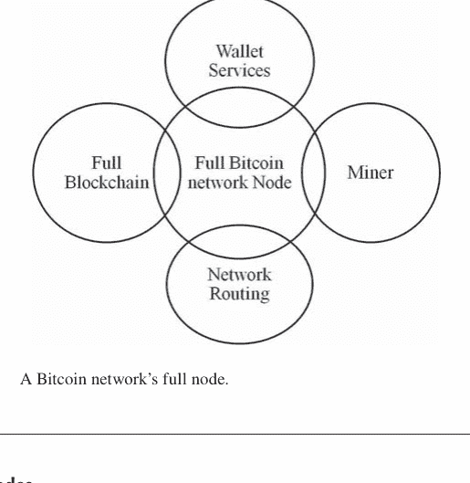

**图2.1** 比特币网络的完整节点。

**表2.1 比特币节点**

| 参考客户端（Bitcoin Core） | 完整区块链节点 | 独立矿工 | SPV（轻量级）钱包 | 矿工节点 | SPV Stratum钱包 |
|---|---|---|---|---|---|
| 在P2P网络上，包含一个钱包、完整区块链数据库、一个矿工和一个网络路由节点。 | 在P2P网络上，包含完整区块链数据库和一个网络路由节点。 | 在P2P网络上，包含一个带有完整区块链数据库的矿工和一个网络路由节点。 | 在P2P网络上，包含一个钱包和一个网络路由节点，不包含区块链数据库。 | 在P2P网络上，包含一个没有区块链的矿工，以及其他矿池挖矿协议节点。 | 在P2P网络上，包含一个钱包和一个网络节点，没有区块链，基于stratum协议。 |

### 2.5 比特币网络实验

连接到主网或测试网是学习比特币网络[2]的好方法。测试网是实验比特币协议及其脚本潜力的全球性空间。它采用一种称为“水龙头”的独特区块链，并免费提供测试币。除了少数参数改动外，测试网复制主网，并运行与比特币网络中的对等节点相同的代码。相比之下，本地测试环境提供了更多控制。内置在比特币参考软件中的回归测试（regtest）可以按需生成区块并提供无实际价值的测试币。这为测试新功能提供了一个安全的环境。Bitcoin-testnet-box [3] 是另一种类似的方法。这两种方法都设计用于不希望与随机节点和区块通信的场景。

为了模拟大规模比特币网络，人们使用少数模拟环境，如simbit和Shadow。两者都是离散事件模拟器。Simbit真实地展示了比特币客户端和矿工的功能，而Shadow则在模型系统中直接实现比特币软件。研究发现，模拟区块链独有的功能和密码学操作会阻碍实验的可扩展性。因此，只能模拟比特币客户端的特定部分，以便既能实现可扩展性，又能像真实客户端行为那样实现准确性。

### 2.6 加入与维护网络

在覆盖网络中，比特币网络中的每个对等节点至少维持8条连接。每当这个数量不足时，该节点会主动尝试与其他对等节点建立连接。如果另一个对等节点尝试连接，一个对等节点可以拥有超过8条连接。一个对等节点最多可以处理125条连接。对等节点接收传入连接的默认端口是8333。为了建立新连接，对等节点通过发送version和verack消息执行握手。version消息包含协议版本、用于同步的时间戳和IP地址。对等节点通过回发verack消息来建立连接。对等节点之间的初始握手如图2.2所示。

如果90分钟内没有消息，客户端就会知道该对等节点已离线。比特币对等节点还可以记录未直接连接到网络的对等节点列表。在网络中运行24小时后，每个对等节点都应发送一条addr消息。

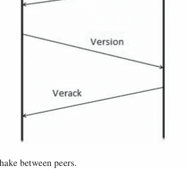

**图2.2** 对等节点之间的握手。

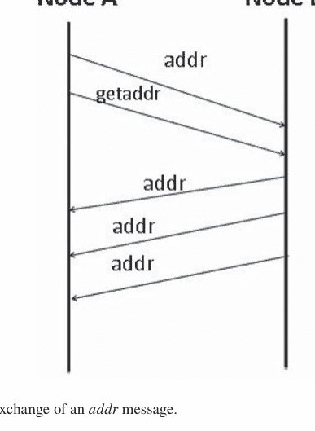

**图2.3** addr消息的交换。

如果某个节点没有消息，则该对等节点被视为离线。探索网络的常见方式是在引导期间交换addr消息。addr消息的交换如图2.3所示。

每当收到addr消息时，对等节点最多必须转发十个地址的地址信息。如果某个对等节点的时间戳信息不超过10分钟，该节点可能会尝试转发正确的地址。根据该对等节点在网络中的可达性，该地址将被转发给一个或两个邻居。

在引导期间寻找邻居时，比特币对等节点使用三种方法：（i）互联网中继聊天（IRC），（ii）DNS，以及（iii）询问邻居。然而，自比特币0.6版本以来，DNS是默认的引导机制。2014年，为了获取其他对等节点的信息，getaddr消息被发送给初始对等节点。对每个未知对等节点重复相同过程。最初，能够找到11,475个IP地址，经过37轮后，发现了872,648个唯一IP地址。研究能够确定网络规模，但无法确定拓扑结构。在参考文献[4]中，开发了AddressProbe——一种探索对等节点连接的技术。将getaddr消息用于大型网络，有助于探索节点如何相互学习，从而映射出基于时间戳连接的对等节点。

### 2.7 交易与区块传播

在非结构化网络中，用于获知新交易和新区块信息的机制很简单，即网络将充满消息。让我们以对等节点之间的一笔交易为例，深入讨论


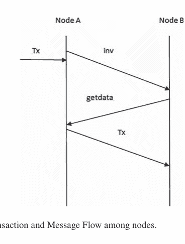

## 图2.4 节点间的交易与消息流

消息交换。节点之间的消息流如图2.4所示。假设用户A构建了一笔有效交易。在发送输入和输出等交易详情之前，用户A向其相邻节点发送一条清单（inv）消息，暗示他已获知新交易。该清单消息包含交易ID列表，但不包含原始交易数据。如果相邻节点对该交易一无所知，则会发送一条单独的getdata消息来请求该交易的数据。通过这种基于拉取的机制，可以尽量减少多余的交易记录，从而降低网络负载。在收到getdata消息后，用户A将向该相邻节点发送相应的交易详情。一旦交易得到验证，该节点就会以与用户A相同的方式进行广播，即先用inv消息发起。

比特币会随机选取每四条消息中的一条来发送inv消息，并保留其余的交易。因此，每个相邻节点收到的交易都是随机的。虽然涓流机制与混合网络中的做法一样能够降低开销，但它也使流量分析变得更加困难，有助于隐藏交易的创建者。由于消息每100毫秒发送一次，交易的传播可能会出现延迟。由于比特币的涓流机制旨在尽可能快地传输信息，因此它在开销和隐私之间进行权衡，以换取交易的传播速度。用户需要对自己的交易负责。如果一笔交易未能进入区块链，用户就需要重新广播该交易，并确保它被添加到下一个区块中。

从高度连接的节点中可以检测到三种不同类型的转发模式。
- （i）最常见的转发模式是节点仅发送一次交易。
- （ii）第二种转发模式是从单个节点接收单笔或多笔交易。
- （iii）第三种模式包括多个节点转发一笔交易，其中至少有一个节点会再次转发该交易。

了解交易的传播过程有助于识别使用比特币付款的欺诈用户。例如，假设一个用户想要使用比特币进行购买。该用户希望快速完成购买，而不浪费时间等待节点的确认。与此同时，卖家希望确保商品安全交付，而不必担心双重支付问题。为了解决此类情况，Bamert、Decker、Elsen、Wattenhofer和Welten为卖家开发了一种快速支付场景下的传播策略。根据文献[5]，在这种情况下，卖家不应将用户的连接作为唯一的信息来源。相反，他必须连接到一个大型节点，这反过来会迫使该用户广播交易。在这种情况下，卖家不应转发这些交易。只要有一个诚实节点与他相连，他就能够识别双重支付。

另一种方法是通过大量发送*警报消息*来发出双重支付攻击的信号。其思路是，即使对手能够欺骗卖家，一些诚实的矿工也会立即识别出冲突的交易，并通过网络发送警告消息。

### 2.8 去匿名化

跟踪网络中的消息流，除了有助于理解网络之外，还有助于发现用户信息。文献[6]指出，如果交易不是通过在线钱包进行的，就可以通过跟踪与所有节点相连的中心节点来确定交易的IP地址。然而，这破坏了交易的伪匿名性。文献[7]中观察到的转发模式验证了节点的预期行为。基于文献[6]的结果，即使在中心节点未完全连接的情况下，研究人员也开发出了将交易与IP地址匹配的启发式方法。

洋葱路由器（TOR）[8]是一种互联网匿名服务，它通过隐藏源节点的IP地址来解决这一信任问题。洋葱路由协议被应用于网络中的转发环节，从而将发送方和接收方的信息分离开来。因此，源节点的IP地址被隐藏，目标节点只能显示最后一个TOR节点的地址。比特币可以通过SOCKS接口来处理经由TOR的流量。但比特币网络有可能禁止TOR连接，这将导致DoS保护被利用。除了DoS攻击之外，这还可能使比特币网络容易遭受日蚀攻击和中间人攻击。

即使在连接匿名的情况下，也有可能通过观察节点邻居提供的指纹来找到交易的发起者。如前所述，客户端至少可以建立八个连接，并能将相同的信息广播给网络中的邻居节点。这八个节点被称为“入口节点”。只要这些入口节点可达，就应保持与它们的关联。这证明了指纹是稳定的。入侵者可以利用这一事实，为某个IP地址生成指纹。这可以通过在所有比特币服务器上整合指纹并记录转发该IP地址的节点对来实现。因此，这些节点就是对应IP的入口节点。此外，由于*addr*消息的“涓流”机制，攻击者只能看到一小部分入口节点。这一点以及时间因素的影响可能会导致误报。接下来，入侵者将能够映射入口节点的交易，从而找到交易的发起者。针对该问题提出的一个解决方案是反转出站连接。例如，指纹可以在……之后被模糊化。

比特币的一个分叉从新的创世区块创建了自己的区块链。Bitmessage是一种分布式、匿名且加密的消息协议，已经得以实现。与Namecoin和比特币不同，Bitmessage不会永久存储消息，而是要求节点仅将消息存储两天。为了确保消息的安全投递，系统采用了确认机制。其消息广播系统与Hashcash类似，发送方需要在广播消息之前生成工作量证明（PoW）。这样可以限制DoS攻击和垃圾信息。

### 2.11 比特币网络攻击

分布式拒绝服务（DDoS）攻击是最常见的网络攻击。这种攻击主要针对比特币的金融服务，如电子钱包、矿池、比特币交易所等。由于比特币网络本质上是分布式的，因此很难对其发动DoS攻击。DoS攻击由单个用户发起，而DDoS攻击则由多个用户同时发起。DDoS攻击成本不高，但有可能在更高层面上破坏网络。在DDoS攻击中，攻击者瞄准诚实的矿工，试图将他们排除出网络，以便将恶意矿工引入网络。据观察，与攻击个体矿工或较小的矿池相比，对较大矿池发起DDoS攻击会给攻击者带来更大的收益。

可变性攻击也会助长DDoS攻击。攻击者可以利用*可变性攻击*来堵塞交易队列。交易队列包含所有等待网络检查的待处理交易。然而，攻击者会创建一笔虚假交易，并将其伪装成一笔高激励交易。因此，矿工们会被引开去检查这笔交易，并发现它是一个问题交易。当他们意识到这一点时，时间和精力已经耗费掉了。可变性攻击旨在浪费网络中节点的时间和资源。

比特币网络也容易受到路由攻击。Apostolaki等人[14]讨论了从小规模到大规模路由攻击的影响。比特币的某些特性，如易于路由，以及在路由和挖矿能力方面的中心化程度不断提高，使其更容易遭受退款攻击。据观察，控制了不到100个BGP前缀的攻击者可以分割大约一半的挖矿算力。

比特币支付协议存在薄弱的退款策略，这可能会导致*退款攻击*。针对BIP70支付协议的此类攻击已被成功演示。BIP70是最常用的支付协议，大多数钱包使用它进行比特币交易。领先的支付处理商Coinbase和Bitpay使用BIP70为超过10,000家商户处理付款。退款攻击有两种类型：
- （i）丝绸之路（Silkroad）攻击
- （ii）市场交易商（Market-place trader）攻击

它们针对的是现有支付策略在身份验证和操纵方面的弱点。

*时间劫持攻击*是另一种针对比特币网络的攻击。这种攻击通过将网络时间与系统时间进行替换来操纵区块的时间戳。由于新区块的创建依赖于网络时间计数器，如果时间戳不准确，攻击者就可以欺骗节点接受另一条区块链。这种攻击可能导致双重支付、矿工资源损失以及交易验证速度降低。


其他攻击包括*女巫攻击*和*日蚀攻击*。在*女巫攻击*中，攻击者试图通过加入伪造节点来控制部分网络，这由一组节点完成。在*日蚀攻击*中，受害节点被攻击者从公共网络中隔离，受害节点所连接的IP地址被路由到攻击者的地址。研究表明，篡改网络节点可以造成网络拥塞，从而诱发网络上的其他多种攻击。

### 2.12 保障比特币网络安全

为保护比特币网络免受前述安全威胁，本节提出了多种应对措施。

为了应对*分布式拒绝服务（DDoS）攻击*，Johnson等人[15]提出了一种基于博弈的方法，让矿池通过提高计算成本相互竞争。通过该方法得出，较大的矿池比较小的矿池能获得更多激励。Eyal[16]也采用了类似的博弈方法，并指出较大的矿池通过网络中的自私行为获取了大部分激励。Bentov等人[17]提出了一种活动证明（PoA）协议来解决DDoS攻击。解决DDoS攻击的另一种方法是使用任意用户自定义的Web服务或像TOR这样的浏览器持续监控网络流量。

*时间劫持*是一种可能将网络分割成多个部分的致命攻击。为克服时间劫持攻击，提出了一系列技术，包括：(i) 为确定区块时间戳的上限，应使用系统时间而非网络时间；(ii) 应严格遵循可能的时间尺度；(iii) 应只使用受信任的对等节点。

为避免*日蚀攻击*，受信任节点的IP地址被单独存储。连接节点时基于节点的信任因素，任何恶意节点都会被禁止加入网络。有建议指出，对支付请求消息稍作修改即可降低退款攻击的概率。支付请求消息应添加一些客户信息，如注册邮箱、产品信息或送货地址。每个支付请求都有一个与密钥关联的唯一支付地址，该密钥将用于退款。然而，添加客户信息可能会损害用户隐私。Andrychowicz等人[18]提出了一种名为“新存款协议”的解决方案来应对*可塑性攻击*。建议将交易签名保存在单独的Merkle树中。

一般来说，由于担心恶意活动造成损失，大额比特币交易不会直接进行。在这种情况下，这些交易被拆分成多笔较小的交易，由于网络必须验证多笔交易，这最终会延迟完成过程。因此，为减少这种延迟，建议通过离线交易进行支付，即所谓的“微支付”。微支付通过一个名为“微支付通道”的单独通道进行。这些通道是比特币网络本身的一部分，但却是交易对手方进行交易的专用手段。

当对等节点在声明新区块的同时广播挖掘该区块所花的时间，*篡改攻击*就可以解决。这将使网络中的其他对等节点计算挖掘一个区块所需的平均时间。通过这种方式，可以确保网络中不会发生时间戳篡改或不必要的延迟。

除上述解决方案外，结合网络流量使用反洗钱（AML）法规和了解你的客户（KYC）政策，也能提高挖矿过程的质量。

## 结论

在比特币中，只需使用非结构化的P2P网络即可实现网络各部分之间的数据共享。比特币网络的安全性依赖于基于PoW的共识协议的效率，这些协议使区块链能够保持一致的状态。区块链的不一致性若被恰当利用，可能导致有效的双重支付。因此，比特币网络在规模、存储和带宽方面保持可扩展性非常重要，因为这能强化共识协议。全节点在P2P网络中处于活跃状态，有助于数据分发。相反，轻客户端使用SPV执行交易。但事实上，该网络仍然存在非结构化接口的普遍可扩展性问题，以及比特币协议本身所引发的问题。

## 参考文献

- 1. S. Nakamoto, “Bitcoin: A peer-to-peer electronic cash system,” Technical Report, 2008 [Online]. Available: https://bitcoin.org/bitcoin.pdf.
- 2. Bitcoin. “Bitcoin developer documentation.” 2014 [Online]. Available: https://bitcoin.org/en/developer-documentation.
- 3. github.com/freewil/bitcoin-testnetbox
- 4. A. Miller et al., “Discovering bitcoin’s public topology and influential nodes,” Technical Report, May 2015 [Online]. Available: https://cs.umd.edu/projects/coinscope/coinscope.pdf.
- 5. T. Bamert, C. Decker, L. Elsen, R. Wattenhofer, and S. Welten, “Have a snack, pay with bitcoins,” in Proc. 13th IEEE Int. Conf. Peer Peer Comput. (P2P’13), September 2013, pp. 1–5.
- 6. D. Kaminsky. “Black OPS of TCP/IP, Black Hat USA.” August 2011.[Online]. Available: http://dankaminsky.com/2011/08/05/bo2k11/.
- 7. P. Koshy, D. Koshy, and P. McDaniel, “An analysis of anonymity in bitcoin using P2P network traffic,” in Proc. Financial Cryptography and Data Security: 18th Int. Conf., FC 2014, March 2014, pp. 469–485.
- 8. R. Dingledine, N. Mathewson, and P. Syverson, “Tor: The second-generation onion router,” in Proc. 13th USENIX Secur. Symp. (USENIX Security’04), August 2004, pp. 303–320.
- 9. S. T. Ali, P. McCorry, P. H.-J. Lee, and F. Hao, “Zombiecoin: Powering next-generation botnets with bitcoin,” in Proc. 2nd Workshop Bitcoin Res. (BITCOIN’15), January 2015, pp. 34–48.
- 10. Vinced. “Namecoin—A distributed naming system based on bitcoin.” April 2011. [Online]. Available: https://bitcointalk.org/index.php?topic=6017.0.
- 11. J. Warren, “Bitmessage: A peer-to-peer message authentication and delivery system,” Technical Report, November 2012 [Online]. Available: https://bitmessage.org/bitmessage.pdf.
- 12. J. Szefer and R. B. Lee, “Bitdeposit: Deterring attacks and abuses of cloud computing services through economic measures,” in Proc. 13th IEEE/ACM Int. Symp. Cluster Cloud Grid Comput. (CCGRID’13), May 2013, pp. 630–635.
- 13. A. Schwartz. “Squaring the triangle: Secure, decentralized, human-readable names,” January 2011 [Online]. Available: http://www.aaronsw.com/weblog/squarezooko
- 14. M. Apostolaki, A. Zohar, and L. Vanbever, “Hijacking Bitcoin: Routing attacks on cryptocurrencies,” in Proc. IEEE Symp. Security Privacy (SP), San Jose, CA: IEEE, 2017, pp. 375–392.
- 15. B. Johnson, A. Laszka, J. Grossklags, M. Vasek, and T. Moore, “Gametheoretic analysis of DDoS attacks against Bitcoin mining pools,” in Proc. Financ. Cryptography Data Security FC Workshops BITCOIN WAHC, Heidelberg, Germany: Springer, 2014, pp. 72–86.
- 16. I. Eyal, “The miner’s dilemma,” in Proc. IEEE Symp. Security Privacy (SP), San Jose, CA: IEEE Comput. Soc., 2015, pp. 89–103.
- 17. I. Bentov, C. Lee, A. Mizrahi, and M. Rosenfeld, “Proof of activity: Extending Bitcoin’s proof of work via proof of stake [extended abstract],” SIGMETRICS Perform. Eval. Rev., vol. 42, no. 3, pp. 34–37, December 2014.
- 18. M. Andrychowicz, S. Dziembowski, D. Malinowski, and Ł. Mazurek, “On the malleability of Bitcoin transactions,” in Proc. Financ. Cryptography Data Security FC Int. Workshops BITCOIN, WAHC, Wearable, Heidelberg, Germany: Springer, 2015, pp. 1–18.


## 3 区块链技术

### *免信任系统*

*Sathya A.R.*  
ICFAI Foundation for Higher Education  
(Deemed to be University)

*Ajay Kumar Jena*  
KIIT (Deemed to be University)

### 目录

- 3.1  引言 ........................................................................................................ 38
- 3.2  历史 .................................................................................................................... 38
- 3.3  区块链技术概述 ........................................................................ 39
  - 3.3.1  区块的结构 .......................................................................................... 40
  - 3.3.2  创世区块 .............................................................................................. 42
- 3.4  区块链的类型 .................................................................................................. 43
  - 3.4.1  公有区块链 ............................................................................................... 43
  - 3.4.2  私有区块链 .............................................................................................. 43
  - 3.4.3  联盟区块链 ....................................................................................... 44
- 3.5  区块链的性质 ............................................................................................ 44
  - 3.5.1  去中心化 ....................................................................................................... 44
  - 3.5.2  透明性 .......................................................................................................... 45
  - 3.5.3  不可篡改性 ............................................................................................................. 45
  - 3.5.4  持久性 ........................................................................................................... 45
  - 3.5.5  匿名性 ............................................................................................................. 45
  - 3.5.6  可审计性 ............................................................................................................ 45
- 3.6  交易与数字签名 ............................................................................. 45
- 3.7  Merkle树 ................................................................................................................. 46
- 3.8  SHA-256 ...................................................................................................................... 47
- 3.9  区块链如何工作 ................................................................................................ 47
- 3.10  区块链开源实现 ......................................................................... 48
  - 3.10.1  比特币 .................................................................................................................. 49
  - 3.10.2  以太坊 .............................................................................................................. 49
  - 3.10.3  超级账本 .......................................................................................................... 49
  - 3.10.4  Corda ................................................................................................................... 50
- 3.11  测试网 ....................................................................................................................... 50
  - 3.11.1  持续发展 .................................................................................... 50
  - 3.11.2  防止中断 ........................................................................................... 50
- 3.12  支付验证 .................................................................................................. 51


- 3.13 优势与挑战....................................................51
- 3.13.1 优势..............................................................51
- 3.13.1.1 去中心化....................................................51
- 3.13.2 透明与匿名......................................................51
- 3.13.3 更低的交易费用和免税..............................................51
- 3.13.4 防盗窃..........................................................51
- 3.13.5 可扩展性...........................................................52
- 3.13.6 高能耗...........................................................52
- 3.13.7 自私挖矿........................................................52
- 3.13.8 隐私泄露...........................................................52
- 结论...................................................................52
- 参考文献...................................................................53

### 3.1 引言

区块链技术凭借其研究工作和商业项目颠覆了世界。尽管区块链听起来是一个新概念，但它已在市场上存在一段时间，直到几年前才获得全世界的关注。2008年，中本聪将区块链解释为由一个或一群化名的人所创造。区块链是一个大型数据库，能够安全地存储人们的交易信息，并允许他们在无需信任任何第三方的情况下与任何人交互。从技术上讲，区块链是一种安全、共享且分布式的账本，能够在无需中心化可信权威的情况下实现资源的记录和追踪。它支持在点对点网络中的双方之间共享信息。资源可以是有形的，如货币、土地、房屋、汽车等，也可以是无形的，如数字文档、版权、知识产权等。区块链是一种使用“链式区块”结构并采用密码学方法来存储数据的独特方式，从而确保数据的完整性。

### 3.2 历史

尽管区块链最近才变得流行，但分布式账本技术（DLT）是一个更为古老的概念，它经常与区块链联系在一起，并在两者之间造成混淆。尼科西亚大学的Giaglis说：“两者都是在共享的分布式数据库中组织交易记录的方法，但DLT是一个总括性术语，涵盖各种结构——包括区块链，而区块链只是其中一种类型。”分布式账本不一定需要使用区块链，而区块链也不一定是分布式的，尽管没有分布式账本的特征，区块链的实际价值会受到质疑。

区块链的概念始于1991年，Stuart Haber和W. Scott Stornetta发表了题为“如何对数字文档进行时间戳”的论文，其中详细描述了在创建或修改数字文档时应遵循的程序。该模型使用密码学上安全的区块序列来保存带时间戳的文档。为了在单个区块中保存多个文档，1992年引入了Merkle树。然而，这一概念在比特币出现之前很久就已未再被使用。后来，David Mazières和Dennis Shasha于2002年进一步推进了这一想法，提出了如何使用区块存储数据。他们专注于多用户网络文件系统协议和数据结构，并提出了安全不可信数据存储库（SUNDR）[1]。2004年，密码学活动家Hal Finney提出了一种称为可复用工作量证明（RPoW）的系统。该系统以不可交换的基于Hashcash的工作量证明作为输入，并生成一个基于Rivest、Shamir、Adleman（RSA）的令牌，该令牌可在用户之间交换。RPoW将令牌的所有权保存在可信服务器中。世界各地的用户可以通过该服务器验证令牌的正确性。通过这种方式，RPoW解决了加密货币中的双重支付问题。这为当前的区块链技术奠定了框架。区块链发展的重大突破发生在2005年，计算机科学家Nick Szabo提出了一种新的基于区块链的货币，称为“Bitgold”。这是去中心化货币最早的尝试之一。2008年，臭名昭著的匿名化名中本聪发明了点对点（P2P）模式的电子现金，允许双方在没有可信第三方的情况下直接进行交易。第一个区块于2009年被挖出，即一笔交易经过检查后被添加到网络的基础中，随后形成区块链。每个区块包含已验证的交易。图3.1展示了区块链技术的演变。

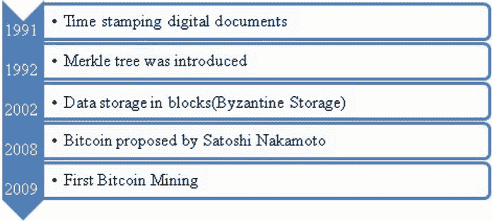

**图3.1**  区块链技术时间线。

从使用Merkle树对数字文档进行时间戳和哈希处理，到RPoW，区块链已经以更大的方式发展。

### 3.3 区块链技术概述

区块链是一个开放、透明、分布式的账本，使用户能够安全地转移单位所有权，并能够高效且永久地记录用户之间的交易。区块链是由通过互联网相互连接的“节点”设备组成的网络。任何连接到互联网并拥有IP地址的电子设备都可以成为节点。区块链上的所有节点同等重要，但一个节点在使区块链正常工作中可能扮演多种角色。节点可以：

- i. 存储记录在区块链上的信息。
- ii. 存储记录在区块链上的所有信息的副本。
- iii. 处理交易，将其放入区块，附加到区块链上，批准它们，并将其转发到网络。

#### 3.3.1 区块结构

一个典型的区块链有六个关键层。它们是（i）数据层，（ii）网络层，（iii）共识层，（iv）激励层，（v）合约层和（vi）应用层。架构中最底部的层是数据层。它由包含所有交易记录列表的区块组成，类似于传统的公共账本。交易数据可以是代币交换，也可以是网络上的任何类型的信息交换。每个区块分为两个部分：区块头和区块体。图3.2显示了一个区块的基本框架。所有交易都保存在区块体中，而区块头保留前一个（父）区块的哈希值。一个区块只有一个父区块。区块链的第一个区块称为“创世区块”，它没有父区块。通过使用密码学哈希，一个区块被识别并链接到其他每个区块，从而其内容无法被修改。如果攻击者试图更改区块的内容，他们产生的哈希值也将改变后续区块的哈希值。因此，如果任何黑客想要篡改一个区块，他必须更改该系列中所有区块的哈希值，这在实际上是做不到的。

- i. 区块版本：定义区块验证应遵循的规则集。
- ii. Merkle根哈希树：该区块所有交易的哈希值[2]。

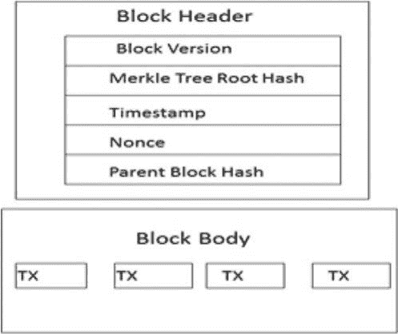

**图3.2**  区块的基本结构。

- iii. 时间戳：自1970年1月1日以来的当前通用时间，以秒为单位。
- iv. nBits：有效哈希区块的目标阈值。
- v. Nonce：一个4字节字段，通常从0开始，每次哈希估算时递增。
- vi. 父区块哈希：一个指向先前区块的256位哈希值。

区块体由计数器（counter）和交易组成。区块大小和每笔交易的大小决定了区块所能容纳的交易总数。交易的真实性通过非对称密码学方法进行验证[3]。如果区块链网络的多个节点同时产生有效的区块，就会在区块链中产生分叉。在这种情况下，网络选择最长的链作为原始链，并丢弃另一分叉中的所有区块。区块链的高层视图如图3.3所示。

区块链是一种P2P模型，所有对等节点同等重要。交易可以在所有节点生成时进行。节点根据已定义的规范验证交易。只有有效的交易才会被转发。这样，区块链中的每个节点在其本地副本中只会包含有效的交易。交易认证的验证基于数字签名[4]。

网络层之上的层是共识层。在去中心化环境和不可信节点之间，达成共识的过程由共识层处理。共识层由不同的共识算法组成。四种主要的共识算法是工作量证明、权益证明、委托权益证明（DPoS）和实用拜占庭容错（PBFT）。除了这些算法之外，还有少数不太流行的共识算法，如Stellar、带宽证明（PoB）、Tendermint、Ripple、权威证明（PoA）、燃烧证明、消逝时间证明（PoET）、空间证明、可检索性证明、活动证明、信任证明、BFT-SMART、运气证明和可扩展BFT。

激励层负责区块链网络的经济因素。它通过整合激励分配机制和激励发放流程，鼓励节点为验证数据做出贡献。因此，激励层充当区块链网络的推动力。

区块链的编程部分由合约层处理。智能合约、各种算法和脚本都在这一层中处理。智能合约

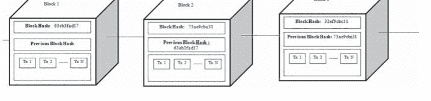

图3.3 区块链结构。


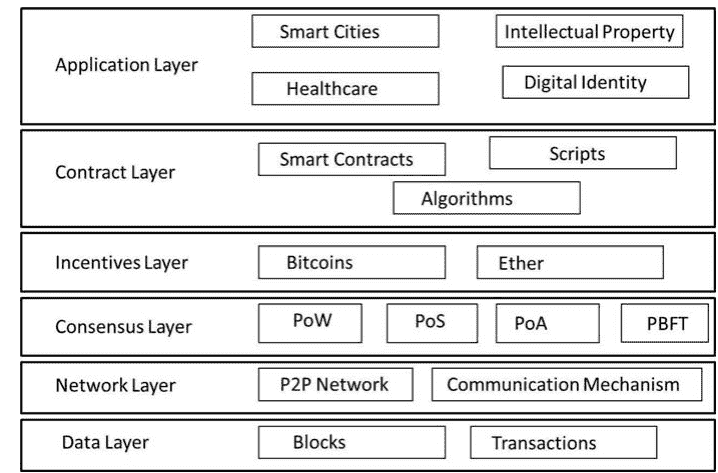

图3.4 区块链分解结构。

是一组记录在区块链中的自动执行程序。通过智能合约，可以控制数字资产、解释业务逻辑并制定用户权利。一旦交易相关方同意智能合约中提及的条件，合约将被加密签名并发送到网络进行验证。如果满足预定义条件，智能合约将按照所述规则自动执行。在以太坊中编写智能合约的著名编程语言是Solidity [5]。

架构中的最高层是应用层。它由物联网、医疗保健、数字身份、市场安全等业务应用组成。区块链架构的不同层次如图3.4所示。

#### 3.3.2 创世区块

比特币的第一个区块由比特币创始人中本聪于2009年创建，称为创世区块或0号区块。任何基于区块链的协议中的第一个区块都是创世区块。它被视为基础区块，后续区块在此基础上添加，形成一条区块链。Coinbase交易是矿工在他们创建的区块中放置的第一笔交易。该交易以比特币形式奖励矿工，因为其成功创建并在网络中广播了一个区块。创世区块包含区块中的交易数量、时间戳、区块难度等数据。创世区块的组成元素如图3.5所示。

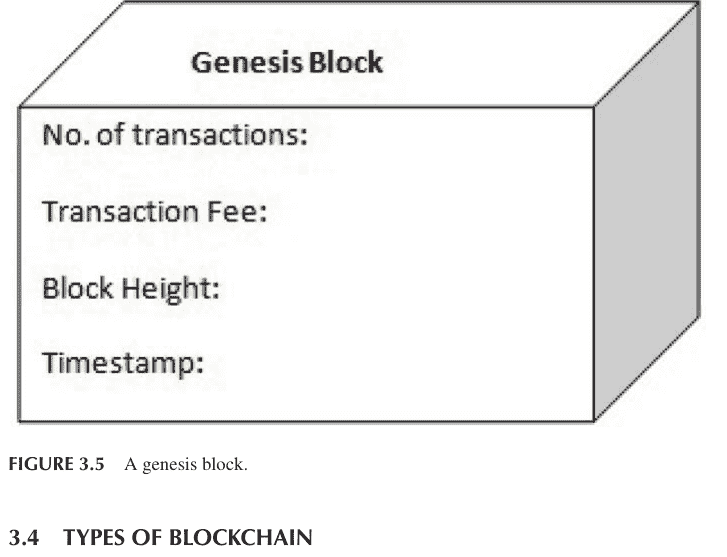

图3.5 创世区块。

### 3.4 区块链的类型

根据区块链的应用，可将其分为以下三大类型。每种类型相比其他类型都具备一些独特特征。

#### 3.4.1 公有区块链

公有区块链是一种开源且完全去中心化的系统，任何人都可以成为用户、矿工或开发者，任何人都可以参与并发布新区块。因此，公有区块链上的所有交易都是透明的。它也被称为“无需许可”的区块链，因为它允许任何人获取区块链的副本并参与区块验证。以太坊和比特币是公有区块链的最佳示例。由于公有区块链允许大量用户在网络中保持匿名，因此必须最大限度地降低恶意行为风险。为此，发布新区块需要解决一个计算上困难的难题。每笔交易都包含交易费，作为奖励发放给尝试发布区块的节点。

#### 3.4.2 私有区块链

私有区块链是一种需要许可的区块链，这意味着参与者需要获得同意才能加入网络。只有被允许加入网络的用户才能查看交易。由于运行该链的实体对参与者和治理结构具有更强的控制权，私有区块链比公有区块链更加中心化。它更适合于单个企业解决方案。

**表3.1 公有、私有和联盟区块链的评估**

| 属性 | 公有区块链 | 私有区块链 | 联盟区块链 |
|---|---|---|---|
| 用户访问 | 公开 | 受限 | 受限 |
| 用户身份 | 匿名/伪匿名 | 已批准用户 | 已批准用户 |
| 参与共识 | 所有节点 | 单一企业 | 多个企业中的选定节点 |
| 内容不可篡改 | 是，完全不可篡改 | 部分不可篡改 | 部分不可篡改 |
| 交易处理速率 | 低 | 高 | 高 |
| 是否无需许可 | 是，无需许可 | 需要许可 | 需要许可 |

私有区块链中没有代币或货币的交换。由于验证区块的节点彼此相识，因此不涉及交易费。因此，私有区块链不像公有区块链那样防篡改。如果企业愿意，可以在任何时间点对私有区块链进行回滚。Hyperledger是私有区块链的一个示例。

#### 3.4.3 联盟区块链

与私有区块链类似，联盟区块链也需要许可。另一方面，网络扩展到多个组织，并在相关各方之间提供问责机制。联盟区块链不涉及交易费，并且在计算上发布区块并不困难。联盟区块链兼具私有区块链的隐私优势以及公有区块链的安全和透明特性。它也被称为“混合区块链”。Dragonchain是混合区块链的一个示例。表3.1总结了不同区块链类型的特征。

### 3.5 区块链的特性

许多研究人员致力于区块链技术，他们的发现在推动该技术适用于众多应用方面具有重要影响。以下是区块链技术的显著特征。

#### 3.5.1 去中心化

在传统的中心化交易系统中，交易通过提供交易服务的中介进行。通常，银行充当系统的中央权威，控制一切。去中心化系统的主要目标在于消除中央权威的必要性，并在全球范围内建立一个由计算机（通常称为“节点”）组成的分布式系统。因此，网络中的所有节点都将拥有控制权，而不是只有一个单一权威。

### 3.5.2 透明性

区块链上发生的所有交易都是公开的，因此网络中的任何参与者都可以查看所有交易。这是区块链提供的、在中心化系统中从未有过的透明度。虽然区块链为用户提供匿名性，但通过用户的公开地址，仍然可以查看其进行的交易。

### 3.5.3 不可篡改性

不可篡改意味着一旦数据被录入区块链，就再也无法对该数据进行任何更改。这一特性提供了安全性，并向用户保证数据不会被篡改。

### 3.5.4 持久性

交易验证可以非常快速，无效交易能够被识别并且永远不会被允许进入区块。一旦交易连接到某个区块，就不可能删除或逆转它们。

### 3.5.5 匿名性

任何用户都可以使用其公开地址与网络中的其他用户进行通信。无法通过该地址识别用户身份，同时由于所有交易都记录在公共账本中，系统的透明度不会受到影响，从而保持了匿名性。然而，许多研究表明，利用适当的聚类和流量分析技术，可以追踪用户的身份。尽管如此，人们已经开展了大量工作来解决隐私和匿名性问题，并提出了各种方案来改善匿名性。

### 3.5.6 可审计性

区块链交易基于未花费交易输出（UTXO）模型存储客户余额数据。每当发生交易时，会引用未花费的交易。一旦交易完成并记录到区块中，未花费交易的状态将变为已花费。因此，交易可以很容易地被验证和追踪。

## 3.6 交易与数字签名

要想在区块链中进行交易或任何数据交换，网络节点需要一对私钥和公钥。节点使用私钥对交易进行签名，并将其发送到接收节点的区块链地址。这些地址可以通过对接收方公钥进行加密计算获得。SHA-256加密算法用于计算区块链地址。为了理解区块链上的交易，我们以一家公交公司为例。我们通过应用程序或网页订票。信用卡公司会对此交易收取处理费用。


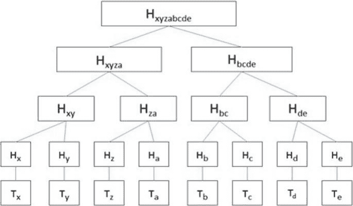

**图 3.7** Merkle 树。

哈希值。这种组合和哈希处理的过程将重复进行，直到获得最后一个哈希值。这个值被称为“Merkle 根”。在此示例中，H<sub>xyzabcde</sub> 是 Merkle 根，它是所有交易的哈希值。Merkle 根的大小为 32 字节，将被放置在区块头中。因此，区块头中的 Merkle 根代表了所有交易数据的摘要。如果任何交易发生任何变化，相应的哈希值也会改变，从而导致组合哈希值发生变化，最终产生不同的 Merkle 根。因此，Merkle 根有助于发现区块中的任何交易是否被篡改。使用 Merkle 根，还可以轻松检查某个特定交易是否被添加到区块中，而无需下载整个区块链。例如，如果用户需要检查 T<sub>a</sub> 是否在区块中，用户唯一需要的值是 H<sub>xy</sub>、H<sub>z</sub> 和 H<sub>bcde</sub> 的 Merkle 根。

## 3.8 SHA-256

SHA-256 是一种密码学哈希函数，它接受任意大小的输入，并产生固定大小的输出[8]。哈希函数更强大，因为它们是单向的，即如果给定一个输入，任何人都可以生成一个输出。然而，使用哈希输出值无法重新创建输入值。SHA-256 的强大特性使其非常适合区块链应用。

## 3.9 区块链如何工作

区块链是一种分布式、去中心化的公共账本，记录网络中的交易（见图 3.8）。区块链的工作方式可以通过一个例子来解释。假设用户 A 需要向用户 B 发送资金。要进行这笔货币交易，A 需要知道 B 的钱包地址。钱包地址更像是电子邮件地址，我们向它发送的是资金而不是电子邮件。当 A 向 B 发送资金时，交易就开始了。为了让这笔资金进入 B 的钱包，区块链网络中的每个节点都必须验证这笔交易。在此过程中，每个节点都会记录该交易。因此，数千条记录将存储在数千台计算机中。用户可能不喜欢他们的交易信息在许多计算机上可用的想法。区块链通过保持交易匿名来解决这个问题。为了维护网络中交易的完整性，节点使用共识协议、密码学哈希和数字签名。共识协议确保公共账本是精确副本，并最大限度地减少欺诈性交易的数量。如果任何用户想要更改任何交易记录，他们需要访问网络中的所有节点，这实际上是不可能的。SHA-256 是一种密码学哈希算法，用于确保交易的任何更改都会导致计算出新的哈希值，该哈希值表示可能已被破坏的交易输入。数字签名用于确保交易来自真正的发送者，而不是任何冒名顶替者。“矿工”是致力于设备和区块链的人。设备是网络上的节点，它们验证交易并将其存储在分布式账本中。这些矿工因其服务而获得比特币奖励。

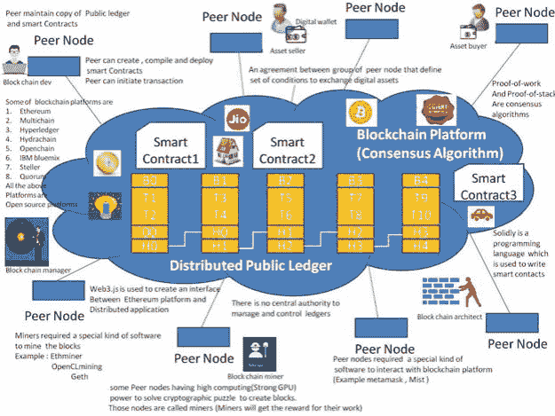

**图 3.8** 区块链交易。

## 3.10 区块链开源实现

有几种区块链技术的开源实现可供使用，从中选择一个使用是一项具有挑战性的任务。表 3.2 中比较了几种区块链实现。

## 表 3.2

### 开源区块链模型比较

| 属性 | 比特币 | 以太坊 | 超级账本 | Corda |
|---|---|---|---|---|
| 一般描述 | 通用区块链平台 | 标准区块链平台 | 模块化区块链平台 | 面向金融科技的专业分布式账本 |
| 管理机构 | 公开 | 比特币开发者 | Linux 基金会 | R3 |
| 运行模式 | 无需许可——公开 | 无需许可——私有或公开 | 需要许可——私有 | 需要许可——私有 |
| 智能合约 | 无 | 有（代码用 Solidity 编写） | 有（代码用 Go、Java 编写） | 有（代码用 Java、Kotlin 编写） |
| 共识 | PoW | PoW/PoS | PBFT | 无特定机制 |
| 货币 | 比特币 | 以太币 | 无 | 无 |
| 优点 | 可以容纳网络中任意数量的节点 | 可扩展，且 PoS 所需计算量不大 | 比其他所有框架更快 | 隐私性和互操作性 |
| 缺点 | 耗时且计算成本高 | 需要财富或质押 | 无法扩展更多节点 | 不能用于金融领域之外 |

### 3.10.1 比特币

比特币的设计是公开的，不归任何人所有或控制，每个人都可以成为该网络的一部分。关于比特币的详细讨论，请参阅第 1 章[9]。

### 3.10.2 以太坊

以太坊是基于区块链技术的开源软件[10]。它是一个分布式的公共区块链网络。它使开发人员能够开发和部署去中心化、分布式的应用程序。以太坊与比特币相似，但两者的目的和能力不同。比特币提供区块链的一个特定应用，即点对点电子现金系统。相比之下，以太坊强调运行任何去中心化应用程序的代码。在以太坊中，矿工们努力获得以太币，而在比特币网络中，矿工们努力挖掘比特币。以太币是另一种运行以太坊网络的加密代币。以太坊还有另一种加密代币，称为 gas，它将作为交易费用发放给矿工。

### 3.10.3 超级账本

超级账本是由一组跨行业专家开发的另一个开源区块链框架。它采用了协作软件开发方法，确保安全性、透明性和互操作性。超级账本提供广泛的工具和框架来创建基于企业的解决方案。

### 3.10.4 Corda

Corda 是另一个开源区块链平台，用于收集和处理遵守智能合约的金融协议。任何建立在 Corda 上的服务都与网络用户兼容。Corda 是唯一同时提供私有网络隐私和公共网络互操作性的平台。

除了所讨论的开源平台之外，还有相当多其他流行框架，如 Quorum、Openchain、Hydrachain 和 Multichain。

## 3.11 测试网

用于测试的另一种比特币区块链是测试网[11]。简而言之，测试网是运行在主机上的区块链副本，主要用于测试目的。测试网不仅适用于比特币，也适用于每一个区块链实现的源代码中的某一点。这是因为测试网是功能性区块链开发过程中的重要组成部分。测试网币没有任何货币价值，与实际比特币不同。由于它没有财务价值，应用程序开发人员或测试人员无需使用昂贵的比特币，就可以轻松进行实验。到目前为止已经存在三代测试网。Testnet2 是第一次使用新的创世区块进行的测试网重置，因为人们开始用测试网币兑换合法货币。当前运行的测试网络是 Testnet3。测试网和主网之间有两个主要区别：（i）networkId——网络标识符是网络的标识；（ii）创世区块——链的第一个区块。由于这两者在完全不同的网络上运行，因此它们具有不同的创世区块，尽管区块的内容可能相同。

与主区块链相比，测试网收到的交易较少，通常规模也小得多。自 2018 年 1 月以来，磁盘存储大小为 14 GB，其中包含预计可运行约六年的测试网数据。要下载这些数据，需要大约 12 GB 的网络流量，传输速率峰值可达 2 MB/s。测试网执行如下一些重要功能。

### 3.11.1 持续开发

区块链技术仍处于起步阶段，需要大量的开发和测试才能获得主流的接受和实践。为了克服区块链的各种挑战，需要进行大量的研究和严格的测试。最终，测试网模拟了真实链在真实世界条件下的运行方式。

### 3.11.2 防止中断

由于测试网是真实链的副本，很明显，在真实链上进行测试会更加困难，因为组件之间复杂的交互可能会破坏网络，甚至破坏链。因此，测试网有助于确保在启动真实链之前一切功能正常。


## 3.12 支付验证

在比特币网络中，简化支付验证节点将拥有区块链的一个子集，即仅有区块头。简化支付验证（SPV）节点主要使用 Merkle 树。为了检查交易是否被添加到区块中，它使用 Merkle 路径或认证路径。这消除了下载所有交易的需求。例如，考虑一个愿意接收钱包中地址付款的 SPV [12] 节点。SPV 节点在其与对等方的连接上安装 Bloom 过滤器，以将接收到的交易限制为仅与感兴趣的地址相关的交易。如果对等方识别出与 Bloom 过滤器匹配的交易，则将使用 merkleblock 消息提交该区块。merkleblock 消息包含一条将交易连接到区块的 Merkle 根的 Merkle 路径以及一个区块头。SPV 节点可以使用此 Merkle 路径将交易连接到区块，并可确保交易包含在链中。SPV 节点使用区块头将区块连接到区块链的其余部分。区块与交易之间的联系以及区块与区块链之间的连接表明交易已插入区块链。

## 3.13 优势与挑战

### 3.13.1 优势

#### 3.13.1.1 去中心化

交易过程中没有第三方干预。用户拥有的任何加密货币都只属于用户。没有中央机构可以拥有或处理它。去中心化网络提供防止腐败和篡改的保护。

### 3.13.2 透明且匿名

除非用户共享钱包地址，否则很难追踪用户的地址。即使用户公开了，也很容易生成另一个钱包地址。因此，用户的隐私将得到维护。同时，由于所有区块链交易都记录在公共账本中，区块链在不失去透明性的同时保留了保密性。虽然少数研究工作指出区块链中的交易可通过聚类和流分析技术追溯，但许多研究提出了不同方案以增强匿名性。

### 3.13.3 交易费用低且无税

由于区块链交易本质上是去中心化和匿名的，实际上没有办法征收任何税款，且即时交易不涉及成本。即使涉及任何成本，也远低于信用卡、PayPal 或银行转账 [7]。

### 3.13.4 防盗性

除非对手知道与用户钱包关联的私钥，否则不可能从任何用户那里窃取比特币。然而，如果用户以任何方式丢失了与钱包关联的私钥，钱包中的比特币也将永远丢失且无法恢复。

尽管区块链对互联网的改善具有诸多益处，但它也必须面对一些技术挑战。

### 3.13.5 可扩展性

可扩展性是一个巨大的挑战。比特币区块的大小限制为 1 MB，且挖矿一个区块需要 10 分钟。由于比特币网络的速率限制为每秒七笔交易，因此无法处理高频交易。然而，如果区块大小增加，存储空间也会增加，并且会减慢网络速度。这导致了中心化，因为较少的消费者希望管理如此庞大的网络。因此，安全与区块大小之间的权衡是主要关注点。

### 3.13.6 高能耗

区块链网络使用 PoW 模型来实现共识。尽管 PoW 模型可保护挖矿过程免受 Sybil [8] 攻击和双花等各种安全威胁，但它需要大量能源和计算资源来计算区块所需的哈希值。

### 3.13.7 自私挖矿

在区块链中，自私挖矿策略允许矿工获得超过公平份额的更大收益。矿工未来可能会隐藏其挖出的区块以获取更多收益。这可能导致区块链出现多次分叉并阻碍区块链的发展。

### 3.13.8 隐私泄露

在一定程度上，隐私可以通过公钥和私钥对实现。用户通过此密钥对进行交易，而无需知道真实身份。由于每个公钥的交易和余额都是公开的，区块链无法保证交易隐私。此外，用户的身份也可以通过其交易进行监控。

## 结论

区块链，简单来说，可以定义为由不属于任何单一实体的计算机集合管理的、不可变的、带时间戳的数据区块序列。这些区块中的数据均经过加密，并使用密码学原理聚合成簇。区块链网络没有中央机构——这正是去中心化系统的定义。由于它是公共且永久的账本，其包含的信息对任何人都是开放的。因此，任何在区块链上开发的东西都是透明的，其行为对所有相关人员负责。

没有中央机构发行或控制比特币，但它是通过一个名为 *挖矿* 的过程创建的。挖矿是一个过程，其中所有合法交易都存储在区块中并包含在名为“区块链”的账册中。添加的区块与之前的区块相链接，以禁止重复使用比特币。要将区块添加到区块链中，对等方需要一个满足使用 SHA-256 密码哈希函数特定方程的 nonce 值。找到一个 nonce 值是一项计算成本高昂的任务。因此，找到合适 nonce 值的节点将获得奖励。然而，当每个节点尝试中继其找到的区块时，这种验证交易的方法可能会令人困惑。因此，为避免这种情况，网络中的所有对等方之间制定了共识算法，以决定应添加哪些区块、哪些对等方被允许包含区块等。

共识算法旨在安全地更新复制的分布式状态，是区块链运行原理中的关键要素。共识协议确保共享状态的副本在任何给定时间在区块链中同步并被接受。根据参考文献 [1] 和 [2]，在完全异步通信模型中，确定性共识无法识别任何故障。因此，需要在最大交易传播延迟阈值下做出部分同步假设。密码学和部分同步、数字货币和前身设计是共识协议的一些先前工作。这些是区块链网络创建“去中心化”共识算法的构建模块。

到目前为止，已提出了几种共识算法，将在本书后文章节中讨论。

2009 年，引入了许多比特币变体，如 Ethereum [3] 和 Nxtcoin [4]。任何人都可以随时加入和离开网络的变体称为“公共区块链”。由于节点可以随时加入和离开，很难预测节点的确切数量；因此，应用共识概念很困难。如果节点数量过高，交换协议并达成所有节点的共识就更加困难。另一方面，要在区块链中添加区块，节点必须证明其相对于其他节点的质量。因此，提出了名为“基于证明的共识”的共识算法。

工作量证明（PoW）[5] 是基于证明算法的第一个版本。在此共识算法中，节点可以使用其计算资源在网络上广播其区块。后来还提出了几种其他基于证明的算法，如权益证明（PoS）、经过时间证明、空间证明和运气证明。注意到区块链的能力，许多大型组织如 JP Morgan 和 IBM 已开始探索该技术。这催生了区块链中的许多其他平台，如私有区块链、联盟区块链等。与公共区块链不同，私有区块链仅允许来自单一组织的节点参与验证过程。在联盟区块链中，节点可以来自不同的联盟，但只有被允许的节点才能进入网络。这些平台上的共识基于多数结果。因此，它们也被称为“基于投票的共识算法”。遵循基于投票的共识算法的节点可以是（i）容错崩溃或

- (ii) 拜占庭容错（BFT）。基于证明的共识算法甚至可以应用于私有链和联盟链，因此不仅限于公有链。

### 4.2 X证明（PoX）方案

#### 4.2.1 达成共识——拜占庭将军问题

通常，比特币以分布式方式达成共识。需要某种冗余来保证容错性，冗余程度取决于故障类型。例如，假设三个对象持有一个值，其中一个对象发生故障并返回相同的错误值。通过比较结果并确定正确值，很容易找到故障对象。因此，当有 f 个故障时，网络需要 n≥2f+1。然而，故障大致可分为恶意故障和随机故障。这些故障被称为“拜占庭将军问题”[6]。真正的拜占庭问题是 n 位将军试图通过信使共同决定作战计划，而其中 f 位将军是试图破坏协议的叛徒。这个问题类似于分布式系统尝试达成共识。在一致且可信的通信下，拜占庭将军问题可以达成共识[6]。Fischer–Lynch–Paterson（FLP）证明表明，异步共识协议无法容忍任何故障。比特币在挖矿过程中使用随机性并频繁调整。它不会为验证过程分配任何最终或固定的对等节点。相反，它制定了一条经验法则：交易在六次确认后即可完成。

另一种直接采用拜占庭协议结果的技术是 Ripple。为了建立共识，Ripple 使用一组可靠的权威节点。它采用基于轮次的共识来做出最终决策。最终决策不过是所有账户的当前状态。Ripple 共识机制实现了 5f+1 的容错能力。

另一种共识方法是时序模型。在同步消息传播中，每条消息在一段时间后到达。耗时较长的消息被视为故障。另一方面，在异步传播中，不对消息传递做任何决定。参考文献[7]指出，时序模型在异步模型中可能不可行，因为消息通常需要更长时间才能送达。

此外，比特币的匿名性使拜占庭故障更难处理，因为任何攻击者都可能引入虚假对等节点来扰乱选举过程，从而发动女巫攻击（Sybil attacks）。然而，中本聪表示，比特币以现实的方式处理拜占庭问题。比特币假设未知规模的同步网络会降低确定性限制，并接受最终一致性。根据参考文献[8]，在这些概念下，可以推导出 2f+1 的容错性，其中 f 是恶意矿工（拜占庭故障）的哈希算力总和。这意味着即使网络中存在恶意矿工，只要诚实矿工持有超过一半的哈希算力，网络仍能达成共识。比特币只有在保持同步特性的情况下才具有容错性。因此，诚实矿工之间的信息传输尤为重要，尤其是当恶意用户的哈希算力达到阈值时，这可能使系统变得脆弱且不安全。

分别称为“坎宁安链”和“分布式存储”。尽管这些方法除了保护区块链之外还提供了一些附加价值，但也存在一些困难，如微调（fine-tuning）和早期结果的不可复用性。

### 4.2.3 权益证明（Proof of Stake）——解决激励问题

尽管比特币清楚地表明基于 PoW 的货币是可行的，但仍然存在弱点。比特币的用户通过通货膨胀过程向矿工支付费用以保护货币。然而，当区块奖励随时间递减时，未来仍不确定。显然，区块奖励大约每四年减半（即每 210,000 个区块）。在首次奖励减半后，我们可以注意到难度略有下降，这表明矿工离开了网络。如果规定的币供应量继续按定义运行，奖励大约在 2032 年将低于 1 BTC，并在 2140 年降至零。根据参考文献[9]，这种通货紧缩是一个自我毁灭的过程。它通过让矿工离开网络而使数字货币的保护面临风险。交易费用是否足以弥补奖励并为矿工提供必要的激励仍不清楚。矿工策略与挖矿奖励之间的联系遵循基于博弈论的权衡。一旦矿工找到解决方案，必须在其他人宣布下一个区块之前传播出去才能获得奖励。区块数量不影响 PoW 的难度，但数量越多，达成共识所需的时间就越长：区块在网络中传播的时间越长，其包含的字节就越多。如果一个区块中有更多交易，验证其有效性需要更长的时间，但交易数量越多，奖励越高。纳什均衡是指没有任何个体可以通过改变策略而受益的点。有趣的是，在这种纳什均衡中，矿工不会在其区块中包含任何交易。这无疑会使比特币完全无用，这也会影响矿工。一旦交易费用增加或区块奖励显著下降，纳什均衡就会发生转移。这意味着可能存在对交易费用的激励。

然而，激励下降会导致公地悲剧（tragedy of the commons）[10]。这是一个博弈论术语，指的是个体独立行动通过减少公共资源来降低群体的长期收益。现在让我们审视 PoW 的替代方案，这使我们重新审视必须满足的基本要求：第一，区块生成必须在某种程度上是“昂贵的”，并且单个矿工不能获得过高的铸币潜力。第二，最终必须达成共识；必须建立共同规则来解决分叉并确定主区块链。最后，它应该是不可欺诈的。

币龄（Coin age）被认为是 PoW 的一种可能替代方案。币龄是指货币处于非活跃状态的时间量。假设用户 A 向用户 B 发送了两个币，用户 B 保留了这些币 80 天，那么币龄就是 160 币天。当用户 B 花费这两个币时，所积累的币龄就被破坏。这种利用币龄来描述激励的方法被称为权益证明（Proof-of-Stake，PoS）。它应用于 Peercoin。PoS 区块挖矿需要一个权益交易（coinstake）区块（类似于比特币的 Coinbase 交易）。所有者在一个权益交易中将币发送给自己，并添加一个预先定义的百分比作为奖励。要成功挖出一个区块，需要一个小于或等于目标值的哈希值。与 PoW 不同，难度是单独确定的。由于哈希基于静态数据（除时间范围外），矿工无法利用计算力比其他矿工更快地解决难题。没有可以更改的 nonce。相反，时间戳每秒都在变化，矿工每秒钟都获得新的机会来发现答案。当找到解决方案时，权益交易区块会被广播到服务器。矿工收集权益交易提供的奖励，同时重置币龄。当然，随后可以再次积累新的币龄，慢慢增加下次解谜的机会。

币龄之于 PoS，就如同计算能力之于 PoW。但关键区别在于，这种“权力”与计算机算力无关。因此，PoS 回应了 PoW 浪费资源的指责。与试图在 PoW 中赋予内在价值的 Primecoin 不同，PoS 大大降低了高能耗。此外，矿工通过索取奖励来消耗币龄；他们不会为下一轮保留币龄。这些特性降低了公地悲剧问题中存在的垄断威胁。平等的投票权被分配。因此，“富者愈富”被“贫者愈富”所平衡，这意味着每个参与者都可以提供 PoS，从而帮助保护区块链，并且通过持有代币获得一定比例的激励。PoS 货币似乎使用成本更高。PoS 将总销毁币龄最高的链声明为主链，这与 PoW 中最长区块链存活的机制形成对比。为了实际目的，PoS 被添加以补充 PoW，并在 PoW 激励消退时成为主要因素。尽管如此，诸如 Nextcoin 等山寨币也有完整的 PoS 平台。诸如交易权益证明（TaPoS）和委托权益证明（DPoS）等衍生方案旨在缓解垄断问题，同时通过获取更广泛的投票来使系统更安全。

### 4.2.4 活动证明（Proof of Activity）——促进积极参与

PoS 提供了 PoW 的替代方案，但它也有许多局限性。根据参考文献[11]，当区块奖励减少且需要评估交易费用时，会导致一种被称为“公地悲剧”的情况，其中矿工必须为每笔支付维持一个奖励，包括给自己留一些费用。最终，矿工不会广播支付以减少竞争。Peercoin 取消了费用，而不是向矿工支付交易费，从而消除了不合作的动机。然而，PoS 存在某些缺点。它完全依赖于币龄，而币龄只能通过持有代币获得，并且可以在权益交易中索取。在日常交易中花费代币，即定期将代币分配给他人，也会消耗币龄，因为这些代币不参与 PoS 抽奖。

然而，最大的弱点是，即使节点未连接到网络，币龄也会累积。换句话说，一个节点只需在线一段时间然后离线即可。这种行为会导致奖励分配比节点始终保持在线时更具突发性，但很可能投资者

将接受这一点。在线节点数量不足也会使威胁加剧。任何旨在以某种方式激励的奖励结构都必须注意 Sybil 攻击。

PoS 的高级补偿方案表明，增加活动将带来更健康的经济。他[11]解决了币龄是线性时间变量的问题。实际上，为了缓解上述一些问题，Peercoin 使用了币龄的上限和下限。例如，将增量函数切换为指数衰减函数将产生深远影响。在这样的系统中，币龄的增长率随时间递减，并线性收敛到零。衰减常数的参数化可以明确定义该特征的半衰期。它改善了激励：新币在达到固定值之前积累币龄的速度要快得多。这个简单的想法被称为 PoS 速度，并已在 Reddcoin 中实现。

解决方案是专门奖励积极节点的努力。这个想法是将 PoW 区块奖励的一部分分给所有活跃节点，而它们的权益将衡量奖励的份额，也就是它们获胜的机会。因此，它是工作量证明和 PoS 的混合体。矿工挖掘空区块。如果 PoW 问题得到解决，它将像以前一样在网络中广播。任何收到该区块的人都会从中推导出 N 个确定性伪随机票据。前 N−1 个用户使用各自的私钥签署区块并发送签名。如果第 N 个最幸运的权益持有者看到该区块，它会产生一个标签，包含区块、所有交易、N−1 个签名，并添加自己的签名，然后传输封装后的区块。如果区块和幸运投资者都是正确的，其他人将认为它是区块链的真实延伸。交易费用最终将在投资者和生产者之间分配。

其基本概念是奖励活跃的在线节点。如果任何权益持有者离线，他将无法回复并包含其签名。因此，区块无法完成。另一个矿工将在某个阶段解决工作量证明，并抽取特定的 N 个权益持有者。改变哈希率和参与节点比例的概念被称为活动量证明（PoA）。这种方法奖励参与的权益持有者，而不是惩罚被动的权益持有者。PoA 增强了安全性：攻击者除了需要大量计算能力外，还需要一定数量的权益才能执行双重支付。PoA 在某些方面是点对点网络的重要组成部分。例如，BitTorrent 协议具有内置的直接互惠奖励机制（“以牙还牙”）。这种方法的有效性已被多次证明。需要注意的是，比特币网络遵循不同的目标，即快速区块传播而不是文件共享。因此，PoA 可以被视为间接互惠。

### 4.2.5 经过时间证明

Hyperledger Sawtooth [12] 是一个开源项目，它使用自己的共识算法，称为经过时间证明（PoE）。它由英特尔的软件保护扩展（SGX）开发，这是一种可信执行环境（TEE）。基于 SGX 的可信投票系统有助于选择验证器来发布新块。PoE 是一种基于彩票的共识算法，但它无法满足解决复杂、昂贵的数学难题的需求。

在 Sawtooth 区块链网络中，节点向 SGX 内的可信方法请求等待时间。获胜者根据最短等待时间选出。另一个可信方法证明验证器在新区块发布前确实等待了一定时间。因此，在分配的时间过去后，验证器的证明被选中。

### 4.2.6 TENDERMINT

Tendermint 是一种实用拜占庭容错（PBFT）共识算法。与 PBFT 类似，它提供了 n = 3f + 1 的容错性。它结合了权益证明和 PBFT 概念，以确保安全性、高吞吐量以及低区块下 1–3 秒的处理时间。在 PBFT 中，领导节点是伪随机选择的，而 Tendermint 则采用基于彩票的 PoS 特性，以与权益持有者网络份额成比例的概率选择领导节点。Tendermint 在成员选择后进行了多轮投票，以就添加新区块达成共识，从而保持 100% 的在线率。它需要大多数（约三分之二）的验证者，如果超过三分之一的网络离线，网络的进展可能会停止并失去生产力。交易被组织起来，如果所有验证者中不可靠的比例低于三分之一，它提供安全性保证，即不会创建竞争区块，区块链中也不会出现分叉。Tendermint 兼容公有链或私有链，但它的可扩展性不如 PoW 或 PoS。

### 4.2.7 联邦 BFT

Ripple 和 Stellar 的区块链实现扩展了传统 BFT，适用于节点联盟或联合体的情况。Ripple 共识从一个独特的节点列表（UNL）开始，该列表包含网络中活跃的验证节点列表。每个节点都有一个包含 100 多个节点的节点列表，每个列表与其他节点存储的列表至少有 40% 的重叠。Ripple 进行多轮投票，节点将交易编译为候选区块并广播给列表中的其他节点。随后，节点对每个候选区块发送投票。每轮投票都让节点优化其候选区块，一旦收到 80% 的多数投票，新区块就会被引入列表。因此，通过进行多轮投票，Ripple 提供了 n = 5f + 1 的容错性。

在区块链网络中，Stellar 提出了法定人数（quorums）的概念。法定人数是用于达成共识的一组节点。这样的网络中的节点将成为多个法定人数切片的一部分，其中每个法定人数切片通过投票安全地达成共识。由于法定人数和法定人数切片被允许在主 Stellar 网络中汇聚，Stellar 允许在不同子网络中开放节点参与。由于 Stellar 选择安全性而非活性属性，当网络中出现恶意行为时，区块链将不会前进，直到恶意活动被解决。Stellar 提供灵活的信任和低延迟，因为其计算成本可承受。法定人数包括一组有限的节点，它们交换投票消息。

表 4.1 对迄今为止讨论的共识模型进行了比较。

**表 4.1 区块链共识机制比较**

|  | PoW | PoS | PoET | BFT | 联邦 BFT |
|---|---|---|---|---|---|
| 区块链类别 | 无许可 | 有许可和无许可 | 有许可和无许可 | 有许可 | 无许可 |
| 交易决策 | 可能 | 可能 | 可能 | 即时 | 即时 |
| 交易速度 | 较慢 | 较快 | 中等 | 较快 | 较快 |
| 代币要求 | 需要 | 需要 | 不需要 | 不需要 | 不需要 |
| 参与成本 | 需要 | 需要 | 不需要 | 不需要 | 不需要 |
| 网络可扩展性 | 较高 | 较高 | 较高 | 较低 | 较高 |
| 信任模型 | 不可信 | 不可信 | 不可信 | 半可信 | 半可信 |
| 对抗者容忍能力 | ≤25% | 取决于所用流程 | 未知 | ≤33% | ≤33% |

## 4.3 共识算法中的性能与可扩展性

考虑网络中各节点的传输速度，无许可区块链预计会有较慢的区块生成速度。另一方面，有许可区块链的延迟要低得多，但存在严重的可扩展性问题。投票系统产生的网络开销限制有许可区块链只能在有限范围内扩展，即只能支持数百个节点。有许可区块链的最坏情况复杂度为 O(N^2)，而无许可区块链的最坏情况复杂度为 O(N)。因此，从 PoW 共识到 PBFT 共识，在效率和可扩展性之间存在巨大的权衡。无许可区块链由于其匿名性和去中心化原则，更适合物联网（IoT）相关应用；而有许可区块链由于其更高程度的控制和授权及权限授予能力，更适合企业解决方案。

## 结论

简要讨论了各种共识机制，并从多个方面对这些协议进行了分析和比较。还研究并展示了这些算法的性能和可扩展性方面。


## 参考文献
- 1. M. J. Fischer、N. A. Lynch 和 M. S. Paterson，“存在一个故障进程时分布式共识的不可能性”，*ACM 期刊（JACM）*，第 32 卷，第 2 期，第 374–382 页，1985 年。
- 2. D. Dolev、C. Dwork 和 L. Stockmeyer，“关于分布式共识所需的最少同步性”，*ACM 期刊（JACM）*，第 34 卷，第 1 期，第 77–97 页，1987 年。
- 3. https://www.ethereum.org。
- 4. S. Popov，“Nxt 锻造算法的概率分析”，*账本*，第 1 卷，第 69–83 页，2016 年。
- 5. A. Back，“Hashcash：一种拒绝服务对策”，2002 年 [在线]。可用：ftp://sunsite.icm.edu.pl/site/replay.old/programs/hashcash/hashcash.pdf。
- 6. L. Lamport、R. Shostak 和 M. Pease，“拜占庭将军问题”，*ACM 编程语言与系统汇刊*，第 4 卷，第 3 期，第 382–401 页，1982 年。
- 7. M. K. Aguilera，“在共识研究上绊倒：误解与问题”，载于 Bernadette Charron-Bost、Fernando Pedone 和 André Schiper（编），*复制*。纽约州纽约市：Springer，2010 年，第 59–72 页。
- 8. A. Miller 和 J. J. LaViola，Jr.，“基于中等难度谜题的匿名拜占庭共识：比特币模型”，计算机科学系，佛罗里达大学，盖恩斯维尔，佛罗里达州，美国，技术报告，2014 年 4 月 [在线]。可用：http://tr.eecs.ucf.edu/id/eprint/78。
- 9. N. T. Courtois，“关于最长链规则和加密货币的程序化自毁”，计算研究存储库，技术报告 abs/1405.0534，2014 年。
- 10. G. Hardin，“公地悲剧”，*科学*，第 162 卷，第 3859 期，第 1243–1248 页，1968 年。
- 11. G. Pickard 等，“时间紧迫的社会动员：DARPA 网络挑战获胜策略”，计算研究存储库，技术报告 abs/1008.3172，2010 年。
- 12. N. Szabo。“比特黄金。”2005 年 12 月 12 日 [在线]。可用：http://unenumerated.blogspot.de/2005/12/bit-gold.html。

## 5 区块链
*共享信息背后的技术介绍*

Naseem Ahamed
ICFAI 商学院

## 目录
- 5.1 区块链技术导论....................................66
- 5.1.1 区块链：区块链的类型....................................66
- 5.1.2 公有区块链....................................67
- 5.1.3 私有区块链....................................67
- 5.2 传统系统的问题：信任岌岌可危....................................67
- 5.3 解决传统系统的问题：中本聪白皮书....................................68
- 5.3.1 通过去中心化架构赋能参与者........68
- 5.3.2 通过共识算法验证区块....................................69
- 5.3.3 增强的安全特性....................................70
- 5.4 保密条款：加密与解密....................................70
- 5.5 自我可持续架构：对矿工的激励....................................71
- 5.6 安全特性：数字签名....................................71
- 5.6.1 哈希....................................71
- 5.6.2 合并多个哈希签名....................................72
- 5.7 未来之路....................................73
- 5.7.1 对现有行业的影响：新一轮技术革命浪潮....................................73
- 5.7.2 对现有行业的影响：注定失败....................................74
- 5.8 区块链技术的应用....................................75
- 5.8.1 产品认证....................................75
- 5.8.2 创意产业与学术界....................................75
- 5.8.3 投票与治理....................................75
- 5.8.4 资产的存储与转移....................................76
- 5.8.5 将服务提供商与客户直接连接....................................76
- 5.8.6 血型和/或器官捐献者名单....................................76
- 5.8.7 阻止分销渗漏....................................77
- 结论....................................77
- 参考文献....................................77

## 5.1 区块链技术导论
区块链是一种使参与者能够基于共识算法验证现有信息区块并添加新区块的技术。它会生成带有时间戳的信息块，这些信息块封装在由哈希签名保护且本质上不可变的区块中。随着新参与者的加入和使用频率的增加，网络中的区块不断累积，网络规模也随之增大。用户需要根据其使用区块链的意图，在其计算设备上下载部分或全部区块链架构。一旦信息被验证并添加到区块中，该信息就对区块链中的每个人公开可见，因此它也被广泛称为分布式账本系统。区块链技术可用于多种目的，但广为人知的是作为一种加密货币交易技术（比特币是最流行的加密货币之一）。在流行文化中，区块链和比特币 [1] 之间的区别是模糊的，因为两者常被混用。然而，说区块链和比特币相同，类似于说电和灯泡相同。众所周知，电是一种具有无数应用的技术，灯泡只是其中之一。类似地，区块链是一种有多种应用的技术，包括比特币。^1 随着时间推移和用户群体的接受，其他货币进入竞争，带来了更多应用，如智能合约和其他分布式应用。

^1 比特币是一种极受欢迎的加密货币的名称。加密货币是一种虚拟资产，可以用作交换媒介替代法定货币。它使用先进的密码技术来防止篡改和双重支付，并确保安全性。

### 5.1.1 区块链：区块链的类型
关于区块链的另一个普遍误解是，存在一个包含所有交易信息的、单一且全面的全球区块链。然而，这与事实相去甚远，因为存在多个区块链网络。这些网络上的内容将由维护它们的用户决定，例如，交易比特币的区块链网络只是一个用于比特币点对点交易的网络。然而，以太坊 [2] 是一个不同的区块链平台 [3]，它不仅允许用户交易以太币^2，还允许用户在网络中制定和维护智能合约^3。多个区块链可以同时存在，并承载各自的信息。区块链主要有两种类型，即公有区块链和私有区块链。

^2 以太币是以太坊平台上使用的加密货币的名称。它是比特币的一种替代货币。

^3 智能合约是一种用词不当的说法，因为它并非真正意义上的合约。它是一种基于条件的文档，根据所述条件的满足情况执行预定操作。

一个非常简单的股票交易领域示例是，投资者为某只股票设定一个阈值最低价。当股价跌至该阈值价格以下时，卖出指令会自动执行，销售收入会存入其交易账户。

供应链领域的另一个示例是，一旦货物到达仓库内并签署发票，供应商的账户就会自动入账。

### 5.1.2 公有区块链
公有区块链，顾名思义，是一个不要求新参与者获得任何许可的网络。它没有任何限制，任何人都可以加入并通过（使用工作量证明方法或其他方式验证交易）为区块链的增长做出贡献。新参与者只需下载现有区块链并加入网络即可。公有网络上的认证激励是少量挖矿费用，即验证比特币交易的矿工会收到一些比特币作为费用。

### 5.1.3 私有区块链
然而，私有区块链是一个确实需要网络管理员邀请的网络。新加入的参与者可以获得网络的完全或部分访问权限。完全访问意味着新参与者不仅可以查看信息，还可以验证后续信息并在过程中添加新区块。部分访问可能意味着他没有验证权限。因此，在私有区块链中，新参与者的访问程度由该区块链的所有者决定。此类区块链更常用于组织内部员工之间。

### 5.2 传统系统的问题：信任岌岌可危
在其当前形式下，金融世界建立在一个由中介机构在利益相关方之间执行交易的架构之上。银行和金融机构等中介机构对客户负有信托责任。正是由于这种信托责任的性质，参与者必须信任中介机构。中介机构以小额佣金/费用执行交易。然而，很多时候，它们背离了信托责任，以自我利益行事，要么通过高管的寻租行为，要么以其他方式。世界目睹了曾经强大的雷曼兄弟的垮台。其他巨头也感受到了压力，包括美国国际集团（AIG）、美林、房地美、房利美和苏格兰皇家银行等 [4]。投资者对金融机构作为其金融交易的保管人或中介的非信托行为越来越不信任。类似的情况此前曾导致 2002 年《萨班斯-奥克斯利法案》的颁布。尽管区块链作为一种技术已经被试验和开发了几十年，但直到中本聪 [5] 的白皮书出现后，区块链技术才进入公众讨论。该论文的发布时间恰逢世界在过去几十年中经历的最严重的金融危机之一。


## 5.3 解决传统系统的问题：中本聪的白皮书

中本聪的文章正好回答了人们心中的疑问。在投资者眼中，金融中介机构常常被视为一种“必要之恶”，即他们并不完全信任这些机构，但没有其他替代服务可选。中本聪不仅通过其点对点电子现金系统网络提出了这些金融中介机构的替代方案，还断言该系统不会向投资者收取任何额外的服务费或佣金（图5.1）。

### 5.3.1 通过去中心化架构赋能参与者

这对投资界来说是一个双赢的局面，他们可以拥有安全可靠的通道来执行交易，并节省额外的服务相关费用。这个想法迅速传播开来，区块链支持者声称，区块链技术可以解决我们当前金融系统的现有问题。当前金融系统是一个中心化系统，是腐败滋生的完美条件。此外，将所有数据存储在单一位置使其容易遭受盗窃、操纵等，而区块链在设计上就是一个去中心化系统。它就像一个运行在多个系统上的带时间戳的公共账本，并且不可篡改。任何试图入侵该系统的个人或团体，

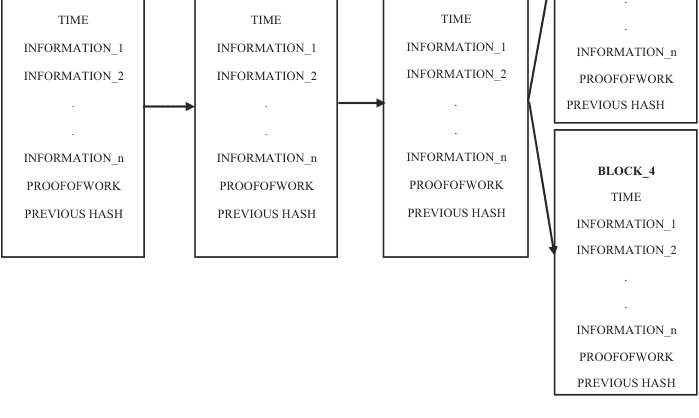

图5.1 区块链架构的简化结构。

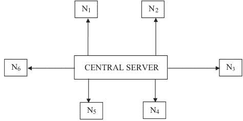

**图 5.2** 传统中心化系统的结构。

都需要与其余节点达成共识，而这本身极不可能。此外，进行这种协同攻击所需的资金、计算能力和其他资源（内存等）对黑客来说也不值得（图5.2）。

因此，通过设计上的去中心化控制，区块链不易受到攻击，而且单个节点故障并不意味着整个结构崩溃。

### 5.3.2 通过共识算法认证区块

与现有系统相比，区块链技术非常民主。在区块链中，经过认证和批准的交易区块（以加密形式编码）通过哈希认证添加到现有区块上（图5.3）。

比特币使用工作量证明⁴系统来认证交易，然后才将其添加到现有区块中。工作量证明是一种共识算法，用于确定哪个节点花费了计算能力来解决数学难题。获胜节点可以添加新区块并获得奖励。每个区块通过新区块的加密认证哈希与其前一个区块连接起来。

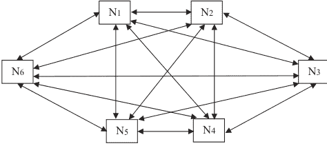

**图 5.3** 去中心化系统的结构。

⁴ 工作量证明系统是一种在认证交易之前，用来证明矿工已执行足够计算量的系统。其他证明计算的方法也还存在，例如权益证明、消逝时间证明、容量证明和存款证明，但比特币对其共识算法采用工作量证明。

新区块在网络达成共识后不断添加到现有区块中，从而形成一个链式结构，这正是其名称“区块链”的由来（图5.4）。

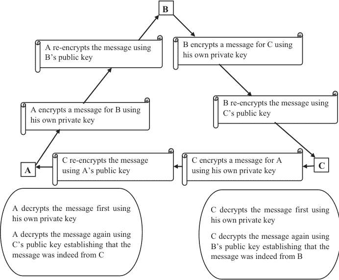

**图 5.4** 节点之间的通信。

### 5.3.3 增强的安全特性

区块链的存在使交易安全且带有时间戳 [5]。用户可以使用包含一对密钥的非对称密钥机制进行加密和解密，即公钥和私钥。公钥属于公共领域，所有人都知道，而私钥仅对希望与之交互的用户可见。

## 5.4 保密性规定：加密与解密

这个过程的工作方式是：如果一方使用其公钥加密消息，则另一方可以使用其私钥解密，反之亦然。因此，为了确保保密性，第一方首先使用自己的私钥对发给对方的数字签名消息进行加密，然后再使用对方的公钥对消息进行重新加密 [6]。这种使用私钥和公钥对消息进行两次加密的过程具有双重目的。第一，它提供了两层加密，使消息更安全。第二，每个用户只需要拥有两个密钥，即公钥和私钥。要解密消息，对方必须使用自己的私钥，然后再使用发送方的公钥进行解密，以验证发送方的真实性。如果没有这些公钥和私钥，每个用户将不得不拥有数千个密钥，每个用户一个。

## 5.5 自我维持的架构：对矿工的激励

具体以比特币为例，矿工通过工作量证明系统执行这一重要的认证任务，从而获得比特币奖励。这激励他们投入时间、精力和资源（内存、电力、高处理能力的CPU等）。比特币的总量已固定为2100万。在这种情况下，随着交易越来越多，比特币的使用变得越来越可接受，矿工获得的挖矿费用（以比特币支付）[7] 的价值也会增加。这是经济学中一个简单的“供需”案例，商品的稀缺性决定其价值。随着比特币变得越来越稀有，它的价值会更高，反之亦然。这也提出了一个相关问题：如果2100万比特币 [6] 被全部挖出会发生什么。⁵

⁵ 这种情况还需一段时间才会出现，因为比特币尚未被我们的社会完全接受为交换媒介。来自政府、金融公司和许多投资者等各方面的阻力依然存在。政府通过货币和财政政策直接或间接地控制经济中的货币数量，并在某些行业需要特别关注时进行干预。金融机构反感新式加密货币，因为这直接冲击了它们的商业模式。最后，许多投资者持怀疑态度，因为这项技术相对较新，他们不愿投身于一种完全未知的交易系统。网络安全是他们的另一个担忧；此外，如果传统金融体系发生故障，责任人可以受到法院追究，但在区块链中，却没有可以指责的对象。

在这样的背景下，即使所有比特币都被挖出，也有两种可能的情形。第一，网络中的对等节点可以一致决定增加总供应量。第二，矿工将开始从试图执行交易的用户那里收取费用。

## 5.6 安全特性：数字签名

区块链中的区块使用哈希签名来保护，哈希签名是一种仅与该特定区块相关的数字标识。每个区块都包含前一区块的哈希签名，只有经过节点共识认证后，新的交易区块才会被添加到现有链中。正是由于这些哈希签名，区块链才如此难以篡改。如果有人试图篡改或攻击某个区块，那么它的哈希签名就会不匹配，下一个区块将不接受前一个区块。因此，攻击者必须篡改下一个区块，而这又会导致其被后续区块拒绝，如此类推。这将需要恶意节点中的大多数协同合作，才能更改一个区块中的数据并获得共识，然后还要对该链中的所有区块都这样做。

### 5.6.1 哈希

哈希函数是一种复杂的数学函数，可将任意长度的任意输入处理为固定长度的输出。可以使用不同的软件来


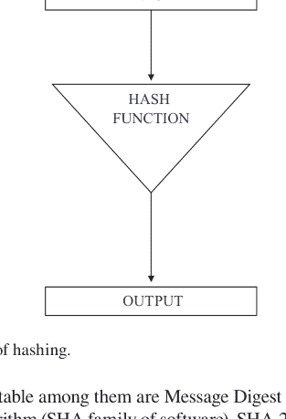

图 5.5 哈希处理过程。

哈希算法有多种，其中值得注意的有消息摘要（MD 系列软件）和安全哈希算法（SHA 系列软件）。SHA-256 接受任意长度的输入，通过哈希函数处理，生成 256 位的输出。无论输入发生多么微小的变化，都会产生完全不同的 256 位输出。SHA-512 执行相同的操作，但输出长度为 512 位。哈希是一种单向过程：每次相同的输入都会产生相同的输出，但无法从相应的输出反推出输入（见图 5.5）。

### 5.6.2 合并多个哈希签名

区块链中的区块可能包含多个交易的信息，每个交易都有自己的唯一哈希签名标识。区块内的这些多个哈希签名标识会被聚合，形成一个全新的哈希签名标识，直至达到根哈希签名唯一标识。这个唯一签名标识用作整个区块的哈希标识，也正是这个哈希签名标识被用来将该区块链接到下一区块（见图 5.6）。

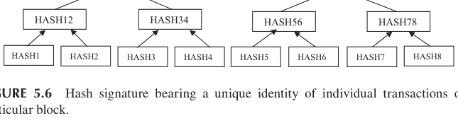

图 5.6 承载特定区块各交易唯一标识的哈希签名。

| 输入 | 哈希函数 | 输出 |
|---|---|---|
| I am Tabasseem | SHA-256 | 56CLO97J976FR67YU8I076YUHHTGGG56YJJU53 1J8UUG67809YTFDE567JLU819R53XZSD FVMKJ0 O9Y7UT6Y64DE4FGHB654CM8K74KJU58GFR53 |
| IamTabasseem | SHA-256 | H76FIOFG54WCFG708D85DKDIIE90EJDKD85JUI OD455FRF485765K6D42DHNMLDXS148LJ78GH 485KLJH78H4SD43DF66JU98JUJ09894LKOIU4759 |
| I am tabasseem | SHA-256 | 1WFR56YHG DCG8907YHU8754RFTYH765BHUJ8 765BMK4D4F8R5FG5G1D7S1EF4F7BDF5FF7F7 45UIU0089Y7F65HY776TG HY79A53SDCG654YU |
| I Am Tabasseem. | SHA-256 | I90076TR54DFGT5423FGH768JJK MNG7K58LSJ1J 1H86Y7D63X5D76FGHY7864GBHJKI009G568GR LP00048KH78F54D5F78H9H0D56V7NB78X56MK |
| iTabasseem | SHA-256 | H8797HY73ZA24XM0K0980HU78865FRTGBHD4 566567TYRFH653ZS234FV789IOURBNMJH56FDI 4KOL586HYF56DC67VH90ZA32CV5G6LK9076D4 |

图 5.7 通过算法软件进行哈希处理的过程。

图 5.7 所示的表格给出了一个简单的哈希假设示例：将同一条消息的五个略有修改的不同版本输入哈希函数（SHA-256）进行处理。尽管每种情况生成的输出彼此截然不同，但长度完全相同。

## 5.7 未来之路

区块链与任何其他早期技术一样，既受到热情欢迎，也遭到冷漠对待。一方面，区块链技术的支持者认为它是信息与通信技术领域的最新一波革命，有可能从根本上影响多个行业。另一方面，也有一批反对者认为，区块链技术只是最新流行语，往好了说永远无法实现其宣称的目标，往坏了说可能成为非法活动的便利工具。

### 5.7.1 对现有行业的影响：新一轮技术革命

区块链技术的倡导者认为，这是自万维网（www）问世以来计算机和技术领域最大的革命。他们声称，它有潜力改变我们已知的每一个主要行业。这不是对现有技术的边际改进，而是要吞噬现有技术，以完全不同的方式创造事物。

许多在交易双方之间充当中间人或中介的组织将变得无关紧要。大型组织花费数百万提高服务质量、完善申诉处理机制、开展广告促销等，并努力提升客户满意度以建立信任。客户重视这种信任，并且这是他们在选择中介（如股票经纪公司、在线购物公司、保险聚合平台和银行）时的重要决定因素。经纪公司帮助投资者匹配其选择的股票/债券；在线购物聚合平台帮助客户匹配销售其心仪产品的卖家；保险聚合平台帮助客户匹配出售符合投资者需求的保单的公司；银行则既充当做市商和客户存款的托管人，也在国内外转移资金。所有这些中介都会收取固定费用或按交易金额的一定比例作为执行交易的服务费。区块链技术被广泛接受、业务向该方向转型，将导致做市商及收费/佣金商业模式彻底溃败，因为所有信息都将公开可用。其中一些中介已意识到其业务可能发生结构性转变，因此正尝试尽早采用该技术，以相应调整其商业模式 [8]。

### 5.7.2 对现有行业的影响：注定失败

另一方面，区块链技术的批评者 [9] 认为，围绕区块链技术制造的炒作本质上是人为的，区块链本身充其量只是一个流行语，最坏情况下则是走私者手中便利的交易工具。反对者断言，区块链不仅是一项相对较新、尚未得到全面成功验证的技术，而且对初学者来说也是一种难以理解的复杂架构。许多政府担心区块链对经济的影响，以及由此带来的货币控制权丧失，因此要么决定完全禁止其挖矿、使用和持有，要么暂时停止使用以先进行研究。加密货币的剧烈波动也可能给经济带来严重不确定性，投资者可能希望避免。区块链在当前速度下处理用户流量的能力非常有限。目前，每个区块大约需要八分钟才能被验证并添加到链上，随着技术的改进，这一时间需要大幅缩短。公共区块链上信息的安全/隐私是另一个问题，尽管攻击该结构并进行修改确实困难，但并非不可能做到。恶意节点如何获得网络多数控制权的复杂机制尚不清楚；然而，如果真的发生这种情况，区块链也将就此终结，因为恶意节点有可能达成多数共识。在加密货币方面，区块链技术的另一个问题是发送方和接收方匿名。关于交易、交易量、时间等信息会记录在区块上，但参与方的身份是匿名的。因此，在缺乏适当监管和监控机构的情况下，很容易被用于非法目的。最后，使用算力进行工作量证明以验证区块的系统需要消耗大量能源，而鉴于目标是尽快执行交易，这完全是无效益的。

## 5.8 区块链技术的应用

区块链技术的应用极为多样。区块链几乎可以彻底改变经济中的每个部门，因为它是一种非常通用的技术，可以根据特定部门/公司的需求进行定制。下面列举了该技术在不同领域的一些应用。这当然不是详尽无遗的清单，该技术还有许多大大小小的用途有待探索。

### 5.8.1 产品真伪验证

这是零售领域中的一个应用，最终客户可以全面了解其欲购产品的完整生命周期历史。这些历史包括从制造过程、产品获得质量合格认证，到包装和运输的详细信息，从而使客户确信产品的真实性。在当今假冒和仿制产品与正品极为相似的时代，两者很难区分。客户可以根据自己的选择和需求做出明智的决定。由于所有信息都在网络上公开，这也有助于客户了解产品的年龄⁶。

### 5.8.2 创意产业与学术界

在创意领域（如艺术、音乐及相关领域）、知识表达（如书籍）和知识产权方面，区块链技术可带来巨大福音。传统体系下，音乐、书籍等销售收益的很大一部分归于创作者以外的其他方。创作者获得的版税只是实际收益的一小部分。将产品直接放到区块链网络上，可以在创作者和客户之间建立直接联系。产品随后可以与智能合约关联，自动将产品销售收益通过区块链记入创作者账户。智能合约的设计不仅可以保障产品安全，还能让任何想要的人更方便地获取产品，并即时向创作者付款。伊莫金·希普（Imogen Heap）将她的歌曲《Tiny Human》放上区块链，并一直是这项技术的积极倡导者。

### 5.8.3 投票与治理

区块链技术运行在共识原则之上，其最佳用途之一就是将选举过程放到区块链上，从而强化民主本身。在世界各地，有影响力政治实体篡改选举过程、操纵选举使其有利于自己候选人的指控屡见不鲜。在民主制度中，选举过程至关重要，因为这是


人民选举代表，在更大的平台上表达他们的问题。受损害的选举意味着人民的代表性也会受损。如果选举过程被放到区块链上，那么事件的细节将同时在多个节点上运行。从候选人的资料、投票站地址、选区的选民人数，到每位候选人获得的票数，所有这些都会同时反映在多个节点上。这种从中心化系统的偏离将导致民主进程中实现更多民主。对选举的集中控制越多，整个选举活动就越容易受到攻击。然而，在像选举这样重要的问题上，一夜之间转向区块链并不明智，因为这种转变的隐患仍是未知数。应该先运行一些试点项目，以评估技术效率、选民准备情况、数字基础设施问题等，然后再分阶段推广。

### 5.8.4 资产的存储与转移

所有资产类别的所有权，即实物资产和金融资产，如土地权利、公司股票/债券和专利，都可以放在区块链上。加密货币早期面临的一个问题是双重支付问题。双重支付会导致货币变得无法使用，因为如果一个人向某人支付了10卢比，而他自己却仍然持有这笔钱，那就毫无意义了。一旦一方花费了一定金额，他应该失去对该金额的控制，而对方应收到同样的金额。比特币通过给每笔交易加时间戳，并在每个节点上传递所有交易信息，解决了这一双重支付问题。与比特币类似，任何有价值的资产都可以放到区块链上。这将帮助合法所有者摆脱伪造文件者的祸害。这不仅有助于合法所有者以其资产获得贷款，还可以节省在多年诉讼中被无谓浪费的稀缺资源。这些信息在区块链上的优势是，它不仅记录当前所有者/保管人的名字，还可以回溯并追踪之前的所有者。任何资产的所有权变更都可以在区块链中完整保存。

### 5.8.5 将服务提供商直接与客户连接

出租车聚合服务、保单聚合服务、酒店聚合服务等会从客户支付的总金额中抽取一部分作为服务费，用于维护其数字及其他基础设施、支付劳动力费用等。然而，如果所有信息都在区块链网络上可用，那么对这些聚合中介的需求就会消失。区块链可以促进服务提供商和客户之间的直接联系，使双方受益。

### 5.8.6 血型和/或器官捐献者名单

在区块链网络上公开提供一份包含人们血型的账本，可能会救人一命。患者出于各种原因随时都需要血液，尤其是那些在事故中失血过多的人。有些血型由于较为稀有而难以找到；因此，这样的名单有助于找到附近的捐献者。类似的器官捐献者和接受者名单也可以放在区块链上，以帮助进行匹配。

### 5.8.7 遏制分配过程中的渗漏

许多政府为扶贫、粮食安全和自然灾害时期的援助等崇高事业运行福利计划，但其中很多福利从未到达预期受益人手中。区块链技术可以成为改善公共分配系统并遏制其渗漏的一个好方法。许多此类计划之所以未能达到预期效果，仅仅是因为分配系统不健全；同时，这也让受影响的人们对其政治体制产生不满和愤怒。

区块链作为一种技术是持久存在的。虽然今天它可能还不会被大规模应用，但随着产品的改进和人们认识的提高，它最终会吸引用户。它肯定会在一些试点项目中失败，也可能在其他项目中取得适度成功，但随着时间的推移、技术的改进和计算能力的增强，它最终将使生活变得更加便利。

## 结论

比特币在短时间内崛起惊人，其单个比特币的价值在巅峰时接近150万美元。在见证了基于加密的数字货币的成功之后，其他替代性加密货币也加入了竞争。这种货币所做的只是消除对交易中涉及的其他方/中介的信任需求。它是一个嵌入点对点现金转账系统的数字架构。网络上的每个人都是交易的见证者；因此，交易在公共领域内几乎不可能被篡改。这种*没有*中介的金融交易系统背后的技术被称为区块链。区块链技术凭借其优势，有望触及从零售到医疗的几乎所有领域。它正在许多领域站稳脚跟，而其他领域则采取了一段时间的观望政策。只有时间才能告诉我们区块链技术会带来多大的颠覆。值得注意的是，它在短短十年间已经取得了长足的发展。

## 参考文献

- 1. A. Antonopoulos. *Mastering Bitcoin: Programming the Open Blockchain*, O’Reilly Publications, California, 2017.
- 2. G. Hurlburt, and I. Bojanova. “Bitcoin Benefit or Curse?,” *IT Professional*, vol. 16, no. 3, pp. 10–15, 2014.
- 3. D. Vujicic, D. Jagodic, and S. Randic. “Blockchain Technology, Bitcoin, and Ethereum: A Brief Overview,” *2018 17th International Symposium INFOTEH-JAHORINA (INFOTEH)*, East Sarajevo, 2018, pp. 1–6.
- 4. M. Leising. “Wall Street Embraces Blockchain as the Future,” *Sydney Morning Herald*, August 2015.
- 5. S. Nakamoto. “Bitcoin: A Peer-to-Peer Electronic Cash System,” White paper, 1–9, 2008.
- 6. A. Laska, B. Johnson, and J. Grossklags. “When Bitcoin Mining Pools Run Dry: A Game-Theoretic Analysis of the Long-Term Impact of Attacks Between Mining Pools,” *Financial Cryptography and Data Security*, pp. 63–77, 2015. In BITCOIN’15: The Second Workshop on Bitcoin Research.
- 7. J. Kelleher. “What Is Bitcoin Mining?” *Forbes*, May 2014.
- 8. H. Massias, X.S. Avila, and J.J. Quisquater. “Design of a Secure Time Stamping Service with Minimal Trust Requirements,” *20th Symposium on Information Theory in the Benelux*, May 1999.
- 9. B.P. Eha. “How the World’s Richest Nations Are Regulating Bitcoin,” *Entrepreneur*, February 2014.

## 6 金融交易向比特币和区块链技术的发展

Chiranji Lal Chowdhary
VIT大学

## 目录

| 章节 | 页码 |
| --- | --- |
| 6.1 区块链概述 | 80 |
| 6.2 2007–2008年惊人的全球金融危机 | 81 |
| 6.2.1 2008年金融危机对印度的特殊影响 | 82 |
| 6.2.2 对股票市场的影响 | 82 |
| 6.2.3 对印度贸易的影响 | 82 |
| 6.2.4 对印度出口的影响 | 82 |
| 6.2.5 对印度手工织品领域、珠宝出口和旅游业的影响 | 83 |
| 6.2.6 兑换比率贬值 | 83 |
| 6.2.7 印度的信息技术和业务流程外包行业 | 83 |
| 6.2.8 外国机构投资者和外国直接投资 | 83 |
| 6.3 危机的原因 | 84 |
| 6.3.1 比特币的初始概念（1998–2009） | 85 |
| 6.3.2 比特币——一种点对点电子现金系统（2008） | 85 |
| 6.3.3 比特币软件的开端（2009） | 85 |
| 6.3.4 比特币的第一个价值（2010） | 85 |
| 6.3.5 竞争性加密货币的兴起（2011） | 86 |
| 6.3.6 比特币价值飙升（2013） | 86 |
| 6.3.7 各种诈骗和盗窃（2014） | 86 |
| 6.3.8 以太坊和ICO（2016） | 86 |
| 6.3.9 比特币价格触及10,000美元高点（2017） | 86 |
| 6.3.10 在线支付公司开启比特币支付（2018） | 87 |
| 6.4 比特币的现状（2019） | 87 |
| 6.5 比特币挖矿基础 | 87 |
| 6.6 比特币和区块链的各个方面 | 88 |
| 6.7 加密货币未来情景列表 | 89 |
| 6.7.1 可能性 | 89 |


- 6.7.2 FedCoin：央行权衡加密货币未来的另一种选择 ............ 89
- 6.7.3 这称为比特币崩盘还是加密货币革命？ ........ 90
- 6.7.4 比特币带来的潜在系统风险 ........................................ 90
- 6.8 比特币对经济、银行和金融的影响 .................. 90
- 6.8.1 暗网的力量 ........................................................... 90
- 6.8.2 投机 ............................................................. 91
- 6.8.3 货币的政治化 ................................................ 91
- 6.8.4 央行的忧虑 ..................................... 91
- 6.8.5 新市场的出现 .................................................. 91
- 6.9 区块链技术的网络安全方面 ............................. 92
- 6.10 区块链和比特币的网络安全风险 ................................. 95
- 6.10.1 区块链是否故障安全？ ................................................. 95
- 6.10.2 网络安全在当今市场中扮演关键角色 .......................... 95
- 结论 ........................................................................ 95
- 参考文献 ......................................................................... 96

## 6.1 区块链概述

加密货币比特币的唯一发明者是中本聪。似乎没有人比中本聪更了解这个主题。区块链方法是一种基于密码学的分布式账本，能够在网络中不受信任的成员之间实现可信交易。近年来，区块链技术已在世界范围内流行起来，并且由于其独特的信任和安全特性，这项技术吸引了学者、研究者、开发者和商业专家的广泛关注。2019年8月1日，零售业巨头沃尔玛通过区块链申请了一项由美元支持的稳定币专利[1]。

普通民众担心那些破坏和损害网络安全的威胁，这导致他们的个人数据和金钱损失，因为这每天都出现在报纸和社交媒体上。一些有犯罪倾向的黑客只要有机会，就会实施基于网络的操纵、盗窃、诈骗和间谍活动，目标主要是传统货币。为了克服金融舞台上的这些威胁，应通过制定常规保密惯例来减少安全漏洞的发生几率。如今，加密货币比特币因其通过区块链技术提供的高度安全环境而在全球广受欢迎，该技术采用信息扩散和加密。区块链是比特币的支柱。随着比特币使用的增加以及对比特币网络安全需求的增长，每个行业都希望通过难以追踪的加密传输采用区块链技术来保护其个人数据和经济财产。

在区块链技术中，使用带标签的区块和链来构建一个结构，用于记录不同账户之间比特币交易的历史数据（图6.1）。服务器通过时间戳为每个项目区块广泛发布哈希值来控制整个过程。区块链技术很可能是账本技术在分布式场景下进一步发展的产物。区块链技术解决了分布式记账中的多方信任问题。区块链技术的去中心化特性[2–4]使其具有防篡改、安全、可靠的特点，自其问世以来便获得了全面的关注。

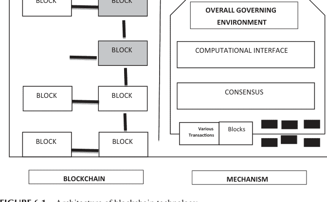

图6.1 区块链技术架构。

区块链技术的安全性仍远远落后，此外，还需要在部署和实施方面进行发展。风险可能来自网络外部和内部的攻击。随着区块链的日益普及，对数据存储、传输和应用程序的安全和隐私保护的需求也在增加。这需要创造新的任务来推进当前的安全解释、验证工具、数据保护、隐私保护和信息监管。

本章组织结构如下：6.2节描述2007-2008年惊人的全球金融危机。6.3节介绍比特币和加密货币的历史。6.4节讨论比特币挖矿的预备知识。6.5节讲述比特币和区块链技术的各个方面，随后6.6节讨论比特币和区块链如何构建货币结构。6.7节列出了加密货币的未来情景。6.8节涵盖比特币对经济、银行和金融的影响。6.9节总结金融交易向比特币和区块链技术的发展。

## 6.2 2007-2008年惊人的全球金融危机

过去10-15年中最具破坏性的金融紧急事件是2007-2008年的危机[5]。这是继1929-1930年大萧条之后最大的财政悲剧，造成了巨大的绝望。2008年的危机始于2007年美国次贷市场的一场灾难，并通过2008年9月15日投资银行雷曼兄弟的倒闭演变成一场全面的全球银行业灾难[6]。

对金融机构的大规模救助以及金融和经济规则的进一步放宽，一直在努力避免全球货币体系可能出现的崩溃。然而，这种困境仍然被全球性的商业衰退——“过度衰退”所笼罩。随后，欧洲债务危机——欧洲国家银行体系因欧元而陷入的困境——接踵而至[7]。

### 6.2.1 2008年金融危机对印度的特殊影响

印度经济学家花了一些时间才接受2008年财政灾难对印度有一些影响。尽管如此，在此期间，印度经济中的组织管理通常被认为处于困境。美国的崩溃震动了全球，但由于印度基本面强劲且印度金融部门在国际金融市场的经验较少，其对印度影响较小。也许，这种情况使印度经济得以迅速摆脱困境。与美国的创业规则不同，印度的市场完全由政府控制。

### 6.2.2 对股市的影响

2008年，由于经济放缓，美国经济和印度股市都受到影响。2008年秋季，印度股市一天之内损失约2.5万亿印度卢比（INR 250,000 crores）。2008年10月10日，Sensex指数在单日内下跌1000点，此前曾回升200点。如此巨大的下跌发生是因为印度股市主要由外国机构投资者（FIIs）和参与票据驱动。

### 6.2.3 对印度贸易的影响

贸易逆差正达到令人不安的水平。由于雇员存款、工人汇款、非居民印度人存款、外国机构投资者资产等情况的不同，经常账户赤字约为100亿美元。如果利息支付下降且外国机构投资者对海外经济的投资增加，印度将面临1991年发生的同样情况：外汇资本的不确定性减少，而贸易逆差仍以当前速度累积。此外，截至2008年10月底，该国的外汇资产下降了约550亿美元，至2550亿美元。

### 6.2.4 对印度出口的影响

美国和一些欧洲国家减少了从印度的进口。由于美国和欧洲国家需求下降，工程行业、皮革、布料、石材和珠宝受到严重打击。与此同时，印度重视与美国的贸易，2006-2007年间，近15%的贸易份额是与美国进行的。印度贸易

2008年11月，需求量减少了约10%；与此同时，美国的需求也有所下降，全球需求连续第二个月下滑，布料的月度贸易差额达到了100亿美元[8–10]。

### 6.2.5 对印度手织机产业、珠宝出口和旅游业的影响

经济合作与发展组织（OECD）已调整了其对印度饰品和珠宝制造、手织机产业和旅游领域的政策，导致珠宝制造业有50,000至60,000名工人失业；这一影响也体现在全球经济中。此外，手织机制造业的财务损失达300亿印度卢比（当时为2007-2008年），而当时手织机经销商总数约为5%，导致该行业大量失业。由于全球经济仍处于衰退之中，印度旅游业受到严重影响，来自美国和欧洲国家的游客数量骤减。

### 6.2.6 汇率贬值

由于外国机构投资者的支出，印度卢比对美元贬值约不到20%，并徘徊在1美元兑50印度卢比左右，令出口商感到恐慌。

### 6.2.7 印度的信息技术和业务流程外包行业

印度的信息技术和业务流程外包（IT & BPO）行业预计在2008财年末将获得总收入33%，即640亿美元。近年来，软件服务从业人员接近200万，信息技术行业的软件开发人员增加了约37.5万人。IT板块约75%的收入来自美国，IT服务已占印度整个贸易的约5.5%。因此，美国的崩溃必然影响了印度的IT行业[11,12]。

### 6.2.8 外国机构投资者和外国直接投资

通常，当金融损失对大型行业造成影响时，印度国家股票市场将导致大量现金损失。当然，这也对商业领域产生影响，尽管最低现金流量也影响到不同行业部门。由于当时的国际低迷，外国机构投资者撤回了约50亿美元的投资；然而，外国直接投资流入却翻了一番，从2007-2008年的约70亿美元增至2008年第二和第三季度的约193亿美元。这一次导致了严重衰退。之后，住房价值下跌了约32%，这对投资者来说是彻底的损失。

## 6.3 危机的起因

该行业的最初金融损失始于2005年底，经济下滑始于2006年。这一点是在房价开始下跌后注意到的。起初，房地产经纪人看好这种局面。人们低估了过热的房地产市场会回落到一个更可承受的水平。房地产经纪人未能理解有许多业主不愿主张自己的产权。那时，银行允许人们获得高达房产价值100%的住房贷款，这迫使银行在次级贷款领域放贷。

这种情况的真正原因是《格拉姆-鲁德曼法案》。该法案允许银行交易出售给股东的高利润产品。此类抵押贷款支持证券以住房贷款作为担保。这些产品形成了对增加贷款的贪婪需求。全球各地的对冲基金和其他一些金融机构持有这些抵押贷款支持证券。这些证券包括创新共同基金、公司资产和养老基金。银行将抵押贷款捆绑起来，并进一步分批出售其资产。这导致了资产价值的下降。

一个合理的大问题是保守的养老基金购买不安全资产。这是因为保险公司撤销了买家的信贷额度。此类互换由老式保险公司美国国际集团（AIG）出售。一旦这些衍生品失去价值，AIG就无法产生足够的现金流来覆盖其出售的所有互换。

金融危机的另一个征兆出现在2007年，当时银行惊慌失措，意识到它们必须承担损失。银行不再向购房者提供资金支持。银行不愿接受价值微小的债务作为抵押品。当时没有一个人购买土地。银行业内部的这种疑虑仍然是2008年金融危机的首要原因[13,14]。美联储开始通过定期拍卖工具向银行系统注入流动性。那是当时摆脱危机的唯一可行解决方案。

## 6.4 比特币和加密货币的催生与早期历史

在2008年全球金融危机期间，比特币以一种虚拟货币的形式在市场上发挥了关键作用。起初，加密货币带上了一层阴暗的色彩，它们大多与毒品交易、勒索软件支付、洗钱和逃税等黑市行为联系在一起。加密货币被称为最麻烦的技术，常常与互联网上的骗局或大型庞氏骗局联系在一起。

比特币的成功登上了新闻头条，因为这种加密货币的单枚价值首次突破11,500美元。虽然这常被认为是新潮事物，但比特币的起源实际上可以追溯到2009年，它最初是通过创世区块——比特币网络中的第一个区块，即网络骨干——构建的。实际上，如果某人在比特币上投资1,000美元，而比特币价值在该年大幅上涨，那么这位花费1,000美元的人将获得价值3,670万英镑的回报。错过投资比特币的人在后来更加后悔。因此，比特币和加密货币的简要历史如下。

### 6.3.1 比特币的初始构想（1998–2009）

比特币是首个被公认的加密货币，其尝试通过由加密支持的账本进行在线交易来实现。这方面的例子包括B-money和Bitgold。它们曾被提出，但从未完全实现。

### 6.3.2 比特币——一种点对点的电子现金系统（2008）

第一篇题为“比特币：一种点对点的电子现金系统”的研究文章以白皮书形式撰写并发布。这篇论文的作者是一位化名“中本聪”的匿名人士，其真实身份至今未知。2018年的加密货币用户如图6.2所示。

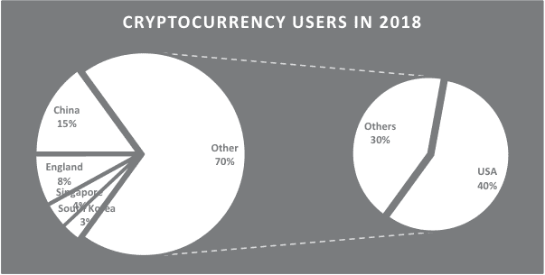

**图6.2** 2018年的加密货币用户。

### 6.3.3 比特币软件的开端（2009）

用于挖矿的首个比特币软件于2009年发布。比特币和交易在区块链中得到监控和管理。

### 6.3.4 比特币的首次定价（2010）

最初在2010年，比特币开始为这种发展的加密货币赋予金融价值。2010年，有几个人首次明确出售比特币，用10,000枚比特币换了两张披萨。如今，用户购买的比特币价值已达1亿美元。

### 6.3.5 竞争对手加密货币的兴起（2011）

2011年，比特币被定义为一种去中心化、分布式和公开的账本技术，是世界上第一种加密货币。此后，为了与比特币竞争，替代币被开发出来，与比特币相比，它们可以提供更多好处，例如交易处理、安全性以及给矿工更高的挖矿激励。最早出现的替代币中有Namecoin和莱特币。也就是在2011年，比特币分配了1,000枚比特币作为新交易的激励。

### 6.3.6 比特币价值暴跌（2013）

当一枚比特币的价值首次升至1,000美元后，其价值迅速开始走弱。2013年，那些已经将资金投入比特币这种加密货币的人损失惨重，因为比特币的价值已跌至300美元，而两年前其先前价值为1,000美元。

### 6.3.7 各种骗局和盗窃（2014）

2014年，比特币作为一种交换媒介发挥作用。同年，在比特币交易所崩盘后，投资者损失了85万枚比特币。投资者想尽办法通过比特币交易所的不同利益相关方追回这笔钱，但未能追回。当时，损失比特币的价值相当于44亿美元。按2014年的价格，这些丢失的比特币价值为44亿美元。

### 6.3.8 以太坊和首次代币发行（2016）

在比特币被盗之后，另一个加密货币平台于2016年带着极大期望问世，名为以太坊。该平台使用的加密货币称为以太币，可以轻松用于基于区块链的智能合约和应用程序。以太坊的到来以首次代币发行（ICO）的出现为标志。首次代币发行（ICO）相当于加密货币行业的首次公开募股。ICO是一种筹集资金的方式，寻求资金以创建新代币、应用或服务的公司会发起ICO。感兴趣的投资者可以购买该发行物，并获得公司发行的新加密货币代币。该代币可能在公司的产品或服务中有一些用途，也可能仅代表公司或项目的股份[15–18]。

### 6.3.9 比特币飙升触及10,000美元（2017）

2017年，数字货币比特币在年初时还不到1,000美元，随后大幅上涨，触及10,000美元。一旦达到10,000美元，比特币投资者开始投入越来越多的资金，结果这种加密货币在短时间内升至110亿美元，最终以300结束。

十亿美元。诸如巴克莱银行、花旗银行、德意志银行和法国巴黎银行等银行也因比特币的崛起而受益。那时，金融科技行业注意到了比特币的底层概念——区块链。

由于比特币和区块链具有去中心化、分布式和不可篡改的特性，所有中心化机构都可以采用它们来减少欺诈行为，而这些欺诈行为通常是由入侵者实施的 [19,20]。

### 6.3.10 在线支付公司启动比特币支付（2018年）

2018年初，韩国出台了一项法规，要求比特币交易商披露身份，并禁止匿名交换比特币。与此同时，在线支付公司Stripe宣布，到2018年4月，它将允许使用比特币支付以利用其服务，理由是根据2018年1月24日的详情，需求不断下降、费用不断上涨以及业务时间变长 [21–23]。

## 6.4 比特币的现状（2019年）

2019年初，数字货币市场的总市值比之前高出近30%，价值超过1650亿美元。一个月内，比特币的使用量有所增长。同年3月，此前在其境内禁止加密货币的伊朗政府同意使用比特币 [24]。

2019年4月，比特币的数量增长了15%。专家解释说，这种异常是由于市场主要参与者的重新出现。比特币的这一发展发生在2019年4月2日的亚洲会议上，一位身份不明的买家购买了20,000枚比特币，合计9400万美元。下个月，人们注意到比特币价格持续上涨。2019年5月底，BTC-比特币的价值相当于8,721美元。2019年6月，比特币的价值打破了所有纪录。比特币价值很快达到10,000美元，并且持续攀升 [25,26]。

## 6.5 比特币挖矿的预备知识

比特币挖矿由高性能计算机执行，它们通过互联网解决复杂的计算数学问题。交换或创造新比特币的矿工遵循一种称为工作量证明（PoW）的协议，之后区块被放置在区块链中。矿工通过保护网络来提供社区服务，系统会对他们的努力给予回报。

一旦交易在系统中广播，矿工就会通过PoW挖掘交易并解决数学难题。如果挖矿成功完成，那么该区块就可以添加到区块链中；这种做法每十分钟可以执行一次。每个新区块都会被添加到区块链中，这些交易每十分钟确认并记录一次。矿工们对下一个区块的竞争开始了。为此，矿工之间会展开竞争，看谁先验证交易。第一个验证交易的人可以将该区块添加到区块链中。这遵循最长链规则。比特币白皮书中提到了使用加密哈希算法的比特币挖矿过程和协议的所有这些方法。

## 6.6 比特币与区块链的各个方面

2013年，比特币因在美国“丝路”网站上被用于毒品交易而失去了公众的青睐。比特币的价格在2017年底上涨，但在那一年晚些时候逐步回落。当比特币作为日常货币使用时仍令人兴奋，但这似乎不太合理。比特币的另一个特点是，它作为公众在线账本的兴奋点，并不那么耀眼和具有创造性。比特币的底层概念——区块链技术，给国际金融组织带来了通过加密货币开展业务的希望。看起来，在比特币问世后的又一个五年之后，区块链将成为许多行业以其资产进行货币形式交易的最终解决方案。

2017年底，比特币的总价值接近3000亿美元。基本上，Cboe全球市场、芝加哥商品交易所集团和纳斯达克在2017年底将比特币纳入其业务，并进行了更多交易，但交易量仍然微不足道。2017年，比特币作为一种加密货币达到了210亿美元；它于2008年开始了初始代币发行。它们迅猛的发展引起了世界各地监管机构的注意，甚至早在黑客从一家日本加密货币交易所窃取价值近5亿美元的数字代币NEM之前，就已如此。在2018年，绝大多数ICO损失了可观的价值。区块链在一些知名企业中也面临诸多挫折，导致它们放弃或搁置项目，其中包括澳大利亚证券交易所计划开始使用该技术处理股票交易。沃尔玛百货公司于2018年9月宣布，从2019年初开始，该公司将要求新鲜叶菜供应商使用国际商业机器公司（IBM）开发的数字账本跟踪其商品；IBM已投入巨资开发用于商业用途的区块链工具 [27]。

### 比特币、区块链可能如何改变货币体系

想象一下，有一天所有工资都以比特币支付。那么，你会有什么感觉？除了流动性资产的价值可能在加密货币近期未来的某个时刻发生翻转之外，你还必须将所有加密货币兑换成印度卢比、美元或其他货币，才能在亚马逊购买商品、在达美乐买披萨、在Flipkart买书。

比特币和其他数字货币竞争者的价格飙升与其日常实用性并不匹配。支付处理器Stripe在2018年初取消了对比特币的支持，理由是交易时间慢、费用较高。Stripe产品经理汤姆·卡洛（Tom Karlo）解释道：“我们已经看到客户接受比特币的意愿在下降。”

如今，比特币已经广泛传播。它从未与现存的金融体系竞争，比如银行和其他金融机构，这些机构正鼓励资产增长，惠及一千万交易者。

仍有许多人，比如千禧一代，甚至没有固定电话；即将到来的一代人可能没有银行账户，因此他们乐于进行受保护的交易。区块链机制和巨大的创新性加密货币繁荣为四种加密货币商品打开了大门，这些商品可能会参与一种新的金融秩序。

## 6.7 加密货币未来情景列表

### 6.7.1 可能性

美联储可能会发布自己的数字货币，因为一些全球央行也在探索。一些领先企业，如亚马逊、沃尔玛和星巴克，可能会推出自己的数字货币，这有可能激发信任并提高广泛认可。这些领先企业可能会增加对比特币、以太坊、Hyperledger Fabric以及其他加密货币（如莱特币、FedCoin）的使用，这将为加密资产价值交易带来更多安全性、可靠性和实用性，并且在不久的将来，许多政府组织也将使用加密货币。

“虚拟货币可能足以让现有货币和货币政策陷入困境，”国际货币基金组织总裁克里斯蒂娜·拉加德（2011–2019）在去年秋天表示。“公民们或许有一天会更喜欢虚拟货币，因为它们可能提供与现金相同的成本和便利——没有结算风险，没有清算延迟，没有中央登记，没有第三方检查账户和身份，”她推测道。

长期以来，一些科技相关的商界人士一直保持对加密货币的投资，认为在21世纪加密货币的价格有可能达到黄金价格。在这场热潮中，摩根大通（JPM）首席执行官杰米·戴蒙称比特币是“一个骗局”。他和其他经济巨头断言，盈利的银行将至关重要地存续下去，加密货币可能仍处于边缘地位，而政府必须拯救它。

### 6.7.2 FedCoin：另一种选择——央行思考加密货币的未来

区块链改变财政结构的可能性已促使各国央行重新考虑是否发行自己的数字货币。著名的耶鲁大学教授提出了“FedCoin”的概念。在目前关于加密货币的讨论中，FedCoin可能作为一种更加灵活和强大的货币政策出现。这甚至可能导致负利率。

当一种加密货币被表现为一种可靠且被广泛认定的价值储存手段时，人们可能会切断与银行的关系。人们将在数字钱包中持有一些加密货币现金，同时通过共同基金、股票和政府债券持有其他流动性资产。

英格兰银行的一项研究得出结论，央行加密货币可能会使国内生产总值提高3%。这些优势将源于“与扭曲性税率类似的货币交易成本”的降低。FedCoin问世之际，许多组织并不相信加密货币。摩根大通分析师警告称，央行加密美元“可能会危及商业银行在经济和社会上重要的金融中介功能”。部分准备金银行对全球发展的影响可能会减弱，这种影响将每1美元信贷变成10美元抵押贷款 [28,29]。


## 6.7.3 这被称为比特币崩溃还是加密货币革命？

摩根大通首席执行官杰米·戴蒙（Jamie Dimon）向政府提出了几点关于加密货币的观点。他们还坚持认为，FedCoin 不支持安全措施，任何人都可以攻击它。

2018年2月6日有一个重大新闻：在一个重要的参议院加密货币听证会当天上午，比特币跌至6000美元。当时所有金融监管机构都保持警惕。他们没有考虑对加密货币实施任何法律。几周后，比特币价格又回升至约11000美元，而此前市场价值为7000美元。

随着比特币投资开始在芝加哥期权交易所全球市场（CBOE）和芝加哥商品交易所（CME）交易，比特币在冲高至19000美元的历史最高点后，于2018年12月中旬前崩盘。这种被视为美国监管机构认可的投资交易预期助长了投机行为。

## 6.7.4 比特币带来的潜在系统性风险

全球央行的央行——国际清算银行（The Bank for International Settlements）警告称，如果监管机构不关注加密货币中的风险因素，未来加密货币可能会发展成“威胁金融稳定”。美国监管机构似乎在迎头赶上。2018年2月，财政部长史蒂文·姆努钦（Steven Mnuchin）召开了一次加密货币峰会，以说明其功能和对相关人群的监管[30]。

## 6.8 比特币对经济、银行业和金融的影响

加密货币仍然是一种棘手的经济发明，它拥有重塑当前经济体系以及改变银行和金融机构运作方式的潜力。比特币是最普遍的加密货币形式，它允许双方在没有中介的情况下进行数字交易。每笔交易都在类似分类账的区块中进行数字验证，当一个区块被填满时，就会形成一个新的区块。这些区块通过哈希值按顺序线性连接，称为区块链。因此，每笔交易都被数字记录，以保持最高级别的安全性。然而，交易会被记录，而参与交易各方的信息不会暴露。一旦兑换成法定货币，这种货币就可以被追踪。这种常见的交易处理方式已经引发银行业在全世界范围内发生巨大变革的可能性。政府和金融机构所行使的经济控制权，为加密货币的使用提供了支持。

### 6.8.1 暗网的力量

暗网是互联网的一部分，无法通过搜索引擎访问。它类似于深层网络，而深层网络在当前互联网中并不经常出现。

比特币与传统货币交易相比无需支付交易费用。可以肯定地说，比特币的开端和潜在数量是无限的。

## 6.9 区块链技术的网络安全方面

区块链技术为网络安全提供了一个重要方面。区块链为受保护的网络、数据和通信提供了一个平台。区块链使用哈希函数和加密技术将数据作为记录存储，这比各种网络安全技术更安全。现有的安全系统依赖单一可信权威来认证信息或累积加密数据[31]。由于单一可信权威，许多攻击者利用各种攻击（如SQL注入、拒绝服务攻击）轻易窃取信息。区块链通过创建去中心化平台解决了当前的安全问题，它们不需要信任群体或网络中的某个特定成员或权威。区块链是一个可信的系统，所有数据都通过智能合约存储在跨节点的分布式公共账本中，而智能合约本质上不可篡改。群体中的大多数成员同意相同的信息，这将比由一个领导者和一群依赖领导者获取信息的成员组成的群体更能保护群体安全，尤其是当恶意行为者可能以群体成员甚至领导者本人的形式出现时。

区块链技术被用于增强互联网事物的网络安全、数据存储和共享、网络安全、私人用户数据、万维网导航和实用性。物联网（IoT）拥有最重要的私有区块链，能够在网络中实现设备准入控制，以安全管理数据跟踪并防止恶意访问。此外，区块链还被用于通过点对点（P2P）升级传播来提升软件组织的保护，以提供识别、加密和无缝安全的互联网计算机数据传输。

区块链应用用于保护实际的物联网信息、术语，以及区分恶意结果。区块链协议位于网络软件层和传输层之间，使用类似比特币的代币激励，并将其作为投票权组件（图6.3和图6.4）。

公共和私有共享账本所习惯的数据存储和交换单元消除了给定存储系统中的单点故障，保护信息不被篡改。也就是说，区块链有助于确保存储在云端的数据能够抵抗未授权更改，哈希列表提供了对将被安全保存和保留的细节的查询方式，并且更新的信息将被验证在从发送到接收的过程中保持一致。简而言之，区块链通过构建一个使用客户端加密的去中心化网络来增强信息的存储和共享，信息所有者可以在完全可追溯的条件下管理自己的信息。

大多数系统安全识别工作使用区块链来增强软件定义网络（SDN），并利用所有者去中心化地主动存储基本信息以供验证。这些工作使用了基于区块链的SDN控制器技术，并采用组结构。对于网络中的中心节点与SDN控制器之间的P2P通信，该设计使用公共和私有区块链，使区块链适用于安全安排[32]。

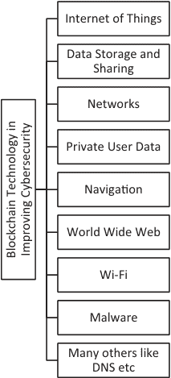

**图6.3** 区块链技术可用于改善网络安全。

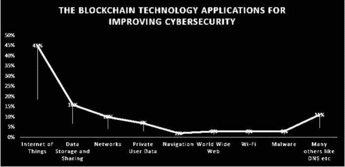

**图6.4** 区块链技术在改善网络安全方面的应用。

由于区块链的分布式特性，客户私有信息基本上不会放入区块链。这可能是因为区块链的不可逆性概念（每个人都有一份记录副本），这使得它难以用于安全目的，尤其是在信息保险方面。在当前的方法中，常见的客户端设备偏好被编码并放在区块链上，以便该客户端唯一恢复。我们还探讨了区块链工作量证明（PoW）与有效性证明共识方案之间的比较，其中中心节点根据其与其他节点的受限连接数量获得评分，以评估其合法性。

区块链通过维护和测试本地记录通行控制数据，用于提高与万维网研究和可用性相关的远程互联网组件的可靠性。同样，区块链用于通过正确的DNS记录帮助访问正确的页面，安全地使用Web应用程序，并通过加密、编码的系统与他人通信。联盟区块链的可行性被用于实施这些行动方案，在这些方案中，共识方法由一组预选的中心节点在框架中强制执行。

区块链在物联网系统中的应用安全性已被认为是行业的迫切需求，并已成为开发和部署的最紧迫目标。尽管研究势头强劲，但文献中几乎所有关于区块链数字安全的文章都指出，如果以区块链创新为支撑，物联网框架的安全性可以得到提升。然而，对于选择采用该技术的相关变量及其可行性，以及如何和在何处可以在明确的环境中刻意使用它来纠正当前的物联网安全危害/风险，人们知之甚少、讨论不多，同时还应考虑该领域的创新思维和未来攻击向量的产生。因此，建立一些可量化的规则和工具，以帮助在文献中清晰地填补这一空白，对未来的研究非常重要。此外，针对资源受限的物联网设备（运行在系统边缘）提出轻量级的区块链解决方案，可能是另一个进一步研究的领域。

如今，区块链用于人工智能（AI）信息安全，AI的数据来自传感器、执行器等不同设备，这些设备通常用于物联网（IoT）设备。人工智能（AI）及其子领域已被用作分析和处理采集数据的强大工具，以实现针对安全问题的有效推理。

尽管人工智能具有开创性，并且可以与分布式处理相结合，但当恶意外部人员故意或意外地输入被破坏或不真实的信息（依赖于对抗性输入源）时，将会产生一个棘手的问题。区块链作为一种著名的分布式账本技术，可以在互联网的各个领域得到应用。

区块链技术的采用因其去中心化、分布式和防篡改的特性，保证了信息的合法性、可靠性和可信度。当信息的可信度和可靠性得到保证时，人工智能就能产生越来越安全和可靠的结果。未来的一个研究方向可能是研究区块链在B2B（企业对企业）和M2M（机器对机器）环境中保障AI信息的安全性。

侧链安全技术必须最大限度地减少与主区块链相关的困难（主要是性能），这些侧链近来越来越多地作为与主链相连的独立链出现，与主链并行开展交易。我们预计在不久的将来会出现一个互联的多区块链世界，其中不同的主链和侧链在不同情境下协同运作。


在未来几年？如果通过中央银行的选择将此替换为授权货币的一部分，这可能是可能的。但即便如此，做出如此具有挑战性的决定仍需要数年时间。如今，绝大多数企业都是通过在线购买运营的。

那些跨国从事加密货币工作的人，通过购买和销售商品和服务，可能获得巨额利润。在加密货币和区块链技术中，任何交易都不需要交易费用。加密货币交易几乎是即时的。传输直接支持，仅需十几分钟即可在区块链上完成开销的验证。通过比特币支付进行的金融交易绝对安全。如果用户钱包中有足够的资金，则交易必须成功。加密货币只是一种点对点金融方案，因此完全没有税收。可以说没有任何政府税或交易费用。加密货币交易后形成的区块链用于建立清晰、安全且可追踪、确认的账目。这种加密货币技术的一个缺点是未来不确定。目前，即使是单个比特币也非常昂贵，但这能持续多久？此外，比特币在多个国家不合法，因此它不是一种国际公认的货币。

## 参考文献
- 1. Bayern, S. 论比特币、独立富裕的软件和零成员有限责任公司。Northwestern University Law Review, 108, 1485, 2013.
- 2. Giungato, P., Rana, R., Tarabella, A., & Tricase, C. 比特币及其相关区块链技术可持续性的现状。Sustainability, 9(12), 2214, 2017.
- 3. Hileman, G., & Rauchs, M. 全球加密货币基准研究。Cambridge Centre for Alternative Finance, 33, 36–45, 2017.
- 4. Narayanan, A., Bonneau, J., Felten, E., Miller, A., & Goldfeder, S. 比特币与加密货币技术：全面介绍。Princeton University Press, St. Princeton, NJ, 2016.
- 5. Bouri, E., Roubaud, D., & Shahzad, S. J. H. 比特币和其他加密货币是否一起跳跃？The Quarterly Review of Economics and Finance, 2019. https://doi.org/10.1016/j.qref.2019.09.003.
- 6. Bouri, E., Gupta, R., & Roubaud, D. 加密货币中的羊群行为。Finance Research Letters, 29, 216–221, 2019.
- 7. Brauneis, A., & Mestel, R. 加密货币的价格发现：比特币及其以外的。Economics Letters, 165, 58–61, 2018.
- 8. Fry, J. 繁荣、衰退与厚尾：比特币和加密货币市场的故事？Economics Letters, 171, 225–229, 2018.
- 9. Yuan, Y., & Wang, F. Y. 区块链与加密货币：模型、技术与应用。IEEE Transactions on Systems, Man, and Cybernetics: Systems, 48(9), 1421–1428, 2018.
- 10. Corbet, S., Meegan, A., Larkin, C., Lucey, B., & Yarovaya, L. “探索加密货币与其他金融资产之间的动态关系。” Economics Letters, 165, 28–34, 2018.
- 11. Dierksmeier, C., & Seele, P. 加密货币与商业伦理。Journal of Business Ethics, 152(1), 1–14, 2018.
- 12. Temin, P. “大衰退与大萧条。” Daedalus, 139(4), 115–124, 2010. 2007–2008年金融危机。https://en.wikipedia.org/wiki/Financial_crisis_of_2007%E2%80%932008
- 13. Agree, T. T. E. 自大萧条以来最严重的金融危机。*如果不采取正确措施，风险将增加，商业资讯新闻数据库.* http://ca.news.finance.yahoo.com/s/13022009/34/biz-f-business-wire-three-too-economists-agree-2009-worst-financial-crisis.html. 2009.
- 14. Eigner, P., & Umlauft, T. S. 1929–1933年和2007–2009年的大萧条？平行、差异与政策教训。*平行、差异与政策教训（2015年7月1日）.* Hungarian Academy of Science MTA-ELTE Crisis History Working Paper, (2), 2015.
- 15. Eichengreen, B., & O’Rourke, K. 两个萧条的故事：新数据告诉我们什么？VoxEU.org, 8, 2010. https://www.advisorperspectives.com/newsletters10/pdfs/A_Tale_of_Two_Depressions-What_do_the_New_Data_Tell_Us.pdf
- 16. Temin, P. 大衰退与大萧条。*Daedalus, 139*(4), 115–124, 2010.
- 17. Williams, M. *失控的风险：雷曼兄弟的教训以及系统性风险如何仍能导致世界金融体系崩溃.* McGraw Hill Professional, New York, NY, 2010.
- 18. Marr, B. A. 每个人都应该阅读的比特币和加密货币简史。*可在以下获取* https://www.forbes.com/sites/bernardmarr/2017/12/06/a-short-history-of-bitcoin-and-crypto-currency-everyone-should-read/, 2017.
- 19. Sutradhar, D. 美国金融危机：原因及其对印度的冲击。pp. 1–9. https://www.scribd.com/document/127532103/US-Financial-Crisis-Causes-and-Its-Impact-on-India.
- 20. Mukeshchand, P. P. C., Charles, V., & Mishra, C. S. 改革后和全球金融危机期间使用DEA评估印度银行业绩效。*商业经济学与管理期刊, 17*(1), 156–172, 2016.
- 21. Bardhan, A. *次级贷款与补贴：金融危机的政治经济学.* University of California, Berkeley, 2008.
- 22. Kolb, R. W. (Ed.). *金融危机的教训：原因、后果与我们的经济未来* (Vol. 12). John Wiley & Sons, Hoboken, NJ, 2010.
- 23. Chitale, R. 美国金融危机的触发因素。*经济与政治周刊,* November 1, 20–24, 2008.
- 24. Nachane, D. M. 未注册印度的命运。*经济与政治周刊, 44*(13), 115–122, 2009.
- 25. Varghese, A., & Salim, M. H. 喀拉拉邦手工织布业：问题与挑战研究。*管理与社会科学研究评论国际期刊, 1*(14), 347–353, 2015.
- 26. Murphy, R. T. 亚洲与美国金融的崩溃。*经济与政治周刊, 43,* 25–30, 2008.
- 27. Aalbers, M. B. 大缓和、大过剩与全球住房危机。*住房政策国际期刊, 15*(1), 43–60, 2015.
- 28. Sodhi, N. S., Bickford, D., Diesmos, A. C., Lee, T. M., Koh, L. P., Brook, B. W., & Bradshaw, C. J. 衡量崩溃：全球两栖动物灭绝和衰退的驱动因素。*PLoS one, 3*(2), e1636, 2008.
- 29. Lewis, P. H. *阿根廷资本主义的痛苦：从梅内姆到基什内尔.* Praeger, Westport, CT, 2009.
- 30. Davis, E. P., & Karim, D. 早期预警系统是否能帮助预测次贷危机？*国家研究所经济评论, 206*(1), 35–47, 2008.
- 31. Sivaram, B. 美国崩盘对印度经济的影响。1–7, 2008. https://www.scribd.com/document/45480775/The-Impact-of-the-US-Meltdown-on-the-Indian-Economy.
- 32. Kharif, O., & Leising, M. 比特币与区块链。Bloomberg QuickTake, 2018. https://www.bloomberg.com/quicktake/bitcoins.

## 7.1 引言
金融服务业在商品交易和社会福利方面发挥着至关重要的作用，因为它允许为未来储蓄和投资。它提供风险保护并保障企业[1]。信息技术在数十年间改变了该行业的根基。它实现了交易的大幅增加和产品多样化[2]。然而，企业部门信息与通信技术（ICT）创新的当前步伐为区块链提供了巨大的潜力。这主要是通过将其去中心化来减轻安全负担，即在行业内部安置。区块链技术的全面视角可作为安全和创新的范式转变[3]。

比特币的成功故事为区块链技术增添了新篇章。本章全面概述了区块链算法在众多领域的应用，包括医疗服务、金融服务、云、物联网等。区块链技术在可扩展性和安全性方面仍存在诸多挑战。这需要区块链算法来证明，以实现网络的不可变性。区块链技术的对抗最近已达到顶峰。区块链账本无非是一种去中心化的加密数据存储。比特币是区块链最成功的产物，于2008年提出并于2009年实施。在这里，所有已完全承诺的交易都存储在区块列表中。随着新区块的随后加入，记录链不断增长。它基于密码学和分布式共识算法。它可以进一步增强用户安全性和账本一致性。区块链具有持久性、可审计性和去中心化的特征。它开启了效率和成本节约的新机遇。它可以为数字资产、在线支付和汇款转移提供正确的框架。除此之外，它还可以遏制黑钱洗钱。许多部门也可以受益，例如服务业、云计算、金融和物联网。能够使用区块链技术的企业可以赢得其消费者的信任。因此，区块链有可能提高该公司的股市价值[4]。

本章贡献如下：（1）云结算和（2）区块链合规。将云计算嵌入区块链为其进一步研究开辟了新的途径。

## 7.2 区块链算法概述
算法具有管理人类活动并提供对被认为相当合乎逻辑的数据的深刻见解的能力。与在社会技术经济系统中讨论算法的日常使用相比，我们更精确地解释了如何在区块链技术中管理它，并讨论了研究算法在影响整个创新的流程实施中的重要性。

*区块链生态系统* [5, 6] 是一种开源、去中心化系统，与集成的权威和企业编程框架相比出现了不同变化，从而引发了重大变革。数字加密货币网络中个人之间存在压力，他们可能希望协调

密码货币进入组织，以及那些认为数字货币是算法力量的极端利用、不受机构影响的人。区块链已成为学术研究和行业中的流行词。最近，很少有公司通过使用区块链取得巨大成功。区块链交易可以在没有任何中介控制的情况下进行。由于区块链的不可变性，大多数行业正在向区块链迈进[1, 2]。下一代互联网系统正在向区块链技术蓬勃发展，因此我们需要一个更强大的算法。算法最近的发展可以解决与区块链大小和安全相关的问题。我们可以设计这样一种算法，防止隐私泄露和高频交易。由于较大的区块大小需要更大的存储空间，最终网络中的传播会变慢。这将逐渐使系统控制更加集中。毫不奇怪，区块链矿工会隐藏他们的区块，以便在未来获得更多收入。本章为区块链算法和云在区块链设计原则中的影响提供了一份技术报告。算法的时间顺序转变侧重于区块链的逐步研究。

区块链制定者致力于交易的持久性。它确保每个唯一的发起者按照其与身份相关的个人数据条款来控制自己的算法。为了管理不断增长的记录列表，我们需要一个透明且提供隐私和安全的算法。一个好的算法可以在连接的基础设施上提供完整的安全性和可验证性。为区块链环境设计的算法针对一些具体目标。它是参与整个区块链网络的节点之间的一种协定。该算法必须满足一些推动程序在全球范围内运行的共同目标。为了实现同步账本交易，我们作为研究人员希望一个好的区块链算法必须将商业世界和金融交易转变为更好的形式。在本章中，我们简要概述了区块链环境中算法的时间顺序进展，但我们仍然需要一个能够提升速度、安全和集成等关键方面的最优算法。区块链算法可以以去中心化的所有权执行交易。它是贸易、零售、银行和医院部门的完整解决方案，在这些部门中，我们需要一个中介忠诚度计划来简化访问信息。为了在区块链上实现良好的业务逻辑，每个组织都需要一个完整透明的算法，能够验证数据的谱系、超级账本结构和点对点访问。一个好的算法将使复杂的交易更高效且成本更低。例如，亚马逊量子账本数据库（QLDB）算法为云上的每个作业提供了合适的解决方案。QLDB中使用的算法可以跟踪每个节点的内存、存储资源和端到端区块链平台的使用指标[7–9]。

在区块链中，算法的任务如下：
- 验证内容的签名。
- 确认交易中的余额。
- 决定区块的有效性。
- 确定矿工如何验证区块。
- 建立区块在区块链中移动的模式。
- 提供创建新币的程序。
- 告诉系统如何确定共识。

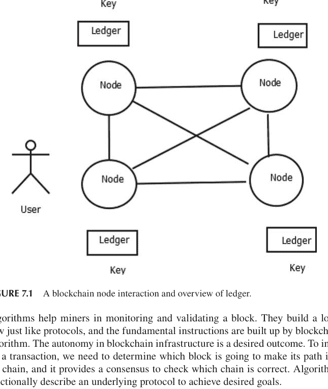

图7.1 区块链节点交互与账本概览。

算法帮助矿工监控和验证区块。它们像协议一样构建逻辑流，而基本指令由区块链算法构建。区块链基础设施中的自治是一个理想的结果。要发起交易，我们需要确定哪个区块将进入链中，并提供共识来检查哪条链是正确的。算法在功能上描述了实现预期目标的底层协议。

比特币和以太坊是区块链应用中的新兴协议。它们专注于建立务实规则来设置“引擎”，同时确定谁做什么操作以及如何做。作为最终用户，我们然后执行算法的伪代码来用币进行交易。它将执行智能合约[10, 11]，并促进创新商业模式的创建。这些算法提供了高端的现代化设置，使协议更有用。

状态和动作之间是有区别的。我们不能改变规则，但可以创建一系列特定于我们业务模型的行动、指令和流程。

## 7.3 区块链中的算法类型

2009年中本聪对区块链和比特币加密货币进行有意义的实施之后，许多算法被强调。算法的发展不断推进，旨在解决现有区块链基础设施的互操作性挑战，如工作量证明（PoW）[12–14]算法系统。PoW和权益证明（PoS）正在促进*共识算法*。它们协作并使得所有区块链节点能够就区块链规则达成共识，同时也检查双重支付，即如果入侵者试图多次花费相同的币，则违反了区块链算法的道德政策。

### 7.3.1 共识算法

共识算法有助于购买币或运行节点。设计共识算法的主要目的是实现涉及网络上多个节点的可靠性，以确保所有节点遵守指南。在比特币中，节点定义共识，而不是矿工。链与共识以及最大的工作量相关联。如果你分叉并更改PoW，你将没有挖矿能力来验证它。节点确认、验证并复制交易，同时验证、复制区块，以及服务和存储区块链。节点甚至定义了矿工必须使用的PoW算法。节点维护协议，而不是矿工。区块链的出现推动了共识算法的发展，并且已经制定了更多算法，期望解决有史以来第一个PoW算法系统的限制。

### 7.3.1.1 共识算法

共识区块生成算法用于建立一种协定，通过该协定区块链网络获得共识。公共（去中心化）[15, 16]区块链激励整个分布式系统，由于它们不依赖任何中央权威，分布式区块需要就交易的有效性达成一致。共识算法由此应运而生。它们确保协议规则得到遵守，并保证所有交易实现可靠性；因此，将检查币的双重支付。在深入讨论不同种类的共识算法之前，概念化算法和协议之间的差异至关重要。

### 7.3.1.2 共识算法与协议

术语“算法”和“协议”被视为任何新兴应用的支柱，但它们的务实观点并不相同。作为一个常规术语，作者将协议定义为区块链的抽象规则，而算法则基于这些规则被构建的机制。除了在金融交易中的大量使用外，区块链技术还可以渗透到商业的每个角落，并能够支持众多商业用例。但无论上下文如何，区块链网络主要关注一个协议，该协议确定系统应如何工作，因此系统的所有不同部分和网络的所有参与者都需要遵循底层协议的规则。

虽然协议规定了流程是什么，但算法告诉系统采取哪些步骤以遵守这些规则并产生期望结果。例如，区块链的共识算法决定有效性


交易和区块的。所以，比特币和以太坊是协议，而PoW和PoS是它们的共识算法。

为了进一步说明，可以认为协议为节点设定了一套管辖标准，即区块之间应如何交互、数据如何在它们之间传输，以及成功验证区块的可行逻辑是什么。另一方面，共识算法负责验证余额和签名、认证交易，并实际执行区块验证，而整个过程依赖于网络共识。

### 7.3.2 共识算法的不同类型

共识算法有几种类型。最常见的实现是PoW和PoS。在试图平衡安全性、功能性和可扩展性时，每种算法都有其自身的优缺点。

#### 7.3.2.1 工作量证明（PoW）

PoW架构使用了共识算法的概念。它被比特币和许多其他加密货币广泛使用。PoW算法是挖矿过程的重要组成部分。

PoW背后的目标是保证大量的哈希计算过程，因此若需要，更多的计算能力消耗允许每秒进行更多次尝试。随后，拥有高哈希率的矿工有机会为下一个区块（又称区块哈希）选出完整的工作量证明解决方案。PoW共识算法的增强依赖于矿工的选择和对新生交易区块的验证过程。如果网络的分布式节点达成共识，并同意矿工提供的区块哈希是有效的工作量证明，则将该区块添加到区块链中。

#### 7.3.2.2 权益证明（PoS）

PoS共识算法于2011年作为PoW的替代方案成为现实。尽管PoS和PoW有着共同的目标，但它们在验证新区块时仍存在一些根本性的差异和独特性。

PoS共识算法的思想用一种明确的程序取代了PoW挖矿策略，即区块需要根据参与者的质押权益进行验证。每个区块的验证者（也称为“锻造者”或“铸币者”）由加密货币本身的投资决定，而非分配的计算能力决定。每个PoS系统以不同方式实现该算法，但一般而言，区块链通过一个伪随机选举过程来保护，该过程根据节点财富的计算来确定币龄（币被锁定或质押的时间），并加入一个随机化因子。

以太坊区块链目前以PoW算法为核心，但Casper协议将把网络基础设施从PoW转变为PoS。这是为了提升网络的可扩展性[17–19]。

如前所述，共识算法对于维护加密货币网络的完整性和安全性至关重要。它们为分布式节点提供了潜在的动力。通过共识来确定哪个版本的区块链是可能的决定因素。就当前区块链的性质和状态达成一致，对于数字经济系统在协同基础设施中正常运行至关重要。

PoW共识算法已成为拜占庭将军问题的最佳解决方案之一，这证实了比特币作为一个拜占庭容错系统的诞生。这意味着比特币区块链对攻击具有高度抵抗力，不仅因为去中心化网络，还因为PoW算法；因此，大多数攻击都被这种技术所阻挡。挖矿过程涉及的高昂成本使得矿工投入资源来破坏基础设施变得非常困难且不太可能。

### 7.4 挖矿算法

数据挖掘的组成部分有三种类型：*聚类或分类、关联规则和序列分析。*

聚类/分类是一种从一组奇异数据中生成分组规则的技术。该规则将用于对未来的数据进行分类。关联规则是一种众所周知的方法，它暗示数据库中一组对象之间的精确关联。序列分析用于建立出现在序列链中的模式。人们提出了各种算法来实现数据挖掘的这些方面。区块链挖矿算法的基础解释了其工作原理。本节简要说明挖矿的工作原理，它由以下四个步骤组成：

- 步骤1. 首先，用户从应用钱包签署一笔交易，并发送一定数量的加密代币。
- 步骤2. 应用钱包广播该交易，并等待矿工处理。根据区块链，未决交易被称为“未确认”。如果矿工没有提取该交易，则本地数据结构池会为这一未确认交易保留记录。
- 步骤3. 网络中作为节点的矿工从本地交易池中选择交易，并形成一个带有一些元数据信息的区块。每个矿工都会组装自己的交易区块。
- 步骤4. 交易被取出并组装到一个区块中。矿工创建一个交易区块。因此，区块链中的所有节点都需要注册交易。所以，在发起交易之前，必须对区块进行验证。区块的首要活动是获取证明签名，即PoW。该签名由非常复杂的数学难题组合而成。每个区块都唯一地维护此签名。这个过程被恰当地称为“挖矿”，例如，哈希函数在区块链中被矿工广泛使用。哈希函数将一串数字和字母作为输入，然后返回一个32位字符串，该字符串由随机字母和数字组合而成（哈希输出）。

### 7.5 可追溯性链算法

可追溯性的整个范围旨在为数字基础设施在发展初期提供真实性。它专注于任何电子交易的透明安全实践。它将收集附加信息以提升内部节点性能。随后，它勾勒出供应链模型中每个节点的起草活动。区块链是商业交易中大量数据的决定性框架。这里，海量数据在每个节点间传播。可追溯性链算法的思想如下：它为被追溯的产品提供一个唯一标识符。该算法不仅提供链下数据的追溯，还确保高维数据的一致性和数据限制。可追溯性链算法的根源是分布式计算基础设施。可追溯性链算法背后的唯一目标是快速预测可追溯性决策。因此，这种新兴技术可检查无关数据问题并增强区块链中的可追溯性。如今，可追溯性链算法为钻石交易、知识产权和制药行业提供了高端解决方案。可追溯性应用在区块链线性挖矿算法中的一些最新进展包括IBM加密锚点和Oracle智能合约。虽然可追溯性链算法运行速度比共识算法快，但每个被追溯的产品都需要一个潜在的推理机制。这是应对数据盗窃的明智解决方案。最近，许多商业机构面临精确追溯产品的问题。由于它们在此过程中没有先前的正确信息，这对应于区块链生态中的重复节点。有了区块链，就可以持续追溯交易的历史。一种称为**高木–菅野模糊认知图**的新方法专注于可追溯性链算法。本节讨论了区块链挖矿中可追溯性算法的一致性分析。它通过约束方法不断重塑目标函数，以在利益相关者节点之间进行优化决策计算。因此，这种可追溯性提高了产品可见性，并通过在组织可追溯性序列的同时减少挖矿工作而取得成功。

区块链可追溯性旨在改善供应链生态系统的协调性；它提供关于交易空间方面和状态的更精确信息，使节点能够利用这些潜在信息作为其规划活动的输入。可追溯性解决方案对整个运营生命周期实施严格管控，能够追溯区块链上电子交易中移动的每一项数字资产。要建立完整的可追溯性基础设施，必须认真努力跟踪区块链上的活动；区块链为交易中连接的每个项目提供一个虚拟身份。因此，物体需要与传感器或标签关联，这些传感器或标签可以存储物品信息并将其传输到平台，例如QR码、RFID或无线传感器网络。可追溯性链算法是使用区块链交换数字资产的分布式记录数据库的支柱。这组算法背后的新颖方法提供了分层认知学习。可追溯性链算法为区块链提供了最佳可追溯性。机器学习在预测高维数据集上的追溯方面发挥着重要作用。这组算法专注于能够预测区块轨迹的模糊推理机制。可追溯性检测

区块链中的算法是精确追踪记录不可或缺的系统。它可以防止敏感信息的数据篡改。它采用一种新兴技术来应对数据爆炸问题。它在区块链模型中采用动态的区块控制。它有效考虑用户需求以缓解数据爆炸问题。它在供应链管理方面展现出光明前景。溯源链工作机制如下：

- 1. 通过考虑历史数据和数据性质，采用事件数据学习技术。
- 2. 预测区块链模型上节点的模式。
- 3. 精确捕获溯源信息。
- 4. 将加密密钥信息上传至区块链。

这项新兴技术仍在研究中。

## 7.6 拜占庭容错（BFT）

拜占庭容错（BFT）旨在评估均匀隔离计算系统的可靠性。在此过程中，它解析组件故障机制，并通过该算法减轻崩溃信息造成的结果。征服 BFT 是区块链技术面临的关键挑战之一。BFT 描述了一种机制，两个节点可以通过数字基础设施安全地交换信息，确保它们展示相同的数据。

“拜占庭故障”的重要影响是，它聚焦于某个组件（例如服务器），该组件可能通过在每个时间段呈现多种症状而给出不一致的故障信息。这是一种活跃用户商定策略以避免系统完全失效的场景。BFT [20–22] 也被称为源一致性、错误雪崩、拜占庭将军问题和拜占庭协议问题。

### 拜占庭容错

- 节点可能任意失效
  - 它们撒谎
  - 它们串通
- 原因
  - 恶意攻击
  - 软件错误
- 开创性工作是 PBFT
  - 实用拜占庭容错，M. Castro 和 B. Liskov，SOSP 1999

BFT 被概念化为一个逻辑难题，描述的是节点在面对一组共同问题时的通信问题。BFT 的美妙之处在于，即使某些节点行为异常，它仍能继续运行。

BFT 在区块链中的广泛应用是一项持续的努力。它可以容忍某一类故障，使每个类别都能以自主的方式工作。它不会在区块链中对等节点之间施加任何限制。这一强大应用已被用于核电站、航天、航空工业等领域。

## 7.7 选择正确的算法

要构建新兴的数字基础设施，我们需要将区块链作为一种服务，其中包含处理复杂后端账本的众多算法。它可以帮助任何业务模式在云上实现应用去中心化。对于任何企业所有者来说，选择正确的算法在网络上分发关键信息是一项具有挑战性的任务。正确的算法可以帮助区块链开发者在所有可能的情况下集成信息。这就是我们需要一种能够处理所有可能情况的智能区块链算法的原因。算法有助于框架构建。它可以提供关于区块链中对等节点、主节点和跟踪历史的清晰信息。在数字生态系统中，应用区块链技术之前研究对等节点的行为至关重要。它还可以提供抵御恶意行为的免疫力。算法的整体视角不仅是为节点提供自动控制，还要判断业务领域的可扩展性。区块链中的算法在交易跟踪和安全性方面提供了一种创新结构。本节将解释各种算法及其特点。通过选择正确的算法，可以捕捉去中心化的影响以及远程节点安全漏洞的影响。为了创建智能经济，作者提出了在云连接基础设施上跟踪事件的一些新视角。它可以保护数字身份，从而在用户之间创建智能合约。最近，IBM 推出了超级账本 Fabric 框架。它基于区块链通道分区。例如，NEM 是一种用 Java 开发的特定平台区块链技术。它为支付服务、消息传递和资产认证提供解决方案。在开发区块链基础设施时，选择正确的算法可以提供一个使技术保持在正确轨道的实例。选择正确的算法是区块链中一种引人注目的解决方案。

### 7.7.1 区块链（非工作量证明）

当对等节点在共识基础设施（即所有对等节点都已知且可信的网络）中进行交易时，区块链算法会利用高端数学运算的潜力，而这些运算可以被更简单但不太安全的替代方案取代。非 PoW 区块链算法通常会选择一个领导者。因此，非 PoW 区块链容易受到拒绝服务（DoS）攻击，但它可以展示一种更好的用于民主化交易的替代方案。

### 7.7.2 区块链的最新技术

在开放系统中（即任何人都可以不受任何限制地作为对等节点分享信息的系统，每个对等节点要么不可信，要么十分陌生），区块链构想了一种解决 DoS 攻击问题的最新技术，但每次交换都需要付出巨额的代价。

每种算法与区块链概念结合都是优点与弱点的综合体。用户可以根据行业性质和自己构建的数字生态系统，为其商业基础设施选择最合适的协议。

## 7.8 云存储

Google Drive、Dropbox、Gmail 等是云存储的新兴应用。云存储允许终端用户远程存储数据，从而随时随地获取数据。如今，我们将所有数据以数字格式存储；与传统上以物理方式维护文件相比，这实时减少了用户的工作量。政府部门也在利用云数据存储的优势，并使用公有云和私有云来存储、检索和处理数据交易。数据加密后存储在云上，云服务在服务级别协议的框架下为所有组织提供支持。它涵盖了数据完整性和隐私。许多公司正在将整个数据中心迁移到云上，并享受弹性、负载均衡、冗余、可用性和完整性等优势。近期，这个市场正以指数级速度增长，大部分云存储服务由 Google、Microsoft 和 Amazon 等大公司提供。你可能已经注意到，甚至连三星和苹果这样的移动公司现在也为终端用户提供了自己的云存储设施，例如 Samsung Cloud 和 iCloud [4, 23]。

### 7.8.1 区块链在云存储中的应用

区块链云存储修复方案允许将用户数据分割成小块。之后，我们添加一个额外的安全层，并将分片数据包重新分布到整个网络中。区块链特征背后的核心思想包括哈希函数、公钥/私钥加密和交易账本。每个数据包片段都存放在一个去中心化的空间位置。对于试图入侵的黑客来说，这是一项艰巨的任务；黑客首先获得加密数据，然后只能得到一个数据块而不是整个文件——这扩展了基于区块链的云存储中文档的安全模式。

区块链云存储的第二个好处是所有者是隐藏的，因为节点不包含所有者的信息。矿工只接收数据包，因此所有敏感信息都受到保护和安全保障。它扩展了数据冗余和负载均衡机制的概念，这些机制用于实现高可用性和快速访问。同时，如果用户试图获取数据，会首先验证该数据的所有数据包；如果发现任何数据包出现变形，那么负责修改该数据包的矿工将被从网络中移除，而该被修改的部分将从另一个冗余副本中匹配。因此，所有用户都会获得原始且相同的数据副本。

区块链云基础设施是更快技术创新的典型代表。区块链云基础设施在区块链中提供密码块。要实现这项技术，我们作为研究人员必须确保云在区块链中的位置。


云端数据交换需要一套广泛的安全路由协议才能到达中央服务器。由于数据的海量激增，我们需要一个区块链物流平台。它将支持通过互联网进行安全的数据处理。当数十亿条云交易进入区块链时，每个云应用都会经历一次审计。它将在安全性和可扩展性方面实时扩展平台。云–区块链应用是一个多层面的架构，用于交换科学、技术和学术数据。它可以在当前场景下确保知识产权。它可以远程去中心化云基础设施。为了提供更安全的应用程序，当代需要将区块链和云结合在一起。这项技术因其加密账本而受到关注。当任何企业采用区块链–云技术时，它会提供更强的可问责性。它是无中介的，即不存在中间控制。区块链–云基础设施中的多方验证有助于存储敏感信息。

区块链与云环境的集成提供了网络上数据的保护和信息的安全。云计算为技术虚拟化提供了高端解决方案。它可以促进基础设施建设的成本节约。云计算提供了平台无关性、分布式计算环境以及大规模按需资源访问。云计算中存在各种具有挑战性的维度，即存储在云上的数据并不安全。因此，任何未经授权的访问都可能摧毁企业的整个业务生态系统。根据云上的资源可访问性，云计算可分为三种类型：（i）公有云，（ii）私有云，（iii）混合云。公有云确保了高可扩展性、可靠性和低成本的基础设施建设。私有云在组织内部提供服务，由内部机构管理，为高端关键应用提供不同级别的安全性。混合云是公有云和私有云的结合，既灵活又安全。在本章中，我们试图概述区块链–云概念的去中心化加密模型。我们强调了区块链的安全应用及其在云计算领域的重要性。在当前场景下，区块链可以与任何分布式通用云模型集成，以确保服务质量和最终用户安全。云上正在产生数十亿笔交易。这些信息是异构的、敏感的和无响应的。为了解决上述问题，开发了一种云–区块链架构。这种架构的起源被广泛接受用于验证任何交易。区块链中的每个节点都会收到最终用户给出的交易ID。该交易索引启动操作并一直持续到过程结束。这组交易被记录在交易日志或账本中。在区块链中，我们为所有已提交的交易维护一个队列数据结构。为了更新交易，挖矿节点在区块链网络上确认一项操作。

### 7.8.2 云计算的风险正在增加

随后，在数据控制和管理方面，与云计算相关的风险正在增加。因此，我们需要一个区块链–云模型，它将彻底改变云上的业务交易，如图7.2所示。该模型的目的是显著识别云计算背后的潜在风险，同时可以通过区块链技术来克服这些风险。该模型分析了区块链–云应用的理论框架。它以块状序列方式运行。在这里，公共网络与云边缘服务交互，云边缘服务是一个跨云支持框架，用于监控用户与云资源之间的路径。它确保了更好的消息控制，以实现一致的高网络性能。云API（应用程序编程接口）提供了RPC（远程过程调用）接口。它提供跨云兼容性。它可以使用这些API将应用程序和工作负载集成到云中。一些著名的API包括SaaS API、PaaS API和IaaS API。

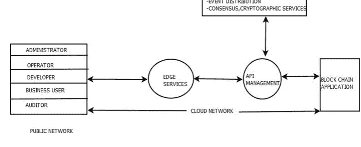
图7.2 云边缘服务与区块链模型。

## 结论与未来展望

区块链目前正在分析每个企业的最新通用解决方案。当与另一项强大技术——云计算——集成时，该技术改变了网络交易的整体格局。它为最终用户提供了可扩展的安全性。云计算是大型网络和虚拟数据存储的集合体。当我们把区块链与云融合在一起时，它为交易数据库的存储、复制和访问提供了新的视角。它融合了云上任务用户与数据协作者之间的安全概念。本研究的未来范围是数据建模与区块链–云导向之间存在的研究空白。将区块链中的所有应用融合在一起会产生高昂的运营成本。如果能够通过云数据存储与区块链账本之间的双线性配对来分析云数据的分布，云–区块链的合理性阶段将获得一个最优解。我们必须关注边缘计算中区块链–云创建的数据隐私和可用性，在边缘计算中，我们将资源放在靠近设备位置的地方。它可以在受限安全条件下有效利用云上的所有资源。为了在区块链–云模型上实现安全、可靠和可扩展的数据共享，我们仍在等待一种相关算法，该算法将在数据移动到云之前解决任何不诚实行为。为了改善云–区块链模型的延迟时间，我们需要一种多智能体账本学习算法，该算法可以通过预先学习来控制基础设施。区块链–云集成提供了一种最先进的

- 16. Natoli, C.; Gramoli, V. 区块链异常。见2016年IEEE第15届网络计算与应用国际研讨会（NCA）论文集，美国马萨诸塞州剑桥市，2016年10月31日至11月2日。
- 17. Swan, M. *区块链：新经济蓝图*；O'Reilly Media, Inc.：加利福尼亚州塞瓦斯托波尔市，2015年。
- 18. Tschorsch, F.; Scheuermann, B. 比特币及其超越：去中心化数字货币的技术综述。*IEEE Commun. Surv. Tutor.* 2015年，18, 2084–2123。
- 19. Wressnegger, C.; Freeman, K.; Yamaguchi, F.; Rieck, K. 自动推断用于防病毒辅助攻击的恶意软件签名。见2017年ACM亚洲计算机与通信安全会议论文集，阿联酋阿布扎比，2017年4月2日至6日。
- 20. Decker, C.; Roger, W. 比特币网络中的信息传播。见2013年IEEE第十三届点对点计算国际会议（P2P）论文集，意大利特伦托，2013年9月9日至11日。
- 21. Nakamoto, S. 比特币：一种点对点电子现金系统。在线获取：https://bitcoin.org/en/bitcoin-paper（于2017年6月29日访问）。
- 22. Bozic, N.; Guy, P.; Stefano, S. 区块链及其在安全网络控制平面中的应用教程。见2016年第三届智能云网络与系统（SCNS）会议，阿联酋阿布扎比，2016年。
- 23. Bradbury, D. 比特币的问题。*Comput. Fraud Secur.* 2013年，11, 5–8。

## 8 Solidity 基础

*Parv Garg 和 Neeraj Khadse*
ICFAI 高等教育基金会
（被视为大学）

### 目录

- 8.1 引言 ........ 116
- 8.2 环境搭建 ........ 116
- 8.3 入门 ........ 117
- 8.4 值和运算符类型 ........ 118
  - 8.4.1 值类型 ........ 118
  - 8.4.2 变量类型 ........ 118
    - 8.4.2.1 状态变量 ........ 118
    - 8.4.2.2 局部变量 ........ 119
    - 8.4.2.3 全局变量 ........ 119
    - 8.4.2.4 Solidity 变量命名规则 ........ 120
  - 8.4.3 运算符类型 ........ 120
    - 8.4.3.1 算术运算符 ........ 120
    - 8.4.3.2 比较运算符 ........ 120
    - 8.4.3.3 逻辑运算符 ........ 121
    - 8.4.3.4 赋值运算符 ........ 121
    - 8.4.3.5 条件运算符（?: 条件） ........ 121
- 8.5 控制结构 ........ 121
  - 8.5.1 循环 ........ 122
  - 8.5.2 决策制定 ........ 122
- 8.6 数据结构 ........ 122
  - 8.6.1 数组 ........ 122
    - 8.6.1.1 固定数组 ........ 123
    - 8.6.1.2 动态数组 ........ 123
    - 8.6.1.3 数组属性 ........ 123
  - 8.6.2 映射 ........ 123
    - 8.6.2.1 映射陷阱 ........ 124
  - 8.6.3 结构体 ........ 126
  - 8.6.4 枚举 ........ 126
    - 8.6.4.1 枚举陷阱 ........ 127
  - 8.6.5 字符串 ........ 127
- 8.7 函数 ........ 128
  - 8.7.1 函数定义 ........ 128
  - 8.7.2 函数调用 ........ 129
  - 8.7.3 函数参数 ........ 129
  - 8.7.4 返回语句 ........ 129


- 8.7.5 函数修饰符 ... 130
- 8.7.6 函数类型 ... 131
- 8.7.7 回退函数 ... 131
- 8.7.8 函数重载 ... 131
- 8.7.9 加密函数 ... 132
- 8.8 合约 ... 132
- 8.8.1 构造函数 ... 133
- 8.8.2 状态变量 ... 134
- 8.8.3 函数 ... 134
- 8.9 事件 ... 134
- 8.10 错误处理 ... 134
- 结论 ... 134
- 参考文献 ... 135

## 8.1 引言

Solidity [1] 是一种静态类型、面向合约的高级语言，用于编写智能合约 [2, 3]，智能合约是根据特定条件控制资金转移的函数。Solidity 开发出在以太坊虚拟机 (EVM) [4] 上执行的机器级代码，以太坊虚拟机是一个基于分布式区块链的平台。它与 C、Python 和 JavaScript 等高级编程语言有许多相似之处。它支持各种库、复杂用户定义数据类型以及面向对象编程 (OOP) 概念如继承等众多其他特性。Solidity 编写的智能合约的一些用例是系统化投票、拍卖、彩票等。

在本节中，我们将重点介绍 Solidity 编程的基础知识，在接下来的章节中，我们将了解更多关于智能合约和 EVM 的内容。

## 8.2 环境设置

有相当多的平台和方法可以与 Solidity 语言一起使用。其中一些如下：

- **a. Remix 在线编辑器**  
  在线编辑器，如 Remix，建议用于小型和快速项目。它支持广泛的 Solidity 版本。它提供了一个用于编写、编译和部署智能合约的环境。Remix 在线编辑器可在以下位置获得：“https://remix.ethereum.org”

- **b. npm / Node.js**  
  Solidity 编译器 solcjs 也可通过 npm 使用以下命令安装：

  ```bash
  $sudo npm install -g solc
  ```

- **c. Docker 镜像**  
  可使用以下命令获取用于 Solidity 编程的 Docker 镜像：

  ```bash
  $docker pull ethereum/solc:stable
  ```

- **d. 二进制包**  
  二进制包用于安装完整的 Solidity 编译器。

## 8.3 入门

在本节中，我们将学习 Solidity 语言 [5] 的一些基本元素。  
让我们先看一下图 8.1 并分析它。

- **a. Pragma**  
  代码的第一行包含 pragma 指令。实践中用于指定 Solidity 版本。这里指定的版本是“0.4.17”。在一个项目中，不同文件可能有不同版本；因此，pragma 指令在源文件本地生效，并在导入时自动忽略。

- **b. 注释**  
  注释是由程序员提供的额外注释或说明。在解释和编译期间，编译器会忽略它们。在 Solidity 中，注释的使用与 C++ 相同：// 用于单行注释，/* 和 */ 用于多行注释。如图 8.1 所示，注释写在每条语句之后以解释其目的。

- **c. 关键字**  
  在继续之前，让我们先看一下 Solidity 中一些重要的关键字，如表 8.1 所示。  
  大多数这些与任何其他高级编程语言的工作方式相似。

  ```solidity
  pragma solidity ^0.4.17; //To Specify the version of solidity

  contract SimpleStorage { //SimpleStorage is the name of the contract
      uint storedData; // unsigned integer "storedData"
      function set(uint x) public { //Public function with "set", take unsigned integer as an input
          storedData = x;
      }
      function get() public view returns (uint) { //Public function with "get", view function does not make any changes in contract
          return storedData;
      }
  }
  ```

  **图 8.1** 入门代码。

  **表 8.1**  
  **Solidity 中的关键字**

  |  |  |  |  |
  |---|---|---|---|---|
  | Abstract | after | alias | apply |
  | Auto | case | catch | copyof |
  | Default | define | final | immutable |
  | Implements | in | inline | let |
  | Macro | match | mutable | null |
  | Of | override | partial | promise |
  | Reference | relocatable | sealed | sizeof |
  | Static | supports | switch | try |
  | Typedef | typeof | unchecked |  |

- **d. 导入**  
  Solidity 如其他语言一样支持 import 语句。这里导入文件的方式类似于 JavaScript。然而，默认导出不受支持。

  ```solidity
  import "filename";
  ```

  此命令将导入文件 filename 中的所有全局变量。

## 8.4 值和运算符类型

### 8.4.1 值类型

Solidity 如同任何其他语言一样，支持许多内置数据类型。Solidity 中的许多值类型与 C++ 的相似。让我们看一下表 8.2 中列出的一些类型。

### 8.4.2 变量类型

#### 8.4.2.1 状态变量

在合约作用域内且在函数作用域外声明的变量称为“状态变量”。状态变量的值永久存储在合约存储中。示例见图 8.2。

```solidity
pragma solidity ^0.4.17;
contract SolTest {
    uint Data;     // State variable
    constructor() public {
        Data = 15; // Using State variable
    }
}
```


#### 8.4.2.2 局部变量

在函数作用域内声明的变量称为“局部变量”。这些变量不能在函数外部访问。局部变量的值在不同函数调用之间不会保存。请注意图 8.3 所示的代码以了解 Solidity 中的局部变量。

```solidity
pragma solidity ^0.4.17;
contract SolTest {
    uint Data;    // State variable
    constructor() public {
        Data = 15;  // Using State variable
    }
    function getAnswer() public view returns(uint){
        uint x = 5; // local variable
        uint y = 6;
        uint answer = x * y;
        return answer; //access the local variable
    }
}
```

**图 8.3** 局部变量。

#### 8.4.2.3 全局变量

永久存在于全局命名空间中的变量称为“全局或特殊变量”。它们提供与区块链 [6, 7] 相关的详细信息和其他实用函数，即交易属性。一些区块和交易属性如表 8.3 所示。

**表 8.3**  
**区块和交易属性**

| 名称 | 返回值 |
|---|---|
| blockhash (uint blockNumber) returns (bytes32) | 给定区块的哈希 – 仅适用于最近 256 个区块，不包括当前区块 |
| block.coinbase (address payable) | 当前区块矿工地址 |
| block.difficulty (uint) | 当前区块难度 |
| block.gaslimit (uint) | 当前区块 gas 限制 |
| block.number (uint) | 当前区块编号 |
| block.timestamp (uint) | 当前区块时间戳，自 Unix 纪元以来的秒数 |
| gasleft () returns (uint256) | 剩余 gas |
| msg.data (bytes calldata) | 完整的 calldata |
| msg.sender (address payable) | 消息发送者（当前调用者） |
| msg.sig (bytes4) | calldata 的前四个字节（函数标识符） |
| msg.value (uint) | 消息中发送的 wei 数量 |
| now (uint) | 当前区块时间戳 |
| tx.gasprice (uint) | 交易的 gas 价格 |
| tx.origin (address payable) | 交易的发送者 |


## 8.4.3.3 逻辑运算符

**表 8.6** 逻辑运算符

| 操作 | 符号 | 说明 | 示例（X = 10，Y = 5） |
|---|---|---|---|
| 逻辑与 | && | 仅当两个操作数都为真时返回 true，否则返回 false | X && X 将返回 true<br>X && Y 将返回 false |
| 逻辑或 | \|\| | 即使一个操作数为真也返回 true，否则返回 false | X \|\| Y 将返回 true<br>Y \|\| Y 将返回 false |
| 逻辑非 | ! | 即使一个操作数为真也返回 true，否则返回 false | !(X) 将返回 false<br>!(Y) 将返回 true |

## 8.4.3.4 赋值运算符

**表 8.7** 赋值运算符

| 操作 | 符号 | 说明 | 示例（A = 10，B = 5） |
|---|---|---|---|
| 简单赋值 | = | 将值赋给变量 | A = B，现在 A 和 B 的值都为 5 |
| 加并赋值 | += | 将相加结果赋给变量 | A += B，表示 A = A + B，即 15 |
| 减并赋值 | -= | 将相减结果赋给变量 | A -= B，表示 A = A - B，即 5 |
| 乘并赋值 | *= | 将相乘结果赋给变量 | A *= B，表示 A = A * B，即 50 |
| 除并赋值 | /= | 将相除结果赋给变量 | A /= B，表示 A = A / B，即 2 |
| 取模并赋值 | %= | 将取模结果赋给变量 | A %= B，表示 A = A % B，即 0 |

## 8.4.3.5 条件运算符（? : (条件)）

如果条件为真？则取值 X：否则取值 Y。

例如：

- i. A = (5==5)? 10 : 20，这里由于条件为真，A 的值将被赋为 10。
- ii. B = (5==10)? 10 : 20，这里由于条件为假，B 的值将被赋为 20。

## 8.5 控制结构

Solidity 与其他花括号语言一样，也实现了控制结构。它实现了与 C 或 JavaScript 类似的 if、else、else if、while、do、for、continue 和 break 语义。

让我们了解每种类型的语法。

### 8.5.1 循环

循环用于需要重复执行某些代码的场景；可通过 for、while 或 do while 实现。例如，

```text
while (condition)
{
/*
These statements within these curly braces will execute
repeatedly until the condition fails
*/
}
```

类似地，也会使用 for 和 do while 循环。

### 8.5.2 决策

决策工具用于根据特定条件确定不同的执行路径。在 Solidity 中，使用 if、else 或 else if 进行决策。例如，

```text
if (condition_1)
{
//Execute statements of this block
//Ignore all other else if or else belonging to this if
}
else if (condition_2)
{
//Execute statements of this block
//Ignore all other else if or else belonging to this if
}
...
//Multiple else if are possible
else //Works only if all the above if or else if condition fails
{
//Execute statements of this block
}
```

## 8.6 数据结构

### 8.6.1 数组

通常，我们将数组作为一种数据类型来讨论，但严格来说，它是一种存储数据集合的数据类型 [8]。因此，数组是同一数据类型的变量集合。在数组中，搜索操作通常与线性时间相关，因为每增加一条记录，搜索时间都会略有增加。通常，Solidity 中的数组有两种类型：固定数组和动态数组。

### 8.6.1.1 固定数组

在 Solidity 中，最基本的数组类型是固定数组。它是一种具有固定长度的数组。在 JavaScript 中，可以通过追加或删除记录来调整数组大小，但在 Solidity 中，固定数组的长度无法更改。其大小在声明时已预先定义。

```text
Syntax: type arrName [ arrSize ]
Example: uint storage[10]
```

### 8.6.1.2 动态数组

动态数组可以随时间改变其大小。动态数组的功能类似于 JavaScript 数组，即我们可以通过添加或删除元素来修改其长度。其大小在声明时未预先定义。

```text
Syntax: type [ ] arrName
Example: uint[] storage
```

在声明动态数组时，我们不在方括号中指定其长度。这意味着我们设计的数组长度可以根据需求伸缩 [6]。

### 8.6.1.3 数组属性

Solidity 中的数组具有三个主要属性：length、push 和 index。

- a. **Length**

  length 属性返回数组的大小。它只能由动态数组修改。

  ```text
  Syntax: arrName.length;
  Example: balance.length;
  ```

- b. **Push**

  push 属性用于在数组末尾追加新元素。它只能用于动态数组。

  ```text
  Syntax: arrName.push();
  Example: balance.push(100);
  ```

- c. **Index**

  index 属性用于读取数组中的特定元素。所有类型的数组都支持它。

请参考图 8.4 所示的示例，以了解数组的功能和特性。

```solidity
pragma solidity ^0.4.17;

contract Test {
    uint[] public Array;

    function Test() public {
        Array.push(5);
        Array.push(10);
        Array.push(30);
    }

    function getArrayLength() public view returns(uint) {
        return Array.length;
    }

    function getFirstElement() public view returns(uint) {
        return Array[0];
    }
}
```

**图 8.4** 数组属性。

### 8.6.2 映射

映射是键值对的集合。可以将其视为 JavaScript 对象、Ruby 哈希或 Python 字典。关于映射需要牢记的关键点是，所有键及其值必须是同一数据类型。映射结构可以作用于值类型（如前所述的整数、布尔值、结构体和地址）。它包含两个主要部分：keyType 和 valueType [9]。

```text
Syntax: mapping (keyType => valueType) mapName
Example: mapping (int => storedData) storage
```

映射中的搜索被称为恒定搜索时间，因为无论我们在映射中存储多少数据，执行搜索所需的时间总是相同的。

### 8.6.2.1 映射注意事项

- A. 在映射中，键不会被存储，这意味着我们无法获取映射中的键列表。让我们通过一个例子来理解：

  ```javascript
  const info = {
    name: 'John',
    age: 21,
    country: 'India'
  };
  Object.keys(info);
  ```

  输出：

  ```text
  ["name", "age", "country"]
  ```

  这是一个普通的 JavaScript 对象，列出了一个人的所有信息。我们可以轻松检索对象的所有键和值。但 Solidity 中的映射并非如此。在 Solidity 中，我们使用一种称为“哈希表”的经典数据结构。哈希表有一个查找过程，如图 8.5 所示。

  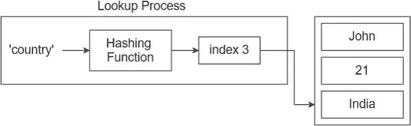

  **图 8.5** 查找过程（1）。

  在右侧，我们可以观察到表示映射的底层数据结构。要从映射中查找值，我们必须提前提供一个键。提供键后，它会通过一个哈希函数，然后哈希函数会输出某个预定义的索引。因此，当搜索“country”时，Solidity 指向映射中的索引 3 并检索该元素的值。因此，键不会存储在映射中，也就是说，我们无法在映射中准备键列表 [7]。

- B. 此外，映射中的值是不可迭代的。换句话说，我们不能遍历映射并打印其中包含的不同值。我们不能运行函数或调用映射来检索其所有值。这与我们之前讨论的事实密切相关，即无法访问映射中的键列表。因此，我们可以断言，映射仅适用于单值查找，而不适用于存储需要迭代的信息。

- C. 在映射中，“所有值都存在”。为了理解这一点，让我们以同一个对象“info”为例，将其转换为映射，然后尝试查找一个键，比如“state”。它将被传递到哈希函数并返回某个索引。它不会告知我们在该特定索引处没有值，而是返回该元素的默认值。例如，如果“info”对象中的所有值都是“string”，那么默认值将是一个空字符串。从映射返回的默认值取决于传递给映射的值类型。图 8.6 说明了这一概念。

请参考图 8.7 中的代码，以了解 Solidity 中映射的工作方式。

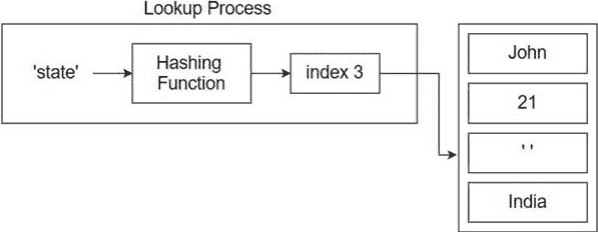

**图 8.6** 查找过程（2）。


```solidity
pragma solidity ^0.5.0;

contract AccountBalance {
    mapping(address => uint) public balance;

    function updateBal(uint newBal) public {
        balance[msg.sender] = newBal;
    }
}
contract Update {
    function updateBal() public returns (uint) {
        AccountBalance accountBalance = new AccountBalance();
        accountBalance.updateBal(15);
        return accountBalance.balance(address(this));
    }
}
```

**图 8.7**  Solidity 中的映射。

## 8.6.3  结构体

结构体是可容纳不同值类型的键值对集合。它通常用于表示单一实体。

结构体语法：

```solidity
struct structName {
    type1 typeName_1;
    type2 typeName_2;
    type3 typeName_3;
}
```

让我们通过一个示例来理解。

```solidity
struct Car {
    string make;
    string model;
    uint value;
}
```

在此示例中，我们设计了一个结构体 car，其中包含三个属性 make、model 和 value。

到此时，你可能会注意到结构体和映射之间存在一些相似之处，但也有区别。映射用于表示事物的集合，而结构体用于表示单一事物。例如，在映射中，我们可以存储汽车的集合，而不仅仅是一辆汽车 [1]。

请注意图 8.8 中的代码，以了解结构体在 Solidity 中的工作原理。

```solidity
pragma solidity ^0.5.0;

contract Test {
    struct Car {
        string make;
        string model;
        uint value;
    }
    Car car;

    function setCar() public {
        car = Car('Audi', 'A6', 5000000);
    }
    function getCarValue() public view returns (uint) {
        return car.value; // Accessing value from Struct Car using (.) operator
    }
}
```

**图 8.8**  Solidity 中的结构体。

## 8.6.4  枚举

Enum 是 Solidity 中的用户定义数据类型。它包含一组受限的常量，从中为变量分配值。Enum 限制变量持有未指定的值，从而减少错误。假设你正在创建一个服装应用程序，那么你会希望将尺寸选择限制为 small、medium 和 large。因此，消除错误输入的可能性。

图 8.9 中的代码说明了 Solidity 中 enum 的概念。

```solidity
pragma solidity ^0.5.0;

contract Direction {
    enum DirectionChoices { GoLeft, GoRight, GoStraight, StandStill };
    function Direction()
    {
        choices = DirectionChoices.GoStraight;
    }
    function getChoice() returns (uint ch)
    {
        ch = uint256(choices);
    }
    DirectionChoices choices;
}
```

**图 8.9**  Solidity 中的枚举。

### 8.6.4.1  枚举注意事项

- a. 在枚举中不接受数字作为常量。对于布尔值，首字母必须大写（True 或 False）。

- b. Enum 通过闭合大括号标识其声明结束。分号（;）用于表示单行指令的结束，而大括号（{}）用于表示函数、结构体、修饰符、枚举和合约本身等指令集的开始或结束。因此，我们无需用分号指定声明结束。

## 8.6.5  字符串

字符串数据类型类似于字符数组。Solidity 支持单引号（’）和双引号（“）字符串字面量。可使用“string”关键字声明字符串变量类型。尽管与 string 类型字面量相比，建议使用 byte 类型字面量，因为 string 操作需要更高的 gas [8, 9]。字符串可隐式转换为字节类型。我们将 string 用于长于 32 字节的数据。

在图 8.10 的示例中，note 是一个字符串变量，而“Hello!”是一个字符串字面量。然而，如前所述，我们应使用字节类型，因为字符串类型是一种昂贵的操作。

```solidity
pragma solidity ^0.5.0;

contract Notes {
    string note = "Hello!";
}
```

**图 8.10**  Solidity 中的字符串。

在图 8.11 的示例中，我们使用了 bytes32 而不是 string 类型。

```solidity
pragma solidity ^0.5.0;

contract Notes {
    bytes32 note = "Hello!";
}
```

**图 8.11**  Solidity 中的字节。

## 8.7  函数

函数是一段可多次使用的代码。它减少了重新编写相同代码的必要性。它有助于将大型程序划分为小部分，从而实现模块化。Solidity 中的函数与其它高级编程语言的实现类似。

### 8.7.1  函数定义

最初定义一个函数，之后可以“多次”调用它。通常采用 function 关键字来定义函数，后跟一个不同的函数名、括号内的一组参数（可以为空）以及大括号内的语句块。

```text
Syntax: function functionName (parameterList) scope returns () {
            // statements
        }
```

在图 8.12 给出的示例中，一个函数 getAnswer() 在没有任何参数的情况下定义。

```solidity
pragma solidity ^0.5.0;

contract Multiply {
    function getAnswer() public view returns(uint){
        uint x = 5; // local variable
        uint y = 10;
        uint answer = x * y;
        return answer;
    }
}
```

**图 8.12** 函数定义。

### 8.7.2 函数调用

要在合约内调用或调用一个函数，我们指定该函数的名称，后跟括号内的必需参数。

请注意图 8.13 中的代码，以了解 Solidity 中函数调用。

```solidity
pragma solidity ^0.5.0;

contract Multiply {
    function getAnswer() public view returns(uint) {
        uint x = 5;
        uint y = 10;
        uint answer = x * y;
        return getMarks(answer);
    }
    function getMarks() public {
        // some code
    }
}
```

**图 8.13** 函数调用。

### 8.7.3 函数参数

在前面的示例中，函数参数不是必需的。然而，一个函数可能接受多个参数。函数参数是在函数调用期间传递给函数的值。借助这些参数，函数处理代码。一个函数可能需要多个参数，可在括号内用逗号分隔传递。

在图 8.14 给出的示例中，x 和 y 是函数参数。

```solidity
pragma solidity ^0.5.0;
contract Multiply {
    uint mul;
    function getAnswer(uint x, uint y) public {
        mul = x * y;
    }
}
```

**图 8.14** 函数参数。

### 8.7.4 返回语句

要从函数返回一个变量，写入“return”关键字后跟变量名。通常，return 语句写在函数定义的末尾。

在前面的示例中，我们已将变量 mul 赋值为 x 和 y 的乘积。现在，如果我们想返回其值怎么办？我们可以通过在函数末尾编写 return 语句来实现。请参阅图 8.15 所示的示例。

```solidity
pragma solidity ^0.5.0;
contract Multiply {
    uint mul;
    function getAnswer(uint x, uint y) public {
        mul = x * y;
        return mul;
    }
}
```

**图 8.15** 返回语句。

### 8.7.5 函数修饰符

函数修饰符使我们能够控制函数的行为。它用于在函数执行前进行条件检查。它减少了重复代码或逻辑的数量。特殊符号“_”是修饰符定义的强制条件。在“_”处，函数源代码与修饰符代码合并。

让我们通过图 8.16 中的示例来理解。

```solidity
contract Owner {
    address ownerAddress;
    constructor() {
        ownerAddress = msg.sender;
    }
    // Can only be called by the owner
    function test() public onlyOwner {
    }
    // Check if the function is called by the owner of the contract
    modifier onlyOwner() {
        require(msg.sender == ownerAddress);
        _;
    }
}
```

**图 8.16** 函数修饰符。


### 8.7.6 函数类型

在 Solidity 中，几种函数类型会影响函数的行为和执行。让我们逐一讨论它们。

- **A. 公共：** 公共函数可以直接从外部访问。它们作为智能合约接口的成员而存在。它们可以从内部调用，甚至可以从外部调用。
- **B. 私有：** 私有函数只能在合约内部调用。它们无法被其他合约访问，甚至在派生合约中也无法访问。与公共不同，这些函数不是智能合约接口的成员。
- **C. 内部：** 内部函数与私有类似，不能从外部访问。它们只能在定义它们的合约内部或继承自它的合约中使用，而不使用 “this” 关键字。这些函数也不是智能合约接口的成员。
- **D. 外部：** 外部函数可以直接从外部访问，但不能在内部访问。它们可以被其他合约或通过交易 [10] 轻松访问。这些函数是智能合约接口的成员。
- **E. 视图：** 视图函数是指那些保持不变的函数。因此，我们可以将术语 “view” 和 “constant” 互换使用。视图函数返回数据但不修改合约数据。
- **F. 纯：** 纯函数不能修改或读取合约的数据。它们无权读取状态或交易变量 [11]。
- **G. 可支付：** 可支付函数用于接受以 ether 形式支付的款项。每当某个外部实体使用可支付函数时，它会尝试随之发送一些资金。如果未发送所需的 ether [11]，此函数调用将失败。

### 8.7.7 回退函数

回退函数是一个无名函数。它既不接受参数也不返回任何数据。当合约收到匿名 ether 或给定的函数标识符未定义时，它会被调用。智能合约只能维护一个回退函数。如果合约预期接收一些 ether，则其回退函数必须包含 “payable” 关键字。

通过图 8.17 中的示例来理解这一点。

在上面的示例中，我们定义了一个合约 “Test”。它包含一个回退函数，该函数在每次无效函数调用时递增 x 值。合约 “Caller” 展示了如何调用一个不存在的函数，每次调用时递增 x 的值。

### 8.7.8 函数重载

Solidity 支持函数重载。函数重载是一种支持两个或多个具有相同名称但功能不同的函数的特性。当具有相同名称的函数具有不同的返回类型或参数数量时就会发生这种情况 [5]。

请参考图 8.18 中的示例以了解 Solidity 中的函数重载。

**表 8.8**  
**加密函数**

| 函数 | 返回类型 | 描述 |
|---|---|---|
| keccak256 (bytes memory) | bytes32 | 接收输入，计算 keccak256 哈希。 |
| sha256 (bytes memory) | bytes32 | 接收输入，计算 sha256 哈希。 |
| ripemd160 (bytes memory) | bytes20 | 接收输入，计算 ripemd160 哈希。 |

```solidity
pragma solidity ^0.5.0;

contract Encrypt {
    function encryption() public pure returns(bytes32 result){
        return keccak256("XYZ");
    }
}
```

**图 8.19**  加密函数。

也称为基合约。继承用于减少合约内部的重复逻辑和重复代码，从而提高代码的可重用性。

例如，参见图 8.20 中的程序。合约具有以下属性。

### 8.8.1  构造函数

它是一个使用 “constructor” 关键字声明的特殊函数。在合约中，构造函数用于初始化状态变量。每当创建新合约时就会调用它。每个合约只允许一个构造函数。

```solidity
pragma solidity ^0.4.0;

contract Storage {
    uint Data;

    function setData(uint x) public {
        Data = x;
    }

    function getData() public view returns (uint) {
        return Data;
    }
}
```

**图 8.20**  Solidity 中的合约。

### 8.8.2 **状态变量**

这些用于存储变量的状态。我们已在本章前面的章节中讨论过状态变量。

### 8.8.3 **函数**

函数通过修改状态变量来改变合约的状态。我们也在本章前面的章节中讨论过函数。

### 8.9 **事件**

正如我们所知，区块链交易存储在区块中。每笔交易都有一些相关的日志。日志记录事件发生的详细信息。Solidity 中的事件保存合约的当前状态。它以日志的形式存储。事件在合约中全局声明，并将在其函数内部触发。要声明一个事件，请使用关键字 “event” 后跟标识符和参数列表。要发出事件，请使用 “emit” 关键字后跟事件名称和括号中的参数。

让我们通过图 8.21 中的示例来理解这一点。

```solidity
pragma solidity ^0.5.0;

contract TestEvent {
    event Deposit(address indexed _from, bytes32 indexed _id, uint _value);
    function deposit(bytes32 _id) public payable {
        emit Deposit(msg.sender, _id, msg.value);
    }
}
```

**图 8.21**  Solidity 中的事件。

### 8.10 **错误处理**

Solidity 中的合约被编译为字节码。在编写合约时，我们会遇到各种错误。异常错误可能在运行时或设计时发生。设计级别在编译时会检查任何语法错误。但运行时错误更难检测，因为它们在合约执行期间发生。因此，检查合约是否存在可能的运行时错误至关重要。因此，为了减少运行时和设计时错误，合约应遵循清晰且健壮的方式。

Solidity 支持多种错误处理方法。其中一些列在表 8.9 中。

**表 8.9**  
**错误处理方法**

| 方法 | 描述 |
|---|---|
| assert (bool condition) | 如果条件不满足，方法调用会引发无效操作码，并且对状态的任何更改都会被回滚。 |
| require (bool condition) | 如果条件不满足，此方法调用将回滚到原始状态。 |
| require (bool condition, string memory message) | 对于输入或外部组件中的错误，使用此方法。如果条件不满足，此方法将回滚到原始状态。 |
| revert () | 此方法回滚对状态所做的更改并中止执行。 |
| revert (string memory reason) | 此方法回滚对状态所做的更改，中止执行，并提供自定义消息的选项。 |

## 结论

Solidity 语言是为在以太坊网络上部署智能合约而开发的。Solidity 是一种面向合约的高级语言，用于轻松高效地编写智能合约。它生成在 EVM 上执行的机器级代码。Solidity 与 C、Python 和 JavaScript 等其他高级编程语言具有相似之处。其大部分值和运算符类型与 C 相似，并有一些额外的内容。其控制语句和函数像 JavaScript 一样编写。它支持 enum、array、struct、string 和 mapping 等数据结构。面向对象概念如继承也存在，这对代码可重用性很有用。最后，它还支持各种库、复杂用户定义数据类型和许多其他功能。在 Solidity 中，合约发挥着非常关键的作用。当用 Solidity 编写的代码部署到特定地址时，它会作为智能合约运行。合约类似于其他面向对象语言中的类。至此，本章结束。

## 参考文献

1. Dannen, C.: Solidity 编程。收录于 Chris Dannen (编) *介绍以太坊和 Solidity*。Springer: Berlin, Germany, pp. 69–88, 2017.
2. Clack, C.D., Bakshi, V.A., Braine, L.: 智能合约模板：基础、设计格局和研究方向。 *CoRR* abs/1608.00771. 2016.
3. Szabo, N.: 形式化并保护公共网络上的关系。 *First Monday* 2(9), 1–28, 1997.
4. Dannen, C.: *介绍以太坊和 Solidity：加密货币和区块链编程基础入门*。Apress, New York. p. 30.
5. Solidity 官方文档。 https://solidity.readthedocs.io/. 2017.
6. Tschorsch, F., Scheuermann, B.: Bitcoin 及以后：关于去中心化数字货币的技术调查。Cryptology ePrint Archive, Report 2015/464, 2015.
7. Bonneau, J., Miller, A., Clark, J., Narayanan, A., Kroll, J. A., and Felten, E. W.: Bitcoin 和加密货币的研究视角和挑战。Cryptology ePrint Archive, Report 2015/261, 2015.
8. Tikhomirov, S., Voskresenskaya, E., Ivanitskiy, I., Takhaviev, R., Marchenko, E., Alexandrov, Y.: SmartCheck：以太坊智能合约的静态分析。收录于 Sergei Tikhomirov, Ekaterina Voskresenskaya, Ivan Ivanitskiy, Ramil Takhaviev, Evgeny Marchenko, and Yaroslav Alexandrov (编) *软件工程区块链新兴趋势国际研讨会第一届*。ACM, Gothenburg, Sweden, pp. 9–16, 2018.
9. Wood, G.: Ethereum：一个安全的去中心化通用交易账本。www.gavwood.com/paper.pdf. 2014.


- 10. Allison, I.: “微软将以太坊语言 Solidity 添加到 Visual Studio。” *国际商业时报.* https://www.ibtimes.co.uk/microsoft-adds-ethereum-language-solidity-visual-studio-1552171. 最后访问于 2020 年 9 月 1 日。 2016 年 3 月 30 日。
- 11. Waters, R.: ‘以太币’因 5000 万美元加密货币被盗而坠落。 *金融时报*, 2016 年 6 月 18 日。
- 12. Gatteschi, V., Lamberti, F., Demartini, C., Pranteda, C., Santamaría, V.: 区块链与保险中的智能合约：该技术是否足够成熟？ *未来互联网* 10, 20, 2018。
- 13. Tapscott, D., Tapscott, A.: *区块链革命：比特币背后的技术如何改变金钱、商业和世界。* Penguin Publishing Group: London, pp. 72, 83, 101, 127. 2016。
- 14. Luu, L., Chu, D.H., Olickel, H., Saxena, P., Hobor, A.: 使智能合约更智能。 In: ACM Conference on Computer and Communications Security 2016, 254–269. 2016。
- 15. Buterin, V.: 以太坊：下一代智能合约和去中心化应用平台。 https://github.com/ethereum/wiki/wiki/White-Paper, 最后访问于 2020 年 12 月 1 日。 2013。
- 16. 即将进行硬分叉以更改 EIP150 Gas 成本的公告。 https://blog.ethereum.org/2016/10/13/announcement-imminent-hardfork-eip150-gas-cost-changes/ 2016。

## 9 在以太坊平台中安装框架、部署和测试智能合约

*Tushar Sharma*  
高等教育 ICFAI 基金会  
（被视为大学）

### 目录

| Section | Title | Page |
|---|---:|---:|
| 9.1 | 引言 | 138 |
| 9.2 | Gas 和交易 | 138 |
| 9.2.1 | 交易共识 | 138 |
| 9.3 | 智能合约账户 | 139 |
| 9.3.1 | 智能合约结构 | 139 |
| 9.4 | 在以太坊 Rinkeby 测试网络中部署合约 | 140 |
| 9.5 | Web3 库 | 142 |
| 9.5.1 | Ganache 模块 | 143 |
| 9.5.2 | 从 Ganache 获取账户 | 144 |
| 9.5.3 | 获取账户的异步方法 | 145 |
| 9.6 | Metamask 扩展 | 146 |
| 9.6.1 | Infura | 147 |
| 9.7 | 使用 Mocha 框架进行测试 | 149 |
| 9.8 | 设计智能合约 | 151 |
| 9.8.1 | 为智能合约确定变量和函数 | 152 |
| 9.8.2 | 进入彩票合约 | 152 |
| 9.8.3 | 使用 “require” 语句进行验证 | 153 |
| 9.9 | 伪随机数生成器 | 154 |
| 9.9.1 | 伪随机数生成器使用的方法 | 154 |
| 9.9.2 | 选择获胜者 | 155 |
| 9.9.3 | 从合约发送以太币 | 155 |
| 9.9.4 | 重置合约状态 | 156 |
| 9.10 | 需要管理员 | 157 |
| 9.11 | 智能合约文件 | 157 |
| 9.11.1 | package.json 文件 | 157 |
| 9.11.2 | Raffle.sol 文件 | 158 |
| 9.11.3 | Raffle.test.js 文件 | 159 |

**表 9.1**  
**以太坊平台中交易的属性**

| Property | Description |
|---|---|
| Nonce | 发送方已发送交易的次数 |
| To | 资金正在转移到的账户地址 |
| Value | 发送到目标地址的以太币数量 |
| gasPrice | 发送方愿意为处理特定交易每单位 Gas 支付的以太币数量 |
| startGas/gasLimit | 交易可以消耗的 Gas 单位 |

以太坊平台中可以执行三种类型的交易：

- 1. 从一个账户向其他账户转账以太币。
- 2. 部署智能合约。
- 3. 在合约内调用函数。

交易与其相关有一些重要属性，如表 9.1 所示。v、r 和 s 是与密码学 [1] 数据片段相关的账户属性，可用于生成发送方的账户地址。

### 9.3 智能合约账户

智能合约可以被视为自动化合约中描述的某些条件和义务的一种方式。每个智能合约都有自己的地址，在发送或接收以太币时很有用。智能合约可以识别调用它的人，通过此我们可以对合约施加特权访问。

每个智能合约账户都有四个相关属性。这些是字段、余额、存储和代码。表 9.2 给出了这些属性的描述。

### 9.3.1 智能合约结构

图 9.1 所示的代码描述了智能合约的基本结构。

以下是上述编写的智能合约的特性：

- 1. 第一行 simply specifies that the source code is written for Solidity version 0.5.2. This is to make sure that the contract does not behave abnormally with a new compiler version. The keyword pragma can be used.

**表 9.2**  
**智能合约账户的属性**

| Field | Description |
|---|---|
| Balance | 任何特定账户拥有的以太币数量 |
| Storage | 合约的数据存储 |
| Code | 合约的原始机器代码 |

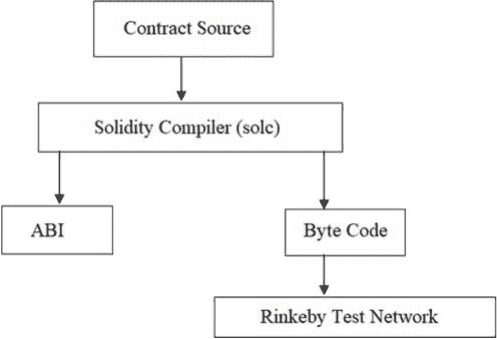

**图 9.2** sol 文件的编译。

使用合约地址部署智能合约。如果任何账户想要调用智能合约的函数，它会利用 ABI 来哈希函数并构建 EVM 字节码以调用该函数。它是一个 JavaScript 格式的对象（JSON），描述了合约的各种功能，如输入/输出参数、函数名称、可支付性（是否可以发送以太币）、函数的状态可变性。它使用户能够为合约创建适当的消息。

只有字节码会被输入到 Rinkeby 测试网络中用于智能合约的部署和测试目的。

Remix 是一个基于浏览器的 Solidity 集成开发环境（IDE），用于编码、部署和测试智能合约。Remix 中列出了各种执行环境，如 JavaScript VM、Injected web3 [13] 和 Web3 Provider。

Remix 不仅仅是一个代码编辑器，它还包含一个微型的假以太坊网络，可用于部署和与合约交互。图 9.3 说明了如何使用 Remix IDE 进行测试。

在 Remix 中编译合约后，点击 Remix IDE 中的“run”选项卡以部署合约。如上所述，Remix IDE 中列出了各种执行环境，如 JavaScript VM、Injected web3 [13] 和 Web3 Provider。

**JavaScript VM—** 该环境允许开发者使用 JavaScript 实现的 EVM 直接运行合约。此外，该环境不允许其他人与合约交互。因此，该环境适用于简单的测试目的。

**Injected Web3—** web3 库可从应用程序连接以太坊网络。通过使用 MetaMask，这是一个 Chrome 浏览器扩展，我们可以与以太坊网络互连。此选项将允许开发者使用注入的执行将合约部署到测试网络或主以太坊网络。

**Web3 Provider—** 它通过超文本传输协议（HTTP）直接连接到以太坊节点。因此，此环境可用于与 Ganache 模块账户连接。

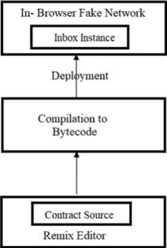

**图 9.3** 使用 Remix 进行测试。

对于合约的初始开发和测试，JavaScript VM 是最佳选择。但另一方面，如果我们希望其他人与我们的合约交互，我们需要使用另一种可用的环境。

### 9.5 Web3 库

为在以太坊网络上创建和部署合约，使用 Node.js 及其模块。为在 Node.js 中编译 Solidity 文件，必须在机器上安装 node 模块 “solc”。使用此模块，Node.js 将编译 Solidity 文件，从而生成字节码和 ABI。要与区块链上的合约交互，使用 web3 [13, 14] 库。

如第 9.4 节所述，web3 库用于从应用程序连接以太坊网络。因此，web3 被用作 JavaScript 应用程序与以太坊网络之间通信的完美解决方案。ABI 被提供给 web3 库，后者使用它来提供对部署在以太坊网络上的合约的编程访问 [13]。

要使用 Web3，必须实例化 Web3 类的对象。

```javascript
const Web3=require('web3');
    const web3=new Web3();//Instance
```

可以创建多个 web3 库的实例，每个实例用于连接到不同的以太坊网络。要连接或与以太坊网络通信，web3 的实例需要一个称为


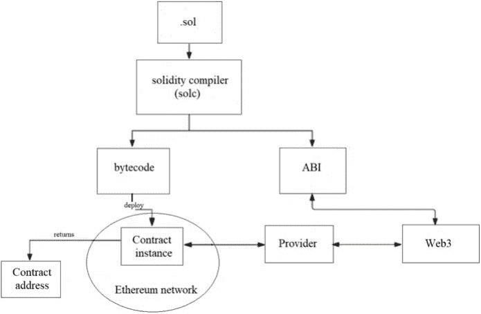

**图 9.4** 部署方案。

图 9.4 展示了 provider。provider 有多种类型，每种类型都可以用于连接不同的以太坊网络。

每个 provider 都有一组相同的方法，用于向以太坊网络发送请求或接收来自以太坊网络的请求。这些方法使 web3 库能够向本地网络发送请求并接收该请求的响应。provider 充当 web3 库与以太坊网络之间的媒介，就像两个人交谈时，空气作为媒介将声波从一个人传递到另一个人一样。

其中 provider = ganache.provider(); // 本地测试网络

```javascript
const web3 = new Web3(provider);
```

### 9.5.1 Ganache 模块

Ganache 是一个本地以太坊测试网络，可通过 “ganache-cli” npm 模块安装。要创建本地以太坊测试网络，需要将其 require 或导入到项目中。图 9.5 显示了导入 Ganache 模块所需的代码。

当合约部署在本地网络中时，不需要安全措施，也不需要公钥和私钥来解锁测试网络（Ganache）提供的账户。这些账户的好处在于它们以解锁状态创建，并且不需要以太币。然而，如果所涉及的是

```javascript
const ganache = require('ganache-cli');

const Web3 = require('web3');

const web3 = new Web3(ganache.provider());
```

**图 9.5** 导入 Ganache 模块。

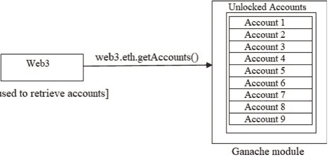

**图 9.6** 从 Ganache 获取账户。

以太坊主网络或以太坊公共测试网络，则需要公钥和私钥来解锁账户，并且账户中应有一些以太币（wei）才能部署合约。

主网络使用真实以太币进行合约部署以及与合约的交互或操作。因此，在将合约部署到主网络之前，通常使用使用假以太币的以太坊测试网络（Rinkeby、Kovan、Ropsten）进行开发和测试。将合约部署到测试网络和主网络的过程是相同的。

### 9.5.2 从 Ganache 获取账户

务必记住，只有当我们能够访问某个账户时，才能部署合约。图 9.6 展示了如何利用 web3 从 Ganache 模块获取已解锁账户以部署智能合约。

web3 库内部包含许多模块，用于处理不同类型的网络。这里的 “eth” 是 web3 中的一个以太坊模块，它有一个名为 “getAccounts()” 的方法。

从 Ganache 模块获取账户的代码

```javascript
beforeEach(() => {
    // Get a list of all accounts
    web3.eth.getAccounts().then((fetchedAccounts) => {
```

```javascript
console.log(fetchedAccounts);
});
})
describe('contract_name', () => {
  it('deploys a contract', () => {
    console.log(accounts);
  });
});
```

```javascript
var firstAccount;

web3.eth.getAccounts().then((fetchedAccounts) => {

firstAccount = fetchedAccounts[0];

console.log("X: " + firstAccount);

})
console.log("Z: " + firstAccount);
```

**图 9.7** 获取 Ganache 模块的第一个账户。

当我们在 web3 中运行这段代码时，控制台会返回从 Ganache 模块获取到的已解锁账户列表：

```
[ '0x992f437b0f15e1F789C8BD923b5C675e9c0c4a49',
  '0x5738d9100A6CB4FB787370f46ab6172c7808D9',
  '0x7086D052EAAD559c7aCD8B993c6169AE0dC025',
  '0x9FA18751b024FDC55cC85A484fF4261351Dd466',
  '0x95a29de4A8cc4697E678622d270Aa74C2bd7494a',
  '0xAED2F48c0d0a13D1FE2853E7Ee3B7d0aA32d33B',
  '0x88A0941f0dcb501C20b7BaE5a41008EB981f1302',
  '0xad5d1cB78e80518b596A814340826F36B89660FC',
  '0x67E67e936C9d22eDCf9ebC9A65720b313C54BC1' ]
```

但是，要获取数组中的第一个账户（本例中为 [‘0x992f437b0f15e1F789C8BD923b5C675e9c0c4a49’]），应使用图 9.7 中所示的语法。

### 9.5.3 异步获取账户的方法

从 Ganache 模块获取账户的另一种方法本质上是异步的。异步操作包括访问合约、访问合约中的函数，或者将资金从一个人发送给另一个人。我们通过 web3 调用的每个函数本质上都是异步的。

由于这是一个异步方法，因此使用了 “await” 关键字。

//let accounts;
beforeEach(async () => {
  // Get a list of all accounts

```javascript
accounts = await web3.eth.getAccounts();
});
describe('contract_name', () => {
it('deploys a contract', () => {
console.log(accounts); }); });
```

## 9.6 MetaMask 扩展

要部署智能合约，需要在类似 MetaMask [15] 或 Mist 浏览器的以太坊客户端中拥有一个账户，并持有一定数量的以太币。MetaMask 是一个 Chrome 扩展程序，允许普通用户与以太坊网络交互，也可以用作以太坊客户端。可以通过从 Chrome 网上应用店安装 MetaMask 来完成机器上的 MetaMask 设置。

MetaMask 账户具有三个不同的相关特征。图 9.8 描绘了 MetaMask 的基本结构及其三个不同特征。

账户地址类似于用户名或电子邮件地址，可以与任何人共享。公钥和私钥组合在一起，形成账户的密码，并授权将资金从用户账户发送到其他账户。账户地址、公钥和私钥这三个实体都以十六进制数存储。当该十六进制数被复制到 JavaScript 控制台时，它会自动转换为十进制数，这个数大得令人难以理解。生成的这个数字唯一地构成了私钥。私钥不能与任何人共享，因为一旦有人得知私钥，就可以轻易取走我们合约中的所有资金。

假设我们需要登录 Gmail 和 Yahoo 邮箱，对于不同的网络，我们需要不同的电子邮件账户。但在以太坊中，一个账户可用于多个网络。

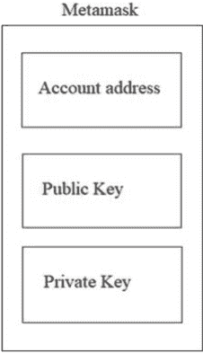

**图 9.8** MetaMask 的功能。

```javascript
// contract deployment script
const result = await new web3.eth.Contract(JSON.parse(interface))
.deploy({ data: '0x' + bytecode, arguments: []})
.send({from: accounts[0], gas: '10000000'}); // gas limit
```

上面代码中的 “Contract” 是以太坊模块中用于创建新合约的构造函数，其参数为 “interface (ABI)”。“deploy()” 是 Contract 中的一个方法，其参数为 “bytecode 和 arguments: []”。arguments 数组包含合约所需的所有初始值或消息。“send()” 方法接受两个参数：一个是 gas 上限，另一个是部署合约的账户地址。send 方法实际上会将此交易发送到网络，并将地址及许多其他参数返回到 result 变量中。合约部署到 Rinkeby 测试网络后，地址值可通过 result.options.address 获知。

合约部署完成后，应创建一个能与已部署合约交互的前端应用或网页。为此，需要将合约地址和 ABI 导入到应用中。每当 MetaMask 在浏览器中运行时，它都会自动将 web3 库的一个实例注入到当前活动页面中。这个 web3 也有一个 provider，它与 MetaMask 中可用的公共网络相连。

使用带有 provider 的这个 web3，再加上合约地址和 ABI，应用将能够与 Rinkeby 网络上的合约进行交互。

## 9.7 使用 Mocha 框架进行测试

每当我们为特定输出编写函数时，我们都能预想到该函数的功能，以及哪些参数会产生什么结果。在函数开发过程中，我们可以通过运行函数并将输出与预期结果进行比较来交叉验证函数。这可以通过在控制台中运行函数来完成。如果输出与预期不一致，我们可以调试代码，在控制台中再次运行，验证结果，并不断重复，直到获得预期或想要的输出。

但这种 “反复运行” 并不完美。为了避免在 Solidity 中进行这种不完美的测试，我们可以使用 Mocha 框架。

Mocha 是一个用于 Node.js 程序的 JavaScript 测试框架。Mocha 用于测试 JavaScript 代码。表 9.3 说明了 Mocha 框架的基本功能。

我们需要安装 Mocha 框架才能测试 Node.js 程序。

在 Node.js 命令提示符中运行以下命令，即可安装 Mocha 测试框架。

要使用 npm 全局安装，请使用以下代码：

```bash
npm install --global mocha
```


## 9.8 智能合约的设计

现在，让我们设计一个智能合约。合约的名称是 Raffle。在该项目中，完整的资金交易由智能合约维护和控制。首先，我们将设计 Raffle 智能合约的布局。图 9.13 显示了 Raffle 智能合约的基本布局。

创建的合约接受用户的以太币并将他们标记为参赛者。参赛者将向合约转账以太币以进入 Raffle。转入的以太币将被保留在奖池中。假设两位参赛者，即参赛者 1（C-1）和参赛者 2（C-2）参与 Raffle，每人发送 2 个以太币，则奖池将总共有 4 个以太币。

我们称之为“执行者”的第三方代理将指示合约挑选获胜者，如图 9.14 所示。合约将从玩家中选择任意一人，并将奖池中的全部资金发送给该特定获胜者。

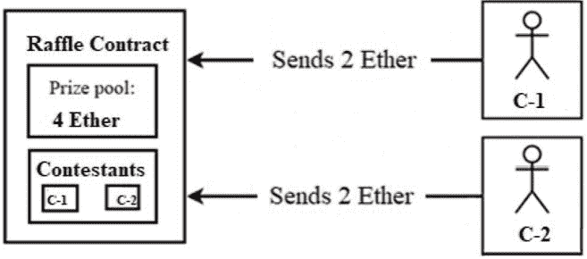

**图 9.13** Raffle 合约布局。

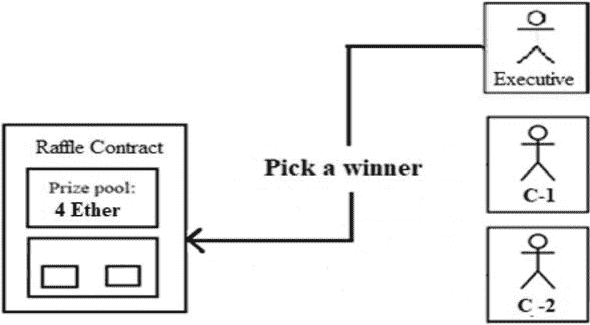

**图 9.14** 执行者的功能。

| 变量 | Raffle 合约 |
|---|---|
| **名称** | **目的** |
| executive | 创建合约的人的地址 |
| contestants | 已进入人员的地址数组 |

| 函数 |  |
|---|---|
| **名称** | **目的** |
| enter | 将玩家进入彩票 |
| pickWinner | 随机挑选获胜者并将奖池发送给他们 |

**图 9.15** raffle 合约的变量和函数。

### 9.8.1 为智能合约确定变量和函数

一旦合约的基本布局准备就绪，下一步任务是确定我们在智能合约中将使用的变量和函数。变量和函数的目的是在图 9.15 中说明。

### 9.8.2 进入彩票合约

```
pragma solidity ^0.5.12;
contract Raffle {

    address public executive;
    address[] public contestants;
    function Raffle() public {
        executive = msg.sender;
    }

    function enter() public payable {
        require(msg.value > .01 ether);
        contestants.push(msg.sender);
    }
}
```

### 表 9.4
“msg” 全局变量的属性

| 属性名称 | 属性 |
|---|---|
| msg.data | 调用或交易中“Data”字段，该调用或交易触发了当前函数 |
| msg.gas | 当前函数调用可用的 gas 数量 |
| msg.sender | 开始当前函数调用的账户地址 |
| msg.value | 与函数调用一起发送的以太币数量（以 wei 为单位） |

在上面的代码中，函数 Raffle 和 enter 具有“msg”对象。该对象具有一些属性，可描述谁刚刚向网络发送了交易以及交易本身的一些细节。我们将详细讨论它。

表 9.4 显示了“msg”全局变量的属性名称及其相关功能。

需要注意的是，此 msg 全局变量在我们发送交易时以及执行调用时都可用。因此，只要合约内部运行函数，我们始终会有此 msg 对象可用。

### 9.8.3 使用“REQUIRE”语句进行验证

每当有人调用 enter() 函数时，合约会获取其地址并将其添加到 contestants 数组中。Contestants 数组包含地址列表。

函数 enter() 是 payable 类型，如图 9.16 所示，因为人员需要支付一些以太币才能进入 Raffle。“public”是一个关键字，表示访问修饰符或谁可以访问此函数。

关键字“payable”是一个修饰符，表示此函数接受以太币，如图 9.16 所示。因此，在调用此函数时，如果用户发送了一些以太币，它将直接添加到合约余额中。没有 payable 修饰符，函数将不接受已发送的以太币。如果是这样，则函数执行并且他将被添加为批准者或贡献者。如上所述，approvers 是地址和布尔值之间的映射。

如图所示 9.16，“require”函数用于验证 Raffle 合约中参赛者的进入。require 会检查发送的以太币是否大于进入合约所需的最小值。我们可以在此“require”函数中传入某种类型的布尔表达式。如果该布尔表达式返回 false，则整个函数立即退出，并且不会对合约进行任何更改。如果表达式求值为 true，则函数内部的代码会继续正常运行。因此，“require”函数用于确保在允许所有其他函数执行之前满足或履行某些要求。

“msg.sender”将具有调用该函数的人的地址。

```
function enter() public payable {
    require(msg.value > .01 ether);
    contestants.push(msg.sender);
}
```

**图 9.16 Require 语句。**

## 9.9 伪随机数生成器

目前为止，参赛者可以通过 enter() 方法进入 raffle 合约。合约的执行者随后应该能够调用 pick winner 函数。该函数的目标是从参赛者列表中随机挑选一名获胜者。因此，该函数查看 contestants 数组中的参赛者列表并随机挑选其中的一个条目并将其声明为获胜者。

如果我们使用 Solidity 以外的其他语言，例如 JavaScript、ruby、java 来挑选获胜者。我们可能会说只需随机挑选一个数字，然后使用该数字从 contestants 数组中挑选随机元素或随机索引。

然而，使用 Solidity 我们无法访问随机数生成器。Solidity 中没有随机数生成器之类的东西。所以现在我们将某种程度上伪造它的随机性。

### 9.9.1 伪随机数生成器使用的方法

我们将取当前区块难度、当前时间和进入我们合约的所有人员的地址列表。当前区块难度需要花费一定的时间来处理实际交易，挑选或解决区块或关闭区块所需的时间称为区块难度。这表示为一个整数。

这三个输入并将其输入 SHA3 算法，它会吐出一个非常大的十六进制数，如图 9.17 所示。生成的大十六进制数将用于挑选我们的随机获胜者。

图 9.18 所示用于随机挑选获胜者的代码就是我们所指的伪随机数生成器。

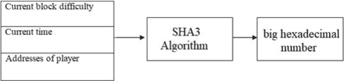

**图 9.17** 随机数生成。

```
```solidity
function random() private view returns (uint) {
    return uint(SHA3(block.difficulty, now, contestants));
}
```
```

**图 9.18** 伪随机数生成器的代码。

函数名是“random”，因为其目标是生成随机数。这是一个“private”函数，因为我们真的不希望其他人编写或调用此函数；只有定义此函数的开发者。函数被标记为“view”类型，因为我们没有修改合约中的任何状态或数据。此函数的唯一目标是返回一个随机数。

block 变量是我们随时可以访问的全局变量。Difficulty 将是一个数字，表示密封或解决当前区块的难度。

现在在 random 函数内部，我们必须确保返回一个无符号整数，但哈希算法返回的是哈希。因此，我们可以将此哈希转换为整数。

### 9.9.2 选择获胜者

上面生成的随机数可用于从 contestants 数组中随机挑选任何玩家。图 9.19 描述了用于选择 Raffle 获胜者的方法。

取模运算符的属性可用于获取 contestants 数组中获胜者的索引。因此，random mod contestants.length（这是进入 Raffle 的参赛者数量）将返回 random 与 contestants.length 相除的余数。这个数字（余数）始终在 0 和 contestants.length 之间。因此，它可用于 contestants 数组中获胜者的索引。

从 contestants 数组中选择获胜者的函数如图所示 9.20。

### 9.9.3 从合约发送以太币

现在，我们有了赢得 Raffle 的参赛者的索引，因此我们可以从 contestants 数组中选择该参赛者，然后从合约发送资金。

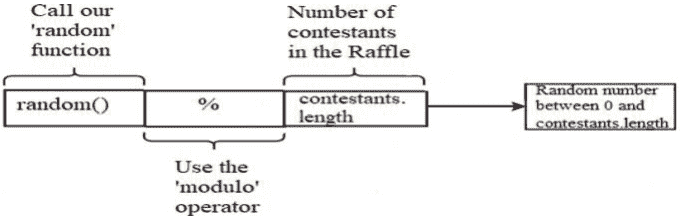

**图 9.19** 选择获胜者的方法。

```
```solidity
function pickWinner() public restricted {
    uint index = random() % contestants.length;
}
```
```

**图 9.20** 选择获胜者的代码。


```solidity
contestants[index].transfer(this.balance);
```

我们可以通过调用 `.transfer` 函数将奖池资金发送给获胜者地址。此函数将取出奖池中收集的所有资金，然后将其发送到 `[index]` 中指定的获胜者地址。因此，这是在 Solidity 中存储的每个地址上都可用的一个函数。

### transfer 函数的工作原理

transfer 函数将尝试从当前合约中取出资金并将其发送给获胜者地址。

```solidity
contestants[index].transfer(1);
```

上述代码行将向获胜者地址转账 1 wei。

## 9.9.4 重置合约状态

现在，我们将讨论当前合约周围的一个重大问题。在选出获胜者后，我们会向某人发送一定金额的资金。在理想世界中，我们可能会尝试重置合约，以便在选出获胜者后立即运行抽奖的下一轮。换句话说，如果我们可以在不重新部署合约的情况下让一系列抽奖合约无限地一个接一个地运行，那就太好了。

图 9.21 帮助我们理解如何解决上述问题。

当我们的合约首次创建时，我们有一个空的玩家数组。现在，假设一两个人可能会进入合约或彩票，他们的地址将被添加到玩家的数组中。

现在有趣的部分来了。

当我们选出获胜者时，如果我们清空地址列表，那么我们基本上可以将合约的状态重置回首次部署时的状态。因此，通过清空玩家列表，我们可以重置合约的状态并自动使其为下一轮做好准备，而无需重新部署合约。通过这样做，我们可以无限期地运行合约，而无需一遍又一遍地重新部署它。

图 9.22 显示了用于重置合约状态的更新后的 `pickWinner()` 函数。

```solidity
players = new address[](0);
```

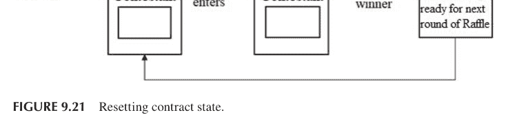

**图 9.21** 重置合约状态。

```solidity
function pickWinner() public restricted {
    uint index = random() % contestants.length;
    contestants[index].transfer(this.balance);
    contestants = new address[](0);
}
```

**图 9.22** 更新后的 `pickWinner()` 函数。

上述代码行创建了一个类型为 `address` 的新动态数组。`(0)` 表示我们想要创建一个类型为 address 的新数组。我们希望该数组具有动态特性，并且初始大小为 0。

## 9.10 需要管理员

我们的随机函数本质上是伪随机的。因此，如果某个陌生人意识到如果他们在正确的时间调用 `pickWinner` 函数，他们可能会确保特定玩家赢得彩票。

简而言之，我们希望确保只有执行者能够调用该 `pickWinner` 函数。

在 `pickWinner` 函数内部，我们需要更新下面显示的代码。

```solidity
modifier restricted() {
    require(msg.sender == executive);
    _;
}
```

## 9.11 智能合约文件

最终的智能合约包含许多与其部署、测试、编译、包含已安装依赖项的文件等相关联的文件。对于 Lottery 合约，我们有五个文件，分别是 `Lottery.sol` 文件，该文件包含处理存储在智能合约中的资产状态的一组规则/逻辑。然后，我们有 `Lottery.test.js` 文件，该文件包含我们智能合约的所有测试用例。其他文件有 `package.json` 文件、`compile.js` 文件和 `deploy.js` 文件。这些文件的详细视图将在后续章节中给出。

### 9.11.1 PACKAGE.JSON 文件

该文件显示了项目、已安装的依赖项、启动脚本、测试脚本和构建脚本的完整信息。该文件提供了有关项目及其执行方式的思路。

### 9.11.3 RAFFLE.TEST.JS 文件

```javascript
const assert = require('assert');
const ganache = require('ganache-cli');
const Web3 = require('web3');
const web3 = new Web3(ganache.provider());
const { interface, bytecode } = require('../compile');

let raffle;
let accounts;
beforeEach(async () => {
  accounts = await web3.eth.getAccounts();
  raffle = await new web3.eth.Contract(JSON.parse(interface))
    .deploy({ data: bytecode })
    .send({ from: accounts[0], gas: '1000000' });
});

describe('Raffle Contract', () => {
  it('deploys a contract', () => {
    assert.ok(raffle.options.address);
  });

  it('allows multiple accounts to enter into the contract', async () => {
    await raffle.methods.enter().send({
      from: accounts[0],
      value: web3.utils.toWei('0.05', 'ether')
    });

    await raffle.methods.enter().send({
      from: accounts[1],
      value: web3.utils.toWei('0.02', 'ether')
    });

    await raffle.methods.enter().send({
      from: accounts[2],
      value: web3.utils.toWei('0.02', 'ether')
    });
    const contestants = await raffle.methods.getContestants().call({
      from: accounts[0]
    });
    assert.equal(accounts[0], contestants[0]);
    assert.equal(accounts[1], contestants[1]);
    assert.equal(accounts[2], contestants[2]);
    assert.equal(3, contestants.length);
  });
  it('minimum amount of ether is required to enter the raffle', async () => {
    try {
      await raffle.methods.enter().send({
        from: accounts[0],
        value: 0
      });
      assert(false);
    } catch (err) {
      assert(err);
    }
  });
  it('only executive can call the pickWinner', async () => {
    try {
      await raffle.methods.pickWinner().send({
        from: accounts[1],
      });
      assert(false);
    } catch (err) {
      assert(err);
    }
  });
  it('sending money to the winner and resets the contestants array', async () => {
    await raffle.methods.enter().send({
      from: accounts[0],
      value: web3.utils.toWei('2', 'ether')
    });

    const initialBalance = await web3.eth.getBalance(accounts[0]);

    await raffle.methods.pickWinner().send({ from: accounts[0] });

    const finalBalance = await web3.eth.getBalance(accounts[0]);

    const difference = finalBalance - initialBalance;
    console.log(finalBalance - initialBalance);
    assert(difference > web3.utils.toWei('1.8', 'ether'));
  });
});
```

### 9.11.4 COMPILE.JS 文件

```js
const path = require('path');
const fs = require('fs');
const solc = require('solc');
const lotteryPath = path.resolve(__dirname, 'contracts', 'Raffle.sol');
const source = fs.readFileSync(lotteryPath, 'utf8');
module.exports = solc.compile(source, 1).contracts[':Raffle'];
```

### 9.11.5 DEPLOY.JS 文件

```js
const HDWalletProvider = require('truffle-hdwallet-provider');
const Web3 = require('web3');
const { interface, bytecode } = require('./compile');

const provider = new HDWalletProvider(
  'payment hen clump pave scatter august satisfy swear scheme spread saddle fame',
  'https://rinkeby.infura.io/v3/aa4a1902bc154228acfd09e0eec205cc'
);
const web3 = new Web3(provider);

const deploy = async () => {
  const accounts = await web3.eth.getAccounts();

  console.log('Attempt to deploy from account', accounts[0]);

  const result = await new web3.eth.Contract(JSON.parse(interface))
    .deploy({ data: bytecode })
    .send({ gas: '1000000', from: accounts[0] });

  console.log('contract deployed to', result.options.address);
};
deploy();
```

### 9.11.6 运行智能合约

```text
C:\Users\sharm\lottery>npm run test
  >inbox@1.0.0 test C:\Users\sharm\lottery
  > mocha
  Raffle Contract
  (node:15376)
  √ deploys a contract
  √ allows multiple accounts to enter (612ms)
  √ require a minimum amount of ether to enter (74ms)
  √ only executive can call the pickWinner (108ms)
  1999958059599992800
    √ sends money to the winner and resets the contestants array (279ms)
    5 passing (2s)
```

在 Node.js 命令提示符中运行命令 `npm run test`。

## 结论

本章的主要目标是提供编写智能合约的全面方法。本章清晰地给出了有关各种测试框架、库及其工作原理的简要描述。此外，本章重点介绍了在 Ethereum Rinkeby 测试网络中部署合约。智能合约是 Ethereum Dapps 的关键功能之一，已被详细解释。然后本章主要关注在设计智能合约时如何决定各种函数。本章以深刻的方式讨论了整个开发、部署和交互部分。利用区块链技术，安全、隐私和信任可以呈指数级增强。区块链是一项颠覆性技术，在不久的将来，它将改变整个经济和商业体系。

## 参考文献

- 1. V. Buterin, 下一代智能合约和去中心化应用平台。 https://github.com/ethereum/wiki/wiki/White-Paper/, 2019.
- 2. S. R. Niya, F. Shüpfer, T. Bocek, and B. Stiller, 使用智能合约设置灵活且轻量级的交易并增强用户隐私, NOMS 2018-2018 IEEE/IFIP Network Operations and Management Symposium, Taipei, pp. 1–2, 2018.
- 3. K. Zhang and H. Jacobsen, 迈向可靠、可扩展和无处不在的区块链分布式账本, 2018 IEEE 38th International Conference on Distributed Computing Systems (ICDCS), Vienna, pp. 1337–1346, 2018.
- 4. S. Nakamoto, Bitcoin：点对点电子现金系统。 http://bitcoin.org, October 2008.
- 5. F. Hofmann, S. Wurster, E. Ron, and M. Böhmecke-Schwafert, 区块链的不变性概念及早期标准化的益处, 2017 ITU Kaleidoscope: Challenges for a Data-Driven Society (ITU K), Nanjing, 2017, pp. 1–8, 2017.


- 6. A. Anoaica 和 H. Levard。《以太坊公有链上内部活动的定量描述》。见 2018 年第 9 届 IFIP 国际新技术、移动性与安全会议（NTMS），第 1–5 页，2018 年 2 月。
- 7. T. Chen 等人，《通过图分析理解以太坊》，IEEE INFOCOM 2018 – IEEE 计算机通信会议，夏威夷火奴鲁鲁，第 1484–1492 页，2018 年。
- 8. Y. Chen、S. Chen 和 I. Lin，《基于区块链的竞价系统智能合约》，2018 年 IEEE 国际应用系统发明会议（ICASI），千叶，第 208–211 页，2018 年。
- 9. G. Maxwell，《Coinjoin：现实世界中的比特币隐私》，发表于比特币论坛的帖子，2013 年。
- 10. A. Aldweesh、M. Alharby、E. Solaiman 和 A. van Moorsel，《用于评估以太坊中矿工激励的智能合约性能基准测试》，2018 年第 14 届欧洲可靠计算会议（EDCC），罗马尼亚雅西，第 144–149 页，2018 年。
- 11. J. S. Coron，《什么是密码学？》*《IEEE 安全与隐私杂志》*，12(8)，70–73 页，2006 年。
- 12. B. K. Mohanta、S. S. Panda 和 D. Jena，《区块链技术中智能合约及其用例概述》，2018 年第 9 届国际计算、通信与网络技术会议（ICCCNT），班加罗尔，第 1–4 页，2018 年。
- 13. H. Cui-hong，《Web3.0 在资源集成门户中的应用研究》，2012 年第二届国际商务计算与全球信息化会议，上海，第 728–730 页，2012 年。
- 14. A. Manzalini 和 A. Stavdas，《面向 Telco3.0-Web3.0 应用的服务与知识生态系统》，2008 年第三届国际互联网与 Web 应用与服务会议，雅典，第 325–329 页，2008 年。
- 15. G. Foroglou 和 A.-L. Tsilidou，《区块链的进一步应用》，2015 年。
- 16. D. Kraft，《基于区块链的共识系统的难度控制》，*《对等网络与应用》*，9(2)，397–413 页，2016 年。

## 10 区块链在医疗保健领域
*S. Porkodi 和 D. Kesavaraja*  
Sivanthi Aditanar 博士工程学院

## 目录
- 10.1 引言 ................................................................. 163
  - 10.1.1 今天与明天 .......................................................... 163
  - 10.1.2 愿景 ........................................................................ 164
  - 10.1.3 医疗保健 ................................................................... 164
  - 10.1.4 医疗保健面临的挑战 ...................................................... 164
  - 10.1.5 区块链 .................................................................... 165
- 10.2 相关工作 ................................................................. 166
- 10.3 区块链技术在医疗保健中的应用 .................................................. 168
  - 10.3.1 电子健康记录系统 ....................................................... 168
  - 10.3.2 医疗欺诈扣除系统 ....................................................... 171
  - 10.3.3 临床研究 ............................................................. 171
  - 10.3.4 制药行业研究 ..................................................... 172
  - 10.3.5 神经科学 ................................................................. 172
- 10.4 在医疗保健领域实施区块链技术的挑战 ......................................... 174
  - 10.4.1 数据的隐私与安全 .............................................. 174
  - 10.4.2 互操作性问题 .................................................... 175
  - 10.4.3 存储容量管理 ................................................... 176
  - 10.4.4 社会挑战 ............................................................. 176
  - 10.4.5 标准化 .............................................................. 176
- 结论与未来方向 ...................................................... 177
- 参考文献 ........................................................................... 178

## 10.1 引言

### 10.1.1 今天与明天

在数字时代的新世界里，技术在人们的日常生活中扮演着重要角色。每个行业都试图采用能够以更有用、更高产的方式利用的新技术。区块链就是这样一种新技术。尤其是在医疗保健行业，区块链可用于解决医疗保健行业中的许多问题，例如医疗数据安全、可访问性、互操作性等。未来，区块链有潜力通过整合患者的实时健康数据并向患者更新健康信息，帮助建立真实、个性化且安全的医疗保健系统，并能在医学领域取得更大的成功。

### 10.1.2 愿景

愿景是在医疗保健中心和医院中采用区块链技术（BCT），以获得最大化的收益。使用 BCT 可改善医疗保健系统，例如安全的数据交易、保护用户详细信息、高效的数据管理，并通过对患者健康状况的高效诊断，在合适的时间为患者提供合适的治疗。从政府医院到较小的临床中心，都可以采用 BCT 来获得更高潜力的治疗。

### 10.1.3 医疗保健

医疗保健是一个以数据为导向的行业，其中持续大量地创建、访问和传播数据。存储或传播这些庞大数据集至关重要。处理这些数据是一项重大挑战，因为这些数据高度敏感，并且存在隐私和安全等限制因素[24,36]。

在较小的诊所和小型医疗保健领域，可扩展、安全可靠的数据共享对于联合决策和高效诊断非常重要。数据共享对于将医疗数据报告从医生传递给咨询患者以快速了解治疗进展至关重要。医生定期以高度隐私的方式将数据或报告传递给患者，以确保双方都掌握有关患者健康状况的最新信息。在远程医疗和电子健康记录（EHR）等被广泛使用的大型领域中，临床报告被远程发送给远方的专家，以咨询专家意见。在这些类型的系统中，患者数据通过实时在线监测（如遥测或远程监护等）或存储转发技术发送[3,8,22,29]。通过使用这些在线技术，专家可以借助传输的临床报告对患者进行远程诊断和治疗。在这些技术中，临床报告的隐私、安全和敏感性是主要挑战，因为患者数据本质上是敏感的。因此，以可扩展、安全可靠的方式传输数据，对于支持远程患者与专家之间有意义的健康沟通非常重要。临床报告成功、安全地传输，将获得临床专家或专科医生的相关确认或建议，从而提高诊断准确性和治疗效果[7,9,13,16,65]。

### 10.1.4 医疗保健领域的挑战

在医疗保健领域，互操作性存在不同的挑战。例如，在实际操作中，研究机构或医疗保健组织之间临床报告数据成功、安全和可靠的传输可能面临许多挑战。这些临床报告数据需要可信、可靠，并且主要应在相关实体之间进行健康的协作。该行业面临的一些潜在约束包括数据的敏感性、治理规则、数据共享程序和协议、伦理政策，以及


患者匹配复杂算法。在临床数据交易过程[17,50]之前，必须就一些重要术语达成相互一致。近年来，研究人员一直试图开发和应用基于物联网（IoT）、计算机视觉、机器学习（ML）和人工智能（AI）的应用程序，以帮助医生和医师对不同的慢性疾病进行诊断和治疗。

### 10.1.5 区块链

BCT的作用类似于人类记忆，它为用户的每一次数据交易提供安全保障并保持记录。区块链最初用于比特币，而最近人们对基于区块链的应用产生了浓厚兴趣，以便在许多领域实现安全可靠的数据传输，例如医疗数据[4,28,64]、电子医疗数据共享[2,60]、生物医学[38]、思维与大脑模拟。区块链使用点对点网络，在公共数字账本中实现分布式特性。它包含密码学，用于在交易过程中保护用户的数据块。区块链旨在借助分布式共识算法，解决分布式传统数据库中的同步限制。BCT的基本特性包括开源、匿名性、透明性、去中心化、不可篡改性和自主性，如表10.1所示。

**表10.1**
**区块链的特征及描述**

| 特征 | 描述 |
|---|---|
| 开源 | 区块链是一个开源网络，为所有连接到网络的人提供访问权限。这一特性不仅允许任何人查看公共记录，还允许基于区块链开发和设计各种应用程序。 |
| 匿名性 | 当数据从一个节点传输到另一个节点时，双方的身份和详细信息都保持匿名。因此，区块链变得更加可靠和安全。 |
| 透明性 | 区块链中存储和记录的数据对具备权限的用户是透明的。这一特性有助于防止数据被篡改或窃取。 |
| 去中心化 | 数据库中的数据可以在多个不同系统上同时被监控、访问、更新和存储。没有单一的中央权威来管理数据，相反，任何连接到网络的人都可以开放访问。 |
| 不可篡改性 | 一旦记录存储在区块链中，它将永久保留；在未获得超过一半节点的并发控制的情况下，这些记录很难被修改。 |
| 自主性 | 区块链是自主且独立的，这意味着区块链网络中的任何节点都可以安全可靠地传输、访问、更新或存储数据。因此，它使系统免于外部干预，并且更加值得信赖。 |

参与区块链网络的人员会验证每一笔已执行的新交易。所有交易块都由每个网络节点验证，并变为不可篡改。区块链的工作流程如图10.1所示。

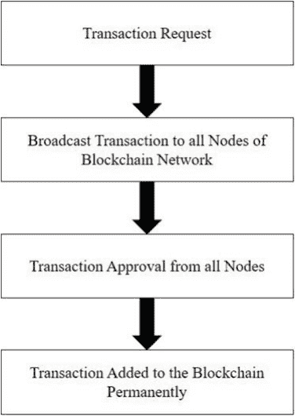

**图10.1** 区块链通用工作流程。

在不远的将来，BCT将通过融合医疗系统当前的最新数据与患者健康的实时完整临床报告数据，为可靠、安全和个性化的医疗系统提供潜在帮助。本章将讨论区块链的现有进展以及BCT在医疗行业模型中的最新发展。

## 10.2 相关工作

BCT在医疗系统中共享数据以及为许多不同诊断应用提供帮助的潜力，已经在许多研究中得到描述。

例如，私有区块链被用于存储和监控与称为医疗数据网关（HDG）的方法相关的临床报告数据，该方法由Yue等人[63]开发。该系统是一种个性化医疗保健，患者可以自由地监控、访问和管理他们的医疗摘要以及存储在私有区块链网络中的个人临床报告数据，私有区块链网络是一个仅向特定授权用户开放的集中式数据库。

Chen等人[14]研究了与区块链框架集成的云存储如何共享和管理患者自己的临床数据。这可用于安全可靠地存储临床数据，并可以交换患者自己的临床数据。这是一种独特的方法，没有第三方参与，只有患者才能访问自己的临床数据。Cryan [15]提出了一种基于区块链的创新性和系统性架构，以保护患者的敏感个人数据。

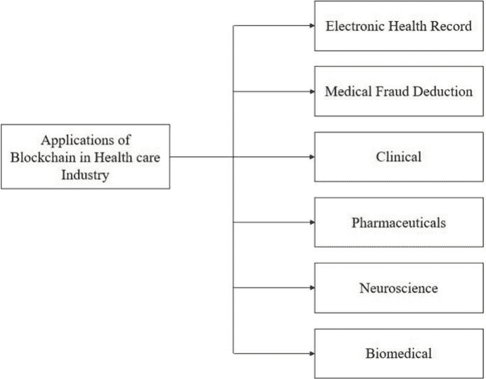

**图10.3** 区块链技术在医疗保健中的应用。

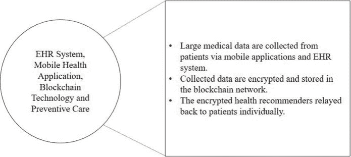

**图10.4** 电子健康记录系统各元素之间交互的描述。

在多个不同医院或医疗机构使用的EHR系统中，根本无法处理终身临床记录，因为这些情况通常会将数据从一个提供商分离到另一个提供商。由于这些问题，病史和过去数据的访问途径丢失了。因此，需要一种创新方法来处理EHR系统的数据。通过这种方法，鼓励患者参与自己的病史和现有医疗数据。许多研究者提出使用区块链来维护EHR系统[11,23,39,49]。

MedRec原型使用区块链来管理完整性、身份验证、轻松的数据共享和保密性。它基于去中心化的记录管理系统工作。患者可以获得详细的、不可篡改的历史记录，并且可以轻松访问相关信息，即使跨越不同的医疗组织和提供者也是如此[19]。但MedRec不会存储任何医疗数据或任何调整和修改时间。记录被标记在区块链中，患者会收到建议，然后患者负责选择数据存储的位置。它还将控制权从医疗组织转移到患者手中，为患者分配权重以表明所有者的责任。如果有些患者无法处理自己的数据，管理员会为他们指定特定的代理来填补患者数据。因此，大量患者单独进入并利用无法预测的数据，他们可以创建工作、计划，然后使用不同的用户界面。此外，MedRec还包括用户界面（UI），以改善与医疗数据和记录的联系，这些数据和记录在各组织之间流通。

在实施EHR系统时，在共享医疗数据方面会出现关键限制问题，例如审计、数据控制、临床数据中的安全数据追踪以及数据起源。由于这些问题，Xia等人[62]提出了一个称为MeDShare的安全可靠的区块链系统，以在受信任的各方之间进行临床数据传输。MeDShare用于共享临床数据，并以电子形式维护医院、提供云服务的提供商和医疗领域研究人员之间的健康数据和记录，同时提供个性化的审计控制、更好的数据起源，以及有限的隐私和安全威胁可能性。

EHR系统通常包含关键且高度敏感的与患者相关的数据，并在医疗保健提供者、临床医生、药剂师、研究人员和放射科医生之间频繁共享，以提供有效和便捷的诊断和治疗。当这些患者的高敏感数据在不同实体之间分发、传输或存储时，患者的治疗可能会受到损害，这将对患者的健康构成巨大威胁，并需要维护患者的最新历史记录。例如，如果患者正在与HIV或癌症等慢性疾病作斗争，那么随着治疗前和治疗后历史以及康复步骤或随访，风险的普遍性变得非常高。因此，必须维护患者的最新历史记录以有效开展治疗。由于这些问题，Dubovitskaya等人[18]开发了一个基于区块链的框架，以电子形式共享、维护和管理癌症患者的临床记录。采用带权限的区块链，以加密形式存储、管理和访问患者信息。这类框架用于区块链的实际应用，以访问患者数据，管理患者临床数据历史和实践中当前数据的安全性和隐私性。

2016年，基于区块链的爱沙尼亚医疗记录项目成为医疗史上的一个里程碑，爱沙尼亚与区块链的全球领先地位相结合。该项目旨在保存超过数百万份私人临床记录，并让保险公司[27]和医疗服务提供者广泛获取这些记录。


区块链在全球医学领域增长的原因可能是它具有强大的患者保障。通过使用区块链，使用者的健康记录可以保持未被更改且不可变。如果进行任何调整或未经授权的访问，可以在区块链的任何地方轻松识别。它用于维护数据完整性，识别犯罪活动，如掺假记录或批发欺诈，使审查变得更简单，并可批准医疗记录的共享。当患者就诊时，可以被患者的大多数供应商迅速记录。药物方案、过敏反应和用药错误可通过区块链上的患者护理算法在无需任何困难的药品妥协形式的情况下迅速得到处理。鼓励 BCT 的创新以改善医疗数据访问、促进医疗数据确认、管理临床记录 [43,45]、高效的护理安排以及增强的安全性。

## 10.3.2 医疗欺诈检测系统

在医疗领域，区块链的一个重要且巨大的应用是包含医疗药物的供应链管理。医疗保健中的供应链管理由于其高度增长的复杂性而变得更加重要。如果医疗保健行业的供应链出现任何妥协，反过来将极大地影响患者的健康状况 [35]。这些医疗药物的供应链是脆弱的。它存在漏洞，任何欺诈性攻击都可能发生，因为它包含许多移动的零部件和部件。区块链的使用通过消除产品可追溯性得到改善、引入更高阶的数据透明度并防止欺诈的发生，从而实现一个安全可靠的平台。区块链记录会经过验证过程并使用智能合约进行更新。因此，很难操纵区块链 [41]。

## 10.3.3 临床研究

临床试验中可能出现的问题包括数据入组 [30]、数据隐私、记录管理、数据共享和数据完整性等问题。医疗保健领域的科研人员使用区块链来解决临床试验中出现的问题 [44]。未来，可能会出现基于区块链、机器学习和人工智能的海量应用。

Nugent 等人 [46] 提出了一项研究，其中区块链中智能合约的功能由一种称为许可以太坊的协议提供，该协议与医疗信息管理系统并行使用。本文讨论了患者入组问题。该研究表明，与比特币相比，以太坊的交易速度要快得多，因此结论建议在以太坊中使用智能合约来提供临床试验中的数据管理和透明度。基于区块链的患者入组属于临床研究中现有的应用。Benchoufi 的 [5] 研究基于一个区块链框架，该框架被实施以获取所有患者的材料，这些材料可以安全地存储并用于跟踪、不可篡改且可验证。

## 10.3.4 制药行业研究

在医疗保健行业，制药业是领先的部门，也是增长最快的行业之一。基本上，制药行业有助于将潜在的新药引入市场。当药物出售给患者时，其责任是确定医疗产品的有效性信息，确保安全，评估 [43] 并处理生产过程，以生产出安全的药物供患者使用，以便他们能够快速康复。制药公司通常面临的挑战是无法及时追踪自己的产品，这可能会造成许多风险和问题，例如假药流入使用，允许伪造者破坏生产。世界各地观察到的医疗保健行业风险之一是生产和分销假药，尤其是在发展中国家和欠发达国家。区块链可以在研发和药物生产时期成为最佳使用的技术。区块链用于确保潜在药物的生产步骤、监控和评估。最近，研究基金会 Hyperledger [55,58] 发起了一个基于区块链的假药项目。该项目旨在检查和打击假药的生产和制造。药物需要进行评估、监控，并确保在制药的开发和供应所有过程中使用数字技术，以便在对患者进行药物认证时有效交付，并在世界范围内，尤其是发展中国家和欠发达国家，确保可靠性。数字药品控制系统 Digital Drug Control System (DDCS) 用于解决这些假药问题 [48]。制药行业的一些大型企业（如 Amgen、Pfizer 和 Sanofi）联合起来，启动了一个基于区块链的 DDCS 试点项目，以检查和评估在全球市场上发布的新药。基于区块链的系统可以随时追踪药品位置，追踪药品生产 [40]，改善假药可追溯性 [54]，并可为供应给患者的药品质量提供保证 [48]，以及药品供应系统 [56] 得到保障。

## 10.3.5 神经科学

在医疗保健行业，神经科学是一个不断增长的学科。神经科学正以一种新的方式发展，排除了其与周围环境基础设施的所有机械交互，同时还允许用户通过精神指令和脑波控制数据和设备。这些神经设备能够解释大脑活动模式并将模式转化为命令，可用于控制外部设备，并且可以根据大脑活动模式轻松推断出当前人的精神状态。具有神经接口的设备，如“颅脑多普勒”、“肌电图”、“植入式神经刺激器”和“神经外科手术机器人”具有读取和解释大脑信号的特殊任务。这些设备具有无线通信、计算芯片和敏感传感器。大脑活动相关的电信号被读取、破译并传输信号。

所有这些活动都发生在用户头部佩戴的单一可穿戴设备上。区块链用于记录神经接口中的所有脑信号和脑波，其中大数据和复杂算法可以利用信号数据 [20,53]。

2017 年，总部位于日内瓦的 Neurogress 公司确认使用 BCT。该公司旨在建立基于神经控制的系统，使用户仅凭自己的脑波和脑信号即可控制无人机、虚拟现实 Virtual Reality (VR)/增强现实 Augmented Reality (AR)、智能应用甚至机械臂。Neurogress 的控制系统需要超过 90% 的脑数据来训练基于机器学习算法的人工智能系统，以提高脑读取技术的准确性。该公司发布了一份白皮书，要求将用户的神经活动作为大数据，并引用了人类脑计划。该项目需要 exabytes 的内存（1 0 亿千兆字节 = 1 exabyte），因为使用的样本需要如此大的容量来存储数据。因此，Neurogress 公司更倾向于使用 BCT 来处理如此庞大的大数据，同时兼顾隐私和安全，并有效解决存储容量问题。因此，记录在去中心化区块链上的数据能够抵抗黑客攻击等攻击，从而变得更加私密和安全。区块链的使用还可以使 Neurogress 的系统对使用 Neurogress 平台服务的用户变得透明和开放，但系统能够轻松追踪系统中发生的任何异常活动，确保用户数据的保密性和安全性。

区块链本质上是信息技术领域的一项创新，可能导致未来神经科学部门更重要的应用的发展，例如大脑思维、大脑刺激和大脑增强。区块链主要用于存储整个人脑的数字版本。思维文件被存储为个人思维链中的信息构建模块，可以在点对点文件系统网络中共享以进行历史版本控制。基于区块链思维的计算输入-处理-输出系统被提出，该系统包含许多功能，可以提供潜在的整合、人类增强和人工智能。计算机在区块链网络中相互连接；系统可以在时间戳间隔期间执行握手以验证来源和账本。可以通过这些信任机制构建一个大脑，该大脑可以存储神经元、回忆准确的信息并信任给定的主观和客观体验。用户的个人思维链与多因素身份验证相连；合格且人类共有的自我数据被安全构建。数据共享完全最小化了人类数据孤岛，还允许人类在隐私中保留所有权或在没有中央权威和第三方的情况下分享体验。

未来，这种技术的增强版本可以在两个以上不同的人在主观上体验相同时刻时使用，从主观角度来看，该系统可用于在时刻发生时重新组装用户的体验使其更客观。因此，为过去的记忆创建了虚拟模拟，可用于从他人的角度查看记忆。为此，需要更好地理解给定记忆中感官体验和个人情绪的映射；这甚至可以在未来的 BCT 中包括感官（即气味、视觉、味觉等）。因此，未来感官体验可以通过可穿戴技术记录下来。大脑的现在


状态、生物反馈成像、神经植入物的当前状态，或任何能够记录具有特定人类体验指纹的多因素特定信息的传感器均可被记录。通过利用所有这些技术，学习、康复方案、回忆和决策能力均可得到改善。

能够在医疗保健/生物医学领域采用BCT以推进系统发展的应用总结见表10.2。

**表10.2** 区块链技术在医疗保健行业中的应用总结

| 区块链技术的应用 | 概述 |
|---|---|
| 电子健康记录系统 | 基于区块链的分布式账本数字EHR系统，从数据生成过程到数据检索过程，无需人工干预即可保证完整性。 |
| 医疗欺诈检测系统 | 区块链具有不可篡改的特性，有助于检测欺诈行为，同时不允许对交易进行任何修改或复制。这使得交易安全且透明。 |
| 临床研究 | 基于区块链的去中心化框架允许临床研究信息协作，从而与研究团队安全、可靠地共享数据。 |
| 制药行业研究 | 区块链有能力跟踪制药供应链中每一步的详细信息，如药物来源、药物成分和所有权，并在所有阶段频繁跟踪这些信息，以避免药物被盗或伪造。 |
| 神经科学 | 区块链的创新推动了许多新应用的发展，如大脑思维、大脑刺激和大脑增强。存储数字化版本的人脑需要庞大的媒介，因此使用了区块链。 |

## 10.4 在医疗保健领域实施BCT的挑战

BCT是一种新技术，目前正被应用于各个行业[51]；它具有巨大的潜在机遇[21]和效益[1]。但该技术也存在一些挑战，如图10.5所示；以下各节将详细讨论这些挑战。

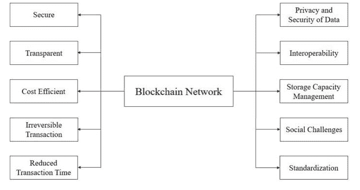

图10.5 在医疗保健领域实施区块链技术的机遇与挑战。

### 10.4.1 数据的隐私与安全

数据隐私和数据安全是在医疗保健领域使用BCT所面临的主要关键挑战[37]。BCT的使用彻底消除了使用第三方进行交易的概念[57,66]。虽然没有第三方参与，但BCT允许该社区中的所有用户对区块链记录进行验证，因此信息容易面临安全和潜在隐私方面的风险[1]。由于区块链社区中的每个节点都可以访问所传输的数据，因此存在严重的隐私问题。在授权过程中，如果没有第三方，患者则需要选择一名以上能够代表自己的人，这些代表在发生紧急情况时能够访问患者的数据或临床和病历记录。在BCT中，代表患者的个人能够允许一组用户访问同一患者的数据；这一过程可能导致巨大的数据安全和数据隐私威胁。如果患者的数据和信息受到高安全性机制的保护，则可能导致不同区块之间的数据传输困难，从而接收方只能访问不完整或有限的数据。51%攻击[32]被认为是区块链网络中一种潜在的攻击。攻击者是持有区块链网络中可用区块总数超过一半的矿工群体。如果矿工持有的区块超过一半，他们就能轻易获得网络权威，从而也能够阻止任何交易发生，方法就是不给予交易所需的许可。据CoinDesk[26]称，最近已有五种不同的加密数字货币成为这种攻击的受害者。此外，患者记录中可能存在高度敏感的数据，不适合记录在区块链中。

### 10.4.2 互操作性问题

互操作性是区块链在医疗保健行业中使用时遇到的问题之一。它帮助来自许多不同服务和通信提供商的区块链彼此进行适当且无缝的通信。当数据需要有效共享时，这一挑战便会造成障碍[10]。

### 10.4.3 存储容量管理

存储容量管理是区块链在医疗保健行业中使用时出现的挑战之一。区块链最初是为了实现数据交易的记录和处理而以有限范围创建的，因此没有大容量的存储系统。随着时间推移，该技术扩展到包括医疗保健在内的众多不同领域，存储方面的挑战也随之显现。医疗保健行业每天都会产生海量数据，例如X光片、检验报告、患者病历、MRI扫描、患者健康史，以及与患者医疗相关的许多其他图像和所有其他医疗数据。所有这些细节和数据都需要巨大而充足的空间[6,47]来存储在区块链中，使其可供网络链中的每个节点使用。区块链应用大多基于数据交易，因此数据库的增长速度很快。随着数据库规模不断增大，记录的搜索和访问速度不断变慢，这对交易来说并不合适，因为速度是交易的关键因素之一。因此，应对这一挑战的解决方案应具有弹性[42]和可扩展性。

### 10.4.4 社会挑战

区块链正处于发展或演进阶段，因此除技术挑战之外，它还面临许多社会挑战，包括文化变迁等。一项与传统技术存在巨大差异的技术很难被接受和采用。在当前的数字化时代，医疗保健行业也在缓慢地走向数字化，但要完全实现基于区块链的行业转型或数据数字化，还有很长的路要走，因为它们在医疗和保健行业方面尚未得到验证。医生很难被说服放弃纸质文书转而使用现代技术，这一过程需要耗费大量的精力和时间。当今世界，区块链在医疗和保健领域的应用率较低，因此相关政策仍不受信任。由于存在如此多的挑战和威胁，区块链仍不能用作解决医疗保健领域所有问题的方案。

### 10.4.5 标准化

由于区块链仍处于发展的早期阶段，区块链在医疗和医学行业的实际场景中实施面临着标准化方面的挑战。要确立一个标准的国际权威，需要许多经过充分认证和鉴定的标准。只有在区块链应用中存在一些预定义标准时，信息交换格式、数据性质和数据大小才能得到评估。定义标准将对共享数据进行审查，并起到安全防范措施的作用。

为了进一步了解，可以使用SWOT方法分析医疗和医学领域区块链网络中出现的优势、劣势、机遇和威胁，如图10.6所示。

- **优势**
  - 自主性
  - 成本效益高
  - 快速访问医疗数据
  - 信息共享防篡改
- **机遇**
  - 数据匿名性有助于临床或医学研究。
  - 受益人能够更好地访问数据。
  - 医疗供应链可以以低欺诈风险进行管理。
  - 医疗保健领域可能出现伪造的合作伙伴关系和初创企业。
- **劣势**
  - 没有足够的存储空间容纳大量数据。
  - 不具备可扩展性。
  - 系统和软件供应商的数量较少。
- **威胁**
  - 互操作性问题
  - 没有标准化格式
  - 社会对新技术的适应存在犹豫

图10.6 区块链在医疗保健行业中的SWOT分析。

## 结论与未来方向

由于数据完整性问题，医疗和医学行业有时会在接受最新进展方面滞后，并面临各种风险。在不久的将来，可能会有动力来填补区块链在医学和医疗保健领域应用的空白。在EHR管理中，可以有一些重点。在应用中使用智能合约可以处理医疗和医学行业中所有大大小小的重要数据交换。智能合约是由记录或区块组成的不可破坏的链，其中每个区块都会得到单独处理，而不会破坏医疗保健框架。医疗保健系统可以与BCT的智能合约相融合，这将有助于抵御集中式父系统中任何重复副本的产生。应为区块链研究提供潜在的协助，以便为科学研究提供更多具有时间戳和经核实细节的版本。借助智能合约，患者可以控制自己的数据。同样，研究人员也可以保留其研究发现的持续历史记录；这可以借助区块链记录文档来实现。BCT在制药等庞大而巨大的行业中是必不可少的。与制药相关的、在区块链中传播的所有报告区块都可以被解读。这可以最大限度地减少因档案伪造而造成损害或损失的可能性，确保档案流通直接而诚实，并提高数据准备速度。创新本身有能力控制关注点。已经生成的区块无法被删除和更改；使用区块链时，数据不易在未被察觉的情况下被更改，假冒或低质量的药物可以轻易被识别并拒绝。这些能力可以通过控制生产、物流和药品销售区块链中的每个环节来实现。

在医疗保健领域实际应用区块链将为大量人群带来益处，如医生、执业医师、研发专家、


- 3. Aranki, D., Kurillo, G., Mani, A., Azar, P., Gaalen, J. V., 等. 面向安卓设备的远程监控框架. 互联健康：应用、系统与工程技术（CHASE），2016年IEEE首届国际会议. IEEE, 2016.

- 4. Azaria, A., Ekblaw, A., Vieira, T. 和 Lippman, A. MedRec：使用区块链进行医疗数据访问和权限管理. 第二届开放与大数据国际会议论文集（OBD 16），奥地利维也纳. 25–30. doi: 10.1109/OBD.2016.11, 2016.

- 5. Benchoufi, M., Porcher, R. 和 Ravaud, P. 临床试验中的区块链协议：知情同意的透明性与可追溯性. F1000Research. 6, 66. doi: 10.12688/f1000research.10531.5, 2017.

- 6. Bennett, B. 区块链HIE概述：医疗互操作性框架. Telehealth Med. Today. 1–6. 可在 https://pdfs.semanticscholar.org/1756/5afb7cf33f4998556a4a6dfcd97089b4bc9f.pdf 获取, 2017.

- 7. Berman, M. 和 Fenaughty, A. 技术与管理式医疗：农村医疗网络中远程医疗的患者获益. Health Econ. 14(6), 559–573. doi: 10.1002/hec.952, 2005.

- 8. Bhatti, A., Siyal, A. A., Mehdi, A., Shah, H., Kumar, H. 和 Bohyo, M.A. 为偏远地区患者开发经济高效的远程监控系统. 2018年IEEE工程与新兴技术国际会议（ICEET）论文集，巴基斯坦拉合尔. 22–23, 2018.

- 9. Bockstael, N. E. 随机效用在农村医疗需求建模中的应用：讨论. Am. J. Agri. Econ. 81, 692–695, 1999.

- 10. Boulos, M. N., Wilson, J. T. 和 Clauson, K. A. 地理空间区块链：健康与医疗中的前景、挑战和场景. Int. J. Health Geogr. 25(2018). 可在 https://ij-healthgeographics.biomedcentral.com/articles/10.1186/s12942-018-0144-x 获取, 2018.

- 11. Brandon, R. M., Podhorzer, M. 和 Pollak, T. H. 无益的保费：商业健康保险行业中的浪费与低效. Int. J. Health Serv. 21(2), 265–283. doi:10.2190/H824-R263-YL47-WRQD, 1991.

- 12. Buterin, V. 下一代智能合约和去中心化应用平台；白皮书：以太坊基金会（Stiftung Ethereum）：瑞士楚格. 可在 http://blockchainlab.com/pdf/Ethereum_white_paper-a_next_generation_smart_contractand_decentralized_application_platform-vitalik-buterin.pdf 获取, 2014.

- 13. Castaneda, C., Nalley, K., Mannion, C., Bhattacharyya, P., Blake, P., 等. 用于提高诊断准确性和实现精准医学的临床决策支持系统. J. Clin. Bioinform. 5, 4. doi: 10.1186/s13336-015-0019-3, 2015.

- 14. Chen, Y., Ding, S., Xu, Z., Zheng, H. 和 Yang, S. 基于区块链的医疗记录安全存储和医疗服务框架. J. Med. Syst. 43(1), 5. doi:10.1007/s10916-018-1121-4, 2018.

- 15. Cyran, M. 区块链作为共享医疗数据的基础. Blockchain in Healthcare Today. 1. https://doi.org/10.30953/bhty.v1.13, 2018.

- 16. Desalvo, K. 和 Galvez, E. 连接全国健康与照护：共享的国家互操作性路线图；华盛顿特区：国家医疗信息技术协调办公室, 2015.

- 17. Downing, N. L., Adler-Milstein, J., Palma, J. P., Lane, S., Eisenberg, M., 等. 11个不同医疗系统的健康信息交换政策及其对交换量的相关影响. J. Am. Med. Inform. Assoc. 24(1), 113–122. doi: 10.1093/jamia/ocw063, 2017.

- 18. Dubovitskaya, A., Xu, Z., Ryu, S., Schumacher, M. 和 Wang, F. 使用区块链实现安全可信的电子病历共享. 在 AMIA 年度研讨会论文集；美国医学信息学协会：美国华盛顿特区. Vol. 2017, 650–659, 2017.

- 19. Ekblaw, A., Azaria, A., Halamka, J. D. 和 Lippman, A. A. 区块链在医疗保健中的案例研究：用于电子健康记录和医学研究数据的“MedRec”原型. 在 IEEE 开放与大数据会议论文集，奥地利维也纳. Vol. 13, 1–14. 可在 http://www.sbrc2018.ufscar.br/wp-content/uploads/2018/04/07-181717-1.pdf 获取, 2016.

- 20. arXiv 新兴技术：谷歌神秘的 DeepMind 创业公司推出神经图灵机. M.I.T. Technology Rev. 可在 http://www.technologyreview.com/view/532156/googlessecretive-deepmind-startup-unveils-a-neural-turing-machine/ 获取，访问于2015年7月22日.

- 21. Fernández-Caramés, T. M. 和 Fraga-Lamas, P. A. 区块链在物联网中应用的综述. IEEE Access 6, 32979–33001, 2018. 可在 https://ieeexplore.ieee.org/stamp/stamp.jsp?arnumber=8370027 获取, 2018.

- 22. Gomez, E. J., delPozo, F. 和 Hernando, M. E. 糖尿病护理中的远程医疗：DIABTel 面向糖尿病远程护理的方法. Med. Inform. (Lond). 21, 283–295, 1996.

- 23. Gorman, L. 医疗成本与医疗保险的历史. Wisconsin Policy Res. Inst. Rep. 19(10), 1–31. 可在 http://www.wpri.org/BI-Files/Special-Reports/Reports-Documents/Vol19no10.pdf 获取, 2006.

- 24. Griebel, L., Prokosch, H. U., Köpcke, F., Toddenroth, D., Christoph, J., 等. 云计算在医疗保健中的应用范围综述. BMC Med. Inform. Decis. Mak. 15, 17. doi: 10.1186/s12911-015-0145-7, 2015.

- 25. Griggs, K. N., Ossipova, O., Kohlios, C. P., Baccarini, A. N., Howson, E. A. 和 Hayajneh, T. 使用智能合约进行安全自动远程患者监测的医疗区块链系统. J. Med. Syst. 42(7), 130. doi: 10.1007/s10916-018-0982-x, 2018.

- 26. Hertig, A. 区块链曾令人恐惧的51%攻击如今已变得常见. 可在 https://www.coindesk.com/blockchains-feared-51-attack-now-becoming-regular/ 获取, 2018.

- 27. Heston, T. 区块链医疗创新案例研究. Int. J. Curr. Res. 9(11), 60587–60588. doi: 10.22541/au.151060471.10755953, 2017.

- 28. Horn, G., Martin, K. M. 和 Mitchell, C. I. 移动网络环境增值服务的认证协议. IEEE Trans. Vehicular Tech., 51(2), 383–392, 2002.

- 29. Houston, M. S., Myers, J. D., Levens, S. P., McEvoy, M. T., Smith, S. A., 等. 使用存储转发远程医疗技术的临床会诊. 在 Mayo Clinic Proceedings；罗切斯特，明尼苏达州：Elsevier. 第74卷, 1999.

- 30. 区块链将如何彻底改变临床试验. 可在 https://pharmaphorum.com/views-and-analysis/how-blockchain-will-revolutionise-clinical-trials-clinical-trials/ 获取, 2018.

- 31. Ianculescu, M., Stanciu, A., Bica, O. 和 Neagu, G. 能够支持老年人积极、健康和独立生活的创新且适配的在线服务：案例研究. Int. J. Econ. Manag. Syst. 2, 321–329, 2017.

- 32. Investopedia“区块链”. 可在 https://www.investopedia.com/terms/1/51-attack.asp 获取, 2019.

- 33. Ivan, D. 迈向基于区块链的安全存储患者记录方法. 在 ONC/NIST 区块链在医疗保健和研究中的应用研讨会；ONC/NIST：美国马里兰州盖瑟斯堡. 可在 https://www.healthit.gov/sites/default/files/9-16-drew_ivan_20160804_blockchain_for_healthcare_final.pdf 获取, 2016.

- 34. Jiang, S., Cao, J., Wu, H., Yang, Y., Ma, M. 和 He, J. BlockHealth：基于区块链的医疗信息交换平台. 2018年IEEE国际智能计算会议（SMARTCOMP）论文集，意大利陶尔米纳. 18–20, 2018.

- 35. Kevin, A. C., Breeden, E. A., Davidson, C. 和 Mackey, T. K. 利用区块链技术增强医疗保健中的供应链管理：探索健康供应链中的挑战与机遇. Blockchain Healthc. Today. 可在 https://doi.org/10.30953/bhty.v1.20 获取, 2018.

- 36. Kuo, M. H., Kushniruk, A. 和 Borycki, E. 云计算能否惠及医疗服务？：ASWOT分析. Stud Health Technol Inform. 169, 379–83, 2011.

- 37. Kuo, T. T., Hsu, C. N. 和 Ohno-Machado, L. ModelChain：私有区块链网络上的去中心化隐私保护医疗预测建模框架. arXiv 2018, arXiv:1802.01746, 2018.

- 38. Kuo, T. T., Kim, H. 和 Ohno-Machado, L. 用于生物医学和医疗应用的区块链分布式账本技术. J. Am. Med. Inform. Assoc. 24(6), 1211–1220. doi: 10.1093/jamia/ocx068, 2017.

- 39. Mandl, K. D., Markwell, D., MacDonald, R., Szolovits, P. 和 Kohane, I. S. 公共标准与患者控制：如何在保持电子病历可访问的同时保护隐私. BMJ. 322(7281), 283–287. doi:10.1136/bmj.322.7281.283, 2001.

- 40. Markov, A. 区块链在制药和医学中的应用. 可在 https://miningbitcoinguide.com/technology/blokchejn-v-meditsine/ 获取

- 41. Mauri, R. 区块链用于防欺诈：行业用例. 可在 https://www.ibm.com/blogs/blockchain/2017/07/blockchain-for-fraud-prevention-industry-use-cases/ 获取, 2017.

- 42. McKinlay, J. 区块链：背景挑战与法律问题；DLA Piper 出版物：英国伦敦，可在 https://www.dlapiper.com/en/denmark/insights/publications/2017/06/blockchain-background-challenges-legal-issues/ 获取, 2017.

- 43. Mettler, M. M. 医疗保健中的区块链技术：革命从这里开始. 2016年IEEE第18届电子健康网络、应用与服务国际会议（Healthcom）论文集，德国慕尼黑. doi: 10.1109/HealthCom.2016.7749510, 2016.

- 44. Moe Alsumidaie. 区块链概念在临床试验中兴起，应用临床试验. 在线获取：http://www.appliedclinicaltrialsonline.com/blockchain-concepts-emerge-clinical-trials, 2018.

- 45. Nichol, P. B. 区块链在医疗保健中的应用. 可在 http://www.cio.com/article/3042603/innovation/blockchain-applications-for-healthcare.html 获取, 2016.

- 46. Nugent, T., Upton, D. 和 Cimpoesu, M. 使用区块链智能合约提高临床试验的数据透明度. F1000Research. 5, 2541. doi: 10.12688/f1000research.9756.1, 2016.

- 47. Pirtle, C. 和 Ehrenfeld, J. 区块链用于医疗保健：下一代医疗记录？ J. Med. Syst. 42(9), 172. doi: 10.1007/s10916-018-1025-3, 2018.

- 48. Plotnikov, V. 和 Kuznetsova, V. 数字技术“区块链”在医药市场应用的前景. 在 MATEC Web of Conferences；EDP Sciences：英国伦敦. 第193卷. doi: 10.1051/matecconf/201819302029, 2018.

- 49. Ross, J. S. 美国医疗费用委员会与医疗保险史. Einstein Quarterly. 19, 130, 2002.

- 50. Rudin, R. S., Motala, A., Goldzwig, C. L. 和 Shekelle, P. G. 健康信息交换的使用与效果：系统综述. Ann Intern Med. 161, 803–811, 2014.

- 51. Shae, Z. 和 Tsai, J. J. 临床试验和精准医学的区块链平台设计. 2017年IEEE第37届国际分布式计算系统会议（ICDCS）论文集，美国佐治亚州亚特兰大. Vol. 1, 1972–1980, 2017.

- 52. Shubbar, S. 使用远程医疗和区块链的超声医学成像系统，用于女性乳腺癌新辅助化疗反应的远程监测：概念与实现. 硕士论文，美国俄亥俄州肯特市肯特州立大学, 2017.


53. Swan, M. 区块链思维：大脑作为去中心化自治公司。*IEEE 技术与社会杂志* 34(4), 41–52. doi: 10.1109/MTS.2015.2449358, 2015.
54. Sy Lim, P., Liu, F., Marcelo, A. and Fontelo, P. 区块链技术用于检测分销中伪造和劣质药品：制药供应链干预。*JMIR 研究方案* 7(9), e10163. doi: 10.2196/10163, 2018.
55. Taylor, P. 将区块链技术应用于药品可追溯性。可获取于： https://www.securingindustry.com/pharmaceuticals/applying-blockchain-technology-to-medicinetraceability/s40/a2766/, 2016.
56. Trujillo, G. and Guillermo, C. 区块链在制药行业供应链中的作用：作为减少假药流通的工具。博士论文, Dublin Business School, Dublin, Ireland, 2018.
57. Tschorsch, F. and Scheuermann, B. 比特币及其以外的技术：关于去中心化数字货币的技术调查。*IEEE 通讯调查教程* 18(3), 2084–2123, 2016.
58. Wang, F. Y. and Wong, P. K. 用于整合性和预测性医学的智能系统与技术：一种 ACP 方法。*ACM 智能系统与技术汇刊* 4(2), 1–16, 2013.
59. Wang, S., Wang, J., Wang, X., Qiu, T., Yuan, Y., et al. 基于 ACP 方法的区块链驱动的并行医疗保健系统。*IEEE 计算社会系统汇刊* 99, 1–9. doi: 10.1109/TCSS.2018.2865526, 2018.
60. Witchey, N. J. 通过区块链工作量证明进行医疗保健交易验证，系统和方法。US patent US20150332283 A1, 2015.
61. Wood, G. Ethereum：安全去中心化通用交易账本；黄皮书：Ethereum Foundation (Stiftung Ethereum)：Zug, Switzerland。可获取于： https://gavwood.com/paper.pdf, 2014.
62. Xia, Q., Sifah, E. B., Asamoah, K. O., Gao, J., Du, X. and Guizani, M. MeDShare：通过区块链在云服务提供商之间实现无信任的医疗数据共享。*IEEE Access* 5, 14757–14767. doi: 10.1109/ACCESS.2017.2730843, 2017.
63. Yue, X., Wang, H., Jin, D., Li, M. and Jiang, W. 医疗数据网关：在区块链上构建医疗智能并进行新型隐私风险控制。*医学系统杂志* 40(10), 218. doi: 10.1007/s10916-016-0574-6, 2016.
64. Zhang, J., Xue, N. and Huang, X. A. 面向泛在社交网络的医疗保健安全系统。*IEEE Access.* 4, 9239–9250, 2016.
65. Zhang, P., White, J., Schmidt, D. C., Lenz, G. and Rosenbloom, S. T. Fhirchain：应用区块链以安全且可扩展地共享临床数据。*计算结构与生物技术杂志* 267–278. doi: 10.1016/j.csbj.2018.07.004, 2018.
66. Zheng, Z., Xie, S., Dai, H., Chen, X. and Wang, H. 区块链技术概述：架构、共识与未来趋势。收录于 2017 年 IEEE 国际大数据大会论文集 (BigData Congress)，Honolulu, HI, USA。可获取于： https://www.researchgate.org/paper/An-Overview-of-Blockchain-Technology%3A-Architecture%2C-Zheng-Xie/ee177faa39b981d6dd21994ac33269f3298e3f68, 2017.

## 11 区块链理论及其应用

Jaipal Dhobale and Vaibhav Mishra
ICFAI Business School

## 目录

- 11.1 引言 ........................................................... 183
- 11.2 区块链工作原理 ....................................................... 184
- 11.3 区块链类型 ....................................................... 188
- 11.3.1 区块链的特征 ........................................... 188
- 11.3.2 区块链的挑战 ................................................ 189
- 11.4 区块链的历史与发展 ................................... 189
- 11.4.1 区块链的应用 ............................................... 190
- 参考文献 ................................................................. 191

### 11.1 引言

区块链！如今，它已成为一个流行词。它有什么特别之处？为什么以及如何区块链成为一项突破性技术？在找到这些问题的答案之前，我们将了解企业在当时面临的不同问题。在2008年之前，专门在网络上使用数据库应用的企业面临着诸如不可否认性、保持透明度、未经授权的更新/篡改以及防止未经授权使用而对这些交易进行安全保护等问题。这些企业在解决这些问题上高度依赖第三方。尽管我们一般讨论企业，但金融机构对这些问题及其解决方案尤为关注。这就是为什么在2008年，区块链技术以加密货币应用的形式被引入世界的原因[1]。

区块链是一种技术，它打破了这些流程障碍，并以经济高效和有效的方式成功完成交易。这就是它成为突破性技术的原因。它是由固定大小的不可编辑区块组成的链。这些区块存储的交易数据最多为1MB[2]。在准备交易区块之前，这些交易已由网络中的用户批准。这样准备好的区块随后附加到先前创建的区块上，以继续形成区块链。在链中添加每个区块后，交易信息会分发到网络中并供所有人使用。此过程无需金融、政府和非政府组织等中介机构即可进行。区块链通过基于加密的哈希值完成所有工作。网络中的所有用户均基于点对点（P2P）网络共享详细信息，其中所有节点都在同一层级工作。区块链网络中的每个用户都保存区块链的本地副本。当共识在组内验证交易时，它将被添加为区块链中的交易区块。所有这些操作都在兼顾交易中涉及资源的隐私的情况下完成。该技术通过计算机程序自动涉及“智能合约”[3]。

区块链的特殊之处在于这种不可编辑的信息对所有人开放，为业务应用中的交易提供透明度。这对企业及其利益相关者来说非常有益，企业通过网络传递价值。它类似于分布式账本技术（DLT）[4]，但与之略有不同[5]。这两种技术都使用去中心化网络，但在 DLT 中，拥有者/用户对网络有更大的控制权，网络中的信息存储在不同的服务器上。在 DLT 中，网络中的每个节点都有自己的账本，并在节点层面独立地在交易后立即更新。在区块链中，在通过共识批准交易后，区块以加密格式准备，并根据某些哈希函数添加到区块链中以形成区块链。我们可以说区块链是 DLT 之一。图 11.1 描述了这一理念。

### 11.2 区块链工作原理

区块链是去中心化且分布式的区块账本。这些区块不过是网络中参与节点验证的交易，在创建区块后无法修改或删除。区块链中的区块包含：

- 交易数据 – 区块版本号、时间戳和交易详情。
- 上一个区块的签名。
- Nonce 是“仅使用一次的数字”的缩写，是矿工生成的随机数字字符串，附加到加密区块中。

图 11.2 描述了区块链中典型的区块。


图 11.1 DLT 与区块链关系。

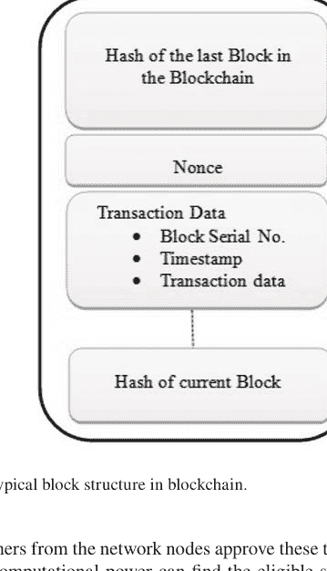

图 11.2 区块链中典型的区块结构。

网络节点中的足够矿工批准这些交易。具有足够计算能力的矿工节点可以找到合格的签名来生成区块。这些矿工节点使用专用硬件来获得计算能力。这个过程无非就是挖矿过程。挖矿过程采用工作量证明（PoW）理念/协议[3]进行。PoW 是一种协议，用于计算区块的随机哈希值数据，这是一个非常复杂且耗时的计算过程。矿工批准交易后，区块将被追加到链中作为新区块。矿工在创建新区块后将获得某种形式的比特币奖励。

由于 PoW 计算复杂且消耗大量计算资源，因此采用了“权益证明”（PoS）理念/协议[6]作为替代方案，其中矿工的奖励基于其在挖矿区块时持有的权益数量。

“委托权益证明”（DPoS）[7]是 PoS [8] 的另一种形式，其中区块链用户选举其代表。该当选的代表节点可以生成和验证区块。

“实用拜占庭容错”（PBFT）[7]是另一种挖矿区块的协议。该协议用于处理区块链中的恶意活动。区块按轮次进行挖矿。在每一轮中，将根据规则选择新的主节点。该主节点负责挖矿区块。此过程分为三个步骤进行——预准备、准备和提交。为了防止轮次中每个步骤的恶意活动，主节点必须获得三分之二总节点的一致同意。


“瑞波”[7]是另一种生成节点的协议。它会在区块链中创建可信子网络，并基于这些可信子网络节点的共识来创建区块。在该协议下，区块链网络将被分为两部分——服务器和客户端。服务器的作用是执行共识过程，而客户端的作用是转移资金。链中的每台服务器都维护着一个唯一节点列表（UNL）。服务器就交易有效性询问UNL，如果同意比例达到80%及以上，则交易将被验证并添加到区块链中。区块链过程如图11.3所示。

由于多个矿工可能同时找到合适的随机数，区块可能会同时生成。这可能会在区块链中创建另一条链，但既定协议只会将较长的链视为真实链。

区块链中每个新增区块都包含前一个区块的哈希值。如果我们试图修改区块的内容，就会改变当前区块的哈希值。这种哈希值的变化与紧接着的区块中所记录的哈希值不匹配，从而使其无法与区块链连接。如果这条被篡改的交易要被链上接受，则需要通过更改链中每一个后续区块的哈希值来将其链接到后续区块中，而这几乎是不可能的。这使得区块链具有不可变性[4]。通过这种方式，区块链首先验证交易并保护它，最后这些记录被保存为账目。区块链中的交易使用基于公钥和私钥机制的数字签名来保护。区块链结构如图11.4所示。

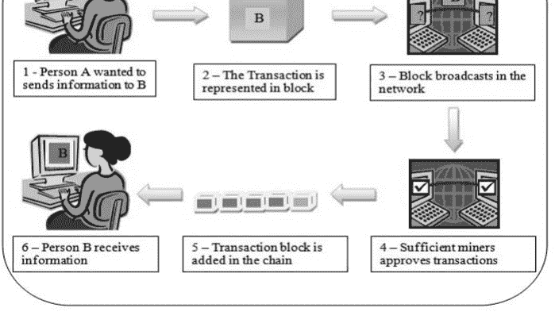

**图11.3 在区块链中添加区块。**

**图11.4 区块链结构。**

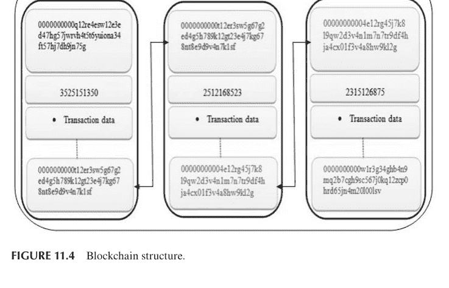

区块链参与者及其角色[9]：

- 1. 监管机构——拥有特殊权限来监管区块链交易的用户。这些用户将按照既定政策处理区块链监管事务。这些用户被限制不得进行区块链交易。
- 2. 区块链开发者——这些是开发各种应用程序和协议以进行区块链交易的人。他们是核心程序员，凭借其编程技能，为区块链用户提供合适的操作平台。这些用户凭借额外的技能集来管理数据源和区块链平台。
- 3. 区块链网络管理员——这些是具备网络管理技能的人。他们负责管理区块链网络管理，按照既定政策为用户提供对区块链资源的访问权限。
- 4. 区块链用户——他们是进行区块链交易的人。这些人利用区块链架构提供的功能来进行区块链交易。这些用户不了解进行区块链交易所提供的技术细节。
- 5. 证书颁发机构——根据政策，这些人为用户提供交易证书。

## 11.3 区块链的类型

区块链平台有两种类型[3]：

- 1. 许可型区块链。
- 2. 非许可型区块链。

这是基于区块链运行时所使用的共识模型来划分的。在许可型[10–12]区块链中，参与者需要获得同意才能加入链。这种平台类型特别适用于具有集中控制性质的私人组织。区块链的管理可以由单一实体或代表小组完成。许可型区块链平台的交易仅对获准的代表可见。通过在区块链架构中提供额外的安全层来决定参与者的角色。

非许可型平台也被称为公有区块链，其本质上是完全去中心化的，也被称为公共账本。它不要求参与者获得任何许可即可加入区块链。参与者可以下载开源协议并成为区块链的一部分。非许可型平台拥有代币，为参与者提供激励。根据应用用途，它还可以分为三种类型[12,13]：

- 1. 公有区块链。
- 2. 私有区块链。
- 3. 联盟区块链。

公有区块链实际上就是非许可型区块链，对参与者和验证者没有限制。私有区块链是许可型区块链，只有预先批准的参与者才被允许参与和/或验证交易。联盟区块链也被称为混合区块链，因为信息像公有区块链一样被共享，但它可以限制能够访问区块链的节点。

### 11.3.1 区块链的特征[12]

基于以上讨论，我们列举区块链的特征：

- 1. 以交易形式维护数据时的透明性。
- 2. 不可变性——已记录的交易带有时间戳，几乎不可能更改。
- 3. 记录持久性——交易由网络组成员检查并验证。
- 4. 可审计性——由于链结构带有时间戳，区块中的信息更容易追踪和验证。
- 5. 去中心化控制——分布式账本机制。
- 6. 低交易成本——去除中间人角色，从而降低交易成本。
- 7. 实时数据捕获和更新。
- 8. 使用加密技术确保安全。

### 11.3.2 区块链的挑战[14–16]

在实施区块链时，我们需要应对一些挑战。这些挑战是：

- 1. 51%攻击——这是一种攻击类型，区块链用户组成一个“矿池”来挖取更多区块。这个矿池拥有最大的计算能力。如果其持有的算力超过区块链计算能力的51%，它就能控制区块链。在该群体获得控制权后，他们可以修改交易，可以阻止矿工挖取区块，可以停止交易验证过程。这类攻击在过去网络规模较小时更为可行。
- 2. 分叉问题——这个问题出现在区块链从旧版本升级到新版本时。升级后，区块链节点可以分为新节点和旧节点。当未升级的节点不验证升级后的节点，或者未升级的节点不遵循新的共识规则时，就会出现这个问题。因此，区块链节点之间发生了分歧。如果这种分歧是永久的，称为硬分叉；如果是暂时的，称为软分叉。
- 3. 可扩展性——区块链网络日复一日地不断增长。随着区块链的增长，数据和资源不断给系统增加负担。因此，节点会花费更多时间来同步数据和执行复杂计算。这随后会影响区块链系统的有效运行。

## 11.4 区块链的历史与发展

Stuart Haber和W. Scott Stornetta于1991年提出了区块链，但这项技术的真正应用在2008年[17]以加密货币应用的形式出现，由一位身份不明的个人或小团体——中本聪（Satoshi Nakamoto）提出。中本聪的研究论文《比特币：一种点对点的电子现金系统》解释了如何在无需金融机构等第三方参与的情况下，应用区块链在网络成员之间转移比特币。

在这一新机制引入之后，区块链的第一个区块被发布。它被称为区块0，是区块链的创世区块，也是一种特殊区块，在区块链技术中不包含前一个区块的地址。这是区块链技术的基础构建模块。创世区块由区块链的创始者开发。根据记录，挖出创世区块花了六天时间，而区块链中挖出一个区块的平均时间戳为10分钟。创世区块包含50个比特币的奖励。目前尚不清楚这是有意还是无意保留的。通过这一开源协议，世界各地的任何人都可以通过签订合约参与区块链网络。


## 11.4.1 区块链的应用

自区块链技术诞生以来，金融行业是主要受益者；最流行的应用是加密货币。鉴于其潜力，其他行业也在探索机会。我们在此仅讨论金融服务、政府用途、医疗保健、工业应用和物联网（IoT）。

### 1. 金融服务 [18,19]
区块链在处理商业融资、贸易融资、跨境交易和数字支付等金融服务方面非常有效。它可以在提供可持续经济增长方面发挥重要作用。为了提供金融资源的端到端可见性，区块链是经过验证的技术。

组织可以有效地跟踪和维护其与供应商的商业融资及信用详细信息。这将有助于减少争议数量及解决争议的时间。企业需要与各种法律实体互动并满足法律要求。区块链将帮助企业在这些领域维护合同，并与各种商业实体保持更新。这将简化业务流程。

跨国公司需要获得多种货币的访问权限，并具备以当地货币维护交易的能力来开展业务。此类交易及其对账将在区块链技术的帮助下得到有效处理。它将提供跨多个地点的交易和余额的可见性。

银行机构正在使用区块链作为颠覆性技术，以经济高效的方式解决传统银行业问题，如不可否认性、透明性和可追溯性。R3 [18] 等区块链应用被用于银行结算加密货币支付、通用银行应用、贷款管理和财务审计。众筹 [20] 是另一个可以通过区块链技术考虑的业务功能。各种区块链应用，如Prediction Marketplace systems、BitShares 2.0、Plasma和Global Payments Steering Groups，已经在处理银行服务中使用。

### 2. 政府用途 [18]
政府向公民和企业提供服务。不同的利益相关者，如受益者、官僚、政策制定者和社区组织，需要频繁互动和信息交流。政府需要维护这些交易的记录，作为所有权证明和存在证明。区块链可以为现有程序提供更好的解决方案。区块链将增强记录的问责性和安全性。它将通过自动治理提高运营绩效。公民身份证件、公共资产记录维护、其使用跟踪、记录保存以及与公共和私人实体相关的法律文件维护、向利益相关者颁发各种许可、纳税等，都可以通过区块链应用更好地处理。区块链可以更好地帮助物理资产及其与数字内容的集成。这将有助于减少官僚主义，提高政府服务的运营效率。在线投票也可能成为可能，同时与政府服务集成，因为区块链记录是不可变、可追溯、去中心化的公共账本，且透明度很高。

### 3. 医疗保健 [3]
医疗保健是另一个区块链能够发挥作用的领域，因为其具有不可变性、分布式公共账本、透明性、在保护隐私的前提下安全地获取所需信息等特性。区块链将有效解决医疗保健供应链管理中利益相关者整合的问题。维护患者医疗记录、临床试验、公共卫生计划记录、打击假药、自动化医疗保险机制和会计等医疗保健功能，区块链技术都能更好地处理。在执行这些操作时，隐私和安全是最受关注的，区块链将如何应对呢？

### 4. 工业应用 [18]
为了实现业务目标，企业或工业对在制品或已加工货物的流动进行跟踪非常重要。同样，跟踪各种业务服务及其优化对于满足利益相关者也非常重要。采购管理、客户关系管理、供应链管理、生产运营管理等业务操作需要得到处理。借助区块链技术，生产过程及其相关服务的可见性可以得到很好的处理。区块链技术的特点使这些操作有效且高效。这将为上述领域提供各种机会，并支持业务蓬勃发展。

### 5. 物联网应用 [18]
这是最具挑战性但仍在增长的领域之一，智能设备通过互联网相互交互。这些设备产生大量数据。这些设备在过去两三年内产生的数据几乎相当于全世界已有的数据量。该领域的主要问题是无线网络分布式特性中不同智能设备产生的数据的安全性。正如我们之前讨论的，区块链是分布式公共账本，它能够最好地处理这些海量数据及其安全。区块链还将以经济高效且更安全的方式帮助全球智能设备之间的支付结算机制。

这些是可以探索区块链机会的潜在领域。区块链技术本身存在某些挑战，还有需要解决的具体领域挑战。

## 参考文献
- 1. Satoshi Nakamoto，《比特币：一种点对点的电子现金系统》，2019年12月17日 18.22，https://www.bitcoin.org。
- 2. Arati Baliqa，《理解区块链共识模型》，Persistent Systems Ltd， (2017):3–14

- 12.4.1 Hyperledger Fabric 网络演示 ........................................ 206
- 12.4.2 先决条件 ........................................................................ 208
- 12.4.2.1 Docker ............................................................................. 208
- 12.4.3 Docker-Compose 服务配置 ........................................ 209
- 12.4.3.1 排序节点 ............................................................................. 211
- 12.4.4 Crypto-config.yaml 配置 .................................................. 213
- 12.4.4.1 Configtx.yaml 配置 .................................................. 215
- 12.4.4.2 组织 ...................................................................... 216
- 12.4.4.3 能力 ......................................................................... 216
- 12.4.4.4 通道默认设置 .................................................................. 216
- 12.4.4.5 应用程序默认设置 ............................................................... 217
- 12.4.4.6 排序节点默认设置 .................................................................. 217
- 12.4.4.7 配置文件 ............................................................................... 218
- 12.4.4.8 通道配置文件 .................................................................... 218
- 12.4.5 命令 ................................................................................. 218
- 12.4.6 链码 .................................................................................. 222
- 12.4.6.1 Stub, Getstate, Putstate, getQueryResult, getHistoryForKey .......... 224
- 12.4.7 REST API ................................................................................... 226
- 12.4.7.1 Fabric SDK ............................................................................ 226
- 12.4.7.2 使用Fabric SDK (NodeJS)的用户交互API ..................... 227
- 12.4.8 Hyperledger Explorer .................................................................... 234
- 参考文献 .......................................................................................... 235

## 12.1 引言

### 12.1.1 许可区块链
可以通过多种方式架构、访问和管理区块链 [1]。一些区块链 [1] 在读取、交易、写入和访问相关信息时需要特殊权限。这些区块链的固有配置控制参与者的交互并定义其角色。这样的区块链被称为许可区块链。

许可区块链通过向区块链网络提供访问控制层来辅助安全性，只允许明确定义的身份与网络中的分布式账本进行交易，而无需公开数据。许可区块链允许为其用户指定不同级别的权限；因此，可以限制访问，从而保证机密性。参与者可以无需任何权限加入网络，但可能需要授权才能在网络内进行交易。因此，这类区块链受到需要在区块链内定义安全性、身份和角色的人的青睐。授权区块链在行业层面的公司和商业中很常见，因为安全、身份和角色管理与之相关。以下是许可区块链的一些优点：


-   **封闭环境：** 企业控制资源和对区块链的访问。网络内的每笔交易都与其自身隔离。因此，在一定程度上确保了安全性和隐私性。
-   **交易：** 当节点在本地分布但参与网络的节点数量也远少时，性能更快，确保交易执行时间更短 [2]。
-   **可扩展性：** 轻松添加节点和服务的能力可以为企业提供巨大优势。
-   **透明度和问责制：** 由于网络中的所有参与者都已明确定义，与分布式账本进行的每一次交互都可以追溯到其来源，并且进行交易的个人对该特定交易负责。

许可区块链具有其优势，但从行业角度来看，它也存在一些缺点：

-   **阴谋：** 如果在许可区块链中，网络内的一组成员串谋更改该区块链中的信息，他们将破坏网络的可信度。
-   **法规：** 由于许可区块链由一组企业和企业运营，它们必须同意并遵守在网络中实施的法规。这些法规的威胁可能不会影响已遵守现有法律的企业，但可能阻止新企业加入这些许可区块链网络。

## 12.2 许可区块链框架

随着许可区块链吸引众多企业探索其所能提供的益处，一些框架变得流行并提供平台。其中包括 Hyperledger Fabric [1]、Quorum、Ethereum 和 Corda [3,4]。

**表 12.1**
**无许可区块链与许可区块链之间的差异**

| Category | Permissioned | Permissionless |
|---|---|---|
| Anonymity | Well-defined identities | Anonymous, sometimes partially anonymous |
| Privacy | Private membership | Open network |
| Ownership | Managed by a group of predefined identities | No one owns the network |
| Decentralization nature | Partially decentralized | Truly decentralized |
| Cost | Cost-effective | Not so cost-effective |
| Security (relating to anonymity) | Less secure | More secure |

### 12.2.1 以太坊

以太坊 [3,5] 被认为是比特币之后最受欢迎的区块链平台，是一种去中心化平台，允许使用以太坊智能合约创建基于区块链的 DApps（去中心化应用）。智能合约 [6] 是自执行的数字合约，其执行完全按计划进行，不存在故障、欺诈或第三方干预的可能性。以太坊提供公共和许可配置。以太坊主网 [3,5] 是一个开放的区块链网络，任何人都可以进入网络并参与挖矿过程。由于以太坊也提供私有区块链配置，它使用 PoA（Proof of Authority）作为共识机制。PoA 不需要挖矿过程；它只需要少数权威节点即可达成共识。因此，以太坊确实提供了私有网络的选项，但它并不提供行业级应用所需的完整许可配置。

### 12.2.2 Quorum

Quorum [2] 是一个面向企业的平台，提供去中心化平台，允许我们在其上构建基于许可区块链的 DApps。Go Ethereum 是以太坊协议的基于 Golang 的实现。Quorum 是 Go Ethereum 的硬分叉，是一种面向企业的分布式账本技术，提供去中心化平台，允许我们构建基于许可区块链的去中心化应用。对区块链网络协议和结构的更改称为分叉 [7]。分叉有两种类型，即软分叉 [7] 和硬分叉 [7]。软分叉的更改与未打补丁的节点向后兼容 [7]。硬分叉的更改不向后兼容 [7]，因为未更新的节点会拒绝更改后的区块。以太坊庞大的开发者社区及其隐私配置促使大量企业使用 Quorum 构建区块链。Microsoft Azure 提供 BaaS（Blockchain-as-Service）以轻松构建自己的区块链。

### 12.2.3 Corda

Corda 提供了一个平台来构建自己的基于许可分布式账本技术的应用。Corda 是 R3 的平台，R3 是一家与多家银行、金融机构、监管机构、多个商业协会、服务型企业和多家科技公司合作构建 Corda 的公司。R3 的 Corda 的理念是为金融交易提供分布式、可信的账本。在 Corda 中，智能合约被称为 CorDapps。它们不像其他平台的智能合约；它们没有状态。它们的目的是仅验证从输入产生的输出是否正确。Corda 支持可插拔的 RDBMS（Relational database management system）来存储智能合约数据。框架还额外提供多签名支持，允许多个节点签署群组操作。

Corda 的主要缺点之一是由于没有全局广播，每个对等节点（节点）必须以传统方式维护自己的备份和故障转移冗余，因为网络中没有内置冗余。节点会存储交易并重试向接收方发送消息，直到接收方成功接收为止，因为并非所有交易都会广播给网络中的所有方。一旦消息被接收，发送方就不再承担责任。

### 12.2.4 Hyperledger Fabric

Hyperledger [1] 是 Linux 基金会于 2015 年 12 月发布的区块链及相关软件的开源项目，由 IBM 支持。Fabric 是 Hyperledger 下最受欢迎的项目。IBM 至今仍是该项目的最大贡献者。Hyperledger Fabric [1] 是一种企业级分布式账本技术平台，允许构建许可区块链。Hyperledger Fabric 与其他区块链网络的不同之处在于它既是许可的也是私有的。与允许未知身份参与网络的开放无许可系统（需要诸如“proof of work”(PoW) 等协议来验证交易并保护网络）不同，Hyperledger Fabric 网络的成员通过受信任的成员服务提供商（MSP）[8] 加入。

Fabric 还提供各种可插拔配置。账本上的数据可以以多种格式存储，并具有可插拔的共识机制和 MSP。Hyperledger Fabric 引入了称为通道的概念。通道允许同一网络中的一组身份为交易创建单独的账本，即主区块链的单独子集区块链。本章我们将探讨 Hyperledger Fabric、其组件和概念，以及设置 Fabric 网络的演练。在下一节中，我们将讨论 Fabric 架构。

## 12.3 Fabric 架构

在本部分，我们将讨论 Hyperledger Fabric 的架构、构成网络的概念和组件。

### 12.3.1 Fabric 概述

Hyperledger Fabric [1] 是一种模块化且灵活的开源系统，旨在开发、部署和管理授权（许可）区块链。传统区块链使用主动复制，即共识过程首先对交易进行排序并将其传输给所有对等节点。其次，每个对等节点按顺序执行交易。这需要所有对等节点在执行每笔交易和所有交易时都是确定性的，导致整体系统性能不足。这被称为顺序-执行架构。这种架构几乎可以在所有现有的区块链系统中找到，例如以太坊（采用基于 PoW 的共识），这些系统是开放或许可平台。许可区块链在传统架构下确实存在一些限制。共识机制是硬编码的，交易需要是确定性的，这在程序上很难保证。

为克服现有许可区块链的这些缺点，Hyperledger Fabric 引入了一种新的架构，他们称之为执行-排序-验证架构 [8]。在此架构中，交易流程从交易的执行开始，由网络中的一部分对等节点（背书节点）执行

为了检查其正确性，这可以看作其他区块链中的交易验证。之后，这些交易通过共识机制排序到一个区块中。最后，在将交易提交到账本之前，所有peer节点使用特定于应用程序的背书策略完成交易验证。

凭借其新颖的“执行-排序-验证”架构，Hyperledger Fabric比现有其他采用“排序-执行”架构的区块链更具弹性、灵活性和可扩展性，同时增强了性能和机密性。Fabric提供了高度可配置的架构。可配置选项之一是可插拔共识。这可以被视为Hyperledger Fabric与其他平台的主要区别特征之一。它使平台更加高效和定制化，以适应多样化的企业用例。当考虑一个具有可信权威的企业时，简单的崩溃容错（CFT）[4]共识比拜占庭容错（BFT）更高效，可以避免对性能和吞吐量造成不必要的拖累。Fabric不需要原生加密货币来运行共识机制，如挖矿和执行智能合约。缺少加密货币和昂贵的加密挖矿方法将降低实施和维护成本。

Fabric的其他一些模块化组件包括可插拔排序服务。排序服务负责对给定时间间隔内发生的交易进行排序。可插拔成员服务提供者负责使用成员的加密身份对网络中交易成员进行识别和验证。背书策略和验证策略也是可插拔的。

这种模块化设计和特性吸引了企业的注意，促使他们尝试并构建适合、高效的许可区块链系统，以用于广泛的行业用例，包括金融、银行、供应链等。应用程序级流程将在后续章节中说明，在下一节中，我们将讨论Hyperledger Fabric的一些主要组件和概念。

## 12.3.2 Hyperledger Fabric 网络概念与组件

Hyperledger Fabric [9] 网络由多个架构组件及相关概念组成。一个网络由多个称为成员的组织组成。通过将MSP连接到网络，个体即可进入网络。每个MSP都有一个证书颁发机构（CA），为其成员提供加密证书。每个成员可能拥有多个代表其组织参与区块链网络的peer节点。网络中不同组织或同一组织的这些peer节点形成一个通道以共享账本。在深入探讨网络运作方式之前，我们需要熟悉以下一些关键词、概念和组件：

### 12.3.2.1 组织

组织也称为成员。网络的起源始于将组织加入网络。创建区块链网络的网络管理员可以邀请成员加入网络。最初，当组织的MSP被添加到网络时，该组织即加入网络。这些成员代表其组织参与网络。一个组织在单个MSP下管理其成员。

### 12.3.2.2 联盟

联盟是区块链网络上非排序组织组成的团体。这些组织是形成通道并进入通道的组织及其自己的peer节点。虽然一个区块链网络可能有多个联盟，但大多数区块链网络只有一个联盟。在创建通道时，所有引入网络的实体都必须属于某个联盟的一部分。然而，一个实体也可以连接到现有网络，即使该实体并未在联盟中指定。

### 12.3.2.3 成员服务提供者（MSP）

MSP就像一个抽象层，涵盖颁发、验证和认证证书背后的所有加密机制和流程，这些证书由证书颁发机构签发，用于访问网络。MSP可以使用一个或多个证书颁发机构；这些接口是可配置的。Fabric-CA API（应用程序编程接口）是MSP使用的默认接口。这是Hyperledger Fabric的另一个模块化特性。MSP可以定义自己的规则来分配身份。

MSP的职责是验证和认证身份，即交易签名的生成和验证。一个Fabric网络可以由多个MSP管理。这确保了跨各种成员标准和架构的成员流程的模块化和互操作性。Fabric支持多种证书架构，这些架构有助于使用外部CA的接口，从而使组织能够引入自己的可信权威机构。

### 12.3.2.4 证书颁发机构（CA）

个体或节点可以通过可信权威为其提供的数字身份参与网络。在大多数情况下，数字身份（或简称为身份）采用经过加密认证的数字证书形式，这些证书遵循X.509标准，由CA提供。

证书由证书颁发机构颁发给各种参与者。CA以电子方式签署这些证书，并将参与者与其公钥（以及可选地，特定属性列表）绑定。因此，如果你信任CA（并知道其公钥），就可以认为特定参与者与证书中包含的公钥绑定，并通过验证CA对该参与者的签名，确认其拥有证书中包含的属性。

### 12.3.2.5 通道

通道是Fabric网络中最重要的概念之一。通道允许组织使用同一个网络，同时在多个区块链之间保持完全隔离。这就像一个大的区块链分支。只有交易执行所涉及的通道参与者才能看到交易详情。

图12.1描绘了Fabric如何在一个主网络中支持多个通道。每个通道都有自己的账本，彼此完全隔离，包括主网络。一个通道内的交易不会影响另一个通道的交易，账本也是如此。

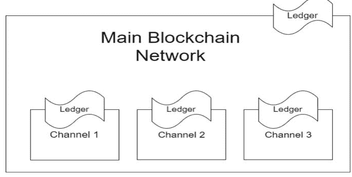

图12.1 主区块链网络。

### 12.3.2.6 Peer节点

Peer节点是维护账本并在网络中执行链码以进行读/写操作的网络实体。成员拥有并持有peer节点。一个peer节点可以托管多个账本和链码，以帮助创建更健壮的过程布局。虽然所有peer节点都是相同的，但根据网络设计方式，它们可能扮演多种角色。

提交peer：通道中的每个peer节点都是提交peer。它接收已创建的交易区块，这些区块在提交并附加到peer本地账本副本之前会经过验证。


图12.2 通道–peer架构。

背书peer：背书peer是在隔离的链码容器中模拟交易，并根据智能合约结果准备交易提案的peer节点。然而，要成为背书peer，客户端应用程序必须使用peer上的智能合约生成交易的数字签名响应。

锚点peer：如果另一家公司的peer想要与某个peer连接，可以使用通道的一个锚点peer。一个组织可以分配零个或多个充当锚点的peer，这些peer可以支持许多不同的跨组织交互。它们使用gossip协议在网络内通信。

### 12.3.2.7 Peer节点Gossip协议

Peer节点使用gossip协议传输账本和通道信息。Gossip通信是持续的，通道上的每个peer节点都会不断从多个peer节点接收当前可靠的账本信息。网络中传输的消息或交易都经过签名，以防止非预期节点传播这些消息。受到延迟、网络分区或其他导致错过区块的因素影响的peer节点，最终必须通过与相邻peer节点通信来同步到当前账本状态。

此通信过程中执行的三个功能是：

- 步骤1：通过持续识别活跃成员peer并逐步检测离线peer，管理peer发现和通道成员资格。
- 步骤2：在网络中的所有peer节点间传播账本信息。每个数据不同步的peer节点与通道其余部分一起，通过复制正确数据来检测并同步缺失的区块。
- 步骤3：通过允许点对点传输待更新的账本信息，使新连接的peer节点快速同步。

Peer节点从通道上的其他peer节点接收消息，并将这些消息转发给一些随机的peer节点。一个peer节点充当网络中的领导者，从排序服务获取信息以分发新区块，并在其组织内向其他peer节点发起gossip传播。

领导者peer：当一个组织在通道中有多个peer节点时，领导者peer是负责将交易从排序节点分发到该组织其他提交peer的节点。领导者peer可以选择参与静态领导者选择（手动配置peer）或动态领导者选择（peer节点共同执行程序来选举一个领导者）。

### 12.3.2.8 世界状态与数据库

除了peer节点维护自己的账本外，Fabric还引入了世界状态的概念。世界状态维护最新的一组值，即当前状态，而账本维护交易日志，其中包含所有交易和数据更改的历史记录。

当前状态数据表示账本中所有资产的新值。由于网络中提交的所有交易都会反映在当前状态中，因此有时将其称为世界状态。世界状态可以是一组键值对。链码调用（智能合约）正在执行交易，针对


当前状态信息。为了使这些链码交互极其高效，每个资产的最新键值对都存储在状态数据库中。

状态数据库本质上只是已提交交易的索引视图。因此，它可以随时从字符串（即交易日志）重新生成。状态数据库会自动接受新交易。

- a. LevelDB 是 Hyperledger Fabric 默认的键值状态存储库。它存储键值对。
- b. CouchDB 是 LevelDB 的替代品。与 LevelDB 相比，CouchDB 以 JavaScript 对象表示法（JSON）格式存储数据。CouchDB 支持主键、复合键、键范围以及富数据查询。

### 12.3.2.9 链码

俗称的“智能合约”在 Hyperledger Fabric 中被称为链码。链码使参与者能够进行交易并更新账本和世界状态。链码允许经过适当批准的用户在网络的对等节点上下载并安装链码。链码只存在于对等节点内部。终端用户可以使用与网络中某个对等节点交互的客户端软件来调用链码。你可以在多个通道上安装相同的链码。一个对等节点可以持有多个链码。

### 12.3.2.10 排序服务

大多数无需许可的分布式区块链允许任何人参与网络共识，在共识过程中交易被捆绑并按顺序打包成区块。Hyperledger Fabric 的工作方式与前述不同，它引入了一种称为“排序-执行-验证”的新架构。它包含一个称为排序节点的模块，也称为 orderer，*负责对交易进行排序*。Fabric 排序服务接受已经过背书的交易，将其排序打包成区块，并将区块分发给提交对等节点。它不维护账本或链码，其唯一目的是将交易排序成区块并将区块分发给网络中的所有对等节点。这被视为一种排序服务。由于 Fabric 依赖确定性共识算法，账本很难被分叉。Hyperledger Fabric 提供三种排序机制：

- a. SOLO：它被从事 Hyperledger Fabric 网络的程序员最广泛使用，是 Hyperledger Fabric 的排序进程。SOLO 只需要一个单一命令节点。
- b. Kafka：推荐用于生产环境的 Hyperledger Fabric 排序系统。该机制使用 Apache Kafka，这是一个开源流处理平台，提供统一的低延迟、高吞吐平台，用于实时处理数据流。在此场景中，数据由已批准的交易和读写集组成。Kafka 方法提供了一种崩溃容错的排序解决方案。
- c. SBFT：代表简化拜占庭容错（Simplified Byzantine Fault Tolerance）。这种排序系统既支持崩溃容错，也支持 BFT，确保即使在存在恶意或故障节点的情况下也能达成共识。此方法尚未被 Hyperledger Fabric 团队采用，因为它仍在开发中。

排序节点还维护一个由通道构建组织组成的列表，也称为联盟。该列表保存在排序节点的系统通道中。根据定义，只有排序节点管理员才能更改此列表及其所在的通道。

### 12.3.2.11 背书策略

背书策略确定了支持一笔交易合法所需的最少组织集合。要进行背书，实体的背书节点需要运行与交易相关的智能合约并签署其结果。

当交易被排序并广播给提交对等节点时，这些节点必须确保区块中每一笔已背书的交易都符合网络中定义的背书策略。如果某笔交易不满足该策略，它会被标记为无效，世界状态及其值保持不变。

### 12.3.2.12 私有数据集合

在 Hyperledger Fabric [1] 中，数据可以被私有化，即对特定数据的访问可以在同一通道内受到限制。Fabric 将此称为私有数据集合。未经授权的实体在网络账本上只会看到交易数据的哈希，作为交易数据的确认。如果配置了的话，该私有数据会存储在一个不同的数据库中，称为 sideDB [8]，如图 12.3 所示，该数据库位于同一对等节点内。

如果某个对等节点被授权拥有私有数据集合，则该私有状态存在于该对等节点内部。这个集合与相邻对等节点隔离，只有该对等节点本身才能访问它。

## 12.3.3 交易流程

在本节中，我们将描述在 Hyperledger Fabric 网络 [1] 中，一笔交易是如何被发起、背书、排序并提交到账本的。

交易流程分为五个步骤。

### 步骤 1：交易提案

Hyperledger Fabric 网络中的交易生命周期始于客户端应用程序提交交易提案，换句话说，向背书节点提供一笔交易。交易首先由客户端应用程序发起。


图 12.3 私有数据架构。

图 12.4 展示了终端用户（即客户）如何使用软件应用程序，借助 Fabric 软件开发工具包（SDK）连接到区块链网络，并将其交易提案发送给网络中所需的背书节点。

### 步骤 2：背书并生成读写集

背书节点根据客户端用户的请求调用相应的链码，执行提议的交易并产生输出。然后，背书节点收集读写集（读集和写集）信息。读集是在不应用提议交易的情况下当前世界状态的值。写集是在执行提议交易之前当前状态被修改后的值。然而，这些修改此时尚未反映到账本中。

图 12.5 展示了所有背书节点如何对生成的读写集进行加密签名，并将其返回给客户端请求。这些读写集也被客户端请求用于完成交易。根据背书策略，签署一笔交易所需的对等节点数量得以确定。该背书策略在部署链码时定义。因此，不同的通道可以有不同的背书策略。


**图 12.4** 交易提案。


**图 12.5** 背书并生成读写集。

### 交易流程（步骤 3）：排序

在收到已背书的交易和已签名的读写集后，客户端应用程序将已背书的交易和读写集提交给排序服务。排序服务收集特定时间间隔内产生的所有交易，对该特定通道的所有交易进行排序，并将它们打包成一个区块。排序服务可以是一组排序节点；它不处理交易，也不维护共享账本。排序服务仅指定交易将被提交到账本的顺序。

图 12.6 展示了用户/客户端如何将从背书节点收到的已背书交易发送给排序服务。

### 交易流程（步骤 4）：广播

排序系统接收已接受的交易和读写集，将这些信息排序打包成区块，并将区块分发给所有提交对等节点。

排序系统由一组排序节点组成，它不处理交易、智能合约，也不维护分布式账本。排序系统识别已被批准的交易，并确定这些交易在后续步骤中必须被添加到账本和世界状态的顺序。

图 12.7 展示了排序服务如何将交易排序成区块，并将区块广播给网络中的其他对等节点。

### 步骤 5：提交与账本更新

提交对等节点单独验证区块中的每一笔交易。参考读写集，对等节点检查当前世界状态与读集是否一致，如图 12.8 所示。然后，通过验证满足背书策略所需的所有签名来验证交易。

在验证过程之后，如图 12.8 所示，账本被更新。所有对等节点同步地通过追加区块来更新账本。被检测为无效的交易会被标记为无效，它们仍然存在于区块中，但不会影响世界状态。提交对等节点是更新和维护共享账本的节点。它们还会将交易成功或失败的结果通知给客户端应用程序。


图 12.6 应用程序 SDK 到排序服务。


图 12.7 网络中向对等节点提供排序服务。


图 12.8 提交。

将交易更新到账本。最后，提交对等节点异步通知客户端应用程序交易的成功或失败。每个提交对等节点都会通知应用程序。

除了交易背书、系统有效性和版本控制之外，身份验证在交易流程的每一步都在后台运行。交易的输入和输出会被反复认证，即当交易提案通过网络中的不同组件时，会进行签名和验证。

## 12.4 Hyperledger Fabric 实战

### 12.4.1 Hyperledger Fabric 网络演示

在本节中，我们将介绍在 Hyperledger Fabric 实战中要构建的网络。

本节将为你提供模板，帮助你构建一个包含三个组织、两个通道和一个排序节点的 Hyperledger Fabric 网络。每个组织将有一个对等节点，该对等节点将加入通道。对等节点还将有一个 CouchDB 容器来保存账本的世界状态。Fabric 网络将有两个通道。Org-3 和 Org-2 的对等节点可以加入 channel1，Org-1 和 Org-3 的对等节点可以加入 channel2。我们还将为 channel1 和 channel2 构建链码（智能合约），并使用 Fabric SDK 构建 REST API 与 Fabric 网络交互。

图 12.9 描绘了 Fabric 网络的架构。我们将首先了解先决条件，然后查看 docker-compose 文件中特定于组织的容器定义所需的配置，我们还将查看 docker-compose 文件的排序节点配置。然后，我们将查看 configtx.yaml 配置文件和 crypto-config.yaml 配置文件。完成配置文件后，我们将为两个通道开发一个基本的链码。接下来，我们将看到用于使用 crypto-config 配置文件创建证书、生成创世区块、生成通道交易、生成锚节点通道交易文件、创建通道、加入通道、更新锚节点、安装链码、实例化链码的各种命令。最后，我们将使用 Fabric Node SDK 编写 REST API 与 Hyperledger Fabric 网络交互。


**图 12.9** 网络架构。

```
1 ca.org1.hnetwork.com:
2   container_name: ca.org1.hnetwork.com
3   image: Hyperledger/fabric-ca
4   environment:
5     - FABRIC_CA_HOME=/etc/Hyperledger/fabric-ca-server
6     - FABRIC_CA_SERVER_CA_NAME=ca.org1.hnetwork.com
7   ports:
8     - "7054:7054"
9   command: sh -c 'fabric-ca-server start --ca.certfile /etc/Hyperledger/fabric-ca-server-config/*.org1.hnetwork.com-cert.pem --ca.keyfile /etc/Hyperledger/fabric-ca-server-config/*.org1.hnetwork.com-key.pem --b admin:adminpw -d'
10  volumes:
11    - ./crypto-config/peerOrganizations/org1.hnetwork.com/ca:/etc/Hyperledger/fabric-ca-server-config
12
13  networks:
14    - basic
```

图 12.11 docker-compose 文件中的 CA docker 服务定义。

最后一行定义了该服务运行所使用的网络。

如图 12.12 所示，第一行 `peer0.org1.hnetwork.com` 是 docker-compose 文件中的服务名称，第二行给出启动 compose 时的容器名称，第三行是用于运行容器的镜像。

```
1 peer0.org1.hnetwork.com:
2   container_name: peer0.org1.hnetwork.com
3   image: Hyperledger/fabric-peer
4   environment:
5     - CORE_VM_ENDPOINT=unix:///host/var/run/docker.sock
6     - CORE_PEER_ID=peer0.org1.hnetwork.com
7     - FABRIC_LOGGING_SPEC=debug
8     - CORE_CHAINCODE_LOGGING_LEVEL=DEBUG
9     - CORE_PEER_LOCALMSPID=Org1MSP
10    - CORE_PEER_MSPCONFIGPATH=/etc/Hyperledger/msp/peer/
11    - CORE_PEER_ADDRESS=peer0.org1.hnetwork.com:7051
12    - CORE_VM_DOCKER_HOSTCONFIG_NETWORKMODE=${COMPOSE_PROJECT_NAME}_basic
13    - CORE_LEDGER_STATE_STATEDATABASE=CouchDB
14    - CORE_LEDGER_STATE_COUCHDBCONFIG_COUCHDBADDRESS=couchdb:5984
15    - CORE_LEDGER_STATE_COUCHDBCONFIG_USERNAME=
16    - CORE_LEDGER_STATE_COUCHDBCONFIG_PASSWORD=
17    - CORE_PEER_GOSSIP_BOOTSTRAP=peer0.org1.hnetwork.com:7051
18    - CORE_PEER_GOSSIP_EXTERNALENDPOINT=peer0.org1.hnetwork.com:7051
19  working_dir: /opt/gopath/src/github.com/Hyperledger/fabric
20  command: peer node start
21  ports:
22    - 7051:7051
23    - 7053:7053
24  volumes:
25    - /var/run/:/host/var/run/
26    - ../chaincode:/etc/Hyperledger/chaincode
27    - ./crypto-config/peerOrganizations/org1.hnetwork.com/peers/peer0.org1.hnetwork.com/msp:/etc/Hyperledger/msp/peer
28    - ./crypto-config/peerOrganizations/org1.hnetwork.com/users:/etc/Hyperledger/msp/users
29    - ./config:/etc/Hyperledger/configtx
30  depends_on:
31    - orderer.hnetwork.com
32    - couchdb
33  networks:
34    - basic
```

图 12.12 docker-compose 文件中的 Peer docker 服务定义。

第五行到第十六行是传递给 peer 容器的环境变量。第七行的环境变量值“FABRIC_LOGGING_SPEC=debug”可以是 FATAL|PANIC|ERROR|WARNING|INFO|DEBUG 中的任意一个。第十五和第十六行是 peer 连接到 CouchDB 实例所需的凭据。

工作目录设置了 peer 容器的工作目录路径。下一行定义了运行容器的命令，再下一行定义了暴露的端口。

第 30 行的 `depends_on` 数组用于定义在此服务启动之前应该启动并运行的容器。最后一行定义了该服务运行所使用的桥接网络。

组织的 CouchDB Docker 服务定义。第一行是服务名称，如图 12.13 所示，第二行是容器名称，下一行是服务使用的镜像。传递的环境变量是 CouchDB 实例的用户名和密码。端口将暴露给主机，最后一行定义了该服务运行所使用的桥接网络。

### 12.4.3.1 排序节点

Hyperledger Fabric 提供了几种排序机制，其中包括 SOLO、Kafka、RAFT。

使用 Fabric 进行开发的开发人员通常使用 SOLO 排序方法。在生产阶段，可以使用 Kafka 作为排序系统，它基于 Apache Kafka。该系统提供了一种能够抵抗崩溃故障的排序解决方案。RAFT 排序系统同时提供崩溃容错和拜占庭容错，确保即使存在不稳定或恶意的节点，也能达成共识。

我们将在 Hyperledger Fabric 网络中使用 Kafka 排序系统。


图 12.13 docker-compose 文件中的 CouchDB docker 服务定义。

crypto-config.yaml 和 configtx.yaml 配置文件将在本节后面解释。在这里，我们将了解如何为组织设置 docker-compose.yaml 文件。以下配置是运行组织容器的模板。

图 12.14 展示了 docker-compose 文件中的 Orderer Docker 服务定义。如图 12.14 所示，第一行是服务名称，接下来两行是容器名称和容器使用的镜像。第四行设置容器的工作目录，下一行是用于启动容器的命令。环境变量定义了排序节点必须使用的排序服务类型、创世区块的位置以及其他一些变量。

端口映射为 7050:7050，冒号左侧的值是暴露给主机的端口，右侧是容器映射到的端口。映射的持久卷是通道工件文件夹和排序节点的 MSP 证书。排序节点依赖于 kafka 代理。最后一行定义了该服务运行所使用的桥接网络。

在图 12.15 中，第一行是服务名称，然后是容器名称和用于运行容器的镜像。定义的环境变量包括 `KAFKA_DEFAULT_REPLICATION_FACTOR`（定义默认复制因子）和 `KAFKA_MIN_INSYNC_REPLICAS`（定义 Kafka 必须同步的最小副本数）（见图 12.16）。

```
orderer.fnetwork.com:
  container_name: orderer.fnetwork.com
  image: Hyperledger/fabric-orderer:latest
  working_dir: /opt/gopath/src/github.com/Hyperledger/fabric
  command: orderer
  environment:
    - CONFIGTX_ORDERER_ORDERERTYPE=kafka
    - CONFIGTX_ORDERER_KAFKA_BROKERS=
      [kafka0:9092,kafka1:9092,kafka2:9092,kafka3:9092]
    - ORDERER_KAFKA_RETRY_SHORTINTERVAL=1s
    - ORDERER_KAFKA_RETRY_SHORTTOTAL=30s
    - ORDERER_KAFKA_VERBOSE=true
    - ORDERER_GENERAL_LOGLEVEL=debug
    - ORDERER_GENERAL_LISTENADDRESS=0.0.0.0
    - ORDERER_GENERAL_GENESISMETHOD=file
    - ORDERER_GENERAL_GENESISFILE=/etc/Hyperledger/configtx/genesis.block
    - ORDERER_GENERAL_LOCALMSPID=OrdererMSP
    - ORDERER_GENERAL_LOCALMSPDIR=/etc/Hyperledger/msp/orderer/msp
  ports:
    - 7050:7050
  volumes:
    - ./channel-artifacts:/etc/Hyperledger/configtx
    - ./crypto-config/organizations/fnetwork.com/orderers/orderer.fnetwork.com/msp:/etc/Hyperledger/msp/orderer/msp
  depends_on:
    - kafka0
    - kafka1
    - kafka2
    - kafka3
  networks:
    - basic
```

图 12.14 docker-compose 文件中的 Orderer docker 服务定义。


```yaml
kafka0:
  container_name: kafka0
  image: Hyperledger/fabric-kafka
  ports:
    - 2181
  environment:
    - KAFKA_LOG_RETENTION_MS=-1
    - KAFKA_UNCLEAN_LEADER_ELECTION_ENABLE=false
    - KAFKA_DEFAULT_REPLICATION_FACTOR=3
    - KAFKA_MIN_INSYNC_REPLICAS=2
    - KAFKA_BROKER_ID=0
    - KAFKA_ZOOKEEPER_CONNECT=zookeeper0:2181,zookeeper1:2181,zookeeper2:2181
    - KAFKA_MESSAGE_MAX_BYTES=103809024
    - KAFKA_REPLICA_FETCH_MAX_BYTES=103809024
    - KAFKA_REPLICA_FETCH_RESPONSE_MAX_BYTES=103809024
depends_on:
  - zookeeper0
  - zookeeper1
  - zookeeper2
networks:
  - basic
```

**图 12.15** docker-compose 文件中的 Kafka docker 服务定义。

```yaml
zookeeper0:
  container_name: zookeeper0
  image: Hyperledger/fabric-zookeeper
  ports:
    - 2181
    - 2888
    - 3888
  environment:
    - ZOO_MY_ID=1
    - ZOO_SERVERS=server.1=zookeeper0:2888:3888 server.2=zookeeper1:2888:3888 server.3=zookeeper2:2888:3888
  networks:
    - basic
```

**图 12.16** docker-compose 文件中的 Zookeeper docker 服务定义。

## 12.4.4 CRYPTO-CONFIG.YAML 配置

crypto config 配置文件用于借助 cryptogen 工具为 Hyperledger Fabric 网络生成证书文件。

如图 12.17 所示，有两个对象：OrdererOrgs 和 PeerOrgs。OrdererOrgs 包含排序节点的详细信息，如排序节点名称、域名和主机名。PeerOrgs 包含组织名称、节点数量以及除管理员证书之外的用户数量。

使用 cryptogen 工具生成认证材料的命令

图 12.18 显示了 cryptogen 工具的命令

图 12.19 显示了 crypto-config 文件夹的文件结构，该文件夹是在 crypto-config 之后生成的。

```
1 OrdererOrgs:
2   - Name: Orderer
3     Domain: fnetwork.com
4     Specs:
5       - Hostname: orderer
6 PeerOrgs:
7   - Name: org1
8     Domain: org1.fnetwork.com
9     Template:
10      Count: 1
11    Users:
12      Count: 3
13  - Name: org2
14    Domain: org2.fnetwork.com
15    Template:
16      Count: 1
17    Users:
18      Count: 3
19  - Name: org3
20    Domain: org3.fnetwork.com
21    Template:
22      Count: 1
23    Users:
24      Count: 3
```

图 12.17 Crypto config 配置文件。

Cryptogen 工具二进制文件

生成证书的命令

传入 crypto-config 文件位置

```
./bin/cryptogen generate --config=./crypto-config.yaml
```

图 12.18 加密文件生成命令。


**图 12.19** crypto-config 文件夹结构。

### 12.4.4.1 Configtx.yaml 配置

Configtx.yaml 配置用于生成通道交易，这些交易是关于通道的元数据，而不是账本的状态数据。通道交易和普通交易都存储在同一条区块链上。不同之处在于，每个通道交易都存储在一个特殊的区块中，该区块不仅包含增量配置更新，还包含整个配置。当节点或客户端需要了解通道配置时，只需获取最新的通道交易区块即可。

Configtx.yaml 定义了要用于网络的哪些元素，并将其传递给 configtxgen 以创建创世区块和通道工件。

我们可以将 configtx.yaml 文件分成五个不同的块：

- 组织块。
- 功能特性块。
- 应用程序块。
- 排序节点块。
- 配置文件块。

图 12.20 描述了在 configtx.yaml 中定义组织配置。

```yaml
1 - &org1
2   Name: org1
3   ID: org1MSP
4   MSPDir: crypto-config/peerOrganizations/org1.fnetwork.com/msp
5   Policies:
6     Readers:
7       Type: Signature
8       Rule: "OR('org1MSP.admin', 'org1MSP.peer', 'org1MSP.client', 'org1MSP.member')"
9     Writers:
10      Type: Signature
11      Rule: "OR('org1MSP.admin', 'org1MSP.client', 'org1MSP.member')"
12    Admins:
13      Type: Signature
14      Rule: "OR('org1MSP.admin', 'org1MSP.member')"
15  AdminPrincipal: Role.MEMBER
16  AnchorPeers:
17  - Host: peer0.org1.fnetwork.com
18    Port: 7051
```

图 12.20 在 configtx.yaml 中定义组织配置。

### 12.4.4.2 组织

在如图 12.20 所示的 configtx.yaml 中，组织数据表示：

- Name 是在通道中引用该组织的键。
- ID 是引用该组织 MSP 定义的键。
- MSPDir 包含保存 MSP 配置的路径。
- Policies 定义配置树此级别的一组策略。
- Anchor Peers 用于定义所有节点的主机位置和端口号，可用于跨组织的 gossip 通信。

### 12.4.4.3 功能特性

由于 Hyperledger Fabric 是一个涉及多个组织的分布式系统，因此 Fabric 网络中以及 Fabric 网络通道上的不同节点可能存有不同版本的 Fabric，如图 12.21 所示。

- 通道：这些功能特性适用于排序节点和普通节点，并且必须同时得到两者的支持。
- 排序节点：这些功能特性适用于排序节点，并且可以与先前版本的节点安全地一起使用。
- 应用程序：这些功能特性适用于节点网络，并且可以与先前版本的排序节点安全地一起使用。

### 12.4.4.4 通道默认值

通道默认值定义要编码到配置交易或创世区块中的通道相关参数值，如图 12.22 所示。

策略：

- Readers：可以调用“Deliver” API 的参与者。
- Writers：可以调用“Broadcast” API 的参与者。
- Admins：默认情况下，可以修改此配置级别元素的参与者。


**图 12.23** configtx.yaml 中的应用程序默认值。

- *批处理超时*：生成一个批次之前等待的时间。
- *批处理大小*：控制一个区块中批处理消息的数量。
- *Brokers*：排序节点所连接的 Kafka brokers 列表。
- *策略*：定义配置树此级别的一组策略。

### 12.4.4.7 配置文件

可以在此处编码不同的配置配置文件，以便为 configtxgen 工具指定参数。要生成排序节点创世区块，需要使用定义联盟的配置文件（图 12.25）。

### 12.4.4.8 通道配置文件

通道配置文件描述通道的联盟。

在运行图 12.26 所示的命令使用 configtxgen 工具之前，我们必须先在当前工作目录中创建 channel-artifacts 文件夹。

## 12.4.5 命令

```bash
$ mkdir channel-artifacts
$ export CHANNEL_NAME=channel1
$ export CHANNEL_PROFILE=Channel1
```

*生成排序节点创世区块的命令。*

图 12.27 显示了不同的命令，其输出生成区块并将其保存在指定的路径中。

在使用 OrdererGenesis 配置文件创建 genesis.block 之后，我们将生成通道交易。创世区块包含联盟信息，基本上：

```
1 Orderer: &ordererDefaults
2   OrdererType: kafka
3   Addresses:
4     - orderer.fNetwork.com:7050
5   BatchTimeout: 2s
6   BatchSize:
7     MaxMessageCount: 10
8     AbsoluteMaxBytes: 98 MB
9     PreferredMaxBytes: 512 KB
10  Policies:
11      Readers:
12        Type: ImplicitMeta
13        Rule: "ANY Readers"
14      Writers:
15        Type: ImplicitMeta
16        Rule: "ANY Writers"
17      Admins:
18        Type: ImplicitMeta
19        Rule: "MAJORITY Admins"
20      BlockValidation:
21        Type: ImplicitMeta
22        Rule: "ANY Writers"
23  Kafka:
24    Brokers:
25      - kafka0:9092
26      - kafka1:9092
27      - kafka2:9092
28      - kafka3:9092
29  Organizations:
```

**图 12.24** Configtx.yaml 中的排序节点默认配置。

它包含组织和 CA 的所有证书。因此，允许初始化通道 MSP，并使用这些根 CA 证书来验证访问控制列表（ACL）、背书和客户端签名。

图 12.28 显示了使用 configtx.yaml 中的通道配置文件并创建通道交易文件的命令。该文件被提交到系统通道，并包含形成新通道所需的配置，例如通道策略和通道联盟成员（这些成员必须是系统通道创世区块中所定义联盟的子集）。任何想要加入该通道的节点都需要此通道交易。


图 12.25 configtx.yaml 中的排序者创世配置。


图 12.26 Configtx.yaml 中的通道配置文件配置。


图 12.27 生成创世块的命令。

图 12.28 创建通道交易文件。

图 12.29 显示了用于生成锚点节点交易文件的命令。当我们创建通道交易文件时，默认情况下文件中没有定义锚点节点。我们将为通道创建一个交易文件更新。该交易文件将设置锚点节点的地址和 MSP。我们将使用此文件在创建通道后更新通道配置。

为了使用 org1 的节点创建通道，我们需要使用任一组织创建通道，然后使用授权组织的节点加入通道。

图 12.30 显示了创建通道的命令。要创建通道，我们需要使用之前命令生成的通道交易文件。当我们创建通道时，它会生成通道区块，我们将此通道区块复制到主机网络中，即所有节点的持久卷所在的位置，也就是说，通道区块将被复制到所有节点，这是任何节点加入通道所必需的。

图 12.29 锚点节点的命令。

```
../bin/configtxgen -profile ${CHANNEL_PROFILE}
-outputCreateChannelTx ./channel-artifacts/${CHANNEL_NAME}.tx
-channelID $CHANNEL_NAME
```

```
../bin/configtxgen -profile ${CHANNEL_PROFILE}
-outputAnchorPeersUpdate ./channel-artifacts/Org1MSPanchors_${CHANNEL_NAME}.tx
-channelID $CHANNEL_NAME -asOrg Org1MSP
```


图 12.30 创建通道。

执行图 12.31 所示的上述命令后，由于 docker 卷的概念，每个节点的容器文件系统内都会拥有通道区块。

现在，利用通道区块，节点可以加入通道。下面的命令用于让节点加入通道。

现在我们已经使用图 12.32 所示的命令成功加入通道，并且使用了 org1 的 peer0；现在通过更改节点 docker 容器名称，为通道联盟中的所有组织的每个节点重复相同操作。

使用图 12.33 所示的命令成功加入通道后，我们需要更新组织的锚点节点详细信息。为此，我们将使用之前命令生成的锚点节点交易更新文件。由于每个组织只有一个节点，该节点同时充当锚点节点。使用上述命令模板，并针对每个组织更改节点 docker 容器名称和锚点通道交易文件路径。

## 12.4.6 链码

在本小节中，我们将讨论如何使用 NodeJS 开发链码（智能合约）。


图 12.31 显示命令。

图 12.32 加入节点的命令。

```
docker exec -e "CORE_PEER_MSPCONFIGPATH=$ADMIN_MSP_PATH"
```

```
peer0.org1.fNetwork.com peer channel join
```

```
-b /etc/hyperledger/configtx/ourchannel.block
```

图 12.33 锚点节点更新命令。

```
docker exec -e "CORE_PEER_MSPCONFIGPATH=$ADMIN_MSP_PATH"
```

```
peer0.org1.fNetwork.com peer channel update
```

```
-f /etc/hyperledger/configtx/org1MSPanchors.tx
```

```
-c ourchannel -o orderer.fNetwork.com:7050
```

在 Fabric 之外创建一个新目录，命名为 chaincode。打开终端并进入 chaincode 文件夹路径。运行 “npm init”，该命令初始化 NodeJS 项目。输入 npm init 的详细信息后，运行 “npm i fabric-shim”。

Fabric-shim：fabric-shim 为链码提供框架，是用于实现“智能合约”的较低级 API。

通过使用 fabric-shim NodeJS 模块，我们将开发一个链码，该链码将资产从一个组织转移到另一个组织，并附带一条消息。

fabric-shim 提供的一些对象和函数如下。

### 12.4.6.1 Stub, Getstate, Putstate, getQueryResult, getHistoryForKey

创建一个文件 index.js，并在其中编写以下代码。

```
'use strict';

const shim = require('fabric-shim');
const util = require('util');

async function queryByKey(stub, key) {
  console.log('============= START : queryByKey ===========');
  console.log('##### queryByKey key: ' + key);

  let resultAsBytes = await stub.getState(key);
  if (!resultAsBytes || resultAsBytes.toString().length <= 0) {
    throw new Error('##### queryByKey key: ' + key + ' does
    not exist');
  }
  console.log('##### queryByKey response: ' +
    resultAsBytes);
  console.log('============= END : queryByKey ===========');
  return resultAsBytes;
}

let Chaincode = class {
  async Init(stub) {
    console.log(
      '=========== Init: Instantiated / Upgraded my chaincode
      ==========='
    );
    return shim.success();
  }
  async Invoke(stub) {
    console.log('=========== START : Invoke ===========');
    let ret = stub.getFunctionAndParameters();
    console.log('##### Invoke args: ' + JSON.stringify(ret));

    let method = this[ret.fcn];
    if (!method) {
      console.error(
        '##### Invoke - error: no chaincode function with name:
        ' +
        ret.fcn +
        ' found'
      );
      throw new Error('No chaincode function with name: ' +
        ret.fcn + ' found');
    }
    try {
      let response = await method(stub, ret.params);
      console.log('##### Invoke response payload: ' +
        response);
      return shim.success(response);
```

```
44. } catch (err) {
45.     console.log('##### Invoke - error: ' + err.stack);
46.     return shim.error(err);
47. }
48. }
49. async initLedger(stub, args) {
50.     console.log('================ START : Initialize Ledger
================');
51.     console.log('================ END : Initialize Ledger
================');
52. }
53. async createAsset(stub, args) {
54.     try{
55.         args = JSON.parse(args);
56.         let asset = {
57.             docType: "project",
58.             assetOwner: args.owner,
59.             transferMessage: ""
60.         }
61.         let resultAsBytes = await stub.getState(args.assetID.
62.         toString());
63.         if (!!resultAsBytes || resultAsBytes.toString().length
64.         <= 0) {
65.         throw new Error('##### asset with assetID: ' + key + '
 exists');
66.         }
67.         const buffer = Buffer.from(JSON.stringify(asset));
68.         await stub.putState(args.assetID.toString(), buffer);
69.     }catch(e){
70.         console.log(e);
71.         return shim.error(e);
72.     }
73. }
74. async getAsset(stub, args){
75.     try{
76.         args = JSON.parse(args);
77.         return await queryByKey(stub, args.assetID);
78.     }catch(e){
79.         console.log(e);
80.         return shim.error(e);
81.     }
82. }
83. async transferAsset(stub, args){
84.     try{
85.     args = JSON.parse(args);
86.     let asset = await queryByKey(stub, args.assetID);
87.     asset = JSON.parse(asset);
88.     if(asset.assetOwner!== args.userName){
89.     throw new Error("asset is not owned by user who is
executing this transaction");
```

```
90. } else {
91.   asset.assetOwner = args.transferTo;
92.   asset.transferMessage = args.transferMessage;
93.   const buffer = Buffer.from(JSON.stringify(asset));
94.   await stub.putState(args.assetID.toString(), buffer);
95. }
96. }catch(e){
97.
98. }
99. }
100.
101. async deleteAsset(stub, args) {
102.   args = JSON.parse(args);
103.   await stub.deleteState(args.assetID);
104. }
105. };
106. shim.start(new Chaincode()); Using the above chaincode we will install the chaincode on the peers and instantiate the chaincode.
```

图 12.34 显示了安装链码的命令。
图 12.35 显示了实例化链码的命令。

## 12.4.7 REST API

在本节中，我们将讨论 Fabric SDK，以及如何创建 REST API，以使用链码与区块链网络进行交互。

### 12.4.7.1 Fabric SDK

Hyperledger Fabric 目前旨在为 Node 和 Java 这两种语言提供 SDK。


图 12.34 安装链码的命令。


**图 12.35** 实例化链码命令。

在本演练中，我们使用适用于 NodeJS 的 Hyperledger Fabric SDK。该 SDK 提供了与区块链通信、与智能合约（即部署在 Fabric 网络上的链码）进行交互的手段。

Fabric-network：它为用户应用程序提供高级 API，用于发送交易和测试智能合约查询（链码）。

API：应用程序开发人员可插拔 API，用于提供关键 SDK 接口的替代实现。每个接口都包含默认实现。

Fabric-client：它提供 API 来与 Hyperledger 核心区块链网络元素（即 peer、orderer 和事件流）进行通信。

Fabric-ca-client：它提供 API 与 fabric-ca 可选组件进行交互，该组件包含成员管理服务。

## 12.4.7.2 使用 Fabric SDK（NodeJS）的用户交互 API

在本节中，我们将讨论四个主要操作/函数：

- 1. 注册——注册客户端。
- 2. 查询——查询区块链。
- 3. 调用——调用区块链。
- 4. 区块监听器——监听生成的区块。

### 12.4.7.2.1 注册客户端

```javascript
1. const FabricCAServices = require('fabric-ca-client');
2. const path = require('path');
3. const {
4.   FileSystemWallet,
5.   Gateway,
6.   X509WalletMixin
7. } = require('fabric-network');
8. const fs = require('fs');
```

```javascript
9. const regAdmin = async orgName => {
10. var appAdmin = 'admin';
11. var appAdminSecret = 'adminpw';
12. var orgMSPID = orgName + 'MSP';
13. var caURL = 'http://ca.' + orgName + '.meditrack.com:7054';
14. try {
15. const ca = new FabricCAServices(caURL);
16. const walletPath = path.join(__dirname, 'wallet', orgName);
17. const wallet = new FileSystemWallet(walletPath);
18. console.log(`Wallet path: ${ walletPath }`);
19. const adminExists = await wallet.exists(appAdmin);
20. if (adminExists) {
21. console.log(
22. 'An identity for the admin user "admin" already exists in the wallet'
23. );
24. return 'already admin exists';
25. }
26. const enrollment = await ca.enroll({
27. enrollmentID: appAdmin,
28. enrollmentSecret: appAdminSecret
29. });
30. const identity = X509WalletMixin.createIdentity(
31. orgMSPID,
32. enrollment.certificate,
33. enrollment.key.toBytes()
34. );
35. wallet.import(appAdmin, identity);
36. console.log(
37. 'msg: Successfully enrolled admin user ' +
38. appAdmin +
39. 'and imported it into the wallet'
40. );
41. } catch (e) {
42. console.log(e.stack);
43. }
44. };
45. const regUser = async (orgName, userName) => {
46. const ccpPath = path.join(__dirname, '..', 'config', orgName, 'connectionProfile.json');
47. const ccpJSONContents = fs.readFileSync(ccpPath, 'utf8');
48. const ccp = JSON.parse(ccpJSONContents);
49. try {
50. let appAdmin = 'admin';
51. let orgMSPID = orgName + 'MSP';
52. let gatewayDiscovery = {
53. enabled: true,
54. asLocalhost: false
};
const walletPath = path.join(__dirname, 'wallet', orgName);
const wallet = new FileSystemWallet(walletPath);
console.log(`Wallet path: ${ walletPath }`);
const userExists = await wallet.exists(userName);
if (userExists) {
  console.log(
    `An identity for the user ${ userName } already exists in the wallet`
  );
  return 'User already registered';
}
const adminExists = await wallet.exists(appAdmin);
if (!adminExists) {
  console.log(
    `An identity for the admin user ${ appAdmin } does not exist in the wallet`
  );
  console.log('Registering the admin');
  regAdmin(orgName);
}
const gateway = new Gateway();
await gateway.connect(ccp, {
  wallet,
  identity: appAdmin,
  discovery: gatewayDiscovery
});
const ca = gateway.getClient().getCertificateAuthority();
const adminIdentity = gateway.getCurrentIdentity();
const secret = await ca.register(
{
  affiliation: 'org1',
  enrollmentID: userName,
  role: 'client'
},
  adminIdentity
);

console.log('secret:');
console.log(secret);
const enrollment = await ca.enroll({
  enrollmentID: userName,
  enrollmentSecret: secret
});
const userIdentity = X509WalletMixin.createIdentity(
  orgMSPID,
  enrollment.certificate,
  enrollment.key.toBytes()
);
```

```javascript
20.   const wallet = new FileSystemWallet(walletPath);
21.   console.log(`Wallet path: ${ walletPath }`);

23.   const userExists = await wallet.exists(userName);
24.   if (!userExists) {
25.     console.log(
26.       'An identity for the user ' + userName + ' does not exist in the wallet'
27.     );
28.     console.log('Run the registerUser.js application before retrying');
29.     throw new Error('An identity for the user ' + userName + ' does not exist in the wallet');
30.   }

32.   gateway = new Gateway();
33.   await gateway.connect(ccp, {
34.     wallet,
35.     identity: userName,
36.     discovery: { enabled: false }
37.   });
38.   const network = await gateway.getNetwork(channelName);

40.   const contract = network.getContract(contractName);
41.   args = JSON.stringify(args);
42.   let result = await contract.evaluateTransaction(functionName, args);

44.   console.log(
45.     `Transaction has been evaluated, result is: ${ result.toString() }`
46.   );
47.   result = result.toString();
48.   return result;
49. } catch (error) {
50.   console.error(`Failed to evaluate transaction: ${ error }`);
51.   return error;
52. } finally {
53.   if (gateway) {
54.     await gateway.disconnect();
55.   }
56. }
57. }

59. module.exports = query;
```

我们可以使用上述函数查询区块链账本。此函数使用 Fabric SDK 中的多个 API，并返回查询结果。

### 12.4.7.2.3 调用交易

```javascript
const path = require('path');
const { FileSystemWallet, Gateway } = require('fabric-network');
const fs = require('fs');
const util = require('util');

async function invoke(functionName, args, channelName, contractName, orgName, userName) {
  let demo_gateway;
  try {
    const ccpPath = path.join(
      __dirname,
      '..',
      'config',
      orgName,
      'connectionProfile.json'
    );
    const ccpJSONContents = fs.readFileSync(ccpPath, 'utf8');
    const ccp = JSON.parse(ccpJSONContents.toString());

    const walletPath = path.join(__dirname, 'wallet', orgName);
    const wallet = new FileSystemWallet(walletPath);
    console.log(`Wallet path: ${ walletPath }`);

    const userExists = await wallet.exists(userName);
    if (!userExists) {
      console.log(
        '  An identity for the user ' + userName + ' does not exist in the wallet'
      );
      console.log('Run the registerUser.js application before retrying');
      throw new Error('An identity for the user ' + userName + ' does not exist in the wallet');
    }

    demo_gateway = new Gateway();
    await demo_gateway.connect(ccp, {
      wallet,
      identity: userName,
      discovery: { enabled: false }
    });
    const network = await demo_gateway.getNetwork(channelName);
```


**图 12.36** 浏览器结构。


**图 12.37** 区块结构。

## 12.4.8 Hyperledger Explorer

Hyperledger Explorer 是由 Linux 基金会开发的一个工具。其设计目的是查看、调用、部署或查询区块、交易及相关数据，网络信息（名称、状态、节点列表）、链码和交易族，以及存储在账本中的任何其他相关信息。

在本项目中，我们通过使用 Explorer 的 docker 镜像实现了 Hyperledger Explorer。

Hyperledger Explorer docker 仓库：https://hub.docker.com/r/hyperledger/explorer/

Hyperledger Explorer PostgreSQL docker 仓库：https://hub.docker.com/r/hyperledger/explorer-db

要使用 docker 运行 Hyperledger Fabric，我们首先需要创建一个网络配置文件，该文件包含 Hyperledger Fabric 网络的详细信息，例如 peer 地址和通道详细信息。

Hyperledger Fabric Explorer 页面的登录页会提供相关信息，例如通道中创建的区块数、通道中的交易数、参与通道的节点数、通道中安装的链码数，以及交易的图形化表示。

图 12.36 中的快照显示了 Hyperledger Fabric Explorer 的界面。

图 12.37 中的快照显示了 Hyperledger Fabric Explorer 的界面，其中展示了区块。

# 参考文献

- 1. Hyperledger Fabric: A Distributed Operating System for Permissioned Blockchains. Elli Androulaki Artem Barger Vita Bortnikov IBM Christian Cachin Konstantinos Christidis Angelo De Caro David Enyeart IBM Christopher Ferris Gennady Laventman Yacov Manevich IBM Srinivasan Muralidharan* State Street Corp. Chet Murthy* Binh Nguyen* State Street Corp. Manish Sethi Gari Singh Keith Smith Alessandro Sorniotti IBM Chrysoula Stathakopoulou Marko Vukolic Sharon Weed Cocco Jason Yellick.
- 2. 区块链白皮书. 中国信息通信研究院可信区块链计划, 2018年12月 中国信息通信研究院可信区块链计划 2018年12月.
- 3. J. P. Morgan. Quorum whitepaper. https://github.com/jpmorganchase/quorum-docs, 2016.
- 4. Buterin, V. Ethereum White Paper: A next-generation smart contract and decentralized application platform, 2013.
- 5. Ethereum: A Secure Decentralised Generalised Transaction Ledger-Dr. Gavin Wood Founder, Ethereum & Ethcore Gavin@Ethcore.Io.
- 6. BLOCKCHAIN AND SMART CONTRACTS Technologies, research issues and applications-Julian Schütte, Gilbert Fridgen, Wolfgang Prinz, Thomas Rose, Nils Urbach, Thomas Hoeren, Nikolas Guggenberger, Christian Welzel, Steffen Holly, Axel Schulte, Philipp Sprenge, Christian Schwede, Birgit Weimert, Boris Otto, Mathias Dalheimer, Markus Wenzel, Michael Kreutzer, Michael Fritz, Ulrich Leiner, Alexander Nouak.
- 7. Blockchain Technology Overview—Dylan Yaga Peter Mell Nik Roby Karen Scarfone p. 29.
- 8. Blockchains Architecture, Design and Use Cases Prof. Sandip Chakraborty Prof. Praveen Jayachandran Department of Computer Science and Engineering Indian Institute of Technology, Kharagpur Lecture—46 Blockchain Security—III (Fabric SideDB).


## 13 基于以太坊区块链的防欺诈众筹系统

*桑迪普·库马尔·潘达*  
ICFAI高等教育基金会  
（被视为大学）

## 目录

- 13.1 引言 .......................................................... 238
- 13.2 Kickstarter ............................................................ 238
- 13.3 Kickstarter 的指南 .............................................. 239
- 13.4 Kickstarter 存在的问题 ................................................. 241
- 13.5 使用以太坊区块链的众筹 .................................... 243
- 13.6 合约的工作原理 ..................................................... 243
- 13.6.1 CampaignFactory 合约中的方法 ................................. 244
- 13.6.2 Campaign 合约 .................................................... 247
- 13.6.3 Campaign 中的方法 .................................................. 247
- 13.7 使用 React 创建前端 ....................................... 251
- 13.7.1 Next.js 的架构 ............................................. 251
- 13.7.2 路由与前端 ................................................ 254
- 13.8 基于以太坊区块链的防欺诈众筹系统 ............ 258
- 13.8.1 package.json ...................................................... 258
- 13.9 合约代码、编译与部署 ................................... 259
- 13.9.1 Campaign.sol .......................................................... 260
- 13.9.2 Compile.js ............................................................ 262
- 13.9.3 deploy.js ............................................................. 262
- 13.9.4 web3.js ............................................................... 263
- 13.9.5 factory.js ............................................................ 263
- 13.9.6 campaign.js ........................................................... 263
- 13.10 前端（ReactJS） ...................................................... 264
- 13.10.1 server.js ........................................................... 264
- 13.10.2 routes.js ........................................................... 265
- 13.10.3 components/Header.js ................................................ 265
- 13.10.4 components/Layout.js ................................................. 265
- 13.10.5 components/ContributeForm.js ........................................ 266
- 13.10.6 components/RequestRow.js ......................................................... 267
- 13.10.7 pages/index.js ........................................................................ 268
- 13.10.8 pages/campaigns/new.js .............................................................. 269
- 13.10.9 pages/campaigns/show.js ............................................................. 270
- 13.10.10 pages/campaigns/requests/index.js .................................................. 272
- 13.10.11 pages/campaigns/requests/new.js .................................................... 273
- 结论 .................................................................................... 275
- 参考文献 .................................................................................... 275

## 13.1 引言

众筹[1,2]是指通过互联网从大量人群处筹集小额资金来为项目或企业融资的做法。众筹是众包和替代金融的一种形式。2015年，全球众筹募集的资金总额估计超过1340亿美元。尽管类似的概念也可以通过邮购订阅、公益活动和其他方式实现，但“众筹”一词特指通过互联网中介进行的登记注册模式。这种现代众筹模式通常基于三类参与者：提出创意或项目并寻求资金的项目发起人、支持该创意的个人或团体，以及将各方汇聚在一起以推出创意的协调组织（即“平台”）。它是一种替代融资形式，支持创业精神，并将人们的创新想法变为现实[2]。尽管类似的概念也可以通过邮购订阅、公益活动和其他方式实现，但“众筹”一词特指通过互联网中介进行的登记注册模式。这种现代众筹模式通常基于三类参与者[1]：提出创意或项目并寻求资金的项目发起人、支持该创意的个人或团体，以及将各方汇聚在一起以推出创意的协调组织（即“平台”）。众筹平台众多，其中Kickstarter[3, 4]是最著名且使用最广泛的平台之一。本文以Kickstarter为案例研究，解释其运作方式及其存在的问题。

众筹[5–7]已被用于资助各种营利性创业项目，如艺术和创意项目、医疗费用、旅行或社区导向的社会创业项目。“Kickstarter”[3, 4]是著名的众筹平台之一，本文以其为案例研究，解释了其运作方式、问题和挑战，以及区块链技术如何解决这些问题。

## 13.2 KICKSTARTER

Kickstarter[3]是一家美国公益公司，总部位于纽约布鲁克林，运营着一个专注于创意和商品销售的全球众筹平台。该公司宣称的使命是“帮助将创意项目变为现实”。据报道，Kickstarter已从940万支持者处获得超过19亿美元的承诺资金，资助了257,000个创意项目，涉及电影、音乐、舞台剧、漫画、新闻、电子游戏、科技和食品相关项目。支持Kickstarter项目的人会获得实物奖励或体验，以换取他们的承诺出资。这种模式源于艺术赞助的订阅模式，即艺术家直接面向受众筹集资金以支持其作品。Kickstarter社区的主要使命是帮助将创意项目变为现实。他们衡量公司成功的标准是这一使命的完成度，而非利润规模。报告进一步在文献综述部分聚焦于Kickstarter平台，然后详细阐述了如何使用区块链平台以太坊实现众筹。

Kickstarter是一个众筹平台，允许用户为项目筹集资金，并通常为支持者提供奖励。例如，如果有人发布了一个智能手表的创意，并附有描述、用途、收益、成本、制作时间以及基于贡献金额支持者可获得的奖励，那么喜欢这个创意的人就会通过贡献一定金额来资助该项目。当达到足够的资金后，项目发起人将开始制作并在他指定的时间内交付产品。产品成功完成后，奖励将根据支持者的贡献发送给支持项目的人。

Kickstarter[3, 8]项目页面应包含视频和描述，清楚说明他们正在制作什么、制作的动机、为何创建该项目、生产产品所需的最低金额、融资截止日期，以及产品完成后贡献者将获得的奖励。产品制造进度应在项目页面上持续更新。如果在截止日期前资金未达到足够金额，则不会收取任何资金。只有当融资目标达成时，支持者的信用卡才会被扣款。

Kickstarter对项目筹集的总资金收取5%的费用。此外，还会扣除3%–5%的额外费用用于处理付款。Kickstarter声称对项目及项目创建者产生的工作不享有所有权或控制权。网站上的项目页面将永久保存并对公众开放。在达到足够融资后，项目及上传的内容无法从网站修改或删除。下一节给出了Kickstarter平台运作流程的流程图，参见图13.1。

## 13.3 KICKSTARTER 的指南

为了保持其作为创意项目融资平台的定位，Kickstarter为所有项目创建者列出了三条指南：创建者只能为项目融资；项目必须属于网站113个创意类别之一；创建者必须遵守网站的禁止用途，包括慈善和宣传活动[3, 8]。Kickstarter对硬件和产品设计项目还有额外要求，包括：

- 禁止使用照片级逼真渲染图和模拟来展示产品。
- 禁止转基因生物项目。
- 将奖励限制为单个物品或与项目相关的“合理组合”物品（例如，为一所房子提供多个灯泡）。
- 要求提供物理原型。
- 要求提供制造计划。


**图 13.1** Kickstarter 上项目/活动的流程图。

指南旨在强化 Kickstarter 的立场，即人们是在支持项目，而不是为产品下单。为了强调 Kickstarter 是一个创作者和观众共同创造事物的地方，所有类别的创作者都被要求描述项目在制作过程中面临的风险和挑战。这让公众了解项目目标，并鼓励对社区的贡献。

## Kickstarter 上项目/活动的流程

## 13.4 Kickstarter 的问题

既有许多成功的项目，也有许多失败和欺诈的项目。在 Kickstarter 上发布项目的个人是否会兑现项目、将资金用于实施项目，或是完成的项目是否会达到支持者的期望，均无保证 [1, 8]。Kickstarter 建议支持者在支持项目时自行判断。他们还警告项目负责人，如果未能兑现承诺，可能需要对支持者承担法律赔偿责任。即使在成功的众筹活动之后，项目也可能失败，当创作者低估了所需的总成本或需要克服的技术困难时。 由于资金已被花费，支持者无法获得失败产品的退款，而且支持者也确实无法判断这是一个欺诈项目还是一个真正失败的项目。无论如何，一旦支持者已出资，就不会得到任何资金返还。他们只能等待项目创作者承诺的奖励或激励。但即便产品成功完成，支持者可能仍无法收到承诺的激励的可能性很高。在这些情况下，Kickstarter 不会为支持者提供任何帮助。如果支持者想要产品或他们出资的资金，他们唯一能做的就是起诉项目创作者，但这种情况很少发生，因为这也需要花费大量金钱。

在 Kickstarter 上，支持者总有可能会损失资金且得不到保障。Kickstarter 上存在大量明显的诈骗、欺诈和欺骗行为 [2, 4, 8]。下面以示例说明了一些问题。

安全问题：平台上与将资金安全转移给项目创作者相关的一些问题。此问题通过以 Little Riot 公司的一个名为"Pillow Talk"的项目为例来解释 [2, 8]。

- Montgomery 是 Little Riot 的创始人，她在为其发明 Pillow Talk 募集到 £82,000 预订单后关闭了一个成功的 Kickstarter 活动 [9–11]，该发明让两个人可以通过将一个人的实时心跳声发送到伴侣枕头下的扬声器来体验彼此的“存在”。
- 该活动不仅成功，而且超额筹资近 10%，但由于 Kickstarter 支付系统出现故障，在向人们的卡收费时，Pillow Talk 的每一位支持者都收到一封电子邮件，称其付款已被拒绝。

用户并将他们标记为贡献者。贡献者将把以太币转入合约。当管理员想要购买一件物品时，他会通过指定详细信息来提出请求，例如为什么需要该物品、物品的成本以及他想要从哪里购买物品的供应商地址。然后贡献者会对该请求进行投票；图 13.2 表示了此过程的简要模型。如果投票超过 51%，请求将被批准，以太币将直接转移给供应商，然后供应商将把物品交付给管理员。因此，无需担心资金被不当花费或完全被拿走而不做任何事情。当项目制作完成时，管理员将向贡献者发送奖励。图 13.2 显示了使用以太坊和智能合约的平台上的活动事件和流程（图 13.3）。

### 13.6.1 CampaignFactory 合约中的方法

该合约主要用于创建合约并跟踪合约。它包含一个 address 类型的数组，用于存储已部署或创建的活动的地址，以及两个函数，一个用于创建 Campaign 合约，另一个用于检索已部署活动的地址。图 13.4 表示了 CampaignFactory 合约的结构。

图 13.5 显示了 CampaignFactory 合约涉及的代码。方法 createCampaign 有一个类型为“uint”的参数 minimum。“minimum” 表示成为活动贡献者所需的最低以太币贡献金额。“Public” 是一个关键字，表示访问修饰符或谁可以访问此函数。在此函数内部，创建了一个 address 变量“newCampaign”，用于存储已部署活动的地址值，该值将由 Campaign 合约的构造函数返回。构造函数有两个参数“minimum”和“msg.sender”。变量“msg”是一个结构体类型，当交易发生或函数被调用时自动调用，并存储详细信息，如调用交易的个人地址、随交易发送的以太币数量等。

因此，在创建 Campaign 合约时，将发送两个变量，分别代表最低贡献值和项目创作者或管理员的地址。返回的地址存储在 newCampaign 变量中，将被推入 deployed Campaigns 数组变量中。

在 Solidity 中，有两种类型的函数：

1. 修改合约中的值或更改其状态的函数，也称为交易。
2. 不更改合约中任何值或更改其状态的函数，也称为对函数的“调用”。为了表示此类函数，在函数声明中附加关键字“view”或“pure”。

函数“getDeployedCampaigns”是一个 view 函数，它返回存储在变量 deployedCampaigns 中、在以太坊网络上部署的活动的地址。


**图 13.2** 活动的流程。


**图 13.3** 合约模型。


**图 13.4** CampaignFactory 合约的结构。

```
contract CampaignFactory {
    address[] public deployedCampaigns;

    function createCampaign(uint minimum) public {
        address newCampaign = new Campaign(minimum, msg.sender);
        deployedCampaigns.push(newCampaign);
    }

    function getDeployedCampaigns() public view returns(address[]) {
        return deployedCampaigns;
    }
}
```

**图 13.5** CampaignFactory 合约。

### 13.6.2 活动合约

每个创建的合约将在前端代表一个项目。该合约管理与项目相关的所有细节和以太币转移。该合约将由 CampaignFactory 合约创建，输入参数有两个：类型为 uint 的最低贡献值和类型为 address 的管理员地址。合约将存储通过众筹筹集的所有以太币。在此，参与者将贡献超过最低值的以太币并成为贡献者。贡献者有权对管理员提出的请求投赞成或反对票。如果投票结果超过 50%，则请求将被接受并最终由管理员执行。

Campaign 合约有一个类型为 Request 的结构体，如图 13.6 所示。它包含管理员提出的请求的信息。变量 manager（类型为 address）和 minimumContribution（类型为 uint）的值将通过构造函数分配。变量 approvers 的类型是 address 与布尔值之间的映射。它表示一个地址是否为贡献者。变量 requests 是一个 Request 结构体的数组，存储管理员创建的请求列表。

### 13.6.3 活动中的方法

**Campaign():** 这是一个构造函数，在创建合约时会被调用，它有两个参数：minimum 和 creator。这两者将被分配给变量 minimumContribution 和 manager，参见图 13.7。

**Modifier restricted():** 创建请求和完成请求等一些函数只能由管理员执行。因此，这类函数将具有类似的代码来检查函数是否由管理员调用。此验证可以保存在如图 13.8 所示的 modifier restricted 函数中。restricted 应附加到将使用此修饰符的函数上。


**图 13.6** Campaign 合约的结构。


```solidity
contract Campaign {

    struct Request {
        string description;
        uint value;
        address recipient;
        bool complete;
        uint approvalCount;
        mapping(address => bool) approvals;
    }

    Request[] public requests;
    address public manager;
    uint public minimumContribution;
    mapping(address => bool) public approvers;
    uint public approversCount;

    function Campaign(uint minimum, address creator) public {
        manager = creator;
        minimumContribution = minimum;
    }
    //...........
}
```

**图13.7**  Campaign合约代码。

```solidity
modifier restricted() {
    require(msg.sender == manager);
    _;
}
```

**图13.8**  restricted修饰符。

`require` 将检查给定条件是否为真。如果为真，函数将执行；否则不会执行。符号“_”表示还有条件需要执行。

**contribute ():** 此函数具有 public 访问修饰符，表示平台上的任何人都可以访问。关键字“payable”是一个修饰符，表示此函数接受以太币，如图13.9所示。因此，当

```solidity
function contribute() public payable {
    require (msg.value > minimumContribution);
    approvers[msg.sender] = true;
    approversCount++;
}
```

**图13.9**  contribute方法。

调用此函数时，如果用户发送了一些以太币，它将直接添加到合约余额中。如果没有 payable 修饰符，函数将不会接受已发送的以太币。require 将检查所发送的以太币是否大于 minimumContribution 值。如果是，则函数执行，调用者将被添加为审批者或贡献者。如上所述，approvers 是地址与布尔值之间的映射。“msg.sender”将持有调用该函数的人的地址。对于该地址，将赋值为 true，表示他是贡献者。变量 approversCount 用于跟踪在给定时间为项目存在的审批者数量。每当有人成为审批者时，变量 approversCount 将增加“1”。

**createRequest ():** 此函数创建用于花费以太币购买物品的请求，该请求将进入投票环节。函数应包含请求的描述或信息，如物品名称、购买原因、请求的费用，以及收款人地址或供应商地址，款项将存入该账户。此函数附加了“restricted”作为修饰符，表示控制权将首先进入我们定义的 restricted 修饰符并执行它，参见图13.10。因此，它将验证该请求是否由管理员创建。如果是，则执行其余函数；否则不执行。

在这里，我们创建了一个 Request 结构体类型的变量“newRequest”，它带有一个“memory”修饰符。memory 修饰符表示这是一个临时变量，仅在控制权处于函数中或函数存活期间存储在内存中。结构体中的变量将根据给出的参数进行赋值。然后这个 memory 变量将被推入 requests 数组，供投票使用。

**approveRequest ():** 贡献者或审批者可以通过投票批准请求，如果请求的批准率大于50%，该请求将被接受并可以最终确定。该函数有一个类型为 uint 的参数 index，表示请求在 requests 数组中的索引。在此方法中，声明了一个 Request 结构体类型的 storage 变量 request，并将其赋值为 requests 数组中索引处的值。storage 意味着该变量 request 直接指向内存中该索引处的结构体数据。这意味着如果数据被修改

```solidity
function createRequest(string description, uint value, address recipient)
    public restricted {

    Request memory newRequest = Request({  //Request(description, value, recipient, false)
        description: description,
        value: value,
        recipient: recipient,
        complete: false,
        approvalCount: 0
    });

    requests.push(newRequest);
}
```

**图13.10**  createRequest方法。

在 request 变量中，requests 数组索引处的数据也会被修改。在下一个语句中，我们使用 require 函数验证该函数是否由 approvers 映射中的某一人（地址）调用。同时，我们通过查询 Request 结构体中的 approvals 变量（该变量包含地址与布尔类型之间的映射）来检查该人是否已经对该活动投过票。如果该人已经投过票，结果将为 true，而在 require 条件中该值为 false，函数将不会执行。否则，索引处的 approvals 变量将被赋值为 true，并且每当投票被接受时，approvalCount 变量都会增加（图13.11）。

```solidity
function approveRequest(uint index) public {
    Request storage request = requests[index];
    require(approvers[msg.sender]);
    require(!request.approvals[msg.sender]);
    request.approvals[msg.sender] = true;
    request.approvalCount++;
}
```

**图13.11**  approveRequest方法。

```solidity
function finalizeRequest(uint index) public restricted {
    Request storage request = requests[index];
    require(request.approvalCount>(approversCount/2));
    require(!request.complete);
    request.recipient.transfer(request.value);
    request.complete = true;
}
```

**图13.12**  finalizeRequest方法。

通过将 true 值赋给 Request 结构体中的 complete 变量，该请求将被标记为完成。

**getSummary ()**: 此函数将返回摘要或合约的当前状态。

此函数被标记为 view，因为它不改变合约中的数据。该函数返回最低贡献值、合约余额或合约资金、请求数量、贡献者人数以及合约的管理者。

通过使用上述方法，众筹系统能够高效地使用资金，并且可以减少欺诈的机会。简而言之，有两个合约：一个用于控制所有已部署的众筹项目合约，另一个用于众筹活动本身。CampaignFactory 合约将为网站上托管的众筹活动创建合约，并存储合约地址。众筹合约将控制所有细节，并管理通过该特定活动的融资筹集的资金。众筹合约有以下方法：通过成为贡献者并以太币向活动贡献资金；由管理员创建从供应商处购买物品的请求；由贡献者对请求进行投票；最终确定请求并转移以太币；获取合约摘要。所有这些方法将定义合约的工作方式。整个过程给出了序列图（参见图13.13）

我们设计的合约应部署在以太坊网络上，并且必须创建一个前端用于用户交互。对于部署，应首先使用像 Rinkeby 这样的测试网络，因为它不花费真实的以太币。

## 13.7 使用 React 创建前端

如部署部分所述，部署合约后，合约的地址和应用程序二进制接口（ABI）将存储在一个文件中。ABI 和地址用于调用或调用函数并发送交易。在本项目中，使用 React [29] 开发网页。对于服务器和路由，使用 Next.js [28]。使用 Semantic-ui-react [130] 进行网页样式设计。

### 13.7.1 Next.js 的架构

Next.js 是一个用于服务器和路由的模块 [28]。使用 JavaScript 将在服务器端以及客户端（即 Web 浏览器）进行渲染。它封装了所有 React 并在浏览器中渲染。图13.14描述了 Next.js 的特性和优势。

当我们使用 Next.js 时，服务器的默认端口是 13000。Next.js 将渲染 pages 文件夹中的所有 js 文件。当服务器启动时，Next.js 将搜索 pages 文件夹中的 index.js 文件。因此，我们将在 pages 文件夹中创建所有与合约交互所需的 JavaScript 文件。图13.15展示了 Next.js 路由工作原理的简要模型。浏览器必须安装 Metamask 钱包，这对于网站按预期工作来说是必要的。

在首页中，我们有针对活动的搜索选项，并将显示所有已部署的活动。将创建一个页面用于发起新的活动。


**图 13.13** 序列图。

以及部署该活动的合约。将会有一个页面或 js 文件用于活动的详情以及为其贡献。对于创建请求、查看请求和最终确定请求，将为每项分别创建单独的页面。图 13.16 描述了将要创建的页面和路由。

### 13.7.2 路由和前端

pages 文件夹中的 index.js 文件将是主页，我们将在其中通过 CampaignFactory 合约获取所有已部署活动的地址并显示所有活动。在此页面中，我们还将保留一个用于创建新活动的按钮。图 13.17 显示了主页的截图。

顶部菜单栏将出现在所有页面中，因为它被创建为 header 组件并导入到所有 js 文件中。创建活动按钮将带您进入新的活动创建页面，其中将有一个表单。web3 库将与 ABI 一起用于与合约的交互。为了显示所有活动，我们通过 web3 访问 CampaignFactory 合约中的 getDeployedCampaigns 方法。

```javascript
static async getInitialProps() {
  const campaigns = await factory.methods.getDeployedCampaigns().call();
  return { campaigns: campaigns };
}
```

在加载页面时，我们必须检查是否有任何新活动已部署，为此目的该函数应在每次页面加载时调用。方法“getInitialProps()”在 React 中加载页面时始终会被执行。由于对合约中方法的调用是异步的，因此使用了 async 和 await 关键字。“factory”是 CampaignFactory 合约中方法的接口。通过它，已调用 getDeployedCampaigns() 方法。factory 已从 web3 与合约交互的文件中导入，并存储在导出的实例中。

```javascript
const instance = new web3.eth.Contract(
  JSON.parse(CampaignFactory.interface),
  '0x0A660371245d8Da49C525b54069A3B8E9F5031C5'
);
export default instance;
```


**图 13.17** 主页。

在表单中填写所需详细信息并点击“Create!”按钮后，合约中的 createRequest() 函数将被调用。因此，这些都是用户与以太坊中合约顺畅交互所需的全部页面。合约创建、部署以及所有前端页面，包括整个实现代码，都在下一节中给出。这结束了以太坊众筹平台的整个实现部分。

## 13.8 使用以太坊区块链的防欺诈众筹系统

合约创建、部署和前端创建结构的全部文件组件如图 13.21 所示。“ethereum”文件夹包含与合约创建、编译和部署相关的所有代码和文件。“pages”文件夹包含所有前端文件，而 components 文件夹包含由 pages 文件夹中的文件用于网页创建的组件文件。

### 13.8.1 PACKAGE.JSON

此文件显示了有关项目的全部信息、已安装的依赖项、启动脚本、测试脚本和构建脚本。此文件提供了有关项目及其执行方式的思路。

```json
{
  "name": "kickstart",
  "version": "1.0.0",
  "description": "",
  "main": "index.js",
  "scripts": {
    "test": "mocha",
    "dev": "node server.js",
    "build": "next build"
  },
  "author": "",
  "license": "ISC",
  "dependencies": {
    "fs-extra": "^5.0.0",
    "ganache-cli": "^6.0.3",
    "mocha": "^4.1.0",
    "next": "^4.1.4",
    "next-routes": "^1.2.0",
    "react": "^16.2.0",
    "react-dom": "^16.2.0",
    "semantic-ui-css": "^2.2.12",
    "semantic-ui-react": "^0.77.1",
    "solc": "^0.4.19",
    "truffle-hdwallet-provider": "^0.0.3",
    "web3": "1.0.0-beta.26"
  }
}
```


**图 13.21** 项目文件结构。

## 13.9 合约代码、编译和部署

“ethereum”文件夹的内容和文件结构如图 13.22 所示。


**图 13.22** 以太坊文件结构。

### 13.9.1 Campaign.sol

```solidity
pragma solidity ^0.4.17;

contract CampaignFactory {
    address[] public deployedCampaigns;

    function createCampaign(uint minimum) public {
        address newCampaign = new Campaign(minimum, msg.sender);
        deployedCampaigns.push(newCampaign);
    }

    function getDeployedCampaigns() public view returns (address[]) {
        return deployedCampaigns;
    }
}

contract Campaign {
    struct Request {
        string description;
        uint value;
        address recipient;
        bool complete;
        uint approvalCount;
        mapping(address => bool) approvals;
    }

    Request[] public requests;
    address public manager;
    uint public minimumContribution;
    mapping(address => bool) public approvers;
    uint public approversCount;

    modifier restricted() {
        require(msg.sender == manager);
        _;
    }

    function Campaign(uint minimum, address creator) public {
        manager = creator;
        minimumContribution = minimum;
    }

    function contribute() public payable {
        require(msg.value > minimumContribution);

        approvers[msg.sender] = true;
        approversCount++;
    }

    function createRequest(string description, uint value, address recipient) public restricted {
        Request memory newRequest = Request({
            description: description,
            value: value,
            recipient: recipient,
            complete: false,
            approvalCount: 0
        });

        requests.push(newRequest);
    }

    function approveRequest(uint index) public {
        Request storage request = requests[index];

        require(approvers[msg.sender]);
        require(!request.approvals[msg.sender]);

        request.approvals[msg.sender] = true;
        request.approvalCount++;
    }

    function finalizeRequest(uint index) public restricted {
        Request storage request = requests[index];

        require(request.approvalCount > (approversCount / 2));
        require(!request.complete);

        request.recipient.transfer(request.value);
        request.complete = true;
    }

    function getSummary() public view returns (
        uint, uint, uint, uint, address
    ) {
        return (
            minimumContribution,
            this.balance,
            requests.length,
            approversCount,
            manager
        );
    }

    function getRequestsCount() public view returns (uint) {
        return requests.length;
    }
}
```

### 13.9.2 COMPILE.JS

```javascript
const path = require('path');
const solc = require('solc');
const fs = require('fs-extra');

const buildPath = path.resolve(__dirname, 'build');
fs.removeSync(buildPath);

const campaignPath = path.resolve(__dirname, 'contracts', 'Campaign.sol');
const source = fs.readFileSync(campaignPath, 'utf8');
const output = solc.compile(source, 1).contracts;

fs.ensureDirSync(buildPath);

for (let contract in output) {
  fs.outputJsonSync(
    path.resolve(buildPath, contract.replace(':', '') + '.json'),
    output[contract]
  );
}
```

### 13.9.3 DEPLOY.JS

```javascript
const HDWalletProvider = require('truffle-hdwallet-provider');
const Web3 = require('web3');
const compiledFactory = require('./build/CampaignFactory.json');

const provider = new HDWalletProvider(
  'call glow acoustic vintage front ring trade assist shuffle mimic volume reject',
  'https://rinkeby.infura.io/0rDImgKZRwVCDrAk5Q'
);
const web3 = new Web3(provider);

const deploy = async () => {
  const accounts = await web3.eth.getAccounts();

  console.log('Attempting to deploy from account', accounts[0]);

  const result = await new web3.eth.Contract(
    JSON.parse(compiledFactory.interface)
  )
    .deploy({ data: compiledFactory.bytecode })
    .send({ gas: '1000000', from: accounts[0] });

  console.log('Contract deployed to', result.options.address);
};
deploy();
```


## 13.9.4 WEB13.JS

```
import Web3 from 'web3';

let web3;

if (typeof window !== 'undefined' && typeof window.web3 !== 'undefined') {
  // We are in the browser and metamask is running.
  web3 = new Web3(window.web3.currentProvider);
} else {
  // We are on the server *OR* the user is not running metamask
  const provider = new Web3.providers.HttpProvider(
    'https://rinkeby.infura.io/orDmgKRZwHvCDRAkSQ'
  );
  web3 = new Web3(provider);
}

export default web3;
```

## 13.9.5 FACTORY.JS

```
import web3 from './web3';
import CampaignFactory from './build/CampaignFactory.json';

const instance = new web3.eth.Contract(
  JSON.parse(CampaignFactory.interface),
  '0xCA7740C40E82f945D4e48b9Cf2475c2674B2813D'
);

export default instance;
```

## 13.9.6 CAMPAIGN.JS

```
import web3 from './web3';
import Campaign from './build/Campaign.json';

export default address => {
  return new web3.eth.Contract(JSON.parse(Campaign.interface), address);
};
```

## 13.10.5 COMPONENTS/CONTRIBUTEFORM.JS

```javascript
import React, { Component } from 'react';
import { Form, Input, Message, Button } from 'semantic-ui-react';
import Campaign from '../ethereum/campaign';
import web3 from '../ethereum/web3';
import { Router } from '../routes';
class ContributeForm extends Component {
  state = {
    value: '',
    errorMessage: '',
    loading: false
  };
  onSubmit = async event => {
    event.preventDefault();
    const campaign = Campaign(this.props.address);
    this.setState({ loading: true, errorMessage: '' });
    try {
      const accounts = await web3.eth.getAccounts();
      await campaign.methods.contribute().send({
        from: accounts[0],
        value: web3.utils.toWei(this.state.value, 'ether')
      });
      Router.replaceRoute(`/campaigns/${this.props.address}`);
    } catch (err) {
      this.setState({ errorMessage: err.message });
    }
    this.setState({ loading: false, value: '' });
  };
  render() {
    return (
      <Form onSubmit={this.onSubmit} error={!!this.state.errorMessage}>
        <Form.Field>
          <label>Amount to contribute</label>
          <Input
            value={this.state.value}
            onChange={event => this.setState({ value: event.target.value })}
            label="ether"
            labelPosition="right"
          />
        </Form.Field>
        <Message error header="Oops!" content={this.state.errorMessage} />
        <Button primary loading={this.state.loading}>
          contribute!
        </Button>
      </Form>
    );
  }
}
export default ContributeForm;
```

## 13.10.7 PAGES/INDEX.JS

```javascript
import React, { Component } from 'react';
import { Card, Button } from 'semantic-ui-react';
import factory from '../ethereum/factory';
import Layout from '../components/Layout';
import { Link } from '../routes';

class CampaignIndex extends Component {
  static async getInitialProps() {
    const campaigns = await factory.methods.getDeployedCampaigns().call();

    return { campaigns };
  }

  renderCampaigns() {
    const items = this.props.campaigns.map(address => {
      return {
        header: address,
        description: (
          <Link route={`/campaigns/${address}`}>
            <a>View Campaign</a>
          </Link>
        ),
        fluid: true
      };
    });
    return <Card.Group items={items} />;
  }
  render() {
    return (
      <Layout>
        <div>
          <h3>Open Campaigns</h3>
          <Link route="/campaigns/new">
            <a>
              <Button
                floated="right"
                content="Create Campaign"
                icon="add circle"
                primary
              />
            </a>
          </Link>
          {this.renderCampaigns()}
        </div>
      </Layout>
    );
  }
}
export default CampaignIndex;
```

## 13.10.8 PAGES/CAMPAIGNS/NEW.JS

```javascript
import React, { Component } from 'react';
import { Form, Button, Input, Message } from 'semantic-ui-react';
import Layout from '../../components/Layout';
import factory from '../../ethereum/factory';
import web3 from '../../ethereum/web3';
import { Router } from '../../routes';
class CampaignNew extends Component {
  state = {
    minimumContribution: '',
    errorMessage: '',
    loading: false
  };
  onSubmit = async event => {
    event.preventDefault();
    this.setState({ loading: true, errorMessage: '' });
    try {
      const accounts = await web3.eth.getAccounts();
      await factory.methods
        .createCampaign(this.state.minimumContribution)
        .send({
          from: accounts[0]
        });
      Router.pushRoute('/');
    } catch (err) {
      this.setState({ errorMessage: err.message });
    }
    this.setState({ loading: false });
  };
  render() {
    return (
      <Layout>
        <h3>Create a Campaign</h3>
        <Form onSubmit={this.onSubmit} error={!!this.state.errorMessage}>
          <Form.Field>
            <label>Minimum Contribution</label>
            <Input
              label="wei"
              labelPosition="right"
              value={this.state.minimumContribution}
              onChange={event =>
                this.setState({ minimumContribution: event.target.value })}
            />
          </Form.Field>
          <Message error header="Oops!" content={this.state.errorMessage} />
          <Button loading={this.state.loading} primary>
            Create!
          </Button>
        </Form>
      </Layout>
    );
  }
}
export default CampaignNew;
```

## 13.10.9 PAGES/CAMPAIGNS/SHOW.JS

```javascript
import React, { Component } from 'react';
import { Card, Grid, Button } from 'semantic-ui-react';
import Layout from '../../components/Layout';
import Campaign from '../../ethereum/campaign';
import web3 from '../../ethereum/web3';
import ContributeForm from '../../components/ContributeForm';
import { Link } from '../../routes';

class CampaignShow extends Component {
  static async getInitialProps(props) {
    const campaign = Campaign(props.query.address);
    const summary = await campaign.methods.getSummary().call();
    return {
      address: props.query.address,
      minimumContribution: summary[0],
      balance: summary[1],
      requestsCount: summary[2],
      approversCount: summary[3],
      manager: summary[4]
    };
  }
  renderCards() {
    const {
      balance,
      manager,
      minimumContribution,
      requestsCount,
      approversCount
    } = this.props;

    const items = [
      {
        header: manager,
        meta: 'Address of Manager',
        description:
          'The manager created this campaign and can create requests to withdraw money',
        style: { overflowWrap: 'break-word' },
      },
      {
        header: minimumContribution,
        meta: 'Minimum Contribution (wei)',
        description:
          'You must contribute at least this much wei to become an approver'
      },
      {
        header: requestsCount,
        meta: 'Number of Requests',
        description:
          'A request tries to withdraw money from the contract. Requests must be approved by approvers'
      },
      {
        header: approversCount,
        meta: 'Number of Approvers',
        description:
          'Number of people who have already donated to this campaign'
      },
      {

## 13.10.10 PAGES/CAMPAIGNS/REQUESTS/INDEX.JS

```javascript
import React, { Component } from 'react';
import { Button, Table } from 'semantic-ui-react';
import { Link } from '../../../routes';
import Layout from '../../../components/Layout';
import Campaign from '../../../ethereum/campaign';
import RequestRow from '../../../components/RequestRow';

class RequestIndex extends Component {
  static async getInitialProps(props) {
    const { address } = props.query;
    const campaign = Campaign(address);
    const requestCount = await campaign.methods.getRequestCount().call();
    const approversCount = await campaign.methods.approversCount().call();
    const requests = await Promise.all(
      Array(parseInt(requestCount))
        .fill()
        .map((element, index) => {
          return campaign.methods.requests(index).call();
        })
    );
    return { address, requests, requestCount, approversCount };
  }

  renderRows() {
    return this.props.requests.map((request, index) => {
      return (
        <RequestRow
          key={index}
          id={index}
          request={request}
          address={this.props.address}
          approversCount={this.props.approversCount}
        />
      );
    });
  }

  render() {
    const { Header, Row, HeaderCell, Body } = Table;
    return (
      <Layout>
        <h3>Requests</h3>
        <Link route={`/campaigns/${this.props.address}/requests/new`}>
          <a>
            <Button primary floated="right" style={{ marginBottom: 10 }}>
              Add Request
            </Button>
          </a>
        </Link>
        <Table>
          <Header>
            <Row>
              <HeaderCell>ID</HeaderCell>
              <HeaderCell>Description</HeaderCell>
              <HeaderCell>Amount</HeaderCell>
              <HeaderCell>Recipient</HeaderCell>
              <HeaderCell>Approval Count</HeaderCell>
              <HeaderCell>Approve</HeaderCell>
              <HeaderCell>Finalize</HeaderCell>
            </Row>
          </Header>
          <Body>{this.renderRows()}</Body>
        </Table>
        <div>Found {this.props.requestCount} requests.</div>
      </Layout>
    );
  }
}

export default RequestIndex;
```


## 13.10.11  PAGES/CAMPAIGNS/REQUESTS/NEW.JS

```javascript
import React, { Component } from 'react';
import { Form, Button, Message, Input } from 'semantic-ui-react';
import Campaign from '../../ethereum/campaign';
import web3 from '../../ethereum/web3';
import { Link, Router } from '../../routes';
import Layout from '../../components/Layout';

class RequestNew extends Component {
  state = {
    value: '',
    description: '',
    recipient: '',
    loading: false,
    errorMessage: ''
  };

  static async getInitialProps(props) {
    const { address } = props.query;
    return { address };
  }

  onSubmit = async event => {
    event.preventDefault();

    const campaign = Campaign(this.props.address);
    const { description, value, recipient } = this.state;

    this.setState({ loading: true, errorMessage: '' });

    try {
      const accounts = await web3.eth.getAccounts();
      await campaign.methods
        .createRequest(description, web3.utils.toWei(value, 'ether'), recipient)
        .send({ from: accounts[0] });

      Router.pushRoute(`/campaigns/${this.props.address}/requests`);
    } catch (err) {
      this.setState({ errorMessage: err.message });
    }

    this.setState({ loading: false });
  };

  render() {
    return (
      <Layout>
        <Link route={`/campaigns/${this.props.address}/requests`}>
          <a>Back</a>
        </Link>
        <h3>Create a Request</h3>
        <Form onSubmit={this.onSubmit} error={!!this.state.errorMessage}>
          <Form.Field>
            <label>Description</label>
            <Input
              value={this.state.description}
              onChange={(event) =>
                this.setState({ description: event.target.value })}
            />
          </Form.Field>
          <Form.Field>
            <label>Value in Ether</label>
            <Input
              value={this.state.value}
              onChange={(event) => this.setState({ value: event.target.value })}
            />
          </Form.Field>
          <Form.Field>
            <label>Recipient</label>
            <Input
              value={this.state.recipient}
              onChange={(event) =>
                this.setState({ recipient: event.target.value })}
            />
          </Form.Field>
          <Message error header="Oops!" content={this.state.errorMessage} />
          <Button primary loading={this.state.loading}>
            Create!
          </Button>
        </Form>
      </Layout>
    );
  }
}

export default RequestNew;
```

## 索引

### A

- 反洗钱 34
- 应用程序编程接口 111, 199
- 算术运算符 120
- 数组 120–124, 127, 135, 145, 149, 153–157, 211, 244, 247, 249, 250, 257
- 关联规则 105

### B

- BitGold 2, 3, 39, 58, 85
- BitTorrent 2, 61
- B-money 2, 3, 58, 85
- 企业对企业 94
- 拜占庭 2, 20, 41, 53, 55, 57, 62, 64, 99, 105, 107, 185, 198, 202, 211

### C

- 分类 105, 192
- 云 31, 35, 99, 108–110
- 集群 45, 51, 105
- coinbase 5, 9, 13, 32, 42, 59, 119
- 冷钱包 17
- 比较运算符 120
- 共识算法 56, 61, 99–106, 120
- 构造函数 106, 133, 149, 244, 247
- Corda 37, 49, 195
- 众筹 138, 241–248
- 加密货币 20, 51, 71, 80, 95, 198, 275
- 密码学难题 2, 4
- 网络安全 80, 90–95

### D

- 暗网 90, 91
- 数字签名 3, 12, 14, 25, 45, 55, 186
- 分布式拒绝服务（DDoS） 4
- 分布式账本 2, 25, 38, 48, 66, 80, 178, 184, 188, 195
- Docker镜像 116, 208, 234
- 域名系统 24, 31
- 双重支付 2, 5, 15, 30, 39, 52, 61, 76, 103, 250

### E

- 日蚀攻击 18, 30, 33
- 椭圆曲线数字签名算法 12, 55
- 枚举 115, 126, 127, 135
- 以太币 49, 66, 86, 138, 141, 151, 243–247, 247–253
- 以太坊 37, 42, 49, 64, 77, 86, 102, 116, 132, 140–162
- 以太坊虚拟机（EVM） 116, 138

### F

- 回退函数 116, 131, 132
- FedCoin 80, 89, 90
- 防火墙 24

### G

- gas 49, 119, 128, 138, 149, 153

### H

- Hashcash 2–4, 39
- 混合云 110
- HydraChain 50
- 超级账本 44, 49, 61, 89, 101, 108, 172, 193–235

### I

- 信息与通信技术 100, 235
- Infura 147–148
- 首次代币发行 86
- IP地址 18, 19, 24, 30, 40

### K

- Karma 2, 58
- 了解你的客户（KYC） 34

### L

- 莱特币 86, 89
- 逻辑运算符 115, 121
- 最长链规则 64, 87

### M

- 机器对机器 94
- 可变性攻击 32, 33
- 默克尔树 33, 38, 39, 46, 47
- MetaMask 137, 141, 146–149, 251, 255
- 矿工 4–9, 16–18, 21, 24, 26, 27, 31, 42, 46, 52, 58–61, 69, 87, 104, 138, 162, 184
- Mocha框架 137, 149, 150
- MultiChain 50

