# 比特币与加密货币入门指南：7天内理解区块链


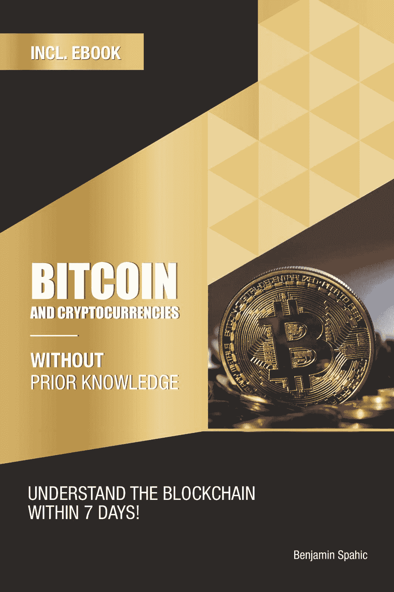


## 1. 前言
比特币——一个引发争议的话题。对于某些人来说，它不仅是一种数字货币，更是对整个金融系统的变革。另一些人则反驳说它没有内在价值，你应该卖掉手中的资产。

尽管双方观点都有道理，无论如何看待区块链，比特币的价格已经上涨了数倍，随着时间的推移一直在持续增长，因此它至少值得关注。区块链技术正在被广泛研究或应用，这一点已不可否认。

## 2. 入门与基础知识
比特币是每个人的话题，无论是在公共电视还是私人圈子里。充斥着大量的半桶水，许多术语被混淆或误用。这并不意外，毕竟这项技术是新颖且相对复杂的。我们并不要求外行掌握高深的编程水平，这需要几年的计算机科学学习。

然而，区块链和比特币的话题并没有初看看起来那么复杂。理解其机制只需要一定的技术理解和对主题的热情。

既然你购买了这本书，说明你对这个话题很感兴趣。你想了解比特币和加密货币的入门知识和结构。也许你正考虑投资比特币，但想先了解技术背景。也许你只是想在下次别人提到比特币或区块链时也能发表一下意见。或者你是一个批评者，正在寻找这项技术的缺陷——因为比特币确实存在缺陷！

### 先决条件与知识水平：


这本书适合任何对密码学有基础兴趣的人。书中也涉及一些数学内容，但处于一个非常易于理解的水平，因此任何读者都能轻松跟上。

本书适合初学者。章节内容的设计使得即使在没有先验的情况下也能理解。由于本书也旨在为具有技术背景的读者提供额外价值，因此详细地讨论了区块链的一些技术细节。这些细节和离题初看之下可能令人望而却畏，但对于通理解来说并非必不可。然而，即使作为技术的浅层用户，这些背景知识也是很有用的，即使之后无法在最细节上复现所有内容。

此外，书中介绍了许多新术语。如果在阅读过程中需要查阅某个术语，书末的索引将提供帮助。

由于我们货币系统的基础知识以及加密技术对于理解本书至关重要，前几章将专门介绍这些内容。

为了结构更清晰，书中某些地方会反复出现以下图标：

 **灯泡**：这里总结了章节的要点。这些陈述有助于参考，或者在你想再次快速浏览某个领域时使用。

 **注意**：这里列出了常见的错误。书中展示了人们在何时以及为何经常遇到障碍或错误的假设。

## 2. 入门与基础知识

我们今天使用的货币系统决定了我们生活的每一个领域，无论是选择职业道路、为房屋融资还是休暑假。

当然，单凭金钱并不能让人快乐，但许多研究表明，金钱问题会导致压力水平增加。这就是为什么尽早接触货币系统非常重要。钱从哪里来？钱的功能是什么？银行是如何赚钱的？

遗憾的是，金融教育存在着巨大的鸿沟。经济背景通常不是学校课程的一部分，因此教学不足。然而，市场中运作着一些基础机制，这些机制对每个人的日常生活都有显著影响。

因此，了解这种钱是什么、它在历史上是如何发展的，以及与之相关的问题是非常重要的。

为了对当前系统及其优缺点有一个整体了解，让我们先看看货币的历史。

### 2.1 货币的历史

货币的历史可以追溯到人类的起源。

直到公元前约 2000 年，货物和商品的直接交换是常有的。在市场或商店里，所有的收获被汇在一起并交换。农民用部分剩余粮食换取几条羊毛毯，鞋匠用一双鞋换新鲜牛奶和鱼，以此类推。很快，人们就发现，直接交易货物并没有意义，不如交易一种统一了不同商品价值的替代品更有意义。同时，这种替代品必须更小、更易于管理，并且保持更长时间的稳定，即它不能发霉或磨损。

其目标是能够长期存储产品中所包含的人力。

很快，贝壳、钻石以及金、银等贵金属被确定为潜在的价值载体。最终，金、银和铜合金等贵金属脱颖而出。

在 16 世纪之前，黄金是主要的、稳定的货币。但为什么在有这么多可能的商品中，最终选选了贵金属呢？为了理解这一点，让我们先看看货币或流通货币的任务。它必须具备哪些属性？它解决了什么问题？

### 2.2 什么是钱？

我们已经看到，以货币的形式引入一种独立于时间的价值载体是有意义的。

 为了维持货币的价值，它必须是稀缺的。稀缺意味着商品的供应数量有限。如果货币可以增加，价值就会降低。

这种情况在（恶性）通货膨胀中常见。货币的数量迅速增加，结果导致货币的购买力下降。

 严格来说，经济增长等其他因素也起着决定性作用。然而，在本书要求的精度范围内，我们可以忽略这些方面。

钱的第二个基本属性是它必须难以于生产。这主要是为了防止伪造。黄金也是如此。从地壳中提取黄金并铸造硬币的成本非常高。

这直接把我们引向功能性货币的下一个关键点：可替代性。可替代性意味着货币类别内的多个物体具有相同的价值。一张 `€10` 钞票的价值等于另一张 `€10` 钞票。贝壳或钻石并非如此，这就是为什么它们没有被接受为支付手段。例如，钻石有不同程度的价值。两颗看起来相同的钻石价值可能不同。只有专家才能判断其真实价值。

另一方面，黄金可以被熔化并压成相同大小和重量的硬币——这确保了可替换性。此外，你还可以自己决定硬币有多大。

 货币必须是可携带的、可分割的且防伪的，以确保贸易顺畅。

最后一个标准也是稳定货币最重要的标准，并在书中将经常讨论：我们谈论的是信任。

信任是货币系统的核心基石，黄金在数千年的里作为一种安全的支付手段赢得了这种信任。因此，黄金通常被称为“安全”投资或“避险港”。黄金本身没有内在价值。你不能吃它，也不能用它做衣服。一件珠宝品在视觉上很有吸引力，但现如今它在很大程度上与当前的金价无关。

仅仅是相信我们可以通过第三方用一块黄金获得货物，这种信任就使得黄金作为支付手段成为可能。

然而，黄金和金币也有缺点。首先，它们相对难以生产。这虽然有利于防伪保护；然而，从今天的角度来看，这被证明是非常不实际的。此外，分割性是有限的。今天，一盎司金（`1 oz tr. = 31.1 g`）约为 `1500-2000 美元`。如果我们想在收银台找一欧零钱，我们将得到 `0.0002 克` 的黄金。因此，这样做是不可行的。

 因此，产生了一个念头：保留黄金作为交换基础，但不再直接与黄金交换，而是创造一种更容易交易的票据。

在这种背景下，重要的是，这些票据 或纸币的背后都有一块可以随时兑换票据的实体黄金。中央银行发行票据并存储存入的黄金。

这种由商品（如金或银）支撑货币的概念被称为金本位。

这种制度有很多优点。纸张轻便，可以大量生产也可以小批量生产。不同的钞票代表不同的面值。


但为什么会突然产生这种想法，认为这个系统和我们现有的货币不再适合作为长期的支付手段和价值存储手段呢？为了找到答案，让我们仔细观察一下我们纸币体系的问题。这一切始于对金本位制的放弃。

### 2.3 放弃金本位制

我们已经学习过金本位制。这意味着一种货币，无论是`euro`、日元还是`dollar`，都有金、银甚至石油等大宗商品作为支撑。这种金本位制逐渐瓦解了。例如，由于第一次世界大战期间的黄金储备不足以支付战争费用，纸币毫不留情地与金价脱钩了。

现今所有的货币都是无支持的货币。它们也被称为`法币`（`fiat currencies`）。

### 这种新的无支持货币具有什么特征？

货币的便携性和可分割性与以前一样。然而，负责控制印钞机的人可以随心所欲增加货币。这项任务由中央银行承担。

如果一家中央银行每年打印`10%` 的新钞票而不销毁旧钞票，那么每张现有的钞票仅值约`90%`。当然，钞票本身的价值并没有改变。一张`€10` 钞票永远将是一张`€10` 钞票。然而，购买力，即我们的钱能买到的东西减少了。结果是食品、房地产或物质资产的价格也随之波动。

这并不自动是坏事——只要生活水平也随之调整。理想情况下，工资的增长可以抵消这种影响。

无论如何，我们看到价值存储的属性完全由一个中央实体控制。我们信任这个实体会明智地利用其对货币系统的权力。只要它继续这样做，就没有理由反对这种无支持的法币体系。理论就此此。

### 这种理论观点在现实中是什么样子的？

即使货币垄断被明智利用，一个大问题始终存在：对国家和中央银行等中央机构的信任。


我们必须相信，我们作为货币使用的东西会被其他人接受为货币，并且我们将获得其他商品作为回报。

如果事实如此，我们就被困在了货币中，它是一文不值的。那么，这种信心从何而来？为什么我们的货币（即我们的`euros`、瑞士法郎或`dollars`）在明天或十年后仍会被货币系统中的其他参与者接受？因为放弃金本位制意味着它不再由黄金支撑。

不言而喻的是，我们明天可以用`euro` 钞票在超市买到食物，不是吗？

既是又不是的。这个系统需要一个中央机构来确保我们用作货币的彩色钞票获得价值。这是国家和中央银行的任务，他们监控货币。我们信任银行确实为我们的`€10` 钞票真的“存好”了`€10`。


在稳定时期，这种集中的银行体系运作得非常好。然而，当危机发生、对国家的信任萎减时，对货币的信任往往随之萎减。

政府的稳定性与货币价值之间存在着直接的相关性。

过去有许多负面例子，例如希腊危机，当时人们大量涌向 ATM 机，却不被允许提取自己的钱。

另一个例子是委内瑞拉的经济危机，根据国际货币基金组织的数据，那里对政府和货币的信任几乎完全丧失，导致`2018`年通胀率超过`130,000%`。结果，人们用石油、`dollars`或加密货币等商品来保护自己。

后一个例子向我们展示了所有法币的大问题：它们不再有支撑且可以由中央行政机构大量打印的事实，意味着货币不受通胀的保护。欧洲中央银行（`ECB`）、联邦储备银行（`FET`）或瑞士和日本的中央银行理论上一夜内就能创造数十亿的新货币。事实如此！原则上，通胀并不是自动好或坏的。经济学家争论轻微的通胀是否能保持经济增长的高位，以及对于通缩货币这是否也可行。

花钱或承担债务本身并不可责，但它确保了增长。

在健康的经济周期中，贷款是加强经济最有效的手段之一。当企业家借钱创造新的就业机会并在几年后还还利息时，这对系统中的每个人都有积极影响：包括能够养活家人的工人、可以扩张的公司、可以购买产品的消费者，以及从其资本中获得利息的银行。

遗憾的是，过去投资并不是投在强大的公司，而是投在病态的国家。

事实是，最近打印了数十亿新的`Dollars`，用于购买意大利或希腊等负债国家的政府债券。这些新货币没有任何国家经济表现形式的等值物。这些国家没有将钱用于良好用途，而是将其烧掉，仅仅确保流通中有更多的钱。这反过来又贬值了剩余货币的购买力。

举个例子，让我们看看过去`25`年美国的绝对货币供应量。

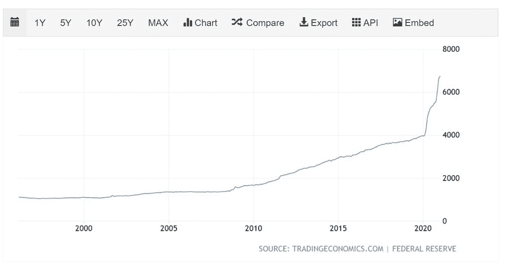

图 1 美国绝对货币供应量的发展

仅在`2020`年，所有货币的三分之一就被打印了。至于这种做法是否健康和可持续，只能在事后确定。许多经济学家反对这种发展，认为这是在转移问题而不是解决问题。

当前货币系统的另一个问题是银行体系本身。这个系统与缓慢和过时的结构相关。尽管我们已经进入数字时代，但转账仍然需要两个工作日，跨境汇款需要更长时间，而且周末完全不进行转账。


加密货币基于数学的。`2+2 = 4`。我们不需要担心明天 `2+2= 5`。

加密货币继续保持去中心化的结构。这意味着数据并不存储在服务器上，而是存储在一个由成千上万计算机组成的分布式网络中。

在详细研究加密货币、比特币和区块链技术之前，让我们先来看密码学的基础知识。整个区块链技术都是基于这些基础和算法的。密码学让我们理解加密货币背后的精妙机制。别担心：整个过程将保持简单，以便易于理解。

## 2.5. 密码学基础

密码学是一门处理加密和密码系统生成的科学。加密货币是一种数字货币，其基础是密码系统，即各种加密算法。

交易使用众为人知、经过时间检验且经过测试的加密算法进行加密、执行和确认。让我们系统地查看每一个步骤，从消息最初如何被加密开始说起。良好的加密被认为是安全的，并且是与黑客或恶意中心机构斗争中剩余的少数手段之一，这一点也被著名的吹哨者埃德华·斯诺登（Edward Snowden）所认可。

“加密是有效的。实施良好的强力密码系统是我们可以依赖的少数事情之一。” —— 埃德华·斯诺登

随着数字化的进步，加密算法已不可或缺，因为数据的完整性对于跨洲通信至关重要。

数据完整性意味着我们可以确信收到的数据是未被更改过的。这意味着没有人可以在传输过程中对其进行更改、拦截或删除。

为了确保这一点，所有通信系统如互联网、移动无线电甚至工业工厂中的传感器都使用了加密算法。但加密实际上是如何工作的呢？有哪些类型的加密方式？

为了回答这些问题，首先需要定义加密的一些术语和目标。我们现在来看一个在密码学中经常使用的模型。

两个人，我们称他们为 Alice（丽丝）和 Bob（鲍勃），想要以加密的形式通信。为了实现这一点，Alice 写了一条明文消息。这意味着消息可以被任何人阅读。

加密的主要目标是保持消息机密，使其在传输过程中不被读取。因此，Alice 不能简单地发送明文消息，必须通过某种程序对其进行加密，使消息变得不可读。而 Bob 则可以解密消息并收回明文。但你如何加密消息呢？一种简单但不安全的方法是所谓的凯撒位移密码或凯撒加密。在这里，明文中的所有字母在字母表中都移动了固定的位数。例如，我们在字母表中每个字母向后移动三个位置。A 变成 D，B 变成 E，以此此类推：

| 字母 | A | B | C | D | E | F | G | H | I | … | V | W | X | Y | Z |
| --- | --- | --- | --- | --- | --- | --- | --- | --- | --- | --- | --- | --- | --- | --- | --- |
| 字母+3 | D | E | F | G | H | I | J | K | l | … | Y | Z | A | B | C |

数字三被称为 `key`（密钥），因为通过这个数字和算法，可以从明文创建出加密消息。

例如，如果 Alice 使用 `key three`（密钥三）对消息“Bitcoin is awesome!”进行加密，结果是消息“Elwfrlq lv dzhvrph! “

（欢迎检查！）

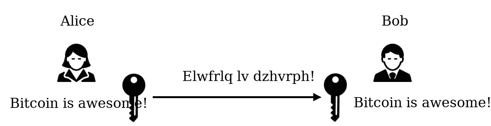

图 2 消息的对称加密

消息以加密形式传输。Bob 接收消息并通过将所有字母向前移动三个位置来解密消息。

为此，Bob 必须知道使用哪种加密方法以及密钥是什么（在我们案例中，是凯撒位移密码和数字三）。这些信息必须提前已知，例如，必须在私下约定好。

显而易见，这个过程非常不安全，因为字母表中最多有 26 个不同的字母，因此只有 26 种不同的密钥可以加密消息。因此，黑客最多只需要尝试 26 次即可破解加密。

凯撒位移密码是对加密方法的一种例子。对称意味着加密和解密使用同一个密钥。为了这一点，双方必须交换密钥，且不让第三方知晓。

另一个对我们仍然具有非常重要的系统是非对称加密。

## 2.6. 非对称加密

在非对称加密方法中，加密和解密不使用同一个密钥，而是使用两个不同的密钥。一个密钥用于加密消息，另一个用于解密消息。

用于加密的密钥可以是公开的。它不需要保密，因此也称为 `public key`（公钥）。而解密密钥必须保密。它被称为 `private key`（私钥）。

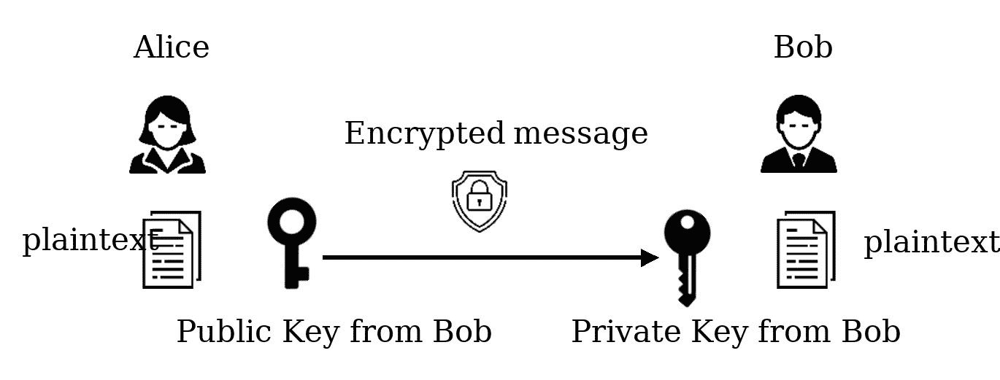

图 3 消息的非对称加密

对于这种加密，我们需要一个在两个方向上都不同样容易求解的函数

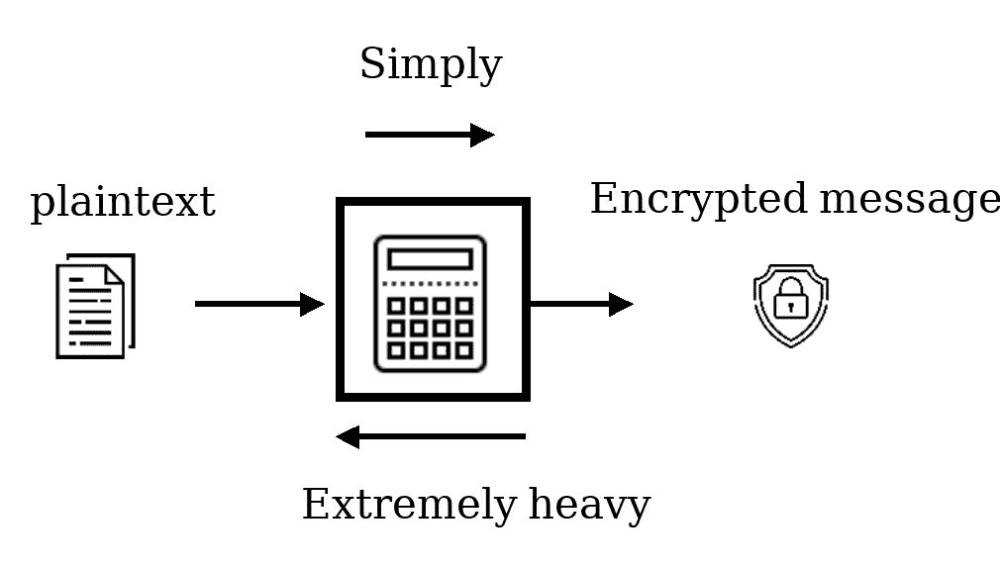

图 4 数学单向函数的特性

公钥和私钥通过数学函数相关联。然而，从公钥推导出私钥是不可能的。

我们无法轻易地从函数的输出中推导出函数的输入，但我们就可以从函数的输出中推导出函数的输入。

作为一个简单的例子，我们取函数。

这个方程相对容易求解。但反过来，就需要求四次方根：。这比纯乘法要复杂。非对称加密使用了更复杂的函数和巨大的数字。

这些数学函数非常复杂，超出了本书的范围。

在数学中，这被称为一个困难问题。在我们的语境下，重要的是理解私钥和公钥并非独立，而是公钥与私钥是相关的。

我们将在书中看一个更具体的例子，但由于书籍长度，我们不会查看完整的背景或甚至是数学证明。

这些已经是通过加密程序实现机密性的基础。现在我们知道如何从明文消息创建加密消息。

总结：

`public key` : 密钥，公开可用。它用于加密消息。

`private key` : 必须保密的密钥。它用于解密消息。

私钥和公钥通过复杂的数学函数相关联。

接下来，我们要问自己，如何确保 Alice 确实是消息发送者，以及加密消息在传输过程中没有被拦截和更改。这些方面被总结在术语下：完整性和真实性。

为了确保消息的完整性，Alice 可以用她的私钥对消息进行“加密”。这个过程被称为签名。

我们可以将数字签名想象成中世纪的信封封。


图 5 中世纪的签名


“加密”消息代表了一个数字签名。另一方面，Bob 可以 Alice 的公钥来解密这条消息。由于只有 Alice 拥有她的私钥，因此消息一定来自 Alice。

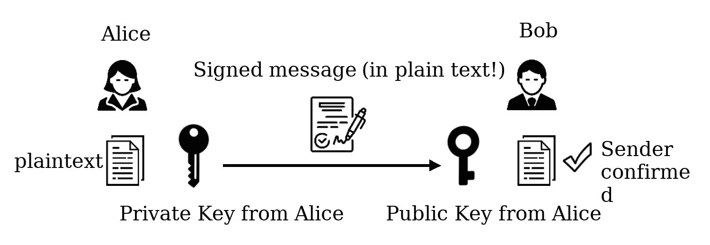
图 6 消息的数字签名

签名本身并不构成加密。毕竟，公钥是所有人开放的。任何人都可以检查消息  是否来自 Alice。如果我们想同时对消息进行加密和签名，我们就将两者结合。

Alice 使用 Bob 的公钥对消息加密，使得只有 Bob 能够解密消息。然后，Alice 使用她的私钥对已经加密的消息进行签名。

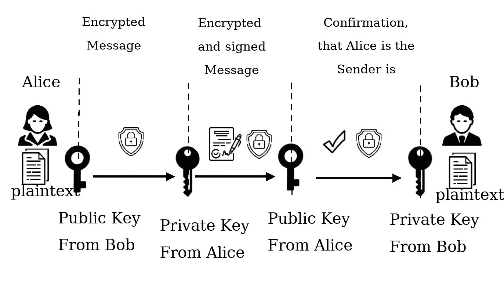
图 7 对消息进行数字签名后进行加密

当 Bob 接收到消息时，他可以使用 Alice 的公钥来确认消息来自 Alice。他通过自己的私钥解密消息来获取内容。

到此，我们已经讨论了非对称加密和数字签名的基础知识。

在下一步，我们将查看用于验证的算法。这些算法充当“看门狗”的角色，并确认（例如在比特币的情况下）交易（即比特币的往回发送）是根据规则执行的。

在中心化系统中，中央单元（例如银行）充当守护者的角色。银行检查我们的账户中是否有足够的资金、资金是否指向有效地址等。在去中心化系统中，没有实体来执行这些功能。这就是为什么我们需要加密算法。

目前使用了多种算法。这些算法也被称为加密的辅助函数。

这种函数或算法被称为 `hash function`（哈希函数）或 `hashing algorithm`（哈希算法）。

我们现在详细查看哈希函数的各种属性。我们已经学习了其中大部分。

哈希函数是单向函数。这意味着计算函数的输出是简单的，但几乎无法通过输出确定输入。哈希函数在加密货币中作为辅助函数。

不同的加密货币基于不同的算法。我们将以比特币的底层算法为例。

比特币有两种算法。一种算法根据私钥生成公钥。另一种算法负责网络安全和存储交易的安全。

比特币使用了一种带有函数方程的椭圆曲线来生成公钥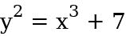。

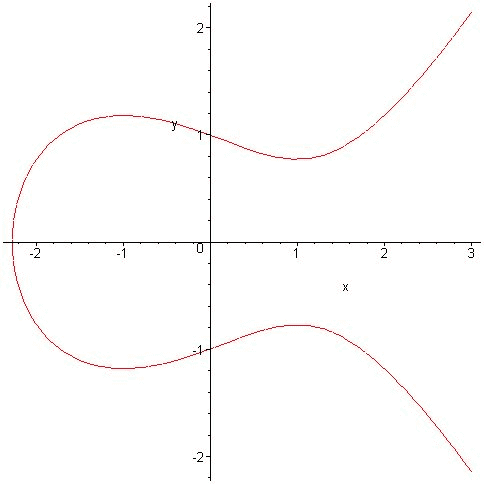
图 8 椭圆曲线图

这个复杂的单向函数使用我们的密码（私钥）创建一个公钥，并由此推导出我们的比特币地址。我们稍后将详细查看实践中是如何实现它的。首先，我们将查看负责区块链安全的算法。

这种算法被称为 `SHA256` 算法。SHA 代表 Secure Hash Algorithm（安全哈希算法）。从用户的角度来看，这个函数相对简单。

`SHA256` 算法保证了比特币的安全。我们稍后将详细查看比特币如何实现该算法。算法的应用始终相同的：我们将文传递给函数。在函数内部，字母会在几个阶段被移动、交换、压缩或添加。

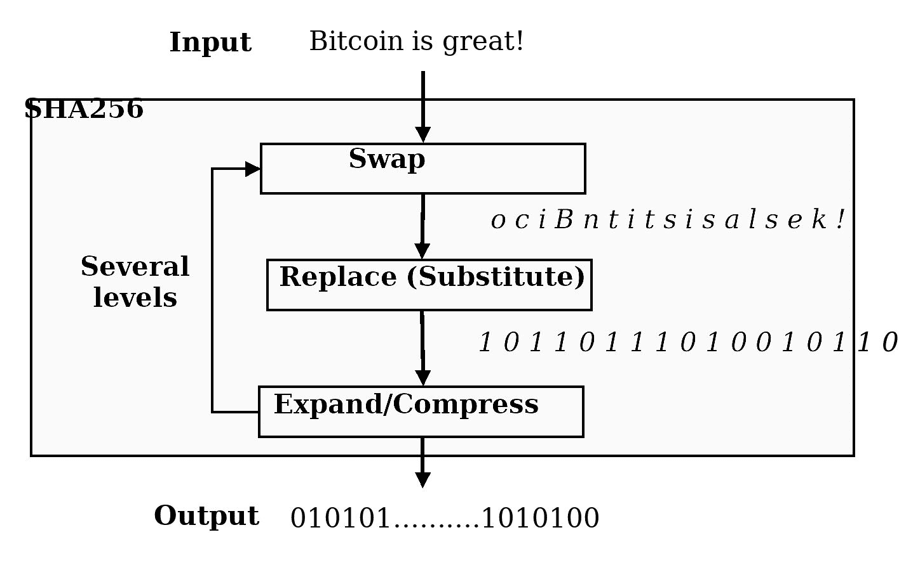
图 9 哈希函数的序列

我们必须如何移动字母、压缩它们等是由 `SHA256` 算法固定的。

经过几个阶段，我们得到一个“加密消息”作为输出。`SHA256` 函数的输出被称为 `hash`（哈希）。哈希是一种校验和、控制或安全数字。然而，它很大程度上取决于上下文。

哈希函数的性能或应用类似于学校课程中我们熟知的函数应用于变量的情况。理论上，我们可以用纸和笔计算一段文本的 `SHA256` 哈希。


图 10 用纸和铅笔计算 `SHA256` 算法

来源：`https://www.youtube.com/watch?v=y3dqhixzGVo&ab_channel=KenShirriff`

哈希算法中的数字 `256` 表示输出的长度，即计算出的加密消息长度。输出字符被称为位（bits），只能是零或一。

`SHA256` 算法的输出始终恰好是 256 位长。输入是一个单个字符还是十万个字符并不重要。

哈希函数的输入是任意大的，输出与其无关且始终恒定，在 `SHA256` 的情况下，它恰好是 256 位。

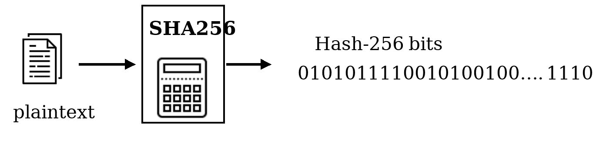
图 11 `SHA256` 哈希函数的简化表示

由于消息只由 1 和 0 组成，它既不可读，也不遵循某种系统。

通常，为了更清晰，会将这些位中的四位组合并显示为数字或字母。字符字符串随后缩短为 80 或 64 个字符，而不是 256 个。

哈希算法是开放的。任何人都可以将其加载到计算机并确认结果。

例如，让我们再次加密我们的消息“Bitcoin is awesome!”。生成的哈希为 `75c79bd1c28071544116aaf8af9cd816ae6348bb1410039210`。

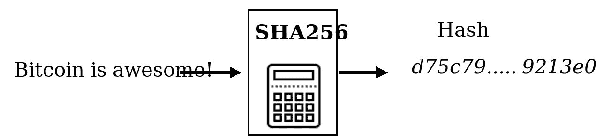
图 12 SHA256 函数的应用


然而，我们也可以将接收到的消息转换为哈希值，并将其与公共哈希进行比较。如果消息被更改过，哈希值将不再匹配。

至此，我们将结束对密码学的介绍。我们已经学习了理解比特币所需的背景的所有方面。最重要的是，哈希算法仍然具有至关重要的意义，因为正如前面提到的，哈希算法是加密货币构建的基础。理解私钥和公钥也是至关重要的。


本章将解释区块链和比特币的技术。在这里获得的知识将形成理解其他章节的基础。

在某些部分，内容会变得非常技术化。虽然这对于通理解以及本书的后续章节并非必须，但充分探索这些细节是有用的。为了更好地理解，通常会使用简单的类比。

在第一章中，我们讨论了货币体系的缺点：中心化、中央银行的权力垄断、审查和通货膨胀。

在 2008 年金融危机后，一个名为中本聪（Satoshi Nakamoto）的个人创建了一种数字、去中心化且有限的货币：`Bitcoin`。目前尚不清楚中本聪究竟是谁。许多人声称自己是 `Bitcoin` 的发明者，但没有人能证明这一点（尽管实际上非常简单，正如我们稍将看到的）。


图 13 中本聪。直到今天，还没有人知道比特币发明者是谁。

人们还广泛怀疑中本聪并不是一个人，而是一个程序员群体。另一方面，阴谋论者坚信 `Bitcoin` 是由美国政府分发的，目的是在引入官方政府数字货币之前测试数字货币，以便让公民的透明度比现在更加透明化。


`Bitcoin` 这个名字由“bit”（计算机计算的单位）和“coin”（英语中为“硬币”）组成。

这种货币的单位也称为 `Bitcoin`，缩写为 `BTC`。在泛指数字货币（即各种加密货币）而非特指 `Bitcoin` 时，通常使用通用英语术语 `coins`。

就像欧元还有欧元分一样，`coins` 和 `Bitcoin` 也有更小的单位。在 `Bitcoin` 中，较小的子单位以发明者的名字命名。一个 `Bitcoin` 由 1 亿个 `Satoshi` 组成。在其他加密货币中，它们有相应的名称。

`Bitcoin` 生态系统的另一个单位是 `milli-Bitcoin`。它代表 `Bitcoin` 的千分之一。以下是 `BTC`、`mBTC` 和 `Satoshi` 之间关系的概述：

| 1 BTC | = | 1000 mBTC | = | 100,000,000 Satoshi |
| :--- | :--- | :--- | :--- | :--- |
| 1 mBTC | = | 0.001 BTC | = | 100,000 Satoshi |
| 1 Satoshi | = | 0.00001 mBTC | = | 0.00000001 BTC |

`Bitcoin` 可以被分为 1 亿个更小的单位。这对于大众普及具有巨大的优势。

大众普及意味着该技术可以被大部分人口使用，即使是那些无法筹集资金购买整个 `Bitcoin` 的人。

2018 年 10 月，比特币白皮书发布。白皮书是一份面向公众的文档，包含了技术目的、益处和目标的概述。

让我们仔细查看原始比特币白皮书的片段。白皮书可以在 `bitcoin.org` 查看，均有原始英文版。

```
Bitcoin: An electronic peer-to-peer payment system
Satoshi Nakamoto
```
```
```
比特币：一种电子点对点支付系统
中本聪
```
```
```
 这种纯电子点对点支付系统允许在不通过第三方机构的情况下，实现一个人到另一个人的直接支付。

比特币白皮书的片段可以在 `bitcoin.org` 查看，均有原始英文版。

项目的愿景是在不通过银行或金融机构的情况下，实现点对点的数字支付。比特币白皮书的片段可以在 `bitcoin.org` 查看，均有原始英文版。

在不通过银行或金融机构的情况下，实现点对点的数字支付。数字签名，正如我们在上一章中学习到的，它们是系统的一部分。

每隔固定的时间（例如每十分分钟），一个包含新信息的包（所谓的“区块”）就会附加到之前的交易历史中。这样做的好处是不需要更新每一笔交易，而是更新一篮交易。

随着时间的推移，信息包逐渐形成了一条链：`区块链`。

为了确保网络中的每个节点（全节点）都拥有当前的 `blockchain`，`区块链` 会定期更新并传输给每个参与者。

任何想要的人都可以将 `Bitcoin` 或任何其他加密货币的交易历史下载到自己的计算机上。通过这种方式，你自己变成了一个节点。这些节点被称为全节点。

`区块链` 是去中心化系统中一份完整的交易历史。每个参与者都同意这一交易历史，使得所有交易都是唯一定义的。

这样做的好处是：如果一个参与者想要作弊并更改其计算机上的 `blockchain`，所有其他参与者都会立即注意到，因为交易历史不符了。参与者不会接受这种更改。

数字签名，正如我们在上一章中学习到的，它们是系统的一部分。

由于 `区块链` 技术中没有中心监管者，而是有成千上万分布在全球各地的监管者，修改规则是不可能的。

```
```
satoshin@gmx.com
```
```
```
```

源代码是公开的（开源的）。可以在 `https://github.com/bitcoin/` 查看。

`Bitcoin` 的另一个方面是去中心化。我们经常使用中心化和去中心化这些术语，但它们具体意味着什么？

去中心化意味着没有像银行或国家这样的中央机构来监控系统（例如货币供应量），并且理论上无法拒绝资产的访问。

`Bitcoin` 交易历史的总存储需求目前（截至 2021 年初）约为 300 GB。

通过在计算机上存储整个 `blockchain`，个人可以扩展去中心化网络，并在被接管前加强网络。

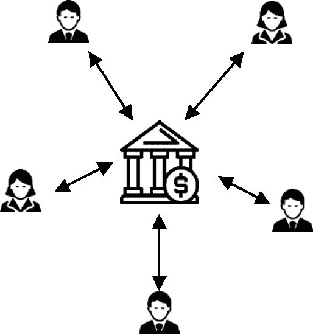 
图 14 中心化结构（左）和去中心化结构（右）


加密货币是基于这项技术构建的。数字货币的发送可以在区块链的基础上进行。然而，这项并不限于货币。任何类型的数据都可以使用区块链和去中心化系统进行存储或传输。例如，数字身份卡、通信服务或去中心化游戏在区块链上都是可能实现的。

加密货币只是区块链上的许多“应用”之一。让我们在下一步看看我们如何使用这个应用。


为了让我们能够以硬币的形式互相转账，我们首先必须在区块链上开通“账户”。

区块链上的账户在本质上与普通的银行账户或电子邮件账户不同。毕竟，我们没有中央机构。人们不需要注册姓名，也没有人需要检查并发布我们的数据。此外，正如前面提到的，没有一个中央联系点可以开通账户。在区块链中，我们不谈论账户，而是谈论`addresses`（地址）。我们可以将地址与我们银行账户的 `IBAN` 或邮箱账户的邮箱进行比较。由于这些地址是公开的，因此它们被称为公共地址。

为了让我们能够在银行账户上接收资金，并确保资金唯一地分配给我们，每个账号只能精确存在一次。不可能给两个人分配相同的账号。

在加密货币的情况下，账号对应于我们的地址。通常情况下，银行负责账号的分配并为我们分配一个免费 `IBAN`。在去中心化系统中，有另一种解决方案，同样基于密码学。

我们将以比特币为例，更详细地介绍地址的创建：

要创建一个比特币地址，我们首先必须创建一个 `private key`（私钥）。记住：这是我们必须自己保留的密钥。它就像我们银行账户或电子邮件账户的密码。

 这一点非常重要：我们首先创建密码，稍后我们将自动收到地址。

 在比特币地址中，存储的并不是 `Bitcoins`（像人们经常误认为那样），而是属于 `Bitcoins` 的 `private key`。

我们可以自由地选择自己的密码，即我们的 `private key`。它必须是 256 位长并由 1 和 0 组成。一个例子是：

```
11000110010100010011011101010101000011000000001100000101110101010101010111101010110010100001001010111010010000110100100110111001110011111110011101000001010101101101010001100011011010010001011111110010011001110001011010111001011110000000
```

由于 256 位数字再次变得太混乱，因此使用了我们在哈希算法中熟悉的 `hexadecimal`（十六进制）表示：

```
63289baa860182eaa56095d21a4dcfe74156d463691f2a74b64ece320
```

我们将仔细查看如何创建私钥。现在，最重要的是理解它。

 这是我们自己选择的私钥。这不与 `SHA256` 哈希算法的输出混淆，后者也有 256 位，并以 `hexadecimal` 十六进制数字表示。我们也可以将其表示为普通的十进制数。它有 78 位数字：

```
4485072026032166260984368631905639759109438372737591191592712946807370298243
```

你们中的一些人可能已经在想，为什么没有用户名或者不能由我们选择私钥（也就是我们的密码）？但是自己选择私钥不安全吗？毕竟，正如前面提到的，没有用户名。如果另一个人恰好选了相同的私钥，他们就自动拥有了我的比特币地址的权限，对吧？是的，确实如此，但系统仍然是安全的。毕竟，如果数字有 256 位，有人选到和我完全相同的数字的概率有多大？

任何关注数学的人都知道恰好有 `2²⁵⁶` 种可能性。这也是可能存在的不同 `Bitcoin addresses` 最大数量。这是一个极其巨大的数字——一个有 80 个零的数字：

```
1000000000000000000000000000000000000000000000000000000000000000000000000000000000000000000000000000
```

但现在它安全到我们可以用这个系统存储储蓄了吗？作为一个思想实验，让我们看看选择私钥有多安全。如果一个拥有高端电脑的黑客试图在没有任何预知的情况下找到你的私钥，他大约需要 `10⁵⁸` 年。那是 58 个零！

另一个比较让这一点更加清晰：在你余生的生命中，每周被雷劈一次的概率比碰巧猜中正确的私钥的概率要大。最后一个例子：让我们想象两个人从世界上所有的沙子中选出一粒沙。他们恰好选到同一粒沙的概率比他们选到同一个私钥的概率高出几万倍。因此，这在实践中是不可能的。只要你不是每周被雷劈，就不必担心有人会生成和你相同的私钥。


 然而，黑客的例子也揭示了一个弱点：我们假设黑客对密码没有预知。如果我们把出生日期作为私钥，这显然不再安全了，但我们如何创建私钥呢？答案是：随机。如果随机选择，我们就获得了最大的可能性。为了实现这一点，我们可以使用任何随机事件。例如，我们可以抛硬币 256 次。正面记 0，反面记 1，完全随机私钥就准备好了。使用带有随机函数的计算机生成私钥要容易得多且节省时间。


`public key`（公钥）和 `public address`（公地址）经常被当作同义词，但从技术角度来看它们并不是一个意思。严格来说，未压缩的 `public key` 首先由 `private key`（私钥）生成，并由此生成 `public address`。要理解这一点，只需要知道存在 `private key`、`public key` 或 `public address` 即可。

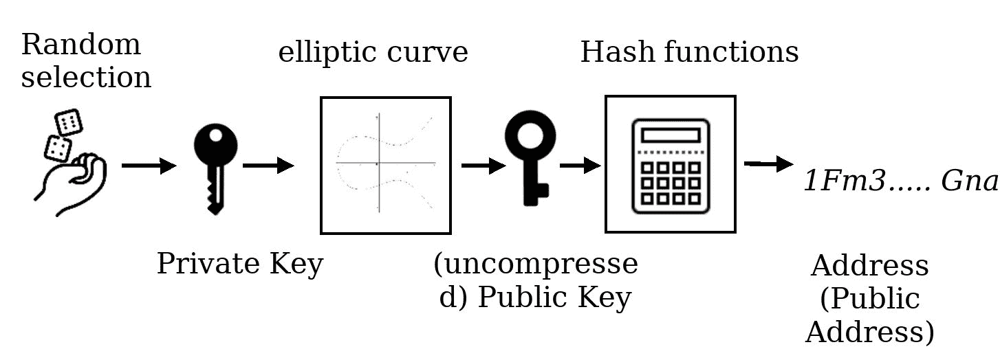

私公钥的工作原理在比特币和许多其他加密货币中非常相似。不同之处在于地址和密钥的长度。此外，比特币可能存在像图中所示的特征性前缀。

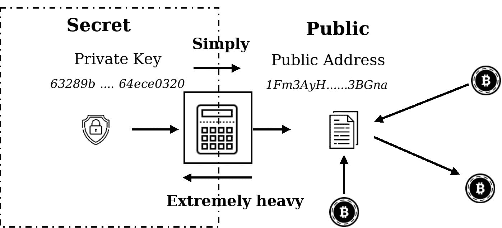
图 18 私钥与公地址的关系

我们从这一章中学到的最重要的的一点是：在任何情况下，我们都不会将自己的 `private key` 交给任何人。

在以比特币为例查看区块链的具体形成之前，我们将讨论一个大家也半知半解的话题：我们讨论的是挖矿。

### 3.3 共识构建与挖矿

Mining 是开矿、提取或生产的英文单词，通常与黄金、金矿等商品联系在一起。类似的，`bitcoin mining`（即 `bitcoin` 的生产或开矿）术语已经建立。

从密码学的角度来说，挖矿描述的是解决数学问题的过程，例如计算 `SHA256`算法。

当矿工完成工作后，信息就准备好成为共识的一部分。共识描述了参与者对于什么是“真”、什么是“假”的达成同。由于没有中心机构，社区决定了交易是否以及何时可以发生，以及他们是否会将该交易纳入他们的区块链。

为了更好地理解这个过程，让我们看看去中心化系统中的不同参与者。除了矿工外，还有其他参与者，例如前面提到的 `full nodes`（全节点）。用户也可以同时扮演多个角色。

为了便于理解，我们将盖房子类比为各个参与者的验证过程。通过这个例子，我们为参与者分配了任务。

**Miner（矿工）**：矿工是执行工作（换句话说就是挖矿）的用户。新信息（即数字签名的交易）会被发送给他们。

类似地，矿工是凭借自己的劳动建造房子的工人。房子应该是什么样的蓝图就是区块链的规则。

矿工计算网络中潜在的共识，并将其转发给节点进行验证。

矿工自然希望为他们的工作获得相应的报。

矿工在一个区块中分配若干交易并创建共识，例如通过提供他们的算力。用户必须为此支付费用。这些交易费用将分配给矿工。

矿工是那些通过工作确保共识安全的人。

**Full nodes（全节点）**：全节点是指将整个区块链下载到计算机上并定期更新它们的用户。他们与其他节点同步并构成去中心化系统的支柱。他们还验证发送给他们的信息。（注：原文中该段落存在大量重复，已按要求保留核心含义翻译）。


在 2008 年之前，存在一个曾被认为无法解决的问题：双重花费问题。

让我们想象自己是一个诈骗者，通过即时转账将我们银行账户中的资金几乎同时地发送到另外两个账户。

对于普通账户来说，不可能同时向两个个人发送资金，从而使总支出金额超过我们实际拥有的金额。银行控制余额并拦截其中一笔交易，使我们永远无法透支账户。如果 Alice 想要同时向 Bob 和 Charles 发送资金，那么后一笔交易会被银行拦截。

然而，在去中心化系统中，可能会先将钱发送给一个人，几毫秒后又发送给另一个人。我们已经看到矿工和全节点必须先进行同步。当全球所有的节点完成同步时，这些钱已经被花费了多次。

 当资金几乎同时从一个账户发送到两个或多个账户时，这一过程被称为双重花费。

在 2008 年之前，人们深信：没有中心化单元，就无法防止双重花费问题。

但是这个问题在比特币和其他去中心化网络中是如何解决的呢？我们已经知道了答案：挖矿。为了更好地理解，让我们看看挖矿是如何将包含交易的单个区块组合成区块链的。我们首先来看哪些交易是优先处理的，而哪些交易必须等待。

### 3.6 交易顺序

去中心化网络（如比特币网络）现在拥有数百万用户，他们不断地向区块链发送成千上万笔交易。由于矿工处理和验证交易的能力有限，因此他们可以获得一笔自愿奖励。这是一种鼓励矿工更快处理交易的小费。例如，在比特币中，一个十分钟的区块只能容纳 4,200 笔交易。如果你想让交易立即传输到当前区块，你必须是这 4,200 名“最高出价者”之一。

我们将在后面的章节中学习更多关于费用设置的知识。

从理论上说，我们完全不需要支付费用，但交易可能永远不会被处理，因为总有人愿意支付几分钱来让自己的交易获得青睐。

交易的金额和速度取决于网络负载。如果许多人想快速发送交易，他们就会互相竞价。

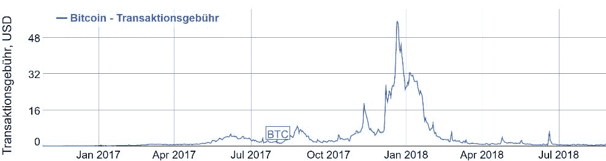

图 21 比特币每笔交易的历史交易费用

从上面的比特币图表中也可以通过示例看到这一点。在 2017 年底和 2018 年初，比特币达到了 20,000 美元的历史新高。与此同时，平均交易费用从不到 1 美元飙升到 50 美元以上，因为对比特币的需求导致了网络的极端利用——这无疑让矿工们很高兴。

因此，交易是根据竞价系统选择的，并从这些中组合成最多 4200 笔交易的区块。下一步是验证并合并区块。


区块链由区块组成。区块的第一个条始终是对上一个区块的引用。这建立了与上一个区块的链接，区块相互连接形成一条链。

此外，当前区块包含了在相应期间发生的交易。区块的所有数据都被输入 `SHA256` 算法。结果，我们得到了当前区块的哈希值（hash）。

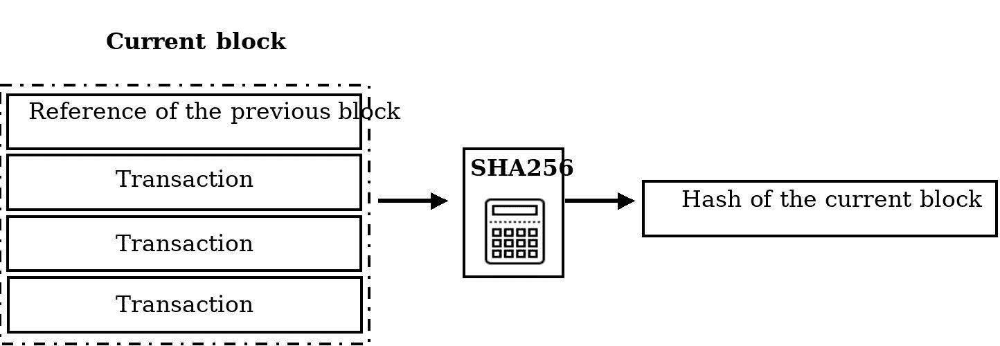

图 22 从区块数据生成哈希

我们已经了解到这个哈希值的长度为 256 位，并且是不可预测的。如果我们只更改整个区块中的一个字符，哈希值就会发生完全且不可预测的变化。恰恰这一事实既简单又巧妙。只需改变其中一笔交易，就会改变整个区块的哈希值，从而影响所有其他区块。

这就像电影电影，时间旅行者在过去只改变了一个小细节，但因为这个微小的变化，未来变得完全不同。

因此，当前区块的哈希也是该区块的唯一引用。当前区块的哈希用作下一个区块的第一个条目。这创建了一个区块序列。

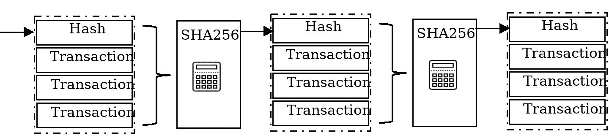

图 23 将区块连接在一起

矿工计算当前区块的哈希。

然而，我们仍然不知道矿工是如何确保安全的。

现在，区块链技术的秘诀在于有一条规则：区块的哈希值必须以特定数量的零开头。否则，该区块不被接受。

由于只有在更改区块数据时哈希值才能被更改，因此区块中添加了另一个元素，称为 `nonce`（随机数）。这部分是变量，不依赖于交易。通过更改 `nonce`，区块的哈希值就会改变。`nonce` 的唯一功能就是允许通过更改 `nonce` 来调整哈希值。

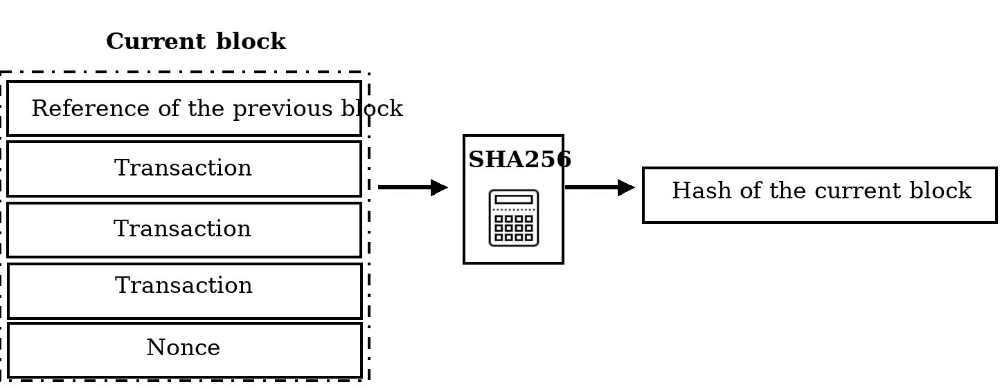

图 24 从区块数据生成哈希，包含额外变量 "Nonce"。

接下来，矿工的计算力派上了用场。矿工不需要计算哈希，但他们应该找到一个数字，使得整个区块的哈希以特定数量的零开头。解决这个问题只有一种方法：矿工必须尝试 `nonce` 的不同可能性。

我们可以将区块链的区块想象成一个缺少一块碎片的大拼图。所有交易都代表拼图的碎片，矿工必须通过不断尝试找到缺失的、完整的拼图碎片。

如果他们找到了 `nonce`，区块就会被接受。

为了说明这个复杂的过程，让我们看一个简单的示例并创建一个我们自己的精简区块。它只包含上一个区块的哈希、一笔交易和一个 `nonce`。在我们的案例中，我们从零开始。此外，我们的要求是生成的哈希必须以零开头。

使用在线 `SHA256` 生成器，我们得到了属于我们数据的哈希。

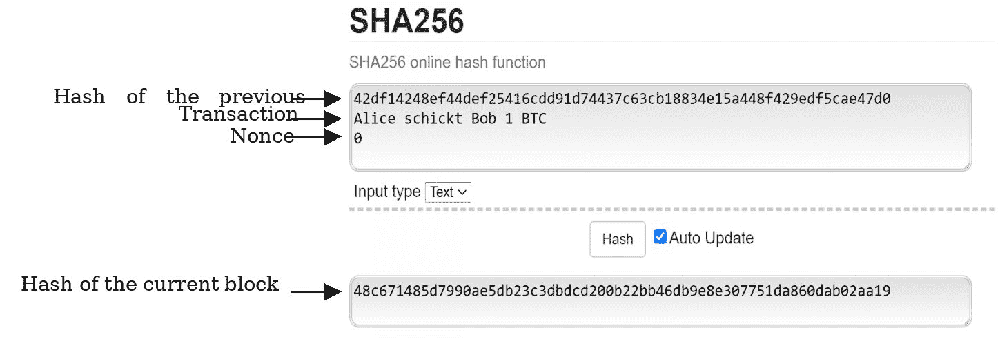

图 25 使用在线哈希生成器生成哈希的示例 来源：https://emn178.github.io/online-tools/sha256.html

我们看到通过输入的数据创建了哈希 `48c6.....a19`。由于它不以零开头，该区块将不被允许。我们将 `nonce` 加 1，直到得到一个以零开头的哈希。在这个例子中，在值为 16 时第一次出现。

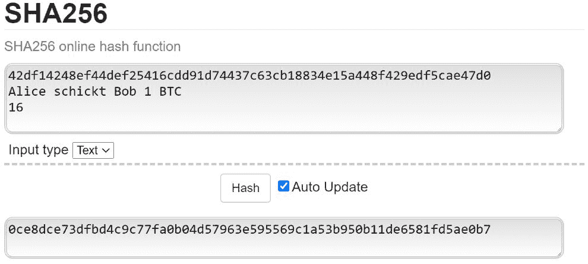

图 26 经过 16 次尝试，生成的哈希以零开头

我们必须计算 16 次 `SHA256` 算法才能得到有效的哈希。在现实中，要求的零更多，因此算法必须运行更多次。


我们正在寻找的这个能够让数据哈希值以零开头的数字系统，并没有更深层的意义。这也不是重点。唯一需要确保的是这是一个非常难以破解的谜题。


为了理解挖矿的含义，让我们想象一个恶意攻击者想要更改交易历史。在此过程中，他不仅更改了一笔交易，还更改了包含该交易的区块哈希值。不仅如此：由于这个哈希值反过来变成了下一个区块的第一个条目，他还必须更改这个区块、下一个区块以及后续区块。


因此，恶意攻击者必须自己重新计算/猜测所有的 `nonce` 数字。然而，他正在与所有诚实矿工竞争，这些矿工拥有更强大的计算能力，并且已经找到了下一个或两个区块。

类比，我们可以将区块链想象成一座受许多城墙保护的大城堡。城墙就像围绕城堡的洋葱皮。攻击者（邪恶矿工）必须一堵一堵地克服城墙。而诚实矿工则正在防御城堡，并且已经在内部不断建造新的城墙。攻击者拆除城墙的速度必须比诚实矿工加固城墙的速度快。

类比例子：如果攻击者解决了区块链中的一个旧区块，矿工们已经发现了几个新区块。

这是一场算力的竞争，黑客面对诚实矿工将永远失败。据假设社区（诚实矿工）始终拥有绝对多数的哈希算力，从而可以击败个人、公司甚至整个国家的攻击。这也是双重花费问题的解决方案。

因此，适用以下网络规则：最长的区块链，或者验证区块最多的区块链，始终是“真实”区块链。创建这个区块链花费了大部分工作。

因此，一个人可能会花费两次钱。交易被分配到不同的区块，并发送给不同的矿工。最先找到匹配 `nonce` 的区块会被添加，并作为整个网络的共识。

也可能在短时间内创建并行链，矿工在不同的末端工作。

然而，总会有一条链占主地位，所有的矿工都会立即跟随最长链。由于这个原因，当矿工将交易整合到区块时，交易并不会自动完成。只有当下一个区块和其后的区块也被确认后，我们才能确定自己处于主链上。对于比特币，这通常是三到六个区块，对于其他加密货币则相应地更多或更少。


但这对矿工来说真的值得吗？毕竟，矿工必须购买设备、消耗电力并维护设备。让我们从矿工的角度来看挖矿。

在猜测 `nonce` 数字（也称为破解区块）时，所有矿工都在同时工作，并且彼此相互竞争。第一个找到正确数字并因此完全解决当前区块的矿工将获得所有的 `transaction fees`（交易手续费）。

其他矿工空手而归。之后，所有矿工立即冲向下一个区块并开始寻找正确的 `nonce`。

但并不是如此：除了交易手续费外，解决区块的矿工还会获得一份锚定在程序代码中的奖励，该奖励取决于加密货币的种类。这种奖励被称为 `block subsidy`（区块补贴）。

`Miner reward = subsidy + transaction fees`

`Block Rewards = Block Subsidy+ Transaction Fees`

对于比特币，`Block Subsidy` 的初始值被设定为每发现一个区块 50 个比特币。大约每十分钟，除了交易手续费外，还有 50 个新比特币分给矿工。
### 通胀与减半

我们刚刚看到了比特币是如何产生的。比特币并非一直存在，它们通过挖矿发行并分发给矿工。但这不意味着比特币也涉及某种通胀吗？毕竟，新的比特币是从空产生的。这正是应该防止的，不是吗？

确实，如果每个区块总是发行 50 个比特币，情况就会如此，这就是为什么比特币协议限制了发行币的数量。每个区块发行 50 个比特币的数量随时间的推移越来越少。更准确地说，价值每 210,000 个区块减半。这意味着：区块链的前 210,000 个区块发行 50 个比特币，接下来的 210,000 个区块每个区块只有 25 个比特币，依此类推。

由于一个区块等于 10 分钟，210,000 个区块大约等于 4 年。

| 期间 | 区块补贴 - 新发行的币量 | 该期间内发行的币总数 | 到目前为止发行的币总数 |
| --- | --- | --- | --- |
| 2008-2012 | 50 | 10,500,000 BTC | 10,500,000 BTC |
| 2012-2016 | 25 | 5,250,000 BTC | 15,750,000 BTC |
| 2016-2020 | 12,5 | 2,625,000 BTC | 18.375.000 |
| 2020-2024 | 6,25 | 1,312,500 BTC | 19.687.500 |
| 2024-2028 | 3,125 | 656,250 BTC | 20.343.750 |
| … | … | … | … |

发行减半被称为 `halving`。在本文期间（2021 年），最后一次减半发生在 2020 年 5 月 11 日。区块补贴从每个区块 12.5 减到了 6.25。下一次减半预计在 2024 年发生。

所以目前每十分钟有 6.25 个比特币发放给解决当前区块的人。

Image00042.jpg

我们看到比特币并不是无限发行的，而是所有创建的币总量正在接近 2100 万。永远不会超过 2100 万个比特币。这个限制锚定在程序代码中，无法更改。这就是比特币防止通胀的方式。

只有新生成币的数量在变化。交易手续费保持不变，否则矿工将失去提供算力的动力。


随着补贴归零，结果是：


在本章结束时，应该澄清一个读者可能提出的问题。我们看到每个区块始终包含上一个区块的哈希值。

那么第一个区块的第一个条目是什么呢？毕竟没有上一个区块可以生成哈希值。

第一个区块被称为 `Genesis block`（创世纪区块）。它有两个任务：

它启动了区块链。第一个条目的内容完全无关紧要。

然而，第一个条目履行的另一个功能极其重要：它必须证明区块链是新创建的。

让我们想象中本丰（Satoshi Nakamoto）发明比特币区块链并不是 2008 年，而是在 2000 年。然而，他没有发布，而是秘密地一个区块一个区块计算并创建了区块链。在此过程中，他自己收集所有的区块补贴，最初是每个区块 50 个比特币。此外，他的电脑在此期间一直离线，因此没有人知道他在做什么。

这个计算出的区块链显然比自 2008 年以来计算的所有区块都要长得多。毕竟，中本丰有八年的领先优势。如果他在 2020 年突然上线他的区块链，所有的矿工、节点和用户都会接受他的区块链为最长链，即“真实”区块链。之前所有的挖矿、交易和创建的比特币都将失效。


为了防止这种情况，必须证明他以前没有挖过长度更长的区块链。但你如何证明某件事只存在了很短的时间呢？

解决方案既简单又巧妙。中本聪（Satoshi Nakamoto）取了一份报纸的标题，并在第一个区块中写下了该标题的哈希值。这证明了区块链不太可能在标题出现之前就已经创建。否则，中本聪如何知道那个标题的呢？

中本聪可以选取任何标题，但他刻意选择了一个与金融危机相关的象征性标题，从而突显了货币政策的问题。该标题来自 2009 年 1 月 3 日的《英国泰时报》。


图 28 2009 年 1 月 3 日《泰时报》头版

标题为《财政大臣处于对银行进行第二轮救助的边缘》的文章是关于当时的英国财政大臣阿利斯泰尔·达林（Alistair Darling）。他曾白白尝试刺激英国经济。通过选择这个标题，信息是显而易见的：旧系统已经失灵了，是时候采用新事物了。这是比特币的时代。
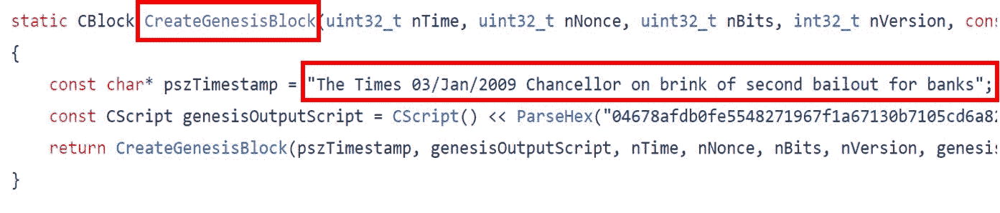
图 29 比特币程序代码片段

因此，该标题可以在比特币的源码（程序代码）中找到。它用于创建第一个哈希，形成了创世纪区块（Genesis block）的最早条目。在比特币爱好者中，这个标题广为人知。


到目前为止我们看到的：当找到匹配的随机数（nonce）时，区块就被解决了，即当矿工找到了一个数字，该数字与交易数据恰恰找到了一个以特定数量零开头的哈希。

然而，人们经常说每十分钟就会产生新区块。如果有多个矿工连接到网络，从而许多人都在挖掘并提供他们的算力，就能更快地找到合适的随机数。

类比，我们可以想象解决一个谜题：

如果有十个人尝试解决一个谜题，即使通过猜测，他们得到结果的速度也会比一个人快十倍。

这只是事实的一半，因为如果谜题的复杂度增加了十倍，所需的时间仍然大约相同。

当然，某人可能运气很好，偶然猜中了正确的数字。但随着时间的推移，这种现象会变得平均。

如果我们根据玩家的数量来调整谜题的难度，解决谜题所需的时间保持不变。

这一原则也被应用于比特币区块链中。

当矿工找到匹配的随机数时，区块就会追加到区块链上。这种现象发生的频率取决于寻找匹配随机数的难度。为了调整难度，我们需要调整对随机数的限制或生成哈希的条件。

如果我们规定生成的哈希不仅要以一个零开头，还必须以两个零开头，那么解决过程将变得困难得多。

通过增加生成哈希的初始零的数量，寻找正确的随机数变得更加复杂。平均而言，解决区块所需的时间更长。

这有另一个副作用：由于谜题自动变得更加困难，生成的哈希也包含了更多为了解决它而必须的算力或能量。这反过来意味着攻击者也需要更多的算力。通过增加谜题难度，网络变得更加安全！

 连接到网络的人越多，网络中的算力就越高，寻找匹配随机数就越困难。因此，随着每一个参与者的加入，整个网络变得变得越来越安全。

寻找匹配数字的复杂度被称为挖掘难度。挖掘难度每 2,016 个区块调整一次。这对应大约两周的时间。如果矿工需要超过两周来解决最后的 2,016 个区块，说明挖掘难度太高，因此会降低。相反，如果网络中的可用算力过多，且解决区块的时间于两周，则难度会增加。


每当矿工找到匹配的随机数时，区块就会追加到区块链上。每个区块都会奖励给找到正确随机数的矿工 6.5 个比特币。这种激励吸引了那些想要通过挖掘赚钱的人。如果网络中的可用算力过多，且解决区块的时间少于两周，则难度会增加。这使得攻击者也需要更多的算力。这种去中心化在比特币上是成立的，除非攻击者拥有超过 51% 的算力。


来源 https://bitcoinmagazine.com/business/introducing-a-new-way-to-measure-bitcoin-network-consumption

与此同时，比特币挖掘的规模已经达到了这种程度，专门的设备（ASIC miners）出现了。

公司创建了复杂的电路，即所谓的 `ASIC 矿机`，它们比任何高级计算机更有效地计算 `SHA256` 算法。例如，最新型号 `Antminer S19 Pro` 每秒可以进行 110 万亿次计算

最初的去中心化想法——即每个人用自己的电脑就可以作为矿工——已经不再可行。

位于中国的大型矿场有时占总算力的 25% 以上。

然而，自比特币诞生以来，也可以观察到总算力不断增加，算力的分布也是如此。尽管如此，如果一个人积累了过多的算力，将是致命。

如果一个人或一组人能够聚集绝对多数的算力，51% 攻击的风险就是可能的。


`51% 攻击`或`51% 攻击`意味着一组矿工可以完全控制网络。

如果一个群体拥有网络 51% 或以上的总算力，他们就可以自由决定新兴区块链的规则。他们可以确认或拒绝交易，甚至进行双重花费。

这是因为 51% 在绝对意义上是最大的算力。这使得矿工能够最快地找到所需的 `nonce`。


为了这一点，我们再次采用最大的加密货币：`Bitcoin`。`Bitcoin` 使用 `SHA-256` 算法。另一种名为 `Bitcoin Cash` 的加密货币使用相同的算法，但其规模只有 `Bitcoin` 的约 1%。

因此，`Bitcoin` 算力的 1% 等于 `Bitcoin Cash` 100% 的总算力。如果一个仅拥有整个 `Bitcoin` 网络 1% 算力的群体决定攻击 `Bitcoin Cash` 区块链，他们已经拥有了 50% 的算力，因此几乎可以发动 51% 攻击。

这种情况在过去经常发生，并且在规模较小的币种上反复反复发生。虽然无法追溯地更改区块链，但社区可以选择不再承认已经创建的区块链。如果发生这样的 51% 攻击，社区有一种简单的方法来摆脱攻击者。我们所说的就是分叉（fork）。


分叉（Forking）描述了将区块链分裂为两个（或多个）区块链的过程。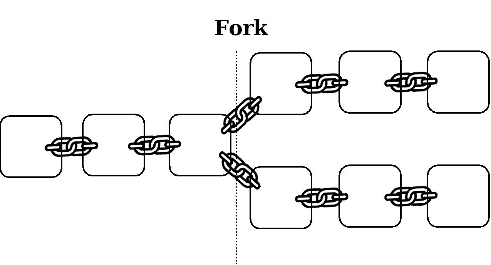

图 32 区块链的分叉

`Bitcoin` 区块链已经分叉过几次，例如产生了 `Bitcoin SV`、`Bitcoin Cash` 或 `Bitcoin Gold`。

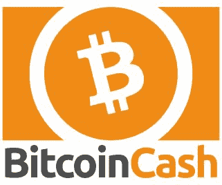 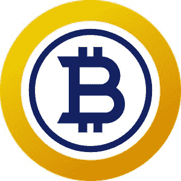 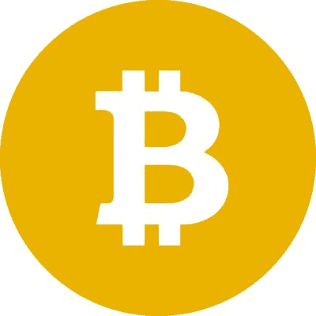

图 33 从左到右：`Bitcoin Cash BCH`、`Bitcoin Gold BTG`、`Bitcoin SV BSV`

这就是为什么 `Bitcoin` 区块链经常被称为 `Bitcoin Core` 或 `Bitcoin Main`，以将其与其他分叉出的 `Bitcoin Blockchains` 明确区分开来。

分叉是指社区的一部分成员决定从区块链的某个区块开始更改底层协议（源代码）。

实际上，源代码被认为是“神圣不可侵”的，不应该被更改。尽管如此，在某些情况下，分叉是有用的。让我们再次通过一个类比来阐释分叉。

假设区块链是一条我们可以行驶的泥土路。矿工是筑路者，他们使用挖掘机和风镐而不是计算能力。他们一点一点地建造了一条长路，我们称之为 `Bitcoin core`，我们可以在其上移动。

突然有一群人路过，发现了道路建设中的缺陷。路不够宽，无法通过足够的车辆，施工不够稳定等等。他们认为有必要以不同的方式继续修路，并改变建造规则。然而，并不是所有人都同意这一观点。对于另一组人来说，路完全足够，甚至认为它更好。

结果，道路分裂了，创建了一条名为 `Bitcoin Cash` 的新平行路。两条路继续并行建设。

矿工/筑路者还必须决定将他的计算能力提供给哪条区块链。毕竟，他无法同时建造 `Bitcoin Cash 路`和 `Bitcoin Core 路`。

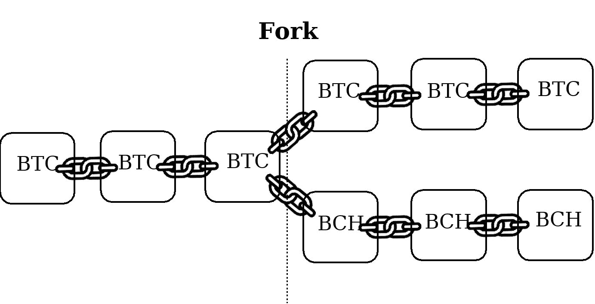


当区块链分裂成两条独立的链时，这个过程也被称为 `hard fork`（硬分叉）。这些街道之间互是不兼容的。然而，在某一点，这种比较是有缺陷的：作为用户，我们可以继续使用两个区块链。在 `Bitcoin Cash 区块链`于 2017 年 8 月 1 日从 `Bitcoin Blockchain` 中分离开后，矿工们必须做决定，但用户不需要。

更棒的是：如果我们在分叉时拥有原始货币（在此例中为 `Bitcoin`）的币，那么我们就自动拥有了新区块链的币。

这意味着：如果我们在 2017 年 8 月 1 日的 `Bitcoin` 账户上有 `1 BTC`，那么在分叉后，我们的账户上仍有 `1 BTC`，但新的 `BCH` 账户中还会额外 `1 BCH`（`Bitcoin Cash`）。这个账户具有相同的地址，我们仍然可以通过相同的私钥访问我们的币，毕竟它只是之前 `Bitcoin Blockchain` 的一个副本。这听起来可能有点困惑，但我们首要记住的是，我们并不拥有自己的币，只拥有自己的私钥。在分叉中，所有的地址（即所有的公钥和所有的私钥）都会 1:1 地 复制到新的区块链上。

为什么 `Bitcoin` 不更频繁地分叉？毕竟，每个拥有 `Bitcoin` 的人每次都能免费获得新货币的币，不是吗？

从原则上说这是正确的，但首先必须对新货币有需求。此外，必须有足够的人愿意提供他们的计算能力来挖掘新币。现实中，到目前所有 `Bitcoin` 的分叉都已消失在微不足道中。

举几个例子：`Bitcoin Gold`、`Bitcoin Platinum`、`BIG Bitcoin`、`Bitcore`、`super Bitcoin` 等。

另一个导致 `hard fork` 的“黑客攻击”发生在加密货币 `Ethereum` 上。

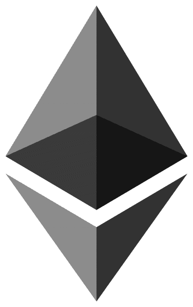


`Ethereum` 是仅次 `Bitcoin` 的第二大加密货币。该货币以 `Ether` (`ETH`) 为单位。

就像 `Bitcoin` 一样，`Ethereum` 使用 `Proof of Work`（工作量证明）来建立共识。

`Ethereum` 区块链曾存在一个黑客在 2016 年能够利用的“漏洞”。他成功偷走了 `350 万 ETH`（等值 600 万欧元）。


Litecoin（缩写为 `LTC`）通常被称为比特币的“兄弟”，在技术上几乎与比特币系统 1:1 完全等同。仅更改了名称和某些参数。例如，目标区块生成时间从十分钟缩短到了 2.5 分钟。这意味着交易处理量增加了四倍。与此同时，分发的莱币数量也是四倍，因此所有出现过的莱币总量上限不是 2100 万个，而是 8400 万个 `LTC`。莱币还意识到了 `SHA256`算法可以通过 `ASICs` 非常高效地计算的问题。一台 `ASIC` 的威力等同于数百台计算机。这使得网络算力变得更容易集中。所需的资源和能量显著减少。

这就是为什么莱币选择了一种专门为“商品化硬件”创建的算法，以防止算力中心化。莱币的 `scrypt` 算法无法通过 `ASICs` 进行更高效的计算。由于整个网络规模小得多，尽管如此，攻击这里比比特币要容易得多。


最后提到的分叉方法是软分叉（soft fork）。正如其名，这不是一次硬分叉，而是一个软过渡。这种分叉更多是对之前区块链的升级，而不是分裂。其优势是 `soft fork` 通常具有向后兼容性。类似于在你的电脑或智能手机上更新程序，你仍然可以使用旧或新版本。

在理解了挖矿原理并学习了不同的分叉变体后，让我们来看看挖矿对环境产生了什么影响。

## 4.5 挖矿对环境的影响

媒体或脱口秀中经常听到这样的反对意见：几个“极客”之间互相发送虚拟币固然很好，但与此同时挖矿的规模已经达到了这种程度，使得所有比特币挖矿消耗的电力超过了某些国家的总和。

我们将仔细观察为什么电力没有被浪费而是被合理利用。尽管如此，这些耗能的矿机无疑不应低估。

大约 50% 的矿工位于中国。尽管他们正表现出向可再生能源的大趋势，但目前仍然严重依赖煤炭和天然气。

一些气候活动人士已经开始禁止比特币。除了比特币无法被禁止（我们稍后也会讨论这一点）之外，一些反对也是相当合理的。

我们需要理解的是：尽管金融系统并非尽善，且比特币可能是解决方案，但气候变化及其相关影响是非常破坏性的。气候变化影响着人类、自然以及金融系统。

然而，挖矿的能耗必须始终与其他能耗相比来看。最近的研究显示，用于挖矿的能量中略于一半是 100% 可再生的，而且已经约 80% 的矿工正在转向廉价的绿色能源。这是因为太阳能和风能发电比煤炭或石油发电更便宜。比特币并没有阻碍绿色能源，而是促进了它。

比特币支持者还认为，比特币代表了自由的金融系统。它代表了的基本权利。

全球电信和消费电子产品（如 Netflix、视频游戏等）消耗的资源多得多，但对自由社会的贡献小得多。


图 3 全球消费

来源：`https://bitcoinmagazine.com/environmental-consumption`

## 4.6 权益证明

与 `POW` 不同，网络的安全性不是通过提供算力来保证，而是通过要求验证区块的参与者以币的形式质押信用。


我们可以将其想象为每个参与者都像缴纳保险一样质押信用。如果有人有坏意，想要伪造区块并被发现，他就会失去信用。因此，没有人有动力违规。

每个拥有钱的人都获得投票权。然后，通过民主投票验证区块。一个人拥有的资产越多，他的投票权就越大。解决区块的奖励（交易手续费和区块补贴）反过来支付给所有参与共识的成员。

这种程序不需要耗能的计算机器。此外，我们可以随时查看哪个账户有多少投票权。权益证明（proof-of-stake）算法对币持有者也有利。他们通过提供形式为分币的币获得回报。他们不需要昂贵的计算器或廉价的电价。

即使权益证明程序乍看只有优势，但也存在一些严重的问题。其一，它是一个资本系统，金钱或财富会自动带来对权力的某种要求。

此外，那些已经拥有最多财富的人（即使在绝对意义上）在解决区块时获得最多的奖励。逐渐地，垄断会形成并获得越来越多的影响力。我们已经在目前的世界中看到货币供应量随着时间的推移变得越来越多。世界上超过 50% 的货币供应量仅由 1% 的人持有。应用到权益证明方法，这意味着如果这 1% 的人聚集在一起，他们将拥有足够的投票权改变区块链的规则。当然，这又是一个非常有假设性的假设，并且会有其他机制来防止这种聚集。例如，网络内的基础性系统决策需要 90% 的批准而非 51%。系统决策例如是关于质押奖励（即“分红”）应该如何分配的问题。

需要注意的是，所有基于 `POS` 的区块链在垄断问题上显示出的异常少。

另一方面，通过 `proof-of-work` 概念，这种方法在原则上是不可能的。


另一个尚未完全解决的技术劣势是区块链发生分叉（forking）的可能性。因为在分叉中，货币仍然存在于两条区块链上，因此货币持有者不需要决定在哪个条区块链上“挖矿”，而是可以在两个区块链上继续行使他们的权力。

| | 工作量证明 (Proof of Work) | 权益证明 (Proof of Stake) |
| --- | --- | --- |
| 安全性通过 | 执行工作 | 资产证明 |
| 硬叉期间的行为 | 货币存在于两条区块链上 | 货币存在于两条区块链上 |
| 共识的构建 | 挖矿 | 验证者（资产所有者） |
| 优点 | 形成严重的垄断 | 资源需求较少 |
| 缺点 | 环境问题 | 硬叉问题 |

正如我们现在看到的，一种并不自动意味着优于另一种，反之亦然。

某些加密货币依赖于 `POW`，另一些依赖于 `POS`。只有时间才能告诉我们对于特定的应用领域长期来看将占据主导。

目前，我们已经学习了区块链和加密货币的重要构建模块。

在处理完挖矿等通用方面后，我们将在下一章节查看交易是如何存储在区块链上的。因为 `Bitcoin` 经常被指责为高度匿名且不透明。因此，`Bitcoin` 被用于非法交易并应该被禁止。

但 `Bitcoin` 到底有多透明呢？透明度与匿名性之间又有什么区别？

## 5. 透明度与匿名性

如果我们想找出一个区块链有多透明或多多匿名，我们首先必须清楚地区分这些术语。这是因为透明度和匿名性等许多术语在日常语言中经常被随意使用或使用不当。

### 5.1. 区块链的透明度

透明度描述了第三者可以容易识别并理解系统内部操作的属性。在资金流方面，这意味着一个人可以看到资金从一个账户到另一个账户的流动，即使该账户不是自己的。`Bitcoin` 和大多数加密货币恰恰是如此。区块链是包含所有以前交易的交易历史。它是所有人都可以免费查看和访问的。

区块链是 100% 透明的。任何人都可以看到任何时候发生过的所有账户余额和资金流。我们也可以轻松地查看 `Satoshi Nakamoto` 的账户，只要我们知道哪个账户属于他。

与区块链技术相比，今天的银行系统是不透明的。我们看不到自己以外的任何其他资金流。尽管区块链是透明的，但它也是完全匿名的。我们需要将系统的透明度与匿名性明确分开。

### 5.2. 区块链的匿名性

匿名性（anonymity）一词源于希腊语。它可以翻译为“没有名字”或“无名”。

可以在区块链中拥有完全的匿名性。我们在书的前章节已经看到，要“打开”一个 `Bitcoin` 地址（公共地址），我们只需要出一个长度为 256 个字符的私钥。没有人能阻止我们这样做。此外，没有人能从公钥推断出人的名字、年龄、来源或性别。因此，`Bitcoin` 和区块链技术是 100%匿名的，同时也是 100%透明的。

即使理论上两者都真实，但在现实中，匿名性并不是完全保证。这种现象也被称为伪匿名（pseudo-anonymity）。

### 5.3. 伪匿名

伪匿名描述的是，在一个实际上 100%匿名的系统中，其匿名性会被高透明度自动消除。

一旦我们能将一个 `Bitcoin` 地址明确分配给一小组人，我们就可以根据该地址的交易推断出其他地址的所有者。

如果我们每个月向某人发送固定金额的钱（每月 1 号），相关的账户可能属于亲属、我们的房东或我们借过钱的银行。由于一旦我们能将一个 `Bitcoin` 地址明确分配给一小组人，我们就可以根据该地址的交易推断出其他地址的所有者。

如果我们每个月向某人发送固定金额的钱（每月 1 号），相关的账户可能属于亲属、我们的房东或我们借过钱的银行。由于一旦我们能将一个 `Bitcoin` 地址明确分配给一小组人，我们就可以根据该地址的交易推断出其他地址的所有者。

由于这种由于是由于高度的透明度，匿名性就会逐渐消失。

如果我们每个月向某人发送固定金额的钱（每月 1 号），相关的账户可能属于亲属、我们的房东或我们借过钱的银行。由于一旦我们能将一个 `Bitcoin` 地址明确分配给一小组人，我们就可以根据该地址的交易推断出其他地址的所有者。

如果我们每个月向某人发送固定金额的钱（每月 1 号），相关的账户可能属于亲属、我们的房东或我们借过钱的银行。由于一旦我们能将一个 `Bitcoin` 地址明确分配给一小组人，我们就可以根据该地址的交易推断出其他地址的所有者。

如果我们每个月向某人发送固定金额的钱（每月 1 号），相关的账户可能属于亲属、我们的房东或我们借过钱的银行。由于一旦我们能将一个 `Bitcoin` 地址明确分配给一小组人，我们就可以根据该地址的交易推断出其他地址的所有者。

如果我们每个月向某人发送固定金额的钱（每月 1 号），相关的账户可能属于亲属、我们的房东或我们借过钱的银行。由于一旦我们能将一个 `Bitcoin` 地址明确分配给一小组人，我们就可以根据该地址的交易推断出其他地址的所有者。

如果我们每个月向某人发送固定金额的钱（每月 1 号），相关的账户可能属于亲属、我们的房东或我们借过钱的银行。由于一旦我们能将一个 `Bitcoin` 地址明确分配给一小组人，我们就可以根据该地址的交易推断出其他地址的所有者。

如果我们每个月向某人发送固定金额的钱（每月 1 号），相关的账户可能属于亲属、我们的房东或我们借过钱的银行。由于一旦我们能将一个 `Bitcoin` 地址明确分配给一小组人，我们就可以根据该地址的交易推断出其他地址的所有者。

如果我们每个月向某人发送固定金额的钱（每月 1 号），相关的账户可能属于亲属、我们的房东或我们借过钱的银行。由于一旦我们能将一个 `Bitcoin` 地址明确分配给一小组人，我们就可以根据该地址的交易推断出其他地址的所有者。

如果我们每个月向某人发送固定金额的钱（每月 1 号），相关的账户可能属于亲属、我们的房东或我们借过钱的银行。由于一旦我们能将一个 `Bitcoin` 地址明确分配给一小组人，我们就可以根据该地址的交易推断出其他地址的所有者。

如果我们每个月向某人发送固定金额的钱（每月 1 号），相关的账户可能属于亲属、我们的房东或我们借过钱的银行。由于一旦我们能将一个 `Bitcoin` 地址明确分配给一小组人，我们就可以根据该地址的交易推断出其他地址的所有者。

如果我们每个月向某人发送固定金额的钱（每月 1 号），相关的账户可能属于亲属、我们的房东或我们借过钱的银行。由于一旦我们能将一个 `Bitcoin` 地址明确分配给一小组人，我们就可以根据该地址的交易推断出其他地址的所有者。

如果我们每个月向某人发送固定金额的钱（每月 1 号），相关的账户可能属于亲属、我们的房东或我们借过钱的银行。由于一旦我们能将一个 `Bitcoin` 地址明确分配给一小组人，我们就可以根据该地址的交易推断出其他地址的所有者。

如果我们每个月向某人发送固定金额的钱（每月 1 号），相关的账户可能属于亲属、我们的房东或我们借过钱的银行。由于一旦我们能将一个 `Bitcoin` 地址明确分配给一小组人，我们就可以根据该地址的交易推断出其他地址的所有者。

如果我们每个月向某人发送固定金额的钱（每月 1 号），相关的账户可能属于亲属、我们的房东或我们借过钱的银行。由于一旦我们能将一个 `Bitcoin` 地址明确分配给一小组人，我们就可以根据该地址的交易推断出其他地址的所有者。

如果我们每个月向某人发送固定金额的钱（每月 1 号），相关的账户可能属于亲属、我们的房东或我们借过钱的银行。由于一旦我们能将一个 `Bitcoin` 地址明确分配给一小组人，我们就可以根据该地址的交易推断出其他地址的所有者。

如果我们每个月向某人发送固定金额的钱（每月 1 号），相关的账户可能属于亲属、我们的房东或我们借过钱的银行。由于一旦我们能将一个 `Bitcoin` 地址明确分配给一小组人，我们就可以根据该地址的交易推断出其他地址的所有者。

如果我们每个月向某人发送固定金额的钱（每月 1 号），相关的账户可能属于亲属、我们的房东或我们借过钱的银行。由于一旦我们能将一个 `Bitcoin` 地址明确分配给一小组人，我们就可以根据该地址的交易推断出其他地址的所有者。

如果我们每个月向某人发送固定金额的钱（每月 1 号），相关的账户可能属于亲属、我们的房东或我们借过钱的银行。由于一旦我们能将一个 `Bitcoin` 地址明确分配给一小组人，我们就可以根据该地址的交易推断出其他地址的所有者。

如果我们每个月向某人发送固定金额的钱（每月 1 号），相关的账户可能属于亲属、我们的房东或我们借过钱的银行。由于一旦我们能将一个 `Bitcoin` 地址明确分配给一小组人，我们就可以根据该地址的交易推断出其他地址的所有者。

如果我们每个月向某人发送固定金额的钱（每月 1 号），相关的账户可能属于亲属、我们的房东或我们借过钱的银行。由于一旦我们能将一个 `Bitcoin` 地址明确分配给一小组人，我们就可以根据该地址的交易推断出其他地址的所有者。

如果我们每个月向某人发送固定金额的钱（每月 1 号），相关的账户可能属于亲属、我们的房东或我们借过钱的银行。由于一旦我们能将一个 `Bitcoin` 地址明确分配给一小组人，我们就可以根据该地址的交易推断出其他地址的所有者。

如果我们每个月向某人发送固定金额的钱（每月 1 号），相关的账户可能属于亲属、我们的房东或我们借过钱的银行。由于一旦我们能将一个 `Bitcoin` 地址明确分配给一小组人，我们就可以根据该地址的交易推断出其他地址的所有者。

如果我们每个月向某人发送固定金额的钱（每月 1 号），相关的账户可能属于亲属、我们的房东或我们借过钱的银行。由于一旦我们能将一个 `Bitcoin` 地址明确分配给一小组人，我们就可以根据该地址的交易推断出其他地址的所有者。

如果我们每个月向某人发送固定金额的钱（每月 1 号），相关的账户可能属于亲属、我们的房东或我们借过钱的银行。由于一旦我们能将一个 `Bitcoin` 地址明确分配给一小组人，我们就可以根据该地址的交易推断出其他地址的所有者。

如果我们每个月向某人发送固定金额的钱（每月 1 号），相关的账户可能属于亲属、我们的房东或我们借过钱的银行。由于一旦我们能将一个 `Bitcoin` 地址明确分配给一小组人，我们就可以根据该地址的交易推断出其他地址的所有者。

如果我们每个月向某人发送固定金额的钱（每月 1 号），相关的账户可能属于亲属、我们的房东或我们借过钱的银行。由于一旦我们能将一个 `Bitcoin` 地址明确分配给一小组人，我们就可以根据该地址的交易推断出其他地址的所有者。

如果我们每个月向某人发送固定金额的钱（每月 1 号），相关的账户可能属于亲属、我们的房东或我们借过钱的银行。由于一旦我们能将一个 `Bitcoin` 地址明确分配给一小组人，我们就可以根据该地址的交易推断出其他地址的所有者。

如果我们每个月向某人发送固定金额的钱（每月 1 号），相关的账户可能属于亲属、我们的房东或我们借过钱的银行。由于一旦我们能将一个 `Bitcoin` 地址明确分配给一小组人，我们就可以根据该地址的交易推断出其他地址的所有者。

如果我们每个月向某人发送固定金额的钱（每月 1 号），相关的账户可能属于亲属、我们的房东或我们借过钱的银行。由于一旦我们能将一个 `Bitcoin` 地址明确分配给一小组人，我们就可以根据该地址的交易推断出其他地址的所有者。

如果我们每个月向某人发送固定金额的钱（每月 1 号），相关的账户可能属于亲属、我们的房东或我们借过钱的银行。由于一旦我们能将一个 `Bitcoin` 地址明确分配给一小组人，我们就可以根据该地址的交易推断出其他地址的所有者。

如果我们每个月向某人发送固定金额的钱（每月 1 号），相关的账户可能属于亲属、我们的房东或我们借过钱的银行。由于一旦我们能将一个 `Bitcoin` 地址明确分配给一小组人，我们就可以根据该地址的交易推断出其他地址的所有者。

如果我们每个月向某人发送固定金额的钱（每月 1 号），相关的账户可能属于亲属、我们的房东或我们借过钱的银行。由于一旦我们能将一个 `Bitcoin` 地址明确分配给一小组人，我们就可以根据该地址的交易推断出其他地址的所有者。

如果我们每个月向某人发送固定金额的钱（每月 1 号），相关的账户可能属于亲属、我们的房东或我们借过钱的银行。由于一旦我们能将一个 `Bitcoin` 地址明确分配给一小组人，我们就可以根据该地址的交易推断出其他地址的所有者。

如果我们每个月向某人发送固定金额的钱（每月 1 号），相关的账户可能属于亲属、我们的房东或我们借过钱的银行。由于一旦我们能将一个 `Bitcoin` 地址明确分配给一小组人，我们就可以根据该地址的交易推断出其他地址的所有者。

由于这种由于是由于高度的透明度，匿名性就会逐渐消失。

现在让我们仔细看看其中一些替代加密货币。它们的优点是什么，缺点是什么？以及是否有意义去押注 `Bitcoin` 的替代品？

## 6. 替代代币

替代代币（Altcoins）是替代币的缩写。这指的是任何不是比特币的加密货币。

整个加密货币市场可以分为比特币和替代代币（altcoins）。

每种加密货币，无论是 `Bitcoin` 还是 `Altcoins`，都有一个名称、货币名称以及一个单位缩写（由几个字母组成）。


## 比特币 (Bitcoin)

这种加密货币的名称为 `Bitcoin`。其单位也称为 `bitcoin`，并缩写为 `BTC`。

`Bitcoin` 和区块链于 2008 年推出，从那时以来 `Bitcoin` 一直是最大的加密货币。加密货币的规模通过其市值来衡量，类似于股票。市值是该加密货币的币价乘以所有币的当前数量。

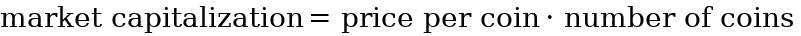

如果一个 `bitcoin` 的价格为 10,000 欧元，且市场上有 1500 万个硬币，那么市值为：

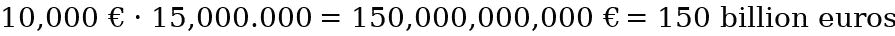

反之，这意味着：如果一个硬币的价格为 100 欧元，它并不自动比 50 分钱的硬币更受欢迎、更大或更好。这始终取决于流通币的数量。如果后者的硬币流通量是前者的千倍，那么市值就会更高。

 最大区块链技术的排名是根据市值衡量的，而不是绝对价格。

小额代币在绝对意义上更受欢迎这一事实，是许多加密货币新手会感受到的心理效应。他们看到一个 `Bitcoin` 价值 10,000 欧元，而 `Bitcoin Cash` 仅需 100 欧元。然后他们倾向于抢购 `Bitcoin Cash`，而不看流通币的数量。

正如前面提到的，`Bitcoin` 远领先于加密货币排名。

 `Bitcoin dominance`（比特币主导率）描述了 `Bitcoin` 在整个加密市场中所占的份额。自从区块链技术出现以来，`Bitcoin dominance` 一直处于 70% 的范围内。这意味着单 `Bitcoin` 一项就占据了加密市场总资金的 70%。所有山寨币合起来仅占资金的 30%。

这种 `Bitcoin dominance` 在多年来一直在波动。`Bitcoin dominance` 曾在低点时处于 30% 以下，但也曾高于 90%。

如果你是加密交易所的经常访客，你会经常听到“市值”和“比特币主导率”等术语。有很多网站可以看到当前数据。

查看最大加密货币当前价格和排名的第一个地方是 `coinmarketcap.com` 网站。

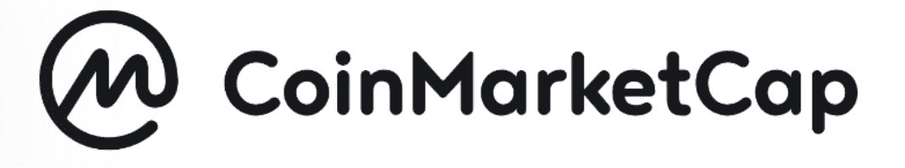

图 43 CoinMarketCap 标志

`Coinmarketcap` 是一个巨大的数据库，其中显示了几乎所有现有加密货币的价格精确到分钟。在这里，我们可以查询加密货币的当前价格及其表现。该页面显示了所有列出这些加密货币的交易所平均价格。这与确定股票当前市场价格的方法相同。`bitcoin dominance` 也显示在 `CoinMarketCap` 上。

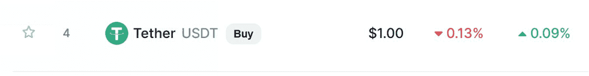

图 44 从 CoinMarketCap 提取的泰达 (Tether-USDT) 截图

在观察某些硬币的价格时，可以注意到某些硬币随时间推移既不下跌也不上涨，例如加密货币 `USDT`。这是巧合吗？

### 6. 稳定币 (Stablecoins)

在加密市场的早期，仍然存在一些问题。例如，加密交易所 `Bitfinex` 意识到了加密货币的每次买卖都必须通过银行的问题。

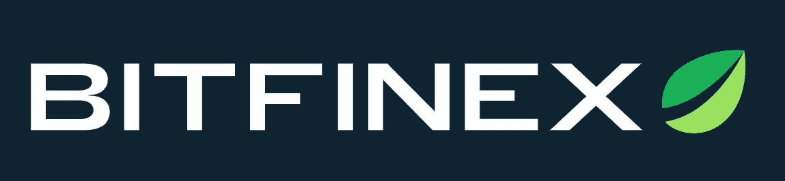

图 45 Bitfinex 标志

如果我们想购买 `Bitcoins`，必须向银行账户存入资金。作为回报，我们收到 `Bitcoins`。有了区块链技术，我们已经有了完美的方法可以恰恰规避这一点。

为了从买卖过程中剔除这个中间人，`Bitfinex` 公司创建了一种复制一美元价值的加密货币。

为此，银行账户中存入了十十亿美元，并提供了十十亿个所谓的“泰达”（`USDT`）供购买。

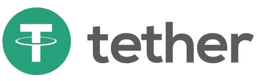

图 46 泰达 (Tether) 标志

`Bitfinex` 是一家加密货币交易所。交易所提供“数字美元”进行交易具有巨大的财务激励。每当 `USDT` 兑换为 `Bitcoin` 或其他加密货币时，现在赚取的是交易所而不是银行。

与其将你的 `Bitcoins` 卖出“真实”货币，你可以将其兑换为 `USDT`。`Tether` 背后的公司保证，如果需要，我们也可以通过 `Tether` 硬币获得一美元。实际上，该货币的价格会波动，就像所有其他加密货币一样。`Tether` 积极应对这一点。

如果对硬币的需求太低，`Tether` 会通过买入硬币来补偿价格波动。反之，如果对硬币的需求太高，`Tether` 则通过发行新币来应对这一点，以维持 1 美元的名义价值。

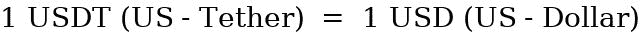

 因为这些类型的硬币如 `Tether` 具有稳定的价值，它们被称为 `stablecoins`。

`Stablecoins` 是加密系统中重要的组成部分。它们构成了从黄金或法币（如欧元、美元、日元或瑞士法郎）进入加密世界的桥梁。`Stablecoins` 是与比较价值相关并由真实等值支撑的硬币。

关于 `Tether` 硬币发行的另一个方面是，这些加密货币未被金融当局视为货币，结果 `Bitfinex` 交易所消除了许多监管障碍。

正如纸币系统一样，对于 `stablecoins` 来说，货币有支撑是重要的。

 6.2 以太坊 (Ethereum)

以太坊是多年来排名第二的加密货币。我们在挖矿和硬分叉章节中已经提到过 `Ethereum`。在接下来，我们将探索 `Ethereum` 背后的理念，因为以太坊并不是普通的加密货币。

以太坊于 2013 年首次推出，并于 2015 年实施。与比特币不同，其创始人是为人知的，并与社区保持交流。开发者 `Vitalik Buterin` 和 `Gavin Wood` 是 `Ethereum` 项目的面孔。`Vitalik Buterin` 特别经常受到关注，被认为是以太坊的灵魂人物。他在 19 岁时就开发了 `Ethereum`，智商高达 257，是加密领域最著名的人物。

与此同时，以太坊项目也由总部位于瑞士的 `Ethereum Foundation` 进一步开发。


## 以太坊概览

基金会是一个社区，与公司不同，他们不（不必）盈利，而是免费地致力于一个项目，在本例中为以太坊网络的开发。当然，开发者会从他们的工作中间接盈利，因为所有开发者自己也持有以太币，因此从价格上涨和以太坊知名度的提高中获利。

开发者们不断进行改进。改进提案，即所谓的 `EIPs`（以太坊改进提案），在与社区协商后定期提出并实施。


以太坊以太坊（`ETH`）为单位。正如比特币可以分为 `mBTC` 或 `Satoshi`，以太坊也可以分为更小的单位 `Wei`。十亿 `Wei` 组成一个 `Giga-Wei`（即 `Gwei`），十亿 `Gwei` 组成一个 `ETH`。


### 技术细节

以太坊也使用工作量证明算法。这意味着交易由去中心化的矿工确认，并且必须使用计算力。然而，以太坊的区块时长仅为约 13 秒。作为参考，比特币需要十分钟。此外，以太坊没有使用 `SHA256` 算法来保护区块链，而是使用 `ETHash` 算法。这种算法可以通过图形处理器高效计算。其背后的想法是，显卡通常比处理器更强大，因此网络可以获得更多的计算力和更高的安全性。此外，这还为了抵消 `ASICs` 导致的计算力中心化。

以太坊与比特币不同，它是无限的。每个区块都会向矿工分发两个新的以太。在这个过程中，数量并没有减少。因此，以太坊是一个通胀系统。

### Gas 与费用

如果我们想发送以太坊交易，我们必须支付 `gas` 费用。`gas` 的价格以 `Gwei` 为单位。对于新手中来说，这些术语往往让人困惑。`Gwei` 和以太坊（`ETH`）一样是以太坊的货币。

我们可以将 `gas` 视为交易的燃料。我们越快想确认交易，需要的燃料就越多，需要购买的 `Gwei` 也越多。

如果交易变得更大或更复杂，我们相应地需要更多 `gas`。通常 `21,000-40,000` `gas` 就足够完成一次交易。我们经常手动设置想要使用的 `gas` 最大量。

以太坊和比特币一样，是一个最高出价系统。支付最多费用（`gas`）的交易会被优先处理。系统只会使用必要的 `gas`。剩余部分将退回我们的账户。

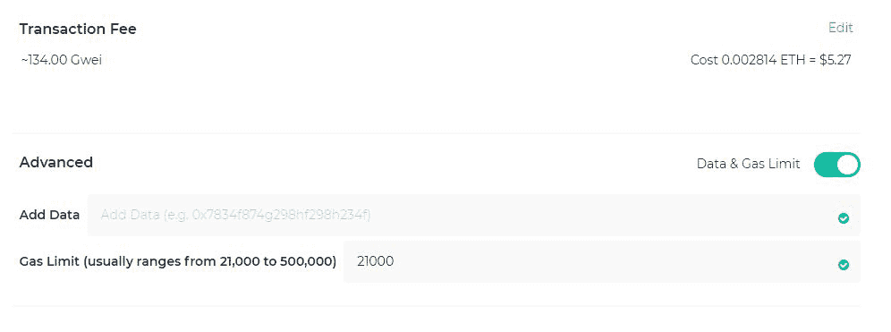

图 47 以太坊交易的费用计算示例

示例：我们想发送一个 `ETH`。在编写时，快速交易的 gas 价格为 134 `Gwei`。我们将最大 gas 消耗设置为 `21,000` `gas`。这导致最高交易费用为 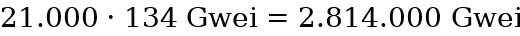。为了得到以太坊和美元的金额，我们需要将 `Gwei` 转换为 `ETH`。为此此，我们需要除以 10 亿。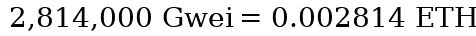。

在 `ETH` 汇率为 `1,900` `USD` 的情况下，这产生的交易费用约为 `5.27` `USD`，即 `5.27`。

### 与比特币对比

以太坊与比特币不同，它是无限的。每个区块都会向矿工分发两个新的以太。在这个过程中，数量并没有减少。因此，以太坊是一个通胀系统。

以太坊与比特币不同，它是无限的。每个区块都会向矿工分发两个新的以太。在这个过程中，数量并没有减少。因此，以太坊是一个通胀系统。

以太坊与比特币不同，它是无限的。每个区块都会向矿工分发两个新的以太。在这个过程中，数量并没有减少。因此，以太坊是一个通胀系统。

以太坊与比特币不同，它是无限的。每个区块都会向矿工分发两个新的以太。在这个过程中，数量并没有减少。因此，以太坊是一个通胀系统。

以太坊与比特币不同，它是无限的。每个区块都会向矿工分发两个新的以太。在这个过程中，数量并没有减少。因此，以太坊是一个通胀系统。

以太坊与比特币不同，它是无限的。每个区块都会向矿工分发两个新的以太。在这个过程中，数量并没有减少。因此，以太坊是一个通胀系统。

以太坊与比特币不同，它是无限的。每个区块都会向矿工分发两个新的以太。在这个过程中，数量并没有减少。因此，以太坊是一个通胀系统。

以太坊与比特币不同，它是无限的。每个区块都会向矿工分发两个新的以太。在这个过程中，数量并没有减少。因此，以太坊是一个通胀系统。

以太坊与比特币不同，它是无限的。每个区块都会向矿工分发两个新的以太。在这个过程中，数量并没有减少。因此，以太坊是一个通胀系统。

以太坊与比特币不同，它是无限的。每个区块都会向矿工分发两个新的以太。在这个过程中，数量并没有减少。因此，以太坊是一个通胀系统。

以太坊与比特币不同，它是无限的。每个区块都会向矿工分发两个新的以太。在这个过程中，数量并没有减少。因此，以太坊是一个通胀系统。

以太坊与比特币不同，它是无限的。每个区块都会向矿工分发两个新的以太。在这个过程中，数量并没有减少。因此，以太坊是一个通胀系统。

以太坊与比特币不同，它是无限的。每个区块都会向矿工分发两个新的以太。在这个过程中，数量并没有减少。因此，以太坊是一个通胀系统。

以太坊与比特币不同，它是无限的。每个区块都会向矿工分发两个新的以太。在这个过程中，数量并没有减少。因此，以太坊是一个通胀系统。

以太坊与比特币不同，它是无限的。每个区块都会向矿工分发两个新的以太。在这个过程中，数量并没有减少。因此，以太坊是一个通胀系统。

以太坊与比特币不同，它是无限的。每个区块都会向矿工分发两个新的以太。在这个过程中，数量并没有减少。因此，以太坊是一个通胀系统。

以太坊与比特币不同，它是无限的。每个区块都会向矿工分发两个新的以太。在这个过程中，数量并没有减少。因此，以太坊是一个通胀系统。

以太坊与比特币不同，它是无限的。每个区块都会向矿工分发两个新的以太。在这个过程中，数量并没有减少。因此，以太坊是一个通胀系统。

以太坊与比特币不同，它是无限的。每个区块都会向矿工分发两个新的以太。在这个过程中，数量并没有减少。因此，以太坊是一个通胀系统。

以太坊与比特币不同，它是无限的。每个区块都会向矿工分发两个新的以太。在这个过程中，数量并没有减少。因此，以太坊是一个通胀系统。

以太坊与比特币不同，它是无限的。每个区块都会向矿工分发两个新的以太。在这个过程中，数量并没有减少。因此，以太坊是一个通胀系统。

以太坊与比特币不同，它是无限的。每个区块都会向矿工分发两个新的以太。在这个过程中，数量并没有减少。因此，以太坊是一个通胀系统。

以太坊与比特币不同，它是无限的。每个区块都会向矿工分发两个新的以太。在这个过程中，数量并没有减少。因此，以太坊是一个通胀系统。

以太坊与比特币不同，它是无限的。每个区块都会向矿工分发两个新的以太。在这个过程中，数量并没有减少。因此，以太坊是一个通胀系统。

以太坊与比特币不同，它是无限的。每个区块都会向矿工分发两个新的以太。在这个过程中，数量并没有减少。因此，以太坊是一个通胀系统。

以太坊与比特币不同，它是无限的。每个区块都会向矿工分发两个新的以太。在这个过程中，数量并没有减少。因此，以太坊是一个通胀系统。

以太坊与比特币不同，它是无限的。每个区块都会向矿工分发两个新的以太。在这个过程中，数量并没有减少。因此，以太坊是一个通胀系统。

以太坊与比特币不同，它是无限的。每个区块都会向矿工分发两个新的以太。在这个过程中，数量并没有减少。因此，以太坊是一个通胀系统。

以太坊与比特币不同，它是无限的。每个区块都会向矿工分发两个新的以太。在这个过程中，数量并没有减少。因此，以太坊是一个通胀系统。

以太坊与比特币不同，它是无限的。每个区块都会向矿工分发两个新的以太。在这个过程中，数量并没有减少。因此，以太坊是一个通胀系统。

以太坊与比特币不同，它是无限的。每个区块都会向矿工分发两个新的以太。在这个过程中，数量并没有减少。因此，以太坊是一个通胀系统。

以太坊与比特币不同，它是无限的。每个区块都会向矿工分发两个新的以太。如果我们想发送以太坊交易，必须支付 gas 费用。

智能合约

以太坊与比特币不同，它是无限的。每个区块都会向矿工分发两个新的以太。在这个过程中，数量并没有减少。因此，以太坊是一个通胀系统。

以太坊与比特币不同，它是无限的。每个区块都会向矿工分发两个新的以太。在这个过程中，数量并没有减少。因此，以太坊是一个通胀系统。

以太坊与比特币不同，它是无限的。每个区块都会向矿工分发两个新的以太。在这个过程中，数量并没有减少。因此，以太坊是一个通胀系统。

以太坊与比特币不同，它是无限的。每个区块都会向矿工分发两个新的以太。在这个过程中，数量并没有减少。因此，以太坊是一个通胀系统。

以太坊与比特币不同，它是无限的。每个区块都会向矿工分发两个新的以太。在这个过程中，数量并没有减少。因此，以太坊是一个通胀系统。

以太坊与比特币不同，它是无限的。每个区块都会向矿工分发两个新的以太。在这个过程中，数量并没有减少。因此，以太坊是一个通胀系统。

以太坊与比特币不同，它是无限的。每个区块都会向矿工分发两个新的以太。在这个过程中，数量并没有减少。因此，以太坊是一个通胀系统。

以太坊与比特币不同，它是无限的。每个区块都会向矿工分发两个新的以太。在这个过程中，数量并没有减少。因此，以太坊是一个通胀系统。

以太坊与比特币不同，它是无限的。每个区块都会向矿工分发两个新的以太。在这个过程中，数量并没有减少。因此，以太坊是一个通胀系统。

以太坊与比特币不同，它是无限的。每个区块都会向矿工分发两个新的以太。在这个过程中，数量并没有减少。因此，以太坊是一个通胀系统。

以太坊与比特币不同，它是无限的。每个区块都会向矿工分发两个新的以太。在这个过程中，数量并没有减少。因此，以太坊是一个通胀系统。

以太坊与比特币不同，它是无限的。每个区块都会向矿工分发两个新的以太。在这个过程中，数量并没有减少。因此，以太坊是一个通胀系统。

以太坊与比特币不同，它是无限的。每个区块都会向矿工分发两个新的以太。在这个过程中，数量并没有减少。因此，以太坊是一个通胀系统。

以太坊与比特币不同，它是无限的。每个区块都会向矿工分发两个新的以太。在这个过程中，数量并没有减少。因此，以太坊是一个通胀系统。

以太坊与比特币不同，它是无限的。每个区块都会向矿工分发两个新的以太。在这个过程中，数量并没有减少。因此，以太坊是一个通胀系统。

以太坊与比特币不同，它是无限的。每个区块都会向矿工分发两个新的以太。在这个过程中，数量并没有减少。因此，以太坊是一个通胀系统。

以太坊与比特币不同，它是无限的。每个区块都会向矿工分发两个新的以太。在这个过程中，数量并没有减少。因此，以太坊是一个通胀系统。

以太坊与比特币不同，它是无限的。每个区块都会向矿工分发两个新的以太。在这个过程中，数量并没有减少。因此，以太坊是一个通胀系统。

以太坊与比特币不同，它是无限的。每个区块都会向矿工分发两个新的以太。在这个过程中，数量并没有减少。因此，以太坊是一个通胀系统。智能合约

如果我们想发送以太坊交易，必须支付 gas 费用。

智能合约示例

如果我们想发送以太坊交易，必须支付 gas 费用。

### 以太坊上的代币

以太坊与比特币不同，它是无限的。每个区块都会向矿工分发两个新的以太。在这个过程中，数量并没有减少。因此，以太坊是一个通胀系统。

以太坊与比特币不同，它是无限的。每个区块都会向矿工分发两个新的以太。在这个过程中，数量并没有减少。因此，以太坊是一个通胀系统。

以太坊与比特币不同，它是无限的。每个区块都会向矿工分发两个新的以太。在这个过程中，数量并没有减少。因此，以太坊是一个通胀系统。

以太坊与比特币不同，它是无限的。每个区块都会向矿工分发两个新的以太。以太坊与-bit 比特币，它是无限的。


代币（token）的目的是在数字世界中代表现实世界的物体。“大众高夫代币”或“西门子股票代币”都是可以的，它们各自反映了现实世界的物体。

为了接收代币，我们首先建立一个智能合约。然后，我们需要向智能合约发送`Ether`。作为回报，我们收到一定数量的代币。

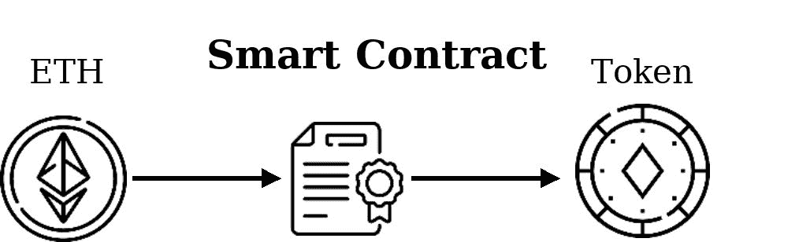
图 51 通过智能合约发行代币

智能合约不仅负责发行代币，还负责将代币发送另一个地址或监控代币的数量。

理解币（coin）和代币（token）之间的区别非常重要。

像`Ether`或`Bitcoin`这样的币是底层加密货币的货币。相反，代币只存在于以太坊区块链上的智能合约中（或其他支持智能合约的区块链上）。代币没有自己的区块链或地址。我们可以通过使用以太坊区块链上相应的智能合约来访问代币。

代币通常不是通过矿出来的，而是由智能合约发放的。代币通常是为了特定的应用目标而创建。我们将在接下来的章节中了解更多具体的例子。

任何具有相关知识的程序员都可以建立个人智能合约并使用它来创建代币。随着时间的推移，许多不同的合约和代币被建立和发行。其中许多几乎或完全没有用途。

人们很快就会发现，代币必须有一个标准，可以作为创建代币的准则。这就是`ERC20`标准（以太坊意见征求）的诞生。根据此标准创建的代币被称为`ERC20 代币`。

`ERC20`标准可以类比为程序员的一个基础框架。它规定每个`ERC20`代币在底层必须具有相同的属性和函数。这包括例如，代币有一个名称和缩写（符号），并且必须定义代币的最大数量。如果超过了最大数量，则不再发行新代币。智能合约中还必须有一种可能，允许代币从一个地址发送到另一个地址。

这一要求使得为这些代币提供标准化接口变得更容易，以便它们更容易进行交易或发送。

`ERC20`代币的创建是标准化的，非常容易实现。现在市场上有超过 10 万种不同的`ERC20`代币。

然而，这使得很难看出一个新代币项目提供了多少价值。几乎任何人，即使没有编程技能，也可以通过一个想法和一些网络搜索来创建一个`ERC20`代币。

2017-2018 年的加密货币热潮也是如此，当时创建了许多新代币。其中许多代币并没有基于任何真实的概念或用例。相反，在品牌营销和许多承诺的帮助下，投资者（通常是个人）被说服投资这些代币。超过 40 亿欧元的资金流入了这些`ICO`（首次币发行）项目。

`ICO`泡沫在 2018 年初破灭，许多项目到为止损失了其峰值的 90%以上。

通常，承诺的项目从未实现过，创始人仅仅是富裕了自己。

当然，并不是所有的`ERC20`项目都是坏的，但充分了解所做出的承诺是否能够兑现是非常重要的。

除了以太坊之外，还有许多其他加密货币可以作为创建智能合约和代币的区块链，例如加密货币`NEO`。`NEO`也被称为中国以太坊。它遵循与以太坊相同的方法。`NEO`想要将所有数据传输到区块链并通过代币来表示。现在有了关于世界代币化的讨论。我们将关注其他相同方法的加密货币。目前，以太坊拥有最多的活跃用户。因此，以太坊被广泛应用于基于智能合约的创建。

在看了代币和智能合约之后，我们现在转向为什么我们需要智能合约和代币。基于以太坊区块链的智能合约和代币构成了去中心化应用的基础。

智能合约正如我们目前所知的，主要执行简单的函数。它遵循“如果发生 X，则执行 Y”的指令。

然而，智能合约可以变得复杂得多。正如提到的，编写智能合约需要编程技能。基于以太坊区块链的智能合约是使用名为`Solidity`的特殊编程语言编写的。目前也有与其他常用语言的接口，使得更多的程序员可以参与进来。即使没有`Solidity`语言的预先知识，设置智能合约也变得简单。

然而，智能合约只是一个简单的结构。但是，我们可以从这些构建块构建更复杂的应用程序。这是通过智能合约相互触发实现的，类似于多米诺骨牌。


图 52 智能合约相互交互

这一切发生在去中心化计算机上，并存储在区块链上。

由于由单个智能合约组成的应用程序在区块链上去中心化执行，我们称之为去中心化应用，简称`Dapps`。`Dapp`可以是任何东西，例如在线游戏、社交媒体网站或大型数据库。

我们能带入数字世界的一切都可以通过智能合约和`Dapps`实现。

以太坊虚拟机上运行的去中心化游戏示例是`crypto kitties`。

在`https://www.cryptitties.co/`网站上，我们可以收集虚拟猫、交换它们并繁殖它们。这是一个经典的收集游戏，类似于数字宝可梦卡。

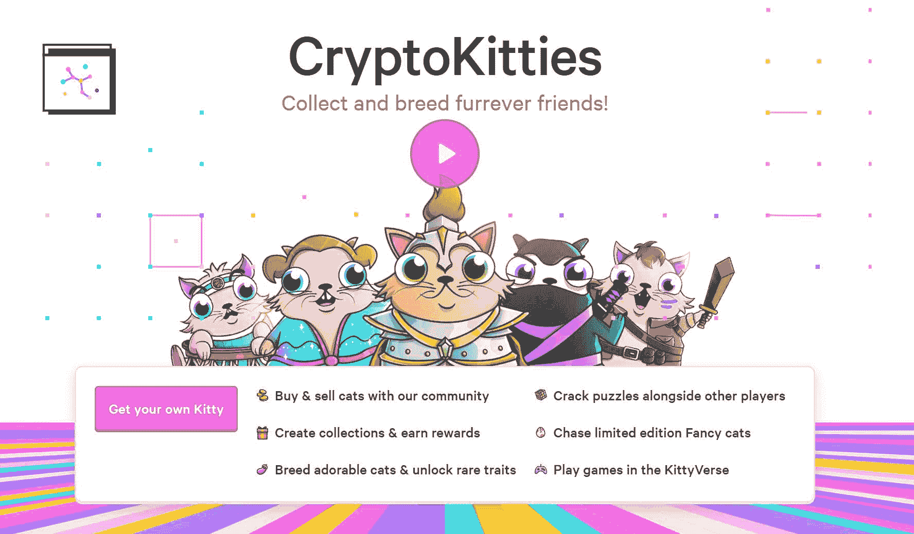
图 53 Crypto Kitties 首页

为了参与游戏，我们需要向我们的猫账户发送`Ether`，然后就可以购买一只或多个猫。

我们可以怀疑这个游戏的意义，但对于以太坊网络来说，`crypto kitties`是第一个真实的去中心化应用。


尽管在《魔兽世界》中失去一项虚拟能力似乎并不悲惨，但加密猫（Crypto Kitties）展示了更好的做法。就像我们的加密货币一样，这些猫 100%属于我们自己。没有任何机构可以将它们从我们手中夺走、将排除在交易之外或关闭账户。规则、改进等均由社区决定。

严格来说，即使是 `DApp` 也不是 100%去中心化的。这是因为 为了在我们的电脑上运行该应用程序，我们需要能够显示内容的程序。这类似于我们需要互联网浏览器来访问互联网。这些程序运行在中央服务器上。

优势在于，我们也可以从任何其他服务器在任何时间访问去中心化网络。如果电脑或浏览器出现故障，我们可以通过其他电脑访问互联网。

加密猫还阐明了另外一点：加密猫的每一次购买、交换和繁衍都是通过智能合约实现的。这在 `Ethereum` 区块上映射了相应的交易。

这意味着，每当有两只猫交配或我们交换虚拟猫时，`Ethereum` 区块上就会触发一次交易。这会花费玩家金钱并增加网络负载。

在 2017 年达到高峰时，`Ethereum` 网络因为加密猫几乎处于满载状态。超过 13%的交易仅源于这一个收集游戏。这表明网络仍然需要克服可扩展性难题。

在未来，`DApps` 将像整个 `Ethereum` 网络一样继续发展。`DApps` 将变得重要性得多。

然而，游戏并不是 `DApps` 的唯一应用领域。`DAOs` 是另一个可能的应用方向。

### 6.5 DAOs

我们已经看到了一个 `Ethereum` 区块上的应用示例。在加密猫案例中，重点在于趣味性和收集因素。而对于 `DAOs`，重点在于可以映射到区块链上的经济实体。

去中心化自治组织 `DAO` 是一种没有董事会或决策管理人员的组织。相反，所有规则都通过智能合约写下。

`DAO` 在 `Ethereum` 区块上完全自主地运行。公司内的每一个流程都以交易的形式存储在 `Ethereum` 区块中。

建立 `DAO` 的程序总是相同的：

首先，公司被“创立”。在此过程中，规则被写在智能合约中。任何人都可以看到这些规则。

随后，启动众筹，借此获得未来的代币。这非常重要，因为公司借此建立启动资金。

通过向公司发送资金（例如以 `Ether` 的形式），我们可以成为公司的一部分。作为回报，我们获得一个代币。这相当于购买了公司的股份。如果你选择了一家好公司，你可以作为“股东”增加资金。然而，也可能出现公司无法引起潜在投资者的兴趣，导致你完全损失了投资的资金。

一旦 `DAO` 获得资金，它就会启动。从现在起，它完全自主地运行。所有决策都由社区，即 `DAO` 代币的持有者做出。社区可以建议资金的用途。

在公司内部的决策过程中，通过代币进行民主投票。

例如，智能合约可能规定，只有当至少 60%的股东（代币所有者）投赞成时，变更才会被采纳。

每位员工或投资者都可以投资公司，并拥有与其股份比例相同的投票权。这里没有中心化公司那样的层级结构。

因为区块链是去中心化的，因此不需要中央决策机构。相反，整个共识构建过程在 `Ethereum` 区块上是去中心化的。

此类 `DAO` 的例子是 `Steemit`。

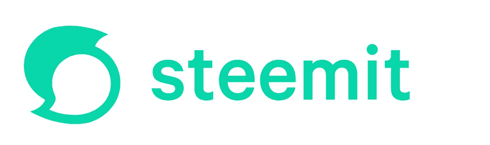

图 54 Logo steemit.com

`Steemit` 于 2016 年，是一个去中心化的社交媒体和博客平台。它基于 `Steem` 区块。

我们可以通过 URL `https://steemit.com/` 访问这个去中心化论坛。用户可以创建内容、阅读内容并相互交流。此外，用户会因优质内容获得奖励。不是由中心化公司，而是用户自己决定什么是好内容。

正如常一样，信任因素被完全从方程中剔除。公司运作的规则列在公开的智能合约中。

另一个 `DAO` 的例子是投资基金或投资公司。每个投资公司并出资资金的人都会以代币的形式获得投票权。然后，我们可以定期对公司应该投资哪些股票、哪些房地产或其他资产类别，以及何时买入何时卖出进行投票。在此过程中，我们可以自己制定所有规则或提交新提议，这些提议随后也会进行投票。例如，如果投资表现良好，可以给所有投资者发放自动奖金。我们不需要信任中心化的证券交易所，也不需要高成本的基金经理。

`DAOs` 的应用领域是多样的。

我们必须意识到，公司的启动规则（智能合约）是由人类编写的，可能包含错误，没有编程知识的终端用户无法轻易理解这些错误（即使是经验丰富的程序员或安全公司也并不总是能毫无疑问地做到这一点）。

这一点由一个著名的例子所示：`The DAO`。

### The DAO

人们经常读到名为 `The DAO` 的实现。这是最早且最大的 `DAO` 项目之一。`DAO` 项目利用了 `DAO` 热潮，并将其加密货币命名为 `The DAO`。这就像一家公司为了看起来更有吸引力而自称为“人工智能”。

`The DAO` 由 `Slockit` 在 2016 年开发，并在 `Ethereum` 区块上执行。它是一种投资公司。

在这里你可以用 `Ether` 交换 `DAO` 代币。然后你可以使用你的 `DAO` 代币参与对如何管理这个去中心化自治公司的投票。


这是否真的是他的观点，还是他仅仅想挽回他捕获的硬币的价值，无人知晓。无论如何，社区的大多数人并没有听他的，而是启动了一次硬分叉（hardfork）。

这种攻击听起来熟悉吗？我们难道没有处理过类似的情景吗？正如此：为了应对这次攻击，触发了硬分叉，并由此产生了以太坊经典（Ethereum Classic）。现在我们也理解了这次攻击背后的背景，这在后来被称为 DAO 攻击。我们还明白，这不是以太坊区块链的漏洞，而是一个运行在区块链上并由人类编写的智能合约的漏洞。

以太坊创始人维塔币·布特林（Vitalik Buterin）也是这样想的，最初他没有参与围绕即将发生的分叉的所有讨论。

由于总 ETH 的 15% 以上都在 DAO 网络中，创始人最终处理了这个问题并制定了分叉方案。在分叉方案中，攻击者的地址被列入一种“黑名单”，以便他无法访问这些硬币。

尽管这可能是一个正确的决定，但这个例子表明协议并不是一成不变的，可以由社区进行更改。

尽管发生了这起不幸事件，但我们得说，智能合约带来了难以想象的可能性。DApps、代币或 DAO。这些规则对所有人可见的去中心化应用在未来将具有巨大的意义。

### 6.6 以太坊的替代方案

最后，我们可以看到以太坊已经显著促进了某些用例，例如众筹（通过几位（部分私有的）投资者对项目进行融资），并且未来的可能性似乎是无限制的。

以太坊和其他去中心化网络将改变整个银行、保险和中介行业。同时，银行和金融服务提供商也意识到了区块链的优势，并希望从这些技术中受益。

以太坊是第一种不再主要将自己定位为货币，而是作为去中心化巨型计算机的主要区块链技术。与任何新技术一样，社区并非所有成员都支持管理层。他们认为许多领域需要改进。

“以太坊系统”迅速激励了许多开发团队设计他们自己的加密货币。即使是以太坊的创始团队，也有一些程序员分离开了。他们认为自己可以设计出一个更好的以太坊版本，并编写了自己的加密货币，例如 Cardano (`ADA`)。

近年来，许多以太坊的竞争者进入了市场。每个者都解决了他们在以太坊中看到的不同问题。尽管如此，以太坊仍然是目前第二大加密货币。不过，值得关注那些自称的“以太坊杀手”。

许多山寨币与以太坊网络的方法非常相似，但它们侧重于一个细分市场，以与其他项目区分开来。这些可以是，“物联网”、“互联网 3.0”或“人工智能”。

重要的是要知道，有多个以太坊的竞争者。我们将介绍市值排名最大的项目，但只会浅层地涵盖这些项目，因为这些加密货币背后的完整技术超出了本书的范范围。此外，讨论特定的项目意义不大，因为加密货币市场变化极快且带有情绪化特征。加密货币在几年后会成为下一个比特币，还是会消失在遗忘中，是非常难以预测的。

在 2020 年春季大幅增长的加密货币是 Polkadot。


图 56 Polkadot 标志

Polkadot 是一种在 2017 年 10 月发布的加密货币，但直到 2020 年底它都不是顶级代币之一。

Polkadot 的创始人加文·伍德（Gavin Wood）是以太坊的联合创始人之一，他离开后与 Robert Habermeier 和 Peter Czaban 共同创立了 Polkadot 背后的 web3 基金会。

Polkadot 的加密货币被称为 `DOT`。

在 2021 年春季，Polkadot 经历了极速增长，并短暂成为第四大加密货币。

### Polkadot 的愿景是什么？

Polkadot 已经意识到越来越多的区块链技术正在开发中。这些技术中的每一种都在解决自己的问题。然而，这些区块链之间的交互并不容易实现。

这正是 Polkadot 发挥用场的地方。Polkadot 通常被称为互联网 2.0，旨在从各个区块链中创建一个巨大的、去中心化的网络，由 Polkadot 充当不同区块链之间的桥梁。

然而，这一愿景并不新鲜。以太坊有类似的方法，但在技术上落后于 Polkadot。另一方面，以太坊拥有更大的社区和更活跃的用户。

### 另一个与以太坊非常相似的项目是 Cardano。

Cardano 的创始人查尔斯·霍斯金森（Charles Hoskinson）。像 Polkadot 的创始人一样，他也是以太坊的联合创始人，于 2015 年离开并通过 Cardano 实现了他自己加密货币的愿景。

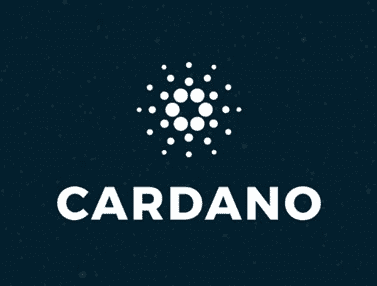

图 57 Cardano 标志

在 Cardano 中，硬币被称为 `ADA`。Cardano 是一个去中心化的区块链，也允许执行智能合约。

以太坊和 Cardano 之间最大且核心的区别在于 Cardano 使用了权益证明（proof-of-stake）概念。

交易费用分配给运行节点的人，即那些在计算机上存储区块链的人。

Cardano 本身想要成为最大的加密项目并解决区块链技术的所有问题。Cardano 开发团队由许多教授、程序员和工程师组成。

最重要的是，由于权益证明算法，Cardano 的扩展性比以太坊更好。交易费用显著降低，可以进行更多的交易。我们从加密猫（crypto kitties）中看到，单个项目就可以加载工作量证明网络。

如果未来有多个 DAO、DAPP 和其他应用程序在以太坊区块链上运行，以太坊必须扩展。否则，以太坊将失去其目前相对于替代方案的领先地位。

### 6.7 EIP559 和以太坊 2.0

以太坊本身现在意识到了这个问题。

由于如此，EIP559 将于 2021 年 7 月实施。这一改进提案被称为伦敦升级（London Update），由维塔币·布特林本人于 2018 年提出。简单来说，EIP559 意味着交易费用不再像以前那样分配给矿工，而是被销毁。矿工只会获得每个区块的区块奖励。交易费用将被标准交易费用取代。尽管这取决于网络负载，但人们仍然可以向矿工发送小额捐赠，即矿工费（Miner Tip）或包含费（Inclusion Fee）。

一个具体的例子：

EIP559 之前：
```
矿工奖励 = 区块奖励 + 交易费用
交易成本（交易费用）：5 ETH
矿工奖励：2 ETH + 5 ETH = 7 ETH
```
发行的以太坊产生了 2 ETH 的通胀

EIP559 之后：
```
矿工奖励 = 区块奖励 + 矿工费
-> 基础费用被销毁
交易成本（基础费用）：2.5 ETH
此外还有 0.7 ETH 的矿工费被捐赠
矿工奖励：2 ETH + 0.7 ETH = 2.7 ETH
```
此外，2.5 ETH 的基础费用被销毁。这导致了 0.5 ETH 的微通缩（2.5 ETH 基础费用减去 2 ETH 区块奖励）。

取决于网络负载，每个区块的交易费用可能高于分发的两个以太坊。这意味着，例如在发行两个以太坊的同时，销毁了三个。因此，以太坊可能会从通胀系统变为通缩系统。


大多数矿工完全不喜欢这项提议。毕竟，根据目前的估计，他们每解决一个区块获得的以太坊减少了高达 60%。尽管如此，开发者仍然实施了该提案。从理论上讲，矿工可以发起硬分叉（hardfork），但这极可能会对以太坊网络的稳定性和信任产生影响，因此他们将自损害其害。此外，在技术层面，这是系统迈出的一大步。

所提改进的另一个技术方面是区块大小会根据网络负载进行调整。这使得所有用户使用的网络更快、更更便宜。这一步对于扩展性至关重要，这也是为什么社区的大多数人支持这项提案。他们的理由是，由于受欢迎程度以太坊价格的上涨，矿工仍然可以盈利挖矿。尽管他们每个区块只能获得两个以太坊，但以法币计算，它们的价值更高。这是许多矿工所期待的。虽然有其他方案来补偿矿工，但从长远来看，为了大规模使用以太坊，这种更新是不可避免的。

无论如何，很清楚，以太坊挖矿将随着以太坊 2.0 的推出而结束，它预计最迟于 2022 年或 2023 年发布。到那时，权益证明（proof-of-stake）概念将完全实现，矿工将被验证者取代。

取决于你阅读这段文字的时间，`E1559` 提案已经实施，或者以太坊已经在权益证明上运行。也许扩展性对以太坊价格的影响已经可见。`EIP1559` 和以太坊 2.0 的例子表明，技术正在快速发展，有时是根本性的，重大变化正在不断引入。

除了波卡（Polkadot）和货币（Cardano），还有许多与以太坊相似或旨在解决以太坊特定问题的项目。示例包括 `NEO`、`Chainlink`、`NEM` 和 `TEZOS`。

!(Image00083.jpg)!(Image00084.jpg)!(Image00085.jpg)

图 58 从左到右的 Logo：Neo, Tezos, Chainlink, NEM

问题仍然是这些加密货币能否成为以太坊的有力竞争对手。以太坊最大的优势是庞大的社区、巨大的矿工网络和活跃的用户。几乎所有的 DApps 和 DAO 应用都运行在以太坊区块链上。

许多较小的币种（如波卡或货币）面临着“有鸡还是蛋”的问题。极少数客户使用该网络，因为它还没有被广泛使用。同时，这些项目依赖客户来扩展网络。

## 7. 实践介绍：购买比特币

接下来，我们将具体看看终端用户如何购买和出售加密货币，他们在存储私钥时应该考虑什么，以及投资加密货币到底是否有意义。在每一步中，我们首先查看理论背景，也查看具体的实现。

首先，建议对市场有一个尽的了解。为此，我们可以使用像 `coinmarketcap.com` 这样闻名的网站。在我们对当前市场有了尽的了解后，我们将在区块链上创建一个地址。为此，我们需要一个 `private key`。

### 7.1 钱包提供商和加密交易所

现在我们转向钱包提供商和加密交易所。


在我们加载了足够的余额后，选择我们中意的加密货币并确认购买。就是这样。我们现在正式成为加密货币的所有者了。我们可以好好躺下，等待价格上涨。

然而，你们中的一些人可能注意到，我们的硬币在交易所的账户里，我们并没有收到私钥。如果交易所破产或被黑客攻击，在极端情况下也会影响到我们。让我们来看看如何更明智地长期存储我们的硬币。

## 7.2. 长期安全存储硬币

交易所的缺点在于它的中心化。这是一家普通的公司，其服务器可能会被黑客攻击。我们自己往往无法访问自己的私钥。

致命性黑客攻击的例子是 `Mt. Gox` 交易所的历史。到 2013 年，全球 60% 以上的比特币交易所通过这个市场进行交易。由于安全漏洞（或可能是计划内的内幕交易），超过 850,000 个 `BTC` 被盗取。这在当时相当于 5 亿欧元。一年后，由于诉讼浪潮开始。该交易所于 2014 年破产。部分受害方收到了部分退款，但使用的是当时 2013 年 `BTC` 价格的法币。其他人直到今天仍在等待他们的钱。如果大多数受害者没有丢失他们的 `Bitcoins`，他们现在应该是百万富翁了。

这种风险今天仍然存在，但比 2013 年已经低得多。正如任何其他技术公司一样，交易所也可能发生黑客攻击。像 `Apple`、`Microsoft` 等其他公司也被攻击过几次。这些公司已经从安全漏洞中吸取了教训，例如将数据和信用余额分配在不同的虚拟钱包之间，这样在发生攻击时，所有内容无法被一次性捕获，只有一小部分。

 即使风险不是特别高，你想要长期持有的加密货币也不应该留在交易所，特别是当涉及大量资金时。

如果我们只是想了解一下加密生态系统，并第一次购买一些 `Satoshis` 或 `mBTC`，我们可以承担这种风险并将硬币留在交易所。为了熟悉，易用性非常宝贵。当投资增加、金额变大时，我们就不应该再把钱放在交易所了。因此，让我们来看看在实践中如何打开比特币地址。

我们已经了解到你可以自由选择自己的私钥，因此也可以选择你的比特币地址（公共地址）。这些数字是由随机事件产生的，例如通过抛硬币。这对于终端用户来说并不实际。如果我们告诉一个人，为了在区块链上开设“账户”并购买比特币，他们必须抛硬币 256 次，那么区块链技术将很难普及。

相反，钱包供应商提供了智能解决方案。

### 7.2.1. 软件钱包

 钱包是一个存储我们私钥的应用程序。我们的硬币存储在区块链上，我们并不持有硬币，而是以私钥的形式持有作为硬币所有者的证明。

这种钱包被称为软件钱包。

在钱包供应商处开设账户时，与交易所一样，会确保其设计对用户友好，并且不需要任何关于区块链的先知识或背景知识。以后谈到存储硬币或私钥时，我们会详细介绍不同类型的钱包。但在这里也存在遇到可疑来源的潜在风险。在实践中，这不太可能，也有百分之百安全的创建地址的方法。

相反，将硬币发送到我们自己创建的、只有我们自己知道私钥的地址是有意义的。这不需要抛硬币。PC 上的随机生成器就足够了。有很多软件和算法可以创建一个 256 位的长随机 1 序列。

**重要：** PC 必须离线状态。我们绝不应该在线创建我们的私钥。这个随机私钥很容易被操作员保存，以便以后偷取硬币。这个私钥应该原封不动地写在纸上并保存，例如放在保险箱或柜子里。这种钱包被称为纸钱包。

### 7.2.2. 冷钱包和硬件钱包

替代的存储方案是冷钱包。冷钱包是任何不连接互联网的类型，因此不受任何黑客攻击的威胁。

!Image0094.jpg) `Trezor`(左)和 `Ledger Nano`(右)

| 加密货币的长期存储 | 易用性 | 安全性 |
| :--- | :--- | :--- |
| 交易所 | 好 | 中等 |
| 软件钱包 | 好 | 好 |
| 硬件钱包 | 中等 | 非常好 |
| 纸钱包 | 差 | 非常好 |
| 手机应用、在线钱包等 | 非常好 | 差 |

在所有硬币的安全方面，有一点非常重要：对于某些钱包类型，如纸钱包或硬件钱包，只有我们控制私钥。这样做的好处是没人拒绝我们的访问。另一方面，没有中央机构可以重置我们的密码（私钥）。

**重要：**
如果我们丢失了私钥，硬币将永久且不可逆地丢失。没有方法可以拿回资金。

因此，在不同的地方保留私钥的备份是一个好主意。我们还需要考虑不可预见的情况，例如自然灾害。冷钱包可能会因洪水或地震丢失。如果没有采取措施，硬币就会丢失。

这在现实中已经发生。根据目前的估计，已经有 370 万个 `比特币` 丢失。而且这个数字只会随着时间的增加，因为丢失的私钥无法恢复。

然而，随着比特币价值的稳定增长，绝对损失将随之减少。有些钱包丢失了 1 万或更多的 `BTC`。但是，当时的价格只有几欧分。


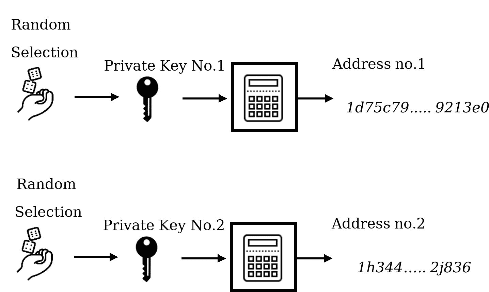

图 66 通过两个私钥生成两个地址

### 分层确定性钱包 (HD Wallets)

如果我们想在区块链上打开 100 个地址，我们就必须存储 100 个私钥。这是非常耗时的。这就是所提改进的用处。

`BIP32` 引入了分层确定性钱包（`HD Wallets`）。它们解决了上述描述的问题并简化了钱包的操作。同时，它们也有助于提高隐私性。

通过 `HD Wallets`，引入了一个主密钥。它看起来与私钥非常相似，也由一组加密的数字和字母组成。随后，可以从主密钥生成任意数量的私钥。

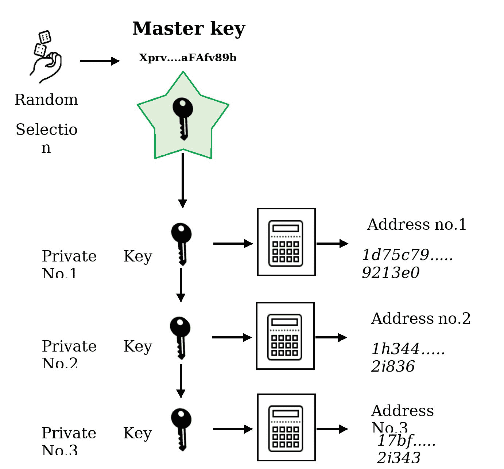

图 67 使用主密钥生成任意数量的地址

私钥是从主密钥生成的，从该私钥可以生成另一个私钥，以此此类推。这种目的使用了确定性函数。确定性意味着输出可以明确地分配给输入。

类似于 `SHA256` 算法，也使用了单向函数，这些函数可以轻松从主密钥生成一个或多个私钥，并随后生成公地址。相反，无法从一个私钥推导出另一个私钥或主密钥。

当我们想要接收钱币时，我们创建一个新的私钥和相应的地址。对于下一次交易，我们再创建一个新的私钥，以此此类推。

尽管硬币分布在许多地址上，但我们可以通过单个主密钥访问所有硬币。然而，第三方无法得知我们总共有多少额度，因为没有人能追踪哪些地址属于我们。

我们可以看到 `BIP32` 扩展对隐私很有很大帮助。然而，问题在于我们仍然需要记住一组加密的数字序列。

### 种子 (Seeds) 与 BIP39

任何尝试过在电脑上输入私钥的人都会发现它是有多么不实际。很容易写错或断思路。即使是存储密钥都不直观。这就是为什么引入了所谓的“种子”（Seeds）。这项扩展是以 `BIP39` 的名引入的。

随着种子的引入，我们不再需要记住加密的私钥，而是记住明文形式的英文单词。为了这个目的，总共选择了 2,048 个不同的英文单词。单词列表是公开的。

`https://github.com/bitcoin/bips/blob/master/bip-0039/english.txt`

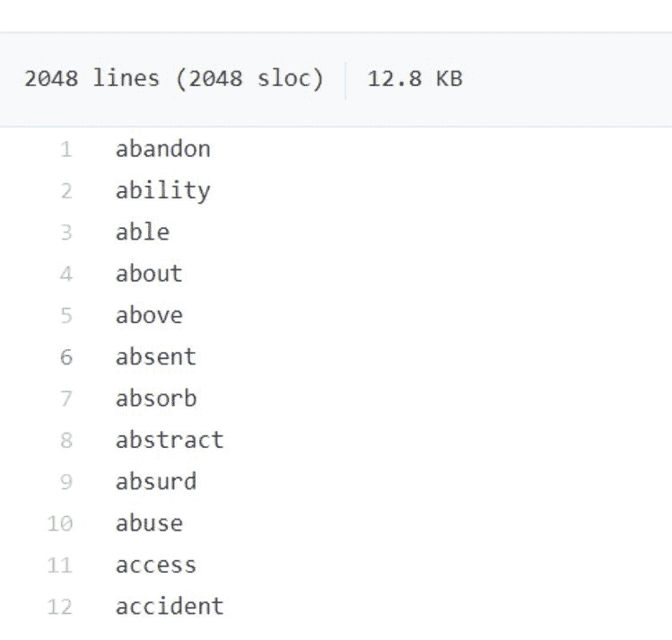

图 68 BIP39 单词列表摘

从这 2,048 个单词中，我们选择十二或 24 个随机单词。这十二或 24 个单词被称为种子。

现在，钱包提供商为我们完成了这些工作。当我们创建钱包时，会被分配十二或 24 个随机单词。

种子的示例，十二个随机单词：

"couple copy shy they vintage during avoid champion little join better code"

起初我们无法对这些单词做些什么，但可以将这些单词转换为主密钥，然后转换为几个私钥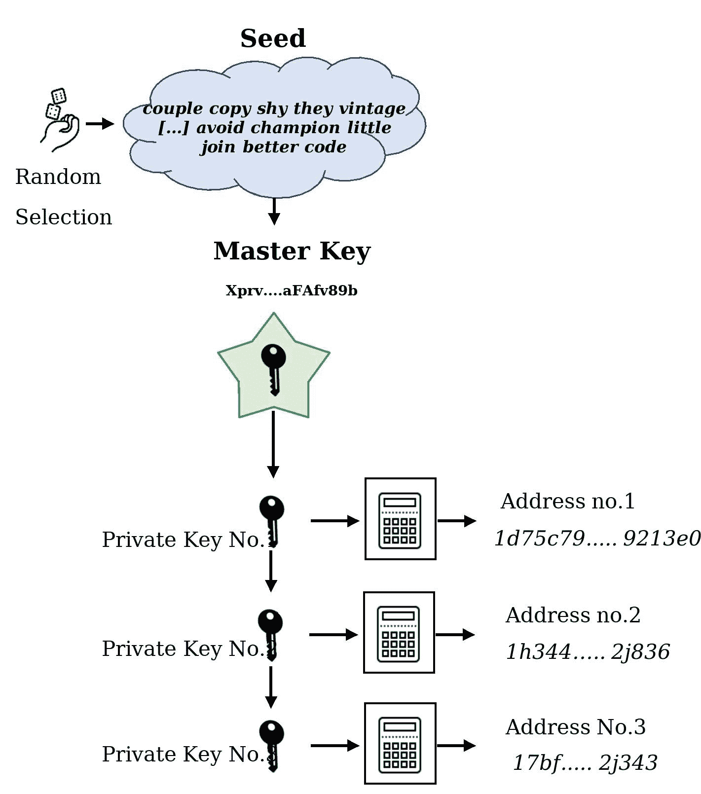

图 69 使用种子生成任意数量的地址（12 个单词）

通过 `BIP39`，存储私钥变得更加大众化。十二或 24 个单词比具有 80 或 256 个字符的加密密码更具实体感。

### BIP44 与多货币支持

到目前为止，种子和多个地址仅限于多个比特币地址。虽然可以在一个种子中存储数百个比特币地址，但随着越来越多的加密货币进入市场，用户对友好型存储多种加密货币货币的需求随之增加。一个种子只能用于一种加密货币的事实随着另一个 BIP 而改变了。

`BIP44` 允许通过仅一个种子为各种加密货币创建私钥。不仅从主密钥生成比特币地址的私钥，还可以生成其他私钥，例如用于以太坊、比特币现金和数千种其他硬币。这些私钥反过来可以用于计算相应区块链上的公地址，即账户。

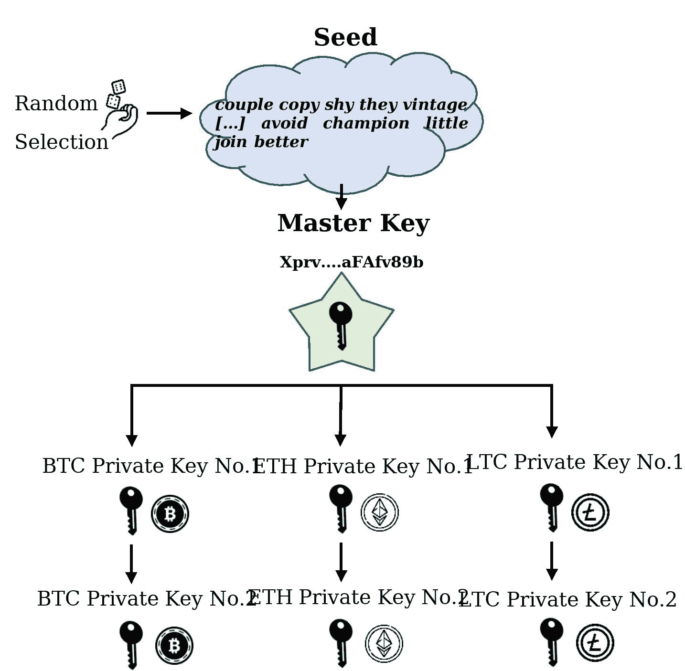

图 70 使用种子生成任意数量的不同加密货币地址

这些扩展使得提供全方位解决方案成为可能，因此终端用户只需写下 12 或 24 个单词。他们可以自己选择这些单词，就像他们选择私钥一样。

`HD wallets` 查询这些单词，创建一个主密钥，并遍历所有货币的所有地址，直到连续的几个地址不再包含任何硬币。在大多数情况下，为了安全起见，还会检查另外 100 个地址，以确保没有硬币被遗漏。如 `Ledger-Nano` 之类的冷钱包也能通过集成随机生成器从 `BIP39` 单词列表中选择种子，即十二或 24 个单词。

### 总结

我们在这一章中学学习了：加密交易所既有优点也有缺点。我们可以快速获得资金并将其兑换为 USDT 或“真实的”美元，例如。然而，我们将钱放在了外国人的手中。我们还看到，种子和 HD 钱包方便了硬币的长期安全存储以及不同加密货币的所有权。只需十二或 24 个单词，我们就可以同时创建并存储以太坊、比特币、莱特币或 Ripple 等不同加密货币的无数地址。如果我们想长期存储所有这些币，就不再需要为每个币打开单独的地址。

### 7.4 我们应该注意什么？

特别是当你是加密货币的新手时，道路上总会有障碍，我们将在本小节中详细这些这些，以便你的热情不会变成挫败。

#### 费用比较

在购买股票或为房融资时，不同的银行和交易所有不同的成本。因此，建议比较不同的股票交易所和银行。百分之二三的费用听起来可能并不多，但在融资买房时，最好想两次。

购买加密货币的情况也是如此。一些交易所收取按百分比的买卖费（如 `Binance`），另一些收取固定价格（如 `eToro`），还有一些是混合模式，例如 `Coinbase`。为了保持成本尽可能低，我们需要比较不同的价格目录。

此外，可能存在隐藏费用，例如由于价格差异。在一家提供商那里，一个 `BTC` 只需 10,000 欧元，而在另一个提供商处 `Bitcoin` 的价格为 10,500 欧元。这在加密货币中特别常见，例如当我们想将 `Bitcoin` 交换为 `Ethereum` 时。因此，在购买之前与 `coinmarketcap` 或其他门户网站的价格对比是有意义的。对于较小的提供商和小币，你需要注意这一点。

#### 交易费用

我们已经看到发送 `比特币`和其他加密货币涉及矿工费用。费用越低，确认交易的时间越长。在最坏的情况下，交易不会被处理。我们的币不会丢失，而是留在账户中，但在最坏的情况下，交易会在队列中挂起几天才被拒绝。

发送硬币的交易费用基于网络负载，而不是发送硬币数量的百分比，而是基于交易的数据大小。这意味着：如果我们发送一个 `BTC`，其成本并不比发送 100 个 `Satoshi` 高出多。


当货币价格在短时间内上涨或下跌时，意味着许多人在买入或卖出 `BTC`。相应的，网络会变得繁忙，交易量之增加。正如 `Mining Difficulty` 章节中所描述，`Bitcoin` 的交易成本在峰值时期曾超过 40 美元。这意味着：如果我们想花费 `€10` 发送 `BTC`，光是交易费就需要支付几乎是金额四倍的费用！

这些费用在交易发送之前会在钱包或交易所中显示。如果我们不急于，可以设置较低的交易费用。如果无法这样做，那么等几个小时或几天，直到网络平稳后再进行交易可能是有意义的。

如果我们的交易费用设置得太低，矿工将不会将交易转发到网络，而是将其放入“队列”中。这意味着在最坏的情况下，我们的交易会在队列中滞留两周（对于 `Bitcoin` 而言），然后最终才被拒绝。

我们选择的交易费用应该始终处于正常范围内，并符合网络负载。钱包提供者了解这个问题，并经常建议一个合适的交易费用。

如果你对当前的网络负载感兴趣，可以例如在 `https://bitcoinfees.earn.com/` 查询所需的交易费用。在那里，会标明费用是多少以及交易时间需要多长时间。

## 骗局

### 什么是骗局？

尽管 `Bitcoin` 已经存在了十年，但加密货币市场仍处于婴儿阶段。在许多领域存在大量的无知或半知之解。正如任何一个仍然缺乏监管的市场一样，诈骗者会被那些想要通过卑劣手段致富自己的人所吸引。为了避免我们自己成为受害者，有几点需要记住。

成为诈骗受害者被称为 `scam`。

传销计划，即没有真实产品且只能通过吸引新客户来增长的计划，是 `scam` 的典型例子。

加密货币史上最大的骗局之一，让许多人损失了巨额财富的网站 `Bitconnect` 或相关的代币 `Bitconnect BCC`。该网站于 2016 年春天上线。

`Bitconnect` 承诺，如果客户将他们的 `Bitcoins` 换成 `Bitconnect` 代币，其资产每天可以获得 0.25-2% 的回报。

当存入如 `USD 5,000`、`USD 10,000` 或 `USD 100,000` 等较大金额时，还有 0.25% 到 1% 的额外回报。

这是如何可能的？根据 `Bitconnect` 的说法，它开发了一种人工智能，通过观察加密货币市场的价格波动在正确的时间买卖 `Bitcoins`，从而获利。

可以看出，`Bitconnect` 花了大量资金来获取新客户。他们支付给拥有数百万粉丝的网红来激进地推广 `Bitconnect` 网站。每个招募新客户的人有时可以获得新客户存款高达 `10%` 的回报。

当时有说法称可以在一年内让资金增加 37 倍。尽管常识告诉我们，这种本金永远没有合法的依据，但 `Bitconnect` 仍然收集了数百万的投资者资金。

事实上，这是一个传销计划。新客户的钱被分配给老客户，以营造一种合法的假。早期客户和网红公开展示了这一点。


即使对于业内人士来说，市场波动也是不可预测的。本书并没有给出具体的投资建议，而是讨论了区块链技术和加密货币的机遇与挑战。之后，每个人必须单独决定他/她是否相信这项技术及其长期价值，以及是否希望对其进行货币化预期。无论如何，了解该领域都是没有错的。

### 8.1. 区块链技术的未来

我们将本书的大部分内容留给了加密货币。然而，其背后的区块链技术在未来将积极改变我们生活的许多其他领域。在今天，许多创业者（例如创业企业家 `Frank Thelen`）已经是区块链技术的忠实粉丝，并预测它大大光前景。Frank Thelen 的公司 `Freigeist Capital` 正与初创公司 `Neufund` 合作。这家来自柏林的初创公司正计划一个基于区块链的股票交易平台。通过这种方式，他们希望消除高昂的公证和商业登记费用。

区块链技术经常被比作互联网。它是一种颠覆性技术，将渗透到我们生活的每一个方面。

大型公司已经投入了数十亿美元研究区块链技术。很少有人知道：`Bitcoin` 和其他加密货币仅占这些应用领域的一小部分。

在未来，借助区块链技术可以节省大量的官僚程序。

任何数字文档都可以存储在区块链上，无论是支付手段（即 `cryptocurrencies`）、契据还是数字身份标识。正如我们已经在 `tokenisation`（代币化）中提到的，越来越多的现实生活物品被备份在区块链上。其优势是数据是不可篡改的、未经审查的，并且可以在任何地方访问。我们只需要互联网和访问权限，例如以我们的 `private key` 形式存在。


通过区块链，我们是自己敏感个人数据的唯一者。因此，区块链技术也可以快速、方便地推进数据保护。

例如，我们可以以加密的形式将医疗记录存储在区块链上，而不是存储在全科医生或其他各种医院。只有我们自己可以访问这些数据。反过来，可以随时随地轻松地检索这些数据。

技术也在发展。我们不再需要存储 `private key` 或 `seed`（种子），而是可以使用指纹或类似的方法进行身份验证。

另一个与数据保护相关的应用领域是即时消息服务。`Facebook`、`WhatsApp` 或 `Google` 等大型公司长期以来受到批评，认为它们对客户数据的处理不够谨慎。许多公司已经在致力于开发去中心化的消息服务 `DApp`。其中一个可能会在未来几年内进入主流。其优势是显而易见的：没有公司来投放广告、收集和销售数据或取消参与者的访问权限。像 `Steemit` 这样的去中心化社交媒体平台也在不断进化并变得对用户友好。

还有无数其他用法，例如无需银行的融资或设计为完全透明并使用 `smart contracts`（智能合约）自动兑付的保险合同。

金融服务特别容易数字化，因为今天几乎所有的账户、贷款和交易已经通过数字方式处理。

在 `DeFi`（去中心化金融）术语下，越来越多的去中心化应用正在建立，资金在这些应用上进行贷款、筹集或投资。


许多私人投资者试图比其他人更聪明，寻找最佳的投资时机。正如格言所说：“价格上涨时卖出，价格下跌后再买入。”

这种思考过程非常简单，乍一看非常有吸引力。

然而，事实是，大多数缺乏经验的投资者在使用这种策略时会遭受亏损。原因是人的行为是感性的。即使我们下定决心要在 `Bitcoin` 下跌 70% 后买入，也极少能付诸行动，因为感觉不对劲。

因此，大多数遵循这种投资策略的投资者，其资金量比他们简单持有币种要少。换句话说，指希望自己比市场聪明是徒劳的。相反，你应该买入币并长期持有（HODL）。

归结底，GameKyuubi 是的。如果他一直言出必行并持有 `Bitcoins` 直至今，那么多年来他已经获得了非常丰厚的利润。

这个幽默的例子表明，价格波动在 2013 年已经是常有的事，而且并没有打破比特币的长期上升趋势。

## 比特币的未来

但 `Bitcoin` 的未来是什么样的呢？现在投资有意义吗？

`Bitcoin` 的未来取决于许多因素。最大的因素是 `Bitcoin` 是否会被需要并有意义地使用。`Bitcoin` 的支持者一致认为：`Bitcoin` 是独特的。它是去中心化的、抗审查的、透明且防御攻击的。世界上任何国家都无法将参与者排除在 `Bitcoin` 网络之外，没收加密账户通过通货膨胀贬低存储劳的购买力。

然而，目前我们也看到 `Bitcoin` 完全不适合作为大规模支付。价格波动和高交易成本阻碍了其作为支付方式的重要用途。波动性描述了资产类别价格波动程度。股票通常比大商品或政府债券波动更大。例如，`Bitcoin` 的波动性是股票许多倍。

每秒七次交易不足以覆盖全球支付流。然而，还有许多其他原因导致 `Bitcoin` 作为支付方式目前仍被认为是不现实的。

这意味着我们读这本书是白读，`Bitcoin` 未来将不会被使用吗？不，因为我们学到了：钱还有另一个非常重要的属性：价值存储属性。

尽管 `Bitcoin` 目前无法作为货币大规模使用，但 `Bitcoin` 曾经是也是第一种加密货币。`Bitcoin` 已经存在了十多年，并且经常被宣布死亡。

`Bitcoin` 一直是第一加密货币。正因如此，`Bitcoin` 被称为加密货币之母。这个名字本身就是一个多年来建立的品牌，代表了独立、革命和对腐败银行系统的反抗。

承认去中心化货币价值并加入网络的人越多，`Bitcoin` 获得的影响就越大。

`Bitcoin` 可能会从舞台上消失吗？是的，这完全有可能。但这可能吗？

正如前面提到的，数十亿美元的行业也专门研究了 `Bitcoin`。大国和大公司正在学习其价值。

| 公司 | 行业 | 持有的比特币 |
| --- | --- | --- |
| MicroStrategy inc. | 软件生产商 | 91,326 BTC |
| Tesla, Inc. | 科技巨头 | 48,000 BTC |
| Square inc. | 金融服务提供商 | 8,027 BTC |
| Marathon Digital Holdings | 矿业集团 | 5,067 BTC |
| Galaxy Digital Holdings | 金融服务提供商 | 4,000 BTC |
| … | … | … |
| 总计 | | 135 万万 BTC |

\-2021 年 5 月

在此期间，`MicroStrategy`、`Tesla`、`Galaxy Digital Holdings` 或 `Square` 等大公司购买了超过 130 万个 BTC。这些公司反过来让 `Paypal`、`Microsoft` 或 `Visa` 等公司开始重视加密货币交易。

在这里我们看到了 `Bitcoin` 相比所有其他加密货币最重要的优势：网络效应。

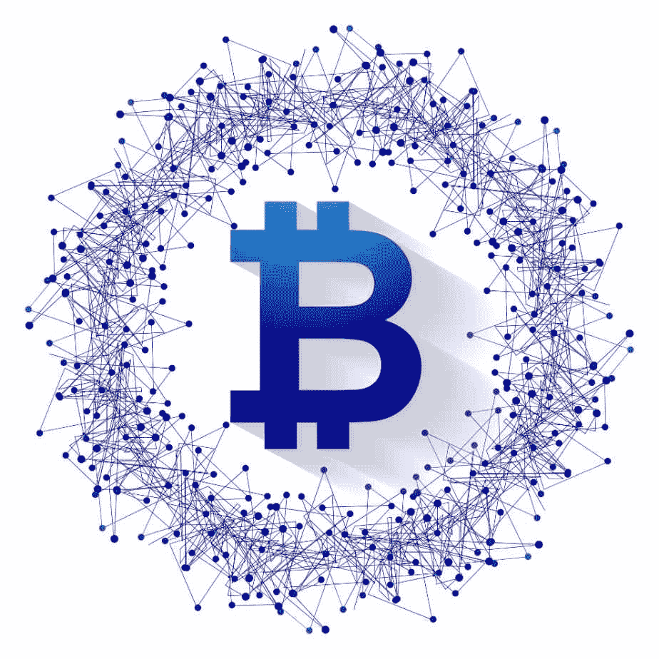
图 75 比特币网络效应

网络效应描述了随着越来越多的用户加入，系统的价值会增加。

Facebook 吸引的用户越多就越成功。这些用户反过来又带来了其他人使用该网络。我们在 `Bitcoin` 身上看到了同样的情况。越来越多的批评声音正在处理这项技术。过去几年中传播的许多虚假报告正在得到澄清，并将一种小众产品推向主流。

`Bitcoin` 可能会完全从舞台上消失，但这极不可能。

相反，让我们看看 `Bitcoin` 支持者认为的 `Bitcoin` 未来是什么。

以下场景纯粹是假设性的，在发生如此剧烈的系统变化之前，还需要满足许多条件。然而，我们问：如果 `Bitcoin` 取代美元会怎样？

### 最优情况 - 比特币作为储备货币

如果当前货币体系的发展继续下去，全球越来越多的人将意识到法币不是劳动工资的长期存储地。因为钱无非此。它是我们所做工作的报酬，我们可以存储和花费它。

经济将经历多次危机。每一次都会比上一次更糟。为了再次刺激经济，必须打印更多的钱。这反过来导致了越来越多的危机。人们逃向实物资产，如股票、房地产等。企业产量增加，消费越来越多依赖信贷。国家继续负债，而有钱投资并从价格上涨中获利的人与生活在生存边缘的人之间的差距正在扩大。在某个时刻，无路可走。情绪将发生转变。人们对欧元、美元和其他法币失去信心。相反，越来越多的人承认去中心化货币的价值。


像 `Tesla` 或 `Apple` 这样的大型公司长期通过 `Bitcoin` 接收其大部分流动资金。在很一段时间内，两种货币体系可以并行存在，直到中央银行货币的需求下降到几乎为零。当法币购买力同样下降到零时，通胀性的中央体系将逐渐脱离，`Bitcoin` 作为新的储备货币被引入。所有流动资产将由 `Bitcoin` 支撑——它是唯一被证明有限的资产。

仍然会有中央机构以现金形式发行 `bitcoin` 欠条（IOU）。

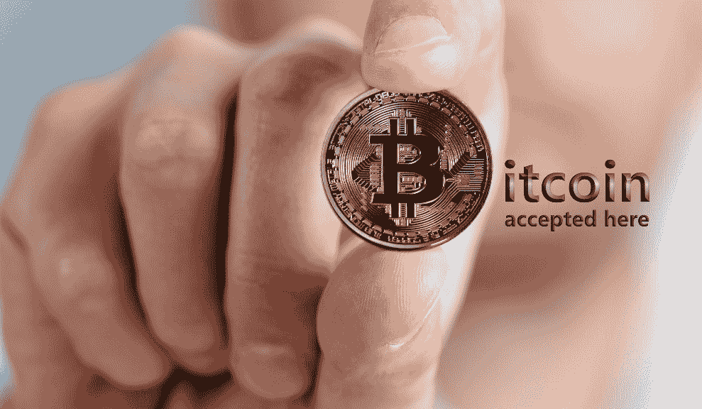

图 76 Bitcoin 作为支付手段被接受

由于 `Bitcoin` 的通缩特性，人们可以通过储蓄来积累财富，而不是被缓慢地剥夺。消费减少了，但变得更加理智。公司必须提供更高质量的产品，人们才愿意花花钱。

诚然的是：这种想法在目前这个阶段需要大量的想象力。中央机构需要很多时间才能放弃对货币体系的控制。

总之，我们可以说，许多知名富豪以及像 `Tesla` 这样的大型科技公司现在也进入了 `Bitcoin` 领域。这正在塑造人们对加密货币的接受和信任。对 `Bitcoin` 可以作为价值存储的信心。对将钱投资在 `Bitcoin` 比放在负利率的储蓄账户中更有意义的信心。正如人们几千年来对黄金那样的信任。

开发团队在可用性和可扩展性方面取得了重大的突破。`Bitcoin` 正在发现越来越多的吸引力和可能性，作为一种支付手段也是如此。

诚然，`Bitcoin` 远没有 `Visa` 或 `Master Card` 的水平，没有人能说它是否有一天能达到，但大投资者正日益认可 `Bitcoin` 的数字黄金属性。

`bitcoin` 消失在舞台上是非常不可可能的，但其他 10,000 多种加密货币和代币呢？

### 8.3 山山寨币的未来

目前的加密货币市场可以与过去 40 年的技术领域相比。技术和社交媒体正变得越来越繁荣。在此过程中，许多公司相继成立。其中一些今天仍是市场领导者；另一些则已消失湮灭。

例如，像 `Myspace` 这样的大型社交媒体平台也一夜之间消失在舞台上。加密货币市场也将有类似的行为。逐渐，最好、最高的项目将脱颖而出，而那些不增加价值的项目将变得无关紧要。

然而，目前仍然处于初始阶段，极难发现哪种技术或哪个特定项目将胜出。

在过去的几年里，由于所有资金的流入，加密货币市场巨大增长。我们现在可以购买和发送 10,000 多种不同的加密货币。显而易见，我们未来不会运行 1000 种不同的支付方式或 1000 种不同的去中心化网络。很有可能，这些加密货币中的 99% 将消失。

此外，新项目不断不断加入，通过营销积累了大量的投资者资金。

我们已经看到过去 10 年里：

| 市值前 10 位加密货币 |
| --- |
| 2013 年 6 月 || 2017 年 1 月 || 2020 年 1 月 |

| 市值前 10 位加密货币 |
| --- |
| 2013 年 6 月 || 2017 年 1 月 || 2020 年 1 月 |

| 市值前 10 位加密货币 |
| --- |
| 2013 年 6 月 || 2017 年 1 月 || 2020 年 1 月 |

| 市值前 10 位加密货币 |
| --- |
| 2013 年 6 月 || 2017 年 1 月 || 2020 年 1 月 |

| 市值前 10 位加密货币 |
| --- |
| 2013 年 6 月 || 2017 年 1 月 || 2020 年 1 月 |

| 市值前 10 位加密货币 |
| --- |
| 2013 年 6 月 || 2017 年 1 月 || 2020 年 1 月 |

| 市值前 10 位加密货币 |
| --- |
| 2013 年 6 月 || 2017 年 1 月 || 2020 年 1 月 |

| 市值前 10 位加密货币 |
| --- |
| 2013 年 6 月 || 2017 年 1 月 || 2020 年 1 月 |

| 市值前 10 位加密货币 |
| --- |
| 2013 年 6 月 || 2017 年 1 月 || 2020 年 1 月 |

| 市值前 10 位加密货币 |
| --- |
| 2013 年 6 月 || 2017 年 1 月 || 2020 年 1 月 |

| 市值前 10 位加密货币 |
| --- |
| 2013 年 6 月 || 2017 年 1 月 || 2020 年 1 月 |

| 市值前 10 位加密货币 |
| --- |
| 2013 年 6 月 || 2017 年 1 月 || 2020 年 1 月 |

| 市值前 10 位加密货币 |
| --- |
| 2013 年 6 月 || 2017 年 1 月 || 2020 年 1 月 |

| 市值前 10 位加密货币 |
| --- |
| 2013 年 6 月 || 2017 年 1 月 || 2020 年 1 月 |

| 市值前 10 位加密货币 |
| --- |
| 2013 年 6 月 || 2017 年 1 月 || 2020 年 1 月 |

| 市值前 10 位加密货币 |
| --- |
| 2013 年 6 月 || 2017 年 1 月 || 2020 年 1 月 |

| 市值前 10 位加密货币 |
| --- |
| 2013 年 6 月 || 2017 年 1 月 || 2020 年 1 月 |

| 市值前 10 位加密货币 |
| --- |
| 2013 年 6 月 || 2017 年 1 月 || 2020 年 1 月 |

| 市值前 10 位加密货币 |
| --- |
| 2013 年 6 月 || 2017 年 1 月 || 2020 年 1 月 |

| 市值前 10 位加密货币 |
| --- |
| 2013 年 6 月 || 2017 年 1 月 || 2020 年 1 月 |

| 市值前 10 位加密货币 |
| --- |
| 2013 年 6 月 || 2017 年 1 月 || 2020 年 1 月 |

| 市值前 10 位加密货币 |
| --- |
| 2013 年 6 月 || 2017 年 1 月 || 2020 年 1 月 |

| 市值前 10 位加密货币 |
| --- |
| 2013 年 6 月 || 2017 年 1 月 || 2020 年 1 月 |

| 市值前 10 位加密货币 |
| --- |
| 2013 年 6 月 || 2017 年 1 月 || 2020 年 1 月 |

| 市值前 10 位加密货币 |
| --- |
| 2013 年 6 月 || 2017 年 1 月 || 2020 年 1 月 |

| 市值前 10 位加密货币 |
| --- |
| 2013 年 6 月 || 2017 年 1 月 || 2020 年 1 月 |

| 市值前 10 位加密货币 |
| --- |
| 2013 年 6 月 || 2017 年 1 月 || 2020 年 1 月 |

| 市值前 10 位加密货币 |
| --- |
| 2013 年 6 月 || 2017 年 1 月 || 2020 年 1 月 |

| 市值前 10 位加密货币 |
| --- |
| 2013 年 6 月 || 2017 年 1 月 || 2020 年 1 月 |

| 市值前 10 位加密货币 |
| --- |
| 2013 年 6 月 || 2017 年 1 月 || 2020 年 1 月 |

| 市值前 10 位加密货币 |
| --- |
| 2013 年 6 月 || 2017 年 1 月 || 2020 年 1 月 |

| 市值前 10 位加密货币 |
| --- |
| 2013 年 6 月 || 2017 年 1 月 || 2020 年 1 月 |

| 市值前 10 位加密货币 |
| --- |
| 2013 年 6 月 || 2017 年 1 月 || 2020 年 1 月 |

| 市值前 10 位加密货币 |
| --- |
| 2013 年 6 月 || 2017 年 1 月 || 2020 年 1 月 |

| 市值前 10 位加密货币 |
| --- |
| 2013 年 6 月 || 2017 年 1 月 || 2020 年 1 月 |

| 市值前 10 位加密货币 |
| --- |
| 2013 年 6 月 || 2017 年 1 月 || 2020 年 1 月 |

| 市值前 10 位加密货币 |
| --- |
| 2013 年 6 月 || 2017 年 1 月 || 2020 年 1 月 |

| 市值前 10 位加密货币 |
| --- |
| 2013 年 6 月 || 2017 年 1 月 || 2020 年 1 月 |

| 市值前 10 位加密货币 |
| --- |
| 2013 年 6 月 || 2017 年 1 月 || 2020 年 1 月 |

| 市值前 10 位加密货币 |
| --- |
| 2013 年 6 月 || 2017 年 1 月 || 2020 年 1 月 |

| 市值前 10 位加密货币 |
| --- |
| 2013 年 6 月 || 2017 年 1 月 || 2020 年 1 月 |

| 市值前 10 位加密货币 |
| --- |
| 2013 年 6 月 || 2017 年 1 月 || 2020 年 1 月 |

| 市值前 10 位加密货币 |
| --- |
| 2013 年 6 月 || 2017 年 1 月 || 2020 年 1 月 |

| 市值前 10 位加密货币 |
| --- |
| 2013 年 6 月 || 2017 年 1 月 || 2020 年 1 月 |

| 市值前 10 位加密货币 |
| --- |
| 2013 年 6 月 || 2017 年 1 月 || 2020 年 1 月 |

| 市值前 10 位加密货币 |
| --- |
| 2013 年 6 月 || 2017 年 1 月 || 2020 年 1 月 |

| 市值前 10 位加密货币 |
| --- |
| 2013 年 6 月 || 2017 年 1 月 || 2020 年 1 月 |

| 市值前 10 位加密货币 |
| --- |
| 2013 年 6 月 || 2017 年 1 月 || 2020 年 1 月 |

| 市值前 10 位加密货币 |
| --- |
| 2013 年 6 月 || 2017 年 1 月 || 2020 年 1 月 |

| 市值前 10 位加密货币 |
| --- |
| 2013 年 6 月 || 2017 年 1 月 || 2020 年 1 月 |

| 市值前 10 位加密货币 |
| --- |
| 2013 年 6 月 || 2017 年 1 月 || 2020 年 1 月 |

| 市值前 10 位加密货币 |
| --- |
| 2013 年 6 月 || 2017 年 1 月 || 2020 年 1 月 |

| 市值前 10 位加密货币 |
| --- |
| 2013 年 6 月 || 2017 年 1 月 || 2020 年 1 月 |

| 市值前 10 位加密货币 |
| --- |
| 2013 年 6 月 || 2017 年 1 月 || 2020 年 1 月 |

| 市值前 10 位加密货币 |
| --- |
| 2013 年 6 月 || 2017 年 1 月 || 2020 年 1 月 |

| 市值前 10 位加密货币 |
| --- |
| 2013 年 6 月 || 2017 年 1 月 || 2020 年 1 月 |

| 市值前 10 位加密货币 |
| --- |
| 2013 年 6 月 || 2017 年 1 月 || 2020 年 1 月 |

| 市值前 10 位加密货币 |
| --- |
| 2013 年 6 月 || 2017 年 1 月 || 2020 年 1 月 |

| 市值前 10 位加密货币 |
| --- |
| 2013 年 6 月 || 2017 年 1 月 || 2020 年 1 月 |

| 市值前 10 位加密货币 |
| --- |
| 2013 年 6 月 || 2017 年 1 月 || 2020 年 1 月 |

| 市值前 10 位加密货币 |
| --- |
| 2013 年 6 月 || 2017 年 1 月 || 2020 年 1 月 |

| 市值前 10 位加密货币 |
| --- |
| 2013 年 6 月 || 2017 年 1 月 || 2020 年 1 月 |

| 市值前 10 位加密货币 |
| --- |
| 2013 年 6 月 || 2017 年 1 月 || 2020 年 1 月 |

| 市值前 10 位加密货币 |
| --- |
| 2013 年 6 月 || 2017 年 1 月 || 2020 年 1 月 |


为了让我们在未来能够澄清这些论点，并消除人们对加密货币的恐惧，让我们仔细观察一下“非比特币持有者”最常见的误区。

## 9.1. 比特币可以被禁止

让我们从一个在新闻或股市大师口中反复听到的论点开始。

人们经常提到，只要比特币和其他加密货币仍然是极客的小众领域，它们就会运行良好。一旦比特币变得大，国家就会干预并禁止这种加密货币。

即使是欧洲中央银行行长克里斯蒂·拉加德（Christine Lagarde）在采访中也提到，比特币需要监管，甚至可能被禁止。比特币是危险的，并用于非法活动。

我们在之前的章节中已经讨论过，比特币并未用于非法目的，由于其透明性以及事实上并不存在的匿名性，这样做是完全毫无意义的。欧洲中央银行行长发表这样的表态，对我们来说也不再感到惊讶。她在象征意义上代表了法币的无限创造，而比特币被视为一种虽然仍然波动剧烈、但有限且去中心化的货币。这仅仅是对比特币的一种人格抹杀，而且近年来这种做法效果很好。长期以来，比特币被认为是邪恶和犯罪的；然而，真相正在逐渐传播。比特币并未用于犯罪业务，而是中心化、通胀性货币体系的替代方案。

尽管人们初看可能并不这么认为，但拉加德的声明对加密市场来说是一个积极信号。如果比特币仍然是 2010 年那样的分众产品，像欧洲中央银行行长这样的人是不会参与其中的。相反，比特币需要监管和控制的说法说明了比特币已经获得了多大的人气和价值。

但禁止持有比特币会是什么样子呢？这真的可能吗？

为了回答这些问题，让我们回顾一下在钱包中获得比特币需要做什么什么：我们需要创建一个随机选择的、映射到公钥的私钥。相反，拥有比特币意味着我们生成了一个 256 位的随机数字，我们称之为 `private key`。如何能禁止生成随机数呢？

事实上，挖矿也无法被禁止。挖矿本质上是计算机执行哈希算法，即计算机在解决一个数学问题。同样的 `SHA256` 算法也用于许多其他应用。情报机构、军方：他们都在使用这种算法。

人们想在法律文本中禁止这种事情，这世界上任何律师的想象力都无法触及。

事实上，禁止区块链或比特币是不可能的。其基础是由加密算法提供的，而加密算法是无法禁止的。你无法禁止数学。

禁止持有比特币就像禁止抛掷 256 次硬币。现在，我们看到禁止这个主题是多么荒谬了。

另一方面，可以禁止或严重限制的是接入点和框架条件。这意味着加密交易所等官方机构被禁止获取新客户。

我们必须始终记住，比特币网络是无法被禁止的。国家只能让自己与比特币网络隔离开。只有当全世界所有的国家同时决定阻塞所有的接入点，这才有意义。

即使如此，价格最初会下跌，但随着时间的推移，交易将转向地下，那里的控制将更加失去。因此，完全封锁比特币和其他加密货币交易是没有意义的。更有可能的是，国家将为购买和持有比特币设置越来越多的障碍。

几年前，在加密交易所开设账户并只需一个电子邮件地址即可购买比特币。现在，你通常在向账户中存入一分钱之前，必须通过验证程序证明你的身份。这种程序也被称为 `KYC`（了解你的客户）。

此外，国家还可以为加密货币设置更多障碍。例如，在购买加密货币前出示良好证明、特殊的税种或类似于财产税的特殊年度加密货币征税。

为了让国家保留对货币体系的控制，会有许多“花招”出现。每一项新制裁都是加密货币的积极信号。即使价格在此类声明后会短暂崩溃，但其价值长期来看是增长的。

此外，环境保护可以作为使挖矿违法的借口，尽管我们看到现在的挖矿已经在生产绿色能源。

再次，我们需要理解挖矿（就像拥有比特币一样）在技术上是无法被阻的。然而，有多少公民会仅仅因为拥有比特币而接受风险（例如被搜查房屋）？大多数人会选择“顺从”要求以避免与法律发生冲突，即使这种禁止既不合理也不符合公民利益。避免与高权威对抗是人性的本能。

我们这一点，例如在中华人民共和国这样的威权体制下。很大一部分人口在接受自由和个人权利受到侵犯时很大程度上是被动的，尽管近年来起义和反击运动有所增加。

在欧洲和美国，公民在抵抗国家机器方面的心态非常谨慎。这完全可以理解，因为我们的法律法规不是随意的，而是有具体目的的，即使实施或执行并非完美。

因此，威胁比特币的与其说是技术性的禁止，不如说是涉及金融系统中所有参与者以及人类行为的博弈论考虑。

要通过这种方式完全消除比特币，世界上大多数国家必须同时采取极权主义措施。历史证明，没有任何极权主义国家可以长期存在。此外，我们看到比特币对于国家让自己独立于世界储备货币美元来说，也很有趣。

另一种可能性是提供自己的加密货币，即国家加密货币。在某些方面，这是有效的，因为大众对国家的信任仍然高于对“未知”加密货币的信任。

电子欧元、电子美元或电子日元已经被讨论了很久，现金废除已经开始。然而，这些国家加密货币与比特币和网络有本质区别。这些货币将由中央控制，且不受通胀的保护。审查和征收将变得容易。从长远来看，这种货币也很难获得认可。

越多的人理解货币体系并意识到背书货币的价值，就越倾向于选择比特币而非政府加密货币。

未来究竟会带来什么是不确定的。

情况也可能完全不同，例如如果国家承认并利用比特币的优势。伊朗就是一个例子。在伊朗，比特币曾被非常批判地看待。然而，在唐纳德·特朗普政府时期，伊朗被排除在国际美元贸易之外。

伊朗被禁止与世界货币美元进行国际贸易。


因此，伊朗寻找了替代方案和出路，并了解了区块链技术的优势。这甚至发展到伊朗政府与该国的 `Bitcoin` 矿工合作计算 `Bitcoin`。这些比特币随后被用于国际贸易。

`Bitcoin` 的接受也可能以与人们假设不同的方式发生。让我们想象，一个大国加入了 `Bitcoin` 网络并享受了随之而来的利益。逐渐，其他国家也被迫研究该网络。没有人想成为最后一个或唯一一个没有获得收益的人。

此外，禁令还会产生经济后果。`Bitcoin` 百富翁通常也非常富有，并且在他们居住的国家持有大量资产。如果一个政府将持有 `Bitcoin` 视为犯罪行为，这些富人中的一些将会离开，大量财富将流出境外。

此外，`Bitcoin` 游说团体不再仅由“技术狂热分子”组成。大型公司、价值数十亿的企业和几个小型国家已经在投资 `Bitcoin` 了。甚至政府和金融代表也看到了这种数字货币的巨大优势，例如美国证券交易委员会（`SEC`）成员海斯特·皮尔斯（Hester Peirce）。

“政府试图禁止比特币将是愚蠢的。更大的问题将是，如果我们尝试禁止它，我们［美国］将会错过创新［……］。”

- `SEC` 委员海斯特·皮尔斯在一次金融门户网站 Marketwatch 的演讲中提到

但最终，对禁令的反对意见并非毫无理由。`Bitcoin` 仍然非常缺乏监管。这一点可以从极具波动的价格看出，例如某些监管是重要的，并且得到了大多数社区的支持。这将改变其形象，从一种不受控的赌博货币变为一种受认可的、法的支付方式。随着时间的推移和网络的扩展，价格将自行稳定。

## 9.2. Bitcoin 是一个泡沫

到为止，反对 `Bitcoin` 和其他加密货币最常见的论点是，`Bitcoin` 是纯粹的投机，它就是一个泡沫。人们经常将其与之前的泡沫进行比较，例如郁金香泡沫或 2000 年的互联网泡沫。

### 什么是泡沫？

投机泡沫是一种[市场情况，](https://de.wikipedia.org/wiki/Markt_\(Wirtschaftswissenschaft\)) 在其中，一种或多种[交易商品](https://de.wikipedia.org/wiki/Handelsware)（如[股票](https://de.wikipedia.org/wiki/Aktie)或[债券](https://de.wikipedia.org/wiki/Anleihe)）的价格超过了它们的内在价值。

当人们谈论 `Bitcoin` 泡沫时，他们的意思是 `Bitcoin` 的价格远高于其内在价值。通常会同时给出理由，即 `Bitcoin` 没有内在价值。

这是因为 `Bitcoin` 没有任何经济表现支撑（像股票公司那样），也没有任何物理实体（像黄金或房地产那样）。结论是，`Bitcoin` 毫无价值，因此是一个泡沫。

内在价值是一个非常抽象的概念，无法通过物理属性描述。在我们考虑如何衡量 `bitcoin` 价值之前，让我们考虑支持加密市场泡沫的论点：

- 大量资金流入加密市场，特别是来自那些没有长期投资视野但想赚“快钱”的人。在这里，市场缺乏监管再次合了他们的意。
- 结果是极端的波动。货币价格快速涨跌就是结果。
- 另一个关于泡沫的论点是 `Bitcoin` 被限制在 2100 万枚。一旦某种商品受到限制，随着需求的增加，泡沫就会产生，人们愿意支付无限的价格来获得有限商品的份额。
- 最后一个元素是价格快速上涨时的狂热。对成为最后一个通过 `Bitcoin` 致富的人的恐惧，导致不明情的市场参与者在不分析基本数据的情况下投资加密市场。。这种效应被称为 `FOMO`（错失恐惧症）。
- 一旦预期没有实现，就会被卖出（通常是亏损）。

所有这些理由在加密市场中形成了暂时的“泡沫”，我们在最近几年中反复看到。在几个月内，像 `Bitcoin` 这样的加密货币增加了数倍，然后又崩溃了高达 90%。

然而，这与“正常”泡沫有两个主要区别：当泡沫破裂时（如互联网泡沫那样），商品价格会跌至泡沫之前的价格以下。像德国电信（Telekom）股票这样的股票至今还没有恢复。

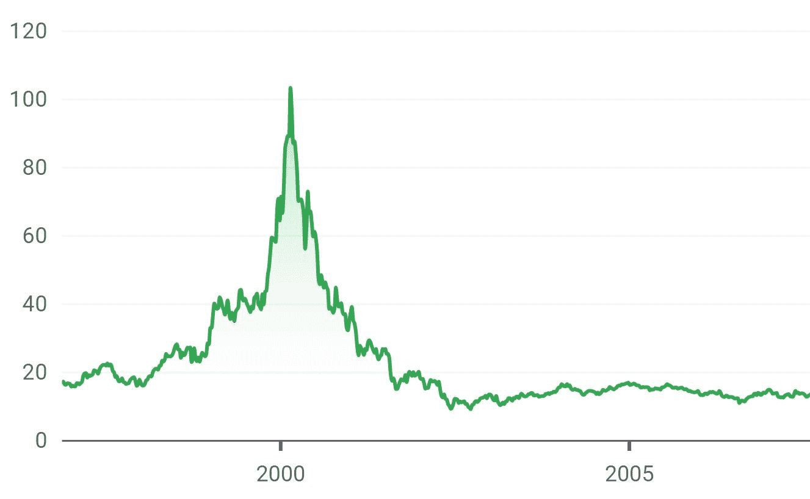
图 78 电信股票价格走势

相比之下，`Bitcoin` 经历了几次泡沫。然而，在“泡沫破裂”之后，`Bitcoin` 的水平一直比泡沫之前的水平高，而且每次价格都比上一个泡沫的峰值高。


图 79 `Bitcoin` “泡沫”从 100 美元到 1200 美元再回  250 美元


图 80 `Bitcoin` “泡沫”从 1000 美元到 20000 美元再回到 6000 美元

还有其他短期“泡沫破灭”的例子。

我们可以看到，短时间的剧烈涨跌并非寻常。从纯事实的角度来看，所示的两次上涨都不是之前泡沫（如互联网泡沫）意义上的泡沫。如果你在整个涨跌期间持有你的币，那么与泡沫之前的价格相比，你的持币量增加了。

相比之下，在真实的泡沫情况下（例如电信股票），人们到目前为止的投资遭受了损失。

与其说是泡沫，不如说 `Bitcoin` 是以波浪形式发展的。在这些波动中，价格快速上涨然后往往再次下跌。它看起来像一个泡沫，但长期趋势明显是向上的，而这在泡沫破裂后并非如此。

比特币价格以波浪方式增长并有时显示快速涨跌的事实往往给人一种泡沫的印象。

此外，这些狂热阶段对加密货币的价值有非常积极的影响。越来越多的人参与到这个话题中。该领域获得了新鲜资金和聪明的头，投资者正在发现新的机会。

我们在上一个小节中也看到，例如 `Bitcoin` 的价格可能仍然远低于价值。我们看到有许多理由认为 `Bitcoin` 具有极高的内在价值。然而，要做到这一点需要理解 `blockchain` 的功能和目的。因此，如果你不能说明内在价值为何低于当前价格的理由，那么谈论泡沫是没有意义的。

恰恰，我们可以看一个记录宣布 `Bitcoin` “死亡”的页面。

[`99bitcoins.com/bitcoin-obituaries/`](https://99bitcoins.com/bitcoin-obituaries/)

总共，`Bitcoin` 被宣布死亡了 400 多次。


# 汉诺威陆官学校，1990 年 6 月 28 日

## 9.3 比特币可以被破解

关于比特币毫无价值的下一个论点是，黑客只需要进行一次攻击，就能摧毁比特币过去几年建立的所有信任。从原则上说，这是完全正确的，但该命题表述有误。尽管如此，媒体和高级名人仍在传播这一观点。

“网络盗窃”

“区块链黑客已盗取了超过 136 亿美元”。

来源：[`www.internetworld.de/sonstiges/bitcoin/blockchain-hacker-13-6-milliarden-us-dollar-gestohlen-2600349.html`](https://www.internetworld.de/sonstiges/bitcoin/blockchain-hacker-13-6-milliarden-us-dollar-gestohlen-2600349.html)

我们已经看到，猜测他人的私钥几乎是不可能的，但区块链本身有多安全呢？毕竟，我们不断读到比特币被破解，数十亿美元的资产被盗取。

区块链是一个去中心化系统，这意味着它没有黑客可以利用的中心节点，不像储物箱、银行网点或超市的收银台。当谈到“比特币账户被破解”时，通常是私钥被盗了，例如是因为它在电脑上没有保护，而相关人员感染了病毒。也有为人知的人被勒索交出私钥的案例。

另一种骗局是不安全或欺诈性的钱包，它们假装生成随机私钥，实际上却将其存储自己，从而获得了访问账户的权限。因此，使用安全、经过证明的供应商至关重要。

到目前比特币被“破解”的最后一种是中心机构（例如交易所）被破解。服务器被入侵，私钥被盗，正如 2013 年 Mt.Gox 黑客事件那样。


比特币背后的区块链技术与这些事实完全没有关系。它们总是黑客可以利用的中心攻击点，无论是加密货币交易所还是个人电脑。

因此，我们绝不应该在交易所平台上不必要地存放硬币（特别是当涉及大额时），而应该将它们发送到我们的地址，只有我们拥有该地址的私钥。毕竟，否则控制权又回到了中心机构手中。

原则是：“不是你的密钥，不是你的币”。

从技术上讲，区块链是不可破解的。

要破解比特币，必须破解诸如椭圆曲线或 `SHA256`算法等经过证明的原则。这在实践上被认为是不可能的。信用卡公司或美国军等政府机构也依赖这些技术。`SHA256` 算法 20 年来一直被认为是不可破解。

在消除这个神话后，让我们来看下一个方面，这个方面经常被完全误解。

## 9.4 比特币效率低效

比特币目前每秒向区块链写入大约七到八笔交易。相比之下，Visa 或 Mastercard 等支付提供商每秒处理 `10,000` 多笔交易。

结论是：比特币是低效！为了执行几次交易，必须消耗大量的电力和资源。

这些是合理的反对，但当我们听到这些论点时，就知道发言者并没有研究过比特币技术，也没有理解比特币的含义。

要做到这一点，我们首先需要理解效率意味着什么。因为为什么比特币需要这么多电？所有“消耗”的能量都去了哪里？

与通常理解相反，这并不意味着我们将电能转化为交易。这从来不是比特币的首要目标。就这一比较而言，像银行这样的中心实体效率要高得多。

比特币的创建是为了建立一个去中心化的、安全的、不可侵犯的系统，在这个系统中没有参与者可以被中心机构阻止或审查。复杂的数学算法通过挖矿计算。结果存储在区块链中。使用的能量越多，破解算法就越困难，网络就越安全。

比特币将生命最低层次的能量转化为安全性。挖矿是产生去中心化最有效的方法。对于所有其他如 `Proof of Stake` 等共识方法，电力都是被浪费的。而在挖矿中，能量 100%流向了安全性。随着更多的矿工连接到网络以及消耗更多的能量，`nonce`要求会通过 `Mining Difficulty`（挖难度）进行调整。解决区块会自动变得更加困难。这意味着结果——经过验证的区块将更加安全。攻击者必须向系统投入更多能量才能以 `51%` 攻击的形式“破解”区块链。

我们还看到，没有其他加密货币，也没有其他共识算法能够保证这种安全性。

举个例子，让我们以太坊为例，它可以保证显著更多的交易。一个区块不需要十分钟，只需要十到二十秒。那么它的效率更高吗？如果我们以每笔交易的纯能量作为基准，那么：肯定的。但正如我们所看到的，这过去和现在都不是比特币的目标。

比特币被刻意设计成是缓慢且迟钝的，因为这是确保最佳安全性的唯一方法。

比特币区块更小、更慢意味着需要更多的计算能力。这反意味着对于相同数量的区块创建了更多的安全性。

人们还经常认为技术已经过时，有更好、更快的加密货币。它们可以处理更多的交易，同时仍然支持很多功能。这也是一个误区。


图 81 加密三角困境

正如生活一样，在密码学中，我们必须在中心化、安全性、速度等等方面进行权衡。这不是一个必须在两件事之间决定折中方案的难题，而是一个三难境。在去中心化、安全性和速度的三难境中，人们无法实现这三个目标中的至少一个。

某些山寨币比比特币更中心化得多，每秒可以处理显著更多的交易。因此，它们并不更现代，没有更好的技术，或者在任何其他方面都不优于比特币。它们只是选择了不同的折中方案。

一旦你理解了去中心化的、不可摧毁的价值存储的意义，你就会意识到比特币既不过时，也不低效。

尽管比特币被刻意设计得缓慢且迟钝，但它仍然可以作为支付手段。。我们将探讨下一个支付神话。

## 9.5 比特币不适合作为支付手段

下一点与之前关于比特币效率低效的观点有许多重叠。由于比特币目前每秒仅有七到八笔交易，非常缓慢，产生了比特币永远无法成为支付手段的神话。


图 82 比特币作为物理支付手段可行吗？

这完全正确。我们已经看到，目标从未是在区块链上实现尽可能多的交易，而是让现有交易尽可能安全！比特币是不可侵犯的。世界上没有任何国家或财团可以接管这个网络。

然而，通过技术进步，可以将比特币作为支付手段并保持核心安全性。

已经有了技术解决方案，例如通过压缩交易大小，从而在一个区块中放入更多交易，例如通过一个名为 `Segwit` 的扩展。


通常情况下，一个交易由一半数据和一半签名组成。Segwit（隔离见）减少了对签名，使得一个区块可以容纳近两倍的交易。这意味着比特币区块链每秒可以进行 14 笔交易。十四笔交易已经比七或八笔多了，但我们已经看到，如果要让比特币作为大规模支付手段，这个数字必须达到数万笔。


由于比特币区块链主要侧重于确保网络的安全性和不可侵犯性，因此可能永远无法直接在区块链中运行所有交易。对于小额交易，由于高昂的交易成本，完全不符合效益。

随着比特币区块链交易需求的增加，交易成本也随之上升。在几年后，每笔交易花费数百欧元可能成为常态。

这是否意味着比特币不是一种可选的支付手段？

比特币是一场全球运动，拥有庞大的社区和数千名活跃的程序员，他们每天致力于网络的进一步开发。如果认为比特币面临的挑战没有技术解决方案，将是天真的。近年来发展巨大的例子就是所谓的“二层解决方案”。

## 第二层解决方案

二层模型基于这样一个理念：区块链作为一个稳定的、最底层，但我们可以在这一层之上构建更多的层。区块链被称为主层。

这可以比拟。我们互联网的基础是 `Ethernet`（以太网）协议。更多的层构建在这个最底层协议之上，例如每台计算机接收的 `IP` 地址。进一步的协议（如带有 `HTTPS` 协议的互联网浏览器）构建在 `IP` 地址之上。每一个新层都会带来新功能。例如，`HTTPS` 层为数据传输提供了安全保障。当我们上网并在浏览器中看到锁头图标时，我们都在使用 `HTTPS` 协议。


图 83 HTTPS 是安全互联网连接的缩写

正如我们所看到的，区块链不需要安全更新。然而，二层协议可以帮助我们解决速度问题。

通过在区块链之上构建更多层（新技术），交易数量可以扩展到每秒数千笔。

到目前为止，关于二层模型具体是什么样的，还有许多不同的方法。例如，我们正在研究一种非常有前景的技术：闪电网络（Lightning network）。

## 闪电网络

闪电网络是一个独立的网络。比特币可以在此网络内发送。选择“闪电”这个名字是因为交易可以以光速传输。

闪电网络对于小额支付很有意义，例如当我们想买一杯 2 欧元的咖啡或 40 分钱的面包时。为这些交易发起单独的交易（并将其永久存储在区块链中）所付出的精力是不成比例的。

闪电网络既简单又精妙。我们将比特币从比特币区块链发送到闪电网络。为了做到，我们在比特币区块链上锁定比特币，使其无法再次使用。为了实现这一点，我们需要在比特币区块链上进行一次性交易。

我们可以在闪电网络上发送被锁定的比特币，并从其他闪电网络用户那里接收比特币，这些用户之前在主链上锁定了比特币。

闪电网络内的交易仅由闪电网络内的双方存储。比特币区块链并不感知。只有当一方进入或离开比特币区块链时，才会创建交易。


图 84 将比特币传输到闪电网络

我们可以将该系统想象成我们有一个银行账户（比特币区块链上的比特币账户），从中从中提取现金。我们将资金从一个网络（银行账户）转移到另一个网络（现金系统）。

有了现金，我们可以与任何有现金的人进行交易。这种转移不需要支付费用，而且通常比必须等待一天的转账要快。

如果我们想在比特币区块链上再次使用比特币，我们必须再次存入与“提取”相同数量的比特币。

闪电网络所有交易的差额作为一笔交易存储在比特币区块链上。

闪电网络内部的交易历史并不存储。这有一个积极的副作用：由于交易没有被存储，想要追踪某人向谁发送了多少比特币就不再那么容易了。

从外部看，只有总余额显示没有比特币丢失。

闪电网络（像许多技术一样）仍处于婴儿阶段。目前，仍然需要大量的技术知识才能将比特币从网络中取出并发送到闪电网络等。

全球已有数千万用户在使用闪电网络，并且每天都有更多人加入。


图 85 当前所有活跃闪电节点的分布  

来源：https://explorer.acinq.co/

随着时间的推移，这项技术将进一步发展并变得适合大众使用。未来，一个简单的手机 App 可能让近乎实时的廉价比特币传输成为可能。

## 9.6. 量子计算机摧毁比特币网络

有些懂技术的人经常会抛出这样一个论点：量子计算机可以轻易破解比特币的加密，导致整个网络崩溃。作为一个外行，这听起来像是一个合理的论据。然而，事实并非如此。为了理解量子计算机在多大程度上构成威胁，让我们来看看量子计算机到底是什么，它们是如何工作的，以及这对比特币有什么影响。

我们在密码学基础课程中学习了单向函数。这些函数在单方向上非常容易求解，但在反向则没有那么简单。应用于比特币网络，这意味着我们可以很容易从私钥推断出公共地址，正如我们在“比特币可以被黑客”中讨论的那样。

这种函数像椭曲线一样，被称为数学难题（mathematical hard problem），而量子计算机计算这些问题的比传统计算机快得多。量子计算机不像普通计算机那样使用 1 和 0 进行计算，而是使用非常小的部分，所谓的量子粒子或 `qubits`。这些可以是电子或光粒子。这些粒子的特殊之处在于，它们的属性允许我们同时进行多次计算，而不是一个接一个地进行。

这意味着量子计算机获得与传统计算机相同数量的结果，所需的计算量要少得多。

这既是对 `SHA256` 算法的攻击，也是对从私钥生成公共地址的椭曲线方法的攻击。

无论，破解这两种方法在理论上确实是可能的。然而，目前我们距离此还遥远。一些估计认为，量子计算机的计算能力还需要增加数百倍到数千倍，才会产生真正的攻击危险。量子计算机也非常昂贵，只有像 Google 这样的大型公司正在开发。


图 86 今天量子计算机的尺寸

量子计算机无法与普通计算机进行比较。量子粒子必须经过仔细的处理和评估。它们在 -270 摄氏度下工作，需要巨大的能量。


像 Google 这样的大公司，其重点显然不在于开发期间攻击加密货币。

对这一点的异议在于，在过去的 50 年里，我们见证了技术进步得有多快。因此，让我们假设量子计算机将发展为日常设备。

一旦明显看出量子计算机可能对加密算法构成威胁，网络将把之前的算法替换为量子安全算法。正如我们所见，这通过分叉（fork）就能实现。`SHA256` 算法可以被另一个量子安全算法取代，而网络将像以前一样继续运行。此外，我们已经看到 `SHA256` 算法也被政府和情报机构使用。它们面临着同样的理论性攻击场景。

量子安全算法已经存在。量子计算机是否真的会对密码学构成威胁，或者它将仅仅只是一个理论问题，这是即使是量子物理学家也无法毫无疑问地预测的。

无论如何，比特币网络都能轻松避免这种情况。再次强调，这种论点并没有让 `Bitcoin` 变得危险的更深层次的实质。

既然我们已经破除了许多技术神话，让我们来看一些经济方面吧。

### 9.7 Bitcoin 被用于非法活动

你经常在新闻中听到，`Bitcoin` 和其他加密货币被黑手党或恐怖组织用于在暗网进行非法活动。特别是在加密货币的早期几年，情况确实如此。

`Bitcoin` 由于其低调性被视为一种私有币，并被用于购买武器和毒品。这之所以可能，是因为当时 `Bitcoin` 网络尚未普及，而且不存在伪匿名性。如今，该网络已经更加普及。进入和退出 `Bitcoin` 网络的节点，即加密货币交易所，大部分都受到国家机构的更严密控制。

由于其透明性以及由此产生的伪匿名性，`Bitcoin` 完全不适合作为非法活动的支付手段。

加密货币用于所有非法交易的比例不到百分之一。这些交易中的大多数是通过法币货币（主要是现金）进行的。这与像 `Bitcoins` 这样的开放区块链不同。

因为对于 `Bitcoin`，每个人都能看到交易历史，并确切知道谁有多少钱，以及是谁把钱发给了谁。这种现象是如此普遍，以至于“内部圈子”都知道哪些地址和哪些硬币源自非法活动。这些硬币对社区已经几乎没有任何价值了。没有人想收到来自已知是毒枭或黑手党老板账户的硬币。

与非法活动相关的硬币也被称为“脏币”（tainted coins）。

脏币是指与非法活动相关的硬币，因此几乎不被社区接受。它们的价值低于其他硬币。由于区块链的透明性，`Bitcoin` 也是如此。

随着网络增长和交易增加，时间的推移，越来越多的硬币会被污染或部分污染。

大型交易所还维护着记录哪些硬币被视为脏的数据库。这意味着，如果硬币的大部分被污染，交易所将拒绝该硬币。

脏币问题可以通过将脏硬币与非脏硬币混合来解决。在这里，像 `Monero` 或 `Dash` 这样的私有币提供了解决方案。如果将一个脏硬币加入包含 99 个“洁净”硬币的交易池中，输出结果平均只有 1% 是污染的。

一方面，这有意义，因为它没有进一步限制货币供应，因为某些硬币的价值低于其他硬币。

另一方面，这反过来为非法活动打开了大门。然而，我们已经看到，确保某种程度的隐私是有意义的。

在安全与自由，或安全与隐私之间，必须找到折中方案。

但我们为什么需要隐私呢？那些无事可隐的人当然不会求助于私有币，对吧？


然而，如果价格在短时间内急剧下跌，怀疑就会开始蔓延。关于这项投资是否是明智决定的不确定性随之增加，在经过一番思索后，人们会亏损卖出。卖掉一个你不信服的资产类别通常并不是错误的。你始终必须将价格与基本面联系起来。在加密货币的情况下，几乎在任何时候卖出都是错误的决定。

应对这些市场影响只有两种补救措施：

更多的长期资金需要流入加密市场。大型投资者（所谓的`巨鲸`）和公司需要对市场进行投资。

这意味着从相对角度来看，流入和流出的影响较小。这正是我们几年来所看到的。大型投资者、基金经理或私人投资者投资加密货币及其背后的项目。

投资者还需要更好地地理解这一资产类别。

一个从根本上理解 `Bitcoin` 并对其技术和未来充满信心的人，不会因为价格下跌了 70% 就卖掉他们的 `Bitcoin`。价值是至关重要的，而且在不断增长。长期来看，优质商品的价格将始终趋于其价值。

展望未来两、五甚至十年，加密市场可能继续剧烈波动，并由投机者主导。流入市场的资金越多，对技术的深信者就越多，恐慌性买卖就会越少，`Bitcoin` 的价格也会变得越稳定。

所以这个神话在此时包含了一丝真理。尽管随着意识的提高，价格波动将会减少，但现在的价格非常波动，可以被视为投机行为。

`Bitcoin` 是否太贵只能主观地进行评估。

最后，让我们来看一条关于 `Bitcoin` 的经济学陈述。

### 9. 通货膨胀破坏经济

我们已经看到，我们现行的通胀性货币体系从长远来看注定会失败。

中心实体（如中央银行）拥有从无中创造货币的能力，并因此通过导致货币购买力贬值来有效地剥夺任何储蓄者。

然而，人们必须客观地看待责任。因为中央银行只是在执行经济、国家和股东的要求，即向市场注入新货币以人为地维持经济的活力。中央银行没有其他选择。它们唯一的能力就是打印新货币或销毁现有货币。

这就是为什么越来越多的声音越来越大，尤其是 `Bitcoin` 最大主义者。他们声称不平等不是由于系统的参与者，而是由于通用的通胀性货币体系，这个体系注定会失败。

通货膨胀的反面，即货币供应量的稳定增长，是通缩，正如 `Bitcoin` 的情况。货币量始终保持不变，甚至随着时间的推移而减少。

由于我们世界上的其他一切几乎是无限的，无论是黄金、手机或汽车等产品，货币的价值随着时间的推移而增加。

在通缩的情况下，一年后你可以用钱比今天买到更多东西。经济商品的价格变得越来越便宜，而不是像我们目前所知的那样越来越贵。

但这种形式的货币体系可以运作吗？

反对 `通缩` 的第一个理由乍看是有逻辑的。如果我们知道在一年、五年或十年后可以负担得更多钱，为什么现在还要花钱呢？

存钱比把钱花在汽车、假期或智能手机上要有意义得多。结果是，消费减少，经济以及整个系统随之崩溃。这个简单的例子表明：`通缩`是不可行的。但事实真的是这样吗？

我们会完全不再去度假了吗？我们会不再买智能手机或汽车了吗？

至少在涉及到食物或住房时，很清楚我们仍然会买面包卷或面条，并支付房租。

最重要的是，在发达国家，人们继续消费。难道我们还想在工作 8 小时后就停止看 `Netflix`，仅仅因为五年后我们可以少付 10% 的费用吗？显然不会。我们也不会让辛苦换来的年假被夺走，仅仅因为明年可以用同样的钱多休一天假。

然而，事实是，我们可能每三或五年才会买一部新智能手机，例如。而且是一个可以使用很长时间的高手机。我们会有意识且可持续地消费。生产可持续公司的将自动获得更多的报酬。

在通缩性货币系统中，我们的系统将为了效率而精简，而不是最大收益。

如果 `Apple`、`华为`、`三星` 或任何其他大手机制造商每年推出相同的手机，而从技术上讲，它与前一个型号没有任何实质性变化，消费者将会考虑是否存钱，因为钱本身会获得购买力。

在这种情况下，公司和服务提供商也将与通缩作斗。他们必须提供更高质量的产品，因为货币的价值比在通胀系统中价值大得多。

切换到通缩系统也是一个巨大的变化。许多公司将破产，因为它们没有为大众提供任何增值，只能通过货币贬值来维持。

所有其他资产类别将自动变得比以前没趣。也许它会让经济陷入暂时的危机，但从那以后它将缓慢且持续地恢复。许多人说，我们不能故意切换到一个短期内削弱经济的系统。然而，替代方案是维持一个在任何时候运作过的系统，它是剥夺储蓄者的基础，并鼓励浪费和不可持续的消费。

`Bitcoin` 作为一种通缩性货币系统是一个具有解决我们许多问题可能的实验，一个值得测试的实验。

## 10. 结语

这结束了我们对 `Bitcoin` 基础和区块链技术的探索。我们学习了密码学和我们货币体系的基础知识。我们知道 `Bitcoin` 如何运作、`Ethereum` 等去中心化网络的潜力，以及在买卖货币时需要注意什么。当然，这只是可以单独写一本书的话题的一小部分。我们并不要求理解每一个复杂背景的每一个细节。最重要的是掌握这个主题，关注风险和挑战，但本身不要无知。

“Bitcoin 是某些伟大事物的开始”

Nassim Taleb - 金融数学家

“起初我不理解它是如何运作的，然后我查了资料，它太棒了。”

Jeff Garzik - Bitcoin 开发者

“Bitcoin 就像黄金，但具有这种神奇的能力，你可以瞬间移动它。”

Vijay Boyapati - 作者兼高级软件工程师

#### 免费电子书

感谢你购买这本书。由于书是由亚马逊直接打印的，我无法控制图像质量，可能会丢失一些细节。

这就是为什么在你购买书时，我免费提供彩色 PDF 版电子书。在那里你可以找到高分辨率的图片，并始终获得最新版本。

要这样做，请以“Bitcoin-eBook EN”为主题，并将购买截图或订单证明发送至以下邮箱地址（私人数据已脱敏）：

Benjamin-Spahic@web.de

我会立即向你发送电子书。


如果您遗漏了某些内容、不满意，或者有改进建议或疑问，请随时向我发送电子邮件。

改进取决于建设性的批评。我正在不断修订这本书，并乐意接受并回应任何关于改进的建设性建议。

如果您喜欢这本书，我将非常乐幸在 Amazon 上收到您的好评。这有助于书籍的可见度，也是作者能收到的最大赞誉。

您的 Benjamin

## 关于作者

Benjamin Spahic（工程学硕士，M.Eng）于 1995 年出生于海德堡，在靠近卡尔斯鲁厄的一个人口仅为 8,000 人的村庄长大。他对技术的激情体现在他在卡尔斯鲁厄应用科学大学的电气工程学习中，重点关注信息技术。

随后，他在卡尔斯鲁厄应用科学大学的再生能源生产硕士项目中深深了知识。

## 免责声明

作者对所提供信息的时效性、准确性、完整性或质量不承担任何责任。对于因使用提供的信息或使用错误、不完整的信息而造成的物质或非物质损害，对作者提出的赔偿请求在法律允许的最大范围内均被排除。本书在任何方面都不代表专业的投资、财富或税务建议，也不替代此类建议。书中未对利润做出任何保证或承诺。所有陈述均代表我的主观观点。

虚拟货币单位（加密货币）的创建是通过私人计算机网络完成，与中央银行和商业银行的货币不同。非国家替代货币的概念（根据 `BaFin`）。这些是具有高度投机性的交易，可能导致全部损失！此外，无法保证描述的功能能够实现。

## 图片致谢

所有未提及的内容均由作者本人创作。因此，他是图表的作者，并拥有使用和分发权。

封面：`https://pixabay.com/de/photos/bitcoin-geld-dezentral-virtuelle-2008262/`

- `https://icons8.de/icon/113140/kugelbirne`
- `https://icons8.de/icon/79638/obligatorische`
- `https://icons8.de/icon/78038/math`
- `https://icons8.de/icon/42314/taschenrechner`
- `https://www.flaticon.com/de/kostenloses-icon/hausturschlussel_69905`
- `https://www.flaticon.com/de/kostenloses-icon/turschlussel_63432`
- `https://www.flaticon.com/de/kostenloses-icon/scrollen_1010122`
- `https://www.flaticon.com/de/kostenloses-icon/data-mining_2091655`
- `https://www.flaticon.com/free-icon/computer_3067260`
- `https://www.flaticon.com/free-icon/contract_1358533`
- `https://www.flaticon.com/free-icon/ok-mark_15333`
- `https://www.flaticon.com/free-icon/dices_1055907`
- flaticon.com/free-icon/bitcoin-coin_37011
- flaticon.com/free-icon/litecoin_1368051
- `https://www.flaticon.com/free-icon/ethereum_2586015`
- `https://www.flaticon.com/free-icon/document_1086563`
- `https://www.flaticon.com/free-icon/shield_508281`
- `https://www.flaticon.com/free-icon/data-mining_2091655`
- `https://www.flaticon.com/free-icon/bank_66262`
- `https://www.flaticon.com/free-icon/chain_174803`
- `https://www.flaticon.com/free-icon/chip_106759`
- `https://www.flaticon.com/free-icon/certificate_3135763`
- `https://www.flaticon.com/free-icon/running_763965`
- `https://www.flaticon.com/free-icon/settings_561135`
- `https://www.flaticon.com/free-icon/padlock_306415`
- `https://www.flaticon.com/free-icon/unlocked_100849`
- `https://www.flaticon.com/free-icon/people-1617361492`
- 抛币：`https://pixabay.com/de/illustrations/m%C3%BCnze-m%C3%BCnurf-bitcoin-hand-5811097/`
- 椭圆曲线：`https://de.wikipedia.org/wiki/Ell_kurve`
- 计算机：`https://www.flaticon.com/free-icon/computer_3067260`
- 封蜡：`https://commons.wikimedia.org/wiki/Sealing_wax_on_letters.jpg`
- BTC 交易费：`https://bitinfocharts.com/de/comparison/bitcoin-transactionfees.html`
- 挖矿难度：`https://www.blockchain.com/charts/difficulty`
- Antminer S19 pro：`https://shop.bitmain.com/release/AntminerS19Pro/overview`
- Litecoin：`https://commons.wikimedia.org/wiki/LTC-400.png`
- 以太坊经典：`https://commons.wikimedia.org/wiki/Ethereum_Classic_ETC_Logo.png`
- BCH：`https://bitcoincash.org/`
- 币安：`https://www.binance.com/en`
- Coinbase：`Coinbase.com`
- 门罗币：`monero.com`
- Ledger Nano S：`https://shop.ledger.com/products/ledger-nano-s`
- Trezor：`https://trezor.io/`
- 量子计算机：`https://www.sueddeutsche.de/digital/quantencomputer-google-technologie-china-quanten-4654011`
- 卡达绪：`https://upload.wikimedia.org/wikipedia/commons/c/c0/Cardano_Logo.jpg`
- 泰达：`https://commons.wikimedia.org/wiki/Tether_Logo.svg`
- 链猫：`https://www.cryptokitties.co/`
- 比特币网络：`https://pixabay.com/de/illustrations/bitcoin-cryptocoin-geld-2640692/`
- 比特币上涨：`https://pixabay.com/de/vectors/bitcoin-investitionen-gesch%C3%A4-5675758/`
- 比特币货币：`https://pixabay.com/de/photos/bitcoin-europa-geld-finanzen-4368670/`
- 比特币接受：`https://pixabay.com/de/photos/bitcoin-kryptow%C3%Ahrung-w%C3%A4-321559/`
- 黑客：`https://pixabay.com/de/photos/hacker-silhouette-hacken-hack-3342696/`
- 挖矿与环境：`https://bitcoinblog.de/2020/12/14/square-kundigt-fonds-fur-grunes-bitcoin-mining-an`


https://commons.wikimedia.org/wiki/Commons:GNU_Free_Documentation_License,_version_1.2Es 可能已修改。

# 索引

- % 攻击: 51
- ADA: 87
- 替代币: 68
- 匿名性: 64
- ASIC 矿机: 51
- 非对称加密: 13
- BCC: 104
- 安币: 92
- BIP32: 97
- BIP39: 99
- BIP44: 101
- 比特: 24
- 比特现金: 52
- 比特市有率: 69
- 比特主网: 53
- 比特-Core: 53
- Bitconnect: 104
- Bitfinex: 69
- Bitman: 51
- 币 (Bits): 20
- 区块奖励: 44
- 区块补贴: 44
- 块链: 7
- BTC: 25
- 凯撒密码: 1
- 卡达诺: 7
- Chainlink: 8
- 纽币 (Coinbase): 92
- CoinJoin: 40
- coincap: 69
- 币: 25
- 冷钱包: 95
- 共识: 33
- 加密货币交易所: 91
- 加密: 10
- DAO: 81
- DApps: 79
- 去中心化: 26
- DeFi: 109
- 通紧缩: 143
- 确定性: 98
- 数字签名: 15
- DOT: 86
- 双重花费: 37, 38
- EIP159: 88
- EIPs: 72
- 椭圆曲线: 17
- EHash: 72
- 以太坊 (ETH): 72
- 以太坊: 71
- 以太坊 2.0: 89
-经典以太坊: 56
- 以太坊: 92
- 法币货币: 6
- FOMO (恐慌症): 126
- 分叉: 53
- Freigeist Capital: 108
- 全节点: 27, 34
- Gyuubi: 10
- Gavin: 73
- 创世区块: 47
- 金本位: 6
- wei: 72
- 半减: 45
- 硬: 4
- 哈希: 19
- 哈希函数: 7
- 哈希算法: 17
- 哈希算力: 37
- HD 钱包: 97
- HODL (长期持币): 11
- 包含费用: 88
- 完整性: 11
- 密钥: 1
- 加密猫咪: 79
- KYC: 123
- Ledger Nano: 95
- 轻节点: 35
- 闪电网络: 135
- 币: 57
- 主层: 134
- 市值: 68
- 大众适应: 25
- 主密钥: 98
- BTC: 25
- 迷因: 111
- 毫比特: 25
- 矿工: 34
- 矿工费: 88
- 挖掘: 33
- 挖掘难度: 50
- 门罗 (XMR): 65
- 门头交易所: 94
- Mt.Gox: 130
- M: 9
- 币: 8
- 网络效应: 14
- 随机数: 4
- 单向函数: 7
- 纸钱包: 95
- 明文: 1
- 波波卡: 86
- POS: 60
- POW: 37
- 隐私币: 65
- 私有币: 65
- 私钥: 13, 15
- 权益证明证明: 60
- 工作量证明: 37
- 伪匿名性: 65
- 公钥地址: 28
- 公钥: 13, 15
- 金字塔骗: 105
- 量子颗粒: 137
- 量子比特: 137
- 签名: 66
- 瑞波 (Ripple): 19
- 中本: 25
- 中本聪聪: 24
- 骗局: 104
- 第二层: 134
- 种子: 97, 99
- Segwit: 134
- 垃圾币: 120
- 智能合约: 74
- 软叉: 58
- 软件钱包: 95
- Solidity: 78
- 源码分叉: 7
- 源代码: 26
- 稳定币: 70
- 哨兵: 82
- 对称加密: 13
- 污染币: 40
- 泰 (USDT): 70
- TEZ: 89
- The DAO: 83
- 代币化: 78
- 交易费: 44
- 交易历史: 27
- 透明度: 64
- 资金库: 95
- 三难困境: 132
- 未压缩公钥: 32
- 维塔·布林: 72
- 波动性: 113
- 钱包供应商: 94
- 钱包: 31
- 巨鲸: 142
- 白皮书: 25

