# 比特币区块链：微支付协议（英文版）


# 关于作者

**Kapil Jain** 是一位在银行业内大型美国和欧洲机构 IT 部门工作的技术专业人士。他在印多尔的 Sri GS 科技科学学院获得工程学位，在行业 18 年的职业经验中，曾担任过程序员、业务分析师、架构师、项目经理和计划经理的角色。

他在基于大型机机的金融应用方面拥有丰富经验，并致力于使用基于 Microsoft 和 Java 的技术栈、云基础设施（包括构建无服务器应用程序）来使这些应用实现现代化。他还使用 MERN 等开源技术栈开发过应用程序，并对 AI/ML 算法进行了实验。在过去的三年里，他深度参与了比特币协议，并实验了其他多种区块链，如 Ethereum 以及 EEA（以太坊版本）、Hyperledger 和 Ripple。

他还担任过几场活动的小组成员。

# 关于评审员

**Jason Jain** 是一位创业者，他创立了 `Yours.org`，这是一个基于比特币微额支付的用户内容创作平台。该平台现在仍然存在，但已仅维持多年前的形式，因为 Jason 随后创建了 `moneybutton` 以解决 `Yours.org` 上不使用静态比特币地址的问题。Jason 还创建了基础比特币开发所需的 `BSV` 加密工具库，对于任何从事密码学以及其在比特币中应用的开发者来说，这都是一个非常好的起点。

# 致谢

我想感谢的下一个人是 `Ryan Charles`。当我开始听、读和探索比特币生态系统时，他是我发现的清醒的声音之一。他曾在（2017 年）创建了一家名为 `Yours.org` 的公司，这是一个基于比特币微额支付的用户内容创作平台。它现在仍然存在，但已仅维持多年前的形式，因为 Ryan 随后创建了 `moneybutton` 以解决 `Yours.org` 上不使用静态比特币地址的问题。Ryan 还创建了基础比特币开发所需的 JavaScript 加密工具库 `BSV`，对于任何从事密码学以及其在比特币中应用的开发者来说，这都是一个非常好的起点。

我特别感谢 `nChain` 团队的几位成员，我读过他们的视频和博客进行学习，特别是 `Steve Shadders` 和 `Jack Davis`。此外，我想感谢比特币 SV 生态系统的许多贡献者和声音，多年来我一直在默默阅读他们的内容并向他们学习。

此外，我想感谢我在比特币 SV 整个开源开发者和业务生态系统中遇到过的许多名字，并从中中学到了很多知识。

我也想感谢 `BPB Publication` 给我这次写这本书的机会。我特别感谢他们非常专业且给予支持的团队，他们在整本书的过程中给予了我指导和创作自由。

最后，我想感谢并感谢我的父母，他们一直在我生活的各项尝试中激励并支持我。

# 前言

如果你拿起了这本书，你可能已经意识到区块链自 `bitcoin` 白皮书诞生以来，在过去的十年中取得了非凡的进展。我将其视为冰山一角，我这本书的目标是带你了解其错综性，以展示区块链真正面貌的全部潜力，以及为什么它是一项足以改变我们所知的互联网世界的创新。

在我们今天谈论这些话题时，有大量的投资和工作正在进行，这不仅是在企业和政府领域，而且在一个充满激情且才华横溢的开源开发者社区中。`Bitcoin SV` 或 `Satoshi vision` 是一种尝试回到 `Satoshi Nakamoto` 在 2008 年发布的原始协议。花费了 3 年时间（2017 年到 2020 年）才消除了系统中引入的所有限制，这些限制曾违背了原始电子点对点现金系统的经济效用。目前仍有一些细微之处需要回滚，而在保持向后兼容性的同时进行这些操作，是一项艰巨的任务，目前正由 `nChain` 的 `bitcoin` 节点软件开发团队完成。

在银行业工作期间，我参与过传统的支付解决方案，包括 80 年代构建且仍在运行的遗留系统。由于多年积累的技术债以及向后兼容性的考虑，加上每个国家不同的本地支付类型和消息格式问题，导致了巨大的开销。这为银行用于处理这些支付的核心支付引擎创造了巨大的复杂性。随着经济日益数字化转型，当许多支付本不应该产生任何费用时，处理成本正变得非常高昂。我在 2016 年接触到区块链的，当时我的雇主想要探索用于智能合约的许可链解决方案。我们是 `R3` 联盟的成员，并进行了一些工作来探索这项技术。我们取得并不成功，构建了许多 `POC` 和 `MVPs`，但它们在用户采用方面从未实现商业化成功。随后我转向了其他技术，例如用于不同用例的数据科学。直到 2017 年 `bitcoin` 第一次硬叉时，我才开始自己探索 `bitcoin`。在 2018 年我意识到原始的 `bitcoin` 协议是什么，并再次阅读白皮书之前，我并没有认真对待它，但这一次我花了几周时间才阅读并理解它。

在过去的十年里，出现了许多协议分叉，如 `Bitcoin Core - BTC`、`Bitcoin Cash - BCH` 和 `Bitcoin - BSV`，此外还有许多甚至不值一提的分叉。有开发者小组获取基础协议，更改一些重大内容，并创建一个全新的公共区块链系统。我们将在书中多次讨论这些局限性，但简而言之，当我开始研究区块链生态系统时，我并不是从 `bitcoin` 开始的，为什么？因为我第一个基于“道道”的印象是它主要用于暗网中的匿名和非法交易。从那时起到理解它实际上是一个与我最初印象相反的系统——一个通过引入不可破解的追溯性来在贸易和交易中创造诚实的系统。这一点在阅读白皮书时可以得到证实，白皮书中提到了约 14 次“诚实”，但没有提到过 `Blockchain` 等名称、匿名性或任何违反法律体系的内容。

随着私有链或许可链的出现（这些目前是大多数企业区块链投资的领域），即使在共同联手的参与者中，其采用率也很低。原因有很多，但对我来说，如果区块链是许可的，它的目的就丢失了，因为将需要与当前系统相同的规则和程序，包括信息安全方面，随着黑客掌握的工具变得日益复杂，这一点正变得越来越至关重要。在该领域投入了十多年的兴趣、激情和工作后，我们仍然渴望看到从区块链领域产生并被普通用户采用的现实应用。由于原始的、最初的 `Bitcoin`（这也是最初的全球公共区块链）的力量，现在正在发生改变。

`Bitcoin` 协议通过其公开存储信息的属性来实现网络安全，这种存储方式使得即使以明文形式存储并供任何人验证，仍然能够保护所有者的身份和交易。我们将在书中学习它是如何实现的。这本书旨在消除笼罩在整个领域的迷雾，这些迷雾阻止了对这项技术的真正理解；在历史上，它将像互联网或为汽车制造第一台内燃机一样脱颖而出。

在过去的两年里，项目数量呈指数级增长，`Bitcoin SV` 区块现在被认为是唯一可以扩展到每秒数百万甚至数亿交易的公共或私有区块链，并且可能拥有最优秀的专利组合（约 1000 个且仍在增加，专利如 `threshold signatures`、`SPV`、`Rabin signatures`、`R puzzles`、`secret sharing with multiparty communications` 等），这些技术通过 `OPEN BSV` 许可证免费提供构建（仅允许在 `Bitcoin SV` 区块链上构建）。

我带来这本书作为一份学习指南，针对那些感兴趣但尚未能开始阅读学习，或者被众多区块链的“旧瓶装新酒”版本搞得不知所措的人，让他们退后一步，看看创造这个行业的原始想法是什么，以及 `bitcoin` 到底是什么——一种用于微支付、数据存储和开放贸易的协议，它是实时的（瞬间）、廉价的（费用为千分分之一的分钱）且真正安全的（通过使用 `POW` 系统实现拜占庭容错）。

我想重申的是，我将这本书视为生态系统中可用大量信息和文献的汇编，我尝试以这种方式让一个从未听过比特币的人能够通过阅读和学习，成为比特币点对链的开发者、创造者、构建者、作者或用户。

—Kapil Jain

# 关于这本书

这本书写给任何希望从零探索 `Bitcoin protocol` 或加宽对 `Blockchain overall`（区块链整体）理解的人。无论你是执业的区块链专业人士，还是思想领袖、高管、技术人员，或是对区块链没有或了解背景的学生，你都能在这些页中发现价值。

这本书对 `bitcoin` 区块链的每一个方面进行了实用的深度探讨，包括密码学背后的数学和协议的错综性。它关注核心原理和基本概念以解释区块链类型系统的构造，并对使用它构建的协议、应用程序和实用程序提供了详细概述。在开发者可以获得更多实操接触的地方，我们都提供了链接。

我想再次强调，这本书不需要你具备任何区块链方面的背景，只需要对学习新的思维方式具有强烈的好奇心和渴望。它不仅涵盖了交织在一起创造出创新的思想和概念（这种创新不仅将改变现有的 IT 产品和服务世界，还将定义并引领未来应用程序的开发方向），现有系统在扩展性、运营成本和 IT 安全方面面临许多局限性。本书介绍了如何通过使用 `bitcoin` 区块链来为这些局限性提供解决方案，同时仍为各种可能的场景和业务用例创建 IT 应用。这一切背后都有理性的、经济的和法律依据。基于此，本书将吸引以下读者：

*   对开发 Web 和移动端应用感兴趣，并正寻求探索区块链技术的开发者。

*   参与 IT 应用和产品开发的架构师、技术经理，他们兴趣深入研究区块链架构，以及如何将现有应用程序转型为基于区块链的系统，从而在成本、扩展性、安全性和健壮性方面提高效率。

*   顾问和高管，通过理解 `bitcoin` 区块链带来的广泛变革，将获益匪浅。他们将更深入地了解如何为 B2C 和 B2B 生态系统构建现有及未来的业务用例，其中某些传统和遗留技术架构无法实现的案例。

本书最适合具有某些 Web 应用开发或技术背景的读者，但对计算机科学的了解已足以理解本书。`bitcoin` 协议使用 `JavaScript`、`C++`、`Java`、`Python` 实现，但协议本身是一组规则和函数的集合，应用程序可以用任何语言实现，使得协议本身与语言无关。在当前的生态系统中，绝大多数工具和实用程序使用 `JavaScript`/`Node JS` 和 `MongoDB` 等开源技术进行开发，因此具有相似经验的读者将轻松上手这些工具。

## 我将本书分为三个部分。

第一部分（`第 1 章` 到 `6 章`）侧重于过去，对协议及其经济激励结构进行了深入且全面的概述。它详细介绍了密码学、地址、钱包、交易、网络和挖矿的细节。

### `第 1 章` 从对 `bitcoin` 协议的总结和概述开始，解释了 `bitcoin` 白皮书中描述的其定义。它从电子现金系统的历史开始，介绍了什么是区块链、什么是交易、什么是区块，以及区块链的关键方面。它还介绍了 `bitcoin` 不可篡改的公共账本及其属性。

### `第 2 章` 深入探讨了 `bitcoin` 运行的独特性及其使其能够诚实运行的经济模型。介绍了系统中内置货币的网络结构和用途，并描述了 `bitcoin` 的网络结构，随后详细讨论了去中心化的理念及其含义。

### `第 3 章` 回到基础，从解释 `bitcoin` 中使用的数学和密码学概念开始。它涵盖了 `bitcoin` 协议中使用的 `ECDSA` 基础设施细节，以及签名和签名验证的工作原理。本章还涵盖了生成 `bitcoin` 地址的步骤，以及公 bitcoin`私钥钥 中的工作原理。

### `第 4 章` 讨论了 `UTXO` 系统。它解释了钱包的类型及其用途，以及基于账户的系统。本章还讨论了 `SPV`（简单支付验证）的细节。

### `第 5 章` 深入研究 `bitcoin` 中名为 `Script` 的内部编程语言。它详细说明了作为脚本部分的各种 `OP Codes`，以及在执行交易时如何处理输入（input）和输出（output）。

### `第 6 章` 通过讨论矿工和挖矿结束了 `第一部分`。它深入探讨了网络共识的基础、`BFT` 算法和区块创建过程，以及 `BTC` 和 `BCH` 等各种分支的历史。本章还简单介绍了挖矿作为一种业务的现状。

## 本书的 `第二部分` 专注于 `bitcoin` 生态系统的现状。它讨论了应用开发领域正在发生的情况，这些开发运行在 `bitcoin` 区块链之上，也可以被任何应用的后端开发。

### `第 7 章` 从讨论名为 `Metanet` 的变革性应用协议开始。`Metanet` 是一种用于 `bitcoin` 协议之上的协议，作为身份和信息交换的方法。长期目标是让该协议成为一个可以在其构建应用程序的环境，让用户重新掌握其数据隐私，并摆脱目前基于广告的模式。

### `第 8 章` 讨论了随时间构建的各种应用层协议，这些协议构成了基础基础设施，可以使用 `bitcoin` 区块链作为数据存储、交易和认证层来构建任何应用。

### `第 9 章` 查看区块链如何作为数据存储工作，并详细探索了 `BitDB` 框架及其查询语言。这是第一个使用区块链数据库的正式数据结构框架之一。我们还查看了有助于 `bitcoin` 区块链 `CRUD` 操作的其他各种实用程序，它们都是 `BitDB` 框架的一部分。

### `第 10 章` 更多关注 `Planaria` 工具系统中的基础设施级协议，这些协议不仅专注于构建面向消费者的应用程序，也同样适用于构建大规模企业或政府应用。本章还将展望使用 `bitcoin` 区块链进行应用开发的更大愿景，以及该技术提供的巨大可能性。

### `第 11 章` 带你进入一个领域，我们将浏览涵盖生活的各个领域、互联网贸易和业务建设中数百个项目的 `bitcoin` 应用开发生态系统，构建使用 `bitcoin` 区块链以及我们讨论过的其他协议的解决方案。本章展示了我们目前为止讨论的理论如何在真实的消费者和业务/企业应用中实现。

### `第 12 章` 回到重新审比特币区块链的高级身份系统创建，以及支付协议，例如一个名为 `paymail` 的想法。该想法旨在简化大数字地址的使用，将其转变为类似于电子邮件地址的形式，使其不仅适用于技术精通的用户，也能让普通人使用。本章还简要介绍了 `BIP270`，这是另一种 P2P 支付协议。

### `第 13 章` 深入探讨了在比特币区块链上正在开发并实现的各种代币化协议。与常见的误解不同，在创建法律代币和智能合约方面，这与目前的代币和智能合约生态系统非常不同，它们不需要任何新法律。本章作为该章节的总结，涵盖了目前比特币区块链上存在的所有应用层协议。这并不意味着未来不会出现新协议，但它为目前可能实现的方案提供了非常详尽的视角。

## 第三部分 本书侧重于未来，即利用目前软件开发行业正在探索的各种新兴技术进行高级应用。我们还关注了法律和监管方面的未来，这将决定整个区块链行业的成败。

### `第 14 章` 简要介绍了如何通过比特币区块链提供的高质量数据，利用 AI 和机器学习来增强区块链的使用。我们将查看其他各种概念，如细胞自动机、物联网（IoT）、大数据以及创建与比特币区块链集成的自主代理。

### `第 15 章` 作为本书的最后一章，通过回顾在书中讨论过的各种术语和概念，从法律角度重新观察区块链。它还探讨了在监管方面哪些法律属性尚未实施，以及税收将如何应用于比特币。它还介绍了什么是许可链，以及中央银行正在探索的首批用例之一——`CBDC`。至此，本书完满。

读完这本书后，你对比特币区块链和协议将有坚实的理解，并对工具、协议和实用有一个良好的概述，这些工具将帮助你构建现实世界的企业和消费者应用。这种概述将使你能够快速理解不仅是比特币，还有任何存在的区块链，因为所有它们的核心概念都是从比特币中汲取的灵。

如果你是一名在非正式或正式背景下学习区块链的研究生，你会发现这本书是你教育的实用补充，帮助你建立对导致比特币区块链网络发明的基本概念的直觉，并熟悉关键的最佳实践。

你还可以通过书中附录提到的各种项目和教育资源学习更多关于比特币的知识。

在此，我希望带你开启使用互联网、货币和应用开发的新方式之旅，希望你喜欢这段旅程。

# BPB 正在寻找像你这样的作者

如果你兴趣成为 BPB 的作者，请访问 `www.bpbonline.com` 并于今天申请。我们已经与成千上万像你这样的开发者和技术人员合作过，帮助他们与全球技术社区分享见解。你可以提交通用申请，申请我们正在招募作者的特定热门话题，或者提交自己的想法。

本书的代码包也托管在 GitHub 上，地址为 `https://github.com/bpbpublications/Bitcoin-Blockchain`。你可以查看一下。

# 盗版 (Piracy)

如果你在网上任何地方发现我们作品的副本，如果你能向我们提供地址或网站名称，我们将不胜感激。请通过 `business@bpbonline.com` 联系我们。

# 如果兴趣成为作者

如果你对某个领域有经验，并兴趣贡献书籍，请访问 `www.bpbonline.com`。

# 评论 (Reviews)

请留下评论。当你阅读并使用这本书后，为什么不在你购买的网站上留下评论呢？潜在读者可以根据你的客观意见做出购买决策，我们 BPB 可以此了解你对产品的看法，我们的作者也可以看到他们的反馈。谢谢！

关于 BPB 的更多信息，请访问 `www.bpbonline.com`。

# 章节 - I

## 第 1 章

### 比特币协议：起源与概念

**“在怀疑怀疑之路上，我必须经过模糊之谷。”**

*- 亚当·斯密 (Adam Smith)*

比特币在技术协议如何构建、实施以及它如何改变互联网应用及其架构方面是一种新范式。这与目前用户和企业使用的设计模式、架构和数据库结构非常不同。本章将带你了解比特币协议概念的根、整体结构以及创建比特币区块链的一些原则。

#### 结构

*   电子现金的历史
*   比特币作为价值交换网络的协议
*   什么是区块链以及比特币如何工作
*   比特币是一个经济系统

学习本章后，你将能够了解一些历史以及创建电子货币系统的早期尝试。概览比特币区块链以及比特币中的交易管理系统。你还将学习比特币背后的思想，即为什么比特币不仅是一个加密系统，更是一个经济系统和不可篡改的证据链。你将学习更多关于区块的知识，以及区块是如何连接在一起并形成一个存储交易信息的带有时间戳的服务器的。

#### 比特币：点对点电子现金系统

世界上很少有某种创造物能给人类社会带来如此巨大的变化，触及每个人的生活，并改变我们的思考方式、生活方式以及相互互动的方式。这些变化在发生时，会经历无知和拒绝、蔑视和反制、注意到和承认的阶段，然后在被接受和采纳之前经历等待和观察。电力就是其中一个例子，互联网的创造也是如此。


我相信我们正处于这样一个时间节点，即将亲眼见证另一项此类发明的诞生，它将像互联网一样接管现有的规范。这将实现一种更加透明、独立、即时且负责任的价值交换媒介，创造出自由市场所需的完美工具，赋予个人真正的财务主权感。它可以帮助创建决策和权力结构看起来非常不同且非中心化的组织；它可以帮助使社会治理变得更加透明高效；它可以帮助建立一个基于激励模型而非广告模型的互联网；它可以强制启动一场创新硬件和软件原则及架构的革命。

是的，我的铺垫可能会引发最大的怀疑想法，但这正是我意图在这本书中带你开启的旅程，将从技术和经济两个方面探索这一千难一逢的机会——创造一种真正自由的市场商品，以及一种完全不依赖单体孤岛的全新应用设计方法。它带有一个公共数据存储（账本），其中任何记录都无法被删除以掩盖腐败，并且可以将用户的每一次按钮点击或用户操作关联为如内容创作、游戏和物联网等事务的微交易，但它拥有一种近乎保证的安全模型，可以击败目前存在的最佳实现，而成本仅为其碎片。让我们开始这段名为“比特币”的旅程吧，我觉得这段旅程开始可能是一个充满不确定过程，因为它挑战了许多现有的规范，但每一个带来根本性变化的创造物都是这样做的。

自从计算机出现以来，人们一直认为物理货币或纸币在未来的某时刻可以被电子货币取代。自 20 世纪 80 年代以来，这种想法变得更加主流，出现了一系列尝试来创建这种传说中的电子货币。我将介绍几个著名的尝试，以预览那些留下印象的思维过程，而这些尝试虽然没有成功，但作为创建电子现金的早期努力，确实产生了影响。

### Ecash

`Ecash` 是创建电子货币的早期尝试之一。它由美国密码学家大卫·查姆（David Chaum）构想。他在 1983 年基于加密电子现金系统创建了作为匿名电子货币的 `Ecash`。他在名为 `Digicash` 的公司下进行这项工作，该公司后来在 1995 年至 1998 年间与几家银行（马克汤文银行、德意志银行）合作，为美国、澳大利亚和欧洲提供微支付系统。它取得了有限的成功，最好的结果来自美国银行，拥有约 5000 名客户。该美国银行被另一家大型信用卡发行商收购，最终他们停止了使用 `Ecash`。它被关闭的主要原因之一是它是匿名的，而信用卡系统不是，这使得更好的解决方案胜出。尽管在 1998 年电子商务行业蓬勃发展，`Digicash` 还是破产了，当时信用卡解决方案在货币选择的战斗中获胜了。

### B Money

`B Money` 是一种假设的方法，它因一些优秀的想法而获得认可，因为提出了另一种实现电子货币系统的严肃可行方法。它由计算机工程师、华盛顿大学毕业生大卫位（Wei Dai）构想。他在 1998 年发表了一篇论文，引入了 `B-Money` 的想法。他试图构思这个系统，并深受蒂姆·梅（Tim May）理想主义加密无政府主义世界的灵感——在那个世界，政府不仅被临时摧毁，而且被永久禁止且永远没有必要。它假设一个社区使用它自己的：1. 交换媒介和 2. 执行合同的方法。这两项服务传统上都由政府提供，实际上是用这个新系统取代了政府。它假设存在一个不可追踪的网络，其中发送者和接收者通过公钥进行识别，每条消息都由发送者签名并对接收者加密（伪匿名）。

该系统中的货币可以由任何能提供以前未解决计算问题解决方案的人创建，产生的货币单位与计算工作量成正比。货币转移可以通过发送者和接收者在网络上广播提议的交易来实现。这要求所有用户默认运行一个连接到网络的计算机系统。它还涉及一个在需要执行合同时进行仲裁的第三方。如何设置仲裁员（第三方）的问题通过一个提案解决了，即使用第二个协议由一组在某种程度上需要信任的参与者来维护账户账本。监控这个子集的机制是，他们需要向一个特殊账户存入一定数量的货币，以便后在发生不当行为时作为罚金。

由于在货币创建正确方法、提议的网络不存在以及使用复杂性方面的各种挑战，该系统从未被实现。

**参考：** [`www.weidai.com/bmoney.txt`](http://www.weidai.com/bmoney.txt), W. Dai, “b-money”, 1998.

### Ripple Pay

Ryan Fugger 在 2004 年创建了一个社区驱动的开源项目名为 Ripple Pay，正如他所定义的：*Ripple 是一个基于我们普通社会和商业关系中存在的信任的新型货币系统：*

*   我的欠条只会被那些信任我的朋友所接受。我不会向陌生人付款。
*   我的每位朋友只会接受我提供的不超过特定金额的欠条，这取决于他们每个人对我的信任程度（通过他们愿意提供的提供的信用额度来衡量）。
*   如果我的朋友接受了我的欠条，他们就不能在我的信任的朋友圈之外将其作为货币使用。

创建一个由互信信任的社区运行的社会物物系统应用，而不是信任像银行这样的机构。这构成了未来 Ripple 和 XRP 实现加密货币的基础。

**参考：** [`ripple.ryanfugger.com/decentralizedcurrency.pdf`](http://ripple.ryanfugger.com/decentralizedcurrency.pdf) Ryan Fugger. 《社交信任网络中作为欠条的货币以及一种去中心化货币网络协议建议》。2004 年 4 月 18 日

曾有少数其他创建电子现金/去中心化货币的尝试，例如 Mojo Nation (m-net)、Edonkey 和 Liberty reserve，但这些尝试在小群体中也仅取得了微小的成功。取得了一定成功的 Ecash 和 Liberty reserve 最终都被政府关闭，因为它们正试图规避监管，或创建一种匿名货币规定，这构成了助长犯罪行为的风险，或是成为与政府发行的法币竞争的替代货币。上述许多理念根于加密无政府主义运动（Crypto-Anarchist movement），或对现有政府及金融银行系统内在的不满。Ripple Pay 系统对此进行了更详细的描述，其存在的原因不是去信任那些我们被迫信任的（机构），而是去信任我们已经信任的（朋友、家人或社区），并创建一个基于物物交换的货币系统。

这些想法虽然具有理想主义的吸引力，但并没有解决政府或银行系统未按预期运行问题的解决方案那样实用。它们无法通过成为系统之外的系统来解决问题，只能通过成为系统内部的系统来解决。人们可以开始期待一个没有政府的世界，并认为这是一种可能或理想的道路，尽管在现实中并不可行。

随后，白皮书出现了。一条信息被发布并分享到了密码学邮件列表，内容如下：

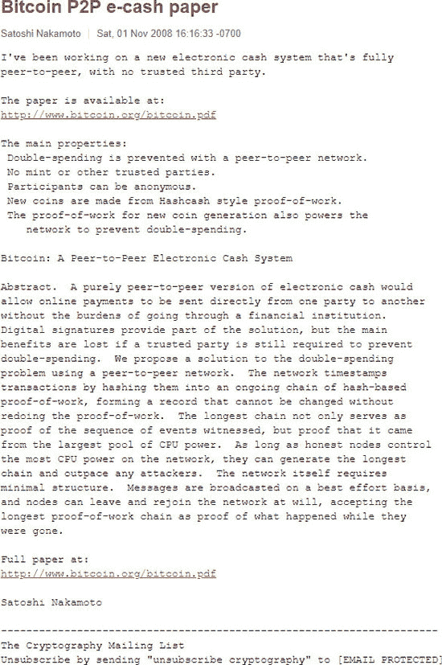

**图 1.1：** 由化名 Satoshi Nakamoto 发布的第一个与比特币相关的帖子发布了比特币白皮书

比特币白皮书于 2008 年 11 月分发到密码学邮件列表和社区进行同行评审和反馈，随后网络于 2009 年 1 月正式发布。

**参考：** [`papers.ssrn.com/sol3/papers.cfm?abstract_id=3440802`](https://papers.ssrn.com/sol3/papers.cfm?abstract_id=3440802) *Wright, C. (化名: Nakamoto, S).* 《比特币：点对点电子现金系统；白皮书：澳大利亚悉尼，2008 年 10 月》。

白皮书中记录的摘要可能是比特币协议最好的描述，它创建了一个用于价值交换的独特网络——点对点电子现金系统。正如我之前描述的，之前的提议的系统要么没有被采用，要么失败了，并且从系统架构角度来看其功能和安全性不完整，或者从业务架构角度来看缺乏作为可用企业级解决方案的视角。比特币同时解决了这两个问题。这种系统的简单性打破了在两个非信任方之间安全传输消息的问题，同时也确保了有经济激励让非信任方保持在系统中。要理解比特币，你既需要从技术角度来看，也需要从经济角度来看，因为比特币安全模型的防攻击特性不是技术的、不是密码学的，而是经济学的。

### 比特币简介

互联网彻底改变了贸易。电子商务是一个指数级增长的行业，这只是贸易的形式之一。供应链、银行服务以及信息内容创作（媒体、娱乐、新闻、教育、快消品）所有行业都经历着一个阶段，即拥抱互联网以扩大其覆盖范围并提升服务的用户体验。目前，服务的支付/变现严重依赖于金融机构作为信任的第三方来处理电子支付。引用白皮书中的话：

> “虽然该系统对于大多数交易运行良好良好，但它仍然受到基于信任的模型固有缺陷的影响。完全不可逆的交易实际上是不可能的，因为金融机构无法避免调解争议。调解成本增加了交易成本，限制了最小实际交易规模，并切断了小额日常交易的可能性，而且在失去为不可逆服务提供不可逆支付的能力方面存在着更广泛的成本。随着反转的可能性，信任的需求就会蔓延。商户必须警惕客户，向他们索要比通常需要更多的信息。”

挑战上述系统的核心思想不是要颠覆向相关法律实体或政府报告信息，而是目前存在的系统是为了镜像互联网和计算机发明之前存在的手工、纸质系统，而通过自动化来迁移这些手工业务流程仅仅是自然的第一步。在拥有这些系统几十年后，由于信息交换甚至支付的量和使用量的指数级增长，我们开始看到它们的局限性。在像印度这样的国家，我们我们也从基于现金的系统转向数字系统，所有超过特定金额的支付都被要求以数字形式进行。未来将产生更大规模的交易需求，例如物联网（IoT）等技术进入日常生活和家庭使用。

让我列出当前金融网络的概览及其工作原理，以说明一次简单支付中涉及的跳跃次数和参与方数量。我将在这里举一个典型的例子。这是为了让你概述这两个系统在个人层面是如何对比和对立的。由于信任系统的性质，整个结构变得非常复杂，涉及到许多信任第三方，他们分担了交易的部分风险，并因此从交易中获得费用。（图 1.2）

在比特币中，交易是在去信任的情况下发生的，交易的记录在一个公共共享的共同账本上，即账本或区块链。但与现有系统略有不同，因为第三方是去信任的。

让我们看看现有系统和使用比特币创建的新系统的图表：

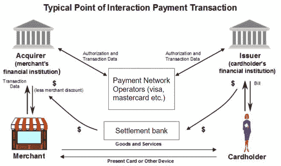

**图 1.2：** 典型的信用卡交易流程图

在比特币网络中，上述系统的运行方式略有不同，如图 1.3 所示：

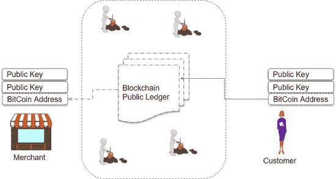

**图 1.3：** 使用比特币区块链的典型高层交易流程图

从图 1.2 到图 1.3 发生了以下变化，但资金从客户转移到商户的结果是相同的：

*   在多个第三方（银行机构、中间行和结算银行）的位置，我们只有一个第三方，该第三方由许多竞争性的矿工组成，减少了交易到达预期接收者所经过的跳跃次数。
*   在任何时刻，始终有矿工（通常为 3 到 10 个）在同时挖掘和托管区块链的公共账本，使其成为一个分布式公共账本，他们作为交易的非信任验证者工作，并维护未支付的公共账本的完整性。
*   客户只需通过其软件将交易发送到公共账本。一旦在账本更新，商户就拥有了这笔资金，这简化了整个业务流程，并再次消除了交易的可逆性。
*   代替用户账户以及各种支付交易和网络设置，所有硬币都与一个 `private key`（私钥）关联，并使用标准的交易类型在两个用户之间通过预期接收者的 `public key`（公钥）交换硬币，使其完全安全。
*   在计算上无法逆转的交易将保护卖者免受欺诈，并且可以轻松实现常规的托管机制来保护买家。
*   当然，如果由于法律争议导致交易无效，我们可以撤销交易，但通常这只会发生在法院命令的且由于涉及巨大工作量而具有重大价值的事情上。
*   记录会计分目的账本（`Bitcoin public ledger`）遍布全球，使其对任何单点故障场景具有韧性。

### 交易 (Transactions)

电子币被定义为数字签名链，所有者通过交易将硬币转移给新所有者。交易由一个输入记录（所有者对前一次交易的哈希进行数字签名）和一个下一个所有者（接收者）的 `public key`（公钥）组成：

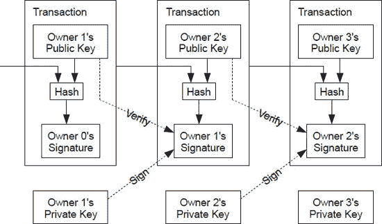

**图 1.4：** 比特币中的交易结构，来源 - Bitcoin 白皮书

上面的图表显示了交易的组件以及交易要转移的硬币的所有权情况。用于生成公钥和 `private key`（私钥）的加密技术并非常用的 PKI，而是 `ECC`（椭圆曲线密码学），我们将在书中后的章节中详细讨论。

交易的支付者或接收者始终可以使用其 `private key`（私钥）通过验证上述通过该交易进行所有权的转移，从而验证交易的有效性。通常，金融机构等信任第三方作为交易地址有效性的验证者（这通常被称为双重花费问题），以确保硬币所有者不会将同一枚硬币签名给多个接收者。比特币是通过使用一个 `timestamp server`（时间戳服务器）实现的，它存储了所有上述交易的日志，并在任何时刻将所有硬币带有时间戳和数字签名的所有权链存储在时间戳区块中，这些区块再次像上图所示交易一样通过引用相互连接。该服务器被更常见地称为 `blockchain`（区块链）：

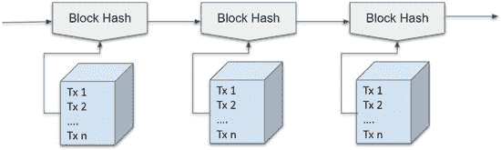

**图 1.5：** 区块链的表示性视图

`blockchain`（区块链）是一本公共记录簿，如果人们愿意投入基础设施建设工作（如下载完整的区块链并运行 `node`（节点）），任何人都可以验证它，但这通常由一种被称为矿工的新型实体完成。挖掘是物理矿工的类比，他们挖掘成山般的金矿，他们在采矿中拥有的设备和投资越好，发现黄金的机会越大。在比特币中，上述这些交易被分组在一个 `block`（区块）中。我们将在讨论挖矿的章节中详细讨论，但是是 `miners`（矿工）在竞争中工作，在一个每 10 分钟添加下一个区块的游戏中，赢得 `coinbase`（区块币奖励）交易，这类似于奖励他们目前获得 6.25 个比特币。矿工还将因他们为区块链用户提供的挖矿验证服务获得一小笔费用（通常为每笔交易美元美分的 1/100）。不言而喻，矿工的经济激励同时来自挖矿奖励和交易费。

### 交易区块 (Transaction block)

让我们更深入地查看区块的细节。`block`（区块）是相对于上一个区块的指定时间内发生的交易集合。在该时间段进入区块的交易按照它们被接收（由 `miner`（矿工））的顺序排列，每个交易在创建时始终由一个 `hash`（哈希）表示。`hash` 是比特币用于实现安全的许多加密工具之一，因为它具有下文所述的独特属性。

`Hash`（哈希）是一种具有独特属性的加密函数，它可以将给定输入转换为固定长度的输出。该输出通常被称为哈希值。

存储在区块中的交易是不可更改的，以防止任何恶意尝试更改区块链中的记录。这种实现的核心思想/概念是将区块中所有的交易哈希值存储在梅克尔树（Merkle tree）结构中。这充当了校验和的作用，即使单个交易中的一个微小字符发生变化也会破坏该信息的完整性，导致该区块失效，从而无法被矿工的共识/验证过程接受。

在密码学和计算机科学中，哈希树（hash tree）或梅克尔树是一种二叉树，其中每个叶子节点都标记有数据块的哈希值。这在 `图 1.8` 中显示为 `Hash (tx1)`、`Hash (tx2)` 等。每个非叶子节点标记有其子节点标签的加密哈希。这在 `图 1.8` 中显示为 `Hash 1-2` 和 `Hash 3-4`。哈希树允许高效且安全地验证大型数据结构的内容。证明某个叶子节点是给定梅克尔树的一部分，需要计算与树叶子节点数量对数成比例的哈希。

让我们通过图表来看：

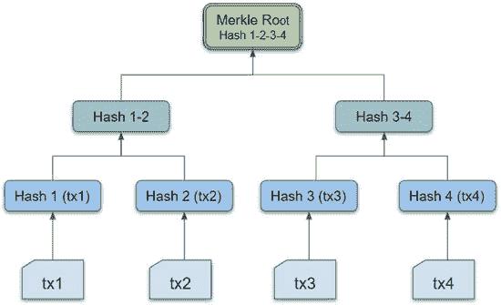

**图 1.8：** 4 笔交易区块的梅克尔根哈希表示。

如果交易数量为奇数，假设没有 `tx4`，那么哈希 `3-4` 将通过两次使用 `tx3` 哈希变为哈希 `3-3`，过程以此类推。现在我们对什么是区块有了了解，让我们回到描述开头提到的时间戳服务器概念，并定义什么是区块链。

一旦交易哈希与时间戳一起存储在区块中，它就变成了一个公开存储的真实记录，无法通过任何手段进行篡改。这些链式存储的区块充当了所存储信息的时间戳服务器。它不仅被公开发布，还基于工作量证明（proof of work）系统在点对点的基础上实现为分布式时间戳服务器。

`proof-of-work`（工作量证明）是一种旨在让一组竞争性的矿工使用计算力，为他们竞争添加到现有区块链的下一个区块生成哈希的系统。新生成的哈希的复杂程度由区块头中提到的一个名为 `nonce`（随机数）的字段控制。矿工使用这种计算力持续扫描一个值，当对该值进行哈希处理时（例如使用 `SHA-256`），哈希以若干零位开头。`nonce` 定义了这些领先的零位以控制该过程的难度，并通过在区块中增加该值来实现，直到找到一个能使区块哈希产生所需零位的值。所需的平均工作量与零位数量呈指数级关系，并且可以通过执行单个哈希计算进行验证。

这种使用工作量证明系统来生成区块的过程确保了区块一旦生成就无法更改，除非重新进行相同量的计算工作。你还可以看到，随着在任何区块之后连接了越来越多的区块，更改该区块的工作将包括更改所有这些链式区块，通过这样，随着区块在区块链中深度的增加，修改区块的工作量会呈指数级增长：

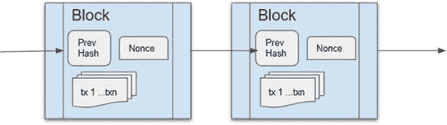

**图 1.9：** 相互连接的区块及其与过去区块的链接

区块选择的最后一步涉及多位矿工达成共识，通过获胜矿工的工作量证明通过网络共识，确认获胜的区块是他们都同意添加到区块链中的。这本质上是一个替代信任网络以验证交易正确性的系统，之前我们在 `图 1.2` 中讨论过。所有投入 CPU 的矿工都在这个网络共识中投票，以决定下一个区块添加的多数决策以及区块胜者，这种共识方法被称为 `Nakamoto consensus`（中本聪共识），其本质上是：`Proof-of-work` 本质上是“一个 CPU 一票”。

始终存在多个矿工同时解决哈希难题的可能性，区块链可能会偶尔发生分叉。这会自动解决，因为网络将不断向其中一个分叉添加新区块，而大多数（矿工）的决定将由展示最大工作证明的最长链来代表：

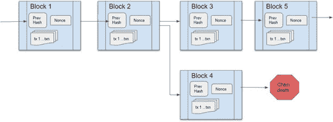

**图 1.10：** 比特币区块链网络中的临时分叉或孤立区块

网络分裂是可能的，但最终最长的链会幸存，而这些分叉会消失。这些本意是不常见但完全自然的场景。该区块通常被称为孤立区块（orphan block），通常区块 `3` 和 `4` 会被添加到所谓的 `孤立区块池（orphan pool）` 中，只有当下一个区块添加时，其中一个孤立区块变为确认区块。简而言之，孤立区块有一个父区块但没有子区块。


这里显而易见的问题是在分叉的情况下，包含在区块`4`中但不在区块`3`中的交易会怎样？答案非常简单。许多矿工从个人钱包或节点接收交易，并非同时接收。所有交易收集在一个名为`mempool（内存池）`的地方，这可以认为是矿工从中提取交易制作新区块的临时区域。如果挖掘区块`3`的矿工没有提取包含在区块`4`中的某些交易，通过网络共识同意这些交易的矿工会将它们包含在区块`5`中。

挖矿的最后一点是`nonce`的概念。这是一个用于控制生成的区块哈希难度的参数。该值每两周检查一次，并根据每小时区块数量的移动平均决定。如果生成太快，难度就会增加，反之亦然，以将区块生成保持在平均每 10 分钟一个。

比特币区块大约每 10 分钟添加一次。为了让比特币正常运行，它需要在 5 分钟到 20 分钟之间。精确的理想时间是无法计算的，因为它取决于时间、季节、用途、电价以及许多非标准因素。设置 10 分钟的时间周期主要是为了引入足够的难度，以便投入最低 CPU 功率来确保网络安全。在添加新区块之前，矿工必须执行一系列任务（验证真实性以确保只有有效区块传播）。

在验证区块时，矿工将执行以下函数：

*   区块数据结构格式正确。
*   区块头的哈希小于或等于当前两周内设置的目标难度。
*   区块大小小于或等于允许的最大区块大小（例如 2 GB）。
*   区块的第一笔交易是币币，支付给获胜矿工，且仅存在一个币币。
*   区块中的每笔交易都是有效的。每笔交易及其哈希都必须经过单独检查和验证，以确保其输入和输出金额准确。

上述提到的区块大小（`block size`）概念在过去几年中成为比特币生态系统中关键讨论和争议的焦点之一，导致了原始比特币链的多次分叉，在流行术语中被称为一种“拆分”事件。区块大小定义了比特币区块链的容量，定义了每秒处理的最大交易数量，从而定义了扩展性问题的解决方案。我将在下面简要介绍比特币的三个主要分叉，它们基于不同的属性，要么是限制了扩展，要么是与隐私和匿名相关的其他概念（将在本章末尾进行详细讨论）：

*   **`BTC`**：该分支目前的区块大小限制为 `1 MB`，限制其每秒最多处理 `3-5` 次交易。这还导致了 `RBF`（后被 `fee` 替换）概念的引入，以便通过提高费用来加速交易被包含，以获得处理优先级。这使得 `BTC` 不适用于微额交易。
*   **`BCH`**：该分支目前的区块大小限制为 `32 MB`，并更多地关注通过使用 `schnorr signatures` 和 `coin mixers`（货币混币器）等概念来实现匿名交易。它在某种适用于微额交易，但由于区块大小限制，容量有限，使其不适合企业采用。在法律和历史层面，完全匿名的交易最终会被禁止（如 `Ecash`）。
*   **`BSV`**：该分支继续实现并定义白皮书的比特币原始设计。在 2019 年，区块大小为 `2 GB`，使其能够每秒处理约 `14,000` 次交易，最适合允许并实现微额交易，使其成为解决区块链扩展问题最理想的候选者。该版本也遵循 `Satoshi` 定义的原始协议，在 2020 年通过一次名为 `Genesis` 的升级后，它现在可以支持无限的区块大小。这意味着产生多大的区块主要由矿工决定，主要取决于网络当前状态和内存池状态。在这个版本中，比特币协议将锁定在原始设计上，并为构建在稳定协议之上的应用提供稳定性（类似于 `IPV4` 和 `IPV6`）。该版本不支持匿名交易，但隐私交易是可能的、支持的且推荐的。低手续费和稳定的协议在 `BSV` 中引发了新应用和解决方案开发的“寒武纪大爆发”，将在接下来的章节中进行详细讨论，且本书在所有提及比特币的地方都侧重于这一版本的分支。

# 比特币公共账本：它是如何运作的？

让我们后退一步，吸收一下我们目前为止讨论的内容，并尝试理解什么是比特币，什么是比特币区块链。

比特币是一种协议，使用一组大型加密工具和精明的经济公式来实现，通过电子现金创建一种全球性的、即时的、廉价的点对点价值交换。比特币区块链是一个全球性的公共双复式会计账本，任何愿意为他们想要参与的使用场景投入适当投资都可以对其审计、更新和管理。

简单描述一下账本（`ledger`），它是一本记录财务交易的书籍。总账是一种双复记账法——每笔财务交易都作为借方和贷方条目进行记录。通常，这些账本以汇总的形式记录主账中，以显示净资产的全景，而进一步的条目细则分别维护在子账中，子账可以随时汇总以生成整体的总账。

比特币的安全模型不是密码学的，而是经济学的。当我说这句话时，并不意味着我们到目前为止讨论的加密工具没有增加安全性，而是比特币解决的基本问题之一是双重花费（`double-spending`）问题。如果我两次花费我拥有的货币，如何通过经济激励来保护呢？我已经在提到区块链时简要描述了这种情况：

1.  执行第一笔交易并将其包含在区块中。
2.  获取网络 `51%` 的哈算力，以便能够控制后续区块和网络共识（这被称为 `51%` 攻击）。
3.  为他（他们）控制的地址创建一个双重花费交易。
4.  另一种选择是创建空区块以继续获得挖矿奖励。

为了控制哈算力进行 `51%` 攻击本身意味着巨大的投资，要么来自一个实体，要么来自多个矿工组成的卡特尔来进行这种攻击。引用 `Satoshi` 的话，矿工必须在通过偷回自己的付款来欺骗他人，与利用它生成新币之间做出选择。

`Satoshi` 继续说道：“他应该发现，按照规则办事更有利，即那些让他获得比所有人总和更多的新币的规则，而不是破坏系统和他财富的有效性。”

例如，如果攻击者选择方案 4，那么由于这是一个公共账本，所有人都会知道这次攻击，硬币的价值将大幅下降。如果他选择方案 3，攻击面仅限于他的货币，而且再次，同一个矿工并不总是能挖掘未来的所有的区块，网络很快就会察觉到这种正在进行的攻击，这使得攻击者利用这些哈算力去挖掘新币比攻击网络更有利。

# 比特币是不可篡改的证据链

这是一个非常大胆的标题，我特意包含它的，是为了强调比特币的本质，这与人们对它的流行认知相反。

核心理念是，当此哈希值发布在区块链等公共可用源上时，使用数字签名（与身份相关联）进行签名，它永远无法被黑客攻击、更改或伪造，使其成为当今最高的安全性。目前，存在一个价值数十亿美元的行业用于保护会计目的记录。而现在，利用比特币区块链，只需几分钱即可完成。你获取数据并生成哈希值，通过交易将此哈希值上传到区块链上，就可以了。这里的哈希值是一个索引，这意味着即使源数据中改变一个字符，哈希值也会完全不同，从而导致对上传哈希值的验证失败。这是一种可证明的更好且更安全的会计和记录保存方式。此外，如果创建了新版本的文档（例如），你可以通过新交易更新区块链上的条目，并附上该更改的审计追踪。这对于每个政府、企业以及任何希望简化记录工作并可能节省数十亿成本的公司来说，都是一个用例。

回到比特币的根源，让我展示一下第一个被挖出的区块中包含的消息，该区块包含一个`Coinbase`交易，该交易中包含了挖掘该区块的 Satoshi 所包含的消息。

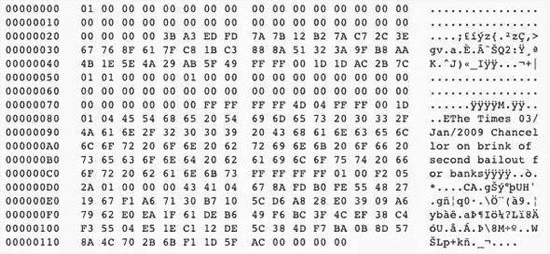

**图 1.11:** Satoshi 挖掘的创世区块：“The Times 03/Jan/22009 银行正处于第二次救助的边缘”

这条消息中呈现了两个重要方面：

*   确保区块的时间戳包含当前日期和《泰晤报》的新闻标题，以表明该区块不是在上述日期之前挖出的；
*   比特币背后的哲学。

这条消息留下了印象，即`比特币是对 2008 年发生的金融危机的反应，是应对现有金融体系实体实施的部分准备金和其他金融资金挪用行为的解决方案`，给人一种它是一个取代银行和政府对金融系统控制的系统或无政府主义系统的印象，而事实却与此相去甚远。

让我们来看看该文章在该日期发表在报纸上的完整内容：


**图 1.12:** Satoshi 在创世区块中引用的《泰晤报》文章

2008 年是全球金融系统面临巨大危机的的一年，该体系深陷于自身制造的毒性债务之中。这导致许多金融机构倒闭破产，许多机构通过政府将其毒性债务国有化获得了救助，这不仅发生在美国或英国，而是遍及全球。其根源在于对银行放任不良行为的激励，这些银行无视诚实的银行业务，为了图眼前的短期利益，并将真实问题推向未来让别人来处理。

在篇文章中，讨论了需要第二次救助来维持银行系统的持续运行，方法是购买他们的债务，并采取诸如——例如建立一个“坏银行”来处置坏账。财政部将从陷入困难的银行手中接手坏贷款，或许将其交换为政府债券。被指责毒害金融系统的毒性资产将存放在国家设立的机构或坏银行中，由其进行管理并尝试处掉它们，同时对主流银行系统进行去毒。

实际上，当银行在贷款方面试图保持保守时，政府决定为银行提供更多流动性，这使他们继续沿导致最初问题的老路。解决方案从未真正被考虑过，但问题再次通过这些措施被“敷衍”并推迟了。政府认为这是不能交给市场处理的，以确保他们通过这种由政府驱动的通胀过程再次当选，而不是给市场留出自我修正的时间。

事实上，如消息中所传达的，比特币从未反对过银行。它是反对政府对自由市场的干预，使其更像是一种自由意志主义的，即一种自由市场的资本主义方法，这与当时遵循的凯恩斯主义方法不同。

这条消息在某种程度上吸引了第一批比特币的采用者，其中一些人理解了信息，而更多的人将其视为一种反银行的货币系统，为他们提供了一个颠覆银行要求他们遵守的`AML`（反洗钱）和其他监管指令的选择。

错误道路上的第一个大步是`WikiLeaks`对比特币的采用和使用，Satoshi 本人在消失前不久还在比特币讨论论坛上公开反对过这种做法。从那时起，比特币的采用走向了暗黑市场，如`丝绸之路`和`hydra`等暗黑市场，由于入口和出口网关（即所谓的`加密交易所`和加密 OTC 平台）缺乏或监管弱的监管，它成为了首选货币。由于社区中试图颠覆银行系统的群体发现了这种不幸的用途，比特币的价格随之飙升。

在那个时期（2011 年 - 2015 年）采用比特币的另一批用户是黑客，他们发现这种货币是完全数字化的形式，而且可以使用`混币器`（`coin mixers`）等工具轻松移动，从中找到了慰藉。它还被用作资金转移到因制裁而被封锁的国家（如`伊朗`和`朝鲜`），因为这些国家无法访问`SWIFT`网络。另一个重大事件是发生在最大的加密货币交易所之一`Mt. Gox` 的大型黑客攻击，它是`丝绸之路`用户使用的主要交易所之一，在此期间还发生了许多诈骗活动。

然而，随着事态的发展，比特币的使用为执法部门提供了不可篡改的资金证据轨迹。法律花费了一些时间才跟上，但很快他们就关闭了像`丝绸之路`这样的网站。

比特币是伪匿的。这意味着它是私密的但非匿名的。它在公共区块链上以明文形式发布所有交易，供任何人进行审计，并运行如机器学习算法等程序对其进行追溯分析。然而，它是具有私密性的，这意味着除非有知情需求（如法院命令），并且用户在使用时有意保持其财务交易的私密性（通过不多次重复使用其公地址），因为隐私保护是内置的。

这个主题本身可以进行长篇大论的论述，但由于这不是本书的重点，我将把这个话题留在此处，从现在开始关注技术协议细节。我觉得有必要详细说明这些细节，以反驳当前存在的大许多叙述。

包含这些细节的意图在于，关于比特币是匿名货币的主流观点在事实上是错误的。相反，它作为一个透明的开放式账本运行，这为一整套全新的关注匿名性的加密货币区块链创造了空间，例如 `monero`、`zcash` 以及其他一些。在本书印刷时，监管的清晰化仍然难以捕捉公共区块链的概念，但许多国家正在积极致力于立法。

比特币的最后一个我到为止刻意讨论的方面是去中心化。比特币公共账本被认为是去中心化的，因为它分布在世界各地愿意托管区块链的节点上。这提供了另一个重大的安全特性，即防止任何托管数据的单个节点被毁而导致单点故障，而单点故障是任何企业级数据中心的基本需求。这些企业（如银行、金融机构）解决此问题（称为灾难恢复）的通常解决方案是为其托管在多个地点数据中心的整个系统/应用程序保留多个副本。这是为了数据安全所需的巨大成本重复，而比特币仅通过其原生架构设计就实现了这种安全性。

# 结论

当你开始观察本章中存在的庞大概念时，起可能会感到敬畏，特别是如果你对比特币完全是初学者。你也可能觉得某些与众不同的事情并不合逻辑，但随着我们继续深入细节，你将看到所有这些概念、开放性问题和想法将联系在一起，形成一个基础层协议，该协议有潜力成为构建在互联网之上所需的新时代金融网络的管网系统。下一章将从描述开始，并进一步深入探讨比特币的经济模型和网络结构。

# 问题

1.  早期电子现金系统尝试未成功的主要原因是什么？
2.  匿名（`anonymous`）和私密（`private`）之间有什么区别？
3.  为什么像比特币这样的公共账本也是私密的？
4.  什么是区块链？为什么时间戳和数字签名出现在交易中是重要的？
5.  为什么中本（`Satoshi`）说比特币的协议是板上钉钉？

## 第 2 章

### 经济模型与网络结构

> “经济学的第一课是稀缺性：任何东西都永远无法满足所有想要它的人。政治学的第一课是忽视经济学的第一课。”
>
> ― 托马斯·索威尔（Thomas Sowell）*

现在我们对什么是区块链、什么是比特币，以及对比特币区块链有了基本的了解，在本章中，我们将观察该系统的整体经济视角。比特币作为一个点对点网络，是由矿工节点组成的网络，他们为了经济激励而相互竞争，以及为什么系统中内置了对货币的需求。我们还将观察比特币的网络结构，它是小世界网络首次的大规模实现，以及这意味着什么。用户节点是如何进入这个网络图的，网络中各种实体的整体交互及其各种攻击向量。

#### 结构

#### 作为货币或加密货币的比特币

*   比特币的经济模型
*   比特币的网络结构
*   作为去中心化和分布式网络的比特币

#### 目标

学习完本章后，你应该能够理解为什么比特币区块链是一个经济系统，而不仅仅是一项技术突破。你将学习当比特币被视为货币、钱或密集连接节点网络时意味着什么。你还将学习比特币作为货币的通缩特性。

#### 硬币供应

可以创建的比特币最大数量为 2100 万个。目前，已有约 1800 万个比特币被挖出并流通。根据挖矿计划，到 2140 年，所有可能的比特币将被挖完，从那时起矿工将完全依赖交易手续费作为奖励。

为了完全理解比特币及其有限供应及其背后的经济学，我们需要回顾过去并尝试观察什么是钱。

#### 货币的价值

钱是固化的信任。这意味着，有了某种钱的东西，你不需要明确证明持有该价值的东西可以信任能交付承诺的价值。任何人之所以相信一张 10 美元钞持有上述价值，是因为中央银行承诺该价值是真实存在的。因此，无论谁持有这张 10 美元钞，任何人都都可以信任它在任何时候交付 10 美元的价值。

钱是人们信任可以作为互不信任的人之间交换手段的东西，但他们又同意它具有价值。在过去的某个时间点，英镑曾是一磅白银。一些国家的货币挂钩黄金，但其主意不是携带一大袋黄金，取而代之的是携带某种保证，可以用一定数量的黄金更换。

这种挂钩随着时间的推移已经贬值，由于准备金制度的引入，大多数国家现在不再存在挂钩。

在当代，每个国家都有自己的货币，它是通过该国法律体系对其价值授权并保护的，因此其名称或参考被称为法币货币。这意味着掌握法律的权威（通常是政府）通过誓言和执行该价值的法律体系承诺货币的价值。所以当我有一张 100 美元钞票时，我知道政府认证了美元单位衡量的内在价值为 100 单位，且这张钞票在全球范围内价值相同。

如果我必须总结，货币是由政府或类似系统发行的，以作为货币的记账单位的形式化。

货币的另一种形式是因其用途而产生价值的商品。许多商品随着时间的推移获得了一定的价值，如黄金、银甚至石油。所有这些商品的价值都源于它们具有某些实用性。以黄金为例，它因作为地球上最具延展性的金属的特性而被使用，用于各种用途，如铸造硬币作为货币（已持续数万年，是已知最早的用途）、珠宝、电子行业中用于计算机制造无腐蚀电气连接器、医药，在某些地方甚至作为食物。黄金的价值源于其无腐蚀、延展的特性，自然过程创造它所花费的数千年时间，或者提取它需要投入的资金，但不仅仅是因为提取它需要投入这么多努力和资金，其价值仅来自于使用黄金所能完成的实用性。

由于许多人认同某种没有任何实用性的东西而产生的货币价值是投机。这种投机目前会持续，直到有一个大群体支持这种投机，而一旦他们转向新的投机，其价值就会回到它的最终价值——即不存在。其中一个例子就是多级营销或金字塔骗。它的运作方式是：你有某个物品的初始采用者（例如某公司的股票），他们对价值进行投机，然后他们引入下一批人，那批人再引入下一批人。一直持续下去，直到你能够引入下一组人，而在情况不再成立时就会崩溃。在此之前，最初的那组人已经退出了他们的位置，留下大量持有无价值物品的人。

另一个例子是国家货币的贬值。名声大鼎的津布韦国家货币贬值如此严重，以至于他们必须打印万面钞票，这相当于单张 `USD`，因为他们不断打印更多货币，使其成为一种投机资产，而不是创造基于商品和贸易的实用性，而这才是衡量一个国家货币的方式。委内瑞拉最近也发生了同样的情况，通货膨胀无非是实用性的丧失。

所以，即使是法币，价值也不是完全凭空产生的，如果这种情况最终发生，其中的价值将会蒸发，导致钞票变得毫无价值，正如津布韦和委内瑞拉发生的那样。国家必须生产商品和服务，以便能够根据其整体 GDP 将价值归于该国的法币。

## 比特币是货币吗？

是的，货币是一个可以使用 `Bitcoin` 实现的用例，因为它是一种价值交换单位。它不是由政府或中央银行管理，而是由竞争性的 `POW` 过程运行的，这种过程不是通过信任运行，而是通过竞争运行。矿工在每添加一个区块时都会创建新的 `Bitcoin`，这被称为 `coinbase transaction`。任何矿工都是值得信赖的，因为欺骗系统的唯一方法是让系统中涉及的所有矿工达成共识，这使其变得去信任化。它被称为点对点电子现金系统，这正是它的本质。`P2P` 系统允许资金从地球上的任何地方瞬间传输到地球上的任何其他地方，且费用极低，使其成为最有效、最安全的货币形式之一。

`Bitcoin` 的内在价值由其实用性治理。虽然其中也一直存在投机元素，但那是不可持续的，最终其价值将由其实用性治理。假设一个世界 `Bitcoin` 区块链的公共账本被用于所有的电子商务贸易交易，这将每天产生数十亿次交易，如果所有这些流量都通过，意味着大量的贸易将取决于 `Bitcoin` 区块链的运行，并且人们需要 `Bitcoin` 才能使用该区块链进行交易。当这种价值到来时，它将赋予 `Bitcoin` 系统内在价值。


`Bitcoin` 本身没有任何价值，因为它是根据代码协议创建的某种东西。这就是为什么在 2009 年第一批硬币通过挖矿过程流通时，它没有任何价值的原因。有一个著名的事件，有人用 10,000 个 `Bitcoins` 买了两个披萨。这是第一次由于其购买披萨的实用性而被赋予了价值。在过去的十年里，产生了许多业务和实用性，这些业务为 `Bitcoin` 赋予了美元价值。这也是 `Bitcoin` 作为匿名货币的大量用途随之产生的地方，其理念是它是不受政府控制的货币，而使用它的用户不需要遵守他们用它购买商品时的所属地法律。事实证明，这与最初的感知恰相反，这也是为什么对 `Bitcoin` 协议引入了一些更改，如 `segwit` 和 `lightning network`（闪电网络），以便可能出现丢失交易记录的可能性。

人们经常争论，矿工通过运行节点投入投入为 `Bitcoin` 带来的价值与矿工运行网络所付出的成本成正比。事实并非如此。价值仅来自于其用于贸易和商业，而不是因为有一组人投资硬件来运行它。事实恰恰相反。实用性带来的价值促使这组人投资挖矿节点的业务，以便他们通过运行网络来获利。

`Bitcoin` 类似于商品，其公共账本记录是以很小的成本（交易费用）创建的，而该公共账本为运行商业和贸易会计提供了大量的实用性。它还提供了极佳的数据存储能力，这是另一个被认为对人们有用的属性。这些实用性为 `Bitcoin` 提供了价值，反过来也可以作为货币使用。

## 比特币是货币（加密）？

`Bitcoin` 显然不是货币，这在印度和其他国家的法院判决中也得到了证实。因此，将 `Bitcoin` 等称为加密货币的术语是一个误称，最终会被纠正。法院的裁决是这些资产属于商品类别。

虚拟货币也出现了一个新术语，欧洲银行管理局将其定义为价值的数字表示，它不是由中央银行或公共机构发行，也不一定附属于法币，但被自然或法律人作为支付手段接受，并可以通过电子方式传输、存储或交易。相比之下，由中央银行发行的数字货币被定义为央行数字货币。

那么加密货币以及在上面提供交易的交易所又是什么？嗯，这追溯到 2013-14 年这些数字资产的使用，当时出现了许多 `cryptocurrency exchanges`（加密货币交易所），它们允许非 KYC（身份验证）基础用户的产生，并让他们能够在这些平台上交换货币。目前，大多数非 KYC 的交易所已经关闭，或者一旦反洗钱法律跟上它们将会关闭。

谈到比特币，规则同样适用。目前，`BSV` 区块链的平均交易量每天 100 万次，随着未来 10 年内每四年一次的代币补贴减少，未来要么产生数亿次的交易，要么完全消失，否则比特币也将随之关闭。

目前，`BSV` 区块中的大多数交易来自各种实用型应用程序。根据这一生态系统的增长方式，作者预计许多行业将经历一次仅有的转型：使用基于互联网的应用程序将其业务迁移到区块链，从而实现实际的效用和价值。

## 比特币的经济模型

我们期待晚餐，并不是因为屠肉师、酿酒师或面包师的慈善，而是因为他们对自身利益的追求。我们不是诉诸他们的人性而是诉诸他们的自爱；不是向他们谈论我们的需求，而是谈论他们的利益。

- 亚当·斯密

比特币是一种支持自由贸易的工具。它将有效且优化的交易工具与不可篡改的账本相结合，为根据法律需要交易和存储所需的法律文件提供了完美的系统（有时根据当地司法管辖区的需求，要求长达 20 年）。让我们退后一步，看看相对于网络中作为参与者的各种实体的比特币整体经济模型。

比特币被创建为一种自由主义形式的货币，它通过平各种大小参与者的支付或参与领域，将其作为任何参与者的首要方式来支持自由贸易。在这个系统中，个人可以通过提供与大型公司相同的服务来挑战亿万富翁，并完全凭借为大众提供的服务质量获得机会。这通过比特币经济的开源和公开账本得以实现。我们看到拥有“围墙花园”的大型公司兴起，如 `Apple`、`Facebook`、`Google` 和 `Amazon`，甚至还有 `Salesforce`，这使得小公司由于获取与这些大公司相似资源的能力受到极大限制，无法进行竞争。比特币改变了这一点，它提供了大量的基础设施资源来构建应用程序，平衡了大型公司因过去成功而获得的竞争优势和资源。这并不意味着过去成功的价值有所缩水，但如果他们想在未来取得成功，他们需要与今天正试图竞争的新玩家投入同样的工作。

比特币的激励模型深受博弈论原则的影响，在开发者社区中，这通常被称为比特币是一场红皇后竞赛。这是对刘易斯·卡罗尔著名著作《爱丽丝镜中奇游》的引用，其中一个特定场景是 `爱丽丝` 与 `红皇后` 在一起，她们正试图过山丘。

“噢，在我们的国家，”`爱丽丝`说，仍在微微喘气，“通常你可以去别的地方——如果你跑得足够快且足够久，就像我们一直这样做的那样。”

“一个慢速的国家！”`皇后`说，“在这里，你明白，你必须尽情跑步才能留在原地。如果你想去别的地方，你必须跑得比那快两倍！”

这就是工作量证明（Proof of Work）的核心思想，即为了保持竞争力你必须不断做的事情；如果你想领先，就必须比竞争对手更努力才能超过他们。我们将在讨论比特币挖矿时详细讨论这一点。

让我们逐一个开始概念，以理解系统的经济学如何影响奖励，以及反过来影响参与者的行为。

## 经济通胀

我们都以或或的方式面对过这样一个事实：货币的价值或我们在 `0` 年用钱能买到的东西与我们在 `10` 年用相同金额的钱能买到的不同。通常情况下，你在 `10` 年得到的会少于你在 `0` 年能得到的。这是描述通货膨胀的一种高度简化的方式。全球政府所有的经济框架都在使用一种或另一种方式来应对这个问题。这可以被视为货币的缓慢贬值，通常会导致会导致个人资本的损失。我将以过去 20 年我在 IT 行业经验中看到的例子来说明（我使用的数字是近似平均值，并不代表任何真实数据）。

一个刚大学毕业的工程师，他在某所普通学院完成了工程学位，在教育期间总共花费约 `Rs. 10000` 学费，加入了一家年薪（CTC）起薪为每年 `Rs. 200000` 或在税收和其他扣除后每月 `15,000` 的公司。这是大约 20 年前 IT 行业的情况。一个相当大城市的平均生活费用每月约为 `7000 Rs.`，这让同一个人每月能节省 `8000`。我看了当前相同的数据，现在的学费已经增加到大约 `100000`，生活费用现在将是 `15000` 左右，而类似水平的起薪将在 `250000 Rs.` 左右。这侵蚀了具有相同技能的新届毕业生任何可能储蓄的机会。

这是经济中的通胀，通常被视为隐性税。如果我们简单地解释它为什么会发生，是因为今天可有的相同货币比 20 年前多。货币的发行在大多数国家是政府的直接垄断，通胀率决定了政府会发行多少额外的钱。这可以被视为货币的缓慢贬值，通常会导致个人资本的损失。

以下图片显示了过去 10 年印度通胀率，以提供通胀率随时间变化的状况：


图 2.1：过去 10 年印度的通胀率。版权所有 tradingeconomics.com

假设政府将年度通胀率设定为 `3%`，假设经济中的货币总量为 `1000 Rs.`（通常是万亿卢比，但为了简单起见假设如此），到年底货币总量将变为 `1030 Rs.`。政府（如果是印度的话则是 RBI）在那一年多印了 `Rs. 30`，增加了货币总量，但没有增加生产力。这些钱是凭空产生的（由于现在政府法币大多与黄金储备脱钩），使得同样努力的回报减少了 `3%`。这就是我所说的通胀像一种隐性税，除了政府对社会生产性成员征收的其他直接/间接税外，它还侵蚀了通常通过辛苦工作获得的货币价值。

比特币如果作为货币使用，其设计的经济架构使得上述的通胀问题在设计上是不可能的。

让我们看看比特币是如何铸造新币的，并理解上述陈述。比特币的总供应固定为 `21,000,000` 枚比特币。这就是我所指的比特币通过设计解决了通胀问题。现在总供应是固定的，而且新币的释放通过区块奖励或 coinbase 交易完成。

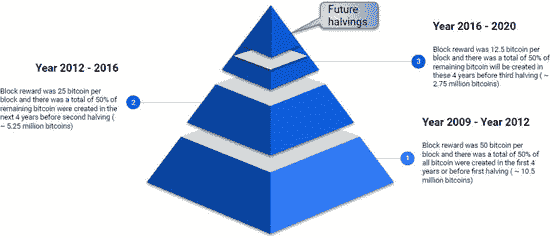

**图 2.2：** 比特币区块奖励每 4 年减半。目前已挖出约 1800 万比特币。

如果从百分比来看，所有货币供应的前 50% 在第一次区块减半时挖出，接下来的 25% 总供应在下一次或第二次区块减半时挖出，第三次区块减半将挖出总供应量的 12.5%，而即将到来的第三次减半将开启一个新阶段，即挖出所有货币的 6.25%。这种情况将每 4 年减少一次，最后一枚硬币将在 2140 年被挖出。到 2020 年下一次减半时，87.75% 的货币已经挖出，仅剩 12.25% 待开采。未来矿工每 4 年对这种依赖性的减少是一种激励模型，它要求矿工寻找其他盈利手段，因为超过某个点后，区块补贴将不足以维持其业务盈利。矿工将有两个收入来源：

* 单个比特币的法货币价格，因此尽管未来货币数量会减少，但单个比特币的价格在某种程度上也能平衡这一点。
* 支付给矿工手续费的交易数量。交易量由区块的大小决定，随着贸易交易的增长，网络能够支持每个区块数百万次的交易，其目标是不断完善基础设施以支持潜在的数十亿次交易，并此增加手续费收入。计划中的 Teranode 升级是相同的协议实现，但采用了高度并行的基于微服务的架构，以实现数十亿次的 TPS（每秒交易数）。这将为矿工和企业都提供正确的激励机制和新的业务基础设施。

这种新货币产生模式是设计的内核，旨在解决我们早些详细讨论过的通胀问题。这种利用矿工的劳动投入而非政府根据其通胀目标来产生新货币的机制，在系统内部产生新货币方面创建了问责机制，另一方面又限制了可能创建的货币总量。这被看作实现一种独立于政府可能对规则进行腐败的货币系统的方法，另一方面，系统中总货币的稀缺性增加了现有货币的价值。比特币设计的这种属性使其成为一种通缩形式的货币。我想补充的是，由于比特币不是法定货币，它在短期内无法成为某个国家的货币，但它可以被视为一个目前安全、稳定且可靠的系统，政府可以在此基础上创建货币的代币化电子或数字版本。与目前易受恶意伪造假币且需要巨大成本确保不被滥用的纸币打印方法相比，这种电子现金平台交易将更加高效、可追溯且可审计。即使是像印度这样的发展中国家，现在也越来越多地转向数字交易，以摆脱非正式的现金经济并远离传统系统。

在这种背景下，比特币应该被视为石油，与其说它是一种货币，不如说它是驱动高效底层金融系统的商品。

## 参与经济学

任何参与此事的个人或企业都应该理解其中的经济激励。当前有几个无论企业大小与否，都在激烈追求的主题。让我们看看各种参与者是如何受到激励的。

### 个人

目前大中小型企业的主题之一是优化运营成本。比特币网络通过提供更好的支付机制和高成本效益的数据存储来激励个人参与。

目前的社交媒体应用模型是基于广告的，利用其个人数据进行识别、分类并通过焦点小组对用户群体进行定位。目前社交媒体中发生的许多活动都在使用这种模型，包括赞助趋势、创建病毒式营销活动以及基于点击的收入模型。这些模型的局限性或缺点是，广告的实际消费者（即用户）有时会获得一小部分份额，但大部分被平台夺走了。

还有几个可以被称为高级用例的场景，它们可能需要时间才能实现，例如用户交易的自动缴税、利用区块链的开放审计能力更快速地解决纠纷，以及全球范围内两个个人之间极低费用的真正点对点转账——考虑到跨境汇款，目前由于许多中间服务提供商收取费用，这种操作通常非常昂贵。

一个巨大的激励（这可能是一个隐藏的激励）是个人的数据安全和隐私，基于区块链的系统第一次有机会完全实现，这让个人在采用基于比特币的应用时，所获得的远大于其失去的。

### 企业

下文提到，当前有几个无论企业大小与否都在追求的主题：

* 更快的市场上市速度
* 降低运营成本和 IT 运营成本
* 产品具有竞争力的定价
* 不断提升用户参与度和用户体验
* 以低成本确保 IT 安全
* 无需灾难恢复 IT 设置和成本

如果全球金融网络使用比特币区块链作为其记录系统和交易层，上述所有主题将看到彻底的变革。对于某些人来说这听起来有些牵强，但这就是构建在比特币区块链之上的元网络（metanet）等协议层系统可以实现的，该系统能够让比特币区块链作为构建客户端应用的无服务器层。

Metanet 是一种将比特币区块链作为平台（数据库、可执行文件、代码仓库）的协议，它使个人能够启动一个精益化的业务，仅凭借产品前端的优越性就能与大型企业竞争。如果我现在要开发一个应用，我需要在无服务器架构中托管我的应用，这包括在云端购买处理能力和存储空间（除非我想自己建立一个数据中心）。随着生态系统的成熟，未来将能够使用比特币区块链作为后端，构建无服务器应用程序，并提供与云解决方案类似的易用性。

### 矿工：非信任的第三方

比特币的工作量证明（Proof of Work）模型创造了一个全新的业务行业，被称为“矿工”。如果说比特币区块链在技术创新方面所做的，那么矿工就是在计算机硬件和处理单元方面所做的，他们正颠覆着整个计算机硬件行业。像 `Intel`、`AMD`、`Samsung` 等大多数大型公司以及过去十年中出生的许多新公司，目前都在积极致力于为哈希矿创建最理想的 `ASICs`。

矿工是比特币系统中最重要且激励最积极的参与者。他们也是那些每秒都在工作、通过竞争生成新区块的人；如果非要总结，他们执行以下功能以获得定义的激励（区块奖励和交易手续费）：

* 访问网络中的 `mempool`（待处理交易的首要存放地）以收集交易并验证其完整性和合理性。
* 参与网络共识以添加新区块。
* 托管区块链节点以供任何人访问区块链数据。

矿工通过上述功能获得激励，其获得更高收益的可能性取决于他们拥有的算力大小，以及他们执行负责的功能时的优劣和优化程度。

矿工还有一种次级激励模型，即销售构建在区块链数据之上的服务，例如数据分析服务、数据剪枝服务，最重要的是为新一代应用程序提供数据提供服务，如在区块链上运行自动化或 `AI/ML` 类型的系统。

如果非要总结，比特币的经济模型是一种激励使用的实现方式，激励的价值随着使用量的增加而增加。这是一种自我增强的系统，越来越多的使用和协作增加了网络价值以及所有相关参与者的盈利能力。在某些方面，比特币区块链奖励贪婪，如果这种贪婪是诚实的，它会获得进一步的回报；但如果你在贪婪中不诚实，可能会损失可能的激励或利润。

# 铁上钉钉的协议

自 2009 年发布比特币第一个版本以来，对于比特币实现的原始激励模型存在许多讨论、变更和分歧，这反过来导致了各种链形式的网络分裂（主要是 `BTC`、`BCH`，以及恢复了白皮书中定义的原始协议的 `BSV`）。这是由于比特币的早期采用者是开发社区，而 `Satoshi` 本人也消失了，导致在指导或批准变更方面没有留任何中央权威，这就像今天开源 `Linux` 社区的情况一样。在经过创世区块升级（Genesis upgrade）后的 `BSV` 比特币实现中，原始白皮书中定义的完整协议几乎被完全恢复，消除了许多限制，如区块大小的人工限制、禁用的 `opcodes`、非标准交易等，将比特币区块链带回了一个功能完全、链上扩展的协议层实现。这个版本将按照 `Satoshi` 在 2010 年与开发者社区早期交流时的定义被铁上钉钉，当时他正参与与 `bitcointalk.org` 论坛成员的各种技术级和协议级讨论。链接 - [`bitcointalk.org/index.php?topic=195.msg1611#msg1611`](https://bitcointalk.org/index.php?topic=195.msg1611#msg1611)

整个讨论可以通过上述链接阅读，但问题的核心显示在 `[Figure 2.3]` 中。这同样标志着比特币协议不需要任何次要或替代的实现：

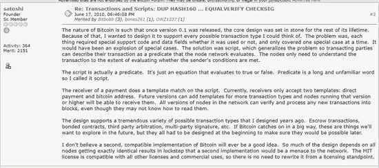

**图 2.3:** 比特币协议从 0.1 版本开始就是铁上钉钉的，它提供了所有可能的用例，不需要任何替代性实现或对协议进行更改。

## 比特币的网络结构

要成为比特币网络的一部分，任何人都可以下载节点实现软件并建立节点。我说是“任何人”，是因为每个人都可以参与，但通常这个功能是由矿工完成的。矿工是投资运行节点以获取上述定义激励的业务实体。有效来说，网络变成了 - 一堆矿工节点，以及一些非矿工节点（例如，像 `whatsonchain` 这样的区块浏览器服务提供商就需要运行节点）。它们构成了比特币网络的核心结构，因为它们被激励以这种方式连接，使得从一个节点到网络中所有其他节点的消息传播时间最短。这在网络共识过程发生在挖矿过程中至关重要。这为所有这些矿工节点创建了网络中心性，它们被激励彼此之间保持超连接。

### 作为小世界网络的比特币

从图论的角度来说，比特币是一个中心密集的小世界网络（矿工节点就是那些中心连接点）。比特币可以被认为是受生物启发的网络之一，我将进行更多解释，但让我们先回到比特币的结构看看。

比特币是一个位于任何网络之上的覆盖网络，无论是互联网这样的公共网络，还是像 `SMS` 这样的电信私有网络，甚至是任何基于卫星的私有网络。实际上，可以说底层网络是你想象的任何东西，而比特币网络位于其之上。

在网络图中，图是由相互连接的点（称为 `节点`）组成的。存在许多复杂的图，例如最简单的图的形式是链表。复杂的图是整个万维网，其中项目是文档，引用（链接）是连接。网络由发送和接收各种类型消息的站点组成。

更多细节请参考 Sampaio, Cesar & Moreira, Andre & Andrade, Roberto & Herrmann, Hans & Jr, José. (2014). Mandala Networks: Ultra-small-world and highly sparse graphs. Scientific reports. 5. 10.1038/srep09082.

在曼陀网络（Mandala network）中，中心节点之间高度连接，如上所示。在实践中，这是一个近完全图，这意味着节点直接或通过另一个节点与所有其他节点连接。网络中的中心空间显示为图 2.6 中标记为 `M` 的矿节点。这些矿节点被激励与所有其他矿节点保持超连接，以便其交易得以传播，或者以极快的连接速度与其他矿工进行通信。用户节点并没有被激励连接到所有矿工，因此它们仅与少数矿节点连接。

图中展示了矿节点和用户节点，该网络在中心连接密集而在边缘连接稀疏，如下所示：

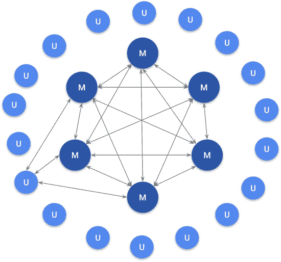

**图 2.6:** 比特币网络结构，其中矿工在超级节点网络中密集互连。用户节点连接到其对等网络中的某些矿工。

让我们回到比特币白皮书，查看网络功能和规范的定义，以便更好地理解：

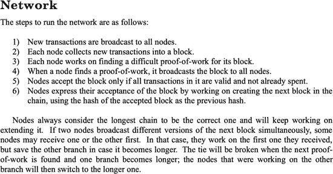

**图 2.7:** 比特币白皮书规范中定义的网络功能


现在，如图 2.6 所示，如果用户创建了交易，它将广播给其连接的矿节点，然后该矿节点将把交易传播到其连接的所有其他矿节点，使得交易传播的总网络距离最大为 3 跳（通常是钱包发送到连接的矿节点，为 2 跳；在某些情况下，如果其中一个矿工没有接收到，它将在另一个矿工传播时接收到，因此最大为 3 跳）。这使得比特币网络像一个小世界网络，其中任何两个实体之间的网络距离始终小于 3 跳。

在像比特币网络这样的完全图系统中，所有节点（矿工）不仅是互连的，而且是一个足够强大的系统（远超典型的家用电脑），能够执行图 2.7 中提到的 1-6 个功能步骤，因为除了挖矿功能外，它还需要对时间敏感且大量的通信（与许多其他系统），这使得用户节点对于执行交易验证几乎不可用，它们通常被称为 SPV 节点（将在后面的章节中详细讨论）。从现在起，我们在书中将节点称为“矿节点”。

节点还会保存一份它们之前连接过的 IP 地址日志，并且会交换节点列表，这使得它们不是作为一个预定义的随机图运行，而是有效地收集并记住其他节点，使该网络更接近完全图，从而具有更高的效率和安全性。

关于网络安全经常发生的一个典型讨论是女巫攻击（Sybil attack）。女巫攻击是一种针对点对点网络的攻击，网络中的一个节点通过破坏声誉系统的完整性，同时模拟多个身份，并在网络中获得主导地位的影响。这通常是为了在系统中执行非法（或违反网络设定的规则）的行为。对于网络的外部观察者来说，女巫攻击中模拟的这些多个虚假身份看起来就像真实的身份。

对于比特币网络，由于网络结构的原因，女巫攻击是不可行的。正如我们所讨论的，模拟一个非矿工用户节点对网络不会产生影响，因为它们没有积极参与任何交易验证过程。如果你看下面描述的矿节点在比特币中必须遵循的流程，它确保了女巫攻击几乎是不可能的：

*   一旦矿节点发现了一个区块，它就会将其传播到网络中。
*   由于连接密集，所有矿节点都会瞬间接收到该区块。
*   具有有效节点设置并尝试女巫攻击（自私矿工）的矿节点将接收并验证另一个节点发现的区块。
*   随后，该自私矿工会在不同节点发送的先前区块之后向所有节点发送一个替代区块。
*   该自私矿工发送区块会有延迟，而不是瞬时的，而先发送的诚实矿工使得第一个矿工在网络中接受的概率更高。
*   自私矿工的行为是遵循时间延迟的，不是瞬时的。这使得自私矿节点在区块的网络传播过程中总是失败。

由于比特币的网络距离小于 3 跳，使其具有了抗女巫攻击的能力，而这在距离大于 3 跳的网络中通常是不可能的。

# 去中心化与分布式网络

比特币的公共账本由每个矿节点托管，基本上使它们保留了区块链中存在的所有内容的完整副本。这意味着在任何时间，出于任何可能的原因，如果一个节点宕机，对整个网络几乎没有影响。这在目前的业务中是不可想象的，因为这些业务拥有有限的灾难恢复系统（通常为 2 个），其中一个系统的故障将给业务带来巨大的成本并对正常运营带来风险。这是比特币区块链改变游戏规则的方面之一，由于其非中心性，网络是不可能被摧毁的。这就是比特币分布式网络的含义。

它还有一个方面，即去中心化。这一方面被大量讨论，并多次被用作论据来讨论这种类型是否让区块链独立于政府和法律体系，或者它们是否在实现金融民主化。然而，我认为这种特定的论点并站不住脚，因为如果政府想要，他们可以让比特币非法并关闭遍布全球的所有节点（当然，这需要他们与各国政府合作，这虽然罕见，但在过去发生过，例如当拥有 30,000 个入金节点的去中心化 Liberty Reserve 网络被全球 42 个政府联合关闭时）。

比特币在起源、结构和经济激励机制上是资本主义的。不是那种精英公司集团在最初竞争中获胜并致富后就可以扼杀竞争对手并垄断领域的资本主义，而是给不平等的参与者提供平等机会的资本主义系统。它是一个一旦通过原始版本确立为石刻就被冻结的协议，没有任何可以在未来的任何时候更改它以偏袒任何其他实体。开发者无法对其进行任何更改，政府无法对其进行任何更改，通过成为一个中心化的、结的、免费获取的公共商品系统，比特币变得去中心化，其设计是锁定且稳定的，所有人都有平等的机会。任何权威或杠杆都将属于那些在协议之上构建应用程序和软件以解决真实自由市场贸易用例的人。

比特币从未被讨论过的真实去中心化方面在于它真正的内涵。比特币通过其锁定的协议从货币中夺走了权力，这正是比特币真正的意义。目前，全球范围内的货币流通和创造本质上由一个中心化系统所有，这些系统主要由政治家、官僚或两者的结合体机构控制或引导。通过比特币，在新的货币的产生过程中消除了受信任的第三方。不仅如此，它还提供了一个透明的实时审计系统，消除了信息被操纵或隐藏的可能性。它让每个使用者对其用途负责，并实现了权力的去中心化。

去中心化的另一个方面是运行在矿节点网络中的节点数量。比特币的挖矿难度每 2016 个区块重新调整一次（大约 2 周）。这使得存在的挖矿节点数量上限限制在 2016 个（假设每个矿工在一个周期内挖掘一个区块）。网络中不需要比这更多的节点，因为那将是冗余的并浪费能源/投资。目前说比特币有 10,000 个节点，这种论证的谬误在于，如果一个节点不产生和分发区块，它们只是观察而不作为，导致它们完全没有价值。这就是为什么节点预计将位于具有非常复杂的挖矿硬件和软件的数据中心，以便它们能够保持相关性并能够挖掘区块。

到为止，我们讨论了比特币协议的各种入门概念和整体特质、网络结构、区块链，以及比特币经济及其参与实体的整体创新模型。现在我们将开始详细介绍比特币中使用的各种新概念，这些概念取代了传统的账户数字或地址模型（该模型通常用于表示个人持有的账户）。我们将详细介绍 `ECDSA` 如何在比特币中用于创建高度安全的网络和用户密钥。

# 结论

我们已经看到了比特币经济结构的各个方面，以及它的网络和针对不同类型参与者的激励模型。本章更多地关注比特币的原则和整体哲学，这些哲学深根于比特币中使用的所有概念之中。它改变了我们看待传统形式货币价值的方式，而这些货币容易受到糟糕政策导致的通货膨胀影响。它在历史上首次提供了通缩性货币，其价值与经济效用和商业挂钩。我们还看到了像比特币这样的商品，凭借其先进但简单的经济激励结构和千分之一美元的手费用，对一个国家、公司和个人的经济能产生什么影响。在下一章中，我们将深入探讨比特币区块链的密码学方面，以及比特币中使用的数学概念。

# 问题

1. 比特币是货币还是加密货币？
2. 比特币中针对个人和企业的激励模型是什么？
3. 什么是分布式系统？比特币是分布式系统吗？它为什么是这样？
4. 比特币区块链中的去中心化是什么？
5. 为什么一个固定的、无人能更改的协议对实用性和开发是有益的？

## 第 3 章

### 密码学、ECDSA 与比特币地址

“今天不存在完全安全的系统，未来也不会存在”

- Adi Shamir，以色列密码学家。

密码学和复杂的数学对于任何人来说，在阅读和理解都是一项相当令人生畏的任务。这是导致比特币被早期采用者和整个当前区块链生态系统严重误解的主要原因之一，因为开始理解这些事情的学习曲线非常陡峭。我试图保持内容处于较简单的水平，但仍然捕捉了比特币中密码学和密钥整体使用的本质。这些概念将为你理解区块链的各种复杂细节建立坚实的基础，因此花精力去理解它是一个好主意，以确保你能够掌握比特币中这些密码工具的智能用法。

#### 结构

* 密码学基础
* Diffie Hellman 和 RSA 密钥交换
* 椭圆曲线密码学 (ECC)
* 比特币中的 `ECDSA`
* 通过公钥和私钥生成比特币地址

#### 目标

学习本章后，你应该能够在概念上理解 `ECC`、`ECDSA`、公钥和私钥，以及比特币区块链中的实现细节。你还将概述什么是密码学及其背后的数学。

#### 密码学

密码学（`crypto` 意味着隐藏或秘密，`graphy` 意味着研究）是计算机科学的一个分支，专注于两个实体之间创建安全通信的方法和技术。密码学有着悠久的历史，最早的使用可以追溯到古代历史，比如古埃及人使用复杂的象形文字，罗马皇帝 `Julius Caesar` 使用密码。它在战争中被特别广泛地使用，现代密码学也起源于一战和二战，例如恩尼格玛机等。

密码学与加密紧密相关，加密是指发送者将普通文本编码为所谓的密文，然后由接收者将文本重新解码的过程。此外，密码学还涵盖了信息的模糊化，使得只有预期实体才能访问这些信息。这可以写的内容有很多，但大致上被分为对称加密和非对称加密。

对称密钥通常是发送者和接收者已经共享一个共同密钥（或它们的密钥之间存在计算关系），他们使用该密钥来编码和解码消息；而非对称密钥使用一对密钥或引入公钥和私钥的概念来编码和解码消息。非对称密钥也被称为公钥加密，它是由 `Whitfield Diffie` 和 `Martin Hellman` 在 1976 年的一篇论文提出的，作为对称密钥局限性的解决方案。他们提出了使用一对密钥的概念，这两个密钥在数学上是相互相关的——公钥和私钥。从那时起，大多数互联网和安全通信使用非对称加密，比特币区块链也是如此。

##### 安全密钥交换

密钥交换问题成为需要解决的基础问题之一，因为对称加密的局限性需要在两个通信实体之间共享一个共同密钥。结果是发明了公钥加密或非对称加密，它不再仅使用单一密钥，而是使用密钥对：一个可以公开传播的公钥和一个由所有者保密的私钥。

从那时起，公钥算法已成为现代密码系统、应用程序和协议中的基础安全要素，确保了电子通信和数据存储的机密性、真实性和不可否认性。

大多数互联网标准（传输层安全协议 TLS、S/MIME、PGP 和 GPG）现在都使用公钥加密，最常用 `Diffie–Hellman` 密钥交换协议和 `RSA` 加密。整套标准被开发并称为 `PKI (公钥基础设施)`，用于在不安全的公共基础设施上进行安全通信和数字签名。

标准的 PKI 实现需要一个中心权威来颁发证书并维护它们。但这并不是适用于比特币这类场景的最佳实现，非对称加密还有另一种变体。在继续之前，我们还想提到一些几个概念，如椭圆曲线密码学、密钥交换算法和数字签名。

##### Diffie-Hellman 密钥交换

Diffie-Hellman 密钥交换算法是最广泛使用的密钥交换算法之一。然而，Diffie-Hellman 工作方式是让双方（假设 `Alice（私钥和公钥）` 和 `Bob（私钥和公钥）`）在通信之前，通过编码和解码共享一个密钥：

```
A = a G 和 B = b G
```

我们将在以后讨论这在比特币中的用法。

##### RSA 算法

`Ron Rivest, Adi Shamir 和 Leonard Adleman` 创建了一种加密算法，实现了公钥密码系统以及数字签名。它是解决非对称加密的早期实现之一，并在应用中被广泛使用。公钥（对）可以提供给任何人，而另一个则保持私密。图 3.1 描述了这种交换类型。

Diffie-Hellman 通常用于 TLS 以保护安全网页，而 RSA 通常用于数字签名以验证发送者的身份。公钥加密主要基于这样观点：你用于加密数据的密钥可以是公开的，而用于解密数据的密钥可以保持私密。典型的消息传输如下：

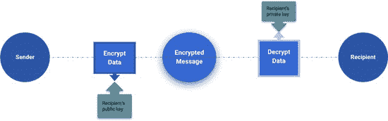

**图 3.1：** 公钥加密

##### 加密基础概念

本节将概述加密的各个方面，但由于涉及一些数学，你可以直接跳过本节进入下一节，我们将讨论比特币中的椭圆曲线加密。

公钥加密基于使用某些实现数学函数的算法，这些函数具有非常独特的不可计算属性。但在我们继续之前，让我们来看看什么是不可计算问题，什么是陷门函数。

##### 可计算问题与不可计算问题

如果一个问题可以通过高效的（即多项式时间）算法解决，则该问题被称为可计算的。相反，如果没有高效算法可以解决它，则被称为不可计算的。

可计算问题的示例（已知多项式时间算法的）：

*   搜索无序列表或有序列表
*   对列表进行排序
*   整数乘法是简单的

不可计算问题的示例（已知多项式时间算法的）：

*   列出 n 个数的所有排列
*   将复合数分解为较小整数的乘积

总结来说，通常不可计算问题可能有理论上的解决方法，但没有实际的方法可以解决它们，这是因为最常见的暴力破解方法在复杂度上需要指数级增长的时间。

##### 模运算

模运算是加密最基础的组件之一，在移动到其他组件之前，理解它是什么至关重要的。让我们来看下面的语句：

`3 ≡5 mod (2)` 或者简单来说，`3 模 2 等于 5`

这意味着在模 2 的世界里，3 和 5 是等价的。这是因为它们处于模 2 的世界中。模 2 意味着只有两个值：0 和 1。有效来说，在模 2 中，可接受的值是 `{0, 1}`。对于模 (n)，值集将是 `{0, 1 …, (n-1)}`。

现在如果我们回到数轴上的原始语句 `3 ≡5 mod (2)`，你可以看到这里 3 和 5 是相同的：

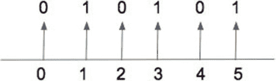

**图 3.2：** 模运算

如果我们回顾这个原始语句，在模 `p` 的有限域（例如）中定义了一个算术运算，这里 `p` 是一个质数。模 `p` 的集合包含从 0 到 `p-1` 的所有整数。

##### 陷门函数

陷门函数是一种结合了可计算问题和不可计算问题特征的函数。它在一个方向上是容易的，而在相反的方向上是困难的。如果 `f` 是一个陷门函数，那么 `y = f(x)` 很容易计算的，但在不知道 `k` 的情况下很难计算。“陷门”这个名字源于“掉进去容易爬出来”的类比。随着 RSA 的流行，密钥长度也变得重要。加密的发展不能没有这种陷门函数，它发现于一个被称为椭圆曲线的边缘数学分支。

##### 椭圆曲线

在加密中使用椭圆曲线并不新鲜，它们已用于 TLS、SSH 和 PGP，这是由于它们独特的属性。椭圆曲线是有限域上的平面曲线。

例如，实数是一个无限域，但如果你收集一组数字，如 `{3, 4, 543, 42, 56, 78, 2020}`，它将是一个有限域。另一种类型的有限域是模 `p` 的所有整数，这里 `p` 是一个质数。

椭圆曲线是满足以下方程的曲线点集：

`y²=x³+ ax+ b`，其中 `4a³+ 27b²≠0` 以排除奇异曲线，并包含一个无穷远点 `0`（零），椭圆曲线可以定义为满足以下方程的曲线：

```
{(x,y) ∈ R2 |y²=x³+ ax+ b, 4a³+ 27b²≠0} U{0}
```

并且是一个群，这意味着它具有：

*   **封闭性**：如果 `a` 和 `b` 属于群，那么 `a + b` 也在群内。
*   **结合律**：`(a + b) + c = a + (b + c)`
*   **单位元**：`a + 0 = 0 + a = a`
*   **每个元素的逆元**：`a + b = 0`
*   特别是，阿贝尔群，意味着它具有交换律：
    `a + b = b + a`

在通常的加法概念下，整数集 `ℤ` 是一个群（此外，它是一个阿贝尔群）。然而，自然数集 `ℕ` 不是群，因为无法满足第四个性质。群的这些独特性质（包括逆元等）已经变成了非常重要的属性，这些属性在创建陷门函数时非常有用，我们将在稍后看到这些。

让我们来看看当 `a` 和 `b` 取不同的值时，这些曲线是什么样子的（图 3.3）：


**图 3.3:** 一个典型的椭圆曲线，其中 `b = 1` 且 `a` 取值为 2 到 -3。

奇异点是被排除在外的，因为它们不被视为有效的椭圆曲线，它们如下所示：


**图 3.4:** 尖点曲线 `y²=x³` 和自交曲线 `y²=x³\- 3x+ 2`，都不是椭圆曲线。

现在我们已经理解了椭圆曲线的一些性质，以及它们是如何符合阿贝尔群的性质的，让我们深入研究群律以及它是如何应用于椭圆曲线的。

椭圆曲线作为阿贝尔群最重要的性质之一是：如果你画出一条与曲线上的两个非切点的直线，它将始终与曲线上的第三个点相交，该点遵循下述性质：

*   给定三个共线的非零点 `P`、`Q` 和 `R`，它们的和为 `P+Q+R=0` 且 `(P+Q) + R = P + (Q+R) = Q + (P + R)`。

这意味着 `P + Q = -R`。

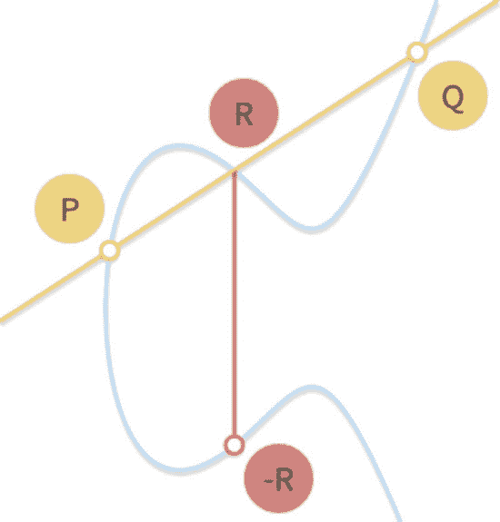

**图 3.5:** 绘制具有三个对齐点的椭圆曲线，展示了性质 `P + Q = - R`。你可以尝试使用由 Andrea 创建的工具 [`andrea.corbellini.name/ecc/interactive/reals-add.html`](https://andrea.corbellini.name/ecc/interactive/reals-add.html) 进行尝试。

我们可以在椭圆曲线上定义一个群。具体来说：

*   群的元素是椭圆曲线上的点；
*   单位元是无穷远 `0`；
*   点 `P` 的逆是关于 X 轴对称的点；
*   加法由以下规则给出：给定三个共线的非零点 `P`、`Q` 和 `R`，它们的和为 `P+Q+R=0`。

请参考上述的 Andrea 博客以获取关于这些椭圆曲线性质的详细数学分析，但在比特币中使用了两个主要性质，我们将重点在这两个上：

*   对于三个共线的点，它们的和为零，`P + Q + R = 0`，我们在上面在 `图 3.5` 中看过。
*   适用标量乘法：`nP = (P + P + ….. + P)`（`P` 相加 `n` 次）。

# 有限域上的椭圆曲线

早之前简要讨论过的另一个方面是，我们需要这种曲线的有限版本，因此我们使用模运算。由于原因，曲线不是趋于无穷大（如之前讨论的点 `0`），而是被定义在有限域中。

让我们限制椭圆曲线在有限域上以理解两者结合使用的影响，我们可以写之前看到的实数椭圆曲线方程，但限于模 `p (F[p])` 的有限域：`{(x,y)∈(Fp) | y²=x³+ ax+ b mod p}`。

现在我们已经理解了椭圆曲线的一些性质，以及它们是如何符合阿贝尔群的性质的，让我们深入研究群律以及它是如何应用于椭圆曲线的。

椭圆曲线作为阿贝尔群最重要的性质之一是：如果你画出一条与曲线上的两个非切点的直线，它将始终与曲线上的第三个点相交，该点遵循下述性质。参考上述的 Andrea 博客以获取关于这些椭圆曲线性质的详细数学分析，但在比特币中使用了两个主要性质，我们将重点在这两个上：

*   对于 3 个共线的点，它们的和为零，`P + Q + R = 0`，我们在上面在 `图 3.5` 中看过。


*   适用标量乘法：`nP = (P + P + ….. + P)`（`P` 相加 `n` 次）。

# 有限域上的椭圆曲线

早之前简要讨论过的另一个方面是，我们需要这种曲线的有限版本，因此我们使用模运算。由于原因，曲线不是趋于无穷大（如之前讨论的点 `0`），而是被定义在有限域中。

让我们限制椭圆曲线在有限域上以理解两者结合使用的影响，我们可以写之前看到的实数椭圆曲线方程，但限于模 `p (F[p])` 的有限域：`{(x,y)∈(Fp) | y²=x³+ ax+ b mod p}`。

假设 Alice 想要用她的私钥 `d[a]` 对消息 `m` 进行签名，而接收者 Bob 想要使用 Alice 的公钥 `H[a]` 验证消息 `(z, 这是一个哈值并截断至 n-1 的阶）` 的真实性，过程如下：

*   从有限群 `{1, …, n-1}` 中选择随机整数 `k`
*   计算 `P = kG`
*   计算 `r = x[p] (mod n)`（`x[p]` 是 `P` 的 x 坐标），如果 `r = 0` 则选择另一个 `k`。
*   计算 `s = k^(-1) (z + rd[a]) (mod n)`，其中 `z` 是消息的哈值。如果 `s = 0` 则选择另一个 `k`。

`(r, s)` 构成签名。接收 `(r,s)` 和 `z` 的 Bob 将能够通过 Alice 的公钥 `H[a]` 验证消息的正确性。

## 使用 ECDSA 验证

为了验证签名，Bob 需要 Alice 的公钥 `H[a]`、哈值 `z` 以及签名 `(r, s)`：

*   计算整数 `u[1] = s^(-1) z (mod n)`。
*   计算整数 `u[2] = s^(-1) r (mod n)`。
*   计算点 `P = u[1]G + u[2]H[a]`。

只有当 `r = xp` 时，签名才有效。

## 哈希函数

密码学中有许多哈希函数，但我们在这里仅限于 Bitcoin 中使用的那些。

正如我们在前面的章节中看到的，Bitcoin 广泛使用密码哈希函数，例如，区块 ID 是区块的反向双重 SHA256 哈希。交易 ID 也是双 SHA256 哈希。地址是 SHA256 哈希的 RIPEMD160 哈希。最后但同样重要的是，数字签名涉及对交易进行哈希处理以签名和验证。以下是 Bitcoin 协议中广泛使用的哈希函数列表：

| 哈希函数 | 输出长度 | 描述 |
| :--- | :--- | :--- |
| SHA256 | 32 bytes | 为文本生成唯一的 256 位位值 |
| SHA256SHA256 | 32 bytes | SHA256 哈希的 SHA256 哈希。 |
| SHA512 | 64 bytes | 为文本生成唯一的 512 位位值 |
| SHA1 | 20 bytes | 为文本生成唯一的 160 位位值 |
| RIPEMD160 | 20 bytes | 为文本生成唯一的 160 位位值 |
| SHA256RIPEMD160 | 20 bytes | SH256 哈希的 RIPEMD160 哈希。 |

**表 3.1：** Bitcoin 协议中使用的各种哈希函数。

## Bitcoin 中的椭圆曲线加密

既然我们已经学习了椭圆曲线和密码工具的总体基础，让我们专注于这些工具如何在 Bitcoin 中用于生成私钥、公钥和 Bitcoin 地址。

Bitcoin 使用非常特定的椭圆曲线，即在 secp256k1 标准定义的 Koblitz 曲线。对于这些曲线，六元组参数 `{p, a, b, G, n, h}` 假设了下表提到的特定值：

| 参数 | 值 |
| :--- | :--- |
| p | FFFFFFFF FFFFFFFF FFFFFFFF FFFFFFFF FFFFFFFF FFFFFFFF FFFFFFFE FFFFFC2F 或 2²⁵⁶ - 2³² - 2⁹ - 2⁸ - 2⁷ - 2⁶ - 2⁴ - 1，这是一个巨大的数字 |
| a | 0x00 |
| b | 0x07 |
| G, Compressed | 02 79BE667E F9DCBBAC 55A06295 CE870B07 029BFCDB 2DCE28D9 59F2815B 16F81798 |
| G | 04 79BE667E F9DCBBAC 55A06295 CE870B07 029BFCDB 2DCE28D9 59F2815B 16F81798 483ADA77 26A3C465 5DA4FBFC 0E1108A8 FD17B448 A6855419 9C47D08F FB10D4B8 |
| n | FFFFFFFF FFFFFFFF FFFFFFFF FFFFFFFE BAAEDCE6 AF48A03B BFD25E8C D0364141 |
| h | 0x01 |

**表 3.2：** secp256k1 标准中使用的域参数值。

当这些值赋值给椭圆曲线方程时，得到了 Bitcoin 的最终简化方程：

`y²=(x³+7) mod p`

为了能够创建私钥，首先我们需要从有限群 `(1, …, n-1)` 中选择一个随机数 `k`……

如果我们回顾之前的内容，关于循环子群和标量乘法的属性，我们选择基点，然后进行多次（标量）乘以获得公钥。此密钥 `Q = (xQ, yQ)` 形成了椭圆曲线上的点 `Q`。因此我们有：

`Q = d G`，其中

*   `Q`：代表公钥
*   `d`：代表私钥
*   `G`：椭圆曲线点生成参数，其值如 `Table 3.2` secp256k1 规范所示

这里的公钥 `Q` 包含了椭圆曲线中的 `x` 和 `y` 坐标，因为它是其中的一个点。这是一个 65 字节长度的值，由前导值 '0x04' 以及两个各 32 字节的 `x` 和 `y` 坐标组成。

让我们继续示例，将私钥 `d` 与上述基点 `G` 相乘，得到 `Q (x, y)`：

```
x = 9ad3f8cd0fbcf8b6c881db33755890557c5cc773cf5809db7b349a283baa9b6b
y = 83ade22b984dfa3121844a6b5b0375620ed0abc3639fa35a87e8864d5c12950d
```

公钥的压缩形式表示为 `X` 坐标以及一个表示 `Y` 坐标是否为奇数的字节。获取 `Y` 坐标的奇偶性（偶数为 `02`，奇数为 `03`），且上述的 `y` 坐标为奇数，因此加上奇偶性值 `03`。

现在完整的公钥表示可以写为：

```
03 9ad3f8cd0fbcf8b6c881db33755890557c5cc773cf5809db7b349a283baa9b6b
```

对上述值先应用 `SHA256` 后应用 `RIPEMD160`，我们得到：

```
d73d2906c6b48b7f42e364f0e6b455733df73803
```

比特币地址是上述密钥的编码版本。以下是密钥编码执行的步骤。

在密钥前添加版本号 '00' 以表示这是主网，并在末尾添加校验和，该校验和是上述密钥双重 SHA 哈希的前四个字节。

```
00 d73d2906c6b48b7f42e364f0e6b455733df73803 D9442399
```

将结果从字节字符串通过 `Base58Check` 编码转换为 base58 字符串，得到大多数钱包都使用的最终地址。

```
Final Bitcoin Address: 1Ld5YjWQVQr8HwM7E1E1RcfGUmV9DJtuDA
```

每个私钥都与两个可能的公钥关联：我们刚刚得出的压缩版本，以及也可以使用未压缩密钥。

这种地址格式的复制和使用容易得多，它自比特币诞生十年以来一直被使用，但现在协议中发生了更多创新，甚至已经开发了更先进的协议，其中地址不再使用上述的原始形式，而是使用类似 `$mybitcoinaddress` 或 `1mybitcoinaddress` 的类人类字符。此外，还有一种名为 paymail 地址的邮件类型格式（例如 `mybitcoinaddress@mydomain.com`），它在最近推出，为了让非技术用户的用户界面更简单。我们将在书的后面讨论 paymail 协议时详细介绍这一点。

# 签名与验证

正如我们在 ECDSA 中学到的那样，比特币广泛使用这些密钥对 `(d, Q)`，不仅是为了创建数字签名链（或区块链），这些签名还用于消息的签名。随着学习，我们将不断学习更多，以发现 ECDSA 签名和验证的更多用途。它与 DSA 相似，但区别在于密钥基础设施是基于 ECC 而不是像 RSA 之类的东西。下图显示了比特币中的签名和验证过程：

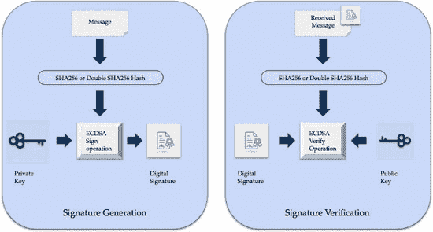

**图 3.6:** ECDSA 概述：签名与验证

# BIP32 和 BIP39

自比特币发布以来，大多数用户面临的问题之一是密钥的维护。你可以想象，如果每次向某人分享公钥进行交易，你将永远与该密钥相关，虽然这本身不是问题，但如果我所有的银行交易都发布在公共账本上供任何人查看，这在某种程度上将对我隐私产生侵犯。这与匿名不同（匿名无法通过地址追踪到身份），而更像是追踪是可能的，但其他人无法追踪，这要求人们使用许多不同的私钥，最终他们丢失了密钥，同时也丢失了密钥持有的资金。那是 Satoshi 消失的时期，该问题通过社区各种开发者和代码维护团队提出的许多可能的解决方案得到了解决。其中最终被压倒性采纳的两个 `BIP（比特币改进建议）` 是 `BIP32` 和 `BIP39`。

如前提到的，密钥效果很好，但如果你维护多个密钥，存在隐私和密钥丢失等局限性。理想情况下，解决方案应该是高级钱包（我们将在后续章节中讨论更多钱包），它们是 `SPV（简单支付验证）` 并为用户管理密钥，但开发方向并没有完全朝着那个方向进行。解决方案之一是 `BIP32`，它以牺牲为代价提供了密钥的扩展，但到目前，这仍然是一种被广泛采用的常用方法，特别是加密货币交易所。另一种解决方案 `BIP39` 使用一组单词（具体为 12 个）来生成私钥，从而为私钥的生成提供了简便的助记。让我们详细查看。

## BIP32: 分级确定性密钥

该方案不再使用单个密钥，而是使用一组基于该方案的密钥，解决了隐私问题（每次交易都使用新地址），密钥管理由钱包完成。

该想法背后的数学原理是：

`Q = d G` - 主私钥。我们现在定义 `C` 为

`C = c G` - 共享密钥对

`n C = n c` - 多倍共享密钥，其中 `n` 是正整数。

`Q' = (Q + n C) = (d G + n c) = (d + n) G`

考虑到上述内容，我们现在可以看到，任何人都可以生成新的公钥 `Q' = Q + n C`，但只有主密钥持有者可以导出新的私钥 `d' = d + n`。

这并不是比特币协议中处理密钥最安全的方法，因为显而易见，访问一个私钥就可以访问所有密钥。此外，如果共享了其中一个私钥，也可以导出其他密钥。

## BIP39: 助记词

该方案是为了解决特定密钥的存储或记忆问题。你会发现用笔在纸上写下所示的私钥是非常困难的：

`Private Key = KzdumWTQsUo8gt1P86yy8cVKfMFmSpV6A3tGj7yUaMgUzK1EEZ`

但存储所示密钥将会容易：

`mnemonic = 'aware report movie exile buyer drum poverty gym oppose float elegantly'`

这就是该方案简述的功能。上述单词是用户在代替复杂私钥时需要备份的内容，随时可以使用这些助记词生成密钥。这些单词并不是普通的单词，而是从一个专门创建的名为 BIP39 的列表中提取的。当你创建一个新钱包时，这些助记词是由钱包随机选择的。

# 引言

在本章中，我们学习了许多复杂的协议层细节，这些细节对于开发者或用户来说大部分是不可见的，因为现在已经有了许多更好的开源库和工具用于开发基于比特币的应用程序。本章细节的目的是介绍并概述比特币中使用到一些基本工具和概念，特别是作为比特币系统核心的私钥和公钥，并解释创建这样一个系统时背后的思维过程——该系统是智能、优雅的，并且完全基于“安全模型的破解成本始终高于参与成本”的理念。其一个经典例子之一是公钥中的双重哈希。使用 `SHA256` 和 `RIPEMD160` 两种算法进行哈希使得安全性更加健壮，即使其中一种算法被破解，仍然受到保护。

在下一章中，我们将继续之前，开始研究钱包和用户的整体密钥管理，有哪些不同的钱包格式，什么是 `SPV` 钱包，以及如何开发新协议来简化这些密钥的使用和存储，以便让非技术用户也能使用钱包，而不必涉及本章中讨论的底层复杂性。

# 问题

1. `RSA` 和 `ECC` 之间有什么区别？
2. 什么是哈希函数、陷门函数和模运算？
3. 什么是 `Diffie Hellman` 密钥交换？
4. 比特币实现中椭圆曲线密码学的域参数是什么？
5. 什么是比特币 `address`？它是如何生成的？

# 第 4 章：关于钱包的一切

本书的这一章将涵盖钱包的概念。比特币作为一个系统，从意义上来说是电子现金系统，因此也表现如此。钱包的概念类似于钱包，它持有各种面值的现金，比特币钱包也持有指向各种未花费交易输出（`UTXOs`）的密钥，这些输出持有价值硬币。我们将查看如何创建和管理各种类型的钱包以及它们提供的各种功能。然后，我们将研究 `SPV` 或简单支付验证的概念。

## 结构

*   钱包的概念和用途
*   用于冷存储的基础钱包
*   新一代钱包及其特性
*   简单支付验证

## 目标

学习本章后，你将能够理解钱包的整体概念、简单支付验证（`SPV`），以及冷钱包和热钱包等常用钱包的细节。我们最后讨论一种使用旧 Android 手机安全存储硬币的方法。

## 钱包概念

现在我们理解了私钥和公钥是什么，让我们看看如何存储和管理密钥，以及更重要的部分：这些密钥用于创建数字签名，数字签名又与区块链上存储的硬币相关联。钱包是不仅进行密钥管理，还为用户提供密钥生成和交易服务的软件。但在此之前，让我们尝试回答这个问题：钱包会存储硬币吗？

答案非常简单：不，钱包从不存储硬币。它存储密钥，它是一个密钥管理软件。它也是提供创建和接收交易、签名消息以及解密消息功能的软件。它在各方面与银行提供的任何钱包应用或软件相似，钱包本身并不存储资金，而是提供一个使用你资金的接口。

那么硬币存储在哪里呢？这很容易回答：硬币存储在区块链上，被称为未花费交易输出或 `UTXO`。让我们查看交易列表，从 `Coinbase` 交易创建硬币开始（如果你还记得的话，这是每个区块的第一笔交易，包含了新铸造的硬币，作为区块奖励给赢得 10 分钟寻找下一个区块哈希比赛的矿工）。来自 `Coinbase` 的硬币通过存储在区块的交易中创建，该交易由矿工的私钥锁定。这意味着，矿工现在拥有存储在区块链上的 `12.5 BSV` 硬币资产的所有权。下图显示了矿工在挖掘区块并接收到 `Coinbase` 交易后进行的几笔交易，通过拆分他获得的 `12.5 BSV` 创建了多个输出：

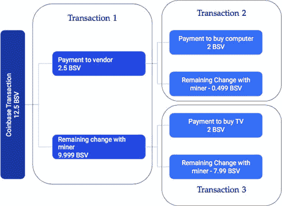

**图 4.1：** 矿工通过多笔交易花费 Coinbase 硬币

在上面的图中，我们看到矿工新铸造的硬币将从存储在比特币区块链账本中的交易生成，并可能由矿工的私钥解锁。图中继续显示了矿工使用比特币（价格仅为 `2 BSV`）购买电脑和电视的另外两笔交易，并留下了两个不同的输出。一组被私钥锁定的 `12.5` 硬币现在分布到各种输出中，矿工自己保留了其中许多被不同私钥进一步锁定的输出。这些未花费且仍存储在区块链上作为私钥记录的输出被称为 `UTXs`，或未花费交易输出，而整个交易过程是名为钱包的应用程序或软件的典型功能。通常，钱包会为用户提供一个密码句或助记词作为用户密码，而一组私钥以及创建交易的功能将由钱包软件完成。

自比特币发布以来，钱包经历了漫长的演变过程。我们将从基础到各种版本的钱包软件开始，最后引出白皮书中规定的 `SPV` 钱包预期工作方式。我们还将学习一个使用旧 Android 手机创建简单冷存储钱包的过程，以及其他存储密钥/助记词的策略。

### 冷存储钱包


# 冷存储

冷存储意味着一种存储私钥的方法，使其离线状态。最安全的方法是它们从未上线过，即使在创建期间也从未。通常，网上有很多可用工具（大多数是 JavaScript 代码），可以下载后离线使用。最安全的方法（这再次针对超安全解决方案）是从 GitHub 下载工具：[`https://github.com/pointbiz/bitaddress.org`](https://github.com/pointbiz/bitaddress.org) 并在一台从未上线过的机器上使用它，这将确保机器上没有隐藏的恶意软件是最安全的。

一旦你通过后文将讨论的任何方法生成了私钥，就可以用纸笔将它们写下来。你也可以使用离线打印机，但请确保在完成后清理数据。由于这个原因，使用助记词（mnemonic）或脑钱包（brain wallet）的方法被认为是最简单且最好的。通常情况下，写下长私钥是一项困难的任务且容易出错，因此不是最推荐的方法。助记词和种子（seed）之间有细微的区别，但它们经常被混用；区别在于助记词是用户可以记住的东西，而种子通常是一组用户需要存储的随机集合。

## 纸钱包

随着比特币的发明，第一批钱包被称为纸钱包，因为它们是公私钥的打印。直到今天，它们被认为是存储密钥最安全的方法（只要你按照特定的流程创建），并且最容易生成和使用。这个想法非常简单，大多数是可以离线运行的简单 JavaScript 代码。它涉及以下流程：

1. 使用 [bitaddress.org](http://www.bitaddress.org) 等随机数生成器生成随机单词、短语或字符熵，这是一种方便且简单的方法。下图显示了生成器如何通过随机选择字符（由绿色点表示）创建一个完全随机的单词集：

    

    **图 4.2：** 使用随机字符集创建私钥

2. 上述字符列表将用于创建公私钥，如上文所述。下方显示了公私钥的实际值：

    

    **图 4.3：** 可以打印并使用的公私钥纸钱包

3. 上述钱包是单组密钥的纸钱包，通常在离线机器上打印并存储在安全位置，如银行金库，或者作为公司提供的服务。

可以生成多种类型的钱包以提供存储原生格式私钥的替代安全功能。上述纸钱包并不容易存储和重用，因为需要写下或使用长字母数字字符串，即使是一个字符错误也会导致无法进入钱包。

## 脑钱包

脑钱包基于一个复杂的短语，用于创建私钥。这提供了使用的便利性，因为短语用户可以轻松记住，不需要存储在任何地方，或者以任何形式安全地存储。关于它的最有趣的点之一是，它很难被正确猜到，并且可以在众目睽睽之下完成，使其成为冷存储货币的一种非常有吸引力的方式。这通常涉及构出一个难以猜到的复杂短语。下图显示了一个示例短语（非常简单，不应使用）以及如何使用短语种子生成脑钱包：


**图 4.4：** 使用短语生成公私钥和钱包

尽管人们认为这不是一个好主意，但如果你遵循良好的方法，你会发现它们极其安全。这是一个带有提示的脑钱包挑战示例，它持有 50 个比特币（拆分前的三个版本 BTC、BCH 和 BSV），且从未被破解。该挑战的链接如下：

**未解的脑钱包谜题：[`medium.com/predict/how-to-make-a-brain-wallet-a840b7c1993`](https://medium.com/predict/how-to-make-a-brain-wallet-a840b7c1993)**

## 助记钱包

创建安全且稳定的冷存储钱包的另一种方法是使用助记关键词的拆分流程。通常现代钱包使用 12 个单词的助记词，作为生成钱包私钥的密码语。

拆分方法是将这 12 个助记词分成 3 部分，使得任何两部分都可以重新创建一个完整的密钥。这提供了一种之前讨论的冷存储钱包不具备的安全功能，因为它没有在一个地方存储完整密钥。让我解释一下如何操作。假设以下是用于创建钱包的 12 个单词：

`Switch collapse practice feed shame despair creek road again ice least`

现在要使用上述词集创建 3 组卡片，你可以遵循以下步骤：

1. 为这些单词分配分配标识符（A、B 和 C，每个 4 个单词），如下表 4.1 所示。

2. 使用标识符组创建 3 组：组 1: (A, B)，组 2: (B, C) 和组 3: (C, A)。

3. 你现在有了 3 组部分密钥。下表显示了如何创建这 3 组：

| **组 1** | **组 2** | **组 3** |
| :--- | :--- | :--- |
| Switch | shame | road |
| collapse | open | again |
| practice | despair | ice |
| feed | creek | least |
| shame | road | Switch |
| open | again | collapse |
| despair | ice | practice |

**表 4.1：** 为了安全存储将助记词分成 3 部分

如你所见，上述 3 部分具有一个特性：任何两个部分都可以随时恢复完整的密钥，但仅凭一部分是不可能的。这种方式你可以将这三个不同的集合存储在不同的地方，而不会让密钥完全暴露在风险之中。

上述提到的钱包还有其他版本，如个性化钱包（vanity wallet）、拆分钱包等，这里不再详细介绍，因为它们属于上文讨论过的密钥操作和重新生成。

## 硬件钱包

另一类出现的钱包被称为硬件钱包。这些是小型插拔式设备，许多版本不连接互联网，但现在也有一些无线版本。它们通常包含一个微控制器的小型处理单元，用于存储钱包代码和密钥，以及与计算机连接的方式（USB、无线、NFC 或蓝牙）。它们的主要属性是：

*   通常由于这些是离线设备，它们免受病毒、恶意软件等的侵害。
*   安全性——私钥通常存储在微控制器的保护区域内，并经过加密，以阻止明文形式导出密钥。
*   通常它们使用开源代码，允许对软件进行独立审计。

你也可以使用任何计算或存储设备来自己创建硬件钱包，所以如果你对计算机精通，并没有必要这样做，但这些对于非技术用户来说是非常好的。在本章的最后，我将引导你如何使用一部旧的安卓手机创建一个类似的硬件钱包。

## 新一代钱包

随着比特币生态系统的发展，涌入了大量非技术背景的新用户。此外，现在已经有了许多服务允许用户通过比特币进行支付，这导致了用户不仅需要冷存储钱包，还需要可以用于日常交易（如支付咖啡钱）的钱包。目前市面上已经出现了许多可免费使用的钱包，它们提供了一种更新、更简单的方法来存储这些私钥和公钥，并具备创建交易、签名、验证，以及使用相同密钥对消息进行加密和解密等其他功能。少数钱包还创建了一些创新解决方案，我将简要介绍这些，并详细讨论一种基于 Electron 框架的开源钱包。

# 句柄系统钱包 (Handle system wallets)

句柄系统钱包是过去几年出现的现象，它们完全改变了比特币用户的入驻流程和体验。许多钱包都在使用这种系统，让我们来看看它们是什么以及如何工作的。

比特币与传统资金处理系统之间的一个大区别在于“账户”的概念。目前的金融行业和企业始终通过账户号码来识别用户。这与比特币非常不同，正如我们之前看到的，比特币中的资金是与 UTXO 关联的，根本没有账户的概念。

句柄系统钱包恰好做到了这一点。它们创建了一个建立在密钥系统之上的会计系统，而钱包对用户是透明的密钥管理。通常，每当使用 App 发送或接收交易时，钱包都会生成一个新的密钥对并用于该交易。这确保了用户在区块链上的隐私，同时也满足了钱包端对用户及用户交易的法律合规性要求。所有这些钱包通常使用 12 个单词的种子（seed），并将其作为生成用户交易密钥对的口令。它们通常也不会在自己的服务器上存储种子词，这样它们就不需要充当用户钱包内资金的托管人。

## HandCash

Handcash 是第一个提供平滑易用的入驻流程以及不需要任何技术知识的密钥管理系统的比特币钱包。他们将这种系统称为句柄系统（handle system）。句柄系统通过如下的句柄（handle）来代表用户身份：

`$myhandlename`

`myhandlename` 类似于用户在安装 handcash App 后选择的用户名，用户需要提供基本信息进行注册。用户的 `myhandlename` 身份绑定一组私钥和公钥，这些密钥是为每笔交易新生成的新密钥。整个密钥生成和管理过程对用户来说都是透明的。

HandCash 还提供了一个 API，通过其名为 `cashport` 的开源 SDK，为网站提供集成和创建支付功能。这是启用使用 handcash 用户句柄的方法，并且对于你的 Web 应用程序来说集成非常简单，GitHub 上有简单的 TS 代码可以进行这种集成：[`github.com/HandCash/cashport-sdk-typescript`](https://github.com/HandCash/cashport-sdk-typescript) ：

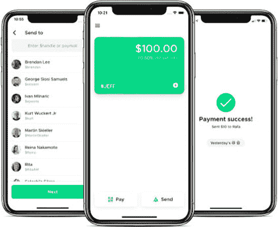

**图 4.5：** HandCash 钱包的 UI 和 UX，它是首批推出易用钱包的钱包之一。

之后还出现了一些与 handcash 非常相似的钱包，例如 relayx 钱包，它使用的是与句柄系统非常类似的系统。还有 Centabee，它将手机号码与密钥关联并将其作为用户的身份。

# Money button (钱按钮)

另一个创建了用户友好系统的开源免费应用程序是一个钱包，它表现就像一个按钮。Money button 是最早设计的纯对象化钱包之一，只需几行代码即可集成到网站中，通过 vola，你可以为网站开启内容变现、为文章设置付费墙，或者任何你能想到的功能。Money button 在某种程度上与句柄系统类似，因为它也为用户提供了应用内部 ID，并对内部密钥对和交易管理提供了抽象。

Money button 就像 Facebook 的点赞按钮，但用的是钱而不是点赞。

Money button 是比特币集成领域最常用的开源工具之一。此外，money button 还创建了一个加密工具的开源库，地址为 [`github.com/moneybutton/bsv`](https://github.com/moneybutton/bsv)。

以下是向你的应用程序添加资金的代码：

```bash
npm install --save bsv
```

```html
<!-- 这行代码应该放在你想放置按钮的地方 -->
<div class="money-button"
     data-to="16X9LKyuQ5N9QiR7iMD1Ngdrd6RL5an"
     data-amount="5.29"
     data-currency="INR"
     data-label=""
     data-client-identifier="a65023353f4a69a96a95fe5f90749c"
     data-button-id="156941216321"
     data-button-data="{}"
     data-type="tip"></div>

<script src="https://www.moneybutton.com/moneybutton.js"></script>
```

生成的 money button 看起来如下：


**图 4.6：** Money button

关于使用 HTML、JavaScript 和 React 使用 money button 的详细文档请见链接：[`docs.moneybutton.com/docs/mb-html.html`](https://docs.moneybutton.com/docs/mb-html.html)

# 桌面端及多功能钱包

全功能钱包是另一类从早期就一直存在的类别。通常，这些钱包具有完整的密钥管理功能，还具有消息签名、验证、加密和解密等额外功能（取决于具体的钱包），同时将实际密钥和敏感数据保持离线。

Electrum 钱包是我们在本节中讨论的钱包之一。它基于名为 electrum 的框架，客户端 UI 相当简单。该钱包用 Python 编写，并由一组开发者作为开源项目维护。Electrum 钱包的第一版本于 2011 年发布，包含以下功能列表：

*   **密码加密钱包：** 除了种子词外，用户还会用密码对钱包进行加密，使其非常安全。
*   **BIP32/BIT39 密钥生成：** 使用户即使忘记密码，也可以通过助词（seed phrase）重新生成钱包。
*   **部分 SPV 但与区块链实时同步：** 此钱包不需要下载完整的区块链，因此非常轻量，但它需要托管区块链的特定节点，即 `electrum servers`，且钱包会实时同步。客户端也会下载区块头，但同时也会与全节点节点保持实时连接。
*   所有数据都存储在本地，交易也在本地进行签名，因此在任何时候任何私有数据都不会存储在服务器上。
*   内置了冷存储功能，用户可以将私钥离线保存，并在在线使用时仅使用监视模式。
*   该钱包支持多签名钱包、硬件钱包集成，以及钱包可以连接的服务器列表，因此不存在单点信任和故障点。
*   钱包连接到区块浏览器等工具以显示交易详情。它还提供了一个 CLI 接口来模拟 `Bitcoind`。`Bitcoind` 是一个守护程序，是比特币网络节点软件的主要组件之一，它通过命令行模拟比特币协议。

下图展示了典型钱包主界面的外观，以及钱包提供的各种交易和功能。Electrum SV 钱包代码库位于 [`github.com/electrumsv/electrumsv`](https://github.com/electrumsv/electrumsv)。

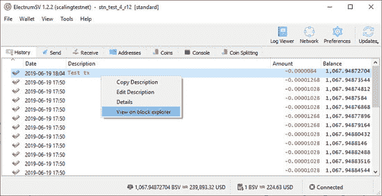

**图 4.7：** Electrum SV 以及钱包各种功能。

## 消息的签名与验证

我们已经看了钱包的标准功能和特性，但使用存储在钱包中的密钥对还可以实现其他一些功能。最显而易见的用法是使用这些密钥对任意（非交易）数据的消息进行签名。这样任何人都可以通过公钥验证签名。这种用法可以用于各种场景作为签名证明：

*   你可以对文件进行签名，向任何人证明是由你创建的。
*   你可以向某人签名消息以便与接收者进行安全通信。
*   也许可以对应用程序或任何数字内容进行签名，以证明是你创建/构建了它。
*   通过使用相同的密钥签名消息，证明对特定比特币地址的所有权。

Electrum 钱包作为其功能之一提供了这项功能。你可以使用此钱包对消息进行签名/验证、加密和解密。

# 热钱包与多签或拆分钱包

比特币社区最早活跃的行业之一是最显而易见的：加密货币交易所，用户可以在那里买卖比特币。通常情况下，这些地方聚集了矿工（创建货币的人）、买家和交易比特币的交易者。在起初，这些交易所非常杂乱无章，且在法律验证和 KYC（了解您的客户）方面不合规，但在发布后的十年里，越来越多的符合 KYC 标准的交易所出现了。这些交易所与股票交易所不同，是 24/7 在线的，除了允许用户买卖外，还提供了保证金交易和期权交易等其他高级交易功能。通常这些交易所会有一个钱包让用户在其中持有资金，这些钱包被称为热钱包。实际上，任何始终在线的钱包都可以视为热钱包。

另一类型的钱包被称为 `split wallet`（拆分钱包）。通常情况下，这种类型的钱包会将私钥或助记词种子分成多个份额，以便在任何时候都需要这些份额中的两个或多个份额来恢复私钥。实现这一点的有多种方法，从简单的拆分助记词，到使用名为 `Shamir's Secret Sharing Scheme`（沙米秘密共享方案）的已知加密算法创建多签（multisignature 的缩写）钱包的复杂方案。你可以通过链接阅读更多关于这种 2 of 3 密钥实现的内容。

*Gavin Anderson* GitHub: [`gist.github.com/gavinandresen/3966071`](https://gist.github.com/gavinandresen/3966071)

## 简单支付验证 (SPV)

通常大多数钱包服务必须连接到运行比特币全节点的节点，或者由自己运行。运行全节点需要大量的投入和成本。钱包需要运行全节点的原因是：

*   获取 UTXO 的完整信息
*   验证 UTXO 的有效性
*   创建并发送新交易

运行全节点的要求并非强制，因为有一种替代方案被称为 `SPV` 或简单支付验证。使用 SPV 时，用户拥有一个包含 Merkle 链的区块头副本，使得钱包只需下载区块头：

*   SPV 将连接到托管最长链的节点。
*   SPV 将拥有一个地址列表，可以通过查询网络节点获取 UTXO 余额。
*   为了列出与密钥相关的交易，它可以查询连接的节点以获取 Merkle 分支。

任何真正的 SPV 钱包都需要下载区块头，因此在钱包设置时将同步。关于钱包还有一些待讨论的概念，但我们目前将范围限制在此，之后将重新讨论新一代钱包以及 `BIP270` 协议和真正的 SPV 钱包。

# 使用 Android 手机硬件钱包

存储货币的一种简单方法是制作硬件钱包，可以使用旧的或新的 Android 手机简单地创建。查看以下步骤：

*   从手机中取出 SIM 卡。
*   对手机进行出厂重置，以移除任何可能的恶意应用程序。
*   通过创建一个全新的 Google 账户对手机进行基础设置。
*   在设置期间，不要将手机备份到任何云服务或 Google 服务器，不要选择保持更新，不要启用提供的任何服务（如备份、地理位置、错误报告等）。基本上几乎不要允许任何连接、服务、账单信息或其他信息。
*   为你的手机设置尽可能复杂的密码以增加一层安全防护，并方便操作。密码越长越好。
*   卸载任何可能用不到的应用程序（尽可能卸载所有可以卸载的应用）。
*   完成后，你可以对手机进行加密，以增加额外的安全层。
*   连接到 Wi-Fi，并仅从 Play 商店安装 SPV 钱包，如 `simply.cash` 或任何具有类似功能的钱包。
*   一旦安装了钱包并备份了密钥，你就可以使用活动钱包或热钱包将需要的币发送到冷存储中。


Simply.Cash 还提供了一个创建“只读钱包”（watch-only wallet）的功能——这种钱包的工作方式与其他任何正常钱包一样，区别在于当你尝试发送交易时，它会创建一个代表未签名交易的二维码。要从离线手机上签名此交易，请扫描此二维码，它将生成另一个代表已签名交易的二维码。最后，在线手机可以从离线手机扫描这个新二维码，从而广播该已签名交易，完成交易的发送。

下面的屏幕显示了该产品的典型钱包外观，以及在钱包中创建冷钱包的过程：

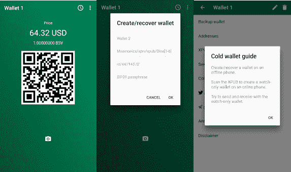

**图 4.9:** 用于创建冷存储硬件钱包的 Simply 钱包

为什么它如此安全？由于离线状态，钱包的攻击面极小。它比大多数现有硬件钱包更容易设置和使用，而且大多数时候比 Ledger、Trezor 和 keepkey 等典型硬件钱包便宜。

# 结论

在本章中，我们没有进入钱包创建、管理或架构的技术细节，因为这些细节通常并不是你创建应用程序时所需要使用的。大多数情况下，在开发应用时，你可以直接使用它们的产品（如 `moneybutton`），或者使用它们的集成 SDK（如 `cashport`）。这里需要回顾总结的唯一主要一点是：在大多数情况下，当你创建一个应用程序时，你将侧重于使用 SPV 方法，这要求不是一个全节点，而是一个只存储区块头（`block headers`）的轻量级客户端节点。我们将在书后讨论应用开发时详细介绍 SPV。此外，由于 Electrum SV 是开源的，它是可用的，如果你想了解实现钱包的细节，可以研究它。

现在你对钱包是什么有了很好的了解，并且详细概述了如何制作用于离线冷存储的简单钱包、各种钱包选项、什么是 SPV 以及其他内容。总的来说，钱包只是提供密钥管理能力的接口，但实现这种功能有很多方法，并且知道币本身始终存储在区块链上并由你的密钥锁定。这些币只能通过交易（即资产进入比特币账目的记录）来解锁。

在下一章中，我们将开始深入研究交易的特定细节，例如它们的结构、创建和交易广播、比特币原生的汇编级语言交易脚本（`transaction script`），以及如何使用它创建不仅是简单交易，还有智能合约等复杂交易。

# 问题

1. 为什么需要钱包？什么是密钥管理？为什么为不同的币准备不同的密钥，而不是用一个密钥将所有币存储在一个地址？

2. 冷钱包和热钱包有什么区别？

3. 什么是 SPV 钱包？为什么 Electrum SV 不是一个全 SPV 钱包？

4. 你将如何创建一个多签名（`multi-sig`）钱包？为什么使用它是安全的？

## 第 5 章

## 交易与交易脚本

> “我们只能看到前方短距离的距离，但那里有很多需要要做的事情”
>
> *——艾伦·图灵 (Alan Turing)*

在比特币的核心，一切都是交易。在本章中，我们将观察这些交易是如何构造的、它们由什么组成，以及比特币协议支持的各种类型的交易。我们将查看一种特殊的汇编语言，即使用名为 `script` 的全新语言在比特币中进行的编程。比特币的图灵完备性，以及比特币如何在电子货币历史上首次解决了双重花费问题。本章将展示少量的 JavaScript 代码和一些 NodeJs 代码片段，但那部分是可选探索的。

### 结构

*   什么是交易和 UTXOs
*   各种类型的交易，数据载体交易
*   交易的位级细节
*   交易脚本：一种使用栈（`stack`）进行编程的语言
*   操作码（`OP-codes`）以及如何在脚本中使用它们

### 目标

学习本章后，你将能够理解交易的构造、交易的数据结构是什么、交易脚本语言 `transaction script` 是什么，以及它的指令集 `op-codes` 是什么，并以此构建如智能合约和多签名交易等复杂交易。

#### 比特币中的交易

如果有什么东西可以被称为比特币的核心，那将是在比特币中创建并实现的交易协议。如果非要打个比方，交易就像人体内的细胞，一切都由交易组成。其他一切只是构建在交易之上的抽象。比特币公共账本是一个状态机，存储了任何时间点 UTXOs（或币）的状态，而交易是将状态从一个点移动到另一个点的手段。任何时间点的 UTXO 状态显示了一个记录了所有存在的比特币的账本。

让我们先从交易的结构开始。显而易见，它包含一个输入（`input`）和一个输出（`output`）。交易的输入是该交易将花费的 UTXO，由 UTXO 所有者通过私钥进行数字签名；输出则包含分配给一个或多个公共地址的币，这些币通过它们的公钥进行接收。交易的基本构造和关联性在之前的 **第 1 章：比特币协议：起源与概念** 中的 **图 1.4** 中展示过。但除此之外，交易还包含更多信息，在进入那里之前，让我们从一些基础知识开始。

如果你记得的话，比特币本身并不是以单位的形式存在，实际的单位被称为 `satoshi`（聪）。比特币是一个由 10⁸ `satoshi` 组成的抽象概念。一个 `satoshi` 是一个不可分割的整数单位，也就是实际的硬币。在银行账户中常见的典型交易中，有一个输入和一个输出。比特币的情况则大大不相同，如果你记得的话，它没有“账户”的概念，但硬币是存储在 `UTXOs` 中的，这意味着我有一组私钥可以解锁或允许我访问持有硬币的地址。钱包通常会显示该钱包所持所有私钥的聚合硬币金额，这导致在创建交易时，可能需要从不仅仅是一个 `UTXO` 而是多个 `UTXO` 获取硬币。同样，每笔交易实际上都会花费掉你所花费的 `UTXO` 中的所有硬币，这意味着会有多个输出。此外，每笔交易还包含一小笔费用，该费用将给矿工。简而言之，比特币交易具有多个输入和多个输出，且硬币总是会将输入中的整个 `UTXO` 集合传输到各种输出。你可能会重用持有原始硬币的同一个输入地址，但这会以用户的隐私为代价，且通常不建议这样做。

理解比特币交易的一种典型方法是将它们看作现金。如果你要给某人付 70 元，而手里有一张 100 美元的钞票，你会花掉 100 美元并找回 30 美元，但原始的 100 美元钞票从你那里消失了，你将剩下一张 10 美元和 20 美元的新钞。因此，在构建交易时必须考虑到这一点。

在我们深入研究交易细节之前，有几个概念需要理解，因为这些概念在交易中被频繁使用。我们将使用一个名为 `BSV` 的 JavaScript 库，它为我们将讨论的操作提供了极佳的工具包。该库的 GitHub 页面是 `bsv`，并且你可以使用 `npm`（Nodejs 的包管理器，但你也可以在原生 JavaScript 中使用）安装该库：

```
npm install --save --save-exact bsv
```

#### 大数

比特币对各种密钥使用了非常大的数字，正如我们在 **第 2 章：经济模型和网络结构** 中看到的，这些数字需要特殊的函数才能执行任何算术运算。几乎所有涉及加密的内容都会使用大数，比特币也是如此。这就是为什么比特币也使用了特殊的库和函数来处理这些数字，而且大多数时候是在后台完成的。通常，当你创建一个私钥时，它是使用一个大数创建的。`secp256k1` 规范大部分域参数使用 32 字节（256 位），哈希值也是如此。

`BSV` 库在 `bn.js` 中包含了大数的工具，这使你能够进行基础算术运算，如 `add`、`sub`、`mul`、`div`、`mod`、`invm`（加、减、乘、除、模、逆模）以及比较运算符，如 `eq`、`gt`、`lt`、`cmp`（等于、大于、小于、比较）。你可以使用 `bsv.crypto.BN` 来创建大数变量。

#### 数字格式

比特币的设计初衷是让所有代码最优先考虑性能，这使得编程变得相当复杂。比特币使用的数字格式就是这种设计的体现。比特币使用多种整数格式，有些类似于直接在 X86 微处理器上进行汇编级编程（如果你有方面的背景的话），模（modulus）以及比较运算符如 `eq`、`gt`、`lt`、`cmp`（等于、大于、小于、比较）。你可以从下表中大致了解使用了哪些数字格式以及原因：

| 格式类型 | 描述 | 在比特币中的用途 |
| :--- | :--- | :--- |
| 大端序 (Big endian) | 在计算中，高位值存储在前 | 签名 |
| 小端序 (Little endian) | 这种表示法中低位值存储在前 | 哈希值 (Hashes) |
| 符号位值 (Sign+magnitude) | 这种表示法包含符号 | 整数 (ints) |
| 补码 (Two's complement) | 这是 X86 使用的，补码格式 | 整数 (ints) |
| 固定点 (Fixed point) | 固定点意味着固定的位数，通常比特币是固定点 | 聪 (satoshi) |
| 浮点 (Floating point) | 浮点意味着位数可以改变 | bsv |
| 字符串 (String) | 字符串格式 | API |
| 变长整数 (VarInt) | 变长整数，大小从 1 字节到 8 字节不等 | 脚本 |
| 脚本数字 (ScriptNum) | 用于脚本语言，通常用于操作码 | 操作 |

**表 5.1:** 交易中使用的数字格式

比特币使用上述格式以使处理更简单、更快速。

#### 签名格式

最后一点是对我们所看内容的扩展，即签名是以特定的格式编码的，例如 DER（在比特币交易中）和紧凑格式（`compact`，在比特币消息中）。这与我们在上一节讨论的签名消息不同。

### DER 格式

签名由两个大数 (`r`, `s`) 组成，它们源于私钥和一个随机数 (256 位) `k`，正如我们在之前的章节中看到的。比特币交易中的签名方式遵循 SSL 使用的格式，看起来如下所示，通常为 70 字节左右：`[header, length, r-header, r-length, r, s-header, s-length, s]`：

*   头部始终为 `03`
*   长度是后续内容的总长度
*   `r-header` 和 `s-header` 的值均为 `0x02`
*   `r-length` 和 `s-length` 分别是 `r` 和 `s` 的长度，通常为 32 字节
*   `r` 和 `s` 均以大端序符号位格式编码

在交易中，签名后面总是跟着一个名为 `sighash` 的字段，其格式为 `[der, sighash]`。`sighash` 是 1 字节，它根据你想要的操作描述了交易是如何进行哈希的。你可以留空交易签名、输入或输出，这取决于你的选择，需要在 `sighash` 取的值中指定，如下：

*   `SIGHASH_ALL = 0x01`：意味着你签署整个交易，正如签名时指定的。
*   `SIGHASH_NONE = 0x02`：意味着你签署所有输入，但不关心输出是什么。
*   `SIGHASH_ANYONECANPAY = 0x03`：意味着你关心输出，但不关心输入。
*   `SIGHASH_SINGLE = 0x80`：意味着只签名这个输入和对应的输出
*   `SIGHASH_FORKID = 0x40`：这是在 BSV 链分叉期间引入的内容，是 BSV 中防止针对 BTC 和 BCH 分叉重放攻击的强制字段。

### 紧凑格式 (COMPACT format)

这种格式签名用于使用比特币加密算法的链外标准，或链上但位于 `OP_Return` 内部（我们将在本章后面讨论操作码时介绍），其中签名不是交易元数据的一部分。该格式的长度为常量 65 字节。

`[i, r, s]` 其中 `i` 为 1 字节，用于从签名中恢复公钥。整个部分将使用 base 64 编码来创建紧凑格式签名，用于签名比特币消息。

### 操作码 (Opcodes)

`Opcodes`（操作码）是交易脚本中特殊的单字节指令代码，比特币 协议理解这些代码，用于在栈上执行特定功能以执行交易指令。在处理交易时，这些代码会被理解并执行，以完成各种功能，我们将在之后讨论交易脚本时详细介绍这些功能。

你可以将其类比为 x86 微处理器的算术指令集。比特币有约 175 个操作码，用于各种特定功能。以下是操作码的一些示例：

*   `OP_FALSE`：向栈中推入零，值为 `0x00`
*   `OP_RETURN`：表示后续给代码的数据用于数据存储的文件，此交易不需要处理。值为 `0x6a`
*   `OP_PUSHDATA1`、`OP_PUSHDATA2` 和 `OP_PUSHDATA4` 的值分别为 `0x4c`、`0x4d` 和 `0x4e`，其中 `0x4e` 或 `OP_PUSHDATA4` 表示接下来的四个字节表示数据的长度，这意味着你可以在单次交易中推入高达 4.2 GB 的数据
*   有一系列如 `OP_IF: 0x63`、`OP_NOTIF: 0x64`、`OP_ELSE: 0x67`、`OP_ENDIF: 0x68` 等代码，允许在用脚本语言创建智能合约时编写业务逻辑。

### 脚本 (Scripts)

除了版本等元数据外，比特币交易中的所有内容都是脚本，使用名为 `script` 的语言编码，该语言使用了上述的各种操作码。编译器读取脚本的方式是从左到右，并对这些指令使用基于栈的处理系统。我们将在本章稍后讨论更多关于脚本的内容。

### 交易输入 (Transaction inputs)

正如我们所见，交易中可以有一个或多个输入，这些将是你为当前交易所花费的一个或多个 UTXO。除了元数据外，交易的所有输入都是脚本，并以下面述的格式存在。交易的每个输入记录遵循以下格式：

`[txhashprv][txoutno][scriptln][script][seqnum]`

*   `[txhashprv]`：256 位：该输入将花费的上一个交易的哈希值，基本上表示资金在历史上的来源。
*   `[txoutno]`：无符号整数，32 位小端序：该输入将花费的上一个交易的输出编号，用以指定具体的 UTXO。它执行用于验证交易。
*   `[scriptln]`：变长整数：后续脚本的长度。
*   `[script]`：脚本：带有签名的指令，表示对 UTXO 的所有权。通常称为 `SigScript`，因为它包含了使用 UTXO 所有者私钥签名的 DER 格式签名。这是交易中使用的脚本的一部分，另一部分存在于之前的输出（即该输入 UTXO 形成的地方）中，称为 `SigPubKey`。这也称为解锁脚本 (`unlocking script`)，因为它将解锁 UTXO 并允许其被花费。
*   `[seqnum]`：无符号整数，32 位，小端序：序列号最初的想法是用于支付通道。这是一个在硬币被花费之前聚合交易的概念，我们将在书后讨论高级细节时介绍它，但简而言之，在该输入被花费之前，你可以让同一个交易迭代最多 `0xffffffff` 次。对于普通交易，该字段通常获得默认值 `0xffffffff`，以便输入可以被花费。

不言而喻，一个交易中可能存在一个或多个输入，但所有输入都遵循上述述格式。

### 交易输出 (Transaction outputs)

现在我们已经知道了输入中包含什么，让我们看看交易输出中包含什么。交易始终可以有一个或多个输出（通常有一个交易手续费输出，其他的给接收者，如果有的话还有一个用于找零）。以下是典型输出记录的结构：

*   `[coins][scriptln][script]`
*   `[coins]`：无符号整数，64 位小端序：要发送的 satoshi 数量。
*   `[scriptln]`：变长整数：后续脚本的长度。
*   `[script]`：脚本：带有接收者公钥的指令，用于接收硬币。通常称为 `SigPubKey` 脚本，当此公钥的所有者在未来的交易中花费这些硬币时，将执行此脚本。此脚本称为锁定脚本 (`locking script`)，因为它将锁定 UTXO，只有对应的私钥才能解锁。将锁定脚本视为一个谜题，将解锁脚本视为谜题的答案。如果你能解开谜题，就有权花费比特币。

### 交易格式 (Transaction format)

在我们查看了各种概念以及交易的组成后，让我们从高层查看交易的结构：

`[Version] [TxInCount] [TxIns] [TxOutCount] [TxOuts] [nLockTime]`

*   `[Version]`：无符号整数，32 位小端序：当前值为 1。
*   `[TxInCount]`：变长整数：后续交易的输入总数。
*   `[TxIns]`：按照上述格式的输入，彼此连接。
*   `[TxOutCount]`：变长整数：后续交易的输出总数。
*   `[TxOuts]`：按照上述格式的输出，彼此连接。
*   `[nLockTime]`：无符号整数，32 位小端序：交易之后变为有效的区块号或时间。这是一个特殊功能，用于让交易感知它将处于哪个区块。通常，对于普通交易，该字段值为 0，意味着始终有效。我们将在本章稍后部分讨论讨论。

交易可以包含多少输入输出没有定义限制。唯一的限制是交易不能超过 1 MB，在限制范围内，你可以拥有任意数量的输入输出。

### 交易 (Transaction)

总而言，在我们讨论了细节之后，每个交易将有一个交易 ID，它是交易数据哈希（双重 SHA256）的反转（从小端转换为大端序）。重复一遍，上面的交易结构是交易数据，然后对该数据进行双重 SHA256 处理以创建交易哈希，该哈希将是小端格式，然后对哈希进行反转以得出交易 ID。

存储在区块链上的交易如下所示。这是我执行的一笔交易，详情如下：

```
Block: 00000000000000000790112f841d8d99a5fd5bca27a31f5c6e2935c4687c2125 (#596373)
Timestamp: 2019-08-20 14:27:15 utc
Version: 1
Size: 371 B
Confirmations: 7,003
Fee Paid: 0.00000372 BSV
Fee Rate: 1.003 sat/B
```

该交易包含两个输入和两个输出。两个输入是我拥有私钥的两个 UTXO，而两个输出中，0.06588378 是我保留在新地址中的找零，0.007 BSV 则是转账并转账给预期的接收者，如下图所示：

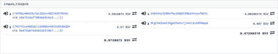

**图 5.1：** 来自 whatsonchain.com 的交易 ID：`832e8a70024a24c2513401c7daba3e81 62d84488821b720d6ad2de1deacf5297` 截图。

该交易的十六进制格式如下：


"0100000002c00d9b004c40d3817d8a1299b403d8a9d8839afbba42c0cbe08a88f76a9 1efc8010000006b483045022100ba66019c176aa678666afcf1ac0dd1a 5f3a3383 e7f5036 aaa330cd15b3a7fe8c022077c9d6fbd5ce469f43bf69be2bdfe48d03751b0 6b5c5d9c1abd54982115a5aa9412102f4b5c5129322369e40b329df637077f89e94 fae55a323c226a03e3a46d7116a1fffff fff7d1e49723a4b9a7f98e3811f3 002e0a9d26167cb7814b71024254da9 b70a870a000000004730440220 1c78d f6077ba0fa642baa11715ba01836ef 225d34daddb13452772b1d 7af5cae0220 5 934fa7ce07f0f24d6e1924cb4c1 931cd44e47388c19e0b89f9 e0a6e09ad4633412102bed3decad92 5f9aaf f8663d76c10 859544d3bd310dc 3118 c0f6ab8a294450902ffffffff02da876400 000000001976a914b651de8b3e 89d1276 cf1bbd8554ec 7d720da248888ac60ae0a000000000017a91496cd 7093efb1c9776e238ceb0e4 c47c5a36caf5870000000"

如上所示，开头和结尾高亮的字段是 4 个字节，分别代表版本号和 `nLockTime` 字段。中间是剩余的交易详情，这些并不容易阅读和理解。通常，大多数库（如前面提到的 BSV library）都可以完成解析和格式化，像 whatsonchain（开源、免费使用）这样的区块浏览器也是如此。

如果我们以更具可读性的格式查看同一笔交易——两个输入中的第一个显示如下，以及标记为 `asm` 的 `ScriptSig` 如下所示：

```json
{
  "coinbase": "",
  "txid": "c8ef916af7888ae0cbc042bafb9a83d8a9d803b499128a7d81d3404c009b0dc0",
  "vout": 1,
  "scriptSig": {
    "asm": "3045022100ba66019c176aa678666afcf1ac0dd1a5f3a3383e7f5036aaa33 0cd15b3a7f e8c022077c9d6fbd5ce469f43bf69be2bdf e48d03751b06b c55d9c1abd549821 15a5aa9[ALL|FORKID] 02f4b5c5129322369e40b329df637077f89e 94fae55a323c226a03e3a46d7116a1",
    "hex": "483045022100ba66019c176aa678666afcf1ac0dd1a5f3a3383e7f503 6aaa330cd15b3a7fe8c022077c9d6fbd5ce469f43bf69be2bdfe48d03751b06b 5c5d9c1abd54982115a5aa9412102f4b5c5129322369e40b329df637077f89e9 4fae55a323c226a03e3a46d7116a1"
  },
  "sequence": 4294967295
}
```

## 图 5.3：SPV 中交易执行的两种方法

Alice 可以通过两种方式完成上述交易，如图上所示：

1. 当 Alice 将交易发送到网络时，Bob 从网络中验证该交易。
2. 也称为点对点（Peer to Peer）或 IP 对 IP，当 Alice 将交易详情以及 Merkle 路径（Merkle path）发送给 Bob 时。Bob 可以验证并将发送到区块链网络。

这里的方法 `b` 被称为 IP 对 IP 或点对点，因为在进行交易时这保护了用户的隐私。除了 `Bob` 之外，矿工或任何人都无法得知 Alice 是谁。这使用户能够始终拥有自己的数据和隐私，但在发生法律纠纷时，如果法院要求，可以通过 `Bob` 追溯到 Alice。白皮书的标题《点对电子现金系统》（Peer to Peer electronic cash system）将这一方面称为点对点。

双重花费问题是执行部分交易时讨论的最常见问题之一（例如，如果 Alice 离线同时向 Bob 和 Charlie 发送相同的交易会怎样）。你会发现这是不可能的，因为当 `Bob` 验证 Alice 发给他的交易时，他可以识别出硬币是有效的，攻击发生的唯一方式是攻击者能够压倒网络（通过算力），并且必须构建足够深的区块才能进行双重花费，而且他仍然只能花费自己的硬币。

现在我们已经了解了关于交易的所有基础信息，让我们再次查看交易以及它的样子，包括交易中存在的 `script`（我们将稍后详细讨论）。下图显示了交易的格式表示：

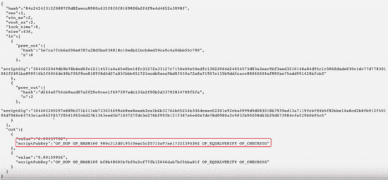

### 图 5.4：在区块浏览器中查看各种组件的交易结构

* `Hash`：交易中所有内容的哈希。
* `Size`：交易的大小。

我们已经讨论了上面显示的所有字段：`Version`、`TxIn`、`TxIns`、`TxOutCount`、`TxOut`、`LockTime`。通常使用结构来组织交易，这是许多应用级开发使用的，随着我们的深入，我们将看到更多细节。只有一个交易没有输入，那就是 `coinbase` 交易。我们之前也讨论过这一点，它是成功挖矿过程的结果，包含新产生的硬币。上述用红色标记的一个有趣点是 `scriptPubKey` 值，它是一个脚本。你可以看到它取的值是由一组单词组成的。这就是我们现在要讨论的。

## 交易或简单来说，“脚本是一个谓词。它只是一个求值为真或假的方程。由于这个谓词很长且陌生，所以我称其为脚本。”—— 中本·中聪（Satoshi Nakamoto）

Script 是比特币交易中用的一种特殊语言或脚本系统，它充当比特币交易处理的说明书。理解 Script 非常重要，因为比特币交易中的所有内容都是通过脚本执行的。Script 与一种名为 Forth 的语言非常相似，这种语言在历史上曾用于微处理器的低级编程。它使用了栈的概念用于计算，并使用 `opcodes`（操作码）作为指令集。当需要处理脚本时，处理器使用栈将指令推入其中，并从左到右处理脚本。

作为一种语言，Script 是一组简单的机器级指令，这意味着它不具备像 `C`、`C++` 或 `Python` 等高级语言的所有功能；脚本中是不存在循环的。它的这种设计基于两个主要原因：

* 执行脚本所需的处理能力或 CPU 非常小，不需要编译，因为代码已经是机器级（几乎是）的。
* 由于没有循环，所有脚本都在有限且可预测的时间内结束或执行。

在验证交易期间，`TxIn` Script（即签名）被置于输出脚本之前。脚本处理发生，如果处理的结论为真（我们稍后会讨论），则交易验证成功（交易的 `UTXO`）。如果脚本处理结束为假，意味着交易验证失败。一个很好的类比是，输出脚本是指定在哪些条件下花费比特币的题。在白皮书中，中本·中聪将比特币脚本称为谓词，这就是为什么，因为它的处理总是结束于真或假的结果。

以某种过于简化的方式来说，比特币可以通过以下方式实现图灵完备计算：

* 使用两个栈在脚本内部进行循环展开（Unrolling）。这意味着需要循环的相同指令被重复放置了 $n$ 次（如果循环从 1 到 `n`）。这与典型编译过程中的循环展开方式以及输入到微处理器的代码（汇编级代码）非常相似。循环只是编写程序或逻辑的一种紧凑方式，但实际上，它始终是通过展开循环来操作的。
* 通常对于大型复杂脚本，还有其他方法通过多次交易来激励循环，从而实现图灵完备计算。
* 在支付通道内部进行循环可以使用 `nSequence` 字段完成。你可以使用该字段作为你想要迭代次数的计数器来运行脚本。

在此说明一下（在比特币代码库的原始版本中），脚本并不只有一个栈，而是有三个可用的栈：

1. 主栈（main stack）
2. 备用栈（alt stack）
3. `if` 栈，用于判断代码中的条件分支是否执行。

在当前的事务处理版本中，由于多年来对脚本能力施加了各种限制，只有主栈用于处理使用解锁脚本和锁定脚本的脚本。

你可以在团队的官方博客上阅读更多关于栈的信息，以及关于创世升级（genesis upgrade）中移除限制的细节：

[`bitcoinsv.io/2019/07/27/the-return-of-op_return-roadmap-to-genesis-part-4/`](https://bitcoinsv.io/2019/07/27/the-return-of-op_return-roadmap-to-genesis-part-4/)

随着创世升级，使用全脚本变得可能，并使用全脚本能力创建了许多有趣的事务，例如“死人开关”（dead man switch）：[`twitter.com/Stas33496/status/1230838632115732485`](https://twitter.com/Stas33496/status/1230838632115732485)

# 脚本指令集

Script 指令集在各种命令等方面与常见编程语言中的指令非常相似，例如标准算术运算、逻辑操作（如 if-else）、错误处理和函数返回指令。

每条指令都是一个字节的小端 `VarInt` 有符号整数。指令可以粗略分类为以下类型：

* **基于数据的指令：** 某些指令在处理脚本时将数据推入栈中，通常数据紧随指令之后。
* **操作码（Opcodes: operational codes）：** 指在处理过程中对栈上存在的数据执行特定操作的功能。通常，一个 OP 码会获取栈顶元素（大多数情况下是数据），进行某种形式的处理，并将结果放回栈中。

    操作码本身又分为不同的类型和不同的用途。这些操作码经过了仔细的选择和设计，使得任何语言中可以实现的大部分功能都可以通过巧妙使用这些操作码来实现。这里有几种分类，让我们逐一来看：

* **用于推入值的操作码：** 这组操作码专门用于将各种值推入栈中。特殊代码也如底部的图片所示：

    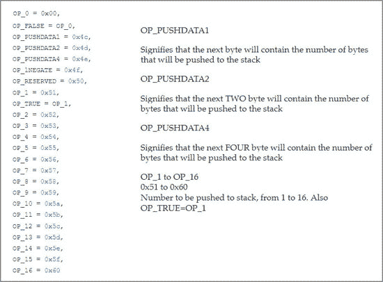

    **图 5.5：** 推入操作码及其十六进制值

* **控制操作码：** 这组操作码通常用于各种控制操作，如 `OP_NOP` 什么都不做以及 `if-else` 语句。`OP_RETURN` 将在稍后讨论比特币区块链数据存储的章节中进行详细介绍。`OP_RETURN` 代码也用于创建丢失值事务，将在稍后讨论比特币区块链数据存储的章节中进行详细介绍。下面的图片显示了各种操作码列表及其对应的十六进制值。

    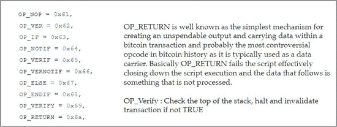

    **图 5.6：** 控制操作码及其十六进制值

* **基于栈的操作操作码：** 这组操作码通常用于各种控制操作，如 `OP_NOP` 什么都不做以及 `if-else` 语句。下面的图片显示了脚本中使用的各种操作码列表：

    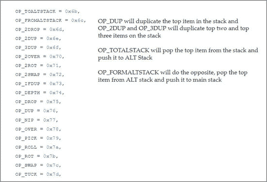

    **图 5.7：** 用于栈操作和函数的操作码

* **加密相关操作码：** 正如下表所示，有各种操作码对栈上的项执行加密操作：

    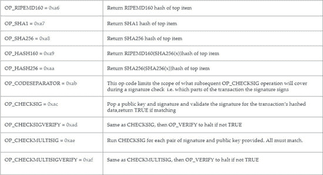

    **图 5.8：** 用于操作和函数的操作码

* **算术运算及杂项操作码：** 有全套操作码可执行加、减、乘、除等基础算术运算以及一系列操作。这些可以在节点实现软件的 GitHub 库 `script.h` 中找到：

    [`github.com/bitcoin-sv/bitcoin-sv/blob/master/src/script/script.h`](https://github.com/bitcoin-sv/bitcoin-sv/blob/master/src/script/script.h)

    常见的 CLTV（检查锁定时间）和 CSV 包含了以下内容：

    * `OP_EQUAL` (0x87)：如果前两个元素相等，则推入 TRUE (1)，否则推入 FALSE (0)
    * `OP_EQUALVERIFY` (0x88)：与 `OP_EQUAL` 相同，但带有 `VERIFY` 功能
    * **未来预留的操作码：** 未来预留了约 13 个代码，但大多数仍未使用。

    在某个时期，`OP_NOP2` 和 `OP_NOP3` 被分配如下：

    * `OP_NOP2` = `OP_CHECKTIMEVERIFY` (0xb1)
    * `OP_NOP3` = `OP_CHECKSEQUENCEVERIFY` (0xb2)

    其他预留操作码为 `OP_RESERVED`、`OP_RESERVE1` 和 `OP_RESERVE2`，预计未来也用于类似的用途。

当执行脚本时，会创建一个临时栈数据缓冲区。该栈仅允许推送（push）和弹出（pop）操作，指令可以执行这两种。由于是栈，元素遵循后进先出（LIFO）方法。

让我们以一个最常见的比特币脚本示例为例，参考图 5.4 中的输出脚本或锁定脚本（标记为红色），假设我们有一个名为 `ScriptSig` 的解锁脚本，它是未来花费在锁定脚本 `ScriptPubKey` 中接收的币的输入。下面的图片展示了栈的可视化，以及在后续显示脚本处理的图片中使用的各种图例：

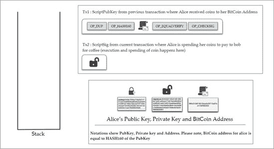

**图 5.9：** 我们讨论过的 Tx1 和 Tx2 中的 ScriptSig 和 ScriptPubKey。Alice 正在发送 Tx2 发给 Bob 支付咖啡钱。

执行过程中，步骤序列如下：首先 `ScriptSig` 将被添加到上图所示 `ScriptPubKey` 中的 `OP_DUP` 指令之前，使得指令集如图 5.10 所示：

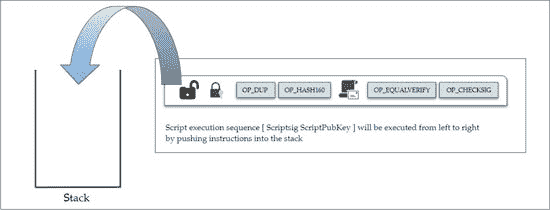

**图 5.10:** 脚本将从左到右执行，每次推送一个项目。注意栈是后进先出的（FILO）。

通过上图系列指令可以直观地判断，首先 `ScriptSig` 或私钥会被推入栈，然后推入 `PubKey`。接着我们使用 `OP_DUP` 指令复制栈顶的项目，实际上我们只是再次将公钥的副本再次推入栈数据结构中：

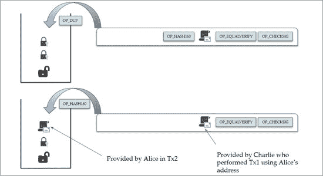

**图 5.11:** `OP_DUP` 将复制栈顶的项目，即 `PubKey`

该指令之后是 `OP_HASH160`，它基本上会弹出栈顶值并计算密码哈希值，然后将结果推入栈中。这意味着正如我们在图 5.11 中所示，`PubKey` 将被地址替换：

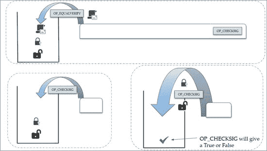

**图 5.12:** 处理脚本的最后步骤

接下来，比特币地址将被推入栈中，然后 `OP_EQUALVERIFY` 指令将弹出栈顶项目（地址）并验证两个值是否相等，如果是，将移动到下一条指令，即 `OP_CHECKSIG` 它将弹出最后两个项目，验证公钥和私钥是否匹配并给出答案（真或假）。如果答案为真，则脚本执行成功；否则，脚本失败，交易将不会被处理。

# 标准与非标准脚本

在过去的几年里，由于脚本指令的使用相当有限，这是由于为了矿工接受脚本而施加或同意的一种想法或限制。这样做有许多超出本书范围的原因，但它限制了大多数脚本功能的可能用途。这种想法被称为标准脚本和非标准脚本，在某些点，只有被矿工接受的脚本被决定为标准脚本。这并不意味着你不能在交易中编写非标准脚本，但这些交易会被大多数矿工拒绝，导致使用无效。那么，这些标准是什么呢？其代码层面的细节位于 `policy.cpp` 下的 `IsStandard()` 和 `IsStandardTx()` 函数中：

[`github.com/bitcoin-sv/bitcoin-sv/blob/master/src/policy/policy.cpp`](https://github.com/bitcoin-sv/bitcoin-sv/blob/master/src/policy/policy.cpp)

#### 脚本创建

目前使用了 5 种不同类型的交易脚本。它们在创建的输出类型方面有所不同。让我们结合使用 [`github.com/moneybutton/bsv`](https://github.com/moneybutton/bsv) Bitcoin SV JavaScript 库逐一查看每一个。

# 支付给公钥哈希 (P2PKH)

这是最常用的交易输出脚本。它用于支付给比特币地址（比特币地址是经过 base58check 编码的公钥哈希）。我们在我们在第 3 章：密码学、ECDSA 和比特币地址中详细讨论过的相同过程在下方的图 5.13 中所示，是一个流程图：

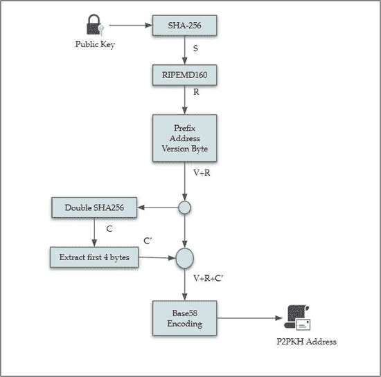

**图 5.13:** 构建 P2PKH 地址

```javascript
// 创建一个支付给特定地址的新 p2pkh
var address = Address.fromString('1NaTVwXDDUJaXDQajoa9MqHhz4uTxtgK14');
var script = Script.buildPublicKeyHashOut(address);
assert(script.toString() === 'OP_DUP OP_HASH160 20 0xecae7d092947b7ee4998e254aa48900d26d2ce1d OP_EQUALVERIFY OP_CHECKSIG');
```

#### 支付给公钥 (P2PK)

支付给公钥的脚本是 `P2PKH` 的简化形式，但不再常见用于新交易，因为 `P2PKH` 脚本更安全（在输出被花费之前公钥不会泄露）：


// 创建一个支付给特定公钥的新 p2pk
```javascript
var pubkey = new PublicKey('022df8750480ad5b26950b25c7ba79 d3e37d75f640f8e5d9bcd5b150a0f85014da');
var script = Script.buildPublicKeyOut(pubkey);
assert(script.toString() === '33 0x022df8750480ad5b26950b25c7ba79d3e37d75f640 f8e5d9bcd5b150a0f8 501da');
```

#### 支付给多签名 (p2ms)

支付给多签名 (p2ms) 用于你需要多个密钥共享输出控制权的场景，并且解锁脚本需要所有密钥签名才能花费。这通常通过创建一个具有 n 个公钥的输出来实现，其中需要 m 个签名，被称为 m-of-n 输出。可以自定义 n 和 m 的值（例如 3 分 2）。这种方法很少使用，未来将被更先进的阈值签名技术取代：

```javascript
// 从 3 个给公钥创建一个新的 2-of-3 多签名输出
var pubkeys = [
  new PublicKey('022df8750480ad5b26950b25c7ba79d3e37d75f640f8e5d9bcd5b150a0f8514da'),
  new PublicKey('022df8750480ad5b26950b25c7ba79d3e37d75f640f8e5d9bcd5b150a0f8514da'),
  new PublicKey('022df8750480ad5b26950b25c7ba79d3e37d75f640f8e5d9bcd5b150a0f8514da')
];
var threshold = 2;
var script = Script.buildMultisigOut(pubkeys, threshold);
```

# 使用 OP_RETURN 的数据输出（也称为空数据）

我们之前详细讨论过这一点，在后面的章节中我们将讨论更多数据输出。输出类型将数据推送到区块链上，并使用 `OP_RETURN` 停止脚本处理，意味着 `OP_RETURN` 之后的字节是任意数据。目前，在 BSV 区块链上每笔交易可以推送高达 100KB 的数据：

```javascript
var data = 'hello world!!!';
var script = Script.buildDataOut(data);
```

#### 非标准脚本

可以创建几乎任何类型的脚本，而不仅限于比特币原始版本中上述的标准脚本。当在区块升级（genesis upgrade）之后，矿工开始接受任何类型的脚本，并且矿工所使用的节点软件实现删除了 `policy.cpp` 下的 `IsStandard()` 和 `IsStandardTx()` 函数检查时，这将变得有用：

```javascript
var script = Script()
  .add('OP_IF') // add an opcode by name
  .prepend(114) // add OP_2SWAP by code
  .add(Opcode.OP_NOT) // add an opcode object
  .add(Buffer.from('bacacafe', 'hex')) // add a data buffer (will append the size of the push operation first)
assert(script.toString() === 'OP_2SWAP OP_IF OP_NOT 4 0xbacacafe');
```

# 结论

我们已经查看了交易组成的几乎每一个位细节、比特币中使用的各种格式和值的各种表示方法，以及构建在比特币软件中基础但功能强大的编程语言。对于在比特币上开发任何应用程序来说，这些细节至关重要。然而，现在已经有了许多可用库，例如 `BSV` 库，它提供了用于执行这些复杂任务的开箱即用函数。尽管，这些概念对于理解比特币如何运作仍然是核心。脚本的能力之所以被严重限制，要么是因为早期参与比特币代码开发团队的开发者没有完全理解比特币（例如脚本的图灵完备性概念），要么是其他因素推动了这些许多决策。根据发布的第一个版本，比特币也可以完美地处理完全合法（基于当前法律）且复杂的智能合约构建。将在下一节中讨论这些内容，并将介绍运行在比特币协议层之上的各种协议。

下一章将涵盖比特币区块链的最后也是最核心的部分，即工作证明（proof of work）概念以及矿工——矿工是参与工作证明以进行交易验证、创建新区块并维护区块链的非信任实体。

# 问题

1. 比特币中使用哪些不同的数据类型？
2. 什么是 `ScriptSig`？为什么它被称为解锁脚本？
3. 什么是 `ScriptPubKey`？为什么它被称为锁定脚本？
4. 为什么比特币脚本是图灵完备的？
5. 使用本章讨论的想法，构建一个比特币脚本来将 4 和 5 相加。

## 第 6 章：挖矿与网络共识

> “这种设计让用户只需做用户。运行节点的负担越重，节点就越少。这少数节点将是大型服务器群”
>
> — 中本聪 (Satoshi Nakamoto)

比特币发生的最大创新是它将金融价值交换中对信任第三方的的需求变为对非信任第三方的依赖。这在任何货币或其他价值交换系统的历史上都是所未有的。这催生了一个被称为“矿工”的新行业和业务。在本章中，我们将关注这个新的非信任第三方——矿工，以及挖矿过程中的细节、矿工必须做什么以及他们如何相互竞争。我们将讨论可能的各种攻击，作为一个整体行业的中本共识挖矿理念。我们还将简述挖矿业的未来。

#### 结构

- 工作证明系统及其背后的概念
- 挖矿作为一个新行业，比特币软件与挖矿硬件创新的补充性
- 挖矿的技术概述和挖矿的全过程
- 矿工作为比特币生态系统的规则执行者

#### 目标

学习本章后，你将能够理解工作证明矿系统背后的概念、矿工在比特币生态系统中的角色和责任、挖矿过程以及可能的各种挖矿攻击。你还将学习挖矿过程的内部工作细节以及通过挖矿软件执行规则。

## 拜占庭将军问题

计算机科学领域世纪的问题被称为拜占庭将军问题，它被认为是一个无法解决的问题。在比特币出现后这种情况改变了，因为比特币发明的工作证明矿系统提供了解决方案。

让我们先看看什么是拜占庭将军问题。

拜占庭帝国有 8 个被包围和占领的国家，它们正受到帝国的压迫。他们想要反抗并推翻下方[图 6.1]所示中间的帝国。帝国的军队非常强大，只要攻击人数少于周围国家军队的一半，他们就能抵抗任何攻击。因此，如果 8 个军队将军中有 4 个在同一天协调攻击，他们就会失败。但如果有 5 个及以上的将军在同一天协调攻击，他们将获胜并将整个国家的土地平分。

如果我们考虑到将军们面临的决策，当他们必须做决定时，面临着风险。每个将军如果攻击并失败，皇帝就会处决他们，然后分割他们的土地并授予那些没有支持他们攻击的其他将军。

因此，如果一个将军能够成功发起反抗，他将获得巨大利益；但如果反抗未能获得大多数将军的支持，他将面临损失，因此反叛将军的土地将遗留给他们。

如何同时向许多将军发送可靠且不被篡改的消息？这种场景在图 6.1 所示：

```
images/Fig-6.1.jpg
```

图 6.1：拜占庭问题的场景

这个问题还有一个博弈论方面，即反叛将军有动力撒谎。他们可能会对建议的攻击日期、接收消息的时间以及他们同意或反对的提议撒谎，因为如果拜占庭帝国将奖励他们被败将军的土地。

比特币需要每 10 分钟添加一个新区块，所有参与的矿工应该同意或达成网络共识，即某个矿工提出的新区块是正确的区块，可以添加到区块链中成为不可变信息存储的一部分。反叛将军是矿工，拜占庭堡是新区块。矿工通过他们的哈希算力代表自己对添加下一个区块的投票或决策。胜利是新区块的成功添加，这在设计上每 10 分钟发生一次。这个问题总体通过工作证明和不可篡改的账本得到了解决。

1993 年，`Cynthia Dwork` 和 `Moni Naor` 发明了称为工作证明（`PoW`）的东西。PoW 意味着你在发送消息之前可以让你的计算机完成可证明的工作量。如果消息到达时没有足够工作的证明（通过解决一个所谓的哈希谜题），你就会忽略该消息。关于这一发明的更多细节见于：Pricing via Processing or Combatting Junk Mail by `Cynthia Dwork` and `Moni Naor` `http://www.wisdom.weizmann.ac.il/~naor/PAPERS/pvp.pdf`

这使得一个系统的建立：只有当消息包含所需的的工作证明（proof of work）时，它才是有效的，否则直接无效。`PoW` 问题被保持在足够的难度，以至于在给定时间内重新执行是不可能的，而且与在这一过程中保持诚实所付出的努力相比，重新执行的成本要高得多。

回到之前的类比，现在当一位将向剩余的 7 位将发送一条关于攻击日期的消息时，他只能发送一次，重新发送将需要他花费大量工作来编写一条新消息。这就是比特币解决问题第一部分的方法。

关于第二部分，即博弈论方面，解决对撒谎行为的去激励，同时也意味着解决了过去电子现金系统中著名的“双重花费”问题。双重花费只是通过将同一枚硬币发送给 Alice 和 Bob，从而两次花费同一枚硬币。

在比特币之前，需要一个中央协调者或权威来防止硬币的双重花费。这与我们之前讨论的博弈论问题类似，将们可以在攻击日期上撒谎。比特币的工作证明系统通过让撒谎变得昂贵来解决了撒谎问题（在该系统中，重新计算工作证明并传输不诚实消息所需的工作量远大于接受诚实消息的代价）。

不赘说，这是对工作证明系统的简化解释，我们现在将详细介绍该系统如何工作以及系统具有韧性的各种场景。

我们已经在 `第 2 章：经济模型与网络结构` 中看到矿工是比特币网络中高度连接的对等节点，并在 `第 1 章：比特币协议：起源与概念` 中看到了区块的结构。现在让我们详细查看矿工再次创建这些区块的过程。

#### 区块创建过程

当矿工解决哈希谜题并计算新区块的哈希值时，区块就会被创建。为了解决哈希谜题，每个矿工将采取以下步骤，并如 `图 6.2` 所示计算哈希谜题：

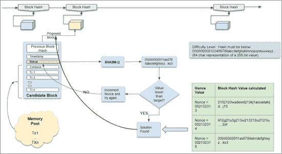

**图 6.2：** 挖矿过程的高级描述

让我们查看图中每个组件并理解挖矿。

#### 内存池（MemoryPool）中的交易

当节点接收到交易时，它会将它们保存在一个二级区域或临时缓冲区区域，称为 `Mempool`（内存池），直到它们被包含在下一个候选区块中。每个节点都维护这个缓冲区，在接收到交易后将其存储在等待处理的队列中。每个矿工获取内存池中已收到的交易，并准备这些交易列表，然后将列表包含在候选区块中，矿工使用该区块来解决 `PoW` 哈希谜题。

内存池（通常所说的 `Mempool`）概念并不是比特币原始设计的一部分。它是在 2012 年通过添加 `BIP35` 引入的，这是一种改进协议，它增加了交易池的中心化，这与比特币以完全去中心化的方式使用网络背道而驰。在初始设计中，矿工将按照先见顺序从 `SPV` 或连接到它们的全节点接收交易，对其进行挖掘，并发送区块以进行构建。未确认交易集（`UCTS`）将位于各种矿工的 `RAM` 中，然后在已确认区块之上进行结算和向前构建。

当区块较小且使用频率较低时，将内存池保留在内存中是行的，但这一概念无法随着小型硬件扩展，而且 `UCTS` 绝不需要因为以前是这样做的就必须保留在内存中！这就是为什么比特币无限（Bitcoin Unlimited）和其他早期大区块实现在扩展争论的初期开始研究并行化和其他优化。但这些优化遭到了比特币 Core 的贬低，后者创建了瓶颈（内存池只是一个例子），导致了费用市场、交易延迟，并为 `RBF`、`P2SH`、`Segwit` 和闪电网络（Lightning Network）提供了机会——所有这些都是建立在比特币低效的错误观念之上。未来的 teranode 软件升级计划移除系统对内存池的需求。

#### 交易顺序

当我们看到区块结构时，它被描述为一个非常固定的状态，所有交易都经过了验证和确认，而且交易顺序以 `Merkle tree` 格式存储在 `Merkle root`（根节点）中。这可能给人一种印象，即矿工在区块中添加交易有某种隐含顺序，但事实并非如此。一旦区块被挖掘（哈希谜题被解决），结构和顺序就固定了，该区块将作为矿工视为在共识后添加到链中的获胜区块，只有之后区块才会被冻结。很可能所有矿工在解决谜题之前，其交易顺序会彼此大不相同，这是系统的自然过程。

使用 `nonce` 解决哈希谜题的替代策略是这种交易顺序。由于当我们进行哈希计算时，即使是位置上单个字节的变化也会显著改变哈希值，因此矿工可能会不断改变交易顺序，以尝试生成新的哈希值，并查看其是否符合目标值并赢得谜题解。然而，这并不是矿工解决哈希谜题的常用策略。

#### 候选区块

每个矿工都会准备一个提议区块，如果他们赢得了哈希谜题，就会将其作为区块链的下一个区块。这个提议区块通常被称为该矿工的候选区块。每个矿工都有不同的候选区块，因为这取决于他们构建区块的方式以及从内存池选取交易顺序。候选区块将包含矿工内存池中的一组交易。一旦他选择了交易，他将添加 `Coinbase`（币基）交易，这是唯一没有输入 `UTXO` 的交易类型，但有一个指向矿工地址的输出 `UTXO`，金额等于区块奖励（代码中称为区块补贴）。随后矿工将构建区块头。区块头包含以下组件（如果你还记得 `第 1 章：比特币协议：起源与概念` 的细节）：

* `[Version]`：区块结构版本号，当前为 1。
* `[PrevBlock]`：上一个区块哈希用于构建新区块，这将确保没有矿工预先准备大量的未来区块。这确保了矿工创建哈希以解决谜题的时间是从新区块被发现且他获取字段值开始计算新区块哈希开始的。
* `[MerkleRoot]`：我们已经查看了交易，每个矿工都会从他们的内存池选取交易列表。一旦他们选取了最终列表，软件将创建 `Merkle tree` 和 `Merkle root`。
* `[Time]`：我们之前讨论过区块也充当时间戳服务器。每个区块的时间（标记）是按照 IEEE 开源 IEC 61850 uint32_t 实现计算的（也称为 Unix 时间）：自 1970 年以来秒数的 32 位计算。

协议允许不同节点之间存在延迟，只要该差异在可接受的范围内。比特币中允许的矿工之间时间戳延迟或差异是基于两个因素计算的：

* 区块中的 `timestamp` 需要大于距离最后 11 个已开采区块中存储的时间戳的统计中位数距离，这大致意味着你创建的区块时间不能低于候选区块之前的第 `6th` 个区块中存储的时间。（最小值限制）。
* 它必须低于 `network-adjusted time`（网络调整时间）加 7,200 秒。（最大值限制）。你的节点软件将跟踪它所连接的所有节点之间时间（`Unix time`）的差异。它会获取所有这些时间并计算出它们的中位数，然后用该中位数与当前 `Unix time` 加或减去该 `median` 得到 `network adjusted time`。

`[Bit]:` 它是目标值的紧凑表示法，计算方法为：`[目标值的前 3 个有效字节/前 6 位，这些字节从右侧开始的偏移量]`。例如：

Satoshi 在网络启动期间使用了 `0x00ffff0000000000000000000000000000000000000000000000000000000000` 作为第一个目标。使用上述方法，让我们计算位（或代码 `chain.h` 中变量名中的 `nBit`）：

偏移量 (Offset) = `29 bytes` 或十六进制的 `1d`

有效字节 (Significant bytes) = `00ffff`

位值 (Bit value) = `0x1d00ffff`

`[Nonce]:` `Nonce` 是一个数字，通常用于在解决哈希谜时增加和更改生成的区块哈希值。如 `图 6.2` 所示，矿工将不断增加 `nonce` 的值，直到找到一个低于目标值的区块哈希。目标值越低，生成低于该目标的哈希就越困难。这再次是一个 4 字节数字。

区块头中还存在其他网络参数，例如 `difficulty`（难度），这是一个对所有矿工通用的全局参数，并且每 2016 个区块计算一次。这是为了确保开采区块的大致时间保持在 10 分钟左右。该参数根据当前网络状态以及矿工开采区块所需的时间计算得出。

`图 6.2` 从非常高层级总结了开矿的完整过程。这个过程由参与网络的每个矿工执行，以解决哈希谜。一旦矿工成功找到新的区块哈希，他们将通过传输提交给所有其他矿工进行验证和确认的候选区块，向所有挖矿节点宣布他们的获胜。如果实现了网络共识（超过 51% 的矿工信号所提的候选区块有效），该区块将被批准并添加到区块链，矿工继续开采下一个区块。这是一种简单的说法，因为在某些两个矿工几乎在同一时间找到哈希的情况下，该怎么办？这些情况也被考虑在内，我们稍后会详细讨论这些场景，以及坏人试图操纵和破坏网络想法（称为自私挖矿）以及来自恶意矿工的各种攻击可能场景。在讨论这些之前，我们还需要详细介绍一个与交易和区块相关的概念，称为区块确认（block confirmations）和零确认（0-conf）交易。

#### 区块确认

当矿工解决哈希谜时，每 10 分钟就会添加一个区块，但如果你记得有 1-n 个矿工在制作他们的候选区块并尝试解决谜题，当一个或多个矿工同时解决谜题时（我指的是毫秒级）会发生什么？当有两个或多个矿工拥有有效的解决方案并将他们的区块添加到区块链时，位于一个区块而非另一个区块中的交易会发生什么？我们将在后的章节更详细地讨论这些场景，但现在我们想要关注的一个方面是 `block confirmation`。它被定义为每个交易的术语，即该交易已被多少个区块确认……

Alice 的钱包将接收此发票并进行评估，以找到用于此付款的硬币（UTXOs）。在这种情况下，假设有两个输入 UTXO 被被使用，它们分别持有 0.001 和 0.004 BSV（按照当天提到的汇率，分别为 1 美元和 4 美元）。当 Alice 的钱包处理发票时（如果使用了适当的 SPV，也可以离线进行），它将从 Alice 处填充所需的细节，并将更新后的交易交给 Bob 的 SPV 钱包软件：


| 输入 1 | Alice 的硬币 1: 0.001 BSV | 输出 1 | 0.002 BSV |
| --- | --- | --- | --- |
| 输入 2 | Alice 的硬币 2: 0.004 BSV | 输出 2 | 增值 (20%): 0.0004 BSV |
| | | 输出 3 | 矿工费（例如 $0.0001） |
| | | 输出 4 | 小费: 0.0001 |
| | | 脚本和条件 | 花费 UTXO 所需签名 |
| | | 输出 5 | 找零地址 : 0.0024 BSV |

**表 6.2:** Alice 将填写她的 UTXO 详情并签名，并将填写好的发票发送给 Bob

此签名的交易现在已交给 Bob（如果 Alice 是离线操作 SPV，则包含 Merkle 路径），Bob 将验证细节是否正确，Bob 将交易发送到矿工内存池进行交易的验证和确认。Bob 从 Alice 处接收交易细节时会进行以下检查：

* 通过查询节点使用 Merkle 路径确认交易中的输入未被花费/有效
* 确保 Alice 提供的信息完备，并有足够的硬币支付矿工费。

一旦满意，Bob 将把交易转发到尽可能多的矿工节点，以便尽快锁定该交易的确定性。典型的网络能够确保交易在 2 秒的短时间跨度内通过验证、有效并确认。因此，矿工在发送一次后，会再次检查输入 UTXO，确保他的交易两次有效。

在完成上述所有操作后，Bob 现在就可以给 Alice 咖啡了，因为他已经两次确认交易有效，且 Alice 提供的输入未被花费。如果 Bob 发现 Alice 试图双重花费，他就有了一个法律欺诈案件，可以将 Alice 诉至法庭指控其欺诈（交易中已包含证据，使案件板上钉钉）。

这就是整个过程，大约这个过程花费不到 2 秒。在此期间，矿工将验证任何如双重花费的欺诈尝试，使交易安全且无懈可击，同时也提供了实时支付、清算和结算。这适用于餐厅、超市等实体店的购物场景。如果是在线购买，商户保护自己免受欺诈尝试会更容易，因为如果交易无效，他们可以取消预期货物的交付。

双重花费问题在比特币早期是一个备受关注和讨论的话题。比特币的工作方式是，孤立区块的产生是多个矿工竞争添加下一个区块的正常结果。这使得协议代码保持简单，并且仍然具有抗攻击能力。

孤立区块的影响不会改变比特币的奖励结构。平均每两周会产生 2016 个区块，这也就是网络挖掘难度重新审查和调整的周期。在 2016 个区块生成的周期内，网络可能会产生 1、2 个甚至 20 个孤立区块，数量仍然是 2016，没有更多。因此从奖励的角度来看，矿工被激励不要过度关注创建和维护孤立区块。它只会存在极短的一段时间，即当两个矿工同时解决哈希难题时，通过将区块传播到网络进行竞争，让其他矿工接受他们的区块作为构建下一个区块的基础。


**表 6.2:** Alice 将填写她的 UTXO 详情并签名，并将填写好的发票发送给 Bob

一个很好的类比是铁和钢。铁是纯的但没用，会破碎。钢是不纯的但具有延展性，适用于许多应用程序。这是博弈论模型`猎鹿`（stag hunt）的一种实现，参与者可以共同猎捕鹿，也可以单独猎兔子。不用说，鹿的奖励比兔子要重要得多且丰厚，因此需要参与者付出更多的努力和相互合作。

在这种场景下，矿工带来的不仅仅是网络算力，还有他们与同伴节点之间连接的密度；对于传播大区块而言，连接的优劣程度在矿工赢得区块奖励方面也起着同等重要的作用。这意味着，如果我是一个矿工，并从另一个矿工那里接收到一个新区块，我将想要继续传播该区块，以便我能够在该区块的基础上开始挖掘下一个区块。如果网络没有足够的共识来认为该区块是赢得奖励的区块，该区块可能会变成“孤立区块”（orphan）。在该区块在链中达到足够的深度之前，它是不确定的，平行链可能会在一段时间内共存，这种分歧会持续。这就是为什么 Coinbase 交易（币基）限制在 100 个区块确认之前无法花费的原因之一。

比特币的“鹿”被定义为渴望创建一个近乎完全的小世界网络（正如我们在`第 2 章：经济模型与网络结构`中讨论的那样），而“兔子”则只关注于增加算力。矿工必须不仅在算力上，而且在网络连接性上创建一个优化状态，才能保持竞争力，否则他为了与其他兼顾两者的其他人处于同一水平将付出更大的成本。这是因为比特币网络不是网格或其他任何其他结构，而是如下所示的一个近完全图：

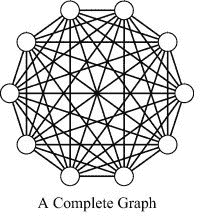

**图 6.4：** 比特币是一个密集连接的、几乎完全的矿工网络。

让我们通过一个例子来看看这如何产生影响。Alice 和 Bob 是两个拥有相同算力的矿工，为了探索网络连接所起的作用，让我们假设这两个唯一的矿工正在使用两种不同的策略相互竞争。

假设两人都有 100 单位的算力，但 Alice 在网络基础设施上投入了大量精力，并实现了在 0.2 秒内连接到网络中所有矿工的速度（即使是 GB 级的大区块也是如此）。然而，Bob 更多地关注挖掘算力，没有在网络基础设施上投入那么多，其网络连接速度需要约 3.2 秒才能传播任何区块。我们的平均区块时间为 10 分钟或 600 秒。Alice 和 Bob 将区块发布到网络的时间差为 3 秒（3.2 - 0.2），或者说 Alice 获得了约 0.5%（3/600）的收益。

这意味着，在实际上，Alice 和 Bob 并不是像两个 50% 的矿工那样行动，Alice 的表现更像是一个 50.5% 的矿工。为了赢回同样数量的优势，Bob 必须以更大的比例增加他的算力来匹配 Alice 的优势（大约多增加 21 单位即可获得 0.5% 的优势）。

上述示例的目的是展示比特币挖掘竞争的非对称性，以及附着在矿工行为上的奖励。矿工必须不断不仅关注挖掘哈希值，还要关注网络基础设施、高带宽、低延迟网络连接、安全性以及一个始终处于运行良好的网络管理系统，以保持竞争力。

另一点是，如果矿工的区块变成了孤立区块，这对他的业务来说是金钱的损失（因为损失了投入其中的算力，还损失了区块奖励）。孤立区块是矿工投票的方式，正是在网络共识期间，他们选择一个有效区块或让一个区块孤立，他们通过这种向网络的投票来主张自己的选择。

这就是我们看到的，比特币是一个具有延性的系统，而不是像铁那样脆弱，而是钢。

## 10 分钟间隔

好奇的读者可能会产生一个问题，我们讨论的区块创建过程的 10 分钟时间范围似乎是一个任意数字。为什么这个配置使用 10 分钟，而不是 1 分钟或 100 分钟的区块间隔？

在这些间隔的选择背后有大量的思考过程，基于对货币交易及其分布的建模。这些模型被用于传统行业的自动欺诈检测，感兴趣的读者可以通过下面提到的研究论文了解更多细节。

Craig Wright 博士的《方差均匀性测试》（Testing Homogeneity of Variance）。

[`papers.ssrn.com/sol3/papers.cfm?abstract_id=295300`](https://papers.ssrn.com/sol3/papers.cfm?abstract_id=295300)

这是因为节点验证交易的方式：先接收到的区块会被包含并验证。下一个区块被放入孤立池中，只有当该链成为最长且有效的链时才会添加到主链。

用简单的话来说这些观点，关于区块挖掘有件事：一是关于寻找哈希问题的解决方案，二是关于将区块传播到对等节点。在传播区块到节点时，这种分布大约是指数级的，这意味着如果区块时间保持较长，将允许更多的小型矿工；而当区块时间非常短时，将只允许一小部分矿工能够竞争。在分钟级间隔下，区块的孤立率大约是 10 分钟间隔的 2.5 到 3 倍，而在 10 分钟间隔下，孤立率接近于零。将结算（区块时间）缩短会改变分布，并最终更倾向于大矿工。

不深入探讨这些模型的数学原理，如果区块间隔在 5 到 20 分钟之间，比特币网络就能实现最佳运行。无法计算精确的最佳间隔，因为这将取决于时间、季节、使用情况、电价以及许多其他因素。因此，10 分钟间隔是一个猜测，一个当时足够好的近似，它在过去十年的网络运行稳定性已被证明有效。

## 区块重组、分叉及各种攻击

## 分叉或链分裂

### 分叉与链分裂

分叉在某些方面是对网络的一种攻击，因为它们从网络中抽走了价值。这种情况在更重大的意义上发生过几次，但如果我们回顾整个历史，比特币已经发生了数百次分叉。每当网络发生分叉时，它们必须更改某些规则以创建一个独立的链。例如，`Litecoin` 几乎复制了所有的 `Bitcoin` 协议，但将哈希算法更改为 `sCrypt`，并将区块时间从 10 分钟缩短到 2.5 分钟，创建了一个完全全新的系统。这些系统对于技术游乐场可能是有用的，但它们对协议没有产生任何经济或技术上的改进，并且实际上通过创建替代的竞争性协议或损害网络声誉，从比特币协议中抽走了价值。

由于对该技术和经济模型缺乏整体理解，公众的认知更多地关注代码符号而非底层协议。这导致比特币在过去的 10 年中遭遇了大量的延迟，甚至导致了品牌价值的损失。由于这种误解，比特币曾一度成为黑客和犯罪分子的首选工具，这在技术的主流采用方面带来了许多挫折。它还导致了替代区块链和项目的产生，这些项目仅提取了比特币协议的部分内容（如 `hyperledger` 中的区块链数据存储方法），导致了我们现在看到的生态系统状态：成千上万条区块链，其中许多没有任何实际的产品或实质性的产出，却试图在法律地位边缘的加密货币交易所出售代币。

`图 6.5` 显示了比特币区块链在链、代码名称和协议方面的重大分叉快照：

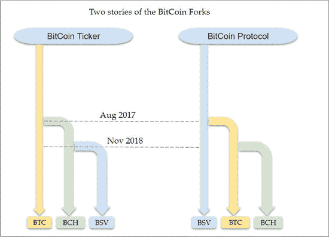

**图 6.5：** 比特币分叉史

#### 中心化与扩展性问题

比特币自发布以来一直是一个系统（代码符号为 `BTC`），但正如我们在 `[第 5 章：交易与交易脚本]` 中通过 `Script` 看到的那样，它一直在不断受到限制。由于代码开发人员（被称为比特币核心开发团队）不断更改协议，它变得中心化了，这使得应用程序开发者无法在比特币上继续构建新应用。开始时，有许多小组开发和维护不同的节点软件实现（如 `Bitcoin Core`、`Bitcoin XT` 等），但逐渐所有的替代开发团队都消失了，在某个时刻，只有比特币核心软件开发团队在维持运行，使得比特币协议由单一开发人员小组治理。

最大的争议之一是 1 MB 的区块大小限制，这限制了网络扩展到能够处理数十亿次交易的能力。相反，它被用作一种功能，向客户收取越来越高的费用（称为 `RBF`，后被费用取代），以便其交易能够被处理。这一过程使用户能够通过不断增加费用来竞价以获得交易的优先处理；在 2017 年网络拥堵期间某个时期，每笔交易的费用飙升至 50 美元，而正常情况下应该是千分之一美元。当比特币预期支持每秒数十亿次交易时，1 MB 的区块仅允许 5-7 个 TPS（每秒交易数）。只有在取消对区块大小施加的限制时，这种情况才可能发生。这扼杀了可以使用低费用微交易开启的整套用例。对于创建一个全球性的金融系统来说，这是一场灾难。

### Segwit 冲突

此外，另一个变化是从交易中移除数字签名以节省空间。这被称为 `Segwit`。Segwit 的进展并不顺利，许多人对这些变化表示不同意。Segwit 的本意是可选实施，以确保比特币成为像数字黄金这样的价值存储手段，而不是取代闪电网络。

自该提案实施以来已多年，少数闪电网络实现方案仍在为实现中心化控制而挣扎。不仅如此，这些系统可能会因为离链操作而丢失交易和资金，而且容易受到欺诈（因为维护了备用账本）。

### 比特币现金与哈希大战

随着比特币现金的出现，恢复过程从实施 32 MB 区块开始，但再次出现了开发人员在协议恢复上发生冲突的情况：一方希望实施更改以支持某些功能，例如通过在区块创建前对矿工进行预共识来对交易进行预订，将挖矿过程从 POW 移动到 POS。此外，他们还想实施更改以启用一种名为 `wormhole`（虫洞）的不同类型的二层解决方案，这涉及到通过将比特币销毁没有私钥的地址来在比特币上创建代币，以及实现完全匿名交易的功能。这导致了第一次哈希大战，这次链分裂不再是预先决定的，双方的矿工和协议开发者都通过他们所控制的算力来主张对链的所有权。结果是网络再次分裂，产生了两条链：`BCH` 和 `BSV`。这发生在 2017 年 8 月，区块高度 `478559`。

仅仅移除 `OP_Return` 启用 100kb 数据的限制，就在应用开发方面引发了创新的爆发，正如我们在后续章节中看到的那样。在区块大小方面，目前 BSV 网络支持 2 GB 大小的区块，其交易能力至少达到 13000 TPS。在移除限制后，矿工（由矿工选择）可以创建任何大小的区块，从而实现至少数百万的 TPS，甚至更高。这通过 2020 年 5 月 BSV 网络中的几个近期区块得到了证明，其中一个区块挖掘了约 130 万笔交易，大小约为 350 MB。这甚至还没有该网络能力的 1%，正如我们一直在讨论的，它需要并且正在准备的不仅是 GB 级区块，还有 TB 级区块。随着协议的冻结，从那时起将无法进行任何更改或拆分分叉，从而恢复到中本聪最初设想的实现方案，这也是比特币能够作为一个单一真实的全球金融网络运行的唯一方式，就像互联网是一个全球性的通信网络一样。

另一个核心点是，区块大小需要尽可能大，因为区块奖励（也称为区块补贴）也是为了保持矿工挖掘积极性的一种措施，而且它每 4 年减少 50%。目前存在的代币已经是 1800 万个，因此剩余代币仅剩 300 万个，这意味着矿工需要通过 coinbase 交易或区块补贴以外的方式支付。这是通过交易费实现的。但收取高费用将几乎杀死微额交易的用例，以及电子现金系统作为廉价易用系统的初衷，但如果区块中存在数百万笔交易，就能补偿每 4 年一次的区块补贴减少。这是大区块最重要且最核心的一点，在某个时刻，无限的区块大小使得矿工可以选择在区块中放入多少交易，以使其在区块获得的费用最大化。

下方图 6.6 快照简要回顾了随时间推移，对中本聪在 2009 年发布的原始协议添加限制而所做的更改，这些更改在此期间破坏了比特币的经济模型：

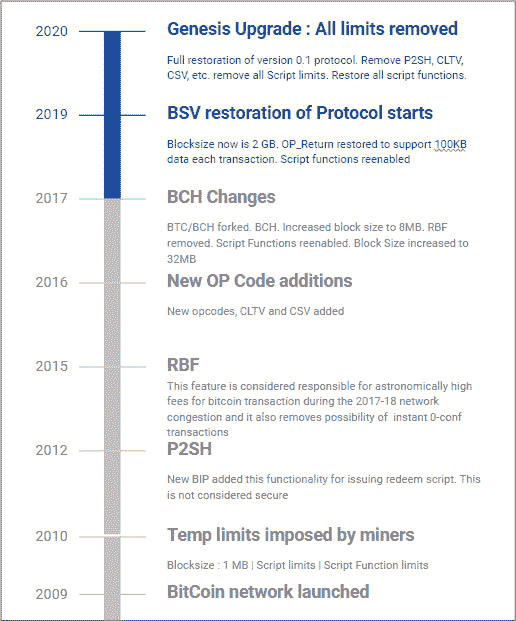

**图 6.6：** 比特币协议更改时间线

这些拆分的经济影响是显而易见的，它导致了系统通胀的增加。有一条链就有一套价值体系。有多条链，价值就被拆分了，所以如果比特币整体价值 100 单位，且有 2100 万个比特币，那么总价值将是 21 亿单位，但随着链的拆分，我们拥有 2100 万个 BTC、2100 万个 BCH 和 2100 万个 BSV，增加了大量的通胀，类似于法币的通胀。

从上述拆分中吸取的教训非常简单但依然深远。要实现真正的去中心化和真正的点对点，它必须有一套没有任何人能更改的单一规则。就像自然运作一样，万物和每个人都有一套规则，没有人能改变它，这暗示了一个显而易见的断言：比特币是一个受生物学启发的网络。

我们已经详细讨论了上述拆分。让我们快速查看一下这些

### 女巫攻击 (Sybil Attack)

女巫攻击是一种攻击者创建大量伪匿名身份，以获得对网络获得不成比例的高影响力。这是点对点网络中的常见威胁，因为那里没有中央权威来验证每个参与者的身份。在比特币的语境下，女巫攻击可用于包围节点、审查交易，甚至破坏共识机制。然而，比特币的设计通过其工作量证明机制抵抗此类攻击，该机制要求攻击者拥有大量的计算能力才能获得影响力。

### 51% 攻击 (51% Attack)

51% 攻击是指控制了 50% 算力的矿工达成共识，并开始创建他们想要的任何区块的攻击方式。这种网络的共识过程被称为中本共识，矿工通过其节点投票来表达他们对某些更改的支持意图。在 2018 年 11 月 15 日区块 `556766` 发生分叉/网络拆分事件之前的几天里，实际上存在两个对立的矿营，其中一个是（后来的）BSV 营。对立方是早期 BTC 网络挖掘的矿池，它们在最后一天将算力份额临时增加到超过 51%，一旦拥有了该份额，他们实施了一个检查点（checkpoint），旨在冻结区块链状态（类似于提交，在该提交之前的区块链无法进行任何更改），并带有每 10 个区块设置此类提交检查点的协议更改。这最终导致了网络链 BCH 的硬分叉，分为 BCH 链和 BSV 链，产生了从比特币网络产生的 BCH 合并空投。

### 51% 攻击，自私矿工攻击 (Selfish Miner Attack)

这是一种攻击，指控制了 50% 算力的矿工达成共识，并开始创建他们想要的任何区块的攻击方式。在 2018 年 8 月至 2018 年 11 月期间，发生了类似的情况，即两个对立的矿营就其中一个软件开发小组提出的协议更改产生了分歧。提议的更改是根据矿工之间的预共识对交易进行排序。这不仅仅是一项提案，还有许多其他争议点，如将区块大小限制在 32 MB、添加 Schnorr 签名以允许匿名等。最终，这导致了两个对立矿工小组陷入了被称为“哈希大战”（Hash War）的局面。

产生 `BTC` 链的硬分叉是以一种更有计划且协作的方式发生的，当时两组矿工同意他们无法再对相同的协议更改达成一致（称为 `segwit` 或隔离见证，它在将交易存储在区块链时移除了交易中的数字签名），导致了从比特币链中产生了 `BTC` 的硬分叉空投（随后更名为 `Bitcoin cash`）。

## 区块重组与大型矿工攻击

这是针对比特币网络的一种假设性但最昂贵且最消耗资源的攻击场景，即攻击者试图比诚实链更快地生成一条替代链。现在应该显而易见，这并非一项易事，但尽管如此，如果拥有足够资源和动机的人这样做，它也不会让比特币系统发生任意更改。系统中的其他诚实节点永远不会接受任何包含无效交易的区块作为支付，也不会接受任何包含这些交易的区块。攻击者只能成功地更改他已经花费的交易以取回资金。

证明攻击者链接管概率的细节是：不仅要找到下一个区块，还要追上在试图接管网络过程中落后的 `n` 个区块，这种概率随着 `n` 值的增加呈指数级下降。

这些大型矿工攻击在 `BTC` 上不起作用的原因在白皮书的最后一节第 11 节 `Calculations` 中通过数学证明给出：

> “诚实链与攻击者链之间的竞争可以表征为二项随机游走。成功事件是诚实链扩展一个区块，使其领先优势增加 +1；失败事件是攻击者链扩展一个区块，使间隙缩小 -1。”

概率计算在比特币白皮书的第 11 节中给出，并附有 `C` 代码证明：随着攻击者开始创建替代链区块之后挖掘的区块数量 `z` 的增加，攻击者作为最长链追上原始链的概率迅速趋于零。下方的代码展示了概率计算：


```c
#include <math.h>

double AttackerSuccessProbability(double q, int z) {
    double p = 1.0 - q;
    double lambda = z * (q / p);
    double sum = 1.0;
    int i, k;
    for (k = 0; k <= z; k++) {
        double poisson = exp(-lambda);
        for (i = 1; i <= k; i++)
            poisson *= lambda / i;
        sum -= poisson * (1 - pow(q / p, z - k));
    }
    return sum;
}
```

# 能源消耗

挖矿行业、工作量证明和比特币经常面临的一种攻击观点是：它认为其消耗的能量相当于整个丹麦国家所需的能量。这还断定并将挖矿标记为一个浪费的行业和过程，因为它消耗了大量的能量。

关于能源消耗的论点似乎类似于`稻草人谬误`，比特币被描绘为一个消耗大量电力的浪费系统，但关于比特币效率的问题只能通过解决它与竞争选项相比是效率更高还是更低来回答。如果将其与 `Google`、`Amazon` 或 `Facebook` 进行比较，结论就清晰了。

# 作为一个行业的挖矿

挖矿行业、工作量证明和比特币经常面临的一种攻击观点是：它认为其消耗的能量相当于整个丹麦国家所需的能量。这还断定并将挖矿标记为一个浪费的行业和过程，因为它消耗了大量的能量。

...

接下来是 FPGA（现场可编程门阵列），它们是集成电路，在制造完成后由终端用户根据特定目的进行配置。但正如挖矿的本质所决定的，需要更专业的硬件。下面的图片展示了一个矿用 FPGA 芯片及其组件。

这导致了 `ASICs（专用集成电路）`的使用。`ASICs` 是专门设计的硬件，只能执行一种特定类型的处理，它们自 20 世纪 80 年代以来一直存在，其中最早的一些个人电脑就是 `ASICs`。基本上，在制造过程中是在这些硬件机器中完成的。因此，一个 `SHA256d` `ASIC` 只能挖掘使用 `SHA256` 算法的货币。`ASICs` 开始接管挖矿行业，一场创造更好 `ASIC` 的战争随之展开。

随着 `ASICs` 的使用，挖矿行业得到了飞速发展，现在出现了许多大型商业企业，他们专注于专业的挖矿硬件以及软件及两者。这现在在全球范围内已大规模进行，许多矿场应运而生用于挖矿。


**图 6.7：** 使用 `SHA256d` 算法挖掘比特币的矿场

另一类作为新行业产生的挖矿商业企业是矿池。由于挖矿行业开始变得庞大，单独挖矿已不再有利可或可行，因此一种被称为“矿池”的新型实体开始出现。它涉及全球的个人购买一台或几台矿机，共同创建一个由矿用 `ASICs` 组成的网络，并集体挖掘比特币。他们获得的奖励根据每个挖矿者的哈希计算贡献比例分配给所有挖矿个人。

作为一项行业，挖矿在未来将比现在更加专业化，通过诸如交易定价、以及区块奖励的消除或降低等措施，这使得矿工将越来越依赖于他们从每个区块中收到的交易费。这种模型只有在交易量变得巨大时才能运行，以便保持单笔交易费的低水平，同时保持区块挖矿的盈利能力。即使矿工在网络运营方面的被动实体角色也将发生变化，他们将更多地作为比特币网络规则的执行者走向一线。这将使矿业成为一个致力于尖端硬件和软件的业务，不断尝试优化操作以保持在竞争对手面前，同时确保比特币网络的完整性和健壮性，此外还包括在处理交易之前或之后执行法律反洗钱（AML）合规。

## 矿工的演变

作为一项行业，挖矿自诞生以来已经进化了很多。最早的挖掘是由 Satoshi 使用标准的 Windows XP 机器进行的，随后在比特币的初期由用户电脑进行。随着挖矿的演进和竞争，使得挖矿只有通过大型 ASIC 矿机、实际上通过矿场才能实现，使得用户在网络上挖矿变得不再可能。这催生另一种被称为矿池的业务。

这些矿池是全球范围内用户/矿工组成的分布式集合，他们运行自己的矿机设备，但将其矿机设备的哈希力提供给运行挖矿软件的公共节点，该节点使用这些哈希力。这种合并所有参与者计算力以形成新区块的集体网络矿池，其工作原理是根据参与者的哈希率资源贡献，将获得的区块奖励（`Fee + block subsidy`）分配给参与的单个矿工。

另一个版本是云矿，它允许用户购买位于远程数据中心的加密货币挖矿硬件的输出。这更类似于通过签署一份在特定时间内支付定义费用挖掘比特币的合同来租赁挖设备。由于所有的挖矿都是远程进行的，这消除了矿工在使用强大平台时面临的问题，包括巨大的能耗、热量、隔缘，当然还有维护。这种类型的挖矿可能对于想要参与挖矿但没有基础设施和技能自己完成全部设置的个人有利。云矿具有某些缺点，如利润低于自己的哈希系统，存在欺诈的可能性，因为一个中心实体控制着挖矿，它是单点故障和欺诈中心。这在过去发生过，这些矿池曾欺骗过个人。

过去的教训是，矿工迫切需要专业化，而这现在已经开始发生；同时随着区块补贴减少到每个区块 `6.25` 个币，人们意识到交易费将是维持挖矿作为一项行业的关键，矿工需要成为生态系统中工作的业务，以使系统能够处理大量交易。对于企业要将其业务关键应用的交易发送到比特币网络，他们需要与挖矿实体达成协议，以确保他们有一个负责任的风险对冲，以及在出现问题时可以寻求的负责任实体。然而，单矿工来说也有巨大的好处，他们可以将运行挖矿作业的责任和辛苦工作卸包给云提供商。云提供商负责维护设备、保持凉爽，并根据你的订阅费用为你提供可能获利的服务。如果你无法负担空间和时间来管理这些事情（例如你还是一名学生或住在小家庭家里），那么这些成为极其重要的优点。

# 作为交易处理器的矿工

正如我们所讨论过的，比特币本身在协议中就硬编码了内置的通胀区块补贴计划，这是为了激励网络的早期支持者（区块生产者/矿工）运行硬件并作为网络节点。这种业务模式在本质上是有风险且暂时的，因为他们作为奖励所获得的代币没有真实的价值基础。在最初的时期，由于代币的底层价值存疑，对盈利能力存在整体上的不确定性。这种旧格局正在改变，比特币现在将自己定位为企业级公共区块链，今天至少有数百万交易由各种产生真实世界产品的业务/应用程序产生。

因此，矿工现在需要通过专业化挖矿来转化为交易处理业务。这需要对目前的挖矿方式进行大量的改变，不仅如此，还包括其被感知的方式。矿工变为更正式和受法律监管的实体的整个想法将为矿业带来专业化，而参与比特币的挖矿公司已经开始这样做。此外，他们还需要提供企业无法工作的标准化服务。其中一些在下文中进行了讨论：

*   **SLA 或服务水平协议**：传统支付和金融网络的基本概念之一是**日终（EOD）**交易结算的概念。如果比特币要成为用于金融结算的基础技术平台，该技术必须保证交易在日终前完成结算或最终确认（至少是这样）。因此，交易处理器本质上需要为企业客户提供服务水平协议，保证交易在设定的时间内确认并反映在区块链上。

*   **基于法币的费用**：考虑使用公共区块链的企业将面临最大的挑战，即交易费用是以萨聪币（satoshi）为单位的，而不是美元或本国的当地货币。这导致它们在市场价格波动和可变运营成本方面面临风险。不仅如此，由于可能无法持有数字资产，它们还必须遵守公司政策。

作为矿工向交易处理器转型的专业化进程的一部分，推出了一种名为 `MinerID` 的协议，旨在为矿工建立一套声誉系统。该协议的详细规范见于

[`github.com/bitcoin-sv-specs/brfc-minerid`](https://github.com/bitcoin-sv-specs/brfc-minerid)

`MinerID` 协议是一个可选协议，允许用户识别并与矿矿节点进行安全交易。为此，矿节点为自己分配一个加密可验证的身份，并通过其挖得区块的交易中嵌入所谓的 `Coinbase Document`（Coinbase 文档），从而将自己产生的区块标记上该身份。这使得矿工能够基于透明度和性能建立一个可验证的声誉。

`Merchant API` 是另一种类似的矿业服务专业化。该 API 架构是一个为矿工定义的协议，使其能够以标准格式与钱包、客户和企业应用进行通信。该 API 的当前版本包含了费用发现和直接交易提交等功能。费用发现允许各方在创建交易时，预先了解为了保证所需的服务水平需要矿工提供的费用水平。直接交易提交允许用户避开比特币网络的外部层，并直接将交易提交给矿工。这缓解了由于用户网络策略不可靠导致的许多交易传播问题。

更多详细规范见于

[`github.com/bitcoin-sv-specs/brfcmerchantapi`](https://github.com/bitcoin-sv-specs/brfcmerchantapi)。对于感兴趣的读者，可以使用与矿工 API 交互的优秀工具

[`minercraft.network/#/?id=minercraft`](https://minercraft.network/#/?id=minercraft) 进行探索。

这种将矿工专业化的想法与他们承担作为比特币网络规则执行者的责任紧密相关。这需要他们具有更高的责任感并接受监管，因为他们负责接受任何交易以及随交易产生的数据，这使得他们还负责执行比特币网络上的任何法律和法院裁决。对于任何网络要被建立为一个全球范围内进行大规模金融交易场所，这是必须的。以这种责任行动的矿工可以拒绝处理并冻结任何犯罪收益的币，并将其保持锁定，直到这些币的原始所有者取回，从而使那个“黄金离开原主人手中就会变成铅，回到主人手中又变回黄金”的神话变为现实。

这些只是这个现在开始成规模的行业的初步步骤。预计这将成为一个大规模的行业，正如这些矿工所为全球交易服务的当前结算和清算公司一样。

最后，我想引用白皮书中的结论。这是对比特币协议最完美的单段描述，说明了它是如何运行的以及它的功能。高亮的文本展示并描述了矿工的功能以及他们如何作为比特币生态系统中规则和法律的执行者运作。

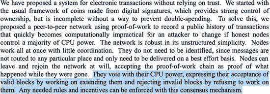

**图 6.8：** 总结比特币网络核心以及矿工在网络中所扮演角色的结论文本。

这里需要注意的是，CPU 算力并不意味着每个参与用户都从池中投票，而是池的投票将被计为一票。尽管在比特币存在十年后，这在今天的生态系统中仍然是一个被严重误解的想法。采矿始终意味着将由大型企业在数据中心运行矿场结束，这也是该行业的未来。

# 结论

我们详细概述了挖矿和网络运行细节。我们查看了各种攻击类型、导致分叉和分裂的原因以及共识是如何产生的。在本章结束时，我们详细讨论了比特币协议、其架构以及如钱包等各种组件。我们还查看了什么是交易以及编程语言 `script`。这引导我们现在从应用层开始关注，而不是协议，我们将讨论许多尚未提出的想法。在后续章节中，我们将从构建内置货币系统的互联网想法开始，这改变了我们在互联网上交互的方式。

学习本章后，你将能够理解 Metanet 的基本概念。在未来的某个时间点，它如何可能成为开发应用的默认方式，并实际上作为当前互联网形式的替代？你还将学习 Metanet 应用中的数据是如何结构化的，以及它与当前应用程序有何不同。我们还将讨论数据所有权和隐私问题，以就在构建应用时，为什么 Metanet 是相较于当前互联网技术的一种范式转移提供背景。

# MetaNet 简介

比特币交易的一个有趣属性是，除了价值转账外，它们还具有一些独特的属性，这些属性不仅可以用于价值转移，还可以用于许多不同的用途。因此，与其将交易仅仅看作是支付手段，我们不如通过 `OP_RETURN` 数据字段使用特定的指令来分配更多属性，从而为将其用于更多用途创造可能。

因此，如果我们把比特币视为一种在不可变账本中存储数据的数据存储协议，我们就可以考虑在这一数据存储协议之上创建虚拟数据结构想法。如果你接触过数据库，可以将其理解为存储在各种表中的数据的别名（alias）。视图仅以虚拟表格的形式显示数据，从实际物理存储的角度来看，这些数据可能属于许多不同的表。这种创建虚拟数据存储的思想以标准化协议的形式正式化，并命名为 Metanet。

Metanet 可以被视为一种层 2（层 1 为比特币区块链）协议和框架，它规定了如何编写携带数据的交易，并创建结构化的链上应用，从而创建一个构建在比特币区块链上的替代互联网形式。用户密钥仍然可以通过钱包进行管理，提供了 ECDSA 密钥管理提供的卓越隐私和安全功能，使用户和内容创作者能够完全控制自己的数据，解决当前互联网巨大且日益增长的问题——用户隐私。

当前版本的互联网很大程度上通过其广告模式提供免费服务，在这种模式下，用户和内容创作者是产品，其数据被卖给定制化广告。这很大程度上是 Google 和 Facebook 等大公司因违反和泄露隐私敏感用户数据而被处以数十亿美元罚款的主要原因。此外，还存在一个巨大的黑市（专门称为深层网络和暗网），它使得大量的犯罪活动成为可能，这很大程度上是因为利用现有互联网中存在的漏洞，大多数事情都可以被变得不可追踪。

解决当前互联网问题的解决方案在下方的简单用例中描述：

我每天使用 Google 搜索引擎进行大约 10 次搜索。我的搜索第一页通常从一个赞助搜索结果开始，随后是一组看似随机但高度定制的结果。这个赞助结果以及随后的搜索结果仍然基于 Google 根据它捕获的历史数据并为我创建的画像对我进行的个性化处理。一旦完成个性化，他们就会让其广告商在我的搜索的相同关键词上优先出现。我得到的不是随机结果，而是 Google 根据谁在广告商业关联上与他们相关而为我提供的精心挑选的结果。事实上，我在 Google 搜索结果中获得的超过一半的页面都是基于此的。我本希望有一个更具针对性的关键词搜索。Google 为什么要这么做？他们提供免费的搜索服务，并且花费大量的资金来创建、维护和增强他们的搜索服务。他们需要收入来源，而在当前的形式下，这就是广告。

考虑到 metanet 世界的替代方案，Google 现在每次搜索向我收取 0.001 分钱。现在 Google 在我使用搜索时拥有了收入来源。如果每天发生 100 亿次搜索，这本身就为 Google 带来了 50 万美元的收入。此外，Google 可以单独投放广告，让用户查看广告并赚钱。这些是代表性的数字，展示了一种新的业务模式，Google 可能会通过提供付费搜索比当前模式赚到更多钱。不仅如此，它还将赢回那些因隐私顾虑而离开 Google 的老忠实客户。

这就是 Metanet 提要解决的问题。

## Metanet 协议

在进入细节之前，让我们回顾一下 metanet 协议中用到的一些计算机科学概念。

### 图 (Graphs)

在计算机科学中，图的数据结构是事物的集合以及它们之间的连接或关系。图中的数据或对象被称为节点（nodes）或顶点（vertices），节点之间的连接被称为边（edges）。图的一个例子是社交网络，其中节点是人人/个体，边则是他们是否互为朋友。

图进一步分为两类：有向图（Directed）和无向图（Undirected）。两种类型均在下图所示：

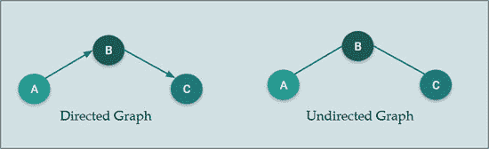

**图 7.1：** 有向图和无向图中显示的节点 A、B、C 以及边

无向图是节点之间的边没有任何方向的结构，而有向图是边具有特定方向的结构。

图用于建模和表示各种对象及其相互之间的关系，将现实场景作为数据结构表示。在这些结构中表示事物允许使用算法通过标准方法非常地执行搜索等各种操作。

图的一些属性描述在下面，并在下图中所示：

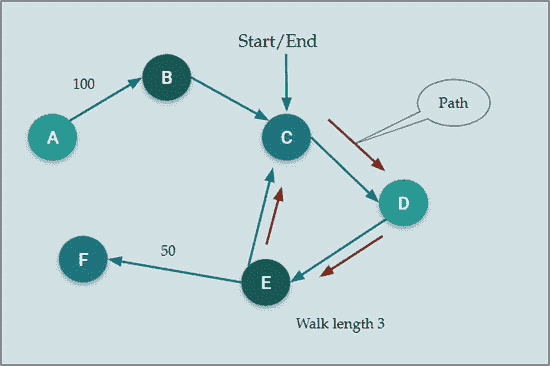

**图 7.2：** 有向图和无向图中显示的节点 A、B、C 以及边

在上面的图中，我们有如下：

- **加权图（Weighted Graphs）**：边可以被分配不同的权重或成本，从而在遍历这些边时产生差异。
- **自环边（Self-loop edge）**：当边的两个端点位于同一个节点时，例如网页重定向到自身。
- **多边图（Multiedge graphs）**：在相同节点之间存在多条或并行边，例如数据结构中表示的两个城市之间的多次航班。
- **游（Walk）**：节点序列，其中每对相邻通过边连接。
- **闭合游（Closed Walk）**：它起始并结束于同一个节点。
- **路径（Path, simple）**：节点（因此边）不重复的游。
- **简单环（Simple Cycle）**：除起点和终点外，节点不重复的路径。
- **无环图（Acyclic Graph）**：不具有起始并结束于相同节点的路径的图。二叉树将是一个无环图。

我们需要涵盖的最后一个概念是节点的入度（in-degree）和出度（out-degree），即进入和离开节点的边的数量。

## 有向无环图 (DAG)

在涉及到 metanet 时，我们更感兴趣的有向图，即在连接中分配了特定关系并具有方向的图。DAG 是：

- **D (Directed)**：边始终具有方向。
- **A (Acyclic)**：图在遍历路径时不会有任何环。
- **G (Graph)**：不言而喻，具有节点和边。

话虽如此，DAG 在表示自然界时是非常常见的结构，例如，家谱树表示将是一个 DAG。比特币区块链是一个 DAG。

## BitCoin DAGs

既然我们已经涵盖了基础概念，现在让我们来看这些概念如何应用于比特币区块链。比特币中存在不同的数据结构，它们都是 DAG（有向无环图），让我们来看其中两个明显的例子。

### 区块 DAG

正如我们所定义的，比特币区块链是一个数字签名链，将数据区块连接起来。这些区块具有单向的方向（从上一个到当前），并且是一维的，即满足我们之前讨论过的关于 DAG 的所有属性（参见图 1.5）。每个区块形成一个节点，前一个区块的加密哈希值代表边。

### 交易 DAG

我们已经看到区块中的交易再次通过其哈希值通过 Merkle 进行存储和索引。除此之外，交易之间存在的另一种关系是，它们通过所花费的 UTXO 与同一区块或不同区块中的其他交易建立联系。与非常类似于链表或线性图结构的区块 DAG 相比，这形成了一种完全不同且更复杂的图结构。

下面的图展示了一个示例交易 DAG。不说说，在真实的区块链中，交易 DAG 可能会变得非常复杂，数百个交易形成不同的节点，而它们通过花费的 UTXO 形成的之前的交易输出与输入的关系构成了边。此外，正如你在图中看到的，节点的入度和出度没有限制：


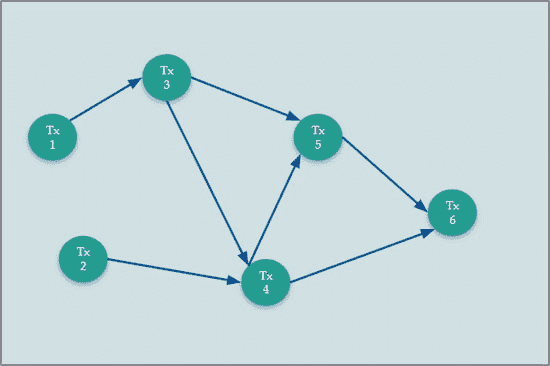

**图 7.3：** 交易 DAG 显示了随时间变化的各种交易，花费了上笔交易的 UTXO

你可以在下面的图中看到使用网站 [`www.bitgraph.network/`](https://www.bitgraph.network/) 上的可视化工具创建的真实交易图：

```
#tx/01b17c892e57bf4fba3b3cbe4a766201586ea5a221e2ec18aeb16e9e8b20505e
```

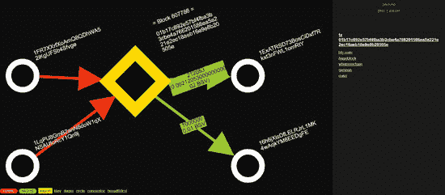

**图 7.4：** 真实区块链中的交易 DAG

这些比特币从一个地址到其他地址的传输可视化以及货币从源头到目的的整体流动，在对特定交易和地址进行交易分析、数据分析和追溯分析时非常方便且有用。

### Metanet DAG

类似于交易 DAG 使用一组规则以 DAG 形式表示交易数据，Metanet 是另一个协议，它使用某些属性（需要添加到交易中以成为 metanet 协议的一部分）来定义另一种类型的 DAG，被称为 Metanet Graph（Metanet 图）。选择 DAG 作为 metanet 图结构的原因是因为它与底层的交易 DAG 在结构上的相似性，此外它还非常适合存储互联网应用数据，我们将在本章稍后讨论。

Metanet 协议规定了定义如何构建 metanet 交易的要求。这种构建交易的方式允许你为应用程序创建一个本地数据结构，并可以被视为位于区块链之上的二层协议，可用于不可变地存储数据。它还允许在搜索方面进行轻松访问，并带有一个使用公钥基础设施的、完全内置的安全模型。之后我们将讨论 Metanet 交易协议的规范及其各种特性。

总结来说，Metanet 交易协议定义为 DAG 的目标是：

* 使用边将各种交易中的内容通过正确的关系关联起来。
* 允许对 metanet 内容进行快速搜索（快速且可靠）。
* 为服务器构建一个类区块链的结构，以实现“客户端-区块链”作为服务器的应用模型。

### 节点与边

节点是遵循 metanet 规则集的交易。节点交易将用于存储内容，这是通过之前提到过的 OP 码 `OP_RETURN` 完成的。符合 metanet 规则的交易中的数据/内容应具有：

* **Metanet 标记（Metanet flag）：** 一个 4 字节标识符前，用于每个 Metanet 交易。
* **属性（Attributes）：** 与内容数据相关的元数据，如索引、权限和编码信息。
* **内容（Content）：** 感兴趣的负载数据。这些数据可以是网页、链接 URL、原始字节流或文件，基本上是任何需要存储的数据。

`OP_RETURN` 操作码用于向区块链推送任意数据，它用于实现 metanet 的这些协议层面的细节。这意味着每个兼容 metanet 的交易在其输出脚本中将有一个 `OP_RETURN` 代码，后跟是在该交易中要推送到区块链的数据。在这些数据中，我们添加了特定的 metanet 协议标识符，以便将该交易识别为 metanet 节点。

在节点方面，它们可以定义为父节点或子节点，这取决于边的方向，例如，取节点 A 和节点 B。通常边的方向是从一个节点到另一个节点，如果从 A 到 B，即 A —> B，那么 A 是父节点，B 是子节点。基于这一理解，我们定义了节点和边。

**节点（Node）：** 与 metanet 协议关联的交易。

每个节点包含一个公钥 `P[node]` 和一个 `OP_RETURN`，随后是 metanet 标记。metanet 节点使用此公钥引用。

`ID[node] := (P[node] || TxID[node])`

**边（Edge）：** 使用签名将子节点与父节点关联。边不涉及直接花费。

边的创建使用 metanet 交易输入中的签名 `sig[parent]` 完成的，这意味着只有父节点可以为边授权。所有节点最多有一个父节点，而父节点可以有任意数量的节点。这实际上意味着 metanet 节点的入度最多为 1，而出度可以是任意数量。

实际上，一个典型的 Metanet 交易或节点结构如下：

`TxID[node] : [Inputs, Outputs]`

| 输入 (Inputs) | 输出 (Outputs) |
| :--- | :--- |
| `<Sig[parent]> <P[parent]>` | `OP_RETURN <Metanet Flag> <P[node]> <TxID[parent]>` |

**表 7.1：** metanet 节点的输入和输出

其中：

* `TxID[node]`：节点的交易 ID
* `Sig[parent]`：由父节点创建的签名
* `P[parent]`：定义父节点的地址
* Metanet Flag：一个协议值，使用 `META` 作为标记以标明其为 metanet 交易
* `P[node]`：定义节点的地址
* `TxID[parent]`：该节点父节点的交易 ID

请注意，由于协议的变更，在实际代码中 `OP_RETURN` 现在始终用作 `OP_FALSE OP_RETURN`。但为了方便起见，我们将使用 `OP_RETURN` 来指代它。原因将在稍后的章节详细讨论 `OP_RETURN` 时进行解释。

metanet 图根节点或第一笔交易的一个独特属性是，该节点的 `TxID[parent]` 将为空（null）。请注意，每个子节点都将恰好有一个父节点。

当涉及到边时，在此语境下定义为：通过使用父节点的密钥对（如表 7.1 所示的父节点的 Sig 和 P）通过签名子节点从父节点创建的。

这里需要注意的一个关键点是，元网络边（metanet edge）不需要花费交易。因为信息是以属于子节点的公共地址的形式存在 `OP_RETURN` 数据中的（OP-RETURN 数据中的输出始终是不可花费的，这就是为什么它被用来存储数据）。这意味着，可能存在一个交易中包含一个公钥的元网络输出，而另一个比特币花费交易则独立创建了与该公钥关联的 UTXO，两者是分开的。这在 `图 7.5` 中所示，同一个父节点密钥也与另一个花费该 UTXO 的交易关联：

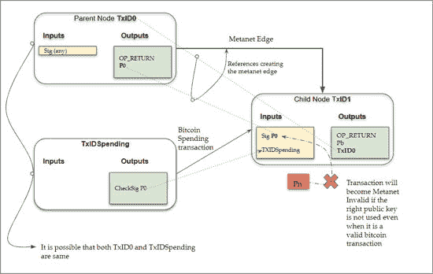

**图 7.5：** 两个交易之间的元网络边

如果我们总结目前为止学到的关于元网络协议的知识，元网络协议：

* 规定了如何通过构建节点和边的结构化元网络交易来创建节点
* 写入权限由数字签名控制（充当 WORM 介质，即写一次，多次读取）
* 读取权限由加密密钥控制
* 高度自定义且通用的协议，支持所有类型的应用程序
* 可用并与替代协议兼容，如 `B://`、`C://`、`AMP`、`AIP`、`Bit://` 等。我们将在书中后面讨论这些协议。

### 名称与域名

通过这种方式构建交易在节点/关联数据的权限和所有权方面实现了以下目标：

1. 权限和用户验证现在已内置，因为只有父节点的所有者才能创建子节点。
2. 这使得每一层节点允许建立级联的权限层次。

`图 7.6` 展示了一组节点的元网络图及其层级结构，以及每个父节点创建子节点的权限。这些节点中的每一个节点都有其唯一的 `IDs`，这可以帮助定位它们，以找到我们正在为该节点使用哪个版本的 `public key`（权限）。一个需要注意的点是，在我们之前谈到的 `node identifier` 命名约定中，我们始终清晰地了解版本（谁创建了该节点以及节点的 `public key`，如下所示，来自 `图 7.6` 中的 `TxID0`、`TxID1` 和 `TxID1,1`）：

* `ID0 = Hash of ( P0 || TxID0 )`
* `ID1 = Hash of ( P1 || TxID1 )`
* `ID1,1 = Hash of ( P1,1 || TxID1,1 )`

每个所有者的域由图中的虚线所示：

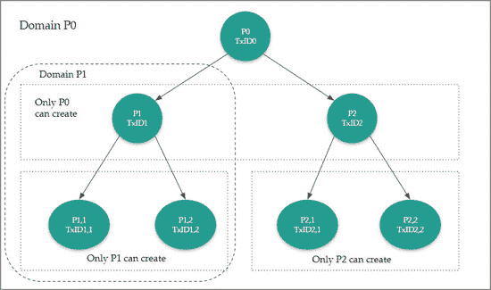

**图 7.6：** 展示节点数据所有权分离的元网络图和域

在 `图 7.6` 中，我们讨论了子节点以及进一步的子节点创建在域方面是如何结构化的。域（Domain）定义了在图图上进行写入和读取操作需要哪些密钥。

这里使用 `Domain` 一词是有刻意之意的，因为它类似于当前互联网页面和网站子页的域名结构。在元网络中，假设上述 `图 7.6` 代表一个由 3 个不同部门（首相办公室、内政部长和财政部长）控制的信息网站。那么域 `P0` 将是首相办公室，它发布的所有新闻稿都可以作为每个实例的子节点显示，如 `P3`、`P4`、`P5` 等。属于内政部的域 `P1` 将对该域拥有独立的访问和权限，需要自己的一套密钥来为内政部创建新的新闻稿。`P2`（财政部）也是如此，它有自己的子域并控制其资源。这种结构化使得...

一个尚未详细说明的方面是 Metanet 协议也支持子协议。因此，如果在交易中使用了另一种协议（以 `B://` 协议为例，我们将在稍后的章节中讨论），那么 metanet 协议可以作为父协议，而 `B://` 协议可以作为同一笔交易的子协议。metanet 协议的这种活性使其能够与任何其他定义或未定义的协议结合使用。

Metanet 协议的这一属性被称为协议局部性（protocol locality）。

### 结语

下表展示了互联网数据形式与 Metanet 数据形式的类比总结：

| 互联网 (Internet) | Metanet |
| --- | --- |
| 网站 | 节点 (Node) |
| 所有者 | 公钥, Pnode |
| IP 地址（非唯一） | 节点索引 `IDnode = H(Pnode || TxIDnode)` |
| 域名结构 | 节点树结构 |
| DNS 或域名系统 | 从根节点名称到节点索引的映射 |
| URL | MURL |

**表 7.4：** 互联网与 metanet 各种属性的类比与对比

如你所见，当使用 metanet 构建时，可以复制互联网的完整结构，并带有额外的优势特性。

协议创建者编写的优秀博客介绍了 Metanet 协议的细节，见下方提供的链接：

* **Metanet 协议文档：** [`nchain.com/app/uploads/2019/06/The-Metanet-Technical-Summary-v1.0.pdf`](https://nchain.com/app/uploads/2019/06/The-Metanet-Technical-Summary-v1.0.pdf)
* **Metanet 边界案例：** 关于 metanet 协议及各种示例的博客：[`medium.com/@jack.d`](https://medium.com/@jack.d)
* **Metanet 的开始：** Unwriter 的博客：[`medium.com/@_unwriter/the-metanet-starts-84f255a65782`](https://medium.com/@_unwriter/the-metanet-starts-84f255a65782)

## 结论

Metanet 是一种构建互联网和基于 Web 内容的新方法。本章涵盖了 metanet 的基础协议和概念层细节，以及基础层协议如何构建一个互联网——在这个互联网中，每条创建的数据对于创建者都有明确的所有权和权利，且任何使用都需要授权；反之，任何创建的错误信息或误导性数据都将分配一个身份。这两种情况与当前的互联网及其运行方式完全不同，在当前互联网中，个人或企业对其产生的结果负责，这在世界社会结构方面造成了许多问题。货币化的另一个大方面通过使用 metanet 类型结构得到了解决，类似于电表计量的解决方案，现在可以使用此协议对数据进行计费。

在下一章节中，我们将开始查看另一组与 metanet 协议配合使用的协议，用于在比特币区块链上应用开发进行特定域名注册信息的记录。

## 问题

1. metanet DAG 中的节点（node）是什么？边（edge）是什么？它们是同一个东西吗？
2. 你如何在节点中存储数据？
3. 在注册网站时，互联网和 Metanet 有哪些不同的类比组件？
4. 为什么 metanet 中将所有权分配给父节点和子节点提供了数据所有权的分离？

# 第 8 章：Bitcom 和其他应用协议

> “互联网将成为比特币的侧链（使用 metanet）”
>
> *-- Craig S Wright 博士，Metanet 协议创建者。*

在比特币上构建应用时，如果它们拥有一个唯一的标识符，并可用该标识符将它们的数据与其他使用相同比特币区块链的所有应用程序隔离开来，将非常好。这产生对某些开放共识基础设施的需求，在这里，我们可以使用比特币以不可篡改的方式发布它，以便每个人都知道谁在使用哪种密钥来标识他们的交易数据。这是使用比特币的下一步，而 metanet 就是我们看到的在区块链上进行此类应用注册的示例之一。由于 metanet 是一个更通用的协议，需要更特定的东西（如果你考虑将整个互联网重构为 metanet 协议 DAG 的愿景，它就像当前互联网的 `TCP` 或 `IP` 协议一样通用）。这就是各种开源开发者尝试创建 Bitcom 以及其他几种尝试的地方，这也是我们将在本章中讨论的内容。

### 结构

* 使用比特币地址作为前缀
* 去中心化注册表
* Bit、`AIP`、`MAP`、`BCAT`、`B`、`C` 和 `D` 协议
* 使用 Unix 管道配合协议
* Bottle 浏览器

### 目标

在学习本章后，你将能够理解如何注册应用程序，并使用 Bitcom、`B://`、`MAP` 以及其他几个与 `OP_RETURN` 相关的协议在区块链上存储数据/文件。从某种意义上说，从将区块链视为数据存储并考虑 `CRUD` 操作来看，这就是写操作方法。你还将理解这些协议的需求以及如何使用它们。

## Bitcom: 比特币计算机

随着应用程序开发的爆发，许多人认为这些应用程序创建的交易需要唯一的标识符，以便他们对交易和特定特定的使用有一种易于搜索和索引的方法。这在过去已经通过早期社交媒体的 `Memo` 协议等工具实现过。Bitcom 就是这样的一个协议，它是一种供任何应用程序使用的、用于标识交易的协议。

Bitcom 是在比特币中使用密码学的巧妙方法。这是这种高度通用系统的真正益处。`OP_RETURN` 交易在历史上一直被用于添加任意数据，人们曾尝试制定一种通命名系统，如 `memo` 协议（`memo` 是一种类似即时消息的协议），通过使用前缀（十六进制值 `0x6dXX`，其中 `XX` = `1,2,3`……以此类推）来标识所有与 memo 协议相关的交易。

Bitcom 是一种正式且通用的方法，用于寻找并分配应用程序可以使用这种前缀，同时可以在中央注册表中声明它。这正是 Bitcom 所做的。它提供了一种独特且随机的方法来生成应用程序前缀，并对任何人开放。引用创建该协议的 _unwriter：

> “Bitcom 是一种在比特币之上构建通用虚拟计算机的开放式 OP_RETURN 协议。
>
> Bitcom 借用 UNIX 文件系统的比喻来表示比特币应用协议的全局目录，其中：
>
> * 每个‘账户’都表示为一个以比特币地址为命名的根文件夹
> * 每个‘账户’都是由该地址的私钥持有者控制的应用协议。
>
> 得益于协议的简单性，你可以轻松地自己生成这些交易。”

Bitcom 是一种开放约定，可以自己构建应用协议并发布它以声明该命名空间，并确保其他人不会产生冲突的命名空间，因为它使用比特币地址作为命名空间标识。它带来的好处是未来永远不需要担心命名空间问题。”

这种效用的爆发随着 Bitcoin SV 的 `Block 566476` 发生，在此之前 `OP_RETURN` 交易被限制在 220 字节左右，这使得无法通过它在链上存储任何有意义的数据。此限制被更改为每个 `OP_RETURN` 交易 100kb，引发了用例的爆炸式增长。通过这种方法，前缀本身可以用于在区块链上放置各种内容，从文本、图像到网站再到音频，提供了一种无许可、去中心化、无冲突且无主的数据存储方式。

### 比特币地址作为前缀

Bitcom 不使用预定义的前缀值，而是提供一个生成新比特币地址的函数，该地址将成为协议前缀。这样就不可能发生命名空间冲突。可以使用 NPM 包安装：

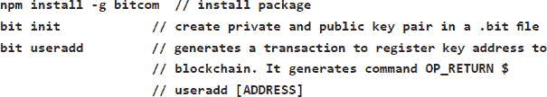

一旦上述交易在比特币区块链上通过确认，你就在比特币区块链上预留了一个命名空间。使用 Bitcom 注册和构建应用程序的详细指令集和步骤请见作者提供的链接：[`bitcom.planaria.network/`](https://bitcom.planaria.network/)

使用像 Bitcom 这样的协议最大的好处是它可以与任何其他协议兼容，因此如果你想构建一个文件传输应用，可以使用 Bitcom 协议注册该应用，然后使用另一个协议（如 `B://`）进行文件传输。在我们演示该用例之前，让我们看看其他开源开发者对各种协议的几种尝试。

#### 你可以用 Bitcom 做什么？

除了主要的用例为比特币应用程序提供一个去中心化的开放注册表外，它是可扩展的、可靠且 24/7 可用的，这是构建可持续的大规模应用的良好开始。仅使用此注册属性，应用程序在使用 Bitcom 时将获得以下额外收益：

**去中心化注册表（使用 Bitquery）：** 一种使用类似 MongoDB 语法查询比特币区块链的简单搜索方法。将在下一章中详细讨论。下图显示了一个典型的 `bitquery`：

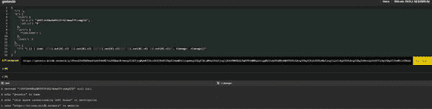

**图 8.1：** 通过 bitquery 语言通过比特币地址发现应用所有者

#### 基于比特币的去中心化路由器

基本上，你可以使用框架（Bit 和 C 框架）创建一个本地协议来运行你的应用程序，并在比特币上进行 Bitcom 注册，使你的应用程序……这将在我们稍后谈到 Bit 和 C 协议时详细讨论。构建路由器的详细规范由 unwriter 在主文档页面提供：[`bitcom.bitdb.network/#/`](https://bitcom.bitdb.network/#/)

## B:// 协议

B 协议或详细来说，比特币数据协议，是一种在比特币区块链上轻松存储和引用数据的方法和工具。

引用创建此协议的 unwriter：


“B 是一种 `OP_RETURN` 协议，用于在比特币上存储和引用任意数据。设计目标是：

*   向区块链上传任意媒体的最简单协议
*   一种从另一个链上媒体引用之前上传的媒体的协议。”

B 协议的前缀是 `19HxigV4QyBv3tHpQVcUEQyq1pzZVdoAut`，由 Bitcom 生成。在区块链上写入数据的方法是使用脚本中的 `OP_RETURN` 代码，然后跟一个使其与 `B://` 兼容的模式（schema）：

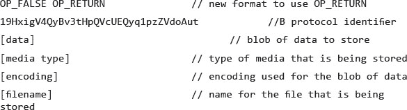

一旦你发起交易（例如使用 B 将图像上传到区块链），你可以使用其交易 ID 提供的 URL 类引用文本来回引用它。例如，使用 B 协议在比特币区块链上上传图像的进程如下所示：

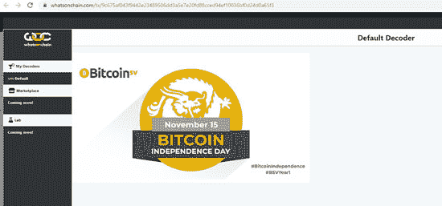

**图 8.2：** Whatsonchain 用来查看上述使用 B 协议上传的图像。该图像是使用 [`b.bitdb.network/`](https://b.bitdb.network/) 上传的。

要像 URL 一样引用该图像，可以使用以下格式：

1.  交易 ID - `b://[txid]`
2.  使用 HTML 代码：

```html
<html>
<body>

</body>
</html>
```

3.  Markdown 图像：

    

另一种引用方式是与 B 一起开发的 C 协议，我们将在后续主题中详细讨论。

# C:// 协议

通过简单的 B 协议，我们可以在区块链上写入任何类型的静态数据块。C 协议是为使用 B 协议存储在区块链上的内容创建一个唯一的统一资源定位符（URL）表示法，从而提供了一种从区块链上读取数据的方案。

为什么需要 C？它提供了一种不可变的 URI 或统一资源标识符，通过提供创建这些的方法。

B 协议的前缀是 `19HxigV4QyBv3tHpQVcUEQyq1pzZVdoAut`，由 Bitcom 生成。在区块链上写入数据的方法是使用脚本中的 `OP_RETURN` 代码，然后跟一个使其与 `B://` 兼容的模式：

所有细节和算法伪代码均在作者的网站上。Unwriter 是 Planaria Corp 业务实体发明者使用的笔名，他也是以下协议的创建者：

* [https://bitcom.bitdb.network/#/]
* [https://b.bitdb.network/]
* [https://c.bitdb.network/]
* [https://github.com/unwriter/B]

对于好奇的读者，可以在 `https://c.planaria.network` 找到使用 C 协议实现的内容搜索工具。该工具允许用户在比特币区块链上搜索任何文件，并提供了一个将文件上传到区块链的易用接口。

# D:// 协议

通过简单的 B 协议，我们可以将任何类型的静态数据块上传到区块链。通过 D 协议，我们可以在执行所有这些操作的同时，增加一个使用支付通道的选项。这种支付通道也被称为中本支付通道（nakamoto payment channel），以与创建链下子账的闪电网络支付通道区分来。这种支付通道是链上支付通道，通过 `nSequence` 字段实现。

#### 结构：

`OP_FALSE OP_RETURN`

`19iG3WTYSsbyos3uJ733yK4zEioi1FesNU`

`[key]`

`[value]`

`[type]`

`[sequence]`

#### 使用：

`OP_FALSE OP_RETURN`

`19iG3WTYSsbyos3uJ733yK4zEioi1FesNU`

`"bsvindependence.jpeg"`

`9c675af043f9442e23489506dd3a5e7e20fd88cced94ef10036bf0d24d0a65f3`

`tx`

`1`

在上面的示例中，使用了与 C 协议相同的图片，这是一张记录了 BSV 在哈希大战结束后完成一年的庆祝图片（那场大战导致了两个独立的比特币现金链）。如果使用 D 协议上传此图像，你可以创建一个使用 `nSequence` 为该交易开启支付通道的 URI。因此，当你想要在明年更新它时，它可以变成“第二年版图片”，且只需通过在 2020 年 11 月使用 d 协议上传新图像来覆盖上一次交易数据即可完成。

它被称为 D 协议，意为针对任何文件性质协议的动态内容支付通道协议。比特币动态内容协议在你构建需要文件版本管理的应用程序时提供了实用性。在大型机世界，大多数开发者都用过一种称为 GDG 版本系统。这被广泛用于存储客户的每日财务数据。使用 D 协议，你可以为你的存储需求构建一个数据集存储系统。想象一下，一个私有的、安全的系统每天存储你客户的财务交易数据，成本效率将达到目前的千分之一。

更多细节和一些使用场景请见作者网站：`https://github.com/bitcoineler/D`

### BCAT 协议

目前使用 B 协议时，在单个交易中，通过 `OP_RETURN` 存储的数据大小有一个 100kb 的上限。B Cat 协议代表了 B 协议的拼接版本，通过该协议，你可以使用此结构存储大约 270 MB 的数据。

#### 结构：

`OP_FALSE OP_RETURN`

`15DHFxWZJT58nhyG5w4W6hUp`

`[info]`

`[media type]`

`[charset]`

`[name]`

`[flag]`

`[txid part 1]`

`[txid part 2]`

`…`

`[txid part n]`

B Cat 协议通过将数据（大小大于 100kb）拆分成 100kb 的切片，并通过区块链中的独立交易进行存储，从而克服了这一限制。上述结构中提到的每笔交易将逐一使用 B 协议。

更多细节和一些使用场景请见作者网站：`http://bcat.ico.media/`

### AIP 协议

作者身份协议（AIP）允许用户在单个交易中对任意 `OP_RETURN` 数据进行签名。这意味着用户可以在交易数据中添加签名细节以声明其所有权。这种独特的方式允许多个签名用于协议和合同。

#### 结构：

`OP_RETURN`

`19HxigV4QyB3tHpQVcUEQq1pzZVdoAut`

`[Data]`

`[Media Type]`

`[Encoding]`

`[Filename]`

`|`

`15PciHG22SNLQJXMoSUaWVi7WSqchCfva`

`[Signing Algorithm]`

`[Signing Address]`

`[Signature]`

`[Field Index 0]` // 可选。基于 0 的索引意味着 `OP_RETURN` 本身被签名

`[Field Index 1]` // 可选。

… // 如果省略了字段索引，则假设 `AUTHOR_IDENTITY` 左侧的所有字段均已签名。

更多细节和一些使用场景请见作者网站：`https://github.com/BitcoinFiles/AUTHOR_IDENTITY_PROTOCOL`

### MAP 协议

魔法属性协议（MAP）通常与 B 协议和 AIP 协议结合使用，用于存储在单个交易中的数据块之间建立链、关联或创建关系。每个数据块都可能有其所有者。MAP 通过为数据分配键值对来实现这一点。

#### 结构：

`<OP_RETURN | <input>>`

`MAP`

`<SET | DELETE>`

`<key>`

`<value>`

假设你想通过 MAP 协议为照片关联地理位置和时间以证明照片的真实性，这可以使用 MAP 协议实现。

更多细节和一些使用场景请见作者网站：`https://github.com/rohenaz/MAP`

### BAP 协议

受 AIP 启发，BAP（比特币认证协议）提供了更通用的数据认证，而无需发布数据本身。

#### 结构：

`1BAPSuaPnfGnSBM3GLV9yhxUdYe4vGbdMT`

`[ID|ATTEST|REVOKE]`

`[URN Attestation Hash]`

`[Sequence|Address]`

`|`

`[AIP protocol address]`

`[AIP Signing Algorithm]`

`[AIP Signing Address]`

`[AIP Signature]`

BAP 协议允许将身份身份到特定的比特币签名地址。身份密钥可以是任何随机十六字符串，但至少需要 64 个字符（256 位）。该协议可用于许多现实场景，例如创建 BAP 身份系统、创建授权书等。

更多细节和一些使用场景请见作者网站：`https://github.com/icellan/bap`

# 协议间的 Unix 管道

到目前为止我们讨论了许多协议。这些协议在各自的功能上非常强大且有用，但在结合使用时展现了极其强大的特性。

Unix 管道允许这些协议之间的互操作性。这是通过使用 Unix 管道字符 `|` 将多个协议组合在一起完成的。该协议允许从一个协议向另一个协议传递消息信息。

#### 结构：

`OP_FALSE OP_RETURN`

`[Bitcom Protocol 1]`

`|`

`[Bitcom Protocol 2]`

`|`

`[Bitcom Protocol 3]`

`|`

`…`

关键在于，这些协议可以根据具体的应用需求随心意欲地组合和匹配。这与我们之前讨论的类似，即 `metanet` 可以作为一个通用协议，我们可以将上述的任何一种协议与 `metanet` 协议结合使用。

## D 管道至 B

以下是一个用于数据版本的 `d` 协议和用于存储数据的 `b` 协议的示例，正如我们之前讨论过的样，我们创建了一个架构，用于将显式版本数据上传到区块链，例如 `GDG`：

```
OP_FALSE OP_RETURN
19HxigV4QyBv3tHpQVcUEQyq1pzZVdoAut
[DATA]
[MEDIA TYPE]
[ENCODING] or NULL
[FILENAME] or NULL
|
19iG3WTYSsbyos3uJ733yK4zEioi1FesNU
[key]
NULL
b
[sequence]
```

该协议的更多细节请访问创建者的网站：

[`github.com/unwriter/Bitcom/issues/2`](https://github.com/unwriter/Bitcom/issues/2)

### Bottle - 一个比特币浏览器

我们已经查看了创建如 `B://` 或 `C://` 等基于比特币的内容 URL 标识符方案。这为访问存储在区块链上的内容提供了另一种机会，其中所有内容都存储为数据块（data blob），并可以使用 URI 作为文件访问。如果你仔细考虑，在涉及到软件应用程序时，一切都是文件。它可以是文档、音频、视频、图像等静态内容，也可以是代码文件。一切都可以被视为文件，只要有文件，它就可以存储在区块链上；如果它存储在区块链上，就可以使用现有或未来可能开发的 URI 方案进行访问。

为这种内容拥有一个浏览器是逻辑上的下一步，它与专门为 HTTP/HTTPS 流量设计的传统浏览器不同。这就是 `Bottle` 的意义。

`bottle` 是第一个比特币原生浏览器，它不仅支持图像等静态内容，还支持多媒体文件，并且它是使用比特币原生协议实现的。

你可以无需使用任何 HTTP 构建你的 HTML 页面，并使用存储在比特币区块链上的内容的 URI 链接提供 CSS、图像、视频甚至 JavaScript 文件：

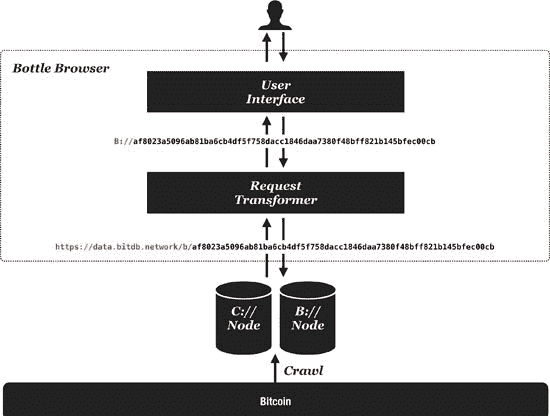

**图 8.4：** Bottle 浏览器接入 `B:\\` 端点节点以显示 URI。图像来源：[`bottle.bitdb.network`](https://bottle.bitdb.network)

`Bottle` 后端使用类似 `Bitquery` 的语法，通过 `B://` 或 `C://` 协议生成的 URI 指向后端查询比特币区块链，该后端可以使用 `planaria` 或任何其他方法构建，然后在浏览器界面上为用户提供服务。你只需在浏览器中编写带有协议标识符的 URI 即可访问该内容。它由 Electron [`electronjs.org`](https://electronjs.org) 驱动，这使其具备了所有常规浏览器功能，此外它还可以浏览比特币区块链。

你可以在 [`github.com/interplanaria/bottle`](https://github.com/interplanaria/bottle) 了解更多信息。

# Bit 协议

`Bit` 协议被定义为“协议的协议”。在最后，讨论这一点是合适的，可以为我们迈出的第一步——使用 `Bitcom` 定义去中心化协议注册表画上句号。它并没有定义在相互关联的比特币原生文档和应用程序之间如何引用和处理协议。

`Bit` 提议解决这个问题。它关闭了如果我们仅仅继续通过注册密钥使用之前看到的协议时，所需的人为关注和干预的循环。在传统网络中，我们有 `IANA` [`www.iana.org/assignments/service-names-port-numbers/service-names-port-numbers.xml`](https://www.iana.org/assignments/service-names-port-numbers/service-names-port-numbers.xml)，它对命名空间冲突进行集中化的监控、注册和监控。`Bit` 是一个类似的系统，消除了对监控和任何命名空间冲突可能性的需求。

我说的命名空间冲突是指，如果我获取了 `B` 协议注册 ID（即 `19HxigV4QyBv3tHpQVcUEQyq1pzZVdoAut`）并将其用于我的社交媒体聊天应用程序，会怎样？我们如何确保这些前缀被用于它们的预期用途？这是通过 `Bit` 协议实现的。

`Bit` 协议通过解决以下 3 部分来解决这个问题：

*   **通用 URI 方案：** 一新的 URI 方案，可以自定义引用比特币区块链上的任何应用协议对象。
*   **去中心化路由器：** 一个去中心化的路由引擎，使用 `Bitcom` 将通用 URI 方案映射到实现每个协议的真实世界服务提供者。
*   **身份验证：** 使用 `Bitcoin Sticker` 协议的双向机制将服务端点连接到路由器，具有可证明的所有权和所属关系。

#### 架构：

```
bit://[B: Bitcom Address]/[Transaction ID]
```

`//（方案，bit，权限机构：bitcom 地址以及资源路径，事务 ID。`

所以，对于我们示例中来自 `b` 协议的图像，该图像的 `bit` URI 将是：

`bit://19HxigV4QyBv3tHpQVcUEQyq1pzZVdoAut`

#### 总结

我们在本章中看到了许多协议。这背后的原因是比特币作为一个原生层工作，提供了一种数据存储和价值交换的方法。我们在本章中讨论的这些协议是建立比特币协议之上的系统约定，由于它们是开源且去中心化的，它们将一直有效。安全性和审计性提供了稳定的可验证信息单一来源。

到目前为止查看了一系列协议，其中 `metanet` 是是最通用的协议，它不仅支持其图谱，还允许多种协议结合使用，提供了在比特币区块链上完成所需的所有功能。

在下一章中，我们将查看如何以更有组织的方式访问数据，而不是目前看到的大量十六进制数字。从现在开始，我们将提供更多与本章讨论的协议配合的数据结构模型，以便在比特币区块链上进行读写操作。

# 问题

1. 你可以同时使用 `metanet` 协议和 `b` 协议吗？使用 `b` 协议上传的文件也是 `metanet` 有效的吗？
2. 像 `Bitcom` 这样的集中注册系统的目的是什么？
3. `C` 协议和 `D` 协议的区别是什么？什么是支付通道？
4. 为什么使用位协议进行引用可以消除维护中央权威以解决协议 URI 链接命名空间冲突的问题？

# 数据载体交易：比特币作为无限数据库

“一个好的主意是一个能够同时解决几个问题的主意。”

- Linus Torvalds，Linux 的创建者。

在上一章中，我们查看了各种协议，让你了解了我们如何使用区块链作为数据存储器进行基本操作。在本章中，我们将为存储在区块链中的数据引入更正式的结构。这是通过定义一个模式（schema）来实现，我们将使用它来读写区块链。我们将创建数据库结构，定义并学习一种查询语言，并将重点放在目前为止所学工具的用例。我们还将关注如何使用这些工具来实现创新的、无服务的比特币应用程序，其中区块链被用于存储特定的应用程序数据，包括但不限于存储视频、音频和任何其他文件。

#### 结构

* 比特币上的 BitDB 数据库结构
* BitQuery、索引器（Indexer）和爬虫（Crawler）
* Euler, Babel, Chronos, Genesis 以及 neonGenesis
* Datapay, BitPipe, BitIndex, Bitsocket 以及其他实用程序

#### 目标

学习本章后，你将能够使用区块链作为存储媒体为应用程序构建数据库模式，访问并搜索存储在数据库中的数据，使用比特币区块链作为访问数据的 API，以及针对比特币区块链的 SQL 类型查询语言。

#### 比特币上的数据

今天的比特币更多地被视为钱、货币或支付。这只是其中一个用例，忽略了比特币剩余的完整设计。比特币从一开始就允许交易中包含数据。通过比特币，一个存储数据的新世界被开启了，而且它从设计之初就存在。特定的操作码（opcodes）用于将数据推送到区块链。让我们来看看这些代码是什么：

| 名称 | 支持的最大数据 | 说明 |
| --- | --- | --- |
| `OP_PUSHDATA1` | 255 Bytes | 下一个字节包含要推入栈的字节数。 |


| `OP_PUSHDATA2` | 65k | 下两个字节以小端序包含要推入栈的字节数。 |
| `OP_PUSHDATA4` | 4.3 GB | 下四个字节包含要推入栈的字节数 |

**表 9.1：** 允许在比特币区块链交易中推入并存储数据的操作码。

随之产生的问题是，既然存在这些操作码，为什么我们现在不能使用它们？答案再次在于历史。如果你还记得，比特币后来被增加了一些限制，有两个硬性限制：

1. 仅限标准交易。这使得比特币脚本中存在的大多数操作失效，包括上述的 `PUSHDATA` 操作码。
2. `OP_RETURN` 的软限制，矿工在很长一段时间内允许 23 字节的数据（在不同时间也曾是 40 和 83 字节）。在早期阶段作为标准脚本是不允许的，但后来当人们开始通过燃烧比特币来存储哈希和文本消息，以代替输出脚本中的公钥哈希时，它变成了一个标准脚本。然而，增加了一个限制来限制数据大小，在 2018 年 BSV 出现时，该限制增加到了 100kb。

你可以看到，某个功能在某种程度上被当成了一个 bug 并被抑制了，理由是认为比特币区块链并不是为了存储任意数据，但对于任何一个观察过脚本操作码原始设计的人来说，事实并非如此。即使受到限制，用户也发现了新颖的方法来编码小尺寸数据和消息，例如使用伪造的多签名公钥，并利用该字节存储空间传递消息，有时甚至以输出脚本包含伪造公钥而永久燃烧比特币为代价。2017 年的一项研究发现，自网络启动以来，约有 250 个比特币被用于存储约 9 MB 的数据。标准比特币交易的大小被限制为 100KB，每个输入脚本限制为 1650 字节。

一旦脚本执行，它必须恰好一个非假元素才能成功执行（记住，比特币脚本是一个谓词）。任何推入栈的单个元素都限制为 520 字节。这些限制都可以在 Satoshi 离开后后来添加到比特币代码中的 `IsStandard()` 函数中找到。该限制在创世升级后被移除，这开放了区块链支持大数据的上传。目前的矿工价格为每字节 0.5 Satoshi，这是目前在区块链上上传数据的费率。矿工已经在考虑针对客户的批量交易处理中提供每字节 0.25 Satoshi 的价格。预计这些费用将进一步大幅下降，随着矿工专业化并成为寻找更好业务模式的交易处理器，存储将变得更加廉价。

无需说，这就是为什么我们不会详细介绍绕过 `IsStandard()` 函数限制的各种数据插入方法（其中一种方法是使用 `OP_RETURN`，它变成并仍然是添加协议标识符、文件等的默认方法。随着 `PUSHDATA` 操作码的开放，可以在单次交易中存储高达 4.3 GB 的数据，使比特币区块链也能与传统的云服务竞争）。

更仔细地观察使用 `OP_RETURN` 的比特币脚本数据存储，让我们看看比特币脚本执行的细节。如果说比特币脚本的生命周期，有两个阶段：

1. 阶段 1 是创建时。当你进行交易时，你花费你的 UTXO 并在交易的 `ScriptPubKey` 脚本或输出或锁定脚本中提供公钥。这是存储在比特币区块链中的脚本的创建。
2. 阶段 2 是脚本被花费时。花费转移到脚本公钥的 UTXO 或硬币，是在 UTXO 作为货币或价值交换被花费时完成的。这是输出脚本与输入脚本（解锁脚本，或 `ScriptSig`）结合并花费的时候。一旦输出 UTXO 被花费，该脚本就失去了意义。

通常当你使用 `OP_RETURN` 时，它的作用是告知之后不需要任何处理。这意味着 `OP_RETURN` 会导致脚本失败。如果你还记得第 5 章：交易和交易脚本，为了花费任何 UTXO，脚本验证需要为真，这样才能解锁锁定脚本并将 UTXO 转移给下一个所有者。使用 `OP_RETURN` 时，脚本会立即失败。如果你回想起来，脚本是一个谓词，所以它总是返回真或假。如果运行的脚本成功完成，则返回真；如果脚本运行失败，则返回假。

这最有趣的部分是，比特币没有其他代码对脚本进行任何类型的验证。因此，从字面上说，当脚本因 `OP_RETURN` 失败时，脚本之后添加任何数据将永远留在那里，不会被矿工查看。即使在矿工验证带有 `OP_RETURN` 的交易时，脚本长度的限制（最大大小为 520 字节）也不会被检查。参考：比特币代码仓库：

[`github.com/bitcoin-sv/bitcoin-sv/blob/master/src/script/script.h`](https://github.com/bitcoin-sv/bitcoin-sv/blob/master/src/script/script.h)

为了更清楚地解释这一点，让我们来看一个包含 `OP_RETURN` 和若干字节消息的交易输出，这样我们就能理解它是工作的：

```json
{
  "value" : 0.00000000,
  "n" : 0,
  "scriptPubKey" : {
    "asm" : "OP_RETURN 636361726c6579206c6f76657320",
    "hex" : "6a12636361726c6579206c6f76657320",
    "type" : "nulldata"
  }
}
```

在上面的快照中，我们有一个 `OP_RETURN`，其后的几个字节就是我们在脚本中在 `OP_RETURN` 之后添加的数据。`OP_RETURN` 的十六进制值为 `0x6a`，紧随其后的字节代表数据的长度，因此 `0x12` = `18` 字节。然后存储的就是这 `12` 字节的数据。

这是一个简化版本，正如你想象的，当你存储 `100kb` 数据时，它将是一个巨大的十六进制字符串和脚本，不便在此展示。如果你想看看它们是什么样的，可以在 `whatsonchain.com` 上找到很多交易。示例为：[`whatsonchain.com/tx/ffe19e5da1f54735c5981cc8a25dc5bb349f2d3575d3f0f23a3df9fb67ae62b5`](https://whatsonchain.com/tx/ffe19e5da1f54735c5981cc8a25dc5bb349f2d3575d3f0f23a3df9fb67ae62b5)

`PUSHDATA` 的详细用法可以在 Bitcoin SV GitHub 页面找到：

[`github.com/bitcoin-sv-specs/op_return/blob/master/01-PUSHDATA-data-element-framing.md`](https://github.com/bitcoin-sv-specs/op_return/blob/master/01-PUSHDATA-data-element-framing.md)

Bitcoin 代码库原始的设计并不需要 `OP_RETURN` 来向区块链添加数据。`PUSHDATA` 操作码才是被设计用于在区块链上存储数据的，而 `PUSHDATA4` 可以在单笔交易中存储约 `4.3 GB` 的数据。如果我们只看下面示例所示的脚本：

```
48656c6c6f20776f726c6421 OP_DROP OP_DUP OP_HASH160 4cd91d791372e0b0660kre34e8dd84fc65c2c123 OP_EQUALVERIFY OP_CHECKSIG
```

上面的脚本将一个字节流 `48656c6c6f20776f726c6421`（"hello world!"）推入栈，然后 `OP_DROP` 将移除该字节流，剩下的脚本只是我们之前看过的标准验证脚本。这是存储字节流的一种方法，但受最大脚本长度的限制；为了存储多于此的内容，我们使用之前讨论过的 `PUSHDATA` 编码。

`PUSHDATA` 的用法如下文示例所示，其中我们正在使用上一章中看到的 `B` 协议存储一张图片：

```
OP_PUSHDATA4 B_PROTOCOL_DATA OP_DROP OP_DUP OP_HASH160 4cd91d791372e0b0660kre34e8dd84fc65c2c123 OP_EQUALVERIFY OP_CHECKSIG
```

这里与使用 `OP_RETURN` 的另一个区别是，这里的输出 UTXO 是可以花费的，以确保交易不会被矿工剪枝（pruned）。这需要更多的解释才能理解比特币协议是如何工作的。这同时也解决了关于如果全球金融甚至猫咪图片数据存储在区块链上，比特币区块链将会变得多大的担忧。它还揭穿了“任何存储在区块链上的数据都将永远存在”这一迷思。比特币白皮书第 7 节对此进行了非常详尽的解释。关于这一想法的更多细节记录在以下优秀的博客文章中，地址如下：

[`blog.bsv.sh/the-prunability-and-non-permanency-of-your-data-the-case-of-op_return/`](https://blog.bsv.sh/the-prunability-and-non-permanency-of-your-data-the-case-of-op_return/)
[`medium.com/@jolon/issues-surrounding-bsv-data-permanence-and-proposed-solution-4f0f904ae5a8`](https://medium.com/@jolon/issues-surrounding-bsv-data-permanence-and-proposed-solution-4f0f904ae5a8)

图 9.1 中的快照展示了白皮书描述的从区块链上剪枝交易数据的方法以及如何在保持 Merkle 树和路径完整的同时进行管理，从而从存储区块链的节点中移除交易数据。

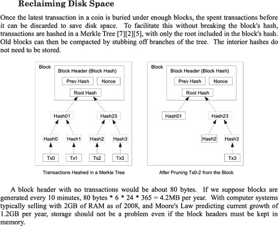

**图 9.1:** 交易数据的剪枝并用哈希值替换

这一概念为矿工提供了一种方法，根据法律要求或矿工偏好，能够删除区块链交易中存储的数据。

爬虫（Crawler）会按时爬取比特币区块链（比特币是一个时间戳服务器）。就像你搜索网页一样，它会遍历可用的网页链接，然后根据内部算法优先级对这些链接进行索引，以按照用户所愿的方式显示结果；在比特币中，爬取将通过逐个区块地进行，以索引用户请求的数据。就像搜索引擎根据关键词索引网页以创建搜索索引一样，BitDB 也会索引结构化数据（比特币交易）以创建知识索引。

### 索引器 (Indexer)

BitDB 索引将取爬虫识别的原始比特币交易，然后将其转换为结构化数据格式。这使得将数据存储到数据库中并进行查询成为可能。

结构化原始比特币交易的步骤如下所示：

1. **步骤 1**。原始交易：

```
0100000001b08acdbdad97ad6670c83cee6794bfbd1e9bb1220b9e6b3116b754 bca2459 326010000006a47304402201c6039241540945c8c65f3d3ba116dd7 b77ea2ca8 9afac33 ef49a8bfa66dafef022035f906ffc1a12613cab7ee1 ec9443674f594039c09fc e6e59b4 f1781e18086f8412103d6d364d 316 6682 1548044723f6a8b 15f43e6c7dc5edcc 2fc3cf 7831b3e81095cffffffff020000000000000000176a026d0212706f737 420746 f206d65 6d6f2e636173682108420000000 00000197 6a91419b26abab87de1a5d07d34a1 2f232f5 b75c7caf188ac00000000
```

2. **步骤 2**：反序列化原始交易：

```
#### INPUT:
71 0x304402201c6039241540945c8c65f3d3ba116dd7b77ea2ca89af ac33ef49a8bfa 66dafef022035f906ffc1a12613cab7ee1ec944 3674f594039c09fce e59b4f1781e18086f841330x03d6d364d31666 821548044723f6a8b15f43e6c7dc5edcc2fc3cf7831b3e 81095c

#### OUTPUT:
OP_RETURN 2 0x6d02 18 0x706f737420746f206d656d6f2e6361736821
OP_DUP OP_HASH160 20 0x19b26abab87de1a5d07d34a12f232f5b75c7caf1 OP_EQUALVERIFY OP_CHECKSIG
```

上述格式非常易读，但仍然无法以这种格式查询数据。这是通过在步骤 3 中提到的将上述数据转换为 JSON 类型格式来实现。

3. **步骤 3**：在这一步中，我们将为现有交易添加元数据，以便能够识别并标记交易中存在的字段，从而以后可以使用这些标签进行查询。这种重新格式化的交易将作为 MongoDB 文档形式存储在本地存储中，使其易于搜索。

用于此的文档结构作为下面的交易模板详细列出。元数据分为三个主要部分，分别对应区块信息、交易输入和输出信息：`blk.i`（区块索引）、`blk.h`（区块哈希）、`blk.t`（区块时间），如下述模板所示：

```json
{
  "tx": {
    "h": "[TRANSACTION HASH]"
  },
  "blk": {
    "i": "[BLOCK INDEX]",
    "h": "[BLOCK HASH]",
    "t": "[BLOCK TIME]"
  },
  "in": [
    "INPUT1",
    "INPUT2",
    "INPUT3",
    "…"
  ],
  "out": [
    "OUTPUT1",
    "OUTPUT2",
    "OUTPUT3",
    "…"
  ]
}
```

一旦交易按照上述模板元数据格式化，它将作为文档/行存储在 BitDB 中。读者可以参考以下链接进行进一步阅读和理解。

**BitDB: [`bitdb.network/`](https://bitdb.network/)**

**BitDB 索引器: [`docs.bitdb.network/docs/indexer`](https://docs.bitdb.network/docs/indexer) 和 [`bitdb.network/dashboard`](https://bitdb.network/dashboard)**

### Bitquery

这就是我们利用 BitDB 用处的地方。现在，你可以使用各种属性查询比特币区块链，而不仅仅是交易 ID 或 UTXO 地址（正如大多数区块浏览器器中所做的那样），而是使用交易的各种其他属性，包括交易中使用的协议，甚至是交易输入和输出中存在的各种其他字段。

（图 9.3）

上述格式非常易读，但仍然无法以这种格式查询数据。这是通过在步骤 3 中提到的将上述数据转换为 JSON 类型格式来实现。

Meta 是 BitDB 的另一个版本，它关注于区块的元数据，例如区块高度、区块难度、从区块链上挖出的第一个区块开始的时间戳。由于只存储了元数据，其访问速度非常快，并可用于根据区块属性以及 meta 添加的某些额外属性（如 `timeago` 和 `chainwork`）编写应用程序代码逻辑。

总而言之，对这些 BitDB 版本的讨论表明，在比特币区块链存在的数据之上构建自定义应用程序有非常多的工作要做，这使其成为一个通用的数据存储，并提供了一个可以超越任何行业顶尖企业级应用在安全性、可用性和可靠性方面的基础设施，而且这种基础设施供任何人使用。

尽管已经发布了升级版的 BitDB 版本，并包含了一系列新实用程序（如 `Planaria` (Neon, Grid)、BOB, MOM, Eventchain 等，我们将在下一章中讨论），但理解 BitDB 的概念以及使用 `Subquery` 至关重要，因为它是所有工具的基础。我们将涵盖 `bitquery` 关键理念的快照，但建议你进行一些实际操作并阅读 `bitquery` 文档以详细理解基础知识。更多细节请访问源网站：

[`medium.com/@_unwriter/meta-be3c18582ec7`](https://medium.com/@_unwriter/meta-be3c18582ec7)

## Bitsocket

Bitsocket 是一个强大的比特币区块链推送通知服务，可以被模糊地认为是比特币版本的 WebSocket，但它更进了一步，并提供了利用比特币区块链创建 `Server-sent events (SSE)` 的规则。它通过将比特币交易转换为事件，进而转换为推送通知来实现这一点。

它分三个步骤工作：步骤 1 是将比特币交易转换为结构（使用 `bitquery`）。然后，通过获取应用程序或用户定义的过滤器，它将根据该应用程序定义的标准创建事件（`application-specific custom query`）。这些事件可以是，例如，向特定比特币地址的新交易（当有新笔款项到达我的比特币地址时，我可以给自己发送一封电子邮件）。这些定义的定义的每个事件都将作为 `SSE` 推送到相应的应用程序（这使得服务器（在本例中为比特币区块链）能够随时通过向网页（你的应用程序）推送消息来发送新数据）。

Bitsocket 让你能够完全以自定义的方式监控实时比特币网络，这可以用于监控整个区块链，而不仅仅是任何特定的地址、交易或区块。示例所示：

```javascript
// Write a bitquery
var query = {
  "v": 3,
  "q": { "find": {} }
}
// Encode it in base64 format
var b64 = btoa(JSON.stringify(query))
// Subscribe
var bitsocket = new EventSource('https://genesis.bitdb.network/s/1FnauZ9aUH2Bex6JzdcV4eNX7oLSSEbxtN/'+b64)
// Event handler
bitsocket.onmessage = function(e) {
  console.log(e.data)
}
```


# Datapay 和 bitindex（读写数据）

让我们来看两个用于在区块链上读写数据的非常简单又强大的库。

## Datapay

Datapay 是一种向比特币区块链写入数据的方法。它为你提供了一种向区块链写入数据的非常简单的方法。它只需几行非常简单的代码即可向区块链写入 `OP_RETURN` 数据。它由我们在前面的章节中看到的名为 `bsv` 的库驱动。它是一个开源库，被 `moneybutton` 等公司以及大量开始构建应用程序作为学习在区块链上构建第一步的程序员使用。它非常易使用，并提供了一整套加密以及与创建和发送到 BSV 区块链交易相关的函数。

Datapay 与通常库不同，因为它侧重于发送数据而不是在交易中发送资金。它有两个方法：

*   `Build`：用于构建交易
*   `Send`：用于发送使用 build 构建的交易

有关如何构建和发送交易的细节以及代码示例可以在 [`github.com/unwriter/datapay`](https://github.com/unwriter/datapay) 处找到。

Bitchat 是一种使用 `OP_RETURN` 数据的多人去中心化实时聊天工具，由 `BitDB`、`Bitsocket` 和 `Bitpipe` 驱动，并构建在 BSV 区块链上。详情和代码可以在 GitHub 仓库 [`github.com/unwriter/bitchat`](https://github.com/unwriter/bitchat) 中找到。使用 `bitpipe` 构建利用了未签名交易的使用，这些交易由聊天的用户广播，但由他人（或使用社区资助钱包等）付费。

## Bitfs

`bitfs` 是一个比特币文件系统，它爬取比特币区块链以查找并存储所有大于 `512` 字节的 bitcoin script pushdata 块。这是一个使用比特币区块链构建的自治文件系统，其关键区别在于它专注于存储在区块链上的大于 512 字节的基于 pushdata 的数据。

关于 `bitfs` 如何工作的详情，请见以下链接，以及 `bitfs` 实时读取并显示的实际结果：

- [`view.bitfs.network`](https://view.bitfs.network)
- [`bitfs.network/about`](https://bitfs.network/about)

### Toychain

`Toychain` 是一个针对比特币（交易）的分布式版本控制系统。从字面上说，它为单个交易提供版本控制系统，其工作原理与 `Git` 对代码仓库的工作非常相似，不同在于它针对的是比特币：

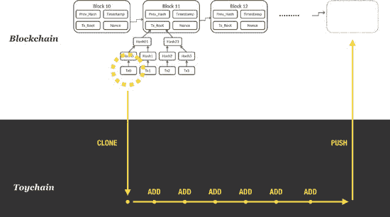

**图 9.4：** Toychain 的比特币交易分支，其工作原理与 Git 对代码库的工作相似。图片来源：[`toychain.network/#/?id=toychain`](https://toychain.network/#/?id=toychain)

因此，你可以获取单个交易并对其克隆，在其上方继续添加更多交易，以根据应用程序需要构建交易图，然后在准备好后推送最终交易。关于该工具非常详尽的文档和示例/用法，可以在作者的网站找到：[`toychain.network/`](https://toychain.network/)。

# 结论

我们看到了在 BSV 区块链上完成的一系列第一代应用。有了 `BitDB`、`datapay`、`bitindex` 等工具，大量开发者开始构建并使用这些协议来构建真实世界的应用，但由于这些是最早的尝试，随着时间的推移，它们大多数已经演变为更复杂的应用程序/协议。你会发现，上述大多数 GitHub 仓库都会有一条注释，提到它们正在被弃用并被新版本取代。

仍然回顾这些初始尝试的意图是为了理解比特币上应用开发的基本概念和演变。这进一步反映了在区块链上可以构建的广泛特性和功能范围，只剩下想象力和行动是开发者或组织需要带来并构建的剩余元素。

在下一章中，我们将查看这些应用的下一个版本以及用于构建企业级应用的大量工具集。

# 问题

1. 使用 `OP_RETURN` 的区别是什么？
2. `OP_RETURN` 和 `PUSHDATA` 是如何工作的？
3. 为什么 `UTXO` 有帮助？
4. 什么是 `bitpipe`？

# 第 10 章：这些应用的下一个版本

“Planaria 可以产生在区块链上的简单程序。”

## 结构

- Planaria, bitbus
- Planaria, grid
- Planaria, MOM, off-chain

## 目标

学习本章后，你将能够如何将比特币作为后端。

## Planaria 框架

`BitDB`、`container` 的初始想法帮助你构建自己的。`Planaria` 是一个帮助你实现它的框架。它帮助你构建状态机。

等等，我的意思是 `Planaria` 是：

- `Bitcoin`
- `Planaria`
- `client-server`
- `on-chain`
- `off-chain`
- `on-chain`
- `event`
- 由 `Unwriter` 构建

`Planaria` 可以被认为是一个无限的 API，相当于比特币版的 `Ruby on Rails`、`Django`、`Laravel`、`Spring` 等框架。

使用这个框架仍然是可选的，但它提供了 100% 的比特币。（当你构建应用时，你将会运行自己的第三方依赖项）。

## 基本概念

正如你所注意到的，在章节 II 和最后几章中，我们越来越不再将比特币视为钱，而是将其视为具有一组能力的网络。通过 Planaria，我们更进一步，将比特币看作是一个无限电机，它（基于其算法）通过在时间中导航来捕获交易。

引用 Unwriter 的话：

> “比特币 == 电机
>
> 我们可以思考如何构建一个带有电机的机器。但首先，机器到底是什么？
>
> 机器是一个函数。机器将电机作为恒定的能量源，并将能量转换为人类或其他机器消耗的各种形式。
>
> 机器 = F(Motor)
>
> 你可以从一个可靠的电机创建无限数量的机器。”

状态机可以是`有限状态机 (FSM)`，也可以是无限状态机，这取决于机器的设计。通常，大多数现实世界的应用都被设计为 FSM，因为它们在任何给定时刻都恰好处于一个有限状态中。*[图 10.1]* 展示了一个通用的状态机以及组件之间各种交互的流程。可以使用 `Planaria` 和 `Bitcoin` 构建这个完整的系统：


**图 10.1：** 通用状态机及其组件，来源：[`docs.planaria.network/#/intro`](https://docs.planaria.network/#/intro)

* **输入**：一个监听来自 `Bitcoin` 自身的实时事件/状态的事件监听器。
* **状态转换逻辑**：使用 `CRUD` 操作 API 处理状态变化的程序。
* **状态内存**：一个用于持久化状态属性和更新的内存。
* **输出逻辑**：一个事件生产者，为其他模块和 SSE 发布自定义的可编程事件。

红绿灯系统可以被视为 FSM 的一个示例。它包含三个灯泡，根据当前状态显示红、绿、黄，每个状态都依赖于上一个状态，并遵循由事件或时钟输入触发严格状态变更序列。

## Planaria 实现

`Planaria` 用简单的 `JavaScript` 代码实现了上述讨论的所有概念，并由 `Bitcoin` 驱动。`Planaria` 是一个用于有效构建自有 `BitDB` 的框架（`Genesis`、`Babel`、`Chronos` 和 `Meta` 是自定义的 `planaria` 节点），从技术上讲 `planaria` 是一个容器化的 `MongoDB` 实例。它还提供了强大的 `CRUD` API，使用 `Bitcoin` 事件作为输入并将状态存储在 `MongoDB` 中。上述讨论的所有组件都在 `planaria` 框架中通过 `Bitcoin` 实现，并为这些操作（输入、转换逻辑、状态存储和输出逻辑）提供了各种 API，如*[图 10.2]*所示：


**图 10.2：** 用于各种状态机组件的 Planaria API。来源：[`docs.planaria.network/#/intro`](https://docs.planaria.network/#/intro)

你可以看到 `planaria` 提供了一套完整的 API，可以将 `bitcoin` 作为任何应用程序的数据存储。这并不是全部，`planaria` 还有其他功能可以帮助你为应用程序构建全规模的后端，我们将进一步讨论。代码级细节请此链接：

[`docs.planaria.network/#/api?id=anatomy-of-a-planaria`](https://docs.planaria.network/#/api?id=anatomy-of-a-planaria)

`Planaria` 拥有以下可以构建的 APIset：

* **属性**：当你构建 `planaria` 节点时，你将定义用于存储的数据的各种属性，并可以根据这些属性构建 API 来为你的数据服务。
* **事件处理器**：你可以构建监听事件的 API（这些事件通常是会引起用 `planaria` 构建的 `FSM` 发生状态变化的新交易）。
* **状态 API**：状态 `CRUD` API。
* **发布 API**：用于发布事件的输出 API。

创建该框架的 `Unwriter` 为其他用户提供了许多运行基于该框架的节点的说明，就像我们在上一章中看到的一些 `BitDB` 节点（`Genesis`、`Chronos`、`Babel` 和 `Meta`）。同样，他还提供了一些其他基于 `planaria` 框架构建的节点，例如 `Neon Genesis`，可以通过下述链接进行进一步探索：

- [`medium.com/@_unwriter/neon-genesis-387fd2f122de`](https://medium.com/@_unwriter/neon-genesis-387fd2f122de)
- [`neongenesis.bitdb.network/`](https://neongenesis.bitdb.network/)

## Planaria 文件系统

我们已经讨论过 `planaria` 提供了一个用于写入的 API，该属性可以进一步扩展为通过将数据写入区块链来存储文件。实现的细节请见此链接：

[`docs.planaria.network/#/api?id=_5-file-serve-api`](https://docs.planaria.network/#/api?id=_5-file-serve-api)

该属性可用于创建一个文件服务 API，该 API 也可以写入静态文件。`Unwriter` 通过创建一个区块链版本的 `Instagram`（称为 `bitstagram`）演示了这一点，它在存储图像和提供类似 Instagram 的图像时间线方面变得非常流行。

- [`bitstagram.bitdb.network/`](https://bitstagram.bitdb.network/)
- [`planaria.network/@1BvwDoz6DR9qU`](https://planaria.network/@1BvwDoz6DR99qU)

## 区块链上的版本控制系统

能够将文件存储在区块链上提供了一系列全新的用例，其中一个用例就是区块链上类似于 `Git` 的版本控制系统。如果你使用过 `Git`/`GitHub`，它们已成为开发者最流行且默认的版本控制工具，而现在这可以在区块链上构建。

一旦有了文件系统，应用程序就有许多用例，包括使用该系统进行私有文件存储、使用比特币进行机器学习模型训练以及 3D 打印模型文件等。

## Neon Planaria

Neon planaria 是 `planaria` 的当前版本，与我们目前讨论的相同，只是它是最终的基础版本，消除了初始 `planaria` 构建后端的局限性。让我们从构建的角度重新查看该框架。该框架有两个主要组件：

* **Planaria**：这组函数用于创建你的 planaria 状态机。`Planaria` 与区块链实时同步。这一过程（使用事件监听来记录新交易）根据其创建的标准保持状态机的更新。你还将相关交易转换为所需的格式并存储，以便后续访问。
* **Planarium**：该组件提供一组函数，用于从生成的 `Planaria` 状态机创建 API 端点。`Planarium` 提供了一个浏览器和一个 API 端点，并内置了设计类似于 `Bitquery` 的 JSON 查询语言的约定。

*[图 10.3]* 展示了使用 `planaria`/`Bitcoin` 区块链应用程序的高级交互设置：


**图 10.3：** 比特币区块链 - Planaria - 应用程序连接

在上述图中，`f()` 是为特定应用程序指定数据过滤的函数，`p` 是作为应用程序后端的 neon planaria 节点。

## Bitbus

在传统的应用程序架构中，创建后端基础设施一直被认为是一项非常专业且困难的任务，这导致了无服务器计算的整个理念，其中 `IaaS` 提供商占据了主导地位，并加速了应用程序的开发。

Bitbus 是比特币上的同一种理念实现。Bitbus 对于比特币而言是 `serverless`（无服务器的），换句话说，它是 `bitcoinless` 应用开发。它消除了应用开发者为自己的应用运行全节点的需求。

### 引用 Unwriter

> “Bitbus 是一个简单的单向比特币同步服务，它允许你将整个区块链的过滤版本实时复制到本地机器。不需要运行和管理你自己的比特币节点。也不需要存储整个区块链。通过 Bitbus，你可以”
>
> *   通过查询语言（`Bitquery`）**仅**过滤并同步你感兴趣的区块链部分。
> *   将它们缓存为文件。
> *   从缓存中构建你的比特币后端。
>
> 所有这一切都可以在不运行全比特币节点的情况下完成。它还带有一个即时的 HTTP 端点和一个浏览器（explorer），用于显示你“即时区块链”中所有的本地同步数据。Bitbus 后端由多个模块组成，其中一个是 `Planaria` 节点。具体来说，它由自定义的 `Neon Genesis` 实例支持。”

基础版本中的 `bitbus` 过滤器使用以下格式：

```json
{
  "bitbus": 1,
  "name": "<YOUR BITBUS NAME>",
  "host": {
    "bitbus": "<BITBUS ENDPOINT>"
  },
  "from": "<BLOCK HEIGHT TO SYNC FROM>",
  "q": "<BITQUERY>"
}
```

图 10.4 显示了高层面的概念。使用 `bitquery` 爬取功能，你可以爬取比特币区块链以仅获取识别出的特定应用数据块，并在经过自定义的应用特定查询过滤器后，按要求存储其块数据，从而消除了存储区块链中除应用所需之外任何其他数据的需要：


**图 10.4：** Bitbus 作为极简数据过滤器，为 `neon planaria` 提供数据，并为使用比特币作为后端的应用创建无服务器基础设施。

一旦你准备好了 `bitbus` 设置，就可以在 `bitbus` 之上构建你的 `planaria` 节点。它也可以根据需要作为一个完整的自定义数据存储，不限于使用 `MongoDB`，而是可以是任何类型的数据存储，例如使用关系型数据库（如 `PostgreSQL`、`MySQL`、`Oracle` 等）或 NoSQL 数据库（如 `Hbase` 或 `Casandra` 等）。一旦设置了应用数据存储（使用 `planaria`），你就可以使用 `planaria` 的数据访问 API (`CRUD`) 以及应用程序后端所需的所有类型 API。

`Bitbus` 的实现细节可以在此处找到：

[`bitbus.network/docs#/?id=programmatic-usage`](https://bitbus.network/docs#/?id=programmatic-usage)

## Neon Planaria 与作为磁带的比特币

当 `planaria` 限制被移除后，出现了更大的用例，其中之一在概念上是将比特币视为图灵机中的磁带（tape）。

要了解更多关于图灵机和磁带的细节，可以参考下述链接：

- [`www.cs.odu.edu/~toida/nerzic/390teched/tm/othertms.html`](https://www.cs.odu.edu/~toida/nerzic/390teched/tm/othertms.html)
- [`mathworld.wolfram.com/TuringMachine.html`](http://mathworld.wolfram.com/TuringMachine.html)


将比特币作为磁带的数据存储抽象类似于理论图灵机概念，该概念使用磁带执行任务，不同之处比特币像一条永不停的磁带，只向前移动，并每隔 10 分钟左右通过名为工作量证明（`proof of work`）的方法增长一次。`Bitbus` 创建了一个子集磁带，但带有一个不断与比特币区块链同步的头，反之，`planaria` 是进一步的子集磁带，与 `bitbus` 磁带同步。当然，子集部分取决于你定义的从比特币区块链中选择数据的过滤器。这种结构的一个用处是，即使你的 `Bitbus` 或 `planaria` 崩溃，它也可以随时恢复，因为比特币磁带是永远不会崩溃或不可用的。它为你的应用程序基础设施提供了 24/7 的可用性和非常容易的灾难恢复能力。同样，如果你的部分数据损坏了，你所做的就是回溯 `planaria/bitbus` 磁带以与区块链重新同步，你的应用程序就会完全恢复并在崩溃等事件发生后正常运行。

使用磁带类抽象的好处是，你可以为你的应用构建多个不同的 `planaria` 磁带，它们可以使用相同的公共 `bitbus` 磁带进行交互，对你的应用交易进行初始过滤，甚至可以不使用 `bitbus`，直接在比特币区块链上构建多个运行的 `planaria` 节点。

可以通过以下链接阅读使用 `bitbus` 设置 `planaria` 系统和其他细节：

[`planaria.network/#/?id=syntax`](https://planaria.network/#/?id=syntax)

需要注意的是，到目前为止讨论的这些框架在从零开始构建应用程序时非常类似于 `GCP` 或 `AWS` 等云托管服务（某些点是免费的，某些点需要付费）。

使用 `planaria` 框架可用的一个关键点（key point）的节点实现被称为 `neon genesis`，你可以在此处找到更多细节：

[`planaria.network/@1HcBPz2Fu7D1`](https://planaria.network/@1HcBPz2Fu7D1)

### 比特币 Op_RETURN 字节码 BOB

比特币交易以字节形式存储，从 `BitDB` 到 `neon Planaria`，通用方法是将交易反序列化为称为 `TXO` 的 JSON 类格式。

`Bob` 是另一种格式化交易的方式，它采用了磁带比喻，将 `OP_RETURN` 数据视为过程调用。在理解它的含义之前，让我们看看基础知识。

#### TXO

正如我们在上一章讨论 `BitDB` 和 `BitQuery` 时看到的，所采用的方法是将交易中的字节字符串转换为 JSON 类格式。这种方法实际上是为交易中存在的每个字节添加了标签，因此可以说这是一种反序列化交易数据并对其进行结构化以转换为文档格式的方法。

`TXO` 的详细理解和格式可以查看以下 GitHub 链接：

[`github.com/interplanaria/txo`](https://github.com/interplanaria/txo)

在高层面上，交易被转换为如下所示的格式：

**交易：** `{ Tx {}, Blk{}, in{}, Out{} }`

**脚本：** `in` 包含输入脚本

`out` 包含输出脚本

**图：** 输入和输出脚本通过数组表示，并带有一个名为 `e`（“边”）的属性，它包含了每个交易的图结构，类似于元网络（metanet）中使用的边概念。

**in.e：** 或“入边”是上一个关联交易。`in` 包含 1-n 个输入脚本

**out.e：** “出边”是下一个关联交易。`out` 包含 1-n 个输出脚本

*   `b0, b1, b2, … and lb0, lb1, lb2, …`: 每个 push data 的 base64 编码表示。`b` 变量用于正常情况，当 pushdata 大小超过 512 字节时使用 `lb`。有两条规则：

    *   如果 push data 是 opcode（操作码），它以 JSON 对象的形式存储，包含一个键 `"op"`，其值对应于比特币操作码（比特币操作码表）——（例如：`{ "b0": { "op": 106 } }` 是 `OP_RETURN` 操作码）。

    *   如果 push data 不是操作码，它以 base64 编码字符串的形式存储。

*   `s0, s1, s2, … and ls0, ls1, ls2, …`: 每个 push data 的 UTF8 编码表示。`s` 变量用于正常情况，当 pushdata 大小超过 512 字节时使用 `ls`。用于全文搜索以及简单的字符串匹配。仅当 push data 不是 opcode 时才存储。

*   `str`: 脚本的完整字符串表示。

*   `e`:（针对输入）代表“图边”（graph edge）。一个指向当前交易的上一个输出的数组。

    *   `h`: 包含该先前输出的交易哈希值。

    *   `i`: 该输出在其交易输出集中的索引。

    *   `a`: 发送者地址（如果可以解析为地址）。

*   `e`:（针对输出）代表“图边”（graph edge）。一个包含当前交易所有输出输出的数组。更多信息见下一节。

    *   `v`: 发送的 satoshi 数量。

    *   `i`: 交易中的输出索引。

    *   `a`: 如果输出链接到地址，则为接收者地址

要了解更多关于 `large`（大）表示法的知识，可以参考 Unriter 关于此主题的文章：[`medium.com/@_unwriter/l-is-for-large-6e632280c5e3`](https://medium.com/@_unwriter/l-is-for-large-6e632280c5e3)

正如我们在 第 8 章：Bitcom 及其他应用协议 中看到的，Bitcom 和 Bitcom 管道通常会引入协议标识符。为了能够使用这些协议标识符对交易进行查询和过滤，需要设计一种原生支持 Bitcom Unix 管道的新格式，包括使用动态长度管道的情况（例如 `MAP` 协议本身具有可变数量的参数）。下面是一个示例，该示例使用了 Unix 管道结合在一起的 `B://`、`MAP` 和 `API` 协议，用于 `OP_RETURN`：


**图 10.6:** 带有多个协议的交易 OP_RETURN 示例

BOB 的创建正是为了实现这一点。它提供了一种数据结构模式，能够对 `OP_RETURN` 进行结构化并标记多个协议身份标识。

#### 介绍 BOB

BOB 或比特币 `OP_RETURN` 字节码是一种模式，它将 `OP_RETURN` 输出视为数据，而是以位置排序的方式视为过程调用，即：第一个 pushdata 是过程名，后续的 pushdata 是该过程的参数。

一个典型的过程看起来像 `Procedure_name (parameter 1, parameter 2, …).`。要在 `OP_RETURN` 上实现这一点，我们回到之前讨论过的磁带（tape）概念，但这次不是将区块链或 bitbus 将交易视为一个磁带单元，而是将 `OP_RETURN` 中的每个参数用作磁带的一个单元，如下图所示：


**图 10.7:** 磁带通常用于构建抽象计算机

在模型模型中，我们将单元格作为单个计算单元，而磁带提供了该抽象计算机将执行的一系列计算。类似，如果我们认为输出和输入脚本是磁带，并将每个单元视为一个协议的单个计算，那么图 10.6 中的脚本现在包含了 4 个单元格，如下方的图 10.8 所示：


**图 10.8:** 作为磁带的输出脚本

上面的每个单元格代表一个过程调用，因此基本上使用上述基于 Bitcom 协议的比特币地址（19HxigV4QyBv3tHpQVcUEQyq1pzZVdoAut = B:\\ 协议比特币标识符）告知使用的是哪种过程（协议），而该协议使用的 pushdata 可以表示为该过程所取的参数。这就是 BOB 的结构或格式。它以“磁带+单元”的格式存储比特币交易，如下：

```
tape := [
{
  cell: [
   {op:0,ops:"OP_0","ii":0,"i":0},
   {op:106,ops:"OP_RETURN","ii":1,"i":1}
  ]
},
{
  cell: [
  {s:"19HxigV4QyBv3tHpQVcUEQyq1pzZVdoAut","ii":0,"i":0},
  {s:"1:19HxigV4QyBv3tHpQVcUEQyq1pzZVdoAut","ii":1,"i":1},
  {s:"19HxigV4QyBv3tHpQVcUEQyq1pzZVdoAut","ii":2,"i":2},
  {s:"19HxigV4QyBv3tHpQVcUEQyq1pzZVdoAut","ii":3,"i":3},
  {s:"19HxigV4QyBv3tHpQVcUEQyq1pzZVdoAut","ii":4,"i":4}
  ]
}
]
```

请注意，在进行查询时，BOB 和 MOM 都会忽略管道符号 `|`。MOM 是两者的结合：

- 数据结构：Metanet Planaria

- 数据模式（Schema）：BOB Planaria

这种应用结构方式使其能够同时使用 BOB 查询和 metanet 查询。为了支持 metanet 查询，Unwriter 还创建了一个 metanet planaria 版本，该版本支持 metanet 的图形结构，并支持遍历和查询 metanet 结构的子图。

Metanet 事务已经在 planaria 的 neon genesis 节点（创始节点）中可见，该节点是 genesis bitdb 节点的 neon planaria 版本实现。neon genesis 节点的特殊之处在于，它可以跨越区块遍历交易，并允许无论交易位于哪个区块中都能进行查询。它实现了一种所谓的交易“拓扑排序”（topological transaction ordering）。

让我们逐一来看这些概念，从 Neon Genesis 开始。

#### Neon Genesis

比特币世界中的时间流动与现实世界略有不同。我可以执行多笔交易，但只有当包含这些交易的区块被添加到区块链后，它们才会变得有效。这使得一个区块（或 10 分钟）成为比特币世界中的单一时间单位，而区块中发生的一切都可以被认为是同时发生的。这意味着区块中存在的所有交易的 Unix 时间戳都是相同的。但同样，这导致了这样的情况：每个准备候选区块的矿工对交易将有不同的时间戳，且区块内部交易的顺序也不同。Unwriter 使用“薛定谔的猫”的隐喻对此进行了极佳的解释：对于笔交易存在多个备选现实（存在于每个矿工的区块中），直到发生最终提交（final commit）——即区块被所有矿工达成一致并提交到区块链。此时，交易状态的最终性才会产生，并同时为该区块分配 Unix 时间戳。你可以在原作者的博客中阅读更多细节：[`medium.com/@_unwriter/neon-genesis-387fd2f122de`](https://medium.com/@_unwriter/neon-genesis-387fd2f122de)

neon genesis 的作用是它支持交易拓扑结构（transaction topology），这是一种相对时间线，并提供了一种使用这种相对时间线访问交易的方法。

引用 Unwriter 的话——

“到为止，按时间顺序排序的方法对各种 Planarian 节点中的交易有三种：

- 区块时间：Genesis、Babel 等中的 `blk.t`

- 区块高度：Genesis、Babel 等中的 `blk.i`

- 现实世界时间：Chronos 中的 `timestamp`

注意，`blk.t` 和 `timestamp` 是绝对时间，而 `blk.i` 是相对时间”

关于拓扑背后的概念的详细解释，以及它如何在交易和交易顺序之间建立因果关系，在上述链接中有详细说明，但问题的核心在于，当你以这种方式对交易进行排序并与其关联时间组件时，你现在可以使用索引 `(i)` 查询跨越区块的交易。这创建了一个排序后的交易列表，可以通过简单的跨区块查询来直接使用，而避免了单独处理区块索引和内部交易的需求。

这可以用于创建基于时间的社交媒体馈送、日志或任何需要基于时间线排序的应用功能。

#### Metanet Planaria

Metanet Planaria 正如其名，是一个运行在应用和比特币区块链之间的组件/节点，它始终与区块链同步，服务于所有 metanet 事务（Meta 协议交易）。Metanet 在在使用中包含两个部分：

1. 数据提供者

2. 用于验证数据真实性的 SPV（简单支付验证）。

[图 10.11] 直接取自作者网站（`nchain`）上的 metanet 演示文稿，该文稿从应用架构的角度描述了上述功能。

[`nchain.com/app/uploads/2019/06/The-Metanet-Coingeek-Toronto-29-05-2019.pdf`](https://nchain.com/app/uploads/2019/06/The-Metanet-Coingeek-Toronto-29-05-2019.pdf)


**图 10.11：** 作为应用云存储的 Metanet。来源 nChain(2019)

图中显示的数据库就是 metanet planaria 发作用的地方。它正是图中所示的数据存储。它做了两件事：

- 仅索引 Metanet：所有以 meta 为前缀的交易，不再包含其他内容。

- 图遍历：能够仅查询 Metanet 的子图。

这意味着当你简单地查询时，将从 metanet planaria 获取全局的 Metanet：

```json
{
"v": 3,
"q": {
"find": {}
}
}
```

并且由于 metanet 的领域隔离特性，可以使用 metanet 版本的 Bitquery 完成同样的操作，它允许不仅仅使用 meta 协议 ID，还可以通过下述语法遍历子图或子节点来搜索 metanet 事务。

它通过三个属性之一来选择节点：

- "a": 地址（address）

- "tx": 交易 ID（transaction_id）

- "id": `H(address||transaction_id)`

关于 metanet planaria 的更多细节可以在源链接中找到：[`medium.com/@_unwriter/the-metanet-starts-84f25a6782`](https://medium.com/@_unwriter/the-metanet-starts-84f25a6782)

有了这些背景，我们可以回到 MOM，它是支持 BOB 格式查询和事务模式的 metanet planaria。

BOB + Metanet = MOM

Bitcom 和 Metanet 的这种融合创造了无数可能的协议组合，为想象和创造留下了空间。所有这些具有图结构、身份和领域结构的 meta 协议属性，为新一代互联网应用的后端提供了完美的工具，其中父节点可以使用一组 bitcom 协议，而子节点可以使用另一种组合。

MOM 允许的另一个显著优点是多重继承，除了 BOB 的过程调用模式外，Bitcom 可以像你继承的模块一样工作。这类似于面向对象编程语言中协议（protocols）的概念。就像我们可以从类中实例化两个视图并在它们之间建立有意义的链接一样，我们可以使用 Bitcom 实例化数据对象并使用 Metanet 连接它们。它还允许你通过仅添加 meta 前缀（按照 metanet 规范）来迁移现有应用，并不仅从开始，而且在任何时间获得使用 metanet 协议的所有益处。Metanet 还通过我们之前在 BOB 部分讨论过的 `OP_0 OP_RETURN` 使用提供了向后兼容，但也为下方来自 metanet 规范的所示的 `OP_PUSHDATA/OP_DROP` 选项提供了面向未来的保障：


**图 10.12：** 作为应用云存储的 Metanet。来源 nChain(2019)

随着创世升级，上述操作码将允许用户存储数据，并为使用比特币区块链和 metanet 构建真正的无服务器存储开启巨大的可能性，反过来为构建企业级或面向消费的应用创建了新的模式。

#### Grid Planaria

Neon Planaria 是 planaria 基础版本的轻量级节点升级，而 grid planaria 则是为重型基础设施构建创建的全节点，反之它可以托管许多轻量级节点。这是专门为高负载的企业级应用设计的。基本上，你可以将其视为基础 planaria 的 2.0 版本，并解构为 Grid planaria 和 Neon planaria：Grid 用于替换全节点版本，Neon 用于轻量级节点，两者分别针对构建后端服务器与使用无服务器设置的不同用户场景。

Grid planaria 是下一个版本，它在组件和代码上去除了一些复杂度，使得容器化、数据库和 API 限制变得更加灵活。

让我们先详细看看 `bitwork` 是什么。

#### Bitwork

Bitwork 库将比特币网络中低级网络 API（`JSON-RPC` 和 `P2P 协议`）转换为统一的接口以便于使用：


**图 10.13:** Bitwork 与区块链协作，提供读取和监听 API，取代了比特币的默认方法，以提供更好且更一致的可用性

Bitcoin CLI（命令行界面）为正在运行的比特币节点提供了一个类似终端的界面。它提供了一种使用 shell 命令与比特币区块链交互的方法，这种交互是在后台通过 `JSON-RPC` 和其他网络 API 完成的。比特币原始代码和当前版本都支持使用 Bitcoin CLI 的所有命令，如果你感兴趣，可以通过下面的 GitHub 链接阅读代码：


# GitHub Repository

[`github.com/bitcoin-sv/bitcoin-sv/tree/master/src/rpc`](https://github.com/bitcoin-sv/bitcoin-sv/tree/master/src/rpc)

由于这属于非常底层的内容，且更多与运行比特币全节点的矿工相关，我们将这部分讨论保留在本书的范围之外，而这正是创建 `bitwork` 库的由来。它提供了更符合用户习惯的接口和方法来访问 `JSON-RPC` 命令。它还内置了一个数据处理引擎，可以将传入的交易字节流解析为结构化的可编程对象，这使得程序员的工作变得简单得多。

## Bitwork API

Bitwork 带有以下 API：

* `get`：从区块链中获取数据，例如 `get mempool transactions`、`get block`、`get header`（有许多可能的属性，如 `get JSON-RPC` 等）
* `on`：通过创建事件监听器监听来自区块链的数据（例如内存池或区块等）
* `use`：挂载中间件（交易的解析、过滤以及映射或转换）。你可以通过创建者网站上的教程阅读关于如何安装和创建自定义 `bitwork` 实例的优秀解释：[`www.bitwork.network/#/`](https://www.bitwork.network/#/)

## Grid Planaria

回到 Grid Planaria。我在发布 Grid Planaria 的同时，重新发布了 Unwriter 发表的那个绝佳类比，因为它通过与传统的电力产生和配电系统进行比较（如下方的图 10.14 所示），完全解释了 grid planaria 的理念和效用：


**图 10.14:** Grid Planaria 为 neon planaria 供电以构建应用，就像电网为家庭或企业电力需求供电一样（图片来源：[`grid.planaria.network/#/`](https://grid.planaria.network/#/)）

当然，实际实现将是更加分布式，会有多个 grid planaria 节点运行，就像电力配电系统的情况一样。

Unwriter 在文档中解释了 grid planaria 的主要功能，引用如下：

> “Grid Planaria 不是一个旨在处理一切的一站式商店，它只做自己擅长的：
>
> * 事件发射器（Event Emitter）：触发 `onstart`、`on-block`、`onmempool` 事件。
> * 进度跟踪器：使用一种名为“tape”的抽象来跟踪状态机的进度，其工作方式与 Neon Planaria 相同。
> * 链管理：维护自己的缓存区块链，允许基于数据的异步流处理，这保持了低内存占用并使一切变得高效。”

源文档中也提供了详细的实现指南，可以通过以下链接参考：[`grid.planaria.network/#/`](https://grid.planaria.network/#/)

### Eventchain

Eventchain 是一种事件日志机制，它在文件中监控、过滤并存储比特币上的事件。它像比特币一样也是只追加日志，并且是自更新的，因此在构建代码和维护方面非常轻量。该文件也是纯文本，因此由开发者根据自己的意愿使用和格式化数据，使其根据应用程序需求兼容任何类型的代码库和数据库。你可以用它来读取事件并以你想要的方式构建后端，如果你仔细考虑，它可以轻松地集成到目前未使用比特币的现有应用程序中，但如果需要，可以集成一些使用比特币构建并进行事件处理的功能，从而从整体上开启巨大的可能性。图 10.15 显示了 eventchain 与其他组件一起使用时的整体视图：


**图 10.15:** Eventchain 与 bitbus 使用，用于捕获和发布来自比特币区块链的事件

如上图所示，Eventchain 由 `Bitbus` 驱动，作为一个无比特币的比特币事件发射器（不需要运行比特币全节点）。它还存储事件，这为开发者提供了灵活性，无需为了构建状态机后端而构建事件处理器的要求。它默认使用 `bitbus`，因此无需执行构建 `bitbus` 的工作，并提供了 planaria 的替代方案。它的架构设计考虑了以下特性，正如创建者在产品文档中所述：

引用 Unwriter 的话：

> “Eventchain 是：
>
> * 可移植的：Eventchain 刻意存储为纯文本文件，没有复杂的系统来确保不可变性，因为那部分由比特币负责。
> * 健壮的：如果你一直使用 `Bitsocket` 实时过滤应用程序特定的区块链事件，你可能希望有一种方法先存储事件然后再处理它们，而不是以瞬即逝的方式实时处理所有内容。这就是 Eventchain 让你做到的。
> * 业务友好的：因为所有事件在处理之前都会被存储，企业可以确保他们拥有所处理事件的所有追踪痕迹，允许他们实施问责制。
> * 可转换的：目前 Eventchain 由 `Bitbus` 驱动，但未来它将同时支持 `Bitbus` 和比特币作为宿主机（一旦 Neon Planaria 支持此功能），因此开发者可以在运行自己的比特币全节点和使用 `Bitbus` 之间来切换。”

此外，它是语言无关的、可提取的、灵活的且易于重构的。你可以通过文档链接阅读实现细节：[`e.planaria.network/#/`](https://e.planaria.network/#/)

在编写本书时，正在进行为 neon planaria 和 Eventchain 开发 `Bitbus grid` 和 `bitbus grid` 支持。但整体理念和概念将与我们目前为止讨论的保持一致。

这个 `planaria` 框架的最后一部分是一个与我们目前为止讨论的内容完全不同的概念，它本身就非常强大，单凭它的用例就能涵盖 `ethereum`、闪电网络支付通道和私有区块链加起来试图做的一切事情。它是另一个底层基础设施（另外两个是 `Bitwork` 和 `Grid Planaria`），但专注于构建一个图完备的计算机器，或去中心化计算机，或者类似于 Java 虚拟机或以太坊虚拟机的比特币模拟器。

## Overpool

Overpool 是一个图完备的链下比特币交易去中心化账本。这是一种使用比特币作为复制状态机进行图完备计算的替代方法。这意味着什么，为什么它如此强大？

几乎所有的软件应用架构（`SOA`、`事件驱动`）都是以状态机的形式设计的，数据在任何时刻的当前形式都处于一个状态，而改变存储数据的事件或用户操作会将应用程序带入新状态，从一个状态到另一个状态的转换通常使用状态机图来绘制，目前几乎每个应用程序都可以使用这种抽象来描述：


**图 10.16:** FSP 或有限状态过程，以及副本过程的状态机。来源：May, Nicholas & Schmidt, Heinrich (Heinz) & Thomas, Ian. (2009). Service Redundancy Strategies in Service-Oriented Architectures. 383-387。

这要求运行应用程序的计算机不仅能够执行基础指令集，还能执行循环等复杂函数，以便实现执行完整计算的全规模功能。这就是以太坊虚拟机的工作原理。它使用运行在节点上的完整计算机器来处理一种名为 `Solidity` 的类 JavaScript 语言，该语言用于构建智能合约等复杂程序。正是由于这种开销，以太坊无法扩展到某一点以上，并且当交易量增加时网络费用随之上升。解决方案不是构建一个完整的计算节点，而是在其他地方进行计算并使用主链存储计算结果，但其方式确保不会丢失任何交易/计算。这就是 Overpool 正在做的。回到 Overpool，它为什么是一个图完备的分布式链下账本。

Overpool 在比特币之上创建了一个叠加层，或者你也可以称之为层 2 解决方案或交易的预内存池（pre-mempool）。它的作用是提供一种创建子账本的方法，使用比特币主链进行结算，并使用子账本处理非最终条目。


**图 10.17:** Overpool 可视化与属性

Overpool 在我们之前讨论的 planaria 整体网格方案提供了关键的分布点。它可以被认为是一个连接到 `bitbus/planaria` 网格的微网格，并为本地终端提供分配机制。Grid Planaria 采用自上而下的方法，从区块链创建一个全局分布的比特币数据网格。但有一个问题，如果你记得的话，区块链上的数据可以被剪枝，导致全局状态无法保留的情况。以 BitTorrent 为例，一旦 torrent 失去人气，种子者就会离开，数据就会丢失。想象一下，如果通过某种方式存储 torrent 的初始状态，那里永远有很多种子者，这样数据在未来任何时候可用，即使人气下降或消失也是如此。这正是 Planaria 网格系统的目标，以便从所有未来的场景中创建这种韧性，并维护数据的全局状态。如果 `Bitbus/Grid Planaria` 是自上而下的比特币数据网格，那么 Overpool 就是自下而上的微网格。

在我们电网的类比中，这意味着在中央网格之外，还有本地能量源，这些能量由这些微网格收集，并以自下而上的方法提供给中央网格，增加现有的中心化发电源。这些微网格是自给自足、自主且本地化的电源，它们与传统的广域同步网格宏网连接并同步，但也可以根据经济和物理条件断开独立工作。

同样，overpool 也是如此。正如我们在图 10.17 所示，overpool 处理的是不同的数据状态以及交易广播之前发生的情况，作为一个去中心化的微网格运行。它允许你在将交易广播到区块链并在内存池中看到它之前，创建你的 `local tentative state`。

引用 Unwriter：

> “它让你能够构建极其灵活的应用，你可以根据尚未广播的交易创建一个状态机，稍后在交易最终广播并矿入区块时，通过监听 Bitbus 再次更新状态。点在于，开发者可以选择并组合对他们最有意义的内容，创造协同效应。”

Overpool 遵循与其他框架和系统（如 `Bitbus`、`Neon Planaria` 和 `Grid Planaria`）相同的磁带协议。通过采用统一接口，一切都可以协调工作并产生协同。

然而，这并不意味着 Overpool 解决了所有问题。毕竟，在写入区块链之前，它并不是“真理”。如果你想让交易被记录，仍然需要将交易广播到区块链。此外，`单一事实来源`始终是区块链本身。而且，想要构建聚合应用或需要区块链更全局视图的开发者需要中央网格。

在另一个类比中，它允许双方就未确认的交易进行讨论，就双方共同认为是最终真理的内容反复交流，一旦达成共识，真理或最终交易就可以广播到区块链。

让我们逐个查看 overpool 的各种特征及其内部。

### Overpool 账本属性

overpool 账本的主要特征是：

* 作为预广播交易的存储/仓库
* 执行图完备计算

Overpool 技术上为用户提供了一个微服务端点，通过 HTTP 提交已签名或未签名的交易，并将其存储在基于文件的账本中。这里的账本的作用类似于 bitbus 和 planaria 中的磁带，区别在于，在提交到 `tape` 之前，会遍历交易的许多中间状态。

当你将 `Neon Planaria` 与 Overpool 结合时，你获得的是创建状态机的可能性，以及只有当你确定通过 `onoverpool` 事件处理器达到所需状态时，才能创建状态的能力。它执行了两个主要功能：

* **循环 (Looping)**：通过从 `onoverpool` 处理器向 Overpool 重新提交交易进行任意次数的循环。
* **提交 (Committing)**：一旦你准备好提交，在 `onoverpool` 内部向比特币广播。

提交发生在循环结束且最终状态准备好广播时。一旦达到这一点，就会通过将最终交易广播到比特币区块链完成提交。过程如下方的图 10.18 所示：


**图 10.18:** 使用 overpool 和 planaria 进行循环和提交。图片来源：[`overpool.network/`](https://overpool.network/#)

当然，当你为 `onoverpool` 处理器编写代码时，整体业务逻辑将随着循环一起构建，这会决定交易应该是被忽略、循环还是提交到区块链。交易的提交是使用某些库完成的，这些库提供了如构建交易等的功能，例如：

* `BSV` ([`github.com/moneybutton/bsv`](https://github.com/moneybutton/bsv))
* `Datapay` ([`github.com/unwriter/datapay`](https://github.com/unwriter/datapay))

还有几个在 `overpool` 之前创建的协议，也用于处理广播前的交易，你可以研究这些协议以了解更基础的概念，例如我们之前讨论过的 `bitpipe`，但为了更好地理解，此时也值得再次回顾一下。

* `Fat URI`: [`github.com/unwriter/faturi`](https://github.com/unwriter/faturi)
* `Bitpipe`: [`github.com/unwriter/bitpipe`](https://github.com/unwriter/bitpipe)
* `Bitchat`: [`github.com/unwriter/bitchat`](https://github.com/unwriter/bitchat)
* `Eli Bot`: [`github.com/unwriter/eli`](https://github.com/unwriter/eli)
* `Button Page`: [`button.bitdb.network`](https://button.bitdb.network)
* `BitBtn`: [`bitsent.net/bitbtn.html`](https://bitsent.net/bitbtn.html)

上述所有链接描述了早期的各种尝试，但 `overpool` 通过创建一个子账本在所有这些的基础上增加了持久性，使其变得强大得多。`overpool` 的另一个启用比特币著名的点对点（P2P）特性的属性是创建一个覆盖 P2P 网络，以去中心化的方式共享池（子账本）。

让我们来看看它是如何工作的。

`BIP270` 是通过社区研讨坊开发的协议，旨在为支付主机（通常是商户、支付处理器或仅仅是接收者的钱包）与其客户（资金发送者）之间建立通用的通信格式，能够实现更好的客户体验、更简单的钱包基础设施、更高级的功能（如多输出），并更好地防止支付过程中的中间人攻击。

此 `BIP` 描述了使用 `JSON` 编码的支付协议消息、经过认证并使用 `HTTPS` 或其他认证和通信系统（如区块链本身）进行通信。未来的 `BIP` 可能会将此支付协议扩展到其他编码、`PKI` 系统或传输协议。

`BIP270` 详情：[`github.com/moneybutton/bips/blob/master/bip-0270.mediawiki`](https://github.com/moneybutton/bips/blob/master/bip-0270.mediawiki)

`Overpool` 兼容 `BIP270`，事实上甚至更加通用（它不仅支持 `BIP270` 建议的签名交易，还允许你存储未签名的交易）。图 10.19 详细说明了在 `BIP270` 下处理的各种交互，以及 `overpool` 在未来使用和采用 `BIP270` 协议与更大生态系统交互方面将处于何种位置。


**图 10.19:** Overpool 对 `BIP270` 特性的采用（针对签名交易）

回到 `overpool` 最后也是最重要的特性，`Overpool` 利用 `DAT` 协议允许每个服务通过分布式哈希表以去中心化的方式共享其用户交易池，这可以用于创建一个预广播前比特币交易的全局去中心化覆盖网络。

你可以通过链接阅读更多关于 `DAT` 协议的信息：[`datprotocol.github.io/how-dat-works/`](https://datprotocol.github.io/how-dat-works/)

`分布式哈希表 (DHT)` 是一种发布在公共网络上的 `Hash` 和 `key`（`key, value`）对的分布式和查找系统，它已在 `BitTorrent` 等 P2P 网络中被广泛使用，并用于构建覆盖网络。

让我们通过一个场景来看看这意味着什么：Alice、Bob、Charlie 和 Dave 是四位致力于共同代码库的开发者，他们并在各自的交易 overpool（A、B、C 和 D）中维护自己版本的代码。他们都想知道是否有人更新了分支，因此他们也订阅了彼此的 overpool。想法是：只有所有者可以在自己的 overpool 中添加新交易（带有更新的代码），但可以读取其他 overpools，以便根据他人发生的事件（代码更新）做出反应。

类似的表示所示于图 10.20。该用例是四位不同的 SaaS 产品用户，他们维护同一套代码库，但针对公司的不同群体。他们可以根据某一个群体（本例中为 A 和 B）的变化选择做出反应或不做出反应。这只是一个极其简化的例子，但这种覆盖网络在创建和维护社交媒体动态、公司部门间通信等方面可能有许多用途：


**图 10.20:** 不同的 overpools 通过连接的池进行事件的发现和复制

再次引用 Unwriter 关于发布池的处：

> “为了强调一下，发布你的池是有益的，因为：
>
> * 开放 API：你可以为自己的 Overpool 提供开放 API。通过开放的方法你可以扩大生态系统并引入更多用户。
> * 高效 API：由于 DAT 允许去中心化复制（相对于服务器-客户端），API 使用越多，你节省的钱越多，因为所有人同步你的 Overpool 分担了网络负载。
> * 可操作性：你可以使用 Overpool 允许与其他应用程序进行交互。”


Overpool 可用于实现事件驱动架构（发布/订阅等），尽管目前这些想法和框架仍在开发中，但单个组件已准备好用于生产级应用程序。

另一个 `overpool` 的尝试或分支是创建离链账本的简单实现 `Localchain`。

### Localchain

`Localchain` 是 `overpool` 的简化和模块化版本，它分解了 `overpool` 的某些功能并仅专注于一点：维护离链交易的追加日志。`overpool` 中的其他功能（如 HTTP 服务器或去中心化复制等）留给用户在 `localchain` 上构建。它只做一件事，并且以最小的代码和设置完成，同时具有创建所需数量日志的能力，并根据用户的设计和实现用于监听全局日志或本地日志的事件。

更多细节请见：

[`localchain.planaria.network/`](https://localchain.planaria.network/#/)

### 结语

这些框架共同工作，并提供了两种方式工作的可能性和灵活性：自顶向下的中心网（bitcoin -> bitbus）、自底向上的微网（Overpool -> bitcoin）以及两者的结合——如图 10.21 所示的混合网 (#c10.xhtml#fig10_21)：


**图 10.21:** 使用两者的优点（bitcoin -> bitbus 和 overpool -> bitcoin）的混合网结构：图片来源：[`medium.com/@_unwriter/ip-to-ip-bitcoin-machine-network-eed3414bb`](https://medium.com/@_unwriter/ip-to-ip-bitcoin-machine-network-eed3414bb)

最终目标是创建一个全球性的比特币数据网格，它能够存储许多通用信息，如用户身份和用户数据，这些数据可以在各种应用程序之间共享。想象一下现在存在的那些集成组件，它们让你能够在一个社交媒体平台（如 `LinkedIn`）上发布内容，并同步到其他各种平台（`Twitter`、`Facebook`、`Instagram` 等）。

一些最后的思考还包括了用于 `IP` 到 `IP` 机器交易的基础设施，Unwriter 在下文链接中通过一些精彩的示例对其进行了详细描述。我强烈建议阅读它：

[`medium.com/@_unwriter/ip-to-ip-bitcoin-machine-network-eed3414b1b`](https://medium.com/@_unwriter/ip-to-ip-bitcoin-machine-network-eed3414b1b)

在 `IoT` 和机器间交易及通信的世界中，这些框架将发挥巨大的作用，其中一些在上述文章中描述。

# 结论

本章深入探讨了一些非常强大的基础设施组件，这些组件在未来将成为许多全球采纳应用程序的基础，并在全球安全软件（带有 `ECDSA` 比特币安全基础设施）的发展中发挥巨大作用。在编写本章时，我在使用 Unwriter 各种出版物的材料方面做了很大尝试，并引用了他的文本，以保持其作品的完整性和意图尽可能接近其创作本质。几乎所有的框架和协议都可以在开放 `BSV` 许可可用（`Overpool` 使用 `Open MIT` 许可除外），这使得任何认为有更好方法的人都能采用它并创建属于自己的东西。

核心思想是，这些系统是为新的互联网时代构建的，这与目前的互联网完全不同。目前的互联网是封闭的、广告驱动的，并且允许垃圾信息和错误信息而不承担责任。新的互联网将基于真实、无与伦比的安全以及不可破解的安全性（如果你正确构建了应用程序，即 `Bitcoin` 的安全性和用于数据所有权的 `ECDSA`），并对所有人开放。在这一切之上，如果你查看该框架的 `GitHub` 页面，并与传统应用程序所需的库进行对比，你将会看到使用 `Bitcoin` 这样的通用开放系统的真正益处，这不仅将改变目前的软件开发方式，还将让资源有限的小型公司也能与资源无限的大型公司竞争。

在下一章中，我们将查看各种其他资源、工具以及使用 `Bitcoin` 构建的用于存储（`即服务的区块链`、`数据库` 和存储）、微交易或通用账本的真实世界应用。这些用例将证明 `Bitcoin blockchain` 如何赋能并简化 `Bitcoin blockchain` 上的应用程序开发。

# 问题

1. `planaria` 节点为构建应用程序提供什么功能？它们使用的查询语言是什么？

2. 读取 `Bitcoin blockchain` 时，`TxO` 方案和 `BOB` 方案有什么区别？

3. 使用 `MOM` 相比于 `BOB` 和普通的 `TxO` 有什么优势？

4. `localchain` 和 `overpool` 是什么用的？它们会将交易存储在链上还是链下？

5. 交易最终性（finality）意味着什么？为什么它很重要？

6. `BIP270` 是什么？它的主要特征是什么？

# 第 11 章：真实世界应用

> “任务不是看到从未见过的东西，而是对你每天看到的事物进行以前从未想过的思考”
>
> — 埃尔温·薛谔

到目前为止，我们查看了 `Bitcoin protocol`、`metanet protocol`，以及使用 `planaria` 等其他协议构建后端服务，这些协议允许使用 `Bitcoin` 作为数据库，通过事件驱动架构进行 `CRUD` 操作并构建后端服务/API。在查看了使用 `Bitcoin` 作为存储/后端的应用程序并了解其具体内容之前，理解将是不完整的。在本章中，我们将查看使用 `Bitcoin` 作为存储/后端的应用程序，并看看真实世界的应用如何利用这项技术。我们将查看许多领域和行业，以及基于 `BSV` 的各种实现，这些对于开发者构建应用程序来说是非常实用的工具。

## 结构

* 真实世界的场景，基于 `BSV` 的各种用例
* `Nakasendo` 以及其他工具库（`Operate`、`HandCash`、`mattercloud` 等）

## 目标

学习本章后，你将对已构建或正在面向消费者和企业的真实应用程序有一个概述。你还将学习区块链的使用如何转化几乎每一个行业。

## 真实世界应用

我们目前查看并讨论了使用 `Bitcoin` 的所有技术和经济方面，但它将如何改变应用程序开发的方式？这项技术会产生什么影响？

我将在剩下的章节中尝试回答这些问题。我将介绍许多正在尝试使用这项技术的创业公司、企业甚至开发者项目，其意图在于展示我们目前讨论的各种想法是如何实现的，而不是说明某个特定的实现是最好的。事实与任何技术一样：数百个项目将尝试实现数百种想法，许多将成功，许多将失败。让我们现在进入主题。

### 支付

数字货币或虚拟货币最明显且常见的实现用于国内和跨境支付。各国现有的支付系统基于其原生法币（原生货币），通常支付会经过复杂的启动、验证、增强和执行过程，随后是清算和结算。这是一个大型且复杂的过程，在跨境支付中变得更加复杂，因为涉及到每个终端的法律和反洗钱法规。另一个大挑战是过程中涉及支付和其他消息的方案/结构/格式。尽管在 `ISO20022` 标准方面取得了巨大进展，但在全球范围内采用这些标准仍有很长的路要走。

支付是 `Bitcoin blockchain` 最明显的用例。从发明上看，`Bitcoin` 是电子商务现金系统，这意味着它内置了一个支付处理引擎，使用这些支付交易的极简格式（以字节流形式完成）。它为全球支付提供了简单高效的清算和结算引擎，每个本地金融机构所需的工作是将 `Bitcoin` 支付消息转换为他们使用的本地格式。它带来了巨大的优势，例如：

* 支付处理成本（运营成本、基础设施等）降低到目前的 1/1000 以上。
* 使用通用的基础设施进行支付处理、清算和结算将创建一个全球透明且可审计的系统，从而易于实施反洗钱（AML）。
* 完全消除在多个地方开发和维护这些系统的庞大 IT 团队，将极大地提高效率并节能。将其想象为一家银行完成所有的支付处理，这将大幅减少用电量，更加环保。
* 大幅减少整体支付创建、清算和结算的复杂性（包括移除欧洲地区如 `TIPS` 和 `TARGET2` 等系统），并通过替换即时支付和结算来简化系统。之所以存在如此复杂性和多个系统，唯一原因是清算和结算的能力是有限的（可能是数百万次交易），而这很容易被每秒处理数百万次交易的比特币区块扩展版本所取代。

**图 11.1：** 传统的支付处理价值链与基于区块链的支付，以及实施相同系统后的对比。请注意，我只展示了现有系统中单向的流，实际上，还有数百个间接参与者和大量直接参与者，他们为数百万客户服务。这会让该图表比现在显示的复杂得多，但在基于比特币的支付和结算案例中，这一切是实时发生的。在传统系统中，这是通过批处理完成的，以减少结算前需要结算的交易数量。在现实世界中，这是数字货币最常用的用例。通过比特币，许多公司正在提供这种解决方案，最专注于的是 driveway。正在该领域工作的项目有：

* `drivepay`: `https://drivepay.com`，提供完整的端到端清算和结算。
* `centbee`: `https://www.centbee.com`，提供系列产品和服务。
* `handcash`: `https://www.handcash.io`
* `relayx`: `https://www.relayx.io`

`Little Rocket POS` 和 `Handcash POS` 也是正在为 POS 服务构建的产品，以及许多其他致力于钱包服务和商户销售点（POS）应用程序的项目。使用这一系统转换的不仅仅支付。现有的整个金融行业都可以通过这种新的支付、清算和结算系统进行转型。不仅如此，所有的全球金融活动都可以受益，例如在区块链上发行证券代币和数字货币，到受无与伦比的 `ECDSA` 安全保护的投票系统（与 `PKI` 不同），到发行债券、股票等金融衍生品，再到发行像电影票或忠诚度积分设置非常简单的东西。一切都可以实现，仅限于想象力以及构建此类系统背后的工作。

### 供应链管理

目前存在的供应链管理系统面临与我们在上一节中讨论的支付领域类似的问题。通常，这些系统也是孤立/破碎的，此外还有其他问题，如构建和维护极其昂贵，且不支持微型交付/小价值物品跟踪。

它还包括一种基于区块链的解决方案，用于共享电子文档，通常被称为 `EDI` 或电子数据交换，这通常是企业交换数据的安全网络，用于交换执行交易所需的自动化和其他消息（订单、交付、结算、使用各种消息格式如 `FTP/CSV`、`X12`、`EDIFACT` 等进行清关）。`nChain` 正在构建 `EDI` 的区块链等物，称为 `BDI`（区块链数据交换），它能够实现全球业务之间可追溯、安全且使用单一中央系统的完整数据交换，消除了所有冗余和孤岛，无需大量的集成需求，为全球贸易提供无缝的体验。

**UNIOT：** 一家名为 `UNIOT` 的挪威公司正在比特币区块链上构建该方案的实现。`https://unisot.com` 进军这一领域并提供系列产品。

`UNIOT Enterprise Business Network` 和 `UNIOT Collaboration Cockpit` 能够实时对整个供应链拓扑进行 360° 概述。因此，公司能够在外部信息、行动和问题影响其供应链性能之前做出主动反应。这将显著减少延迟和成本。这是一个全球贸易赋能的领域，在整个过程中存在大量的低效之处，包括纸质发票，以及同样复杂甚至更复杂的、遍布全球用于处理各种货物集装箱运输的系统。

他们的第一个产品之一已经发布，用于跟踪从捕鱼到消费的海鲜，确保整个供应链的完全透明（产地追溯）。它被称为 `SeafoodChain`：`https://seafoodchain.no/`

该产品能够从供应链的所有部分进行数据采集和监控；从渔民的手机 App 或从鱼卵生产厂提取数据——到自动 `IoT` 传感器、`计算机视觉`、`ERP 插件`、大数据分析和机器学习。

### 社交媒体

互联网通过创建各种数字表达媒介，改变了信息在全球范围内的传播方式。从数字或基于网络的新闻媒体平台到社交媒体，它不仅实现了非单向的信息传播，还通过 `Wikipedia`、`Facebook` 和 `Twitter` 等许多平台让全球个人都能发声。它是如此的成功，以至于纸质媒体/报纸等几乎处于关闭的边缘，一切都转向了数字媒介。这是一种非常强大且巨大的行为改变，但它存在一个致命缺陷。所有这些平台为所有人提供免费访问，但运营这些业务需要大量资金，由于它们提供的是免费服务，因此缺乏一种能够运行的商业模式。这使得公司开始寻找其他盈利方式，而数据就此进入了视野。以 `Wikipedia` 为例，它是互联网初期人们开始进入了解各种主题或事件的首选之地。根据 `Wikimedia Foundation` 发布的年度报告，`2011-2012` 年的总支出约为 `$27.2 Mn`。`Wikipedia` 如何赚钱来筹集运营资金呢？他们采取了向用户寻求捐赠来筹集运营资金的模式，他们是一个非营利组织。当这种模式应用于 `Facebook` 和 `Twitter` 等营利性上市公司时会发生什么？这些公司开始筹款的方式不是通过捐赠，而是通过在其平台上投放广告。事实上，直到今天，他们认为自己是拥有巨大用户群的数字营销公司，企业付钱在这些平台上对其进行推广。这种模式导致了用户隐私不存在的局面，大多数时候用户被视为产品（我指的是用户数据），并被卖给广告公司和中间人，这些中间人利用这些数据进行定向广告。

如果这种模式可以反转过来呢？即创建数据的用户是数据的所有者，并且当用户使用平台服务进行任何操作时，平台获得报酬？只有当有一种方式能够实现极小的支付（即所谓的 `micropayments` 微支付）并跟随每一个用户时，这才是可能的。这提出了两个主要挑战：一个能够处理大量微交易的支付系统（每小时/每天数十亿次的用户操作将产生数十亿次微支付），以及一个能够在微观层面为用户提供数据所有权并保持用户隐私安全的系统。显而易见，`Bitcoin` 解决了这两个挑战，并且在这方面表现出色（元数据领域层次结构、具有数百万 `TPS` 的大区块支持了大量的微交易）。

有许多应用程序正在利用 `Bitcoin` 区块链开发完全相同的功能。让我们来看看其中一些：

* **Twetch**: `Twetch` 是一个社交媒体平台，它允许用户通过交易将每个用户创建的内容发布在区块链上，从而控制自己的数据（[`https://www.twetch.app/`](https://www.twetch.app/)）。不言而喻，它对于发布消息、图片、点赞、回复等所有类型的用户操作涉及微支付。所有参与帖子的用户都能获得报酬。

* **BitQ&A**: `BitQ&A` 是一个内容创作平台，允许用户提出问题并回答涉及微支付。寻求答案的用户可以为答案设置赏金，如果答案被接受，回答的用户将获得赏金（[`https://bitqa.app/`](https://bitqa.app/)）。

* **Bitstagram**: `Bitstagram` 是一个开源 `POC`，允许用户发布图片。显然，由于它只是概念验证，从未进入完全开发阶段，但它展示了轻量级代码如何在区块链上构建大型应用程序（[`https://bitstagram.bitdb.network/`](https://bitstagram.bitdb.network/)）。

* **Metalens Extension**: 这是一个浏览器插件，允许你在任何网站上发表评论。所有的评论将存储在区块链上：[`https://chrome.google.com/webstore/detail/metalens-extension/odoinflckdonpofihlicjjknlghaem`](https://chrome.google.com/webstore/detail/metalens-extension/odoinflckdonpofihlicjjknlghaem)

* **Open directory**: `Open directory` 是最早发布的完全使用 `BSV` 区块链作为后端的应用程序之一。它是比特币区块链上组织链接的一种，可以类比为 `craigslist` 或 `Reddit`，但使用了 `react` 作为前端并在 `BSV` 进行 `CRUD` 操作。它也是开源的，因此你可以随时推出自己的版本（[`https://dir.sv/`](https://dir.sv/)）。

* **True Reviews**: 我们看到了许多依赖用户点评的传统评论网站，如 `Yelp`。`TrueReview` 项目正试图解决这个问题。它是一个激励用户评价 Google Maps 上任何地的平台，可以为用户维护代币化的声誉（[`https://truereviews.io`](https://truereviews.io)）。

* **Freelancing**: `Showjob` 和 `Fifethumbs`：它们都是用于工作和雇佣自由职业者的自由职业平台，你可以使用 `BSV` 进行支付（[`https://www.showjob.app`](https://www.showjob.app) 和 [`https://fivebucks.com/`](https://fivebucks.com/)）。

* **Webpage Archival**: 可以通过 `moneybutton` 支付墙轻松实现，如 [`https://pageshot.bitcoins.si`](https://pageshot.bitcoins.si) 用于制作网页截图，或 [`http://codeonchain.network`](http://codeonchain.network) 允许将代码库存储在区块链上。所有这些工具都使用 `moneybutton` 作为支付网关，且非常易于使用和构建。

另一个此类实现是 `Bit SV` [`bit.sv`](https://bit.sv)，这是另一个为内容创作者及其受众构建的平台，双方在使用平台时都能获得激励。它将允许通过分享和成为内容推广者来对现有内容进行协作、策展或信号增强。

还有许多例子，其项目要么是建立了与现有应用类似且内置了微支付激励模型的应用，要么是目前不存在的，例如按观看次数付费或类似 streamanity 那种按观看时长付费的模式。Space（可能是指空间）目前正涌现出许多项目想法，这些想法正在被探索中。如果我们观察发现，几乎所有的互联网巨头（Facebook、Google、Amazon 等）都是 20 年前还不存在的公司，而现在是全球最大的公司，我预计看到基于比特币区块链作为基础设施和金融交易基础设施构建的优秀业务也将拥有类似的愿景。

### 广告

比特币区块链不仅可以成为内容创作者的福音，对于那些目前在营销和广告上花费巨资以触达受众的企业来说也是如此。所有这些业务为了触达潜在受众必须支付多个中间人的费用，而这可以通过基于微交易的广告模式来改变。在这种模式下，至少其他其他方面，用户在浏览喜欢的网站时消费广告还可以获得报酬：


## TonicPow

这是一个独特的广告平台，使用集成的微支付基础设施构建，广告商可以为用户互动发布赏金，推广者可以分享这些链接来赚取收益。整个技术平台是免费的，需要广告的创作者可以将推广者分享的赏金发布在他们的社交网络或任何其他平台上，以吸引用户使用/查看内容。内容创作者、推广者和平台三方都通过收益分成获利，并使用户能够直接与广告商连接并实现更多功能：

[`tonicpow.com`](https://tonicpow.com)

## 市场平台

像 [`classifiedsv.com`](https://classifiedsv.com) 或 [`www.zeroconfs.com`](https://www.zeroconfs.com) 这样的平台，使用比特币作为其产品提供的支付货币。

另一种完全不同的区块链实现是由另一个名为 `CityOnChain` 的项目完成的，它提供了物理到区块链的城市空间关联，并使全球城市供用户连接进行交易和广告。尽管目前还没有发生多少实际交易，但这类似于区块链上 craigslist 的实现，只不过它不是由一个中央实体控制所有的城市广告空间，而是由在平台上购买城市权利的用户控制，所有这些都使用比特币区块链进行跟踪，以实现不可篡改的注册：

[`cityonchain.com`](https://cityonchain.com)

一个非常相似的想法，但重点不在广告，而是在物理世界之上创建一个整体元网络层，这被称为 `Metavibe`。这是一个野心勃勃的项目，感兴趣的读者/开发者可以在其 GitHub 页面上查看到详情：[`github.com/Kohze/Metavibe`](https://github.com/Kohze/Metavibe)

## 游戏与博彩

游戏是另一个一直在尝试虚拟币或忠诚度积分的领域，而且许多此类游戏还内置了用于游戏配件的市场。赌场仍然使用其赌场代币或筹码来代表真实货币，这些筹码只能在自己的赌场兑换。当这些实体赌场上线时，在涉及到发行此类物理代币的数字化版本时，它们面临着巨大的监管和法律要求。这正是比特币为游戏行业提供的一个理想平台。微支付结合对所有用户交易的法律性和绝对记录保存，使得可以使用比特币区块链公共账本构建合法的游戏和赌场。如果我们观察，在金融行业之后，游戏行业是另一个受高度监管的领域，必须符合大量的监管和合规需求（记录保存、归档、KYC）才能维持生存。

在继续之前，如果我们观察该行业目前的状况，我们可以看到许多比特币可以使用比特币区块链的地点或用例。该行业被称为 iGaming 或网络游戏，随着各种在线和社交媒体平台的出现，该行业已经蓬勃发展并扩张。通常，iGaming 行业被分为以下类型：

*   体育博彩
*   赌场游戏
*   扑克
*   宾果
*   彩票
*   赛马博彩
*   移动赌博

比特币区块链的使用在高度安全、支持 KYC 的即时微交易、低费用以及可用且韧性的全球网络的支持下，将从根本上改变这一行业。比特币代码早期版本内置了市场和扑克游戏，这表明比特币的初衷一直是作为游戏行业的理想解决方案。所有交易的公共账本为记录的在线审计提供了许多属性，使政府和监管机构能够轻松审计、监控和许可公司的游戏及博彩活动，并立即获得其税款，而不是等到月底、季度末或年底。与当前系统无法比拟的某些优势包括：

*   在线游戏运营可以获得许可机构对数随机数生成器的测试和审计，以证明其游戏系统的公平性。
*   在公共区块链上发布所有记录进一步减少了作弊动机，因为这些记录是不可篡改的条目，未来不仅可以一次，而且随时进行验证。
*   使用预言机系统（`oracle systems`）和自动化智能合约实现整个审计过程的自动化。

有许多公司从小到大型游戏企业级软件创建 iGaming 系统/应用程序。它们正在利用比特币区块链的各种工具和属性（例如在添加新区块时生成的区块随机哈希，提供了一个可证明公平的随机数）。让我们看看目前正在进行的各种游戏软件的实现，有些已发布，有些正在开发。规则集和整个游戏事件再次存储在区块链上，对于在这些投注中投入大量资金的用户来说是完全透明的，提供了对游戏应用程序真实诚实的终极确认：

### Kronoverse

Kronoverse 是一个完整的游戏平台，使用 `Bitcoin SV` 构建作为各种用户属性的记录系统，如身份管理、游戏管理、资金/密钥管理、智能合约（使用 `RUN` 标记框架）等，并使用标准 JavaScript 编写。它还通过机器人和预言机提供了大量的配置和管理自动化。该平台通过支付通道提供极快的交易速度和即时验证，以满足游戏需求。总之，它还将与 Unity 框架、Web、iOS 和 Android 集成。

该平台在发布后将供开发者在其构建游戏。同一公司正在开发自己的名为 `CryptoFights` 的多人角色扮演游戏，这将展示他们平台的能力和更多功能。更多详情请见 [`www.kronoverse.io/`](https://www.kronoverse.io/)

### BitBoss

另一家致力于游戏以及 iGaming 博彩和赌场行业特定解决方案的公司是 Bitboss。他们构建了一个钱包，并集成了令牌解决方案，用于通过另一种名为 `Tokenized` 的代币化框架在各种平台上运行。该公司还在构建自己的区块链浏览器，侧重于其游戏交易的用户界面。他们针对我们在上面看到的各种 iGaming 分类构建了多项技术解决方案，更多细节请参阅 [`bitboss.io`](https://bitboss.io)。

目前已经出现了许多其他博彩项目，它们使用比特币区块链进行资金转移、随机数生成、规则和结果的文档记录与存储，以及平台公平性的维护。例如 `Peergame`，这是一个运行在比特币区块链上的可证明公平在线赌场，为用户提供了许多投注和玩的游戏选项。还有许多其他平台提供扑克和其他游戏，不仅支持比特币，还支持其他加密货币，但并非所有平台都像我们上面讨论过的 `Kronoverse` 和 `Bitboss` 这样的专业平台那样整合了完整的法律和监管框架。

## 医疗保健

医疗行业是产生数据量最大的行业之一，且这些数据关乎人类生命的生死，人们对其依赖极大。对于 DNA 测序等的大数据基础设施的需求比以往任何时候都迫切。此外，世界现在还面临着现实问题，例如阿片类危机：患者信息的分布式孤岛化，以及患者在看不同医生时可能被开具不同的药物，由于该人为不同疾病摄入的药物之间不兼容，可能会对其整体系统产生不利影响。

当涉及到医疗保健时，一个能够存储处给患者所有处方的记录系统将带来许多益处，可以为坐在患者面前为其某种疾病开具新药的医生提供患者药史。这使得显而易见，一个面向所有患者的全球健康数据库将是类比特币区块链的另一个巨大用例，它不仅为患者的病史创建了单一事实来源，还提供了无与伦比的安全隐私保护，让患者相信他们的数据不会像目前存在于孤岛中那样被卖给其他公司。通过 `Metanet` 的分级所有结构，患者不仅可以拥有自己的数据，现在还为全球患者提供了另一个机会，让他们仅携带所需数据参与制药公司的临床试验，并从中获利，而不是由出售数据并从中获利的公司来赚钱。

目前，`nChain` 正在与一家名为 `EHR data` 的领先医药软件开发公司合作，为我描述的上述用例创建解决方案。你可以看到这些用例对于当前医疗行业是如此需要的系统，而且只有患者会从这种系统中极大获益。你可以在 [`ehrdata.com`](https://ehrdata.com) 了解更多信息。

## 业务基础设施

在许多用例中，传统解决方案可以通过区块链/账本以及比特币的各种其他方面（如身份管理和微交易）来替代。我们在这里进一步探讨了业务基础设施的各个方面，这些方面不仅适用于下面提到的行业，还适用于任何使用互联网作为基础设施的业务。

### 文档管理

使用比特币区块链平台进行企业数据存储和归档，是降低任何业务运营成本的一个大用例。此外，将其与业务数据存储能力相结合，为企业提供了另一个大用例。该用例的实现之一是 [`legallychained.com`](https://legallychained.com)，它提供了基于 `metanet` 构建的解决方案。

### PIMS 和 CMS

中小企业（SME）部门的另一个大用例是产品信息管理系统和内容管理系统。同样，结合 `metanet` 和 `Bitcoinc` 的原生数据和文件存储能力，这些用例可以在其上实现。

### PaaS

我们已经见过 `planaria` 网格基础设施，其旨在成为在比特币区块链上构建企业 IT 应用程序的全方位 PaaS。`HandCash connect` 为应用开发者提供了类似的服务，抽象了底层的大部分比特币功能，使应用开发者可以仅关注应用本身，而不是与比特币相关的开发。

### IaaS

云基础设施也可以构建在比特币区块链上，执行此工作的项目之一是 `mattercloud`：[`www.mattercloud.net`](https://www.mattercloud.net)

### 电子商务平台

Salesforce 是许多运行电子商务业务的企业的大型基础设施提供商，对于企业来说，这是一个非常大的用例，因为使用比特币区块链可以在运行长期电子商务应用方面实现巨大的成本节省。

## 媒体与娱乐

不言而喻，当你可以在微观层存储文件并将其变现时，这为媒体和娱乐行业提供了理想的平台。该用例非常直观，许多项目和公司目前正开始意识到使用比特币区块链处理这些用例的潜力。一些实现方案包括：

*   **Audiob** ([`www.audiob.app`](https://www.audiob.app))：`Audiob` 是一个面向独立艺术家和播客的平台，用于发布原创作品并通过观众的微支付获利。
*   **Streamanity** ([`streamanity.com/`](https://streamanity.com/))：这是一个视频托管平台，允许用户发布视频内容，观众通过观看视频获得报酬。

音频类似，视频也可以被上传，通过 `pushdata` 操作码，你现在可以在一次交易中上传高达 4 GB 的文件。独立艺术家现在也可以在比特币区块链上发布他们的视频并进行变现。作为视频流平台的替代方案，目前的一种实现方式是尚未将视频上传到链上，但我认为一旦存储成本降低，他们就会这么做。在我写此文时，成本是矿工设置的每字节数据 0.5 Satoshi，但当矿工竞争开始时，预计成本将大幅下降。

## 新闻与数字出版

由于内容可以在区块链上发布并变现，这为新闻和数字媒体公司颠覆和重塑其业务提供了独特机会。目前这些公司大多数使用广告作为其发布内容的收入来源，而它们可以利用比特币区块链的微交易能力转变为新的付费模式。

## 数据存储

不言而喻，比特币区块链非常适合存储文件。有很多应用程序和工具可以实现这一点，我们已经见过一些（使用 `B`、`C` 协议存储），但许多服务在使用上述协议在区块链上存储文件：

### Bico.Media

[`bico.media`](https://bico.media)

`Bico.Media` 是最早提供的比特币实用工具/服务之一，用于存储 `data/files`。它还提供了对文件的便捷访问，并通过组合和合并内容，在提供动态体验的同时提供其静态数据支持。`Bico.Media` 积极致力于推动以下倡议和协议描述的成熟过程：

*   使用 `inject` 将内容从一个交易注入到另一个交易
*   用于区块链内容和数据的 Mustache 模板 `eard`
*   用于区块链内容和数据的 Liquid 模板 `iquid`
*   在保持相同 URL 不变的情况下更新内容 `ynamic`
*   使用 `cat` 拼接区块链内容
*   拥抱模板引擎 `emplate`
*   所有的 `Bico.Media` 服务都使用 `moneybutton` 作为交易的支付方法，以便在区块链上存储数据。

### Bitpaste

[Bitpaste](https://www.bitpaste.app) `Bitpaste` 是一个简单易用的界面，用于存储文本（也支持在线写作）、文件，并在区块链上使用 `moneybutton`。

### Preserve

[Preserve](https://preserve.app/getting-started) `Preserve` 提供了一个基于 CLI 的工具，可将 HTML 页面、静态资产和整个网站部署到区块链。

### Etched

[Etched](https://etched.page) `Etched` 是一种互联网存档工具，可以在区块链上对网页进行永久时间戳和存储。与传统存档方法相比，`etched` 的区别在于，即使 `ethed`（第三方）关闭，网站也会永久存储。

### E-cat

[E-cat](https://beta.ecat.media) `E-cat` 是比特币区块链上一种不可变且加密的存储解决方案。`E-cat` 比存储文件多了一步，它通过加密文件并通过代币化允许非技术用户（侧重艺术家和内容创作者）共享这些加密数据。这允许他们管理授予消费者的访问类型。按播放付费、按下载付费，以及对文件提供一次性访问。它提供了易于使用的接口来在全球范围内分发您的内容。

## 微支付

点对点微支付了一种在比特币出现之前无法实现的全新激励机制和生态系统。我们将在下一节 `第 14 章：迈向未来：AI/ML、大数据和物联网` 中讨论许多此类用例，其中我们将论及 `AI`、`大数据` 和 `IoT`，这些几乎是使用基于区块链的系统的理想用例。在上面的章节中，我们查看了大多数可以从基于比特币的微交易中获益的现有业务，因此将不再重复查看；但还有许多新项目，例如 `https://www.cod.com`，这是一个开发者可以在其中发布其 `APIs` 并使用 `micropayments/microtransactions` 实现货币化的市场。你只需要在 `cod` 市场发布你的 `APIs` 端点，就可以为任何人的调用获得报酬。这种新型业务的另一个例子是 `https://bitping.com`，这是一个分布式众包网络和监控系统，数据从运行 `bitping` 节点的真实用户群中收集，用户通过参与该系统并运行这些节点获得微支付报酬。这些节点个人用户和企业可用。我们讨论的所有上述用例都是今天存在的传统业务，以及它们如何通过颠覆和重构，在业务运营、IT 基础设施成本和用户整体利益方面变得更有效益，且其数据不会被用于目标广告，从而使其成为能够多倍提升用户体验的产品。我确定没有涵盖今天存在的所有行业，但该理念是提供一种视角，说明目前构建在互联网上的所有事物如何利用像比特币这样的不可变区块链和微支付，以更进化的方式存在。

## 实用工具与 SDK

正如你所观察到的，自从 `BCH` 和 `BTC` 链以及开发小组的分叉导致协议趋于稳定并消除限制，比特币区块链上几乎发生了开发和业务活动的“寒武纪大爆发”。现在有大量的开发工具集正在开发和发布，用于制作从小到大型的客户和企业级应用，预计生态系统随着时间的推移将变得更加成熟。为了简要说明正在进行的工作量级，`图 11.2` 显示了本书编写时（2020 年 4 月）的整体开发格局：


**图 11.2:** 比特币生态系统图。图片来源：`https://twitter.com/PeergameCom`

然而，我们无法讨论所有正在开发的内容或所有的实用工具，但在接下来的章节中，我们将查看一些最常用且相关的工具和资源。

### Nakasendo SDK

在过去的 11 年里，比特币协议在几乎所有语言中都有许多版本的节点软件实现（`C++`、`Java`、`Javascript`、`Python`、`Go` 等），用于常见的应用开发。Nakendo 脱颖而出，因为它使用 `C++` 开发，而这与 `Satoshi Nakamoto` 发布初始版本代码使用的语言相同。它还由 `nChain` 开发，`nChain` 是最专注于比特币生态系统的研发组织，负责开发并提供一系列专利和研究协助。

*   Nakasendo SDK: `https://nakasendoproject.org/`
*   Nakasendo 文档: `https://nakasendoproject.org/docs/index.html`

发生的创新之一（拥有 `nChain` 的专利：`PCT 应用号 PCT/IB2017/050829`）是创建了阈值签名方案。该 SDK 提供了可以创建阈值签名的工具。该方案的简要解释见 `图 11.3`：


**图 11.3:** 由创建该方案的 `nChain` 首席科学家 `Craig Wright 博士` 解释的阈值方案。更多细节见：`https://craigwright.net/blog/bitcoin-blockchain-tech/secure-wallet-systems/`

*   **公共签名**：签名系统所需的 `t out of n` 签名允许了一种不同类型的公共签名，即使是签名的参与者也不知道谁签署了签名，谁没有签署。在签名发生之前，交易不会发布。这些份额甚至可以分布在不同国家，使其具有完全的健壮性，一旦达到阈值数量，交易将作为一个普通交易创建，没有人知道它是由谁创建的，实现了完全私有。公共地址（类型 1 或以 `1` 开头，而不是以 `3` 开头，这是我们在前面的章节中看到的当前多签名地址的方式）没有区别。
*   **灵活参与者**：私钥份额持有者的 "t" 组不是固定的，可以添加或删除，这在可维护性方面非常灵活。
*   **阈值层次结构**：可以建立一个 vero 系统，其中一个人可以否决其他人的阈值。这样，一个具有否决权的密钥可以停止所有参与者对交易签名，但不能自己通过签名来创建交易。还可以部署一种不均匀的分配过程，允许对份额添加权重。同样，密钥份额/切片的分配也是可扩展的。


在 Nakasendo 文档中提供了带有代码的完整代码级演示，位于 [`nakasendoproject.org/docs/HighLevelFunctions/index.html#threshold-signatures`](https://nakasendoproject.org/docs/HighLevelFunctions/index.html#threshold-signatures)。

此外，所有的加密函数及其使用细节也可以通过上述 Nakasendo 文档的链接获取。

### BSV 库

该库由 moneybutton 团队创建并维护，是比特币代码被引用最多的实现方案之一。它还为许多加密函数提供了一系列优秀的库和工具。

BSV 是一个 JavaScript 库，用于管理用户密钥、构建和签名比特币交易（包括输入、输出和脚本）、签名通用数据、加密通用数据，或执行任何客户端 Web 钱包可能需要执行的操作。高级应用程序通常想要执行复杂的底层比特币操作，这需要一个专门的库，而 BSV 库正是为此目的而设计的。它还是一个提供 `moneybutton` 的库，目前这仍然应用程序使用 `OP_RETURN` 数据在比特币区块链上写入数据最简单、最常见的方式。

JavaScript 库：BSV: [`github.com/moneybutton/bsv`](https://github.com/moneybutton/bsv)

在 moneybutton 文档网站上提供了关于该库以及 `moneybutton` 本身的优秀文档和教程。

[`docs.moneybutton.com/docs/bsv-overview.html`](https://docs.moneybutton.com/docs/bsv-overview.html)

Nakasendo 提供的大多数加密函数在 BSV 库中也可用。

### Operate 工具包

到为止，我们查看了大量的工具和协议，这些工具封装了比特币系统的复杂性，并为开发者提供了易于使用的工具，而无需过多深入比特币协议的细节。这些协议层工具让开发者能够专注于业务功能代码的，而不是重复造轮子，这也是为什么有许多协议的主要原因，因为所有基础功能都为开发者提供了易于访问的方法。

Operate 是一个让你能将函数放在链上的系统。它是一个工具集，可以帮助开发者构建称为 `Ops` 的链上函数，使交易变成短小但强大的程序，能够在比特币之上层交付新类的服务。通过这些 `Ops`，你可以通过重用这些函数来构建交易。

Operate 本身使用一种不常用但高效的脚本语言 `Lua` 构建。Operate 的设计与 Bitcom 兼容，并利用了我们在上一节中看到的 Writer 开发的另外两个协议：Bitcom Pipeline 和 BOB。Operate 提供了代理（用 elixir 和 JavaScript 编写），用于从交易中加载和运行程序。你需要在应用程序中安装代理并将其添加到依赖列表中。

这个想法与任何编程语言或平台中存在的库函数或可重用标准非常相似。Operate 为比特币区块链实现了这一点。

Operate 作为比特币区块链之上的一层工作，作为一个接收多个参数并返回结果 `state` 的函数。这个 `state` 可以连同所需的其他参数作为参数传递给下一个 `Op`，并如上所示返回新的 `state`。BOB 中使用的单元/磁带比喻被借用此处，用于将每个 `OP_RETURN` 单元表示为 `Op`：

下方的 图 11.4 所示：


**图 11.4:** Operate 和 Ops 函数作为单元/磁带比喻

这些比特币交易中存在的数据可以通过 Operate `Ops` 映射创建结构化对象，并与 Planaria 工具完全兼容，因此使用 `Ops` 创建的数据可以方便地通过 planaria 工具读取。

**资源：**

包含所有在比特币区块链上发布的 `Ops` 函数的库。

主网站和文档：[`www.operatebsv.org`](https://www.operatebsv.org)

解释 Ops 的示例和文章：[`www.operatebsv.org/blog/data-structured-objects/`](https://www.operatebsv.org/blog/data-structured-objects/)

[`www.operatebsv.org/blog/data-structured-objects/`](https://www.operatebsv.org/blog/data-structured-objects/)

[`www.operatebsv.org/blog/interop-signatures/`](https://www.operatebsv.org/blog/interop-signatures/)

详细的代码级文档：[`hexdocs.pm/operate/Operate.html#content`](https://hexdocs.pm/operate/Operate.html#content)

GitHub: [`github.com/operate-bsv`](https://github.com/operate-bsv)

同一作者 Aaron Russell 的另一个优秀工具提供了让你的用户在 BSV 应用中资助交易的最简单方法之一。更多详情见：[`www.presto.com`](https://www.presto.com)

除了上述工具外，同一作者发布的另一个工具是非常高效的 Elixir 存储方案。你可以通过下方链接获取更多详情。

代码：[`github.com/libitx/txbox`](http://github.com/libitx/txbox)

文档：[`hexdocs.pm/txbox`](http://hexdocs.pm/txbox)

### Scrypt

我们在第 6 章中查看了交易脚本，它是比特币在交易内部编写各种指令的原生语言。这是一种功能语言，基于一种名为 `Forth` 的旧语言，该语言主要在 70 年和 80 年代用于微处理器编程。它非常强大，可以在低处理需求下运行，这就是为什么比特币脚本语言非常强大且适用于比特币区块链的低处理能力（简单计算）。如果将比特币看作一台计算机，它可以被看作一个简单或原始的计算机器，能够高效运行指令集，但无法运行需要编译的第三或第四代编程语言。

这种方法的缺点是需要专门技能才能使用比特币脚本编写复杂的业务逻辑和函数。在目前的市场/行业中很难找到这种技能，因为大多数程序员现在都使用 JavaScript 等高级语言进行开发。Scrypt 正是如此，它提供了在类 JavaScript 语言中编写业务函数所需的智能合约能力。

例如，如果你需要编写智能合约，现在可以使用 `scrypt` 类似 JavaScript 的接口来完成，编译后它将为你生成 Bitcoin script 脚本指令集，然后可以将其添加到你的比特币交易中。

它允许编写诸如“支付给公钥哈希”（pay to public key hash），而不是像下面所示那样编写标准脚本：

```javascript
contract DemoP2PKH {
  Ripemd160 pubKeyHash;
  constructor(Ripemd160 pubKeyHash) {
    this.pubKeyHash = pubKeyHash;
  }
  public function unlock(Sig sig, PubKey pubKey) {
    require(hash160(pubKey) == this.pubKeyHash);
    require(checkSig(sig, pubKey));
  }
}
```

该工具的完整文档位于文档仓库：[`scryptdoc.readthedocs.io`](https://scryptdoc.readthedocs.io)

基于 Web 的 SDE 位于 [`scrypt.studio`](http://scrypt.studio)。

你还可以在 Visual Studio Code 中下载 Scrypt 扩展。

### Bitmesh 和 Metaglue

Bitmesh 是另一个致力于创建元网络（metanet）应用的项目。目前，他们有一项加密邮件服务以及一个名为 Metaglue 的平台，用于构建元网络应用。

他们的邮件服务使用比特币消息基础设施来发送和接收邮件。这使得邮件服务极其安全，并且每条消息都需要支付一小笔费用（粉尘金额），这在某种程度上也通过预防/限制了垃圾邮件，因为如果有人想向你发送垃圾邮件，这种机制会激励你收到这笔付款。

Metaglue 允许开发者构建元网络应用，让他们能够利用 Bitmesh 提供的钱包服务。Metaglue 解决方案还允许开发者自定义支付按钮样式，以确保按钮视觉上与他们正在构建的产品/应用程序的整体设计语言保持。

代码级细节和用法说明请见他们的文档网站：[`doc.bitmesh.com/#/introduce`](https://doc.bitmesh.com/#/introduce)

### Mattercloud 和 Matterpool

我们研究了 Bitintex API 服务，该服务现已重构为面向开发者的全方位开发平台和工具库，并以 Mattercloud 库的形式提供。它提供了一套 SDK、工具以及一套用于根据各种参数对区块链进行读写的比特币 API。根据其现有的功能，与 planaria 工具相比，mattercloud SDK 为开发者提供了一套类似的工具。它是一项面向个人和企业的完全开发的基础设施服务，提供了供用户使用的平台。

完整的开发者文档可通过以下链接获取：

Javascript SDK：[`developers.mattercloud.net/#introduction`](https://developers.mattercloud.net/#introduction)

Matterpool 是一个全节点区块浏览器，提供带有所有标准区块浏览器特性的比特币区块链读取服务。

### Bitsv 和 Polyglot

Bitsv 是比特币原始代码的 Python 实现，具有速度极快（100 倍）的独特性，并以通用轮（universal wheel）的形式发布在 PyPI 上，适用于 Linux/macOS 和 Windows 系统。它需要 Python 3.5+ 以及 8.1.2 或更高版本的 pip。

带有源码的 GitHub：[`github.com/AustEcon/bitsv`](https://github.com/AustEcon/bitsv)

polyglot 是一个正在进行中的项目，旨在适用于使用 Python 的开发者。它提供了大量功能和 SDK，并通过 Python 支持元网络协议。它支持通过 B 和 BCAT 协议向比特币区块链写入数据，完整的 UTXO 管理功能以及其他使用 B、C、D、MAP 和 AIP 协议标识符进行读取的许多其他功能正在开发中。你可以在项目的 GitHub 页面找到代码和其他细节：

[`austecon.github.io/polyglot/index.html`](https://austecon.github.io/polyglot/index.html)

### HandCash Connect 工具包

除了目前提供的钱包和 POS 服务外，Handcash 还发布了一个名为 connect 的新 SDK。Connect 将封装应用开发者所需的所有相关工具，是其原始 Cashport SDK 理念的扩展。Connect 是一个全功能工具箱，包含处理所有比特币相关代码的工具，旨在涵盖通用移动应用开发者开发后端基础设施所需的约 90% 的工作。

该 SDK 还包含一个应用商店，用于展示使用 connect SDK 开发的应用，并将于 2020 年春季发布供开发者正式使用；但如果你有需要早期访问的项目，也可以与团队联系获取。除此之外，这为新应用开发者提供了一个非托管型钱包实现，这样他们就不需要投入大量工作来成为托管服务，以遵守托管机构的法律框架。

更多细节请见 [`connect.handcash.io`](https://connect.handcash.io)

### Mempool 和带有 DOT 钱包的令牌

我们讨论了很多钱包解决方案，但 DOT 正在构建一个基于令牌化协议的开源钱包平台，支持比特币 SV 的令牌。我们将在后面的章节中详细讨论令牌化协议，但这实际上意味着你可以发行任何令牌并使用 DOT 钱包来管理令牌。此外，它还提供了 BSV 钱包与微信平台的集成。更多细节请见 [`www.dotwallet.com/en/`](https://www.dotwallet.com/en/)

GitHub：

[`github.com/mempool/dotwallet-platform/blob/master/README.md`](https://github.com/mempool/dotwallet-platform/blob/master/README.md)

母公司是一个名为 mempool 的矿工小组，他们通过 nodejs 实现了比特币协议。他们还开发并发布了 Go 语言的 bitdb 实现。链接如下：

[`github.com/mempoolTeam/bcoinsv`](https://github.com/mempoolTeam/bcoinsv)

使用 Go 创建比特币数据库结构（类似于 BitDB）：[`github.com/mempoolTeam/go-svdb`](https://github.com/mempoolTeam/go-svdb)

### Bitsent 工具

另一个致力于比特币 SV 相关工具的项目是 bitsent，你可以在其 GitHub 页面的各种仓库中找到工具：

[`github.com/bitsent`](https://github.com/bitsent)

他们提供的产品之一是一个类似钱的按钮，但它是一个完整的 UI 按钮。它使用纯 JavaScript 编写，没有任何依赖：[`github.com/bitsent/BitBtn`](https://github.com/bitsent/BitBtn)

还有一些发布了有用工具的项目，以下是它们的 GitHub 页面供参考：

*   **Tiddlybit**: 用于构建、解析和序列化比特币脚本的 JavaScript 库：[`github.com/libitx/tiddlybit`](https://github.com/libitx/tiddlybit)

*   **Treehugger**: 元网络遍历工具：[`github.com/libitx/tree-hugger`](https://github.com/libitx/tree-hugger)

*   **Bitssocket-connect**: 适用于 node js 和浏览器的即插用 bitsocket 连接：[`github.com/jonaird/bitsocket-connect`](https://github.com/jonaird/bitsocket-connect)

*   **Planariette**: 用于 Node JS 的轻量 planaria：[`github.com/jonaird/planariette`](https://github.com/jonaird/planariette)

*   **SymRe**: 类似于 TinyURL 的短链接创建，所有 URL 存储在比特币区块链上，所有人都可以访问：[`sym.re/create`](https://sym.re/create)

[`github.com/torusJKL/SymRe/blob/master/documentation/README.md`](https://github.com/torusJKL/SymRe/blob/master/documentation/README.md)

## 结论

在本章中，我们查看了大量目前正在比特币区块链构建真实世界应用的项目。还会有许多尚未公开且未在此涵盖的项目，但讨论所有这些项目的目的是为任何开发者、初创公司或企业提供一个思路，让他们了解自己所属的业务领域，以及他们如何利用比特币协议上已经完成的所有工作，以及特定的实现是如何运作的。本章讨论的工具包和 SDK 将为开发者提供一个起点，让他们启动并测试他们关于如何构建应用程序架构的想法。

随着创世协议升级（genesis protocol upgrade）以及许多限制的消除（例如移除代码中标准脚本的强制要求），为使用脚本构建复杂程序提供了大量机会，或者将比特币区块链作为云存储的替代方案或数据存储库，它提供了更佳的可靠性、可用性和永久性（终身存储，无停机时间），使其对于业务/企业以及个人用户来说都是理想的。这项技术蕴含着巨大的潜力，每个现有企业和未来的企业都应该关注，并构建在一个可扩展的技术之上，这将定义贸易和互联网的未来。

在下一章中，我们将介绍一种身份解决方案以及传统比特币地址和命名系统的替代方案，这对于普通公众来说相当技术化，被称为 paymail。它旨在取代目前的电子邮件服务，并承诺构建在比特币区块链上的电子邮件将提供无垃圾邮件、加密且完全私密的电子邮件服务，而现在的情况，如果你是免费电子邮件服务用户，你的信箱里就会有侵入性的广告。

## 问题

1. 为什么比特币的清除和结算是实时的，而传统过程需要整整一天甚至更久的时间？

2. 供应链行业将如何利用像比特币这样的公共区块链来优化成本？

3. 比特币微交易如何在互联网上实现完全私密的用户体验？用户如何通过在区块链上创建内容来盈利？

4. 什么是门限签名方案（threshold signature scheme）？它如何比传统的多签名方案更安全？

5. 使用 `scrypt` 库开发一个名为 `dead man switch` 的脚本。文档中有示例。

## 第 12 章：比特币上的身份与身份验证

“谷歌在隐私方面可能谈得很好，但私有数据是其系统和世界的死敌。”

- 乔治·吉尔（George Gilder）


目前互联网面临的最大挑战显然是数据是一种商品并为了利润被出售。然而，数据的收集并没有很好的监管，我们不断听到关于数据泄露、隐私不复存在的消息，以及任何在线人的所有信息都会被记录和存储，用于对该人将提供的广告服务进行个性化处理。

我们将重点关注比特币世界中身份和隐私是如何运作的，以及如何利用比特币隐私模型来解决当前互联网的问题，不仅如此，任何人如何才能通过向（例如）广告公司提供数据来真正获益。如果我们建立一个支持隐私的系统，机会是无限的。

## 结构

- 比特币的隐私模型
- 比特币地址与身份、地址复用
- 支持隐私的 Paymail 和钱包系统
- Metalink 和 BIP270

## 目标

学习本章后，你将能够理解比特币的身份隐私模型。你还将学习如何使用 paymail 解决方案解决隐私问题，以及如何正确使用比特币地址并以 SPV 方式使用它们。你还将学习如何构建一个名为 `bitkey` 的通用用户数据库，为所有用户创建一个链上用户身份注册表。

## 隐私模型基础

在传统模型中，用户身份是通过正式过程证明的，例如 KYC/AML，其中用户需要提交一个可证明的身份文件（大多数情况下是政府颁发的身份文件）给如 `Bank` 等第三方。只有在建立这种关系后，用户才能通过该特定的第三方进行交易。该第三方现在处于中间位置，并记录与特定身份绑定的账户进出所有金融交易的详细信息。如果该第三方发生泄露，所有信息都将面临风险，并可能导致灾难性的后果，如由于身份盗窃导致的资金损失等。

PII（个人可识别信息，personally identifiable information）在世界范围内也受到严格的法规保护，且数据泄露会受到严厉的惩罚。其中一个例子是 2018 年初，Facebook 公司（`FB`）陷入了一场重大数据泄露。一家名为 `Cambridge Analytica` 的外部公司在未经用户同意的情况下收集了 5000 万 Facebook 用户的资料。除了用户遭受的明显损失外，Facebook 还支付了 30 亿美元的法律费用，此外还有声誉的损失。

这种模型是非常脆弱的，存在孤岛和单点故障。数据是最有价值的信息，在许多情况下，这些第三方会溢价出售数据，以进一步影响消费者行为，使客户更成为广告商品。

比特币白皮书如下所示描述了这一点：


**图 12.1：** 比特币身份与隐私模型

图 12.1 左侧显示了系统的私密部分。右侧是公开并可见的部分，使比特币成为一个点对点的私密系统。

这就是比特币通过使所有交易公开并与身份解耦所解决的问题。这种机制在通过公开所有交易解决双重花费问题的同时，还作为额外收益解决了用户身份和隐私问题。每笔交易都需要使用新的密钥对进行，这使得任何从事数据分析的公司都无法利用公共交易数据进行客户或商户的行为分析。这是比特币所做的唯一完全全新且创新的事情，其他一切（包括使用时间戳服务器 `blockchain`、密码学等）都是已经存在的东西。

如果与现有的身份管理系统进行比较，比特币离开了整个 `Accounts` 概念，转向了一个新模型，每笔交易都从一个密钥到另一个密钥，此为止。如果你与现有模型的故障点进行比较，在当前模型中，当我支付时，如图 12.1 所示，访问此支付信息的各种信任第三方在发生数据泄露时也是故障点。在比特币世界中，同样的交易是以脱离身份的方式完成的，但只有交易双方（消费者和商户）知道交易双方的身份。

商家仍会针对上述交易打印相同的发票或账单详情，以备记录、税务和会计之用，但除了双方之外，没有人能通过查看交易知道价值交换中涉及了谁。稍后在解决纠纷或有法律需求时，可以使用商家或记录的系统将身份与交易关联起来。如此，争议双方甚至不需要出庭，就可以在线提交文件。

未来当该生态系统被更广泛地采用时，这种场景可以进一步扩展。我们可以看到一个国际贸易和商业可以在基于区块链技术和合约的分布式司法管辖选项下进行的世界。它将通过比特币交付的技术从内部提供许多急需的治理。

这里一个不容忽视的关键观点是，为了维护隐私，不建议重复使用同一个地址。这实际上意味着，不再有静态或恒定的比特币地址。这种方法最近在 Bitcoin SV 钱包中已经实现，并采用了一些少数技术，例如我们在讨论钱包时看到的句柄系统（handle system），它提供了一个单一身份（从句柄的角度来看），但在后台实现了一种为每笔新交易生成新地址/密钥的机制。这也是被推荐的做法。

隐私的另一个方面受容量影响。通过网络的交易数量越多，网络和身份就越隐私。如果只有 10 笔交易，追踪起来将非常容易且廉价；而如果有一百万笔交易，追踪起来就会变得非常昂贵。

考虑到这一点，保持身份隐私性的最佳方法是在花费之前将你的硬币拆分成小单元和大量的 UTXO。假设我想进行在线购物，但希望在我的在线活动方面更具隐私性，我首先会将我的 UTXO 从 `1 BSV` 从第 0 层拆分到第 1 层，如下方的 `图 12.2` 所示。在一个区块中（约 5 - 20 分钟），当我在几分钟内与不同的商家进行快速购买时，我们现在有了许多拆分交易。商家无法判断这何时拆分给了另一个商家，或者是否仅仅是拆分你的硬币，这使得很难预先猜测是谁发起的交易。`图 12.2` 所示了这一过程：


**图 12.2：** 在单个区块中进行在线购物

如果你使用多个输入和输出，通过稍微随机地执行这个过程，你可以使其更加隐私；如果找零没有再次合并，那么没有简单的方法可以将各种支出关联起来。同样的过程也适用于商家。为每笔新交易创建新地址的商家不仅提高了了自己的隐私性，也提高了客户的隐私性。对于电子商务零售商来说，他们每秒有数百笔交易，如果每笔交易都使用唯一的密钥对，你可以想象这对于任何复杂的计算机分析系统来说也是非常困难的。

钱包提供商可以将此过程作为一种服务，这在某种程度上催生了 `BIP 270` 以及一个名为 `paymail` 的协议，它正在完全实现我们在上面高层面上描述的内容。如果你将 `paymail` 与 `SPV` 的概念相结合，这构成了卓越的隐私以及一个可以通过像发送电子邮件一样发送付款来易于使用的系统。

在我们进入 `paymail` 协议的细节之前，还有另一个需要涵盖的概念是比特币交易类似于现金的想法。我们之前简单讨论过这一点，但根据我们目前为止所读和所知的，并不难想象，当你创建一个类型为 `SIGHASH_NONE` 的交易时，交易接收者稍后可以添加他们的比特币地址，你就模仿了现金。这使得比特币成为一个构建现金的理想系统。互联网最初的意图是具有允许安全交换资金的特殊功能，但从未被实现/采用，这正是比特币作为电子现金系统所做的，它提供了一个高度安全且运行优的系统，可以取代现有的需要打印纸币的现金系统。换句话说，比特币将变得非常类似于石油，是运行汽车的方式，比特币将是用于存储数据和互联网上一切的石油，这使得目前流行的加密货币整体理念变成误解。它绝不是为了取代货币，而是一个实现诚实且可审计货币的系统。

# Paymail 和 BIP270

Paymail 和 `BIP270` 规范提供了一个正在开发中的协议，用于解决比特币和点对点交易涉及的复杂性带来的用户体验问题。让我们逐一查看它们。

## Paymail

在采用比特币主流化时，最大的障碍之一是，它仍然非常底层或非常技术化。使用诸如 `16g12bUuoiJV3R8ynNYvrDgSfGEWknuQee` 这样复杂的地址的想法吓住了大多数主流用户，他们预计不会在进行任何基于资金交易时默认使用复制粘贴。令人惊讶的是，比特币开发者社区花了十年时间才想出一个像 `paymail` 这样简单易用的别名系统，这也解释了为什么比特币直到现在在采用方面受到限制。

Paymail 建议使用以下格式作为地址：

`<alias>@<domain>.<tld>`

例如，启动了 `paymail` 最早实现之一的 moneybutton，如果我使用他们的服务创建 paymail，它看起来将是 `kapil@moneybutton.com`。

其中 `alias` 是用户名，`domain.tld` 是 paymail 服务提供者的域名。

这是由 moneybutton 托管的 paymail，任何人都可以向这个像地址的地方发送比特币形式的资金。`Paymail` 是一个利用 `DNS` 和 `HTTPS` 查询为电子邮件地址提供比特币新功能的协议。

这种别名的简单性在支持现有电子邮件服务提供者为其现有用户群体推出简单的 `paymail` 协议方面是非常出色的。想象 Gmail 为其现有用户群体增加 `paymail` 功能，只需采用该协议，现在具有最小技术能力的用户可以使用 `paymail` 地址发送和接收比特币形式的资金。

`paymail` 协议的目标是：

- 用户友好的支付地址/句柄
- 无许可实现
- 自托管或委托给托管服务
- 自动服务发现/定位
- PKI 基础设施
- 任何结构的单次交易输出的跨钱包交换
- 请求和响应认证
- 安全与策略管理
- 能力的可扩展性与发现

| **BRFC** | **标题** | **注释** |
| --- | --- | --- |
| `b2aa66e26b43` | `bsvalias` 服务发现 | 此 BRFC 描述了针对该主机的 DNS 发现以及能力发现的过程 |
| `0c4339ef99c2` | `bsvalias` 公钥基础设施 | 每个 paymail 句柄 `<alias>@<domain>.<tld>` 必须发布一个稳定的 ECDSA 公钥，该公钥不应作为任何链上交易的一部分 |
| `759684b1a19a` | `bsvalias` 支付地址（基础地址解析） | 给定发送者接收者，如果发送者知道接收者的 paymail 句柄 `<alias>@<domain>.<tld>`，发送者可以对接收者进行服务发现，并从接收者的 paymail 服务请求支付目的地 |

**表 12.1：** bsvalias.org 下的 BRFC 是开源社区驱动的协议规范

在服务发现步骤中使用 `SRV` 记录允许第三方托管基于本地域名的 paymail，允许钱包提供者提供 paymail 托管服务，仅针对 paymail 能力。

在额外的 BRFC 中记录了其他一些功能，您可以在上述网站查阅，以及代码和实现细节，moneybutton 使用 JavaScript (`nodeJs` 和 `express`) 完成了实现，地址如下：

[`github.com/moneybutton/express-paymail`](https://github.com/moneybutton/express-paymail)

[`github.com/moneybutton/paymail-client`](https://github.com/moneybutton/paymail-client)

同一家公司 moneybutton 在 YouTube 上发布了用于解释上述代码的详细视频：[`www.youtube.com/watch?v=WFuArXVe3bM`](https://www.youtube.com/watch?v=WFuArXVe3bM)

任何人都可以获取上述代码并派生自己的基于 paymail 的钱包系统。需要注意的一个关键方面是，paymail 有两套密钥：

1. 身份密钥绑定到 paymail 地址上。
2. 与此主身份密钥相关的密钥，通过我们在第 3 章中简要讨论过的 `BIP32` 方法（分层确定性 (HD) 密钥或阈值签名，取决于钱包选择的具体实现）生成。

这些协议的工作方式在下方的*图 12.3*中从高层层面进行了描述。您可以在 [`bsvalias.org/`](https://bsvalias.org/) 上的开发者文档中阅读完整的技术实现以及每个步骤的流程，该文档由 nChain 和 Moneybutton 编写并编写，采用开放 BSV 许可：


**图 12.3：** Bob 使用 paymail 地址向 Alice 发送资金，包括使用 `BIP270` 协议发布点对点（peer to peer）支付。

## BIP270：点对点支付

`BIP270` 提供了直接向端点发送支付的规范，以便两个端点进行通信。在服务发现步骤中使用 `SRV` 记录允许第三方托管基于本地域名的 paymail，允许钱包提供者提供 paymail 托管服务，仅针对 paymail 能力。

这些协议的工作方式在下方的*图 12.3*中从高层层面进行了描述。您可以在 [`bsvalias.org/`](https://bsvalias.org/) 上的开发者文档中阅读完整的技术实现以及每个步骤的流程，该文档由 nChain 和 Moneybutton 编写并编写，采用开放 BSV 许可。

## 用户身份与密钥

`BIP270` 提供了直接向端点发送支付的规范，以便两个端点进行通信。在服务发现步骤中使用 `SRV` 记录允许第三方托管基于本地域名的 paymail，允许钱包提供者提供 paymail 托管服务。

## SPV 与 paymail

`BIP270` 提供了直接向端点发送支付的规范，以便两个端点进行通信。在服务发现步骤中使用 `SRV` 记录允许第三方托管基于本地域名的 paymail，允许钱包提供者提供 paymail 托管。

Moneybutton 团队最近与 HandCash 团队合作实现了一种稍有不同的点对点 SPV 实现，旨在实现它们之间的 P2P 交易，并通过优化流程来解决扩展性问题。比特币原始代码曾包含一种名为 `pay-to-ip` 的技术，但后来被 Bitcoin Core 开发者移除了。该技术在此实现中基于 `paymail` 以一种更安全、更符合用户的方式进行了恢复和重建。在这种方法中，要向 `paymail` 端点发送交易，首先通过使用现有的 `paymail` 端点（发送端）查询地址，然后构建并签名交易，最后将交易交付到新的 `paymail` 交易接收端点（接收端）。


通过这种方法，接收者不再需要扫描区块链来寻找发送者发送交易，从而节省了大量的处理资源和时间，使得这两个钱包之间能够进行大量的小额交易。这是 `BIP 270` 的部分实现，专注于一个需要解决的扩展性实际问题，同时保持了 P2P 的真正精神（一个完整的发票、验证和 p2p 交易系统）。[`blog.moneybutton.com/2020/03/30/handcash-and-money-button-restore-peer-to-peer-electronic-cash/`](https://blog.moneybutton.com/2020/03/30/handcash-and-money-button-restore-peer-to-peer-electronic-cash/)

# 比特上的 Paymail 密钥注册表

实现这些没有问题，但仍然存在一个问题：用户仍然需要依赖钱包服务提供商或第三方来提供 `paymail` 服务。这与现有系统相似，例如银行提供账户号码，或者在印度是非常相似的 `UPI` 地址（顺便看起来和 paymail 非常像，例如 `e.g. kapil@upi`）。因此，存在像 `moneybutton` 这样的第三方 `paymail` 服务提供商来提供并维护我的身份。这产生了对显式信任的需求，而这正是比特币试图避免的，那么这可以用比特币来解决吗？

这个问题可以通过某种方式部分解决：将 `paymail` 的身份密钥放在区块链上，至少让身份验证在链上进行，这样它就不依赖于信任的第三方，并对链上身份产生更多信任，包括那些信任通过使用自己的密钥签名来担保身份的人们。

第一个链上注册系统是在一个名为 `bitkey` 的应用程序中实现的，该应用同样由 _unwriter 创建，其实现细节在以下 URL 的应用程序文档中描述：[`bitkey.network/how`](https://bitkey.network/how)

Bitkey 具有以下优势/特性：

*   **开放**：任何人都可以访问这个全局用户数据库，因为它在区块链上。
*   **反向查询**：给定一个 `pubkey`，你可以找到它的 `paymail` 地址。
*   **批量查询**：不需要一次只查询一个 `paymail` 或一个公钥，你可以一次查询多个，即使是跨多个服务提供者的 `paymails`。
*   **跨平台**：由于它是由任何 `paymail` 提供者组成的全球共享数据库并存储在区块链上，没有任何可以限制对这个全局用户数据库的访问。
*   **历史**：你可以记录 `paymail` 地址及其关联公钥的整个历史。
*   **高效**：你不需要在每个签名数据交易中都包含 `paymail` 和 `pubkey`，因为 `bitkey user table` 处理了 `paymail-pubkey` 的关联。

让我们举个例子，假设 Alice 这一次想给 Bob 支付，并使用了上一个示例提到的 `paymail`。现在 Alice 除了 `paymail` 服务提供商完成验证外，还可以在此注册表中查询 Bob 的公钥。这对于 `paymail` 用于用户身份的场景更为相关，而不是用于进行支付交易。目前，许多使用 `moneybutton paymail` 服务进行 `OAuth 2` 类型身份验证的应用程序可以切换到这种链上身份验证。另一个额外方面是，目前当程序使用基于 `paymail` 的验证时，它们同时传递了 `paymail` 和关联的公钥进行验证。这是多余的，而使用链上密钥注册表可以对这种关系进行拆分，即将 `paymail` 和公钥的关系放在链上，然后仅使用 `paymail` 进行身份验证。

进一步增加此链上注册表真实性的的一种简单直接的方法是创建一个“信任网”，由多个用户对某人的身份进行签名，以对与上述 `paymail` 身份关联的公钥的正确性提供额外验证。这类似于目前 `DNSSEC/SSL` 实现的各种授权机构来验证域名的真实性。这些功能最终将构建在 `paymail` 协议上，或者为应用程序开发者提供构建这些扩展扩展的机会。

## Metalink 和 BIP270

Metalink 提议是对我们目前看到的许多方法的替代方案，它完全专注于使用比特币区块链和钱包的 P2P 方面。该提议包含三个部分：

1. Metalink ID
2. `BSVABI`
3. Unplanaria

Metalink ID 是一种身份协议，是一种去中心化且伪名的系统，使用交易 ID 来代表具有所有者和激活密钥的唯一身份。它是通过在交易的 `OP_0 OP_RETURN` 之后添加所有者的公钥来实现的，完成了一个极简主义的唯一 ID 系统，该系统可以在链上进行验证。

该协议的完整细节：[`bsvabi.org/#/?id=4-future-possibilities`](https://bsvabi.org/#/?id=4-future-possibilities)

# 结论

还有其他开发者正在研究更多的身份/验证解决方案，如果可能，他们将实现更多功能并将此协议推向远。这有待观察，但这是一个极大简化了比特币用户界面的协议，而用户界面直到现在一直是主流采用的障碍。

在下一章中，我们将深入探讨比特币上最受期待的智能合约和代币的概念。资产代币化可能的各种应用场景，以及可以用于比特币区块链上代币化所有可能内容、同时仍符合现行安全监管法规的开源协议。

比特币脚本语言的特性之一是，它允许在交易中运行简单的确定性程序，这使得复杂的业务逻辑可以直接被添加到交易内部。此外，使用 Bitcoin Script 可以非常高效地进行图灵完备计算。这些属性允许在比特币上创建法律合规或其他形式的任何类型的业务合同。这些在目前生态系统中被称为**智能合约**（Smart Contracts）。利用这些属性（包括资产的代币化），现在基于比特币智能合约创建一个全新的全球服务经济。在本章中，我们将讨论如何使用开源协议来实现。

## 结构

- 具有法律效力或其他形式的电子合同的概念与基础
- 区块链上智能合约的为什么、是什么以及怎么做
- 密码学、业务流程和代币的基本概念
- 代币化协议 (Tokenized protocol)
- 运行协议 (Run protocol)
- 比特币计算机协议与系统

## 目标

学习本章后，你将能够理解什么是智能合约，以及如何在比特币区块链上转换和创建任何类型的智能合约。你还将理解如何使用简单 `ECDSA` 方法的扩展，在两个非信任方之间进行共享秘密的方法。你将学习关于代币的各种概念，以及交易、代币化、运行和比特币计算机协议的业务方面，并用它们来创建存储在比特币区块链上的各种代币。

## 电子合同

随着国内或跨境贸易、商业和通信对互联网的依赖程度日益增加，对创建一种不仅在境内被接受、而且跨越多个法律管辖区的结构的需求也日益增加。

除了参与合同的双方外，为这些双方提供网络/在线平台/交易引擎的第三方也需要处于适当的法律地位，因为他们有时甚至成为合同的法律第三方。如果缺乏详细说明电子合同法律地位、接受以及使用互联网创建的合同条款的特定立法，那么合同接受和条款将通过普通合同法确立为法律文件。无论是通过书面、口头还是从当事人的行为中暗示，合同谈判的形成方式都是相似的，无论通过电话、面对面还是通过互联网（使用电子邮件或网页等方法）完成。在 `real-world` 与互联网之间，要约和接受的过程上几乎没有根本性的区别。


**图 13.1：** 现有合同系统与智能合约的对比

目前，最常见的合同形式被称为点击许可合同（clickwrap）或点击通过合同（clickthrough contracts），你通常在使用新的移动 App 或在电脑上安装新软件时看到它们；这类合同为使用区块链中的不可变条目提供了一个非常合适的用例，使其成为存储合同的一种非常有韧性的方式。这些合同的特点之一是它们一旦创建，大部分是静态的。这类合同的少数特点是，用户需要点击“我同意”按钮以同意合同条款，或在文档中写/打印自己的姓名。这类合同被广泛使用，并且只需要签署一次并存储以供未来参考。

## 智能合约

如果使用像比特币这样的区块链，那么此类合同的智能合约解决方案其实非常简单。要使合同具有法律约束力，合同方只需下载合同并同意受该合同约束就足够了。其中一种实现方式是要求合同方提供条款和条件的哈希值，以便能够使用产品/应用程序，如下所示：

```
Hash("Terms and Conditions" || "I agree")
```

如果协议规定用户需要输入某些个人身份信息（PII），则可以添加如下所示的附加条件：

```
Hash("Terms and Conditions" || "I agree" || <Bitcoin Address>)
```

在两种情况下，都可以构建一个智能合约，要求用户提供上述信息，以解锁他们购买的媒体/程序/软件应用/产品。在提供这些数据时，用户必须下载条款和条件文档，将其转换为哈希值并添加文本 `I Agree`（大多数情况下，应用程序也可以通过让用户点击或手动输入文本来为用户完成），从而在法律上证明用户确实看过了条款和条件。添加到比特币交易中的解锁脚本可以要求用户提供上述细节。通过这种方式，包含自定义脚本谜题（需要解锁脚本）的小额交易可以作为一个智能合约运行，它将不可变地存储在区块链上，供未来任何参考，且成本仅为当前成本的一分之一。

这只是一个使用比特币区块链的非常直接的合同实现。比特币中的脚本程序提供了记录各种可能的业务规则、合同谈判以及在智能合约整体创建过程中涉及多个步骤的多个方的支持。此类合同通常被称为**动态合约**（dynamic contracts）。它们可以随时间定期或频繁地更改，并具有与时间关联的属性，这可以通过比特币交易中的 `nLocktime` 参数来实现。

让我们退后一步，理解涉及智能合约、代币、密码学以及涉及交易的整体业务流程中的许多概念，智能合约和代币将在其中解决现实问题。

## 基本概念

我们现在来看涉及这一整个过程的各种概念。

### 密码学

我们了解 `ECDSA` 和数字签名，这是比特币交易的核心；为了让这些智能合约和代币能够以类似的加密安全性工作，比我们在比特币交易中使用的单一密钥需要更多。这引导我们进入一个需要涵盖的概念：合同的数字签名以及相关方进行签名和验证所需的内容。

发送者和接收者之间数字签名的典型流程所示 `图 13.2`：


**图 13.2：** 两个非信任方之间数字签名和发送文档的方法

为了两个非信任方共享通信通道（例如客户和商户，或客户端和服务器），它们需要使用加密方案来保护通信，在这种情况下，提议的方法来自 nChain 的专利，采用 Open BSV 许可：`http://patentimages.storage.googleapis.com/c3/36/52/827fc3bbe90e26/WO2017145004A1.pdf`

上述专利描述的方法不仅允许创建下方 `图 13.3` 所示的单个子密钥，还允许共享一个子密钥层次结构，这些子密钥由 `ECC` 完美保护，并可用于双方之间的消息通信：


**图 13.3：** 两个非信任方之间从共享密钥创建子密钥的方法（参见专利）

Alice 现在在访问商店时，通过上述描述的过程与 Bob 一起计算并创建一个共享密钥 `S`（可以基于网络会话 ID、发票号码或任何其他内容）。Alice 现在将准备一笔具有“粉尘”价值的交易（低额度交易），并添加一笔将资金转移到 Bob 派生公钥（来自主密钥）的实际交易。随后，她将使用共享密钥 `S` 对消息进行加密，并将其添加到粉尘交易的 `OP_RETURN` 或脚本中，然后发送给 Bob。Bob 将获取该交易并解密消息，找出 Alice 用于发送交易的公钥，并使用相应的派生私钥获得资金访问权限。完整过程在 `图 13.4` 中所示，细节如下：


**图 13.4：** 从不信任双方之间的共享密钥创建子密钥的方法

可以使用哈希层次结构（代替上述所示的单哈希，反复进行哈希计算）来为创建下一代消息创建进一步的派生密钥。感兴趣的读者可以在上述专利中找到此过程的细节，但其核心思想是在哈希方面使用 `M' (=Hash(M))` 代替 `M` 和 `Hash (M')`，并从主密钥创建一个新的派生密钥对。这可以执行任意次数，以便从同一个主密钥创建多个派生密钥。

使用上述过程，可以实现支付，并使完整的审计追踪记录链接到发票上，以满足 Bob 所需的法律要求/合规性要求。如果需要，Bob 可以拥有一个拆分地址，他在收到付款时可以直接将增值税（VAT）和其他税费发送给政府，从而避免了年底进行耗时耗钱的审计过程；更重要的是，记录是不可篡改的。这里没有会计欺诈的空间，而且，你可以反转交易，但这需要将资金退回原始源。

事实上，`图 13.4` 中所示的买家和卖方的完整流程，可以通过上述过程创建并在区块链上运行。Bob 可以持有一系列分层地址，记录订单的所有阶段——从开发票、付款到发送和交付。

如果 Bob 现在为每个客户都有一个子主密钥（参见上述专利），他还可以构建一个独立的子密钥，该密钥仅他自己、客户和税务机关已知（用于审计目的），而其他人无人知，这使他能够保持绝对的隐私，其他客户和供应商甚至不知道他进行了多少次交易。此外，他可以以某种方式构建支付，从而隔离内部员工，让他们仅了解与他们部门相关的信息。

## 业务流程

一旦我们理解了上述基础知识，就可以使用上述方法为 Alice 和 Bob 之间商业交易的完整流程构建解决方案，如下所示的业务流程：


**图 13.5：** Alice 和 Bob 可以在区块链上记录整个贸易商业过程

关于这些业务流程以及如何在区块链上实现智能合约的详细解释，以及各种技术细节和具有成功场景的实施用例，在下文提到的博客中详细列出。建议阅读该博客以了解正式的法律智能合约解决方案：

[`craigwright.net/blog/Bitcoin-blockchain-tech/creating-a-smart-contract-registry/`](https://craigwright.net/blog/Bitcoin-blockchain-tech/creating-a-smart-contract-registry/)

目前大多数使用 EDI 的财务消息是一种现商业编码方案。我们可以在下面的 `图 13.6` 中看到 ANSI 和 EDIFACT 消息格式：


**图 13.6：** 目前商业贸易中使用的 EDI 消息（ANSI 和 EDIFACT 格式）

在我们的系统中，我们可以使用 `图 13.6` 中提到的相同数据格式，并将其添加到比特币交易中（作为消息）。再次，比特币区块链的使用消除了对“交换信封”（Interchange envelope）或消息的需求，这通常是一个受信任的中间人，而在使用这种安全的消息方案时，它现在可以被移除。在区块链上完整实施该流程看起来像 `图 13.7` 所示：


**图 13.7：** 无中间人（交换信封）的区块链上整个贸易商业过程

有了这些理解，我们现在可以转向在比特币区块链上创建代币、财务消息甚至数字货币的实现，以及它们是如何实现的。

## 代币与比特币

代币一直被认为是比特币设计目标的一部分。朝这一方向的首次尝试是在 2012-2013 年进行的，被称为“彩色币”（colored coins）的东西。

彩色币是一种在比特币交易中添加信息（如证书）的想法，该证书作为发送者向接收者付款的法律承诺。在这种情况下，发送者成为该证书的发行者，该证书以交易的形式存储在比特币区块链上。

构建智能合约的想法之一源于构建彩色币的运动，事实上，以太坊也诞生于这一运动，因为 Vitalik 参与了使用彩色币的工作。以太坊采取了这种路线：将超越支付的想法变为构建并运行任何可以在普通计算机上运行的程序，并允许在以太坊超级计算机上运行。为了实现这一点，以太坊必须提供一种大型编译和计算机制，以 `Ethereum virtual machine (EVM)` 的形式实现，由所有矿工节点运行。这仍然是以太坊网络能够扩展到海量的瓶颈，因为以太坊上的所有计算都被复制了 1000 多（与矿工/节点数量相同），产生相同的结果，从大角度来看，这是一个非常冗余的过程，使得以太坊无法解决扩展性问题。

那么，我们如何在比特币区块链上实现代币呢？

在区块链上实现代币所需的 set 操作为双重花费和整体账本方面提供了底层解决方案。此外，实现代币还需要完成以下三个基本操作：

*   发行代币
*   转移代币（发送和接收代币）
*   监控代币（检查余额、监控转移等）

让我们逐一查看这些操作。

### 发行代币

发行代币将涉及几个步骤：

*   发行者广播发行交易（在交易中添加元数据的交易）
*   发行交易包含代币的信息，如代币名称、代币数量以及用于代币发行的协议。

### 转移代币

转移代币时，代币所有者将构建一个比特币交易，其中包含要转移的代币数量指令以及发送者和接收者的信息。这可以通过将此数据添加到脚本 (`PUSHDATA`) 或 `OP_RETURN` 数据来实现。

### 监控代币

需要一种机制来时刻监控区块链，查找任何与已发行代币相关的元数据的交易。这种监控还涉及验证这些转账指令是否有效，并符合发行代币时定义的规则，以确保不发生欺诈：


**图 13.8:** 在比特币区块链上实现代币的典型标准以及涉及的各种操作


这些想法自 2012 年以来一直存在于比特币中，但由于协议施加的各种限制，并没有取得太大进展。`OP_RETURN` 是实现代币的唯一方法，这严重限制了为代币各种功能写入的字节数。在此期间，2015 年左右以太坊发布，创建这些智能合约和代币的开发者完全转移到了以太坊。在链分叉并移除比特币施加的限制之后，在将这些想法以更正式、更合法的方式在现实世界方面取得了巨大进展。这种最正式的尝试是我们的下一个主题，即代币化协议，它的功能远不止于为资产注册和证书发行提供硬币染色。

## 代币化协议

正如我们所看到的，智能合约不仅可以为许多协商和创建实际合同的用例提供解决方案，代币化协议提供了更广泛的用例，并是一个利用比特币区块链传递和存储消息的全功能应用层协议。正如该协议文档中所定义的：

> 该协议关注从所有类型的法律实体和所有权结构的财务、法律、商业和会计活动中捕获的数据（即记录）。它旨在取代目前的金融消息传递（例如：银行间 (SWIFT)、证券交易所 (FIX) 和法币支付系统 (信用卡、电子货币等)），以及其他如 X12 等 EDI 标准。然而，它也为任何种类的用例发行任何类型的代币提供了框架。
>
> 该协议利用智能合约、代币、注册表和消息作为构建区块，为用户和发行者提供所需的所有工具，以更安全、隐私且低成本的方式管理他们的财务和法律生活——同时提供流化的用户体验。

## 代币化协议的细节

代币化协议，顾其名，是一种在比特币区块链之上创建和管理代币的协议。它包含两个组件：一个称为智能合约的代币自主管理器，以及一个负责代币管理的代币化钱包。

在我们继续之前，我们还需要查看什么是代币。正如该词的含义，它是底层资产的表示。代币化协议是一种构建在比特币区块链之上（使用 metanet 数据结构）的开源（Open BSV 许可）方法，为创建、管理和核算这些代表底层资产的代币提供全面的解决方案。从现在起，我们将按照代币化协议处理这些词的方式来关注并定义所有术语，并详细探讨整个系统是如何运作的。

代币是由智能合约管理的所有权数字记录。该系统中的智能合约是一种电子合同，是一种动态合约（正如我们在上一节中看到的），通过代币化协议中定义的方法由自主代理（链外守护进程）管理。它代表合约发行方执行所有与链上记录的创建、维护和更新相关的行政任务。代币可以代表财产所有权、公司股份、电影票、忠诚度积分等。

智能合约对代币进行记录管理，代币使用比特币区块链进行存储，而这仅仅是系统的一小部分。商业需要涉及参与者的收据、采购订单、发票、所有权证书、合同、证券等，所有这些都可以使用此提议系统以安全、简单且廉价的方式完成。

所有这些记录都是商业发生时，各种实体之间形成的各种关系的结果。这些关系的典型结构如下图所示：


**图 13.9:** 业务与各种实体维持的典型关系（使用合同、文件）

上述私有公司可以使用智能合约和代币来管理已发行合同的各种行政和会计任务。完成后，它就成了一个发行者。代币由该发行者发行，它是与发行代币相关的资产和负债的法律所有者。一旦创建了智能合约并发行了代币，智能合约就可以代表发行方或其他签约方与其他自主代理协作，完全自动化与该合同的形成和执行相关的业务流程和任务。

在技术方面，代币化协议有两个主要组件：

*   **智能合约**：一种自主代理服务，由发行者或代表发行者的第三方提供商托管。
*   **代币化钱包**：一种增强型比特币钱包，由用户或合约发行者的管理员操作。

代币化智能合约是用 Go 语言编写的，并且是完全开源的，采用 Open BSV 许可。完整代码库位于其 GitHub 仓库：`https://github.com/tokenized`

我们不会深入探讨实现细节，因为这些信息存在于他们的 GitHub 和网站上，但我们将查看这些描述的概念以理解这种实现，从而理解如何使用比特币区块链以完全合规的方式创建、管理和监控智能合约。

代币化在协议中定义了一整套业务流程和实体，以匹配现实世界中的各种实体和业务流程功能。智能合约作为发布在比特币区块链上的状态存在，并由预言机监控。各种用户和管理员的操作会将智能合约资产从一个状态变为另一个状态，这再次完整地记录在区块链上。图 [图 13.10] 从非常高层次展示了与区块链上管理的智能合约相关的各种实体和任务，以及代币化协议系统提议的创建和维护这样一个系统。


**图 13.10:** 在区块链上管理的智能合约的各种实体、操作和参与者的高层次概览

代币化协议定义了智能合约所有可能的业务功能和参与者，可以使用比特币区块链作为讨论中动态合约的不可变存储介质。上面的图显示了这种实现的高层次表示。让我们结合周围的各种概念，逐一理解这张图。

## 合约运营商

发行者可以自己操作他们的合约，也可以任命一个合约运营商（通常是技术服务提供商）来代表他们运行合约。一个合约运营商将管理以下操作：

*   使用合约要约创建合约（包含如名称、管辖法律、司法管辖权、合约规则、投票系统、发行者身份详情和其他实体等信息）。
*   合约形成（响应合约要约）
*   更新合约
*   合约修订
*   合约地址更改（例如可能错放、丢失的公共地址和密钥）

## 代币持有者

代币持有者是实体（使用代币的用户或参与者，见`图 13.10` 右侧），他们法律上拥有所持代币（在`Bitcoin 地址` 中）所代表的资产。

他们是代币所代表财产的所有者。如果代币用于电影放映，那么在区块链上发出的票务通过出售给想看那部电影的人，使其成为代币持有者。但在更标准的设定下，公司将其股份代币化将使股东成为代币持有者。

## 交易

所有代币化交易均为比特币 P2PKH 交易（支付给公钥哈希），并使用 `OP_RETURN` 在交易中添加代币化操作。我们已经看到，由于脚本在遇到 `OP_RETURN` 操作码时停止处理，`OP_RETURN` 输出交易变得不可花费。通常，交易中不可花费的输出值仍需是尽可能低的值，被称为粉尘值（546 satoshi）。粉尘值交易取决于矿工处理交易允许的最小费用，矿工根据字节数（`1 P2PKH input ~148 bytes`，`1 P2PKH output ~34 bytes = 182 bytes`）收取费用，且该费用在过去某个时间点被固定为交易中可能的最小字节数的 3 倍（`182*3 = 546 satoshi`）。预计一旦交易数量规模扩大且矿工从交易量中获得大量费用收益，此粉尘限制将大幅下降。

所有由用户和管理驱动的操作都是通过向比特币区块链上的智能合约发送请求来启动的，以执行特定操作。如果请求有效，智能合约将通过发送包含合约或资产更新信息的响应交易（新余额、更新的修订数据等等）来做出响应。

该系统中上述的所有请求和响应操作均为比特币交易，其数据结构嵌入在 `OP_RETURN` 中用于合约层级信息，并使用所谓的信封协议进行结构化，可以通过链接查看更多详情：[`github.com/tokenized/envelope`](https://github.com/tokenized/envelope)

数据结构描述了 `OP_RETURN` 脚本的实际格式：

[`github.com/tokenized/envelope#data-structure`](https://github.com/tokenized/envelope#data-structure)

交易在格式上符合 BitDB 标准，即可以使用 Bitquery 进行查询。信封协议系统支持 Metanet 协议，允许您指定输入中的公钥为 metnet 节点标识符。更多细节见上述链接。

关于 Mary 向朋友 bill 发送一些代币过程的精彩解释和示例，在代币化文档中以视觉格式进行了说明，这对于理解交易、粉尘限制和代币传输是如何完成至关重要。下面的图显示了 Mary 使用的交易基础（她拥有 155,000 个代币，要向 Bill 转账 15,000 个代币）：


**图 13.11:** 典型的代币化交易（图像来源：[`tokenized.com/docs/concepts/transactions`](https://tokenized.com/docs/concepts/transactions)）

## 操作

代币化协议基于请求和响应机制运行，操作通过两个步骤称为动作完成。此规则的唯一例外是消息操作和注册操作，这些操作不基于请求和响应模型。它们是单步操作，不需要响应。

请求和响应操作始终由两类执行者启动：请求者和响应者，定义如下：

*   **请求者**：发行者、用户或合约操作员（代表发行者）
*   **响应者**：智能合约实例

协议中定义了各种与合约、资产、传输（代币传输）、治理、执行、注册和消息操作相关的操作，如果你对细节感兴趣，可以在协议文档中查看详细描述：[`tokenized.com/docs/concepts`](https://tokenized.com/docs/concepts)

文档提供了创建和管理合约所需的各种操作和规则的细节，可以通过上述链接进行查看，也体现在`图 13.3` 中，该图展示了合约状态从一个变为另一个的过程，可以在文档中进行阅读：

*   规则
*   治理
*   执行
*   权限
*   注册
*   消息

## 代币

代币被定义为由智能合约管理的所有权数字记录，可以被认为是账本中的数字条目，记录了特定实体对特定资产的所有权，包括对该所有权的任何后续更改。所有这些都记录在比特币区块链上。资产所有者使用与代币相关的公钥的私钥来控制所有权。

可以使用 Tokenized 协议创建各种类型的代币，例如：

*   优惠券
*   忠诚积分
*   会员身份
*   普通股
*   入场券
*   货币

代币化协议提供了这些代币的详细管理（资产管理、资产传输），如果你想阅读关于这些代币资产管理和资产传输方面操作和动作的详细概述，可以在产品文档中查看：[`tokenized.com/docs/concepts/tokens`](https://tokenized.com/docs/concepts/tokens)

## 预言机

语境中的预言机是一种监控、管理和验证真实世界事件/人物/信息（链外数据）并为智能合约提供可靠数据源的代理。它们提供了从区块链到真实世界的必要链接。

预言机有多种类型：

*   **身份预言机**：智能合约与可靠数据源交互，并由身份预言机确保数据安全。它们维护一个经过验证的用户身份数据库（这可能是伪名的，因为只有预言机知道真实的用户身份）。许多用例包括限制代币传输给经过身份验证的用户（符合 KYC、AML、GDPR 合规，限制传输到特定的年龄组、地区、国家等。预言机仅在没有限制时允许传输，否则返回“不允许”的标记）。
*   **权威预言机**：这类预言机可以用于执行各种治理和监管规则，如执行法院系统规则，并为错误行为（如财产纠纷中的被盗代币）记录链上证明。这目前在协议中尚未实现，但在未来将会实现。
*   **事件预言机**：这些预言机将跟踪真实世界事件的结果，例如板球比赛结果、天气变化等。

上述代币化协议的概述是对一个非常复杂的协议的简要介绍，该协议拥有出色的文档和示例，包括如何为常客旅客和电影票代币发行创建实际智能合约。所有这些细节可以在产品文档页面上的文档中找到，我强烈建议你详细阅读，以便能够针对你的特定用例实现该协议。

代币化协议是首次对法律和监管合规框架的详细实现，具备自动化合同管理功能，这可以为我们想象到的许多业务用例（涵盖金融、资产管理、治理（如选举投票）等许多行业）带来巨大的价值，想象力是唯一的限制。这一切通过完美的存储和类元数据式的分级所有权管理，提供了无与伦比的安全特性，无疑将成为未来企业追求的实现方案之一，并为创建一个链上金融系统奠定基础。

代币化协议是在任何区块链上发行代币的最成熟且符合法律的框架（不同于 `ERC20` 代币协议上的 ICO，后者目前在法院中被认定为非法证券）。该协议预计将用于大量的用例，其中最重要的可能是为国家/央行发行数字货币或 CBDC。

## Run 平台

Run 是一个在比特币上构建应用和代币的平台。Run 允许你将应用程序/软件的部分放在链上，如你的代码、视图、API、`Functions`、数据以及他们定义的称为 `Jigs` 的内容到比特币区块链上，以实现所有这些组件的重用。`Jigs` 被平台定义为人们拥有的交互式对象，可以是代币、资产（如门票、帖子、卡片、投票、视频游戏中的战斗等）。它被定义为交互式，是因为这些 `Jigs` 是可以交换的。换句话说，RUN 的作用是将应用程序软件的每一个组件都转换为这些 `Jigs`（通过将其代币化并转换为 `Jigs`），并允许不同的开发者、创作者将它们组合，在保留使用 `Jigs` 创建权利的同时，利用这些组件构建成一个完整的应用程序。


**图 13.12:** 使用 Jigs 协作应用程序的 Run 平台

它能够实现整体软件开发的民主化，艺术家可以简单地创建小型组件并使用这些 `Jigs` 将它们投入销售，供任何人使用这些组件。一个很好的例子是 Twitter 推文，创建者在其中讲述量子计算领域的进展，并偶尔更新，持续运行多年。她将是内容创作者，观众/读者/广告商将是 `Users`，而 Twitter 平台则是开发者。目前，是 Twitter 平台拥有业务模型并进行变现，从这种互动中获利。在新模型中，广告商可以决定通过赞助推文直接向创作者支付报酬，推文的读者、观众以及托管推文的平台这三者都可以获得广告收益的份额。

该平台最重要的方面是，它不需要任何新语言（如 `solidity`），而是直接使用 `JavaScript` 构建的。整个功能集由 `Run.js` 库提供，它可以让你只需通过扩展类（你的资产类）并定义你的数字属性即可创建 jigs。你也可以通过扩展你使用 `Tokens` 创建的属性类来创建代币，如下所示：


**图 13.13:** 使用简单的 JavaScript 和几行代码创建新资产和代币的代码片段

Run 的功能远超这些特性，它可以在任何可以使用 `JavaScript` 的地方使用，从你的浏览器到你的 `NodeJS` 服务器，并带有全功能 SDK。目前，如 `Cryptofights`、`True reviews` 等项目是使用 Run 平台在比特币区块链上进行代币化和智能合约的项目示例。更多细节请见 [`runonBitcoin.com`](http://runonBitcoin.com)。

## 比特币 | 计算机

Bitcoin Computer 是一个自 2018 年以来已开发几年的项目，最初的想法被实现为一个名为 `The Bitcoin Token` 的协议。该项目随后演变为现在被称为 Bitcoin Computer，让我们来看看它是什么以及它是如何工作的。

一台典型的计算机可以分解为组件，如 CPU、消息交换总线和用于存储计算结果和数据的内存。[图 13.13] 显示了传统计算机的表示，它可以使用 CPU 进行计算，使用内存存储数据，并根据需要提供输入和输出。区块链的并行物在于，取代了 CPU，计算和验证由矿工网络完成，而存储则发生在区块链更先进形式的内存上。区别在于，矿工的算力非常小。


**图 13.14:** 传统计算机组件与类比特币区块链的对比

在以太坊这样的系统中，该组件与传统计算机相同，矿工可以使用全速 CPU 级别的计算。Bitcoin Computer 在某种程度上通过结合下面所示的两个系统并创建一个同步方法，在比特币区块链上实现了以太坊可以做的事情（高级计算），并用于将传统计算机上完成的计算结果存储在区块链上，如[图 13.4]所示。除了单用户想法外，由于区块链是为多用户环境构建的，这种系统可以允许多用户系统独立运行，使用区块链共享共同信息。下方的[图 13.15] 显示了此类系统的图表示。该图显示了两个用户，但你可以很容易看到这可以是 n 个用户同时工作：


**图 13.15:** 比特币|计算机系统的表示模型

如果你看上面的图，使用区块链中间系统的多个用户可以共享相同的代码，通过同步，他们几乎可以实时看到相同的代码。这是一个非常强大的想法，它实际上让比特币计算机在某种方面像一台供全球任何数量用户使用的单一计算机。除了计算机的标准属性外，比特币计算机带来了两个巨大的优势：第一，系统内置的货币（如我们所知）；第二，存储货币所有权的属性（UTXOs）。

以太坊在区块链上实现智能合约等功能的尝试有一个巨大的益处，那就是一种名为 `Solidity` 的编程语言，它与 `JavaScript` 非常相似，为现有的开发者池开始研究和使用区块链平台创建了很小的学习曲线，但对于开发者来说，寻找精通这种技术技能的开发者仍然面临挑战。Bitcoin Computer 通过允许使用 `JavaScript` 作为编程语言消除了这一学习曲线。现在，当你创建一个对象（注册进行代币化的资产）并创建代币时，所有都可以通过简单的 `JavaScript` 代码完成。


比特币计算机将本地笔记本电脑/计算机结合区块链使用的方式是：用户为智能合约创建的任何代码，都会同公钥身份和所有权一起推送到区块链；一旦该代码与区块链同步（通过比特币交易），任何其他方都可以访问相同的代码。对象类可以进行构建，使得同一份内容的编辑所有权可以从一个用户转移到另一个用户，这不仅能够实现更简单的用例，还能实现例如游戏中的实时签约。这使得对同一份代码、内容或文档进行多用户协作成为可能，这可以是一个商业合同，使得整个智能合约、代币等更多可能性在比特币计算机系统上得以构建。比其他任何事情重要的是，仅使用原生 JavaScript（vanilla JavaScript）即可进行构建。

该系统的实现细节在 GitHub 链接上的项目文档中说明：[`Bitcoin-computer.gitbook.io/docs/`](https://Bitcoin-computer.gitbook.io/docs/)。

NPM 包：[`www.npmjs.com/package/Bitcoin-computer`](https://www.npmjs.com/package/Bitcoin-computer)。

# 结论

我们已经达到了这样一个阶段：我们查看了大多数先进的协议和概念，这些概念是理解和学习以架构和设计一个可以作为 BaaS（区块链即服务）、无服务器或完全构建在区块链上（包括前端和后端）的应用所需的。我们了解了利用比特币等区块链提供的高级属性，更高效、更安全、更确定地实现复杂的业务合约。在本章中讨论的一些项目承载着非常宏大的目标，例如 Tokenized（代币化），它旨在取代所有现有的供应链方法、金融交易从传统的孤岛/纸质系统转向比特币区块链的共享账本，以使整个业务运营更具成本效益、透明且实时。随着 BDI（区块链数据交换）等服务取代 EDI（电子数据交换），我们看到世界正发生着一场无声的革命，目前的世界正受限于应用程序基础设施的许多局限性而挣扎，即缺乏实时大规模应用所需的安全性、可用性和韧性，而又无法为此花费巨额资金来运行和维护它们。

我们在本章中学习了大多数用于创建和维护智能合约及代币的重要协议。在过去的十年里，还有少数其他尝试，但它们未能超越 MVP（最小可行性产品）阶段（例如 SLP 或简单账本协议、彩色币 Colored coins、比特币代币、Gear SV 智能合约等），但从中获得的教训已带入随后的项目中。这将在一个新兴技术领域继续下去，在那里，我认为天空才是局限的。

在接下来的章节和章节中，我们将开始结束本书，讨论区块链如何是实现 AI 的理想数据结构，以及整个行业将如何从区块链提供的数据结构中极大受益。我们还将讨论物联网（IoT）和智能设备等新兴行业作为支持微交易的比特币区块链的理想用例。在结束本书之前，我们还将探讨这一切的法律和监管方面。

# 问题

1. 为什么法律智能合约如此必要？为什么不能直接将协议编码并上传到区块链？
2. Tokenized 与其他有什么区别？
3. 为什么自动化任务需要预言机（oracles）？
4. 区块链是如何建立所有权的？
5. 为什么像比特币这样的区块链适用于游戏？

# 第三部分：展望未来：AI/ML，大数据

“在生活中，与象棋不同，游戏在将死后仍在继续。” —— 艾萨克·阿西莫

未来在不断演变，我的意思是我们正根据现状创造未来，我们看到设备正变得智能，数据正变得庞大（而不只是巨大），而且机器学习正渴望着发展。在这一切进行的过程中，区块链将扮演什么角色？它是否会提供一个系统（用户隐私、高成本效益交易和记录保存）来启用应用程序的构建？本章探讨了这一断言的细节：比特币区块链将成为这些系统的事实标准。

数据最大的挑战之一是数据处于孤岛状态、存在非结构化数据，以及分布式系统之间无法通信，这些问题都是此类算法高效运行的巨大障碍。对于区块链要提供这些支持，它不仅需要巨大的交易处理能力（每秒数百万交易），还需要强大的数据存储能力——你现在可以猜到，比特币是当今唯一提供这些特点的区块链。一旦你拥有了数据字典和结构化格式的数据，构建许多不同类型的自动机/自主代理/预言机（oracles）、运行神经网络、构建 PSO（粒子群算法）、构建 CNN/RNN 以及任何其他由高质量数据支持的机器学习算法实现，可能性都将变得巨大。

AI 与区块链的结合可以为物联网（IoT）、构建由代理管理运营的去中心化组织以及更多领域提供理想的解决方案。由于使用 `Bitcoin script` 构建了一台图灵完备机器，当我们比特币视为一个不可变且无边界的图灵胶带时，将开启大量的机会，它能为实现演化算法提供完美的平台。

让我们来看看在区块链上构建这些自动化代理和算法的基本概念，以及该过程将如何运作。

## 区块链上的自动机

活跃在 AI 和机器学习领域的人对自动机（automata）的概念会熟悉，但对于新手来说，让我们从什么是自动机开始介绍。

自动机的概念源于细胞自动机（单数）或细胞自动机（复数），由 `John von Neumann` 在 1951 年引入。它被描述为一种离散模型，由一个简单的双状态一维单元网格组成，单元可以处于开启或关闭状态。随后在 1970 年，`John Conway` 引入了一种名为“生命之游戏”的双状态二维细胞自动机。直到 20 世纪 80 年代，`Stephen Wolfram` 进入了这一领域，并几乎成为该项研究的先驱。他认为这是一个巨大且未被开发的科学领域，总体缺乏工具和方法，因此他不得不发明新的数学，并在某种程度上发明新的科学来研究这些计算模型。其完整著作已出版并在网上提供，书名为《新奇的科学》，可以在资源网站获取：**[`www.wolframscience.com/nks/`](https://www.wolframscience.com/nks/)**。

Wolfram 第一次对双状态一维细胞自动机进行了系统研究，并将其称为“元细胞自动机”，他证明了它们是图灵完备的。他继续定义了这些元细胞自动机的各种类型，它们通过特定规则可以从一个状态改变到下一个状态，并在此过程中演示复杂行为（简单系统协同工作以表现复杂行为，如自然或生物学）。他将这些规则分类为 `Rule 30`、`Rule 110`、`Rule 250`、`Rule 90` 等。每种规则使细胞自动机呈现出不同的模式/属性，如 `Figure 14.1` 所示：


**图 14.1：** 使用仿真程序遵循不同规则改变状态的细胞自动机行为，模拟了 1000 多次。

如果你对学习这种仿真原理更感兴趣，可以在书籍 `new kind of science, Chapter 2: Economic Model and Network Structure` 中阅读更多内容，我们将细节排除在本本书的讨论范围之外。

总而言之，设计一种支持区块链的能够执行各种功能的自主代理系统是可能的。在常用术语中，这些自主代理也被称为机器人（bots，Robot 的缩写，用于外部自主代理），它们具有以下属性：它们是运行其的系统外部的；它是自主的（意味着它是自控的、独立的）；它是一个代理（意味着它在代表客户端运行或执行逻辑）。

通常，机器人与许多其他机器人结合使用，形成机器人网络（bot-net），该网络通常运行在许多相互连接（使用互联网）的计算机上。这种机器人网络可以在与比特币区块链并行的另一个点对点网络上运行，由于其与区块链的交互而产生重叠。

`Dr. Craig Wright` 在他的博客中通过详细说明描述了区块链自动机的一种详细实现，包括公司如何实现这样一个系统。`Figure 14.2` 显示了此类过程的简快快。

更多细节：**[`craigwright.net/blog/Bitcoin-blockchain-tech/managing-blockchain-automata/`](https://craigwright.net/blog/Bitcoin-blockchain-tech/managing-blockchain-automata/)**


**图 14.2：** 使用服务提供商实现机器人网络管理系统的设置。

无需多说，具备技术设备的客户端可以自己设置这一切，但这仅仅是一种选择。上述链接还包含了上文所示的每个组件如何运作的示例和细节，大多数技术都受专利保护，并可以使用 Open BSV 许可在比特币区块链上进行构建。

## 确定性有限自动机 (DFA)

DFA 是一项技术创新，详细说明了在区块链系统上执行任务、过程、合约执行（智能合约）等更多的自动化实现技术。这项发明可以被看作是在区块链上通过 `UTXO` 系统表示机器的状态，并通过交易将机器的状态从一个改变到另一个的状态机实现。

感兴趣的读者可以在专利中找到该技术的细节：**[`patentscope.wipo.int/search/en/detail.jsf?docId=WO201807858`](https://patentscope.wipo.int/search/en/detail.jsf?docId=WO201807858)**

`Dr. Craig Wright` 在下述文章为读者提供了相同的良好解释，他拥有上述专利。

本文的主要意图是一种编码方案，允许即时确定 `DFA` 的状态，该方案在创建者的下述链接中详细描述：

**[`craigwright.net/blog/economics/a-codification-scheme-for-state-machines/`](https://craigwright.net/blog/economics/a-codification-scheme-for-state-machines/)**

通过这种编码机制，下述链接描述了 `DFA` 编译和执行的解释：

**[`craigwright.net/blog/Bitcoin-blockchain-tech/dfa-compilation-and-execution/`](https://craigwright.net/blog/Bitcoin-blockchain-tech/dfa-compilation-and-execution/)**

在类比特币区块链上实现的上述技术 set（自动机、DFA 等）可以作为预言机（类似于我们在 `Chapter 13: Smart contracts and Tokens` 中讨论的内容），并可以代表用户/客户端执行某些业务功能的大部分管理和管理。

## 去中心化自治公司

DAC（有时也被称为去中心化自治组织或 `DAOs`）由于像 `Bitcoin` 区块链这样固有的去中心化、非信任的系统，在区块链上实现它们是一项备受推崇的成就。创建这样的实体将消除目前存在的大型组织的中心化本质，使它们更加透明且治理更加公平。

至少在 `ethereum` 区块链上进行此类 `DAO` 实现时，其初衷是这样的。该区块链以使用智能合约创建编码的基于规则治理而闻名，这使得组织能够完全去中心化。从理论上讲，这一特定的实现旨在像加密货币风险投资基金一样运行，由在 `ethereum` 区块链上实现的基于智能合约编码的全去中心化规则集进行治理。它在 2016 年 5 月的发布引起了巨大关注，人们使用 `ether` 购买 `DAO` 代币，筹资金额高达 1270 万 `ether`（当时 1 个 `ether` 约值 20 美元）。该理念是，该基金将提供给任何向社区推销自己的想法并通过 `DAO` 代币获得资金的人。然而，它并没有持续多久，因为在 2016 年 6 月，一个发现 `DAO` 代码漏洞的黑客抽走了约 360 万 `ether`（约 7000 万美元）。该黑客通过对智能合约进行递归调用，在账本更新之前反复提取相同的资金，揭露了 `DAO` 代码库中的多个漏洞。这是世界首次看到账本可以被撤销的，在这种情况下，它是通过将 `ethereum` 链分叉为新链（`ETH`）并留下带有被黑客交易的原始链（`ETC`）来实现的。这还引起了美国证券交易委员会（SEC）的注意，他们将 `DAO` 代币归类为证券，使其像公司 IPO 一样接受全套的监管审查。这基本上是一个“乌托邦式构想”的终结——即可以创建不需要像传统公司那样遵守监管规则的去中心化组织。

这在 `Bitcoin` 区块链上是可以实现的，因为那里可以构建一个健壮且安全的系统。在这种设置下，`DAC` 被定义为不需要任何中央控制点、具有特定业务目标、计划和协议的公司。许多决策可以提前做出并编码供自治代理执行，从而使得无需人类交互成为可能，同时让人类保留实体的所有权，使他们能够通过投票代理系统（所有规则将在创建此类系统时定义）以去中心化的方式将资本和决策权保留在自己手中。通过设置一个`自治代理 (AA)`，可以基于多签名投票系统（例如 1000 个中的 501 个等）创建交易签名，从而使决策完全完全去中心化。这是通过一种新颖的`安全多方计算 (SMC)` 协议实现的，该协议称为门限签名，我们在 第 11 章：现实世界的应用 中讨论过，并在链接中进行了详细描述：**[`nakasendoproject.org/Threshold-Signatures-whitepaper-nchain.pdf`](https://nakasendoproject.org/Threshold-Signatures-whitepaper-nchain.pdf)**

`SMC` 是基于 `Bitcoin` 区块链的 `DACs` 与在 `ethereum` 中实现的 `DAO` 或任何其他实现之间的区别。通过 `SMC` 协议、`Bitcoin` 区块链上的自治代理和智能合约，可以构建分布式公司（规模可以是像分布式亚马逊那样的大型跨国公司），即使某个数据中心由于某种原因被毁/移除/变得冗余，它在字面上也可以运行。

只要你能够在同一家公司的代理之间创建完全的机密性，你只需要两个节点来运行安全计算（与 `ethereum` 不同，它在运行 `EVM` 的每个节点上运行相同的计算），并通过对结果进行 `XOR` 操作来确保计算的有效性。因此，如果你有两个节点，就可以确保计算的有效性。

决策可以使用决策树来实现，其不同在于在决策节点和叶子节点的基础上还增加了选项节点组件，以便与比特币挂钩。选项节点允许根据各种标准进行多路分支，而不是每个节点仅进行单一分支（例如，如果参数落在 40-60% 之间选择选项 1，60-80% 意味着选择选项 2，依此类推）。即使是聚类算法（如 `k-mean`）也可以用于绘制存储在数据库（区块链）中的人类画像和策略，用以做出决策。另一种方法是使用神经网络进行决策，而不是使用演绎法或规则集。

神经网络依赖于通过经验和训练识别模式的能力，这种能力可以用于做出业务决策。它通常基于输入、分配给输入的权重、隐藏层、误差函数等。

神经网络方法也可用于投票，其中输入神经网络的输入数据向量可以是布尔变量、数值值、随机震荡器指标，或来自提供给股东的一系列问题的输入，这些问题旨在为决策提供特定的方向。


**图 14.4：** 单层感知器，具有被动输入层节点和活动输出层节点，使用权重于输入并使用 sigmoid 函数生成输出

此类神经网络的实现将涉及一个复杂的感知器网络，并根据趋势和可能决策的预测对 DAC 系统进行训练，就像普通神经网络设置那样使用误差函数和偏置。

任何系统工程方法都可以通过各种输入实现自动化，公式可以成为神经网络算法的输入。保险、风险等建模可以使用下方 `图 14.4` 所示的 3 层网络完成，其中每个节点充当感知器，并根据阈值和地址的使用进行投票或触发序列：


**图 14.5：** 用于决策的实现的多层神经网络

如 `图 14.5` 所示的多层神经网络可以用于接收风险模型的数据，并自动更新客户/组织的风险状况。使用区块链允许使用比特币为节点提供资金，并且输入使用阈值系统根据外部输入或其他事件向下一层发送签名交易。它还允许对系统进行审计，并具有验证输入和确保系统完整性的能力。

# 演化算法

演化算法被定义为受生物学和自然界演化机制启发的算法。通常，这些过程的实现是通过遗传算法完成的，模拟了自然界数十年来演化的方式。

遗传算法的实现通过细胞自动机（单数）实现的神经元，模拟了神经元的标准结构及其各种其他连接。鲜为人知的是，区块链上最早的此类实现之一是由 Satoshi 在比特币区块链上通过规则 110 细胞自动机完成的。比特币像磁带一样工作，形成了一个 2pda 或 `two stacks push down automata`（双栈下推自动机），这是概率概率图灵机的一种特例，通过脚本语言进行控制。关于如何实现规则 110 细胞自动机的细节。

## 理论

`Santzos, K.` 区块链上最早的此类实现之一是由 Satoshi 在比特币区块链上通过规则 110 细胞自动机完成的。比特币像磁带一样工作，形成了一个 2pda 或 `two stacks push down automata`（双栈下推自动机），这是概率概率图灵机的一种特例，通过脚本语言进行控制。关于如何实现规则 110 细胞自动机的细节。

`规则 110 细胞自动机的实现` 于 `Proceedings of 12th Hellenic Society for Computational Biology and Conference, Athens, 2017`。

## 实践

`Chepurn, A.; Meshkov, D.` 遗传算法的实现通过细胞自动机（单数）实现的神经元，模拟了神经元的标准结构及其各种其他连接。鲜为人知的是，区块链上最早的此类实现之一是由 Satoshi 在比特币区块链上通过规则 110 细胞自动机完成的。比特币像磁带一样工作，形成了一个 2pda 或 `two stacks push down automata`（双栈下推自动机），这是概率概率图灵机的一种特例，通过脚本语言进行控制。关于如何实现规则 110 细胞自动机的细节。

物联网（IoT）似乎是下一个前沿，它不仅涉及智能设备，还包括无人机、监控闭路摄像头、自动驾驶汽车等传感器和机器。所有这些设备都会捕获数据，目前这些数据被存储在中心化的孤岛中。将这些数据存储在区块链上，并结合比特币系统的基本属性——微额支付，可以解决机器运行所需的安全且简单系统这一古老难题。

### IoT 设备面临的挑战


# 智能设备的主要特征

智能设备的主要特征之一是它们不是功能完备的计算机，不需要像智能手机那样具备完整的功能集和处理能力。不言而喻，电视和冰箱等现代家电正随着其内置系统处理能力的不断提升而变得越来越智能，但仍会有大量设备需要一种可以在其上运行的、有限的微操作系统——类似于运行在智能手表等可穿戴设备上的功能受限版本。

事实上，在大多数情况下，嵌入了电子电路、软件、传感器和网络能力以实现多种通信的 IoT 设备，其处理和内存能力都是有限的，无法支持大型软件安装。此外，根据最近发生的事件，最大的担忧之一是它们具有极大的被篡改风险，IT 安全成为了首要考虑的问题（例如，特斯拉的自动驾驶系统已被证明容易受到远程根权限攻击，这种攻击可以控制转向系统并干扰 `autowipers` 功能）。

## 理想解决方案：通用操作系统

理想的解决方案类似于为可穿戴设备创建 Watch OS（苹果）或 Wear OS（安卓），即通过创建一个精简版的 iOS 和 Android 运行在这些低内存、低处理能力的设备上。因此，创建一种可以在基于比特币区块链的 IoT 设备上运行的通用操作系统将提供简单、高效且稳健的控制功能，同时保留强大的网络安全性和支付处理能力。

完美适用于微额支付的类比特币区块链使得这种可能，通过将动作或事件与微额支付关联并存储在不可篡改的区块链上来实现捕获。除了微额支付外，像支付通道或总池（`第 10 章：水虫应用开发框架`）这样的系统可以为这些 IoT 设备提供一个完美的平台，用于构建其快速、廉价、安全且可靠的应用架构。

## 实现

这种轻量级操作系统的发明可能会彻底改变在不久后上线的数十亿智能设备。此类操作系统及其实现方式描述在下述的 nChain 专利号 `WO 2017/187397 Al` 中：

```
http://patentimages.storage.googleapis.com/92/ea/a4/24bf8330cdf7a3/WO2017187397A1.pdf
```

### 系统关键要素

此类系统的关键要素包括：

*   一个操作系统，特意设计为小尺寸且通用，以便可以在任何 IoT 设备上运行。
*   指令集易于升级，因为它不存储在设备上，而是存储在如 `DHT`（分布式哈希表）之类的安全仓库中，并从中加载到设备中。在这里使用区块链的优势在于会对该 `DHT` 的位置进行防篡改记录，从而增强安全性和验证性。
*   由自主代理（驻留在 IoT 内部或外部）管理。
*   与区块链接口以实现包括支付处理在内的功能。
*   稳健的安全性（在此情况下为 `ECC`）。

此类系统的示例具体实现描述在上述专利中，并在下方的 `图 14.6` 中也有展示，展示了一种基于区块链实现的数字控制和分发方法：

```

```

**图 14.6：** 使用比特币区块链的典型 IoT 设备操作系统。图像来源：nChain 专利号 `WO 2017/187397 Al`。

### BID 的角色

`BID`（区块链 IoT 设备）是一个管理 IoT 设备并执行存储在其他地方（如 `DHT`）指令的代理，作为 IoT 设备的控制代理。通常 `BID` 会留在 IoT 设备本身。`BID` 将拥有自己的密钥和 IP 地址，以便能够与其他设备、`DHTs` 等进行安全通信。`图 14.6` 展示了一个假设性场景：一个 IoT 设备为两只狗 A 和 B 喂食，它们在在一起时可以相处，但在喂食时除外。如果它们在对方面前得到食物，它们会变得非常有攻击性并互相打斗。`BID` 控制系统从 `DHT` 获取指令（`DHT` 包含一个监控两只狗传感器的真值表，并且仅在两者都不在一起等食物时才投喂）。

如你在 `图 14.6` 中所示，这种狗的自动喂食器系统将其指令集存储在 `DHT` 中（一个包含读取两只狗——阿基米德和伯纳德——传感器指令的真值表），交易设置了一组控制 IoT 和通用代理的指令。区块链用于存储如 `DHT` 中存储的真值表所示的信息，例如喂食次数、发生时间、哪只狗吃了、投喂量是否达到最大等。

### 自动喂食器案例研究

为了讨论此类设备的具体实现，这种用于 A 和 B 的食物自动喂食器是一个区块链 IoT 设备，设计用于监控其状态和信息，并根据植入狗项圈的传感器进行操作。与 A 和 B 关联的每个 `RFID` 使用从控制代理接收的两个密钥（`S1` 和 `S2`）进行标识，如图 `图 14.6`。

`BID` 将持续监控来自狗的 `RFID` 信号，当它注意到任一信号状态变化时，它将从 `DHT` 中检索新的指令集，以对其下一个状态做出决策。这里为了说明目的进行了简化处理，但在实际设备中，会有更多指令来处理诸如时间、喂食次数等属性。一旦接收到新指令，它将向作为控制代理的通用代理发送信号（见 `图 14.6`）。

控制代理使用 A 和 B 的锁定脚本通过它们的密钥 `S1` 或 `S2` 编码或锁定了喂食动作。如果接收到正确的信号（例如 A 在附近但 B 在远处，使得喂食 A 的指令为真），`RFID` 信号将解锁针对 `S1` 的锁定脚本，从而有效地实现对 A 的喂食。这意味着每次执行解锁都会消耗一个比特币交易，并且控制代理被设置为：一旦交易被花费，它将为下一次迭代创建一个新交易。

这种系统可以用于许多用例，并为与比特币区块链协作的物联网设备提供一种安全且具韧性的解决方案。随着生态系统的成熟以及更多工具和实用程序的构建，我预想这一过程将成为物联网的标准软件实现，因为它解决了了一个无与伦比的安全性问题（比特币交易中的 `ECDSA`），这正是智能设备及其软件最关心的问题。这种实现还具有维护成本低的优点，使其能够实现大规模的公共使用。

# 大数据

当前大数据业务模式的问题在于数据泄露，正如我们在过去几年中看到的，数据泄露损害了数百万用户的数据：雅虎（10 亿）、万豪（5 亿）、eBay（1.45 亿）、Target（1.1 亿）、Uber（5700 万）和摩根大通（7500 万）。在 Equifax 案例中，有 1.43 亿人的社会安全号码、地址和驾照号码被盗取。Facebook 拥有全球 32% 人口的个人数据。这些大数据仓库被集中存储在各种公司中，这些公司理论上需要保护，但大多数时候未能做到，这些用户自愿交给他们的数据使得其应用程序的每个用户都面临不同程度的风险，包括财务风险和生命威胁（在涉及医疗数据的情况下）。

类比特币区块链的作用可能是至关重要的，因为它是唯一不仅存储财务数据，还允许存储非财务数据的区块链。使用比特币的美之处在于，你可以将数据交给任何人，而不会失去自己对该数据的所有权和数据存储权。这在目前是不可能的，而它改变了目前大数据的整体运作理念。

目前，已经存在许多大数据解决方案，随着数据采集的不断增加（在过去的几年里，我们产生的数据比过去二十年的总和还要多），问题将是如何将现有的大数据迁移到比特币区块链，以创建一个受财务激励的、用户所有的所有数据。像 Google、Facebook 和 Twitter 这样每天收集 PB 级数据的公司正在获取这些数据集并将其卖给广告商（例如，`AdSense` 占 Google 获得的大部分收入）。基本上，它们充当着数据经纪公司，提供免费服务以鼓励大众产生数据并捕获海量数据，重新定义并包装这些数据，然后卖给出价最高者。

这种特定的业务模式和做法导致了许多担忧，以及诸如 `GDPR` 等法规的出现，以及将用户数据所有权交还给用户的努力。到目前为止，即使用户想退出 Google 这样基于广告的系统，大多数遵循相同业务模式的替代方案也几乎没有提供选择。比特币首次提供了一种替代方案，即基于元网络的互联网，这种模式转变为用户拥有自己的数据。此外，存储在比特币中的数据可能是最可靠、最可用的模型，它带有一种难以被破解的安全模型（`ECDSA` 也比 `RSA` 安全得多）。这创造了大数据目前苦恼的解决方案，用户在数据变现方面将获益，并且第一次能够直接从广告商那里赚钱，而不是从获取大部分利润的数据经纪商那里。

这不仅仅是使用比特币大数据能力的唯一案例，事实上，任何资产注册系统（例如政府车辆登记系统，或者投票系统）都将通过使用这种新的记录系统或账本而获益匪浅。这不仅仅是数据这一方面，还将出现一个全新的数据经济，我们将看到企业提出新的业务模式，使存储在区块链中的数据变得可用，并提供给数据消费者。在比特币上创建全球医疗保健数据库的 EHR 数据项目是另一个使用比特币大数据能力的用例。

# 结论

我们看到比特币区块链上实现了一些新点子和旧点子，但尚未深入探讨这些实现的细节。这意味着读者可以根据本章涵盖的起点进行进一步探索，但读者应该对某些基础知识有一个清晰的认识，即使用区块链相比在传统系统中使用相同的算法和自动化代理有何优势。区块链提供的安全身份和数据所有权使其成为未来构建的应用程序整体蓝图中缺失的环节。我们希望看到，在我们在本章中讨论的少数基本想法（`DACs` 和 `PSOs`）上看到许多创新和实现，使用于计算的分布式预言机以及我们在本章中讨论的其他内容成为可能。本章还带我们走向对使用比特币区块链和比特币协议进行想法和应用开发之旅的整体讨论的结论。

本书试图将对协议的讨论和细节保持在某种抽象水平，感兴趣的读者始终可以关注提到的链接以获取详细的实现工作。

在下一章中，我们将讨论法律与比特币区块链的结论性方面，目前由于存在一种非政府发行的代币/货币，这被视为主流采用公共区块链的最大阻碍。

# 问题

1. 什么是 `DAC`？创建一个 `DAC` 需要哪两个主要代理？
2. 什么是遗传算法？它与细胞自动机有何不同？
3. 在 `DAC` 的股东投票中，自主代理的作用是什么？
4. 为什么基于区块链的操作系统是种适合物联网设备的系统？哪些关键组件使它们与典型的非区块链实现有何不同？

# 第 15 章：比特币与法律

> “政府并非某些人所说的，是一种必要的恶；它不是恶，而是一种手段，是实现人类和平共存的唯一手段。”
>
> —— 路德维希·冯·米塞斯，《自由与财产》

比特币的一个重要理念，可能唯一完全创新的方面是：公共账本代表了一个资源集，任何人都可以通过支付比特币或聪（Satoshi）形式的付款来更新它。这种公共账本在监管理念上类似于财产。这构成了比特币区块链的本质以及“比特币”的核心点。

Cryptopia 是一家位于新西兰的加密货币交易所。2019 年 1 月发生了两起接连的黑客攻击事件，导致损失了 1800 万美元，使该交易所进入清算程序。清算人评估认为交易所持有价值 1 亿美元的加密货币，这引发了关于这些资金的争议。随后法庭提起了一起法院诉讼，在法院文件中描述如下：

> “事实上，提交给法院的争端实际上是 Cryptopia 的债权人与投资了各种数字资产的账户持有者（‘账户持有者’）之间的斗争。”

**参考：[`www.grantthornton.co.nz/globalassets/1.-member-firms/new-zealand/pdfs/cryptopia/civ-2019-409-000544---ruscoe-and-moore-v-cryptopia-limited-in-liquidation.pdf`](https://www.grantthornton.co.nz/globalassets/1.-member-firms/new-zealand/pdfs/cryptopia/civ-2019-409-000544---ruscoe-and-moore-v-cryptopia-limited-in-liquidation.pdf)**

最后，高等法院裁定，尽管加密资产是无形的，但它们属于财产，受公司法的管辖。法官引用道：

> “[120] 我认为，加密货币符合 Wilberforce 士概述的标准标准，可以被视为‘财产’的一种种类。由于三种相互依赖特征的结合，它们成为了一种无形财产。它们的定义是通过公钥记录货币单位而获得的。所有权以及为这些硬币创建市场所需的控制和稳定性是由另外两个特征提供的——与相应公钥关联的私钥，以及在相关硬币转移时生成新的私钥。
>
> ……[133] 对上述 46 所提问题的回答是肯定的。我发现，根据上述理由，所有各种加密货币都是《公司法》第 2 条所定义范围内的“财产”，可能在更广泛的范围内也是如此。此外，我发现这些数字资产作为财产，能够构成信托的标的。”

在定义这一点时，法官还裁定持有客户硬币的交易所充当持有资产（财产）的信托，并裁定账户持有者和交易所的客户有权获得这些资金。

这并非首例，2018 年，中国一家法院做出了类似的裁决：

> “杭州互联网法院认为，比特币作为权利客体具有财产的价值、稀缺性和可控性，应当确定其虚拟财产属性。”

**链接：[`m.caijing.com.cn/api/show?contentid=4603403`](http://m.caijing.com.cn/api/show?contentid=4603403)**

几年前，俄罗斯也观察到了类似的裁决，承认加密货币为财产。链接：

[`www.rbc.ru/finances/07/05/2018/5af0280d9a7947165a6e8c22`](https://www.rbc.ru/finances/07/05/2018/5af0280d9a7947165a6e8c22)

为什么这个定义如此重要？因为人类最基本的人权是财产权。为了过上受尊重的自由生活，人们需要控制自己的财产并确保此类权利的安全性和完整性。一旦比特币的所有权被视为产权，那么与财产相关的这一系列权利也适用于其所有权：与财产相关的权利有一套标准组合：

*   控制财产使用的权利，
*   从财产中获得收益的权利，
*   转让、移交或出售财产的权利，
*   以及排除他人使用财产的权利。

由于身份与硬币集成（与无记债券/工具不同），比特币是财产而非仅仅是流通票据。通常类似于现金的小额交易不需要获取身份即可完成，但对于超过一定价值的交易（每个国家都有此类指定金额，例如印度的 50,000 卢比），将要求交易通过交易所或其他钱包提供进行全程 KYC。

当现在将比特币视为财产，且这些硬币的所有权受产权相同规则约束时，出现了许多迄到为止还不那么清晰的其他方面。

## 政府无法审查

“比特币无法被冻结”的流行观点就是此类想法之一。我们在上一章中讨论过以太坊为例的此类事件，当时它必须从 ETC 分叉回 ETH 以回滚区块链并移除被盗取资金的交易。本有一种更简单的方法，那就是通过法院命令对特定的 `UTXO` 或 `address` 进行冻结。

为什么人们认为由于区块链是去中心化系统，这是不可能的呢？问题就在于此，因为许多人（包括监管机构）尚未达到测试这些区块链的程度，但随着时间的推移，这些事物将开始出现并由法律/监管机构实施。

## 不可否认性

不可否认性（Non-repudiation）是确保交易双方无法否认特定交易发生的过程。换句话说，否认（Repudiation）意味着对所有权的否定。它意味着一旦提交就无法更改，通常用于法律环境中签名真实性受到挑战时。比特币世界中的相同概念是指一旦你拥有 `private key` 你就拥有了比特币，但这是错误的，因为 `private keys` 为访问资金提供了一种良好的安全解决方案，但不能证明产权。这非常类似于丢失了房屋钥匙，并不意味着你失去了房屋的所有权，你只需要通过注册详情证明你是所有者，并且仍然保留了房屋的所有权。因此，不可否认性是可能的，但并不是因为私钥所有权，而是因为你可以在法庭上证明购买这些硬币的所有权（例如）。

## 同质性

法律术语中货币或任何其他资产的同质性（Fungibility）定义为资产或货物与他人的同类资产或货物交换的能力。基本上，爱莉拥有的那张 `USD 100` 票与鲍姆拥有的 `USD 100` 票具有相同的价值和意义，如果他们交换钞票，不会改变他们货币的价值或他们拥有的货币的责任。资产的同质性属性有助于简化交换和交易过程，因为同质性意味着资产之间的价值相等，而这是由于法律体系或法律使其如此的。

不可否认性（Non-Repudiation）和同质性的观点在比特币生态系统中被广泛讨论。涉及到比特币，它们并不是通过技术手段（如私钥所有权）创造不可否认来实现同质性的，而是通过法律和财产所有权程序来实现同质性。

当货币作为对价（且在不知犯罪等的情况下）与他人进行有效对价的交换时，同质性就会产生。如果商户在事先不知道硬币非法性质的情况下接受了对价支付，无论这些 `coins` 源自何处，商户都是安全的。换句话说，有效的商业（在不知情的情况下）创造了同质性。

## 警报密钥

2010 年的比特币原始代码有一个警报系统，该系统允许法院在对系统干扰最小的情况下发布冻结令。这是一种允许人们简单地报告被盗的比特币和其他犯罪收益的机制。它的建立是为了确保比特币区块链在法律和法律体系框架内运行，以保护其用户。该功能再次于 2017 年 1 月从代码库中移除，原因是因为它增加了比特币的中心化；不言而喻，即使不存在警报系统，它也不会让矿工免于承担犯罪相关交易的责任。现在仅仅需要个人投入大量的额外工作和研究来寻找并追踪受污染的比特币，这增加了追踪的整体成本。矿工仍然面临着法律要求，如 `CDD`、`KYC` 和 `AML`（客户尽职调查、了解您的客户和反洗钱），无论是否存在警报系统，这些要求都适用。

即使在比特币区块链创世区块升级后，该警报系统尚未激活，但计划通过重新实现代码来再次激活。这种警报系统是为了保护双方用户：可能收到被盗资金的人，以及可能无意中将资金发送到受冻结令覆盖地址的人。警报密钥的原型存在于比特币最初发布时，矿工可以使用它来通知其他矿工节点，例如冻结某个地址或不接受无效区块。

## 去中心化

关于区块链有一个广泛传播的核心观点，被用来证明其独特性以及现有法律不适的原因：因为它是去中心化的。

去中心化意味着它不受任何单一实体、团体、个人或政府的控制。这催生了为每个新区块链项目发行币（被称为 `ICs`）的想法，长期以来人们认为，由于区块链的去中心化本质，它免受任何控制。这也是所谓的“代码即法律”（`code is the law`）概念的延伸，因为它是写在代码里的，所以区块链上发生的任何活动都不会诽谤编写代码的开发者或处理交易的节点（无论是 `POW` 系统还是 `POS` 系统）。不仅是法律，还有许多论点认为区块链类型系统由于其去中心化而具有独特性，例如：

*   匿名是可以接受的，并且实施了诸如“硬币混币器”（`Coin Mixers`）等技术解决方案，这些手段试图模糊资金的所有权和来源。


* 凭空创造新的加密货币，这些令牌是通过实施智能合约（如 `ERC20` 令牌）创建的，且对这些令牌底层价值的原因不承担任何责任或义务（要么项目从未完成，要么是在推拉盘式的系统中被投机的）。
* 通过更改协议或链的规则对区块链进行分叉，但不承认货币发行者（`Issuer`）的财务责任。
* 创建基于侧链的支付通道，但不连接原始链（类似于 `overpool` 或 `local chain`），例如闪电网络实现的情况。

协议能够完全去中心化的唯一方法是使其稳定且固定，以便未来没有人能够更改它。目前，大多数区块链都有一个中心化的开发者小组，负责开发和维护区块链，他们可以在小组内很容易地决定并实施新规则，这在 `DAO` 黑客事件期间以太坊链的回滚案例中可见。在现有法律下，大多数区块链属于普通法合伙结构，这是一种协会，所有成员或合伙人对任何一个或所有合伙人的行为产生的结果和后果承担等责任。公司为股东和成员提供有限责任，合伙企业也可以构建为 `LLP`（有限责任合伙企业），但普通法合伙对其他合伙人的行为对所有人等等。

## 隐私与法律

与洗钱相关的法律专门用于追踪源自非法收益的大额或小额交易，它是全球政府最关注的问题之一。银行和其他 `PSP`（支付服务提供商）必须花费大量的时间和资金来创建能够全球抑制这些交易的系统。

我们已经讨论过比特币是伪匿的，以及通过将身份与交易分离并在比特币网络中创建和保护隐私，法律的另一个方面是可追溯性。追踪允许在资产被盗时进行追回。在大多数情况下，追踪依赖于“先后出”（`FIFO`）。当硬币是犯罪收益且使用了混币器来模糊硬币来源时，可以根据其输入的顺序使用 `FIFO` 原则进行追回。

追踪硬币的手段还来自两点：由于重复使用的地址可以追溯到身份（可能来自交易所、钱包或在互联网上发布），其次是不接受来自未知来源的交易。启用这些功能将确保网络中流通过的是诚实资金。我们已经充分讨论了第一点，但让我们来看看第二方面。

根据法律，如果资金源自非法来源，且接收者知道该来源是非法的，则被视为错误贷记。为了确保资金是诚实的，钱包应该根据预期收到的硬币通过过滤/筛选过程进行配置。如果商户（钱包用户）在事先不知道资金非法来源的情况下收到了合法的支付，商户是安全的，因为货币是同质的。很好的安全措施是商户将收到的硬币隔离一段时间，直到没有出现关于非法来源的索赔，如果没有，那么资金就可以被认为是诚实的。如果发生了索赔，商户可以退还资金（扣除矿工费用）。这些功能需要由商户使用的钱包提供商来构建。

`PII (personally identifiable information)` 的构建需要恰当进行：一方面要进行适当且必要的 KYC（了解您的客户），另一方面不能暴露 PII 以防止恶意实体对其进行未经授权的应用。目前存在一些安全服务，通过小额费用为任何人提供信用监控服务，以确保他们的 PII 不被用于盗取资金（例如），但这需要用户在事件发生后采取行动来停止对 PII 的未经授权应用或使用（通过在信用监控服务通知未经授权的交易后提出申诉）。这是因为目前，任何人都可以轻松获取 PII，而当身份与交易分离时（如比特币协议所做的那样），PII 应该受到保护。

# 无许可

比特币面临的最大问题是，其早期采用者存在一种神话，即比特币区块链是无许可的。这一观点完全源于比特币区块链网络的初期，当时的交易量、用户数和代币价值都非常低，且比特币区块的大小被人为限制在 1 MB。在那个时代，使用家用电脑的 CPU 或显卡进行挖矿就足够了。接下来发生的是，比特币 Core 开发者群体和社区对从比特币区块链初始模型开始的任何改变都表现了巨大的抵制，用户们坚信，即使他们的节点没有在链上挖矿，他们也能完成当前金融行业中无法实现的事情：通过运行比特币节点软件来验证自己的交易。

出于某种原因，这变成给那些不挖矿但仍在运行节点的普通用户提供了一种“掌控感”的幻象，让他们觉得觉得自己是交易验证系统的一部分；但从事实角度来说，他们的验证所做的和校验和所做的并无二致。使用哈希算力生成新区块的节点以及参与这一过程的竞争者，才是最终在候选区块中包含或排除任何交易的人。随着区块链规模增长到数百 GB 且仍在持续增长，现在变得越来越清晰：这些非挖矿节点确实没有增加任何价值，在最初的狂热结束、人们开始认清现实后，它们会逐渐消失。这一同样的理念也是去中心化概念的根源，“无许可”和“去中心化”被标为区块链技术的标志，并使其具有不可审查性、无法被政府控制等特性。

事实是，运行节点验证交易的用户并不需要这样做，这正是比特币区块链的美之处——它是一个竞争性系统，矿工是相互竞争的节点（并反之保持诚实），他们也是那些需要确保比特币协议在恢复到原始版本后保持锁定和稳定的人，这对于移除后期任何实体可能添加的权限或控制是至关重要的。

这一点由著名的中本聪（Satoshi Nakamoto）在早期的讨论之一中解释得非常清楚，他在那里解释说，当时那种每个用户都是网络节点的系统并不是大规模应用的预期配置。原始贴请见下文的链接：

原始帖子：`https://Bitcointalk.org/index.php?topic=532.msg6306#msg6306`

我们一直在研究在涉及比特币这类公共区块链时，那些用来将法律和监管者挡在门外的神话。让我们再次从监管者的角度，看看比特币区块链的公共账本表现如何。

# 比特币区块链账本

现在让我们来看一些常用的术语，以及当它们接受监管和法律的检验时分别意味着什么。

## 公共商品

比特币区块链提供的账本空间在对所有人开放时，就变成了一种商品。为什么？因为它变成了一个资源池，拥有自己的属性（不可篡改的公共记录、货币交换模式以及我们看到的其他许多用例），任何能够通过交易购买账本空间的人都可以使用它，这种交易使用一种名为 `satoshi` 的账本记账单位支付给矿工小组。只要用户能够向矿工提供包含所需 satoshis 的报价，任何人和每个人都可以通过向矿工支付交易费的报价来创建一种安排或合同。矿工可以通过接受交易进入区块来选择进入这一协议。作为在比特币账本中写入条目的交换，矿工收到奖励奖励形式的支付，奖励由底层代币（`satoshi`）的整数值组成。

## 矿工作为交易处理器

正如我们在第 6 章中讨论过的，矿工作为实体需要成为专业业务并充当交易处理器，目前正在进行工作，将这一实体重塑为符合当地法律和监管要求的专业企业。作为该实体，矿工将重塑为交易处理器，开放如批量交易处理功能、动态费率（交易费用）和客户分级（带有批量交易处理的互惠合约等内容）等新业务模式。他们还可能成为区块链云服务的提供者，提供 IoT 代理和其他基于区块链的软件服务。最近由一个矿工小组（Taal Distributed information technologies Inc.）发布的 `miner ID` 和 `merchant API` 项目完成了开始此类工作的两项重要更新。

而 `miner ID` 将允许矿工通过识别身份来获得对其身份和声誉的所有权，并以传统的监管方式拥有他们为业务所做的工作量证明。这将是消除与挖矿行业相关的随意性并向更专业系统迈进的第一步，通过创建一个可以信赖其身份的品牌。其中一种用途是提供挖矿过程中产生的高质量随机数流作为一种服务，该服务可以用于多个需要纯净且不受环境影响的随机数的领域，包括高级计算如 AI 建模、医疗追踪、金融模拟等。Taal 区块链已对此申请了专利：

`https://webfiles.thecse.com/sedar_filings/00036887/2004021816432817.pdf`

MinerID 和 MerchantAPI 规范：

`https://Bitcoinsv.io/2020/04/03/miner-id-and-merchant-api-beta-release/`

其中一个例子是名为 Mempool 的挖矿集团与一个名为 weathersv 的应用程序之间的合约交易，后者在区块链上存储天气数据。Mempool 与 weathersv 签署了一份合同，以每字节 `0.2` satoshis 的优惠费用处理其交易（目前标准费用为每字节 `0.5` satoshi），这开启了挖矿世界竞争性定价的新时代。这里显而易见的问题是，为什么其他矿工以如此低的费用处理这些交易？他们不会被滞留在内存池（mempool）中吗？是的，这有可能，这就是为什么关于费用的合约将取决于数据的类型和用途，在这种情况下，取决于 SV 如果必须等待到 Mempool 赢得下一个区块是否会产生问题；而且，其他矿工可能不会将这些交易包含在他们的区块中，但假设有其他矿工为他们的专属客户提供类似的费率，然后他们与 Mempool 达成协议，将也将处理彼此的低费用交易。有很多这样的可能性，但所有这些都涉及矿工在比特币网络中占据更核心的地位。

## 公证与比特币

公证员通常提供身份验证服务，帮助保护记录的安全。使用区块链可以帮助解决某些问题，但不能解决所有问题。以下是英国公证员协会对公证员典型工作的总结（`https://www.thenotariessociety.org.uk/pages/what-a-notary-does`）。

许多公证员为从事国际贸易的商业公司和个人提供服务。最常见的任务包括：

* 准备供海外使用的授权书并对其进行认证
* 处理海外土地和房产的买卖
* 认证外国遗嘱，并提供文件以处理海外人士或在海外拥有财产人士的遗产管理
* 为移民或出境目的，或申请在海外结婚或工作（如教育或职业资格证明或婚姻自由声明）提供个人文件和信息的认证
* 对公司和业务文件、交易进行进行认证，或提供有关公司状况或董事身份的证明

从上述用例中可以看到，区块链可以用于其中某些情况，但并非全部。例如，仅在区块链上加载文档的哈希值（hash），在法律上仅能提供该文件存在的证据，对文件的认证仍需进行，而只有公证员才能做到。他们仍然必须验证文件、验证创建的哈希值、验证与寻求公证文件的个人或公司相关的密钥，并见证签署过程以及向包含该哈希值的区块链广播交易的过程。另一个事实是密钥并不等同于身份，一个显而易见的例子是，你可能在持有客户密钥的公司工作并代表他们采取行动。这就是为什么与密钥相关的身份也需要经过公证员的认证和证明。比特币或任何其他区块链都可以作为公证的工具，但本身永远无法成为公证。

## 不可篡性

比特币是一个不可篡的公共账本，我认为这已经相当确立，而且它是所有区块链的属性，但它的工作方式是写一次多次读（WORM）存储介质，这意味着并非无法更新记录。实现方法是，当你需要更新记录时，在账本上创建一个新条目来替换旧条目，该操作会留下审计轨迹，这使得更新成为可能，同时也作为账本的整体属性保持了不可篡性。这在当今的系统中是不可能的。使用 `script` 和多重输出，你可以创建一个交易，在销售商品和服务时自动立即支付增值税（VAT）。

这在比特币中是如何运作的，让我们通过一个例子来理解？首先，基本原理是你必须能够提供你在何时以何种价格购买所持有比特币的证据。否则，你可能会被认为是以零成本购买的，从而使整个价值都需要征税。还需要注意的是，你需要注册持有比特币的地址，否则无法证明所有权（以便证明你不负责的地址并不拥有资产，或者记录没有经过任何更改）。如此，在示例中，我们有 Alice（客户）、Bob（商人）、Charlie（为 Bob 工作并以比特币薪水的员工）以及 Mike（矿工）。

让我们看看税收如何影响这四个不同的人。Mike 创建了一个新区块，其中包含交易 `Tx(M0)`，区块奖励和交易手续费总计为 `10` BSV。假设 Mike 挖掘一个区块的成本为 `5,000` 美元，而该区块价值为 `10,000` 美元。Mike 的净利润为 `5,000` 美元。由于矿工，他就不需要支付任何手续费。由于 Mike 是一个矿工，他在向 Alice 转账时，不会发送一条，而是会将计划的一笔交易拆分成三笔。这样做可以确保他们双方保持最大程度的隐私。

这种转账使用了由钱包提供的模板，执行这些交易的一种方式如图 15.1 所示：

```

```

**Figure 15.1:** Mike 向 Alice 传输币的隐私方法

Mike 在年底将持有总计 `5` BSV（假设他之后没有再次出售）。

由于 Mike 没有记录他将币卖给了谁，Mike 最终损失了约 `1,500` 美元的潜在收入。请注意，这里的手续费仍然是每美元分之一，这使得决定拆分交易以维护交易双方的隐私变得非常简单容易。如果手续费是每美元几分钱，这将变得不经济。这就是为什么比特币支持的低手续费是实现微交易和大量隐私交易的关键要素之一。图 15.2 显示了他的税务核算将如下：

```

```

**Figure 15.2:** Mike 在审计情况下，保留记录和未保留记录的税收计算

现在 Alice 想购买一些比特币，她决定从 Mike 那处购买。她也将这视为一种投资，希望价格上涨并从中获利。Alice 以每比特币 `1000` 美元的价格从 Mike 处购买了 `5` BSV，总计为 `5000` 美元。这是通过 Alice 的银行账户到 Mike 的银行账户进行的资金。然而，Alice 和 Mike 都关心隐私并希望保持交易隐私。Mike 将做的是，一旦他在 `Pub(M0)` 中有了币，他就将其拆分成多个金额：

* `Pub(M0) -> Pub (M1) 3.0 BSV, Pub (M2) 3.0 BSV, Pub (M3) 3.0 BSV, Pub (M4) 1.0 BSV.`

这就是为什么保持记录如此重要的原因，特别是对于经营业务的人来说。如果艾莉（Alice）在明年或未来的任何一年出售了她的币，迈克（Mike）将需要为他未持有的比特币逐年增值的价值缴纳税，因此对迈克来说，确保保持诚实的记录并确保不丢失任何记录绝对是至关重要的利益，顺便说，通过使用链上签的发票将这些记录存储在区块链上也将是非常棒的。

同样地，让我们来看艾莉的案例。假设艾莉使用她的币，从销售电子产品的商人鲍（Bob）那里购买了两次商品。她在比特币价格为 1500 美元时买了一台 1000 美元的电视，随后在比特币价格为 1750 美元时买了一套 400 美元的音响系统。和迈克一样，她和鲍都有动力留存这些记录。艾莉还关注隐私，因此她对鲍的交易将通过拆分币并向同一笔电视和音响系统购买交易发送到多个地址来确保这一点。艾莉和鲍的交易如图 15.3 所示：


**图 15.3：**艾莉在拥有电子商店的鲍那里进行多次购买

现在假设艾莉也想从对 BSV 的投资中获得一些利润，并决定在购物后卖出部分持有（2.5 BSV）。她在合规受监管的交易所以每枚 BSV 2500 美元的市场价格卖出币，获得了 6250 美元。艾莉的纳税报告如下方的图 15.4 所示：


**图 15.4：**艾莉的资金核算和税负情况

从上表可以看出，根据图 15.4 所示的计算，艾莉最终获得了一个新设备组合、银行现金和剩余的币。她确保符合税务规定，因为她知道如果迈克或鲍被审计，他们会将她的细节提供给税务局进行验证，如果她没有报告正确的税款，她很可能会被税务部门罚款。

继续我们的例子，现在查理（Charlie）是鲍的员工，鲍想要确保自己留有记录，因为艾莉会报告向鲍转账币，正如迈克的情况所示，未记录的币不仅是当年的税务负担，也是每年的负担。因此，当鲍用比特币向查理支付工资时，他将在该税务会计中予以申报，这将使查理在他的税务账户中对币进行正确的核算报告。

在未来，每个实体使用的钱包都可以为税务报告提供支持，并使整个过程完全自动化。事实上，如果我们看上面显示交易输入和输出的图，每个输出都可以多包含一个输出，即增值税或适用税，并且可以即时支付。这将极大地减少欺诈，并通过自动对账减少政府目前用于税务审计时必须使用的现有流程。

### 分叉产生的税务责任

分叉产生的税务责任是大多数早期采用者忽视的一个方面，现在我们终于得到了美国税务局（IRS）对此的说明，引用如下：

> **问题 21：** 我的加密货币之一经历了硬分叉，但我没有收到任何新的加密货币。我有收入吗？
>
> **回答 21：** 当加密货币经历协议更改，导致与旧分布式账本发生永久偏离时，就会发生硬分叉。这可能导致在旧分布式账本上的加密货币之外，在新分布式账本上创建一个新的加密货币。如果你的加密货币经历了硬分叉，但你没有收到任何新的加密货币（无论是通过空投——向多个纳税人的分布式账本地址发放加密货币，或其他类型的转账），你没有应税收入。

更多信息请访问：

[`www.irs.gov/individuals/international-taxpayers/frequently-asked-questions-on-virtual-currency-transactions#collapseCollapsible1570643294078`](https://www.irs.gov/individuals/international-taxpayers/frequently-asked-questions-on-virtual-currency-transactions#collapseCollapsible1570643294078)

结论是，比特币消除税务责任，它有助于使税收变得更简单、自动化，这样如果正确执行和采用，建立在比特币区块链上的类似于商品及服务税（GST）的系统在理论上可以完全消除年度报告和对账的需求。

想象一下那个系统，它不仅将减轻税务部门的巨大工作负担，还将通过实现即时税收、大幅减少因税收纠纷导致的法庭案件以及在普通人方面带来更多利益来减轻政府的负担。

## 许可区块链

自比特币网络诞生以来，各种看重分布式永久账本潜力的企业非常渴望发现能够惠及其当前业务/产品或整个行业的用例（Use Cases）。有一种压倒性的观点认为，交易历史的永久记录非常有价值，而像在分布式账本上实现的智能合约等新兴想法，为支付结算、贸易和供应链金融等现有行业提供了巨大的潜力，但不仅限于此，还有许多发现有待发现。总而言之，每个看到可能被公共区块链颠覆的领先业务组织/企业都在（且合理地）以某种形式探索区块链用例。


当这些组织开始探索这项新技术时，面临的核心问题（elephant in the room）是，如何在公共论坛上开发和测试这些东西？作为一个从监管角度来看负责任的组织，或者对于信任这些组织管理数据及其安全的客户负有伦理和道德责任，与主要开发和治理公共区块链的开源开发社区相比，他们承担着更大的责任。

这导致他们产生了一个新概念，被称为许可区块链（permissioned blockchain），有时也被称为 DLT，分布式账本技术。它们无非是仅供受信任的参与实体使用的分布式系统，更像是添加到区块链上的一个安全层，以确保只有受信任且非恶意的参与者才能访问可能非常敏感的数据，并且操作在现有的批准监管框架下得到适当管理。Hyperledger 生态系统项目如 `Fabric`、`Sawtooth`、`Iroha` 以及 `R3 lead EEA`、`Corda` 是探索这些用例的一些倡议。这些私有区块链具有一些共同的属性，我将在下面尝试总结：

- 抗审查性和去信任化网络（Trust-less network）等属性由于这些企业绝对需要的额外安全层而是相当有限的。但一旦这些实体获得批准，它们就可以根据其业务功能需求自由参与区块链的存储和操作。它们通常还会使用类似的加密工具和交易签名功能，这在确保交易所有权方面仍然很有价值。然而，这意味着所有的私有区块链现在由一个受信任的机构委员会治理，取代了现有的多个受信任第三方系统。再次，这些检查点可能会受到漏洞的影响，就像目前用于 TLS/SSL 服务器证书的集中认证系统中存在的漏洞一样。

- 可审计性是这些区块链完整保留并利用的特性，因为它们仍然在使用大多数密码学工具（例如 `Hyperledger` 中的 `UTXO`）以及通过经过加密签名的交易来更改账本，并且整个历史都易于审计，可以查出是谁在何时对账本进行了哪些更改。对于正面临指数级增长的数据存储规模和量、以及需要使数据和处理可审计的工具的企业来说，这是一个非常大的用例。与传统系统相比，这一切在区块链中作为开箱即用的功能提供。但再次从这个角度来看，可审计性仍然是隐藏的，就像目前财务数据存储在组织受访问限制的数据库中，为了获得审计访问权限需要遵循同样的程序，这违背了使用区块链的初衷。

- 共享 IT 应用，企业所需的范围和数据每年都呈指数级增长。结合对不断变化的业务流程、法规、环境的系统维护、开发和合规成本，出现的一个趋势是：许多竞争企业同意构建一个通用的 IT 系统/应用程序，由其进行核心处理，而他们专注于用户体验和客户服务方面。这节省了大量成本，再次是区块链实施的完美用例，并且这可能是所有这些组织形成私有许可区块链的唯一有效情况。这种设置中出现的问题之一是，对开发 IP 贡献最大的组织往往会成为中心实体进行领导，并可以向其他成员收取使用费用。`R3` 和摩根通利的 `Corda` 区块链就是这样一个案例，后来导致了许多初始成员的流失。

上述关于 `Bitcoin` 协议所创建的限制版本实现的局限性，是我们看到关于区块链作为一种革命性技术如此热烈讨论的主要原因，但直到今天，我们还没有看到任何一个在非技术用户中成为主流采纳的大规模区块链。

有少数卓越的能力只有通过像 `Bitcoin` 这样的协议才能实现，这使得该系统才可能实现下文提到的该技术著名的革命性方面：

- 使用 `Proof of work`（工作证明）系统进行交易验证。

- 交易的公开记录使其成为一个不可篡改的记录系统。

- 由于数据是公开的且任何实体在需要时都可以验证，因此安全性成为一种属性。

- 扩展性，目前正处于每秒数百万次交易的可能性，并随着无限大小区块的创世升级。`Teranode` 是一个正在进行的项目，正在重新架构应用程序以支持并行化并将容量提升至每秒数十亿次交易。

- 由于分布式节点结构而具有可用性和可靠性。

简而言之，主要的区别且可能是关键点在于，区块链的整个安全模型是基于公开发布哈希，该哈希包含交易实体的数字签名。这意味着它将特定条目锁定为公共不可篡改记录。例如，一个条目可以是用于达成商业合同的文档，经过哈希处理并将哈希上传到交易中，记录在 `Bitcoin` 区块链上。在许可区块链中，情况并非如此，因为区块链是私有的，在审计/会计目的上与目前 `oracle` 或 `IBM RDBMS` 数据库中的数据库并无区别。

# CBDC

除了许可链之外，人们对私有或公共区块链发行稳定币的想法也有很大兴趣，但全球范围内央行发行数字货币的这一理念的最终体现，这种货币现在被称为“央行数字货币”。这些是什么，它们与 `Bitcoin` 区块链有何关系，让我们来探究一下。

稳定币是以代币形式发行的数字资产，其价格固定在法定货币的价值上。多年年来推出了许多稳定币，包括臭名昭著的 `USDT` (`Tether`），它可能是最早的稳定币之一，也是 2017 年 11 月至 12 月加密货币市场著名牛市的主要原因。稳定币旨在按 1:1 的比例由真实货币支撑，但根据其自身的承认，`USDT` 仅有 76% 的支撑，如果你相信与其正在进行的各种诉讼，这个比例甚至更低。

但从那时起，许多尝试创建合法且诚实的稳定币，如 `USDC`、`USDK`、`Paxos standard`、`TrueUSD` 等（所有这些由 `USD` 1:1 支撑，并有几个版本支持其他货币，如 `Euro`）。然而，其中某些并没有像 `USDT` 那样 100% 由 `USD` 支撑（写作时其交易量约为 80 亿，它是大多数加密货币价格和拉高波动循环的主要原因）。稳定币的大量使用基于一种错误的理解，即如果你不将硬币转换为法定货币并将其留在稳定币中，它就不会纳税或不会产生纳税事件，因为它仍然是数字货币形式，这个漏洞被许多人（主要是杠杆交易者但也有许多其他早期采用者）利用来操纵市场，并在需要时使用稳定币的稳定价格属性代替政府货币。尽管如此，这是一个错误的结论，希望当法规出台时，这些错误将被纠正，追溯纳税事件将要求这些早期采用者承担纳税责任。

当银行开始关注区块链时，他们考虑的是创建他们货币的数字版本。最近，由于许多私营公司如 `Facebook` 试图推出私有稳定币（尽管这尚未发生），这为这些央行行动创建其版本的数字货币营造了紧迫感。这种数字货币也可以被认为是稳定币，但由于它是由央行/政府发行，它将像法币一样合法且可纳税的，只是整体的货币发行和管理可以在基于区块链的账本上完成，政府还可以获得一些收益，包括但不限于：

- 通过数字货币，打印和发行货币的成本可能会大幅降低。

- 追踪和货币管理的成本可能会大幅降低。

- 它还可以加快央行与其他银行之间的交易，如果这些被用于批发用途（限制在特定机构或银行间支付中的用法）。


**图 15.5:** 出自 `BIS`（国际结算银行）研究论文的关于发行批发 CBDC 的动机，来源链接：[`www.bis.org/publ/bppdf/bisp101.pdf`](https://www.bis.org/publ/bppdf/bisp101.pdf)

大多数央行正在研究 CBDC，许多正在从概念性工作转向实验和概念验证，包括与其他央行的合作。在这个阶段，大多数央行似乎已经阐明了启动 CBDC 的挑战，但他们尚未确信收益将大于成本。

然而，最近的变化显示，中国央行以及由中国银行、政府团体和科技公司组成的联盟计划于 2020 年 4 月推出一个基于区块链的服务网络，即 `BSN`。该平台将由中国政府维护，并将是一个参与的封闭式系统，更符合许可链区块链的特征。法国和英国央行已发布了征集书以试验 CBDC（央银行数字货币），其他许多国家的央行也传出了类似的消息。数字欧元也正在考虑推出，简而言之，每个大型经济体的央行都在致力于或探索创建其自有的数字货币。

这与比特币区块链有什么关系呢？实际上并没有太大关系，但 CBDC 是实现货币代币的一个非常有效的用例。事实上，我们在第 13 章中查看的代币化协议已经具有了一些开箱即用的功能，可以实现合法、可追溯且可控的 CBDC 版本。我们必须观察这一领域接下来将会发生什么。

# 专利

完成本章的最后一个主题是区块链相关专利和比特币的现状。起初，比特币白皮书和代码库是以 MIT 许可证（开源）发布的。其主要原因是你无法以匿名身份（`Satoshi Nakamoto`）发布某些东西并对其申请专利。但从那以后情况就不一样了。我们在书中讨论的大多数技术和专利都属于 Open BSV 许可证：

`https://Bitcoinassociation.net/open-bsv-license/`

简而言之，这在用于比特币（`BSV`）区块链的条件下前提下，非常类似于开放或免费使用。

当谈到本书中讨论的各种技术专利（如阈值签名、安全多方通信等）时，如果用于 `BSV` 区块链，大多数专利都是可以免费使用的。作为这些大多数专利的主要所有者，`nChain` 截至 2019 年 10 月已提交了 `826` 项专利，`1450` 项在审核中，大约有 `200` 项已授予或即将授予。这意味着大多数基于区块链的解决方案和技术现在都拥有专利，且仅供在原始比特币——`BSV` 区块链上使用。

# 结论

在本章中，我们尝试从法律角度涵盖比特币区块链，并涵盖了对于任何寻求将比特币区块链用于应用开发、投资，或者作为交换媒介和收益的组织、开发者或个人都相关的各种术语和主题。我们研究了为什么不仅是比特币，任何加密货币在法律/监管术中都是财产，并且适用于财产的所有法律同样适用于数字资产。

我们希望看到全球范围内的监管和法律体系继续演进，使得像比特币这样的公共区块链在发生的任何交易方面变得越来越规范。这将在贸易历史上首次开启全球范围内真正的自由市场时代。由于其存储能力，比特币在未来某一点也可能成为数据的价值单位。它能够通过让人们承担责任来遏制虚假数据，而全球范围内指数级增长的虚假新闻和审查确实需要一个中立且负责的平台，在这个平台上，事实不仅可以不可篡改地存储，还可以追溯到所有者，使其承担责任和义务。怀着这种希望，我们结束本章、本节和本书。

# 问题

1. 什么是比特币？是货币、金钱还是财产？

2. 什么是不可否认性？为什么在比特币区块链上无法实现这一点？

3. 无许可系统（Permissionless）与非信任许可系统（non-trusted permissioned system）之间的区别是什么？

4. 比特币可以充当国际贸易的公证吗？

5. 许可链和公链有什么区别？为什么许可链没有公链安全？

# 参考文献和链接

## 延伸阅读

1. Craig Wright 博士的博客：`https://craigwright.net`

2. 许多来自 Coingeek 的视频演示：`https://coingeek.com`

3. Bitcoin Association 链接：

    - `https://bitcoinassociation.net/videos/`

    - `https://www.youtube.com/channel/UC95Nqes9m5ar`

4. Bitcoin SV 维基：`https://wiki.bitcoinv.io/index.php/Main_Page`

5. Bitcoin SV 节点：`https://bitcoinv.io`

6. nChain：`https://nchain.com`

7. Medium 文章

    - Unwriter：`https://medium.com/@unwriter`

    - Jack Davis：`https://medium.com/@jack.d`

    - Sean Pollock：`https://medium.com/@seanavery`

    - Jerry Davis：`https://medium.com/@digitsu`

    - Mr Scatman：`https://medium.com/@bsmith12251960`

    - Lorien Gamaroff：`https://medium.com/@gamaroff`

    - Roman Quesada：`https://medium.com/@ramonquesada`

    - Ryan Charles：`https://medium.com/@ryanxx`

8. Joshua Henslee 博客和 YouTube

    - `https://www.yours.org/@joshuahenslee`

    - `https://www.youtube.com/user/jhenslee11`

9. Coingeek 入门：`https://coingeek.com/bitcoin01/`

10. Bitcoin 项目：`https://www.bsvdevs.com`

11. Bitcoin SV 教育：`https://bitcoinassociation.net/bsv-academy/`

12. yours.org 的 Steve Shadders：`https://www.yours.org/@shadders`

13. Bitcoin 脚本工程：`https://medium.com/@Stas33496115`

14. Xhliu 的博客：`https://medium.com/@xiaohuiliu`

15. Corner Murrey 的博客和 YouTube：

    - `https://medium.com/@Bitcoin_Beyond`

    - `https://www.youtube.com/channel/UCYDriPidzNrbX9K58PsTVVw`

16. ElectrumSV 开发者的博客，专注于钱包开发：`https://medium.com/@roger.taylor`

17. Craig S Wright 解释比特币背后的理论（YouTube 频道）：`https://www.youtube.com/channel/UC2qsCjXNXfiQfKYox339lZg`
