# 比特币与加密货币技术：比特币挖矿、区块链基础及加密货币交易与投资初学者指南


**BORIS WEISER**


虽然有些人认为比特币是核心，但区块链是比特币的遗产。区块链是比特币背后的技术，比特币这种革命性的“虚拟货币”正在改变人们经营业务的方式。

`Intel`、`Microsoft`、`Cisco Systems` 和 `Dell` 等科技巨头已经投入资金学习区块链。全球最大的银行和金融机构已经利用区块链技术创建了自身的加密货币。金融科技公司已经意识到，利用区块链平台，智能合约正在改变业务模式。每天都有成千上万的初创公司投资区块链，以适应未来的技术！

## 区块链的影响

单一银行系统使用区块链每年可以节省 80 亿至 150 亿美元。区块链技术已经在终结受信任的第三方服务，用数学算法和数字签名来取代它们。

- **更快、更廉价的支付交易**：事实上，员工工资可以不是按每天发放，而是每秒支付一次。
- **更好的数据安全**：通过消除单点故障。
- **100% 的可用性**：使用完全去中心化的对点网络，数据将始终可用。

## 结论

区块链将彻底改变各行各业。区块链技术正在影响业务模式的未来，因此，与其落后，不如现在采取行动，今天就开始学习如何掌握区块链！

人与人、企业与企业以及机器与机器之间的通信已经启动并变得随处可见。这本书包含了大量的深度信息，将帮助你理解区块链技术。这是一本关于所有区块链属性以及比特币背后技术工作原理的详尽指南。

如果你想更好地了解什么是区块链、它如何提高数据完整性、它如何从根本上改变业务模式的未来以及它如何增强数据安全，本指南是一个极佳的选择。

市场上有很多关于这个主题的书，再次感谢你选择这本书！我们已尽一切努力确保书中充满了尽可能实用的信息。请享受阅读！


# 引言

本书包含 4 份手稿。

## 第一本书

第一本书将避免复杂的**细节，为初次接触这项技术的读者提供更好的理解。某些术语如果你具备一些信息技术（IT）背景知识，将有助于理解。然而，这并非必不可。书中使用了日常英语以避免混淆，这本书将手把手地教你，循序渐进地展示数字货币是如何诞生的。

为了更好地理解，我们回溯了过去，总结了金融史，然后解释了是什么触发了我们当前社会中几种加密货币的诞生。接下来，我们将分析比特币发明者背后的理论和核心关注点。然后我们将更深入地观察区块链诞生之父的可能候选者。接着，我们将简要分析什么是分布式账本系统以及它是如何运行的。随后介绍了矿工、他们是谁以及他们的职责是什么。

然后，内容将进入每个区块是如何创建的流程，以及它们最终如何形成一条链（我们称之为区块链）。我们还将详细介绍区块链上实施了哪些安全措施。接下来，我们将通过观察未来的业务目标和银行系统，重点理解这项技术为何将改变世界的原因。

本书的第二部分将涵盖高级主题，内容将变得具有技术性。我们将一步步讨论区块链的属性是如何协同工作的。区块链的建立基于多项现有技术的共同工作，本书将揭示其中的每项技术以供你理解。阅读书中解释的每项技术，将使你更接近精通区块链，并深入理解它是如何提高数据完整性以及增强数据安全的。

随后将转向解释终止信赖第三方服务并用数学算法和数字签名来替代它们的优势。接下来，它将解释使用完全去中心化的点对点网络什么是“100% 数据可用性”，以及数据如何始终可用。最后，解释闪电网络以及它如何通过使用更快、更廉价的支付交易来帮助我们，以及如何实现不是每天而是每秒一次的员工支付。

## 第二本书

本书将深入比特币细节、比特币挖矿和区块链基础，因此本书结束后，你将有信心对这些任何一个话题进行体面的讨论。

### 首先：到底什么是比特币？

嗯，有很多方法可以解释它，坦诚地说，我听过很多版本。不同的人解释方式不同，但你真的无法用一句话来描述它。要解释什么是比特币，5 分钟远远不够。比特币行业一直在增长并变得如此巨大，以至于它是一个工具，也被描述为一种完全不同的资产。交易者从一个角度看，投资者从另一个角度看，但比特币商人、加密货币交易所、比特币核心开发者、记者、对冲基金、政府或监管机构如 `SEC`、`CFTC` 或 `FINZEN` 也是如此。犯罪分子和地下人物也使用比特币出于不同的目的。通常，大多数人将其视为交换媒介、投资、交易资产或价值存储手段。

为了简化比特币的定义，你可能需要考虑以下：
* 比特币是一种加密货币，属于数字资产类别。
* 比特币是一项革命性技术，它使用户可以在互联网上发送支付，因为它以去中心化的方式使用计算机硬件构建网络，因此被称为点对点系统。
* 作为一个点对点系统，它没有权威机构，因此不能被轻易操纵或复制。每笔支付被称为“比特币交易”，一旦经过验证，它们就会被记录在名为 `blockchain` 的账本系统中。

我们之所以将账本系统称为区块链，是因为比特币交易大约每 10 分钟以区块的形式聚集在一起，并且由于它们创建了一个区块链，我们开始称其为区块链。比特币区块链（即账本系统）对公众开放，网络中的每台计算机都有一份账本副本。位于网络上的每台计算机还负责验证交易，并从比特币网络获得新的比特币作为奖励。这个过程实际上被称为比特币挖矿，或简称“挖矿”。简单来说，挖矿无非是验证比特币交易并从网络获得奖励。比特币矿机是专门的计算机硬件，它们的主要职责是验证交易。

系统经过程序设定，世界上只会挖出 2100 万个比特币，并且每 4 年挖矿奖励就会减少。由于这个原因，预测的供应量受稀缺性驱动，使其价值像数字形式的黄金。比特币是同类产品中的首个，人们经常将其描述为“互联网货币”。比特币的供应由计算机而非银行控制，这也是为什么一旦你拥有了一些比特币，你就是自己的银行。任何接入互联网的人都可以使用它，并在不通过中介的情况下向世界任何地方转移任何金额的资金。比特币被称为高效会计系统，因为它是自动运行的，不需要任何人工干预，消除了信赖的第三方。因为账本系统是公开的，每一个比特币都有据可查，因此在网络上伪造或复制比特币是不可能的。因为网络不受任何人控制，所以没有单点故障；因此它无法被关闭。比特币自 2009 年以来一直存在，网络从未被黑客入侵。比特币可以在双方之间传输并可以匿名使用；尽管并非完全匿名，所以最好的术语是“半匿名”。比特币账本包含了所有之前进行的交易，是人类历史上创建过的最完美的会计系统。比特币有许多人们的服务。

## 第三本书

（注：此处原文内容较少，保留了核心结构并进行了翻译）

## 第四本书

（注：此处原文第四部分主要关注加密货币钱包）

第三本书涵盖了关于 Satoshi 的所有证据。`Sakamoto` 发明了比特币并部署了去中心化货币。为了让 Satoshi 成功，他必须解决双花费问题。本书将关注神秘人物，以及他如何保持匿名超过十年。


 快速了解比特币、比特币挖矿和区块链技术的工作原理  BORIS WEISER

# 第 1 章 区块链是如何连接比特币的

在我开始向你解释什么是 `Blockchain` 之前，我想先谈谈 `Bitcoin`，因为流传着一种说法，认为`比特币` 等同于 `区块链`。事实上，这是是错误的。尽管它们经常被视作一种东西。

比特币是一种加密货币，即数字货币，它由于被称为 `区块链` 的技术而得以存在并保持运行。当 `区块链` 技术开始出现时，在该平台上测试的第一个应用就是 `比特币`。由于 `比特币` 是 `区块链` 技术上的第一个应用，人们可能会说`比特币` 就是 `区块链`，这似乎也有道理。然而，`区块链`并不是`比特币`。我希望这很好理解。

`区块链` 非常复杂，以至于仍然极少数人类能理解它的每一个部分。事实上，`区块链` 极其复杂，我们（作为人类）每天都在不断发现越来越多这项技术可以解决的新想法。我们可以说`区块链` 正在解决问题。尽管如此，对于某些大型金融机构来说，它引发了某些问题。其中一些问题正在得到解决，如果你关注新闻，你会发现越来越多的公司开始将 `区块链` 技术用于许多用途。

`区块链` 确实是革命性的，因为它不仅仅是为某些人解决某一个问题，而是为所有人解决许多问题。它重新发明了金融机构，而这一点的简单证明就是：`区块链` 已经运行了 `12` 年，始于 `2008` 年。

`区块链` 是一个全球分布的数据库，它是完全去中心化的，这意味着它没有老板，没有一个我们可以指责或奖励的人。它运行在所有计算机上，并且不可阻挡的。`区块链` 由多个不可替代的区块组成。因此，它的链式系统代表了单一真理来源。

一旦创建了新区块并添加到现有的 `区块链` 中，它就会在位于互联网的系统上自我复制，然后在所有运行 `区块链` 的计算机上同步相同的细节。这种复制机制使得它不可替代。因此，它在所有管理中都提供了完全的透明度。

由于在每 `10` 分钟创建新区块并进一步扩展的过程中没有人为干预，它展现了任何人类从未实现过的效率。因为每当新区块在世界所有的计算机上变得可见时，它允许全人类完全访问。

`区块链` 目前所处的位置，我的意思是 `2020` 年，更像是互联网在 `1993-1995` 年的情况。那时发生的事情让大多数人说：“这是胡闹，”或者“这有什么意义呢？”诚然，在互联网的早期，只有几台电脑，很少有网站，网络很慢。事实上，它慢到如果你想下载一个单页的 `PDF` 文档，你可能需要出去吃个午饭，回来后还要等 `20` 分钟。

互联网（互联网络）对大多数人来说似乎是一个愚蠢的想法，即使对于那些在政治上拥有权力或已经拥有大型零售基础设施的人来说也是如此。他们认为这只是背景噪音。互联网缓慢地成长，变得更大更快。一旦互联网上的本地支持打开，一切都改变了。

当你思考 `区块链` 时，不要假设它不会拥有同样的力量。目前，我们正在进行大规模的创新，技术增长的速度快到人类无法跟上。`区块链` 将极极地改变这一点，因此，与其继续讨论未来，不如退后一步，理解金融的历史。


# 第二章：金融简史

本章的目的是理解我们所存在形式的创新。因此，让我们回溯几百年前。交易一直存在于我们的生活中，因为它是食物链不可或缺的，而且可能永远不会消失。

当你仔细审视人类生存的基本需求时，你会很快意识到，最重要的三个需求是空气、水和食物。由于空气和水可以在许多地方免费获得，我将以食物为例，开始进行更详细的分析。

## 食物与贵金属时代

自远古时代，食物一直被认为是人类生存的首要需求之一。因此，我们了解到食物具有巨大的价值。就像任何其他有价值的东西一样，它成为了全球贸易链的一部分，并且是人类交换特定商品或服务时最早的早期支付方式之一。

由于食物一直有助于基本生存，它在很长一段时间内都是最佳的支付方式之一。事实上，现在世界上仍有许多地方在使用这种方法。随着文明的发展，特别是有了更发达的村庄和城市，支付方式开始发生变化。那时我们没有冷冻柜或冰箱，使用热带水果或任何肉类等作为支付手段只会浪费。这导致了许多问题。

因此，这个问题必须得到解决。解决方案是某种新的支付方式，一种不容易腐烂或浪费的东西。尽管如此，它必须能够交换食物或其他任何商品或服务。闪亮的金属作为一种新的支付方式引入世界，例如银或金。大多数人最初并不喜欢这个想法。尽管如此，它被实施了，并逐渐被广泛接受。它可以交换食物或其他商品或服务，这确实是革命性的，直到今天，当你审视银或金的价值时，它们仍在不断增长。

人类已经意识到，开采金银变得越来越困难。因此，贵金属不得不作为主要的支付货币被废弃。

## 纸币的崛起

纸币的引入似乎很愚蠢，因为作为人类，我们对变化感到不安，并对适应任何我们不理解的东西——至少最初是这样。一段时间后，各种纸币以集中的形式在世界上几乎每个国家实施。纸币这种新的支付方式在全球范围内蓬勃发展。

纸币是可以的，但我们可以提到无数国家，纸币因长期价值贬值而一次又一次失败。纸币贬值还有其他根源，例如容易在大范围内伪造。此外，像世界上其他任何事物一样，我们学到了供应有限的商品价值会增加，特别是在长期范围内。反之，当纸币不断打印时，价值就会随之下降。

谈到纸币时，这是一个引人入胜的话题。事实上，我们已经在各种场合了解到纸币是失败的，但我们却不断地发明新的纸币。我们相信，这次会成功。看看欧元的例子，它取代了诸如德国马克、法法、意大利法拉、荷兰盾、西班牙比塞塔、斯洛伐克法纳、奥地利先令、马尔他亚法拉、芬兰马克、希腊拉赫马等更多货币。看来纸币还将存在一段时间。

## 数字革命与 SWIFT

然而，在展望之前，我们在新的数字世界中纸质形式之后引入了另一种货币，称为`SWIFT`。`SWIFT`代表全球银行金融电信协会。它始于 1973 年，这个新创建的网络现在使所有金融机构能够在全球范围内可靠的环境中传输安全的金融交易。这个想法再次是真正革命性的。

使用互联网支付非常有帮助，更不用说，现在使用非接触式卡非常舒适。支付时的执行速度变得非常快。当你查看国际银行交易时，可能需要 3-5 天，但你可以在家里的笔记本电脑或任何地方移动设备上完成。但在最初——当它被引入时——它看起来很怪异，大多数人并不相信它会起。

慢慢地，我们学会了某些支付是可以自动化的：例如支付账单或你订阅的服务，当然，大多数大公司现在通过银行转账向所有员工支付工资。嗯，仍然有许多公司向员工支付现金，因为他们不想交税。这些公司出于各种原因选择保持匿名，而不是与银行分享他们所有的资产。如既往，人们必须适应。你所有的财富都包含在一张塑料卡上的想法是令人生畏的。

## 虚拟支付与第三方系统

支付世界再次发生了变化。中心化银行扩大了规模，它们引入了人们可以选择的许多不同系统。最著名的虚拟支付方法是：`Visa Debit`、`Debit Card`、`Credit Card`和`ATM machines`。由于点.com 热潮和互联网革命，各种第三方公司引入了其他数字支付方式，通过收取费用作为交换提供额外的安全交易。虽然价格较高，但我们现在已经达到了与我们从未交谈或见过的个人或公司进行国际业务的水平。即使我们对某个企业或特定商品产生信任问题；我们仍然可以进行交易，因为第三方保证只有在货物按照描述送达后，支付才会完成。

例如，你使用`PayPal`为单个产品支付，仅因为你知道在最坏的情况下，你可以要求退款，如果商品与描述不符，`PayPal`会帮助你。此类知名的中心化系统有：`PayPal`、`Payoneer`、`支付宝`、`eCash`以及更多。

## 加密货币时代

2008 年引入了一种新货币，但这次它非常不同。它是第一种数字货币，被称为`比特币`。它不是由任何知名公司或银行或政府引入的，而是以软件的形式——运行在名为`区块链`的协议上。如既往，最初很多人对它感兴趣；他们并不理解它的目的。这可能需要一些研究来理解。我们知道现金是有效的，而且存在许多其他货币。


# 第 3 章 比特币基础

比特币是第一个已知运行在名为`Blockchain`（区块链）技术上的数字货币。它是完全去中心化的。因此，没有人可以控制它。它也被称为电子货币或数字货币。尽管如此，它是一个点点支付系统。因此，它是一种软件。它完全没有任何实体存在，因为它生长在你计算机的硬盘上。事实上，它存在于世界上存在的每一台计算机上。这种货币永远不会被任何人触碰，因为它只以数字形式存在。

关于它的价值，它似乎确实在波动。尽管如此，它在很长一段时间内保持了稳定：而且在不断增长。在 2008 年，它开始与美元竞争——当时一个 `Bitcoin` 等于 0.05 美元。但在 2017 年 12 月，一个 `Bitcoin` 达到了 19,497 美元；这是其迄为止的最高价值。多年来，`Bitcoin` 不仅证明了它可以一次又一次地创下历史新高，而且它的价值增长已经超过了我们在任何其他货币中体验过的。我们将继续看到 `Bitcoin` 价值的增长，特别是在每四个四年左右。我为什么要这么说？嗯，我只能说我有我的理由。

## 世界上有多少个比特币？

这是一个很好的问题，你可以自己计算。当然，这完全取决于你阅读这本书的日期和时间。所以，在开始任何复杂的计算之前，让我们来看一些我们确定的的事实。

- 前 50 个 `Bitcoins` 创建于 2008 年 10 月 31 日。
- 之后，每 10 分钟产生另外 50 个 `Bitcoins`，直到 2012 年。
- 2012 年之后，`Bitcoin` 的产量减少了一半——这意味着每 10 分钟产生 25 个新的 `Bitcoins`，直到 2016 年。
- 从 2016 年开始，该过程遵循相同的原则——意味着每 10 分钟产生 12.5 个 `Bitcoins`，直到 2020 年。
- 从 2020 年开始，我们每 10 分钟产生 6.25 个 `Bitcoins`，一直持续 2024 年。
- 这个过程将一直持续到 2140 年，届时市场上将有 2100 万个 `Bitcoins`。

如果你想知道下一次减半发生的确切日期，我建议你查看以下网站：[`www.Bitcoinblockhalf.com/`](https://www.bitcoinblockhalf.com/)

## 比特币的声誉

接下来，让我们讨论一下 `Bitcoin` 的一些负面声誉。如果你没听过 `Dark Web`（暗网），让我向你解释一下它。我可以为 `Dark Web` 专门写一本书，也许未来我真的会这样做。我不对在线交易毒品或枪支感兴趣。仅仅因为那是一份可以在 `Dark Web` 上购买的清单，并不意味着我将会参与那些市场。

你必须理解的是，我们所知的互联网——通过像 `google`、`yahoo` 或 `bing` 这样的搜索引擎——并不是世界上唯一的网络。还有另一个网络，它被称为暗网（dark net）；它可以通过名为 `TOR` 的另一个搜索引擎访问。`TOR` 网络也被称为洋葱路由器或洋葱网络。`TOR` 能够隐藏终端用户的 `IP Address`；因此，使得在互联网上进行的任何操作都变得完全无法追溯。甚至即使是你的互联网服务提供商也不知道你访问了什么网站，除了你访问了 `TOR` 网络。

你可能会环顾四周，亲眼看到那里提供什么样的服务，但这取决于你自己。我以前访问过暗网以感受一下，你观察得越多，发现的越多。


# 第 4 章：白皮书的发布

雷曼兄弟于 2008 年 9 月 15 日倒闭。美国历史上发生了规模最大的破产事件。雷曼兄弟在其他国家也有业务，那天的结果在任何地方都并无二。在雷曼兄弟之后，有许多银行和金融机构别无选择进入管理程序。

几个月来，每个新闻频道都充斥着关于另一家大公司失去所有资产的最新消息，一次接一次。与此同时，失业率开始上升，随后缓慢地，许多人因无法支付贷款而开始失去房屋。大多数小企业不得不关闭。餐厅里的顾客减少了，人们在对任何事情花钱之前都会反复考虑。

金融动荡导致了许多痛苦，不仅是在美国或英国，在许多其他国家也是如此，这些国家从那时起一直处于衰退状态。房价开始下跌，寻找新工作并不容易，即使是资历过高的人也在到处申请工作。职位空缺不足以满足日益增长的需求。

大多数人都在关注新闻——而新闻在大多数时候都是被操纵的，其目的仅仅是在勤奋工作的人之间制造戏剧性和恐惧。控制媒体是操纵人们、他们的信仰和自由的一种极方法。利用媒体——如新闻频道和报纸——来接触人们确实是创造奴隶的最佳方式之一，通过让他们相信世界完全如媒体所提供的那样。

想想你每天遇到大约 10 个人的普通一天。其中某一个人（如果不是很多人的话）会告诉你一个这样开头的故事：“你听过关于（XYZ）吗？”接着，另一个人会问：“你在哪里听说的？”答案会类似于：“我在 XYZ 新闻频道上听说的，或者在新闻里看到的，或者在 XYZ 报纸上读到的。”这一切都是持续几天、有时是几周的大新闻，然后突然之间——一切都被遗忘了。这是为什么呢？

## 比特币的诞生

有趣的是，同一时期，在一个冷清的在线论坛上，一篇论文被发布在`metzdown.com`的加密邮件列表上，标题为：“比特币”。副标题是：“一种点点电子现金系统”。

那么，那是什么呢？它不是来自 CNN、BBC、NBC、CNBC 或你所熟悉的任何新闻频道。因此，它一定是胡闹，对吧？是的，它很可能是假新闻，无论它是什么，看起来都太复杂了。因此，它并没有引起任何人的兴趣。


关于这一点有许多推测，你可能会找到关于发生了什么的多种答案；其中最重要的是——为什么是现在？为什么这样严肃的文件会在历史上最大的金融危机之后立即发布？嗯，我们可能在很快的某天发现，但仍然存在我们可能永远不知道是什么触发了`Blockchain`技术的诞生。

**注意：** 你可以在以下网站查看`Bitcoin`白皮书的原始发布：
`https://www.metzdowd.com/pipermail/cryptography/2008-October/014810.html`

此外，如果你对阅读全文感兴趣，可以在这里阅读或下载：
`https://bitcoin.org/bitcoin.pdf`


# 第 5 章 比特白皮书的作者

这本书写于 2020 年年底。因此，当你读这本书时，关于中本聪聪（Satoshi Nakamoto）到底是谁，可能已经有了新的发现。根据目前掌握知识，让我们尝试理解一下中本聪聪是谁。

首先，中本聪聪是比特币以及区块链技术的发明者。从始至终这只是一个假名；这是他向互联网介绍自己的方式。这是一个男性的名字。尽管如此，中本聪聪也可能是一个女性。这是科技界最大的谜团之一。然而，大多数人并不想确切知道中本聪聪是谁；尽管如此，他们对他创造的技术仍感激尽尽。

遗憾的是，许多人认为由于中本聪聪发明了比特币和区块链技术，他也是这两者的所有者。现实情况是，中本聪聪对区块链没有控制权——比特币也是如此；因此，中本聪聪究竟是谁其实并不重要。但我们仍然想知道幕后人是谁；所以，让我们再次思考。中本聪聪可能是一个男性或女性——当然——据我们所知，他可能是一对夫妇、一群人，甚至是一群女性。中本聪聪可能是十个人共同，也可能是一个 100 人的庞大团队。中本聪聪可能是一个孩子，也可能是老人。中本聪聪可能在发布白皮书后就去世了；因此，他没有时间展示真面目。

如果你对这些指控感到无聊，我们可以从多利亚的情况开始：“我不再参与其中了，我无法讨论。它已经交给了其他人。现在由他们负责。我不再有任何联系。”这听起来很可疑，记者们挤满了多利亚位于加州的房子。在意识到事情非常严重后，他再次查看了自己的电子邮件，并试图解释。首先，他否认了与比特币相关的任何。事实上，他说在他的儿子告诉他这个消息之前，他根本不知道比特币是什么，所以他在网上查了查。他还公开身份并解释了以下内容：“与比特币无关。与开发无关。我只是一个工程师，做其他事情。如果你看 2001 年的时间分配，我并不在那里。我当时通过一家承包公司为政府工作。我只是认为有人把那个虚假的名字放在了那里。”还有公布的文件显示，他曾为美国政府以及美国军执行机密工作。

## 多利亚·中本聪

接下来，著名的澳大利亚商人克莱格·赖特（Craig Wright）在 2015 年成为了一个可能是真实中本聪的人。从一个匿名来源，一些文件开始向《连线》（Wired）杂志泄露关于克莱格·赖特的消息。大部分都有证据表明克莱格·赖特可能就是中本聪本人。其中一份发布于 2008 年 8 月，克莱格本人表示他正在考虑发布加密货币。另一份由《连线》杂志发布的泄露是克莱格·赖特的另一个声明，但这一份追溯到 2009 年。事实上，比特币是在 2009 年 1 月开始运行的。此外，《连线》杂志还表示他们收到了几封电子邮件和转录，证实了赖特在 2008 年 6 月的泄露信息，在其中赖特构想了 P2P 分布式账本。关于克莱格·赖特的泄露有很多，特别是在《连线》杂志。然而，这一切在 2016 年 5 月发生了变化。克莱格·赖特在自己的博客上表示，他现在愿意公开承认自己就是中本聪。这是另一个转折点；但人们仍然保持怀疑。两天后，克莱格在自己的博客上写道，他最终将发布一系列文章，为他的非凡主张奠定基础。尽管克莱格没有提供证据，而是用以下内容替换了该帖子：“对不起，我曾以为我可以做到这一点。我觉得我可以把多年的匿名和隐藏抛在身后。但随着事件的发展，当我准备好发布最早密钥的访问权限时，我没有勇气。当传闻开始时，我的资质和人格遭到了攻击。新的指控已经开始。我知道这个弱点会给支持我的人造成巨大的损害，特别是约翰·安德森（Jon Andersen）。我只希望他们的荣誉和信誉不会因为我的行为受到不可弥回的损害，他们没有被欺骗。我只能说对不起。再见。”由于克莱格没有提供任何证明他是真实中本聪的证据，比特币社区将他描绘为一个骗子。

接下来是克莱格的另一个行动。他请求 BBC 采访。他解释说他就是中本聪聪，他发明了比特币。克莱格还表示他不会接受这项创作的任何奖项或荣誉，因为他对金钱或来自任何人的东西都不感兴趣，并且显然不需要任何人的帮助。当记者问他为什么要隐藏多年，以及为什么现在才认领身份时，他给出了一个相对简单的回答。克莱格说，他并不是决定面对摄像头的，因为有人替他做了决定，他现在对现状并不满意，因为这种情况也会伤害他的许多朋友、家人以及他的员工。记者问他对于作为比特币创造者这一概念他想要什么，但他的回答是他什么都不要，只想继续从事他的项目。克莱格解释说，因为他创建了比特币或免费公开了一份文件来帮助人们，并不意味着他应该成为一个著名的明星，而且显然没有人应该强迫他承认某些项目。他补充说，有公布的文件显示他一直在为美国政府以及美国军队执行机密工作。记者指出了大多数人感兴趣的问题。作为比特币的发明者，他保存了比特币，这是一笔巨款。每当交易者出售比特币时，比特币的价格就会波动。所以记者问他拥有多少比特币，以及部署了多少。克莱格只回答说他拥有多少并不重要，重要的是他何时部署的。克莱格最后解释道，他知道有些人会相信他，有些人则不会，但他并不在意，因为他永远不会出现在镜头前。现实是，克莱格非常有说服力，我个人不知道说什么。我不会评判他，但我们生活的世界上很奇怪。想一下，首先我们预期一个声称没有参与的人，然后我们发现一个承认他是中本聪的人，我们并不相信他。听起来我们永远无法找到中本聪到底是谁？克莱格展示了他是如何开始第一次交易的。然而他只允许一个人看到，那是一个没有技术知识的人。科技专家并不信服。此外，克莱格声称他从未想过出现在镜头前。仍然，现在他做了，声称他是真实的中本聪——他通过提供证据证明他进行了第一次交易。一种正确的方法是让像这样的比特币专家来验证他没有撒谎。他的方式有点虚假，因为没有人能确认 100%他是他所声称的。有些人一直在推测中本聪的身份并发送某些信息，正如多利亚的情况一样。

## 尼克·萨博

最大的理论之一是，尼克·萨博（Nick Szabo）可能写了白皮书。在可能与比特币有任何关系的十个人中，萨博的文章在语言上最接近原始白皮书。尼克·萨博是一个计算机科学家；此外，他还是出色的密码学家和著名的比特币专家。他在区块链技术、数字货币和智能合约方面闻名。另一方面，尼克·萨博在 1998 年就有了去中心化货币的想法，他称之为“黄金”（Bit Gold）。尼克不仅有了这个想法，还为此开发了一种机制并最终创建了“黄金”。尼克每天都在他的博客上发布，但在比特币于 2008 年创建两个月后，尼克开始深入深入讨论“黄金”。事实上，关于他的了解并不多；尼克的出生日期到为止还没有被任何人确认。因此，好奇的人开始进一步调查尼克。根据百科介绍，尼克曾是华盛顿大学的法学教授；在联系该大学后，他们没有找到任何姓萨博的记录。这表明他的真实名字可能不是尼克·萨博，而可能是他的笔名。关于尼克的了解很少，因为没有可验证的年龄、地点甚至之前的职业；因此，在科技界，他成为了比特币父亲的首要候选人。每当被问及是否与比特币有什么关系时，他总是否认，并且过了一段时间他再次保持了沉默。至于媒体，有太多虚假的新闻令人难以置信。在 21 世纪初，互联网是唯一真实的消息来源；但现在大多数报纸都搬到了线上，研究真相需要花费大量时间。尽管如此，那些一直寻找真相的人大多数不看报纸和虚假新闻频道；他们是只研究技术的 IT 专业人士。尽管区块链这样的技术发明出现在新闻中，科技迷会痴迷于找出究竟是这样一个伟大的设计师，并开始研究直到找到真相。到目前为止，大多数科技专家都指向尼克·萨博是比特币的真实创造者。

## 结论

关于区块链技术的可能候选人，有很多假设。这取决于你问谁；我想介绍一些可能对比特币创建有所参与的主要人物。许多人认为，由于区块链的复杂性，它可能涉及许多人物而不是仅仅一个特定的个体。当克莱格被问及时，他说他有帮助，但他这一切的幕后主要人物。因此，许多人开始相信不是克莱格，而是中本聪可能代表了一组个人，而不是一个男的名字。在日语中，“Satoshi”意味着清晰的思考或智慧，“Naka”意味着内部，“Moto”意味着基础。这三个词可以用许多方式组合在一起。然而，最常见的一种可能是他或团队宣布类似的话：“我是明智的，我从内到外完全理解这个系统。”你可以将“我”替换为“我们”。仍然，区块链绝不是一个错误的产物。这项技术的创造确实需要清晰的思考，并且必须完全理解它的每一个细节，最后，区块链是一个巨大的基础。相反的思考者自信地说，由于区块链的结构，这个想法必须诞生在一个头脑中。因此，让一个团队一起思考创造类似的东西不会像现在这样详细。我谈论的是那些不是普通技术人员，而是从早期就参与构建互联网的开发者。再次，尼克·萨博出现在脑海中，而不是一个澳大利亚商业大亨，也不是一个长期没有参与任何事情的日本老人。我现在将结束这一章，让你的想象力决定中本聪是谁。尽管如此，正如我之前提到的，这可能取决于你阅读这本书的时间；但目前，在区块链技术发明多年后，我们仍然没有证据证明 100%的中本聪是谁。


# 第 6 章 分布式账本系统

我希望你将账本系统想象成一棵家族树；但存储的不是人的姓名，这个巨大的账本系统包含了关于支付价值和地址的信息。在金额方面，账本记录了从有以来第一笔交易至今的所有支付记录。在地址方面，并没有 URL 或地理地址。相反，这些是比特币或任何其他加密货币地址。

账本记录着所有加密货币的一系列交易。此外，当前价值会根据之前的转账持续计算。账本的某代表已分配的价值，而其他部分则代表每笔交易的日期和时间。这与任何现行的银行系统非常相似。你可以看到谁向哪个账户转了账、日期和时间，以及每笔交易的金额；然而，账本并没有银行家。此外，地址并不代表个人姓名，也不代表谁持有多少金额；因此，你可以称这是一个匿名账本系统。

你必须理解的是，涉及到没有亲属的个人银行账户时，银行可以没收该账户。除了银行，即使是警察、FBI 或任何政府官员，如果他们找到了可能的理由，也可以提取任何银行账户。对于大账本中的比特币账户，唯一能访问它的是拥有该账户密码的人。当然，这是危险的；如果你不小心丢失了账本所持有的比特币钱包密码，无论它价值多少，都将永远丢失。

对于你的银行账户，如果你丢失了密码，你可以联系银行，他们会询问安全问题，一旦你证明了你是该账户的所有者，银行就会为你提供访问权限。另一方面，拥有比特币账户，没有任何银行能帮助你访问账户。账本对任何人都是的，因为它是完全去中心化的。因此，每个人都能看到你的比特币账户，以及该钱包拥有多少价值。然而，没有人能确定该账户与你有关。

要查看实时比特币交易，请访问以下网站：[`www.blockchain.com/btc/unconfirmed-transactions`](https://www.blockchain.com/btc/unconfirmed-transactions)。到达那里后，你可以从实时交易中选择任意地址，然后点击“哈希”（hash）值，这通常是一个非常长的地址。这将带你进入“摘要”（Summary）页面。然后在摘要中，你将看到日期以及谁向谁发送了多少金额的比特币和美元价值，你还会看到网络为该特定交易收取的费用。

[]点击这些地址中的任何一个（无论是发送比特币者还是接收者），它将带你进入“地址”（Address）页面，在该页你可以看到之前进行的所有交易，以及该特定地址收到的总金额和发出的总金额。

由于区块链技术，每笔交易都经过有效性确认并进入一个区块；然后每个区块将与之前已验证的区块连接，最终它们都将形成一条区块链，我们称之为区块链。每一位比特币公民都被要求保留一份区块链副本，在系统创建每个区块后，每个区块链成员都会收到一个最终的封存区块。然后系统会自动检查每个区块，并将每个区块添加到每个公民处。这就是区块链持有每笔交易和每一个创建价值的方式。

这些方法确保了在没有中央权威的情况下每笔交易的合法性和正确性。如果这些听起来让你很陌生，只需理解它们完全由系统自动完成，你作为一名比特币公民，不需要进行任何计算，而且这样做可能需要很长时间。每笔交易一旦通过验证，就会密封在账本中；这个过程是由矿工执行的。当新区块到达时，每个新区块必须添加到每个公民的区块链中；然而，在接受新区块之前，所有人都会检查新区块中所有值的逻辑连续性，以确保所有成本转移都是合法的。这还防止了任何转账复制或黑客、意图不正的人试图窃取比特币或其他加密货币时进行的伪造。这是一个至关重要的步骤，因为这种验证将永远留在大账本和区块链中。

现实情况是，技术上有多个协议协同工作以完成每个验证过程。此外，你必须理解每秒都会进行数千次操作。因此，我尽可能地避免了技术细节。此外，如果你兴趣查看现实中区块区块，可以访问以下网站：[`www.blockchain.com/btc/blocks?page=1`](https://www.blockchain.com/btc/blocks?page=1)。在那里，你可以看到每个区块的“高度”（height）、每个区块的“哈希”（hash）、该区块的挖掘时间、“矿工”（Miner）即矿池以及每个区块的大小。出于好奇，你可以查看此页面并点击区块的每个矿工或哈希，但你可能在想矿工到底是谁对吧？嗯，我们将在接下来的章节中讨论矿工。


# 第 7 章 谁是比特币矿工

让我们先思考新价值是如何进入系统的。在 2008 年，中本聪（Satoshi Nakamoto）仅创建了 50,000 个比特币来启动这一过程。你想想，如果他一开始就创建了所有的 2100 万个，那么比特币将一文不值，这个想法也会非常愚蠢。相反，中本聪是从适量的比特币创造开始的。然而，随着比特币社区的增长，系统需要更多的价值来维持。

系统的维护需要一个特定的过程；中本聪通过创建一个角色提供了解决方案。这个解决方案不仅解决了一个问题，还解决了两个问题：永久验证交易以及向现有系统添加新价值。这个角色被称为“矿工”。矿工可以是个人，也可以任何比特币公民。然而，随着时间的推移，已经形成了许多大型公司，例如 Genesis Mining、AntPool、SlushPool、F2Pool，你作为个人可以加入并租赁他们的矿场设施。多年来还有许多其他矿工创建了矿池，其中许多人因为我稍后将讨论的原因也提供了加入这些矿池。

注意：如果你想查看当前存在的所有矿池，可以访问以下页面：[`www.blockchain.com/pools`](https://www.blockchain.com/pools)。在这里，你会看到所有的池，但你可能会看到其中很大一部分显示为“Unknown”（未知）。这不是公司名称，而是那些矿工正在挖掘区块或使用 TOR 浏览器挖掘比特币。基本上，他们不想向任何人透露他们是谁以及在哪里。

首先，让我解释一下为什么他们被称为矿工以及他们是做什么。他们被称为矿工是因为这个类比被用于黄金或其他任何贵金属。他们共同工作创造新价值，类似于在地下挖掘的金矿矿工。然而，比特币矿工是将每笔交易密封到账本中。因此，我们可以将矿工称为“最终完成者”或“认证者”。为了获得这种工作的奖励，矿工获得比特币，这就是新价值添加到系统的方式。

矿工通过特定的流程对交易进行验证、认证、证明和完成。一旦矿工创建了被接受的新区块，交易记录就无法被修改，使其成为永久信息。这也将变得不可逆转。因此，未来没有人可以对其进行挑战或更改。矿工正在密封区块，这本身可能需要巨大的计算能力，确保了它们不会被轻易复制。

每个矿工在验证过程中可能使用多种方法。某些矿工可能使用不同的软件，甚至创建自己的内部开发软件来加速认证过程。然而，他们使用什么软件并不重要，因为他们所有的工作都会被检查。这始于矿工开始收集在网络上广播的交易，然后开始检查这些交易，最终将这些传输和操作的集合密封进一个新的区块中。矿工为每个添加到区块链的密封区块获得比特币作为奖励。

# 第 8 章 比特币是如何创建的

解释每个区块的创建有多种方式，很多方式听起来非常困惑，但这也取决于你对技术的理解。因此，第一次听到或读到可能很难理解。我已经解释过矿工拥有一种特殊的角色，以区块的形式验证每笔交易。现在，让我们讨论一下创建每个区块需要什么。

1. **启动新区块**。即使矿工已经完成了一半的区块验证，最终他们也会放下一切，专注于开始一个新区块。
2. **选择新交易**。这是矿工从网络上广播的数千次操作中进行选择时。
3. **检查交易优先级**。这时，如果矿工发现之前选择的交易并不重要，他们可以回到第 1 步开始一个新区块。然而，如果优先级很高，矿工可能会继续移动到下一步。
4. **检查交易是否有效**。这是每个矿工必须检查的过程，没有哪个矿工可以避免这一步。然而，如果发现交易是伪造的或无效，矿工必须停止流程，回到第 1 步开始一个新区块，并获取另一个（希望是有效的）交易。
5. **接受交易**。如果之前的交易被测试为有效交易，则必须接受。
6. **密封交易**。再次，如果交易被证明有效并被接受，现在是密封该交易的时间了。
7. **将交易添加到区块内部的交易树中**。此过程只有在所有之前的步骤通过验证后才能进行。
8. **检查交易大小**。矿工需要检查交易树中是否有足够的交易来密封区块。如果交易还不够，矿工在有足够交易之前无法密封区块。因此，矿工必须回到第 2 步再次选择新交易，一次又一次，直到有足够的交易来密封区块。
9. **检查中断**。这是矿工必须确保在此期间没有其他矿工用区块内相同的交易密封了区块的过程。
10. **密封区块**。一旦有足够的交易来密封区块，矿工就会密封区块。
11. **广播区块**。矿工必须广播已密封的新区块；然而，如果矿工在区块密封过程中被中断，他们可能需要重新开始一个新区块。
12. **启动新区块**。这是流程中的下一步；但正如你所看到的，我们现在回到了第 1 步。正如我之前提到的，矿工在密封区块时可能会被中断，一旦他们广播它，如果另一个矿工已经用相同的交易密封了区块，该区块将不会被接受。因此，他们必须启动新区块。

每个区块大约每 10 分钟创建一个。结果是每天创建 144 个区块。成功将新区块添加到区块链的矿工将获得一定数量的比特币。从 2008 年到 2012 年，每个新区块的奖励是 50 个比特币。新区块的奖励每四年减半；因此，从 2012 年到 2016 年，每个新区块的奖励是 25 个比特币。直到 2020 年，添加到区块链的新区块矿工奖励是 12.5 个比特币；但从 2020 年到 2024 年，只有 6.25 个比特币。从 2024 年开始，奖励将下降到 3.125 个比特币，直到 2028 年，以此类推。这一过程将一直持续到 2140 年，直到最后一个比特币被创建。


# 第 9 章 区块链有多安全

你可能会想：“好吧，很好，区块链是一项会积极改变世界的尖端技术。”但问题仍然是：“它安全吗？”简短的回答肯定的。但首先，让我们思考一下系统目前取得了哪些成就。

现实是，任何连接到互联网或连接到具有联网功能的系统的设备都可以被黑客入侵破坏。许多设备没有使用任何连接，但一旦你获得了物理访问权限，它们仍然可以被破解。例如，笔记本电脑或台式电脑可以通过 Linux 的 `cd` 命令被破解并借此启动。

如果你想更深入地了解，让我们以银行为例。它们不断遭受攻击；当然，它们已经停止了此类事件的公告，因为如果继续这样做，它们将不再拥有任何客户。2015 年底，FBI 局长被一名青少年黑客入侵，大多数人都觉得这很好笑。尽管如此，当你考虑到 FBI 内部的安全性时，它的组织非常严密，但仍然可以被黑入。FBI 可能不是最好的例子，因为连凯文·米特尼克（Kevin Mitnick）都入侵了 FBI 整整三年，并在探员们谈论他时偷听他们的电话对话。每当探员们发现凯文住在某处并准备搜查他的住处时，凯文就会知情，然后搬到另一个地方。

当你看到 NSA（即美国国家安全局）时，你可能已经听说过爱德华·斯诺登（Edward Snowden），他带着被认为是机密的文件离开了；这表明即使是 NSA 也有弱点。机密甚至秘密都可能泄露。所有那些昂贵的防火墙、入侵防御系统或入侵检测系统如果没有正确升级，将一无用处。此外，你必须理解，如果有人拥有社会工程技能并破解了其中任何一个设备的密码，那么拥有所有安全措施也毫无意义。结果将是戏剧性的，而且事实总是如此，但大多数大型金融机构已经停止向新闻频道透露自己被黑客入侵的消息，因为这只会损害它们的形象，并成为一种耻辱。

由于公司一直将所有数据中心化存储，黑客只需要针对一个特定的组织就可以破坏其系统；这就是为什么黑客们确切知道任何东西都可以被破解。要入侵任何系统，只是时间问题和计划的问题；然而，对于像区块链这样的系统，这是极不可能的。尽管专家说这并非不可能，但它仍然需要巨大的计算能力。

## 去中心化的力量

区块链没有保护它的防火墙或任何检测或防御系统。相反，，区块链的力量源于它是完全去中心化的事实。我的意思其实很简单。因为区块链是一项开源技术，任何人都可以运行该软件。你可以选择永远不购买比特币或不投资任何加密货币。尽管如此，你可以通过运行名为 `Blockchain` 的软件来成为区块链社区的一部分。该软件本身免费下载和使用，你对任何人都没有任何义务，但一旦你决定运行它，你就简单成为了区块链社区的一员。

一旦你成为这样的成员，你的设备就会成为区块链的一部分，每当创建一个新区块创建时，你的设备也会获得该笔交易的副本。由于你的设备现在已成为区块链的一部分，为了彻底破坏区块链，这成了另一台需要被黑入的设备。由于你的设备现在运行着 `Blockchain` 软件，它现在也为现有的去中心化系统做出贡献。没有中心化的副本，每个用户都以与其他用户相同的方式被信任。我的意思是，并不存在任何主节点（master node），因为每一台设备都拥有相同的复制信息，这使得破解几乎是不可能的。

区块链已经运行了近十年，它从未被破解过，一次也没有过。这令人着迷，因为区块链向任何能够破解系统的人匿名提供了 70 亿美元的赏金。由于区块链头上的悬赏，多年来，它一直是许多黑帽黑客、大型犯罪组织以及网络团伙的首要目标。尽管如此，区块链尚未被攻破，甚至没有发生过任何形式的减速。这表明核心功能结构得非常好；但正如我之前提到的，任何东西都可以被破解，这只是时间问题。

## 未来的挑战与中本·纳川

IT 专业人员总是相信，随着技术的快速发展，未来一切皆有可能。量子技术定义了区块链系统可以被破解的方式。尽管如此，这需要破解目前运行 `Blockchain` 软件的数百万机器。此外，要真正破解所有这些设备，需要极其迅速才能成功。

关于中本本人的推测仍然笼罩在阴影中；此外，由于不知道他是谁以及他有什么能力，有一点是肯定的：他设计了这个系统。因此，他将拥有他创建的第一个区块，如果他想要，他能够操纵区块链系统。随着时间的推移，现在存在多种区块链技术，而 `Bitcoin` 本身也增长了价值；人们也开始向各种加密货币投入大量资金。多年来，人们对中本·纳川究竟是谁失去了兴趣，或者说，他简单地被遗忘了；然而，如果他或她活着并决定操纵系统，这是有可能的，我确定结果将有利于大多数人。


# 第 10 章理解业务目的

在科技领域，有很多极客，也包括在内。尽管，人与人之间存在差异。我该如何向你们定义极客呢？嗯，市上有许多不同的类型，所以让我先从友好的极客说起。

视频游戏改变了世界，许多青少年，甚至成年人也沉迷于他们喜欢的游戏。对于那些从未通宵整夜或一整天（或两者兼有）连续几天玩在线游戏的人来说，可能很难理解为什么某些人会对视频游戏上瘾。那些仅仅喜欢玩和在游戏上花钱的人是一回事，但还有其他类型的极客。

有些极客痴迷于新工具和软件，并认为它们**必须**尽快尝试，即使其中某些软件是从种子网站非法下载的。还有其他类型的极客，他们并不一定会下载所有免费内容，而是会购买正版软件或工具，通过拥有正品来获得更好的感觉。正版软件总是提供更好的体验，因此，许多极客出于对创者的尊重而购买它们，从而为软件开发者和设计师贡献力量。

## 区块链与游戏

提到`Blockchain`，最近成立了多家公司，它们正在设计一种特定的协议，允许某些在线游戏通过它们内部构建的加密货币来玩。更重要的是，他们创建了出色的在线游戏，一旦玩家加入并玩，他们通过他们的游戏电脑、`PlayStations`、`X-Box`等提供`CPU`或`GPU`算力来参与他们的加密货币。由于这些协议将得到充分利用和持续贡献，其价值将开始大幅增长。

如你所见，`Blockchain`不仅允许创建一个新的加密货币，还可以创建一个使用特定`Blockchain`技术的在线游戏社区。我提到过一个游戏的例子。另一方面，现在还有许多公司正致力于类似的`Blockchain`技术，例如点播音乐、点播电影、社交网络等等。到目前为止，使用`Blockchain`最大的发明之一是智能合约的创建，例如`Ethereum`。目前还存在许多其他替代`Blockchains`，每一种都将在某个时刻塑造我们的未来。

## 物联网与未来规模

提到其他一些重要的选择，有各种去中心化的众筹、医疗、供应链、博客网站和实时共享；但其中最大的是`IoT`。`IoT`，即物联网，对于`Blockchain` 而言，近年来增长迅速。物联网也被称为智能设备或连接设备，它们是物理设备，甚至是无人驾驶车辆。这些设备的目的是登录网络并开始彼此共享数据。

日常生活的自动化是一项小规模业务，例如软件、电子产品和传感器，它们会相互连接。然而，当涉及到大规模时，那才是大钱所在的地方，例如虚拟电厂、智能家居、智能交通，甚至是能够使用`Blockchain`技术运行的智能城市。大人物们有为大玩家准备的大规模商业计划，需要数年的规划；然而，实现这一点的技术现在已经存在。这些项目将提供将物理世界直接整合到计算机系统的机会，从而在提高效率、准确性和经济效益的同时，减少对人工的干预。

`M2M` – 机器机器通信已经存在。但，`Blockchain`将超越这一点，通过加速虚拟化并将信任收集到区块中来增强它，帮助更高效地使用数据。

## 银行与货币的演变

目前，全球有数千家银行。因此，目前的银行系统不会在明天停止。它需要至少十年，甚至二十年。但使用比银行其他方法的技术已经存在，需要的只是我们所有的合作伙伴、员工或雇主应用`Blockchain`技术。这其实很简单易懂。然而，我们大多数人非常习惯目前的系统；因此，这种改变可能需要很长时间。

当黄金被废弃货币并采用纸币时，花了很多年才实施并让每个人理解现在的工资不是用黄金支付，而是用纸币。正如我之前提到的，黄金在大多数国家仍然是一种极好的支付方式；但它并不是在地方都被接受。当你去当地超市时，你不能用黄金支付，嗯，有些地方可以；然而，大多数地方不会接受。就像你在网上购买东西时，你不能用黄金支付，而且还有其他原因，因为它是一种过旧的方法。

### 黄金和纸币的局限性

首先，让我们看看黄金的灵活性。想象你想去当地的咖啡馆喝杯卡布奇诺。用黄金支付卡布奇诺的想法是令人畏惧的。你如何切下一块正确金额的黄金给店主呢？此外，如果你切的量比最初预想的要大怎么办？

要点是，任何贵金属作为支付方式都无法广泛实施。它太重了；很难切割或切成所需的正确大小碎片；因此，未来将其作为货币的想法并不合适。

不幸的是，纸币或现金一直在不断打印。因此，无法判断市场上有多少钱。打印得越多，价值就越低。从历史中，我们学到过一段时间后会有大量的现金被打印，以至于最终它们都变得一文不值。通货膨胀成为主要问题，许多人因为银行里所有的储蓄变得贫穷，然后政府开始为所谓的“新经济”打印新纸币。问题是……


# 第 11 章 区块链属性简介

区块链是一项新技术，但一旦你仔细观察它，你会发现其成分都是早已存在的，所只需要将它们堆叠在一起。当一个全新的、更好的想法取代了他们自己的想法时，某些发明者确实会感到被冒犯，特别是当这个想法更廉价、更快或者通常是免费的；但这是我们一直以来经历的创新的一部分。在技术领域，如果你今天发明了某种东西，几乎可以肯定，一旦它上市，会有大量的人已经在尝试复制或改进它——无论那个服务或软件是什么。因此，创新是不可避免的。

当你观察用于存储数据的物理存储设备（如音乐、视频或软件）时，情况也是如此。多年年来发生的情况是：需要的空间越小，质量就越高；事实上，大多数数据、电影和音乐现在都是从多个源流传输的；因此，有一天资金也将流传输的想法并不令人意外。我仍然记得我以前买 VHS 录带和 DVD、以及磁带和 CD 的时候。还记得没有手机的时代吗？然后，一旦它们上市，我就可以在任何地方打电话、发送短信，甚至玩那个叫“贪蛇”的游戏。

在互联网引入之后，我总是等着回家以便接入网络，或者在需要时必须给某人打电话查询天气预报或其他有用信息。尽管在不到二十年后后，我现在可以将数百部电影和音乐专辑存储到我的手机中，并且能够进行 Skype 视频通话并从世界上任何地方访问任何网页。正如你所看到的，没有人能预测技术随时间推移会发生什么。区块链就像 90 年代中期的互联网。那时的互联网看起来像是一个书呆的想法，大多数人认为它完全关乎电子邮件。就像现在，有些人认为区块链完全关乎比特币。事实是，电子邮件可能很慢，人们对它们并不感兴趣；尽管如此，几年后，大多数公司都搬到了在线，并且由于这样做变得更加成功，而用于基础设施内部和外部通信的主要工具就是电子邮件。

回到区块链创新及其成分，让我们来看看它们，并进一步了解一下它们。

# 第 12 章 点对点网络

为了保持区块链运行，它需要一个运行在互联网上的网络。此外，在网络内部，为了更新的目的，存在某些交换。这些更新是为了确保分布式账本系统持续与最新区块保持同步。如果你打开电脑并在上面运行区块链协议，它将成为区块链网络的一部分。接下来，我会对我的电脑进行同样的操作，那么我的机器也会成为网络的一部分。每一个连接到互联网并运行区块链的设备都成为网络的一部分。这样，所有设备就可以通过互联网相互通信，并不断更新彼此。

由于没有主节点或与其它节点用途不同的中心化机器，这种网络被称为点对点网络（peer-to-peer network）。点对点网络已经存在很久。因此，它并没有什么新鲜。然而，因为它没有任何类型的主节点，这不是中心化网络，而是一个去中心化的 `P2P` 网络。这非常重要，因为它告诉你有没有任何类型的老板；因此，减少了网络上一个或多个节点操纵其他节点可能性。任何形式的操纵都是是不可能的，而这本身就是我们能够信任该系统的证明。

网络本身完全基于一种以前存在的技术；但这次它有一个不同的目的。你必须理解的是，涉及到点对点网络时，没有中央服务器或中央客户端。在传统的中心化网络中，有主服务器（或中央服务器）和多个客户端；它们连接的方式是服务器始终决定客户端可以拥有什么。另一方面，点对点网络完全不同，因为网络上的所有节点都兼顾两种目的，它们既是服务器也是客户端。这意味着，没有任何机器的决策权力可以大于同一网络上的任何其他机器。因此，`P2P` 网络始终共同工作，共同决策，并将这些决策等距离分发给网络上的所有节点。

中心化网络的另一个问题是，如果一个节点准备与网络其余部分共享最新消息，它首先必须将流量发送到主节点或服务器，然后服务器就可以做很多事情。服务器可以在转发到任何其他节点之前操纵流量。在服务器节点上管理流量将很容易，因为一旦服务器接收到来自 `client A` 的流量，服务器就不会将相同的流量发回给 `client A`（因为最初那是源头）。相反，服务器会将流量发送给其他客户端，但如果这笔交易已经被操纵了，那么其余节点或 `client A` 永远无法发现。

另一个问题是，如果服务器决定只将流量发送给特定的客户端组，而不是所有客户端。同样，这可能会降低广泛点对点网络的力量，在区块链的情况下，这并不是一个优势。中心化网络中可能发生的最坏情况是：一旦服务器接收到为了对话而产生的流量（关于最新确认区块的数据），想象服务器决定不与任何其他客户端共享这些数据。这只会让区块链破产。

因此，区块链运行的唯一方式是使用去中心化的 `P2P` 网络。如果你怀疑服务器如何做出此类决策，那么，它不会这样做。尽管管理服务器或一小组服务器对于个人来说可能是直接的；当涉及到 `P2P` 网络时，恶意的人这样做非常困难。手动管理遍布各地的大型机器几乎是不可能的。这就是为什么如果你想开一家公司并想当老板，你会创建一个可以随时管理的中心化网络。再次，`P2P` 网络没有老板。因此，没有人可以被指责，网络上的每个机器都承担同样的责任。

在任何系统中，无论是否中心化，总会有延迟。这被称为延迟（latency）。当一个设备到达另一个设备时，时间是不相同的。从技术上讲，延迟就是时间。这是你可能需要理解的，因为数据传播可能需要一些时间，特别是当去中心系统中有很多节点时。

让我们来看一个例子以便更好地理解。假设节点 A 准备与节点 B、C、D 共享它的最新区块。`P2P` 网络被称为傻网络，因为它们不知道正在传输什么类型的数据；它们只知道一旦有数据需要跨网络传输，它们就会进行广播，确保所有节点都接收到相同的数据。回到我们四个节点的例子上。假设节点 A 位于美国洛杉矶；节点 B 位于澳大利亚悉尼；节点 C 位于南非开敦；节点 D 位于英国伦敦。它们将接收到相同的数据；然而，某些节点可能比其他节点早获得数据。因此，交易的顺序在节点上可能不同。

总结来说，点对点网络由于以下原因非常有帮助：
* 通过在多个节点上共享数据而不是将一切保留在一个中心化位置来减少开销。
* 减少伪造和操纵数据的风险。
* 减少第三方干预，因此智能合约的每笔交易费用更低，实施更快。


# 第 13 章 理解哈希

这是另一个大多数人如果可能就会跳过的话题，我并不能怪他们。密码学的复杂性并不是每个人都梦想想要学习的。存在许多不同类型的密码学；然而，我会尽力让它易于你理解。有一种经典的密码学自古希以来一直被希腊人和罗马人、甚至是埃及人使用；然而，我们的重点是现代密码学，特别是与计算机相关的密码学。

在我带你深入研究之前，让我来详细说明一些在学习密码学之前至关重要的基本术语。

## 哈希概述

哈希指的是固定长度的数字字符串，例如 `128`、`256`、`512`、`1024`、`2048` 个数字。哈希可以对各种文件进行，如文本、图像、音频文件、视频文件甚至软件。它根据特定文件生成一个唯一的哈希值。单个文件在这一经过哈希处理；然后在另一端以乱码的形式输出。无论你尝试对哪种文件进行测试，结果总是不同的。

例如，你可能会尝试对“Blockchain”一词进行 `md5` 哈希。该哈希值与“Blockchain1”完全不同。注意：`MD` 代表 `Message Digest`（消息摘要），数字 `5` 是它的版本号。基本上，`MD5` 取代了 `MD4` 哈希。

让我解释一下两个非常相似的单词之间有多大差异。正如我提到的单词“Blockchain”，我将对其进行执行并生成一个 `md5` 哈希。好的，“Blockchain”的 `md5` 哈希值为：`5510a843bc1b7acb9507a5f71de51b98`。然而，现在我将对“Blockchain1”执行相同的 `md5` 哈希。看看结果：`1150228f14788047028d774b7c83c5a6`。

如你所见，这是一个完全不同的；这是因为单词不同，虽然非常相似，但它仍然是一个不同的 `md5` 哈希值。让我们现在用数字来试试，为了简单起见，我将使用非常少的数字，这样你就能看到哈希有多强大。这次我将对数字字符串 `123` 执行 `md5` 哈希，然后是 `124`，看看是否有任何差异。我们开始吧？好的，我已经对数字字符串 `123` 执行了 `md5` 哈希，哈希值为：`202cb962ac59075b964b07152d234b70`。现在我将对数字字符串 `124` 执行相同的 `md5` 哈希，哈希值为：`c8ffe9a587b126f152ed3d89a146b445`。如你所见，再次是一个完全不同的结果；因此，哈希本身可以提供良好的安全性。

## MD5 的应用与局限性

然而，我将进入深层次。如果你认为我是某个天才，或者只是编造 `md5` 值，我建议你访问 `md5hashgenerator` 的链接自己练习。也许你可以从我举的相同单词和数字字符串开始。要访问的网站是：`http://www.md5hashgenerator.com/`。

`MD5` 也对大小写敏感；因此，使用相同的字母，仅将其中一个字符改为大写，`MD5` 值的结果也将完全不同。我能给你提供的最接近的例子是指纹或 `DNS`。它们也是唯一的，而且没有两个人的具有相同的 `DNS` 或相同的指纹。

哈希已被广泛实现，主要由软件开发者使用。其主要原因之一是确保软件在下载过程中没有被修改或损坏。我个人以前遇到过一个问题，当时我用新代码升级 `Juniper Switch` 时，它进入了 `Rommon` 模式，因为我实在太懒了，没有检查软件的 `md5` 哈希值。幸运的是，我是在测试环境中操作，而不是生产网络中；然而，这造成了巨大的痛苦，并花费了几个小时才将交换机恢复到之前的配置。在我的情况下，我是从正确的源下载的代码；但似乎我们的 `Proxy` 服务器在半路损坏了。尽管如此，如果我当时检查了新代码的 `md5` 哈希值，我完成这项任务会更成功。

`MD5` 哈希非常优秀；然而，它不被称为密码学或编码。`MD5` 首次实现于 1992 年，如果你认为它有点老了，那么你是对的。`MD5` 由于其漏洞已多次被破解，单凭它不足以提供最佳的安全性。话虽如此，让我们来看看什么是密码学。

# 第 14 章 密码学基础

密码学是一个过程，将数据转换为特定形式，使其仅对最初预期目标的人可用。然而，转换后的数据对于未经授权的用户来说是不可见的。

## 加密

加密过程非常简单。它将特定数据转换为不可读的形式。加密数据有另一个常见名称：`Cipher text`（密文）。

## 解密

解密过程负责将不可读的数据转换回原始形式，使其再次可读。例如，简单的解密文本在解密后将变成 `plain text`（明文）。

一旦数据被加密并发送到接收者的目的地，可以使用不同的方法。加密和解密数据有两种流行的技术，一种使用对称密钥，另一种是非对称的。

## 对称密钥

使用对称密钥很容易。在加密和解密时，我们只使用相同的密钥。这里的例子是一个门。当你去商店时，你用你的钥匙锁门，当你从商店回来时，你会使用同一把钥匙来解锁。通常，这些用途使用相同的密钥。对称密钥算法非常快，事实上，比非对称密钥快数倍。当我们谈论对称密钥（相同密钥）时，它们也被称为共享密钥。如你所见，问题在于，发送者和接收者必须使用相同的密钥进行加密和解密。当然，这在安全性方面不是优势，而且区块链绝没有使用对称密钥算法。

## 非对称密钥

区块链将非对称算法作为其使用的算法的一部分。要实现非对称算法，需要两个不同的密钥。其中一个称为 `Public`（公钥），另一个称为 `Private`（私钥）。拥有两个密钥的原因很简单。其中一个密钥负责将信息加密为 `cipher text`（密文），另一个则负责将信息解密为 `plain text`（明文）。私钥由起源者（即加密信息的人生成，这个私钥必须始终保密。然而，公钥任何人可用，这就是为什么它被称为公钥。非对称算法比对称算法慢得多；然而，安全性更复杂。因此，更难破解。公钥和私钥在数学上是相互关联的，这意味着每个公钥只对应一个私钥。这样的算法很少。然而，区块链正确地使用了：`Elliptic Curve Digital Signature Algorithm`（椭圆曲线数字签名算法）。一旦私钥被用于加密信息，就有必要使用公钥将信息解回明文。反之，这个过程也可以交换并以相反的方式使用。例如，我会使用公钥加密信息；然后使用私钥将乱码文本解密回明文。


# 第 15 章 什么是数字签名

在涉及法律合同时，传统的业务模式是双方（买方和卖方）都必须签署合同，以及许多其他文件以使其合法。这种传统的合同签署方式是使用笔手写完成的。然而，还有其他验证某些文档的方法，其中最为人知的之一就是使用数字签名。数字签名与标准的传统手写签名非常相似，但要安全得多。提到手写签名，它们很容易被专业人士或稍有练习的人伪造的长历史。数字签名通过一些简单的方法解决了伪造签名的问题。

数字签名为接收者提供了唯一的信息；因此，它提供了真实性。

* **完整性 (Integrity)**：用于确保消息在传输过程中没有经过任何更改或修改。
* **身份验证 (Authentication)**：这是为了提供发送者的真实身份。
* **不可否认性 (Non-repudiation)**：这使得发送者无法否认发送过该消息。

如果你好奇数字签名是如何创建以及验证的，让我先开始解释一下。假设你想通过给文档添加数字签名来创建一个文档，以便任何人都知道它属于你。你首先可以的是对数据进行哈希（hash）。接下来，你可以使用私钥加密你的数据。就是这样，加密后的哈希值就是你的数字签名。

为了进一步证明这确实是你的数字签名，你必须将文档发送给可以解密你数据的人。当你将文本发送给朋友时，你也随文档携带数字签名。一旦你的朋友收到文档，他或她应该使用你的公钥解密你的文档。这时文档的哈希值结果是 `HASH1`。因此，如果你的朋友对收到的文档应用相同的哈希算法，接收信息的哈希值结果将是 `HASH2`。接下来，你的朋友应该比较两个哈希值：`HASH1` 和 `HASH2`，如果值相同，就证明你的文档在传输过程中没有被更改过，文档源自你，而且它确实是你的。

今天的数字世界需要比手写签名更灵活、响应更快的解决方案。与其在传统签名上浪费时间，通过数字化，你可以在几分钟内处理合同。使用数字签名——交易可以在几分钟内完成，而不是几周。许多软件实际上让你在几秒钟内创建数字签名。你只需要在电脑上选择一个文档，右键点击，然后选择使用数字签名，为其设置密码并通过电子邮件发送出去。整个过程完全无纸化，数字签名与没有使用墨水制作签名同样有效。

此外，不仅可以使用电脑，还可以通过使用移动 App 的新方法，通过拥有移动 ID，你仅需手机即可签署文档、进行银行转账。这意味着你可以在世界的任何地方，并在几秒内授权银行交易以及签署任何文档。实际上，研究表明，使用数字签名帮助平均人每年节省整整一周的空闲时间。你可以利用这段时间去度假。然而，还有其他好处。纸。我们可以通过数字签名在全球范围内节省大量的。

# 第 16 章理解对数

让我问你，你认为数字 `0.0000000159` 和数字 `0.00000000159` 之间有什么区别？好吧，如果你已经感到头疼，不要担心，这完全正常。对数帮助我们处理小数字；在某些情况下，也是大数字。这引出了对数的概念。对数的本质上是关于确定将一个数字的几次方可以得到另一个数字。

对数是区块链技术的另一个组件，其历史可以追溯到 17 世纪。这一发现提供了一个超出代数方法范围的新函数。对数在 1614 年公开公布，它开始简化复杂的计算，这促进了科学、测绘以及天体导航的进步。在当时，他们为不同的计算创建了不同的对数表；然而，在计算机科学中，对数仍然存在。

让我们从一个简单的例子开始，以便更好地理解对数是如何工作的。2 的三次方意味着 2 乘以 2 再乘以 2。

```
2³ = 2 x 2 x 2 = 8
```

在这个例子中，我们有三个数字要处理：
* `2` > 这是我们的基数。
* `3` > 这被称为指数，它决定了基数应该相乘的次数。
* `8` > 这个数字被称为乘积。

现在假设指数 `x` 是未知的，在这种情况下 `2^x = 8`，所以我们想找到 `x` 是多少，好吧，由于上面的例子我们已经知道了；然而，有时可能比这个简单的例子要复杂得多。如果你只对指数感兴趣，数学符号为：`x = log2 (8)`。上述内容的读音为：`x = log base 2 of 8`。

指数 `x = 2³` 和对数 `x = log2 (8)` 是互为对立的。
* 指数的目标是计算乘积：`x = 2³`
* 对数的目的是计算指数：`x = log2 (8) = (8 = 2^x)`

所以，我们需要一种在一个方向上容易而在另一个方向上困难的数值程序。当生成器提升了两个不同的组件时，解在时钟周围均匀分布。如果我们把任何基数提升到任何指数 `x`，那么解可能是 0 到 17 之间的任何数字。然而，反向过程是困难的。例如，拥有乘积数字并想找到指数是很困难的。这被称为离散对数问题。现在我们有了我们的单向函数，它执行很容易，但逆向工程很难。这实际上是尝试错误，但如果你想知道它可以有多困难，让我告诉你。好吧，对于小数字，这很容易逆向工程；但是，如果我们使用一个数百位的素数模，解决它就会变得不实际。即使你拥有地球上所有的计算能力，运行所有可能性也可能需要数千年。


# 第 17 章：理解 Diffie-Hellman 密钥交换

自我们认知以来，人们一直想要保持秘密。实现这一点花费了大量的时间和精力。正如我之前提到的，加密数据的使用可以追溯到远古时期。1976 年，特菲尔·迪菲（Whitfield Diffie）和马丁·赫尔（Martin Hellman）发表了一篇解释如何创建公钥密码学的论文。他们描述了一种利用开放通道通过一种被称为`离散对数`的单向函数来交换密钥的方法。

你可以想象，密码学中最大的问题之一就是在双方之间交换密钥。我们不仅希望建立一个共同密钥，而且希望以这种方式来实现：让任何监听双方通信的人都不会发现密钥。

### 问题
假设 Alice 和 Bob 想要交换密钥；但 Eve 正在监听他们的通信，并拦截了在 Alice 和 Bob 之间传输的密钥。遗憾的是，如果 Eve 获得了密钥，她就可以对数据加密；因此，该密钥对于 Alice 和 Bob 的安全通信来说并不足够安全。

### 解决方案
首先，Alice 和 Bob 公开同意一个素数模和一个生成器。让我们用一个生成器 `3` 和素数模 `17` 来举例。

1. 然后 Alice 选择一个私随机数，假设为 `15`，计算 `3` 的 `15` 次幂模 `17`，等于 `6`。然后 Alice 将此结果公开发送给 Bob。
2. 接下来 Bob 选择他的私随机数，假设为 `13`，计算 `3` 的 `13` 次幂模 `17`，等于 `12`。然后 Bob 将此结果公开发送给 Alice。

如果你还在听，可能已经意识到 Eve 可能捕获了两个公开提交的数字 `6` 和 `12`；但她不知道如何处理这些数字，以便继续监听 Alice 和 Bob 之间的对话。

接下来发生的是，Alice 获取 Bob 的公开结果，并将其作为自己私数的幂，以获得共享密钥，在本例中结果为 `10`。Bob 获取 Alice 的公开结果，并将其作为自己私数的幂，得到相同的共享密钥。他们进行了相同的计算，尽管最初看起来并非如此。

考虑以下：Alice 从 Bob 那里接收了数字 `12`，其计算结果为 `3` 的 `13` 次幂模 `17`，所以她的计算等同于 `3` 的 `13` 次幂的 `15` 次幂模 `17`。同时，Bob 的做法是：他从 Alice 那里接收了数字 `6`，计算为 `3` 的 `15` 次幂模 `17`。所以 Bob 的计算与 Alice 相同，即 `3` 的 `15` 次幂的 `13` 次幂。他们执行了相同的计算，唯一的区别是他们使用指数顺序不同。他们都计算了 `3` 的各自私数的幂。Eve 无法找到解，因为她会卡在`离散对数问题`上，在数字足够大的情况下，她想在合理的时间内破解加密实际上是不可能的。这就是在没有任何拦截发生的情况下解决密钥交换问题的方法。再次感谢 Diffie 和 Hellman。

# 第 18 章：椭圆曲线密码学

首先你必须理解，椭圆曲线密码学的安全性显著高于任何其他现代密码学函数。与许多加密系统一样，椭圆曲线密码学的强大源于数学。通常情况下，椭圆曲线的形式如下：

```
Y2 = X3 + AX + B
```

`A` 和 `B` 是常数，它们通常可以是实数或有理数。椭圆曲线可以使用标准代数处理；但它们实际上对诸如加法和乘法的操作有自己的定义。因此，为了理解椭圆曲线密码学是如何工作的，你必须先理解加法和乘法是如何工作的。

### 加法
想象你要在曲线上加上两个点：一个称为 `A`，另一个称为 `B`。一旦你相加这两个点，必须在它们之间画一条直线。然而，一旦你这样做，你可能会发现图上有第三个交点。一旦找到第三个交点，你应该开始画一条新线，这条新线再次拦截曲线的地方将成为你的第三个点，称之为 `C`。

请注意 `C` 等于 `A + B`：
```
C = A + B
```

接下来，你可以定义曲线上半部分的中间位置，并称之为 `X`。这非常重要，因为加法需要第三个交点；然而，两个垂直点的加是一个未程序。因此，这导致了所谓的`椭圆恒等`，也称为`无穷大`。其原因是当你尝试相加两个垂直点时，永远不会有第三个交叉，你无法定义该加法。

### 点倍法
接下来，考虑将一个新点与其加：如果你将一个点与其相加，自然没有第二个点需要考虑，你无法在它们之间画线。相反，你可以画通过 `A` 的直线，并找到它在曲线上的拦截点。一旦完成该操作，步骤与之前相同，根据直线拦截曲线的位置画一条垂直线，交叉点将找到点 `B`。注意，现在 `B` 等于 `A + A`。这也称为`点倍法`。

这确实实现多次运算的常用方法。这与另一种名为`平方乘幂算法`的算法非常相似，如果你反复进行点倍，你正在进行关于椭圆曲线的乘法运算。让我们称其为 `2A`，然后考虑如果我们想计算 `3A` 会怎样。要执行与三次 `A` 的某些乘法，你必须执行三次点倍，这意味着你必须将 `A` 与自身相加三次。首先，你必须在 `2A` 和 `A` 之间画一条直线，无论该线在何处拦截曲线，都要像以前一样跨 `x` 轴翻转。

如你所见，即使只是执行几次乘法，也有大量的跳跃。这种计算与平方乘幂算法非常相似，这正是椭圆曲线密码学性能优异之处。因为与普通代数不同，它无法分解乘法并找到你相乘的特定点。例如，如果你被赋予数字 `10`，有人说他乘以 `5` 结果给了你数字 `10`，你将知道乘法的另一个数字将是 `2`。然而，在椭圆曲线上它并非这样运作。这也称为`椭圆曲线离散对数问题`。为了计算乘数点，你必须计算给定点的所有倍数，直到找到匹配的那项。当然，这是不可能的，特别是当你使用较大的值时；由于该问题的计算复杂性。请理解，要完全解释什么是椭圆曲线算法，可能本身就需要一整本书，事实上是好几本书。然而，我试图对这种密码学提供一个概述，因为它被比特币以及区块链技术使用。简而言之，椭圆曲线密码学是目前最安全的加密系统之一。利用椭圆曲线密钥交换计算私钥在计算上是不可行的。


# 第 19 章：如何编码任意数据

在本章中，我将解释区块链用于将任意二进制数据编码为 ASCII 文本的各种编码机制的某些知识；然而，在此之前，让我们先来看看什么是 ASCII 文本。

## ASCII
`ASCII` 是一种字符编码标准，用于向 PC、计算机和其他电信系统表示文本文件。`ASCII` 全称为“美国信息交换标准代码”。它由 `IANA`（互联网分配编号机构）标准化。`IANA` 主要以控制全球范围内的 IP 地址分配而闻名；不过，那是另外一个完全不同的话题。

`ASCII` 被用于以数字的形式表示英文字母，因为每个字母都被分配了一个从 `0` 到 `127` 的数字，因此提供了 128 种可能性。计算机将文本转换为数字是因为这使得数据从一台电脑传输到另一台电脑成为可能。标准的 `ASCII` 字符集使用 `7` 位，对于每个英文字母有 `2⁷ = 128` 种可能性。然而，还有许多其他字符集，例如 `SIO8859` 或 `Unicode`，它们使用 `8` 位或更多位将非英语字符和其他符号转换为数字。

为了进一步理解 `ASCII` 编码和解码的工作原理，建议查看 `ASCII` 表，这样你就可以看到每个数字代表哪个字母。我将提供一个示例供你参考，以便你进一步理解 `ASCII` 编码是如何工作的。

让我们以单词“Hello”为例：
如果你开始将单词 `Hello` 编码为 `ASCII` 文本，以下数字将被转换为：
`Hello -> ASCII Encoding -> 72, 101, 108, 108, 111`

此此同时，如果你想将这些数字解码回原始字母，你需要按照以下方式进行转换：
`72, 101, 108, 108, 111 -> ASCII Decoding -> Hello`

请注意，如果你使用同一个单词：`hello`。但这次字母 `h` 不写为大写，`ASCII` 编码将给你一个不同的结果。在这种情况下，单词 `hello` 的数字为：
`hello -> encoding -> 104, 101, 108, 108, 111`

## BASE-64
`BASE-64` 是一种将任意二进制数据编码为 ASCII 文本的方法。当需要编码二进制数据时，通常使用 `Base-64` 编码系统；例如图像或音频，这些数据需要存储并通过旨在处理文本数据的媒体进行传输。这样做是为了确保数据在传输过程中保持完整，不发生任何修改或更改。

`Base-64` 编码方案使用了大写字母 `A-Z`、小写字母 `a-z` 以及数字 `0-9` 作为前 `62` 个值，以及符号 `+`（加号）和 `/`（斜杠）。`=`（等号）被用作填充字符。

`Base-64`映射将 `3` 个字节（`8 x 3 = 24bits`）映射为 `4` 个字符，跨越 `6` 位（`6 x 4 = 24bits`）。当要编码的字节数不能被 `3` 整除，且最后一个 `24-bit` 块只有 `1` 或 `2` 个字节时，会添加值为零的额外字节，因此始终有三个字节。

## BASE-58
`Base-58` 编码方案也是将二进制转换为 base-64 编码，但不使用 `0`（零）、`O`（大写 O）、`I`（大写 I）、`l`（小写 l）、`+`（加号）和 `/`（斜杠），因为它们在某些字体中看起来相同。`Base-58` 用于比特币，是比特币项目特有的。应用 `Base-58` 编码，你必须实现与 `Base-64` 编码相同的流程；但是，不再使用 `Base-64` 符号表，而是必须使用 `Base-58` 符号表。

# 第 20 章：什么是校验和

某些识别号码的内部嵌入了数字。其中一些是大众熟知的，例如银行账户号码。这些数字被称为“校验位”（`Checksum Digits`），在在你误输识别号码时用于错误检测。

让我们以一个英国银行账户为例：
`GB29 NWBK 6016 1331 9268 19`

在这个示例中，两位数的校验值为 `29`。该银行账户号码应用了一种特殊的算法来计算此校验值。例如，如果你在输入此账户号码时输错了：
`GB29 NWBK 6016 1331 2968 19`

任何英国银行应用程序都会注意到这是一个错误，因为该数字的校验值与预期的校验位 `92` 不符，反而是 `29`。大多数加密货币（如 `Bitcoin`）也使用校验位。坦率地说，有许多区块链实现，很难说是否所有加密货币都使用了校验位；但在涉及 `Bitcoin` 时，这是肯定的。

你需要理解的是`checksum`（校验和）和 `hashing`（哈希）不是一个东西，事实上，它们之间存在一些显著差异，所以让我解释一下。`checksum` 设计用于检测小块数据中的意外错误，例如：社会安全号码、银行账户号码、加密货币地址等，但它们通常计算得非常快。而 `hash` 将大数据数据还原为较小的数字，并尽可能减少意外发生的概率。

社会安全号码甚至银行账户号码只是识别号码，没有其他功能，仅用于在社会安全或银行业中识别身份。然而，`public key`（公钥）有一个对应的 `private key`（私钥），它们在数学上是相互关联的。这些密钥通过加密和解密数据，在两个或多个双方之间创建交易。随机生成的 `private key` 和计算出的 `public key` 被转换为私有地址和公共地址。

有多个原因导致公私密钥对被转换为外观不同的公共和私有地址，让我们来看一些示例：
- 在地址中实现 `checksum digits`（校验位）以检测地址的误输。
- 在地址中执行版本号以区分类似的区块链实现或环境。
- 对地址应用 `Base-58` 编码以避免地址误输。
- 对地址使用 `hash` 算法以缩小地址尺寸。


# 第 21 章 理解个性地址 (Vanity Addresses)

个性地址是一种其地址部分由地址持有者自行选择的公共地址。基本上，它就是内部带有自定义前缀的比特币地址。为了更好地理解，让我们来看一个比特币地址：`1555JSudJlo9HYPLMbbriwoYdFQawszx6SBgIndkshhe`。在这里，个性数字是 `555`；然而，你不能让你的比特币地址与每个比特币地址相同的数字开头，因为每个比特币地址总是以数字 `1` 作为第一个前缀。不过，你可以将个性字母放在地址的末尾，如下例所示：`1JSudJlo9HYPLMbbriwoYdFQawszx6SBgIndkshheCAR`。

要自己生成个性地址，有很多平台可以实现这一点；但这里有几点需要注意。如果你想要获得长度在一到三个字符之间的个性字母或数字，这些地址可以很快生成。然而，如果你选择生成长度为四个或更多字符的个性地址，过程可能需要几个小时甚至几天。

创建个性地址并非必须；但我将提供一些你可能选择使用个性地址的原因：

*   **品牌建设**：个性地址对于组织来说是理想的，因为可以提高企业的品牌识别度。
*   **业务模式**：你可能会选择将地址的某部分作为提供客户的服务，例如，在地址中使用 `CarHire` 一词会使其脱颖而出，让客户认为你的业务比普通的租车服务更专业。
*   **捐赠目的**：同样，这与用于业务名称或服务相同。如果你想将比特币地址用于捐赠目的，你可以选择在地址中反映这一点，以便转账给它的人一目了然。

当生成个性地址时，只有公钥（也称为比特币地址）是自定义的。私钥将保持随机。从理论上讲，整个地址都可以自定义；然而，生成一个前缀超过 6 或 7 个字符的地址是不可行的。

有些网站会为你创建个性地址；但除非它们集成了“分叉密钥生成”（split-key generation），否则不要使用其中任何一个。该功能是指他们生成一对公钥和私钥，然后你将公钥给他们。接下来，他们会使用你的公钥创建一个个性地址，同时创建另一对密钥。使用这种技术，创建新个性地址的服务商仅知道使用比特币所需的私钥的一部分。如果他们不使用这种技术，那么这些服务可能会窃取存储在那个地址上的任何比特币。

关于个性地址有一些值得了解的问题。例如，正如我提到的，任何人都可以创建个性地址，这很不错。然而，黑客——或任何怀恶意的人——也可能知道这一事实并试图利用它来获利。黑客会做的事情其实很简单：他们可以在他们的比特币地址中使用你合法的公司或捐赠名称，并试图通过冒充你或任何有善意的业务来接收资金。另一个缺点同样是，较长的前缀可能需要很长时间才能生成。

# 第 22 章理解双重花费问题 (Double Spending problem)

区块链并不完全是钱，但当你思考钱是什么时，我确定你必须仔细思考才能回答这个问题。其实也有简单的答案，如果必须用一个词来定义钱，而你想的是“支付”（payment）这个词，那么你完全正确！钱是交换服务或个人产品的一种支付方式。现在你知道钱是某种支付方式了，让我们考虑价值。某些产品在不同国家具有不同的价值；为了区分边界并衡量每个产品在不同国家的价值，世界各地可以购买各种规章制度。区块链没有限制：因为它运行在互联网之上，而互联网可以从世界的任何地方访问。

然而，涉及到电子支付时，存在一些问题，其中一个大问题就是双重花费。在 20 世纪 80 年代初，电子现金被设计为一种匿的加密电子货币。它的工作方式，简单来说是：银行创建了经过加密签名的电子货币。数字货币包含一个唯一的 ID，也称为令牌（token）。用户可以购买这些资金，然后在商店里开始消费。发生的情况是，电子现金依赖第三方来获取授权，或者某种证明，证明电子现金是有效的且之前没有被花费。

这听起来似乎不合逻辑；但因为电子文件很容易复制，银行必须检查所有的电子现金以确保它们尚未被花费。双重花费问题是引入新的电子货币系统时需要解决的主要问题。这个问题可以通过在线的中心化信任第三方来解决，该第三方可以验证电子现金尚未花费。在过去，这种想法是这个信任的第三方可以是任何人，例如：银行、经纪人或任何可以促进两个都信任第三方的双方之间交互的实体。当然，信任第三方有许多缺点；事实上，在任何金融服务中都是如此。2008 年金融危机期间几家银行的倒闭教给了我们，没有所谓的信任第三方。它们的失败主要是由于管理不善或贪婪——甚至许多是因为参与了非法的银行活动。

此外，全球一半的成年人无法获得金融服务，因为金融机构离得太远或使用成本太高。第三方是商业实体；因此，他们会为自己的服务收取费用。如果你考虑发明新的电子货币，你的目标之一应该是让全球任何地方都能访问。第三方有权挂起客户账户。例如，几年前 `PayPal` 挂起了 `WikiLeaks` 的捐赠账户并冻结了其资产。`PayPal` 声称 `WikiLeaks` 鼓励他人参与非法。这不是法律程序的结果，而是担心与华盛顿闹翻的结果。

第三方还可以拒绝或限制你对资产的访问。例如，2015 年希腊，由于抢购银行，银行限制了现金取现。不依赖第三方的解决双重花费的方案现在已经有了；这就是区块链为比特币实现的。比特币是第一个在不使用第三方或不参与任何中心化系统的情况下解决双重花费问题的应用程序。中本聪提出了比特币的想法并创建了其原始参考实现。因此，中本聪使用今天被称为区块链技术的技术解决了双重花费问题。该系统基于加密证明而非信任。区块链技术最初被用于双方之间的加密货币支付交易，但现在它可以用于许多其他服务，例如：

*   公证服务
*   身份服务
*   投票服务
*   以及更多。


# 第 23 章 什么是大账本

账本是一种记录已确认交易的数据库。传统的中心化账本系统工作方式与区块链账本系统非常相似；然而，它们存在少数差异。

### 中心化账本
一种由银行管理的中心化旧式账本系统。例如，它的工作原理如下：如果你从我这里购买，你付钱给我；实际上，你只需从你的银行账户转账到我的银行账户。然后，如果这两家银行不是同一家，它们都会注册交易的所有细节。尽管如此，只有这两家银行可以访问这些交易细节，因此，其他银行或任何人无法访问这些细节。如果有人想查看细节，他们需要先向银行请求授权。当然，这完全取决于访问的原因。但这里的重点是，这种传统的账本系统仍然以相同的方式运行。

有多种不同的账本系统；但涉及到区块链大账本系统时，它不是中心化的。它存在于点点网络中；因此，它是去中心化账本系统。

### 分布式账本
区块链平台不使用中心化数据库；相反，每个节点都有一份存储在点点网络上的账本副本。加密货币（如比特币账本）仅在分布式账本中存储余额信息。尽管如此，其他平台实际上已经在存储了其他信息。以太坊在内的区块链平台可以在分布式账本中存储任何信息。例如身份信息、患者信息或房地产信息。这种方法也被称为公共账本或无许可账本。

当没有中央机构管理对账本的访问时，这种账本被称为公共账本，或者再次说，是无许可账本。所以基本上，你或任何人都可以（当然是免费的）加入现有的点点网络，并获得一份包含区块链上已记录的所有现有交易的账本副本。这可以追溯到 2009 年。这种传统账本系统仍然以相同的方式运行。

### 私有账本
当有中央机构管理对账本的访问时，这种账本被称为私有账本，或者说，是许可账本。基本上，你或任何人都可以加入现有的点点网络（当然是免费的），并获得一份包含所有在区块链上记录过的所有现有交易的账本副本。这可以追溯到 2009 年。这种传统账本系统仍然以相同的方式运行。

# 第 24 章 理解区块链

当没有中央机构管理对账本的访问时，这种账本被称为公共账本，或者再次说，是无许可账本。所以基本上，你或任何人都可以加入现有的点点网络（当然是免费的），并获得一份包含区块链上已记录过的所有现有交易的账本副本。这可以追溯到 2009 年。这种传统账本系统仍然以相同的方式运行。

（注：由于提供的原文文本存在大量段落重复和逻辑混乱，根据根据“不要重复输出原文”的要求对翻译已进行了去重处理。）


# 第 25 章理解测试网与水龙头

由于交易规模的扩大，2009 年创建的原始区块链需要某些维护。那时，交易只有寥寥几个；但截至 2020 年中期，每天有接近 150,000 笔交易。这意味着每小时超过 6,250 笔交易，折合每分钟 105 笔，意味着每秒几乎有 2 笔交易发生。我希望你能理解，系统确实需要更新以确保网络能够处理所有这些交易。

市场上已经有很多区块链工作了，如果你有良好的编程技能，你可以成为一名出色的区块链工程师。区块链开发者的薪水很高；全职区块链开发者的年薪从 8 万到 15 万美元不等，甚至每年可达 30 万美元。问题在于只有少数人理解区块链，因为所需的专业知识可能让人无从从心，而且并不适合所有人。具备一些 `C++`、`SQL` 或 `Python` 知识将非常有优势，如果你热衷于学习这些编程语言，将会获得丰厚的回。

二十年前，每个人都在谈论 IT 是未来，学习此类技能将是大多数未来工作所需要的。拥有一些 IT 背景无疑是好事，特别是如果你计划成为自己的银行的话；尽管如此，让我们具体一点。学习 IT 技能意味着许多事情；所以，你应该具体化并专专业化。我可以很容易地说，未来将带来巨额回报的职业是软件开发人员，或者更准确地说，是区块链开发者。

## 从何开始？

找一门针对初者的 `Python` 编程在线课程，并配合参考书。但在我开始介绍编程技能的新话题之前，让我先解释一下目前的区块链开发者出于测试目的正在使用什么环境。

## 测试网与主网

测试网（Testnet）是开发者用于测试目的的替代区块链。在测试网上挖出的加密货币（也称为测试网币）没有实际价值。测试网为开发者提供了一个沙箱环境，让他们进行实验，而无需使用真实的加密货币或无需担心破坏主链。

主链也称为主网（Mainnet）。如果你在好奇挖掘比特币，这就是主网。你可以通过建立自己的比特币或以太坊节点，快速地挖掘出你自己的比特币或以太坊测试网币。测试网上的矿工较少，哈希难度也足够低，从而更容易找到哈希谜题的解决方案并获得区块奖励。

主网和测试网是两个独立的网络，无法从一个平台向另一个平台发送币，反之亦然。

## 地址的差异

要在比特币测试网上工作，你需要生成一个格式不同的测试网比特币地址。比特币测试网地址始终以字母 `m` 或 `n` 开头。比特币测试网地址在主网上无法使用。

然而，当涉及到以太坊时，测试网和主网之间没有区别。同一个地址在两个网络上都有效：测试网和主网。因此，你必须非常小心不要将它们混淆。

## 水龙头 (Faucets)

获取测试网币的另一种方法是搜索比特币水龙头（Bitcoin faucet）或以太坊水龙头（Ethereum faucet）。水龙头是一个网站，它通过要求你完成网站描述的任务，向你的地址发放小额的测试网币。你可以轻松地在谷歌上搜索两者：`Bitcoin faucet` 或 `Ethereum faucet`。


# 第 26 章：隔离见证 (Segregated Witness)

在我刚刚介绍了一些面向开发者的测试工具之后，让我们来看看在真实的区块链网络中还有哪些内容是需要维护的。`SegWit` 代表“隔离见证”（Segregated Witness）。`SegWit` 有许多解释方式，其技术细节对某些人可能非常困惑；因此，在深入探讨之前，我将尝试进行简单的解释。

`SegWit` 是区块链网络的一项更改，更具体地说，它是区块内部的一个更改。我是一名网络工程师，很容易看出，当涉及到做出更改的决策时，特别是在生产环境中，通常是因为存在需要解决的问题。

## 扩展性问题

目前区块面临的问题很简单。每个区块可以处理 `1MB` 的数据，这意味着所有的交易细节。一旦区块内有了足够的数据，区块就会被密封，矿工就会开始创建另一个新区块。需要解决的问题是，每个区块都填充了某些数据，但事实证明，每个区块中应该包含更多数据。

我之前解释过每个区块都包含大量数据，事实上，每笔交易细节都记录在区块链上，具体是在区块内。所记录的数据如区块号、目的地址、源地址、交易价值、哈希算法等；然而，记录的重要数据之一是包含数字签名和公钥的实际脚本（script）。

为了在区块链点对点网络上对区块进行验证，区块链规则的这些部分必须位于脚本中。然而，事实证明目前的情况正在减慢系统，需要进行升级。这个扩展性问题需要被解决；因此，区块链开发者想出了一个主意。

## SegWit 解决方案

解决方案被称为 `SegWit`。但是，实施 `SegWit` 的真实计划是将脚本从区块中移除，使区块更轻量；从而为额外的交易留出更多空间，并加快系统。

尽管如此，该提案有一个副作用。事实是，由于区块链规则无法更改，仍然需要脚本，因此该提案的一部分是包含脚本的扩展区块。这对于许多人来说显然非常困惑，特别是对于那些没有技术背景的人。另一个问题是，开发者不确定这是否能够顺利：尽管他们认为这是必要的，这也就是最初提出更改提案的原因。

`SegWit` 已于 2017 年 8 月 23 日成功实施。这次部署也是许多其他问题的解决方案。

## 交易手续费与效率

之一是每笔交易的手续费非常便宜；但可以更便宜。你必须理解的是，比特币在涉及 `$100` 或更高价值时是一种极佳的数字货币。但为了在全球的每家商店实施它，需要一些升级。

例如，如果你使用价值 `$100` 的比特币进行支付，交易手续费可能花费你大约 `$0.30`。但当你想从当地咖啡店买一杯 1 美元的浓缩咖啡时，`0.30` 的交易手续费可能太贵了。

所以，目前确定的情况是：如果我们能在每个区块中添加更多交易（比如增加一倍），这意味着每笔交易的成本将是现在的一半。然而，为了在区块中容纳更多交易，必须移除某些东西。发现的是，脚本可以被重写并添加到原始区块的扩展区块中，这被称为“隔离见证”，即 `SegWit`。

## 优势与机制

但是，为什么这项技术被称为 `SegWit` 呢？见证（witness）也被称为“密码学证明”（Cryptographic proofs），而所使用的签名也在见证这些证明。将签名从交易数据结构和区块数据结构中分离到它们自己的数据结构中。将签名移出交易数据是主要原因；尽管仍有一些副作用，让我们来看看它们。

首先，副作用并不总是坏的，事实上，对于 `SegWit`，可能会产生一些积极的成果。原始目标是清理比特币的一些功能。交易数据中不是静态的内容之一是数字签名。公平地说，其他所有内容都被签名覆盖了，因此，除非使签名失效，否则无法被有效更改；然而，签名本身是可以被篡改的（malleated）。

所以，一旦签名从交易数据中移出，交易 ID（交易哈标识符）将不再基于签名。交易 ID 的哈希不再基于签名，这意味着交易 ID 不可被篡改。这本身是一项巨大的进展，它有助于交易链。此外，它还有助于闪电网络（lightning networks）以及支付通道，并解决了我们在交易可篡改性方面遇到的许多问题。


# 第 27 章 交易可变性

简单来说，交易可变性（Transaction malleability）是比特币及其他加密系统中的一个缺陷，你可以对交易进行未经授权的更改，并使用不同的交易 ID 重新广播。你无法更改资金的来源，无法更改资金的去向，因为签名涵盖了这些内容；但你可以对签名进行微小的修改。

让我们用简单的方式来思考。假设签名中包含数字 `5`。对算法 `5` 和 `05` 的分析是相同的，但如果你以某种方式对数字进行填充，它就会改变该交易的指纹，即使该签名的解释方式是相同的。因此，你可以修改签名的一部分，因为这些部分没有被签名覆盖，并且会产生一个完全不同 ID 的交易。通过这样做，你可以将其推入网络并造成混乱。

交易可变性被认为是某些盗窃事件和比特币交易所事件的原因，在这些事件中，人们利用交易可变性实现了某种重复提现。它还允许你对网络发动 `DOS` —— 拒绝服务攻击；同时也针对那些使用支付通道或将许多交易链在一起的用户。

### 但 SegWit 如何让网络处理更多交易？

SegWit 的一个有趣的副作用是，你可以开始以不同的方式计算区块大小，并通过 SegWit 直接增加一些容量。交易是打开通往区块链大门的关键；因此，你需要交易上的签名通过验证才能进入区块链。然而，一旦交易进入区块链，再也没有人会检查这些签名了；通常情况下，我们不会回过去查看很久以前发生的旧交易。它们只是被埋在区块链中。它们已经通过了验证：因此，旧交易已经是可信的。签名仅用于一次性验证。

例如，当你写一张纸质支票时，你可以选择进入在线银行系统，在支票提交并兑现后查看其图像。它不是银行账单的一部分，除了检查一次以确认其已通过验证外，你不需要对它做任何事情；之后，它就只挂在那里，不再需要了。同样的情况也适用于签名。

你必须理解的是，数字签名占据了某些交易总空间的 75%。此外，交易越多，签名就越大。大型复杂脚本和多重签名拥有巨大的签名，它们占据了区块链上的大量空间，再次，一旦它们通过了验证，再也没有人关心它们了。

SegWit 的另一部分直到最近才被考虑，因为修复可变性并将交易签名从交易数据中移除需要考虑整个网络，而且一直认为这需要一次硬叉（hard fork）。尽管如此，有一种方法可以使用软叉（soft fork）而不是硬叉来继续。事实上，这是一个非常奇妙的技巧。这种方法允许你在比特币脚本前面加上一个版本号。这样做是允许你升级脚本的版本号，而旧客户端无法看到差异，但仍然能够完全验证交易。老客户可以继续操作而无需升级，所有不同之处在于他们背书的内容比以前少了一点点。

此外，新客户端可以升级脚本。一旦你有了脚本的新版本（这是非常了不起的），你可以引入无限数量的并行软叉来更改各种脚本机制。这种技巧不仅用于 SegWit 很好，也适用于所有其他类型的新开发。这加速了脚本语言的创新。总而言之，这些方面：分离见证（Segregated witness）、交易可变性、通过移除大量验证后不再使用的信息来增加区块容量，以及同时升级版本脚本——构成了一个真正极具吸引力的特性并解决了许多问题。

# 第 28 章 什么是软叉和硬叉

首先，让我简单解释一下软叉的激活。它通常通过投票过程完成，但另一种创新被称为 `Version Bits`（也称为 `BIP 9`），它是并行引入的，并允许你拥有多个软叉。它允许你设定：如果区块版本中的某个特定位被设置（意味着你想实现这个软叉），那么矿工就会设置该位。一旦 75% 的区块设置了该位，你就激活了该功能；然后一旦 95% 的区块设置了该位，该功能就会被强制验证。这是一个两步投票过程。

这种情况已经发生过多次，例如 `Check Lock Time Verify`（检查锁定时间验证）。这些增量功能可以并行进行投票。在此之前，它们是通过增加区块数量和升级区块版本来实现的。例如，将区块版本 `3` 更新为区块版本 `4`，以此此类推。然而，现在你可以将区块版本变为区块字段；因此，你可以并行执行所有这些操作。以前一次只能实现一个软叉，而且必须以这种方式完成投票。接受一个、拒绝另一个然后移动到下一个是很难接受的。另一方面，有了新的提议，你可以同时实现多个软叉。

### 向前兼容与向后兼容

软叉的重要特性是它是向前兼容的（forward compatible）。简单来说，我提供一个例子以便更好地理解。假设你想打开一个旧的 Microsoft Word 文档。1998 年的 Word 文可以使用当前版本的 Microsoft Word 打开。这就是向后兼容（backward compatibility），意味着它识别旧格式。

另一方面，向前兼容是指 1998 年且未升级的 Microsoft Word 版本仍然可以打开我们今天使用的文档，至少在某种程度上是这样。它可能无法正确看到所有原始细节，可能无法理解某些功能；但它仍然能够打开文档。因此，软叉具有向前兼容性，这意味着尚未升级到新代码的客户端不会崩溃也不会停止验证，因此仍然可以维护当前的共识链。只是它们验证的信息较少，因为它们可能看不到新功能。

相比，硬叉意味着如果你不升级，将无法批准区块，不再是共识链的一部分，因此，如果你不升级，你就不在网络中。风险总是存在的，特别是在考虑兼容性时。正如我之前提到的，系统的任何更改似乎都会产生影响。软叉、硬叉都存在 Bug，尽管所有这些功能都在 `Testnet` 上经过了测试。例如，分离见证测试网在实施之前运行了几个月，这使得在任何更改发生前更有信心。矿工们对任何更改都非常担心，并确保在任何实施之前都经过多次测试。

通常认为软叉比硬叉不那么危险，但一些人提出的问题是，它们没有强制网络升级，这意味着你可能会遇到许多验证交易较少的旧客户端。然而，另一些开发者倾向于采取更严厉的方法，并认为认为如果不升级，就应该离开网络。因此，这更像是一个哲学问题而非技术问题。


# 第 29 章：什么是闪电网络

闪电网络是一种二层网络，也被称为`Data Layer` 网络。它的目标是将点对点网络从每秒百万次交易扩展到每秒数十亿次，同时使用智能合约。例如，收款不是按月或按周，而是每秒一次。非常令人兴奋，对吧？我确定你也会喜欢的！想象一下查看你的在线工资单，发现它一直在不断变化，每秒都显示一个不同的金额。

## 这个想法是如何诞生的

但首先，让我们看看这个想法最初是如何产生的。每月领取工资显然是荒谬的。我以前是按周领薪的，那好得多；不过，我以前也做过很多日薪的工作。我最喜欢日薪；但我是现金支付，而且在任何地方都没有记录；因此，我无法对那些日子进行结算。

使用`Blockchain`，特别是`lighting network`，可以让你同时接收经过验证的付款，这些记录将永久注册在伟大的账本上。作为一名员工，我认为这是一个很好的领薪方式；但从雇主的角度考虑一下。想象你有一家雇佣了数千人的公司。每个月，人们都在忙于工资单，确保每个人都能正确拿到工资，而且在任何验证之前，它还必须经过银行（实际上是许多银行）才能给每个人发工资。因此，`lightning networks`将成为每位雇主的喜爱。

## 闪电网络是如何工作的

既然你已经对`Blockchain`和`Bitcoin`的工作原理有了良好的了解，当涉及到`lightning networks`时，它实际上是在稍微打破规则。让我解释一下为什么：我们知道，当我们发送一个`Bitcoin`时，我们会广播交易，然后必须等待确认，而确认每 10 分钟才以`block`的形式到达一次。一旦`block`被创建，它就会将许多交易分组，并注册到账本上。然而，如果你在等待下一次确认，你就必须等待下一个`block`通过验证，这可能需要另外的 10 分钟。

由于`lightning network`运行在现有系统之上，仅使用不同的层，它有自己一个用于即时支付的层。`Lightning network`承诺交易无需任何费用。再次，这是很新的，因为每笔交易都有费用，有时甚至比之前的交易还要大。费用是为了让你的交易在其他交易列表中具有优先级。你支付的费用越多，获得确认的速度越快。

不付费用听起来就像你可能永远不会获得网络确认。你必须简单地理解这一点。想象当你去一家`Pub`时，服务员告诉你你必须付现金，或者如果你选择用卡支付，最低订单必须达到 5 美元。这是因为对于每笔交易，酒吧都需要向提供商支付一定的费用。然而，如果你开个账，并在最后只支付一次，那么最终将只有一笔交易费用需要支付。

当你在`lightning network`上创建一个`payment channel`时，你必须存入一定数量的`Bitcoin`。现在你通过将这些`Bitcoins`交给网络来证明对这些比特币的所有权。它也支持`multi-signatures`。系统有一种方法强制执行这些规则集；因此，你甚至不需要等待`block`被确认。一旦交易发布，它就是实时的；因此，你不需要等到这些资金被批准。

由于我们并不强迫矿工将这些交易写入`Blockchain`，像通常情况下那样，你必须向矿工支付交易费用。这个系统允许你进行多次付款；但你只需要在需要时才进行广播。它的实现非常复杂，代码中的任何漏洞都可能导致灾难性的结果；因此，目前还没有完全成熟的解决方案。

***

《第二卷：比特币入门：快速了解为什么比特币是 21 世纪的发明》作者：BORIS WEISER


# 第 1 章 加密货币的重要性

在开始介绍比特币的基础知识之前，我想指出的是，人们经常谈论比特币，但某一个人可能在想这种货币，而另一个人在谈论底层网络。两者都被称为比特币，但它们的书写方式应该是不同的。

当 `Bitcoin` 以大写字母 `B` 开头写时，它指的是 `Bitcoin` 网络；而当它写成 `bitcoin` 或 `bitcoins` 且不使用大写字母时，它指的是该网络的货币单位。如果你之前犯了错也没大碍，我个人也经常误用，但我希望你能够意识到这一点，因为它某一天可能对你有所帮助。如果你发现自己处于一种说不明确的情况下，可以随时询问他们指的是货币还是底层网络。

无论如何，大多数人知道的比特币是一种加密货币。这是为什么呢？这个词的第一部分：`crypto` 实际上源于 `cryptography`（密码学），而后部分 `currency`（货币）确实可以作为货币使用。`Cryptocurrency`（加密货币）是一种数字货币，它使用密码学证明来验证交易，而不是依赖信任的第三方。

遗憾的是，许多人仍然将数字货币与加密货币混淆，而它们的实际区别在于密码学证明。基本上，传统的数字货币不使用密码学，这就是为什么它只被称为数字货币。在涉及交易时，使用传统数字货币的验证过程依赖于信任的第三方。`trusted third parties`（信任的第三方）指的是银行或其他汇款业务，例如 `PayPal`、`Payoneer`、`Stripe` 甚至 `western union`（西联）。它们在我们金融经济中起着关键作用，但这些公司是营利组织，所以当我们使用它们的服务时，它们会收取费用。

这可能是百分比手续费，例如转移数字货币金额的 `5%` 或 `10%`，也可能是固定费用，例如无论你转账 `10 dollars`还是 `1000 dollars`，固定费用始终是 `5 bucks`。在涉及国际交易时，你可能还会被其他费用，例如如果我支付一门 `200 dollars` 的在线课程，并从我的英国银行账户汇款，我将会被收取汇率费用。

例如 `PayPal` 非常棒，因为进行国际支付极其简单。我只需要提供收件者的电子邮件地址，点击 `ok`，就完成了。但另一方面，我会被收取交易费（现在是固定费用）和汇率费。那么还有什么比信任的第三方更好的方式呢？

答案是 `Cryptography`（密码学）。`Cryptography` 已经使用了数千年，密码学的主要目的是加密信息，使其只有目标对象才能解密，因此对于任何 `eavesdropper`（窃听者）都是不可读的。`Eavesdropper` 指的是任何听者、观察者，任何监听或拦截信息的人。发送者使用加密，接收者使用解密。常见的加密方式是 `Symmetric`（对称）和 `Asymmetric`（非对称）加密。

`Symmetric encryption`（对称加密）类似于普通的锁，同一个密钥来锁门和解锁。使用非对称加密时，我们使用一个密钥来加密信息，并且必须使用密钥对中的另一个密钥来解密。它们被称为 `private`（私钥）和 `public keys`（公钥）。

涉及到 `Currency`（货币），它基本上是一套通用的货币系统，也称为 `legal tender`（法定货币）、现金、纸币或 `medium of exchange`（交易媒介）。在历史上，我们一直有金融，但大多数由政府或信任的第三方控制，而另一方面的技术与金融无关，但因为这项技术的突破，我们才能够将金融与技术相结合，创造出我们应该描述为 21 世纪发明的东西。

`Bitcoin` 不是一项革命性的金融科技发明，而且是以 `cryptocurrency` 形式存在的唯一交易媒介，它的价值来自市场，来自实际使用它的人，而不是从 `King`（国王）或任何政府实体（如任何 `Traditional printed paper money` 传统纸币）获得。当然，过去并不总是这样，因此在下一章中，我将讨论货币的历史，以及我们是如何得到 `Bitcoin` 的。


# 第 2 章 定义货币，又称交换媒介

在本章中，我将关注什么是货币、货币的形式和类型，以及货币的历史。首先，我们应该问一个问题：货币的起源是什么？它有多老？但事实是，没有人真正知道货币有多老。研究表明，货币可能和人类文明一样古，所以如果你仔细想的话，过去并没有银行账户，也没有`dollar bills`（纸钞）。

货币被定义为一种交换媒介。在古代，人们意识到人类生存最重要的需求是：空气、水和食物。在大多数地方，空气和水是免费的，但要每天获得食物（如捕鱼或狩猎）是一项挑战。食物逐渐变成了一种交换媒介，即使在今天，某些地方食物仍被用作货币。

时间流逝，但并没有过多久，人们意识到食物并不是一种理想的货币，因为它的价值消耗很快。例如水果，如`apple`苹果、`banana`香蕉，或任何肉类都有过期日期，一旦被消费，价值就完全消失了。人们需要解决方案，一种可以替代货币且价值更持久的东西，于是人们开始使用稀有物品来交换食物。稀有物品种类繁多，其价值随不同地而异，但我们了解到常用的物品是`see shells`海贝壳、稀有石头或贵金属，如`gold`金或`silver`银。

特别是黄金在其他贵金属中变得非常流行，并被广泛用作货币。黄金的受欢迎日益增加，金热始于 19 世纪，并一直持续到 1980 年。黄金的开采变得越来越困难，从稀缺性角度来看这是一件好事，但在当今快速发展的现代世界中，作为交换媒介来维持其价值已无法取得成功。

黄金的问题在于它太重、难以分割、普通人难以验证其真假，而且难以储存。易运输性也无法让黄金成为更好的货币，因为它的速度缓慢，需要太多的人参与运输，以及各种安全检查，这引出了下一点：易被没收性。`Gold`很容易被没收，尤其是因为它难以储存和难以保护。除了珠宝店和价值存储之外，黄金已经没有太多好的用例了，不再仅仅是交换媒介，而且由于其可扩展性等其他问题，它必须被取代。

当最初的纸币引入时，它是由`Gold`等贵金属支撑的。尽管如此，人们起初并不喜欢这种想法。它于 1600 年开始于英国伦敦，并在 1800 年由拿破仑在法国延续。时间推移，人们开始接受并使用纸币，慢慢地，`Fiat money`（法定货币）被引入了。

`Fiat Money`（法定货币）由美国中央银行引入，它除了对中央银行的信任和信仰外没有任何支撑，因此从 1971 年起，纸币不再有黄金支撑。到 20 世纪末，`fiat money`（法定货币）主导了几乎每一个国家。

`Fiat money`有很多问题，其中主要问题之一是很容易伪造，而且因为它不断向市场注入，导致了极高的通货膨胀。纸币的传输也很困难，因此`SWIFT`于 1973 年引入，使用`Plastic Card`（塑料卡）作为新的数字货币。`SWIFT`代表全球银行金融电讯协会。最著名的 SWIFT 服务包括：`Visa Debit`（Visa 借记卡）、`Credit Card`（信用卡）、`Debit Card`（借记卡）、`ATM machines`（自动取款机等。

`swift`数字系统本质上是银行之间的一个中心化消息系统，目前每天运行超过 2000 万笔交易。`visa`系统在处理交易方面仍然是最快的支付方式，每秒能够处理 24000 笔交易。`Swift`是一个伟大的发明，但它存在一些根本性问题，由于双重花费问题，它仍然需要人工管理来验证交易。在下一章中，我将讨论双重花费问题及其解决方案。

# 第 3 章 可信的第三方与量化宽松政策

在讨论双重花费之前，我想从另一个角度让你们对可信的第三方有更好的了解。可信的第三方通常被人们所信任。例如，你可以通过`PayPal`从某个网站购买产品，如果你不满意，`PayPal`可以帮你退款。另一方面，可信的第三方是商业实体，并且总是为其提供的服务收取费用，我之前提到过这些。他们也有权暂停客户账户，但也可以拒绝交易，甚至限制我们对资产的访问。

例如最近在 2008 年，当我们遭遇了由于巨大的住房泡沫引发的金融危机，也称为`Credit crunch`（信贷紧缩））时，由于银行出售了所谓的“AAA”级抵押贷款，多家银行和金融机构倒闭了。他们无法支付客户的钱，因为银行里已经没有钱了，仅仅是因为他们成功把钱借给了抵押贷款人。这些抵押贷款人中的大部分人最终失去了房子，因为他们从初就没有资格获得抵押贷款。

另一个最近的例子是 2015 年的希腊，当时希腊银行宣布限制客户提取现金。在其他场合和地方也发生过类似的问题，但底线是世界上有超过 20 亿人没有银行。人们要么没有资格拥有银行账户，要么只是离最近的银行太远，也许他们只是觉得使用银行成本太高。

在其他国家也有许多第三方失败的例子，如`Zimbabwe`津巴韦、`India`印度、`Venezuela`委内瑞拉，甚至由于量化宽松导致的通货膨胀，货币变得毫无用处。`Quantitative easing`（量化宽松）是政府或中央银行在需要向现有系统注入资金时使用的术语。中央银行被称为`federal reserve`（联邦储备委员会），或广为人知的`FED`。如果你看新闻频道，看到`FED`的代表，他们不会说量化宽松，而是说类似“我们建议实施 QE 来解决当前经济的问题”。他们用白话说的意思是，我们必须打印更多的钱，并救助贪婪的银行，以便他们能够继续贷款获利。Fed 从 70 年代起一直在印钱，但他们真正开始是从 2008 年起，通过打印 6000 亿美元，以便他们购买抵押贷款证券，但到 2009 年底，他们已经拥有价值 1.75 万亿美元的债务。

这当然是疯狂的，但联储在 2010 年 11 月宣布了第二轮`QE`，通过创造另外的 6000 亿美元，这在公开场合被称为`qe2`。2012 年 9 月，联储宣布了`qe3`，每月启动 400 亿美元，甚至获得了“QE-无限”的绰号，因为这是一个开放式的声明，但三个月后情况变得更糟了，他们将每月 400 亿美元的打印改为 850 亿美元，一直持续到 2013 年底。到 2014 年 1 月，联储最终拥有价值 4.5 万亿美元的债务资产，这意味着他们在 5 年内打印了大约 4 万亿美元。关于`FED`、他们如何印钱、货币如何产生，还有很多可以讨论的内容，但在本章中，只想给你们一个关于当前货币政策的高级概述。


# 第章：双重花费问题与解决方案

在本章中，我将定义什么是双重花费、为什么它是可能的，以及我们是如何解决它的。首先，双重花费只在数字现金或数字文件中是可能的。例如，通过在同一时间向多个接收者发送同一个数字文件（就像通过电子邮件发送数字照片，比如你用手机拍的一张度假照片发给多个人），你实际上是让数字文件增加了一倍，甚至是三倍。但还有另一个问题，即你无法向我证明你不再拥有那个文件了。

当涉及到数字货币时，这是可能的，因为数字令牌是可以被复制或伪造的数字文件。由于缺乏像 `Bitcoin` 区块链那样的自动化验证过程，为了避免传统数字现金的双重花费，我们需要信任的第三方在 `SWIFT` 网络上对进行验证。

2008 年，`Satoshi Nakamoto` 提出了一个去中心化的分布式系统。Satoshi 发布了一份白皮书，命名为：“比特币：一种点对点的电子现金系统”。该系统于 2009 年 1 月实施，也就是我们今天所知的 `Bitcoin` 网络，它基于名为 `blockchain` 的技术，其货币被称为 `bitcoin`。

`Bitcoin-Blockchain` 通过使用加密技术进行交易验证，而不是信任第三方，解决了双重花费问题。在 `Bitcoin` 的情况下，每笔交易都将留在 `unconfirmed transactions Pool`（未确认交易池）中。当每笔交易被确认时，只有第一笔交易会被通过验证。这就是为什么在考虑交易完成时，建议等待 `6` 次确认。这种方法被称为 `proof of work`（工作量证明），因为它不需要人类管理员，相反，是通过计算能力解决谜题来验证交易。由于这个过程，`blockchain` 技术消除了对信任第三方和人工干预的需求，同时我们可以将 `bitcoins` 从 A 点转移到 B 点。我很快会详细介绍比特币的创建、挖矿、交易以及区块链基础知识。

# 第 5 章：加密货币与数字现金的革命

### DigiCash
必须理解的是`Bitcoin` 并不是凭空产生的，相反，你必须意识到，在 `Bitcoin` 出现之前，有过许多尝试和失败。1982 年，计算机科学家、密码学家，也是 `Cypherpunk`（密码朋克）的 `David Chaum` 编写了一篇论文，他在书中定义了一种新型电子现金的设计，将其命名为 `DigiCash`。David 在 1990 年实施了 `DigiCash` 系统，但第一笔 `First DigiCash Transaction` 直到 1994 年才发生。该系统允许用户从银行获得数字货币，这种货币无法被银行或任何第三方追踪。遗憾的是，`DigiCash` 在 1998 年申请破产，尽管这家公司只运营了几年，但 `DigiCash` 的理念是 `Cypherpunk` 运动的技术根源，比特币的理念便诞生于此。

### E-gold
回到 1996 年，`E-gold` 诞生了。`E-gold` 是数字黄金货币，由 `Douglas Jackson` 和 `Barry Downey` 实现。他们用 `Gold` 或贵金属支持服务账户，并将其储存在佛罗里达州的 `Bank safety deposit Box`（银行保险箱）中。这进展顺利，到 2004 年，他们已经拥有超过百万注册账户。人们主要使用 `E-gold` 进行贵金属交易、在线拍卖或在线赌场，也被许多政治组织甚至非营利组织使用。一年后，`E-gold` 面临问题，因为它被犯罪分子用于洗钱和其他犯罪活动，该公司在 2005 年被 `US Feds`（美国联邦执法）查抄。

### Bit gold
1998 年，`Nick Szabo` 设计了一种数字货币，命名为 `Bit gold`，它从未被实施，但其实框架与 `Bitcoin` 有许多相似之处。根据 `Szabo` 的观点，`Bit gold` 仍然需要信任第三方；因此他认为这是一个不可接受的解决方案并放弃了项目。然而，`Bit gold` 被许多密码学家称为比特币的第四父。

正如我之前提到的，曾有很多尝试和失败，由于大多数 `Cypherpunk` 成员无法为数字现金创建去中心化系统，他们停止了该想法。近十年后，一个自称 `Satoshi Nakamoto` 的匿名人士开始出现在密码学邮件列表和其他 `Cypherpunk` 相关网站上。2008 年 10 月，`Satoshi Nakamoto` 发布了白皮书，命名为：“比特币：一种点对点的电子现金系统”。2009 年 1 月 3 日，该系统上线并一直运行至今。`Bitcoin` 网络依然在线的许多原因之一是它变成了最去中心化的点对点网络并持续保持现状。该系统是实施的，因此没有单点故障，因此第一个加密货币诞生了，运行在基于加密学的 `Peer-to-Peer` 系统上。

最后，`Cypherpunks` 的梦想在 20 年后终于实现，由 `Satoshi` 以 `Bitcoin` 的形式呈现。`Bitcoin` 是第一个拥有去中心化支付系统的，但也有许多著名的中心化支付系统，例如 `swift system`、信用卡或借记卡、`PayPal`、`Payoneer`、`eCash`、`stripe`、`Apple Pay` 等。再次，涉及到 `Decentralized Payment Systems`：`Bitcoin` 是第一个，由于它是一个开源项目，任何人都可以查看其代码、复制它并在并在时创建多个版本，因为它是在 `MIT Licence` 下发布的。


# 第 6 章 中心化与去中心化

在讨论中心化与去中心化的关键区别之前，我们应该理解 `Authority`（权威）的含义。`Authority` 意味着我们将权力交给某个人或公司，让他们对他人的行为负责，并让他们对组织资源的使用做出决策。这确实是一个非常困惑的定义，所以让我通过提供一个中心化网络的运作示例，用通俗的语言来解释。

在中心化网络或公司中，高层管理决定谁可以参与网络，或者谁可以为公司工作。这里存在限制，只有特定人员可以访问某些细节，而这些人通常由管理层选择或分配。当员工无法解决问题时，由经理解决，或者必须按照公司标准或经理的决定来解决。至于中心化系统的软件更新或任何更改，同样是由高层经理决定的。

既然，如果你观察每家银行的运营方式，你会发现所有银行都有自己的中心化账本，而且它们不与其他银行共享。例如，如果你在过去的 20 年里拥有 `HSBC` 银行账户，他们确实有你的个人信息以及交易历史，但任何其他银行对你的细节一无所知。这也是为什么当你向另一个银行账户转账时需要受信赖第三方的原因，因为每家银行都有自己的账本系统。

另一方面，去中心化网络也被称为 `Peer-to-Peer Networks`（点点网络），任何人都可以根据意愿参与，同样的原则也适用于如果任何人想离开网络，可以在任何时候这样做。例如，在 `Bitcoin` 网络中，任何人都可以下载名为 `Bitcoin Core` 的免费软件加入，你可以立即开始验证交易，无需向任何人请求许可。

在去中心化网络中，没有经理，没有高高临下的权威，问题由全体工作人员共同解决，任何人都可以发表意见。因此，当涉及到去中心化系统的软件更新时，它是 `Bitcoin` 社区通过投票做出的决定。大账本通过每个 `Bitcoin` 节点共享，交易验证通过共享的去中心化计算能力利用密码学证明来完成。

### 第 6 章要点总结

- 首先，我多次听到人们说 `Bitcoin` 是完全去中心化的，但事实并非如此。`Bitcoin` 网络构建在现有的 `TCP/IP` 协议之上，即使它是一个点对点系统，它也依赖于互联网提供商（`ISP-s`），并由他们提供底层基础设施。`ISP-s` 是中心化实体，但因为世界上有这么多网络，关闭整个互联网几乎是不可能的。我研究过世界上存在多少 `ISP-s`，没有精确的数字，但估计在 2020 年初，`ISP-s` 不超过 50,000 家但不少于 10,000 家。如你所见，这是一个很大的范围，所以即使它们都是中心化公司，要关闭它们也极其困难，更不用说可能的后果了。因此，`Bitcoin` 网络不是完全去中心化的，它是当今最去中心化的网络。

- 与中心化实体相比，我还想指出中心化是好的，员工应该遵循公司标准以提供最佳客户满意度。但当涉及到货币创造时，历史证明中心化公司从未实现过和谐。相反，我们从历史中学到的是，每当人类有机会创造货币时，会导致贪婪、权力和控制。如果我们想要人类创造货币，我们已经有了 `Federal Reserve`（联邦储备），它当然是一家中心化的公司。

- 最后，去中心化是极其低效的，但在 `Bitcoin` 的情况下它是完美的，因为没有领导者，没有 `Bitcoin` 老板，没有人可以控制网络。我希望这些是有道理的，你可以区分中心化公司和去中心化公司之间的优缺点。

# 第 7 章 密码朋克人的兴起

许多人不学习历史，经常说诸如 `Bitcoin` 是骗局，或者它是由政府或 `NSA`（美国安全局）创建的。但一旦你理解了创建 `Bitcoin` 背后的意图，你会意识到，这个项目绝对不是骗局，也不是由任何政府实体创建的，相反，这一切始于 `Cypherpunk`（密码朋克）运动。请不要将 `Cyberpunks`（赛博朋克）与 `Cypherpunks`（密码朋克）混淆。`Cyberpunks` 是那些听 Techno 音乐连续几天派对的人，而 `Cypherpunks` 是密码学家，他们的名字来源于一个词：`CYPHER`，它与 `Cryptography`（密码学）有关。

那么这些神秘的 `Cypherpunks` 到底是谁呢？在 `Cypherpunks` 出现之前，直到 1970 年，`Cryptography` 仅用于军事和间谍机构的秘密行动。第一个公开的密码学是 1977 年的 `Diffie-Hellman Key exchange`（迪菲-赫尔曼密钥交换），以 `Whitfield Diffie` 和 `Martin Hellman` 命名。`Diffie-Hellman` 密钥交换今天仍被大多数银行和金融机构使用。3 年后，`David Chaum` 在 20 世纪 80 年代提出了一个名为 `DigiCash` 的想法，`Cypherpunk` 运动由此开始。多年后，`Cypherpunk` 运动正式开始，`Tim May`、`Eric Hughes` 和 `John Gilmore` 在 1992 年建立了 `Cypherpunk` 邮件列表。它是成功，因为到 1994 年他们拥有了 700 多订阅者。主要讨论的是：在线隐私、密码学和匿名性概念。

`Cypherpunk` 的原则如下：“隐私是电子时代社会的需要，我们接受政府授予我们隐私，我们必须保护自己的隐私，我们知道有人必须编写保护隐私的软件……而我们将来编写。”`Cypherpunk` 邮件列表包含了数百人，尽管如此，他们脑中有很多项目，其中大多数只停留在设计阶段，处于未完成、未结的状态。当然，`Cypunks` 取得了许多著名的成就，我列举几个：

- 用于电子邮件隐私的 `PGP` —— `Hal Finney` 是主要作者。
- `BitTorrent` 由 `Bram Cohen` 创建。
- `TOR Project` 用于匿名网页浏览。
- `OpenSSL` —— 一个用于网络安全的软件库。
- `Bruce Schneier` 的 `Counterpane Internet Security`。
- `Nick Szabo` 的智能合约和 `Bit Gold` 项目。
- `Julian Assange` 的 `WikiLeaks`。
- `Adam Back` 用于 `Bitcoin` 侧应用的 `Blockstream`。
- 当然还有 `Satoshi Nakamoto` 的 `Bitcoin` 设计以及 `Blockchain` 技术的发明。

除了这些还有很多其他成就，而且大多数项目都是团队合作完成的，而不是个人成就。在本章我想让你知道，`Bitcoin` 的想法起源于 `Cypherpunks`，而不是政府。


# 第 8 章 21 世纪的男人！

发明 `Bitcoin` 的中本聪还实现了 `blockchain`，并部署了世界上第一种去中心化的数字货币，即今天所知的 `cryptocurrency`。为了让 Satoshi 成功，他必须找到解决双花费问题的解决方案。双花费问题依赖于易复制的数字文件，因此他创建了一个能够审计数字文件的共识系统，消除了对信任第三方的。Satoshi 不仅解决了双花费问题，还通过实现 `blockchain` 技术解决了“两将问题”（即拜占庭将问题）。

Satoshi Nakamoto 是一个人（或几个人）的假名，他们自 2008 年以来一直保持匿名状态。关于 Satoshi 的时间线，他与人们的实际互动仅持续了大约 2 年。在这 2 年里，没有人亲面见过过他，也没有通过电话、`skype` 或任何其他语音通话与他交谈。公开范围内可以找到近 10 万字由 Satoshi 编写的内容，这帮助我们推断出他的性格。他使用一个日本假名，却拥有一个德国邮箱地址，但仅用英语交流，并经常使用英国表达方式，尽管并非总是如此。

为了创建 `Bitcoin` 网络，Satoshi 必须是多个领域的专家，例如：`C++` 编程、去中心化数据库、点点网络、货币政策与经济学、博弈论，当然还有密码学。由于这些技能，很多人推测 Satoshi 是一群人的假名，或者至少是一个小团队，但考虑到从他良好的写作风格中学到的点，这表明他是一个体。关于 Satoshi 的可能候选人，我听过关于 `Dorian Nakamoto`、`Charlie Lee`、`Craig Wright`、`Gavin Andresen`、`Shinichi Mochizuki`、`Dave Kleinman`、`Elon Musk` 等各种理论和猜测……但也听到 Satoshi 是 `NSA`、`CIA`、`Mossad`、`KGB` 或美国政府，如果你跟随这本书的章节，可能就知道 Satoshi 必须是一个 `Cypherpunk` 成员。

`Cypherpunk` 邮件列表中有一长串名单，但只有少数对将密码学应用于电子现金感兴趣的人。那些公开提出过接近 `Bitcoin` 项目或设计的人有：

*   `Nick Szabo` 及其 `Bit Gold`
*   `Hal Finney` 及其 `RPOW` —— 称为可重用工作证明
*   `Wei Day` 及其 `B money`
*   `Adam Back` 及其 `Hashcash`

但他们都否认自己是 Satoshi，事实上 Hal Finney 已于 2014 年去世，因此 Satoshi 这个伟大的谜团延续。

# 第 9 章 分布式账本系统

在接下来的章节中，我将涵盖区块链基础知识，包括交易概述、交易费用、新价值如何进入系统。还将解释 `bitcoin` 矿、谁是 `bitcoin` 矿工以及他们的职责是什么、`bitcoin` 矿的过程、区块奖励和区块验证过程，但让我们先从分布式账本系统的概述开始。

当你考虑到账本系统时，这并不新鲜，因为每家银行都有自己的私有账本。`Bitcoin-blockchain` 账本与典型私有账本的主要区别在于，`blockchain` 账本是公开的，任何访问互联网的人都可以查看，这是因为它是去中心化的，而不是私有控制的。`Bitcoin Blockchain` 也称为：`The Ledger System`（账本系统）、`Distributed Ledger`（分布式账本）、`Decentralized Distributed Ledger`（去中心化分布式账本）或 `The Great Ledger`（大账本）。今天存在许多类型的 `Blockchain`，但 `Bitcoin-Blockchain` 是第一个实现的，它的结构方式非常类似于家族树，但包含的不是名字，而是交易和钱包地址。

账本的一部分包含分配给钱包的值，账本的另一部分代表每笔交易的日期和时间。它与银行系统非常相似，但大账本没有银行家。每个钱包地址及其持有的价值对所有人可见，但只有那些持有这些钱包私钥的人才能访问每个钱包。这也是为什么系统允许你成为自己的银行。

# 第 10 章交易验证

在本节中，我将介绍 `bitcoin` 交易。每一笔进行过的 `bitcoin` 交易都会经过有效性确认，并在验证后被放入区块。每个新区块也会经过验证，然后加入之前验证过的区块中，形成区块链，这就是为什么我们称之为 `Blockchain`，但 Satoshi 总是将其称为“区块证明”或“区块链”。

每个运行 `Bitcoin Core` 软件的节点都必须保留最新 `Blockchain` 的副本，每个区块包含数百笔交易。这种方法确保了每笔交易的合法性，而无需任何中央机构或信任的第三方。在系统接受新区块之前，每个节点必须检查新区块中所有值的逻辑连续性，以确保所有成本转移都是合法的。这防止了任何转移的复制或伪造。这是一个至关重要的一步，因为这些数据将永远留在 `The Great Ledger` 或 `Blockchain` 中。

这个过程使用计算哈希来验证每个区块，并确保每个 `Bitcoin` 节点接收到相同的账本记录。这个过程大约每 10 分钟重复一次，每笔交易一旦验证通过就会封存在在账本中。这由矿工执行，也被称为 `Bitcoin` 矿。我稍后会讨论 `bitcoin` 矿，在此之前，我将解释新的比特币如何进入系统。


# 第 11 章：比特币挖矿基础

在本章中，我将解释新的比特币是如何进入系统的。一旦你的电脑上安装了 `Bitcoin Core` 软件，它就会开始挖掘比特币，当然，我不建议在你拥有个人电脑时这么做，仅仅是因为挖掘比特币已经变得非常困难且昂贵。用个人电脑挖掘比特币会导致你的 `CPU` 和 `GPU` 烧毁。你还会面临巨额的电费，而且根本无法挖出任何比特币。

为了让你对用一台非常好的游戏笔记本电脑挖掘比特币有个直观的概念，你可能需要大约 100 个月才能挖出 1 个比特币，这大约是 8 年。当然，一台昂贵的笔记本电脑在几个月内就会变得毫无用，即使它能坚持挖矿，在大约 18 个月后，`CPU` 或 `GPU` 也再也不够用了，因为比特币挖矿的难度大约每 14 天增加一次。

具体来说，难度调整每 2016 个区块变化一次，考虑到大约每 10 分钟产生一个区块，每天大约有 144 个区块，因此难度大约每 14 天增加一次。这是 2020 年 11 月，比特币挖矿的成本估计在 5000 到 8000 美元之间，包含了所有的电费、冷却系统费用，当然还有矿机费用。这个范围很大，因为这取决于你在哪个国家挖矿、使用什么设备、是否有廉价或免费电力可以利用，以及如果需要的话，你有什么种冷却系统。例如，如果你的挖矿业务位于像 `ICELAND` 或 `FINLAND` 这样的国家，你的成本会被认为低得多。

所以我所说的这些矿机是专门的 `ASIC` 硬件，专为执行一件事，且仅此一件事：挖掘比特币。`ASIC` 全称为“专用集成电路”，这些是为执行特定任务而定制的专用芯片。`Cisco` 交换机也使用 `ASIC` 芯片来执行交换方面的转发决策，但在比特币矿机的情况下，它们只负责挖掘比特币。

`Bitcoin core` 软件必须在线才能成为比特币网络的一部分。一旦你成为比特币网络的一部分，矿工就开始挖掘比特币。回到 2008 年，中本以这种方式实现了 `Blockchain`，使得总供应量为 2100 万个比特币。中本本一开始就可以释放所有的 2100 万个比特币，但这些币的价值将变得毫无不值，因此他从适量的比特币创造开始。中本认为，一旦比特币社区壮大，就需要更多的价值创造来保持系统的安全。

为了维持系统的运行，中本提出了通过创建一个维护角色的解决方案，这解决了两个问题：
1. 一个是确保永久地验证交易。
2. 第二是向现有系统添加新价值。

这个角色的被称为“矿工”或“比特币矿工”，过去是自愿参与的，但现在已成为一个非常获利的职业。你可能会自己选择使用自己的硬件来挖矿，但也有矿池可以让你加入，并获得所有成功挖掘的区块（或挖矿奖励）的百分比。

挖矿或矿工的类比源于黄金采矿的想法，比特币矿工利用计算力创建新的比特币，就像金矿工在地下挖掘黄金一样，他们可以将新的黄金带入市场。比特币矿工还承担着将每笔交易封存在账本中的责任，因此，我们也可以将矿工描述为最终确认者或认证者。

为了获得此类工作的奖励，矿工获得比特币，这就是新价值添加到系统的方式。矿工通过特定流程验证、认证、证明并最终确认交易。一旦矿工创建了被网络上每个比特币成员接受的新区块，交易记录就无法被修改，使其成为永久信息。这些数据也变得不可逆转，因此未来没有人可以对其提出挑战或对其进行更改。矿工正在密封区块，这本身可能消耗巨大的计算能力，确保该过程不会被轻易复制。

每个矿工可能使用多种方法进行验证过程。例如，其中一些人可能会使用不同的软件，甚至创建自己的内部构建软件来加速认证过程，你可以在 `linux`、`windows` 或 `Mac` 上这样做，但矿工使用什么软件并不重要，因为他们的所有工作都会被检查。当矿工开始收集在网络上广播的交易时，挖矿开始，矿工将为每个添加到 `Blockchain` 中的密封区块获得比特币作为奖励。


# 第 12 章：区块奖励过程

在本章中，我将介绍比特币的区块奖励过程。当比特币系统于 2009 年 1 月 3 日上线时，每个区块验证的奖励为 50 比特币。每天大约有 144 个区块通过验证，因此系统中大约每 10 分钟就会新区块。

大约每 4 年，区块验证的奖励就会减半。第一次奖励减半发生在 2012 年 12 月 28 日，当时每个区块验证的奖励减少到 25 比特币。第二次减半发生在 2016 年 7 月 9 日，区块奖励降至 12.5 比特币。下一次算法变化发生在 2020 年 5 月 11 日，区块验证奖励降至 6.25 比特币。下一次减半将在 2024 年左右发生。

如果你在想为什么下一次减半没有具体的日期，以及为什么我说新区块大约是每 10 分钟创建一个，而不是精确的 10 分钟，原因很简单。但首先，让我问你这个问题：当两台不同的计算机在同一时间解决同一个区块时会发生什么？谁获得奖励？嗯，我刚刚说了这很简单，我会尽力解释清楚，让你理解。

首先，两个节点或计算机成功解决一个区块的概率非常低，但它仍然会发生，事实上，它每天都会发生，甚至每天发生多次。所以，如果两个节点在同一时间解决了同一个密码谜题，它们实际上都成了获胜者，但实际上没有人能获得奖励。相反，他们都必须在之间进行一个小竞争，来解决下一个区块。在同一时间解决更困难的谜题概率会变得更低，但如果他们再次在同一时间解决了谜题，竞争将继续，但难度也会增加。第三次双方都成为获胜者或在同一时间解决谜题的概率会更低，事实上实际上几乎是不可能的。

比特币交易是即时的，但中聪在比特币白皮书中对其下了定义；对于交易验证，节点应该等待 6 次确认，大约是 60 分钟。这是因为两台计算机在同一时间连续 6 次赢得区块奖励的概率是完全不可能的。所以，如果你进行了一笔比特币交易（它是即时的），但在接下来的 10 分钟内没有被验证，你的钱包通常会显示为“未确认”。基本上，在 2 台或多台计算机之间运行着一种竞争。我也听过人说银行支付更快，而且也是即时的，但并非如此。你可能可以立即在余额中看到资金，但国际交易的确认，甚至不同品牌银行之间的转账，可能需要 3-5 天，甚至更久。银行之间必须相互结算，验证过程很容易花费一周，有时甚至需要 2 周。相比之下，比特币交易始终是即时的，并且验证会在 60 分钟内完成。

无论如何，回到区块奖励过程，奖励每隔 210,000 个成功挖矿的区块变化一次，这就是为什么没有确切日期的。相反，我们说大约每 4 年区块奖励将减半。这个过程将大约持续到 2140 年，直到所有的 2100 万比特币全部被挖完。

# 第 13 章：区块验证过程

在本章中，我将用通俗易懂的逐步解释区块验证过程。

### 第 1 步：第一步是开始一个新区块。
* 即使矿工完成了一半区块验证，如果他们正在处理的区块被另一个矿工更快地验证，他们将放弃当前过程并开始专注于一个新区块。

### 第 2 步：接下来，他们选择一个新交易。
* 这是矿工从网络广播的数百或数千笔交易中进行选择的过程。

### 第 3 步：接下来，他们检查交易的优先级。
* 此时，如果矿工发现他们之前选择的交易并不重要，他们可以回到第一步，并开始一个新区块；但如果优先级很高，矿工可能会继续移动到下一步。

### 第 4 步：检查交易是否有效。
* 这是每个矿工都必须检查的过程，没有任何矿工可以避免这一步。如果发现交易是伪造的或无效的，矿工必须停止过程，回到第 1 步开始一个新区块，并寻找另一个（希望是有效的交易）。

### 第 5 步：接下来，矿工必须接受交易。
* 如果上一个交易被测试为有效交易，则必须接受。

### 第 6 步：下一步是密封交易。
* 再次，如果交易被发现有效并被接受，现在是密封交易的时间了。

### 第 7 步：接下来，他们必须将交易添加到区块内部的交易树中。
* 这个过程只有在之前步骤都经过验证后才能进行。

### 第 8 步：接下来，他们必须检查交易的大小。
* 矿工需要检查交易树中是否有足够的交易来密封区块。如果交易还不够，矿工将无法密封区块，因此矿工必须回到第 2 步选择新交易，反复往复，直到有足够的交易来密封区块。

### 第 9 步：接下来，他们必须检查是否有中断。
*在这个过程中，矿工必须确保在此期间没有其他矿工密封了内部包含相同交易的区块。

### 第 10 步：密封区块。
* 一旦有足够的交易来密封区块，矿工必须密封区块。

### 第 11 步：最后，他们必须广播区块。
* 矿工必须广播已密封的新区块；但如果矿工在区块密封过程中中断，他们必须从头开始一个新区块。

### 第 12 步：接下来，他们必须开始一个新区块，但如你所见，我们现在回到了第一步，因为该过程大约每 10 分钟重复一次。
* 矿工在密封区块或广播已密封区块时可能会中断，如果区块已被另一个矿工密封，该区块将被接受，因此矿工必须开始一个新区块。从根本上说，成功将新区块添加到现有链中的矿工将获得 6.25 比特币的奖励。


# 第 14 章 交易费用

在本节中，我将谈论交易费用。我经常听到一个问题：一旦矿工不再获得区块奖励，他们的角色会发生什么变化？首先，一旦所有比特币都被挖完，比特币的通胀率将变为零，矿工将从交易费用获得收入，这将为继续挖矿和保持交易不可逆性提供动力。

当你进行转账时会包含交易费用，因此交易将由矿工处理。目前的区块大小为 `2MB`，每笔交易的大小在 150 到 500 字节之间。交易费用的计算是根据交易的大小的，而不是根据网络传输的比特币数量。

随着时间的推移，区块奖励将会减少，它会被交易费用取代，但目前存在二层技术，例如`lightning network`，它已经大幅降低了交易费用，这对于微支付极其有用。我还要提到，一旦你进行比特币交易，在大多数钱包中，你都有一个选项将其设置为优先交易，这会比普通交易花费更多。

例如，如果你进行一笔像 1 比特币这样的小额转账，你很可能会将其作为普通交易。但如果你准备买一辆兰基尼或特斯拉，你可能会确保该交易得到矿工更安全的保障，并作为高优先级处理，对吧？如果你从法币的角度来看，例如在转账 10 美元买一本书，这不是大事；但如果我要给父亲转账 10,000 美元，我愿意支付 10 美元让它更安全，甚至是 100 美元，只要能保证资金安全传输，特别是当资金急需时。所以我的意思是，总有人愿意支付额外费用以确保交易以高优先级发送，出于这个原因，交易费用永远不会消失。这对比特币是非常好的，因为会有更多的比特币节点参与并密封交易，网络会变得更加安全、更加去中心化。

# 第 15 章 供给与需求

许多因素可以影响比特币的价格，但归根结底是供需。提到比特币的供给时，它基本上是固定的，即 2100 万比特币。这也被称为控控，因此没有量化宽松，没有新钱随机注入市场；相反，我们确切知道每 10 分钟就有新的比特币产生，并且每 4 年减半一次。

据估计，超过 300 万枚预挖的比特币丢失在了太空，因为许多人丢失了比特币的私钥，这使得 2100 万单位的总数减少到流通中约 1800 万单位。此外，中本（Satoshi）拥有大约 100 万枚比特币，他从未碰过，可能永远不会碰过，所以实际上大约是 1700 万比特币。

至于需求：需求量巨大且不断增加，这使得比特币的价值更高。当我说这一点时，我的意思不是一夜之间，而是从逐年来看，比特币的价格在持续增长。而且，供给每四年持续减少一次，这使得比特币的价值更高。这是因为每隔四年，区块奖励就会减半，挖出的比特币越来越少，而挖掘这些硬币的难度在不断增加，这意味着挖矿成本将会增加，从而也会推高比特币的价格。

要了解更多关于比特币区块链难度增加的信息，请访问链接：`https://blockchain.info/charts/difficulty`

另一个经济效应是，当比特币价值上升时，法币的价值将会下降，这使得比特币的价值更高。我曾多次预测比特币的价格，通常我是对的，但并非总是如此，所以我尽量不说具体的金额以及它在 5 年或 10 年内会变成多少，因为我可能完全错误。无论如何，有少数事实在逻辑上预示了比特币未来价格的持续增长，但正如我之前提到的，这归根结底取决于供需。

# 第 16 章 网络效应与 BTM-s

在本章中，我将谈论比特币的网络效应。所以，每个人都在谈论比特币，也许不是一直如此，但在想了解更多的人方面在不断增加。例如，那些曾经因为比特币被用于暗网等原因而讨厌它的人，现在正寻求投资比特币，或者至少考虑这种可能性。那些因为媒体不断制造出新头条新闻而产生怀疑的人，现在正在学习它。

另一个关键点是比特币在各地都是合法的，这让人们更容易参与。顺便说，回到暗网的例子，比特币多年来声誉不好，因为它被用作购买毒品的支付方式。尽管如此，根据统计，支付非法活动最大的支付工具仍然是美元等法币。

此外，我个人并不认为用比特币买毒品没有任何意义，我的意思是，如果你可以直接去街上买，为什么一个普通人会在网上为这种东西付费呢？比特币是半匿名的，交易在区块链上始终是可追踪的，但另一方面，从传统的 ATM 机上提取 20 美元并用来买毒要容易得多。

问题似乎是犯罪分子和毒品用户之间的一种误解，认为比特币是完全匿名的，这是不对的，但他们仍然在使用。犯罪分子使用的支付工具不应该被批判，应该是那些怀有坏意的人。犯罪分子也使用互联网、汽车、手机、微波炉，但在钱方面，他们也使用美元和 swift 电汇，但普通人也使用同样的技术，对吧？所以不应该埋怪技术或金钱。比特币多年来声誉不好，但现在正在改变，因为越来越多的人开始理解它。那都是媒体对比特币描绘的一幅负面画面。媒体总是喜欢使用戏剧性的头条，以便获得更多关注。

在网络效应方面，2018 年 1 月，全球 61 个国家有约 2000 台比特币 ATM 机；到 2020 年 11 月，这一数字增加到全球 70 个国家的 11816 台比特币 ATM 机。顺带一下，`BTM-s` 是比特币 ATM 的缩写。要了解更多离你最近的 `BTM-s` 在哪里，请访问页面：`https://coinatmradar.com/`

加密货币交易所等在线市场也在兴起。2018 年我们有 7800 个加密货币交易所，但截至 2020 年 11 月，全球已有 32631 个平台。关于需求以及比特币市场创造了什么样的网络效应，我还有很多可以说的，但我认为我提到的几点已经足以证明与巨大需求相关的论点。`https://coinmarketcap.com/all/views/all/`

此外，如果你想查看并比较今天存在的所有市场，请访问页面：`https://coinmarketcap.com/currencies/bitcoin/markets/` 进入该网站后，你能够对比所有市场中比特币相对于法币和加密货币的价格。


# 第 17 章 市场操纵与价格预测

在本章中，我将讨论市场操纵以及它如何影响比特币价格。在操纵比特币价格方面，我认为一直存在这种情况，但当这种行为被刻意识别时，它真正始于 2017 年，那时我们共同目证了一场牛市。

## 中国在比特币操纵中的角色

中国新闻一直主导着每一个新闻频道和报纸。由于电力成本低，大部分比特币矿在中国，因此在中国挖矿是最盈利的。在不到一年内，许多中国矿工将业务搬到了其他国家。

这始于中国宣布他们可能会禁止加密货币，随后加密货币价格出现下跌。接着，他们宣布只是在考虑禁止，价格就回升了；但一周后，他们又宣布正在考虑禁止比特币，价格再次下跌。两周后，他们说将不会禁止比特币，价格再次飙升。这就是他们一段时间以来一直在玩的游戏。

事实上，中国政府最后玩得很好，因为他们成功禁止了大多数交易所。ICO（即首次代币发行）这在我看来是件好事，因为其中大多数都是骗局，而且他们还成功禁止了大多数比特币矿场。结果，中国政府成功接管并仅运行了少数交易所和矿场。

还发生的情况是，那些深度参与挖矿或运营在线交易所的中国人直接离开了中国。今天，他们遍布世界，像马尔他这样税收更低的地方，或者像加拿大和冰岛这样不再需要担心挖矿廉价电力的地方。他们可以比以前节省更多钱，要么因为缴纳的税更少，要么因为挖矿开支更少，因为这些国家通常很冷，不需要冷却系统。

无论如何，我已经很久没有听到过任何关于中国加密货币的消息了，而且可能无论如何无关。因为通过这些操纵，他们所实现的只是让比特币网络更加去中心化。他们本想要完全控制比特币网络，但反而让它更加去中心化了。

## 对价格和波动的影响

如你所见，在这些公告、威胁和禁止想法出现之前，估计 70%到 85%的比特币矿在中国，但现在已减少到约 55%-70%。中国新闻公告对比特币价格产生了巨大影响。例如，当中国在关闭交易所仅一个月后宣布重新开放所有比特币交易所时，比特币价值从`$6000`上涨到`7800`。

由于价格的剧烈波动，数字达到了我们在任何其他货币中从未经历过的水平，比特币已成为交易者的天堂！许多人放弃了传统的法币或贵金属交易，转而学习并投资加密货币。风险分析师、技术分析师、时机分析师、资金经理、对冲基金和其他金融机构不仅开始投资和交易比特币，还向客户建议他们应该把钱放在哪里。

## 预测与对冲基金策略

2017 年，传统的资金经理会告诉你把钱存在比特币中，但在 2018-2019 年我们经历了熊市，所以新闻中也见证到了一些新游戏规则。我尽量不提及具体名字，但有越来越多的对冲基金和资金经理对比特币价格给出各种预测。例如，他们会发布公告，称比特币价格将在 2021 年底达到`100,000`，并在 2022 年达到`500,000`。

所以，他们会试图说服大部分人口买入对吧？他们没有说“去买”，他们只是预测。所以结果是，许多人认为这些对冲基金经理一定知道些什么，当人们开始购买比特币时，价格就会上涨，这产生了一种购买的网络效应，价格会上涨一段时间，可能持续几天甚至一周，然后一周后价格就会突然暴跌，对吧？

所以他们玩的游戏很简单：他们说服世界去买入（当然，没有明说），这创造了更高的价格，然后当价格高到令他们满意时，他们就卖出。他们在公开公告中没有告诉你的是，他们对他人的资金负责，许多人在价格比今天高的时候投资了比特币，现在他们突然想要回回钱，因为比特币正处于熊市，也许他们发现了更好的短期投资，也许他们无法再等下去了，也许他们只是耗尽了耐心或金钱，或者两者兼有。

所以他们在卖出之前，他们会确保通过操纵价格来获得更好的价格，而且因为他们显然不能买入（指在高位接盘），所以他们会让不合格的投资者为他们买入。推高价格，这样他们就能在最高点离场。那些拥有良好关系、在知名新闻频道上接受 5 分钟采访的人，是非常有说服力的，所以请留意这类**粗体公告**。

我一直在向一些顶尖的技术交易员学习，他们都会同意：那些对比特币价格预测时间超过未来几天的人，这些人要么根本不知道自己在说什么，要么就是想通过说这些话来达到某种目的。当然，他们总是会否认任何形式的市场操纵，而且他们从来没告诉过任何人去买，他们做的只是预测价格对吧？市面上有很多类型的市场操纵，但这种预测类型最近似乎非常流行，所以如果你是一个交易员，或想成为交易员，你应该留意这类公告，因为可能会导致你掉入牛市陷阱。牛市陷阱之所以被称为陷阱是有原因的，因为它是一个针对多市的陷阱！


# 第 18 章：购买比特币的最佳时机！

你一定听过人们说：“买比特币已经太晚了！”或者“价格已经太贵了！”事实证明，这确实如此，从美元价格来看，它似乎没有变得更便宜了，但它的价值持续加速是有原因的，对吧？

例如，当我第一次听说比特币时，它还是 300 美元，我心想：这比特币怎么可能值 300 美元，我简直无法相信。当时我不知道 `Bitcoin` 是什么，如果非要我猜的话，我想象它是某种物理代币。当时我没有做任何研究，但大约 2 年后，当 `WannaCry` 勒索软件席卷新闻时，我再次听到比特币，价格约为 1700 美元。

如果你第一次听说 `WannaCry`，它是一场发生在 2017 年 5 月、持续 4 天的网络攻击，目标是运行 `Microsoft windows` 操作系统的计算机，最终影响了 150 多个国家的约 30 万台电脑。电脑无法使用，文件无法访问，而网络犯罪分子或黑客要求支付比特币作为赎金，以解锁电脑让它们能够再次使用。

回到比特币价格，我简直无法相信它又涨了这么多！我曾认为 300 美元已经太贵了，但 1700 美元绝对是离谱了。此时我仍然没有买任何，但开始通过阅读书籍、博客、论坛帖子、观看视频课程、演讲和纪录片来尽可能地学习和学习这项技术。当我确认可以开始投资时，比特币的价格已经达到 2400 美元了。

另一方面，你会听到人们说他们在早期（比如 2010 年左右）购买了比特币，投资了 20,000 美元，当时每个币的价格大约是 20 美分，他们现在是比特币万富翁了对吧？嗯，我不是比特币万富翁，坦率地说，那些人有做这种事的胆量，因为他们显然并不了解比特币，除非他们是开发者，或者与 `Bitcoin Devs` 有密切联系。但事实是，比特币直到 2014 年为止一直存在重大漏洞，网络也非常不稳定，一旦漏洞被修复，比特币的采用率开始上升，就出现了扩展性问题，因为对于网络来说，采用率太高了，这个问题直到 2017 年通过实施 `Segwit`（即分离见证者）才得到解决。

基本上，如果你在早期开始投资，在那个采用率低、没有钱包、没有商户、存在各种技术问题（如网络不稳定和重大漏洞）时期，投资比特币更像是赌博或长期豪赌。你可能听说过“比特币披萨男孩”，或者关于那个最贵披萨的故事？如果你不熟悉这个故事，基本上是一个名为 `Laszlo Hanyecz` 的比特币程序员在 2010 年 5 月发布了一项请求，说他想买披萨，并想用比特币支付。最终，他成功以 10,000 个比特币买到了 2 个披萨，这是有记录的首次用比特币交换商品的支付。从那以后这是一个非常著名的故事，人们引用各种数字，说那是价值 1500 万或 8500 万美元的披萨，也有人说他太傻了，花 10,000 个比特币买 2 个披萨。现实是，那些币在当时几乎一文不值，甚至一分钱都不值，所以 `Laszlo` 说他当时做了一笔非常划算的交易，他完全不知道价格以后会上涨。

如果你想查看 `Laszlo` 在 2010 年 5 月 22 日花费 10,000 BTC 购买 2 个披萨的交易，请访问链接：`https://www.blockchain.com/btc/address/17SkEw2md5avVNyYgj6RiXuQKNwkXaxFyQ`

以 BTC 计算：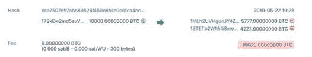
按 2020 年 11 月的美元价值：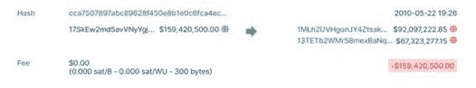

当时他们说那 10,000 个比特币价值约 41 美元，最终披萨店也以 400 美元卖掉了那 10,000 个比特币，赚了 10 倍。然而，今天这 10,000 个比特币价值为 159,420,500 美元。通过这些故事，我想让你看到投资比特币从未显得太晚，大多数人说购买比特币的最佳时机是昨天，但我的建议是，只有在你感到这样做这样做时才购买比特币，不要让价格困扰你，因为长期来看，价值会增加的。顺便说一下，如果你想一夜暴，比特币不适合你。比特币作为一种投资会增值，但那是长期，而不是一夜。

# 第 19 章：购买比特币的最糟糕时机！

在视频中，我将讨论购买比特币的最糟糕时机。真正的答案并不是一个具体的日期，而是一种人类行为，被称为 `FOMO`！`FOMO` 代表“错失恐惧”（Fear of missing out），在你认为这是胡闹之前，让我告诉你，`FOMO` 非常强大，它可以极大地推动市场。`FOMO` 可以感染广泛的人群，包括从不合格的投资者到经验丰富的交易员，甚至是技术分析师、资金经理，甚至包括大型对冲基金。你会发现，大多数人仍然低估了 `FOMO`，即使他们知道它的存在，并认为自己不会中当，但最终我们都会经历 `FOMO`。

我关于 `FOMO` 的经历是当比特币价格从 17K 跌到 11K 时，我迅速登录 `blockchain.info` 购买比特币，但大多数交易所无法应对这种需求，所以我买不到，这种情况非常令人沮丧。我真的觉得自己错过了一个廉价，而我确实错过了，因为 4 小时后，当我能够登录交易所时，价格已经涨到了 14K，你猜怎么着！？我还是以那个价格买了比特币，因为我当时正处于购买比特币的狂热中，我再等不及了。当然，第二天，价格又回到了 11K。

在那个事件之后，我们经历了超过 2 年的熊市，价格一直停留在 6K 到 8K 之间。那是我第一次经历 `FOMO`，也希望是最后一次。你会看到价格甚至达到了 20K，许多人推测那是非法交易，或者是某个团集团操纵了市场，或者是由于比特币期货市场被大户推高了，但市场上真正发生的是 `FOMO`。错失恐惧引发了一场牛市，直到比特币价格达到约 7K，并实现了价值翻倍。当然不是长期的，因为那是加密货币市场上一次巨大的 `FOMO`。

问题在于，处于 `FOMO` 中的大多数对比特币一无所知，从未看过课程，也没有读过关于它的书，而是从新闻上听到华街即将进入游戏。特别是在 `CME` 和 `CBOE` 将比特币列入期货市场后，让每个人都跑去购买比特币，我们说的大多是不合格的投资者，他们身边没有投资顾问或资金经理。另一方面，那些意识到市场正处于疯狂狂热、比特币价格过高的人开始卖出并赚了巨额利润。与此同时，那些在价格约为 15k-18k 时入场的人，意识到现在回到了 12K，开始恐慌抛售，导致价格进一步拉低到 10K，然后跌到 8K，而这在 `FOMO` 冲击市场之前是一个合理的价格。所以人们在面对 `FOMO` 时的问题在于，他们都会说类似的话：“啊是啊，真希望我能在 10K 的时候买比特币就好了，但当它回到 9K 时，他们没有买更多，而是恐慌抛售，因为他们现在担心价格会变得更低。”所以，我的建议是，如果你觉得自己正在经历 `FOMO`，你应该远离购买。不要因为 `FOMO` 而购买，它会并且会伤害你，无论是在情感上还是财务上。


# 第 20 章 购买比特币的底线

在这一章中，我想表达我的最后想法，并对购买比特币提供建议。当然，这并不是财务建议，仅是我诚实的个人观点。所以，你可以采纳也可以拒绝，或者更好的是，从中学习。

我已经讨论过 `FOMO`（恐慌症）、市场操纵、炒作、疯狂的新闻公告、价格预测、投资者、交易者、`Bitcoin` 期货、网络效应、供需关系、技术问题（如可扩展性问题），其中有些是好的，有些是坏，有些是肯定的，有些则不是。

所以，我真的想强调，如果你是 `Bitcoin` 的新手，不要仅仅因为某条疯狂的新闻公告就处于“`fomo`状态”去购买。相反，要自我教育，只有当你感到很放心时再购买。其他人可能会给你不同的建议，比如：“现在就买吧！你以后会学习 `Bitcoin` 的”、“现在已经太晚了！”但我个人认为，投资于任何你没有进行充分研究的领域，然后担心或推测可能会发生什么，并等待下一次新闻公告是错误的。我认为这是错的。

但是，如果你不想了解 `Bitcoin`，对研究它不感兴趣，或者你觉得自己没有理解它的技术知识，甚至你没有时间（可能因为工作太忙，或者家庭占据了你所有的时间，或其他原因），但你仍然想投资，你应该考虑聘佣 `Bitcoin` 经纪人或资金经理。一个你信任的人，或者你认识某个信任他们服务的人。在线下甚至在线聘佣顾问并不错。你不需要知道一切，所以你可以随时随你所在的世界上任何地方将其外包。

关于应该投资多少，我的下一个建议是，你的投资不应超过你不害怕损失的金额。有些人将其定义为投资组合的 5% 或 10%，但有些人只有一些积蓄，可能占其投资组合的 70-80%，并且想全部投入。如果这是你想做的，因为你对此感到放心，那完全取决于你。

关于投资比例，我的最终建议是尝试拆分你的投资。例如，如果你有 1000 美元要投资 `Bitcoin`，不要一次性投入，而是每月 1 号买 200 美元的，一周后或甚至 10 天后再买 200 美元的。然后一周后再买 200 美元的，以此此类推。这可以帮助你练习购买，并创造出一个平均投资价格。例如，如果你第一次购买时 `Bitcoin` 价格是 10K，而第二次购买时是 6K，那么你的平均投资价格大约是 8K。我希望你能跟上。所以，如果你在价格为 10K 的第一次就投入所有的钱，那么你的平均价就是 10K。多次投资是有用的，因为在某些日子，`Bitcoin` 的价格波动可能是 10% 甚至 20%。

# 第 21 章 为什么要使用比特币？

在这一章中，我将简化为什么 `Bitcoin` 如此强大。首先，最重要的是，它解决了几个问题：

*   你不需要银行，任何人都可以免费拥有钱包。
*   你可以任何时候向世界上任何个人发送比特币，成本仅需极少费用，且你不需要涉及任何第三方。
*   欠发达国家的人可以轻松访问它，因为只需要接入互联网。
*   没有中心治理，因此没有机构可以控制你的钱财。
*   `Bitcoin` 是可选的：基本上没有人强迫你拥有比特币。
*   没有单点故障，因为它是一个点点的去中心化网络。
*   没有通货膨胀。基本上市场上没有持续注入比特币，没有 `QE`（量化宽松），因为它的固定总量是 2100 万比特币。
*   需求增长：随着需求的增加，`Bitcoin` 的价值将不断增加。
*   `Bitcoin` 已合法化。越来越多的国家已经让 `Bitcoin` 合法并接受作为支付方式。
*   `Bitcoin` 被其采用者信任。`Bitcoin` 拥有去中心化账本系统：`Bitcoin` 使用区块技术，即工作量证明或 `Blockchain`，它在近年来因其安全性和信誉而闻名，甚至听到人们称之为：信任机器！
*   系统节省了人力：`Bitcoin` 不需要人类管理员来验证交易。

我还有许多属性可以讨论，但我想提供你为什么可以在日常生活中开始使用 `Bitcoin` 的主要原因。

# 第 22 章 比特币已经死了

你可能会遇到这样的话或公告：`Bitcoin` 死了，对吧？`Bitcoin` 已经成功死过 383 次了。

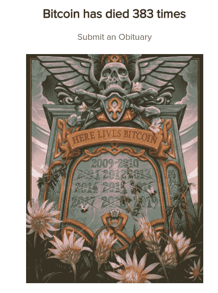
来源：`[`99bitcoins.com/bitcoin-obituaries/`](https://99bitcoins.com/bitcoin-obituaries/)` 基本上，当 `Bitcoin` 登上新闻时，它反复与一些负面信息联系在一起，`Bitcoin` 最著名的是作为犯罪分子的货币之类的。好吧，如果选择，`Bitcoin` 支付可以在全球匿名传输，所以犯罪分子仍然使用 `Bitcoin`，但他们也使用美元、欧元、英镑各种货币。遗憾的是，`Bitcoin` 在过去带有坏名誉引入的，而且似乎被喜欢创作惊人眼条的媒体继续延续下去。

人们称 `Bitcoin` 死的另一种情况是 `Bitcoin` 达到价值里程碑时。`Bitcoin` 在达到 100 美元时死了，达到 200 美元时再次死去，达到 1000 美元时再次死去，达到 10000 美元时再次死去，甚至在 2017 年 12 月 `Bitcoin` 达到 20000 美元时，它又死了一次。有一个网站收集了所有关于比特币死亡的文章，叫做 `99bitcoins.com`。这个网站收集了所有 `Bitcoin` 因为各种原因作为死货币出现在新闻中的故事。`Bitcoin` 第一次死去是在 2010 年 12 月。自从那次痛苦的事件以来，`Bitcoin` 已经死了 300 多次，但它仍然存在。我们从中可以学到，`Bitcoin` 死得越频繁，它就越上新闻，所以当 `Bitcoin` 死亡时会有更多人听到这些虚假新闻。这为人们提供了许多额外研究的机会，让他们自己决定 `Bitcoin` 是否真的是正在死亡的加密货币。想象一下，如果你在 2010 年听到 `Bitcoin` 死了，然后在 2011 年又读了另一篇说 `Bitcoin` 又死的文章，并在过去的 10 年里反复反复听到这些。所以，显然哪里不对劲。看来，`Bitcoin` 将继续一次又一次地走向死亡（至少在新闻中是这样），但事实是 `Bitcoin` 将永远存在！


# 第 23 章 比特币是骗局

好吧，比特币显然不是骗局！很多人曾声称比特币是骗局，但现在已经不再是了。你必须警惕的是 `ICO-s`，首次代币发行，即所谓的将接管世界的新的、更好的加密货币。那些是非常危险的，而且所有 95% 的 `ICO-s`、`alt coins`（替代代币）实际上都是骗局。它们大多数存在就是为了骗人，这些基本上是比特币的克隆版，而且那里到处都是，所以你真的需要留心意，确保你和它们没有任何关系。

但有少数加密货币是公平挖矿的，没有涉及 `ICO` 或资金筹集，尽管其中大多数完全没有用例，但基本上并不是所有的 `Altcoins` 都是骗局，只是大多数是如此。我想就这个话题提及的另外一点是，如果你确实从一个骗你的人那里购买比特币，那是另一回事了。如果发生这种情况，那个人确实是个骗子，是的，但比特币不是骗局。那些说比特币是骗局的人，他们可能并不知道“骗局”这个字的含义。

你应该知道的是，互联网上到处都是比特币相关的骗局，骗子们声称各种事情，比如投资 10 个 `bitcoins` 你的钱就会翻倍，或者你会获得每日利润之类。但是，让我们准确地理解什么是骗局。首先，骗局需要隐藏信息，但比特币是一个开源 `Protocol`（协议）。比特币是一项非常复杂的技术，但任何人都可以下载并查看它的代码，所以没有隐藏信息。比特币使用 `Elliptic Curve Cryptography`（椭圆曲线加密）参与离散对数问题，还使用了 `SHA-256` 哈希算法、`ASCII` 编码以及许多其他技术的组合。事实是，大多数称比特币为骗局的人根本没有花时间学习它，特别是没有花时间去理解构建比特币的基础技术，而是直接称它为骗局。如果你想学习更多关于这些技术，你应该查看我的另一本书，书名为《比特币就是区块链，这如下文所示！》。总而言之，我只是想澄清比特币不是一个骗局。

# 第 24 章 比特币是一个泡沫

在本章中，我将解释为什么人们称比特币为泡沫。首先，这很难说，因为时代已经变了，我们正在进入数字时代。在数字时代，一切都在快速变化，所以我们必须用新的游戏规则来教育自己。比特币代表了从 `FIAT`（法币）中解放，而后者正是金融泡沫的根源。我之前提到过量化宽松，这解释了其中一些问题。比特币不是金融泡沫；相反，比特币是一种无国界的新数字货币。人们将其称为泡沫，是因为他们只能与其他泡沫进行比较，例如郁金花泡沫、房地产泡沫，甚至是互联网泡沫。我们真的不应该将比特币与这些任何泡沫相比较，因为我们从未经历过类似的事情，但与比特币最接近对比的是互联网泡沫。

更具体一点，如果我必须把某些东西与互联网泡沫相比，我会说我们拥有的是加密货币泡沫，或 `ICO` 泡沫，而不是比特币泡沫。在互联网泡沫时期，有数百家技术公司，每一家公司都以疯狂的资金被创立，但 10 年后只剩下几家公司，其余的都消失了。在互联网泡沫时期，如果一家公司公开宣布他们有一个网站并按需点播电影（就像 `Enron` 所做的那样），他们的股价会突然飙升，公司价值瞬间增加了 1 亿美元。而在背景中，他们并没有电影可以提供流，也没有技术可以支持这些功能；他们拥有的仅仅是一个公告。

这正是 2017 年发生在加密货币和新 `ICO-s` 上的情况。每一个宣布某些华丽辞藻的新 `ICO`，比如它比比特币更快、更安全或更匿名，都会开始推高，而当时并没有产品，只有承诺。我看到许多此类公司在市值方面进入加密货币前十名，突然，一旦它们无法再骗人时，它们就完全消失了。其中一些主要的骗局和项目最终破产了，如：bitconnect、`onecoin`、`secretion`、`litecoin red`、高回报，或者模仿类的 `jesuscoin`、`bitcorn`、`true coin`、`Saladin coin` 等。正如你所见，似乎我们现在正处于加密货币泡沫中，但比特币是不同的。

# 第 25 章 比特币是股票

在这一短课中，我将澄清比特币不是股票。首先，股票是公司的股权。例如，你可能拥有 `Amazon`、`Facebook` 或 `Apple` 的百分股，但当你拥有 `bitcoins` 时，你拥有的是一种由于受控供应而流通有限的资产。这种可能的误解是可以理解的，因为比特币与股票有一些相似之处，因为有很多在线交易所让你可以使用比特币进行交易。

至于 `CME` 和 `CBOE` 上市比特币期货，这与 `bitcoins` 并没有太大关系，因为你可以对比特币的未来价格进行下注。如果你参与，你就是在赌博。你可以用法币（如美元）下注，所以你不需要任何 `bitcoins`。顺便说一下，如果你下注并赢了，你得到的是美元，而不是 `bitcoins`。所以你不需要购买 `bitcoins` 来参与比特币期货市场。你既不会丢失或赢得 `bitcoins`，因为你不会得到 `bitcoins`。再次强调，比特币不是股票。

# 第 26 章 比特币是金字塔骗局

在本章中，我将澄清比特币不是金字塔骗局。首先，让我们先说，比特币没有可以讨论的金字塔结构。这种可能的误解可能来自于比特币在法币价值上的收益。比特币价值的持续增长源于有限的供应。基本上，购买币的人越多，每个硬币的价值就越高。但金字塔骗局通过分红或佣金来吸引更多人加入，而比特币作为投资并不支付分红。相反，回报来自于资本利得。金字塔骗局没有真正的业务价值，而你可以用 `bitcoins` 购买商品或服务。此外，在典型的金字塔骗局中，骗子可以随时带钱跑路导致计划崩溃。另一方面，比特币是一个去中心化的系统，比特币的发明者和早期采用即使想这样做也无法破坏系统。Satoshi 设计、实现并发布了比特币软件，但 80% 的旧代码已由数百位比特币开发者重写和修改。所以再次，比特币不是金字塔骗局。

# 第 27 章 比特币技能描述比特币是交换媒介

在本章中，我将解释为什么比特币是交换媒介的完美用例。某物要作为交换媒介的主要标准是它必须是稳健且便携的。由于比特币是数字的，它显然符合这些功能。比特币具有作为货币的所有甚至超越这些属性。

### 比特币抗审查性
基本上，没有人可以阻止或拦截任何金额的传输。这一事实引出了我的下一点，比特币是非许可的。任何人都可以安装比特币软件，并用于发送或接收 `bitcoins`。

### 不可冻结性
基本上没有人可以冻结或没收你的账户。

### 不可逆性
一旦比特币交易被确认，没有人可以撤销它，不像传统的信用卡系统那样的退款。

### 无身份性


- 基本上，使用 `ibitcoins` 不需要身份证明或注册。因此，它可以供个人、计算机、没有银行账户的人，甚至是无国家的人使用。

## 无国界
- 基本上，它在任何有的地方都可以工作。

## 半匿名性
- 虽然可以匿名使用，但大多数人并非那样使用的，不过确实提供了相关选项。

## 可追溯性
- 共享公钥会暴露你之前所有的交易，任何拥有这些密钥的人都可以在区块链上看到你所有的比特币转账。

## 极高的运行时间
- 该系统每天运行 24 小时，每年 365 天，所以它不像银行那样可能半夜或周末关闭。

## 快速设置
- 你可以非常快地开始接受比特币，而无需设置商户账户。

## 推送系统
- 像信用卡等其他互联网交换媒介是“拉取系统”，即由接收方获得发送者的凭据，然后他们将钱拉取到自己的账户。

## 可编程
- Web 服务器可以自动理解或创建交易，例如释放托管，或自动提供商品或服务。此外，还可以编写 `Smart Contracts`（智能合约），其内容无论如何都会被遵循。但是，智能合约最早出现在比特币上，但开发者关闭了它们，因为它们存在漏洞、不稳定且相当无用。其他花哨功能如 `multisignature`（多签名）或 `timelock`（时间锁）允许比特币实现其他交换媒介无法实现的功能。

## 比特币也很
- 交易通过对点网络在几秒钟内广播，并在大约 6 次额外的交易确认后，在一个小时内变得不可逆。比特币也可以作为价值存储媒介。

比特币是便携的、耐用的、可识别的、同质、稀缺且难以伪造的，其供应保证是稳定的。正如你所见，比特币不仅是一种交换媒介，也可以成为价值存储媒介。

# 第 3 本：认识比特币与区块链的架构师：中本聪——密码客亿万翁加密反叛者波里斯·威泽的冒险

## 第一章 公开证据的早期时间线
在本章中，我将关注与中本聪相关的公开证据。谈到中本的时间线，他与人的实际互动仅持续了约 2 年。在这 2 年里，没有人亲面见过他，也没有通过电话、Skype 或任何其他语音通话与他交流。中本聪仅通过论坛帖子和电子邮件与人交流，但有证据表明，中本聪在与任何人互动之前已经在网上活跃了。发现的首个证据是 `bitcoin.org` 网页注册记录。中本聪在 2008 年 8 月 18 日注册了名为 `bitcoin.org` 的域名。十年后的今天，`bitcoin.org` 网站仍在运行，而且如果你想运行自己的全节点，可以在该网站下载 `Bitcoin core` 客户端，这正是同一个网站。继续下一个时间线上的下一个公开事件，是比特币白皮书的发布，标题为《比特币：一种点对点的电子现金系统》。该白皮书发布在一个密码学邮件列表上，也可以在 `bitcoin.org` 下载。即使是今天，如果你访问网站 `bitcoin.org/bitcoin.pdf`，你仍然可以访问这篇白皮书。白皮书定义了什么是比特币、它是如何工作的，包含大约 8 页内容，以及底部额外的一页列出了与比特币项目相关的参考文献。白皮书上还有中本聪的名字，这他是一个日本男性，但他使用的电子邮件地址是德国的，可以在论文顶部找到 `satoshin@gmx.com`。我们时间线上的下一个事件是 2009 年 1 月 3 日，中本聪挖掘了 0 号区块，也称为创世区块，其奖励为 50 个比特币。我稍后会讨论创世区块以及它为什么重要，但现在我将转向时间线上的下一个事件，即 2009 年 1 月 9 日，第一个版本的比特币软件正式发布，被称为 `v0.1`（读作 version 0.1）。截至今天（2020 年 11 初），`Bitcoin Core` 软件的最新版本是 `0.20.1`，它于 2020 年 8 月 1 日发布。继续我们时间线上的下一个著名事件是 2009 年 1 月 12 日，这是历史上首次比特币交易。中本聪向 Hal Finney 发送了 50 个比特币，后者是一位非常出色的程序员和著名的密码学专家。遗憾的是，Hal Finney 已于 2014 年去世；尽管如此，他的故事尚未结束，但本章仅关注一些早期的显著时间线。

## 第二章 中本聪的写作风格
本章将关注比特币创造者的写作风格。中本聪在少数论坛上发帖，并向多人发送了大量电子邮件，但更准确地说，公开范围内可以找到近 10 万个单词是由中本聪公开撰写的。那里有大量的单词和句子，这可以帮助我们发现他写作风格中的一些趋势，其中最有帮助的一点是是他使用了英式表达，如‘bloody hard’（非常困难）或‘bloody difficult’（极其费力）。这类表达澳洲人也可能使用，但当涉及到他的拼写风格时，并不只有英式的，因为他使用的一些单词和句子是美式风格，但并非总是。识别出的另一个值得注意的过时写作风格是，他在句号后总是使用两个空格，这表明他习惯使用打字机写作，因此很可能保留了这种习惯。除此之外，中本聪的写作风格结构非常良好，几乎没有拼写错误或用词错误。此外，他似乎没有提到过任何个人生活或亲属、爱好，他所有的电子邮件和论坛帖子都集中在比特币以及如何使其更具扩展性或更易用上。当人们问他任何个人问题时，他似乎总是忽略这些问题并避免回答。中本聪拥有科学写作风格，这需要坚实的英语句子构建和用法的基础。由于他大部分使用技术性写作，他能够吸引到与自己相似的受众，这没有为普通的闲聊或聊天留出任何空间。最后，由于比特币白皮书是用英语撰写的，且从未发现过日语版本，而且由于他总是用英语发帖和发邮件，我们应该得出他不是日本人的结论。


# 第 3 章 中本的密码学技能

首先，中本（Satoshi）是一个 PC 用户。也许这没什么什么，但在对 PC 和 Mac 用户之间差异的统计数据进行研究后，发现了一些值得注意的差异。这里引用的统计是由 `Hunch.com` 完成的，他们要求所有用户可以随心回答以下问题：你是 PC 派还是 Mac 派？近 40 万人回答了该问题，其中 53% 的人表示他们是 PC 用户，而只有 25% 的人是 Mac 用户。再次强调，这可能不是什么大事，但我们必须记住，中本在创建比特币时使用的是 PC，他确实需要许多人的帮助来让比特币兼容 Mac 和 Linux 系统。

接下来，要创建比特币，有几个领域是你应该熟悉的，可以说，除了编码之外，中本在很多领域领域都是专家，所以让我们来看看其中一些领域吧。中本不仅设计了比特币区块链，还实施了它，因此他必须是经济学、货币史、点对点和分布式计算、数据库、`C++` 编码，以及当然还有密码学的专家。根据专家代码人员的说法，他们分析了中本写的一些早期代码，并得出结论：他并不是最顶级的程序员，但是一个优秀的 `C++` 程序员。目前的比特币区块链开发者确认，自诞生以来，80% 的早期比特币代码已经经过了修改和重写，这并不是因为它们写得不好，而是因为比特币网络已经成长，而扩展性总是需要额外的功能和集成，例如交易所、支付网络、多种类型和品牌的钱包等等，这些在中本还活跃的年代是不存在的。最后的结论是，中本在那个时代是一个出色的 `C++` 程序员。

中本最重要的技能之一确实位于密码学中。我也对密码学专家进行过研究，例如布鲁斯·施奈尔（Bruce Schneier）、迪菲（Diffie）和赫尔（Hellman）、哈尔·芬尼（Hal Finney）、尼克·萨博（Nick Szabo）等等，他们似乎都有一个共同点，那就是发明自己的密码学，但中本并没有发明任何新东西。相反，他使用了已经证明有效的现有密码学，并在此基础上构建了比特币。另一方面，人们说他总是很赶，但我个人认为他并不是在寻找捷径或类似的事情，相反，他想避免失败，并想让可能出错的空间尽可能减小。我的意思是，如果对于他的需求已经有了现有且有效的解决方案，为什么要冒风险发明新东西呢？中本使用了 `E.C.D.S.A.`，也称为`椭圆曲线密码学`或`椭圆曲线数字签名算法`。椭圆曲线密码学最早于 1985 年提出，但直到 2004 年和 2005 年才被广泛使用。`E.C.D.S.A.` 也使用了传统的 `DSA`，即数字签名算法，它最早于 1991 年提出，第一个版本于 1996 年发布。

# 第 4 章 中本的文字交流技能

在本章中，我将继续讨论中本的另一个技能，谦逊。中本似乎从不自傲，他也从未试图表现得自己比比任何人都聪明。例如，他在 `bitcoin.org` 论坛上收到过许多关于比特币设计的问题，非常像初学者的问题，但他不仅回答了每一个人，而且总是带着爱和热情去回答。即使被问到同一个问题，他也会告诉人们在哪里可以找到答案，以防他已经回答过。总的来说，可以说他的文字交流一直是冷静、精准且周全的。

中本拥有的另一个重要特质是，他完全没有财务动机。中本的钱包里大约有 100 万个比特币，在过去的十年里，他从未碰过它们，从未花费或交易过这些比特币。这完全取决于你读这本书的时间，但如果你考虑目前每枚比特币 16,000 美元的平均价格，他拥有价值约 160 亿美元的币，但他从未触碰。早在 2017 年，比特币的价格大约是 20,000 美元，他还没有交易或移动过这些币中的一小部分。他可以在任何时候卖掉所有比特币，即使当每枚币只有 1000 美元、100 美元甚至 10 美元时，他也可以大富，但他选择了不这样做。比特币和区块链中还有一种软件模式是中本可以申请的，这种模式本身也价值数十亿美元，但他从未这样做，事实上，他想确保比特币和区块链是完全去中心化且开源的。我将在后面的章节中讨论比特币代码以及中本是如何成功将其向公众的。


# 第 5 章 中聪的出生日期

在本节中，我将介绍中聪的一些政治观点。关于中聪的政治观点和信仰，能找到的内容并不多。但有一个关于 `genesis block`（创世区块）非常重要的事实是你应该知道。如果你不知道 `genesis block` 是什么，它基本上是 `Bitcoin blockchain` 挖出的第一个区块。`genesis block` 之重要有很多原因，但我提到它的原因是因为 `genesis block` 中包含了 2009 年 1 月 3 日版《泰晤士报》（The Times）的一条标题。该标题是：“财政长处于对银行第二次援助的边缘”。这条标题出现在 2008 年金融危机之后的报纸上，当时财政长正在考虑向系统提供或创造更多货币，这被称为量化宽松。量化宽松基本上是中央银行向货币供应量中引入新货币。

关于中聪政治观点的另一个证据是他自己于 2009 年 2 月 11 日在 `p2pfoundation.ning` 上发布的，内容如下：“传统货币的根本问题是使其运行所需的所有信任。必须信任中央银行不会贬低货币，但法币货币的历史充满了对这种信任的违背。必须信任银行会持有我们的资金并进行电子传输，但它们以信贷泡沫的形式发放贷款，而准备金仅占极小部分。我们必须把隐私交给他们，信任他们不会让身份盗窃用者抽空我们的账户。他们巨大的运营成本使得微支付变得不再可能。”要阅读整个论坛帖子，请访问以下链接：`http://p2pfoundation.ning.com/forum/topics/bitcoin-open-source`。中聪的这篇帖子告诉你，他对中央银行发行货币的运行方式并不满意。关于中聪政治信仰的另一个证据可以在 `p2pfoundation` 上找到，即他在那里发布了上述公告。

当中聪注册成为 `p2pfoundation` 的用户时，每个新用户都必须提供出生日期。中聪提供的是 1975 年 4 月 5 日。那是 2009 年的事，所以乍一看，大多数人会认为这可能是中聪真实的生日，这使他当时大约 34 岁。事实是，这些日期在货币供应和黄金方面实际上非常有意义。1933 年 4 月 5 日，时任美国总统富兰克林·D·罗斯福（Franklin D. Roosevelt）发布行政命令宣布黄金非法化，要求所有美国公民将所有的黄金交给政府。要阅读整篇文章，请访问以下链接：`http://www.presidency.ucsb.edu/ws/index.php?pid=14611`。美国第 32 任总统富兰克林·D·罗斯福发布了行政命令，要求将金币、金条和黄金证书交给政府。这大约是大萧条时期，大萧条始于 1929 年，持续到 20 世纪 30 年代后期。了解大萧条，你可以访问以下链接：`https://en.wikipedia.org/wiki/Great_Depression`

1975 年，是美国人能够再次拥有并交易黄金的一年。从 1933 年到 1975 年，如果没有特殊许可，美国公民拥有任何形式的黄金都是是非。但这些限制在 1975 年被取消，黄金再次自由交易。1975 年 4 月 5 日可能是中聪真实的生日，尽管非常有趣的是这些日期与上世纪发生的一个重大黄金新闻有关联。这可能是巧合，中聪只是在论坛上放了一个随机日期，但尽管如此，他一直如此深思熟虑，当被要求提供出生日期时，他可能不仅想提供某种随机日期，而是提供一个他会记住的东西。鉴于中聪的主要生之项目是比特币（它通常被称为“数字黄金”），而且当然是一个政府无法没收、从人们手中夺夺的去中心化区块链，这些日期可能完全不是随机的。

# 第 6 章 发布比特币软件

在本章中，我们将涵盖中聪在发布比特币软件之前所考虑的因素。首先，比特币软件是在 `MIT licence` 下发布的，该许可提供了开源软件。在开源软件方面，有不同的类别。例如，可以被发布为永久的自由软件，另一种类型是为终端用户提供自由。为了清楚起见，第一个例子属于 `GPL Licence` 类别，它通称为通用公共许可证。如果你愿意，可以修改软件，但一旦你对其进行了任何修改，就必须发布。而使用 `MIT Licence`，你可以进行任何想要的修改，但如果你不想，就不必发布它。此外，如果你愿意，你可以将其作为任何其他工作或项目的一部分，中聪希望比特币软件就是那样。中聪想通过 `MIT licence` 实现的基本上是让它尽可能被很多人接触，在全球范围内传播，并让任何人拥有并根据他们的意愿进行任意次数修改。在做出这个决定时，他非常深思熟虑，在发布比特币软件之前可能已经做了很多研究。

# 第 7 章 中聪的身份

在中聪的维基百科页面上，他被引用为未知的人或几人，因此我将首先假设中聪是一个群体。中聪可能是一个群体的主要原因之一是，为了创建一个比特币软件，中聪需要在多个领域成为专家，或者至少了解这些：`经济学`、`分布式计算`、`数据库`、`C++ 编程`，当然还有`密码学`。当你考虑这些技能组合时，你可以很快意识到，这可能是多个人的技能组合，而不是个人。例如，一个密码学专家并不一定具备数据库方面的技能，显然也不具备货币理论或经济学知识，但尽管如此这是可能的。另一个例子是，一个普通的 C++ 程序员通常会学习 `C++`、`python` 或 `JAVA`，但并不是货币史或点对点系统。我个人对许多广泛的话题感兴趣，但我并不是我感兴趣的所有领域的专家，所以再次重申，大多数人一生中没有足够的时间掌握多种技能组合。因此由于这个原因，中聪可能是一个群体。

另一个表明中聪不是个人的例子可以在比特币比特币白皮书的 `Abstract` 中找到。第五行，他写道：

```
We propose a solution to the double-spending problem using a peer-to-peer network.
```
因为使用的是复数，这表明有多参与了比特币的设计和实现。我们已经了解到中聪总是非常深思熟虑，也许他想通过误导任何阅读白皮书的人来让他们认为他是一个群体。在中聪的其他出版物中也存在复数形式的句子，但这些是我能找到的主要案例。


# 第 8 章 中聪是个体人

我们已经讨论过，比特币的设计和实现是一个天才的杰作，而在所有天才的大脑中存在着非常共同的特质。他们倾向于独立工作，而不是将任务外包或与团队合作。另一个让中聪可能是个体人的原因是，他的写作风格确实非常一致。这里有多个论坛帖子和邮件回复，它们看起来并不像出自多之手。中聪的写作风格是独特的，因此如果有其他人参与，即使仅仅是回复某些论坛帖子，他们也必须遵循某种写作风格，但这是极不可能的。

中聪最早在 2008 年出现在网络上，十年后的今天，仍然没有关于中聪身份的确认。如果你仔细想一下，想象一下你有一个秘密，并且不希望任何人知道这个秘密。如果你让某些人知道它，你的秘密泄露的概率就会增加，对吧？所以，重点在于：中聪在提供任何身份信息的同时，一直考虑他的名字和出生日期，那么他很有可能也考虑过应该向谁透露他的真实身份。鉴于他从未公开过自己，他很有可能从头到都是单独战斗的。

通过分析概率来保持现实，越少的人知道你，保持匿名的概率就越低。因此，在计算博弈论、概率、可能性时，例如计算每 14 天哈希算力的增加，或者创建 2100 万个比特币（通过每 10 分钟产生 50 个比特币，但随后减少供应，每四年减半供应），他可能从未用自己的真实身份告诉任何人关于比特币的项目。

如你所见，我正在为两种情况进行论证。中聪可能是一个群体，但也可能是一个体。但考虑到比特币项目的创建水平，他极可能是一个。如果中聪是一个群体，我会说这是一个经过仔细挑选的小少数人。也许是 2-3 人，但不超过 4 人。中聪是个体的概率更高。

例如在比特币白书中，他提到的是“我们建议”（we propose）而不是“我建议”，标题上面的名字写的是 Satoshi Nakamoto，而不是 Satoshi 团队或其他人的名字，并且只提供了一个邮箱地址用于联系。在白书的最后，有比特币实现的参考文献，因此我认为他宣布建议的方式是利用了所有这些内容作为比特币实现的一部分，但这些都是他独立完成的。

# 第 9 章 中聪候选人 1

在本章中，我将讨论第一个被认为是真实中聪·中本的候选人之一。2014 年，《新闻周》发表了一篇文章，标题为《比特币背后的脸孔》（The Face behind Bitcoin），他们声称找到了神秘的失踪中聪，他住在加利福尼亚州，真实名字是 Dorian Satoshi Nakamoto。要阅读全文，请访问以下链接：`http://www.newsweek.com/2014/03/14/face-behind-bitcoin-247957.html`

Dorian 住离 Hal Finney 附近，而 Hal Finney 实际上从真正的中聪那里收到了第一 50 个比特币，但我稍后会谈这一点。当时有很多推测，称 Dorian 曾为政府工作，他是某种工程师。他说他不被允许谈论与政府的工作，因此他在许多人眼中变得非常可疑，当然媒体也非常喜欢这个故事，并试图大做文章。

归结底，Dorian 似乎甚至不知道比特币，他真的对区块链、密码学或任何此类事物无所知。但是是媒体对此大做文章。Dorian 否认了与比特币的设计或创建有任何参与，他真的对整个局面感到困惑。对他的公开写作和邮件进行了多次分析，他们意识到 Dorian 绝可能是真实的中聪，根本没可能。

我确实说过，我将讨论一些中聪的候选人，如果你问我关于 Dorian；他可能是真实的中聪吗？我会说不是。但我谈论 Dorian 的原因是因为，如果你不进行适当的研究，不阅读像《新闻周》这样的文章，你很容易被错误的信息误导。不幸的是，许多人甚至不在乎真正的中聪是谁，而是相信他是某个日本人，此就了。当然，还有人会进行快速的 Google 搜索并点击图片，看谁会出现，如果你看一个例子，这个搜索会出现 Dorian 的脸，但再次强调，他不是那个人。

# 第 10 章 中聪候选人 2

在本章中，我将讨论第二个可能的中聪候选人，他的名字是 Craig Steven Wright，或 Craig Wright，但大多数比特币极大主义者直接称他为“假中聪”。为了理解人们为什么称他为假中聪，你需要知道 Craig 是如何变得受欢迎的。2016 年，Craig 邀请 BBC 来他家中，并在镜头前声称自己是 Satoshi Nakamoto，比特币的创造者。他还解释说某些人可能不会相信他，有些人可能会信，但他不在乎。接着，BBC 记者让他认领自己的身份，但他这样做的方式没有被记录，而且记者甚至不知道该看什么。在 2018 年初， Craig 说他不是中聪。最后，他对 BBC 记者说的话是真的。有些人相信他，但其他人可能不。现实情况是大多数人简单地知道他不是中聪。

所以，在进一步讨论 Craig 以及他对加密货币的参与之前，让我们看看事实以及我们目前对真实中聪的了解。首先，他总是非常确保自己的身份匿名，因此通过邀请 BBC 来他家里，我们完全同意这是错误的。特别是中聪总是一个亲民的人，回复任何人并详细解释一切。同样的论点也适用于所有权。中聪发明了区块链。他是工作量证明大师，所以如果他想证明什么，我的意思是真正的中聪，他会正确地这样做，这样人们就不会怀疑。真正的中聪会向密码学家和密码朋客证明自己的身份，而不是向一个不知道什么是公钥或私钥的记者证明。真正的中聪从未追求名声。从未表现得像一个想要浪费时间与记者交谈或任何媒体交流的人。

但如果这些还不够，Craig 成了比特币现金的粉丝，积极推广作为比特币竞争对手的比特币现金。由于这些行为，并开始反对真实的比特币，人们问他，如果他是真正的创造者，为什么不帮助比特币扩展扩展？但结果证明他完全不会写代码。尽管他在 2016 年公开露面，似乎仅仅是为了名声。我可以举出更多关于 Craig 不是中聪的例子，但我想让你知道他非常有说服力。如果你听他说话，他似乎在技术方面了解很多，但也意识到他喜欢使用一些实际上毫无意义的组合术语。


# 第 11 章 中聪候选人 3

2020 年，关于 `Adam Back` 是否可能是真正的中聪引发了许多新争论。`Adam Back` 拥有分布式计算系统的博士学位，这本应是构建去中心化计算机网络的完美背景。比特币是用 `C++` 编写的，而 `Adam` 也精通 `C++` 编码。

`Adam` 直到 2005 年 4 月为止每年都在申请多项专利，之后他就消失了，直到 2010 年 3 月，而那时已经是比特币发布整整一年之后了。在此，`Adam` 也没有写过任何学术论文。根据 `Adam` 的说法，中聪似乎甚至在软件发布后曾将软件发送过给他。但 `Adam` 从未提供过这些邮件的证明。

在比特币白皮书中，参考文献之一是 `Hashcash`，它是由 `Adam Back` 在 1997 年发明的。`Hashcash` 的白皮书于 2002 年发布，如果你想查看，请访问 [`www.hashcash.org/hashcash.pdf`](http://www.hashcash.org/hashcash.pdf)。

在 `Adam` 的写作风格方面，他使用英国英语，并在每个句号后使用双空格。`Adam` 也是英国人，出生于伦敦；如果你记得中聪如何在创世区块中隐藏了一个引用《泰晤士报》（The Times）的政治信息，那么那是一份位于英国的报纸。`Adam Back` 也以在紧凑代码中留下政治信息而闻名，而且他在伦敦长大，那里正是《泰晤士报》发行的地方。

`Adam Back` 于 2019 年成为马耳他居民，并自 2013 年起开始公开对比特币表示兴趣。`Adam` 是名为 `Blockstream` 的公司的联合创始人，并自 2018 年起担任 CEO。`Blockstream` 的整个目的是聘佣开发者来进一步推进比特币项目的发展。该公司开发了一系列用于比特币和其他数字资产存储和传输的产品和服务。

曾有一个对 `Adam Back` 的采访，询问他认为真正的中聪可能是谁。他回答道：“嗯，我认为我们不知道更好，因为这有助于比特币被视为一种数字商品。如果有一个确定的创始人，这种想法会导致许多人去提问或要求什么。所以，创始人目前没有回来这一事实夺了这种机会。”要查看该采访，请访问以下页面：[`www.youtube.com/watch?v=688J9UZJxKg`](https://www.youtube.com/watch?v=688J9UZJxKg)。

`Adam` 多次否认自己是中聪，最近在他的 Twitter 账号上说了这样的话：“有人声称是中聪，整天谷歌搜索、写博客故事，并在法庭上，导致了广泛的不信任。看来我需要相反的：尽管最近有视频/reddit 声称如此，但我不是中聪。某些因素和时机在事后看来可能很可疑；巧合与事实是凌乱的。”

`Adam` 还说了：“这更深了一层——他们谷歌搜索的内容有些确实是真的：我在 2009 年搬到了马耳他，一个欧盟的避税港——这纯属巧合，不过当然，我在 2008 年就通过中聪的邮件知道了比特币。我出生于伦敦。我确实使用双空格和母语英式拼写。我会写 C++。”“不幸的是，在通常话多的时候保持沉默也没有帮助。赢不不了！但我仍然不是中聪。”要查看整个 Twitter 讨论，请访问以下页面：[`twitter.com/adam3us/status/1259979639092588551`](https://twitter.com/adam3us/status/1259979639092588551)


# 第 12 章 中本候选人 4

在本章中，我将谈论 Nick Szabo（Nick Szabo）。Nick 是一位密码学家和计算机科学家，他还是早期加密客（Cypherpunk）运动的一员，他在 1998 年设计了电子现金，并将其命名为 `Bit Gold`。2013 年，一位名为 `Skye Grey` 的研究人员发布了一篇详细的分析，通过对比中聪（Satoshi）的写作，他将 `Nick Szabo` 命名为 `Satoshi`。

Skye 发现 Nick 在他的博客中使用了一些术语，而 Satoshi 在他的白皮书或邮件中也使用了这些句子例如：“时间戳服务器（Timestamp server）、或以“应该注意的是（It should be noted）”开头的句子，或者如“受信任的第三方（trusted third party）、加密证明（cryptographic proofs）”等表达。他说，在快速搜索这些句子后，他很容易地从千人中锁定其中一个人。当他们询问 Skye 有多大确定 Nick 就是 Satoshi 时，他说他不确定，但他对特定术语的研究将他的调查指向了 Nick Szabo。Nick 否认自己是 Satoshi，他只是说：“不是 Satoshi，但谢谢你。”

在我开始研究比特币之初，遇到了 `Satoshi Nakamoto`（中本聪）这个化用名，我真的很想查出 Satoshi 是谁，但从正确的渠道获得一些线索花了很，所以当我接触 Nick Szabo 时，我曾在很长一段时间内真的相信他就是 Satoshi。我发现了许多线索，我不会谈及所有的，但有些我发现的线索确实构成了一个强有力的案例。

## Nick Szabo 的谜团

首先，如果你看 Nick Szabo 的博客，你会发现他对黄金、日本历史、世界经济、密码学、加密货币非常感兴趣，但真正有趣的是，没有人能确认 Nick 住在哪里、在哪里上过学、目前在哪里工作，或者任何已知的之前的工作，没有公开的出生日期等等。Nick 并不真正接触媒体，也从谈论自己。此外，人们知道他叫 Nick Szabo，但没有人验证过这是他的真实姓名，所以也许 Nick Szabo 这个名字可能都不是他的真名。

让我们看看其他方面。考虑到 Nick 在 `Bit Gold` 上工作了 10 多年，而在比特币问世这段时间，他突然忘记了它，这很奇怪。比特币白皮书的最后一页列出了参考文献，那里也有另一个线索。

## 比特币对比 Bit Gold

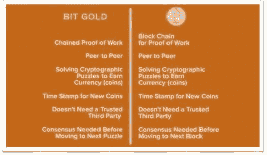

所以，如果你查看一些主要特征，你会很快发现不仅名字相似，它们都基于 `Proof of work` 工作证明证明系统。
- 运行在点对点网络上。
- 参与者通过解决加密谜题获得硬币。
- 每枚新硬币都有时间戳。
- 不需要银行或 `PayPal` 那样的受信任第三方。
- 在移动到下一个区块或谜题之前需要共识。

Nick Szabo 在 1998 年设计了 `Bit Gold`，但他从未实现它。而 Satoshi 不仅设计了而且实现了比特币网络。我们知道 Satoshi 非常支持，他从未声称任何发明，因为他使用了现有的技术并以一种以前没人用过的方式组合在一起。

所以，如果你查看比特币白皮书最后一页的参考文献，你可以看到 Satoshi 引用了 `b-money`、安全时间戳服务的设计 `Adam Back 的 hashcash`（工作证明的基础）、`Feller 的概率理论`及其应用，但这些参考文献中真正缺失的是 Nick Szabo 的 `Bit Gold`。

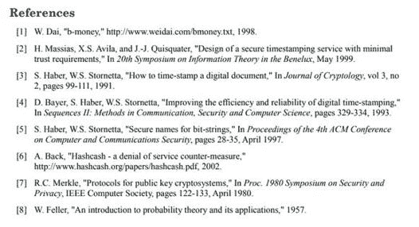
来源：[`bitcoin.org/bitcoin.pdf`](https://bitcoin.org/bitcoin.pdf)

所以，问题是：为什么 Satoshi 没有包含 Nick 的 `Bit Gold`，对吧？如果你完全熟悉一个主题，也许不需要把它包含在参考文献中，但 Satoshi 在后后的一封邮件中提到比特币是基于 Nick Szabo 的 `Bit Gold`，所以这有点困惑。Satoshi 可能想让我们某些人认为 Nick 可能是 Satoshi，这样我们就不会考虑其他可能性？再次，Satoshi 仔细计划了几乎一切，所以结果可能有两种。

## 语言与日本的联系

这里的问题是，Nick 对比特币非常了解，他为什么没有对此做任何事情呢？我的意思是，如果你在某件事上工作了 10 年，就像 Nick 致力于 `Bit Gold` 项目，突然某人像 Satoshi 实现比特币那样实现了一个非常类似的系统，而你的项目甚至没有被引用，这本并不奇怪。但 Nick 对此事从未发表过任何值得注意的话，所以再次非常有趣。

另一点是他的首字母几乎相同：`Satoshi Nakamoto` 为 `SN`，`Nick Szabo` 为 `NS`。继续这个话题，在日语中，姓在前面，这在作家和内容出版者中非常常见，他们使用化用名或笔名，大多数时候会使用与真实姓名非常相似的笔名。[`unenumerated.blogspot.com/search?q=japanese&max-results=20&by-date=false`](https://unenumerated.blogspot.com/search?q=japanese&max-results=20&by-date=false)

Nick 还曾在 2005 年、2006 年和 2007 年发表过几篇关于日本市场的文章，在比特币发布之前，我们知道他对日本物品和货币历史感兴趣，因此理论上 Nick 可能考虑过创建一个日语笔名，一个与其真实姓名相似的笔名。所以，如果你考虑名字 `Nick`，并在日语中寻找类似的名字 `Nakamoto` 和 `Szabo`，也许是 `Satoshi`？这很有可能，当然这只是一个理论。

继续，当年参与比特币项目的每个人都发布了他们与 Satoshi 的通信记录，例如私人邮件，但 Nick 避免了这样做，而且在比特币软件发布的那些月份他也保持了沉默。关于 Nick 在他的论坛上的 `Bit Gold` 项目，他回复了阅读他帖子的人们，在他其中一个讨论潜在数字货币的帖子的评论中，他公开询问是否有人想帮助他编写代码？

如果你兴趣阅读 Nick Szabo 写的完整论坛帖子，请访问以下链接：[`unenumerated.blogspot.com/2008/04/bit-gold-markets.html`](http://unenumerated.blogspot.com/2008/04/bit-gold-markets.html)

所以看起来，Nick 想要编写他的 `Bitgold` 项目，但还有一件更有趣的事，是 Nick 更改了他请求帮助代码的博客帖子日期，将其从 2008 年 4 月改为 2008 年 12 月。所以再次，有多种情况指向 Nick 就是 Satoshi，但他否认自己是那个神秘人物。


# 第 13 章 Satoshi 的候选人 5

在本章中，我将谈论 Hal Finney。首先，在 2008 年当 Satoshi 空空出现时，他开始在网上与人交流，但主要是加密朋客的成员，例如 `Nick Szabo`、`Hal Finney`、`David Chaum` 和 `Adam Back`。你需要了解的是，Hal Finney 似乎从一开始对比特币项目最感兴趣，因为他是第一个与 Satoshi 一起工作的人。他们交换邮件邮件比加密朋客运动中的其他人都要多。此外，也是 Hal Finney 收到了来自 Satoshi 的第一笔 50 个 `bitcoins` 的比特币交易。

那么 Hal Finney 是谁呢？Hal 是一个加密朋客，一位密码学家，他最早与 Phil Zimmermann 一起参与了 `PGP` 早期版本的开发。随后在 2004 年，他创建了自己的工作证明系统，并命名为 `PROW`、`R.P.O.W.`（也称为重用工作证明），期间他与 `Nick Szabo` 和 `Wei Dai` 合作非常紧密。遗憾的是，Hal Finney 于 2014 年 8 月去世，享年 58 岁。他曾在 2013 年在 `bitcointalk` 论坛上写过一篇关于他参与比特币的博客，提到他在 2009 年还能使用 `CPU` 挖矿过几个区块。但最终他关闭了矿机，因为他不喜欢风扇的噪音，下一次听到比特币是在 2010 年底。

他在同一篇文章中说，他相信 Satoshi 是一个需要帮助的日本裔美国人，并意识到大多数 50 多岁的密码学家对这一想法持怀疑态度。但 Hal 真的很喜欢它，并帮助 Satoshi 建立了比特币网络。他还解释说，自己被诊断出患有致命疾病，这迫使他在 2011 年初退休。Hal Finney 在 `bitcointalk` 论坛上有 314 条帖子，但这是他的最后一个帖子，如果你有时间，我强烈建议你读一下，因为你会发现直到今天仍有人在回复他，或引用他作为比特币的传奇。`https://bitcointalk.org/index.php?topic=155054.0` 他写道：

```
“我想写写过去的四年，这对比特币和我对我来说都是一段多事的时光。对于那些不认识我的人，我是 Hal Finney。我在加密领域的起步是参与早期版本的 `PGP` 开发，与 Phil Zimmermann 紧密合作。当 Phil 决定创立 `PGP Corporation` 时，我是首批入的之一。我一直致力于 `PGP` 直到退休。同时，我参与了加密朋克。除了其他活动外，我还运行了第一个基于密码学的匿名重发器。快进到 2008 年底和比特币的发布。我注意到加密界的老兵们（我当时 50 多岁）往往趋向于愤世嫉俗。我更具有理想主义；我一直热爱加密，它的神秘感和悖论。当 Satoshi 在密码学邮件列表上宣布比特币时，他收到的反应充其量是怀疑。密码学家见过太多无知的新手搞出的宏大计划。他们倾向于产生本反应。我更加乐观。我长期以来对加密支付方案感兴趣。此外，我很幸运地遇见了 `Wei Dai` 和 `Nick Szabo` 并与他们广泛通信，通常公认他们创造了将通过比特币实现的想法。我曾尝试创建自己的基于工作证明的货币，称为 `RPOW`。所以我发现比特币非常迷人。当 Satoshi 发布软件的第一版本时，我立即获取了它。我想我是 Satoshi 之外第一个运行比特币的人。我挖了第 70 多个区块，而且我是第一笔比特币交易的接收者，当时 Satoshi 发送了十个币给我作为测试。在接下来的几天里，我与 Satoshi 保持邮件交流，主要是我报告漏洞，他进行修复。今天，Satoshi 的真实身份已成谜团。但在那时，我认为我正在接触一个非常聪明且真诚的日本裔年轻人。我一生中幸运地认识了许多优秀的人，所以我能认出这些迹象。几天后，比特币运行得相当稳定，于是我让它一直运行。那是难度为 1 的日子，你可以用 `CPU` 找到区块，甚至不需要 `GPU`。在接下来的几天里，我挖了几个区块。但我关闭了它，因为它让我的电脑运行过热，风扇噪音骚扰了我。回想起来，我希望自己能坚持得久一点，但另一方面，在开始阶段我是异常幸运的。这是一种‘杯子半满’的事。我下一次听到比特币是在 2010 年底，我惊讶地发现它不仅还在运行，比特币实际上已经有了货币价值。我清理了我的旧钱包，发现我的比特币还在那里，感到很宽慰。当价格升到真实的金钱时，我将硬币转移到了离线钱包，希望它们对我的继承人是有价值的。提到继承人，我在 2009 年获得了一个惊喜，当时我突然被诊断出患有致命疾病。那年初我处于人生状态最好的时期，我瘦了很多，并开始了长距离跑步。我跑过几次半马拉松，并正开始训练全马拉松。我一直练到了 20 多英里的跑步，我以为我已经万事就绪了。就在那时一切都糟了。我的身体开始失灵。我说话不清，手部失去力量，腿部恢复缓慢。2009 年 8 月，我被诊断为 `ALS`（也称为肌萎侧索硬化症，就像那位患此病的著名运动员一样命名的）。`ALS` 是一种杀死运动神经元的疾病，这些神经元将信号从大脑传向肌肉。它导致虚弱，然后逐渐加重瘫痪。通常在 2 到 5 年内是致命的。我的症状起初很轻，我继续工作，但疲劳和声音问题迫使我在 2011 年初退休。从那以后，疾病继续不可避免地进展。今天，我基本上瘫痪了。我通过管进食，呼吸通过另一根管。我使用商用眼动追踪系统操作电脑。它还有一个语音合成器，所以这就是我的声音。我整天待在电动轮椅上。我使用 `arduino` 开发了一个接口，这样我可以用眼睛调整轮椅的位置。这已经是一种调整，但我的生活并不糟糕。
```

关于 Hal Finney 有很多有趣的实，但真的有三点理论我想与你们分享。首先，他住的地方距离 Nakamoto 只有 2 英里，而后者 `Newsweek` 声称是真正的 Satoshi。由于这个事实，存在一种可能性，Hal 使用了 Dorian 的名字：Satoshi Nakamoto，并将他作为替罪羊，这样万一 Satoshi 被发现，他能很快察觉。这仅仅是推测，但非常有趣。另一个有趣的事实是，Hal Finney 因为疾病被迫在 2011 年初退休，而他在 2013 年曾写过这一点。而我们也知道 Satoshi 在 2010 年底左右离开了比特币项目。再次，非常有趣的是这些日期非常吻合，我们可以假设 Satoshi 可能是因为疾病导致没有其他选择才离开项目的。最后，关于 Hal Finney 从 Satoshi 那里收到的比特币交易还有另一个理论。这是我的个人观点，但如果我要构建像 `Bitcoin core` 这样的系统，我会在不让他人参与的情况下自己进行测试，以确保价值实际上是可以传输的。从技术上讲，如果我是 Satoshi，我会用另一台笔记本电脑向自己发送第一笔交易，只需看看它是如何工作的，确认其正常，并体验交易两端的感受：比如发送和接收时。因为 Hal Finney 收了第一笔比特币交易，而且他一直与 Satoshi 通信，也许，Hal Finney 就是 Satoshi。Hal 也否认过是 Satoshi，他本可以说自己就是 Satoshi，但也许他认为这样更好，不是因为他不想让人们知道。也许他只是想保护他的家人免受公众、政府、记者或未来任何可能伤害他们的潜在骚扰。


# 第 14 章 Satoshi 的候选人 6

在这一章中，我想谈谈另一种可能的情况，即 Satoshi 可能是一个合资项目。一个由 `Hal Finney` 和 `Nick Szabo` 组成的组合。但为什么 Satoshi 会是一个组合呢？嗯，虽然很少有证据可以轻易地归因于他们任何一个身上，但他们两人的评论中暗示了其他的可能性。

首先，一个众为人知的事实是 `Hal Finney` 和 `Nick Szabo` 自 1993 年起就相识，并且从那时起一直交流想法和设计概念。他们都是“密码朋克者（Cypherphunks）”，都是密码学家。由于有强有证据表明他们两人都是 Satoshi，因此他们可能通过团队合作创建了 Satoshi。

如果你还记得我早期的某个章节，我提到过 `Nick` 曾向他的博客读者询问是否有人能帮他编写软件代码，但从未收到过公开回复，对吧？如果当时是 `Hal Finney` 回复说：“当然，我可以帮你，我们一起做吧。我来负责编码，由于你已经设计了比特黄金（bit gold）项目，你就负责编写白书、回复论坛帖子、制定开发需求以扩展网络等等。”那么，也许 `Nick` 会说：“好的，但我们应该用自己的名字吗？” `Hal` 可能会说：“我们用一个假名吧，也许使用 `Satoshi Nakamoto` 这个名字，以便在开发项目时保持安全。”这是一种推测，但并非不可能。

更有趣的是，`Hal Finney` 在 2004 年创建了 `RPOW`，这是比特币的工作量证明系统，但在比特币白书中并未被引用，正如 `Nick Szabo` 的“比特黄金（Bit Gold）”一样。要阅读由 `Hal Finney` 编写并发表的 `RPOW`，请访问以下链接的网络存档：[`web.archive.org/web/20071222072154/http:/rpow.net/`](http://web.archive.org/web/20071222072154/http:/rpow.net/)

如你所见，`RPOW` 是最接近比特币的工作量证明系统，这正是 `Bitcoin core` 运行的方式；而 `Bit Gold` 在博弈论和其他计算、技术需求（如时间服务器或为硬币解决密码谜题）方面最为接近。非常有趣的是，这两个项目都没有在比特币白书中被引用。也许他们同意从引用中省去自己的项目。我可能是完全错的，但正如你所见，两个最接近比特币的项目都没有被引用，而大家都知道 `RPOW` 和 `Bit Gold` 是最接近比特币，所以我觉得这非常有趣。

最后，因为 Satoshi 在白书开头提到：“我们提出了一种解决双重花费问题的解决方案，使用点对点网络！”你注意到他说的是“我们”！而不是“我”提出，这表明他并不孤身一人。[`bitcoin.org/bitcoin.pdf`](https://bitcoin.org/bitcoin.pdf) 正如你所见，尽管有很多假设，但 Satoshi 仍然可能是 `Finney` 和 `Szabo` 之间的合资项目。

# 第 15 章 其他传言、假设和理论

在这一章中，我将讨论关于 Satoshi 身份的一些网络传言和理论。首先，我必须提到 `Gavin Andresen`，他是一位美国软件开发者，也因参与比特币而闻名。2010 年，他被宣布为比特币项目的首席开发人员和唯一联系人。`Gavin` 一直与 Satoshi 一起致力于比特币项目，并在极早期阶段帮助扩展了系统。

在某个时刻，Satoshi 给 `Gavin` 发了封邮件，询问他是否可以在 `bitcoin.org` 网站上使用他的邮箱地址，因为之前他是唯一的联系人。`Gavin` 说：“好的，没问题”，然而 Satoshi 不仅仅是将 `Gavin` 的邮箱地址添加到 `bitcoin.org` 首页，他还删除了了自己的邮箱地址，让 `Gavin` 成了比特币项目的负责人。不久后，Satoshi 向 `Gavin` 发送了另一封邮件，说他已经转向了其他事务，可能不再可用了。`Gavin` 随后给 `Satoshi` 发了一封邮件，说他受邀加入 `CIA` 讨论比特币项目，并接受了邀请，但 Satoshi 从此再也没有回复。

无论如何，`Gavin` 被指定为比特币网络的首席开发者，但他自 2016 年 2 月起离开了该项目。`Gavin` 否认自己是 Satoshi，事实上，在 2016 年的某个时候他说 Satoshi 是 `Craig Wright`，即“假 Satoshi”。然而，后来由于 `Craig` 没有表现出足够的证据，他后悔了自己的这一理论。很少有人相信 `Gavin` 是 Satoshi，比特币社区的大多数人并不信此。

`Ted Nelson` 在 2013 年提出了另一种建议，认为 Satoshi 可能是一位名为 `Shinichi Mochizuki` 的日本数学家。`Ted Nelson` 一直在解释他为什么相信自己的理论，但 `Mochizuki` 也否认自己是 Satoshi。还听说 `Dave Kleinman` 可能是可能的 Satoshi，他是一名法医计算机调查员，但他与“密码朋克者”完全没有联系。因此，他可能是 Satoshi 的概率很小。`Kleinman` 也于 2013 年去世了。

网络上流传着另一个传言，认为“Litecoin”的创始人 `Charlie Lee` 是 Satoshi，这其实非常。`Charlie` 在 2011 年创建了 `Litecoin`，考虑到 Satoshi 说他当时正转向其他项目，他可能在那个时间点开始开发 `Litecoin`。此外，`Charlie` 曾将比特币比作数字黄金，因此他说现在创建了数字白银，并命名为 `Litecoin`。从他的背景和专业知识来看，`Charlie` 曾在 `Google` 作为软件开发者工作了十年，甚至为 `Google chrome` 浏览器编写过代码，但他利用业余时间了 `Litecoin`，然后加入了 `Coinbase` 担任首席技术官。`Charlie` 离开了 `Litecoin` 基金以保持项目的完全去中心化。`Charlie` 否认自己是 Satoshi，但 `Charlie` 有可能是 Satoshi。

2017 年发表了一篇文章，认为 `SpaceX` 和 `Tesla` 的首席执行官 `Elon Musk` 是真正的 Satoshi，基于他在金融软件方面的技术专以及发布白书的历史。但在 2017 年 11 月 `Mask` 否认了这一说法。`Kaspersky lab` 声称比特币是美国情报机构的发明，旨在为美、英加的情报活动提供快速资金。另一方面，还有人提出各种新理论，例如比特币是由 `NSA`、`KGB`、`Mossad`、`CIA` 实现的，而 Satoshi 是一个特工密码专家小组的代号。对于这些理论几乎证据，因为它们极可能只是阴谋论或宣传，但确实存在极小的概率可能是真实的。


# 第 16 章 中本如何能证明自己

在本章中，我将讨论中本如何揭露自己，或者以正确的方式证明自己。首先，主要的担忧之一是，比特币社区中大多数认为他是中本的人否认自己是中本，而那些站出来承认自己是中本的人，我们并不相信他们。那么我们能对此做什么呢？一定有某种解决方案对吧？嗯，答案非常简单。中本证明自己有一个非常简单的方法，但当然，这种行为会带来严重的后果。

中本拥有数百个比特币地址，因为他拥有近百万个比特币，所以你必须在多个区块中搜索才能找到它们。尽管如此，有一个著名的创世区块，被称为 `block zero`，它包含了属于中本最早的比特币地址之一。你可以通过以下链接找到 `block zero`：[`www.blockchain.com/en/btc/address/1A1zP1eP5QGefi2DMPTfTL5SLmv7DivfNa`](https://www.blockchain.com/en/btc/address/1A1zP1eP5QGefi2DMPTfTL5SLmv7DivfNa) 如果仔细观察，你会发现许多人向这个地址发送过比特币。所以如果你看它，这是一个公钥，如果你能获得该地址的私钥对，你基本上就证明了你对该地址的所有权。

许多人推测，中本可能丢失了他的私钥，即使有一天他想站出来，也无法证明自己。这是有可能的，但如果你想过中本有多谨慎，或者说他们有多谨慎，我确信他们很好地保护着那个私钥，而且中本可能不会公开场合揭露自己。仅仅因为如果他想做，他早就可以做到了。还有一种可能，中本已经把他的私钥送出去了，也许捐给了某人，也许将其完完地保存，并在某一天留给他的儿子或女儿。即使有人破解了中本拥有的此或任何其他公钥的私钥对，那也只能证明该地址当前的所有者，而不能证明那个人实际上就是中本。

# 第 17 章 中本是如何离开项目的？

在本章中，我将讨论中本是如何离开比特币项目的。首先，让我们看看他早期的部分时间线。中本从 2008 年底开始出现在各种论坛上，并在 2009 年至 2010 年间非常活跃，包括挖掘比特币、进行少量交易、发布帖子、公开回复以及向各种人发送电子邮件。但他最后一次论坛发帖是在 2010 年 12 月 12 日。[`bitcointalk.org/index.php?action=profile;u=3;sa=showPosts`](https://bitcointalk.org/index.php?action=profile;u=3;sa=showPosts) 这个论坛帖子与他平时关于最新比特币软件升级（以及他做了哪些更改）的平均水平论坛帖子是一样的，所以没什么特别的。没有那种类似“感谢大家的辛勤工作，我要离开一段时间了，再见”之类。

然而，在这次论坛帖子之后，中本仍在给各种人回邮件。他的最后一封邮件是发给 `Gavin Andresen` 的（我之前提到过他），那是 2011 年 4 月 26 日。中本写道：“我不希望你们继续将我描述成一个神秘的阴影人物，媒体只是把这变成了海盗币的角度。也许可以把重点放在开源项目上，并给你的开发者贡献者更多荣誉；这有助于激励他们。”要阅读原始邮件，请访问以下链接：[`nakamotostudies.org/emails/satoshis-final-email-to-gavin-andresen/`](https://nakamotostudies.org/emails/satoshis-final-email-to-gavin-andresen/)

在这封邮件之后，`Gavin` 回信告知中本他已受邀为 CIA 演讲，但中本再也没有回复了。同样，也没有向 `Gavin` 说再见，他直接离开了。这也许可能是 `Gavin` 提到 CIA 邀请的原因，但也许还有其他原因。我们并不确切。我们不知道，因为中本从未向任何人发帖或发邮件解释他离开的原因。他直接就走了，事实就是如此，我们必须利用他留下的东西工作。

# 第 18 章 为什么中本消失了？

在本章中，我将讨论中本离开比特币项目的一些原因。首先，可能中本离开项目仅仅是因为他或他们已经完成了他们想要的一切。中本总是试图让更多人参与进来，并且从未夸过自己。相反，他努力让比特币尽可能成为一个开源项目。他的意图是让比特币尽可能去中心化，在两年内，他成功地吸引了足够的开发者加入，社区变得非常强大。无论怎样并不想当项目的领导，所以也许他认为现在是时候转向其他项目了。

另一个离开的原因也许是他可能更喜欢发明东西，而不是支持这些发明。这是可能的，而且在发明者中也很常见，一旦他们发明了某种东西，他们更倾向于继续并尝试发明其他东西，而不是支持现有的项目。无意，但也许中本离开是因为有比他更优秀的开发者，他不想在别人面前表现出脆弱。也许他想避免某些情况，即当他不知道新问题的答案，而大家都在等他提供解决方案。也许他心里在想，如果我无法为扩展性方案想出新想法怎么办？我的意思是，扩展性问题是当时最大的问题之一，当然从那以后扩展性问题有了多种解决方案，我所知道最好的之一是 `Lightning network`。但他可能消失了，以免在压力变大时显得一无所知。中本可能离开的另一个原因是法律原因，一个关于可能面临起诉的问题。当然可能是 `NSA` 找到了中本，这就是为什么他从未向任何人道再见，但也许当时压力太大，导致他意识到自己可能面临长年的监禁，所以最好在可能的情况下离开。这可能是最有力的理由之一，因为他一直使用化名，且从未告诉过任何人。另一种假设是，如果那是 `Hal Finney`，或者至少他参与了开发。在他病得很严重期间，他可能慢慢离开了项目，同时他从未告诉过任何人离开的真实原因，否则认识他的人会怀疑他可能就是中本。


# 第 19 章：中本是谁这重要吗？

在这一节中，我想讨论一下中本是谁到底是否重要。首先，有一个传言说，中本如果想做，可以随时停止 `Bitcoin` 项目。因为他创建了它，他基本上可以随时候停止网络。嗯，事实并非如此。这其中有多个原因。

例如，目前的 `Bitcoin` 软件已经被修改了许多次，自从中本离开项目以来，80% 的代码已经发生了更改。中本在当年创造的东西与今天已经不相同了。因此，他将无法对其进行更改。另一个原因是，对 `Bitcoin` 软件进行更改（即使是任何种类的升级），也必须经过多个实现才能完成这些调整。即使对 `Bitcoin` 的最新版本进行了调整，也完全取决于你，是想使用这些更新，还是倾向于运行旧代码。

我之前提到过的一点是中本拥有约 100 万枚 `bitcoins`，如果你对总将将挖出的 2100 万枚 `bitcoins` 总量进行快速计算，你会发现他控制了大约 5%。所以，如果中本决定在公开市场上出售这些硬币，你可能会目睹价格的剧跌，其他投资者或交易者也可能跟风抛售。然而，当价格下跌时，许多人将其视为买入更多的机会，而不是进行大抛售。平心地说，我们确实看到了 `Bitcoin` 价格的巨大波动，某些天我们能看到价格上下 10% 甚至 15% 的差异，所以无论如何我们已经习惯了。因此，5% 的抛售并不是什么大问题。

由于 `Bitcoin` 是如此去中心化，在经历了近十年后，像中本这样的单一实体即使想这么做，也无法停止网络。但如果你不知道这一点，你可能会推测某人可以直接将其关闭。

中本是谁这重要吗？这是一个好问题，但更好的问题是，为什么大多数人不在乎中本是谁？我的意思是，大多数人只是在买 `bitcoins`，但从未想过是谁创造了它。有些人认为 `Bitcoin` 是一项很好的投资，或者是一个很好的价值存储手段（顺便说一下，事实如此），但人们似乎并不关心 `Bitcoin` 最初是如何诞生的。我个人听过多次 `Bitcoin`，事实是多年来我并没有被打扰，但一旦我觉得我应该加入，就开始了研究。老实说，我花了大约 3 到 5 个月才掌握足够的知识，开始向 `Bitcoin` 投入我的第一个 100 美元。

大约有 10 种不同类型的 `Bitcoin` 纪录片，但大多数仍然没有充分提到发明者。事实上，其中一些片子在中本人身上花费的时间不超过 3 到 5 分钟。提到 `Bitcoin` 或 `Blochchain` 相关的视频课程，我看过 30 多节，再次强调，没有专门针对中本的课程。大多数课程很少提到他。即使是那些提到中本的课程，也不超过几分钟。提到 `Bitcoin` 的书籍，市面上可能有 100 多本书，只有极少数关注中本的。

我觉得中本应该被人们知 way 并获得更多的尊重。我们都应该理解他的初衷，这样我们才能意识到他不仅是一个天才（因为发明了世界上最重要的技术之一，可能比互联网更重要），而且他通过创造一种没有通胀的去中心化货币，真正改变了经济世界。中本发明了第一个真正去中心化的加密货币，它运行自己的共识，通过使用密码学证明完全消除了任何信任第三方。他解决了双重花费问题，并通过实现 `blockchain` 技术发现了 `两路将军问题`（即 `拜占庭将问题`）的解决方案。

回到正题，当你观察媒体时，他们似乎也避免提到任何关于中本的内容。报纸或电视频道似乎都集中在 `Bitcoin` 和加密货币上，几乎没有提到过中本。这是为什么呢？嗯，事实是，大多数人已经决定他们永远不会理解 `Bitcoin` 是什么。鉴于此，他们就不会对它的起源、背景或可能是谁创造了它提问。人们不在乎，是因为他们让自己相信自己永远不会理解这项技术。或者更糟，许多人曾听过一次 `Bitcoin` 是一个骗局，所以他们不在乎是谁创造了它。人们忙于自己的生活，很少有人会多走这一步，不仅是投资或交易，而是对中本可能是谁做一点研究。

现实是，大多数人接受现状，并不尝试弄清楚它是如何运作的或是谁发明的。你可能是独一无角的，但大多数人不知道谁发明了第一个微波炉、电视、收音机、手机或互联网，或者诸如 `https` 或 `gmail` 这样的技术。许多人一生中根本不在乎。另一方面，如果你看到了这一章，你就是那种想要了解更多的人。如果你是那种想要了解更多的人，在接下来的几章中，我会介绍一些很好的资源，例如电影、纪录片、书籍和网站，学习更多关于中本和 `Cypherpunk`（密码朋）运动的内容，你将完全理解他们一直创造 `Bitcoin` 超过 20 年。

# 第 20 章：我们会见到中本吗？

在这一章中，我将回答我们脑海中都有的问题。我们会看到或见到中本吗？嗯，在他的一封邮件中，他提到他将转向其他事情，但他从未说过是什么事情，或者至少没有公开说过。那么，对于像中本这样设计并创造了一项改变世界的技术的人来说，转向什么事情呢？全世界的公司都在谈论 `Bitocin`、`blockchain`、加密货币，所以中本到底转向了什么？

嗯，有一种理论认为中本可能已经去世了一段时间了。我希望中本仍然活着，并有一天揭示自己的身份，他应该获得诺贝尔奖或某种奖励。但遗憾的是，并不是所有人都这样想的。此外，即使他想揭示身份，谁会相信他呢？例如，如果他由于任何原因失去了私钥的访问权限，他可能永远无法揭示自己的身份。结果是，我们可能永远看不到或见到他，也许我们可能再也听不到他的消息了。

由于他受过良好的金融教育，并了解很多密码学，他可能正在研究加密钱包，或其他 `Bitcoin` 或 `blockchain` 相关项目。也许他是一个使用不同伪名的匿名 `Bitcoin` 贡献者之一。他可能正在研究接近 `Bitcoin` 的东西，但当然，这前提是他仍然活着。`CIA`、`NSA` 或任何政府机构可能不知道真正的中本是谁，因为如果他们发现了，他们就会惩罚他，并公开惩罚他，这样人们就会再也不敢尝试这样做了。总之，我只是想让你对中本如果还活着可能在做什么有个大致的想法。如果你是中本并正在阅读这些，我希望有一天能见到你。相反，如果你不是中本却试图联系我并声称你是，我会立即假定你只是在虚称而已。


# 第 21 章：其他资源与参考文献

在本章中，我想向大家推荐一些与中本（Satoshi）相关的电影、纪录片、书籍和网站。

## 纪录片

首先，如果你对导致 2008 年金融危机的原因并不十分熟悉，我想先从推荐一部名为《内幕》（Inside Job）的纪录片开始。如果你还没有看过这部纪录片，我强烈建议你看看，这样你就能了解在真正的危机爆发之前的几年，背景中发生了什么。《内幕》发布于 2010 年，但如果你认为那是一部过时的纪录片，我现在就要警告你，这部电影可能会让某些人感到震惊，但如果你已经看过了（可能是很久以前），你或许可以再看一遍。通过以下链接你可以查看预告片：`[`www.imdb.com/title/tt1645089/`](https://www.imdb.com/title/tt1645089/)`

接下来推荐另一部关于比特币和中本的优秀纪录片，名为《比特币现象》（The Bitcoin Phenomenon）。通过以下链接你可以查看预告片：`[`www.imdb.com/title/tt4250314/`](https://www.imdb.com/title/tt4250314/)` 这是一部 2014 年发布的时长 35 分钟的短片，主要关注比特币的诞生以及中本是如何解决双重花费问题的。这是一部非常不错的片，我确定你会非常喜欢！

下一部纪录片名为《比特币：我们所知的货币的终结》（Bitcoin: The end of Money as we know it）`[`www.imdb.com/title/tt4654844/`](https://www.imdb.com/title/tt4654844/)` 该片发布于 2015 年，重点关注穿越文明的货币历史，并解释了不同货币类型之间的差异、可传输性、稳定性、安全性、价值存储等。

你应该加入观看清单的下一部纪录片是 2014 年发布的《比特币的崛起与崛起》（The rise and rise of Bitcoin）。`[`www.imdb.com/title/tt2821314/`](https://www.imdb.com/title/tt2821314/)` 这部纪录片对中本的关注并不多，主要焦点似乎是比特币的生态系统，但它是一部非常值得查看的纪录片。

还有另一部 2017 年发布的纪录片名为《魔力货币》（Magic Money），副标题为“比特币革命”。`[`www.imdb.com/title/tt6467152/`](https://www.imdb.com/title/tt6467152/)` 这部电影长约 1 小时，主要关注我们当前环境下的比特币。IMDB 上的评分不应该吓走你，我推荐你观看是因为它与我们最近比特币生态系统的状况非常相关。

我把最好的留到了最后，或者说是我最喜欢的关于比特币的纪录片，名为 2016 年发布的《押注比特币》（Banking on Bitcoin）。`[`www.imdb.com/title/tt5033790/`](https://www.imdb.com/title/tt5033790/)` 我发现这部电影是所有片中最好的，因为它对中本的关注超过了其他任何比特币相关的纪录片。即使你没有时间看完所有，我也强烈建议你至少看一遍《押注比特币》。我还有几个节目可以提到，但我发现这些纪录片是目前最好的。

## 关于中本的书籍

有很多关于比特币、加密货币或钱包技术的优秀良作，但只有少数书籍能让你对中本的身份或性格有一个全面的了解。

我的第一本书籍推荐是来自菲尔·香槟（Phil Champagne）编写的《中本之书》（The Book of Satoshi）。这本书是中本写作合集，包括他所有的论坛帖子以及与他联系过的人提交的个人电子邮件。`[`www.amazon.com/Book-Satoshi-Collected-Writings-Champagne/dp/B00XWXM1O0`](https://www.amazon.com/Book-Satoshi-Collected-Writings-Champagne/dp/B00XWXM1O0)` 你可以去网上搜索，你会发现书中包含的一切，但这可能需要花费时间。相反，为什么不把它们都放在一起并买这本书呢？我个人听了时长超过 7 小时的音频书。

接下来，下一本书籍推荐是多米尼克·弗里斯比（Dominic Frisby）的《比特币：货币的未来》（Bitcoin: the future of money）。`[`www.amazon.com/Bitcoin-future-money-Dominic-Frisby/dp/1783521023`](https://www.amazon.com/Bitcoin-future-money-Dominic-Frisby/dp/1783521023)` 另一本好书是由纳撒尼尔·波波（Nathaniel Popper）写的，名为《数字黄金：比特币以及试图重新发明货币的异类者与富翁的内部故事》（Digital Gold: Bitcoin and the Inside Story of the Misfits and Millionaires Trying to Reinvent Money）。纳撒尼尔是纽约时报的记者，一旦你读了这本书，你就会发现他对比比特币创造者、贡献者的关键人物进行了大量研究，并提供了没有人谈论的信息。`[`www.amazon.com/Digital-Gold-Bitcoin-Millionaires-Reinvent-ebook/dp/B00P6TZLOU`](https://www.amazon.com/Digital-Gold-Bitcoin-Millionaires-Reinvent-ebook/dp/B00P6TZLOU)`

## 网站

与中本相关的网站，首先你应该访问的论坛是 `http://p2foundation.ning.com/topics/open-source`。一旦你阅读 `p2foundation.ning.com/topics/open-source`，你会发现中本在 2014 年……

接下来，下一个你应该访问的网站是 `bitcoin.org`：`bitcoin.org/bitcoin.pdf` 这是中本注册的网站，这是论坛的 `bitoint.org`。`[bitoint.org/](https://bitoint.org/)` 如果你点击以下链接，你可以看到中本在论坛上有 364 次活动，如果你点击 `[bitoint.org/index.php/528#msg28](https://bitoint.org/index.php/528#msg28)` 该网站于 2009 年 11 月注册，他在这里最后活跃的时间是 2010 年 12 月 13 日。

在该页面上还有其他信息，如中本发起的最后帖子或主题，最后，如果你进入网站 `[`satoshi.nakamotoinstitute.org/`](https://satoshi.nakamotoinstitute.org/)` 你可以找到他所有的公开帖子、私人电子邮件、之前的代码以及中本的名言。如果你读到了这一章，我有一个特别的奖励给你，因为这个网站还包含了几位密码朋克者的文献，例如中本 2008 年的比特币、魏达（Wei Dai）1998 年的 b-money、亚姆·巴克（Adam Back）2002 年的 Hashcash、尼克·萨波博（Nick Szabo）2005 年的比特黄金项目或 1995 年的智能合约。它们是非常老的出版物，但它们是比特币真正诞生 20 年前密码朋克运动的根源。在主页上，你还能找到哈尔·芬尼（Hal Finney）的帖子，他在 1993 年就在讨论数字货币和隐私，并在同年讨论了双重花费问题。一年后哈尔写了关于 PGP 设计的设计，并在 2004 年他还创建了基于 Hashcash 的可重用工作证明系统，他将其称为 RPOW。无论中本·中本是谁，无论活着还是去世，是一个人还是一群，他都是这些作者之一。


# 第四本书：使用热钱包与冷钱包进行加密货币投资
## 如何购买、出售、转移并确保你的加密货币安全可靠
BORIS WEISER

### 第一章 什么是加密货币钱包

许多人认为加密货币钱包是用来存放数字现金或安全存储电子现金的地方，这在某种程度上是正确的，但其中包含的内容远于此。

首先，溯一点，在当年 `Satoshi Nakamoto` 提出钱包解决方案时，它实际上被称为 `client`（客户端），而不是钱包。但为了方便大家起见，人们很快发明了这个昵号，如今人们只称之为钱包，或加密货币钱包。

在旧传统的金融体系中，涉及到纸币等现金时，我们通常把它们放在钱包里，或者至少过去是这样；但涉及到加密货币时，加密货币钱包里根本没有任何硬币。这是最常见的误区之一，人们认为他们所有的加密货币都在钱包里。这显然不是事实。

加密货币钱包实际上是提供对你资金的访问权限。以 `bitcoins`（比特币）为例，当你拥有一些比特币时，这些比特币并不在你的钱包里，因为所有的比特币实际上都存在 `blockchain`（区块链）上。然而，你可以做的是使用你的加密货币钱包访问 `blockchain` 上的比特币。

一旦你访问了资金，你就可以进行几件事，包括检查余额、提现或兑换其他货币（即使是另一种加密货币或法币）。你还可以将一些比特币转给你的朋友，从技术上说，这基本上是你是将部分比特币的访问权限分配给了另一个客户端或钱包地址。

简而言之，`Wallets`（钱包）是一种软件技术，它存储你的私钥和公钥并与 `Blockchain`（区块链）交互，允许你访问比特币或其他加密货币。一旦你访问了账户，就可以发送、接收或直接监控你的余额。我将在下一章详细介绍加密货币钱包的工作原理。


# 第 2 章：加密货币钱包的工作原理

在本章中，我将解释加密货币钱包是如何运作的。正如我提到的，钱包是一种软件技术，每个加密货币钱包都拥有私钥和公钥，但我还没有提到的是，每个钱包还有一个密码。

首先，我们谈论的是哪种加密货币并不重要，因为每种币都有其自己的官方发布的钱包。例如，比特币有 `bitcoin wallet`（比特币钱包），以坊有 `ethereum wallet`（以太坊钱包），Dash 有 `dash wallet`（Dash 钱包）等等，也有其他公司发布的第三方钱包，这些可能是各种类型的钱包，其名称可能与它们所持有的实际加密货币名称不同。第三方钱包品牌例如：`Bred Wallet`、`Exodius`、`Jaxx` 等，我将在稍后讨论它们。但现在你需要知道的是，在私钥和公钥方面，所有钱包的功能都是相同的。

为了更好地理解这些密钥代表什么，我将提供一个电子邮件的示例，我不会与普通钱包进行比较，而是特意以 `bitcoin wallet` 为例。例如，在电子邮件的情况下，你有一个电子邮件地址，可以通过它发送和接收邮件。这个电子邮件地址就代表你比特币钱包的公钥。当你想要接收付款时，可以将公钥提供给任何人；如果你向某人发送付款，他们会看到你的公钥是接收资金的地方。所以基本上，你的公钥可以在线，你可以向任何人展示它，就像在电子邮件中你的邮件地址一样。

提到比特币地址时，它们大多数时候长度为 34 个字符，由随机的大写字母和小写字母组成。比特币公地址始终以 `1` 开头，且不包含大写字母 `O` 或数字 `0`。两者都不包含大写字母 `I` 或小写的 `l`，这是为了防止地址的管理不当。

回到电子邮件的类比，当你想要登录电子邮件时，你必须有一个密码，但在比特币的情况下，你需要私钥和密码才能访问钱包。你的私钥必须妥善保存，绝不要给给任何人。你的私钥存储在你的钱包中，允许你访问你的资金。比特币私地址始终以数字 `5` 开头，它们在你安装钱包并接收公地址时自动生成。因此，私钥与公钥相关联，你可以据此生成自己的密码。

你必须记住的是，你必须始终备份你的私钥并保持其安全，可能不要放在你的笔记本电脑上，不要放在任何其他人可以访问的地方。最佳实践是写下你的私钥并制作多个备份，如果可能，将其安全地保存在线下的地方。如果你在电脑上有一个钱包，而你的电脑可能会被黑或直接损坏，使用你的私钥，你可以重新生成公钥，并在任何其他电脑或移动设备上再次访问钱包。

值得提到的一点是，你的公钥实际上是你公钥的加密版本，它使用了 `SHA256`，这目前所有银行仍在使用它，所以基本上只是为了让你知道这是一种非常安全且广泛使用的加密方式。比特币钱包还有 `QR code`（二维码），可以用手机或平板设备扫描。二维码使得访问你的钱包、发送或接收资金变得更容易。大多数比特币钱包都支持将比特币地址读取为 `QR code`。比特币 `QR codes` 对许多用途来说都极其方便。

例如，在 2014 年的乌克兰，当基辅发生所谓的“乌克兰革命”时，发生了一系列暴力事件，涉及抗议活动、暴乱警察和未知的射击者；82 人死亡，数百人受伤，其中许多人伤势严重。如果你在电脑上有一个钱包，而你的电脑可能会被黑或直接损坏，使用你的私钥，你可以重新生成公钥，并在任何其他电脑或移动设备上再次访问钱包。值得提到的一点是，你的公钥实际上是你公钥的加密版本，它使用了 `SHA256`，这目前所有银行仍在使用它，所以基本上只是为了让你知道这是一种非常安全且广泛使用的加密方式。比特币钱包还有 `QR code`（二维码），可以用手机或平板设备扫描。二维码使得访问你的钱包、发送或接收资金变得更容易。大多数比特币钱包都支持将比特币地址读取为 `QR code`。比特币 `QR codes` 对许多用途来说都极其方便。例如，在 2014 年的乌克兰，当基辅发生所谓的“乌克兰革命”时，发生了一系列暴力事件，涉及抗议活动、暴乱警察和未知的射击者；82 人死亡，数百人受伤，其中许多人伤势严重。如果你在电脑上有一个钱包，而你的电脑可能会被黑或直接损坏，使用你的私钥，你可以重新生成公钥，并在任何其他电脑或移动设备上再次访问钱包。

*(注：由于原文中部分段落存在重复性的文本重复，译文已根据逻辑进行完整翻译并确保内容连贯。)*

# 第 3 章：加密货币钱包的重要性

在本章中，我将解释加密货币钱包的重要性。这里有许多类型的钱包，某些钱包支持不同的货币；但大多数钱包只支持一种特定的加密货币。例如，假设你拥有一张 `HSBC` 银行卡，你可以访问欧元和英镑；但你还有另一张 `Bank of America` 卡，仅用于美元。涉及到加密货币钱包时，某些钱包可以同时支持多种货币。

但你为什么需要加密货币钱包？首先，比特币的核心理念是所有权的去中心化。例如在传统银行系统中，当你把钱存入银行时，发生的情况是银行可以将这些钱贷给其他客户并收取某些费用，通常被称为利息。所以，例如你今天向储蓄账户存入 20000 美元，但明天你可能改变主意或需要现金；那么，银行无法立即提供给你。这非常糟糕，但银行就是这样运作的，你必须预约，可能需要几天时间才能取出。

相反，当你拥有加密货币钱包时，你可以随时访问你拥有的所有资金，而不需要等待或依赖任何第三方来完成任何转账。即使是周六深夜你想将价值 100000 美元的比特币转给朋友，只要你有钱包，就可以加密货币做到。加密货币钱包将为你提供对资金的完全控制权，这就是为什么“一旦你通过自己的钱包获得某些比特币，你就是银行”这句话很重要，这是 `Cypherpunks` 二十年来一直研究这些概念的主要初衷，即围绕消除信任第三方的概念展开。


# 第 4 章 在线钱包又称热钱包

在本章中，我将解释什么是在线钱包，它也被称为热钱包。我之所以从热钱包说起，是因为这是我购买第一笔比特币时使用的。如果你是购买比特币的初学者，也可能采取同样的做法。

顺便说一下，如果你是加密货币的新手，我强烈建议你起初不要购买比特币以外的任何币。互联网上的骗局实在太多了。看到许多人因为购买了所谓的“会比比特币更好”的加密货币，结果发现是骗局而损失了金钱，甚至更糟糕地失去了毕生积蓄，这真的令人非常难过。我会讨论如何规避骗子，以及在加密货币市场中需要注意什么，但现在让我们先关注钱包技术，特别是热钱包。

## Blockchain.info 钱包

在热钱包方面，你可以拥有一个来自 `Blockchain.info` 的钱包，它可以让你访问你的比特币。顺便提一下，我确实有一个 `Blockchain` 钱包，事实上，那是我的第一个加密货币钱包。虽然 `Blockchain` 钱包支持的币种资源有限，但我仍然在使用它，并向任何人推荐从它开始。

你可以通过访问 `https://blockchain.info/` 在桌面电脑和智能手机上免费拥有一个 `Blockchain` 钱包。进入网站后，你可以点击“wallet”，然后点击：“create your own wallet”（创建你自己的钱包）。这将带你进入注册页面，你可以在那里快速注册并快速购买比特币。你可以连接当前的银行账户并开始购买第一笔比特币。这就是我购买第一笔比特币的方式，如果你是初学者，我强烈推荐这样做。它很容易使用，你可以开始使用你的第一个名为 `Blockchain` 钱包的比特币钱包。

这个钱包不支持你未来可能想要投资的所有币种，但目前我只想你关注信赖的热钱包，而 `blockchain.info` 自 2011 年起进入市场以来，它是值得信赖的。你不需要在 `blockchain.info` 上购买任何东西，但你可以生成第一个支持比特币的加密货币钱包。截至 2020 年 11 月，`Blockchain` 钱包还支持以太坊、比特币现金、Stellar USD Digital 和 Tether。在理解你正在投资什么之前，我不建议购买其中任何一种，所以让我们继续专注于先理解热钱包。

## 初学者的安全与风险

如果你从我强烈推荐的 `Blockchain` 钱包开始，请不要发疯并投入你所有的积蓄。事实上，我建议你在读完这本书之前不要购买任何加密货币。一旦你读完这本书，创建一个钱包并感受一下这项技术、它是如何工作的、如何购买、卖出或转账，最好从低金额开始，例如 100 美元甚至 10 美元。我个人建议你作为第一个资产投资不要超过 500 美元；但如果你是一个完全的初学者，甚至可以从价值 10 美元的比特币开始。在我的情况下，我首先购买了价值 100 美元的比特币，但如果你是加密货币和钱包技术的新手，你应该读完这本书，在你拥有了充分理解事物运作方式所需的知识后才开始投资。

热钱包很容易设置，但简单并不意味着安全。`Blockchain.info` 钱包也是如此。例如，如果 `Blockchain.info` 被攻击，黑客可以控制其平台上所有的钱包。这种情况在其他交易公司身上发生过，并导致了破产。因此，你必须理解，现在的任何在线平台都不是 100% 安全的。此外，一旦你在手机或桌面电脑上安装了钱包，这些设备也可能被攻击。我不是说你一买比特币就会立即被攻击，但存在潜在的风险，你必须意识到这一点。

## 私钥与所有权

如果你备份了热钱包，那么在发生糟糕情况时，你有更大的机会取回资金。但涉及到热钱包时，它们是由信赖的第三方（在此例中为 `blockchain.info`）生成的，他们基本上可以访问你的钱包。当然，我们都信任像 `blockchain.info` 或任何其他在线交易平台，但如果它们被攻击，黑客就可以访问所有钱包并将其清空。比特币交易所黑客客已经发生在很多公司身上，我稍后会介绍，但你必须理解在线钱包并不是完全安全的。

事实上，如果你没有自己的硬件钱包，你就不应该说你拥有比特币或其他加密货币。基本上，只有当你拥有私钥时，你才拥有比特币。例如，如果你丢失了 `blockchain.info` 钱包的私钥，并通过提交支持工单告诉他们并解释你由于某种丢失了私钥，他们基本上可以为你恢复。你可能认为这很好且很有帮助，但实际上，拥有加密货币的意义在于你是唯一拥有私钥的人，而不是一个由几十或数百人工作的公司。

此外，让我们想象一下 `blockchain.info` 或任何其他你存放加密货币的在线公司突然无法访问。例如，它们的网站流量太大，因为价格下跌，许多人想在低位买入，结果将是网站无法让你进入平台，这种情况在我 `Kraken`、`Coinbase` 以及 `blockchain.info` 上都发生过多次。这样的网站如果它们想做或者它们别无选择，也可以直接关闭并申请破产，这在以前的很多公司身上发生过。

所以，无论如何，我对热钱包的观点是它们非常方便且易于设置，而且它们是安全的。但我应该说，它们的安全性是有限的，可以被突破，因此我不建议在热钱包中存放大量资金，即使是小额资金也不要长期存放。


# 第 5 章 纸钱包

在本章中，我将解释什么是纸钱包以及它的优缺点。首先，纸钱包在离线使用时既易用又提供极高水平的安全性。基本上，你可以在线创建一个包含私钥和公钥的钱包，然后将其打印出来。这本质上是一个免费的钱包，因此它的优点之一是不需要为此付费，也不需要在任何地方注册就能拥有一个。你完全拥有一张随身携带的纸，上面保存着资金。

纸钱包的缺点是，如果你丢失了它们且没有记住私钥，你将失去对比特币的访问权限。这就是为什么建议对私钥和公钥进行多次备份。另一个问题是，一旦你在在线生成了纸钱包，建议不要再次在网上使用它。虽然你想在网上创建自己的纸钱包是可以的，但再次在线使用它是不安全的，因为黑客可以获取它。由于私钥是在线生成的，很难信任并找到一个完全安全的网站。

如果网站在你生成私钥期间被劫持，你可能会面临黑客的潜在危险，他们可能会修改或创建一个特定的密钥，而不是由你生成一个真实的、合法的随机密钥。你的电脑可能感染了间谍软件或恶意软件，它们可以监控或记录你所有的活动、访问的网站、密码，或你在电脑上输入或保存的私钥。这些任何信息都可能被远程控制你电脑的人窃取。

如果可能，不应使用基于网络的生成器来创建纸钱包，并且应该将其隐藏在甚至你的摄像头之外，这样没有人能偷走你的资金。由于所有的纸钱包在兑换资金时都依赖中心化的查询，因此不建议使用纸钱包，因为人们可能会破坏自己的隐私。这也是我不建议拥有纸钱包的原因，尤其是包含大量资金的钱包。你可能会为了好玩而创建自己的纸钱包，我不推荐任何网站，也强烈建议你在参与此类活动之前进行自己的研究。

# 第 6 章 桌面钱包

在本章中，我将解释什么是桌面钱包。桌面钱包在实践上是安全的；但它们只能在你的桌面电脑上使用。一旦你将其安装在特定的电脑或笔记本电脑上，它将成为你访问比特币地址的唯一设备。它不是基于云的，如果你定期关闭电脑并安装了杀病毒软件，你应该没问题。

尽管如此，黑客仍有多种方法通过各种钓鱼攻击或来自路过下载网站或种子网站的病毒来获取你的桌面钱包。一旦黑客获取了你的私钥，他们就能访问你的数字货币；因此，对于长期使用，甚至对于大额的短期使用，都不建议这样做。桌面钱包易于下载和使用；但仍然不是完全安全的。桌面钱包曾经很有趣，尽管如此我认识的大多数人不再使用桌面钱包了，原因非常简单——它们不是完全安全的，这就是为什么我不推荐任何桌面钱包。

# 第 7 章 手机钱包

在本章中，我将谈论手机钱包。首先，有很多不同类型的手机钱包，`Blockchain.info` 也有一个。`Blockchain.info` 同时提供在线钱包和手机钱包。另一方面，还存在许多手机钱包，它们是专门为手机发明的。拥有手机钱包对于随去随地进行支付至关重要，因为你的手机大部分时候都在你身上。手机钱包非常适合在任何有网络连接的地方几乎任何时候检查账户。手机钱包也可以提供不错的安全性；但你必须像备份桌面钱包一样备份手机钱包。例如，如果你丢失了手机或弄坏了它，购买新手机并拥有私钥的备份短语，你可以像什么都没发生过一样简单地备份你的新手机。尽管如此，如果你不备份手机钱包，可能会永远失去对所有比特币的访问权限。

手机钱包也属于热钱包类别；因此它们不是完全安全的。黑客可以使用许多技术远程访问你的手机钱包，因此不建议在里面存放大量资金，甚至是长期存放小额资金。特别是 `android` 加密货币钱包用户面临黑客的风险，因为存在一个新的漏洞，允许捕获用户的屏幕和音频内容。这是一个影响 `Lollipop`、`Marschmallow` 和 `Nougat` 平台的漏洞。有无数次由于人们的手机钱包在所有者不知情的情况下被清空。我确实建议拥有手机钱包，但不建议在里面存放超过几百美元，因为你可能随时被黑，而且在几秒钟内你所有的资金就会被盗走。我个人使用 2 个手机钱包。一个来自 `blockchain.info`，另一个来自 `coinbase`，但我尝试不在它们上面存放任何加密货币，尤其是超过一天的。


# 第 8 章：冷钱包

在本章中，我将要介绍冷钱包。冷钱包也被称为硬件钱包。这两个术语通常被通用使用，它们的意思实际上完全相同。我将开门见山，在开头就告诉你：如果你计划购买大量的比特币或其他加密货币，你必须拥有一个硬件钱包。它们是你拥有的最好且最安全的钱包。由于冷钱包将私钥保存在硬件上，远离互联网，黑客无法通过在线攻击对其做任何事情。

这些钱包中的一些通常看起来像一个 `USB 盘`，不幸的是，人们认为拥有一个 `USB 盘` 就等于拥有了冷钱包或硬件钱包，但并非事实。`USB 盘` 无法进行备份，也不理解当前货币的市场估值。用 `USB 盘` 存储你的私钥虽然是不错的，但它不会为你运行钱包程序。例如，`USB 盘` 不会让你发送或接收比特币或任何其他货币。

硬件钱包看起来确实像 `USB` 设备，但再次强调，认为它们是相同的是一种常见的误区，它们并非同一种。硬件钱包在发送资金时需要连接互联网，但在接收资金时可以离线。为了将硬件钱包连接到互联网，需要特殊的 `USB 线`。任何你担心放在手机或在线钱包中的货币都应该放在冷钱包中。

## 冷钱包的工作原理

除非有人物理接触到它，否则没有办法可以黑入你的冷钱包。即使黑客拥有物理接触权限，他们也必须破解你的 `PIN ` 才能访问私钥。私钥通常是硬件钱包生成的 24 个随机单词，你在第一次使用设备时写在纸上。

在我看来，硬件钱包唯一的缺点是，如果你想快速出售某些比特币，你无法。如果你有冷钱包并连接到电脑，这可以在 2 分钟内完成；而如果你使用的是手机钱包，交易可能需要 10-15 秒。交易者总是会在手机钱包中持有大量比特币，以备买卖比特币或任何其他货币。我相信比特币的价值会持续增长，而其他货币会稳定下降；因此，这会让比特币的价值增长。

硬件钱包无疑是最安全的钱包，这毫无疑问；但起初很难理解冷钱包是如何工作的。一旦你拥有了冷钱包，必须创建一个四位数的 `PIN `，你应该记住。接下来，当你选择建立新钱包时，设备会生成 24 个随机单词，你必须将其写在纸上。通常购买硬件钱包时，盒子里会附一张纸，被称为 `种子` 或 `恢复助单`。

一旦你写下了随机生成的 24 个单词，当你添加私钥时，设备会要求你输入这些单词以确认你的操作正确。我建议你在使用硬件钱包生成私钥时，要确保不要将它们输入到电脑，而是写在离线的某处的恢复助单上。

此外，在你生成私钥时，设备屏幕不应该被任何人看到，或者更好的做法是防范电脑中有恶意软件或间谍软件而遮住 `摄像头`。如果你觉得我在这里夸大其词，但不要与任何人分享私钥，尤其是不要在线。不要将这些单词发送给任何人，也不要将其上传到云端。如果你上传到某处，请确保这 24 个单词不要放在一起。

## 设置与管理

一旦你生成了私钥并与设备确认，你需要更新 `固件`。这基本上是一个简单的硬件更新，不会超过五到十分钟，但重点在于你应该运行最新更新，以确保你的硬件钱包没有未修复的漏洞并运行最新代码。

固件升级后，你必须选择要在硬件上下载哪些类型的加密货币钱包。诸如 `Trezor` 或 `Ledger Nano S` 的钱包可以同时支持五种不同的加密钱包。你可以选择五种加密货币，但每个硬件钱包同时仅支持 5 个加密钱包。从技术上讲，支持 3-6 个，但这取决于应用程序的大小。

给你举个例子。假设你想在硬件上拥有比特币、Lite 币、Monero、Dash 和 Zcash 钱包，这没有问题。但一周后，你想在硬件上添加额外的钱包，例如以太坊钱包。基本上，在删除一个现有的加密钱包之前，你是无法这么做的。如果你没有从硬件中删除现有钱包而尝试下载新的以太坊钱包，在这种情况下它会持续尝试但安装失败。因此，在启动新下载之前，请确保你有足够的空间。

这有利也有弊；但设置冷钱包可能需要你为这些目的分配 30-40 分钟，以确保你一切操作正确。安装手机钱包不到一分钟，但你必须尊重硬件钱包带来的安全性。此外，如果你丢失或弄坏了硬件钱包，你可以选择购买另一个，并利用你之前写下的 24 个随机单词，你可以瞬间重新安装所有的加密货币钱包。冷钱包是绝对的必需品，特别是如果你考虑成为比特币或其他加密货币的长期投资者。

## 重要的安全考量

尽管我不断告诉你你必须拥有冷钱包，但还有其他几个你应该意识到或应该准备的缺点。首先，不要将恢复助单存放在与硬件钱包相同的地方。想象你家里遭了入室劫，罪犯发现了你的硬件钱包，而设备旁边是另一张写着“恢复助单”的纸，上面包含了你写下的 24 个单词。他们甚至不需要拿走你的硬件钱包，他们只需要恢复 `种子`。

正如我之前提到的，你可以使用另一台兼容的设备来恢复钱包。只需输入那 24 个单词，你就能再次获得访问。所以你可以丢失硬件钱包，这并不是大事。但你绝对不想丢失恢复助单；尤其是在线。如所示，即使它是最安全的钱包；如果不采取额外措施，一切都可能丢失。

让我们来看另一个例子。这次存放硬件钱包的建筑发生了火灾。再次，拥有一个恢复助单是好的；但如果由于某种原因丢失了，那么，如果你还有设备，你有两个选择。一个是永远看管那个设备，另一个是将每笔资金发送到另一台经过备份的设备上。因此，你应该确保拥有恢复助单的副本，并尽量不要将其扫描，也不要使用连接到互联网的打印机。


# 第 9 章 选择合适钱包的技巧

在这一章中，我将讨论一些决定你需要哪种钱包的主要指标。既然你已经了解了市场上存在的所有类型和种类的钱包，现在是时候入手一个了。首先，在选择钱包之前，你应该问自己几个问题：

## 第 1 个：你需要一个能用于多种加密货币的钱包，还是仅用于比特币？

如果你是一个完全的初学者，想要进入加密货币的世界，但不知道从何开始，我建议你先开始购买 `bitcoins`。如果你对 `Bitcoin` 的了解有限，你可以随时查看我的另一本书，名为《面向初者的比特币》，或《比特币就是区块链，原因如下！》。我提到这些点点的原因是，如果你不完全理解你投资的是什么，那么多做研究总比亏钱要好。

遗憾的是，许多人开始购买“tron”、“monacoin”、“verge”或其他诈骗币，因为它们很便宜，而且他们认为自己很快就能变成百万富翁。结果因为这些币被证明是骗局而损失了钱。`Bitcoin` 已经存在了十多年，所以我建议你先开始购买 `bitcoins`，然后可能是 `monero` 或 `litecoin`，但你真的需要进行自己的研究。无论如何，大多数钱包都支持 `Bitcoin`，所以你需要一个热钱包和一个冷钱包。

## 第 2 个：你想拥有一个长期持有加密货币的钱包吗？

例如，你想一直购买加密货币并持有很长时间？如果这是你需要钱包的原因，那么我的回答是：多样化是好事，但与其拥有 10 种不同的加密货币，最后却发现其中一半在未来没有用处，导致你必须得掉它们，那是没有意义的。但如果你计划长期持有加密货币，硬件钱包是你的之选。

## 第 3 个：你计划用比特币支付报酬吗？

现实情况是，许多人已经计划用 `bitcoins` 来支付他们的服务、在线或线下销售的商品报酬。如果你计划经营一家每天都要收取 `bitcoins` 报酬的业务，你需要多个热钱包，以便立即看到交易。拥有多个移动钱包可能是比较好的；如果是一家计划接受 `bitcoins` 的线下商店（比如餐厅或酒类专卖店），你应该在手机和平板设备上准备多个移动钱包。如果你可能计划用 `bitcoins` 支付工资，情况也是一样；你需要多个热钱包，但至少需要一个移动钱包。

## 第 4 个：你希望随时访问你的加密货币吗？

我将不举具体的例子，但答案是你需要热钱包，很可能是移动钱包，可能需要有几部手机，并在每个设备上安装多个钱包。

## 第 5 个：你计划每天交易多种加密货币吗？

如果这是你打算走的方向，那么你需要的很多东西。这取决于你想成为什么种的交易者，比如全职的日内交易者，还是只是计划在周末花几个小时进行交易。无论如何，涉及到交易时，你可能需要在多个平台拥有多个热钱包，以及在多个设备上拥有多个移动钱包。

如果你在想为什么提到多个钱包和多个设备，不同的情况有不同的原因，而我个人是从惨痛的教训中学习到的。例如，当 `Bitcoin` 上次从 9K 跌到 4K 时，我想快速买入，但名为 `Kraken` 的平台无法访问，`Blockchian.info` 和 `Coinbase` 的情况也是如此。尝试访问这些网站的人太多了，基本上导致了网站无法访问。这非常类似于 DOS 或拒绝服务攻击。

当时我正在度假，我觉得如果现在不买，等我回到电脑前时，价格可能就回升了。我正在从酒店前往机场的路上，花了一个小时，然后必须快速办理入住。飞机飞了 3 小时，等我能够购买 `bitcoins` 时，价格已经回升到了 6K。因为一些最著名的平台宕机了，特别是我注册过的那些，我无法以想要的价格买入 `bitcoins`。

从那以后，我也注册了其他平台，如 `Binance`、`Bitfinex` 和 `Cryptomate`，所以下次我想抄底时会有更好的机会。你需要了解的是，这些平台每个注册都是免费的，但所有这些平台都在执行自己的 `KYC`，全称为“了解你的客户”。基本上，他们会要求你提供身份证明和某种地址证明，这是为了洗钱的法律规定。即使我有所有这些细节，验证过程也需要一些时间，我经历过的最快速度是 `Blockchain.info` 的 4 个工作日。

所以，这就是你计划购买却无法购买的情况之一。但如果你有一项业务，比如餐厅，客户正准备用 `bitcoins` 支付，你必须拥有多个热钱包，这样即使某些钱包无法工作，在网络拥塞的情况下，你应该至少有一个可以正常工作。此外，如果你计划接受加密货币支付，你应该拥有支持除 `bitcoins` 之外其他加密货币的多个钱包。例如 `litecoin` 由于费用极低，成为了一种非常方便的支付方式。

另一方面，还有人不想参与太深。他们只想投资并长期持有 `bitcoins`。这是处理加密货币最简单的方法，你不需要做很多。例如，你只需每个月购买价值 100 美元的 `bitcoins` 并将其持有。即使价格下跌或回升，只需每月购买 100 美元的即可，从长期来看，你将拥有一笔储蓄，这对你的退休可能非常有帮助。

如果这也是你计划的，你至少需要一个硬件钱包，可能至少还需要一个移动钱包。我知道大多数人只想拥有钱包然后看看会发生什么，但你应该梳理自己的计划，无论是短期还是长期的，并做好打算。一旦你确定并理解了自己的需求和未来要求，你就可以选择最适合你的一个或多个钱包。在下一节中，我将介绍关于钱包技术的建议以及你应该考虑的最佳选择。


# 第 10 章 区块链钱包在线安装

在本章中，我将介绍区块链钱包。我已经解释过区块链钱包的工作原理以及它在处理加密货币方面的局限性。区块链钱包只能持有几种加密货币，但就热钱包而言，这是我对任何人的首要推荐，特别是如果这是你的第一个加密货币钱包的话。

我推荐区块链钱包的原因是它是全球最知名、覆盖最广泛的平台之一。这取决于你所在的国家，但 `Blockchain.info` 是世界上最流行的钱包，可以从全球任何地方访问。

你可以通过 [`blockchain.info/`](https://blockchain.info/) 访问该平台。进入网站后，点击 `Wallet`，然后注册。接下来你需要提供一些个人信息，但步骤非常简单直接。首先，你需要提供电子邮件地址并创建密码，然后点击继续（continue）。

在平台上运行时，你应该先导航到 `settings`，然后是 `security`，并启用双重验证。接下来，你应该进入 `Wallet`，然后点击 `recovery phrase`，并点击 `BACKUP PHRASE`。这是为了防万万一由于任何原因需要恢复钱包。之后，你可以点击下一步，系统将为你提供 12 个不同的钱包短语。一旦你创建了自己的钱包，务应该把这 12 个单词记下来，并且最好不要将它们存在电脑里。相反，请将它们写在纸上并存放在安全的地方。

接下来，你可以导航到 `general settings`，在里面可以将你的在线钱包与移动钱包绑定。在通用设置中，你会看到：`Mobile app Pairing code`。点击它。接下来你将有一个名为 `show pairing code` 的选项。如果你点击它，它会显示一个 3D 二维码码，一旦从 IOS App Store 或安卓应用商店下载 `blockchain.info` 后，需要用移动设备进行扫描。

当你在在线钱包时，可以点击仪表板（dashboard），查看余额和价格图，下方你可以看到最近的活动。接下来，在仪表板下方，你可以点击 `Bitcoin, Ether or Bitcoin cash`，这将显示所有的交易历史。或者，你可以向下导航到名为 `Buy & Sell Bitcoin` 的菜单，在那里你可以通过输入金额在平台上快速下单，然后点击 `buy Bitcoin` 并点击 `Continue`。如你所见，购买比特币或其他加密货币非常简单。或者，如果你想出售比特币以换取法币，这就是你可以操作的地方。你还可以点击名为 `Exchange` 的菜单，在里面可以在加密货币之间进行兑换。例如，你可能购买了一些以太并想将其兑换比特币或反之，`Exchange` 菜单允许这种操作。

# 第 11 章 区块链钱包移动端安装

在本章中，我将解释如何向你的移动设备安装 `blockchain.info` 钱包。一旦你在 `Blockchain.info` 上创建了在线钱包，接下来你可以从 Google Play Store 下载应用，并将你的移动设备与在线钱包绑定。

首先，进入你的 Google Play Store 并搜索 `Blockchain` 以找到该应用。确保你获取的是正确的版本，而不是虚假钱包。接下来点击 `install` 选项，等待安装完成，然后点击 `open`。起初你可以创建一个钱包并输入所有详细信息，但如果你已经注册了在线钱包，只需点击 `log in`。这会将带你进入下一个页面，应用程序将要求你将设备与在线钱包绑定。

在上一章中，我解释过在 `General settings` 下，你可以点击名为 `show pairing code` 的菜单，这会调出你的 3D 二维码，你需要用手机或平板设备进行扫描。一旦扫描完成，钱包将进行同步。完成后，应用程序会要求你创建一个 4 位 PIN 码，你需要重新输入一次，然后应用程序将解密你的钱包。绑定后，你将同步你的移动钱包与在线钱包。

接下来，你可以点击 `transactions` 查看之前所有的交易。你可以点击 `Ether` 查看所有的以太交易，但你可以点击之前进行的任何交易，并将看到发送或接收时以美元或你选择的任何其他法币的价值。你还可以为每笔交易添加描述。例如，写下发送或接收特定金额的原因。你还可以看到交易被确认的确切日期，如果你点击 `verify on blockchain.info`，还可以在区块链上进行验证。这将带你进入下一个页面并显示所有交易详情，例如发送和接收的地址、交易大小、输入和输出以及其他如脚本（script）等技术细节。

此外，如果你回到 `wallet` 菜单，可以点击 `dashboard`，在里面可以通过输入美元或比特币金额来发送比特币，然后输入比特币地址。或者，如果你有接收者的 3D 二维码，在右上角有一个扫描选项。如果你回到仪表板，可以检查过去一天、上周、上个月甚至一整年的比特币价值。

左上角还有另一个名为 `Additional Features` 的菜单选项，点击后你将拥有与在线钱包类似的大部分功能。在这些高级功能中，你可以选择 `your local currency`、`2 step verification` 和 `screenshot enabling`（后者默认是禁用的）。然后你可以点击名为 `Exchange` 的菜单，在你的加密货币之间进行兑换。你也可以双重检查备份，但如果你看到 `my backup is complete` 就不必担心。`Bitcoin addresses` 菜单选项允许你在有更多地址时导入额外的比特币地址，这里你同样有扫描 3D 二维码的选项。如果你愿意，还可以请求唯一金额的付款，但 `blockchain.info` 提供的移动钱包功能基本上就是这些了。


# 第 12 章 Coinbase 钱包在线安装

在本章中，我将介绍 Coinbase 钱包。首先，Coinbase 是全球最知名的在线交易所之一。它成立于 2011 年，与 Blockchain.info 同同年，任何人都可以在世界上任何地方拥有 Coinbase 钱包。Coinbase 拥有在线钱包和移动钱包，类似于 Blockchain.info，而且非常用户友好。Coinbase 钱包支持比特币（Bitcoin）、以太坊（Ethereum）、莱币和比特币现金。

当你访问网站 `https://wallet.coinbase.com/` 的网站时，可以点击“Wallet”（钱包）并注册。你需要提供姓名、电子邮件地址和密码，然后点击“create an account”（创建账户）。Coinbase 的投资者包括纽约证券交易所、BBVA、USAA 以及许多其他银行，因此他们还开了另一个名为 GDAX 的平台。GDAX 代表全球数字资产交易所（Global Digital Asset Exchange），它更像是一个专业的交易平台，而 Coinbase 则面向可以购买、出售或存储数字资产的普通客户。一旦你在 Coinbase 上注册，你的凭据也可以在 GDAX 上使用。

在 Coinbase 上创建账户后，你应该进入“settings”（设置）然后点击“security”（安全）。在这里，你必须提供手机号码并启用双重身份验证以获得更好的安全性。接下来，你可以进入 Dashboard（仪表板）查看比特币、比特币现金、以太坊和莱币的当前价格。在“buy/sell”（买/卖）选项下，你也可以购买和出售任何加密货币。在“Accounts”（账户）菜单选项下，你可以查看各种加密货币的账户。在“tools”（工具）选项下，你可以创建多个比特币或以太坊地址。你还可以创建定期交易、查看报告和交易历史，但基本上就这些了。在下一章中，我将说明如何向你的智能手机或平板设备下载 Coinbase 移动钱包。

# 第 13 章 Coinbase 移动钱包安装

在本章中，我将解释如何安装 Coinbase 移动钱包。准备好手机后，导航到 Google Play 商店，搜索 Coinbase wallet 并点击 install（安装）。等待安装完成，然后点击“open”（打开）。

接下来，点击“Sign up”（注册），但如果你已经注册了在线钱包，只需点击“log in”（登录）并输入你首次注册时使用的电子邮件地址和密码然后登录。下一个页面会要求你输入双步验证码，你会通过 SMS 短信格式接收它。然后你必须输入验证码并点击“verify”（验证）。完成后，你将看到你完全配置好的账户。你可以点击任何加密货币查看当前价格，也可以进行买卖。这与 Blockchain.info 钱包非常相似。

# 第 14 章 JAXX Liberty 桌面钱包安装

在本章中，我将介绍 JAXX Liberty 钱包，以前被称为 Jaxx 钱包。Jaxx 是最流行的移动钱包之一，坦率说，是大家的最爱。Jaxx 支持多种货币，如比特币、以太坊、以太坊经典、莱币、DASH、Zcash 和门罗（Monero）。Jaxx 支持 8 种不同的平台，包括 Windows、Apple、Linux 桌面、Android、IOS 移动设备和平电脑，以及 Google Chrome 和 Firefox 扩展。Jaxx 拥有优秀的用户界面，舒适且易于理解，因此具有非常友好的体验。如果你在多个设备上都安装它，Jaxx 将同步到所有设备上，类似于 Blockchain 钱包的操作。

在缺点方面，Jaxx 有时运行较慢，这是因为它不是开源软件，而且它支持多种货币。你可以在这里找到 Jaxx：`https://jaxx.io/`。访问该网站时，你可以从支持的平台中进行选择，准备好后点击下载并根据你的现有设备选择钱包。例如，如果你有一台 Windows 机器，点击“download”，它将开始下载你的桌面钱包，这可能需要几分钟，取决于你的网络连接。

下载完成后，你可以点击名为“install”（安装）的菜单选项并点击“continue”（继续）。接下来，你可以选择创建一个钱包或配对现有钱包。接下来你可以选择快速设置（express setup），然后选择你想要的钱包。JAXX 支持非常多钱包，不像 Blockchain.info 或 Coinbase，因为你可以为你可能从未听过的加密货币设置钱包。例如，你可以选择拥有比特币钱包、以太坊钱包、莱币钱包、Dash 钱包和 Zcash 钱包。接下来，点击“take me to my wallets”（进入我的钱包）选项即可。大功告成。你现在可以发送或接收比特币。你也有自己的 3D QR ，与其他钱包一样。

如果你想添加更多钱包，在右侧你可以点击“Wallets”（钱包）选项，然后选择你想要钱包的币种。这超级简单。你不需要电子邮件地址，也不需要为 JAXX 注册。JAXX 支持太多的加密货币了。这些加密货币都有不同的平台，而 JAXX 支持并兼容所有平台，这太棒了。不过你可能错过了的一点？没错；Jaxx 没有购买选项。你所做的只是发送或接收加密货币。你真正需要做的是向此地址发送一些比特币，将其交换为你任何想要的、JAXX 支持的其他加密货币。我向任何人推荐 JAXX，因为它是在最流行的平台上支持许多加密货币的优秀钱包，希望你会下载并设置你自己的 JAXX 桌面钱包。

# 第 15 章 JAXX 移动钱包安装

在本章中，我将解释如何下载和安装 JAXX 移动钱包。与之前的钱包示例一样，进入 Google Play 商店并搜索 JAXX blockchain wallet。接下来，点击“install”（安装）。等待安装完成后点击“open”（打开）。

打开应用可能需要一些时间，但完成后只需点击“continue”（继续）。接下来，你可以像我们对 Coinbase 和 Blockchain.info 钱包那样配对设备。但如果你只想像大多数人一样在移动设备上使用 JAXX，只需点击“create new wallet”（创建新钱包）并继续。接下来，选择你想要钱包的加密货币，如比特币、以太坊、莱币或 Dash，点击底部的“take me to my wallet”（进入我的钱包）选项。接下来，Jaxx 将为你选择的钱包创建界面，这就好了。你拥有了选择的所有钱包。但和桌面版一样，如果你愿意，可以添加更多钱包。


# 第 16 章 Exodus 钱包

在本章中，我将介绍 Exodus 钱包。我已经演示了如何下载和使用一些流行的热钱包；然而，还有许多其他供你选择。因此，我不会演示如何在桌面电脑上下载和安装，而是将尽量保持简短，仅涵盖你必须注意的一些信息。如果你喜欢 Exodus 钱包，可以访问他们的官方网站 [`www.exodus.io/`](https://www.exodus.io/) 进行下载。Exodus 钱包是另一种你可以免费下载并立即使用的热钱包。Exodus 支持 Aragon、Augur、BAT、Bitcoin、Bitcoin Cash、Civic、Dash、Decred、District0x、EOS、Ethereum、ETH Classic、FunFair、Gnosis、Golem、Litecoin、OmiseGo、SALT 等等。截至 2020 年 11 月，Exodus 支持 124 种加密货币。Exodus 可以在 Windows、Mac 和 Linux 等平台下载。与 `JAXX` 一一样，Exodus 也是多货币钱包，但我发现 Exodus 比 `JAXX` 快得多。Exodus 可以备份，尽管它是一个热钱包，但其安全功能也足够好。Exodus 在其支持的加密货币之间内置了交易所功能，但与 `JAXX` 一样，你必须先将一些硬币转移到你的 Exodus 钱包中。例如，一旦你向 Exodus 钱包发送了一些比特币，你就可以将其兑换为 持有的任何其他加密货币。界面非常友好，任何人都可以免费下载，且不需要注册。Exodus 持续添加额外的加密货币钱包，而且它仍然非常快速。

# 第 17 章 TREZOR

在本章中，我将介绍 Trezor 钱包。Trezor 是一个硬件钱包，目前在安全性方面是最好的产品之一。Trezor 是一个出色的冷钱包，提供冷存储来存储你的比特币或其他加密货币。一旦你拥有了 Trezor，你就会知道它为什么如此安全。它的屏幕对离线的终端用户可见性有限。这意味着 Trezor 屏幕在你的电脑上是不可见的；因此，黑客无法接触它。你的私钥也是完全离线的。界面非常易于使用，我会向任何人推荐它。Trezor 还有一个 Web 界面；但内置了屏幕以提供额外的安全性。Trezor 是一个开源钱包，因此，万一你丢失了它，你可以购买另一个或支持相同相同设备，并使用恢复种子非常快速地进行备份。我在 2015 年购买它时价格是 79 欧元，但我还买了一根安卓手机数据线并支付了 DHL 运费，额外花费了 26 欧元。当我准备付款时，还被征收了 21% 的增值税，因此我最终支付的不是 79 欧元，而是 135.20 欧元。他们是骗子，但无论你在哪里订购都要支付邮费，而且增值税本身是 25.2 欧元。Trezor 在捷克共和国生产，如果你居住在该国，可能不需要支付增值税。Trezor 不是骗局，它是一个必备的钱包，但在你考虑购买之前，请确保你注意到了额外费用。你应该考虑的另外一点是等待时间。当我购买 Trezor 钱包时，他们的官方网站有一条警告信息，显示交付需要六周时间。但一旦你点击确定并点击支付，就有 DHL 递送选项，在 3 到 5 天之间，费用为 26 欧元；或者是需要 4 到 8 周的传统交付，费用为 12 欧元。我勾选了 DHL 交付，因为我想尽快在安全钱包中存储所有的比特币。尽管如此，六个工作日后，我给他们发了封邮件询问钱包在哪里。他们回复说，有一个关于交付的警告信息说明交付至少需要六周；我当时不明白如果交付设备需要六周，为什么他们还提供 3 到 5 天的 DHL 交付。结果，我发了另一封邮件寻求答案，收到回复说，在 6 周后 Trezor 回货后，交付将只需要 2 到 5 天，而不是 4 到 8 周。所以，最后我在五周周后收到了它，但等待时间确实很久。另一方面，Trezor 是一个必备的钱包，所以没关系，值得等待。

在我等待钱包到达期间，我的 Blockchain.info 钱包里有一些比特币，并没有被黑或发生任何类似的事情，但当我收到硬件钱包时，我立即将资金转移到了 Trezor。在我购买 Trezor 时，它只支持 Bitcoin、Bitcoin cash、Litecoin、Dash、Ethereum、Ethereum Classic、zCash、Nem、omiseGo、civic 和 Golem。但截至 2020 年 11 月，Trezor 钱包支持 1631 种货币和代币。要查找 Trezor 支持的加密货币列表，请访问 [`trezor.io/coins/`](https://trezor.io/coins/)。设置时你需要一个 Chrome 扩展程序，你也可以将其下载到 Windows、Mac 或 Linux 机器。当你访问他们的网站 [`wallet.trezor.io/#/`](https://wallet.trezor.io/#/) 时，可以点击 start now，在那里你可以学习如何设置密码 码以及如何记录恢复短语。接下来，你应该点击 Docs 并导航到 Trezor 用户手册，在这里你可以找到所有关于 Trezor 的知识：盒内物品、如何设置设备、如何接收支付、如何付款、恢复、紧急情况、安全最佳实践、双重身份验证等。基本上，一旦你拥有 Trezor 钱包，你应该至少花 2 小时完全理解所有功能，因为一旦有了像 Trezor 这样的硬件钱包，你就是银行！结果，你承担了责任，需要知道如何运作。我必须花 3 到 4 小时来熟悉 Trezor 的所有功能。正如我之前提到的，设置热钱包很容易，但它们不具备极佳的安全性。给你的另一个建议是确保不要匆忙，在第一次设置时，你真的不想被中断。你应该尝试为此分配至少 3 小时。你可以从他们的网站购买 Trezor：[`shop.trezor.io/`](https://shop.trezor.io/) 你目前的选择有 Trezor One，现在仅需 58.51 欧元。它有白色或黑色。然后你可以拥有 Trezor One Metallic，价格为 600 欧元。最后你可以购买他们的最新设备 Trezor Model T，价格为 178.8 欧元。你可能还可以查看附近的 Amazon 并优先查看那里的价格，因为 Amazon 在大多数地方提供更快的交付，特别是如果你有 Amazon Prime。那里有 13 个不同的 Amazon 商店。有 Amazon 美国或 Amazon.com，但如果你在欧洲，你可能查看 Amazon.co.uk、Amazon.de、Amazon.it、Amazon.fr 或 Amazon.es，看看哪一个可以递送到你的国家。还有 Amazon.in、Amazon.ca、Amazon.mx、Amazon.co.jp、Amazon.com.br 和 Amazon.com.au。你需要注意的一点是 Amazon 几乎总是缺货。此外，如果你在 Amazon 上真的找到了，可能会发现它更贵，这是因为转售商以更高的价格范围出售，但考虑到如果 Amazon 有货，他们可以在一天或两天内送达。


# 第 18 章 Trezor One 对比 Trezor Model T

`Trezor One` 和 `Trezor Model T` 均由 `SatoshiLabs` 公司设计。它们都以易用性、安全性以及对多种加密货币的支持而闻名。`Model T` 是后期版本比旧版的 `Trezor One` 功能更多且价格更高。`Trezor Model T` 支持更多的加密货币，还配备了新的触摸屏和新的硬件功能，如 `SD` 卡槽和内置移动连接功能。

在选择硬件钱包时，首先要检查的是特定钱包是否支持你已经投资或计划未来投资的加密货币。`Model T` 支持 `Trezor One` 支持的所有加密货币以及更多。`Model T` 和 `One` 都支持大多数主流加密货币以及所有的 `ERC20` 令牌。`SatoshiLabs` 和其他第三方钱包开发者不断为两种 `Trezor` 钱包添加对更多加密货币的支持。如果你是一个特别关注购买多样化代币或替代币的加密货币投资者，你可以在线购买它们，但一旦购买，请确保将它们安全地离线存储在你的硬件钱包中，`Trezor` 正是你所需要的。

## 模型之间的主要区别

其实 `Trezor` 模型之间最显著的区别是 `Model T` 拥有触摸屏，而 `Trezor One` 采用旧式的“双按钮”。触摸屏的主要优势是易用性；然而，它在恢复助词过程中也提供了安全优势。使用 `Model T`，你可以仅通过设备的触摸屏输入恢复助词。这可以保护你的恢复助词避免在工作站上输入，从而防止被包含键盘记录器的恶意软件（`Malware`）破解。

触摸屏比双按钮更易操作。不仅输入恢复助词更简单、更安全，输入密码词、`PIN` 码实际设备的配置也同样如此。触摸屏还是大显示屏，使得在任何交易期间更容易查看和验证公共地址。

`Model T` 的硬件已经升级到下一代，它拥有 `USB-C` 接口和 `MicroSD` 卡槽。该设备还拥有更快的处理器和操作系统，且 `USB-C` 接口兼容任何工作站或安卓设备。`MicroSD` 功能尚未完全实用，但 `SatoshiLabs` 计划将卡槽用于数据加密、密码管理以及离线交易签名。因此，正如你看到的，`Model T` 在设计时考虑了扩展性。

## 安全性与功能

两个钱包提供同样复杂的安全性，如果使用正确，应该保护你免受任何类型的黑客。两个钱包均具备以下功能：
*   `PIN Code`
*   冷存储
*   高级密码词
*   密码管理器
*   `U2F`
*   对 `ERC20` 令牌的原生支持
*   地址验证
*   恢复助词 

它们都允许原生支持 `ERC20` 令牌，这意味着你可以使用 `Trezor` 网页钱包界面发送和接收 `ERC20` 令牌，而不是使用如 `MyCryptoWallet` 或 `MyEtherWallet` 等第三方界面。

`Trezor` 钱包利用分层确定性恢复助词，这种方法通过 12、18 甚至 24 个单词的恢复助词保护你所有的私钥、钥和地址。你可以将恢复助词写在纸上并完全离线存储。如果 `Trezor` 物理设备丢失或被盗，你将能够通过将恢复助词输入另一个 `Trezor` 钱包或任何其他兼容钱包来恢复所有资产。`Model T` 和 `Trezor One` 都能生成 24 单词恢复助词，也可以接受来自其他兼容硬件钱包的 12、18 或 24 单词恢复助词。

`Model T` 只需要 12 个单词，而 `Trezor One` 不需要，因为 `Model T` 的恢复助词仅在触摸屏上输入，而不是在你的工作站上。如果你有一个之前在 `Trezor One` 上使用的 24 单词种子，那么你将可以将该恢复助词以及所有相关的加密货币导入到 `Model T`。

如果非法人员获取了你钱包的权限，由于 `PIN Code` 的存在，他们仍然无法获取你的资产。`PIN` 码为 4-9 位，且在多次尝试失败后会重置。如果你忘记了 `PIN Code`，你可以重置设备并使用恢复助词恢复所有资金。

## 密码管理与身份验证

当你发送或接收加密货币时，将在钱包的屏幕上确认地址。这可以防止你不小心输入错误地址，并防止在最后一秒更改地址的恶意软件。由于屏幕较大，在 `Model T` 上的地址更易读。

两个钱包都可以作为密码管理器和双重身份验证设备（即 `U2F`）。如今，要记住每个在线账户的各种复杂密码可能是困难的，但 `Model T` 可以记住你所有的登录信息、`URL`-s 和密码信息。一旦你登录某个账户，你可以在设备上进行确认，它将为你输入密码。 

名为 `Trezor Password Manager` 的功能与 `Google Drive` 或 `Dropbox` 配合工作，以加密形式存储密码。如果你的设备丢失或被盗，你仍然可以使用恢复助词恢复所有密码信息。

两个 `Trezor` 钱包都有选项作为你任何在线账户的双重身份验证设备。双重身份验证是指你在使用密码和用户名之外，还使用一个设备来确认登录。`Trezor` 钱包使用通用二因子（Universal Second Factor）身份验证，这是一种比常用的基于时间的一次性密码（`TOTP`）认证更高级的技术。

## 总结

总而言之，这两个设备各有优缺点，如果你正准备开始投资加密货币，但不想在硬件钱包上花费太多钱，你可能会选择传统的 `Trezor One` 设备。我个人还没有升级到 `Trezor Model T`，我的 `Trezor One` 已经使用了 4 年多年，且仍然运行良好。但如果你计划向加密货币投资数万美元，并想将它们存放在安全的地方，你可能会选择 `Trezor Model T`。


# 第 19 章：如何设置 Trezor Model T

在我们开始之前，我想指出的是，如果你购买了 Trezor Model T，你应该尝试买一根长延长线，因为默认的电缆非常短，当你在电脑前操作时，没有足够的活动空间。假设你能负担得起 180 美元的 Trezor Model T，那么你应该也能再花 7.99 美元买到一米长的延长线。

一旦你拿到设备，它会附带一根短延长线用于连接电脑。它还还附带了两份恢复种子，你应该像生命一样守护它们，因为如果你的设备停止工作或被盗，它们就是一切。如果你的设备停止工作，此恢复种子将允许你从新设备上找回所有资金。

第一次尝试打开设备时，你必须将设备附带的电缆插入底部，并将 `USB` 的另一端插入电脑。当你这样操作时，你会在设备屏幕上看到“welcome”（欢迎）字样。

此时，你应该在浏览器中访问 `https://trezor.io/`，然后进入“wallet”（钱包），接着选择“Trezor Model T”，你会看到一个写着“Before you start”（在开始之前）的屏幕，随后是一条信息，提示你应该确保设备上的全息标签是正品。如果全息标签缺失或看起来与他们网站上展示的 la 符，你应该立即联系 Trezor 支持团队。他们会回复你，在此期间不建议使用该设备。

所以，如果设备上的贴纸或全息标签是真实的，你必须移除它并插入设备。接下来，点击“continue to wallet”（继续进入钱包），现在它会提示你“it’s time to install the device firmware”（是时候安装设备固件了），然后选择“install firmware”（安装固件），你会在屏幕上看到正在安装，设备上也会显示正在安装。这不会花费太长时间，可能只需要 15 到 20 秒，现在它将重启，重启后它将进入安装的下一个阶段。

## 设备设置与备份

在这里，你需要点击“create wallet”（创建钱包），然后选择“create with single backup”（使用单份备份创建）。你的设备上会询问你“would you really like to create a new device”（你真的想创建一个新设备吗），你必须勾选选框。接下来，你的设备会说：“we need to make a backup”（我们需要进行备份），同时你会在电脑屏幕上看到信息“Preparing your Trezor”（正在准备你的 Trezor）。接着在屏幕上你会看到信息“your trezor is not backed up”（你的 Trezor 尚未备份），你会看到“create a backup in 3 minutes”（3 分钟内备份）的选项，点击它。选中后，点击“continue”（继续），现在你的设备屏幕会显示“don’t make a digital copy of your recovery seed”（不要制作恢复种子的数字副本）。这就是为什么他们给你纸条，你可以用它们写下恢复短语。简而言之，如果你给恢复种子拍照、或者给自己发送包含短语的邮件、或者将它们保存在电脑上，你可能会被黑，因为你的电脑可能会被入侵，你可能会丢失设备持有的所有资金。再次强调，永远不要制作恢复种子的数字副本。

继续，此时设备底部会显示“I understand”（我理解了），你必须点击它。现在，作为恢复种子的十二个单词将出现在设备上。出于安全考虑，请不要向任何人展示，但此时请确保你写下所有的十二个单词。写完所有十二个恢复单词后，它会要求你确认你已按顺序写下它们。它会要求你输入其中的三个进行确认。与此同时，你的电脑屏幕会弹出一个消息，显示“Complete the action on your Trezor device”（在你的 Trezor 设备上完成操作），因此在你完成确认恢复短语之前，你无法进行任何操作。完成后，你的设备会显示“you’ve done verifying”（你已完成验证），点击“done”（完成），同时你会看到电脑移动到下一个阶段，显示“you have successfully backed up your device!”（你已成功备份设备！），你可以点击“continue”（继续）。成功备份设备后，请将恢复种子放在安全的地方，以便在任何时候需要恢复设备时，你都有写好的恢复种子。

## PIN 配置与命名

进入下一页后，电脑屏幕会显示“enter a new pin for my Trezor”（为我的 Trezor 输入新 PIN），还有另一条信息显示“Complete the action on your Trezor device”（在你的 Trezor 设备上完成操作），再次，你必须在设备上操作而不是在电脑上。这个 PIN 码非常重要，因为每次你登录设备或将其插入电脑时，它都会要求你先输入 PIN。这是为了增加安全性。此时，你的 Trezor 设备会询问你是否真的想创建一个新 PIN，你必须选择“yes”（是），然后它会要求你输入新 PIN。在这里你必须输入一个新的 PIN，如果你担心以后会忘记这个 PIN 码，也许把它也写下来更好。完成后，设备会说“you have successfully created a pin number”（你已成功创建了 PIN 码），然后选择“continue”（继续）。此时，你的电脑屏幕会显示“Good job! Your PIN is set”（做得好！你的 PIN 已设置），点击“continue”（继续）。此时，你必须为你的设备命名，例如“Boris’s Trezor T”（Boris 的 Trezor T），然后点击“confirm to continue”（确认并继续）。在这里，你的电脑屏幕会显示“Confirm action on your Trezor device”（在你的 Trezor 设备上确认操作），再次，你必须……

## 最后步骤和##

（等待，提供的文本在结尾处突然中断。我已根据你的规则对提供的内容进行了格式化处理。）


# 第 20 章 如何设置 KeepKey

在本章中，我将介绍 KeepKey 硬件钱包。KeepKey 是另一种你可以购买的硬件钱包，支持比特币（Bitcoin）、比特币现金（Bitcoin cash）、以太坊（Ethereum）、莱币（Litecoin）、狗狗币（Dogecoin）、Dash、Cosmos DigiByte 和 XRP。KeepKey 还支持 ERC-20 代币，例如 AELF、Aeterenity、Aragon、Augur、Balancer、币、Bancor、Chainlink、Civic、Compound、Dai、FOX Token、Golem、ICONOMI、Metal、OmiseGO、REP 和 SALT 等等。

KeepKey 钱包由 Shapeshift 公司生产，你可以访问他们的网站 [`shapeshift.com/keepkey`](https://shapeshift.com/keepkey) 从那里购买。他们只提供一种颜色或一个版本的 KeepKey 硬件钱包，目前价格为 49 美元。

KeepKey 与工作站上的钱包软件协同工作，接管私钥生成、私钥存储和交易签名的管理。通过 KeepKey，你的私钥将在设备上生成，永远不会接触互联网。KeepKey 的尖端技术还让你能够在受感染的计算机上安全地访问加密货币，而不会损害你的安全或安心。KeepKey 使用限制协议与连接的计算机通信，且 KeepKey 永远不会泄露私钥。这种限制协议仅允许交易请求，必须使用设备上的确认按钮手动批准，KeepKey 才会对其签名。KeepKey 在美国比欧洲更受欢迎。你可能可以在 Amazon.com 上寻找并查看那里的价格，因为我以前见过它卖过 29 美元。他们可能正在进行促销，或者转销商经常批量购买并以更廉的价格出售。KeepKey 有一个大屏幕，对于查看公钥和验证交易非常有用。

## 设备设置与更新

一旦你拥有了 KeepKey，首先你可能需要更新你的设备。一旦将其插入电脑或 Mac，你将收到 `KeepKey updater` 的提示。点击它后，你必须允许它运行更新。接下来当更新程序完成后，它会提示你更新固件和引导加载程序。

之后，它会询问你是新设备还是在备份设备。在更新过程中，它会提示你按并住设备按钮，直到收到释放的确认。接下来，它会提示你拔掉设备再重新插入。完成后，你会在屏幕上看到更新完成的消息，你应该点击进入 ShapeShift 网站来配对你的设备。

## 配对与配置

在这里，你需要点击“Pair your KeepKey”（配对你的 KeepKey）。在这里你需要标记设备，基本上就是给它命名，例如“Boris's KeepKey”，然后点击“set label”（设置标签）。

接下来，它会要求你创建自己的 PIN 码。执行此步骤时，数字不会显示在你的电脑屏幕上。但它们会显示在 KeepKey 设备上，尽管你需要点击电脑屏幕上代表你想为设备设置的数字的对应区域。你必须知道，每当你插入设备时，数字总是乱序的。因此，你在电脑屏幕上看到的组合与你每次输入的组合将是不相同的。

## 恢复助记词与使用

下一步将是生成恢复助记词。基本上你必须生成自己的备份短语，并将其记录在纸上。最好的实践始终是不要与任何人共享这些密钥，也不要保留它的数字记录。你的备份短语也称为恢复助记词，在 KeepKey 硬件钱包中，它是 12 个随机单词。这些私钥仅在设备上可见，这非常棒，因为黑客无法看到或无法从互联网访问它们。

然后你必须下载 Google Chrome 扩展程序，这样你就可以通过网页应用程序从电脑访问钱包。关于 KeepKey，你还可以购买比特币或其他加密货币，因为你可以将钱包与 Shapeshift 平台集成。在发送或接收比特币方面，必须在设备上手动完成确认，正因为这个原因，我向不想在硬件钱包上花费太多钱的人推荐它。


# 第 21 章：Ledger Nano

在本章中，我将介绍 Ledger Nano 硬件钱包。这也是我能推荐的最好的硬件钱包之一。有很多软件钱包可以免费使用，你可能应该将其作为你的第一个钱包。然而，当涉及到投资，尤其是大额资金时，热钱包是不安全的。因此，我只建议在热钱包中投入像 100 美元这样的小额作为首次投资。低于 500 美元的金额对黑客来说没有太大吸引力，但这并不意味着你的资金在热钱包中是安全的。因此，只投入你即使被黑客或丢失私钥也不会感到害怕的资金。

所以，要访问 Ledger Nano 的网站，请前往 [https://www.ledger.com/]。进入网站后，点击 `Crypto assets`，你将看到 Ledger Nano 支持的所有加密货币。Ledger Nano 支持比特币、比特币现金、门罗币、黄金、以太坊、以太坊经典、Lite、狗狗币、Zcash、XRP、Dash、Stratis、Komodo、Ark、Expanse、UBIQ、Vertcoin、Viacoin、Neo、Stealthcoin、Stellar、H-cash、Digibyte、Qtom、Pivx 等。它支持许多很出色的加密货币，虽然其中一些是完全没用的。

## 为什么推荐 Ledger Nano

我有很多理由说明为什么推荐 Ledger Nano 作为最好的硬件钱包之一。例如，如果你查看 Ledger 支持的任何一种硬币，你会发现它们为每种代币或加密货币都提供了额外的文档。例如，如果你查看比特币文档，它解释了如何访问、配置和排除比特币 Chrome 应用程序的故障。点击它，你会看到目录，并发现他们对每一样物都有教程。

还有其他非常实用的教程，比如 `HOW TO BUY BITCOINS`，它逐步解释了你需要做什么，但你也可以提交请求或查看相关文章。此外还有最近过的文章，而且许多教程也有评论。

如果你回到主页并点击 `chapters`，然后选择你想查看更多章节的设备，你就可以找到各种操作指南。例如：如何配置新设备、如何导航仪表板、如何发送比特币、如何恢复配置、如何重置设备、如何发送以太坊等，你可以在那里找到关于设备的所有信息，这非常有帮助。

## 购买 Ledger Nano

要购买 Ledger Nano，你必须点击 `products` 并选择你想要查看的设备，或者简单地选择 `compare our devices`，在那里你可以对比查看 `Ledger Nano S` 和 `Ledger Nano X` 这两种产品。这些设备的目前的市场价格为：`Nano S` 69 美元，`Nano X` 为 119 美元。`Nano S` 是他们的畅销产品，也是他们在 2014 年上市的首款产品。

我的建议是选择 `Nano S`，如果你想购买它，只需点击 `add to cart` 并检查配送计划，你可能会发现他们只能在 2 个月内交货，虽然时间很长，但对这些设备的需求非常高。接下来如果你点击 `add to cart` 然后 `checkout`，向下滚动到支付方式，你可以看到他们也接受比特币支付，这太棒了。

## 交付与质量

对我来说，`Ledger Nano S` 在交付方面与 Trezor 无异。我等了近 6 周才收到设备。当时我买 Ledger 时，价格也更便宜。区别在于 `Ledger Nano S` 只有 59 欧元，这已经包含了值税。我还需要额外支付 16 欧元的 `UPS` 运费，总计支付 75 欧元。几个月后，我为了备份又订购了一个 `Nano S` 作为储蓄账户，由于需求量极大，我在下单之日起 8 周后才收到。

Ledger 公司总部位于法国巴黎，所以取决于你居住的国家，你收到的时间可能比我那时要早。如果你不想等几周，可以检查亚马逊，看看他们是否有现货，但价格可能会更贵。在我准备好购买硬件钱包时，我曾尝试在亚马逊上购买，即使设备更贵，但亚马逊仍然缺货。如果你急需使用并想立即使用硬件钱包，我建议你先检查亚马逊，因为你可能会快得多拿到——当然，前提是他们有现货。

在制造质量方面，我推荐 Ledger Nano，因为它具有耐用性，能够承受一辆汽车的重量。Ledger 公司不仅声称如此，我的朋友还用他的菲亚特汽车测试了真伪并拍了视频展示给我看，所以我看到它确实非常坚固。我的最终建议是，你绝对需要一个冷钱包，这样你就不会被黑客，而 `Ledger Nano S` 正完美适用于这个目的。从他们的网站购买 Nano 时，他们不会在价格中额外增加值税，我觉得它看起来也好看。这其实是个人喜好。`Nano S` 比 `Nano X` 或 Trezor 便宜，但比 `KeepKey` 贵。


# 第 22 章：如何设置 Ledger Nano S

如果你选择了 Ledger Nano S 或已经拥有该设备并想首次进行设置，本指南将帮助你完成。首先，请访问 [`www.ledger.com/start`](https://www.ledger.com/start)，你将在那里看到四个不同的步骤。

1. **第 1 **：“下载 Ledger Live 开始设置您的设备”
2. **第 2 **：“选择 PIN 代码并记下您的恢复助词”
3. **第 3 **：“在设备上安装应用程序”
4. **第 4 **：“添加账户管理您的加密货币”

简单来说，你将下载 Ledger Live 应用，创建 PIN 码并获取恢复助词，在你的 Ledger 上安装应用程序，然后添加账户来管理你的加密货币。简单就是如此。

点击“下载 Ledger Live 应用”后，你将看到 `Windows`、`Mac`、`Linux`、`App Store` 和 `Play Store` 选项。选择正确的操作系统后，点击“下载应用”。下载完成后，你可以进入第二步，使用 `USB cable` 插入你的设备。

插入后，你的设备屏幕上会显示“welcome to ledger nano”。在面向你的设备上，你会看到上方有两个按钮，一个在左，一个在右。你需要同时按下两个按钮来确认你的选择。但首先，你必须按下右侧按钮查看菜单选项，或按下左侧按钮查看上上一个菜单选项。

你会看到几个选项，一旦看到“set up as a new device”（设为新设备），你就必须按下两个按钮进行验证。如果你继续按设备上的右或左按钮，它将显示更多选项，例如“restore from recovery phrase”（从恢复助词恢复），这不是你想要的，所以继续按右/左按钮，直到进入“set up as a new device”菜单选项，然后按下两个按钮选择该选项。

接下来，你的设备屏幕会显示“Choose PIN code”（选择 PIN 代码），再次按下两个按钮选择此菜单选项。在此阶段，你必须创建 PIN 码，然后设备会要求你再次确认 PIN 码以进行验证。完成后，设备会显示“Write down your recovery phrase”（记下您的恢复助词）。在这里你只有一个选项，即按下右按钮，它将显示你需要记下的第一个恢复助词。你需要执行此步骤 24 次，以便在设备上看到所有的恢复助词，这样你就可以它们全部写在名为 `Recovery Sheet`（恢复卡）的纸上。

在完成所有 24 个单词后，设备将显示下一条消息“press left to verify your words”（按左键验证您的单词）。选择后，将显示“confirm your recovery phrase”（确认您的恢复助词）。此时你必须同时选择两个按钮进行确认，这将提示你“confirm word one”（确认第一个单词），然后它将遍历所有 24 个单词供你确认，之后将进入下一个阶段。一旦验证了这唯一的备份 24 个单词，你必须将它们保存在安全的地方，绝不要与任何人分享。

在此阶段，设备会显示“press both buttons to continue”（按两个按钮继续），现在它将处理你的设备。接下来，你将在设备上看到“your device is now ready”（您的设备已就绪），你有一个按下右按钮的选项，然后它会显示“press both buttons to enter dashboard”（按两个按钮进入仪表板）。完成后，你就进入了新设置的 Ledger，你可以在菜单选项中导航，直到找到“install app”（安装应用）菜单，然后选择“Open ledger live to install apps”（打开 Ledger Live 安装应用）。

如果你想查看还有哪些选项，可以继续向左或右导航，你可以看到“settings”（设置）等选项，在那里可以看到更多选项，如“display”（显示），你可以更改显示设置。还有一个名为“security”（安全）或“firmware”（固件）的选项，你可以在那里查看固件版本，或者如果你“change your PIN”（更改 PIN）、“passphrase”（助记）或“reset all”（重置所有）。你可以练习一下它是如何工作的。例如，在你的设备上选择“reset all”，它将允许你创建一个全新的 Ledger。这些是你应该注意的其他选项，但要完成设备设置，你需要选择“press both buttons to enter dashboard”。

一旦你在电脑屏幕上打开 Ledger Live，你会看到“Welcome to Ledger Live”的消息，你可以选择在亮色、中间或深色模式下运行应用程序。选择后，点击“get started”（开始），然后选择“set up as new device”（设为新设备）。接下来你必须选择你拥有的是什么设备，在这种情况下我们有 `Nano S`，点击“continue”（继续）。

下一页将显示“security checklist”（安全检查），你将看到以下问题：
1. “Did you choose your pin code by yourself?”（你自己选择了 PIN 码吗？）
2. “Did you save your recovery phrase by yourself?”（你自己记下了恢复助词吗？）
3. “Is your ledger device genuine?”（你的 Ledger 设备是正品吗？）

对于这些问题，你都可以选择是或否。当你回答问题 3“Is your ledger device genuine?”时，它会提示你检查并要求你“connect and unlock your device”（连接并解锁您的设备）。此时，你必须向设备输入 `pin`，然后按下两个按钮允许设备上的 Ledger 管理。完成后，你应该看到“Device is genuine”（设备是正品）的消息，然后点击“continue”。

下一页名为“password lock”（密码锁定），这是可选的，但你在这里设置密码以防止未经授权访问计算机上的 Ledger Live 数据，包括账户名称、交易和公共地址。选择并确认密码后，下一页将显示“Bugs and analytics”（错误与分析）。如果你愿意与 Ledger 公司分享信息，可以在这里选择对分析和错误报告的需求，这有助于修复错误，但这是可选的，所以准备好后只需选择“continue”。

下一页将显示“your device is ready!”（您的设备已就绪！），你将看到一个名为“open ledger live”（打开 Ledger Live）的选项。点击它，你将在右侧看到平台菜单选项，称为“portfolio”（组合）、“Accounts”（账户）、“Send”（发送）、“receive”（接收）、“Manager”（管理器）和“buy crypto”（购买加密货币）。

如果你点击“portfolio”选项，将提示“allow ledger manager on your device”（在设备上允许管理器）。完成后，Ledger Live 将识别你的 `Nano S`，你将看到之前未见的信息：固件版本号、已空间以及设备总容量，“app catalog”（应用目录）和“apps installed”（已安装应用）。

在“app catalog”选项中，你会看到许多加密货币，每个旁边都有另一个名为“Install”（安装）的选项，你需要点击它来获取钱包。安装完成后，你会看到“installed”（已安装），但是每当你安装一个新的加密货币钱包时，都必须关注硬件使用了多少空间。你不需要太担心这些，因为你可以看到剩余多少空间。平均而言，`ledger Nano S` 可以获取 3 到 6 个钱包。

例如，假设你下载了比特币应用，你接下来需要做的是添加比特币账户。执行此操作，你需要点击“add account”（添加账户），然后点击“continue”（继续）。在此阶段，你将被提示在设备上同时按下两个按钮进行确认。接下来，你将看到正在同步，确认后你只需点击“close”（关闭）。你也可以按照相同的流程下载并添加其他加密货币的账户。Ledger 还有许多其他功能，但简单来说就是这些。你的 Nano S 已准备好接收或发送比特币或其他加密货币了。


# 第 23 章 如何设置 Ledger Nano X

`Nano X` 是 Ledger 的最新产品，与旧型号 `Nano S` 相比它有许多项升级。主要的升级是更大的数字显示屏以及位于正面而非顶部的两个按钮。它稍微坚固一点，重量也稍重一点，但你可以安装的实际应用程序数量大大增加。旧款设备通常安装三个或四个钱包应用后就会装满了，如果你有许多不同的加密货币，这并不理想。`Nano X` 可以容纳一百多个应用程序，因此我们将讨论如何设置所有这些。

## 初始设置

首先，确保你从官方网站购买，且不要购买二手设备，因为那里有很多诈骗者试图利用你的信任。此外，确保你在收到设备时它是带有原始包装的。你可以将 `Nano X` 连接到电脑，但它也开启了蓝牙功能。

你需要做的第一件事是访问 `https://www.ledger.com/ledger-live/download` 网站下载并安装 `ledger live` 应用。进入后，点击“Download”（下载）并选择你想要运行 `Ledger Live App` 的操作系统。Ledger 官方网站解释说，你实际上可以在手机上获取 `ledger live` 应用，并通过蓝牙进行配对使用，但我仍然认为在电脑上设置的最佳方法是使用电缆，至少第一次是如此。

一旦下载了 `Ledger Live App`，只需打开它并点击“get started”（开始使用）。如果你记下了备份助词，可以在这里从旧设备恢复。如果你安全地存储了助词但丢失了 Ledger，或者由于某种原因它损坏了，或者你只想将旧 Ledger 信息导入到新设备，你可以在此处进行恢复。但我将解释如何首次设置。

## 设备初始化

一旦点击了“get started”，你将看到以下选项：
- “Initialize as a new device”（作为新设备初始化）
- “Restore device from recovery phrase”（从恢复词恢复设备）
- “Use an initialized device”（使用已初始化设备）

在这里你需要点击“Initialize as a new device”。接下来，你需要选择 `Ledger Nano X` 并点击“continue”（继续）。页将要求你查看设备并开始设置 PIN 。在你的 `Nano X` 上，你可以使用右键或左键切换数字，并按住两个按钮来确认 PIN 码。作为新设备，它会要求你选择一个四位或八位的 PIN 码，一旦你选择，请记住永远不要与该信息分享给任何人。

完成后，你必须第二次确认 PIN 码，它会要求你写下恢复词。按正确的顺序写下所有 24 个单词这一步真的非常重要。这是最重要的事情，因为这是你的最终备份。如果出现问题你丢失了 Ledger，为了恢复所有的加密货币，你必须拥有这 24 个单词。

当你在恢复单上按顺序写下这 24 个单词后，它会再次要求你确认。这需要一点时间，所以请确保不要匆忙，不要犯错。一旦你重新输入了这 24 个单词，设备将显示“processing”（处理中），然后显示“completed correctly”（正确完成）。

## Ledger Live App 配置

完成后，你想回到 `Ledger Live App` 并点击“continue”。下一页将询问你是否已经写下恢复词，在这里你只需点击“yes”（是）。下一页会问“你是否是自己选择的 PIN 码”以及“你是否保存了恢复词”，请对两项都点击“yes”。

然后第 23 个问题会问“你的 Ledger 设备是正品吗？在这里你需要点击“check now”（立即检查）。这将双重检查你目前为止所做的一切是否都正确，然后告诉你“你的设备是正品”。安全检查完成后，点击“continue”。

下一页是一个可选设置，即“Password lock”（密码锁），这是另一层安全防护。这并不是针对 `Nano X` 设备本身的，而是你电脑或手机上的另一层安全防护。你可以在那里添加另一个密码，然后点击“continue”。下一页是“bug reports and analytics”（错误报告与分析），你可以选择参与，这也是可选的，所以选择好偏好后即可点击“continue”。

下一页将显示“your device is ready”（你的设备已就绪），有一个“open Ledger Live”（打开 Ledger Live）选项，请点击它。在下一页你需要点击“open manager”（打开管理器）菜单选项。这样你就可以安装应用，安装完成后你就可以添加账户。

## 安装应用和添加账户

开始首次安装，你可以选择 Bitcoin 应用并点击“install”（安装）。这是将应用下载到你的手机或笔记本电脑，但一旦下载了应用，你需要为它添加一个账户，即你的比特币地址。仅仅拥有应用并不意味着你已经设置了账户，所以这是一个困扰许多人的两步过程。

一旦安装了 Bitcoin 应用，你可以安装更多加密货币应用，因为 `Nano X` 的空间比 `Nano S` 大得多。此外，当你下载加密货币应用时，你会发现 `Nano X` 比 `Nano S` 快得多。

一旦安装了所有想要的应用以获取地址，你需要进入“accounts”（账户）并添加账户。例如，你安装了 Bitcoin 应用，现在你想为它创建一个账户。因此在要求的字段中输入“Bitcoin”，然后选择你想要的资产，它将导航到显示器上的 Bitcoin 应用，然后点击两个按钮。接下来，点击“continue”，它将进行同步。这不需要太长时间，但第一次执行会比第二次访问时长一点。这是在为你设置比特币账户和地址。

## 接收加密货币

接下来你会看到“成功添加了比特币账户”。例如，如果你尝试添加 Litecoin 账户，它不会让你添加账户，因为你还没有通过 Ledger Live 管理器安装 Litecoin 应用。所以如果你想为其他加密货币添加账户，必须先安装这些应用程序。

一旦你在 Ledger Live 管理器中创建了账户，你可以点击“Bitcoin”并点击“receive”（接收）。这将要求你进入 Bitcoin 应用并按下设备上的两个按钮。一旦它打开，它只会要求你核实设备上的地址，所以点击“continue”。这将在你的电脑屏幕上弹出你的比特币地址，同时你的 `Nano X` 显示屏上也会显示相同的地址。

如果你是这个领域的新手，并且是第一次购买加密货币，这就是你想要发送比特币的地址。它可以安全地存储在你的设备中，而不是交易所。你可以复制此地址，然后将其粘贴到交易所或你发送比特币的地方。任何其他加密货币的过程也是一样的。只需进入管理器，安装更多应用，然后创建账户。希望这是一个良好易懂的解释。在下一章中，我将解释如何更新你的 Ledger Nano 固件。


# 第 24 章 如何升级 Ledger Nano 固件

在本章中，我将解释如何更新你的 Ledger Nano，无论是 `S` 还是 `X`。我知道有些人在安装了最新更新后，突然发现硬件钱包里的比特币消失了，这让他们感到非常恐慌。但事实事实证明，他们只是忘记将应用程序及其关联账户重新安装回钱包。因此，为了避免混淆，让我们逐步完成固件升级过程。

## 启动更新进程

首先，你必须打开 `Ledger Live`。一旦启动，你会在屏幕顶部看到一条消息，显示 `ledger live 2.9.0 is available for update`，并在侧边看到 `Download now`。

点击 `Download now` 后，程序将开始下载最新软件。完成后，你会看到一条消息显示 `Update ready to install`，侧边会显示 `install now`。

点击 `install now` 后，它将进行重置，因此你需要再次输入密码，然后会弹出一个名为 `release notes`（发行说明）的新窗口。这里将列出新功能和最近修复的漏洞，你可以阅读这些内容，然后需要点击 `continue`。

## 验证版本

更新现在已完成，但如果你想验证它，必须点击 `settings`，然后点击 `about`，在其中你将看到 `Version` 数字。在这里，你应该点击 `Details` 以确认你已安装了最新版本。

然后你还想检查你的 `Nano S` 或 `Nano X`，你需要将其插入设备并进入 `manager`。你还需要输入 PIN 码来解锁设备，进入 `Nano x` 的管理部分后，你将看到 `ledger Nano` 固件版本为 `1.2.4-1`。

在你阅读这本书时，可能会看到不同的版本，你应该会在屏幕顶部看到 `firmware version 1.2.4-2 is available`，并且侧边会有一个名为 `update firmware` 的选项。

## 更新固件

要更新该固件，你必须点击它，这将弹出一个另一个显示固件升级详情的窗口，但这里你还会看到一个警告提示 `I have my recovery phrase`（我有恢复助记词）。你必须勾选该框，然后点击 `continue`。

接下来，需要几分钟才能完成升级，所以必须保持耐心。在下载窗口达到 100% 完成之前，你的 `Nano` 会要求你在物理设备上确认一个特殊代码，所以你必须先进行确认。

确认后，你将在电脑屏幕上看到一条消息，显示 `device in Bootloader mode. Click on Continue to update it.`。在这里，你必须点击 `continue`，同时你的 `Nano` 会显示 `boot loader mode`。非常重要的一点是，此时你不能断开设备，否则很容易搞砸整个固件更新。

## 重新安装应用和账户

完成后，你会看到显示 `firmware updated please reinstall the apps on your device`（固件已更新，请在设备上重新安装应用程序）。这次你必须解锁 `Nano` 并输入 PIN 码。

接下来，你必须对比特币应用或你之前在 `Nano` 上的任何应用点击 `install`。应用程序安装完成后，进入 `manage my accounts`，你必须点击 `add an account`，然后按照你第一次设置设备时的方式选择 `Bitcoin` 或你之前的任何其他账户。这非常浅而易懂，只需选择 `continue`、`update`、输入你的 PIN 码（确保输入正确）即可开始。

## 重要安全警告

从那里开始，始终像我之前说的那样备份你的恢复助记词，使用随 `Nano` 提供的那些卡片并将它们妥善保存。将它们隐藏起来，以便你随时取出并确保 `Nano` 上的一切都正确。

你永远不想丢失那些恢复助记词，否则就会丢失你的加密资产。此外，如果固件升级失败，Ledger 会乐意为你提供硬件，但如果你没有恢复助记词，你将失去加密货币的访问权限。因此，请始终记住你就是自己的银行，必须双重检查并验证一切，以确保安全无虞。


# 第 25 章：额外的硬件钱包

在本章中，我将介绍其他的硬件钱包，从 `Ledger Blue` 开始。`Ledger Blue` 是市面上尺寸最大的硬件钱包之一。它在设计时考虑了无障碍访问，允许加密货币经验有限的个人和企业安全地存储他们的投资。与所有其他 Ledger 钱包一样，`Blue` 具有顶级的安全性，从未被黑客破解过。虽然设备的大触摸屏使其变得易于使用，但其可用性差且对资产的支持有限，使得这款钱包仅适用于将易用性置于一切之的人。

## NGRAVE

我列表中的下一个是 `NGRAVE`。`NGRAVE` 是市场上的新竞争者。该设备不允许以任何方式连接互联网。相反，它使用 `USB` 端口或 `Bluetooth` 通信向连接的设备传输信息，同时处于完全离线状态。这意味着你永远不需要担心软件被破解。另一个很棒的功能是 `NGRAVE` 设备还附带了用于恢复助词的“永久备份”（`Everlasting Backup`）。这些不锈钢片防火且防水。与其他仅提供纸质备份恢复助词的钱包供应商相比，这使得存储助记词变得简单。`NGRAVE` 具有独特的设计，无法在数字上被破解，因此你永远不需要担心你的硬件钱包软件是否需要固件升级。这对于那些对自己的加密货币完全放心的人来说很好，特别是对于那些经常携带硬件钱包旅行的人。`NGRAVE` 开箱即附不锈钢片，以简化你的助记词的妥善存储。唯一的问题是该设备由一家新公司制造，社区支持可能需要一段时间才能达到 `Trezor` 或 `Ledger 公司` 的水平。

## BitBox02

我列表中的下一个是名为 `BitBox02` 的硬件钱包。`BitBox02` 是个人轻松存储、保护和传输加密货币的不错工具。它配有 `BitBoxApp`，用于管理你的数字资产。`BitBox02` 看起来像一个微小的 `USB-C` 优盘，在关闭时屏幕不可见。由于设备在关闭时没有可见屏幕，`BitBox02` 是一个非常低调的钱包。钱包带有一个 `USB` 适配器、一根 `USB` 扩展线和一个用于备份的 `microSD` 卡。如果你需要，还可以获取额外的 `MicroSD` 卡进行备份冗余。根据制造商的介绍，该硬件钱包自 2016 年以来已上市，并在多个国家销售，但我个人直到 2019 年才第一次听说它。如果你是矿工，`BitBoxApp` 可以轻松连接到你自己的比特币全节点。该钱包还兼容 `MyEtherwallet`，因此高级用户可以在额外的硬件安全保护下使用他们喜爱的工具。该设备使用安全芯片进行物理设备加固，并结合完全开源固件，这是 `Ledger` 或 `Trezor` 无法提供的。

## Bitfi Knox

与其他硬件钱包不同，`Bitfi Knox` 永远不会将私钥存储在硬件上，这意味着黑客无法获取它。相反，`Bitfi` 动态生成私钥，以某种不会让它们暴露在任何连接设备上的方式。尽管如此，`Bitfi Knox` 比大多数其他钱包大，并且在可用性和安全功能方面存在一些问题，导致用户体验不佳。

## CoolWallet S

`CoolWallet S` 是另一个硬件钱包，设计用于与你的信用卡一起放入个人钱包中。该设备支持大多数主流加密货币，是市面上少数的防水硬件钱包之一。`CoolWallet S` 硬件钱包还带有了 `Bluetooth` 连接功能，让你能够管理资金。

## SafePal S1

`SafePal S1` 由 `Binance` 支持。遗憾的是，这个设备是一个完全自的设备，缺乏 `USB` 和 `Bluetooth` 连接方法。它相对廉价，但它内置了摄像头和六个物理按钮，通过扫描其关联移动应用程序上的二维码，即可存储和访问数千种加密货币。

## COLDCARD

`COLDCARD` 由名为 `Coinkite` 的公司制造。`COLDCARD` 具有多签名功能，另一个开源钱包，看起来像一个微计算器。该设备仅支持比特币，使用 `MicroSD` 备份，并提供多种解决方案，如诱饵钱包和锁定计时器。`Coinkite` 确实是加密市场上最古老的比特币公司之一，因此他们确保这款钱包被视为存储比特币更安全的选项之一。

## OPOLO Cosmos

我列表中的下一个是 `OPOLO` 钱包。`OPOLO` 钱包有一个 3.2 英寸的触摸屏，并配有自己的桌面应用程序运行。该设备既支持多签名又是开源，并支持超过 100 种币和 100,000 多种代币。它的钱包应用内置了两个代币交换选项，允许用户在应用程序内交换任何币或代币。`OPOLO` 硬件钱包支持 127 个字符长的密码和助记词，并配有内置密码管理器来管理你所有的密码。

## Cobo Vault

提到 `Cobo Vault` 钱包时，它是比特币最安全的多签名开源钱包之一。该钱包既支持自己的应用程序也支持第三方应用程序，支持各种加密货币和代币的无限存储。`Cobo Vault` 硬件钱包还具有二维码隔离开（air-gapped）功能，以实现最高安全性。特别是 `Cobo Vault` 钱包还防水并带有指纹传感器。

## SecuX W20 & V20

`SecuX` 硬件钱包利用网页和移动应用程序，由 500mAh 锂电池供电，可用时间长 5 小时。不需要连接电脑。`SecuX` 硬件钱包不是开源的，但支持广泛的加密货币和代币。该设备有一个 2.8 英寸大触摸屏，使设备易于使用，同时它可以持有超过 300 个账户。请注意，虽然我了解这些硬件钱包并见过它们的一些运行情况，但我个人从未使用过它们。因此，如果你兴趣购买其中任何一个，你需要进行进一步的研究。我个人的推荐是 `Ledger Nano` 或 `Trezor` 硬件钱包，仅仅因为我已经拥有它们多年了，它们从未让我失望过。


# 第 26 章 你应该拥有多少个钱包

好了，为了回答这个问题，我决定先数数我自己有多少个钱包。在硬件钱包方面，我有两个 `Ledger Nano S` 和一个 `Trezor`。至于在线和手机钱包，我有 `Blockchain.info`、`Coinbase`、`Kraken`、`Binance`、`Bitfinex`、`CEX.IO`、`JAXX` 和 `Exodus`。我没有任何纸钱包，未来也不打算拥有。

总之，我有 11 个钱包，但从技术上说，每个设备和热钱包应用都包含多个钱包，所以如果我计算我为了交易而创建的所有钱包，实际上有超过 40 个。

如果你是加密货币新手，我建议你先获取 `blockchain.info` 作为热钱包，并获取一个 `Ledger Nano S` 作为硬件钱包。`Blockchain.info` 是一个极佳的热钱包，你也可以立即开始购买比特币。我建议你在获得 `Ledger Nano`、`Trezor` 或任何硬件钱包之前，不要买太多。无论你偏好哪种硬件钱包，都取决于你，但你必须拥有一个可以安全存储你的比特币或其他加密货币的硬件钱包。

当我刚接触加密货币时，我想要全投入，想要拥有所有类型的加密货币，如 `Bitcoin`、`XRP`、`Ethereum` 以及一些非常没用的代币，我花了一些时间才学会，其中一些代币完全没有价值。世界上只有极少数诚实的项目值得密切关注。因此，如果你是加密货币新手，我建议你一次学习一种。

你应该关注的第一种加密货币是 `Bitcoin`。`Bitcoin` 是第一个加密货币，其他所有的真的只是复制品。也许并不是所有如此，但大多数都是。如果你觉得 `Bitcoin` 贵到买不起，那么请记住：你不需要购买一整颗 `Bitcoin`。相反，你可以购买价值 100 美元的比特币。虽然不多，但例如我买买的第一份 100 美元的 `Bitcoin` 现在价值超过 700 美元。

我给新手的最终建议是先获取一个免费的 `blockchain.info` 钱包，然后获取一个硬件钱包。你还应该回顾一下之前的章节，我在那里讨论了如何决定哪些钱包最适合你。有几个问题你应该问自己，并弄清楚你具体会将钱包用于什么用途。你未来有什么计划？例如，你是否需要用于业务、捐赠、接收支付、发送支付、投资或交易的钱包，是单一货币还是多种货币交易？

但拥有更多的钱包并不是问题，你可以随心所欲地创建任意热钱包。钱包太多的问题在于你需要将所有的私钥和密码存储在某个安全的地方。使用密码管理器会有帮助，但如果你把私钥和密码都写在一张纸上，也许在安全的地方保留多份副本将是一个很好的解决方案。

# 第 27 章 钱包多元化：场景 1

想象一下你还没有硬件钱包，但你想购买价值 1000 美元的比特币。你已经订购了硬件钱包，但还需要等几周才能送达。尽管如此，你真的很想现在就买比特币，因为你无法再等。你该怎么办？

好了，我之所以举这个例子是因为我经历过这种情况。因此，我的建议是你尝试将资金分散在不同的钱包中。例如，你在 `blockchain.info` 上购买了价值 500 美元的比特币，但将其中 250 美元转到你的 `Exodius` 钱包，并将另外 250 美元的比特币留在 `blockchain.info` 钱包中。接着，你去 `Coinbase` 购买了另一个价值 500 美元的比特币，并将其中 250 美元的比特币转到你的 `JAXX` 钱包。

我知道大多数平台都允许你拥有多个钱包，但如果其中一个交易所或钱包公司被入侵，你的投资被黑客盗取，你仍然还有 3 个钱包是安全的。如果黑客能够攻破一个交易所或一家钱包公司，他们会尝试先清空那个。其他的钱包希望仍然是安全的。这种多元化计划比完全不采取且一直担心要好。一旦你有了硬件钱包，你就应该将所有的投资都转到那里并保持安全，除非你是一个交易员，需要每天移动加密货币。

# 第 28 章 钱包多元化：场景 2

想象一下你深迷于 `Bitcoin` 并且你拥有超过 1 个比特币。假设你已经有了 2 个比特币。首先，如果你确实拥有至少 1 个比特币，我想祝贺你！你是一个非常富有的人。也许现在还不是，但考虑一下：世界上总共只会产生 2100 万个比特币，而地球人口有 78 亿人。显然，大多数人永远不会拥有 1 个比特币，因此我建议如果你确实拥有 1 个或更多比特币，你不应该告诉任何人你有多少比特币。

回到我们拥有 2 个比特币的场景，你会把它们放在硬件钱包里吗？我希望你会。但你会把这 2 个比特币都放在同一个硬件钱包里吗？我希望你不会。为什么？答案就是这个：多元化。请不要误解我。你可以对你的投资做任何你想做的事。但我建议如下：

不要在同一个硬件钱包上拥有 2 个比特币，而是把它们放在 2 个硬件钱包中。事实上，你应该把它们放在多个厂商的硬件钱包中。例如，在 `Ledger Nano` 上放 1 个比特币，在你的 `Trezor` 上放另一个。或者更好是拥有 2 个 `Ledger Nano`（1 个 Nano S 和 1 个 Nano X），并且每个持有 0.5 个比特币。然后你还应该买 1 个 `Trezor` 来持有另一个 0.5 个比特币，并用一个 `KeepKey` 来持有另一个 0.5 个比特币。这是为了尽可能地降低风险。万一黑客真的发现了如何破解 `Trezor`，你不会损失所有投资，因为你还有另外 2 个特定厂商的钱包。

即使你只有 1000 美元的加密货币，你也可以选择拥有 6 个钱包，完全取决于你，但我想提供几个你可以考虑的多元化计划。此外，市场上还有其他硬件钱包，但我倾向于专注于我了解的并且已经使用了多年的那些。截至 2020 年底，`Ledger`、`Trezor` 和 `KeepKey` 是最好、最安全且最推荐的硬件钱包。


# 第 29 章：如何在热钱包和冷钱包购买和传输比特币

在本章中，我将解释如何将比特币从热钱包传输到冷钱包。首先，一旦你拥有了区块链钱包，你可能想先购买一些比特币。你可以在 `blockchain.info` 之外的任何平台购买，这完全取决于你，但我将解释你如何在 `blockchain.info` 网站上进行操作。

一旦你有了区块链钱包，可以点击“买入与出售比特币”（Buy & Sell Bitcoin），然后选择你想要支付的货币，并输入金额，例如 `$300` 美元。接下来，你会看到平台将根据当前市场价格计算你将购买多少比特币。然后点击“买入比特币”（buy bitcoin）。这将带你进入下一个页面确认交易。就是这样。

你现在应该拥有比特币了，但要将其发送到你的硬件钱包，只需简单地点击“发送”（SEND）。此页面将要求你选择想要发送的货币，在这种情况下是 `bitcoin`，然后你应该输入你正在传输比特币的硬件钱包的目标地址。但如果你不输入想要从此钱包发送多少比特币，`blockchain.info` 默认会选择你拥有的所有比特币。

一旦你输入了想要发送到硬件钱包的比特币数量，你还会看到列出的交易手续费，通常小于 `0.1%`。`Bitcoin` 网络的交易费用曾是免费的，但即使在 `2020` 年，它们也相当便宜。在点击继续之前，你必须输入目标地址，即你硬件钱包的公地址。我之前已经解释过在设置好硬件钱包后如何找到公地址，所以我现在不再详述，但你可以直接粘贴，也可以简单地扫描该地址。我个人通常只是插入硬件钱包，然后点击“接收”（receive），然后复制作为公地址的 `bitcoin` 地址，然后返回 `blockchain.info` 将其粘贴为目标地址。接下来只需点击“继续”（continue）。

接下来，你将看到另一个确认页面，你可以在那里双检查硬件钱包地址。公地址非常长，所以通用的最佳实践是双检地址的前后 `3` 位数字。接下来，如果你查看你的硬件钱包，应该能看到已经收到了比特币。如果显示为未确认，不要担心，因为通常每个区块在 `Bitcoin Blockchain` 上的验证大约需要 `10` 分钟。它可能不到 `10` 分钟，但我以前见过我的交易在 `35` 分钟内都没有通过验证。这意味着交易比当前区块晚了 `2` 或 `3` 个区块才通过验证。

如果你想从硬件钱包发送比特币，只需点击发送。然后返回 `blockchain.info` 并点击“接收”（receive），你可以像之前解释从热钱包传输到冷钱包那样，只需复制并粘贴该地址。在要求的字段中输入金额，然后点击“发送”（send）。如你所见，一旦你习惯了，比特币交易的过程非常简单。

# 第 30 章：为什么你必须拥有自己的私钥

在本章中，我将讨论为什么你必须拥有自己的私钥。首先，现在你已经知道大多数热钱包很容易设置。你可以免费访问它们，其中一些具有立即购买比特币或许多不同加密货币的能力。热钱包非常方便，尤其是手机钱包。它们的安全性没有硬件钱包高。

另一方面，冷钱包或硬件钱包不是免费的。你还需要等待邮寄收到达。然后你还需要对它们进行设置。除非你知道购买它们的物理地点，否则设置仍然需要一些时间。你必须写下助记恢复词（seed recovery），然后必须确认这些内容等等。硬件钱包并不十分方便，但它们具有良好的安全性。

热钱包的优点是可以立即购买代币。例如，如果币价下跌，你可以在几秒内极快地购买。或者如果你已经在在线钱包中存了一些币且价格上涨，你可以非常快地卖掉它们。缺点是你让自己暴露在黑客攻击之下，特别是因为你所有的私钥都在网上。此外，大多数在线钱包仅提供特定钱包的访问。例如，`blockchain.info` 只有 `Bitcoin`、`Bitcoin cash` 和 `Ethereum` 钱包。或者 `Coinbase`，那里只有 `Bitcoin`、`Bitcoin cash`、`Ethereum` 和 `Litecoin` 钱包。

因此，拥有像 `JAXX` 或 `Exodus` 这样的多货币钱包，你可以持有多种币，如 `10` 种甚至数百种币，并且你可以在它们之间进行交易，这极其方便。多货币钱包很棒另一个例子是，例如如果你想购买一些 `Dash`，你必须下载 `dash` 钱包。如果你想拥有 `Zcash`，就必须下载 `Zcash` 钱包。但拥有多货币钱包非常有帮助，因为你把所有的钱包都放在一个地方。然而，安全性不是最好的，这些钱包经常被破解。

我理解加密货币交易者需要随时、快速地访问他们的币。交易者在承担风险，但他们意识到了潜在风险，或者至少他们应该意识到。所以，当涉及到像 `Ledger Nano`、`Trezor` 或 `Keepkey` 这样的硬件钱包时，私钥是在设备离线生成的，并一直留在。因此任何在线攻击者都无法访问你的资金。这是可能的。

硬件钱包的另一个优势是，即使有人拥有物理访问权限，如果没有你的私钥（应该远离设备），他们无法使用它。同样，如果你丢失了硬件钱包，你只需要买一个新的。有了你的助记恢复词，你可以重新生成私钥。硬件钱包的缺点是它们不像大多数热钱包那样方便。你必须通过小型 USB 连接器将它们插入电脑，并且不能在几秒钟完成币种间的交换。相反，任何交换或传输都需要几分钟。如果你认真对待 `Bitcoin` 或其他加密货币，你必须拥有硬件钱包。我有一个懒惰的朋友拥有 `3` 个比特币，但还没有硬件钱包。他可能永远不会被黑客，但如果你可以买一个硬件钱包、学习如何使用它并睡得更香，为什么要冒如此巨大的风险呢？我我看钱包的方式是，任何热钱包只用于购买，硬件钱包用于存储货币。所以即使你是一个交易者，当你获利时也应该将利润储存在安全的地方。唯一的解决方案就是拥有硬件钱包。我希望你理解我说明这些的意图，因为安全性非常重要。我确定你不会把钱暴露在露外让小偷轻易访问。我也理解有些人人没钱买硬件钱包，或者觉得硬件钱包太贵，或者只是懒得花时间学习它。但请理解，这些设备昂贵是有原因的。想想这个例子。想象你有价值 `5000` 美元的加密货币，而最便宜的硬件钱包花费 `300` 美元。你不会买一个硬件钱包来换个安心吗？我希望你会买，和我一样。再次强调，当你拥有比特币时，你就是银行，这伴随着责任。


# 第 31 章 热钱包攻击事件

## MTgox 攻击
首先，我将谈论著名的 MTgox 攻击。MTgox 曾是日本最大的比特币交易所之一。他们从 2010 年开始交易比特币，到 2014 年时，他们处理了全球 80%的比特币交易。大多数人听说过 `MTgox` 在 2014 年暂停了所有比特币交易并申请了破产。但第一次攻击实际上发生在 2011 年。

2011 年 6 月 19 日发生了一次安全漏洞，黑客接管了 `MTgox` 网站，并开始从客户的热钱包中转移比特币到自己手中，导致比特币价格从 17 美元跌至 1 分。这次攻击仅花费了 5 到 10 分钟，10 分钟后比特币价格就恢复稳定在 14 美元。但在当时，约 60 万个比特币从客户那里被盗走。有些人将此事件称为闪崩或比特币价格崩盘，但在当时这其实是一次安全漏洞。

`MTgox` 一直用他们的利润补偿客户，但到 2014 年，由于超过 300 名客户投诉其 `MTgox` 钱包中丢失了一些比特币，他们不得不暂停所有交易。因此 `MTgox` 暂停了所有交易以更好地调查实际情况，并发现他们丢失了超过 85 万个比特币。2015 年，在经过一年多的调查后，他们意识到黑客自 2011 年起一直在从在线交易所的客户钱包中移动比特币。从那时起他们只追回了 20 万个比特币，其余的全部被盗了。

当 `MTgox` 在法庭听证时，他们表示从客户钱包中丢失了约 75 万个比特币，加上他们拥有的 10 万个比特币，总计 85 万比特币。2011 年还没有硬件钱包，所以这非常不幸。但由于市场上已经有了硬件钱包，发生了许多类似的交易所攻击，导致客户损失了投资，我稍后会讨论，但这也是为什么你不应该将比特币留在交易所钱包或热钱包中超过必要时间的另一个原因。

## Bitfinex
接下来，我列表中的下一家公司是 `Bitfinex`。`Bitfinex` 是自 2014 年以来总部位于香港最大的比特币交易所之一，在所有其他交易平台上交易了超过 10%的比特币。然而，`Bitfinex` 在 2015 年遭到了攻击，黑客偷走了 1400 个比特币。根据 `Bitfinex` 的说法，他们只丢失了比特币持量的约 0.05%，因此他们继续正常营业。然而在后的 2016 年 8 月，他们宣布遭了网络攻击，12 万个比特币从客户账户中被盗。`Bitfinex` 能够偿还每个客户丢失的投资，但他们花费了一年半的时间，而且他们用美元而不是比特币偿还给每个人。此外，`Bitfinex` 只偿还了客户购买比特币时的当时的金额，而不是攻击发生时的价值。攻击发生时，被盗的比特币价值约 7000 万美元，但 `Bitfinex` 能够补偿他们的客户，从此以后业务恢复了正常。

## Bitstamp
接下来，我列表中的另一家名为 `Bitstamp` 的公司。`Bitstamp` 成立于 2013 年，也是总部位于卢森堡的比特币交易公司。`Bitstamp` 除了比特币外还与其他货币交易，变得非常受欢迎，但在 2014 年，他们遭到了持续的拒绝服务攻击，黑客要求 `Bitstamp` 支付 75 个比特币以停止攻击。他们支付了赎金并加强了安全性，尽管在近一年后，`Bitstamp` 再次遭到了攻击，黑客从他们的平台偷走了 19000 个比特币。

## GateCoin
接下来，2016 年 5 月，一家名为 `GateCoin` 的公司遭到了攻击，250 个比特币和 185 万以太坊被盗。`GateCoin` 是当时第一批监管的加密货币交易所之一，它的声誉使其成为黑客的首要目标。他们获得了用户钱包的访问权限，偷走了价值 200 万美元的加密货币。之后，`GateCoin` 再也没有恢复过。

## NiceHash
接下来，2017 年，4736 个比特币从名为 `NiceHash` 的公司被盗。`NiceHash` 是一个加密货币市场，允许矿工将他们的算力租给其他用户。他们的支付系统遭到破坏，导致用户钱包被盗。`NiceHash` 从未确认过被盗的确切金额，但认为被盗的是 4736 个比特币，在被盗时价值约 6200 万美元。最后，`NiceHash` 为用户退了 60%的被盗资金，但仍有超过 200 万美元未追回。

## Bitumb
接下来，2017 年 7 月，价值 700 万美元的比特币和以太坊从名为 `Bitumb` 的公司被盗。攻击发生时，`Bitumb` 是交易量第三大的加密货币交易所。尽管如此，一名黑客成功获取了员工个人电脑的访问权限，并偷取了 3 万名用户的详细信息。不久后，用户注意到他们的账户被清空了。随后的 2019 年 3 月，300 万个 EOS 和 2000 万 XRP 从名为 `Bitumb` 的公司被盗。`Bitumb` 是一家加密货币交易所，似乎是内部人员。攻击始于一次异常提现，公司立即暂停了所有提现，但为时已晚。由于由于没有外部证据，许多人怀疑是 `Bitumb` 内部偷走了这些加密货币。

## CoinSecure
接下来，2018 年 4 月，428 个比特币从名为 `CoinSecure` 的公司被盗。`CoinSecure` 是一家位于印度的加密货币交易所，攻击时损失了 320 万美元。然而，这看起来像是一次内部操作，公司的首席安全官（CSO）后来被捕。2019 年 6 月，`Bitumb` 再次遭到攻击，这次黑客偷走了价值 3100 万美元的 XRP。这次攻击似乎是由名为 `Lazarus Group` 的朝鲜黑客组织策划的， `Bitumb` 承诺偿还被盗资金。

## Taylor
2019 年 5 月，2578 个以太坊从名为 `Taylor` 的公司被盗。`Taylor` 是一个通过 ICO（首次代币发行）筹字的加密货币交易应用程序。奇怪的是，不久后，黑客访问了公司设备并控制了密码。他们偷走了价值 150 万美元的所有以太坊。

## Zaif
接下来，2019 年 9 月，5966 个比特币从名为 `Zaif` 的公司被盗。这是另一个不清楚黑客如何偷走这些比特币的案例。`Zaif` 向当地当局报了案，这听起来他们不知道是谁干的。尽管如此，这家日本交易所损失了价值 600 万美元的比特币。

## MapleChange
接下来，2019 年 10 月，913 个 BTC 从名为 `MapleChange` 的公司被盗。许多人认为这次攻击是一场抽网（exit scam）。`MapleChange` 是一家加拿大的加密货币交易所，从 10 月开始交易活动激增。随后，交易所宣布遭到了攻击，所有资金已被黑客取走。当时价值 570 万美元。接下，`MapleChange` 宣布永久关闭。人们对网站的立即删除、社交媒体账户和 `Telegram` 频道仍然怀疑，尽管公司坚持认为他们只是暂停以决定如何处理被盗的资金。

## Cryptopia, DragonEx 和 Binance
## Cryptopia
2019 年 1 月，至少 19000 个以太坊从名为 `Cryptopia` 的公司被盗。最初报告是 `Cryptopia` 用户难以访问账户，然后用户意识到他们的账户被清空了。公司最初认为是技术问题，但后来澄清这是一次安全漏洞。攻击中被盗的确切金额仍未知，但估计为上述金额。

## DragonEx
2019 年 3 月，价值 700 万美元的比特币从名为 `DragonEx` 的公司被盗。`DragonEx` 是一家位于新加坡的加密交易所，黑客偷走了价值 700 万美元的加密货币。朝鲜黑客组织 `Lazarus` 对此负责。`Lazarus` 组织创建了一个看起来很真实的假网站，并通过 `LinkedIn` 消息说 `DragonEx` 的员工在他们的电脑上下载恶意软件。`DragonEx` 对攻击承担全部责任，并开始向损失资金的人退款。

## Binance
2019 年 5 月，7000 个比特币从名为 `Binance` 的公司被盗。这次黑客使用钓鱼诈骗和恶意软件入侵 `Binance` 平台，偷走了价值 4000 万美元的比特币。攻击后，`Binance` 承诺增加安全性，但似乎客户数据也被盗了。2019 年 8 月，有人在网上另一个名为 `Telegram` 的知名交易平台上分享了来自 `Binance` 的客户验证信息。似乎这些数据在攻击期间也被盗了，超过 60000 名用户可能受到影响。

## Bitpoint
2019 年 7 月，1200 个比特币、11000 个以太坊、1800 比特币现金、5100 个莱币和超过 2800 万 XRP 从名为 `Bitpoint` 的公司被盗。在看到其出金系统出现错误后，这个日本平台立即暂停了服务。然而，为时已晚。黑客成功偷走了价值 3000 万美元的各种加密货币。`Bitpoint` 从海外交易所追回了 225 万美元的被盗加密货币，并表示将补偿用户，但未发布具体时间。

### Altsbit
2020 年 2 月，6930 个比特币、23120 个以太坊以及各种加密货币被盗。`Altsbit` 是一家位于意大利的加密货币交易所，在攻击前仅交易了几个月。首先，交易所宣布了攻击，称几乎所有资金都被夺走了，但后来发现只有一半加密货币丢失了。`Altsbit` 还宣布他们只有足够的资金进行部分退款，并将于 2020 年 5 月关门。似乎名为 `Lulzsec` 的黑客组织是这次攻击的幕后黑手，因为他们声称对此负责，然而仍然不清楚他们是如何实施这次攻击的。大约价值 7 万美元的加密货币被盗了。

## 结论
现实情况是，我可以一直说这些在线交易所的攻击，但我只想让你知道，只要你没有将加密货币放在自己的冷钱包中，它们就是不安全的。此外，不要忘记第一规则，即：如果你不拥有自己的私钥，你就没有拥有比特币。要拥有自己的私钥，你必须拥有自己的物理硬件钱包。


# 第 32 章 如何避免硬件钱包诈骗

有很多种骗局需要警惕，尤其是当你看到比特币和其他加密货币出现剧烈波动时。我无法在这里列出所有的骗局，因为诈骗者每天都在使用新的、更好的技术不断演变。但我可以列出几种目前存在的、你应当警惕的骗局。

我看到少数人在网上发帖询问他们收到的可疑短信，内容听起来类似于：“Ledger 警！亲爱的客户，我们的软件存在严重漏洞，有丢失资产的风险。请尽快访问 `usaledger.com` 并进行更新！”因此，如果你收到这样的短信，请不要点击该链接。即使听起来很真实，也不要点击任何链接。事实上，也不要点击可疑发件人邮件中的链接。如果你点击了，你的系统很容易被黑客入侵。

Ledger 用户不断成为社交媒体、搜索引擎、短信和电子邮件上网络钓鱼攻击的目标。黑客能够完美地复制 Ledger 的官方网站、应用程序或内容，诱导用户输入他们的 24 位助记短词。因此，你必须非常小心。如果被要求提供助记短词，或被要求向任何人发送加密货币，请记住这是恶意攻击。

在最佳安全实践方面，请记住以下几点：
- 任何拥有你 24 位助记短词的人都可以访问你的加密货币。
- 此外，你永远不要在硬件钱包之外任何地方输入你的 24 位助记短词。
- 记住，Ledger 或 Trezor 或任何硬件钱包制造商都不会向你索要 24 位助记短词。
- 最后，如果你收到任何与更新有关或任何让你点击提供链接的短信或电子邮件，不要点击他们的链接，而是通过自行访问硬件钱包官网来使用其官方联系表单。

还有其他恶意攻击，例如伪造的 Chrome 应用程序。伪造的程序可以使用自动化系统向你的浏览器安装键盘记录器。仅凭键盘记录器软件不会偷取你的加密货币，但如果自动化配置正确，当你输入发送加密货币的目标地址时，它可以向其他软件发送信号。此时，伪造的 Chrome 应用程序可以部署 `MITM` 或“中间人攻击”，并粘贴黑客的公共地址，导致你将加密货币发送给攻击者。

还有虚假的恢复应用程序以及虚假比赛，他们要求你提供 24 位助记短词，以便你有有机会赢得 10 个比特币。这也是诈骗。基本上，诈骗者试图说服受害者他们需要 24 位助记短词来知道要把比特币发送哪里。但这是一个骗局，因为如果有人想给你发送比特币，你只需要提供公共地址，而不是 24 位助记短词。

另一种诈骗是你看到来自恶意行为者的虚假 YouTube 和 Facebook 直播。这次他们通常通过制造紧迫感，说在他们网站（这是一个钓鱼网站）上参与的前 100 个人将获得价值 10,000 美元的比特币或以太坊。这让受害者陷入陷阱。他们点击钓鱼网站的链接，这是一个看起来非常像 Ledger 或 Trezor 的复制品，在那里你会发现几个必须快速回答的问题。他们从基础问题开始，例如你的名字、你拥有什么种钱包、你硬件钱包的 PIN 码、你使用的什么浏览器、你的 24 位助记短词。当受害者开始觉得不对劲时，他们会被分心，因为钓鱼网站会有一个倒计时的时钟来营造真实的紧迫感。因此，许多受害者迅速找到他们的助记词卡并提供了 24 位助记短词。

遗憾的是，这些攻击每天都变得越来越好，因此你必须保持警惕。此外，我强烈建议，如果你受到上述任何诈骗或钓鱼攻击，必须尽快在你的管辖区报警。作为最后的提醒，你必须维护你的网络浏览器并保持更新到最新版本。你应该始终仔细检查可疑邮件和短信。你应该始终对链接保持怀疑，并在被要求安装任何软件时保持警惕。你永远不要在硬件钱包之外的任何输入你的恢复词。

# 第 33 章 防御 MITM 攻击的最佳实践

硬件钱包是最安全的设备，但遗憾的是，安全永远没有，尤其是当涉及到人的时候。如果有人可以访问你的种子恢复词，那个人可以使用它们来恢复你的钱包。但坏人也可以使用其他技术通过实施中间人攻击来窃取你的钱。

丢失比特币最常见的方式是输入了错误的目标地址并将资金发送到了错误的地址。有一种追踪地址的方法，但需要很长时间，而且如果接收者看到收到大额资金，他们可能会迅速提现，你再也见不到那些比特币了。我看到有人在网上到处发帖，说他们突然醒来发现钱包里有 60 个比特币，现在不知道怎么办。还听到过争论，人们说如果他们不会进行简单的比特币转账，他们活该丢钱。

嗯，将比特币发送到错误的地址可能是一个错误，但黑客也发现了远程访问计算机并粘贴他们自己的地址来接收比特币的方法。黑客可以向计算机感染特殊的恶意软件，一旦节点被攻破，攻击者就可以更改用于生成地址的代码并粘贴他们自己的地址。这被称为 `MITM` 或“中间人攻击”。

你可以防御 `MITM` 攻击的方法是在没有恶意软件的笔记本电脑或电脑上使用你的硬件钱包。使用一个仅为了支付目的而不用于其他任何用途的设备。此外，你应该双检查你粘贴的地址，确保你使用的是预期的地址而不是其他地址。我知道检查每个字母可能需要很长时间，但双检查地址的前三位后三位已经是足够好的实践了。此外，当你将硬件连接到电脑时，确保在不再使用时将其断开。它会在 5 分钟后自动断开，但你应该手动断开。万一你抓到有人操作，你必须立即断开设备！如果这种情况发生在你身上，那么你的电脑肯定被攻破了，你必须立即采取措施！硬件钱包是安全的，但当你干预互联网且电脑被攻破时，那是另一个问题。因此，你应该确保安装了良好的防病毒软件并相应地更新，以确保你的设备上没有恶意软件感染。

书籍 5 加密货币投资 17 你应该了解的隐私代币 BORIS WEISER


# 第一章：定义匿名性

`anonymity` 一词源于希腊语：`Anonymia`，简单意思是“没有名字”或“无名”。`Anonymous` 一词被用来描述行为者姓名未知的状况。这里的观点是个人是不可识别、无法接触或不可追溯的。

例如，当人们在自由选举中投票时，法律会强制执行`anonymity`。在许多其他情况下，如与陌生人交谈或在商店购买某些产品或服务，`anonymity` 传统上被视为自然行为。例如，如果你在街上拦住某人询问时间：“打扰一下，请问现在几点了？”你不需要介绍自己。当你走进像 `Tesco` 这样的超市购买面包和牛奶并用现金支付时，情况也是如此；你基本上是在进行匿名购物。如果你使用银行卡支付，该支付将是可追溯的，那**将不是**一种匿名购物体验。

还有许多其他情况，一个人可能会选择隐藏自己的身份。例如，当捐赠者不想被认可时，可以匿名进行慈善活动。另一个常见的例子是，如果你目击了犯罪；你可以选择成为匿名证人。另一方面，犯罪也可以以匿名实施。正如你所见，匿名既可以用于善意，也可以用于坏意。

如果你是作家或编辑，可以选择匿名（`Anonymity`），而且在商业、政治和其他领域也有匿名顾问；但我们这本书的重点将放在互联网匿名性上。目前有各种软件可以帮助匿名化，你可能听说过其中最著名的一个，叫做：`Tor`，也称为 `Tor Browser`、`The Tor Project` 或有时被称为 `The Onion Router`。`The Tor Project` 是一项在互联网上提供匿名通信和网页浏览的免费软件，但还有许多类似于 `Tor` 的项目；这些项目围绕 `Cypherpunks` 创建的匿名性概念展开，我在我的另一本书《Bitcoin for beginners》中更详细地讨论过这些概念。

根据定义，互联网上的`Anonymity` 适用于用户在互联网上进行的任何交互，保护其身份不被与另一个用户或第三方共享。存在不同的匿名级别，互联网上随处可见匿名性的示例。互联网上最常见的匿名示例包括：

- `Q&A sites`（问答网站），用户利用匿名性，允许人们向已知用户提问以获得回答。
- 同样，还有 `Anonymous blogging`（匿名博客）和发布，用户能够匿名写博客和评论。例如，像 `Twitter` 或 `4Chen` 这样的网站，你可以匿名发布链接。
- 最常见的匿名网站与调情和社交有关，用户可以在保持匿名的同时与他人调情。
- 最后，我将提到一种也是互联网上最常见的匿名形式之一，且与本书主题最相关的形式，即 `secure billing`（安全计费）。例如，当用户在 `Ebay` 上使用 `PayPal` 购买物品时；用户不会向供应商透露其个人信息。虽然事实如此，但 `PayPal` 可以看到所有的交易，并可以限制或拒绝某些交易。`PayPal` 是一个信赖的第三方，而加密货币的初衷正是避免信赖的第三方。

在下一章中，我将讨论谁会使用基于隐私的代币。


# 第 2 章 为什么需要隐私币

加密货币世界中充斥于头条的大话题之一非隐私莫属。而 `Bitcoin` 最初被采纳的主要原因之一确实是隐私。如果没有那一点微小的匿名性和隐私感，加密货币就不会有今天的局面。然而，现实是 `Bitcoin` 及其领先的竞争对手并没有提供完全的隐私，因为每一笔交易在区块链上都是可见的。这个问题已经引起了长时间的担忧，许多人开始寻找 `Bitcoin` 以外的其他替代方案。

回想过去我们以前交易的方式，现金是隐私保护的最佳解决方案之一。我们还可以通过其他替代方案进行交易，例如支票、`Wire transfers`、`信用卡`、`Swift` 或其他如 `PayPal` 或 `Payoneer` 等信誉第三方；但仍然没有这些机制能提供匿名性。我并不是说这些解决方案没有帮助过我们，事实上它们仍然存在，并且可能不会像某些人所希望的那样顺利消失。尽管如此，这些类型的解决方案正在减少我们的隐私。

例如，你可能并不觉得向世界展示你在哪里花钱有什么任何问题，但很大比例的人更倾向于隐私。无论是现金还是纸币，都是最理想的模型之一，尤其是它们在现实中的运作方式。现实生活中的货币交换是互联网真正应该加强的。我的意思是：如果我给你一张 10 美元的钞票，然后你把它给你的朋友，并没有直接链接显示这笔钱最初是从哪里来的。例如，银行可以告诉我我的银行账户里有多少钱；但银行无法确切知道我口袋里有多少现金。纸币有序列号，某种程度上可以追踪，但我口袋里纸币的数量只能由我透露。

尽管如此，现金受到政府监管，而且很容易伪造；因此加密货币可以成为取代纸币的极选择。隐私并不关乎犯罪分子，因为普通人也偏好隐私而不是公开。例如，大多数人不愿意公开自己的消费习惯。个人而言，我不希望世界知道我上周在某个网站买了了什么。

## Bitcoin 的问题

回到 `Bitcoin`，它具有某种匿名性，但如果你为了向你付款而给我你的钱包地址，它将在区块链上被验证。问题在于，区块链不仅记录了我发起给你的交易，还记录了你和我进行过的所有购买。我们将看到彼此通过那些你的和我的钱包地址所控制的资金。

接下来的链接显示了所有正在发生的 `Bitcoin` 交易：
`https://www.blockchain.com/btc/unconfirmed-transactions`

在这里，你可以看到谁发给了谁以及发了多少比特币。你还可以看到每个钱包地址的所有旧交易，同时也可以看到每个钱包曾发送和接收过多少比特币，或者每个钱包目前持有多少。如果我选择用比特币支付给某人，我支付的对象就可以看到我所有的交易，我的钱包可能会成为一个目标。

## 商业与在线购物

商业关系也是我在这里应该提到的点。未来，我们可以拥有一个去中心化的交易平台，可以在那里保留所有的资金。涉及到在线购物时，不到 10% 的人关心自己的隐私。但使用加密货币支付时，我们正在进入一个不同的层次。

那 90% 不太在意在线隐私的人说，这是因为这完全关乎在线购物。但使用法币（如纸币）在线向某人付款时，你支付的对象无法得知你账户里有多少钱。你无法看到他账户里有多少钱，或者他以前收过或花过多少钱。尽管如此，所有的 `bitcoin` 交易都在 `Bitcoin` 区块链上。

## 隐私币

隐私币已经存在几种，它们正在解决这些问题。其中一些隐私币运行在特定的区块链上，但回到问题：谁会使用隐私币？正如我所说，只有大约 10% 的人对此感兴趣，如果你觉得这个数字不大，那么让我们来看看数据。

目前世界人口为 76 亿，如果你看这个数字的 10%，大约有 7.600 万人对这个主题感兴趣。那些对此持相反意见的 90% 人并不一定真的不在乎隐私，特别是考虑到这样一个事实：声称无所可藏的人，往往想隐瞒什么。这些人现在现在可能无所可藏，但在一生中可能会经历一个想要匿名向某人付款的时刻。他们可能想通过捐赠几美元来支持某人。


# 第 3 章 加密货币基础

在本章中，我将介绍什么是加密货币。加密货币是一种数字货币，它使用密码学证明来验证交易，而不是依赖受信任的第三方。另一方面，许多人认为例如 `ripple` 是一种加密货币。`Ripple` 是一个非常有价值的协议，可用于发送中心化货币。`Ripple` 项目的开发者为 `Ripple` 分配了一个名为 `XRP` 的原生代币。尽管如此，`XRP` 的传输验证过程是由人类完成的，而不是通过密码学证明。因此，`Ripple` 是不应使用加密货币一词的典型完美例子，因为虽然存在交易，但他们并没有使用密码学证明，在创建 `XRP` 代币时也是如此。有些人可能对这个说法感到失望，但事实就是如此。市场上有成百上类似的类似的加密货币供购买，但它们实际上与密码学毫无关系。因此，它们应该被称为中心化数据库，仅此而已。

接下来谈谈让加密货币存在的最重要的主题，被称为 `Blockchain`。`Blockchain` 是一种去中心化的账本系统，如果你了解银行的运作方式，它与该系统类似。银行有账本，账本有账户，账户有余额。然而，银行与区块链之间的关键区别在于，银行拥有中心化账本，而区块链是去中心化的。此外，为了用你的银行卡进行数字支付，必须经过银行，由人类来授权支付。而区块链是去中心化的，计算机使用密码学证明来验证交易，而不是人类。其中还有很多细节，我已经在我的另一本名为 `Bitcoin for Beginners` 的书中更详细地解释了区块链是什么以及它是如何运作的。加密货币的关键在于去中心化和密码学证明。

在 `Altcoins` 方面，代表替代代币（Alternative Coins）或替代加密货币，你需要记住 `Bitcoin` 是第一个个加密货币，因此所有其他加密货币都是 Altcoin。例如 `Bitcoin Cash` 或 `Dash`、`Monero`、`Litecoin`、`Ethereum`，它们都是 Altcoin 或替代加密货币。尽管如此，市面上仍有很多所谓的加密货币，它们声称并宣传自己正在使用区块链技术。事实上，它们只代表一个中心化系统或中心化数据库，因此它们甚至不应该被称为加密货币。我将对一些最著名的隐私币提供一些技术分析，你可能会发现它们并不像它们声称的那样匿名或去中心化。要理解某些加密货币的工作原理，最好对基本术语有一些基本的了解，因为大多数人似乎相信所有的营销辞藻，而不是对底层的技术或功能相关方面提出质疑。你可能会惊讶，该领域一些最著名的加密货币实际上无法按照它们描述的方式运行，特别是当你将其拆解为基本原理时。我将在以后介绍这些加密货币时对这一主题进行更多解释。

# 第 4 章 隐私币是如何工作的

如前所述，`bitcoin` 交易在区块链上是可见的，但看不到名称或 bitcoin 所有者，因此 `bitcoin`（截至 2020 年底）是一种半匿名加密货币。`Bitcoin` 钱包公开提供特定名称，但通常可以通过交易历史、服务提供商甚至通过 `IP Addresses` 追溯到个人用户。

为了克服这些问题，引入了所谓的 `mixers`。在这种情况下，`Mixers` 是指聚在一起共享代币、混合然后重新分配的人群集合。这使得个人与特定代币建立联系变得更加困难。尽管如此，其他货币在保护用户匿名性方面走得更远。某些技术特征允许用户在交易期间预混合他们的硬币，许多隐私币都在使用这类方法。但它们仍然可能被专家分析师追踪到。另一方面，另一些加密货币使用了 `ring signature system`，多个用户共享一组密钥。`ring signature system` 确认交易而不揭露这些用户中哪一个参与了交易。还有其他隐私币使用 `proof of work algorithm` 且完全没有交易历史。总的来说，创建匿名性有不同的方法，在进入每种最佳匿名加密货币的技术细节之前，我想先给你们提供一个高层次的概述。


## 第 5 章 ICO 的疯狂

让我快速解释一下什么是 ICO。`ICO` 代表首次代币发行（Initial Coin offering）。`ICO` 听起来像 `IPO`，但 `IPO` 代表的是首次公开募股（Initial Public Offerings）。`IPO` 是监管的，而 `ICO` 则不受监管，或者至少尚未受到控制。当特定公司筹集资金向其投资者发行代币时，就会发生 `ICO`。这与众筹有些相似，众筹也是与社区互动的极佳方式，并允许公众投资公司的资金，以换取分配的股份。

在深入探讨 `ICO` 的历史、工作原理以及人们为什么会发起新的 `ICO` 之前，我在书中仅涵盖了最好的基于隐私的加密货币，因此我仅对 `ICO` 进行高层面的概述。这样做是为了让你了解这个术语以及它在加密货币市场中的存在。

首个 `ICO` 发生在 `Ethereum` 诞生时。它是有以来最成功的 `ICO`，但从那以后，`ICO` 便处处涌现。从实际上地说，每天都有新的 `ICO` 进入市场，正因如此，想要了解它们全部是非常困难的。有一些非常好的 `ICO`，是真正诚实的项目，但也有许多项目被证明是巨大的骗局。开发者通常只有一个意图，就是为他们的项目筹集大量资金，然后带着钱跑路。

特别是 2017 年是 `ICO` 的的一年，似乎 80% 的项目无非骗局。到 2017 年第二季度末，我们获悉超过 85% 的所有 `ICO` 都是骗局。但到 2017 年底，我们意识到 99% 的 `ICO` 绝对都是骗局。请将此视为警告，并理解到 `ICO` 是真实存在的，虽然许多人赚了钱，但有更多的人失去了所有的钱并变得非常贫穷。

我将开门见山地直接建议你远离 `ICO`。虽然支持某人的项目是很好，如果你能从公司获得回报也很棒，但 `ICO` 基本上是为他们自己的项目募集现金。大多数时候，当市场上还没有产品时就会进行 `ICO`。因此，`ICO` 被认为是由中心化实体发起的，该实体可以随时摊牌，并说任何他们想说的话。他们可能会说他们他们想要创建的项目由于技术问题而不可行。但当然他们已经尽了一所能了。与此同时，项目所有的钱都光了。这基本上是一种委婉的说法，即：“抱歉项目失败了，但我们无法把你的钱还给你。”

## 示例

我将给你一些例子，以便你理解我的意思。最著名的骗局之一是被称为 `Onecoin` 的项目。`Onecoin` 一被介绍为一种新的 `ICO`，但事实证明它是一个巨大的骗局。不幸的是，许多人因为投资这种虚假的加密货币投资而失去了毕生积蓄。那些支持这个项目的人已经在印度和迪拜被关进了监狱。该业务在保加利亚成立，目的是预在世界范围内寻找易受骗的人，并向他们出售 `Onecoin`，同时构建一种他们都将变得富裕的信念。

问题在于，你只能从分销商那里购买 `Onecoin`；但一旦你想卖掉，你又做不到。这种骗局是由分销商实现的，他们不会从你那里回购代币。如果你认为你可以找到一个在线交易所或某个愿意向你购买的人，请再想想。没有交易所交易这种特定的代币，因此它没有价值。那么，人们是如何掉入 `Onecoin` 骗局陷的呢？`Onecoin` 被推为下一个可能的 `Bitcoin`，他们创建了广告将 `Onecoin` 和 `Bitcoin` 放在在一起。这个口号吸引了人们的注意力，他们开始购买。但一旦他们意识到这个项目没有任何进一步进展，人们想要出售时已经太晚了。

### Bitconnect

我将简要描述的下一个巨大的加密骗局是著名的 `Bitconnect`。`Bitconnect` 运行了领域内最大的骗局之一，让许多人变得富有，而另一些人却痛苦并失去了所有的投资资金。`Bitconnect` 允许你投入一笔贷款，他们承诺在 240 天内归还贷款。但在你的投资返回给你之前，你每天可以获得该贷款的 1% 利息。

所以，例如，如果你给了他们 1000 美元，你每天将获得 10 美元，持续 240 天，对于你的 1000 美元初始投资，大约是 2400 美元/年。所以，你在 240 天内最终将获得 2400 美元的利润。当然，这听起来好得不可思议。当 `Bitconnect` 宣布他们即将关闭贷款交易所时，每个人都陷入了恐慌。虽然 `bitconnect` 承诺向所有人退款，但他们是通过支付 `bitconnect token` 来实现的，而这种代币当时已变得一文不值。市值在大约一周的时间内从 27 亿美元跌到 2 亿。许多人失去了毕生积蓄，甚至有人自杀。

真正的问题是人性的贪婪。每个人都知道这是一个骗局，并且可能不会有好结果，但他们赚了这么多钱（至少在显示器上），以至于他们不在乎。从这些 ICO 骗局代币和庞氏骗局中学到的是，虽然我将扩展介绍最好的隐私币，但你必须理解投资加密货币市场是非常危险的。因此，你不应该将我视为你的财务顾问，相反，要理解你参与任何币都是自担风险。稍后我还将解释你可以从加密货币监管机构期待什么，例如 `SEC`、`CFTC` 或 `FinCen`。


# 第 6 章 如何避免被骗

我曾提到过加密货币领域一些知名的重大骗局，如 `Onecoin` 和 `Bitconnect`，但那里还有成千上万的其他骗局。网络上充斥着大量的骗子，真的很难判断哪些是合法的，特别是对于那些刚进入这个市场的新手来说。一旦你积累了一些经验，你就会知道心怀不轨的人是如何利用`庞氏骗局`或其他方法试图诈骗他人。

但是，这些骗子是如何接触潜在受害者的？他们使用了多种技术。最常见的方法是利用信誉良好的知名平台，并进行激进的营销。基本上，他们会去人们聚集的地方。这些可能是 `Facebook`、`Twitter` 或 `YouTube`，他们在那里开始投放视频广告，试图让你相信他们将带给你巨大的利润率，甚至让你成为百万翁。他们通常会使用创建虚假 `Facebook` 账户或 `YouTube` 频道或伪造网站等技术。他们做得非常有说服力，让人们深信上当。让我给你提供一些避免这些骗子的建议。首先，每当你听到诸如“资金翻倍”或“每天盈利”之类的话，就说明情况不妙。不幸的是，许多人因为落入这些骗子或小偷的圈套而损失了数千美元，他们对此无能为力。所以，让我详细说明这些人是如何运作的，以及你应该留意的什么。

## 骗局警报 No1：骗子在网站上放置名人照片
但在这些网站上，你找不到关于 的信息，或者“关于我们”（About Us）链接无效，更糟糕的是，根本没有这个。在某些情况下，“联系我们”（Contact Us）菜单选项不起作用，或者网站上根本没有。这些应该立即成为巨大的危险信号。

## 骗局警报 No2：不合理的高收益
任何声称可以让你的资金翻倍或三倍的人极有可能是骗局。在加密世界中，没有人能准确告诉你市场会带给我们什么。资金翻倍甚至三倍是有可能的，但如果有人保证这一点，那么它极有可能是骗局。`Bitcoin` 的价值大约花了两年时间跌到不到一分，而截至 2020 年底的价格徘徊在 `$19K` 左右。尽管如此，无法保证 2021 年底或 2025 年底还会有 `2X` 或 `10X`。例如，我个人确实相信 `Bitcoin` 的价格某个时候会轻松达到 `$100K`，但我或任何人都无法保证这一点。

## 骗局警报 No3：不确定公司的目的
有时，如果你进入某个代币的网站，点击“关于我们”菜单选项（如果有效的话），发现你并不 100% 清楚该公司具体在做什么，这可能意味着是一个骗局。有些人可能会说他们是在为你交易，但他们如何获取利润呢？所以，如果你能联系这家公司，你应该问他们一些问题，例如：

- 公司具体做什么做什么？
- 他们如何保证你的投资回本？
- 他们如何确保安全？

如果你收到的回答含糊其辞，那么可能就是骗局。如果他们根本不回复你，那么同样，这可能是骗局。

## 骗局警报 No4：特定币种未在 `https://coinmarketcap.com/` 上列
如果你在 `CoinMarketCap` 上找不到你感兴趣的币种，那么你可能应该停止研究该项目。这并不一定是骗局，但如果你听到一种新的加密货币或代币，不要在没有任何研究的情况下去他们自己的网站开始投资。首先，你应该始终检查 `CoinMarketCap`。顺便提一下，即使该币种在 `CoinMarketCap` 上列出，它仍然可能是骗局。例如 `Bitconnect` 在 `CoinMarketCap` 上列了一年以上，然后突然被下架。但如果你关注的加密资产甚至没有在 `CoinMarketCap` 上列，你真的应该谨慎，并在投资前进行更多研究。

## 骗局警报 No5：币是中心化的
一旦某个系统是中心化的，它就被个人或公司控制。如果它有一个可以被监控的中央 `Server`，就无法保证他们不会去修改它或在不告诉其他人的情况下进行任何更改。我可以一直说下去各种可能的骗局以及如何识别它们，但如果你是新手，你可能会发现一个专门针对 `Bitcoin` 或其他加密货币骗子的网站，名为 `https://behindmlm.com/`。这个网站是骗局和庞氏骗局的集合，人们在那里互相回复并解释不同网站的经历。再次强调，请保持格外警惕，在投资任何交易公司之前对其进行研究。双检他们的网站，即使你发现它看起来非常专业，你也应该尝试联系他们。当你联系公司时，你应该询问你可能关心的问题。由于时差，真正的公司应该在 `24 小时` 内回复你，并提供你正在寻找的答案。


# 第 7 章 拉高割菜 (Pump and dump)

一旦你进入加密货币的世界，你经常会听到人们说“拉高割菜”。如果你听到说某个特定的硬币或代币只是拉高割菜，你应该对此进行调查。如果属实且该硬币确实只是拉高割菜，而你已经投资了这种硬币，你应该尽快卖掉它。让我详细说明这个话题，并解释拉高割菜到底是如何运作的。如果你从未听过这个术语，不要担心，等我解释完你就会永远记住。

这个过程相对简单。首先我们要明确这是一种非法活动。

## 拉高割菜的机制

拉高割菜骗局由两类人组成。首先是**执行者**，他们通过推广或背书某种硬币来虚假增加价格。他们开始购买廉价的假币或代币，同时利用社交媒体平台和营销手段制造炒作。一旦假币周围的热度形成，交易量开始增加，代币或硬币价值随之上升。这些人或群体也被称为拉高者（pump）和割肉者（dumper）。

一旦硬币达到目标价格，执行者就会卖掉所有的硬币，人们开始恐慌。这意味着他们也开始卖币并将硬币抛售到市场，导致价格下跌。

## 如何识别骗局

要察觉一个正处于拉高割菜计划中的硬币相对容易。你经常会看到价格在下跌和波动时的买入模式，每次执行者买入时，价格都会大幅波动，他们积积廉价硬币，而不引起过多的关注。

一旦购买了硬币，执行者就会在博客、论坛和聊天群中发布信息，并为这种新币为什么这么值得投资给出几个理由。他们会使用多个不同的账户；但可能有更多人参与这项非法活动，以使其更具信力。这可以通过收买 YouTube（特别是那些已经拥有大量粉丝的人）来实现。

拉高割菜者会要求 YouTube 制作至少一个或多个关于他们硬币的视频。这些视频通常对代币持正面态度，且 YouTube 应该同时背书代币和发行该代币的公司。这是另一种非法活动，尤其是当 YouTube 没有提到他们是为了评论特定代币而付费时。通常这些 YouTube 实际上是无辜的，因为他们对加密货币并不了解，也不会对金融科技公司进行研究。直接或间接地，YouTube 会不断讨论这种硬币，直到炒作足够大，人们开始购买那些特定的硬币。

一旦观众中招并开始购买，“拉高”动作会再次发生。与此同时，骗子甚至可能告诉你在哪些平台购买这些硬币最好，以引导粉丝进入该网站并让他们尽可能多购买。这个过程将炒作推向了更远，更多的人因为看到币价上涨而开始购买。

## 割肉阶段

一旦硬币达到预期的高点，执行者开始卖出硬币，但不会在同一时间卖掉所有硬币。这时你应该看到“割肉”即将开始了。你可能只看到这种情况持续了几秒钟，但优秀的拉高割菜者会花时间持续几个小时，甚至几天。

经验丰富的骗子会缓慢进行割肉，以避免在市场上制造恐慌。这些执行者会开始以最快速度卖出小部分硬币，确保价格在他们卖光所有币之前不会迅速下跌。一旦执行者离开市场，恐慌就开始了，人们也开始卖出硬币。这是割肉过程的高峰时期。此时，价格和成交量都在下降，追随者或晚场者开始意识到他们的硬币被困在市场上，没有人再买了。这时他们极度恐慌，并开始以低于市场价值的价格出售硬币，只为了脱手。这也是因为人们担心币值会进一步下跌。一旦这种情况发生，硬币就会变得一文不值。骗子们确实因此翻倍甚至三倍，而追随者损失了所有钱。骗子甚至可能公开宣布他们犯了错并损失了大量资金，但实际上是追随者被骗了钱。

## 风险与建议

如果你能够识别出正准备进行拉高割菜的加密币，你可以自己购买廉价币。如果你能在拉高开始前抢到一些币，只要你不贪婪，就能赚钱；如果你能尽早发现迹，在几分钟内获得可观的利润并不难。风险会更大，利润也会更小，但如果你进入并离开得快，应该能够获得一份适度的利润。

你可能还会发现有人提供参与拉高割菜游戏的机会，甚至提供比特币进行交换。这是非法的，我强烈建议你远离此类游戏，如果你是初学者。更不用说，这些骗子中的一些甚至会做到到让你相信他们会和你一起拉高割菜，结果可能发现唯一一个在做拉高割菜的人是你。他们可能会告诉你，当价格达到每币 `5 dollars` 时他们会割肉，而你可能会发现他们实际上在代币为 `4 dollars` 时就已经开始割肉了。

我只能建议远离这些骗子。诚然这里有巨大的潜力，但你也可能亏光所有资金。即使你在拉高割菜中赚了钱，也让我提醒你，你之所以拥有那些钱的唯一原因是因为许多其他人损失了所有钱。加密货币的真正力量在于其基础的技术，而不是骗术。拉高割菜风险极高。对于那些有操纵市场经验的人来说，拉高割菜也是高风险且非法的。


# 第 8 章 Komodo

现在我们已经涵盖了加密货币基础知识、ICO、拉高出货以及市场上的骗子，现在是时候介绍一些基于隐私的加密货币了。首先，让我聊聊 Komodo。Komodo 区块链具有多种身份。它是一个独特的区块链、一种产生利息的货币、一个去中心化交易所以及一个开发区块链。本质上，它是一个端端的区块链解决方案，外部开发者可以使用它来构建自己的区块链并启动自己的 ICO。当外部开发者在 Komodo 平台上构建区块链时，他们正在构建自己的独立的区块链。这些区块链也将是模块化的；这意味着这些开发者可以挑选他们想要包含在区块链中的功能和技术。这一切听起来非常有趣，但这些功能到底是什么？

## Komodo 的核心特性

首先，你拥有一个去中心化交易所。他们将其称为 `atomic Dex`。它们利用了原子交换（atomic swaps），最近原子交换还桥接了比特币和基于以太坊区块链之间的差距。在测试发布阶段，`atomic Dex` 支持 13 种不同的货币，但在技术上它可以支持所有 99% 的现有加密货币。

他们还有 `junmblr` 功能。这是由 Komodo 开发的加密货币匿名器，它是去中心化且开源的。它使用 `ZKsnark` 技术来匿名化交易并保持地址安全。Komodo 白皮书的另一个初始特性是去中心化法币货币和去中心化代币发行。最后，他们有最近启动的 `Antara framework`。这是一个用于简单端到端区块链开发的适应框架。这将是允许开发这些外部区块链的框架。框架还内置了模块，使开发更加快速和容易。这允许开发者原生支持任何软件 DAP 或基于区块链的游戏。

## 技术与共识

现在让我们来看 Komodo 主链背后的技术。有趣的是，Komodo 是 `Z cash` 的分支，而 `Z cash` 又是 `Bitcoin` 的分支。因此，它是建立在成熟技术之。我发现 Komodo 非常独特的一点是他们的共识机制，被称为“延迟工作证明”（delayed proof of work）。他们创建了一个工作证明区块链但进行了修改，允许它回收比特币的哈希率以确保 Komodo 区块链的不可篡改性。Komodo 通过使用 64 个公证节点来实现，这些节点负责对比特币区块链中的区块进行公证。这为 Komodo 提供了保护，因为攻击者必须同时更改 Komodo 区块链中的区块和比特币区块链中的区块。

在隐私方面，Komodo 使用了 `Z cash` 的隐私增强功能。更具体地说，他们使用零知识证明和 `ZKsnarks` 来匿名化交易。这是一种“选择性隐私”（opt-in privacy），意味着用户可以选择私密发送资金，也可以通过常规的透明交易进行发送。

## KMD 代币

接下来，让我们看看 Komodo 的币。这是 Komodo 区块链背后的原生货币，被称为 `KMD`。这是一种有趣的加密货币，因为它赋予了持有者获得利息的权利。如果你在钱包中持有超过 1 万个 `KMD`，你将获得持有资金约 5% 的年利率。Komodo 团队将此转化为了活跃用户奖励。

该项目于 2017 年 2 月举行 ICO，他们最初以每个 `KMD` 0.10 美元的价格出售部分货币。此后价格经历了一场疯狂的波动。在 2017 年的牛市中，Komodo 代币的交易价格达到了超过 13 美元的历史高点，但从那以后价格大幅下跌。尽管目前的价值仍高于 ICO 价格。因此，它比 2017 年底完成 ICO 的许多其他项目要有利得多。

## 团队与社区

但是 Komodo 项目背后是谁是谁？嗯，最初，Komodo 的创始人和核心团队保持得非常私密，并使用新的假名。但随着项目的增长，团队在身份上变得更加透明。现在，整个团队有近 30 名成员，涵盖了领导层、开发、营销和社区建设。提到社区，有许多来自社区的贡献者，包括开发者和社区外联大使。

Komodo 的开发者似乎也相当活跃。这可以通过他们的 `github` 活动得到验证。事实上，与他们的同类产品相比，Komodo 在提交次数（commits）方面排名第 30 位，在整体编码活动方面排名第 12 位，非常令人印象深刻。

## 市场与存储

Komodo 代币的市场情况如何？嗯，实际上相当稳健。`KMD` 列在包括 `Binance`、`Bittrex` 在内的多个交易所。交易量在这些交易所之间分布也相当均匀，且这些交易所账簿上有合理的换手率。这意味着存在健康的流动性，从而易于订单执行。

至于离线存储，你有的钱包选择相当有限。也许你最好的选择是他们原生的 `Komodo Ocean QT` 钱包。

## 展望与挑战

Komodo 正在开发一个相对复杂的区块链平台和生态系统。这不仅让区块链开发变得毫不而易，而且使用了独特的隐私和安全增强技术。`KMD` 代币的表现也优于大多数在 2017 年筹资的其他项目。

然而，挑战依然存在。他们有许多竞争性的区块链和生态系统正在开发类似的技术。这些包括许多基于 DEX 的代币、开发者区块链和专注于隐私的代币。目前没有一个真正将所有这些整合到一个解决方案中，但存在一种风险，即他们高度专注的方法可能会胜过 Komodo 或者产生包容性的方案。因此，看看未来几年的将会是非常有趣的。

在价格方面，Komodo 的交易价格大约从每币 11 分开始，并达到了每币接近 13 美元的历史高点。这意味着如果你在历史低点时投资，并在历史高点卖出，你将获得 118 倍的回报。例如，投入 100 美元可能可能获得 11,800 美元。

要了解更多关于 Komodo 的信息，请访问以下网站：[`coinmarketcap.com/currencies/komodo/`](https://coinmarketcap.com/currencies/komodo/)在此你可以找到指向 Komodo 网站、区块浏览器、源代码、技术文档、历史数据、链上分析以及市值和价格图表的额外链接。


# 第 9 章 DeepOnion

DeepOnion 是另一种集成了 `TOR` 网络的匿名加密货币，也称为洋葱路由（The Onion Router）。该平台通过权益证明（proof of stake）和 `x13` 工作证明算法运行，并使用其全新的加密货币 `ONION`。通过开发一个不可追踪的支付平台，该公司旨在保护个人的隐私、安全和身份。该平台有望避免对加密网络协议进行合法或非法的识别。

`ONION` 币列在几家领先的加密货币交易所，包括 `Kucoin`、`Stock.Exchange`、`Cryptotopia` 等。除了通过安全的交易所进行交易外，DeepOnion 还有自己的钱包，可以下载 `Windows`、`Mac` 或 `Linux`。DeepOnion 计划实施名为 `DeepSend` 的创新区块链技术，它能够追踪 `DeepOnion` 网络内部的币流。

此外，`ONION` 币持有者将有一个安全的平台来转移资金，而不必担心不确定性和恶意攻击者。他们声称用户可以使用 `DeepOnion` 钱包快速地发送和接收私有交易。价格方面，DeepOnion 的交易价格最初约为每币 11 美分，并达到了接近每币 18 美元的历史最高点。这意味着如果你在历史最低时投资并在历史最高时卖出，你将获得 163 倍的收益。例如，100 美元的投资可能会获得 16,300 美元。要了解更多关于 DeepOnion 的信息，请访问以下网站：[`coinmarketcap.com/currencies/deeponion/`](https://coinmarketcap.com/currencies/deeponion/) 在这里你可以找到指向 DeepOnion 网站、区块浏览器、源代码、技术文档、历史数据、链上分析以及市值和价格图表的额外链接。

# 第 10 章 Solaris

Solaris 也是一种基于去中心化和公平分配原则的加密货币。Solaris 使用 `NIST5` 和工作证明（Proof of Work）算法，网络为人们交易提供了一个安全环境。用户的匿名性也为人们在交易时提供了隐私感。用户可以在全球范围内发送和接收货币，而不必担心身份被暴露。

产生的交易费用非常少，而且当 Solaris 兑换其他加密货币时，矿工不收取交易费，因为他们会获得网络的补偿。价格方面，Solaris 的交易价格最初约为每币 37 美分，并达到了接近每币 49 美元的历史最高点。这意味着如果你在历史最低时投资并在历史最高时卖出，你将获得 132 倍的收益。例如，100 美元的投资可能会获得 13,200 美元。要了解更多关于 Solaris 的信息，请访问以下网站：[`coinmarketcap.com/currencies/solaris/`](https://coinmarketcap.com/currencies/solaris/) 在这里你可以找到指向 Solaris 网站、区块浏览器、源代码、技术文档、历史数据、链上分析以及市值和价格图表的额外链接。

# 第 11 章 Sumokoin

Sumokoin 于 2017 年 5 月推出，它是 `Monero` 的一个分叉，我稍后会谈到它。Sumokoin 币基于 `CryptoNote` 协议而非区块链。它的作用基本上是与其他基于区块链的加密货币相比，更注重安全性、私有化和不可追踪性。

任何人都可以挖掘 Sumokoin，其货币符号为 `SUMO`。Sumokoin 钱包可以下载到 `windows`、`mac` 以及 `Linux`，你可以在 `Cryptopia` 或 `Livecoin` 等交易所找到它。价格方面，Sumokoin 的交易价格最初约为每币 4 美分，并达到了接近每币 11 美元的历史最高点。这意味着如果你在历史最低时投资并在历史最高时卖出，你将获得 275 倍的收益。例如，100 美元的投资可能会获得 27,500 美元。要了解更多关于 Sumokoin 的信息，请访问以下网站：[`coinmarketcap.com/currencies/sumokoin/`](https://coinmarketcap.com/currencies/sumokoin/) 在这里你可以找到指向 Sumokoin 网站、区块浏览器、源代码、技术文档、历史数据、链上分析以及市值和价格图表的额外链接。


# 第 12 章 Firo（原 Zcoin）

Firo 曾被称为 Zcoin 或 Zerocoin，是一种开源去中心化加密货币，专注于在用户交易时实现隐私和匿名性。Zcoin 是一种注重隐私的加密货币，允许人们以独特且可扩展的方式进行匿名交易。直到最近，Zcoin 一直使用 `0 coin protocol`。该协议最初是作为比特币的扩展构建的。然而在 2019 年 7 月，他们发布了 `Sigma protocol`。这利用了更先进的加密技术。

## 协议的演变

目前隐私币领域非常饱和，Zcoin 究竟如何脱颖而出呢？嗯，为了更好地了解，我们必须研究其技术。Zcoin 构建在 `0 coin protocol` 之上，这是一种处理隐私非常独特的方式。此前，`0 coin protocol` 涉及销毁 Zcoins 来铸造 `0 coins`。这些是没有交易历史的硬币。

该协议的作用就像一个硬币洗衣房”，你可以将现有的带有交易历史的“脏币”换成没有任何交易历史的新硬币。这种创建新币的过程被称为 `minting`（铸造）。这种 `0 coin protocol` 是 Zcoin 的逻辑起点，但它并非没有缺陷。

首先，`0 coin protocol` 构建在一种名为 `trusted setup`（信任设置）机制之上。这是 `Zcash` 等其他加密货币所依赖的，并可以被视为单点故障。本质上，有了信任设置，你就必须拥有信任，正如我们从比特币格言中所知的：“不要信任，要验证”。`0 coin protocol` 的另一个严重问题是它存在许多漏洞。这些漏洞允许攻击者创建伪造的 Zcoins。这种情况发生过两次：一次是在 2017 年，另一次是在 2019 年。这导致了超过 1% 的流通量被伪造。这不是一个不容忽视的数字。正是这些事件迫使开发人员开发出替代协议，并因此发布了 `Sigma`。相比 0 coin，Sigma 具有许多优点，但可能最重要的一点是它不再需要信任设置，也没有致命缺陷。它在主网上的运行运行良好，初始结果看起来非常积极。

## 共识机制与挖矿

我喜欢的 Zcoin 的另一个点是它使用了混合共识机制。它包含一个工作量证明（proof-of-work）组件，这意味着你可以挖掘它。然而，它还有一个状态证明（proof of state）组件，这意味着你可以通过质押硬币来获得回报。基本上，如果你投入 1,000 个 Zcoin，你就可以运行一个名为 `z node` 的节点。z 节点通过接收 30% 的新铸造 Zcoins 激励。以目前的价格和难度计算，其回报率约为 15.3%。

在挖矿方面，Zcoin 使用了 `MTP` 算法。你实际上可以在 GPU 上挖矿 Zcoin，尽管这正变得越来越困难。在挖矿 Zcoin 时需要注意的是，他们拥有所谓的 `founders fund`（创始人基金）。通过该基金，一定比例的挖矿奖励将归创始人投资者和团队。这对某些人来说可能看起来公平，但这种系统也用于 `Zcash` 等较大的隐私区块链。此外，这只会一直持续到 2021 年 9 月，届时它将完全注资。

## 隐私特性

另一个值得关注点是他们 `Tor` 集成与 `dandelion` 协议的结合。这为 Zcoin 交易增加了另一层隐私。本质上，通过这些功能，发送者的 IP 地址从更广泛的网络中被屏蔽。这意味着不仅你的交易是私密的，而且没有人能看到你甚至连接了 Zcoin 网络。这不是许多其他隐私币中都具备的功能，尽管在 `Verge` 上也有类似的协议。`dandelion` 协议进一步推进了这种匿名功能。

Zcoin 网络的另一个核心部分是他们的原生币。其代号为 `XZC`，于 2016 年发布，没有预挖币或 ICO。鉴于它基于比特币协议，其最大供应量仅为 2100 万个硬币。这种硬币的价格在 2017 年的牛市期间波动巨大，我们曾看到 169 美元的历史高点，但当熊市来袭时，价格持续不断下跌。

## 团队与市场表现

这个项目背后是谁？嗯，Zcoin 背后的团队非常有经验。开发人员也努力工作。你可以通过查看他们的 `github` 仓库来亲自验证这一点。最后，项目背后还有一些高知名度的投资者。其中最著名的非 `Roger Ver` 属，他在项目早期就投入了。

Zcoin 在包括 `MXC`、`CoinX`、`Binance` 在内的多个交易所上市。在交易量方面，前三大交易所控制了 85% 以上，因此略有集中。大多数交易所似乎都有有合理的流动性水平。例如，Finance 上的 Zcoin/比特币订单簿深度很深，且具有相当的周转率水平。

## 存储与展望

在存储方面，你最好的选择可能是使用官方的 Zcoin 桌面钱包。如果你想将其存储在手机上，可以使用 `Edge` 钱包。该项目已经非常成熟，并包含许多在其他隐私币上未见的独特功能。他们最近还抛弃了 `0 coin protocol`，这曾是许多对 Zcoin 安全性担忧的来源。开发人员似乎也非常有能力、有动力，并以极快的速度发布代码。在他们的路线图中，我们还可以期待一些非常有趣的更新。

尽管如此，未来的道路上存在潜在的障碍。首先，他们的 Sigma 协议处于早期阶段。你还面临着日益饱和的隐私币市场。市场对于充斥该领域的项目可能会感到疲劳。最后，Z 币的价格仍然相当低迷。这不仅影响了投资组合的价值，还降低了 `Znode` 操作者的潜在回报。在价格方面，Zcoin 的交易价格约为每币 40 美分，并达到了接近每币 169 美元的历史高点。这意味着如果你在历史低位投资并在历史高位卖出，你将获得 320 倍的回报。例如，100 美元的投资可能可能赚到 32,000 美元。


# 第 13 章 AEON

Aeon 是 Monero 的兄弟，于 2015 年 6 月推出。它同样基于 `CryptoNight` 算法，其目的是作为 Monero 的轻量版本。Aeon 具有真正的匿名性和数据保护。默认情况下，Aeon 利用加密系统传输资金，而不会让每个用户的身份信息变得可见。Aeon 使用 `ring signatures`（环签名）来使交易不可追溯，这意味着任何人都很难确定资金是否已被花费。基本上，它通过发送者的随机数据创建了不可关联的交易。每笔交易都受到强健加密技术的保护，并通过全球点对点共识网络进行分发。任何人都可以使用 `CPU` 或 `GPU` 来开挖 Aeon。在价格方面，Aeon 的交易价格大约从每币 0.09 美分开始，并达到接近每币 9 美元的历史高点。这意味着如果你在历史最低位时投资并在历史最高时卖出，你将获得 118 倍的收益。例如，投资 100 美元你可能赚到 100,000 美元。要了解更多关于 Aeon 的信息，请访问以下网站：[`coinmarketcap.com/currencies/aeon/`](https://coinmarketcap.com/currencies/aeon/) 在此处你可以找到指向 Aeon 网站、区块浏览器、源代码、技术文档、历史数据、链上分析以及市值和价格图表的额外链接。

# 第 14 章 Bytecoin

Bytecoin 是一种私有的、去中心化的加密货币，代码开源，允许每个人参与 Bytecoin 网络的开发。使用 Bytecoin 隐私性和安全性自然而然的。他们声称 Bytecoin 是那些希望保持财务隐私的人的最佳解决方案。Bytecoin 网络在全球范围内提供即时隐私交易。这些交易完全不可追溯，且不需要任何额外费用。根据公司的介绍，Bytecoin 随着时间的推移逐渐变得越来越贵，因为产量限制在 1844.7 亿枚。每 120 秒产出的 Bytecoin 数量略有减少。因此，`BCN` 获得了价值，汇率随之提高。在价格方面，Bytecoin 的交易价格大约从每币 0.000065 美分开始，并达到接近每币 0.015 美元的历史高点。这意味着如果你在历史最低位时投资并在历史最高时卖出，你将获得 230 倍的收益。例如，投资 100 美元你可能赚到 23,000 美元。要了解更多关于 Bytecoin 的信息，请访问以下网站：[`coinmarketcap.com/currencies/bytecoin-bcn/`](https://coinmarketcap.com/currencies/bytecoin-bcn/) 在此处你可以找到指向 Bytecoin 网站、区块浏览器、源代码、技术文档、历史数据、链上分析以及市值和价格图表的额外链接。

# 第 15 章 Navcoin

Navcoin 是一个社区驱动的项目，于 2014 年推出，因此对于一种加密货币来说已经相当悠久了。该团队试图开发一种易于使用、可扩展且具有隐私性的加密货币。它是基于 `Bitcoin` 核心代码构建的，但实施了若干更改。例如，他们放弃了比特币的 `proof-of-work`（工作量证明）共识算法，转而采用 `proof of stake`（权益证明）。他们还启动了一个名为 `Navtech` 的子链，实现了交易的混和和匿名化。让我们仔细观察一下这项技术。鉴于 Navcoin 已经转向了不同的共识方法，他们能够更快地处理交易。例如，Navcoin 每 20 秒确认一个区块，而比特币的区块时间为 10 分钟。除了速度之外，你还拥有了更低的交易成本和更高的可扩展性。这在今天尤为相关，因为臃肿的区块链导致了一系列问题。此外，Navcoin 社区已批准激活 `segwit`（隔离见证），并正寻求实现一种类似于 `Lightning Network`（闪电网络）的链下解决方案。

在隐私技术解决方案方面，Navcoin 有一个可选的隐私功能。这意味着交易默认是公开的，但用户可以选择通过 `nav tech` 子链对交易进行混和和加密。Navcoin 还在致力于他们的“Valence”项目。该计划使用 `nav check` 子链添加不同类型的功能，第一个是添加用于去中心化应用（`daps`）的自主平台。“Nav”是 Navcoin 生态系统中使用的原生代币。它的发布没有进行过任何 ICO 或预开矿，这在理论上使其更具去中心化，然而，有一部分较小的钱包似乎控制了大部分代币供应。Navcoin 背后的公司名为 `Encrypt S Limited`，其总部位于新西兰，创始人和首席开发人员也在那里。除外，该项目完全由社区运行。事实上，Navcoin 甚至有一个社区基金，用于支付项目改进。该基金通过每个区块开挖补充 0.5 Nav，每年约 50 万 Nav。币用户可以提交提案并对这些倡议进行投票，因此网络确实是由大家决定的。

在交易方面，Nav 列在几个不同的交易所，但大部分交易量是在 `Binance`（币安）完成的。即便如此，交易所上的换手量也不多。这意味着流动性水平较低，因此大订单可能会出现滑点。鉴于 Nav 币是原生加密货币，可用于存储的钱包并不多。如果你想赚取质押收益，你可能需要下载并安装他们的 `Navcore` 钱包。不过，如果你只想在第三方 钱包中存储，可以使用 `Koyomi`。总之，Navcoin 是一种经受住时间考验的加密货币。我喜欢它是一个社区驱动的项目，且没有 ICO 或预开矿。他们还关注了传统区块链的一个关键点，即扩展性。有许多其他项目试图为超级区块链构建扩展解决方案，因此如果他们想脱颖而出，就需要更多的关注度。在价格方面，NavCoin 的交易价格大约从每币 0.004 美分开始，并达到接近每币 4 美元的历史高点。这意味着如果你在历史最低位时投资并在历史最高时卖出，你将获得 1000 倍的收益。例如，投资 100 美元你可能赚到 100,000 美元。要了解更多关于 NavCoin 的信息，请访问以下网站：[`coinmarketcap.com/currencies/nav-coin/`](https://coinmarketcap.com/currencies/nav-coin/) 在此处你可以找到指向 NavCoin 网站、区块浏览器、源代码、技术文档、历史数据、链上分析以及市值和价格图表的额外链接。


# 第 16 章 PIVX

PIVX 也是一种基于隐私的货币，全称为“隐私即时验证交易”（Private Instant Verified Transaction）。PIVX 最初被称为 Dark Net；但在 2017 年 1 月进行了品牌重塑。PIVX 的区块生成时间为 60 秒，市场总总量为 4300 万个 PIVX 币。

PIVX 拥有一个非常优秀的社区，拥有支持者对于货币的发展非常有利，因此要让货币爆发你需要大量的粉丝和追随者，而 PIVX 正好拥有这些。除了社区之外，PIVX 还拥有一个非常精美的网站，其营销策略也非常独特。PIVX 拥有多个论坛、YouTube 频道和 Twitter 账号，更重要的是拥有一个建设性的社区。这至关重要。如果你有任何问题，可以获得快速回复，这不仅很有帮助，而且他们回复的质量总是非常有条理。在某些项目中，你的问题可能得不到回复，或者答案并不清晰；我强烈建议远离。

## 技术与特性

PIVX 使用的算法被称为 `Quark`。除了 `Quark` 算法外，PIVX 还应用了权益证明（Proof of Stake）2.0。PIVX 是基于 `Dash` 的分叉构建的，并融合了少量 `Bitcoin Core`；因此这是一项迷人的混合技术。

PIVX 起于 2017 年 1 月，当时他们创建了钱包软件，并且还开发了许多令人兴奋的特性。这些特性被称为 `Multi Signature Access Control`（多签名访问控制）和 `Multi Sig Escrow system`（多签名托管系统）。PIVX 还提供 `SWIFT Transactions`，由主节点在几秒内确认交易，而无需等待多次确认来验证有效性。基本上这意味着 PIVX 的交易比比特币快得多。

另一个很棒的是，他们成功在钱包中内置了 `Encrypted Chat`（加密聊天）系统，这是其他加密货币公司从未实现过的，特别是在隐私币领域。

## 市场与资源

在价格方面，PIVX 的交易价格大约从每币 10 分钱开始，并达到过接近每币 13 美元的最高点。这意味着如果你在历史最低时投资并在历史最高时卖出，你将获得 130 倍的收益。例如，100 美元的投资可能让你获得 13,000 美元。

要了解更多关于 PIVX 的信息，请访问以下网站：`https://coinmarketcap.com/currencies/pivx/` 在这里你可以找到 PIVX 官网、`Explorers`（浏览器）、`Source Code`（源代码）、`technical documentation`（技术文档）、`historical data`（历史数据）、`on-chain Analysis`（链上分析）以及市值和价格图表的额外链接。


# 第 17 章 DASH

加密货币领域正在增长，而不仅仅是市值方面。目前世界上存在超过 7600 种加密货币。就在几年前，还只有几百种。今天仍然活跃的老牌币（OG coins）之一就是 Dash。自 2014 年 1 月诞生以来，Dash 一直是市值最高的货币之一。考虑到它自诞生以来面临的与 `Ethereum` 等许多其他老牌加密项目并肩的激烈、无情的竞争，这确实令人印象深刻。

这种激烈的竞争可能促使了 Dash 在使命上发生了重大转型。Dash 的转型并非突如来；；事实上这已经准备了很久。什么改变了，未来将发生什么，Dash 的演变将如何影响这个曾经的前五大代币的未来？让我们来仔细观察。

## Dash 概览

Dash 代表 Digital Cash（数字现金），它是 `Bitcoin` 的一个分叉，专注于速度，直到最近还专注于隐私。Dash 还被认为是最早且运行时间最长的去中心化自治组织（DAO）之一。这是因为它使用了去中心化的主节点网络，该网络可以对 Dash 的拟议变更进行投票。

Dash 由软件开发人员 Evan Duffield 创建，他在 2017 年之前担任 `Dash core group` 的首席执行官，之后他退居幕后担任顾问。`Dash core group` 是由 `Dash Dao` 委托维护和开发 Dash 的公司。`Dash Dao` 还资助了 Dash 的营销运营分支 `Dash newsroom` 以及一个名为 `Dash Investment Foundation` 的投资基金，该基金为寻求将 Dash 整合到业务运营中的公司提供贷款和资金。

## 与 Bitcoin 的比较

Dash 寻求成为 `Bitcoin` 应该的样子——一个点对点的电子现金系统，但存在几点不同：

1. **速度**：Dash 比 `Bitcoin` 快得多。Dash 每秒可以处理约 56 笔交易，而 `Bitcoin` 只有七 笔。在实践中，Dash 交易完成只需不到两秒。这比 `Bitcoin` 10 分钟的交易时间快几个数量级，而当网络繁忙时，这个时间可能会变成几小时。
2. **成本**：发送 Dash 比发送 `Bitcoin` 便宜得多。Dash 区块链上的交易费用不到一分钱，而 `Bitcoin` 交易在行情好的日子也花费几美元。
3. **隐私**：Dash 为用户提供了使用 `privatesend` 轻松发送隐私交易的机会，这是他们内部版本的 `coin-join`，`coin-join` 是最初为 `Bitcoin` 开发的隐私协议。

## 采用与使用

这些特性非常真实，因此 Dash 随后获得了相当的采用，这并不意外。全球范围内有 2000 台 Dash ATM 机。超过 5000 家商家接受 Dash 作为一种支付形式。Dash 每天处理超过 20000 笔交易，自发布以来已移动了价值近十亿美元的货币。

Dash 的大部分流量来自拉丁美洲，特别是委内拉拉，那里有 2500 多家商家接受 Dash。委内拉拉经历了一些黑暗的经济时期，失控的通货膨胀导致委内拉人转向 `Bitcoin` 和 Dash，作为玻利瓦尔的替代品。你可能在新闻中听过委内拉人使用 `Bitcoin`，显然 Dash 的使用同样常见。

Dash 最近还与墨西哥加密货币交易所 `Touros.io` 合作，发布了第一张由加密货币支持的拉丁美洲 Visa 借记卡。你也可以使用 Dash 在 `trivaga.com` 上支付酒店费用。

## 监管挑战与品牌

尽管有这些令人的数字，Dash 的排名似乎在下降，该项目失去了大量的社交热度。Dash 自发布以来一直是监管机构的关注焦点，这可能是导致该项目难以重回昔日辉光的很大原因之一。

首先，Dash 在 2018 年与美国证券交易委员会（SEC）发生过斗争。`SEC` 正在调查加密货币交易所，询问他们是否认为 Dash 应该被归类为证券。如果被归类为证券，Dash 将受到非常严厉的监管。`Dash core group` 首席执行官 Ryan Taylor 随后飞往华盛顿特区与 `SEC` 成员面对面，向他们解释 Dash 并不是证券。这是因为 Dash 没有 ICO，也没有 Dash 加密货币的中心化发行。这让它与 `Bitcoin` 处于同一类别，后者未通过用于判断资产是否为证券的“我们如何测试”标准。在对 Ryan 尝试了多个问题后，`SEC` 将 Dash 移出了雷达范围，此后再未询问过。

## 演变与隐私争议

Dash 实际上是项目的第三个名字。第一个名字 `X coin` 在硬币发布的第一个月就被废弃了。第二个名字 `Darkcoin` 在多个加密货币交易所拒绝列出 `Darkcoin` 后被更改。对于外行之的人来说，`Darkcoin` 看起来像是加密货币块的“坏小子”。尽管它在 2015 年更名为 Dash 并重新品牌为一种专业的数字货币，但这种形象一直困扰着这个项目。

Dash 反复被归类为与 `Monero` 和 `Zcash` 等其他隐私币相同的类别。这因此导致它同样遭了同样的对待。举几个例子：
- Dash 在 2019 年 9 月从韩国加密货币交易所 `OKEx` 与 `Monero` 和 `Zcash` 一起下架。
- 2019 年 10 月，日本监管人员将 Dash、`Monero` 和 `Zcash` 描述为“三个匿名兄弟”。
- 2020 年 10 月，美国司法部发布了一份针对加密货币的执法框架，将 Dash 列入其匿名增强加密货币清单，并表示使用这些加密货币是“暗示犯罪行为的”。


# 第 18 章 Zcash

Zcash 是市场上最著名的隐私币之一。它也是最古老的币之一。它构建在原始的比特币代码库之上。演变为 Zcash 的比特币分叉发生于 2016 年，产生了一种专为提供匿名交易设计的代币。Zcash 背后的团队希望在加密货币社区中提供一个私有且同质化的选择。该项目最初名为“zero cash”（零现金），最终被重命名为 Zcash。

与其他数字货币一样，你可以使用 Zcash 购买产品和服务，也可以将其兑换成其他类型的货币。这包括欧元、美元或你偏好使用的任何其他法币货币。但与其他隐私币不同，Zcash 允许你精确控制想要共享的内容。你可以屏蔽你的地址使其在网络上不可见，或者向受信任的第三方提供对支付和交易的访问权限。

Zcash 还有一些著名的支持者，包括爱德华·斯诺登等人。他说：“Zcash 的隐私技术使其成为最有趣的比特币替代方案。比特币非常棒，但如果它不私密，它就不安全。”

Zcash 项目具有一些特性，他们认为这些特性将吸引那些寻找可行隐私币的用户：

1. **首先**，Zcash 高效且易用。它是可靠的、快速、廉价的，并受到了许多钱包和交易所的支持。
2. **其次**，Zcash 对监管和审计友好。这意味着私有交易和地址可以展示给第三方和审计人员，以符合法规和要求。
3. **第三**，它具有抗攻击性且去中心化。Zcash 由广泛的机器和人员网络维护和运行。没有单点故障，也没有易受攻击的中心化数据库。
4. **最后**，Zcash 提供私有交易和地址。隐私是零现金项目的核心。这意味着你可以发送和接收交易，而无需允许人们查看去向或发送了多少金额。

## 这种隐私币是如何工作的？

为了更深入地了解 Zcash 交易如何运作，你需要对比特币交易如何发生有坚实的理解。假设你向我的钱包地址发送一个比特币。在此过程中，你用你的私钥对交易进行签名。该交易进入比特币区块链，矿工将其放入区块中。当区块传播时，交易即被确认。结果是网络得到更新，交易被存储。它无法被更改，最重要的是，它是完全公开的。

那么 Zcash 自己的隐私交易有什么不同呢？嗯，如果我要求你向我的地址发送 Zcash，交易将几乎是一样的。然而，那是我的透明地址，如果我们想让交易完全私密，那么我会给你一个“Z 地址”或“隐身地址”（stealth address）。一旦你向此地址发送 Zcash，交易将保持完全匿名。关于发送者、接收者和金额的所有信息都会从那些窥探的眼睛中隐藏起来。

这些隐身交易背后的技术非常先进。为了验证一个人是否有足够的资金发送特定数量的 Zcash，网络使用了 `ZKsnarks`。`ZKsnarks` 是一种用于验证网络上没有人偷窃或欺诈的协议。这些 `ZKsnarks` 或零知识证明用于验证网络上的某人拥有一个秘密。在这种情况下，秘密是私钥，但不会暴露秘密是什么。`ZKsnark` 实际上是“零知识简洁非交互知识论证”（zero knowledge succinct non-interactive argument of knowledge）。这指的是一种加密证明，人们可以在不揭露信息实际内容的情况下建立对信息的拥有权。它还可以在验证者和证明者之间无需交互的情况下确认此信息。

Zcash 并不是使用 `ZKsnarks` 协议的项目。还有几个项目也实现了这种技术。例如，你有 `Komodo`，它是一个多功能区块链，正在寻找屏蔽交易的方法。你还有 `Horizon`，它拥有 `ZKsnarks` 技术和几乎整个 Zcash 代码库。`Horizon` 实际上是 `Z Classic` 的分叉，后者又是 Zcash 的分叉。

## 共识与挖矿

提到共识，Zcash 像比特币一样使用工作量证明。这意味着币是通过使用原始计算力挖掘的。通过使用哈希，矿工解决复杂的算法来获得挖掘区块的奖励。比特币和 Zcash 的代币总量均为 2100 万个币。然而，比特币使用 `SHA-256` 哈希函数，而 Zcash 采取了“Equihash”路线。结果是 Zcash 比比特币容易挖掘得多。

你曾经可以使用 GPU 挖掘 Zcash，但由于市场上出现了所有那些回声哈希 ASIC 矿机，这已变得无利可图。如果你有一台 `Equihash` ASIC，那么你可能想将其连接到 Zcash 矿池。

## 发布与开发

Zcash 通过一次名为“受信仪式”（trusted ceremony）的复杂活动发布。这本质上是创建初始 Snark 公共参数的节点。许多隐私保护领域的人士不喜欢这种仪式的概念。他们对此持怀疑态度，因为它依赖于创始成员的信任。正如我们在加密货币领域所知的，不要信任，要验证。

Zcash 创立于 2016 年，当时正值第一批 AI 启动的时期。Zcash 选择不设立（预留矿/奖励），而是朝着他们称之为“创始人奖励”（founders reward）的方向发展。创始人奖励是该项目用于创始人和早期投资者的激励机制。他们收到了当时所有挖掘奖励的 10%，在四年的时间内将是大约 210 万个“Zec”。一旦这四年的期限结束，区块奖励将仅在矿工之间分配。这与大多数其他工作量证明币一样。

Zcash 的总供应量为 2100 万个币。目前总供应和流通量略低于 800 万个 Zec 币。Zcash 在 2020 年也经历了减半。当时，矿工每挖掘一个区块获得 12.5 Zec，之后将减半为 6.25 Zec。

Zcash 团队由 `Zuko Wilcox` 领导，他在 2016 年创立了该项目。Zuko 目前担任 CEO，在去中心化系统和密码学方面拥有深背景。之前的尝试包括 Digit cash 和 Mojo nation。虽然 Zcash 是一个开源项目，但团队为“0 coin electronic”公司工作。这是一家为 Zcash 项目进行开发工作的注册公司。Zcash 还拥有一个强大的顾问委员会，在 Zcash 项目的支持者中包括 Roger Ver、Erik Voorhees 和 Barry Silbert。

## 升级

该项目正在进行重大工作，这从它的升级中可以看出。这次网络升级于 2018 年 10 月发生，为项目提供了重大改进。“Sapling”为 Zcash 引入了屏蔽地址，有助于缩短构建交易的时间。


# 第 20 章 Verge

比特币的缺点在于其隐私性。通过少量的技术调查，就可以发现交易细节，包括标准的个人信息。为了解决这一安全疑虑，开发人员们开发了许多专注于为用户提供隐私的代币。

`Verge` 是这些隐私币之一。它的目标与比特币相同，但它的与众不同之处在于提供了比比特币更强的隐私保护。比特币并不是匿名的，而 `Verge` 致力于实现完全匿名化。它的意图是用于全球交易。该公司希望其低廉的交易成本和高交易速度将吸引用户购买并花费该货币。

Verge 将 `TOR` 集成到区块链中，这提供了额外的安全性。Verge 还希望在未来实现智能合约。Verge 是一个由社区驱动的项目。它是完全开源的，社区对所做出的决策具有巨大的影响力。它没有预挖币或 `ICO`，这意味着 `Verge` 走向采取的方向将完全由普通用户决定。

大多数加密货币都有自己的算法来验证程度并确保隐私性。问题是，是什么让 `Verge` 与其他隐私币如此不同？嗯，`Verge` 有自己独特的强化隐私的方法。`Verge` 将拥有隐私币中首位的实用性。这将帮助 `Verge` 有更好的机会赢得市场。

`Verge` 于 2014 年推出，最初名为“Dotcoin dark”。`Dotcoin dark` 随后在 2016 年更名为 `Verge`。该团队的任务是将加密货币引入日常交易，为个人和企业提供灵活的支付选项。Raft 协议是这种灵活性的关键，允许用户在私有和公共账本之间进行选择。Verge 完全由社区驱动。它既没有组织过 `ICO`，也没有任何预挖币，它是构建在比特币区块链网络上的。

## Verge 是如何工作的？

嗯，`Verge` 通过集成 `TOR` 和 `ITP` 隐藏用户的 IP 地址来确保隐私性。如果你不知道 `TOR` 和 `ITP` 是什么，简而言之，这些协议允许你通过将流量重定向到隐藏网络，从而让你在互联网上保持匿名状态。这让任何想要监控或定位你流量的人变得困难。

`ITP` 提供了与 `TOR` 相同的所有益处，但多了一个优势：它是互联网内部的一个网络。`ITP` 确保任何信息在网络中快速传输，数据也将留在同一个网络内，无法被任何外部干扰访问。`ITP` 隧道功能提供了额外的安全层。简单的 `VPN` 只有在你的 ISP（互联网服务供应商）不泄露信息的情况下才能保护你的隐私。但通过将这些网络与 `Verge` 集成，`TOR` 和 `ITP` 确保了你的数据受到完全保护。因此，进行的交易变得不可追溯。

## 矿矿与可用性

Verge 为挖矿提供了五种不同的工作量证明算法。提供五种不同算法的选择鼓励了包容性，因为更广泛的用户有机会挖矿并影响网络。因此，如果算法需要更大的挖矿资源，用户可以简单地切换到另一种算法。团队表示他们希望提供平等的挖矿机会，这就是实现五种算法背后的原因，它们带来了更好的性和更低的 51% 攻击概率。

Verge 还想让网络以及代币尽可能易用且用户友好。因此，由于这个原因，他们在各种平台上发布了支持的钱包，特别关注移动领域。他们宣布意图让该代币用于日常用途，并支持尽可能多的钱包。

首选钱包由团队选定，它被称为 `Electrum`，因为它对 `TOR` 或 `ITP` 有原生支持。`Electrum` 是一个备受尊敬的热钱包，速度快、用户友好且不消耗资源。用户也可以将代币存储在冷存储中，因此采用率也很好。`Electrum` 还支持多重签名。它的工作原理是：你在桌面和手机上都有一个 `Electrum` 钱包。为了进行交易，在交易发生之前，必须验证来自两个设备的签名。这样，盗窃发生的概率就会降低，因为两个设备都必须被破解。

Verge 实际上有两个移动钱包。一个运行在 `TOR` 上，另一个运行在 `ITP` 上。这两个钱包的运行方式都像 `Electrum`，用户不需要下载整个区块链。通过简单的支付验证技术，可以验证通过特定区块的交易`SPV` 技术允许快速交易，因为下载的区块信息少得多。Verge 钱包还将纸钱包 QR 代码。

## 协议与特性

`Wraith 协议` 是 `Verge` 最具吸引力的特征。`Wraith 协议` 允许用户在公共账本和私有账本之间进行选择。当未使用 `Wraith 协议` 时，使用私有账本，交易在区块链上不可见。当它关闭时，使用公共账本，并在区块链上可见。这对于加密货币中某些透明度的需求是一个很好的解决方案，当商店或商户出于会计目的希望记录交易时，公共账本将派上用场。`Verge` 为用户提供了私有或公开进行交易的选项。

他们还有另一个名为“隐性地址”（Stealth Addressing）的协议。简而言之，会生成一个一次性的公钥，它对区块链可见，但只有发送者和接收者知道他们是参与方。接收者将有一个与这个一次性公钥相对应的一次性私钥，这将允许他或她访问资金。这防止了接收者的地址在公开情况下与交易关联。`隐性地址` 并不是新技术，`Monero` 和 `Bred coin` 也使用了这种方法。`Verge` 似乎希望与隐藏 IP 地址相结合，成为解决加密货币领域隐私问题最有效的方案。

为了保护发送者，`Verge` 正在研究一种名为“环签名”（ring signatures）的方法。他们还使用了另一种名为 `Rootstock` 的协议。这个想法似乎是通过为用户提供易用的机制来挑战 `Ethereum` 智能合约平台。`Verge` 代币将在 `RSK` 链上接收，然后可以在 `RSK` 网络上用于消费。另一个突出的点是，`RSK` 每秒达到 400 次交易。目前 `Verge` 的交易速度约为每秒 100 次交易。`RSK` 的实现将是一个巨大的进展。`RSK` 开发团队的目标是实现每秒 2000 次交易。如果成功，它将使 `Verge` 成为全球交易中最好的代币之一。

## 为什么需要 Verge 代币？

嗯，用户想要有更多提供更好隐私功能的代币，`Verger` 声称是完全匿名的。然而，政府推进加密货币监管的主要理由是，不可追溯的系统将成为犯罪活动的温床。尽管如此，隐私是每个人的基本权利。

问题是，如果区块链上关联了个人数据，你的整个交易历史就会暴露。此外，如果一个企业进行交易，任何人都可以看到进入和离开账户的信息，这可能会损害企业。`Verge` 将允许企业保持其交易并维持优势。

团队深入研究了隐私实现的技术白皮书。主要团队由 13 个不同领域的人员组成。`Verge` 由核心开发者兼创始人领导。他的专业领域是网络安全和博客，拥有 20 年的经验。团队的重要成员包括运营副总裁 `Sascha` 和营销总裁 `Kieran Daniels`。总的来说，团队非常有经验且受尊重。`Verge` 的主要竞争对手是 `Monero`、`Dash` 和 `Zcash`，尽管他们的路线图有很多内容，很多人担心进展不够。但他们一直在向社区更新，这非常好。

在价格方面，`Verge` 的交易价格约为每币 $0.000079，最高曾接近每币 $0.24。这意味着如果你在最低价时投资并在最高价卖出，你将获得 3157 倍的收益。例如，100 美元的投资可能让你获得 315,789 美元。`Verge` 处于一个有利的利基，隐私竞赛刚刚开始，目前没有迹象表明哪种币会获胜。`Verge` 以社区为中心的方法是一个积极信号，但它必须得到持续进展的支持。它的匿名性也不完美。像所有其他隐私币一样，存在差异，也许 `RSK` 的实现会让它在未来优于其他币，但时间会给出答案。开发团队很有实力，拥有多年经验，但隐私币的创建和维护并不是一项容易的工作。要了解更多关于 `Verge` 的信息，请访问以下网站：[`coinmarketcap.com/currencies/verge/`](https://coinmarketcap.com/currencies/verge/) 在这里你可以找到 `Verge` 网站、区块浏览器、源代码、技术文档、历史数据、链上分析以及市值和价格图表的额外链接。


# 第 21 章：Beam

Beam 是一种面向隐私保护的开源加密货币，它使用 `Mimblewimble` 协议专注于扩展性。通过使用 `Mimblewimble` 协议，Beam 正在创建一种能够显著减少区块链上冗余数据的方法。这样做为未来的迭代提供了更强大的扩展性。Beam 项目希望创建一种新型隐私增强且用户友好的加密货币，提供透明度和去中心化特性。

然而，要更深入地了解 `beam`，你需要良好掌握 `Mimblewimble` 协议及其工作原理。2016 年，一位名为 `Tom Elvis Jedusor` 的匿名用户提出了一种他称之为 `Mimblewimble` 的协议。`Mimblewimble` 协议将多个概念整合到一个混合区块链中。这创建了一个提供改进的隐私和效率的网络。因此，`Mimblewimble` 协议解决的两个领域是扩展性和隐私性。

##

得益于 `Mimblewimble` 协议固有的隐私性，Beam 提供了强大的同质性（fungibility）。如果你不熟悉同质性这一术语，它是货币的一种属性，即价值单位之间没有区别，它们被认为是等等的。通过 `Mimblewimble`，接收交易的人可以生成一个盲因子（blinding factor）。这意味着什么呢？这意味着 `Mimblewimble` 协议上的验证始终要求输入数量和交易输出数量之和始终为 0。只有参与交易的人才能查看其中包含的数据，包括地址和交易金额。

使用 `Mimblewimble` 协议和 Beam 的最大优势之一是，它提供了与 `Monero` 和 `Zcash` 等知名币相同的隐私和安全性，而且没有牺牲效率和交易速度。为了性能和扩展性，`Mimblewimble` 删除了不必要的交易，同时合并了中间交易，这有助于提高网络效率。当交易在 `Mimblewimble` 协议的区块内发生时，它们看起来像是输出和输入的随机混合，而不是显示出相同信息的对应列表。由于这种行为，`Mimblewimble` 协议比其他区块链项目具有显著更高的可扩展性。用户可以轻松快速地同步到网络，这为网络节点提供了更具实用性的用途。

然而问题仍然存在。Beam 真的能为区块链平台提供快速且高效的扩展性吗？使用 `Mimblewimble` 协议意味着 Beam 接入了剪枝（cut-through）功能，这正是该项目实现扩展性的关键。以下是其工作原理：

首先，该协议通过剪掉中间交易允许交易合并。形成区块的中间输出被呈现为一个交易，允许系统跟踪当前状态，而无需对所有交易执行相同的操作。当一个新节点最初加入网络时，它开始处理一个已经压缩的历史记录。例如，它可能使用一个仅包含区块链区块头和系统状态信息的历史。由于新节点不需要检索区块链的完整历史，这种方法显著减少了节点开始验证或挖矿新区块所需的信息量。

##

在过渡到 Beam 代币之前，让我们先谈谈 `Mimblewimble` 协议以及更多关于整个项目的信息。首先，该项目声明 `beam` 网络用于作为价值存储，而不是日常支付。该网络每秒可以执行 17 笔交易，这比 `Bitcoin` 和其他知名的隐私加密货币快得多。然而，这个数字还不足以将 Beam 作为支付方式。Beam 了解到了这一点，这就是为什么他们正在通过第二层解决方案寻找可能的未来替代方案。

我想解决的另一个经常被 `beam` 项目忽视的领域是它的可审计性（auditability）。此功能使个人和企业都能够以可证明且安全的方式向审计师提供财务历史。通过生成多个密钥对和一个由审计师创建的公钥，公司可以加密货币作为价值存储，而无需向他人披露交易或资金。请记住，可审计性是完全可选的。用户在使用 Beam 时不必允许此功能。Beam 默认是一种隐私币，它不允许任何公开交易。因此，即使有人在读取区块链，他们也不会收集到任何有价值的信息。`beam` 网络上的用户对自己的隐私有完全控制权。这意味着由你决定分享什么信息以及想与谁分享。

##

现在我们来谈谈 Beam 币。Beam 项目没有进行 ICO，也没有提供任何预挖币。这是许多加密货币项目通常不采取的做法。另一方面，Beam 大大地回报了早期投资者。Beam 拥有近 2.63 亿个代币的供应量，项目根据通缩性排放计划使用这些代币。这是基于类似于 `Bitcoin` 的区块活动期间区块奖励。对于喜欢挖矿的人来说，Beam 通过在最初 18 个月内保持抗 ASIC 机（ASIC resistant）特性，确保其网络上去中心化的发生。这意味着 `GPUs` 可以开矿 Beam。

Beam 项目背后的团队是谁？Beam 项目团队在创业和技术行业拥有丰富的经验和背景。首先，CEO `Alexander’s Idol` 从软件开发开始职业生涯。`Alex Romanov` 担任 CTO，背景涉及多个复杂项目，并管理着大型研发团队。从自 Beam 诞生以来，他一直是研发工作的核心。可以说，Beam 拥有一支优秀的领导团队，但由于项目仍然很新，很难判断团队达成目标的情况如何如何。尽管如此，他们继续提供定期更新，这对于任何加密货币项目来说都是一个积极的信号。你也可以查看他们的 `github` 仓库并监控代码提交的程度。你会发现有大量的代码被提交。Beam 发布了多重签名能力、对 `Trezor` 和 `Ledger` 硬件钱包的支持，并在 Beam 钱包中创建了去中心化市场，允许原子交换（atomic swaps）。

Beam 币可以在许多不同的交易所交易，如 `Hotbit`、`BW.com`、`Dragon EX` 和 `Coinsuper`。该币最近已列入 `Binance`，如果你倾向于留在知名的交易所，也可以在那里购买 Beam。你可以在大多数此类交易所用 `Bitcoin`、`Etherium` 和 `USD T` 交易 Beam。一旦你拥有了币，就可以将其存在钱包中安全保存。Beam 在其官方网站上提供了自己的钱包，并支持 `Mac OS`、`Linux`、`Windows`、`Android` 和 `iOS`。因此，无论你喜欢哪种平台，如果你想将 Beam 存储在硬件钱包中，Beam 也已经发布了针对 `Trezor` 和 `Ledger` 的集成。

##

作为最早的 `Mimblewimble` 加密货币之一，这个项目非常令人，尤其是当你考虑到真正可扩展的隐私区块链所带来的潜力时。项目背后还有一支非常强大的团队，他们不断推动协议的更新，这始终是一个好信号。尽管如此，主要的挑战在于，它们已经是深根固于加密货币市场的隐私币了。Beam 正在与 `Zcash` 和 `Monero` 等硬币进行一场苦斗战，因此成功需要巨大的努力。Beam 可能会成为 `Mimblewimble` 协议运作良好的绝佳范例，但目前对于该项目来说还太早，无法做出认真的判定。然而，如果 Beam 能成功应对这些挑战并不断实现其开发目标，就具有巨大的潜力。在价格方面，Beam 的交易价格大约从每币 68 美分开始，并达到了接近每币 2.42 美元的历史最高点。这意味着，如果你在历史最低时投资并在最高价卖出，你将获得 3.5 倍的收益。例如，100 美元的投资你可能赚到 350 美元。如需了解更多关于 Beam 的信息，请访问以下网站：`https://coinmarketcap.com/currencies/beam/` 在这里你可以找到指向 Beam 官网、`区块浏览器`、源代码、技术文档、历史数据、链上分析以及市值和价格图表的额外链接。


# 第 22 章 Grin

Grin 是一个较新的隐私币，构建在 `Mimblewimble` 协议之上。`Mimblewimble` 是一项为了提高比特币隐私性、可扩展性和同质性而开发的提案。`Mimblewimble` 协议的具体运作机制可能很难理解，但它基本上消除了比特币的 `UTXO` 模型。取而代之的是用于所有输入和输出的多重签名。这些是机密交易，使用了密 erson 承诺方案，其中双方将共享一个盲因子。该盲因子会加密交易的输入和输出，以及双方的公钥和私钥。

由于鉴于 Grin 使用了 `Mimblewimble` 协议，因此没有可识别或重复使用的地址。对于外部参与者来说，所有交易看起来都是随机数据。就像 Monero 和 Zcoin 一样，它默认开启隐私。所有的 Grin 都是同质的，但隐私方面只是 `Mimblewimble` 的一个组件。它还具有更高效的交易机制，这意味着它可以更容易进行扩展。事实上，`grin` 的扩展主要取决于用户数量，而对交易数量的影响很小。这导致了与其他区块链相比的大规模空间节省。

## 项目特性与治理

除了 `Mimblewimble` 为 Grin 带来的显而易见的隐私和扩展潜力外，Grin 本身作为一个有趣的项目，还有许多原因。最重要的是，它是一个完全开源的区块链，启动时没有预挖或 `ICO`。此外，完全没有创始人奖励。与某些通过提供区块奖励百分比来奖励创始人的隐私币不同，Grin 没有此类。Grin 也不受任何公司或个人的控制，完全由社区捐赠资金。所有的支出资金都以透明的方式显示。

## 技术细节与挖掘

到为止，他们已经筹集了大约 190 个比特币。许多项目要么无所作为，要么完全消失。谈到挖掘 Grin，它还使用了一种名为 `Coooo cycle` 的非常独特的工作证明算法。这是一种内存密集型算法，开发目的是为了抗 ASIC。去中心化的另一个胜利是他们实现了每秒稳定产生一个 `grin`。一些顾虑在于，其稳定的通胀率与没有上限的供应量并不互斥。重要的是通胀率与更广泛需求之间的比率。

## 挑战与市场表现

Grin 面临任何挑战吗？首先，我必须说它没有足够的交易所支持。虽然 Monero 和 Zcoin 都列在一些声誉良好的交易所中，但我唯一真正会考虑的交易所是 `Bittrex` 或可能是 `KuCoin`。即使它有交易所支持，它的默认隐私也可能面临与 Monero 相同的挑战。但对 Grin 来说最大的挑战可能是 `Mimblewimble` 协议中发现了一个漏洞。这不是一个让用户面临风险的漏洞，而是一个允许攻击者对交易去匿名化的漏洞。隐私仅适用于发送者和接收者，而不适用于实际交易金额。尽管如此，这是基于 `Mimblewimble` 的币种共同的问题，但 Grin 是一个新项目，开发者已经意识到了这种攻击向量。因此，随着他们继续开发协议，我保持谨慎乐观。在价格方面，Grin 的交易价格大约为每币 2.40 美元，并达到了接近每币 13.11 美元的历史高。这意味着如果你在最低价时投资并在最高价卖出，你将获得 5.4 倍的收益。例如， 100 美元的投资，你可能可能赚到 54 美元。

要了解更多关于 Grin 的信息，请访问以下网站：https://coinmarketcap.com/currencies/grin/ 在此处你可以找到 Grin 网站、浏览器、源代码、技术文档、历史数据、链上分析以及市值和价格图表的额外链接。

# 第 23 章 Particl

Particl 发音为“Particle”，它有一个雄心勃勃的目标，即构建由区块链技术所有关键要素支持的去中心化经济：隐私、互操作性和安全性。Particl 生态系统包含三个关键特性。分别是 Particl 平台、Part 币和开放市场。

## 生态系统组件

### Particl 平台
Particl 平台是去中心化应用或 `DAP` 开发者构建自己的以隐私为中心的 `daps` 的地方。Particl 上可以开发许多类型的 `daps`，但将它们连接在一起的共同点是它们使用 `Part coin` 处理交易。

### Part 币
`Part coin` 是驱动平台的实用代币。它是一种隐私币，可以发送匿名交易，也可用于生态系统的投票。它还可以质押以获得额外的收入来源。

### 开放市场
最后，开放市场实际上是该平台上构建的第一个 `dap`。这是一个完全去中心化且私密的市场，人们可以在这里买卖任何喜欢的物品。Part 币用作交换媒介，这些功能解决了目前电子商务平台的许多重大问题：缺乏隐私、由于安全性差导致的数据泄露、缺乏抗审查性和高交易费用。

## 治理与存储

我在 Particl 上发现的另一个非常有趣的点是他们的提案机制。这基本上是社区成员提交提案并对其进行投票的方法。这为协议引入了去中心化治理的一个方面。Particl 团队非常庞大，他们来自许多不同的背景。有软件工程师、企业家和许多著名的战略顾问。

Particl 也很独特，因为他们没有进行过 `ICO` 也没有进行任何预挖。这意味着该项目更加去中心化，因此也更公平。目前 Part 已在 4 个不同的交易所可用，尽管大部分交易在 `BITREX` 上进行，占比超过 80%。目前这种交易量相当薄，可能会影响大订单的流动性。如果你想存储 Particl，既可以使用他们的专有钱包，也可以将其存储在 `Trezor` 中。另一个很酷的功能是，你可以从硬件钱包质押你的币。这被称为冷质押，可以在保持资金安全的同时赚取质押收益。总之，Particl 是一个比大多数项目都更去中心化的有趣项目。他们对以隐私为中心的 `daps` 和开放市场的独特方法在加密项目中是独一无二。为了增加项目的采用和知名度，他们需要在更多交易所增加交易量。在价格方面，Particl 的交易价格大约为每币 5.29 美元，并达到了接近每币 43.36 美元的历史高。这意味着如果你在最低价时投资并在最高价卖出，你将获得 8.2 倍的收益。例如， 100 美元的投资，你可能可能赚到 820 美元。


# 第 24 章 Horizon / ZenCash

目前市场上有很多隐私币，它们都提供着独特且据称具有革命性的技术。Horizen 的 `ZED` 就是其中之一。它是某种加密货币的分支（fork），该货币在 2018 年品牌重塑之前曾被称为 `ZenCash`。但这不仅仅是一次品牌重塑。Horizen 团队以此为契机，通过一系列功能和改进重新定义了这种加密货币。

然而，它真的是一个值得考虑的隐私币吗？Horizen 是一个专注于隐私的区块链，它是 `ZED classic` 的分支，而 `ZED classic` 又是 `Zcash` 的分支。因此，它是利用 `ZKsnark` 技术的隐私币之一。这种高度先进的隐私技术利用了零知识证明。Horizen 网络创建是为了涵盖各种隐私项目，包括去中心化自治组织、私有消息工具 `Zen chat`、匿名发布平台 `Zen Park` 以及一个名为 `Zen Hide` 的域名隐藏服务。此外，还有 `Zen` 加密货币、由 Horizen Zen 节点和 Horizen 区块链提供的全套应用 `sphere`。

虽然许多人认为安全和隐私是只有犯罪分子、阴谋论者和偏执者才的话题，但事实是，在当今世界，网络安全应该是每个人的关注焦点。笔记本（Norton）的网络安全专家估计，大约有 6000 万美国人的生活和数据受到了身份盗窃的影响，而且到 2023 年，全球所有数据泄露病例中这一数字将翻倍。此外，人们需要理解，当涉及到黑客时，你需要担心的并不是个人电脑。大多数黑客攻击的规模大得多，一次影响成千上万的人，在某些情况下多达数百万。我们都在某些实体拥有账户，并将数据交给 `Google`、`Microsoft`、`Visa` 甚至你的国家政府。这些都是黑客攻击的目标，你可以相信，这些公司和政府遵循了严格的安全措施来保护它们持有的数据。甚至有法律确保了这一点，尽管允许数据泄露的惩罚似乎不足以鼓励实现完全的安全，因为数据泄露仍然常见。

Horizen 专注于为企业应用添加隐私保护。这包括消息和发布，以及 Horizen 区块链上的私有安全数据存储。当时的 `Horizen` 或 `ZenCash` 并没有进行 ICO（首次代币发行），但从那时起 `Zed classic` 区块链的分支被创建。该分支发生在 2017 年 5 月 23 日的区块号 `110,000`，`Zen` 按一比例发放给 `Zed CL` 的持有者。随后在 2018 年 8 月 22 日，`ZenCash` 团队认为需要进行品牌重塑。这样做是为了为不仅仅是隐私币提供一个跳板。

`Zen` 使用 `Equihash` 算法来实现共识，是一个工作量证明区块链。`Zen` 目前的区块奖励为 `7.5 Zen`，大约每两点半分钟产生一个区块。与比特币一样，奖励大约每四年减半一次。与比特币不同，区块奖励并非全部给矿工。相反，70% 归矿工，20% 平分给安全节点和超级节点，剩余的 10% 进入 Horizen 团队国库。安全节点，也就是你通常认为的主节点。它们要求节点所有者质押 `42 Zen`。Horizen 节点的独特之处在于，它们使用节点级 TLS 加密来保护所有通信。

关于 Horizen 项目存在一些批评。这些包括被称为信任设置（trusted setup）的加密密钥生成事件，如果恶意者破坏了该过程，他们就可以创建无限的发送币。还有传言说，创建 `Zcash` 的原始代码可能包含了一个警察后门，而且这个后门也出现在 Horizen 的代码实现中，尽管没有证据表明 Horizen 或 `Zcash` 存在此类后门。

凭借其追溯到 `Zencash` 的悠久历史，Horizen 背后有一个坚实且多样化的社区并不令人意外。在 Twitter 上有超过 46,000 个关注者，Facebook 页面有超过 8400 个关注者。该项目的 Reddit 子版有近 3000 名读者，这虽然不是关注人数最多的，但它非常活跃，经常发布定期的更新，并且每条帖子都有多条评论。Telegram 的情况则略显沮丧，成员不足 1,700 人。

正如之前提到的，`Zen` 没有 ICO，因为它是从 `Zen classic` 分支创建的。它的总供应量与比特币一样为 2100 万 Zen，流通量略高于 850 万币。`Zen` 在 2018 年的熊市中表现相当良好。价格在 2019 年年中触底，并从 2019 年 10 月起呈上升趋势。历史最高是 2018 年 1 月 10 日的 $67.7，历史最低是 2017 年 7 月 31 日设的 $3.09，这在 `Zen` 开始交易仅两个月后。然而，该币最近非常接近那个历史最低，在 2019 年 9 月触及 $3.14。

尽管 Horizen 已经重塑品牌并规划了新的愿景，但人们必须问这是否已转化为实际开发成果。确定这一点的最好方法是通过他们的开源代码库。考虑到 Horizen 是开源的，我们可以深入 `Github` 了解代码提交量。Horizen 通过远离对基础匿名和隐私的关注，使其在隐私币群体中脱颖而出。Horizen 为个人甚至为企业用户提供的全套工具套件，这可能是 Zen 被采纳的关键。对 `Zen` 的主要批评是它使用了为 `Zcash` 开发的零钱协议，并且有传言说代码中存在后门，基本上会消除货币和区块链的任何隐私性。

但 Horizen 有许多优势，从 Zen 聊天应用到 Siddha 链的开发，这允许任何 DApp 或区块链与 Zen 并行运行。随着这些部分的就绪，以及即将推出的 `Zen DAE`，Horizen 已经很好地定位自己，成为一个可持续的区块链生态系统。正在开发的工具适用于企业用户。这是因为 Horizen 了解企业用户一旦采用某项技术往往会保持忠诚，企业用户通常有长期支付高额的能力。现在需要的是交付 `SDK`，以便 Zen 在 Horizen 网络上快速传播。

要了解更多关于 Horizen 的信息，请访问以下网站：[`coinmarketcap.com/currencies/horizen/`](https://coinmarketcap.com/currencies/horizen/) 在这里你可以找到指向 Horizen 网站、区块浏览器、源代码、技术文档、历史数据、链上分析以及市值和价格图表的额外链接。


# 第 25 章 隐私币概述

在本章中，我将为你概述到目前为止我提到的所有隐私币。如果你读到了这一章，说明你已经了解到我介绍了各种围绕隐私功能的加密货币，因此你可能会感到困惑，并想找出哪种或哪种货币投资是安全的。

首先，最重要的一点，我不是财务顾问，因此不要把我的话当作财务建议。如果你寻求财务建议，应该聘请专业人士，因为这本书仅供教育目的。这本书汇集了大量基于隐私的加密货币，让你可以在一个地方看到它们，但这并不意味着我推荐你投资所有的这些货币。

我花费了一些时间研究了每种币的历史，并计算了可能获得的何种投资回报率（ROI）。在进行任何投资之前，你可以将这些信息作为决策的工具。然而，请不要仅依赖我提供的数据，而是要进行自己的研究，并对你所做的任何投资保持自信。

加密货币最重要的基本原则之一是，它们是可选的，没有人会强制你持有特定的货币。例如，如果你住在英国，大多数商店只接受英镑。所以，如果你在英国持有欧元或美元并去商店，没有人会接受它们作为支付方式。如果你住在酒店，他们应该提供兑换服务，但如果你在英国工作，你将获得英镑工资。同样的情况也适用于在德国工作；你将获得欧元工资。但如果你想将投资组合的一部分投入加密货币，这完全取决于你，那是你自己的选择。

## 哪种隐私币投资起来最安全？

嗯，答案可能不是你乐喜欢的。事实是，世界上不存在安全的加密资产。没有任何保证可言。如果你遇到任何承诺提供保证的每日、每周或每月利润的加密货币，那么它很可能是一个骗局。你千万不要忘记 `Bitconnect` 发生过什么，那些失去了全部毕生积蓄。无论回报听起来有多诱人，请尽量避开骗子。

无论涉及哪种加密货币，你都应该保持怀疑态度。你应该始终尝试查看该代币的历史。例如：

* 它是如何启动？
*   是谁为它筹集了资金？
*   它在什么平台上构建的？
*   项目的目的是什么？
*   自成立以来他们创造了什么样的进展？
*   有多少家交易所交易它？
*   如果你现在投资但之后改变了主意，你能卖掉吗？
*   该加密资产在市场上存在多久了？

例如，1 年时间可能不足以证明它不是像 `Bitconnect` 那样的骗局。`Bitconnect` 出现了一年多，大多数人根本没有碰过它。但随后突然有少数人开始推广它，出于某些原因，人们忘记了骗局意味着什么。

此外，如果一个项目才成立一个月，且价格和市值似乎在急剧增长，不要忘记这可能是一个“拉高波动”（pump and dump）。我告诉过你，有些拉升发生在一天内，有些则持续几周，但专业的操盘手知道如何操纵市场。他们可能乐意推高市场长达一个月甚至几个月，就像 `Bitconnect` 做的那样。

但另一方面，就像 `Bitcoin` 的情况，它在开始时是相当公平挖掘的。该项目没有进行 ICO 或募资，因为 `Cypherpunks` 自愿贡献力量构建它，而没有任何回报。`Bitcoin` 在初期的价值为零，随着时间的推移，人们才发现了它的价值。`Bitcoin` 并不是一夜之间成功的，也没有像其他几百种骗币那样消失。

如果说有一种我真正推荐的加密资产，那么出于上述目的，那就是 `Bitcoin`。在加密世界中，没有保证，如果有人这么说，他们要么在撒谎，要么就是不知道自己在说什么。


# 第 26 章：隐私币

## 第 1 号：基于隐私的代币

你拥有多少钱，花在什么地方，以及你把钱给了谁？很多人都想知道这些信息。这正是为什么像 `Monero` 这样的隐私币开始脱颖而出的原因。在本章中，我将与你们分享为什么我从技术、行业转变到监管行动的各个方面都非常看好 `Monero`。我还将分析其极具吸引力的经济模型，并解释为什么我认为 Monero 拥有如此巨大的价值。

与比特币一样，`Monero` 是一种点对点的电子现金，但它是专门为隐私设计的，因为它的区块链是完全隐藏的。这意味着 `XMR` 是完全同质化的，意味着你口袋里的每一枚代币和你朋友拥有的每一枚是完全相同的。虽然你可能认为加密货币是同质化的，但事实并非如此。像 `Bitcoin` 或 `Ethereum` 这样的代币具有公开交易记录，这使得它们可以被追踪，而且它们可能与暗网联系起来，这会使它们失去价值。

透明度对于去中心化网络是至关重要的，但 `Monero` 凭借一些尖端的加密技术实现了这一点。例如，通过使用 `stealth addresses`（隐私地址），用户在接收交易时能够保持唯一的 `Monero` 地址。这种机制意味着你可以轻松地向某人付款，而其他人无法看到接收者，这归功于隐私地址的使用。另一个让 Monero 与众不同的特性是使用了 `ring signatures`（环签名）。这种机制使得每笔交易都由一组签名者签署。当你包含这些签名者时，就无法确定是谁签署了这笔交易。如果这还不够复杂，还有 `CT`（环容量），这种功能允许隐藏交易金额。所有这些只是 `Monero` 技术的冰山一角。从中得出的主要结论是 Monero 交易是完全匿名的。你可能有一个公开地址，但无法从中获取任何信息：花了多少钱或钱从哪里发送的。

隐私是有代价的。这意味着 `Monero` 引起了一些强大的敌人。监管机构开始关注 `Monero` 是不可避免的。事实上，他们对 `Bitcoin` 和其他加密货币非常怀疑，直到他们能够完全追踪 `Bitcoin` 区块。得益于其透明的性质，他们能够完全追踪 `Monero` 交易。他们使用这些工具的效果非常显著，并解决了许多案例。像 `IRS`、`FBI` 和 `DEA` 这样的机构对 `Monero` 的风险非常担忧。

另一方面，Monero 是另一类代币。对于这些人来说，这是一个是一个巨大的担忧，这些机构的行动进一步证明了这一点。例如，司法部最近发布了一份名为 `Cryptocurrency Enforcement Framework`（加密货币执法框架）的文档。如果你想获取副本，请访问以下网页：

`https://www.justice.gov/ag/page/file/132601/download`

这是司法部对加密货币及其非法用途想法的概述。这份文件长达 80 页，其中有很多无关信息。它最显而易见的事实是他们显然盯着隐私币。事实上，他们甚至声称仅仅使用隐私币就表明可能存在犯罪行为。因此，这些隐私币的使用引起了司法部的警报。

事实上，`IRS` 内部也渴望窥探 `Monero` 区块链上发生了什么。这就是他们最近发布 625,000 美元赏金的原因，奖励任何能够破解 `Monero` 的公司。他们随后将合同授予了 `Chainalysis` 和 `Elliptic`。`IRS` 的希望是这两个机构可以开发出追踪 `Monero` 交易的工具。不仅仅是美国的监管机构盯着 `Monero`，全球许多其他机构也渴望拥有追踪 `Monero` 交易的能力。这些包括 `EC3`（欧洲网络犯罪中心）、`NCA`（国家犯罪局）和 `Europol`（欧洲刑警组织）。这些机构对 `Monero` 构成了生存威胁，或者说 `Monero` 对他们的控制构成了生存威胁。他们处理这个问题已经一段时间了。`IRS` 寻求外部帮助来破解它的这一事实说明了他们变得多么绝望。无疑，如果 `IRS`、`DEA` 或 `FBI` 在美国政府资源的支持下无法破解 `Monero`，那么区块链审计初创公司可能也无法。此外，实际上破解 `Monero` 所获得的钱可能比 650,000 美元多得多。如果一个非常有决心的对手能够破解它，报酬将比那价值得多。如果对这些人存在这样的威胁，那么 `Monero` 一定是做对了。

但这些人可以采取一个潜在行动，将使使用 `Monero` 变得困难。这是对任何允许交易 `Monero` 的加密交易所采取执法行动。司法部文档已经清楚表明，任何选择列出加密货币的交易所都必须确保他们能够实施正确的 `AML/CFT`（反洗钱/反恐怖主义）程序，而这实际上是无法实现的。与 `Zcash` 等其他隐私币不同，`Monero` 的隐私不是可选的（opt-in），这对于更广泛的网络是很好的，但对于交易所列表来说并不理想。事实上，许多加密交易所因为这个原因下架了 `Monero`。有些人可能认为这是一个担忧的问题；是的，确实如此。如果 `Monero` 的交易没有流动性，它就无法真正作为货币使用。但开发者并不是承担这种风险的人。已经有大量工作在进行，以解决去中心化问题。`Monero` 能够做到这一点，得益于先进技术。


# 第 27 章 加密货币监管

涉及到加密货币监管时，人们往往会跳过这个话题，但与此同时，他们可能对如何购买任何 `ICO` 或任何“拉高出货”（Pump and Dump）币了如指掌。加密领域的大人都想尽快致富，并试图避免理解：即使这是一个不受监管的市场，监管也正在进入加密货币世界，无论你喜不喜欢。我知道大多数人认为政府并不懂加密货币，他们无法做出任何改变，但你真的应该睁开眼睛，了解哪些行为可能被视为非法，而哪些又不是。

但我们需要监管吗？嗯，大多数人会辩论这个问题，并说我们不需要监管，这听起来不错，但当涉及到像 `Bitconnect` 及其推广者那诈骗时，想想成千上万的人因为投资了他们敢称为加密货币的巨型骗局而失去了生活积蓄，也许监管才是我们所需要的。诈骗项目不应进入开放市场，无论是作为 `ICO` 筹资，还是作为承诺提供每日回报却无法交付的庞氏计划。

继续下去，庞氏计划和诈骗可能以这种或那种方式筹集资金，但当涉及到受信任的在线交易所出售诈骗代币时，人们开始认为也许那个特定的代币并不是骗局。后来发现它确实是骗局，那么我们应该怪谁呢；是诈骗者还是在线交易所？这是 `SEC` 希望所有在线交易所注册其销售的所有物品的另一个原因，并确保他们拥有销售加密货币的许可证。

监管机构介入还有其他原因。他们意识到，任何年龄小于 35-40 岁的人已经再也不想投资任何传统市场了，如 `股票`、`S&P 500`、`债券`、`期权` 甚至是黄金白银。仅仅因为 `ROI`（投资回报率）低且回报缓慢（如果有的话）。相反，许多人转向了加密货币领域。即使传统的投资公司也在试图理解基于区块链的公司，并学习转型其业务模式所需的知识。

由于大多数大公司和私人投资者自 2015 年以来一直朝着相同方向发展，这一点已被注意到，每个人都想分一杯羹，包括传统的财务顾问、银行，当然还有政府。例如，委内瑞拉已经宣布他们正在创建一种名为 `Petro` 或 `Petro Gold` 的自己的加密货币。但马尔尔尔尔群岛、巴西、印度甚至俄罗斯也宣布创建他们自己的加密货币，可以作为替代支付工具。

回到监管问题，为什么它们在实施任何新法律之前进展如此缓慢？嗯，他们必须先学习加密货币和区块链。他们必须理解什么是区块链、什么是挖矿、如何创建在线钱包等等。监管机构必须聘佣这些领域的专家来教他们、向他们提供建议并帮助他们做出正确的决策，这需要时间。大多数监管者也属于老一辈，我并不是要表达不尊重，但这些人中的一些对技术没有像现在的年轻一代那样熟悉。

尽管如此，监管正在到来，这是一件好事。监管机构想要区分哪些被认为是合法的或非法的，什么是效用代币，什么是证券等等。但谁来监管加密货币空间呢？嗯，不是警察，也不是 `FBI` 或 `CIA`。相反，还有其他你可能从未听过的组织，让我向你介绍它们。

# 第 28 章 SEC

`SEC` 代表 `Securities and Exchange Commission`（美国证券交易委员会），于 1934 年在美国成立。`SEC` 主要负责执行联邦证券法、提议证券规则并监管证券行业、国家股票和期权交易所以及其他活动和组织，包括美国的证券证券。他们似乎主要针对新的加密货币和 `Initial Coin Offerings`（代币发行）。但他们也联系并公开警告在线交易平台，称他们必须向其进行注册才能交易加密货币。

如果你访问他们的网站 `https://www.sec.gov/`，进入新闻（news），然后进入公开声明（public statements），然后搜索 `Cryptocurrencies`（加密货币）。你可以找到关于加密货币和 `Initial Coin Offerings` 的公开声明，我强烈建议你阅读这些内容。他们还为考虑加密货币投资或 `ICO` 投资机会的投资者提供了示例问题。例如：

- 我到底在和谁签约？
- 谁在发行和赞助该产品，他们的背景是什么，他们是否提供了对产品的完整且描述？
- 他们是否有我能理解的、清晰的书面业务计划？
- 谁在推广或营销该产品，他们的背景是什么，他们是否有销售该产品的许可证？
- 他们是否收到了推广该产品的报酬？
- 企业位于何处？

非常有教育意义，所以我强烈建议你阅读。

# 第 29 章 CFTC

另一个你应该注意的组织叫 `CFTC`。`CFTC` 代表 `US Commodity Trading Commission`（美国商品期货交易委员会），成立于 1975 年，用于监管期货和期权市场。`CFTC` 将 `Bitcoin` 指定为商品。但是，涉及国家商业交易的 `Bitcoin` 欺诈和操纵属于 `CFTC` 的职权范围，商品期货的监管也是如此。与底层资产价值钩的产品（包括 `Bitcoin` 和其他加密货币）可能被结构化为受 `SEC` 管理的证券。

根据我的理解，`CFTC` 似乎希望确保不发生价格操纵，加密货币交易所不发生内部交易。似乎 `SEC` 和 `CFTC` 共同努力，为这些市场带来透明诚信，以震慑和起诉欺诈和滥用。他们说这些市场是。要了解更多关于 `CFTC` 的信息，请访问他们的网站 `https://www.cftc.gov/`。

# 第 30 章 Fincen

角落里另一个组织叫 `FinCen`。`FinCen` 代表 `Financial Crimes Enforcement Network`（金融犯罪执法局）。他们成立于 1990 年，主要目的是收集和分析金融交易信息，以打击国家和国际洗钱、恐怖主义融资和其他金融犯罪。我只听过一次公告，他们他们还会介入确保恐怖分子和其他金融犯罪不会通过加密货币获得资助。正如你所见，他们似乎都有不同的职责。也许 `SEC` 和 `CFTC` 会合作得更紧密，但我想让你知道这些组织在加密货币出现很久以前就已经了。但看起来它们将会到来，并希望能发挥良好作用并清理目前的加密货币市场。希望它们能把诈骗者从领域赶出去。总的来说，监管是好消息，因为如果 `Bitcoin` 和其他加密货币受到监管，意味着它们不是非法的。这对诈骗者来说是坏消息，但是时候让监管机构介入了。

第 6 本 初学者比特币和加密货币交易：必备工具、最佳交易所和交易策略 作者 BORIS WEISER


# 第 1 章 投资组合工具：Blockfolio

回想起当初开始投资加密货币时，我的做法非常随性，开设了许多不同的交易所账户，下载了数不完的酷炫钱包来存放那些极其古怪且独特的山币。问题是，我很快就开始忘记我拥有的所有加密货币了。事实上，我很确定自己抽屉里的某些旧纸质钱包里还持有着一些币。然而，当我开始使用一款投资组合追踪和分析 App 后，情况大好转了。那种感觉简直是天壤之别。因此，是时候和你们分享一些市面上最好的加密货币工具了。

在本章中，我将介绍前五大投资组合管理工具，分析每它们的优缺点，并分享一些我个人如何使用这些工具的顶级技巧。

## Blockfolio

我最喜欢的加密货币组合工具是广受欢迎的 `Blockfolio` App。如果你是加密货币新手，很有可能正很难准确判断你的投资组合表现得如何。`Blockfolio` 基本上解决了价格追踪以及无需再配合计算器去翻阅 `Coinmarketcap` 的问题。

要获取此应用，请访问 `https://blockfolio.com/`。一旦你从 `Blockfolio` 网站下载了应用，只需点击屏幕底部的巨大加号即可通过几次点击添加代币。接下来，你将会有连接交易所账户的选项，这将为你导入交易历史。或者，你可以搜索你持有的代币并点击该加密货币将其添加到投资组合中。然后你会被要求手动输入购买的币数，并输入你在交易所买入的价格。点击交易按钮进行保存，你就已将代币添加到了你的 `Blockfolio` 中。这只需几次点击。之后，只需对你拥有的其他加密货币重复此操作，你就可以在 `Blockfolio` 上设置并并追踪你的投资组合了。

为什么要费这些事呢？嗯，`Blockfolio` 会每隔几秒自动刷新，并告诉你你的加密货币投资组合的新价值。对于那些想要每隔几秒查看一次加密市场动态的人来说，这非常棒。这能让你在任何时候都知道加密货币投资组合的真实价值，而且该 App 的界面也非常亮眼。

至于 `Blockfolio` 的其他功能，它有一个非常实用的新闻功能，将来自一些大型发行商的最新加密相关文章汇集在一起。这让跟上最新的加密新闻变得容易得多。或者换句话说，如果你热衷于“买传闻卖事实”，你可以使用 `Blockfolio` App 的静音功能来帮助你进行这类交易。

`Blockfolio` 还有他们所谓的“信号”（signals）板块。请不要与交易信号（trading signals）混淆。简而言之，加密项目通过 `Blockfolio signals` 发布公告，如果你已将该币添加到 `Blockfolio` 中，你就会收到消息。我发现，对于那些使用 `Blockfolio signal service` 的项目，它们倾向于在这里发送最最重要的更新。这节省了你翻遍该项目大量推特贴文以寻找那条超级重要新闻的时间。

最后，`Blockfolio` 有一个市场（markets）板块。这基本上是 `Coinmarketcap` 的版本，显示关键价格数据和市值数字。例如，如果我点击 `Ethereum`，你可以看到每种币的价格快速图表。每种币也有一个简介页面。在这里你将获得该代币使用的共识机制、代币类型以及其用途的概述。如果你向下滚动，你会找到指向项目白皮书、`github`、网站和社交媒体的重要链接。我发现这在我出门在外进行加密货币研究时非常有用。在 `Blockfolio` 的这一部分，你手头还有大量的额外数据。这包括该币所列出的各大交易所的订单簿和交易历史。

我喜欢确保开启的一个功能叫做“价格提醒”（`price alerts`）。这意味着如果代币价值在一个小时内变化了 5%，你的手机就会收到一条推送通知。这对于那些等待抄底、在高点抛售，或正试图监控持仓位的人来说非常有用。

总之，我真的认为 `Blockfolio` 是任何认真对待加密货币的人必不可少的工具。它简单地消除了监控投资组合价值、搜寻新币以及追踪最新加密新闻的复杂性。而且它是完全免费的，所以没有理由不尝试。

# 第 2 章 投资组合工具：Messari

排名第二的是 `Messari`。虽然你不能真的用它来追踪投资组合，但我诚实地认为 `Messari` 是目前加密数据聚合最好的工具。这是一项帮助你挖掘隐藏宝石并将其添加到投资组合的关键服务。在加密货币领域，知识就是力量，所以当涉及到用数据驱动的方法来评估不同的加密货币或或尝试使用数据做出更好的交易决策时，`Messari` 是你必须关注的工具。它提供了许多选项来查看该领域的热趋势，以发现新币并对其进行评估。

要获取此工具请访问 `https://messari.io/`。如果你进入 `Messari` 的界面，可以通过点击列和过滤器按钮通过许多方式对币信息进行排序。这将弹出过滤器面板，允许你根据流动性市值、存量比（stock to flow）、链上数据指标、板块代币类别、社交媒体统计等许多项对代币进行过滤。你可以免费访问大量数据过滤器，然而，有些数据隐藏在付费墙后，访问这些数据每月需要支付 25 美元。但我认为许多人并没有意识到能够按板块对加密项目进行排序有多用。只需点击几次，你就可以找到所有的智能合约平台、稳定币、扩展性解决方案、支付平台等。你甚至可以对过滤器设置条件并说“我不想交易市值极小的币或任何具有流动性的币”，`Messari` 会让你能够轻松调出该代币列表。或者，如果你是一个专业的山寨币玩家，你可以只查看微市值项目。

`Messari` 的另一个很棒的点是，它们在报告交易量等内容时采取了非常谨慎的观点。加密货币领域众所周知，许多交易所被指控发布虚假交易量以获得 `Coinmarketcap` 的评分并吸引交易者的注意力。`Messari` 还建立了一个他们认为加密货币领域最值得赖的十个交易所列表。在这里，你还可以查看 `Messari` 所谓的真实成交量，或者查看每个交易所报告的成交量。

我想在 `Messari` 上与你们分享的另一组酷数据是，你可以获得所有加密资产的历史高价格以及所谓的“周期低”（cycle low）。这基本上是加密货币在设定历史高后所达到的最低价格。所以对于 `Bitcoin` 来说，历史高曾约为 2 万，从那时以后的最低交易价格大约是 3100。在确定长期看涨趋势时，这些都是非常有用的数据。

简而言之，你使用 `Messari` 的方法是帮助创建一个特定板块的代币短名单，根据这种风险特征，你通常想查看该代币今天的价格，并将其与历史高和周期低进行对比，以判断你获得的价格是否合理。从那里开始，你可以对项目进行深入研究，并在决定最终将哪个代币添加到投资组合之前做好你的研究。


# 第 3 章 组合工具：Altpocket

我的下一个顶级加密货币组合工具名为 `Altpocket`。该工具同时提供移动端和桌面版，你可以将其作为加密货币组合跟踪工具使用，类似于 `Blockfolio`。在个人资料页面上，你点击那个小的加号按钮，以与 `Blockfolio` 非常相似的方式添加币种。然后你将获得从加密交易所自动同步交易的选项，或者在菜单中进行。如果你选择手动模式，只需输入交易详情，点击 `Add` 按钮，然后重复此操作直到添加完所有币种。之后，你将在旧 Altpocket 账户的个人资料部分看到你的整个组合。

这些固然很好，但并不是 `Altpocket` 提供的核心价值。如果你点击顶部列表下的“最佳表现”栏，它将根据每周、每月或每季度的交易表现，列出 `Altpocket` 上表现最佳的交易者。然后你可以点击他们的个人资料，查看他们持有的币种、权重比例以及他们最近完成的交易。通过 `Altpocket`，你基本上可以关注表现最好的交易者，在他们进行交易时接收通知，并在 `Altpocket` 社交平台上与其他交易者交流。所以，如果你一直好奇别人在买卖什么，想要免费跟单，或者只是想避开一个表现极其糟糕的交易者，那么 `Altpocket` 就是你真正应该备在手头的加密货币组合工具。如果你想亲自尝试一下，可以访问以下链接：[`altpocket.io/`](https://altpocket.io/)

# 第 4 章 组合工具：Delta

介绍我的第四个必备加密货币组合工具，是一个名为 `Delta` 的应用。简而言之，`Delta` 是一个移动端加密货币组合管理工具，非常像 `Blockfolio`。它连接钱包和加密交易所以导入交易，并向你发送推送通知，提醒你所持有币种的最新价格变动。这意味着你必须决定使用 `Delta` 还是 `Blockfolio`。该应用的外观和功能与 `Blockfolio` 非常相似，如果你想输入这些加密货币交易，它的操作方式也非常相似。

`Delta` 还有自己版本的 `Coinmarketcap`，你可以在其中查看加密货币领域的最新价格走势。当你点击某个币种时，你会看到该币种的通用数据，能够查看你的交易活动、价格警报和订单簿数据。`Delta` 还有一个加密货币新闻聚合板块，可以帮助你紧跟加密市场的脉搏。`Delta` 和 `Blockfolio` 之间确实没有太大区别，选择其中任何一个都会很好。但 `Blockfolio` 是我用过的第一个跟踪应用，而且在添加诸如 `Blockfolio signals` 等新功能方面，`Blockfolio` 处于领先地位，`Delta` 后来通过推出 `Delta Direct` 克隆了这些功能。此外，在加密跟踪行业的创新方面 `Blockfolio` 似乎仍然领先，你可能更愿意先获得那些亮眼的新事物，而不是被留在最后。如果你现在还不确定是选 `Delta` 还是 `Blockfolio`，不如都尝试一下，看看你个人更偏好哪一个。毕竟它们都是免费的。如果你想让 `Delta` 转一转，请访问以下链接：[`delta.app/en`](https://delta.app/en)

# 第 5 章 组合工具：Cointracking

我的下一个最佳加密货币组合工具是 `cointracking`。我喜欢看待币种跟踪的方式是它是加密货币组合的一站式商店。它同时提供移动端和浏览器端选项，并提供付费版和免费版。基本上，手动交换 `CSV` 导入非常简单快速。因此，大多数人可能永远不需要选择任何付费方案。这个工具基本上支持超过 7,000 种加密货币，并与多个交易所和钱包集成。

一个非常棒的功能是，你可以设置 `coin tracking` 来实际上监控你的加密货币钱包的入汇出交易。如果你讨厌每隔几小时检查一次钱包看交易是否到账，那么这非常有用。`Cointracking` 的仪表盘可能不是看起来最好的一个，但它确实能给你提供最多的数据。将所有这些信息汇聚在一起无疑有助于你做出更好、更明智的买卖决策。你还可以提取已实现和未实现的盈亏或亏损报告。这默认被设置为一种称为“先进先出”（first in first out）的方法。但如果你愿意，可以更改该设置。

这之所以很重要，是因为如果你是一个守法的公民，你会担心计算需要交多少税。另外一点，精算师们似乎总是想知道每种加密货币的平均买入价格。`Cointracking` 通过自动生成此类报告使这变得简单。当我想要计算需要从某种币种中提取多少美元价值的初始投资以让剩余部分回本时，我也发现这种报告非常有用。我不清楚你所在国家的税法是什么，你可能也可以把数字计算留给你的会计师。但如果你确实进入了“Lambo（兰博基尼）钱的世界”，你就必须生成税务报告了。通过升级到 `Cointracking` 的任何一个付费计划，你可以获得自助税务报告生成器。如果你使用自己的账户，该报告将节省一笔会计费用。这类报告会让你的财务顾问更容易地理清发生了什么情况。

我是 `Cointracking` 的粉丝，但我确实意识到它并不适用于所有人。基本上，如果你每年的交易少于 100 次，我怀疑你能从付费方案中获得任何价值，你最好坚持使用 `Blockfolio` 或 `Delta`。然而，如果你交易频繁，且可能需要提交税务报告，那么我可以说 `coin tracking` 是必不可少的。如果你想查看这个工具，请访问 [`cointracking.info/`](https://cointracking.info/)


# 第 6 章 市场操纵：拉高出出（Pump and Dump）

在加密货币市场中，你每天都在被收割。许多力量正在运作操纵市场并窃取那些辛苦赚来的钱。对于大多数正试图进入市场的交易者来说，这可能极其令人沮丧。管理加密货币市场的风险已经足够困难了，再增加一层由操纵带来的风险，确实不公平。

那么，你该如何避免这种情况呢？嗯，就是学会如何识别它。在本章中，我将介绍一些最常见的加密货币市场操纵手段。我还会为你提供一些顶级建议，帮助你避开那些隐藏的地雷。

在深入探讨这些阴险策略的细节之前，我想先对市场操纵做一个简单的概述。这种行为并不是加密货币市场特有的。其中某些手段已经在传统金融市场中使用了多年。唯一的区别在于，其中许多策略已被 `SEC` 法律禁止。他们开发了监控和报告程序，这使得这些手段对于施实施者来说极具风险性。在大多数发达市场中，参与者可以很快被识别并受到起诉。

加密货币市场的情况并非如此。由于缺乏监管且大多匿名，持有大量资金的人可以肆无忌惮地获利。你不知道某个加密货币或代币的大额抛售压力背后是谁。你无法识别你在交易所看到的那个挂单墙是谁建立的。本质上说，这可能是一团混乱的乱局。

这是一个巨大的问题吗？嗯，既是也不是。加密货币关乎财务自由，从传统金融的束缚中解放出来。它是用户对自己的财务负责的机会。这意味着他们也必须自己管理风险。在明确这一点之后，让我们来看看如何管理这些风险。

## 拉高出出（Pump and Dump）

加密货币市场使用的第一种可能也是最常见的操纵手段就是“拉高出出”。你可能听过它，但对于没听过的人来说，其影响可能是严重的。它到底是什么呢？其实名字已经说明了一切。内部人员或其他市场参与者会试图推高币的价格，直到它开始引起关注。一旦其他不知情的交易者开始进入市场，该群体就会将币抛售给他们，以此赚取丰厚的利润。

这种手段在过去曾用于垃圾股，但低流动性的山寨币已成为肥沃的温床。你不需要大量的加密货币就能推高这些低市值的山寨币。此外，许多拉高出出的操作是经过协调的。用户在 Telegram 群组中聚集在一起，公然地实施这些行为。其中一些小组和频道的名称非常明显，如“McAfee 拉升”或“火箭拉升”。有些小组有数万名参与者。

事实上，值得指出的是，许多在拉高出出中亏损的人是那些入场太晚的人。这就像玩一场“加密货币胆小游戏”；那些等得太晚才抛出币的人最后只能“接盘”。这不仅仅是拉升小组，甚至交易所过去也参与过其中。加密货币的拉高出出吸引了极大的关注，甚至成为了学术研究的焦点。例如，来自伦敦帝国学院的两位研究人员使用机器学习算法来查看他们是否能够识别拉高出出的骗局。

## 如何识别拉高出出

其实并没有一个单一的数据点可以让你识别出这些情况。尽管有许多因素会增加某事是否为拉高出出的概率。

1. **低市值**：这些情况通常发生在市值较低的币种上。绝对不是前 100 位币种之列，最可能在前 200 位以下。高市值的老币确实也会发生拉高出出，但那是例外，而非常态。在我提到的研究论文中，他们表示一半的拉升发生在持有少于 100 个 `Bitcoin` 的币上，这是一种市值很低的币。
2. **上市有限**：另一个需要考虑的因素是该币在哪里上市。通常，拉高出出的者会选择那些上市有限的币，最好只有一个交易所上市。这将他们对 `Coinmarketcap` 上的价格产生更大的影响。这也意味着潜在受害者必须在唯一的交易所从操纵者那里购买币。
3. **交易所集中度**：即使某个币在多个交易所上市，拉高出出的骗局也可能发生在特定的某个交易所。在这种情况下，如果只有一个交易所有大量的价格和成交变动，你可以对此产生怀疑。这可能表明是一次协调行动，而非普遍的市场情绪。
4. **成交量**：提到成交量，这是你在拉升前用来判断是否存在操纵的另一个重要指标。记住，拉高出出的操纵者希望从中获利，所以他们很可能预先积累了大量币。如果在价格上涨之前，凭空出现了大量成交量，那么可能是某个管理员在积累币。
5. **价格**：也许是判断拉高出出正在发生的最后一个、也是最重要的指标，当然是价格了。毕竟，这是这些群体的目标。通过给他们一些严重的 FOMO（错失恐惧症）来诱骗人们购买。所以，如果你无法理解为什么某个币在拉升，就不要急着买入。记住，“出出”往往也会伤害那些认为自己能从中获利的人。


# 第 7 章 市场操纵：订单簿欺骗

我想讨论的下一种操纵策略叫做“订单簿欺骗”（Order book spoofing）。订单簿欺骗是加密货币鲸鱼的一种手段，是他们百战百胜的技巧之一。这到底是什么呢？嗯，它基本上是一种市场参与者放置大量订单但从未打算让其成交的策略。市场参与者试图在市场中营造巨大需求或供应的幻象，即使根本不存在。这有时也被称为“倒价格”（painting the tapes）。

这种操纵策略已经在商品市场中使用了多年。事实上，一个最近的例子是我们来自 `JP Morgan` 的朋友，他们正因为在金属市场进行欺骗交易而面临刑事调查。`JP Morgan` 的首席执行官 `Jamie Dimon` 曾多次称 `Bitcoin` 为骗局。这种策略已被生态系统中的大型加密鲸鱼广泛采纳。这种做法在 2017 年牛市期间为为盛，当时 `Bitcoin` 价格飙升至历史高点。

该策略的核心基本上是在交易所的订单簿上建立一个巨大的买墙或卖墙。当市场参与者看到这些订单墙时，他们可能会对其做出反应。我的意思是，如果你在订单簿上看到一个超过 1000 个 `Bitcoin` 的卖墙，这很可能会误骗你的分析。如果你认为它无法突破某个卖墙，你还会买 `Bitcoin` 吗？可能不会。然而，在背景中，鲸鱼在市场触发那些卖单时秘密地积 accumulating `Bitcoin`。然后，仿佛空出现一般，你会看到那个卖墙消失于无形。鲸鱼随后撤回他的订单，因为他知道任务已经完成，市场已经被欺骗了。这当然也发生在交易的另一侧，当他们建立起那些巨大的买墙时。你认为有支撑来维持抛售压力。这在其他市场参与者中创造了某种看多情绪。你做多 `Bitcoin`，预期牛市占据优势，直到你意识到那些牛市无非是披着羊皮的狼。

当这些同样的鲸鱼在 `Bitcoin` 期货市场中建仓时，从欺骗中获利的机会就变得更加丰厚。他们可以从衍生品市场的波动中获利，而在那里他们正在操纵底层市场本身的价格发现。这确实是一种非常迷人的策略。狡诈，但引人入胜。

# 第 8 章 市场操纵：洗交易

我想研究的下一种市场策略是欺骗的一种变体，被称为“洗交易”（wash trading）。洗交易是一种用于营造特定资产活跃市场感觉的策略，与之前提到的其他策略类似。这在成熟的金融市场中是非法的，但在加密货币领域似乎是合法的。它通常涉及一个个人或一组个人之间同时买卖同一种资产。希望是这能为资产本身创造出成交量的幻象。

总来说，交易者更有可能交易成交量更大、流动性也更好的加密货币。当然，这种成交量完全是虚假的，交易者很快就会发现底层的流动性并不。参与洗交易的通常是特定的加密项目、支持这些项目的人以及交易所本身。这实际上是在 2019 年由一个开发了 `BOTS` 来伪造交易所成交量的俄罗斯程序员揭露的。这一切都是为了推高 `Coinmarketcap` 上的成交数字。这欺骗了新手，让他们认为别人在交易该币或在使用该交易所。

这实际上是一个被无数次提到的非常重要的点。你在 `Coinmarketcap` 上看到的那些成交数字并不如看起来那样。`Bitwise Asset Management` 在 2019 年的 SEC 听证会上实际上做过一次非常有趣的演示。他们声称超过 95% 的成交量是虚假的或非经济性的。尽管 `CMC` 一直努力改进他们的过滤器。

那么，如何在交易所上识别洗交易呢？嗯，也许你的首选方案是避开可疑的交易所。现在有这么多声誉良好的交易所，应该会有你想交易的币种。你不需要使用某些来自离岸地点的皮包店经营者。你也可以查看可疑交易所的订单簿以发现造假。造假的明显迹象是近乎一致的买卖订单模式。你还会注意到，在每个时间戳，你都有一对匹配的买卖单。这些交易的大小也大致相等，以便买卖双方匹配。至于总总的订单大小，它们是非常随机的，且从不低于某个阈值。最后，如果一个本该具有高流动性的交易所上买卖价差很大，这通常是你应该警惕的。此外，有时这些事情取决于一点直觉。一个无名无闻的交易所真的应该做着与 `coin based Pro` 几乎相当的成交量吗？做自己的研究也有帮助。在社区询问他们对特定交易所的意见。有些交易所众所周知最好是不可靠的，最坏则是完全的骗局。

# 第 9 章 市场操纵：猎杀止损

有时加密鲸鱼喜欢猎杀所有的止损单。猎杀止损是一种通过将资产价格压低足够低水平以触发参与者的止损单，从而强制市场参与者退出仓位的策略。使用这种策略的鲸鱼希望他们能够以更低的价格获取资产。这只是利用你重大的市场影响力来迫使其他参与者让。

此外，大多数交易者倾向于在关键技术位放置止损单。在没有市场操纵的情况下，这些水平通常意味着关键的崩溃点。因此，鲸鱼在压低市场时有一个目标。让我们来看一个例子。

```
OEBPS/image_rsrc3JS.jpg
```
 `Bitfinex` 上的某种未识别代币。我们称之为 `example coin`。绿线是止损单所在的位置。鲸鱼喜欢这一点并想要积累 `example coin`，因此他们执行了大量的卖单并将价格推向止损位。一旦达到关键技术位，大量的自动卖单冲击市场，鲸鱼就可以捡到他的 `example coin`。正如你看到的，市场几乎立即反弹，因为鲸鱼买了 `example coin`，其他市场参与者意识到它很便宜。而你醒来时发现你的止损单在晚上被触发了，而价格就在你睡觉之前的水平。

那么，如何避免成为这场狩猎的猎物呢？嗯，这有点棘。你仍然想要放置那些止损单，因为这些对于风险管理至关重要。更有可能市场是在合情下跌，你会想要保护自己的下行风险。但你可以尝试做的是放置止损限价单。这些基本上是执行价格高于触发价格的止损单。因此，一旦市场穿过你的止损限价单，卖单将在止损位下方几点处执行。这样做的好处是，你仍然保护了自己免受巨大的下行风险。


# 第 10 章 市场操纵

## FUD
另一种市场操纵策略被称为 `FUD`。`FUD` 代表恐惧（Fear）、不确定（Uncertainty）和怀疑（Doubt）。它是不需要买卖任何东西的情况下移动加密资产价格有效的方法之一。加密货币交易者非常敏感，负面消息会让他们望而远之。这实际上是一种广为人知的心理启发法：人类对损失有强烈的厌恶心理。事实上，他们亏损带来的难过感要比获得收益带来的愉悦感大得多。交易者讨厌亏损，因此如果你围绕某个项目制造出虚假的新闻叙事，就可以对价格产生相当大的影响。卖传言，买消息。

许多做多/做空股票对冲基金非常有效地利用虚假信息。他们通常会在对某公司建立大量头寸后发布有关该公司的虚假信息。在所有其他策略中，在加密货币领域识别假新闻可能是一项艰巨的工程。整个加密货币新闻领域充满了垃圾信息，很难过滤。这很大程度上取决于你自己的判断。来源可靠吗？是否有事实支持这些主张？它是否是由该领域已知的推特水军（trolls）推动的？这些水军传播 `FUD` 是否有其他意图？

此外，你不想成为那种把一切都斥为 `FUD` 的人，有时候担心是合理的，而且它们很可能体现在某个无用的项目中。不要忘记，许多 Bitconnect 的关联方在某个时候都在大喊“这是 FUD”。我希望这没有太大地阻碍你在这些狂西部市场进行交易。事实是，如今这些市场已经变得没那么无法法了。大多数声誉良好的加密交易所不会在其平台上允许某些策略。此外，尽管没有加密货币交易监管机构，但 `CFTC` 和 `SEC` 也已经注意到了。它们都发布了消费者告告，或对违规者提起了法律诉讼。无论如何，了解这些策略是非常重要的，这样你就可以避免这些陷阱。

# 第 11 章 比特期权

## 期权理论
随着比特币市场的发展，交易它的方式也随之增加。我确定你们都知道那里有很多期货市场，但你们知道比特币期权的供应规模正在不断扩大吗？这些工具可以开启你从未过的过的系列交易策略。在接下来的章节中，我将介绍比特币期权究竟是什么、你如何使用它们来保护你的投资组合、目前在哪里提供，以及我对期权市场未来走向的个人观点。

在带你进入任何期权交易策略之前，我必须打好基础。那么期权究竟是什么？嗯，它们的名字已经说明了很多问题。它们赋予持有者在未来某个时间买入或卖出资产的权利而非义务。当你进入 `call`（看涨期权）时，它是买入的权利；当你进入 `put`（看跌期权）时，它是卖出的权利。它们与期货工具的区别在于，期货有义务买卖你已进入交易的资产。基本上，对于期权，如果你发现到期时行使买入或卖出的权利是不利的，你可以让它价值地失效。而对于期货，你必须进行现金结算或买入/卖出。这意味着期权是具有不对称收益的工具。

我什么意思是？看这个简单看涨期权的图表。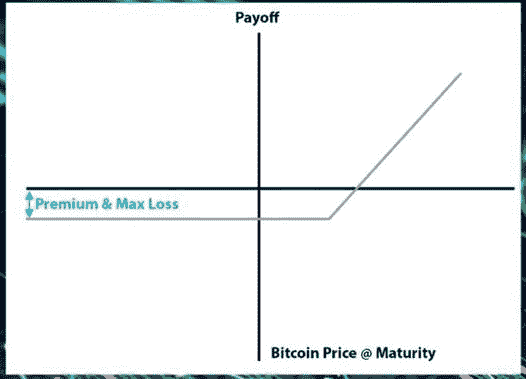
现在看期货工具的图表；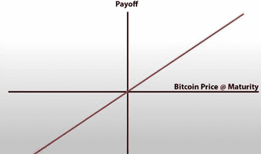
你可以看到你这笔交易的损失仅限于期权费或期权的成本。你损失的不会超过你已经支付的。另一方面，对于期货，你的潜在损失是无限的。或者看这个看跌期权的图表，现在叠加了一个空头期货合约。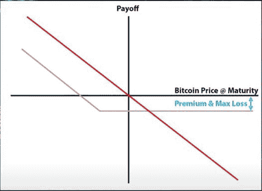
下行也是一样。如果比特币价格上涨，看跌期权的损失是有限的，而空头期货的损失是无限的。这更适用于交易所和场外期货品种。杠杆期货交易所会迅速平仓你的账户以防止负权益，从而限制你的下行风险。

这种期权加密币还有另一面。你也可以卖出期权。这无疑限制了上，并可能导致无限损失。你问为什么有人会卖这些？嗯，它们可以形成一些非常独特的交易策略，这些内容稍后会介绍。在开始之前，我需要涵盖一些期权理论。所以，让我们深入研究，并务必注意不要淹没在数学中。

涉及到期权时，有许多影响其价值的变量或输入。这些是`行权价`、`现价`、`到期时间`、隐含波动率以及`无风险利率`。`行权价`是你同意在未来买入或卖出期权的价格。`现价`是现在的价格。`到期时间`是期权的剩余时间，`隐含波动率`是衡量市场风险的指标。每一个因素以其独特的方式影响期权的价值。`行权价`与`现价`之间的差异对价值的影响最为直接。然而，在其他因素相同的情况下，波动率越高，价值越高。到期时间越长，价值越高。这些变量或输入通常被称为希腊字母。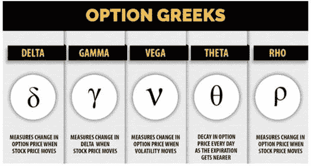它们被称为 `Delta`、`Gamma`、`Vega`、`Theta` 和 `Rho`。这些输入的具体机制和数学可能非常复杂。

还有一点我需要简要讨论，那就是期权的“金值状态”（moneyness）。`现价`与`行权价`之间的关系对期权价值的影响最大。简单来说，期权可以是`实值`（in the money）、`平值`（at the money）或`虚值`（out of the money）。它们的含义如下：
- `实值`是指对于看涨期权来说，现价高于行权价；或者对于看跌期权来说，现价低于行权价。
- `虚值`是指对于看涨期权来说，现价低于行权价；对于看跌期权则则反之。
- `平值`意味着行权价等于现价。

我还应该指出，这些都假设对普通欧式期权进行定价。你还有更多奇异的变体，这些书中将不会涵盖它们。现在对期权有了模糊的了解，让我们进入期权策略吧。


# 第 12 章比特币期权：期权策略

考虑到期权具有非对称的收益特征，你可以构建出一些具有有趣收益配置的独特策略。例如，假设你短期看好比特币并想做多。但你并不认为它在季度末真的会飙升到 1.4 万以上，因此与其购买简单的看涨期权，不如买入一个看涨期权，并通过卖出一个更高行权的看涨期权来资助部分成本。这被称为“牛市价差”（bull spread），既有上收益也有下亏损。这与简单看涨期权的区别在于，你的下亏损较低。这种牛市价差也可以用于下行看跌交易。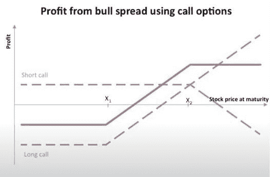

这是一个熊市价差的示例，我们通过卖出看跌期权来降低做空的成本。或者，如果你真的不知道比特币可能会向何处去，但确定它在下季度内将极其波动。它可能飙升，也可能暴跌。这时你可以以相同的行权价同时买入看涨和看跌期权。这就是所谓的“跨式策略”（straddle）。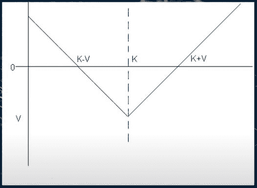

如果价格剧烈波动，无论向哪个方向，你都能获得可观收益。当然，购买两个平值（at the money）期权可能成本很高，所以你可以买入两个略微虚值的看涨和看跌期权。你现在拥有的是一个“勒式策略”（strangle），这是你的收益情况。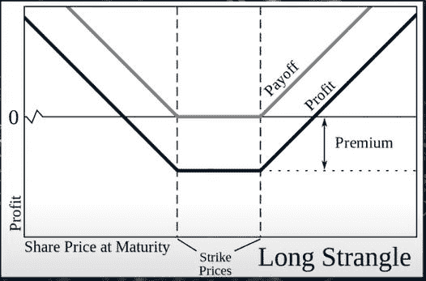

或者，你再用两个期权来卖掉这两个期权的上行空间。你现在拥有的是所谓的“铁蝴蝶策略”（Iron Butterfly），它保证你在比特币上涨或暴跌时获得特定的收益。在勒式策略的基础上这样做，它也可以被称为“铁鹰式策略”（iron Condor）。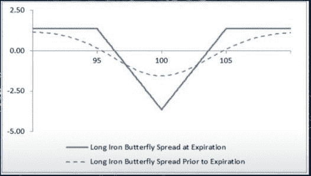

如果你可能认为比特币在几个月内不会有波动呢？那么你也可以卖出跨式或勒式策略，你的策略是波动率保持在低位。你还可以通过买入另一个看涨和一个看跌期权来限制下行风险。这些只是你可以设计的策略和价差中的少数几个。你还可以构建所谓的“日历价差”（calendar spreads），即构建具有不同到期时间的期权结构。

# 第 13 章 如何在 Deribit 上构建期权策略

我确定你正在想在哪里可以买到这些期权，让我们来看看。涉及到比特币期权市场，它们比期货市场发达得多。然而，有很多地方提供这些交易。比特币期权存在三种市场：

1. 通过如 `Ledger X` 等掉期和期权商。
2. 在 `CME Group` 或 `Bakkt` 等交易所列出。
3. 在如 `Deribit` 等零售交易所。

访问 `Ledger X` 网站请访问：`https://www.ledgerx.com/`
访问 `CME` 网站请访问：`https://www.cmegroup.com/trading/options.html`
访问 `Bakkt` 网站请访问：`https://www.bakkt.com/bakkt-markets`
访问 `Deribit` 网站请访问：`https://www.deribit.com/`

对于交易者来说，购买这些期权最好的地方可能是 `Deribit`。这是一个自 2016 年以来一直存在的加密 `Deribit` 平台。它非常受欢迎，还提供永续和季度期货合约。但我们感兴趣的是他们的期权工具。他们目前有两个期权市场：`Bitcoin` 和 `Ethereum`。我更倾向于选择 `Bitcoin` 期权，因为它们的流动性最高。

这个期权交易所的工作方式与传统的交易所订单簿非常相似，由于有很多市场。市场会根据看涨还是看跌、到期时间以及行权价而不同。你可以申购或报价期权以构建你所需的策略。让我们现在构建一个策略，让你了解它在平台上是如何运作的。

我们应该构建什么策略？嗯，我看好未来三个月的比特币，但认为它不会大涨超过 1.2 万。所以我将构建一个牛市价差。简单的牛市价差需要两个看涨期权：一个多头一个空头。我做多一份行权为 `$10,000` 的 10 个 `Bitcoin` 看涨期权。在订单单上，这意味着每个期权的价格约为 0.08 `Bitcoin`，或者 10 个 `Bitcoin` 为 0.8 `Bitcoin`。有了这些期权，如果 `Bitcoin` 在未来 3 个月后低于 1 万，我将损失投入的 0.8 `Bitcoin`。这仍然是一笔相当大的钱。然而，我可以通过卖出一个行权价为 `$12,000` 的空头看涨期权来卖掉部分上行空间，从而减少这种潜在损失。这两个期权的有效期三个三个，符合我的交易周期。一旦下单并执行，我的交易就生效了。

这里有一点需要指出。`Deribit` 的期权不断进行按市估值。因此，你的牛市价差盈亏（PNL）将不断调整以反映这一点。你还必须为空头头投入大量的保证金。这是为了让 `Deribit` 能够管理空头期权带来的总体风险。在交易到期时，你的牛市价差收益应该与你在收益图图中设想的一样。设置任何其他策略的方法都是类似的。确保匹配到期日，然后你就可以选择策略所需的行权价。对于远离现值的行权价，你可能会遇到流动性问题。这只是因为它仍然是一个相对较新的市场。


# 第 14 章 期权市场的巨大潜力

现在让我们来讨论加密货币期权更广泛的潜力。加密货币期权最大的市场之一一定来自机构投资者和矿工。用于财务运营以及过去保护或增强加密货币组合。此前，大型期权合约通常只在场外（OTC）或通过掉期交易商交易。像 `Ledger X` 这样的交易商构建了定制期权交易，使一些对冲基金交易员赚了数百万。这些期权的行权价为 50,000 美元，到期日为 2018 年底。

这些场外期权合约的问题在于，交易商有时找不到交易对手。场外市场是碎片化且具有特异性的。这正是交易所上市期权合约的优势。由于合约是标准化的，这些市场的流动性更好。因此，机构构建交易变得更容易。

比特币期权现在以上市的形式在几家交易所提供。2019 年 12 月，`Bakkt` 开始了季度季度比特币期权的交易。`Bakkt` 是首个提供实物交割比特币期货的受监管期货交易所。2020 年 1 月，`CME` 宣布推出其自己的上市比特币期权合约。人们对这些期权的推出充满期待，因为在推出之前，`CME` 期货市场的未平仓量激增。在正式交易的第一天，`CME` 交易所的成交量超过了 `Bakkt` 自 2019 年成立以来的所有成交量。

## 什么驱动了需求？

嗯，是许多因素。首先，考虑到这些期权以 `CME` 比特币期货结算，交易员有了另一种独特的方式从未来的交割日中获利。他们围绕这些高波动日期构建您的期权交易。我们还经历了比特币减半，以及这在比特币市场中引发的潜在波动。虽然目前只有比特币期权，但我们可以在不久的未来看到以太坊的合约。这是因为上市的以太坊期货似乎即将进入市场。鉴于比特币期权紧随比特币期货，预计以太坊也会出现同样的情况并非没有理由。

## 这些期权对比特币市场意味着什么？

嗯，与期货相比，期权的投机性较低。它们是像比特币这样固有波动市场中对冲风险的极佳方式。通过降低风险，它可以抑制波动。有强有证据表明，在外汇市场引入期权工具具有冷静作用，并减少了过去那种剧烈的波动。正如我们所知，反对比特币的主要论点之一是它波动太大，不能作为交易媒介。如果市场带来了更多稳定性，我们是否能因为波动性降低而看到更多对比特币或加密货币的采用？嗯，不确定。

我们还希望能看到零售交易所提供加密货币期权，我们大多数人都可以使用。虽然它们比期货稍微复杂，但它们为我们提供了一种更高级、风险更低的市场交易方式。它们更多是风险管理工具，而不是投机形式。如果我们观察现在的加密货币交易圈，它似乎主要集中在增加投资回报，而不是保护投资组合。

另一个我们可能很快就会看到利用智能合约构建的去中心化期权。已经有很多项目在为衍生工具构建基于区块链的解决方案。换句话说，我们有一天可能会看到去中心化期权交易所。想想 `0X` (`ZeroX`) 或 `Kyber Network`，但是针对定制期权合约的。构建区块链上的 DeFi 期权合约并在链上交易。不可篡改、透明且掌握在自己手中。

## 未来展望

我对比特币期权带来的机会感到非常兴奋。首先，它将进一步提高机构眼中对比币市场的信誉。随着一个受监管且流动性良好的期权市场，这些大基金更有可能尝试。它还可以为这些基金提供重要的风险管理工具，对于那些依赖比特币的企业也是如此。

矿工可以编写合约，对其未来开采的比特币进行风险对冲。通过提供现金流的确定性，它可以鼓励今天的资本投资。随着这些期权为比特币市场带来更多确定性和安全性，它可能会平息一些剧烈的波动。更稳定的比特币对所有人都是更好的结果。你再也不需要听到比特币作为货币波动太大的论点了。

此外，如果比特币期权被证明是成功的，它可以开启许多其他加密货币期权的可能性。金融市场中存在一系列更奇异的期权类型。如果比特币标准期权被证明是成功的，我们可能会看到更多奇异变体的推出。我们会看到美式期权或可能的数字变体吗？这些是具有独特收赔参数的高级期权。它们在传统金融市场中定期定价，并提供其独特的益处。事实上，现在可能有一家场外经纪商已经在协助更奇异加密货币期权的交易了。如果说我们学到了什么，那就是只要有需求，交易商就会排队提供市场。流动性正在增加，效率正在提高。波动正在减少，无知正在减少。


# 第 15 章 加密货币交易者税务工具

存在一个大问题。加密货币税务非常复杂，大多数会计师只要一听到“比特币”这个词就会避之而远。人们很容易选择逃避现实，像鸵鸟一样把头埋进沙子里，假装那些疯狂的游戏从未发生过。但这些收益最终是需要核算的。

在接下来的章节中，我将介绍几种加密货币税务解决方案。我会探索使用它们的优缺点，并告诉你们它们所有的功能。首先，我将简要概述一下为什么你可能考虑使用加密货币税务软件。

如果你最终选中了那枚热门山币并让它飞上了月，你有两个选择。第一个是尝试变现这些加密财富，并希望那些讨厌的税务人员不要注意到。第二种选择是计算这些税款，并确定需要交给政府多少钱。

许多人认为纳税是合法的盗窃，他们必须保持低调以避免交税。但如果你喜欢睡个好觉，你可能会疑惑为什么需要使用加密货币税务软件。事实上，你不需要。你可以手动处理所有的交易，查询并应用你所在国家的税务指南。自己完成这一切是完全可能的。

问题当然是，记录并汇总每一笔交易以计算你的损益是极其耗费时间的。如果你不是专业的会计师，速度会更慢。我猜你很重视自己的时间，不想花几周时间来计算你需要交多少税。这就是加密货币税务工具大显身场的地方，它们为你完成繁重的工作。简单来说，这些工具在报告税款时确实为你节省了时间和压力。仅此而已，并无更多。

话虽如此，让我们来看看在加密货币税务软件方面有哪些选择。

## CryptoTrader.Tax

有一个名为 `CryptoTrader.Tax` 的软件。它的作用是为加密货币交易者和投资者提供一种极快速的方法来计算他们的资本利得、亏损应税。该选项主要面向美国市场，但也支持国际，可以为任何接受 `FIFO`先进先出）和 `LIFO`后进先出）标准的国家计算税款。所有这些计算也可以用任何法币进行。

### 功能

`crypto trader tax` 在功能方面有什么呢？嗯，它带有一个易于使用的税务文件。其工作原理如下：
- 你需要创建一个账户
- 使用 `API` 导入工具从你的交易所账户导入这些加密货币交易
- 或者你也可以直接上传交易历史的 `CSV` 文件。

到底哪些交易所是受支持的？嗯，有很多个，但要获取完整的最新列表，请访问他们的网站：`https://cryptotrader.tax/`。

一旦你导入了所有交易，你就必须添加当前纳税年度的加密收入来源。好消息是，这个税务平台可以计算来自许多不同的加密特定来源的收益。例如挖矿、分叉、空投、质押（staking）甚至礼物。

最后，你会被要求选择你选定的税务计算方法和想要生成的税务表格。基本上，`CryptoTrader.Tax` 将吐出一份税务报告，其中包含大量文件，如收入报告、`IRS` `8949` 表格、审计追踪报告以及短期长期销售报告。你还将获得年底持仓报告和一个 `TurboTax` 在线直接导入文件。这意味着你可以将该报告导入到其他传统的税务工具中，如 `Turbo tax` 或 `Tax act`。

`CryptoTrader.Tax` 的另一个酷炫的功能是他们的税务亏损收割（tax loss harvesting）功能。这意味着你将收到提供稳健节税机会的加密货币通知，这导致了更好的长期税务规划。对于那些希望在提交给政府之前让合格会计师查看报告的人来说，该税务平台还允许会计师代表你导入、审查和签署税务报告。如果你想让别人帮你双检，这非常有用。

## 价格

这个税务软件解决方案将花费你多少钱？
- **爱好者计划 (Hobbyist plan)**：每个纳税季 49 美元。包括多达 100 笔交易的导入、免费报告预览、在线聊天支持、无限修改、`IRS` 表格、与 `TurboTax` 等报税软件的跨平台整合、税务亏损收割、`FIFO` 和 `LIFO` 计算。
- **日内交易者计划 (Day trader plan)**：每年 99 美元提供上述功能并支持高达 1,500 笔交易。
- **高频交易者计划 (High-volume trader plan)**：支持高达 5,000 笔交易，199 美元解锁高级客户支持。
- **无限计划 (Unlimited plan)**：每个纳税季 299 美元可支持无限交易。

如果你想免费尝试有限的功能，你也可以这样做。

## 优缺点

如果你正在寻找加密货币税务工具，我强烈推荐它。但 `CryptoTrader.Tax` 的优缺点是什么呢？

**优点：**
- 如果我们在寻找一个界面直观、易于使用且提供免费试用的技术解决方案，你应该将这个加密货币税务工具列入清单。
- 考虑到他们对美国市场的关注，如果你在美国，我也会推荐这个选项。

**缺点：**
- 我希望看到更多的交易所支持它。
- 你应该意识到该平台高度关注。这意味着对于世界上其他地区的人来说有更好的选择。

## 结论

`CryptoTrader.Tax` 是给谁用的？

在我看来，这个税务解决方案对于任何在美国申报加密税的人来说都是理想的，但对杠杆交易平台的支持有限。所以如果你喜欢这类，你可能需要查看其他选项。尽管如此，它非常直观且对新手友好。如果你是刚接触加密货币税务计算的世界，这是一个很好的开始。


# 第 16 章：Bear.Tax

我向你推荐查看的下一个税务工具名为 `Bear.Tax`。这款税务软件解决方案为用户提供了一种快速方便的方法来计算和提交税务报告。与 `CryptoTrader.Tax` 一样，它主要针对美国市场设计，也可用于其他国家。`Bear.Tax` 的设计也兼顾了普通消费者和财务顾问，因此当你与会计师共享这些报告时将不会遇到任何问题。

## 它是如何工作的？

`Bear.Tax` 采取了与其他竞争对手类似的方法。这基本上涉及通过 `API` 集成或上传交易的 `CSV` 文件来导入你的交易。随后，你可以选择想要使用 `FIFO`（先进先出）或 `LIFO`（后进先出）规则来处理报告。最后，软件还会为你生成这些税务文件。

## 收入分类

在收入分类方面，`Bear.Tax` 比 `CryptoTrader.Tax` 更多选择，支持收入来源包括礼物、`staking rewards`（质押奖励）、`airddrops`（空投）、`hard forks`（硬分叉）、`referrals`（推荐）、`mining voting rewards`（矿币投票奖励）、`community rewards`（社区奖励）、`inheritances`（继承）、`crypto payments`（加密货币支付）以及 `earning programs`（收益计划）。因此，如果你参与了 `CryptoTrader.Tax` 不支持收入来源，你可能想查看 `Bear.Tax`。

另一个很棒的是，平台的智能匹配算法有助于确保在记录和处理交易时不考虑费用和区块时间延迟。这有助于通过记录应税事件来确保符合 `IRS` 指南，同时确保你不会过度报告税收。非常高效。

对于那些在开始时 `HODL`（持有）且没有真正考虑这些税务问题的人，`Bear.Tax` 的交易审查功能可以提供支持。这允许你搜索特定的交易并进行修改。这意味着你可以确保为特定时间或日期输入了正确的成本基础。

如果你最初拒绝为加密货币税务软件工具付费，那么你一定知道翻阅 `Coinmarketcap` 图表来查询币种历史价格的痛苦。有了 `Bear.Tax`，这已成为过去，因为它为每种支持的加密货币提供了历史价格数据。

## 高级功能与支持

另一个需要了解的点是，该软件工具还支持高频交易者和 `BOTS`。如果你使用过像 `three commas` 这样的 `BOT` 来帮助自动化交易，那么 `Bear.Tax` 将是你想要查看的税务工具之一。`Bear.Tax` 支持许多交易所，但获取完整视图，请访问他们的网站：[`bear.tax/exchanges.html`](https://bear.tax/exchanges.html)。

## 价格计划

- **基础计划 (Basic Plan)**：每个税务年度十美元。此选项支持最多 20 笔交易和无限交易所。
- **中级计划 (Intermediate Plan)**：四十五美元。适用于 200 笔交易。此外，你还可以获得电子邮件自定义支持。
- **专家计划 (Expert Plan)**：适用于拥有多个交易所账户的用户，支持多达一千笔交易，你还将获得聊天支持。
- **专业计划 (Professional Plan)**：每个税务年度两百美元。花费这笔钱，你将获得无限交易、无限交易所、优先支持、自定义文件导入以及与合格会计师联系的能力。

## 优缺点

一个巨大的优点是 `Bear.Tax` 的定价非常实惠。专业计划物极高，非常适合希望会计师查看这些税务计算并确保一切万无一失的人士。我也喜欢基础计划只需十美元，这应该涵盖大多数每年只进行几次交易的 `HODL`者。在让生活变得更简单方面，这 10 美元似乎是牛毛钱。

话虽如此，许多人在 `BuyBit` 等平台上进行交易，而 `Bear.Tax` 不支持该交易所。所以如果你是其中之一，我恐怕你得考虑其他选项了。

## Bear.Tax 适合谁？

嗯，它适合任何想要高性价比税务自动化工具的人。


# 第 17 章 作为税务工具的 CoinTracking

CoinTracking 软件内置了顶级的税务报告工具，让报税过程变得轻而易举。CoinTracking 提供海量数据，包括个人投资组合分析、交易导入、税务申报、币种图表和币种趋势等。CoinTracking 非常受欢迎，拥有超过 61 万名活跃用户，以及 750 多位注册会计师和企业客户。该税务软件解决方案负责为价值 43 亿美元的投资组合生成税务报告。

如果你是加密货币的老兵（OG），那么 CoinTracking 提供的 11 年历史数据将让你无后顾。此外，山寨币猎手们也能受益，因为 CoinTracking 支持超过 7500 种代货币。CoinTracking 的酷之处在于它既适用于加密交易者也适用于企业。因此，如果你是任何新兴的加密创业者，你可能想要仔细考虑这个选项。

## 工作原理

一旦你导入了交易，CoinTracking 基本上会为你计算数据，并输出大量信息，如实时利润、亏损、币值、收益、应缴税额等。个人投资组合分析功能包含了一系列针对交易和币种的交互式图表，以及利润亏损审计报告和已实现与未实现收益的概览。

总而言，CoinTracking 支持 70 个交易所，完整列表可以在其网站找到：[`cointracking.info/`](https://cointracking.info/)。另一个酷的地方是，你可以从 Ledger 和 Trezor 等钱包导入数据，还支持许多老牌交易所，甚至是 MTGox。

与此列表上的所有加密税务工具一样，你可以通过 API 集成连接两个交易所以导入加密交易。然而，它也支持直接区块链网络同步。与 `Bear.Tax` 和 `CryptoTrader.Tax` 不同，CoinTracking 拥有更多的税务计算方法——共 12 种。这包括标准的 `FIFO` 和 `LIFO` 方法，以及平均成本法等许多其他方法。

这意味着 CoinTracking 比我之前提到的任何其他解决方案都兼容更多的税务管辖区。

如果你以前自己报过税，你会非常清楚当出现缺失或重复交易时会遇到什么问题。基本上就是账目不平衡，这意味着你需要检查每一笔交易，这非常耗时。有了 CoinTracking，这应该是过去了，因为该软件有若干种验证交易的方法，旨在发现那些缺失或重复的交易。

## 价格

关于成本，CoinTracking 有一个非常不错的免费选项，支持最多 200 笔交易，以及有限的税务和资本利得报告、币种追踪和 `CSV` 导入。在购买此税务软件之前，你应该先尝试一下，确保你对它满意。

关于付费计划，你需要了解的是：它们是按月收费的，而不是按税季。
- **Pro 计划**：支持三千五百笔交易、优先处理交易，并每月 10 美元提供客户支持。
- **Expert 计划**：升级到专家计划，你将获得 Pro 计划的所有功能，并支持高达 20,000 笔交易。
- **Unlimited（无限版）**：每月 50 美元即可获得无限交易支持和优先客户支持。

## 优缺点

### 优点
- 它支持 12 种不同的加密税务计算方法，这意味着它是为了直接服务更广泛的国家而设计的。所以如果你住在美国境外，可能需要考虑这个选项。
- 它支持大量的币种和交易所，这意味着该解决方案对于专业山寨币玩家和杠杆交易者都是理想的。

### 缺点
- 付费计划可能相当贵。如果你一年内只做了几次交易，我建议你看看像 `Bear.Tax` 这样更便宜的选项。

## 它适合谁？

嗯，对于任何住在美国境外、纳税年度有大量交易的人来说，这是我的首选之一。如果你是使用 `buy bit` 的杠杆交易者或低山寨币投资者，那么这绝对是你应该关注的税务解决方案。


# 第 18 章 Koinly 税务工具

我最推崇的加密货币税务软件是 Koinly。它凭凭第一？呢，与许多税务软件解决方案不同，这款软件并不只关注美国，而是声称对 20 多个国家完全支持。这包括对美国、加拿大和欧洲国家的支持。亚洲对日本、韩国和新加坡也有支持，此外你还有对澳大利亚和新西兰的支持。

我个人发现 Koinly 的投资组合分析工具在真正理解我的组合方面非常有用。它拥有实用的工具，让你查看每项加密货币投资的 ROI（投资回报）、法币收入、盈亏和资本利得。这意味着你的损失无处遁形，同时让你非常清楚地看到你实际上做了一些非常明明的决策。

另一个很棒的功能是，与提到的其他工具不同，在 Koinly 中，数据导入功能不需要你在多个交易所账户之间来回切换。这种自动数据导入可以通过标准的 API 交易所连接或简单地添加加密货币钱包地址来实现。Koinly 对该钱包地址的操作使用了一种智能转账匹配系统，该系统利用人工智能来检测你个人钱包之间的交易。这非常方便，因为没有人想为发送给自己的交易交税。

更棒的是，保证金交易、期货交易、质押、贷款和 DeFi（去中心化金融）的数据也可以导入。那么，一旦这些交易数据导入 Koinly，接下来要做什么？当然是生成你的税务报告。Koinly 的伟大之处在于，你可以免费预览这些报告，而那些烦人的税务表格由 Koinly 为你自动生成。这包括为位于美国的用户提供的 IRS 税务表格。对于位于英国、加拿大、德国、瑞典等国家的用户，还提供国际税务报告。对于那些使用 TurboTax 的人，你们在这里完全没问题，因为 Koinly 具有兼容的数据导出功能。

如果你不想翻阅大量的交易来寻找缺失或重复的交易，好消息是 Koinly 拥有几种专门为这项任务设计的工具。在兼容性方面，情况变得更棒了。Koinly 支持 350 多个加密交易所、50 个钱包、6000 种不同的加密货币，甚至支持像 Lending block、Block by token、Set Blockfolio 等加密服务。简而言之，Koinly 是我发现的任何税务软件工具中支持最好的。

## 费用与计划

这一切需要多少钱？呢，与其许多竞争对手不同，Koinly 提供了一个非常实用的免费计划。这包括支持 10,000 笔交易和 50 个交易所。需要注意的是，如果你在美国或需要任何那些国际税务报告和审计报告，它不会生成 `8949` 或 `Schedule D` 表格。你也将无法导出到 TurboTax。现实来说，这个软件包适用于任何想尝试 Koinly 的人。如果你想自动化这些这些工作来报税，你可能需要选择付费计划。

三个不同的定价方案：
1. **Hodler**：花费 49 美元，支持多达 100 笔交易、无限钱包和交易所。它还提供 Koinly 的所有功能，但优先支持、自定义报告以及报告或导入协助除外。
2. **Trader pack**：每年 99 美元。获得它，你就可以处理高达 1000 笔交易，包含 Hodler 包中的所有内容以及优先支持。
3. **Oracle package**：最高级别让你可以使用 Koinly 提供的所有功能，并支持多达 300 笔交易。如果你需要额外的交易额度，可以通过进一步升级计划来获得对 10,000 多笔交易的支持。该升级总共将花费你 279 美元。

## 优缺点

**优点：**
- 如果你正在寻找 20 多个国家的完整加密货币税务支持，那么这就是你的解决方案。
- 它也是我过的任何加密货币税务解决方案中对交易所和钱包支持最广泛的。
- 它还有一些独特且实用的功能，例如智能转账匹配系统，确保你不会多交税。

**缺点：**
- 它绝对不是市场上最便宜的解决方案。如果你在本纳税年度只有几次交易，我建议你看看 Bear.Tax 的 10 美元方案。
- 另外，如果能看到更多国家的支持就更好。

## 结论

所以，Koinly 是给谁用的？呢，如果你的国家被完全支持，而且你在当前的税务年度内有几十次以上的交易，那么我认为你不需要再看别的了。这涵盖了目前市场上最好的加密货币税务解决方案。要了解更多关于 Koinly 的信息，请访问他们的网站 `https://koinly.io/`。事实是，即使在最好的情况下，税务也是件麻烦事，让我们面对吧，没有人真的想花几天时间缩在计算器和 Excel 表格前。尽管你可能需要花几美元购买这些加密货币税务解决方案之一，但我想象大多数人会说，使用它可以节省无数小时或几天。

# 第 19 章 无交易公式

人类固有的情感使我们容易犯下某些错误。当你投入资金时，这些错误的代价会变得越来越高昂。即使是世界上最顶尖的交易员也可能成为心理错误的受害者。但这些错误是什么？呢，在接下来的章节中，我将与你分享它们具体是什么。我还会给你一些顶级建议，防止你掉入陷阱。

需要指出，这些错误对于交易任何市场都是相关的。这包括加密货币、外汇和大宗商品。这也是一个非常全面的列表，涵盖了从为人知的到为人知的交易错误。所以，如果你觉得其中某些错误特别不适用于你，可以自由跳到下一章。

## 基础错误

新手交易者犯的首个最基础的错误是没有任何计划。没有交易公式或投资假设，没有结构来以一致且经过深思的方式进行交易。他们把交易当作赌场的轮盘。一笔接一笔地投入几百美元。祈好运，也许你选中了一笔盈利的交易。完全出意料的是，这种策略并不是盈利的。事实上，它是亏损的。你会赢一些，输一些，但最终交易费用会不断累积。

大多数新交易者进入市场时，他们这样做是为了预期赚钱。他们想从一开始就进入那个阶段，并宁愿放弃制定计划所需的几天时间。

我说的计划指的是什么？呢，关于目标回报以及你希望实现这些目标的时间范围的定义。你愿意承担多少风险，它是否在你的预算之内。


# 第 20 章 止损——现在该怎么办！

人们讨厌亏损，尤其是当他们认为有某种可能可以从亏损中恢复时。这种对亏损的恐惧往往导致他们做出次优的决策。这在交易中如此，在任何事情上都是。他们避免割肉亏损交易，因为他们希望能够回升。即使这笔交易已被证明是糟糕的，交易者也会保持开仓，抱着自己是对的且市场会自我修正的幻幻想。这是一种愚蠢的行为，通常会导致更大的损失。

动量是金融市场中一种非常强大的力量，如果一个交易背离了你的假设，请迅速切断。接受微小损失并在之后重新评估你的立场。从纯心理学的角度来看，当你不再受到亏损头寸的影响时，你可以更清晰地思考你的分析。市场真的发生变化了吗？是否有某些新闻改变了变量和输入？市场是否突破了某些关键技术位？这些都是在你进行下笔交易之前需要回答的重要问题。

既然谈到了下笔新交易，只有一种比不关闭亏损交易更具破坏性的错误。那就是追单并加仓。在糟糕的交易上加倍投入是导致爆仓和耗尽资金的最快方法之一。赌徒经常这样做，正如我们所说的，这个术语被称为“赌徒破产”。如果一笔交易违背你，它更有可能随着动量继续下去。因此，如果你对这笔交易加仓，你可能正在挖掘一个许多交易者深陷其中的坑。当然，有一种简单的方法可以让你及时避免所有的风险。那就是简单地避免我们接下来的错误之一：未能设置止损。

# 第 21 章为什么你必须设置止损

止损是设置在入场点上方或下方关键水平的自动订单。取决于你是做多还是做空。它们可以在无需干预的情况下关闭交易，并可以帮助消除心理思维缺陷的风险。如果一笔交易违背你而你没有调整止损位，它们将被关闭并停止你的损失。

止损的另一个非常重要的原因是，当你不监控自己的交易时，它们仍然会执行。这对于像 `Forex` 中的 `Crypto` 这样的隔夜市场尤为如此。我们需要睡觉，不会一直在那里监控我们的交易。在设置这些止损位方面也有许多策略，以及你可以设置的大量股票类型。例如，你可以在定义的技术水平上设置止损。或者你可以设置距离入场位几个百分点的点。你还可以设置一个移动止损，它将保持与你的交易几个百分点的距离。如果你的交易进入盈利，它会自动调整。

无论你打算设置何种止损，都应该与你更广泛的交易策略结合进行。如果你在做短线交易（scalping），那么它们应该是非常紧凑的止损。如果你在监控长期趋势，那么它可以设置在关键的恐慌点上方。所以，设置一个止损并让它运行。如果你触及了它，将会会有损失，但那是一笔你已经在心理上做好了预算并愿意接受的损失。

# 第 22 章 交易市场与过度交易

下一个错误，这又是另一个经典的新手错误；交易太多的市场。世界上最顶尖的交易者都是专家。他们了解特定市场的来龙，并几乎完全专注于那一个市场。本质上，他们拥有自己的领域。他们知道自己在哪些市场利润最高，在哪些市场不是。

市场中一些经验较少和较新的交易者倾向于交易许多不同的市场。他们想成为全才。他们会跳入 `cryptocurrency`，然后在旁边交易 `Forex`，同时还试图尝试股票。即使他们只交易一种资产类别，在太多的不同资产中持有头寸也是有害的。一个交易者只能对一个市场投入特定数量的注意力和。当你开始将这种注意力分散到其他市场时，你就会损害你在两个市场中的表现。

你之所以只想关注少数资产，有一个非常充分的理由。你确切知道它将对重要新闻做出什么反应。你学会了它与关键市场变量之间的关系。你对它所有的癖和特征都有了了解。这在世界上一些最盈利的对冲基金和银行也有先例。如果你看他们的交易大厅，大多数交易者将拥有一个特定的市场。会有一个专门研究 `gold options` 的交易者。另一个专门研究 `oil futures`，第三个专门研究 `euro swaps`。那些在某项手艺上最精通的人，能为经济提供的价值比那些试图执行 15 种不同任务的人要多得多。

所以在交易时也使用同样的原则。找到一个你想要交易的市场并让它成为你的。学习它的内外部。研究历史图表并理解它的特定特征。你可以在制定初始交易计划时这样做，也可以在你最初开始交易时向你的理想市场迈进。当然，这并不意味着你不应该交易一个以上的市场。这意味着你应该对你所交易的市场更具鉴别力，并将大部分注意力放在那些你认为自己有现实机会击败的市场上。

我将要讨论的下一个交易错误是此的轻微变体，被称为 `Overtrading`（过度交易）。许多人似乎认为交易回报与交易活动有某种相关。那么你出的交易数量可能会对你的盈利能力产生某种影响。这是一个谬误，而且通常情况下事实恰恰相反。你有每笔交易都会被收取的交易费用。你交易得越多，这些费用累积得越多。


# 第 23 章 分析瘫痪

我们来看下一个错误，这个错误对于技术分析师来说也是常见的误区：使用过多的指标。某些专家绘制的图表布满了各种指标和趋势线，看起来就像圣诞树一样。这种现象被术称为 `analysis paralysis`（分析瘫痪），而这正是使用过多指标会对你的交易产生的影响。它会模糊你的判断并让你的交易变得过度复杂。

此外，许多指标之间可能会相互矛盾。你可能在 `MACD` 上看到了一个绝佳机会，而 `RSI` 处于合理水平。但 `stochastic oscillator`（随机震器）却否定了这一点。你又加上 `money flow indicator`，你的交易分析就成了一团糟。

时间框架分析也是如此。如果你正在查看许多不同时间周期的 `moving averages`（平均线），可能会干扰你当前的分析。对于长期分析，通常使用 `200`、`100` 和 `50` 日时间框架。对于短期趋势，你可以检查 `10` 日或 `20` 日的 `moving average`。然而，没有必要在图表中绘制过多的 `moving average` 图表。

所以，在分析时要尽量保持简单。仅仅因为看起来看起来非常复杂，并不意味着它更好。通过一组定义良好且有限的指标和绘图工具，你可以轻松地在噪音中发现那个黄金信号。

下一个错误是另一个非常严重的错误，人们不仅在交易时，在进行任何类型的投资时都容易犯。你永远不要用超过你承受能力范围的资金进行交易。这才是符合实际的。除了极不负责任之外，这也不符合逻辑。当你投入大部分空闲资金进行投资时，往往会产生情感投入。资金损失的影响会变得如此严重，以至于无法避免地干扰你的分析。你会错失本该抓住的交易，并追逐绝对不应该追逐的亏损。所以从任何角度来看，这都是次优的。

你需要像拥有 `trading strategy`（交易策略）一样拥有一个 `money management strategy`（资金管理策略）。你必须仔细划出一个你能够承受风险风险的 `trading budget`（交易预算）。在发生最坏的情况下，你也应该完全接受损失这笔本金。如果真的发生了，你可能需要停止交易一两个月，但你的银行里还有钱，你有房住，有饭吃。

# 第 24 章杠杆

现在你已经预留了交易预算，但你还需要负责任地管理你的风险。我看到的交易者犯的另一个常见错误是使用过高的杠杆。杠杆是一双刃剑。它可以增加你的收益，但也可能让你破产。以有限的保证金进行交易意味着市场中任何意外的波动都可能清空你的交易账户。这在 `cryptocurrency markets`（加密货币市场）中为为，因为你交易的是波动巨大的资产。`Bitcoin` 有很多情绪波动，一次负面波动就可能让你损失一半以上的资金。再加上杠杆，损失会更加严重。

此外，你完全没有理由将杠杆用满。仅仅因为你可以以资本的 `100` 倍进行交易，并不意味着你应该这样做。从长远来看，使用低于 `20` 倍的杠杆同样可以成功。因此，深思熟虑的 `money management strategy` 配合精心设计的 `risk management strategy`（风险管理策略），是在即使低迷时期也能让你留在场内的最有效方法。

# 第 25 章 糟糕的经纪建议

下一个错误，是大多数人在甚至还没有交易之前就会犯的错误。选择错误的 `exchange`（交易所）或 `broker`（经纪商）可能是一个很大的错误，但这是完全可以避免的。在使用特定的交易所之前，充分的研究至关重要。这些人并不是你交易的对手，但他们决定了你的交易环境。还需要指出的是，经纪商和交易所领域充满了诈骗和砖店商人。他们要么是想坑你的钱，要么就是无能到让你的交易体验大失所望。

那么你应该寻找什么呢？虽然有很多要点，但这里有一个简要总结：

- **合理的费用**：它直接影响你的盈利能力。
- **安全的资金存储**：你希望你的资金安全。他们是否在 `cold storage`（冷存储）中使用 `segregated Fiat accounts`（隔离法币账户）来覆盖他们的 `crypto asset coverage`（加密资产）？你需要一些选择空间。
- **平台功能**：它是否包含了你的所有技术工具？它是否直观且无 Bug？
- **执行效率**：它能否以有限的 `slippage`（滑点）快速下单？是否存在定期的系统停机？
- **声誉**：如果他们表现很糟糕，你可以肯定其他交易者一定会投诉。外面是否有警告和通告？其他交易者在说什么？

虽然其中一些信息可以通过稍微挖掘发现，但大多数其他信息可以通过尝试该交易所或经纪商来发现。创建一个 `test account`（测试账户），使用 `demo funds`（模拟资金），逐步过渡到第一笔存款，即使如此也要从小额开始。一旦你找到了适合你交易风格并满足你大部分要求的交易所，那就又少了一个需要担心的麻烦。


# 第 26 章：选择错误的交易所

我列单上的下一个错误与选择错误的交易所非常相似，那就是听从糟糕的建议。我们都在 Twitter、Instagram 甚至 YouTube 上见过那些所谓的“交易专家”，他们开着租来的兰基尼，拿着假钞作为交易交易员，他们将自己丰厚的交易回报宣传成他们能够大获成功的原因。

可悲的是，这些“天才少年”中的 95% 仅仅是有效的营销人员。这些人实际上并不能通过交易赚钱，所以他们试图推销自己“极其成功的交易服务”。这可能以付费 Telegram 群组、信号、教育课程包或其他赚钱技巧的形式出现。其中一些人通过出售这些服务赚得盆满，至于他们负担得起让新手认为他们是伟大交易员的生活方式。这是一个恶性循环。

线上有许多免费资源。你可能想要的一切都触手可及。这只需要在这里或那里稍微挖掘一下。有很多成功的交易者，但没有一个人的成功是因为在线导师分享了什么秘密建议。这些虚假先知究竟是谁？嗯，我确信只要你使用我刚才提到的简单经验法则，就能识别出他们。

我提到的大多数错误都与避免亏损有关。但为了成为成功的交易者，你还必须有效地保护你的收益。这引出了交易者往往会犯的少数错误中的最后一个。

## 永远不要害怕获利

如果你的交易已被证明是成功的，并且你处于舒适盈利的状态，那么从长远来看，获取这些利润是非常值得的。此外，交易者往往会陷入一种心理谬误，认为一次成功的交易将一直成功。他们想要“让利润奔”。问题是，这更像是一种赌博策略，等同于追损。你做出的决定是基于直觉而不是大脑。直觉交易从长期来看并不是最可靠的策略。

无论如何，如果你的分析点指向更高的回报，那么请保持仓位开启。但要在入场位上方设置一些止损，以便锁定这些利润。最佳做法是在关键水平上或距离入场位一定百分比的地方设置止盈单。使用止损单来完成操作；这可以消除情绪因素，并确保在你离开电脑时也能执行交易。接下来，让我们假设你已经执行了多次成功的交易，而且一切进展顺利。

# 第 27 章：过度自信

最后一个也是最被忽视的错误被称为过度自信。过度自信和自大在某些领域和职业中可能有效，但在交易中绝对不可通。

当你开始对自己的交易价格感到自满时，你的分析就会出现缺陷，你不再批判性地分析你的交易，并忘记了为了获得该盈利位置而采用的一些关键策略。

傲慢的交易者还倾向于使用更高的杠杆，交易他们并不熟悉的市场，更糟糕的是，投资超过了他们应该投入的金额。这不是只有没有经验的交易者才会犯的错误。世界上一些顶级交易者也曾屈了自己的自大。有很多非常专业的交易员的例子，他们认为自己无懈可击，最终被证明并非如此。

因此，适度的谦逊对长期交易收益有巨大的回报。这些交易错误是你负担不起的。我希望这些例子能帮助你避开可能炸掉你交易回报的潜在地雷。但说实话，如果你想成为一个持续盈利的交易者，还需要更多。这是一个需要大量研究和分析的迭代过程。制定交易计划并找到合适的交易市场和产品需要时间。不仅如此，了解这些市场的内部运作只有在实际交易几个月后才能真正做到。没有能够快速暴富的交易计划，但只要你坚持下去并保持专注，你最终会看到回报。


# 第 28 章：市场活跃与初步研究

在加密货币领域，可以说没有什么比进行你自己的研究（DYOR）更重要的了。这说起来做起来难。谁有时间对任何特定的加密货币项目进行真正的尽职调查呢？毕竟，那里有海量信息，很难分辨哪些是真实的，哪些是假的，哪些只是纯粹的幻想和推销。

然而，如果你对自己的加密货币目标是认真的，你就需要学习如何进行自己的研究。研究将帮助你判断哪些加密货币值得购买，哪些应该避开。它会让你更容易判断何时买入何时出售这些加密货币，甚至可以帮你向亲友介绍这种神奇的互联网货币。如果你做了足够的研究，甚至可能发现自己已经在加密货币领域全职。

在接下来的章节中，我将教你加密货币自主研究的艺术，我还会揭秘我个人使用的研究策略。众所周知，加密市场从不休眠，这意味着有时你不能等别人来报道你喜爱的加密货币。2020 年底我们正处于牛市的起点，许多人会对许多不同的加密货币产生很多问题，而你可能无法以你想要的速度获得答案。因此，你只剩下最后一个选择，那就是学习如何进行自己的研究。

## 确定经济活跃度

进行加密货币自主研究的第一步是确定你感兴趣的加密货币在经济上是活跃的。我无法数次遇到一个很有前景的加密货币项目，结果检查其市场活跃度时发现该币已经死掉了几个月甚至几年。

因此，当你听到一个引起你兴趣的有前景加密货币时，要做的第一就是去 `Coinmarketcap` 或 `CoinGecko` 这样的网站看看它是否活跃。在大多数情况下，`Coinmarketcap` 和 `CoinGecko` 是你了解该加密货币的起点。如果是如此，请务必检查你看到的成交量和价格波动是真实的。

该代币不仅应该列在至少一家信誉交易所，而且在该交易所的交易量也应该是相当大的。如果不是，你可能会发现自己在支付溢价，因为订单簿深度可能不够。如果你查看的加密货币是一个 `ERC20` 代币，且几乎仅在 `Uniswap` 等去中心化交易所上交易，请务必谨慎行，因为去中心化交易所（Dex-s）并没有任何具体的上市标准或要求。这并不意味着要否定一个项目，但它是你未来需要记住的一点。此外，请记住，加密货币的价格甚至其最近的价格波动，在少数例外之外，并不是你撤船的充分理由。

## 研究资源

一旦确定了你青睐的币具有经济脉搏，就是时候了解它是什么以及如何运作的了。在理解新的加密货币时，YouTube 绝对是一个很好的起点，问题在于，你可能会发现自己一直在跳过那些人们朗读网站主页内容并进行非常糟糕的技术分析的视频。

这就是为什么你还应该去关注 `Messari`、`Binance Research` 以及像 `ICO Drops` 这样的 ICO 跟踪网站。当你使用这些资源时，务必做笔记并写下可能产生的任何问题。你现在还不是寻找答案，只是在获取一个入门知识。

### Messari
我之前提到过 `Messari` 是你可以用来分析加密货币的强大工具。在这种情况下，你在 `Messari` 上寻找的是你感兴趣的加密货币的简介（profile）。在这里，你通常会找到一个详尽全面的拆解，包括加密货币的历史、极其详细的代币经济学（tokenomics）和代币分配，甚至是项目过去和未来发展以及融资里程碑的时间线。务必记录下项目涉及的任何关键人物的名字，即创始人和 CEO（假设他们不是同一个人）。你以后会需要这些。

### Binance Research
与 `Messari` 相比，`Binance Research` 往往采取更具技术的方法来分析任何代币。这对于理解你感兴趣的加密货币的核心组件及其运作方式非常有帮助。`Messari` 和 `Binance Research` 的伟大之处在于，因为它们是该领域的大玩家，所以它们被认为具有某种程度的专业。换句话说，他们基本上必须做好工作并确保一切正确，否则他们所编写的加密货币的粉丝会发起攻击，他们甚至可能看到加密货币项目本身更严重的报复。唯一的问题是，`Messari` 和 `Binance Research` 上的信息通常有点过时。你不能真的怪他们，考虑到撰写新鲜出炉的加密货币内容并不是他们的主业。

像 `ICO Drops` 这样的 ICO 跟踪网站就像是时间机器，因为它们经常获取那些在你正在调查的加密货币网站上已无法看到的旧图像和文档。这让你很容易发现一个加密货币项目是否改变了方向，或者它仅仅是试图掩盖过去。

不幸的是，`ICO Drops` 和类似网站报告的筹资总额并不总是准确，往往包含了在私募融资轮次或该项目进行的多次 ICO 中筹集的任何资金。因此，你应该始终检查它们是否提供了任何可以让你更好地了解资金筹集方式和代币分配情况的图片。记住，`Messari` 在方面做得很好，所以你可以对比 `Messari` 的数据与 `ICO Drops` 上的数据，以明确某个加密货币项目是如何筹集资金的。


# 第 29 章：研究技术元素

既然你已经很好掌握了你感兴趣的新型加密货币，你就需要查看源码了。由于你记得记下了参与该项目的关键人物名单，你的下一个任务是找到他们最近在 YouTube 上发布的采访。我建议在观看之前，先按时间顺序对它们进行排序。

我发现，观看加密货币项目关键成员的采访可以提供你在其他任何地方都找不到的宝贵信息。此外，这些采访往往能帮助我理解项目的某些技术元素，而这些元素仅通过阅读文档是很难理解的。很有可能，你在阅读 `Messari` 和 `Binance Research` 上关于加密货币的文章时产生的大部分疑问，会在这些采访中听到的内容得到解答。

观察项目幕后大脑的运作方式，也能让你感觉到你面对的是“下一个大机会”还是“伪金子（骗局）”。此外，检查他们的 `LinkedIn` 个人资料，看看他们的资历是否有含金量。他们在 `Google` 或 `Microsoft` 工作了几个月就因为在工作中醉酒被解雇，那么这些经历没有任何意义。

最后，尝试看看能否找到你正在研究的加密货币的 YouTube 频道。如果你运气好，你会发现一些用通俗易懂的英语解释项目核心组件短视频。你的研究还剩下最后一步：对你目前学到的一切进行事实核查，并弄清楚这种加密货币的前。

# 第 30 章：复检来源

你曾多少次进入正在研究的加密货币网站，却被那里提供的信息所淹没？这就是为什么大多数人只读首页和“关于我们”部分就完事的大原因之一。遗憾的是，特定加密货币网站上的大多数信息往往是关于“为没有银行服务的群体提供服务”或其他他们称倡导的伟大事业的陈词滥调。直言地说，加密货币网站上的大部分内容都是没用的，无法帮助你判断该项目是否值得关注。而且，如果你不知道自己在寻找什么，你会在他们的网站上浪费大量时间闲逛。

但由于你记下了这种加密货币运作方式的关键组件以及你可能对其提出的任何问题，你的下一个任务就是检查你学到的所有内容是否仍然适用，并解决自你开始研究以来可能出现的任何谜团。大部分内容可以通过挖掘加密货币的专用文档轻松完成。如果你运气好，你会有一个友好的搜索框，你可以在其中输入关键术语，如 `tokenomics`、`inflation`、`ICO`、`consensus mechanisms`、`mining`、`staking` 以及任何你认为仍需澄清的其他主题。否则，你将手动搜索文档。

由于加密货币文档通常面向开发者，你提取的许多页面将包含几行计算机代码。这看起来可能很吓人，但大多数情况下，你会发现页面开头或附近会用通俗易懂的语言对正在发生的情况进行简单解释。如果你在寻找关于 `tokenomics` 的答案方面仍然遇到困难，尝试挖掘白皮书，找到 `tokenomics` 部分，看看它是否能提供额外的见解。

如果还没有，尝试寻找该加密货币的区块链浏览器。如果它是一个 `ERC20` 代币，我建议访问 `https://etherscan.io/` 使用 `Etherscan`。在这里，你可以快速检查谁是最大的代币持有者，你甚至可以在饼图中看到代币分布。留意任何持有大量代币的钱包，并记住你看到的最大的钱包有时是用于质押等用途的智能合约。如果你选择的加密货币不是 `ERC20` 代币，希望它的区块链浏览器也能让你看到代币持有者富豪榜。如果没有，请将其视为红旗。


# 第 31 章 检查更新与路线图

现在你已经对加密货币有了了解，最后需要做的是查看该项目是否有任何可能即将或已经发生的重要更新。在加密货币研究的最后阶段，你需要三样东西：路线图、博客和新闻。而且，要按这个顺序来，因为通常你在新闻中看到的关于加密货币的内容，往往只是他们博客上文章的总结。请注意，如果他们引用的博客文章太长或太复杂难以理解，这些新闻文章就会派上用场。

### 关于路线图
根据我的经验，加密货币的路线图往往很模糊，通常不会提供太多信息。你可能会发现，观看创始人和首席执行官的采访比其路线图能提供更多关于项目未来的信息。如果你足够幸运，你会发现一个包含现实目标的路线图，这些目标可以在项目耗尽资金或被竞争对手击败之前实现。如果你不走，你根本找不到路线图，而且如果你看过的采访没有让你觉得这个项目会存在很久，那么你可能面对的是一项短期投资。

### 博客
不过，未来并不是一切。你需要确保项目到目前为止交付了它所承诺的内容。这就是博客大显身手的地方。如果你在加密货币网站上很难找到博客，很有可能在他们的 Medium 页面上找到。有时你甚至得深入到他们的 `github` 来查看进度，那时你真的应该问问自己，这个项目是否在如履薄冰地运行。快速浏览加密货币项目博客的标题，通常足以让你判断它是否信守承诺以及正朝向何处发展。实际阅读你看到的任何重大更新是一个好主意，例如涉及代币经济学（tokenomics）的变化或任何重大的合作伙伴公告。

### 加密货币新闻
最后，打开 `cointelegraph`、`coindesk` 和 `decrypt` 等加密货币新闻网站，搜索查看你那个有前景的项目是否登上了新闻头条。如果你没有发现任何消息，不要将其视为坏信号。与主流媒体一样，加密媒体有它们自己的运作方式，它们并不总是能揭示需要关注的话题。

到此时，你应该已经拥有所需的所有信息，可以对一种加密货币是否值得做出良好的判断。如果没有，那么你可能正在处理一个你需要非常小心甚至应该远离的加密项目。这可能意味着你必须回头更仔细地查看研究中使用的资源。进行自己的加密货币研究可能工作量很大，但问问自己：为了投资获得 100 倍或更多的回报，花几个小时的研究值得吗？是的，值得。

### 我的研究策略
个人而言，我研究加密货币的方法是首先访问 `Coinmarketcap` 或 `CoinGecko`，查看该代币是否交易活跃，最好是在声誉良好的交易所。如果它已经“死”了，就不值一看了。

1. 接下来，我去 `YouTube` 看看其他人对该项目的看法。如果他们提到了任何值得注意的内容，我会做几笔笔记。
2. 接下来我查看 `Messari` 和 `Binance Research`，以更好地了解项目及其是如何运作的。我会多记一些笔记，写几个问题并记下创始人的名字。然后我检查 `ICO Drops` 以查看项目募集了多少资金以及代币是如何分配的。我会使用他们引用的图片结合 `Messari` 来双检那里列出的细节是否正确。
3. 第三，我回到 `YouTube` 观看几乎每一个与项目首席执行官或创始人的最新采访。通常情况下，他们的话回答了我在第二步中写下的许多问题。他们还倾向于澄清技术上任何令我困惑的模糊部分。我还会检查该加密货币是否有 `YouTube` 频道来提供额外的见解和解释。
4. 假设我听到的内容没有让我反感，我将开始第四步：挖掘项目文档。我寻找任何与加密货币技术、代币经济学、共识机制、质押奖励、挖矿要求以及我目前学过的任何其他核心组件相关的额外细节。

最后，我搜索他们的路线图和博客，查看他们到目前为止是否实现了承诺的进展，以及他们是否能够现实地部署他们声称将提供的服务。然后查看他们的活动是否在加密领域登上了头条。如果没有，这可能是一个领先于市场的机会。要么这就意味着我只是浪费了几个小时的时间。我根据所做的研究做出这种判断，老实说，我并不总是对的。

无论如何，我认为这是一个进行有效加密货币研究的无懈击击策略。对我来说，它是观察、阅读和重复的完美结合，确保了我学到的知识在很久之后依然记忆深刻，并帮助我更快地进行下一次研究。很容易忘记，加密货币是一个非常新的领域，目前仍处于婴儿阶段。这意味着如果你能精通进行自己的加密货币研究，你将成为少数在牛市期间零售端 FOMO（恐慌症）开始来袭时真正知道发生了什么事的人之一。最终结果不仅是你做出更好的投资决策，你还可能发现自己获得了梦超梦想的机会。


# 第 32 章理解加密货币周期

想象我们正处于 2021 年底，`Bitcoin` 刚刚创下历史新高，并且没有任何放缓的迹象。一些山寨币已经涨了 10 倍，或者你恰好持有了其中一种或多种山寨币的大量份额。目标非常清晰：月球。月球已清晰可见，既然你已经如此接近它，你开始意识到，你从未花时间认真思考加密货币投资中最为重要的问题：我什么时候应该卖出？也许你会飞过月球，并在震惊中目目看着你所有的利润因为 FUD（恐惧、不确定和怀疑）而化为乌有。

好，如此，在接下来的章节中，我将关注几个指标，这些指标可以帮助你制定自己的最终山寨币退出策略，无论你持有的是哪种山寨币。要建立无懈可击的退出策略，首先理解我们正在处理的资产至关重要。这种理解从结合背景开始。

世界经济由多个金融市场组成，例如房地产市场、外汇市场、股市以及数以千计的市场。几乎所有这些市场都遵循某种可见的周期。它可以是一年周期、四年周期，甚至是 12 年周期。在某些情况下，这些较长的周期内部还包含持续几个月甚至几周的更小周期。这些周期也会随着时间而变化，通常随着特定市场的成熟而变得更长。

加密货币市场非常年轻，这使得它非常波动。这简单是因为没有人确切知道市场的实际价值是多少。更年长、更成熟的投资者持有着全球金融市场的大部分财富。这些投资者通常更加保守，在投资时不那么倾向于承担风险，特别是在面对由他们不理解的技术组成的新市场。这实际上是 `Mastercard` 退出 `Facebook’s Libra` 项目的原因。首席执行官 `AJ Bangor` 表示：“当你不理解钱是如何产生时，它的产生方式往往是你不喜欢的方式”。

相比之下，较年轻的投资者对技术更精通。我们知道 `Bitcoin` 是如何运作的，也了解该领域许多前景广阔的山寨币。我们也更倾向于冒险风险，而且在面对我们喜欢的山寨币时，我们中的许多人都有严重的“希望成瘾”。不仅如此，加密货币市场并不局限于穿西装领带的交易者。你只需要一个互联网连接即可参与，这意味着有许多缺乏经验的投资者。这使得加密货币市场在日常中变得更加波动和不理性。

尽管加密货币市场每天充满混乱，但当你退后一步时，你可以看到一个非常清晰的市场周期。这个周期似乎持续大约四周，由一个两到三年的牛市和随后的一到两年的熊市组成，具体取决于你如何定义指标。加密货币市场周期似乎是由 `Bitcoin` 减半引起的。矿工的 `Bitcoin` 区块奖励每四年减少减半。假设需求保持不变，供应的突然减少最终会导致 `Bitcoin` 价格的飙升。由于大多数山寨币与 `Bitcoin` 高相关，它们在那个时期也会看到巨大的向上波动。这种价值的爆炸引起了媒体的关注，从而带来了更多来自经验丰富和缺乏经验投资者的资金进入加密货币市场。

最近一次减半发生在 2020 年 5 月，导致许多人认为我们正处于加密货币市场下一次大动作的脚声上。有些人会说我们已经身处其中了。与之前的两个周期相比，加密货币领域来自金融机构和经验丰富的零售投资者的“聪明钱”比任何时候都多。这在部分是因为全球政府监管机构已开始做功课，并意识到加密货币远比推特黑客或勒索软件攻击复杂。

而且，加密货币市场目前包含 7600 到 8200 多种硬币和代币。所有这些资产的合并市值目前约为 5620 亿美元。要查看加密货币市场总市值的最新全球图表，请访问：`https://coinmarketcap.com/charts/`。`Bitcoin` 占据了最大的份额，截至 2020 年底其市值约为 3560 亿美元。因此，与其他金融市场以及类似资产（如 `gold`）的市场相比，加密货币市场要小得多。作为参考，外汇市场的价值约为 6.6 万亿美元，而 `gold` 的市值目前约为 9 万亿美元。许多人将这种市场对比解读为加密货币市场仍有很大的增长空间。

# 第 33 章 Bitcoin 与山寨币之间的动态

现在我们已经对加密货币市场有了稳固的掌握，是时候仔细观察其内部的单个资产了。众所周知，`Bitcoin` 是第一种加密货币，并且在很大程度上仍然是最大、最受欢迎的。因此，其他所有加密货币被称为山寨币（altcoin）。虽然这种二分法是有待争议的，但尽管如此它是非常重要的，原因如下：

即使在下一次牛市中，任何山寨币的市值很快超过 `Bitcoins` 的可能性也非常低。这是由于一个简单的原因：`Bitcoin` 是机构投资者和经验丰富的零售投资者大多数聪明钱的去向。你不会很快看到大公司在买入山寨币的回调。即使是 `Ethereum` 在进入严肃投资者手中也面临困难。这似乎部分归因于即将发布的 `Ethereum 2.0`，一些像 `Greyscale` 这样持有 `Ethereum` 的大投资者认为 `ETH 2.0` 是投资的重大风险。

与山寨币相比，`Bitcoin` 的波动小得多，而且其波动性多年来逐渐减少。此外，它的价格走应对山寨币有显著影响。当 `Bitcoin` 上涨时，山寨币也会上涨。如果 `Bitcoin` 上涨得太快，许多山寨币往往会在短期内出现损失，尤其是那些市值较小的。为什么？嗯，因为投资在山寨币上的大部分资金来自寻找通往月球最快路径的加密火箭人。当我们看到 `Bitcoin` 起飞时，我们中的许多人会抛弃山寨币冲向 `Bitcoin` 飞船。当 `Bitcoin` 失去动力价格下跌时，一切都回到了地面。山寨币在 `Bitcoin` 价格逐渐上涨或处于横盘交易时往往能获得最佳增幅。这部分是因为投机性投资者对 `Bitcoin` 和其他大型山寨币的价格走势感到无聊，开始越来越接近前 10 或前 20 名山寨币之外更深层、更混乱的水域。理解 `Bitcoin` 与山寨币之间的这些动态关系至关重要，因为你的最终山寨币退出策略始于这样一种意识：它将受到 `Bitcoin` 动态的严重影响。你的山寨币可能到达的上限实际上是由 `Bitcoin` 自身的市值设定的。虽然随着牛市的发展，`Bitcoin` 的市值可能会继续增长这是一个事实，但计划在 `XRP` 达到 1000 美元时卖出并不是一个现实的退出策略，因为这将使 `XRP` 的市值超过 50 万亿美元。这是整个美国经济体规模的两倍多。


# 第 34 章理解代币经济学

现在你已经了解了 `Bitcoin` 的价格波动似乎是如何影响山寨币的，并且可能已经意识到你喜欢的代币的市值在短期内可能不会超过 `Bitcoins`，那么下一步就是考虑代币经济学（Tokenomics）。

如果美元是一种加密货币，那么它将拥有加密领域中最糟糕的代币经济学之一。它的年通胀率约为 3%。它没有供应上限，并且可以由中心化机构随意创建。它的大部分流通量由极少数人持有。这使其成为一种非常糟糕的长期投资选择，并促成了金融史上规模最大的集体退出计划之一——即加密货币。

几乎每一种加密货币都有自己独特的代币经济学，这非常令人惊讶。更重要的是，构建这些加密货币的许多区块链具有开源特性，使得任何人都能清楚地看到自己喜爱的代币的运行状况。这种透明度令人耳目一新，因为它在传统金融中非常罕见。然而，它也向我们表明，加密货币领域并非不受当前货币体系中存在的那种腐败和贪婪的影响。我数不清见过多少次在各方面都有吸引力的加密项目最终却因为其代币经济学而令人失望。许多山寨币拥有完善的开发团队、功能完备的产品和平台、明确且有价值的使用场景，甚至自豪地与许多国际知名机构建立了合作伙伴关系。但当你打开区块浏览器时，情况可能比你所能想象的还要糟糕。

我们将涵盖在规划你的最终山寨币退出策略时需要记住的关键代币经济学影响因素。

## 1. 代币分配 (Token Allocation)

每种加密货币都有自己独特的代币分配，只有极少数项目没有代币分配。相反，在开始时，由一个或多个方挖掘出一个创区块，而没有进行任何特殊的代币分配。这被称为“公平启动”（Fair Launch），遗憾的是，这在加密领域相当罕见。

我们今天看到的大多数加密货币都有所谓的“预挖”（Pre-mine）。这通常涉及将代币的初始供应或总供应的固定部分分配给特定的方或事业。其中一些代币分配给创始人，另一些分配给项目的早期投资者，通常最大的一部分则用于 ICO，以及奖励参与该加密货币生态系统的人的挖矿或质押奖励。

当你查看你持有的山寨币时，请注意这些代币在加密项目的 ICO 文档中是如何分配的。然后检查这些代币是否真的按照最初概述的方式进行了分配。你可以通过使用区块浏览器来实现，你通常可以在你的山寨币官方网上找到它。如果你持有的山寨币是 `ERC20` 代币，你可以使用 `Etherscan` 轻松检查背后的情况。

你的任务是弄清楚哪些钱包持有大量代币，以及如果价格大幅上涨，这些代币是否会被突然抛售。可以假设，分配给机会主义风险投资公司或天使投资者的代币将将是最先卖出的。如果你看到一个钱包持有该代币总量的 10% 以上，你可能需要重新考虑你的山寨币选择。

尽管如此，某些加密货币项目对分配代币有解锁计划（Vesting schedules）。这意味着给给投资者或创始人的代币不会立即可用，而是随着时间的推移或在后期日期可用。如果你看到这样的解锁计划，可能想考虑尽早卖出代币。

## 2. 通胀与总供应 (Inflation and Total Supply)

涉及代币经济学时需要关注的第二点是通胀和总供应。只要通胀率较低，且你不打算等到退休时再卖出，通胀并不一定是个问题。同样重要的是提到，许多项目利用通胀来激励网络参与。这意味着，如果你计划持有代币一段时间，有时你可以通过质押或委托你的代币来避免这种通胀。

然而，许多 D5 协议中用于向流动性提供者支付的激进代币通胀最初可能会导致几个问题。对于这些代币，最好遵循金融学创造者的明言：“不要买它，要赚它”。

`DiFi` 代币可能是说明代币供应指标对其价格有多么重要的最佳例子。`DiFi` 是少数价格高于 `Bitcoin` 的加密货币之一。简单的解释是，对该代币的需求指数级大于其三万个的最大供应量。谁不想拥有一个能让他们对最佳 D5 协议之一的运行拥有发言权的代币呢？这种小的供应量也是 `DiFi` 市值仅为 4 亿美元的原因。不仅如此，所有的 `DiFi` 代币都在流通中。没有额外的 `DiFi` 代币等待被挖矿或铸造。`DiFi` 也进行过相当公平的启动，没有预挖。所有代币都是由 `yearn finance` 的流动性提供者获得的。这些特征使得一些人将 `DiFi` 称为 D5 领域的比特币。

总之，检查你的山寨币是否有公平启动，或者至少拥有一个不会让你想逃的公平预挖及解锁计划。确保通胀不会太高，并看看是否有方法可以缓解它，直到你决定卖出。并务必注意流通量与最大供应量的对比（假设存在最大供应量）。否则，你可能会发现随着额外的币开始涌入市场并淹没需求，你的代币突然贬值。


# 第 35 章 技术指标

在完成你的终极代币退出策略规划之前，你还需要考虑最后一件事，那就是技术层面的表现。退出策略依赖于技术指标。虽然技术指标非常有用，但在缺乏其他关键因素（如我们在前面的章节中概述的因素）的情况下，它们的效用会打折扣。此外，技术分析可能会给出不同的趋势，这取决于你所使用的时间框架以及你决定绘制趋势线的方式。

尽管如此，在决定何时退出时，有两个技术指标需要你注意。

### 1. 比特币主率 (Bitcoin dominance)
比特币主率是指比特币在加密货币总市值中所占的比例。目前为 63.4%，从去年（当时在 68% 左右）以来似乎一直在持续下降。在 2017 年和 2018 年的上一次加密货币牛市中，比特币主率跌至仅 37%。这非常重要，因为大量资金流入代币市场是许多代币在该期间达到历史新高的原因之一。

假设比特币主率的这种下降趋势将持续，我们可能在未来一两年内再次看到比特币主率的突然下降。如果发生这种情况，它将再次带来大量资金进入代币空间，并将许多代币推向新的历史高点。从历史上看，比特币主率的大跌通常持续一到两周，这意味着如果这是你终极代币退出策略的一部分，你在这个窗口内有充足的时间退出。

### 2. 代币兑比特币的价值
第二个需要记住的技术指标是你的代币相对于比特币的价值。我们大多数人关注自己最喜欢的代币的美元价值，并倾向于与如 `USDT` 等稳定币进行交易。虽然这可能让我们更容易追踪自己的投资组合，但你的代币以 `soshis`（比特币单位）计算的价值，才能最好地反映你的加密货币相对于加密领域其他资产而言，其价值是否正在上涨。

让我给你们描述一个我们都熟悉的简单叙述场景。假设你最喜欢的代币其美元价值正在上涨。你感觉很棒，开始觉得那辆兰博基尼的钥匙正在你手中成形。然后你点击进入排名，看到其他代币的获得了更为令人震惊的增长，而你最喜欢的代币只是勉强跟上，甚至可能在落后。

好吧，如果你仔细观察你代币对比特币的汇率，你会发现尽管你的代币以美元价值在上涨，但它在 `soshis` 中实际上正在失去价值。而其他一些代币在 `soshis` 中却一直在增值。

再次强调，你用于分析这一趋势的时间框架可能会影响它是向上还是向下。如果你足够幸运，你将在短中期时间范围内看到一个可以识别的清晰趋势，这将告诉你你的代币是真的钱更有价值，还是以法币计更有价值。密切关注比特币主率和你的代币兑比特币的趋势将帮助你确定最佳卖出时机。

# 第 36 章 退出策略

现在我们已经涵盖了构建你自己的终极代币退出策略所需的所有指标，是时候运行模型了。

假设有一种名为 `XYZ coin` 的加密货币。`XYZ coin` 目前市值为 1 亿美元，这意味着它刚刚勉强挤入前列。与其他代币一样，它与 `Bitcoin` 高度相关，后者目前的市值为 3000 亿。我非常喜欢 `XYZ coin`，但也怀疑它是否能超过目前市值为 500 亿的 `Bitcoin`。因此，如果它突然呈抛物线增长，我知道它可能无法超过 `Ethereum`。

XYZ coin 的初始供应量为 5000 万，最大供应量为 1 亿。目前每个代币价格为 2 美元，通胀率为每年 100 万币，这意味着在 `XYZ coin` 进入未知领域之前，你可以等待 50 年。XYZ coin 的初始供应量目前在市场上流通中，其中 20% 的供应量留给了我的朋友，但他直到 2023 年 1 月 1 日才能触碰这些代币。所以我知道在那之前卖出可能是个好主意，因为我知道我朋友只看法币，一旦可以就会抛售。

现在让我们快进。现在是 2022 年底，`XYZ coin` 的价格在过去的几个月里已经上涨了 10 倍。这意味着每个代币价值 20 美元，由于通胀，市值略高于 10 亿。比特币市值略低于 1 万亿，以太坊市值超过 5000 亿，尽管 `ETH 2.0` 尚未发布。


# 第 37 章 加密货币交易所：Coinbase Pro

市场上有很多加密货币交易所。早已过了那种没得可选择的时代。今天，选择多到让人眼不暇接。这不仅对加密新手来说是一个挑战，也意味着目前正在使用交易所的人必须不断怀疑，自己是否真的获得了最优惠的服务。别担心，在接下来的章节中，我将为你提供关于目前市场上最佳交易所你所需的全部信息。我将涵盖它们的优缺点并进行并排比较。这是为了帮助你评估自己的选择并挑选适合你的加密货币交易所。

我确定你们中的许多人和我一样，当加密货币市场跌入谷底时，你的朋友会取笑你。然而，当这些市场飞升时，我确实会被问这样一个问题：最好的加密货币交易所是什么？每当我转过头，我都会告诉他们他们问错了。更好的问法应该是：最适合**我的**加密货币交易所是什么？毕竟，我们优先考虑的事各不同。所以在这里真的没有一个适用于百业的答案。考虑到这一点，我想直率地说，以下交易所的推荐没有特定的顺序。

## Coinbase Pro

首先，我将从 Coinbase Pro 开始，这是一个由 Coinbase 运营的高级交易平台。那么，这些 Coinbase 人是谁呢？嗯，他们是 2013 年进入加密交易所领域的第一批公司之一。该公司总部位于旧金山，拥有 3500 万用户，交易量达到 2200 亿美元。另一个事实是，Coinbase 最近一轮 3 亿美元的融资使公司估值 80 亿美元。这意味着这是一个非常严肃的加密货币交易所。

### 可用性与设置
谁可以使用 Coinbase Pro？好消息是，Coinbase 被超过 100 个国家接受。所以你很有可能在 Coinbase Pro 上进行交易。这包括美国除夏威夷以外的任何州。

注册 Coinbase Pro 非常简单，但需要知道的是，你需要先创建一个 Coinbase 账户，然后登录 Coinbase Pro。你在 Pro 上的登录名和密码与你的基础 Coinbase 账户完全相同。一旦登录 Coinbase Pro，你将看到一个交易面板。在这里，你可以下市价单、限价单和止损单。我知道这对于加密新手来说听起来可能复杂且令人生畏，但我可以向你保证它非常直观。

### 交易功能
该交易所提供的另一个功能是高达三倍的杠杆交易。除非你清楚自己在做什么并且熟悉交易现货市场，否则我不建议使用杠杆。对于许多新手来说，这是一个非常快速地通往所谓的“爆仓（wrecked）”之地的方法。我不建议任何人去访问那个地方。

### 充值与费用
在充值方式方面，Coinbase 的情况比较杂乱，取决于你所在的国家。但主要的支持的支付选项包括银行转账、PayPal 借记卡和信用卡。

不太关注这些费用可能很有诱惑，但它们确实会累积，并可能严重侵你的长期利润。这里主要有两种费用：充值和提现费以及交易费。

*   **充值：** ACH 和 swift 充值完全免费。USD 电汇收取 10 美元手续费，SEPA 欧元充值仅收取 15 分的费用。
*   **提现：** ACH 免费，USD 电汇收取 25 美元，超级传输收取 15 分，swift 收取 1 美元。对于想要从交易所提现加密货币的人来说，好消息是这是完全免费的。
*   **交易：** 如果你每月交易额少于 10,000 美元，你将支付 0.5% 的交易费。交易量越大，比例越低。

### 可用资产
Coinbase Pro 上可交易的加密货币范围各异。有些人可能只使用 Coinbase Pro 购买比特币并将其发送到另一个加密交易所以购买更多代币，但目前有约 40 种不同的加密货币可以交易。这一点也不糟糕。

### 客户支持
我们都希望永远不要使用客户支持，但在选择交易所时，这是值得考虑的。毕竟，如果你遇到问题却被晾了好久，会很恼的。在 Coinbase Pro 上，你可以通过他们的表单提交支持工，他们会通过电子邮件回复你。但老实说，我个人的耐心曾被 Coinbase 的支持推到了崩溃边缘。他们似乎会连续忽略我几天，所以如果你选择 Coinbase Pro，请记住这一点并祈祷你永远不需要联系那个客户支持。

Coinbase Pro 确实在早上 6 点到晚上 6 点提供电话支持，但坏消息是这里：这些支持代理无法帮助任何与账户相关的查询，如订单状态、特定交易或你的账户历史。我提交过的每一个客户支持查询都没有得到解决。所以如果你问我，这种支持可能还不如没有。

### 安全性
Coinbase Pro 将 98% 的用户资金离线存储。那些私钥会被进行冗余处理、加密并备份到超级安全的 USB 设备上。这些设备被存放在世界各地的储物箱中。所以，如果你想把资金放在交易所，Coinbase 是相当安全的。

Coinbase Pro 还对美元账户提供 FDIC 保险。这是银行用来保护客户的同种保险。这意味着低于 25 万美元的美元余额受美国政府保护。在确保账户安全方面，Coinbase Pro 提供了双重身份验证等多种安全功能。

我需要告诉你的一个主要缺点是，在市场波动剧烈时交易所经常宕机。当出现巨大的行情波动而你无法利用时，这会非常恼人。

### 移动端与机器人
最后，Coinbase Pro 为 iOS 和安卓提供了移动应用程序，方便那些想要随地交易的用户。如果你对加密货币交易机器人感兴趣，那么好消息是，大多数第三方机器人软件都支持 Coinbase Pro。

## 总结
它是为谁设计的？Coinbase Pro 可能是最易使用的一个，但你应该知道，为了这种特权，你将支付市场上最高的交易所费用之一，并面对不佳的客户支持。如果你是加密新手，并想要一种使用法币进入加密世界的简单方法，那么 Coinbase Pro 绝对值得考虑。但对于更有经验的加密货币交易者来说，可能有更好的选择。

要开始使用 Coinbase，请访问 [`www.coinbase.com/`](https://www.coinbase.com/)。注册后，你也可以通过链接登录 Coinbase Pro：[`pro.coinbase.com/`](https://pro.coinbase.com/)。


# 第 38 章 加密交易所：Uniswap

Uniswap 是一个去中心化做市交易所。它本质上是一个构建在以太坊上的开源去中心化应用（dap），让你以真正的去中心化方式将 `eth` 为任何 `ERC20` 代币。这一切与一个简单易用的界面相结合，还可以连接 Metamask 等流行的 Web 3.0 钱包。

Uniswap 与 `Coinbase Pro` 等中心化替代方案有什么不同？嗯，在 Uniswap 上，没有公司持有你的资金，相反，你始终控制着自己的加密资产。换句话说，它是非托管的。我知道这听起来可能没什么大不了，但你可以试着告诉那些加密资产被 `MTgox` 或 `cryptopia` 等公司控制的可怜的人听听。从这些中心化交易所的灾难中吸取的教训是：如果你把加密货币信任给错误的公司，事情可能会变得非常糟糕。事实上，这就是加密领域许多人支持去中心化交易所的关键原因。

这里有一点很多人并不知道的事。在 2020 年 9 月，Uniswap 报告的交易量实际上超过了 `Coinbase`。DEX（去中心化交易所）作为加密极客玩物的时代已经过去了。Uniswap 去中心化本质的结果是，没有所谓的国家限制。

在独特功能方面，流动性池是 Uniswap 去中心化的核心，也是你通过 Uniswap 实际赚取交易费的机制。这些基本上是位于智能合约中的代币池。另一个增加隐私价值的特性是，Uniswap 上没有所谓的 KYC（实身份认证）。所以，如果你看重这一点，那么这个交易所就适合你。因为 Uniswap 是非托管的，这意味着没有所谓的存款或提现费用。相反，你需要支付以太坊 Gas 费用来将这些代币发送到协议，并支付 `0.3` 的流动性提供者费用进行兑换。我确实需要对这些以太坊 Gas 费用给你简短的警告。如果网络极其拥堵，这些费用可能会花费大量的资金！事实上，在 2020 年 9 月初，在 Uniswap 上进行一次简单的 `ETH` 兑换 `Defi` 花了 55 美元的 Gas 费。从那以后，这些费用已下降到更合理的水平，但在进行交易之前，请留意这些费用。

另外需要注意的是的是，Uniswap 仅仅是一个 `ERC20` 加密货币兑加密货币交易所。这意味着要使用它，你需要至少拥有一些 `Ethereum` 或 `ERC20` 代币。这里没有法币存款或提现。在支持的加密货币方面，如果你想获得某种 `ERC20` 代币，那么很有可能它已列在 Uniswap 上。这里确实有成百上千种加密货币，但注意，你无法在这里获得以太坊生态之外的任何加密货币。

接下来，让我们看看客户支持。由于 Uniswap 是一个 DEX，这里的运作方式略有不同。在这里获得帮助最好的办法是进入 Uniswap 的 Discord 群组，并在那里的支持聊天中提出你的问题。对于那些在外出时交易的你，Uniswap 并没有专门的移动应用。不过，你可以在手机浏览器中启动应用并连接到手机钱包。Uniswap 的 UI 经过了很好的优化。

既然 Uniswap 是非托管的，你可能认为没有安全顾虑。但这里的关键风险与任何其他 D5 项目一样，那就是智能合约漏洞。我还没有听过关于这方面的任何消息，但请留意这一点。

那么，Uniswap 是为谁准备的？嗯，在我看来，它对于任何对加密货币有一定经验、并希望控制自己的私钥而不将资金寄托给中心化交易所的人来说，都是完美的交易所。隐私控也会喜欢缺乏 KYC。但某些人可能会发现对以太坊生态之外加密货币的支持是有限的，而且 Gas 费用有时会让交易所的使用变得异常昂贵。要开始使用 Uniswap，请访问 `https://uniswap.org/`

# 第 39 章 加密交易所：Binance

我的下一个交易所推荐是 Binance（币安）。首先要注意的是，Binance 有多个版本。你有像 `Binance Singapore`、`Binance Uganda`、`Binance US` 等。需要知道的是这些与 `Binance.com` 是不同的交易所。你可以将其看作 Binance 的全球交易所。简单来说，Binance 是世界上最大的交易所，日交易量约为 20 亿。

那么，谁可以使用 `Binance.com` 呢？嗯，如果你在美国、乌干达或新加坡，你必须使用你相应国家的交易所版本。除此之外，唯一被封的国家是那些受美国制裁的国家。

在交易所功能方面，在 Binance 上，你可以访问加密世界中最广泛的加密现货市场。有一系列高级交易工具，例如保证金交易能力和场外交易服务，可以让你获得更优且无滑点的价格。然后，还有大量的高级衍生产品。这些产品让你能够参与高达 125 倍杠杆的期货市场，并以高达三倍的杠杆对代币做多或做空。接下来是加密金融服务，如 `Binance earn`，它让你可以在加密货币上获得银行利率的收益。Binance 加密卡提供高达 8% 的现金回。你还可以获得灵活的抵押加密贷款。然后是可以在 Binance Launchpad 上参与的独家交易所发行（ICO）。所以 Binance 的功能非常丰富。

在存款方式方面，所有加密货币存款都是免费的。提现费用是变动的，取决于你从交易所提取的加密货币或法币。Binance 还支持任何交易所中最低的费用之一。记得我之前提到过你在 `Coinbase Pro` 上的交易费会被收取 `0.5%`  own 吗？嗯，Binance 以 `0.1%` 的挂单（maker）和吃单（taker）费用开场。使用 `BMB` 代币支付该费用将再获得 25% 的折扣。交易量大，还将获得进一步的费用折扣。Binance 还支持许多不同货币的一系列存款选项。然而，他们最近激活了 Visa 和 Mastercard 存款，除了银行转账等方法。欧元和英镑的银行卡费用收取 `1.8%` 的费用，而英国快速支付和 SEPA 银行存款是完全免费的。

这提到了支持的加密货币。简而言之，几乎任何值得关注的加密货币都列在这里。在客户支持方面，Binance 通过 24/7 全天在线工单系统为你提供服务。那些 Binance 客户支持代理将通过电子邮件回复你。我从未等过超过 24 小时收到他们的回复。在应用方面，Binance 付出了额外努力，为安卓和 iOS 提供了优秀的移动应用，并为 macOS、Windows 和 Linux 提供了桌面应用。所以如果你喜欢应用，那么 Binance 能够满足你的需求。

及安全性，Binance 在冷存储、多签名钱包、分级访问和增强的安全检测系统方面使用了最佳实践。但该交易所曾在 2019 年被黑客盗走了 7000 个比特币，这大约占其所有比特币持有量的 2%。我们从中学到的点是，Binance 将用户 98% 的资金存储在冷存储中。与 `Coinbase Pro` 基本相当。尽管如此，受黑客攻击的用户都得到了 Binance 的赔偿。不言而喻，Binance 支持每一个值得考虑的第三方交易机器人。

考虑到所有这些，Binance 是为谁准备的？嗯，老实说，Binance 适合任何不畏惧尝试山寨币的人。想要查看 Binance，请访问 `https://www.binance.com`


# 第 40 章 加密交易所：FTX

我将介绍的下一个交易所名为 `FTX`，它是为高级交易者准备的。`FTX` 于 2019 年 5 月成立，注册于安提瓜和巴布达。他们的办公室位于香港。该交易所还筹集了 800 万美元的外部资金，并由 `Alameda research` 投资，这是一家量化交易公司，每天交易额高达十亿美元，管理资产超过 1 亿亿美元。

这些投资者中有哪些呢？其中之一是 `Binance`，它在 2020 年早些时候宣布对 `FTX` 进行战略投资。这里的关键点是，`FTX` 是一个严肃的加密货币交易所，拥有强大的背景支持。

## 限制
在限制国家方面，`FTX` 不接受美国、古巴、伊朗、叙利亚、朝鲜或安提瓜和巴布达居民。所以，如果你住在这些任何一个地方，在这里你就没有运气了。

## 特性
在功能方面，你首先拥有标准的现货市场，有数十种不同的加密货币供选择。然后你拥有我见过的最广泛的永续期货市场。此外，你还有许多三倍做空杠杆代币、波动率代币以及一些非常有趣的索引。

你可以使用 `FTX` 的指数购买一篮子币，或者你可能只想通过获取他们的 `defy index` 来轻松获得对 DeFi 的敞口。如果你是期权交易者，`FTX` 也提供了一些比特币期权供你选择。该交易所还提供 `OTC portal`，这样大鲸户可以以最小的滑点完成交易。如果你需要完成大额区块交易，这是一个非常划算的买卖。因此，`FTX` 拥有一系列针对更高级交易者的功能。

## 费用
但是，费用是多少呢？吃单费用仅从 `0.07` 开始，并根据交易量递减。`FTX` 是最便宜的交易所。

在加密资产的存取方面，`FTX` 拥有尽可能优惠的价格：免费。但需要注意的是，如果你的充值或提现金额超过了你在交易所的交易量，那么你可能会被收取 `0.1%` 的费用。所以，如果你不打算进行交易，可能不想在这里充值。

在法币充值方面，信用卡和电汇是你可以使用的方法。我必须很诚实地警告你，如果你使用 `FTX` 提现法币，低于 `$10,000` 的提现将产生 `$75` 的费用。

## 加密支持与安全
在加密支持方面，`FTX` 提供的现货市场加密货币并非最全，但它提供了我遇到的最广泛的永续期货，以及许多如 `coin index` 等特殊期货产品。所以，如果你寻找的是这些，那么 `FTX` 是一个很好的选择。

在支持方面，`FTX` 提供了简单的邮件支持选项。在安全方面，`FTX` 运行冷存储协议，因此大部分资金存储线存储。对于个人账户，他们还有双重身份验证，你也可以将 IP 地址加入白名单。

## 风险与保险
最后，由于 `FTX` 是杠杆交易所，主要风险之一是波动，这就是为什么 `FTX` 运营着保险基金。该保险基金作为储备，以防无法及时完成亏损仓位的清。该保险基金目前约为 200 万美元以及额外的 500 万 `FTT` 代币。

## 总结
所以，`FTX` 是给谁用的？这个交易所面向那些希望使用永续期货和杠杆代币等工具的经验交易者。如果你想交易这些内容，在其他地方找不到更好的选择。

如果你对注册 `FTX` 感兴趣，请访问 `https://ftx.com/en`。此外，虽然我解释了交易所的安全性，但除非你活跃交易，否则我不建议任何人在中心化交易所持有大量代币。无论交易所有多安全，硬件钱包无可替代，它能为你提供最大的安全性。这是一句老话，但一直适用：“不是你的密钥，就不是你的加密货币”。


# 第 41 章 杠杆交易基础

杠杆交易是一个极具争议的话题。有些人认为 `futures`（期货）和 `swaps`（掉期）工具是加密货币市场剧烈波动的直接原因。有些人将其视为对冲此类价格波动和市场风险的工具。还有人认为这是一种毁了许多缺乏经验的交易者的危险产品。另一些人则认为，在负责任的使用的情况下，它是必不可少的工具。那么，谁是对的呢？这正是我在接下来的章节中探索的内容。我将分析这两种观点并对其拆解，区分事实与虚。我们还将探讨该领域一些较为阴暗的做法，以及我在在使用这些工具时的一些个人建议。

在深入研究杠杆交易行业之前，我们需要对其进行简单的介绍。那么什么是杠杆交易呢？简单来说，它就是用比你拥有的更多的钱进行交易。进一步来说，它是在市场中开出的仓，其金额是你投入作为押金的资金的许多倍。这种押金通常被称为你的 `margin`（保证金），通常以你可交易金额的百分比来衡量。例如，如果 `margin` 是仓位的 20%，则意味着五倍杠杆。`margin` 为 10%，则意味着 10 倍杠杆。这意味着你的仓位通过某个倍数放大了。收益和损失也会通过该因子放大。正是杠杆交易的这种特性，取决于你处于交易的哪一方，它可能让你获利，也可能导致致命的。

杠杆交易范围很大，有许多不同的工具可以为你提供杠杆。你可以使用 `Financial Futures`（金融期货）、`Swap Instruments`（掉期工具）、`CFDs`（差价合约）或甚至是纯粹的 `Margin Borrowing`（保证金借贷）进行交易。其中一些杠杆工具还有另一个方面，即它们可以被用于卖空资产的能力。这基本上意味着你将能够从该资产价格的下跌中获利。这是杠杆工具的基本概述，但为了理解它们在加密货币市场中的作用，我们必须简要回顾它们在传统金融中的历史。

`Futures` 工具的历史几乎与金融本身一样老，它们最初在几个世纪前被农民用作对冲大宗远期价格风险的方法。他们会将自己的产品卖给未来，以便在产品上市时锁定价格。几十年后，这些工具变成了大型交易所（如 `CME` 或芝加哥商品交易所）上的可交易产品。它们不再仅仅是农民和买家对冲风险的产品，而是变成了一种对大宗商品价格进行投机的方法。谁只想投机大豆和橙汁呢？嗯，`futures` 市场最终在 20 世纪 70 年代初扩展到货币市场。1975 年进入利率市场，1980 年进入股票指数市场。到最后，你甚至拥有了单只股票的 `futures` 工具。这些主要由机构投资者在 `CME` 和 `CBOE` 等大型监管交易所进行交易。这些交易者在交易所会员处开立 `margin` 账户，其要求的资金少于合同的名义价值。这些 `margin` 账户金额很高，因此隐含的杠杆仅在三到五倍之间。

然而，`futures` 不向零售交易者提供是一个重要点。交易它们确实伴随着极高的风险。损失可能是 `margin` 的几倍，而且零售投资者并不被认为足够精通这些金融产品。最终，这些产品通过向美国交易者提供的众多在线经纪商账户进入了零售市场。`Futures` 和 `margin borrowing` 不再是机构投资者的专属领域。然而，根据资产的不同，杠杆限制保持在 5 到 20 倍之间。另外值得注意的是，这些经纪商受到了 `US Securities and Exchange Commission`（美国证券交易委员会）和 `CFTC`（期货交易委员会）等机构的严格审查。

# 第 42 章 BitMEX 与 BTC Futures

快回到 2013 年初，交易在一个全新的且相对未开发的市场开始活跃。这当然是 `Bitcoin` 市场，随之而来的是提供奇特且未经检查的杠杆交易工具的机会。最早通过 `futures` 提供杠杆 `Bitcoin` 交易的交易所之一是 `BitMEX`。`BitMEX` 注册于塞舌尔并在香港运营。多年来一直是主要的 `Bitcoin futures` 交易所之一。他们为 `Bitcoin` 交易者提供了高达 100 倍的 `perpetual futures`（永续期货）工具交易。考虑到 `Bitcoin` 市场很大程度上是匿名的，任何人都可以创建账户，任何人都可以交易，而且他们确实这么做了。从巨户到小鱼，所有人都希望在杠杆 `Bitcoin` 交易中练练手。

问题在于，大鱼吃小鱼，交易所也是如此。`BitMEX` 开始以作为小鱼的“绞肉机”而闻名。一个极其高效的清算引擎能够有效地将高杠杆交易者削减就位。在没有任何监管控制或竞争的情况下，`BitMEX` 实际上面控制了整个 `Bitcoin futures market`。还有许多传言说他们运营自己的交易员，并利用用户的仓位来牟利。这类似于与一个能看清你手牌的人玩扑克。然而，交易者仍然聚集在该交易所，因为法律上能够在单笔交易中获得初始投资百倍回报的这种诱惑是无法抵挡的。但不仅是牌牌对这些交易者不利，而且他们完全不知道自己在做什么。论坛上充斥着交易者被爆的告诫故事，说起被爆，实际上还有一个 `Twitter bot` 被启动，专门用于追踪 `BitMEX` 交易所的清算规模。

我并不是要吓你远离杠杆交易，我只是想给你提供一些在加密货币市场中的背景。`BitMEX` 从此限制了美国账户，而且他们面临着更多的竞争。因此，他们不得不捍卫自己的市场份额。在多个地区开设了大量的 `futures exchanges`。这里只是其中几个：`Deribit`、`bybit`、`FTX`、`Phemex`、`KuMEX`，你还有许多现货交易所，它们要么提供了自己的期货产品，要么开启了某种形式的杠杆交易。这些包括 `Binance`、`Kraken`、`Huobi DM` 和 `OKEX`。甚至 `Coinbase` 也在其平台上开启了一些 `margin trading` 功能，尽管杠杆限制较低。

2017 年还发生了其他事情。`CME` 和 `CBOE` 都发布了它们自己受监管且在交易所上市的 `Bitcoin futures`。在过去的三年里，对这些产品的需求一直在增长。这主要是由机构对 `Bitcoin futures` 兴趣激增所驱动的。以至于像 `Bakkt` 这样的供应商也上市了它们自己的实物交割 `Bitcoin futures`，这是该类型的首个。所以重点是，`Bitcoin futures` 和杠杆交易市场已经进化了很大。就像加密货币现货市场本身一样，它们不再像西部荒，而更像华尔街。不再是监管缺失的在线赌场，而是更复杂、受监管的工具。这就是对 `Bitcoin futures` 和杠杆交易市场现状的概括。归根结底，这始终取决于交易交易者以及他们如何使用它。它是一种可以以风险管理的方式有效使用，也可以以不负责任、鲁莽且破坏性的方式使用。


# 第 43 章：杠杆交易策略

期货工具第一个主要的负责任用例实际上是作为降低你投资组合风险的机制。本质上说，它是市场参与者对冲标的资产波动的一种方法。

想象一个拥有大量实物比特币投资组合的资产经理。他们可能想要降低在潜在波动期间的风险。例如，他们可以在期货市场进行做空，从而有效地消除该风险。或者，那些向市场带来新比特币的矿工又如何？他们如何为自己的产品锁定价格？就像丰收季节的农夫们一样，他们需要一种方法，以便在未来能够以预定的价格卖出产品。

并非所有使用期货的人都是在进行对冲。有许多人将其作为一种交易工具，因为这比交易实物币本身更具成本效益。如果你是一个比特币交易员，你希望在给定的价格变动中能够实现收益最大化。杠杆可以帮助你做到这一点。

那些负责任使用杠杆的人通常在整体交易方面也更有经验。他们可能已经在现货市场赚了钱，但更倾向于增加这些收益。他们总是会设置止损，并非常清楚地知道如何避免特定的交易错误。


# 第 45 章：如何负责任地使用杠杆

首先，你应该考虑自己是否真的想这样做。你以前做过现货市场交易吗？你是否已经制定了交易策略？这可能是基于价格行为的基础性策略，也可能是由图表塑造的技术性策略。你有资金管理策略吗？本质上，你应该确切知道自己愿意交易多少金额。这应该被视为与你的整体投资组合完全独立的部分。它也应该是你即使亏了也不会至于倾家荡产的资金。

然后，你应该决定在哪个交易所进行交易。你不再缺少不同的选择。很有可能，如果你已经在使用任何大型加密货币交易所，它们可能已经提供了融资交易或期货功能。具体使用哪些交易所取决于你需要的功能以及你想要交易的币种。

例如，`Bybit` 拥有最高效的交易引擎和功能强大的交易界面。它是提供高杠杆的交易所之一，但你永远不要超过十五倍。你可以通过访问他们的网站 `https://www.bybit.com/en-US/` 获取更多关于 `bybit` 的信息。

很多人不想使用像 `bybit` 这样的中心化杠杆交易所，这是可以理解的。我在领域使用的另一个交易所叫做 `dYdX`。他们基本上是一个去中心化的融资交易平台，使用智能合约技术来促进杠杆交易。在这里，融资交易平台上的最大杠杆为五倍，永续合约杠杆为十倍，这对于大多数人来说已经足够了。注意：流动性相当有限，你拥有的没有中心化交易所那样的功能或效率。这就是目前 `defy`（去中心化金融）的本质。我们希望 `Etherium 2.0` 的推出和其他扩展解决方案能够帮助增强去中心化交易平台的活力。

归根结底，这是一个非常敏感的话题。一些人将其视为针对新手交易者的屏蔽、旨在让巨户和交易所获利的工具。但人们不能用同一把尺来衡量整个十亿美元规模的比特币期货市场。在负责任使用时，杠杆交易可以优化投资组合并实际上降低风险。这不在于工具本身，而在于如何使用。不负责任的交易会毁掉人们，无论他们是交易了一百次 `Bitcoin`、全仓某只山寨币，还是将所有的 `ETH` 都投入到某个 `defy` 贷款池。

风险应该被评估和管理。一些杠杆交易所让初学者太容易“爆仓（Rekt）”。他们为那些拥有多年经验的交易者提供的工具，与提供给才开始交易几天的人是相同的。但这就是为什么在这些交易所进行融资交易的人必须确切知道自己在做什么至关重要。他们需要知道为什么高杠杆是次优且危险的。如果我们把把这些工具当作赌场来交易的人少一些，用负责任的方式使用它们的多一些，产生不愉快经历的人就会减少。此外，如果杠杆市场的人更少，就不会有那些让市场感觉像过山车一样的价格波动。

第 7 本：新手比特币与加密货币交易教程
交易机器人、K 线图与交易心理学
BORIS WEISER

## 第 1 章：dYdX：融资交易功能

加密货币的核心在于去中心化。我们对资产的个人控制，没有任何人可以限制或没收。然而，我一直很困惑，为什么看似去中心化的资产绝大多数情况下都在中心化交易所上交易。这种现象在加密货币衍生品和融资交易所比任何地方都更加普遍。

人们认为没有真正的去中心化替代方案，即使有，也需要博士学位才能操作。好吧，直到 `dYdX` 开启他们的协议。在接下来的章节中，我将与你分享关于 `dYdX` 你需要的所有知识。我还将带你了解在 `dYdX` 上交易、贷款和借贷的过程，并与其他应用进行对比。

那么 `dYdX` 到底是什么？简单来说，它是一个非托管的去中心化加密货币交易所或 `DEX`。然而，与大多数其他 `Dex` 不同的是，在这里你可以进行贷款、借贷和融资交易。它是一个构建在 `Ethereum` 协议上的开源交易协议，并由智能合约驱动。由于是非托管的，这意味着除了你之外，没有其他人可以控制你的私钥。交易是通过将你的 `Ethereum` 钱包连接到交易所完成的。无需 KYC（身份认证），无限制，无提问。

它始于 2017 年，从一些著名的风险投资基金处筹了超过一千万的种子资金。它于 2019 年 5 月上线，从那以后增长迅速。目前协议中锁定的资金略低于 1900 万美元，它是第 8 个最常用的应用程序。该协议上的交易额也超过 2 亿美元。`dYdX` 增长如此巨大？嗯，这不仅归于它的功能，还归于它的相对简单性。这是被广泛加密货币社区采用的理想组合。

让我们来看看这些功能，从它们的主要业务模式（MO）：融资交易开始。

### 融资交易
融资交易意味着通过杠杆增加你对资产的风险敞口。在像 `BitMEX` 等大型中心化交易所，交易所仅需少量的保证金（`margin`）就会为你提供底层加密货币的部位。在杠杆位下，你的盈亏会通过杠杆倍数放大。

在去中心化交易所，他们会监控你的头寸，如果恶化到一定程度，你就会被清算。这一切都是由这些交易所运行的内部清算引擎完成的。你无法看到这些引擎是如何运作的，也不知道那些算法使用的参数。

相反，在 `dYdX`，协议是开源的。可审计的智能合约可以调整杠杆率、释放保证金并在需要时清算。你可以以完全透明的方式看到它是如何工作的。`dYdX` 的杠杆最高为五倍，或等同于 20% 的保证金位。你可能认为在 `BitMEX` 上可以达到 100 倍！好吧，确实可以，但你真的需要 100 倍杠杆来获利吗？让我们不要忘记杠杆是双刃剑，亏损的速度可能和盈利一样快。以如此高杠杆交易的收益是否值得冒掉心仪工具的风险？对于大多数知道自己在做什么的人来说，去中心化交易所五倍杠杆已经很好。此外，杠杆越低，风险越小。

### 隔离保证金与全保证金
`dYdX` 非常好的功能是你有两种保证金机制：`isolated`（隔离保证金）和 `cross margin`（全保证金）。

*   **隔离保证金**：这是你可能最熟悉的机制。你为某笔交易隔离特定的资金，并配合特定的杠杆水平。如果发生清算，损失将限制在你的隔离仓位内。
*   **全保证金**：这利用你账户中的所有资产。在确定杠杆和限制时，它会考虑你在账户中的总头寸。

有很多理由你可能想对交易使用全保证金。在交易对方面，你有 `ETH-DAI`、`ETH-USDC` 和 `DAI-USDC`。你可以交易中心化和去中心化稳定币之间的差异。虽然杠杆交易是 `dYdX` 的卖点之一，但不要忘记它也是一个标准的 `Dex`。你可以在现货市场交易上述现货资产。


# 第 2 章 dYdX：借贷与借入

我想与你们分享的 dYdX 下一个功能是其借贷功能。当你在 dYdX 上出借加密货币时，这些货币会被借给平台上的其他用户，你将获得该笔存款的利息。利息是持续产生的，并直接发送到你的钱包。

这是一种相对无风险的借贷，因为 dYdX 协议确保了借款人是超抵押的。我的什么呢？嗯，他们有一个抵押率，要求的加密货币抵押多于他们借出的金额。这意味着如果市场快速波动，也有足够的资金来还给贷款人。

dYdX 以及类似的 DeFi 借贷平台另一个非常棒的一点是，对存款没有限制。你可以随时随地提回借出的资金。定期存款的概念在加密货币领域是陌生的。由于这是一个去中心化应用程序，没有没有任何实体或中介在控制你的借贷。一切都是通过使用透明且去中心化的智能合约管理的。这使得它与 BlockFi 或 Nexo 等其他加密货币贷款平台大不同。

dYdX 的最后一个主要功能是借入能力。dYdX 能够运行杠杆去中心化交易所（Dex）的部分原因是因为该协议提供的全球借贷池。这些池适用于特定的资产，并全部由智能合约运行。这些借贷池中的供需关系决定了所谓的“利用率”。这基本上就是借贷池中使用的资金量。即：借入金额除以供应金额。这将直接影响所收取的或赚取的利率。这非常聪明。

同样的情况在传统金融市场中也会发生。利率被视为资本成本，它们的变动取决于有多少人想要借入固定比例的资金，与想要提供资金的人数相比。在此之外，在 dYdX 上借入可以达到最低 125% 的抵押率。一旦低于此水平，你就无法再借入任何加密货币。一旦该加密货币触及 115%，你的交易将被清算。这样做是为了保持交易池的偿债能力，并确保我们提到的贷款人的资金。被清算的人必须支付 5% 的清算费。这样做是为了让空头借款人保持账户良好的抵押状态，并牢牢高于清算水平。

# 第 3 章 dYdX：保证金交易教程

现在你对 dYdX 平台的主要功能有了大致的了解，但如何使用它呢？嗯，实际上其实非常简单。事实上，简单到你甚至可以原谅忘记这是一个 Dex（去中心化交易所）。

从 dYdX 首页，你可以选择你想进行的操作：交易、借入或出借。对我来说，我将讨论交易，所以如果你点击它，dYdX 的主用户界面布局得很好，看起来非常像你典型的中心化加密货币交易所。在这里，你有订单单、订单簿、买卖墙、图表、未挂订单和持仓。他们包含了这个 TradingView 图表真的很不错，因为这会让你们中一些技术性较强的交易者进行技术分析（TA）。你也可以切换图表来查看市场深度。

为了在 dYdX 或任何 Dex 上进行交易，你必须将钱包连接到该 dApp。你可以从这里选择任何钱包，如果你愿意的话，你也可以连接你的 Ledger，但我将给你一个使用 Metamask 的示例。一旦钱包连接成功，你需要在你的设备上批准交易，就可以开始了。

和任何交易所一样，你需要向账户中存入资产。鉴于你还有借贷功能，你应该注意，一旦你在 dYdX 存款资金，资金就会被放入借贷池，你将开始赚利息。给网络留一点时间处理交易。一旦交易完全确认并存入你的账户，它将反映在你的余额中。

现在你准备好交易了。鉴于我们将进行保证金交易，你必须选择该项。我们将对 ETH-USDC 交易对做多，你可以选择仓位大小以及杠杆。正如提到的，你的最大杠杆是 5，但如果你愿意，可以设置自定义的杠杆限制。在高级选项（Advanced Options）中，你可以设置最大滑点。这基本上是你允许价格下跌且你仍仍乐意执行交易的最大金额。如果价格滑过了这个最大滑点，那么订单将被取消。

关于到期时间点，dYdX 的交易不是永续的。你可以把它们更多地看作是有到期日的普通期货。所以，一旦到期，持仓将自动关闭。一旦你完全熟悉了这些参数，你就可以下单，订单将进入订单簿。你可以在“持仓”（positions）标签页中监控你的交易以及你的盈亏（PNL）。你还应该关注那个抵押率。如果你跌破清算点，你的持仓将被关闭并失去那笔清算费。就是这样。这就是保证金交易功能。


# 第 4 章 dYdX：现货交易与贷款

## 分步现货交易
现货交易与你过的其他标准去中心化交易所（Dex）非常相似。从技术上讲，你是将一种加密货币兑换成另一种。你拥有的比保证金交易更多的订单功能，包括下单市价单、限价单以及止损单。你还可以选择订单保持开启的时间，它是强制执行的。因此，在这里关于你的订单有更多的自定义选项。

请注意，如果你有任何已开启的杠杆交易，在现货市场中交易将影响你的保证金，进而影响抵押率。所以请密切关注这一点。

## 在 dYdX 上贷款
谈到 dYdX 上的贷款其实非常简单。正如前面提到的，一旦你将加密货币存入交易所，它就会开始产生收益。你可以在平台顶部的余额（balances）标签页查看这些利率。在这里，你可以看到各种资产的贷款利率和借出利率。

你还需要注意，dYdX 会从所有利息支付中提取 `5%` 用于建立保险池以保护协议。这已经体现在利率中了。这些利率是年化百分率，但会持续支付到你的钱包。

## 借贷功能
为了完成这次演示，让我们快速看一眼借贷功能。在这里，顶部是在 dYdX 上借入资金的标签页。布局非常直观。在左侧，你有所有的资产余额。在这里你可以偿还未结余额，也可以借入新资产。然后在中间，你可以看到所有未偿还的借款。

借入加密货币非常简单。你只需要选择你想借入的加密货币。选择你想借入的金额以及你将存入的加密货币。例如，如果你想借入 `DAI` 并存入 `ETH`，只需点击 `borrow DAI` 并在钱包中确认交易。你将在中心看到显示的未偿还借款情况，以及你将支付的所有利率。

## 费用
平台介绍就此结束，让我们来看一些我确信你想知道的事情：费用。直到最近，在 dYdX 上交易一直是免费的。你需要通过签名消息来在订单簿中创建订单。当这些订单被匹配时，dYdX 会提交一个交易在链上执行匹配交易。dYdX 必须支付这笔交易的 Gas 费用。虽然这在交易量较小时运行顺畅，但随着今年交易量的增加，Gas 费用也随之增长。2020 年 2 月，他们不得不花费至少 `$40,000` 的 Gas 费用来覆盖支出。

今年 3 月发生了一个变化，他们宣布将开始收取费用以涵盖这部分成本。引入的费用将遵循标准的“市者/吃者”（maker-take）模型。本质上，提供市场深度和流动性的市者将获得比从订单簿上拿走吃者更低的费率。在 dYdX 的情况下，市者将享受零手续费，而吃者将被收取几个百分点的费用。

请注意，对于交易量少于 `0.5 ETH` 的用户，有不同的费率。这是合逻辑的，因为小订单的交易 Gas 费用与大订单一样大。如果我们将这些费用与 `Binance` 等一些较大的交易所相比，`0.5 ETH` 以上订单的吃者费用略低；而 `0.5 ETH` 以下订单的费用则更高。对于一个去中心化交易所来说，这仍然非常令人印象深刻。

关于你在 dYdX 上可能支付的任何其他费用，有我提到的清算费，此外如果你允许交易过期，它将被强制交易。这笔交易带有 `1%` 的价差。总而言之，这些费用是合理的，也是维护一个安全且功能强大的 DeFi 协议的成本。

# 第 5 章 dYdX：交易机器人

## 构建机器人
dYdX 构建了一个非常简单的客户端和交易 API，允许你构建交易机器人（BOTS）。就像你可以构建与大型中心化交易所交互的机器人一样，你也可以在这里开发机器人，以便在 dYdX 上进行链上交易。不过，在 dYdX 交易时，你可以进行即时非托管交易。

在 dYdX 上构建机器人还有许多其他好处。你不仅可以程序化地参与保证金交易，还可以运行清算机器人。那是什么呢？嗯，在 dYdX，你也可以参与抵押不足头寸的清算。这样做可以让你获得我之前提到的 `5%` 清算费。如果你运行机器人 `24/7` 运行，你基本上可以扫描这些抵押不足的账户并在机会出现时利用它们。dYdX 甚至提供了一个开源清算机器的代码。

## 竞争的 DeFi 项目
我最后想看的内容之一是 dYdX 面临的竞争 DeFi 项目以及它们的对比。有许多其他项目的锁仓价值（TVL）比 dYdX 高。前三个实际上非常有趣，分别是 `maker`、`synthetics` 和 `compound`。

### Maker
Maker 是一个去中心化自治组织 `DAO`，`DAI` 稳定币便基于此。自从 `DAI` 发行以来，它已成为市场上最流行的去中心化稳定币。最近生态系统还升级到了多抵押 `DAI`。基本上，这也是一个带有去中心化交易所功能的贷款协议。这一切都是通过 `Oasis defy hub` 完成的。虽然贷款和借出功能非常直观，但交易功能差强人意。它非常基础，远没有 dYdX 的先进。

### Synthetics
紧随 Maker 之后的是 Synthetics，这是另一个非常令人的项目。它是一个去中心化交易协议，允许加密货币交易者在合成加密资产上建立头寸。它不仅限于加密货币，还可以包括多种资产类别。你还可以交易反向资产，这类似于做空一个交易对。毫无疑问，它的交易选择性比 dYdX 更多，但你没有保证金交易。我也发现与 dYdX 相比，它的交易界面非常基础。当然，有些人认为它很简单，这反而是优点。

### Compound
最后是 Compound Finance。这是一个最近也引起了波动的贷款协议。它也有一个相当大的贷款池。除了贷款池的大小，你在贷款和借入方面也有很多选择。其中非常酷酷的一点是包装比特币（wrapped Bitcoin）贷款。这基本上意味着你可以借出一种跟踪比特币价格的 `ERC20` 资产。你不能像在 Dex 那样对它交易，也没有保证金选项，所以那里并不能满足你的需求。


# 第 6 章 交易机器人简介

在进行加密货币日内交易时，存在许多惊人的机会。但存在一个大问题：加密市场永不休眠，而大多数人需要经常睡觉。这导致许多交易者睡觉后醒来时，发现自己错过了一个巨大的市场行情和一个绝佳的交易机会。对于某些交易者来说，这不是问题。为什么呢？嗯，因为他们使用了加密货币交易机器人。在接下来的章节中，我将解释什么是加密货币交易机器人。还会介绍使用它们的优缺点，并对顶级的交易机器人进行对比。

## 什么是加密货币交易机器人？

简单来说，它们是计算机程序，根据给定的一系列指令或规则标准代表你进行交易。例如，可能是“如果达到某个价格目标则买入 X 数量的比特币”。一旦满足该规则标准，机器人就会自动执行你想要的交易。

这意味着，为了使用加密货币交易机器人，你需要使用被称为 `API` 或`应用程序编程接口`的工具将其连接到加密货币交易所账户。基本上，该 `API` 让你的交易机器人能够能够在交易所以程序化的方式下单。其结果是，你可以在睡觉时执行交易。你本质上是将交易所账户的访问权限交给了一个计算机程序。

如果机器人中存在受损的代码，或者制作加密机器人的公司被证明是骗子怎么办？这些都是你必须意识到的非常真实的担忧。机器会接管你的币安账户吗？不完全如此。好消息是，你可以为交易所 `API` 设置权限。你可以决定特定的 `API keys` 在你的账户中拥有什么权限。因此，对于加密货币交易机器人，你可以设置为仅允许写入买入或卖出订单，但不能发起提现。这可能是一个好主意。你也可以限制 IP 地址。这意味着任何指令都必须来自你自己的 `IP address`，这是保护自己免受诈骗加密交易机器人的一种巧妙方法。

## 使用机器人的优缺点

现在你已经知道什么是交易机器人了，我想介绍一下使用它们的优缺点，并给你一些残酷的真相。

### 优点
- **24/7 交易**：一个主要优点是这些机器人允许你进行 24/7 全天交易，并在睡觉时执行交易。这意味着你再也不会错过任何交易机会了。
- **无情绪化**：此外，交易机器人有助于消除交易中的情绪。你只需在机器人中设置规则标准或指令，并在满足你的标准时让这些交易执行。这意味着你应该受到 FOMO（恐恐症）或恐慌性抛售的影响。
- **回测**：使用机器人的另一个好处是它们允许你对交易策略进行回测。这意味着机器人可以获取你使用的策略，并将其应用于所有的历史加密货币价格数据，然后告诉它有多成功。
- **简单性**：最后，交易机器人简化了交易。但它们非常贵。考虑到加密货币交易机器人可以访问并同时在多个不同的交易所执行多笔交易，你只需要一台笔记本电脑即可交易。

### 缺点
对于加密货币交易机器人，并非一切完美。我必须直言其缺点。
- **不是“设置后就不管”**：许多人似乎认为交易机器人是某种神奇的印钞机。买一个，打开它，就可以整天赚钱。抱歉，完全不是这样。使用机器人，你必须不断调整你的交易策略。这是一项工作，它绝对不是那种设置后就不管的印钞机。
- **诈骗和糟糕的代码**：加密货币机器人的另一个缺点是市场上有很多骗局。即使你找到了一个合法的，有些代码写得非常糟糕，以至于你无法执行任何笔盈利的交易。因此，你需要对加密货币交易机器人非常小心。
- **需要监控**：许多人没有意识到的另一点是，加密机器人需要监控。不要期望开启一个加密货币交易机器人就可以躺着数钱了。市场是周期性的。趋势总是来去去。基本上，机器人并不能作为明智交易者的替代品。
- **安全风险**：为了使用它们，你需要将资金存放在交易所中。....

说了这么多，在接下来的章节中，我将列出一些最优秀且最著名的加密货币交易机器人。


# 第 7 章交易机器人：TradeSanta

TradeSanta 是一个云端机器人，拥有超过 45,000 名活跃用户、14,000 个活跃交易机器人和 180 万笔完成的交易，声誉良好。不过，我想给你一个合理的警告：你可能需要一段时间时间来适应某些功能。

在功能方面，TradeSanta 提供了多种机器人模板：当你预期加密货币资产价格上涨时使用多单模板，当你认为价格会下跌时使用空单模板，以及一个让你自由利用机器人全部功能的自定义模板。除了这些，TradeSanta 还提供了大量的技术指标供你消化。这些包括布林信号、交易过滤器和成交量过滤器等。另一个非常棒的特性是实时追踪，它允许你通过透明的分析和 Telegram 通知随地监控机器人的进度。TradeSanta 还有 iOS 和 Android 应用。

在交易所方面，TradeSanta 支持 `HitBTC`、`Binance`、`BitMEX`、`Houbi`、`OKEX`、`Bitfinex` 和 `BITtrex`。在定价方面，好消息是 TradeSanta 提供 5 天免费试用。因此，你可以进去尝试机器人，看看它是否值得你辛苦挣钱。之后，你可以使用免费版本，该版本仅限两个机器人，且每月交易量上限为 $3,000。在此基础上，你将获得无限量的交易对、所有 TradeSanta 策略、Telegram 通知和常规客户支持。

基础方案（Basic plan）为你提供基础方案包含的所有功能，同时解锁多达 49 个机器人，并允许你通过机器人运行无限量的交易量。这每月需要 14 美元。这是我推荐给大多数选择 TradeSanta 的人的方案。不过，你可以额外每月支付 7 美元升级到 `hit BTC promo plan`。这提供了基础方案的所有内容，外加在 `HitBTC` 上享受 0% 的交易手续费。有些人可能认为这是一项非常有价值的福利，但我并不是 `HitBTC` 的铁粉丝。

TradeSanta 的顶级付费方案基本上让你可以使用基础方案的所有功能，外加 `HitBTC` 上的 0% 交易手续费以及无限数量机器人。这每月需要 70 美元。老实说，我怀疑你们中没有人真的需要每月花 70 美元。

### TradeSanta 的优缺点
如果你想要大量的自动化交易选项，并且正在寻找直观的界面和可靠的安全措施，那么你应该将这个机器人列入你的首选名单。该机器人也非常适合刚接触加密机器人领域的初学者。可不用说，使用此类工具使你的加密货币交易自动化将为你节省大量时间，而且还有一个非常活跃的交易社区可以结识志同道合的交易者。

尽管如此，它也有一些缺点。它缺乏对如 `Kraken` 和 `KuCoin` 等某些主流高流动性交易所的支持，并且不支持任何去中心化交易所。它也不太适合利用套利机会，而且不是开源的。

### TradeSanta 适合谁？
在我看来，这个机器人非常适合任何对期货交易不感兴趣且预见自己将认真对待加密机器人的加密货币日交易员。它对新手也友好，所以如果你是加密机器人领域的新，这是一个很好的开始。要了解更多关于 TradeSanta 的信息，请访问他们的网站：`https://tradesanta.com/en`。

# 第 8 章交易机器人：Shrimpy

Shrimpy 是一个社交投资组合管理工具和加密货币交易平台，于 2018 年问世并迅速在交易社区中获得极人气。其价值主张很简单：以尽可能低的价格提供尽可能顶级的交易工具。这就是为什么他们提供了一系列免费的服务。

值得注意的是，Shrimpy 并不是为信号或指标设计的。因此，它不是日交易员的最佳工具。相反，它是一个长期的投资组合管理工具，可以自动执行投资组合再平衡、定投法（DCA）和止损等操作。这种方法对于任何想要从全局视角查看其投资组合并希望自动化该管理的人来说都是完美的。与其他提供几乎所有可能的指标、信号和统计数据的交易机器人不同，Shrimpy 通过仅关注核心长期交易策略消除了这种复杂性。这让初学者来说一切变得非常简单，这也是为什么 Shrimpy 通常是我向对这类机器人感兴趣的朋友推荐的首个加密货币交易机器人。

### 核心特性
另一个重要特性是他们的社交投资组合管理。这让你在管理资金时可以退后一步，允许你选择其他交易者来管理你的投资组合。你还可以选择平台上最好的交易者，并获取他们交易策略的副本而无需进行跟单。这是一个非常棒的学习工具，你绝对应该查看。

此外，Shrimpy 还提供了一个非常强大的回测工具。所以，如果你有一个想要测试的终极交易策略，你可以可以直接在这里进行。目前 Shrimpy 还没有移动应用。如果这对你很重要，那么你应该考虑其他选项。Shrimpy 加密货币交易机器人支持许多不同的交易所，如 `KuCoin`、`Binance`、`Coinbase`、`GEMENI`、`OKEX`、`Bitfinex`、`Poloniex`、`BITtrex`、`BitMart` 和 `Huobi Global`。

### 定价
这一切成本是多少？嗯，Shrimpy 提供了一个丰富的免费方案，允许你连接无限交易所以监控投资组合表现、黑名单资产、访问资产余额跟踪等。但是，如果你想自动化投资组合管理、回测那些交易策略或使用 Shrimpy 的社交交易功能，你需要选择付费方案。选择年度计划每月仅需 13 美元，如果按月付费，则是 19 美元。此外，Shrimpy 也提供企业级方案。

### Shrimpy 的优缺点
嗯，他们完全免费提供了许多功能，而且订阅费用非常合理。如果你是加密货币长期持有（HODLer）并希望自动化投资组合再平衡和定投等操作，那么 Shrimpy 将为你节省大量时间。社交交易功能对于任何想要利用那些只做吃饭、睡觉、交易和重复的顶级交易者知识的人来说也是理想的。

在缺点方面，Shrimpy 不是开源的，所以你必须信任成千上万使用它的人代码是良好的。此外，它没有移动应用，这对某些人来说可能是一个否决因素。最后，Shrimpy 没有提供大多数活跃日交易员所需的功能。如果你是这类人，那么在后面的章节中会有更好的选择。

在我看来，Shrimpy 对于那些想要自动化投资组合管理或想要跟单领域顶级交易者的长期加密持有者来说是一个顶级选择。要了解更多关于 Shrimpy 的信息，请访问他们的网站：`https://www.shrimpy.io/`。


# 第 9 章 交易机器人：Gunbot

我列表上的下一个加密货币机器人名为 Gunbot。Gunbot 也称为 Gun-T。这是一个非常流行的加密货币机器人，兼容 Mac、Windows 和 Linux，因此你几乎可以在任何计算机上运行它。

在功能方面，Gunbot 备有许多内置交易策略，包括步进游戏（step game）、收益（gain）和乒乓球（ping pong）。另一个酷酷的地方是，你可以在 Gunbot 中自定义你的交易策略，机器人将为你执行这些交易。在移动端支持方面，Gunbot 的移动端优化得非常好。Gunbot 还支持 Coinbase Pro 等许多顶级交易所，以及 BITmex、Kraken 和 OKEX 的保证金交易。

### 定价
Gunbot 的价格是多少？这与其他采用订阅模式的机器人不同。相反，Gunbot 收取的是一次性许可费用。
* **入门包 (Starter pack)**：0.02 比特币。然而，你只能使用 Gunbot 在一个支持的交易所进行交易，并访问免费交易策略。
* **标准版 (Standard)**：0.05 比特币。提供所有交易策略的访问，但你仍然在一个交易所上使用机器人。
* **专业版 (Pro)**：0.075 比特币。价格竞争从这里开始变得非常激烈；你可以在三个交易所使用机器人，并获得交易策略回测功能。该机器人还提供了大量的插件和升级。

## 优缺点
**优点**：我非常喜欢 Gunbot 提供的各种交易策略。它也很易于使用，并支持 Coinbase Pro 等交易所。
**缺点**：缺点是，Gunbot 的一次性费用结构让人感觉相对昂贵。

### 谁适合使用 Gunbot？
基本上适合任何想要初学者友好、且打算长期认真进行加密货币交易的机器人。要了解更多关于 Gunbot 的信息，请访问他们的网站：[`www.gunbot.com/`](https://www.gunbot.com/)

# 第 10 章 交易机器人：Crypto Hopper

我列表上的下一个加密货币机器人是 Crypto Hopper。Crypto Hopper 提供了专业的交易工具，无需编程技能。如果你对更高级的交易感兴趣，如做市和交易所套利，那么这个机器人可以满足你的需求。

Crypto Hopper 市场还拥有大量的交易模板、策略和信号供选择。这些信号允许你订阅全球各地的专业分析师，Crypto Hopper 使用这些信号进行交易。但请注意，市场并非所有内容都是免费的。如果你想在移动访问交易机器人，好消息是它有 Android 和 iOS 应用。在加密交易所支持方面，Crypto Hopper 集成了 KuCoin、Binance、Coinbase、OKEX、Bitfinex、Poloniex、BITtrex、HitBTC, Kraken 和 Huobi Global。

### 成本
在成本方面，Crypto Hopper 提供 7 天免费试用。
* **基础计划**：每月 16 美元，适合更多日内交易者。
* **交易所套利计划**：每月 41 美元。
* **做市许可**：每月 83 美元。

## 优缺点
**优点**：易于设置，价格亲民。市场非常好，并且有良好的币种和交易所支持。
**缺点**：如果我有一个意见，那就是我看不到机器人背后是谁。在加密货币领域，透明度至关重要。

### 谁能从 Crypto Hopper 中受益？
老实说，几乎任何想以合理价格使用专业级加密货币机器人的都可以。要了解更多关于 Crypto Hopper 的信息，请访问他们的网站：[`www.cryptohopper.com/`](https://www.cryptohopper.com/)

# 第 11 章 交易机器人：3commas

我的首选交易机器人名为 3commas。你需要了解的是这是市面上最流行的机器人之一，拥有超过 140,000 用户，每天交易额达 6500 万美元。它拥有极其直观的界面，充满了详细的分析和大量功能。

机器人还允许你设置止损和止盈目标，并制定自己的交易策略。我个人觉得 3commas 的智能交易功能特别有用。例如，你可能想用比特币购买以太坊。但在某些交易所进行审计时，你需要决定是设置止盈还是止损。你不能总是同时设置两者，这非常不方便。但使用 3commas，你可以这样做，还可以轻松快速地设置追踪止损。这意味着，如果市场上涨 5%，那么追踪止损就会将你的止损位上调 5%。有些交易所允许你同时设置止盈水平和止损，但如果你想交易的交易对不在那里，你就不再需要错过那个机会了。除此之外，3commas 还提供回测、美元定额法（DCA）机器人、许多不同的交易工具、一个将所有交易记录在一个地方的交易日记，以及一个高度开发的信号市场，允许你模仿并自动化顶级信号提供者提供的交易。这意味着你可以遵循他们的信号并让机器人完成繁琐的工作。3commas 也没有忘记移动端用户。只需打开 App Store，你就会发现机器人支持各种主流交易所，如 KuCoin、Binance、Binance DEX、Binance Futures、BitStamp、EXMO、YoBit、GateIO、CEX.io、Coinbase Pro、OKEX、Bitfinex、Poloniex、BITtrex、HitBTC、Kraken 和 Huobi Global。

### 成本
成本方面，3commas 提供三天的免费试用，价格范围从每月 14.50 美元到 49.50 美元不等。如果你不进行期货交易，那么 25 美元的计划是适合你的。

## 优缺点
**优点**：在我看来，3commas 拥有市面上最好的界面之一。它有跟单交易支持大量交易所，并提供吸引人的信号市场。除此之外，我无法强调那个智能交易功能有多有用。
**缺点**：3commas 可能不是无经验交易者的最佳选择。

如果你是寻找全功能位的资深交易者，你只需看 3commas 就了。正如前面提到的，使用这些机器人的一个缺点是必须将资金放在交易所。这确实有风险，但如果你想使用它们，就无法避开这一点。因此，如果你打算运行交易机器人，我建议将资金分散在多个交易所中。这些机器人支持多个交易所，这使得更容易分散风险。此外，如果你要使用我没有提到的其他机器人，请确保你做了研究，并对任何承诺回报的机器人保持警惕。过去曾出现多次 `API Keys` 被钓鱼以进行恶意交易的案例，所以请注意。总之，加密货币交易机器人绝对不会让你成为百万富，但如果使用得当，它们可以为你提供提升交易水平的工具。要了解更多关于 3commas 的信息，请访问他们的网站：[`3commas.io/`](https://3commas.io/)


# 第 12 章 关键指标信号与红旗

想象一下，你的哥们儿刚刚告诉你有一个超级热门的潜藏加密货币，它即将翻涨 1,000 倍并带你上月球。他看起来深信不疑，让你也按捺动。你已经开好了账户，准备好买一些。但你如何知道自己买的不是一个“垃圾币”（sh*tcoin）呢？事实上，你甚至如何知道一个垃圾币长什么样？

在接下来的章节中，我将准确告诉你要关注什么，包括一些关键的指标信号以及应该让你立刻逃而远之的红旗。我还会介绍一些我在进行尽职调查时用来筛选掉这些“坏苹果”的顶级工具。

在深入介绍之前，我想在开始这项分析前铺定一些基础。我知道，当你声称他们的“月球垃圾币”是破烂时，有些人会变得暴躁，而且某些套牢者（bag holders）可能非常情绪化。因此我需要指出，如果某种硬币或代币符合我的垃圾币标准之一，这并不意味着应该立即放弃它。应该被怀疑的硬币是那些符合许多此类标准的硬币。事实上，有很多项目可能符合其中一两个方框，但对于长期模型来说可能仍然很好。所以归根结底，你必须决定在何时触发你的垃圾币警报。

## 交易所上市

说完这些，让我们从垃圾币的选选开始吧。我将采用自上而下的方法。这可以让你在开始挖掘项目细节之前节省时间。我倾向于查看的第一点也是最明显的之一，那就是交易所上市情况。简单来说，你可以通过其代币在哪些交易所交易，或者是否有足够的交易所支持，对一个项目做出很多判断。这是为什么呢？很简单，大多数声誉良好的交易所不希望与他们认为无用的硬币联系。我的意思是，他们不希望看到愤怒的交易者冲向他们，因为他们在某个虚假项目（vapourware）上损失了几乎所有的钱。此外，这为你购买加密货币制造了某些问题。为了买某人标记的稀有山寨币而使用一个你从未听过的交易所，你真的能感到安心吗？

所以，如果你正在分析某种低市值的老币，并发现交易所支持非常少，这应该引起你的关注。如果它列在某些以不靠谱闻名的交易所上，也应该引起真正的关注。我无法列举所有阴暗的交易所，但有很多网站可以汇总这些数据。你可以使用 `Coinmarketcap`，但你仍然应该对信任他们的交易所排名保持怀疑。尽管如此，还有一些不错的替代方案。我最常用的网站之一是名为 `CoinGecko` 的。与 `CMC` 类似，这是另一个市值聚合工具。但我真正感兴趣的是他们的交易所评分工具。在这里，你可以看到顶级交易所的列表及其信誉评分（trust score）。如果你正在研究某个列有你考虑的代币的交易所，你只需要在这里搜索它。然后你将获得信誉评分，并据此做出判断。当然，你不应该将 `CoinGecko` 的信誉排名视为圣经。你也可以在网上看看其他用户对该交易所的评价。不靠谱的交易所最终会被揭露脸的。要查看 `CoinGecko`，请访问该网站 `https://www.coingecko.com/en`。或者，如果你想查看 `Coinmarketcap`，请访问 `https://coinmarketcap.com/`。

# 第 13 章 成量与流动性

## 成量与流动性

接下来，假设该硬币已在相对声誉良好的交易所上市，你需要确保它确实在被交易。代币的成交量和流动性是非常重要的研究对象。这不仅为你提供更广泛的兴趣指标，还能帮助你判断是否能够轻松买卖该加密货币。让我们从成交量开始。你现在很容易在 `Coinmarketcap` 或 `CoinGecko` 等网站上看到这些数据。现在，加密货币的成交量不应被视为绝对数值，而应被视为该硬币本身市值的比例。任何 24 小时成交量小于 5% 的硬币都被认为非常低。但即使 24 小时成交量趋于健康，这可能是一个陷阱。这是因为成交量很容易被人为操纵，对于那些想要让交易看起来很活跃的阴暗项目来说尤其如此。这被称为“洗量交易”（wash trading），它是违规的。试图识别洗量交易可能非常困难。有很多订单簿中的红旗是你应该寻找的。我已经在我的另一本书《`Bitcoin and Cryptocurrency Trading:Must have tools, Best Exchanges and Trading Strategies》中详细解释了洗量交易。你也可以使用 `CoinGecko` 上的另一个快速工具。你可以点击相关硬币并选择市场（market）部分。这会让你对其在所有上市交易所的流动性有一个概览。你只需要查看信誉评分列，就可以了解该交易对是否有足够足够的流动性。如果 `CoinGecko` 上该硬币的大多数交易对似乎流动性低，那么它可能是一个低关注度山寨币的信号，不是你想买的东西。硬币市场指标就介绍到此，现在让我们来看看开发活动。


# 第 14 章 项目与开发活动

如果一个项目看起来有良好的支持且流动性尚可，那么你就需要仔细观察其开发情况。我在分析项目时总是会做的一件事是查看他们的公共代码仓库；他们的 `github` 或 `labs`。如果他们的代码不是公开的，这可能是一个危险信号。有些项目在上线之前会开发私有仓库，但你无法验证这一点。此外，加密货币和区块链技术的核心在于透明。所有最成功的加密项目都有开源代码。

如果他们已经在仓库中公开了代码，那么你就想观察过去几个月里完成了多少工作。你不需要成为开发者也能做到这一点。你只需要看到有规律提交（commits）和讨论流。如果内容毫无产且稀疏，几乎没有任何活动，那么这应该给你敲响警钟。开发者们在过去的几个月里到底在做什么？

说到活跃度，你还想看看该项目在其他领域是否活跃。他们是否有博客，团队是否在向社区发布更新？他们的社交渠道又如何？他们是否定期更新 Twitter？你能在那里看到生机吗？这需要一种平衡。没有人想看到为了发推文而毫无意义的推文。那种关于即将发布公告的公告，但如果团队在过去的几周内没有发现任何可以提到的有用信息，也许他们并没有在做任何有用的事情。

说到团队，这正好引出了我下一个要探讨的主题。一个项目可能拥有所有正确的想法、惊人的用途和强大的社区支持，但如果团队不靠谱，你几乎可以肯定这将影响项目。“不靠谱”是一个很宽泛的词，包含了许多不同的因素。

首先，团队真的是他们声称的那些人吗？你可以在 `LinkedIn` 等社交平台上确认他们的身份吗？他们过去是否参与过任何可疑的项目？他们参与区块链领域有多久了？他们的背景与项目是否相关？相关性也稍微微妙，但你可以对此给出一个公平的判断。如果整个团队都是由一群会打字的 X 营销人员组成的，那么我就不太愿意支持它。

在加密项目世界中，尖端技术是让你脱颖出的关键。如果大多数团队成员不是技术人员，我们如何能确保他们知道开发什么呢？此外，如果说目前为止我们在加密领域看到的一点，那就是良好的营销策略可以将虚假项目（vaporware projects）推向天文数字的高度。简单的准则是：如果这些人是在为他们的种子轮初创公司推销融资，你会觉得投资它放心吗？


# 第 15 章：理解项目

假设该加密货币已经通过了你大部分的高级筛选标准；现在是时候深入研究项目本身了。在查看项目价值主张时，你需要问自己的第一个问题是：这真的需要代币或加密货币吗？有大量的例子，有些项目为了根本不需要代币的东西开发了加密货币。不要忘记，实用型代币的未来价值来自于它的实际用途。我见过有些项目甚至为牙科医生、农民或体育明星开发了加密货币。

对于那些已经完成 ICO 或构建在 `Ethereum` 上的项目，代币实用性这一问题变得更为相关。如果你真的需要人们在你的网络中进行交易，他们为什么不能直接使用 `ETH` 呢？他们为什么需要使用你的代币？能够在网络上进行质押（stake）并不是一个合法的用例。如果我只需要购买 `Ethereum` 并获取网络使用产生的所有额外价值，我为什么应该期望你的代币会有任何增值或价值？因此，如果一个项目仅仅为了 sake 而有自己的代币，你必须怀疑它是否可能面临大规模采用，并在未来变得值得多。

## 业务拓展与合作伙伴关系

说到用例，这把我们引向了业务拓展的话题。根结底，理论上的用例如果不付诸实践，就毫无意义。你需要查看该项目正在参与或正在开发的集成和合作伙伴关系。这可以让你感受到他们是如何设想代币最终被使用或被大规模采用的。

这些合作伙伴关系是有意义的，还是仅仅为了合作而合作？是一个简单的合作，还是一个谅解备忘录（MOU）？是具体的东西，还是仅仅是一场简单的会议？我见过太多项目过度炒作合作伙伴，而这些关系要么完全虚假，要么极具误导性。甚至出现过案例，安排的另一方不得不出来进一步澄清合作伙伴关系的的确切性质。

当然，一个项目和加密货币可能仍处于早期阶段，企业或开发者可能还没有开始整合。这完全可以理解。但他们是否有增加采用率的策略呢？他们是否勾勒了更广泛的商业化战略？很多团队会声称他们的区块链项目和加密货币可以颠覆某个行业，但他们对于如何做到一无所知。这表明他们从未真正认真对待采用问题，更多是受希望的驱动。所以，确保他们在这方面有一些计划。

## 一致性与愿景

假设项目已经存在了一段时间，那么你有更多信息可以帮助形成你的观点。这就是过往记录说明一切的时候。所以你需要问问自己，该项目在愿景上是否具有一致性。那些项目每年都改变重心并重新定义自己，几乎绝对需要警惕。如果他们之前的核心用例不再强劲，那么凭什么说他们新的用例会更好呢？此外，如果他们无法执行之前的策略，你为什么应该有信心他们能通过新愿景做到这一点？

我什么都见过。有些项目起初是作为 `Ethereum` 杀手的开发型区块链，然后将重心转向区块链存储或供应链追踪。完全翻转剧本，就好像这本能带给人任何信心一样。像 `V-chain` 或 `Chain-link` 这样的项目从一开始就有定义它们的统一愿景、战略和焦点；一致性。像 `Factom` 这样的项目就不能这么说，他们不断移动目标，最终耗尽了资金。他们最近申请了 `chapter 11 破产保护`。

## 路线图与开发目标

同样，在我们讨论一致性时，这不仅关乎宏观愿景和用例，还关乎其开发目标和路线图。他们是否经常错过里程碑，或者某些提议的里程碑就此凭空消失了？有时我在想，有些开发团队是否知道旧的路线图可以很容易被调出来分析其进度。阅读他们旧的路线图和白皮书是分析的一个重要点，至少扫一眼。这些初始文件可以帮助我判断情况发生了变化。如果你阅读他们最新的路线图并发现他们有宏大的愿景，在查看旧路线图时可以将其放在正确的背景中。

## 资金分配

在讨论过往记录时，对于所有募集过 `ICO` 的项目，还有一点你可以观察，那就是这些钱是怎么花的。当然，你可能会发现团队没有告诉你钱花在哪里了。嗯，这本身就回答了问题。大多数拥有基金会的合法项目都会有详细报告，说明资金分配到了哪里以及用途是什么。如果没有此类披露，那就是立即的红旗。如果他们不想让你知道资金花在什么地方，那里一定有原因。

对于那些披露了这些内容的项目，你需要问自己这是否符合其白皮书的预算分配，或者是否合理。让我给你几个例子来说明这一点。例如，一个名为 `Sirin labs` 的项目在 2017 年的 `ICO` 募集了总计 1.57 亿美元。目标是开发区块链手机。他们在 `ICO` 中发行了自己的代币，这自然引发了一个问题：真的需要代币吗？CEO 花了一笔巨款为他们的手机获得了一次混乱的赞助。看起来一切都好，直到你意识到手机本身——额，根本没人想买。`Sirin labs` 很快耗尽了所有的 `ICO` 资金，以至于他们不得不裁掉部分员工的一半。1.57 亿美元就没了。他们把那些资金花在什么地方了？嗯，没人知道。我并不是想攻击这些项目，只是想给你们提供一个关于项目资金不负责任消耗的具体例子。


# 第 16 章：需求的虚假感知

谈到将资金不负责地分配到更多指标上，我想提到的还有“页面壳因子”（page shell factor）和“托特傀指数”（sock puppet index）。那些必须依赖页面壳来推高其货币或代币价格的加密货币项目应该被极度怀疑。为什么它们需要创造一种需求的虚假感知？这是否意味着对该项目没有真实的有机兴趣？

### 这些“壳”和“托特傀”看起来像什么样？

嗯，它们的范围很广，从非常知名的网红到那些总是在论坛和其他平台上发布垃圾信息并无脸推销项目的个人都有。至于后者，这些这些要么是基础用户账户，要么仅仅是用来传播项目的机器人农场。这散发着一种绝望感，而且非常令人反感。

不要误会我的意思，项目完全有权付费网红和其他替代性媒体渠道进行报道。然而，这些应该是完全披露并保持透明的。诚实是最好的策略。那些试图操纵叙事的项目，应该进入你的“山寨币”（sh*tcoin）黑名单。

### 整体评估

正如提到的，仅仅因为一个加密货币符合其中一个或甚至两个标准，并不意味着应该避开它。现实中，可能会出现一种情况：某种硬币刚进入市场，交易所支持和交易量非常有限，但在其他标准上表现得完全符合预期。事实上，较新且炒作热度较低的项目可能没有成熟山寨币的那种报道率，但它们仍然可能是隐藏的珍宝。

因此，在使用这些标准时，从整体上来看至关重要。我也鼓励你不要过度地使用“骗局”（scam）这个词。仅仅因为一个硬币是垃圾，并不意味着它是一个骗局。这并不意味着开发者或创造者有任何恶意。它仅仅意味着他们开发了一种对其他人来说没有价值、独特性或需求的加密货币。而这并不是你想要持有的加密货币。


# 第 17 章 Crypto.com：利息收益工具

凭借超过百万的下载量，可以说 `crypto.com` App 已经风靡了全球。它到底有什么吸引力？你值得花精力尝试一下吗？嗯，在接下来的章节中，我将介绍 `crypto.com` App 提供的所有功能。这一切都是为了帮你判断它是否是你的你的选择。

## 多货币与法币钱包

我想说的第一个是 App 内集成的多货币和法币钱包。你可以通过打开主屏幕并点击底部的小狮子图标，在 App 中找到这个加密钱包。然后只需点击 `wallet` 选项，你就会进入 App 的加密钱包区域。在这里，你可以存储超过 80 种不同的加密货币。币种非常多，你想要存储的货币很可能在这里得到支持。

与任何其他加密钱包一样，你可以发送或接收加密货币。你可以通过点击 `transfer` 按钮来实现。如果你想将加密货币发送到你的 `crypto.com` 钱包，请点击 `deposit`。然后选择你想要存入的加密货币。你将看到用于发送的加密钱包地址。

### 提现

涉及到提现时，有两点我需要事先说明。第一是提现到非 `crypto.com` 钱包需要支付费用。问题是，它没有调整交易速度和费用的功能。相反，它是固定费率，你对此无能为力。对于比特币，费率设定为 `0.0003 Bitcoin`，略低于 5 美元。这并不理想。

如何实际从 `crypto.com` App 提现呢？嗯，在加密钱包区域，你需要点击那个 `transfer` 按钮并点击 `withdraw` 按钮。然后选择你想要提现的钱包类型。系统会要求你将要提现的钱包地址加入白名单。点击右上角的小加号，然后选择你想要提现的加密货币并输入该地址。完成后，你将收到一封来自 `crypto.com` 的邮件，要求你确认并授权该钱包地址。之后你就可以提现到该白名单中的地址了，你只需要输入提现金额并点击 `withdraw` 即可。

### 法币钱包

接下来，crypto.com` 还有一个法币钱包。这允许你使用银行账户购买加密货币。它支持多达 21 种不同的法币货币，但根据你所在的国家，其中某些货币可能会受到限制。所以，如果你在寻找进入加密货币的其他途径，你可以通过 `crypto.com` App 实现。但费用呢？嗯，好消息是，`crypto.com` 对于通过 Swift 银行转账存取 App 的操作不收取你任何费用。坏消息是，你的银行可能会对每笔交易收取 6 到 40 美元的费用。

## 加密赚 (Crypto Earn)

这个 App 还有什么功能？“Crypto earn”本质上允许你在 App 上出借你的加密货币并赚利息。请记住，典型的银行账户年利率通常低于 1%。这很容易理解为什么有很多人涌向 `crypto earn` 了，因为你可以获得高达 18% 的年化利率。

需要注意的是，在 App 上提供加密货币支持的利率取决于你提供的加密货币种类、贷款期限以及你是否拥有 `500 MCO` 质押状态。`500 MCO` 并不便宜，会花费你超过 2500 美元。然而，如果你在 App 内持有该质押，你将在定期存款中获得额外的 2% 利率奖金。所以，要获得 18% 的利率，你需要在 App 内质押这些 `MCO` 代币。

另一个需要注意的是，利率根据你提供的加密资产而异。对于稳定币，你可以获得高达 12% 的利率。如果你提供 `CRO`，则可以获得 18%，其他资产可以获得高达 8% 的利率。所以，如果你兴趣获得最高利率，最好选择 `CRO`。

最后一个变量是质押期限的长短。`crypto.com` App 提供三个不同的选项：
*   **灵活质押 (Flexible staking)**：自然然是最灵活的计划。它提供了一种低风险的储蓄方案，允许你尝试并在任何时候提取币币而无需缴纳罚金。
*   **一个月 (One month)**：将你的币锁定一个月，你将获得更多利息。
*   **三个月 (Three months)**：如果你承诺将加密货币锁定三个月，将获得最高利率。
*   **MCO 奖励 (MCO Bonus)**：在所有这些基础上，如果你拥有 `500 MCO` 质押，还将额外获得 2% 的奖励。

这就是你在这里获得最高 18% 利率的方式，这也是你可能想要囤一些 `CRO` 的原因之一。尽管这一切听起来很棒，但你应该知道 `MCO` 和 `CRO` 都是由 `crypto.com` 发行的加密货币。

## 加密贷 (Crypto Credit)

该 App 的另一个酷炫功能是使用 `crypto credit` 服务获取即时加密贷款。申请传统贷款，你知道它需要大量的材料，而且速度极其缓慢。有了 `crypto credit`，完全没有了烦人的信用检查，没有无聊的表格要填写，而且是即时的。

这种贷款是什么？嗯，这些贷款是抵押贷款，你可以提供 `Bitcoin`、`Ethereum`、`XRP` 或 `Litecoin` 作为抵押，并获得 `Paxos`、`Tether USD` 和 `True USD` 等稳定币的回报。利率每年 12%。但如果你质押了 `500 MCO`，可以将其降至 8%。

## 加密支付 (Crypto Pay)

我想介绍的下一个 App 功能叫做“crypto pay”。在这里你可以做的一件酷事情是用 `Bitcoin`、`Ethereum`、`CRO` 和 `XRP` 购买数百种礼品卡。如果这还不够，如果你使用 `CRO` 还可以获得高达 10% 的返现。具体的返现金额取决于几个因素，包括你购买的礼品卡类型、你是否有超过 3 个月的存款期限，或者你是否在 `crypto.com exchange` 中质押了超过 500 CRO。所以如果你大部分资金都是加密货币，你可能会发现超市礼品卡特别有用。当你获得 5% 返现奖励时更加甜蜜。

`crypto pay` 还包括一个叫做 `airtime` 的功能，允许使用加密货币为手机充值，或者给大方的的朋友。`crypto pay` 提供的最后一个功能是扫描器，允许你在任何支持的商店花费你的加密货币。只需扫描 `QR code`，你就能迅速完成加密支付。

## 追踪与警报

App 的另一个实用功能是它的加密追踪功能。大多数人不知道，如果你点击 `account` 按钮并点击左上角的 `pie chart`，你将获得你在 App 上持有的所有币的精美可视化分类。一种非常酷的组合组合的方式。

如果你想确保自己密切关注加密市场的动态，那么这个 App 还提供了 `Coinmarketcap` 的便捷替代方案，并为你提供顶级加密货币的所有价格数据。你还可以点击不同的币种查看价格图和更详细的统计数据。非常实用

这里另一个很棒的功能是价格警报功能。为任何加密货币点击 `Bell`（铃铛），当出现重大价格波动时，你将收到推送通知。这意味着当出现你想要交易的价格突破时，你将是第一个知道的人。


# 第 18 章 Crypto.com：带有返现功能的 VISA 卡

现在是时候谈谈大多数人使用 `crypto.com` App 的主要原因了。那就是获取一张 `crypto.com card`。这里需要知道的第一点是，只有位于、英国、欧洲、加拿大或新加坡的人才能获得这些加密卡。第二点是它们支持 `Bitcoin`、`Ethereum`、`Litecoin`、`XRP` 和 `MCO`。所以如果你喜欢可以使用 `Visa` 卡花费任何这些加密货币的想法，那么这张卡非常适合你。

关键问题是，你应该选择哪一种呢？共有五种不同等级的卡，如果你想了解每张卡的详细信息，可以点击此处的卡片对比列表查看他们的网站：[`crypto.com/en/cards.html`](https://crypto.com/en/cards.html)

不过，我将介绍我最推崇的两个选择。毕竟，我不认为有很多人会对黑色黑曜石卡（black obsidian card）感兴趣，获取它的费用将超过 25 万美元。说实话，我认为对于任何加密货币爱好者来说，`crypto.com blue card` 都是不二之选。它是完全免费的，我看不出有人订购一张会有什么损失。

在福利方面，你所有的购买都可以获得 1% 的加密货币返现。这里需要注意的是，所有返现都以 `MCO` 代币支付。这似乎不是什么大事，因为它是前 100 大加密货币，交易量巨大，并受到众多交易所的支持。那么这张卡还能提供什么呢？嗯，你每月可以免费从 `ATM` 提取最多 200 美元。但请注意，超过该金额的现金提取将收取 2% 的费用。这对于休闲加密卡用户来说非常理想。另一个很棒的点是，如果你出国，可以使用银行间汇率，每月兑换额度为 2000 美元。我不知道你们如何，每当我度假时，都会花大量时间到处比价最优汇率。有了这张卡，这种情况已成为过去，因为银行间利率基本上就是你能获得的最好汇率。

这是我最喜欢的加密卡，叫做 `crypto.com Ruby card`。要获得它，你需要在 `crypto.com` App 中质押 50 个 `MCO` 标记。这略高于 250 美元。重要的是，这些标记仅是质押，你稍后可以取回。所以这与年费是完全不同的情况。

有了这个入门门槛，你能得到什么呢？嗯，一开始，你的加密货币返现就翻倍到了 2%。说实话，这比以前 `Amex` 为那种贵得离谱的信用卡提供的提供的还要多。你还将获得免费的 `Spotify` 订阅。该回扣将以 `MCO` 支付到你的 `crypto.com wallet` 中。Spotify 价值多少钱？在美国，这每月大约花费 9.99 美元。所以一年光是这个免费的 `Spotify` 订阅就能获得大约 120 美元的价值。

说到返现奖励的最大化，这里有一个我的小秘密。我个人尝试通过这张卡进行所有可能的交易，以充分利用那些奖励。所以如果你每月轻松花费 1000 美元，就能获得相当不错的加密货币返现。

# 第 19 章 Crypto.com：交易工具

最后一个 App 功能是交易功能。你可以通过点击屏幕上的 `trade` 按钮访问它。选择 `buy` 或 `sell`，选择你想交易的加密货币并按此顺序执行即可。老实说，这非常简单。

不过，我想分享一些想法。首先我想解决的是 `crypto.com` 是否合法。我对你坦诚吧。有些人人认为 `crypto.com` 可能是一个巨大的庞氏骗。毕竟，他们的加密货币服务提供了加密货币领域最高利率之一。嗯，我想说这 `crypto.com` 多年来一直致力于构建他们的生态系统。他们花费千万美元收购了 `crypto.com` 域名，并与 `Visa` 和 `Ledger` 等公司建立了合作伙伴关系。不要忘记，你的资金受 `FDIC` 保险保护。所以我认为 `crypto.com` 极可能是某种形式的庞氏骗。

尽管如此，我不喜欢这个 App 的几个地方。主要的一是 `crypto.com wallet` 是完全中心化的。这意味着你并不持有私钥，你将资金信托给了 `crypto.com`。有传言说团队试图将这一切去中心化，但目前来看，它是一个中心化钱包，所以请注意。我也非常不喜欢提取到外部钱包的法币提现费。`Crypto.com` 对此很透明，但我一点也不喜欢。

说到加密货币追踪，我必须对你坦诚；市上有远更好的选择，比如 `Delta` 或 `Blockfolio`，我在我的另一本书《初学者比特币与加密货币交易：副标题为：必备工具、最佳交易所和交易策略》中讨论过。另一个显而易见的问题是，`crypto.com` 正在使用这个 App 来推动其 `MCO` 和 `CRO` 代币的需求。基本上，为了解锁任何有价值的功能，你需要获取一些代币。

综上所述，这个 App 拥有许多功能和顶级的性能，我相信你们中的许多人会非常喜欢它。我不得不佩服 `crypto.com` 的开发者，界面非常流畅且易于使用。


# 第 20 章 100 倍山寨币研究：筛选流程

假设你想挑选一颗山寨币明珠。那种下一个低市值加密货币能够带给你 10 倍、20 倍甚至百倍的增长，让你的加密货币投资组合直冲月球。我认识许多人通过投资低值和隐藏的代寨币赚取了一笔财富。然而，在今天这种特性的市场中，这说起来容易，做起来难。那么，你如何在加密货币市场中找到这些隐藏的钻石呢？

那么，在接下来的章节中，我将详细解释做到这一点你需要知道的知识。我将带你了解一些许多人使用并发财的方法。市场上有很多代寨币，多到无法计数。它们大多数都是垃圾币（sh*tcoins）。但那些金子确实存在。你需要从自上而下的方法开始寻找这些金子。通过一个极其简单的初始筛选机制，获得一份你想要深入研究的币种名单。

### 市值分析

在所有这些方法中，市值可能是最简单的。这是因为所有类型的市值都很容易获取，而且有很多工具可以非常有效地追踪这些信息。对于你想要的目标币种选择，这也是至关重要的，因为你可以立即排除那些你认为近期内不太可能增长 10 倍左右的币。你需要找到那些市值非常小、因此最有机会真正那样增长的币。

例如，如果你查看 `CMC` 上市值前 100 的所有币，它们增长并不可能像市值排第 300 名左右的币那样大。为什么呢？这只是简单的数学问题。你的起点已经是一个如此高的基础了。让一个市值从 5000 万美元增长到 5 亿美元的项目，比让另一个市值从 200 万美元增长到 2000 万美元的项目要困难得多。

### 筛选工具

因此，你需要设定一个我们认为山寨币明珠可能存在的接受范围，然后排除所有不是候选者的币种。市场上有很多市值追踪工具，包括 `Coinmarketcap`、`CoinGecko` 或 `CoinCodex`。在这一筛选过程中，我通常使用 `Coinmarketcap`。这是因为他们有一个非常实用的过滤器，你可以选择市值范围。你还可以通过其他指标进行更深入的分析，我稍后会解释。

通常，我喜欢查看市值在 1000 万美元以下的币。如果币的真实价值在市场上实现，这应该给它足够的增长空间来实现价格翻倍。我通常还有一个大约 500 万美元市值的下限。这并不是一个硬性标准，因为在这个界限值以下可能有几个有趣的项目。然而，此市值以下的币大部分是垃圾币。它们的采用率和知名度很低，即使它们拥有出色的技术，也会被挤出。

# 第 21 章 100 倍山寨币研究：交易量与交易所活动

现在，我有了一份可以开始关注的币种列表。这需要另一个过滤器来进一步清场。我将查看的下一个指标是交易量。这是一个重要的指标，因为它显示了该币交易的活跃程度。这也是发现具有人为或异常价值币种的极佳方法，即那些可能正在进行自交易（wash trading）的币。

### 交易量率

我喜欢观察那些大约两到六天就能换一次市值的币。换句话说，24 小时交易量应该是市值的 10% 到 50% 之间。你不能在 `CMC` 上筛选两个指标的比例，但你可以轻松地将数据复制到电子表格中并运行你自己的自定义过滤器。你可以开发一个简单的 Google 表格，手动将数据复制进去。

虽然有方法使用 `API` 在 `CMC` 上开发动态筛选工具，但这些工具对于低市值的山寨币效果并不好。一旦你得到了币种交易量与其市值的比例，你也可以对其运行 Excel 过滤器，这样你就只看你想要的那些币。即那些比例在 10% 到 50% 之间的币。

应用此过滤器后，我剩下大约 50 种山寨币，需要进一步调查。我必须绝对确保交易量是完全合法的，没有受到任何自交易的影响。我们已经通过关注交易量过滤掉了大部分存在自交易的币种。

### 交易所上市

然而，为了双重保险，我们还必须查看它们的交易所上市情况。事实上，看到一个币在哪里上市是另一个重要的指标，因为你终究要在那里购买它。你希望在认为合适时可以轻松地获得它并变现。在这里，如果一个币只在一个记录可疑的交易所进行交易，那么你应该避免它。此外，如果一个币的价格要真正大涨，它必须在一个拥有庞大用户群的交易所。一个有更多人接触它、意识到它并因此可以购买它的交易所。

在浏览最佳交易所时，我倾向于使用 `CoinGecko`，因为我觉得他们的排名更独立性。现在，你应该从你目前精简的列表中选取一个币，并查看它上市的交易所。接下来，跳转到 `CoinGecko` 并搜索该币。你可以选择“市场”（markets），这将为你显示交易该币的所有交易所列表。

你可以看到 `CoinGecko` 为这些交易所分配了信誉评分。如果你发现你选中的币目前的交易量发生在一个你可能从未听过的交易所，而且它又不是你的首选，那么这可能已经是一个红旗。然而，你也可以直接查看市场深度（market depth）。市场深度是思考流动性的另一种方式。那些拥有更深订单簿的币具有更高的流动性，因此更容易进行大额交易。但是，如果你看到它列在 `Binance` 上，那可能可能是好的。大多数人认同 `Binance` 是一个声誉良好的交易所，具有深度流动性和合理的交易量。它在所有交易所中拥有最高的流量，用户最多。因此，这对该代币未来的交易潜力是一个极佳的信号。这些是我用来锁定值得进行深入挖掘的币种的大多数市场指标。


# 第 22 章 100 倍山寨币研究：链上指标

一旦你有了这个列表，就可以查看一些重要的网络指标。链上指标至关重要。它们展示了加密货币是否正在被使用，它是否活跃，而不仅仅是一个美好的概念。这里有很多指标可以查看，从地址活动到质押代币的网络参与度，再到总交易量。事实上，要查看的指标非常多，可能很难在所有指标中都看到积极信号。

你不能像对待所有大市值旧币那样使用相同的网络估值指标。你可以使用许多工具来查看这些统计数据，但最好的工具之一是 `IntoTheBlock`。他们的网站是 `[https://www.intotheblock.com/]`。他们拥有海量数据，而且不仅限于网络指标。他们提供 7 天免费演示，但考虑到你所获得的内容，付费软件包其实并不算贵。

### 关键指标
你应该关注的第一个指标是`活跃地址占总地址的百分比`。这可以让你了解有多少人真的在使用该网络，而有多少人只是把代币放在钱包里。在这种情况下，活跃度自然是指`该地址的进出交易`。如你所知，比例极低的项目通常是不理想的。当然，你可能会遇到地址数和交易量以相同速度增长的情况，在这种情况下比例将保持不变。因此，你也可以独立地查看这两个比例。如果两者都在增长，那就是一个积极信号。

`IntoTheBlock` 提供的另一个很棒的统计数据是`交易之间的时间`。这是另一个你可以用来直观了解区块链活跃程度的指标。除了这些基础的统计数据外，你可能还想检查代币在网络上的分布情况。中心化通常不是一个项目中所希望看到的，因为它意味着巨户可以控制市场。

# 第 23 章 100 倍山寨币研究：开发活动

现在我们已经过了一些可以帮助你判断网络活跃程度的重要链上指标，但开发活动如何呢？这就是为什么我喜欢深入研究项目的 `github` 仓库。对我来说，也许是确定开发活动最透明的方式之一。山寨币能够脱颖而出的唯一方法之一就是拥有令人印象深刻的技术，而这需要不断地完善。

这并不是关于你是否能读懂支撑协议的代码。你只需要看到核心仓库中有定期的 `commits`（提交）。你需要确保这些仓库中有活跃的讨论。如果他们链接了自己的 `github`，你就可以进入 insights（洞）部分，查看 `commits`、`code frequency`（代码频率）和 `contributors`（贡献者）。如果你的代币活跃，有定期的提交以及添加或删除，那就太棒了。然后你可以进入 issues（问题）标签，查看围绕代码添加的讨论。

我应该提醒你，有时你无法从公共代码仓库中获得开发的全貌。并不是所有的 `commits`都是平等的，开发者通常在将代码发布之前会在私有仓库中进行开发或编码。如果你认为可能是这种情况，可以去查看他们的开发 `Docs`（文档）或博客，看看他们是如何描述的。

现在，我们在甚至没有看任何项目的情况下完成了筛选过程。这就是为什么建立一个自上而下的筛选流程非常重要，以便聚焦于那些可能有趣的项目。分析的下阶段实际上涉及对项目本身进行尽职调查，这需要更多的时间。

### 团队分析
如果你在风险投资领域认识很多投资者，你会听到在很多情况下，他们主要支持团队。如果初创公司有一支伟大的团队，那么对于初创业务计划本身来说，这已经克服了一个重大障碍。因此，在最初进行研究时也应该对此高度重视。由具有该领域背景的人组成的团队是非常重要的。你还应该 100% 确定他们所有的信息都是公开且可验证的。我记得在 2017 年 ICO 热潮期间，曾使用虚假的团队背景来推广项目。验证背景非常重要。检查他们的 `LinkedIn`、`github`、`Twitter` 以及其他社交媒体。

在这样做时，确保他们的技能和背景是一致的也很重要。我通常倾向于项目拥有开发者密集型的团队。毕竟这完全关乎尖端技术，所以这应该是一个偏好。加入具有业务或营销背景的人也有帮助，因为他们可以帮助建立合作伙伴关系，从而增加采用率知名度。然而，当大多数团队成员都是营销人员和自我夸大的推货员时，我会感到异常反感。加密货币领域这样的人太多了。仍然有一些项目（包括一个非常著名的项目）拥有匿名开发者。`Satoshi` 确实创建了世界上最有价值的区块链，但在当今，知道项目背后是谁是有帮助的。有大量的 ICO 成功跑路了，因为没人知道他们是谁。


# 第 24 章 100 倍山寨币研究：项目的独特性

一旦你完成了研究并对项目背后的团队感到相当满意，现在是时候查看白皮书了。我知道许多人试图避免阅读白皮书，但这很遗憾。通过阅读，你可以获取到很多重要的信息。此外，一份非常空洞的白皮书可能可能是你应该避开它的另一个信号。你还应该带着审慎的态度来阅读它，因为它可能没有完全更新。然而，这是你粗略了解项目内容的重要第一步。你不需要对其进行深入彻底的研究，只需要关注一些最关键的点，以及它们是否合理即可。其中一些点包括：共识机制、技术栈、互操作性、可扩展性、用例和路线图。让我们逐一查看这些内容。

### 共识机制
共识机制非常重要，因为它不仅能帮助我们确定区块链的安全性，还能确定其是否具有扩展性。市场上存在大量的共识协议，它们各自都有优缺点。有些非常独特且巧妙，另一些则比较平庸无奇。这是一个你应该考虑的重要因素。

### 技术栈
技术栈是一个相当宽泛的术，但它指的是网络的通用结构。它有多宽？是否有许多不同的层级，可以在其中构建额外的技术和功能？这个技术栈如何让该项目在所有同类中脱颖而出？

### 互操作性
互操作性意味着协议可以与其他区块链和网络进行交互。这可以帮助网络获取其他生态系统的流动性和应用程序。虽然项目在开始时可能无法完全互操作，但能看到一个实现这种互通性“圣杯”的计划是非常棒的。

### 可扩展性
可扩展性被频繁提及，但如果一个网络无法扩展，那么它最终将遇到瓶颈。我们在今天一些最流行的区块链中就能看到这个问题。如果一个项目拥有可扩展的共识机制，那是一个加分项。但他们还会开发其他的扩展解决方案吗？也许是离链等。

### 用例
用例是非常言而易见的。一个网络和货币真正获得采用的唯一途径，取决于是否有明确且合理的用例。你还需要问自己，这些用例是否合理，还是仅仅是一堆胡言。例如，谁需要牙医用的加密货币？嗯，确实存在一种为牙医设计的代币，但没有一个牙医在使用它。

### 路线图
最后，我们有路线图。白皮书中的内容并不总是是最新的，所以我鼓励你如果他们有网站的话去看看。但基本上，路线图是一个增长中项目中不可或缺的一部分。拥有一个关于你希望网络如何运作的理论构建是一回事，但执行它完全是另一回事。路线图中是否有明确的目标和时间表？它是否足够详细，以便衡量他们在满足这些目标和时间表方面的表现？根据之前的里程碑，他们是实现了它们，还是在一次又一次的延迟中不断推迟？

谈到延迟问题，我理解在开发这种具有前景的技术时，有时很难保持定义的时间表是困难的。但必须达到一个点，即项目未能遵循这些指南时必须受到适当的惩罚。现在有些项目尽管在 2017 年完成了 `ICO`，但仍然没有发布主网。正如所提到的，很多内容可能不会出现在白皮书中，而且可能已经过时了。这就是为什么你应该查看项目自发布以来发生了什么。除了 `github` 中的活动外，你还可以查看他们的博客、社交媒体和其他通信渠道，以了解项目的正向何方发展。

# 第 25 章 100 倍山寨币研究：采用与社区支持

另一个真正能帮助增加加密货币意识和采用率的因素无疑是社区。社区有多大，成员活跃程度如何。有很多简单的工具可以使用来确定关注者的规模。如果你前往 `CoinGecko`，你可以感受到大概有多少关注者，以及这些用户有多活跃。你也可以回到 `Chainlink` 的网站，深入研究他们的社交统计数据。那里有一个专门的章节介绍这些。当然，对于较小的社区和项目来说，数据可能很匮乏。这就是为什么我喜欢深入挖掘一下，以准确判断这到底是什么种类型的社区。

项目社区的投入程度充分说明了其更广泛的潜力。当你加入 `telegram` 群组或浏览论坛时，你可以很容易地感觉到你正在处理的是什么类型的社区。是否有许多深度的讨论在进行？用户对该技术和网络的采用是真的感兴趣吗？他们对新成员是否乐于帮助和欢迎？他们是否帮助回答问题？这些都是强有力的社区信号。然而，如果你看到充斥着梗和人身攻击，就会引起一些警觉。那些在缺乏坚实论据的情况下乱用 `FUD` 一词的人，会让我对一个项目产生反感。

为什么这很重要？嗯，一个对项目充满热情的社区具有持久力。他们希望看到加密货币被采用，并且确切知道其被采用的原因。他们还愿意花时间确保其他人了解这个项目。这被称为免费营销。总而言之，这就是我筛选山寨币时使用的主要标准。我也考虑了其他因素，但我希望你能够使用这些方法中的来筛选你的山寨币。记住，时间就是金钱，如果你能够快速锁定那些最有前景的项目，你就已经处于正确的道路上了。


# 第 26 章 交易技巧：期权的价值状态（Moneyness）

我们都在寻找市场中隐藏的优势。那种只要利用得当，就能带给我们远超其他大多数人的巨额收益的信息。唯一的问题是，这些信息大部分仅供少数被选中的人。要么就是获取它们的成本高得离谱。但如果我告诉你有一种廉价且有效的方法可以获得这些信息呢？一个免费的资源，可以让你更好地解读比特币市场并领先一步。

那么，在接下来的章节中，我将解释如何利用比特币期权市场来为自己服务。不仅是在期权分析方面，而且在试图确定比特币的价格方向时。这一切都是为了帮助你配备获取市场优势所需的工具。

### 期权入门概述

期权是一种金融工具，它赋予持有人在预先的时间以预先的价格购买或出售某种资产的权利。`call option`（看涨期权）赋予你购买资产的权利，而 `put option`（看跌期权）赋予你出售资产的权利。由于这些期权提供选择权的工具，因此它们伴随着成本。这就是`option premium`（期权费金），它是期权的价格。

期权本身是衍生工具，在它们自己的市场上进行交易，该市场与现货市场是分离。你可以将其类比为期货市场和现货市场。有很多变量会影响期权的费金。这些变量统称为“希腊字母”（Greeks），它们是传奇的布莱克黑模型（black skulls）定价方程的输入变量。如果你觉得这很复杂，别担心。你只需要理解期权价格的主要驱动因素。

### 期权的价值状态（Moneyness）

我想向你介绍的第一点是期权的价值状态。这指的是期权是“实值”（in the money）还是“虚值”（out of the money）。基本上，如果你在看一个看涨期权，如果现货价格 `S` 高于行权价 `K`，那么该期权就是实值的。

- 示例：`S > K` 期权为实值或 `ITM`。
- 反之，如果现货价格低于行权价，则为虚值。例如：`S < K` 期权为虚值或 `OTM`。
- 当你的行权价等于现货价时，它就是平值。示例是：`S = K` 期权为平值或 `ATM`。

对于看跌期权，你只需要反转实值或虚值的逻辑即可。

### 期权价格的关键驱动因素

期权的价值状态非常重要，因为它影响到布莱克模型中的 `delta` 变量。`Delta` 衡量的是期权价格对底层资产价格变化的敏感程度。

然后你还有其他因素，如 `implied volatility`（隐含波动率）。这在期权价格中也是非常重要的输入因素，通常隐含波动率越高，期权价格就越高。这符合逻辑。波动性越大的资产，要求的期权价格越高以补偿该资产的风险。

然后是 `time to expiry`（到期时间）。这通常也与价格成正相关。距离到期时间越长，期权拥有的时间价值越高。期权价格对时间变化率的敏感性被称为“theta”（Theta）。当你考虑到这一点时，这种时间价值也是合理的。距离期权到期时间越长，期权可能处于实值或虚值的时间跨度就越长。这些只是影响期权价格的一些主要因素，如果你想交易它们，这些也许是你最需要理解的。

# 第 27 章 交易技巧：认跌看涨比（Put Call Ratio）

是时候探索如何利用期权数据来推断市场趋势和情绪了。首先，我想讨论 `put call ratio`（认跌看涨比）。这是看跌期权的未平量或成交量与看涨期权的比例。

`open interest`（未平量）衡量期货或期权头寸的总未义成交量。`volume`（成交量）显然是指在特定时期交易的期权或期货总量。例如，如果我们谈论 `open interest put call ratio`（未平量认跌看涨比），我们衡量的是所有看跌期权的总未义价值值与所有看涨期权总未义价值值的比例。

### 我们能从认跌看涨比中读到什么？

它能让我们大致了解市场的大致情绪。如果看跌期权的未平量大于看涨期权，那么意味着看空头寸多于看涨头寸。因此，认跌看涨比大于一被认为比小于一更看跌，反之亦然。

你也可以通过时间来观察认跌看涨比，以感受这种更广泛的市场情绪是如何变化的。如果从成交量指标来看，该比例略大于一；如果从未平量来看，该比例小于一。我通常倾向于使用 `open interest` 指标，因为它比所有交易期权的总价值提供了更可靠的未平交易指标。

因此，根据 `1.36` 的认跌看涨比，意味着看跌期权的未平量比相应的看涨期权约多 36%。总体而言，期权市场参与者持有的看跌期权数量多于看涨期权。

你可能会好奇这有什么关系？嗯，了解期权交易者是如何建仓的，可以大致了解他们预期现货市场将如何走向。你不应该执着于认跌看涨比的绝对数值，而应该关注它的移动。它是增加还是减少，这可以帮助你更好地感受这种情绪是如何变化的。

okay 以上就是认跌看涨比。当然，这一切给你的只是大盘持仓情况的概述。它并不能让我们直接对看跌或看涨期权的定价进行比较。这就是期权偏斜（skew）登场的地方。


# 第 28 章 交易技巧：期权偏斜

期权偏斜（Option skew）是根据隐含波动率衡量的跌权期权相对于看涨期权的相对富集程度。它衡量的是，具有特定 delta 的跌权期权隐含波动率比相同 delta 的看涨期权高出多少。所有数值都通过平值（at the money）波动率进行了归一化。

以下是用于计算期权 25 delta 偏斜的公式。

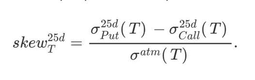

如你所见，我们试图衡量相对于标准隐含波动率，跌权期权的隐含波动率比看涨期权高出。鉴于隐含波动率与期权权利金之间的直接关系，你也可以将此比例看作跌权成本比看涨成本高多少的粗略衡量。如果我们有两个对标底层资产价格敏感度相似的期权，人们愿意花多少钱来承担看跌风险（跌权），而不是通过看涨期权来承担看涨观点呢？

让我们来看一个简单的例子。假设 25 delta 期权偏斜大约处于 20%。这基本上意味着跌权期权的隐含波动率比看涨期权高出约 20%。因此，我们也可以推断，类似的跌权期权价格也相应地高于看涨期权。这意味着期权买方愿意支付更多的钱来购买跌权期权，而不是购买参数完全相同的看涨期权。你可以将其视为一个更看跌的信号。如果该比例为负，我们也可以得出相反的结论。

与跌看涨比率（put call ratio）一样，你可以随时间观察期权偏斜。这很有帮助，因为它可以让你感知近期相对价值（以及情绪）发生了怎样的变化。例如，在这里你可以看到 skew.com 上过去三个月的 25 delta 期权偏斜。

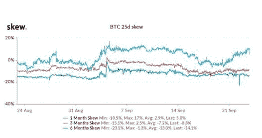

这涵盖了从一个月到六个月不同的期权到期日。如果你只看三个月的期权偏斜，你会发现它目前处于负 8.3%。这意味着看涨期权的隐含波动率高得多，因此其权利金大于跌权期权。这通常是一个看涨信号。

然而，如果我们观察它过去三个月的移动情况，你会发现它一直处于低位趋势。我们可以从中读出，市场参与者为看涨期权支付的费用比跌权期权多。不仅如此，这种差异随着时间的推移而扩大，这表明他们的看涨情绪也在增强。如果你观察这段比特币的现价，你会发现它与这种偏斜的下降具有良好的相关性。

我还应该指出，期权偏斜远不止于此。你可以比较整个波动率期限结构中的偏斜。你有一个被称为“波动率微笑”（volatility smile）的东西，它很好地说明了这一点。

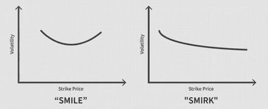

那是完全不同的的话题。关于期权偏斜，你只需要知道它是我经常用来衡量期权相对价值和情绪的有用指标。这就是偏斜。现在，让我们来看另一个指标。

# 第 29 章 交易技巧：市场参数

如果你能利用期权价格来计算比特币在到期时高于某一价格的概率，那就太棒了。事实上，由于布莱克斯舒尔模型（black skulls model），这确实是现实。假设你有期权价格以及该方程中的所有其他参数，你就可以推导出资产在到期时的潜在价格分布。

对于你们在大学学过统计学的人来说，你们非常熟悉正态分布等概率密度函数。

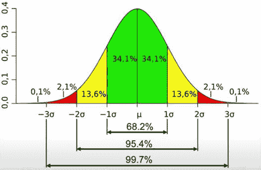

如果这对你来说很陌生，不要担心。我们所做的只是利用期权的市场参数来推导出高于选择执行价的概率。你不需要自己计算。skew.com 有一张图为我们计算这些。在这里你可以看到多个不同期权到期日的概率分布。让我们单独看 2020 年 12 月的期权。

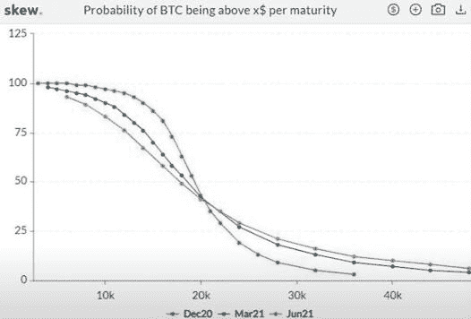

如你所见，12 月 25 日价格高于 22k 的概率约为 28%。如果我们继续向下移动，可以看到高于 24k 的概率大约为 19%。我们还可以查看 2021 年 3 月和 6 月的更长期期权，以得出类似的概率。

那么这些概率能告诉你什么呢？嗯，它们可以根据期权市场的定价，给你提供关于未来某些价格可能性的粗略想法。我喜欢使用这些指标，因为它们帮助我感知更现实的结果。在加密货币领域，我们对这些抛物线式的价格预测已经非常麻木了，以至于有时会被炒热情绪挟。然而，在期权市场，建立最大头寸的大多数参与者是专业投资者。我指的是机构基金和复杂的做市商。他们愿意为期权保护和敞口支付的价格，可能比他们在电视上声称的预测更能作为真实价格预测的基准。

当然，我应该提醒你，不要将其作为任何“圣经”。它只是从市场数据中推导出的概率量。这是一个你可以用来进一步辅助你分析的有用数据点。这就是期权价格概率。


# 第 30 章 交易技巧：期权到期日

## 市场影响
我现在非常想探讨的另外一点是期权到期日，具体来说是指对现货市场的影响。如果你关注任何加密货币新闻网站或交易群，偶尔会听到“期权到期日”。如果某一天有大量期权到期，这可能预示着当天可能会出现巨大的波动。这里关键的问题是：为什么以及如何判断到期日可能的价格方向？让我们先从第一个开始。

这些到期日之所以会有波动，是因为市场参与者正在调整头寸以进行标的资产的实物交割。同样，一些做市商在接近这些期权价格的关键时刻时，可能需要调整其在现货市场的对冲头寸。因此，你面对的是期权到期事件对标的现货市场产生直接影响。当未交期权数量很大时，对现货市场的影响往往更大。

这在股票市场已经已知多年。这些时间有时被称为“到期周”，此时标的股票的波动开始加剧。然而，鉴于比特币期权的增长，我们也看到这些工具影响了比特币现货价格。这通常发生在实际到期日的约两天前。持有期权的参与者在到期日可以选择平仓头寸，也可以滚动到新的期权。因此，我们知道期权到期日通常是价格波动值得关注的日期。

## 分析订单簿
但是，有没有办法可以感知它可能的移动方向呢？嗯，没有硬性的标准，但你可以通过深入研究期权订单簿本身来获得模糊的想法。在这种情况下，我将查看 `Deribit` 的订单簿。它们对于零售交易者来说是流动性和功能最丰富的交易所。要登录 `Deribit`，请访问他们的网站 `https://www.deribit.com/`。

让我们来看一些即将到期的期权。我们要寻找的是确定由于期权市场中这些看涨或看跌期权的到期，现货市场可能会产生多少理论上的买卖压力。基本上就是得到一个粗略的看涨认跌比。

接下来，你可以将期权范围扩大到相对接近值值（the money）的期权。在这里，你可以为两者选择一个可以接受的范围。在我看来，12 月 21 日比特币很可能处于 `21K` 到 `23.5K` 之间。因此，我查看了所有落在此范围内的期权。

现在我想尝试确定看涨和看跌方面的总未交名义或持仓量（open interest）。在这些期权到期时，看涨的总持仓量约为 `4200` 比特币。而在看跌方面，总未交名义约为 `1770` 比特币。所以，这向我们表明，随着我们向 12 月 21 日的到期日推进，市场中的多头头寸多得多；几乎是多了 `2.4` 倍。理论上，这意味着到期之际，现货市场出现买入力的概率大于卖出压力。一个更看涨的市场立场。

## 分析结论
当然，我应该说明，在进行此分析时距离到期还有大约两周。临近到期日可能会发生很多变化，正如我之前提到的，在比特币市场中，未交到期对现货市场的影响通常只在到期前两三天会被感觉到。

所以，如果你打算使用这种分析方法，我鼓励你在接近到期时间时重新检查相对持仓量的平衡。你还应该注意，这不是一门科学。有许多其他因素可以在到期时左右价格。不要忘记你还有期货市场的影响以及通过现货市场的巨鲸订单。但是，它是我偶尔会使用的一个方便指南。

事实是，衍生品与现货市场之间这种关系的细节非常迷人。这里可能有一些难以理解的内容，这完全没关系。事实上，大多数交易期权的人并不会太关注底层方程。他们更关注宏观概念。确切知道 `25 delta skew` 是如何计算的重要性远不如理解它的意义。它显示了市场是如何建仓的，以及你如何在更广泛的研究工具箱中使用这些信息。同样，对未来的价格分布有一个大致的了解可以帮助你调整预期。你可以从期权市场获得价格概率的大致想法，关注期权到期日总是有帮助的。即使试图得出特定的价格方向，事实也证明这些日期会导致现货市场波动。通过将这些日期标注在日历上，你就能更好地应对可能产生的任何波动。没有什么比被巨大的价格缺口（无论是上涨还是下跌）措手不及更糟糕的。所以，我希望你能发现这些指标和工具对你的价格分析有所帮助。当它们被实际用于交易期权本身时，它们会变得更有趣。

# 第 31 章 看涨 K 线形态

## 什么是 K 线
在这一章中，你将学习 K 线形态。什么是 K 线？嗯，K 线是一种显示资产价格变动信息的方式。K 线图是技术分析中最流行的组件之一，使交易者能够通过几根价格线快速解释价格信息。本章将重点关注日线图，每根 K 线详细说明了一日的交易情况。它有三个基本特征：
- `body`（实体），代表开价到收盘价的范围。
- `wick`或`shadow`（影），指示日内最高价和最低价。
- `color`（颜色），揭示了市场移动的方向。

绿色或白色实体表示价格上涨，而红色或黑色实体表示价格下跌。

## 形态
随着时间的推移，单个 K 线会形成形态，交易者可以用它们来识别主要的支撑和阻力位。有很多 K 线形态指示了市场中的机会。有些提供了买卖压力之间平衡的洞察，而另一些识别了持续形态或市场反转形态。在开始交易之前，熟悉 K 线形态的基础知识以及它们如何为你的决策提供参考是非常重要的。

## 看涨形态
看涨形态可能在市场下跌后形成，并标志着价格移动的反转。它们是交易者考虑建立多头部位以从任何上升趋势中获利的指标。

### 锤线（Hammer）
```
OEBPS/image_rsrc3K6.jpg
```
锤线 K 线形态由短实体和长下影组成，出现在趋势的底部。锤线显示，尽管白天存在卖出压力，但最终强大的买入压力将价格推回了。实体的颜色可以变化，但绿色锤线比红色锤线指示更强的牛市。

### 反锤线（Inverse Hammer）
```
OEBPS/image_rsrc3K7.jpg
```
同样看涨的形态是反锤线。区别在于上影很长，而下影很短。它指示了买入压力，随后是无法推动市场价格下跌的卖出压力。反锤线暗示买家很快将控制市场。


# 看涨吞没形态 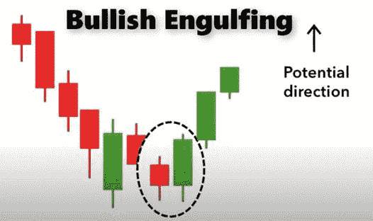
看涨吞没形态由两根蜡烛组成。第一根蜡烛是短红实体，被一根更大的绿色蜡烛完全吞没。尽管第二天开盘价低于第一天，但看涨市场将价格推高，最终导致买方明显胜利。

# 穿线形态 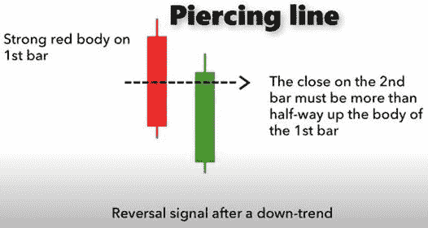
穿线形态也是一种双线形态，由一根长红蜡烛和随后的一根长绿蜡烛组成。第一根蜡烛收盘价与绿色蜡烛开盘价之间通常存在巨大的缺口。当价格被推至前一天的中点或上方时，这表明存在强劲的买入。

# 晨星 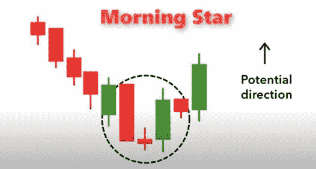
晨星蜡烛形态被认为是阴跌市场下趋势终结的希望信号。它是一个三线形态，在长红蜡烛和长绿蜡烛之间有一根短蜡烛。传统上，由于市场在开盘和收盘时都存在缺口，星线与较长的实体之间没有重叠。它信号着第一天的卖压正在消退，牛市即将来临。

# 三白骑士 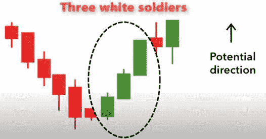
三白骑士形态持续持续三天。它由三根连续的长绿色或白色蜡烛组成，影线较短，且开盘价和收盘价逐渐高于前一天。这是一个非常强看涨信号，发生在下降趋势之后，显示出买入压力的稳步推进。

# 第 32 章看跌蜡烛形态
看跌蜡烛形态通常出现在上升之后，预示着阻力点。对市场价格的极度悲观通常导致交易者平掉多头仓并建立空头仓，以利用价格下跌。

# 悬线 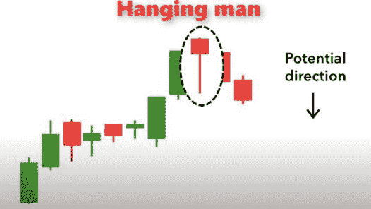
悬线是锤线的看跌等效形态。它具有相同的形状，但出现在上升趋势的末端。它表明白天曾大幅抛售，但买方仍能够将价格再次推高。大规模的抛售通常被视为多方失去对市场控制的标志。

# 射击之星 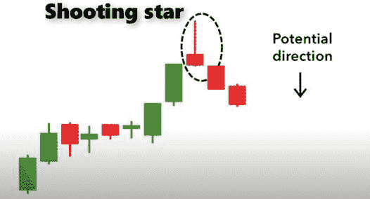
射击之星与倒锤线形状相同，但在上升趋势中形成。它有一个较小的下实体和很长的上影。通常市场在开盘时略微高开，并在收盘前冲至日内高点，最后高于开盘价的价格收盘。就像坠落大地的星。

# 看跌吞没 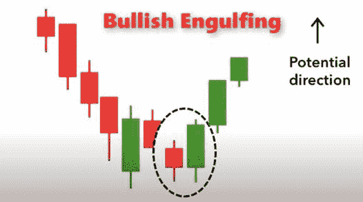
看跌吞没形态发生在上升趋势的末端。第一根蜡烛有一个小绿色实体，被随后的长红蜡烛吞没。它意味着价格运动达到顶峰或放缓，是市场即将下调的信号。第二根蜡烛跌得越低，该趋势可能越显著。

# 晚星 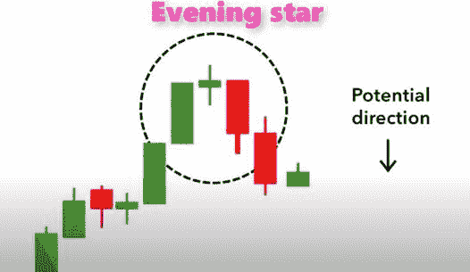
晚星是一个三蜡烛形态，等同于看涨的晨星。它由一根长绿蜡烛和一根大红蜡烛之间的一根短蜡烛组成。它标志着上升趋势的反转，当第三根蜡烛抵消第一根蜡烛的涨幅时，信号尤为强劲。

# 三乌鸦 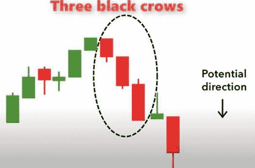
三乌鸦蜡烛形态由三根连续的长红蜡烛组成，影线短或没有。每个交易日的开盘价与前一天相似，但卖压每次收盘时都将价格推得越来越低。交易者将此形态解读为看跌下降趋势的开始，因为卖方在连续三个交易日内战胜了买方。

# 云盖头 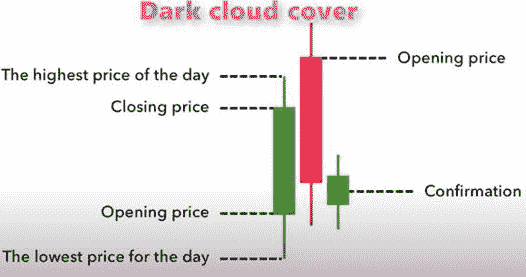
云盖头蜡烛形态预示着看跌反转。前一天的上方有一片乌云，预示着乐观。它由两根蜡烛组成。一根红色蜡烛在实体上方开盘，并在下方收盘。它信号卖方已接管，将价格大幅压低。如果蜡烛影线较短，表明下降趋势非常果决。

# 第 33 章持续蜡烛形态
对于持续蜡烛形态，如果蜡烛形态没有预示市场方向的变化，它被称为持续形态。这些可以帮助交易者在市场犹豫不决或价格中中识别休息期。

# 十字形 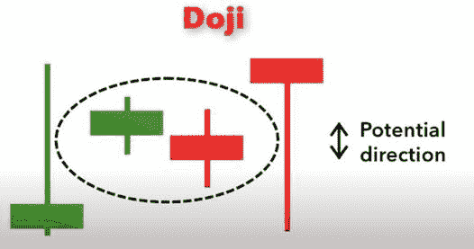
当市场开盘和收盘几乎在同一价格点时，蜡烛看起来像十字或加号。交易者应注意影线不一的短实体或无实体。这种十字形态传达了买卖双方的斗争，导致双方都没有净收益。单看十字形是中性信号，但它可以出现在反转形态中，如看涨晨星。

# 旋转线 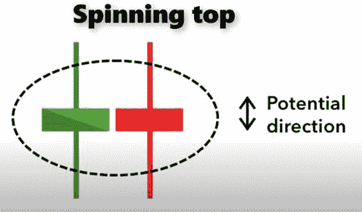
旋转线蜡烛形态具有位于等长影线之间的短实体。该形态表明市场犹豫，导致价格没有实质性变化。多方将价格推高，而空方又将其压低。旋转线通常被解释为重大上升或下降趋势后的巩固或休息期。单看，旋转线是相对温和的信号，但它们可以被解读为即将到来的迹象，因为它意味着当前的市场压力正在失去控制。

# 下三法 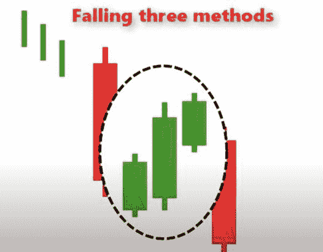
三方法组合形态用于预测当前趋势的持续；无论是看跌还是看涨。看跌形态被称为下三法；它由一根长红实体组成，随后是三个小绿色实体和另一根红色实体。绿色蜡烛完全包含在看跌实体的范围内。它向交易者显示多方没有足够的强度扭转趋势。

# 上三法 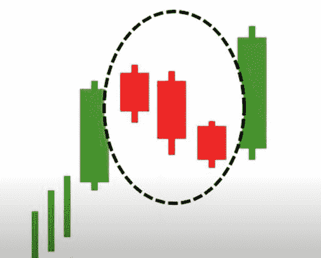
看涨形态上三法蜡烛形态的情况则相反。它由三根短红实体包含在两根长绿的范围内组成。该形态向交易者显示，尽管存在卖压，买方仍保持着对市场的控制。学习解读蜡烛形态的最佳方法是根据它们给出的信号练习入场和退出交易。


# 第 34 章：成功的交易技巧

在本章中，我将揭示交易成功的秘诀，这可能不是你预期的。要成为一名成功的交易者，他需要知道。大约 90% 的交易者都在亏钱，因此只有 10% 的人能够持续盈利。但这 10% 的成功交易者与失败的 90% 之间到底有什么不同呢？

## 典型的 90% 亏损交易者

首先，让我们来看看这 90% 亏损交易者中的典型代表。大多数处于亏损类别的人都在做以下事情：他们通过某种方式听说了交易，并认为这完全是关于成功交易者的奢华生活，比如轻松挣钱、在世界任何地方工作、开昂贵的汽车等等。他们充满了动力和贪婪。

这些人接着会注册一个他们可能通过某些误导性的商业广告找到最好的经纪商。有些人在向经纪商平台存资金之前，甚至会看一两个随机的 YouTube 交易视频。注册后，他们通常会由于随机的原因开始购买随机股票。让他们惊讶的是，股票价格很少飙升，更多时候他们是亏损离场。等他们反应过来，已经成为了 90% 亏损交易群体的一。显然，并非所有亏损交易者都经历过这些阶段，但大部分都是如此。

## 持续盈利的 10%

我只是在尝试对比亏损和盈利的交易者。我的观点是，持续盈利的交易者实际上知道自己在做什么。他们通常有多年的经验积累并测试过交易系统。此外，盈利的交易者拥有交易计划，在进入任何交易之前，他们知道如果仓位发生变化将如何处理。

换句话说，交易并不容易。如果容易，每个人都会去做了。现在让我们把交易与其他职业对比。你会尝试在没有任何指导、教育和练习的情况下驾驶飞机吗？如果你这样做的话，结果可能会非常糟糕。或者，你会在没有上过医学院、没有任何实践经验或教育的情况下尝试进行心脏手术吗？很有可能你对前两个问题的回答是“否”。

要成为医生、飞行员或其他任何职业，你通常需要经过多年的培训、学习和实践。为什么交易应该不同呢？就像没有人天生就是完美的心脏医生一样，也没有天生就是完美的盈利交易者。你需要学习、练习并不断努力。如果你尝试在没有任何教育的情况下驾驶飞机，你可能会坠毁并爆炸。你的交易账户也是如此。在没有任何教育的情况下交易，通常会导致你爆仓。不要犯这种错误，在没有自我教育之前冒风险投入辛苦赚来的钱。这里的关键结论是，你需要教育才能成为盈利的交易者。

## 付费教育 vs 免费教育

下一个问题是：你需要付费教育，还是可以免费学习如何交易？免费和付费交易教育都有各自的优缺点。

### 付费教育的优点
付费教育的一个主要优势是激励因素。人们倾向于对他们实际付过的事情投入更多。这是因为他们觉得有些代价在其中。另一个优势是专注于单一策略。大多数优质付费交易课程都专注于一种策略，并教你该特定策略的所有重要内容。因此，付费教育通常比免费教育更具体、更有相关性。换句话说，许多付费交易课程的质量高于免费课程。此外，优质费用通常伴随着个人支持。

### 免费教育的优点
最明显的优点是免费的。如果免费教育很糟糕，没关系，因为你没有付任何钱。

### 付费教育的缺点
首先，缺点之一是它需要钱，因此是有风险的。如果教育质量很差，你就浪费了钱。这些所谓的交易课程中有些是诈骗，所以要加小心。另一个主要缺点是缺乏透明度。许多交易教育者的钱全来自他们的交易教育，而从交易中一分钱没赚。仅仅因为有人告诉他是一个极其盈利的交易者，并不意味着他真的是。最后但同样重要的是，付费教育非常具体，这也是一个缺点。拥有广泛的通用知识总是好的。大多数付费课程专注于他们的策略，而忽略了大局。

### 免费教育的缺点
免费的交易课程往往不够透彻，因此通常很难找到非常优秀且深入的免费交易课程。因此，免费教育需要付出更多的努力。

## 成功的推荐路径

在我们继续之前，我只想说，这些优缺点是概括性的。并不是所有的优缺点都适用于所有的免费和付费交易课程。显然存在例外。正如你所看到的，免费和付费交易课程都有自己的优缺点。在两者之间选择一个可能非常困难。

在我看来，最好的办法是将免费和付费交易教育结合起来。这让你能够利用免费和付费教育的优点。

1. **从免费教育开始**：所有的基础交易概念都可以从免费教育中学习。我不建议为了学习基础知识就花费大量的资金。你应该能够从免费教育中学习到资产类型、基础图表、风险管理等非常重要的基础概念。
2. **自我评估**：在此之后，我建议问自己几个问题。你对交易仍然感兴趣吗？你愿意投入更多精力学习如何交易吗？如果是，哪种交易风格适合你？这里需要考虑的方面有启动资金、时间、风险承受能力等。随着你了解不同的资产类型，你应该对什么资产适合你有个想法。
3. **转向付费课程**：接下来，我建议查看付费培训课程。你应该已经对交易和整体市场有了基本的了解。理想情况下，你应该有一个偏好的资产类型，如期权、股票、加密货币。
4. **研究**：在尝试寻找良好的交易课程时，你应该做一些研究。尝试找到一个适合你、你的启动资金、你的时间的课程。寻找经过证明的记录和成功案例。通常，如果某件事听起来好得不可真实，那它很可能真的。请不要跳过研究部分。市上有无数诈骗，所以要小心。

这是学习如何交易的多种方法之一，但你也可以采取不同的方式。例如，如果你有充足的资金，你可以直接支付所有费用，但记住；只有最后一步才是交易。在你真正知道自己在做什么之前，不要冒辛苦赚来的钱的风险。否则，你最终会像 90% 的交易者一样。

在开始用真钱交易之前，你应该对市场交易有良好的理解。你还应该有一个经过证明的盈利系统、一个具体的交易计划，并且接受过大量的教育。即使在你开始交易后，你也应该尝试继续学习更多。永远不要跟随随机的交易信号。永远不要依赖一两个随机指标。永远不要听信看似魔法般的交易软件。只需用正确的方法去做。教育自己并学习如何交易。记住，如果容易，每个人都会去做了。拼图的最后一块是把交易当作你的职业，而不是爱好。


# 第 35 章 什么是隐含波动率

在本章中，你将学习关于隐含波动率的所有知识、什么是隐含波动率排名以及它为什么重要。

首先，什么是隐含波动率？嗯，隐含波动率可以从期权定价模型（如 `Black Scholes` 期权定价模型）中得出。它可以被认为是标的资产发生特定价格变化的预期概率。但这意味着什么呢？为了理解这一点，让我们拆解一下期权价格的组成部分。

`black Scholes` 公式使用以下变量来计算期权价格：标的价格、行权价、到期日、`无风险利率` 和 `隐含波动率`。前两个因素是显而易见的，因为它们决定了期权的内在价值。到期日也很合理，因为距离到期时间越长，你的头寸就有越多的运作时间。因此，到期时间一定会影响期权价格。`无风险利率` 对期权价格的影响非常微小，且在短期内不会发生显著变化，因此可以暂时忽略。

最后但同样重要的是是，标的资产的波动性也会影响期权价格，因为波动较大的资产往往能为期权交易者提供更多从价格波动中获利的机会，而波动较小的资产交易机会则有限。例如，如果标的资产非常波动，那么深深度外值期权变成实值期权的概率要高于高于不波动时的概率。因此，波动率是计算理论期权价格的因素之一。

然而，观察和测量标的价格、行权价和到期时间相当容易。但衡量证券的波动性并不简单，尤其是未来的波动性。这就是为什么像 `Black Scholes Model` 这样的模型使用公式从期权价格确定`隐含波动率`，而不是从`隐含波动率`计算期权价格。期权价格可以在市场上与波动率以外的所有其他因素一起观察到。通过这些信息，你可以计算出一个理论波动率值。这个波动率值是从期权价格推出来的，因此被称为`隐含波动率`。

所以，当你从某些财经新闻中听到期权交易者预计即将到来的波动时，他们实际上是在说当前期权价格所隐含的波动率（`隐含波动率`）相对较高。请注意，`隐含波动率`不等同于`历史波动率`。历史波动率是过去的实际波动率，它不影响期权价格，而`隐含波动率`会。此外，`隐含波动率`是一个纯粹的理论值，因此`隐含波动率`值通常与某些期间的实际波动值存在差异。希望这能帮助你理解什么是隐含波动率。

# 第 36 章 为什么隐含波动率很重要

首先，它是影响期权价格的主要因素之一。单单这一点就是你应该关注 `IV` 的原因之一。此外，`隐含波动率`可以让你洞察市场预期的是什么样的波动。你可以将预期波动率与你自己的分析进行比较，并可能根据这两者的差异来建立头寸。期权交易者在建立头寸之前，应该始终查看`隐含波动率`以及标的交易价格、到期日和行权价。

使用`隐含波动率`还可以计算标的资产在到期日之前的预期价格范围。为了理解这一点，让我们先看一眼正态分布图。

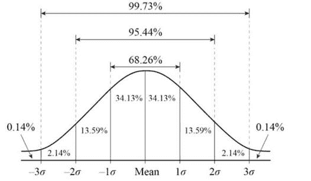

取决于你使用的模型，你可能会假设股价的变化是这样分布的。这意味着 68% 的时间价格只发生了微小变化，价格波动越大，可能性就越低。标准差一倍的移动发生在约 68% 的时间。标准差两倍的移动发生在约 95% 的时间，以此此类推。对于价格来说，这并不一定是一个非常真实的分布，因为根据正态分布，较大的波动发生频率比应有的高得多。此外，价格向上移动的幅度可能比向下更大。

尽管如此，正态分布被广泛使用，它有助于理解资产的预期波动。如果你使用正态分布，可以通过这个公式计算资产的预期波动：

`一个标准差 = 正负隐含波动率 乘以 标的价格 乘以 到期时间的平方根除以 365`

通过将一个标准差移动乘以二，可以计算出两个标准差。

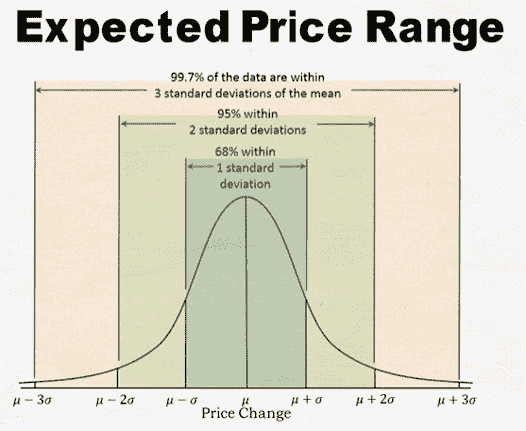

`隐含波动率`通常以年化的形式报价。这就是为什么我们将到期时间除以 365，得到到期日的预期范围。让我们来看一个例子来澄清这一切。

货币 `XYZ` 的交易价格为 `$100`。我们先看一个距离到期还有 30 天、`隐含波动率`为 40% 的期权。因此，未来 30 天的一个标准差范围为 `正负 0.4 乘以 100 乘以 30 的平方根除以 365`。这大约是正负 11.5，这意味着未来 30 天的一个标准差范围是 88.5 美元到 111.5 美元。这意味着市场预计 `XYZ` 的价格在未来 30 天内保持在约 88 到 112 美元之间的概率约为 68%。

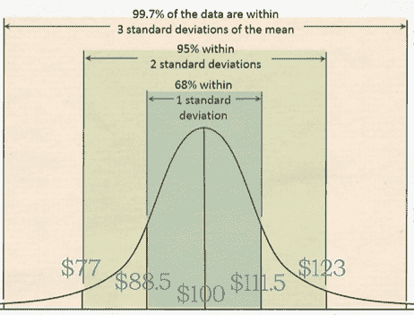

两个标准差的移动将达到 123 美元或跌至 `$77`。现在让我们看看同一资产，具有相同的`隐含波动率`，但到期时间为 60 天而非 30 天。现在一个标准差范围大约是 84 美元到 `$116`。两个标准差范围是 68 美元到 `$132`。这很合理，因为 `XYZ` 在 60 天内的波动显然比在 30 天内大得多。

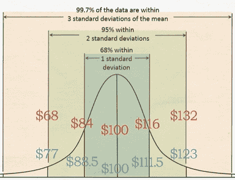

注意，这一切都假设价格分布是正态的。这并不一定是一个非常真实的假设。因此在实践中，其他分布如`对数正态分布`或其他分布更为常见。尽管如此，这种对预期波动的简单解释应该让你对预期波动是什么以及你如何将其用于你的交易有一个良好的理解。幸运的是，你永远不需要自己去计算预期波动，因为大多数优秀的经纪商平台都会为你计算好。


# 第 37 章 什么是隐含波动率排名 (IV Rank)

到这里你可能已经意识到隐含波动率是交易期权时考虑的一个重要因素。当隐含波动率高时，期权价格较高；当隐含波动率低时，期权价格较低。但你如何判断隐含波动率是高是低的呢？

例如，如果资产 `XYZ` 的期权隐含波动率为 40%，而资产 `ABC` 的期权隐含波动率水平为 30%，这意味着什么？嗯，仅仅因为 `XYZ` 的隐含波动率绝对值比 `ABC` 高，我们不能简单地假设其相对于自身的隐含波动率更高。

让我给你举一个更具体的例子来澄清这一点。假设 `XYZ` 通常是一个波动率很高的资产，平均隐含波动率为 70%。但现在它的 IV 降到了 40%，而 `ABC` 大多数时候 IV 水平维持在 20% 左右。但现在它的隐含波动率上升到了 30%，这意味着 `ABC` 的隐含波动率相对较高，而 `XYZ` 的隐含波动率则相对较低，尽管 `XYZ` 的绝对波动率大于 `ABC`。

我希望这解释了为什么比较不同资产的隐含波动率是非常困难的，因为不同资产具有非常不同的交易特性。为了解决这个问题，我们可以使用**隐含波动率排名 (IV rank)**。IV rank 观察资产过去一年的隐含波动率数据，然后告诉你当前的 IV 水平相对于过去 365 天的情况如何。IV rank 的值始终介于 0 到 100 之间。100 代表过去一年隐含波动率的最高水平，0 代表最低水平。

这里有一个简单的例子。资产 `ABC` 的 IV rank 为 20。这意味着它的隐含波动率相对较低，因为在过去的一年里，它一直高得多。因此，你可以假设与过去相比，`ABC` 的期权相对便宜。反之，如果 IV rank 为 100，你就知道 `ABC` 的隐含波动率在过去一年从未更高过，因此可能是卖出期权的良好时机，因为它们非常昂贵。

总之，隐含波动率排名为隐含波动率提供了背景信息。以下是最常用的计算 IV rank 的公式：(当前 IV 水平减去 52 周 IV 低点) 除以 (52 周 IV 高点减去 52 周 IV 低点)，最后乘以 100 得到 IV rank。

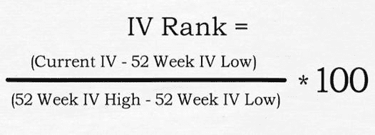

注意，某些经纪商经常过滤掉过去 52 周内极端的隐含波动率值，以免 IV rank 被这些值偏偏或扭曲。别担心，你不需要自己计算这些，因为再次强调，大多数优秀的经纪商都会为你完成。某些平台甚至允许你通过 IV rank 扫描和筛选资产。这是寻找极低或极高隐含波动率资产的最方法之一。我希望这能帮你理解隐含波动率以及隐含波动率排名的工作原理。

# 第 38 章 交易心理：赌徒谬误

虽然大多数人喜欢认为自己是理性的，但大多数人类并不非常理性。尤其是当涉及金钱且时间紧迫时，人类的决策可能存在很大缺陷。交易是错误和非理性行为模式特别常见的领域之一。在本章中，我们将观察最常见的认知偏差和非理性决策模式，以及如何避免它们。

意识到这些思维缺陷有两个主要优点。首先，它可以帮助你在自己的交易中避免这些错误；其次，它可以帮助你识别并解释由这些偏差引起的看似非理性的市场行为。大多数此类认知偏差都是由诺贝尔奖得主丹尼尔·卡尼曼（Daniel Kahneman）和阿莫斯·特沃斯基（Amos Tversky）发现并引入的。

我想说的第一个认知偏差是**赌徒谬误 (gambler’s fallacy)**。赌徒谬误是指根据过去的系列事件错误地夸大或低估事件发生的概率。可以用抛硬币的简单例子来说：硬币正面概率是 50%。无论你投掷几次，这个概率都不会改变。所以即使你的硬币连续出现了 10 次正面，也不会影响下一次投掷的概率。

正如名称所示，赌徒谬误在赌博中特别常见。但这种思维模式在交易中也很常见。让我给你几个例子。你是否曾因为某只股票连续下跌而开多（（或者反之）？如果是，你就掉入了赌徒谬误的陷阱。另一个例子是对连胜或连败的反应。如果你觉得在多次获胜后失败的几率增加了并因此减小了仓位规模，你就犯了赌徒谬误。交易获胜的概率并不会因为你在此交易之前有过多次失败或获胜而魔术般改变。

提到连胜，假设你找到了一种交易策略，能保证每笔交易都有 70% 的胜率，你认为连续获胜 10 次的概率是多少？答案是小于 3%。事实上，即使使用这种策略，连续胜两次的概率也低于 50%。这意味着连续获胜的可能性小于不获胜的可能性。请记住，这还是在一个保证每笔交易 70% 成功率的策略下。大多数策略的胜率远没有此。

要计算 `n` 次连胜的概率，你只需要将交易策略的估计胜率的 `n` 次方。

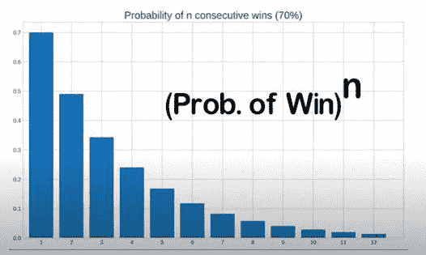

注意，这假设交易之间是相互独立的，且胜率是恒定的。如果我们观察连败的概率，会得到类似的结论。这张图表展示了在单笔亏损概率为 40% 的策略下，多次连续亏损的概率。

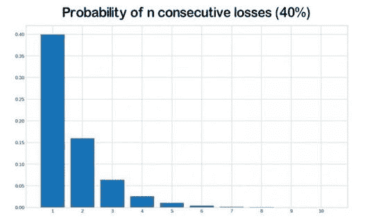

如你所见，在 40% 的亏损概率下，连续超过几次亏损是非常不可能的。那么我们能从中学到什么？首先，无论你的策略有多好，亏损总会发生。你不可能赢得所有的交易。因此，你必须执行稳健的风险管理实践，并控制亏损规模。连续多次损利的概率非常低。所以如果你经常出现超过 10 次重大连续亏损，你应该开始认真怀疑交易策略的质量了。但始终记住，尽管连胜 10 次的概率很低，但仅仅因为你上次赢了 10 次，单笔交易的获胜概率并不会降低。


# 第 39 章交易心理学：确认偏误

确认偏差倾向于寻找与你预先信念一致的信息。毫无疑问，绝大多数交易者都犯过这种偏误。在开仓交易后，不断寻找证实你交易想法的信息是人之而然的。你可能会查看几十个指标或社交媒体帖子，但只关注那些证实你观点的点。发现与你观点一致的东西会让你感觉很好，这确实可以增强你对某个头寸的信心。

问题在于，通过这样做，你往往会忽略那些表明你的交易并非最佳主意且可能存在问题的迹象。相反，你会越发地说服自己一切如意。通过在 Twitter 上搜索一个股票代码，你几乎可以找到至少几个与你有相同市场假设的人。但这并不意味着什么。

在交易中避免确认偏差的一种方法是为你的交易制定一套清晰的指标和规则并遵循。如果你有这样一套清晰的规则和指标，就不需要出去寻找任何其他确认信号了。此外，最好避免将社交媒体作为交易决策的指南。

# 第 40 章交易心理学：小数定律

你可能听说过大数定律，它指出增长样本量的平均值会收敛于总体的实际均值。这是概率论中一个非常强大的规则，允许你通过足够大的样本来估计总体的参数。但正如其名称所示，它只适用于大样本量。这就是小数定律谬误发挥作用的地方。

大多数人直觉上错误地使用了大数定律，即在两个小样本量的情况下。让我给你举个例子。你是否曾经尝试过几次交易策略，然后得出它无效的结论？如果是，你就犯了使用小数定律的错误。几次特征并不是足够大的样本量，无法为你提供关于交易策略质量的任何显著信息。

你如何避免小数定律呢？嗯，你必须高效地测试交易系统的有效性。目标是使用该交易系统至少 20 笔交易。当你不知道一个新交易系统的优坏时，使用它超过 20 笔可能看起来很可怕。因此，你应该将风险降低到一个水平，让你能够轻松负担起这 20 笔交易的所有亏损。

你这些交易的目标不是赚钱，而是测试给定的交易策略。在进行这 20 笔交易时，尽可能做到机械化。为想象中的每种市场情景创建清晰的规则并在每笔交易中遵循这些规则。如果你没有一套清晰的遵循规则，你就无法可靠地测试你的策略，因为根本没有策略可测。

此外，确保记录一份详尽且彻底的交易日志。每笔交易后，跟踪入场价格、离场价格、盈利潜力、风险资金、交易时间等。在遵循了所有步骤至少 20 笔交易后，你就可以准备评估该策略了。理想情况下，你现在应该拥有关于该策略的丰富数据，以对其进行评估并对该交易系统的有效性做出明智决策。我知道为了测试交易系统这看起来工作量很大，但如果没有足够的样本量，你无法真正评估任何事情。基于一或两次发生的情况做决定，就像说因为你赢了一轮所以轮盘胜率是 100%。

# 第 41 章交易心理学：幸存偏差

我们要观察的下一个认知偏误是幸存偏差。维基百科将幸存偏差定义为“关注通过某些筛选过程的人或物，而忽略未通过的人物的逻辑错误，通常是因为他们缺乏可见性。”

让我们再次看几个例子以更好地理解它的含义。如果你环顾四周，很容易得出这样的结论：大多数 ETF、共同基金甚至个股都会随着时间的推移而上涨。但实际上，这是一个错误的结论。那是因为你所观察的基金和股票宇宙已经向一个方向倾斜了。股票没有反而下降的原因之一是它们破产了。而表现不佳的基金通常会在几年后关闭。换句话说，只有表现足够好的基金才能生存下来。

所以当你说大多数股票或基金随着时间的推移而上涨时，你没有考虑所有没有生存下来的那些。因此，只观察幸存者所获得的结果可能有巨大缺陷。给你提供一些数据，先富集团的一项研究研究发现，1997 年投资大盘增长或价值基金的投资者，到 2011 年能够存活并优于其基准的基金的概率仅为 22%。

在历史数据上进行回测和分析交易策略时，仅考虑通过某些筛选过程的投资范围的问题尤为常见。但在分析交易之外的成功案例时，幸存偏差可能是一个大问题。观察非常成功人士分享的交易，实际上并不会产生非常显著的结果。通常，许多失败的人也具有这些特征，但他们并未被纳入此类研究中，这会极大地扭曲结果。通常，成功者的成功尽管存在某些特征，而不是因为这些特征。“历史是由胜利者书写的”这句话也非常适用于商业和金融市场。通常情况下，在观察和分析投资时，确保思考你看不见的东西。是否存在你漏掉的看似不可见的过滤器？如果是，你的结果可能会向不想要的方向被严重扭曲。

# 第 42 章交易心理学：相关性

相关性并不意味着因果关系，但遗憾的是，它经常被对待得好像意味着一样。有不同类型的谬误，让我涵盖三个最著名的因果关系谬误。

1. **反向因果**：一个简单的例子是下雨天和用伞之间的相关性。下雨时，人们倾向于使用更多的伞。这意味着使用伞会导致下雨吗？当然不是。事实相反。这看起来像是一个显而易见的错误，但很多时候并不那么清晰。
2. **忽略第三变量**：例如，如果资产 A 和资产 B 高相关，这意味着 A 的价格波动引起了 B 价格的反应还是反之？另一种因果偏误是忽略了第三变量可能是两个相关变量的原因这一事实。例如，两只石油股……
3. **巧合相关**：最后但同样重要，两个变量也可以在没有任何因果联系的情况下存在相关。事实上，如果你有一组足够大的数据，你几乎可以找到一些纯粹由于偶然而相关的变量。这种巧合相关的一个例子是人均鸡肉消费量与美国原油进口之间的相关性。

今后，永远假设相关性意味着因果关系。证明相关性非常直接，但证明因果关系是完全另一个故事。


# 第 43 章 交易心理学：事后光偏差

事后光偏差是指夸大已经发生的事件之概率的倾向。这里有诺贝尔奖得主丹尼尔·卡尼曼关于事后光偏差的一句精彩名言：“一个结果良好的愚蠢决策，在事后看来会变成一个明明的决策。”

事后光偏差在交易者中尤为常见。有太多的交易者根据结果来评估交易的质量。这是一种非常有缺陷的评估方法。一笔交易有 70% 的概率赚取 200 美元，30% 的概率亏损 100 美元，这无疑是一笔很好的交易。无论结果如何，这笔交易在十次中会有三次是失败的。但这并不意味着它是一笔糟糕的交易。遗憾的是，许多交易者正是这样评估自己的。

事后光偏差也是技术分析看起来如此有吸引力的原因。在历史图表上寻找形态非常容易，但如果没有事后光亮的加持，事情远没有那么简单。如果你曾经觉得过去的价格走势似乎显而易见，那么你就落入了事后光偏差买者的陷阱。

为了避免事后光偏差，你需要一种不基于结果来评估交易的方法。相反，你应该关注过程中决策的质量。你是否有清晰的交易计划和策略？如果是，你执行了它吗？如果没有，为什么没执行？下次你可以如何做得更好？总来说，最好拥有一种不受交易结果影响的持续评估交易的方法。

# 第 44 章 交易心理学：近因偏差与归因偏差

近因偏差是一种不合逻辑的方式，与历史事件相比，赋予近期事件更多的权重和重要性。通过观察市场的周期性可以很容易观察到这一点。牛市持续得越长，就有越来越多的人忘记价格并不只会上涨。因此，投资者对风险的关注越来越少，尽管情况本该是相反的，因为价格上涨得越高，下跌的空间就越大。市场崩盘后的情况也是如此。此时，人们通常会过度管理风险，因为他们高估了未来下跌的概率。这可能是卖出高价保险产品（如期权和波动率）的绝佳时机。

在交易新闻行业可以观察到的另一种偏差是归因偏差。归因偏差是指不断尝试为事件分配某种理由的倾向，即使你的理由与现实无关。财经新闻公司正是为了满足这种偏差而存在的。他们似乎对每一个价格走势都有解释，即使他们的解释有时是相互矛盾的。有时你无法将一个价格走势分解为简单的因果关系。但这并没有阻止我们去尝试。问题在于，人类非常擅长为任何事情寻找解释，即使这个解释并不符合逻辑。这些解释中的基本特征可能害大于利。因此，在看财经新闻机构赋予某些价格走势的理由时，请务必小心。对于上涨最好的解释永远是买家多于卖家。

# 第 45 章 交易心理学：沉没成本谬误

如果你持有某个部位的时间远超过你应该持有的时间，你就犯了这种谬误。沉没成本谬误是指拒绝停止某项行动的倾向，因为你已经投入了大量的金钱或时间。有时，止损比在某个项目或交易上进一步浪费金钱和时间要好。某些成本不应该是你留在交易中的理由。如果你不会在当前价格水平开启这笔交易，那么你就不应该留在其中。无论你已经亏了多少钱。

对抗沉没成本谬误的一种方法是在进入交易之前准备一个具有明确定义出口点的清晰交易计划。

我们现在涵盖了许多不同的认知偏差，它们会极大地影响你的交易和一般的决策。现在，让我简要介绍一下你可以如何避免这些偏差。首先，意识到这些偏差的存在已经是朝着正确方向迈出的一步。但遗憾的是，仅仅意识到是不够以完全避免它们的。事实上，从你的生活中完全消除这些偏差几乎是不可能的，因为它们深植于人类心理学。尽管如此，你完全可以通过一些事情来减少它们出现的频率，从而提高你的决策质量。

一个大大增加使用这些认知偏差概率的因素是尝试在时间压力下做出决定。因此，避免时间压力是另一个正确的方向。在交易中避免时间压力的一种方法是提前准备。不要尝试现场发挥并依赖直觉，而要在开启交易之前始终有一个清晰的交易计划。交易计划应该包含你机械化执行整个交易所需的所有信息。除了交易计划，良好的交易日记是你改进决策和交易的另一种方法。否则，尝试积极监控自己是否存在这些认知偏差。特别是在偏差概率较高的情况下，后退一步从另一个角度重新思考整个状况。此外，避免在心情不佳或由于睡眠不足无法完全集中时做出重要决定。例如，如果你对学习更多这个主题感兴趣，我强烈推荐查看丹尼尔·卡尼曼的书《思考，快与慢》。


# 第 46 章 交易心理：赢家与失败者

在本章中，我将解释如何在交易中培养一种胜者的态度。但首先，为什么心理学对交易如此重要？嗯，交易是一种非常独特的活动。它与你能想象的任何活动都不同。在某些情况下，它甚至与我们一生中积累的某些信念相矛盾。让我举个例子。

大多数人认为，对某件事投入投入越多，结果就越好。例如，大多数工作是按小时付费的，但交易并非如此。仅仅因为你花费了无数小时来分析基本面、技术面或资产的任何其他方面，并不意味着你就能赚钱。你很可能亏钱，而且可能亏在一笔你准备了无数小时的交易。

交易是一项对情绪要求极高的活动。看着自己辛苦赚来的钱在眼前消失并不容易。但巨额的利润也会影响你的情绪。交易让我们面对持续的不确定性。你某一天很可能亏钱，但也很可能赚钱。看到人们因为一笔糟糕的交易而损失几周甚至几个月的收益，并不罕见。尽管如此，努力避免情绪化交易是非常重要的。让情绪影响你的交易决策会大幅降低你的交易表现。当辛苦赚来的钱面临风险时，控制自己的情绪是非常困难的。

有五条基本真理可以帮助交易者培养胜者的心态。

### 1. 任何事情都可能发生
本质上，市场无非是数百万不同的人对不同资产表达他们的想法。认为资产价格低的人可能会买入，认为资产价格高的人可能会卖出，而其他的人则会等待更好的机会。但这数百万交易者中的每一个人都可能影响价格。因此，从理论上来说，一切都是可能的。

但尽管一切皆有可能，但并非一切都是可能的。资产价格上涨数百百分比的概率相对很小。然而，这个概率并不是零。它是可能的。

### 2. 你不需要知道接下来会发生什么就能赚钱
你不仅不需要知道接下来会发生什么，你无法知道接下来会发生什么。我们刚刚了解到，市场无非是数百万人在表达他们的信念。如果你知道接下来会发生什么，你就必须熟悉与市场互动的这数百万人的所有信念。可以说这是不可能的，但这并不重要，你仍然可以在市场上赚钱。

如果你有一套具有真实优势（edge）的交易系统，那么接下来会发生什么真的并不重要。嗯，下一笔交易的结果是无关的。例如，赌场拥有真实的优势。胜率在他们这一边。让我们以轮盘为例。赌场在轮盘游戏中赢钱的概率比输钱的概率。然而，他们不知道下一次轮盘旋转会发生什么，他们也不在乎。他们很可能在下一次旋转中亏钱。但对他们并不重要，因为他们知道长远来看会赢。

你的交易也是如此。只要你拥有一套具有真实优势的交易系统，你要做的就是坚持那套交易系统。你下一笔、下两笔甚至更多交易的结果并不重要。只要你坚持你的计划，数字在长远来看会得到解决的。

### 3. 胜负之间存在随机分布
对于定义优势的任何变量，这与前一个真理是相辅相成的。仅仅因为胜率对你有利并不意味着你一定会赢。让我们再次看看赌场的例子。赢得轮盘游戏的概率强烈倾向于赌场。然而，这并不意味着他们保证会赢。他们仍然会在某些游戏中亏钱。

如果你真的相信胜负之间存在随机分布，你真的会感到被市场背叛吗？如果你抛硬币并猜对了，你并不一定预期下一次抛也能猜对，仅仅因为你上次猜对了。如果你上一次猜错了，你也不会预期下一次抛会猜错。

### 4. 优势仅仅是某件事发生的概率高于另一件事的指示
希望到这里这已经相对简单了。我再次使用了赌场的例子来解释这一点。在轮盘游戏中，赌场赚钱的概率高于输钱的概率。这就是他们的优势。

### 5. 市场中的每一个时刻都是唯一的
如果情况不是这样，意味着在之前的一个时刻与市场互动的每一个人和实体都必须再次执行完全相同的事情。他们必须像上次一样进入和退出头寸。这在多多程度上是不可能的，因此，市场中的每一个时刻都是唯一的。如果一个时刻不是唯一的，你就必须知道每一个变量，这又是不可能的。

## 结语与执行

这五条基本真理的启示是什么？嗯，首先，你确实需要一个具有具体规则的具体交易系统。否则，你就没有优势，交易将毫无意义。记住，随机交易将导致随机的结果。

除了交易系统，你还需要一个交易计划。你应该始终在每笔交易之前创建一个交易计划。在开启交易之前创建交易计划非常重要，因为那是你唯一能够 100% 理性思考的时刻。在你交易之后，你辛苦赚来的钱就面临风险，你的情绪将影响你的决策。

你交易计划的一些关键组成应该是：
- `max risk`
- `max reward`
- `risk to reward ratio`
- `exit point`
- `entry point`
- `adjustment point`
- `position size`
理想情况下更多。

如果你真的相信这五条基本真理，你会在每笔交易前自动创建一个交易计划。例如，如果你真的相信你不知道接下来会发生什么且一切都是可能的，你就会始终定义你的风险并止损。如果你相信你的优势和所有的真理，你为什么要违背你的交易计划呢？你为什么要报复性交易或双倍投入来弥补上一笔交易的损失？如果你相信你的优势，你还会感到情感痛苦吗？赌场会仅仅因为在单场轮盘游戏中输了就感到情感痛苦吗？不，你不应该这样。

你的交易计划越具体越好。如果你在坚持计划方面有困难，就把它写下来。从理论上讲，你的交易计划应该非常具体，以至于你可以把它交给别人，对方可以在不需要询问你的情况下情况下执行整个计划。交易计划越具体，你对要做什么的思考就越少，因此你的交易会越机械化。

另一个更机械化交易的技巧是使用交易警报。如果你知道当价格达到某个点时将退出或调整头寸，你可以在该点设置警报。一旦达到该价格，你就会收到通知，并可以在不思考的情况下调整头寸。或者，你可以使用自动订单，如 `stop losses` 或 `take profit orders`。

但可能最重要的启示之一是，你应该小规模交易。你永远不要在单笔交易中承担总资金的几个百分的风险。如果你在进入交易前真正接受了风险并保持较小的头寸规模，你晚上永远不会有睡眠问题。记住，你不知道也无法知道接下来会发生什么，因此你的下一笔交易亏损并不意外。如果你一次性冒掉所有的本金，而下一笔交易又是亏损，你将一次性失去所有资本。那是你不应该去冒险的灾难。

这也是为什么赌场设有投注限制。他们知道自己很可能在单场轮盘游戏中输钱。如果有人想在单场轮盘游戏中下注数百万，赌场可能会拒绝。因为他们知道胜率并不对其非常有利。他们的优势只有在发生次数足够多时，长远来看才会起作用。你在交易时也应该这样想。所以永远不要一次性冒太多的资本风险。


# 第 47 章：交易计划的逐步检查清单

初级交易者犯的最糟糕错误之一就是对交易入场给予足够的关注。忽视良好的入场和出场重要性会对比你的最终收益产生巨大影响。在本章中，你将学习开启和关闭交易的所有准则禁忌。

在我们深入探讨如何设置最理想的交易订单之前，让我先谈谈如何为你的交易成功做好准备。你可能犯的最严重的错误之一就是没有清晰的交易计划。没有计划，你基本上就是在“盲目交易”。为了帮助你从现在起始终拥有交易计划，我将向你提供一份逐步检查清单，引导你考虑发送任何交易订单之前需要考虑的每一个方面。如果你执行了所有这些步骤，你不应该再次处于不知道该如何处理的交易中。现在让我们来看这个交易计划模板。

## 回顾即将发生的事件
首先，我建议查看即将要发生的事件。尽管这不会直接影响你的交易，但在开仓之前查看未来事件可以避免出现不必要的意外。是否有即将到来的股息派发、收益报告或其他可能与你的交易计划冲突的事件？在这些事件期间，股票的表现通常会有所不同，而且通常情况下确实如此。因此，要么意识到这一点，要么避免在这些事件期间进行交易。

## 定义风险与回报
接下来，定义你的风险。在不知道最大亏损的情况下，永远不要开启交易。太多的交易者没有这样做，尽管这对于你管理风险来说是必须的。

除了定义风险之外，你还应该定义你的回报。有一个清晰的 `profit target`（利润目标），告诉你何时获利。没有一个清晰的 `profit target`，你很容易告诉自己再等一一下。这样做会导致盈利的交易转变成亏损的交易。

在定义了最大风险和最大回报后，计算风险回报比非常简单。所以请务必准确做到这一点。实际计算并查看你的风险回报比将让你对交易的报酬有更深入的见解。一个很好的经验法是，你的风险回报比优于 1:2，但请注意你还应该考虑获利概率。只要获利概率足够高，风险大于回报是完全可以的。

## 时间框架与入场计划
此外，你应该定义交易的时间框架。是日内交易、波段交易还是长期投资。你不需要知道自己在交易中的精确时间，但你应该对交易的时间框架有一个估计。

在你的交易计划中，你还应该有一个具体的 `entry plan`（入场计划）。该计划应该包含你的 `entry price`（入场价格）、`position size`（仓位大小）以及你想如何开启交易。你是一次性开启整个仓位，还是分批进入？

## 出场计划
`exit plan`（出场计划）同样重要。它应该描述将如何关闭仓位。这可能包括可能的交易调整、你的 `trade exit price`（交易出场价格）和 `exit trigger`（出场触发）。最明显的 `exit trigger` 是某个价格水平。但不仅限于此。例如，你也可以使用时间、获利概率、特定的指标值或仓位的 `P&L`（盈亏）作为 `exit trigger`。此外，你的 `exit plan` 应该包括你将如何关闭仓位。

## 最后考虑
最后但不是，交易计划还可以包括其他备注，例如交易背后的动机、你的方向假设、交易描述或其他。希望这个模板能让你对一个良好的交易计划可能是什么样有一个概念。

在开启交易之前创建这样的交易计划是非常重要的。这可以让你保持理性和清醒。一旦你开启交易，你就失去了客观评估仓位的能力。此外，将你的交易计划写下来是一个很棒的主意。特别是对于初级交易者来说，这是一个很好的练习。随着时间的推移，你将能够在脑中完成，但像一切事情一样，这需要练习。所以，尽管写下你的计划需要时间，但它将迫使你真正思考交易。这也是反对冲动交易或赌博的极佳方法。如果你再次发现自己处于不知道如何处理交易的情况下，只需看一眼交易计划，你就会看到这个问题的答案。

在关闭交易后，你应该总是问自己：你遵守交易计划了吗？如果没有，为什么不遵守？下次可以做些什么？如果遵守了，这是一个好计划吗？或者下次你可以如何改进计划？提问并回答这些问题将允许你不断改进交易计划，从而改进你的交易。回答这些问题的绝地方是你的 `trading journal`（交易日志）。拥有良好的交易日志是评估你交易而不陷入认知偏差和主观性陷阱的另一种极佳方法。如果你目前还没有交易日志，我强烈建议尽早开始。

# 第 48 章：如何设置交易订单

尽管设置订单可能看起来是一项简单的任务，但仍然有很多事你可以做错。例如，许多交易者犯的最大错误之一是使用 `market orders`（市价单）。`market order` 给你下一个可用的价格。这将让你很快地成交，但大多数时候价格会很糟糕。

那么你应该做什么呢？嗯，与其使用 `market orders`，不如使用 `limit orders`（限价单）。`limit orders` 允许你设置一个想要成交的固定价格。你要么在这个价格成交，要么完全不成交。只要你不要把价格设置得太激进，并且证券流动性足够，你最终会以你的理想价格成交。但即使你的订单没有成交，错过交易也比接受糟糕的入场价格要好，因为糟糕的入场价格意味着更大的风险和更低的利润潜力。

要选择良好的 `limit price`，理解 `bid-ask spread`（买卖差差）重要的。`bid price` 是买家愿意购买的最高价格，`ask price` 是卖家愿意出售的最低价格。`bid-ask spread` 是两者之间的差。为了尽可能快地成交，你需要在买时更接近 `ask price`，在卖出时更接近 `bid price`。否则，在 `route numbers`（整数价格）处下单通常会有帮助，因为 `route numbers` 比其他价格通常会吸引得多的止损单和 `limit orders`。如果这些方法都没用，你始终可以将价格移动到靠近 `bids` 或 `ask price`。但只有当新价格仍然足够好时这样做。

总结，你应该始终有一个清晰的交易计划，并确保在交易之前创建它。如果你不知道如何创建交易计划，只需使用我上一章的模板即可。此外，确保记录 `trading journal`，以便跟踪你的进展并从错误中学习。否则，不要使用 `market orders`，而要使用 `limit orders`。一个良好的起始 `limit price` 是 `mid price`（中价）。最后但不是，专注于交易高成交量的流动性证券，否则你只是在浪费钱。


# 结语

感谢购买本套书。如果您喜欢这本书，请花些时间分享您的想法并发表评论。我们将不胜感激！

