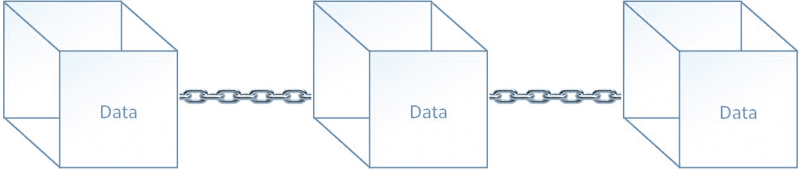
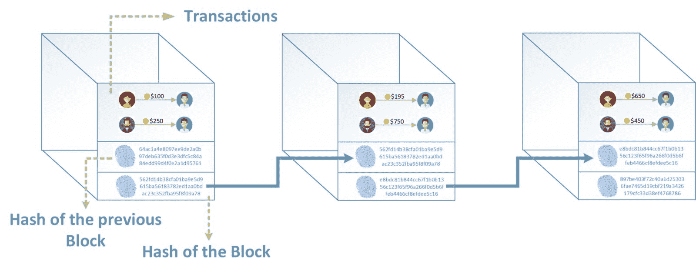
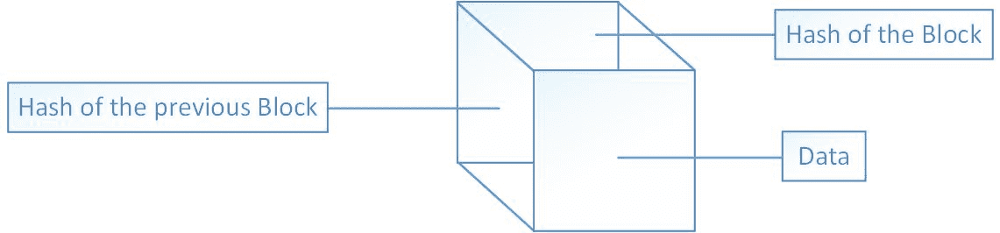

# 区块链：自由还是奴役的工具

## 图籍简介

“只有大规模的去中心化和自力更生的流行运动，才能遏制目前的国家主义倾向。”奥尔斯·赫胥黎（Aldous Huxley）几十年前在他的小说《美丽新世界》（1947）第二版的序言中做出了这一观察。长期以来，尽管许多人支持这些观点，但向这种去中心化系统的运动一直缓慢，因为其所有的“如何实现”一直笼罩在不确定之中。然而，区块链的出现扭转了这一局面，其基石正是建立在去中心化和大众参与的原则之上。

区块链运动终于在生活的各个领域获得了应有的关注。虽然各行业已经在私营部门利用了这项技术，但公共部门才是区块链平台真正大放异彩的地方。许多区块链公司正致力于此，特别是在新兴经济体，为那里带来了此前无法想象的进步。

尽管区块链技术正在通过改变生活的各个方面来改变世界，但大众对这项技术仍然一无所知。这主要是因为区块链主要被视为一场技术革命。没错，它确实是如此——但我们大多数人没有意识到，它同样是一场意识形态革命。区块链起源背后的核心思想对我们大多数人来说仍然难以捉摸，仅仅是因为我们从未关注过。

这种去中心化的核心哲学潜力彻底改变公民在国家经济结构中的生活方式。这不仅适用于技术完备的第一世界国家，也适用于那些通常被传统系统辜负的第三世界国家。当你看到区块链的这种不仅是为了获取利润，而是为了改善被剥夺权利的人的生活时，你才开始看到区块链潜力的真实本质。

本书为初学者提供了技术、意识形态与用于解决现实世界问题的区块链解决方案之间的独特融合。你可能听过很多关于区块链的内容，但从未深入了解的意愿。这可能是因为技术过于令人望而生畏，也可能是因为那些几乎不限于加密货币的新闻的不断轰炸。但是，无论原因如何，是时候更多地了解这项创新了。

这就是为什么我们在这里向你介绍这些与你相关的论点。我们讨论了区块链如何成为一场真正改变你以及全球数百万、数十亿人的革命。我们不仅让你熟悉其技术影响，还让你熟悉其哲学和意识形态上的先决因素，帮助你更简单地理解复杂的区块链世界。最重要的是，我们讨论了大众的参与是帮助这项技术最大程度发挥潜力的唯一途径。

## 引言

请注意，`blockchain` 并不是魔法棒，但它是可以弥合贫富差距的工具。它是一种为那些被排除在传统银行系统之外的人提供金融服务的技术。它是一种为世界带来透明度和问责制的技术。`blockchain` 是一种赋能个人和社区的技术。它是一种为经济增长创造新机会的技术。它是一种能够构建更公平、更可持续未来的技术。

在本章中，我们将首先了解什么是 `blockchain` 以及它是如何工作的。然后，我们将探索它如何在各个领域的应用。最后，我们将展望 `blockchain` 带来的挑战与机遇。

`blockchain` 是一项正在改变世界的技术。它是我们所有人必须理解的技术。

全景监狱理论在区块链技术的语境下具有双重含义。一方面，实力强大的国家似乎创造了一个全球全景监狱，监控着发展中经济体，以至于这些经济体是根据发达国家的标准来评估的。这并不一定有助于发展中国家，不可避免地让富国更富，穷国更穷。

然而，区块链技术彻底颠覆了全景监狱理论。或者我们应该说，它更加强调了这一点？感到困惑吗？没，重点在这里。全球全景监狱的问题在于权力集中在掌握游戏规则的全能玩家手中。但区块链技术所做的是获取这种权力并去中心化，使得所有利益相关者都能成为警觉的守护者。因此，从本质上说，它分散了全景监狱的影响因素，同时促进了自我调节方面的完善。

### 革命的成因

区块链运动在 2008 年金融危机后开始获得动力，这并非巧合。这场危机比以往任何时候都清楚地表明，我们大多数金融交易的特征——信任，由于金融机构内部盛行的腐败和丑闻，可能会一夜之间消散。但是，如果这些金融交易的媒介本身都是不可信的，那么普通人能做什么呢？

当美国经济逐渐被这种绝望吞噬时，一线希望从微小的裂缝中脱颖而出。俄罗斯历史学家彼得·克罗波特金曾评论道：“绝望的人不会反抗，因为革命是希望的行为”（彼得·克罗波特金引言，无日期）。这一次，这种希望的行为由一个名为中本聪（Satoshi Nakamoto）的实体以一份白皮书的形式完成的，书中讨论了“无须的赖”。

直到今天，我们仍然不知道本聪是谁，但他们发表的论文提出了一个分布式账本的绝妙想法，这种账本通过超透明的功能模块，完全消除了我们交易中对信任的需求。很快，比特币诞生了，从那时起，人们对区块链的好奇心就不断增长。这项技术以前所未有的方式挑战了现有系统。它试图从权贵手中夺取权力并将其分发，以让即使是最边缘化的人也能进入系统。如果革命不是这样，那还能是什么呢？！

前美国议员、自由意志主义评论员罗恩·保尔（Ron Paul）曾正确地说道：“如果你为了安全而牺牲自由，你将两者皆失”（罗恩·保尔引言，无日期）。区块链比任何其他东西都是这种自由的象征——这种拒绝被无形力量枷锁束缚的自由。我们稍后将详细讨论自由和自由意志主义的概念；但现在，请理解这场革命不是左与右之间的斗争，而是人们坚定且团结地反对政府越权（通常被称为国家主义）的斗争。这是一场为了恢复当今世界中对你最重要的事物的而进行的斗争——你的权利、身份，以及构成你许多生活决策基础的信息的真实性。

作为一个非常看重自由的人，我已开始尊重区块链的运作方式，我希望你在读完这本书后也能如此。区块链被恰切地称为“自互联网以来最大的发明”，并已成为 21 世纪最大的社会、政治和经济革命中至关重要的武器。不要让这场革命民主和平的本质误骗了你——区块链技术正在通过一个社区、一个企业、一个行业地改变未来。但这里你需要记住最重要的的一点——区块链革命并非始于技术，它始于你。

### 为什么是区块链？

既然我们已经开始了关于区块链的讨论，你脑中可能有一个切的问题：为什么是区块链？这项技术有什么让它变得如此独特？更重要的是，为什么要把它炒作成一场如此大的革命？事实是，我怎么强调都不为过，区块链是长久以来第一件赋予人们自由和权力的事物，这种权力赋予了像你我这样的人真正的意义。但这并不是我被这项技术吸引的唯一原因，它对全球第三世界经济体可能产生的深刻影响。

当我谈论发展中经济体的区块链技术时，往往会招来白眼。人们几乎认为我是一个生活在云端、对现实毫无所知的第一世界公民。“这些国家甚至基础技术都没有，你计划在那里实施这种先进技术？”他们这样问。

但这也是大多数人完全忽略的——发达国家和发展中国家的世界是完全不同的。因此，尽管像我这样的人可能觉得信用卡/借记卡系统很费时，但服务对我们仍然可用。尽管存在缺点和风险，大多数人仍然能够让系统为他们服务。尽管区块链会带来显著的改进，但目前的系统至少是我们可用的。

然而，我朋友的噩梦还没有结束。当他们到达边境时，必须更换车辆，我的朋友必须乘坐一辆送他去肯尼亚目的地的新车。现在，我的朋友很幸运遇到了一位友好的司机，他已经安排好了另一辆车，但交易仍然进行。于是，车在那里，我的朋友和司机在街中间讨价还价。我的朋友清楚地感觉到口袋里那叠现金变得越来越沉重。我的朋友无办法验证这位司机的身份或记录，但他也没有其他选择。在这种情况下，区块链难道不是提供了一种更安全、也更优雅的备选方案吗？

请理解，这些并不是游客的问题，而是公民们往往会面临的问题。区块链可以帮助那些在传统系统中从未获得应得关注的人们，创造一个更好、更具关怀的世界。这就是为什么我说这项技术可能会改变世界，对第三世界国家来说更是如此。这不是炒作，而是赤裸裸的现实。越来越多的组织加入了区块链的行列车，仅仅是因为他们意识到这项技术此时此刻所创造的影响。World Mobile 是首个基于区块链的移动网络，它在整个非洲出色地执行着其“连接未连接者”的格号。我们将在后面的章节中详细讨论这一点。人类正处于一场和平、非暴力的技术叛变的边缘。你应该了解区块链是如何为你以及你周围的人改变世界的。

### 本书概述

市面上有很多书籍可以为你介绍区块链的基础知识和技术本身。但我相信，这项技术为像你我这样的普通人在最基层所能带来的变化，才是这项技术的黄金核心所在。一旦你跨越了技术上的障碍，你就会意识到这项技术对日常生活各个方面所能产生的惊人影响。

本书深入探讨了你关于区块链所需要的所有知识——包括理论和实践。我们谈论了奥地利经济学和自由意志主义的概念如何相互融合，以实现其他经济系统迄为止仅梦寐以求的事业。但它也超越了财务理论和细节，带你开启一段旅程，向你展示区块链如何影响你的生活。在本书中，我还特别关注了区块链在解决发展中国家问题方面具有的巨大意义，这不仅涉及财务问题，还涉及宏观的人道主义问题。

你会在全文发现一个贯穿的主题是去中心化。截至目前，区块链技术似乎正危险地徘徊在中心化与去中心化的争论边缘。我们的无知很容易让它演变成下一个大中心化技术，而更多的中心化无疑不是我们目前所需要的。在这个被四面八方信息轰炸的时代，只要事物还在运转，人们很容易不去注意它们是如何运作的。如果我们对区块链采取同样的态度，我们将错过这一代人拥过的最大的技术机会之一。所以，当你阅读这一章时，我敦促你体会它对你、对你周围的人以及生活在地球另一端的人的影响。

在开始之前，有一点需要注意——随着你阅读的深入，你会发现我谈论加密货币并没有我强调区块链的那么多。当然，书中有一个专门介绍加密货币的章节，它们在我们的讨论中随处可见；但如果你想获得更多关于它的知识，你就必须探索更多的来源。本书的设计初衷是致力于区块链本身的深远潜力。这是一个有意识的选择，因为我觉得关于加密货币的已经很多了，但关于其背后的技术，说得还不多。我相信，这项技术比加密货币更掌握着未来的钥匙。

本书的核心在于一种理解：去中心化是全人类的转折点；随着区块链的出现，我们人类终于有力量引导系统走向为所有利益相关者带来和平、繁荣和平等的方向。

序言说够了，我们开始深入吧？！

## 第一部分：区块链基础

在这一部分，我们讨论了构成区块链技术的技术和功能概念。我特意在深入探讨技术的意义之前从这一章开始。本节旨在向你（读者）介绍这项技术，其方式既不会让你感到目不暇接，又以足够的深度涵盖了最关键的概念。这些基础知识对于理解理论的现实应用至关重要，并将帮助你欣赏区块链运动真正的独特之处。

## 第 1 章：小白区块链指南

现在我们已经回顾了区块链技术的基本原理，是时候深入挖掘技术本身的细节了。但毫无疑问，无论我们在这里尝试描述技术方面时显得多么简单，区块链的实际运作都是一个复杂的过程。但是，请等一下：在你默默地跳过技术细节章节之前，让我给你讲一个故事。这是一个真实的故事，我敦促你密切关注，并思考这听起来是否熟悉。

就在大约年前的一个晴朗日子，我正在银行处理一个账户问题并和一位老朋友聊天，无意中听到一个年轻人对他向印度家人的汇款耗费太长而感到非常焦躁。他的家人似乎急需用钱，而汇款似乎花了好几个世纪。我们开始交谈，他提到他对这些问题以及高昂的手费也厌透了。我告诉他一种特定的点对借贷服务，名为 `Kiva`，它收取高额费用，但可以实现快速汇款的目的。他提到他付不起高额，而且他的选择有限。

作为一个彻头彻尾的区块链支持者，我也问他是否考虑过加密货币，甚至通过区块链进行点对借贷作为交换手段。我们稍后会详细讨论这些，但目前为止，可以说他对听到这个建议时显得非常惊讶，甚至可以说是震惊。之后对话的转折让我意识到，在加密货币和泛指区块链的情况下，无知是太常见了。那个年轻人认为整个技术是一个骗局，他说他宁愿向“可靠”的来源支付不断增加的费用，也不愿成为网络诈骗的受害者。

正如前面提到的，区块链的传奇始于 2008 年，当时一个个人（或一群人）以 `Satoshi Nakamoto` 的笔名发表了一篇论文。但是，目的是什么呢？在传统金融系统的那些已经运行良好的机器存在的情况下，为什么有必要发表一篇介绍全新系统的论文呢？但等一下，那些机器真的运行良好吗？事实证明，它们并非如此。金融危机揭露了一些困扰我们金融世界的相当严重的问题：其中之一就是所谓的我们金融安全“守门人”——银行的欺诈本质。而且请记住，这些欺诈性银行为了自身的既利益，同时得到了左翼和右翼政党的的支持。太多的人失去了毕生积蓄，被推向了破产的边缘。

就在这时，一直潜伏在表面下的不满以全火力之势爆发出来。不仅仅是因为写了区块链的论文，更重要的是它在经济的许多领域引发了好奇心。这主要是因为这篇论文提到了一种可以完全绕过欺诈性金融机构的技术。

这是一个前所未有的想法，因为直到现在，人们一直认为这些机构是顶级机构，没有它们的批准，任何交易无法进行。现在，有一群人完全抛弃了这种观念，并谈论创建一种平行货币，即著名的 `Bitcoin`。这种货币被认为存在于没有国家权威的世界中。尽管我们至今仍不知道 `Satoshi Nakamoto` 是谁，但我们知道这一点：发明加密货币的人，甚至支持它的人，并不是普普通通的人。他们是专业的程序员，深谙系统的内部运作机制。事实上，这个想法的首次描述早在互联网热潮出现很久以前提出的。`Stuart Haber` 和 `W. Scott Stornetta` 已经提出了为数字文档生成时间戳的观点，以便它们不会被追溯修改日期。他们以及许多其他类似的密码学家不相信中央化治理会产生干预。但是，人类真的能够在没有外在权威力量的情况下运作吗？

### 通过自发秩序获得自由

这可能令你感到惊讶，但人类并不需要为了过上普遍福祉的生活而外部司法管辖。不要只听我的，但这是一个至少有 2500 年历史的想法。许多年前，一位中国哲学家`庄周` 提出了完全相同的观点。他认为，如果让事物随其任之，它们就会找到良好的秩序。如果你对经济感兴趣，你可能会发现这个想法与诺贝尔奖得主 `Adam Smith` 所说的有些相似——即社会可以在没有政府干预的情况下处于完美的和谐状态。尽管“自发秩序”这一特定术语后来才在 `Michael Polanyi` 的作品中出现，但其概念始终未变。此外，这并不是一个特定文化的现象，而是一个非常普适的观察结果。

正如法国经济学家 `Frederic Bastiat` 正确指出的：“生命、自由和财产之所以存在，并不是人类制定了法律。相反，正是因为生命、自由和财产在先就已经存在，才使人类制定了法律”（引用自《法律》，The Law, n.d.）。

正是这种自发秩序的思想，这种从压迫性系统中获得绝对自由的理念，驱动了区块链技术的核心。长期以来，这些外部影响的程度一直存在争议。历史为我们提供了大量的证据，表明模糊国家与银行之间的界限如何创造出一种极其有毒的混合物，可能使它们的生存轨迹变得更加恶劣。而且，如果你是一个像我一样热爱自由的人，你会支持主张国家与金融机构分离的论点。区块链通过将国家从我们的日常交易中分离出来，使这种自发秩序成为可能；这正是区块链技术值得为之奋斗的原因。

### 右、左与自由

每当我谈论区块链的哲学和意识形态背景时，我都能感受到来自政治光谱不同部门的悲观抵制。那些宁愿信从区块链的无知也不愿接受其创新的媒体和政界群体，往往为了既利益将先进的区块链技术变成一个政治问题。结果是引发了一场关于谁该为这种“激进”方法负责的辩，而从未真正对过程本身获得启蒙性的见解。

这里需要理解的是，无论你认同政治辩论的哪一方，区块链都能让我们每个人的生活变得容易得多。正如我之前提到的，这项技术无论你来自何处，都能为我们创造一个更好的世界。我之前说过一次，这不是左翼和右翼之间的战斗。但如果我们不进一步拆解这场辩论，就像在拼图正中间留下了一个巨大的洞。

当每个人都忙着宣誓对右翼或左翼的忠诚时，更重要且可能更相关的辩论被抛到了窗外：国家主义与个人主义的辩论。国家主义是一种推崇权力集中的意识形态，其目的仅仅是将公民变成国家监管和政策的奴隶。

这句话听起来可能有些严厉，但事实是，尽管我们一直在谈论在全球范围内发生的宗教战争，但我们从未处理过我们处处肆延的国家主义宗教。这不是秘密，在过去一个世纪里，政府干预夺夺的生命比任何事情都多。然而，我们继续信任同样的政府来制定管理我们财务、医疗保健等许多方面的法律。正如 `Thomas Sowell` 著名的所说：“很难想象有比把决策交给那些对错误不付出代价的人更愚蠢、更危险的决策方式了”（引用自 Thomas Sowell Quotes, n.d.）。区块链有潜力改变这种对权威和意识形态的假设依赖。它们有可能以最不常规的方式解放我们。

### 区块链是如何工作的

既然我们已经了解了原理，让我们更深入地理解一下这个过程。区块链本质上是一个可以存储记录的网络。这种防黑的系统使得数据伪造几乎是不可能的。因此，数据并不是只记录在一个地方，而是被同时存储在多个地方——这意味着即使一个来源可能被操纵，记录的副本也能防止数据被损坏。

当你想到数据库时，你可能会想到类似于 Excel 表格的东西，拥有完整的行和列。现在，区块链比这要复杂得多。它们以前被称为“区块链”，它们存储数据的方式不是在行和列中，而是在区块中。这些区块在数字上被连接在一起，随着越来越多的交易发生和更多数据的产生，区块不断地添加到数字链中。想象成一个文件柜抽屉：一旦抽屉装满了文件，你就会关上它并移动到下一个。同样，在区块链中，区块只能容纳特定数量的数据。一旦达到限制，它们就会被关闭并与上一个区块链接。

然而，文件柜类比与区块链之间的关键区别在于，对于前者，你总是可以回去重新洗牌文件。而对于后者，随着数据不断存储在区块中，这些区块创建了一个不可逆转的时间线，这意味着回溯并更改记录的细节是不可能的。每个区块在成为数字链的一部分时，都会获得一个精确且唯一的时间戳。

区块链使用点对点网络来实现数字信息的记录和分发，而不会让臭名昭彰的元素有机会任何方式编辑或复制数据。简单来说，这项技术并不认为秘密性等同于数据安全；相反，它让数据变得完全透明，并将其直接置于网络每个人的视野范围内，从而从根本上消除了违规的可能性。

为了理解这个系统的重要性，我们首先需要看看它与传统交易的区别。同样，这种影响在第三世界国家尤为明显。区块链倾向于将那些受到严格监管但讽刺的是仍然充斥着腐败气息的交易数字化。据报道，当阿富汗士兵开始通过数字媒介领取工资时，他们实际上认为自己加薪了。事实证明并没有加薪；他们只是收到了本属于自己的东西，只是现在他们的上级没有机会从下属的工资中抽走自己的那份——因此，收到的金额增加了。如果仅仅是数字化就能带来那种财务变化，想象一下在这种背景下，一个完全透明的区块链系统能做什么。

### 为什么选择区块链？

阿富汗发生的事情证明了区块链如何一个社区一个地赋能贫困国家。当阿富汗人为现金短缺而挣扎，而塔利班严重限制了银行取款时，社区一直在以加密货币的形式接受援助。将经济崩溃与塔利班的压迫政策相结合；人们，尤其是妇女，被解雇并陷入了贫困。然而，正如其中一份新闻报道所言，《商业内幕》提到了费雷什特·福鲁格（Fereshteh Forough）和她的创业项目“启发代码”（Code to Inspire）的励人故事，他们开启了为事业使用加密货币的之旅。

你可能在思考，为什么我反复提到第三世界国家的背景。我想提醒你，虽然对于第一世界的公民来说，区块链可能看起来仅仅是数字化的混合版本，但对于欠发达国家的社区来说，它是可以改变他们整个运作并使其更好的东西。这正是我们在讨论区块链时需要强调的。

记住这一点：让我们聊聊为什么你应该关注区块链，以及这项技术为你这个利益相关者带来了什么。在一个你的身份变得日益虚拟的世界里，区块链技术的基本原理对我们所有人的存在都变得日益相关。

## 分布式权力

美国作家爱德华·阿比比（Edward Abbey）曾说：“权力总是危险的。权力吸引最坏的人，并腐蚀最优秀的人”（Edward Abbey Quotes, n.d.）。权力中某些东西让人类对其垂涎。是因为对他施加的纯粹影响力，还是因为你手中掌握着另一个人的命运，即使只有片刻？无论是什么，历史一次又一次地提醒我们，将权力集中在一个实体中绝不是一个好主意。我经常看到人们带着近乎盲信的虔诚争论他们所偏好的政治派别。尽管固守某些政治信仰没有错，但大多数人没有意识到，将权力集中在某些手中是有危险的。

## 网络完整性

在“孩子与糖果”的类比中，如果你留意，结果取决于那个孩子的诚实程度。同样，我们的传统系统通常期望将诚信完全建立在个人身上，而不是过程本身。我们期望政治家言守信义，期望银行家在金钱交易中保持诚实，而并不要求他们必须建立了正确的问责体系。请注意，我绝非试图将责任推给腐败的个人。但是，我们所生活的系统几乎就像坐在一辆没有安全气囊的飞驰汽车里，抱着永远不会发生事故的希望继续下去。问题在于，我们总是生活在结果的不确定性中。而当硬币落向另一面时，再想做什么也太晚了。

请用极度诚实的态度回答这个问题：如果我告诉你你永远不会被发现，你还会做正确的事吗？我们作为一个社会，选择监管这种行为的方式是施加外部规则，而事实上，更有效的手段是引入“网络化诚信”（networked integrity）的概念。这意味着，一个人行为的透明度和诚信并不取决于道德价值观的模糊地带，而是由系统结构本身激励的。

想象一下生活在一个紧密的部落中是什么体验，例如。假设你和一个部落在一个食物资源有限的岛上生活。一天，你发现了一个巨大的美味鱼类作为完美的猎物。整个部落评估了这次猎获，并让你负责确保在他们从打猎回来之前，鱼是安全的。在这种情况下，你有两个选择：一个是保护好鱼直到部落返回，然后在成员之间平均分配；另一个是你自己吃掉一部分，并为发生的事情编造一个故事。很可能，无论你饥饿到什么程度，你仍然会选择第一个选项。

原因很简单——这个部落的构建方式使得他们的信任对你来说，远比饥饿带来的即时满足重要得多。如果你失去了那种信任，你极有可能会被逐出部落并自生自灭。因此，欺诈会在两个层面上得到防止。首先，由于整个部落都看到了猎物，要编出一个故事需要耗费很大精力。其次，即使你编造了故事，部落成员也再无法像以前那样看待你了。总而言之，遵守部落准则将是一个容易得多的选项。

## 网络化诚信

这正是区块链通过其网络化诚信原则对虚拟数据所做的。作弊、黑客攻击和操纵要么变得不可能，要么让个人付出沉重的代价，从而最大限度地减少沉溺于这些行为的动机。

这种网络化诚信原则在解决“双花费”问题上发现了最有实用性的意义。你是否想过，为什么你可以在手机上拍摄食物照片并发送给多个朋友，但对你的数字货币却做不到这一点？这显然是因为钱和照片不是一回事。虽然你可以用任何想要的东西换取钱，但我很难认为你可以对你的食物照片做同样的事。好吧，我知道问这个问题似乎很愚蠢。但这似乎是在线交易中一个巨大问题的根源。

显而易见，数字货币不能同时出现在两个地方。因此，钱必须离开你的账户并进入你支付给对方的账户。在双花费的情况下，代表你数字货币的数字令牌文件可能会被伪造——结果就是同一个令牌被使用了两次。这对于试图欺骗系统的劣质元素非常有效，但会给接收这些令牌的方造成巨大损失。这通常就是为什么我们需要银行这样的第三方成员来监控数字交易。但是，尽管我们可能讨厌这样，这些第三方成员本质上也同样具有欺诈性。

区块链凭借其网络化诚信使这种复制变得不可能，同时也让第三方监控变得多余。例如，在加密货币的情况下，这是通过共识机制实现的，区块链上的每一个人都就特定的交易与特定的加密货币令牌达成必要的一致。这笔交易有一个无法复制的时间戳。这在很大程度上解决了双花费问题。

如果你在好奇是什么确保这群同伴在区块链上的活动中保持诚实，请记住，所有这些同伴对系统的顺畅运行都拥有平等的利益。我确定你参加过那种小组项目，其中总有一个成员不可避免地摸鱼，但却能根据小组表现获得相同的分数？如果这些学校项目评估的不是小组的表现，而是个人的表现以及他们对小组输出的成功或失败做出了什么贡献会怎样？搭车者自然会追求更有价值的贡献；如果他们没有这样做，就必须面对后果。这将激励那些已经在努力工作的人进一步改进，因为他们的努力会转化为有意义的成绩；并让那些完全不工作的人加把劲。

区块链与参与的同伴之间或多或少采用相同的逻辑。每个人的贡献对区块链的运行都至关重要，而且只有当这种顺畅运行持续时，同伴才能获得回报，这让每个参与者都保持警觉。这一点意义重大，特别是在世界上某些主要机构已被腐败侵蚀、无法信赖验证交易的地方。由于区块链依赖于不是一个、而是多个验证源，这个问题可以在很大程度上被避免。然而，重要的一点是不能让网络化诚信在自动模式下运行。如果发生这种情况，那么恶性势力将很容易接管网络的大部分，从而极大地损害了让区块链脱颖而出的诚信本身。这就是为什么我一直告诉人们，仅仅将区块链视为技术是没有任何帮助的。我称之为革命，因为你我都是它的一部分——或者说，我们必须是它的一部分。没有我们的参与，它可能只是另一种压迫大众的工具。

## 安全

区块链技术提供的安全性，当然是我们这些热爱自由的人一直以来一直在寻找的圣杯。我们不再需要为了安全感而牺牲自由，反之亦然。有趣的地方在于，虽然传统系统通过增加外部来源的监视来提高安全性，而区块链通过简单地允许用户对数据拥有绝对控制权来实现这一点。

加密在这种方案中起着至关重要的作用。只需注意，加密代码通过确保只有数据的预期接收者才能读取，使我们能够保持数据安全。例如在加密货币的情况下，数字令牌的买卖是通过个人用于访问相关信息、完成交易并离开的加密密钥进行的。加密帮助区块链将黑客拒之门外，至少在大多数时候是这样。

是的，最后一部分确实很重要——至少在大多数情况下是如此。在这里不要抱有任何无敌的幻想。尽管我们非常希望如此，但尽管采取了所有先进措施，区块链并不能完全免疫于恶意攻击。与其他任何技术一样，黑客也成功在这项技术中发现了漏洞。人们注意到黑客进入区块链的一些已知方法包括女巫攻击、51% 攻击以及钓鱼和路由攻击。更深入地了解其中每一种，可以为我们理解区块链技术以及你个人参与其中的重要性提供必要的背景信息。

区块链上的钓鱼工作方式与其他地方几乎完全相同——通过信息欺骗毫无防备的区块链用户，这些信息可能使他们放弃个人的加密密钥。对于专家来说，这些攻击可能是显而易见的；但另一方面，所谓的路由攻击可能非常难以检测。当然，可以部署保护机制来确保将风险降至最低；但关键在于，提高意识是减轻这种风险的第一步。女巫攻击的名称源于那本著名且富有争议的书，该书记录了据称对西比尔（Sybil）及其分裂身份障碍的治疗过程。黑客似乎受到了该故事的启发，创建了多个身份，旨在使系统过载并最终导致崩溃。最后，同样重要的是，还有 51% 攻击：不道德的元素获得了网络绝大部分的控制权。这就是伦理参与者的作用至关重要的时刻，他们的积极参与可以防止此类不道德的接管。

注意，这些威胁并非经常发生，尽管存在这些威胁，区块链可能比使用传统系统的交易更安全。正是区块链提供的安全性证明对全球弱势社区的恢复具有变革性。以南非学校为例，它们配备了由比特币初创公司`Bankymoon`推出的区块链电表。来自全球的捐赠者直接向这些电表汇款，并可以跟踪这些学校使用了多少电，甚至是他们的捐赠购买了多少电。这些交易的安全性确保了援助到达需要的人手中，而不会被中间机构和分销商盗取。有了这项技术的安全性，捐赠者不再需要担心他们的资金是否到达了目的地。

## 隐私

当乔治·奥威尔在他的著作`1984`中写下那句阴险的话“老大哥在看着你”时，我们中并没有多少人认为这不仅仅是小说。但事实是，监控国家正迅速成为全球现实。看来我们已经过了讨论隐性监控是否真实存在的界限；它很可能已经成为我们生活的一部分。通过我们的智能手机每天收集的数据，足以让任何意识到自己隐私权的个人感到脊背发凉。允许所有应用程序收集我们的个人数据似乎是一件很寻常的事。而我们没有意识到的是，通过这种权限，我们正在交出自己最有价值的特质之一：我们的隐私。

区块链为隐私的这一方面带来了全新的意义。专家认为，区块链在未来的某个时刻可能会让记忆用户名和密码的烦恼变得过时。这意味着区块链可以为我们提供加密的数字身份。这听起来就像是直接出自某本科幻小说，不是吗？尽管如此，这绝非想象。

世界银行的`ID4D`数据库声称，全球有十亿人没有经过认证的身份（`McKinsey Global Institute`, `2019`）。由于缺乏身份识别，这些人无法从任何计划中受益。尽管如此，身份数字化也伴随着自身的风险。事实多次证明，它们可以被用来造成伤害甚至迫害某些身份。区块链通过提供一种更安全、可靠的替代方案解决了这个问题。

例如，一场伟大的区块链运动正在进行中，`Cardano`正在为数百万人提供数字身份。第一批推出是针对五百万名学生的；这将使学生的学术成绩可以被老师以及潜在的雇主追踪，而不会让他们退出教育系统。

那些强调加密货币相关的波动性和风险的人，往往会犯一个错误，将这一切都与区块链联系起来，而这与事实大相径庭。当然，我们稍后会详细讨论比特币，但现在重要的是将这两者区分开来。为了这一点，我们需要更深入地理解这项技术。理解我们之前讨论的原理是理解区块链的一部分，另一部分是技术创新。只有当我们对区块链技术大轮中的各个齿轮有了深入的理解时，关于区块链的那些误导性迷思才能被消除。

## 区块链的要素

尽管本书的重点更偏向于影响方面，但我仍然希望带你领略区块链的技术细节。我们不会涉及过多的技术细节，以至于任何读到这里的人都能亲手创建一个区块链。但我真心希望，如果你对技术领域本身感兴趣，那么接下来的章节将激发你的兴趣，使你更有热情地投入到区块链解决方案中。然而，出于目前更广泛的目的，我们将从简化这些方面的角度来看待技术层面，并理解这些方面对我们的日常生活意味着什么。

### 常见术语

在阅读关于区块链的内容时，你经常会遇到某些看起来像拉丁语和希腊语的单词。但，难道每个孩子在学习字母表之前不是都有同样的感受吗？所以，我们开始吧，学习构成区块链世界的字母表。

首先，我们需要理解的是，区块链是由多个节点组成的网络。节点可以比作在网络上传回传输数据的小型服务器。这些多个节点的存在确保了透明度，稍后你会看到它是如何运作的。

在处理完基础框架后，让我们首先从区块链中的“区块”（block）开始。这些区块具有一些对我们参考有用的特征和方面。链中的第一个区块被恰如其名地命名为`genesis block`（创世区块）。将其想象为区块链的零起点即可；这是一切的开始的地方。随着交易数据的增加，它们被打包在这个区块中，然后填充到它的容量。容量可能会根据区块链应用程序的类型而不同。一旦`genesis block`被填满，下一个区块就会出现，交易会被记录在其中。`genesis block`与后续区块的主要区别在于，后者都包含对之前区块的引用；由于`genesis block`是第一个，显然没有先前的引用。

从区块链终端用户的角度来看，区块具有三个特殊意义的方面。其中之一无疑是`time stamp`（时间戳）。这个`time stamp`是根据从区块链上所有节点收到的交易时间决定的。想象一个跨越美国、澳大利亚、加拿大和印度的区块链。由于这些地方位于不同的时区，区块链应用程序将调整所有这些节点的时间，以获得交易的中间值`time stamp`。由于这些`time stamps`经过多个节点的证实，操纵记录保存变得不可能。

第二个方面是每个区块生成的`hash`（哈希值）。`Hashing`（哈希处理）是一个数学过程，它接收来自交易数据的长度不一的字符串，并将其转换为固定长度的输出。由于整个过程具有极强的数学算法特性，`hash`为交易增加了额外的安全性。这确实使得恶意黑客篡改数据本身变得困难得多。因此，数据到达精确的预期接收者，使得操纵变得更加困难。

与其深入探讨这个`hash function`的算法细节，我希望和你谈谈它对终端用户来说意味着什么，而你却毫无察觉。区块链的每个区块的头部中都嵌入了前一个区块的`hash`。这项技术的精妙之处在于所用逻辑的简单性。这种对之前`hashes`的链式嵌入的作用是，它在不操纵其他区块的情况下，操纵某个区块在实际上几乎是不可能的。而在如此规模上操纵所有区块来操纵数据是极不可能的。

如果有人真的拥有巨大的智力来做到这一点，要获得物理资源来完成它仍然将是一项巨大的财务工程。记住我们之前提到的点——在区块链中，作弊要么是极其困难，要么极其昂贵，或者两者兼有。`hash function`就是使其如此的原因之一。`hash function`也是让我们所有人熟悉的数字签名成为可能的。

构成区块链的第三也是最后一个方面被称为`nonce`（随机数）——一个只使用一次的数字。这是分配给每个区块每个`hash`的数字。矿工必须发现这个数字才能开始挖掘过程。由于寻找这个数字并不容易，`nonce`几乎就像是一个筛选测试，用来过滤掉能力较弱的矿工。

为了理解这一点，我们必须深入研究挖掘过程。`Mining`（挖掘）是运行区块链节点的人赚取所需奖励的方式，并激励他们保持网络的完整性。将这些矿工想象成付钱保持交易数据整洁的审计员。如果你对区块链技术有哪怕一点兴趣，`mining`也是你一定听过的术语。而这个词的传统用法显然会让人联想到热、潮湿且昏暗的地下隧道，那里住着勤劳的劳动者。事实是，区块链矿工同样勤劳，区别在于，只要他们有一些强大的`CPUs`和对数学计算的深入理解，他们可以在舒适的家里完成。

简单来说，`mining`是指用于验证区块链上交易的过程。假设有两叠 100 美元钞票。其中一叠是真钞，另一叠是伪钞。由于没有人检查过哪一叠是真的，这两叠钞票继续在交易中使用。现在，幸运获得真钞的人将不会面临任何问题，但那些持有伪钞的人将面临被措手不及的风险。然而，区块链中发生的情况稍有不同。这里有一些可以检查这些钞票有效性的人。这些审计员花时间查看两叠钞票，验证它们的序列号并分离伪钞，从而阻止它们流通。然而，为了让这些审计员继续检查此类伪钞，他们需要获得某种奖励。

上述方法还有另外一种替代方案。虽然我上面描述的是工作量证明（`PoW`），但还有权益证明（`PoS`）方法，对于希望在……比如，家用电脑上挖掘区块链的人来说，这种方法可行得多。所以，如果你一直认为区块链和挖矿对于你我这样的普通人来说遥不可及，那么事实完全并非如此。任何拥有电脑的人都可以在家里经营产生定期数据块的基于区块链的业务。让我们来看看这是如何实现的。

#### 共识机制

区块链技术的强大之处在于其去中心化的本质。共识机制与这种强大密切相关。根据应用领域的不同，区块链采用的共识机制类型是三种常用的类型之一——工作量证明（`PoW`）、权益证明（`PoS`）和委托权益证明（`DPoS`）。尽管开发了许多其他机制，但这三种似乎是最受欢迎的。

*   **工作量证明**：我们在上一节讨论的被称为`PoW`。在这里，矿工必须证明他已经为了解密和验证付出了努力。随着区块挖掘速度加快，数学题的难度也会随之增加。如果矿工比其他人更快找到谜题的解，他们将获得该区块——这作为了更高效工作的激励。

它们是所有共识机制中最昂贵的，简单原因在于它们利用了大量的资源：人力以及技术。尽管这是中本聪（Satoshi）最初希望的共识类型，但由于其消耗的能量巨大，经常受到批评，从而导致了其他机制的发展和演进。

*   **权益证明**：在`PoW`机制中，每个矿工都有平等的机会解决谜题并找到区块。在这里，拥有最多代币的矿工成为区块交易的验证者。这些验证者可以质押他们的代币，并根据持有这些代币时间的长短或质押代币的数量，随机获得创建下一个区块的机会。这些验证者将获得交易费或加密货币代币奖励。与`PoW`共识相比，这种共识机制要节能得多。

*   **委托权益证明**：这是`PoS`机制的一个非常民主的版本。在这里，拥有权益（以代币形式）的用户有权投票选出产生后续区块的委托人。每张票的权重取决于这些用户所持权益的比例。除了是最快的共识机制之一，它还为区块链世界带来了独特的数字民主。

如上所述，这些并不是仅有的共识机制，但它们确实是最受欢迎的。当你仔细观察时，你会发现，无论我们如何高度地评价区块链技术、共识机制和安全潜力，如果人们不主动承担责任，这一切将毫无意义。特别是当你观察共识机制时，并不难发现，这种协议如果落入强大机构手中，将完全违背了区块链的初衷。你可能会想，那么这项技术到底有什么不同之处或具有革命性呢？事实是，区块链为像你我这样的人提供了像传统系统从未有过的参与机会。而，充分利用这一机会取决于我们自己。

#### 决策的博弈论

这项技术的另一个我们无法跳过的方面是这个广泛分布的系统中的决策模型。虽然共识机制是节点达成共识的方式，但他们为什么认为应该被激励去达成共识则是完全另一回事。例如，为什么我应该把系统中所有人的利益置于我自己的利益之上？我为什么不通过作弊来为自己获得最好的输出呢？共享网络的伙伴并非来自另一个星球，他们不可避免地带有我们作为人类所共有的缺陷——贪婪、腐败，所有这一切。但区块链从一开始的要点就是创建一个去中心化的系统，让个人的缺陷不会成为所有人的弱点。博弈论完美地解释了这一点。

博弈论无非是区块链上采用的一种策略决策模型，它从数学上预测了节点可用所有策略选项的成功概率。让我通过所谓的“囚徒困境”来解释这一点。假设两个人`Pete`和`Tom`因偷窃被捕。犯罪现场没有证人，但警察分别审问他们。这里就是困境：

1.  其中一人可能供认，另一个可能否认。

2.  两人都可能否认。

3.  两人都可能供认。

在这种情况下，最好的情况是他们都否认。在这种情况下，最坏的结果是他们可能被罚以少量罚金。这很简单，不是吗？但，困境在于——由于他们是分别被审问的，都不确定对方是否会否认。例如，如果`Pete`否认而`Tom`作为证人作证，`Pete`将受到最严的处罚。

长期以来，我们一直知道账本对于企业至关重要。分布式账本将这些账本推向了一个全新的。它们让区块链上的去中心化成为可能。我们之前讨论的技术细节——包括节点、区块、哈希和随机数（`nonce`）——构成了分布式账本。这些是跨越区块链进行共享、复制和同步的数据库，从而形成了一个独特的透明系统。如果没有分布式账本技术（通常缩写为`DLT`），区块链上的任何读取都是不完整的。但，大多数人并没有意识到，分布式账本不等同于区块链。虽然所有区块链都需要`DLT`，但并不是所有的分布式账本都以区块和链的形式存在。`DLT`有多种类型。例如，`Tangle`就是物联网（`IoT`）应用中的一种`DLT`形式。

由于能够在多个节点上安全、透明地记录数据，且不需要第三方监控，这些分布式账本有能力将交易和结算时间从几天大幅缩短到几分钟。还记得那个急需向家乡汇款的窘困印度人的例子吗？这就是区块链中让他能够轻松完成这一任务的部分。这些账本还消除了从各种来源对记录进行核对的需求，从而节省了时间和精力。

正如你所看到的，`DLT`是一项真正非凡的创新；但，为了实现其具有影响力的潜力，它需要所谓的智能合约的帮助。

## 智能合约

智能合约可以被认为是区块链上的程序，这些程序设计为仅在满足某些预设条件时才运行。想象一个组合锁，只有当数字组合完美时，它才会被解锁。假设你忘记了其中一个数字——你就被锁在外面了。智能合约也是如此，但条件不是数字而是某种条款，这些条款会激活或终止相关方之间的协议。同样，由于整个过程是自动化的，因此不需要中间人来监督流程。

让我们来看智能合约如何让生活变得更简单的例子，特别是对于弱势群体。众所周知的是，非洲的土地登记和所有权系统在赋能贫困方面发挥着重要作用。然而，这些系统非常紧张，导致该过程往往过于繁琐，以至于贫穷且没受过教育的农民无法办理。更糟糕，由于办公室内泛滥腐败，人们对法律机构的信任可能已经崩溃。智能合约就像是一个简单的解决方案——注册过程中的各个步骤——如检查政府记录中的土地登记、财产检查等——可以被写入这些区块链的代码中，从而最大限度地减少错误和腐败的机会。

经常受到自然灾害（如飓风、地震等）侵扰的社区也可以过上无无忧的生活，因为他们不需要不断担心记录的安全。例如，2010 年在海地，地震摧毁了房屋也摧毁了政府档案，导致数百人在物理和法律上都无家可归。这种事情可以通过区块链上的智能合约来避免。由于区块链上的记录存储在世界各地的多个副本中，尽管遭受了灾难性的损失，他们仍然可以主张财产的所有权。

## 区块链的类型

2022 年 2 月雅虎财经的一份报告提到，谷歌首席执行官 Sundar Pichai 正在“寻求帮助构建 Web3 和区块链产品”。如果这家巨头都开始关注，那么你可以确定区块链已经到来。但，什么是 Web3 呢？在我们深入讨论之前，让我们先看看 1.0 和 2.0 版本好吗？在 2008 年爆发式进入后，区块链技术经历了自身的演变。有些人会说这项技术领先于时代，尽管它备受关注，但我们直到最近几年才看到它的实现。这可能就是为什么我们现在生活的时代被某些人称为“区块链复兴”的原因。

人们经常谈论区块链 1.0、2.0 和 3.0。第一代区块链 1.0 与比特币是同义词。它由 Satoshi 引入，专门用于加密货币。因此，所有的加密货币都属于这一类。然而随后，创新者开始意识到区块链技术内部蕴含的无限潜力。如果加密货币可以在没有外部监管和干预的情况下进行交换，那么在这些账本中也可以实施智能合约。区块链 2.0 就此诞生了。但，区块链的演变远未结束，它将在未来很长一段时间持续下去。区块链 3.0 是这项技术开始走出萌芽阶段，并在行业和多个领域实现其真正潜力的阶段，这些领域以前是无法想象的，如治理和医疗保健。

正如预期的那样，区块链不仅在实施上发生了巨大的变化，在核心结构上也是如此。从这种变化中出现了目前正在使用的四种主流区块链类型：

1. 公有区块链
2. 私有区块链
3. 联盟链区块链
4. 混合区块链

所使用的区块链类型取决于使用它的行业以及它希望从中获得的利益。让我们试着近距离了解这些。

### 公有区块链

公有区块链最著名的类型非比特币属。所谓公有，意味着任何人都可以加入区块链，无需获得先前成员的许可。这就是为什么它也被无许可账本。这种区块链通常需要加密货币作为一种代币，并遵循我们之前讨论的共识机制。例如，比特币使用工作量证明（`Proof of Work`）共识机制。

一方面，四者中提供了最高的去中心化形式。由于没有准入门槛，普通人可以轻松接入节点网络。所有人都可能对这种区块链设置的运行有平等的参与感。但另一方面，由于高能耗协议，它们对环境的影响也很大。此外，并不是每个区块链都需要加密货币。

这种类型的区块链经常遇到的另一个问题是缺乏扩展性。这意味着这些区块链无法支持大规模交易。正是这个问题阻碍了这类区块链（特别是加密货币方面）充分发挥潜力。例如，比特币每秒处理的交易数量远低于其竞争对手：VISA。一种被称为分片（`sharding`）的技术通常被用来解决这个问题。因此，较大的区块链本质上被分解成较小的、称为分片（`shards`）。这些分片可以由多个节点同时处理。尽管这看起来像是一个精明的简单解决方案，但事实是将此类分片整合到区块链架构中是一项复杂的任务。这就是为什么有时可能偏好其他形式的区块链，尽管公有区块链平台提供了可能的最高去中心化。

但是，尽管存在缺点，公共区块链在为世界上某些被视为特别落后的地区带来变化方面展现了巨大的潜力。Cardano 公共区块链就是此类区块链的一个例子。它是完全去中心化且完全开源的。该区块链甚至尝试通过实现`Ouroboros`共识机制协议来绕过资源密集型任务。它属于权益证明（`proof of stake`）共识家族，并有效地解决了验证交易时需要不断增加能量的问题——至少在很大程度上是如此，如果不是完全解决的话。这种节能协议使其非常适合在非洲某些地区构建基于区块链的和经济。

Cardano 利用了被称为质押池运营者（SPOs）的角色。这些人是被信任建立和运行质押池的人。在 Cardano 区块链上，`ADA`是一种数字货币，类似于 Cardano 区块链中的权益。质押池是 Cardano 区块链上的节点，存储各种用户的质押。作为回报，质押池运营者是受托维护这些质押池的个人，他们通过拥有或租赁服务器来实现这一点。这非常像把钱存入银行并获得一些利息。当你持有 Cardano 的权益时，可以获得大约百分之五的回报，这些回报会在用户和运营者之间分配。更有趣的是，这些质押池许多是使命驱动的，这意味着部分回报也用于慈善事业。以`BIO`池为例——这是一个`ADA`持有者组成的社区，他们利用池收入用于全球环境和物种保护计划。那些将`ADA`委托给该组织的人还可以投票决定他们希望看到执行的项目。因此，即使是环保也是以民主的方式进行的。另一个例子是`SHIFT`池，它也致力于类似的事业。`Stop Monkey Shocks`是另一个使命驱动的池，旨在停止由于道路上的电线导致猴子被触电的情况。原因可能不同，但技术支持的这种善意正在通过一个一个项目地改变现状。如果这都不算回馈，我不知道什么才。

但，请记住，Cardano 并不是唯一这样做此事的公共区块链。我想到的其他例子还有`Algorand`和`Harmony`区块链。我确定，越来越多的此类区块链需要大众的鼓励和支持，而且在我们说话时，它们确实正在出现。

## 私有区块链

私有区块链顾如其名，只允许某些授权个人访问区块链。这可能更适合私营企业。只有通过有效的邀请才能获得访问，并且允许访问的成员需要经过区块链运营者的批准。这种批准理想情况下通过严格遵守关于个人背景的一些预设标准来进行。即使是区块链中的成员也可能有不同的权利和特权。因此，一个人可能拥有不受限制的完全访问，而另一个人可能不能。私有区块链与公共区块链显著区别的另一个办法是，后者允许交易完全匿名，而前者不允许。

私有区块链相比公共区块链具有的一个大优势是交易速度。由于私有区块链上的参与者数量非常有限，达成共识快得多。然而，正如你可能猜到的，私有区块链在真正意义上并不是去中心化的，它们只是利用分布式账本在多个节点中保留数据的副本。`Hyperledger`和`Ripple`（`XRP`）是私有区块链最常见的例子。

从实现的角度看这些内容，很清楚，私有区块链不能用于广泛的社区项目，而仅适用于寻找更好数据组织方法的业务机构。但即便如此，用户也必须保持警惕，因为人数较少提供了更好的交易速度，但也使得这些区块链非常容易受到外部恶意元素的攻击。交易的信任也可能是另一个问题，即节点的信誉及其对交易的验证可能存在模糊性。

## 联盟链区块链

私有业务用户可能有的另一种选择是试图将公共区块链的优点（至少是部分）引入私有许可链区块链的区块链。联盟链区块链与私有区块链非常相似，但有一个主要区别。在此类区块链中，参与者不仅属于一个组织（如私有区块链的情况），网络上的参与者可能来自多个组织。这使得黑入数据库变得困难得多。由于多个参与者的存在，它们还提供了稍高的去中心化水平。

## 混合区块链

这些为许可链区块链增加了另一层复杂性。尽管它们在某种程度上是私有的，但在必要时，可以通过`smart contracts`将这些区块链上的记录提供给第三方。混合区块链的一个例子是`Disney`发布的`Dragonchain`。是的，你读得没错。`Disney`在 2016 年 10 月发布了这个开源平台（`Knowles`, 2017）。这应该告诉你区块链是多么普遍——准确说，它们已经存在很久了。尽管，现在是一个转折点，这项技术不仅被用于管理业务，还用于转型社区。

这里另一个非常酷的特性是，尽管这些区块链可能由私有实体拥有，但它们无法更改数据，不像私有链和联盟链那样网络运营者有权覆盖交易数据。授予成员的访问也是平等且完整的，且对某些选定成员没有限制。即使是此区块链上的用户身份也保持安全，直到他们参与交易，在这种情况下身份必须揭露。在很大程度上，混合区块链可以被认为为私有区块链结构带来了网络完整性、透明度和安全性。

当美国的一位开国父说出这句话时，他可能并不知道，在从殖民主义的枷锁中解放几个世纪后，我们仍然是那些权势者的无常和幻想的奴隶——那些声称是我们免受邪恶之救主的人，以及那些自称为我们自由守护者的人。是的，我认为我们仍然是奴隶——也许不是这个词的传统意义，但你一定考虑过，认为我们需要不断担心守护自己的自由这种想法是否是谬误的吗？事实是，我们被训练化去相信的那种社会等级制度告诉我们，只有在能赋予某些群体他们渴望的权力范围内，自由才会被赋予我们。这在某种程度上意味着，自由与权力的动态对于你我这些人来说是一种权衡。你可以拥有其中一种，但两者不可兼得。

我知道你们在想什么：我到底为什么要在一本关于区块链的书里如此激烈地谈论自由？好吧，如果你仔细观察，这并不难理解。这种致力于从长期集中权力的阶层手中夺回权力并将其交给普通人的区块链运动，根本不是什么新运动。这场运动在我们这里任何一个人出现之前就已经持续很久了。它改变了面孔，但其核心保持不变；它依然随着为争取自由的反抗呐喊而跳动。

## 反抗的起源

让我们做一个思想实验，好吗？想象一下某一天你醒来，被告知从现在起，你余生只能穿两种颜色——黑色和白色。每天你醒来后可以在这两种之间做出选择。你被告知你可以拥有质量最好的西装和裙子，但不能有任何其他形式的衣服。对此会有什么感觉？压抑？挫败？

现在，更进一步。你从小就一直接收到的信息是，这种黑白衣服的政策实际上对你有好处，它实际上节省了你原本浪费在从几种颜色中选择一个的时间，而且那些颜色对你来说也是分心。此外，你被训练化地相信做出这些选择的实体是想为你好。你甚至被直接或间接地地告诉，这个系统太强大了，无法改变，遵循规则会容易得多（毕竟，规则都是为了你好）。

这个寓言可能看起来像是一个愚蠢的夸张，但如果你仔细观察，你会发现这与我们的中心化系统所做的并无大区别。他们制定法律，采取他们认为符合我们最大利益的政策——或者，我们应该说，符合他们自己的最大利益？无论如何，中心化权力倾向于扼杀我们的自由，以至于我们开始相信别人比我们更擅长为自己做出实际上对我们有“好处”的决策。

我意识到这让我听起来像个激进的反叛者，但请相信我：在当今时代需要的是激进的反叛者。区块链企业仅仅是这一思想的逻辑演进，而不是一种令人惊讶的奇迹般的创新。我们的系统早就该得报应了，现在是时候让它们解脱了。世界上许多地方已经做到了这一点，我们都需要在列车开过我们之前跳上去。

我经常面临一些朋友、同事和熟人的的质疑，关于我对比去中心化区块链技术的强烈支持。为什么，他们问我，我对比区块链有如此强烈的感觉？好吧，我可以给他们讲我们讨论过的所有精彩例子，但我知道他们不会被说服，因为在大多数时候，他们寻找的是驱动我个人的内在动力，即我存在的内核。所以，我告诉他们，我宁愿提醒他们一个小故事。也请允许我提醒你们。

很久以前，在一个被称为美国的土地上，13 个英国殖民地决定以前所未有的方式反抗压迫，猜怎么着：他们赢了！但有趣的是，他们的独立思想被限制在由像他们自己的人所领导的生活中。曾经被推崇的英雄现在也受到了严厉的批评，因为他们通过奴隶制自身推行了压迫。是废奴主义者联盟结束了这种古老的压迫，并为“自由”一词带来了全新的意义。

尽管如此，现实——随着它的展开——几乎无法被放进整齐洁的盒子里；而且，在我们塑造感知时，也有必要承认并欣赏这些细微差别。我一直认为，尽管开国父现在因为他们的亲奴行为而受到指责（这是合理的，至少在某种程度上），但他们也是在《独立宣言》之后撰写宪法的人，这最终加强了废奴运动的思想基础。托马斯·索威尔（Thomas Sowell）在一次采访中谈到，奴隶制之所以成为争议，仅仅是因为美国建立时的创始文件；在此之前，奴隶制在各种文化和文明中盛行的。

问题通常在于，我们多年、几十年、几个世纪以来领导的斗争往往被我们的即时经验所污染——受到我们自己的政治信仰、社会阶层、性别、文化偏见等的限制——而不是我们作为人类整体的经验。当开国父为他们的自由而战时，他们并不知道他们的非裔美国公民的自由。我敦促你们问自己，今天，我们每个人是否都对世界上其他地区缺乏特权的同体的痛苦点无所知？我敦促你们反思，“噢，这对我真的没影响，我为什么要去操心几英之外的人？”是否是你们在下一代质问你们时会自豪地说出来的话。请记住，他们会质问我们的！

我们现在所处的时代要求我们改变对自由的定义。记住，你有权选择你自己的定义。它可能和我的不一样，但它有权像我的定义一样存在。今天，我们正在应对一种不同的自由斗争。在取消文化和审查达到顶峰的今天，我们都是告诉我们该做什么的中心权威的奴隶。我们正被中心化权力统治着，而我们甚至不知道。就像在牺牲前被喂养的牺牲羔羊一样，我们在这些中心权力为我们建造的蚕茧中过着舒适的生活。

回到我被问的问题，我如此强烈支持区块链的原因是因为我热爱我的自由；我热爱与拥有另一种信仰体系的人产生意见并辩论的能力。而且，区块链最接近这一真理。如果你愿意接受，去中心化的区块链解决方案在真正意义上赋予了你权力。

而且，信不信由，区块链如此激烈提议的去中心化根本不是什么新主意。它从我们的祖先反抗英国统治时期就开始了，当我们展现出打破奴隶制枷锁的勇气时，以及当我们继续与基于性别、种族、社会阶层等的歧视作争时。我坚信区块链技术可以解决我们社会的不公，正如我们的开国父对殖民主义所做的，废奴主义者对奴隶制所做的那样。我们正处于再次创造历史的边缘，是否参与取决于你。

当中本（Satoshi）带来比特币时，他们将一直在电脑屏幕后进行的反叛运动推向了台前：加密无政府主义运动。如果我们不理解加密无政府主义，就无法完全理解区块链。区块链或许将这一地下运动与现实生活应用连接起来的缺失环节。正因如此，我说，区块链可能正是历史上某场新革命的开始。

## 在加密无政府主义的黑暗屏幕中穿行

希腊神话中有一个关于灵魂伴侣的传说：人类最初生来有四只手臂、四条腿和两个头——一个身体里有两个个体——直到宙斯在一次愤怒爆发中将这两个人分开；从此以后，人类被注定终生寻找自己的灵魂伴侣，寻找那个完美契合的人。区块链和密码学似乎是灵魂伴侣的技术版本。它们像锁和钥匙一样契合。密码学是让区块链不可阻挡的一个方面。

密码学看起来可能很技术化（在我们的语文中确实如此），但密码学并不是什么新事物。几个世纪以来，文明一直在使用密码文来保护信息。甚至追溯到公元前 1900 年的密码文已被发现并研究。但，直到 20 世纪末，这些密码文才在席卷全球的技术浪潮中留下了印记。密码学为全球维网（或所谓的互联网）提供了一层人们甚至不知道需要的安全性。它无非是以加密数据的方式，使其极难破解。这确保了数据只到达预期的接收者手中。正如我们之前看到的，这种安全方面的精密是区块链技术的一大独特卖点（USP）。

我们可以深入挖掘关于密码学的信息，但由于其本身庞大的科学性，那将是另一本书。然而，与我们的语境相关的是这种卓越实践核心的形态。加密无政府主义在 20 世纪 80 年代开始形成，当时像斯蒂芬·利维（Steven Levy）和史夫·沃兹尼亚克（Steve Wozniak）这样的人会“黑”进——不是为了偷窃或欺诈，而是尽可能地理解软件，并探索如何改进设备。1984 年，利维出版了一本名为`Hackers: Heroes of the Computer Revolution`的书，他在书中谈到了黑客精神，其中他对去中心化的热情显而易见。稍晚时候，在 1992 年，提摩西·C·梅（Timothy C. May）在他的论文《加密无政府主义宣言》（`Crypto Anarchist Manifesto`）中，将密码学的隐私层面提升到了高度，提出了一种通过加密信息匿名通信的新方法。尽管他完全预料到了政府会以法律法规的形式对这一方面进行打击，但他知道没有任何东西能阻止这种无政府主义。

现在，请理解加密无政府主义尽管如其名，但并不是关于暴力，也不是通过在群众中散布仇恨和不满来刻意反对体制。我个人而言，并不支持这种狂热措施。自由意志主义而非极端主义，才是解决方案。一个尊重并维护所有人权利的体制是我所追求的乌托邦。

我希望作为读者，你们能欣赏这种加密无政府主义所采取的伦理和意识形态立场。加密朋（Cypherpunks，这些加密无政府主义者的自称）提出了一种绝对和平的方式来反抗试图监管我们生活各个方面的中心化权威。同样重要是，这些人一直在试图通过将更多权力交到像你我这样的人手中来实现社会变革，特别是在控制自己的数据和隐私方面。当比特币出现时，密码学的无政府主义目标似乎终于实现了它自始的初衷。随着密码学将区块链变为日益复杂的、适用于生活最基本方面的解决方案，其潜力仍然是无限的。

## 中心化对比去中心化：一场公平的辩论

弗雷德里克·巴斯提亚（Frederic Bastiat）我最喜欢的格言之一写道：

“如果人类的本性如此糟糕，以至于允许人们自由是不安全的。那么这些组织者的倾向为什么总是好的呢？立法者和他们任命的代理人不也属于人类吗？还是他们认为自己是由比人类其他部分更精美的粘土制成的？（引用自`The Law`，n.d.）”

巴斯提亚显然是去中心化的坚定支持者。

我一直习惯引用这些博学者的名言来结束我与其他意识形态的同好者之间进行的辩论。每当提到去中心化的话题，当我向他们引出这段话时（虽然可能措辞不同，但大意如此），往往只能引起一种回应：“那是不同的时代了！”尽管我相信自由理念的核心从未改变，但我确实同意“时代不同”这一说法。这就是为什么在当今，我不断在周围寻找真理的原因。

在这次追求中，我意识到中心化与去中心化的辩论对我们今天全球而言是至关重要的。这特别是因为一些最中心化的国家正在积极努力证明自己在去中心化技术方面的主导地位。这让我奇奇为什么。以中国为例，尽管它明确拒绝了比特币，但它是测试区块链技术的领先者之一。它最近甚至指定了一系列广泛的服务作为区块链技术的测试场。所以，这里有一个对公民言论自由进行永久审查的中心化政府，但又想推出一种促进去中心化的技术？这不太对劲，不是吗？悲哀的事实是，这些中心化国家确实在追求区块链——并不是因为它们想促进去中心化，而是为了控制它。而且，不需要我告诉你，受控制的去中心化根本不是去中心化。

即使我在撰写去中心化给普通人生活带来的积极影响时，我也非常清楚支持中心化的相应论点。与去中心化完全相反的是一种信念，认为权力集中在中央机构可以提高决策效率，从而提高公民的生活质量。在中心化结构中，决策的制定和执行都快得多。

虽然这确实是一个有效的论点，而且不可否认决策达成的速度快得多，但我的反驳论点是：速度总是是好事吗？心理学中有一个被称为“群体思维”（`groupthink`）的概念，这在这里非常适用。群体思维是指某些单位对其小组决策是完美且不会错误的盲目信任。这种现象经常出现在政党及其领导层的行为中，对官僚程序可能有害。

让我给你们举个例子——或者，让我问你们一个问题。假设你一直觉得身体不舒服。你去了一个有一个医生团队的医院。你咨询了一些医生，但没有得到确定的结果。这一切之后，你见到了科主任，他看了一眼就判定你是糖尿病。其他医生立即表示同意，没有经过任何讨论，因为他们的首脑在事情上绝不会出错！作为一个患者，你会觉得这种得出结论的速度更优吗？

如果你问我的意见，我不会！尽管那位医生可能才华横溢，但团队的共识并非源于对证据的充分讨论，而是源于他们相信领导绝不会出错。在这种情况下，即使一名年轻医生对某事有不同意见，这种意见也可能无法进入核心，因为在这种场景下，任何个性或冲突都会被含蓄地遏制，而从性则得到了强化。

这种情况在集权结构中发生的概率远比去中心化结构得多。现在，想象一下医院的这位医生给出了诊断，然后你带着诊断去其他医院的其他医生那里寻求第二次第三次意见。他们更有可能以公正的角度看待这一诊断，因为他们没有受到这位医生有多优秀的影响。更有可能的情况是，他们根据症状证实该意见并得出自己的结论。当然，为了方便理解，我在这里过度简化了问题，但你明白我的意思。重点是，更快的决策并不总是更好的决策。

正如 T.S. 艾略特（T.S. Eliot）辞藻地说道：“这个世界上大多数的恶是由心怀善意的人造成的”（T.S. Eliot Quotes, n.d.）。如果你从历史背景来看这句话，人类面临过的几乎所有灾难性事件，无论是大屠杀还是任何其他形式的所谓种族灭绝，无疑都是权力集中在一个政党、个人甚至一种意识形态中的结果。

去中心化极大地降低了此类灾难发生的概率。去中心化结构，特别是利用区块链的结构，在验证证据后达成共识的能力要好得多。这些结构促进了个性和对原则的遵循，而不是对群体或个人的遵循。人们认为它们的共识达成机制是消耗资源的且仍需完善，但正如我之前提到的，区块链仍在增长。基于我们在这一领域看到的创新，我们可以预计未来在像`Ouroboros`这样的环保共识机制方面会有更多工作。

每当谈到区块链去中心化时，经常提出的另一个论点是担心此类在线网络中可能出现的犯罪活动。我无数次看到人们将“在线”自动等同于“阴暗”。媒体中区块链技术的反对者以及政府和监管机构，继续利用这种恐惧和无知在人们脑中灌输错误信息，而如果他们能获得正确的信息，他们确实会有不同的看法。例如，有一种说法认为区块链因为匿名性而支持非法交易。数据表明并非如此。

2011 年的“丝之路”（`Silk Road`）丑闻是许多指责区块链技术人士喜欢的案例。罗斯·乌尔布希特（Ross Ulbricht）因经营名为`Silk Road`的暗网黑市平台被定罪，毒品交易、洗钱等非法活动在那里猖獗。乌尔布希特被处终身监禁。区块链技术的批评者利用这一惨剧为区块链去中心化的辩论下了一个过早的定论。但，这就是他们不理解的地方。FBI 打击后收集的证据确实在很大程度上之所以可能，是因为利用了加密货币区块链。由于数据是如此去中心化，它无法被操纵。同时，交易的透明性实际上让所有搜查令和监控的文件工作变得完全多余，加速了定罪过程。

对于那些主张传统金融机构而非区块链解决方案的人表现出的优越感，如果我们考虑到使用法币实施以及为了法币而犯罪的高昂犯罪率，这种态度是令人惊讶的。当然，法币交易是非法活动的温床这一事实，不能作为去中心化区块链上可能发生的犯罪的辩护。说区块链完全免疫此类活动是不准确的；它们绝不是。但，信不信由，在区块链不可篡改的分布式账本上追踪犯罪远比在现金非法交易的物理黑市中要容易得多。

我想在此指出，这并不是在试图说服你采用去中心化意识形态，而是为了创建一个开放的交流渠道，让你能够看清你周围正在发生的巨大而微妙变化的本质。重点在于开始对话，也许最终通过承诺增加对这项技术的参与，为自己争取改变现状的主动权。

## 通用人工智能的角色

几年前，先进的人工智能曾是科幻电影里的素材，演员扮演着未来人类的角色。我们都想：“那永远不会发生，但看起来确实很有趣！”快到 2016 年，机器人索菲亚（`Sophia`）登场，她用幽默的回答和近乎人类的外表及部表情让我们叹为观止。不，她不像老派的《终结者》施瓦辛格那么酷，但她是第一个会开笑话的真实机器人。当然，机器人并不是真的在说话，而是内部插入了一个带有预设回答的聊天框。但这个机器人有趣的地方在于，它可以感知与它对话的人的情绪和语言语调。它的创造者大卫·汉森（David Hanson）声称，随着时间的推移，记录和分析这些回答会让索菲亚变得更聪明、对人类反应更敏感。这是一个多么大的跨越！

我提到这一点是因为这只是人工智能取得的百万进步中的之一——从你的`Netflix`推荐，到广告商发现并向你推销你一直在寻找的精确礼物。人工智能已经成为我们生活中不可或缺的一部分。尽管索菲亚可能无法帮助你过得更轻松，但那些更微妙的机器学习应用确实可以通过它们的算法做到。

是的，我谈论的是那些永远神秘的算法，它们是深夜派对谈话中多个阴谋论的主题。稍微了解一下营销技术就会告诉你，这些算法并不是阴谋，而是一种帮助你在广阔、复杂的互联网领域连接到所需确切资源的好方法。信不信由，这些你有时觉得很讨厌的算法正在为许多行业提供喘息，甚至包括医疗保健。

然而，这些算法的问题在于，为了有效，它们（通常）也必须具有侵入性。它们需要个人数据，这可能对你的隐私、甚至身份问题产生潜在危害。如果你关注过，你会记得当你登录某个应用程序——比如`Facebook`——时，你允许你的个人数据被使用。你可以确定，所有的社交媒体公司都在追踪你的所有数据，它们对这些数据所能做的一切没有限制。

你经常会听到关于 AI 进展的各种乌托邦式描述。引领 AI 革命的公司首席执行官和创始人频繁出现在我们的手机屏幕、报纸和电视上，宣扬着不断演变的 AI 领域下未来将是多么美好。不用说，他们所描绘的美好未来并非没有限制。虽然这些公司可能将是最大的受益者（目前他们也是如此），但溢出到普通大众的利益范围预计将非常有限，特别是如果目前的权力趋势持续下去。显而易见，这些硅谷科技领袖已尽一切手段让权力集中在他们自己手中。这也不应意外，因为归结底，无论任何人说什么，这与其说是为了福利，不如说是为了大钱。

埃隆·马斯克最近因收购 Twitter（以及其他事件）而闻名，一直是少数怀疑者之一。早在 Twitter 收购重振去中心化社交媒体讨论之前，马斯克就于 2015 年创立了非营利研究公司`OpenAI`，以确保先进的 AI 在进入大科技公司口袋之前造福全人类。在采访中被问及 AI 的未来时，马斯克完美地重申了阿克顿勋士的名言：“自由在于权力的分配，而专制在于权力的集中”（Elon Musk Viral Videos, 2018）。在这次采访中，他坦言了日益增长的担忧，即飞速发展的 AI 可能并不总是被用于善，特别是当这艘船的舵还掌握在少数权贵手中时。对于像马斯克这样处于技术变革中心的人来说，这些担忧可能正成为我们其他人的警示，再次提醒我们集权化的危险。在这些瞬息万变的情况下，想象一下区块链与`AGI`的结合能产生什么。区块链可以成为 AI 领域快速蔓延的中心化毒液的去中心化解药。它可以从根本上完全根除隐私侵入问题，并给你带来兼者的利益——高效算法与加密且安全的个人数据。

请注意，正如区块链可以改善参与者的机器学习体验，反之亦然。`AGI`在区块链的去中心化中也发挥着巨大的作用。事实上，一种结合区块链与通用人工智能（`AGI`）的去中心化模型可以利用更广的资源视野来实现发展。它们都能帮助彼此在真正意义上达到最大潜力。

正如`Sophia`的情况一样，机器学习需要大量以及更高质量的数据才能越来越准确地预测结果。区块链是这两者的绝佳来源。各已开始在许多领域利用这种结合。例如，在医疗保健领域，存储在区块链上的患者数据可以由人工智能模型进行分析，以揭示跨社区的模式，然后可以用于设计医疗保健政策，甚至更好地管理护理模式。简而言之，区块链上的去中心化人工智能是你无法再次忽视的趋势。`SingularityNET`就是这样一个区块链驱动的 AI 网络。甚至有关于该平台与`Cardano`建立伙伴关系的讨论，以提供基于 AI 的区块链解决方案来应对全球的相关挑战。故事的意义是，`AGI`和区块链是一个不可阻挡的组合，随着这两者的共同增长，会有更多的升级。

## 进入元宇宙

如果你对技术哪怕有一点点兴趣，你最近很有可能听过这个术语：元宇宙。如果 Facebook 改名为“Meta”品牌暗示得不够明显，那么是时候你深挖一下了。这在未来几年中具有潜力将去中心化推向另一个水平。但在深入研究之前，提一句警告——元宇宙仍然是一个非常新的概念，现在就用绝对肯定的态度讨论它可能稍早了。但是，目前推测指向的内容确实有趣。

如果你觉得元宇宙看起来像是一个带有科幻色彩的晦涩概念，那么你实际上抓住了重点。这个概念实际上来自尼尔·斯蒂芬森 1992 年的一部小说《雪崩客》（`Snow Crash`）。这确实证明了技术如何模糊虚构与现实之间的边界。当你玩在线多人游戏时，你已经在与你地理位置之外的人进行互动，通过你创建的各种化身。

但请注意，游戏并不等于元宇宙；例如，`Fortnite`有一个特定的游戏目标。还有你可以虚拟参加的演唱会和活动。虽然`Fortnite`展示了元宇宙的某些方面，但它本身并不是元宇宙，至少不是我们设想的那种。要被视为元宇宙，它的范围必须宽泛得多。

就我们的目的而言，我们目光超越了元宇宙的娱乐和休闲方面。正如我们所预期的那样，区块链在元宇宙的某些方面被证明是特别方便的。

*   **无尽的在线体验**：元宇宙将是持续且扩张的，就像我们生活的物理现实一样。这种体验将没有任何障碍，无论是个人还是职业，无论是私有还是公共。

*   **多方利益相关者**：想象我们的物理世界属于一个人或一个实体。这似乎是个荒谬的想法，不是吗？我们生活在一个自由的世界，而元宇宙至少在理论上旨在复制这种自由，让多个贡献者共同创造一个自由移动的在线世界。

*   **互操作经济**：这本质上意味着，尽管有各种贡献者聚集，元宇宙将具有无缝的互操作性，创建一个功能完备的经济，买家和卖家都在在线平台上。

尽管元宇宙的细节目前很大程度上处于开发阶段，但我们知道的一点是，为了确保上述方面的顺畅运行，元宇宙将成为一个巨大的数据收集器，可能比我们今天看到的社交媒体还要大。社交媒体应用和游戏宇宙（如`Fortnite`）非常基础且特定平台，但元宇宙预计将全方位。想象你的现实生活转化为虚拟现实：一个你可以在其中工作、买卖并与各地的人社交的虚拟空间——这就是我们对元宇宙最接近描述。区块链可能是元宇宙急需的内在数据安全协议。

此外，`NFTs`或区块链的非同质化标记技术是区块链元宇宙的关键环节。想象你有两张 20 美元钞。如果我从你那里拿走它们并给你四张十元钞，你拥有的金额仍然相同。这意味着十元和二十元是同质的。然而，当两种商品具有无法精确比较的独特价值时，你就拥有了 NFT。例如，如果我让你从家里挑选对你最有价值的东西，你可能会挑选朋友送给你的定制日记，而我可能会挑选我最喜欢的画作。这两种价值根本无法比较。在某些情况下，你们可能会对如何衡量这些价值达成共识。例如，我可以说我可以以某个成本出售这幅画，但这必须经过双方同意，并且并不是物体本身固有的。

许多游戏平台已经在对游戏资产进行数字化处理，这些资产随后可以用来加密货币。像`Axie Infinity`这样的游戏公司正在发展中国家运行着成功的商业模式，通过奖励和鼓励用户“边玩边赚”（play-to-earn）的概念。进一步，在区块链上创建此类数字资产的所有权和销售，对于一个超越游戏并类似于我们生活范围不断扩大的虚拟现实世界来说，将具有革命性。

看看目前围绕元宇宙的热潮，多位玩家正押注资源来创建他们自己的元宇宙，这并不令人意外。尽管从理论上说，个人有能力通过单一身份浏览所有元宇宙，但这似乎并不现实，因为不同的开发者会有不同的平台。

无论界面的形式为何，但毫无疑问，将这种增强现实（AR）和虚拟现实（VR）平台与区块链相结合，可以帮助我们实现真正去中心化未来的梦想。人们最近才开始看到这种强力的结合，科技巨头们已经在其中投入了数十亿美元。这也是为什么像你我这样的普通人必须抛弃对区块链的无知的另一个原因，因为否则，区块链的未来也面临被垄断的风险。从根本上说，区块链、人工智能、元宇宙以及所有这些新兴技术已经到了一个十字路口——一条路通向民主和去中心化的功能，而另一条则通向独裁和集权。我们需要理解这些配对是不可避免的，因为集权不可避免地导致独裁，而去中心化则是民主的真正表达。

# 第二部分：这一切的政治与经济

区块链技术并非产生于真空。在上一章中，你可能已经注意到这项技术具有某种政治上的争议性。在这一部分，我们从货币的背景下来看区块链，以及它们多年来演变产生的经济和政治。我们特别强调了奥地利经济学和自由意志主义与区块链技术的相关性。在我们继续这一章节时，你可能想记住那个“希腊灵魂侣”的类比，因为事实证明区块链不止一个灵魂侣。密码学是技术上的灵魂侣，而奥地利经济学优雅地扮演了经济灵魂侣的角色，而自由意志主义则是这项错综且精妙技术的政治灵魂侣。简而言之，你会发现它们是天生一对的。

# 第 4 章：释放自由市场

大多数反对自由市场的论点，其核心是对自由本身缺乏信念。

> 米尔顿·弗里德曼

市场千年来一直是人类的伴侣。自从人类开始定居以来，市场就出现了——无论大小——以确保互不相识的人之间能够顺畅交换交换。即使在任何货币媒介发明之前，物物交换市场也运行得相当顺畅。无论是当地买家和卖家访问的当地市场，还是来自远方商人访问的国际市场，似乎从古风时代以来一直非常繁荣。当然，本书的范围并不要求我们深入历史的深处，但我想要表达的观点是，市场活动已经持续了几个世纪，而且在没有行政系统任何干预的情况下，陌生人之间似乎得到了完美的协调。

其主要原因是，这些市场完全是由经济学的供需原则驱动的。这些原则似乎足以在平衡被打破时将其恢复。这正是自由市场的恰恰定义。自由市场在被放任置之不理时，似乎也能找到通往自发秩序的道路。然而，作为人类，我们什么时候能放过某件事呢，尤其是当涉及到贪婪和权力时？

## 自由市场资本主义 VS 权贵资本主义

我们经常看到，在政党左右互搏的喧嚣中，问题往往被忽视；结果几乎总是大众的痛苦。虽然有些元素永远在指责资本主义是社会一切邪恶的根源，但另一些人忙于为沉溺奢侈的腐败资本家背书，而是以选民为代价。由于双方都对维护自己的政治和财务议程感兴趣，因此没有真正关心这种过度简单化的叙事背后的真相。

1776 年，被誉为“现代经济学父”的亚当·斯密（Adam Smith）出版了《国富论》，在书中讨论了一个在未来几十年里一直是充满争议的话题：自利理论。斯密认为，基于生产和交换商品的自由（且在没有任何限制的情况下）的自由贸易，将通过激发自利感来推动更巨大的繁荣。许多人似乎误解了这一概念，将其等同于纯的贪婪，但这远非事实。

好了，考虑一下——是什么激励着你去上学？是什么让你留住工作、生意或某种稳定的收入？对这个问题的回答可能和个人数量一样多，但所有这些原因的核心都是自利。那是某种形式的个人收益，或者至少是对未来能帮助你获得个人收益的保障。在《国富论的性质和原因探究》中，斯密这样描述：“我们期待晚餐，并不是源于肉铺、酿酒师或面包师的仁慈，而是源于他们对自身利益的考虑”（Sanderson, 2008）。换句话说，有人会说没有无私的善举。作为人类，我们天生就在考虑其他任何事情之前先考虑自己。现在，请理解这并不等同于自私，因为我们并不以牺牲他福祉为代价来寻求这种自利。简而言之，我们之前讨论的游戏论正是让这些交易成为可能。

你问，这一切如何融入对市场的经济理解？嗯，这确实很简单——当个人被按照自己的手段生存时，人们在一个服务于自利的经济中生产和消费商品。当卖家想要赚钱时，他们更有可能生产买家想要的商品，而且质量会很好。另一方面，买家因为对省钱购买高质量物品感兴趣，会寻找那些符合条件的卖家。结果是双方都获益，而且，整个市场系统在积极的环境中运行。

然而，故事并未此结束。自由市场的一个关键方面是竞争。这种自利概念对于市场的顺畅运行，其明显的问题似乎好得令人难以相信。例如，如果没有竞争，这不会通过通过价格通胀导致腐败吗？如果没有竞争，确实会。多个卖家竞争买家关注的这一事实，意味着没有一个人可以越界剥削买家。这被称为“看不见的手”理论——自利与竞争的互补力量。

尽管这两个组件都具有理论价值，但一个完全自动运行的市场对许多人来说似乎是不可能的。许多人看着国家过去几年发生的事情，就断言资本主义是行不通。这种想法从头到尾都是一个谬误。现实情况是，客户是王，这也是企业无论规模多大、权力有多大，都会让客户使用其产品的唯一原因。没有这一点，就真的没有业务，没有金钱产生，也没有供我们分析的经济学。从本质上说，消费者掌握着经济发展方向的关键。以加拿大埃德蒙顿一家名为`[Re]Waste`的公司发起的计划为例。创始人`Corey Saban`在博蒙特市推销了一个塑料回收项目后，现在已与大麻行业的两家公司签署了主要合同。这种转变不仅受到高层管理理念的影响，在很大程度上是由该行业的消费者的塑造。根据对 15,000 多名消费者的调查，86%的 45 岁以下消费者表示他们愿意为可持续包装支付更多费用。当消费者的需求模式改变时，企业别无改变产品来顺应。这就是自由市场的魅力所在。

我知道你在想什么，“但是，这只是一家小公司，不是吗？！那些无所不能的大型企业呢？”事实是，这些大公司也并不像我们想象的那样无所不能。以 20 世纪 90 年代`McDonald’s`的披萨实验为例。尽管`McDonald’s`长期一直是一个巨大的品牌，但消费者不想在快餐店等待食物的这一事实导致该特许经营公司遭受了巨大损失，以至于他们最终关闭了披萨炉。即使在最近，每当公司对成功感到过于安逸时，消费者就会恰当时候给出及时的现实检查。想象一下一家快餐公司为消费者提供健康的选择，以适应健康千禧一代生活方式的需求——这就是消费者需求到目前为止所做的，未来也将继续做的事情！

别误会我，我并不幻想目前形式的资本主义对任何人有好处。它显然和它的社会主义对手一样，同样功能失调。这就是为什么我们需要理解自由市场资本主义与权贵资本主义（`crony capitalism`）的区别。自由市场资本主义本身意味着将权力赋予买卖双方；而权贵资本主义将权力赋予少数可能受政府青睐的朋党或大企业集团。在过去的几年里，我们看到这种游说集团式的权贵资本主义在全球范围内发生了恶性转折，从中国到俄罗斯，甚至是美国。

在这些许多地区，这种与共产主义混合的权贵资本主义正在以最微妙和逐渐的方式给普通人带来灾难。一种始于描绘资本主义罪恶的意识形态，最终走上了同样的道路，但方式非常不同。以印度的纳克萨尔特运动（`Naxalite movement`）为例——权贵资本家与共产主义武装团体之间的持续战争只导致了无辜、无助村民的流血。而这只是光谱两端都变得如此丑陋的一个例子。

大多数人完全没有意识到，这与自由市场资本主义毫无关系。政府干预（无论是明确还是隐性的）的缺失在这里产生了所有的区别。长期以来，人们在这些极端意识形态之间摇摆，别无选择，只能像棋子一样被操纵。历史上第一次，我们有了第三种选择。区块链可以帮助我们促进一个本应 true 真正自由市场经济。但普通大众必须快速行动，因为如果我们不这样做，我们就面临着区块链被我们正试图逃避的意识形态所取代的风险。

## （市场）垄断的游戏

贪婪是人类状况不可分割的一部分。苏格拉底说：“不满足自己所有的人，也不会对他想要得到的东西感到满足”（`Socrates Quotes`, n.d.）。尽管有这种智慧，难道我们没有发现自己总是想多一点吗——多吃一口蛋糕、多睡一分钟美梦、多升一次职等等？我们都以自己的方式变得贪婪。面对现实吧——邪恶在人类中并不罕见。我们都有阴暗面，我们都会出错。但是，当这种微小的个人贪婪变成组织贪婪并影响数百人的生活时，会发生什么？

市场垄断可以说是是剥夺人们权力的中心化最邪恶的表现。垄断允许组织巨头影响产品价格的程度大至于它们可以限制新玩家进入市场。市场之所以运作是因为它是一个公平交易的地方，但垄断市场通过用自满取代竞争剥夺了这一点。这除了让那些富得离谱的人更有钱之外，让穷人完全被排除在方程之外。

以南非的`Eskom`惨剧为例。这家电力公司近一个世纪以来一直是电力部门垄断者，但这个光鲜表象下的裂缝已无法隐藏。长期以来，该机构被引用为政府与企业结合符合经济利益的典范。许多人认为，当它从`Escom`变为`Eskom`时，终结就开始了下滑之旅。当然，正如`Frederic Bastiat`在他的古代著作中描述的那样，这就是根据短期结果而非长期后果来判断形势的逻辑谬误的完美例子。

简而言之，该组织的垄断结构从一开始就注定失败。当你应用奥地利派经济学的原则时（我们将在本章稍后详细讨论），你将完全理解我的意思。奥地利派经济学对价格在经济中的重要性有明确的阐述。作为一个没有竞争的国家控制垄断机构，`Eskom`注定从一开始开始就会失败，因为它永远无法根据供需模式调整价格。

许多人认为，赋予司法机关和政府等执法机制更大的权力可以解决以人民利益为代价运行的垄断市场问题。正如多次证明的，甚至在`Eskom`案例研究中那样，事实如此。要理解什么方法可以从市场上消除垄断，我们必须理解导致这些垄断形成的原因。

## 专利 VS 开源技术

比尔·盖斯对专利有有趣的看法。他说：“如果人们在今天大多数想法被发明时就能理解专利是如何授予的，并申请了专利，那么今天的行业将会陷入完全停滞”（`Lee`, 2007）。如果比特币的创造者对加密货币和区块链技术申请专利，他们将沉浸在财富中，我们甚至不会在这里讨论这个问题。关于专利的冲突观点存在的时间几乎和专利存在的时间一样长。不同的人可能对此采取不同的立场，但没有人能否认的是，专利消耗了大量的资源（面对事实地说，这些资源本可以用在更有价值的地方，尽管支持专利的人并不认同）。了解专利是有用的，因为它们可能引导我们揭开垄断的谜团。

专利与开源的争论在近几十年中变得格外显眼，随着人们对技术的接触增加，以及技术给生活带来的巨大改善也日益提高。知识产权已变成一颗地雷，如果你稍有不慎，它就会在你面前爆炸。那么，你问我在这场辩论中站在哪一边呢？嗯，正如你现在可能猜到的那样，我支持一切增加我们自由和创新的事物，并将始终反对任何限制这些的因素。而且，你可能也猜到了我的倾向。但，仅仅选边对我们来说没有帮助；我们需要理解在垄断市场的背景下，这两者各自扮演的角色。

### 专利的本质

“专利”是一个反复无定的词，企业家和创新者正被这一体系为此受苦。据说，专利是为了保护发明，使得只有发明者本人（而非其他人）可以在预定期间内使用、销售或修改该发明——无论是产品还是工艺。任何侵犯发明者领地的人都会受到法律惩处。尽管盖茨曾说过，但硅谷所有生产你的手机、小设备等产品的大型科技公司每天都在申请专利，或者面临针对他们的专利诉讼。

诚然，从理论上讲，专利为发明者提供了坚实的保护，并确保发明者能为其付出的所有努力获得回报。然而，现实可能会让许多寻求这些专利的投资者感到惊讶。这个系统是如此糟糕，以至于即使是这些利益的预期者也可能发现它毫无益处。这就是所谓的“专利流氓”。这些人获取专利并没有开发产品的真实意图。当发明者确实生产出某种东西时，他们发现自己掉进了这个陷阱，必须战斗以通过法律途径获得自己产品的权利。要理解，诉讼绝非易事；它需要大量的资金、时间和精力。现在，你认为谁拥有进行这种持久诉讼所需的资源——是已经赚入百万的大财团，还是财力捉襟的个人？不幸的事实是，很多时候个人投资者在竞争中被挤出，要么获得最少的回报，要么无所获。而且，垄断性企业不仅生存了下来，而且发展得更加好。

### 对行业的影响

许多人会认为这是对世界的悲观观点——毕竟，专利也造福了个人发明者？是的，我上面描述的内容绝非适用于所有情况的概括陈陈。因此，得出了我的下一个论点。假设发明者规避了复杂的法律问题，并获得了他们想要的专利。虽然专利对于寻求它们的个人来说可能非常有益，但它们对整个行业造成了巨大的伤害。2014 年，特斯拉发布了其所有的电动汽车专利。这为电动汽车行业提供了巨大的推动力，而且我们在过去七年里技术以及基础设施方面所看到的环保创新是令人震惊的。如果这家公司有几十个律师来保护这项技术的专利，这还可能实现吗？不，至少在可后很长一段时间内是不可能的。

### 全球影响

另一方面，考虑专利对非洲国家获取药物的影响。一家可能生产关键药物的公司可以阻止其他公司制造该药物，从而在关键上限制了该产品在市场上的供应。该公司可以收取他们任何想要的价格，进一步限制了贫困大众获得药物的机会。尽管这些药物的知识产权专利受到世界贸易组织《与贸易有关的知识产权协议》（`TRIPS`）的监管，但在该地区当地仍存在许多冲突。

### 开源运动

专利往往不仅促进自私，还会促进贪婪，从而推动了对市场某些部分的垄断。特别是在技术领域，专利只会减慢我们整体的经济进步。不要误解我，正如我所说，我理解专利带来的益处，特别是对发明者而言；但从大局来看，它们索取的比给予的多得多。正是这种不满情绪催生了开源运动。这场运动将高质量的软件和技术投入公共空间，任何人都可以自由使用。将福利放在利润之上的创造者和发明者简单地聚在一起，`Github`就是这样的平台之一，它汇聚了数百万开发者为开源社区做出贡献。

简单来说，开源运动正在彻底扭转版权法，并为世界创造了奇迹，特别是对于那些没有资金进行技术创新的国家。换句话说，专利方法想要保护利润优于创新，而开源允许保护创新优于利润。记住这里的大局——这不仅仅关乎利润和生意。从自由市场意识形态的背景来看这一切，更好，是从我们一直争论的“中心化与去中心化”辩论的背景下来看。理解这场辩论中的齿轮如何运作，对于理解中心化是如何以及在什么水平渗透进我们的生活至关重要。

### 与区块链的关系

那么，这一切与区块链有什么关系呢？区块链技术也在这开源模型上运行，专业人士汇聚在一起，投入他们的专业知识以造福社会。事实是，无论垄断市场在背后造成了多大的伤害，它们似乎拥有一种声誉，这让他们更容易继续垄断市场。这在其他因素中，是新竞争者的主要准入门槛。有了区块链，声誉和信任因素消失了，因为区块链交易本身促进了“无须信任的信任”。例如，拥有良好产品的新入者将获得良好的评价；其他用户可以确定这些评价（无论正面还是负面）是可以信任的，没有被操纵或删除，就像其他情况那样。注意，某些区块链也采取了更具保护性的版权方法。重要的是避开这些，因为这种保护性的私有化方法违背了真正意义上的区块链去中心化原则。

## 政治辩论

垄断难题的逻辑演进必须进入政治领域。垄断在经济中兴盛的一种常见方式就是我们之前讨论的亲共资本主义。因此，如果不理解围绕这一问题的政治形态，下一章关于经济影响的讨论将是不完整的。我们已经触了亲共资本主义、我们所接触到的共产主义扩张形态，每种形态都在以牺牲生命为代价来展示自身的优越性。自由主义为这一古老问题提供了一个真正优雅的解决方案。

我的几位政治狂热者很快就会将自由意志主义标记为一种极端的威权主义形态，认为它只煽动对体制的反叛。事实大然如此。`Walter Williams`以最简洁的方式将这种意识置于政府的背景下。他说：“我们的宪法中没有一句话说政府是权利的授予者。相反，政府是权利的保护者”（`Walter E. Williams Quotes`, n.d.）。与误导的大众观点相反，自由意志主义并没有否定政府的地位；相反，它将政府置于服务位置，而不是统治位置。我只是众多自由意志主义者之一，我们坚定地支持这一观点：宪法本质上是反中央集权的，而不是我们被要求去相信的那种宣传——即它将所有权力交给了政府。

自由意志主义可能是一个难以理解的概念，特别是在经济挣扎的国家。当你将`Abraham Maslow’s theory of the hierarchy of needs`应用于这些国家的人民的生活条件时，并不难理解为什么自由的思想没有像在发达国家那样获得同样的关注度。通过让大众投入到生活的物质层面，政党对人民施加了不公平且剥削性的做法，甚至成功了他们的欺骗（直到最近）。以`West Africa`的案例为例，长期以来，政客让他们的选民相信社会主义最符合他们部落遗产的自然契合。以此为前提，国家政府通过`价格控制`、`外资公司国有化`、`集体化农业`等手段炫扬他们的统治地位。这场政治运动的结果是，尽管非洲拥有世界上最丰富的自然资源，但在社会经济增长方面仍然是最低的。

直到过去几年，非洲人民才意识到自己的力量，并发现他们自己通往繁荣的道路。非洲国家对政党和领导层日益增长的不满和不信任已显而易见，以至于他们正将`entrepreneurship`（包括`and and cryptocurrency`）视为出路，而不是国家干预。当然，值得注意的是，我们所知的自由意志主义运动可能无法缓解世界其他地区的担忧，其分类也可能会有很大差异。但令人着迷的是，最近在非洲大陆形成的自由意志主义思想的核心。

至关重要的一点是，自由意志主义并非没有规则。并不是在这一原则下，人们可以随所欲地行事。相反，自由意志主义只维护个人追求自身幸福的权利，只要他们尊重他人的权利。自由意志主义者将其称为`rule of law`（法治），这无非是对通过审议而非通过任意命令而发展的法律理念的尊重。这就是那些一心想要抹黑自由意志主义运动的媒体忘记提及的。自由意志主义者被描绘成痴迷自由的激进分子，旨在瓦解社会秩序，而事实上，事实恰恰相反。

区块链现在向世界证明，自由意志主义思想不是虚构小说，而是实际上可以通过可行且可持续的技术来实现。想一想——区块链传播了自由意志主义的核心原则：消除国家干预、维护平等并赋能弱势群体。当然，在这个方程式中还有`Austrian economics`（奥地利经济学）的另一个主要方面，值得与其他一切同等的详细关注。

# 第 5 章：经济影响

人本身是每个经济体的起点和终点。

- `Carl Menger`

当前的全球经济体系留下了许多区块链正准备填补的空白。`PricewaterhouseCoopers`在 2020 年进行的一项调查显示，到 2030 年，区块链可以使全球国内总值（`GDP`）增加 1.76 万亿美元。如果这些统计数据可信（即使只是部分），你能想象区块链的规模有多大吗？尽管你不需要成为经济天才就能理解这些数字的惊人之处，但在理解区块链融入经济的微妙方式时，你可能需要掌握一些基础知识。

正如`Austrian economics`创始人在上述引言中所指出的，人类资源是任何经济体中最重要的因素。但长期以来，普通人被排除在经济运作之外，因为他们被灌输了一种观点：这些太复杂了无法理解。我们的学校课程方便地忽略了这一点，而它们本应该像教授数学、生物学或其他重要科学那样充满热情来教授它。虽然经济是复杂的观点可能有一点事实依据，但情况并没有想象中那么复杂。我们将消除这一切的神秘色彩，并将其放在区块链的背景下。

几个世纪以来，经济学家一直试图从价值交换的角度来理解人类行为。而且数百年的经济行为经验告诉我们，人类喜欢降低交易的不确定性，同时也降低与我们交易的对象的不确定性。诺贝尔奖得主、新制度经济学创始人`Douglas North`认为，在整个历史上，我们一直依赖制度来降低这种不确定性。在我们的经济历史上，我们第一次有机会将对制度的盲目信任从方程式中取出，并建立确定的交易，这种交易不是通过中介机构，而是通过像你我这样的人来验证。这就是为什么理解区块链的经济影响对我们来说非常重要，因为它们一直在降低我们交易的不确定性。但在深入研究经济理论之前，让我们尝试进一步了解那个我们都想要、但永远不够的东西：钱，钱，钱！

## 理解金

钱可能是人类创造的最引人入胜的构造之一。它不仅仅是纸，而是一套复杂的信念、态度甚至是情感。大多数时候，我们似乎只看经济价值，完全忽视了这种独特实体的社会心理属性。但你可能会问，在经济讨论中，经济定义不是更有效吗？根据我的经验，并不未必如此。

我敦促你在此时问问自己：金钱是什么？在很大程度上取决于你的成长环境，你对这个问题的回答可能大相同。有些人可能认为金钱是对辛勤工作应有的回报；另一些人可能认为金钱是通往自由的门票。但是，尽管与金钱亲近，冲突往往存在。在极度渴望金钱的同时，也担心它会腐败人性。特别是如果你在一个贫困的家庭长大，肯定在成长过程中至少听过一次“金钱是万恶之源”。在光谱的另一端，如果你在一个富裕家庭长大，很有可能金钱仅仅被视为一种自然存在的方式。对金钱这种夸大的负面观点或平庸化的理所当然的态度，都可能导致显著的行为表现，并最终变成严重的经济态度以及后果。

让我们来谈谈“金钱是万恶之源”这一谬误。无论你属于哪种政治意识形态，你可能在某种程度上受到过社会主义理想的影响，在这种理想中，我们可能会从道德和理想的角度来看待金钱，而不是从事实和实务的角度。给金钱赋予人性化的善恶属性是毫无意义的。尽管如此，金钱必须是人类历史上最伟大的发明，因为它代表了一种交换媒介。没有它，就没有贸易、没有生产、也没有增长。你周围看到的繁荣——每一件让你的生活变得便利舒适的事物——最初之所以产生，是因为生产者知道他的努力将通过这种这种媒介得到公平的回报。将金钱称为邪恶之源是极不公正的。

我们经常被（尽管是含蓄地）让人相信，赚钱致富在某种程度上与人文价值是背道而驰的。事实绝非如此。如果没有适当的交换媒介，能够价值和美德的人类文明从根本就不可能存在。当你在这个背景下思考亚伯拉罕·马斯洛的需求层次理论时，你会发现，如果不满足食物、住所、安全等生理需求（这些都是拥有交换媒介的结果），你永远无法在美德和价值方面实现情感成长。没有金钱，我们可能仍然是流浪的野蛮人四处狩猎，寻找一个洞穴来获得安全感。

可能需要澄清的一点是，我们在这里谈论的金钱并不一定是具有任意值的法币。我们将在稍后的章节中讨论这方面的问题。从历史角度理解，金钱是一种价值尺度。这种价值尺度不能被谴责为邪恶。如果我们这样做，我们也是在把人类几千年来所奋斗的整个经济、社会和政治历史贴上不道德的标签。

艾欣·兰德的《阿莎》（1957）在这方面有一个非常有说服力的论点。如果你还没读过，我强烈建议你读这本书——这是一本大书，但如果你没有时间，至少去 `YouTube` 上听听“弗朗西斯科的金钱演讲”。我保证它会让你大开眼界。这段演讲中有一句有力的话：

> 当金钱不再是人与人交易的工具时，人就变成了人的工具。血、鞭子和枪——或是美元。

## 凯恩斯主义者、货币主义者和奥地利学

米尔顿·弗里德曼曾说：“我们现在都是凯恩斯主义者”（`Burman`, 2007）。为了理解这句话，我们必须回顾并至少简要地理解它的含义。让我们从开始开始。我确定你听过`宏观经济学`这个词，它是对国家层面的行为的研究，而`微观经济学`研究的是更个人或群体层面的行为。同样重要的是，奥地利学派并不一定赞同于此。

数百年来，经济学家们就国家经济如何运作，或应该如何运作提出了不同的观点。正如你可能猜到的那样，`宏观经济学`比`微观经济学`重要得多（关于这一点稍后会说）。乔治·伯纳德·肖曾带有幽默地说道：“如果把所有的经济学家聚在一起，他们仍然无法得出一个结论”（George Bernard Shaw Quotes, n.d.）。尽管凯恩斯主义、货币主义和奥地利学派的争论已经持续了几个世纪，但近期的银行政策使其比以往任何时候都更具有意义。由约翰·凯恩斯创立的凯恩斯经济学将总需求视为经济的重点。凯恩斯主义者强烈主张政府干预，以缓解衰退、通货膨胀和其他市场失效的影响。他们认为，当政府通过增加支出和减税来调整财政政策时，将在刺激大众需求方面发挥作用，鼓励他们增加支出，从而为经济增长做出贡献。这是长期以来人们理解国家经济增长的方式。

货币理论提供了一个非常类似的视角，尽管该学派声称自己提出了一个相当对立的观点。与凯恩斯观点相比，这种观点主张一种稍微被动的方法，他们认为政府应该控制进入经济的货币流，其他部分会自动修复。因此，他们本质上是指，政府并不一定需要像凯恩斯学派建议的那样通过干预来推动买家购买更多，而是操纵货币流并等待拼图自动完成。

对于局外人来说，这两种理论代表了政府的某种活动，旨在人为诱导市场行为，以“解决”眼下的问题。第三种有趣的学派是奥地利派经济学。正如我之前提到的，奥地利派经济学并不认同宏观/微观经济模型。相反，奥地利派经济学家认为个人和群体经济行为之间竟然如此疏远是非常奇怪的。例如，宏观层面的经济学家往往完全不知道劳动力、健康等微观经济要素是如何结合在一起的。难道拥有一个在这两个层面都保持一致、并实际上将较小的碎片整合成宏大蓝图而非痛苦地将它们分离的理论，不会更有意义吗？

奥地利派经济学家对市场危机采取了相当自由放任（Laissez-Faire）的态度。他们坚信最小化的政府干预，并假设市场倾向于经历自身的生命周期，自动调整以应对危机。这种意识形态基于“主观价值”的核心理念。他们所谓的主观价值是指，每个物品的价值取决于其所满足的主观需求和欲望。而且，该物品的获取难易程度或稀缺程度决定了其使用的效率。例如，一个富足饱饱的家庭可能更倾向于扔掉剩下的面包，而一个贫困的家庭在考虑分量大小时必须非常节约。因此，在食物短缺的地方，剩余面包的价值要比食物充足的地方高得多，且使用效率也高得多。

由于消费者行为直接依赖于基于产品可用性的感知价值，因此存在一种内在的机制来处理供需循环。但是，当国家等外部实体干预这一过程时，整个平衡就彻底化为乌有。这在巴西经济的崩溃中得到了很好的体现。多年来，特别是自 2008 年危机以来，巴西看到了日益增长的干预主义经济政策。以汽车行业为例，政府提供了大量的补贴，这导致了人为扩张的繁荣与衰退周期，对整体经济产生了重大的负面影响。对此的不满正导致巴西的舆论体系向奥地利学派转变。

货币理论还有另一个分支被称为`现代货币理论（MMT）`。其支持者之一的斯特芬尼·凯尔顿（Stephanie Kelton）反驳了奥地利思想中宏观/微观经济界限模糊的问题。她提出，家庭在经济上的运作方式与国家完全不同，因为家庭没有创造货币的权力。关于创造货币权利的假设似乎是 MMT 与奥地利派之间许多核心意识差异之一。这一假设产生了一切的区别，因为如果山姆叔（美国政府）可以随心所欲创造更多货币，那么国家经济债务有多少或国家财政赤字有多大又有什么呢？

这是一个诱人的想法，不是吗？几乎好得令人难以置信？如果看起来是那样，那是因为它确实如此。奥地利派经济学通过 MMT 反驳了这种“爱丽丝梦游仙境”的世界。如果字面接受 MMT，那么那些困扰了国家几个世纪的恶魔——通货膨胀、破产等等都将只是完美的想象词汇。然而，现实是，这些并非想象，而且长期以来困扰着我们的社会。奥地利派经济学通过澄清这一点支持了事实：MMT 的政策建议可能导致资本结构的萎缩和整体经济的停滞。

## 法币的灾难（The Fiat Fiasco）

好了，我们刚刚上了一门小规模的经济学入门课，现在呢？这如何帮助我们的区块链讨论？这个问题的答案在于我所称的“法币灾难”中，它将我们这里讨论的经济、政治和区块链元素结合在了一起。是的，目前看起来我们似乎在讨论一些我喜欢的随机话题，但你很快就会发现，法币是完成拼图的缺失环节。

奥地利派经济学迎难而上，直面法币的问题。要理解，法币的基础建立在所谓的中央银行体系之上。这并不是秘密，MMT 确实正确的一点是，国家对货币生产拥有垄断，而中央银行体系依赖于国家批准的金融机构来传播这种垄断。然而，对于奥地利派经济学家来说，法币（或纸币）只有一个功能：充当交换媒介。事实上，他们甚至认为法币对于一个运行良好的经济并非必不可少。相反，奥地利派经济学家坚信，法币带来了我们完全可以不需要的中心化邪恶。

奥地利派经济学家一直支持由商品背书的交换媒介。因此，像金本标准这样的东西非常符合奥地利派的观点。从这个角度，很容易看出为什么法币会产生问题。让我们回到我们最喜欢的 2008 年崩盘案例。但首先，回答这个问题：你预计在这次崩溃之后，银行业会发生什么？不需要科学家也能猜到，银行业由于所有那些坏账会在很大或小程度上发生崩溃。但是，你知道实际发生了什么吗？2010 年，银行总资产实际上增长了 18.4% (Polleit, 2010)。这是因为联邦储备委员会恰好做了 MMT 建议的那样，向银行提供了大量的资金以防止其崩溃。

虽然这看起来像是一个可行的方案，但这种扩张货币供应的注入对经济来说可能是灾难性的，并会创造我们之前提到的那种繁荣与衰退周期。让法币经济趋于平衡实际上是不可能的，因为它完全不具有内在价值，之所以被视为货币仅仅是因为大家都接受它为货币。相比之下，当货币挂钩金本标准时，政府不能挥挥魔杖就变出新货币；他们必须购买额外的黄金。因此，即使银行进行了欺诈交易，他们最终必须根据可用黄金进行对账，系统最终会自我修正并回到最初期望的平衡。简单来说，法币长期以来给我们的经济造成了不可弥救的损害。

## 健全货币的替代方案

自从脱离金本标准以来，奥地利派的支持者一直在努力寻找一种填充“健全货币”空白的替代方案。事实证明，当中本聪发明比特币时，这场寻找意外地结束了，奥地利派的支持者找到了他们的金矿（双关语）。

可以将其想象为一个人可能陷入的酒精成瘾循环。在开始，酒精让他感到轻盈和亢快。但随着最初的快感消退，留下的是迷失方向的身体、内疚的心灵和财务负担。当所有这些缺陷带来的挫败感不断上升时，尽管再次沉浸酒精可能极具诱惑，但这绝非解决方案。度过艰难的戒断症状确实对个人有大益。

从本质上说，奥地利派学者认为，当货币供应保持不变时，尽管即时消费可能会受到限制，但长期储蓄将会增加。想象一个货币价值会增加而不是减少的世界。如果你知道将会发生，你会想在今天把钱都花光，还是为未来存起来以便获得更好的价值？反之，像我们目前的社会这样，货币价值随时间推移而下降，导致了一种`YOLO`（人生只有一次）的观念，无论代价如何，都鼓励了肆意的消费主义。

从业务角度来看，货币升值还将减少对某些项目的过度投资，这些项目仅在通胀期间给人一种增长的幻觉。如果通胀下降，这些项目将立即变得无利润。简单来说，投资者只会对长期能够盈利的项目贡献资金，而不是陷入短期利润的幻象中。

1972 年，斯坦福大学教授沃尔特·米歇尔（Walter Mischel）仅通过棉花糖就证明了能够延迟满足的孩子与不能这样做的孩子相比，往往拥有更健康、更快乐、更成功的生活。奥地利经济学在年前甚至几个世纪前就对经济得出了同样的逻辑。然而，我们现在仍然在每一个机会尝试重新发明轮子，并得出了更多的错误方案：不健康的货币。

在全球范围内，这种不健康的货币也使许多问题浮现出来。由于必须经过转换的麻烦，它赋予了某些转换率高于其他经济体的隐含权力。这导致了多次贸易冲突，不可避免地导致了战争和损失。想象如果有一种不受国界限制即可使用的全球货币。这具有根除许多全球冲突的潜力。

那么，健康的货币需要对抗不健康的法币货币带来的恶之特征，其中最重要的一点是跨时间的稳定性。尽管健康的货币随时间推移而升值，但这种升值并非由人为因素突然带来的。健康的货币另一个需要的但当前法币不具备的特征是不可破坏性。加密货币轻松地提供了这些功能，因此成为当代奥地利派经济学者的青睐。然而，对他们最有吸引力的特征是这种全球货币是去中心化的，没有限制性政策形式的政府干预。我们稍后将详细讨论加密货币，但现在必须理解它们提供的完美过渡——从当前经济中盛行的缺陷法币货币体系，到从未来面对我们的健康货币理论。

## 加密货币困境

长期以来，“加密货币”一词一直是著名的（且臭名昭著的）`Bitcoin` 的同义词。2010 年的某时候，一个名叫 Laszlo Hanyecz 的人没有现金支付他订购披萨，因此用`10,000`个`Bitcoin`换了一个披萨。（注：原文在此处存在大量重复文本，已根据要求去重处理，保留核心信息逻辑）。

YouGov 的一项调查显示，27% 的人支持采用`Bitcoin`。

要点在于，投资加密货币时，理解并非所有货币都遵循去中心化原则，也不具备通缩属性是非常重要的。例如，`Bitcoin`的供应上限为`2100 万`，这意味着所有可以挖掘的`Bitcoin`预计将在`2024`年前挖掘完毕；`Cardano`（`ADA`）的供应量限制为`450 亿`。一旦这些达到各自的市值，我们将看到通缩效应。这简单意味着随着时间的推移，它们的价值将升值而不是贬值，因为不再有新的代币进入。这是奥地利派经济学家热爱加密货币的原因之一。

## 奥地利经济学视角下的区块链

许多人认为加密货币是奥地利经济学与未来新兴技术之间唯一的桥梁。但，这种对不断发展的局势的看法可能是局限的。诚然，加密货币提供了与奥地利经济学派最直接的联系，但区块链作为一种宏观性技术，也并未偏离该经济学派的原则太远。

在 20 世纪 80 年代后期，随着信息技术（IT）作为一种长期力量兴起，许多人开始考虑它对市场结构的影响。电子市场假设被提出，认为 IT 行业将通过三种方式影响市场：让通信变得简单且高效；帮助买卖双方直接接触而无需中介；最后是以一种对卖方和买方都有帮助的方式整合有价值的信息。据预测，结果将是更活跃的市场活动。

人们希望，像`Mises`（米塞斯）和`Hayek`（哈耶克）等奥地利经济学家之前提出的观点，最终能被纳入这一即将爆发的新市场时代中。这些经济学家认为，任何经济面临的主要问题不是资源稀缺，而是相关信息的不可用。现在 IT 正在作为救星兴起，这些信息可以变得可用，从而导致更少的等级制度和更协调的生产活动。然而，我们都知道事实并非如此。随着 IT 的出现，像`Amazon`（亚马逊）、`Google`（谷歌）等巨头接管了这些信息，并没有消除层级结构，而是利用它创造了更加集中的层级结构。因此，尽管总产量增加了，小企业主却发现生存比以往任何时候都困难，而大科技公司的财富正以每秒的速度增长。

今天，`Hayek`和`Mises`以及其他奥地利经济学者的跟随者在区块链技术方面看到了另一个机会。如果你注意到，区块链技术代表了奥地利经济学所代表的一切，甚至超越了加密货币本身。然而，两者之间最显著的重叠领域是他们对去中心化的热爱。正如之前讨论过的，区块链允许政府当局进行最小的干预（如果有的话），因此不能被用作抑制和压迫的工具。

然而需要注意的是，这种自由意志主义原则只有在且仅当像你我这样的普通人参与这项技术时才会被维护。`Google`、`Samsung`（三星）等大公司已经在采取行动采用区块链，如果我们不有效参与，即使这种自由的工具可能很快就会从我们手中夺走。

自`Satoshi`（中本聪）的`Bitcoin`（比特币）出现以来，区块链的许多方面被置于放大镜下，包括安全性、可行性、采用性等等。但我们需要理解，区块链远不止这些技术细节。它们是几十年来一直被诋毁甚至被压抑的经济和政治价值观的化身，因为大众被误导，认为这完全是一个骗局。然而，事实仍然是，让大众对这项新兴技术以及这种意识形态一无所知，只会有助于掌权者吸引更多的权威性。

尽管这一论点具有说服力，但人们对这项技术的政治和经济后果几乎没有或完全没有理解。我们可以随心所欲地谈论区块链的颠覆性，但在我们将其纳入政治和经济意识形态之前，这种论述在很大程度上是毫无意义的；无论喜欢与否，最终是这些意识形态决定了特定技术（无论其多么革命性）是否能在特定文化中长期生存。

不要误会我的意思；我不是说我们迄今讨论的政治和经济学派对区块链技术的生存具有单向影响。它们没有。最终，任何新兴技术都处于一个或或多个连续的技术、经济和政治反馈循环中。在适当的文化背景下，如果不考虑其他因素，就不可能理解其中的。因此，正如我们的经济和政治哲学可以决定一项技术是否能维持其原始意图的形式，技术本身也有推翻意识形态的力量。

在这里，我们特别关注那些正在为你带来改变的行业和项目，它们目标不仅仅是为了利润，更是为了社会福祉。无论是在印度——一家名为`ConsenSys`的公司正与一个名为`Niti Ayog`的政府智库合作，以简化土地所有权记录；还是在 Pan-Impact Korea——他们利用区块链技术和社会影响力债券，确保只有在达到预期的社会成果时才释放资金；又根据斯坦福社会创新中心 2018 年的一份报告，全球范围内还有 191 个类似的区块链项目：这些都是创业者以最优雅的方式将利润、社会成果和区块链技术融合的例子。此类项目在过去几年中蓬勃发展，恰恰是技术成熟的证明，这对我们来说无异是一个好消息。

而且这并不完全关乎商业。2021 年，我们之前提到的以太坊创始人维塔里克·布特林（Vitalik Buterin）向印度的新冠加密货币救济基金捐赠了价值 10 亿美元的加密货币（Terrapass, 2021）。这笔交易极其透明，恰恰证明了区块链交易发生的便利性和透明度。但再次，我们不要陷入这些孤立的项目和事件中，因为为了社会向善的区块链已经发展成为远超看似“百分之一”概率的存在。

## 面向小参与者的区块链

到目前为止，我们只从大玩家的背景下（例如`Cardano`）看待区块链，以及他们如何利用它创造非常需要的社会影响。我们将在下一章中回到非洲的区块链和社会影响；但在这里，我想让你们记住，区块链并不是一项遥远的技术。区块链对于你我来说，就像对于大型科技行业以及第三世界国家一样，同样重要。

### 帮助小型创业者

与大品牌竞争一直是小商人的痛点。加速的消费主义往往让我们忙于追逐商业品牌，而非本地企业。尽管过去采取了多项举措来提振小企业，但似乎没有一个产生过持久的影响。区块链可以通过跨越式的发展来帮助新企业，允许他们在相同的领域内进行竞争。

对于小参与者来说，区块链的一个巨大优势在于它们利用了许多现有基础设施，而不是要求从零开始构建新设施。这些新创业者可以选择使用`Ethereum`、`Corda`、`Hyperledger`等开源平台上预构建的区块链。当然，他们也可以从零开始构建；但对于初创创业者来说，资源有限，已经运行良好的区块链平台可能特别具有吸引力。

与本地创业企业相比，大公司一直拥有更丰富的资金储备以及更先进的技术。这并不是秘密，像`Amazon`这样的电子商务巨头从各个方位打击了整个行业，让小企业主的生存变得极其困难，更不用发展了。区块链具有平衡竞争环境的潜力，至少在某种程度上如此。事实上，在实施区块链时，由于初创公司在态度上的开放性，以及设定协议和标准的灵活性，新兴项目可能更适合这项技术。

区块链具有以前所未有的潜力为小参与者创造公平的竞争环境。这在一直阻碍小行业增长的信息不对称背景下表现得尤为明显。由于这些企业没有与大对手相同的工具，他们一直处于劣势。区块链通过让所有数据点都变得可评估，实际上让信息差消失了。

区块链还重振了忠诚计划，帮助将客户引导至这些小型企业。传统上，忠诚计划充满了困惑，导致兑换率很低。客户往往对这些产生戒备，尤其是因为他们必须提供个人数据。区块链提供了一种解决办法，因为所有数据都经过了安全加密。此外，从创业者的角度来看，执行这些忠诚计划容易得多，也便宜得多，因为消除了所有的中间商和交易成本。此外，区块链机制可以帮助防止被盗代币或其他形式的非法使用欺诈。

还有另一个尚未被广泛探索的影响，但它可能会完全改变购物体验。小企业主可以聚集在一起，形成一种本地市场，其中跨企业的区块链忠诚代币可以相互关联，从而允许客户无障碍地在这些关联企业中使用这些代币。这可能会是社区建设的一个转折点，因为资金留在了社区内部，多家企业在繁荣的同时也为客户提供了便捷的购物体验。

### 面向小农的区块链

即使全球农产品的消费量不断增加，小农的利润仍然非常微薄。你想过这是为什么吗？这是因为我们的系统结构设计存在根本性缺陷。有些人甚至认为（而且非常正确），我们的社会以及它赖以存在的系统仅仅是为了让富人更富，穷人更穷。即使目前的全球供应链也将市场权力集中在顶端，而底部的利益相关者无法获得增长的机会。

以光鲜且不断增长的巧克力行业为例。你能猜到一个自己种可可/咖啡豆的小农最终能获得多少百分比的价值吗？7%——是的，这就是他生产总价值中所占的百分比（Fairfood, 2020）。这是因为这种原材料供应链中涉及的参与者太多，而且这些环节通常跨越多个大陆。

已经提出了多项举措来解决这种局面，并让这些像非洲这样地方的小农生活变得更轻松一点。许多自称为“从豆到棒”（bean-to-bar）的精品巧克力公司出现了，它们关注的是创建更短的供应链，并将更大比例的利润直接给给农民。这些公司以更高的溢价销售“伦理巧克力”。然而，目前消费者还没有方法验证这些主张是否在现实中得到了履行。区块链通过提供这些主张的即时验证，提供了一个简单而优雅的解决方案。

正如我们之前讨论过的，与偏远地区农民获得银行服务的机会相比，他们使用智能手机的机会要少得多。例如，点对点区块链服务（如即将启动的区块链初创公司`AgriChain`）以及此类网络上的交易，只需点击手机屏幕即可轻松完成。此外，区块链在存储与农民遵循的良好实践相关的文档，以及他们向客户证明其特殊价值时可能需要的各种认证方面，也高效得多。

这融入了“智能农业”的领域，可以帮助农民实施相当复杂的数据存储和分析。这些数据具有不可篡改和防扭曲的特性，具有特殊意义。以环境监测数据为例，这些数据通常由政府部门进行集中化控制，并由他们根据环境趋势做出政策决策。但是，由于中央机构有其需要保护的利益，这些数据很容易受到操纵，而这在启用区块链的网络上是不可能的。目前，许多利用区块链技术结合信息通信技术（`ICT`）和物联网（`IoT`）的项目正在开展，旨在帮助农民充分利用这项技术。

另一个区块链可以并已经在带来显著改进的相关领域是农产品的供应链。这一领域的问题不仅给农民带来了困难，还给整个全球社会导致了巨大的经济成本。从农民的角度来看，区块链技术有助于与消费者建立信任，因为每件产品的信息在区块链上都是透明且自由获取的。这将消除那些试图通过廉价劣质产品垄断市场的竞争。因此，农民可以为客户提供真正的价值。另一方面，从客户的角度来看，他们现在可以确定自己消费的食物是如何制作的。一家名为`Ripe`的公司正是这样做，它通过提供一个区块链平台来使食品供应链数字化透明化。

区块链还解决了追溯性问题，确保农产品产生最低的浪费（如果有的话）。一家名为`TE-FOOD`的初创公司使用识别工具来跟踪农产品在供应链中的移动——无论是包装食品、新鲜农产品，甚至是牲畜。分析一段时间内的损耗模式可以带来宝贵的见解，有助于解决这一问题。甚至还有启用区块链的工具可以帮助农民进行牲畜养殖。在这里，动物在出生时就会标记一些识别标签，这有助于他们以测量和科学的方式跟踪这些动物整个生命周生长状况。它们的生命体征得到监测，并在早期阶段识别出任何问题。

即使在涉及食品行业的非法活动方面，区块链也起着至关重要的作用。非法元素通常通过夺取消费者市场的大部分份额，让守法的生产者变得非常困难。一个相关的例子是非法捕鱼，长期以来，这对于监管机构以及努力遵守所有法规的渔民来说一直是一个困扰。区块链可以让客户非常简单地检查他们购买的农产品是否合法。他们还可以向消费者提供可靠信息，告知他们的鱼产自哪里：养殖场、湖泊等淡水域，还是海洋的海水。

尽管这一切看起来可能像某部现实科幻小说，但我再次提醒你们，这些都是在你们周围的区块链上成功运行的应用。而且，这只是冰山一角。在我们每个人都参与其中之前，除非，我们甚至无法释放它们的真正潜力。

## 用于可持续性的区块链

当我们无休止地谈论所有这些技术时，我们不能忘记环境因素。区块链技术往往被认为与环境可持续性相相背，主要是因为工作量证明（`PoW`）共识机制，这些机制由于其产生的碳足迹被认为对环境消耗很大。虽然事实确实如此，但正如之前指出的，环保共识机制也被设计出来并广泛使用。这就是为什么我们必须关注`Bitcoin`的原因之一，它确实使用了`PoW`。即使其他加密货币，如`Cardano`（`ADA`），也如之前讨论过的，使用了环保的权益证明（`PoS`）共识机制`Ouroboros`。然而，批评者似乎仍然纠于使用不环保的区块链进行可持续性项目的讽刺性。只需扫一眼这些公共区块链，就能帮助你理解这种假设的讽刺只不过是那些宁愿反对变革也不愿接受的人的想象。

### 伦理采矿

当我们从发达经济和发展中经济的二元性来思考世界时，我们往往被认为相信发达国家是富裕的中心，而发展中经济体在消耗全球资源。这不仅是一个严酷的观点，而且是一个极不准确的观点。非洲大陆拥有丰富的矿产储备，但当地人口似乎几乎没有从采矿业中受益。在他们的书籍《非洲矿业：当地社区变得更好了吗？》（Chuhan-Pole et al., 2017）中，作者们讨论了“资源诅咒”。他们指出，腐败的政治实体结合如此丰富的资源，会对当地发展产生灾难性的影响。这主要是因为在薄弱且非民主的机构中进行这种中心化，使得拥有既得利益的垄断者更容易控制和获取租金。区块链可以将这些功能失调的系统颠覆，并改善当地社区的局面。

例如，刚果民主共和国拥有广泛的钴和铜小规模采矿作业。虽然这些遍布的矿点是百万人的生命线，但这些采矿作业也是多种人权侵害行为（包括童工）的温床。政府部门因未能监管这些行为而经常面临严厉的批评和反弹。`IBM`目前运行着协作区块链试点，确保刚果的矿场符合认证标准。只有在例如，没有涉及童工，或者矿工的工作条件和工资符合要求的标准的情况下，矿场才能获得认证。

虽然这可能是一个巨大的游戏改变者，但人的努力不容忽视。请记住，留在区块链上的信息将与输入其中的信息一样好。这正是我们作为公众参与之处。我们对这项技术的影响以及它能实现的目标越了解，这项技术就能取得越大的成功。

你不必成为环保主义者也能知道我们的地球正处于深层危机之中。随着填埋场比以往任何时候都要高，全球范围内的废物管理工作似乎正努力追赶日益增长的垃圾山。随着人口的增长和商业消费主义的抬头，废物也随之增加，尤其是不环保的废物。加拿大安大略省最近有报告称，其垃圾处理空间即将耗尽。随着这些固态、液和气态形式的废物不断堆积，人类健康日益受到威胁。废物管理不当的问题已有大量记载，特别是在发展中国家，导致了呼吸系统问题、皮肤感染，甚至是产前和产后缺陷等严重的健康问题。除了腐败之外，发展中国家这种管理不当的首要原因是，废物管理在其物流链中包含多个变动的环节。

你是否曾好奇过从你家路边收集的垃圾去向了何方？简单且可能没那么可怕的答案是它们被送往了填埋场。但除此之外，由于垃圾类型多样、涉及的众多收集和处理中心，以及许多在大规模上难以追踪的动态因素，追踪这些垃圾的移动轨迹可能非常困难。区块链在这方面已被证明极其成功。

阿根廷尽管是一个发展中国家，但已被证明是将其垃圾纳入区块链的极佳典范。该政府与企业家伊万·祖比莱维奇（Ivan Zubilewicz）合作，实施了一项使用祖比莱维奇创建的加密货币`JellyCoin`的废物收集奖励计划。这种加密货币授予所有参与废物管理过程的人。任何想要参与的人只需登录应用程序并注册为垃圾的生产者、收集者或处理器即可。每类人员都会因遵循正确的废物分类而获得奖励。这些不同的参与者彼此相互联系，确保了可追溯性以及由此产生的问责制得以实施，以改进流程。收集者甚至根据他们收集垃圾的距离获得奖励。总的来说，整个过程变成了基于激励，从而使人们在工作中更加积极。这种加密货币随后可以在主流市场上购买他们想要的任何物品，因为它在阿根廷经济中被广泛接受。这真是一种在不需要联邦政府的情况下解决古老问题的绝妙方法！

另一个类似的试点项目正推动印度孟加罗尔的社区努力，以建立更好的废物处理系统。区块链提供了一种万无一失的方法，确保垃圾收集过程中的任何问题都不会被忽视。如果垃圾收集被忽视，公民可以去注册投诉。在引入区块链元素之前，政府使用一种地理标记系统，收集者会拍摄一张带有时间戳的清理现场照片并上传。但问题在于，这项技术存在漏洞，允许人们对过去的数据条目和时间戳进行篡改。将这项技术与区块链结合引入了急需的复杂化水平，同时保留了所有利益相关者可查看的数据。这种透明度确保了问责制，并让正在工作的人和未工作的人都有了清晰的了解。

`RecycleGO`是一个位于纽约的项目，它使用`QR`扫描仪扫描塑料瓶，增加了塑料废物管理的可追溯性。他们还在尼日利亚的拉各斯有一个分部门，计划使用区块链将整个过程置于区块链上，从而将他们的塑料回收提升到一个新高度。

我们在这里讨论的所有项目都在所谓的世界上发展中地区运行。我强调这一点是因为，通常我们有一种偏颇的认知，认为发展中世界并不像其其他对等国家那样精通技术。但是，我们在这一节中看到的，以及我们迄为止讨论的内容，完全反驳了这一观点。这些国家可能找不到财政资源，但也许正是这种匮乏激励了他们更经济、更高效地利用资源。而且，区块链让我兴奋的原因是它们似乎是这种资源利用的完美工具。

# 第 7 章：发展中经济体的案例

遗憾的是，发展中经济体一直是获得先进技术所能提供的任何利益的最后获得者。功能失调的层级结构往往是这些群体处于劣势的原因。但是，正如我们在文中多次证实的，尽管区块链在这些地区令人兴奋，但它仍处于婴儿阶段。尽管如此，今天我们有足够的证明这种技术是有效的，特别是在那些最意想不到成功的地方。

## 数字金融基础设施

区块链上的数字货币受到了人们的广泛接受。这并不令人意外，考虑到我们之前讨论过非洲对移动货币应用的热衷。你可能会惊讶地发现，全球大多数移动货币运营商运行在撒哈拉以南非洲。当全世界都在为加密货币的可行性担忧时，非洲人似乎对交易`比特币`等货币感到非常自在。这种舒适度从加密市场价值的蓬勃增长方式中显而易见。这当然是因为作为传统银行形式的替代方案要困难得多，且无法与之竞争。尽管如此，我们将在银行章节中更具功能地讨论这些；但现在，让我们看看非洲具体发生了什么。

尽管有如此，在 2020 年，`PositiveBlockchain.io`的一项调查确定了 69 个在非洲利用区块链实现社会公益的项目（`Smart Africa`, 2020）。请记住，当我们谈论社会公益时，这些项目并不一定是非营利的。事实上，大多数是营利性初创公司。这并不是坏事，因为这意味着人们和组织开始将区块链视为可以产生收入的自足平台，而不依赖特定实体的捐赠和慈善。根据上述报告，这些项目中的 57% 是从非洲本土总部运营的。然而，这些区块链倡议的传播在整个大陆并不均匀，肯尼亚、南非和尼日利亚是长期关注的焦点。尽管如此，毫无疑问，一个充满活力的区块链生态系统已经在大陆出现，并正朝着持久的繁盛发展。

金融科技领域的领导者 Appzone 集团近期推出了一款名为`Zone`的应用程序，这可能是构建该大陆去中心化支付网络的第一步。`Zone`利用区块链平台对法币和数字货币进行本地以及非洲内部的支付处理。传统上，这些公司使用中心化的电子金融交易（`EFT`）交换机，交换机是它们与银行之间的单一接触点。这些交换机存在问题，因为它们只在定义的间隔期内进行交易结算，而且在某些情况下已知会完全故障。由于`Zone`使用去中心化的区块链架构，结算是瞬时发生的；而且，单点故障不会导致整个系统停顿。此外，正如我们之前讨论的，作为区块链解决方案，它也大幅降低了交易成本。

然而，这并不是游戏中的唯一参与者。金融科技领域的另一大领导者`Interswitch Group`一直与区块链基础设施公司`Interstellar Inc.`合作进行重大研究。我们很可能会看到由这种合作产生的区块链驱动解决方案的大规模涌现。这些项目的伟大之处在于，它们似乎已经发现了非洲数字金融市场的一个巨大缺口——该大陆不同地区之间的互操作性；而他们正在带来有效的解决方案来解决这一问题。这在许多方面将证明是该地区贸易繁荣的主要因素，并预示着经济繁荣的新时代。

## 政府合作伙伴的区块链项目

人们经常观察到，发达国家能够充分利用任何即将出现的技术，因为他们拥有可用的人力和财力资源。区块链技术似乎通过利用许多可用基础设施部分解决了这个问题。然而，尽管有这一优势，如果要在规模范围内使用这项技术（特别是在公共部门），区块链架构需要大量的专业知识。你可能会认为这会阻碍非洲国家早期采用，但观察到的情况却完全相反。该大陆部分地区的政府已与法律和技术领域的专家形成了各种合作，开发基础设施，从而吸引投资。

我们已经关注了`Cardano`与埃塞俄比亚政府之间里程碑式的交易，即为五百万名学生提供数字身份。伟大之处在于，这只是众多项目之一，一个极其重要的项目，但尽管如此只有一个。还有许多类似的合作，要么正在筹备，要么已经运行了相当长。

南非国家区块链联盟（`SANBA`）就是这样的合作之一。它的伟大之处在于，它将政府、赞助商、研究社区和工业界联系起来，帮助在金融和加密货币领域之外采用区块链。自成立以来，`SANBA`一直寻找几个战略合作伙伴，以开发一个运行良好且连接的区块链生态系统，包括`IBM`、`Microsoft`、`Binance`、`Cardano`等。在过去的一年里，他们开展的两个项目是`ILIMA`——一个由区块链支持的针对小农民和加工商的从农场到餐桌的辅助计划，以及用于数字化记录学徒技能发展证明的`Credentialing Blockchain`。尽管这两个项目目前处于概念验证阶段，但它们显示了即使是政府对这项技术的兴趣也在增加。

乌干达政府采用区块链也值得关注。政府希望解决的主要问题是整个东非共同体内的假药问题。为此，几年前，该政府与基于区块链的平台`MediConnect`合作——该平台在区块链上记录药品的制造过程，从而使得追踪假药变得更容易，并停止其在供应链中的分发。

该国公共部门另一个重大的区块链应用是土地所有权登记。乌干达有一套微妙的土地所有权制度，具有多种保护权利和模式。尽管法律设计非常有利于普通人，但现实情况却恰恰相反。腐败和欺诈通过对同一物业签发多个所有权在侵蚀该系统。这基本上使得所有权证书（技术上是证明所有权的唯一要求）在实际上变得毫无用处。更糟糕的是，由于外国投资的增长，大量乌干达人从自己的财产中被驱逐，而没有任何公平补偿的痕迹，让他们流落街头。甚至他们的农田也被夺走，夺走了他们以前赖以生存的唯一手段。政府一直在考虑一项试点项目，通过实施区块链进行土地登记——以根除猖獗的腐败。

乌干达政府采取的一种有趣方法体现在《坎帕拉宣言》（`Kampala Declaration`）中，其中声明国家支持在进行进一步研究之前不对区块链进行监管。这允许了所谓的“无许可创新”，意味着区块链创新者可以最大限度地利用他们的创意，而不必担心政府的限制。这种体现开放性的法律对于在公众中建立接受度可以产生巨大作用。

尼日利亚的倡议也激励着该国的人加入区块链热潮。国家信息技术开发局（`NITDA`）局长`Kashifu Inuwa Abdullahi`暗示，尼日利亚计划通过采用区块链技术在 2030 年产生 100 亿美元的收入（Paul, 2020）。尽管区块链在尼日利亚最广泛的应用仍金融加密货币领域，但政府计划将此技术用于多个项目，如国家数字身份、数字素养、各行业的初创企业等。这些项目的政策激励无疑将尼日利亚经济进入繁荣。

然而，这些项目也伴随着警告标志。例如，国家数字身份只有在平台本质上是真正去中心化的情况下才有意义——即个人不必担心共享个人数据带来的危险影响。另一方面，当中心化的政府系统利用区块链时，他们倾向于采用背离去中心化转向私有化的区块链，这是我们之前提到的。这种对私有区块链的使用，即使在公共部门也比你想象的要得多——许多国际组织继续考虑使用区块链来加强其中心化的层级驱动结构。例如，`Blockchain4Cities`：这是一个联合国研究小组，收集用于智能城市基础设施实施区块链的全面数据。尽管这加速了区块链的增长，但大众从中获益有限，因为权力仍然掌握在中心化政府手中。重点是，尽管这些项目中的区块链创新可能看起来很亮眼且吸引人，但我们不要忘记去中心化主题至关重要。这，加上大众的参与，是将权力还给人民的唯一途径。

2018 年，一个名为`非洲大陆自由贸易区 (AfCFTA)`的自由贸易区宣告成立，其实际贸易于 2021 年 1 月正式启动。这是一项宏大工程，被认为是全球连接多个国家、数十亿人的规模最大的自由贸易区。自由贸易区仅意味着该地区达成了一项协议，在贸易方面允许最少量的政策限制，从而有助于促进经济增长。这里可以观察到一个有趣的现象——尽管发达国家近期转向通过基于治理的解决方案来解决其社会经济问题，但发展中国家似乎正在利用贸易的资本主义原则来解决他们的问题。

尽管这令人振奋，但道路上仍有重重障碍。获取贸易文件的处理权限就是其中之一。贸易文件可能包括几项关键内容：如证书、保险单等。这些文件必须准备得完美无缺，而且在跨国贸易时更是如此。另一个位居名单前列的问题是跨国货币兑换，这将导致成本堆积并延长结算时间。区块链被认为是解决这些问题的最合适平台。

尽管`AfCFTA`仍在寻求原产地规则方面的立法道路，但相关国家仍保持希望。新冠肺炎大流行对整个过程也产生了有趣的影响。一方面，它动摇了多个国家的经济，导致这些地区的贸易遭受了严重影响。但同时，它也像对很大程度上依赖商品出口的非洲国家敲响了警钟，促使他们开始内部贸易以及与其他国家的贸易。这可能是非洲国家加速`AfCFTA`活动急需的动力。

然而，有趣的是，区块链已经在帮助`AfCFTA`之外的贸易场景。尽管`AfCFTA`现在似乎准备好催化贸易繁荣，但它仍处于早期阶段；这意味着正如我们所讨论的，即使在`AfCFTA`内部，每个国家也可能有需要多种文件的海关程序。区别在于，`AfCFTA`将拥有统一的程序，而在常规情况下需要完成的手续在每个国家可能大不相同，糟糕的是，甚至每个港口都如此。

这些官僚主义立法传统上为小型企业制造了巨大的准入门槛。有了区块链，这些障碍可以大幅减少，甚至完全消除。与其在贸易路线的每一点提交单独的贸易文件，人们可以在区块链上上传一次信息，链上的所有机构都可以查看。`TradeLens`是一个目前正帮助企业家恰好做到此点的平台。交易者可以上传他们的信息并跟踪货物在整个行程中的位置。然而，由于注册该特定平台的港口运营商数量有限，仍有改进空间。

这些倡议在这些地区释放的繁荣意义是非凡的。请记住，区块链辅助贸易（特别是自由贸易）让小参与者能够进入全球市场。无论是突尼斯的橄榄油、赞比亚的木薯、卢旺达的咖啡，还是我们之前提到的科特迪瓦可可，非洲大陆都拥有巨大的潜力。在此期间，尽管这些资源被开发（很多时候是不符合伦理的），但回报很难让那些因辛勤工作获得报酬的人。利润被中间商和腐败的政府官员掠夺，导致实际生产者几乎每次都陷入困境。今天，通过区块链，交易者有机会在获得利润的同时，为小农提供应得的份额。

总而言之，非洲国家的贸易格局正处于突破的边缘。区块链过去是、未来也无疑将是更进一步的宝贵盟友。

## 点对电力模型

电力危机对非洲国家来说是一场真正的斗争。与人口的实际需求相比，发电量似乎持续短缺。尽管进口了噪音大且不那么环保的发电机，但非洲大部分农村地区仍处于黑暗之中。尽管大陆各国的政府都承诺要实现电气化，但普及化似乎是一个遥不可及的梦想，特别是对于大陆的农村贫困群体而言。

由于发电成本高昂，许多国家现在开始考虑利用可再生能源，特别是对于很大程度上离网的社区。在这些地区，利用太阳能和风能的项目已经得到了几家金融机构投资的高度鼓励。但尽管有了这些发展，可再生能源——作为农村地区供电的资源——仍然无法满足需求。主要原因在于关注的是连接数量和安装的千瓦数，而不是发电的实际覆盖范围。这正是去中心化电力发挥作用的地方。

一个重要进展是即将到来的去中心化电力，个人家庭安装了太阳能电池板，或者安装了微型/小型电网为小社区供电。然而，真正的游戏改变者在后面。太阳能电池板产生的能量大于其使用的房屋可以将多余的能量卖给那些没有太阳能电池板的房屋。这样，双方都是双赢——在家里安装电池板的人可以偿还安装所的贷款，同时享受不间断的电力供应；而负担不起安装这些电池板的人只需为他们使用的能量付费。当然，这些交易是通过区块链上使用的加密货币进行的。一个名为`Exergy`的由区块链驱动的移动应用程序一直在帮助追踪跨越非洲的此类交易。正是这些点对点的电力贷款倡议，让那些永远不会出现在任何大型电力公司视野内的小消费者能够获得电力，并在这一过程中实现金融包容。

## Cardano 驱动的项目

随着区块链运动的势头增长，这些生态系统正在到处如春笋般生长。它们现在可能还没有其潜力那么大，但无疑正走向巨大社会变革的道路。一个我很感兴趣的区块链项目是`Cardano`。我已经提到过多次了，但我认为由于其真正的去中心化本质以及利用技术行善意愿，这条链具有真正的潜力。`Cardano`在非洲承担了大型区块链项目，其中一些我们之前已经讨论过。

区块链之所以特殊，是因为它们可以利用这种看似平凡的基础设施来引入急需的稳定性。将此与人工智能运动相结合，非洲大陆确实掌握着某些令人惊叹的东西。在数据质量和可用性领域，现有的挑战无疑已阻碍了 AI 衍生技术的采用，但即将到来的去中心化应用（dApps）和平台正在克服这些困难，触及非洲人口的核心。例如，dApp `UjuziKilimo` 利用传感器和其他农场数据分析工具形式的人工智能来帮助小农户理解农业数据，从而帮助他们根据科学依据做出关键决策。该 dApp 一直为肯尼亚农民提供实时土壤测试数据，以改变他们的耕作实践。尽管该 dApp 目前尚未使用区块链，但你可以想象这种由区块链驱动的人工智能技术可以达到怎样的精进程度。

区块链人工智能运动在非洲各个地区正势勃勃，但尼日利亚似乎处于领先地位。长期以来，尼日利亚经济依赖于其原油生产，但近期原油价格的下跌使其失去了对比利比亚作为世界最大原油生产国的地位。这似乎加速了经济多元化的需求，而区块链驱动的人工智能正处于这种多元化的领导地位。`LoopBlock Network` 是一家尼日利亚公司，整合了区块链和 AI 解决方案以构建可行的平台。他们最近宣布了计划在该领域培训 100 名尼日利亚青年（Anagor, 2022）。这看起来可能是一个次小事件，但它标志着在未来即将发生区块链-AI 合作的大规模流入。

`Cardano` 仍然处于这些进展的前沿，提供了人工智能与区块链的完美融合。这也就是为什么 AI 公司正押注`Cardano`以获取长期收益。`Cardano`与`SingularityNET`和`iCog Labs`合作，正忙于发掘尚未开发的机器人和 AI 市场，以支持非洲的技术社区。他们甚至被选中为名为`Grace`的人形护士提供动力支持。尽管该项目目前与他们的非洲关联是独立的，但这些努力所在的方向仅为即将到来的进展发出了信号。

`EMURGO` 是作为`Cardano`创始实体的全球区块链解决方案公司，最近宣布了一个特殊的非洲分部，将投入 1 亿美元专门用于科技行业的发展。这笔资金将用于帮助初创企业，并在此过程中构建一个供区块链顺畅运行的生态系统。如果不观察这一新兴生态系统将无法衡量这项技术的真实影响。

## 住房

在发达国家，我们似乎将拥有财产的权利视为理所当然。诚然，即使在西方，这一过程也变得越来越繁琐；但现实情况是，我们仍然拥有必要的机构和基础设施来主张这项权利。遗憾的是，我们发展中经济体的伙伴们的情况并非如此，特别是非洲大陆。长期以来，非洲一直处于一场似乎永无止境的住房危机之中。政治上的冷漠以及缺乏针对负担得住房的合理政策变化，导致非洲的年轻一代流落于街头。目前，住房积压量达到近 5000 万套，而实际需求数量相比却很小。占收入 30-45% 的荒谬抵押贷款使购房变得更加困难（Hamilton, 2021）。凭借如此高的利率，普通人几乎不可能考虑长期还贷。

情况变得糟糕的另一个原因是，指向该大陆的大量国际援助最终从未到达预期的受助者手中。由于立法政策、货币贬值以及普遍盛行的腐败，国际投资也在萎缩。所有这些因素共同导致大多数非洲人口暴露在痛苦之中，因为他们永远无法以财产的形式拥有财富。

区块链正通过`Empower`渠道改变现状。`Empower`是`Cardano`上的第一个旨在帮助非洲人以负担得起的价格住房的去中心化金融（DeFi）平台。简单来说，它可以被看作是一个让全球拥有资金的人资助非洲的通道。但其实际运作方式要复杂得多。

以下是其运作方式：`Empower`使用构建在`Cardano`上的`EMP`代币，让全球各方以独特的方式使用该平台。由于平台使用的是单一代币，人们无需担心跨币交易。这些功能允许用户购买`Impact`卡。在交易的另一侧，通过平台的智能合约功能，由于房屋正在建设中，出售`Impact`卡所获得的`EMP`代币将再次转换为原生货币。莫比克已被视为开发该项目概念的潜在候选地。

## 连接未连接地区

`Cardano`还与`Input-Output Global`（`IOG`）和`World Mobile`合作，其使命是确保坦桑尼亚人拥有移动连接，从而让他们获得教育、医疗、金融等服务。`World Mobile`声称是第一个构建在区块链上的移动网络。其首席执行官`Micky Watkins`对该项目的方向非常明确。他在推特上表示：“要为没有银行账户的人服务，我们首先必须连接未连接地区。世界上有一半的人没有互联网。我们将改变这一点”（World Mobile, 2021, para. 2）。

目标是为目前无法享受良好网络稳定性的群体提供稳定快速的 5G 连接。这种模式似乎很有趣。连接是因为网络运营商并不将进入偏远地区视为价值主张。`World Mobile`计划通过引入共享经济系统来改变这一点——每个公司可以在网络上运行独立的节点以保持各自地区的连接，同时获得`World Mobile`代币的激励。

## 智慧城市项目

在过去的几年里，新加坡、芝加哥和哥德堡等城市已成为高度数字化管理的智慧城市模型。区块链有能力将这种水平引入更多的城市。这引发了人们对全面实施细节的极大兴趣。乌干达政府已与`Adanian Labs`合作，并探讨将其恩特贝市转变为区块链驱动的智慧城市。这座智慧城市将包含哪些内容尚待观察，但齿轮确实在运转。

# 医疗保健

非洲在医疗领域面临的问题非常广泛。无论是艾滋病毒、埃博拉热、疟疾，甚至是最近的新冠肺炎（COVID-19），整个大陆的医疗系统几十年来一直在各种健康危机的压力下挣扎。值得注意的是，这些医疗系统也在从自己的失败中吸训。对新冠肺炎的应对似乎比以前敏捷得多，显然借鉴了从埃博拉疫情中获得的经验。但是，无论医疗专业人员表现得多么高效，在资源如此有限的情况下，所能做的事情也是有限的！整个非洲一直在默默地呼唤一个能够实现更高效疾病监测以及诊断和治疗的系统。此外，非洲人对外部势力干预其医疗健康一直持怀疑态度。这些势力包括世界卫生组织和`Pfizer`等大名机构，过去曾将非洲人视为其开发药物和疫苗的实验实验室中的“小白鼠”，这已经极足以侵蚀人们对这些系统的信任。

我并不是想让自己听起来像在老调重弹，但起码说，区块链非常优雅地解决了这些担忧。区块链可以帮助建立自给自足的医疗生态系统，在保护患者数据的同时，让授权的医生能够立即访问患者的病史和医疗记录。这些受保护的数据可以成为诊断和治疗的关键决定因素。`AfyaRekod`就是这样一个区块链驱动的平台，患者对其自己的数据拥有完全权利。这些数据可以储存在患者端或医疗从业者端；无论哪种方式，数据都存储在单一地点，使得访问数据变得不再那么困难，特别是在紧急情况下。

## 信贷/贷款

缺乏金融资本的获取是希望自创事业的小型企业家面临的最大障碍之一。只有略高于四分之一的小企业（`SMEs`）能够获得贷款。而且，这仅仅是在正式部门。想象一下非正式部门的统计数据会怎样。这一屏障对青少年的影响最大，让他们受困于贫困的枷锁中，从未给他们脱困的机会。`Paylend`是一家肯尼亚金融科技区块链初创公司，试图解决这一问题。在为小企业家提供贷款解决方案的同时，该初创公司还试图通过安全收集消费者数据为他们创造价值，他们可以使用这些数据定制产品和服务。

另一个建立在`Cardano`上的有趣项目是`Liqwid Labs`。它本质上是一个市场，贷款者和借款者可以通过借贷资金自由互动，参与`Liqwid`协议的治理，并在过程中获得`ADA`令牌作为激励。

我们已经讨论过一家公司，但在不同的背景下，那就是`Kiva`。在本书的开头，我提到这家公司时，我是向一个寻求快速汇款的人推荐的。虽然该平台确实可以用于此，但这并不是它的主要功能；向第三世界国家的小企业主贷款才是。所以，一个在非洲的借款人会申请贷款，然后通过审核和审批流程。这笔贷款随后发布在`Kiva`平台上供贷款者提取，资金随后立即传输给——那个。当借款人还钱时，贷款者可以提取资金，也可以将其用于资助其他贷款。这是一个精妙的系统，但再次，高昂的费用可能会成为障碍。

## WADA

我个人认识的一个正在开展优秀基层组织是`西非去中心化联盟`（`WADA`），这是一个来自西非的组织。我老实说，我不是区块链专家；我仍在学习中。但我对区块链改变生活的能力的了解，很大程度上来自于这个组织。他们在非洲大陆正在从事真正开创性的工作。他们的主要目标是引导非洲开发者找到最合适的区块链解决方案。这是通过在非洲不同地区建立开发驱动枢纽来实现的。

他们提出的有趣项目之一是`Afrixx`。这是他们在`Cardano`上的第一个生成式 NFT 项目。这是一个非常有创意的想法，旨在重振整个文化，并让他们基于非洲传奇和偶像感到归属感。真的，这是一种将身份认同融入技术的绝佳方式。通常，早期技术的采用可能会令人生畏。但通过以 NFT 的形式注入这种自豪的关联太棒了。通过这样的倡议，它旨在赋能非洲人民成为变革的工具，并引入社会经济措施帮助他们实现自己的梦想和愿望。

世界各地多个政府，无论属于右翼还是左翼，都为了满足自身的既得利益而剥削大众，受意识形态的影响远大于对选民的情绪或福利的关注。历史上充满了各个时期这种现象的例子。战争曾以寻求公民福利为名义爆发，并导致了生命的丧。。此时此刻，战争仍在全球多个地区以“为了更美好的世界”的名义激烈进行。我也想要一个更好的世界，每个人都是如此。我只是不想让它通过腐败、派系和政治分裂以及毫无意义的战争来实现。今天，我们这些人民有机会去推翻几个世纪以来由各种政府传播的错误观念——而区块链就是这个机会，如果我们不全心投入地接受，那就是愚蠢了。

随着政治权力让治理过程变得日益发模糊，人们对政府运作的信任也在不断下降。这不仅发生在发展中国家，也发生在全球范围内的发达国家。加拿大政府最近冻结了所有对反对政府强制指令的抗议活动捐赠过即使是最小金额的账户，根据人们的接种状态对他们进行歧视。尽管他们在约一周后解冻了大部分账户，但有推测，某些账户可能永远无法恢复。这种对权力的公然滥用似乎完全是不合理的。即使是处理某些抗议者加密资产的加密交易所`Kraken`，尽管加密货币不属于政府监管范畴，也被要求冻结。人们对那些为了保护选民的虚假承诺感到疲惫和不信任，而且这是理应当的。此外，选举程序本身是如此混乱，以至于最好的民主国家也发现自己仍在旨在劫持民主进程的腐败后遗中挣扎。

以最近印度和美国的选举为例吧。在印度，他们在使用电子投票机（`EVMs`），因为它们被认为更具准确性。然而，在几乎每次选举中，都有报告称随机人员在没有遵循适当流程的情况下带走了某些`EVMs`。此外，还有报告称`EVMs`可以被黑客攻击，使其看起来公民将选票投给了某个政党，而实际上选票却给了别人。那么，即使使用了`EVMs`，公民又如何能确定自己的选票呢？

即使在最近的美国大选中，失败的共和党也对选民欺诈提出了许多问题。当然，这两个国家的投票程序非常不同。而且，美国所有关于选民欺诈的指控都经过了调查，尽管存在不规范之处，但法院并未将其视为干预选举的广泛尝试，而是孤立事件。但是，想象一下投入这一程序的时间和财务资源。

如果存在一个系统，关于有效性的问题永远不会出现呢？嗯，这不再是幻想。区块链承担了将这种信任带系统的任务。而且，多个国家和州一直在使用这项技术来保护他们的民主。你可能会惊讶地发现，犹他州是公民可以通过电子邮件投票的州之一。但我稍后会详细讨论这一点。

我在这里想要强调的一点是，无论哪个政府上台，无论是哪个政党或政治家，我们都必须理解权力大于其中任何一个。这意味着，无论你投给谁，无论谁获胜，掌权者都需要负责。这更多是一个人性问题，而非性格问题——权力和贪婪会腐败优秀的人。此外，民主的意义不在于在场外为你喜欢的赛马欢呼并将他们推上神坛。相反，而是能够对他们的行为以及缺乏某些行为提出提问。我再次敦促你们，不要仅仅从政治角度来看这个问题，而要从人类行为的角度来看。你会意识到，政府不是为了选择你最喜欢的一方，而是为了让任何获胜的一方对他们为了改善公共生活所做的承诺负责。让我们尝试理解区块链如何让全球的治理变得更有效。

## 区块链治理

关于区块链治理，我们需要了解的第一点是，此类倡议的目标将赋予你最高水平的权力——创建一个真正意义上的民主。想想我们现在所生活的民主；我们选出代表来传达我们的诉求或对某些政策、意识形态、问题等的支持。很多时候，我们发现自己对这些代表感到幻灭，因为他们后来被证明有自己的意图。在某种程度上，这些代表也是我们为了建立功能性层级结构而选择的中间人，你不觉得吗？

现在，我猜我们现在已经很好地理解了一点，即区块链讨厌中间人。那么，如果不是选择这些代表，而是你可以坐在舒适的沙发上直接对相关问题进行投票呢？这个想法对许多人来说可能很离谱，但某些区块链已经在其运作中使用了这种真正的去中心化意识形态。如果规模扩大得当，没有理由它们在未来不能创建一个完全去中心化的政府。我们将在下一节关于`Cardano`区块链运作的章节中详细讨论。但在那之前，让我们从小处开始，尝试理解区块链将如何融入我们现在的治理模型中。诚实地说，这一成就与改变整个系统不相上下。区块链在治理的许多领域一直扮演着颠覆者的角色。让我们来看看。

### 城市管理

我们已经提到了恩特贝（Entebbe）的智能城市项目，但现在让我们深入挖掘一下。为什么智能城市最近受到如此关注？仅仅是因为跟上技术潮流的渴望吗？也许吧，但还有一个实际原因。我们作为一个社会正处于一种困境。我们希望扩大城市定居点以支持增长的人口需求，但我们也想减少投入其中的预算。智能城市通过大幅减少所需的时间和财务资源，优雅地解决了这个问题。它们为运作带来的效率是一个极好的副产品。

每当地平线上出现重大技术，怀疑者就会担心变化。区块链也不例外。许多人对区块链提出的批评并非基于知情，而是基于误导性的无知。但是，尽管最初存在阻力，一些国家和城市正在向世界展示这项技术能带来的繁荣证据。无论是爱沙尼亚这样的国家，还是迪拜这样的大城市，人们都在从区块链治理中获益。你可能会认为区块链只适用于整个国家或像迪拜这样的大城市。虽然由于区块链在被更大的系统采用时由于这些系统提供的互操作性确实更有用，但这并不是先决条件。以瑞士的楚格（`Zug`）为例。`Zug`是一个小镇，也是世界上第一个采用`Bitcoin`作为政府支付手段的地方。这个从市级层面开始的小实验现在已经发展成了一个极其复杂的生态系统，现在被称为“加密谷”。

为什么要走那么远呢！我们在科奇伦（Cochrane）正迎来一座智慧城市，那里是加拿大安大略省中部一个极其偏远的小镇。正如我们在非洲部分地区看到的那样，疫情对这里的人来说也敲响了警钟，贸易委员会借此机会创建一个自给自足的城镇，而区块链和加密货币将在其中发挥至关重要的作用。这看起来可能是一个小的开始，但预计在未来一段时间将吸引大量的投资。我个人对这一发展感到非常兴奋，因为我喜欢这种想法：区块链不再是未来的技术，也不是某种只有大玩家才想参与的东西！它就在当下，就在此处，与我们每个人的生活如此贴近。你可以相信，在不久的将来，你生活的很大一部分将受到区块链的影响，如果还没有发生的话。

区块链实施的美之处不在于其技术的精妙理论，而在于它在像你我这样的人生活中的实际应用。以一个简单的损坏路灯为例。回想一下，过去有人来维修它需要多长时间。对这类细节进行人工监控是一项艰巨的任务。现在，想象一下区块链进入这种局面。路灯中安装了传感器。一旦灯光出现故障，就会触发智能合约，生成一项任务并派给技术人员，他们会立即来维修。由于是在区块链上操作，执行任务的人员会经过验证，并且数据会被存储，以备未来可能发生任何此类问题。这些数据随后可以使用政府资金来审计安装路灯和传感器的公司。这还确保了质量保证并监控了腐败现象。区块链在你生活中的应用可以是如此简单。

无论是什么什么技术，除非你理解它是如何影响你的，否则它就没有任何意义。一项不能让你的生活变得更轻松、更好的宏大技术就是机会的浪费。但同时，如果你不识别出这项技术带来的意义——如果你不参与，那也将是一个机会的浪费，也许是更大的浪费。

### 食品安全

大多数人认为，食物的匮乏导致了第三国家的人遭受营养不良。然而，现实情况要复杂得多。诚然，食物短缺是真实存在的；但当数百万人在晚上饥饿入睡时，也有大量的食物被倾倒进垃圾桶。遭受饥饿的人数可能要少得多。

在现代世界，生产的食物无法到达更多的人，原因是食物经过了复杂的供应链。此外，这些是封闭且不透明的过程，使得人们更难发现问题，更不用说解决它了。正如预期那样，饥饿只是由此产生的许多不公现象之一。由于这些做法，可持续性在几十年来一直被抛之脑外。而且我们已经看到它是如何影响农民的，使他们的生活变得日益困难。总而言之，这些过度冗长、复杂的供应链对任何人都没有处。但奇怪的是，直到最近，从未如何关注过减少这种低效率和产生的浪费，大多数努力一直集中在提高生产率上。

区块链在这里是完美的颠覆者，因为以前存在着巨大的问责鸿沟。今天，许多玩家已进入这一领域并积极使用区块链。`Walmart`就是这样的受益者之一。如果你买过任何绿色蔬菜，可能已经听过数字选票了，因为`Walmart`已强制要求供应商上传细节。另一家首批使用区块链的食品公司是`Nestle`。在农业领域，供应链也将发挥补充性作用。它们可以为我们提供有关消费者行为的关键数据，这反过来有助于确定需求。更紧密地根据需求调整供应在减少浪费方面是有效的；多余的部分可以流向可能未满足需求的地方。

感谢的是，对可持续性意识的增强以及对同胞日益增长的同情导致了一场区块链运动。政府在促进公共部门采用方面将发挥主要作用。通过他们制定的标准和政策，他们能够让过渡变得顺畅。

### 投票

民主听起来是一个极佳的理念，是影响民意的一项伟大实践，但当人们不在乎时会发生什么？选民冷淡是一个困扰全球所有民主选举的担忧。你可能会认为，随着腐败的增加，会有更多的人出来投票。但情况似乎恰恰相反；随着信任度的下降，真正认为投票对现状有影响的选民人数也随之减少。一个常见的借口是投票是一个枯燥且花费大量时间的过程。现在，想象如果有一种方法，让你可以像拿起手机并点击屏幕上的按钮那样轻松地投票。你会接受吗？大多数人都会接受的，而且如果你住在像`Utah County`、`West Virginia`等地方，很可能已经听过它们了。

像`Voatz`和`Follow My Vote`这样的公司负责端到端的投票程序，允许公民通过手机投票。虽然区块链在投票中的应用得到了认可，但问题和批评针对了这些公司的基础设施。批评者仍然对整个过程机密性表示怀疑。他们认为，由于很大程度上取决于选民网络的安全性，网站很容易被黑入。`Voatz`的官员确认，他们的技术有一项功能，能够识别并拒绝来自不安全网络投出的票。值得注意的是，他们的程序也经受了现场审计的检验。

正如我之前讨论过的，对区块链的大多数阻力源于将其与某种政治意识形态联系起来。我们需要记住，区块链是一项技术，它本身无无坏。关键在于我们如何使用它。如果我们允许具有破坏性议程的受政治驱动的人员主导技术的采用，那么它很可能会被用来违背人民的利益。但是，如果你我确保参与并维护民主的神圣性，那么你完全有机会夺回你被剥夺的民主话语。你的参与就是你的投票，它将影响这项技术的发展方向。迈克·马洛尼（Mike Maloney）关于这项技术有一句温和的提醒——它可以“奴役我们，要么解放我们”。

到到目前为止，我们讨论的是区块链在投票系统中的当前应用。但还记得在在本节的开头，我们谈论过完全消除代表制度吗？嗯，我承认那是非常遥远的未来；我们还没有到那一步。但是，我希望你能理解区块链对我们的民主可能意味着什么。区块链可以实现一种“真正的民主”，在运作上做到 100% 透明，在任何政策被采纳或任何法律通过之前，都会征求你的意见。你的投票将具有前所未有的意义。当然，要将此变为现实，必须通过大量的法律，坦率地说，这可能需要多年时间。但我提到这一点，是因为这场和平革命必须从某处开始——我们有权要求，而且一旦它流行起来，没有任何能阻止它。我敦促你要求更大的自由、更透明的系统以及一个由区块链驱动的未来。

我们已经查看了多个与各种政府合作运行的区块链项目。但，你会惊讶地发现，还有许多我们尚未触及的项目。除了我们已经讨论过的像区块链驱动的土地登记系统和公民数字身份等影响重大的项目外，公共部门还可以开展其他项目，以一种更具成效的方式与公民互动。然而，这个意图并不是让你淹没在这些项目的名称中。这个意图是让你知道世界各地的系统，更重要的是你周围的系统正在发生变化——你可以成为这种变化的执行者，也可以做一个被动的旁观者。你可以喜欢它们，也可以讨厌它们，但你绝不能忽视它们，因为区块链已经在这里，而且它们将长期存在。

## Cardano 的去中心化治理

我想此作为一个完全、透明民主的案例研究。是的，我知道你在想什么——运营一个加密货币社区和运营整个国家的民主是两个非常、非常不同的事情。但请听我说，因为我真的相信这个过程是可扩展的，如果我们管理得当，这可能是现代文明最重成就之一。

Cardano 因其在所有领域、所有层面的去中心化本质总是令我印象深刻。我完全意识到我表现得对它有一点偏见（也许我确实有一点，仅仅一点）。我希望你尽可能多地吸收周围的区块链信息，并选出一个你自己的喜爱的平台。尽可能地了解世界上所有的平台，并就哪一个符合你的价值观做出自己的决定。我发现我被这个区块链平台所吸引，仅仅是因为它们提倡的开放性和参与性。而且，没有比一个运行在去中心化方法论上的去中心化工具更棒的了。但请记住，尽管我在此处提及的任何内容都是坚实的事实，但它们并不是唯一的事实。区块链每天、每刻都在增长；即使在我们说话时，区块链领域也有新的事物正在出现。我希望你像我一样体验到同样的快乐，自己去发现更多利用该技术造福社会的各种区块链平台。不要让你的认知被我的喜好所影响。因为我最不想看到的是这本书让你对区块链产生偏见且封闭的观点。

所以，让我们谈谈 Cardano 吧！到目前为止，我们查看了 Cardano 实现去中心化原则的项目。现在，让我们看看如何如何同样的原则运行其自身的功能。正如我提到的，观察这个过程是有用的，因为它对我们的民主进程也有有益的启示。它为我们提供了证明：如果我们激励公民在程序中发挥积极作用，同时确保他们投出的票因为被不可篡改地记录而变得，那么真正的透明民主实际上是可能的。在他的一个常规 YouTube 视频`On Governance (Part I)`中，Cardano 创始人（Hoskinson, 2020）简洁地解释了这个过程。

Hoskinson 指出治理问题包含两个部分：决策制定和财务资源。在中心化环境中发生的情况是，中央权威默认在没有太多深思的情况下处理这些事情。那类似于专权制独裁。但比公开的独裁更常见的是伪装的民主。正如《动物农场》中的名言所说：“所有动物都是平等的，但某些动物比其他动物更平等”（Orwell, 1945）。在这里，某些声音也带有更大的权重。通常情况下，这种权重是由每个人为运行投入的资金量含蓄地决定的——钱越多，声音就越大。

Cardano 通过创建一个名为`Voltaire`的实验沙盒来解决这个问题。这本质上是一组协议和实验，用于对 Cardano (`ADA`) 区块链的财务资源开支做出变革和决策。它的设计目标是对`ADA`持有者尽可能公平，无论他们持有多少代币。这些实验利用`Incentivized Testnet (ITN)`来测试民主投票方法的有效性。这些实验与真实的 Cardano 区块链并行在许可或无许可的侧链上运行，目标是在较短的时间内测试不同的方法。这些模拟基于从 Cardano 区链接收的数据。根据这些数据，选择有权参与投票的`ADA`持有者。实验将持续运行，直到开发出某种 Beta 程序，建立在最有效且标准的协议之上。

一旦选择了`ADA`投票者，就会对我们过的基本问题进行实际投票：如何支出资金以及实施哪些变化。最好的方式是从前者开始。后者稍微复杂一些。这仅仅是因为如果支出资金出现任何错误，更容易纠正；而如果实施了错误的变化，可能会导致整个系统的崩溃。

因此，选民需要提交一份“选票”。这就像是关于他们希望如何支出资金的提案——也许启动一个区块链计划、创立一家公司、对 Cardano 生态系统进行改进等。这些选票随后会被发送到 Submittable，这是一个社会影响平台，它首先筛选这些选票是否存在任何恶意元素（如 DDOS 攻击），然后让它们通过一个被称为“创新管理”的过程。在这里，社区成员和专家会获得激励，以认真检查选票中想法的有效性。现在，此时，没有任何选票被拒绝，而是被给出了评分。一旦评分完成，选票将经过两轮投票：偏好投票（用于决定哪些领域需要优先考虑）和门槛投票（用于决定哪些选票想法可以获得资金助）。

这个系统的迷人之处在于，无论社区成员持有多少`ADA`代币，他们的声音与其他人相比都不会受到任何差异化对待。只要想法符合人们利益并获得批准，它就会被实施。请记住，我在这里讨论的只是投票过程的一个简单轮廓。实际的投票非常复杂。

你可能会问，这种投票机制与你有什么关系？我希望你将这个系统与你的市政投票进行比较。如果公民有机会参与类似的事情会怎样？

例如，在加拿大，在选举期间会进行一种被称为“公投”的活动。因此，在选举代表时，公民也有机会对他们认为最需要解决的重大问题进行投票。在目前的制度中，这种情况并不常见。现在，想象一下，这种公投随着区块链的便利性而变得越来越频繁，公民参与了影响他们社区的大多数甚至全部关键决策。

这种区块链机制向我们展示了真正的去中心化是非常可能的，而且也可以在地方政府层面实施。Cardano 的投票几乎每六到八周发生一次，期间会引入新功能和政策。如果我们能为公民创建一个类似的激励计划，没有理由不能实现强有参与。是时候夺回我们的话语权并让它产生意义了。

# 第 9 章：银行与金融部门

让世界上邪恶的中央银行模式如此有效的关键在于，普通人——水管工、电工、老师、调酒师、公交车司机或理发师——并不理解它。– 乌鸦道。

长期以来，我们的银行机构一直享有作为金钱守护者所拥有的皇室地位。不仅如此，他们还拥有根据其认为合适的方式生产和分配货币的无限权力。这种分配显然从是不公平的，为经济带来的问题比它解决的问题要多。在 2008 年危机之后，幻灭变得彻底了；这些守护者自己已经变成了叛徒，背叛了数千人的信任。而，这正是我们开始认真考虑这意味着什么的时候——这些对我们的生活、经济、贸易、一切都拥有如此无限控制权的机构到底是什么？我们真的需要这些守护者吗？

随着加密货币获得越来越多的关注，银行业界的绝大多数人（那些住在象牙塔里的人）似乎认为这是一种暂时的趋势，会像 70 年代的喇叭裤时尚一样消失。随着他们获得的动力增加，这种蔑视转变为怀疑，并引发了指控，将该技术贴上几乎犯罪和非法标签。但现在，随着加密货币在全球经济中成熟，所有曾经批评加密的机构现在都渴望加入加密俱乐部。

几个世纪以来，这些机构一直受到执政政府傀儡师的操控，以推进他们自己的议程。然而在这个过程中，不仅有数百万人被推入贫困线以下，而且富政家甚至比富有的企业家积累财富的速度持续增加，速度相当，甚至更快。

许多人对加密货币的流行感到惊讶。但对于任何关注过过去几十年经济高低的人来说，事实显而易见：银行和金融部门已经准备好迎接颠覆并有一段时间了。这种机会终于以加密货币和区块链的形式实现了。

## 开放式金融 对比 去中心化金融

我们必须理解，第一代区块链以加密货币的形式出现，无疑是与传统银行系统对立的。毕竟，加密货币的唯一目标是消除银行作为交易中介的必要。但遗憾的是，尽管这个想法具有革命性，但那些保留了几个世纪权力的机构不会轻易放弃这些权力。加密货币在很大程度上仍然受到监管的限制，远没有取代整个银行系统，至少在不久的将来如此。

但现在还没有理由失去希望。区块链仍然在开放金融领域带来具有影响力的变化。开放金融是指银行中通常在区块链上是关闭的传统资产的转移。这可以通过将这些资产数字化为安全代币和由法币支撑的稳定币的形式完成。请记住，开放金融并不等同于去中心化金融。我们稍后也会讨论去中心化金融；但值得注意的是，开放金融也是金融颠覆的关键一步，因为现有的机构现在面临着采用更高效系统的巨大压力。

对加密货币表示怀疑的人可以在稳定币的形式中找到合适的、受保护的替代品。人们对加密货币持续的一种担忧是其波动性。另一方面，稳定币由资产（主要是法币）背书。事实上，许多投资加密货币的人将稳定币作为备份。这意味着，一旦发生崩溃，投资者可以在几分钟内将其加密货币转换为稳定币。这特别有利，因为大多数加密货币平台对转换为法币会收取巨额费用。

安全代币是区块链技术在金融领域的另一个精彩应用，它允许贡献者通过持有数字代币形式的股份为公司创造价值。你经常看到估值巨大的公司，而其贡献者几乎得不到回报。以 Uber 为例。虽然公司的估值可能高达数十，但司机没有机会获得任何巨大的回报。在这种情况下，安全代币让司机拥有了某种形式。因此，司机更有动力提供更好的服务，这对公司和贡献者来说都是双赢的。这仍然是开放金融的一部分。它在去中心化金融中的对应物被称为实用型代币，就像`Cardano`上的`ADA`一样，它具有价值并可以在公司的区块链网络中广泛用途。

尽管 2021 年通常被誉为安全代币年，但关重要的是，在开放金融解决方案中，区块链更有可能是许可链。因此，数据在公共领域从未真正是完全透明的。此外，中央银行仍然掌握着你的资金，这些资金仍然受中心化法律限制的监管。但是，无论如何，这似乎仍然是增加人们对数字货币接受度的一小步，并且确实在整个经济界得到了广泛接受。

在指出了区块链带来的金融发展之后，也有必要给出一个警告。不要被这些进步带来的虚假安全感所误导，尤其是像已经引起了一段时间新闻关注的央行数字货币（CBDC）。这无非是传统银行试图转型到区块链空间的一种。它们完全破坏了区块链的初衷——即区块链本应该是去中心化的，而仅仅是运行在区块链上的法定货币。这可能被认为是披着区块链华丽外衣的、旧而危险的中心化货币系统。

另一方面，去中心化金融（DeFi）正是我们一直以来讨论的内容。它消除了所有中间商，是区块链按照最初意图的真实应用。尽管越来越多的国家对加密货币敞开了双臂，但在大多数国家仍然存在监管障碍。萨尔瓦多成为第一个宣布将`Bitcoin`为国家货币的国家，现在已与`DeFi`贷款平台`Acumen`合作，帮助小微企业家获得由比特币支持的贷款。

## 股票交易

在金融领域，股票交易可能是区块链最稳健的应用。2019 年，全球股市价值为 77.6 万亿美元（Daley, 2019），到 2021 年增加到 95 万亿美元（Mitova, 2021）。由于股票交易每日交易价值的增长速度极快，投入最新且最有效的技术来记录这些交易变得至关重要。对于许多人来说，显而易见的选择是区块链。这包括大鱼`NASDAQ`，它已经启动了各种基于区块链的指数。这些指数随后被用于跟踪公司的表现。

股票市场与区块链完美契合，主要是因为涉及多个中间商和监管协议的繁琐程序。无论是加密货币交易的潜力，还是`smart contracts`在股票交易中的巨大效用，区块链都在以其正确的原因吸引着交易公司。许多公司已加入竞争，且新的进入者频繁出现。像`ShapeShift`、`Circle`、`Coinbase`、`Blockstream`等公司都在利用区块链基础设施进行加密资产交易。

这些区块链基础设施在很大程度上实现了系统自动化，使其变得高效得多。然而，在交易场景中，区块链的应用似乎比仅仅结算股票交易要广泛得多。它是帮助公司跟踪系统性风险、证券贷款、资产管理等的主要力量。筹资活动也变得更容易跟踪了。但最重要的是，从消费者的角度来看，交易成本可以大幅降低，让个人从获利的交易中获得更多资金。虽然在所有情况下可能无法实现，但同样在没有重大监管变化的情况下，中间商仍然可以被取代（至少在某些情况下），帮助个人获得更快的结算。

## 贷与信贷

正如我们在非洲区块链运动中所看到的，由区块链驱动的贷款和信贷解决方案构成了银行业领域区块链颠覆的重要组成部分。当穆哈默德·尤努斯博士在 2006 年因帮助贫民获得小额贷款获得诺贝尔和平奖时，金融世界发生了某种变化。微型金融变成了一种运动，机构纷纷出来帮助以前既无法申请金融援助，也没有机会梦想和抱负的低收入个人。

银行和金融机构对为低收入个人提供资金犹豫不决，因为获取此类客户的成本远高于他们获得的贷款金额。银行可用的数据也少得多，无法确定低收入个人的还款能力，因为他们可能从未对任何商品进行过定期付款。

正如我们所知，区块链消除了中间商，这是降低成本的一个大因素。另一个大大降低成本的方面是整个过程的效率。由于客户的个人记录、信用评分（如果有）以及任何其他文件都存储在网上，这些信息丢失或损坏的概率几乎为零。此外，由于`smart contracts`可以使过程尽可能顺畅，避免了验证和发放贷款所需的人员成本。此外，区块链还可以影响抵押贷款的处理，帮助相关方获得更快的结算和更少的麻烦。记录的交易的不可篡改性使其对房主来说更有价值。现在，你会发现在抵押贷款方面，区块链还不是标准做法。但它们正在受到关注，像`Synechron`这样的区块链加速器已经在改进用户体验以及抵押贷款流程的速度了。

## 贸易融资

国际贸易市场价值数万亿美元，贸易融资已成为区块链复兴的关键领域之一。在一个如此庞大的行业中，该行业的欺诈行为也在上升并不意外，特别是在应收账款方面。伪应收账款损害了像`Citigroup`这样的大集团的声誉。无论是重复融资（银行被误导对同一笔贸易应收账款提供融资），还是从一开始就是假账，贸易融资欺诈都导致了数十亿美元的诉讼和风险。许多参与此类欺诈行为的工业家可能会告诉自己这种欺诈是没有受害者的犯罪，但事实是这些欺诈并不是银行与高层之间的私人交易。数百万人的生活，包括员工以及受公司和银行服务影响的人，都面临着风险。

`IBM`、`Deloitte`等其他许多主要行业正是因为这个原因将他们的融资转移到了区块链。

这看起来似乎只是为了企业的利益，对普通人并没太大好处。这种说法只有部分正确。像你我这样的人可能不会直接受到此影响，但让我们面对现实：贸易影响每一个人，即使你不是特定贸易产品的消费者。它是我们经济的支柱。欺诈性贸易行为往往是由腐烂的腐败文化推动的，而这种文化无疑影响着每一位公民。如果贸易开始崩溃，谁也无法预测下一个出现在名单上的会。

## 保险

目前中心化保险体系的主要问题在于，很大程度上，它在尝试核实理赔和检测欺诈（如果有）时所产生的成本。产品开发、管理、文档记录、理赔验证以及其他多种协议的繁琐过程消耗了大量时间。虽然对于大参与者来说这没什么影响，但较小的参与者可能会感到被困在这样的系统中——一方面，保费可能高到无法负担，但让自己和家人暴露在灾难之中似乎可能更可怕。

这就是微保险（microinsurance）概念出现的地方。微保险与微型金融的概念非常相似，旨在为那些可能负担不起高端保险产品的人提供保护。ACRE Africa 在肯尼亚通过对小农的提供服务成功运行了这一模式。在接触弱势群体时，保险公司必须尝试理解基层的问题。例如，ACRE Africa 已经了传统保险系统中让农民望而远之的一些主要问题领域。

除了负担能力，这些农民似乎对他们支付的保费是否真的能以理赔结算的形式回到他们手中表示怀疑。传统系统信任侵蚀的问题再次抬头。缺乏透明度的相关因素也在此发挥作用，并由于结算前的漫长周期而变得更加恶化。区块链驱动的 ACRE Africa 通过将“无须的信任”（trustless trust）带回系统改变了这一切。此外，以前需要大量资源和资金的整个过程现在可以在区块链系统上一性完成。这导致了公司以及农民成本的大幅。

另一个方面是，中心化系统通常具有僵化的数据点，如果被保险人的情况稍微偏离标准，资金发放可能会卡在循环中。为了理解这一点，请考虑一个作物被蝗灾摧毁的农民。在中心化保险体系中，理赔可能会根据地区的情况进行决赔。如果该地区的其他农场没有被破坏，保险公司可能会决定该农民不符合理赔条件。

如果同样的情况发生在基于区块链的保险公司，理赔将在智能合约的帮助下发放，智能合约有考虑灵活数据点的规定。因此，理赔验证将基于从安装的传感器获取的数据，这些传感器触发智能合约并自动、实时释放资金。因此，蝗灾攻击会被传感器立即捕捉，使得繁琐的尽职调查程序几乎变得多余。时间线现在从平均三周缩短到在当天即可收到结算。

区块链保险的另一个用例将与我们在下一节中讨论的医疗保健有关。目前，重要的是记住，一个将个人健康记录和历史存储在一个地方的数字包容性系统，使得保险公司核实理赔变得更加容易且更具成本效益。由于证据是数字形式的，将其整合到理赔结算的核保过程中将变得方便得多。

除了微保险和健康保险之外，整个行业还向我们展示了几个可能已经受到区块链颠覆的细分领域：高价值物品登记、反洗钱协议、了解您的客户（KYC）程序、再保险、理赔处理、再保险——再次，可能性是无限的。

在我们结束银行和金融领域的章节之前，我想在这里强调一个方面。我们可能认为在银行部分讨论的某些内容只与大公司有关——特别是股票交易或贸易融资——但，我们需要学习将这些视为大局的一部分。正如我们在奥地利经济学部分中讨论的，将这些方面视为孤立的实例只会导致狭隘的隧道视野。正如智者的话所说：整体往往大于部分之和。金融领域仍然是区块链颠覆最广泛的领域，这是理应的。威权和权力欲扩张的机构总是利用大众的轻信来强加不公正的监管做法。这些人的财务不安全感导致他们经常在压力下屈服。但现在，是时候让他们负责了——是时候我们在沙滩上划一道界线，拒绝被摆布了。

# 医疗保健

我们在非洲章节中已经看到了区块链对医疗保健的影响。患者记录被安全地记录在一个地方供授权医生访问，这一简单的事实本身就能拯救生命。再加上根灭假药贸易等更多方面，我们就拥有了一个真正改变生活的医疗保健与区块链的结合。

患者记录不仅在发展中国家，在发达国家也是一个争议的焦点。电子健康档案为建立以患者为中心的系统整合提供了可能。通过在手机屏幕上轻点一下，就可以在各种系统和部门之间访问这些电子记录。这种互操作性可以为医疗健康务专业人员以及患者节省宝贵的时间。此外，正如我们在非洲章节中讨论的那样，这种系统让患者对自己的医疗数据拥有绝对的控制权，并消除了此类数据被滥用的可能性。

虽然这似乎是医疗保健领域最令人兴奋的应用场景，但该过程也面临着相当大的监管检查和审查。然而，疫情似乎催化了许多去中心化应用（或 `DApps`）的增长。这些应用已经存在很长时间了，大约从 2014-2015 年开始，有些更早；但疫情将普通人的注意力转向了急需这种去中心化、安全的平台来维护电子健康档案。像 `Ever`、`Patientory`、`Curisium`、`Chronicled` 等许多公司都为用户提供了多样化的健康追踪功能。

尽管这些服务非常有效，但它们仍处于进行阶段。

医疗保健的区块链梦想仍然是一个希望，每个个人都将获得一个用于数字健康钱包的唯一身份。这将包含他们服用过的每种药物，以及他们在家乡、度假地或出差期间咨询过的每一位医生——患者还可以根据需要添加任何他们认为有必要的信息。这些信息仅在个人认为恰当时才会开放以供访问。随着区块链医疗保健的成熟，目前的监管担忧将得到解决，以实现更顺畅的运营。

## 药物学

区块链在制药领域的应用测试比我们之前讨论的假药追踪要广泛得多。让我们退一步来看。你是否考虑过，当你已经康复后，药物会发生什么？更多情况下，由于药物过期，它们在药柜里就会被扔掉。这并不是你的错，谁会让它发生呢？

在疫情期间，人们的注意力转向了对这种维护电子健康档案的去中心化、安全平台的紧迫需求。像 `Ever`、`Patientory`、`Curisium`、`Chronicled` 等许多公司都为用户提供了多样化的健康追踪功能。

尽管这些服务非常有效，但它们仍处于进行阶段。

医疗保健的区块链梦想仍然是一个希望，每个个人都将获得一个用于数字健康钱包的唯一身份。这将包含他们服用过的每种药物，以及他们在家乡、度假地或出差期间咨询过的每一位医生——患者还可以根据需要添加任何他们认为有必要的信息。这些信息仅在个人认为恰当时才会开放以供访问。随着区块链医疗保健的成熟，目前的监管担忧将得到解决，以实现更顺畅的运营。

区块链技术由于其去中心化的本质，具有激发信任的能力，这是解决大多数医疗保健系统所面临问题的主要因素之一。这里讨论的项目都立足美国；但事实是，此类倡议正在全球范围内涌现，极大地减少了对欺诈的恐惧以及与此类欺诈相关的资金占用。现在，患者需要担心的只是康复，而不是考虑何时、如何或是否会接受可靠的治疗。

## 财务

我知道我们已经讨论过金融部门，但医疗保健领域的财务问题由于其敏感性，需要单独讨论。回想你上一次去医院的经历，即使是一件微小的事。在那种环境下，焦虑感可能是显而易见的，而脆弱性也是非常真实的。已经出现了一些案例，医疗专业人员似乎在利用这种脆弱性，开具检查项目并堆积账单。数十亿计的资金损失在此类欺诈和滥用中。

在传统的医疗模式中，医疗提供者在治疗完成后提交索赔申请以获得治疗费用报销。这些索赔将由保险公司进行审核并支付。这种系统让患者处于被动地位，他们完全被排除在决策过程之外。我们之前提到的患者控制型电子记录系统正因为这一原因至关重要：让他们处于主导地位，从而减少欺诈风险。

美国一家名为 `Change Health` 的大型医疗保健机构已承担了创建账单和支付区块链解决方案的责任。他们几年前与一家名为 `PokitDok` 的小企业合作，并正在成功地应对竞争。

这可能与该项目略有不同，但尽管如此，它为美国医疗保健带来了某种信誉。美国健康与人类服务部的一项名为 `Accelerate` 的早期项目是一个采购和收购计划，在采购高效且成本效益的服务方面取得了相当大的成功。这种收购可能发生在所有不同领域，但最终为大众的健康和福祉做出贡献。

### 临床试验

临床试验通常漫长且复杂，并需要严格遵守相关法规。长期以来，在许多情况下，关于透明度的问题被带过。从一开始开始，对知情同意、方法论、临床结果甚至批准流程的担忧一直困扰着这些试验。尽管大多数医疗从业者遵循伦理行为准则，但遗憾的是并非所有人都是如此。偏见、不当行为和欺诈风险的增加，不仅可能污染研究结果导致资源浪费，在最极端的情况下甚至会导致患者伤亡。区块链可以简化这些流程，减少死亡率，并降低医疗提供者的法律责任。

任何研究试验都必须经过几个阶段，并且在每个阶段都要遵守一套不同的程序。在不深入探讨试验性质的情况下，让我们直接跳到区块链在这一领域的应用。这些试验中可以识别出三个主要的应用领域——追踪阶段的时间顺序、带有时间戳的在这些阶段之间数据移动的可追溯性，以及通过确保不可篡改性来维护数据的完整性。所有这些都有助于研究的可重复性，而许多研究试验正因为这种“事后”数据操纵而失败了这项测试。

除了这些，区块链在临床试验中还有一个极其重要的功能：智能合约。这些合约的“如果……那么……”逻辑允许围绕预定的逻辑构建一种安全且质量控制的工作流开发方式。由于工作流在产生特定条件时会自动触发，因此没有偏见渗透进去的机会。此外，由于数据记录在整个区块链上，也不存在回溯并操纵数据以证明某个假设的问题。

区块链由于其固有的设计，会自动解决注册、知情同意等问题。存储在区块链上的数据易于验证和远程审计。此外，由于数据本身没有与姓名绑定，医生与客户之间的保密性得到了完美的维护。未来的愿景是拥有某种由特定、预定义的格式的所有此类临床试验数据和元数据组成的档案，以便在以后某个时间更容易审查数据。数字档案对于未来的研究人员来说也会有用，而且耗时少得多。但请记住，这些想法仍在发展中，到目前，区块链尚未支持临床试验，至少还没有在大规模推广。但是，当它推出时，它能做的事情简直是天才般的。

你可能会想，这些技术性的话很好，但它们到底如何影响普通人呢？没有比现在更好的时机了，因为我们正在慢慢走出疫情。药物和疫苗试验在目前时间紧迫的情况下，必须是最高效的。今天，我们比以往任何时候都意识到未受污染、无偏见的临床试验的重要性。区块链支持的试验具有做到点的点的。然而值得注意的是，尽管临床试验尚未准备好在区块链网络上推出，但 `COVID-19` 已经在疫苗供应中看到了广泛的区块链应用，例如为最近公布的疫苗护照在网络上上传疫苗证书等。涉及到医疗数据和创新时，空间是无限的（可能甚至不止于此）。

# 第 11 章：能量

我希望你还记得我们看过的能源领域的区块链案例研究——无论是 `Bankymoon` 利用区块链驱动的智能电表为学校供电，还是在区块链上运行并照亮非洲偏远地区家庭的太阳能电池板。然而，这仅仅是一个开始；该领域的颠覆潜力是巨大的，区块链已经在开始工作颠覆旧的能量系统。

第二个用例是你将多余电力卖给邻居。因此，如果智能电网要为一个社区提供供电，它将连接到一个自动化聚合服务，该服务会优化电力的供需。但是，当太阳能板产生的电不足以满足整个社区的需求时，会发生什么？很简单，你就要求更多！所需的额外电力将从另一个发电社区通过协商获得；其交易过程就像电力作为任何其他商品一样。这些费用随后通过微支付同时完成，并安全地记录在区块链上。通过验证这些记录，可以确认交易是否对双方都有利。在这里，发电的太阳能板将作为能量的次级供应者。

这个系统的智能之处不仅在于安全的交易记录，还因为它能够评估你的用电模式，从而估算出你在特定时间内所需的电量。根据你的使用数据，它甚至可以安排如电动汽车充电、热水等大负载任务。

最后一种情况是微电网满足临时缺口的需求。在这种情况下，它将成为能源生产的第三级储备。现在，请注意这一过程的复杂性——区块链上激活了一项交易，该交易作为对特定电量的报价出现。随后，电网会将此请求与你的在线日历同步，以确定你是否有任何旅行计划。据此，它会考虑到车辆充电的情况，决定是否可以空出足够的能量。如果它可以空出电力，则会以高得多的价格出售，类似于 Uber 的溢价定价。

尽管这看起来可能没什么，但从单体房屋的角度来看，这可以并且正在让数百万人获得电力。此外，拥有分布式账本的区块链也可以将这些微电网扩展到更大的规模。记住，电费是通过加密代币支付的。区块链技术成功将点对点能源交易整合到微电网模型中，这是去中心化发电和配电的一种极大可能性。几个平台已经完美地测试了这一概念很长一段时间。例如，斯洛文尼亚的 `Suncontract`、珀斯的 `Powerledger` 以及布鲁克林的 `LO3 Energy`；它们有力地证明了去中心化能源项目在在全球范围内都是可能的。

同样的概念已扩展到能源零售和批发市场，公司可以通过从此类平台采购而非通过传统的集中化机构来满足其能源需求。`WePower` 就是这样的平台之一，它通过为公司提供适量的绿色清洁能源来帮助其满足需求。

这是能源消耗之外的另一个方面：我们在本节开头提到的去碳能源。例如，`FlexiDAO` 是一种区块链驱动的软件，旨在推动电力的去碳化和去中心化。该软件追踪从源头到终点的整个能源生产过程，并警惕重复计算。人们还可以通过遵守绿色标准获得所谓的碳信用额，这些额度可以用于获取服务，或简单地在市场上出售。

许多基于以太坊的去中心化应用（`DApps`）也在这场电力革命中做出了贡献。`Swether` 就是这样一个应用，它为能源互联网提供端到端的解决方案。从为你的电动汽车预约充电站到处理支付，再到能源竞标。

# 第 12 章：电子商务

众所周知，过去十年电子商务经历了巨大的增长。但尽管我们喜欢坐着就能完成的便利性，这个系统并非完全没有问题。电子商务面临的最大问题之一是与描述不符的假产品。此外，与利润相比，取回退货的物流成本太高。

除了与产品相关的担忧之外，电子商务平台还可能面临功能性问题。

仿佛这些还不够一样，在送货时，客户端也会出现问题。如果供应链效率低下且充满故障，客户无法确切知道包裹的位置。很多时候，当包裹到达时客户不在家，迫使送货人员记录一次投递失败，或者采取更常见的做法——将包裹放在门口，这很可能导致丢失或被盗。客户随后可以投诉要求重新投递，但整个这种申诉解决流程都是在浪费资源。

现在，在我们进一步讨论区块链如何提供帮助之前，我想请你和我一起进行一次心理练习，尝试思考一下它们可以提高电子商务平台效率的方法。到目前为止，你应该意识到，安全性、不可篡改性、可追溯性和去中心化的相同区块链原则正被应用到我们迄为止讨论过的所有行业中。

除了这些，区块链还带来了两个额外的益处。第一是忠诚度和奖励，我们之前在讨论小型创业者时已经提到过。第二个益处更加奇特：客户评价。在这里，不可篡改原则再次发挥了作用，但其呈现方式非常新颖。在基于区块链的电子商务平台上，当客户留下评论时，无论好坏，都无法对其进行更改。因此，这些评论可能更加可信且可靠。

# 第 13 章：艺术与文化

艺术与文化是任何文明的关键基石。只有当创造力不受审查限制而自由飞翔时，思想、观点和情感的自由表达才可能。艺术自由结合消除窒息的中心化审查，可以创造出动人心的作品。但，缺乏审查只是冰山一角。区块链与才华交织，正在创造值得关注的项目，导致了艺术本身的多样化方法，也为收藏家和艺术爱好者带来了不断增长的市场。

## 非同质化代币 (NFTs)

区块链在艺术文化领域的一个大用例是非同质化代币（NFT）。我们之前已经以非常粗略的形式谈过它们，但现在是时候深入探讨了。为了让你简要回顾一下 NFT 是什么，假设它们是区块链支持的数字代币。这些代币可以是一段音频、一个视频、一件数字艺术品等等；它们可以与加密货币绑定。现在，让 NFT 与加密货币不同的之处在于，虽然后者具有相同的价值，但前者不是。这意味着，当我说 `Bitcoin` 价值某个金额时，每个 `bitcoin` 的汇率都是相同的；但当我谈论 `NFTs` 时，每个 `NFT` 就像一件价格不同的商品。所以，就像两件艺术品的价格不会一样，两个 `NFTs` 的价格也不会一样，因为艺术品就是它们原有的样子。所以，就像你购买 `Bitcoin` 时，你会获得一个独特的密钥——当你购买 `NFTs` 时，你也会获得一个独特且安全的数字代币。

对于外行人来说，你收到的数字文件看起来并不重要，但对于艺术鉴赏家和收藏家来说，它绝对值他们在这些艺术品上花费的数百万美元。它意义不仅仅是拥有该作品；它本质上意味着这些人已经在作品的数字历史中留下了永恒。然而，通过这次购买，艺术鉴赏家并不拥有作品的版权，版权仍属于艺术家。这意味着艺术家可以创作更多与你拥有的类似的作品——就像限量版的棒球卡。一些 `NFT` 市场出现了，如 `SuperRare`、`OpenSea`、`Nifty Gateway`、`MakersPlace` 等，它们对售出的每件作品收取佣金。作为回报，它们确保艺术品得到广告宣传并且交易顺利运行。

现在，破坏性在于：`NFTs` 正在赋予艺术家和创作者通过从事他们热爱的事来维持生。他们加入其中的技术可以帮助这些艺术家直接接触并吸引更广泛的群体，而无需任何代理人。这些 `NFTs` 为艺术家带来的另一个益处是不可争议的所有权记录。虽然在传统艺术中，有很多关于正品与伪品的争端，但在这里，这种可能性永远不会出现。从艺术的角度来看，`NFTs` 提供了另一种媒介，可以在画布（或者说是屏幕）上倾注艺术家所有的创作表达。此外，`NFTs` 可以带来一个更加公正且不偏斜的市场，无论性别、种族等，都为艺术家提供平等的机会。

`NFTs` 还解决了艺术家的版税问题。考虑这样一个场景：在传统艺术行业中，尽管艺术家拥有其作品的权利，但他们无法得知自己的画是否被售出或被盗版。因此，尽管版税概念在理论上存在，但在实践中很难执行。然而，在区块链上，通过使用 `smart contracts`，艺术家可以确保他们获得后续销售的特定比例。

`NFTs` 也将改变艺术收藏的格局，可以这么说。收藏家将不再是一个富翁，手里拿着酒杯啜着葡萄酒，另一只手夹着雪茄。由于收藏保持在线，任何对艺术有轻微向往的人都可以购买 `NFT`。价格可以低至 `$12`，并一直飙升到数亿，为购买者提供了广泛的选择。

这里需要考虑的另一个方面是，`NFTs` 不一定非得艺术品，可以是音乐、照片或任何东西。任何音乐迷都知道，从历史角度来看，唱片公司对艺术家的尊重并不充分。这种现实——以前在大多数时候被掩盖在桌子下——在传奇人物 `Prince` 在脸上写下“奴隶”字样时被公开，他将自己与 `Warner Bros.` 的合同比作奴隶制。唱片公司继续对音乐人保持这种控制力，而且往往让他们处于劣势。然而，随着 `NFTs` 的出现，情况可能会发生变化，因为艺术家正在完全抛弃唱片公司，以 `NFTs` 的形式直接向听众出售他们的作品。

漫画销售他们的演出作为 `NFTs` 也是如此。`Jamb` 是一家喜剧收藏初创公司，正在为建立喜剧 `NFTs` 市场筹集数百万美元。除了为喜剧节目筹集资金，`NFTs` 还为这些演员提供了一个不受审查的区域，让他们创作讽刺作品。喜剧演员经常因为创作喜剧而受到攻击，而这恰恰是他们要做的。但似乎有一股“取消文化”的浪潮，人们认为任何他们不同意的内容都需要公开谴责，甚至是侮辱性的谴责。这种认知似乎正助长了我们今天激烈的文化战争之火。

随着觉醒的伪自由主义者在每个角落等待取消喜剧演员的言论自由，社会氛围变得越来越不安全。这些自诩为道德警察的人讨厌对当前时事发表评论的喜剧演员。我好奇是否是因为他们说出了真相——一个极其可怜以至于进入了幽默境界的真相？区块链和 `NFTs` 确实为这种艺术形式注入了新生命。有一点是肯定的：`NFTs` 的影响远及所有艺术类别。

## 去中心化社交媒体

社交媒体几乎是我们今天社会生活中不可或缺的一部分——一个我们几乎无法离开的东西。你可能认为在主页上发布所有内容（从你吃什么到你在哪里）几乎是强制性的，对吧？但到什么时候，我们才能说我们的社交媒体平台停止了连接并开始侵扰呢？

在 2014 年大选期间，一条令人震惊的新闻成为了各大渠道的头条。据报道，剑桥分析（Cambridge Analytica）的某些员工与 Facebook 合作，获取了百万用户的个人数据。此举目的是出售美国选民的心理画像以获得政治优势。唐纳德·特朗普的竞选官员被指控滥用公民的私有数据。这引发了骚动，Facebook 的马克·扎克伯格被要求作证——简而言之，发生了很多事情。但遗憾的是，大众往往具有短期记忆，而今天，这种大规模的隐私侵犯仅仅是旧新闻了。

但我们需要记住：权力滥用和任何其他滥用一样，只要发生过一次，就可能再次发生。Facebook 和大多数其他社交媒体平台已经一次又证明，它们在不公正统治权的支配下运行，仅仅是执行其议程的工具，无论是仇恨言论还是虚假新闻。大多数其他媒体机构也是如此。这就是为什么我们需要不服务于政党、而服务于公民的社交媒体和媒体平台。只有当我们跳出这些中心化社交媒体平台的噪音时，才能发现事实上，有许多去中心化应用可以比我们今天所接触的宣传机器更好地服务于我们。

## Steem

Steem 本身是一个支持 `Steemit` 和 `DTube` 等应用程序的区块链。`Steemit` 是一个去中心化的社交媒体平台，通过向内容创作者提供加密货币来奖励他们。这种激励模型有助于保持区块链运行，并将内容的不可篡改性作为基础。Steem 区块链共支持 324 个应用，但 `Steemit`、`Utopian` 和 `DTube` 最受欢迎。

`Steemit` 和 `DTube` 都根据你的选择提供一系列新闻和视频，同时通过贡献某些形式的书面内容为你提供加密货币形式的收入。这些平台的去中心化本质使其能够免受政治和审查的影响，以及广告商的影响。另一方面，`Utopian` 是一个开源项目，通过贡献不是内容，而是对开源项目的某种修复来获得加密代币：例如，修复一个漏洞。

## Sapien

虽然 Steem 是早期的采用者，但去中心化社交媒体平台在过去几年中才看到增长。显然，用户已经厌倦了新闻频道和中心化社交媒体平台对他们进行的戏法。他们想要一个没有剧本、不受审查且真实真实的通信渠道。`Sapien` 就是这样一个满足所有这些智力需求的平台。

在这里，用户完全完全控制他们选择分享的多少个人信息以及与谁分享。平台还根据用户的兴趣和偏好来策展用户体验。与中心化社交媒体不同，这里对发布的内容没有限制。例如，在去年年底，Facebook 突然宣布禁止加密广告，但在面临用户的反弹后又扭转了这一意图。显而易见，这些政策的反复变化很具有政治动机，可能只是为了衡量他们在限制用户自由和基本权利方面可以走多远。去中心化平台是停止将大玩家视作自由公民是其个人鹦鹉对待的唯一途径。

`Sapien Network` 使用了处理不认同信息的古老良方——这被称为“选择不参与”（在达到某一点之后）。用户可以极尽地表达自己，没有人能阻止他们。作为用户，你可以做的是挑选你所摄入的内容；如果你对某人说的话感到被冒犯，最好不要再看了，特别是如果你最终只会辱骂那个人并剥夺他人的言论自由。它还有私有和公共模式功能，这意味着你可以决定在平台上保持匿名还是切换你的原始身份。吸引大量人员加入该平台的是各种社交媒体功能，如创建群组、短信、语音聊天等，这些功能在 `Steemit` 中很大程度上缺失。

`Sapien` 仍处于胚胎阶段。它构建在 `Ethereum` 区块链上，凭借由 `ERC20` 和 `Ethereum` 代币支持的代币 `SPN`，它正期待着很快变为市场的可能性。这将促进各种其他第三方应用程序，甚至是网络内部的集成。

## SoMee Social

`SoMee Social` 是另一颗 Cardano 之宝。这是一个由区块链驱动的社交媒体平台，主要为隐私、用户控制和货币化而设计。它于 2017 年启动，目前正在推出平台的第三代。他们还招募了参与过 `Google` 和 `Zillow` 等更大项目的开发者和营销人员，现在正这样做以启动去中心化。

## Indorse

`Indorse` 可以被认为是去中心化爱好者的 LinkedIn 替代品。它被营销为一种由区块链驱动的社交网络，但面向专业人士。它有一个独特的功能，允许其他用户验证用户列出的个人技能，这本质上充当了证言。作为回报，用户通过获得部分利润分成来获得激励。这个想法很简单——如果你声称在某个领域拥有专业知识，那么你也必须附上该主张的证明。随后会形成共，决定该主张是被“背书”还是被标记。该平台开启了一种在不限制言论自由的情况下剔除虚假声明的独特方式。尽管 `Indorse` 专门将其用于专业技能，但这种模型可能用于避免以言论自由的名义传播不准确的信息。

当我们到达“颠覆性”章节的末尾时，我想指出一个在讨论区块链应用的兴奋情绪中几乎被忽视的至关方面。让我们记住，区块链的力量在于不可篡改性，而不一定是准确性。这意味着，尽管输入系统的信息无法被操纵，但系统的最终效率可能取决于最初进入系统的信息。因此，如果我作为一个用户向系统输入伪造数据，那么尽管具有不可篡改性，数据录入仍然是不准确的。这就是为什么区块链像任何其他技术一样，其优劣取决于运行它们的人。这就是为什么我一直说，更多的普通人需要参与进来，否则我们将失去对在区块链中永恒固化的数据的控制。

当今的许多区块链项目都拥有十年的愿景，这意味着今天通过这些颠覆性用例所播下的种子，将在 2030 年左右结出果实。这并不意味着无法获得任何当下的收益。我们所讨论的所有内容都是我们已经在享受的早期采用的果实。但在此时，很难确定区块链技术在十年后将走向何方——比方说，它会继续乐此于颠覆现有的行业，还是会把它们彻底颠覆，创造出一个完全全新的秩序？很多事情还有待观察。

# 结论

如果自由意味着任何意义，那么它意味着有告诉人们他们不想听过的话的权利。 – 乔治·奥威尔。

我相信人类有两样不可或缺的东西：希望和自由。当我看着不断演进的技术时，我看到了这两者。在全文中，我们非常详细地讨论了区块链。我们谈论了伟大的技术和伟大的项目；我们谈论了所谓的革命。老实说，我意识到这些信息量很大，如果你一直坚持读这本书直到现在，说明你在理解这项技术方面已经迈出了非常长的一段路。那么，让我给你一个建议。如果你从这本书中只学到一点，且仅此一点，那就是区块链已经赋予、并将继续赋予那些没有声份的人以声音。它从山丘城堡中夺走了权力，并将其交到大众手中。

但是，我是否说服了你们每一个人这项技术能带来什么？也许吧，也许没有——但这从来不是重点。重点在于把望远镜交给你，让你观察天空的展开，一次一颗星辰，一个行星。我在这里的意图不是要让你相信我说的话，而是向你们展示世界上正在发生什么。我想向你们展示——尽管存在悲剧、仇恨、战争和腐败，依然存在希望；而且希望正在蔓延，每天都在感染越来越多的人。如果我让你在阅读时看到了这一点，即使只有瞬间，我也将认为是成功的。

通过经验我意识到，人就是人；在任何地方都是一样的。想一想。想象你去了超市，排在你前面的女士掉掉了她采起的水果，水果向四处滚去。你的第一直觉是什么？很可能是弯腰帮她捡起水果。尽管你受到了许多具有分裂性的新闻影响，你的第一直觉是去询问，甚至好奇她是保守派还是自由派吗？！你不会的，因为这无关紧要。

而且，无论你的政治倾向、社会阶层、宗教和种族，你都应该受到尊重，最重要的是，你应该被倾听。每个人都需要声音，每个人都需要他人听到这个声音，即使他们并不认同或反对。正如奥斯卡·威尔尔德幽默地说：“我不一定同意你的观点，但我会死死捍卫你装傻的权利”（[奥斯卡·威尔尔德名言，无日期]）。在我们所处的这个极极化的时代，记住这一点变得更加至关重要。随着煽动大众产生仇恨的演说以及所谓的“取消文化”（后者拒绝给予任何与他们观点不同的人基本尊重），言论自由权变得比以往任何时候都更加重要。

区块链带给我希望，因为它们把人回归本质：人。它们赋予每个人一个声音，无论他们的政治派别如何。当然，各界都会出现无知的评论，但让世界自己去判断这些评论吧。好的想法不需要来自反对的保护；坏主意需要。但是，只有当它们以提议时的原始形状和形式处于公共领域时，才能根据其本身进行判断。

然而，言论自由带来的唯一警示是：言论自由指的是说话的行为，而不是指随之而来的后果。那位说“让他们吃蛋糕吧”的伟大女王还是被推翻了。言论自由意味着每个人都有声音，而不仅仅是特权阶层。今天，我们拥有的或是我所说的“言论自由隔间”——你可以在里面大喊自己的观点，甚至因此赢得欢呼，却没有意识到每种意识形态都有自己的泡泡。当一个人听到对他们观点的反对时，他们就会鸵鸟缩脑，试图控制尽可能多的通信渠道来服务自己的叙事。叫得最大的人拥有最大的隔间，但最终来说，这并不重要，因为没有哪个隔间愿意采取合作的方法。

我们在脑海中经营着自己的国家，而我们的政客们乐于维持现状。因为归根结底，这不正是他们权力来源吗？让鸡群互相打斗，而他们的朋友——猪正在被宰杀？正如我所说的，我们并没有表现得看起来那么不同。我们都想要良好的医疗、良好的教育、就业机会和住房；然而，我们却是那些为了谁应该住在白宫而争斗的人，仿佛那是我们唯一关心的事情一样。别误会我——政派归属完全没问题，但它们是为了为你而战战，而不是反过来。

历史上充满了男人的例子——那些所谓的政客和所谓的公共福祉守护者，他们背叛了人民。历史充满了以福利之名掠夺人民财富的机构：希特勒的德国、斯大林的俄罗斯、墨索里尼的意大利。在这些例子中，你不可避免地看到这些人从人民手中夺走的首件事之一不是财富，而是言论自由。当然，任何事物的自由都是无法被给予或夺走的——即使是言论自由。但恐惧是一种强大的工具，这也是历史以来一直被使用的。对于那些有特权让声音被听到的人，恐惧是通过植入这样一个想法：“如果我失去了这个特权怎么办？”而引入的。对于那些从未拥有过它的人，恐惧的形式是：“如果我也永远无法拥有怎么办？”共同的结果正是独裁者所预期的：一种震耳欲聋的沉默。于是，指令变成了命令，历史被永远玷污了。

今天，事情既不同，又并不那么不同。言论自由仍然面临着巨大的危险，不仅来自独裁者，也来自硅谷的大玩家们。当政客和技术先驱联手时，权力和特权的结合在中心化技术的盘中呈现时，可能变得更加危险。正是这种结合决定了哪些声音被放大，哪些声音被抑制。再次，隔间变得比以前任何时候都强大且更隔音。

记住奥尔德斯·赫克斯莱在他的小说《美丽新世界》（1947）序言中的话——“只有大规模的、去中心化和自救的运动，才能阻止目前国家主义的趋势。”在我们政客和机构失败我们的地方，区块链具有复活我们的潜力。区块链技术并没有区别对待地对待我们；它不会根据我们倾向于政治、意识形态或社会经济光谱的哪一端赋予我们不同的特权。我们欠这项技术，不让它被困在政治意识形态传播的谎言和欺骗网中。给区块链一个机会；它可能会为你以及其他多年来被剥夺权利、被迫自生自灭的人让世界变得好一点。

正如我们一直看到的那样，无数人从事着有意义的工作，以保护这些边缘化群体的声音。我在为此本书进行研究期间所见证的工作以及我遇到的人，通过他们的行动让我相信，无论发生什么——人类的意志和决心，最重要的是善良与平等的声音，总会找到找到出路，即使在重重困难之中。它就像一朵从混凝土裂缝中钻出的细小而明亮的蒲公英，拒绝枯萎，让混凝土块变得无限美丽。

但请注意，这项技术就像任何其他革命性的机械化技术一样，在错误的人手中就是一颗定时炸弹。记住，能够将我们从压迫中解放出来的技术也可能被压迫者用来推行他们的非民主议程。正如我在书中反复提到的，除非我们各就其位，否则你可以确定，这场战斗将由那些压迫者赢得。因此，我敦促你参与 `blockchains`，以保持去中心化原则的活力。

我希望这本书带给你的不仅仅是信息。正如我所说，这本书真正的成功在于你积极的参与以及对周围 `blockchains` 的意识——这是防止它们像其他技术一样被侵蚀的唯一途径。如果这本书，尤其是这项技术让你产生了共鸣，我希望你开始与你的朋友、家人甚至那些观点相反的人就此展开对话。打破孤岛的唯一方法是和平、持久且有证据支持的对话。没有这些，任何民主都无法免受威权主义的危险。所以，尽管畅谈吧。此外，如果你喜欢这本书，请在 Amazon 上留言。这对于接触更多的人将非常有帮助。本书的收益将捐赠给西非去中心化联盟（West Africa Decentralized Alliance）——这是他们不断扩张的程中的微之力。至于你，我的朋友，我希望你全心地拥抱 `blockchains`，让它们让你自由，不再受奴役。

# 参考文献

关于质押池、运营者和所有者的介绍。(n.d.) Cardano Docs. [`docs.cardano.org/getting-started/operating-a-stake-pool/about-stake-pools`](https://docs.cardano.org/getting-started/operating-a-stake-pool/about-stake-pools)

Ammous, S. (2018). 比特币标准：中央银行的去中心化替代方案。John Wiley & Sons, Inc.

Anagor, A. (2022, 1 月 2 日). LoopBlock Network 为 100 名尼日利亚人提供区块链技术培训。Businessday NG. [`businessday.ng/news/article/loopblock-network-to-train-100-nigerians-in-blockchain-technology/`](https://businessday.ng/news/article/loopblock-network-to-train-100-nigerians-in-blockchain-technology/)

Andrews, E. (2018, 8 月 23 日). 帕特里克·亨利的“自由或死亡”演讲。HISTORY. [`www.history.com/news/patrick-henrys-liberty-or-death-speech-240-years-ago`](https://www.history.com/news/patrick-henrys-liberty-or-death-speech-240-years-ago)

Bashir, I. (2018). 精通区块链：分布式账本技术、去中心化和智能合约详解，第 2 版。Packt.

Berg, C., Davidson, S., & Potts, J. (2019, 12 月 4 日). 作为经济基础设施的区块链技术：重新审视电子市场假设。Frontiers in Blockchain, 2(22). [`doi.org/10.3389/fbloc.2019.00022`](https://doi.org/10.3389/fbloc.2019.00022)

社会影响的区块链：好、坏与中庸。(2021，11 月 1 日)。Terrapass. [`terrapass.com/blog/blockchain-social-impact-good-bad`](https://terrapass.com/blog/blockchain-social-impact-good-bad)

Bratcher, L. (2020, 1 月 2 日). 区块链与奥地利经济学之间有什么关系？Linkedin. [`www.linkedin.com/pulse/what-does-blockchain-have-do-austrian-economics-lee-bratcher`](https://www.linkedin.com/pulse/what-does-blockchain-have-do-austrian-economics-lee-bratcher)

Burman, L. E. (2007, 12 月 31 日). 我们现在都是凯恩斯主义者（上帝保佑我们！）。Tax Policy Center. [`www.taxpolicycenter.org/taxvox/we-are-all-keynesians-now-heaven-help-us`](https://www.taxpolicycenter.org/taxvox/we-are-all-keynesians-now-heaven-help-us)

Carillo, K. D. A., & Okoli, C. (2008, 12 月 1 日). 开源运动：软件开发的革命。Journal of Computer Information Systems, 49(2), 1-9. [`www.researchgate.net/publication/258507068\_The\_open\_source\_movement\_A\_revolution\_in\_software\_development`](https://www.researchgate.net/publication/258507068_The_open_source_movement_A_revolution_in_software_development)

# 参考文献

- Fries, T. (2021, 9 月 30 日). 萨萨瓦多将比特币作为官方法货币 - 但其他国家会效仿吗？世界经济论坛。[`www.weforum.org/agenda/2021/09/el-salvador-officially-adopts-bitcoin-as-legal-tender-but-will-other-countries-follow/#:~:text=On%20September%207%2C%20El%20`](https://www.weforum.org/agenda/2021/09/el-salvador-officially-adopts-bitcoin-as-legal-tender-but-will-other-countries-follow/#:~:text=On%20September%207%2C%20El%20)

- Georgen, C. (2020, 2 月 17 日). 区块链如何帮助小农户：获得金融支持。Fairfood。[`fairfood.org/en/resources/how-blockchain-can-help-smallholder-farmers-get-access-to-finance/#:~:text=Blockchain%20technology%20is%20helping%20to`](https://fairfood.org/en/resources/how-blockchain-can-help-smallholder-farmers-get-access-to-finance/#:~:text=Blockchain%20technology%20is%20helping%20to)

- 乔治·伯纳德·肖名言。(无日期)。BrainyQuote。[`www.brainyquote.com/quotes/george\_bernard\_shaw_105433`](https://www.brainyquote.com/quotes/george_bernard_shaw_105433)

- 全球绿色购买报告。(2021)。前所未有的动荡之年的可持续包装。Trivium Packaging。[`triviumpackaging.com/media/zvthtp1t/2021buyinggreenreport.pdf`](https://triviumpackaging.com/media/zvthtp1t/2021buyinggreenreport.pdf)

- GoldSilver (与 Mike Maloney 合作)。22014，3 月 4 日). 金钱是一切恶的根源吗？Mike Maloney 解读《动摇》[视频]。YouTube。[`www.youtube.com/watch?v=wkivn\_3zn5I&t=232s`](https://www.youtube.com/watch?v=wkivn_3zn5I&t=232s)

- Goldsilver (与 Mike Maloney 合作)。2018，2 月 21 日). 加密货币会解放还是奴役人类？Mike Maloney [视频]。YouTube。[`www.youtube.com/watch?v=UglEj0dFOck`](https://www.youtube.com/watch?v=UglEj0dFOck)

- Hamilton, A. (2021, 7 月 22 日). Empowa：旨在为非洲提供负担得起的住房解决方案。ADAPULSE。[`adapulse.io/empowa-aiming-to-provide-affording-housing-solutions-across-africa/`](https://adapulse.io/empowa-aiming-to-provide-affording-housing-solutions-across-africa/)

- Hayat, U. (2020, 10 月 13 日). 2020 年区块链如何提高数据安全？ReadWrite。[`readwrite.com/how-can-blockchain-improve-data-security-in-2020/`](https://readwrite.com/how-can-blockchain-improve-data-security-in-2020/)

- Hoskinson, C. (2020, 7 月 14 日). 论治理（第 1 部分）[视频]。YouTube。[`www.youtube.com/watch?v=zhFTO1jYjbk&t=2673s`](https://www.youtube.com/watch?v=zhFTO1jYjbk&t=2673s)

- Huxley, A. (1947). 《美丽新世界》。Albaross。

- Interswitch - 电子支付与数字商业解决方案。(2021, 10 月 4 日)。Interswitch。[`www.interswitchgroup.com/interswitch-and-interstellar-inc-enter-strategic-partnership-to-develop-blockchain-powered-infrastructure-services-and-solutions`](https://www.interswitchgroup.com/interswitch-and-interstellar-inc-enter-strategic-partnership-to-develop-blockchain-powered-infrastructure-services-and-solutions)

- Keenan, J. (2018, 2 月 10 日). 西非的自由意志主义时刻。Reason。[`reason.com/2018/02/10/west-africas-libertarian-momen`](https://reason.com/2018/02/10/west-africas-libertarian-momen)

- Kevin, E. (2021, 9 月 23 日). 混合区块链。Medium。[`medium.fadriveninvestor.com/hybrid-blockchain-b719779c179`](https://medium.fadriveninvestor.com/hybrid-blockchain-b719779c179)

- Kiulian, A. (2018, 1 月 11 日). 去中心化智能正在到来：这是你需要了解的。Forbes。[`www.forbes.com/sites/forbestech/2018/01/decentralized-artificial-intelligence-is-coming-heres-you-need-know/?sh=4495e31d`](https://www.forbes.com/sites/forbestech/2018/01/decentralized-artificial-intelligence-is-coming-heres-you-need-know/?sh=4495e31d)

- Knowles, H. (2017, 9 月 20 日). 迪士尼开发的 Dragonchain 为业务带来了区块链技术。Compare the Cloud。[`www.comparethecloud.net/news/disney-developed-dragonchain-brings-power-technology`](https://www.comparethecloud.net/news/disney-developed-dragonchain-brings-power-business/)

- Kshetri, N. & Voas, J. (2019). 发展中国家的区块链。IT Trends。[`governance40.com/wp-content/uploads/2019/06/Blockchain-in-Countries.pdf`](http://governance40.com/wp-content/uploads/2019/06/Blockchain-in-Countries.pdf)

- Kumar, N., Gayathri, N., Rahman, Md., & Balamurugan, B. (2022). 区块链、大数据与机器学习。Crc Press。

- Lee, T. B. (2007, 6 月 9 日). 观点 | 专利谎言。纽约时报。[`www.nytimes.com/2007/06/09/opinion/09lee`](https://www.nytimes.com/2007/06/09/opinion/09lee)

- Levy, S. (1984). 《黑客：计算机革命英雄》。Anchor Press/Doubleday。

- Lex Clips。(2021, 6 月 21 日). 什么是 Cardano？Charles Hoskinson 与 Lex Fridman [视频]。YouTube。[`www.youtube.com/watch?v=Elwv7ItrqA`](https://www.youtube.com/watch?v=Elwv7ItrqA)

- Lisk. (2018, 6 月 29 日). 给儿童的区块链 | 为初学者科普[视频]。YouTube。[`www.youtube.com/watch?v=vPMDpb9ho4`](https://www.youtube.com/watch?v=vPMDpb9ho4)

- 甘地名言。(无日期)。A-Z Quotes。[`www.azquotes.com/quote/54665`](https://www.azquotes.com/quote/54665)

- Majaski, C. (2021, 10 月 9 日). 理解分布式账本。Investopedia。[`www.investopedia.com/terms/d/distributed-ledgers.asp`](https://www.investopedia.com/terms/d/distributed-ledgers.asp)

- May, T. C. (1992, 11 月 22 日). 加密无政府主义宣言[个人通信]。

- 麦锡全球研究院。(2019, 4 月 17 日). 数字身份：包容性增长的关键。麦肯锡公司。[`www.mckinsey.com/business-functions/mckinsey-digital/our-insights/digital-identification-a-key-to-growth`](https://www.mckinsey.com/business-functions/mckinsey-digital/our-insights/digital-identification-a-key-growth)

- Mendoza, F. (2020, 7 月 8 日). 区块链的演进：1.0、2.0、3.0。The Capital。[`medium.com/the-capital/blockchains-evolution-1-0-2-0-3-0-4fdb2c5e5be`](https://medium.com/the-capital/blockchains-evolution-1-0-2-0-3-0-4fdb2c5e5be)

- Miltimore, J. (2020, 8 月 22 日). 比亚当·斯密早 2000 年解释自发秩序的中国哲学家。Fee Stories。[`fee.org/articles/zhuang-zhou-the-chinese-philosopher-who-explained-spontaneous-order-2-000-years-before-adam-smith/?fbclid=IwAR390tOHbBVSRO546NbJzCC4JcJ-xjZkn3NKp4Wddm2zSE-tyU1BU9GT7k`](https://fee.org/articles/zhuang-zhou-the-chinese-philosopher-who-explained-spontaneous-order-2-000-years-before-adam-smith/?fbclid=IwAR390tOHbBVSRO546NbJzCC4JcJ-xjZkn3NKp4Wddm2zSE-tyU1BU9GT7k)

- Miltimore, J. (2021, 1 月 25 日). 为什么乔丹·彼得森的家里用苏联宣传画作装饰。Fee Stories。[`fee.org/articles/why-jordan-peterson-s-home-is-decorated-with-soviet-propaganda-art/`](https://fee.org/articles/why-jordan-peterson-s-home-is-decorated-with-soviet-propaganda-art/)

- 米尔顿·弗里德曼名言。(无日期)。Goodreads。[`www.goodreads.com/quotes/29898-underlying-most-arguments-against-the-free-market-is-a-lack`](https://www.goodreads.com/quotes/29898-underlying-most-arguments-against-the-free-market-is-a-lack)

- Mitova, T. (2021, 8 月 6 日). 2020 年应该知道的 19+惊人的股市统计数据。SpendMeNot。[`spendmenot.com/blog/stock-market-statistics/`](https://spendmenot.com/blog/stock-market-statistics/)

- 奥威尔，乔. (1945). 《动物农场》。霍顿·米芬出版公司。

# 引用名言与研究报告

## 奥斯卡·王德名言. (n.d.). Goodreads. “我不一定同意你的观点，但我会捍卫你，以免让你得得愚蠢。[来源链接](https://www.goodreads.com/quotes/167855-i-may-not-agree-with-you-but-i-will-defend#:~:text=Quotes%20%3E%20Quotable%20Quote-,%E2%80%9CI%20may%20not%20agree%20with%20you%2C%20but%20I%20will%20defend,make%20an%20ass%20of%20yourself.%E2%80%9D)

# 彼得·F·德鲁克名言. (n.d.). Goodreads. “如果你想要新东西，你就必须停止正在做的事。[来源链接](https://www.goodreads.com/quotes/420819-if-you-want-something-new-you-have-to-stop-doing)

# 彼得·克鲁泡特金名言. (n.d.). A-Z Quotes. [来源链接](https://www.azquotes.com/quote/142575)

# 区块链与技术研究

## Paul, E. (2020, 11 月 17 日). 尼日利亚计划采用区块链并在 2030 年产生 100 亿美元。Techpoint Africa. [来源链接](https://techpoint.africa/2020/11/17/nigeria-adopt-blockchain-2030/)

## Paul, R. (2009). 革命：宣言。Grand Central Pub.

## Polleit, T. (2010, 8 月 26 日). 法币的诅咒。Mises Institute. [来源链接](https://mises.org/library/curse-fiat-money#:~:text=The%20slowdown)

## 非洲人口. (2019). Worldometer. [来源链接](https://www.worldometers.info/world-population/africa/)

## Post, H. (2020, 9 月 29 日). 区块链中的哈希函数。INFOSEC. [来源链接](https://resources.infosecinstitute.com/topic/hash-functions-in-blockchain/)

## 普华道. (2020, 10 月 13 日). 区块链技术通过追踪和信任，到 2030 年可推动全球经济增长 1.76 万亿美元。普华道。 [来源链接](https://www.pwc.com/gx/en/news-room/press-releases/2020/blockchain-global-economy-track-trace.html#:~:text=Careers)

## Proshare. (2021, 10 月 22 日). Appzone 为非洲推出下一代基础设施。[来源链接](https://www.proshareng.com/news/Fintech/Appzone-Launches-Next-Generation-Infrastructure-for-Africa/59549)

## PYMNTS. (2021, 12 月 6 日). 区块链可以解决非洲的挑战。PYMNTS.com. [来源链接](https://www.pymnts.com/blockchain/2021/blockchain-technology-could-solve-africa-payments/)

# 法律与哲学

## 来自法律的引言. (2022). Goodreads. “如果人类的本性如此糟糕，以至于法律必须如此严格……” [来源链接](https://www.goodreads.com/quotes/83241-if-the-natural-tendencies-of-mankind-are-so-bad-that#:~:text=%E2%80%9CIf%20the%20natural%20tendencies%20of%20mankind%20are%20so%20bad%20that)

## 乌鸦道. (2022, 2 月 12 日). 通货膨胀是结束我们几十年货币政策庞骗局的克里普石。QTR's Finance. [来源链接](https://quoththeraven.substack.com/p/inflation-is-the-kryptonite-that?s=r)

## Rand, A. (2016). 动摇的莎。Signet.

## Reed, L. W. (2022, 1 月 18 日). 为什么银行与国家的分离如此重要。Lawrence W. Reed. Fee Stories. [来源链接](https://fee.org/articles/why-the-separation-of-bank-and-state-is-so-important/?utm_source=facebook&utm_medium=social&utm_campaign=facebook_zapier&fbclid=IwAR0y_xmUcIO6PuqX7Ijf4sQZcr0OcNQ3Jk7_w4IMPkzPq3bF1wUfg7UaUVg)

# 参考文献

联合国科学与技术发展委员会. (2020,11 月 28 日). 关于利用区块链实现可持续发展的议论文：前景与挑战。[`unctad.org/system/files/information-document/CSTD2020-2021_Issues02_Blockchain_rev_en.pdf`](https://unctad.org/system/files/information-document/CSTD2020-2021_Issues02_Blockchain_rev_en.pdf)

Varghese, L. & Goyal, R. Cognizant. (2017). 数字业务：区块链如何重振贸易金融（第一部分）作为一种确保价值传输的新方式，区块链技术有望增加贸易金融交易中的协作、自动化和监管。Cognizant. [`www.cognizant.com/whitepapers/how-blockchain-can-revitalize-trade-finance-part1-codex2766.pdf`](https://www.cognizant.com/whitepapers/how-blockchain-can-revitalize-trade-finance-part1-codex2766.pdf)

Walter E. Williams 名言. (无日期). A-Z Quotes. [`www.azquotes.com/quote/571845`](https://www.azquotes.com/quote/571845)

什么是区块链节点? (2021,12 月 6 日). 印度时报. [`timesofindia.indiatimes.com/business/cryptocurrency/blockchain/what-are-blockchain-nodes/articleshow/88116308.cms`](https://timesofindia.indiatimes.com/business/cryptocurrency/blockchain/what-are-blockchain-nodes/articleshow/88116308.cms)

World Mobile [@WorldMobileTeam]. (2021,6 月 23 日). 为了为没有银行账户的人服务，我们必须首先连接未连接的人。世界上有一半的人连接互联网。我们将改变这一切。[推文]。Twitter. [`mobile.twitter.com/worldmobileteam/status/1407706327175008262`](https://mobile.twitter.com/worldmobileteam/status/1407706327175008262)

Xiong, H., Dalhaus, T., Wang, P., & Huang, J. (2020,2 月 21 日). 农业领域的区块链技术：应用与原理. 区块链前沿，3(7). [`doi.org/10.3389/fbloc.2020.00007`](https://doi.org/10.3389/fbloc.2020.00007)

Zhang, X. (2018). 区块链如何改变市场结构？新加坡国立大学（研究论文）. [`eclass.aegean.gr/modules/document/file.php/TNEY202/How%20Will%20Blockchain%20Change%20the%20Market%20Structure%EF%80%A5.pdf`](https://eclass.aegean.gr/modules/document/file.php/TNEY202/How%20Will%20Blockchain%20Change%20the%20Market%20Structure%EF%80%A5.pdf)

Zitser, J. (2022,1 月 23 日). 随着塔利班限制现金提取和数百万人遭受饥饿，贫困的阿富汗妇女正在接受加密货币援助. 商业内幕. [`www.businessinsider.in/cryptocurrency/news/impoverished-afghan-women-are-receiving-emergency-aid-in-crypto-as-the-taliban-limits-cash-withdrawals-and-millions-go-hungry/articleshow/89074699.cms`](https://www.businessinsider.in/cryptocurrency/news/impoverished-afghan-women-are-receiving-emergency-aid-in-crypto-as-the-taliban-limits-cash-withdrawals-and-millions-go-hungry/articleshow/89074699.cms)
