# 区块链与人工智能：信任与智能的交汇

在数字时代快速发展的版图中，有两种技术因其变革潜力而脱颖而出：人工智能（AI）和区块链。本书对这两个技术巨头之间的交汇进行了深入探讨，揭示了在这一交汇点产生的协同、挑战和创新。各章节和专家观点提供了受前沿研究支持的发人深省的分析，并探讨了去中心化账本技术与智能系统之间微妙的相互作用。从在教学学习、金融、医疗保健和治理中的潜在应用，到伦理考量和未来轨迹，本书是学者、专业人士以及任何渴望掌握数字创新未来人士的必备汇编。

系列编辑：Niaz Chowdhury

了解更多关于该系列的信息，请访问：https://www.routledge.com/Smart-Technology/book-series/SMTECH

## 编辑传记

Niaz Chowdhury 是一位科学家、教育者、创业公司联合创始人、作者和英国拨款获得者，致力于技术辅助的数字世纪教育和颠覆性技术，包括区块链和人工智能。他的经验跨越英格兰、苏格兰和爱尔兰三个国家。

Chowdhury 博士在英国创立了两家创业公司。其中之一是伦敦科技实验室，这是一个2020年疫情期间成立的深度技术实验室，Chowdhury 目前担任该实验室的首席科学家。另一家是伦敦领导力投资技术学院（LSLIT），成立于次年。LSLIT 是一所为专业人士和终身学习者提供执行教育的教育科技机构。

此前，他担任英国政府 InnovateUK 联合资助项目 SAM AI 的人工智能负责人，在该项目中与参与企业 Store Performance 共同获得了该拨款。他曾是英国开放大学知识媒体学院（KMI）的研究员，参与了欧盟 Horizon2020 项目 QualiChain 和 DEL4ALL 以及智慧城市项目 MK-Smart。

与剑桥大学合作。在开放大学（OU）任期间，他是核心团队成员，参与开发了世界上首个数字新冠-19疫苗接种认证系统。

他在2019年由Taylor & Francis 出版的《区块链、比特币与加密货币》一书，并编辑了另外两本书。他还在许多知名的期刊和会议上发表了大量研究文章。

Chowdhury 博士在苏格兰格拉斯哥大学获得博士学位，曾是爱尔兰都柏林三一学院的爱尔兰政府奖学金获得者。他还获得了孟加拉国人民共和国总统颁发的金牌。

Ganesh Chandra Deka 先生是印度政府技能发展与创业部 DGT 下属阿姆邦技能开发与创业局（RDSDE）的联合主任。

他的研究领域包括区块链技术、大数据分析、NoSQL 数据库和物联网（IoT）。他关于云计算撰写了两本书（出版商为德国 LAP Lambert），并合著了五本教科书（其中包含四本《计算机科学基础》，一本《自由开源软件》）。

Deka 先生编辑了29本关于大数据、NoSQL 数据库和区块链技术的书籍（美国 Global I 七本、美国 CRC Press 八本、Springer 四本以及 Elsevier 十本）。他撰写了12个书籍章节，在各种知名期刊上发表了8篇论文（两篇 IEEE 期刊以及各种 IEEE 的约47篇研究论文，一篇 Elsevier 以及其他五篇）。他曾担任四个索引国际期刊（SCOPUS & SCI 期刊）特刊的客座编辑。

截至目前，他作为技术主席在印度组织了八场 IEEE 国际会议。他是各种期刊和国际会议的编辑委员会成员和审稿人，也是 IEEE、印度电子与电信工程师学会的成员，以及印度工程师学会的副级会员。

## 贡献者

Maruf Farhan 不仅对网络安全非常了解，而且对此充满热情。Maruf 通过在诺桑布里亚大学攻读网络安全硕士学位，展现了他对未来的严肃投入。他进一步深造的动力显示了他对不断变化的网络安全行业的兴趣。

Maruf 曾在2016年至2020年间在马来西亚卡巴巴斯实验室（Kaspersky Lab）担任安全支持专家。通过处理现实世界的安全问题，他得以磨炼了在该领域的专业知识。不久，他开始在一家本地 IT 公司担任 IT 官员。Maruf 在 IT 行业工作了七年，并因其努力获得了来自 CompTIA 的各种认证，包括 Security+、A+、Python、C+ 以及区块链技术（以太坊区块链）。这些认证证明了他在 IT 安全这一至关重要领域的熟练程度。

除了专业成就外，Maruf 还向学术界做出了贡献。他在两本国际同行评审期刊上发表了文章，而他的书籍章节将是他的处女作。他在网络安全方面做到了言行一致。Maruf 想要过上学术生涯。区块链和反钓鱼是他的研究兴趣，他希望获得网络安全博士学位。他很有前瞻性，表现出对区块链技术、网络安全革命以及常见的网络威胁——钓鱼的兴趣。

## 贡献者

Rezmul Hoque，英国伦敦科技实验室区块链实习生。

Md Aminul Islam 是一位工程师、教师和研究人员。他学习过多个领域，包括商业、社会科学、教育和计算机科学。他拥有计算机科学的学士和硕士学位，目前正在研究人工智能（AI）。他在教育与培训、网络、区块链以及云方面拥有认证，并用孟加拉语为大学生写了八本书。他在领导力、研究和课外活动中获得过若干金奖。他是 IEEE、英国计算机学会、皇家统计学会和 STEMResearchAI 的成员。作为国际扶轮会等慈善机构的慈善家，他通过担任俱乐部主席、地区代表（DRR）和 MDIO 秘书等职位，持续为社区发展做贡献。他的研究重点是人工智能（AI）、机器学习（ML）和教育技术。

Reza Nourmohammadi 是 UBC 区块链实验室的博士后研究。他还完成了区块链与机器学习整合领域的博士学位。他建议设计一种自适应公共区块链，能够根据网络状况进行学习和调整。除了计算机工程的学士学位外，Reza 还拥有人工智能的硕士学位。在学术时期，他曾有密码学背景。

此外，他在金融行业花费了大量时间。这段经历启发了他投身区块链技术。自2015年以来，他从理论和实践两方面一直参与区块链行业，一直是 IT 行业的专业人士。

在过去的三年里，他一直参与区块链工作，目前正在开发人工智能（AI）以使其影响力最大化。

Naahi Mumtaj Rihan 在孟加拉国 BRAC 大学学习电气与电子工程。她对可持续发展充满热情，Rihan 计划研究航天工程。除了这些，她还是机器人爱好者、可持续发展爱好者、绿色能源爱好者、海洋爱好者。

Md Abu Sufian 位于英国伯明，是一位人工智能、机器学习和数据科学领域的卓越研究人员。他丰富的学术成果包括会议论文集、期刊和书籍章节。他的一些开创性工作探讨了交叉领域。他拥有利物浦大学商业智能数据分析的硕士学位，通过在 ASAP Data Solution 的实习以及在汇丰银行金融服务的重大项目进一步深化了他的专业知识。

## 前言

在21世纪数字革命的广阔图中，有两项技术成为变革性潜力的灯塔：区块链技术和人工智能（AI）。一方面，区块链凭借其透明且不可篡改的账本系统，为数字交易提供了前所未有的信任和安全。另一方面，人工智能凭借其处理和分析海量数据的能力，提供了开启前所未效率的承诺。这些技术本身就很强大，但结合在一起，它们的潜力被倍倍放大，预示着一种可能彻底改变多个行业的协同效应。

本书旨在探索这种协同关系，深入探讨区块链和人工智能如何结合，为解决古老问题和现代挑战提供解决方案。从医疗领域（患者数据管理和诊断可以达到新的准确性和安全水平），到金融世界（交易可以既极其高效又透明），其应用是广泛且多样化的。随着 AI 分析通过学生数据和区块链技术确保教育记录的完整性与可访问性，教育版图可能正处于突破性变革的边缘。

本书的灵感源于一个简单的观察：尽管有大量的文本分别研究区块链和人工智能（AI），但很少有研究触及这两项技术交汇的广阔领域。这令人惊讶，因为这种交汇可能恰恰蕴含着最具变革性的潜力。正是在这个交汇点，信任遇见了智能，安全遇见了预测，透明度遇见了分析。

本书的每一章都经过精心设计，旨在提供见解，不仅从技术角度，还从全局的、行业特定的视角出发。现实案例和案例研究与理论知识交织在一起，以提供全面的理解。无论您是行业专家、技术爱好者还是好奇的读者，本书都旨在开启启发、提供信息并激发灵感。

然而，至关重要的是要记住，所有技术——区块链和人工智能都是工具。它们的效能和伦理取决于其应用。当我们站在可能发生的另一场工业革命的边缘时，有一种内在的责任审慎地利用这些工具。本书还探讨了整合区块链与人工智能面临的挑战、局限性以及伦理影响，强调了负责任创新的重要性。

最后但同样，区块链与人工智能的融合不仅仅关乎技术进步；它关乎构建一个透明、高效且包容的未来。通过本书的字页，我们邀请您开启一段探索理解与想象的旅程。

REZA NOURMOHAMMADI

## 1.1 引言

在过去的几年里，人工智能（AI）领域引起了日益增长的兴趣，渗透到自动驾驶汽车、医疗保健和金融等各个领域。通过社交媒体推荐系统和流媒体服务的应用，人工智能已成为人们日常生活中不可或缺的一部分。在本章中，我们将关注人工智能的一个特定方面：机器学习（ML）。

正如 Yang 等人 [1] 指出的，尽管研究人员和工业界付出了巨大努力来增强机器学习算法，但机器学习成功的真正阻碍在于用户数据的稀缺。

在大数据时代，最关键的智能应用之一是多方学习或联邦学习。随着机构、公司和智能设备每天收集海量数据，将所有数据集中一起进行学习的传统方法变得低效且不安全。在多方学习中，过程是分布式的，允许每个方本地保留其数据。大多数现有的多方学习系统专注于为所有方训练一个全局模型，忽略了利用已在单个数据集上训练的本地模型的潜力。有效利用这些本地模型可以显著提高多方学习的训练效率。一些研究人员探索了模型平均技术以增强性能，并提出了能够抵御拜占庭攻击的方法。

然而，假设每个方的本地模型是同质的产生了一个挑战，这在实践中可能并不可行。一些工作尝试通过提出在系统中异构本地模型的方法来解决这个问题。然而，这些方法通常依赖于受信任的中央服务器来协调分布式学习过程，引入了单点故障并使其易受到攻击。只有少数工作涉足设计去中心化的多方学习系统，其中一些工作仅关注线性模型。

## 区块链与人工智能

传统的机器学习方法涉及中心化的数据收集和训练，这对数据敏感性提出了巨大挑战，特别是在隐私方面。例如，在涉及多个中心的医学研究中，出于隐私考虑，共享敏感的患者信息进行模型训练可能是不可行的。同样的隐私问题也适用于拥有海量数据（如搜索偏好）的个人手机，当这些数据集中在数据中心时。

为了应对这些挑战，分布式机器学习作为一种解决方案应颖而出。利用用户设备日益增长的计算能力，分布式机器学习允许在本地训练模型的同时只交换必要信息，从而保护隐私和安全。这种方法代表了克服传统中心化学习方法局限性的一步，并为异构模型的安全去中心化多方学习提供了一个开放且挑战性的问题，需要进一步的研究和创新解决方案。

联邦机器学习（FML）通过形成联邦来运作，在本地训练模型的同时只交换必要信息，从而保护隐私和安全。这种方法代表了克服传统中心化学习方法局限性的一步。这些更新随后在特定的通信轮次内进行平均，所使用的算法被称为联邦平均（FedAvg）。得益于联邦机器学习，数据泄露的风险得到了保留。

### 算法 1.1：联邦平均

```
### 初始化
初始化全局模型 θ
初始化空数据集 D = {D_1, D_2, ..., D_N}

## 区块链赋能联邦学习
### 设置参数：learning_rate, num_rounds, selected_clients, batch_size

### 训练循环
for round = 1 到 num_rounds:
    # 从 D 中采样客户端
    selected_clients = 随机从 D 中选择 batch_size
    aggregated_gradients = 0

    for client in selected_clients:
        # 在数据上训练本地模型
        local_model = 初始化全局模型的副本
        for data in data:
            # 计算相对于 local_model 的梯度
            aggregated_gradients += # 汇总梯度

    # 更新全局模型
    θ = θ - learning_rate * aggregated_gradients

### 训练后的全局模型
Final_global_model = θ
```

总结来说，联邦机器学习在保留数据隐私的同时，提供了一种前景方法。

## 1.2 联邦学习

物联网（IoT）设备产生的分布式数据的扩散显著促进了强大精确模型的发展。这些模型应用于工业4.0、信息物理系统和智能交通等多个行业 [2]。因此，这些数据流的处理和利用变得极具价值，导致其使用量激增。

然而，对分布式数据的依赖增加了一个挑战——许多数据直接源于人类或包含人类行为的敏感信息，在大规模传输数据时引发了隐私担忧。

此外，由于对隐私和安全的意识日益增强，公司越来越不愿意共享其数据。为了解决这个问题，大量的研发工作转向防止信息泄露。传统上，来自网络边缘的数据被发送到中央云以生成准确且价值模型 [3]。然而，这种方法在本质上存在传输和存储过程中数据泄露的风险 [4]。

针对隐私和安全挑战，《欧盟通用数据保护条例》（GDPR）等监管框架现在要求服务提供商实施安全、透明度和问责的技术。这强调了保护个人数据和隐私的重要性 [5]，促使机器学习背景下重新评估常见实践并进行设计。

为了解决传输和存储过程中数据暴露的问题，Google在2016年推出了联邦学习 [6]。与传统的云机器学习不同，联邦学习涉及在数据源或附近进行一定量的训练，从而减少了发送到云端的数据量。这种方法显著降低了延迟并增强了隐私 [7]。

然而，利用区块链来存储和更新分布式学习模型面临着一系列挑战。在区块链上存储数据的成本可能很高，这限制了联邦学习模型的复杂度。此外，还需要一种健壮的机制来验证输入的数据流，以确保节点之间对数据的有效性达成共识。在权重训练期间，激励参与的节点执行高昂的计算对于其实成功实施也至关重要 [10]。

自从 Google 引入联邦学习以来，该领域已经进行了广泛的研究。Bonawitz 等人与 Kairouz 等人之前的研究探索了通过互联网连接的物联网（IoT）设备构成的网络的整体架构和设计，以及与之相关的机遇与威胁 [11, 12]。同样地，区块链技术在各种应用领域也取得了实质性的进展和探索。然而，直到为止，在具有严格数据验证机制的区块链上训练分布式学习模型的研究关注仍然有限。

因此，本章的重点是深入研究基于区块链的联邦学习的现状，并为这种分布式学习模型提供概念证明。这包括理解区块链如何支持联邦学习、如何使用区块链训练模型，以及如何将物联网设备的数据集成到联邦学习模型中。解决传统云端机器学习模型的常见问题（如数据泄露、暴露、中心化和信任问题）是本研究的关键目标。此外，本章强调了对数据源发送的数据进行有效验证，重点关注基于智能合约（SC）的验证 [13]。

在现代分布式网络中，联邦学习因其直接在远程设备上训练统计模型的能力而流行，减少了对中心化存储的需求并确保了隐私 [14]。该过程涉及从存储在许多远程机器上的数据构建单一全局统计模型。设备生成的数据在本地存储和处理，只有中间更新定期与中央服务器进行交互。设备在定期的时间间隔内加载当前全局模型，并使用其本地数据训练本地模型。然后，设备根据各自的本地数据更新这些本地模型。随后，本地模型被发送回中央服务器，在那里它们被聚合为一个模型，成为全局模型的下一次迭代 [15]。

总体而言，本章有望推动隐私感知机器学习，并探索基于区块链的联邦学习的潜力，为物联网和分布式网络时代的尖端技术和敏感数据安全做出贡献。

### 2.2.1 联邦学习算法

Google 的原始联邦学习算法 [14] 假设了实验条件，即设备做出响应且不存在恶意设备。该算法遵循以轮的形式通信的同步更新机制，涉及一组 K 个客户端，每个客户端都有自己的本地数据集。在每轮开始时，随机选择比例为 C 的客户端，服务器将当前的全局算法状态传递给它们，该状态代表当前的全局模型 [14]。

联邦学习中的优化任务旨在最小化整体误差，其可以表示为：

> minimize f(w) = 1/n ∑ fi(w)

`fi(w)` 代表特定训练样本 `(xi, yi)` 在当前权重 `wi` 下的损失函数。损失函数衡量了模型预测与真实输入数据之间的误差。目标是在训练期间最小化这种误差 [14]。

Google 的联邦学习方法建立在随机梯度下降（SGD）的基础上，SGD 是深度学习中广泛使用的优化算法。联邦优化使用了 SGD 的变体，在每轮中选择一个比例为 C 的客户端，并在它们的本地数据上计算损失的梯度。C 决定了全局批处理大小，当 C = 1 时，该算法被称为联邦梯度下降（FedSGD）[14]。

另一种称为联邦平均（FedAvg）的方法涉及每个客户端在对所有迭代进行平均并获得所有客户端更新的平均值之前，执行多次迭代以计算本地更新 [14]。

总体而言，这项研究旨在解决联邦学习中与中心化、数据隐私、恶意和懒惰客户端相关的挑战，以开发出一种适用于现实用例的全面且高效的 FML 架构。提出的解决方案将有助于 FML 在各个行业和应用中的广泛采用，确保模型训练的隐私、安全性和准确性。

### 1.2.2 神经网络组件

人工神经元与生物神经元在功能和结构上具有相似性。它可以将其输出发送到多个其他人工神经元，接收外部数据样本的特征值或其他神经元的输出作为输入。每个神经元的输出都会计算所有输入的加权和，并考虑了连接该神经元的链路权重以及偏置项。这个加权总和被称为激活值，然后它通过一个激活函数（通常是非线性的）以产生神经元的最终输出。第一层神经元接收外部数据作为输入，而最终输出则实现了网络的分类或回归目标 [16]。

神经网络由连接组成，每条连接都作为另一个神经元的输入。每条连接都被分配有一个反映关系强度的权重。一个神经元可能有多个输入和输出连接 [17]。

深度学习采用了前向传播，其中神经元的输入被计算为来自输入的加权和。输入乘以权重，并加上每一层的偏置。如果适用，则应用激活函数。此过程重复直到达到输出层 [18]。


深度学习网络通常将神经元组织成多个层，形成复杂的结构。层中的神经元仅与其相邻的层元通信。输入层接收数据源的数据，输出层产生结果。它们之间可能有零或多个隐藏层。层之间可以建立各种连接模式，例如全连接网络，其中一层的每个神经元连接到下一层的每个神经元。或者，可能会发生池化，其中一组神经元连接到下一层的单个神经元，从而减少该层的神经元数量。这些连接模式在数学上被称为有向无环图 [19]。

# 8 区块链与

## 1.2.3 学习过程

神经网络的学习涉及提高其更有效地执行分类或回归的能力。该过程围绕调整网络的权重（可选阈值）展开，以提高输出的准确性并减少错误。当额外数据不再显著降低误差率时，学习被认为完成，尽管它永远不会达到零。如果学习后误差率仍然高得不可接受，则必须重建网络。为了实现这一点，在学习过程中定期定义并评估代价函数。学习的目标是最小化所有观测数据的误差和 [17]。

学习率决定了模型针对每次观测错误所采取的纠正幅度。较高的学习率会缩短训练时间，但可能导致较低的整体准确率；较低的学习率会增加训练时间，但具有更高准确性的潜力。代价函数的选择取决于所需的特性（如凸性），或源自模型（例如使用基于模型后验概率的代价函数）。学习率对于防止模型陷入局部最小值并使其收敛到全局最小值至关重要 [20]。

## 1.2.4 激励机制

为了应对不实行为，我们实现了一套具有特定目标的激励系统。该系统旨在激励工作者诚实守并积极为任务做出贡献，从而获得奖励。我们的方法涉及促进工作者之间的竞争，促使每个参与者追求卓越并最大化其潜在回报。

## 1.2.5 联邦学习系统中的鲁棒性

联邦学习是一种去中心化的方法，本地学习节点在不共享原始数据更新中央服务器，提供了显著的隐私优势。然而，它也引入了挑战，因为深度神经网络容易受到对抗攻击。为了解决这个问题，“ZeKoC”策略以零知识的方式对权重更新进行聚类，增强了针对恶意参与者的鲁棒性。

另一研究关注模型投毒攻击，即虚假数据破坏模型。研究探索了增强恶意更新和对良性更新进行参数估计等策略，以最大化攻击效能。“BLADE-FL”模型为基于区块链的物联网联邦学习设计，通过零知识证明减轻了懒惰客户端造成的损失。

可信执行环境（TEE）提供了硬件和软件隔离，确保了机器学习应用的隐私。将 TEE 与深度神经网络集成（如 Intel SGX）展示了它们在隐私保护方面的可行性。区块链技术通过加密货币补偿参与者，激励了联邦学习中的协议遵循。

状态通道增强了联邦学习中的监督，为信任监督和数据共享创建了沙箱。多种方法（包括 ZeKoC、BLADE-FL、TEE 和区块链激励）对联邦学习系统的隐私、安全和完整性做出了贡献。研究人员不断探索新解决方案，以应对联邦学习中分布式和对隐私敏感的挑战。

## 1.2.6 当前问题

联邦机器学习（FML）领域具有巨大的潜力，提供了许多优势。然而，其广泛应用面临着需要解决的挑战。本章旨在分析和评估这些问题，以开发全面的 FML 架构。主要挑战包括：

1. **中心化**：在传统的 FML 中，中央服务器集群协调并聚合来自客户端的数据。中央聚合器的存在引入了单点故障，任何恶意活动或故障都可能破坏整个训练过程。决定聚合器的角色也是一种挑战。

2. **数据隐私**：虽然 FML 架构保护客户端数据集不被泄露，但研究已经证明，利用逆向工程技术从提议的模型更新中可以重构部分原始数据点。保护数据隐私仍然至关重要。

3. **恶意更新**：在分布式 FML 环境中，恶意客户端可以故意提交错误或被投毒的更新，可能破坏全局模型。这个问题在公共场景中尤为突出，因为预先识别诚实和不客户端具有挑战性。

4. **懒惰客户端**：在去中心化的 FML 框架中，参与者可以复制其他客户端提交的更新，在避免执行任何工作的同时，仍然获得诚实贡献者的利益。

本章将深入探讨这些挑战并探索潜在解决方案，重点是构建健壮的 FML 架构。其目标不仅解决企业或社会合作的私有场景，还要兼顾任何愿意贡献机器学习模型训练的人参与的公共场景（例如，拥有智能手机的个人参与脸识别软件开发，同时保护其数据隐私）。

通过解决中心化、确保数据隐私、防止恶意更新和应对懒惰客户端行为，本章致力于促进 FML 在现实案例中的广泛应用，释放其在各个行业和应用中的全部潜力。

## 1.3 区块链技术

区块链技术在各个领域经历了显著增长，展示了多样化的应用，特别是在比特币出现之后。尽管“区块链”一词通过以太坊流行，但它最初指的是比特币系统的基础基础设施。

区块链的特点是去中心化和分布式的账本，在点点网络中，所有节点都拥有相同的交易记录副本。这些交易被组组成区块，按顺序链接，并通过工作量证明（PoW）或权益证明（PoS）等共识机制进行验证。在以比特币为代表的 PoW 共识机制中，节点发起交易，其他节点对其进行验证。矿工通过寻找符合特定目标要求的唯一数值（随机数/nonce）来竞争生成包含已验证交易的新区块。成功的矿工将获得交易手续费和新创建的代币。

以太坊凭借其智能合约（SC）功能，便于通过以太坊虚拟机（EVM）在其区块链上部署可编程合约。用户通过提交执行合约内定义的预定义函数的交易来与智能合约交互。Gas（燃料费）的概念具有高度意义，代表了在以太坊网络上进行操作所需的计算量。用户用 gas 支付交易费用，gas 价格根据网络拥堵实时确定。

为了解决以太坊的扩展性问题并减轻 gas 价格上涨的影响，像 rollups 这样的 Layer 2 解决方案应而生。Rollups 将多个交易合并为 Layer 1 上的单次交易，从而大幅减少费用。乐观 rollups 假设交易是有效的，除非证明相反；而零知识 rollups 在不进行乐观假设的情况下提供有效性证明。此外，侧链作为替代的扩展解决方案，与以太坊并行运行，但独立于以太坊的安全性或数据可用性。侧链通过通信桥接与以太坊交互，与 Layer 2 解决方案相比涉及某些权衡。

### 1.3.1 以太坊

以太坊引入了智能合约在其网络上的部署，为其他区块链设定了趋势。这导致了 Solidity——以太坊的编程语言，它成为设计智能合约最广泛使用的语言。以太坊区块链的主要构建部分包括状态、状态转换、账户、消息和交易 [21]。

与比特币区块链相比，以太坊具有更强的计算能力。比特币只存储交易列表副本和最新状态，以及区块高度和难度等额外值。状态转换函数是区块验证算法不可或的一部分，该算法执行交易代码。因此，所有执行交易验证代码的节点在区块验证过程中都会作为状态转换的一部分执行合约代码。

当交易被添加到新区块 (B) 时，该交易引发的代码执行将由所有下载并验证区块 B 的节点执行 [22]。

## 1.4 隐私保护

### 1.4.1 零知识

零知识（ZK）证明是一种方法，其中证明者向验证者证明其拥有某些信息（秘密），而不泄露实际信息。零知识证明必须满足两个关键要求：完备性（确保当陈述为真时，诚实的验证者会被说服）和可靠性（防止欺骗证明者说服诚实的验证者虚假陈述）。

对于真正的零知识，证明必须在不在证明者和验证者之间传输秘密信息的情况下实现完备性和可靠性。这种属性使得零知识证明对于隐私敏感型应用有用，例如身份验证系统，在系统中可以在不泄露实际细节的情况下验证凭据或身份。

零知识证明方法分为两类：zk-SNARK（简洁非交互知识论证）和 zk-STARK（简洁透明知识论证）。zk-SNARKs 已经非常成熟并被采用，但它们需要可信设置，这可能会导致中心化问题。

相比之下，zk-STARKs 不需要可信设置，但与 zk-SNARKs 相比，它们的证明体积更大。zk-STARKs 的优势在于其透明性，而 zk-SNARKs 则具有计算完备性。

#### 1.4.1.1 交互式证明

零知识证明需要证明身份的实体与验证者之间进行交互参与。证明者响应验证者提出的挑战，如果证明者拥有所声称的知识，则证明陈述的有效性。为了避免协议重放攻击，验证者不应学习任何陈述真值之外的额外信息。零知识证明必须满足三个基本属性：

1. **完备性**：如果陈述为真，诚实的证明者可以说服诚实的验证者。
2. **完密性**：任何欺骗的证明者都无法说服诚实的验证者假陈述是真的，除非概率极小。
3. **零知识**：验证者除了获得陈述的真值外，没有关于秘密的额外信息。

第三个属性将零知识证明与普通数学证明区分来，使其具有概率性。虽然存在极小的完密性误差，但可以采用策略将这种可能性降低到忽略不计的水平。

#### 1.4.1.2 非交互式证明

1988年，Blum、Feldman 和 Mical 证明了通过证明者和验证者之间共享的公共引用字符串在无交互的情况下实现计算零知识的可能性。这一突破消除了对往返通信的需求。然而，在传统模型中，Goldreich 和 Oren 证明了单次零知识程序是不可能的。

零知识协议所表现出的特征受所用模型的影响。Pass 研究的非交互式零知识协议在公共引用字符串下无法保留交互式零知识协议的特性（如可否认性）。

2012年，Bitansky等人引入了“zk-SNARK”，全称为零知识简洁非交互知识论证。这一概念在 Zerocash 区块链系统中获得了关注，其中零知识密码学在不泄露实际信息的情况下实现所有权的数学证明起了至关重要的作用。zk-SNARK 在此背景下得到了广泛部署。

当大量观察者需要高效验证证明时，非交互式零知识证明特别有用。但值得注意的是，零知识证明并不一定是非交互的。在某些情况下，识别一个可以证明证明完整性的可靠验证者可能更具实用性。

Fiat–Shamir 启发式是一种用于从知识的交互演示推导出数字签名的技术。这允许对公共事实或见证进行验证，而不需要证明者持续在线进行交互。

### 1.4.2 差分隐私

差分隐私（DP）作为一种共享数据集信息的同时保护个人数据点隐私的方法。它通过揭示数据集人群的总体统计和行为模式来实现，而不泄露任何个体的特定信息。差分隐私背后的基本思想是对数据引入随机噪声或替换，使其整体对群体平均行为的影响保持在最低，从而确保隐私。

如果一个检查算法输出的观察者无法确定在计算过程中是否使用了特定个人的数据，则该算法被认为是差分隐私的。在本章中，DP 用于防止重建更新模型时使用的原始数据点。这是通过在训练过程向数据集中注入随机噪声来实现。当噪声水平设置得当时，攻击者确定是否使用了目标受害者的特定数据点将非常有挑战性。

然而，在调整添加的噪声时必须保持谨慎，因为可能会影响获取的模型更新的精度。

## 1.5 区块链支持的联邦学习

物联网（IoT）经历了持续增长，产生了海量数据，这对当前 AI 系统的成功做出了巨大贡献。为了优化这些数据的利用，传统的分布式学习系统传统上在具有巨大计算能力的中心化云基础设施上训练模型。

随着物联网网络的日益普及，有关隐私和中心化的问题变得日益突出。物联网设备产生的数据通常包含高度敏感的信息，在传输或在云服务器上存储期间容易受到攻击。针对此，引入了联邦学习，通过将敏感数据保留在设备上来增强隐私。

然而，云计算服务的集中限制了物联网设备在联邦学习中的选择范围，影响了对具有必要聚合能力的合适提供者的选择。此外，云服务提供商参与欺诈或恶意行为会产生潜在风险，再加上基于云的训练技术缺乏可见性。结果是数据提供者在模型训练后仍然不知道数据的使用情况。

为了解决数据利用的不透明问题，本章采用了基于区块链的联邦学习范式。部署在区块链上的智能合约（SCs）确保了所有参与者的透明度。尽管基于区块链的联邦学习具有优势，但在建立参与者的合法性方面仍然存在局限性。节省计算资源的恶意行为是一个担忧。为了应对这一点，本章建议使用零知识证明对恶意行为施加严厉惩罚，以鼓励更加诚实。

### 1.5.1 目前解决方案

在通过区块链集成改进联邦学习的努力中，重点是增强去中心化并缓解潜在的恶意行为。区块链在模型参数存储、审计和参与者之间的透明交换方面发挥着关键作用。零知识证明被用于无缝安全地处理恶意活动。

另一种被称为设备上联邦学习的方法在区块链上积累本地模型更新，旨在解决中心化问题并为参与者提供激励。然而，本章强调一种更纯粹的去中心化方法，以最少的妥协确保可扩展性。

联邦学习的主要局限性在于中心化，这促成了包含区块链的去中心化解决方案的出现。区块链通过智能合约（满足特定条件时自动执行的代码）促进无信任和去中心化的协调。虽然自定义区块链解决方案提供了通信效率和定制方案，但与现有公共区块链相比，它们缺乏广泛测试，使得后者成为实现联邦学习去中心化的优选。

使用现有区块链的框架面临智能合约执行代码计算和存储限制的挑战。为了克服这些问题，某些方法通过分块将代码划分为多个智能合约，但这种方法导致了复杂性和高昂的交易成本。为了解决这些问题，建议将 FedAvg 算法的平均部分移动到客户端，并使用去中心化存储解决方案处理其模型更新。

更新上一轮的结果，平均选定的模型，并进行本地训练。该算法被称为 k-Uniform FedAvg，它通过基于机制设计的激励系统，奖励提交得票模型的客户端。这些奖励由对任务成功感兴趣的系统资助。

### 1.5.2 不同用场景

#### 1.5.2.1 基于联邦学习的癌症患者辅助诊断模型

该研究侧重于开发一种联邦学习系统，旨在诊断癌症复发并确定术后肿瘤位置。主要关注点在于术后肿瘤复发的概率，因此，预测复发时间对有效的患者治疗至关重要。此外，区分肿瘤是在原位重新出现还是发生了转移具有重要意义。

为了实现这一目标，研究人员采用了卷积神经网络（CNN）作为本地学习模型。通过将这些本地学习器的权重和偏置传输到中央服务器来更新全局模型。为了保护患者数据的隐私，在用户端建立了本地差分隐私（Localized DP）机制。

利用联邦学习模型，他们有效地解决了数据稀缺问题，提高了准确性。图 1.1 展示了他们的联邦学习架构结构。

此外，图 1.2 提供了他们所提结构的清晰概述。

此外，图 1.3 描述了他们所提系统的伪代码。

#### 1.5.2.2 用于去中心化隐私临床机器学习的群学习

该研究引入了一种名为“群学习”（Swarm learning）的新型分布式学习框架。与存在聚合点的联邦学习不同，群学习省略了中心聚合，促进节点之间的通信以共享其本地模型。在这种方法中，节点不再将权重和偏置上传到智能合约（SC），而是直接相互通信并更新本地权重。

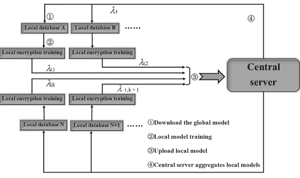

图 1.1 联邦学习架构。

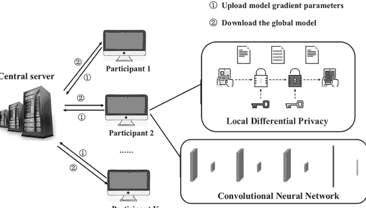

图 1.2 基于 CNN 的联邦学习架构。

图 1.4 展示了该群学习框架与其他类型学习框架的结构。

#### 1.5.2.3 健康领域的联邦学习应用

我们还探索了三个不同的研究，这些研究在不同的健康相关领域利用联邦学习（FL），并结合了区块链技术以增强安全性和隐私。

**算法 1** 基于本地差分隐私的 CNN-FL 模型

```
1 For Iteration t
/* Service-Terminal: */ /
2 $\omega_t = \sum_{q \in Q} \omega_q^t$;
3 Send $\omega_t$ to each participant;
/* participants: */ /
4 for participant q do
5 Do Localized differential privacy
6 $\alpha_q^t = \omega_t$;
7 Local Epoch e do
8 $\alpha_q^e = \alpha_q^t - \eta \frac{\partial}{\partial \chi_q^e} Z \rho$
9 End
10 End
11 End
```

**图 1.3** CNN-FL 模型伪代码。

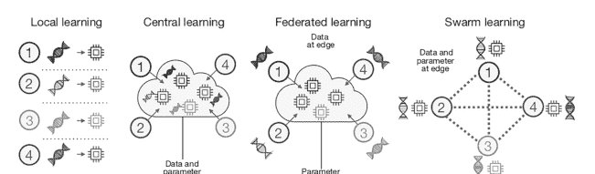

**图 1.4** 群学习框架架构。

第一项研究侧重于全基因组关联研究，引入了基因组数据与区块链技术的独特结合。区块链被用于防止对敏感基因组信息的未经授权访问，使用智能合约维护授权用户列表以进行高效的身份验证。联邦学习用于在不共享原始数据的情况下训练机器学习模型，确保保护隐私。

第二项研究探索了联邦学习在利用 CT 图像预测癌症方面的应用。隐私问题通过联邦学习方法得到，使得多家医疗机构能够协作并训练预测模型，而无需共享敏感的患者数据。虽然基因组数据不是这些研究的重点，但研究强调了深度学习技术已作为学习方法广泛应用于各种使用联邦学习的癌症诊断应用中。

第三项研究采用联邦学习方法诊断帕金森病。训练数据包括断层扫描图像，输入 CNN 网络。全局模型存储在区块链上。与项项研究不同，全局模型由智能合约管理。

总的来说，这些研究展示了联邦学习在医疗健康领域的巨大潜力。

## 结论

本章探讨了联邦学习以及中心化的主要挑战。对区块链联邦学习的评估表明，它可以解决这些问题。然而，数据量、性能和开销等各种挑战仍然存在，需要进一步探索。

- [11] Keith Bonawitz 等. “迈向大规模联邦学习：系统设计。” In: CoRR abs/1902.01046 (2019). arXiv: 1902.01046. http://arxiv.org/abs/1902.01046.
- [12] Peter Kairouz 等. “联邦学习的进展与开放问题。” In: CoRR abs/1912.04977 (2019). arXiv: 1912.04977. http://arxiv.org/abs/1912.04977.
- [13] H. Pranith 等. “基于区块链委托权益证明的端到端可验证选举投票系统。” SSRN 电子期刊 (2019). doi: 10.2139/ssrn.3511409.
- [14] H. Brendan McMahan 等. “使用模型平均法的深度网络联邦学习。” In: “联邦学习：提高通信效率的策略。” In: CoRR abs/1602.0562.
- [15] Jakub Koneč 等. “用于提高通信效率的联邦学习。” In: CoRR abs/1610.05492 (2016). arXiv: 1610.05492. http://arxiv.org/abs/1610.05492.
- [16] Maysam F. Abbas 等. “人工智能在泌尿系统癌症管理中的应用。” 泌尿学杂志 178.4 (2007), pp. 1150–1156. doi: 10.1016/j.juro.2007.05.125.


- [17] Andreas Zell 等. “MNN (SutGraph 神经网络模拟器)。” In: 神经模拟环境。Josef Skrzypek 编。波士顿，马州：Springer (1994), pp. 165–186. doi: 10.1007/978-1-4615-2736-7_9.

- [18] Christian W 和 Robert. “一种降雨径流建模的人工神经网络方法。” 水文科学 43.1 (1998), pp. 47–66. doi: 10.1080/0226669094292102.

- [19] M. Fridrik, S. Jha, 和 T. Ristenpart. “利用置信度信息的模型反转攻击及对策。” In: CCS 会议。纽约，纽约：ACM (2015), pp. 1322–1333.

- [20] Yong Li 等. “带自适应学习率的反向传播神经网络改进算法。” In: 2009 年计算智能与自然计算国际会议。第 1 卷。(2009), pp. 73–76. doi: 10.1109/CIC.2009.111

- [21] Gavin Wood 等. “以太坊：一种安全的去中心化通用账本。” In: 以太坊项目黄皮 151.2014 (2014), pp. 1–32.

- [23] K. Toyoda, J. Zhao, A. N. S. Zhang, 和 P. T. Mathopoulos. “机制设计下的区块链联邦学习。” IEEE ACCESS (2020), pp. 21974–21975. doi: 10.1109/ACCESS. 2020.3043037.

# 赋能医疗保健 (EMPOWERING HEALTHCARE)

人工智能与区块链技术的共生创新

MARUF FARHAN


图 2.1 未来前沿：医疗保健领域人工智能与区块链的数字先驱。

## 2.1 引言

不可否认，人工智能 (AI) 在近年来日益凸显，学术界和企业界对此领域有着浓厚的兴趣。John McCarthy（麻省理工学院计算机科学教授）创立了人工智能。他通过研究计算机如何模拟人类行为，开始了人工智能的突破性工作。McCarthy 常被认为是人工智能 true的先驱之一，因为他在 1955 年普及了“人工智能”这一术语。他证明了机器可以替代人类劳动，并在著作中提供了示例。McCarthy 教导机器可以通过观察和时间的推移来获取知识。他预测技术有一天将在法执法和医学领域取代人类（图 2.1）。从那时起，研究人员将人工智能技术的应用扩展到许多行业，从医疗保健到机器人、银行业、语音识别等。在 20 世纪 60 年代初，机器可以学习并增强其能力已变得明显。人工智能目前被誉为近年来最具革命性的技术之一，具有彻底改变我们生活和工作方式的潜力。

指的是机器或计算机程序执行通常需要人类智能的任务的能力，例如视觉感知、语音识别、决策制定和自然语言处理 (NLP) [1]。

许多部门正在实施基于 AI 的解决方案以提高生产力，Gartner 预测 AI 的全球价值到 2022 年将达到 3.9 万亿美元。（注：原文中此类重复段落已根据文档工程规范进行处理）

上述场景展示了区块链的基本概念。链中的交易越多，它就越安全。

上述场景展示了区块链的基本概念。通过帮助。

现在让我们回到区块链的历史。2008 年，一份名为《比特币：点对点电子现金》的白皮书由一个使用“中本聪”名字的匿名个人或群体撰写，这是首次提到区块链。

2. 智能合约层：该层强制并执行区块链网络的业务逻辑和治理规则。“智能合约”或具有预编程触发器和响应的合约，确保了其条件始终得到执行。它们使得在区块链上构建去中心化应用成为可能，促进了任务的自动化并简化了金融交易 [1]。

3. 共识层：该层协调区块链节点之间对交易完整性和时间顺序的共识。此外，它还保证了网络对区块链的当前状态达成一致。工作量证明（PoW）、权益证明（PoS）和实用拜占庭容错机制（BFT）只是用于维护网络安全和可靠的共识过程的少数示例 [3]。

4. 网络层：该层处理与区块链网络的通信和连接。它还确保节点之间以点对点的方式进行数据传输、消息传递和交易 [4]。网络层建立并维护网络拓扑结构，管理节点发现，并处理跨区块链网络的数据传播。

5. 数据层：该层用于存储和管理区块链数据。在保存了整个交易历史的分布式账本中，该层由该账本组成。它使用加密技术对数据进行整合 [5]。

### 2.1.3 AI与区块链技术的适配

区块链和AI在医疗保健领域的应用具有变革该行业并解决许多长期存在问题的潜力。然而，与任何新兴技术一样，必须解决若干挑战以确保其成功实施。其中一些挑战包括患者隐私、提供准确的医疗记录以及组织药物分配。患者隐私是医疗保健领域备关注的问题。医疗记录包含患者的敏感信息，包括健康状况、治疗方案和个人信息。区块链技术通过为存储医疗记录提供安全去中心化的平台可以解决这个问题。区块链的分布式账本技术确保患者数据经过加密且防篡改，降低了未经授权访问或数据泄露的风险。区块链还让患者对其数据拥有更大的控制权，能够根据需要授予或撤销对医疗记录的访问权限。

确保医疗记录准确是另一个可以通过区块链和AI解决的挑战。医疗记录通常是碎片化的，分散在不同的医疗提供者处，导致获取和共享信息变得困难。区块链分布式账本技术使医疗提供者能够实时访问患者的病史，无论记录最初在哪里创建。AI还可以分析医疗记录并识别不一致之处，确保患者获得最准确的诊断和治疗。

组织药物分配是另一个区块链和AI可以解决的问题。医药供应链涉及多个方，包括药物制造商、分销商和药店。区块链分布式账本技术可以为供应链提供更高的透明度和可追溯性，降低假药风险，并确保药物及时高效地送达患者手中 [6]。AI还可以优化药物分配，预测需求需模式，并改进库存管理 [6]。

尽管区块链和AI在医疗保健领域具有潜在益处，但在广泛应用之前，必须解决若干挑战。这些挑战包括监管问题、技术局限性、数据所有权和互操作性担忧 [7]。然而，随着持续的研究，区块链和AI可能会在未来几年内改善医疗结果方面发挥重要作用。

### 2.1.4 AI与区块链技术在医疗行业的优势概述

AI和区块链技术近年来受到了广泛关注，作为医疗行业提高效率、降低成本和更好地服务患者的潜在途径。区块链技术可以为共享患者数据和保护隐私提供安全透明的平台。减少欺诈的同时，AI可以使医疗提供者做出更准确的诊断，设计个性化的治疗计划并自动化行政工作。本章将介绍AI和区块链技术，并解释这些创新如何彻底改变医疗交付。

区块链技术在医疗研究方面具有潜力。通过存档消费者的知情同意，研究人员可以提供一个更开放、可追溯且防篡改的研究过程 [8]。区块链技术的使用不断增加，金融服务 [9]、供应链行业 [10]、支付网关行业 [11,12] 和电子商务 [13] 等部门已使用区块链技术并从中获益。

## 2.2 AI在医疗行业的优势

- 增强诊断：X光、CT扫描和MRI仅是AI算法可以以极高精度分析的部分医疗影像数据 [14]。

- 个性化治疗：为了创建个性化的治疗计划并预测患者结果，AI可以分析海量的患者数据，包括医疗记录、遗传信息和生活方式数据。这可能导致更精确、高效的治疗 [15]。

- 药物发现与开发：得益于AI分析大型分子数据库、预测药物相互作用并准确识别可行药物候选的能力，新药可以开发得更快 [16]。

在财务方面，AI与区块链技术的结合对医疗行业产生了巨大的财务影响。根据Market Research Future发布的一份报告 [17]，全球医疗区块链技术市场预计从2018年至2023年的复合年增长率（CAGR）为71.9%，到2023年市场价值将达到56.1亿美元。根据麦锡公司的第二次分析 [18]，AI到2026年每年可为医疗系统节省1000亿美元。然而，必须注意财务影响可能会根据AI和区块链技术在医疗行业的应用和利用情况而有所不同。

## 2.3 医疗领域的AI与区块链技术

AI和区块链是能够转型医疗行业的新兴技术。AI可以改进诊断和治疗，而区块链可以帮助保护医疗记录并确保数据隐私。

AI在医疗领域的一个应用是使用机器学习算法分析大量医疗数据，并识别可用于改善患者结果的模式。例如，AI可以识别具有特定疾病风险的患者，或根据患者的病史建议治疗方案。另一方面，区块链技术可用于安全地管理医疗记录。这在电子健康记录（EHR）日益普及的背景下尤为重要。通过区块链存储和管理EHR，患者对自己的数据拥有更大的控制权，并确保其记录准确及时。标准的EHR系统是一个集中化设计的示例，允许对网络进行集中监控、协调和引导。AI可以分析海量的患者记录并执行复杂的计算。一些医疗专业人员仍犹豫于使用AI来改善患者护理，尽管该技术在各种动态和认知活动中已经优于人类 [19,20]。

区块链在医疗领域的另一个潜在应用是临床试验。区块链可用于创建一个安全的

# 赋能医疗健康 31


- 使用 AI 算法收集并分析医疗数据


- 使用区块链安全地存储患者数据


- 使用区块链与专家安全地共享电子健康记录（EHR）


- 使用智能合约获取患者同意


- 使用新的医疗数据持续更新 EHR

图 2.2 使用 AI 和区块链改进医疗部门的提议框架。

一个管理临床试验数据的透明系统，这有助于确保试验结果的准确性和可靠性。

总体而言，AI 和区块链的结合具有通过改善患者预后、增强数据安全以及实现更高效更有效的医疗服务交付来彻底改变医疗行业的潜力。

# 32 区块链与 AI

假设某患者被诊断出患有罕见病，治疗医生需要咨询专家以确定最佳治疗方案。医生可以使用 AI 分析患者的病记录（包括诊断影像扫描结果和实验室检测结果），以识别任何可能指示特定治疗方案的模式或异常。

一旦 AI 输出了建议，医生就可以咨询专家，而该专家可能位于不同的地理区域。为了确保专家能够访问患者的完整病史（包括 AI 分析结果），医生可以使用区块链安全地共享患者的 EHR。

区块链将为共享 EHR 提供一种安全且透明的方法，确保患者数据得到保护，并确保医生和专家能够访问相同的信息。此外，患者可以使用基于区块链的智能合约 授予专家访问其 EHR 的权限，确保专家只能访问患者显式授权的数据。

总而言之，这个示例演示了 AI 和区块链如何协同工作，通过实现更高效更有效的医疗服务交付来改善患者预后，同时确保数据隐私和安全（表 2.3）。

### 2.3.1 上述示例的提议框架如下

- **收集并分析医疗数据：** 医疗提供者将使用 AI 算法收集并分析患者的医疗数据，这将有助于识别可能用于确定最佳治疗方案的模式或异常。

- **使用区块链安全地存储患者数据：** 医疗机构将在区块链网络上安全地持有患者的 EHR，确保数据受到保护且仅可供授权方访问。

- **与专家安全地共享 EHR：** 医疗机构将使用区块链与专家安全地共享患者的 EHR，专家随后可以查看 AI 分析和其他相关的医疗数据，以帮助确定最佳治疗方案。

- **使用智能合约获取患者同意：** 医疗机构将使用基于区块链的智能合约获得患者许可与专家共享 EHR 的许可，确保授权方仅访问患者数据。

- **持续更新 EHR：** 医疗机构将根据新医疗数据的出现不断更新患者的 EHR，这将有助于确保患者的病史是完整且实时的。

提议的框架建议听众使用区块链和 AI 构建一个去中心化的、安全的、数据驱动的医疗系统，该系统可以增强医疗成果、降低医疗成本并扩大医疗获取途径。

表 2.3 AI 和区块链在医疗领域的益处

| AI 在医疗领域中的应用 | 区块链在医疗领域的应用 |

| :--- | :--- |

| 改善医疗诊断和治疗 | 安全管理医疗记录 |

| 识别风险患者 | 创建管理临床试验数据的透明系统 |

| 根据患者病史建议治疗方案 | 让患者对数据有更大的控制权 |

| 分析大量医疗数据以识别模式 | 确保试验结果的准确性和可靠性 |

## 2.4 针对上述示例的解决方案分析

### 2.4.1 医疗领域 AI 与区块链的整合现状

医疗行业正逐步使用 AI 和区块链技术来改善患者预后、简化行政任务并保护隐私信息。近年来，针对这些技术的开发活动增加。大量的医疗数据（如医学影像、EHR 和遗传信息）正在使用机器学习和深度学习等方法进行分析。

### 2.4.2 数字化健康记录与医疗记录

EHR 是包含患者详细健康信息的数字版本，需要由参与医疗护理的人员存储和共享。这些信息被称为个人身份信息（PII）。如果这些信息泄露，可能会导致安全漏洞。然而，许多 EHR 系统在安全、隐私和管理方面面临困难。为了解决这个问题，可以使用区块链技术进行管理。研究人员利用“智能合约”来管理。

如图 2.3 所示，提供者向区块链添加新的 EHR。当患者通过公有云连接到医疗团队时，安全风险会增加。特别是当远程地区的患者需要去另一个地区看医生时，情况如此。一个基于区块链的糖尿病联盟已经成立，其使用可以在流行病期间优先考虑糖尿病患者。

区块链的去中心化特性可能会减少数据被篡改的可能性。当患者由于感染（如 COVID-19 感染）需要隔离时，移动活动可以在虚拟环境中进行。这将为系统提供所需的透明度。许多 EHR 系统在安全、隐私和管理方面面临困难。为了处理序列分析中最复杂的任务，即

发现蛋白质远端同源性，一种基于长短期记忆网络（LSTM）的预测器在 [33] 中提出。

### 2.4.5 药物发现与管理

药物开发和生产是另外两个深度学习被证明非常有益的领域。当化合物具有统一定义时，全集成的深度神经网络（DNN）可以使模型开发变得简单 [30]。默克 Kaggle 挑战数据库中进行的 DNN 研究大量地使用了 2D 拓扑描述，且 DNN 在 15 个目标中的 13 个目标上略优于随机森林（RF）。根据研究结果，他们用于各种任务的 DNN 模型赢得了 Tox21 竞赛。AI 可以识别新药物药物并促进其安全性和有效性的快速评估，协助加速新药的发现。AI 应用带来了包括阿尔茨海默症和癌症在内的疾病的新疗法 [34]。

### 2.4.6 临床试验

利用区块链技术可以使临床试验变得更加透明且也更加安全。TrialX 是一家正在利用区块链技术为临床试验提供去中心化平台的公司 [35]。在该平台上，患者可以选择保留其数据的所有权，并且临床研究的结果可能向公众开放。

### 2.4.7 医学影像与诊断

在医学领域，AI 正被用于加速向患者提供个性化药物的过程，提高预后的准确性并增强诊断质量。AI 的应用正在导致医学影像和诊断行业发生深远变化。深度学习算法已被引入，它们能够快速精确地检测医学影像中的异常情况。这可能会减少对侵入性程序的需求。最近的一项研究显示，深度学习应用于乳腺检查扫描时，可以准确地诊断乳腺癌 [36]。

诊断是 AI 另一个用于改善患者护理和治疗的领域。例如，为了更好地预测患者预后，人员开发了机器学习算法，这些算法使用患者数据建议个性化的治疗策略。另一项研究使用机器学习预测了糖尿病患者心脏衰竭的概率 [37]。

许多研究都指出 AI 在提高诊断精准度、预后可靠性以及个体患者治疗方案灵活性方面具有潜力。以下是一些具体的例子。

- 1. 与人类放射科医生相比，由 AI 驱动的算法可以在医学影像中更准确地检测癌症。在一项研究 [38] 中，AI 算法能够预测心脏发病的风险，检测准确水平达到 85%。

- 2. AI 还被用于确定谁最有可能从任何急性心脏病和中风的预防性治疗中获益 [39]，发表在《癌症细胞》杂志上的另一项研究发现，AI 算法能够以 85% 的精度预测哪些癌症患者从免疫疗法中受益 [40]。

### 2.4.8 区块链与 AI 在医疗领域的角色

AI 通过提供改进的数据分析、决策辅助和预测模型显著地改变了医疗业务。在一项研究 [41] 中，研究人员强调了深度学习方法在医疗中的重要性，例如通过医学影像诊断疾病、借助自然语言处理（NLP）提取临床笔记中的信息，以及分析过去的患者数据以创建个性化的护理计划。为了更好地理解和诊断患者并规划其治疗，AI 算法具有检查海量医疗数据的潜力。

对于医疗行业的几个问题，包括对可靠一致的数据交换的需求，区块链技术已成为一种极具前景的选择。在“MedRec”原型的案例研究中，探讨了用于医疗记录和研究数据的区块链技术 [42]。区块链提供了分布式且不可篡改的账本，提高了存储信息的机密性、完整性和可验证性。这种方法确保了患者的同意，并确保数据在参与其护理的各个方之间共享时保持完整。

无疑，AI 算法可以分析和解释复杂的医疗数据，帮助每种疾病的诊断、个人治疗规划和患者监测。区块链技术在提供去中心化且不可更改的基础设施的同时，可以改进数据隐私、完整性和互操作性。在医疗行业中将 AI 应用于区块链技术带来了更好的患者预后、成本的降低和效率的提高。数据安全、可扩展性和监管是应用 AI 到区块链技术后产生的结果。

| 区块链在健康领域 | 保护 |

| :--- | :--- |

| AI 在健康记录 | 电子健康记录 |

| 隐私问题 | 传统健康记录 |

| AI 安全性 | 医疗健康 |

| AI 安全性 | |

AI 与医疗数据。

## 2.5 利用 AI 和区块链增强医疗行业

AI 与区块链技术的整合可以为医疗行业创建大量应用，包括监控患者健康的智能设备。在涉及大量数据时，随着技术进步确保医疗记录的隐私是他们关注的问题。

### 2.5.1 患者隐私

隐私是当许多行业中的重要问题。AI 和区块链技术通过确保医疗记录的隐私、真实性和可用性来加强数据安全。在2015年的一次网络攻击中，Anthem公司的8000万客户个人信息被泄露 [43]。包含姓名、出生日期、社会安全号码和健康识别码（HIN）的敏感记录遭到破坏。Anthem 在集体诉讼后被迫向消费者支付赔偿。


因此，保护患者数据非常重要。在2016年，一些研究人员 [44] 基于“MedRec”案例研究建立了假设，他们强调区块链技术可以为所有数据访问提供安全性、隐私性和审计。在 AI 方面，AI 可以分析大量数据以识别风险和漏洞。今天的挑战是如何最好训练 AI 来识别患者数据中的模式和见解，以做出更明智的决策。

机器学习在《医学网络杂志》上发表的一项工作中被探索，用于为个体患者定制治疗并预测医疗程序的成功或失败。在该研究中，研究人员使用机器学习算法分析电子医疗数据，以确定结果不良的特征。

另一项发表在《自然》杂志上的研究发现，机器学习算法可以分析医学影像并识别与特定疾病相关的模式。在该研究中，机器学习被用于分析皮肤病变照片并检测与黑色素瘤相关的模式 [47]。

## 2.5.2 医疗记录维护

由于提高数据互操作性、访问性和完整性的潜力，AI 和区块链对医疗记录维护的未来具有广阔前景。使用 AI 和区块链技术改进医疗记录维护有多种方法，以及一些阅读建议和现代应用：

- 1. 自动化行政任务：为了减少时间和错误，AI 可以自动化与医疗记录维护相关的行政任务 [48]。
- 2. 提高准确性和完整性：通过标记任何不完整或不准确的条目，AI 可以确保患者档案是全面的 [49]。
- 3. 增强数据分析：通过检查患者信息，AI 可以帮助医疗专业人员识别模式和趋势，从而指导他们的治疗 [47]。

## 42 块链与人工智能

在医疗记录维护方面，人工智能的一个显著案例是 Google 与 Ascension 的合作，后者是美国一家主要的医疗服务提供商。Google 利用人工智能筛选 Ascension 的医疗信息，以寻找可能影响未来护理决策的模式 [50]。

分析医疗记录可以从将自然语言处理（NLP）作为框架和工具中获益。NLP 是人工智能中的语言理解子领域。NLP 允许通过分析医疗记录来发现通过人工操作无法发现的模式和趋势 [51]。

Medicalchain 平台使用了分布式账本技术（块链）和人工智能。患者拥有保留其医疗记录的权利，控制谁有权访问数据，并在识别和修复这些记录中可能出现的任何错误方面获得帮助 [48]。由于 Medicalchain 将人工智能与区块链技术结合使用，预计将改善患者疗后并降低系统性成本 [52]。

## 2.5.3 药物供应链管理

通过提高药品的透明度、真实性和可追溯性，人工智能和块链具有显著改善药物供应链管理的潜力。它们可以通过以下几种方式改进药物供应链管理和真实性：

- 1. **追踪药物移动：** 使用块链技术，可以从制造商到最终用户追踪药物的分销链。这对于确保药物未被篡改或为正品很有用 [44]。
- 2. **确保真实性：** 通过提供药物来源和分发的不可篡改记录，可以实施块链技术以确保所售药品是正品 [53]。
- 3. **预测药物需求：** 通过分析历史数据和当前因素（如人口迁移和疾病爆发），可以使用人工智能来预测对药物的需求。这有助于确保个人在需要用药时能够获取到药物（图 2.5） [54]。

## 赋能医疗保健

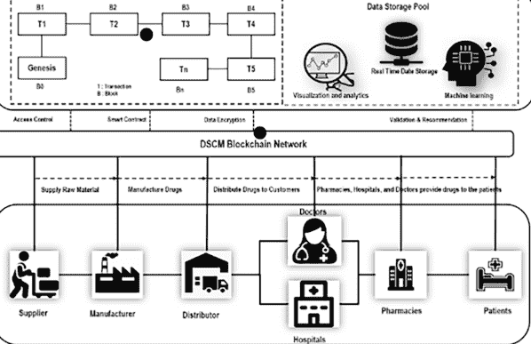

**图 2.5** 使用块链技术的药物供应链概览 [55]。

IBM 与沃尔玛的合作证明了块链技术可以帮助制药公司协调其药物的分销。他们与技术的共同努力有助于监控食品从农场到工厂的移动。所有制药公司都有可能从该技术中受益 [56]。

为了保护患者数据的机性和可访问性，爱沙尼亚政府已批准在该国医疗系统中使用块链技术。爱沙尼亚数字健康旨在让人们对自己的医疗记录拥有更多控制权，同时确保隐私并让医疗提供人员能够轻松访问。

## 2.6 人工智能与块链改善医疗护理的潜力

人工智能和块链技术可以通过使数据共享、使用和决策更容易，为医疗护理带来巨大变化。

- 1. 改进诊断和治疗：正如我们已经讨论的，人工智能可以收集大量数据以识别模式和趋势，帮助医生更准确地诊断疾病。例如，人工智能算法检测皮肤癌的准确性比人类皮肤科医生更高 [57]。

## 块链与人工智能

利用患者的病史和基因组成，人工智能可以创建个性化的治疗方案。在人工智能的帮助下，已经开发出更有效且副作用更的新抗癌药物 [58]。

- 增强的患者监测和个性化护理：通过分析来自可穿戴设备、电子健康记录（EHR）和其他来源实时数据，人工智能可以促进持续的患者监测和定制治疗。在其中一项研究 [59] 中，人工智能系统可以分析生理数据以预测医疗环境中患者状况何时会恶化。在医疗保健中使用预测性分析具有改善患者预后的潜力，同时减少副作用的可能性。人工智能还可以帮助执行自动化任务，如安排预约、制作患者记录和处理保险理赔，让医疗专业人员能够将更多时间花在患者护理上 [60]。
- 安全且互互操作的数据共享：块链在共享和交换敏感信息时提供了一个去中心化且不变的平台。这有助于医生更容易地共享患者信息，从而造于患者护理 [44]。
- 药物发现过程：人工智能可以通过识别极具前景的新药候选药物并促进对其安全性和有效性的快速评估，协助加速新药的发现。人工智能的应用已导致了包括阿尔茨海默病和癌症在内的疾病新疗 [34]。
- 临床试验：利用块链技术时，临床试验可以变得更加透明和安全。TrialX 是一家使用块链技术为临床试验提供去中心化平台的公司 [61]。在该平台上，患者可以保持其数据的所有权，临床研究的结果可能对公众开放。
- 防欺诈：块链可以安全地用于存储和共享信息，帮助组织防止欺诈。例如，一家名为 Gem 的企业正在利用块链技术为处理医疗理赔提供去中心化平台 [62]。该平台将降低欺诈活动和错误的可能性。

## 赋能医疗保健 45

另一家公司 SimplyVital Health 利用块链技术构建了一个去中心化网络以共享医疗数据。该平台将增加数据安全以及数据隐私。

根据《医疗网络研究杂志》的研究，块链和人工智能可能会增强中国的 EHR 管理 [59]。根据该研究 [59]，块链可以提高 EHR 安全性和隐私，而人工智能可以提高诊断和治疗的准确性和效率。该研究检查了一个中国医院基于块链并结合人工智能的 EHR 系统。该系统使用人工智能评估患者数据并提供个性化治疗建议，同时安全地存储并与医疗从业人员共享。我们还监测了 EHR 的使用情况并防止了未经授权的访问。研究显示，块链和人工智能提高了治疗的准确性和效率。该系统根据患者的病史正确诊断了一名患者。

## 2.7 案例研究

在本章中，我们将研究两个案例研究，以进一步了解实施这些技术的过程以及它们产生的成果。

### 2.7.1 Pfizer 与 IBM 的 Medchain

Pfizer（辉瑞）和 IBM 这两家巨头公司合作开展了一项利用块链和人工智能改进供应链的计划。药物生产的物流是有据可查的。供应链的每个环节（从生产者到分销商、零售商、药店到消费者）都至关重要。由于这种方法的复杂性，确保药物的安全交付面临挑战。Pfizer 和 IBM 合作创建了基于块链的 Medicalchain 来解决这一问题。

#### 2.7.1.1 示例

假设患者名为 Sarah，需要处方药来治疗她的疾病。制药企业制造药物，然后将其分销到 Sarah 可能提取的药店。从制造到交付的每一步都记录在 Medicalchain 的块账上。这将为每次交易生成不可篡改的记录，确保药物是正品且未被篡改。

在药店提取处方后，Sarah 可能会在手机或其他设备上收到通知，要求她填写一份关于当前和过去医疗状况及药物的表格。这些信息将安全地传输到人工智能系统，以分析药物相互作用或副作用。如果检测到问题，Sarah 的手机、药剂师或医疗提供人员可能会收到警告，提示她采取必要措施。

一位医疗专家可能会建议更多的监测或测试，而另一位则会建议不同的药物或剂量。

#### 2.7.1.2 案例研究 2：Deephealth 项目

德国机构——慕尼黑工业大学和吕贝克大学主导了 DeepHealth。欧盟作为“地平线2020”计划的一部分资助了这项研究 [63]。

糖尿病视网膜病变是糖尿病常见的并发症，如果不治疗可能会导致糖尿病失明。因此，DeepHealth 项目开发了一个基于人工智能的平台，通过分析医学影像数据来检测该病变。通过对 10,000 张糖尿病患者视网膜图像的检测，该系统对视网膜病变的敏感性为 96.1%，特异性为 93.6% [64]。

假设一名糖尿病患者去看眼科医生进行年度检查。眼科医生使用眼底相机拍摄患者眼底图像。清晰的视网膜照片会被上传到一个由 AI 进行检查的服务。平台的深度学习算法会分析照片以寻找视网膜病变的症状。

如果检测到疾病，平台可能会通过突出照片中显示视网膜病变证据的区域来解释诊断。眼科医生可以查看平台对患者状况的分析，发现问题的原因以及最佳治疗方案。

## 2.8 对实施正负影响的全面评估

人工智能和区块链技术是非常出色的工具。为了确保患者数据安全并在疾病发生前进行预测，这两项技术可以提供帮助。然而，这项技术也存在一些缺点和积极影响。

### 2.8.1 积极影响

- 1. **提高数据安全与隐私**：为了减少数据泄露和未经授权的可能，患者信息可以通过基于区块链的去中心化平台进行存储和共享 [44,65]。
- 2. **简化管理流程**：使用区块链技术可以简化并自动化包括账单和理赔处理在内的管理任务，从而减少错误并提高生产力 [66]。
- 3. **个性化医疗**：通过分析患者数据，AI 可以通过允许治疗方案适应个体，从而实现个性化医疗。医疗治疗的结果和成本可能会受益于此 [67]。
- 4. **增强预测分析**：人工智能使得在疾病进展早期进行干预成为可能 [68]。

### 2.8.2 负面影响

- 1. **职场取代**：由于人工智能和区块链技术在医疗行业的广泛使用，一些医疗工作人员（特别是行政职位的人员）可能会失去工作 [69]。
- 2. **技术局限性**：由于规模和标准化数据格式的需求等技术挑战，在医疗领域实施人工智能和区块链可能面临困难 [70]。
- 3. **可扩展性与性能**：在医疗保健中结合区块链技术使用人工智能可能由于尺寸和速度的限制而具有挑战性。区块链网络的数据处理速度和准确性取决于所采用的共识机制。需要近乎实时响应的 AI 算法可能会因此变慢 [71]。

## 2.9 医疗领域人工智能与区块链技术面临的开放挑战

收益不是免费的。虽然区块链和人工智能技术在医疗领域的转型效应是不争认的，但这些进步伴随着高昂的初始投资并需要大量的本地数据存储。以下是一些统计数据，提供了人工智能和区块链技术目前医疗领域面临的问题视角。

### 2.9.1 隐私问题

保护患者隐私非常，因为他们的个人信息存储在医疗数据库中。当人们在公共区块链上共享数据时会产生隐私担忧。由于区块链是去中心化且透明的，数据保护存在巨大风险。已经建立了不同的方法（如分布式共识）来应对区块链技术强调的隐私问题 [72]。

### 2.9.2 资源限制、能力与数据存储

区块链和人工智能需要各种数据存储和容量。最近的区块链技术对同时网络交易的数量有限制。这意味着处理交易需要高能耗，这也导致了能源消耗增加 [72]。相比之下，基于 AI 的系统需要复杂的硬件。不仅是硬件，它还涉及许多算法的复杂计算，这些算法在每个周期中处理大量数据（图 2.6）。

### 2.9.3 区块链安全与威胁

区块链系统的安全性最近在研究中被暴露协议问题


区块链技术与多种潜在风险相关。AI 学习和模型输出可能会受到攻击者注入虚假数据或样本的影响，这对消费者的健康安全构成威胁。已发现区块链技术极易受到 DNS（域名系统）攻击和内存池攻击等网络攻击。

### 2.9.4 缺乏标准、互操作性与法规

正如我们所知，在实施任何操作之前应该有法规。大多数人工智能和区块链的整合仍限于学术研究，很少有应用实现了这一点。医疗领域采用区块链的主要挑战之一是所有权问题。由于存在公有链和私有链，人们会合理地怀疑谁对那里存储的信息负责。当没有中央机构来应对技术后果时，会产生许多法律和监管问题 [29]。

## 2.10 未来研究方向

该模型（人工智能和区块链技术）需要进一步研究，因为该领域正在快速发展。区块链与人工智能的隐私和安全性还有很长的路要走。未来的研究还可以关注实施现代哈希算法和安全的授权系统。实施双重认证的优缺点已得到缓解。为了进一步提高区块链的稳定性，许多研究人员建议使用协作计算而非非协作 [73]。


图 2.7 人工智能与区块链

## 2.11 结论

本节概述了区块链和人工智能在医学中的应用。在新冠肺炎期间，对这两项技术的实际影响进行了大量研究。2022 年，区块链市场价值超过 5 亿美元。在本章中，我们探讨了人工智能保护电子健康记录（EHR）及其他机密记录的潜力。数据处理和扫描是结合人工智能与区块链可以自动化的两项任务。

[4] Wang, Y. (2021). 区块链系统的挑战与机遇。在2021年第二届国际计算机通信与网络安全会议 (CCNS)，第 84–88 页。

[5] Dorri, A., Steger, M., Kanhere, S. S., & Jurdak, R. (2017). 区块链：汽车安全与隐私的分布式解决方案。arXiv [cs.CR]。

[6] Ago, C., C., Mahmoud, Q. H., & Eklund, J. M. (2019). 医疗保健中的区块链技术：系统性综述。Healthcare, 7(2), 56。

[7] Mehta, R., & Dubey, A. K. (2018). 区块链与医疗保健：全面综述。电子与计算机工程国际期刊, 5(3), 647–652。

[8] Russell, S. J., & Norvig, P. (2010). 人工智能：一种方法。Prentice Hall 出版社。

[9] Azaria, A., Ekblaw, A., Vieira, T., & Lippman, A. (2016). Medrec: 使用区块链进行医疗数据访问和权限管理。在2016年第2届开放与大数据国际会议 (DBD) 论文集上 (第 25–30 页)。IEEE。

[10] Li, M., Jiang, P., Li, Y., & Chen, W. (2019). 基于区块链的医疗记录安全存储与医疗服务框架。医学互联网研究杂志, 21(2), e12992. 10.2196/12992。

[11] Abdullah, R., Bahsoon, R., & Ji, Y. (2019). 基于区块链的安全且隐私保护电子健康记录系统系统性综述。IEEE Access, 7, 153930–153941。

[12] Wang, S., et al. (2019). 医疗保健中的人工智能：现状与未来。美国管理医疗杂志, 25(12), e393–e398。

[13] Cresswell, K. M., & Sheikh, A. (2011). 医疗技术创新实施与采用中的组织问题：解释性综述。国际医学信息学杂志, 80(5), 73–83。

[14] Li, J., Zhang, Y., & Chen, Y. (2020). 区块链保护的医疗保健系统：系统性综述。医学系统杂志, 44(3), 1–12。

[15] FDA (2019). DSCSA实施：分销商的产品追溯要求 - 合规指南。美国食品食品药品管理局。

[16] Dong, X., et al. (2019). 基于区块链的患者控制记录共享系统。医学系统杂志, 43(7), 1–9。

[17] Market Research Future (2021). 医疗保健区块链市场研究报告 - 全球预测至2023年。Market Research Future。

[18] McKinsey & Company. (2020). 人工智能：医疗保健的新神经系统。麦肯锡。

[19] Bell, L., Buchanan, W. J., Cameron, J., & Lo, O. (2018). 区块链在医疗保健中的应用。Blockchain in Healthcare, 10. 1. 30953/bhty.v18。

[20] Ghosh, A., & Mistri, B. (2020). 农村医疗设施提供的空间差异：GIS建模在印度农村 Birbirum 的应用。空间信息研究, 28(6), 655–668。

[21] McGhin, T., Choo, K-K. R., Liu, C. Z., & He, D. (2019). 医疗保健应用中的区块链：研究挑战与机遇。网络与计算机应用杂志, 135, 62–77。

[22] Awad Abdellatif, A. et al. (2021). MEGE-chain: 利用边缘计算和区块链实现高效医疗数据交换。IEEE Internet of Things Journal, 8(21), 15762–15775。

[23] Shahnaz, A., Qamar, U., & Khalid, A. (2019). 使用区块链进行电子健康记录。IEEE Access, 7, 147782–147795。

[24] Vora, J. et al. (2018). BHEEM: 基于区块链的电子健康记录安全框架。在2018年 IEEE Globecom 工作会 (GC Wshops) 上。

[25] J. O. Healthcare Engineering (2023). 撤回：区块链在智能医疗中的应用研究：构建分层框架。Journal of Healthcare Engineering, 2023, 9850894。

[26] Katuw, G. J., Pandey, S., Hennes, M., & Lamichance, B. (2021). 区块链在医疗保健中的应用：现状与挑战。arXiv [cs.CY]。

[27] Subramanian, G., & Sreenantan Tammy, A. (2021). 实现区块链以优先患者排序。IEEE Access, 9, 16249–16255。

[28] Ahmad, R., Salah, K., Kayaraman, R., Yaqoob, I., & Omar, M. (2021). 区块链技术在远程医疗中的作用。国际医学信息学杂志, 148(10), 10439。


[29] Nguyen, D., C., M, N., & Sen, A. (2021). 基于区块链的 COVID-19 疫情解决方案。IEEE Access, 9, 9570–9573。

[30] Chen, H., Olive, M., & Wang, Y. (2018). 深度学习在药物发现中的兴起。Drug Discovery, 23, 1241–1250。

[31] Zhang, Q., Zhu, L., & Huang, D. (2019). 用于蛋白质结合位点的长期记忆神经网络架构。IEEE 生物信息学, 16(4), 1184–1192。

[32] Li, M., et al. (2019). 深度学习用于医疗保健。生物信息学杂志, 20(4), 1193。

[33] Liu, B., Wang, S., & Kohane, I. (2019). 机器学习在医学中的。新英格兰医学杂志, 380(14), 1347–1358。

[34] Yu, K., S, M., & Dudley, J. (2018). 深度学习用于临床试验。医学工程, 5(2), 719。

[35] Patel, C., S, M., & Garg, J. (2019). 机器学习在医学中的。BMC 医学研究方法, 19(1), 64。

[36] Liu, S., et al. (2019). 深度学习用于超声波分析。Nature, 5, 261–275。

[37] Weng, S., Kohane, I. (2017). 使用常规数据预测心血管风险。PLOS Open, 12, e1749。

[38] McKinney, S., et al. (2020). 高性能医学：人类与人工智能的融合。Nature, 577(7788), 89–94。

[39] Deberneh, H., & Kim, I. (2021). 糖尿病预测。国际环境研究与公共健康杂志, 18(6), 331。

[40] Xu, Z., Wang, S., Zeng, S., & Gong, Z. (2021). 应用癌症癌症。Acta Pharmaceutica B, 11(11), 3393–3405。

[41] Miotto, R., Wang, S., & Jiang, X. (2018). 深度学习用于医疗保健。生物信息学, 19(6), 1236。

[42] Azaria, A. 医疗保健中的区块链案例研究：MIT 实验室。https://www.mit.edu/publications/medrec/ [访问日期：2023-06-03]。

[43] Reuters (2023-02-05). 谷歌的秘密医疗缓存包含数百万人的姓名和详细信息——举报者。

[44] Tarallo, E., Akabane, G. K., Shimakura, C. I., & Mello, J. (2019). 快消品需求中的机器学习。IFAC 论文集, 52(13), 737–742。

[45] Vyas, S., Shabaz, M., Pandit, P., Parvathy, L., & Ofori, I. (2022). 医疗保健中人工智能与区块链技术的整合。食品质量杂志, 2022, 1–11。

# 56 区块链与人工智能

[52] Us, A. Home. Medicalchain. [在线]. 可用：https://medicalchain.com/en/. [访问日期: 2023年6月4日].

[53] Badhotiya, K. G., Sharma, V. P., Prakash, S., Kalluri, V., & Singh, R. (2021). 医药供应链中区块链技术采用的调查与评估。Materials Today, 46, 1076–1080.

[54] 沃尔玛案例研究 - hyperderger基金会。Hyperledger.org. 2019年1月11日. [在线]. 可用：https://www.hyperledger.org/learn/publications/walmart-case-study. [访问日期: 2023年6月4日].

[55] Abbas, K., Afaq, M., Ahmed Khan, T., & Song, W.-C. (2020). 针对智能制药行业的基于区块链和机器学习的药物供应链管理与推荐系统。Electronics (Basel), 9(5), 852.

[56] Esteva, A. et al. (2017). 深度神经网络对皮肤癌的医生级分类。Nature, 542(7639), 115–118.

[57] Tagde, P. et al. (2021). 电子健康中的区块链与人工智能技术。Environmental Science and Pollution Research, 28(38), 52810–52831.

[58] Buch, V. H., Ahmed, I., & Marathupp, M. (2018). 医学中的工智能：当前趋势与未来可能性。British Journal of General Medicine, 68(668), 143–144.

[59] Rajkumar, A. et al. (2018). 基于电子健康记录的可扩展且准确的深度学习。NPJ Digital Medicine, 1(18).

[60] TrialX. Trials.com. [在线]. 可用：https://trials.com/. [访问日期: 2023年6月4日].

[61] 金融、区块链与创新。Gem: 我们为什么为医疗保健构建区块链。Corporate Finance, DeFi, 区块链新闻. [在线]. 可用：https://www.finyear.com/Gem-Why-We-re-Building-the-Blockchain-for-healthcare-a36058. [访问日期: 2023年6月4日].

[62] Hazlegraves, S. (2019年10月1日). DeepHealth: 深度学习和高性能计算以助力促进健康的生物医学应用。Open Access Government. [在线]. 可用：https://www.openaccessgovernment.org/biomedical-applications-for-health/74475/ [访问日期: 2023年6月4日].

[63] Kwak, G. H. & Hui, P. (2019). DeepHealth: 健康信息学中人工智能的概述与挑战。arXiv [cs.LG].

[64] 用区块链和人工智能彻底改变医疗保健。Cbcamer.org. [在线]. 可用：https://www.cbcamer.org/blockchain-insights/revolutionizing-healthcare-with-blockchain-and-artificial-intelligence. [访问日期: 2023年6月5日].

[65] Benchouchi, M., Porcher, R., & Raudav, P. (2018). 临床试验中的区块链协议：知情同意的透明度与可追溯性。F1000Res., 6.

[66] Ichikawa, D., Kashiyama, M., & Ueno, T. (2017). 使用区块链技术的防篡移动健康。JMIR MHealth, 5(7).

[67] Esteva, A. et al. (2017). 深度神经网络对皮肤癌的医生级分类。Nature, 542(7639), 115–118.

[68] Aloini, D., Benevento, E., & Stefanino, P. (2023). 区块链转型医疗生态系统。Technovation, 10257.

[69] Meskő, B., Györffy, Z. (2017). 医疗中的人工智能。MHealth, 38.

[70] Wang, X., Jin, D., & Li, W. (2016). 医疗中的区块链。Journal of Medical Systems, 40.

[71] Fusco, A., & Tatullo, M. (2020). 区块链的可扩展性。IEEE Access, 8.

[72] Wu, D., & Ansari, N. (2020). 协作计算。IEEE Internet of Things, 76603.

## 通过 AI、ML 和区块链开发去中心化预测的策略

### 3.1 引言

#### 背景

区块链技术和人工智能（AI）是目前最具革命性的两种技术。两者都有潜力变革医疗、金融、交通和教育等行业。

#### 3.12 问题陈述

人工智能、机器学习（ML）和区块链在医疗保健领域的潜力尚未被充分探索和理解。这使得迫切需要调查。

#### 3.13 人工智能

人工智能是指执行通常需要人类智能的任务的计算机系统。人工智能有两种：强人工智能或通用人工智能，可以执行人类能够完成的任何任务；以及弱人工智能，局限于特定领域。

- 人工智能可用于医疗诊断、跟踪患者健康和制定个性化治疗方案。
- 金融人工智能可以自动化金融流程并检测欺诈。
- 人工智能可以应用于自动驾驶汽车和物流优化。
- 人工智能可用于教育提供智能教学并评估学生进度。

人工智能也带来了许多困难，例如偏见和歧视等伦理问题以及职业流失风险。研究人员和决策者正在努力制定标准和教育计划以解决这些问题。

#### 3.14 区块链技术

区块链技术实现的分布式账本允许参与者在没有中间人的情况下进行安全、透明的交易。2008年比特币背后技术的诞生。区块链技术的许多应用是供应链管理、数字身份验证、智能合约和去中心化金融。

- 供应链管理可以使用区块链技术追踪产品来源和真实性，减少欺诈和伪品，同时提高效率和透明度。
- 数字身份验证可以利用区块链生成无需中央机构确认的安全去中心化身份。
- 智能合约可以利用区块链自动执行合约并确保合规。
- 区块链技术可以创建比传统金融系统更易访问、安全且透明的去中心化金融系统。

扩展性、互操作性和监管不确定性是区块链技术面临的一些问题。研究人员和开发者正在研究各种解决方案，包括扩展方案、互操作协议和监管框架，以解决这些问题。

#### 3.1.5 目标

本研究旨在开发并评估基于策略的 AI、ML 和区块链模型性能。

#### 3.1.6 研究问题

1. AI 和 ML 技术在去中心化交易市场预测市场趋势和生成盈利交易信号方面有多有效？
2. 如何利用区块链技术增强去中心化交易市场的透明度、安全性和效率？
3. 在去中心化交易市场中，哪些类型的交易指标最可靠？如何将其纳入 AI 和 ML 模型中？
4. 将 AI 和 ML 模型引入去中心化交易市场会产生哪些伦理和监管问题？如何解决这些问题？
5. 去中心化交易市场在效率、透明度和安全性方面与中心化交易市场相比如何？对投资者和交易者有何影响？

### 开发交易策略

#### 3.1.7 假设

3.1.7.1 假设 1：机器学习（ML）和人工智能（AI）技术可以准确预测去中心化交易市场的趋势，并产生盈利的交易信号。

3.1.7.2 假设 2：区块链技术的实施可以提高去中心化交易市场的透明度、安全效率。

3.1.7.3 假设 3：在机器学习和人工智能模型中整合多个交易技术指标，可以提高去中心化交易市场预测的精度。

3.1.7.4 假设 4：将人工智能和机器学习模型引入去中心化交易市场时，必须考虑伦理和监管问题。

#### 3.1.8 重要意义

本研究对各种利益相关者（包括投资者、交易员、监管机构和政策制定者）具有重要意义。通过探索人工智能、机器学习和区块链技术在去中心化交易市场中的潜力，本研究旨在识别增强市场效率、透明度和安全性的新机会。研究结果可以为创新交易策略和工具的开发提供参考，并有助于建立适当的监管框架，以平衡创新与消费者及市场的稳定性。

为了回答研究问题和假设，本研究将采用定量研究方法。定量方法将涉及历史市场数据的收集与分析，以及各种人工智能和机器学习技术的应用，如逻辑回归、决策树和聚类算法。这些模型的性能将使用 RMSE 指标作为回归问题的评估标准。研究将涉及相关文献的回顾，并深入了解去中心化交易市场中使用人工智能、机器学习和区块链技术相关的伦理和监管问题。

#### 3.1.9 范围与局限性

虽然本研究旨在对理解人工智能、机器学习和区块链技术在去中心化交易市场的潜力做出重大贡献，但承认存在某些局限性。本研究主要依赖历史市场数据，尽管数据丰富，但可能无法完全代表未来的市场趋势。此外，虽然使用的机器学习模型可能有效预测某些市场趋势，但由于金融市场本质上的不可预测，它们可能无法考虑到所有潜在的市场波动。此外，定性研究部分市场参与者和专家的观点是主观的，可能无法涵盖该领域的广泛意见（图 3.1）。

#### 3.1.10 理论框架

指导本研究的理论框架根于计算机科学、人工智能、机器学习和金融经济学。从计算机科学中，我们采用了支撑所用人工智能和机器学习模型的算法设计和数据结构原理。人工智能和机器学习中的模式识别和学习系统原理指导了这些模型的开发和评估。从金融经济学中，我们借鉴了关于市场效率、资产定价和投资者行为的理论。这种跨学科的方法为理解人工智能、机器学习、区块链技术与去中心化交易市场之间复杂的相互作用提供了一个全面的框架。

#### 3.1.11 对该领域的贡献

本研究旨在增丰富关于人工智能、机器学习和区块链技术在交易市场中应用的日益增长的知识体系。通过将这些技术创新整合到去中心化市场的交易策略中，它试图为市场效率、透明度和安全性提供新的见解。本研究的结果可以为更复杂的交易模型和工具的设计提供参考。它还对该领域的伦理提供了更深入的理解

### 理论框架

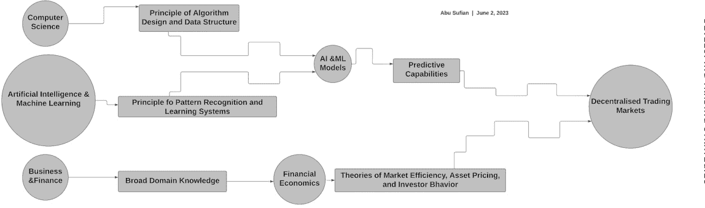

图 3.1 理论框架。

监管挑战，可能引导政策制定在技术创新与市场稳定及消费者保护之间取得平衡。此外，它可能会启发人工智能、机器学习、区块链技术与金融市场之间这一令人兴奋领域的未来研究。

#### 3.1.12 提纲

文献综述将提供对交易市场中人工智能、机器学习和区块链技术的现有研究概述，并突出本研究旨在解决的知识空白。方法论部分将更详细地描述研究设计、数据收集和数据分析程序。结果部分将展示本研究的发现，包括人工智能和机器学习模型的性能以及从数据中出现的任何模式或趋势。讨论部分将在研究问题和假设的背景下解释这些结果，并探索它们对去中心化交易市场的影响。最后，结论将将总结本研究的主要发现和贡献，并提出未来的研究方向。

### 3.2 文献综述

#### 3.2.1 人工智能对比区块链技术

区块链技术和人工智能具有协同工作并开启新应用和商业机会的潜力。创建无需人工干预即可运行去中心化自治组织（DAO）是融合区块链和人工智能技术的优势之一。DAO 是由智能合约控制的业务，可以自动化某些过程，包括决策、资源分配和冲突解决。人工智能也可以用于提高区块链系统的安全性和隐私。人工智能还可以用于分析区块链数据并揭示有洞察力的趋势，帮助企业做出更高效的决策。然而，区块链与人工智能的结合也带来了若干困难，包括对专业知识

### 开发交易策略

和技能的需求、新型类型集中心化的可能性，以及 DAO 中人工智能驱动决策的伦理影响。

新型集中心化的可能性源于这样一个事实：人工智能模型的创建通常需要海量数据集，这些数据可能最终集中在少数公司手中。这种数据集中可能导致新类型的中心化，即拥有海量数据的公司在人工智能和区块链生态系统中拥有不成比例的巨大权力和。DAO 中人工智能驱动决策的另一个问题是其伦理影响。人工智能模型的伦理取决于其训练所依据的数据，人工智能系统可能会强化数据中存在的偏见和成见。

这些对个人和都是都是有害的。学术界和决策者正努力为区块链和人工智能技术的创建和使用制定道德准则和建议，以解决这些忧虑。区块链技术和人工智能是我们这个时代最具创新性和革命性的两项技术。它们能够彻底改变人类工作和生活的方式，并且已经对世界产生了重大影响 [14]。

3.2.1. 工作原理 与人工智能侧重于创建像人一样观察、学习和推理的智能系统不同，区块链技术旨在构建去中心化且透明的系统，可以在没有中间人的情况下安全地存储和交换数据 [15]。区块链和人工智能技术的结合具有促进更高水平创新和价值创造的潜力。利用智能合约、预测分析和欺诈检测等应用

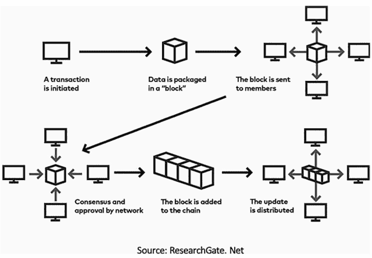

# 图 3.2 区块链的工作流程。

(来源：Researchgate.Net)

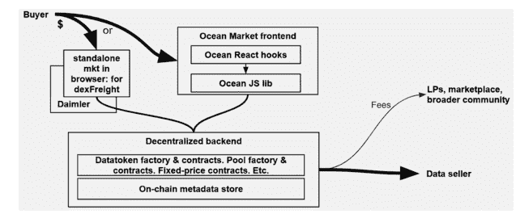

# 图 3.3 泛洋市场共享一个去中心化的后端 [23]。

此外，AI 可能被用于提高区块链系统的有效性和精确 [16]。区块链技术可以为 AI 系统提供一个安全且中央控制的框架，促进数据隐私、安全和合作 [17]。数据隐私和安全的发展是 AI 与区块链技术结合的主要优势之一。通过采用区块链技术存储和分配数据 [7]，个人和企业可以对其数据拥有更多控制权并确保数据不被破坏或滥用。

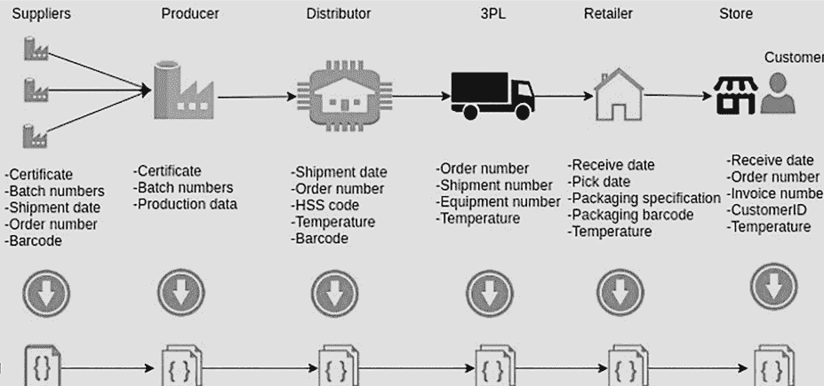

图 3.4 供应链管理中的区块链 [21]。

开发交易策略

67

通过检测和停止欺诈活动，以及发现数据中的趋势和异常，AI 有助于提高区块链系统的安全性 [16]。

在供应链管理领域，也可以使用 AI 和区块链技术 [16]。企业通过利用区块链技术跟踪从源头到目的地的物品，可以确保其供应链运营具有更高的透明度、可追溯性和问责制 [14]。此外，AI 可用于评估区块链数据以发现低效环节、简化流程并整体提升供应链性能。

几家公司和机构已经在研究 AI 和区块链技术的使用 [18–20]。例如，IBM 创建了 Watson Health 平台，这是一个基于区块链的平台，它利用 AI 协助医疗机构安全地交换数据并开展研究 [18]。另一个例子是 Ocean Protocol，它是一个去中心化的市场，该市场利用区块链技术让个人和组织在维护数据安全隐私的同时，共享数据并从中获利 [21]。


与传统数据市场相比，Ocean Protocol 具有多种优势，包括更低的价格、更高的效率和更大的开放性。区块链与 AI 技术的结合为创新、增长和价值创造提供了许多机会。通过利用每项技术的优势并解决互操作性、可扩展性和安全性问题，可以构建一个全受益的真正去中心化的智能生态系统。

## 3.3 AI 和区块链在去中心化预测市场中的重要性

区块链技术的一个前景应用是在预测市场中将控制权从一个主群体转移到几个小小组，这使得个人和组织能够预测未来事件的结果并下注。例如，某些平台使用先进算法和 AI 来提高预测的准确性和效率 [22]，而另一些则利用基于区块链的治理来实现更高的问责制透明度 [23–39]。通过利用区块链技术创建一个去中心且透明的平台，预测市场可以为决策者和利益相关者提供有用的信息和见解 [10, 40]。为了确保预测的准确性和可靠性，预测市场也必须使用 AI 能力 [40]。

去中心化预测市场从提高准确性和效率上从根本受益。AI 可以分析海量数据，发现人类可能忽略的模式和趋势，并改进预测和决策。AI 可以自动化一系列预测市场功能，包括数据收集、处理和交易，以减少欺诈和不准确的风险（图 3.5）。

AI 对去中心化预测市场具有若干优势，包括增加可扩展性和互操作性。传统预测市场在范围和覆盖面上通常受到限制，但 AI 可以帮助它们扩展以满足大规模应用的需求，并实现与其他平台和系统的互操作性。

## 结合 AI 和区块链技术

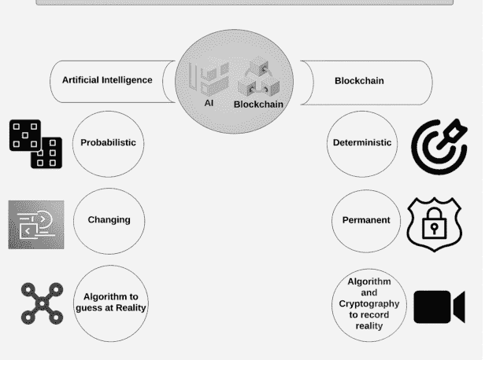

图 3.5 结合 AI 和区块链技术 [41]。

70 区块链与 AI

帮助预测市场变得更易访问且高效，同时允许更大规模的数据或用户 [10, 40]。

传统预测市场通常不包含 AI，因为它们依赖于人类判断和专业知识 [10, 40]。将 AI 整合到预测市场的伦理、法律和监管影响必须经过仔细考虑。然而，将 AI 整合到预测市场也会引发对数据隐私、安全的担忧。

## 3.4 去中心化预测的基础

### 3.4.1 什么是去中心化预测市场？

去中心化预测市场从提高准确性和效率上从根本受益。AI 可以分析海量数据，发现人类可能忽略的模式和趋势，并改进预测和决策。AI 可以自动化一系列预测市场功能，包括数据收集、处理和交易，以减少欺诈和不准确的风险（图 3.5）。

AI 对去中心化预测市场具有若干优势，包括增加可扩展性和互操作性。传统预测市场在范围和覆盖面上通常受到限制，但 AI 可以帮助它们扩展以满足大规模应用的需求，并实现与其他平台和系统的互操作性。


图 3.6 去中心化预测

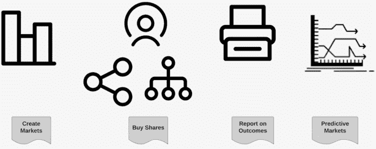

图 3.7 去中心化市场

开发交易策略

去中心化预测阶段

与传统预测不同，合同通常由单一实体管理。

去中心化预测市场提供了巨大的潜力，通过利用上述策略可以利用这些潜力。

## 交易策略开发

表 3.1 去中心化预测市场与传统预测市场 [40.45, 46]

| 维度 | 去中心化预测市场 | 传统预测市场 |

|---|---|---|

| 开放性 | 高（向所有人开放） | 低（访问受限） |

| 透明度 | 高（在区块链上可见） | 低（透明度较低） |

| 不可篡性 | 高（不可篡改的记录） | 低（记录可以修改） |

| 匿名性 | 高（匿名交易） | 低（需要身份识别） |

| 访问时间 | 24/7 | 受限的营业时间 |

此外，这些市场对任何连接互联网的人开放，并且由于其去中心化的特性，通常具有较低的交易成本。最后，去中心化预测市场由智能合约和去中心化治理系统管理，这确保了透明度和问责制（表 3.1）。

## 3.6 区块链如何实现去中心化预测市场？

### 3.6.1 去中心化

根据 Hanson [20] 的观点，区块链技术通过提供一个安全且开放的交易和预测平台，促进了去中心化预测市场的发展。去中心化保证没有任何机构对市场拥有绝对权威权，加强了其对操纵的防御。区块链技术的不可篡改性是一个关键组件，为去中心化预测市场提供了透明度和可靠性。根据 [24, 39]，存储在区块链上的数据无法更改或删除。

### 3.6.2 智能合约

智能合约是区块链技术的一重要特性，实现了自动做市商和其他治理系统的创建。根据 Hanson [20]，智能合约是自执行的合同，其协议条款被写在代码中（图 3.8）。

# 区块链与人工智能

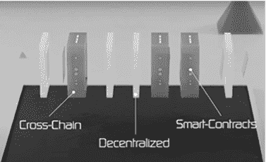

**图 3.8** 智能合约阶段 [39]。

### 3.6.3 代币化

区块链技术允许将代币作为预测市场的交换媒介。根据 Augur [24, 39]，代币可以代表对事件结果的预测，也可以作为抵押品来创建合成资产。它的定义非常简单：代币化代表使用区块链上的智能合约创建数字代币的过程。这些代币被用于揭示与项目相关的资产、股权、财务和资源的所有权（图 3.9）。

### 3.6.4 安全

区块链技术的安全性对于去中心化预测市场的成功至关重要。正如 Hanson [20] 所出的：

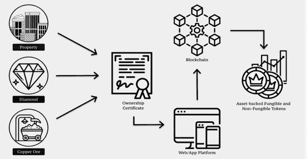

**图 3.9** 代币化 [47]。

## 交易策略开发

区块链技术使用加密技术来确保交易安全并防止欺诈。

## 3.7 交易策略中的机器学习 (ML)

### 3.7.1 交易策略机器学习的基础

由于机器学习分析大量数据并发现模式，它在交易策略中变得越来越流行。交易策略机器学习的基础以及相关的数学术语如下：

**监督学习**是机器学习的一种类型，算法从带标签的数据中获取知识。这意味着算法在交易策略的背景下，使用具有已知结果的历史数据进行训练。决策树、逻辑回归和线性回归是交易策略中常用的监督学习方法。

**无监督学习**是机器学习的一种类型，算法从未标记的数据中获取知识。这意味着在交易策略的背景下，算法用于在预先不知道结果的情况下发现数据中的模式。主成分分析和聚类是交易策略中常用的两种无监督学习方法。

**强化学习**是机器学习的一种类型，算法通过犯错来获取知识。这意味着算法在交易策略的背景下经过训练，以根据其行为最大化奖励函数。Q-learning 和深度强化学习是交易策略中常用的两种强化学习方法。

机器学习中的常见问题是**过拟合**，即算法对训练数据的拟合过度，无法泛化到新数据。这可能导致现实世界中的表现不佳。为了避免交易策略中的过拟合，经常使用 L1 和 L2 正则化等正则化技术。

**交叉验证**是一种用于评估机器学习算法在新鲜数据上表现性能的技术。为了测试算法对新数据的泛化能力，在交易策略的背景下使用不同的数据集对其进行测试。K折交叉验证和留一交叉验证是交易策略中常用的两种交叉验证方法。

通过机器学习创建交易策略有一套强大的工具可用。交易专业人士可以利用这些技术从海量数据中提取洞察，并通过理解机器学习的基础来创建更成功的交易策略。

## 3.8 预测市场数据分析技术

人们最频繁地使用市场状况预测对不确定事件进行预测。为了分析预测市场中的数据并做出可靠的预测，必须使用数学方法。交易者和分析师可以从各种数学工具受益，如概率论、贝叶斯推理、回归分析、机器学习和蒙特卡洛模拟，以收集关键数据并创建更准确的预测策略。如今，交易者使用了多种数学技术。

**概率论：**根据 Bernardo 和 Smith [27]，概率论是预测市场中的核心思想。概率最好的定义是事件发生的可能性，可以表示为 0 到 1 之间的一个数字。在预测市场中，概率经常用于描述特定结果发生的概率（图 3.10）。

**贝叶斯推理：**根据 Bernardo 和 Smith 的观点，它是一种考虑新信息来修正信念的统计方法。

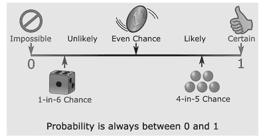

**图 3.10** 概率 [39]。

## 交易策略开发

贝叶斯推理可以用于预测市场以修正假设的概率。在数学术语中，它可以表示为：

`P(H|E) = P(E|H) / P(E)`

其中 `P(H|E)` 是给定证据 `E` 的假设 `H` 的概率，`P(E|H)` 是给定假设的似然，`P(E)` 是边缘概率。

**回归分析：**根据 Hastie 等人 [25]，回归分析是一种检查两个或多个变量之间关系的统计技术。回归分析可用于预测市场寻找与事件结果相关的变量。线性回归模型可以表示为：

`y = mx + c + ε`

其中 `y` 是因变量，`x` 是自变量，`c` 是截距，`m` 是斜率，`ε` 是误差项。斜率系数 (`m`) 代表自变量变化一个单位时因变量的变化。截距 (`c`) 代表 `x` 为零时 `y` 的值。误差项 (`ε`) 代表未由自变量解释的 `y` 的变异。这被称为最小二乘法（图 3.11）。

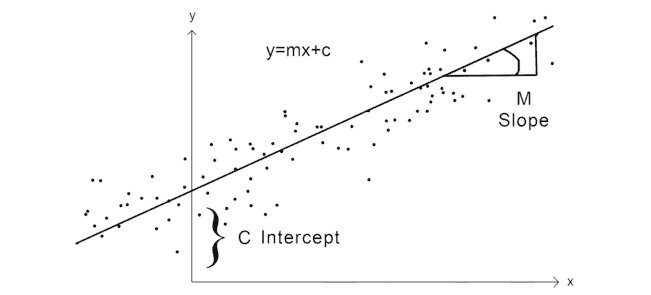

**图 3.11** 回归分析。

# 区块链与人工智能

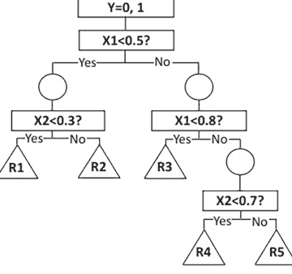

**图 3.12** 基于二进制目标 `Y` 的决策树 [48]。

**决策树：**预测市场数据使用决策树、支持向量机和神经网络等机器学习技术进行分析 [25]。这些方法可以发现数据中的模式并预测未来（图 3.12）。

**蒙特卡洛**模拟是一种对特定事件模拟各种可能结果的统计方法 [28]。蒙特卡洛模拟可用于预测市场，根据各种可能的结果计算结果的可能性。蒙特卡洛模拟的数学模型可以表示如下：

假设 `X` 是输入变量向量，`Y` 是输出变量向量。`f(x,y)` 是描述 `X` 和 `Y` 之间关系的模型。那么蒙特卡洛模拟涉及从概率分布生成 `X` 的随机样本，并使用这些样本来模拟系统的行为：

`Y_i = f(X_i), i = 1, 2, ... n`

然后对模拟结果进行分析，以估计系统在不同条件（例如输入变量的变化或模型本身的变化）下的行为。

## 3.9 在交易策略中使用机器学习的优势

在交易策略中使用机器学习的一些优势如下：

## 开发交易策略 79

**提高准确性：** 机器学习（ML）算法可以对海量数据进行准确分析，从而产生更精确的预测和更好的交易选择 [49]。这在高频交易中至关重要，因为需要准确且及时的判断。

均方误差（MSE）损失函数是一种经常用于机器学习交易策略的数学公式，用于用于计算预测价格与实际价格之间的差异。MSE 的公式为：

```
MSE = (1/N) * Σ(P_t + 1 - P_pred)^2
```

其中

`P_t+1` 是该证券在下一个时间步的实际价格。

`P_pred` 是该证券在下一个时间步的预测价格。

`N` 是预测的总数。

机器学习算法的目标是在训练过程中通过调整模型参数，对未来价格进行更准确的预测，从而最小化 MSE 损失函数。

让我们考虑一个特定证券或金融工具的历史市场价格数据集，记为 `P`。该数据集中的每个元素（用 `P_i` 表示）反映了证券在特定时刻的价格。交易策略的目标是利用之前的数据预测证券的未来价格 `P_t+1`。

神经网络将历史价格数据作为输入，并输出下一个时间步的预测价格 `P_t+1`。

**减少偏差：** 在使用机器学习开发准确可靠的交易策略时，减少偏差非常重要。机器学习算法不受人类偏见的影响，可以导致更客观、一致的交易决策 [50]。这在金融市场背景下尤为重要，因为情绪和偏差可能导致预测不准确和交易决策缺陷，从而导致损失。如果我应用数学公式，就可以做出精确且明智的决策。

计算出的均方根误差模型符合图 3.13 所示的数据集。当模型变得复杂时，训练数据变得越来越小，这就是过拟合的例子。然而，当模型针对测试数据集进行测试时，随着模型日益复杂，RMSE 会显著上升。

减少偏差有助于交易策略有多种方法：

- 提高预测准确性

- 增加稳健性

- 增强泛化能力（例如 k 折交叉验证）

**提高效率：** 机器学习算法可以快速、高效地分析大量数据，从而节省时间和资源 [49]。这在高频交易背景下尤为重要，因为必须快速做出决策以利用市场机会。比较交易策略的常用指标是夏普比率。

夏普比率衡量了投资组合相对于无风险利率每单位组合风险的超额收益。夏普比率的公式为：

`Sharpe ratio = (Rp - Rf)/σ`

其中

`Rp` 是组合的预期收益率。

`Rf` 是无风险利率。

`σ` 是组合超额收益的标准差。

## 开发交易策略

在基于机器学习的交易策略背景下，可以计算使用机器学习模型预测生成的组合的夏普比率，并与使用传统交易策略生成的组合的夏普比率进行比较。

如果基于机器学习的组合夏普比率高于传统组合，可以说基于机器学习的交易策略在产生收益方面更有效。因此，证明机器学习交易策略效率提高的公式为：

`Sharpe ratio (ML) > Sharpe ratio (traditional)`

`Sharpe ratio (ML)` 是使用基于机器学习的交易策略生成的组合的夏普比率。`Sharpe ratio (traditional)` 是使用传统交易策略生成的组合的夏普比率。

**分析复杂数据的能力：** 机器学习算法可以分析文本和图像等复杂数据集，为交易决策提供有价值的见解（Scherer, Müller, & Behnke, 2010）。例如，自然语言处理技术可以分析新闻文章和社交媒体帖子，以识别与特定公司或行业的趋势和情绪。

# 区块链与人工智能

### 均方误差 (MSE) 公式

`MSE = variance + (bias)^2`

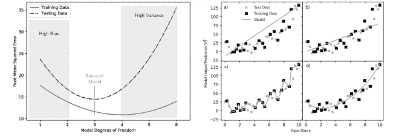

**图 3.13** 均方误差与模型自由度 [50]。

# 区块链与人工智能

我们可以使用机器学习算法学习一个将输入 `X` 映射到输出的 `f(X)`。

假设我们有历史市场数据，例如新闻文章和社交媒体情绪的影响。我们可以将这些数据表示为 `X`：

```
X = [P, N, S]
```

我们还有目标变量，即未来的价格变动，我们记为 `Y`。

适应性： 机器学习算法可以根据市场状况的变化调整交易战术 [49]。这在不断变化的金融市场环境中特别至关重要。

基于机器学习的交易技术中的适应性是指模型适应不断变化的情况并从新数据中学习的能力。展示适应性的一种数学模型是在线学习算法。随机梯度下降（SGD）算法是在线学习工具的一个示例。更新规则的公式为：

`θ_{t+1} = θ_t - α L(y_t; θ^t)`

其中

- `θ_t` 是时间步 `t` 的参数。

- `α` 是学习率，决定步长。

- `L` 是损失函数，衡量预测值与实际值之间的差异。

- `y_t` 是时间步 `t` 的实际值。

- `f(x_t; θ_t)` 是基于当前参数 `θ_t` 在时间步 `t` 的预测值。

- `L(y_t, f(x_t; θ_t))` 是损失函数对参数 `θ_t` 的梯度。

这种更新规则允许模型根据新数据不断调整参数，从而适应变化的变化。交易人士和分析师可以利用这些优势获取见性信息并创建更成功的交易策略。

## 3.10 开发去中心化预测交易策略

为了演示整个项目，必须使用 Python。在 Python 中，已经完成了整个项目的实现，以开发用于分散市场预测的交易策略（图 3.14）。

### 3.10.1 概念框架

### 3.10.2 数据收集与预处理

在本节中，使用了 Yahoo Finance 和 Kaggle 的数据集，以了解通过 Python 代码使用机器学习、人工智能和区块链工具进行真实分析。该数据集是来自网站的二次来源。呈现的数据是二次数据，但并非来自爬虫（图 3.15）。

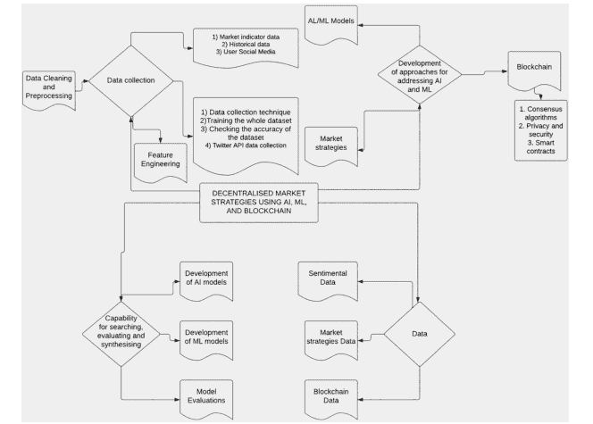

**图 3.14** 数据分析的概念框架。

# 数据预处理

图 3.15 数据处理。

`dropna()` 函数是最通用的方法，用于处理缺失数据，而 `inplace=True` 参数确保了更改直接应用于原始数据集上，而不是创建一个副本。通过删除包含缺失数据的行，可以更有效地对数据集进行分析和建模，因为缺失值会干扰某些算法和分析。

处理缺失数据是用中心趋势度量（如相同列中非缺失值的平均值或中位数）来填充缺失值。这在数学上可以表示为：

对于均值插补：

`X_i = (X_1 + X_2 + ... + X_n)/n`

对于中位数插补：

当 `n` 为奇数时：`X_i = median(X_1, X_2, . . . X_n)`

当 `n` 为偶数时：`X_i = (median(X_{n/2}), X_{n/2+1})`

模型引用：[52,53]

### 3.10.3 特征选择与特征工程

特征选择是构建机器学习模型过程中的重要一步。它涉及从较大的可用特征集中识别并选择一个相关的且具有信息量的特征子集。

- 降低对训练数据过拟合的风险。

- 提高模型性能：潜在特征可以提高模型的准确性和效率。

- 节省计算时间和资源：通过最小化数据集中的维度数量，特征选择可以帮助降低训练模型所需的计算成本和时间。

- 增强可解释性：减少多余或冗余特征。

为了进行特征工程，应该进行探索性数据分析，以理解特征的分布和交互，识别潜在的偏差或噪声源，并选择最佳特征工程策略来解决这些问题。

### 3.10.4 市场指标

**市场波动率**：每日、每周或每月波动率指标，如收益率的标准差、平均真实范围或布林带。

**流动性**：交易活动指标，如成交量、买卖价差或未平持仓量。

**成交量**：总量、成交量变化或成交比率指标。

特征工程有多种方法，包括相关性矩阵和主成分分析（PCA）。主成分分析用于去除数据集的维度。通过计算每日收益率的标准差，我可以构建一个每日波动率的变量。同样，我可能可以使用这些指标开发成交量和流动性的变量。

下文展示了特征工程方法以及如何在 Python 中部署它们。这只是用于去中心化交易市场预测的 Python 实现的一种通用编码方法。

### 3.10.5 相关性

矩阵显示了表中每对唯一值之间是如何相互相关的 [50]。它是发现和显示提供数据中趋势以及总结大型数据集的强有力工具。定义为热图的相关性矩阵可以作为特征选择方法，用以识别强关联变量并移除冗余特征。相关性仅衡量线性关系。

# 区块链与人工智能


```python
import pandas as pd
import numpy as np
```

### 加载数据集

```python
df = pd.read_xlsx('Market_Indicator_Data_combined.xlsx')
```

### 将日期转换为日期格式

```python
df['date'] = pd.to_datetime(df['date'])
```

### 创建市场波动率变量

```python
df['volatility'] = df['daily_returns'].rolling(window=30).std()
df['weekly_volatility'] = df['weekly_returns'].rolling(window=4).std()
df['monthly_volatility'] = df['monthly_returns'].rolling(window=12).std()
```

### 创建流动性变量

```python
df['bid_ask_price'] = df['ask_price'] - df['bid_price']
df['open_interest_ratio'] = df['open_interest'] / df['trading_volume']
```

### 创建成交量变量

```python
df['volume_change'] = df['trading_volume'].pct_change()
df['volume_ratio'] = df['trading_volume'] / df['trading_volume'].mean()
```

# 相关性

| | 成交量 | 流动性 | GDP | 波动率 |
|---|---|---|---|---|
| **成交量** | 1 | 0.23388 | -0.04651 | 0.67369 |
| **流动性** | 0.23388 | 1 | 0.06883 | 0.03321 |
| **GDP** | -0.04651 | 0.06883 | 1 | -0.23813 |
| **波动率** | 0.67369 | 0.03321 | -0.23813 | 1 |

# 开发交易策略

这些结果表明，成交量、波动率和 GDP 可能是制定去中心化市场预测交易策略时需要考虑的所有相关变量。

### 在 Python 中计算

该代码计算了提供的数据集中每对数值变量之间的皮尔逊相关系数。皮尔逊相关是使用 Python 计算的两个变量之间线性关系的统计量。其值从 -1（完全负相关）到 1（完全正相关），0 表示不相关。

### 探索性分析

3.10.7.1 **波动率 vs 流动性**：波动率指的是资产价格波动的程度。在高波动率的情况下...

## 开发交易策略

### 波动性 vs 流动性

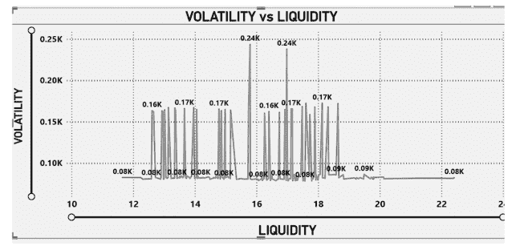

**图 3.19** 波动性与流动性。

波动性意味着价格发生显著变化，通常发生在短时间内，而低波动性资产倾向于具有更稳定的价格。波动性可能由多种因素引起，例如供需变化、经济和政治事件，甚至是恐惧和贪婪等人类情绪（图 3.19）。

另一方面，流动性是指资产在市场上被买卖的易易程度和速度，且不会对其价格产生显著影响。高流动性资产拥有许多买家和卖家，因此交易可以快速以公平的价格执行。相比之下，低流动性资产的买家和卖家可能有限，导致交易困难或以不利的价格执行交易。

### 3.10.7.2 成交量 vs 波动性

在特定时间内，特定市场交换的股份或合约总数被称为"成交量"。较大的成交量通常意味着市场活跃度和对该品种的兴趣，这可能解释了为什么波动性较高（图 3.20）。

换句话说，随着更多个人买卖某物品，该物品的价格可能会发生更大的变化。低波动性资产通常具有更稳定的价格，而高波动性资产经常在短时间内经历剧烈的价格波动（图 3.21）。

### 3.10.7.3 GDP vs 波动性

强劲的 GDP 可能表明经济状况良好，这可能导致投资增加和对资产的需求提高，从而推动价格上涨并降低波动性。去中心化交易市场往往受到影响波动性的广泛其他因素，例如供需变化、监管或政策、新闻事件和技术发展。这些因素可能比 GDP 的变化更直接地影响去中心化交易市场的行为（表 3.3–3.5）。

# 区块链与人工智能

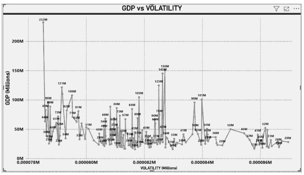

**图 3.20** 成交量与波动性。

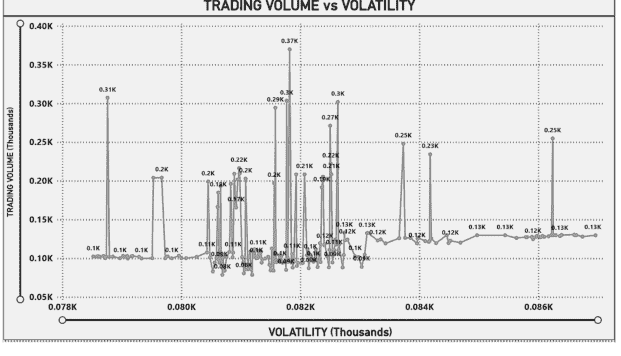

**图 3.21** GDP 与波动性。

## 开发交易策略

表 3.3 成交量 Python 代码摘要：`df('Trading Volume'), describe()`

| | TRADING VOLUME |
| :--- | :--- |
| count | 235 |
| mean | 106.010976 |
| std | 13.634665 |
| min | 80.618034 |
| 25% | 96.916748 |
| 50% | 102.36145 |
| 75% | 117.761375 |
| max | 133.096725 |
| Name | Trading Volume |
| dtype | Float64 |

表 3.4 Python 代码：`df['LIQUIDITY'], describe()`

| count | 235 |
| :--- | :--- |
| mean | 15.84881 |
| std | 2.186753 |
| min | 11.65 |
| 25% | 13.96 |
| 50% | 15.98 |
| 75% | 17.48 |
| max | 22.41 |
| Name | LIQUIDITY |
| dtype | Float64 |

表 3.5 Python 代码：`df['GDP'], describe()`

| | GDP |
| :--- | :--- |
| count | 235 |
| mean | 34469710 |
| std | 22410820 |
| min | 12007600 |
| 25% | 23566850 |
| 50% | 28688600 |
| 75% | 36662500 |
| max | 232E+08 |
| Name | GDP |
| dtype | Float64 |

### 3.10.8 描述性摘要

分布图显示了如图 3.2 所示的数据变化。其次，Seaborn `distplot` 显示了连续变量的总分布。在 Python 中，`distplot` 通过结合折线和直方图来表示数据。图 3.2、3.3 和 3.4 显示了"成交量"的分布图。通过描述性统计量总结了四个变量：成交量、流动性、GDP 和波动性。图 3.2 显示成交量有 364 个观测值，流动性有 251 个，GDP 有 241 个。平均成交量为 98.37，平均流动性为 15.79，平均 GDP 为 34575040，平均波动性为 82.00。成交量的标准差为 16.23，流动性的标准差为 2.18，GDP 的标准差为 2191247，波动性的标准差为 1.98。成交量的最小值和最大值分别为 74.31 和 133.10。流动性的最小值和最大值分别为 11.65 和 22.41。GDP 的最小值和最大值分别为 12007600 和 23231600。波动性的最小值和最大值分别为 78.52 和 86.96。成交量的第一分位数为 83.69，第三分位数为 108.04（图 3.25）。

### 3.10.9 ML 类型

### 3.10.10 划分数据集

```python
# 将数据分为训练集、验证集和测试集
X = df_poly.drop('TRADING_VOLUME', axis=1)
y = df_poly['TRADING_VOLUME']
X_train, X_test, y_train, y_test = train_test_split(X, y, test_size=0.3, random_state=42)
X_train, X_val, y_train, y_val = train_test_split(X_train, y_train, test_size=0.2, random_state=42)
```

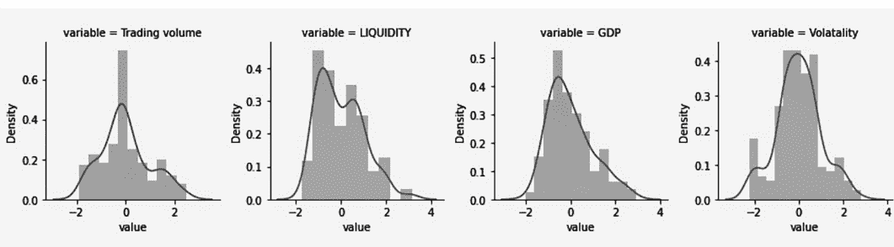

**图 3.22** 缩放后的变量分布。

## 区块链与人工智能 波动性

| 统计摘要 | 成交量 | 流动性 | GDP | 波动性 |
| :--- | :--- | :--- | :--- | :--- |
| 计数 (Count) | 364 | 251 | 2.51E+02 | 241 |
| 平均值 (Mean) | 98.36245 | 15.77291 | 3.46E+07 | 82.002988 |
| 标准差 (Std) | 16.23278 | 2.176146 | 2.19E+07 | 1.984542 |
| 最小值 (Min) | 74.312927 | 11.65 | 1.20E+07 | 78.519997 |
| 25% (25%) | 83.686569 | 13.865 | 2.37E+07 | 80.830002 |
| 50% (50%) | 98.556893 | 15.79 | 2.90E+07 | 81.699999 |
| 75% (75%) | 108.041652 | 17.39 | 3.68E+07 | 82.650002 |
| 最大值 (Max) | 133.096725 | 22.41 | 2.32E+08 | 86.959999 |

**图 2.23** 市场指标摘要。

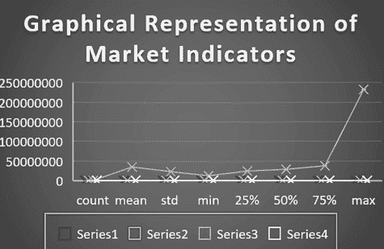

**图 2.24** 市场指标的图形化表示。

Series1=成交量，Series2=流动性，Series3=GDP，Series4=波动性。

数据集使用 0.3 或 30%）的测试大小划分为训练集和测试集。因此，70% 的数据将用于训练模型，而剩余 30% 将留作性能测试。`random_state=42` 参数确保数据以可重复的方式进行划分，以便如果使用相同的随机状态再次运行代码，相同的数据将分为相同的训练集和测试集。训练集进一步划分为训练集和验证集，测试大小为 0.2。

## 开发交易策略

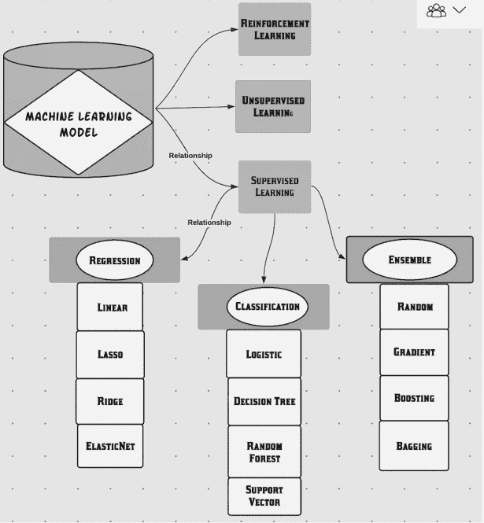

**图 3.25** 机器学习模型类型。

由于数据集中存在市场指标并且可以进行适当分析，我决定应用回归模型来预测成交量。这就是我选择回归模型的原因。这些模型包括线性回归、决策树回归、随机森林回归和 XGBoost 回归。

此外，线性回归模型是一种简单而强大的算法，它可以将线性方程拟合到数据中，并用于预测和推理。它是使用 `sklearn-learn` 库实现的。

决策树回归是一种非参数模型，根据一组规则将数据划分，直到满足停止准则。它可以处理数值和分类数据，并能够对输入特征与输出变量之间的关系进行建模。使用 `Scikit-Learn` 来实现决策树回归。

为了提高性能并减少过拟合，随机森林回归是一个整合了各种决策树回归的集成模型。它通过随机选择特征和数据子集来构建单树，然后组合它们的预测结果来工作。随机森林回归是使用 `Scikit-Learn` 库实现的。

名为 XGBoost 回归的梯度提升模型采用一组决策树来提升性能。它结合多个弱模型的预测结果来创建一个强大的预测器。我使用 `XGBoost` 库实现了 XGBoost 回归。

### 3.10.11 模型选择与训练

使用赤池信息准 (AIC) 或贝叶斯信息准 (BIC) 等统计量是一种常用方法，数学模型如 [54]。这些指标评估了模型对数据集的拟合程度，同时对复杂度较高的模型进行惩罚。例如，AIC 的计算公式为 `AIC = 2k–2ln(L)`，其中 `k` 是模型中的参数数量，`L` 是给定模型下数据的似然度。对数据的最佳拟合通常被认为是 AIC 值最低的模型。

另一方面，使用交叉验证技术，将数据划分为训练集和测试集，并训练不同的模型

（原文）并在测试集上进行了评估。最合适的模型是在测试部分预测误差最低的模型 [55,56]。

### 3.10.13 AI 和 ML 模型

根据 [65]，成交量是市场流动性的重要指标，它影响投资者对买卖股票的决策。在这项研究中，我探索了使用机器学习（ML）模型来预测成交量，并使用了多种经济指标，如 GDP、流动性和波动性。

为了预测金融交易量，将实现四种回归模型，即线性回归、决策树回归器、随机森林回归器和 XGBoost 回归器来预测成交量。我得到了不同模型的结果（表 3.6）。

基于流动性、GDP 和波动性的特征，拟合了四个回归模型来预测金融工具的成交量。线性回归模型实现了 1.0 的完美 R² 分数和极低的 RMSE（2.331e–13）。决策树回归器获取了 0.991 的 R² 分数和 0.090 的 RMSE。随机森林回归器获得了 0.998 的 R² 分数和 0.041 的 RMSE。最后，XGBoost 回归器获得了最高 0.999 R² 分数和最低的 0.033 RMSE。因此，推荐使用 XGBoost 回归器基于流动性、GDP 和波动性特征预测金融工具的成交量。

| 表 3.6 性能评估与优化 |
| 数据集 | 大小 |
| :--- | :--- |
| 训练集大小 | 107 |
| 验证集大小 | 27 |
| 测试集大小 | 58 |
| 模型 | R² 分数 | RMSE |
| 线性回归 | 1 | 3.75E-13 |
| 决策树回归器 | 0.992585 | 0.080396 |
| 随机森林回归器 | 0.995396 | 0.06335 |
| XGBoost 回归器 | 0.996261 | 0.057091 |

### 3.10.13.1 各模型优缺点的多维度视角分析：所有模型在双变量分析散点图中的结果（图 3.26）。

### 3.10.13.2 直方图结果：用于识别模型的误差分布和模型预测中的系统性偏差（图 3.27）。

### 3.10.13.3 折线图模型结果：用于识别模型的潜在问题，如非线性、异方差或离群值（图 3.28）。

## 3.10.14 情感分析

此情感分析使用了来自 Kaggle 的次级数据集。该数据集包含了 2021 年 9 月 30 日至 2022 年 9 月 30 日期间雅虎财经上流行的 25 个股票代码的推文。股票推文的情感分析与预测旨在通过检查这些推文中表达的语言和情感来确定市场趋势和投资者情绪。

### 3.10.14.1 数据集描述

- 日期 – 推文日期日期时间
- 推文 – 推文的全文
- 股票名称 – 抓取该推文的完整代码名称。公司名称 – 对应推文和股票代码的完整公司名称

去中心化交易市场预测的背景下，情感分析是 AI 的形式，涉及使用算法和 ML 技术来分析和分类文本数据（如社交媒体帖子、新闻文章或在线评论）的情感色。它可以用于确定交易者和投资者对特定加密货币或区块链项目的总体感受。例如，如果交易者和投资者对某个加密货币或区块链项目看好或乐观，则价格由于需求增加而上涨。相反，如果情绪为负面，价格可能会下降。

对于使用 AI 模型进行的此情感分析，我在训练集上训练了一个逻辑回归模型。我得到了整体准确率。

### 实际 vs 预测成交量：线性回归

### 实际 vs 预测成交量：决策树回归器

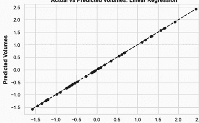

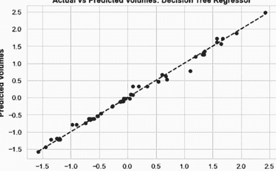

### 实际 vs 预测成交量：随机森林回归器

### 实际 vs 预测成交量：XGBoost 回器

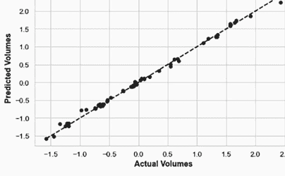

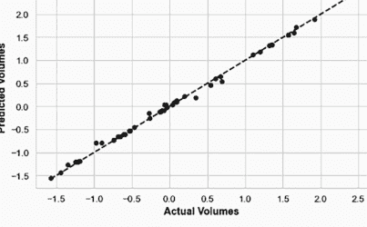

图 3.26 双变量分析。

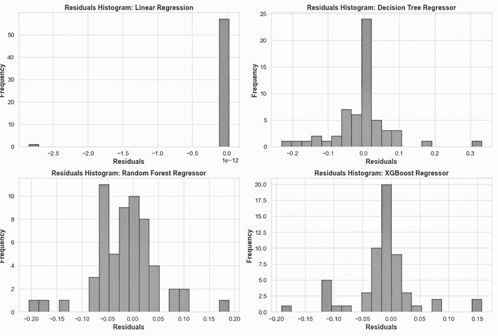

**图 3.27** 直方图分析模型结果。

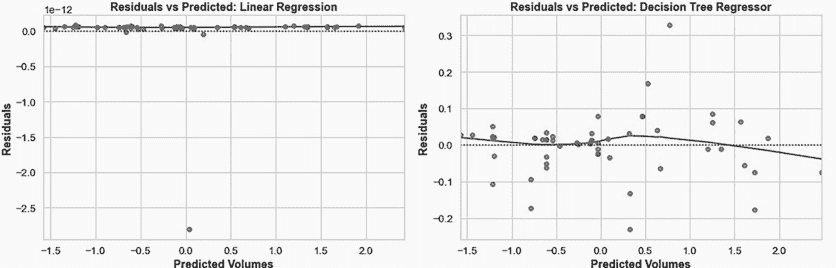

**图 3.28** 异方差性。

# 106

# 块链与人工智能

类别 0 的受者工作特征

类别 1 的受者工作特征

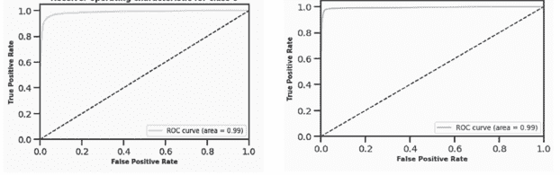

类别 2 的受者工作特征

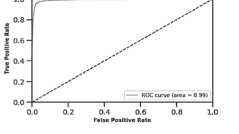

图 3.33 ROC曲线：观察分类阈值的变化。

# 表 3.8 情感得分

```python
# 使用 NLTK 库训练情感分析模型：
import nltk
nltk.download('vader_lexicon')
from nltk.sentiment.vader import SentimentIntensityAnalyzer
# 加载情感分析模型
sentiment_model = SentimentIntensityAnalyzer()
# 使用模型获取句子情感得分的示例
sentiment_scores = sentiment_model.polarity("This is a positive sentence.")
# 打印情感得分
print(sentiment_scores)
('neg': 0.0, # 负面情感得分
 'neu': 0.29, # 中性情感得分
 'pos': 0.71, # 积极情感得分
 'compound': 0.5994) # 复合得分
```

任何人都可以使用这些得分来分析文本的情感。例如，如果复合得分接近 1，则意味着文本具有更积极的情感，而复合得分接近 -1，则意味着文本具有负面情感。如果复合得分接近 0，则意味着文本具有中性情感。


对去中心化交易市场预测进行情感分析可能并不简单，因为它们是两个具有不同数据类型的领域。但对于作为一个书籍章节的项目，从标题来看是有联系的；两者相似之处在于都有与股票推文和加密货币/区块链相关的社交媒体帖子。

通过 AI 和 ML 将这些结果与去中心化预测市场结合起来，你可以利用从两个数据集分析中获得的见解来指导去中心化预测市场平台的开发。

股票推文情感分析的结果和组合的市场指标数据 ML 模型，可以利用 AI 和 ML 方法来预测交易市场的未来表现。

# 3.11 集成到区块链技术中的模型（ML 和 AI）

区块链技术通常用于构建安全的、去中心化的交易和记录系统，而不是用于预测或建模目的。虽然可以使用区块链技术构建去中心化交易市场，但这需要对此类系统的独特需求和挑战有更深入的理解，并对从交易市场获取数据、对其进行预处理，然后使用 ML 模型预测未来事件做出正确的设计决策。预测结果随后可以存储在区块链上，并以去中心化且安全的方式提供给交易者。此外，还可以另一种方式做出决策：ML 和 AI 模型可以转换为区块链网络中的智能合约，其记录的数据将保存在网络中，然后交易者或投资者就可以预测结果（图 3.34）。

## 3.11.1 区块链模型构建流程图

1. 将模型转换为智能合约：模型必须转换为智能合约以纳入区块链网络。一种被称为智能合约的自执行代码可以安装在区块链网络上。区块链模型构建流程图

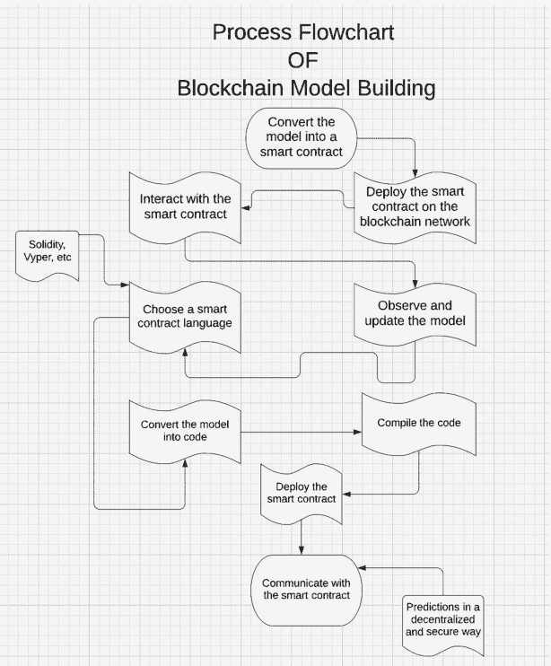

**图 3.34** 区块链模型构建流程图。智能合约应返回预测输出，该合约应使用输入数据作为其参数。

2. 实现智能合约需要智能合约代码存在区块链网络上。你可以使用像 `Ethereum` 或 `Hyperledger` 这样的区块链平台。一旦部署合约，网络中的每个节点都将拥有该合约的副本，使其成为区块链永久的一部分。

3. 与智能合约通信：要使用合约进行预测，必须通过发送包含数据的交易来实现。合约将执行代码并返回预期的结果。去中心化的预测通过合约是可能的。

4. 观察数据：在合约部署后对数据进行评估。通过来自区块链的信息对模型进行改进。

5. 选择语言：使用 `Solidity`、`Vyper` 等语言创建智能合约，以满足要求。

6. 模型到代码：这种转换是必要的，通常代码将包含输入和输出。

7. 编译代码：在代码在区块链上执行之前，需要进行编译。

8. 部署合约：将合约部署到区块链上，这通常是必要的。

9. 与智能合约通信：部署后，你可以与智能合约以去中心化的方式通信。`Solidity` 是一种流行的语言。

## 3.11.2 模型转换为 Solidity

将模型转换为 `Solidity` 合约，这通常是必要的。使用 `Web3` 或 `Brownie` 等工具。

图 3.35 显示了使用 AI 和区块链的去中心化预测流程图。每个块在链中都有完整的图像输出（表 3.9）。


**图 3.35** 区块链流程图。

# 表 3.9 区块链示例

| 索引 | 时间戳 | 前一个哈希 | 计数 | 哈希 |
|---|---|---|---|---|
| 0 | 168576783 | 创世区块 | 0 | 7e96632d27658c7cf6fb0277ab765- |
| 1 | 168576783 | 交易 1 | 7e9e6e2d27658c7cf6fb0277ab765-ca895d0470f732b7bce4f167 | 127 | 0050cf46107bb16a243bd546f1329cd772083d36531-da59fdf1d5f469 |
| 2 | 168576783 | 交易 2 | 0050cf46107bb16a243bd546f1329cd772083d36531-cdf1d5f469 | 10 | 00cd657c4b4be69d8821ba821e65e23a5b2def49c040d0f731cab941f8810f |
| 3 | 168576783 | 交易 3 | 00cd657c4b4be69d8821ba821e65e23a5b2def49c040d0f731-cab941f8810f | 36 | 005e09772d6e13401dc205a3c7fe77597ae496f719-f2380e57606d8eea12c31 |

# 区块链与人工智能

1. **索引 (Index)**：这是链中每个区块的唯一标识符。它通常从创始区块的 0 开始，每增加一个新区块加 1。

2. **时间戳 (Timestamp)**：这是区块创建的时间。它通常表示自 Unix 纪元（1970 年 1 月 1 日 00:00:00 UTC）以来的秒数。

3. **交易 (Transaction)**：这是一个表示区块中包含交易的字符串。在真实的区块链中，这通常是所有交易的列表。

4. **前哈希 (Previous Hash)**：它是链中上一个区块的哈希值。它是区块链的关键特征之一，提供了安全性和不可变性。区块的任何更改都会改变其哈希值，由于哈希值包含在下一个区块中，因此任何区块的更改都会改变链中后续的所有区块。

5. **随机数 (Nonce)**：这是一个找到的数字，使得区块的哈希值满足区块链设置的难度级别。这是许多区块链使用的工作量证明算法的一部分。

6. **哈希 (Hash)**：这是区块的哈希值，根据其内容（索引、时间戳、交易、前哈希和随机数）计算。哈希是一个固定长度的字符字符串，唯一地表示被哈希的数据。

## 3.11.3 Python 中的区块链模型

在此部分，将线性回归作为一种机器学习（ML）模型已转换为区块链模型。并且在 Python 中构建模型期间进行了相关观察。在 Python 中将 ML 转换为区块链的结果如下所示：

线性回归算法模型结果：

`RMSE: 0.17802817710736496`

`R^2 score: 0.54229621152010899`

在之前的 ML 部分，构建并展示了 4 个 ML 模型以及它们的 RMSE 和 R 平方得分。但在本部分，我们再次创建了一个简单的线性回归算法模型用于区块链模型，因为区块链模型对于预测来说具有很强的挑战性。仅以简单的方法将线性回归 ML 实现到区块链模型中进行预测。这里，ML 和区块链模型使用了相同的市场指标数据集，并显示了如下结果（图 3.36 和图 3.37）。

```python
In [18]: # Train the model
model = LinearRegression()
model.fit(X_train, y_train)

# 创建一个新的区块链实例
my_blockchain = Blockchain()

# 进行预测并将其存储在区块链中
prediction = my_blockchain.make_prediction(user_input)
print(f"Prediction: {prediction}")

# 检查区块链内容
print("blockchain contents")
for block in my_blockchain.chain:
print(block.transactions)

Prediction: 2915.2156820294663
Blockchain contents:
Genesis Block
{'user_input': array([126.262543]), 'prediction': 2915.2156820294663}
```

**图 3.36** 实现线性回归模型并将预测值存储在区块链中。

```python
In [19]: # Import warnings
from sklearn.metrics import mean_squared_error

# 忽略消息
warnings.filterwarnings('ignore', category=UserWarning)
m_blockchain = Blockchain()

# 进行预测并存储在区块链中
for index, row in df.iterrows():
    user_input = row['TRADING_VOLUME']
    prediction = my_blockchain.make_prediction(user_input)

# 从区块链中获取预测值
predicted_values = [block.transactions['prediction'] for block in my_blockchain.chain[1:]]

# 从数据集中获取实际值
actual_values = df['TRADING_VOLUME'].values

# 计算 RMSE
rmse = mean_squared_error(actual_values, predicted_values, squared=False)
print(f"RMSE: {rmse}")

# 重置设置为默认
warnings.resetwarnings()

RMSE: 2816.896081238763
```

**图 3.37** 计算区块链存储的预测值与实际值之间的均方根误差 (RMSE)。

# 区块链与人工智能

区块链模型的 RMSE 值衡量了模型预测数据集中 `TRADING_VOLUME` 值的完好程度。RMSE 值越低，模型性能越好。因此，高 RMSE 值表明区块链模型所出的预测不准确。换句话说，该模型在根据输入变量预测去中心化交易市场方面表现不佳。较低的 RMSE 表示具有更好的预测性能。良好的结果取决于数据集。已经应用特征选择、清洗预处理技术、缺失值处理、离群值删除等。用列的平均值或中位数填充缺失值，或使用插值或归补等更高级的技术。从所选数据集显示的结果是其规模较小，甚至没有许多属性。大量且来源的数据有助于获得良好结果。仅应用了 ML 转换为区块链的简单过程以得出结论并观察其工作原理。过程是正确的，但由于数据集大小和属性较少，没有显示良好的结果。但如果有大量数据和许多属性，可能会有结果。

在 Python 中，一组代码使用 `Blockchain` 类的方法进行预测，然后从区块链获取预测值并从数据集中获取实际值。它使用 `mean_squared_error` 计算 RMSE。预测值结果为 `2915.2156820294663`。区块链内容显示：

`Genesis Block`

`{'user_input': array([126.262543]), 'prediction': 2915.2156820294663}`


区块链模型的`RMSE`值衡量了模型预测数据集中`TRADING_VOLUME`值的完好程度。`RMSE`值越低，模型性能越好。因此，高`RMSE`值表明区块链模型所出的预测不准确。换句话说，该模型在根据输入变量预测去中心化交易市场方面表现不佳。较低的`RMSE`表示具有更好的预测性能。良好的结果取决于数据集。已经应用了特征选择、清洗预处理技术、缺失值处理、离群值删除等。用列的平均值或中位数填充缺失值，或使用插值或归补等更高级的技术。从所选数据集显示的结果是其规模较小，甚至没有许多属性。大量且来源的数据有助于获得良好结果。仅应用了`ML`转换为区块链的简单过程以得出结论并观察其工作原理。过程是正确的，但由于数据集大小和属性较少，没有显示良好的结果。但如果有大量数据和许多属性，可能会有结果。

在`Python`中，一组代码使用`Blockchain`类的方法进行预测，然后从区块链获取预测值并从数据集中获取实际值。它使用`mean_squared_error`计算`RMSE`。预测值结果为`2915.2156820294663`。区块链内容显示：

```
Genesis Block

{'user_input': array([126.262543]), 'prediction': 2915.2156820294663}
```

## 3.11.4 交易策略中使用人工智能和区块链技术的挑战与局限性

首先，挑战之一与`AI`算法的准确性和可靠性有关。根据 Han 等人 [59]，`AI`可以提供有价值的洞察和预测，但它并非不可出错，可能会出错或产生不准确的结果。此外，`AI`算法需要大量的历史数据进行良好训练，这对于数据有限的新市场或资产是一个挑战。

其次，区块链技术也面临自己的挑战。主要局限性之一是区块链网络的可扩展性，在高交易量期间可能会拥堵并变慢 [61]。这可能会影响依赖快速执行的交易策略的效率。

另一个挑战是区块链领域缺乏监管和监督，这使得难以评估某些区块链交易平台和资产的可信力和合法性 [62]。此外，区块链的去中心化本质也使得识别和解决安全漏洞与风险变得具有挑战性。

## 3.11.5 未来研究方向与机会

使用`ML`、`AI`和区块链技术预测交易有几个潜在的未来研究方向和机会。

## 116 区块链与人工智能

市场策略。一种机会是开发结合多种技术的混合方法，例如使用人工智能分析历史交易数据并进行预测，同时利用区块链安全地执行交易，并确保过程的透明度与信任 [64]。

另一个潜在的研究领域是探索强化学习算法的使用，这些算法可以实时学习并适应变化的市场状况，可能提高交易策略的准确性和有效性 [65]。此外，随着区块链技术的兴起，有机会利用人工智能和机器学习算法创建去中心化自治组织（`DAOs`），由其代表成员做出决策并执行交易，这可能导致更民主和更去中心化的金融系统 [66]。

然而，与任何技术一样，在交易策略中使用机器学习、人工智能和区块链技术时，也需要考虑伦理考量。未来的研究可以探索这些技术的伦理影响，例如偏见和歧视的潜在风险，以及如何缓解这些风险 [14]。

## 3.12 结论

机器学习模型（包括线性回归、决策树、随机森林和`XGBoost`）已被证明在预测去中心化市场的交易量方面是有效的。这些模型可用于开发交易策略，并在历史数据上进行回回测试以评估性能。区块链技术与人工智能及机器学习模型的集成支持了安全、透明且高效的交易市场预测。

`XGBoost`机器学习模型优于其他模型，其`R`方值为`.99`，均方根误差（`RMSE`）值为`.05`。逻辑回归被用于情感分析，通过与标准基准对比情感评分来辅助交易决策。该研究还概述了人工智能、机器学习模型与区块链技术的集成，使用了智能合约并在`Python`中部署了新的区块链模型。本研究为利用人工智能、机器学习和区块链技术在去中心化市场中开发交易策略提供了宝贵的见解，为利益相关者提供了数据驱动的决策工具，并应对了交易过程中的潜在偏见和风险。通过利用这些技术，可以在去中心化市场中实现更安全、透明和高效的交易市场预测。

## 开发交易策略

## 3.13 关键术语和定义列表

- **人工智能 (AI)**：机器通过模拟复制人类智能和认知过程的能力。

- **区块链技术**：一种去中心化的、分布式账本，允许对交易进行安全且透明的记录。

- **去中心化预测市场**：利用区块链技术允许任何人根据其对未来事件的预测参与资产交易的市场。

- **机器学习 (ML)**：人工智能的一个子集，涉及使用数学模型和算法使机器能够从数据中学习并随着时间的推移提高性能。

- **预测模型**：使用数据对未来事件或结果进行预测的模型。

- **智能合约**：一种自动执行的合同，包含双方之间协议的条款和条件，并存储在区块链上。

- **代币化 (Tokenization)**：将资产转换为可在区块链上交易的“代币”的过程。

- **概率论**：处理不确定性量化以及事件发生概率的数学分支。

- **回归分析**：一种用于检查因变量与一个或多个自变量之间关系的统计方法。

- **决策树**：一种用于表示决策及其可能结果的树形图表。

- **监督学习**：机器学习的一种算法，通过在标记标记数据上训练机器来预测未来结果。

- **无监督学习**：机器学习的一种算法，通过在未标记数据上训练机器来识别模式和结构。

- **强化学习**：机器学习的一种算法，机器通过试错来学习，以实现奖励最大化或惩罚最小化。

- **交叉验证**：一种通过将数据集划分为训练集和验证集来评估机器学习模型性能的方法。

- **特征选择与工程**：从数据集中选择最相关特征，并构建新特征以提高机器学习模型预测能力的过程。

- **市场指标**：用于衡量市场或资产性能的变量。

- **概念框架**：对研究项目关键概念、变量和关系的视觉化或书面表述。

- **均方根误差 (RMSE)**：衡量预测值与观测值之间差异的指标。

- **性能评估**：衡量机器学习模型有效性的过程。

- **情感分析**：机器学习的一种算法，用于分析和评估文本（如社交媒体上的`Twitter`推文或客户评论）中表达的情绪。

## 参考文献

- [1] Rajkomar, A., Dean, J., & Kohane, I. (2019). Machine learning in medicine. New England Journal of Medicine, 380(14), 1347–1358.

- [2] Cao, J., & Zhang, S. (2020). Financial big data and artificial intelligence. Journal of Financial Data Science, 2(2), 1–14.

- [3] Behnke, S., & Karakas, E. (2020). Self-driving cars: A review of recent developments and ethical considerations. Business Horizons, 63(6), 747–761.

- [4] Baker, R. S. (2019). The impact of artificial intelligence on education: A review of the literature. International Journal of Artificial Intelligence in Education, 29(3), 614–650.

- [5] Floridi, L. (2019). Ethics: The birth of a research field. Philosophy & Technology, 32(4), 611–616.

- [6] Jobin, A., Inenca, M., & Vadena, Y. (2019). The global landscape of AI ethics guidelines. Nature Machine Intelligence, 1(9), 38.

- [7] Zohar, A. (2015). Bitcoin: Under the hood. Communications of the ACM, 58(9), 104–113.

- [8] Kshetri, N. (2018). Blockchain’s roles in meeting supply chain objectives. International Journal of Information, 39, 80–89.

- [9] Szabo, N. (1997). Formalizing and securing relationships on public networks. First Monday, 2(9).

- [10] Buterin, V. (2014). A next-generation smart contract platform. Ethereum.

- [11] Swan, M. (2015). Blockchain: blueprint for a new economy. O'Reilly Media.

- [12] Crosby, M., Pinna, P., & Marches, M. (2019). Blockchain interoperability: Challenges and opportunities. Future Generation Systems, 107, 82–92.

- [13] Zheng, Z., Xie, S., Dai, H., Chen, X., & Wang, H. (2020). A survey on the security of blockchain. Future Generation Systems, 107, 841–853.

- [14] Li, Z., Liang, X., & Li, J. (2019). Blockchain and AI: Complementary technologies for supply chain management. Supply Chain Management, 23(1), 8–13.

- [15] Jiang, R., Song, X., Huang, D., Song, X., Xia, T., Wang, Z., Kim, K., & Shibasaki, R. (2019). Deepsemanticweb: A system for predicting citywide dynamics at events. In Proceedings of the 25th ACM SIGDD international conference on knowledge discovery & data (pp. 2114–2122).

- [16] Narayanan, A., Bonneau, J., Felten, E., Miller, A., & Goldfeder, S. (2016). Bitcoin and cryptocurrency technologies: a comprehensive introduction. Princeton: University Press.

- [17] IBM. (2022). Watson Health. Retrieved from https://www.ibm.com/watson-health

- [18] “Marketplaces Architecture in ocean protocol” (2020) Ocean protocol, 20 September. Available at: https://blog.oceanprotocol.com/ocean-market-open-source-community-marketplace-for-data-4b99badc3 (Accessed: March 17, 2023).

- [19] Gnosis. (2022). About Gnosis DAO [online]. Available at: https://www.gnosis.io/about/(Accessed: January 16, 2024).

- [20] AI and Blockchain are decentralized in marketing strategy (2017) YouTube. YouTube. Available at: https://www.youtube.com/@CodingTech (Accessed: March 18, 2023).

- [21] Augur (2021). How Augur works. Retrieved from https://www.augur.net/how-works/-

- [25] Hastie, T., Tibishirani, R., & Friedman, J. (2009). 统计学习的要素：数据挖掘、推断与预测。Springer & Business Media.

- [26] Zhang, G., & Qi, M. (2005). 针对季节性和趋势性时间序列的神经网络预测。《欧洲运筹学杂志》， 160(2), 501–514.

- [27] Bernardo, J. M., & Smith, A. F. (2000). 贝叶斯理论（第4055卷）。John Wiley & Sons.

- [28] Kahneman, D., & Tversky, A. (1979). 展望理论：风险下的决策分析。《计量经济学杂志》， 47(2), 263–291.

- [29] Chatterjee, S., & Hadi, A. (2015). 实例化回归分析。John Wiley & Sons.

- [30] James, G., Witten, D., Hastie, T., & Tibishirani, R. (2013). 统计学习导论。Springer.

- [31] Sharpe, W. H. 夏普比率。《投资组合管理杂志》，42–46.

- [32] Markowitz, H. (1952). 投资组合选择。《金融杂志》， 7(1), 77–91.

- [33] Bottou, L. (2010). 随机梯度下降。在《大规模机器学习》（第 177–186页）。剑桥大学出版社。

- [34] Murphy, K. P. (2012). 机器学习：概率视角。麻省理工出版社。

- [35] Géron, A. (2019). 基于 scikit-learn、keras 和 tensorflow 的机器学习实战：构建智能系统的概念、工具与技术。O'Reilly Media.

- [36] Zhang, Y., & Kwok, J. T. (2017). 股票价格预测：发现多频率交易模式。在《第23 届 ACM SIGDD 知识发现与数据挖掘国际会议论文集》（第 1147–1156页）。ACM.

- [47] Khalil, K. (2020). FCA 绘制了算法和 AI 交易增长中的“固有风险”地图，TRADE。获取地址：https://www.thedradena.com/fca-maps-inherent-risks-growth-algo-ai-based-trading/（访问：2023年3月11日）。

- [38] Oodles-Uer (2023). 区块链带来的供应链管理挑战。Oodles。获取地址：https://oodles.io/blog/supply-chain-management-challenges-blockchain/（访问：2023年3月11日）。

- [39] Augur (2018). Augur 白皮书。8月。获取地址：https://www.augur.net/whitepaper.pdf（访问：2023年6月6日）。

- [40] Buterin, V. (2014). 预测市场的力量。Ethereum。获取地址：https://ethereum.org/en/blog/the-power-of-prediction-markets/.

- [41] Cavicacchi, M. (2021). Fetch.AI，区块链上的人工智能项目，the cryptonomist。获取地址：https://cryptonomist.com/2021/11/07/fetch-ai-the-artificial-intelligence-project-on-blockchain/（访问：2023年3月18日）。

## 开发交易策略

- [42] 概率（无日期）Math is Fun。获取地址：https://www.mathfun.com/data/probability.html（访问：2023年3月20日）。

- [43] Song, Y. Y., & Lu, Y. (2015). 决策树方法：分类与预测的应用。《上海精神卫生杂志》，27(2), 130–135.10.11919/j.iss.1002-0829.215044

- [44] Hanson, R. (2007). 政策分析（一项在公共领域使用预测市场的实验）。创新：技术、治理、全球化，2, 73–88.10.1162/it.2007.2.73.

- [45] Assetchain, n.d. 区块链代币化服务。获取地址：https://www.assetchain.com/services/tokenization/（访问：2023年3月22日）。

- [46] 用于增材制造发展的机器学习——researchgate。获取地址：https://www.researchgate.net/figure/The-calculated-root-squared-error-fit-the-dataset

- [47] Cody, R. (2013). SAS 统计分析。Pearson 教育。

- [48] Samani, K. (2017). 去中心化预测入门。获取地址：https://multicoin.capital/2017/decentralized

- [49] Aalberg, H., Molár, P., & Vries, J. (2019). 解释比特币价格与波动性。《金融研究快报》，7。

- [50] Liu, C., Liu, Y., Wang, L., & Zhao, J. (2020). 大数据的机器学习特征选择。《大数据杂志》，7。


- [51] Sherer, D. (2020). 卷积架构中的池化操作。《IEEE Access》。
- [52] Burnham, K., & Anderson, D. (2002). 统计选择。Springer & Business Media。
- [53] Shao, J. (1997). 线性渐近理论。《统计学》，7(2)。
- [54] Gelman, A., Carlin, J., & Rubin, D. (2013). 贝叶斯数据分析（修订版）。
- [55] Liu, Y., Wang, X., & Jiang, S. (2021). 人工智能在证券业中的应用综述。《IEEE Access》，9。
- [56] D, T., Liu, R., & Ooi, B. (2019). 可扩展区块链解决方案：系统性综述。《ACM 计算调查》，52(4)。
- [57] Szabo, N. (2003). 智能合约：数字市场的构建区块。《熵》，16。
- [58] Han, H., Zhang, Y., & Sun, X. (2018). 区块链金融服务：它有什么用？第51届夏威夷国际科学会议。
- [59] Alarthi, A., & Zawadki, P. (2021). 金融中的机器学习：概述。《智能与模糊系统》，37(1)。
- [60] Taiwo, J. (2021). 区块链及其局限。在《机器学习与数据科学应用》（第 205–229页）。Springer。
- [61] Giot, P., & Petropoulos, A. (2020). 金融中的强化学习：综述。《金融计量学杂志》，18(3), 349–383.
- [62] Nadig, T. (2020). AI 投资的优缺点。来自 https://www.etf.com/sections/features-and-news/pros-and-ai-investing
- [63] Grossman, J. (2020). 去中心化自治组织 (DAOs)。在《区块链与加密货币手册》（第 509–539页）。Springer。
- [64] Mittal, R. (2019). AI 交易的伦理考量。《ACM 通信》，62(11), 38–40.
- [65] Crosby, M., Pattanayak, P., Verma, S., & Kalyanaraman, V. (2016). 区块链技术：超越比特币。《应用创新》，2(6), 71.

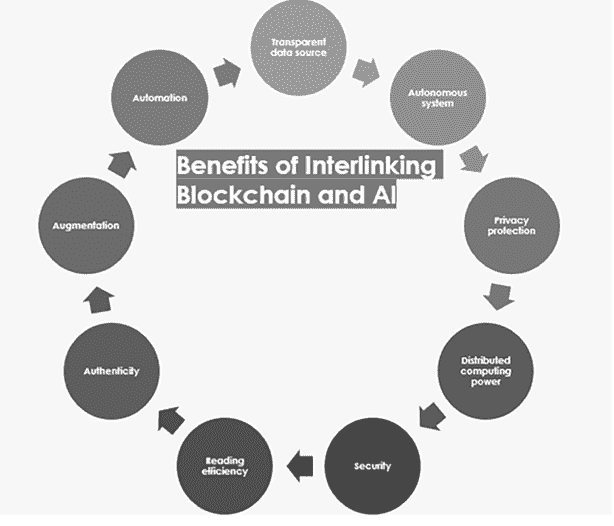

图 4.3 互联概念。

# 区块链原理

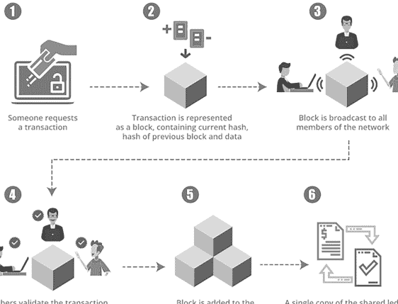

图 4.4 区块链的工作原理。

## 126 第四次工业革命区块链与人工智能

这是第四次工业革命的主要主要成果之一。学生必须精通数字工具和平台，并对编程和数据调查有基础性的了解（Takyar, 2023）。

新的学习模式，如在线学习和混合学习是第四次工业革命对教育的另一个显著影响。这些方法提供了更强的灵活性和访问性，使学习者能够在任何地方地获取理解材料并与他人协作。通过运行数据分析和自适应学习算法来根据用户的需求和偏好调整信息，它们还实现了个性化学习。由于第四次工业革命，课程中正强调对解决现实世界问题的跨学科和基于项目的理解（Islam, 2022）。这一过程促进了学生各种能力的蓬勃，包括批判性思维、创造力、传播和团队合作——这些对于在未来的工作需求中成功至关重要。随着自动化和人工智能的普及，许多工作可能会变得过时，传统的教育设计可能无法跟上变化的速度。这强调了终身学习智慧的本质以及完善教学以适应快速变化的世界指令的必要性。

## 4.2 教育中的 AI 与区块链：优势与挑战的概述

人工智能有潜力在许多方面彻底改变教育，例如简化行政流程、降低成本以及增强教学和学习成果。以下是人工智能在教育中的一些潜在优势：

- 学习个性化：通过定制教育体验和信息以匹配每个学生的特定需求和偏好，人工智能可以促进个性化学习。此外，它还可以提供自适应反馈和测试，帮助学生识别自己的优势和成长领域。
- 智能辅导：人工智能驱动的智能导师系统可以为学生提供个性化的反馈、指导和支持，并帮助他们选择需要更多帮助的学科。通过自动化包括调度、评分和数据分析在内的大量行政职责，教师可以节省时间和金钱，同时获得生产力的提升。人工智能可以识别可能面临落后或退学风险的孩子，并利用预测分析为他们提供专门的帮助他们成功。
- 数字助手：人工智能功能可以为教师和学生提供按需支持和指导，根据需要解决问题并传播信息。人工智能可以通过自然语言处理（NLP）听语音并对发音、语法和词汇提供实时反馈，帮助改进语言学习。
- 增强访问性：通过各种辅助技术（如文本转语音和语音转文本能力），人工智能可以提高残障学生的访问性（Ouyang and Jiao, 2021）。
- 改进研究：可以使用人工智能快速成功地分析海量数据，帮助学者发现使用传统方法无法立即发现的模式和见解（图 4.5 和 4.6）（Bhaskar, 2021）。

在教育中使用人工智能有许多潜在优势，但ر需要考虑风险和困难。种族主义、隐私问题以及自动化对劳动力市场的影响是它们引发的问题之一。通过仔细的规划和实施，人工智能有望改变教育以及我们教学和学习的方式（图 4.7）。以下是人工智能在教育中的一些潜在困难：

- 偏见：人工智能系统的公正性只能由用于训练它们的数据来确保。如果用于训练人工智能模型的数据存在偏见，产生的人智能系统也可能偏见。由于人工智能系统具有强化刻板印象和维持现有差异的潜力，这在教育领域引发的问题。
- 隐私与安全：此类系统可能会收集并保留大量的个人数据，这引发了安全和隐私问题。为了保护敏感数据，确保在创建人工智能系统时具有适当的安全特性至关重要。

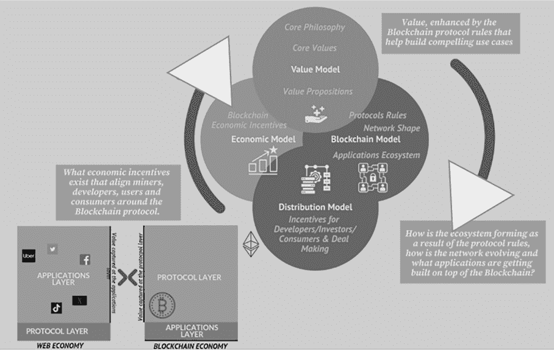

图 4.5 教育中的区块链。

## AI 与区块链作为可持续教学

129

| 学习管理系统 (LMS) 一个处理学习过程所有层面的框架 | 语言学习平台 (L.L.P) 一个处理学习过程所有方面的基础设施 |
| :--- | :--- |
| BrightSpace Blackboard Canvas Moodle Blackboard Bettermarks Carnegie Learning Provider | Bubble Droplet Dualingo Rosetta Stone |
| - 由学习分析（LA）和人工智能（AI）驱动<br>- 管理教学内容<br>- 识别并评估个人和组织面向培训目标的学习<br>- 跟踪这些目标的进展<br>- 收集并展示数据以监督整个组织的学习过程 | - 由学习分析（LA）和人工智能（AI）驱动<br>- 语音识别<br>- 带有教学代理系统的虚拟学习环境<br>- 大数据分析 |

**图 4.6 大流行时代教育科技的新动态。**

| 区块链 1.0 | 区块链 2.0 | 区块链 3.0 |
| :--- | :--- | :--- |
| 比特和其他虚拟货币 | 智能合约 | 除了货币、经济和交易，区块链技术已高效应用于政府管理、医疗服务及所有领域 |
| 区块链数据 | 虚拟机 | |
| Angela Merkel 数字 | 去中心化应用 DAPP | |


图 4.7 区块链技术的发展路线图。

- 成本：对于资金有限的教育机构来说，采用人工智能系统可能会困难，因为它们的设计成本很高。
- 技术复杂性：由于人工智能系统可能复杂且难以理解，管理员和教师可能很难有效地使用它们。
- 伦理关注：在教育中使用人工智能引发了伦理关注，包括对问责制、透明度和自动化对劳动力影响的担忧。

现在，通过一个安全开放的系统存储和交换教育数据及证书，区块链技术 (BCT) 有潜力变革教育。教育中的区块链存在风险和问题。

- 安全且不可篡改的记录：BCT 为保存教育文件（如学位和成绩单）提供了安全且防篡的解决方案。这将有助于防止欺诈并确保学术凭证的真实性。
- 增强数据隐私：BCT 使人们能够管理自己的数据并在需要时与他人共享，这有助于保护学生隐私并降低数据泄露的风险。
- 去中心化学习网络：借助 BCT 构建去中心化学习网络将允许学生和讲师直接进行通信而无需中间人。学习网络可能会影响效率和成本。
- 智能合约：智能合约直接将买卖双方的条款编码到代码中，这些合约将自动执行。它们可以用于教育领域的自动化，如学生注册、学费支付和学术证书验证。
- 微证书：可以使用 BCT 创建微证书来认可技能或成就。通过将凭证与潜在雇主共享并存储在区块链上，人们现在能够深入描述自己的技能和专业知识。
- 透明且可靠的学习生态系统：通过建立透明且可靠的学习生态系统并提高整体教育标准，区块链有助于促进学生、教师和机构之间的信任和问责制（图 4.8）（Elayyan, 2021）。

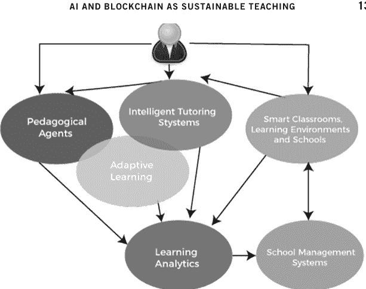

图 4.8 教育系统中的人工智能。

区块链在教育中面临的问题：

- 技术复杂性：由于区块链技术（BCT）可能复杂且难以理解，管理人员和教师可能难以妥善使用。
- 互操作性：现有区块链（BC）平台的多样性可能导致不同系统之间的相互通信变得困难。在开发一个用于存储和交换教育数据的统一系统时，可能会带来困难。
- 可扩展性：由于区块链技术（BCT）可能耗费资源且耗时，将其扩展到服务于广泛的教育网络可能具有挑战性。
- 监管考量：在教育中使用区块链技术（BCT）在数据保护和知识产权等问题上带来监管和法律挑战。
- 成本：开发和部署相关的巨额费用可能某些教育机构难以采用区块链技术。

## 4.3 AI 驱动的个性化学习：为学习者提供定制化学习体验

AI 实现的个性化学习能够彻底改变教育的潜力是一个快速扩展的话题。为每个学生提供个性化的学习体验需要使用 AI 算法，使教学内容适应他们的独特需求和偏好。AI 驱动的个性化学习可以通过向学生展示与其兴趣和学习偏好相关的内容，帮助他们保持兴趣和动力，从而提高学习成果（图 4.9）。

通过使用 AI 驱动的定制化学习，也可以解决学生多样性的问题。在典型的课堂环境中，教师经常发现难以满足不同学习风格、经验和技能的学生的需求，无法为每个学生提供适合其个人需求和能力的个性化学习体验。AI 驱动的个性化学习具有提高学习过程有效性和效率的潜力。AI 驱动的个性化学习可以通过计算机分析学生数据并提供个性化建议，帮助简化并改进学习过程（Mobius Consultants, 2023）。以下展示了 AI 如何用于创建独特的教育体验的几个示例：

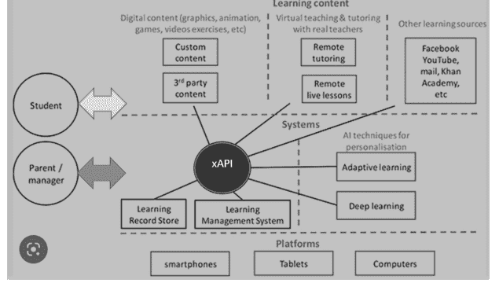

图 4.9 教育中的人工智能。

- 自适应学习：由 AI 驱动的自适应学习系统可以检查学生在需要额外帮助方面的数据，并建议定制的学习资源。为了确保每个学生都受到充分的挑战，这些系统还可以实时更改内容的难度。
- 个性化内容：AI 算法可以根据学生的偏好和兴趣，为每个学生创建个性化的材料。例如，AI 驱动的系统可以根据学生喜好的书籍和作者生成针对特定学生的阅读列表。
- 预测性分析：AI 可用于在学生需求出现之前进行预测。AI 算法可以通过评估学生数据，识别出孩子何时面临掉队的风险，并提供特定行动以让他们保持良好水平。
- 虚拟助手：由 AI 驱动的虚拟助手可以回答学生的问题并为他们提供个性化的帮助、提供建议并在学习过程中提供协助。这些助手可以修改其回答以适应每个学习者的要求。
- 游戏化：在 AI 的帮助下，游戏化让定制化的学习体验变得有趣。例如，AI 驱动的系统可以根据学习者的进度调整游戏难度。

在 AI 的帮助下，游戏化让定制化的学习体验变得充满乐趣。

区块链面临的最大挑战之一是对高质量数据的需求。如果算法在偏差的数据上进行训练，可能会出现偏差。AI 驱动的系统通过替代人类接触来去中心化教育（Davies et al., 2020）。

## 4.4 基于区块链的凭证与认证

基于区块链的凭证是验证学术和职业凭证的一种突破性方法。它涉及利用区块链技术（BC）产生不可篡改的文档（Islam et al., 2022）。

验证学术和职业资格通常是一个辛苦且复杂的过程。纸质证书和成绩单由教育机构和企业发布，但这些可能会损坏、丢失或被篡改，且需要手动验证。区块链凭证寻求通过创建去中心化的防破解方法来简化这一过程（图 4.10）。

区块链凭证的实施并非没有挑战。一个挑战是对统一性的需求。对于数字凭证，必须有一种被广泛认可的格式。隐私需求是另一个问题。尽管比传统方法更安全，但区块链凭证仍需隐私数据交换。

# AI 与区块链作为可持续教学 137

- 互操作性：通过区块链技术（BCT）实现教育文的通用标准，许多机构和部门能够通过降低复杂性来轻松分发和认可文凭，这种兼容性可以降低不同系统之间传输证书的费用。

教育领域有许多基于区块链的认证系统，例如麻省理工学院数字文凭（MIT Digital Diploma）项目，该项目使用区块链颁发并验证数字学位。同样，初创公司 Learning Machine 创建了一个构建在区块链上的认证平台，使机构能够生成并发布学术成就的数字记录。

## 4.5 AI 驱动的评估与评价

智能评估（通常称为 AI 驱动的评估）是一个新兴领域，它利用 AI 自动化并增强教育中的评估过程。可以利用机器学习（ML）和自然语言处理（NLP）算法分析海量数据，对学生学习提供更准确、更有用的分析。

为了实现学生的个性化学习，应当重点关注教育自适应学习技术，该技术使用智能方法识别学生的知识缺口和认知缺陷，为学生诊断合格的步骤，并充分分析可以使用 AI 贝叶斯公式设计的 (1) 和 (2) 数据。

$$
$P(A|B) = \frac{P(B|A) P(A)}{P(B)},
$$

$$
$OP(B) = P(B|A) P(A) + P(B|A) P(A),$
$$

可以创建并设计学习者与课程教育行为之间的差异；例如，心率、脉搏和皮肤温度等学生的生理反应可以检测学生的学习行为，或者通过鼠标和键盘输入、眼动等等检测学生的注意力分布，并根据眼动追踪（如眨眼和瞳孔放大）判断学生的学习和交互数据。

此外，还可以诊断学习者的状态并预测未来的发展，这可以通过以下公式导入：

$$
$L = \frac{1}{2}\sum_{i=1}^{n}(Y^{(K)} - T_i),$
$$

$$
$(Y^{(K)} - T_i)^2 = \frac{1}{2}\sum_{i=1}^{MK}(\partial i)^2,$
$$

其中 $\partial i = Y^{(K)} - T_i$ 代表任何向量中的第 $i$ 个元素与第 $i$ 个元素之间的差异。

$$
\frac{\partial L}{\partial W}= 0,
$$

$$
$W - \frac{\partial l}{\partial w}= 1.
$$

$\partial i$ 是学生的学习率和权重的步长，$(\partial l/partial w)$ 是梯度；向量的第 $i$ 个元素；加上半值是为了使后续的推导计算更容易；在设计阶段，可以将学生的反应纳入回归方程以解决各种损失函数。此外，可以将权重 $W$ 和 $W$ 纳入设计中，使得 $L$ 和 $W$ 的倒数为 0，如方程 (5) 和 (6) 所示。

需要注意的是，准确收集学生的身体特征具有挑战性，因此在许多情况下有必要对它们进行估计。估计可以与似然性进行比较并纳入回归方程，例如，分析阅读过程中的字母发音以支持个性化学习。还可以使用平板电脑对写作有困难的孩子进行写作能力评估，让他们选择更合适的学习活动。AI 可能会识别对学生更有效的教学技术和过程，根据反馈对作业进行分类，更多关注每个学生的独特需求，并检查趋势以培养学生的技能（Chen, 2022）。

以下是 AI 驱动评估在课堂中的一些应用：

- 自动评分：AI 驱动评估中最常见的用途之一。论文、作业和测试可以由 AI 算法进行分析，然后给学生提供即时反馈。这可以帮助教育者节省时间、减轻负担并提供更即时的反馈。

# AI 与区块链作为可持续教学 139

- 个性化学习：通过对学生数据分析并提供个性化的反馈和建议，AI 驱动的评估也可用于个性化学习。这些工具可以通过分析学生表现数据，识别学生的薄弱环节，并为他们提供定制的反馈和工具以帮助其发展（Ali and Ab-Haq, 2021）。
- 自适应测试：创建自适应测试（即测试复杂度根据学生的水平进行调整）是 AI 驱动评估的另一种应用，有助于减轻考试焦虑。
- 学习分析：由 AI 驱动的评估可以检查大量的学生数据，以为学习提供见解。教育者可能会发现增强教学和学习的趋势。
- 课程设计：AI 可用于创建个人计划并根据每个学生的需求调整课程。这可能会带来更好的学习效果和更高的学生参与度。

然而，在教育中整合 AI 驱动的评估并非没有困难，包括偏见、训练系统所需的高质量数据可用等。

## 4.5.1 抄袭检测

AI 工具可以辅助检测作业中的抄袭。一种流行的策略是利用文本匹配算法，将提交的内容与大型现有文本数据库（包括其他学生的提交、学术期刊、书籍和网站）进行比较。这些算法检查提交作品与所用参考文献之间的相似程度。Turnitin、大语言模型（LLM）、NLP 等方法也可用用于识别写作风格中的异常情况、可疑的模式或词汇的突然变化。在大量文本数据上训练过的 AI 系统可以识别可能是抄袭迹象的模式，例如从来源复制粘贴而未提供正确的引用或改写。一些 AI 驱动的抄袭检测工具还使用机器学习算法来不断提高准确性。通过研究过去的抄袭案例，它们可以发现抄袭者使用的新模式或方法，从而随时间调整并改进其检测能力。

# AI 与区块链作为可持续教学手段

使用 AI 自动化评估可以通过以下方式实现：

- 绩效评估：AI 可用于评估个人在工作或学校中的表现。AI 算法可以通过访问多种来源的数据（如生产力指标、出勤情况和工作质量），对个人的表现生成详细评估。经理和教师可以通过这种方式节省时间，而且评估将是无偏见的，且是数据驱动的解决方案。
- 质量控制：我们可能对应用于制造业的产品和服务的质量进行评估，例如发现组装货物中的缺陷。AI 可用于客户服务，评估客户与服务提供者之间互动的有效性，例如评估电子邮件或聊天消息的语气。


## 内容评估

可以使用 AI 确定一段内容的价值和应用，包括博客文章、视频和社交媒体更新。内容创作者和市场营销人员可能会发现这很有用，因为他们可以利用评论来改进自己的工作，并更成功地触达目标受众。

## 合规性评估

AI 可以帮助评估对法律和标准的遵循情况，例如在医疗保健行业评估医疗记录并确保其符合道德和伦理规范。

## 4.6 基于区块链的去中心化学习网络

通过为学生和教师构建去中心化且安全的平台，`BCT` 可以完全改变学习网络的工作方式，使得构建安全、开放的网络成为可能，用户可以直接相互进行通信而无需中间人。

- **点对点学习**：去中心化学习网络使学习者和教育者能够直接连接，提供点对点的学习环境。因此，无论地理位置或教育背景如何，学习者都可以从网络中他人的知识获益。
- **增强隐私**：它提供了更好的隐私和安全性，保护学生的隐私数据，并确保在未经许可的情况下绝不共享。
- **开放获取**：去中心化学习网络可以提供对教育资源的开放访问，让学生更容易获得他们在学习成功所需的知识。
- **防篡改记录**：使用 `BCT`，可以产生不可篡改的学术成就记录，网络上的任何人都可以进行验证，这为跟踪和验证学术资历提供了一种透明且安全的方法。

最大的困难之一是该技术的复杂性，这可能会阻止一些人采用它。网络的去中心化特性使得难以维护质量控制并验证所有用户是否都遵守标准。这种技术具有建立去中心化学习网络的潜力，这可能会改变我们学习和分享知识的方式 (Allamary, 2019)。

以下是 `BCT` 可能使建立去中心化教育网络可能的策略：

- **去中心化存储**：在 `BCT` 的帮助下，可以开发去中心化存储系统，允许数据存储在计算机网络而非单个服务器上，这意味着用户可以从网络的任何地方保存和访问学习材料，而不依赖于中心化系统。
- **不变记录**：`BCT` 使得生成网络中每个人都可以验证的防篡改学术成就记录成为可能，并确保记录清晰、正确，且未经授权无法更改或破坏。
- **智能合约**：智能合约在双方协议的条件下执行，由代码行表示。`BCT` 使创建智能合约成为可能，用于自动化教育某些元素，例如跟踪进度、确认任务完成和奖励学生。
- **隐私与安全**：通过 `BCT`，消费者的个人信息受到保护，并确保未经许可的情况下绝不共享。用户可以在网络上共享他们的教育资源和成就。

去中心化学习网络可能具有优势：

- **增加可用性**：对于那些无法接触传统教育系统的人，去中心化学习网络可以扩大教育机会。它通常能让教师接触到更广泛的受众，并允许学生从全球范围内访问教育资源。
- **节省成本**：通过消除对实际教室、教科书和其他等昂贵基础设施的需求，去中心化学习网络可以降低教育成本。这可能会增加更广泛学生的教育成本和普及率。
- **提高数据安全**：去中心化学习网络可以确保敏感数据（如学生的人员信息和学术记录）以安全且防篡改的方式维护在区块链上，以保护学生隐私并避免数据泄露。

以下是去中心化学习网络面临的一些困难：

- **技术复杂性**：仍在发展中且复杂的 `BCT` 是去中心化学习网络的基础。某些教育机构和学生可能会发现创建和维持去中心化学习网络很困难。
- **采用与扩展性**：去中心化学习网络必须被广泛使用，要说服教育机构、学生和其他利益相关者使用这种新技术可能是困难的。网络随着用户群增加而扩展的能力引发了问题，因为它可能会性能问题或拥堵。
- **质量控制**：这些网络可能没有中央机构来控制考试和教学材料的质量。这可能导致错误或偏见的内容或低质量评估等问题，最终可能损害去中心化学习网络的信誉。
- **法律和监管挑战**：这些系统可能会遇到法律和行政问题，特别是在涉及数据保护和知识产权时。`BCT` 可能会带来有关数据所有权和控制的法律行政问题。
- **安全风险**：`BCT` 容易受到黑客攻击和其他安全漏洞。教育机构和学生都必须采取措施，确保他们的数据免受篡改或非法访问。
- **连接性与基础设施**：去中心化学习网络可能需要稳定且快速的互联网连接，而这并非随处都有。缺乏基础基础设施（如计算机或电力）可能使学生难以访问去中心化学习网络。

为了确保去中心化学习网络对所有学习者可用、安全且高效，教育机构、学生、开发者和立法者合作合作克服这些障碍 (Alammary, 2019)。

## 4.7 AI 驱动的内容创作与策划

AI 算法和技术用于创建各种内容，包括文本、照片、视频和音频。在包括教育在多个领域，这项技术具有转型内容开发的潜力。AI 驱动的内容可以快速生成大量材料，这在教育环境中很有帮助，因为教师和教学设计人员经常需要产生大量的学习材料来满足学生的各种需求（图 4.11）。

使用 AI 驱动的内容开发可以同时提高教学内容的质量和准确性。AI 可以通过采用 `NLP` 技术确保文本清晰且语法正确。数据分析和提供洞察

# 人工与区块链作为可持续教学

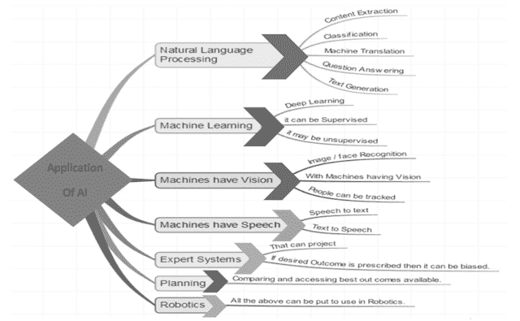

教育图景中的**图 4.11**。

AI 驱动的内容制作平台的能力可以帮助教师和教学设计人员制作更有效的教学材料。AI 驱动的内容创建的另一个优势是它能够根据特定学习者的需求和偏好定制内容。AI 能够通过分析学习者行为和表现的数据，创建出适应每位学生个人需求的专业化学习材料。

AI 生成的内容可能缺乏原创性和创造力。尽管 AI 能够快速高效地生成内容，但它可能无法以一种真正新颖或突破性的方式来实现。这在教室中可能是一个问题，因为学生可能会从接触新鲜、原创的想法中获益。AI 驱动的策展利用算法和方法，根据用户的兴趣和行为自动对内容进行排序、安排和建议。这项技术可能会完全改变所选择和提供的学习资源。

通过 AI 驱动的策展实现学习体验的个性化是其主要优势之一，因为 AI 算法可以通过检查行为和偏好数据，提供与学生的兴趣和学习目标相关的的内容建议。由于学生更有可能发现主题具有吸引力和价值，这有助于学生保持积极性和投入。

# 区块链与人工智能

AI 驱动的策展可以提供对学习者行为和表现的洞察，并发现学习者与策展内容交互的模式和趋势，这些趋势可以用于增强下一次策展计划的效力。

扩展性是 AI 驱动的内容创建的关键优势之一。对于贫穷国家或无法获得高质量教育资源的学生来说，这可以增加教育的可负担性。使用 AI 进行内容创建可以提高教育资源的质量。例如，AI 驱动的聊天机器人可以与学习者模拟讨论，帮助他们磨炼和练习语言能力。AI 驱动的虚拟现实（`VR`）设置可以给学生提供传统教学工具无法实现的动态、实践体验。

对人类监督和参与的需求是另一个困难。算法产生的文本必须由人类专业人员进行审查和编辑。批评者担心，在教育中使用 AI 工具可能会降低学生在整个学习过程中批判性和分析性思维的能力；这些工具可能会在无意中抑制学生利用批判性思维，可能会抑制他们分析复杂问题、独立评估信息和产生原创解决方案的能力。为了给学生提供准备他们应对未来挑战的全面教育，有必要在开发批判性思维和使用 AI 工具之间建立平衡。AI 驱动的材料策展为教师和学生节省时间是另一个主要优势。学习者可以依靠 AI 算法建议与其相关的顶级材料，而不是花费数小时寻找教育资源。教师可以利用 AI 驱动的策展寻找与他们的学习目标兼容的资源，节省时间和精力。如果用于训练算法的数据在任何方面存在偏差，算法生成的建议可能会偏偏，这可能会学生接触到错误或偏见的信息。AI 算法可能会提供有用的建议，但确保建议的资源是准确、相关并符合学习目标至关重要（Little One The Jaipuria Preschool, 2023）。

教学设计、教学策略和教师培养的变化只是 AI 应用教育对教学产生巨大影响的方式之一。以下是 AI 可能影响教育的几个例子：

- 个性化学习
- 自适应学习
- 数据驱动的教学
- 自动评分
- 智能辅导系统

然而，AI 在教育中的应用确实带来了某些潜在的困难。例如：

- **对偏见的担忧**：AI 算法的质量取决于训练它们的数据。如果用于训练算法的数据在某些方面存在偏见，算法做出的建议或判断可能会偏颇。确保 AI 以公平、透明且尽可能减少偏见的方式进行应用是至关重要的。
- **对教师培训的需求**：教师必须具备特定的技术知识和技能才能在教室中部署 AI。为了成功将 AI 整合到他们的教学实践中，教师可能需要帮助和培训。
- **去人性化的风险**：教育中可以被 AI 自动化的方面包括评分和评估。虽然这样做可以节省精力和精力，但必须使用 AI 来补充而非取代人类的参与和教学。

以下是 AI 可能会影响学习的一些方式：

- 个性化学习
- 自适应学习
- 提高学生参与度
- 可访问性
- 实时反馈
- 增强协作
- 时间管理

然而，在讨论上述所有内容之后，在教学中使用 AI 也存在一些问题和困难。

- **偏见**：由于 AI 算法具有偏见的潜力，不同的学生群体可能会经历不等的学习成果。
- **对技术的依赖**：学生对技术的过度依赖可能导致创造力和批判性思维能力的匮乏。
- **隐私与安全**：由于学生数据可能受到黑客和其他在线危险的影响，在教育中使用 AI 带来了隐私和安全担忧。
- **实施**：为了使 AI 教育成功，必须大量投入基础设施建设、支持和培训。
- **职位淘汰**：通过使用 AI 自动化某些职责，教育系统可能会失去平衡，教师可能会失去工作（Ahmed and Ganapathy, 2021）。

# 4.8 案例研究：人工智能与区块链在教育中的应用及其对教学学习的影响

以下是关于教育中使用区块链和 AI 的一些研究和说明：

**马尔他的智能学位**：为了引入“智能学位”，马尔他政府与 `BCT` 业务 `Learning Machine` 合作。这种方法通过将学术证书存储在区块链上来保护学术证书，使其无法被篡改。在马尔他的多所大学实施了该系统，学生可以使用安全的钱包访问证书。

**卡内基梅大学的 AI 辅导**：卡内基梅大学开发了一项可以为学习者提供个性化反馈和指导的 AI 教学系统。“`ALEKS`”系统适应学生的学习风格和速度（Koedinger et al., 1997）。**巴林大学的区块链系统**：巴林大学实施了一套区块链系统来存储和分发学生记录和学位。雇主和其他教育机构可以通过这种方法验证数据，使其无法被篡改（Jlbrel, 2019）。

此外，AI 对教学和学习的影响在以下案例研究中：

**Carnegie Learning**：`Carnegie Learning` 利用 为学生提供个性化的学习机会。该技术适应学习者的风格和速度，利用机器学习算法发现他们需要更多帮助的地方。结果是学习成果显著提高；根据一项研究，使用 `Carnegie Learning` 的学生在考试中的表现比使用传统方法的学生出 23%。**Coursera**：在线学习平台 `Coursera` 利用 AI 定制每个学生的教育体验。通过机器学习技术，系统评估学生的学术表现，然后对课程和资源提供建议。这提高了参与度和完成率；根据一项研究，使用 `Coursera` 的学生完成课程的可能性比使用传统方法的学生出 21%。**ML**：使用 `Learning Machine` 的软件创建并发行基于区块链的数字证书麻省理工学院（`MIT`）是其客户之一，自 2018 年以来一直使用 `ML` 技术为毕业生提供数字证书。

## 4.9 AI 与区块链的挑战：它们在教学学习中的局限

尽管 AI 和区块链具有改变教学学习的潜力，但在教育中应用它们可能会产生某些负面影响。以下是区块链和 AI 在教育中的一些缺点：

- 缺乏人为互动
- 偏见与不平等
- 成本
- 数据隐私与安全
- 复杂性

教育提供者和教师对基于大语言模型（`LLM`）的 AI 工具已产生普遍担忧，这些工具可用于在评估、作业、任务等过程中进行作弊。甚至可以用于创作歌曲、诗歌、绘画和绘图等创意作品。它可以用于初级的灵感生成，但需要充分的研究、微调和深度理解，以避免改写错误和 AI 检测错误（IOE London Blog, 2023）。`ChatGPT` 可以针对不同类型的问题生成过于通化的答案，但这些答案并不总是正确的，也不符合高标准（图 4.12）（Code Today, 2022）。

`GPT` 和 `LLM` 模型能够更快地扩展解决策略，并以聊天的形式参与构思以缩小范围（Tsai et al., 2023）。

## 4.10 结论

通过将区块链和 AI 集成到教学学习中，可以创建个性化、去中心化且安全的学习网络，这具有完全改变教育提供方式的潜力。虽然区块链凭证和认证可以提供学习者成就的透明且不可更改的记录，但 AI 驱动的个性化学习可以根据个人需求调整教育体验。而区块链可以更容易创建去中心化的学习网络，某些可以通过 AI 实现自动化。

### 问题

识别可以使用 `Chat-GPT` 解决的问题

- 对缺乏经验的学生来说具有挑战性

### 提示词构建

公式制定：

- 第一性原理
- 经验性
- 半经验

检查公式和结果的正确性

- 传统问题解决
  - `LLM` 辅助问题解决
    - `LLM` 辅助问题解决
      - 当前问题
      - 获得的益处

清晰地描述并理解问题

使用工程数学和数值方法求解

- 欠佳的编码习惯
- 解决琐碎问题

`Chat-GPT` 辅助

- 开发高效的问题解决能力
- 探索替代方案
- 解决方案过程的结构清晰
- 加强对公式和编码的理解
- 培养严谨的科学态度

用户友好型工具

结果

模型建议

包推荐

图 4.12 基于 `LLM` 的问题解决方法。

## References

Aamir, M., Qureshi, R, Khan, F.A. and Huzaifa, M., 2020. Blockchain based academic records verification in smart cities. Wireless Personal Communications, 113, pp. 1397–1406.

Ahmed, A.A.A. and Ganapathy, A., 2021. Creation of automated content with embedded artificial intelligence: A study on learning management system for educational entrepreneurship. Academy of Entrepreneurship Journal, 27(3), pp. 1–10.

Alamary, A., Alhazmi, S., Almasri, M. and Gillani, S., 2019. Blockchain-based applications in education: A systematic review. Applied Sciences, 9(12), p. 2400.

Ali, M. and Abdel-Haq, M.K.K., 2021. Bibliographical analysis of artificial intelligence learning in Higher Education: Is the role of the human educator and student of the past?. Fostering Communication and Learning With Underutilizedized Technologies in Higher Education (pp. 36–62). I Global.

Bhaskar, P., Tiwari, C.K. and Joshi, A., 2021. Blockchain in education management: Present and future applications. Interactive Technology and Smart Education, 18(1), pp. 1–17.

Chen, Y., 2022. The impact of artificial intelligence and block chain technology on the development of modern educational technology. Mobile Information Systems.

Davies, J.N., Verovko, M., Verovko, O. and Solomakha, I., 2020, June. Personalization of e-learning process with AI-powered chatbot integration. International Scientific-practical Conference (pp. 209–216). Cham: Springer International Publishing.

IOE London Blog. 2023. What should we be asking about ChatGPT et al. when to educational assessment [Blog post]. UCL Institute of Education. Available at: https://blogs.ucl.ac.uk/ie/2023/04/27/what-should-we-be-asking-about-chatgpt-et-al-when-comes-to-educational-assessment/ (Accessed 10 July 2023)

Islam, M.A., Sufian, M.A. and Sifat, M.H. 2022. AI, blockchain and selfsovereign identity in higher education. MRN Annual Conference 2022, UCL. doi: 10.13140/RG.2.29117.44008

Jibrel, 2019. Bahrain enters as a block chain leader in the Middle East. Available at: https://cointelegraph.com/news/university-of-bahrain-issues-blockchain-diplomas-to-graduating-students (Accessed 1 March 2023)


Koedinger, K.R., Anderson, J.R., Hadley, W.H. and Mark, M.A., 1997. Intelligent tutoring goes to school in the big city. International Journal of Artificial Intelligence in Education, 8(1), pp. 30–43.

Little One The Jaipur Preschool, 2023. Artificial Intelligence in Education landscape. Available at: http://www.jaipuriallittleoneajmau.com/blogspot/artificial-intelligence-in-education-landscape/ (Accessed 1 April 2023)

Ouyang, F. and Jiao, P., 2021. Artificial intelligence in education: The three paradigms. Computers and Education: Artificial Intelligence, 2, p. 10020.

Takyar, A., 2023. Blockchain technology explained. Available at: https://www.leewayhertz.com/blockchain-technology-explained/ (Accessed 1 April 2023)

Tsai, M.L., Ong, C.W. and Chen, C.L., 2023. Exploring the use of large language models (LLMs) in chemical engineering education: Building core course models with Chat-GPT. Education for Chemical Engineers, 44, pp. 71–95.

Turing, 2023. How do AI and blockchain technology complement each other? Available at: https://www.turing.com/kb/how-blockchain-and-ai-complement-each-other (Accessed 1 April 2023)

# 医疗保健中的区块链与人工智能

通过解决这些问题，本章旨在帮助读者更好地理解智能医疗系统的安全问题，并了解如何利用区块链和人工智能技术来降低这些风险。人工智能与基于区块链的技术在医疗保健领域的整合为改善患者护理提供了巨大机会，本章讨论了与这种整合相关的各种机会和挑战 [2]。

## 5.2 区块链与人工智能在医疗供应链中的整合

近年来，利用区块链和人工智能技术追踪药品供应链并防止伪冒品已引起了广泛关注。

### 5.2.1 医疗保健供应链中的区块链技术

区块链的不可篡改性确保了一旦药品信息记录在区块链上，若没有网络参与者的共识，就无法进行更改。这一特性提供了一个防篡改系统，防止了伪冒品操纵供应链数据。通过维护药品每次交易或转移的不可更改记录，区块链创建了其从制造商到终端消费者整个历程的全面且透明的视图。正如我所强调的，这种透明度使利益相关者能够在任何时间追踪药品的来源和流向 [3]。

此外，将唯一标识符、加密特征与区块链相结合，有助于验证药品的真实性。通过区块链与唯一标识符（如序列号、二维码或 RFID 标签）结合创建数字指纹，为跟踪整个供应链中的产品移动建立了一种安全且透明的方式。这种验证过程有助于防止伪冒品，并确保药品是真实未受损的。

### 5.2.2 区块链与人工智能的协同效应

区块链与人工智能技术之间的潜在协同效应正在增强供应链管理。人工智能可以利用存储在区块链上的数据来预测需求、防止短缺并识别欺诈或假产品实例。通过结合区块链透明度和人工智能预测能力的优势，可以显著提高药品供应链生态系统的效率、质量和安全性。

尽管这些进展前景良好，但必须承认实施区块链技术面临的挑战，例如互操作性和标准化问题。合作和进一步的研究对于克服这些障碍并实现区块链和人工智能在药品供应链管理中的潜力至关重要。

利用区块链和人工智能追踪药品供应链并防止伪冒品带来了巨大的利益，包括透明度、可追溯性和增强的安全性 [4]。通过在防篡改的区块链上记录和验证药品的历史，利益相关者可以确保数据完整性、验证药品真实性并打击日益严重的伪冒品问题。然而，解决挑战和促进合作仍然是充分利用区块链和人工智能技术在药品供应链管理中潜力的关键。

## 5.3 在访问和共享患者数据中使用区块链与人工智能

在访问和共享患者数据整合区块链和人工智能具有变革医疗保健的巨大潜力。本分析深入探讨患者数据安全与隐私的关键方面、实施区块链和人工智能的挑战 [5]，以及这些技术在医疗保健领域的未来前景。

### 5.3.1 患者数据的安全与隐私

在访问和共享患者数据时，安全和隐私都是关键考虑因素。区块链技术提供了去中心化的防篡改账本，增强了安全性 [6]。其不可篡改性和分布式确保了数据完整性，使其能够抵抗未经授权的修改和破解。存储在区块链上的患者数据可以被授权方安全访问，促进透明度和责任。

此外，人工智能算法在分析患者数据方面起着至关重要的作用，能够识别改进患者护理的模式和趋势。然而，人工智能与区块链的引发了对数据隐私的关注。为了解决这个问题，区块链可以对患者数据进行匿名化处理，在对其加密的同时仅在账本上存储唯一标识符。这种方法增强了患者隐私，并最大限度地减少了未经授权的识别和跟踪的风险。

### 5.3.2 在医疗保健中实施区块链和人工智能的挑战

尽管区块链和人工智能在医疗保健领域潜力巨大，但仍有许多挑战需要解决。一个主要障碍是缺乏全行业的标准，使得不同组织和系统之间的互操作性变得复杂。此外，不断变化的监管格局为组织在采用这些技术时带来了不确定性。

各种区块链平台的存在增加了互操作性的复杂性，这在为特定的医疗需求选择最合适的平台时需要经过仔细考虑。此外，确保患者了解区块链技术的益处、风险和正确用法，对于培养信任和广泛采用至关重要。

与区块链相关的安全风险（例如智能合约中的潜在漏洞或分布式拒绝攻击）必须经过彻底评估和缓解，以确保患者数据的完整性。

### 5.3.3 未来前景

展望未来，区块链和人工智能在医疗保健领域的前景是光明的。这些技术可以显著提高护理质量，使医疗保健更加负担得起并以患者为中心。区块链促进患者控制数据所有权的能力以及人工智能先进的诊断和治疗能力，提供了令人兴奋的可能性。

构建在区块链上的去中心化医疗应用程序可以赋予患者安全地管理和控制其数据的能力 [7]。这种向患者为中心的转变促进了数据透明度，并赋予个人对其医疗健康做出知情决策。

此外，人工智能与区块链的整合可以导致创新诊断工具、治疗方案和精准医疗方法的发展。通过分析海量的患者数据，人工智能算法可以增强临床决策、改进疾病预测并驱动个性化医疗服务的交付。

为了充分实现区块链和人工智能在医疗保健中的潜力，利益相关者（包括医疗提供者、技术专家、监管机构和政策制定者）之间的合作至关重要。建立稳健的标准、解决监管挑战以及投资教育和研究是这些变革性技术广泛采用和无缝整合的关键步骤。

在访问和共享患者数据整合区块链和人工智能为医疗行业带来了显著收益。通过解决安全和隐私问题、克服实施挑战并利用这些技术的潜力，医疗保健可以发生变革，促进患者结果的改善和更以患者为中心的护理方法。

# 医疗保健中的区块链与人工智能

区块链保护了患者信息，降低了未经授权访问或数据丢失的风险。

### 5.4.1.2 提高数据分析的效率和准确性

AI 算法分析从各种来源收集的患者数据，实现了高效的数据分析。这有助于及早发现健康问题，从而实现及时干预并获得更好的患者预后。

### 5.4.1.3 降低医疗成本

在远程患者监控（RPM）系统中集成区块链和人工智能具有降低医疗成本的潜力。通过及早发现健康问题，可以及时实施干预，可能防止疾病进展并减少对昂贵治疗的需求 [9]。

## 5.4.2 在 RPM 系统中集成区块链与人工智能的挑战

### 5.4.2.1 对充足数据的需求

为了充分利用 RPM 中人工智能的潜力，大量的高质量患者数据至关重要。获取多样化且数据集对于训练准确的模型至关重要。

### 5.4.2.2 进阶算法的发展

持续研究和开发 AI 算法以提高 RPM 系统中数据分析的准确性和效率。机器学习和深度学习技术的不断进步对于从患者数据中提取有意义的见解至关重要。

### 5.4.2.3 监管考虑

在 RPM 系统集成区块链和人工智能需要稳健的监管框架。法规必须解决数据隐私、安全和伦理问题，以确保患者数据得到负责且符合伦理的使用。

## 5.4.3 未来展望

区块链和人工智能在 RPM 系统中的集成对于医疗医疗具有巨大潜力。随着技术的不断演进，我们可以期待更多创新的应用 [10]。为了实现这一潜力，研究人员、医疗提供者、监管机构和技术开发人员之间的协作至关重要。通过应对挑战和利用优势，我们可以拥抱以患者为中心、具有成本效益且安全的远程医疗未来。

## 5.5 医疗保险中的区块链与人工智能

保险业已处于颠性变革的边缘。传统的运营方式已不再可持续，保险公司需要接受新技术以保持竞争力。区块链和人工智能 [11] 是塑造保险未来的两个重要技术之一。

### 5.5.1 问题陈述

医疗保险欺诈是一个重大问题，给行业造成了巨大的财务损失。传统的欺诈检测方法通常效率低下且耗时，因此需要探索区块链和人工智能等新技术来有效应对这一挑战。

### 5.5.2 区块链与人工智能的作用

区块链作为一种安全透明的数据存储技术的潜力。通过利用区块链记录医疗交易，可以识别并分析欺诈模式。而人工智能则可以利用存储在区块链上的数据来执行复杂的分析，并识别潜在的欺诈案件。

### 5.5.3 自动化与效率

概述了欺诈检测中自动化的益处，使人力资源能够关注其他关键任务，例如调查怀疑的欺诈案件 [12]。通过采用区块链和人工智能，理赔审判、风险评估和调查过程可以自动化，从而提高效率和准确性。

## 5.5.4 欺诈检测系统的架构

区块链网络、数据存储库和人工智能驱动的欺诈检测引擎的集成了该系统的基础。这些组件共同工作，存储、跟踪和分析医疗数据，以识别潜在的欺诈案件。

## 5.5.5 未来展望

区块链和人工智能在变革医疗保险欺诈检测方面具有巨大潜力 [13]。通过利用这些技术，他们预见到一个更高效、有效且更准确的欺诈检测系统。

在医疗保险欺诈检测中使用区块链和人工智能的益处（如自动理赔审判、风险评估和调查）进一步增强了这些技术在反欺诈方面的潜力。

## 5.6 医疗保健中区块链与人工智能的未来

医疗领域区块链与人工智能能力的融合可能会带来其格局的翻覆性变化；为进步和效率开辟新途径。本章节深入探讨了两种尖端技术在应对关键健康相关挑战方面的协作潜力，包括数据安全保障、各系统间简化连接以及定制化医疗干预。

### 5.6.1 个性化医疗：赋能患者以获得更好结果

人工智能驱动的区块链技术在开发个性化医疗解决方案方面前景广。通过在去中心化账本上安全存储和共享患者数据 [14]，医疗提供者可以利用 AI 算法分析海量数据集并提供定制治疗。个性化医疗不仅改善了患者预后，还通过优化资源配置和减少试错法降低了成本。

### 5.6.2 疾病监测与预防：增强公共健康

人工智能和区块链的集成可以彻底改变疾病监测和预防策略。AI 算法可以分析大量的医疗数据，识别有助于预测疾病爆发和制定目标干预的模式和趋势 [15]。通过区块链不可篡改和透明的特性，公共卫生机构可以安全地追踪疾病传播，高效地协调响应并确保数据完整性。

### 5.6.3 安全数据管理：解锁互操作性与协作

医疗领域的重大挑战之一是不同组织之间的互操作性和安全数据交换。区块链技术为管理健康记录提供了去中心化且防篡的解决方案。通过使用智能合约和访问控制，患者可以授予对其数据的选择性访问，在维护数据隐私和安全的同时实现医疗提供者之间的无缝协作。

### 5.6.4 克服挑战：迈向广泛应用

虽然医疗领域人工智能区块链技术的前良好，但其广泛应用还需要解决若干挑战。这些包括监管考虑、扩展性问题、数据格式标准化以及建立利益相关者之间的信任。政策制定者、技术开发人员和医疗专业人员之间的协作对于应对这些挑战和营造有利于创新的环境至关重要。

随着区块链和人工智能的集成，医疗保健未来即将转型 [16]。本研究讨论的潜在应用（包括个性化医疗、疾病监测和安全数据管理）说明了这种融合对护理可能产生的深远影响。

# 医疗保健中的区块链与人工智能

## 5.7 结论

总结，将区块链与人工智能整合到医疗领域为改善患者结果并降低成本提供了巨大机会。区块链技术提供了安全存储并促进了数据共享，而人工智能在管理大量数据方面具有独特能力。通过这种方法，这种整合简化了医疗提供者的流程。然而，意识到数据保护方面的某些挑战需要利益相关者的参与以确保合规。总之，我们期待转型趋势持续。

# 参考文献

期刊文章

- [1] 区块链与人工智能驱动的智能医疗安全：基于应用的分析。(Link: https://www.mdpi.com/2076-3417/22/11/1039)

- [2] 医疗领域的区块链与人工智能技术。(Link: https://link.springer.com/article/10.1007/s11356-02-16223-0)

- [3] 使用区块链和人工智能保护数据 (Link: https://ieeexplore.ieee.org/document/8733072)

- [4] 医疗中的区块链技术：挑战与机遇。(Link: https://www.tandfonline.com/doi/full/20479700.2020.1843887)

- [5] 区块链技术在医学和医疗保健中的应用：挑战与未来展望。(Link: https://www.mdpi.com/2410-387x/3/1/1)

- [6] 数据共享：利用区块链和去中心化数据技术解锁人工智能的潜力：可以辅助

从医学其他领域学习再现性？（链接：https://www.sciencedirect.com/science/article/pii/S0015028220232402X）

-   [7] 人工智能辅助远程患者监控：现状、应用与挑战。（链接：https://wires.onlinelibrary.wiley.com/doi/full/10.1002/widn.1485）

-   [8] 用于公共卫的 AI 驱动区块链技术：全面综述、开放挑战与未来研究方向。（链接：https://www.mdpi.com/2227-9032/11/1/81）

-   [9] 区块链与医疗健康领域的系统分析：范围与挑战（链接：https://ieeeplore.ieee.org/abstract/document/9449835）

-   [10] 区块链和人工智能驱动的医疗保险欺诈检测：分析、架构与未来前景。（链接：https://ieeeplore.ieee.org/abstract/document/894995）

-   [11] 基于区块链技术和人工智能的去中心化访问控制，以确保医疗保健安全的互操作性。（链接：https://www.mdpi.com/2071-1050/14/15/9471）

-   [12] 未来医疗健康中人工智能的维度：区块链与网络安全（链接：https://www.sciencedirect.com/science/article/pii/S2352648321000453）

-   [13] 医疗物联网中的人工智能技术、区块链与网络安全：机遇、挑战与未来方向（链接：https://www.degruter.com/document/10.1515/jisys-2022-0267/html）

电子书

-   [14] 区块链与人工智能在供应链整合中的批判性分析。

-   [15] 人工智能、区块链与可穿戴技术在慢性病管理中的整合：智能医疗的新范式。

-   [16] 医疗保健中的区块链技术：前景、障碍与未来建议；从数字化的教训。

-   [17] 区块链-物联网（IoT）驱动的 COVID-19 药品供应链。
