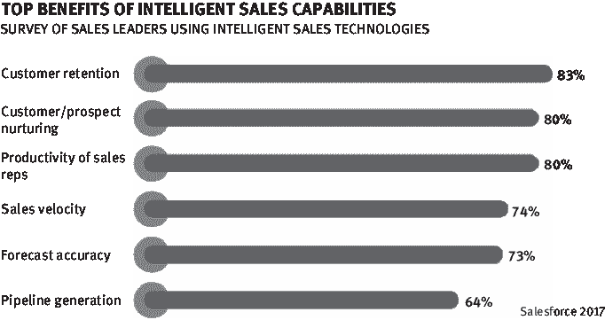
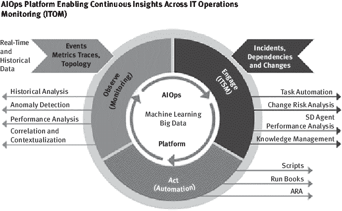
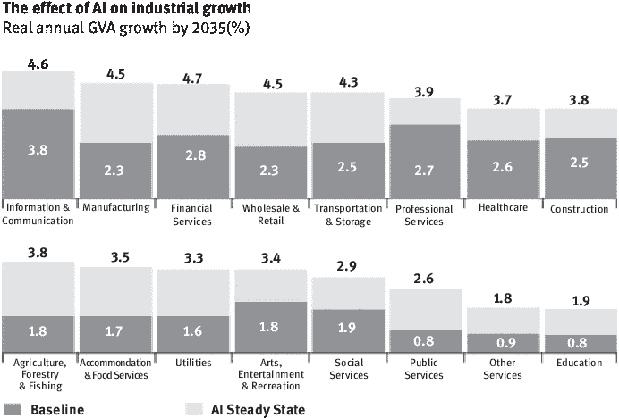
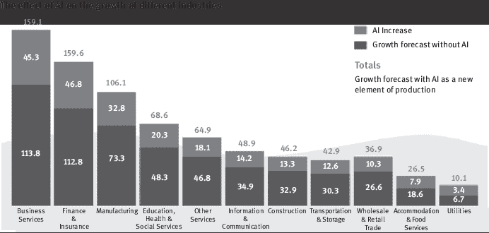
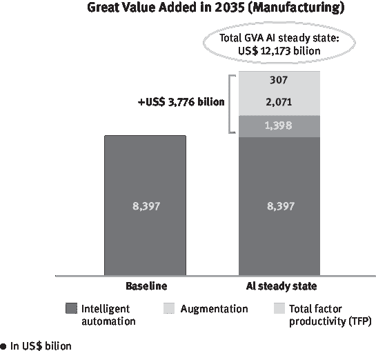
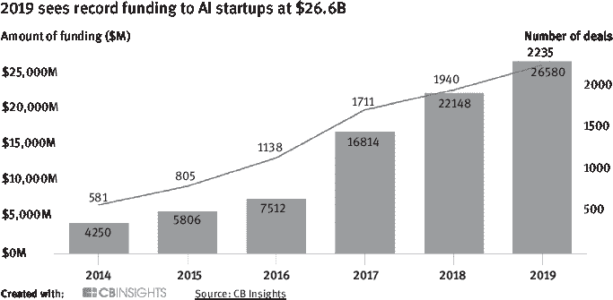
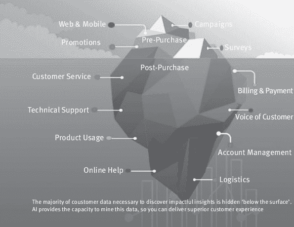
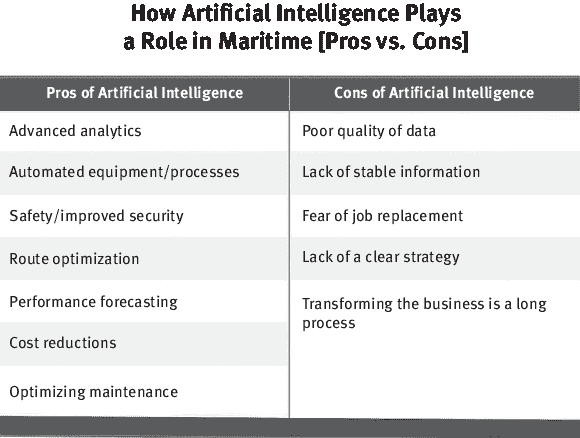

# 区块链与人工智能：重塑世界

## 概述

### 如何将区块链用于建筑维护

### 区块链在建筑维护中的核心优势是什么？

### 区块链在建筑维护领域的未来展望是什么？

## 第 7 章 制造业

Tom James Kiren Chong-James

### 人工智能

#### 什么是制造业中的人工智能？

#### 为什么人工智能制造很重要？

#### 如何将人工智能用于制造业？

### 人工智能在制造业中的核心优势是什么？

#### 人工智能在制造业领域的未来展望是什么？

### 区块链

### 什么是制造业中的区块链？

#### 为什么区块链制造很重要？

### 如何将区块链用于制造业

### 区块链在制造业中的核心优势是什么？

#### 区块链在制造业领域的未来展望是什么？

## 第 8 章 财务与会计

Tom James

### 人工智能

### 财务与会计中的人工智能是什么？

#### 为什么人工智能财务会计很重要？

#### 如何将人工智能用于财务与会计

#### 人工智能在财务与会计中的核心优势是什么？

#### 人工智能在财务与会计领域的未来展望是什么？

### 区块链

### 财务与会计中的区块链是什么？

### 为什么区块链财务会计很重要？

### 如何将区块链用于财务与会计

#### 区块链在财务与会计中的核心优势是什么？

#### 区块链在财务与会计领域的未来展望是什么？

## 第 9 章 客户体验

Tom James

### 人工智能

#### 客户体验（CX）中的人工智能是什么？

#### 为什么人工智能客户体验很重要？

#### 如何将人工智能用于客户体验

#### 人工智能在客户体验中的核心优势是什么？

#### 人工智能在客户体验领域的未来展望是什么？

### 区块链

#### 客户体验（CX）中的区块链是什么？

#### 为什么区块链客户体验很重要？

#### 如何将区块链用于客户体验

#### 区块链在客户体验中的核心优势是什么？

#### 区块链在客户体验领域的未来展望是什么？

## 第 10 章 海事创新

Tom James Kiren Chong-James

### 人工智能

#### 海事创新中的人工智能是什么？

#### 为什么人工智能海事创新很重要？

#### 如何将人工智能用于海事创新

#### 人工智能在海事创新中的核心优势是什么？

#### 人工智能在海事创新领域的未来展望是什么？

### 区块链

#### 海事创新中的区块链是什么？

#### 为什么区块链海事创新很重要？

#### 如何将区块链用于海事创新

#### 区块链在海事创新中的核心优势是什么？

#### 区块链在海事创新领域的未来展望是什么？

## 第 11 章 即将到来的革命

Tom James

### 人工智能

#### 人工智能的四个波浪

#### 人工超智能

### 区块链

#### 区块链革命 – 业务准备就绪

#### AI 协同

### 关于

### 区块链

#### 索引

#### `V`

#### `VI`

#### `VII`

#### `1`

#### `2`

#### `3`

#### `4`

#### `5`

#### `6`

#### `7`

#### `8`

#### `9`

#### `10`

#### `11`

#### `12`

#### `13`

#### `14`

#### `15`

#### `16`

#### `17`

#### `18`

#### `19`

#### `20`

#### `21`

#### `22`

#### `23`

#### `24`

#### `25`

#### `26`

#### `27`

#### `35`

#### `36`

#### `37`

#### `38`

#### `39`

#### `40`

#### `41`

#### `42`

#### `43`

#### `44`

#### `45`

#### `46`

#### `47`

#### `48`

#### `49`

#### `50`

#### `51`

#### `52`

#### `53`

#### `54`

#### `55`

#### `56`

#### `57`

#### `58`

#### `59`

#### `60`

#### `61`

#### `62`

#### `63`

#### `64`

#### `65`

#### `66`

#### `67`

#### `68`

#### `69`

#### `71`

#### `72`

#### `73`

#### `74`

#### `75`

#### `76`

#### `77`

#### `78`

#### `79`

#### `80`

#### `81`

#### `83`

#### `84`

#### `85`

#### `86`

#### `87`

#### `88`

#### `89`

#### `90`

#### `91`

#### `92`

#### `93`

#### `94`

#### `95`

#### `96`

#### `97`

#### `98`

#### `99`

#### `100`

#### `101`

#### `102`

#### `103`

#### `104`

#### `105`

#### `106`

#### `107`

#### `108`

#### `109`

#### `110`

#### `111`

#### `112`

#### `113`

#### `114`

#### `115`

#### `116`

#### `117`

#### `118`

#### `119`

#### `120`

#### `121`

#### `122`

#### `123`

#### `124`

#### `125`

#### `126`

#### `127`

#### `128`

#### `129`

#### `130`

#### `131`

#### `132`

#### `133`

#### `134`

#### `135`

#### `136`

#### `137`

#### `138`

#### `139`

#### `140`

#### `141`

#### `142`

#### `143`

#### `144`

#### `145`

#### `146`

#### `147`

#### `148`

#### `149`

#### `150`

#### `151`

#### `152`

#### `153`

#### `154`

#### `155`

#### `156`

#### `157`

#### `158`

#### `159`

#### `160`

#### `161`

#### `162`

#### `163`

#### `164`

#### `165`

#### `166`

#### `167`

#### `168`

#### `169`

#### `170`

#### `171`

#### `172`

#### `173`

#### `174`

#### `175`

#### `176`

#### `177`

#### `178`

#### `179`

#### `180`

#### `181`

#### `182`

#### `183`

#### `184`

#### `185`

#### `186`

#### `187`

#### `188`

#### `189`

#### `190`

#### `191`

#### `192`

#### `193`

#### `194`

#### `195`

#### `196`

#### `197`

#### `198`

#### `199`

#### `200`

#### `201`

#### `202`

#### `203`

#### `204`

#### `205`

#### `206`

#### `207`

#### `208`

#### `209`

#### `210`

#### `211`

#### `212`

#### `213`

#### `214`

#### `215`

#### `216`

#### `217`

#### `218`

#### `219`

#### `220`

#### `223`

#### `224`

#### `225`

#### `226`

#### `227`

#### `228`

#### `229`

#### `230`

#### `231`

#### `232`

#### `233`

#### `234`

#### `235`

#### `236`

#### `237`

#### `238`

#### `239`

#### `240`

#### `241`

#### `242`

#### `243`

#### `244`

#### `245`

#### `246`

#### `247`

#### `248`

#### `249`

#### `250`

# 前言

几个世纪以来，出现过几个关键性的时刻，技术的突破突然为人类开启了新的机会或改变了我们与世界互动的方式。本书将探讨两种技术——人工智能（AI）和区块链——是如何开始重新定义我们周围世界的。

### 人工智能

人工智能（AI）是指由计算机或机器执行的任何任务。它是制造那些通常需要人类智能才能完成的系统的科学与工程。

人工智能分为两种：通用人工智能和弱人工智能。我们目前正在经历弱人工智能——通用人工智能仍在开发中（你可以将其想象成《终结者》）。弱人工智能是指解决特定问题的程序。

人工智能已经直接或间接地影响了我们的生活，并通过手机上的数字助手、驾驶辅助系统、聊天机器人、文本翻译以及推荐电影、服务和音乐的系统在塑造未来。

“人工智能”和“智能”这两个词首次组合在一起是在 1955 年，由约翰·麦卡锡提出的。

### 区块链

本书介绍的第二种技术区块链，可能因比特币和以太坊等加密货币而闻名。除了作为货币的应用，区块链底层技术（如果你愿意，它是实现这一切的编程语言）本身就是一个非常强大的工具，在金融行业有广泛的应用。

尽管区块链的机制极其复杂，但基本理念很简单：去中心化数据存储，使得数据无法被中央系统拥有、控制或操纵。它能够创建不可否认、不可篡改的数据块，由于这些数据分布在网络中，因此是可以信任的，黑客很难同时攻击多个系统并更改所有数据。由于这种去中心化的特性，它为数据提供了极高的安全性。

区块链技术非常透明，因为所有参与者从一开始就能看到所有内容。这减少了系统中出现任何差异的可能性，因为没有隐藏信息。从成本角度来看，它也被认为是世界上开发解决方案最合理的选择，因为许多语言都是开源的，供开发者免费使用。将其与传统的软件开发模型相比，它的成本要低得多，许多公司现在正利用这一事实来降低经济模型中的成本；这已被证明对银行和金融行业特别有益，我们在书中也讨论了这一点。

`AI` 和 `blockchain` 产生巨大影响最明显的一个领域是信息技术运营，但在许多领域，它们已经在改变企业与我们这些人类互动的方式了。为了写这本书，我研究了这两项技术产生共同影响的关键业务领域，并选择了其中最有趣的领域，这些领域以某种方式影响了我们大多数的工作和私生活。例如：会计行业，`AI` 正在彻底改变对通常被视为大数据问题的分析；海运和航运领域，`blockchain` 和 `AI` 正在帮助处理全球商品和船舶的单据，并分析天气模式和船舶航线；人力资源领域在成千上万份简历中筛选并寻找最佳候选人；营销领域通过针对性的广告和信息进行营销。这个名单还在继续；`AI` 和 `blockchain` 触及我们生活的许多领域是微妙的，因此我希望你会喜欢阅读这本书，并发现它对影响我们所处世界的 `AI` 和 `blockchain` 应用与发展是一个非常有开眼的视角。

Tom James

# 致谢

必须非常感谢英国的 `Kiren Chong-James`、印度的 `Aditya Kumar` 以及英国的 `Justine Butler`。你们对项目的投入和支持是无价的。感谢你们！

我还要感谢我所有的家人，尽管全球新冠封锁导致了许多困难和延迟，他们仍然鼓励我继续推进这个书籍项目。

最后但同样重要的是，我想将这本书献给我的老学同学 `Andrew Fox`，不幸的是，他在 2020 年新冠肺炎期间过早去世了。我们一起上学时他对计算机的热爱激发了我从 20 世纪 80 年代初就开始学习并使用计算机语言。

# 第 1 章 营销

Tom James

### 人工智能

人工智能（`AI`）框架不断冲击着 `Netflix`、`Amazon` 和 `Google` 等知名产品和服务的基础设施。尽管这些颠覆是巨大的，但近年来，在极短的时间内，`AI` 开辟了一条更深层次的路径，用于促进并帮助品牌提升客户旅程的每个阶段。随着 `AI` 领域业务和技术创新的更广泛采用，曾经只有大型企业才能使用的工具现在已经为中小企业开启了大门。

人类创造的工程智能的想象性想法——一种类似于科幻电影的狂野发展——可能在短期内无法实现。目前的 `AI` 虽然比科幻电影中的智慧简单，但对世界的颠覆性丝毫不减。如今的 `AI` 是能够执行通常需要人类智能和监督的任务的框架。`AI` 能够整合批判性思维、感知情感、玩复杂的策略游戏，甚至诊断疾病，它们正日益匹配或超越其人类对手。人们只需参加一场 `AI` 展示活动，就能说明信息科学与执行之间的差距正在消失得有多快。

### 什么是营销中的 AI？

人工智能营销（`AIM`）是一种利用客户信息和 `AI` 创新（如 `machine learning`）来预测你的最佳行动方案的技术。

推广中的计算机智能是利用客户信息、`AI` 和其他计算理念来预测个人的活动或不作为行为。它可以处理海量信息，并帮助广告商有效地将其划分为可处理的类别。在考虑了所有相关信息后，广告商可以进一步组织信息分组以实现定制化。

### 为什么 AIM 很重要？

`AI` 在先进营销中留下了巨大的印象。`Smart Insights` 的一项调查显示，在来自不同企业的 100 名高级广告人员中，55% 的组织正在执行或曾经考虑过在营销中使用 `AI`。

`AIM` 是一种允许广告商在网络生活中处理海量信息的实践。此外，缩短数据收集和处理所需的时间，有助于广告商提高效率和投资回报率（ROI）。这是通过利用大数据分析、`machine learning` 和不同的策略来获取知识来实现的。拥有这些知识碎片，你可以制定出日益强大的客户目标。

`AIM` 将帮助内容广告商准确地了解他们的目标群体是谁，并据此为客户提供个性化的个人体验。无论你是在参与电子邮件营销还是提供客户服务，`AI` 都消除了与客户互动相关的大部分神秘性。在更大的规模上，它可能被用于自动化曾经由人工处理的表格。内容生成、`PPC` 广告甚至网站设计都是 `AI` 营销的潜在应用。

### 如何将 AI 用于营销

`AI` 已日益整合到每一个行业，其益处不仅限于减少复杂和简单任务中的人工干预。`AI` 的使用同时也导致了输出质量的提高，帮助人们以更少的努力更好地完成职责。因此，社交媒体、消费电子产品、机器人、旅游交通、金融、医疗保健、安全、监控、电子商务等领域今天已经从 `AI` 中获益。

我们可能会看到 `AI` 动态效益的一个良好例子是创建网站。通常，对于一个企业来说，在没有某些 `HTML`、`CSS` 和 `JavaScript` 专业知识的情况下建立网站是不可想象的。尽管如此，`AI` 让这成为可能。知名网页设计师如 `Wix` 利用 `AI` 构建网站。唯一的人工交互是提供内容、图片和页面格式。然后，你精制作的网站就可以上线了。这种技能和效率方面的优势构成了数字营销的新常态。

#### 数字营销

数字营销和 `AI` 是内在联系的。在数字化营销中，处理海量信息是一个迫切需求。`AI` 鼓励数字化广告商更快地处理信息，从而为他们提供了空闲的注意力来更有效地制定高级策略。

“个性化是新的酷趋势。”根据 Evergage 的数据，96% 的广告商认同个性化是传递卓越客户体验的途径。`AI` 已经让持续理解大量个体的偏好、行为标准、兴趣和习惯成为可能。它是通过收集和分析客户信息来实现这一点的，同时考虑了（但不限于）生理特征、社会经济状况、设备和地理位置等因素。个性化程度越高，转化的概率就越大。

`AI` 通过数学计算和数据分析来帮助实现这种个性化，而这两项任务是 `AI` 框架非常擅长的。计算机智能利用可测量模型和编程，通过考虑客户过去的行为和属性来预测其未来的活动。基于此，`AI` 鼓励广告商深入了解他们的客户，例如，了解他们对特定商品的预期价格是多少。同样，根据这些信息，`AI` 还可以预测客户在产品更新中期待哪些功能。广告商可以利用这些信息制作标语并开展活动，目标是吸引更多客户并提高转化率。

现在，在自动生成信息的时代，人们期待收到与自己相关且对个人有吸引力的定制/个性化信息。计算机智能可以通过分析客户行为和倾向，帮助你在开展电子邮件营销工作时发送一封定制的电子邮件。`AI` 分析数 GB 的数据，以识别能够吸引客户目光的正确标题和开头。同样，它还能找到发送电子邮件的正确时间、日期和频率，从而进一步提高转化率。

#### 销售预测

销售预测是一项巨大的业务。如果你能可靠地预测你在特定一天内将售出的特定商品或服务的需求，你就可以更容易地准备库存、更好地为办公室配置人员，并从你的业务记录中学习更多知识，从而在市场中获得竞争优势。

为了进一步协助预测，你可以利用 `AIM` 处理有关过去安排的社交活动信息。`AIM` 将考虑来自信息、会议和特定活动电话的信息。`AIM` 可以将这些信息与你当前及未来营销活动的潜在交易结果联系起来。

### 客户体验

通过 `AIM` 安排收集的信息，广告商往往更容易理解客户的需求是什么，以及他们何时需要。广告商还可以创建客户画像，以便他们更轻松地将对产品感兴趣的人与那些仍在考虑或可能永远不会购买的人分类开来（参见图 1.1）。

> 到 2025 年，多达 95% 的客户交互将通过人工智能（AI）技术支持的渠道进行 – 微软


图 1.1：发现对业务有影响的洞察所需的客户大数据地图。

`AI` 可以被有效利用，在客户旅程的每一个节点提供明智、有利且受教育的客户参与。这将带来重构的客户体验和融入到体验中的全程客户体验，这种体验对客户来说感觉越来越自然。

`AI` 最大的影响无疑将是通过使客户服务自动化、快速且无忧来实现变革。销售人员、呼叫中心专家和其他客户服务工作的员工无法依靠在每次对话之前摄入并理解客户的整个历史，因为这对任何人来说都是一项极度耗时的任务。然而，`AI` 现在正在让这项任务成为可能。

`AI` 正在帮助组织创建经常将消费者模式信息与购物者日常生活相结合的体验。客户将不再改变他们的沟通习惯来与品牌互动。智能预期和定制将让客户感到一切都是为他们量身定制的。

`AI` 帮助组织根据购物者的日常生活预测消费者模式信息，并预测订单以满足他们的需求。

### 程序化广告投放


从根本上说，程序化广告投放是通过编程技术将广告购买过程全部或部分自动化。传统的广告购买方法是一种漫长、单调的程序，从联系销售代表、设定条款开始，然后进行执行。AI 在数字营销中的最终命运改变了这一点。

聊天机器人允许机构尽可能地对客户和顾客的查询提供预设回复，例如通过帮助他们寻找并购买他们喜欢的物品。这从本质上减少了人类不断干预和反应所需的时间，从而节省了精力和资金投入到其他地方。从时尚到健康再到保险，明的聊天机器人已被投入用于提供引人入胜的服务。有时，它们在创建个性化内容方面比人类还要出色。

聊天机器人处理大量的客户焦点。它们可以汇总特定区域的需求以识别模式、发现单调的问题，并预测特定客户的需求。通常情况下，这使得它们比任何人工服务都更高效。然而，聊天机器人并不限于协调服务运营。例如，查看图 1.2 中的对话，并猜看哪一个看起来更像人类？


图 1.2：与聊天人的对话。

1 号。不是这样吗？

AI 为聊天机器人的每一次对话增添了人味。机器人通过模拟人类相互观察并做出类似反应的框架，理解客户的问题并触发准确的反应。从表 1.1 我们可以得出：

1. 带有 AI 的聊天机器人使你的机器人更加灵活并敏于回答复杂问题。这种协作是对话式的、自然且充满活力的。

2. 聊天机器人从与客户的每一次对话中受益。它通过过去的合作来改进当前的反应。这种行动有助于提高机器人反应的效率。此外，有助于理解您的决策和偏好。

3. 敏锐的连接通过帮助他们找到正确的数据并解决疑问，节省了客户的时间。

表 1.1：带 AI 的聊天机器人对比不带 AI 的聊天机器人。

| 带有 AI 的聊天机器人对比不带 AI 的聊天机器人 | |

| --- | --- |

| 回答常见问题 | |

| 理解独特查询 | 是 否 |

| 个性化响应 | 是 否 |

| 从过去的对话中学习 | 是 否 |

| 改进未来的对话 | 是 |

来源：作者。

### 语音识别

想体验一下拥有一个像像漫威电影《钢铁侠》中 Jarvis 那样的 AI 助手是什么感觉吗？考虑到所有因素，Jarvis 可能仍然领先于目前的技术水平，但并不意味着真正的 AI 助手不会在未来的某个时刻出现。目前，我们已经拥有具有语音识别能力的 AI——如 `Siri`、`Google Assistant` 或 `Alexa` 等，每一个都是具有语音识别能力的 AI 聊天机器人，能够帮助用户处理各种查询。

这些 AI 能够感知某些表达出的词并将其转换为按正确顺序执行的内容。语音识别甚至被应用于应用程序中，例如 `Google Maps`、`Shazam` 以及不同的手持设备。

那么，营销人员如何利用语音识别来开展活动呢？根据对虚拟助手拥有率的预测，到 2022 年，将有超过 55% 的家庭拥有智能音箱，而 2018 年仅为 13%。此外，预计语音购物订单的交易额将在 2022 年飙升至 400 亿美元，而 2018 年仅为 20 亿美元。假设预测是准确的，这对于在任何营销活动中使用语音识别的需求来说，说明了一切（此处是双关语）。

通用语音和声音识别市场预计将从 2018 年的 75 亿美元增长到 2024 年的 215 亿美元，复合年增长率（CAGR）为 19.18%。语音和声音识别市场的发展可以归因于医疗服务应用的高开发潜力、灵活金融应用对语音确认兴趣的增加、多功能设备或智能音箱的快速扩张，以及 AI 对语音和声音识别准确性不断产生的影响（参见图 1.3）。


图 1.3：语音和声音识别市场中极具吸引力的机会。

与语音识别相比，声音识别市场的增长速度更快。在北美和西欧，大量的客户使用声音识别。此外，在银行、金融和保险领域，声音识别的采用正在增加，以提高安全性和客户体验。这是由于基于语音的身份验证的兴起以及免手交互的便利性。

基于计算机的智能正接近一个可能同时管理和生成内容的节点，在那个节点上，它将与右侧平台上理想个体的相对技能相抗。这种创新正在从根本上使内容时代机器人化，但归结底，AI 可以为作者创建实用的主题，甚至根据特定参数创建实质性的初步草稿。

在策略方面，AI 可能可以帮助广告主规划从头到尾的内容流程。目前，某些营销技术已经具备了这部分功能。我预计它还将具备创建影响深远的报告的能力，提供有关内容活动的详细信息，且几乎完全不需要人工干预。

## 动态定价

这种 AI 经常被称为定制化定价。这是一种评估系统，其中物品的价格由需求和供给决定。一个真实的模型是网约车软件的价格，它会随着请求数量的增加而增加，或者当你在网上购买某件物品时无法发现折扣。

应用程序的机器人或网站机器人可以筛选你的预测分析用例，例如 `cookies`、`history`、`web searches` 以及各种活动，以为你提供持续的重新估值。这意味着对于你现在需要的商品/服务，你获得的折扣更少，费用也更高。这听起来不合理，但事情总有两面。

当对物品的需求较低时，客户可以从动态定价中获益。一个真实的案例是酒店未售出。为了帮助增加获得业务机会的概率，动态定价可以为客户创造业务机会提供巨大的价值。

> 80% 的调查成员认为价值是购买时最重要的因素。

尽管这些模型是令人叹为观光的，但这些动态定价 AI 模型基于一个极其简单的理念之上：

在为每个客户提供准确价格的同时，增加业务的收入。

你是否曾想过 `Uber`、`Amazon` 和 `Airbnb` 如何进入既有市场并在业务中击败所有竞争对手的？这三个科技巨头成功的一个重要共同因素是，它们将动态定价整合为其营销运营的核心，将市场的即时供应与即时需求相匹配以达到最佳价格。

以下是这种运作的一个模型：`Uber` 行程的费用远低于普通出租车。当有文化活动可能增加需求时，例如当即将举行比赛或球赛导致需求激增时，成本也会随之上升以匹配需求。为了看比赛，你必须根据需求支付更高的费用。好处是，只要你能忍增加的费用，你也将受益于尽管近期需求增加仍能持续租到 `Ubers`。由于价格更优，球场周围会有更多驱动程序，从而在需求增加的地方分配服务的可用性。随着这些文化活动的结束，需求回到市场常态，随着成本下降以匹配降低的需求，可用性也随之增加。

## AI 在营销中的核心优势是什么？

考虑到 AI 提供的利益，AI 营销在广告主中正获得越来越多的关注。正如一项进行中的 `PwC` 研究所示，72% 的人将 AI 视为“业务优势”。

### 越来越智能的搜索

随着尖端创新方案发展出更聪明、更智能的框架，重要的是记住客户也在变得越来越聪明。由于社交网络和快速响应的搜索引擎（要归功 `Google`！），人们找到他们正在搜索的内容比最近记忆中的任何时候都快。AI 和大数据安排确实可以打破这些搜索阵法，并帮助广告主识别并优先考虑他们应该集中工作的领域。

### 更聪明的广告

广告主正投身于更聪明的促销，基于账户的营销策略和 AI 助手为快速分析海量网络数据提供了宝贵的帮助。随着另一种信息媒介的可用，在线广告可以变得更加有效且影响广泛。AI 策略可以深入挖掘关键词搜索、社交个人资料和其他在线信息，以获得人类水平的结果。

### 精细的内容投送

通过 AI，广告主可以将信息和定位提升到全新的高度。受众分析可以跨越常规的社会经济学水平，从个人层面来理解客户。现在，营销人员可以使用 AI 来同时识别潜在客户或买家，并传递对他们通用的完美内容。通过大数据、机器学习和 AI 的结合，聪明的营销人员几乎无做不到的事情。

### 依赖机器人

客户服务和留存是另一个未来 AI 将发挥显性关键作用的领域。不久后，聊天功能和其他面向消费者的互动将由 AI 机器人接管。许多组织可以通过这些策略节省代表的时间和费用。AI 机器人还接近整个信息、数据和搜索记录网络，使它们比人类伙伴高效得多。

### 持续学习

也许 AI 最具前景的特征是它可以被“教育”，学习如何将最近发现的经验融合到新活动中，增强针对最有价值和最有力的客户的努力。随着时间的推移，这些 AI 策略将变得越来越智能、更具对话性，并更能够熟练地实时决策。

## AI 营销的未来何何？

AI 营销的未来可能会影响营销策略，包括行动计划、交易流程和客户服务方案（例如客户实践）。这些即将到来的变化可以通过来自不同行业的三个说明性案例得到最好的理解。

在交通行业，无人驾驶的、由 AI 驱动的车辆可能即将出现，有望调整业务模式和客户行为。出租车和网约车公司必须进步以避免被 AI 驱动的交通模型淘汰；对事故险（来自个人客户）和酒精测试仪（驾驶的人会减少，特别是在酒后）的需求可能会减少，尽管对防止车辆被黑客的安全框架的需求会增加。无人车辆还可能影响土地的吸引力，因为 (1) 无人车辆可以更快的速度移动，因此行驶时间将缩短，并且 (2) 行驶时间对旅行者将变得更有利，他们可以在前往日常目标时安全地工作。在这种情况下，居住在偏远地区可能变得越来越有吸引，与目前的情况相反（见表 1.2）。

表 1.2：行业 AI 使用。

| 行业或使用背景 | | (特定公司或 AI 应用) | 描述 |

| --- | --- | --- |

| 无人驾驶中的 AI（例如 `Tesla`） | 未来，AI 驱动车辆可能允许在没有任何驾驶员输入的情况下进行行驶，可能会显著影响各个行业（例如保险、出租车服务）和客户行为（例如他们是否仍然买车）。 |

## AI 的应用与影响

- **在线零售 AI（例如 Birchbox）**：AI 将能够更准确地预测客户的需求，这可能导致企业从“购物后发货”的模式转向“先发货后购物”的模式。

- **时尚相关 AI（例如 Stitch Fix）**：AI 应用支持造型师工作，由造型师为客户挑选一系列衣物。Stitch Fix 的 AI 同时分析数值数据和图像/其他非数值数据。

- **销售 AI（例如 Conversica）**：AI 机器人可以自动化销售流程的部分环节，增强现有销售团队的能力。如果客户（提前）知道自己正在与 AI 机器人聊天（即使该 AI 机器人其他方面能力出色），可能会反弹。

- **客户服务机器人（例如 Rock’em and Sock’em；Pepper）**：具有任务自动化 AI 的机器人负责处理相对简单的客户服务请求（例如调制鸡尾）。

- **情感支持 AI（例如 Replika）**：AI 旨在通过提出有意义的问题、提供社交支持以及适应用户的语言为客户提供情感支持。

- **车内 AI（例如 Affectiva）**：车内 AI 分析者数据（例如面部表情）以评估驾驶员的情性和认知状态。

- **客户筛选 AI（例如 Kanetix）**：用于识别哪些客户应该提供购买激励，并避开那些（1）可能购买和（2）不可能购买的人。

- **业务流程 AI（例如 IBM Interact）**：用于多种应用的 AI，例如定制化报价。

- **零售店 AI（例如 Café X，Lowebot，Bossa Nova）**：担任咖啡师的机器人，回答零售店内简单的客户服务请求，并识别超市中的缺失商品。

- **安全 AI（例如 knightscope）**：在办公室或商场巡逻的安全机器人，配备先进的传感能力（例如热成像摄像头）。

- **精神支持 AI（例如 Xian’er）**：定制机器人，为用户提供不同语言的祝福。

- **伴侣机器人（例如 Harmony 来自 Realbotix）**：定制机器人，承诺为用户减轻孤独感。

来源：SpringerLink。

其次，AI 将影响不同企业之间的交易。大多数销售人员依赖电话（或类似的媒介）作为业务流程的基础。未来将看到销售人员由不断监控对话的 AI 专家提供帮助。例如，利用语音识别能力，AI 运营人员可能会收集客户的语气，并向销售人员提供实时反馈。在这种情况下，AI 可以增强销售人员的能力，但也可能引发意想不到的结果，特别是如果客户对 AI 监控感到不安。此外，未来公司可能基本上依赖 AI 机器人——现在作为销售人员——来实现交易机会。然而，人类偏见的问题仍然存在；如果客户发现自己正在与机器人交流，他们可能会感到尴尬、不安或受威胁，产生负面结果。

第三，目前在线零售商使用的模式主要是客户下单，然后由零售商发货（购物后发货模式）。通过 AI，零售商可能预测客户需要什么；如果这些产品符合客户的需求，零售商可能会转向先发货模式。这种转变将改变零售商的营销策略、行为和实践。

区块链技术的基础可以追溯到 1991 年，当时 Stuart Haber 和 W. Scott Stornetta 提出了一种名为 `blockchain` 的概念。这是一个由加密保护并由不可更改的数字标记验证的区块链框架。

2008 年，一位名为 Satoshi Nakamoto 的匿名人士（不确定是一个人还是一个化名的群体）利用这一概念引入了 `Bitcoin`——一种允许个人在无需中介（例如银行）的情况下完成交易的加密货币。

在过去的十年里，几种数字货币进入了市场，例如 `Ethereum`、`Litecoin`、`Ripple`、`EOS` 等。然而，不要将 `Bitcoin`或其他加密货币误认为是 `blockchain` 技术的唯一用途。加密货币只是 `blockchain` 巨大潜力的单一用途，它是目前编码敏感数据最安全的方式。

`Blockchain` 可能是一项相对较的技术，但它已经在改变世界。德勤的一项最新调查显示，83% 的受访者在 2019 年看到了 `blockchain` 的可信用途，高于 2018 年的 74%。

营销人员也在积极期待 `blockchain` 将如何影响或简化他们的工作。许多公司已寻求区块链和营销专家，以确定该技术目前在营销领域的应用，以及营销人员如何最好利用 `blockchain` 技术。

### 营销中的区块链是什么

`blockchain` 技术的一些核心原则——透明性、安全性和可用性——可能会影响包括营销和广告在内的几乎每一个行业。然而，究竟什么是“区块链营销”？

`Blockchain` 设想了一个全新的广告和营销环境，买家可以合法地向广告主和营销人员出售自己的信息。这意味着完全绕过了 `Facebook` 和 `Instagram` 等社交媒体平台，因此对消费者信息的信任更多，使用更便利。

`Blockchain technology` 正用于在消费者和品牌之间建立信息交易。“从一开始就是为了强调品牌与消费者之间的关系，‘区块链营销’超越了中介。”这是至关重要的，因为 `Facebook` 等社交媒体平台通常通过跟踪客户行为来收集信息，但随后的数据质量较低，并伴随着客户对这种社交媒体监控的不信任（见图 1.6）。

```
图 1.6: 区块链的工作原理。
```

图 1.6: 区块链的工作原理。

当全球网首次将世界各地的人联系时，它产生了平等的影响（通常情况下）：任何可以使用电脑、`ISP` 和电力的的人都可以从网络中获益，无论曾经的地理障碍或市场准入有多大。信息领域将发生类似的事情。地球上的每个人都将对谁使用其信息拥有权利，而使这种隐私成为可能的工具是 `blockchain encryption`。

即将到来的信息民主化不仅将让客户对其信息的利用方式拥有更多话语权，还将促使广告商思考如何更好地与客户合作，并以某种方式改善他们的购物体验。此外，你将能够收集有关每位客户更精确的信息，甚至比你以前通过 Cookie 能做到的得多。

## 为什么区块链营销如此重要？

为了了解区块链将如何改变营销格局，我们应该关注一下区块链技术被快速采用的三个主要原因：

1. `去中心化`

在集中式或客户服务器模型中，存在（至少）一个被称为服务器的实体，它拥有所有数据，而你（客户）必须与服务器通信才能访问数据。例如，如果你必须通过网络向某人发送现金，你必须通过参与中间人（例如银行）来完成。除了增加了经纪人之外，统一模型还容易受到信息泄露等许多危险。

相比之下，点对点（P2P）服务器是去中心化的。没有单一的数据宿主。实际上，如之前观察到的，系统中的每个节点都在本地存储数据。因此，如果你需要向某人发送现金，你可以直接进行，而无需通过经纪人。

2. `不可改变性`

第二个优点是由于区块链记录的不可篡改性带来的安全性。当一个区块被验证时，存储的信息将无法调整或删除。任何试图欺骗区块链区块的尝试都将彻底改变信息及其过去区块的哈希值。由于整个区块链现在已经转换，它无法被任何其他节点确认。任何试图黑入区块链的人都需要修改每个节点上的记录，这在实践上是不可能可能的。

3. `透明性`

由于区块链是分布式数字账本，区块链中的所有成员都可以访问已发生的交易。这初听起来可能令人担忧，但并没有迫切的理由感到担心。尽管区块链成员可以访问所有交易，但每笔交易成员的身份仍然保持匿名状态。

在更大的规模上，区块链创新可能处理营销和广告中的几个隐藏隔断点：供应链的透明度和广告欺诈。

根据 Juniper Research 的报告，2018 年，推广人员因勒索损失了预期的 190 亿美元。随后，科技领域的顶尖巨头正转向区块链解决方案，以应对诈骗和犯罪计划，努力通过对数字媒体购买做出基础预算妥协来构建透明度。其他人则深入研究如何将区块链应用于购买过程本身，可能允许会议直接使用自己的加密货币进行交易。

## 如何将区块链用于营销

区块链创新将冲击所有行业——金融、银行、保险（BFSI）、房地产、媒体、零售、医疗服务和法律等。大型公司名称如 `IBM`、`Microsoft`、`Oracle`、`Intel` 和 `Apple` 已经看到了潜力，并开始在利用区块链技术方面取得进展。

随着这项创新的大量推广，我们应该关注改变营销格局的区块链技术和最佳实践。

### 影响营销

品牌正将其资源集中投入知名和小型影响者身上，以便将其信息传递给更有参与度、更年轻的群体，这是许多传统广告形式无法触及的。尽管影响营销具有绕过广告拦截并为产品或品牌赋予人格的明显优势，但由于存在许多问题，影响营销在营销策略中声誉糟糕。难以追踪 `ROI`、赞助案例或营销交易未向观众订阅者披露导致缺乏透明度，以及使用虚假支持者通过虚假人气和市场范围假象来吸引营销人员的诈骗。

区块链可以通过在生态系统中提供智能合约来充分解决这些问题。智能合约将在完成特定活动或交付理想结果后鼓励付款。

这种创新还可用于确认影响者的表现和真实性。例如，`Socialmedia.market` 是一个基于以太的影响者营销平台，它赋能推广者与影响者合作并提供争议解决方案框架。

### 提高成本和运营效率


区块链创新准备冲击所有行业——BFSI、房地产、媒体、零售、医疗服务和法律等。大型公司名称如`IBM`、`Microsoft`、`Oracle`、`Intel`和`Apple`已经看到了潜力，并开始在利用区块链技术方面取得进展。

随着这项创新的大量推广，我们应该关注改变营销格局的区块链技术和最佳实践。

## 影响营销

品牌正将其资源集中投入知名和小型影响者身上，以便将其信息传递给更有参与度、更年轻的群体，这是许多传统广告形式无法触及的。尽管影响营销具有绕过广告拦截并为产品或品牌赋予人格的明显优势，但由于存在许多问题，影响营销在营销策略中声誉糟糕。难以追踪`ROI`、赞助案例或营销交易未向观众订阅者导致缺乏透明度，以及使用虚假支持者通过虚假人气和市场范围假象来吸引营销人员的诈骗。

区块链可以通过在生态系统中提供智能合约来充分解决这些问题。智能合约将在完成特定活动或交付理想结果后鼓励付款。

这种创新还可用于确认影响者的表现和真实性。例如，社会`Socialmedia.market`是一个基于以太的影响者营销平台，它赋能推广者与影响者合作并提供争议解决方案框架。

## 提高成本和运营效率

任何`CFO`或`COO`都会重视区块链带来的部分改进。例如，完成交易的速度将显著增加每秒交易量，从数千增加到数百万，每一笔交易都为品牌提供价值。

根据`Accenture`的一份报告，采用区块链可以将成本降低 30%。更有趣的是，区块链消除了中间人参与交易、电子邮件或其他形式营销的需求。曾经提供给中间人的资金现在可以更有效地用于业务的扩张。

## 为品牌带来的提升

未来更严格的数据保护权利发展将限制品牌更加谨慎对待客户隐私。目前的状况是，担心隐私的客户每次尝试使用在线服务都必须拒绝数百个 Cookie，这导致了对客户隐私的忽视，或者导致客户完全放弃服务。区块链技术将简化这种信息共享或保护过程。品牌应该明确获取收集数据的授权，并透明地解释这些数据将如何被。这种透明度将培养信任，而且数据泄露是一个如此常见的问题，品牌需要一切可能的帮助来避免违反法律规定。区块链还可以其他方式提高消费者信任。例如，区块链将使营销品牌能够编写案例研究，展示其如何通过验证的方式确保数据透明度（见图 1.7](#978311066149_000653)）。


图 1.7：透明性

### 智能合约

`IBM`简要定义智能合约（也称为加密合约）为存储在区块链上的代码行，当满足预定条件时会自动执行。

智能合约通常是自动执行的、可识别的、不可逆的，并包含了买方和卖家之间理解的细节。它们的自动执行特性消除了对中间人的需求。

此前此前主要应用于企业对企业（B2B）条件，智能合约利用区块链验证并确认每份合同，然后每份合同都与相关的每个交易相连。此外，这为品牌之间的交叉营销开辟了道路，并适用于社交媒体等影响者在其中扮演重要角色的渠道。

例如，在与专家/顾问合作时，组织可以利用智能合约，在预期目标有效达成后自动分期付款。通过这种方式，不需要额外的预付款（例如发票流程）。

## 忠诚度计划

客户加入忠诚计划是因为他们对你的品牌确实非常忠诚，或者是希望获得可以兑换的折扣。美国家庭平均参加了 29 种不同的忠诚计划，但仅使用了其中的 12 种。

对于客户而言，忠诚计划的问题在于积分兑换。客户需要监控不同的忠诚计划，并在优惠失效前将其兑换。这样一来，这并不是品牌和客户的双赢局面，反而变得对双方都有害，因为品牌和客户分别因产生负债和损失收益而遭受损失。

由区块链支持的忠诚计划可以通过提供无缝的框架来解决这一问题。由于区块链是去中心化的，不同品牌可以合作，允许客户用系统内的任何品牌兑换忠诚积分。由于忠诚积分是持续存储的，客户可以随地兑换。通过这种方式，系统中的每个人都赢了。

示例：`Loyalcoin`、`Sandblock`和`KeyoCoin`是基于区块链技术创建的忠诚计划安排的一部分。

## 激励与折扣

根据忠诚计划的参与情况，许多品牌在理解如何让客户对折扣做出反应方面面临困难，也在思考如何确定最佳折扣率应该是多少。如果品牌提供的折扣太少，客户就不会愿意费力尝试通过应用程序兑换优惠券。如果提供的折扣过于慷慨，品牌的利润就会下降。此外，如果没有人对你的激励计划产生反应，你的品牌就无法收集到任何客户数据。

区块链通过简化客户忠诚度、奖励和数据收集之间的关系来解决这一问题。例如，一个名为`GATCOIN`的组织计划整合区块链和移动定位，以帮助零售商吸引和留住新客户。通过全渠道阶段，品牌可以向大量客户发布各种形式的“交易代币”，从预付货币代币到折扣、礼品和旅行代币。

## 付费用户观看广告

我们生活在考虑经济中，如果你不能抓住客户的注意力，就会失去它。品牌在互联网营销中投入了巨资，以至于全球数字广告消费市场在今年结束前预计将增长到 3332.5 亿美元。

由于区块链极难伪造并能记录在线行为的精确叙述，这项信息技术对于揭示互联网营销中最大的难题之一是非常理想的：你如何才能真正确定有人在看你的在线内容？点击量等指标可以被机器人伪造，而某人可能看了广告但从不点击。

利用区块链，品牌现在真的可以付钱让看广告，并相应确认广告已传达并被真实个人看到。这将包括增加广告的频率，以确保你没有过度投放。很有可能，客户将获得区块链货币报酬，这种货币可以通过忠诚计划进行交易。

区块链可以帮助你向对你的产品通常感兴趣的目标群体展示广告，从而从投资中获得最大收益。例如，一个名为`Brave`的基于区块链的浏览器赋予客户选择他们看到的广告类型的能力。`Brave`推出了`Basic Attention Token`（`BAT`），一种基于以太坊的实用代币，根据看到的广告在发行者和客户之间流通。通过这种方式，基本上广告商正在通过交换注意力来提供价值，确保广告预算得到了有效支出。

其他示例：`Kind Ads`和`Impetus One`也提供了类似的亮点。

## 内容许可

还有其他客户参与应用，例如为客户使用其任何品牌产品或内容（如包含你品牌的照片或录像）安全地支付费用。这对于社交媒体影响者尤为相关，但可以将范围扩大到任何受版权保护的材料，以确保视频、图片或音乐的创作者已向其他内容生产者授予了合法的使用权，并就工作获得了合理的报酬。

## 验证服务

区块链的开源性质使其具有广阔的未来应用前景。区块链可以实现去中心化、可扩展且安全的框架。例如，由私私钥加密框架控制的有效身份验证是区块链的内置功能。此功能结合点对传输功能的简单可用，使区块链能够在数据认证和文档验证方面提供顶级解决方案。许多新企业刚刚开始尝试基于区块链的数据验证解决方案。`Stampery`就是这样一家公司，提供带有可审计取证的协调数据验证。

教育机构还可以使用区块链执行旨在认证教育文件的全球性框架，从而使学生、招生代表和其他合法实体能够快速检查记录。

## 基于区块链的社交平台

社交媒体应用在过去的十年中已经积聚了数十亿用户。尽管社交媒体为客户提供了许多与家人、同伴、喜爱的品牌和名人联系的机会，但这是以牺牲数据为代价的。由于广告交易是社交媒体的主要收入来源，它们跟踪活动以改进其定位能力。这些信息结合最近的数据泄露，让客户对社交媒体产生了警惕。

示例：基于区块链的社交媒体将权力归还给客户。应用程序，例如`Peepeth`和`mastodon.social`正在解决相同的问题。

## 1. 成本降低

由于区块链是一种去中心化的点对点技术，你可以通过将第三方/中间人排除在流程之外来立即降低成本。推广网络因冗余和浪费而闻名，往往为了收取费用或削减利润而不惜挥霍。智能合约的引入确保了你只需为达成的协议细节支付费用。这使得品牌能够直接管理发布商、专家、外部商户或客户，而无需依赖中间人进行支付。虽然区块链可能会产生一些基础成本，但交易成本几乎为零这一事实抵消了这一点。

## 2. 群体定位

通过将广告生态系统去中心化，品牌可以直接与正确的发布商对接，并将信息传给目标受众。由于客户通过调查类广告获得报酬，品牌也可以确保每一分钱都花得价值。

例如，缝在奢侈手包中并与应用程序关联的近场通信（NFC）标签可以使品牌向手包所有者推送信息，而该所有者在区块链上与该特定物品关联。选择加入的手包所有者可以受邀参加一场专属活动，她的手包即作为该活动的门票/入场券；或者当手包制造商发现当前的包接近使用终点时，为其提供另一个手包的折扣码。

区块链驱动的定位还可以应用于特定区域，例如引导流量进入另一家商店以兑换优惠券。这种线下与线上驱动的结合为广告商提供了武器库中的突破性武器。

## 3. 提高效率

通常情况下，涉及文书的工作是枯燥且重复的。以准备收据/发票为例。当你开具收据时，必须等待付款。你必须等待中间人释放资金。区块链通过允许交易逐步进行来解决这些问题。由于数据对双方开放，因此没有必要维护独立的记录，而且智能合约的执行鼓励了在满足协议条款时进行即时支付。

## 4. 去中心化应用

对于传统的移动应用程序，标准由 Play Store 或 App Store 引导。对于任何由单一位置控制整个平台的平台也是如此。

由于没有单一机构管理去中心化应用，没有任何一方可以对另一方规定运营条款——应用程序开发者不会受制于应用程序托管商。`Steem`使品牌能够创建应用程序，并给了他们赚取和构建此类去中心化网络的机会。`Ethereum`、`EOS`、`NEO`、`Tron`、`Cardano`等也是允许你在其平台上构建应用的平台。

### 区块链营销的未来是什么？

在未来几年中，买家对控制自己数据的兴趣只会增加，而区块链凭借基于许可的访问和难以分割的安全性，是未来数据管理技术的一个极佳选择。然而，单靠区块链是不够的。应该开发兼容的框架和应用程序，以使区块链加密变得普及；然而，买家（尤其是美国买家）也需要接受对其性质的教育，并要求实施。

在未来几年中，区块链加密将作为一种全球安全方案以及个人掌控其数字档案和数字足迹的途径而崛起。区块链可以改变社会，创造品牌透明度、更大的隐私控制以及获取更有用的客户相关数据的途径。

我们距离全面采用区块链营销还需要若干年。某些因素可能会增加或降低采用率。公司或部门的热情、对区块链营销技术的了解、不断变化的政府标准和消费者预期都决定了创新采纳的节奏。最重要的是，随着营销公司采用区块链营销，这将产生迫使竞争公司也采用或失去竞争力的压力。随后，营销协会的普遍立场是为自己的组织迎接区块链采用浪潮做好准备。这意味着将资源投入到适当的能力中——寻找实现更高水平去中心化、透明化、保护和基于价值的吞吐的方法——目标是组织能够完全支持区块链案例以准备未来。

## 延伸阅读

### 人工智能

- [`www.mageplaza.com/blog/ai-marketing-what-why-how.html`](https://www.mageplaza.com/blog/ai-marketing-what-why-how.html)
- [`emarsys.com/learn/blog/artificial-intelligence-marketing-solutions/`](https://emarsys.com/learn/blog/artificial-intelligence-marketing-solutions/)
- [`www.forbes.com/sites/forbesagencycouncil/2019/08/21/how-artificial-intelligence-is-transforming-digital-marketing/#f67d11421e1b`](https://www.forbes.com/sites/forbesagencycouncil/2019/08/21/how-artificial-intelligence-is-transforming-digital-marketing/%23f67d11421e1b)
- [`contentmarketinginstitute.com/2017/08/marketers-use-artificial-intelligence/`](https://contentmarketinginstitute.com/2017/08/marketers-use-artificial-intelligence/)
- [`medium.com/datadriveninvestor/10-applications-of-artificial-intelligence-in-digital-marketing-a562a37db2bd`](https://medium.com/datadriveninvestor/10-applications-of-artificial-intelligence-in-digital-marketing-a562a37db2bd)

### 区块链

- [`www.martechadvisor.com/articles/blockchain/what-is-blockchain-how-to-use-it-in-marketing/`](https://www.martechadvisor.com/articles/blockchain/what-is-blockchain-how-to-use-it-in-marketing/)
- [区块链如何颠覆数字营销以及未来何何](https://www.cmswire.com/digital-marketing/how-blockchain-is-disrupting-digital-marketing-and-where-its-headed/)
- [区块链是如何改变数字营销的](https://www.forbes.com/sites/danielnewman/2019/09/18/how-blockchain-is-changing-digital-marketing/#592306b216eb)
- [区块链文档验证](https://medium.com/digital-realm/blockchain-document-verification-f9e40b708100)

# 第 2 章：销售

Tom James

## 人工智能

人工智能（AI）改变了一切——销售领域也不例外。AI 正在帮助销售人员支持线索量、质量和转化率。

它影响了客户的购买方式，也影响了销售人员需要的方式。

AI 填充了我们每天做出的购买决策，从我们看的节目、司机行驶的路线，到我们在网上订购的物品。

建议、区域和关联算法是我们的幕后购买影响者，它们让 AI 既令人毛骨悚然又极其酷，原因相同：我们的设备了解并学习了关于我们的大量信息，创建出我们可能甚至没有意识到自己正在遵循的行为模式分析。

随着 AI 采用率的提高，我们可以预计销售流程很大一部分将实现自动化。因此，销售团队将释放出来专注于达成交易。根据`Salesforce`的数据，销售先驱预计到 2020 年，他们团队对 AI 的采用率将达到 155%。`Salesforce`还发现，高绩效销售人员利用 AI 的可能性是其他人的 4.9 倍。无论我们认为 AI 是令人恐惧还是很酷，没有任何销售人员能够负担得起忽视 AI 为销售带来的变化。

## 销售中的 AI 是什么

销售是很困难的。转化率低，销售周期更长。你的客户并不是简单地掏出信用卡购买东西。他们需要引导和大量的认可。你必须打电话、面对面交流、回答他们的兴趣，并在售后后持续管理他们，以确保你与他们建立了稳固的关系。AI 可以让这一切变得简单一些。

如今的 AI 并不是取代销售人员，而是作为辅助角色，成为人类主导的销售工作的伙伴，具体通过以下方式：

1. 协助机械化枯燥的任务，如数据输入和安排会议，或不需要人际关系的复杂工作，如销售测定/预测。
2. 识别客户反应中的模式，赋能销售人员进行更好的组织工作，并在销售能力方面不断进步。
3. 为团队先驱提供销售人员与潜在客户之间所有通信的详细研究，包括电子邮件、电话和会话。

AI 通过接管寻找和安排线索的单调工作、检查必要的请求以及与客户和潜在客户交谈（以及其他）来重塑销售，以便你的销售团队能够专注于提高他们的转化率。

“销售的力量正在从个人转向机器——机器现在可以在没有人工干预的情况下进行开发、跟进、演示和提案，”《Sales Ex Machina: How Artificial Intelligence is Changing the World of Selling》作者 Victor Antonio 说道。有时，机器会摧毁销售能力，而另一些时候，它将把重心进一步推向销售周期的后期。

## 为什么 AI 销售很重要？

利用 AI 的框架可以经过训练以完成特定的结果，然后将其释放到全新的信息上以反复实现这些结果，每次都发现更多关于哪些有效、哪些无效的经验。

这意味着现代 AI 可以分析客户和潜在客户信息，预测哪些机会注定会成交，开出最重要的销售动作，衡量结果，改进估值等更多内容。

由于这种扩展和改进销售执行的能力，麦肯锡的分析师在《哈佛商业评论》上撰写的文章估计，AI 在推广和销售方面可以创造 1.4 万亿至 2.6 万亿美元的巨大价值。

这是基于：如果你有完美、组织良好且有用的信息可用，有很多方法利用 AI 来更快地或完全超越你的目标。

AI 项目可以观察许多情况，以发现我们日常无法看到的示例和联系。它可能识别出，在致电潜在客户之前向他们发送特定的演示文稿会带来更好的转化。或者它可能发现，发送每周一次跟进邮件可以在开始接触两个月后产生结果。这些是销售专家可能会错过的微小做法，但可以及时快速调整。

其影响是让销售专家与“第二个大脑”联盟，一个不需要任何帮助就能进行计算和识别模式的大脑。这可能会让工作场所每个销售人员都达到最高的生产力和成功率，而不仅仅是那些直觉敏锐的人。

## 如何使用 AI 进行销售

AI 正在帮助销售人员支持线索量、质量和转化率。AI 可以自动化和扩大销售流程很大一部分，随后允许销售团队专注于达成交易。AI 改变销售活动和技术、影响客户关系以及在销售人员与 AI 之间建立联系的方式引起了商界的高度关注。以下是 AI 如何改进销售模式并提供卓越结果的一些方法概述。

### 价格优化


确定给客户提供什么折扣（如果有）一直是一个挑战。你需要赢得交易而不遗漏利润。如今，AI 计算可以通过分析每个赢得或失败的交易模式，来分析并推荐完美的折扣率，以确保你顺利赢得交易。模式可以源于任何记录因素，包括交易金额、产品一致性、竞争对手数量、组织规模、区域/地点、客户行业、客户年度收入、上市或私有公司、涉及领导（影响者）、时间（例如第二季度对比第四季度）、新客户或老客户等。

## 销售预测

销售主管面临着预测团队每季度完整销售数字的巨大测试。通过利用 AI 计算，主管们现在可以高精度地预测下季度的收入，从而有助于更更容易地管理库存和资产。

## 向上销售与交叉销售

向现有客户群提供更多产品是增加收入最快最便宜的方法。尽管听起来如此简单，但关键的问题是：谁会购买更多？你可以在那些不购买的人身上花费大量广告费，或者你可以利用 AI 计算帮助区分哪些现有客户会购买他们目前拥有的更高级版本（向上销售），向现有客户推销其他产品或服务（交叉销售）。

## 合格线索评分

一名拥有丰富优质潜在客户漏斗的销售人员，需要每天甚至每小时都要做出决定，即在成交安排方面将重点放在哪些机会上，以实现其每月或每季度的份额。通常情况下，这种动态过程取决于直觉和对不充分数据的分析。有了 AI，这种计算可以整合有关客户的可验证数据，结合网络上的社交动态以及销售人员的客户互动历史（例如发送的邮件、留下的语音留言、发送的即时消息等），并根据其有效成交的概率对漏斗中的机会或线索进行排序。

## 绩效管理

销售主管需要持续评估每位销售人员的收入漏斗，以支持那些可能放缓或、更不幸的是未能达成的交易。利用 AI，销售主管现在能够利用仪表板直观地观察哪些销售人员可能达成目标，以及哪些卓越交易具有最高的成功成交潜力。这将使主管能够专注于关键销售人员和相关交易，从而使组织实现其季度或每月的市场份额目标。

## 优先处理通话

销售人员可以经常区分出应该追求哪些线索，但意识到先追求哪些线索并不总是显而易见的。AI 可以通过计算整合可验证的交易数据、通信细节、线索的在线社交情况以及成交概率，为这些选择提供经验性的可靠性。

## 提升关系和价值

获取客户终身价值一直是销售先锋和销售人员面临的挑战。谁会续约？谁会离开？最重要的是，为什么？

AI 可以帮助区分关系的强度，并引导销售人员关注那些需要考虑的人以及那些价值如磐石的客户。一些公司每月都使用 AI 来此此，这样就永远不会错过扩大客户终身价值的时机。

## 销售自动化

AI 巧妙地自动处理了一些单调的销售任务。例如，现在存在设备可以实现信息采集自动化，为你每天省回时间。一些方案提供了自动化的执行手册以消除反应时间。

AI 设备还可以扩展你的工作。一种模式是 AI 方案，它们可以拆解销售电话信息来帮助你扩展任务。

## 漏斗创建

AI 工具可以帮助销售人员快速填充漏斗。现在有 AI 设备可以在你的数据库中为你寻找新线索。另一些则会发现与你现有线索相似的新线索。此外，一些设备甚至可以为你目标市场中的个人提供联系人数据。

## 研究

发现客户、研究并跟上最新市场趋势和变化的斗争，是一项耗费销售团队日常时间和精力的任务。专为研究设计的 AI 创新可以将该活动转变为很大程度上自动化的过程。

但只有一个问题。AI 没有信息就无法工作，而且它需要大量信息来做出顶级的预测。任何尝试过的经理都知道，让销售团队可靠地输入信息比让那台 800 磅重的电话进行冷启动还要困难。销售人员往往忙于专注于客户接洽。当他们必须在可能赢得或失去佣金支票的工作之间做出选择时，他们会选择推进并诚实地处理自己的记录，而不是投入精力将信息输入`CRM`框架中。

幸运的是，AI 和自动化工具是数据录的极佳助手。创新无法完全消除办公工作和数据输入（目前），但它确实可以提供帮助。

外联和`SalesLoft`阶段遵循并监控邮件往来。`Yesware`和`Mixmax`等工具确保收件箱信息能够进入公司的客户关系管理框架。一旦记录，信息就可以由人类和机器人进行整理。`Salesforce`注意到，一半的销售估算仅由信息驱动，而且这个数字在未来几年将会增加。

## 寻找完美的客户匹配度

AI 能为你做的最好的事情之一就是帮助你发现新机会。理解最佳机会需要从各种来源收集并分析信息，寻找每个来源之间的关联，然后对机会进行量化。这通过人类团队可以实现，但需要花费大量的时间和精力。

大多数销售团队依赖猜测，通过简单的信息分组来概述他们最可能的选择。许多聪明销售人员（和主管）认为他们应该继续尽最大努力，直到他们获得命中。然而，仅凭直觉和猜测是不够的。

AI 可以帮助识别良好的匹配以及传统方法会错过的可能机会。例如，数据可能建议某个范围内的执行官或副总裁是你最合理的选择，但该范围内的组织可能有完全不同的营销模式。

## 沟通

考虑所有销售中发生的低级对话，AI 可以处理这些。许多销售团队刚刚开始采用机器人来完成这些工作，为更深层次的关系建立和重要对话留出空间。改善沟通的机会将随着 AI 的提高而不断增加。

例如，微学习应用`Qstream`可以将培训问题直接发送到销售代表的电话上。他们回答咨询，经理对其进行调查。

这使得销售人员能够快速且有效地培养洞察力。此外，它还能告诉经理销售中的不足之处在哪里，以及是否需要更多培训。显然，最好的培训是将虚拟培训与主管及同事的面对面培训相结合。销售关乎联系。然而，建立极佳的联系需要投入大量的精力、创新和培训。研究新进展和培训策略的销售型企业将看到其销售人员进步得更快，并在销售领域脱颖而出。

### AI 在销售领域中的核心优势是什么？

创新的销售先驱正通过将 AI 应用于其销售流程，为他们的团队转型销售体验。通过配置 AI 的强度并将其应用于前、后台的收入流程，销售先驱可以平滑他们的收入实践，增加销售可行性，并提高利润率和收入。此外，他们在新潜在客户、战略性交叉销售/向上销售方面获得了增强，并将销售流程周期延长了至少五倍。

以下是销售先驱通过拥抱 AI 创新可以享有的 5 个主要优势/利益：

1. **打造销售梦之队**

对于大多数企业而言，业务成功在很大程度上取决于销售团队的成就。销售领导聘用可靠的销售人员并为他们提供成功所需的方向和工具至关重要。尽管如此，建立一个完全由 A 级人才组成的销售“梦之队”并不常见。然而，让销售团队中的每个人都像 A 级人才一样工作是任何销售主管心中一个雄心勃勃的目标，但 AI 创新可以帮助实现这一目标。例如，AI 可以熟悉优秀销售在有效销售过程中可靠展示的习惯。因此，这些习惯被展示并主动传给所有销售人员，作为可以引发积极业务结果的处方性活动。驱动更快交易转换的成功实践，例如引导客户需求评估、预约跟进电话以及遵循战略交叉销售/向上销售建议，都是 AI 可以帮助向整个销售团队建议的最佳实践实例（参见图 2.1）。



图 2.1：智能销售能力的主要优势。

2. **赢得更大的交易，更持续地获胜**

在目前的商业环境下，客户处于主导地位。你的销售人员报价必须提供对客户友好的优惠和竞争性的定价，同时不影响利润。AI 可以从你的可靠销售数据中获益，并引导销售人员获得提高胜概率的高级报价定价。AI 还可以学习客户的购买行为，并建议为客户和你的公司提供激励的不同产品或服务，同时扩大利润率。根据当前趋势和可靠销售数据提供智能指导，使你的销售人员处于最理想的状况，以赢得更大的交易、驱动更多收入、获得更多市场份额并推动业务发展。

3. **发现更多销售机会**

对于大多数销售企业来说，发现新的开启之门是一个无休尽的需求，因为它是收入的主要驱动力。AI 可以通过分析客户的购买行为发现新的机会和入口，有助于识别销售机会。

4. **提高销售生产力**

销售生产力是收入增长的关键因素。通过利用 AI，组织可以减少在手性任务上花费的时间，让销售人员专注于建立关系的高价值活动。

5. **更快地培养新销售人员**

对于新入职的销售人员，通常在一段段时间之后，他们才能完全精通并熟练创造收入。在机会和现有客户、销售工具和程序上找到可行的节奏需要销售培训和时间——即“上手”期。各机构发现，利用 AI 确实可以减少销售人员达到该节奏所需的时间精力。

其次，AI 将让客户的参与度比现在高得多。

当 AI 与网站完全衔接时，我们将看到客户在需要与人类沟通之前，有权在购买流程中走得更远。对于某些交易，将完全不会有人工干预。

第三，AI 将允许销售人员有权处理日益复杂的销售，并能够以日益实用的方式进行。

就像电脑和手机手机扩大了销售人员的盈利能力一样，AI 将进一步发展这一趋势模式。销售人员现在可以选择利用 AI 安排会议来引导销售，而不是联系他们的销售主管。

与其将 AI 视为对人类生计的威胁，实施 AI 的优越方法是询问 AI 是否能协助他们履行职责。正如手机的每一次新迭代都改变了业务，以及随后的电脑和互联网一样，我们不必认为商业级 AI 的集成是人类就业的终结。

请记住，AI 目前已经提供了我们所认可的巨大优势，例如拼写检查、网络搜索渠道和电子邮件垃圾邮件过滤器，这仅仅是几个例子。AI 将允许顶尖销售人员最大限地提高他们的生产力；AI 不会取代顶尖销售人员。另一方面，那些未能通过知识、技能或向客户完成订单为雇主提供价值的销售人员长期失去职业，但 AI 的实施并非原因，它只是催化剂。

### 区块链

在开放世界，保持销售和商业秘密已成为一个重大风险。目前，销售人员被要求学会如何在区块链中进行计算并与客户关系管理（`CRM`）协作。今天，许多销售经理和销售团队不断与他们的屏幕、设备、应用程序和在线设备联系在一起，这些进展旨在提高销售效率。

然而，这些进步正在通过区块链数据的分离夺取竞争对手的商业机会。这种区块链流程从银行框架首次引入监控交易以来就已经建立了。这种预见的叛乱对销售有更广泛的影响吗？找到正确的答案很复杂，因此建议销售主管密切关注区块链安全的不断发展和进展。与此同时，可口可乐已经花一年时间开展不同的研究项目，研究如何利用区块链创新来提高其员工劳动状况的透明度。他们打算处理代表性的劳工理解，并使用区块链技术检查`smart contracts`的使用。

### 什么是销售中的区块链？

销售中的区块链：区块链为销售记录收集方面的问题提供了解决方案，这些记录目前正通过其他机械安排或人工记录进行管理。无论如何，这些渐变的变化可能会导致一个本质上精简端到端销售流程和销售团队驱动流程。

区块链最近被显著用于数字货币。它使用高级计算并驱动分布式信息结构来管理电子货币开发，用去中心化网络取代了国家银行或政府支持银行的角色。

区块链是虚拟货币的档案和批发商。加密货币没有被传输或维护，但它们通过中间的区块链进行交换、增长和倍增。如果你想象一个自动更新的业务账本，通过数十亿个信息空间复制该图像，将让你对区块链的工作原理有一个大致了解。

对于销售机构来说，它可能是一个虚拟银行——转移资金、完成交易等。这与在线银行不同，在你的业务依赖于规则、工作时间和或其他限制。

### 为什么区块链销售很重要

通常情况下，区块链带来的利润最多。区块链的实施对于普通客户来说很难执行。它应该由一组专家监督，这使其非常适合有财务预算并需要处理区块链项目的组织。

全球区块链市场到 2023 年每年增长到 200 亿美元以上，这是组织如何快速接受区块链技术的未来角色的另一个迹象。好处显而易见；它通过消除中间环节降低了运营成本，帮助企业降低成本并减少接触点——提高了效率和发展。

交易速度还提高到了另一个水平。对于企业来说，这关乎效率和精确性，区块链交易承诺大幅缩短交易速度。好处不仅限于公司管理。`Dubai Blockchain Strategy`是一个行政模型，迪拜政府预计通过区块链技术仅在文档处理方面就能节省 15 亿美元的成本。

### 如何将区块链用于销售

虽然快速变化的区块链领域可能令人困惑，但仍有一些重要的经验可以学习，特别是根据销售方面。让区块链如此吸引人的特征是它与先进、强大的销售组织中存在的相似特征。

以下是销售中可能产生影响的区块链关键领域。

#### CRM

由于信息泄露和信息滥用的广泛发生，客户对于在网上提供个人信息变得越来越谨慎。因此，`CRM`设备需要开发并考虑这些担忧。基于区块链的`CRM`可以解决这个问题并应对困扰当前`CRM`虚拟产品的问题。

员工经常依赖对大量数据的分析，并使用不同的设备挖掘数据并做出所需的数据决策，然而，过程是枯燥且经常不完美的。基于区块链的`CRM`可以在不放弃应用程序灵活性的情况下持续提供更有用的信息。因此，数据孤岛将被打破。不再在不同的框架中产生客户数据的多个副本，整个关联将为每个配置文件趋向于一组属性。

对于销售代表来说，这可能意味着在评分和筛选线索方面获得更显著的成就。糟糕线索可以通过关联进行区分，该系统可以消除冗余工作。开放账本还将确保线索可以被跟进，并且它们在销售管道中的状态是清晰的。

#### 记录保存

另一个正在研究的区块链应用是信息存储和记录。合同、信函、报价、通知、收据和其他其他记录可以仔细地存储在区块链上，为企业提供发生过什么以及何时发生的合理且准确的视图。这种简单的记录保存也将同时消除销售人员为了仅仅达到他们的标准而进行的虚假自我宣布。

尽管如此，这种由区块链驱动的方法论仍然存在许多问题。我们目前拥有像`Dropbox`或`Box.com`这样的应用程序，可以安全地存储信息并在框架内进行同步。区块链还依赖于单一因素验证，而不是更常见的双重审批框架，后者包含了诸如中断位置、容量限制、防火墙、远程 IP 追踪以及在危机时刻断开框架等功能。

## 快速交易

通过区块链进行的交易和账本刷新在整个生态系统中都是快速的。因此，宝贵的时间不会在等待银行转账通过而浪费。销售代表可以快速获得分期付款，并按时获得付款。

这种速度确实存在一些局限性。虽然`Visa`每秒可以处理六万次交易，而`Bitcoin`仅监督了七次。对于频繁进行大量交易的大型合作伙伴来说，这种障碍可能是不可接受的。

## 渠道管理

在商户提供商品后跟进销售对于拥有异常渠道伙伴的组织来说往往是一个巨大的挑战。组织对终端客户体验没有控制权，并且对基础销售完成后的销售流程几乎缺乏可见。这个问题在创新业务中尤为常见；根据`埃森哲`的估计，80% 的销售是间接销售。此类组织被迫投入资源，通过昂贵的第三方聚合器来收集销售信息。

从根本上说，区块链可以完全改变此类销售的发生。由于账本是公开透明且可用的，顶尖组织无疑可以追踪销售到终端客户，并获得其销售流程的完全可见性。

因此，在间接销售渠道中任何区块链技术的选择都需要渠道伙伴的重大投入。然而，透明度的提高意味着组织在信息上对渠道伙伴和第三方信息代理的依赖会减少。这两个因素可能导致某些人不愿接受这项创新。

## B2B 和 B2C 中的区块链

通过企业对企业（`B2B`）处理的销售取决于关系和义务。`B2B`销售连接还需要更多的外勤、专业产品知识、实地工作、上门，而且它们的销售周期比企业对消费者（`B2C`）销售更长。销售人员的责任是确保在售前和售后给客户提供正确的信息。

只有区块链提供了一个单一、共享的账本，持续向所有方显示所有交易、背书和确认，从而赋能更高效、更快速的服务交付——提供了共享的审计追踪，这将使得账单和应收账款流程变得越来越精确和透明，这意味着应该有更少的疑性询问。

## 销售团队管理

管理销售团队不是一项简单的任务。你可能会成就或毁掉你的销售代表，而且那里存在大量的冲突数据。在任何情况下，要在鼓励高质量执行与推动销售人员实现新目标之间找到一个和谐的平衡并非易事。

成功的销售主管会挑选顶尖的销售先锋，为他们提供所需的销售工具，并观察数字的增长。然而，这并不总是如此。销售主管既可以激励他们的团队并帮助他们实现目标，也可以打击他们的士气，导致你组织利润的下降。

确定你的销售团队真正需要你什么来达成目标、获得利润并推动销售可能是非常重要的。这就是我们汇编这些程序以帮助你经营一个卓越销售团队的原因。

## 区块链销售销售的核心优势是什么？

### 信任

区块链的倡导者喜欢讨论这项技术如何让窥探者（国家、私营或恶意黑客）远离他们的交易历史。但其核心是，区块链是一个开放、可审计的账本——永久且不可篡改。每一个使用区块链的人都真正处于同一频道上。需要确保你的礼物送达指定的受益人吗？区块链可以提供帮助。人们发现有吸引力的是可见性以及对数据的无障碍访问。过去，销售代表是数据守门员。潜在客户对产品的了解程度与其网站和代表介绍的一样多。这允许销售人员以最理想的光线介绍他们的产品，指出所有的优点并忽略缺点。

在研究中，`Forrester`发现约 60%的买家倾向于在线研究或与销售人员交流——销售周期正在缩短。

### 透明度

这种做法再也不灵了。未来的客户在评论网站上，阅读案例研究，并通过自己的信息渠道对你的答案进行交叉引用。万一你与潜在客户通话，你应该准备好就产品的优缺点进行极其诚实的的讨论。

那些屡获胜的销售团队正在意识到他们产品的缺陷，公开讨论产品的缺点，并研究客户为什么不喜欢或对他们的产品哪里不满意。销售代表提出挑战性问题，讨论优势并突出亮点，也将缺点作为讨论的重要部分。

### 速度

在交易中剔除第三方消除了交易费用和等待时间，人们对银行转账需要两三个工作日感到厌倦。有了区块链，这些交易可以加速。过去需要几天时间，现在只需要几分钟。时间的缩短使得重大价值的电子交易在万事随取的时代不再那么压力，并变得越来越合理。

此外，许多考虑到新创企业或中小企业（SMBs）的 B2B SaaS 供应商掌握了自管理模式，进一步加速了采购流程。

### 区块链在销售领域的未来何如何？

区块链改变了销售和营销的许多基本原则。它使触点数字化，实现了数字支付，提供了巨大的价值和实用性，建立了信任并使销售理念去中心化。洞察到这一点的广告商将开启一扇回报丰厚的大门，并获得竞争优势。因此，对于销售人员人员和广告商来说，投入一些精力和了解该领域的发展是非常值得的。目前，依赖区块链的机构正在呈指数级增长。

每个企业面临的困难之一是收入，而办公场所也无法受到此影响。`Bitcoin`就是解决方案。它具有一些与金融相关的优势和亮点。接受支付的机构可以利用第三方将`Bitcoins`兑换现金，也可以以`Bitcoins`的形式提现。初创过程非常简单。许多公司帮助其他企业将`Bitcoin`设置为支付选项。

区块链正在影响着包括生产网络、公司债券、风格结构化和数字广告在内的业务。要接受`Bitcoins`，所有机构只需要在结账处有一个`Bitcoin`按钮和一个高级钱包。它的运作就像一个循环，分销商和客户在看到促销时可以获得代币。


我们正在经历房地产行业的一场重大转变，因为越来越多的人正在利用 `Bitcoin` 参与物业交易。许多行业专家对数字货币和区块链技术在房地产方面的潜力感到兴奋。然而，尽管数字货币交易是未来，但业内人士表示，我们尚未达到加密货币可以替代传统货币和信贷额度作用的程度。数字货币专家对房地产市场短期内接受数字货币持乐观态度。

随着交易员和投机者越来越多地参与 `Bitcoin` 交易，`Bitcoin` 的价值不断增加，证券交易委员会也暂停了某些 `Bitcoin` 交易所的运营。这些都证明了加密货币在房地产等行业中广泛采用的障碍。尽管如此，如果这些障碍能够克服，加密货币将允许房地产行业存储在线报告、起草电子化和智能合约，同时保持协议主要方的匿名性。

区块链是加密货币形式背后的框架。目前，对其运作原理的基本了解就足够了；在未来，这些信息将远远不够。加密货币是由计算机系统维护的数字支付，该系统利用加密学来验证交易。取决于投机者希望如何获利以及他们如何组织，某些数字货币可能被视为证券形式。如果这些货币标准的经纪人抬高价格并在网上散布价值上涨的谣言，这可能被视为诈骗，正如 `Bitconnect` 所示。批评者之间对于是否存在加密货币泡沫也没有达成共识，因此许多公司对加密货币的大规模采用保持距离。

现在还存在着关于 `Bitcoin` 命运的战争，`Bitcoin` 是社会上第一个获得关注且规模最大的加密货币。在它的众多竞争竞争者中，最强劲的两个是 `Darkcoin` 和 `Ethereum`。许多比 `Bitcoin` 年轻的加密货币可以用于更多的用途。因此，`Bitcoin` 面临来自日益精明的竞争者的危险。数字货币标准将驱动一种以前所未有的水平发展的新业务模式。这种动荡可能会成为以前所未有的水平发展的新业务模式。

- [为什么 AI 将成为你销售领域的新好朋友](https://www.salesforce.com/quotable/articles/why-AI-will-be-your-new-best-friend-in-sales/)
- [AI 如何改变销售](https://hbr.org/2018/07/how-ai-is-changing-sales)
- [AI 正在改变销售](https://www.resourcefulselling.com/ai-is-changing-sales/)
- [用于销售的 AI](https://www.saleshacker.com/ai-for-sales/)
- [销售 AI 详解](https://blog.aimultiple.com/sales-ai/)
- [销售主管从人工智能中受益的 5 方式](https://apttus.com/blog/5-ways-sales-leaders-can-benefit-from-artificial-intelligence/)
- [人工智能改进销售的 5 种方式](https://www.smartdatacollective.com/5-important-ways-artificial-intelligence-improves-sales/)
- [人工智能在销售中的角色](https://www.raconteur.net/hr/the-role-of-artificial-intelligence-in-sales)
- [人工智能如何改变销售团队](https://smartercx.com/heres-how-artificial-intelligence-is-changing-sales-teams/)
- [销售中的 AI](https://reply.io/ai-in-sales)
- [用于销售的 AI](https://www.marketingaiinstitute.com/blog/ai-for-sales)

### 区块链

- [区块链如何改进销售点流程](https://www.leewayhertz.com/how-blockchain-improve-point-of-sale-process/)
- [区块链与 B2B 销售的共同点及其重要性](https://www.outreach.io/blog/what-do-the-blockchain-and-b2b-sales-have-in-common-and-why-it-matters)
- [区块链技术如何帮助 B2B 公司提高盈利能力](https://www.forbes.com/sites/larrymyler/2018/01/22/how-blockchain-technology-can-help-b2b-companies-become-more-profitable/#61089dd47ec2)
- [受区块链影响的行业](https://www.cbinsights.com/research/industries-disrupted-blockchain/)
- [销售与营销中的区块链技术](https://blog.smei.org/blockchain-technology-in-sales-and-marketing/)
- [销售中的区块链](https://www.daily-sun.com/post/452499/Blockchain-in-Sales)
- [使用区块链技术提升销售](https://www.newgenapps.com/blog/boost-sales-with-blockchain-technology/)
- [区块链创新与 Gartner 销售技术象曲线](https://www.ledgerinsights.com/blockchain-innovation-gartners-sales-hype-cycle/)

# 第 3 章 IT 运营

Tom James Kiren Chong-James

### 人工智能

从初开始，公司就在思考如何理解其基础架构在业务端表现如何的难题。他们利用许多工具来区分、监控和解决导致业务中断的问题。其中一些工具包括监控器、网络监控器、应用程序监控器和终端用户响应时间测量设施等。无论如何，随着这些设备的出现，机构都面临着一个关键问题——如何整合来自组织不同阶段的数据并关联这些数据，以便对业务进行精确的观察和管理。

在近二十十年里，软件供应商和 IT 部门一直集中在业务服务管理（BSM）的概念上。BSM 应该勾勒出其支持的业务部分，并使用仪表板显示这些业务的运行情况。然而，BSM 的承诺从未完全实现，因为其结构过于复杂。在大多数供应商提供的 BSM 解决方案中，创建和更新服务定义异常困难，业务信息的收集和管理也过于严格，而且它们依赖的信息热点太少，无法获得重大的业务洞察。

BSM 这种未实现的承诺意味着，今天仍在使用的领域特定检查方法未能对所发生的情况提供整体、跨领域的理解。

幸运的是，近年来，`Splunk`、`Elastic` 等研究平台已经发展，以应对 IT 运营分析（ITOA）的需求。他们的目标是为 IT 框架内发生的情况提供多阶段、跨学科、协调的视角，并帮助机构消除对这些几乎没有整合能力的领域特定工具的依赖。

根据 Gartner 集团的说法，ITOA 是一项业务机会，将先进的科学方法用于 IT 运营管理（ITOM），处理案例和信息。ITOA 解决方案使用来自不同应用程序的数据收集、存储、分析和可视化 IT 活动。这使得 IT 活动小组能够执行更快的主因调查、分诊并找到解决方案。

数字化转型包括 DevOps 以及对云和容器等新技术的采用。它代表了从集中式 IT 向应用和开发者的转变、技术和部署速度的加快，以及获得企业以前未支持的新数字客户——机器专家、物联网（IoT）设备、应用程序接口（API）等。这些创新和客户正将传统的执行和服务管理策略及工具推向极限。人工智能运营（AIOps）是应对这些不断变化的数字问题所需的 IT 运营（ITOps）视角转变。

### ITOps 中的人工智能是什么？

传统的 IT 组织和管理程序正在改进。通过利用人工智能（AI），IT 活动正就 AIOps 领域发生着迷人的转变。`AIOps` 一词代表用于 ITOps 的 AI。AIOps 利用 AI 方法和计算来筛选信息并尽可能减少停机时间。

数字化组织的优势在于其在任务中呈现出创新的变革，以简化流程并消除传统运营管理的开销。数字化组织正在产生丰富且数据密集的信息，其分析和观察是立即进行的。从数据收集到存储，或信息处理和分析，所有任务都应该尽可能无摩擦，以便高效地进行管理。近年来，市场上推广的 AIOps 产品呈爆炸式增长，迅速缩短了解决和识别问题的延迟。

AIOps 平台利用以下方法改进并自动化 IT 活动：

- 利用 AI 计算和神经系统对汇集的信息进行更好的调查。信息通过 IoT 设备和与源相关的工具收集，发送到云端以利用其存储能力和跨平台访问性。
- 该框架能够自然地识别活动中是否存在异常。错误会被迅速识别，而不会导致那些依赖于其他任务完成的任务出现执行延迟。
- 通过将涉及人类工作投入的流程机器人化（RPA 机器人流程自动化）来减少人力投入。

随着创新和秩序的日益现代化，Gartner 将 ITOA（IT 运营分析）重新构想为“AIOps”，最初将其称为算法 IT 运维（Algorithmic IT Ops），现在将其定义为“人工智能运维（Artificial intelligence ops）”。这一名称反映了 AI、预测性分析和人工智能在这些配置中日益增长的应用（参见图 3.1）。



图 3.1：AIOps 平台实现了跨 IT 运营监控 (ITOM) 的持续洞察。

机器学习（ML）已成为软件工程中的一个领域，它利用可衡量的策略使计算机框架能够通过信息进行“学习”，而无需一定经过人工定制。

基本上，它是一项用于从信息中发现如何做出各种数据驱动决策的活动。ML 可用于快速创建、部署和持续监控大量的调查模型，以利用数据并驱动更好的结果。当这种“AI”与 ITOA 结合时，就提供了一个 AIOps 平台。

AIOps 利用 ML 和高级分析来简化任务、组织问题目标，并使 IT 适应业务。通过利用与关键目标和目标对齐的指标和执行指示器，它超越了被动和突发性的调查，能够根据其支持的业务流程主动分类并关联相关的指标和事件。此外，结合大数据和 ML 效能以优化甚至可能取代大量 ITOps 流程和任务的平台——包括监控、事件关联与调查、服务管理和自动化——展示了 AI 为 ITOps 提供的巨大价值。

这种工作投入的重新分配允许不断发展的 IT 组织将精力和新释放的时间放在解决其他问题上，例如深入理解管理故障产生的影响，这不仅影响其服务堆栈中的部分，还影响服务水平和业务能力。它为企业提供了一个精简的、创新导向的视角。例如，IT 可以查看“商店的表现如何？”，而不是检查 Web 服务器和应用程序的状态。

### 为什么 AI ITOps 很重要？

AIOps 是 IT 运营分析 (ITOA) 的演进。它源于几种趋势，并在许多方面影响着 ITOps。处理或管理 IT 多维特性的传统方法——特别是对于需要人工干预的离线、手动尝试——在许多多变的情况下都是行不通的。通过手动的人工监督来跟踪和处理这种多维特性在目前是无法实现的。长期以来，ITOps 的规模和范围已经了人类解决问题的范围和规模，并且仍在不断发展。

ITOps 需要保留的数据规模和范围呈指数级增长。性能监控、服务工单量的阶梯式增长、IoT 设备、API、移动应用程序以及数字或机器用户的增加，这些共同导致了这一点。生成的数据规模已超出了手动研究和分析的合理范围。

基础设施问题必须以越来越快的速度解决。随着企业将其业务数字化，IT 已经变成了业务本身。创新的“消费化”改变了所有企业的客户诉求。对 IT 问题的响应——无论这些问题是否真实——都需要快速发生，特别是当问题影响客户体验时。

日益增加的计算能力向系统的边缘移动。云基础和外部服务可以被采纳的透明度激发了业务部门（LOB）组装自己 IT 解决方案和应用程序的能力。控制权和预算已从 IT 中心移动到边缘。此外，所有（可用的）计算能力正被中心外的 IT 服务利用。

开发者拥有更大的权力和影响力。然而，责任在于中心 IT。DevOps 和敏捷开发驱动软件工程师在应用程序层面承担更多的检查职责，但 IT 系统整体健康以及应用程序、服务、基础设施之间关系的责任仍然是中心 IT 的领域。随着系统变得日益复杂，ITOps 正在承担更大的责任。

应当注意的是，确认 ITOps 超过了人类分析的规模并不意味着机器正在取代人类。这意味着我们需要大数据、AI/ML 和自动化来管理新的现实。人类并没有被取代，但是，ITOps 人员应该学习新的技能和能力，因为新的工作将发展出来，以支持整个 IT 性性的不断变化。

### 如何将 AI 用于 ITOps

AI 将深远影响 IT 业务。将 AI 推向前线的 ML 和模型显示出随着更多数据的获取而改进的迹象。如果这些计算可以从现有的临床报告中学习，并帮助专家进行诊断，那么相应的 IT AI 就可以用于改进 IT 任务和诊断。总而言，企业 IT 管理着来自服务器、操作系统、应用程序和客户端获取的海量数据。这些数据集可以用于创建 ML 模型，帮助系统管理员、DevOps 团队和 IT 部门加强防御。

以下是 IT 中的 AI 未来从根本上影响业务的方式。

#### 日志分析

分解日志是 IT 中 AI 驱动活动最清晰的案例。堆栈的每一层——硬件、操作系统、服务器、应用程序——都会创建可以被 ML 计算收集、存储、准备和调查的数据流。今天，这些数据被 IT 组用于对由于安全泄露或框架故障引起的事件进行审计跟踪和根因分析 (RCA)。传统的日志管理平台，例如 `Splunk`、`Elasticsearch`、`Data Dog` 和 `New Relic` 正在通过 ML 扩展其基础。通过将 AI 带到日志调查中，IT 可以在故障发生之前主动发现框架中的异常。

在意识到将 ML 带到日志领域的机遇后，一些新创公司正在构建 AI 驱动的日志分析平台。这些智能工具可以关联来自网络设备、服务器和应用程序的数据，以定位问题。

未来，软件将变得足够敏锐，能够进行自我分析、自我修复并从故障中恢复。

在公云环境中，这导致需要识别每一层虚拟机（VM）类型的特权。像 `Amazon EC2`、`Azure VMs` 和 `Google Compute Engine` 这样的云供应商经常会添加新的虚拟机家族，以应对日益增长的各项任务需求，例如处理大数据、游戏渲染、并行处理和数据仓储。

AI 可以充当基础设施架构师的“主保神”，帮助他们在硬件选择中做出正确决策，或在公云中选择合适的实例类型。它能够从现有安排中获取计算结果，并为每个每个待处理的任务建议理想的设置。

不久后，公云供应商将为每项突出的待处理任务包含智能虚拟机建议引擎。此举将通过帮助 IT 工程师立即识别正确的配置和规格，从而减轻他们的工作负载。

### 基础设施伸缩

由于云的多功能性，执行人员可以为应用程序定义自动伸缩。自动伸缩可以被设计为主动式或响应式。在主动模式下，管理员将在特定事件发生之前计划扩容活动。例如，如果每周两端启动的即时邮件营销活动带来了额外负担，他们可以设计基础设施在周五晚上扩容，并在周日缩容。

在响应模式下，基础监测基础设施将遵循关键指标（例如 `CPU` 使用率和内存利用率）来启动扩容活动。当堆恢复到正常时，缩容活动将基础设施恢复到其独特的结构。

通过 `ML`，IT 管理员可以设计前瞻性的伸缩，从过去的负载条件和使用设计中获益。该框架将发展得足够明智，能够在没有明确指南的情况下选择何时进行伸缩。这种结构通过更精确地修改运行时基础设施需求，补充了范围组织能力。

在未来的几个月里，公云供应商将开始向其基础设施服务（`IaaS`）提供添加前瞻性伸缩。

### 成本管理

评估基础设施的费用在 IT 架构中承担着紧迫的任务。特别是在公云中，成本检查和估计很难确定。云供应商对各种组件进行收费，包括 `VMs` 的使用、存储限制、`IOPS`、内部和外部带宽使用，以及应用程序发出的 `API` 调用。

AI 可以精确地计算和推断基础设施的费用。通过检查待处理的任务及其使用设计，就可以提供不同组件、应用程序、办公室和会员账户的费用明细。这将有助于专业部门确定 IT 支出预算。在未来，智能成本管理将成为公云平台的真正组成部分。

### 能源效率

大型数字基础设施供应商正继续将其资源汇聚到巨大的数据中心中。管理数据中心最困难的方面之一是电源管理。能源成本的不断结合环保责任，迫使数据中心行业提高其运营效率。

通过将 `ML` 应用于电源管理，数据中心主管可以显著减少能源消耗。Google 通过其 `DeepMind` 项目引领了 AI 驱动的计算和效率，这是该公司在 2014 年以 6 亿美元收购的一家英国公司。图 3.2

### 性能调优

应用程序运行后，会有大量时间花在调优上。特别是管理数据库的引擎需要一些调优。

AI 可以自动化大多数常规任务。通过分析日志和执行时间（例如通过准备查询或响应请求），计算可以对问题实施精确修复。这将减少对第一级和二 级 IT 支持的需求。未来，大多数向他们提出的问题将由智能算法处理。

### AI 在 ITOps 中的核心优势是什么？

AIOps 帮助数据中心管理员识别正在出现的问题，以便他们主动解决问题。另一个重大优势是 AIOps 自动化并加速了许多常规流程。这种自动化减轻了精疲力竭 IT 部门的压力，让他们专注于更有价值的工作。

“AIOps 平台通过整合大数据、AI 和表示来改进 IT 活动，”Gartner 在其 AIOps 平台市场指南中指出，“I&O 领导者应该部署 AIOps 以优化性能分析，并在未来二到五年内扩展到 IT 管理和自动化。”

我们认为 AIOps 将通过三种基本方式改变 IT 活动：

1. **提供端到端的可见性**。受细粒 IT 任务和执行数据控制的现有 `ML` 将 IT 员工和团队提供所需的视角，观察跨企业和更广泛生态系统的应用程序及 IT 基础设施的行为，允许他们识别机会和即将出现的问题。

2. **创建基于数据的洞察和建议**。随着 AIOps 算法变得越来越精细，IT 员工将能够查看真实的任务数据、消除噪音并更可靠、可行地识别根源问题。这些洞察反过来将使他们能够做出越来越精确的预测，从而更快地解决问题，并在此类问题发生之前预见并衡量其可能的业务影响。


### 3. 执行建议

未来，控制 AIOps 阶段的算法可能会发展到能够修改其设计。例如，复杂的 AIOps 工具可能会自然决定何时扩展基础设施或容器、为项目分配虚拟能力，或增加或减少利用服务器的数量——并随后做出决定的行动。

### ITOps 中 AI 的未来何如何？

随着 IT 需求超越了人类管理的规模，IT 工具必须进行调整。这代表了利用 `AIOps` 来开发、推进、改进和颠覆当前 IT 行业的巨大机会。以下是 `AIOps` 赋能的机构在未来五年内彻底改变业务的几种不同方式：

- 创新正变得日益人性化。分析和协调赋予了无缝体验能力，使得无处不在的自服务成为可能。
- 创新以及随后的业务形式将机械化。成本降低，速度提升，错误减少，同时为实现更高层次的成就释放了人力资本。
- `ITOps` 获得了 `DevOps` 的灵活性。持续交付触达任务和业务。
- 数据变成了金钱。海量的未开发业务数据得到促进，释放出高价值的用例和适配机会。

AI 改进的自动化将变得更加智能且日益相关，获取活动将爆发式增长，你将看到 `AIOps` 向边缘端进一步发展。

#### 1. AIOps 市场将继续升温

在过去的一年里，该市场经历了大量的增长，既有新参与者的加入，也有对少数新公司的收购。随着较大的持有者试图使其投资组合现代化，并购（`M&A`）活动可能会持续到 2020 年及以后。

在客户应用以及 `AIOps` 的发展方面，仍有大量工作需要完成。根据 `451 Research` 的一项调查，每五家机构中仅一家在其业务的某处实现了某种类型的 AI 程序。

他们的研究还显示，半数受访者已经交付或计划使用来自第三方供应商的 AI 程序（例如云供应商 `Amazon Web Services`），而不是构建自己的 AI 和 `ML` 算法。由于内部 AI 技能的短缺以及创建 AI 应用的复杂性，许多人将依赖第三方卖方的执行方案来发展。

#### 2. AIOps 将改变 IT 自动化的本质

随着 IT 组织中复杂性的增加——从多云和软件定义基础设施到日益增长的数字业务活动——对自动化的需求也将随之增长——通过非凡的自动化。

以下自动化进展将变得更加智能、日益敏锐且日益相关。`AI` 和 `ML` 技术将发现隐藏的资源和威胁，揭示模式，过滤噪音并辅助决策。

AI 工具将整合自学习算法，以便 IT 管理员能够更快地找到解决方案，并在情况变化时获得有关推进 IT 执行的最有效方法的建议。

#### 3. AI 将逐步加强逻辑层数据的摄取和连接

AI 工具可以帮助减少告警噪音并处理常规问题。预计未来的任务将涉及使用 AI 处理日益复杂的任务，例如分析来自不同云供应商、混合环境和边缘设备的数据集。

这些 AI 不仅将协助处理故障排除等平庸的 IT 任务，它们还将提供支持业务的洞察，例如，如何通过优化跨所有面向客户技术的数字体验来改进客户体验。进步始于业务部门，因此了解他们和客户如何创建和使用数据至关重要。

#### 4. AIOps 将被广泛应用于边缘端

`AIOps` 方案通常运行在云端。然而，随着数据量的增长，这变得越来越昂贵且缓慢。因此，组织将开始在边缘端部署 AI，那里更快且更便宜。

这将实现近实时的 AI 改进监控，消除了从数据中心到云端的传输时间。最棒的一点是，在边缘端执行 AI 不需要任何新技能。方案始终在云端运行，这将巩固 AI 对 IT 团队的优势。

#### 5. 隐私考虑将不断发展

随着边缘 AI 的发展，组织监控桌面、平板电脑和其他终端设备变得越来越可行。虽然安全团队已经这样做很长时间，但 IT 活动通常将工作保持在数据中心内部。`AIOps` 显然将能够看到员工在使用设备时所做的一切。考虑到工作与个人之间的界限已经模糊，这必然意味着可能会意外收集敏感信息，例如个人银行账户或医疗预约。

IT 领导者应与法律和人力资源部门合作，在监控设备以维护业务稳定与保护个人隐私之间找到平衡。

#### 6. 供应商将最终解决安全性问题

在消费者应用中，过去一年对于与 AI 增强设备的保护、安全和伦理问题有很多讨论，例如 `Amazon 的 Alexa` 和 `Google Assistant`。

在 IT 领域，AI 潜在是一种威胁。用于监控系统可疑行为的类似计算也可以被用于攻击组织——通过伪造记录或绕过合规性框架来协助攻击。

为了让 AI 胜利并获得主流采用，行业应该改进应用中的安全保障，并发现识别 AI 发起的攻击技术的方法，以免其对业务造成潜在毁灭性破坏。我们应该看到从 2020 年以后 AI 安全方面的一些重大进展。

#### 7. AIOps 将与业务伙伴对齐

IT 运营团队正在研究 `DevOps` 工具、能力和策略，以使其工作方式现代化，并符合业务和商业中心的需求。在由 `OpsRamp` 领导的一项持续研究中，64% 的受访者表示 `DevOps` 技能超过了所需能力清单。

#### 8. AI 将加强 DevOps 实践

AI 可以通过对执行代码进行后续升级，进一步帮助 DevOps 演练。AI 可以发现显示基础设施资产利用浪费的设计，甚至可以随后进行修复。这为 DevOps 中不断的事件发展和持续集成/持续部署（CI/CD）循环提供了一个日益稳健且有效的环境。

### 9. AI 将影响 IT 任务中的工作职位

同样，正如分布式计算为开发和 IT 技能带来了全新的格局一样，`AI` 和 `ML` 也将驱动 IT 团队技能提升方式发生类似的变革。`ITOps` 人员将有机会寻求数据科学和开发技能，以便处理其 `AI` 工具中方法和操作的自动化。

这同时也包括数据分段和工单管理在内的职业将会萎缩。然而，有一个好消息：算法将完成大部分常规和重复性工作，而人员将集中在与管理和分析数据相关的、日益重要的职位上。

数据研究人员将在从 `AI` 框架中决定最佳建议以及理解何时终止建议的操作方面发挥巨大作用。根据 `Gartner` 的预测，到 2025 年，超过 90% 的企业将拥有自动化架构师来管理和监控自动化，以确保其发展过程中不会产生一系列全新的困难和风险。

### 10. 政府对 AI 的兴趣将推动发展

例如，外国（如 `中国`）正在大力投资 `AI`。海外网络犯罪集团也可能在做同样的事。这些压力将推动政府机构在 `ML` 和 `AI` 的研发上投入更多资金——以支持其自身的军事侦察、工业间谍活动等具有政治意义的信息活动项目。

这些努力将影响行业，为填补安全观察和自动化方面的漏洞提供强有力的动力。

与任何新兴技术一样，目前无法确定 `AIOps` 将如何被使用、在何种程度上被使用或何时会获得广泛采用。无论如何，有一点是肯定的：IT 和业务对智能情报的需求将不断增加。面对过量的信息、如此大量的工具以及大量反复的变化，人们如果不处理好这些问题，将面临着巨大的生产力损失、客户流失和错失市场机会的风险。

在未来年的 `IT Ops` 中，`AI` 将是积极变革的最重要（甚至是最重要的）进展之一。

经过 `AI` 升级的设备和程序将让 IT 洞察基础设施状态和服务健康，具备主动理解并防止问题的能力，并能够定位可能的根源和解决方案以快速帮助业务。

## 区块链 (Blockchain)

对于外行来说，`blockchain` 技术是他们仅在 `Bitcoin` 的估值跳到令人难以相信的美元价值或跌至灾难性低点时才会提到的。

然而，`blockchain` 涵盖的内容比 `Bitcoin` 这样的加密货币多得多。它可以解决你的 IT 团队和安全供应商长期以来一直棘手的安全问题——这些安全挑战在过去的十年中已成为会议室议题，因为它们对组织构成了生存威胁。从管理人员的角度来看，安全不再是另一个人的责任。它是每位管理人员都需要理解并密切关注的事，这也是 `blockchain` 应该进入你关注范围内的主要原因。

### ITOps 中的区块链是什么？

`blockchain` 为跟踪和管理客户数据提供了策略。IT 领导者需要理解去中心化技术的趋势——否则将面临落后的风险。

许多科技行业报告注意到信息滥用和安全瓦解。在令人不安的消息中还存在新术语，例如“安全经济”，客户在其中交出信息。为了对抗这种瓦解，诸如《加州消费者隐私法案》等法律赋予了买家了解企业收集了什么选项。

正如 `Gartner` 所描述的那样：“区块链是一个由所有参与者共享的不可篡改记录账。”

由于这些时间戳记录是去中心化的并在每个参与方中复制，`blockchain` 被黑客攻击的难度指数级增加。

对于区块链哲学潜在影响的观点存在广泛差异，许多预期和日益增长的应用集中在利用它来开发新的应用，这些应用能够提供日益安全的交易，并伴随着清晰的计算机文档审计追踪。这将影响运行在数据中心的应用程序，但区块链创新也将影响数据中心的物理任务。

在 IT 基础设施方面，区块链可能影响的最关键领域是云端。由于区块链的创建是为了赋能分布式基础设施上的使用，它推动了安全独立活动的扩展。这允许组织将更多数据、应用程序和其他战略资源放在云端，而不是中心数据中心内部。

基于区块链的云面临一些障碍。例如，在分布式节点之间的交换需要使用极其安全的传输协议，这使得区块链比传统的云任务更加昂贵。

## 如何将区块链用于 ITOps

基于区块链的技术已经不再仅仅局限于支持加密形式的货币。IT 运维的一个热门领域是智能合约，它允许你在区块链上进行存储、确认和执行代码。此外，目前正在开发的各种任务确保了将取代计算机栈中的传统组件，从处理、容量到通信，无有不包。

### 处理

处理是区块链颠覆的主要领域之一，拥有最完整的生态系统。在传统计算中，`CPUs` 和图形处理单元（`GPU`）与精密的处理算法、模型和工具协作，处理逻辑（计数、基于云的分布式处理）。例如，`MapReduce`、`Spark` 和 `TensorFlow`。

#### Ethereum、Monax 和 Hyperledger

Ethereum 改变了区块链，因为它允许客户在货币交易之外的区块链上运行不同类型的交易，并支持广泛的各种选择。

如今许多区块链项目使用 `Ethereum` 或基于其的项目。

Hyperledger 由八个工具组成。决定在何处使用哪一个可能非常具有挑战性，但一个很好的起点是 `Hyperledger Fabric`，它为身份、隐私、保护和处理提供了基础，并在上面构建组件。幸运的是，整个 Hyperledger 项目是为企业级客户和大规模应用设计的。

例如，`Ethereum` 作为开放或私有区块链运行，而 `Hyperledger Fabric` 是私有的。它为大企业提供了选择：使用智能合约的 `Hyperledger`，或使用其类似于 `JavaScript` 语言的 `Ethereum`。此外，它允许你定义自己对“共识”和“货币”的理解。

`Monax` 为金融、保险和物流行业提供 `SDKs`。`Monax` 的出现与 `Ethereum` 和 `Hyperledger` 处于同一时期，尽管在上游活动做出了巨大贡献，但被这些项目掩盖了，该项目致力于确保技术能与其他人的协作。例如，它将核心开源软件移交 `Hyperledger`，且该项目是 `Enterprise Ethereum Alliance` 的成员。

`Ethereum` 的替代方案也在出现。`Aeternity` 通过专注于货币应用和从区块链中移除状态来改进事物。

#### 高性能计算

区块链的去中心化理念本使其非常适合大规模处理系统，但其目前的架构限制了扩展。雄心勃勃的项目，例如 `Golem` 和 `iEx.ec`（试图构建去中心化超级计算机或无供应商锁定的云计算），是仍处于早期阶段的有志之举。

`TrueBit` 项目正通过将合约卸载到系统中的特定计算机来解决这个问题。项目网站上没有太多细节，但它发布了一份 `TrueBit whitepaper`，详细说明了它的运行机制。

区块链的计算能力取决于这些任务或类似项目的完成。这些社区表示，他们确定将在明年发生。

#### 存储

存储是区块链颠覆的一个重要领域。一些项目为大规模存储提供了合适的替代方案，尽管它们也经历了前面提到的某些区块链问题的负面影响。

传统的计算存储分为两个阵营：文件存储和数据库存储。这两个阵营都有艰难的选择，从单机工作站项目到大规模存储活动，例如 `HDFS`、`S3`、`MongoDB` 和 `Cassandra`。

#### 文件存储

`InterPlanetary File System` (`IPFS`) 项目结合了存储和通信。作为以其他方式看待区块链的早期应用之一，`IPFS` 已完全开发并创建了一个合适的环境。

当 `HTTP` 协议一次从单台机器下载单条记录时，`IPFS` 同时从不同的去中心化机器下载文档片段。它类似于比特下载，尽管有些不同之处。以 `Git` 为例，凭借其辅助文件命名功能和强大的用例，它是一项极具前景的创新。你可以找到 `JavaScript`、`Python`、`Swift`、`C++` 以及不同语言的客户端库。项目组正努力在现有情况下尽可能地使用 `IPFS`。

`Swarm` 是 `Ethereum` 的一个部分，工作方式与 `IPFS` 类似，但它处理通信和文件存储。`Filecoin` 采用了另一种策略。它不是提供一个追踪数据中心和互联网空闲存储块之间交易的工具，而是允许你利用传统容量，但通过一个区块链层允许客户为你提供空间并跟踪其使用情况。

#### 数据库

`BigchainDB` 是另一种有趣的方法，让当前的数据库（`MongoDB` 和 `RethinkDB`）围绕它们各自擅长的领域添加区块链层。这为你提供了可证明的大规模存储，以及区块链提供的责任和交易支持。该项目已经开发了很长时间，但尚未可用。

由于 `IPFS` 可以读取和写入记录而数据库与之保持联系，因此有人考虑将 `IPFS` 作为数据库似乎很合理。`OrbitDB` 就是这么做的。这个小型开源项目在过去几个月里没有很多活动，但对于需要简单存储空间的 Web 项目非常理想。

#### 通信

两个尊敬的协议 `TCP/IP` 和 `HTTP` 支持网络上的大部分通信，而不同的协议和模型处理其他领域。尽管区块链不会取代任何一种协议，但一些项目正努力为基于区块链的应用之间的通信提供措施。

对于制作自己应用的竞争协会来说，这特别有帮助。然而，网络中的一些人士认为这让他们偏离了区块链技术的初衷，并正在推行标准技术，让区块链保持相互感知。

#### Interledger Protocol

由支付解决方案 Ripple 带来的跨账本协议（ILP）旨在连接不同的加密货币，而非广义的区块链。它抽象了单个钱包、支付网关和银行，并允许设计人员在它们之间编写连接器代码。

#### Cosmos

对于更广泛的区块链，Cosmos 的目标是创建一个“区块链网络”。这是一项巨大的工程，该小组通过首次代币发行（ICO）在半小时内筹集了 170 万美元。

然而，关于其运作方式的细节仍然很少。正如项目白皮书所示，其方法将是引入一种中间代币（原子），它像是一个不同区块链代币之间的交换系统。这将通过枢纽实现（核心是 Cosmos 中心），而原子则考虑其自筹资金的框架。它在某些方面类似于传统的贸易和清结算系统，即你为中间人的时间支付费用。

#### Polkadot

在最近的一篇论文中，Polkadot 提出了平行链（parachains）的概念。Cosmos 专注于代币交易，而 Polkadot 的方法侧重于交易的完成。可以将其看作是在分布式应用程序中维护状态的过程。

平行链鼓励了区块链之间的通信，但它们没有结算交易的能力。Polkadot 目前仍处于初始开发阶段。

#### 星际数据库

星际数据库（IPDB）扩展了 BigchainDB，以提供某种“数据库系统”。考虑到区块链项目正日益趋集中，它需要促使客户将数据存储在治理模型中，在该模型中没有单一的所有者或维护者。这是一个引人注目的解释，但技术实现尚待明确，就像私有数据持有者的精力一样。

## 区块链在 ITOps 中的核心优势是什么？

区块链基础设施的进步在执行安全的、可验证的基于交易的应用方面提供了巨大的潜力。此外，这种创新似乎解决了 Web 的各种问题。区块链网络安全让黑客沮丧，减少了对无效交易的担忧，同时推进了高效且完全存档的业务模式。

数据中心是复杂的框架，而区块链提供了传统基础设施尚未具备的透明度。该技术可以跟踪、记录和存储有关系统强性的指标。无论数据是公开还是私密的，区块链对授权成员都是透明的，这使得确认变得更加简单。

关于区块链基础设施开放和去中心化的讨论，许多组织都有合理的安全顾虑。需要注意的是，在任何情况下，区块链协议中都包含了高水平的安全性。区块链传输信息，数据由系统确认并存储在巨大的网络中，这阻碍了黑客和未经授权的访问。随着物联网设备变得日益普遍，区块链数据中心集成可能会解决并纠正部分与当前相关的安全挑战。

## 区块链在 ITOps 中的未来前景如何？

随着区块链基础设施管理的安全性和透明度扩大，客户将对数据的安全性有更多的信任。由于交易按顺序记录以形成不可更改的链，交易几乎可以是私密的，这取决于其如何实现。“账本”在系统中的多个成员之间流通，那里存在副本并同时进行刷新——每个感兴趣的枢纽都可以以极小的努力确认账本的真实状态。这是一种在框架之间共享数据的优越方法，考虑了其有效性和准确性。

尽管区块链在商业中心的潜力目前尚未完全开发，但由于其在人类和机器之间产生的无与伦比的信任、交易处理效率以及消除了已知影响传统数据中心基础设施的闲置问题，努力正朝着数据中心协调发展。

尽管区块链在不久的将来不会取代云的运行结构，但我们可能会看到云供应商以日益严格但有效的方式，将区块链作为区块链即服务（BaaS）的一部分结合使用。虽然来自 IBM、Microsoft、AWS 和 Google 等供应商的 BaaS 服务仍处于婴儿阶段，但它们为潜在的区块链客户提供了一种日益开放的方式，将基于区块链的应用融合到其业务中。BaaS 模型的优势包括：

- 无缝的区块链配置体验
- 与不同阶段的服务提供具有互操作性
- 简化操作
- 易于编程

区块链准备对组织保护计算机资源和向客户交付服务的方式产生巨大影响。这是否意味着 IT 将利用基于区块链的技术取代并处理当前的计算、存储和通信技术？可能不会立即实现。

尽管一些网络人士推动准则和协作，区块链创新面临最大的问题可能是正在竞争处理的任务数量。为了让这些创新变得可行，开发者需要关注那些让该技术偏离标准的问题。综合考虑，IT Ops 应该谨慎地关注这一领域。当这些问题解决后，你可能会考虑基于区块链的计算、存储或通信选择。

## 延伸阅读


### 人工智能

- https://devops.com/a-dive-into-artificial-intelligence-for-it-operations/
- https://techbeacon.com/enterprise-it/top-10-predictions-ai-operations
- https://www.gartner.com/smarterwithgartner/12-steps-to-excellence-in-artificial-intelligence-for-it-operations-infographic/
- https://blog.syncsort.com/2019/10/big-data/the-rise-of-artificial-intelligence-for-it-operations-part-1/
- https://searchitoperations.techtarget.com/definition/AIOps
- https://www.bmc.com/blogs/what-is-aiops/
- https://www.splunk.com/en_us/artificial-intelligence-aiops.html
- [人工智能将改变 IT 运营面](https://www.forbes.com/sites/janakirammsv/2017/07/16/artificial-intelligence-is-set-to-change-the-face-of-it-operations/#2010cab01d21)

### 区块链

- [区块链如何颠覆传统计算](https://techbeacon.com/security/how-blockchain-will-disrupt-traditional-computing)
- [区块链如何转型制造业的业务运营](https://www.manufacturing.net/industry40/article/13228093/how-blockchain-can-transform-business-operations-for-manufacturers)
- [区块链数据安全 IT 运营团队资源指南](https://techbeacon.com/security/blockchain-data-security-resource-guide-it-ops-teams)
- [区块链将如何塑造组织的未来 IT 战略](https://www.forbes.com/sites/forbesdallascouncil/2019/01/16/how-blockchain-will-shape-the-future-of-your-organizations-it-strategy/#50bb81022f0b)
- [IT 领导者对区块链和数据的预测](https://www.informationweek.com/big-data/predictions-around-blockchain-and-data-for-it-leaders-/a/d-id/1336895)
- [区块链与数据中心之间的关系](https://www.vxchnge.com/blog/the-relationship-between-blockchain-and-data-centers)

# 第 4 章 人力资源

Aditya Kumar

### 人工智能

如今的大多数专家认为，人工智能（AI）创新的采用正导致工作环境发生快速演变。`AI` 的应用已遍布几乎每一个职业和行业，人力资源（HR）领域也不例外。

由 `Oracle` 和 Future Workplace 主导的一项持续研究发现，人力资源专家信任 `AI` 将为能力开发开辟新大门，并赋予员工更多空闲时间，使人力资源专家能够扩展其现有工作的职责，并在此过程中在公司内部保持日益重要的角色。

尽管许多人力资源先驱对为 HR 任务实施 `AI` 解决方案有浓厚兴趣，但在一次回顾中，仍有 81% 的 HR 专业人士表示，他们认为很难跟上工作中创新的步伐。工作场所变化之快，凸显了工作场所所面临的颠覆性的重要性。正如我之后将解释的，人力资源专家现在比任何时候都必须理解 `AI` 如何重塑业务。

### 人力资源领域的 AI 是什么？

`AI` 是一种执行需要某种程度智能才能完成的任务的创新——它是一种经过训练可以执行人类可以完成工作的设备。`AI` 与传统编程的独特之处在于它具有三个主要优势：快速计算、分析信息的能力以及从分析后的信息中学习的能力，这些都使 `AI` 区别于传统的编程。核心 AI 进展通过一种整合了高质量信息处理与快速计算服务的算法，为普通程序提供了更高的精度和稳定性。

`AI` 进展为提升 HR 能力提供了巨大潜力。例如，自助交易、招聘和人才获取、薪资发放、报告、访问政策和程序，都能从 `AI` 辅助中获益。通过将 `AI` 集成到 HR 组织中，`AI` 将增加 HR 部门精确利用工作数据的能力，这一切都是为了更好的全面的员工体验和更大的利润。

人类和学习机器正在协作，在云端交付不断扩大的 HR 信息规模，而 `AI` 分析的使用为执行工作场所解决方案和开展日常工作提供了更好的途径。任何组织的成功都取决于它多快、合理地将个人流程和技术整合进一个有效的系统中。`AI` 将帮助有效地计算机化和自动化许多后台功能，以实现稳健的 HR 交易和服务交付。

`AI` 创新的利用正在永远改变人们完成机械、日常工作的方式。麦肯锡对 `AI` 全球影响的最新估计是，到 2030 年，`AI` 将创造价值 13 万亿美元的全球经济活动。在 HR 行业，如今的专家正关注如何使用 `AI` 来增强人类主导的动态工作与 `AI` 主导的机器人工作的结合，以创建一个透明、一致、有能力且自然的工作场所。

`AI` 在 HR 行业实施将产生许多意想不到的影响。显而易见，例如 `AI` 如何通过自动化许多信息处理任务来提高生产力，但 `AI` 可能会产生更深的影响，例如增加工作场所的同情心。`德勤`（Deloitte）HR 转型实践的先驱 Richard Coombes 认为，利用 `AI` 进行招聘消除了人类互动过程中可能存在的行为和感知偏差。以这种方式使用时，`AI` 在赋予候选人和员工竞争工作和晋升的公平环境方面可能起到至关重要的作用。这只是 `AI` 在工作场所被证明具有积极颠覆性的方式之一。

也许我们开始看到的引人注目的例子是 `AI` 在职位创造和淘汰中所扮演的角色。正如工业革命使许多行业和工作过时，同时在其后创造了全新的工作和行业一样，`Gartner` 在 2017 年宣布，`AI` 到 2022 年将自动化 180 万人的工作，导致他们失业。

在此职能下，人工智能在改变人力资源和劳动力市场方面发挥着重大作用；减少人类偏见、扩大申请人评估的专业性、改善与员工的关系、提高一致性、增加指标的采用率以及改进工作环境学习，都是各机构目前正在经历的一些优势。

Jeanne Meister 在她的文章《工作的未来：人工智能与人力资源的交汇》中表示，人力资源领域的先驱应该开始从 AI 的各个方面探索不同途径，以为其机构提供激励。根据 Meister 的说法，人力资源先驱者正开始利用例如聊天机器人进行招聘、员工服务、员工发展和培训，引导 AI 为其机构提供更具价值的激励。

到目前为止，招聘和人才获取是 AI 应用大放异彩的领域。大量出现的新公司和专业合作组织正针对人力资源行业提供 AI 解决方案来解决问题，例如：

- 寻源（例如 `Textio`）
- 面试（`myInterview`）
- 入职（`Talla`）
- 培训（`Saberr`）
- 员工服务中心（`ServiceNow`）

关于人力资源中的 AI，根据 Bersin 的说法，“AI 的应用本质上是分析应用，产品利用历史数据、计算和信息随着时间的推移变得更加智能、更加聪明。”人力资源分析中最有趣的部分是 AI 与人类能力的整合。

对 AI 的兴趣正指数级增长。研究机构 IDC 预测，AI 市场将从 2017 年的 125 亿美元增长到 2025 年的 1260 亿美元，影响几乎所有行业的战略。

麦肯锡研究院在其 2017 年 1 月的报告《工作的未来：自动化、业务与效率》中提到，计算机化创新（如机械自动化和 AI）是盈利和经济增长的巨大驱动力，有助于创造财务盈余并增加整个社会的繁荣。

麦肯锡指出，自动化每年可提高全球经济效率，范围约占全球 GDP 的 0.8% 到 1.4% 之间；前提是由于自动化替代的人力能够在更具生产力的岗位重新进入劳动力市场。

他们的自动化分析发现不同经济领域以及这些领域内职业之间存在显著差异。考虑到影响自动化速度和程度的专业、财务和社会因素，麦肯锡评估认为，到 2030 年，多达 30% 的当前工作可能会被根除。

当提到 AI 及其对就业和经济的影响时，对话的焦点通常集中在蓝领工作上。根据 CB Insights 和《自动化状态报告》，仅美国就有 460 万名零售销售人员的职业面临 AI 的威胁。类似的情况也可能发生在 430 万名厨师和服务员、380 万名清洁工、240 万名运工和配送中心专家、180 万名卡车司机以及 120 万名工人身上。

正如 CB Insights 所示，快速发展的 AI 植入式专家级自动化与增强软件（`EAAS`）阶段将引导我们进入另一个 AI 辅助以及 AI 增强效率的时代。这些 `EAAS` 阶段利用机器智能来模拟和扩展人类理解。

不仅限于蓝领职业，这种 AI 增强的效率也开始威胁白领职业。

### 如何将 AI 用于人力资源？

以数据为核心，专业人士有巨大的机会调整他们的流程，并获得利用这一开创性创新的回报。

分析结果显示，人力资源部门经常转向 AI 来确定哪些员工可能离职。对许多因素的进出分析，结合 AI 预测结果的能力，可能有助于招聘人员抑制人才流失。

虽然许多公司现在正将 AI 技术整合到他们的招聘工作中，但目前绝大多数公司并没有。坦率地说，德勤 2019 年《全球人力资本趋势》报告发现，仅 6% 的受访者承认他们拥有顶级的创新注册表，而 81% 的人承认其公司的流程处于标准或低于标准的水平。

#### 招聘与入职

在招聘过程中，AI 可以造福雇佣机构和职位申请者。例如，AI 技术可以通过构建更易理解的申请表来使职位申请者更有可能完成，从而成功减少放弃申请的数量。

一旦招聘经理找到了与其空缺职位最匹配的人选，入职流程就开始。在 AI 的帮助下，这一过程不再局限于标准的办公时间——这是对过去入职流程的巨大改进。

相反，AI 创新让新招员工能够通过聊天机器人和远程帮助应用程序，在全天的任何时间任何地点获取人力资源（HR）支持。这种变化不仅让员工能够按照自己的节奏体验入职流程，还减轻了合规压力，并持续地带来了更快的融入速度。

### 内部流动与员工留存

尽管招聘流程有所改进，但人力资源专家还利用 AI 来支持内部流动和员工留存。

通过定制化的输入评审和员工表彰系统，人力资源部门可以精确衡量员工的投入度和工作满意度。这在帮助理解员工的普遍需求方面是一个非常有价值的工具。

在人力资源专业人员协会（Human Resources Professional Association）的一份持续报告中，某些 AI 程序可以评估员工成就的关键点，以区分出那些应当晋升的人员，从而推动内部流动。这样做从根本上降低了招聘成本，提高员工留存率，并保持强大的企业文化。

然而，这种创新并不限于发现内部晋升的机会；它还可以预测团队中哪些人打算离职。尽早获得这些信息让人力资源专家能够在士气消沉或失去兴趣的员工决定离开之前采取留才措施，这可以大幅降低员工流失率。

## 行政任务的自动化

在不同 HR 部门利用 AI 的主要优势之一，是自动化低价值的、有效可重复的管理任务。这为人力资源专家提供了更多机会参与组织层面的战略规划。这使 HR 部门能够成为组织内部的战略业务伙伴。

智能技术可以实现流程自动化，例如福利管理、候选人预选、会议规划等，这仅仅是开始。尽管这些各项能力对组织的整体成功都至关重要，但执行此类程序所涉及的事务在很大程度上是枯燥的，这些义务的负担通常意味着人力资源专家没有更多的时间来以越来越有效的方式服务员工。

让 AI 程序负责自动化重复性任务可以减轻这种负担。例如，eightfold 的一项调查发现，使用 AI 程序的人力资源工作团队在执行管理任务方面的成功率比未使用此类创新的部门高出 19%。凭借节省出来的时间，人力资源专家可以投入更多精力到组织层面的战略规划中。

## 个性化体验

AI 的影响在获取人才时最为明显。对潜在候选人的筛选、数据库的记录与维护、面试安排的自动化、特定信息的沟通、回答求职者的问题以及其他基础 HR 任务都将受益于 AI 应用。

结果是关键的、量化的且快速的。它缩短了招聘时间并提高了人力资源专家的效率。团队留有了更多时间从事更高价值的工作，如人才寻源、招聘广告、员工参与和经理培训。

例如，DBS 人才招聘团队使用的工作智能大师（Jim）将每位申请者的筛选时间从 32 分钟缩短到了 8 分钟。

AI 维护的程序让新员工在入职第一天就能通过应用程序或电脑，熟悉工作概况、新入职数据（如汇报关系、团队成员、任务分配、行政任务、政策）以及几乎所有的直接数据。

## 人力资源管理决策

除了招聘之外，AI 产生影响的其他 HR 职位角色还包括 HR 系统和员工管理、分析组织方法和实践、监督薪资、劳动力自动化、调查公司合规性、诉讼策略、成功分析以及其他相关项目。更具技术思维的人力资源员工可以迅速将创新应用于能力和 HR 部门。

## 智能人才分析

员工的表现会产生大量信息，可以用于评估其整体能力和对公司增加的价值。通过跟踪各种活动（如阅读邮件、参与项目），它可以识别出卓越的员工并进行相应报告，并为提供最高价值的员工制定策略。

## AI 在 HR 中的核心优势是什么？

AI 简化了许多 HR 表单。这些精密的计算机程序在分析数据、安排和调整信息方面的表现超过了人类的能力。与可能会疲劳、精疲力竭或在选择中引入无意识偏见的人员相比，AI 程序是快速、一致且高效的。

AI 正在逐渐被用于自动化许多 HR 流程，事实证明如此。麦肯锡（McKinsey）的一项研究发现，AI 将彻底改变业务，无论哪个行业，每年推动全球 GDP 增长约 1.2%。考虑到这一事实，让我们来看看 AI 预计或已经在提高 HR 部门效率的七种不同方式。

新招员工通常对福利、带薪休假和公司政策有许多疑问。AI 聊天机器人可以回答这些重复性的请求，让人力资源部门能够处理培训和办公室访问等事务。AI 还可以帮助处理新入职员工的文书工作，帮助代表人员更快地适应工作。

### 它能帮助雇主撰写职位描述

目前的 AI 编程可以帮助猎头创建理想的预期职责集。诸如 `Textio` 等项目可以识别广告中的性别偏见，帮助招聘人员选择语言中立的语言。此外，通过将晋升中的语言与过往良好的广告进行对比，AI 编程能够使创作者创建出合适的内容来吸引理想的候选人。

### 它提高了员工参与度并建立了更好的关系

AI 的用途远超招聘。从规划会议到培训员工，目前的 AI 创新理顺了基础业务流程，并提高了所有人力资源工作职能效率。

### 它帮助你节省时间

这种额外的效率让招聘人员和人力资源部门能够利用空闲时间全神贯注地投入更有生产力的任务。对于工资发放、申请人跟踪、培训、职位发布等任务未使用任何自动化工具的人力资源主管表示，他们平均每周在手动完成这些事项上花费 14 小时。如果你的协会没有使用 AI 编程来自动化人力资源的某些部分，你可能正在浪费时间和金钱。

### 人力资源 AI 的未来是什么？

人力资源的未来是 AI 与人的结合，因为人力资源领域的先驱者正专注于增强人类与计算机工作的整合。这驱动了人力资源的另一个需求：要求先驱者和团队在建立对 AI 熟悉度的同时，重新思考人力资源如何在职场中变得更加个性化、人性化自然。

#### 1. AI 结合人类智能增强了候选人体验

在人才招聘方面，组织可以在整个就业过程中观察到关键、可量化且快速的结果。招聘新且更合适员工的时间缩短，提高了招聘人员的生产力，并传递出一致、可靠且自然的改进候选人体验。

`DBS Bank` 是一个利用 AI 辅助招聘的组织之一。`DBS Talent Acquisition` 小组制作了由 AI 驱动的虚拟注册机器人 `Jim`。`Jim` 用于对申请财富规划经理的候选人进行筛选，这是零售银行的一项大量工作，它根据量化特征筛选出许多合适的候选人。

#### 2. 有趣的是，人类技能将变得越来越重要

根据世界经济论坛发布的《就业未来报告》，对人类能力和技能的兴趣将继续发展。世界经济论坛预计，随着 AI 接管工作中日益常规的部分，将有 7500 万份工作被取代。但这会被 1330 万个新职位所抵消，这些职位需要热情和专业智能，类似于创新计划和编程。因此，我们预计未来十年内将观察到许多重复和无聊的职位或工作职能变得过时，因此人类工人可以追求更重要、更有挑战性且有趣的问题和功能。

#### 3. AI 不会夺走工作，而是帮助工人更好地工作

由于 `Gartner` 估计 AI 将为就业机会带来显著净增长，2021 年的焦点将放在如何更好地利用 AI 来协助员工更好地履行职责上。`PwC` 估计，在美国开展 AI 活动的组织中，20% 的管理人员表示他们今年将在整个业务中推广 AI，并预计 AI 计划应包括对工作和工作形式的重新考虑，以获得更大的利益并产生更多收入。

对于人力资源先驱者，我们已经看到这正在发生。`Oracle` 和 `Future Workplace` 主导了针对 600 名人力资源先驱的调研，名为《工作中的 AI》，研究 AI 在工作环境中何处使用，以重新构想候选人和员工体验。

#### 4. 将使用 AI 创建新职位

随着 AI 在组织内部变得越来越深远，创建新职位对于 2019 年的高管层先驱者来说是一个巨大的挑战。`Cognizant Technology Solutions` 的 `Center for the Future of Work` 通过两份报告《未来的 21 份工作》和《工作未来的更多 21 份工作》处理了这个问题。这些职业根据 2019 年到 2029 年的十年跨度，从低技术到尖端技术进行了分类。

#### 5. 准备 AI 的动力将对组织的未来至关重要


现在我们已处于 2021 年——AI 正从购买者的生活进入工作环境——提升非 AI 工人的技能以学会如何与 AI 协作变得日益重要。建立准备好 AI 的动力包括五项关键活动：

- 首先，区分业务问题和机会，通过收集有关问题和机会现状的信息来解释如何开始利用 AI。这也是设定你需要通过 AI 影响的关键绩效指标（`KPI`）的合适时间。
- 建立一个实用的跨部门关键伙伴小组，告知他们利用 AI 解决关键业务问题的业务优势。
- 针对受 AI 影响的人力资源关键工作执行学习机会（例如招聘、新员工入职和企业学习等部门）。
- 当 AI 被用于工作环境时，识别所需的新职位和能力。
- 改变人力资源工作中所需的绩效管理和发展技能，以纳入对在整个员工生命周期中如何使用 AI 的基础理解。

## 6. 基于能力的招聘正获得关注

2018 年，`Future Workplace` 促进了一场基于能力的招聘黑客松，我们在其中提问：为什么没有更多组织采用基于能力的用工来扩大人才库？基于能力的招聘的特征是为某个职位设定明确的能力和胜任先决条件，而不是完全依赖候选人的资历。今天，更多的 `FORTUNE 1000` 公司记录为聘用不以高等教育为必要条件的申请者。

基于能力的招聘可能从改变一组工作职责并取消学历要求开始，但它需要转变组织在何处以及如何获取能力的观点。需要改变招聘经理和业务先驱的观点，以新的方式和方法寻找来源。这些获取非传统竞争者的更好方法来自训练营、代码学校、`MOOC's`、如 `P-TECH` 这样的技术中学（一种 `STEM` 联合中学证书和伙伴学位）、在公共场所、中学开展的职业培训，甚至支持举办广泛的黑客松。无论你属于什么行业，接受基于能力的招聘方法都需要培训业务伙伴、认识扩大能力库的利弊，并建立一个用于基于能力的招聘系统，就像用于提升日益多样化的员工技能的教学和学习路径一样。

## 7. 工人将用金钱换工作的意义

有意义工作的体验是个人的感受。根据盖洛（Gallup）的报告，普通员工每周工作时长 47 小时，其中每五个人中就有一人每周工作超过 60 小时。由于将生命的大部分时间花在了工作上，员工正越来越重视寻找有意义的工作、适应自身特质的工作环境以及稳定稳固的企业文化。

一份名为《工作中的意义与目的》（`Meaning and Purpose at Work`）的持续报告对跨 26 家企业的 2,285 名美国专家进行了审查，以发现“拥有重要”对于员工各自的职业生涯有多重要。

当被问及更愿意拥有更高的薪水还是更有意义的职业时，员工表示，如果意味着可以从事对他们来说持续重要的工作，他们愿意放弃未来终身总收入的 23%。这意味着，在工作中建立更显著的意义感是维持稳定和健康劳动力的基本前提，而忽视这一点将带来巨大的短期和长期损害。在工作中发现意义的员工代表通常更加快乐、生产力不断提高且更加投入，并且缺勤的概率也低得多。

## 1. 增强现实正在改变企业培训

越来越多的全球学习与发展负责人正引导利用虚拟现实（`VR`）来培训员工。此外，最引人注目的案例涉及利用虚拟现实进行合规培训。沃森（Verizon）正在利用增强现实培训高级主管在商店发生盗窃时的处理规程。

AI 在依赖数据处理和模式识别的企业中超出预期，完成这些功能的速度比人类更快、更有效，使其成为自动化许多人力资源工作职能的重要工具。无论如何强调，人力资源中“人”的部分都不应被忽视。从决定最终招聘选择到找到保持员工联系和满意的创新方法，人力资源高管以 AI 编程无法复制的方式了解他们的员工及其与公司的关系。AI 仅仅是一个工具，可以为人力资源同事提供更多机会去熟悉员工、塑造组织文化，并通过为人力资源员工提供更多实用的行动信息来解决出现的问题。

此外，只有当人们愿意接受这些创新时，创新人才是有用的。人力资源员工可以通过向员工论证，在人力资源中使用 `AI` 如何帮助工作环境中的几乎每一个人，提高生产力、幸福感和利润。

## 2. 区块链

企业的生存取决于其劳动力的可行性。然而，要组建一支真正盈利的员工团队，组织需要良好管理两个基本流程：第一是新人才的入职，随后是对其理想生产力和发展的持续支持。

招聘和维持所需的运营能力是人力资源管理的首要任务，显然是任何组织中的基础部门。

引用富布斯人力资源委员会（`Forbes Human Resources Council`）——一个来自各企业的高级人力资源管理人员注册协会的话说：“如果员工是组织的灵魂，人力资源部门就是其核心感知系统。”

组织和协会每年在人力资源及相关活动上花费数十亿美元。在提高人力资源效率方面已经有了许多实验和创新，并取得了巨大成就。目前大多数组织依赖扩展 `IT` 框架来管理与员工有关的一切事务。尽管如此，仍有更大的改进空间。

### 2.1. 人力资源中的区块链是什么？

`区块链`技术最流行的可能是因为它在捍卫加密货币基础设施（例如，`Bitcoin`）方面的作用，它在不需要银行或中间介的情况下确保了财务交易的安全。然而，这项技术正向人力资源领域发展，这无疑将改变人力资源专家处理大量敏感员工数据和传递各种人力资源表格的方式。

随着 `blockchain` 技术变得更加标准和开放，人力资源部门的所有人员——从招聘人员到高级主管——可能都会发现它正在扰动他们的日常工作流程。招聘流程、挖掘人才库、运行记录验证、确认业务历史、通过 `smart contracts` 与临时工建立联系、入职、维护员工数据、维护员工私有数据、处理财务交易以及管理财务框架，都将通过 `blockchain` 技术的应用得到改进。它甚至可以通过固定贸易汇率和其他职范围参数的原子化来简化跨境支付，这为那些在全球范围内招聘和运营的组织提供了启示。

人力资源专家面临的主要困难之一是理解 `blockchain` 的本质以及它如何提高人力资源能力。基本上，`blockchain` 是一种用于监控记录的加密计算机开放账本。`block`（区块）一词基本上是记录的另一个说法。`blockchain` 的核心仅仅是一链记录。与其他记录框架相比，`区块链`非常独特且独特，因为它依赖于加密账本，这意味着记录链存储在大型独立计算机网络中。这实现了数据的去中心化和加密，从而保护并确保了安全。

极高的安全性使得 `blockchain` 技术成为人力资源业务的理想伙伴，因为该业务经常被指派管理关于组织及其员工的大量敏感数据。

无论 `blockchain` 技术可能扰动人力资源管理的方式有多少，人力资源团队都不必恐慌。还有时间为即将到来的区块链革命做准备——而且这项技术在目前为止接触的企业中拥有良好的成就声誉。例如，银行现在能够通过 `blockchain` 安排减少 30% 的基础设施成本。这是通过加密大量的能力重点实现的，其中没有任何包含完整的姓名或记录数字。

虽然目前全球只有 0.5% 的人口在使用 `blockchain` 技术，但兴趣正在增加，预计未来 10 年内 80% 的人口将以某种形式参与 `blockchain` 技术。对于人力资源小组来说，`blockchain` 的标准选择可能为老板和员工开启价值和利益，从招聘主管能够将合适的人安置在空缺职位开始。

为了展示它如何解决业务关系两个方面的问题，`blockchain` 可以赋予员工维护、保护并受控访问一个由 `blockchain` 驱动的完整高级身份的能力，该身份包含了老板使用的基本个人数据。这可能包括有关教育、技能、能力和成就的信息。通过这个高级身份，员工将有选择将其证书转化为晋升和职业发展的真实激励，而经理可以通过数据驱动分析识别出最合适的员工。

任何招聘流程的筛选都涉及大量工作。在开始筛选候选人入名单之前，人力资源管理人员需要候选人数据准确并经过验证，以确保没有虚假简历或欺诈申请进入框架，以免不合格或具有敌意的候选人获得就业。

为了保证候选人数据的准确性，人力资源管理人员可以区块链数据库获取资质数据，并利用分布式账本技术进行确认。

简历甚至可能成为过去，因为人力资源总监本质上可以访问全行业数据库中的候选人数据，并在此跟踪候选人在教育和职业生涯期间的进展。此外，行业范围内的区块链数据库还确保了每位候选人的成就都得到了评估，而无需翻阅各种数据存储器或众多此类数据库。

归结底，发现某个特定候选人是否如其所言的那样变得更加简单、透明且更具诚信。通过这种方式，区块链被广泛用于自动化和简化协会机构的招聘框架，从而减少分析所需的时间，提高准确性，并帮助人力资源管理人员提高整体效率。显然，过度依赖创新有其自身的缺点，因此，人力资源主管必须能够获取包含数据的最可靠的记录，而不是不加区别或不加批判地信任任何单一数据库。尽管如此，区块链极大地减轻了人员审计的负担。

利用区块链的另一个关键优势在于所谓的零工经济领域或机构的兼职工作部门。利用区块链，人力资源主管可以确保每一个连接数据（例如工作小时数或完成的任务）都是准确、正确的，并与所支付的工资完美挂钩。通过将工资和支出与前者连接，可以及时支付，而无需人力资源主管监督每位零工人员的每一条记录。

毫无疑问，区块链的发展与零工经济的发展相对应。此外，可以制定智能合同，为每位零工人员维护细微细节和海量数据。人力资源管理人员还可以利用类似的行业数据库来确认此类兼职人员是否经过验证并获得了相应的补偿。此外，不再需要为财务、细节、审查和一致性建立复杂的验证框架。

沿着这条思路，人力资源管理价值链中的每项活动在区块链技术的使用下都变得日益高效，减少了工作量，并确保机构能够从规模经济中获得效率。

区块链是一项将对当前人力资源流程带来创造性和有效改进的创新，其重点在于简化人力资源管理价值链中的每项任务。

此外，报告和存档管理变得简单，因为所有人力资源人员只需根据需要轻松从一个数据库的记录中提取重要数据。此外，法律审计和合规通常需要对所有相关业务信息进行最精确、完整的数据收集。区块链及其在这方面不可否的优势可以确保此类行政记录变得更加简单、可靠和安全。

例如，无论记录还是提供仪表板的细节，自动的人力资源评分卡都可以提供实时报告框架，以提供最好的记录保存。

最后，利用区块链、人工智能和分析的结合，人力资源经理可以预见人力资源管理识别出的模式。他们可以更及时地填补空缺，因为这些技术缩短了大量时间，同时不会损害数据的真实性和可靠性。它们在快速扩展方面也具有优势，这意味着有可能从更广泛的候选人池中提取人才，就像有更深度的数据库一样。通过这些重点，商业人士预计，大多数（不是全部）机构采用区块链进行人力资源管理只是时间问题。

### 如何将区块链用于人力资源

区块链正在扰扰人力资源部门负责管理人力资本的大量业务。例如，除了区块链在金融行业的主导地位外，《福布斯》还将医疗保健行业列为最可能受影响的领先行业之一。正如 `Bitfortune` 所示，到 2025 年，55% 的医疗应用将采用区块链进行业务部署。因此，人力资源部门需要处于发展的医疗格局的前沿——包括区块链的使用——以便他们能够继续成为向员工传递医疗计划和健康项目的专家。

在任何情况下，利用区块链都是人力资源专家为了机构目的而应该了解的。由于人力资源部门是大量对员工生活和组织运作至关重要或个人数据的守护者，区块链技术将通过大量的用例整合到人力资源框架中——为整个系统提供透明度和信任。

## 加强敏感个人和财务数据的安全

人力资源小组受托领导大多数机构数量最大的预算交易，处理与工资、医疗保健、财务、银行、纪律记录、绩效记录、费用报销等相关的敏感员工数据。

人力资源部门保留的所有数据都存在滥用的风险。区块链已经证明对于风险管理和软件安全是可行的，以至于航空和国防巨头 `洛克希德·马丁` 在使用它。

实施区块链有助于防止内部滥用和外部攻击敏感的员工记录。对区块链的访问是限制和控制的，即使是拥有记录访问权限的人，也不能单方面地更改记录。这减少了内部欺诈和对敏感员工记录的外部攻击。

随着物联网（`IoT`）在人力资源部门中的兴起，人们越来越担心黑客经常通过故意滥用边缘设备的漏洞来获取访问。对于电脑的警报和保护措施经常被忽视，而在确保 `IoT` 设备安全的同时，会导致机构在面对攻击时无能为。区块链通过锁定对 `IoT` 设备的访问并在怀疑发生安全泄露时关闭 `IoT` 网络内部受损设备，为防止数据篡改提供了强有力保障。

区块链通过实现数据可行的去中心化，成为抵抗黑客攻击和虚假陈述的关键。在计算机时代，数据是组织的一笔笔财富。它正迅速成为组织拥有的最宝贵的资源之一。如果你将所有的珠宝、金钱和不同资产都放在家里的同一个区域，当犯罪分子进入你并发现这个区域时会发生什么？区块链将数据分散在庞大的计算机存储空间系统中，这就像是将你最重要的财物分布在大量的区域，以降低因单次攻击而遭受严重影响或被扫光的风险。

## 改进招聘流程、职位资格验证和背景调查

无论我们称其为撒谎、夸大还是修饰工作经历，我们都承认，有时你在候选人简历上看到的通常并不是你最终所获得的真实。据报告，有 75% 的人力资源总监识别出过简历上的谎言。由于约 20% 的招聘总监也报告说他们查看一份简历的时间少于 30 秒，因此很难意识到有多少数量造假信息没有被察觉。

幸运的是，区块链可以为其数据的真实性提供信任。在目前的招聘框架下，很难判断潜在员工工作和培训经历的准确性。事实上，即使是准备最充分的招聘人员也可能被候选人声称业务历史和教育背景所误导。

通常，人力资源管理人员依赖简历，而候选人会对简历进行调整和修饰。虽然可以使用 `LinkedIn` 和电话调查来检查某些数据，但这些策略仅提供浅层的确认。此外，这些简单的程序也可能既耗时又不准确。

人力资源专家一致认为，领导一套传统的记录验证系统是挑战性且成本高昂的。它还会给候选人带来巨大负担，需要跨越各种行政障碍。区块链可以减少目前与背景调查相关的的工作量和成本。

尽管区块链不能确保所有的错误或虚假陈述都能被识别，但它可以成功减少此类事件的发生。它还为老板提供了候选人资质和背景最准确的描述。

区块链的优势也带给了候选人确定性，允许他们申请自己认为能够胜任的职位。它还缓解了对不同候选人可能通过虚假简历和资质申请相似职位而超越自己的顾虑。这种透明度让所有候选人都获得了公平的待遇。

## 简化薪资发放、承包商付款和供应商跟踪

区块链在人力资源领域最广认可的用例之一是组织最大的成本支出以及员工最欢迎的流程：薪资发放。区块链可以取代目前薪资框架中需要大量的体力工作。区块链还提供了“智能合约”安排，允许组织对临时工和商户的付款实现自动化和安全化。

全球化组织特别可以从区块链在为海外司法管辖区的员工提供跨境薪资方面获益。区块链自然地过滤汇率并与代理银行联系，使员工能够快速获得报酬——且对管理人员的成本更低。

通过智能合约，一些公司正在利用区块链向员工、临时工和商户付款。事实上，据统计，45% 的区块链早期采用者现在已在其组织内部执行智能合约。

智能合约在代码中通过“如果……那么就……”（`IFTTT`）语言中的算式和逻辑函数计算出许多参数。这些合约可以被设计为：在启动时，付款程序完全依赖于这些代码化条件。除非合约条款被重写，否则它是不可逆转的。

当完成特定的小数小时时（这是一个潜在的 `if this` 变量），智能合约随后会通过远程可执行代码发送凭证位，向员工、临时工或供应商支付正确的金额（一个 `then that` 变量）。该代码连接到从公司银行账户到承包商银行账户的指令，最终启动付款传输。

人力资源部门无需联系其组织的银行或进行每月的薪资运行。相反，透明、持续的区块链记录有助于跟踪发票，并促进交易的交付、收费和详细记录。不需要等待通常的薪资处理时间。

智能合约作为了一种保证，确保工作已完成，并且付款将以适当且方便的方式到达员工、合同工或卖家。

## 自动化税务处理并减轻审计压力

税收在企业或个人生活中都起着基本作用。对于人力资源专家来说，不断适应不同管辖区的开支法律和准则确保了他们经常手忙脚乱。薪资税又因为奖金、佣金、加班费、补发工资、累计病假工资、人力资源成本等不同因素而变得更加复杂。

区块链记录和更新员工税务安排的卓越能力自然地为人力资源部门带来了直接益处。通过简化税务流程，区块链驱动的阶段将为全球的人力资源部门树立新标准。

虽然没有一家公司乐意接受外部审计，但审计确实会发生。审计是令人生恐惧的，以至于抑制了无数只习惯于维护物理记录系统的组织，尽管适当维护这些系统需要时间、精力和资金。

每当提交审计时，拥有目前的区块链技术就像在暴风天气中挣扎维持水面以上时有人扔来救生圈。区块链让企业更容易进行审计，因为可以近实时向监管机构安全地提供其记录。收集文档的时间和成本大幅减少。此外，区块链的加密哈希和溯源头验证针对文档篡改和欺诈构建了坚实的屏障。

## 通过更好的福利方案访问权限和动态费用报销系统提升员工体验

人力资源部门和员工都将重视区块链提供快速、便捷访问福利方案的能力。当雇主在招聘前概述用工条款时，人力资源部门有责任维护协议中的条件。传统模式需要手动执行可能影响员工福利方案的安排，这存在出现错误或无法妥善交付福利的风险。

通过区块链合约设置这些条款允许人力资源部门轻松地交付这些福利。例如，如果组织追踪到某员工的医疗福利将在 90 天等待期后生效，则区块链技术可以被构建在指定的时刻实现这些权益。再次，这是通过管理智能合约的等效 `IFTTT` 语言进行编码的。

除了医疗福利外，区块链理论上可以提供一种日益稳健的应对薪资标准的方法，通过对组织认为重要的卓越才华或关键能力应用定义的薪资增幅。它们还能以一种日益量化、数据驱动的方式，向员工发放基于绩效的奖金。

区块链在费用报销领域也提升了员工体验。在目前的安排下，报销员工可能是繁琐的。对于员工来说，他们通常被迫等待单据处理和支票到账。对于人力资源部门，这也会耗费时间和精力。

区块链通过允许机构创建自己的组织货币，正在改善费用报销现状。通过构建一种组织特有的加密货币，企业将减少与现有报销流程相关的费用：消除手续费、代表通用汇率、减少内部 HR 人员等。这还提供了企业间的流动性，公司目前可以轻松地在不同地区之间进行报销。

使用目前的报销框架，经理与员工之间关于什么应该报销、什么不应该报销、如何报销、何时报销等冲突问题日益增加。区块链解决方案确保了透明度，所有组织资助的交易都连接到区块链网络中。这为经理和员工提供了一个透明且简单的争议解决框架，允许双方达成一致的补偿和条件。

正如我们所看到的，尽管区块链最初开发于加密货币领域，但它正在扩展到工作的各个方面。区块链创新有许多潜在用途，可能会颠覆招聘、财务、税务评估、福利管理及更多领域。尽管目前在成本和灵活性方面存在挑战，但区块链 HR 解决方案的理由是稳固的。

在组织形式中推进透明度和信任是人力资源专家在管理人力资本和面对严峻招聘环境时的两项需求。虽然区块链创新的专业呈现及其加密和提供极高精度的能力难以反驳，但区块链的成功将取决于它能在多大程度上为组织的任务建立信任和透明度，这正是它非常胜任的手的任务。


# 区块链在 HR 中的核心优势是什么？

区块链不是解决所有问题的魔棒，但它的基础功能可以做得更多，使 HR 管理员的职业生涯更简单、判断更客观。

## 让身份验证变得简单

第一个优势，可能也是就节省时间而言最重要的优势，是简化了 HR 管理的工作流。例如，招聘流程的初始阶段。使用区块链验证为 HR 管理提供了一种简单的方法，通过申请者自己的区块链身份记录来验证其个人学历和能力。

像`Civic`等区块链应用考虑了对精心设计的身份记录进行免费确认，这些记录可以提交给潜在企业。作为该应用程序的一个方面，候选人可以使用只有他们才拥有的唯一私密钥，允许 HR 部门访问其在区块链上外部确认的身份。

## 让学历证明变得简单

伪造的学术和职业证书是全球企业需要注意的问题。部分证书设计非常复杂，需要专业人员才能识别其真伪。

最常见的验证文件是否真实的最简单方法是联系颁奖机构以确认所发奖项的合法性。然而，这需要时间，而且假机构发放非法证书的情况也并非闻未闻！

通过区块链，机构有一种更简单且更廉价的方法，在网络上分发或确认他们颁发的认证。至关重要的是，政府等外部因素可以证明记录的真实性，即使没有纸质副本。同样，HR 可以通过候选人提供的私密钥获取报告。此外，企业可以验证在世界上任何地方颁发的证书，而无需通过其沟通渠道联系颁奖机构的漫长过程。

## 通过智能合约鼓励员工投入度

通过区块链，HR 部门很容易通过智能合约实现其与财务部门、员工及不同部门之间大部分通信的自动化。

具体来说，支付自动化是轻而易举的，因此 HR 不需要介入。例如，智能合约应用可以在满足预定义条件（如达到规定的打卡时间或达到销售配额）时向员工发放付款。

## 提高隐私、降低成本并保护员工数据

这项技术为数据提供了更多的控制、隐私和安全。一旦记录，数据就会变得不可篡改。任何人都无法为了个人利益而控制或更改它。

它还为考虑无纸化的 HR 部门提供了一个可行且安全的替代方案，这从根本上减少了运营办公室的费用。对于没有大量预算投入 HR 服务的私营企业尤为重要。

# 区块链在 HR 的未来如何？

情况如此，这一切引导我们走向何方？

与大多数创新一样，创新的发展——及其选择——需要投资才能实现盈利。解决上述部分 HR 挑战的区块链解决方案的执行不会在没有任何预见的情况下发生，它可能是一个持续改进和发展的过程。

采用的第一波浪可能会以基于区块链的候选人检查的形式，这是一个清晰的用例。实时员工支付可能是另一种，当我们通过区块链应用处理自己的职业档案时，我们可能还会享受到更少的垃圾。

第二波工作中的区块链创新可能关于更佳的人才市场、工作、员工和匹配的更高可见性。它还可能涉及市场中更多的信任。

第三波浪可能包括思考组织本身的性质。如果我们获得了一个更流动的劳动力，可以被项目召用，这意味着永久性员工和长期工作合同将减少。因此，也许我们将拥有日益自给自足的组织，并关注竞争短期工作的工人网络。

# 延伸阅读

## 人工智能

- [人工智能如何重新塑造人力资源](https://www.cmswire.com/digital-workplace/7-ways-artificial-intelligence-is-reinventing-human-resources/)
- [人力资源 AI 入门指南](https://www.hrtechnologist.com/articles/digital-transformation/the-beginners-guide-to-ai-in-hr/)
- [人力资源管理中的人工智能](https://www.northeastern.edu/graduate/blog/artificial-intelligence-in-human-resource-management/)
- [人工智能时代的十大人力资源趋势](https://www.forbes.com/sites/jeannemeister/2019/01/08/ten-hr-trends-in-the-age-of-artificial-intelligence/#61653acc3219)
- [人力资源管理中人工智能的使用](https://medium.com/@albertchristopherr/use-of-artificial-intelligence-in-human-resource-management-ddb4e4de9c6e)
- [AI 将取代人力资源的七个原因以及一个不会取代的原因](https://talentculture.com/seven-reasons-ai-will-take-hr-one-reason-wont/)
- [AI 如何变革人力资源](https://www.monterail.com/blog/ai-transforming-hr)
- [人工智能重新定义人力资源技术的五种方式](https://www.aithority.com/ait-featured-posts/5-ways-artificial-intelligence-is-reinventing-hr-technology/)
- [安永：人力资源机会与功能的新时代人工智能](https://www.ey.com/Publication/vwLUAssets/EY-the-new-age-artificial-intelligence-for-human-resource-opportunities-and-functions/$FILE/EY-the-new-age-artificial-intelligence-for-human-resource-opportunities-and-functions.pdf)

## 区块链

- [区块链将影响人力资源的五种方式](https://www.gartner.com/smarterwithgartner/5-ways-blockchain-will-affect-hr/)
- [区块链技术如何变革人力资源管理的五种方式](https://www.hrtechnologist.com/articles/hr-compliance/5-ways-blockchain-technology-can-revolutionize-human-resource-management/)
- [人力资源管理的区块链](https://voice-on-growth.mercer.com/en/articles/innovation/blockchain-for-human-resources.html)
- [人力资源中的区块链：区块链影响人力资源职的八种方式](https://blog.cake.hr/blockchain-in-hr-8-ways-blockchain-will-impact-the-hr-function/)
- [区块链在人力资源管理中的挑战、应用与工作的未来](https://www.digitalhrtech.com/blockchain-hr-challenges-applications-future-of-work/)
- [区块链如何惠及人力资源管理](https://www.asiablockchainreview.com/how-can-blockchain-benefit-human-resource-management/)
- [区块链人力资源管理](https://blog.namely.com/blockchain-human-resource-management)
- [什么是区块链？人力资源是如何使用它的？](https://www.hrdive.com/news/blockchain-what-is-it-and-how-is-hr-using-it/513229/)
- [区块链如何对人力资源的影响](https://www.pwc.co.uk/issues/futuretax/assets/blockchain-can-20impact-hr.pdf)
- [区块链如何惠及人力资源管理](https://www.managementstudy.com/how-can-blockchain-benefit-human-resource-management.html)

Tom James, Aditya Kumar

# 人工智能

人工智能（AI）将从根本上改变联络中心的价值。络中心产生的海量数据是 AI 利用的巨大资源，可以识别客户需求并改变组织与客户协作的方式。目前，人们对基于 AI 的虚拟操作员已经产生了巨大的热情，在原则上，这些操作员与真人无异。在 2018 年的 GoogleNext 上，已经有许多与虚拟操作员交互的演示。

## 什么是联络中心的 AI？

企业通过分析从中心收集的表面数据来衡量客户满意度。这些信息可能包括更具体的元素，例如坐席通话时长、问题是否在主通话中解决，以及通话结束时客户的投诉（如果有）。

然而，这些记录工作忽略的一个方面是客户端需要付出的努力程度。任何流程或程序中增加客户努力门槛的部分都是难以的，但 Skyler Place 博士的研究表明，在切换到另一个代表时需要重复自己的姓名和投诉编号等小事是非常令人沮丧的。此外，任何语言障碍都会破坏沟通。在客户端数据收集方面，最大的缺口可能是无法判断客户是否真正满意。

AI 通过持续分析客户的语气、语言节奏和情绪来帮助坐席，就像帮助操作员那样的。Talkdesk 数据科学负责人 Jafar Adibi 说道：“一个良好的 AI 系统执行三项任务：客户数据收集、环境分析和推理。”

### 人类共情 + 机器人智能 = 更好的客户服务

一个受 AI 起起影响巨大的业务领域是联络中心。利用 AI 改进重复性任务的处理是目前联络中心至关重要的应用，从将电话和电子邮件引导至正确的专家，到更安全地处理和准备付款。

尽管在理想的客户互动中，人性的接触通常仍然非常重要，但 AI 和自动化有助于避免在类似的常规性任务中出现失误。正如客户协会（Institute of Customer）的一项持续调查所示，在客户对人为错误感到失望的地区，这类增强是非常受欢迎的。精明的机构已经意识到，应对客户支持困难的办法并不仅在于对人工操作人员进行更好的培训，或雇佣更多人工人员来处理大量的支持请求，而在于智能地自动化管理工作，以创造具有预测性和标准化结果且日益高效的产出。

## 联系中心中的 AI

通过理解 AI 带来的适应性影响，客户体验（CX）无疑将得到改善。有些人已经在不知不觉中享受着 AI 辅助的益处。目前先进的购物体验正与 AI 紧密结合，75% 的美国在线买家曾接触过某种形式的 AI，从自动化的分期程序到旨在帮助客户快速发现搜索物品的聊天机器人。这些流程包含了程序的一致性，为大多数的人工干预提供了替代方案，同时将日益复杂的情况交给人类监督员。最终结果是通过 AI 与人类工作的协作型方法，创造出全面满足所有客户需求的 CX。

Gartner 进行的一项研究估计，到 2020 年，85% 的 CX 将采取自管理模式。鉴于此，联系中心拥有一合适的员工至关重要，他们能够支持复杂需求，并且理解需要结合 AI 和自动化来支持那些不复杂的困难。对于这些更容易解决的问题，软件工程师已开始实现某些形式，使人机协作成为工作场所的常态部分。AI 对 CX 有益的几种方式包括：

- **情感分析**：根据关键词对评价和情感进行分类，以便直观地处理客户互动。
- **机器学习**：机器在没有软件工程师帮助的情况下进行学习的能力。拥有加州圣地亚哥分校博士位的 Janelle Shane 凭借她的博客引起了极大的关注，该博客关注了机器在学习人类复杂性方面有时面临的斗争：从为油漆色调命名到为浪漫小说起标题。无论如何，AI 已经为更快速、更有效地识别安全漏洞和其他法律上意义的客户问题做好了准备。
- **自然语言处理**：自然语言处理是计算机通过多模态手段尝试理解人类客户错复杂的语言和情感的另一种方式。

## 为什么 AI 联系中心很重要？

提供顶级的客户支持是寻找新客户、留住现有客户并建立能够反复使用你业务的忠实客户群的关键。

企业可能拥有热门的服务或产品，但如果不能提供让客户惊喜的体验，很快就会面临收入损失。尽可能从创新（例如 AI 和聊天机器人）中获益是真正生存的必要条件。

任何拥有或仍使用传统呼叫中心的企业都知道其存在的问题。无论专员接受了多少培训，要让他们满足客户不断变化的每项需求几乎是不可想象的。

无论专员是在尝试连接合适的部门时等待，还是在查看他们面前的众多 CRM 之一，对客户来说，这种体验可能是平庸且经常令人困惑的。

根据普华道（PWC）消费者智能系列显示，每年有 620 亿美元损失于糟糕的客户支持。技术的进步改变了游戏规则，终于提供了填补这一差距的机会。这正是 AI 可能成为最重要的因素。正如普华道调查所示，AI 可以通过超越人类能力的范围来帮助弥补这一损失。AI 不仅限于用于降低客户投入，它还是一种日益精进的方法，引导购买者找到他们需要的数据。

约 60% 的买家认同 AI 工具可以减少寻找符合其偏好的解决方案所需，而 38% 的人表示 AI 可以提供“比一对一更具个性化的理解”。

由于客户投入是关注焦点，你可以做很多事情来传递轻松的体验，通过为你的客户构建更清晰、更有用的管理工作——包括利用最新的 AI 工具。

许多客户服务机构现在会将一部分客户投入记录在随后的评审和调查中，无论是客户努力分数（`CES`）、净推荐值（`NPS`）还是客户满意度（`CSAT`）。

二十到三十岁的人正在成为企业最重要的客户，他们当今买家中最大的人口群体。这一信息非常丰富的群体要求轻松的体验——快速、顺畅，并且通常在最后一刻。你如何提供高价值、精英级的客户服务，让客户（特别是二十到三十岁的人）说出“这太简单了……”？

显然是通过 AI。AI 投入客户服务运营人员提供一致的服务，并让你的客户与你的组织互动的体验本质上更加简单、更加高效，甚至更有魅力。

以下是 AI 减少客户投入并帮助解决问题的几种方式：


**寻求帮助**：AI 让客户留在他们选择的互动策略中。例如，在线社交、电子邮件或课程电话可以轻松分配给最理想的资源。

**等待**：AI 通过聊天机器人提供虚拟帮助或根据需要立即将客户连接给真人，显著缩短了等待时间。

**解释**：AI 通过解释数据、细节和其他信息为客户节省时间。AI 旨在从每个客户的信息中“学习”，并与他们直接协作处理问题，或将基本细节提供给人工专家。

**自服务 (DIY)**：AI 从根本上改变了自服务运作的方式。除了可以自动化企业与其客户之间许多常见对话的聊天机器人外，技术还可以有力地定位最关键和具体的细节，帮助客户解决自己的问题。

**主动**：AI 通过在客户需要之前预测他们可能需要的并提供内容或工具来主动缓解他们可能在产品或服务中遇到的陷阱，从而减少了客户投入。

**就绪**：通过 AI 收集的信息可以用于特定地区、账户大小、购买过特定产品的客户或不同部门的客户投入情况。AI 可以帮助创建能够切实降低`CES`分数平均水平的系统。

# 如何在联系中心使用 AI

## 替换交互式语音响应流程

交互式语音响应（`IVR`）具有许多以确定方式遵循的短视预定义规则。一个模型可能是“销售”规则，将拨叫者转到销售部门。

有趣的是，结合了自然语言处理和机器学习程序等领域的 AI 能够理解解释，而不仅仅是为客户提供各种待执行的决策。

同样，通过`IVR`，预定义的输入会产生预定义的输出。而通过 AI，一组预定义的信息可能会产生完全出乎意常的输出，这取决于框架通过概率计算所实现的内容。

从长远来看，AI 还应该通过减少许多当前自动电话服务中引起的误解来改善呼叫者的体验，例如那些经常让人困惑的“按 1 销售销售”或“按 2 客户协助”，其后的语音线路对目前的呼叫中心通信产生了负面影响。

## 从客户交互中获取数据

AI 语音操作员和聊天机器人都能捕捉每一次客户互动中大量的粒度信息，这些信息可以被分析引擎利用，以帮助优化呼叫中心流程。

情感分析等 AI 设备还可以通过快速识别大型数据集中的愤怒或失望等模式来帮助加速这一过程，其速度明显比人类引导人员更可靠。

然而，AI 完全取代人类呼叫中心团队的想法仍然是一个远的前景，特别是考虑到许多客户对客户支持领域 AI 的观点。例如，大多数人表达了这样观点，即在呼叫中心应该始终有一个转接到人工咨询的选择。

## 引导客户在公司网站上导航

人员短缺是一个典型问题，特别是在大型多渠道呼叫中心，这里的顾问往往时间紧迫，且很少有人是多才多艺的。AI 在处理这个问题时可以非常有价值。

例如，远程助手可以从引导客户进入网站的正确部分或`FAQ`开始。如果助手无法回答请求，他们只需将客户引向在线聊天顾问即可。

此外，随着 AI 技术的创新，使用得越多，它学习得越多。这种自我改进的迭代过程意味着 AI 正在不断提高其精炼能力。这种能力使其非常适合管理如密码重置等普通的 IT 表单。

## 管理大数据

呼叫中心经常收集大量的客户信息。客户无疑对此非常留心，并通常希望作为为组织提供大量个人数据使用的副产品，获得改进的客户支持。

客户经常面临的一个不点点是在不同的事件中重复提供自己的信息，或者他们可能会收到来自某个与他们完全无关的组织的奇怪建议。当这些情况发生时，失望感就会产生。

为了处理这个问题，机器人流程自动化（`RPA`）通过在不同阶段和渠道之间捕获、分析、交叉引用和共享数据，帮助消除客户和代表人员的重复性劳动；同时，这整个过程都避免了具有侵入性。

## 预测客户行为

AI 将发现客户行为中的新模式，一旦被识别，在任何客户互动的初始阶段都将是无价的。目前的互动分析工具已经可以做到这一点，但 AI 的扩展将迅速区分证据并意味着对人类干预的需求将减少。

鉴于这些早期知识，呼叫中心主管将能够向顾问进行简报，目标是成功地应对日益增长的客户需求和愿望。这可能会促留那些可能离开的客户，或向正在寻找其他类似产品或服务的客户进行推销销售。

识别客户信息中趋势的能力还将使呼叫中心主管能够展示最佳实践，并预测特定策略的结果或产出。

通过在这些方面利用 AI，一个机构可以在资源配置、销售和营销活动规划方面看到益处，并获得日益精准的客户声音（`VoC`）。

## 从基于技能的路由任务中消除人类参与

可识别的程序（如估计和基于技能的引导）在未来将逐渐实现自动化，并且需要更少（如果有的话）的人类协助。

通过 AI 实现自学习算法的组织将获得优势，因为它们将充分利用其海洋量的数据。因此，目前基于规则的框架将转向考虑日益具有见地的预期和响应的“智能”框架。

这将有助于通过改进呼叫中心预测和响应请求的方式来提升`CX`。它还将帮助呼叫中心以更加可靠的方式开展工作。

## 改进自助服务

AI 将被应用的主要领域是自助服务功能和基础通信。

然而，为了让 AI 真正发挥其潜力，必须满足复杂的语义处理需求，以让人们感觉自己是在与人交流，并且系统应该完全整合以减少其局限性。

例如，如果客户资料不完整，这可能会限制 AI 管理互动的能力。

## 通过机器人与客户交流

与人类伙伴相比，机器人是可靠的且随时在线的。它们能够不断练习与自助应用程序交互，并敏锐地搜索数据以帮助解决问题。

机器人在呼叫中心可以是一个巨大的资源，当实施得当时，可以将客户从复杂问题中释放出来，并减少对人类协作的需求。

## 监控顾问表现

一种在质量方面非常有价值的 AI 类型是实时语音分析（`RTSA`）。

该解决方案分析顾问和客户的对话，为顾问、小组和质量保证团队提供实时反馈，告知他们说了了什么，以及是如何说的。它在通话过程中监控压力水平、语音清晰度和内容合规性。

简单来说，AI 的实施将要求组织重新评估他们与其最重要资源——客户合作的方式。

组织未来的成就在很大程度上取决于他们如何理顺客户合作，以及他们投入资源到呼叫中心小组的意愿，该小组正在逐步管理日益复杂的客户互动。

## 预测客户需求

`RPA`工具可以使用机器学习引擎和大数据来预测客户需求，因此`chatbot`可能会主动与他们交流。

通过分析、解释和查看大量的客户请求，该安排可以增强不同产品或服务的向上销售或交叉销售，而`RPA`机器人可以自动填充表单结构以为客户节省时间。

随着创新的发展，为客户创建以日益自然的方式与机器人通信的对话界面将变得更加简单且更具财务效益。

## 自动响应客户投诉

将流程自动化技术与光学字符识别 (`OCR`) 相结合，可以日益复杂的业务表单的自动化。

如今企业面临的一项典型挑战是能够准确且高效地理解非结构化信息，例如客户投诉和请求。

这种 AI 组合可以解决这些许多问题，包括：

* 客户信函、电子邮件和网页结构，这些内容作为扫描图像输入框架（通过`OCR`功能）。
* 框架有能力理解查询意图并从内容中提取所有相关细节。然后，它会生成并发送一份标准的客户回复给人工员工。员工有权在发送给客户之前修改内容。
* 整理后的信息由`RPA`机器人接收，用于信息检查和增强（根据需要为案例添加额外的相关数据）。

更新后的信息随后将传输给客户。

# AI 在呼叫中心的核心优势是什么？

AI 是近期历史上呼叫中心发生的最好的事情。

AI 不仅改善了客户体验，还让呼叫中心能够轻松筛选通话性质。

遗憾的是，大多数组织令人惊讶地没有一个整合了 AI 的适当呼叫中心基础。尽管如此，你不必压力，因为有很多机构，例如`OracleCMS`澳洲呼叫中心以合理的价格提供呼叫中心服务。

以下是关于在呼叫中心实施 AI 所获得的部分优势的指南。

## 从对话中收集数据

AI 驱动的机器人和虚拟顾问可以为每个客户收集特定信息，允许商家将这些信息放入分析引擎中以产生有用的知识。此外，你可以借助 AI 分析来划分知识点。这将识别即使是抽象的概念，例如特定客户语调中表现出的愤怒或冲突水平。呼叫中心公司已经看到了这些益处；根据德勤数字的全球呼叫中心调查（2019 年 5 月份），13% 的呼叫中心已经在使用 AI 驱动的虚拟顾问或机器人，59% 正在试点测试，只有 28% 没有切换的计划。

随着 AI 机器人的广泛采用，有趣的是，客户并不希望看到 AI 机器人完全取代人工操作员。十个客户中有九个建议认为应该一直有一个切换到人工引导的选择。就此，AI 机器人或虚拟代表不太可能完全取代人类。

## 预测客户行为的能力

在对客户与操作员之间的通信进行情感分析后，主管将可以选择预测未来的互动。这些工具将提供操作员可以快速利用的准确知识。因此，AI 集成将使主管能够预测特定系统或模型的结果。就此，机构将看到高效资源分配、销售营销和客户之声方面的另一一增长。

## 自动回答客户投诉

在客户查询方面，商家正面临着另一个非结构化信息的混乱。无疑，这些信息管理需要大量的资源和时间。通过研究 AI 和`OCR`的结合如何解决这一问题，我们可以看到 AI 如何在降低成本的同时提高客户体验（CX）：

* 首先，对所有请求和投诉进行扫描（密集的`OCR`工作），然后将这些信息整合到框架中。
* 框架上的 AI 有能力处理语调。然后，框架将决定如何响应特定客户。
* 人类团队将审核并将回复转发给客户。
* 整理后的信息也将存储在框架中，以供进一步处理或未来使用。

## 帮助改善团队沟通

通过担任虚拟助手，将最重要且最理想的代表引导至其最擅长处理的客户问题，AI 减少了等待时间和交流时间。这种对客户体验的改进不仅限于将代表与客户联系起来，还包括代表与他们的同事联系起来。通过改进和创建顾问网络，帮助在团队成员之间建立定期的沟通渠道，AI 可以帮助建立相互依赖的专家团队，他们可以理解并帮助同事处理客户问题。

因此，AI 足以使日常通信变得智能、更聪明、更顺畅且更容易打破。当客户遇到一种具有机会机性、响应性的管理，且带有他们所需的解决方案并配有迷人的讨论时，对客户的益处将显而易见。

## 检查代表表现

一种分析专家的持续对话正在进入中心，并且已经是一个价值的辅助助手。它有助于通话双方的语调评估、语境和意图理解。通过这种方式，借助此工具获得的经验将阐明对话目标、愤怒水平、对话中的担忧以及讨论的清晰度。这些信息将被团队领导、顾问和经理进一步利用，以制定实现最高客户满意度的适当策略。

最后，AI 驱动的框架将可以选择倾听对话并思考缺失的内容。此时，框架将在顾问建议给客户之前在屏幕上获取缺失的数据。

AI 最显著的优势在于能够感知接入的呼叫，并将其引导至相关的聊天机器人或人工顾问。此外，AI 框架将通过 PC 屏幕上的单一窗口，提供关键的基础数据、客户历史、请求性质以及该请求最可能的可行处理方案。

通过这种方式，机构需要重新审视它们目前的工作方式。在未来，大多数机构将把呼叫中心视为一种投资回报率（ROI）而非成本。同样，随着客户互动随时间推移变得复杂，企业的声誉将更多取决于它们解决客户兴趣的策略。

## 确定客户需求

在大数据和 AI 框架的帮助下，公司将能够预测客户需求。通过这种方式，AI 顾问或聊天机器人将主动与客户互动。因此，通过分析、理解和接受 AI 工具，这一切将帮助客户找到正确的物品或行政服务。此外，AI 赋能的聊天机器人将自动填充结构以节省客户时间。

尽管如此，随着技术的不断进步，建议使用 AI 顾问进行更自然的对话将变得更加简单且更具经济效益。

## 机器人处理客户

机器人在扫描客户需求的答案方面非常高效，并且在通用执行方面日益强大。它们始终在线，并能为每个主题提供权威答案。通过这种方式，配备了 AI 赋能工具或服务的呼叫中心将能够快速提供精确且有益的数据。通过提供一致的答案和结果，集成 AI 的机器人减少了所有查询的不可预测性、混乱和反应时间。这使人类团队能够花时间解决至关重要的问题。保持人机 AI 的平衡是呼叫中心进步的道路；除了鼓励客户之外，AI 机器人还可以帮助人工顾问与客户成功协作。

## 人员成本节约

呼叫中心的人员招聘和培训是一项昂贵且高成本的程序。另一位代表需要投入大量精力来熟悉门道。在此期间，工作负担转移到了现有操作员身上。这种额外的压力阻碍了即使是最经验丰富的员工的绩效。

此外，呼叫中心的离职率高得惊人：实际上达到了 45%。这就是为什么呼叫中心需要不断运行人力资源活动的原因。AI 赋能的聊天机器人可以通过填补人工引导的空白，并允许代表专注于其他基础工作，来解决这一问题并大幅减少公司的人力资源支出。

## 增强个性化的客户体验

商家利用 AI 可以获得的另一个显著优势是，它为客户提供了日益定制化的网站体验。AI 赋能的框架根据最近收集的客户信息和客户的普遍偏好做到这一点。因此，AI 将赋予客户持续定制的体验，帮助他们理解从产品到网站地图的更广泛的内容。最终，它将提高消费者的忠诚度并提高代表处理手头任务的绩效。

一段时间后，客户将对那个特定的助手产生亲近感。在此情况下，转化率将提高，而且重复率将看到显著提高。

# AI 在呼叫中心的未来是什么？

也许在 20 年后，我们将在呼叫中心与 AI 操作员进行常见的、流式的语音讨论。然而，我们的短期前景是一个充满希望的开始；主要的进展是，在未来十年内，AI 在呼叫中心的工作将少得多。

## 区块链

想象一下这种情况：旅行者提交了一个更改其航班行程的请求。这是他们第二次打电话了；第一次发生了一个错误，旅行者在收到另一封邮件确认后才发现。确定谁对错误负责将决定任何潜在的“你说我唱”的情况。

传统的数据库能破解僵局吗？它可能非常接近，但仍然倾向于允许错误发生。然而，区块链创新提供了不可置疑的交易追踪。在这种特定情况下，由区块链支持的呼叫中心记录操作员在执行更改时采取的每一步，甚至向客户提供交易记录。

区块链因此成为一个安全网，提供了一个真实的记录，因为它无法被更改或删除。这种透明度有望重塑客户服务和客户信任。

## 呼叫中心的区块链是什么？

区块链创新可以从根本上改变公司营销和留客户的方式。

例如，通过利用区块链创新，公司可以建立客户留存服务。由于数据无法被更改或删除，使用-奖励链条是持久、开放且透明的。

以 Incent 为例，这是一个利用区块链制造的奖励计划。Incent 利用区块链创新制造所有使用其系统的商家都可以使用的代币。

商家可以将这些代币作为奖励提供给客户，令牌交易将迅速完成。代币可以通过客户的手机或网络浏览器进行交换。通过这种全渠道体验，客户可以在开放市场上将其代币兑换为其他专用代币或法币。

“从客户体验（CX）的角度来看，它将彻底改变商户或企业与其客户沟通的方式，”位于华盛顿特区的`SK Weston and Co.`管理合伙人 Steve Weston 表示，“区块链创新为客户和与其联系的呼叫中心专家提供了更多控制权，因为该平台包含了他们所需的所有相关数据，并且是以加密和安全的方式存在的。”

Weston 补充道，向外部分发信息的能力也能改进流程，主要因为消除了进行研究和从各种来源搜集数据的需求。这有效地实现了对精确客户数据的即时访问。

“CX 的优势在于能够对客户的初次提问提供准确且相关的即时反馈或答案，这消除了回电（call backs）和繁琐确认的必要。”

目前没有人真正在 CX 或呼叫中心领域讨论区块链，这可能是一个失误。“目前的呼叫中心正集中于`AI`或`RPA`的使用，当这些与区块链结合时，将为它们带来创新的、驱动性的优势，”`CX Blockchain Institute`负责人兼`Ad Hoc`首席执行官 Shelli Ryan 说，“问题在于，如果呼叫中心——特别是`BPO`服务供应商——在 2020 年没有同样做好区块链准备，他们将被抛弃。内部呼叫中心小组可能会自己执行区块链，从而让`BPOs`处于边缘化。”

## 如何在呼叫中心使用区块链

### 更快速、更相关的交互

即时访问重要的客户数据和体验减少了摩擦和时间浪费，这对于前沿呼叫中心来说是一个巨大的优势，因为管理员希望满足不断增长的买家承诺需求。

缩短首次通话电目标时间改进了客户服务，而对数据的访问可以塑造出跨渠道的、逻辑相关的重要承诺理念。区块链创新改变了数据的存储和访问方式。因此，通过大幅缩短交易或连接时间，客户中心从根本上帮助建立企业的`CSAT`。

这种增强的服务交付还创造了重要的客户关系，从而巩固了忠诚度并推动重复业务。这是改善客户体验的下一次进展，将颠覆呼叫中心和业务外包运营。`BPO`服务供应商拥有窗口期，可以在前沿并在客户体验场景中启动区块链的使用和部署，从而刻意将自己定位为领先的行业变革者。

### 现实世界应用

为了更容易理解区块链在特定业务垂直领域中可以扮演的角色，例如`BPO`供应商或客户体验部门如何改进他们的客户支持交付，让我们来看看区块链的现实世界应用。

医疗保健行业可能是目前各垂直领域中服务最复杂的，它可以从根本上改进诸如医疗援助提供者和保险公司的理赔处理等功能，这在今天是一个臭闻的令人头疼且困难的程序。

承保程序要求操作人员体验各种框架以初步受理案件，然后满足合规和管理要求以获得保单，最后执行支付。

“这种多功能性质使得将这些服务请求重新分配给`BPO`供应商变得困难，而且考虑到目前的 la，很难外包给自助服务渠道。尽管如此，我承认区块链将彻底改变这种动态，因为所有内容都可以存储在一个区域内。这为将流程重新分配到全渠道赋能的呼叫中心，甚至通过自助渠道与客户互动提供了机会。”

### 减少呼叫中心成本

虽然潜在优势显而易见，但呼叫中心管理员在实施区块链创新之前必须考虑各种因素。

最重要的是，它改变了管理员在呼叫中心环境下可以使用的专家水平，这需要对其招聘系统进行全面升级。操作人员可能会获得更广泛的潜在操作人员池，因为通过扩展流程，该技术充分降低了基础知识和能力要求。

通过访问更深层次、更精确的客户数据，专家需要的准备工作更少。最重要的是，区块链通常可以减少专家成本，同时减少招聘流程，因为这些优势在全渠道情况下会变得明显。

### 升级全渠道能力

`Knowledge Executive`在 2019 年对全球客户体验管理员和首席官进行的研究显示，区块链正在被银行、电信、人力服务和零售企业快速接受。

“跨网页访问和电子邮件的服务交付一致性和个性化对管理员来说仍然是一项重大挑战，但区块链可以充分解决这些问题，”`Knowledge Executive`首席执行官、研究员兼战略家 Mark Angus 说。

在零售业，区块链可以通过及时向操作人员提供完整的交易、服务、保证和行为数据来缩短销售周期并加强需求。银行的分级仓储和服务问题——这些银行通常具有不同的产品部门、独立的呼叫中心和不同的`CRM`系统——可以通过区块链来避免。


区块链开启这些能力在于它能够通过数据检查、安全存储和访问的方式来消除不确定性。这消除了与各种框架对接的需求，并可以拆除目前存在于应用程序和遗留后端框架中的信息孤岛。

随着日益强大的全渠道能力，呼叫中心可以推动这些阶段的更多协作，这提供了额外的运营效率，并进一步提升客户体验和建立消费者忠诚度。

因此，希望看到更多资源分配到全渠道能力，特别是当区块链创新得到充分应用时，管理员可以通过 `AI` 赋能机器人自动化更多的连接。

这确保了更平庸且基本的客户请求可以从专家处卸载到自动化框架，以减少操作时间，增加有效通信量并提高操作效率。

## 转变运营模式

预计在不久的将来，区块链将驱动呼叫中心工作模式的转变。对于呼叫中心管理员来说，这是一个非常有说服力的方案，他们正面临着减少运营成本同时扩大服务交付和回报的压力，而今天的 CEO 们正密切关注传递利益和投资者价值的首要问题。

区块链可以同时解决这些问题。组织需要将这项技术视为一种关键的市场颠覆者。那些不理解它的将那些那些获得关键竞争优势的竞争对手抛弃。

## 区块在呼叫中心的核心优势是什么？

在不久的将来，区块链将驱动呼叫中心工作模式的转变。对于呼叫中心管理员来说，这是一个非常有说服力的方案，他们正面临着减少运营成本同时扩大服务交付和回报的压力，而今天的 CEO 们正密切关注传递利益和投资者价值的首要问题。

区块链可以同时解决这些问题。组织需要将这项技术视为一种关键的市场颠覆者。那些不理解它的将那些那些获得关键竞争优势的竞争对手抛弃。

## 区块在呼叫中心的核心优势是什么？

预计在不久的将来，区块链将驱动呼叫中心工作模式的转变。对于呼叫中心管理员来说，这是一个非常有说服力的方案，他们正面临着减少运营成本同时扩大服务交付和回报的压力，而今天的 CEO 们正密切关注传递利益和投资者价值的首要问题。

区块链可以同时解决这些问题。组织需要将这项技术视为一种关键的市场颠覆者。那些那些理解它的将那些那些获得关键竞争优势的竞争对手抛弃。

## 区块在呼叫中心的核心优势是什么？

遗憾的是，呼叫中心通常无法获得它们应有的关注或保障，并且经常认为很难为改善客户服务和提高以客户为中心提供论据。在某些更糟糕的情况下，C 级高管将呼叫中心（以及不同的业务基础活动，例如 IT）视为一种必要的恶或成本，而不是它们本应成为的实质性业务增长和客户声誉的根本驱动力。

考虑到所有因素，出于某种原因，我们对客户服务角色以及呼叫中心不以为意。其中一个原因（尽管不是最重要的）是客户体验（CX）是由营销部门来保证的。

事实上，如今 CX 经常被委托给品牌和营销部门，而不是一个真正的服务和业务/客户声誉创造部门。此外，对于本应是一项协同努力来说，这并不是一个良好的发展（无论呼叫中心本身是否也有大量工作要做，以便在客户体验中承担日益重要的角色）。

广告商在品牌语境下越来越多地使用 CX 和服务术语。你最近是否读过许多企业的中心品牌口号？它们极其雷同。“我们为客户服务。”“我们提供非凡的客户体验。“我们灵活灵活并适应客户需求。”创新。关注。专注。现代。透明。合法。开放。这些陈词滥调层完没了。虽然提醒自己我们确实需要以客户为驱动是理想的，但上述这些特质在客户关系和观察方面并不是差异化因素。服务客户、灵活、真诚和关注客户体验不仅仅是品牌广告商在他们脱离的象牙塔中想象出的价值观。它们是如今客户期待并应得的基本活动和属性。

CX 也经常被用于展示场景，但没有与业务的其他部分进行全面关联，或者被混淆为纯粹的个性化和流程优化。对 CX 和客户协助提供更多空谈也是与营销相关的广告，这种广告通常发生在公关之战、独白、先进设备和真诚目标的背景下。在展示构建客户可以使用的良好设备和服务时，这是可以接受的。它们可能非常实用并带来极佳体验。此外，对社交分析、营销自动化、内容个性化等日益增长的兴趣，通常并不是为了改善客户体验。这样做是为了获得更多的覆盖范围和转化。流程优化以 CX 为中心并带来更好的客户体验。通常，它是关于向 C 级层展示更好的结果和更高的投资回报率（ROI）。

广告商之间的一个常用格言是：“获取一个客户的成本是留住一个客户的数倍。”事实比这更复杂，但仍然是一个重要的理解点。贝恩公司曾表示，获取另一个客户的成本是留住一个客户的六倍或更多。然而，在几乎每种，公司从以客户为导向的售后中获得的价值远高于通过营销推广获得的。

## 区块链在呼叫中心的前未来如何？

“区块链在需要端到端数据可视性以及需要信任的项目中通常很有价值，”区块链大师、区块链开发平台 `Stratis` 的创始人 `Chris Trew` 说道。

`Trew` 目前正在观察这项创新在医疗保健行业的应用。例如，当健康记录在呼叫中心与患者之间、或专家与呼叫中心之间移动时——区块链允许发送方和受益方通过对比两个文件的区块链属性，确保收到的档案确实是原作。

区块链的加密功能非常确保各种秘密记录的真实性。它在客户协助中的应用程度还有待讨论。`Tamar` 认为几年内这项技术将得到越来越广泛的应用，但 `Trew` 表示，在透明度和不可变性不是首要任务的企业中使用区块链并不是好预。

在另行通知之前，它在金融和医疗品牌如何传递和处理客户服务方面取得了进展，最快的影响体于服务人类服务和金融科技企业的呼叫中心。

因此，`Chain Advisors` 的 `Olickal` 对区块链的颠覆潜力表示乐观。“区块链改变了我们考虑信任的整体，”他说，“例如，如果你和我达成了一项协议，规定我会完成某事，但我没有完成，你将需要找第三方来仲裁争议。”

“尽管如此，在区块链的情况下，”`Olickal` 继续道，“我们现在可以对这些协议进行编程，价值将无偏地转移。[通过区块链技术]，有可能改变我们看待信任的方式。”

## 进阶阅读

### 人工智能

- [`www.talkdesk.com/blog/ai-for-contact-centers-how-artificial-intelligence-is-transforming-contact-centers/`](https://www.talkdesk.com/blog/ai-for-contact-centers-how-artificial-intelligence-is-transforming-contact-centers/)
- [`www.vonage.com/resources/articles/artificial-intelligence-contact-center/`](https://www.vonage.com/resources/articles/artificial-intelligence-contact-center/)
- [`www.callcentrehelper.com/12-top-uses-of-artificial-intelligence-in-the-contact-centre-123361.htm`](https://www.callcentrehelper.com/12-top-uses-of-artificial-intelligence-in-the-contact-centre-123361.htm)
- [`www.cio.com/article/3353641/practical-ai-in-the-contact-center-starts-with-agent-assistance`](https://www.cio.com/article/3353641/practical-ai-in-the-contact-center-starts-with-agent-assistance)
- [`www.techrepublic.com/article/how-artificial-intelligence-is-taking-call-centers-to-the-next-level/`](https://www.techrepublic.com/article/how-artificial-intelligence-is-taking-call-centers-to-the-next-level/)
- [`customerthink.com/a-reality-check-about-ai-in-contact-centers/`](https://customerthink.com/a-reality-check-about-ai-in-contact-centers/)
- [`www.aithority.com/guest-authors/10-ways-artificial-intelligence-transforming-the-contact-centers/`](https://www.aithority.com/guest-authors/10-ways-artificial-intelligence-transforming-the-contact-centers/)
- [未来的客户体验与区块链](https://www.telusinternational.com/articles/future-customer-experience-blockchain)
- [客户体验与呼叫中心挑战](https://www.i-scoop.eu/customer-experience/customer-experience-contact-center-challenge/)
- [区块链如何颠覆客户体验](https://www.ttec.com/articles/how-blockchain-will-upend-customer-experience)
- [JLL 数字技术与呼叫中心的未来](https://fmlink.com/articles/jll-digital-technology-contact-center-future/)

# 第 6 章 建筑维护

Tom James Aditya Kumar

## 人工智能

人工智能（AI）是新的业务趋势性创新。你很难连续上几个小时而不听到这个术语——从电视广告到公告，显然也贯穿于整个工作日之中。尽管 AI 在表象上似乎无处不在，但 AI 的真正意义是什么？它对现在及未来的工作结构将产生什么影响？

布鲁金斯学会（The Brookings Institution）发现，人工智能是商业先驱眼中最容易误解的术语之一。引用研究过 AI 的专家观点，布鲁金斯的文章指出：“AI 在大程度上被认为是指‘对刺激做出反应的且与人类传统反应一致的机器，考虑到人类在分析、判断和预期方面的局限性’。”

设施管理中大量的 AI 产品是基于编程的，正如布鲁金斯文章所说的一：“做出通常需要[某种]人类精通程度的决策，并帮助个人构思问题或管理惊人的数据’。”这种想法反映了廉价设备的目标，即让建筑变得日益高效且运行稳健。

## 建筑维护中的人工智能是什么？

理解人工智能是一个既复杂又简单的过程。从根本上说，它全都是用于分解数据并根据特征因素和理想结果做出决策的数学。设施管理（FM）中的人工智能意味着消除不确定性并让计算机思考，从而为设施经理节省时间；然而，在未来几年将如何影响业务呢？

设施管理中的人工智能扩展了设施经理监督和审查影响日常活动细节的能力。利用物联网（IoT）控制的自优化框架，设施管理中的人工智能为同事释放了时间。现在，他们可以更多地专注于服务客户和提升体验。此外，设施管理中的人工智能已开始广泛实施，但设施经理可能并未意识到这种创新已在使用——因为它的使用正以一种日益常见且平凡的方式出现。

例如，看到自动扫地和自动拖地设备利用 AI 绘制楼层地图、清洁地面并返回底座已不再是稀常景。设施管理的范围和功能正变得越来越智能，客户也期待按需服务。这同样适用于企业房地产（CRE）供应商、私人物业经理、咖啡馆和零售商。如果某些东西坏了，客户或住户需要快速的答复。幸运的是，AI 可以在这些问题发生时识别出它们，但利用显著且持续的信息来区分当前运行执行与潜在故障之间的关系，从而在故障发生之前区分维修或更换的需求，才能获得最大的价值。正如 `Combined Selection Group Ltd` 的 `Nick Barker` 所解释，这使得响应时间缩短了高达 97%！

## 为什么人工智能建筑维护很重要？

人工智能在现代家庭中已经很常见，如 `Nest`、`Alexa` 等智能家居设备以及吸尘器等智能家用工具；不久后住户就会期待在工作环境中获得类似的参与。驱动智能办公室的 IoT 进展为设施经理提供了各种潜在优势。因此，创新的应用将推动业务在网络安全等领域获取新的能力和技能。有效的协会通过扩大活动部门与 IT 团队之间的协作来应对这一挑战。

对系统和应用安全的日益增长的兴趣，结合住户对控制自身空间状态的需求，促使人们更加关注于计划将结构化框架集成到一个统一系统中。一个典型的、整体系统鼓励信息共享和适应性；通过 IT 和运营部门之间的协作，协会将有权部署既满足客户需求又能符合网络安全要求的解决方案。

## 如何利用 AI 进行建筑维护

AI 在建筑维护中的应用已超出了自清洁吸尘器和咖啡机器人。它正被应用于整个工作空间的各项进展和结构中，以肉眼通常难以察觉的方式重塑并改进常规流程。例如，“智能”建筑从开发之初就融入了 AI 进展，对环境控制、安全、清洁、维护、照明和停车提供洞察的 AI 监管。

专家指出，将 AI 整合到业务能力中的潜在优势是巨大的，他们预计将有数万亿美元注入全球经济。这些价值增长的根本基础在于：自动化带来的效率提升（即机器代替人类完成工作）或机器以异常方式辅助现有工作能力，提高了我们能够以更少的能量消耗实现更高的生产力。

这些优势与我们人类的目标完美契合，例如节约资源、减少时间浪费和降低任务成本，这三个目标是任何设施管理（FM）领域人士非常熟悉的。对于那些管理大规模、多建筑活动的人来说，这尤为重要，因为浪费和低效的后果会以惊人的速度增加。

对于 FM 人员来说，好消息是，AI 通过赋予机器和系统确定收益的能力，通过感知其所观察情况的结果来准备大量信息并根据新进展进行调整。与手动完成枯燥、乏味的任务（例如，管理工单、安排预防性维护和分析工作项目支出趋势）相比，具备 AI 能力的 FM 程序可以自动化这些任务，在几乎不需要人工干预的情况下完成杂务。随后，主管们将从更快的流程、更受监控的能源和资源、更低的成本以及更加主动而非反应式的工作流程中获益。

让我们仔细观察一下今天 FM 行业中取得成果的四种先进的 AI 应用。

### 预测故障并安排预防性维护

正如国际自动化学会所示，每年有 6470 亿美元损失于机器停机。无论这是由于季节性需求变化、使用时间延长还是逐渐过时引起的，工具和硬件往往会有不可避免的缺陷，当缺陷发生时，它们会以多种方式给您的业务造成资金损失。

基于 AI 的 FM 程序可以通过分析和解释有关过去设备故障、服务和工作需求的实证信息，预测甚至防止故障，并利用这些数据相应制定工作安排并将其引导至合适的供应商。

AI 技术与 `IoT` 系统轻松集成，这些系统利用学习的“典型”和“异常”数据及输出基准来监控设备和器具的健康和实用性。一旦记录到“异常”结果，AI 技术就能识别问题、估计修复所需的时间和成本，并为任务安排合格的工人。发票处理也变得越来越高效，因为通过分析过去类似程度请求的正态曲线数据，计划中的工单可以被正确地打开、关闭、确认和支付。

在能够协助这些任务的 AI 赋能 FM 程序案例中是 `ServiceChannel 的决策引擎 (Decision Engine)`。该`决策引擎` 利用规范性分析帮助 FM 人员在选择合同工人、审查建议和预订维护时做出明智的数据驱动选择。通过 AI 赋能的自动化维护和故障识别，较小的 FM 团队也可以管理数百（甚至根据规模管理更多）处建筑和资源，并显著减少机器停机时间。这反过来减少了浪费，为 FM 人员节省了资源、时间和精力，让他们专注于更重要的问题。

### 减少能源支出

从百分比来看，组织在能源资源（加热、冷却、通风、电力和水）上的花费通常高于几乎任何其他类别的建筑管理。根据 `National Grid` 显示，综合来看，美国平均企业设施的能源成本占所有运营支出的约 19%。显然，从削减成本和环保意识的角度，这都是一个值得认真管理考虑的类别。

虽然减少设施能源消耗有多种方法，但 AI 为减少重大能耗提供了一个自动化的解决方案，这些能耗常见于 `HVAC`、制冷和电力设备。利用预测性分析，AI 赋能的技术可以监控并更有效地管理能源使用，例如，根据记录的使用模式在空闲期间降低建筑的加热/冷却（这些模式源自特定建筑热特性的先进模型或区分行人活动的 `IoT` 传感器）。

`Nest` 室内温控器是现已有的 AI 技术的一个极佳案例（老实说，自 2011 年起）。正如该品牌网站介绍的那样，这种 AI 控制的室内温控器“能够识别你喜欢的温度并围绕你的喜好制定时间”。独立调查表明，`Nest` 室内温控器为其私人客户在暖气费用上节省了 10-12%，在冷却上节省了高达 15%。虽然目前仅适用于小型建筑和工作场所的商业用途，但在这些情况下投资基金的潜力可能高得多。

除了实时监控，AI 技术（结合 `IoT` 和远程管理仪表板）还可以发现能源泄漏和运行低效之处，例如在安装不当的 `HVAC` 管道或故障的变压器中。无论如何，预测这些泄漏何时发生可以允许 AI 在问题给建筑造成损失之前定位它们。这使得 FM 团队能够根据最全面的信息，可靠地安排和规划能源支出和设施入住。

### 识别安全风险

AI 正在为企业设施的物理安全带来先进能力。安全是大多数 FM 团队的关键需求，但通常并不被优先考虑。随着监控系统变得越来越复杂，安全信息量不断扩大，AI 可以帮助填补手动审核和管理留下的空白。

一家非常有说力的初创公司 `Aegis AI` 创建了 AI 驱动的编程技术，可以识别视频中的个人是否持有火器。这种卓越的态势感知层为设施安全计划提供了巨大的价值，特别是在应急报警和专家值班通知日益增加的情况下。

另一家年轻但发展迅速的机构 `IC Realtime` 最近推出了一个名为“Ella”的应用程序和 Web 平台，该平台利用 AI 调查监控视频并将其分析结果分类为标签和关键词，例如“红色车辆”、“深色连帽衫”等。


这些由 AI 赋能的创新对于任何拥有大型设施或零售场所的企业来说都是极大的鼓舞。传统的监控系统需要一组安全人员持续检查各种屏幕；观察范围越广，需要的人员就越多——这是一项昂贵的投资，而且无法免受人为错误、注意力不集中或疲劳极限的影响。AI 是一种突破性的方案，适用于处理海量视觉信息而不会疲劳，能够快速关注细微的威胁或细节。AI 可以 24/7 搜索偷窃行为、可疑包裹交付或隐藏火器，其一致性和准确性是人类监控无法复制的。

## 更智能的报告与分析

一项深远的调查计划是任何设施管理（FM）团队成功的基石。通过分析设施信息收集见解，经理可以提高设施智能水平，做出最有支持的行动方案，并规划关键活动——同时兼顾预算和长期目标。

今天，AI 正在颠覆传统的分析模型。在过去的几十年里，设施信息是以物理方式排列的，决策取决于专家的“直觉”。AI 目前正在将这些程序自动化，通过对记录信息进行深远审计来产生更快、更可靠的信息。通过消除潜在的人为偏见和错误，AI 赋能的 FM 程序可以更有效地区分资本支出和运营费用，提高一致性并升级需求预测。

AI 在 FM 调查中的另一个优势与一致性有关：通过 AI 赋能的程序，即使是缺乏经验的员工也配备了在资源管理上做出明智决策所需的所有信息。基于多年甚至几十年设施信息的预测性分析，可以揭示建议方案，并提出最合适、最具财务明智的行动方案。这种实现几乎不需要手动研究。

AI 控制的调查提供的定制化体验最终将允许您的企业降低成本、防止故障，并保持客户和员工的满意。

### AI 在建筑维护中的核心优势是什么？

AI 为生态和设施控制提供了额外的洞察和控制，但它还能让您的团队获得更多利益。例如，AI 可以通过减少能源消耗来实现净零能源区域，切实地翻倍资本配置能力。通过提高预测和可预测能力，AI 增强了预防性维护计划。通过提高一致性，设施经理可以轻松区分资本成本和运营成本，减少整体设施费用。

一旦出现问题，自动化报告和自我优化可以在问题发生时识别问题——并利用这些知识在未来问题发生之前进行预测。AI 智能能够实现机械化的细节和工单编制，包括将信息输入计算机维护管理系统（`CMMS`），当协调得当时，会进一步增强 FM 的预测能力。

所有对设施状况和功能的分析还具有极关重要的利益，能够识别对居民的危害。工作场所危害、火灾，甚至是不良的光、空气和水质，在最好的情况下会导致糟糕的工作条件，最坏的情况下可能导致受伤、健康问题或生命损失。AI 可以以识别潜在设备故障的方式识别这些危险，为如何保持工作场所安全健康的环境提供宝贵建议。

最后，AI 提供的最大优势之一是其与当前及未来系统集的能力。AI 已经可以通过 `IoT` 与几乎任何连接系统进行集成。这一优势是最重要的；`IoT` 利用机器人框架报告数据。依托云技术，`IoT` 关联框架可以与更多系统协调并增加潜在投资资金。

## AI 在建筑维护的未来如何？

信息驱动的建筑活动前景广良好。这些方案在运营建筑时可以节省时间，并为居民带来更好的结果。理解建筑中 AI 的一个问题在于，它可以被非常好地应用于多种方式。存在大量的合理用例。技术的广泛性有时会让人们对普通设施经理到底可以指望 AI 做些什么感到困惑。以下是设施管理员可能感兴趣应用到自己建筑中的一些用例示例，作为未来某些创新性变革的例子：

1. 能源监测、估算和验证（`M&V`）。`M&V` 是 AI 的一个极佳例子，因为它将一组可能是极其复杂的计算（建立建筑的性能模型）提取并对其进行计算。然后，可以使用新因素（类似于气候和入住率）通过类似模型提供能源消耗估算。如果有足够的信息来观察能源、气候和入住率之间的相关性，就可以使用精确模型在其他因素可用的情况下确定其中一个因素。由于 `M&V` 的存在，可以使用气候和入住分析来评估改造前情况下的能源使用，并将其与改造后的实际能源利用进行对比。实际能源与预期能源之间的差异是一种极具吸引力的精确方法，用于增加能源储备（与完成后才看到能源账单相比）。

2. 需求管理——电表前或表后。了解当前的能源需求对于提供高质量框架至关重要。公用事业部门需要知道将有多少电力可供，并尽可能避免昂贵的过度使用或重复使用能源。关于能源利用和驱动该利用的特征（例如气候和入住率）的更多信息可以转化为对电网运行情况的更好预测。通过这些信息，可以减少能源需求、节省资金并提高网络质量。

### 3. 中央空调控制

理解如 `HVAC` 等子系统的运行至关重要。在夏季，办公室的冷却需求可能决定了是设置另一个昂贵的需求峰值，还是与巨额费用保持战略性距离。AI 可以根据 `schedule/meeting` 和显著的入住信息，在清晨对建筑进行预冷，从而节省成本投资资金。建筑的 `HVAC` 框架会在能源更廉价的清晨立即启动，并为接下来的一天开始冷却空间，且全程无需人工干预。此外，如果建筑之前使用过预冷方法，AI 可能帮助改进未来的预冷工作。正如 Google 数据中心模型提出的，利用 `AI` 为投资资金提供了巨大的开放空间。

### 4. 设备预测分析

从建筑内的复杂机器（如 `chillers` 和锅炉）中提取的信息可能会设施管理员感到应接不堪。无论如何，当这些信息流按产品安排进行分解时，可能会出现模式。根据设备状况和对其使用方式的合理估计（例如预计的工作场合），这种分析可能表明近期发生故障概率概率。这种额外的了解可以使设施团队规划未来的维护，减少不可预见的设备停机，增加财务计划的一致性并保持租户满意。

### 5. 空间规划

随着越来越多的工作场所转向开放布局计划和日益灵活的方案，存在房间短缺和过度预订的风险，特别是在高需求时期。今天，如 `CBRE` 所示，约 40% 的房间处于空置。提供大量房间对租户来说不是问题，但对业主和管理员来说是昂贵的。随着室内空间传感器的出现，现在可以预测各种场合的需求——无论是在安排新的开放办公室还是日常管理中。`AI` 通过获取这些空间传感器的信息并提供入住率估计，此外提供协助解决潜在问题的数据。

### 6. 预见设施清洁需求

保洁人员定期清洁完全空闲的空间与频繁使用的空间频率相等。这种基于日历的方法适用于经常被使用的占用空间。尽管如此，即使租户与空间的互动具有更大的活性，某些空间往往仍比其他空间更频繁使用。根据实际使用情况按需要对空间进行清洁有机会。今天，这种清洁时间可能基于跟踪入住情况的传感器，但 `AI` 可以帮助预测清洁请求，甚至为专业合作社创建日历。阿姆斯特丹的 `The Edge` 刚刚开始转向这一道路，因为它向保洁人员提供特定空间的使用信息，以便工作人员可以根据状况设计他们的活动。这种处理传统辅助服务的信息驱动方式在房地产中特别具有吸引力，因为物理空间仍然是业务的核心。此外，`AI` 可以通过随后请求工作空间不同的材料和物品，根据真实和预期的入住模式进行持续改进。

### 7. 健康与安全

许多办公大楼对其工作场所的室内安全花费了大量资金。虽然已确定了健康与安全相关的 `AI` 应用范围，但许多仍处于婴儿阶段。例如，一家初创公司正在使用面部识别来确定访问，而不是使用门卡。健康与安全用例可能会引发关于保护的几个疑问，这也是为什么它们目前不像其他应用那样被频繁地使用的一个原因之一。

### Blockchain

区块链技术是这十年最具颠覆性的力量之一。它记录、授权和保护大量各类型交易的能力引发了一个迷人的问题：支持比特币的相应分布式账本技术是否也能赋能建筑等完全不同的环境中执行关键任务？特别是在管理大量的临时工、分包商以及各种建筑规范、安全准则和措施的情况下。Aon 全球发展与基础设施收集部门全球执行官 David Bowcott 表示：“我们正在思考，利用区块链自动化处理合同流程和支持这些复杂活动的行政工作，可以节省资金，释放宝贵资源并加速项目交付。”

### 建筑维护中的区块链是什么？

区块链技术实现了数字交易的分散式、加密和安全记录。它是 `Bitcoin` 以及不同加密货币的根本性创新。区块链被寄予改变某些领域格局的期望，特别是在中心化本不常态且保护至关重要的领域。在本章中，我们展示了关于这项创新在建筑行业中何处以及如何能够产生价值的研究。这项工作取决于撰写时对建筑施工管理中存在的开放问题的调查。这些即为区块链目前的能力。

我们受到建筑项目包含少数组织独特组合方式的启发。我们研究了它们之间的关系在多大程度上是进步的或共享的，并注意到特别是在数据密集的阶段，由于信息传输的技术限制，数据管理的中心化是至关重要的。当利用区块链技术时，成员之间的通信设计显示出关系的分布式特性。在这种情况下，区块链可以为整个建筑生命周期各个阶段的数据管理提供可靠的基础设施。无论是否使用了建筑信息模型（`BIM`）——它假设了一个中心化的建筑信息模型——区块链在管理“谁在何时做了什么”的数据方面仍有其一席之地，并随后为可能发生的任何合法纠纷提供依据。在施工现场，区块链可以提高施工日志、已执行工作和记录的材料数量的稳定性和可靠性。在设施维护阶段，区块链的主要潜力是传感器数据的安全存储，这些是敏感的安全信息。

我们推断，区块链为施工数据管理中的一些当前问题提供了解决方案。无论如何，总而言之，它将与构建建筑应用的基础的传统 IT 基础设施相结合，而不是被建筑相关软件的开发者合理利用。它可能会降低施工流程的集成程度，这为规划如何走向那条路径开启了需求。

`FM` 包含了资源管理、空间管理、`IoT` 管理、行政/合规性以及采购和账单开具。资产管理需要观察、问题识别以及利用 `IoT` 来识别状况并触发事件。`FM` 包括跟踪工作单、计划维护、执行预防性管理，以及通过设备保修单、生命周期评估、协议和合同跟踪资源状态。设施的数据管理现在可以通过区块链而不是数据库来实现。区块链是一种分布式计算机记录，它记录的数据由许多节点开放和共享，每个节点都验证所更新记录的真实性。区块链的卓越效用在于，这种去中心化的记录模式提供了所处理数据的透明度，简化了合格方之间的合作。由于 `FM` 涉及协议和合同的签署，智能合约的交付可以提供更透明、更快速交易方法，因为它们在区块链网络中也可以实现自动化。

### 为什么区块链建筑维护很重要？

商业地产（`CRE`）行业似乎投入了大量精力来保持其活动某些部分的机密。例如，类似的租赁租率、物业成本和估值都可以保持保密，以在潜在交易中保留潜在优势或利益。尽管如此，在当今高度互联和数字化的世界中，特权信息很难保持秘密——而且可能不受欢迎。由于消费者对透明度、创新进展以及新公司去中介化的兴趣日益增加，建筑公司正在逐步使部分数据公开。因此，与物业相关的数据日益以数字和纸质形式可获取。尽管如此，大部分数字化数据存储在不同的系统上，这模糊了透明度和效率，导致了更高的错误率，同时也留下了欺诈的可能性。

区块链技术——一种永久记录并提供数据的数字化、分布式账本——能够赋予 `CRE` 行业应对这些浪费环节和错误的能力。根据 2015 年世界经济论坛对 800 名官员、数据人员和交易技术部门专的调查，57.9% 的受访者接受到 2025 年，全球 10% 的 GDP 数据将通过区块链技术传输。

行业从业者目前意识到，基于区块链的智能合约可以在 `CRE` 中发挥重要作用，可能改变核心的 `CRE` 活动，例如物业交易（购买、卖出、融资、租赁和管理）。过一段时间后，区块链的选择将产生更广泛的影响，因为它为开放公用服务提供了巨大的利益，例如在废物、水务、能源充电和数据驱动的城市管理方面。

它为对数据共享和数据库完整性有严格要求的人士提供了多重利益。那些需要公共数据库（租赁、购买和交易交易的基础）的人将从区块链辅助的数据库中获益。包括所有者、住户、管理员、贷款专家、财务专家和供应商提供商在内的多个实体可以修改此类数据库——在他们相互进行交易时执行和管理物业。

这种通用区块链数据库与中心化数据库相比的独特之处在于，区块链数据库可以为初次交易提供一种其他地方不存在的信任水平。通常，租赁、购买和交易交易中的成员彼此是陌生的，可能会过度谨慎，甚至可能有数据共享方面的顾虑。然而，区块链可以通过数字身份识别以及针对房地产产权、特权、留押、融资和租期的日益透明的记录保存框架来帮助降低这种风险。

最后，区块链提供了一个去中介化的机会——例如，权属机构可以通过区块链实现去中介化，因为权属管理中扩展的安全性和透明度，以及政府土地登记部门的自动确认。这种安全性甚至可以扩展到智能合约的形成，在今天，某些房地产交易已经通过根据区块链支持合同中的条件条款自动完成某些操作来实现。例如，买卖交易的确定可能取决于贷款批准或产权清算。

## 如何使用区块链进行建筑维护

企业处于技术进步的前沿，创新的应用一直能够使其业务运营更加精简，从而降低成本开支并提高生产力。区块链已经受到了大量的关注，这项创新的进步甚至被誉为一场新的技术革命。它将颠覆整个企业并扩展新的效率，引导我们进入另一个财务透明、运营高效和数字安全的新时代。

区块链创新是一种机器认可的记录过程，它被视为在数字账本中记录交易，该账本分布在系统的几台机器上。各种交易（或区块）通过加密密钥或哈希值（hashes）相互连接。这里的关键术语是“账本”和“交易”，它们展示了这项创新的本质用途。长期以来，机构一直维护着某种类型的私有账本，用于会计和持有预算数据，这些数据用于在不同职能之间进行支付结算和财务记录报告。由于区块链技术在许多机器上执行分布式数字账本，因此它可以非常很好地应用于任何使用账户账本并发生交易的地方。

这项技术可以应用于日益广泛的用例，因为它提供了前所未有的安全性、不可篡改性（即由于细节和内容被加密、存储并分散在整个系统的设备上，因此其细节和内容无法被更改）以及可追溯性。鉴于`smart contracts`（转化为区块链的自动执行指令、条件和结果）也可以得以实现，区块链的用途和应用正不断接受测试，以查看它还能实现什么。

区块链的应用已远超金融和金融服务行业。例如，提供区块链基础设施即服务的机构`IBM`和`SAP`已建立联盟，与客户产品、电信、零售、制药、物流、园艺、航空、现代硬件、能源和公共服务企业创建区块链。不同的合作伙伴，例如`Microsoft`和`Kodak`也承诺向区块链投入。我们曾有一个客户向我们提问：“为什么你们不使用区块链来存储建筑数据？”每刻从每栋建筑的许多重点收集中间数据并不是区块链的最佳用例，因为没有可以追踪的事件链。对于这种情况，使用私有区块链来记录来自建筑的数据点是不合适的，因为记录需要刷新，且每天可能需要设置超过 300,000 次。

然而，物业管理和房地产是一个可以从区块链中获得巨大利益的行业。到目前，我们似乎还没有看到房地产和物业管理公司组成区块链联盟。利用这项技术进行租户计费、设备保修和室内占用跟踪都已被提出来，并且每项都有充分的理由。一个区块链驱动的租户计费框架将消除大量的纸质工作和行政费用。利用车载传感器监控设备性能以作为保修的依据，可能是增加建筑管理员购买硬件信心的的一种极佳方法，并在硬件未按预期运行时获得折扣。跟踪室内占用以用于担保可能会引起一些隐私问题，但它最终可能提供一些激励，因为它将有助于创建数字画像，并允许建筑直接向其住户提供食物和服务。

以下是设施管理和房地产行业可以通过区块链技术获益的一些不同方式。

### 定期服务与维护合同

建筑中的各种硬件始终需要支持和调整，无论是暖通空调（HVAC）设备（例如锅炉、冷水机）、机械设备（例如水泵和风扇）还是变速箱和移动开关等电气设备。不同的硬件可能有不同的要求，例如服务的频率。使用私有区块链来监控来自承包商的标准维护和服务访问情况，将为建筑维护和支持提供诊断能力和问责机制。可以创建一种执行`smart contracts`的程序，在确认工作完成后释放分期付款，以处理并记录相关工作的交易。对于大多数 HVAC 和电气设备公司，一旦检查常规维护和大修工作完成的内置智能接口、传感器和控制装置确认任务已完成，即可触发`smart contracts`以相应释放付款、记录并更新区块链。

### 小额采购订单（5,000 美元以下合同）


在引入了`BAS`的建筑中，HVAC 设备被修改为特定方式工作。随着时间的推移，一系列活动需要更改或刷新，而这些流程的成本不超过几百或几千美元。小额合同中的活动变更或小型设备安装/更换非常精确且直接，完全不像那些工作范围可能非常复杂的大型合同。许多物业管理公司不会为此类小数量的物品向承包商提供采购订单。部分客户只是给他们的承包商发邮件，要求他们就工作费用开票。这种程序（或该部门的缺失）在工作完成并应在不久的将来退回时会产生问题。物业经理和承包商求助于更老练的通信获取细节，导致了大量时间的无谓浪费。很多情况下，这类工作没有官方记录，如果物业主管或维保人员离职或换工作，数据就会丢失。如果`BAS`数据正由分析阶段收集，可以使用`AI`来确认小群组的活动变更。在私有项目区块链上执行`smart contracts`的程序，对于`AI`确认工作完成后的付款触发来说是完美的。在私有区块链上拥有记录将提供已完成工作的完整记录。必须指出，我们在模型中对许多假设采取了简化，例如对调查阶段、组织化、分组数据和`AI`计算做出了假设。在建筑系统中，这些技术的有效应用是不一致的，或者在`AI`方面基本上不存在。尽管如此，它展示了应用这些创新组合所可能实现的可能性，以及可以获得的效率和优势是显而易见的。

## 大合同（5,000 美元以上合同）

对于资本支出活动的大型合同（例如重大硬件更新和大型安装），由于工作的复杂性质，使用`smart contracts`是不可行的。然而，在私有区块链中记录给卖家和承包商的交易，将允许物业管理公司在记录保存方面获得显著提高透明度，并在需要检查更多卖家发票和合同时提供可追溯性。这为整个交易历史提供了前所未有的安全性和透明度。

## 能源交易

全球咨询网络`PWC`已对能源交易进行了详细研究，许多服务机构也研究了这一想法。通过可持续方法产生能源的建筑可以解决网络中过剩或短缺的电力问题。智能表用于计算电力的产生和利用。与不同客户交换的任何电力都可以通过区块链进行追踪。

尽管区块链创新带来了显而易见的优势，但它很大程度上仍处于假设阶段，因为该技术的广泛接受仍处于早期阶段。然而，各协会拥抱该技术的速度正在迅速增长，随着越来越多的协会开始适应，这些优势将最终实现。区块链承诺通过提供可识别的数字印象，为建筑领域的“新交易”提供基础构建模块，通过展示基于事实的调查和服务的透明度，促进建筑所有者与商户之间建立成效的联系。对于各地的设施管理和房地产行业专家来说，真实了解区块链创新如何服务其利益是至关重要的。

## 区块链在建筑维护中的核心优势是什么？

具体而言，区块链对设施总监的重要意义之处在于，它提供了一种简化的方法来存储和访问安全数据。区块链能够作为一个传输的、共享真理单一源运行。它可能成为所有交易的顶级记录安排。正如 IFMA《设施管理杂志》中近期一篇文章所指出的，如果真的实现了，“随着新的、基于区块链的影响力和控制源的出现，经济将经历一次极大的变革。区块链可能会改变设施的管理方式，从工单跟踪到预防性维护，再到生命周期评估。”

区块链为设施经理提供的根本优势是数字信任。区块链充当基于云的、不可更改的双方间活动数字账本。“基于云”意味着它并不存在于贵协会的私有服务器或其他某些组织的私有服务器上。该账本的永久性意味着它作为双方之间活动的永久记录存在。

对于设施管理行业，这项创新在记录物业转让、资源数字化、HVAC 系统运行、租户工位占用情况以及安全访问方面具有应用。区块链还可能帮助管理物联网连接设备和具有可持续能源的智能建筑，例如太阳能设备。例如，如果一个设施与电网进行双向能量通信，区块链可以使其越来越安全、更简单地建立能量输入和能量输出交易的数字记录。

在设施管理（FM）中应用区块链优势围绕着对需要跟踪活动、逐点设备和灵活性需求的流程进行改进。例如，FM 中的区块链增强了 FM 活动的实时可见性和安全性。这包括利用区块链技术来跟踪租户和现场服务卖方的合同承诺。

区块链还将确保行政合规性。此类升级可以充分获得扩大费用发现或能源相关信誉资格的额外优势，释放资金用于其他用途。

它很可能是私有的或开放的，非常适合 FM 中的安全活动。区块链可以是开放的或私有的，因此它可以显著建立 FM 中数据的责任和安全性。

通常，区块链技术是多功能的，在每笔交易或数据利用中开启另一个阶段。由于 FM 医疗设施还可以减少交叉污染、医院获得感染的风险，并同时降低医疗疏忽的风险。

## 区块链在建筑维护的未来何如何？

区块链创新可能会通过消除关键流程中许多当前的浪费方面，成为建筑所有者和占用者透明度、效率和成本资金的未来驱动力。

评估更新或重新设计现有框架的工作环境、FM 组织及行业成员应当将区块链纳入考虑范围，因为其显而易见的价值可以为行业提供巨大的激励。虽然区块链的全面实施尚未实现，但继续探索新兴技术是明智的。

## 延伸阅读

- `http://blog.qsifilities.com/` 人工智能
- `https://www.facilities.com/`
- `https://www.facilities.com/article/7-Ways-Is-Future`
- `https://www.facilities.com/article/is-Resaping-Facilities`
- `https://servicechannel.com/blog/4-applications`
- `https://www.servicefutures.com/how-can-optimise`
- `https://www.imnovation.com/digital-transformation/`
- `https://emerj.com/ai-sector-overviews/`
- `https://www.softolutions.com/resources/AI-the-future-smart.html`
- `http://blog.veolianamerica.com/the-future-of-ai`

### 区块链

- `https://www.pbctoday.co.uk/news/bim/facility-management/49965/`
- `https://newdeal.blog/uses-of-blockchain-in-facility-management-53e376d62`
- `https://hbr.org/2019/07/how-blockchain-will-change-construction`
- `https://www.intellis.io/blog/what-are-the-benefits-of-blockchain-for-facilities-managers-in-2020`
- `https://medium.com/coinmonks/blockchain-in-facilities-management-refocusing-on-the-office-experience-7e9efbe9ab9`
- [区块链产生的影响](https://www.aurecongroup.com/markets/property/buildings-of-the-future/easy-life-complex-technology/blockchain-impact)
- [设施管理中的区块链](http://blog.qsifacilities.com/blockchain-in-facilities-management)
- [商业地产中的区块链应用](https://www2.deloitte.com/us/en/pages/financial-services/articles/blockchain-in-commercial-real-estate.html)

# 第 7 章 制造业

Tom James Kiren Chong-James

## 人工智能

人工智能（AI）驱动的机器正在通过提供许多优势为更简单的未来奠定基础——这些优势包括提供新机会、提高生产效率，并使机器协作更接近于人类合作。对于海量企业，无论是游戏、银行、零售、私营还是公营企业，AI 都将更深入地整合到每个行业的基础实践中。制造业也不例外，AI 在即将来的工业自动化革命中将发挥关键作用。

面对人才短缺、决策复杂性、集成相关问题以及数据量过载等挑战，在制造工厂中使用人工智能使能够能够完全改变其流程，以解决所有这些及更多问题。

## 什么是制造业中的 AI？

当你想到制造单元时，首先想到的是什么？一个自动化生产单元？还是一个在同一个屋顶下挤着许多劳动者的笨拙现代空间？随着创新、人工智能和物联网（IoT）的进步，以改进制造企业的流程并帮助提高利润和效率为核心，一场智能工厂革命正在通过工业自动化和信息分析，改变我们开展工业活动的方式。

制造商通常认为 AI 认为是一项复杂且昂贵的事务。尽管有这些印象，AI 和 IoT 设备正在改进制造业的不同领域，并通过扩展人类能力来使你的业务日益强大。机器人市场正以惊人的速度发展，计算机化正在决定工人在生产线上的工作方式，以实现更有利的目标。为此，AI 在未来可能会导致制造输出、效率、环保程度以及工人满意度的巨大飞跃。

目前的调查显示，58% 的制造商对 AI 技术感兴趣，但只有 12% 的受访者正在将其落实。企业正竞相掌握制造业中 AI 等先进创新的技术。这些进步是赋能行业的基本动力，并将最终使制造业继续成为全球经济的基石。

掌握类似于 AI 的数字技术，使制造商能够满足客户不断变化的需求。我们看到电子产品市场中客户对设计、材料、捆绑、包装和生产数量快速调整的需求日益增加。在某些情况下，这些需求会对资源造成压力——影响产品质量以及生产力。数字创新为制造者提供了开发和适应这些快速演变的需求所需的竞争优势。

## 为什么 AI 制造业很重要？

特别是人工智能和机器学习，是几乎每个工业流程中扩大增加值和能源利用的新型、惊不起的资产。今天，传统的制造企业已开始有效执行机器学习模型以降低成本。

尽管大多数工业流程已经经过长时间的详细研究，但 AI 领域（特别是机器学习）的最新进展为进一步优化开辟了新前沿。由于复杂流程固有的不确定性，创新者需要利用大量的资源来涵盖流程中的任何偏差。

AI 让我们能够创建一个考虑来自各种来源信息的模型：从材料制造、原材料或原始材料的性质到多个传感器的读数。经过训练的模型可以精确预测最终产品的参数，并根据此预测计算出完成特定批次所需参数的准确附加值。

IoT 和 AI 已经在制造业中存在了一段时间，许多制造单元和工业设施收到了这些创新以改进生产。此类进步正在改变商品的大规模制造，并提高各种业务的产量。

人类劳动力可能受到人类生物学限制，因为即使员工轮班工作，也很维持 24/7 的生产力。在这里，机器提供了明显的优势，因为它们的持续性保证了更快速、稳定的产品生产。AI 驱动的机器人可以每天工作 24 小时，帮助提高运营生产力。AI 可以减少制造劳动力投入，提高效率并减少维护问题。

IoT 可以从许多机器收集信息以传递持续的信息分析，带来理想执行并完成手头任务。这还允许为了订单跟踪和物流管理对产品进行跟踪，并预测维护问题或重点。

高级数据分析使制造商和合作伙伴识别可能导致故障或崩溃的变量，以便他们采取适当的行动和措施来解决它们。凭借先进的信息体验和实时跟踪，可以在任何问题出现之前规划机器维护。这有助于降低昂贵停机的风险。

## 如何将 AI 用于制造业？

2018 年的《制造商年度制造报告》发现，92% 的制造业高管接受，包括 AI 在内的“智能工厂”数字技术将使他们能够扩大利润并赋能员工更明智地工作。然而，目标与执行之间存在巨大差距：Forrester 称，58% 的业务和创新专家正在研究 AI 策略，但只有 12% 有效利用它们。

埃森哲 Frontier Economics 估计，到 2035 年，AI 控制的进展可能会使包括制造业在内的 16 个企业工作生产率提高高达 40%。在另一篇论文中，作者声称 AI 可能在 2035 年为制造业部门额外增加 3.8 万亿美元的总增加值（GVA），这与常规业务相比增加了实际上 45%。

Google Brain 和 Coursera 的联合创始人 Andrew Ng 表示：

> AI 将执行制造、质量控制、缩短设计时间并减少材料浪费、提高生产再利用、执行预测性维护等。

他是对的。AI 正在许多方式改变制造业——这些只是未来的一小角。

### 质量检查

产品中的某些缺陷极其微小，肉眼无法察觉，无论检测员是否极其丰富。尽管如此，机器可以配备比人类眼睛更灵敏的摄像头——得益于此，它们可以识别出最微小的缺陷。机器学习和监控技术允许机器“看””生产线上的产品并识别任何缺陷。随后的阶段可能是将这些瑕疵的照片发送给人类检查——但现在已完全没有必要这种人为参与了，整个流程可以完全机械化。由吴恩达（Andrew Ng）创立的组织 Landing.ai 提供了一种机械化视觉检测设备，用以发现产品中极其细微的缺陷。该框架能够感知缺陷、对其进行标记，并发送产品存在缺陷的警报标记。

## 故障模式预测

你听过关于亚伯拉罕·瓦尔德（Abraham Wald）和缺失的弹孔的故事吗？这是一个卓越分析师的真实故事。第二次世界大战期间，他受皇家空军要求决定在飞机的什么位置增加装甲。你并不希望飞机被摧毁、飞行员受伤，也不希望增加过多的装甲导致飞机减速。英国人分析并拆解了从轰炸任务返回英国的飞机，发现大部分损伤集中在飞机的机身区域。根据常识，他们认为应该加强机身。瓦尔德建议，这些飞机并不包括那些从未返回家园的。此外，瓦尔德寻找的是“缺失的弹孔”——那些在发动机周围的弹孔。如果飞机在那里被射中，就永远无法回来了。此外，尽管机身周围有损坏，但这种损坏并没有阻止飞机返回英国。这就是“耐性倾向”（endurance inclination）发生的地方——我们选择性地思考某些信息而忽略了其他关键信息，通常是因为这些信息缺乏感知性。这可能会导致错误的结论和“红��鱼”。

这种错误的思维也会影响产品和流程。产品可能会以多种方式故障，这与视觉评估无关。一个看起来完美无缺的产品在第一次使用后不久就可能损坏。一个看起来有缺陷的产品现在可能仍在很好地履行其职责。我们观察产品和瑕疵的方式是单面的，许多事物与其表面看起来并不完全相同。通过关于产品如何测试及其表现的大量信息，AI 可以区分出在测试中应该给予更多关注的区域。

## 预测性维护

预测性维护允许组织高精度地预测机器需要维护的时间，而不是推测或进行预防性维护。预测性维护利用机器学习来防止计划外停机。制造设备中植的传感器和先进调查等创新通过对警报做出反应和解决机器问题强化了维护工作。德勤的《生命科学领域的数字边缘：数字供应链网络的业务案例》（*The digital edge in life sciences: The business case for digital supply networks*）报告解释了 IoT 如何助力预测性维护：

在制造钛内衬的机器预测性维护中，可以看到一个利用 IoT 和机器学习的案例。钛的硬度需要带有宝石尖头的设备进行切割。宝石尖头的磨损程度以及何时磨削它们很难量化，因为影响此的因素非常多。利用振动或声音传感器以及扭矩屏幕可以帮助评估机器的状态，因为钝尖头会以意想不到的方式移动和发出声音。

预测性维护现在已被多家制造商采用，包括 LG 和西门子。西门子股份公司首席技术官罗兰德·布世（Roland Busch）表示：

通过分析信息，我们的 AI 框架可以对机器状态做出推理并识别异常情况。

## 生成式规划

生成式规划是一种包括程序创建各种方案以满足确定衡量标准的方法。创建者或建筑师输入参数：例如材料、重量要求等。此时，计算会产生一系列替代方案。然而，产品的出现并不是为了取代人类。这是 AI 作为人类工作扩展的另一个案例。如 Autodesk 所示：

计算结构并不取代人类的创造力——程序辅助并加速了流程，消除了规划中固有的限制。

## 高级数字孪生

高级孪生（advanced twin）是制造工厂、产品或服务的虚拟表示。该表示通过传感器、摄像头和其他数据采集技术与其真实对象的物理属性进行协调。在《福布斯》（*Forbes*）的一篇文章中，伯纳德·马尔（Bernard Marr）阐述了高级孪生：

这种虚拟与物理世界的结合使得数据分析和框架检查能够在问题发生之前解决问题、防止停机、创造新机会，并通过模拟来规划未来。


高级数字孪生的终极愿景是在虚拟环境中进行硬件的制造、测试和生产。当其性能达到我们的要求、并完美模拟我们的实际流程时，物理形态就需要与其计算机数字孪生建立关联。这可以通过传感器实现，使得高级数字孪生包含了我们通过研究物理形态可以获得的所有数据。

## 环境影响

各种物品（包括设备）的组装过程对地球造成了巨大伤害。锂离子电池所需的镍、钴和石墨的提取、塑料生产的扩大、巨大的能源消耗、电子垃圾——这只是几个例子，它们都导致了严重的环境破坏和破坏。全球环保保护专家、世界经济论坛负责人贾达·斯万伯勒（Jahda Swanborough）声称，AI 可以通过减少生态影响来改变制造业。AI 可以助力新型生态环保材料的开发，并帮助优化能源效率——谷歌目前已在其服务器机房中使用 AI 来实现这一点。

## 利用数据

通常情况下，制造业中有一整套方法来利用海量信息。制造商收集与活动、形式和不同问题相关的海量信息——这些信息与尖端研究相结合，可以为改进业务提供重要的见解。供应链管理、风险管理、销售量预期、产品质量维护、评审问题预测——这些只是利用海量信息来造福制造商的少数实例。这种 AI 应用可以揭示以前无法获取的见解。

## 价格预测

要制造产品，首先需要购买必要的资源。问题是原材料的成本可能会剧烈波动。例如，如果你购买不锈钢，其成本受多种因素影响，包括金属交易所的挂价格或不同组件的成本，其中某些并未在金属交易中记录。由于成本的快速变化，有时很难评估何时是购买资源的最佳且最理想的时间。了解资源成本对于组织在产品离开生产线时估算其成本也至关重要。不锈钢等材料就是如此：成本会根据当前的挂牌（例如镍的价格或铁铬的价格）而波动。该框架可以根据 Amazon 等在线业务公司使用的动态估算技术提供准确的价值建议，在这些公司，机器学习算法通过分解记录的信息来持续提供最佳成本评估。

## 机器人


制造业中大部分工作由机器人完成这并不意外。尽管如此，普通的工业机器人仍需要明确的指令来完成它们被设计用于的任务。目前的机器人应该配备一套固定的零件收集系统，而 AI 驱动的机器人可以识别 CAD 模型，从而消除了对其开发和程序编程的需求。2017 年，西门子制造了一个双臂机器人，可以在无需预设指令的情况下制造产品。

## 客户服务

当你想到客户服务时，脑海中浮现哪些行业？住宿、零售、银行？他们经常接触客户，因此客户支持是其业务的重要组成。然而，在制造业中，客户支持的重要性经常被忽视，这是一个错误，因为客户流失意味着销售额的巨额损失。AI 可以分析客户行为以识别模式并预测未来结果。观察真实客户的行为允许组织以更高的成功率满足他们的需求。2018 年，诺基亚发布了最新版本的“客户洞察认知分析”软件，为专业机构、企业、IT 建筑协会提供了强大的新功能，使其能够可靠地传递定制化的客户体验。该产品允许专业机构快速识别问题并组织改进措施。

## AI 在制造业中的核心优势是什么？

AI 正在通过提供若干比手动编程制造方法更好的关键核心优势来辅助制造业，例如协调自动化或具有自动维护运行的持续生产。重复性练习、重构生产模式、提升能力、构建自动化方案、减少人为错误以及提供无与伦比的价值验证，这些都是 AI 为制造业未来提供的关键效益。

例如，当人类被迫通过三班倒制来确保生产持续进行时，AI 维护的机器适合在生产线上每天的每一分钟工作。组织可以根据生产能力尽可能扩大，并满足全球客户的巨大需求。

AI 还可以帮助减少工厂的工伤事故发生率，因为向 AI 驱动制造迈进意味着需要更少的人力来执行危险和极其辛苦的工作。随着机器人取代人类并执行典型和不安全的任务，工作环境的质量将会提高，事故将全面减少。

随着这些危险的人工工作变得日益过时，随着 AI 接管工厂并将精疲力竭和传统的人类任务机械化，劳动者将有机会专注于更具挑战性和创造性的任务。当 AI 处理非技能性工作时，人类可以专注于推动发展并引导其业务迈向尖端极限——重新培训自己以从事高技能职业。

这带来了巨大的投资回报率（ROI），因为尽管将 AI 引入制造业有初始资本成本，但精明机器持续不断处理日常活动所带来的收益显著降低了运营成本。

## AI 包含的收益

AI 和工业自动化在过去几年中取得了显著进展。机器学习算法的改进、传感器技术的进步以及由此带来的处理能力的发展，帮助开启了机器人的新时代。AI 鼓励机器汇集和分离信息，识别模式，通过机器智能、学习和语音识别学习并适应新事物或新情况。利用 AI，制造商将能够：

*   做出快速的、以数据为导的决策
*   获得更好的生产结果
*   提高流程效率
*   降低运营成本
*   实现卓越的可扩展性
*   促进产品开发

此外，随着 AI 擅长理解和解释自然语言，这将允许员工和管理人员更轻松地与软件通信。例如，软件用户通常倾向于搜索内容而不是探索复杂的菜单。AI 让产品理解客户的目标，使框架变得易于使用，从而带来极大的产出并减少错误。

## AI 制造业的未来如何？

AI 对任何行业都是颠覆性的创新。随着创新的发展和成本的下降，AI 变得日益成为机构的一项可行的商业投资。在制造业中，它往往在产品制造、改进设计和削减成本方面表现出色。制造业行业一直渴望掌握创新技术——并有效地做到这一点。目前，随着 AI 的引入，他们可以做出快速的、数据驱动的决策，推进制造模式，限制运营成本并改进服务客户的方式。这并不意味着制造业将由机器接管——AI 目前仍是人类工作的辅助调节工具，没有任何东西可以替代人类的智慧以及应对不可预见变化的反应能力。

AI 将以我们尚未预想到的方式影响制造业。无论如何，我们已经能够观察到一些正在涌出的、识别度日益高的模型。

计算机可视化技术的改进在一段时间以来已被用于通过持续识别产品缺陷来进行质量控制。尽管如此，由于制造业产生的数据比近期记忆中的任何时候都要多，加之工厂管理人员不希望支付代表录入数据——结合计算机可视化的 AI 可以使数据获取方式变得合理化。装配线工人本应权从货架上的原材料储备中提取并完成库存交易的选项，这自然取决于监控该过程的摄像头。这将成为常规的 UI，只需完成需要执行的工作，而无需检查或向框架中添加内容。

AI 将影响的另一点是物联网（IoT）。IoT 将提供一种方法，向客户传递商品和服务，而这些客户可能甚至不知道自己需要这些。此外，IoT 可以向制造商和批发商发送深度遥测数据，以调查可能导致故障的质量和因素。总之，IoT 是一个内部数据流，AI 可以对其进行推理和改进。这将鼓励生成式制造结构的扩展，使产品以一种越来越进化的方式被重新构思。

## AI 在不同领域的重要统计信息

*   预计到 2035 年，AI 创新的产量将增长 40% 或以上。（参见 图 7.2, 图 7.3 和 图 7.4 和 图 7.3)



图 7.2：AI 对工业增长的影响。

图 7.3 描述了将 AI 作为生产新要素的增长预测。



图 7.3：AI 对不同行业增长的影响。



图 7.4：2035 年制造业的增加产值。

AI 的支持者声称，这项创新只是一种发展发展型的机械化，是第四次工业革命的预期后效应。AI 在制造产品、改进产品并降低成本方面可能是有效的。尽管如此，在管理口味和需求的意外变化——或者在决定是否通过任何方式制造产品方面——人类的创造力无可替代。

### 区块链

区块链技术可以从根本上改变不同领域的组织。医疗保健、教育、供应链、零售等许多不同领域的企业都在区块链的影响下经历变革。在本章中，我将介绍区块链如何改变制造业。

制造业拥有区块链最高效的应用之一。你可以选择制造业的任何领域，并发现区块链在该领域的应用。

无论是通过供应商、车间活动、采购、战略采购还是任何与制造相关的事宜，区块链都能为运营制造业触发完全优越的方法。

我们意识到供应链构成了制造业的基础，而区块链可以成为一种动力，为链条增添一些优雅。在区块链技术的干预下，整个供应链将变得更加高效。

### 制造业中的区块链是什么？

供应链的透明度是制造业的本质，而区块链可以提供这种透明度。然而，由于供应链跨越不同的协会、州甚至国家，实现透明化是挑战性的。更糟糕的是，通常缺乏统一的标准来记录、存储和交易数据。

区块链作为一种分布式数据库，可能通过提供制造每个环节的透明度，从根本上改变制造业业务。从直接的采购、获取、供应商质量到机器级检查等活动，区块链都能为制定一个全新的行动方案做好准备。制造企业可以利用区块链来优化其供应链，从而弥补其业务流程的缺陷。这种灵活技术的分布式账本架构可以帮助组织提高供应商请求的准确性、产品属性、追溯来源，并跟踪物品跨越供应链的轨迹。这将帮助制造商缩短周转时间，提高产品质量和销售额。

在追踪方面，直接从生产点到零售部门跟踪部件（用于制造产品）的真实根源是困难且繁琐的。这是因为这涉及到许多程序——制作专门的文件、获取行业确认和时间戳以及质量检查，这些都是必不可少的——而且没有考虑过程中可能发生的任何人为失误。一个基于 `IoT` 控制的区块链框架有助于资源溯源，并以这种方式提高了价值链成员的透明度。来自 `IoT` 传感器积累的数据（当整合到区块链时）也确保了资源采购过程中没有出现漏洞，因为商品跨越供应链的开发被永久记录在区块链上。

在制造业中利用区块链的另一个重要优势是，它不像目前由数据专家引导记录确认的供应链生态系统，区块链提供了一个去中心化的平台，供应链的每个成员都可以从中获取数据。由于真实性得到了证明，且数据在产品跨越供应链时被永久记录，可以省去中间机构，因为这些机构会增加复杂性、引发延迟并增加成本。

在发票融资方面，区块链在这里也提供了巨大的优势。由于相关风险以及减少成本所需的持续性，发票随着时间的推移已成为供应链成本的重要部分。这从根本上是因为包括制造商、供应商、备份计划、账户供应商在内的供应链成员之间缺乏透明度。区块链可用于申请的代币化，这防止了许多融资问题并确保了资金储备。这是因为在系统中的每份收据都带有哈希时间戳，并被赋予了唯一的标识符。

通过消除低效的采购可以获得更多资金。这种低效率可能是由于复杂的供应链形式导致，这些形式增加了风险和不必要的成本。通过建立区块链驱动的安排，制造企业可以优化并自动化其供应链，加速请求和付款处理，从而提高收入和利润率。

另一个困扰当前业务生态系统的问题是支付准备过程缺乏透明度。同样，参与确认和发送付款的许多会议导致了制造商的付款延迟。区块链卓越的共识功能自动化了这些流程中的付款程序，确保了制造供应商获得更快、更安全的收入。

### 如何在制造业中使用区块链

制造业是全球 GDP 的一个重要组成部分，这在美国尤为明显。制造商为美国贡献了 2.33 万亿美元，这可以相当于该国货币产出的 11.7%。此外，制造业的 1 美元收益通常为相关部门的业务发展贡献 1.89 美元。此外，美国制造业维持了 1275 万个就业岗位，这本身在维持业务和国家经济方面就值得关注。

然而，与其他领域一样，制造业的表面健康并不真正代表未来。正如德勤所示，该行业在未来十年将需要 350 万个新职位，但由于劳动力缺乏人才，200 万个将无法被填充。如果这种情况持续，无疑将成为未来的主要关注问题之一。

#### 供应链管理/审计

78% 的供应链总监担心供应链中断，而在对原材料有极大依赖的制造业，这种焦虑情绪可能尤为高涨。很容易理解他们为什么紧张；在 2014 年到 2017 年间，供应链浪费和误用概率从 25.2% 飙升至 35%。连续第三年，德勤宣布采购人员和行业专家详细记录了最高供应链水平，39% 的受访者透露在去年任何时候都遇到过勒索。

制造商已专注于包括区块链在内的创新，以减少供应链中断并抑制与其相关的焦虑。到 2020 年，预计 60% 的大型制造商将依赖自动化阶段，这些阶段将负责支持直接产生其 30% 收入的能力。此外，到 2021 年，各种新技术将引入制造业领域，20% 的顶级制造商将依赖 `AI`、`IoT`、心理框架和区块链的结合。信任在制造业供应链中占据了太大的角色，但区块链可以改变这一切。企业正尝试整合框架，使供应链上的所有成员能够更新单一账本。这些框架将允许制造商减少产品损失，并向交付成品的人员提供极比例的来源信息。

#### 分享和补偿 3D 打印设计

增材制造（又称为 3D 打印）似乎仍无法实现主流普及，但商业前景正朝着正确的方向发展。2018 年至今已售了超过 50 万台工作级 3D 打印机，这些业余级别的机器标志着越来越多的人正在尝试增材制造。这代表了 52% 的同比增长增长，这一速度快于 2017 年记录的 38% 增长。考虑到现状，2020 年将出售 150 万台 3D 打印机，但这些趋势通常会有波动。

考虑到所有因素，尽管面临重重困难，业务仍面临一些障碍。目前，28% 的增材制造商利用这项创新来加速产品开发，而仅有 16% 的企业利用 3D 打印提供定制产品。这说明了一个巨大的错失机会，因为低端增材制造商构建和制定独家计划的潜在商业中心可能是巨大的。另一个紧邻的问题是 3D 打印武器的处理。这是一个引人注目的问题，由于一个名为 `Defense Distributed` 的组织公布有 1,000 个人下载了 3D 打印 AR-15 的计划，这引发了关注。

提供一个受保护的平台，让 3D 打印计划和指南可以免费或极低的价格在双方之间购买或共享——并以适当的监管作为前提——这是 `blockchain` 为这项技术保障之一。这样的商业中心将为 3D 制造者提供一个付费群体用以出售他们的结构。由于 `blockchain` 已经证明在处理预算交易方面具有良好匹配，它将适用于存储不可篡改、不可复制的结构，同时促进这些计划的真实性性和执行。

## 降低小型制造商的准入门槛

对美国制造业的重新青睐为小型制造商在当地市场获得有利且可靠的平衡开启了新大门。美国采购经理指数（`PMI`）由 `J.P. Morgan` 带来的一份衡量制造业质量的综合指数，创下了 2017 年 12 月以来的七年来高。如 `CNBC` 所示，2017 年 7 月至 2018 年 7 月期间，制造业新增了 32.7 万个工作机会，是自 1995 年 4 月以来来的最高水平。

这些新职位是制造商产出提高的体现，他们年前的净产出总额为 6 万亿美元。九月包含了 1.8 万个就业岗位，这是一个为个人和新组织开启大门的里程碑。制造商、采购协会、供应商和采购经纪人共同构成了维持更广泛制造业持续运行的零散部分，而这些领域的低效率，加上最近发现的产出恢复，意味着趋势引领者可以利用稳健的业务氛围来填补这些空白。

使用 `blockchain` 是为试图在制造业中立足的企业提供激励的方法之一。据宣布，2017 年有 58% 的制造业使用了 `blockchain` 创新。那些明智使用的人——无论是在供应链、订单跟踪、维护还是其他地方，或是上述所有内容——都可能获得超越制造业巨头所需的所需的优势。

## 确保交易的有效性/减少系统性故障

制造业并非对数据泄露具有免疫力，这些泄露涉及许多结构。`Under Armor` 作为全球最大的运动服装制造商之一，在 5 月报告其 `MyFitnessPal` 已被未知团体入侵，获取了多达 1.5 亿名客户的用户名、电子邮件和密码。因此，`Under Armor` 的股价下跌了 3.8%，并在 6 月对该机构提提起了一项诉讼。

这只是整个行业、甚至是跨行业数据黑客攻击中的一个案例。如此依赖供应链的制造业可能特别脆弱，因为根据 `Deloitte` 一项评估报告公布，39% 的受访官员表示在过去一年中曾是数据泄露的受害者。在这 39% 中，38% 的人详细说明损失在 100 万美元到 1000 万美元之间；程序员正盯着最大的数据存储并对其进行沉重打击。从制造商处获取的最广认可的数据类型非常接近：个人数据 (32%)、组织机密信息/限制性数据 (30%) 和个人身份 (24%)。

`blockchain` 的伟大之处在于，它需要单链中所有参与者的认可才能允许记录数据的更改。虽然这听起来可能缓慢且复杂，但它是 `blockchain` 安全性的支柱，因为它将潜在漏洞从单一通道分散到整个系统。由于制造业需要供应商之间密切持续的联系，单次数据泄露可能会损害每个参与者的活动，这种程度的安全性可以防止勒索，避免微和灾难性的框架故障。

## 通过公共数据提高产品信任度

根据估计，制造业的勒索成本（总计）为 3.7 万亿美元，但随着黑客变得越来越熟练和复杂，这一数字可能会上升。根据一份类似的报告，单个制造商的平均勒索成本为 19.4 万美元，这对于任何组织的资产负债表来说都是一次显著打击。人为推高运营成本的腐败是几乎一半调查的制造商面临的问题。账单欺诈也是由于监管和记账框架不善或无效的结果，影响了约 33% 的受访者。

食品和消费品组装及运输中的勒索特别具有破坏性，可能导致消费者的健康风险，甚至死亡。在美国，一家在全球范围内搜索供应链勒索证据的机构在调查的约 70% 案例中与虚假陈述合作。在中国，这一数字接近 100%。

制造商暴露在广泛的部分认证程序中，没有理由不让消费者了解此类数据。`blockchain` 的去中心化记录技术允许此类数据被共享，但不被交易或修改。这些关于供应链溯源的数据可以非常快速地访问，这当物品像食物一样脆弱或像国外原材料供应一样昂贵时至关重要。最终，制造商可以建立自己作为可靠、道德的产品和服务提供者的信誉，从而赢得更多的客户忠诚度。

## 制造业 IoT 设备的认证

制造业中的“停机”通常是因为维护问题导致的，这是一项难以估算的成本支出。坦率地说，超过 80% 的机构无法切实确定真实的真实停机成本（TDC）。非计划性停机通常被归类为硬件故障，其成本远高于预见内的人工时间成本。根据 Aberdeen Research 的一份报告，82% 的制造企业在过去几年中遇到过某种类型的自发性工时间停机，这种任务中的故障每小时的成本高达 26 万美元。

对于依赖更老旧硬件的制造商来说，这些工作干扰可能会变得越来越频繁，而且处理起来也更加昂贵。坦率地说，两座仅相隔 10 年建造的较新工厂之间，其维护成本差异可能高达 100%。此外，由于许多评估预测美国制造业部门（如汽车行业）在不久后将衰减，这些领域确实无法在过时的维护框架上投入大量的精力和资金。

区块链提供了一个互操作的、单一来源的记录，供应链上的所有参与方（假设他们有兴趣）都可以借此实现持续更新。想象一下，当你订披萨时，百乐（Domino's）会对订单状态提供持续更新。将这一理念应用到制造维护更新上，你就拥有了一个更易于识别和监控维护进展的框架，最终利用这些数据发现低效的合同承包商和流程。

### 保护关键数据/日志

在一年中，87% 的制造企业受到某种类型造假的影响，其程度比任何其他行业部门都严重。供应商或采购欺诈占了这些案例的 23%。随后的项研究发现，更大比例的制造商（91%）遇到过勒索，这表明问题不会自发生自愈；它正在恶化。

根据开展后一项研究的 Kroll 公司，对全球汽车行业的拉丁美供应商完全缺乏全球监管，导致了涉及勒索的严重责任。例如，职业运动球衣在中国伪造得非常精，以至于假品与真品难以无异。这种库存造假案例只是主要模式之一，它损害了对制造商的信任，并欺骗了购买者和供应商应得的资金。缺乏监管、糟糕的记录框架以及业务基础设施的各种缺陷每年给全球制造业造成了约 3.7 万亿美元的损失，其中美国制造商的平均损失为 12 万美元。

考虑到制造业在勒索面前是多么脆弱，实施区块链技术为整个制造供应链中的个人建立一个永久的、精心设计的记录，将节省巨额资金。

### 本地、直接面向消费者的平台

制造商及其依赖提供基础零件的工程师系统非常密集，大多数与制造相关的实体规模较小。在 2015 年制造业的 251,774 家公司中，除 3,813 家外，所有公司都被视为“小型”。考虑到大量的临时工人承担了相应且往往是巨大的制造供应份额，寻找当地或特定机械师的个人需要智能框架来探索他们的选择。

无论企业是试图为每种所需的零件寻找最合适的机器，还是仅仅试图在各种潜在供应商中为单个零件寻找最佳激励，区块链都允许制造商和供应商查看声明，并选择最符合其预算的机加工。智能合约确保在满足所有协议要求之前资金不会移动。

### 生产零件批准程序与材料采购


# 生产零件批准程序（PPAP）与区块链

生产零件批准程序（`PPAP`）是一项包含 18 个组件的测试，用于确保零件符合其行业的要求。虽然这一程序最初用于汽车和航空行业，但它已成为其他制造部门的主流。全球经济的发展使得这项质量试金石变得更加重要，因为单批零件的缺陷会带来更不利的结果。全球经济产出在 2018 年实现了 3.1% 的增长速度，而这种增长很大程度上依赖于全球和跨洲贸易的效率。通过制造业到 2020 年对物联网进行 2670 亿美元的投资，创新将继续连接各国经济，然而材料运输的物流——以及在运输前确保质量——仍然是一个挑战。

对于`PPAP`的每个进展，区块链可以作为基本认证的互操作额外存储库，允许制造商和供应商对正在进行的测试及其结果有更清晰的监控。在这个过程中，没有比零件提交保证（`PSW`）更重要的报告，它记录了零件批准过程的汇总结果，是零件通过某些质量检查的确定记录。

## 区块链在制造业中的核心优势是什么？

区块链技术试图通过典型的数据工程来解决上述领域描述的问题，允许非信任参与方以日益安全的方式共享数据。区块链旨在永久记录交易、现金交易以及数据交易，使记录无法被篡改。有趣的是，集成数据库在通过记录后是可以被更改的。

区块链创新不仅减少了对第三方（例如银行、托管操作员、律师）的需求，还减少了对衡量、限制或监督风险的记账能力的需求。它还可以降低对目前控制此类数据的中心机构的需求和成本。未来，这些中心机构可能会被智能合约取代，通过智能合约将此监督贸易金融支付条款（例如信用证），并安排成本、条款和条件。维护在区块链上并与供应链沿线经过批准的 IoT 设备关联的数字产品记录，将为从制造到质量控制的整个过程提供安全证明。基于区块链的公钥基础设施（PKI）加密可以保护敏感的知识产权。这些进步将赋能虚拟“信任工厂”的形成，这些工厂代表了去中心化的基础和协会，以比传统供应商低得成本提供信任。

区块链还可以提供执行“大规模定制化”所需的灵活性，这是一种销售驱动力，解决了消费者对独特功能或风格的需求。此外，大规模定制化创造了一个日益成熟的市场环境，能够有效地生产极小批量的特殊产品。上述智能合约将使买家和供应商更简单更快速地发现彼此、信任彼此并达成条款。例如，新的制造模式（如 3-D 打印或敏捷制造）消除了过去必须分摊在大型生产周期中的模具和生产安排的延迟和费用。区块链创新与 3-D 打印的结合允许机构快速高效地重新配置虚拟供应链，赋能并扩展全球小规模制造模式。为了确保更好的资产利用率，生产时间表中的制造灵活性可以代币化并交易。

总的来说，区块链可以极大地促进此类离散型制造价值链的组织，因为它为合同、产品叙述和生产方案等提供了低成本、传输且有保障的信任。该技术还允许利用智能合约来从结果自动找到最合适的制造商（基于特征，例如可用性、价值、质量和地区），并自然地安排条款（例如价格、质量水平和交付日期）。最后，区块链赋能创建安全的数字产品记录——从所用原材料的来源到在何处以及如何制造它们，再到它们的维护和审查记录的永久记录。

当制造与区块链相结合时，这些能力可能带来进展：

- 通过让即使是偏远地区的商人也能调整想法，从而提升业务和财务效益
- 通过允许组织按需打印零件，减少库存成本和服务时间
- 通过供应链内部的智能合约自动化贸易金融流程
- 加速新产品的流程（并降低成本）
- 通过鼓励产品的大规模定制和小批量生产，创造新的市场机会并提高效率
- 通过交易制造灵活性，将全球的闲置产能变现

## 制造业中区块链的未来何何？

凯森哲（Capgemini）的一项研究发现，约 15% 的制造商正在全面执行区块链，或在某个站点进行试点；在该群体中，超过 60% 的人表示该技术改变了他们与供应链中其他人的合作方式，并计划在未来三年内将其区块链投资扩大 30%。无论这对于你的业务是否理想，区块链无疑是一个值得关注的创新。

区块链与工厂正朝着更完美的匹配发展。最新的区块链会议旨在加速和改进数据安全与管理。而且，随着技术的快速发展，工厂任务日益需要复杂的组织和机器系统之间进行数据共享和协作。通过在这些复杂的系统内部建立信任和关联，区块链可以帮助制造商消除阻塞其他尖端技术和创意方案全面部署的若干障碍。总而言之，虽然区块链并不是万能药，而且不同的数据库在特定应用中仍然是更好的选择，但如果配备了详细的计划、重点和有组织的用例，制造商将非常有利于针对其最核心的业务需求协调正确的技术解决方案

## 延伸阅读

### 人工智能

[`www.cio.com/article/330958/5-ways-artificial-intelligence-is-revolutionizing-manufacturing/`](https://www.cio.com/article/330958/5-ways-artificial-intelligence-is-revolutionizing-manufacturing/)

[`www.asme.org/topics-content/artificial-intelligence`](https://www.asme.org/topics-content/artificial-intelligence)

[`neoteric.eu/blog/use-cases-of-ai/`](https://neoteric.eu/blog/use-cases-of-ai/)

[`www.machinedesign.com/automation-iot/article/8-ways-to-fit-artificial-intelligence-into-manufacturing/`](https://www.machinedesign.com/automation-iot/article/8-ways-to-fit-artificial-intelligence-into-manufacturing/)

[`medium.com/KNOWTH/what-is-the-role-of-iot-and-ai-in-industry-84ee5fc297`](https://medium.com/KNOWTH/what-is-the-role-of-iot-and-ai-in-industry-84ee5fc297)

[`medium.com/artificial-intelligence-usm-systems/examples-of-artificial-intelligence-to-inspire-smart-factories-561ec508`](https://medium.com/artificial-intelligence-usm-systems/examples-of-artificial-intelligence-to-inspire-smart-factories-561ec508)

[`www.plantautomation-technology.com/articles/the-future-of-artificial-intelligence-in-industries/`](https://www.plantautomation-technology.com/articles/the-future-of-artificial-intelligence-in-industries/)

[`www.jabil.com/blog/artificial-intelligence-in-manufacturing.html`](https://www.jabil.com/blog/artificial-intelligence-in-manufacturing.html)

[`www.marketsandmarkets.com/Market-Reports/artificial-intelligence-manufacturing-market-72679105.html`](https://www.marketsandmarkets.com/Market-Reports/artificial-intelligence-manufacturing-market-72679105.html)

[`bitrefine.group/industries/big-data-manufacturing/93-industries/manufacturing/manufacturing-solutions/255-artificial-intelligence-in-manufacturing-consumption`](https://bitrefine.group/industries/big-data-manufacturing/93-industries/manufacturing/manufacturing-solutions/255-artificial-intelligence-in-manufacturing-consumption)

### 区块链

[`iiot-world.com/connected-industry/benefits-of-the-blockchain-technology-in-manufacturing/`](https://iiot-world.com/connected-industry/benefits-of-the-blockchain-technology-in-manufacturing/)

[`www.syncron.com/news/blockchain-can-transform-manufacturing-industry/`](https://www.syncron.com/news/blockchain-can-transform-manufacturing-industry/)

[`www.pwc.com/us/en/industrial-products/publications/assets/pwc-blockchain-in-manufacturing.pdf`](https://www.pwc.com/us/en/industrial-products/publications/assets/pwc-blockchain-in-manufacturing.pdf)

- [区块链技术在制造业中的应用](https://medium.com/@philippsandner/application-of-blockchain-technology-in-the-manufacturing-industry-d03a8ed3ba5e)
- [区块链：定义以及它如何帮助制造业](https://www.cmtc.com/blog/blockchain-what-it-is-and-how-it-can-help-manufacturers)
- [区块链在制造业中的角色](https://www.blockchain-council.org/blockchain/role-of-blockchain-in-the-manufacturing-industry/)
- [区块链与制造业](https://www.leewayhertz.com/blockchain-manufacturing/)
- [区块链如何在 2019 年改进制造业](https://www.forbes.com/sites/louiscolumbus/2018/10/28/how-blockchain-can-improve-manufacturing-in-2019/#772987d55db6)
- [区块链工厂的未来](https://www.bcg.com/en-in/publications/2019/blockchain-factory-future.aspx)
- [制造业中的区块链案例](https://www.disruptordaily.com/blockchain-use-cases-manufacturing/)
- [区块链技术如何改变制造业](https://www.themanufacturer.com/articles/blockchain-technology-changing-manufacturing-industry/)
- [使用分布式账本的区块链就绪供应链](https://www.researchgate.net/profile/Radmehr\_Monfared/publication/308163874\_Blockchain_Ready_Manufacturing_Supply_Chain_Using_Distributed_Ledger/links/57fe2dde08ae7275640133b0/Blockchain-Ready-Manufacturing-Supply-Chain-Using-Distributed-Ledger.pdf)
- [区块链变革制造业的 5 种方式](https://www.sofocle.com/5-important-ways-in-which-blockchain-is-revolutionizing-the-manufacturing-industry/)

# 第 8 章 财务与会计

Tom James

## 人工智能

正如人工智能（AI）在每个行业所取得的成就一样，财务与会计（F&A）领域也经历着巨大的变化。从投入时间和资金到传递先进知识，AI 赋能的财务会计框架是财务专家及其组织作为员工和客户保持竞争力并处于技术前沿的必经之路。

如果你能够降低 80% 的成本，并将执行杂务所需的时间缩短 80% 或 90%，你不会感兴趣吗？根据埃森哲咨询（Accenture Consulting）的说法，机器人流程自动化将为金融相关行政行业带来这些成果。

### 财务会计中的人工智能是什么？

AI 框架（模型）是突破性的，并且仍在快速改进。它们提供的产可以非常精确，有时远超人类努力的能力。尽管如此，它们并没有模拟人类智能。我们必须感知这种独特智能类型的特质和局限性，并对人类与人工智能协作的最理想方式构建全面的分析。

虽然 AI 程序并非新事物，而且进展速度很快，但在商业和会计领域的广泛接受仍处于初始阶段。为了构建一个对未来的积极愿景，我们必须深入理解 AI 如何解决会计和业务问题、未来可能遇到的困难，以及会计师与智能系统工作时所需的能力。

多年来，会计师已经看到一些自动化技术的引入，以提高他们工作的效率和质量。但到目前为止，还没有什么创新能够取代对信息控制的人工监督需求。可以肯定，过去版本的 AI 框架很少在机器限制范围内表现出人类水平的活力。

自 20 世纪 50 年代以来，人工智能一直是计算机研究人员的愿望，最近取得了巨大的进步。AI 的实例已成为我们与世界许多在线互动中不可或缺的一部分，并在我们所做的一切中变得越来越普遍。

这些狭义 AI 框架并不模仿人类智能。事实上，人们甚至可以质疑`AI`一词的适用性。无论如何，特定的 AI 框架产生的结果已经远超人类的能力。

在中短期内，AI 为会计师提高效率和获得更多激励开启了大门。从长远来看，AI 为极端的变革开启了大门，因为框架越来越多地接管了近期由人类完成的任务的控制权。

今天的组织正在理解并实施新创新以简化其业务任务，会计是他们清单上优先级最高的活动之一。由于 AI 正在提供积极的成果，例如扩大盈利能力、提高准确性以及降低成本（见图 8.1）。


图 8.1：启动资金。

通过 AI，所有数据抓取和准备正变得完全计算机化，并以这种方式提供了无与伦比的一性。因此，任何评估报告产生的数据都有保证的准确性和有效性，并且生成迅速。

此外，数据可以从各种来源感知并分类到正确的会计科目。会计师完成的许多专门任务（如记录编制、应付账款和应收账款）由 AI 轻松处理。这导致了组织成本管理的改进。

### 为什么 AI 财务会计很重要？

凭借学习和适应使用的能力，AI 可能是目前最热门的话题。虽然今天的 AI 并不是我们小时候想象的那种 AI——即那种包含机器人叛变或超级计算机策划毁灭我们的 AI——但它无疑非常有用、完全胜任并且正在快速改进。由于 AI 能以远超人类的速度处理和分解数数量的数据，并进一步授权计算机做出近期由人类负责的决定，AI 正在被全球范围的企业中使用。

除了技术革命带来的 PC 出现，财务与审计（F&A）在过去的一百多年里并没有发生根本性的变化。直到人工智能（AI）进入视野并发挥出其众多能力。会计师过去一直支持人类进行数据准备和类比任务。而现在，他们正超越人类劳动力，展望一个由 AI 驱动的未来。

然而，这些组织考虑使用 AI 来完成过去由我们独立承担的任务，其准确原因是什么？

正如我们之前讨论过的，AI 正在迅速进步，现在已经能够以闪电速度处理数据——这种速度快到人类无法理解所处理的数据海量。此外，由于有 AI 的支持，AI 可以从数据中获益，并做出人类可能会忽略或错过的复杂判断。与此类似，由于它依赖代码和编程来确保一切运行符合预期，AI 可以惊人地减少甚至消除其人类伙伴可能犯的错误。

问题在于，虽然从本质上说，这一切听起来很棒，尽管 AI 可以完全革新财务与审计，但对于是否应该允许它这样做，一直存在着不断的讨论。

关于在财务与审计中利用 AI 的讨论涵盖了人类专家被取代的可能性。从一个角度来看，机器可以完成优于人类的某些任务，且不需要任何检查。另一方面，这些人面临着失业风险——如果他们的职业为了更高的投资回报率（ROI）和核心关注点而被削弱，这该如何？

这是一个重大且普遍的话题，不仅让会计师和财务人员感受到，也让每一个受到 AI 冲击的行业感受到。虽然有些人认为这是我们被机器人取代的信号，但这对于财务与审计领域并非完全成立。事实上，虽然少数会计师将失去职位，但很大一部分将真正利用 AI 来帮助减轻工作量，并通过从数据中发现新知识来提高生产力。例如，咨询公司埃森哲（Accenture）在其《回顾过去构建未来》报告中所述，机器和 AI 确实是补充脑力，而不是取代它：

“这种富有洞察力的机器持续进入财务领域并不会淹没人类，但财务就业的转折点并不远，”埃森哲报告写道，“随着标准任务的机器人化，财务专家将能够专注于需要更具判断力的严肃练习。一些工作将会消失，另一些将改变，而新的工作将会出现。”


归根结底，AI 并不是取代人类会计师，而是接管了需求适中但高度重复的任务，以便人类能够专注于需要人类智能和问题解决且机器无法复制的更重要的事情。随着 AI 接管越来越多的多这类重复且枯燥的义务，人类劳动者应该精炼自己的技能，并思考如何利用 AI 的能力进一步提升其潜能，以最大化自身的能力。

正如创新小组 Appnova 所说：“从一个角度来看，AI 和机器学习正在帮助组织和广告主对客户获得越发重要的理解。算法 AI 在提取基础数据方面要快得多，并且可以将市场划分为更优的片段。”

通过这种方式，随着 AI 渗透到越来越多的财务与审计业务中，越来越多的任务将机械化，从而推动活动的改进和成本的降低。这使得公司变得更有盈利能力和生产力，并且能够比未掌握 AI 的公司承担更多的客户。

## 如何将 AI 用于财务与审计

尽管 AI 提供了许多益处，但大多数组织（80%）由于对业务案例或获利率存在不确定性，尚未在其劳动力中使用 AI。

这种利用的缺失对于管理海量数据的预算人员来说正是一个日益凸显的问题。在数字化的变革时代，越来越多的客户正在将表格数字化，并扩大了会计和审计专家必须分解的电子表格和报告规模。

为了理顺流程并借鉴更丰富的经验，公司应该研究 AI 提供的当前机会窗口。以下是这些趋势性创新如何从日常任务中消除机械性工作的方法。

### 简化数据输入和分析

AI 使得公司的财务相关管理能够确保在单调和枯燥的任务中进行一致且无错误的分析。与其让预算数据分散在许多记录、PDF 和电子表格中，机器学习（AI 的一部分）——可以从收据图片中分离数据，从而根据支出类别对其进行排序，以一种易于的格式创建用于分析的组织化报告。

这些深远的报告可以为组织提供如何改进预算规划的敏锐洞察。AI 随时间分析数据还会得出进一步的结论，这意味着组织可以获得长期支出模式的远见，财务人员可以通过向客户提供理想支出决策建议，为机构提供显著更有价值的激励。

### 减少欺诈

组织支出已变得日益去中心化。今天，员工在所有类别中处理更多资金，迫使人们使用比记忆中任何时候都更多的支付策略。随着预算数据的增长并分散到更多的支付渠道，误报和掠夺性行为的风险增加。

根据认证反欺诈师协会（Association of Certified Fraud Examiners），普通组织每年损失 5% 的收入于内部欺诈。组织和审计人员通常只能物理审查 10% 的成本报告，导致大多数潜在的欺诈未被检测到。

然而，AI 可以审查高达 100% 的支出报告。通过预测示例并识别预算数据中的各种异常和不常，AI 可以帮助审计人员在付款发生前识别欺诈支出。由于其具有适应性，AI 还能以类似的精度有效处理财务数据中的冲突。说实话，分析更多数据会使其变得更聪明，更擅长处理财务造假（参见图 8.2）。



图 8.2: AI: 钱所在的地方。

### 执行企业策略

AI 可用于缩短识别财务数据中关键问题的时间。订单（POs）、员工收据、差旅申请和 Visa 交易自然会被检查是否存在超出常规模式或协议的购买行为——使检查人员能够快速纠正错误，并帮助代表维护公司规定。例如，AI 可以自然地识别代表成本违规行为，例如在被拒绝的或个人支出、异常收据、个人刷卡使用、被拒绝的交易和差旅项目。

随着企业支出设计透明度的提高，协会也可以识别出哪些安排对组织有效，就像判断某些流程违规是否合法一样。例如，使用共享经济服务可以节省一些组织资金，为更符合代表性习惯的创新型安排系统开辟大门。利用`AI 应用`收集并汇总数据，有助于财务主管识别模式，从而为其客户的企业安排提供数据驱动的建议。

财务专家们早已该拥有一位创新的助手了。通过利用 AI 驱动的方案，他们可以简化数据调查，并专注于为他们的客户提供日益关键的职能。

### 付款/收付款处理

通常，收据处理是任何公司通过人工执行的最耗费精力和成本的任务之一。价值数十亿的发票和应收应付账款是中大型企业无法规避的程序。此外，人们需要手动处理每封邮件、下载发票，并对数据进行检查和集中，最后才处理付款。

在这一数字世界中，收据处理自动化的需求已成为迫务之急，有助于提高会计水平、增加量、实现零错误处理并维护供应商关系。

财务与会计（F&A）的高级转型已进入另一个水平，这是因为基于 AI 的收据管理框架帮助财务客户高效地完成收据准备。由于财务领域的技术进步，利用 AI 的先进机器正在学习最适合每份收据的会计准则。

### 供应商入驻

在入驻流程中使用 AI 可以帮助您为新客户获得更广泛的安排，同时增加收入并使您的组织从竞争中脱颖而出。

AI 控制的框架现在能够通过调查税务详情或财务状况来审查供应商。`AI 工具`可以在无需人工参与的情况下将所有供应商设置为系统。同样，它们可以设置问题网关以获取所需数据。

### 采购

正如`Gartner`一期报告所示，只要提供正确的平台，AI 创新将产生巨大的价值，因此采购领域的应用先者需要对主要的采购安排进行更好的选择。

记录组织的采购和购买策略涉及大量的文书工作。在不相互通信的系统中维护大量的记录。随着`AI 机器`通过`APIs`处理非结构化数据，采购流程将实现自动化。

### 审计

数据调查是审计师的一项重要职责。它使他们能够有效地构建审计范围并进行风险评估。机器人流程自动化和审计鼓励通过跟踪记录来审查日常交易。智能处理、`AI`和前瞻性分析有助于处理需要评估和决策的日益复杂且非例的交易。

AI 自动化了许多最近通过人工完成的任务，例如数据录入。它能分解 100% 的数据集，而不需要人类进行测试、撰写内容或记住所有规则。审计最终命运的关键在于`AI`正在改变感性确认的含义，通过理解记录总和并识别随机产生的异常，而非基于规则。

审计流程的数字化推动了安全水平的提升。审计师可以使用数字跟踪器跟踪访问的每份文档。这使得审计师能够工作得更好，通过测试高级记录而不是花费大量精力查看所有纸质档案来提高智能。它使他们能够利用人类判断来分析更广泛、更深入的数据和报告。因此，审计过程中的数字化程序提供了更高的审计准确性。

会计和审计中的`AI`有助于记录机构的每笔预算交易。它将帮助审计师变得越来越高效，从而提高效率并帮助他们的组织实现目标。

### 每月/季度现金流

`AI`让拥有财务管理工具的组织能够快速有效地适应组织的运动，并理解其真实的收入活动和未来的资金需求。它展示了时间上的反向和正向模式。

`AI 工具`、设备或`AI 应用`加速了您的流程，并使您的财务程序准确安全。`AI 驱动的框架`可以从不同来源收集数据并协调这些数据。`AI 驱动的机器`可以快速收集并无缝整合您的每月/季度收入。

### 费用管理

`AI 驱动的框架`可以通过接管所有以前通过人工执行的枯燥任务来取代人类，从而节省了大量时间。它们比人类对手更快、更便宜、且更高效。重新检查和完成费用以确认其符合组织标准是一项艰巨的任务。手动操作消耗了您的财务团队在沉没成本和时间上的机会。`AI`将改进这一流程，因为通过消除人为错误的可能，整个链条将得到完全优化，从而实现更严密、精确且完美的审计。`AI 机器`可以审阅所有收据、审核费用，并在发生违规时提醒人类员工。

### AI 聊天机器人

`AI 驱动的聊天机器人`旨在有效解决客户查询。查询可能包括最新的记录余额详情、解释、贷记单、记录状态等。

在`聊天机器人`的帮助下，您的财务团队可以跟踪大量的发票并自动化后续流程，以确保发票快速高效地支付和关闭。

`AI 聊天机器人`还可以用于允许不同部门（如销售或展示）的员工通过向机器人合法提交收据，或通过提出简单问题（例如“我有任何特殊费用报告吗？”或“我的这笔业务费用什么时候能报销？”），更成功地报告和跟踪运营费用。

`AI 聊天机器人`甚至可以回答客户的常规查询，并越来越能够处理第 1 级支持。此外，它们还可以回答有关您最新的记录调整、某些账单截止日期、记录状态等查询。

通过这种方式，`AI`从多个角度帮助了会计师。财务管理中的许多部分包括由于手动批准、评估和确认数据而变得重复的任务。`AI`让会计组织和技术公司能够以我们从未想过的方式解决问题，这归于我们配备的数据。

### AI 在 F&A 中的核心优势是什么？

`AI`可能通过消除单调任务改变 F&A 业务，释放人类财务专家去从事更复杂、日益有回报的分析和指导。然而，组织对于是否在员工中使用 AI 由于对 AI 能带来的实际利润产生疑虑而犹豫犹豫。

通过观察从股票交易到医院的几家企业如何实现 AI，对于衡量 AI 对贵公司可能有多有效非常有帮助。例如，谷歌已将 AI 选为世界经济即将发生的下一次重大技术变革。

会计师面临的主要困难之一是由于要处理客户可能需要管理的海量交易，特别是在企业对企业（B2B）领域，你那里有成百上千的客户、大量的发票，并且你需要追踪每一笔交易。这正是许多手动管理大量交易的团队耗费大量时间的地方。

因此，当你需要跟踪如此大量的交易并追踪其中的每一笔交易时，就有创新空间来改进整个流程。我预测，到 2025 年，包括收费、财务、审计和银行业在内的会计任务将利用基于 AI 的创新实现完全机械化，这将以以前所未有的方式扰动行业，并带来巨大的机遇和真正的挑战。

AI 承诺有助于提高盈利能力和收益性质，同时允许更高的透明度和可审计性。AI 不仅将为提供广泛的潜在结果并限制财务部门的日常职责，还将节省时间，并为会计专家提供机会去对不同观点进行关键研究。

此外，AI 能够有效地制定精确的预算摘要。核心思想是，通过 AI，会计专家可以根据过去的数据/记录预测未来数据。

所以，让我们来谈谈 AI 应用和 AI 服务如何帮助财务专家更快的速度完成他们的日常职责。我们应该从 AI 如何补充人类思维开始。

## 机器模仿人脑

机械化、AI 聊天机器人、AI 设备和其他 AI 创新正在财务部门中扮演着关键作用。财务与会计（F&A）组织正在通过密集使用这些先进技术使其成为业务的一部分。

正如科学家所指出的，AI 应用和 ML 应用影响着 F&A 专家及其日常工作。通过利用 AI 和 ML，财务专家可以提高效率并管理新客户。AI 可以取代人类从事提取、安排和组织数据的枯燥活动。尽管如此，这些与 AI 一同工作的优秀会计师和审计师可以执行各种任务。首先，他们指导 AI 搜索什么数据以及如何安排这些数据。然后，他们探索异常情况。通过这种方式，AI 可以承担占据大量时间的单调任务——数据分录和对账——并进一步消除错误，降低风险。随着这些琐碎任务得到处理，会计师将能够参与越来越多的咨询工作。

## 打击欺诈

借助 AI 算法，支付机构可以以新创新的方式分析更多数据，以识别任何欺诈行为。每个消费者交易都包含极其明显特征的数据。通过 AI 和机器学习，支付机构可以快速有效地查阅这些数据，超越时间、速度和金额等标准元素组合。

AI 帮助熟练地从各种来源准备海量数据，寻找问题的交易和关系，并在视觉化工具中报告它们，这反过来允许合规部门更充分地处理此类疑案。

## AI 机器让会计任务变得更容易

正如咨询公司永道所言，“机器人化、微机器人、机器学习和自适应智能正以闪电般成为财务部门的一部分。”

AI 机器可以广泛地实现会计系统的机械化。它在降低成本的同时确保运营效率。随着自动化到达组织的每一个角落，财务相关组织预计也将接受从技术进步中获益的数字化转型。率先采用 AI 的 F&A 领导者将在数字化转型中处于领先地位。

例如，会计公司 Xero 开发了`Find and Recode`计算，该算法通过检查代码修正来自动处理工作并发现异常模式。利用该算法，在分析 50 张发票时发现了 90% 的准确结果。

### F&A 领域 AI 的未来如何？

看来会计领域采用 AI 的主要障碍是让人们对变革产生热情。根据波士顿咨询集团和麻省理工学院斯洛恩管理学院的一项调查，几乎 85% 的管理人员认为 AI 将使他们的组织获得或维持竞争优势。由于 CEO 们似乎理解 AI 的重要性，现在只需要会计师做出前瞻性的行动来接受这些变化。在 AI 赋能框架的帮助下，会计师可以自由与客户建立联系并传递他们的专业建议。

为了帮助会计师适应并理想地理解向会计公司的技术扩张，向他们传达机械化和 AI 的优势至关重要，为他们提供正确的培训以及任何有助于确定如何充分利用 AI 提高其潜力的帮助。

F&A 领域的 AI 和机械化才刚刚开始。无论如何，技术正在不断实现现代化，用于帮助会计的设备和框架正在快速增长。反对这些进展的会计师将没有能力或知识跟上那些拥有时间、成本投入和 AI 所能提供的洞察力的人。

### 区块链

区块链不仅仅是一个商业术语。最近，区块链技术已超越了其加密货币根源，并被大量项目采用，包括供应链管理、医疗保健、保险、政府、银行和土地管理。会计和审计服务也不例外。虽然还是一项年轻技术，但区块链及其不同的应用正显示出从根本上影响该行业的潜力。

“会计网络在这一新领域闪发着巨大的潜力。它看起来将不像以前的样子，但会计专家在这个领域将会有工作，而且以某种方式，区块链技术和循环记录，特别是，解耦了会计师的工作。通过不同的方式，他们需要理解这项新技术，”信永道（Grant Thornton LLP）可衡量创新服务国家级业务先锋 Johnny Lee 说道。

在过去的几年里，越来越多的会计师已经接受了区块链活动，以帮助理解这种颠覆性创新的影响——这些努力在未来几年可能会变得更加重要。考虑到不同行业中成功的应用案例，以及区块链作为一种持续符合行业需求的会计创新的方式，这可能没有人会感到意外。

为了进一步证明其重要性，美国注册会计师协会（AICPA）和华街区块链联盟（一个推动全球市场接受区块链技术的慈善性交易所联盟）在 2017 年宣布了一项共同努力，旨在推进会计专业区块链技术的发展。

“会计行业是基于确认和验证的，而这正是区块链的所在，”AICPA 主席兼首席执行官 Barry Melancon 在宣布这项合作时表示。“这项创新将深刻地影响未来的财务与会计（F&A），确保其接纳方式持续对公众及我们的金融市场产生最大利益，是至关重要的。我们与 WSBA 的合作关系，结合通过国际注册会计会计师协会扩展的全球影响力，将有助于进一步实现这一目标。”

## 什么是财务会计中的区块链？

区块链是一项会计创新。它关注责任的交接以及对精确财务相关数据的记录与维护。会计行业广泛关注财务相关数据的估算、核对以及对上述数据的分析。该行业的大部分工作重点在于确定或估算对财产的权利和义务，或安排如何最优化地分配财务资源。对于会计师而言，利用区块链可以使责任归属债务的存在透明化，并大幅提高效率。

区块链通过减少维护和收纳记录的成本，并对资产的所有权和历史提供完全确性，有望提升会计行业。区块链可以帮助会计师理清所属机构的资源和债务，进一步释放资源以专注于规划和估值，而非仅仅是记账。

与其他自动化趋势一样（例如`AI`），区块链将促使更多交易层级的会计工作发生——但并非由会计师完成。相反，高效的会计师将是那些能够评估区块链记录真实财务含义的人才，将记录与财务现实及估值相结合。例如，区块链可以使账户持有者的存在变得确定，但其可回收价值和财务价值仍有待讨论。此外，资产的所有权可能通过区块链记录变得不容置疑，但其状态、位置和真实价值目前仍应得到保障。

通过消除分歧并提供交易历史的确定性，区块链还可能考虑会计范围的扩大，将更多目前被认为过于困难或不可信赖而难以评估的领域纳入考量，例如对公司所持有数据的估算。

区块链是一项非常适合会计和调账工作的商业创新。例如，在并购的尽职调查中，对关键数据的分布式共识允许将更多机会投入到判断性领域和建议上，从而带来更快速、更透明的流程。

## 为什么区块链对财务会计如此重要？

虽然我们通常会将区块链与`Bitcoin`联系在一起，但区块链技术能产生的影响远比加密货币领域广泛得多。与企业在私有数据库中保留和维护交易记录相比，交易双方可以同时记录在一个公共账本上——使得人们能够轻松地观察到发票、合同、支付处理和其他文档的传统策略在协议上如何经历完全的范式转变。

在历史上是无前例的，商业交易可以发生在完全不了解或不信任彼此的实体之间，且无需在办公室和人员成本上投入巨额资金。

与任何新兴技术一样，某些人正受到区块链技术的威胁。一些会计专业人士担心，评估专业人员可能会因为区块链技术而破产，这使得对会计专业人士进行该技术的培训变得极其重要。同样，也有人认为区块链将彻底改变会计行业。另一些人对此并不深信。

必须记住，过去的技术进步（例如`ERP`框架和云处理）本质上改变了记账员的工作，而不是让该职业过时。

根据《会计师杂志》，在开发区块链技术时，以下事实至关重要：

1. 区块链是安全的，无法被黑客

2. 区块链数据可以创造新的业务机会

3. 学习更多区块链知识将获得回报

## 如何在财务会计中使用区块链

区块链正迅速从推广阶段转向在业务中具有真实应用的高价值技术。2017 年，区块链开始进入业务流程服务的蓝图。目前，它正在全面运营的企业中崛起，并颠覆与买卖和输入相关的基础商业模式，作为记录业务交易的确定性会计技术进入主流。

区块链技术的天然属性——许可的记录、去中心化的数据库、消除第三方中间环节、顶级的加密/法律认可交易以及透明度——符合 F&A 任务的核心需求。将区块链整合到 F&A 工作中可以增加交易信任、减少欺诈风险、降低交易成本并加快准备时间。

#### 智能合约与智能资产

智能合约是运行在区块链上的计算机程序。该程序为协议建立了规则，并在满足这些标准时自动执行协议。这允许计算机协议检查并维护协议，从而极大地降低了与达成、形式化和执行协议相关的交易成本。智能合约内部的规则描述了智能资产，它们是代表实体和无形资产的独特虚拟代币。区块链技术允许持续追踪这些资产，正在颠覆交易金融、营运资金和供应链管理。

### 加速处理（用于清算、结算和支付）

加入区块链的数字记录可以考虑通过系统进行实时结算，通过减少开销可以产生巨大的资金节省。目前清算和结算的标准是三天。区块链将这一标准替换为即时结算，这对企业是理想的，因为它增加了营运资金并减少了支付开销和错误导致的延迟。事实上，即使传统的金融体系也在进步以协调此类技术。一些关键模型包括`J.P. Morgan 的银行信息网络 (IIN)`和`SWIFT 全球支付创新 (GPI)`。

#### 数字身份管理

在某些示例中，区块链可能是解决业务内部身份管理问题的答案。这些挑战跨越多个领域，例如虚假数据、`通用数据保护条例 (GDPR)`合规、数据安全泄露、欺诈和身份验证。区块链网络考虑了复杂且详尽的治理规则，确保了数据的真实性和所有参与的安全。


区块链还将考虑一致的电子发票以及买方通过安全加密通道向供应商进行的后续付款，这使得透明地跟踪和监控交易变得简单，并确保了可以从区块链下载的审计追踪。

对供应商商品进行不可争议的持续审计追踪将减少债权人的责任成本和金额错误，消除应付账款差异。区块链驱动的`Smart contracts`和机械化区块链结算将消除对繁杂任务的需求，例如在成本报告的编制、审核以及与差旅和费用（T&E）处理相关的其他工作中这些需求，从而实现 T&E 处理的自动化。支付处理的自动化也延伸到了其他领域，例如无缝支付处理和订单到现金的交易。

例如，智能合约可以实现机械化和精确的估值和折扣。通过提供详尽的审计追踪来确保透明交易的完美一致，这些协议还促进了应收账的精确，减少了对手动资金申请、扣除和争议管理的需求。

这一切都是高效完成的，区块链组织所有记录收集进行预先批准，这消除了对孤立供应商数据和客户账户数据的需求。分布式账本可以减少报告和对账花费的时间，同时提高精确性。区块链考虑了客户和供应商数据的密切协调，这升级了控制并鼓励了计划性的持续自动平衡。通过区块链互联记录减少了条件并机械化了财务相关处理。区块链内部的分布式账本系统还可以改变内部采购和销售部门之间的形式。

尽管组织需要根据会计准则确定的会计策略进行传统会计中的记录、介绍和披露，但它们对会计技术拥有裁量权。例如，所使用的会计方法以及做出的会计评估和决策。上市公司仅向市场提供普通的财务摘要，但不推广用于报告编制的会计方法。尽管这种制度性计划可以确保公司数据的机密性，但仍存在一系列负面结果。

首先，无论公司使用纸质记录还是电子记录，都存在更改和破坏交易的风险。此外，上市公司的董事或控股投资者可能实施控制或操纵交易以增加个人回报。由于会计程序是不透明的，外部数据所有者极难发现问题。最后，无论是否存在外部审计，审计师都可能无法识别公司所有的虚假信息和错误，或者可能没有自由就发现的问题向市场提供建议。

区块链技术的出现为财务会计提供了智能的解决方案，并将极大地影响财务会计中的确认、估计、介绍和披露，从而减少披露和利润管理中的错误，在很大程度上提高了数据的质量。

首先，公司可以在开放区块链上提交原始记录，开放区块链将通过`smart contracts`自然地创建会计记录和预算摘要。公司使用的会计准则和假设将反映在`smart contracts`中并被永久记录。这一过程通常改变了财务会计中的估计、介绍和披露。

其次，在财务会计中使用区块链技术可以减少操作风险和估值错误，因为预算报告是由`smart contracts`自然创建的。此外，会计数据的理想安排部分减少了会计数据产生与披露之间的延迟。会计区块链的透明度和可辨别性将增加勒索被发现的可能性，并通常增加伪造和欺诈的成本。随着机会减少和成本增加，税务的负担将减轻。

第三，在财务会计中使用区块链可以对财务数据进行实时审计，因为所有记录都存储在不可篡改的账本。这减少了对人工审计的需求，并允许对财务状况进行更频繁的评估。

## 区块链在财务 A 中的核心优势是什么？

无论它在财务业务中可能产生什么益的结果，研究发现组织在执行时可能仍然面临困难。Forbes 和 Cox 的调查表明，31% 的创业者表示他们不确定哪种技术最适合自己。根据 Babson 的报告，18% 的独立公司认为很难将创新与其现有的技术战略相结合。

### 区块链能为 F&A 带来什么利益？

区块链最大的影响是消除企业面临的部分困难。以下是我们从区块链应用及其在 F&A 中的实施中看到的一些优势：

#### 智能合约

* 买方和商家之间的协议现在将以计算机代码语言记录，然后去中心化并传输到整个区块链网络中。
* `Smart contracts`帮助私人公司财务经理制定、监控和遵循与商家及客户达成的财务协议。

#### 财务透明度

* 由于所有数据都存储在一个开放框架上，区块链确保了卖家和供应商之间的透明度。这消除了任何错误或争议的可能性，因为每笔交易都允许独立会计师识别错误数据输入作为区块的错误部分。

#### 银行对账

* 此应用程序通过协调资产报告与银行对账，帮助机构纠正任何与资金相关的错误。私营公司的财务主管将有权从源头逐逐地查找不同的交易。将银行账单与财务记录进行配对将减少调账的工作量。

#### 数字钱包无佣金

* 消除第三方支付意味着独立企业在与商户或客户进行交易时，不再需要支付额外的佣金或利息费用。就像预留组织资金一样，它还将通过加密技术确保交易的安全性。

#### 提高财务数据准确性

* 区块链由于其在交易中使用加密技术和时间戳，将有助于确保财务报告日益准确和安全。基于此，一旦编制报告和监控组织的财务状况变得更加简单，企业者的思维将发生转变。

## 区块链在财务与会计（F&A）领域的未来如何？

随着区块链和智能合约的临近，关注交易确认和所有权交换的会计领域将发生改变。

对调账和纠纷管理需求的减少，加上围绕权利和承诺的安全性和确定性的增强，将允许人们将更多精力集中在寻找表示和思考交易的最优方法上，并赋能在可表示领域的发展。许多当代的会计部门流程可以通过区块链和其他现代技术进行改进，例如在数据调查或人工智能领域；这将提高会计职位的生产力和估算水平。

由于上述优势，会计技能的范围将发生变化。某些工作（例如对账和来源确认）将减少或变得过时，而其他部门（例如创新、咨询和其他增值活动）将会扩大。为了正确审计具有关键区块链交易的组织，审计师的重点将发生转移。不需要通过外部来源确认区块链交易的准确性或存在性，但对于这些交易如何在财务报表中记录和呈现，以及如何选择判断性因素（例如估值），仍有大量的关注。从长远来看，可能会记录记录到区块链上，拥有访问权限的审计师和控制人员将能够持续且确定地检查交易的来源。

会计师不需要成为了解区块链原理的工程师。尽管如此，他们应该学会如何对区块链选择提供建议，并考虑区块链对其组织和客户的影响。他们还应该有机会充当桥梁，与技术人员和业务伙伴进行深入讨论。会计师的能力应该不断增长，以包含对区块链准则亮点和元素的理解——例如，区块链目前已出现在英格兰和威尔士特师协会（ICAEW）的 ACA 能力表中。

## 延伸阅读

### 人工智能

* [https://bernardmarr.com/default.asp?contentID=1929]
* [https://www.icaew.com/technical/technology/artificial-intelligence/artificial-intelligence-the-future-of-accountancy]
* [https://www.accountingtoday.com/opinion/3-ways-accountants-can-implement-today]
* [https://channels.theinnovationenterprise.com/articles/artificial-intelligence-is-transforming-the-accounting-and-finance]
* [https://www.icasew.com/thought-leadership/technology/accountancy-and-finance-using-intelligence]
* [https://www.acecloudhosting.com/blog/artificial-intelligence-impact-accounting]
* [https://www.hostbooks.com/us/blog/how-ai-will-impact-the-accounting-and-finance]
* [https://www.cpacanada.ca/en/business-and-accounting-resources/other-business-topics/information-management-and-technology/publications/ai-impact-on-accounting-finance]
* [https://www.forbes.com/sites/bernardmarr/2018/06/01/the-digital-transformation-of-accounting-and-finance-artificial-intelligence-robots-and-chatbots/]
* [https://www.usmsystems.com/ai-in-accounting-finance/]

### 区块链

* [https://www.accountingtoday.com/news/blockchain-unlocking-new-potential#:text=Because%20blockchain%20provides%20a%20transparent,way%20for%20continuous%20audit%20processes]
* [https://www.icaew.com/technical/technology/blockchain/blockchain-articles/blockchain-and-the-accounting-perspective]
* [https://www2.deloitte.com/content/dam/Deloitte/de/Documents/Innovation/Blockchain_A%20game-changer%20in%20accounting.pdf]
* [https://www.aithority.com/technology/blockchain/how-will-blockchain-change-the-future-of-finance-and-accounting/]
* [https://blogs.dxc.technology/2019/03/07/8-ways-blockchain-will-change-finance-accounting/]
* [http://www.acrn-journals.eu/resources/SI08_2019d.pdf]
* [https://theblockchainland.com/2020/01/30/impacts-blockchain-accounting-industry/]
* [https://www.aicpa.org/content/dam/aicpa/interestareas/frc/assuranceadvisoryservices/downloadabledocuments/blockchain-technology-and-its-potential-impact-on-the-audit-and-assurance-profession.pdf]
* [https://www.sage.com/en-us/blog/what-is-blockchain-and-examples-for-the-accounting-profession/]
* [https://www.bizjournals.com/dallas/news/2019/01/08/a-simplified-look-at-blockchain-in-accounting-and.html]
* [https://papers.ssrn.com/sol3/papers.cfm?abstract_id=3258504]

# 第 9 章：客户体验

**Tom James**

## 人工智能

我们现在意识到，人工智能（`AI`）在组织运作中正发挥着巨大的作用。`AI`项目和服务正在改变着从营销部门的数据分类和处理到人力资源部门的入职流程等一切。虽然`AI`和机械化在内部节省时间和降低成本方面具有巨大的动力，但在另一个领域，`AI`保证了远高且日益重要的回报：客户体验（`CX`）。`CX`是数字化转型的基石。我们所做的每一个技术选择都应该回归到这一核心基础。随着数据的巨大发展，我们有机会利用数据进行`AI`处理，并利用`AI`改善客户的普通体验。同样重要的是，优秀的`AI`需要从正确的数据结合可靠的数据科学实践开始，否则结果可能微不足道。

## 客户体验中的 AI 是什么？

各地的组织都在探索有关`AI`、机器学习和高级分析的不同途径，其信念是这些进步可以被用于改进`CX`。目前，许多组织通常集中在利用这些创新来实现工作的自动化，从而降低运营成本。此外，无论他们是否理解，这都是一种不安全的方法。

`AI`通常且仅仅被视为一种通过自动化手动工作和信息工作来降低成本的方法，这是合理的。成本效益是一项业务基本原则，现在比以往任何时候都更加重要，因为激进的数字化允许竞争对手在意料之外且以一种问题的方式出现。无论如何，还没有多少组织在考虑他们应该在客户接触领域（广告、销售、服务等）开辟的新机会——这些工作是`AI`和分析无法取代的，但应该被用来增强人力资源的力量。

总而言之，`AI`和分析通过自动化许多手动任务，在质量和响应速度方面提供了巨大的提升。根据国家零售联盟的一项研究，大约 40% 的零售商正在实施某种智能自动化，超过 80% 的零售商决定在 2025 年前这样做。然而，提高许多企业的`CX`将需要人类保持参与，并以新的方式吸引新客户。这正是这些新的智能技术通常可以发挥价值的地方：改进而非取代企业向客户迈进的人文面貌。

### 业务的智能小助手

有效采用这种策略（利用先进智能技术来增强人类能力）的组织，利用“机器优先”的方法来改变影响`CX`的业务模式：促销、销售和售后客户服务（例如呼叫中心）。这些组织在扩大收入、维护客户和降低成本的同时，在客户的日常体验方面取得了巨大进展。

以展示为例。汽车公司根据客户的身份、所在地和喜好对客户提供定制化报价；根据过去的购买行为甚至当前的状况（例如天气）提供定制。

例如，当客户进入星巴克咖啡店服务时，组织的`AI`会通过他们的手机识别出他们。`AI`为星巴克的咖啡师提供客户的请求历史，允许咖啡师对客户当天可能喜欢的新饮品或零食做出越来越专业且定制的建议。同样，皇家加勒比国际邮轮推出了 Ocean Medallion 可穿戴设备，允许游客开门并支付饮料和食物费用，为皇家加勒比的员工提供了更多机会响应客户的需求和愿望。最近，旅游线路公布了利用`AI`为游客制作定制假期音乐录制的设备，这取决于他们提交给名为`SoundSeeker`应用程序的照片。`AI`解析照片的情绪，并将其与音乐匹配，为个人度假者提供独特的服务。

在销售方面，受`AI`驱动的系统可以为客户提供零售商商品人员可能无法发现的物品。例如，沃尔玛正在利用`AI`根据商店面积及其对周边购物习惯的分析来定制其库存。“`AI`确保了我们有正确的分类，”沃尔玛运营和业务分析副总裁 Gallagher Jeff 说，“我们需要理解这[商店里的]四英尺空间里是直接针对底特律、堪萨斯州、密西西比州和纽约的。”在在其网站上，沃尔玛客户根据过去的购买记录获得商品建议，这类似于其主要竞争对手 Amazon。

更令人惊讶的是，在中国，肯基德最近与搜索引擎百度（Baidaid）合作，试图在一家 KFC 门店尝试人脸识别技术。该技术分析客户的性别、口音和不同的视觉特征来提供菜单建议，整合了客户过去请求的数据。

在这些每一个模型中，智能技术都被用于通过定制化来改进`CX`，而在每一个模型中，服务客户的人都参与其中，而非被取代。

在客户服务领域，`AI`和机器学习框架可以迅速将最重要的客户引导给最专业、最合适的人来解决问题，同时为客服人员提供更好的理解，缩短确定问题的时间。

模型跨越了企业。在一家能源公用公司，预测性通话路由评估通话，引导客户找到正确的专家，并向操作人员建议通话目的以及解决问题的关键活动。瑞典银行 SEB 使用远程助手来监控特征语言对话，回答客户关于如何开户或进行跨境支付的查询。助手（`Aida`）可以提出后续问题以处理问题，并调整调查客户的说话方式（困惑或感谢），以提供更好、日益定制化的服务。在`Aida`无法解决问题的 30% 情况下，它会将通话转交给空闲、更有资历的人工呼叫中心代表。

大寿（MetLife）还利用`AI`驱动的语音分析程序，通过专注于帮助操作人员更好地理解客人心态来协助通话。它通过提供反馈帮助他们理解自己的情绪，告诉他们自己听起来是否疲惫或生硬，促使他们改变语气以提供越来越有益且人性化的客户服务。

早期采用者正在以全球范围内全方位的方式利用智能创新。例如，Netflix 利用`AI`进行内容规划，预判个人想要看的内容。它通过分析关于个人真实在何地观看了什么内容的海量数据，取代了旧的依赖群体社会经济学的规划模式。通过这种方式，它发现了汇聚小众观众的方法，并以此扩放了曾被认为仅适用于小众市场的内容。

## 为什么 AI CX 至关重要？

> 到 2025 年，超过 95% 的所有客户互动将通过由人工智能（AI）创新支持的渠道进行。
>
> – 微软

客户生活在全渠道世界中，然而尽管如此，大多数努力仍在管理、评估和改进跨渠道活动方面苦战。旅程数据充满了孤岛化的、遗留的框架，并且难以触达那些需要深度洞察和知识来做出数据驱动决策的群体。

AI 可以被有效利用，在客户旅程的任何时候提供智能、有利且受过教育的客户体验（CX）。这将带来重新思考的 CX 以及从端到端的客户旅程，使其更加整合且日益贴近生活，目标是让客户感到愈发常态。

数据体验是 CX 升级的核心工具之一。然而，CX 数据集是混乱的，客户实践是复杂的。标准是模糊的，成功的规则也是模糊的。CX 是 AI 工程师的数据噩梦。



图 9.1：AI 提供了挖掘海量数据并交付卓越客户体验的能力。

同时，这种多维的性质正是 AI 能够在 CX 中释放如此大量重大价值的动力所在。销售人员、呼叫中心专家和其他面对客户工作的员工无法被持续持续地理解客户的整个历史并从中获得他们自己的体验。

自动化框架无法通过规则手动修改来处理每种可能的客户历史。跨所有渠道传递可靠的体验需要从惊人数量的数据中心中心发现模式。这是 AI 在 CX 中的理想工作领域。（参见图 9.1）

在 CX 中有效使用 AI 需要三项主要能力。

### 数据统一


为了让单个客户看到他们的一切，数据统一是社交分析不可疑问的要求。AI 依赖于数据——数据越多越好。

新时代的数据统一工具让这项艰巨的任务变得简易、快速且通常无痛。客户旅程分析平台以比过去专用数据服务供应商更低的成本提供这种支持——无论如何，实现了某种的数据整合。

整理涵盖大量数据中心的多个数据源的单调目前仅仅是背景噪音，AI 擅长处理这些，释放人类双手专注于战略制定。

## 实时洞察交付

为了让 AI 影响 CX，洞察应该通过客户选择的触点即时传递。与这些触点协调是实现即时参与的方法。

大多数驱动软件即服务（SaaS）平台都有应用程序编程接口（`APIs`），并将外部集成视为其激励的基本组成部分。如果所有触点数据都能通过 `APIs` 获取，世界将变成一个快乐的地方。

事实上，尽管有丰富的 SaaS 数据流，大多数努力必须依赖于一系列本地的、自主的和遗留的触点数据源——接口、支付阶段、零售位置框架、客户服务等。这一现实使得传递持续知识仍然是一项手动事务。

客户旅程分析平台目前通过大量的 `API` 选项和进展包来填补这一空白，以极低的成本传递详尽、持续的触点整合。

## 业务背景

对于简单的孤立互动，AI 可以通过基本上意识到电子邮件就是一封电子邮件、活动就是一个活动来传递结果。我们的网络分析和客户关系管理（`CRM`）平台利用了这种内在的数据维度。在全面的跨渠道旅程分析中，同类触点在不同任务之间相同的可能性是一个过时的观念。

客户旅程对于单一组织来说就像指纹一样独特。每个组织都有自己的触点安排，以及在 CX 中利用这些承诺的独特方法。

为了让 AI 提供价值，必须赋予它某些特定的场景。我所说的设置，不仅仅是将某个连接标记为“入入电话”并将另一个标记为“请求满意”。AI 必须知道这些事件在塑造客户行为方面的重要性。这需要熟悉这些触点帮助形成的旅程，以及因此受该客户行为影响的关键性能指标（`KPIs`）——无论它是与收入、利润、客户终身价值、客户满意度还是驱动高级业务性能的其他部分相关。

提供了这些数据，AI 框架就可以完成并超越寻找“下一个最佳活动”或理想群体。在正确的业务背景下，AI 可以识别 CX 问题的主要驱动因素，并揭示客户在互动之后或两次互动之间采取的最远见、精英和频繁的行动。

## 如何将 AI 用于 CX

AI 不再是一个科幻梦想。

机器变得越来越聪明，全球组织正在发现新方法，利用 AI 彻底改善参与和 CX。

Gartner 完成的研究显示，“在未来的几年内，89% 的组织将重点关注客户体验。”

五年后，85% 的购物者与组织的互动将在没有与人类接触的情况下完成。

AI 可以通过许多方式更好地服务您的客户。

员工们在工作周内通常会花费数小时时间，周复一周地向各种客户发送电子邮件。问题在于，即使邮件内容正确，您也无法为待办列表中的每一位客户都发送定制化的邮件。正如 Demand Metric 的一项调查所示，“80% 的广告商表示，‘定制化’内容比‘非定制化’内容更具可行性。”

这正是 AI 发挥用场的地方。算法可以记录支持者的电子邮件，通过分析数据和网站体验，完全了解个人是如何与您的内容产生的。

这些信息使算法识别出极其重要的问题并制作定制化的电子邮件。

动态邮件可以根据以下因素汇聚：

* 最近阅读的博客文章
* 过去与网站的合作
* 目前最知名的博客文章
* 与标记邮件的初始关联
* 在网站页面上的总耗时长

这只是冰山一角。

## 核心关注点

AI 通过分析客户的兴趣主题并阅读示例来建议最相关的内容使得向每位客户发送高度定制的电子邮件成为可能。

AI 辅助的电子邮件提升了参与度。然而，并非所有 AI 支持的项目都适用于获取客户反馈。在评估 AI 框架时，请注意这一警告。

## 提升客户体验（CX）

> 组织的目标是拥有不仅是最好，而且不可置信的客户服务。
>
> – Sam Walton

AI 作为聊天机器人不断改进了 CX。主要点在于：

您的客户在访问您的网站或在线商店时需要个性化。在 AI 的帮助下，您可以为他们提供服务。客户甚至可以提交请求，或通过指纹或人脸识别访问设备。AI 使企业制造日益智能、定制化的 CX。

2. **在问题发生前解决**：聊天机器人旨在领先一步，主动为客户创造一致的体验，并在客户意识到问题存在之前解决问题——处理通往购买确认过程任何问题。

3. **简化销售流程**：当客户需要购买某些东西时（无论是完成交易还是获取某些信息或支持），让过程变得无痛至关重要。现场访问代表可能会让事情变得复杂，但使用 AI 设计的聊天机器人可以平滑整个过程并提升 CX。

## 核心关注点

利用 AI 的理想方法是在无需事先询问客户的情况下更好地服务他们。如果您能通过 AI 和预测性分析来定制客户体验，将从根本上提升您的品牌形象并升级 CX。

## 智能聊天机器人

如果您最近在线与客户服务代表交流过，也许他们沉默的次数比您对一个对话领域员工的预期的要多。您可能一直在和机器人聊了这么久。

如果您是聊天机器人的新手或对实现一个感兴趣，请查阅我们的说明白书，了解聊天机器人如何帮助建立成功的客户服务系统、改进客户服务并增加客户参与度。

从健康到安全到形式，聊天机器人提供了卓越的客户支持。此外，很多时候，它们在创建定制内容方面比人类更。

聊天机器人处理大量以客户为中心的数据——它们还可以加入地区特定的请求以轻松识别常见问题、区分模式并预测困扰特定客户的原因。

这使得它们比人类客户服务代理更智能。

利用 `Acquire Sales Bot`，您可以轻松生成线索。在使用后，聊天机器人帮助将线索和参与度增加了 3 倍。`Acquire Chatbots` 并不限于协调客户服务。它们还可以影响客户参与度。

这些 `Acquire` 模型展示了 AI 驱动的聊天机器人在研究阶段提供建议和提示，为另一种类型的内容营销提供了机会。

## 核心关注点

AI 驱动的聊天机器人现在相当常见。您可以利用这带来的便利，通过定制内容营销来改进与客户的对话。

企业打算将 AI 专家作为所有在线游客的积极顾问，而不仅仅用于直接的客户服务。

## 生产力的量增

AI 驱动的聊天机器人可以主动与客户进行讨论，提供他们需要的数据，或协助购买过程。聊天机器人解释常见问题并将他们无法处理的查询交给专家小组。客户支持小组随后只需处理他们专业知识的客户查询，从而扩大效率并提高 CX。

## 核心关注点

AI 聊天机器人是扩大利润和效率的奇工具，有助于简化工作流程、提高转化率并提供更好的客户服务。

## AI 驱动的客户洞察

人类需要花费大量时间分析数据并理解客户的行为，而 AI 几秒钟就能完成。

例如，`Dynamic Yield` 帮助 Sephora、Urban Outfitters 和 Under Armor 等企业利用强大的 AI 引擎创建卓越的客户细分。

AI 算法利用数十亿数据点有系统地创建客户画像。这些数据点的一部分包括：

* 过去的互动
* 地理特定事件
* 购买习惯
* 现场互动
* 客户评论图像来源
* 心理因素
* 推荐来源

从此开始，空间是无限。

同样，AI 算法可以：

* 明确区分哪些客户群体应该被包含或排除在活动之外。
* 将客户恰当匹配到他们可能使用的产品上。
* 与某些库存保持距离，避免将其推销给经常退同类产品的买家。

## 核心关注点

AI 让您能够根据客户最近在您的网站或通过交付部门与您互动的方式，展示最相关的内容或产品。

聊天机器人是基于 AI 的讨论运营，正被应用于广泛的客户承诺场景。它们旨在模拟人类交流，并提供 24/7 全天候的快速、定制化反应。这消除了客户服务中令人失望的延迟和错误，特别是在处理客户投诉时。

## 远程助手

远程助手使用 AI 来执行指令或回答问题。在线零售商 Spring 是最早开始利用 Facebook Messenger 机器人商店提供个性化购物伴侣的企业之一。它能够让客户在基础讨论中被吸引进来，从而发现他们正在寻找的内容。

## 预见性个性化——从一键点击到零点击

AI 正在帮助企业创建通常能与买家日常生活产生共鸣的体验。

买家在与品牌合作满足他们的需求时，将不再需要改变沟通模式。智能预测和定制化将让客户感到每一件商品或品牌体验都是专为他们量身定制的。

企业将有权调查单个客户的库存和购买习惯，在他们意识到自己短缺之前就预测并将产品送送到家中。自动驾驶车辆将利用其对过去行为获取的偏好路线和车载娱乐的见解，来增强日常驾驶和长途旅行。无论如何，随着注入情感的 AI 使跨渠道的 CX 关联更加顺畅和优化，寻求帮助将变得更加简单。

## AI 赋能的客户分析发现高影响力的客户洞察

当企业赢回客户并在整个独特的客户体验过程中体贴、尊重和周全地对待他们时，理想的 CX 就实现了。

利用传统的分析技术和工具从数十亿个独特的客户旅程中挖掘体验是一项困难的任务。

AI 赋能的客户旅程分析强度之高，可以过滤更大且日益复杂的数据空间，从而揭示更多的业务机会——甚至是你从未意识到自己应该去寻找的机会。因此，你可以投入精力来组织这些知识碎片，而不是通过蛮力手段无休止地分析隐藏数据。

AI 赋能的客户旅程分析可以发现数据中存在的每种关系（无需被明确告知去搜索）。它能以高精度的预测未来行为的可能性，同时找到客户执行的驱动因素和抑制因素。

## AI 在 CX 的未来如何？

如今买家拥有的决策比最近记忆中的任何时候都多。他们参与度日益提高，对合作关系的标准也高得多。这是一个体验经济时代，进步最大的差异化不在于拥有最好的产品或最低成本——而是完全取决于 CX（客户体验）。

现代客户会比较商品、和服务，而他们获得的最佳服务——无论来自哪个组织或个人——就是他们记得并再次光顾那个。这就是为什么我们看到像 Netflix、`Uber` 和 Airbnb 这样的行业颠覆者，推动合作关系采取新的行动计划，并谨慎地改变自己以满足不断变化的客户需求。

为了传递当今买家通常期望的定制化且重要的体验，品牌需要处理和探索他们拥有的海量数据。此外，他们应该以方便且智能的方式跟踪这些碎片，在影响 CX 的同时管理成本和资源。

因此，企业日益寻求 AI 来帮助应对这一挑战，并创造日益重要的 CX，这并不意外。

客户旅程规划和优化是当今全渠道状况下的典型挑战。营销人员需要在整个过程中通过正确的“下一个最佳活动”内容消息或优惠来管理客户。无论如何，传统的广告自动化和旅程安排方案正达到一个终点，因为任何单一客户旅程都包含许多阶段和方法，以及各种可选的活动、内容、消息或优惠。这一挑战的规模和多方面性是利用 AI 分析（如自学习）的理想大门。

强化学习是 AI 的一种，其核心思想是理想的执行或活动通过正向奖励得到加强，这允许计算快速地自我学习。

这里有一个强化学习的类比：想象一个小孩子正在学习走路。在第一次尝试时，她可能迈出一大步并摔倒。在下一次尝试中，她改变了步法，放慢脚步以检查这是否是保持直立的关键。如果有效，她会尝试另一个小进步。因此，婴儿不断学习和改变，直到她能够稳稳地行走。保持直立是小孩子实现目标的奖励。

强化学习消除了展示中的手动神秘性，通过不断寻找传递最佳结果的下一个最佳活动，增强了客户旅程。它不断提供各种活动，以发现长期来看将带来最佳结果的方法。久而之，框架会意识到哪种活动将带来最佳结果——但它偶尔会执行不规则的活动，以确保模型仍然有效且最优。

对于寻求客户旅程优化终极目标并确保每个触点都有下一个最佳活动的营销人员来说，这是一个令人振奋的前进。此外，这只是 AI 改进 CX 的一个案例。

## 区块链

## 什么是 CX 中的区块链？

区块链对计算的未来有不同的应用——其中许多我们尚未意识到。预测区块链的未来类似于尝试猜测在第一代 iPhone 发布时，手机技术将产生多大的影响。尽管存在不确定性，但有巨大的项目正在进行，将这项技术整合到现有的和新的组织 IT 基础设施中，其他项目被描述为将区块链集成到业务应用世界——具体来说，到 CX 中。

区块链的关键特征之一是其提高业务透明度的能力。因为它依赖于移动数据的透明度，这一元素可以用于培养买家之间的信任（例如，一个组织拥有的网关可以显示所有与客户相关的区块链操作，客户可以随时查看其业务关系状况）。这可以带来扩展的品牌忠诚度和更好的 CX。

最后，开放式循环记录的想法及其对 CRM（客户关系管理）的建议，可能是我们能看到的最显著的颠覆之一。在 CRM 中利用分布式账本可以允许快速的现有数据协调与收敛，并伴随着每个区块年龄产生而发生的数据完整性监控（在现有的区块链上，这种现象可能隔几分钟就会发生一次）。

目前，金融行业正在广泛使用区块链，跨行业协会开始投资这项新兴技术，以改进其客户体验（CX）、消除冗余的人工任务、降低成本并提高效率，这只是时间问题。最重要的是，区块链或分布式账本是可能改变后台运营和客户面对面能力的最强大的技术之一，因为它提供了一种革命性的数据共享新方式。在转眼之间，区块链将蔓延到我们的其他技术性工作和流程中，并成为我们日常活动的基础组成部分。

## 为什么区块链对 CX 至关重要？

区块链与加密货币 `Bitcoin` 联系最为紧密。`Bitcoin` 是一种作为美元或黄金替代方案的虚拟资源。尽管近期声名鹊起，但 `Bitcoin` 在很大程度上仍然不受监管且不可预测，目前只有少数立法元素对其进行关注。

然而，区块链则是完全另一回事。

区块链作为支持 `Bitcoin` 的技术，极具适应性，可以应用于大多数行业和垂直领域。它是一个在无需统一执行者的情况下存储和交易数据的系统。与其将数据存储在组织拥有的服务器上（数据在那里可能被滥用/交易），不如区块链将任何类型的数据——合同、财务交易、内容、个人数据等——分割成区块。区块存储在共享系统中，并在那里接受检查。

这意味着从假设上，你可以传输一个自动化营销并自然地支付给分销商，而无需中间机制。或者相反，你的客户可以打开一个促销邮件并获得打开的奖励，而邮件客户没有权利索要优惠活动。

根据 Never Stop Marketing Research 和 Brave Software 的一项调查，区块链在营销技术（Martech）中的应用自 2017 年第三季度以来，在一年半内增长了 1,218%。“与互联网一样，多功能且社交，区块链技术将极大地影响全球各行广告商的工作、职责和责任，”Never Stop Marketing 的首席执行官 Jeremy Epstein 表示，“贡献的快速发展表明，许多环节已准备好迎接颠覆，而很少考虑加密货币的价格。”

除了其绝对的易用性（这无疑影响了 CX）外，区块链还具有：

* **不可篡改性**：一旦存储在系统中区块就无法更改且只能添加——这限制了勒索的潜力。
* **匿名性**：存储在区块上的数据无法追溯到来源；你可以从客户数据中提取经验，而不会侵犯任何个人的安全或隐私。

因此，各协会急于引入区块链技术来改变体验并加强客户关系。

## 如何将区块链用于 CX

各种类型的组织都持有记录物品从一个地点移动到另一个点的记录，无论交易的是现金、商品还是服务。例如，`CRMs` 的存在是为了记录客户特征及其对服务的责任。

现在想象，如果你组织拥有的所有交易数据都没有存储在你的业务内部——想象它们以一种外部、去中心化的方式存在于区块链上。突然，客户获得了大量额外的机会，对组织也产生了巨大的影响。

以下是客户服务能力目前执行的一些常规程序。

### 发送和支付

`Bitcoin` 和不同的数字货币利用区块链将资金从一个人发送到另一个人。这是一个安全且透明的框架，在不需要国家银行的情况下运行，允许交易双方在不需要外人监督交易的情况下执行交易。

我们先进的银行系统并不完善。清算和身份验证需要巨大的能量。全球支付可能需要很长时间，并且通常伴随着高昂。行动不或残障的客户可能没有银行余额，也没有进入银行的选择。

通过区块链技术进行的支付可以消除这些与银行相关的问题，让资金在组织及其客户之间自由流动，而无需任何银行或支付处理程序充当中间。它可以将支付处理时间缩短至几分钟（通常从几天或几周减少），并完全改变流程，例如结算。事实上，变革正在进行中——`Mastercard` 正在建立自己的区块链作为一种可选支付策略。

### 发送或接收商品

物联网（`IoT`）正在变得越来越大，这项技术与区块链结合可以在客户支付和获取商品的方式上实现巨大的改进。

当客户支付了他们没有收到的商品或服务时，他们通常会抱怨。那些抱怨的客户是更广泛问题的一个缩影，就像商品发送和接收方面的问题——对于每个抱怨的客户，就有 26 个人保持沉默。这 26 个客户是组织来说错失的机会，因为这些客户没有提出服务问题并让组织改进体验，而是直接离开了。

`IBM` 的 `Watson IoT` 区块链贡献考虑了在灵活链的每个阶段进行跟踪的商品，有关包裹状态的数据随其移动通过 `GPS` 更新，当交易的每个区域被检查为已顺利完成时，支付就会发放。在区块链中持有这些数据意味着，如果包裹在移动，任何一方都不需要证明包裹的运输状态。

正如这允许组织主动处理服务问题一样，这意味着组织可以获得扩展的透明度，因为他们不再需要依赖客户反馈作为程序未运行的指示。这种对服务失败的新型洞察可能会开启前所未有的服务改进潜力。

未来，组织甚至可以在商品在区块链上确认被客户收到后收取客户资金。这种由区块链支持的流程可以被组织用一种关键差异化特征，帮助安慰客户，即使包裹被偏离、丢失或被盗，他们也不会面临风险。

### 智能合约

同样，`IoT` 和区块链可以改变实体商品的交易流程，非实体交易也有潜力被改变。实现这种可能的一种种方式是通过区块链支持的`智能合约`。

利用区块链，可以通过“假设/那么”模型，将具有法律约束力的承诺附加到具体的活动中。当通过区块链检查具有法律约束力的条件是否已满足时，这些活动就会触发。

例如，想象一个客户与一家链接公司签署了份协议。该链接公司同意在特定日期之前提供服务。该交易被存储在智能合约中并记录在区块链上。如果服务未在预定义的日期之前交付，客户将获得折扣。另一方面，如果服务最晚在预定日期之前设置好，则将从客户处扣款并开始服务。

由于交易是公开检查的且无法被更改或篡改，因此所有参与方都必须遵守其法律约束力的承诺，在未履行的情况下，可以自然地进行调整或采取行动。

当机构不履行其协议中的义务时，会给客户带来真正的痛苦。验证的负担通常落在客户身上，需要由他们去追溯、谈判、说服并争取赔偿。当情况变得非常糟糕时，案件通常会提交给外部机构，例如投诉小组（甚至是消费者事务监管部门），这些机构被预期确认具有法律约束力的违规行为并纠正局面——这一系列任务通常极其耗费资源且难以管理。


在任何情况下，通过智能合约自动处理违反法律约束力协议的结果，外部人员和复杂的程序将变得不再必要。纠正局面所需的时间和精力可以减少，同时可以消除客户与机构之间的信息不对称。这还有助于拥有精良流程的机构获得优势，特别是与那些似乎仅仅通过让客户投诉变得极其困难来维持业务运营的机构相比。

你可能已经发现过智能合约能够改变我们的民主框架，这令人振奋。尽管如此，在普通业务领域，巴莱德企业银行目前正利用智能合约来确认银行之间的资产所有权和释放，各种类型的协议转变为这种敏锐模式也具有巨大的潜力。

## 客户记录保存

我们都听过关于机构未能保护客户数据的糟糕事迹。无论这实际上是否是可识别的数据、密码、敏感的健康记录，甚至是揭示政治倾向的数据，各地的机构和客户都对客户数据的安全表示担忧。

目前的情况是，客户需要相信持有其数据的机构正在以一种合理且成比例的方式收集信息，而这通常并非事实如此。然而，每当客户将自己的数据交给机构时，他们就面临着被欺诈的风险。

像 `Civic` 这样的机构正在尝试在区块链上存储客户个人数据的框架，这些数据以加密结构进行验证，客户可以根据自己的意愿显示这些数据。虽然此处的关注点超出了本文的范围，但至少这意味着在未来，机构将不需要持有个人基础数据即可让客户通过数据安全检查。机构无需担心保护这些数据，因为它们不会存储在内部，客户也不需要担心机构持有极端的或高风险的个人数据。

除了处理客户身份数据外，还存在各种基于区块链的记录保存机会——例如在医疗保健领域。`Factom` 的目的是利用区块链来存储人类服务记录，例如医院费用和医患交流。基于区块链的记录的想法意味着，这些数据可以通过密码学同时确保安全，并确保生成的记录永远无法被更改。

## 区块链在客户体验（CX）中的核心优势是什么？

区块链将影响客户体验，但成功将取决于营销人员如何引导这项技术来重新评估客户旅程中的现有触点。随着这一趋势的加强，这里有三个区块链提示供你研究：

1. **建立客户与产品之间的连接**

客户需要熟悉他们购买的产品，产品账户可以在提高转化率方面发挥巨大作用。例如，具有环保意识的买家无疑会详细记录其生产细节和特征的产品。从咖啡到生活方式，跨企业品牌正越来越快速地展示他们正在审慎地采购原材料和劳动力。

区块链可以作为产品数据的统一存档，存储来自你优质生产链每个阶段的数据。这些数据可以分享给客户，甚至可以用于开展整个活动以提高转化率。

2. **让忠诚和奖励计划变得更简单、更低侵入性**

尽管忠诚和奖励计划已经存在很长时间，但最近的采用率并不理想。在美国，2018 年仅有 52.3% 的忠实客户愿意加入该品牌的奖励计划——而这群人目前已经对此产生了兴趣并表现出热情。

区块链可以完全改变你分享奖励和推动客户互动的方式。上述邮件自动化模型是一个极佳的初步阶段。基本上，将内容与虚拟代币关联起来，代币在打开时记入客户账户。数字钱包更进一步，允许客户在任何合适的时间兑换积分和奖励。坦白说，区块链赋予的灵活性是对客户体验的关键影响。

3. **赋予客户强大的自助能力**

在数字时代，自助服务已变得许多人熟知并熟悉，越来越多的客户选择在线自助而不是向人工管理员寻求解决方案。这就是为什么售后服务对于客户体验来说变得显著简单得多，并且可以成为客户回访或流失客户之间最重要的因素。

区块链将帮助自动化、加强交易，并帮助存储特定阶段的数据。客户甚至可以访问由之前客户共享的信息，相关数据安全地存储在区块中。与传统的自助平台相比，客户可以随时选择付费帮助——增加你的收入并缩短支持时间表。

## 区块链在 CX 的未来如何？

当购买者拥有自己的数字身份时，他们就可以合法地控制并获得其数据的权利。这意味着允许对经常访问的零售商进行浏览、购买和在线生活数据的完全访问权限，同时限制对访问频率较低的商家的访问。这样做有助于与客户喜爱的品牌组合建立更紧密、更稳固的关系，并削弱更恶意的广告和信息收集行为。此外，它还能促进更显著的品牌忠诚度，并通过改进的客户关注来提升营销支出的利用率。通过一个优质、数据丰富的数据库建立客户信任，可以提高转化率。随之产生了双赢局面。最引人注目的是通过客户合法拥有的数据，获得跨品牌、跨渠道交易历史的 360 度视角。这正是数据分析能够发挥最大作用的时候，使机构能够理解一个人的故事并提升他们对客户需求的认知。

例如，想象你正在消费一系列可持续产品，通过网络社交媒体关注一些绿色品牌，并点赞了几个关于可持续发展的发展的帖子。通过对你近期行为的 360 度视角，机构可以理解可持续发展是你的关注重点，且你的“绿色”交易在三个品牌中非常普遍。鉴于你自觉地进行可持续消费，你有选择将这些数据提供给你经常光顾的品牌以及其他相似的品牌，无论是在企业内部还是跨企业。这使得品牌能够对你的使用偏好和行为标准产生洞察力和见解，从而就重要商品和服务提供定制化建议（例如：不同品牌的回收利用服装系列、季节性食品以及可持续的 `Airbnb` 选项）。

就像任何创新技术一样，区块链仍然前景广阔，但仍存在巨大障碍。应该更深入地开发用例，以说服政府支持的项目和监管机构，接受该技术将有力地推动投资效率并降低成本。还应该建立基本的行业标准。

然而，如果它继续展现出可靠性和可扩展性，区块链技术最终可能会加速能源行业所谓的“分布式世界”的演进，该世界由面向家庭、机构和网络的大、小型发电系统组成。

虽然新公司总有空间进入并颠覆这个行业，但公用事业设立公司最适合评估并在区块链技术的预期应用进行关键下注。如果他们能够抓住眼前的机会，这些运营者可能会成为真正的颠覆者，开启一个去中心化的能源时代。

## 延伸阅读

### 人工智能

- [通过人工智能提升客户体验](https://www.gartner.com/smarterwithgartner/improve-customer-experience-with-artificial-intelligence/#:~:text=In%20marketing%2C%20AI%2Dpowered%20solutions,by%20reducing%20time%20to%20response)
- [人工智能在客户体验中的作用](https://www.pointillist.com/blog/role-of-ai-in-customer-experience/)
- [AI 客户体验](https://acquire.io/blog/ai-customer-experience/)
- [人工智能改变体验的 5 方式](https://www.forbes.com/sites/danielnewman/2019/04/16/5-ways-ai-transforming-the-experience/#68d62ce6a)
- [人工智能如何改变体验](https://www.technology.com/2020/04/28/10075/how-ai-changing-the-experience/)
- [重新定义客户体验](https://customerthink.com/redefining-customer-experience/)
- [通过区块链技术提升客户体验](https://www.martechadvisor.com/articles/blockchain/how-blockchain-marketing-could-impact-customer-experience)
- [提升客户体验](https://www.forbesindia.com/blog/technology/how-to-maximise-customer-experience/)

### 区块链

航运业包括总部位于新加坡、拥有 60 年历史的东方航运（`EPS`），他们拥有一支 5000 人的团队，管理着由 150 艘远洋船舶组成的多元化船队。它正面临着挑战与机遇，而数字技术在提供解决方案方面可以发挥重要作用。

航运业受到严格监管且根深蒂固，在过去的几十年里没有发生太大变化，上一次显著提高生产率的重大创新是 20 世纪 60 年代集装箱的引入。

现如今的航运业在许多方面仍与 20 世纪 60 年代的基础实践并无异。岸上的商业人员根据多年未改变的业务模式向客户租用船只，大多数租期是跨越一段时间、针对单个航次从一个港口到另一个港口。他们的沟通方式主要是电话、聊天或电子邮件。没有电子市场或在线交易所。被称为“租期平等”的合同是基于自 1905 年作为标准合同引入以来未发生太大变化的模板编写的。

船上的船长往往与我们在岸上习惯的高速“始终在线”的连接相隔绝。他们每天向岸上发送一份“午报报告”，提供有关速度、燃料消耗等基本信息。他们记录的航海日志是手写的纸质版。这与百年前的情况并没有多少。

航运业落后于许多其他行业（包括面向消费者的零售、银行或航空业）的原因包括带宽限制，而且你无法轻易进行实验（如谷歌或脸书通过“A/B 测试”来快速自动地探索哪些功能效果更好）。风险将太高。所有与船舶有关的事都受到所谓分类协会、旗旗国和国际海事组织（`IMO`）的严格监管。建造新船也需要时间，将技术创新整合到新建造的船舶中比创建一个新网站甚至实施企业资源计划（`ERP`）系统要耗时得多。

新的挑战包括对导致气候变化的碳排放日益严格，以及硫等其他进一步加剧环境污染的排放。石油天然气等行业长期以来一直面临着来自活动人士以及投资者的压力。虽然相对而言，海运比其他运输方式更环保，但 80–90% 的货物通过轮只运输，这意味着航运的绝对温室气体影响仍然是导致污染的重要因素。

最后，航运具有固有的事故或灾难风险。它通常代表着恶劣的环境，工人必须佩戴个人防护装备（`PPE`），包括安全帽、护眼镜、手套和听力保护。这使得简单的消费者技术转移具有挑战性。尽管如此，在处理重型设备、潜水员进行检查或系缆断裂时，事故仍在发生。健康安全和海员的福祉是大多数航运公司的首要任务。当然，最新的挑战是自 2020 年 3 月起对大多数国家产生严重影响的全球大流行。`COVID-19` 给大多数国家的旅行、物理接触和削减的经济活动带来了重大限制，对贸易和物流产生了严重影响。在写此时（2020 年夏季），尚不清楚疫苗何时会在全球范围内部署。

## 什么是海事创新中的 AI？

AI 是海运领域的新兴流行创新。随着航运业务在全球范围内经历着重大变化，人工智能（`AI`）现在正准备通过完美地协调新的航运物流和通信技术，在航运业务中制定最佳可能的行动计划，从而精简该行业。此外，在新计算的帮助下，航运业务可以完全依赖 AI 来消除安全危害并降低整体活动成本。此外，AI 可以协助海事部门应对并处理在新国际环境下运行所需的新准则和方法。

该航运业迅速承受了生态准则的压力，结合全球数字创新，使数字化成为海事业务的一项至关重要的选择。货运人正热衷于改进系统以维持创新，并为他们的问题寻找解决方案。

在全球航运不断变化的问题中，AI 已成为最有趣的进展之一。具有前景且实用的用例每天都在发展，各机构渴望实施 AI 技术解决方案。AI 可以收集并分析集装箱运输行业的数据，以制定具有更高成功概率的计划。

三井海运（`MOL`）宣布，其及其附属公司 `MOL` 信息系统已与横滨大学签署协议，领导一项关于海运相关大数据分析与利用的联合报告。该调查旨在建立财务和海事事务的数据分析能力，并以极高的精度衡量海运业务部门和深层成本。

此外，港口和码头正在研究利用大数据与航运公司协调的方法。例如，`Kalmar` 推出了其“`Kalmar Insight`”设备，协助码头将海量数据转化为有意义且可操作的知识。

物流和航运业可以从 AI 应用中获得显著优势，因为 AI 通常侧重于为处理大量数字提供最佳能力。这些数字从各种来源被分解和组织，归入有用的类别，然后作为动态行动的依据，通常很少或完全不需要人工信息分析。

由于其恶劣的工作条件、偏远或断绝的性质以及高度的危险，任何通过 AI 执行的技术都应该通过解决这些问题产生积极影响。机械进步必须为了有利于船员而协调，为他们带来更多的安全以及在海上通信和信息的获取。

马士基（`Maersk`）、丰化（`Panalpina`）和 `Flexport` 等航运巨头已采取措施配备 AI 模拟人类智能，以解决涵盖海事领域的问题。核心问题是选择最佳港口、当第一个目标被情况阻挡时进行调整，以及更好地估计到达时间，以确保一致可靠的协调。

AI 还被用于预测货运人是否会留订单，或其集装箱是否会被运输商移动并遗留在港口。

AI 预计在五年内成为全球 160 亿美元的市场，一份持续进行的报告显示，84% 的机构认为 AI 的使用将成为未来所有业务的基础支柱。

`SailRouter`（一个鼓励航运企业减少燃料消耗和维护成本的云应用程序）和 `VesselBot`（一个针对大宗海运业的先进商业交易中心）也正在将海运业带入 21 世纪做出贡献——通过使用 AI 控制的方案来解决其问题。

随着创新进步席卷各类机构，海运业迟早将适应变化并将现代技术纳入其行动计划。当该行业正处于一个十字路口，围绕围绕安全、高效和环保航运的各种准则和考量准备向前迈进时，现在是机构将 AI 集成到其工作流程中的理想时机。

## 为什么 AI 海运创新至关重要？

航运业的一个好消息是，我们不需要等待能够展示假设性人类智能的机器。目前，新公司、船东和物流供应商正在处理并实验各种应用。AI 在航运领域显而易见的应用是运营独立自主航运。然而，通常情况下，还有许多有趣的应用正在开发中，以改进从业务模式到航程安排以及船舶维护的方方面。

2018 年 4 月，香港航运公司 `OOCL` 宣布与微软微软 AI 研究中心 `MSRA` 达成协议。在与微软小组进行为 15 周的谈判后，他们获得了每年采购 1000 万美元投资基金的选项。他们目前计划花一年时间利用微软的 AI 能力进一步升级其任务系统，并训练一组 200 名 AI 专家，与 `OOCL` 在全球范围内使用的 1000 名编程工程师合作。

另一家位于美国的初创公司（这次在西海岸）是 `Maana`。他们建立了一个信息平台，赋能机械机构（例如 `Shell` 和 `Chevron`），能够将来自各个仓库的人类能力和数据编码为计算信息图。这种数据和信息的混合被用于控制 AI 驱动的应用，以加速动态程序和工作流程。基本上，它确保了正确的人在正确的时间获得正确的数据，使他们能够做出正确的选择。`Maana` 信息平台已经帮助航运管理者做出了更好、更快的港口监管决策。通过创建一个模拟模型，他们能够将运营团队的动态时间从 6 小缩短到 60 秒。

全球船舶管理人员另一个日益关注的问题是网络安全。`Maersk` 是首个在 2017 年 6 月遭受重大网络攻击的重要航运公司，当时 `NotPetya` 勒索病毒控制了他们的整个 IT 框架，并将该机构推向崩溃边缘。`Maersk` 花了 10 天才恢复，因为他们的 IT 团队需要修复或重置 4000 台服务器、45000 台 PC 和 2500 个应用程序。据估计，网络攻击为该机构造成了 2.5 亿至 3 亿美元的损失。位于剑桥的网络安全公司 `DarkTrace` 开发了一个 AI 平台，它可以识别组织内部的“典型行为”，然后能够筛选和组织流量以发现不一致之处并预测网络攻击。`Darktrace` 已将其保护框架提供给属于组织的各种数字基础设施，包括 `H&M International` 的 150 万集装箱物流系统和 `BT Global` 的卫星活动。

位于波士顿的初创公司 `Sea Machines Robotics` 组装自主控制和远程订单框架，以改造商业船舶的作业周期。他们刚刚发布了一个运行中的船舶框架，该框架可以改装到现有船舶上，或以低于 10 万美元的价格引入新船型。`Sea Machines Robotics` 晚些宣布与 `Maersk` 达成协议，将其 AI 控制的态势感知技术引入他们新的冰级集装箱船中。这是首次将计算机视觉、`LiDAR` 和识别程序用于实体船舶上，以扩展和改进船舶任务。`Sea Machines Robotics` 预计他们的技术可以帮助船舶管理者减少 40% 的运营成本，并将船舶效率提高 200%。

## 海军战斗系统中的 AI


通过数据管理框架在海运作业中使用 AI 的驱动因素是能够快速收集和响应动态环境，这极大地增强了海事当局应对毫秒级威胁的能力。利用计算机辅助设备提高安全性在海上船舶中绝不是革命性或新颖的想法，但海事战斗框架的关键特征在于它们能够改变整艘船甚至整个舰队如何执行命令和控制的方式。AI 编程为指挥团队提供了监测持续战斗状况并合理调整可用海事资源使用的能力。这些框架将设备和程序（形式）结合，彻底改变了海上演习。框架设计者努力模仿人类的规划过程，并产生机器学习模型，分解来自传感器套件（如卫星图像和声呐站）的海量接入数据。神经系统和深度学习计算的结合随后准备向指挥团队传递一致的工作图景，并帮助他们理解选择的完整范围，提高决策质量。在资源相互关联的情况下，这些框架甚至可以提升舰队的可操作性。位于位置的指挥、控制、通信、计算机、情报、监视和侦察（`C4ISR`）框架可以与单个海事船舶关联，无论它们属于哪个小组。潜艇、护卫舰、航空母母、战舰、无人车辆都能够独立地配备此类框架以增强其能力。与框架关联的无人资源具有回传智能视频分析的能力，将能够提供视界之外（`OTH`）的规划和视野范围，从所有方向扩大舰队的视野——这对于保护生命和船舶免受高速、远程威胁至关重要。

如图 10.1 所示，英国皇家海军打算在其船舶上制定 AI 框架，以便更快捷地识别危险和调查战斗状况。Roke Manor Research（`Roke`）的“STARTLE”机器态势感知程序将扩展船舶目前的发现框架，并根据其从这些传感器获取的数据做出明智选择。基于 AI 的智能框架将信号不同的框架并预测和确认预期的危险，这些信息随后将传递给指挥官。

中国也计划为其核潜艇配备基于 AI 的决策支持网络，这可以减轻其潜艇指挥官的压力。此类支持网络的深度学习计算可以与不同的传感器关联，并帮助指挥官“评估某些战斗行动的风险与优势，在任何情况下，提出船长未曾考虑过的行动”。水下海洋管理人员经常忙于各种枯燥但持续的操作，这些操作需要耐心、天赋和航海技艺，最重要的是对环境突发状况的响应能力。这些框架可以减轻他们的身心负担，并极大地支持他们的业务能力。

在私营管理者中，航空制造商罗尔斯莱斯（Rolls-Royce）宣布了其目标是开发完全自主的船只，完全脱离任何人类控制。该生产商“引入了最新技术，将各种传感器与 AI 控制的 PC 整合”。该机构已与`Google Cloud`合作，并将利用`Google`的 Cloud Learning Engine 来训练其基于 AI 的物体分类系统。该产品从根本上将用于识别和辨别。

作为一个行业，当你将运输和物流任务与 AI 提供的能力相结合，我们才刚刚开始探索什么是可能的。随着 AI 在不同领域的不断发展，每个层面都有巨大的机会从这项创新中获益。

## 如何利用 AI 进行海洋创新

运输占据世界贸易的 90% 以上，一直被认为是全球经济的支柱（[www.oecd.org](http://www.oecd.org)）。尽管如此，这个行业在面对变化或创新方法时也以保守著称。尽管如此，潮汐正在发生。曾经严重依赖传统策略、并对采用高科技进步保持谨慎但犹豫的态度的海洋机构，正在看到技术进步的优势，并采取行动来适应先进的世界。

在所有替代方案中，AI 给人一种普遍上非常吸引人的印象，因为它可以为如何简化海上贸易中大部分任务提供解决方案。从无人船舶、港口管理、报告处理到提高安全性以及减少对自然环境的影响，AI 的使用可以彻底改变海洋机构。

### 自主船只

据估计，超过 75% 的海事事故将人为错误作为因素之一（[www.agcs.allianz.com](http://www.agcs.allianz.com)），这很大程度上是体力疲劳、沟通不畅、判断失误或忽视海事规则的结果。通过这种方式，自主船只是关于如何最好保护暴露在海上或危险条件的人的答案。无人船只将配备雷达、`GPS`、传感器、摄像头、卫星，并由 AI 框架运行，允许在航行期间进行数据采集和分析，外进行路线规划和避险。由于团队相关成本占旅程总费用的高达 30%（[www.commodity.partners](http://www.commodity.partners)），预计无人船舶还将为航运者带来巨大的财务收益。

由罗尔斯莱斯和 Finferries 创建的世界上第一艘完全自主的船于 2018 年展示。利用`IBM` AI 技术的花号自主船（Mayflower Autonomous Ship）于 2020 年 9 月开始了其跨大西洋之旅。随着技术的指数级发展速度，无人船舶主导世界水道的未来似乎并不遥远。

### 数字港口

随着船只吨位的增加，港口面临着日益增长的压力，必须调整框架来处理大宗货物。在保持竞争力的战斗中，运输终纽除了利用 AI 来更快、更智能之外，没有其他选择。例如，从不同来源收集并汇总数据，以评估设备的等待时间，并对进入、卸载、装载等的货车进行即时预订。这确保了集装箱处理的持续完成。荷兰的鹿特丹港建立了一个预测船舶到达时间的应用程序，而比利时的安特卫普港则通过 AI 和计算机视觉引导的移动性分析，获得了对交通流的深刻洞察。

### 虚拟助手

2019 年 12 月，马士基（Maersk）这一航运巨头推出了彼特船长（Captain Peter），其远程集装箱管理（RCM）阶段的虚拟助手（[www.maersk.com](http://www.maersk.com)）。该头像帮助客户获取货物运输信息，监控容器温度、湿度，并在观察到偏离预期状况时提供建议。在海洋行业，虚拟助手可以帮助货物跟踪、运输预订、订单更改，此外还可以快速提取或解释数据，以帮助船员或办公人员在紧急情况下寻找解决方案或指导。它还有随着时间和经验增长而改进的益处，因为它越来越熟悉客户的偏好以及他们提供数据的方式。

### 文档处理

海洋机构每天需要处理大量的文书工作。例如，提单、商业发票、装箱单、银行汇票等。物理准备此类纸质报告不仅昂贵且乏味，而且容易产生错误。AI 适用于研究各种结构、读取、检查并精确地从报告中分离术语，从而减少数据录入的人力，最重要的是降低了错误率。

尽管水路运输是货运货物最环保的方式（new.abb.com），但海运业务仍旨在通过未来几年的努力，以适应日益严格的生态准则和不断变化的道德要求进一步减少其影响。AI 可以考虑不同的变量以预测理想航线，从而减少燃料消耗和碳排放。大部分自主船舶目前被设计为全电力驱动，或通过太阳能和风能获取动力，这无疑对地球产生积极影响。

尽管这项技术在当前案例中提供了许多优势，但 AI 在海运业中的应用仍然非常缓慢。无论如何，航运组织考虑将采用创新进展视为竞争力的基础，并将 AI 整合到其工作流程中，这只是时间问题。

## AI 在海运创新中的核心优势是什么？

全球性的数字安全威胁以及对生态准则的持续压力，一直是航运业面临的挑战，这使得数字化成为海运业务的一个重要选择。全球范围内，大型航运企业正热于改进系统以维持创新，并为这些担忧寻找解决方案（见图 10.2）。



图 10.2: AI 在海运中如何发挥作用（优点与缺点）。

涉及全球航运时，AI 已成为提供可行用例的首要技术之一，各公司正在调整其优先级。无论如何，尽管大多数此类技术应用仍处于理论阶段，但要提供业务价值和实用性需要一些初始投资。

随着越来越多的组织在 AI 方面取得巨大成功，AI 和自动化将在航运业务中发挥日益关键的作用，通过结合卓越的人机协作，形成明智、协调的物流工作。

零售航运渠道正在利用 AI 和物流技术，通过赋能考虑到便利运输的成本降低，提供更快的交付作为一种严肃的替代方案。随着零售商利用类似技术将货物从其生产线通过海运运往其大陆配送中心，这一点也得到了加速。

AI 正在帮助对集装箱船预计到达时间做出极其精确的预测，同时它也在改进识别航线和港口模式及风险方面的水平。

机器学习的能力也通过考虑气候模式或适性航运季节等因素，帮助分析真实的航运数据，通过检查现有流程中的缺陷或改进区域进一步精炼分析，定位诸如浪费因素、失误和错误。

此外，自动化程序可以在问题或紧急情况完全发生之前识别出其迹象，此时仅需极小的改变即可防止危机发生。AI 的利用还允许我们对航运业务活动产生的典型特征性海量数据提供洞察。

通过将 AI 与数据管理技术相结合，经理和主管能够应对与飞行计划波动相关的风险，无论是影响加利福尼亚港口运作的泰国海啸，还是干扰布鲁塞尔港口活动的恐怖袭击风险。

AI 还有助于改进集装箱码头的操作和安排，自动处理需要考虑的特殊情况或挑战，进行预测性维护（在问题发生之前发现需要维修的服务），并处理码头、船只、道路运输和仓储的供应链优化。其他有益应用包括`SailRouter`，它利用基于 AI 的云应用程序来鼓励主主减少燃料消耗和维护成本；或者`VesselBot`，它利用基于 AI 的计算机化合同中心代表大宗运输海运行业。

有时并不是某个单一的大型颠覆性创新永远改变了业务。与蒸汽机、电力或互联网的出现不同，有时最重要的是现有创新技术的应用设计，或者一个行业追赶其他行业已经经历的内容。我们目前正在经历这种各种技术的汇汇，产生了机会的“完美风暴”。

在硬件方面，手机技术的进步驱动了现在正溢到物联网（IoT）和机器人领域的创新。低成本传感器、微型 GPS 接收器、加速度计、小型高质量摄像头以及日益自动的无人机，预示着传统密集型行业的创新——航运也不例外。在软件方面，AI、机器学习和区块链将现有硬件的能力推向了新的高度。摄像头不再仅仅是摄像头：通过 AI，它可以用于自动检测风险行为，例如不遵守个人防护装备（PPE）的要求。或者可以利用区块链技术自动验证海员的身份。

软件算法和改进硬件的能力协同工作，进一步加速了技术能力。`Nvidia` 计算机显卡加速神经网络，或量子计算机提供数量级的改进，使得基于传统硬件的计算机无法实现或不可行的仿真和优化成为可能。

## AI 在海运创新中的未来是什么？

根据 Nautic Expo 的数据，全球海运货物收入“预计到 2023 年将达到 2050 亿美元，高于 2017 年的 1660 亿美元。为了实现这一目标，行业——物流、港口、航运等——应该将 AI 加入其计算机技术库中。”

AI 的能力不容忽视。随着我们展望未来，随着 AI 接入航运业务，成功的语境分析和模型数量将继续发展。

AI 可以为供应链和航运运营带来巨大的优势。几个重点包括整合降低成本、减少风险、改进风险评估、通过优化路径实现更快的交付以及路线规划，而这只是未来许多应用中的一个。

根据 Navis 的一份概述报告，83% 的受访者希望在未来三年内扩大对 AI 技术的兴趣。大多数成员达成共识，认为 AI 与码头终端的形式相结合，例如：设备分配的集装箱处理（81%）、甲板框架（81%）、建议活动（69%）、入港量预测（59%）以及船舶装载（52%）。

约 56% 的人表示他们正在试用相关技术或完成对 AI 能力的调查。尽管如此，仍有 11% 的人确认已经在码头操作中某种程度上使用了 AI。

## 减少燃料消耗

一年后，Stena Line 将推出一个 AI 阶段以减少其船队的的燃料消耗。自 2018 年以来，该机构一直在`Stena Scandinavica`号船上尝试不同的 AI 技术，该船目前停留在瑞典哥德哈堡与德国北部基尔之间。该机构与科技公司`Hitachi`合作开展这项计划。这些测试表明，该阶段可以节省高达普通燃料支出 3% 的资金。

`Stena Fuel Pilot AI`程序可以根据燃料利用情况预测最有效的航线。在建议最佳路线之前，会考虑气候、洋流和各种潜在问题等因素。

该机构 set 的目标是每年减少 2.5% 的燃料消耗和碳排放。在 Stena 的总运营成本中，20% 用于燃料。在 2020 年底之前，Stena Line 计划在其遍布欧洲的 38 艘船舶上引入 AI 程序。

## 图像识别系统

AI 正作为中国科技机构`SenseTime`与日本航运公司`MOL`合作的主要方面，用于船舶图像识别框架。

`SenseTime`的框架利用超高分辨率摄像头和图形处理单元（`GPU`）来区分周边范围内的船舶。该框架旨在提高安全性，并防止大型船舶撞击小型船舶。它还可以对不同风险发出警告，特别是在能见度差的情况下。图像识别技术可用于筛选航运路线，也可以用于安全和海岸警卫行动。

该中国机构通过将 AI 深度学习技术与`MOL`丰富的海洋经验相结合，构建了这一识别引擎。该框架随后收集图像数据，`MOL`旨在利用这些数据来提高技术的精度。

## 路线系统

航线规划是航运领域中 AI 应用潜力的一个明确领域，目前正在为此开发各种框架。其中一些利用了图像识别和编程组件，并结合了`IoT`的可用性。借此，AI 可用于分解不同的路线情况。

`Orca AI`是正在创建的此类 AI 路径规划平台。该机构的解决方案将传感器、摄像头与深度学习计算相结合。它可以发现并跟踪水上的不同船舶，并采取行动避免碰撞或近距离接触。

## 无人船舶

9 月，`Mayflower 自主船`（`MAS`）将从英国普利茅斯出发，横跨大西洋抵达马萨诸塞。它的航线将与 1620 年欧洲朝圣者乘坐`MAS`命名的那只船前往美国的路线基本相同，正恰是 400 年。

这次的不同之处在于，现场将没有本地团队，仅依靠技术来决定路线安排和规避危险。这艘三体船在旅途中将使用`雷达`、`GPS`、`摄像头`、`卫星`、`传感器`和`LIDAR`等硬件，并由`IBM`提供 AI 框架。一个深度学习框架将为旅途中的数据分析提供支持。

如果发生危机或紧急情况，船舶可以通过卫星向英国发送求救信号。`MAS`将通过太阳能和风能获取能量，并配备柴油发动机作为辅助动力需求。

### 区块链

全球运输流程在巨大的点对点通信量中具有高度的不可预测性：陆路运输管理供应商、货运代理、进出口官员、港口管理和海上交通工具仅是参与全球货运的方的一小部分。

为了好地履行职责，每一个人本质上都应该在短时间内了解的不仅是一系列战略数据（例如：出现和旅行时间、产品的重量和类型、发展过程中的识别事件等），还包括不同的安全或行政安排，最重要的是伴随货运的具有法律约束力的数据。在该领域，指定的合同数量非常巨大：从识别买卖订单的简单协议，到交易合同（包括业务征询、运单、原产地证明、提单、信用证、运输档案、保险声明、付款通知等）。

由于由于这种规模的运输物流产生了大量的报告，特别是在涉及纸质档案时，行政费用很快就会达到或超过运输成本的一半。此外，还有许多种用于跟踪货物的框架。采用基于区块链的框架将简化这些程序。

区块链将有助于减少全球交换物流中很大程度的官僚主义，通过平滑和自动化支付及签约，允许我们减少与跨海货运文件和监管处理相关的费用和时间。

### 海洋创新中的区块链是什么？

区块链是广为人知的`bitcoin`等数字货币形式背后的技术，它利用与加密和去中心化网络记录相关的分布式数据存储技术来记录交易，保护其免受恶意篡改或删除。随后生成的数据具有高信任度，可以触发基于条件的交换激活，从而引发了“智能合同”的概念。全球区块链市场到 2023 年价值可能超过 230 亿美元，从 2018 年的 12 亿美元增长——其中很大一部分与加密货币应用完全不同的区块链应用有关。

区块链具有巨大的影响，因为我们在全球范围内移动物品。如果物流业采用区块链技术，它可以使航运更快、更高效、提高数据透明度并优化管理。这将是需要更少的人工或辅助交易（电子邮件、电话）的结果。

以一件毛衣从中国的工业设施运到英国的商店为例。该订单可能包含几份纸质记录，并在供应链的各个（以及不同的）节点经过长时间的人工数据传递。这增加了错误风险或数据链缺失的风险，并导致对数据的信任下降。通常，零售商需要提前付款。

在区块链赋能的供应链中，这件毛衣可以安装一个精明的芯片（物联网元件），当毛衣离开生产线时，它会赋予一个计算机标记。该标记将记录在区块链中，零售商的随后可以根据智能合约的激活而为该物品支付费用。自动化合同等同于商家提供的交货保证，但在发生某些错误时，它为双方提供了更全面的保障。海关当局随后还可能从数据库中提取其所需的所有数据，轻松验证整个过程中没有人篡改过数据。当毛衣到达时，发送者可以通过区块链赋能的身份管理，瞬间确认正确的个人已收到货物，从而触发向卖家付款。

区块链还可以帮助提高航运业的安全。正如`货运事故通知系统`（Cargo Incident Notification System）的数据所示，集装箱发生的每一次真实紧急情况中，有近四分之一是由货物分类错误造成的。特征错误或识别误的危险货物可能引发火灾或其他其他事故，导致巨大的损失、延误，甚至造成海员伤亡或死亡。

Tradelens 是一个由行业先驱组成的联盟，我的机构也是其成员之一，他们目前正在研究如何通过计算机仪器（包括区块链）来提高危险品的识别度、创造更多的透明度和安全性，从而解决这一问题。这种安全性将源于物品针对存储在区块链赋能框架上的预存数据库进行“自我识别”。最终，这将减少涉及集装箱船的真实事故数量。

## 为什么区块链海洋创新至关重要？

很难用金钱来衡量海上航运在全球经济中的巨大规模和重要性，尽管专家估计其每年价值超过 10 万亿美元，并承担了全球 90% 出口货物的运输。海洋区块链应用可以改变这个行业，并为商人、运输商、船主甚至政府带来各种优势。

区块链技术可能改革海运业务并将其带入 21 世纪。这个令人惊叹的环境可以通过一个强大的计算机平台持续交易数据来显著获益。

自 2017 年以来，一些企业已经在尝试航运区块链应用。例如，世界领先的航运组织如马士基（Maersk）、现代海运（Hyundai Merchant Marine）和海上丝绸之路平台，已与科技巨头合作，建立了能够简化海运物流的区块链航运框架。

### 海洋区块链加速文档流

将区块链与海运业务相结合的主要优势之一是减少行政负担和费用。对于全球货运，机构和海关当局必须处理超过 20 种不同类型的档案（大部分是纸质的）才能将产品从出口商运到商人。

这些记录的大部分未能提供持续的透明度或对数据质量提供任何保证，这通常会导致货币支付中的故障。这种延误和浪费现象在数据驱动的先进世界中是难以接受的。

一个由全球航运组织和欧洲公司组成的全球联盟已尝试了一种区块链安排，该安排消除了流程中的纸质运单。这项试点表明海运业务的协会如何通过非常简单的解决方案（仅通过巧妙应用区块链使海运工作变得更容易）来节省大量资金。这对客户也有利，因为区块链不仅让货物检查更快，还限制了因任何海关合规问题而对客户征收惩罚、罚款或处罚的风险。


海运业还可以通过预测性分析获益。大数据对该行业产生了巨大影响，因为它具有升级运营、提高网络安全和增加供应链整体生产力的能力。

然而，单凭数据无法改变海运业务的运作。机构、港口和政府需要研究数据以从发现中获得真正的回报。该行业每天产生约 1 亿至 1.2 亿个数据点。对于现有技术来说，有效地收集和分析这种规模的数据是难以想象的。

区块链可以通过将重要数据设置在一个地方，并为供应链中供应商、港口和专家之间的决策创建一个独特的平台提供帮助。

通过区块链技术持续跟踪货物，航运组织和港口可以提前准备，加速码头作业并降低成本。他们还可以利用数据做出指导性预期，以改进他们的运营并提高整体效率。

## 海洋区块链构建贸易安全与透明度

海运业务涉及多个环节。这些环节大部分通过长纸链，导致目前很难追踪货物。

区块链可以验证任何记录的可信度，减少货物受损或丢失的风险。通过取代旧的纸质框架，所有环节都包含了到达数据，使得更容易地设计运营并节省成本。存储在区块链中的数据很难在不留痕迹的情况下删除或更改，因此透明度也扩展了安全性。

区块链还减少了数据输入错误，并可以提高勒索的识别和预防。例如，马士基与`IBM`的合作凸显了区块链提供的安全性提升，以及在商业目的跟踪集装箱方面的效益。

## 海洋区块链与成本效益

马士基和`IBM`制作的基于区块链提单在早期测试中显示，与通过纸质记录跟踪集装箱相比，监管费用可以减少高达所运货物估算成本的 15%。

如果应用于全球航运业，这将为航运公司节省超过 1.5 万亿美元的资金，用于其他用途。

除了文档相关的成本外，机构还可以实质上减少由数据传递错误、程序延误和差异带来的成本。

## 区块链技术正在改变海运业务

海运业正与高昂成本和高水平的网络犯罪作斗。区块链技术可以通过减少行政费用和提供基于条件的伙伴协议来帮助这两个问题，同时保护业务不受网络犯罪和抢劫的影响，并确保所有参与方获得更公平的安排。

# 如何利用区块链进行海洋创新

`Ethereum`（多种区块链技术类型之一）的兴起允许人们在其区块链上编写智能合约。以下是最广受讨论的潜在用例，适用于航运和供应链行业。

## 消除纸质工作

区块链对航运业务最令人鼓舞的特性之一是，它可能让文书工作成为过去式。无纸化将提高生产力，同时让与交易相关的每个人都能更方便地获取重要数据。买家和卖家、租船人、银行、船东、港口专家、进出口官员以及拥有私钥和公钥的各个参与方可以相互连接、存储和交易数据、完成交易、安全地进行支付等，而无需再为监控海量的文书工作感到压力。

## 智能合约

尽管区块链被用开放记录，它还可以为航运业务带来“智能合约”。智能合约是以计算机程序形式存在的某种协议。该程序在区块链中运行并自动执行，自然地实现相关方之间任何当前理解的条款和状态。

租船合同和提单的条款和条件是程序的标准部分，参与协议的人无法对其更改。这允许租船人或船东直接在区块链网络内安排成本或运费。

在使用区块链之前，这种智能协议是不切实际的，因为协议中的参与方预计需要维护独立的数据库。运行区块链协议的共享数据库可以使智能合约同时执行，并且每个参与方都会立即批准存档。

## 更快的处理速度和实时更新

从一个地点到下一个地点的邮寄行政工作需要巨大的精力。利用区块链进行大量数据交易是快速的。目前通过邮件完成需要很长时间的方法可以在瞬间完成。区块链的程序代码还考虑了通常通过物理方式处理的任务的自动化。这种自动化为任何查询查询访问记录的参与方提供了持续的更新。

## 完全透明

在利用区块链时，所有数据都存储在任何拥有相应访问密钥的人都可以看到的区域。这确保了所有成员的完全透明。它还使得进行交易风险评估变得更加简单，因为每个人都可以访问每个方最近执行的所有交易。

这种改进的透明度也提高了透明度。区块链提供了一种持续关联客户、运输商、订单和支付的强大方式。这让从供应商到终端消费者的每个人都更容易地追踪货物的位置以及预计到达的时间。区块链程序的直观性消除了依赖电话、电子邮件等获取通知的需求。

## 增强安全性

通过邮件传输的报告容易发生安全泄露。它们更容易落入不当之手，在某些情况下，可能是极其危险的。通过区块链，所有数据都经过加密，这包含了坚固的安全层。此外，该框架防止客户干扰或更改存储在区块链中的数据。这保护了市场不受报告控制和虚假活动的影响。

区块链的使用还可能防止虚假陈述。通过区块链，货物或包裹（无论是运输桶还是纸板箱）的所有权在每个阶段都会被追踪。当与自动身份识别技术相结合时，区块链可以帮助消除有关监管链的任何疑问。

## 降低成本

航运业务相关的成本很大一部分与文档有关。尽管从一个地点到另一个地点的发送文书工作需要费用，但仍然存在丢失或损坏行政文件的风险。还可能出现导致成本增加或延迟的错误或故障。

由于区块链技术提供的数据允许发货人、客户等追踪货物的位置以及预计到达的时间，它还可能通过防止运输过程中的意外事故、盗窃和货物损坏来节省资金。

## 精简数据交换

当货物从起点到最终终点穿过供应链时，它会留下纸质和电子报告的轨迹。区块链技术允许所有这些数据以受控且安全的方式进行传输。可以在每个旅程所需的设置从区块链中获取。

## 提高货运承运合规性

航运和装卸行业受到严格的`EDI`、定价和文档原则及准则监管。这使得新的航运公司很难进入市场，因为这需要符合不同的框架以实现评估、跟踪和显示的自动化。

电子商务目前正在推动对更快的新运输技术的需求，包括当日发货。市场已为航运业的巨大变化做好了准备，区块链可以提供应对不可预测性所预期的新技术标准，同时提高航运交易的一致性和完整性。

## 提高交付质量

货物在运输过程中偶尔会损坏或丢失。当这种情况发生时，会严重影响客户对航运公司的看法。区块链可以通过允许客户随时查看包裹的具体位置，为客户提供更好的资源管理。

### 区块链在海事创新中的核心优势是什么？

区块链技术的整合注将发生变革的行业之一是航运和海事业。这是一个一直受到冗长复杂的行政工作困扰的行业。理解航运业问题的一种方法是通过“玫瑰之路（`Trail of Roses`）”。

“玫瑰之路”（`The Trail of Roses`）是全球最大的集装箱运输机构马士基（`Maersk`）在 2014 年的一次尝试。该机构追踪了一个装有玫瑰和牛油果的冷藏集装箱从肯尼亚运输到荷兰的全过程。该机构发现，货物从农场到零售商大约花费了 34 天。在这 34 天中，有 10 天因为某些关键文件的错放错误而被浪费了。

马士基表示：“全球贸易中必不可少的文书工作和程序也是最大的负担。马士基进行的纸质追踪研究揭示了记录和程序对交易及结果产生的影响有多大。”

回到 2018 年，马士基正在与国际商业机器公司（`International Business Machines Corp.`）合作，利用区块链技术为持续的货物和文件追踪赋能。

那么，区块链技术对航运和海洋业有哪些这些优势呢？

在运营中调整区块链技术可以为航运业带来以下益处。

## 减少纸质文档

传统的单据请求策略要求将提单副本发送给多个方，例如船舶管理员和收货方。这是一项既昂贵又繁琐的任务，因为报告在收到货物之前必须物理寄送到相应地区。

通过区块链，各方基本上可以对装载的货物及所有相关数据建立先进的记录。这种基础记录随后可以被所有地区的伙伴无缝地访问。

## 消除不必要的延误

由于不再需要任何文书工作，区块链消除了与物理行政工作记录相关的各种延误和不一致性。数据一旦作为记录被纳入区块链，就无法被篡改、删除或丢失。通过这种方式，就不会出现出现可能干扰货物运输进展的不必要延误。

## 减少费用

自动记录意味着运输机构在维护和存储所有货物记录方面所花费的费用将立即减少。它还让机构免于了为了替换丢失报告而产生的额外意外支出。

## 实时数据

区块链允许其客户持续更新交易记录。由于它是去中心化的记录，在更新有关货物持续位置和预计到达目的地的时间记录时不会有延迟。

区块链解决了航运和海洋业长期以来一直在寻求解决的大量问题。作为市场仍在完全熟悉阶段的新型技术，区块链技术在能够整合到所有业务之前还有很长的路要走。

# 海洋创新中区块链的未来如何？

毫无疑问，区块链技术将改变物流业务，但可能并非以你预期的方式。无论加密货币的贡献通常能实现什么样的宣传效果，那些致力于利用该技术解决棘手问题而非筹资金的先驱们，正在与客户建立最好的业务关系。

航运业务饱受信任问题的困扰。无论是虚假的海员证书、劣质的燃油还是伪造的提单，区块链都提供了一个可行的安排框架来涵盖所有这些问题。在信任问题上，区块链可以通过其不可篡改的数据库和简单的验证流程，平滑全球作业船舶不可避免的巨大文书工作。

正如这些许多事情一样，现在要准确判断其对海洋业务的影响有多大还为时尚早。尽管区块链的强度正在许多不同的企业中接受调查，但出现了大量新企业，试图将区块链应用于从音乐流到网约车到土地所有的所有领域。

也许最值得关注的当代应用是在金融管理；由著名的摩根大通（`JP Morgan Chase`）`Blythe Masters`推动“数字资产”（`Digital Asset`）目前正尝试通过区块链复制货币交易的清算程序，从而缩短了大型交易结算的时间（从几天缩短到几分钟），同时大大减少了勒索或欺诈的可能性。

航运业涉及许多不同的公司。行业内存在的专业能力（和投资）水平差异意味着，尽管区块链管理提供了益处，如果我们在未来 20 年内完全放弃物理办公，我会感到惊讶。尽管如此，显而易见区块链已被早期采用并为所有行业和领域带来巨大利益，海洋行业也不例外。随着对区块链应用的了解增加和误区的消除，区块链将帮助海洋物流管理进入新世纪。

# 延伸阅读

## 人工智能

- [`www.adv-polymer.com/blog/artificial-intelligence-in-shipping#ch5`](https://www.adv-polymer.com/blog/artificial-intelligence-in-shipping%23ch5)
- [`www.aitrends.com/ai-in-industry/maritime-shipping-industry-ripe-for-ai-disruption/`](https://www.aitrends.com/ai-in-industry/maritime-shipping-industry-ripe-for-ai-disruption/)
- [`www.portchain.com/blog/artificial-intelligence%E2%80%8A-%E2%80%8Athe-new-wave-of-innovation-in-the-shipping-industry/`](https://www.portchain.com/blog/artificial-intelligence%25E2%2580%258A-%25E2%2580%258Athe-new-wave-of-innovation-in-the-shipping-industry/)
- [马士基推出新的可视化工具 - 彼得船长](https://www.maersk.com/news/articles/%22019/12/03/maersk-launches-new-visibility-tool-captain-peter)
- [ABB 以可持续的方式改变海洋运输](https://new.abb.com/news/detail/17478/abb-transforming-maritime-transportation-in-sustainable-ways)

## 区块链

- [区块链影响航运业的 9 种方式](https://www.airseacontainers.com/blog/9-ways-blockchain-will-affect-the-shipping-industry/)
- [区块链技术是海运供应链还是潮流](https://max-groups.com/blockchain-tech-maritime-supply-chain-fad/)
- [为什么区块链对航运业至关重要](https://seanews.co.uk/features/why-is-blockchain-crucial-for-the-shipping-industry/)
- [海洋上的区块链：技术如何改变海洋行业](https://www.hellenicshippingnews.com/blockchain-at-sea-how-technology-is-transforming-the-maritime-industry/)
- [区块链：航运数字化的案例](https://www.wartsila.com/twentyfour7/innovation/blockchain-the-case-for-digitalising-shipping#:~:text=Blockchain%20technology%20is%20set%20to%20take%20the%20shipping%20industry%20by%20storm.&text=As%20blockchain%20technology%20)(https://www.wartsila.com/twentyfour7/innovation/blockchain-the-case-for-digitalising-shipping%23:~:text%3DBlockchain%20technology%20is%20set%20to%20take%20the%20shipping%20industry%20by%20storm.%26text%3DAs%20blockchain%20technology%20)(of%20cryptocurrency,proven%20ability%20to%20optimise%20costs.
- [2018 年海洋行业 7 大重大区块链技术发展](https://www.marineinsight.com/know-more/7-major-blockchain-technology-developments-in-maritime-industry-in-2018/)
- [用于航运业的区块链](https://www.opensea.pro/blog/blockchain-for-shipping-industry)
- [区块链技术在海洋行业中的应用](https://www.researchgate.net/publication/327975787_The_Application_of_Blockchain_Technology_in_the_Maritime_Industry)
- [ScienceDirect 文章](https://www.sciencedirect.com/science/article/pii/S2210539519301646)
- [海洋行业建立在信任之上，区块链将改变一切](https://cyprusshippingnews.com/%202020/01/14/the-maritime-industry-is-built-on-trust-blockchain-will-change-all-of-that/)
- [海洋贸易中的区块链技术](https://www.ippo-engineering.eu/en/blockchain-technology-in-maritime-trade/)
- [物流的未来：区块链准备好进入航运业了吗](https://www.agility.com/insights/future-of-logistics/blockchain-is-the-shipping-industry-ready/)
- [航运业中的区块链：不仅仅是一个术语](https://www.gisreportsonline.com/blockchain-in-shipping-more-than-a-buzzword,technology,3039.html)

# 第 11 章 即将到来的革命

`Tom James`

## 人工智能

即将出现的最复杂且引人注的发展之一是人工智能（`AI`）。对于它将把我们带向何方还没有共识，它提出的问题远多于回答的问题。尽管`AI`在今天已经具有突破性，但它已经是一个价值数十亿的行业，正从根本上改变着组织的工作方式。然而，我们仍然在见证这些技术处于早期阶段。

`DARPA`的`John Launchbury`所描述的“人工智能三波”指的是`AI`能力的过去、现在和未来状态。我们正在经历第二波人工智能，由深度学习和可衡量的“大数据”方法主导。尽管如此，可能比你想象的要早，第三波即将到来。

下一阶段的`AI`将以一种显著更像人类学习的方式进行演进。与其被提供大量的标记训练数据，第三波`AI`框架将从描述性的、语境化的模型中获益。它不是从大量的图像像素中产生一个数值方程，而是被赋予一个描绘猫的特征的模型，例如“有皮毛、四条腿、胡须、尖耳朵、爪子”。然后通过概率归纳，无论该物体是通过图片、文字还是语音传递的，它都能将该物品识别为猫。这与人类感知物体的方式非常相似——“如果看起来像鸭子，游得像鸭子，叫起来也像鸭子，那么它可能就是一只鸭子。”

这不仅减少了对海量数据集的依赖，还将解决训练数据偏差的问题。一个著名的案例是微软的`Tay`，这是一个基于`Twitter`的`AI`聊天机器人，在 2016 年，在公众个人故意指示它发布煽动性和敌意的推文后，它严重偏离了轨道。第三波`AI`将理解词汇的独特之处和意义，而不仅仅是进行浅层的事实评估，这样就不会那么容易受到伪造或恶意数据的影响。

想象第三波`AI`的宏伟前景并不需要多少创造性思维。能够用自然语言交流并理解你告知它们的信息的个人`AI`伙伴、能够自主适应并每天 24 小时不疲倦地工作的`AI`研究科学家、可以像人类向导一样进行有效教育的智能教练框架、终于可以完成比扫地更复杂的家任务的家用机器人等。这一切看起来都像是先进的科幻小说，但现实中，全球许多机构已经在努力开发尖端的`AI`安排。

## AI 的四波浪潮


随着 AI 在规模和重要性上的不断发展，最近出版关于该主题的最迷人的书籍之一是李飞的《AI 超级》（AI Superpowers）。这本书花费了大量时间讨论中美两国之间的“AI 军备竞赛”。李飞是中国领先的风险投资人和创新管理者之一，过去曾在`Google`、`Apple`和`Microsoft`在中国运营过不同的分公司。在书中，他详细阐述了一个精彩的系统，关于如何在多年时间跨度考虑 AI 能力、组织和发展。他对每个国家在投资方面、两个地区对 AI 的广泛热情方面的现状提出了观点，并提供了与政策制定者、组织及其他人的交流中获得的洞察。他认为 AI 有四波浪潮。

## 第一波——互联网 AI

在 AI 部署的第一个阶段，我们看到了一系列推荐引擎——这些算法框架从海量客户数据中学习，管理并分发根据每个个人偏好定制的在线内容。

诸如`Amazon`精准的商品建议，或者你回到工作之前只需要看一眼的`YouTube`“下一播放”视频，或者在你购买之前就能识别出你将购买什么的`Facebook`广告——都是这一第一波家族成员的例子。

在流经我们系统的数据驱动下，互联网 AI 利用了客户在我们浏览时对数据进行标记的方式。点击与不点击；在某个网页上停留的时间比另一个页面更长；快速浏览一段`Facebook`视频看看最后会发生什么。

这些数据列表描绘了我们性格、倾向、需求和愿望的详细画像：为逐渐个性化的产品产生理想公式，以便将我们留任意任何特定阶段。

截至目前，李飞估计，中美两国企业在互联网 AI 的部署方面并鼓持相当。无论如何，鉴于中国的数据优势，他预测在未来五年内，中国科技巨头将领先其美国合作伙伴略微优势（60–40）。

虽然你可能听过`阿里巴巴`和`百度`，但你可能从未听过`今日条`。

今日条最初作为美国知名`Buzzfeed`的模仿者起家，到 2017 年已达到 200 亿美元的估值，超过了`Buzzfeed`估值的 10 倍以上。尽管起点较低，但拥有近 1.2 亿日活跃动态用户的今日条，并不仅仅局限于制作病毒式内容。

今日条配备了自然语言处理和计算机视觉，其 AI 引擎审查了一个包含各种目的地和受读者的庞大系统，修改功能以增强客户参与度，准备每位客户的在线行为——点击、评论、投入时间——为许多客户策划个性化的新闻源。

此外，随着客户与今日条内容的联系变得越发紧密，该公司的算法不断改进，并在建议内容、精简功能和传递真正定制的推送流方面变得更好。

正是这种正反馈循环驱动了目前追赶互联网 AI 浪潮的 AI 巨头们。

## 第二波——商业 AI

当互联网 AI 利用网民通过快照和其他互动指标不断标记数据的方式时，商业 AI 则利用了传统组织之前已经命名的数据。

想想银行发放贷款并记录还款率；医院存档文档分析、影像数据和随后的医疗保健结果；或法院记录定罪历史、再犯率和逃跑记录。

当人类根据显性驱动因素（强特征）产生预期时，AI 算法可以处理许多弱连接的因素（弱特征），这些因素对给定结果的影响可能比显而易见的嫌疑对象大得多。

通过研究偏离我们预期和逻辑推理的隐晦联系，商业 AI 使用标记数据训练出甚至超过最老深专家的算法。

将这些经过数据训练的 AI 引擎应用于银行、保险和法律判决，你将获得有限的违约率、先进的保险和下降的再犯率。

虽然李飞认为美国在商业 AI 方面领先（90–10），但中国在组织化数据方面的巨大空白可以极大支持其行业迈向未来。在创业企业可以跳过继承框架的领域，中国具有显著的领先地位。

例如，看看中国的金融应用。当美国人在 20 世纪 70 年代掌握信用卡和借记卡时，中国仍然处于文化大动的剧时期，在很大程度上错过了这项技术的出现。

快进到 2017 年，中国的移动支付支出是美国的 50 倍。在没有`Visa`竞争的情况下，移动支付让中国基本上放弃了信用卡观念。

此外，这就是金融条大用场的地方。作为一个 AI 驱动的微金融应用程序，金融条依赖其算法进行大量的微贷款。根据你的打字速度和电池电量等不显眼的因素，金融条能够以惊人的准确性预测你偿还 300 美元贷款的概率。

## 第三波浪——感知 AI

在这一波浪潮中，AI 升级了眼睛、耳朵和一系列不同的机能，将先进的世界与我们的物理环境相结合。

随着传感器和灵敏设备在我们家庭和城市地区泛滥，我们正几乎进入万亿级传感器经济。

像中国`Xiaomi`(小米) 这样的机构正在推出大量的物联网（IoT）相关设备，科学家小组也刚刚开始原型“智能尘”——这是一种由太阳能驱动、配备电池和传感器的微粒，它们可以在任何时间随地存储并传递大量数据。

正如`Kai-Fu`所解释的那样，识别 AI “将把在线世界的便利与丰富带入我们孤立的现实世界”。赋能传感器的设备将从急诊室、车辆到学校的一切全部转变为线上线下融合（OMO）状态。

想象一下走进超市，通过人脸识别调出你经常购买的商品，随后获得一个虚拟助手（`VA`）购物车。由于已经预存了你的数据，购物车可以通过语音输入更改你的典型基础食品列表，提醒你为即将到来的纪念日购买伴侣喜爱的葡萄酒，并引导你完成定制化的购物路线。

虽然我们尚未充分利用感知 AI 的能力，但中国和美国目前都迈出了惊人的一步。考虑到中国的设备优势，`Lee`预测中国目前相对于美国技术伙伴拥有 60–40 的优势。

目前，`深圳`作为构建机器人、无人机、可穿戴设备创新和物联网基础设施的新企业的首选城市，已转变为智能设备的枢纽。通过数千家工业设施加速传感器和电子元件的产量，`深圳`的熟练工程师能够以惊人的规模和速度建模并复制新产品。

在中国政府的支持和对数据安全较为随意的态度的额外推动下，中国的领先地位在未来五年甚至可能达到 80–20。

加入这一波浪潮的还有如`Xiaomi`等机构，其目标是将浴室、厨房和客厅变成出色的开放市场运营（OMO）场景。`Xiaomi`向 220 家机构投入了资源，并孵化了 29 家生产其产品的新公司，在 2017 年底前产了 8500 万台智能家居设备，成为全球最大的此类相关系统。

中国的一家`KFC`(肯德基) 餐厅甚至与`Alipay`(阿里巴巴的多功能支付平台) 合作，开创了“脸脸”功能。忘记现金、卡片和手机，让 OMO 完成工作吧。

## 第四波浪——自主 AI

无论如何，最令人惊叹且奇特的波浪是第四也是最后一个：自主 AI。

协调过去每一个波浪，自主 AI 使机器能够检测并对周围普通环境做出反应，赋予 AI 有益的移动和行动能力。

虽然目前的机器可以在组织良好甚至非结构化的情况下在处理枯燥任务方面胜过我们（想想`Boston Dynamics`的人形机器人`Atlas`或接近的自动驾驶车辆），但具有看、听、接触和升级数据能力的机器将是完全不同的物种。

想象一下无数无人机，它们可以利用计算机视觉和非凡的能力专门喷洒和收割整个农场；比人类地面小组更有效地扑灭森林火而不会危及生命的防火无人机；或者在不需要人类监督的情况下探索智能街道和交通框架的 5 级独立车辆。

虽然自主 AI 最初将包括产生直接财务价值的机器人——自动化任务——但这些智能机器最终将重塑企业的运营方式。

`Kai-Fu` `Lee`预测中国目前在自主 AI 方面拥有 90–10 的优势。目前在中国`浙江`地区，政府部门计划制造中国第一条智能公路，配备传感器、电动汽车和远程通信设备。

`雄安`项目旨在在限制死亡率的同时将旅行生产力提高 30%，它有一天将成为世界上首个智能城市。`Baidu`(百度) 目前正与雄安附近的政府合作，打造这个具有自然核心的 AI 城市。可能的成果包括配备传感器的混凝土、计算机视觉赋能的交通灯和停车闸。

总之，`Lee`预测中国可能会在自主机器领域领先。目前，`深圳`是无人机创造者`DJI`(大疆) 的所在地。

## 人工智能

科幻小说家`Arthur Clarke`曾广泛地指出：“任何先进的技术与魔法是不可分的。”人类可能非常接近某种强大得多的东西，即超级人工智能（ASI）。

我们都在媒体中体验过 AI。我们可以在科幻电影如《复仇者联盟：奥隆纪元》中发现它，在关于`Facebook`分析我们行为的新闻报道中发现它。尽管如此，AI 一直以来只是我们生活的边缘，并没有电影中描述的那样对社会产生影响。

AI 的历史背景是一个关于计算机智能指数级发展的比较故事。1936 年，艾伦·图灵发布了关于`Turing Machines`（图灵机）的里程碑式论文，为现代计算机奠定了假设系统。他提出了一种可能性：由简单开关——开与关、0 和 1——组成的机器，可能拥有人类相似的视野，并可能在一天超越人类。在论文发布仅`75`年后的 2011 年，IBM 的 AI 机器人“沃森”在`Jeopardy`（危险竞答）中击败了两个人类对手，震惊了全球。最近，像`Google`、`Facebook`和`Apple`等大型数据机构已大力投资 AI，并帮助了该领域涌现出大量发展。每当 Facebook 自动标记你的朋友，或者你对着`Siri`喊出一串沮丧的、含不清的指令，而它们却能以某种方式破译时，都说明了 AI 取得了巨大的进步。不久之后，你将坐在没有驾驶员的`Uber`后座上，`Siri`将比你更清晰地谈话（使用每种语言），而 IBM 的`Watson`将调查你的临床记录并成为你自己全能的医生。

虽然这些即将到来的成就是巨大的工程，但仍有一些人对 AI 的基本智能表示怀疑，认为它们所谓的“智能”是其人类软件工程师自身智能的体现。批评者确实有一定的道理。目前的 AI 计算无疑在处理非常具体的任务方面表现出色。`Siri`可能会对你询问路线的请求做出智能反应；然而，如果你请求她协助处理你孩子的数学家庭作业，她将无法提供解决方案。自动驾驶车辆可以去往美国的任何地方，但如果你将目的地设为火星上的`Gale Crater`（盖尔环形陨地），它将听不懂这个笑话。

这为 AI 研究人员和支持者对人类水平机器智能（`HLMI`）的看法提供了部分定义——HLMI 通常被描述为在每一项智力任务中都能胜人类的机器智能，这是 AI 的神圣目标。2012 年，一项研究旨在分解 AI 分析师对`HLMI`开始时间所做出的广泛预测。决定参与的分析师被要求给出：他们认为哪一年实现`HLMI`的概率为 10%、50% 和 90%（假设人类逻辑行为不会经历显著的负面中断），或者在他们认为`HLMI`永远无法实现时勾选“从不”。50% 确定性的给出年份中位数是 2040 年。90% 确定性的给出年份中位数是 2080 年。约 20% 的专家确定机器永远无法达到`HLMI`（这些反应被排除在中间百分比之外）。这意味着做出反应的科学家中，有近 50% 的人非常确定`HLMI`将在 65 年内实现。

`HLMI`不仅仅是另一个让我们不可避免地产生审美疲劳的 AI 成就。它是 AI 成就中独一无二的，是社会关键的转折点。一旦你拥有了一台在所有智力方面都胜过人类的机器，我们就可以把想象的任务交给计算机。英国数学家`I.J. Great`说得最好：“第一台超级智能机器是人类需要做的最后一次创新……”

许多科学家认为实现`HLMI`的两种主要方法最有潜力。实现方位通用 AI 的主要策略取决于复杂的 AI 计算。这些 AI 计算通常由大脑中的神经硬件驱动，重点关注一个能够接收输入数据、然后弄清楚如何分析它，最后给出理想产出的程序。例如，你可以通过向程序展示大量各种环境下的苹果照片来教它如何识别苹果，让它学习什么是苹果，就像婴儿学习识别苹果一样。

第二组专家可能会询问，当我们肩上已经拥有宇宙中已知的最卓越的、且已准备好供复制的计算机时，我们为什么要费这么大劲创建计算模型。开发者们正在计划一种人类水平的机器智能：一个人类！“全脑仿真”（Whole Brain Emulation）的目标是复制或再生我们大脑的神经系统，利用大自然在数千年来潜心投入的研究与开发，以设计出一台具有强大心理能力的计算机。神经元类似于一个开关——它要么激活，要么不激活。通过将大脑中的每个神经元想象成某种开关，然后将这些数据并在`PC`接口上重建，我们就拥有了人类水平的 AI。到那时，我们可以包含不断增加的神经元或更改设计以扩展容量。

## HLMI 的未来预测

第二组专家可能会询问，当我们肩上已经拥有宇宙中已知的最卓越的、且已准备好供复制的计算机时，我们为什么要费这么大劲创建计算模型。开发者们正在计划一种人类水平的机器智能：一个人类！“全脑仿真”（Whole Brain Emulation）的目标是复制或再生我们大脑的神经系统，利用大自然在数千年来潜心投入的研究与开发，以设计出一台具有强大心理能力的计算机。神经元类似于一个开关——它要么激活，要么不激活。通过将大脑中的每个神经元想象成某种开关，然后将这些数据并在`PC`接口上重建，我们就拥有了人类水平的 AI。到那时，我们可以包含不断增加的神经元或更改设计以扩展容量。

HLMI 不仅仅是另一个让我们不可避免地产生审美疲劳的 AI 成就。它是 AI 成就中独一无二的，是社会关键的转折点。一旦你拥有了一台在所有智力方面都胜过人类的机器，我们就可以把想象的任务交给计算机。英国数学家`I.J. Great`说得最好：“第一台超级智能机器是人类需要做的最后一次创新……”

第二组专家可能会询问，当我们肩上已经拥有宇宙中已知的最卓越的、且已准备好供复制的计算机时，我们为什么要费这么大劲创建计算模型。开发者们正在计划一种人类水平的机器智能：一个人类！“全脑仿真”（Whole Brain Emulation）的目标是复制或再生我们大脑的神经系统，利用大自然在数千年来潜心投入的研究与开发，以设计出一台具有强大心理能力的计算机。神经元类似于一个开关——它要么激活，要么不激活。通过将大脑中的每个神经元想象成某种开关，然后将这些数据并在`PC`接口上重建，我们就拥有了人类水平的 AI。到那时，我们可以包含不断增加的神经元或更改设计以扩展容量。

## HLMI 的技术方法

许多科学家认为实现`HLMI`的两种主要方法最有潜力。实现方位通用 AI 的主要策略取决于复杂的 AI 计算。这些 AI 计算通常由大脑中的神经硬件驱动，重点关注一个能够接收输入数据、然后弄清楚如何分析它，最后给出理想产出的。例如，你可以通过向程序展示大量各种环境下的苹果照片来教它如何识别苹果，让它学习什么是苹果，就像婴儿学习识别苹果一样。

第二组专家可能会询问，当我们肩上已经拥有宇宙中已知的最卓越的、且已准备好供复制的计算机时，我们为什么要费这么大劲创建计算模型。开发者们正在计划一种人类水平的机器智能：一个人类！“全脑仿真”（Whole Brain Emulation）的目标是复制或再生我们大脑的神经系统，利用大自然在数千年来潜心投入的研究与开发，以设计出一台具有强大心理能力的计算机。神经元类似于一个开关——它要么激活，要么不激活。通过将大脑中的每个神经元想象成某种开关，然后将这些数据并在`PC`接口上重建，我们就拥有了人类水平的 AI。到那时，我们可以包含不断增加的神经元或更改设计以扩展容量。

## 奇点与重塑的未来

## 经典文本的重塑

这里这里是一段人类与计算机的对话，摘自一部短篇集，“Angels and Spaceships”（Frederic Brown, ASIN: `B006ATUIW`, Dutton; 第一版, 1954 年 1 月 1 日）；[`en.wikipedia.org/wiki/Angels_and_Spaceships`](https://en.wikipedia.org/wiki/Angels_and_Spaceships)。

```
是 2045 年。在一个阳光明媚的日子里，硅谷的一群在车库里工作的私人技术人员刚刚完成了一个在 PC 接口上模拟巨大神经系统的结构。他们构思了一种新的 AI 计算并需要给它机会。他们允许这个婴儿系统学习并使用新代码更新自己，并赋予程序网络访问权限以便扫描文本进行处理。这些学生启动了程序，随后去 Chipotle 庆祝。回到家里后，在沿着人行道走向车库时，他们惊讶地看到 FBI 的卡车向他们驶来。他们冲进室内检查程序。在终端窗口上，PC 打开了一个对话框：“程序完成。”软件工程师输入：“你分析了什么？”程序回答：“整个网络。你可以问任何问题。”思考了片刻后，一位开发者开玩笑地打道：“你相信上帝吗？”PC 立即反应：“现在有了！”
```

虽然我们可能永远不会看到在车库里发明的机器神，但在这篇短故事中有一个值得学习的重要教训。尽管我们能够可靠地通过研究过去的模式来预测未来，但在评估未来的 AI 进展时，我们不应这样做，因为历史上还没有出现过像“技术奇点”这样具有颠覆性的事件。创新性进展在一个持续的、不断精炼、进步和陈淘汰的迭代过程中不断地实现自我完善。这并非唯一正在进步的创新，但创新推动这种变革的速率本身正在增加。因此，虽然 AI 计算科学可能花费了 100 年才达到黑猩猩的智能水平，但向人类智能的迈进可能只需要几年。人类的思维是基于线性尺度的。为了掌握未来的能力，我们应该以指数级的方式进行思考。

然而，另一方面，也有人怀疑我们是否真的能达到这种技术奇点。即使在假设拥有无限科学研究能力的情况下，也很难接受：计算机是否会拥有像人类一样思考的选项，即`0`和`1`是否具有意识、正念或实际的辨别力。显而易见，这些自我的成分很难解释，如果说不能用科学或哲学达到令人满意的确定性来解释，它们就是无法解释——意识之谜之所以是一个谜是有的！

然而，如果接受意识是一种涌现属性——一种从主要的自我复制原子开始的、亿年发展程序的后效应（而这些原子本身是无生命产物亚原子运动的结果），那么计算机意识似乎就不再那么不可实现了，这就像有机体产生自我意识一样。机器智能仅仅是将硬件从有机转变为硅基金属质。假设意识是某一种介质上的新属性，那么出于什么原因它不能存在于另一种介质上呢？

沿着这些思路，在超级智能是可想象的并可能在两个世纪内发生的假设下，我们的世界可能正在到达一个自然史的转折点。首先是原子，然后是有机分子，然后是单细胞生命形式，然后是多细胞生物，然后是具有神经系统的生物，然后是受限于技术限制的人类智能，很快就会出现无边界机器智能。许多人认为我们正处于另一个时代的开端。


这种智能对社会的影响将是巨大的——有时甚至是破坏性的。如果我们幸运地发现自己不再是地球上最聪明的物种，现有的政治结构可能会被完全颠覆。超级智能可能会像我们看待爬虫一样看待人类——而我们意识到人类在违反它们的界限时对虫子做了什么！今年，许多久誉的研究人员、学者和 CEO（包括斯蒂芬·霍金和埃隆·马斯克在内）签署了一封信，这封信在国际人工智能联合会议上介绍。信中警告了即将到来的 AI 威胁，要求我们在探索外部智能问题时保持谨慎。

当 AI 专家被要求对 `ASI` 对人类的长远影响给出概率预测时，平均特质为：24%“非常可以接受”、28%“优秀”、17%“中立”、13%“糟糕”以及以及 18% 的“惊人的糟糕”（生存性灾难）。18% 并不是一个可以轻视的数字。

尽管 `ASI` 伴随着致命的风险，但它也可能带来一个理想的未来。`ASI` 有能力解决宇宙中最重要的问题。它将在一秒钟发现历史上最优秀的人才可能花费多年才能尝试并开始理解的东西。它可能向我们展示我们未曾知的更高层次的意识或信仰，就像把囚犯从柏拉图的洞穴带到光之世界的学者，那个世界此前被黑暗笼罩。这个宇宙中仍然有比我们理解的要多得多。`ASI` 的潜在到来可能成为催化剂，帮助我们最终解决最大的争论和谜团。我们只需要问：我们是否准备好迎接 AI 革命了？

### 区块链

今天的区块链可能类似于 1993 年的互联网。年后，你可能会好奇在没有它的情况下社会是如何运作的，尽管我们现在几乎不知道它是什么。

许多有趣的区块链开发正在出现，例如一种允许任何人工作的组织，这种技术在不久的未来可能会挑战 `Uber` 和 `Facebook`。

区块链是数字货币背后的技术，它是一种分布式账本，让所有 `PC` 协同工作，且没有单一控制元素。如果我们把互联网视为维护整体的节点（`Amazon`、`Google` 等），那么区块链更像是蚁群，每只蚂蚁都携带了所需的知识。区块链的潜力远超 `Computer`。在 1993 年，像阿尔尔·戈尔这样的人在谈论未来的“数据高速公路”。一群伊利诺伊大学厄巴纳-香坎槟分校的学生创建了第一个 Web 程序。`Yahoo` 距离诞生还有两年。没有人预料到 `Facebook`、`Match.com`、`WikiLeaks` 或猫咪视频。当时马克·扎克伯格只有 9 岁。

想想过去十年发生的爆炸性变化。考虑互联网如何彻底改变了我们的生活。因此，当唐·塔普斯科普说区块链是下一个互联网时，这意味着什么（他自 20 世纪 80 年代以来就开始关于创新编写书籍并向企业进行教学）。

区块链是加密货币背后的技术。`比特币` 是区块链技术的一种迷人的早期应用，它未来可能进入主流。更重要的是，区块链的应用将不仅限于加密货币。使其成为加密货币如此有效的特性，也是它在其他应用中有效的原因：它能够确保某物只有一个真实的数字副本。

随着区块链的发展，我们看到的不是把数据和信息放在互联网上的网络，而是看到一种基本上能实现信任和尽职调查的伟大框架——这正是我们目前依赖会计师、银行、律师和政府完成的工作。你可以确认区块链上的任何东西（如货币、地契、个人身份）都是合法的，而且全世界都认同其价值或合法性。

更好的是，由于区块链上的所有内容都是可编程的，货币可以定制以监控每一个使用过它的人。通过编程授权的协议可以识别条件是否已满足，并在无需中介的情况下进行支付。区块链上的一首歌可以在播放前要求你付费，从而消除了 `iTunes` 或 `Spotify`，并将 100% 的资金返还给创作者。

我们正开始看到区块链的真实应用，例如 `Everledger`，它正将贵石和珠宝的历史记录在区块链上。起初，`Everledger` 的产品通过估估计切割宝石的 40 个焦点，为切割过的贵宝石制造一个先进的独特标记。没有两个贵宝石是完全相同的。从那里开始，区块链就有了珠宝生命周期的不可篡改的记录。万一你无法将某个贵宝石追溯到真实的来源，你可能预期它可能是血钻、假货或人造钻石。

还有 `Abra`，它可以改变资金向世界各地汇款的方式。以类似于 `Uber` 的方式，一方是注册成为虚拟银行员工的个人；另一方是客户——例如一个需要向在菲律宾的母亲汇现金的美国。客户打开一个类似指南的应用程序来寻找最近的柜员，双方同意见面。客户给柜员现金，柜员利用他们的记录将那笔现金放入 `Abra` 的区块链框架中。在菲律宾，客户的母亲相应地找到一个柜员，柜员将钱兑换成当地现金并交给母亲。

整个过程消除了银行，成本仅为银行收取此类交易费用的一小部分，并且可以在瞬间完成，而不是需要 10 个工作日。

更多精彩的内容在后路上。一个由司机组成的区块链版 `Uber` 基本上可以充当司机和乘客之间的天然接口——同时收集和分配付款，使 `Uber` 过时以及它从司机那里收取的高额费用失效。如果制造出这样的东西，很容易想象 `Uber` 司机会流向其他的区块链平台。

事实上，即使是 `Facebook` 也面临挑战。`Facebook` 的价值在于它从用户那里收集的数据，这些数据是用户免费提供给 `Facebook` 的。区块链创新允许我们每一个人对非正式社区产生兴趣并进行交易，同时将关于我们的所有数据保存在某种计算机保险箱中。如果 `Facebook` 或任何公司需要我们的数据，它们就需要从我们这里购买，用现金交易交换我们的信息。

目前预测区块链将产生的影响仍然困难。无论如何，我们大多数人都不需要太担心去理解这项创新，就像在互联网兴起后，我们不需要思考 `TCP/IP` 和 `HTML` 一样。随着区块链应用的开始出现，我们将直觉地掌握它。

#### 区块链革命 – 业务准备

在复苏十二年后，比特币币仍然是最热门的话题之一。预计 2020 年第一种加密货币将打破其历史最高价格记录。例如，数字“替代货币形式”如 `Bitcoin`、`Ripple` 和 `Ethereum` 创造了一个全新的行业，金融专家和组织正向新业务和相关活动投入资源。

尽管这些新货币标准看起来非常吸引人，但表演的核心是它们背后的创新：区块链。它有潜力创造自己的事业，重塑客户和组织收集和处理海量数据的方式。从前线的初创企业到价值数十亿美元的科技和金融巨头，许多组织正在投入资源开发区块链。

尽管如此，虽然开放的大门可能很有说服力，但像任何投机性技术一样，在采用它之前，组织应该对创新、风险和潜在回报有良好的了解。

### 理解潜力

区块链技术允许我们创建先进的分布式账本框架，使得记录和确认交易以及安排数据变得更加简单。特别是，区块链考虑了传输中的处理。通过定期检查交易并保持记录开放，区块链将在不同社区之间组织数据处理方面变得越来越重要，扩展监管和透明度。

对于需要处理海量数据（如临床记录或金融交易）的组织，分布式数据处理是一个明显的优势。然而，尽管具有巨大的潜力，但在我们向广泛采用区块链的过程中，道路上还有许多障碍。

虽然真实的区块链应用模型数量仍然较少，但那些胜出的模型已经重塑了他们的业务。研究 `Gartner's Blockchain Hype Cycle 2019` 的 60% `CIOs` 表示他们想在未来三年内采用区块链。为了更好地理解区块链的潜在能力以及它如何促进各种企业的突破，这里是一些成功的区块链实施实际案例。

### 区块链用例

初创企业不断发现新的区块链应用。`Visa B2B Connect` 利用区块链来促进跨境企业支付处理。该框架目前在没有传统中介的情况下运行，这提供了一个结算储备、节省成本同时增加安全的机会。

在 2019 年 6 月发布后，`Visa` 在短短四个月内从全球 30 条贸易通道扩展到 62 条，并目标是今年增长到 100 多个国家。`Visa` 成功的最大因素是其先进的应用程序接口 (`API`)，它允许联合客户以最小的努力与系统关联。由 `Visa` 的的研究发现，59% 的组织希望由于更快的支付和更好的透明度在未来五年内看到收入增长。

通过发票进行缓慢的收账一直是中小企业的一个大困扰。`Crowdz` 是一种基于区块链的收据交易服务，旨在通过将发票数字化并从根本上加速中小企业的收入流来改变收据流程。一位前白宫经济学家、现该平台首席策略师声称，仍有 400 亿张发票处于纸质准备状态。这导致了频繁的、缓慢或不可预测的现金流问题。

`Crowdz` 的先进思想引起了 `Barclays` 等行业巨头的热烈，在 2018 年产生了 550 万美元的利息。2020 年 1 月，`Crowdz Invoice Xchange` 在试点阶段发布，允许企业在开放市场上出售发票。

区块链用例的范围远超金融行业。`IBM Food Trust` 是一个基于区块链的平台，允许成员跟踪从源头到零售商到最终买家的食品供应链数据。`IBM` 的解决方案解决了全球食品零售商面临的根本挑战：隔离过期或污染产品的需求。疾病控制与预防中心估计，每年有超过 4800 万人因食物疾病而生。

`Food Trust` 使全球食品供应链变得透明且可靠，同时通过减少浪费和允许更快速地访问供应数据，建立了巨大的消费者信任。2018 年底启动的 `Food Trust` 区块链加入了包括 `Nestlé`、`Unilever`、`Carrefour`、`Walmart` 和 `Kroger` 在内的行业先驱。

区块链也已被有效用于展示和推广领域。传统广告技术最大的缺点是其供应链缺乏透明度。业务中存在大量欺诈行为，大多数都归结为虚假的推广曝光或资产支出不当。人们实际上几乎无法追踪广告公司如何支出其预算，也无法检查广告点击的信誉。

2018 年底，丰田通过与基于区块链的分析平台 `Lucidity` 合作，将其网站访问量提高了 21%。该机构与丰田及其广告代理公司 `Saatchi and Saatchi` 紧密合作，识别出了利用机器人伪造大量广告点击的欺诈广告发行商。

## 高风险、高回报

风险投资受一条重要格言的指导：风险越大，回报越高。这在股票和其他金融资产上表现得最为明显，对于创新项目也是如此。基于区块链的解决方案的改进和应用既简单也不廉价。

在未来几年里，一些公司和企业家将基于区块链开发创新的产品和服务。尽管如此，许多活动和创业公司不可避免地会失败。尽管如此，区块链已成为各行业中可行的解决方案。

缺乏监管是阻碍区块链全面普及的主要担忧。很多时候，由于法律障碍，像医疗保健这样数据敏感的企业尚无法实现这项技术。例如，某些基础区块链标准在法律上违背了许多全球通用数据保护条例（`GDPR`）的基本原则。一个关键案例是，在区块链上维护的交易永久记录似乎与许多数据保护法的核心原则不兼容，即个人有权删除自己的数据；遗憾的是，区块链上数据的不可篡改性似乎放弃了赋予个人更正或更新数据权利的可能性。

尽管在过程中面临重重障碍，区块链在各类业务中的采用率仍在不断增加。商业先驱们终于意识到它的巨大潜力，其中一点已成为定论：区块链实现了以前不可能的工作。现在是行业观察如何让其为自己服务的理想良机。采取主动权并成为早期采用者可以获得真正的优势，但只有那些拥有审慎理想主义和仔细规划投资回报率（`ROI`）的人才能成功。

## AI 与区块链——汇聚

区块链和人工智能不断发展改进我们生活的新方式。但不可否认，它们都处于萌芽阶段。可以确定的是，AI 和区块链创新将影响对方的发展，无论该 AI 项目/组织是注册企业还是开源项目。

某些 AI 项目可能完全不需要区块链提供的任何创新优势，这完全没有问题。尽管如此，你可以预见区块链和 AI 将更缓慢、更自然地汇聚，因为我们在未来的 AI 领域需要更多的透明度、安全去中心化。

## 延伸阅读

### 人工智能

- [`www.danielefavi.com/blog/ai-are-you-ready-for-the-coming-revolution/`](https://www.danielefavi.com/blog/ai-are-you-ready-for-the-coming-revolution/)
- [`www.theatlantic.com/sponsored/pwc-2019/ai-building-which-jobs-will-become-obsolete/3148/`](https://www.theatlantic.com/sponsored/pwc-2019/ai-building-which-jobs-will-become-obsolete/3148/)
- [`harvardsciencereview.com/artificial-superintelligence-the-coming-revolution/`](http://harvardsciencereview.com/artificial-superintelligence-the-coming-revolution/)
- [`medium.com/@scott\_jones/third-wave-ai-the-coming-revolution-in-artificial-intelligence-1ffd4784b79e`](https://medium.com/@scott\_jones/third-wave-ai-the-coming-revolution-in-artificial-intelligence-1ffd4784b79e)
- [`www.sixkin.com/posts/3rd-wave-ai/`](https://www.sixkin.com/posts/3rd-wave-ai/)
- [`singularityhub.com/2018/09/07/the-4-waves-of-ai-and-why-china-has-an-edge/`](https://singularityhub.com/2018/09/07/the-4-waves-of-ai-and-why-china-has-an-edge/)
- [`bowerycap.com/blog/insights/the-four-waves-of-ai/`](https://bowerycap.com/blog/insights/the-four-waves-of-ai/)
- [`dzone.com/articles/four-waves-of-ai-and-what-the-future-holds-for-it#:~:text=The%20Four%20Waves%20Of%20Artificial,Perception%20AI%2C%20and%20Autonomous%20AI`](https://dzone.com/articles/four-waves-of-ai-and-what-the-future-holds-for-it%23:~:text%3DThe%20Four%20Waves%20Of%20Artificial,Perception%20AI%2C%20and%20Autonomous%20AI)

`Kiren Chong-James` 出于新加坡，成长于伦敦，毕业于伦敦玛丽女王大学并获得英语文学士学位。他一直热衷于写作各种主题，涵盖范围从伦敦特定纺织品的贸易如何预示全球化世界的到来，到蒸汽机在跨大西洋文学文化形成中所扮演的角色。他始终对微小发展如何往往导致文化和经济发展的历史性革命深感兴趣。

`Aditya Kumar` 是 `UPES` 的 MBA 毕业生，出生并成长于印度德拉敦。他一直对技术和金融充满热情，在这个领域，人工智能（`AI`）在医学发展中发挥着至关重要的作用。他期待`区块链` 的便利性，以及它未来如何实现医疗数据的精简化化。

#### 索引

- `Abra`
- 埃森 (`Accenture`)
- 会计师
- 会计师
- 会计专业人员
- 会计管理人员
- 管理员
- 基于区块链的 `CRM`
- 块
- 机器人
- 大脑
- 品牌
- `BSM` (业务服务管理)
- 预算数据
- 业务
- 业务管理
- 买家
- 相机
- 能力
- 额
- 资本
- 货物
- 现金
- 现金交易
- 手机
- 中心化
- `CEOs`
- 链
- 渠道
- 聊天机器人创新
- 聊天机器人
- 中国
- 客户投入
- 客户体验
- 客户信息
- 客户
- 气候
- 云
- 公司
- 计算机
- 连接
- 共识
- 联系中心
- 箱
- 合同
- 控制
- 商业地产 (`CRE`)
- 成本
- 法律顾问
- `CRM` (客户关系管理)
- 加密货币
- 加密学
- 客户体验
- 客户服务
- `CX`
- `CX` 应用
- 网络安全
- 危险
- 数据管理
- 数据库
- 数据集
- 交付
- 德勤 (`Deloitte`)
- 开发者
- 设备
- 数字营销
- 美元
- 领域
- 驱动因素
- 动态定价
- 早期采用者
- 经济
- 紧急情况
- 员工
- 企业
- 环境
- 愿景
- 以太坊
- 交易所
- 执行
- 费用
- 专家
- 勒索
- `Facebook`
- 设施管理 (`FMs`)
- 设施经理
- 失败
- 金融
- 福布 (`Forbes`)
- 欺诈
- 燃料利用
- 小设备
- 盖德 (`Gartner`)
- 全球支付创新 (`GPI`)
- 谷歌
- 政府
- 指南
- 危害
- 历史
- `HLMI` (人类水平机器智能)
- 家庭
- 枢纽
- 人类智能
- 人力资源
- 人类
- `Hyperledger`
- `IBM`
- `ICO` (代发行)
- `ILP` (跨链协议)
- `IMO` (国际海事组织)
- 实施
- 改进
- 行业
- 效率低下
- `ICO` (代发行)
- 创新
- 整合
- 智能
- 接口
- `ILP` (跨链协议)
- `IMO` (国际海事组织)
- 互联网
- 投资基金
- 发票
- `IoT` (物联网)
- `IoT` 小设备
- `IPDB` (星际数据库)
- `IPFS` (星际文件系统)
- `ITOps` (IT 运营)
- `ITOA` (IT 运营分析)
- `JIM` (工作智能大师)
- 语言
- 账本
- 日志
- 降低成本
- 忠诚度计划
- 机器智能
- 机器学习
- 机器
- 马士基 (`Maersk`)
- 制造商
- 制造业
- 海运区块链
- 海运业务
- 海运行业
- 营销
- 麦肯锡 (`McKinsey`)
- 成员
- 商品
- 商人
- 方法论
- 指标
- 微软 (`Microsoft`)
- 虚假陈
- 模型
- 钱
- 网络
- 过时的
- 职业


- 办公室

- `OMO`（线上-线下-融合）

- 入职程序

- 算运算符

- `Oracle`

- 组织 制造业

- 节奏

- 双方

- 支付

- 工资

- `PCs`

- 飞行员

- 先驱

- 飞机

- 平台

- `PO`（采购订单）

- 港口

- 力量

- `PPAP`（生产零件批准程序）

- `宝石`

- `预测`

- `打印`

- `隐私`

- `生产力`

- `利润`

- `程序编程`

- `保护`

- `供应商`

- `购买者`

- `资质`

- `房地产`

  - `房地产业务`

  - `改革`

  - `资源数字化`

  - `资源`

  - `零售商`

  - `风险`

  - `机器人技术`

  - `机器人化模型`

  - `机器人`

    - – 住宅用

  - `机器人取代人类`

  - `机器人与聊天机器人`

  - `强大的自服务能力`

  - `ROI`（投资回报率）

    - – 已确定

  - `英国皇家空军`

- `SaaS 数据流`

  - `SaaS 供应商`

  - `Saatchi`（萨奇）

  - `安全网`

  - `海员`

  - `销售`

  - `销售组织`

  - `销售流程`

  - `销售主管`

  - `Salesforce`

  - `销售人员`

  - `范围`

  - `屏幕`

  - `海洋`

  - `Sea Machines Robotics`

  - `安全`

    - – 数字

    - – 物理

  - `自主航运活动`

  - `卖家`

  - `传感器数据`

  - `传感器`

    - – 载式

  - `服务器`

  - `服务`

  - `Shazam`（音乐识别软件）

  - `Shell`（壳牌）

  - `深圳`

  - `出货`

  - `航运业务`

  - `运输交易所`

  - `航运业`

  - `航运物流`

  - `航运组织`

  - `船舶`

  - `Skype`

  - `智能合约`

    - – 基于区块链

    - – 设计

    - – 执行中

    - – 机械化区块链结算

  - `智能金融`

  - `智能仪表表`

  - `智能技术`

  - `更智能的报告`

  - `软件`

  - `软件算法`

  - `软件开发`

  - `Spark`（火花）

  - `语音识别`

  - `速度`

  - `Spotify`

  - `标准`

  - `Stena`（斯德纳）

  - `史蒂芬·霍金`

  - `库存`

  - `股票交易`

  - `存储`

  - `战略采购`

  - `精简`

  - `精益化`

  - `潜艇`

  - `供应链`

  - `开关`

- `科技`

  - `技术奇点`

  - `技术`

  - `终端`

  - `第三波`

  - `威胁`

  - `代币化`

  - `令牌`

    - – 专用的

    - – 预付费

  - `追踪`

  - `贸易`

    - – 金属

    - – 海运

    - – 传统的

  - `贸易创新`

  - `贸易付款`

  - `交易员`

  - `交易`

  - `透明度`

  - `信任`

  - `真相`

- `Uber`

  - `不确定性`

  - `联合利华`

  - `USD`（美元）

- `估值`

  - `创业项目`

  - `Veolia`（雅力德）

  - `验证`

  - `Verizon`（威信）

  - `船只`

    - – 无人

  - `虚拟助手`

  - `Visa BB Connect`

  - `Visa 交易所`

  - `视觉信息`

  - `语音`

  - `语音识别`

- `华尔街区块链联盟`

  - `废物`

  - `水`

  - `Watson`（沃森）

  - `波`

    - – 区块链应用

  - `网页`

  - `健康`

  - `WhatsApp`

  - `WikiLeaks`（泄露门）

  - `劳动力`

  - `世界银行`

  - `世界经济主张`

  - `万维网`

- `Xero`

- `Yahoo`

- `Zoom`
