# 区块链和加密货币：国际法律和监管挑战

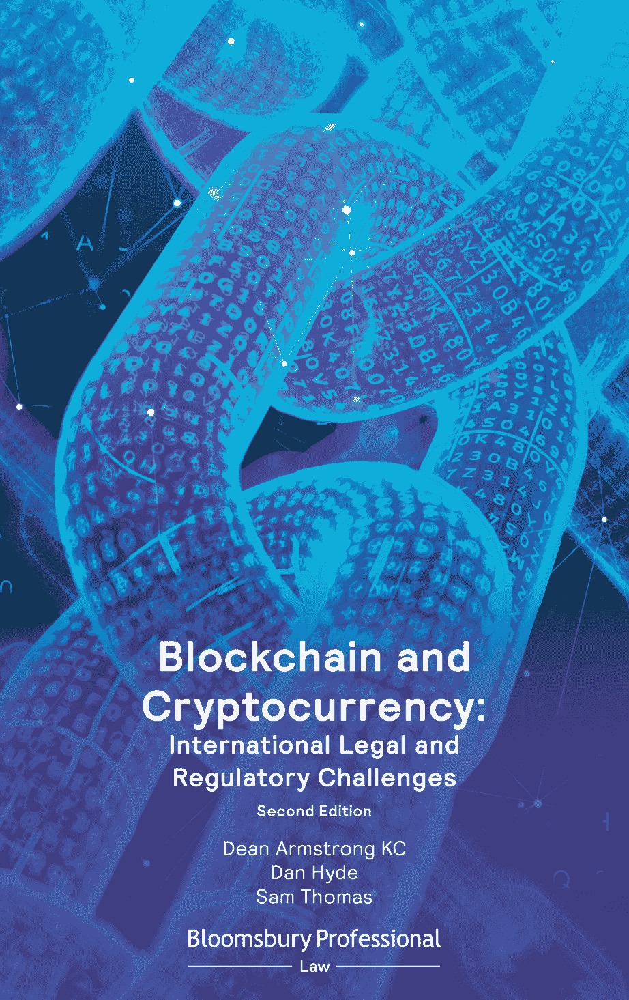

## 献词

本书献给我的儿子弗雷迪·阿姆斯特朗，他是我世界里一切美好的灵感来源。

同时也献给我的母亲梅尔勒、父亲保罗、姐姐保拉，以及奥利弗和安娜，他们的爱、帮助和支持无与伦比。

献给我美好的家人，尤其是我的父母特伦斯和雪莉·海德，感谢你们风雨无阻的坚定支持。

献给米娅·格蕾丝，我这世上最爱的人。

## 关于作者

### 迪恩·阿姆斯特朗 KC

迪恩是一位经验极为丰富的执业律师，参与了过去十年中一些最受关注的案件。迪恩领导着 36 Commercial 的网络团队，该团队隶属于 36 Group 大律师事务所。

迪恩是英国网络法领域的权威之一。作为该主题第一本综合性教科书的合著者，他曾为国际银行、大型金融机构、蓝筹公司以及非营利领域的主要参与者提供咨询。他是 GDPR（《通用数据保护条例》）、英国脱欧对数据监管的影响以及国际企业应如何在全球范围内管理数据等领域的专家。

他经常为 Sky 和 BBC 的电视及广播节目评论法律事务。他的其他著作包括*《网络诉讼：法律原则》*和*《网络风险与保险：法律原则》*。

在最新版的*《钱伯斯与合伙人》*中，迪恩在加密货币领域位列第一梯队。

他拥有伦敦金融城背景，曾受雇于蓝筹公司和大型城市律师事务所，并就并购、董事及股东权利与义务提供咨询，还为一家大型跨国公司建立了监管制度。金融城咨询经验与高水平辩护能力的结合，使他非常适合主导备受关注的争议性和非争议性事务。

### 丹·海德教授

丹写作、执业并教授创新法律。作为新兴技术相关法律的先驱，他是一位领先的网络法律师，是国际律师事务所 Harrison Clark Rickerbys 的合伙人，伦敦大学玛丽皇后学院客座法学教授，剑桥大学嘉治商学院网络教练导师，以及霍默顿学院 Changemakers 项目的导师。他撰写/合著了关于网络、数据、区块链和加密货币监管的首批著作，并且是科技与金融监管领域的专家。

丹曾在世界各地发表演讲，他的评论也在国内和国际电视及广播中播出。他对创业精神以及帮助创新企业实现目标抱有浓厚兴趣。

### 萨姆·托马斯

萨姆·托马斯在网络法律与监管的各个方面都有著述和咨询经验，从在线环境中的管辖权问题到政府对加密货币和首次代币发行的监管。在 2011 年取得大律师资格之前，萨姆曾在金融行业工作，担任指数、大宗商品和国债的经纪人。因此，萨姆以其扎实的法律分析带来了切实的见解。

## 缩写列表

| Abbreviation | Meaning |
| --- | --- |
| AIF | alternative investment fund |
| AIFM | alternative investment fund manager |
| AIFMD | Alternative Investment Fund Managers Directive |
| AML | anti-money laundering |
| BYOD | bring your own device |
| CDD | customer due diligence |
| CEA | Commodity Exchange Act |
| CFD | contract for differences |
| CFTC | Commodity Futures Trading Commission |
| CIS | collective investment scheme |
| CJEU | Court of Justice of the European Union |
| DAO | decentralised autonomous organisation |
| DDoS | distributed denial-of-service |
| DLT | distributed ledger technology |
| DPA | Data Protection Act 2018 |
| DPIA | data protection impact assessment |
| DPO | data protection officer |
| DSP | digital service provider |
| EMIR | European Market Infrastructure Regulation |
| ENISA | EU Agency for Network and Information Security |
| ESMA | European Securities and Markets Authority |
| EWF | Energy Web Foundation |
| FCA | Financial Conduct Authority |
| FDA | Food and Drug Administration |
| FSMA | Financial Services and Markets Act 2000 |
| FT | Fungible Token |
| FTC | Federal Trade Commission |
| GDPR | General Data Protection Regulation |
| ICO | initial coin offering OR Information Commissioner’s Office |
| ICT | information communications technology |
| IoT | Internet of Things |
| MiFID | Markets in Financial Instruments Directive |
| MiFIR | Regulation on markets in financial instruments |
| MLAT | Mutual Legal Assistance Treaty |
| MLD4 | Fourth Anti-Money Laundering Directive |
| NFT | Non Fungible Token |
| NISD | Network Infrastructure Security Directive |
| OES | operator of essential services |
| OTC | over-the-counter |
| P2P | peer-to-peer |
| PEP | politically exposed person |
| PoA | proof of authority |
| PoS | proof of stake |
| PoW | proof of work |
| RAO | FSMA (Regulated Activities) Order 2001 |
| SEC | Securities and Exchange Commission |

## 第 1 章

#### 引言

**1.1** 欢迎阅读《区块链与加密货币：国际法律与监管挑战》第二版。当我们撰写如今被称为第一版的原著时，完全不确定是否会有续作；我们可以设想区块链和分布式账本技术有着强劲的未来，但加密货币在多个国家面临禁令，其未来的成功并非必然。然而，当我们审视2022年初的加密货币（或有些人偏好称之为加密资产）时，有人可能会认为其增长势头不亚于甚至比区块链更为迅猛。确实，我的合著者指出，倘若我们今天撰写第一版，关于书名顺序应为《加密货币与区块链》而非反之，将会有健康的讨论。然而，书名仍忠实于原版，我们的基本理念也是如此，即本书应尽可能通俗易懂。尽管此次更多读者可能对区块链和加密货币更为熟悉，但我们仍力求为那些需要了解基础知识的读者提供便利。我们再次引用阿尔伯特·爱因斯坦的观察：‘如果你无法向一个六岁孩子解释清楚，那你自己也不理解。’我们致力于阐明区块链、加密货币及这些话题所代表的新思维，同时始终牢记应以任何人（包括六岁孩子）都能理解的方式进行解释。在我们看来，过多的书籍和文章以令人困惑而非启发的方式讨论新兴技术，我们希望第二版在思想创新与解释清晰之间取得恰当平衡。出于必要，本版比原版更长。现共十二章，包含必要的附加内容，涵盖对各种同质化和非同质化加密资产的分析、补救与追踪策略，以及一整章关于元宇宙的内容。除此之外，我们还对全书进行了更新和扩充，以确保其与时俱进。

**1.2** 我们正进入被称为第四次工业革命或第二机器时代的时期。第三次工业革命和第一机器时代可以说始于20世纪50年代，随着数字化和技术进步的到来，这些进步意义重大且相辅相成，从根本上重塑了此前的世界。该技术进步迅速延续至第四次工业革命，以至于数字化和计算水平开启了全球无国界的互联互通，并在人工智能、机器人技术、量子计算、物联网以及通过分布式账本技术实现的去中心化共识等新兴技术领域取得了突破。有观点认为，这个新的第二机器时代正见证着一个既能助益也可能损害人类的技术时代，其中人工智能有能力取代

**1.5** 这种程度的互联互通将为生活和健康带来巨大的益处和进步，但也会通过为犯罪黑客利用而创建扩大的攻击面来产生风险，有可能控制整个住宅或车队。正是设备之间的这种互联互通创造了扩大的攻击面，这将使黑客能够发现整个链条中的潜在接入点和薄弱环节。扩大的攻击面同样会促进勒索软件在多个系统和互联设备上的恶意分发。物联网将因此带来既有重大收益又有重大痛苦，当网络犯罪分子跨越国家或州界而对传统物理边界视而不见时，还会涉及管辖权问题。

### 物联网

**1.6** 物联网内容见 **第 8 章**，我们的考察包括对物联网（“IoT”）实际是什么、围绕它的安全问题、如何缓解这些问题，以及谁拥有数据和可能适用的监管的说明。物联网是一组能够交换数据的物理设备网络。在最基本的层面上，物联网设备允许对先前“哑”设备进行远程监控或控制，例如使用手机开关家里的灯。物联网设备还可能包含可编程以检测数据输入的传感器，无论是物理移动、大气状况还是生物识别信息。如今几乎每个家庭都有燃气表或电表，其物联网版本是“智能电表”，其设计目的在于收集数据以更高效地分配燃气和电力。这只是我们家庭中物联网传感器设备的一个例子；一整套日常设备现在都配备了传感器。这些传感器可以连接到各种设备，例如手机应用或计算机，以测量心率、体重指数、体脂率，或佩戴在手腕或脚踝上以测量步行距离的步数，并提供大量指标和反馈。在未来几年中，从家庭到汽车再到酒店，人类居住的所有区域之间将实现更强的连接，从而创造一个庞大的互联网络。物联网将是一个全新的领域，可以利用物联网设备互联互通所固有的优势。关于未来会有什么，有很多预测。估计到2025年，300亿物联网设备中可能包含超过2000亿个连接传感器，到那时物联网的市场价值将达到数万亿英镑。益处广受讨论。它们包括医疗保健的改善，医疗应用可用于安排从最初的医院预约到以目前依赖员工和系统分离所无法实现的快速远程方式更有效地提供医疗和其他健康服务的方方面面。物联网无疑可以带来巨大的益处，但这种对积极方面的关注往往忽视或淡化了智慧城市的危险。

### 1.7 引言

**1.7** 物联网（IoT）的一个关键问题领域将是其安全性以及如何进行适当监管。正是设备之间的互联互通创造了扩大的攻击面，这将使黑客能够发现整个链条中的潜在接入点和薄弱环节。如果考虑物联网设备的本质，人们会意识到它们被设计为使用方便，并且通常能够无线轻松地携带。这意味着设备会有物理限制，并且通常必须相对较小和轻便。这会产生安全弱点的潜力；有效安全所需的处理能力在小型物联网设备中使用微处理器时通常并非最优。简单来说，目前还没有足够的计算能力来同时完成所需的物联网任务，并通过加密为设备提供网络安全。事实上，制造设备的人可能几乎没有动力将网络安全作为优先事项，至少因为采用适当的安全措施可能会带来额外成本。还有适当审查将安装或维护设备的第三方的问题，因为第三方安装或维护将带来进一步的网络安全风险。简而言之，物联网创造的巨大攻击面为黑客提供了机会，不仅可以发现整个链条中的接入点，而且可以通过访问来控制大量互联设备，以至于网络攻击可能导致攻击者控制家庭的互联内容、汽车等等。

**1.8** 这引出了另一个严肃的问题——通过物联网收集的数据归谁所有？在我们的场景中，黑客是否能够在未经所有者/用户同意的情况下将数据出售给第三方？数据所有权还有其他不祥的含义，例如，当国家声称拥有所有权或以其他方式获得其公民物联网设备的访问权限时，每个人都将通过其生活中每一个物联网设备而处于持续监控之下。这无疑会导致国家有能力成功起诉任何它想起诉的人，或对个人的每一个行为进行微观监控。我们知道大数据可能会产生重大后果。例如，看看围绕剑桥分析公司（Cambridge Analytica）的辩论，然而在未来的智慧城市中，国家对物联网设备的访问无疑会导致大数据可用于分析每个公民的生活。那么，我们能否以这种方式进行监管以保护自己？此外，刑法能否跟上智慧城市犯罪可能带来的不断演变的威胁和累积伤害？第 8 章还探讨了物联网的当前监管以及未来的监管挑战。

### 区块链

**1.9** 区块链是一种分布式账本技术，并且远远是最知名的一种。分布式账本技术（“DLT”）是一种使记录能够以分布式和去中心化的方式共享和更新的技术。参与者可以安全地提议、验证和记录对同步账本（一种数据库形式）的更新，该账本分布在……例如，当商业模式创建代表所有权或权利或创建记录或权益的代币（加密资产）时，必须确定这些代币可能属于哪个类别或法律定义，以及它们是否因此受到监管。安全代币将被视为特定的受监管投资，而交易代币或实用代币可能不是。另一个例子是，当区块链用例创建期货或其他受监管的指定投资作为代币时。虽然在这些情况下是加密资产受到监管的约束，但底层的区块链是商业模式的引擎和推动者。出于这个原因，读者应当注意，本书中涉及加密货币及其监管的部分对于理解区块链的地位也至关重要；因此，第 3 章以及对加密资产的监管处理对于理解哪些区块链用例可能受到监管非常重要。

### 1.13 引言

**1.13** 正如标题所示，区块链是本书的核心，并在全书中进行了详细阐述。作者希望在澄清什么是区块链和 DLT 以及其运作方式方面注入一些一致性。在第 2 章中，作者对 DLT 进行了解释，探讨了私有 DLT 和公有 DLT 之间的差异，考察了区块链如何应用于加密货币，并思考“货币”是否是比特币和以太坊等资产的最佳定义。与 2018 年《一般数据保护条例》（GDPR）的紧张关系也得到了审查，同时还审查了区块链对知识产权法以及 1988 年《版权、设计和专利法》的影响。

### 加密货币

**1.14** “加密资产是一种使用密码学保护的价值或合同权利的数字表示，它使用某种类型的 DLT，并可以电子方式转移、存储或交易。”³ 由加密资产特别工作组报告采用的这一相当宽泛的定义，让人了解加密资产的多种类型，以及为什么对某些人来说，加密资产一词比加密货币更受青睐；加密货币看起来范围更窄，更有可能引发一种解释，即其使用取决于支付或等同于货币。当然，有许多不同类型的加密资产，包括各种加密货币，从最著名的比特币到根据 Coinmarketcap.com 的另一种 15,000 种品种（截至 2021 年 12 月 14 日）。除此之外，还有几十种稳定币，它们的价值来源于外部资产，无论是法定货币（如美元 USD）、商品（如黄金），还是由另一种加密资产或算法支持。虽然它们可能被称为稳定币并与之挂钩以降低波动性，但其稳定性或可预测性并不完美，并且由于真实支持或详细信息具有误导性，它们一直受到监管机构的关注。例如，Tether 曾是监管机构关注的焦点，并在 2021 年 2 月与纽约总检察长达成 1850 万美元的和解，此前的一项调查指控称，在某些时期该公司无法访问世界上任何银行账户，并且与 Bitfinex 一起掩盖了巨额损失。

³ 加密资产特别工作组报告（2018 年 10 月），https://assets.publishing.service.gov.uk/government/uploads/system/uploads/attachment_data/file/752070/cryptoassets_taskforce_final_report_final_web.pdf。参见附录 2。同上，第 2.10 段。

### 1.15

第 2 章向读者介绍了什么是加密货币及其底层技术区块链。加密货币被解释为一种旨在作为交换媒介的数字或虚拟货币。为了实现这一目标，它使用密码学来保护和验证交易，并控制特定加密货币新单位的创建。本质上，加密货币是数据库中的有限条目，除非满足特定条件，否则无人更改。

### 1.16

比特币，即人们最熟悉的加密货币，通过七个简单的步骤进行拆解和解释：

- 1. 一个比特币（฿）是价值约 26,105.73 英镑的货币单位。比特币的小面额包括毫比特币（mBTC）和聪（sat）。一个毫比特币是比特币的 1,000 分之一（0.001 或约 4.13 英镑），一个聪是比特币的 100,000,000 分之一（0.00000001）。

- 2. 所有比特币交易都记录在一个名为“比特币区块链”的公共账本上。比特币区块链不存储在单个服务器上，而是存储在通信节点网络上。交易的形式为：付款人 X 向收款人 Z 发送 Y 个比特币。

- 3. 区块链中的每笔交易都可以追溯到“创世区块”，该区块创建于 2009 年 1 月 13 日 18:15:05。创世区块是区块编号 0。

- 4. 一个比特币由一串数字签名组成，这些签名由指向创世区块（0）的交易构成。要转移比特币，收款人 X 将一个“哈希”（他们持有的现有签名链）连同自己的（X 的）签名（私钥）发送回给收款人 Z 的公钥。此交易随后成为新哈希。当发生新交易时，收款人 Z 使用其私钥对这个新哈希进行签名。

- 5. 所有新交易都会加时间戳并广播到网络节点。网络节点将交易分组到一个“区块”中，并通过工作量证明（“PoW”）寻求验证交易。

- 6. 每 10 分钟，一个节点会找到一个 PoW 并将区块广播到其他网络节点。如果包含的交易有效且未被重复花费，则区块被接受。如果付款人 X 已将其哈希发送给另一个收款人（而不是收款人 Z），则节点将拒绝该区块。

- 7. 被接受的区块被添加到区块链中。节点的接受是通过使用前一个区块作为新哈希来实现的，所有新交易将基于该哈希进行。这个验证和创建区块的过程称为“比特币挖矿”，并防止比特币重复花费。比特币挖矿过程为矿工生成奖励，矿工以新创建的比特币获得报酬。

### *引言*

**1.17** 第二版新增了**第2章**的内容，旨在阐明“拉高抛售”计划的潜在风险，并审视Meta（前身为Facebook）的Libra Coin为何失败。

**1.18** **第3章**随后探讨了加密资产如何受到监管、其法律地位以及当前和未来的挑战；从许多方面来看，这是本书的核心，也是那些对监管方法感兴趣的人的必读内容。所涵盖的主题多种多样，包括加密资产的不同类别，这些类别大致可分为交易型代币、证券型代币或实用型代币，并取决于分类而适用相应的监管待遇。本章还讨论了法律挑战，这些法律问题源于广泛的法律领域，从刑事到网络安全，从数据保护到财产，从合同到管辖权。其中包含对近期判例法的评述，例如 *AA v Persons Unknown* [2020] 4 WLR 35，这是一个重要案件，在该案中，保险公司获得了财产禁令，作为其追回以比特币协商并支付的勒索软件赎金策略的一部分。

**1.19** 需要谨慎指出的是，在任何特定用例的背景下，许多问题都将根据具体情况进行裁决，监管关注不仅应投向区块链和加密货币，还应关注业务中所有可能触及监管的环节。一个典型的例子是英国的金融推广，任何鼓励或诱导投资或索赔管理活动的广告或营销都可能受到监管。由此可见，即使包含区块链或加密资产的商业模式表面上运营方式不受监管，也可能因其营销方式而进入监管范围。

**1.20** **第3章**还讨论了法律挑战，这些法律问题源于广泛的法律领域，从刑事到网络安全，从数据保护到财产，从合同到管辖权。其中包含对近期判例法的评论，例如上文提到的 *AA v Persons Unknown*。

**1.21** 加密货币备受关注的犯罪方面以及区块链未来的警务监管尤为重要，值得关注。首先应理解，从犯罪执法的角度来看，区块链既有优势也有劣势。对于执法而言，不利之处在于，由于其本身性质和构造，区块链将中介机构（如银行和金融机构）排除在循环之外。

**1.22** 加密货币是在基于点对点运作的区块链平台上开发的，直接从发送方将加密支付发送给受益人。这种直接传输方式意味着银行不参与其中。端到端加密意味着交易双方以及交易本身可能对外人隐藏且不可见。试图识别交易或交易方的警察、债权人或其他方无法向银行或其他金融实体请求或强制获取信息，因为它们并不持有此类信息。对于警方而言，这些传统的金融调查途径将不复存在。

#### 1.23 警方将如何识别非公开区块链上的参与者？

如果没有可见的目标，他们就无法根据《2000年调查权力规制法》使用网络调查工具，例如第49条通知，该通知允许他们发出通知，强制个人披露信息（如密码或加密密钥），否则将面临监禁。其他工具，如法院藐视法庭令，通常最适用于当事方已被识别并被命令采取行动（如披露）或面临监禁的情况。然而，即使当事方可以被识别，如果决定隐藏加密资产，宁愿选择利益而非惩罚，这些权力也会产生有限的效果。

**1.24** 被称为Norwich Pharmacal命令[^4]的普通法救济和禁令救济都能够要求第三方披露信息，如果能识别出具有相关知识的第三方，可能会有所帮助，但这是一个很高的门槛。此外，加密技术的进步以及保护匿名或伪造身份的手段可能会使区块链更难治理和监管，尤其是当存在一致的匿名意图时。然而，对于所有这些，都有强有力的反对论点。

**1.25** 首先，洗钱并非新鲜事物，并且已经在许多司法管辖区十分猖獗，而这使用法定货币（即真实货币）即可实现。历史上，洗钱者和犯罪分子利用离岸银行系统和银行制度，使犯罪所得无法追踪，或登记在掩盖真实所有权的信托或实体名下。这是一场仍在进行中的战斗，可以说已经失败了。

**1.26** 区块链将带来新的问题，但在整个历史中，法律及其执行一直在演变以应对新的挑战。移动通信设备和互联网的出现也引起了类似的动荡，因为执法部门难以将手机和IP地址与用户匹配。跨越国界的匿名通信和犯罪行为并不新鲜。警方和法院一直在创新以跟上步伐。

**1.27** 其次，区块链具有一个源于其交易不可变性的优势：由于没有中心化权力，因此存在一种固有的、内在的诚实性；这意味着在实践中，欺诈和欺骗的机会得以减少。由于公共区块链[^5]为每一笔交易创建了不可变的审计轨迹，只要能够识别交易方，就会相应地存在一条资金轨迹，这与鼓励洗钱者恰恰相反。如果能获得某个加密货币地址，那么区块链就能追踪链上每一笔交易，直至第一笔交易。该地址一直跟随用户；如果你能识别他或她，那么你就能识别他们使用该地址时参与的所有交易。

**1.28** 此外，无论当事方是匿名还是可见，警方很可能能够在犯罪分子试图将法定货币转换为加密货币，以及将加密货币转换回法定货币的节点进行调查。这些上下车点为警方提供了传统的调查机会。本质上，重点是追踪加密货币离开交易所时的流动，反之亦然。英国和世界各地的警方和调查机构正在开发软件和系统，以收集和共享区块链情报。区块链的无国界特性实际上提供了一个优势，因为来自不同司法管辖区的警方在任何区块链调查中都不需要请求外国执法人员的协助（称为“司法互助条约”或“MLAT”），因为区块链内部没有边界。MLAT根本不需要。一旦执法部门能够访问区块链，就没有第三方或外国政府来阻碍调查。

### 智能合约

**1.29** 智能合约最好解释为一种自动执行的计算机代码。它由一组预定义的规则组成，这些规则自动执行合同条款。当X发生时，Y随后自动发生，无需当事方采取任何进一步行动。这种自动化水平可以具有独特的用例和优势。例如，智能合约在应用自动执行代码时，是区块链通过消除人为思维的参与并自动化协议执行来减少欺诈机会的另一种手段。

**1.30** 然而，智能合约也会带来风险，并且通常至少需要某种程度的人工干预；智能合约是由人类创造的，如果假设它们纯粹是自主的或者设计上可靠且公平，则存在危险。这些智能合约在**第3章**中进行了说明，并在**第11章**中在去中心化自治组织（“DAO”）的背景下进行了更详细的探讨。这是因为DAO本质上是智能合约的组合，或者如果你愿意，可以称之为超级智能合约。可以说，DAO以智能合约（一段代码）的形式呈现，在日益不透明的分布式网络和共识技术堆栈（如以太坊区块链或类似区块链）之上执行。

### 去中心化自治组织

**1.31** DAO是一种没有管理者或领导者的计算机程序。它涉及用户，并在点对点网络上运行。点对点网络意味着

[^4]: 参见Bushell, Simon和Milner-Moore, Gary所著《信息披露：Norwich Pharmacal及相关原则》（第二版，Bloomsbury Professional出版社，2019年）。

[^5]: 关于区块链类型的解释，请参阅第3章。

### 1.37 *介绍*

**1.37** 在 **第 11 章** 中，我们对比和分析去中心化组织与 DAO，并解释关键区别在于 DAO 是真正自主的，即人类参与的需求被完全消除。去中心化组织和 DAO 都可能包含智能合约，但去中心化组织仍需要一定程度的人类干预；然而，DAO 是无需人类操作员的，完全在其代码上运行。作者还审查了 DAO 的法律地位以及由此产生的问题，以及 IoT 和智慧城市扩张带来的日益增长的挑战。简而言之，随着 IoT 的发展和扩张，风险也将随之增加，因为智能合约和完全自主技术将控制我们互联的智慧城市环境中的一系列有形和无形资产。

### 全球监管

**1.38** 区块链的国际、无国界性质意味着，在我们看来，任何仅通过本地国内视角来审视它的书籍都辜负了其读者。此外，各国和各州之间对区块链和加密货币的法规及接受程度差异巨大，因此应逐一审视每个国家和州。这种方法对于那些服务和活动跨越世界各地的企业家、企业和组织尤其适用。在一个互联的世界里，越来越难以对那些可能阻碍在一个国家或地区开始但可被其他司法管辖区访问的活动的法规视而不见。

**1.39** 为读者提供全球视角的进一步优势在于，它能更好地做出明智的司法管辖区选择，从而决定哪些国家提供更好的地点可能性。考虑到这一点，我们再次为英国和欧盟（**第 4 章**）、北美（**第 5 章**）和世界其他地区（**第 6 章**）提供了单独的区域章节。每个章节都包含该地区内各国（以及美国各州）的逐国（以及逐州）法规和挑战讨论。我们确定了领先者，并解释了为什么这些司法管辖区为加密货币和区块链企业提供了明确的优势。

**1.40** 应当理解，在审视一个司法管辖区的潜力时，可能存在其他考虑因素以及应影响决策的当地法律或习俗；作者始终建议在任何考虑的地点寻求当地律师和现场专家顾问的建议，以确保其适合预定目的。

### 首次代币发行

**1.41** **第 7 章** 专注于首次代币发行（“ICOs”）的使用，这是一个产生大量争议的领域。2018 年 1 月至 6 月间，全球通过 ICOs 筹集了 70 亿美元，然而不到一半的 ICOs 在发行后存活超过四个月。^6^ 而 2017 年出售的近一半 ICOs 在 2018 年 2 月前失败。^7^ 围绕 ICOs 的担忧源于其作为欺诈工具的使用历史，因此我们解释其监管，并审查它们是否，从一种观点来看，是远离结构化融资筹集资本的巧妙新方法，或者，从另一种观点来看，是从天真的投机者那里敲诈钱财的方法。

**1.42** ICO 本质上是使用加密货币的众筹。虽然传统上是公开发行（众筹），但私人 ICOs 变得越来越常见，尤其是当科技企业寻求筹集资金时。在 ICO 中，“代币”或硬币（从技术上讲也是加密货币）被出售给投机者或投资者，以换取法定货币或其他加密货币，如比特币或以太坊。出售的代币被宣传为如果或当 ICO 的资金目标达成且项目启动时的未来功能性货币单位。在某些情况下，代币是使用系统所必需的，或者可能赋予持有者投票权，这些投票权可用于确定资金投入的项目。

**1.43** 我们审查了美国、欧盟和中国对 ICOs 的监管，并将其与英国的做法进行比较。在英国，存在真正的危险，即 ICO 可能被归类为受监管活动，如果没有金融行为监管局的授权，可能构成刑事犯罪的实施。潜在的触发点和可能落入监管范围的活动已详细列出。

**1.44** 需要了解美国的立场，因为这种理解在欣赏英国和欧盟对 ICOs 的处理时很有用。在美国，ICOs 或代币销售可能被视为“投资合同”，这将根据《证券法》第 2(a)(1) 节和《交易所法》第 3(a)(10) 节被视为证券。^8^ 重要的是，SEC 强调，如果 ICO 被视为投资合同，美国联邦证券法将适用于 ICO。这的影响是，除非适用某些豁免，否则需要根据《证券法》的规定进行注册和披露。这一主题

### **1.45** *介绍*

ICO 是否为受监管证券或投资，在英国也同样适用，其中，特别是，如果 ICO 可被视为集合投资计划或另类投资基金，则将受到监管。

*第 7 章* 指导读者了解可能陷害不知情者的潜在监管陷阱，这些人希望在这些主要司法管辖区之一启动或参与 ICO。

6. Kharif, Olga, ‘代币销售完成后一半的 ICO 在四个月内夭折’, Bloomberg, 9 July 2018: www.bloomberg.com/news/articles/2018-07-09/half-of-icos-die-within-four-months-after-token-sales-finalized (last accessed 13 May 2022).
7. Hankin, Aaron, ‘近一半的 2017 年 ICO 已失败’, Fortune, 26 February 2018: www.marketwatch.com/story/nearly-half-of-all-2017-icos-have-failed-2018-02-26 (last accessed 13 March 2022).
8. 投资合同是将资金投入共同企业，并合理期望从他人的创业或管理努力中获得利润 – 参见：*SEC v W.J. Howey Co.*, 328 U.S. 293, 301 (1946)，第 299 页：投资合同的“试金石”是“存在一项投资，该投资基于对他人创业或管理努力所产生利润的合理预期，而投资于共同企业”。这一定义体现了一种“灵活而非静态的原则，能够适应那些以利润承诺寻求使用他人资金的人所设计的无数且多变的方案”。

### 自然资源行业

**1.45** 区块链技术很可能会对自然资源行业的几乎每个方面产生影响，而 **第 10 章** 专门研究其对自然资源的潜在影响。潜在的好处范围从天然气和石油开采时或电力生产时的实时数据登记，到点对点能源销售、去中介化和创建智能电网的可能性。这些好处通常，首先由能源网络基金会，归纳为以下标题：

- 去碳化；
- 去中心化；
- 数字化；和
- 民主化。^9^

**1.46** 这四个互相关联的类别通常被定义为区块链在自然资源行业实施的长期目标，我们讨论了可能性以及帮助解决世界自然资源问题所需的监管。这些问题通常归纳为“三难困境”，包括：

- 安全，考虑到世界资源有限；
- 去碳化；和
- 可负担性。

乌克兰战争使这些担忧变得尤为突出，特别是对廉价石油和天然气的需求。**第 10 章** 通过区块链视角审视这一立场，并考虑其应用是否能够解决或缓解围绕我们能源和自然资源需求的担忧。

^9^ Basden, James 和 Cottrell, Michael, ‘公用事业如何使用区块链来现代化电网’, (2017) 23 *哈佛商业评论*. https://hbr.org/2017/03/how-utilities-are-using-blockchain-to-modernize-the-grid (last accessed 13 March 2022).

### 一般数据保护条例

**1.47** 最后，任何涉及2018年5月25日后法规的书籍，如果不提及一般数据保护条例（“GDPR”——参见**附录1**），都不能被认为是完整的。在那一天，GDPR在整个欧洲（包括英国）生效，但影响了全球每一家处理欧洲公民个人信息的企业。企业（或个人数据）所在的位置无关紧要，关键在于该数据是欧洲人的个人数据。在争相合规的过程中，许多企业重组了存储系统并制定了新的组织政策，以确保这些数据的收集、处理、保留和擦除符合GDPR的原则；这意味着处理此类数据必须有合法依据，且不得保留超过必要期限，并在要求时（包括数据主体的请求）将其擦除。

**1.48** 很少有人意识到区块链如何符合GDPR，以及赋予个人的权利在区块链语境下是否能保持一致。**第9章**探讨了GDPR中确立的删除权和擦除权与为合规可能需要解决的实际困难之间的紧张关系。这种紧张关系源于GDPR中确立的被遗忘权和擦除或修正权，与分布式账本技术（DLT）和区块链的不可篡改性相冲突，而区块链的构成和运作与行使这些权利背道而驰。

**1.49** 第9章探讨了GDPR的条款何时生效、适用于哪些类型的数据，以及这些权利与区块链不可篡改性之间的冲突是否可以规避、治愈或减轻。任何收集、存储或处理个人数据并包含区块链或其他DLT的组织系统都应经过仔细审查，以确保其能够符合GDPR的要求。

### 元宇宙

**1.50** 第二版在**第12章**中包含了元宇宙。之所以包含，是因为区块链和加密资产对其运作至关重要且内在相关，作者认为这是一项不可忽视的发展。非同质化代币（“NFTs”）将在元宇宙中发挥特别关键的作用。它们将是实现和记录区块链上财产“销售”和交易的手段。我们解释了在元宇宙语境下使用NFT时的风险和法律挑战，并强调法律格言“买者自慎”；简而言之，虚拟财产不应与真实财产混淆，而围绕元宇宙中虚拟财产的法律框架，如用户协议或最终用户许可，可能使“所有权”不同于法律上的传统含义，并为“买家”创造危险的场景。此外，还存在一种常见的误解，即NFT和所获资产是同一回事；这种混淆将在NFT（位于区块链上）与其相关虚拟财产分离时暴露出来，例如，如果它被元宇宙平台所有者删除。

#### **1.52** *简介*

**1.52** 元宇宙也将受到众多法规和法律的约束，因为它由许多部分组成，并承诺实现其商业可能性。元宇宙中的商业将受到监管框架的约束，本章还详细说明了将被这些框架约束的各种行为和活动类型。元宇宙将在新颖的虚拟环境中涵盖广泛的商业和个人参与，因此我们随后审查了围绕金融科技、隐私和个人数据、知识产权、金融犯罪、网络安全、网络犯罪和网络空间的监管。就前瞻性扫描而言，我们审视了英国的《在线危害法案》及其对参与元宇宙的服务提供商的潜在影响。

**1.53** 本书最后探讨了由互联网凸显的管辖权难题，随着Web 3和元宇宙的到来，这一难题将变得更加复杂和紧迫。元宇宙将是一个沉浸式虚拟世界，关于哪些管辖权和法律可以被制定和执行的问题将对其成功至关重要。国家已经发现，法治是管辖权吸引力的核心，也是商业成功的主要因素；元宇宙能否充分向其“元公民”保证法治能提供保护？请继续阅读并自行判断。

**1.54** 我们希望第二版能够教育和告知读者，但最重要的是，我们希望它能引发关于全球金融危机的新[内容]，旨在解决双重支付问题。分布式账本技术（DLTs）的潜力或许尚未完全实现，有必要探讨其使用的法律后果。世界经济论坛于2015年进行了一项调查，发现受访者认为区块链的转折点最可能出现在2027年（WEF，2015）。考虑到区块链发明于2008年，已经存在十多年，看到其潜力可能要到2032年才能实现，这很有趣，原因在于其复杂性、缺乏理解以及公司内部可能无法与区块链集成或协同工作的旧系统。

**2.5** 在本章中，我们将解释分布式账本技术（DLTs），并探讨私有DLT和公共DLT之间的区别，其中区块链是最著名的。然后我们将探讨区块链如何应用于加密货币，并考虑“货币”是否是比特币和以太坊等资产的最佳定义。

#### 区块链如何工作？

**2.6** 分布式账本技术（DLTs）代表了技术基础设施和协议，允许在分布于多个地点的网络中以不可篡改的方式进行并发访问、验证和记录更新。所有DLTs都共享共同特征。存在数字账本，用于记录通常互不认识的两方之间的交易。它们通过连接的计算机参与点对点（“P2P”）网络。忠实于其去中心化的目标，网络在不依赖中介的情况下就哪些交易有效达成共识。

**2.7** 达成共识主要有三种方式：

- 1. 工作量证明（“PoW”）（比特币和以太坊的基础）；
- 2. 权益证明（“PoS”）；以及
- 3. 权威证明（“PoA”）。

**2.8** 比特币和以太坊使用工作量证明共识或验证，本章后面将更详细地讨论。交易会一起验证（通过称为“挖矿”的工作量证明机制）并添加到区块链中，从而创建区块链。区块通过密码学连接，这意味着一旦在区块之后向链中添加了另一个区块，它就无法被篡改或更改。交易详情是可见的；

然而，各方的身份由其用户名表示。这种组合是区块链的使用有利于怀有最善意和最恶意目的之人的原因之一。

**2.9** 链中的数据在很大程度上能够免受攻击，是因为密码学确保交易具有永久性且不可篡改。这正是区块链具有“不可变性”的原因，除非攻击者能够影响51%的参与者。区块链数据会被下载到参与网络的数千台计算机上。为了影响51%的参与者，需要极其强大的处理能力；然而，随着算法以及量子计算和后量子计算资源的进一步发展，这在理论上是可能实现的。能够影响网络51%的行为者可以重写之前的区块，或者通过重复交易进行“双重支付”。在大量服务器和处理器上持续更新新交易，也会产生显著的环境影响。运行比特币网络所需的电力，相当于爱尔兰所消耗的总能源。[^3]

**2.10** 权益证明验证要求行为者存入一定金额，可以是相关加密货币，也可以是等值的传统货币，以获得验证某个区块是否有效的资格。2013年，Nxt平台开始试验基于权益证明的共识机制，随后，Peercoin等其他第二代加密网络也开展了类似尝试，以此保护并验证区块链上的交易。顾名思义，希望在PoS网络上验证并生成区块的网络参与者，必须首先质押一定数量的资金。验证所带来的好处是，一旦新区块得到验证或创建，负责验证该区块的行为者就会通过赚取新的加密货币获得奖励。

**2.11** VeChain（以VET计价）是一种半去中心化的供应链管理解决方案，要求区块验证者（称为主节点）持有VeChain平台中的权益。要符合成为VeChain主节点候选人的资格，最低质押金额为2,500万VET（约合116,000美元）。用户也可以质押较低的金额，例如1,500万VET，同时仍能够履行某些网络管理职责。质押至少1,500万VET的节点，可以预期获得以VET代币计的固定5.81%投资回报。[^4]

**2.12** 权益证明网络属于“半”去中心化网络，而非完全去中心化网络，因为其仍然依赖受信任的第三方，尽管该第三方具有流动性且可以发生变化。在大多数PoS网络中，存款或质押的权益会被冻结，以阻止网络管理者从事不诚实行为。如果验证者试图在网络中引入欺诈性交易，那么除了其他权限外，他们还可能失去已质押的金额。PoS共识机制的支持者认为，这是管理去中心化加密货币平台更有效的方式。PoS系统所需的能源（电力）要少得多，因为能够并且需要验证区块的行为者更少。从理论上讲，PoS系统同样容易受到51%攻击。5 外部攻击对于PoS系统而言不那么严重；然而，这些网络更容易受到质押权益持有者不诚实行为的影响。

### 2.13 *什么是区块链和加密货币？*

**2.13** 在基于权威证明的网络中，交易和区块由经批准的账户进行验证，这些账户称为“验证者”。验证者运行软件，使其能够将交易放入区块中。该过程是自动化的，不要求验证者持续监控其计算机；但是，必须确保计算机（即权威节点）得到维护且未遭到入侵。因此，PoA模型适用于公有和私有区块链。6

**2.14** 验证者通过声誉获得担任该职位的激励，并且验证者会积极维护其职位。这被认为是对PoS的改进，因为在PoS中，两个行为者的质押权益可能相等，但他们在系统中的总体财务状况可能并不相等。然而，PoA只允许任一验证者批准非连续的区块，这意味着严重损害的风险集中于权威节点；一旦该节点遭到入侵，整个系统都可能受到破坏。

**2.15** 交易经网络验证后（无论采用PoW、PoS还是PoA），就会被记录到数字日志中。

**2.16** 区块链有两种类型：

- 1. 许可型或私有区块链；或
- 2. 无许可型，也称为公有区块链。

**2.17** 在后一种区块链中，可以限制交易的可见性和参与权限。大多数企业实体使用私有区块链。

**2.18** 如前所述，这种去中心化技术会在整个网络中保存匿名的交易记录，并将其复制到每一台使用该区块链的计算机上，因此使其几乎无法被攻破，并且安全性大幅提高。每个区块通常包含四项信息：

- 1. 前一个区块的哈希值；
- 2. 所包含交易的摘要；
- 3. 时间戳；以及
- 4. 确保该区块安全的验证方式（PoW、PoS或PoA）。

**2.19** 因此，PoW或PoS共识区块链很难被破坏，这是因为其不存在可供黑客利用的“集中式脆弱点”，并且每个区块都包含前一个区块的哈希值，使任何更改交易的尝试都“很容易被察觉”。其安全性甚至还维护了其创建者佐藤中本（Satoshi Nakamoto）的匿名性。⁷

**2.20** 每个区块链用户都有一个公钥，通常是一串字母和数字，以及一个私钥，实质上相当于密码。公钥和私钥的组合能够使个人身份为人所知，但私钥会对所持有的数据进行解密。如上文所述，在公有区块链中，任何人都可以使用相关软件与节点交互。这使得任何使用适当软件的人都能够读取数据。如果是私有区块链，则区块链运行在私有网络上，管理员会授予个人访问节点的权限。

**2.21** 关于遵守近期数据监管变化的问题，尤其是《通用数据保护条例》（“GDPR”）以及现在的英国GDPR，将在**第9章**中讨论；然而，需要特别强调的是，将去中心化账本的概念与针对传统中心化模式的条例相适应，其中存在一些固有挑战。例如，谁是数据控制者？在这一系统中，能否轻易确定数据控制者？例如，在私有区块链中，可能可以确定一名作为数据控制者的中心人物，但公有区块链则不存在这样的中心人物。在这种情况下，条例规定的义务应由谁承担？由每个节点承担吗？这是此类分布式账本技术（DLT）面临的一项重大挑战，而区块链正是其中最知名的一种。

### *区块链如何影响知识产权？*

**2.22** 区块链提供的信任是该技术固有的特性，并且可能会对知识产权犯罪产生影响。例如，《1988年版权、设计与专利法》规定，版权是一项知识产权，并且作为创作者，你可以阻止他人窃取或复制：

> “你的产品或品牌名称；你的发明；你的产品设计或外观；以及你撰写、制作或创作的内容。”

**2.23** 因此，不同类型作品的创作者有权控制其作品被使用的方式。由于区块链可以存储知识产权的所有权凭证，因此知识产权能够受到保护，个人也可以控制自己的内容。

[^3]: Faridi, Omar，*工作量证明（PoW）与权益证明（PoS）*，2019年3月4日，www.cryptocompare.com/coins/guides/proof-of-work-pow-vs-proof-of-stake（最后访问于2019年5月16日）。

[^4]: 同上。

5 如果单一行为者拥有工作量证明区块链51%的权益，他们就有可能以不诚实的方式操纵区块链。

6 Hose, Adam，*打造自己的权威证明以太坊联盟*，Enuma Technologies，https://blog.enuma.io/update/2017/08/29/proof-of-authority-ethereum-networks.html，2017年8月29日。

### 2.24 什么是区块链和加密货币？

#### 示例

Imogen Heap, the musician, uses the blockchain digital ledger to store information about artists’ songs and to facilitate trackable payments. This highlights the practical use of blockchain with regard to potentially stopping/reducing unauthorised downloading of music.
音乐家伊莫金·希普（Imogen Heap）使用区块链数字账本来存储艺术家歌曲的信息，并便于可追踪的支付。这突显了区块链在潜在防止/减少未经授权的音乐下载方面的实际应用。

2.24 The blockchain’s ability not only to store information but also to track assets and information makes intermediaries, such as banks, potentially redundant. However, as will be discussed below, the use of public blockchains in the financial world, has, in our view, too many regulatory challenges to be part of the culture going forward. It will, in a defeat for the purists, mean that private, permissioned blockchains will be in widespread use, thus requiring some form of central administration.
2.24 区块链不仅能够存储信息，还能追踪资产和信息，这使得银行等中介机构可能变得多余。然而，如下文所述，我们认为，公共区块链在金融领域的应用面临过多监管挑战，难以成为未来主流文化的一部分。这对纯粹主义者来说是一种失败，意味着私有许可型区块链将被广泛使用，从而需要某种形式的中央管理。

#### What is distributed ledger technology?
#### 什么是分布式账本技术？

2.25 Distributed ledger technology (‘DLT’) ‘is a type of technology that enables sharing and updating of records in a distributed and decentralised way. Participants can securely propose, validate and record updates to a synchronized ledger (a form of database), that is distributed across the participants’.
2.25 分布式账本技术（“DLT”）是一种能够以分布式和去中心化的方式共享和更新记录的技术。参与者可以安全地提议、验证和记录对同步账本（一种数据库形式）的更新，该账本分布在参与者之间。

2.26 ‘A DLT platform can be used like any conventional database that sets out who owns what, or who did what’, and it can store a huge range of data.
2.26 “DLT平台可以像任何传统数据库一样使用，用于界定谁拥有什么或谁做了什么”，并且它可以存储大量数据。

#### What is the difference between Blockchain and DLT?
#### 区块链与DLT有什么区别？

2.27 Essentially, Blockchain is a form of DLT. Blockchain uses a certain method of storing data in ‘blocks’, with each block being linked to another cryptographically. The Blockchain only allows data to be added to the existing chain and does not permit the alteration or deletion of previous ‘blocks’. Blockchain and DLT are often used interchangeably, but this is technically incorrect and, although many of the characteristics are the same (such as decentralisation and transparency of the recorded ledger to users), Blockchain is simply a type of DLT that has come to prominence through the increasing use of cryptocurrencies such as Bitcoin.
2.27 本质上，区块链是DLT的一种形式。区块链使用一种将数据存储在“区块”中的特定方法，每个区块通过加密方式与另一个区块相连。区块链只允许将数据添加到现有链中，不允许更改或删除之前的“区块”。区块链和DLT经常被混用，但这在技术上是不正确的，尽管许多特征是相同的（例如记录账本对用户的去中心化和透明度），区块链只是一种通过比特币等加密货币的日益使用而声名鹊起的DLT类型。

2.28 DLT does not take a particular form and there are many different types of platform. All types of DLT, though, share the same common features set out below.
2.28 DLT没有特定形式，存在多种不同类型的平台。然而，所有类型的DLT都共享下面列出的相同常见特征。

#### Characteristics of DLT
#### DLT的特征

2.29 DLT has these four common features:
2.29 DLT具有以下四个共同特征：

- 1. **Data distribution** – the participants in the ledger have a copy of the ledger and can access the data stored on it.
- 1. **数据分发** – 账本的参与者拥有账本副本，并可以访问存储在其中的数据。
- 2. **Decentralisation** – participants are allowed to update the ledger, subject to the extent of control and processes that have been agreed.
- 2. **去中心化** – 参与者可以更新账本，但需遵守已商定的控制范围和流程。
- 3. **Use of cryptography** – this is used to identify and authorise participants, as well as confirm data records and facilitate consensus.
- 3. **使用密码学** – 这用于识别和授权参与者，以及确认数据记录和促进共识。
- 4. **Programmability/automation** – code can automatically implement the terms of an agreement by triggering predetermined responses to certain actions. These are called ‘smart contracts’ and are discussed later in this chapter.
- 4. **可编程性/自动化** – 代码可以通过对某些操作触发预定义响应来自动实现协议条款。这些被称为“智能合约”，将在本章后面讨论。

**2.30** Although Blockchain has myriad practical uses, Blockchain, the most well-known DLT, is becoming synonymous with cryptocurrency, in particular Bitcoin. In order to better understand the use of Blockchain, it is helpful to understand its use within cryptocurrency and, more fundamentally, whether cryptocurrencies are, in fact, a ‘currency’ to be regulated.
**2.30** 虽然区块链有着众多实际用途，但作为最著名的DLT，区块链正变得与加密货币（尤其是比特币）同义。为了更好地理解区块链的用途，有必要了解其在加密货币中的应用，并从更根本的角度思考加密货币是否实际上是一种需要监管的“货币”。

### CRYPTOCURRENCY
### 加密货币

#### Introduction
#### 引言

**2.31** The international trade in US Dollars is approximately $5.3 trillion dollars per day, and the foreign exchange (Forex) market in terms of trading volume is four times the combined gross domestic product (GDP) of the entire world. To provide some context, spending one dollar ($1) every second, it would take you 31,688 years to spend a trillion dollars, and 126,118 years to spend the daily value of the Forex market.
**2.31** 美元的国际贸易每天约为5.3万亿美元，按交易量计算，外汇（Forex）市场的规模是全球国内生产总值（GDP）总和的四倍。为了提供一些背景，如果每秒花费1美元（$1），花费1万亿美元需要31,688年，花费外汇市场的日交易额需要126,118年。

**2.32** Although the trade in currency is big business, 85% of the global Forex market consists of trades in just seven pairs of currency. In many instances, these trades are speculative, potentially based upon market movements, Central Bank actions or perceived consumer confidence, but often simply guesswork.
**2.32** 虽然货币交易是一门大生意，但全球外汇市场中85%的交易仅涉及七种货币对。在许多情况下，这些交易具有投机性，可能基于市场走势、央行行动或消费者信心预期，但往往仅仅是猜测。

**2.33** What then is the potential for cryptocurrencies? Is the perceived value of Bitcoin merely a speculative bubble or is there intrinsic worth to cryptocurrency? This chapter seeks to assist by providing the legal and regulatory context in which cryptocurrencies are traded within this jurisdiction and abroad.
**2.33** 那么，加密货币的潜力是什么？比特币的感知价值仅仅是投机泡沫，还是加密货币具有内在价值？本章旨在通过提供本司法管辖区及国外加密货币交易的法律和监管背景来提供帮助。

#### *What is a currency?*
#### *什么是货币？*

**2.34** Before leaping into the legal and regulatory context, it is important to have an understanding of currency. It is arguable that cryptocurrencies are not, in fact, currencies; rather, that they are properly classified as commodities.
**2.34** 在深入法律和监管背景之前，了解货币很重要。可以认为，加密货币实际上并非货币，而是应被正确分类为商品。

**2.35** The following table provides six steps to understanding currency:
**2.35** 下表提供了理解货币的六个步骤：

#### SIX STEPS TO UNDERSTANDING CURRENCY
#### 理解货币的六个步骤

| No. | Question | Answer |
|---|---|---|
| 1. | What is a currency? | Currency, or money, is a medium of exchange. Although traditionally coins or banknotes, currency is now a system of money (monetary units) in common use within a nation or trading area. |
| 1. | 什么是货币？ | 货币或钱是一种交换媒介。虽然传统上是硬币或纸币，但货币现在是一个国家或贸易区域内普遍使用的货币体系（货币单位）。 |
| 2. | Why do we need a Central Bank? | A Central Bank guarantees the value of the currency within a system. |
| 2. | 为什么需要中央银行？ | 中央银行保证体系内货币的价值。 |
| 3. | What is the value of money? | Previously, Central Banks guaranteed the value of a coin or banknote against a weight in gold (The Gold Standard). Since 1971, when the United States left the Gold Standard, currencies have been valued against other currencies in a floating exchange rate. |
| 3. | 货币的价值是什么？ | 此前，中央银行以黄金重量（金本位制）保证硬币或纸币的价值。自1971年美国退出金本位制以来，货币一直在浮动汇率中相对于其他货币估值。 |
| 4. | What if a currency cannot be converted internationally? | When there are no restrictions on trading a nation’s money, the currency is considered to be fully convertible and the value can be easily determined against any other currency (think USD, EUR, GBP). When international investment into a country is controlled but domestic trade is freely permitted, this is called partially convertible. A conversion rate for individuals or companies can often be determined, but the true value of money may be maintained at a false level against other currencies. For example, special approval is required to convert Indian Rupees into certain currencies. When neither individuals nor companies are permitted to convert currencies, this is a non-convertible system (North Korean won). These countries will often artificially maintain the value of their currency. |
| 4. | 如果一种货币无法国际兑换怎么办？ | 当一个国家的货币交易没有限制时，该货币被视为完全可兑换，其价值可以相对于任何其他货币轻松确定（例如美元、欧元、英镑）。当对一个国家的国际投资受到控制但国内贸易被自由允许时，这称为部分可兑换。个人或公司的兑换汇率通常可以确定，但货币的真实价值可能被维持在相对于其他货币的虚假水平。例如，将印度卢比兑换成某些货币需要特别批准。当个人和公司都不允许兑换货币时，这是不可兑换体系（朝鲜元）。这些国家通常会人为维持其货币的价值。 |
| 5. | How do Central Banks control the value of money? | A Central Bank (or the Government which it represents) can use monetary policy to influence the value of money in comparison to other currencies. A Central Bank can raise interest rates (the cost of money) to encourage foreign money (capital) to enter into the system. This will raise the value of the national currency. Conversely, interest rates can be lowered to devalue a currency. |
| 5. | 中央银行如何控制货币价值？ | 中央银行（或其代表的政府）可以使用货币政策来影响货币相对于其他货币的价值。中央银行可以提高利率（资金成本）以鼓励外资（资本）进入体系。这将提高本国货币的价值。相反，可以降低利率来贬值货币。 |
| 6. | What about printing money? | Central Banks could physically print money to lower the interest rate. However, there is a delay and cost to physically printing notes or forging coins. In practical terms, Central Banks will buy government or other bonds (debt) to release money into the economy. |
| 6. | 印钞呢？ | 中央银行可以实物印钞来降低利率。然而，实物印制钞票或铸造硬币存在延迟和成本。从实际角度看，中央银行将购买政府或其他债券（债务）以向经济体释放资金。 |

2.36 Early virtual currencies created in the late 1990s, such as Flooz and Beenz, relied upon a company (Flooz.com and the ‘Bank of Beenz’) to guarantee
2.36 20世纪90年代末创建的早期虚拟货币，如Flooz和Beenz，依赖于一家公司（Flooz.com和“Beenz银行”）来担保

|  |  |
|---|---|
| 4. | A Bitcoin is composed of a chain of digital signatures formed of transactions leading back to the Genesis Block (0). To transfer a Bitcoin, Payee X sends a ‘hash’ (the existing chain of signatures in their possession) with their own (X’s) signature (private key) to Payee Z’s public key. This transaction then becomes the new hash. Payee Z signs this new hash with their private key when a new transaction takes place. |
| 4. | 比特币由一串数字签名组成，这些签名由交易构成，可追溯至创世区块（0）。要转移比特币，付款人X将其持有的现有签名链（“哈希”）连同其自身（X的）签名（私钥）发送给付款人Z的公钥。该交易随后成为新哈希。当发生新交易时，付款人Z使用其私钥对该新哈希进行签名。 |
| 4. | All new transactions are timestamped and broadcast to the network nodes. The network nodes group the transactions into a ‘Block’ and seek to validate the transaction through a proof of work (‘PoW’). |
| 4. | 所有新交易都会加上时间戳并广播到网络节点。网络节点将交易分组为一个“区块”，并通过工作量证明（“PoW”）来验证交易。 |
| 5. | Every 10 minutes, a node will find a PoW and will broadcast the Block to the other network nodes. The Block is accepted if the transactions contained are valid, and have not been double spent. If Payee X has sent their hash to another payee (other than Payee Z), the nodes will reject the block. |
| 5. | 每10分钟，一个节点会找到一个PoW，并将区块广播到其他网络节点。如果包含的交易有效且未被重复花费，则区块被接受。如果付款人X已将其哈希发送给另一个付款人（而非付款人Z），则节点将拒绝该区块。 |
| 6. | An accepted Block is added to the Blockchain. Acceptance by the nodes is through using the previous Block as the new hash, against which all new transactions will be conducted. This process of validating and creation of Blocks is ‘Bitcoin mining’, and prevents double spending of Bitcoin. The process of Bitcoin mining generates a reward for the miner, who is paid in newly created Bitcoin. |
| 6. | 被接受的区块被添加到区块链中。节点通过使用前一个区块作为新哈希来接受区块，所有新交易将以此为基础进行。这个验证和创建区块的过程称为“比特币挖矿”，并防止比特币重复花费。比特币挖矿过程为矿工生成奖励，矿工以新创建的比特币获得报酬。 |

2.41 On 31 October 2008, Satoshi Nakamoto, the creator of Bitcoin, released an essay titled ‘Bitcoin: A Peer-to-Peer Electronic Cash System’. He described within his essay a method for creating a decentralised currency, which did not rely upon a Central Bank or trusted third party.
2.41 2008年10月31日，比特币的创建者中本聪发表了一篇题为《比特币：一种点对点电子现金系统》的文章。他在文章中描述了一种创建去中心化货币的方法，该方法不依赖于中央银行或受信任的第三方。

2.42 The essay is a scholarly work, which provides the mathematical justification for decentralised cryptocurrency (Bitcoin), but it also provides a visual representation of Bitcoin transactions:⁹
2.42 这篇文章是一篇学术著作，为去中心化加密货币（比特币）提供了数学依据，但它也提供了比特币交易的可视化表示：⁹

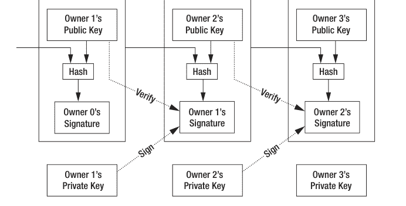

9 Nakamoto, Satoshi, ‘Bitcoin: A Peer-to-Peer Electronic Cash System’, 31 October 2008 (https://bitcoin.org/bitcoin.pdf), p.2.
9 中本聪，《比特币：一种点对点电子现金系统》，2008年10月31日（https://bitcoin.org/bitcoin.pdf），第2页。

### 2.52 什么是区块链和加密货币？

it) 作为未来交易完成的基准。完成交易最多的区块变成最长的区块，网络认为最长的区块链是正确的。

#### 加密货币是一种货币吗？

2.52 2017年9月，伦敦房地产开发商 The Collective 表示将允许其租户使用比特币支付押金，并很快接受加密货币租金支付。紧接着第二天，企业家 Baroness Michelle Mone OBE 表示，迪拜 Aston Plaza 开发项目内的房产可以使用比特币购买。然而，尽管有这些非常有限的例子，比特币并不用于购买商品。因此，可以说比特币未能成为一种货币，因为它不是一种“交换媒介”。

2.53 部分原因在于比特币的实际兑换和/或货币的波动性。实际上，在当地商店购买品脱牛奶可以克服；然而，使用波动性货币意味着，周一牛奶可能要 50 便士，而周二可能在 41.64 便士到 62.70 便士之间。这种波动性在单件低价商品上可能看起来微不足道，但当扩展到商业规模时，冒险使用比特币购买商品在经济上根本不可行。

#### NFTs

#### 什么是非同质化代币（NFT）？

2.54 可替代性（fungible）是一个术语（用于指未指定个别样品的合同商品），表示某物可以被另一个相同物品替换或相互互换。NFT 是区块链上的加密资产，具有独特的识别代码和元数据，用于区分彼此。与加密货币不同，它们不能以等值进行交易或交换。这与加密货币等可替代代币不同，后者彼此相同，因此可以用作商业交易的媒介。

#### 2.55 NFT 信息：

- NFT 是存在于区块链上的独特加密代币，无法被复制。
- NFT 可用于代表现实世界中的物品，如艺术品和房地产。
- 对这些现实世界的有形资产进行“代币化”，可以更高效地购买、出售和交易，同时降低欺诈概率。
- NFT 还可用于代表个人身份、产权等。

2.56 每个 NFT 的独特构造具有多种潜在用例。例如，它们是数字化代表房地产和艺术品等实物资产的理想载体。由于基于区块链，NFT 还可用于消除中介、连接艺术家与受众或用于身份管理。NFT 可以消除中介、简化交易并创造新市场。当前 NFT 市场大部分集中在收藏品上，例如数字艺术品、体育卡和稀有物品。

### 了解 NFT

2.57 与实物货币一样，加密货币是可替代的，即可以一对一进行交易或交换。例如，一个比特币的价值始终等于另一个比特币。同样，一个以太币始终等于另一个以太币。这种可替代性特征使加密货币适合在数字经济中用作安全的交易媒介。

2.58 NFT 通过使每个代币独特且不可替代，从而改变了加密范式，使得一个非同质化代币不可能等于另一个。它们是资产的数字表示，常被比作数字护照，因为每个代币都包含一个独特且不可转让的身份，以区别于其他代币。

2.59 与比特币一样，NFT 也包含所有权详情，以便代币持有者之间轻松识别和转让。所有者还可以在 NFT 中添加与资产相关的元数据或属性。例如，代表咖啡豆的代币可以分类为公平贸易，或者艺术家可以在元数据中用自己的签名签名其数字艺术品。

2.60 NFT 的价格取决于需求和个体含义，这意味着高估值的 NFT 可能在短时间内失去价值¹⁰。¹¹

### 拉高出货（Pump and Dump）骗局

2.61 在拉高出货骗局中，骗子通常散布虚假或误导信息，制造购买狂潮，从而“拉高”股票价格，然后在虚高价格出售自己的股票以“抛售”。一旦骗子抛售股票并停止炒作该股票，股价通常会下跌，投资者亏损。拉高出货是一种基于虚假、误导或严重夸大的陈述来推高股票或证券价格的非法骗局。拉高出货骗局通常针对微盘和小盘股。被判定运行拉高出货骗局的人将面临高额罚款。许多 NFT 和加密货币利用营销和有影响力的人围绕产品制造“炒作”，采用了拉高出货骗局。

10 https://twitter.com/Cryptoknss/status/1529564729001201665.
11 https://www.gate.io/blog_detail/643/NFT-S--THE-FUTURE-OF-THE-WORLD-OF-ART-OR-JUST-A-SPECULATIVE-BUBBLE-.

### 2.62 什么是区块链和加密货币？

#### 集中式与去中心化加密货币交易所

2.62 在集中式交易所中，币的所有权完全由交易所持有。然而，由于交易所持有密钥，交易执行更快，因为用户不需要提供密钥访问权限。然而，这可能成为加密货币欺诈的途径。

2.63 集中式交易所的运作方式类似于银行：

- 资产所有者。
- 已进行 KYB、KYC 以及身份/来源检查。
- 遵守交易所规则和法规。
- 获准进行交易。

2.64 与集中式交易所相关的风险包括：

- 容易被黑客攻击，导致资金损失。
- 整个交易所可能迅速消失。

2.65 虽然存在让你成为资产真正所有者的集中式交易所，但去中心化交易所的概念得到的认可要广泛得多。

2.66 去中心化交易所的运作方式如下：

- 代币所有者下单，以便将其资产与 DEX 上可用的另一种资产进行交换。代币所有者指定要出售的单位数量、代币成本以及允许对其资产出价的截止时间。
- 设置出售订单后，其他用户可以通过发出买入订单提交出价。
- 卖家设定的时间到期后，将审查所有出价，并由双方执行最高出价。

2.67 对外而言，作为下单用户：

- 使用自己的钱包地址登录区块链去中心化交易所。
- 可以提交买入或卖出请求。
- 智能合约执行，资产转移完成。
- 终止进一步交易。

随着这种流行度，许多初创公司有兴趣了解如何构建去中心化交易所，并利用这些信息制定白皮书以吸引投资。

### 为什么要构建去中心化交易所？

#### 2.68 需要考虑以下因素：

#### 费用

交易费用是大多数加密货币交易者关注的领域。在传统平台中，客户需要支付每笔交易费用，这与加密货币交易平台不同。

集中式交易所通常对每笔交易收取百分比费用，而白标去中心化交易所的运作方式类似于每笔交易费用。

#### 匿名性

去中心化交易所脚本通常没有中央机构。因此，不会对它们施加任何要求。可以在无需任何身份验证的情况下登录并开始交易。

此外，匿名性允许用户访问其他情况下不可用的工具。

或者，最大的去中心化交易所 dYdX 允许用户使用其服务！

#### 所有权

去中心化交易所比特币的另一个特点是个人对其资产的所有权。

#### 流动性

集中式交易所的主要弊端在于流动性因素。没有流动性，价格发现很难实现。

### 比特币是商品吗？

2.69 2014年12月10日，美国商品期货交易委员会（‘CFTC’）主席 Timothy Massad 声明，比特币属于《商品交易法》（‘CEA’）项下商品的定义范围：

> ‘虽然 CFTC 没有针对比特币等虚拟货币的特定政策和程序，但该机构的权限延伸至任何商品的期货和互换合约。《CEA》对“商品”一词定义非常广泛，因此除了传统的农产品、金属和能源外，CFTC 还监管与国库证券、利率指数、股票市场指数、货币、电力和供暖度日相关的衍生合约，仅举几例基础产品。
>
> 基于虚拟货币的衍生合约属于我们职责范围内的一个领域。例如，最近，一个向我们注册的 SEF 提供了此类合约。’

#### 2.70 *什么是区块链和加密货币？*

**2.70** 该声明表示，当虚拟货币用于衍生品合约，或涉及州际贸易中交易的虚拟货币存在欺诈或操纵行为时，美国商品期货交易委员会（CFTC）对其拥有管辖权。

**2.71** 2018年3月7日，美国地区法官杰克·温斯坦（Jack Weinstein）确认了这一立场，并裁定CFTC有权对纽约居民帕特里克·麦克唐纳（Patrick McDonnell）及其公司Coin Drop Markets提起欺诈诉讼。[^12]

**2.72** 然而，欧盟所采取的立场使美国CFTC的明确声明变得有些复杂。欧洲央行已将比特币和加密货币归类为可兑换的去中心化虚拟货币；但在2014年7月，欧洲银行管理局最初建议欧洲银行在法定监管制度到位之前不要交易虚拟货币。目前关于加密货币还没有具体的监管制度。

**2.73** 2015年10月22日，欧洲联盟法院（‘CJEC’）裁定：“传统货币兑换‘比特币’虚拟货币单位免征‘增值税’，并且‘成员国必须特别免除与“用作法定货币的货币、纸币和硬币”相关的交易’。”因此，CJEC的判决认为比特币是一种货币，而非商品。

**2.74** 加密货币究竟是货币还是商品，目前尚无定论，且可能随时间变化。重要的方面不在于学术上或历史上比特币是货币还是商品，而在于务实地看它能否用作交换媒介，以及在交易它的各个司法管辖区中如何受到监管。

#### *即使是科技巨头也有失手之时——天秤币（Libra Coin）的消亡*

**2.75** 2019年6月，Facebook宣布将推出一种新的加密货币——天秤币（Libra Coin），该币将由一条许可制区块链支持。Facebook希望于2020年推出这一货币，依托一个由100家公司组成的可信私有网络来负责发布交易，而无需独立的验证系统。天秤币预计将采用混合的权益证明（PoS）/权威证明（PoA）系统，并以银行存款和高级央行国债的组合作为完全储备。天秤币协会（Libra Association）是一个由28个成员组成的独立非营利组织，总部设在瑞士日内瓦，原本负责监督有关这种数字货币的重大决策。储备金将通过投资者产生，加入门槛为至少1000万美元的投资。非营利成员，例如普惠金融组织Kiva，可以在不投资的情况下加入这些可信公司。

[^12]: 美国消费者新闻与商业频道（CNBC），*虚拟货币是商品，美国法官裁定*，2018年3月7日，www.cnbc.com/2018/03/07/cryptocurrencies-like-bitcoin-are-commodities-us-judge-rules.html（最后访问日期：2022年5月16日）。

**2.76** 该计划声明的目标是推出一种新的全球货币，最终通过独立App在Facebook、Facebook Messenger和WhatsApp上购买商品和服务。据说该货币得到了Visa和MasterCard支付网络以及PayPal、Uber和eBay的支持。该计划的支持者表示，这种新‘币’不会创造任何新货币，但作为支撑的法定货币将充当储备，使这一数字对应货币能够在互联网上使用，从而降低交易服务成本。

**2.77** 企业此前曾发行过多种形式的币（例如摩根大通或JPM币就是一个例子），但天秤币似乎截然不同。天秤币的既定目标是产生一种全球货币——换句话说，用作交换媒介，而非投机商品。由于该货币由Facebook支持，并明显得到Visa、MasterCard和eBay的背书，这一加密货币将有能力在不大幅波动的情况下影响传统市场，并有效地用于日常交易。

**2.78** 批评者提出了一些忧虑，称数据可能会在各项服务之间共享。Facebook将通过Calibra成为可信公司的成员之一，Calibra是一家新成立的子公司，原本为天秤币提供数字钱包。个人和商户将能够使用Calibra存储、发送和接收天秤币，而Facebook可能会将Calibra内产生的这些数据用于自身目的。Facebook随后承诺不会使用Calibra数据来改进广告定向。

**2.79** 天秤币的支持者曾指出，这种新币的优势在于为在线商务开辟更多机会，为没有银行账户的人提供使用小额支付的空间，以及为数字内容付费带来相关好处。

**2.80** 然而，理解监管环境对于正确预测天秤币的失败至关重要。预计天秤币将在印度和中国被禁止，这将使全球三分之一的人口无法使用该货币。也许更重要的是，在天秤币宣布后，美国众议院金融服务委员会主席、共和党人玛克辛·沃特斯（Maxine Waters）要求Facebook停止开发这种加密货币：

> > “Facebook掌握着数十亿人的数据，并且一再表现出对保护并审慎使用这些数据的漠视。它还让美国人接触到来自恶意行为者的恶意和虚假账户，包括俄罗斯情报机构和跨国贩运者。Facebook还被处以巨额罚款，并因欺骗消费者、未能保护消费者数据隐私而处于联邦贸易委员会的同意令之下，此外还被政府起诉其广告平台违反公平住房法。
> >
> > 随着它宣布计划创建一种加密货币，Facebook正在继续其不受制约的扩张，并将其触角延伸到用户的生活中。加密货币市场缺乏明确的监管框架来为投资者、消费者和经济提供强有力的保护。监管机构应将此视为一个警钟，认真对待加密货币带来的隐私和国家安全问题、网络安全风险以及交易风险。鉴于

## 第3章

### 监管与法律挑战

### 监管挑战

### 加密资产

**3.1** 2018年10月发布的加密资产工作组报告[^1]阐述了它认为加密资产目前所面临的监管挑战以及未来将面临的挑战。加密资产通过区块链技术和更广泛的分布式账本技术（‘DLT’）进行使用、交易和存储：

> > “加密资产是一种使用某种DLT、可电子转让、存储或交易的加密安全数字表示或合同权利。”[^2]

**3.2** 最近，将加密资产确立为财产（2020年）以及法律委员会关于加密资产[^3]（2020年）和随后关于智能合约[^4]（2021年11月）的临时报告对此进行了补充。卷主法官杰弗里·沃斯爵士（Sir Geoffrey Vos）在（2019年11月）初次演讲[^5]中宣布成立一个法律科技（LawTech）交付小组，并表明英国司法管辖区欢迎并从法律上承认加密资产和智能合约。[^6] 他强有力的支持随后得到了（2022年1月）后来的演讲以及关于支持数字货币及蓬勃发展的‘非同质化代币’市场的技术法律和监管方面的更新指导[^7]的补充。

**3.3** 加密货币在商业交易和民事欺诈中的使用，日益要求法院考虑如何将这些纳入现有法律概念，或如何调整这些概念以适应这些新问题。[^8] 本章讨论了近期涉及不同加密货币问题的案例，思考这些案例告诉我们法院如何分析这些资产，并指出它们为未来案件提出的一些问题。

[^1]: 加密资产工作组报告（2018年10月），https://assets.publishing.service.gov.uk/government/uploads/system/uploads/attachment_data/file/752070/cryptoassets_taskforce_final_report_final_web.pdf。见**附录2**。
[^2]: 同上，第2.10段。
[^3]: https://www.lawcom.gov.uk/project/digital-assets/。
[^4]: https://www.lawcom.gov.uk/project/smart-contracts/。
[^5]: https://www.judiciary.uk/wp-content/uploads/2019/11/LegalStatementLaunch.GV_-2-1.pdf。
[^6]: https://35z8e3m1ih83drye28009d1-wpengine.netdna-ssl.com/wp-content/uploads/2019/11/6.6056_JO_Cryptocurrencies_Statement_FINAL_WEB_111119-1.pdf。
[^7]: https://prdsitecore93.azureedge.net/-/media/files/topics/research/blockchain-legal-and-regulatory-guidance-second-edition-2022.pdf?rev=05e6855c881543a0b71b15a5083bd828&hash=0DB718F5846B7162B0A3CDD30D10E1D。
[^8]: https://thelawreviews.co.uk/title/the-virtual-currency-regulation-review/switzerland。

### *作为财产的状态*

**3.4** 加密货币是一种财产，可以对其设立信托，就其获得产权补救措施，并在资产追回行动中对其进行追踪和溯源。考虑到加密货币作为诈骗工具的其他吸引力，如果情况并非如此，那将是深令人担忧的。

**3.5** 在 *AA v Persons Unknown* [2019] EWHC 3556 (Comm) 这一重要案件中，一家保险公司作为其追回以比特币谈判并支付的赎金付款策略的一部分，获得了一项产权禁令。为了重新访问（已被恶意软件加密的）IT系统，黑客要求受保公司将109.25个比特币（当时相当于950,000美元）转移到指定账户，以换取解密软件。该公司由一家英国保险公司投保，涵盖某些网络相关事件。赎金支付后，保险公司聘请了顾问，将比特币付款追踪到与Bitfinex交易所关联的特定地址。保险公司寻求一项产权禁令以追回比特币，在此期间，法院对当时最近的英国管辖权工作组（“UKJT 2019”）关于加密资产和智能合约的法律声明给予了相当大的重视，并决定比特币可以根据英国法律被视为财产。

**3.6** Bryan法官就原告支付给黑客以回应勒索攻击的比特币授予了产权禁令。Bryan法官指出，比特币具有财产的特征，因此受产权命令约束（尽管它既不是占有物权也不是行使物权）。（已在 *Ion Science Limited & Anr v Persons Unknown* (2020年12月21日，Butcher法官)、*Fetch.ai Ltd v Persons Unknown* [2021] 2254 (Comm) 和 *Wang v Darby* [2021] EWHC 3054 (Comm) 中引用和确认。）

### *产权挑战*

**3.7** 作为业务资产的加密货币受临时申请的约束。分析需要理解加密货币与传统资产的区别，并仔细考虑它们如何被部署，或如何使该部署被法院接受。可以肯定的是，它们不足以作为诉讼费用担保，当事人可能需要考虑法院在就此类资产申请产权禁令时是否需要专家证据，甚至加强担保。

- 1. 在 *Toma v Murray* [2020] 2295 (Ch) 案中，法院撤销了对通过在线账户持有的比特币资产的产权禁令，理由是鉴于比特币的波动性，损害赔偿不是充分的补救措施，如果被告无法根据需要自由变现比特币，可能会产生未定量的损害赔偿。

- 2. 在 *Tulip Trading v Bitcoin Association for BSV & Ors* [2022] EWHC 141 (Ch) 案中，Clark大法官驳回了原告试图依赖加密货币满足诉讼费用担保申请的尝试，因为比特币的波动性意味着其不符合作为诉讼费用担保的标准。

### *管辖权挑战*

**3.8** 考虑到商业欺诈和资产追回的国际性质，了解加密货币资产的位置非常重要。

**3.9** 在 *Ion Science Ltd v Persons Unknown & Others* (2020年12月21日) 案中，商业法院在涉嫌首次代币发行欺诈之后，对某些加密货币交易所授予了临时禁令和银行信托令。这是第一个考虑 *加密货币的物所法律*（以确定索赔的管辖权和准据法）问题的案件，并为在管辖权范围外对交易所授予银行信托令（即获取实施欺诈的金融机构客户机密信息的命令）铺平了道路。本案裁定，加密货币的 *物所法律* 为资产所有者的住所地。

**3.10** 在 *Fetch.AI Limited & Others v Persons Unknown & Others* [2021] EWHC 2254 (Comm) 案中，有人声称不明人士能够访问（由Binance持有的）包含多种不同加密资产的账户。不法分子随后以低于价值的价格交易了这些加密资产，造成超过260万美元的损失。在本案中，部分索赔被表述为违反机密信息（该机密信息为控制钱包的私钥）。法院还谨慎确保加密货币的无辜接收者得到充分保护（类似于衡平法的宠儿）。

**3.11** *Wang v Darby (上述案件)* 就一项冻结禁令的复审听证会进行了后续处理，双方均有代表出席。在判决第55段，Stephen Housman大律师（担任副高等法院法官）指出，双方一致认为加密货币构成财产。

**3.12** 这些案件的裁决基于这些加密资产代表无形财产且位于持有人住所地的前提。Butcher法官在 *Ion Science* 案中采纳了这一分析，依据是在临时申请中适用“有待审理的严重问题”测试。

**3.13** 在 *DPP v Briedis* [2021] EWHC 3155 (Admin) 案中，根据2002年犯罪所得法第254A条提出申请，以获得财产冻结令（“PFO”），作为针对犯罪被告的合伙人持有的财产的民事追回程序的一部分。涉及的资产包括在搜查被申请人英国地址期间在多个硬盘上发现的加密货币钱包。Fordham法官认为，加密货币位于英国境内，因为它们作为位于英国境内的实体存储介质中的无形资产被持有，并得出结论，加密货币钱包是英国境内的财产，可以受PFO约束。

#### 3.14 *监管和法律挑战*

### *访问丧失挑战*

**3.14** 在 *Wang v Darby* [2021] EWHC 3125 (Comm) 案中，一方当事人试图在冻结禁令下增加法律费用津贴，理由是他忘记了用于访问其加密货币钱包的硬盘密码，导致所持大量加密货币无法访问。他的主张是他知道自己的加密货币在哪里，但无法访问。原告指示了一名加密货币专家，该专家能够识别出在被告声称失去访问权限 *之后* 对其加密货币钱包进行的交易。

**3.15** 对加密货币资产的产权仅涉及加密货币钱包，而不涉及宿主硬盘本身，因此原告可能试图暂时控制硬盘，以访问仍将是被告财产并可能最终被归还的加密货币（尤其是如果硬盘中包含钱包以外的其他数据）。因此，原告只能就加密货币寻求人身补救措施（这可能不足），并面临被告随后“想起”密码并访问相关加密货币的风险。这可能因此需要无限期的冻结禁令和监管令，以在判决后继续，如果持有其他数据，这可能被视为过分。

**3.16** 商业法院正在看到涉及加密货币和加密货币交易的案件数量不断增加。这是法律领域快速发展的一个领域，当前的法律模型和分析可能需要调整以适应这些特殊资产。必须认识到，加密货币作为与实体硬盘相连的无形财产所带来的挑战。

**3.17** 虽然并非所有分布式账本技术都使用加密资产，但其监管至关重要，因为加密资产的创建、投资和交易正是导致区块链和分布式账本技术日益突出的原因。加密资产的使用无疑将继续使用这一技术平台增长，因此它们目前的监管方式及其可能带来的潜在法律风险对英国和国际市场都至关重要。

**3.18** 工作组已将加密资产分为三大类：

- 1. **交换代币** – 这些代币用作交换手段或投资工具。它们最常被称为‘加密货币’，例如比特币。

**3.32** 比特币并非完全匿名，因为其价值主张包括“抗审查性”。²¹ 由于比特币缺乏完全匿名性，对具有“使用区块链分析技术更难以追踪的隐私功能”的加密货币的偏好已逐渐形成，例如 ZCash、Dash 和 Monero。²² Monero 目前是“按市值计算的第五大”²³ 加密货币，主要用于暗网交易。²⁴

**3.33** 然而，关于匿名性与控制之间平衡的论点具有挑衅性：

- 我们是否希望在财务活动方面拥有完全的自由和匿名性？
- 相反，我们是否希望组织、政府或安全机构监控所有全球财务活动？

**3.34** 这些论点超出了本著作的范围，但此类问题在推进技术的影响方面并非新鲜事物。法律一直在应对，并将继续应对这些挑战，新技术因对如何处理其后果的恐惧而被摒弃并不健康。

### 洗钱

**3.35** 那些关注区块链及其支持的加密货币扩散的人所引用的最大领域之一是，它将增加并促进洗钱。撇开区块链的本质就是为每笔交易创建不可更改记录这一显而易见的观点不谈，有人可能会认为，这恰恰与洗钱者的愿望背道而驰；越来越多的研究正在探讨区块链如何实际协助反洗钱工作。需要注意的是，比特币和以太币（Eth）的交易记录在公共区块链上，这使得追踪这些交易更加容易，而加密资产在链上时，比其转换为法币时更容易监控其位置。

21 Torpey, K. (2018)，“比特币的匿名性并非好事：比尔·盖茨”。在线可用：https://www.forbes.com/sites/ktorpey/2018/02/27/bill-gates-i-dont-think-bitcoins-anonymity-is-a-good-thing/#48e93a131395.

22 Fanusie, Y.J. & Robinson, T. (2018)，“比特币洗钱：非法流入数字货币服务的分析”。在线可用：https://cdn2.hubspot.net/hubfs/3883533/downloads/Bitcoin%20Laundering.pdf?__hssc=222901956.3.1516201470218&__hstc=222901956.b7d6531ad164bec182c043c05b5510ba.1516201470217.1516201470217.1516201470217.1&__hsfp=3478668143&hsCtaTracking=66a034a3-865d-48a1-8e56-f510419fde74%7C840a3208-7448-4fe6-ad03-a3731f462b7d.

23 Rizzo, P. (2017) “毒品、代码与 ICO：Monero 通往区块链认可的漫长道路”。在线可用：https://www.coindesk.com/drugs-code-icos-moneros-long-road-blockchain-mainstream/.

24 Hodgson, C. (2018) “加密专家：加密货币用户的匿名性不会永远持续”。在线可用：https://nordic.businessinsider.com/cambridge-academic-cryptocurrency-users-anonymity-will-not-last-2018-1/.

#### 3.36 监管与法律挑战

**3.36** 区块链促进秘密活动的论点可以从技术的本质本身受到质疑。区块链为每笔记录的交易创建了不可更改的审计痕迹，在公共区块链上，可以识别交易各方。有人认为，这种“透明度”通过验证和时间戳过程得到增强。

**3.37** 尽管公共区块链面临着特别的监管挑战，但我们认为，这一论点是有道理的。请记住，比特币目前无法在没有区块链技术的情况下运行，因此指出带有时间戳的经过验证的公共在线记录对洗钱者来说，不如在偏僻地点存放一袋现金有吸引力，这是正确的。矿工的验证过程也不应在这场辩论中被忽视，矿工有经济动力确保交易的可靠性和安全性。可以公平地说，加密货币，尤其是区块链，所受到的许多负面宣传，在历史上发生在对潜在颠覆性技术的恐惧达到顶峰的时候。

**3.38** 值得注意的是，马耳他金融服务、数字经济和创新部次长 Silvio Schembri 在表示马耳他已选择立法来管理有关欺诈性 ICO 的担忧时，表达了以下观点：“当某些国家说加密货币被用于洗钱或恐怖主义（以及与黑经济相关的不良事情）时，我指出的论点是，洗钱已经在使用法币进行。此外，法币无法追踪，而加密货币可以。话虽如此，如果特定加密货币背后的关联方和人员怀有不良意图，那么是的，加密货币可能被用于有害目的”，因此“拥有不会扼杀创新的适当监管将解决这些问题”。²⁵

**3.39** 鉴于第五项反洗钱指令的实施，特别工作组确认，英国不仅将遵守该指令，还将超出其要求，就以下事项进行咨询：²⁶

- 不同加密资产之间的交换服务，以防止资金的匿名“分层”以掩盖其来源；
- 促进加密资产点对点交换的平台，这可能使个人之间能够匿名转移资金；
- 加密资产 ATM，可用于匿名购买加密资产；
- 功能类似于托管钱包提供商的非托管钱包提供商，否则可能促进加密资产的匿名存储和转移。对该领域的咨询将包括考虑技术可行性。⁷

**3.40** 此外，政府将考虑是否要求位于英国境外的公司在向英国消费者提供服务时遵守这些法规。²⁷

25 Wolfson, R. (2018) “Silvio Schembri 解释马耳他如何成为世界区块链之岛”。在线可用：www.forbes.com/sites/rachelwolfson/2018/07/31/silvio-schembri-explains-how-malta-has-become-the-worlds-blockchain-island/#2fe2c532cad7.

26 加密资产特别工作组报告（2018 年 10 月），第 5.7 段。

27 同上，第 5.8 段。

#### 3.46 监管与法律挑战

以合法方式识别用户。然而，如本著作其他部分所讨论，我们认为，出于 GDPR 的目的，公钥是假名数据。

**3.46** 在某些情况下，用户的身份将显而易见，因为他/她会故意披露自己（例如，如果他/她希望确立其知识产权）。在这种情况下，以及在区块链处理个人数据的所有其他情况下，区块链上数据保护的强度将受到质疑。

**3.47** 由于区块链的透明性，通过智能合约执行的所有交易“都在点对点网络中传播，使其对网络节点公开可见”。这会产生多种法律影响。智能合约（本章后面将讨论）可能缺乏所需的保密性，并且要么需要将一些数据存储在链下，要么需要使用管理员，以确保符合法规并证明各方的意图。

**3.48** 谁负责保护记录在区块链中的数据，谁负责遵守 GDPR 等法规？

**3.49** 当前数据法规所奉行的核心原则是，合规必须由选定的个人来实现。主要责任在于数据控制者。如前所述，在无许可区块链中，该实体可能非常难以检测。谁可能是它？每个单独的节点是否会是数据控制者？即使在实际操作中，如何才能实现这一点？义务能否得到执行？每个节点是否都必须被迫合规？如果其中一个节点不合规，是否会导致每个节点都被关闭？关于此类制裁尝试的管辖权问题又如何呢？谁是适当的监管机构来处罚罚款？

**3.50** 所有这些问题都说明了去中心化与旨在针对中心化实体的法规合规之间的困难。在处理许可区块链时会更容易。这将允许任命一名管理员，这在一定程度上可以解决这些问题。然而，这将违背区块链技术所建立的去中心化原则。

**3.51** 特别工作组指出，就第 17 条规定的删除权而言，分布式账本技术（DLT）总体上与 GDPR 可能存在不兼容性。区块链和 DLT 遵守 GDPR 和数据保护法的能力尚未得到充分测试。有关此主题的完整讨论，请参见 **第 9 章**。

### 区块链中包含的信息的知识产权所有权

**3.52** 与缺乏中心化治理相关的相同问题也适用于公共区块链中知识产权的所有权

节点中的交易信息。这不仅具有学术意义，因为关于数据所有权的法律问题会产生权利和义务。区块链技术虽然可以允许将内容安全地分发给授权用户，但也可能成为分发侵犯版权材料的媒介。谁以及在哪里起诉都是相关考虑因素。

**3.53** 还存在责任如何归属的问题。例如，如果区块链上存储了一张图片，‘节点存储该图片（即使以链上加密块的形式）所关联的责任是什么？这是直接侵犯版权，还是可能的共同侵权？’29

**3.54** 这些问题目前尚无答案，并且必然需要在未来的某个时间点由法院来解决。

**3.55** 然而，区块链也可以为知识产权所有者提供显著的好处。

**3.56** 在该领域使用区块链既有上述困难，也有优势。由于区块链的不可篡改性，作品登记创建了所有权的无懈可击记录。它还有助于随后对作品的任何许可或转让，以类似的方式创建永久记录。

**3.57** 使用“存在证明”（Proof of Existence）平台是利用区块链技术证明所有权的一个良好示例。该过程由所有者匿名上传文档实现，并生成一个哈希值作为所有权证明，从而在随后发生争议时实现审计追踪。

**3.58** 区块链确认了创建者是谁、事物何时被创建，并将所有内容以不可篡改的形式呈现，因此没有任何内容可以被编辑或质疑。

### 去中心化自治组织的法律地位是什么？

**3.59** 去中心化自治组织（“DAOs”）用于执行智能合约并在区块链上记录活动。有关DAOs的更多信息，请参见**第11章**。

**3.60** 因此，它们在发生争议时是一种准仲裁机构。它们是否欢迎这一责任或寻求其可能施加的义务，仍是一个未解的问题。它们的法律地位是什么？不太可能有任何法律地位，因为在没有协议的情况下，它们不从成文法或判例法中获得任何地位。如下文所述，智能合约下安排的治理最好在传统的书面协议中处理。下文列举了使用“非法人虚拟组织”（如DAOs）的危险的一个良好示例。

### 3.61 监管与法律挑战

**3.61** “SEC发布了关于其对‘The DAO’（一个非法人虚拟组织）发行数字代币的调查的第21(a)条报告……SEC利用此机会警告从事类似活动的其他人，未经注册的区块链代币销售，视情况而定，可能构成非法的证券公开发行。”³⁰

### 区块链上的数据是否为1925年财产法所界定的“财产”？

**3.62** 这的关键在于回溯到1925年财产法中的定义。

**3.63** 其中包含的财产定义是：“‘财产’包括任何行动权，以及对不动产或动产的任何权益”。

**3.64** 许多财产交易必须以书面形式证明。代码在此目的下是否算作“书面”？1978年解释法规定：“‘书面’包括打字、印刷、平版印刷、摄影以及以可见形式表现或复制文字的其他方式”。我们认为，在此语境下，它必须被如此包含，因为它是在表现文字。在这种情况下，合理的论点是区块链上的数据是一种财产形式，与之关联的代码是所需的“书面”。

**3.65** 在*AA v Person Unknown* [2020] 4 WLR 35案中，Bryan法官针对原告支付给黑客以应对勒索攻击的比特币，授予了产权禁令，指出该加密资产具有财产特征，因此受产权命令约束。

### 管辖权问题

**3.66** 公共区块链拥有通常分布在世界各地不同管辖区的节点。这一特征再次成为去中心化的标志，给最近的数据监管带来了问题。GDPR适用于影响欧盟公民的个人数据处理，无论处理发生在何处，以及其他与欧盟相关的管辖权条款。其效果是，该条例将对与欧盟仅有间接联系的区块链产生约束力。但是，一旦产生约束力，所有与合规相关的问题都会出现。此外，所有数据传输条款（其中必须满足最低标准）也将生效

³⁰ Polk, D, (2017), ‘SEC确认部分首次代币发行构成非法未注册证券发行’。可在线查阅：www.law.ox.ac.uk/business-law-blog/blog/2017/08/sec-confirms-some-initial-coin-offerings-are-illegal-unregistered.

### 3.73 监管与法律挑战

#### 示例

买家A将资金存入卖家B的托管账户。卖家B使用承运人C交付产品。当买家A收到产品时，托管中的资金将释放给卖家B和承运人C。如果产品未在预定日期前交付，则托管中的资金将退还给买家A，或双方在发生此类情况时商定的其他内容。例如，买家A可能会获得折扣。交易完成后，制造商D将收到通知，需要生产更多相同产品以确保库存充足。

### ‘智能合约’的好处是什么？

**3.73** 有人有力地认为，智能合约具有确定性的优势，即通过数字流程执行，并通过消除中介提高效率。虽然这是事实，但这也是潜在的弱点来源。

### ‘智能合约’的要素是什么？

**3.74** 创建普通合同所需的通常要素（要约、承诺、缔结法律关系的意图和对价）仍然需要，以确保智能合约确实是一份具有约束力的法律合同。如果这些基本要素中有任何一项缺失，‘智能合约’将只不过是一个可以被希望如此的人修改或更改的流程。

**3.75** 但是，在创建智能合同时，还需要考虑其他因素：计算机语言的确定性、计算机使用的效率以及足以挫败潜在黑客的安全性。从计算效率的角度来看，这些都很重要。但是，从法律角度来看，这些特征可能并非最重要。

### ‘智能合约’本身是否足以管辖合同关系？

**3.76** 智能合约的当事人可能意图（使用专业术语）“缔结法律关系”。他们可能评估代码所代表的阶段涵盖了所有潜在的最终情况。但是：

- 如何处理管辖权问题？
- 智能合约可能参考的区块链上的数据归谁所有？
- 当事人的意图是否已充分列明？
- 如果事实情况要求变更合同关系，会发生什么？

3.77 所有这些事项在第9章中都有涉及，但我们认为，仅靠智能合约不足以管辖复杂的国际安排。

### 在‘智能合约’下责任归属于何方？

3.78 智能合约的本质应使协议更难被违反，因为交易是通过书面代码自动执行的。起草良好的智能合约应涵盖所有可能的最终情况。但是，不能忘记智能合约仍然需要人工输入，至少在创建阶段，而且智能合约可能无法涵盖可能出现的所有场景。

3.79 例如，代码中可能规定，在不可抗力或天灾情况下，任何一方均不承担未能履行义务的责任。但是，代码可能未说明此类情况具体是什么，并且仍由当事人确定该事件是否构成不可抗力或天灾。这时‘非智能合约’尤其有帮助（见上文）。

3.80 此外，在私法中：
‘如果合同编码错误导致无法实现当事人的意图，则需要处理责任问题……此外，当事人需要就适用法律、管辖权、适当治理的一般原则、争议解决、隐私和数字身份方式达成一致。’32

3.81 当事人需要就谁负责编写代码达成一致。律师事务所很可能会将此职能委托给第三方技术团队。如果代码起草导致对当事人产生意外后果，这可能对当事人及代码作者的潜在责任产生重大影响。因此，很明显，智能合约不能孤立地正常运作，而需要其他书面或口头协议来管辖它们。

32 Deloitte (2018), ‘区块链：法律影响、问题、机遇与风险’。可在线查阅：https://info.deloitte.com/rs/231-YWE-658/images/Blockchain%20WP%20March%202018_.pdf.

### **3.82** *监管与法律挑战*

**3.82** 为基于智能合约的安排提供咨询的律师所面临的独特问题，将要求他们考虑数据所有权、知识产权所有权、司法管辖权与争议解决等事项。

**3.83** 法律委员会关于智能合约的报告^33^于近期发布（2021年11月），指出智能合约在英国司法管辖区内确实有效。这在一定程度上是出于政策考量，即希望将伦敦打造为全球——或至少是欧洲——的加密资产交易中心，以推动其从原有的金融中心地位转型；部分原因则在于智能合约使用增加，以及随之而来的高价值民事诉讼。

**3.84** 根据我们的经验，处理上述问题的最佳方式是起草一份条款清单或条款文本，作为智能合约的配套文件交给智能合约创建者。该“文本”不一定要很长，也不必像传统合同那样复杂；但即使智能合约在常见情形下最有价值，也仍然值得就上述问题作出充分规定。

33 https://s3-eu-west-2.amazonaws.com/lawcom-prod-storage-11jsxou24uy7q/uploads/2021/11/Smart-legal-contracts-accessible.pdf.

- 实际上，这是一项伪装起来的全面加密监管。尽管该提案没有提及加密，但其新规则将允许监管机构深入调查加密平台，甚至去中心化金融（DeFi）协议。理论上，美国证券交易委员会（SEC）提议“将A条例（Regulation ATS）扩展适用于交易政府证券、NMS股票和其他证券的另类交易系统（ATS）”，“将SCIO条例（Regulation SCI）扩展适用于交易政府证券的ATS”，并“修改SEC关于‘交易所’定义的规则”。

- 2. 前述SEC主席加里·根斯勒（Gary Gensler）表示，这些修正旨在填补因交易平台未在SEC注册为交易所或经纪商而存在的“监管空白”。拟议规则将扩展适用于交易国债及其他政府证券平台的现有法规。该提案将强制这些平台注册并接受监管，从而“促进国债市场的韧性和更广泛的准入”。交易所定义的扩展也可能成为管控加密市场的后门方式。“拟议的宽泛交易所定义将涵盖许多未必意识到会被纳入的平台，包括传统证券领域以及加密领域的平台。”这与SEC主席加强对DeFi监管的立场一致。“尽管DeFi是去中心化的，没有中心化实体负责，但以激励或数字代币奖励参与者的DeFi项目仍可能进入受SEC监管的领域。”

- 3. 自2022年1月26日起将有30天的窗口期，供区块链业内人士、交易平台及其他利益相关方对SEC的新提案发表意见——对于如此重大的监管提案而言，这一评论期异常短暂。再加上拜登总统计划中的行政令，这可能反映出监管机构希望加强对快速扩张的去中心化金融市场的管控。评论期结束后，SEC将再次投票做出最终决定。如果通过，这些修正案将赋予SEC新的权力来监管加密和DeFi平台。

- 4. 对于对非同质化代币（NFT）感兴趣的人，美国财政部表示，NFT仍将不属于金融监管范围，理由是NFT的销售通常取决于NFT赋予持有者的效用或独特价值，更像数字收藏品而非金融服务产品。尽管财政部承认，近几个月来NFT市场大幅增长，新型NFT不断涌现，模糊了界限，但财政部表示，政府无意将金融促销监管适用于非金融产品。此外，由于NFT市场正在迅速发展且仍处于早期阶段，财政部表示，政府尚未掌握关于风险和使用场景的足够信息。

4 https://www.sec.gov/files/34-94062-fact-sheet.pdf.
5 https://www.theverge.com/2022/5/3/23055499/sec-nearly-doubles-cryptocurrency-enforcement-unit.
6 https://www.sec.gov/news/statement/gensler-ats-20220126.
7 https://www.forbes.com/sites/danrunkevicius/2022/02/04/the-sec-introduces-a-trojan-horse-crypto-regulation-as-the-price-of-bitcoin-ethereum-bnb-solana-cardano-xrp-rebounds/.

### 4.5 全球监管：英国与欧盟成员国

**4.5** 提供关键功能的加密资产服务提供商应获得许可或授权。这些功能包括存储、转让、结算以及储备和资产托管等，这与针对金融服务提供商的现有规则类似。许可和授权的标准应明确阐述，责任机构应明确指定，机构之间的协调机制也应清晰界定。

**4.6** 监管力度应根据加密资产和稳定币的主要用例量身定制。例如，投资类服务和产品应有类似于证券经纪商和交易商的要求，并由证券监管机构监督；支付类服务和产品应有类似于银行存款的要求，并由中央银行或支付监管机构监督。无论最初由哪一机构负责审批加密服务和产品，所有监管者——从中央银行到证券和银行监管机构——都需要协调应对因用途不同和不断变化而产生的各种风险。

**4.7** 当局应向受监管金融机构明确其对加密资产敞口和参与程度的要求。例如，相应的银行、证券、保险和养老金监管机构应规定资本和流动性要求以及对这些资产各类别的敞口限制，并要求进行投资者适当性和风险评估。如果受监管实体提供托管服务，则应明确要求以应对这些职能所产生的风险。

**4.8** 一些新兴市场和发展中经济体面临着通过加密资产实现货币替代的更直接和更严重的风险。面对这种影响，资本流动管理措施需要进行精细调整。这是因为，当价值通过新工具、新渠道和不受监管的新服务提供商传输时，运用既有的监管工具管理资本流动可能更加困难。

**4.9** 迫切需要跨境协作与合作，以应对技术、法律、监管和监督方面的挑战。为加密资产建立一套全面、一致且协调的监管方法是艰巨的任务。然而，如果我们现在着手，就能实现维护金融稳定的政策目标，同时享受底层技术创新带来的益处。

### 司法管辖地的选择

**4.10** 显然，在民事（而非刑事）争议解决中，主要问题之一是，当一项或多项诉讼涉及不同国家和司法管辖区时，由谁行使管辖权。因此，已经形成一种被广泛接受的做法：插入一项条款，由当事人同意接受某一特定国家的专属管辖。一旦该选择是自愿作出的，法院——肯定包括英格兰和威尔士以及许多其他全球司法管辖区——将不会轻易干预。

**4.11** 在英国判决的Donohue诉Armco Inc案^8^中，法院不得不就专属管辖权条款的可执行性以及其他与当前目的无关的事项作出裁决。该案涉及在美国和新加坡注册成立的一组公司，它们对一项禁令的上诉不服——该禁令限制在美国基于指称的欺诈活动提起的诉讼。所指称的欺诈据称与一项管理层收购有关，该收购受一份买卖协议和两份转让协议管辖。每份协议都载有一项据称赋予英国法院专属管辖权的条款。在美国诉讼启动后，被告试图援引该条款并申请了禁诉令。

**4.12** 英国最高法院——上议院（现为最高法院）允许了上诉。在判决书第24段，宾厄姆勋爵（Lord Bingham）指出：

> “一般规则是明确的：如果当事人已受专属管辖权条款约束，则通常应履行该义务，除非有强有力的理由偏离此义务。一方能否证明存在足够有力的理由，以推翻另一方初步拥有的要求履行合同约定的权利，将取决于具体案件的所有事实和情况。”

**4.13** 在涉及区块链的案件中，由于多个地点存在相同节点，信息和财产将跨越不同法律和领土，插入专属管辖权条款的优势在于明确适用法律和司法管辖权。然而，鉴于相互竞争的监管制度、需要考虑网络安全/数据保护法律对企业的影响，以及一旦发生争议时可能发挥作用的其他法律概念，这一选择将十分复杂。

**4.14** 令人欣慰的是，各司法管辖区之间已经展开竞争，都希望被视为区块链、加密货币和创新科技业务的理想之地。这一全球竞争很可能带来更多激励措施，并使监管和法律环境不断演变，日益确定和有利。作为从业者，作者的经验是，由卷宗主事官（Master of the Rolls）和前述英国联合工作组领导的英格兰和威尔士法院具有前瞻性，愿意以建设性的方式应对这些领域在管辖权和实际救济可用性方面带来的挑战。

### 4.15 *全球监管：英国和欧盟成员国*

**4.15** 希望全球加密监管应全面、一致且协调。加密资产及相关产品和服务近年来发展迅速。此外，与受监管金融体系的关联日益增加。政策制定者努力监测这一不断发展的领域的风险，其中许多活动不受监管。尽管近2.5万亿美元的市值表明底层技术创新（如区块链）具有显著的经济价值，但也可能反映出估值被高估环境中的泡沫。

#### 欧洲区块链伙伴关系宣言

**4.16** 欧洲区块链伙伴关系宣言现已由29个国家签署。[^9]

| 奥地利 | 比利时 | 保加利亚 | 捷克共和国 | 爱沙尼亚 | 芬兰 |
|---|---|---|---|---|---|
| 法国 | 德国 | 爱尔兰 | 拉脱维亚 | 卢森堡 | 马耳他 |
| 荷兰 | 挪威 | 波兰 | 葡萄牙 | 斯洛伐克 | 斯洛文尼亚 |
| 西班牙 | 瑞典 | 英国 | 希腊 | 罗马尼亚 | 立陶宛 |
| 意大利 | 塞浦路斯 | 丹麦 | 列支敦士登 | 匈牙利 |  |

**4.17** 希腊和罗马尼亚自启动以来均已加入，伙伴关系现在包括欧盟成员国、挪威和列支敦士登。[^10]

**4.18** 立陶宛未在欧盟委员会网站上列为签署宣言的国家；然而，它出现在签署仪式的图片中，并且在其他所有网站上都有列出。因此，我们假设立陶宛之前是被错误遗漏了。

**4.19** 伙伴关系旨在确保欧洲继续“在区块链技术的发展和推广中发挥主导作用”。[^11]

> “区块链及其应用的去中心化和协作性质，使得从一开始就能充分利用数字单一市场的全部规模。成员国之间的密切合作有助于避免碎片化方法，并可以确保互操作性和更广泛地部署基于区块链的服务。伙伴关系将有助于创造一个支持性环境，完全遵守欧盟法律，并采用清晰的治理模式，这将有助于使用区块链的服务在整个欧洲蓬勃发展。”[^12]

#### 欧盟区块链观察站和论坛

**4.20** 该机构在区块链项目上投资了超过8000万欧元。DECODE和MHMD是两个获得投资的关键项目：

- “DECODE是一个探索和试点新技术的项目，这些技术让人们能够更好地控制如何存储、管理和使用在线生成的个人数据。它将使用区块链技术创建工具，让人们拥有其自身及其拥有的设备所生成数据的所有权。”[^13]

- MHMD：“医疗数据通常存储在不同的位置，患者和研究机构并不总能轻松访问。它可能面临安全漏洞和身份盗窃的风险——同时，科学家并不总能获得用于生物医学研究和新疗法开发的数据。我的健康我的数据（MHMD）旨在使用区块链技术，使医疗数据能够安全有效地存储和传输。”[^14]

#### 英国的监管与处理

**4.21** 英国（UK）目前对加密货币的交易和兑换不受监管。已有咨询[^15]和立场文件[^16]，不断发展的框架[^17]在不久的将来将变得更加清晰。

**4.22** 一般而言，英国境内的外汇（Forex）经纪商受金融行为监管局（“FCA”）监管。所有受监管的经纪商都必须遵守FCA指南，即为客户资金和公司资金维持隔离账户。FCA还规定，所有受监管的外汇经纪商必须至少维持100万英镑的运营资本，具体金额取决于当前在其平台注册并向其公司存款的交易者数量。

**4.23** 然而，FCA已明确表示，根据金融工具市场指令II（“MiFID II”），加密货币在监管目的上既不是货币也不是商品。[^18]

**4.24** 如果一家公司从事基于加密货币的衍生品交易，或通过首次代币发行（“ICO”——参见第7章）发行的代币，或为这些衍生品安排交易、提供建议或提供其他构成“受监管活动”的服务，则需要获得FCA授权。基于加密货币的金融衍生品示例包括：

- 加密货币期货——一种衍生品合约，各方同意在未来某一日期以双方商定的价格交换加密货币；

- 加密货币差价合约（“CFDs”）——一种现金结算的衍生品合约，合约各方通过同意交换加密货币CFD合约在开始和结束时的价值差价，以获利或避免损失；或

- 加密货币期权——一种授予受益人购买或处置加密货币权利的合同。

**4.25** “受监管活动”在《2000年金融服务和市场法》（“FSMA”）第21节和附表2中定义，包括：投资交易、安排、管理或提供建议。

**4.26** 因此，任何希望就加密货币衍生品开展受监管活动的人，都必须向FCA注册为“获许可人员”或“豁免人员”。未注册即开展受监管活动属于刑事犯罪，最高可判处两年徒刑、无限额罚款或两者并处。[^19]

**4.27** 在Osborne案中，高等法院（QBD）维持了一项禁令[^20]，防止原告维护的加密资产账户中涉嫌被不知名人士窃取的非同质化资产被挥散。它还在Kyriakou v Christie, Manson, and Woods Ltd案[^21]中根据银行信托管辖权批准了一项不通知对方的命令，指向一家名为Ozone Networks Incorporated的实体，这是一家根据美国法律注册成立的美国公司，要求其提供信息，使原告能够追踪或识别控制那些非同质化代币（这些代币显然已转移至相关钱包，且是本诉讼的标的）的不知名人士。根据Westdeutsche Landesbank Girozentrale v Islington LBC案[^22]，确定由不知名人士持有的财产适用衡平信托，以这种方式通过欺诈获得的财产在获得时即附带衡平信托，immediately the

[^9]: https://ec.europa.eu/cefdigital/wiki/display/EBSIDOC/List+of+EBP+representatives

[^10]: 欧盟委员会 2018，‘欧洲国家加入区块链伙伴关系’。在线可查：https://ec.europa.eu/digital-single-market/en/news/european-countries-join-blockchain-partnership.

[^11]: 同上。

[^12]: 同上。

[^13]: 欧盟委员会 2018，‘区块链让人们对其数据拥有更多控制权’。在线可查：https://ec.europa.eu/digital-single-market/en/news/blockchain-give-people-more-control-about-their-data-more-control-about-their-data.

[^14]: 欧盟委员会 2018，‘区块链使医疗数据能够安全有效地存储和传输’。在线可查：https://ec.europa.eu/digital-single-market/en/news/blockchain-enable-medical-data-be-stored-and-transmitted-safely-and-effectively.

[^15]: https://assets.publishing.service.gov.uk/government/uploads/system/uploads/attachment_data/file/950206/HM_Treasury_Cryptoasset_and_Stablecoin_consultation.pdf.

[^16]: https://35z8e8k3ml1h83drye280o9d1-wpengine.netdna-ssl.com/wp-content/uploads/2019/11/6.6056_JO_Cryptocurrencies_Statement_FINAL_WEB_111119-1.pdf.

[^17]: https://www.fca.org.uk/consumers/cryptoassets.

[^18]: 金融行为监管局，加密货币衍生品，www.fca.org.uk/news/statements/cryptocurrency-derivatives，2018年4月6日。

[^19]: 参见《2000年金融服务和市场法》，第19和23条。

[^20]: L.D. Osborne v Persons Unknown & Ozone [2022] EWHC 1021 (Comm), CL-2022-000110. 参见 Ion Science Ltd v Persons Unknown and others (unreported) [2020] 和 AK Investment CJSC v Kyrgyz Mobile Tel Ltd [2012] 1 WLR 1804.

[^21]: Kyriakou v Christie, Manson, and Woods Ltd [2017] EWHC 487 (QB), para 12.

[^22]: Westdeutsche Landesbank Girozentrale v Islington LBC [1996] AC 669 and 716.

相关财产落入负责移除相关资产的人手中。

| | |
| --- | --- |
| 您是否在买卖实际加密货币？ | 加密货币目前在英国不受监管。若涉及实际加密货币，原本属于“受监管活动”的行为无需注册。• 如果标的产品是加密货币的衍生品，可能需要FCA注册。 |
| 标的产品是什么？ | 构成以下任何一项基础的加密货币需要FCA监管：证券；创建或确认债务的工具；赋予投资权利的工具；代表证券的证书；集合投资计划的单位；期权；期货；差价合约；保险合约；存款；或投资权利 • 通过ICO生成并构成上述任何一项基础的代币也需要FCA监管。 |
| 我针对该产品正在进行什么活动？ | 涉及以下任何一项的行为属于受监管活动：投资交易；安排投资交易；存款接收；资产保管与管理；投资管理；投资建议；设立集合投资计划；使用计算机系统发出投资指令 |
| 我是否属于豁免人员？ | 豁免人员名单载于2000年《金融服务与市场法》（豁免）令2001 • 该令明确界定了豁免人员，包括（针对某些受监管活动）：市政银行、企业计划和慈善机构。除非您属于该令规定的类别，否则需要FCA监管。 |
| 如何申请FCA授权？ | 关于FCA授权的指南可在FCA网站上找到：https://www.fca.org.uk/firms/authorisation/how-to-apply |

### 成为授权人员的要求是什么？

4.28 授权人员必须遵守FCA手册中包含的条款：www.handbook.fca.org.uk/handbook.

4.29 这些条款广泛且多样，取决于个人或公司所从事的受监管活动。例如，一家为购买加密货币而设立集合投资计划（“CIS”）的公司需要考虑《集合投资计划专业源书》。然而，一家为交易加密货币差价合约的人提供订单路由、交易后处理或其他服务的技术公司将适用较为宽松的监管方案，并需要考虑《服务公司手册指南》。

4.30 一旦个人或公司确定需要成为授权人员，就应详细审查FCA手册。

被视为相关。MiFID II的“所有充分步骤”测试标准略高于MiFID中之前的“所有合理步骤”标准。

- iii. 交易后：MiFID要求公司发布所有交易的价格、数量和时间，即使在受监管市场之外执行，除非满足某些要求以允许延迟发布。

4.36 交易差价合约的公司在MiFID中被归类为“系统内部化者”。系统内部化者是指以自己的账簿或针对其他客户订单执行客户订单的公司。MiFID将系统内部化者视为小型交易所；因此，它们受上述交易前和交易后透明度要求的约束。

### MiFID II争议

4.37 MiFID II于2018年1月生效，旨在在金融危机背景下改善金融市场运作并加强投资者保护。然而，它并非没有反对者。生效后几天，洲际交易所（“ICE”）宣布计划将245种能源期货合约的交易从伦敦转移到美国，使交易受美国而非欧洲监管机构监管。23 有些分析师认为，MiFID II的影响将导致全球投资研究支出在规则生效后每年减少多达15亿美元。24 这一下降是由于MiFID II严重限制了资产管理人利用客户佣金获取投资研究的能力。

4.38 然而，最直接影响加密货币交易者的是“商品衍生品：持仓限制和报告制度的引入”。商品衍生品的持仓限制和报告制度于2018年1月3日生效（参见MiFID II第57条和第58条）。25 该制度旨在通过提高金融市场的透明度和监督，防止市场滥用并支持有序的定价和结算条件。26

4.39 “持仓限制”是指任何人在欧洲经济区（“EEA”）交易场所交易的任何商品衍生品以及经济上等价的场外（“EEOTC”）合约中持有的头寸的最大规模。

23 Meyer, Gregory, and Stafford, Philip. ‘随着MiFID II生效，伦敦失去石油期货上市’, Financial Times, 2019年1月11日. 24 Pearlman, Elisabeth. ‘银行希望在下个月截止日期前推迟MiFID II立法的关键部分’. Verdict UK. GlobalData PLC. 2017年12月15日. 25 欧洲议会和理事会2014年5月15日关于金融工具市场的指令2014/65/EU以及修订指令2002/92/EC和指令2011/61/EU（重述版） https://eur-lex.europa.eu/legal-content/EN/TXT/PDF/?uri=CELEX:32014L0065&from=EN. 26 金融行为监管局，商品衍生品：持仓限制和报告制度的引入，首次发布：2016年5月23日，最后更新：2018年4月6日，www.fca.org.uk/markets/mifid-ii/commodity-derivatives（最后访问：2022年5月16日）。

### 全球监管：英国和欧盟成员国

4.40 MiFID II要求主管机构按照欧洲证券和市场管理局（“ESMA”）的方法，建立并适用任何人在交易场所和EEOTC合约交易的商品衍生品中随时可持有的净头寸规模的持仓限制。

4.41 主管机构必须根据委托法规（EU）2017/591为商品衍生品设定持仓限制。对于某些新的和流动性差的合约，将采取不同的方法，包括在低于某些流动性阈值时应用固定持仓限制。

4.42 换句话说，如果加密货币衍生品的流动性较低，MiFID II将对交易者在该市场可持有的头寸应用特定限制。可以申请例外，但MiFID II例如禁止个人在比特币期货或差价合约上持有过大的多头或空头头寸。在零售层面，这不太可能产生重大影响，但当投资银行或系统内部化者与客户持有相反头寸时，加密货币衍生品的流动性不足可能具有相关性。

4.43 除了设定限制外，MiFID II还实施报告制度。持仓报告义务适用于所有促进商品衍生品（包括加密货币衍生品）交易的交易场所，以及所有在这些金融工具上交易EEOTC合约的投资公司。在英国，交易场所和投资公司可以通过FCA运营的市场数据处理系统提交持仓报告。27

### 其他欧洲司法管辖区的监管（案例研究）

#### 爱沙尼亚

4.45 爱沙尼亚已拥抱区块链，并将政府记录和公共服务（包括投票）转移到该技术上。重要的是，由于所有数据都在区块链上，因此数据不可更改，只能由授权人员更改。需要记住的是，作为欧盟的一部分，爱沙尼亚受GDPR约束。

#### 法国

4.46 法国政府显然对加密货币持抵制态度，尽管它正在考虑虚拟货币的地位，并考虑是否

应当采用监管制度。法国监管机构对加密货币的高波动性和非监管性质感到担忧，但他们对底层技术似乎持更为积极的态度。2018年11月，法国监管机构——审慎监管局和金融市场管理局——向投资者发出通知，警告加密货币的受监管性质，并指出加密货币在法国法律下不被定义为金融工具，因此不在监管范围内；它们不被视为实际货币（“法定货币”），也不受监管机构的监督。

#### 4.47 法国观点的大意似乎是，比特币或加密货币不能根据法国法律被视为真实货币或有效的支付手段，并且被视为投机工具、非法活动和洗钱的工具。重要的是，观点似乎是，将加密货币转换为“真实货币”应被视为支付服务，因此只能由获得监管机构授权和监督的支付服务提供商提供。监管机构（ACPR）已承认这一立场，并确认，习惯性以实际法定货币购买或出售加密货币的实体必须获得其作为支付服务提供商的许可。话虽如此，监管机构确实接受，目前在加密货币投资的购买或销售在法国任何受监管市场之外运营。

#### 4.48 然而，法国对区块链（即底层技术）的看法要积极得多。似乎对区块链技术存在真正的热情，该技术能够降低成本和中介，从而为金融领域带来实质性变化。2016年，一项ordonnance包含条款，允许将区块链技术用于一种称为“小额债券”的债券。该ordonnance在法国法律中首次定义了区块链，而2017年的另一项ordonnance则使得区块链技术可用于更广泛的金融工具范围。（ordonnance 2016-520，2016年4月28日，允许将区块链技术用于小额债券，而ordonnance 2017-1674，2017年12月8日，允许将区块链技术用于一系列金融工具。）

#### 4.49 在法国，如何最好地监管加密货币仍在持续争论中，因为目前缺乏监管被认为不合适，并且似乎普遍认为有必要尽量减少加密货币的诸如洗钱等用途并为投资者提供保护。2018年3月，经济和财政部长宣布了一项即将实施的计划，该计划将使公司能够实现增长和转型，从而允许它们启动ICO以向投资者展示其严肃性。

#### 4.50 认为法国的举措已与德国协调，并且已共同请求在G-20上讨论，以便在国际层面采取协调举措。出售加密货币的资本收益需缴纳税款，这些收益的征税方式取决于加密货币的获取和出售是偶尔活动（因此被视为非商业利润）还是习惯性活动（被视为商业利润）。在计算法国财富税基础时，也必须考虑加密货币，且一人向另一人无偿转让加密货币可能需缴纳赠与税。

### 4.51 全球监管：英国和欧盟成员国

#### 4.51 法国法规规定加密货币公司必须注册。法国PACTE法于2019年出台，通过三项基本原则监管加密货币领域，并适用于在法国运营的所有加密货币公司，包括加密货币对加密货币的交易所和交易平台。

- 1. 法律地位。加密货币公司在法律上被定义为数字资产服务提供商，即DASPs（在法国称为PSAN）。
- 2. 反洗钱/反恐怖融资义务。法国监管机构规定的反洗钱/反恐怖融资义务基于欧盟第五项反洗钱指令的原则，法国于2020年1月实施了该指令。
- 3. 强制注册。任何在法国运营或与法国客户合作的加密货币公司必须向金融市场管理局（AMF，法国金融监管机构）注册。

### 4.52 此外还存在：

- 禁止匿名交易。这实际上禁止了法国加密货币市场的匿名性，因为即使是小额加密货币交易也必须进行KYC。
- 扩大KYC义务。这包括加密货币对加密货币的交易所和交易平台。
- 扩大注册要求。从现在起，法国加密货币对加密货币的服务和交易平台有义务向金融市场管理局（AMF）注册管理人员和实益所有人。
- 扩大反洗钱/反恐怖融资义务：
  - 识别和验证客户及实益所有人；
  - 文件认证；
  - 识别业务关系的目的和预期性质；
  - 持续监控；
  - 筛查（制裁、观察名单）。
- 对高风险业务关系实施增强尽职调查。
- 第三方CDD/KYC。

### 马耳他

#### 4.53 马耳他（注28）如同直布罗陀一样，在加密货币领域无疑是市场领导者。它显然决定将此视为一个利基市场，马耳他可以通过提供监管清晰度来吸引人才，并且它有理有据地试图将自己贴上“区块链岛”的标签。

28 https://www.pwc.com/mt/en/publications/technology/pwc-malta-blockchain-alert.html.

#### 4.54 有三项关键立法：

- (i) 马耳他数字创新局法案；
- (ii) 创新技术安排和服务法案；及
- (iii) 虚拟金融资产法案。

#### 4.55 马耳他数字创新局法案（“MDIAA”）设立了马耳他数字创新局（“MDIA”），并详细说明了MDIA如何在马耳他推广区块链。重要的是，MDIA拥有认证职能，即认证分布式账本技术平台软件和内部治理。认证被视为向消费者提供确定性的一种手段，马耳他还制定监管规定，以确保被接受的企业以透明和诚实的方式提供其服务。

#### 4.56 创新技术安排和服务法案（“ITAS”）为注册提供创新技术安排和创新技术服务提供了标准和要求；这些服务及其提供者均受MDIA监管。ITAS允许对不仅软件，而且用于提供区块链及相关智能合约、代币交易所、去中心化自治组织等的架构进行审计和认证，并延伸至需要认证的创新技术。

#### 4.57 虚拟金融资产法案（“VFAA”）为任何直接或间接与虚拟金融资产合作的企业提供了监管框架。虚拟金融资产被广泛定义，包括ICO、代币交易所、投资组合经理、托管钱包提供商、服务提供商、投资顾问和经纪商。它还规定了与ICO和安全代币发行（STO）相关的白皮书要求，这些白皮书必须提交给马耳他金融服务管理局（“MFSA”），任何潜在的代币发行人必须任命一名虚拟金融资产代理人，该代理人必须经MFSA批准，MFSA是监管代币发行报告的监管机构。

#### 4.58 这三项法案连同电子货币监管规定，列出了分布式账本技术资产（“DLT资产”）的四个可能类别。主要考虑因素是决定所涉及的任何资产是否属于VFAA并受监管范围约束。为确定这一点，VFAA允许MFSA进行金融工具测试（“测试”），以便将DLT资产分类为以下DLT资产类别之一：

- (i) 电子货币；
- (ii) 金融工具；

### 全球监管：英国和欧盟成员国

- (iii) 虚拟代币（或“实用代币”）；以及
- (iv) 虚拟金融资产（“VFAs”）。

**4.59** 此测试用于确定DLT资产是否应受监管，或如果超出监管范围则不受监管。该测试按个案基础进行，以确保做出可靠的认定。当以下情况发生时，VFA代理人（如适用，连同VFA发行人）有责任就DLT资产进行此项评估：

- (i) 发行人拟在马耳他境内或从马耳他向公众推出虚拟金融资产（IVFAO）的首次发行；
- (ii) 发行人将VFA准入交易；及/或
- (iii) 服务提供商正在提供与VFA相关的服务。

**4.60** 第一阶段是决定DLT资产是否可以被归类为虚拟代币，如果是，则其不属于监管范围。虚拟代币被定义为一种数字介质记录形式，其价值应用仅限于在DLT平台内或有限的DLT平台网络内（但不包括DLT交易所）购买商品或服务。

**4.61** 下一阶段是，如果DLT资产被认定不是虚拟代币，则必须决定其是否属于任何现有金融服务监管的范围。如果代理人确定该资产不属于该范围，则发行人/服务提供商需要遵守适用于金融工具或电子货币的制度，具体取决于特定特征。

**4.62** 如果随后确定该资产不属于现有金融服务法律的范围，则该代币将自动进入测试的最后阶段。测试的最后阶段确定该资产是否被视为VFA，以及因此是否应由VFAA监管。

**4.63** 如果DLT资产是VFA，服务提供商必须遵守VFAA的规定，或者向公众（在马耳他境内或从马耳他）提供的IVFAO发行人必须向MFSA登记其白皮书，且该白皮书必须满足VFAA附表一中规定的条件。此外，VFAA附表二中列明的服务提供商（包括VFA交易所）如提供VFA服务（在马耳他境内或从马耳他），在开始任何运营前必须从MFSA获得许可。

**4.64** 加密货币或其他代币的销售可能受马耳他证券法律监管，必须对每个DLT资产进行评估，以确定其是否属于现有证券法律或VFAA的范围，或者是否不受监管。如果DLT资产根据测试属于“金融工具”的定义，从而属于现有证券法律的范围，则必须明确遵守证券法律。在马耳他，商品法律不适用于加密货币或其他代币的销售。

**4.65** 关于税务，加密货币应以与货币相同的方式处理。《所得税法》区分了属于收入的收据和属于资本的收据；如果收件人是法人或团体，属于收入的收据需按35%的税率缴纳马耳他所得税；如果收件人是自然人，则按最高不超过35%的累进税率征税。资本性收益要么按35%的税率缴纳所得税，要么完全不征税。收入未作定义，但《所得税法》列出了一份被视为收入的收入来源的非详尽清单，例如来自业务、贸易、专业或职业的收益或利润。《所得税法》随后详尽列出了被视为属于此所得税范围的资本收益。加密货币目前未被列为其任何资本收益需缴纳所得税的资产。

**4.66** 关于将上述内容应用于加密货币交易，交易所得利润将被归类为交易性收入或资本性收入，具体取决于以下因素（需按个案主观确定）：购买加密货币时收购人的意图、持有加密货币的时间长度、收购人进入市场时的价格、进入时的价格趋势，以及处置时的价格和退出时的价格趋势。

**4.67** 值得注意的是，就加密货币购买者应缴纳的印花税而言，《文件和转让印花税法》目前没有对加密货币转让征收印花税的规定。关于增值税，预计以对价为目的将加密货币兑换为传统货币，可能会被视为服务供应并免征增值税。马耳他税务机关预计将在不久的将来就加密货币的所得税、印花税和增值税发布进一步指导。

**4.68** 关于反洗钱要求和反恐怖主义，从事“相关金融业务”或“相关活动”的人将被视为受规制人士，并必须遵守反洗钱义务。加密货币发行人及相关服务提供商必须遵守反洗钱立法，因为VFAA规定，发行人、VFAA许可持有者和VFAA代理人应被视为受规制人士。还应注意，无论是向公众提供IVFAO还是在DLT交易所准入，都必须向MFSA登记的白皮书，需要包括发行人采用的白名单描述，以及根据《防止洗钱法》及其相关法规和规则制定的反洗钱和打击资助恐怖主义程序。VFAA发行人、许可持有者和代理人还将被要求遵守不时发布的任何加密货币指导。

**4.69** 2018年3月，马耳他博彩管理局（MGA）就DLT和加密货币在博彩领域的使用提供了指导。目前正在实施一个沙盒环境，以考虑允许MGA许可的博彩和赌博运营商使用和实施DLT及虚拟加密货币。为了保护玩家，有两种不同的实施场景被认为是可接受的。第一种是单钱包系统，运营商为每种支持的加密货币最多拥有一个钱包，玩家向该钱包地址发起存款，并通过其与运营商的账户通知已从某个钱包地址进行存款。第二种是多钱包系统，运营商为每个玩家账户的每种货币分配一个钱包。MGA仅在运营商拥有由一个或多个钱包组成的中间钱包结构的情况下接受这种情况。这种中间设置将用于接受来自玩家个人外部资金来源的存款。

**4.70** 凭借监管框架和三部立法法案创造的确定性，马耳他或许正在领先于瑞士、直布罗陀及其他寻求将自身定位为“加密天堂”的国家。马耳他的广泛框架涵盖ICO、加密货币和交易所，以及其他不一定具有金融性质的区块链技术。

#### 泽西岛

**4.71** 与马耳他类似，泽西岛利用较大欧洲国家监管市场进度缓慢的机会，将自己确立为加密货币项目和首次代币发行（“ICO”）的离岸中心。泽西岛与区块链和加密货币相关的法律和监管框架可分为以下几个领域：

- (1) 投资基金；
- (2) ICO；以及
- (3) 虚拟货币交易所（“VCE”）。

**4.72** 关于投资基金，泽西岛的监管机构泽西金融服务委员会（“JFSC”）批准了世界上第一个受监管的比特币投资基金GABI Plc的推出。GABI Plc被批准为“专家基金”。泽西专家基金可以拥有无限数量的投资者，并面向“专家投资者”。专家基金可以快速且具有成本效益地设立，但必须遵守泽西专家基金指南（“EF指南”）。JFSC无需审查基金结构、文件或基金发起人；相反，基金管理人向JFSC证明基金符合EF指南，一旦认证和基金的发售

文件提交后，JFSC的目标是在三天内完成审批。只有“专业投资者”才能向此类基金投入资金，因此“专业投资者”的定义至关重要。

**4.73** 投资者必须属于以下10个类别中的任意一个，包括以下个人或实体：从事投资买卖业务；净资产超过100万美元（不包括主要居所）；可投资资金至少为100万美元；与基金或基金服务提供者有关联；或进行10万美元或以上（或等值货币）的投资或承诺。

**4.74** 根据《另类投资基金管理人指令》（AIFMD），专业基金有资格通过各国私募发行制度以及在适用时通过第三国通行制度，在欧盟/欧洲经济区进行销售。

**4.75** 相比之下，泽西岛私募基金最多可有50名投资者，除非获得JFSC同意，否则不能受益于AIFMD在欧盟/欧洲经济区的销售安排。JFSC随后适用的监管程度将取决于该基金是否属于“阈值以下”基金。当私募基金的总资产低于1亿欧元；或者总资产低于5亿欧元，且另类投资基金（AIF）未使用“杠杆”且在初始投资之日起五年内不存在赎回权时，该基金属于阈值以下基金。阈值以下基金不受到持续监管。

**4.76** 然而，非阈值以下基金必须获得“AIF证书”方可在欧盟/欧洲经济区销售。JFSC将评估基金发起人的适当性，考虑其业绩记录和相关经验、声誉、财务资源以及最终所有权的分布，并结合目标投资者群体的成熟度水平；如果基金是泽西岛实体，则必须按照AIFMD接受JFSC的监管。

**4.77** 泽西岛的ICO发行方必须是注册在泽西岛的公司。在进行ICO之前，JFSC要求ICO发行方在开展任何形式的业务活动前先获得JFSC的同意，并遵守JFSC的《健全业务实践政策》。必须适用相关的反洗钱要求，包括从发行方购买代币或向发行方回售代币；公司必须指定一名持有泽西岛牌照的管理人，并在董事会中保留一名泽西岛居民董事。公司还必须接受持续的年度审计要求；制定适当的程序和方法，以减轻和管理零售投资者不当投资ICO的风险；并确保零售投资者了解所涉及的风险。这将包括：编制符合泽西岛公司法规定的某些内容要求的信息备忘录；确保所有营销材料清晰、公平且不具有误导性；以及提供某些规定的消费者警告。

### 4.78 全球监管：英国和欧盟成员国

4.78 JFSC的同意将根据规范资本筹集的法定文书——《1958年泽西岛借款管制令》（‘COBO’）授予。JFSC授予的COBO同意类型将取决于该代币在COBO下是否被归类为“证券”。如果代币具有以下一项或多项特征，则将被归类为证券：有权参与发行方或关联实体的利润/收益；对发行方或关联方的资产享有索取权；发行方承诺在未来赎回代币；有权参与发行方或关联方的运营或管理；以及预期从所支付的代币款项中获得回报。

4.79 代币在COBO下是否属于“证券”并不会改变JFSC对发行方施加的要求，但确实允许该代币在二级市场交易（例如，在加密货币交易所上市）。

4.80 虚拟加密货币交易所（VCE）受《2016年犯罪所得（杂项修正）（泽西岛）条例》监管。VCE必须遵守泽西岛旨在预防和侦测洗钱及恐怖主义融资的法律、法规、政策和程序。该条例还将VCE列为受监管业务，并要求VCE在JFSC注册并接受其监管。然而，每个日历年营业额低于15万英镑的VCE，可以在没有正常注册要求和成本的情况下，在真实环境中测试VCE交付机制。

### 税务考量

4.81 随着监管的加强，政府对加密资产交易、兑换和利润征税的机会也在增加。在英国，HMRC已发布了关于其将如何对此类活动（包括利润和资本利得）征税的信息。29

4.82 最初，FCA设立了创新中心和监管沙盒，以支持符合消费者利益的创新，这两者都被视为全球最佳实践范例。他们按用途对技术进行分类：加密资产作为交换手段（交易型代币作为“加密货币”）；作为一种投资形式（证券型代币作为“特定投资”）；以及作为一种资本筹集形式（功能型代币），在监管和税务方面每种类型的处理方式略有不同。

4.83 正因如此，葡萄牙如今凭借其优惠的加密税收规则而成为居住目的地，其中包括对比特币的境外交易征收0%的税。毫无疑问，随着市场的发展，以及向可用的雄厚资金征税的诱人需求不断增长，这种情况将会改变。

29 https://assets.publishing.service.gov.uk/government/uploads/system/uploads/attachment_data/file/752070/cryptoassets_taskforce_final_report_final_web.pdf.

## 第5章

### 全球监管：北美

### 加拿大

5.1 加拿大是一个允许使用加密货币的国家，但这种许可有所限制，因为加密货币本身在加拿大并非法定货币。本质上，数字货币可用于在线购买商品和服务，也可在接受加密货币的实体商店中使用。加拿大还允许在公开交易所（即加密货币交易所）上买卖加密货币。

5.2 此外，加拿大还有一种相当不寻常的情况：虽然加密货币不被承认为法定货币，但仍有可能使用加密货币进行运营。尽管加拿大不承认加密货币为法定货币，但它确实像对待法定货币一样对其征税，因此加密货币需缴纳加拿大税款，因为税务机构将加密货币定义为商品，其使用被视为易货交易。这种方法很有意思，因为将加密货币交易定义为易货交易会产生一些后果：当使用加密货币进行货物销售合同时，卖方必须申报货物的对价或价值，这可能导致应税收益。应税收益（甚至应税损失）可被视为相关纳税人的应税收入或资本。

5.3 加拿大制度还将加密货币视为反洗钱法规中“货币服务业务”的定义范围。这意味着，运营加密货币的组织有义务登记金融交易、进行尽职调查并提交可疑活动报告，其适用方式与任何其他金融服务交易相同。反洗钱法规具有域外效力，即如果加拿大境外的加密货币业务与面向加拿大境内的商品或服务有关，仍将受到监管。

5.4 在加拿大，数字货币可用于支付商品或服务费用，因此易货交易规则适用。当任何两人同意交换商品或服务并在不使用法定货币的情况下进行该交换时，即发生易货交易。例如，用数字货币支付电影费用即构成易货交易。使用数字货币购买的电影的价值随后必须计入卖方的收入以用于税务目的。应计入的金额将是这些电影以加元计的价值。加拿大税务局还宣布，商品及服务税/

存款或任何形式的支付）现在都有记录保存、身份识别和报告义务。这些义务于 2021 年 6 月生效。

5.8 2020 年的修订（SOR/2020-112）进一步强化了加拿大的反洗钱/反恐怖融资（AML/ATF）制度，使措施与国际标准保持一致，并通过向指定非金融行业和职业（DNFBPs）应用更严格的客户尽职调查要求和受益所有权要求，为报告实体之间营造公平的竞争环境。该修订修改了房地产行业业务关系的定义；将赌场的客户尽职调查措施与国际标准对齐；将虚拟货币记录保存义务与国际标准对齐；澄清了跨境货币报告计划；澄清了若干现有要求；并进行了少量技术性修订。

5.9 与虚拟货币关系最大的一项要求是，金融机构必须按照 FATF 建议获取并持有汇款人和受益人信息。这些修订有助于应对犯罪和恐怖分子滥用虚拟加密货币的威胁，并确保“旅行规则”在所有司法管辖区得到一致适用。

5.10 这些法规的实施和最终版本目前被搁置，但预计将在 2020 年的某个时候出台。加密货币公司无疑希望这些更严格的法规不被采纳，或被稀释，因为他们认为更严格的金融卫生监管会削弱竞争力，并损害加拿大作为领先加密货币市场之一的开拓性声誉。

5.11 尽管有人担心这些更严格的法规会让瑞士和马耳他等其他领先加密货币市场抢先一步，将加密货币公司吸引到提供确定性更高的市场中，但这些法规似乎提供了一定的清晰度，加拿大仍然是世界上最大的加密货币市场之一。

### 墨西哥

5.12 截至撰写本文时，墨西哥的监管形势颇具挑战性和复杂性。墨西哥起步相对较快，于 2017 年 9 月启动了一个名为‘Blockchain then HACKMX’的项目；该项目的主要目标是促进政府数字创新，并额外解决公共腐败问题。值得注意的是，墨西哥将区块链视为打击腐败的潜在武器，许多专家认为区块链可以为面临腐败风险的资金交易和记录增加透明度和安全性。分布式账本技术和区块链被认为具有巨大优势，因为它们能够带来透明度，并建立诚信网络，防止通过伪造数据进行腐败。区块链将减少权力集中这一事实被认为对墨西哥尤为重要。

### 5.13 全球监管：北美

在墨西哥，腐败被普遍认为已达到顶峰，绝大多数（约 80%）墨西哥人认为其政府和政客腐败。

5.13 2018 年 3 月，墨西哥颁布了《金融科技公司监管法》，其中规定了适用于加密货币的规则，并设有一个专门的章节，涉及‘虚拟资产’（即加密货币）的操作。虚拟资产或加密货币不是法定货币，而是被定义为公众作为一种支付手段以电子方式登记、使用和转移的价值表现形式。这是该章节（第 30 条）所采用的定义，该条还规定，墨西哥的法定货币在任何情况下都不得被视为虚拟资产，从而将法定货币与只能以电子方式转移的加密货币区分开来。

5.14 从表面上看，这对墨西哥的加密货币是一个积极的发展。然而，根据《金融科技公司监管法》，墨西哥中央银行（Banco de Mexico）被授予广泛的权力来监管虚拟资产，其中包括：
- (i) 授权金融公司进行虚拟资产交易；
- (ii) 明确金融公司获准在该国经营的虚拟资产，定义其具体特征，并制定适用于这些特定资产交易的限制和条件；以及
- (iii) 对未经授权使用虚拟资产的交易处以罚款。

5.15 此外，所有与加密货币进行交易的金融公司必须向其客户披露适用于这些加密资产的任何风险，并且必须通过其公司网站或他们用来提供和推广服务的任何其他方式，以简单易懂的方式告知其客户：
- (i) 加密货币或虚拟资产不是法定货币，不受联邦政府或中央银行支持；
- (ii) 加密货币的价值波动很大；
- (iii) 加密货币交易一旦执行可能不可撤销；以及
- (iv) 技术、网络和欺诈风险是加密货币固有的。

5.16 然而，正是授予中央银行的这一权力如今给墨西哥的加密货币监管带来了困难。中央银行已发布了关于加密资产的新规定，对加密货币交易所产生了不利影响。最近（2019 年 3 月）在《联邦官方公报》上发布的通告详细列出了适用于金融科技机构监管的加密资产相关条款。通告称，‘机构只能参与属于内部交易的虚拟资产交易，且须事先获得墨西哥银行的授权’。这些条款进一步规定，没有资格获得授权直接向客户提供加密货币交易、传输或托管服务。在大多数观察者看来，这将实际上禁止或阻止加密货币交易所的运营，因为法律要求墨西哥交易所如果要合法运营，就必须成为受监管的金融机构。话虽如此，一旦获得许可证，该交易所也不会有权上架任何加密货币，在墨西哥银行的这一通告生效的情况下，要在墨西哥运营交易所将合法上不可能。该通告的公众咨询期持续到 2019 年 6 月初，但墨西哥银行似乎确实将实施该通告。

5.17 该通告背后的理由是，由于虚拟资产的波动性和复杂性，防止客户接触其危险性质。然而，其效果是阻止机构向最终消费者提供加密货币。该通告基本上规定，中央银行不允许受监管的金融公司提供任何加密货币，因此墨西哥银行认为区块链和加密货币只能用于金融机构的内部运营。

5.18 2021 年 6 月 28 日，国家银行与证券委员会、财政与公共信贷部和墨西哥中央银行（主要金融监管机构）就虚拟资产的运营发布了一份通讯。其中规定：
- (a) 虚拟资产在墨西哥不构成法定货币，根据现行法律框架也不是货币。
- (b) 经墨西哥中央银行事先授权的金融机构，只能参与与内部进行的活动相对应的虚拟资产交易，以便执行此类机构与其客户进行的交易和服务，或这些机构为自身账户进行的交易和服务。
- (c) 金融机构不得参与或向公众提供虚拟资产交易，如比特币、以太币和 XRP，包括存款或任何其他形式的托管、兑换或传输。

5.19 该通讯还就‘稳定币’的使用提供了指导，指出未经授权的任何个人或法人实体都被禁止提供或发行这些代币。

问题在于是否存在回旋余地，以及这些通告是否可以被解释为允许加密货币交易。人们对通告中‘消费者’的定义进行了特别思考，墨西哥的一些法律专家表示，金融机构和外贸公司不属于通告中定义的消费者范畴，因此可以与加密货币交易所自由开展业务。迄今为止，

### 全球监管：北美

however, even with the benefit of this interpretation of ‘consumer’, there remains a restriction on financial institutions operating with virtual currencies pursuant to the Fintech Law. Fund managers and investment advisors are considered financial institutions under the Securities Market Law and the Investment Funds Law so are also prohibited from operating with virtual currencies. The only financial institutions entitled to operate with virtual assets are banks and Fintech institutions.

5.20 However, the Fintech Law did introduce the ‘Regulatory Sandbox’ for the design and implementation of ‘innovative models’. The Regulatory Sandbox provides an ad hoc legal framework for new business models. Non-financial entities may obtain temporary authorisation to test and develop innovative technologies.

5.21 For Mexico it is hoped that the present limitations can be removed. Mexico achieved impressive growth in its cryptocurrency market and, in a country where some half of the country’s population (approximately 130 million) do not have a bank account, cryptocurrency was viewed as a viable means of plugging the gap to ensure everyone has the ability to remit payments. The role of the Mexican Central Bank as the regulator, and the fact that exchanges require the Central Bank’s approval to operate it, remains a problem for Mexico. The Central Bank is not only the regulator but effectively the cryptocurrency lawmaker because, in Mexico, the law grants it the means of defining and determining which cryptocurrency and blockchain activities are permissible, and this has led to a conflict, with many seeing the bank’s vested interest being incompatible with its role as the virtual asset lawmaker.

#### 美国

5.22 Blockchain and cryptocurrency regulation in the United States is anything other than united. Whilst the US Government has of late shown its backing for the development of regulation and governance within the sphere of technology and in particular blockchain, there are variations between states that pose hurdles to those trying to navigate the regulatory course in the form of clearing licensing hurdles that have been erected by individual states.

5.23 US Congress created the Congressional Blockchain Caucus to deal with regulation and law pertaining to digital ledger technology and cryptocurrencies. It was that body that, in September 2018, introduced three pieces of legislation: the Resolution Supporting Digital Currencies and Blockchain Technology Bill; the Safe Harbor for Taxpayers with Forked Assets Act; and the Blockchain Regulatory Certainty Act. Those three pieces of legislation sought to persuade the federal government to monitor blockchain entities that may or may not need to register as money transmitters (this is considered later in this chapter). On 24 March 2019, seven congressmen sent a letter to Larry Kudlow, the director of the National Economic Council, requesting that the administration have a forum on blockchain technology and initiate blockchain technology; however, since then, the Congressional Blockchain Caucus has sought to move more into cryptocurrency than the underlying blockchain technology. In March 2021, Representatives Darren Soto (D-FL) and Warren Davidson (R-OH) reintroduced the Token Taxonomy Act, and in a press release dated 16 June 2021, the Chairwoman of the US House Committee on Financial Services, Congresswoman Maxine Waters, announced the formation of a Digital Assets Working Group for Democratic members of Congress. Bill Foster (D-IL), who is Chair of the Task Force on Artificial Intelligence and was a co-founder of the Congressional Blockchain Caucus, became a member of this new Digital Assets Working Group.

5.24 The work of the Congressional Blockchain Caucus now focuses on cryptocurrency policy; however, the introduction of legislation is coming from across the floor. In 2021, Congress introduced 35 Bills focused on US cryptocurrency policy.¹ The most important legislation, from a cryptocurrency perspective, by the 117th United States Congress, is The Infrastructure Investment and Jobs Act (‘the Infrastructure Act’) (H.R. 3684),² which was signed into law by President Joe Biden on 15 November 2021. The primary purpose of the Infrastructure Act is to allocate funding and other resources focused on roads and bridges, water infrastructure, resilience, internet and cybersecurity. However, three pages of the 1039-page act impose new reporting requirements in relation to crypto assets.

5.25 The present position is that digital currency in the US is treated by the IRS as property rather than currency (IRS Notice 2014-21 Guidance on Virtual Currency, March 2014). The IRS determination of cryptocurrency as property means that individuals and businesses must maintain detailed records of cryptocurrency sale and purchase transactions and will be liable for capital gains achieved through acquiring goods or services with cryptocurrency. Gains made on the sale of cryptocurrencies for cash will also be liable to taxation, as will the fair market value of any mined cryptocurrencies at the time of receipt. Where gains are from cryptocurrencies held as capital assets for more than a year, capital gains tax rates will apply for individuals, whereas income tax rates will apply if the period was one year or less.

5.26 The Infrastructure Act expands traditional reporting requirements for certain transactions over $10,000 in physical cash so that it now includes ‘digital assets’. Depending on how the IRS and Treasury interpret and implement this legislation, it may require businesses to collect information on crypto-transactions. Prior to the Infrastructure Act (and current practice), any business that receives $10,000 in cash, or other untraceable instruments such as cashiers’ checks or money orders, was required to file a Form 8300 with the IRS which includes the name, address, taxpayer identification number, and other subsidiary information for both the payer and the beneficiary. Traditionally, the Form 8300 has related to in-person transactions due to the method of payment. The Infrastructure Act has now extended this provision to include $10,000 of digital assets. Consequently, a person receiving $10,000 worth of Bitcoin would need to file a Form 8300.

5.27 Digital Assets are defined as:

> ‘Except as otherwise provided by the Secretary, the term “digital asset” means any digital representation of value which is recorded on a cryptographically secured distributed ledger or any similar technology as specified by the Secretary.’³

5.28 The relevant section of the Infrastructure Act⁴ does not apply to traceable electronic transactions involving credit cards, debit cards, or peer-to-peer payment services like PayPal; nor does it apply to financial institutions which are subject to similar requirements under the Bank Secrecy Act. The Treasury Secretary and the IRS have a discretion to clarify how the Form 8300 will apply to digital assets, which will be important as a failure to report, due to an ‘intentional disregard’, is a criminal (federal) offence with a maximum sentence of five-year imprisonment, and a fine of up to $100,000. Civil penalties for failing to file a Form 8300 can be up to $3 million a year. These reporting requirements will not come into effect until 2024.

5.29 Further, the Infrastructure Act⁵ has amended the definition of a ‘broker’ for the purposes of filing an IRS Form 1099. Under the new expanded definition, a broker is now a business ‘responsible for regularly providing any service effectuating transfers of digital assets on behalf of another person’. This definition would include: cryptocurrency exchanges, peer-to-peer money transmission services, and financial institutions that support cryptocurrency transactions.

5.30 The introduction of further Bills from across the house comes after the Virtual Currency Consumer Protection Act and the US Virtual Currency Market and Regulatory Competitiveness Act, both of 2018, which sought to provide consumer protection and are particularly focused on cryptocurrencies and price manipulation. Significantly, for the purposes of financial crimes enforcement, virtual currency is defined as being ‘a medium of exchange that operates like a currency in some environments, but does not have all the attributes of real

1. Brett, Jason, ‘In 2021, Congress Has Introduced 35 Bills Focused On U.S. Crypto Policy’. Forbes, 27 December 2021, https://www.forbes.com/sites/jasonbrett/2021/12/27/in-2021-congress-has-introduced-35-bills-focused-on-us-crypto-policy/?sh=6e2eab2c9e83 (last accessed 23 March 2022).

2. Commonly referred to as the Bipartisan Infrastructure Bill, and originally in the House as the INVEST in America Act.

3. The Infrastructure Act, s 80603(b)(1)(B).

4. Ibid, s 6050I.

5. Ibid, s 80603(a)(3).

货币’。因此，在美国，加密货币不被视为货币，并且如本章后文所述，将受到取决于各州的多种管制。美国并没有单一的、全国统一的加密货币监管框架，在众多州立法中，它被各种称为虚拟资产、虚拟货币、加密资产、加密货币、加密货币、数字资产和数字代币。

**5.31** 正在筹划引入联邦立法，以开发代币资产类别，从而便于对首次代币发行（‘ICOs’）进行监管。美国对ICO的监管在**第7章**中有详细探讨。在美国，证券交易委员会（‘SEC’）对任何可被视为证券的数字资产、加密货币或代币的发行或再销售拥有监管权。如果任何数字资产被视为构成证券，发行人必须要么向SEC注册该证券，要么根据注册豁免之一进行发行。目前的立场是，在SEC对去中心化自治组织（‘DAO’——用于描述由计算机代码体现并在分布式账本或区块链上执行的虚拟组织的术语）作出决定，并认定DAO代币为应由SEC监管的证券之后，ICO或代币销售被视为投资合同，并将根据《证券法》第2(a)(1)条和《交易所法》第3(a)(10)条同样作为证券对待。此外，SEC的决定强调，如果ICO未被视为投资合同，美国联邦证券法将适用于该ICO。这意味着ICO需要注册和披露，并必须满足《证券法》项下的规定（有关详情，请参见**第7章**）。代表沃伦·戴维森已提交一项提案，建议引入立法以设立新的代币资产类别，从而更好地便于对ICO进行监管。鉴于目前的立场，这将是受欢迎的消息。

**5.32** 在美国，加密货币的销售通常仅在三种情况下受到监管。首先，如果根据联邦或州法律构成*证券*的销售。这意味着必须同时考虑联邦（全国）和地方的立场。其次，如果地方（州）法律将该销售视为受监管的货币传输，和/或基础行为被联邦法律视为构成货币服务业务（‘MSB’）。应当注意，MSB（货币传输机构）由《银行保密法》监管，该法施加广泛的反洗钱要求，旨在防止促进洗钱或恐怖融资。关于MSB定义的现行指导（FinCEN 2013年3月18日，G001）是：‘管理员或兑换商，如果：（i）接受或传输可转换虚拟货币；或（ii）出于任何原因买卖可转换虚拟货币，则根据FinCEN的法规属于货币传输机构，除非该人适用定义的限制或豁免。’第三，诸如SWAPS、期货、期权以及其他此类合约等加密货币衍生品，若涉及被视为商品的加密货币或加密资产的价值，将受《商品交易法》和商品期货交易委员会监管。

### 5.33 全球监管：北美

5.33 在美国，既有加密货币的联邦监管，也有州级监管。如果在联邦层面曾尝试为加密货币和区块链创建更稳定的平台，那么州级监管则绝非如此，州级监管多样且有时不一致。这源于各州对加密货币出现的不同态度和回应：有些州未出台任何法律来应对加密货币，而其他州则试图通过敌对立法拒绝加密货币平台，还有些州持更积极态度，制定了限制较少的法律。大致了解哪些州支持加密货币服务是有帮助的，以下按第1类（最佳）至第4类（最差）的基础，列出了从友好到敌对的各州：

- **第1类** (*持最积极态度*) 包括新罕布什尔州、蒙大拿州、俄亥俄州、⁶ 俄克拉荷马州、⁷ 科罗拉多州⁸ 和怀俄明州。⁹
- **第2类** (*不如第1类积极但仍然友好*) 包括伊利诺伊州、堪萨斯州、马萨诸塞州、田纳西州和德克萨斯州。
- **第3类** (*做法限制性，但并非敌对*) 包括爱达荷州、马里兰州、夏威夷州、新墨西哥州、新泽西州和纽约州。
- **第4类** (*受到严格监管，实际上敌对*) 是爱荷华州、¹⁰ 阿拉巴马州、康涅狄格州、佐治亚州、北卡罗来纳州、佛蒙特州和华盛顿州。

- ⁶ 俄亥俄州是第一个接受以加密货币支付州税的州。
- ⁷ 俄克拉荷马州允许在政府机构内使用、提供、出售、交换和接受加密货币作为货币。
- ⁸ 科罗拉多州通过了一项两党法案，使加密货币免于州证券法规。
- ⁹ 被认为是美国“最友好加密货币”的司法管辖区。
- ¹⁰ 爱荷华州禁止州及其政治下属机构接受加密货币支付。

5.34 为了了解不同的类别，首先需要了解州一级可以施加的不同法规。有各种监管方法按州一级适用，以监管加密货币。简而言之，这些基本上是许可要求、货币传输法规和监管指导。我们将逐一讨论这些内容。

#### 许可

5.35 各州有权强制要求提供加密货币服务的机构获得许可后方可在其州内运营。并非所有州都决定采取这条路径，但获得许可的需求可能是一道困难，甚至不可逾越的障碍，第3类或第4类州可以被视为运营困难的州。纽约州采取许可方式，纽约州金融服务部要求获得所谓的‘BIT license’。获得BIT license的申请程序和要求严格苛刻。此外，纽约州目前要求任何虚拟货币业务提供担保债券，该债券金额将根据具体情况决定。纽约州参议院已提出一项法案，可能会为这种监管许可方式提供替代方案，但纽约州的方式并不十分灵活。康涅狄格州也采取了许可方式，禁止第三方在未获得许可的情况下为他人出售或存储加密货币。与纽约州类似，康涅狄格州也要求提供担保债券，该债券由州银行委员会根据规定的具体情况确定。专员实际上根据预计利润确定债券金额。佐治亚州也采取了这种方式，限制在未获得许可的情况下在其州内传输加密货币，佐治亚州银行和金融部有权监管并制定关于加密货币传输的规则。

**5.36** 2021年，州证券监管机构加强了对数字资产的审查，特别是针对提供带息加密货币账户的交易所。例如，新泽西州向BlockFi发出了停止和终止令，BlockFi是一家总部位于纽约市的加密货币金融机构，它以比特币和其他加密货币抵押品贷出美元，并接受支付给存款人利息的加密货币存款。这些命令部分是在一项促销赠送活动之后发出的，在该活动中，2021年3月18日至31日期间交易一定美元交易量的客户获得了奖金支付。3月14日，BlockFi发推文称出了问题，参与者可能在其账户中看到不准确的余额。BlockFi向其用户发送了威胁采取法律行动的电子邮件，要求归还错误的比特币存款，但也为他们的麻烦提供了1000美元。¹¹

#### 货币传输法

**5.37** 货币传输法的制定旨在防止洗钱，在某些方面相当于英国的《反洗钱条例》和《犯罪所得法》。美国有50个州，其中49个州已通过了自己的《货币传输机构法》，许多州已将这些法案应用于加密货币。因此，尽管加密货币不是货币，但它们落入了货币传输的定义，并因此受该特定州《货币传输机构法》的管辖。在实践中，这意味着，当存在加密货币交易时，它将适用于相关的各州法律，传输者必须确保满足所有必要条件

- ¹¹ Powers, Benjamin, ‘BlockFi Botches Promo With Outsized Bitcoin Reward Payments’, CoinDesk, 2021年5月19日，https://www.coindesk.com/tech/2021/05/19/blockfi-botches-promo-with-outsized-bitcoin-reward-payments/（最后访问日期：2022年3月23日）。

### 5.38 全球监管：北美

在满足相关条件后——这些条件可包括保证金或担保债券、申请费和行政费。有人认为，而且也有充分理由接受这一论点：一些州故意将标准提高到足以明确劝阻加密货币企业不要尝试在该州运营的程度。华盛顿州和新墨西哥州将加密货币纳入其资金传输的定义范围，并要求取得许可证以及提供保证金和满足其他高等级合规步骤，这些步骤严格且令加密货币企业望而却步。从分类的层级可以看出哪些州更可能设置严格要求。蒙大拿州被列为对加密货币友好的州，因为它没有颁布任何资金传输立法，因此加密货币不受任何资金传输法规的约束。本章不打算逐一详述每个州的资金传输法，但应考虑到上述分类；在考虑或开展任何业务之前，应考虑到该州适用的特定资金传输法，以及是否需要提交申请、取得许可证或提供保证金或担保。

#### 监管指引

5.38 除监管法律外，各州还可能施加所谓的“监管指引”，以影响在该州开展加密货币业务的难易程度。监管指引不过是指导性意见，但例如夏威夷州，其监管指引要求加密货币业务进行分类，并根据类型适用额外要求，例如除加密货币外还必须持有法定货币储备。得克萨斯州采用的监管指引是：除非涉及第三方，否则大多数加密货币交易不被视为资金传输，田纳西州也采取类似做法。逐一考察每个州及其监管指引水平超出了本章的范围，但上述分类已经考虑了这一因素；同样，如果要在某个特定州开展业务，应随时关注可能实施的特定监管指引，因为它可能影响在该州开展业务的便利程度。

5.39 需要强调的是，州一级的立场可能频繁变化，因此各州可能在分类中迅速上移或下移。尽管如此，人们认为，由于这些分类大体反映了各州对加密货币的态度，持积极态度的州很可能会继续保持积极，持敌对态度的州也会继续敌对，尽管这只是一种假设，不能作为依据。第 1 类州已颁布法律法规，使加密货币的运营被排除在其资金传输立法之外。通过将加密货币排除在该立法之外，合规变得容易得多，并鼓励了加密货币业务。第 2 类州尚未将加密货币排除在实际上是反洗钱立法的范围之外，但这些州发布了决定或裁定，将加密货币定义为不属于该立法目的下的货币定义范围。第 3 类州是指无论通过法规、指引还是裁定，加密货币均被视为属于该州资金传输立法范围，且可能还需要满足许可要求的州。第 4 类州则明确实施法律，出于其立法目的将加密货币视为资金传输，并且还采用了要求严格的许可模式。

**5.40** 应当承认，许多州难以简单归类。例如，加利福尼亚州和科罗拉多州等一些州完全没有发布任何指引，目前也不进行监管。还有像南达科他州这样的州，按个案作出决定；在南达科他州，在就该州法规和资金传输法规的合规性作出最终决定之前，需要提交商业计划。这种各州监管分歧的可能结果是，加密货币业务会自然流向那些更为友好的州，最终在那些第 1 类地区形成加密货币和区块链平台的聚集。

**5.41** 在美国联邦层面，可以说重点和关注一直放在保护消费者上；联邦和州两级各种立法激增，加上缺乏一致性以及管辖权重叠，意味着美国目前是一座复杂的监管迷宫。美国的加密货币交易所有时试图设立离岸业务，以确保自己免受美国艰难且不断变化的监管环境的影响。

### 全球监管：世界其他地区

#### 引言

6.1 第一版曾指出，技术进步和互联网的出现带来了一个担忧：数据，尤其是个人数据，必须得到安全保障，以便尽可能避免其被滥用以及对个人、组织和国家造成伤害。随后对数据安全的处理方式以及监管法律的实施，例如所有欧洲国家的《通用数据保护条例》（“GDPR”），带来了许多宣扬，也表达了希望世界各地数据保护及其管辖法律能够协调统一的愿望。事实上，GDPR 的影响范围不仅限于数据监管，还延伸到了围绕数据的技术，并要求企业的网络安全措施包括实施适当的组织和技术措施。这意味着技术必须适合这一目的；如果 GDPR 成为全球采用的蓝图，那么在数据、网络安全以及使这一切成为可能的组织技术方面，将会有全球统一的监管标准。

6.2 然而，这种情况并未发生。GDPR 是统一规范个人数据收集、控制和处理的首次尝试。但法律很少不涉及政治，而政治可能具有地域敏感性。重要的是，GDPR 强调公民个人的权利以及公民个人数据的神圣不可侵犯性。这种对个人数据权利的承认彻底贯穿于 GDPR 之中：从要求表明该个人已给予积极且可证明的同意，到数据主体固有的权利，即确保组织只能为法规中指定的目的保留数据，并且数据主体拥有“被遗忘权”。这一源自 GDPR 的发展是欧洲的概念，旨在确保受欧洲司法管辖的实体在处理个人数据的方式上发生根本性转变。简而言之，组织成了他人宝贵财产（即个人数据）的单纯保管人，并且必须以处理他人贵重物品的方式来处理个人数据。法规中内置了个人的救济权利，并要求有证据表明这些数据保管人恰当地进行了个人数据交易。

6.3 全球视角尤为重要，因为区块链本质上是一种全球现象。区块链中的节点可以（而且往往）位于各种不同的国家（或一国的不同州），因此这条链是全球性的。如果区块链中的每个节点是一个

### 6.4 全球监管：世界其他地区

精确复制，我们将面临可能涉及该国家/州管辖权的接触点。问题在于哪个管辖权占主导或具有优先权；或者，反过来，区块链是否必须遵守其接触的每个司法管辖区的法律和法规？从下面的评论中可以看出，各国对加密货币和区块链的处理存在显著差异，监管格局正在迅速变化，因为各司法管辖区正在考虑其对虚拟货币、底层技术和创新技术的立场。警告：如果某个司法管辖区的法律“产生约束力”，应考虑其更广泛的法律，而不仅仅是其适用于区块链的监管。世界各地有不同的法律体系，对合同法、财产所有权和产权以及可能构成合伙关系、公司实体、证券等的处理各不相同；所有这些都是法律概念，在解决可能出现的任何争议时可能非常重要。例如，如果对通过实际上是去中心化自治组织（‘DAO’ – 见 **第11章**）执行且无需人工干预的智能合约组合所发生的事情存在争议，那么围绕合同解释、当事人、责任以及DAO法律地位的问题将如何解决？解决将取决于适用哪个司法管辖区的法律，考虑到全球方法的差异。

#### 6.4 关于区块链，司法管辖区的网络安全监管模型（其定义应涵盖信息保护）将至关重要。信息的处理可能是任何产生的争议的核心，而获取准确信息是区块链运营的核心。因此，应注意确保任何可能管辖数据使用的相关司法管辖区与该企业的目标相兼容。例如，如果一个国家将其境内的所有信息视为国家财产，并能够凌驾于个人成员的权利之上，可能会出现无法克服的问题。这并非耸人听闻的场景；一些国家模式实际上实行数据主权原则，而另一些国家则认为信息所有权归属于公司而非个人。在选择适当的司法管辖区时，必须考虑管辖法律最终是否承认并赋予个人、公司或国家在数据方面的权利。

#### 6.5 相反，另一个关键的司法管辖区考量是区块链是否能够遵守网络安全/数据保护制度。这在 **第3章** 中有所阐述。简而言之，如果区块链是公共的（非许可型），它是否会违反GDPR或同等法规规定的删除权和被遗忘权？对于私有许可型区块链来说，这可能是一个更易管理的问题，合规性可以通过“链外”的侧边安排来实现，但公共方案可能因区块链的不可篡改性而从一开始就因无法遵守的监管而受损。

#### 6.6 在欧洲，个人在其个人数据方面的权利被视为至关重要。然而，那些希望世界其他地区采取类似方法，以在信息监管和财政处理方面建立全球统一性的人将失望。导致中国（见下文6.12及以后）、俄罗斯和美国（见5.22及以后）出台网络法律的网络安全举措并未趋同或处于同一哲学层面。事实上，人们拒绝了欧洲的个人数据保护价值模式。例如，俄罗斯联邦通过了一项法律，要求与俄罗斯公民相关的个人数据存储于物理位置位于该国境内的服务器上。对于俄罗斯来说，此类信息属于俄罗斯，并将留在其国境内。在俄罗斯，其哲学不是必须保护个人，而是由国家进行监管，国家对数据拥有主权。国家的数据主权凌驾于个人权利之上，这与GDPR形成明显对比。

#### 6.7 中国同样于2017年6月1日启动了其自身的网络安全法。在此之前，欧洲的个人数据保护法律模式在中国并不可辨识。事实上，中国此前未通过任何有意义的全面数据保护立法来规范个人信息的收集、控制和处理。2017年6月1日，中国采取的方向转变既是对个人权利保护的认可，也强调国家对数据拥有最终利益，并且，类似于俄罗斯的做法，数据最终掌握在国家的占有和控制之下。中国国家被授权进行所谓的‘安全风险评估’，以筛查所有数据，从而允许广泛的国家介入，进而使国家能够控制数据。这种控制包括，如果被认为是关键信息，则强制实体或个人在境内物理存储数据。

#### 6.8 虽然中国的方法与俄罗斯的方法有相似之处，但美国的方法有所不同，即，虽然它承认并授予个人在数据方面的权利，但这些数据权利因废除要求互联网服务提供商比OfferEx、Google或Facebook等网站做更多工作来保护客户隐私的法规而被削弱。该倡议始于奥巴马政府执政期间，旨在限制互联网提供商使用诸如位置、财务信息、健康信息和网页浏览信息等用于广告和营销目的的能力。随后的规则使得在未获得适当同意的情况下使用此类信息成为非法。我们注意到，零售商收集的个人信息的销售在美国是一项巨大的生意，美国似乎采取了一种将企业利益置于其哲学前沿和核心的方法。在美国，可以认为，在数据保护方面，是企业赢得了重大胜利。考虑到使用和转售个人数据的商业价值的规模和范围，过早地认为最近围绕Facebook和Instagram的问题暗示放弃这种哲学，但毫无疑问，人们对个人对其个人数据权利重要性的接受程度更高。

防止并禁止任何加密货币活动，包括宣布首次代币发行（‘ICOs’）属于非法和禁止行为，并拒绝将加密货币承认为法定货币或（例如，与加拿大不同）能够成为任何以物易物或零售交换计划的一部分；其明确理由是，对公众和投资者的财务风险巨大。

#### 6.13 2017年9月4日，七个关键组成政府机构发布了关于防范代币发行和融资风险的通知。该通知禁止了中国所有ICO，并命令之前已完成ICO的任何组织或个人做出安排，包括向投资者返还代币资产以保护投资者权益。

#### 6.14 该通知本质上将ICO定义为一种安排，即募资者向以加密货币形式作出财务贡献的投资者分发数字代币。该通知得出结论，此类方案构成未经授权的非法公众融资活动，涉及非法分发金融代币、非法发行证券和非法集资、金融欺诈和传销等金融犯罪。

#### 6.15 中国实际上已寻求在国内和国外将ICO定为犯罪，因为根据中华人民共和国刑法第6条，如果*任何*犯罪活动或此类活动的结果发生在中国，该犯罪*被视为*已在中国领土内发生。这意味着，中国境外的人员可能根据具有域外效力的中国法律被起诉。如果ICO涉及基于中国刑法标准的所谓金融犯罪，则这些ICO的发起人或组织者如果是中国公民，可能面临中国刑事责任。即使他们不是中国公民，如果海外ICO吸引了中国投资者，他们仍可能面临中国刑事责任。

#### 6.16 通知中涉及加密货币交易所的部分命令，任何所谓的筹资和交易平台不得提供法定货币、代币和虚拟货币之间的兑换服务，或买卖代币或虚拟货币，或作为中央对手方买卖虚拟货币，或为代币或虚拟货币提供价格确定或信息中介服务。中国还限制和屏蔽对海外加密货币交易所在线网站的互联网访问。

#### 6.17 然后，于2021年9月15日，包括中国人民银行（PBOC）在内的政府机构共同发布了一项禁止*所有*加密货币交易的通知。该通知引用了加密货币在促进金融犯罪方面的作用，以及由于其高度投机性质而对中国金融体系构成日益增长的风险。以下摘录（出于当前目的具有选择性）清楚地说明，加密货币禁令是广泛的：

> '虚拟货币不具有与法定货币相同的法律地位。比特币、以太坊、泰达币和其他虚拟货币的主要特征是

### 6.18 全球监管：世界其他地区

由非货币当局发行，采用加密技术和分布式账本或类似技术，并以数字形式存在。它们不具备法偿性，不应且不能在市场上作为货币使用。

与虚拟货币相关的业务活动属于非法金融活动。开展法定货币与虚拟货币兑换业务、虚拟货币之间的兑换业务、以中央对手方身份买卖虚拟货币、为虚拟货币交易提供信息中介和定价服务、代币发行融资以及虚拟货币衍生品交易等其他虚拟货币相关交易。涉嫌非法出售代币、未经批准公开发行证券、非法期货业务、非法集资等非法金融活动的业务活动，依法严格禁止并坚决取缔。如果相关非法金融活动的行为构成犯罪，将依法追究刑事责任。

境外虚拟货币交易所通过互联网向境内居民提供服务，同样属于非法金融活动。对于明知或应当知道相关境外虚拟货币交易所从事虚拟货币相关业务，仍为其提供营销推广、支付结算、技术支持等服务的境内工作人员，以及法人、非法人组织和自然人，将依法对相关法人进行调查。

参与虚拟货币投资和交易活动存在法律风险。任何法人、非法人组织或自然人投资虚拟货币及相关衍生品并违反公序良俗的，相关民事法律行为无效，由此造成的损失应由其自行承担；如果涉嫌扰乱金融秩序和危及金融安全，相关部门将依法进行调查。

金融机构和非银行支付机构不得为虚拟货币相关业务活动提供服务。金融机构和非银行支付机构不得为虚拟货币相关业务活动提供开立账户、资金转移、清算结算等服务，不得将虚拟货币作为抵押品，不得开展虚拟货币相关保险业务或转移虚拟货币。货币被纳入保险责任范围，应及时向相关部门报告违法违规线索。

- 6.18 此通知的发布时机与国家发展改革委及其他十个部门发布的一份通知相吻合，该通知指导地方政府在其辖区内逐步关停加密货币挖矿活动。在中国，加密货币交易活动不仅被禁止，而且被宣布为非法和犯罪活动，如果从事此类活动，将面临调查并可能被作为犯罪起诉。

- 6.19 除了通知中引用的原因外，引入禁令还有其他潜在原因。例如，加密货币的去中心化特性与国家控制和集中权力的愿望背道而驰；加密货币可以规避国家控制，导致资本从中国边境外流。根据 Chainalysis 的数据，在 2019 年至 2020 年期间，价值超过 500 亿美元的加密货币从东亚账户流出到该地区以外的地区。中国在这些东亚加密货币交易所中占据重要且主导地位，因此可以得出结论，这部分加密货币流动代表了来自中国的资本外流。

- 6.20 这与早期（约 2013 年）的情况完全背道而驰，当时中国被视为加密货币的肥沃和先驱性司法管辖区。我们怀疑，中国当前的观点之所以形成，也是因为它除了本国货币之外对任何东西都缺乏信心；考虑到中国对国家主权的态度，人们会期望任何数字货币都完全处于国家的权力和管辖之下。加密货币对这一理念构成威胁，中国已积极关上了加密货币的大门。

- 6.21 需要明确的是，还全面禁止使用加密货币的 ICO，任何此类尝试都将属于违法行为。国家已颁布一套 ICO 规则，这些规则不仅对 ICO 本身施加限制，也对加密货币交易平台的许可施加限制。实际上，这些规则阻止了围绕加密货币的销售、购买或其他相关服务，因此中国不仅铲除了加密货币交易，还铲除了相关配套服务。

- 6.22 具有讽刺意味的是，尽管中国人民银行试图防止加密货币交易，但它却推出了自己的加密货币——数字人民币，并成立了位于中国人民银行内部的数字货币研究所。然而，这一矛盾在考虑中国对数据主权以及一般国家主权的态度（涉及所有财政和政治事务）时是有道理的。加密货币在中国可能会蓬勃发展，但如果真是这样，它将作为主流的政府支持货币存在，并且只有在由中央银行（而非任何其他非政府支持实体）发行时才会被视为法定货币。

- 6.23 尽管与虚拟货币相关的业务活动（包括加密货币交易）属于非法金融活动，但中国似乎对非同质化代币（'NFTs'）作出了例外。新华社最近能够宣布并推进其通过 NFTs 发行数字媒体照片集的意图。此外，阿里巴巴和腾讯在 NFTs 方面进行了大量投资。腾讯开发了 Huanhe，一个 NFT 交易平台，2021 年 6 月，支付宝创建并推出了复制古代洞窟艺术的 NFTs。那么，NFTs（在 2022 年初被官方媒体《人民日报》描述为可能的欺诈）究竟如何超出了禁令，并成为中国境内加密资产业务被接受的面貌呢？NFTs 是区块链上的加密资产，不过与加密货币不同，它们具有唯一识别代码和元数据，不能按等值交易。然而，从法律角度来看，作者们对作为加密资产的 NFT 如何能被确认为合法业务持有任何确定性的看法表示犹豫。

- 6.24 确实，在中国，由于加密货币的非法性和国家的反对，NFTs 被称为数字收藏品，而不是代币或任何可能强调或暗示其加密资产地位的其他术语。此外，在撰写本文时，中国境内没有 NFTs 的二级市场，阿里巴巴也明确禁止在其自身的二级市场闲鱼上转售 NFTs。随着时间的推移，是否允许 NFTs 二级市场仍有待观察，但一个限制因素可能是国家的担忧：如果给予 NFTs 更多自由，它们可能会发展成与加密货币禁令背道而驰的可交易金融资产。

### 6.25 全球监管：世界其他地区

- 6.25 重要的是要理解，尽管中国全面禁止加密货币，但国家对区块链（即底层技术）情有独钟。因此，NFTs 可以部署在联盟链上（这是中国开发的一种区块链版本）并被收藏。在这里，NFTs 仅由受委托艺术家创作，可以被收藏，但通过此类平台不得进行交易（如商业转售）。因此，这里存在一个受控且有限的 NFT 或数字收藏品市场。然而，还有其他更通用的 NFT 交易平台；它们允许包括个人在内的 NFT 创作者（而不仅仅是受委托艺术家）展示其 NFT 作品，尽管他们上传到平台的副本数量有限，并且这些作品可以直接通过平台或通过另一司法管辖区的外部平台出售。这使得可以通过 OpenSea 或另一个海外市场进行销售。这些数字艺术平台可以基于以太坊公链，而以太坊公链目前是中国的去中心化 NFT 交易平台。这些平台中最知名的之一是由 Bigverse 运营的 NFTCN，它不仅在中国，而且在全球范围内吸引订阅者。

- 6.26 对区块链的兴趣由国家网络——区块链服务网络（Blockchain Services Network）推动，该网络寻求保持区块链、NFTs 和加密货币之间的分离。作者们认为，只要 NFTs 受到国家控制，以至于缺乏使其成为加密货币的金融要素，并与加密货币及其经济保持分离，NFTs 很可能能够在中国存在并蓬勃发展。区块链似乎并不是中国采纳和扶持的明显技术选择，其相对匿名性和不可篡改性的属性与审查或监控不太兼容，其去中心化特征也与国家对数据主权（即其境内数据的最终国家所有权）以及支撑中国治理体系的集中控制的表面承诺相悖。因此，在中国，监管环境和区块链的发展确保了在实践中它无法以纯粹的去中心化方式运作，国家控制能够指导其应用。纯粹主义者可能会争辩说这根本不是区块链，但中国显然看到了区块链的巨大价值，并旨在成为技术领导者，正如习近平在 2019 年 10 月政治局学习会上宣布的那样，成为区块链“规则制定者”。讽刺的是，这种规则制定方法威胁要破坏那些使区块链成为确保透明度、不可篡改性以及超越中央机构影响力的访问权的如此有用的技术的特征。因此，中国对区块链的愿景是一种经过调控以禁用或稀释去中心化的区块链。

6.27 这一做法可由2019年网信部门颁布的《区块链信息服务管理规定》加以说明。该规定要求区块链平台必须收集用户数据并与国家共享；实质上，通过该平台所说或所做的一切都将受到国家审查，而国家的访问也意味着用户没有匿名性或隐私。此外，国家偏好的区块链EOS被配置为某些代表必须验证交易，所有决策均由主要节点批准，其中大多数节点位于中国，因此国家可以更容易地行使控制权。再者，在中国，政府版本的区块链允许更改交易并使系统陷入停顿，人们可能会质疑这是否还算区块链。毋庸置疑的是，区块链已应用于多个行业并可见其增值作用，示例包括警务（其不可篡改性适合保存国家收集的证据）以及对健康、异见人士和士兵表现数据的安全管理。

6.28 区块链服务网络（BSN）虽致力于促进中国区块链的开发、部署和维护，但在其2020年白皮书中明确指出，以透明去中心化方式运行的无许可区块链与所有者设计的非透明许可制区块链之间存在差异。在当前法规下，在中国实现无许可框架将面临困难，甚至不可能。

### 直布罗陀

6.29 相比之下，直布罗陀是一盏明灯，已积极立法以监管其管辖范围内加密货币的运营。目前，它要求使用分布式账本技术（DLT）存储或传输他人价值的公司进行注册。注册过程涉及直布罗陀金融服务委员会（“GFSC”）审查申请，如果满足特定标准，可能会颁发许可证，使持证人能够使用DLT开展业务。

6.30 2018年1月1日，直布罗陀政府根据《金融服务（投资和受托服务）法案》颁布了《2017年分布式账本技术提供商金融服务条例》。该立法旨在保护消费者，维护直布罗陀作为使用DLT公司受监管且安全环境的声誉，并使直布罗陀能够从新金融技术的使用和增长中繁荣发展。¹

1 直布罗陀金融服务委员会，新闻稿：分布式账本技术（DLT）监管框架，www.gfsc.gi/news/distributed-ledger-technology-dlt-regulatory-framework-270，2018年1月2日。

### 6.31 全球监管：世界其他地区

6.31 根据该立法，寻求使用DLT存储或传输价值的公司必须申请许可证。申请评估期为三个月，初始申请评估请求费用为2,000英镑，并且，根据GFSC确定的申请复杂程度，DLT许可证申请费用在8,000英镑至28,000英镑之间。如果申请人将遵守九项监管原则，GFSC有酌情权颁发许可证：

- 1. DLT提供商必须以诚实和正直的方式开展业务。
- 2. DLT提供商必须充分考虑每一位客户的利益和需求，并以公平、清晰、不具误导性的方式与其沟通。
- 3. DLT提供商必须维持充足的财务和非财务资源。
- 4. DLT提供商必须有效管理和控制其业务，并以应有的技能、谨慎和勤勉开展业务，包括对其业务和客户的风险给予适当重视。
- 5. DLT提供商必须在对客户资产和资金负责时，建立有效的保护安排。
- 6. DLT提供商必须建立有效的公司治理安排。
- 7. DLT提供商必须确保其所有系统和安全访问协议均保持在适当的高标准。
- 8. DLT提供商必须建立系统以防止、检测和披露洗钱和恐怖主义融资等金融犯罪风险。
- 9. DLT提供商必须具有韧性，并为其业务的有序和偿债清算制定应急安排。

6.32 申请流程与其他受监管活动和许可证类型紧密衔接，GFSC欢迎申请人作为第一步联系风险与创新团队，讨论申请提案、商业模式以及公司希望在直布罗陀境内或从直布罗陀提供的活动和服务类型。这种申请前接触将为GFSC提供机会，就申请流程、许可制度向申请人提供任何适当指导，但更重要的是，讨论拟议活动是否属于DLT框架的范围。

6.33 一旦确定拟议活动属于DLT框架的范围，公司将被要求遵循初始申请评估流程。为此，申请人需要向dlt@gfsc.gi发送电子邮件，说明以下信息：

- 公司名称；
- 公司拟提供的业务类型以及产品和服务的简要说明；
- 公司地址；以及
- 申请主要联系人的姓名和电子邮件地址。

提交后，公司将获得凭据，以便通过云平台提交申请。

6.34 作为初始申请评估的一部分，GFSC将对申请人拟议活动和商业模式的固有风险和复杂性进行初步评估。因此，初始申请评估有助于加快申请处理，并使GFSC更好地了解公司拟开展的活动和服务。

6.35 将向GFSC支付2,000英镑的不可退还初始申请评估费。在收到初始申请评估请求后的两周内，GFSC风险与创新团队将进行初步评估，并根据其对申请人商业模式和活动的固有风险及复杂性的看法对公司进行分类。在确定申请人商业模式和活动的固有风险及复杂性时，将考虑以下因素（并非详尽列表）：

- 公司应用DLT的方式及其成熟度；
- 由于使用智能合约而带来的任何额外复杂性；
- 公司是否将持有或控制客户资产；
- 公司将接触的客户类型，例如零售客户、有经验或专业投资者，或机构客户；
- 向客户提供的产品和服务的数量和种类；
- 与其他类型监管制度的互动和交叉程度，以及/或提供其他受监管或未受监管活动的程度；
- 公司是否将向客户提供与投资相关的产品和服务，以及此类产品和服务相关的风险和复杂性；
- 外包给第三方的任何职能及其重要性；
- 公司组织结构的复杂性；
- 洗钱和恐怖主义融资的风险和脆弱性；
- 商业模式、产品和/或服务是否已成功尝试和测试；以及
- 拟议运营的规模和大小。

6.36 GFSC在进行评估和确定评估类别时将行使酌情权。评估后的完整申请费用和预期

年度费用将连同对原则正确应用的期望以及GFSC期望公司纳入的任何特定控制措施的强调，一并告知该公司。DLT提供商商业模式的任何重大临时变更均需事先获得GFSC批准，届时将考虑是否需要修订该公司的复杂度分类。

6.37 此阶段的申请流程将在很大程度上与GFSC授权和监管的所有其他活动的申请流程相仿。唯一例外是，一旦公司提交了完整的申请并支付了评估申请费的余额，申请人将被邀请向GFSC进行演示。基于拟议业务性质和复杂性的任何具体要求将在初始申请评估时传达。通常，演示预计涵盖以下领域：

- 推动业务的关键人员背景，包括其相关技能和经验；
- 商业计划，包括公司架构、产品和服务、目标市场及策略；
- 财务预测；以及
- 公司将如何满足九项监管结果/原则的证据。

6.38 预计出席的GFSC工作人员将包括风险与创新团队成员、专家小组中所需的任何人员，以及任何关键的GFSC决策者。演示将是授权流程的组成部分，并将为申请人提供机会，展示他们将如何满足GFSC的监管结果/原则。

6.39 一旦颁发执照，将完成一次现场访问。这将使公司有机会向GFSC证明，演示期间实施和传达的流程和控制措施是有效的，并且在实践中确实可行。这将完成许可流程。

### 香港

6.40 对加密货币交易和ICO的全面禁令因香港与中国拥有独立的政治体制而绕过了香港，因此许多加密相关企业最初迁移到了香港。然而，与韩国一样，香港非常清楚发展技术所带来的风险，并计划“在适当时进行干预”。

2 O’Neal, Stephen, (2018) ‘香港继续采取监管行动，希望成为国际区块链中心’。可在线查阅：https://cointelegraph.com/news/hong-kong-continues-taking-regulatory-action-hopes-to-become-international-blockchain-hub.

通过阿里巴巴的附属公司蚂蚁金服，区块链汇款在香港成功进行了测试。

6.41 然而，与其他司法管辖区一样，香港监管机构就包括ICO在内的加密投资发布了公开警告，警示风险并邀请投资者进行尽职调查。他们敦促市场专业人士在确保此类金融工具交易的合规性方面发挥作用。他们通过向多家加密货币交易所发送信函采取了主动措施，警告其无证交易的后果。

6.42 2021年5月21日，香港金融服务及库务局（FSTB）发布了关于改善香港与虚拟资产交易所运营商相关的反洗钱/反恐怖融资（AML/CTF）法规的立法建议的咨询结论（咨询结论）。这些结论紧随其2020年11月的咨询文件，旨在为某些目前无需根据《证券及期货条例》（SFO）获得许可的虚拟资产服务提供商（VASP）创建新的许可制度，因为它们仅交易既非证券也非期货合约的加密货币。

6.43 根据咨询结论，FSTB现在将要求虚拟资产交易所运营商：

- (i) 由证监会（SFC）颁发许可，并因此需要遵守各项许可要求；
- (ii) 任命符合适当性测试要求的负责人员；以及
- (iii) 根据《反洗钱条例》附表2，遵守所有尽职调查、记录、反洗钱和反恐怖融资义务。虚拟资产交易所对这些要求的遵守情况将受到监督和执行。

6.44 香港监管机构会根据具体情况决定加密货币是否受监管，但作为一般规则，加密货币被视为不受监管的“虚拟商品”。话虽如此，表现出证券特征或提供类似债券或股份权利，或以其他方式被视为构成受监管活动（如集体投资计划）的加密货币，可能会被纳入监管。这在很大程度上反映了英国的立场，尽管香港对集体投资计划的定义缺乏明确性。此类计划的基本特征是：

- 它是关于任何种类财产的安排（财产定义广泛）；
- 参与者对财产的管理没有日常控制权；
- 财产必须由运营安排的人或其代表作为整体进行管理；
- 参与者的财务出资和利润或收入被汇集；
- 安排的目的应是为参与者提供来自相关财产的使用、获取或管理的利润、收入或其他回报。

6.45 当代币被视为不受监管的代币（如实用代币）时，ICO将不在监管范围之内。因此，仅赋予有限权利（以便现在或未来某个时间点访问平台产品）的实用代币将不在香港证券立法的范围之内。这与证监会指南一致，尽管证监会尚未就可能使ICO代币成为证券的那些特征或权利提供进一步指导。

6.46 自2019年以来，由于证监会的强烈警告以及市场对代币何时可能被视为证券的困惑，香港的ICO活动已几乎停滞不前。这显然导致了风险感知超过收益感知的看法。

6.47 与ICO不同，证券代币发行（STO）通常被视为属于监管范围，因此在某些司法管辖区具有更多监管确定性，但由于缺乏对什么构成证券的明确性，它们在香港的处理方式仍不确定。证监会的观点是，证券代币是数字资产，类似于传统证券，赋予代币持有人经济权利或提供所有权等其他权利。相反，如果代币转移了其发行人欠下的债务，该代币可能会被视为债券代币。还需要考虑代项下的任何权利何时产生，如果它们是未来权利，那么是否正在创建一种集体投资计划或其他受监管活动，从而将代币转移至监管范围内。

### 印度

6.48 2018年，印度储备银行禁止银行及任何受监管金融机构“处理或结算虚拟货币”，且法规禁止在印度交易所交易加密货币，这些交易所被给予2018年7月6日的截止日期以停止业务。2020年，一项具有里程碑意义的最高法院裁决宣布该禁令违宪，取消了对加密货币的禁止，并允许交易所重新开业。在此基础上，印度储备银行发布了多份关于加密货币用户、持有者和交易者所带来风险的警告通函，但截至撰写本文时，加密货币既未被明确禁止，也未被明确监管。然而，很明显，在印度，加密货币不被视为可接受的货币，政府也反对其成为支付系统的一部分。事实上，政府的官方观点一再强调，加密货币不是法定货币或硬币，政府将竭力将其从支付系统及其在非法活动融资中的使用中消除。重要的是，印度将寻求禁止除国家发行的加密货币以外的任何加密货币。在这方面，印度和中国似乎在

同一立场。同样地，印度与中国一样，更倾向于推出自己的数字货币——数字卢比，以便其掌控。

6.49 对印度进行任何监管分析的主要问题在于，印度对加密货币的态度似乎摇摆不定。人们曾认为交易加密货币是非法的，但直到2022年2月的预算案提出对加密货币交易产生的任何收入征收30%的税，并对所有交易额外征收1%的来源税之前，此事一直没有明确界定。鉴于犯罪或其他非法商业活动不会以这种方式被征税，问题在于这是否标志着印度转向明确承认加密货币的合法性。与此同时，作者认为，持有加密资产的人不太可能被一个要求持有者申报收入并缴纳相应税款的国家监禁。

6.50 印度政府更倾向于使用“虚拟数字资产”这一术语，或许是为了与“加密货币”一词保持距离，并更紧密地与金融行动特别工作组的“虚拟资产”表述保持一致。无论使用何种术语，在通过一项针对虚拟数字资产或加密货币监管的法案之前，印度的立场将缺乏明确性。作者的预期是，印度将立法确保为其官方国家加密货币建立一个坚实的促进性框架——讽刺的是，这一加密货币将由强烈批评加密货币的印度储备银行发行——但可能会禁止私人加密货币，或者通过严格监管而接近禁止，或许只保留少数例外；这些有限的例外将继续被征收所得税和交易税。在新的虚拟数字资产法案通过之前，任何预测都只是猜测，而且鉴于印度动荡的加密货币历史，很难做出可靠的预测。就目前情况而言，加密货币不被视为法定货币，尽管它可以兑换，但由于缺乏全面的监管框架和漫长的许可程序，服务提供商的技术很难运营。

### 以色列

6.51 根据以色列的法规，即2016年颁布的第5776号《金融服务监管（受监管金融服务）法》，加密货币在以色列被视为金融资产，提供相关金融服务需要获得许可证。除了作为金融资产需要获得许可外，加密货币交易还需缴纳资本利得税。要申请并获得许可证，申请人必须是已达到法定成年年龄、具有法律行为能力、未被宣告破产的以色列公民或居民；如果是公司，则不得被要求解散。此外，还要求被许可人必须拥有规定的最低股本；如果是个人，则不得因犯罪被定罪，以免使其不适合处理金融交易。

6.52 以色列不承认加密货币为实际货币，以色列银行已宣布，很难制定能够监控此类活动对该国银行及其客户所构成风险的法规。尽管以色列银行不承认加密货币为货币或法定货币，但以色列税务局（“ITA”）已提议，将虚拟货币支付视为一种虚拟支付手段，并因此需要纳税（以色列税务局2018年第5号通告）。

6.53 由于虚拟货币被视为一种资产，因此需要纳税；与普通货币不同，以色列税务局将加密货币的价值增长视为资本利得而非汇率波动，从而使其需缴纳资本利得税。个人投资者无需缴纳增值税，但根据该通告（《所得税条例》），任何从事加密货币挖矿的人都将被归类为交易商，因此需缴纳增值税。任何以企业形式进行交易的人，在税务上将被归类为金融机构，这意味着他们无法就支出申请增值税抵扣，但需缴纳适用于金融机构的额外70%利润税。以色列税务局要求申报涉及加密货币的交易，以便核实其存在和规模，并计算纳税义务。

### 日本

6.54 日本已决定对加密货币进行监管。自2017年4月起，加密货币兑换业务受《支付服务法》监管。该法规定，加密货币兑换业务必须注册、保存记录、采取安全措施，并采取措施保护客户等。这些加密货币交易所也属于反洗钱法规的管辖范围。

6.55 日本《支付服务法》将加密货币（尽管实际使用的术语是“虚拟货币”）定义为：

> “财产价值，可由特定人士用于购买或租赁商品或接受服务时进行支付，可向非特定人士购买或出售，并可通过电子数据处理系统转让；或可与非特定人就上述财产价值相互兑换，并可通过电子数据处理系统转让的财产价值；或可与非特定人相互兑换前项所述财产价值，并可通过电子数据处理系统转让的财产价值。”

6.56 《支付服务法》还规定，加密货币仅限于存储在电子设备上的电子化财产价值。这意味着货币和以货币计价的资产被排除在外。

6.57 要在日本经营加密货币兑换业务，经营者必须在当地主管财务局注册。日本的商业平台需缴纳22%的企业税和2.2%的地方所得税’。³

6.64 2018年5月，“就连韩国中央银行也开始探索使用加密货币和区块链的想法……以实现到2020年实现无现金社会的目标”。⁴

6.65 2018年7月，韩国商业银行寻求推出一个基于区块链技术的身份验证平台。

### 俄罗斯

6.66

> “2018年5月22日，俄罗斯议会批准了加密货币新法规的一读。该法律将监管ICO和加密货币，将加密货币和代币定义为财产，并规定了与加密货币和区块链相关技术（如智能合约和挖矿）互动的规则。此外，新法律确认，俄罗斯银行可以限制任何非合格投资者的加密货币交易数量。”（Zakharova & Ali, 2018）

6.67 然而，尽管有上述拟议法规，截至撰写本文时，俄罗斯的现状是，俄罗斯银行与财政部之间存在着某种“内战”：俄罗斯银行决定严格限制加密货币，使其实际上被禁止，而财政部则寻求进行监管。这两种对立观点导致了僵局。俄罗斯银行以中国和印度为参照，而财政部则谴责禁止的做法，并宣称“如果我们禁止加密货币，那么我们就需要禁止互联网。我们不使用中国采用的方法”（财政部长安东·西卢阿诺夫，2022年2月16日）。然而，俄罗斯银行似乎坚定地认为，不应将加密货币纳入监管领域。在另行通知之前，加密货币的未来充满不确定性。

### 瑞士

6.68 瑞士是著名的加密谷所在地，该谷位于苏黎世附近的楚格，拥有一个充满活力的加密货币社区，瑞士也被理所当然地视为先驱。对于发起ICO和STO的人来说，它也是一个重要的司法管辖区。瑞士对加密货币和区块链技术采取进步的态度，并拥有宽松的监管

框架。本章专门聚焦于加密货币，关于区块链的使用和监管在第一章中有更详细的论述。根据瑞士联邦委员会的报告，瑞士将加密货币归类为“一种可以在互联网上交易但未被任何地方承认为法定货币的价值数字表示”。5 因此，瑞士将加密货币视为一种商品。加密货币及其衍生品交易在瑞士是合法的，但须遵守相关法规。目前瑞士在交易和发售方面没有针对加密货币的专门法规，但加密货币仍须遵守现有的相关法规，如税务、反洗钱和证券法规。6

> ‘13.2 在瑞士法律中，适用于加密货币的法规取决于其被归类为“支付代币”（货币）还是“资产代币”（商品）。支付代币旨在作为一种支付手段，而资产代币则对发行方提供债务或股权索偿权。资产代币类似于股票、债券和衍生品，因此受瑞士金融市场监管局（“FINMA”）依据《金融市场基础设施法》（“FMIA”）管辖。资产代币的发行方须遵守《瑞士债法典》的要求。’7

6.69 瑞士《银行法》通常不适用于加密货币发行方，除非存在承诺以保本回报返还用于购买代币的资金。BitConnect 在2018年1月16日崩溃之前本应属于该定义的范畴。

6.70 在瑞士，发行或管理支付手段的主体属于金融中介机构，须遵守瑞士的反洗钱（AML）法规。因此，加密货币发行方、交易所运营商和托管钱包提供商均须遵守该反洗钱法规。

6.71 某些涉及虚拟货币的交易活动可能需要银行牌照，并须接受FINMA的持续监管。当组织以商业方式从客户处接收资金并将其存入自有账户时，通常就是这种情况。对于将客户的虚拟货币资产存放在钱包中并为其管理账户的服务提供商，同样适用。然而，FINMA目前的立场是，如果虚拟货币资产仅出于安全保管目的而转移，且这些虚拟货币单位在区块链上为每位客户单独存储，并且每笔存款随时都能归属于某个具体客户，则无需银行牌照。

- 5 瑞士联邦委员会，关于虚拟货币的联邦委员会报告（回应Schwaab（13.3687）和Weibel（13.4070）质询），www.news.admin.ch/NSBSubscriber/message/attachments/35355.pdf，2014年6月25日，第7页。
- 6 Victor，《瑞士的加密货币监管》，https://crushcrypto.com/cryptocurrency-regulations-in-switzerland/，2018年10月9日。
- 7 《关于修订瑞士民法典的联邦法》（第五部分：债法典），1911年3月30日（截至2017年4月1日的版本），www.admin.ch/opc/en/classified-compilation/19110009/201704010000/220.pdf，最后访问于2019年2月18日。

#### 6.71 全球监管：世界其他地区

6.71 基于区块链的应用程序也可能需要授权。在任何情况下，服务提供商都必须事先确认，在加密资产交易平台运营的情况下，《证券交易所法》或《金融市场基础设施法》是否很可能适用，从而可能需要获得授权。

6.72 如果FINMA发现有人未经必要授权开展涉及虚拟货币或其他基于区块链的应用程序的活动，则可能展开调查；违反监管法律下的许可要求属于刑事犯罪，因此此类违规行为可能招致刑事起诉。

### 首次代币发行

#### 引言

7.1 首次代币发行（“ICO”）的使用持续引发巨大争议。从2016年到2019年，共有1676次代币销售“成功完成”，总计筹集约292亿美元。1 事实上，在2018年1月至6月期间，尽管加密货币价格波动剧烈，通过ICO筹集的资金总额仍达到70亿美元。然而，当时所有ICO中只有不到一半在发行后存活了四个月，2 2017年发售的所有ICO中，几乎有一半在2018年2月之前宣告失败。3

7.2 这并未影响ICO的受欢迎程度和关注度。谷歌趋势2020年1月27日的一份报告显示，ICO的互联网搜索结果持续增长，这可能表明ICO市场继续增长。4 此外，在新冠疫情的背景下，有人提出高度技术化的解决方案和电子商务的作用变得极其重要，尤其是在极端情况下维持经济运行方面的重要贡献者。5

7.3 不能否认，ICO为融资提供了一种新颖且创新的机制。从一开始，投资者就评论称，ICO代表了结构化融资的民主化。2017年9月20日，CNBC报道了亿万富翁太田泰三（Taizo Son）的评论，他是Mistletoe的首席执行官，也是软银创始人、日本首富孙正义（Masayoshi Son）的弟弟：6

- 1 Coinschedule（2020年1月22日）Coinschedule。取自 https://www.coinschedule.com/（最后访问于2022年1月31日）。
- 2 Kharif, Olga，《半数ICO在代币销售完成后四个月内消亡》，彭博社，2018年7月9日，www.bloomberg.com/news/articles/2018-07-09/half-of-icos-die-within-four-months-after-token-sales-finalized（最后访问于2019年3月2日）。
- 3 Hankin, Aaron，《2017年近半数ICO已失败》，《财富》，2018年2月26日，www.marketwatch.com/story/nearly-half-of-all-2017-icos-have-failed-2018-02-26（最后访问于2019年3月2日）。
- 4 Google（2020年1月27日）Google Trends。取自 https://trends.google.com/（最后访问于2022年1月31日）。
- 5 Al-Omoush KS, Simón-Moya V, Sendra-García J，‘社会资本和协作知识创造对应对COVID-19危机的电子商务主动性和组织敏捷性的影响’（2020）5《创新与知识杂志》279–288。https://doi.org/10.1016/j.jik.2020.10.002（最后访问于2022年1月31日）。
- 6 Choudhury, Saheli Roy，《亿万富翁CEO太田泰三预测ICO将主导融资》，CNBC，2017年9月20日，www.cnbc.com/2017/09/20/ico-cryptocurrency-will-become-major-funding-source-billionaire-taizo-son-says.html（最后访问于2019年2月27日）。

#### 7.4 首次代币发行

> ‘ICO非常好，因为它们将风险投资融资民主化，不仅让风投等专业人士参与，个人也可以参与从初创企业开始的令人兴奋的项目，从而提供支持。’

7.4 但是，鉴于ICO曾被用于欺诈、诈骗并由此导致证券法违规的历史，ICO究竟是一种摆脱结构化融资的新颖筹资方法，还是仅仅是一种从天真投机者那里榨取钱财的手段？

7.5 本章首先解释ICO是什么，然后审视美国（US）、英国（UK）和欧盟的法律与监管规定，最后简要概述中国的情况——该国已采取行动将ICO定为非法。

#### 什么是ICO？

7.6 ICO是一种基于区块链技术、使用加密货币进行融资的众筹方式。7 虽然传统上ICO是公开发行（众筹），但私募ICO正变得越来越普遍。在ICO中，“代币”或币（技术上也是加密货币）被出售给投机者或投资者，以换取法定货币或其他加密货币（如比特币或以太坊）。这些出售的代币被宣传为未来功能性的货币单位，前提是ICO的筹资目标达成且项目成功启动。在某些情况下，代币是使用该系统实现其目的所必需的，或者可能赋予持有者投票权，用于决定资金投入哪些项目。

7.7 在ICO中，代币可以呈现三种不同形式：8

- (i) 货币/交易代币，例如加密货币，用于交易和存储；9

7 Campino, José; Brochado, Ana; Rosa, ‘Álvaro，《首次代币发行（ICO）：为什么它们会成功？》（2022）8《金融创新》17（2022年1月17日），https://jfin-swufe.springeropen.com/articles/10.1186/s40854-021-00317-2#:~:text=al.%202020).-,Success%20factors,Ackermann%20et%20al.%202020)（最后访问于2022年1月31日）。
8 Howell, Sabrina, Niessner, Marina, Yermack, David（2018）《首次代币发行：通过加密货币代币销售为增长融资》，NBER工作论文系列，第1–64页。取自 https://ssrn.com/abstract=3206449（最后访问于2022年1月31日）。
9 FCA将“交易代币”解释为“并非由任何中央机构发行或支持，旨在并设计用作交换手段。它们往往是一种无需传统中介即可买卖商品和服务的去中心化工具。这些代币通常不在监管范围内。”（参见：政策声明PS19/22，《加密资产指南：对CP 19/3的反馈和最终指南》，2019年7月，第1.9节）。

### 7.8

项目的特征通常汇编在一份白皮书中，白皮书通常不受监管。无论该白皮书是否符合“受监管招股说明书”的要求，它都将包括技术信息、商业信息和团队信息，并且是项目可信度的衡量标准。从这个意义上说，ICO可以与其他更传统的融资形式相比，例如首次公开募股、风险投资（VC）和众筹。然而，ICO最常被用作技术型初创公司的资本来源，这使初创公司能够避免监管合规以及风险投资家、银行和证券交易所等中介。ICO具有独特的特征，使其区别于其他类型的融资，并使其更适合为提供信息商品的创新项目融资。使用区块链解决方案为新企业融资有几个优势：

- “民主化”代币的创建和分发使新成立的企业能够以显著低于风险投资融资的折现率获得资金；12
- 为愿意利用ICO的企业家和投资者带来更高回报；13 以及
- 无需第三方参与，例如投资银行。这降低了投资门槛。14

### 7.9

ICO的成功*可能*取决于所筹集的资金。并且有六种常见结构：15

10. 同上。“实用代币：这些代币授予持有者访问当前或潜在产品或服务的权限，但不授予持有者与特定投资所授予权利相同的权利。尽管实用代币不是特定投资，但在某些情况下，它们可能符合电子货币的定义（其他代币亦然）。在这种情况下，涉及它们的活动可能受到监管。”

11. 同上。“证券代币：这些是具有特定特征的代币，意味着它们提供与特定投资（如股份或债务工具，详情见**第3章**）类似的权利和义务，如《受监管活动令》(RAO)中规定。这些代币在监管范围内。”

12. Pazos, Jay，‘初创公司股权型证券代币发行(STO)的估值方法’(2019) 2(1) *英国区块链协会杂志* 1–10. https://doi.org/10.31585/jbba-2-1-(2)2019 (最后访问 2022年1月31日).

13. Catalini, Christian, Gans Joshua, S. (2018)‘首次代币发行与加密代币的价值’, MIT斯隆管理学院. https://doi.org/10.2139/ssrn.3137213 (最后访问 2022年1月31日).

14. OECD (2019)‘中小企业融资的首次代币发行(ICOs)’. 从 https://www.oecd.org/finance/initial-coin-offerings-for-sme-financing.htm 检索 (最后访问 2022年1月31日).

15. Kranz, Johann, Nagel, Esther, Yoo, Youngjin, ‘区块链代币销售：经济和技术基础’(2019) 61 *商业与信息系统工程* 745–753. https://doi.org/10.1007/s12599-019-00598-z (最后访问 2022年1月31日).

### 7.10 首次代币发行

- (i) 无上限：融资方面没有任何限制的项目。ICO将继续向不特定数量的人出售代币。当企业有多个计划中的项目且所有项目都需要资金时，无上限可能合适。
- (ii) 软上限：为推进项目而达到的最低资本限制。
- (iii) 硬上限：有限数量代币所接受的最大资本金额。
- (iv) 收集并返还：定义了硬上限，如果超过，代币将根据硬上限与所收到总资金的比例进行分配。
- (v) 动态上限：定义并保密多个硬上限限制。

也可以设想在更复杂的ICO中使用这些方式的组合。

所筹集的资金可能只被视为成功ICO的一个方面。代币或币被设计为基于区块链的数字价值交换媒介，可以独立运行，并且应在投资者之间交易。16 因此，如果ICO产生的代币没有二级市场，它能否被视为成功？

### 7.11

拥有二级市场和可交易代币是ICO的基本特征。这是ICO项目的主要特征，也是与众筹的主要区别点。17 ICO的代币必须在至少一个加密货币交易所上市。可以说，成功的衡量标准是代币在二级市场上的可交易性，而不是所筹集的资金。

### 7.12

最初的ICO不在现有法规范围内；18 然而，自这些首次发行以来，国家行为体迅速要么解释现有监管条款以纳入ICO，要么在某些司法管辖区（例如中国）创建了新的立法条款以禁止ICO。

#### 美国的监管情况如何？

### 7.13

在讨论英国或欧盟之前，先从美国的监管格局开始可能看起来不合常理；然而，如果不了解美国的视角，可能难以考虑英国。

16 Huang, Winifred, Meoli, Michele, Vismara, Silvio, ‘首次代币发行的地理分布’(2020) 55 Small Business Economics 77–102. https://doi.org/10.1007/s11187-019-00135-y, 第3页 (最后访问 2022年1月31日).
17 Campino, José; Brochado, Ana; Rosa, Álvaro, ‘首次代币发行(ICOs)：它们为何成功？’(2022) 8 Financial Innovation 17 (2022年1月17日), https://jfin-swufe.springeropen.com/articles/10.1186/s40854-021-00317-2#:~:text=al.%20202020).-,Success%20factors,Ackermann%20et%20al.%20202020) (最后访问 2022年1月31日).
18 第一个ICO，MasterCoin项目，由JR Willett于2013年提出。

### 7.14

2017年7月25日，美国证券交易委员会(‘SEC’)执法部门调查了一家德国公司Slock.it及其联合创始人和中介机构是否可能违反了联邦证券法。Slock.it是一个去中心化自治组织(‘DAO’)，这是一个用于描述由计算机代码体现并在分布式账本或区块链上执行的虚拟组织的术语。DAO的创建目的是作为一家营利性实体运营，能够通过向投资者出售DAO代币来创建和持有一定数量的资产，这些资产随后将用于资助项目。DAO代币持有者有望分享这些项目的预期收益，作为其对DAO代币投资的回报。此外，DAO代币持有者可以通过在多个支持二级交易的基于网络的平台上转售DAO代币来变现其投资。

### 7.15

代币出售后，但在DAO能够开始资助之前，一名网络攻击者能够窃取DAO持有的大约三分之一的资产。SEC决定不对Slock.it采取执法行动，但重要的是，认定DAO代币是受SEC监管的证券。[^19]

> ‘该调查引发了关于美国联邦证券法适用于DAO代币的发售和销售的问题，包括DAO代币是否为证券的门槛问题。基于调查，并根据所呈现的事实，委员会认定DAO代币是根据1933年证券法(“证券法”)和1934年证券交易法(“交易法”)的证券。委员会认为，根据交易法第21(a)节发布这份调查报告(“报告”)是适当的，符合公共利益，以告知那些将使用去中心化自治组织(“DAO实体”)或其他分布式账本或区块链支持的手段进行融资的人，采取适当措施以确保遵守美国联邦证券法。在美国境内发售和出售的所有证券必须向委员会注册，或必须符合注册要求的豁免条件。此外，任何从事交易所活动的实体或个人必须注册为全国证券交易所，或根据此类注册的豁免条件运营。’

### 7.16

该决定仍然重要，因为它将ICO或代币销售归类为“投资合同”，根据证券法第2(a)(1)节和交易法第3(a)(10)节，应被视为证券。[^20]

[^19]: 美国证券交易委员会，《根据1934年证券交易法第21(a)节进行的调查报告：DAO》，发布编号81207，2017年7月25日，第1–2页。

[^20]: 投资合同是指在共同企业中投资资金，并合理期望从他人的企业家或管理努力中获得利润——参见：*SEC诉W.J. Howey公司案*，328 U.S. 293, 301 (1946)，第299页：投资合同的“试金石”是“存在对共同企业的投资，其前提是合理期望从他人的企业家或管理努力中获得利润”。这一定义体现了“灵活而非静态的原则，能够适应那些承诺以利润为条件使用他人资金的人所设计的无数且多变的方案”。

### 7.17 首次代币发行

重要的是，SEC的决定强调，如果ICO被视为投资合同，美国联邦证券法将适用于ICO：21

> 委员会意识到，虚拟组织及相关个人和实体越来越多地使用分布式账本技术来提供和出售诸如DAO代币之类的工具以筹集资金。这些提供和销售行为被称作（其中包括）“首次代币发行”或“代币销售”。因此，委员会认为发布本报告是适当的，并且符合公共利益，旨在强调，美国联邦证券法可能适用于各种活动，包括分布式账本技术，具体取决于特定的事实和情况，而不考虑用于实施特定提供或销售的组织或技术形式。

该决定的影响是要求进行符合《证券法》规定的注册和披露。这些包括：

- i. 向SEC注册：公司向SEC提交的注册表格提供了基本事实，包括：公司财产和业务的描述；拟出售证券的描述；关于公司管理层的信息；以及由独立会计师审计的财务报表。
- ii. 充分和公平的披露（法定招股说明书）：《证券法》的注册规定设想，向公众提供或出售证券必须附随通过向SEC注册和交付法定招股说明书所提供的“充分和公平的披露”，该招股说明书包含使潜在购买者能够做出明智投资决策所需的信息。
- iii. 披露发行人信息：在SEC诉Cavanagh案（1 F. Supp. 2d 337, 360 (S.D.N.Y. 1998)，aff’d, 155 F.3d 129 (2d Cir. 1998)）中，法院认为SEC注册包括披露关于“发行人财务状况、管理层身份和背景以及拟出售证券的价格和数量”的详细信息。这些信息必须向SEC披露，然后通过法定招股说明书向公众披露。
- iv. 提供重要事实：在SEC诉Aaron案（605 F.2d 612, 618 (2d Cir. 1979)（引用SEC诉Ralston Purina Co.案，346 U.S. 119, 124 (1953)））中，法院确定法定招股说明书必须向公众提供任何可能影响ICO或所提供代币价值的信息：“注册声明旨在确保公众获取与公开交易证券价值相关的重要事实，是该法案保护公众投资者的综合方案的核心”。
- v. 未经注册和披露，出售行为被禁止：《证券法》第5(a)条规定，除非针对某项证券的注册声明生效，否则任何人直接或间接从事州际证券的出售或销售均属非法。《证券法》第5(c)条规定了类似的禁止，即除非已提交注册声明，否则禁止出售要约或购买要约。因此，《证券法》第5(a)条和第5(c)条均禁止未经注册的州际证券出售或销售。

**7.18** 除非适用有效豁免，否则发行人必须注册证券的出售和销售。注册要求的最常见豁免包括：

- 向有限数量的人或机构进行私人发行；
- 规模有限的发行；
- 州内发行；以及
- 市、州和联邦政府的证券。

| 事实框 – 注册ICO |
| --- |
| 除非适用豁免，否则发行或出售ICO的人必须向SEC注册。注册包括向SEC披露信息并发布法定招股说明书。 |
| 公司向SEC提交注册声明和招股说明书后，这些文件将很快公开。所有公司（无论是国内还是外国）都必须以电子方式提交注册声明和其他表格。 |
| 未经注册（当不适用豁免时）发行或出售与ICO相关的代币是**禁止**的。 |

### ICO何时构成投资合同？豪威测试

**7.19** SEC明确表示ICO可能是投资合同，但确定ICO是否受监管的正确测试是什么？

答案来自一个涉及二战结束后不久进行的土地交易的案件。在证券交易委员会诉W. J.豪威公司案（328 U.S. 293 (1946)）中，美国最高法院认为，土地销售和服务合同的要约属于1933年《证券法》意义上的“投资合同”。22 法官弗兰克·墨菲代表大多数人撰写意见，指出本案的主要法律问题是豪威出售的合同（即回租协议）是否构成1933年《证券法》第2(a)(1)条意义上的“投资合同”。墨菲法官推理认为，虽然“投资合同”这一术语未被该法案定义，但它已在州蓝天法23中被用于涵盖广泛的合同和其他计划，其目的是以一种方式筹集资金，以便从使用中获得收入或利润。最高法院得出结论，国会将该术语写入法规，是为了承认其此前采用的普通法含义。

22 证券交易委员会诉W. J.豪威公司案，328 U.S. 293 (1946)；15 U.S.C. § 77B。

23 “蓝天法”是美国的一项州法律，其表面上旨在规范证券的提供和销售，以保护公众免受欺诈。尽管这些法律的具体规定因州而异，但它们都要求注册所有证券发行和销售，以及股票经纪人和经纪公司。每个州的蓝天法由其相应的监管机构管理，大多数州还为因证券欺诈而受损的私人投资者提供私人诉讼理由。

**7.20** 墨菲法官随后制定了美国最高法院最早的测试之一，用于确定某种工具是否符合《证券法》目的下的“投资合同”资格：

> 换句话说，就《证券法》而言，投资合同是指一个人将其资金投入共同企业，并被引导期望仅从发起人或第三方的努力中获得利润的合同、交易或计划，无论企业股份是通过正式证书还是对企业中使用的实物资产的名义权益来证明，这都无关紧要。

**7.21** 这被称为“豪威测试”，并总结如下：

> 测试是该计划是否涉及将资金投入共同企业，利润完全来自他人的努力。如果满足该测试，那么该企业是投机性还是非投机性，或者是否存在有或没有内在价值的财产销售，都无关紧要。

#### ICO与豪威测试

**7.22** 2020年12月21日，SEC对瑞波公司及其两名高级管理人员（首席执行官布拉德·加林豪斯和联合创始人克里斯·拉森）提起诉讼，指控其涉嫌进行了13亿美元的未注册证券发行，涉及XRP代币（按市值计算的全球第四大加密货币）。XRP据称于2013年向美国和全球投资者提供，违反了1933年美国《证券法》。瑞波公司还分发了数十亿XRP，以换取劳动和做市服务等非现金对价。公告发布后，Coinbase、Bitstamp、OKCoin和总部位于香港的OSL暂停了XRP交易，随后XRP下跌了31%。24

**7.23** SEC的投诉称，XRP属于豪威测试下的“投资合同”，因此是受《证券法》注册要求约束的证券。在第207节中指出：25

> ‘被告在非公开通信中理解并承认，任何人购买XRP的主要原因是将其作为投资进行投机。’

24 Cooper, Amanda, ‘加密代币XRP在Coinbase表示将在SEC对瑞波公司提出投诉后停止交易后下跌多达31%’, Markets Insider, 2020年12月29日, https://markets.businessinsider.com/currencies/news/xrp-token-falls-after-platform-coinbase-says-to-halt-trading-2020-12-1029923012 (最后访问日期：2022年1月31日)。

25 投诉：证券交易委员会诉瑞波实验室公司、布拉德·加林豪斯和克里斯蒂安·A·拉森案，案号20 Civ. 10832, https://www.sec.gov/litigation/complaints/2020/comp-pr2020-338.pdf.

**7.24** 有指控称，在公开发行和销售XRP时，瑞波承诺将付出重大的创业和管理努力，包括为XRP创建流动性市场，这将反过来增加对XRP的需求，从而提高其价格。

**7.25** 瑞波对XRP是投资合同的指控提出异议，并将SEC的行动描述为对加密货币整体的“攻击”。^26

It was argued on behalf of Ripple that:

- XRP是一种货币，类似于比特币和以太币，SEC已认定后者不是证券；以及
- XRP拥有完全功能的生态系统，并作为一种桥梁货币具有实际用例，其功能或价格不依赖于瑞波的努力——因此它不同于早期的ICO案例，那些案例没有发达的生态系统，也没有为向购买者出售的数字资产建立实用性，而这些销售是基于利润承诺和持续努力的。

对瑞波的直接影响是市值损失了约20亿美元。

**7.26** 2019年10月11日，SEC对Telegram提起诉讼，指控该公司通过向全球171名初始购买者出售约29亿个Grams来筹集资金为其业务融资。SEC寻求初步禁令，阻止Telegram交付其出售的Grams，SEC指控这些Grams是证券，其发行和销售违反了联邦证券法的注册要求。

**7.27** 2020年3月24日，纽约南区地方法院发布初步禁令，禁止交付Grams，并认定SEC已显示出有实质可能性证明Telegram的销售是非法将Grams分发到二级公共市场的更大计划的一部分。

**7.28** 在不承认或否认SEC诉讼中指控的情况下，Telegram同意作出最终判决，禁止其违反1933年证券法第5(a)和5(c)条的注册规定。判决命令Telegram偿还从向初始购买者出售Grams中获得的12.24亿美元“不法所得”；并还命令Telegram Group Inc.支付1850万美元的民事罚款。^27

> ^26 Garlinghouse, Brad, ‘美国SEC对加密货币的攻击’，*Ripple Insights*，2020年12月22日，https://ripple.com/insights/the-secs-attack-on-crypto-in-the-united-states/（最后访问日期：2022年1月31日）。

> ^27 SEC新闻稿，‘Telegram将向投资者返还12亿美元并支付1850万美元罚款以和解SEC指控’，2020年6月26日。

#### 7.29 *首次代币发行*

**7.29** 有趣的是，Telegram将该发行结构化为未来代币简单协议，或作为实用代币，试图避免这些是证券的暗示。SEC不同意并抱怨说存在共同企业，合理的初始购买者会以投资意图和获利期望购买Grams。在发布初步禁令时，法院支持了SEC的投诉，并认定：^28

- 该期望基于Telegram的基本创业和管理努力；
- Grams在销售时不存在；
- 购买者提供资金为TON区块链的开发融资，以换取未来交付Grams，期望转售获利，且发行材料强调了Telegram对开发该项目的承诺；
- Telegram未能证明其根据Regulation D免于注册要求（该条例为向合格投资者私下发行的证券提供注册豁免）；
- Telegram不打算让Grams留在初始购买者手中，而是打算通过初始购买者（法院认定这些人为承销商）在上市后转售将其推向公众。

**7.30** 2020年10月21日，在纽约南区地方法院经同意作出最终判决后，Kik Interactive Inc.被要求支付500万美元。SEC投诉称，Kik在2017年未注册发行数字“Kin”代币违反了联邦证券法。SEC于2019年6月4日提交的投诉指控，Kik向美国投资者出售数字资产证券，未按照美国证券法要求注册其发售和销售。法院于2020年9月30日批准了SEC的简易判决动议，认定无争议的事实确立Kik出售“Kin”代币属于出售投资合同，因此属于证券，且Kik在进行未注册且不符合任何注册要求豁免的证券发售时违反了联邦证券法。法院进一步认定，Kik的私人和公开代币销售是单一的整合发售。^29

**7.31** Kik案与Telegram案不同，因为Kik的代币（Kin）是在预售中向有限数量的合格投资者发售，并进行公开发售。Kik认为这是两笔不同的交易；然而，法院得出结论，两笔交易均属整合并构成未注册证券。法院认定，Kik将其出售Kin的所得款项合并，以努力为Kin创建基础设施，从而提升投资价值。^30

**7.32** SEC在考虑ICO是否构成证券时，将考察结构而非表述。考虑进行ICO的人应查看先前的投诉示例（瑞波；Telegram；Kik），并在Howey测试的背景下考虑其发行。

### 投资公司

**7.33** 除了要求将ICO作为公开发售进行注册外，任何从事投资、再投资或交易“证券”（这将包括ICO代币）业务的公司，都必须根据投资公司法第8条注册为“投资公司”。投资公司受联邦证券法约束，包括1933年证券法和1934年证券交易法。

**7.34** 投资公司分为管理公司、单位投资信托和面额证券公司。管理公司分为开放式公司和封闭式公司。

| 术语表 |  |
|---|---|
| 投资公司 | 投资公司法第3(a)(1)条为联邦证券法的目的定义了“投资公司”。投资公司法第3(a)(1)(A)条将投资公司定义为从事或自称主要从事，或拟主要从事投资、再投资或交易证券业务的发行人（参见投资公司法第2(a)(36)条）。投资公司法第3(a)(1)(C)条将投资公司定义为从事或拟从事投资、再投资、拥有、持有或交易证券业务的发行人，并且拥有或拟购买价值超过其总资产价值40%（不包括政府证券和现金项目，非合并基础）的“投资证券”。^31 |

#### 7.35 *首次代币发行*

| 类型 | 描述 |
|---|---|
| 管理公司 | 管理公司结构为公司或信托，其董事会（或受托人）监督公司的管理（参见投资公司法第2(a)(12)条）。管理公司的投资顾问（通常是与SEC注册的独立实体）收取费用管理公司的投资组合证券（参见投资公司法第2(a)(20)条）。 |
| 单位投资信托（“UITs”） | 没有董事会、公司高管或投资顾问的投资公司。它们通常投资于相对固定的证券组合。UITs通常向公众提供特定的固定数量的可赎回证券（或“单位”）。UIT发起人可以在首次公开发行后维持UIT单位的二级市场交易（参见投资公司法第4(2)和26条）。 |
| 面额证券公司 | 从事或拟从事发行分期付款类型面额证券业务的投资公司，或曾从事此类业务且有此类证券流通在外的投资公司（参见投资公司法第3(a)(1)(B)和4(1)条）。“面额证券”一词在投资公司法第2(a)(15)条中定义。当今仅存在少数几家面额证券公司。 |
| 开放式公司（“共同基金”） | 提供或有流通在外的可赎回证券且其为发行人的管理投资公司（参见投资公司法第5(a)(1)条）。“可赎回证券”一词在投资公司法第2(a)(32)条中定义。共同基金持有证券组合，通常由投资顾问管理。共同基金通常以持续基础向公众提供无限数量的其股份。 |
| 封闭式公司（“封闭式基金”） | 持有由投资顾问管理的证券组合的管理投资公司，包括所有不发行可赎回证券的管理投资公司。它们通常向公众提供固定数量的不可赎回证券（参见投资公司法第5(a)(2)和23条）。封闭式基金股份通常在二级市场交易，通常在证券交易所。 |

**7.35** 外国投资公司（即根据外国法律组织或以其他方式设立的公司）不得注册为投资公司，也不得通过美国州际商业公开发售其证券，除非该公司向SEC申请命令，允许其根据投资公司法注册并在美国进行公开发售。

**7.36** 如果美国证券交易委员会（SEC）认定，由于特殊情况或安排，对该外国投资公司有效执行《投资公司法》的规定在法律上和实践中均可行，并进一步认定批准该申请符合公共利益和投资者保护，则SEC可发布命令批准该外国投资公司的申请。32

**7.37** 考虑在美国发行ICO的人应首先考虑是否有任何豁免适用。如果ICO是公开且营利性的，则可能需要向SEC注册。除了注册ICO本身，发行ICO的个人或公司也需要注册。外国公司需要向SEC提出具体申请，以获得允许该公司根据《投资公司法》注册并在美国公开发行的命令。对于在英国注册的公司，获得命令虽然不是一种形式，但并非不可能。在提出申请之前，可能需要具体的法律建议。

### 英国的监管立场是什么？

**7.38** ICO *可能*属于《2000年金融服务与市场法》（“FSMA”）第19条所载的一般禁止范围，该条款禁止任何公司在英国开展受监管活动，除非其获得金融行为监管局（“FCA”）的授权或根据FSMA获得豁免。为了开展受监管活动，公司必须执行FSMA《2001年受监管活动令》（“RAO”）中定义的与投资相关的特定活动。未获得授权属于刑事犯罪，最高可判处两年监禁、无限额罚款，或两者并罚。此外，违反一般禁止规定而订立的协议可能无效。

**7.39** 关于ICO是否确实需要监管的困惑始于FCA于2017年9月12日发布的声明，其中对ICO发出了消费者警告（“ICO是高风险、投机性投资”）。33 FCA的声明表明，监管只能基于“个案”原则来决定。34

> 一个ICO是否属于FCA的监管范围，只能逐案决定。
>
> 许多ICO将落在受监管空间之外。然而，根据其结构的不同，一些ICO可能涉及受监管的投资，参与ICO的公司可能正在开展受监管活动。
>
> 一些ICO与首次公开募股（“IPO”）、私募证券、众筹甚至集体投资计划有相似之处。某些代币也可能构成可转让证券，因此可能属于招股说明书制度的范围。

#### 7.40 *首次代币发行*

参与ICO的企业应仔细考虑其活动是否意味着他们在安排、交易或就受监管的金融投资提供建议。每位发起人都需要考虑其活动是否构成相关法律下的受监管活动。此外，促进某些代币交换的数字货币交易所应考虑是否需要获得FCA的授权才能提供服务。

**7.40** 这一相当含糊的声明几乎没有为ICO在英国如何受到监管提供指导。然而，2019年1月，FCA发布了*《咨询文件CP19/3：加密资产指南》*，随后于2019年7月发布了*《政策声明PS19/22：加密资产指南反馈及CP19/3最终指南》*。

**7.41** FCA将“虚拟资产”分为三种主要形式。35

- (i) *证券型代币*：提供与RAO中规定的特定投资类似的权利和义务的代币。电子货币被明确排除在证券型代币的定义之外，以创建一个单独的类别。

- (ii) *电子货币代币*：任何符合电子货币定义的代币。这将包括满足《电子货币条例》（EMRs）电子货币定义的任何加密货币：
  - a. 以电子方式存储的货币价值，代表对发行人的债权；
  - b. 在收到资金时发行，用于进行支付交易；
  - c. 由发行人以外的人接受；以及
  - d. 未被EMRs第3条排除。

公司必须确保其拥有正确的许可并遵守相关规则和条例。该类别以前属于实用型代币类别（不受监管），但现在属于监管范围。

- (iii) *不受监管的代币*：任何不符合电子货币定义，或不提供RAO下其他特定投资相同权利的代币。这包括被称为实用型代币和交换型代币的代币。例如，这些代币可以集中或去中心化发行，允许在一个或多个网络和生态系统中访问当前或预期的商品或服务，或用作交换媒介。它们可以完全可转让或具有受限的可转让性。这些代币属于监管范围之外。

**7.42** FCA将考虑形式而非名称。证券型代币将是“特定投资”，并将由FCA根据RAO进行监管，无论其被称为交换型代币还是实用型代币。交换型代币（如比特币和其他加密货币）仅因第五项反洗钱指令而在英国根据《2017年反洗钱规则》受到反洗钱目的的监管。

35 *《政策声明PS19/22：加密资产指南反馈及CP19/3最终指南》*，2019年7月，第14页。

**7.43** 表明虚拟资产属于特定投资需要考虑的因素包括但不限于：

- (i) 持有人因持有或拥有虚拟资产而享有的合同权利和义务；
- (ii) 任何分享利润（如股息）、收入或其他任何形式的付款或利益的合同权利；
- (iii) 对发行人或相关人员的所有权或控制权的任何合同权利（例如通过投票权）；
- (iv) 相关文件中使用的语言（例如“白皮书”一词）表明虚拟资产旨在作为投资工具；
- (v) 虚拟资产是否可在虚拟资产交易所或任何其他类型的交易所或市场上转让和交易；
- (vi) 从发行人或相关方直接向虚拟资产持有人支付款项可能表明该虚拟资产是一种证券，尽管间接支付款项（例如完全来自二级市场的利润或付款）不一定表明相反情况。如果付款流是合同权利，FCA将认为这是该代币为证券的有力迹象。

**7.44** 然而，可以想象的是，这将涉及严格授予利润分享权，因此，这种情况同样不太可能发生。

### ICO在英国将如何受到监管？

**7.45** 总的来说，如果ICO要在英国受到监管，它将作为以下一种形式受到监管：股份；债务工具；认股权证；代表特定证券的证书；集体投资计划（“CIS”）；或另类投资基金（“AIF”）。

#### *股份*

**7.46** 赋予持有人类似股份权利（如投票权、获得公司利润股息或清算时资本分配）的代币很可能是证券型代币，并将根据RAO第76条受到监管。代表所有权或控制权的代币也很可能被视为证券型代币，因为股份通常通过股息和资本分配代表所有权，通过投票代表控制权。36

#### 7.47 首次代币发行

在资本市场上“可流通”的证券型代币也可能是MiFID下的“可转让证券”。

**7.47** 投票权的提供并非决定性因素。如果代币赋予持有人对公司未来将投资的ICO进行投票的权利，但没有其他权利，则该代币可能不被视为股份，因为投票权并未赋予对公司未来的类似控制决策；而在股东大会上投票的权利可能表明它是一种证券型代币。

#### 债务工具

**7.48** ICO的结构可以使代币代表数字贷款，而不是对货币的投资。在这种情况下，ICO可被视为债券（“创设或承认债务的工具”——见RAO第77条）。

**7.49** 同样，如果代币可以在资本市场上流通，因为它可以从一个人转让给另一个人，后者随后获得代币的合法所有权，那么它可能被视为MiFID下的可转让证券。

#### 认股权证

**7.50** 认股权证是“认购”另一类特定投资的权利，例如购买未来发行股份的权利。这是RAO第79条下的特定投资。

**7.51** 关于代币销售，如果一家公司发行了A代币，赋予代币持有人未来认购B代币的权利，而B代币本身是特定投资（例如股份或债券），则A代币很可能构成认股权证，因此属于证券型代币。

#### 代表特定证券的证书

**7.52** 对另一项特定投资的合同性或财产性权利，可以在未经基础投资持有人同意的情况下出售给他人，即为代表证券的证书。例如，代表在富时指数上交易的证券的差价合约（“CFD”）。差价合约可以独立于基础股份买卖，且无需参考股东。

#### 集体投资计划（“CIS”）

**7.53** CIS被定义为“与任何形式的财产（包括金钱）有关的任何安排”，并且是根据FSMA第235条的特定投资：

### 235 集体投资计划

(1) 在本部分中，“集体投资计划”是指关于任何描述的财产（包括资金）的任何安排，其目的或效果是使参与安排的人员（无论是通过成为财产或其任何部分的所有者，还是以其他方式）能够参与或获得来自财产的取得、持有、管理或处置，或从该等利润或收入中支付的款项所产生的利润或收入。

(2) 该等安排必须确定，拟参与的人员（“参与者”）不得对财产的管理拥有日常控制权，无论他们是否有权被咨询或发出指示。

(3) 该等安排还必须具备以下一项或两项特征—

(a) 参与者的出资以及用于向其支付款项的利润或收入被汇集；

(b) 财产由计划的运营者或其代表整体管理。

(4) 如果安排就财产的独立部分提供如小节(3)(a)所述的汇集，则除非参与者有权将一部分的权利交换为另一部分的权利，否则该等安排不应被视为构成单一集体投资计划。

(5) 财政部可以通过命令规定，安排不构成集体投资计划—

(a) 在特定情况下；或

(b) 如果安排属于特定类别的安排。

**7.54** 为了确定ICO是否符合FSMA中CIS的定义，发行人应考虑四个问题：

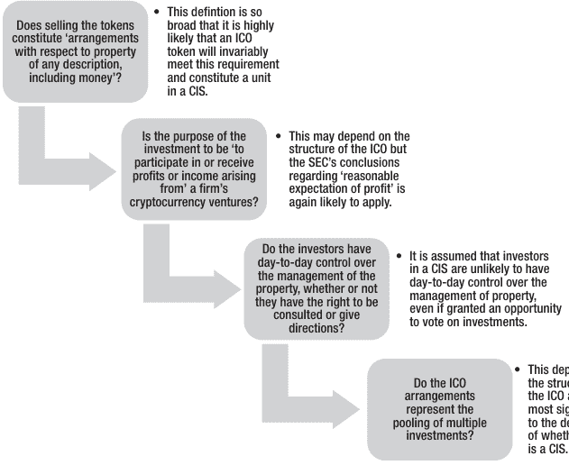

#### 7.55 首次代币发行

**7.55** 值得注意的是，如果将这些问题应用于Slock.it DAO，它将属于FSMA第235条中CIS的定义；特别是，预期利润将被汇集，而DAO的日常管理职能掌握在少数个人手中，而非集体投资者，后者仅对投资方向拥有投票权。

**7.56** 如果ICO符合CIS的定义，负责人将从事“设立、运营和清算”CIS的受监管活动，并需要获得FCA批准才能开展该活动。

**7.57** 同样，任何参与ICO且属于CIS定义的公司，都将从事RAO范围内的安排活动，包括：

i. 为特定活动筹集资金；

ii. 保障和管理基金；以及

iii. 资产的酌情管理。

参与成立符合AIF定义的ICO的个人和公司也可能需要获得FCA的授权。

#### 另类投资基金（“AIF”）

**7.58** AIF是一组旨在从多名投资者那里筹集资金的投资事业。AIF的目的是允许投资者为明确的投资政策提供资本，并期望获得未来股息或经济收益（专注于石油勘探产品或稀有葡萄酒的对冲基金将是AIF的一个示例）。

**7.59** 因此，AIF是一项“事业”，无论其结构如何，其“从多名投资者那里筹集资金，旨在按照明确的投资政策为这些投资者的利益进行投资”，且不属于需获授权为CIS的范畴。该定义足够宽泛，可以涵盖ICO，前提是存在“明确的投资政策”且筹集的利润用于多名投资者的利益。

**7.60** 由于投资的复杂性和有限的监管，大多数AIF资产由机构投资者或37认证的高净值个人持有。另类投资包括私募股权、对冲基金、受管理期货、房地产、商品和衍生品合约。ICO可能属于该定义。

**7.61** AIF的定义载于另类投资基金管理人指令（“AIFMD”）第4(1)(a)条：

“AIFs”是指集体投资事业，包括其投资分隔，其：

(i) 从多名投资者那里筹集资金，旨在按照明确的投资政策为这些投资者的利益进行投资；以及

(ii) 不需要根据2009/65/EC号指令第5条获得授权。

**7.62** AIFMD是另类投资基金管理人的监管框架，包括对冲基金、私募股权公司和投资信托的管理人。AIFMD是欧盟立法，但于2013年7月22日在英国实施。

**7.63** 第4(a)(ii)条中提到的授权是根据2009/65/EC号可转让证券集体投资事业指令（“UCITS指令”）进行的。这是一项综合欧盟指令，允许CIS基于一个成员国的单一授权在整个欧盟自由运营。英国于2020年1月31日不再是欧盟成员国。2020年12月31日，关于英国退出欧盟的过渡期结束，英国不再被视为欧盟成员国。除其他后果外，英国不再直接受欧盟法律（包括AIFMD）的约束。

**7.64** 虽然AIFMD不再在其实施中约束英国，但英国已建立国内制度来规范英国境内AIF的管理和营销，该制度通常保留了过渡期结束时AIFMD实施中规定的规则。随着时间的推移，英国的做法可能会与欧盟分道扬镳，无论是由于现有规则的变化，还是不跟随AIFMD的未来变化。

**7.65** 然而，最重大的变化是，英国可能不再能够将其英国AIF护照到欧盟。同样，欧盟AIF不能护照进入英国。英国已寻求与个别国家建立第三国管理护照；然而，这些要求英国AIF遵守该司法管辖区内的特定规则。那些寻求向特定欧盟成员国营销的人将需要考虑该国的国家私人配置制度（NPPR）。如果欧盟AIF符合英国NPPR，则可以在英国营销，英国NPPR目前与AIFMD一致，但可能会随时间变化。

**7.66** 在英国，AIF不受特定监管，但可以获授权。38 属于AIF定义的ICO可能未获授权。无论如何，AIF管理人（“AIFM”）必须获授权。此外，作为AIF托管人的公司受托管人标准和通过投资者披露规则及向主管部门强制报告所构成的加强透明度制度的约束。

| AIFM要求39 | |
| --- | --- |
| **授权** | AIFM此前由本国授权，但脱欧后必须满足特定国家的NPPR。在英国，FCA决定AIF是否符合相关国内立法。FCA可以根据全面范围AIFM授权基金管理人，或者，对于管理“管理资产”低于某些门槛的AIF的AIFM，注册适用较轻的制度。低于门槛的AIFM不太可能满足第三国的NPPR；然而，拥有全面授权的AIFM很可能能够像以前的AIFMD护照一样进入欧盟国家。40 |
| **业务行为原则** | 必须公平对待投资者，具体考虑利益冲突、薪酬、风险管理、估值、向投资者和监管机构披露。 |
| **受监管资本** | AIFM必须在AIF中定义“初始资本”和“自有资金”。需要职业责任保险。 |
| **投资安全保管** | 托管人必须与AIFM分离且是强制性的。 |
| **对委托的控制** | 某些任务，包括投资组合管理和风险管理，不能委托。 |

**7.67** 全面范围的英国AIFM必须向FCA通报初始授权条件的重大变化——特别是授权时提供的信息的重大变化。如果存在“合理投资者在知晓此类信息后很可能重新考虑其在AIF中的投资（包括因为此类信息可能影响投资者行使与投资相关的权利的能力，或以其他方式损害AIF中一名或多名投资者的利益）”，则应视该变更为重大。41 鼓励公司根据这一原则评估所通报变更的重大性。

**7.68** 希望作为AIF托管人的公司必须寻求FCA的许可。AIF的托管人不能是AIFM或CIS。

**脚注：**

37. “认证投资者”是指净资产超过100万美元或年个人收入20万美元或以上的人。

38. 某些投资基金可以向FCA寻求特定授权，例如：可变资本投资公司；授权合同计划；或授权单位信托计划。

39. www.fca.org.uk/firms/aifmd。

40. www.fca.org.uk/firms/aifmd/uk-aifm。

41. 金融行为监管局，AIFM通知，首次发布于2016年6月8日，最后更新于2019年1月18日，www.fca.org.uk/firms/aifmd/notifications（最后访问于2019年3月4日）。

管理公司。获准的另类投资基金（AIF）的另类投资基金管理人（AIFM）和托管人必须相互独立；然而，未获准的AIF的AIFM和托管人可以是同一集团内分离但关联的实体，前提是妥善管理并披露潜在的利益冲突。

7.69 全面托管人必须是以下之一：

- 欧洲经济区信贷机构
- 获准的MiFID投资公司，提供金融工具的安全保管和管理服务，并且根据CRD（2013/36/EU）第28条拥有不少于730,000欧元的自有资金（对于英国公司，这将是拥有保管和管理投资许可的IFPRU 730k公司）
- 于2011年7月21日拥有第4A部分许可，担任获准单位信托计划的受托人或开放式投资公司的托管人的公司，在任一情况下该计划均为UCITS计划
- 另一种类型的获准人员或未获准人员，如果获准为AIF的托管人，则将仅：
  - 担任FUND 3.11.12R定义的AIF类型的受托人或托管人（私募股权AIF托管人），和/或
  - 向非欧洲经济区AIF提供一项或多项托管服务

7.70 获准的AIF只能将上述1–3中的公司或机构作为托管人。未获准的AIF（如果ICO作为AIF受监管，可能属于此类）可以将1–4中的任何一个作为托管人。作为未获准的AIF，ICO也可以将*分离但关联的实体*作为托管人。如果能够证明有足够的分离，与ICO关联的获准人员可以担任受托人或托管人。

7.71 希望在英国推广AIF的全权限AIFM必须向FCA申请许可。该许可可以允许向英国的零售和/或专业投资者推广。

7.72 寻求向英国投资者推广ICO的公司必须向FCA申请并遵守国内规则。如果它们位于欧洲经济区内并由其本国授权，这些规则目前类似于另类投资基金管理人指令（AIFMD）的护照通行条款。否则，如果向英国境内的人员推广或出售，《金融服务和市场法案》（FSMA）和《监管改革令》（RAO）条款对外国公司具有域外效力。

### 推广作为集体投资计划或另类投资基金的ICO的限制

7.73 《金融服务和市场法案》（FSMA）第21条规定：“任何人不得在业务过程中，传播邀请或诱使他人从事投资活动，除非该推广已由获准人员制作或批准，或是针对属于豁免接收者类别之一并符合一系列测试的人员”。因此，未经授权或适用豁免，推广受监管的ICO是被禁止的。

7.74 此外，《2012年金融服务法》（《2012年法案》）第89条和第90条禁止就受监管的ICO作出误导性陈述（第89条）和造成误导性印象（第90条）。根据《2012年法案》第89条，如果代币发行人明知或罔顾真伪地作出虚假或误导性陈述，或不诚实地隐瞒任何重要事实，意图诱导，或罔顾是否可能诱导他人订立或不订立相关协议（例如，认购代币的协议），则将构成刑事犯罪。

7.75 同样，如果就相关投资的市场、价格或价值造成虚假或误导性印象，以诱导他人获取或认购代币等投资，代币发行人将根据《2012年法案》第90条构成犯罪。

7.76 在王室法院被判犯有上述任何一项罪行的人，可能被判处七年监禁或无限额罚款，或两者并处。

### 电子货币代币

7.77 在英国，电子货币被定义为以电子方式存储的货币价值，代表对电子货币发行人的索取权，且：

- 在收到资金以进行支付交易的目的下发行；
- 由电子货币发行人以外的人接受；以及
- 未被《2011年电子货币条例》（EMR）第3条排除。

7.78 EMR规定，当由信贷机构、信用合作社和市政银行开展时，电子货币的发行是《监管改革令》（RAO）第9B条项下的受监管活动。发行电子货币的公司必须确保其已获得适当授权或注册。

7.79 要被视为电子货币，虚拟资产必须使用户能够与第三方进行支付交易。电子货币必须被不仅限于发行人的更多方接受。在线钱包或预付卡中的法定货币余额构成电子货币。

7.80 比特币和以太币等交换代币不太可能构成电子货币，因为这些代币不是在收到资金时由中央发行的，也不代表对发行人的索取权。

7.81 分布式账本技术（“DLT”）和经加密保护的代币可用于代表法定资金；然而，FCA已表明，建立新类型单元（即新的加密货币）而非代表法定资金的虚拟资产不太可能构成电子货币，除非该单元的价值与法定货币挂钩。43即便如此，仍将取决于具体案例的事实。

值得注意的是，稳定币可能被监管为电子货币，但也可能被监管为证券代币。

### 未受监管的代币

7.82 交换代币和实用代币被FCA视为*未受监管的代币*。然而，交易这些代币的人仍将适用反洗钱（AML）条款，在此背景下属于FCA的管辖范围。

7.83 从2020年1月10日起，英国的《2017年洗钱、恐怖主义融资和资金转移（付款人信息）条例》（*MLRs*）将反洗钱和反恐怖融资（*CTF*）监管扩展到英国境内的*加密资产交易提供者*（*CEPs*）和*托管钱包提供者*（*CWPs*）。这些企业和提供商现在是“相关人员”，与其他金融机构和货币服务企业一样，承担相同的AML和CTF义务，即进行客户尽职调查并报告可疑交易。加密资产交易提供者和托管钱包提供者必须向FCA注册以接受AML监管。

| 术语表 | |
|---|---|
| 加密资产交易提供者 | 一家公司或个体执业者，以业务方式提供以下一项或多项服务：(i) 交换加密资产与货币或货币与加密资产，或安排或为交换加密资产与货币或货币与加密资产做出安排；(ii) 交换一种加密资产与另一种加密资产，或安排或为此类交换做出安排；或 (iii) 操作利用自动化流程交换加密资产与货币或货币与加密资产的机器。加密资产（包括ICO）的创建者或发行人将属于此定义，交易所、加密货币ATM或点对点交易所亦然。 |
| 托管钱包提供者 | 代表其客户提供保管或保管和管理加密资产，或代表其客户提供私有加密密钥的保管、存储和转移加密资产服务的实体。 |

### 促进受监管的支付系统

7.84 支付交易的执行、卡片发行、商户收单和汇款是根据*支付服务条例*（*PSR*）在英国受监管的支付服务的提供。*PSR*适用于*资金*，定义为*银行券和硬币、账簿货币和电子货币*。44 通常虚拟资产不属于该定义；因此，*PSR*不适用。

7.85 然而，如果加密货币用于促进资金转移，例如，法定货币转换为虚拟资产，然后再转换回法定货币后转移给接收人，那么它将受*PSR*监管。从事支付服务提供的个人或公司需要考虑其方法，并在有顾虑时寻求具体建议。

### 欧盟的有限方法

7.86 目前，欧盟内没有提供全面治理的明确ICO法规；然而，欧盟委员会作为其数字金融包的一部分，于2020年9月24日宣布的提案，旨在为数字资产提供全面框架。45

7.87 该框架的核心是拟议法规：加密资产市场（MiCA）。MiCA将*加密资产*定义为*使用分布式账本技术或类似技术以电子方式转移和存储的价值或权利的数字表示*，并将适用于*向公众提供任何类型加密资产或寻求将加密资产准入加密资产交易平台的任何法人*。46

42 英国金融行为监管局，托管人，首次发布于2016年6月8日，最后更新于2019年1月28日，www.fca.org.uk/firms/aifmd/depositories（最后访问于2022年1月31日）。

44 《2017年支付服务条例》，第2条。

45 欧洲议会和理事会关于加密资产市场并修订指令(EU) 2019/1937的法规提案，2020年9月24日，https://eur-lex.europa.eu/legal-content/EN/TXT/?uri=CELEX%3A52020PC0593。

46 欧洲议会和理事会关于加密资产市场并修订指令(EU) 2019/1937的法规提案，2020年9月24日，https://eur-lex.europa.eu/legal-content/EN/TXT/?uri=CELEX%3A52020PC0593，第3(1)(1)(2)条；以及Vermaak, Werner，‘MiCA：欧盟拟议的加密资产市场法规指南，Sygna，新闻，博客，欧盟加密货币法规，https://www.sygna.io/blog/what-is-mica-markets-in-crypto-assets-eu-regulation-guide/（最后访问于2022年1月31日）。

7.88 该立法的范围足够广泛，涵盖了在首次代币发行（ICO）项下发行各种代币的主体。此外，其地域效力覆盖所有欧盟国家。

7.89 MiCA在2024/2025年之前生效的可能性极小；但总而言之，该法规的范围将延伸至交易平台运营商、托管服务和交易所服务提供商，并将涵盖加密资产的配售、执行以资产参考型代币进行的支付交易以及就加密资产提供咨询。

7.90 拟议的制度仅允许在欧盟成员国设有注册办事处的法人提供加密资产服务，且该法人必须在欧盟/欧洲经济区成员国获得授权和许可，成为加密资产服务提供商。一旦在一个成员国获得授权，“护照通行”机制将在整个欧盟范围内适用。

7.91 要获得加密资产服务提供商许可证，实体需满足类似于适用于金融服务提供商的要求，包括资本要求、组织要求和行为要求。

7.92 电子货币和稳定币（“资产参考型代币”）发行商将受到更严格的监管。这些发行商必须在欧盟境内设立（不包括英国公司），并拥有更高的资本储备。这些要求不适用于一般加密资产的发行商。

### 当前欧盟规定

7.93 在MiCA生效之前，交易加密资产者必须遵守欧洲证券和市场管理局（“ESMA”）的指引以及现有欧盟指令。ESMA发布了两份声明，构成了欧盟在超国家层面进行的具体监管监督的范围。

7.94 两份声明均于2017年11月13日发布：第一份提醒投资者注意投资ICO所涉及的风险；[47]第二份提醒参与ICO的公司需要满足监管要求。[48]

7.95 对投资者的警告将ICO描述为（与FCA类似）‘高度投机性投资’。ESMA警告投资者，ICO投资缺乏可用的保护，且可能损失全部投资：

> ESMA强调，ICO是极其高风险和高度投机性的投资。投资者应认识到，在投资ICO时面临以下风险：
>
> - **不受监管的空间，易受欺诈或非法活动影响** – 根据其结构，ICO可能不受现有规则的约束，可能落在受监管空间之外。一些ICO可能被用于欺诈或非法活动，最近有几起ICO被认定为欺诈，而ESMA不能排除其中一些被用于洗钱目的。如果ICO不属于欧盟法律法规的范围，投资者就无法受益于这些法律法规提供的保护；
> - **损失全部投资资本的高风险** – 绝大多数ICO由处于早期开发阶段的企业发起。这些企业本身具有很高的失败风险。许多正在发行的币或代币除了可能用于访问或使用发行方将要开发的服务/产品之外，没有内在价值。无法保证这些服务/产品能够成功开发，即使假设项目成功，任何最终收益相对于投资资本可能都极低；
> - **缺乏退出选项和极端价格波动** – 投资者可能无法交易其币或代币，或将它们兑换为传统货币（如欧元）。并非所有币或代币都在虚拟货币交易所交易，即使交易，其价格也可能像虚拟货币一样极度波动。许多此类交易所不受监管，容易受到市场价格操纵和欺诈活动的影响。投资者可能面临缺乏退出选项，或长时间无法赎回其币或代币的情况；
> - **信息不充分** – 提供给投资者的信息（例如所谓的白皮书）在大多数情况下未经审计、不完整、不平衡甚至具有误导性。其通常强调潜在收益而非风险。这些信息技术性强，不易理解。因此，投资者可能不了解自己所承担的风险，并做出不适合其需求的投资；以及
> - **技术缺陷** – 支撑币或代币的分布式账本或区块链技术在很大程度上仍未经过测试。用于创建、转移或存储币或代币的代码或程序可能存在缺陷。投资者可能无法访问或控制其币或代币，或者币或代币可能被盗，例如遭到黑客攻击。更普遍地，该技术可能无法快速、安全地运行，例如在活动高峰期。

7.96 在对公司的警告中，ESMA比FCA更进一步，指出当币或代币符合金融工具的定义时，参与ICO的公司很可能在开展受监管的投资活动。然而，与FCA一样，ESMA强调ICO是否属于受监管领域在很大程度上取决于其结构：

> **ESMA提醒参与ICO的公司其在欧盟法规下的义务**
>
> 参与ICO的公司必须仔细考虑其活动是否构成受监管活动。如果其活动构成受监管活动，公司必须遵守相关法律，任何未能遵守适用规则的行为都构成违约。
>
> 根据其结构，ICO可能不在现有规则范围内，因此也不在受监管空间内。然而，如果币或代币符合金融工具的定义，参与ICO的公司很可能在开展受监管的投资活动，例如配售、交易金融工具或就此提供咨询，或管理或营销集合投资计划。此外，它们还可能涉及向公众发行可转让证券。

以下列出的关键欧盟规则届时可能适用。

请注意，以下内容是主要适用欧盟立法的高层摘要。其无意详尽列举适用规则或这些立法中规定的要求。此外，国内规则也可能适用。

考虑监管框架、寻求必要许可并满足适用要求是公司自身的责任。

#### 招股说明书指令

《招股说明书指令》（PD）旨在确保公司在欧盟筹集资本时向投资者提供充分的信息。它要求在向公众发行可转让证券或此类证券在成员国境内或运营的受监管市场上获准交易之前公布招股说明书，除非适用特定的排除或豁免情形。特别是，PD规定招股说明书应包含对投资者作出知情评估所必需的重要信息，且信息应以易于分析和理解的形式呈现。PD并未直接规定应由谁编制招股说明书，但要求在招股说明书中指明对信息负责的一方（至少包括发行人、要约人、寻求上市交易的一方或担保人）。根据ICO的结构，币或代币可能属于可转让证券的定义范围，因此可能需要公布招股说明书，并需经主管当局批准。

#### 金融工具市场指令

《金融工具市场指令》（MiFID）旨在为投资服务和活动建立单一市场，并确保对金融工具投资者提供高度协调一致的保护。提供与MiFID定义的金融工具相关的投资服务/活动的公司，需要遵守MiFID的要求。就ICO而言，如果币或代币符合金融工具的定义，那么币或代币的创建、分发或交易过程很可能涉及某些MiFID活动/服务，例如配售、交易金融工具或就此提供咨询。MiFID中规定的组织要求、业务行为规则和透明度要求将随之适用，在某些情况下取决于所提供的服务。

#### 另类投资基金管理人指令

《另类投资基金管理人指令》（AIFMD）规定了在联盟内管理和/或营销另类投资基金（AIF）的另类投资基金管理人（AIFMs）的授权、持续运营和透明度规则。根据其结构，ICO计划可能符合AIF的资格，如果它被用于向众多投资者筹集资本，以期按照既定的投资政策进行投资。因此，参与ICO的公司可能需要遵守AIFMD规则。特别是，AIFMD规定了资本、运营和组织规则及透明度要求。

#### 第四和第五反洗钱指令

第四和第五反洗钱指令共同致力于禁止洗钱和恐怖主义融资。它们适用于包括信贷机构在内的公司

机构和金融机构，后者包括MiFID投资公司、集体投资计划（营销其单位或股份）以及提供信用机构某些服务但并非信用机构本身的公司。这些指令要求公司对客户进行尽职调查，并建立适当的记录保存及其他内部程序。现在必须识别金融工具的最终受益人。公司有义务报告任何可疑活动，并配合相关公共当局的任何调查。最重要的是，第五反洗钱指令将从事加密资产与法定货币之间兑换服务的提供者以及托管钱包提供者纳入监管范围。

7.97 属于欧盟监管体系的金融工具可能需要遵守《金融工具市场指令》（‘MiFID’）；《另类投资基金管理人指令》（‘AIFMD’）；《第四反洗钱指令》（‘MLD4’）；以及《第五反洗钱指令》（‘MLD5’）。

7.98 《第六反洗钱指令》（‘MLD6’）于2020年12月3日生效，欧盟受监管实体必须在2021年6月3日前实施。但是，在英国脱欧之后，MLD6在英国不会产生直接效力。

7.99 尽管ESMA已提及《招股说明书指令》，但该指令涉及证券发行，不太可能适用于ICO下的代币发行（参见第1(2)(a)条：‘2. 本指令不适用于：(a) 非封闭式集体投资计划发行的单位’）。

7.100 MiFID的要求载于第4章，AIFMD已在上文讨论。

7.101 MLD4于2017年6月26日生效，并设定了必须进行客户尽职调查（‘CDD’）的新门槛。现在，任何以现金交易价值超过10,000欧元（之前为15,000欧元）的商品的人都需要进行CDD。交易金额达到或超过10,000欧元，或相当于英镑、美元或潜在加密货币的ICO代币，必须接受CDD。

7.102 MLD4还加强了关于本地政治敏感人士（‘PEPs’）的要求。此前，只有外国PEPs才需要接受更严格的审查。该指令并不阻止向管辖范围内可能被视为PEPs的人出售ICO代币，但确实要求就所使用资金的来源进行进一步询问。不应仅基于其身份而拒绝PEPs参与ICO。这将‘违背本指令及经修订的金融行动特别工作组（FATF）建议的文义和精神’。49

49. 欧洲议会和理事会2015年5月20日关于防止利用金融系统进行洗钱或恐怖融资的指令（EU）2015/849，修正欧洲议会和理事会条例（EU）第648/2012号，并废止欧洲议会和理事会指令2005/60/EC及委员会指令2006/70/EC，注释（33）。

7.103 最重要的是，任何参与ICO的公司或法人实体都将被要求维护准确且最新的实益所有权登记册，并须向相关监管机构提供（在英国为FCA）。实益所有权信息将由每个成员国在中央登记册中保存，该登记册将向银行、律师事务所以及‘任何能够证明具有合法利益的人或组织’开放。

7.104 实益所有权中央登记册将包含姓名、出生日期、国籍、居住国以及实益所有人在交易中的权益性质和范围。

7.105 MLD4取消了此前享有增强型CDD自动豁免的情形，包括：受反洗钱指令或类似合规本地立法约束的信贷或金融机构；其证券在受监管市场上市并承担特定披露义务的公司；以及英国公共当局。先前豁免等情形可用于证明简化CDD的合理性；然而，这不再是自动的。任何简化CDD的决定都必须有理由并有据可查。

7.106 参与ICO交易的公司和个人应采取基于风险的方法来考虑其反洗钱事宜。MLD4要求受监管个人证明：已进行风险评估并定期更新；已制定政策和程序；以及在必要时，由内部团队测试合规性。培训也被视为一项持续性要求。

7.107 MLD5将CEPs和CWP纳入MLD4包含的立法条文中。这些企业和提供商现在必须履行与其他金融机构和货币服务企业相同的反洗钱（AML）和反恐怖融资（CTF）义务。CEPs和CWP必须进行客户尽职调查并报告可疑交易。

7.108 这些指令是否适用于ICO，将由负责授权的本国成员国决定。不同司法管辖区之间存在一些自由裁量空间，但更重要的是，由国家监管机构而非ESMA来决定代币是否属于金融工具的定义。正是这一决定最终将决定是适用国家立法还是欧盟整体立法。

### 中国禁止案例研究

7.109 在2017年9月之前，路透社引用当地媒体报道称，中国的ICO筹资至少达26.2亿元人民币（约4亿美元）。

7.110 然而，在2017年9月4日，包括中国人民银行、中国证券监督管理委员会、中国银行业监督管理委员会和中国保险监督管理委员会在内的七个政府部门发布联合声明，谴责通过ICO进行非法公众融资。52

> ‘ICO本质上是未经授权的非法公众融资，涉嫌非法集资、非法发行证券、非法销售代币以及金融欺诈、传销等其他犯罪活动。国家全面覆盖；新的ICO融资完全暂停；已经发生的项目必须逐案判断以打击违规行为。’

7.111 中国人民银行解释说，公开谴责基于区块链的货币融资是因为其充斥着欺诈行为。53 对ICO的立即禁令（包括向地方金融监管机构发布60家主要中国ICO平台名单以供检查）导致比特币价值下降了约5%。54

7.112 这一初步禁令在多大程度上取得成功尚有争议。Kapronasia咨询公司创始人兼主管Zennon Kapron在接受CNBC《Squawk Box》节目采访时表示：55

> ‘要想在中国完全阻止比特币，唯一的办法就是关闭互联网。因此，监管机构确实关注比特币与法定货币交汇的点。56 目前正在讨论的监管措施是禁止比特币交易所，这将切断我们目前在中国看到的大量交易流以及围绕比特币的交易所。’

Kapron补充道：‘因此，我们可能会看到他们关注那些与传统金融体系存在实体、个人或某种可控制联系的活动。’

52 吴玉溪，*独家ICO存入互金风险专项整治 99号文启动清理整顿*（Exclusive ICO Incorporate Mutual Gold Risk Special Rehabilitation No. 99 Document to Start Cleanup and Rectification），财新网，2017年9月4日，http://finance.caixin.com/2017-09-04/101140069.html（最后访问日期：2019年2月27日）。

53 成棱和吴玉剑，*中国通过禁止首次代币发行打击加密货币*（China Claws Back at Cryptocurrencies With Ban on Initial Coin Offerings），财新网英文版，2017年9月4日，www.caixinglobal.com/2017-09-04/china-claws-back-at-cryptocurrencies-with-ban-on-initial-coin-offerings-101140498.html?sourceEntityId=101140069（最后访问日期：2019年2月27日）。

54 索赫利·罗伊·乔杜里，*中国禁止公司通过ICO筹资，要求地方监管机构检查60家主要平台*（China bans companies from raising money through ICOs, asks local regulators to inspect 60 major platforms），CNBC，2017年9月5日，www.cnbc.com/2017/09/04/chinese-icos-china-bans-fundraising-through-initial-coin-offerings-report-says.html（最后访问日期：2019年2月27日）。

55 索赫利·罗伊·乔杜里，*政府希望控制加密货币——但规则过多也有危险*（Governments want to control cryptocurrencies – but there’s a danger to too many rules），CNBC，2017年9月12日，www.cnbc.com/2017/09/12/regulators-are-turning-their-attention-to-cryptocurrencies.html（最后访问日期：2019年2月27日）。

56 法定货币是一种没有内在价值、通常通过政府法规被确立为货币的货币。法定货币没有使用价值，其价值仅存在于政府维持其价值，或交易各方同意其价值之中。

7.113 或许是为回应争论，禁令随后于2018年12月扩展至证券代币发行和空投；2019年2月15日，中国禁止访问境外ICO和加密货币交易所。中国互联网监管机构——中国互联网信息办公室——宣布了新规定，这些规定适用于区块链信息服务提供商。广义上讲，这些是使用区块链技术向公众提供在线信息服务的实体。新规定对区块链匿名性施加了限制，并要求用户在注册区块链服务时提供真实姓名和国家身份证号码或电话号码。

7.114 区块链服务提供商需要向政府登记，并被要求审查“被认为对国家安全构成威胁”的内容。57 他们还必须保存用户发布的信息记录，并将这些信息披露给政府。可以说，这些规定是试图针对使用区块链技术绕过中国互联网审查的行为，个人利用以太坊区块链来逃避审查。

7.115 在受控经济中，ICO或任何众筹都可能对国家权力构成不可接受的风险。中国曾试图通过禁止和监管来防止ICO“民主化”风险投资融资，但中国现在已推出自己的数字货币：数字货币电子支付（“DCEP”），即“数字人民币”。数字人民币由中国人民银行（“PBOC”）发行，本质上是人民币的数字版本。最初，数字人民币在四个主要城市（深圳、苏州、成都和雄安）进行试点，但自2021年4月以来，测试已扩展至六个额外地区：上海、海南、长沙、西安、青岛和大连。一旦完全测试，数字人民币将用于国内和国际交易。

7.116 阿里巴巴的支付宝和腾讯的微信支付在中国很常见，中国正朝着无现金社会发展，数字人民币的推出表明中国将成为世界上第一个将央行数字货币投入使用的国家。

7.117 批评者认为，数字人民币与其说是民主化，不如说是终极监控，能够在不可篡改的区块链上捕获每一笔经济交易。这可能对合法投资者来说不太值得担心，他们可能将数字人民币视为进入利润丰厚的中国市场的一种方式。但需警惕。中国的监管环境构成追溯性立法监督的潜在风险。

57 Ikeda, Scott, ‘中国打击境外上市的运动在针对构成国家安全威胁的企业的新法规下继续’, CPO Magazine, 2021年12月30日, https://www.cpomagazine.com/cyber-security/chinas-campaign-against-offshore-listings-continues-with-new-regulations-for-businesses-that-pose-a-national-security-threat/ (最后访问 2022年1月31日).

from the person’s house.11 传感器输入的数量越高，数据池就越大，可以得出的推断就越多。

### 8.7

自2010年以来，传感器成本从25美元大幅下降到现在每个不到1美元。12 用于收集信息的传感器成本下降，加上“大数据”分析的增长，为公司带来了比较优势、为消费者带来了好处，从而在“旧”技术方面推动了创新。在极少数例外情况下，英国（UK）的每个家庭都有燃气和/或电表。“智能电表”是专为在英国更高效地分配燃气和电力而设计的物联网版本。2020年底，英国家庭安装了2220万个智能电表，占所有家用电表的42%。13

### 8.8

试图列出现有的物联网设备将是一项不可能完成的任务。在撰写本文时，该列表将占据书的一半，而在出版日期时，它就会已经过时。将物联网设备的考虑限制在健康和健身领域，有四大类设备说明了物联网的多样化用途：14

- i. 台式设备（例如体重秤和血压监测仪）是常见的商业购买设备，可连接到移动应用或计算机。例如，Aria体重秤将体重、体脂率和身体质量指数（BMI）映射到移动电话应用。该设备设计为偶尔与其姊妹产品Fitbit配合使用，作为迈向更健康生活计划的一部分。

- ii. 可穿戴传感器也商业上可用，并且现在很容易获得。Fitbit和Nike+是电子计步器，可追踪步行步数、步行距离、消耗的卡路里和心率。2020年，Fitbit记录了86个国家的3100万活跃用户。15 这些数据可以被认为是可靠的，因为Fitbit能够通过其Fitbit软件主动记录用户逐分钟的数据。

- iii. 亲密接触传感器现在越来越多地面向零售客户提供，但多年来一直用于医疗/研究目的，以及由专业运动员使用。16 与可穿戴传感器类似，亲密接触传感器嵌入绷带、医用胶带或贴片中。这些也被称为“表皮电子”。传感器放置的表面积增加，使得可以获得大量数据，包括心率、大脑活动、体温、水分水平和紫外线辐射暴露。17

- iv. 可吞服和可植入传感器目前不用于零售/商业用途，但越来越多地用于医学研究或通过处方提供。Medtronic（一家以色列医疗技术公司）开发了PillCamM（一种药丸大小的摄像头，用于检测胃肠道内的出血和其他问题）和SmartPill（一种可吞服胶囊，在通过身体时测量压力、pH值和温度）。物联网起搏器（一种可植入设备）的使用一直存在争议，并于2017年因安全问题引起了美国食品药品监督管理局（“FDA”）的关注。

### 8.9

物联网是一个可以取得巨大商业成功的前沿领域。然而，那些寻求利用物联网设备内在优势的人，无论是作为购买者还是制造商，都必须意识到有关物联网设备的安全问题。

#### 物联网的安全问题

8.10 2018年11月，全球的打印机表达了对Felix ‘PewDiePie’ Kjellberg的支持，他是当时订阅量最大的YouTube频道的瑞典明星。未经通知，50,000台打印机开始打印传单，敦促支持这位视频博主，同时建议忽略一个竞争对手的YouTube频道。18

8.11 无论您使用的是连接到网络的打印机、办公室会议室的无线投影仪，还是公司厨房里的智能冰箱，所有者和董事都必须了解与物联网设备相关的安全问题。这不仅仅是IT部门的问题。您的IT管理员不太可能购买了新的“最新”厨房设备，也不对供暖和空调的任何远程访问负责。然而，这些都是决心渗透公司系统的“黑客”的潜在入口点，如果发生泄露，董事会将不得不通知信息专员办公室（“ICO”）并向股东负责。

11 Enev, Miro; Gupta, Sidhant; Kohno, Tadayoshi; and Patel, Shwetak, 电视、视频隐私和电力线电磁干扰, 载于第18届ACM计算机与通信安全会议论文集（CCS ’11）。ACM, 纽约, NY, USA, 537-550. DOI=http://dx.doi.org/10.1145/2046707.2046770 (最后访问 2018年9月20日).
12 Wolfe, Alexander, 小型MEMS传感器让大数据歌唱, ORACLE VOICE, 福布斯, 2013年6月10日, www.forbes.com/sites/oracle/2013/06/10/little-mems-sensors-make-big-data-sing/ (最后访问 2018年9月19日).
13 商业、能源与工业战略部, 英国智能电表统计：截至2020年12月的季度报告, 2021年3月9日.
14 Peppet, Scott R., 监管物联网：迈向管理歧视、隐私、安全和同意的第一步, 德克萨斯法律评论 [第93卷:85 2014].
15 Laricchia, Federica, ‘Statista, 2012年至2020年Fitbit活跃用户数量’, https://www.statista.com/statistics/472600/fitbit-active-users/, 2022年2月14日 (最后访问 2022年2月23日).
16 GlobalSportsJobs.com, 可穿戴传感器技术繁荣期运动员的重要注意事项, www.globalsportsjobs.com/article/important-considerations-for-athletes-int-he-boom-of-wearable-sensor-technology, 2016年6月1日 (最后访问 2018年9月20日).
17 Grobart, Sam, MC10的BioStamp：医学诊断的新前沿, 彭博商业周刊, 2013年6月13日, www.bloomberg.com/news/articles/2013/06-13/mc10s-biostamp-the-new-frontier-of-medical-diagnostics (最后访问 2019年6月24日).
18 Perekalin, Alex, ‘打印机疯了’, 卡巴斯基每日, 2018年12月5日, www.kaspersky.co.uk/blog/hacked-printer-pewdiepie/14859/ (最后访问 2019年6月24日).

8.12 物联网设备的设计旨在使用方便，并能无线获取和传输数据。这对设备的形态提出了物理限制。物联网设备通常必须体积小巧（或至少不比其“哑设备”对照物大），并且通常由电池供电。这本身就带来了潜在的安全弱点。网络安全所需的处理能力通常与小型物联网设备中使用的微处理器不兼容。根本没有足够的计算能力来完成所需的物联网任务，并通过例如加密等方式保护设备。电池供电也是一个问题。单独的安全措施会消耗设备的电力，从而缩短电池寿命或增加设备尺寸以容纳更大的电池。

8.13 设计和制造时往往也存在不采用广泛安全措施的动力。安全软件的设计和实施在营销时不会立即转化为价格上涨。客户通常对其Wi-Fi连接的音响系统是否网络安全兴趣不大。然而，安装便捷是产品评测中会凸显的功能。因此，即使产品在设计时考虑了安全性，默认设置也通常会允许最开放的访问，以便产品能够连接到网络和家用Wi-Fi路由器。

8.14 根据NETSCOUT的数据，平均每个物联网设备在上线后仅五分钟就会遭到攻击，并且随着每年连接的设备越来越多，这一趋势预计只会增长。物联网设备还通过共享Wi-Fi路由器为关键系统提供访问途径。2020年，75%的网络攻击是通过路由器实施的。许多网络犯罪分子将网络路由器列为首选攻击目标，每个路由器每月平均遭受5,200次攻击。19

8.15 研究人员已探索嵌入式系统的安全漏洞多年。2010年，通用汽车引入了一项功能，使车主可以使用智能手机从世界任何地方操纵汽车的门锁并启动汽车发动机。该功能使用了通用汽车的OnStar车载信息系统，该系统从2007年起成为每辆美国福特汽车的标准配置。奥克兰大学的一支研究团队发表了一项研究，证明利用这些嵌入式系统，可以操纵汽车的刹车、发动机和油门，可能出于恶意目的。20

8.16 2013年11月，赛门铁克发现了一种针对超过100,000个物联网设备的互联网蠕虫，包括智能电视、无线扬声器和联网安全摄像头。21 该蠕虫的目的是生成“ThingBots”，即物联网版的“Botnets”。一旦黑客控制了物联网

19 Steward, Jack, “2022年物联网统计数据终极列表”, FindStack, https://findstack.com/internet-of-things-statistics/, 2022年2月15日（最后访问日期：2022年2月23日）。
20 Armstrong QC, Dean; Hyde, Dan; Thomas, Sam, 《网络安全：法律与实践》, LexisNexis, 布里斯托尔, 2017, 第§7.08节。
21 Hayashi, Kaoru, 针对隐藏设备的Linux蠕虫, 2013年11月27日 www.symantec.com/connect/blogs/linux-worm-targeting-hidden-devices (最后访问日期：2018年9月20日).

打印机维修人员通常能够不被察觉地在办公空间内走动。然而，您的物联网打印机的维护现在可以远程、在场外、在第三方安装商的场所进行监控。适当的尽职调查包括确保该公司的安全措施足够。渗透其系统的外部威胁可能会通过物联网设备访问您的系统。请提供防止网络攻击的现有安全措施明细。

- 4. 培训员工保持对其带到工作场所的物联网设备的适当安全。

“自带设备”（'BYOD'）政策在办公室工作中现在很常见；然而，这些政策通常不扩展到员工带到工作场所的物联网设备。物联网可穿戴设备，23 特别是处理能力较高的设备，可能会直接连接到无线网络。即使是通过智能手机App连接的设备也是潜在的安全风险。应努力限制员工连接到公司网络的设备数量和类型。智能手机包含安全协议，并且在工作环境中是必需的。个人摄像头则远非如此，或许不应允许其访问公司Wi-Fi。

23 物联网可穿戴设备可以包括FitBit或类似的计步器，但也可以包括智能手表，智能手表具有更大的处理能力，如果未受保护，更容易被用作渗透设备。

- 5. 确保安装了最新版本的物联网固件。

仅仅因为它看起来不像计算机，并不意味着安装最新的更新和补丁是不必要的。允许计算机运行在过时的操作系统上而不是最新更新，会大大增加安全漏洞的可能性。同样，这也适用于物联网设备。物联网设备通常会运行“即插即用”（'UPnP'）以实现轻松连接。为了提高安全性，可以关闭UPnP；但是，如果允许使用UPnP，则必须确保固件是最新的，以提供尽可能高的安全级别。

这些步骤是网络安全的开端，而非结论。物联网设备现在仅仅是潜在网络威胁矩阵的一部分，包括内部和外部威胁。如果公司董事对其系统的稳健性有所担忧，他们有责任寻求适当的建议。

### 通过物联网收集的数据归谁所有？

8.19 物联网设备的增长，主要通过将联网传感器低成本地集成到现有产品中，引发了一系列政府和监管机构才刚刚开始考虑的问题：通过物联网设备生成的数据归谁所有？这些数据如何使用？数据是否可以商品化并出售给第三方，无论是否获得用户同意？如果可以在获得同意的情况下出售，需要何种形式的同意？数据购买者的目的能否与原始收集者不同？

23 物联网可穿戴设备可以包括FitBit或类似的计步器，但也可以包括智能手表，智能手表具有更大的处理能力，如果未受保护，更容易被用作渗透设备。

8.20 这些仅仅是私营部门出现的问题。无论是警察还是安全部门，国家行为者在多大程度上被允许从不同的物联网设备汇总数据，并使用这些信息来画像个人？如果国家被允许不受限制地访问所有个人的物联网设备，不仅几乎每个人都可能持续受到监视，而且被认定为“罪犯”或“恐怖分子”的人可能会以这种方式受到影响，以消除任何“威胁”。

8.21 不同司法管辖区对物联网的兴起采取各种措施作出反应，这并不奇怪，这取决于管辖区内的政治现实。要在一整本书中，更不用说一个章节里，解决每个国家对物联网的监管方法，都是不可能的。例如，中国对防火墙的扩展单独就会产生比答案更多的潜在问题。因此，我们力求解释英国（UK）以及我们两个最大的贸易伙伴：欧盟（EU）和美国（US）的法律和监管立场。

### 英国对物联网的监管

8.22 英国对物联网设备的需求强劲。估计显示，英国每个家庭至少拥有10台联网设备，并且预计到2021年将增加到50台设备。24 因此，未来两年内，英国可能有超过4.2亿台物联网设备在使用。25

8.23 2018年3月7日，英国政府作为其国家网络安全战略26的一部分，发布了《安全设计：改善消费者物联网网络安全报告》（“该报告”）27，以应对英国物联网网络的潜在漏洞。2021年4月21日，数字、文化、媒体与体育部（“DCMS”）发布了政府关于监管消费者联网产品网络安全提案的征求意见回应。28

24 Steward, Jack, “2022年物联网统计数据终极列表”, FindStack, https://findstack.com/internet-of-things-statistics/, 2022年2月15日（最后访问日期：2022年2月23日）。
25 数字、文化、媒体与体育部，国家网络安全中心，以及Margot James议员，新闻稿：数百万联网设备的新网络安全措施，2018年3月7日 www.gov.uk/government/news/new-measures-to-boost-cyber-security-in-millions-of-internet-connected-devices（最后访问日期：2018年9月29日）。
26 https://assets.publishing.service.gov.uk/government/uploads/system/uploads/attachment_data/file/567242/national_cyber_security_strategy_2016.pdf.
27 https://assets.publishing.service.gov.uk/government/uploads/system/uploads/attachment_data/file/686089/Secure_by_Design_Report.pdf.
28 https://www.gov.uk/government/collections/secure-by-design.

**8.24** 该报告的重点是引入一份《消费者物联网行业行为准则》（简称“该准则”）。消费者物联网被定义为“消费者购买的‘现成’物联网设备；在家中安装和使用的物联网设备，以及与这些设备相关的服务”。

**8.25** 该准则旨在适用于整个物联网行业，特别是设备制造商、物联网服务提供商、移动应用程序开发者和零售商。该准则旨在提高消费者物联网产品及相关服务的安全性，并按重要性顺序列出了供物联网行业采用的实用指南。

**8.26** 以下是该准则的摘要。任何供应物联网设备的公司都应考虑这些步骤，其中前三个步骤应优先处理：

### 8.27 物联网

| 序号 | 原则 | 描述 |
|---|---|---|
| I. | **禁止默认密码** | 所有物联网设备密码必须唯一且可重置，供应商必须避免使用通用的默认值。Mirai恶意软件（僵尸网络）利用了常见的默认凭据（通用用户名和密码：admin/admin），而消费者往往不会更改这些凭据。设备制造商必须确保每台设备都配有唯一的默认密码。 |
| II. | **实施漏洞披露政策** | 所有提供联网设备和服务的公司都必须提供一个公开的联系点，作为漏洞披露政策的一部分，以便安全研究人员和其他人能够报告问题。披露的漏洞应及时处理。 |
| III. | **保持软件更新** | 联网设备中的所有软件组件都应能够安全更新。更新必须及时，且不影响设备功能。该准则要求供应商发布“生命周期终止”政策，声明接收更新的最短期限。对于不提供更新的原因，必须予以解释。 |
| IV. | **安全存储凭据和安全敏感数据** | 所有凭据都必须在服务内部和设备上安全存储。设备软件中可以通过逆向工程轻易发现的硬编码凭据是不可接受的。安全敏感数据应安全存储。36 |
| V. | **安全通信** | 对于与设备安全相关的数据，应使用适当的加密。 |
| VI. | **最大限度减少暴露的攻击面** | 处理器、用户或程序的访问应仅限于实现合法目的所必需的信息，不得超出该范围（“最小权限原则”）。应尽量减少暴露设备的无关代码或硬件。 |
| VII. | **确保软件完整性** | 如果检测到未经授权的更改或重启，应通知消费者或公司管理员。 |
| VIII. | **确保个人数据受到保护** | 个人数据的处理必须符合数据保护法律。在英国，这应遵守《2018年数据保护法》。在欧盟，则适用《通用数据保护条例》（GDPR）。 |
| IX. | **使系统能够抵御中断** | 即使出现操作问题，物联网设备或服务也应继续运行。 |
| X. | **监控系统遥测数据37** | 应监控所有遥测数据（如使用和测量数据）中的安全异常（但前提是这些数据已被收集）。 |
| XI. | **让消费者轻松删除个人数据** | 应向消费者提供明确的说明，以便其删除个人数据。 |
| XII. | **使设备的安装和维护变得容易** | 安装和维护应只需极少的步骤，并遵循最佳安全实践。 |
| XIII. | **验证输入数据** | 通过用户界面输入、通过应用程序编程接口（“API”）传输或在服务和设备网络之间传输的数据，必须进行验证。 |

29. https://assets.publishing.service.gov.uk/government/uploads/system/uploads/attachment_data/file/971440/Code_of_Practice_for_Consumer_IoT_Security_October_2018_V2.pdf.

30. https://assets.publishing.service.gov.uk/government/uploads/system/uploads/attachment_data/file/686089/Secure_by_Design_Report_.pdf, 附录8，8.3.

31. “制造组装最终联网产品的实体。最终产品可能包含许多其他不同制造商的产品。”同上，4.5。

32. “提供网络、云存储和数据传输等服务的公司，这些服务作为物联网解决方案的一部分打包提供。联网设备可以作为服务的一部分提供。”同上，4.5。

33. “开发并提供运行在移动设备上的应用程序的实体。这些应用程序通常作为物联网解决方案中与设备交互的一种方式提供。”同上，4.5。

34. “向消费者销售联网产品及相关服务的卖家。”同上，4.5。

35. 已采用相应的欧洲标准“ETSI EN 303 645”，其提供了类似的指南。

36. 美国国家标准与技术研究院（NIST）特别出版物800-63B：《数字身份指南：认证与生命周期管理，2017年》建议，最佳实践包括使用加密密钥和初始化向量，并将凭据存储在可信执行环境中（参见：https://pages.nist.gov/800-63-3/sp800-63b.html）。

37. 在此上下文中，“遥测”指无线数据传输。如果物联网设备突然出现数据传输激增，则可能因外部威胁访问该设备或随后使用该设备而被入侵。该准则要求对这些遥测数据进行监控以检测此类激增，但前提是这些数据已经被收集。该准则不要求额外监控，因为这可能违背用户的隐私。

**8.28** 该准则仍是自愿性的，不遵守行为通常难以强制执行。英国国家网络安全中心（“NCSC”）是《国家网络安全战略》的核心机构，为公共和私营部门提供如何避免计算机安全威胁的建议和支持，但目前没有执法职能（见下文）。NCSC的上级机构英国政府通信总部（GCHQ）不太可能强制执行一项自愿性准则。GCHQ的能力包括：收集和分析通信和数据；以及一系列旨在产生现实效果的网络策略。例如，GCHQ不会雇佣执法人员进入公司场所，或确保公司在现实中遵守自愿性准则。

#### NCSC：避免勒索软件攻击的实用步骤

英国国家网络安全中心（NCSC）在其“网络安全基本计划”（Cyber Essentials）下提供一系列与保护律师事务所系统安全相关的建议和指南。网络安全基本计划还提供两种形式的认证——“网络安全基本”（Cyber Essentials）和“网络安全基本加强”（Cyber Essentials Plus）——旨在让人们确信网络防御已经到位，能够抵御绝大多数常见的网络攻击。

为了确保黑客不会被轻易“邀请”走进敞开的大门，以下五点至关重要：

- 1. 使用防火墙保护您的互联网连接

所谓“防火墙”，是您的计算机（或计算机群）与互联网连接之间的一个区域，在此区域中，传入的流量（无论是电子邮件还是数字下载）都可以在获准进入网络之前得到分析和评估。

防火墙可以放置在网络中的多个位置：

- 边界防火墙在大多数组织中很常见，可保护整个网络。
- 事务所的每位成员都应考虑为其连接互联网的个人笔记本电脑或计算机安装独立防火墙。这些防火墙通常包含在操作系统中，可通过“设置”访问。
- 路由器防火墙也可以提供边界保护，但并非总是可用。事务所需要与其互联网服务提供商讨论所使用的具体型号。

边界防火墙通常可以防范外部威胁；但是，如果个人笔记本电脑在没有防火墙的情况下在公司环境之外使用，特别是在访问公共网络或不受信任的Wi-Fi连接时，这可能会对公司网络构成风险。NCSC网络基本认证要求所有设备都配置为使用防火墙。

#### 2. 为您的设备和软件选择最安全的设置

在获取新设备或软件时，请检查安全级别是否设置为最高，而不是默认的“推荐”。默认配置通常是为了确保易用性而非安全性。虽然这对于用于访问音乐、游戏或视频的家用电脑或平板电脑可能是有益的，但在专业环境中这可能不合适。

必须为所有设备设置密码：电脑；笔记本电脑；平板电脑和智能手机。必须更改默认密码，并在可能的情况下应用“强密码”。

强密码将包含大写和小写字母、数字以及特殊字符（@?!），并包含多个单词组合。使用多个单词组合，而不是包含特殊字符或数字的单个单词，可能更容易记住，尤其是在需要定期更新密码时，也更难被黑客猜测。将“Password1”更改为“Password2”非常不安全，而“Cartoon-Duck-14-Coffee”后跟“Cartoon-Duck-14-Tea”则安全得多。

面容ID和触控ID现在意味着不再需要记住密码，但如果密码不安全，这会增加风险。

当公司保护特别重要的信息时，应应用多因素身份验证（“2FA”）。Microsoft 365现在使用智能手机提供第二因素身份验证的2FA。

#### 3. 控制谁可以访问您的数据和服务

管理员帐户不应是整个城堡的钥匙。检查管理员对系统拥有的权限，并减少访问权限，使管理员帐户仅能访问执行特定管理任务。

任何需要完全访问权限的帐户，例如IT专业人员或重要员工，必须使用2FA身份验证来访问该帐户。

仅使用来自官方来源的软件。最简单的方法是确保用户从制造商批准的商店安装软件，这些商店会筛查恶意软件。对于移动设备，这意味着Google Play或Apple App Store等来源。

NCSC网络基本认证要求管理员权限仅授予需要的人员，并且管理员访问受到控制。此外，只应使用来自官方来源的必要应用程序。

#### 4. 保护自己免受病毒和其他恶意软件的侵害

勒索软件属于恶意软件的定义范畴，并可以通过多种方式引入网络：通过受感染的电子邮件附件；用户浏览恶意网站；或使用携带恶意软件的可移动存储设备，如USB闪存盘。教育律师事务所成员和员工是开始保护网络的绝佳方式；但是，还应实施以下技术措施：

- 应安装并保持更新反恶意软件/反病毒软件。Windows Defender等反恶意软件措施通常是免费的，可以通过笔记本电脑或个人电脑的控制面板启用。反病毒软件可能需要购买，或通过付费订阅更新。但是，多用户通常可以获得团体折扣。

- 允许列表防止用户未经许可在网络上安装应用程序。拥有权限的用户将被要求负责确保安装的任何内容都来自批准的商店。或者，可以允许所有用户安装应用程序，但可以创建一个软件“允许列表”。安装不在允许列表上的应用程序将被拒绝。

- “沙箱”是一种网络安全实践，其中应用程序在与用户文件（例如客户数据）隔离的环境中运行。例如，Google Chrome默认会为每个正在使用的单独浏览器运行一个沙箱。

网络基本认证要求使用上述反恶意软件防御中的至少一种。

#### 5. 保持您的设备和软件更新

大多数流行应用程序会默认定期更新。但是，这通常需要在更新完全实施之前重新启动笔记本电脑或电脑。鼓励个人在收到提示时尽快更新并重新启动。这将提高您的计算机和网络安全性；还将防止尴尬的更新在远程听证会期间导致连接中断。

NCSC认证要求设备、软件和应用程序保持最新。这可能意味着更新设备，例如不再支持最新软件版本的旧款iPhone。

- E. 使用数据保护影响评估（“DPIA”）作为帮助遵守数据保护义务的工具。在设计处理个人数据的设备、产品或服务时，DPIA将允许您在任何新项目或开发的早期阶段识别和修复任何数据保护问题，并将帮助您满足客户在隐私方面的期望。如果有任何投诉或担忧，这也将有助于证明合规性。

- F. 将网络安全和数据保护一起考虑。让负责网络安全的IT团队参与设计过程。如果公司内有相关资源，请尝试使用他们。

- G. 零售商应了解设备制造商和物联网服务提供商采取的措施。这将使零售商能够准确说明将要处理的个人数据、处理目的以及处理的合法依据。此外，这还将提供良好的客户服务。

8.38 有批评认为，在自愿守则下监管物联网设备是不够的。2018年1月，F-Secure发布了一份题为*物联网：定义物联网*的报告，警告如果政府不寻求监管物联网设备，将出现“反乌托邦的未来”。40 在守则发布后，安全公司Pen Test Partners的分析师Ken Munro表示，许多信誉良好的制造商已经遵循的一套无法强制执行的原则并未避免这种对未来的悲观看法：41

“‘没有“牙齿”，这个标准就毫无意义。那些已经为了快速从我们这里赚钱而对我们的安全随意对待的制造商不会改变任何东西。’”

8.39 从ICO的执法情况来看，无论守则如何，个人数据的治理都有效地通过专员得到保障。许多物联网设备将涉及处理个人数据，这不仅限于姓名和地址，还包括位置数据或IP地址等在线标识符。当存在不将处理个人数据作为其设计一部分的物联网设备时，问题变得更加重要。最基本的物联网设备是简单的网络连接遥控器，但这些设备仍可能被决心攻击的黑客用作分布式拒绝服务（DDoS）攻击的一部分，其中多个设备用于攻击单个端点（想想Mirai和Reaper恶意软件）。守则的批评者可能是正确的。自愿守则不太可能要求关注利润的制造商遵守，其影响将超出购买其特定物联网设备的人。然而，NCSC指南是积极、实用且有效的，用户可能可以承担个人责任来保护自己的网络。

8.40 如果英国监管“形同虚设”，那么欧盟监管正变得越来越犀利。GDPR已经生效42；2018年5月29日，欧盟委员会提出了网络安全认证框架。43该框架于2019年通过《欧盟网络安全法案》生效，该法案加强了欧盟网络安全局（ENISA），并建立了针对产品和服务的网络安全认证框架。44与此同时，人们认为任何物联网设备都不会落入欧洲监管空白之中。

8.41 此外，《网络基础设施安全指令》（‘NISD’）适用于数字服务提供商（‘DSP’）和基本服务运营商（‘OES’）。一般来说，这不太可能直接适用于物联网，但这是网络领域又一项欧盟立法。

### 欧盟立法与物联网

| 欧盟立法 | 是否生效 | 是否适用于物联网？ |
|---|---|---|
| GDPR | 是 | 是——如果你的物联网设备处理个人数据 |
| NISD | 是 | 不太可能——该指令仅适用于DSP和OES |
| 网络安全认证框架 | 是 | 加强了ENISA，并建立了自愿性认证体系 |
| 电子隐私条例 | 否 | 是 |

### GDPR如何适用于物联网？

8.42 处理个人数据的物联网设备必须满足GDPR中的要求。个人数据不仅仅限于姓名和地址（例如，GDPR提到了一系列标识符作为在线标识符，包括射频识别（‘RFID’）标签），因此，在许多情况下，物联网设备需要遵守GDPR原则。

#### 8.43 物联网

如果GDPR确实适用，则有十个步骤来实现合规：

- **1. 了解你处理的数据**

  在你甚至考虑GDPR是否适用之前，你必须知道你正在处理的数据类型。如果你收集的数据构成“个人数据”（请记住，这不仅限于姓名和地址），GDPR将适用。考虑你收集该数据的目的。如果答案不是现成的，你可能需要完全停止处理该数据。

- **2. 理解同意**

  同意是处理数据的第一个合法依据（第6(1)条）。然而，获得同意的条件已变得更加明确。如果你依赖同意，这必须是可证明的，并且如果通过“勾选框”请求实现，则必须采用清晰易懂、易于访问的形式，并使用明确平实的语言。同意可能不是最佳的合法依据，因为同意可以随时撤回（第7(3)条）。其他合法依据（例如合同要求或合法利益）可能更合适。

- **3. 如果同意被撤回，这适用于与你交易的其他人**

  如果你基于合法依据的同意与第三方共享（处理）个人数据，并继续这样做，撤回该同意将阻止你共享该数据，但也会阻止第三方处理该数据。撤回同意之前的处理不受影响（第7(3)条）。然而，个人根据第17条享有删除权（“被遗忘权”）。这可能再次影响物联网公司对合法依据的选择。

- **4. 证明符合GDPR**

  GDPR要求公司记录所有数据是如何处理的。这听起来可能是一项艰巨的任务，但数字传输或存储信息几乎总是被记录的。重要的是考虑如何处理数据并记录这些考虑因素。如果要存储（处理）X的个人数据，请在程序文件中记录你如何确保安全存储。如果正在传输Y的数据，同样需要程序文件解释保护该数据的适当技术措施。如果你被调查，正是这些文件和程序将防止批评。

- **5. GDPR要求通过设计和默认设置实现数据保护**

  通过设计和默认设置实现数据保护（以前称为“设计隐私”）是GDPR的一项要求（第25条）。在物联网领域，这适用于设备、软件和后台系统。数据安全必须从物联网设备的设计之初就加以考虑，并必须贯穿产品的整个生命周期。

- **6. 通过定期更新维护软件**

  物联网天生脆弱。有关定期系统更新的程序可以证明符合GDPR。考虑是否需要在定期会议上要求更新，这些会议应有会议记录，并包括对最新情报和潜在安全威胁的考虑。表明安全是主动的而不是被动的。

- **7. GDPR是未来立法的基础**

  欧盟不会放松对数据安全和合规的态度。如上面8.37所强调的，正在考虑进一步立法，以确保网络系统尽可能安全。忽视GDPR，或以拖延的方式对待合规，从长远来看可能会适得其反。

- **8. 记住GDPR合规是一个持续的过程**

  即使你在2018年5月25日为GDPR做好了准备，这并不意味着你现在自动合规。对物联网设备的威胁在不断发展，你的程序也必须随之发展。定期考虑你处理的数据是否发生了变化。至少，必须持续评估持有个人数据是否仍然必要。如果没有，你应该考虑是否应删除这些信息。记住，删除也是处理。删除信息时，你可能希望保留以前持有的个人数据类型、删除日期和删除原因的摘要，以便记录这一处理。确保数据最小化，即不要保留超过必要范围的记录。

- **9. 聘请数据保护官（DPO）**

  除非你是公共机构，或者你的组织的核心活动包括大规模定期和系统性地监控数据主体，否则DPO不是强制性的。然而，考虑设立DPO可能是明智的。你的公司现在可能没有“大规模”与数据主体打交道，但未来可能会发展成这样。一个从一开始就了解业务的DPO，在你达到这些水平时会准备得更好。

- **10. 抱最好的希望，做最坏的打算**

  要防御性地思考。对调查的准备，以及你为合规采取的步骤，是你在面对执法行动时的防御。

  如果发生违规，你有72小时的时间通知辖区内的执法机构（在英国是ICO）。在通知时，能够指出违规前后所采取的步骤，将使你在监管机构面前处于更有利的位置。GDPR下的罚款很重（全球营业额的4%或2000万欧元，以较高者为准）。通过准备来减轻风险是最好的前进方式。

8.44 有关GDPR合规的进一步实用步骤，请参考ENISA报告*《物联网基线安全建议》*，或本报告下面8.54节中的摘要。

### 电子隐私条例是否适用于物联网？

8.45 电子隐私条例旨在将保密原则应用于“当前和未来的通信方式”，原定于2018年5月25日生效（与GDPR同时），但尚未生效。

#### 8.46 物联网

2018年9月20日，欧盟理事会明确表示，当电子隐私条例通过后，它将适用于物联网设备：⁴⁵

> “机器对机器服务，即涉及设备或软件应用之间以有限或无需人工交互的方式自动传输数据和信息的服务，正在兴起。虽然此类服务应用层提供的服务通常不符合[建立欧洲电子通信代码的指令]所定义的电子通信服务，但用于提供机器对机器服务的传输服务通常涉及通过电子通信网络传输信号，因此构成电子通信服务。为确保通信隐私和保密权得到充分保护，并促进数字单一市场中可信、安全的物联网，有必要澄清本条例，特别是与通信保密性相关的要求，应适用于通过电子通信服务进行的机器对机器电子通信的传输。”

#### 8.46 第5条最新草案文本

处理电子通信数据保密性的第5条最新草案文本提到了“机器对机器电子通信”，这将被解释为指物联网设备：

> “电子通信数据的保密性应适用于通过电子通信服务进行的机器对机器电子通信的传输。”

8.47 电子隐私条例将电子通信（包括从物联网设备传输的数据）视为机密。该条例禁止第三方干扰数据，包括存储、监控或处理数据，除非条例规定允许或用户同意。该条例遵循GDPR的同意条款，要求明确的、肯定的行动，但为在用户设备上放置cookie或其他跟踪技术而获得同意，提供了额外的、扩展的条款。

8.48 与现行电子隐私指令不同，该指令要求用户在每个访问的网站上提供对cookie和类似技术的同意，而该条例建议用户通过浏览器设置提供同意，并认识到用户目前被过多的同意请求“淹没”。该条例规定，浏览器应向用户提供一系列隐私设置，从较高设置（拒绝所有cookies）到较低设置（接受所有cookies）。条例规定浏览器必须获得

45 欧洲议会和理事会关于尊重电子通信中的私生活和个人数据保护并废除指令2002/58/EC的条例提案（隐私和电子通信条例），5358/17 TELECOM 12 COMPET 32 MI 45 DATAPROTECT 4 CONSOM 19 JAI 40 DIGIT 10 FREMP 3 CYBER 10 IA 12 CODEC 52，2018年9月20日，第13页，https://iapp.org/resources/article/eprivacy-regulation-september-2018-draft/（最后访问于2018年10月1日）。

明确、积极的用户行动以获得同意，并应提醒用户随时更改隐私设置的能力。该条例还指出，允许电子通信的软件提供商应在安装时告知用户隐私设置，并要求用户同意才能继续安装。

8.49 该条例允许用户对任何违反条例规定的实体提起诉讼；这包括物质和非物质损害。监管机构的罚款也将增加，对违反条例的行政处罚将与GDPR中规定的处罚相对应，最高可达1000万欧元或全球年营业额的2%，最高可达2000万欧元或全球营业额的4%，具体取决于违规类型。

8.50 由于成员国的反对，ePrivacy条例的进展继续缓慢。2021年2月，德国联邦数据保护和信息自由专员以当前草案中的某些方面已被法院裁定为非法为由，反对ePrivacy条例。例如，ePrivacy条例将重新引入允许的数据保留；使重要的消费者权利（如“反对权”和“数据保护影响评估”）失效；并允许个人数据为用户最初同意的目的以外的目的进行处理。46 此外，据报道，2021年3月，法国正在领导一项修改ePrivacy倡议的努力，以使国家安全机构免于某些条款。47

ePrivacy条例一旦生效，将是需要考虑的又一层合规要求。

### 什么是网络安全认证框架？

8.51 网络安全认证框架是面向信息通信技术（ICT）设备的单一认证方案。2018年6月8日，欧盟理事会同意了关于“网络安全法案”提案的立场，该提案允许在欧洲议会内进行审议，48 并最终于2019年生效。网络安全法案授予欧盟网络与信息安全局（ENISA）永久授权，ENISA在此基础上承担了由NIS指令设立的国家计算机安全事件响应团队（CSIRTs）网络秘书处的角色。该法案授予ENISA权力，以支持成员国和欧盟机构处理所有网络安全问题并开展网络安全演练。ENISA负责对IoT产品进行认证。

#### 8.52 *物联网*

8.52 该法案的目的是创建一个共同的网络安全认证，在继续构建单一欧盟数字市场的同时，增强消费者对IoT产品的信任。欧盟理事会保加利亚交通、信息技术和通信部长Ivaylo Moskovski代表欧盟理事会表示：49“我们都希望我们的设备安全。这一新的认证框架将增加对创新数字解决方案的信任和信心”。

8.53 除非成员国法律另有规定，认证是自愿的，并包括对意外或恶意数据丢失或篡改的恢复能力要求。有三种不同的保证级别——基本、实质或高级——其中基本级别允许设备制造商或IoT服务提供商进行自我认证。

8.54 2017年11月，ENISA发布了《IoT基线安全建议》，50 该研究被描述为“开创性研究”，51 并已成为框架内认证的基础。该文件第4部分在三个领域提供了推荐的安全措施：

- i. 政策；
- ii. 组织、人员和流程措施；以及
- iii. 技术措施。

8.55 建议领域的重要性可能因公司内个人的角色而异。IT专业人员会希望考虑技术措施，而政策可能与产品设计师更相关。法务部和人力资源团队应考虑组织、人员和流程措施。对产品、服务或公司负有全面责任的公司董事，明智之举可能是全面考虑这些建议。

8.56 这些建议值得完整考虑（约六页），但已如下总结：

| 推荐领域 | 详情 |
| :--- | :--- |
| **政策** | |
| 安全设计 | 考虑整个生命周期中整个IoT系统的安全性。不要允许为节能而设计牺牲安全性；允许集成更新的安全性；并为攻击的可能性做好准备。考虑对用户的任何风险。对于设备制造商和IoT软件开发人员，实施必要的测试计划。对于软件开发人员，在实施过程中审查代码，以减少产品最终版本中的错误。 |
| 隐私设计 | 将隐私作为系统的组成部分；并在启动任何新应用程序之前进行隐私影响评估。 |
| 资产管理 | 为关键网络和信息系统建立和维护资产管理程序和配置控制。 |
| 风险和威胁识别 | 使用纵深防御方法识别重大风险；并识别给定IoT设备的预期用途和环境。 |
| **组织、人员和流程措施** | |
| 生命周期终止支持 | 制定并披露提供更新的时间点（生命周期终止安全性）。监控性能和支持直到生命周期终止。 |
| 经过验证的解决方案 | 使用科学界认可的知名协议和算法（即经过验证的解决方案）。 |
| 安全管理 | 为安全事件建立程序，并协调披露漏洞，可能通过信息共享平台。为漏洞报告创建公开披露的机制（例如漏洞赏金计划）。52 |
| 安全培训和意识 | 培训员工良好的隐私和安全实践，并记录这些活动。为员工建立网络安全角色和职责。 |
| 第三方关系 | 由第三方处理的数据必须通过数据处理协议进行保护。仅根据GDPR共享个人数据。对于设备制造商和IoT软件开发人员，采用网络供应链风险管理政策，并向供应商和合作伙伴传达要求。 |

46 BfDI新闻稿：‘BfDI批评理事会关于ePrivacy条例的立场’，新闻稿3/2021，2021年2月10日。
47 Christakis, Theodore 和 Propp, Kenneth，‘欧洲情报机构如何规避欧盟最高法院——这对美国意味着什么’，Lawfare，2021年3月8日。
48 欧洲议会和欧盟理事会关于ENISA（“欧盟网络安全机构”）以及废除法规（EU）526/2013和关于信息通信技术网络安全认证（“网络安全法案”）的法规提案，2018年5月29日，http://data.consilium.europa.eu/doc/document/ST-9350-2018-INIT/en/pdf。
49 欧洲理事会，*新闻稿：欧盟将创建共同网络安全认证框架并加强其机构——理事会同意其立场*，2018年6月8日，www.consilium.europa.eu/en/press/press-releases/2018/06/08/eu-to-create-a-common-cybersecurity-certification-framework-and-beef-up-its-agency-council-agrees-its-position/（最后访问日期：2018年10月2日）。
50 ENISA，*关键信息基础设施背景下的IoT基线安全建议*，2017年11月，www.enisa.europa.eu/publications/baseline-security-recommendations-for-iot。
51 ENISA新闻稿：‘IoT安全：ENISA发布保护IoT供应链指南’，2020年11月9日。
52 网站和软件开发人员提供的交易，个人因报告漏洞而获得认可和补偿。

| | |
|---|---|
| **技术措施** | |
| **硬件安全** | 使用具有安全特性的硬件，以增强设备的保护能力和完整性。 |
| **默认强大的安全与隐私** | 任何适用的安全功能均应在默认情况下启用，任何未使用或不安全的功能均应在默认情况下禁用。仅使用难以破解的密码。 |
| **数据保护与合规** | 物联网利益相关者必须遵守《通用数据保护条例》（GDPR）。物联网产品和服务的用户必须能够行使信息权、访问权、删除权、更正权、数据可移植权、限制处理权、反对处理权，以及不受到基于自动化处理的评估的权利。 |
| **系统安全与可靠性** | 设计时应考虑系统和运营中断，防止系统造成不可接受的伤害或物理损坏风险。基本功能应继续正常工作。 |
| **安全的软件/固件更新** | 保持通过无线方式（OTA）发送（自动）固件更新。确保更新服务器安全，且更新内容得到安全传输。53 |
| **身份验证** | 维护强密码和身份验证方案。考虑使用双因素或多因素认证。 |
| **授权** | 在固件和代码中应用最小权限原则。 |
| **访问控制——物理与环境安全** | 确保基于情境的安全与隐私，反映不同重要级别。防篡改保护和检测措施不应依赖网络连接。确保设备不易被拆卸，且数据存储已加密。将物理端口（USB）保持在最少数量。 |
| **密码学** | 验证所实施加密的健壮性。 |
| **安全可信的通信** | 确保采用最佳实践的通信安全，并确保凭据不暴露。保证数据真实性，以便从数据发出到数据接收的交换过程可靠。数据应始终签名，接收的数据应始终通过经过验证的互联进行。物联网设备在通信时应秉持限制性而非允许性原则。进行有意的连接，并在协议的各个层面阻止未经授权的连接。应用速率限制，控制网络发送或接收的流量，以降低自动化攻击的风险。 |
| **安全接口与网络服务** | 使用风险隔离。54 协议的设计应确保，如果单个设备遭到入侵，不会影响整个设备集。实现具有抗DDoS能力和负载均衡的基础设施。 |
| **安全的输入与输出处理** | 数据输入验证（确保数据在使用前安全）和输出过滤。 |
| **日志记录** | 记录用户身份验证、账户与访问权限管理、安全规则修改以及系统运行情况。这些日志必须保存在持久化存储中。 |
| **监控与审计** | 实施定期监控，以验证设备行为、检测恶意软件并发现完整性错误。定期对安全控制进行审计和审查。每年开展两次渗透测试。 |

53 由授权的信任实体签名，并使用公认的加密方法加密；更新包包含数字签名、签名证书和签名证书链，且设备在更新过程开始前对其进行验证。

8.57 2020年11月9日，ENISA发布了《物联网供应链安全指南》55，以补充《物联网基线安全建议》。该报告旨在通过为每一步提供安全措施，覆盖物联网产品开发的整个生命周期，并建立在2019年《物联网安全良好实践——安全软件开发生命周期》56 的基础上。ENISA的《物联网安全良好实践》介绍了物联网安全良好实践，特别关注在整个生命周期内保障物联网产品和服务安全的软件开发指南。ENISA建议，在整个物联网生态系统中制定安全开发指南是物联网安全的基本构件，该研究探讨了如何通过设计实现安全，这是《ENISA基线安全建议》中强调的一项关键建议。

8.58 符合《基线建议》、《物联网安全良好实践》和《物联网供应链安全指南》代表了最佳实践，值得获得“高级”认证，而非《网络安全法案》下的“基本”级别要求。在物联网行业工作并希望在欧盟境内开展贸易的人员，应考虑对照这些建议对其现状进行审计。

8.59 无论如何，在考虑根据GDPR可能产生的任何义务时，物联网行业的工作者应考虑ENISA的建议。Anura Fernando是UL公司医疗系统互操作性与安全首席工程师，也是美国医疗保健行业网络安全（‘HCIC’）工作组成员。在被问及ENISA基线报告时，Fernando先生表示：“ENISA报告出色地解释了物联网整体的网络安全格局，并基于技术关切、经济因素和生命周期考虑提出了可靠建议……这表明欧盟认为这些问题足够重要，因此投入资源为《通用数据保护条例》的实施铺平道路。”

54 将网络元素拆分为独立组件，以帮助隔离安全漏洞并最大限度降低整体风险。
55 ENISA，《保障物联网安全指南》，https://www.enisa.europa.eu/publications/guidelines-for-securing-the-internet-of-things。
56 ENISA，《物联网安全良好实践——安全软件开发生命周期》，https://www.enisa.europa.eu/publications/good-practices-for-security-of-iot-1。

8.60 因此，ENISA的报告以及依据该框架获得的认证应被视为未来实现认证的坚实基础，也是在GDPR方面尽职尽责的绝佳证明。

### 为什么网络基础设施安全指令（‘NISD’）不适用于物联网？

8.61 网络安全认证框架是NISD的自然延伸，其提出旨在对NISD不适用的领域加强审查。物联网就是NISD不会自动视为适用的领域。

8.62 目前，承担维护基础网络安全水平并向CSIRT报告重大安全事件责任的是数字服务提供商（DSP）和基本服务运营商（OES）。银行和能源部门可被视为OES，而在线市场、在线搜索引擎和云计算服务通常被归类为DSP。

8.63 NISD包含用于防止数据泄露以及问题发生时迅速有效应对的标准。它还要求欧盟各成员国对缺乏足够安全保护或未能向当局通报泄露事件的公司进行处罚。

8.64 对DSP和OES的安全要求包括以预防性方式管理网络安全漏洞风险的技术措施，且DSP和OES都必须提供能够深入评估其信息系统和安全策略的信息。由于OES包括其运营涉及关键社会或经济活动、一旦发生安全漏洞将受到重大影响的任何组织，因此OES受到比DSP更严格的监管。但值得注意的是，设立在欧盟管辖范围之外但在欧盟境内开展业务的DSP仍须遵守NISD。

8.65 如果公司不属于这些定义中的任何一种（DSP或OES），则NISD不适用。网络安全认证框架将把监控与合规范围从OES和DSP扩展到所有ICT设备，并将覆盖物联网市场。

### 美国对物联网的监管

8.66 美国境内没有针对物联网的特定法规。数据安全通过联邦贸易委员会（“FTC”）在联邦层面进行监管。

8.67 FTC是美国政府的一个独立机构，成立于一个世纪前，即1914年，依据《联邦贸易委员会法案》设立，该法案旨在维护竞争并防止不公平或欺骗性行为：“在商业中或影响商业的不公平竞争方法，以及在商业中或影响商业的不公平或欺骗性行为或做法，特此被宣布为非法”。57 其战略目标是保护消费者；维护竞争；提升组织绩效。FTC的使命声明是通过防止反竞争、欺骗和不公平的商业行为，增强消费者的知情选择和公众对竞争过程的理解，并在此过程中不给合法商业活动造成不当负担，从而保护消费者。

8.68 值得注意的是，FTC正试图在现有消费者权利立法的背景下监管物联网，并已根据所谓的“欺骗”（见8.69）和“不公平”（见8.74）行为对商家提起诉讼。FTC的投诉会被录入Consumer Sentinel，这是一个安全的在线数据库，供美国及国外超过2000个民事和刑事执法机构使用。

8.69 2013年9月，FTC首次针对一家物联网制造商采取行动，指控网络摄像头制造商TRENDnet将其SecureView摄像头以“安全”的产品描述进行营销，而有缺陷的软件却允许持有摄像头IP地址的人进行公开的在线观看，甚至监听。58

8.70 FTC的投诉称，从至少2010年4月起，TRENDnet未能采用合理的安全措施来设计和测试其软件，包括摄像头密码要求的设置。由于这一疏忽，数百名消费者的私人摄像头画面在互联网上公开。2012年1月，一名黑客利用这一缺陷并将其公开。黑客发布了近700台摄像头实时画面的链接，这些画面显示婴儿在婴儿床里睡觉、年幼的孩子在玩耍以及成年人进行日常活动。TRENDnet得知这一缺陷后，将软件补丁上传至其网站，并试图提醒客户需要访问网站以更新摄像头。

57 《联邦贸易委员会法案》（包含2006年美国SAFE WEB法案修正案）第45条。不正当竞争方法属非法；委员会预防，第5(1)节。
58 联邦贸易委员会新闻稿，互联网连接家庭安防摄像头营销商就FTC指控其未能保护消费者隐私一案达成和解，2013年9月4日，www.ftc.gov/news-events/press-releases/2013/09/marketer-internet-connected-home-security-video-cameras-settles（最后访问日期：2018年9月25日）。

#### 8.71 *物联网*

**8.71** TRENDnet与FTC达成了和解条款，其中还包括指控TRENDnet通过互联网以明文、可读文本传输用户登录凭据，尽管有免费软件可用于保护此类传输；以及TRENDnet的摄像头移动应用程序在移动设备上以明文、可读文本存储消费者的登录信息。和解条款：

- 禁止TRENDnet未来进行虚假陈述；
- 要求其建立全面的信息安全，包括在20年内每两年进行一次第三方评估；以及
- 要求其通知客户并提供免费技术支持。

同意令59对未来的行为具有法律效力，每一项此类行为都可能导致最高16,000美元的民事罚款。

**8.72** TRENDnet案构成一个“欺骗”案件，FTC在此案中证明该公司违反了其对消费者的自身声明。

**8.73** FTC对消费者物联网酒精测试仪BREATHOMETER™（可从呼吸样本中估算血液酒精含量）采取了类似行动。2017年1月，FTC提起诉讼，指控“准确性”的声明具有欺骗性，并且该设备经常低估血液酒精含量。60

**8.74** 在“不公平”案件中，FTC需要证明该公司可能以违反公共政策的方式损害消费者。当涉嫌违法者处于金融或健康领域时，关于数据安全的联邦法定要求可能适用。在这些情况下，FTC可能会就商家的安全措施不力采取行动。否则，关于不公平的诉讼会存在问题。

**8.75** 例如，2017年1月，FTC对总部位于台湾的计算机网络设备制造商D-Link公司及其美国子公司提起投诉，指控该公司未采取足够的安全措施，使其无线路由器和互联网摄像头易受黑客攻击，并使美国消费者的隐私面临风险。61 FTC以“不公平”为由提出指控，理由是D-Link未能采取合理措施保护其路由器和IP摄像头的软件安全，且该做法已造成或可能造成美国消费者的重大损害，而该损害并未被对消费者或竞争的抵消利益所超过。62

59 美国联邦贸易委员会，《TRENDnet Inc.案，包含同意令的协议》，案号122 3090，www.ftc.gov/sites/default/files/documents/cases/2013/09/130903trendorder.pdf（最后访问日期：2018年9月25日）。
60 联邦贸易委员会新闻稿，*“Breathometer”营销商就FTC指控其虚假陈述准确测量用户血液酒精含量能力一案达成和解*，2017年1月23日，www.ftc.gov/news-events/press-releases/2017/01/breathometer-marketers-settle-ftc-charges-misrepresenting-ability（最后访问日期：2018年9月25日）。
61 联邦贸易委员会新闻稿，设备制造商涉嫌未能合理保护软件安全，导致恶意软件风险和其他漏洞，2017年1月5日，www.ftc.gov/news-events/press-releases/2017/01/ftc-charges-d-link-put-consumers-privacy-risk-due-inadequate（最后访问日期：2018年9月25日）。
62 美国加利福尼亚州北区地方法院旧金山分部，联邦贸易委员会（原告）诉D-Link公司和D-Link系统公司，（公司）永久禁令和其他衡平救济诉状，案号：3:17-cv-00039，第28–29页。

8.76 2017年9月19日，加利福尼亚州北区法院法官James Donato驳回了FTC投诉中的六项指控中的三项。在评估不公平指控时，法院驳回了投诉，表明“至多仅是一种可能性”未达到法定要求，即该行为或做法“造成或可能造成消费者实质性损害，而该损害消费者自身无法合理避免，且未被对消费者或竞争的抵消利益所超过”。

8.77 该判决在界定FTC投诉所需证据水平方面具有重要意义。当指控涉及所谓的“欺骗”时，FTC可获得的证据掌握在商家手中。无法有力辩护的断言根本不应提出。潜在的“不公平”指控可以通过对现有安全措施的持续评估，并在发现问题时迅速采取行动来避免。FTC只有在存在“实质性损害”且该损害并非“消费者无法合理避免”的情况下，才能就不公平行为采取行动。能够识别和缓解安全漏洞的流程、更新或补丁很可能防止实质性损害，并且还可能使消费者自行纠正或避免这些漏洞。

8.78 对“哑”设备的联邦监管将扩展到其物联网对应设备。2017年8月，食品药品管理局（“FDA”）因担心设备可能被“黑客攻击”，召回了约465,000台由Abbott Health制造的互联网连接起搏器。63

8.79 FDA发布了一份“安全通信”，关于固件更新的可用性，以解决在Abbott可植入心脏起搏器中发现的网络安全漏洞。物联网起搏器植入上胸部皮肤下，并带有连接绝缘导线（称为“导线”），这些导线延伸至心脏。如果患者心跳过慢或需要重同步以治疗心力衰竭，可能需要此设备。召回范围扩展到已植入的

63 FDA安全通信，固件更新以解决Abbott（原St. Jude Medical）可植入心脏起搏器中发现的网络安全漏洞，2017年8月29日 www.fda.gov/MedicalDevices/Safety/AlertsandNotices/ucm573669.htm（最后访问日期：2018年9月29日）。

### 8.80 物联网

设备，并要求患者前往医疗中心，在固件更新完成期间，心脏起搏器被切换到“备用模式”三分钟。

### 8.80 FDA与制造商雅培公司并未建议对受影响的设备进行预防性移除和更换；然而，该公司被要求：

- 向患者传达潜在“黑客攻击”的程度；64
- 强调在“备用模式”下安装固件更新的风险，65 以及
- 提供更新可能不成功的详细百分比。66

在发布该通报时，FDA并非寻求惩罚性措施，但该通报不太可能受到雅培公司董事或股东的欢迎。

### 8.81 2021年10月，FDA的器械与放射健康中心最终确定了一套关于向患者和照护者告知影响医疗设备的网络安全漏洞的最佳实践，即《网络安全最佳实践》。该出版物旨在帮助行业利益相关者和联邦参与者“设计向患者和照护者传达网络安全漏洞的沟通方法”。67

64 “……如果这些漏洞被利用，可能允许未经授权的用户（即患者医生以外的其他人）使用商用设备访问患者的设备。这种访问权限可能被用于修改植入式心脏起搏器的编程指令，从而导致患者因电池快速耗尽或起搏不当而受到伤害。”

65 “固件更新要求患者亲自到医疗机构就诊——无法通过Merlin.net在家完成。更新过程大约需要3分钟。在此期间，设备将在备用模式下运行（以每分钟67次起搏），并且基本的维持生命功能将保持可用。更新完成后，设备将恢复到更新前的设置。”

66 “与任何固件更新一样，更新故障的风险非常低。根据圣犹达医疗公司（St. Jude Medical）先前的固件更新经验，安装更新后的固件可能导致以下故障（包括先前观察到的发生率）：因更新不完整而重新加载先前固件版本（0.161%）；当前编程设备设置丢失（0.023%）；诊断数据丢失（无报告）；或设备功能完全丧失（0.03%）。”

67 FDA，《向患者传达网络安全漏洞的最佳实践》，https://www.fda.gov/about-fda/cdrh-patient-science-and-engagement-program/best-practices-communicating-cybersecurity-vulnerabilities-patients （最后访问于2021年10月1日）。

### 8.82 各州的数据保护方法是通过“安全泄露通知法”。截至2018年3月29日，所有50个州、哥伦比亚特区、关岛、波多黎各和美属维尔京群岛均已颁布立法，要求私人或政府实体在涉及个人身份信息的信息安全泄露发生时通知个人。然而，各州可能对是否需要政府通知以及通知时限采取不同做法。重要的是，许多州还适用“损害阈值”，未达到该阈值则不需要通知。

68 全国州立法会议（National Conference of State Legislatures），《安全泄露通知法》，2018年3月29日，www.ncsl.org/research/telecommunications-and-information-technology/security-breach-notification-laws.aspx （最后访问于2018年9月29日）。

69 加利福尼亚州、内华达州、北达科他州、明尼苏达州、伊利诺伊州、田纳西州、纽约州、佐治亚州、得克萨斯州、波多黎各和美属维尔京群岛没有“损害阈值”。

### 美国自愿性指南

### 8.83 美国国家标准与技术研究院（NIST）发布了一套指南，即NIST网络安全框架，旨在降低组织面临的网络安全风险。该框架分为三个部分：“核心”、“概况”和“层级”：

- “框架核心”包含一系列关于网络安全方面和方法的活动、成果和参考资料。
- “框架实施层级”供组织用于向自身及其合作伙伴阐明其如何看待网络安全风险及其管理方法的成熟度。
- “框架概况”是组织根据自身需求和风险评估，从类别和子类别中选择的一系列成果。

### 8.84 使用该框架的组织将制定“当前概况”，描述其网络安全活动和预期达成的成果。然后，该框架鼓励制定“目标概况”，这是一个针对该行业或组织类型量身定制的基准概况。随后，通过明确的步骤将组织从当前概况推进到目标概况。

### 8.85 NIST网络安全框架确定了五个“功能”，共细分为23个“类别”。对于每个类别，它定义了若干网络安全成果和安全控制的子类别，总计108个子类别。五个功能是：

- 1. 识别。
- 2. 保护。
- 3. 检测。
- 4. 响应。
- 5. 恢复。

### 8.86 物联网

8.86 在每个子类别中，该框架都强调应采用国际标准来消除网络安全风险。

| 功能 | 描述 |
|---|---|
| **识别** | *“建立组织对管理系统、资产、数据和能力所面临的网络安全风险的理解。”* |
| **子类别** | **描述** |
| 资产管理（ID. AM） | 使组织能够实现业务目的的数据、人员、设备、系统和设施，按照其对业务目标和组织风险战略的相对重要性进行识别和管理。 |
| 业务环境（ID. BE） | 理解并优先考虑组织的使命、目标、利益相关者和活动；这些信息用于指导网络安全角色、职责和风险管理决策。 |
| 治理（ID. GV） | 理解用于管理和监控组织的监管、法律、风险、环境和运营要求的政策、程序和流程，并指导网络安全风险的管理。 |
| 风险评估（ID.RA） | 组织了解对其运营（包括使命、职能、形象或声誉）、组织资产和个人构成的网络安全风险。 |
| 风险管理策略（ID.RM） | 确定组织的优先事项、约束条件、风险容忍度和假设，并用于支持运营风险决策。 |
| 供应链风险管理（ID. SC） | 确定组织的优先事项、约束条件、风险容忍度和假设，并用于支持与供应链风险管理相关的风险决策。组织已建立识别、评估和管理供应链风险的过程。 |
| **保护** | *“制定并实施适当的保障措施，以确保关键基础设施服务的交付。”* |
| **子类别** | **描述** |
| 访问控制（PR.AC） | 资产及相关设施的访问仅限于授权用户、流程或设备，以及经授权的活动和交易。 |
| 意识与培训（PR.AT） | 向组织人员和合作伙伴提供网络安全意识教育，并对其进行充分培训，使其按照相关政策、程序和协议履行与信息安全相关的职责。 |
| 数据安全（PR. DS） | 信息和记录（数据）的管理符合组织的风险战略，以保护信息的机密性、完整性和可用性。 |
| 信息保护流程与程序（PR. IP） | 维护并使用安全政策（涉及目的、范围、角色、职责、管理承诺以及组织实体之间的协调）、流程和程序，以管理信息系统和资产的保护。 |
| 维护（PR. MA） | 按照政策和程序对工业控制和信息系统组件进行维护和修理。 |
| 保护性技术（PR. PT） | 管理技术安全解决方案，以确保系统和资产的安全性和韧性，符合相关政策、程序和协议。 |
| 检测 | “制定并实施适当的活动，以识别网络安全事件的发生。” |
| 异常与事件（DE.AE） | 及时发现异常活动，并了解事件的潜在影响。 |
| 安全持续监控（DE. CM） | 按离散间隔监控信息系统和资产，以识别网络安全事件并验证保护措施的有效性。 |
| 检测流程（DE. DP） | 维护和测试检测流程和程序，以确保及时、充分地感知异常事件。 |
| 响应 | “制定并实施适当的活动，以针对已检测到的网络安全事件采取行动。” |
| 响应规划（RS.RP） | 执行和维护响应流程和程序，以确保对已检测到的网络安全事件及时响应。 |
| 沟通（RS.CO） | 与内部和外部利益相关者协调响应活动，酌情包括执法机构的外部支持。 |
| 分析（RS.AN） | 进行分析以确保充分响应并支持恢复活动。 |
| 缓解（RS. MI） | 执行活动以防止事件扩大、减轻其影响并根除事件。 |
| 改进（RS.IM） | 通过纳入当前和以往检测/响应活动中汲取的经验教训，改进组织的响应活动。 |

| 恢复 | '制定并实施适当的活动，以维护韧性计划，并恢复因网络安全事件而受损的任何能力或服务。' |
| 恢复计划（RC.RP） | 执行并维护恢复过程和程序，以确保及时恢复受网络安全事件影响的系统或资产。 |
| 改进（RC.IM） | 通过将经验教训融入未来活动，改进恢复计划和流程。 |
| 通信（RC.CO） | 恢复活动与内部和外部各方协调，例如协调中心、互联网服务提供商、攻击系统所有者、受害者、其他CSIRT和供应商。 |

8.87 NIST网络安全框架与ENISA基线和NCSC网络基础（Cyber Essentials）等同。这些都是帮助网络安全的自愿性指导/认证计划。国际标准化组织（ISO）和国际电工委员会（IEC）发布的国际标准提供了可应用于此背景的技术信息。ISO/IEC标准构成信息安全管理体系（ISMS）的一部分，该体系由ISO、IEC以及相关工作的其他工作组（如涉及道路车辆等特定领域的国际汽车工程师学会（SAE International））修订和发布。物联网的相关标准是ETSI EN 303 645，它与《规范》直接等同（参见上文8.27）。

### 那么谁拥有数据？

8.88 物联网的监管缺乏系统性，但正在不断加强。美国的做法是依赖现有立法和新的安全漏洞通知法，而欧盟和英国则寻求建立新的监管方法。欧盟和英国制定了新的法定文书（GDPR/DPA），通过巨额激励（罚款）来确保合规。为补充立法，还发布了自愿性指导和行为准则。

因此，“谁拥有数据？”这个问题的答案因你所在地区而异。

8.89 在美国，“数据主体”享有与消费者相同的权利。在联邦层面，目前除现有消费者法外，没有更多保护其个人数据的法律。在州层面，公司须通知数据泄露事件。然而，很难说数据由数据主体“拥有”。

### 8.90 在欧盟，GDPR为数据主体建立了一套强有力的“权利”。这些权利通过《2018年数据保护法》在英国适用。这些权利包括：

- 访问权（第15条）；
- 更正权（第16条）；
- 删除权（第17条）；
- 限制处理权（第18条）；
- 数据可携权（第20条）；以及
- 反对数据处理权（第21条）。

在这种背景下，更容易认为，在欧盟内，数据主体是其个人数据的所有者。

### 8.91 美国与欧盟之间的差异体现在对欧美“隐私护盾”和“伞形协议”的要求上。隐私护盾取代了国际安全港隐私原则，旨在促进信息从欧盟转移到美国。隐私护盾允许欧盟公民依赖以下七项主要原则：

- 1. **通知：** 必须告知个人其数据正在被收集以及将如何使用。组织必须提供关于个人如何联系组织进行询问或投诉的信息。
- 2. **选择：** 个人必须有权选择退出数据收集以及将数据转发给第三方。
- 3. **后续传输责任：** 仅在第三方应用充分的数据保护原则时，才可向第三方传输数据。
- 4. **安全：** 必须做出合理努力以防止所收集信息的丢失。
- 5. **数据完整性和目的限制：** 数据必须与其收集目的相关且可靠。
- 6. **访问：** 个人必须能够访问信息，并在信息不准确时更正或删除与其相关的信息。
- 7. **资源、执法与责任：** 必须有有效的执法手段来执行这些规则。

### 8.92 然而，2020年7月16日，欧洲联盟法院裁定，隐私护盾不足以保护个人数据。70

70 数据保护专员诉Facebook爱尔兰有限公司及Maximilian Schrems（C-311/18号案）。

### 8.93 物联网

因此，根据隐私护盾从欧盟传输到美国的信息正在被非法处理。

8.93 欧美伞形协议于2017年2月1日生效，要求美国国会通过新立法，将赋予美国公民的保护扩展至允许欧洲人在美国法院提起诉讼。伞形协议被认为不足以向欧盟数据主体提供全面保护，因此欧盟和美国正在就隐私护盾的后续协议进行谈判。

8.94 对于在物联网行业工作的人来说，出发点必须是考虑物联网设备固有的不安全因素，然后考虑安全漏洞可能产生的风险或危害。这可能包括考虑所处理的个人数据、所属司法辖区，以及该辖区监管机构能够在多大程度上强制合规。

## 被遗忘权和删除权

#### 引言

9.1 加密资产的主要优势在于其开放性、透明性和不可篡改性。基于区块链的Web应用必然不同于目前主导互联网、价值数十亿美元的“围墙花园”。隐私法律是针对旧网络（即Facebook和Google那一代网络）制定的。

- GDPR是隐私框架的典范，规范在欧盟管辖区内技术和其他行业部门中如何使用个人数据。它覆盖所有维护用户记录的企业，无论这些企业是否设在欧盟。这意味着公司不能肆意或轻率地处理私人、个人信息，范围从某人的Google搜索历史到Twitter用户的社交图谱。

- 这被称为“设计即隐私”或“默认即隐私”，适用于软件和硬件。它对于区块链（通常来说，是公开可审计的协议）有着重大影响。根据英国GDPR，区块链应“在设计上实现隐私保护”，这意味着开发人员在设计和开发加密平台以及基于加密的产品和服务时，必须考虑用户隐私。在公有且无许可的区块链上，数据的不可篡改性和广泛可用性对开发人员构成了明显挑战。这需要在确保用户仅提供为完成任务而实际需要提供的个人数据与这项新技术的核心原则之间取得平衡。

9.2 2014年5月13日，欧洲联盟法院（“CJEU”）在Costeja案中裁定谷歌败诉，从而在法律上确立了“被遗忘权”是一项人权。1 法院指出，个人不仅有权更正、删除或屏蔽不准确或不完整的数据，而且还有权确保控制者2所使用的其个人数据是充分的、相关的且不过度。3 法院认定，关于Costeja González已清偿债务的文章链接是不充分的、不再相关或过度的，因此谷歌必须删除这些链接，即使这些新闻文章本身可以继续在线。

- 1 案件C-131/12判决书：Google Spain SL、Google Inc. 诉 Agencia Española de Protección de Datos及Mario Costeja González。
- 2 GDPR，第4章：数据控制者和处理者。
- 3 GDPR，第15条：访问权。

### 9.3 被遗忘权和删除权

9.3 自那项里程碑式裁决以来，法律已有所进展，纠正权和，更重要的是，删除权如今已成为《通用数据保护条例》（‘GDPR’）的核心支柱。该条例于2018年5月在所有欧盟管辖区生效。

9.4 GDPR中确立的原则的重要性无论如何强调都不为过。它将个人数据置于未来数据监管的首要位置，并对违规行为处以严厉的最高罚款。英国决定退出欧盟，于2021年1月1日生效，引入了英国GDPR。4 与欧盟GDPR相比有一些变化，但其中许多超出了本文的范围。值得注意的是，英国议会通过了2018年《数据保护法》，该法采纳了GDPR的原则，以及上述原则，即影响删除权、纠正权或不准确性权利的原则，在英国数据保护立法的目的下仍然相关。

9.5 生活在欧洲以外的人也错误地低估了GDPR的重要性。由于对向欧盟以外国家和各方转移数据有严格规定，并且为了确保在全球使用个人数据时达到并保持高标准，美国、南美洲和亚洲的人们正在认识到合规的重要性以及不合规的后果。

9.6 虽然对英国GDPR条款的详细分析超出了本文的范围，但审查少数几项条款有助于恰当评估该条例对区块链特别是对其他分布式账本技术（‘DLTs’）如何应对合规挑战的意义。

#### 删除权

9.7 这是一项基于义务的规定，载于英国GDPR第17(1)(a)–(f)条。5 它规定，当数据不再为收集时的原始目的所需，或同意已被撤回且没有处理该数据的压倒性合法理由时，应立即删除个人数据。

#### 被遗忘权

#### GDPR第3部分，第16–17条：数据纠正和删除权

9.8 被遗忘权载于英国GDPR第17(1-3)条，6 该条规定，如果数据控制者已使个人数据公开，并且存在上述删除理由之一，则数据控制者必须采取合理措施，通知数据处理中的所有其他控制者，所有指向该个人数据的链接以及该个人数据的副本或复制品都必须被删除。

- 4 https://uk-gdpr.org/chapter-1/
- 5 https://uk-gdpr.org/chapter-1/
- 6 https://uk-gdpr.org/chapter-3-article-17/

9.9 该规定进一步扩展了删除权，为个人数据被公开且拥有删除理由的数据主体提供补救措施。证明上述事项（即存在删除理由）的举证责任首先在于数据主体，随后数据控制者面临删除责任。

#### 删除权/被遗忘权及其执行的根本问题

9.10 GDPR与删除权规定的根本问题在于，两者都未能解决数据控制者与数据主体从收集之初就处于不平等地位的问题。简单来说，当数据主体在网站/在线平台上注册时，他们会面对小方框/弹出式表单/窗口，要求其阅读、审阅、评估和考虑大量细则。接受这些细则即开始了关于数据主体的“合法”数据收集过程，鉴于该技术的性质，这一过程几乎是不可见且自动化的。随后，数据会根据数据控制者的安全级别，存储在复杂的算法中，并被匿名化、假名化和加密。

9.11 快进到希望从该网站/平台删除其数据的数据主体。一旦意识到合理的删除理由，截至2018年12月，数据主体在几乎没有或很少得到协助的情况下，必须完成以下任务：

- 通过填写在线表格并正式注册数据删除请求，联系数据控制者。
- 为提出该申请提供个人身份证明。
- 提供数据主体认为侵犯其权利的链接。
- 数据控制者随后将与侵权数据链接进行交叉核对，以确定其是否与提出请求的人的身份相关并予以验证。
- 如果数据控制者认为请求过度、明显虚假或重复性质，则可能收取费用或拒绝处理该申请。

9.12 显然，与高度自动化且在大多数情况下加密的数据收集性质相比，数据删除过程要手动得多且冗长得多。

### 9.13 被遗忘权和删除权

9.13 2019年1月，阿姆斯特丹上诉法院维持了2018年7月的一审裁决，即一名据称出现在“在线黑名单”上的外科医生被允许指示谷歌删除与该案相关的搜索结果，这体现了对被遗忘权义务执行的意愿。紧随该裁决之后的消息是，法国监管机构CNIL因违反GDPR义务，对Alphabet旗下的谷歌处以5700万美元（5000万欧元）罚款。7 监管机构表示，该搜索引擎在告知用户其处理个人数据的方式方面缺乏透明度和清晰度，并未正确获得个性化广告的同意。其重要性无论如何强调都不为过，因为监管机构的一位发言人表示：

> ‘所决定的金额和罚款的公开性，是根据所观察到的关于GDPR基本原则（透明度、信息和同意）的违规行为的严重性而合理的。’

自这些裁决以来，尤其是在欧洲大陆，对执行和惩罚这些权利违规行为的意愿一直很大。

- 7 www.cnil.fr/fr/la-formation-restreinte-de-la-cnil-prononce-une-sanction-de-50-millions-deuros-lencontre-de-la.

#### DLTs和区块链的后果是什么？

9.14 鉴于GDPR的重要性以及对执行的“所谓意愿”，DLTs和区块链的后果可能非常深远。区块链的基本原则之一是，任何发布在区块链上的数据都是不可更改的。因此，鉴于区块链的构成使得数据删除不可能，如何才能将其与删除权和/或被遗忘权相调和？可以公平地说，目前，这在学者和从业者之间引发了大量争论。似乎，在现实中，只有两种可能的合规区块链安排方式，而且，据提交，两者都不令人满意。

#### ‘删除’如何符合GDPR？

9.15 为GDPR合规目的而定义的“删除”可以让我们了解区块链或其他DLTs能在多大程度上符合GDPR。问题变成了，上述所概述的“删除”究竟意味着什么？它是否意味着“删除”，或者为了该条例的目的，使其永久无法访问是否足够？

9.16 有人可能会认为，如果信息存在，但已与个人解除关联，那可能构成履行被遗忘权的“删除”。这一论点源于法院在Costeja案中的理由。删除权/被遗忘权的根源在于Costeja判决及该案中的意见和提交。在判决中，当该问题提交法院时，法院在承认数据主体的删除权/

### 什么是假名化？

GDPR第4条对假名化过程作出了规定：

> “假名化”是指以这样一种方式处理个人数据：在没有额外信息的情况下，个人数据不能再归属于特定数据主体，前提是此类额外信息被单独保存，并受技术和组织措施约束，以确保个人数据不会归属于已识别或可识别的自然人；

### 如果数据被假名化，对合规性有什么影响？

为了评估区块链和其他DLT对英国GDPR的合规性，需要理解英国GDPR赋予其数据主体两项权利：

- 1. 被遗忘权（一项与信息“解除关联”相关的权利，使个人在公共场合不再与其相应数据相关联）；以及
- 2. 删除权（一项要求将其数据从账本中删除的权利）。

尽管根据立法和Costeja案，这些英国GDPR义务被捆绑为一项义务，但需要理解的是，这是两项独立的义务。在这种情况下，假名化过程在多大程度上符合英国GDPR的隐私义务，取决于所考虑的是这两项权利/义务中的哪一项，以及“删除”是作广义解释还是狭义解释。作者强烈认为，假名化不符合英国GDPR的合规要求。

如果就此考虑而言，我们关注的是被遗忘权，采纳法院在Costeja案中的判例，区块链/DLT的合规意味着（通过使用限制数据主体识别的技术）对区块链上用户的个人信息进行“解除关联”，那么可以说假名化可能符合英国GDPR，因为区块链上数据主体的个人数据通过加密方式被屏蔽。

然而，假名化过程尽管符合“隐私”方面（即被遗忘权），但似乎不太可能与删除权相协调。

如果按照欧洲法院或任何相关上级机关对“删除”作过于严格的解释，那么区块链极不可能符合英国GDPR。现在更像是一场等待游戏，等待法院采用哪个版本的“删除”定义。

从英国GDPR中提及“可用技术”的引用中能否获得任何帮助？例如，第17(2)条中提到：

每秒（“tps”）处理量是区块链（如以太坊）更知名应用中的一个问题，而不是合规性问题，但一些正在开发的DLT，或声称是新的DLT，确实试图解决不可篡改性问题。

**9.38** 有三个值得注意的项目（还有更多试图解决“tps”问题的项目）声称是合规的。

### 1. *Sovrin*

**9.39** 该项目区分了：

- 本地保存的数据；和
- 公共账本上的数据。

**9.40** 它试图将数据的控制权交给它所称的“身份所有者”。它强调了身份所有者与其他数据用户之间交换的凭证的重要性。通过赋予链上用户仅在为特定目的交易时发送数据（可能是个人数据，也可能不是）的权力，Sovrin允许访问记录存储在区块链上。该记录将确认区块链上的数据访问，并可能为黑客打开潘多拉魔盒，因为访问记录将是公开且不可篡改的。

**9.41** Sovrin以及本章提到的其他DLT的技术构成不在本书范围内，但似乎通过强调系统所有用户之间高度信任的重要性，英国GDPR的核心原则（数据主体对其自身数据的控制）据称得以实现。

### 2. *LTO Network*

**9.42** 高度信任的重要性在LTO Network的方法中得到了体现。称为实时合约的流程位于无许可私有链之上。发生的事件被放置在无许可公有链上。重要的是，对于这种DLT，用户的节点是控制者，而放置信息的人是处理者。需要重申的是，GDPR首次对处理者施加了义务，但处理者的义务比控制者的义务要轻——尽管处理者仍可能面临昂贵的制裁。LTO Network声称可以实现的是，任何合同、内部流程或第三方流程都可以由实时合约进行监管，并据称是自动化的。另见**第3章**关于智能（实时）合约的内容。

### 3. *Holochain*

**9.43** 在这些新兴技术中最有趣的发展是HOLO（Holochain）。它自称“超越区块链”。数据是

### 9.44 *被遗忘权和删除权*

**9.44** 在这些不同的DLT中，HOLO和LTO Network实际上都是无许可私有链。所有讨论的项目都试图形成一种混合方法，但重要的是，偏离了矿工奖励模式。HOLO唯一的重大缺点是任命了“代理人”，有些人可能会认为这是“中央数据账本系统的中介”，因此，通过引入类似中央数据账本的中介，DLT系统的本质就丧失了。合乎逻辑的是，许多人会认为代理人是数据控制者，因为他将承担控制网络上（至少是他们自己的）DNA的责任。

**9.45** 使区块链现代化，特别是提高tps速度，是这些新DLT变体背后的驱动力，但关于它们是否能满足这一需求，同时通过设定的高GDPR合规门槛，可能仍未有定论。

**9.46** 区块链和英国GDPR虽然都致力于在数字交易中提供隐私和保护，但鉴于它们各自的目标，它们现在似乎正走向碰撞。英国GDPR是一部面向国家且具有控制性的立法，试图取得控制权，而区块链和其他DLT则试图夺取这种权力，并赋予链上每个用户控制其数据的权利。这一问题的最终解决可能代价高昂。

**9.47** 总而言之，所有数据都可能被他人复制和保留，一旦传输就无法真正删除。集中式服务、去中心化服务，甚至写在纸上的笔记都是如此。英国GDPR为那些与其所托管数据的用户之间存在权力不对称的组织规定了信义义务。分布式技术是英国GDPR的一个盲点。它拥有人类社交互动的点对点特征，但也拥有大型平台的庞大数据分发能力。当DHT中的数据被删除时，它并不是真正被删除；它只是被标记为过时。即使有义务真正从节点中擦除比特，也没有可验证的方法来证明这一点。然而，一个有意为之的行为者可以查看存储其DHT本地分片的数据库；有可能其中包含他们正在寻找的已删除数据。Holochain未来可能会为对等节点提供垃圾回收已删除数据的选项，以减少法律风险。

**9.48** 允许数据免受公众或偶尔的私人审查的技术修复可能包括多重密钥要求，结合实时生物识别组件，以及通过自毁预言机进行的区块停用。Solidity中的智能合约有一个名为“self-”的特殊函数。

自毁。智能合约开发者使用自毁设计模式来清理合约数据，并将合约资金转移到合约逻辑所定义的特定地址。`self-destruct(address)` 函数会移除合约地址中的所有字节码，并将存储的所有以太币发送到指定地址。如果该指定地址本身也是一个合约，则不会调用任何函数（包括回退函数）。换言之，攻击者可以创建一个带有自毁函数的合约，向其发送以太币，调用 `self-destruct(target)`，从而强制将以太币发送到目标地址。此类智能合约应避免依赖合约余额的精确数值，因为该数值可能被人为操纵。如果需要已存入以太币的精确数值，则应使用一个在 payable 函数中递增的自定义变量来安全追踪已存入的以太币。因此，即使合约已不存在于最新区块中，数据仍会保留在区块链历史中。

## 环境（自然资源）、社会与治理指标

#### 引言

10.1 区块链的吸引力在于它是一个分布式、去中心化、公开、带时间戳且可验证的账本。¹ 考虑到这一点，该技术可能会对自然资源行业的几乎各个方面产生影响。² 潜在的好处涵盖从实时数据登记（如石油和天然气开采出来，或电力生产时）到点对点能源销售、去中介化以及创建智能能源网的可能性。³ 这些变化可能仍需五年时间才能建立并巩固，但它们即将到来。能源行业比其他任何行业都更具先发优势，因为它更有能力满足任何剩余能源需求。这些好处通常被归入能源网络基金会（‘EWF’）列出的以下标题：

- 脱碳；⁴
- 去中心化；
- 数字化；以及
- 民主化。⁵

10.2 此外，这四个相互关联的类别通常被定义为区块链在自然资源行业落地的长期目标。⁶ 它们是相互关联的，例如，数字化的某些方面将带来脱碳。[^7] 此外，对区块链和整个行业而言，数字化、去中心化、脱碳[^8]和民主化并不是相互排斥的目标，这一点至关重要。归根结底，追求去中心化似乎将创造更民主的市场，而数字化将创造更绿色的市场。再者，如果在市场层面去中心化是自然资源行业的主要目标，那么数字化就可以被视为实现这一目标的手段。

10.3 现在，这一点通过众多ESG指标（*环境、社会和治理*）得以体现，许多组织必须在年度报告中遵守并展示这些指标。ESG指标是衡量组织风险的非金融工具，在投资分析中用作另一种风险敞口指标。现在，这些指标可以通过智能合约和数据预言机在区块链上编译、验证并以不可变的方式存储。它们包括：

- **环境指标**：衡量环境表现（如排放、效率、废物和回收利用）。
- **社会指标**：衡量社会与人力资本风险（如劳动力、健康与安全、物流和数据安全）。
- **治理指标**：衡量治理风险（如不透明度、道德规范以及公司结构，包括治理合规与报告）。

10.4 由于任何组织都需要降低成本以提高利润率，许多公司经不起诱惑，只是对ESG责任口头敷衍。[^9] 它们常常从道德上有问题的来源获取更便宜的原材料，不遵守良好的人力资源或公司治理实践。一些重要企业甚至开展了“漂绿”活动[^10]，用一层薄薄的公信力来掩盖或伪装其不当行为。

10.5 规避此类行为的方法之一是，从供应链和物流到员工满意度衡量，对声明和实践进行独立评估与验证。[^11] 如果逐案评估，成本将高得令人望而却步，因此一个可独立验证的评级量表一直是激烈竞争的焦点。股东[^13]和道德投资者可以利用这样的评分来做出投资决策。[^14] 许多

### 关键的监管问题是什么？

10.9 谈到区块链，关键的监管问题（或许也是最复杂的问题）是如何监管点对点交易，以及消费者的角色已变为产消者（即参与定制适合自身需求产品的人）的市场。从意识形态上讲，这也许是区块链将带来的最根本变革，因为财产所有者成为市场的积极参与者，买卖能源。事实上，这引发了关于所有权、地位以及如何监管参与电网者数量增加的复杂问题。传统的电力交易集中化方向，或由大型企业（英国“六大”能源公司之一，如British Gas或EDF Energy）进行分配的方式，将被颠覆。考虑到这一点，许多人都在问：区块链对行业而言将是一场进化还是革命？当然，这项技术落地的这一方面正是这个问题的核心，其成功也许取决于这一转型如何被监管。

### 还需要解决哪些其他监管问题？

10.10 除了这个看似核心的问题之外，还有其他必须解决的监管问题。主要包括：

- 管辖权，以及如何监管跨越全球和监管边界的区块链；
- 提供区块链平台的供应商对服务水平和性能的保证，以及由谁承担责任；
- 知识产权；
- 数据隐私；以及
- 退出协助，即如何离开不可更改的区块链。

10.11 当然，围绕智能合约24及其作为去中心化自治组织的集体组织的监管，将需要制定，以使该技术高效运行。25

10.12 对自然资源和能源行业的人来说，区块链的主要希望似乎是它将改变我们分配能源的方式，从而形成一个更廉价、更高效的市场。智能技术（包括合约和智能电表）的出现将促使消费者成为产消者。也就是说，他们将能够使用太阳能电池板自己发电和配电，同时还可以从中央电网购电并向其售电。起初，理论上这将导致一个复杂的混合系统，涉及……

1 Aitken, R.，《区块链上的智能合约：企业能否从中获益？》，www.forbes.com/sites/rogeraitken/2017/11/21/smart-contracts-on-the-blockchain-can-businesses-reap-the-benefits/#3774b5bc1074。
2 https://finance.yahoo.com/news/esg-perfect-became-enemy-good-080000796.html.
3 https://www.businesstimes.com.sg/companies-markets/esg-registry-launched-to-support-green-finance?utm_medium=social-organic&utm_source=facebook&fbclid=IwAR0rDmgLtiSi3zF7jYdque5x7j2d2Mcxu28kDNpCbYMRt3TmDbIJZEFPI9SA&efs=e&s=cl.
4 https://blog.frostbyteukconsulting.com/carbon-markets-to-blockchain?utm_campaign=ESG%202022&utm_content=212597318&utm_medium=social&utm_source=twitter&hss_channel=tw-1285725294876176384.
5 Basden, J.和Cottrell, M.，《公用事业公司如何利用区块链实现电网现代化》，《哈佛商业评论》 https://hbr.org/2017/03/how-utilities-are-using-blockchain-to-modernize-the-grid.
6 https://www.weforum.org/agenda/2022/03/blockchain-principles-improve-esg-systems/.
[^7]: Creyts, J.和Trbovich, A.，《区块链能否帮助我们解决世界的能源问题？》，www.weforum.org/agenda/2018/01/how-can-blockchain-address-the-worlds-energy-issues/.
[^8]: https://twitter.com/Frostbyte_EH/status/15403817840048494537.
[^9]: https://live.moodys.io/2022-mie17862-esg-scores-explained-quantifying-the-degree-of-credit-impact.
[^10]: https://twitter.com/ClarkKho/status/1539552414319226881.
[^11]: https://www.finboot.com/post/how-blockchain-can-maximise-the-potential-of-esg-initiatives.
[^12]: https://papers.ssrn.com/abstract=3948654.
[^13]: https://twitter.com/CorpGovUK/status/1540967452162625536.
[^14]: https://twitter.com/socialimpact2/status/1540377914465828871.

集中式电网以及微电网。因此，如果我们将当前的电网分配视为一棵家谱树，并将大型中介能源公司视为家长，消费者将是第一代子女。本质上，这些消费者的能源供应商就是家长。该系统是自上而下且集中式的，消费者之间互不交互；相反，他们都通过树顶的一个单一接触点进行连接。而涉及微电网和点对点交易的系统更像是一张网，去中心化的概念便源于此。能源市场中的每个参与者都相互连接，没有中心节点。

10.13 点对点交易最有可能通过使用区块链，以及可能结合其他技术来实现。归根结底，这是数字化和去中心化从根本上改变当前能源分配层级的关键点。因此，审视区块链与自然资源行业周围的背景，以及这种关系可能如何受到监管，是一个有用的起点。

10.14 对围绕去中心化的理论进行初步审查，随后调查数字化及可能使用的技术、问题和障碍以及可能需要监管的地方，将勾勒出区块链在该行业的可能性图景。在此过程中，还有一些有用的案例研究（区块链已在该行业实施）需要审查，以及探讨该技术如何在市场分配阶段使用，以及区块链在自然资源供应链所有阶段的部署示例。

### 去中心化

10.15 区块链之所以成为自然资源行业如此合适的技术，主要原因之一是去中心化是其固有特征。也就是说，尽管许多中央政府希望如此，但区块链不容易被打造成集中化的力量。这种去中心化的好处是效率，体现在电网优化、赋予消费者更大权力以及减少能源损耗。然而，它也创造了一个复杂的系统，涉及电力流和交易的网络，因为消费者变成了“产消者”。26

10.16 区块链创建了一个强大、安全且透明的分布式账本。27 这种强大且分布的平台理念，促使人们认为该技术可以绕过中央机构。本质上，存储在区块链上的数据没有单一的集中式副本；相反，它存储在各个节点上，并通过共识协议进行验证。归根结底，设备必须就区块链上的信息什么是真实达成一致，数据才能被添加或操纵。这使得区块链能够认证任何可数字化事物的存在和所有权。* 但始终有一个前提：攻击51%的节点效率极低，几乎不可能；然而，技术和加密入侵方法正在迅速发展，双重锁可能不如之前认为的那么安全。此外，如果节点的物理位置足够复杂，可能成为入侵路径，甚至存在国家行为体在验证数据或智能合约动作的预言机阶段进行干预的可能性。

10.17 目前，自然资源行业和能源领域存在共识，认为区块链是未来的最佳选择——一个希望拥有更可持续、更高效、更便宜的能源市场的未来。这一愿景能在多大程度上实现存在争议，其实现方式也是如此。然而，可以肯定的是，去中心化将是影响自然资源和能源领域未来的一个因素，而目前，区块链是实现这一目标的最佳手段。

10.18 然而，这意味着这些大型公司仍然对电网拥有相当大的控制权，需要解决的问题是：是否值得为此牺牲区块链的一些颠覆性、去中心化的好处。

10.19 考虑到这一点，审视去中心化可能发生的市场领域、其带来的好处和障碍、引入的监管问题，以及最后，该技术被应用的一些示例和成功程度，是很重要的。

### 应用领域

10.20 自然资源行业的市场分配阶段将受到去中心化的最大影响。这种新的去中心化分配系统也将影响能源的生产，因为能源在商业和消费者层面生产，从而创建一个复杂的系统。同样有一种认识，即在某种程度上，区块链将通过使用智能电表和创建可访问且安全的公共账本来简化分配。** 区块链从另一个意义上使系统更加复杂，因为将有更多参与者，从初创公司到拥有房产的产消者再到大型公司；然而，系统也因传统能源提供商-客户关系的移除而简化，因为智能电表允许消费者直接从电网购买并与之交互。

### 非可再生能源与中介

10.21 首先审视行业中的简化方面以及区块链可能从行业中移除（或简化）的内容，是最有用的。在自然资源行业，材料和能源的分配遵循从开采、精炼（或登记）、运输再到分配的过程。例如，石油是从地下开采出来，然后被精炼，随后由少数主导特定市场的中介公司运输并在消费市场销售。就石油和天然气而言，区块链可能会宣告这些公司的终结，或者至少会在其角色上引发重大变化。归根结底，自然资源和能源市场在分配阶段已被商品化。在英国，该市场领域的主要参与者被称为“六大”（EDF Energy、British Gas、E.ON、NPower、Scottish Power 和 SSE）。显然，该行业高度集中，消费者对能源来源的选择非常有限。区块链可能会改变这一系统，因为智能电表为消费者提供了一种安全高效的方式，直接从电网购买能源，而不是受制于大型公司的政策，这些公司在一个易于垄断和滥用的系统中剥夺了消费者的任何自主权。30 目前，能源交易系统作为对贸易运行，传统发电公司充当中央账本。归根结底，这在财务上也不那么高效，因为能源以（日益具有竞争力的）固定费率提供给房主。31

10.22 因此，很容易看出，随着供应链中这一主导参与者的移除，系统变得更加简单。的确，作为一个资本密集、受监管且拥有复杂供应链的行业，自然资源行业是该技术的理想候选者。32 有小规模系统的示例正在成功试点，例如布鲁克林微电网（Brooklyn Microgrid），这是一个点对点区块链试点，允许参与者交易太阳能。除了小规模试点外，还有关于系统在大规模实施时如何运作的理论。这些理论及其解决方案和问题将在后面考虑。但首先，重要的是审视区块链可能对可再生能源领域产生的影响。

### 可再生能源与电力

10.23 就可再生能源和电力而言，区块链很可能允许消费者自行生产，因为公民正在变得活跃

26 来源于 www.electron.org.uk/

27 Davidson S., De Filippi, P., Potts, J., 《区块链经济学》公共选择会议，2016年5月，美国劳德代尔堡。公共选择会议论文集，2016。

* Chapron, G., 《环境需要密码治理》，《自然》，2017年5月，www.nature.com/news/the-environment-needs-cryptogovernance-1.22023。

** Creyts, Jon 等人，《区块链能否帮助我们解决世界能源问题？》，《世界经济论坛》，www.weforum.org/agenda/2018/01/how-can-blockchain-address-the-worlds-energy-issues。

30 Davidson S., De Filippi, P., Potts, J., 《区块链经济学》公共选择会议，2016年5月，美国劳德代尔堡。公共选择会议论文集，2016。

31 Won Park, L. 等人，《基于区块链的带有能源标签的可持续家庭能源产消链方法论》，由 MDPI AG 出版。

32 Mota da Silva 等人，《自然资源中的区块链：对冲波动价格》，TATA咨询报告。

共同生产者，或称“协同消费者”。³³ 能源市场中点对点交易的发展可以被视为迈向微电网和智能电网运动的开端。智能电网由微电网组成，即利用可再生能源和高性能技术网络的智能网络，以满足消费者的能源需求。³⁴ 本质上，微电网将用户直接连接到电网，该电网将为更大的智能电网做出贡献。最激进的变化将是房主成为协同消费者，并能够生产并出售（而不仅仅是购买）能源回电网或直接卖给其他协同消费者。

**10.24** 这就是为什么该系统被描述为更复杂，尽管去除中介缩短了供应链。在此情况下，复杂性被等同于参与者数量的扩大。然而，对能源分配结构进行如此激进的变革将需要新的监管。确实，必须解决所有权、知识产权、退出协助和数据隐私等问题。

**10.25** 进一步阐述这一智能能源概念很有用，特别是其作为智慧城市关键组成部分的作用。这或许还很遥远，但智慧城市已被描述为“一种人力资本和社会资本大量使用基于技术的解决方案进行交互的综合系统”。³⁵ 该系统致力于利用技术解决城市扩张造成的一些问题，其最终目标是效率、更高的生活质量和可持续性。

**10.26** 微电网³⁶旨在通过智能网络连接城市中的参与者，理论上，这可以通过家庭配置来实现。除此之外，该技术希望开辟新的能源市场，范围从简单的家庭管理系统到允许消费者和第三方将其自身能源资源回馈到市场。³⁷ 该技术已经被布鲁克林微电网（Brooklyn Microgrid）和TransActive Grid（一家关注本地层面基于区块链的能源分配的公司）等公司在小规模上使用。此外，审查这些技术的小规模、未受监管的试运行对于解决该技术提出的一些监管问题至关重要，而这些微电网的好处在于，通过去除从能源生产到分配过程中的步骤（官僚步骤），为市场带来效率。最终，该技术使供应商、消费者和生产者更加紧密地联系在一起，因为区块链实时记录和存储数据的能力使生产者能够实时响应市场需求。³⁸

33 Wolsink, M. (2018). ‘可再生能源：智能电网中的共同池自然资源分布式发电’。1–21。论文发表于“打破规则——能源转型作为社会创新”，德国柏林。

34 Alessandra, Pieroni & Scarpato, Noemi & Di Nunzio, Luca & Fallucchi, Francesca & Raso, Mario. (2018). ‘更智慧的城市：基于区块链技术的智能电网’。《高级科学、工程与信息技术国际期刊》。8. 298. 10.18517/ijaseit.8.1.4954.

35 同上。

36 Basden, J 和 Cottrell, M，‘公用事业如何利用区块链现代化电网’，https://hbr.org/2017/03/how-utilities-are-using-blockchain-to-modernize-the-grid.

37 同上。

### 现实

**10.27** 考虑未来几年行业去中心化方面可能发生的情况非常重要。当然，区块链将是一种颠覆性力量；然而，许多关于能源和自然资源行业未来的理论仅仅是理论——它们常常似乎忘记，大型集中型公司不会简单地消失。最终，这些公司拥有投资和参与新兴技术的资源，每个人都会有一个创新团队。确实，这些集中型机构正在“扎根”；尽管易受颠覆，但它们受现有法规的保护，而这反过来又可能使市场对初创公司充满挑战。³⁹ 在思考市场未来时，不应忽视或遗忘它们，即使它们确实使监管问题变得更简单。

**10.28** 例如，能源网络基金会（“EWF”）提供一项专门服务，以应对能源行业中区块链的挑战。确实，迄今为止注册的公司中既有大型能源公司，也有较小的初创公司。最终，围绕行业中去中心化和区块链的许多讨论都指向大型能源公司角色的完全颠覆。虽然这是一种可能性，但目前在任何给定国家能源市场中占有显著份额的大型公司，似乎将是利用区块链技术的第一批行动者。

**10.29** EWF表示，其目标是通过积极协作创建一个开源区块链平台，从而使电力市场去商品化。⁴⁰

**10.30** 鉴于此，也许将 EWF 等组织视为可能的集中化代理人更为合适。虽然 EWF 是一个非营利组织，但注册的公司将不得不使用其开源、可扩展的软件和区块链架构。该系统最大限度地减少了颠覆，并因此解决了一些监管问题，因为理论上，EWF 将不得不为注册其产品的人承担责任。

38 同上。
39 Casey, M. J. 和 Vigna, P.，‘信任区块链’，MIT Technology Review，第121卷，第3期，2018年5月/6月。
40 Stone, M.，‘世界顶级能源公司寻求利用区块链“融合物理与虚拟”’，www.greentechmedia.com/articles/read/worlds-top-energy-companies-look-to-blockchain#gs.XWkHD=g.

**10.31** 也许，EWF 是区块链与监管作为协作力量实施的一个例子，并表明新的去中心化参与者与传统的集中型自然资源来源可以共存，从而构成一个复杂系统。

### 数字化

#### 信息存储、透明度和实时追踪

**10.32** 如果去中心化是区块链在市场和分销阶段实施的目标，那么数字化就是实现它的方式。然而，数字化的影响远超去中心化，因为区块链可以在生产、运输和分销自然资源的每个阶段有益地实施。鉴于此，所识别的随带益处包括降低成本、提高生产率和增加信任（容纳去中心化可以包含在其中）。⁴¹

**10.33** 区块链吸引力的很大程度上在于其存储信息的能力（即，该技术可以安全地实时存储大量数据）。例如，如果你将姓名“Joe Bloggs”输入区块链，它将占用与詹姆斯·乔伊斯的《尤利西斯》全文相同的空间。当信息存储在区块链中时，它会变成一个哈希（即输入数据的表示，通常是数字和字母的组合），长度固定。同样重要的是，即使对输入数据做出最微小的更改，输出哈希也会完全不同。这正是区块链安全的原因，因为只有精确的、不可篡改的原始输入数据的哈希才会被接受，从而使对区块链的更改几乎不可能。

**10.34** 数据存储或许是区块链最容易想象的用途。而且，它已经在钻石行业中取得了一定的成功。虽然钻石不是产能的自然资源，但两个行业在将自然产品运输并分销到市场之前都会开采和精炼它们。英国公司Everledger一直与钻石行业合作，以帮助减少欺诈、防止盗窃并解决道德问题。⁴² Everledger 使用区块链对每颗钻石进行40次测量，然后为其分配一个唯一标识符。这些信息被添加到区块链中，从而变得安全，并在销售和转让后易于追踪。⁴³ 当一颗钻石到达最终消费者手中时，可以知道它在哪里开采、如何运输，以及沿途接触过该产品的每一家公司。

41 Mota da Silva, F. 和 Jaitly, A.，‘自然资源中的区块链：对冲波动价格’，TATA咨询服务公司。
42 Pearson, T.，‘区块链技术如何工作？’，https://hackernoon.com/how-does-blockchain-technology-work-cceee47eaba.
43 同上。

这对自然资源行业至关重要，尤其是在石油、天然气和煤炭方面。通常，这些资源是政治不稳定的原因，同时也会导致盗窃、欺诈和追踪困难等问题。的确，据估计，每年因为这些问题在钻石行业损失20亿美元。" 44 这是区块链优化行业某个方面的一个例子，但它也表明区块链可以成为其自身的监管来源。此外，由于区块链具有透明和安全的特性，该技术可以使违反法规变得困难。因此，可以认为它是在事前而非事后执行法律。

#### 10.35 尤其是石油行业，由于从产油国政治不稳定到资产跨境转移时的套利等各种因素，不断与价格波动作斗争。45 但是，如果资产能够实时透明地记录，就不可能利用不同市场中资源价格的差异。

#### 10.36 此外，该技术的这一方面对可再生能源领域也有影响。如果石油和天然气在从地下开采时就能实时记录，消除供应链中耗时、昂贵且容易出现人为错误的环节，那么太阳能、水电和风能行业也可以做到同样的事情。尤其是在可再生能源领域，记录生产能源的过程效率低下。这是区块链技术使自然资源行业脱碳不可避免的另一个例子。

### 分布式技术与能源市场

### 10.37 1997年，尼克·萨博撰写了一篇名为《上帝协议》的论文，其中提出了一种后来成为智能合约基础的理论。智能合约是一种能够自主执行法律合同的去中心化软件。46 的确，通过将智能合约放置在区块链上，它不再局限于由单一中心化方控制。47 因此，区块链有可能在自然资源生产者和消费者之间建立直接关系，自动且安全地监管供应和付款要求。48 此外，当这一想法被推向其逻辑结论时，它也是共识的另一个促成因素，即中介公司的地位将被区块链消除或大幅改变。

- 44 Carson, B. et al, ‘区块链超越炒作：战略商业价值是什么？’, www.mckinsey.com/business-functions/digital-mckinsey/our-insights/blockchain-beyond-the-hype-what-is-the-strategic-business-value.
- 45 同上.
- 46 DuPont, Q. 和 Maurer, B., ‘区块链中的账本与法律’, Kings Review, 2015年6月.
- 47 www.freshfields.com/en-gb/our-thinking/campaigns/digital/fintech/blockchain-and-smart-contracts/.
- 48 Pearson, T., ‘区块链技术如何运作？’, https://hackernoon.com/how-does-blockchain-technology-work-cceeee47caba.

**10.38** 围绕自然资源行业数字化的大部分讨论都引向了关于智慧城市的对话。创建智能环境和智能利用自然资源是这一概念的两个核心支柱。智慧城市是一种理想化的社会结构，由一种技术平等主义中的“水平累积元素”[^49]组成。在更广泛的层面上，它可以定义为一种系统，其中人类和社会资本通过基于技术的解决方案以及物联网在城市场景中的应用进行交互。[^50]

**10.39** 在技术层面，创建智慧城市将涉及电网数字化、使用智能合约以及共享经济的增长。结合起来，这些将成为创建智能电网的促成因素，智能电网将允许从住宅房屋到更大商业空间等房产之间的能源转移，如所讨论的，创建共享经济。除此之外，这些能源转移还需要通过一个应用程序与石油、天然气和电力订单到家的可能性相结合，这可能会消除经纪费用并简化付款。[^51]

**10.40** 实施智能合约将具有颠覆性，因为它们将改变自然资源行业内的治理渠道。区块链技术的广泛使用将带来大规模的制度变革，因为中央存储设施的权力将逐渐被（或与）点对点存储和直接连接到分销网络所取代。[^52] 这一运动提出了诸如“谁将控制基础设施？”、“他们究竟控制什么？”、“谁将投资？”以及“谁收集和使用数据？”等问题。因此，似乎需要制定一套结构来规定这一新系统将如何治理。例如，治理是否会以与新系统相同的方式去中心化？其他理论包括自适应治理，即允许对突发外部变化具有灵活性和韧性，多中心治理，即在许多不同的地点和场所做出决策，以及多层治理。[^53]

**10.41** 智能合约的潜力并未被忽视。目前，它们正面临许多区块链技术相同的问题：成功实施和可扩展性。显然，该技术仍存在重大问题，因为在大量提供其区块链平台迭代版本的初创公司中，很少有成功的。具有讽刺意味的是，许多这些初创公-

[^49]: Sun, J. et al, ‘基于区块链的共享服务：区块链技术能为智慧城市带来什么’, K.Z.K. Financ Innov (2016) 2: 26. https://doi.org/10.1186/s40854-016-0040-y.

[^50]: Pieroni, A. et al, ‘更智慧的城市：基于区块链技术的智能电网’, *International Journal on Advanced Science Engineering Information Technology*, 2018年3月.

[^51]: Mota da Silva, F. 和 Jaitly, A., ‘自然资源中的区块链：对冲价格波动’, *TATA Consultancy Services*.

[^52]: Wolsink, M., ‘可再生能源：智能电网中的公共池自然资源分布式发电’, 1–21. 论文发表于“打破规则——能源转型作为社会创新”，德国柏林 (2018).

[^53]: 同上.

## 区块链作为颠覆性技术

**10.44** 如所讨论的，自然资源行业在分销阶段的去中心化将主要通过点对点交易和智能合约的使用来实现，因为市场的完全控制权正在从大型集中型公司手中移走。

**10.45** 在区块链技术得到广泛应用的场景中，随着中央存储设施的权力开始被点对点存储和直接连接到分销网络所取代，将出现重大的制度变革。[^58] 在此过程中，如果区块链要在行业中实现可扩展性，建立共同的行业标准至关重要。显然，如果单一公司，或者在此情况下，也许是政府，可以监管这一监管过程，那么建立这些标准会容易得多。[^59] 然而，在这种情况下，回答这个问题的关键可能在于初创公司自身的反应。例如，如果一家公司提供一个平台，并且他们可以接受帮助用户了解使用其产品的法律影响的责任，并引入他们自己的具有法律约束力的系统来解决争议，这将大大简化这一过程。[^60] 尤其是在实施的早期阶段，如果公司接受法律责任，在更广泛的监管问题得到解决的同时，这可能对激励客户参与至关重要。问题在于，这也可能使系统过于复杂，出现大量的监管微气候。

## 法律问题

**10.46** 在本节中，我们将探讨监管、智能合约和数据隐私问题。

**10.47** 数字化为自然资源行业带来了重大的法律影响，这些影响在很大程度上与新技术的实施相关。当然，使用区块链的组织将不得不考虑到

- 57 同上.
- 58 Wolsink, M., ‘可再生能源：智能电网中的公共池自然资源分布式发电’, 1–21. 论文发表于“打破规则——能源转型作为社会创新”，德国柏林 (2018).
- 59 Carson, B. et al, ‘区块链超越炒作：战略商业价值’, www.mckinsey.com/business-functions/digital-mckinsey/our-insights/blockchain-beyond-the-hype-what-is-the-strategic-business-value, 2018年6月.
- 60 Aitken, R., ‘区块链上的智能合约：企业能否获益？’, www.forbes.com/sites/rogeraitken/2017/11/21/smart-contracts-on-the-blockchain-can-businesses-reap-the-benefits/#6dd45cea1074.

考虑他们愿意保证什么水平的服务，尤其是要牢记技术的自动化特性。因此，自动执行的想法在法律上是有问题的，因为智能合约一旦满足某些编码标准就会被强制执行。考虑到这一点，很容易质疑如何监管这些自主的、自动执行的合同，以及从法律角度讲，它们实际上以何种方式具有可执行性。61

10.48 有观点认为，绩效保证将取决于三个考量：风险/回报概况；服务交付模式；以及关于接受责任的决策方式。公司可能会按“原样”提供技术，而不保证技术能够可靠运行。62 考虑到这一点，技术在更广泛规模上的可用性所涉及的风险至关重要。如果技术要实现可扩展性，当企业将其作为服务的一部分提供时，它必须完全正常运行。

## 当前监管

10.49 目前看来，这场运动面临的最大监管问题是如何监管点对点交易和产消者的市场准入，数据作为财产的法律地位以及智能合约的可执行性。

10.50 区块链跨越全球的能力使其处于独特的法律地位，因为同一区块链的节点和参与者可以位于世界任何地方，跨越司法管辖区边界。这引发了这样一个问题：当区块链不位于某一特定地点时，如何确定适用的管辖法律。如果该技术受其所在位置每个国家的司法管辖，那么它很可能将无法使用。63

10.51 归根结底，这类问题可能需要国际监管机构的合作来解决。这种合作可能不尊重国际法设定的传统边界，因此可能需要新的协作立法。例如，2018年5月，22个欧盟国家签署了一份文件，致力于创建单一数字经济并执行《通用数据保护条例》。64 同样，美国制定了《全球和国家商业中的电子签名法》和《统一电子交易法》等法规，后者旨在为智能合约的整合提供法律基础。65 看来，由于区块链可能带来如此激进的变革，政府乃至国际层面的早期组织将是监管该技术及其对传统司法管辖区边界所带来的重大挑战的关键部分。

61 McKinlay, J. et al, ‘Blockchain: background, challenges and legal issues’, DLA Piper, www.dlapiper.com/en/denmark/insights/publications/2017/06/blockchain-background-challenges-legal-issues/. 62 同上。63 同上。64 Buchanan, B., ‘Building the Future of the EU: Moving Forward with International Collaboration on Blockchain’, 《英国区块链协会杂志》，2018年4月27日。65 同上。

## 强智能合约与弱智能合约

10.52 考虑到所有这些激进的变革，数字化和智能合约的使用从以下事实中获益匪浅：尽管它们是颠覆的来源，但它们将与监管改革保持密切关系，并可能有助于监管改革。例如，Max Raskin 甚至认为，智能合约将能轻松与现行合同法接轨。

10.53 Raskin 将其主张围绕强智能合约和弱智能合约的一个有用定义展开。论点是，强智能合约的撤销和修改成本极高，而弱智能合约则不然。换句话说，如果法院能够在合同执行后修改合同，则它将被定义为弱智能合约。⁶⁶ 这创造了一个需要解决的独特局面：如何监管一旦启动就必须执行的技术。

10.54 考虑到这一点，智能合约有可能成为一种自执行的司法系统。例如，如果我与邻居签订智能合约，立即从他们的太阳能板购买一些电力，并承诺在某个日期前付款，那么合同可以设置为：如果我不按时付款，我的智能电表将无法使用。如果我不付款，我就无法获得电力，而这种“惩罚”由技术执行，并在违约发生前就已达成一致。司法结果是经验性的且明确的。然而，尽管这种方法提供了确定性，但它并未考虑到法律的灵活性或正常合同中双方可能考虑到的那种意外情况或减轻情节。

10.55 Raskin 认为，解决这一问题的方案必须在后果之后出现：

> “在智能合约中，受损方需要向法院申请补救，以纠正已经执行或正在履行的合同。这是因为，按定义，强智能合约在法院审理案件时已经执行或正在执行。因此，补救必须在事后进行，以撤销或修改协议。”⁶⁷

10.56 因此，智能合约需要足够强才能有用。计算机代码比法律代码更高效，但它也有局限性，即很难将法律系统的模糊性和灵活性转化为形式化语言。68 这个悖论性的问题是，智能合约的强度部分在于其安全性和不灵活性；然而，它们需要灵活才能成为监管的力量。

10.57 Raskin 确实继续解决了这个问题，并提出了解决方案：需要一种方法，使智能合约可以更新以纳入可能需要的监管变化。69 如果智能合约因为其结果开始偏离法律要求而不得不终止，这将对行业流程造成高度破坏。70 尤其是在自然资源行业，这可能会使国家停滞不前。一个略带戏谑的例子是使用自动售货机出售非法商品。自动售货机本身并不违法，但该过程的结果是违法的。智能合约程序员可能会利用这种情况，尽管方式更为微妙。

10.58 Raskin 的回答是，智能合约将按照现行法律编写，而不是预测监管更新。尽管这似乎未能解决如何修改这些智能合约的问题，但他确实提供了一个潜在的解决方案：

> 解决这一问题的一种方法可能是建立一个系统，由相关司法管辖区创建一个公开可用的数据库和应用程序编程接口，包含相关的法律条款。这些条款将与合同条款相关。智能合约将调用这些条款，并能够根据司法管辖区对数据库的更新来更新这些条款。71

10.59 解决方案是在智能合约旁边附带一份条款清单或条款文本。点对点交易或许是区块链在自然资源行业实施中的监管难点，它高度依赖于智能合约的成功使用。广泛的数字化似乎更像是一种必然趋势，就智能电表的日益普及以及追踪和物流优势而言，因为它不那么依赖客户参与的去中心化。这种关系的困难在于，智能合约需要与监管如此紧密地协同工作（并且，实际上成为监管的一部分）。

10.60 DuPont 等人有益地指出：

> 从某种意义上说，自动执行的智能合约似乎忽略了合同的整个要点：即，就像承诺一样，合同是被打破的。也就是说，合同只有在其初始形成和潜在违约方面才真正有趣。72

68 Samer Hassan 和 Primavera De Filippi, 'The Expansion of Algorithmic Governance: From Code is Law to Law is Code', 《Field Actions Science Reports》[在线], 特刊 17, 2017, 自 2017 年 12 月 31 日起在线, 于 2018 年 1 月 30 日连接。URL : http://journals.openedition.org/factsreports/4518.
69 Raskin, M., 'The Law and Legality of Smart Contracts', 1 Geo. L. Tech. Rev. 305 (2017).
70 同上。
71 同上。
72 DuPont, Q. et al, 'Ledger and Law in the Blockchain', Kings Review, 2015 年 6 月 23 日。

## 10.61 环境（自然资源）、社会和治理指标

10.61 或许“错失要点”并非恰当的描述，但将自动执行的智能合约称为合约是有帮助的，因为它们的处理方式截然不同。毕竟，普遍共识认为，区块链在各行业的实施将导致对账簿法律机制的重新审视，在此情况下，即合约。73

10.62 因此，分布式账本的设计需要从对合约性能预期的清晰定义开始。在监管方面，这是能够存储、转移和管理价值的分布式账本的关键起点。74 智能合约必须完全理解其自身流程，以便产生最少量的监管问题场景。

### 数据隐私

10.63 数据隐私是区块链的核心，因为它有助于技术所允许的信任程度。一旦某物存储在区块链中，就不容易更改，这也是该技术比其他系统灵活性较低的另一个因素。75 例如，如果智能电表被编程为每周向某人家中供油，那么当该人搬家时，可能难以更改这一点。进入和退出微电网的问题，以及区块链如何足够灵活来容纳这一点，是需要考虑的问题。

### 公有还是私有

10.64 这一问题的一个可能解决方案在于公有区块链和私有区块链76之间的抉择，以及哪种在行业中最为普遍。公有区块链的问题在于可扩展性。区块链网络难以支持大规模参与，正如人们对比特币计算用量的抱怨所显示的那样。目前，这是使用公有区块链最主要的反对意见，而在自然资源行业，区块链将拥有极高数量的用户。然而，通过私有区块链，可以通过选择谁加入网络来控制用户。最终，私有区块链削弱了该技术的一些独特卖点，而是利用效率和数据存储的要素，而非信任和安全。

10.65 另一方面，具有讽刺意味的是，公有区块链更安全。由于一切都是公开的，没有中央网络，共识由谁花费现实世界能源驱动，使其无法伪造且攻击成本高昂。77 公有区块链允许透明度，这可以解决“信息不对称”问题；然而，该概念仍然具有争议性，过度共享可能对市场产生意想不到的后果。78

**10.66** 尽管如此，区块链中的所有交易（例如，从生产到分销追踪资源）都可能是公开的，并在网络中可见，按时间顺序排列。区块链中的所有参与者都能确切地看到正在发生什么以及何时发生。从某个意义上说，这消除了数据隐私问题，因为从生产、到分销商、再到消费者，一切都是公开的。公有区块链监管的好处在于，缺乏数据隐私隐含在技术的本质之中，即在公有区块链安排中不可能存在隐私。理论上，这通过将目标从监管问题转移到参与问题上来解决监管问题——本质上，公有区块链的利益是否值得为数据隐私而牺牲。

**10.67** 在考虑“公有还是私有”问题时，重要的是要牢记，在其最简单的迭代中，区块链是最安全的。目前，向分布式账本添加复杂性和特定要求可能会降低其安全性的有效性。开发人员需要抵制过度修改原始技术；否则，他们将被要求设计解决方案和备份协议，以避免引入漏洞。79 最终，监管一个安全的（而非易被操纵的）区块链将容易得多。在这种情况下，责任在于开发人员和提供产品的公司。在私有区块链中，只有获得许可的人才能看到链中的数据。

### 节点位置和访问的安全影响

*解决自然资源行业的一些独特挑战*

**10.68** 在实施方面，区块链为自然资源行业带来了一些独特挑战，例如可扩展性、跨越司法管辖区边界以及应对集中化机构。

**10.69** 然而，对该行业内已在不同程度上使用区块链的方式进行考察，可以开始有助于回答这些问题。首先，许多区块链用例正在采矿行业进行试点。尽管与整个自然资源和能源行业不同，但采矿的开采和分销性质使得区块链试点合理地可转移。采矿行业与自然资源和能源行业的非可再生能源领域非常相似。最终，它们都是主要关注金融交易以及资源和信息交换的行业。80

**10.70** 第一个例子是矿产权利和知识产权的自动注册。当矿业公司发现矿藏时，必须证明自己首先到达，因为可能有其他人声称优先权。81 区块链将能够实现发现的自动注册，其好处包括消除竞争冲突、更高效以及减轻政府部门的压力；这对反腐败可能是一大利好。腐败是自然资源高效分配的重大阻碍。82 这一想法很容易适应自然资源行业的某些能源来源，特别是石油和天然气，因为资源竞争导致了政治不稳定和冲突。此外，区块链及其透明、公开的性质可以进一步帮助解决这一问题。

**10.71** 在监管方面，在这种情况下，注册的自动化可能只是导致不是关于资源争夺，而是关于对这场争夺的预期的问题。最初的注册现在可能导致公司从更早的阶段就为资源争吵——尽管，从理论上讲，技术注册的明确性应当导致做出绝对确定的决定，不允许分歧。这是区块链本身可以成为监管力量的另一个例子。

**10.72** 自然资源行业承受着巨大的生产成本，其中很大一部分归因于低效和复杂的物流系统。83 区块链被广泛宣传为解决供应链问题的方案，因为行业变得更加多层化，世界也变得互联。84 区块链的效率和存储能力允许实时数据处理的可能性。例如，港口可以申报并提供物理资源流动的可见性，从而实现更大的问责性。85

- 73 同上。
- 74 同上。
- 75 同上。
- 76 参见第 2 章中的定义。
- 77. Pearson, T., ‘区块链技术如何运作？’, https://hackernoon.com/how-does-blockchain-technology-work-ceeeee47eaba.
- 78. Kim, K. 和 Kang, T., ‘反腐败技术是否总是带来好处？区块链技术的潜在风险和挑战’, OECD 全球反腐败与诚信论坛, 2017.
- 79. 同上。
- 80. Belle, I., ‘建筑、工程和施工行业与区块链技术’, *DADA 2017 国际数字建筑会议*.
- 81. Ahmed, S., ‘资源公司如何使用区块链’, *SAP 行业价值顾问，能源和自然资源*, www.mining.com/web/resource-companies-using-blockchain/.
- 82. Kim, K. 和 Kang, T., ‘反腐败技术是否总是带来好处？区块链技术的潜在风险和挑战’, *OECD 全球反腐败与诚信论坛*, 2017.
- 83. Mota da Silva 等人, ‘自然资源中的区块链：对冲波动价格’, *TATA 咨询报告*.
- 84. Kim, K. 和 Kang, T., ‘反腐败技术是否总是带来好处？区块链技术的潜在风险和挑战’, *OECD 全球反腐败与诚信论坛*, 2017.
- 85. Ahmed, S., ‘资源公司如何使用区块链’, *SAP 行业价值顾问，能源和自然资源*, www.mining.com/web/resource-companies-using-blockchain/.

10.73 在行业的航运阶段，区块链可以实现类似Uber的货物雇佣流程，这是一种高效的解决方案，用于根据尺寸、吨位和专业化程度寻找合适的港口和正确的船舶。86 同样，物联网有可能托管大量数据，这些数据可以在复杂的合资企业中自动化结算和会计，简化跨境支付和监管合规，并对账生产并发送到加工厂的数量。87

10.74 在她关于建筑、工程和施工行业的论文中，Iris Belle概述了区块链实施的两个困境。而且，这两种情况可以迁移到自然资源行业，两者都归结为反映在区块链和自动化技术（更广泛意义上）上的灵活性问题。第一个问题是如何在谈判可能含糊且通常需要第三方（如律师）的情况下实施该技术。88 第二个问题是，从数学角度讲，合同条款的谈判很困难89——例如，考虑含糊性或取决于情况进展的无限灵活性等情况，在智能合约中难以自动化。最终，这些情况可能导致需要智能合约本身无法执行的追溯行动。在某些复杂且含糊的情况下，智能合约的行为可能违反法律。这是一个问题情况，需要通过智能合约监管使其成为不可能。Belle认为，这甚至将区块链的功能限制在可以管理和预测整个用户行为谱系的实例中。90

10.75 自然资源行业很复杂，因为它涵盖了从开采和生产到分销的广阔领域。因此，有许多需要监管的问题，以及行业需要改进的许多方面。最终，一个更清洁、更便宜、分布式且更高效的自然资源行业将是积极的，监管应通过实施区块链来支持这一进程。

## 解决方案、监管机遇与结论

10.76 尽管存在障碍，区块链在自然资源行业的地位绝非毫无希望。事实上，情况恰恰相反，因为公司开始改变其意识形态，利用现有技术来解决监管问题，尽管规模较小。虽然这些技术性的，

86 Ibid.
87 Ibid.
88 Belle, I., ‘建筑、工程和施工行业与区块链技术’, DADA 2017 国际数字建筑会议。
89 Ibid.
90 Ibid.

10.77 如前所述，许多公司通过一次实施流程的一个方面来进行小规模试运行，从而进入区块链市场。该技术已成为该领域的事实，这由专门针对区块链的活动数量（全球几乎每天一场）、过去两年内的五十万篇新出版物和370万条新的Google搜索结果所证明。91

10.78 就小规模试运行而言，在奥地利，Wien Energie已在商业领域使用区块链，通过BTL Interbit的区块链平台确认天然气交易完成。同样，日本和德国（如同纽约）也出现了Eners和Enercity的试点，这些试点专门针对客户及其与能源公司的互动。Enerses在日本的试点将1000户家庭连接到智能电网，这也促使Remipoint试点一项允许消费者使用比特币支付能源费用的服务。日本是一个官僚体制由传统纸质系统主导的国家，而这些试点被法律允许的事实表明，区块链有可能渗透到自然资源市场。

10.79 最终，这些小规模试点将证明是衡量行业广泛应用区块链所需监管改革类型的有用指标。而且，它们可以作为技术真正可用能力的有用示例，几乎就像可扩展性的风向标。至关重要的是，该技术必须达到一个水平，使其能够在自然资源行业已经高度监管的环境中运行，因为大规模失败可能会导致对区块链的抵制——正如2014年该国总部位于Mt. Gox公司处理的价值4.5亿美元的比特币消失后，日本与加密货币之间困难的关系所显示的那样。

10.80 目前有些公司提供区块链技术的早期采用，但早期采用存在关于提供不可信服务的问题。这些服务的非监管性质无法激发区块链所承诺的信任或信心。92 开发者在推出新产品时将不得不提供保证的服务水平。这种可靠性的关键部分来自监管，这是一种需要相互保证和互利的互惠关系。与许多产品一样，区块链倡议的核心部分取决于对其所寄予的信心。供应商将被要求保证可靠的服务，即使这意味着要向监管者做出让步，因为如果没有监管，他们将失去业务。93

91 Carlson, B. 等人, ‘超越炒作的区块链：战略商业价值是什么？’, www.mckinsey.com/business-functions/digital-mckinsey/our-insights/blockchain-beyond-the-hype-what-is-the-strategic-business-value.

92 Buchanan, B., ‘构建欧盟的未来：在区块链国际合作方面向前迈进’, 《英国区块链协会杂志》, 2018年4月27日.

93 Ibid.

10.81 公有区块链可能对技术及其监管的实施产生重大积极影响，因为它使区块链变得可访问。例如，以太坊和Hyperledger的推出帮助区块链采用者和开发者自由构建自己的应用程序。94 因此，公司可以使用智能合约和加密货币以安全的方式简化合同和法律程序。95 以太坊和Hyperledger随后成为云服务提供商，但并非中心化的。由于区块链的性质，控制权是分散的并在对等节点之间分布，因此没有单一参与者可以停止服务或恶意行事。96 本质上，这是分散式安全，但由一家公司承担服务质量责任。反过来，这可能导致去中心化自治组织的创建，这些组织能够在不涉及中介、中央机构或单一中央组织的情况下运行，因为用户不再依赖这些机构来保障服务安全。以太坊、Hyperledger和区块链可能提供服务，但由于技术的性质，它们并不控制区块链。97

## 数据的法律地位

10.82 就法律监管而言，区块链及其存储数据的一个关键问题是，这些数据是否构成财产。从普通法角度看，信息本身不存在财产权；但是，当信息98被汇编时，情况会发生变化。根据2018年数据保护法，如果数据控制者希望为新目的使用个人的个人信息，必须获得个人的同意。这的核心问题源于区块链技术共享、透明的特性。这个“新目的”是否使区块链变得不灵活，或者是否需要为该技术制定新的监管，对其应用至关重要。

10.83 对区块链技术初创企业的兴趣和投资水平很高，并且随着技术赶上理论和商业部署成为可能，这种水平只会增加。99 因此，对使用该技术进行新颖应用的初创企业和公司进行尽职调查的需求将日益增长。这主要意味着律师需要了解该技术带来的独特挑战，并且可能意味着尽职调查流程的修改。100 区块链作为去中心化信息存储的特性，以及其对知识产权（例如）的影响，对于其正确实施至关重要。而且，

- 94 Aitken, R., ‘区块链上的智能合约：企业能否享受其带来的好处？’, www.forbes.com/sites/rogeraitken/2017/11/21/smart-contracts-on-the-blockchain-can-businesses-reap-the-benefits/#6dd45cea1074.
- 95 Ibid.
- 96 DuPont, Q. 等人, ‘区块链中的账本与法律’, Kings Review, 2015年6月23日.
- 97 Ibid.
- 98 Ibid.
- 99 Ibid.
- 100 Ibid.

在尽职调查方面，它们带来了必须相应应对的独特挑战。

## 向前迈进

10.84 自然资源行业和能源领域明确将区块链视为去中心化、数字化、更环保且更具民主性（就市场而言）的未来技术。除此之外，在回答围绕该技术的任何监管问题时，必须考虑如何适应区块链的分布式特性及其跨越司法管辖区边界的能力。考虑到这一点，初创企业在小规模试运行中处理这些问题的方式，将成为部分问题的有用案例研究。尽管如此，由于这些试运行本质上是小规模运营，它们不会涉及大规模区块链实施的更广泛问题。最后，重要的是要牢记，如果这些未受监管的试运行继续失败，最终很可能会对该技术的声誉造成损害，因为投资于ICO已被视为高风险。

## 去中心化自治组织：监管与责任

### 了解去中心化自治组织

11.1 首先理解什么是去中心化自治组织（“DAO”）是至关重要的。为此，还需要了解什么是去中心化组织。这些并非传统意义上的组织，因为虽然它们确实具有一些公司的特征，但并没有人被组织成一种层级形式，并完全由指导性的人类思维领导。去中心化组织是一个没有经理或领导者的计算机程序。它涉及用户并在点对点网络上运行。点对点网络意味着每台计算机从网络上的每台其他机器获取信息，而不是从一台大型中央服务器获取。网络的集体内容由每台连接的机器控制，并使计算机之间能够直接交换服务或数据。在这样的环境中，构成网络的服务桌面和个人计算机成为平等的对等方，为整体计算工作贡献部分或全部资源。在去中心化组织中，一组用户根据通过代码编程并在区块链上强制执行的协议相互连接和交互。

11.2 首先谈谈去中心化组织，它在通常的公司概念下运作，但拥有去中心化的管理结构，因此没有董事会或其他管理它的中央大脑。在去中心化组织的情况下，相互交互的用户是根据印记在代码中并在区块链上强制执行的协议做出决策的人。合同被印记在区块链上，并保存重要交易的记录。

11.3 举例来说，在传统公司中，需要记录股东的持股情况，并赋予股东对各种问题进行投票的能力。在去中心化组织中，这将通过合同来实现，该合同通过去中心化组织用户的交互被编码在区块链中。

11.4 在当前的发展阶段，DAO表现为一个智能合约——一段代码——在越来越难以理解的分布式网络和共识技术堆栈之上执行，例如以太坊区块链或类似的区块链。

11.5 下图直观展示了以太坊及类似区块链的区块链堆栈：

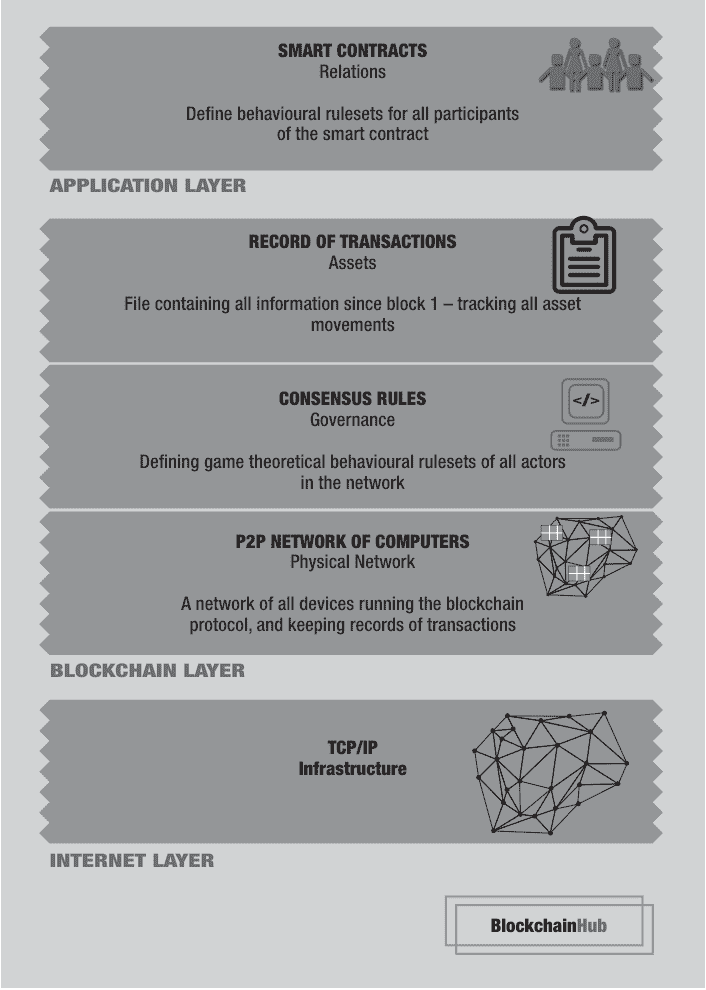

**以太坊及类似区块链的区块链技术堆栈（灵感来源于 Florian Glatz）**

11.6 去中心化组织与DAO之间的重要区别在于增加了“自主”一词。这正是字面意思。DAO通过一组对组织法律和行为进行编码的合同实现自主。这些不是传统的纸质合同，而是编码合同（智能合约），已被编码到区块链中，从而创建了一个全包性的、全面的去中心化智能合约。

11.7 拥有一个全面的单一去中心化智能合约的影响和效果非常重要。这意味着，与任何传统公司或甚至去中心化组织不同，DAO不需要人类的参与或互动。因为一切都已预先编程和编码，去中心化自治组织可以在区块链上自动执行合同条款，当其认为条件已满足时，无需人类干预即可自行指导。

11.8 去中心化组织和DAO确实有一些共同之处，但重要的区别在于，DAO将人类思维从方程式中移除，因为不需要任何形式的人类干预。相比之下，去中心化组织将拥有智能合约，但其运营将依赖于用户和人类干预。当人们意识到DAO在区块链上自主运行，完全由其代码控制，不受人类思维指导时，人们就会开始意识到在实际层面和监管层面都可能出现的困难。要明确的是，DAO能够就其功能与人类互动，但它不需要人类来运行，其提供服务背后的决策将排除人类指导。DAO可以被视为一种拥有自主智能形式的“大脑”的去中心化组织。在我们看来，将DAO视为接近人工智能将成为可能。

11.9 因此，DAO可以被视为一种新兴的组织类型。它们在以太坊区块链生态系统中尤为普遍，在一群人希望围绕共同目标进行协调时非常有用。这种协调可以通过智能合约来促进，智能合约通过自主实施带来优势。正是这种自主且不可更改的实施，使DAO相较于传统的层级结构组织具有重要优势。因此，DAO带来了新的可能性；它们通过自动化决策以及免受管理者董事会或其他影响传统企业实体的人类参与者的干扰，赋予了解决旧问题的新方式的能力。

11.10 DAO类似于合作社，但没有常常成为合作障碍的人类影响，并借助区块链带来的透明度。DAO也是去中心化的，并由智能代码逻辑自主驱动。在DAO的语境下，去中心化意味着许多团队和个人负责并推动一组目标，因此工作角色并非固定，成员以快速、流动的方式加入和离开。因此，DAO应以一种为其成员提供利益和激励的方式来构建其智能合约并进行协调。这些激励不仅在于成员参与并推动其所参与和相信的组织目标时获得的积极感受，还可以通过代币或非同质化代币（NFTs）提供直接的财务激励。不过，报酬并不总是财务性的，因为DAO为其活动生成或用于奖励成员的NFT，往往是在整个DAO内部建立社区身份的关键部分。DAO的透明度通过区块链实现，体现在每一步或每笔交易随时对任何人可见。此外，它以密码学方式保护成员的匿名性，但就其本质而言，其行动和目的确实是真正透明和开放的。

### 11.11 要使DAO完全功能，需要：

- 一套可供其运行的规则；
- 可用于奖励成员特定行为的代币或资金；
- 赋予投票权以制定运营规则的代币；
- 使每位投资者能够配置组织的结构。

### 11.12 在目标速度至关重要的情况下，DAO可以是一种高效且有效的工具。

最近的一个例子是ConstitutionDAO，它在2021年11月筹集了4700万美元的以太币，旨在购买一份美国宪法原件。虽然它未能如愿，但仅用五天就筹集了这笔巨款，以便在苏富比拍卖会上竞拍。尽管在拍卖会上被出价超越，但这展示了DAO的用例及其招募大量个人为单一共同目标进行众筹的能力。它还暴露了DAO在拍卖竞标背景下的一个弱点，即其内置的透明度意味着竞争投标者可以看到ConstitutionDAO筹集了多少资金，并且在了解其资金上限后，可以计划在该水平之上稍高的价格出价以中标。当Citadel Securities的首席执行官中标时，很可能采用了该策略。

### 11.13 NFT市场以及如今在全球价值方面已与传统艺术市场相匹敌的数字艺术市场，将注意力集中在DAO及其快速高效地为艺术品购买筹集大量资金的能力上。

PleasrDAO是一个为购买Plplpleasr艺术品而成立的DAO，此后还识别并购买了更多艺术品。其宣称的理念是：

> “以代币形式分配DAO的所有权。这使每位成员拥有其资产（即两个NFT和金库中的任何资金）的一部分。每位成员通过群聊参与DAO的治理。如果有人退出DAO，其代币将在内部供人竞得。”

### 11.14 在各个行业领域中，还有许多其他DAO的例子。

最著名的一个是支撑Dai治理的DAO，Dai是一种自称为“世界上第一种无偏见的货币”和“一种不歧视的稳定、去中心化货币”的稳定币。该DAO被称为

MakerDAO是Maker Protocol的治理结构，使用MKR代币。实际上，该机制允许MKR代币持有者对提案进行投票，并治理和实施Dai稳定币。这些MKR代币持有者驱动Maker协议，而MakerDAO治理该协议，由代币持有者决定Dai稳定币的政策。反过来，代币持有者的利益和激励措施应当确保这些政策有利于MakerDAO的用户。

11.15 比特币可以说是第一个功能完备的DAO，因为它自主运行，利用程序化规则，并通过共识协议进行管理。自本书第一版以来，人们对DAO的兴趣迅速增长，这在一定程度上可以归因于去中心化金融（“DeFi”）。DAO及其结构在金融服务领域尤其有用；金融交易和规则记录在区块链上，智能合约可以制定并执行组织规则，从而消除了金融交易中第三方参与的需要。

## DAO的法律地位及其他问题

11.16 对法律而言，DAO是一个难以界定的概念，而且它在全球司法管辖区似乎没有一致公认的法律地位。如果我们将去中心化组织和DAO视为一般性群体，那么显然法律没有跟上技术的步伐，司法管辖区似乎也无法界定或解决其法律地位问题。因此，DAO存在许多未解决的问题，尤其是涉及法律合规、福利、招聘、人才保留、收入波动和治理等方面的问题。DAO如何与第三方互动或采取措施开展业务？由于不具备正式法律实体的地位，DAO没有法律人格。这意味着DAO不能自行签订合同，财产所有权也变得问题重重。尽管DAO并非新鲜事物，但它仍然是一个相对新颖的概念，其在英国的形式法律地位尚未得到明确定义或确定。全球范围内情况依然如此，但值得注意的是，在美国怀俄明州，DAO可以注册为有限责任公司。

11.17 2021年7月1日，怀俄明州的《去中心化自治组织（“DAO”）法》生效，怀俄明州成为美国第一个将DAO法律地位界定为怀俄明州有限责任公司（“LLC”）的州。这需要满足某些要求，包括在其公司章程中注明其是DAO，由成员或算法管理，并包含直接用于管理、促进或运营DAO的任何智能合约的公开可用标识符。如果管理是算法性的，智能合约必须能够被修改、更新和改进。

11.18 尽管DAO在怀俄明州获得了州一级的法律地位，但笼罩在怀俄明州DAO头上的一个大问题是，未来是否会在联邦层面出现监管问题，因为监管机构美国证券交易委员会（SEC）会将赋予投票权和提供利益所必需的那些代币归类为证券。由此可见，即使在美国，尽管州法律帮助DAO成为有限责任公司，它仍然需要遵守联邦证券法规。

11.19 同样，在英国，DAO的监管待遇目前基于管辖其底层代币的框架。基于以太坊的代币的分类至关重要，因为只要它们可以被定义为交易代币或实用代币，那么在英国，它们就属于金融行为监管局（FCA）监管范围之外，不受监管管辖。但如果英国像怀俄明州那样，赋予DAO正式法律地位，会发生什么？虽然目前有充分理由认为基于以太坊的代币被视为不受监管，但作者认为，一旦DAO具有正式法律地位，FCA的看法可能会发生改变。在这种变化的情况下，代表DAO正式成员资格和投票权益的代币可能会实际成为证券，从而落入证券代币的定义范畴。这将使这些代币以及DAO因此进入FCA的监管范围。

11.20 有人担心，随着技术进步，DAO的能力将增强，作为DAO核心的智能合约组合将能够在没有人工干预的情况下做出各种决策。显然，就英国法律而言，DAO不能是自然人，因为自然人是指人类。同样，它也不能是公司、合伙企业或任何其他法律实体意义上的“人”，因为它不符合法律实体的传统概念。智能合约的组合实际上构成了人工智能构造的大脑，这远远超出了当前法律对法律认可的人或实体的概念。

11.21 澄清和界定DAO（以及去中心化组织）的法律地位至关重要，因为如果没有法律认可，任何投资决策由DAO决定的投资者都无法根据有限责任法律（即适用于公司的那些法律）获得任何保护。如果去中心化组织继续没有获得认可的法律地位，个人可能因其投资而承担个人责任，但对DAO或其做出的决定（即智能合约运行意义上的决定）没有任何追索权，因为没有可以起诉或投诉的主体。

11.22 当然，另一个问题将是DAO如何定义。例如，如果认定DAO是普通合伙的一种形式（并且有某种观点支持这一看法），那么那些获得代币的投资者之间可能作为合伙人相互负有信义义务，而这是他们在投资该计划时未曾预料到的。这种风险可能会降低首先进行投资的可能性，使去中心化组织看起来像一场冒险的赌注。

11.23 除了DAO因其能力增强而做出日益复杂的决策之外，还存在管辖权的难题。智能合约的使用将使DAO能够在全球范围内开展合作，但在其法律地位或投资者权利未得到任何承认的情况下，它们将变成高风险且非审慎的投资。

11.24 DAO也存在重大缺陷，尤其是缺乏法律人格，如前所述，这可能会阻碍它们在许多司法管辖区签订合同或拥有财产。这些缺点可以解决，但可能需要增加一些DAO本意要避免的传统治理结构。事实上，如果引入一系列传统的使能结构来吸纳现实世界的收益，例如传统合同的能力，那么不仅DAO的目标和纯粹性可能被破坏，而且董事或管理层也可能发现自己与DAO的目标发生冲突。

## 风险

11.25 DAO固有风险的一个例子可以从“The DAO”这一众筹项目中得到印证，这是DAO实际运作中最著名的例子。The DAO是一家风险投资企业，由一个机器网络按与驱动比特币数字货币的基本原则等价的原则运营。它旨在为运行在以太坊区块链上的项目筹集资金，根据成员的投票分配资金。以太坊是一种去中心化平台，没有中心化控制或控制者，任何拥有互联网地址的人都可以看到。它与比特币类似，但可以说提供了更多功能。在这种情况下，The DAO获得了成功，吸引了来自世界各地的数百万投资，但这一气球似乎在2016年6月12日破灭了，因为人们意识到软件中出现了感染。尽管发生了这种情况，据称没有任何资金面临风险。

11.26 在幕后，大约有50项关于是否资助项目的提案等待投票。当注意力转向修复软件漏洞时，一名黑客开始从The DAO中抽走以太币。以太币是以太坊平台的客户为执行请求操作的机器支付的付款形式。在不到一周的时间里，黑客设法转移了超过360万美元的代币销售所得以太币。以太币似乎从The DAO中被取走，并被投入到具有相同结构的软件中，即所谓的“子DAO”。这一操作打击了以太币的价格，使其从20美元跌至不到13美元。黑客能够利用计算机代码中的漏洞，通过多次提款访问，抽走约5000万美元。投资者面对一个拥有相当可观的人工智能且自主的“工具”，

看似不可撤销的权力，似乎已陷入瘫痪。解决办法是说服足够多操作*The DAO*的软件平台，以太坊，的人类，去修改底层代码。然而，这遭到了抵制；以太坊社区中有直言不讳的成员，抨击干涉*The DAO*的自主权的想法，将此次黑客攻击视为利用商定的合同条款使黑客获益。对这些DAO纯粹主义者来说，编码的智能合约在传统法律意义上等同于合同，对所有参与者都有约束力。代码犹如法律。

### 11.27
从本案例研究应当明显看出，任何DAO都并非不可妥协，且在发生黑客攻击或故障时，DAO的任何参与者都可能面临责任，并无法采取任何补救或救济措施。DAO是一个去中心化的自治组织。可能不存在自动适用的合同条款或条件，也不存在任何自动附加的监管体系，因此可能出现这样的情况：黑客能够在不受任何刑事或民事制裁的情况下使用资金；攻击的实施者随后可能逍遥法外，但投资者却可能因源自网络攻击的责任而承担责任。例如，攻击本身可能会将注意力集中于DAO，并且如果区块链涉及的国家存在违反法律法规的情况，投资者可能会发现自己面临针对其在参与DAO时未曾预料到的责任的诉讼。

### 11.28
另一个担忧是，随着物联网的发展，智能合约和自主技术控制着我们互联智能环境中各种有形和无形资产，风险将日益增大：*汽车*一路狂奔，车门锁死，乘客被困；或者*房屋*被黑客攻击，其所有互联内容都被用于黑客的利益。产生的风险不仅来自智能合约和代码所积累的智能，更来自授予技术的自主权。如果这种自主权被视为具有法律约束力，就像有些人在被要求变更*The DAO*底层代码时所主张的那样，故障或被利用的受害者将遭受双重屈辱，即损失被宣告为合法的。智能合约可能存在漏洞和不完美之处；人类无法每次都做到完美。断言*The DAO*在失败时是独一无二的，这违背常识。

### 11.29
如前一章所述，DAO本身可以说并非具有任何认可法律地位的实体，或者至少在这方面缺乏确定性。有些观点认为，它可能被归类为普通合伙，或者如果缺乏合伙的必要要素，则为合资企业。同样，这取决于所考虑的司法管辖区，且立场可能并非固定不变，因为它将受到各司法管辖区特定法律的影响。不仅需要对DAO的法律地位有法律确定性，还需要对Ether代币有法律确定性：它们是投资合同，因而受证券监管，还是不是？如果认为DAO的投资者合理地期望因他人管理而获利，这似乎是可能的方法，但也有反方观点认为合伙权益不是证券，同样，这将取决于我们应用哪种司法管辖区的棱镜，来形成我们对DAO、以太坊区块链上的代币以及DAO中的代币在法律上是什么的看法。

### 11.30
摆脱这种不确定性的方法可能是创建一种围绕DAO的标准法律实体形式，这可以被称为“法律外壳”（'legal wrapper'）。这将事先商定并设计一种更传统的法律结构，使得成员资格和股权得到明确规定，且外壳的法律地位确定且比普通合伙更安全。具体来说，在普通合伙中，其成员（实际上是合伙人）被视为共同代表DAO，并对其义务、行为和不作为承担责任。通过这种方式，成员可以建立抵御个人责任的屏障，并在风险更小的情况下获得更多确定性。

### 11.31
鉴于司法管辖区选择的重要性，还可以创建一份单独的传统“链外”（'off chain'）合同，规定专属适用的司法管辖区和法律。这种方法在第3章关于智能合约的部分进行了更详细的探讨。这里的合同还可以涉及DAO控制下的加密货币和加密资产，以确保它们受到多重签名托管钱包的约束，DAO成员能够更好地控制这些钱包。当人们认识到DAO本质上是智能合约的组合（或者，如果你愿意，一个超级智能合约）时，可以推断出，所有规避智能合约问题所需的预防措施都是必需的。

### 11.32
观察DAO领域将会很有趣，尤其是在2021年7月1日生效的最近怀俄明州DAO法（见上文11.17）之后，该法使DAO能够拥有有限责任公司的正式法律地位。马耳他可能会争辩说，它是2019年第一个通过立法的国家，通过规定创新技术安排（'ITA'）可以是“具有或不具有法人资格”的组织，为DAO拥有法律地位铺平了道路；然而，对许多纯粹主义者来说，马耳他法律过分强调管理者的责任。作者认为，无论是马耳他倡议还是怀俄明州DAO法，都不能作为DAO未来的定论，尽管新的用例日益涌现，特别是在加密领域，DAO仍然笼罩在法律不确定性之中。怀俄明州的影响将因其人口相对较少的小州地位而受到限制，并且在美国，联邦证券监管具有优先权，在任何竞争中肯定会凌驾于地方法律之上。只要DAO代币的性质存疑，任何DAO项目都将面临不确定的监管未来。鉴于DAO在NFT和DeFi的推动下不断兴起，总有某些东西需要改变；作者真诚地希望商业和技术常识能够占据上风，以免监管扼杀DAO无疑的潜力。

### 元宇宙

### 12.1
关于元宇宙是什么以及它实际上能做什么，存在大量混淆。为了正确理解元宇宙的含义，首先了解其技术特征将有所帮助。元宇宙是一种互联网应用程序，有些人可能称之为我们现有互联网版本Web 2.0的延伸，它结合了许多新兴或新兴技术。这种技术组合，可能被称为多技术，实现了人工智能、区块链、时空一致性、网络安全和隐私的融合。事实上存在大量的技术组合和可能性，但元宇宙的基本共同技术或共同分母至少包括上述内容。需要注意的是，人工智能（AI）算法，例如机器学习、深度学习、强化学习等，对于连接虚拟世界和现实世界至关重要。AI的组成部分，包括信息、算法和算力，必须在建立和发展元宇宙中发挥重要作用。正是通过使用AI，元宇宙才能创造出超出我们在实际现实世界中所体验的边界的社会和其他经济活动。通过使用计算机视觉、智能语音、语言处理和其他技术，用户将获得与现实世界相同的视觉和听觉感受。

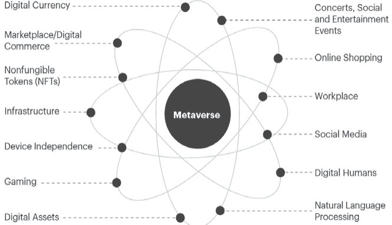

元宇宙的要素

### 12.2
因此，元宇宙本质上是一个平行的数字宇宙或赛博空间，它与我们所知的现实世界并存，同时也超越了在我们日常生活中如此限制我们的时间和空间的约束。

## 12.3 元宇宙

有人可能会争辩说，时空一致性是元宇宙最重要的特征。在元宇宙语境下，这有时被称为超时空性，实际上是一个与现实世界平行且虚拟的世界，它能够克服物理空间、时间和自然的限制，从而提供一种不仅身临其境，而且在所提供的体验和机会方面具有超自然感的体验。回到互联网延伸的类比，如果当前互联网提供的是一维体验，那么元宇宙将是一种3D、身临其境的增强现实体验。

12.3 需要注意的是，2022年目前存在的元宇宙，很可能不会是十年或几十年后可能出现的元宇宙格局。因为创建元宇宙需要多种技术的交汇，所以可能实现的内容在不断演变，而当今可实现的增强平行、虚拟超时空时空景观，与未来几年可能实现的相比还相差甚远。当今可能实现的一个主要缺陷在于对互操作性的需求。互操作性是指一个元宇宙平台或世界能够与另一个完全集成，以便用户可以访问。互操作性存在障碍，尤其是一些公司（例如苹果公司）据称设计其产品使其无法互操作。这并非旨在批评，因为有人可以争辩说，许多科技公司的当前商业模式是，互操作性会击败或至少损害其商业模式，该模式依赖于消费者追随，这种追随不仅忠于，而且在一定程度上局限于其品牌。

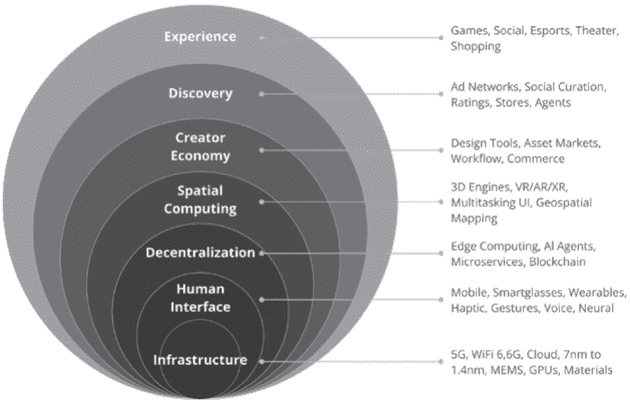

元宇宙的七层

12.4 乔恩·拉多夫提出了上述七层模型，作为元宇宙组成部分及可能实现相关功能的相应技术的示例。与单一企业所有者运营商的趋势背道而驰的是元宇宙联盟，这是一个由25个实体和组织组成的韩国财团，由韩国信息通信产业促进署支持，旨在发挥其合力创建元宇宙平台。正是这种规模化的合作，预示着开放元宇宙的互操作性可能性。

## 12.6 元宇宙

12.6 除美国和亚洲之外，阿联酋有望成为元宇宙的主要参与者，拥有迪拜元宇宙城市MetaDubai，该城市被吹捧将增强现实和用户体验提升到新高度，以及位于迪拜国际金融中心的Ripple总部。在欧洲，各行各业涌现出许多元宇宙平台项目，例如法国的音乐项目Stage 11正在大力投资，同时许多奢侈时尚品牌（如Prada和Gucci）推出虚拟时尚系列和身临其境的元宇宙购物体验。

## 元宇宙的监管框架

### 合同

12.7 当审视可能管辖任何元宇宙的法律和法规时，起点必须是合同法。原因很简单；已经存在若干元宇宙，每个元宇宙都由其公司或组织所有者拥有和控制。作者认为，无论寻求进入哪个元宇宙，第一步都必须同意其条款。这些条款可能是服务条款、使用条款或最终用户许可协议，但无论该文档被赋予什么名称，它本质上规定了用户与元宇宙所有者之间的合同地位。这些合同旨在作为具有法律约束力的文件，详细规定元宇宙用户的权利、义务和期望，条款和条件将以相当详细的方式规定什么是可能的、什么是不可能的。这些合同条款不仅可能涉及元宇宙中的所有权概念，还可能扩展到其他方面，例如知识产权，以及所有者在元宇宙语境下的权力和决策。

12.8 我们将在本章后面更详细地探讨这一点，但可以肯定的是，通常和预期的立场是，这些元宇宙使用条款将使所有者相对于用户处于优势地位。此外，用户在进入时不仅几乎没有议价地位，甚至根本没有议价地位，而且大多数用户甚至不会在滚动页面并点击接受之前阅读合同文件。这些详细且通常冗长的合同文件将包含许多法律术语、法律专业术语和其他复杂性，非法律专业用户可能根本不习惯或不感兴趣，因为潜在的信念（尽管可能是错误的）通常是，这只不过是为了进入特定元宇宙而必须完成的一种形式。也许具有讽刺意味的是，由于目前的元宇宙由公司拥有，它们受到集中所有权和控制的约束，这与去中心化和区块链的目标恰恰相反。然而，问题不仅在于区块链纯粹主义者可能会对这种集中控制地位感到不满，还在于就虚拟财产所有权而言，由于单一公司所有者对控制的压倒性影响，元宇宙将面临一些重大挑战。正是这些服务条款、这些合同文件勾勒出了法律图景，根据作者对当前示例的考察，虚拟财产的所有权可能实际上根本不是这种所有权，正如我们稍后将详细阐述的那样，所有权是这一合同框架内一个非常具有挑战性的概念。

12.9 许多用户心目中虚拟所有权的概念是，可以通过使用非同质化代币（NFT）在元宇宙中购买虚拟财产。该概念认为，你获取虚拟财产，并在此过程中分配或购买一个非同质化代币，该代币是你所有权的不可更改的证明。该NFT在区块链上记录交易，由于其去中心化的数字账本，该记录无法被修改或删除。进一步的保障来自NFT存储在钱包中，而没有私钥，该钱包无法以任何有效方式访问。去中心化的主题随后使许多用户相信，这是获取和拥有虚拟财产的一种非常安全的方式。此外，许多用户宣称，互操作性——即元宇宙的技术特征将是能够在更广泛的、普遍互联的元宇宙中使用所获取的财产——是元宇宙的又一技术特征，目前更多是神话而非现实。简而言之，通过NFT获取或相信自己获取了虚拟财产的问题在于，NFT和虚拟财产（无论是酒吧、餐厅、时尚物品还是其他任何东西）并非同一事物。

12.10 那么可以得出的结论是，一个人可以获取并合法拥有一个NFT，该NFT不可更改地表示虚拟资产购买，但你可能并未以任何有意义的方式合法拥有或持有虚拟资产本身，因为如果服务条款或其他合同使用文件允许，平台所有者可以有效地将该虚拟资产从你那里拿走或赠送。举例来说，有人可能在元宇宙中购买一幅蒙娜丽莎，并获得一份证明该购买的NFT，但随后发现蒙娜丽莎已从元宇宙中消失，并显然已从平台数据库中删除，因此他只剩下NFT本身。作者认为，在元宇宙中购买虚拟财产时出现的这种误解和问题，源于与现实财产的混淆。虚拟财产与现实财产或土地并不相同。例如，如果有人购买土地并获得产权证，那些产权证反映了土地的所有权，但除此之外，所拥有的土地（如果是建筑物，则是实心砖瓦）也已被获取和购买，前提是产权转让已正确完成。如果购买了该现实财产的永久产权，则所有者拥有一个具有真实价值且由其拥有和控制的产权。这是

这与虚拟财产所有者所面临的生存威胁不同，后者的所有权建立在合同框架之上，并因此取决于赋予元宇宙所有者的权利和权力。

12.11 元宇宙实际上是数字土地或数字平台，酒吧或其他结构等虚拟资产坐落其上，而且许多合同条款还会额外允许元宇宙所有者行使自由裁量权，将用户逐出，或删除、移除“其”虚拟资产。虽然合同条款会因元宇宙的不同而各异，但很难设想元宇宙所有者不会赋予自己在元宇宙使用方面压倒性的影响力和权力。至少在元宇宙用户拥有议价地位（这可能意味着元宇宙必须容纳并提供其他权利和权益）之前，情况会一直如此。作者已经指出，在像沙盒这样的元宇宙中，拥有公司保留自行决定删除、移除、使用或访问用户数字资产的权利。当然，人们可以说，随着元宇宙领域竞争加剧，商业考量可能会稀释这类条款，但情况仍然是，元宇宙的法律框架将由其所有者控制者在进入时施加的使用条款决定。毫无疑问，法院和律师函件中会出现大量关于某些条款不公平或可执行等问题的争论，但在没有成功抗辩的情况下，许多情况下的起始立场将是合同性的。

12.12 这里必须强调的另一个关键点是，当你审视元宇宙时，许多关键特征，如视觉效果、建筑以及增强现实的沉浸式世界，都存在于区块链之外。角色、化身以及构成元宇宙环境的其他一切奇妙事物，当然都存放在拥有公司的私有服务器上，用户无法访问。用户可能拥有一个位于区块链上的NFT，宣示其对虚拟资产的购买，但该虚拟资产位于区块链之外，存在于拥有公司私有的、编码的数据库中；而且，如果合同条款允许拥有公司在例如你被逐出元宇宙或被认定违约的情况下干预或没收你的NFT，那么即使是这些NFT也可能无法免受拥有公司的影响。在实际和技术层面上，这对拥有公司来说可能难以实现，但作者可以设想这样一种情况：有人可能对NFT所有者提起诉讼，并通过强制执行合同没收的强制令寻求救济。

12.13 作者将不点名具体的元宇宙所有者以免尴尬，但可以肯定地说，这些条款已经出现在当前的元宇宙使用条款中。当涉及在元宇宙中“购买”虚拟财产时，心中应记住的谚语可能是“买者自负”，或者更准确地说，“并非元宇宙的所有街道和资产都铺满黄金”。这当然不是说在元宇宙中获取虚拟资产没有好的商业或其他理由，也不是说在所有情况下这种获取都会有麻烦。然而，作者非常清楚，任何虚拟资产的获取都可能只不过是一种虚拟的、不完整的获取，如果周围的合同支架不能恰当地支持该购买的话。在上述极大警示之外，还有一个额外的警示：即使合同文件看起来对购买有利且支持购买，用户和潜在买家也应检查以确保没有任何条款允许所有者随时修改、扩展或以其他方式更改其使用条款。还应检查合同的任何修订都必须通知用户。否则危险在于，一份有利的合同可能会变成不利的合同，对用户而言，最好的情况是通知极少，最坏的情况是根本没有通知。从根本上说，由于使用条款通常也是用户必须遵守的行为准则，用户负有巨大责任以确保自己始终合规；即使用户会被告知行为准则和使用条款的任何变更，除非反复审查合同，以避免错过可能对用户意图造成灾难性影响的变更，否则问题仍会出现。

12.14 这一切的原因很简单：元宇宙平台由所有者控制者集中管理，而所有者控制者很可能会被激励去实现自身最优的商业利益。元宇宙通常被视为区块链的同义词，因为区块链是允许商业交易在虚拟环境中进行的基础技术。然而，除非这种环境的所有权和中央控制得到解决，或通过加强竞争得到纠正，从而建立更民主的体系或某种形式的去中心化所有权，否则作者担心这些问题将持续存在。另一种可能的出路是法律本身治理元宇宙，例如默示合同条款，或以其他方式施加旨在确保用户获得公平结果的法规。但在撰写本文时，任何司法辖区都尚未制定此类立法。作者还将提出管辖权问题：鉴于元宇宙当然是一个虚拟世界，因此不处于任何司法管辖区内，可以说它属于网络空间吗？那么，究竟哪个司法管辖区可能适用于元宇宙？管辖权难题将在本章后面更详细地探讨。

## 知识产权

12.15 从广义上讲，知识产权是指智力的创造，如发明、设计、品牌、艺术作品、音乐以及其他人类心智的创造。对这些智力财产或知识产权的权利通过各种法律手段确立、保护、执行和推广。这些法律手段包括：专利（通常保护技术发明）、商标（与产品相关联并保护品牌）、版权（字面意义上就是复制音乐、艺术和文学的权利）以及产品和标识的设计权。互联网的出现给知识产权带来了新的挑战，因为在模拟时代设计和制定的法律难以跟上数字化所产生的新环境和情况。互联网的全球性、无边界性，以及众多相互关联的司法管辖区内零散且往往不充分的法律框架，造成了特别的困难。元宇宙将被证明更具挑战性，目前由一维互联网带来的问题将因Web 3和元宇宙而呈立方级增长。

### 商标

**12.16** 商标本质上是一个标识或其他标记，如文字、设计或图形，用以显示商品的来源；实际上，商标可以被视为品牌标识或标记。因此，商标对于企业建立和保持品牌很重要，因为另一方使用该商标可能会使消费者误以为商品或服务是由该商标的真正所有者提供的。商标很常见，对于保护企业品牌非常有用。在元宇宙中，情况无疑也是如此。然而，在元宇宙中经常出现的问题是，商标是否能像在现实世界中一样生效？商标所有者能否像在现实世界中一样在虚拟世界中执行其商标权？如果看看游戏世界，就会发现目前对此还没有明确答案，因为这在很大程度上取决于每个案件的具体情况，尤其是未经授权的用户对商标的使用方式。

**12.17** 在 *E.S.S. Entertainment 2000 v Inc v Rock Star Videos, Inc*（2008年）（第九巡回上诉法院）一案中，问题是《侠盗猎车手：圣安地列斯》中对脱衣舞俱乐部的描绘是否构成对标志所有者的商标侵权，该所有者在现实世界中经营一家脱衣舞俱乐部。在此案中，法院认定，在游戏场景或虚拟世界中使用脱衣舞俱乐部并不属于可诉行为，因为它没有侵犯所有者的商标和权利，因为总的来说，法院认为这是一种受保护的艺术表达，并且认定不太可能造成混淆，使消费者可能认为该视频游戏是由该脱衣舞俱乐部制作的。因此，对艺术表达的保护与消费者不太可能认为该脱衣舞俱乐部实际上负责该游戏世界中的脱衣舞俱乐部描绘的认定相结合，构成了驳回该诉讼的理由。

**12.18** 在 *Leo Pellegrino v Epic Games, Inc*（ED 2020）一案中，一位萨克斯管演奏家提起诉讼，声称一款名为《堡垒之夜》的游戏包含一个吹奏萨克斯管的化身，该化身复制了他特有的舞蹈动作，从而侵犯了他的商标。该诉讼失败了，因为（也许并不出人意料）法院认为该诉讼更适合以版权法而非商标法为基础，但最终原告撤回了诉讼。尽管如此，这些案例表明，元宇宙中的商标保护远非有保障，商标所有者需要采取行动，努力优化他们在虚拟元宇宙世界中获得商标保护的机会。

12.19 艺术许可这一抗辩在挫败诉讼请求方面似乎确实特别有效，AM General LLC 诉 Activision Blizzard, Inc（S.D.N.Y. 2020）案的判决结果也是如此。在该案中，AM General 起诉 Activision Blizzard，称后者在《使命召唤》电子游戏中使用了其声称受商标保护的卡车，侵犯了其商标。法院同样基于该卡车的使用具有艺术许可而判 Activision 胜诉，并且进一步认定，在游戏背景下使用真实世界中的实际车辆，有助于为这款本应属于现代战争的游戏增添真实感和逼真感。这并不是说商标诉讼请求在元宇宙中总会失败，因为在一些游戏诉讼中它们确实失败了，但这表明必须格外谨慎。可能导致诉讼请求成功的一个特点是：商标的使用明显具有商业性质，并且被认为能够或可能使消费者产生混淆，认为侵权者实际上就是商标所有人，且该标志是由其使用或创建的。

12.20 相反，元宇宙中的用户需要谨慎行事，以确保自己不侵犯或可能侵犯商标权。鉴于商标的数量和激增，这可能很棘手，但如果要避免诉讼请求，在元宇宙中应采取与现实中同样的谨慎态度。正如用户可能对其所代表的内容小心翼翼一样，商标所有人也需要警惕其商标被侵权，他们可能会考虑聘请专业的商标监测或监控公司来关注并密切监测元宇宙中潜在的侵权行为。

12.21 平台也应当监测并了解其平台上的活动，并在担心可能存在侵权活动时采取行动。同样可以预期的是，当商标所有人发现潜在的商标侵权时，会通知平台，以便平台考虑是否能根据其条款和条件以及适用的许可采取行动。事实上，元宇宙的一个优势可能是商标所有人能够联系平台，并以此作为终止侵权活动的手段。前面提到过，在某些情况下，用户可能会被逐出元宇宙，其财产被“删除”；如果侵权行为被认为具有重大性、严重性和故意性，这可能就是其中一种情况。同样，这在很大程度上取决于该情况下适用的用户协议和许可条款。

12.22 这个故事的寓意在于，商标所有人应确保其商标已注册，以便在元宇宙中获得最佳的执行机会。商标可以向美国专利商标局（USPTO）或同等机构注册。根据作者与客户打交道的经验，在美国向美国专利商标局注册似乎是首选途径，以期确保所有人在元宇宙中能保持对该商标的专有权利。

## 12.23 元宇宙

12.23 还应指出，鉴于可能根据不同司法辖区的各种法律提出诉讼挑战，元宇宙中提起的诉讼请求可能会有不同的结果，这也同样适用于商标。尽管如此，在世界主要司法辖区采取措施保护商标仍然是有意义的，并以此寻求优化保护。作者的预期是，由于元宇宙的商业性质以及通过使用品牌或商标获得商业优势的空间，那些试图侵权的人将获得可观的获利机会。这也可能使针对侵权的诉讼请求更有可能获得成功，只要能够证明对方有意通过故意、未经授权地对另一品牌标志进行商业性应用来谋利。在游戏领域，其商业化程度往往与元宇宙中将会存在的商业化程度不同，这一点可能对未来的裁决具有决定性意义。

## 版权

12.24 元宇宙中另一个激烈的战场将是版权。虽然世界各地的版权法及其保护存在差异，但肯定有一些共同的主题。作者认为，鉴于元宇宙的沉浸式特性，以及平台所有者和用户之间可能产生的潜在紧张关系，尤其是在参与者之间为了扩大影响力和赢得商业机会而可能展开的商业战争中，版权将受到严峻的压力测试。全球主要司法辖区的版权保护延伸至保护以有形表达形式固定的原创作者作品。版权（字面意思是复制权）是授予原创作品的作者或创造者的专有权利，包括复制、分发和改编该作品的权利。版权本质上是保护所谓思想固化的表达，而非思想本身。因此，是思想转化为创作的过程获得了保护。版权法还列出了可受版权保护的各类作品，即能够获得版权保护的作品，毫无疑问，元宇宙将产生许多可受版权保护的作品。这并不是说元宇宙中创作的每一件作品都可受版权保护，但肯定包括艺术图像、图形、软件、音乐或其他创造性形式（例如化身）的作品将是可受版权保护的。

12.25 如果审视游戏领域以及已经出现的争议类型，很明显这些争议以及更多争议将会在元宇宙中出现；考虑到其商业性质以及销售商品和服务时的争夺，这一点尤其可能。就像游戏领域的挑战可能被证明是困难的一样，元宇宙的情况很可能也是如此。版权所有人首先需要识别版权的滥用，然后能够证明其侵权足以构成可诉的侵权行为。此外，还有合同层面，即还需要审查用户协议和各种许可，以确保例如受版权保护的作品在元宇宙中的使用是允许的，或者创作是依照使用条款或适用许可被允许的。毫无疑问，许可将在元宇宙中发挥关键作用，而且根据许可主张的合同权利与旨在保护原创性创造的商标法之间很可能会发生冲突。

12.26 原创性的创造将成为元宇宙中一个激烈争夺的领域，例如化身的使用将引发许多棘手的法律问题。这些问题将包括：谁拥有化身？化身中的版权属于谁？化身是否属于可注册的作者作品，还是独立于其所出现的元宇宙而受到保护？化身已经在游戏中使用，一旦扩展到元宇宙，其使用将发生深刻扩展，而且鉴于元宇宙的沉浸式和商业性特质，关于谁拥有该化身的版权以及随之而来的价值的争议可能会增加。为了理解问题可能如何出现，首先应当理解化身是如何开发的。虽然平台可能会创建或开发化身，但有时（如在游戏中）平台所有者会为用户提供调整、创造或个性化其化身的可能性，使其具有独特或与众不同的特征、外观和特点。当化身的用户发挥了其创造性影响时，许多司法辖区将出现一个法律问题，即他们是否作出了重大的创作决定，从而可以被视为已成为其独特、个性化化身的作者和版权所有者。

12.27 现有主要司法辖区的版权法在应用上的困难在于，它不太适合元宇宙，尤其不适合化身的创建和改编。定制并创造性地个性化其化身的用户当然值得获得回报，并且在创建自己的化身时，应当被视为该作品的法律作者。相反，平台的拥有者将创建围绕元宇宙的合同文件并提供可能延伸至化身使用的许可，他们可以合理地主张，是他们建立了元宇宙环境，化身由他们赋予生命，并且确实是他们的创造。有人可能会说，如果化身用户所做的修改很轻微或缺乏必要的原创性，那么情况就更加直接，化身仍然是平台拥有者的创造。然而，当用户投入了时间、智力和创造力来创造独特的特征，这些特征不仅超越其独特外观，还包括其移动方式、特定行为、沟通风格和“方言”时，情况将变得更具挑战性。在现阶段，化身的变体太多，无法深入探讨，但应该认识到，改编和个性化的范围是巨大的，用户可能打造出一个毫无疑问属于其创作的化身。在这种情况下，作者们建议可能存在一种合作所有权形式，使得化身构成平台所有者和用户之间的共同所有权作品。

## 12.28 元宇宙

12.28 在作者们看来，在许多法域中，这种共同作者身份的概念将适用于化身，只要化身用户运用了超出最低限度的创造性，从而能够表现出已固定在有形表达形式（即化身）中的原创作者表达。

12.29 为了在问题出现之前尝试解决这些问题，有必要首先认识到是否存在诸如最终用户许可协议之类的合同来处理化身版权的问题。我们认为，衍生作者身份从属于共同作者身份，其结果是，衍生作品的作者只拥有添加到衍生作品中的原创材料的版权，而对基础作品不享有权利。如果衍生作品的创作者失去使用基础作品的权利，或者该权利被撤销，那么他们就不能利用该衍生作品，因为那将侵犯基础作品的版权。如果化身被视为衍生作品，那么该衍生作品的作者将对化身享有权利，这可能阻止他人复制它，但这些权利并不允许他们在未经基础作品版权所有者（即元宇宙平台所有者）许可的情况下使用化身。

12.30 衍生所有权/作者身份的情况最可能出现在：化身基于现有受版权保护的角色，或者化身基于平台所有者提供的模板，并且个性化或改编的程度尚未达到获得共同所有权形式所需的原创性。这在很大程度上将取决于化身用户被允许进行的改编程度以及实际进行的改编程度。更复杂的是，化身可以被视为一种集体作品，就像选集或百科全书一样，其中各种独立且互不依赖的贡献被汇集在一起形成一个整体。按照这种观点，化身可能仅仅被视为对整个集体作品的一个个体贡献。在这种情况下，由于对集体作品的每一贡献都被视为与整个集体作品的版权不同，每个用户很可能是其化身的创作者或作者，他们拥有其化身的版权，而平台所有者和元宇宙提供者则被视为计算机程序以及该程序无需该化身用户的大量输入即可生成的任何其他显示和/或视觉效果的创作者。

12.31 关于给元宇宙平台所有者和元宇宙中版权作品使用者的建议，作者们建议，所有与版权作品相关的合同协议和许可都应进行详细审查和检查，以了解其范围和效果。只要可能，就应该对将在元宇宙中使用的资产和软件进行版权登记。此外，只要可能，应采取技术措施，防止未经授权分发版权作品，并防止规避安全措施。与商标一样，还应仔细监控何时可能发生版权侵权，并评估适当的网络空间。这已经是我们在互联网和当前经历的 Web 2.0 版本上的现状。事实上，就英国而言，作者撰写了《网络安全法律与实践》，1 该书阐述了规范网络空间的民事和刑事法律框架。网络空间本质上是元宇宙的空间，我们认为，同样的法律框架，即计算机法以及在线数字环境法，将适用于元宇宙。该法律框架包括网络犯罪和《1990年计算机滥用法》下的犯罪，以及《2018年数据保护法》和《2018年通用数据保护条例》下的责任。

1 Armstrong D, Hyde D, Thomas S, 《网络安全法律与实践》，第2版（Lexis Nexis, 2019）。

12.36 《1990年计算机滥用法》将继续适用于起诉元宇宙中的网络犯罪。该法没有定义计算机，但法院采用的解释非常宽泛，除了计算机的当代含义外，还包括任何能够存储、处理或检索信息的设备。第1条规定了黑客攻击罪，即未经许可干扰特定数据或他人的计算机。这是核心的未经授权访问，亦即俗称的黑客攻击罪，第2条另设了一项辅助犯罪，即未经授权访问或黑客攻击意图实施另一项犯罪。第3条将损害计算机运行的行为定为犯罪，例如勒索软件、特洛伊木马或拒绝服务攻击，其解释十分宽泛，以至于涵盖了将虚假信息插入计算机的情形；例如，信息声称来自授权来源而实际上并非如此，即构成该罪。人们可以想象在元宇宙背景中发生这种虚假陈述和犯罪的无数情况。

12.37 除了这些犯罪之外，该法还将那些通过制造、供应或获取用于这些攻击的电子材料或其他材料来支持网络犯罪的次要方定为犯罪。当我们进入元宇宙和 Web 3 时，他们将被该立法所涵盖。重要的是，这些罪行可以域外起诉，即超出英国边界，在能够证明与英国有重大联系的情况下遍及全球。这种联系不仅存在于被告是英国国民时，还存在于网络攻击链中的任何计算机位于英国时。这可能是用于发起攻击的设备、目标或受害者计算机，或中间的任何计算机。在元宇宙的背景下，当网络犯罪触及基于英国的计算机时，这将使起诉和英国管辖权得以行使。

12.38 截至撰写本文时，《在线安全法案》仍在议会下议院审议，尚未成为法律。如果假定它以目前或非常类似的形式颁布，那么问题在于它为受监管的在线服务建立的制度是否将适用于元宇宙。

当前受监管服务的定义相当宽泛，由几个要素构成。因此，如果满足以下条件，则服务将受到在线安全制度的监管和约束：

1. 它要么是用户对用户服务，要么是搜索服务；
2. 它与英国有联系；并且
3. 根据附表1不属于豁免范围。

如果假设条件2因与英国有联系而满足（尽管这取决于事实），问题是该定义是否会涵盖元宇宙中的服务。

### 12.39 用户对用户服务的定义包含一些必须全部存在的核心要素：

- 互联网服务；
- 由用户生成、上传或共享的内容；
- 其他用户能够接触该内容。

用户对用户平台内的搜索功能将根据用户对用户规定进行评估，而搜索到元宇宙的搜索引擎仍将作为普通搜索引擎受到监管。如果搜索引擎专门针对元宇宙网站，那么该搜索引擎是否会被监管则是一个问题。这取决于元宇宙网站能否被定义为网站，在作者直观看来，这是有可能的（如果不是很可能的话）。作者们预期，元宇宙在《在线安全法案》成为法律后将受到其约束，因此，这些受监管服务的提供者将受到英国通信办公室（OFCOM）的监管。

### 12.40 监管的重点是三类内容：

1. 非法内容。
2. 对儿童有害的内容。
3. 对成年人合法但有害的内容。

所有受监管的服务都必须保护用户免受非法内容的侵害，并且将对可能被儿童访问的服务提供者施加额外义务。

### 12.41 总之，《在线服务法案》对以下主体施加了法律要求：

- (a) 允许用户接触其他用户生成、上传或共享内容的互联网服务提供者（“用户对用户服务”）；
- (b) 允许用户搜索多个网站和数据库的搜索引擎提供者（“搜索服务”）；
- (c) 发布或展示提供者色情内容（由提供者发布而非用户生成的色情内容）的互联网服务提供者。

## 12.42 The Metaverse

12.42 It will have extra-territorial impact and apply to providers of regulated services who are based outside the UK as well as those that are within. It will require these providers of user-to-user and search services to:

- (a) assess their user base and the risks of harm to those users present on the service;
- (b) take steps to mitigate and manage the risks of harm to individuals arising from illegal content and activity, and (for services likely to be accessed by children) content and activity that is harmful to children;
- (c) put in place systems and processes which allow users and affected persons to report specified types of content and activity to the service provider;
- (d) establish a transparent and easy to use complaints procedure which allows for complaints of specified types to be made;
- (e) have regard to the importance of protecting users’ legal rights to freedom of expression and protecting users from a breach of a legal right to privacy when implementing safety policies and procedures; and
- (f) put in place systems and processes designed to ensure that detected but unreported CSEA (child harmful) content is reported to the National Crime Agency.

12.43 The Data Protection Act 2018 (‘DPA’) and General Data Protection Regulations 2018 (‘GDPR’) which govern the use of personal information will also have considerable impact due to the centrality and volume of personal data that is generated, handled and processed in the Metaverse through its transacted commerce. Add to this the use of personal data that will arise from Avatars resembling their users or another natural person and the ability of the Metaverse eco-system to crunch the personal information of users across the globe and it is clear that privacy will become a battleground. To put this into context a mere 20 minutes of VR use can generate some two million unique data elements.

12.44 The DPA and GDPR combine to protect a data subject’s personal information ensuring that personal data is handled in accordance with the following principles:

- (a) processed lawfully, fairly and in a transparent manner in relation to individuals (‘lawfulness, fairness and transparency’);
- (b) collected for specified, explicit and legitimate purposes and not further processed in a manner that is incompatible with those purposes; further processing for archiving purposes in the public interest, scientific or historical research purposes or statistical purposes shall not be considered to be incompatible with the initial purposes (‘purpose limitation’);
- (c) adequate, relevant and limited to what is necessary in relation to the purposes for which they are processed (‘data minimisation’);
- (d) accurate and, where necessary, kept up to date; every reasonable step must be taken to ensure that personal data that are inaccurate, having regard to the purposes for which they are processed, are erased or rectified without delay (‘accuracy’);
- (e) kept in a form which permits identification of data subjects for no longer than is necessary for the purposes for which the personal data are processed; personal data may be stored for longer periods insofar as the personal data will be processed solely for archiving purposes in the public interest, scientific or historical research purposes or statistical purposes subject to implementation of the appropriate technical and organisational measures required by the GDPR in order to safeguard the rights and freedoms of individuals (‘storage limitation’);
- (f) processed in a manner that ensures appropriate security of the personal data, including protection against unauthorised or unlawful processing and against accidental loss, destruction or damage, using appropriate technical or organisational measures (‘integrity and confidentiality’).

12.45 This protection will be essential as the authors expect the Metaverse to monetise personal data; after all it is a valuable income stream and one that can be harvested very effectively through the Metaverse. This will doubtless strain even the strongest data protection regimes. The GDPR affords Europe-wide protection and data protection legislation in the US, is arguably behind Europe (though California and its CCPA may be an exception) in that it tends to lean toward protecting the corporate rather than placing individual rights at the pinnacle. Other jurisdictions’ data protection laws however can vary considerably, and this will present a real threat to users who seek to rely on local data protections.

12.46 The authors do not propose to rehearse the contents of earlier chapters that set out the regulation of blockchain and cryptoassets around the world, but it must follow that any activity that is undertaken in or in relation to the Metaverse must not fall foul of regulations that dictate which activities require authorisation, registration or licence in order to be conducted lawfully. Taking the UK as an example, an attempt to launch a Metaverse centred venture that conducts any of the listed regulated activities whilst unauthorised or not exempt will breach the general prohibition and constitute a criminal offence. Generally, an activity is a regulated activity if it is an activity of a specified kind that is carried on by way of business and relates to a specified investment or property of any kind. It will be by way of business if it satisfies the appropriate business test and is included on the lengthy list of specified activities. Dealing or arranging or advising in relation to investments are more common examples especially where a scheme may use crypto assets (fungible or non-fungible) as part of what is deemed a regulated activity.

12.47 Even where regulator authorisation may not be required because there is no activity of a specified kind involved, a venture may still be required to register with the UK Financial Conduct Authority where cryptoasset exchange business takes place or because the business is acting as a wallet custodian within the definition of the Money Laundering Regulations that catch cryptoasset business.

## 12.48 The Metaverse

Here too the risks are high. Should a business fail to register when registration was a requirement then the business’ entire revenue is at risk of being categorised and seized as the proceeds of crime. Gambling, gaming and lottery laws may also be engaged where a scheme or activity involves a prize or a game of skill or chance and these regulations will apply to a Metaverse based game. Loot boxes or tokens or other virtual asset rewards may still trigger gambling regulator scrutiny and caution will need to be exercised. This is essential where Islamic law states, such as the United Arab Emirates, may be connected to the venture as gambling activities are banned in such jurisdictions and consequences can be serious.

12.48 Traditional, non-cyber crime, whether that be financial crime or crimes against the person, may also be potentially committed in the Metaverse. In the same way that cyber stalking or online bullying and harassment or threats to assault take place in the real world there is the opportunity and expectation of their incidence in the Metaverse. Moreover, haptic gloves, VR body suits and other sense simulators will stimulate the Avatar user such that a blow or attack will render pain and anxiety. The authors can see numerous ways to prosecute these Metaverse attacks or incidents using current laws; indeed, even if the battery (the physical blow) poses legal challenges there are alternative offences that only require the fear or threat of attack.

## The jurisdictional issue

12.49 Jurisdiction is often a thorny issue as those resident in a country or state, whether practising lawyers or lay people, have a natural tendency to assume the law of their land will apply. This is both natural and understandable. However, it will not always be the case. In most countries there will need to be a genuine connection to that jurisdictional forum in order to prescribe laws and to enforce a state’s law usually requires a territorial link. International law has created six bases for prescriptive jurisdiction, namely territorial, nationality, passive personality, effects doctrine, protective and universal. The two most invoked are territorial, where the activities are carried out within the countries’ borders and nationality, where the acts are those of its own nationals. Acts against those nationals, even when committed by others who are not nationals and outside the jurisdiction may fall to be caught. The effects doctrine, pursued by the US, will allow for jurisdiction where the acts are committed in another jurisdiction but where the effect is felt in the home jurisdiction. Finally, the universal basis, as the name suggests, allows for universal jurisdiction where the act or crime in question is so heinous as to be deemed destructive of international rules.

12.50 One of the likely difficulties of the Metaverse will be where a conflict of jurisdiction arises with more than one nation state asserting that its jurisdiction and laws are appropriate. This could lead to multiple jurisdictions being posited as the correct forum where a Metaverse transaction or incident see persons from a myriad of jurisdictions collide.

12.51 前面几段应足以说明，对于元宇宙而言，适用哪个司法管辖权和哪国法律将是一个有效且亟需深入探究的问题。管辖权本就复杂；而各国越来越倾向于制定那些明示在设计上即具有域外效力的法律，这使得问题更加复杂。也就是说，一个民族国家单方面宣布其法律在发生违法行为和/或与本国存在规定联系时予以适用。英国、美国、中国和俄罗斯都通过了具有域外设计的法律，这些法律包括网络和/或数据保护立法。鉴于元宇宙本质上是网络空间，这一点尤其具有现实意义。这些域外网络法律和法规的出现将日益导致管辖权冲突和地缘政治较量。互联网已经对我们的全球法律进行了压力测试，不仅暴露出法律之间的不协调，还暴露出无国界网络空间可能给在模拟的、有边界的世界中构想出来的法律带来的紧张关系。地缘政治以及不同的政治和文化理念意味着短期内看不到简单或可行的解决方案。

12.52 我们必须寄希望于能够发展出普遍管辖权或类似原则，从而确保结果的确定性并避免冲突。当然，元宇宙所有者可以通过制定包含行为管理标准条款的用户协议和许可来提供帮助，但这种方法也需要合作和外部监管。遗憾的是，历史告诉我们，在这一领域的国际合作不太可能实现。人们曾期望GDPR开启数据保护的勇敢新纪元，由欧洲在捍卫个人个人信息权利方面引领潮流。然而，这一值得称赞的目标并未实现；俄罗斯和中国通过的法律最终赋予国家对数据的主权，世界因此拥有了一套支离破碎、运转不良的网络安全法律。尽管如此，作者们还是提出了这样一种可能性——尽管新颖而遥远——即元宇宙可能会在各个方面发展成真正的互操作，并促成前所未见的监管和管辖权的协调统一。

## 附录一

### 通用数据保护条例

欧洲议会和理事会（EU）2016/679号条例

2016年4月27日

关于在处理个人数据方面保护自然人以及此类数据自由流动的条例，并废除第95/46/EC号指令（通用数据保护条例）

（与欧洲经济区相关的文本）

欧洲议会和欧盟理事会，

考虑到《欧洲联盟运行条约》，特别是其第16条，

考虑到欧洲委员会的提案，

在将立法草案送交各国议会之后，

考虑到欧洲经济和社会委员会的意见¹，

考虑到区域委员会的意见²，

按照普通立法程序行事³，

1 官方公报 C 229，2012年7月31日，第90页。
2 官方公报 C 391，2012年12月18日，第127页。
3 欧洲议会2014年3月12日的立场（尚未在官方公报上公布）和理事会2016年4月8日一读的立场（尚未在官方公报上公布）。欧洲议会2016年4月14日的立场。

鉴于：

- (1) 自然人个人数据处理方面的保护是一项基本权利。《欧洲联盟基本权利宪章》（以下简称“宪章”）第8条第1款和《欧洲联盟运行条约》（TFEU）第16条第1款规定，每个人都有权保护与自身相关的个人数据。

- (2) 关于保护自然人在其个人数据处理方面的原则和规则，无论其国籍或居住地如何，都应尊重其基本权利和自由，特别是其个人数据保护权。本条例旨在促进实现一个自由、安全和正义的区域以及经济联盟，促进经济和社会进步，加强内部市场内各经济体的融合与趋同，并增进自然人的福祉。

- (3) 欧洲议会和理事会第95/46/EC号指令⁴旨在协调各成员国在数据处理活动中对自然人基本权利和自由的保护，并确保个人数据在成员国之间的自由流动。

4 欧洲议会和理事会1995年10月24日关于在处理个人数据方面保护个人以及此类数据自由流动的第95/46/EC号指令（官方公报 L 281，1995年11月23日，第31页）。

- (4) 个人数据的处理应以服务人类为宗旨。个人数据保护权并非一项绝对权利；必须根据相称性原则，结合其在社会中的功能加以考量，并与其他基本权利进行平衡。本条例尊重所有基本权利，并遵守《宪章》中承认并载入《条约》的各项自由和原则，特别是尊重私人和家庭生活、住宅和通信，保护个人数据，思想、良知和宗教自由，表达和信息自由，经营自由，获得有效救济和公平审判的权利，以及文化、宗教和语言多样性。

- (5) 内部市场运作所带来的经济和社会一体化导致个人数据跨境流动大幅增加。个人数据在公共和私人行为者之间，包括整个联盟内的自然人、协会和企业之间的交换有所增加。联盟法律要求成员国国家当局合作并交换个人数据，以便履行职责或代表另一成员国的当局执行任务。

- (6) 快速的技术发展和全球化给个人数据保护带来了新的挑战。个人数据的收集和共享规模显著增加。技术使得私营公司和公共机关能够以前所未有的规模利用个人数据来开展活动。自然人越来越多地在公开和全球范围内提供个人信息。技术已改变了经济和社会生活，并应进一步促进个人数据在联盟内部的自由流动以及向第三国和国际组织的传输，同时确保高水平的个人数据保护。

- (7) 鉴于建立信任对于数字经济在整个内部市场发展的重要性，这些发展要求联盟建立一个强大且更具一致性的数据保护框架，并以强有力的执行作为支撑。自然人应能够控制自己的个人数据。应增强自然人、经济运营者和公共机关在法律和实践上的确定性。

- (8) 在本条例允许成员国法律对其规则进行具体规定或限制的情况下，成员国可在必要范围内，为保持一致性并使国家规定易于相关适用人员理解，将本条例的要素纳入其国内法。

- (9) 第95/46/EC号指令的目标和原则仍然合理，但并未防止整个联盟在数据保护实施方面的碎片化、法律不确定性，也未消除公众普遍认为自然人保护面临重大风险（尤其是涉及在线活动）的看法。各成员国在个人数据处理方面对自然人权利和自由（特别是个人数据保护权）保护水平的差异，可能会阻碍个人数据在整个联盟内的自由流动。因此，这些差异可能构成在联盟层面开展经济活动的障碍，扭曲竞争，并妨碍当局履行其根据联盟法律所承担的责任。这种保护水平差异源于第95/46/EC号指令在实施和应用上的差异。

- (10) 为了确保对自然人进行一致和高水平的保护，并消除联盟内个人数据流动的障碍，所有成员国对自然人权利和自由（在此类数据处理方面）的保护水平应当相当。应确保整个联盟统一且一致地适用有关在处理个人数据方面保护自然人基本权利和自由的规则。关于为履行法律义务、执行公共利益任务或行使授予控制者的官方权力而进行的个人数据处理，应允许成员国维持或引入国家规定，以进一步明确本条例规则的适用。结合执行第95/46/EC号指令的通用横向数据保护法律，成员国在需要更具体规定的领域还制定了一些特定部门法律。本条例还为成员国提供了制定其规则的灵活空间，包括处理特殊类别的个人数据（“敏感数据”）。就此而言，本条例并不排除成员国法律对特定处理情形作出规定，包括更精确地确定个人数据处理合法的条件。

(11) 在整个欧盟范围内有效保护个人数据，需要加强并详细规定数据主体的权利以及处理和确定个人数据处理方的义务，同时还需要赋予监督机构同等的权力，以监测和确保遵守个人数据保护规则，并在各成员国对违规行为实施同等的制裁。

(12) 《欧盟运行条约》第16条第2款授权欧洲议会和理事会制定与个人数据处理相关的自然人保护规则以及个人数据自由流动规则。

(13) 为确保在整个欧盟范围内对自然人提供一致的保护水平，并防止因差异阻碍个人数据在内部市场内的自由流动，有必要制定一项条例，为经济经营者（包括微型、小型和中型企业）提供法律确定性和透明度，为所有成员国的自然人提供同等级别的可依法执行的权利和义务，并明确控制者和处理者的责任，确保对个人数据处理的监督保持一致，并在所有成员国实施同等制裁，同时促进不同成员国监督机构之间的有效合作。内部市场的正常运作要求个人数据在欧盟内部的自由流动不得因与个人数据处理相关的自然人保护原因而受到限制或禁止。考虑到微型、小型和中型企业的特殊情况，本条例对员工人数少于250人的组织在记录保存方面规定了豁免。此外，鼓励欧盟机构和团体、成员国及其监督机构在本条例的应用中考虑微型、小型和中型企业的具体需求。微型、小型和中型企业的概念应参照欧盟委员会第2003/361/EC号建议附件第2条。

(14) 本条例提供的保护应适用于自然人，无论其国籍或居住地为何，涉及其个人数据的处理。本条例不涵盖涉及法人（特别是以法人形式设立的企业）的个人数据处理，包括法人的名称、形式以及法人的联系方式。

(15) 为防止造成严重的规避风险，对自然人的保护应在技术上保持中立，不应依赖于所使用的技术。对自然人的保护应适用于通过自动化方式进行的个人数据处理，也适用于手动处理，前提是个人数据包含在或意图包含在存档系统中。未按特定标准结构化的文件或文件集及其封面页，不应属于本条例的适用范围。

(16) 本条例不适用于与欧盟法律范围之外的活动（如涉及国家安全的活动）相关的基本权利和自由保护或个人数据自由流动问题。本条例不适用于成员国在开展与欧盟共同外交和安全政策相关的活动时进行的个人数据处理。

(17) 欧洲议会和理事会第45/2001号条例（EC）[^6]适用于欧盟机构、团体、办公室和代理机构进行的个人数据处理。第45/2001号条例（EC）及其他适用于此类个人数据处理的欧盟法律文书应适应本条例确立的原则和规则，并根据本条例加以适用。为了在欧盟建立一个强有力且协调一致的数据保护框架，应在通过本条例后对第45/2001号条例（EC）进行必要的调整，以便与本条例同时适用。

(18) 本条例不适用于自然人在纯粹个人或家庭活动过程中进行的个人数据处理，因此此类活动与专业或商业活动无关。个人或家庭活动可包括通信和地址保存，或在此类活动范围内进行的社交网络和在线活动。然而，本条例适用于为此类个人或家庭活动提供个人数据处理手段的控制者或处理者。

(19) 主管当局为预防、调查、侦查或起诉刑事犯罪或执行刑事处罚（包括防范和预防对公共安全的威胁）而进行的个人数据处理，以及此类数据的自由流动，对自然人的保护是特定欧盟法律文书的主题。因此，本条例不应适用于这些目的的处理活动。然而，根据本条例由公共当局处理的个人数据，在用于这些目的时，应受更具体的欧盟法律文书（即欧洲议会和理事会第2016/680号指令（EU）[^7]）管辖。成员国可以委托第2016/680号指令（EU）意义上的主管当局执行不一定为预防、调查、侦查或起诉刑事犯罪或执行刑事处罚（包括防范和预防对公共安全的威胁）而开展的任务，因此，在这些其他目的上处理个人数据，只要属于欧盟法律的范围，则应属于本条例的适用范围。关于这些主管当局为属于本条例范围内的目的而进行的个人数据处理，成员国应能够维持或引入更具体的规定，以调整本条例规则的适用。此类规定可考虑到各成员国的宪法、组织和行政结构，更精确地确定这些主管当局为这些其他目的处理个人数据的具体要求。当私营机构的个人数据处理属于本条例范围时，本条例应规定成员国在特定条件下可以通过法律限制某些义务和权利，前提是这种限制在民主社会中是保护特定重要利益（包括公共安全以及预防、调查、侦查或起诉刑事犯罪或执行刑事处罚，包括防范和预防对公共安全的威胁）所必需且相称的措施。这例如与反洗钱或法医实验室活动相关。

(20) 虽然本条例尤其适用于法院和其他司法机关的活动，但欧盟或成员国法律可以规定法院和其他司法机关处理个人数据的处理操作和程序。监督机构的权限不应涵盖法院以司法身份行事时的个人数据处理，以保障司法机关履行其司法任务（包括决策）时的独立性。应当可以将对此类数据处理操作的监督委托给成员国司法系统内的特定机构，这些机构尤其应确保遵守本条例的规则，提高司法人员对其在本条例下义务的认识，并处理与此类数据处理操作相关的投诉。

(21) 本条例不影响欧洲议会和理事会第2000/31/EC号指令[^8]的适用，特别是该指令第12条至第15条中关于中介服务提供者责任规则的规定。该指令旨在促进内部市场的正常运作。

[^6]: 欧洲议会和理事会2000年12月18日关于共同体机构和团体处理个人数据时保护个人及此类数据自由流动的第45/2001号条例（EC）（OJ L 8, 12.1.2001, p. 1）。

[^7]: 欧洲议会和理事会2016年4月27日关于主管当局为预防、调查、侦查或起诉刑事犯罪或执行刑事处罚目的处理个人数据时保护自然人及此类数据自由流动的第2016/680号指令（EU），并废除理事会第2008/977/JHA号框架决定（见本官方公报第89页）。

[^8]: 欧洲议会和理事会2000年6月8日关于内部市场信息社会服务（尤其是电子商务）若干法律方面的第2000/31/EC号指令（“电子商务指令”）（OJ L 178, 17.7.2000, p. 1）。

（22） 控制者或处理者在欧盟内设立机构的活动中所涉及的任何个人数据处理，无论该处理本身是否发生在欧盟内部，均应根据本条例进行。设立机构意味着通过稳定的安排有效且实际地开展活动。此类安排的法律形式，无论是通过分支机构还是具有法律人格的子公司，在这方面都不是决定因素。

（23） 为确保自然人不会被剥夺其根据本条例应享有的保护，对于不在欧盟设立的控制者或处理者处理位于欧盟境内的数据主体的个人数据，若处理活动涉及向此类数据主体提供商品或服务，无论是否涉及付款，均应适用本条例。为确定此类控制者或处理者是否正在向位于欧盟的数据主体提供商品或服务，应查明该控制者或处理者是否明显意图向欧盟一个或多个成员国的数据主体提供服务。仅凭控制者、处理者或中间人的网站在欧盟内可访问、可获取电子邮件地址或其他联系方式，或使用控制者所在第三国普遍使用的语言，不足以确定此类意图；而使用一个或多个成员国普遍使用的语言或货币并允许以该其他语言订购商品和服务，或提及位于欧盟的客户或用户等因素，则可能表明控制者意图向欧盟内的数据主体提供商品或服务。

（24） 不在欧盟设立的控制者或处理者处理位于欧盟境内的数据主体的个人数据，若涉及对这些数据主体在欧盟境内发生的行为进行监控，也应适用本条例。为确定处理活动是否可被视为监控数据主体的行为，应查明自然人是否在互联网上被跟踪，包括可能后续使用涉及对自然人进行分析的个人数据处理技术，特别是为了做出与其相关的决定，或为了分析或预测其个人偏好、行为和态度。

（25） 凡成员国法律根据国际公法适用，本条例也应适用于不在欧盟设立的控制者，例如成员国的外交使团或领事机构。

（26） 数据保护原则应适用于任何与已识别或可识别的自然人有关的信息。经过假名化处理、但可通过额外信息归属于某个自然人的个人数据，应被视为可识别自然人的数据。为确定自然人是否可识别，应考虑所有合理可能使用的手段，例如由控制者或他人直接或间接用于识别该自然人的手段，同时应客观考虑所有因素，包括识别的成本和时间以及处理时可获得的技术发展状况。本条例的规定不适用于匿名信息，即与已识别或可识别的自然人无关的信息，或经处理使得数据主体无法或不再可识别的个人数据。因此，本条例不涉及对匿名信息的处理，包括为统计或研究目的而进行的此类处理。

（38） 儿童因其个人数据应获得特别保护，因为他们可能不太了解相关风险、后果和保护措施以及其在个人数据处理方面的权利。此类特别保护尤其应适用于为营销目的或创建人格或用户画像而使用儿童个人数据，以及在直接向儿童提供服务时收集儿童个人数据。对于直接向儿童提供的预防性或咨询性服务，不应要求父母责任承担者的同意。

（39） 任何个人数据处理均应合法且公正。对于相关自然人而言，其个人数据被收集、使用、查阅或以其他方式处理以及个人数据被处理或将被处理的程度应当是透明的。透明度原则要求，与这些个人数据处理相关的任何信息和沟通应易于获取且易于理解，并应使用清晰简明的语言。该原则尤其涉及向数据主体提供关于控制者身份和处理目的的信息，以及进一步的信息，以确保对相关自然人及其获取正在处理的个人数据的确认和沟通的权利的公正透明处理。自然人应被告知与个人数据处理相关的风险、规则、保护措施和权利，以及如何行使其与此类处理相关的权利。尤其，处理个人数据的具体目的应是明确、合法，并在收集个人数据时确定。个人数据应充分、相关，并限于处理目的所必要的范围。这尤其要求确保个人数据的存储期限严格限制在最短必要时间内。个人数据应仅在无法通过其他方式合理实现处理目的时进行处理。为确保个人数据不被保留超过必要时间，控制者应为删除或定期审查设定时间限制。应采取一切合理步骤确保不准确的个人数据得到更正或删除。个人数据的处理应确保适当的安全性和保密性，包括防止未经授权访问或使用个人数据及用于处理的设备。

（40） 为使处理合法，个人数据应基于相关数据主体的同意或本条例中或本条例所述的其他欧盟或成员国法律规定的其他合法依据进行处理，包括为遵守控制者所承担的法律义务所必需，或为履行数据主体作为一方的合同所必需，或为应数据主体要求在其订立合同前采取措施所必需。

（45） 当处理是为履行为了公共利益或行使官方权威而执行的任务所必需时，处理的法律依据可以由欧盟或成员国法律确定。本条例不要求为每种单独处理制定具体法律，包含为公共利益或行使官方权威而执行任务所依据的一揽子处理法律可能是足够的。还应由欧盟或成员国法律确定处理目的。此外，该法律可规定本条例中关于个人数据处理合法性的总体条件，制定确定控制者的规格、受处理约束的个人数据类型、相关数据主体、可向其披露个人数据的实体、目的限制、存储期限以及其他确保合法公正处理的措施。还应由欧盟或成员国法律确定，执行公共利益任务或行使官方权威的控制者应为公共机构或受公法管辖的另一自然人或法人，或当符合公共利益时，包括为公共卫生、社会保障和医疗保健服务管理等健康目的，由私法实体（如专业协会）担任。

（46） 当处理对于保护数据主体或另一自然人的重要利益所必需时，也应被视为合法。基于另一自然人重要利益的个人数据处理，原则上应仅在处理明显不能基于其他法律依据时进行。某些类型的处理可能既服务于重要的公共利益，又服务于数据主体的重要利益，例如当处理为人道主义目的所必需时，包括监测流行病及其传播，或在人道主义紧急情况下，特别是自然和人为灾害情况下。

（47） 控制者（包括个人数据可能被披露的对象）或第三方的合法利益，只要在考虑数据主体基于其与控制者关系而产生的合理预期后，数据主体的利益或基本权利和自由不被该等利益所优先，即可为处理提供法律依据。此类合法利益可能存在于例如数据主体与控制者之间存在相关且适当关系的情况，例如数据主体是控制者的客户或为其服务。无论如何，合法利益的存在需要仔细评估，包括数据主体在收集个人数据时及该情境下是否能合理预期该目的的处理可能发生。当个人数据在数据主体不合理预期进一步处理的情况下被处理时，数据主体的利益和基本权利尤其可能优先于数据控制者的利益。鉴于法律依据由立法者规定，以授权公共机构处理个人数据，该法律依据不应适用于公共机构在执行任务时进行的处理。为预防欺诈目的而严格必要的个人数据处理也构成相关数据控制者的合法利益。处理个人

出于直接营销目的的数据处理可能被视为基于合法利益而进行。

- (48) 属于某一企业集团或隶属于某一中央机构的机构的控制者，可能具有在企业集团内部传输个人数据以用于内部行政管理目的的合法利益，包括处理客户或员工的个人数据。在企业集团内部向位于第三国的企业传输个人数据的一般原则不受影响。

- (49) 公共机构、计算机应急响应小组（CERT）、计算机安全事件响应小组（CSIRT）、电子通信网络和服务提供商以及安全技术和服务提供商，为确保网络和信息安全而在严格必要且相称的范围内处理个人数据，构成相关数据控制者的合法利益。网络和信息安全，即网络或信息系统在一定可信度水平下抵御意外事件或非法、恶意行为的能力；此类事件或行为可能危及所存储或传输的个人数据的可用性、真实性、完整性和保密性，以及由这些网络和系统提供或可通过其访问的相关服务的安全性。例如，这可能包括防止未经授权访问电子通信网络、防止恶意代码传播，以及阻止“拒绝服务”攻击和对计算机及电子通信系统造成的损害。

- (50) 为实现不同于个人数据最初收集目的的其他目的而处理个人数据，仅应在该处理与个人数据最初收集的目的相兼容时予以允许。在这种情况下，无需另行提供独立于允许收集个人数据的法律依据。如果处理对于执行公共利益任务或行使授予控制者的官方权力而言是必要的，欧盟法或成员国法律可以确定并具体规定：为实现哪些任务和目的，后续处理应被视为兼容且合法。出于公共利益的归档目的、科学或历史研究目的，或统计目的而进行的后续处理，应被视为兼容且合法的处理活动。欧盟法或成员国法律为个人数据处理提供的法律依据，也可以为后续处理提供法律依据。为了确定后续处理的目的是否与个人数据最初收集的目的相兼容，控制者在满足原始处理合法性的全部要求后，应特别考虑以下因素：这些目的与拟进行的后续处理目的之间的任何联系；个人数据收集时所处的背景，尤其是数据主体基于其与控制者之间的关系而对数据进一步使用所作的合理预期；个人数据的性质；拟进行的后续处理对数据主体产生的后果；以及原始处理和拟进行的后续处理活动中是否存在适当的保障措施。

如果数据主体已表示同意，或者处理是基于欧盟法或成员国法律，而该法律构成民主社会中为维护特别是重要公共利益目标所必需且相称的措施，则无论各目的是否相兼容，均应允许控制者进一步处理个人数据。在任何情况下，都应确保适用本条例所规定的原则，尤其是确保向数据主体告知其他目的及其权利，包括反对权。控制者指出可能存在的犯罪行为或公共安全威胁，并在个案中或针对同一犯罪行为或公共安全威胁的多个案件中，向主管机关传输相关个人数据的，应被视为控制者所追求的合法利益。然而，如果该处理不符合法定、职业或其他具有约束力的保密义务，则不得基于控制者的合法利益进行此类传输，也不得进一步处理个人数据。

- (51) 就其性质而言，与基本权利和自由相关而特别敏感的个人数据应受到特定保护，因为其处理背景可能会对基本权利和自由造成重大风险。这些个人数据应包括揭示种族或民族血统的个人数据；其中，本条例使用“种族血统”一词，并不表示欧盟接受任何试图确定存在不同人类种族的理论。照片的处理不应被系统性地视为特殊类别个人数据的处理，因为照片只有在通过允许对自然人进行唯一识别或认证的特定技术手段进行处理时，才属于生物特征数据定义的范围。除非本条例规定的特定情形允许处理，否则不得处理此类个人数据；同时应考虑到，成员国法律可以制定关于数据保护的具体规定，以便调整本条例规则的适用，从而履行法律义务，或执行公共利益任务，或行使授予控制者的官方权力。除适用于此类处理的具体要求外，本条例的一般原则和其他规则也应适用，尤其是关于合法处理条件的规则。对于处理此类特殊类别个人数据的一般禁令，其例外情形应作出明确规定，其中包括数据主体明确同意的情形，或涉及特定需要的情形，特别是当某些协会或基金会在开展合法活动过程中进行处理，而其宗旨是允许行使基本自由时。

- (52) 如果欧盟法或成员国法律作出规定，并且采取了适当的保障措施以保护个人数据及其他基本权利，则在出于公共利益需要的情况下，也应允许对处理特殊类别个人数据的禁令作出例外，尤其是在劳动法、社会保障法（包括养老金）和健康安全领域处理个人数据，以及出于监测和预警目的、预防或控制传染病及其他严重健康威胁而进行处理。出于健康目的，包括公共卫生以及医疗保健服务管理目的，尤其是为了确保健康保险制度中福利和服务理赔程序的质量和成本效益，可以适用此类例外；出于公共利益的归档目的、科学或历史研究目的，或统计目的，也可以适用此类例外。在法院诉讼程序或行政、庭外程序中，如果为提出、行使或抗辩法律主张所必需，也应允许处理此类个人数据。

- (53) 对于应受到更高保护的特殊类别个人数据，只有在为实现健康相关目的所必需，且符合自然人及整个社会的利益时，才应出于健康相关目的进行处理，尤其是在管理医疗保健或社会照护服务和系统的背景下，包括由医疗保健管理机构和国家中央卫生主管机关处理此类数据，以进行质量控制、管理信息处理以及对国家和地方医疗保健或社会照护系统进行总体监督，并确保医疗保健或社会照护服务的连续性、跨境医疗保健服务或健康安全、监测和预警，或者出于公共利益的归档目的、科学或历史研究目的，或统计目的；上述处理应以欧盟法或成员国法律为依据，且该法律必须服务于公共利益目标。此外，在公共卫生领域开展的、出于公共利益的研究，也可以进行此类处理。因此，本条例应针对与健康相关的特殊类别个人数据的处理，就特定需要规定统一的条件，尤其是当此类数据由负有法定职业保密义务的人员出于某些健康相关目的进行处理时。欧盟法或成员国法律应规定具体且适当的措施，以保护自然人的基本权利和个人数据。应允许成员国维持或引入关于处理遗传数据、生物特征数据或健康数据的进一步条件，包括限制性规定。然而，当这些条件适用于此类数据的跨境处理时，不应妨碍个人数据在欧盟内部自由流动。

- (54) 在公共卫生领域，出于公共利益原因，处理特殊类别个人数据可能是必要的，即使未取得数据主体同意。此类处理应受到适当且具体的措施约束，以保护自然人的权利和自由。在此背景下，“公共卫生”应按照欧洲议会和理事会第（EC）1338/2008号条例中的定义进行解释，该条例规定了关于公共卫生和职业健康的统计数据。

理事会[11]，即所有与健康相关的要素，即健康状况，包括发病率和残疾，影响该健康状况的决定因素，医疗保健需求，分配给医疗保健的资源，医疗保健的提供以及普遍获得医疗保健，以及医疗保健支出和融资，以及死亡原因。出于公共利益对涉及健康的数据进行此类处理，不应导致第三方（如雇主或保险和银行公司）为其他目的处理个人数据。

(55) 此外，官方机构为实现宪法或国际公法规定的官方认可的宗教协会的宗旨而处理个人数据，是出于公共利益的理由进行的。

(56) 在选举活动过程中，如果成员国的民主制度运作要求政党收集人们的政治观点的个人数据，则在建立适当保障措施的前提下，出于公共利益的理由，可以允许处理此类数据。

(57) 如果控制者处理的个人数据不允许控制者识别自然人，则控制者不应有义务获取额外信息，仅为了遵守本条例的任何规定来识别数据主体。但是，控制者不应拒绝接受数据主体提供的额外信息，以支持其行使权利。识别应包括数据主体的数字识别，例如通过身份验证机制，如数据主体用于登录控制者提供的在线服务的相同凭据。

(58) 透明度原则要求，任何面向公众或数据主体的信息都应简洁、易于访问且易于理解，并应使用清晰明了的语言，此外，在适当的情况下还应使用可视化。此类信息可以以电子形式提供，例如，在面向公众时，通过网站。在行为体增多和实践的技术复杂性使得数据主体难以知晓和理解其个人数据是否被收集、由谁收集以及出于何种目的收集的情况下（例如在线广告的情况），这一点尤为重要。鉴于儿童值得特殊保护，任何面向儿童进行处理的信息和沟通都应使用儿童能够轻松理解的清晰明了的语言。

11 欧洲议会和理事会 2008 年 12 月 16 日关于公共卫生和工作场所健康与安全共同体统计的第 (EC) No 1338/2008 号条例（OJ L 354, 31.12.2008, p. 70）。

## 附录 I

(59) 应提供方式以便利数据主体行使本条例赋予的权利，包括请求并（如适用）免费获得（特别是）访问、更正或删除个人数据以及行使反对权的机制。控制者还应提供以电子方式提出请求的手段，特别是在以电子方式处理个人数据的情况下。控制者应有义务在不迟延的情况下且最迟在一个月内回应数据主体的请求，并在不打算遵守任何此类请求时说明理由。

(60) 公平和透明处理的原则要求，应告知数据主体处理操作及其目的的存在。控制者应向数据主体提供确保公平和透明处理所需的任何进一步信息，同时考虑处理个人数据的具体情况和背景。此外，应告知数据主体画像分析的存在及其后果。在从数据主体处收集个人数据时，还应告知数据主体是否有义务提供个人数据以及不提供此类数据的后果。该信息可以与标准化图标结合提供，以便以易于可见、可理解且清晰可读的方式，对拟进行的处理提供有意义的概览。如果以电子方式呈现图标，则应具有机器可读性。

(61) 与处理涉及数据主体的个人数据相关的信息，应在从数据主体处收集时提供给其，或者，如果个人数据是从其他来源获得的，则应在合理的时间内（视具体情况而定）提供。如果个人数据可以合法地披露给另一接收方，则应在首次向接收方披露个人数据时告知数据主体。如果控制者打算将个人数据用于收集目的以外的其他目的，则控制者应在进一步处理之前向数据主体提供有关该其他目的及其他必要信息的信息。如果由于使用了多种来源而无法向数据主体提供个人数据的来源，则应提供一般信息。

(62) 但是，如果数据主体已经拥有该信息，或者个人数据的记录或披露已由法律明确规定，或者向数据主体提供信息证明是不可能的或将涉及不成比例的努力，则不必强制要求提供信息。后者尤其可能是出于公共利益的存档目的、科学或历史研究目的或统计目的而进行处理的情况。在这方面，应考虑数据主体的数量、数据的年代以及采取的任何适当保障措施。

(63) 数据主体应有权访问关于其收集的个人数据，并能够轻松且在合理间隔内行使该权利，以便了解并验证处理的合法性。这包括数据主体有权访问其健康数据，例如其医疗记录中包含诊断、检查结果、治疗医生评估以及所提供的任何治疗或干预措施的信息。因此，每个数据主体都应有权了解并获得有关个人数据处理目的、在可能的情况下个人数据处理期限、个人数据接收方、任何自动个人数据处理所涉及的逻辑以及（至少在基于画像分析的情况下）此类处理后果的通信。在可能的情况下，控制者应能够提供远程访问安全系统，使数据主体能够直接访问其个人数据。该权利不应不利地影响他人的权利或自由，包括商业秘密或知识产权，特别是保护软件的版权。但是，这些考虑的结果不应是拒绝向数据主体提供所有信息。如果控制者处理大量涉及数据主体的信息，则控制者可以要求在提供信息之前，数据主体说明请求涉及的信息或处理活动。

(64) 控制者应采取所有合理措施来验证请求访问的数据主体的身份，特别是在在线服务和在线标识符的背景下。控制者不应仅为了能够应对潜在请求而保留个人数据。

(65) 数据主体应有权更正涉及其的个人数据，并在保留此类数据侵犯本条例或控制者所适用的欧盟或成员国法律时享有“被遗忘权”。特别是，当个人数据不再为收集或以其他方式处理的目的所必需、数据主体已撤回其同意或反对处理涉及其的个人数据，或处理其个人数据不符合本条例的其他情况时，数据主体应有权要求删除其个人数据并不再进行处理。当数据主体在儿童时期给予同意且未充分了解处理所涉及的风险，后来希望删除此类个人数据（尤其是在互联网上）时，该权利尤其相关。数据主体应能够行使该权利，即使其已不再是儿童。但是，如果为行使言论和信息自由权、遵守法律义务、执行出于公共利益进行的任务或行使授予控制者的官方职权所必需，则进一步保留个人数据应是合法的，在

出于公共卫生领域的公共利益、出于公共利益的归档目的、科学或历史研究目的或统计目的，或为建立、行使或抗辩法律主张。

(66) 为加强在线环境下的被遗忘权，应以如下方式延伸删除权：已使个人数据公开的控制者应有义务通知正在处理此类个人数据的控制者，删除任何指向这些个人数据的链接，或其副本或复制件。为此，该控制者应采取合理措施，考虑可用技术和控制者可用的手段（包括技术措施），通知正在处理个人数据的控制者数据主体的请求。

(67) 限制个人数据处理的方法可包括，其中包括，将所选数据临时移至另一处理系统，使所选个人数据对用户不可用，或暂时从网站删除已发布数据。在自动化归档系统中，原则上应通过技术手段确保限制处理，使个人数据不再接受进一步处理操作且不可更改。个人数据处理受限的事实应在系统中明确标明。

(68) 为进一步加强对其自身数据的控制，当个人数据的处理是通过自动化方式进行时，数据主体还应有权以结构化、常用、机器可读且可互操作的格式接收其向控制者提供的有关其本人的个人数据，并将其传输给另一控制者。应鼓励数据控制者开发可实现数据可移植性的可互操作格式。该权利应适用于数据主体基于其同意提供个人数据，或处理对于履行合同是必要的情况。不应适用于处理基于除同意或合同以外的法律依据的情况。就其本质而言，该权利不应针对在履行其公共职责过程中处理个人数据的控制者行使。因此，当个人数据的处理对于遵守控制者所承担的法律义务或执行出于公共利益或赋予控制者的官方权限而执行的任务是必要时，不应适用。数据主体传输或接收有关其本人的个人数据的权利不应给控制者带来采用或维护技术兼容处理系统的义务。在某组个人数据中涉及多个数据主体的情况下，接收个人数据的权利不应损害根据本条例其他数据主体的权利和自由。此外，该权利不应损害数据主体获得个人数据删除的权利以及本条例规定的该权利的限制，特别是不应意味着删除数据主体为履行合同而提供的有关其本人的个人数据，只要且只要这些个人数据对于履行该合同是必要的。在技术可行的情况下，数据主体应有权将个人数据直接从一个控制者传输到另一个控制者。

(69) 当个人数据可能因处理对于执行出于公共利益或行使赋予控制者的官方权限的任务是必要，或基于控制者或第三方的合法利益而合法处理时，数据主体仍应有权反对处理与其特定情况相关的任何个人数据。应由控制者证明其迫切的合法利益高于数据主体的利益或基本权利和自由。

(70) 当个人数据为直接营销目的而处理时，数据主体应有权随时免费反对此类处理，包括与该直接营销相关的画像分析，无论是初始处理还是进一步处理。该权利应明确告知数据主体，并与其他任何信息分开清晰呈现。

(71) 数据主体应有权不受基于仅自动化处理且对其产生法律效应或以类似方式显著影响其的、评价其个人方面的决定（可能包括一项措施）的约束，例如在没有任何人工干预的情况下自动拒绝在线信贷申请或电子招聘做法。此类处理包括“画像分析”，即任何形式的自动化个人数据处理，用于评价与自然人相关的个人方面，特别是为了分析或预测有关数据主体工作表现、经济状况、健康、个人偏好或兴趣、可靠性或行为、位置或移动的方面，只要其对其产生法律效应或以类似方式显著影响其。但是，基于此类处理（包括画像分析）的决策，应在以下情况下允许：明确获得控制者所适用的联盟或成员国法律授权，包括根据联盟机构或国家监管机构的法规、标准和建议进行的欺诈和逃税监测与预防，以及为确保控制者提供的服务的安全性和可靠性，或对于数据主体与控制者之间订立或履行合同是必要的，或当数据主体已给予其明确同意时。在任何情况下，此类处理都应受到适当保障措施的约束，这些措施应包括向数据主体提供具体信息，以及获得人工干预、表达其观点、获得对该评估后作出的决定的解释并对该决定提出质疑的权利。此类措施不应涉及儿童。为确保对数据主体的公平和透明处理，考虑到处理个人数据的具体情况和背景，控制者应为画像分析使用适当的数学或统计程序，实施适当的技术和组织措施，特别是确保导致个人数据不准确的因素得到纠正并将错误风险降至最低，以考虑到对数据主体利益和权利的潜在风险的方式保护个人数据，并防止（其中包括）基于种族或族裔出身、政治观点、宗教或信仰、工会会员资格、遗传或健康状况或性取向而对自然人产生歧视性影响，或导致产生此类影响的措施。基于特殊类别个人数据的自动化决策和画像分析应仅在特定条件下允许。

(72) 画像分析受本条例关于个人数据处理的规则约束，例如处理的法律依据或数据保护原则。由本条例设立的欧洲数据保护委员会（“委员会”）应能够在此背景下发布指导。

(73) 关于特定原则以及信息权、访问和更正或删除个人数据的权利、数据可移植权、反对权、基于画像分析的决定，以及向数据主体通报个人数据泄露和控制者的某些相关义务的限制，可由联盟或成员国法律规定，只要在民主社会中为保障公共安全所必需且相称，包括保护人类生命（尤其是应对自然或人为灾难）、预防、调查和起诉刑事犯罪或执行刑事处罚，包括防范和预防对公共安全的威胁，或受监管职业的道德违规行为，或联盟或成员国的其他重要一般公共利益目标，特别是联盟或成员国的重要经济或财政利益，出于一般公共利益原因保存的公共登记册，为提供与前极权国家体制下政治行为相关的特定信息而对归档个人数据进行进一步处理，或保护数据主体或他人的权利和自由（包括社会保护、公共卫生和人道主义目的）。这些限制应符合《宪章》和《欧洲人权和基本自由公约》中规定的要求。

(74) 应确立控制者对其自身或代表其进行的任何个人数据处理的责任和责任。特别是，控制者应有义务实施适当且有效的措施，并能够证明处理活动符合本条例，包括措施的有效性。这些措施应考虑到

其中尤其包括：尽量减少对个人数据的处理，尽快对个人数据进行假名化处理，在个人数据的功能和处理方面保持透明，使数据主体能够监控数据处理，使控制者能够创建和改进安全功能。在开发、设计、选择和使用基于个人数据处理或为完成任务而处理个人数据的应用程序、服务和产品时，应鼓励产品、服务和应用程序的生产者在开发和设计此类产品、服务和应用程序时考虑数据保护权，并在适当考虑现有技术水平的前提下，确保控制者和处理者能够履行其数据保护义务。数据保护设计和默认数据保护的原则也应在公开招标中予以考虑。

（79）保护数据主体的权利和自由，以及控制者和处理者的责任和赔偿责任（包括监管机构进行监督和采取措施方面的责任和赔偿责任），要求在本法规项下明确划分责任，包括控制者与其他控制者共同确定处理目的和方式，或代表控制者执行处理操作的情形。

（80）在欧盟境内未设立机构、但处理位于欧盟境内的数据主体的个人数据的控制者或处理者，其处理活动涉及向欧盟境内的这些数据主体提供商品或服务（无论是否需要数据主体付款），或涉及监控数据主体发生在欧盟境内的行为的，该控制者或处理者应指定一名代表，除非该处理属于偶发性，不包括大规模处理特殊类别的个人数据或与刑事定罪和犯罪有关的个人数据，且考虑到处理的性质、背景、范围和目的，不太可能对自然人的权利和自由造成风险，或者该控制者是公共当局或机构。该代表应代表控制者或处理者行事，任何监管机构均可与其联系。控制者或处理者应通过书面授权明确指定该代表，代表其履行本法规规定的义务。指定此类代表不影响控制者或处理者在本法规下的责任或赔偿责任。此类代表应根据从控制者或处理者处获得的授权履行职责，包括就为确保遵守本法规而采取的任何行动与主管监管机构合作。如果控制者或处理者不遵守本法规，该指定代表应接受执法程序。

（81）为确保处理者代表控制者进行的处理符合本法规的要求，控制者在委托处理者进行处理活动时，应仅使用能够提供充分保证（特别是在专业知识、可靠性和资源方面）的处理者，以实施符合本法规要求（包括处理安全要求）的技术和组织措施。处理者遵守经批准的行为准则或经批准的认证机制，可用于作为证明控制者履行其义务的要素。处理者进行的处理应由欧盟或成员国法律项下的合同或其他法律文书加以约束，该合同或法律文书使处理者受控制者约束，并应列明处理的主题和处理期限、处理的性质和目的、个人数据的类型和数据主体的类别，同时考虑到待实施的处理中处理者的具体任务和责任，以及数据主体的权利和自由所面临的风险。控制者和处理者可以选择使用单独合同或标准合同条款，这些标准合同条款由欧盟委员会直接通过，或由监管机构根据一致性机制通过后由欧盟委员会通过。在代表控制者的处理完成后，处理者应根据控制者的选择返还或删除个人数据，除非处理者所遵守的欧盟或成员国法律要求存储该个人数据。

（82）为证明遵守本法规，控制者或处理者应在其职责范围内保存处理活动记录。每个控制者和处理者都有义务与监管机构合作，并应要求向其提供这些记录，以便监管机构用于监控这些处理操作。

（83）为维护安全并防止违反本法规的处理行为，控制者或处理者应评估处理固有的风险，并实施减轻这些风险的措施，例如加密。这些措施应确保适当的安全水平，包括保密性，同时考虑现有技术水平以及实施成本与待保护个人数据的风险及性质之间的关系。在评估数据安全风险时，应考虑个人数据处理所带来的风险，例如对传输、存储或以其他方式处理的个人数据进行意外或非法销毁、丢失、篡改、未经授权的披露或访问，这些风险尤其可能导致人身损害、物质损害或非物质损害。

（84）为加强对本法规的遵守，当处理操作可能对自然人的权利和自由造成高风险时，控制者应负责进行数据保护影响评估，以特别评估该风险的来源、性质、特殊性和严重性。在确定为证明个人数据处理符合本法规而应采取的适当措施时，应考虑评估结果。如果数据保护影响评估表明处理操作涉及高风险，而控制者无法通过现有技术和实施成本方面的适当措施加以缓解，则应在处理之前咨询监管机构。

（85）个人数据泄露如果未得到适当和及时的处理，可能对自然人造成人身损害、物质损害或非物质损害，例如对其个人数据失去控制或权利受到限制、歧视、身份盗窃或欺诈、经济损失、未经授权解除假名化、名誉损害、受职业保密保护的个人数据丧失机密性，或对有关自然人造成任何其他重大经济或社会不利影响。因此，控制者一旦意识到发生了个人数据泄露，即应在无不当延误的情况下向监管机构通报，并在可行的情况下不晚于意识到泄露后72小时通报，除非控制者能够根据问责原则证明该个人数据泄露不太可能对自然人的权利和自由造成风险。如果无法在72小时内完成通知，则应在通知中附上延迟原因，并可在无进一步不当延误的情况下分阶段提供信息。

（86）当个人数据泄露可能对自然人的权利和自由造成高风险时，控制者应及时将该泄露告知数据主体，以便其采取必要的防范措施。告知应说明个人数据泄露的性质，并向有关自然人提出降低潜在不利影响的建议。应在合理可行的范围内尽快向数据主体发出此类告知，并与监管机构密切合作，遵守监管机构或其他相关机构（如执法机关）提供的指导。例如，为减轻迫在眉睫的损害风险，需要及时与数据主体沟通；而需要采取适当措施应对持续发生或类似的个人数据泄露时，较长的沟通时间也是合理的。

（87）应确定是否已实施所有适当的技术保护和组织措施，以便立即确认是否发生了个人数据泄露，并及时通知监管机构和数据主体。是否已无不当延误地发出通知，应特别考虑个人数据泄露的性质和严重性及其对数据主体的后果和不利影响来确定。此类通知可能导致监管机构根据本法规规定的任务和权力进行干预。

(88) 在制定有关个人数据泄露通知的适用格式和程序的详细规则时，应适当考虑该泄露的具体情况，包括个人数据是否已受到适当技术保护措施的保护，从而有效限制了身份欺诈或其他形式滥用的可能性。此外，此类规则和程序应考虑执法部门的合法利益，因为过早披露可能不必要地妨碍对个人数据泄露情况的调查。

(89) 第95/46/EC号指令规定了一项一般性义务，即处理个人数据必须通知监管机构。虽然该义务带来了行政和财务负担，但在所有情况下并未有助于改善个人数据保护。因此，应废除这种不加区分的一般性通知义务，代之以有效的程序和机制，重点关注那些因其性质、范围、背景和目的而可能对自然人权利与自由造成高风险的处理操作。这类处理操作可能尤其涉及使用新技术，或属于新型操作，且控制者此前未进行过数据保护影响评估，或者鉴于初始处理以来已经过了一段时间，此类评估变得必要。

(90) 在这种情况下，控制者应在处理之前进行数据保护影响评估，以评估高风险的具体可能性和严重程度，并考虑处理的性质、范围、背景和目的以及风险来源。该影响评估尤其应包括为减轻该风险而设想的措施、保障措施和机制，以确保个人数据得到保护并证明符合本条例。

(91) 这尤其应适用于大规模处理操作，这些操作旨在地区、国家或超国家层面处理大量个人数据，可能影响大量数据主体，并可能导致高风险，例如，由于其敏感性，根据当前技术水平，新技术被大规模使用；也适用于其他对数据主体的权利与自由构成高风险的处理操作，特别是在这些操作使数据主体更难以行使其权利的情况下。还应在以下情况下进行数据保护影响评估：基于对个人数据的剖析，对与自然人相关的个人方面进行系统而广泛的评估后，为作出针对特定自然人的决定而处理个人数据；或处理特殊类别的个人数据、生物识别数据、刑事定罪和犯罪记录数据或相关安全措施之后。对于大规模监控公众可进入的区域，也同样需要进行数据保护影响评估，尤其是在使用光电设备时，或对于主管监管机构认为处理可能对数据主体的权利与自由造成高风险的任何其他操作，特别是因为这些操作阻碍数据主体行使权利或使用某项服务或合同，或者因为这些操作是系统性地大规模进行的。如果处理涉及个别医生、其他医疗专业人员或律师处理的患者或客户的个人数据，则不应视为大规模处理。在这种情况下，数据保护影响评估不应是强制性的。

(92) 在某些情况下，数据保护影响评估的对象范围比单个项目更广泛可能是合理且经济的，例如，公共当局或机构打算建立一个共同的应用程序或处理平台，或者多个控制者计划在某个行业部门或细分领域或针对广泛使用的横向活动引入共同的应用程序或处理环境。

(93) 在通过成员国法律时，该法律是公共当局或公共机构履行职责的基础，并对所涉特定处理操作或一组操作进行规范，成员国可以认为有必要在处理活动之前进行此类评估。

(94) 如果数据保护影响评估表明，在缺乏保障措施、安全措施和缓解风险的机制的情况下，处理将对自然人的权利与自由造成高风险，并且控制者认为无法通过可用技术和实施成本方面的合理手段来缓解该风险，则应在开始处理活动之前咨询监管机构。这种高风险可能由某些类型的处理以及处理的范围和频率导致，也可能导致对自然人权利与自由的损害或干涉。监管机构应在规定期限内对咨询请求作出回应。但是，监管机构在该期限内未作出反应，不应妨碍监管机构根据本条例规定的任务和权力采取任何干预措施，包括禁止处理操作的权力。作为该咨询过程的一部分，可以就所涉处理进行的数据保护影响评估结果提交给监管机构，特别是为减轻对自然人权利与自由的风险而设想的措施。

(95) 处理者应在必要时并根据要求协助控制者，确保履行因进行数据保护影响评估和事先咨询监管机构而产生的义务。

(96) 在制定规定处理个人数据的立法或监管措施过程中，还应咨询监管机构，以确保拟议处理符合本条例，特别是减轻对数据主体所带来的风险。

(97) 当处理由公共当局进行时（法院或独立司法机关在行使司法职能时除外），或者在私营部门，处理由控制者进行，其核心活动包括需要大规模定期和系统监控数据主体的处理操作，或者控制者或处理者的核心活动包括大规模处理特殊类别的个人数据以及涉及刑事定罪和犯罪记录的数据时，应有一名具备数据保护法律和实践专业知识的人员协助控制者或处理者监督内部对本条例的遵守情况。在私营部门，控制者的核心活动涉及其主要活动，而不涉及作为辅助活动的个人数据处理。所需的专业知识水平应根据所进行的数据处理操作以及控制者或处理者所处理的个人数据所需的保护来确定。此类数据保护官，无论其是否为控制者的雇员，都应能够独立履行其职责和任务。

(98) 应鼓励代表各类控制者或处理者的协会或其他机构在本条例的范围内制定行为准则，以促进本条例的有效适用，同时考虑到某些部门所进行处理的特定特征以及微型、小型和中型企业的具体需求。特别是，此类行为准则可校准控制者和处理者的义务，同时考虑到处理可能对自然人权利与自由造成的风险。

(99) 在制定行为准则，或修订或扩展此类准则时，代表各类控制者或处理者的协会和其他机构应咨询相关利益相关者，包括在可行的情况下咨询数据主体，并应考虑就此类咨询收到的意见和表达的观点。

(100) 为了增强透明度和促进对本条例的遵守，应鼓励建立认证机制以及数据保护印章和标志，使数据主体能够快速评估相关产品和服务的的数据保护水平。

(101) 个人数据进出欧盟以外国家和国际组织的流动，对于国际贸易和国际合作的扩展是必要的。此类流动的增加给个人数据保护带来了新的挑战和关切。

然而，当个人数据从联盟转移到第三国或国际组织中的控制者、处理者或其他接收者时，本条例在联盟内确保的自然人保护水平不应被削弱，包括从第三国或国际组织向同一或另一第三国或国际组织中的控制者、处理者进行个人数据后续转移的情况。无论如何，向第三国和国际组织的转移只能在完全遵守本条例的前提下进行。只有在遵守本条例其他规定的前提下，且控制者或处理者遵守本条例中关于向第三国或国际组织转移个人数据的规定所载条件时，转移才能进行。

- (102) 本条例不影响联盟与第三国之间为规范个人数据转移（包括为数据主体提供适当保障）而缔结的国际协议。只要此类协议不影响本条例或联盟法律的任何其他规定，并为数据主体的基本权利提供适当保护水平，成员国可以缔结涉及向第三国或国际组织转移个人数据的国际协议。

- (103) 委员会可以对整个联盟作出决定，认定某个第三国、第三国内的某个领土或特定行业，或某个国际组织，提供了充分的数据保护水平，从而在整个联盟内就被认为提供该水平保护的第三国或国际组织提供法律确定性和统一性。在这种情况下，向该第三国或国际组织转移个人数据可以在无需获得任何进一步授权的情况下进行。委员会也可以在向第三国或国际组织发出通知并充分说明理由后，决定撤销该决定。

- (104) 与联盟奠基的基本价值观（特别是人权保护）保持一致，委员会在评估第三国、或第三国内的某个领土或特定行业时，应考虑特定第三国如何尊重法治、司法公正以及国际人权规范和标准，以及其一般法和部门法（包括涉及公共安全、国防和国家安全以及公共秩序和刑法的立法）。关于第三国内某个领土或特定行业作出充分性决定，应考虑明确且客观的标准，例如特定处理活动以及第三国现行适用的法律标准和立法的范围。第三国应提供保障，确保其提供的保护水平基本上等同于联盟内确保的保护水平，特别是在个人数据在一个或多个特定行业中被处理的情况下。特别是，第三国应确保有效的独立数据保护监督，并应提供与成员国数据保护机构的合作机制，同时应为数据主体提供有效且可强制执行的权利以及有效的行政和司法补救。

- (105) 除第三国或国际组织已承担的国际承诺外，委员会还应考虑第三国或国际组织因参与多边或区域体系（特别是涉及个人数据保护的体系）而产生的义务，以及此类义务的执行情况。特别是，应考虑第三国加入1981年1月28日《欧洲委员会关于保护个人自动处理个人数据的公约》及其附加议定书的情况。委员会在评估第三国或国际组织的保护水平时，应咨询欧洲数据保护委员会。

- (106) 委员会应监测关于第三国、第三国内某个领土或特定行业，或国际组织的保护水平的决定的运作情况，并监测根据95/46/EC号指令第25(6)条或第26(4)条采纳的决定的运作情况。在其充分性决定中，委员会应规定对其运作情况进行定期审查的机制。该定期审查应在与相关第三国或国际组织协商的情况下进行，并考虑第三国或国际组织的所有相关发展。为进行监测和开展定期审查，委员会应考虑欧洲议会和理事会以及其他相关机构和来源的意见和调查结果。委员会应在合理时间内评估后者决定的运作情况，并将任何相关调查结果报告给根据本条例设立的、属于欧洲议会和理事会第(EU) 182/2011号条例12含义的委员会，以及报告给欧洲议会和理事会。

12 欧洲议会和理事会2011年2月16日第(EU) 182/2011号条例，关于制定成员国对委员会行使执行权的控制机制的规则和一般原则（欧盟官刊L 55，28.2.2011，第13页）。

- (107) 委员会可以认定，某个第三国、第三国内某个特定行业，或某个国际组织不再确保充分的数据保护水平。因此，向该第三国或国际组织转移个人数据应被禁止，除非本条例中关于在适当保障（包括约束性企业规则）以及针对特定情况的豁免下进行转移的要求得到满足。在这种情况下，应规定委员会与该等第三国或国际组织之间进行协商。委员会应及时向该第三国或国际组织说明理由，并与其进行协商，以纠正该情况。

- (108) 在没有充分性决定的情况下，控制者或处理者应采取措施，通过为数据主体提供适当保障来弥补第三国数据保护的不足。此类适当保障可以包括使用约束性企业规则、委员会采纳的标准数据保护条款、监管机构采纳的标准数据保护条款或监管机构授权的合同条款。这些保障应确保符合数据保护要求以及适用于联盟内处理的数据主体权利，包括在联盟或第三国中可获得可强制执行的数据主体权利和有效的法律补救（包括获得有效的行政或司法补救以及索赔赔偿）。它们应特别涉及遵守与个人数据处理相关的一般原则，以及数据保护设计和默认原则。转移也可以由公共当局或机构与第三国的公共当局或机构，或与具有相应职责或职能的国际组织进行，包括基于插入行政安排（例如谅解备忘录）中的条款，为数据主体提供可强制执行和有效的权利。当保障措施规定在不具法律约束力的行政安排中时，应获得主管监管机构的授权。

- (109) 控制者或处理者可以使用委员会或监管机构采纳的标准数据保护条款的可能性，既不应阻止控制者或处理者将数据保护条款纳入更广泛的合同（例如处理者与另一处理者之间的合同）中，也不应阻止他们添加其他条款或额外保障，前提是这些条款或保障不直接或间接违反委员会或监管机构采纳的标准合同条款，也不损害数据主体的基本权利或自由。应鼓励控制者和处理者通过补充标准保护条款的合同承诺来提供额外保障。

- (110) 一组企业或从事联合经济活动的一组企业，应能够使用获批的约束性企业规则，从联盟向同一企业集团或从事联合经济活动的企业集团内的组织进行国际转移，前提是此类企业规则包含所有基本原则和可强制执行的权利，以确保个人数据转移或转移类别的适当保障。

- (111) 应规定在某些情况下（数据主体已给予明确同意）进行转移的可能性，

如果该转移是偶发性的，且对于合同或法律主张而言是必要的，则无论是在司法程序中，还是在行政或任何庭外程序中，包括在监管机构面前进行的程序，均应允许转移。如果欧盟或成员国法律规定的重大公共利益理由有此要求，或如果转移来自依法设立并供公众或具有合法利益的人查阅的登记册，还应规定此类转移的可能性。在后一种情况下，此类转移不应涉及登记册中所载个人数据的全部或其中整类数据；如果登记册是供具有合法利益的人查阅的，则只能应这些人的请求进行转移，或者，如果这些人将成为接收者，则应在充分考虑数据主体的利益和基本权利的情况下进行转移。

(112) 这些例外规定尤其适用于因重大公共利益理由而要求并必需的数据转移，例如竞争主管机构之间、税务或海关管理部门之间、金融监管机构之间、负责社会保障事务的部门之间的国际数据交换，或者为了公共卫生目的进行的国际数据交换，例如传染病接触者追踪，或为了减少和/或消除体育运动中的兴奋剂现象。如果数据主体无法作出同意，则为了保护数据主体或另一人的重大利益（包括人身完整性或生命）所必需的个人数据转移，也应被视为合法。在没有充分性决定的情况下，欧盟或成员国法律可以出于重大公共利益理由，明确限制将特定类别的数据转移到第三国或国际组织。成员国应将此类规定通知欧盟委员会。向国际人道主义组织转移身体上或法律上无能力作出同意的数据主体的个人数据，以完成《日内瓦公约》规定的任务或遵守适用于武装冲突的国际人道法，可被视为出于重大公共利益理由或为了数据主体的重大利益而有必要。

(113) 可被定性为非经常性且仅涉及有限数量数据主体的转移，也可以为了实现控制者所追求的迫切的合法利益而进行，前提是这些利益未被数据主体的利益或权利和自由所压倒，并且控制者已评估与数据转移有关的所有情况。控制者应特别考虑个人数据的性质、拟进行的一项或多项处理操作的目的和期限，以及来源国、第三国和最终目的地国的情况，并应提供适当的保障措施，以保护自然人个人数据处理方面的基本权利和自由。此类转移只能在没有任何其他转移依据适用的剩余情况下进行。出于科学或历史研究目的或统计目的，应考虑社会对增进知识的合理期待。控制者应将转移情况告知监管机构和数据主体。

(114) 在任何情况下，如果欧盟委员会尚未就第三国的数据保护充分性作出决定，控制者或处理者应利用相关解决方案，使数据主体在数据被转移后，就其数据在欧盟内的处理拥有可执行且有效的权利，从而继续享有基本权利和保障。

(115) 一些第三国通过旨在直接规范受成员国管辖的自然人和法人的处理活动的法律、法规和其他法律文书。这可能包括第三国法院或法庭的判决或行政机关的决定，要求控制者或处理者转移或披露个人数据，而这些判决或决定并非基于请求国与欧盟或某一成员国之间已生效的国际协定，如司法协助条约。这些法律、法规和其他法律文书的域外适用可能违反国际法，并可能妨碍实现本条例在欧盟内确保的自然人保护。只有在满足本条例规定的向第三国转移数据的条件时，才应允许转移。除其他情形外，如果出于控制者应遵守的欧盟或成员国法律承认的重大公共利益理由而有必要进行披露，即属于这种情况。

(116) 当个人数据跨境转移到欧盟境外时，自然人行使数据保护权利、特别是保护自己免受该信息被非法使用或披露的能力，可能面临更大风险。与此同时，监管机构可能会发现自己无法就境外活动处理投诉或开展调查。它们在跨境工作中开展合作的努力也可能因预防性或补救性权力不足、法律体制不一致以及资源限制等实际障碍而受到妨碍。因此，有必要促进数据保护监管机构之间更紧密的合作，帮助它们与各自的国际对应机构交换信息并开展调查。为建立国际合作机制，以促进和提供执行个人数据保护法律方面的国际互助，欧盟委员会和监管机构应在对等基础上并依照本条例，与第三国主管当局交换信息，并在与其行使权力有关的活动中开展合作。

(117) 在成员国设立监管机构，使其有权完全独立地履行职责和行使权力，是在个人数据处理方面保护自然人的基本组成部分。成员国应能够设立一个以上的监管机构，以反映其宪制、组织和行政结构。

(118) 监管机构的独立性不应意味着监管机构在财政支出方面可以不受控制或监督机制的约束，或不受司法审查的约束。

(119) 如果成员国设立多个监管机构，则应以法律确立相关机制，确保这些监管机构有效参与一致性机制。该成员国尤其应指定一个监管机构作为单一联络点，以便这些机构有效参与该机制，并确保与其他监管机构、欧洲数据保护委员会和欧盟委员会开展迅速顺畅的合作。

(120) 每个监管机构都应获得有效履行其任务所必需的财政和人力资源、场所和基础设施，包括与整个欧盟范围内其他监管机构相互协助和合作相关的资源。每个监管机构都应有单独且公开的年度预算，该预算可以作为国家总预算的一部分。

(121) 各成员国应通过法律规定监管机构成员的一般任职条件，并应特别规定，这些成员应通过透明程序任命，或由成员国议会、政府或国家元首根据政府、政府成员、议会或议会一院的提议任命，或由成员国法律授权的独立机构任命。为确保监管机构的独立性，成员应廉洁行事，不采取任何与其职责不符的行动，并且在任职期间不得从事任何不相容的职业，无论有无报酬。监管机构应拥有自己的工作人员，由监管机构或依成员国法律设立的独立机构遴选，这些工作人员应只接受监管机构的一名或多名成员的指挥。

(122) 每个监管机构应在其所属成员国领土内享有管辖权，以行使本条例授予其的权力和履行本条例赋予其的任务。这尤其应涵盖：在监管机构所属成员国领土上设立的控制者或处理者的机构的活动过程中所进行的处理；公共机构或为公共利益行事的私人机构所进行的个人数据处理；影响该领土上数据主体的处理；或未在欧盟设立的控制者或处理者针对居住在该领土上的数据主体所进行的处理。这应包括处理数据主体提出的投诉。

subject，开展关于本条例适用情况的调查，并促进公众对个人数据处理相关的风险、规则、保障措施和权利的认识。

(123) 监管机构应监督本条例条款的适用情况，并为其在整个联盟内的一致适用作出贡献，以便保护自然人在个人数据处理方面的权益，并促进内部市场内个人数据的自由流动。为此，监管机构应相互合作，并与委员会合作，无需成员国之间就提供相互协助或此类合作达成任何协议。

(124) 当个人数据处理发生在联盟内控制者或处理者某个机构的活动背景下，且该控制者或处理者在多个成员国设有机构；或者当联盟内控制者或处理者单一机构的活动背景下进行的处理实质性影响或可能实质性影响多个成员国的数据主体时，该控制者或处理者主设立地或单一设立地的监管机构应担任主管机构。它应与其他相关机构合作，因为控制者或处理者在其成员国领土上设有机构，因为居住在其领土上的数据主体受到实质性影响，或者因为已向其提出投诉。同样，如果不居住在该成员国的数据主体提出了投诉，则受理此类投诉的监管机构也应是相关监管机构。在其就本条例适用任何问题发布指南的职责范围内，委员会应特别能够就确定所涉处理是否实质性影响多个成员国的数据主体应考虑的标准，以及什么构成相关且有理由的异议发布指南。

(125) 主管机构应有权就根据本条例赋予其权力而采取的措施作出具有约束力的决定。作为主管机构，监管机构应在决策过程中密切参与并协调相关监管机构。如果决定是全部或部分拒绝数据主体的投诉，则该决定应由受理投诉的监管机构作出。

(126) 决定应由主管监管机构和相关监管机构共同商定，并应针对控制者或处理者的主设立地或单一设立地，对控制者和处理者具有约束力。控制者或处理者应采取必要措施，以确保遵守本条例，并执行主管监管机构向控制者或处理者主设立地通知的、关于联盟内处理活动的决定。

(127) 不担任主管监管机构的每个监管机构，应有权处理本地案件，即控制者或处理者在多个成员国设有机构，但特定处理的事项仅涉及在单一成员国进行的处理，并且仅涉及该单一成员国的数据主体，例如，事项涉及成员国特定就业背景下雇员个人数据的处理。在这种情况下，监管机构应毫不延迟地将该事项告知主管监管机构。在获悉后，主管监管机构应决定是否根据主管监管机构与其他相关监管机构之间合作的规定（“一站式机制”）处理该案件，或者是否由告知其的监管机构在本地层面处理该案件。在决定是否处理该案件时，主管监管机构应考虑控制者或处理者是否在告知其的监管机构所在的成员国设有机构，以确保对控制者或处理者的决定能够得到有效执行。如果主管监管机构决定处理该案件，则告知其的监管机构应有机会提交决定草案，主管监管机构在该一站式机制下准备其决定草案时，应充分考虑该草案。

(128) 当处理由公共机构或私人机构为公共利益进行时，关于主管监管机构和一站式机制的规则不应适用。在这种情况下，唯一有权根据本条例行使赋予其权力的监管机构，应是公共机构或私人机构设立所在成员国的监管机构。

(129) 为确保在整个联盟内对本条例进行一致的监督和执行，各成员国的监管机构应拥有相同的任务和有效权力，包括调查权、纠正权和制裁权，以及授权权和咨询权，特别是在自然人投诉的情况下，并且不损害成员国法律下检察机关的权力，将本条例的违规行为提请司法机关注意并参与法律诉讼。此类权力还应包括对处理施加临时或最终限制（包括禁止）的权力。成员国可以规定本条例下与个人数据保护相关的其他任务。监管机构的权力应根据联盟和成员国法律中规定的适当程序保障措施行事，公正、公平地并在合理时间内行使。特别是，每项措施应适当、必要且相称，以确保遵守本条例，考虑每个个案的具体情况，尊重每个人在采取任何可能对他或她产生不利影响的个别措施之前被听取的权利，并避免给相关人员造成不必要的费用和过度不便。关于进入场所的调查权应根据成员国程序法中的具体要求行使，例如获得事先司法授权的要求。监管机构的每项具有法律约束力的措施应以书面形式、清晰明确、指明发布该措施的监管机构、措施发布日期、由负责人或其授权的监管机构成员签署、说明措施理由，并提及有效补救的权利。这不应排除根据成员国程序法的额外要求。采用具有法律约束力的决定意味着可能会在作出决定的监管机构所在成员国引发司法审查。

(130) 当受理投诉的监管机构不是主管监管机构时，主管监管机构应根据本条例规定的合作与一致性条款，与受理投诉的监管机构密切合作。在这种情况下，主管监管机构在采取旨在产生法律效果的措施（包括处以行政罚款）时，应充分考虑受理投诉的监管机构的意见，该监管机构应继续有权在与主管监管机构联络的情况下，在其自身成员国领土上进行任何调查。

(131) 当另一监管机构应作为控制者或处理者处理活动的主管监管机构，但投诉或可能违规的具体事项仅涉及控制者或处理者在受理投诉或检测到可能违规的成员国的处理活动，且该事项不实质性影响或不太可能实质性影响其他成员国的数据主体时，受理投诉或以其他方式检测或获悉涉及可能违反本条例情况的监管机构应与控制者寻求友好解决，如果这证明不成功，则行使其全部权力。这应包括：在监管机构所在成员国领土上进行的特定处理，或涉及该成员国领土上的数据主体的处理；在专门针对监管机构所在成员国领土上的数据主体提供商品或服务的背景下进行的处理；或者需要考虑成员国法律下相关法律义务进行评估的处理。

(132) 监管机构面向公众开展的提高认识活动，应包括针对控制者、处理者（包括微型、中小型企业）以及自然人（尤其是在教育领域）的具体措施。

(133) 监管机构在执行任务时应相互协助并提供互助，以确保本条例在内部市场中得到一致适用和执行。请求互助的监管机构，若在另一监管机构收到互助请求后一个月内未收到回复，则可采取临时措施。

(134) 各监管机构应在适当情况下与其他监管机构参加联合行动。被请求的监管机构有义务在规定期限内对该请求作出回应。

(135) 为确保本条例在整个联盟内的一致适用，应建立一个监管机构之间的合作一致性机制。该机制尤其适用于：监管机构拟采取的旨在对多个成员国的大量数据主体产生重大影响的处理活动产生法律效力的措施。任何相关监管机构或委员会请求通过该一致性机制处理此类事项时，该机制也应适用。该机制不应影响委员会依据条约行使其权力时可能采取的任何措施。

(136) 在适用一致性机制时，若董事会多数成员决定或任何相关监管机构或委员会提出请求，董事会应在规定期限内发表意见。当监管机构之间存在争议时，董事会也应有权通过具有法律约束力的决定。为此，在监管机构之间意见冲突的明确情形中，尤其是在主导监管机构与相关监管机构就案件实质（特别是是否违反本条例）进行合作的机制中，董事会原则上应以其成员的三分之二多数通过具有法律约束力的决定。

(137) 为保护数据主体的权利和自由，可能迫切需要采取行动，特别是当存在数据主体权利的行使可能受到严重阻碍的危险时。因此，监管机构应能够在其领土内采取有充分理由的临时措施，并规定有效期，该有效期不应超过三个月。

(138) 在必须适用该机制的情况下，适用该机制应成为监管机构采取旨在产生法律效力的措施合法性的条件。在其他具有跨境相关性的情况下，应适用主导监管机构与相关监管机构之间的合作机制，相关监管机构之间可在双边或多边基础上进行互助和联合行动，而无需触发一致性机制。

(139) 为促进本条例的一致适用，应设立董事会作为联盟的独立机构。为实现其目标，董事会应具有法人资格。董事会应由其主席代表。董事会应取代根据指令95/46/EC设立的个人数据处理保护工作组。董事会应由各成员国监管机构的负责人和欧洲数据保护监督专员或其各自代表组成。委员会应参与董事会的活动但不享有投票权，欧洲数据保护监督专员应享有特定投票权。董事会应促进本条例在整个联盟的一致适用，包括就第三国或国际组织的保护水平向委员会提供咨询意见，并促进整个联盟监管机构之间的合作。董事会在执行任务时应独立行事。

(140) 董事会应由欧洲数据保护监督专员提供的秘书处协助。参与执行本条例赋予董事会的任务的欧洲数据保护监督专员的工作人员，应仅根据董事会主席的指示执行任务并向其报告。

(141) 每位数据主体都应有权向单一监管机构（尤其是在其惯常居住地成员国）提出投诉，并且如果数据主体认为其在本条例下的权利受到侵犯，或者监管机构未对投诉采取行动、部分或全部拒绝或驳回投诉，或在为保护数据主体权利而需要采取行动时未能行动，则有权根据《宪章》第47条获得有效的司法救济。对投诉进行的调查应在司法审查的约束下，根据具体案件的适当程度进行。监管机构应在合理期限内告知数据主体投诉的进展和结果。如果案件需要进一步调查或与另一监管机构协调，应向数据主体提供中期信息。为便于提交投诉，各监管机构应采取诸如提供也可电子填写的投诉提交表等措施，且不排除其他沟通方式。

(142) 当数据主体认为其在本条例下的权利受到侵犯时，其应有权委托一个根据成员国法律设立、具有符合公共利益的法定目标并在个人数据保护领域活跃的非营利机构、组织或协会，代表其向监管机构提出投诉，代表数据主体行使司法救济权，或者（如果成员国法律规定）代表数据主体行使获得赔偿的权利。成员国可规定此类机构、组织或协会有权在该成员国独立于数据主体的委托提出投诉，并在其有理由认为数据主体的权利因违反本条例的个人数据处理而受到侵犯时，有权获得有效的司法救济。此类机构、组织或协会不得被允许在数据主体委托之外独立地代表数据主体索赔赔偿。

(143) 任何自然人或法人都有权根据《欧洲联盟运行条约》第263条规定的条件，就董事会的决定向法院提起撤销诉讼。作为此类决定的接收者，相关监管机构若欲对其提出质疑，必须根据《欧洲联盟运行条约》第263条，在收到通知后两个月内提起诉讼。如果董事会的决定对控制者、处理者或投诉人产生直接和个别的关切，后者可根据《欧洲联盟运行条约》第263条，在决定在董事会网站上公布后两个月内对该决定提起撤销诉讼。在不影响《欧洲联盟运行条约》第263条规定的此项权利的前提下，每个自然人或法人应有权就监管机构作出的对其产生法律效力的决定，向主管国家法院寻求有效的司法救济。此类决定尤其涉及监管机构行使调查、纠正和授权权力，或驳回或拒绝投诉。然而，有效的司法救济权不包括监管机构采取的没有法律约束力的措施，例如监管机构发表的意见或提供的建议。对监管机构的诉讼应向该监管机构所在成员国的法院提起，并应根据该成员国的程序法进行。这些法院应行使完全管辖权，其中包括审查提交给它们的与争议相关的所有事实和法律问题的管辖权。当投诉被监管机构驳回或拒绝时，投诉人可在同一成员国的法院提起诉讼。在与适用本条例相关的司法救济中，认为需要对问题作出决定才能作出判决的国家法院，可以（或在《欧洲联盟运行条约》第267条规定的情况下，必须）请求法院就包括本条例在内的联盟法律的解释作出初步裁决。此外，当监管机构的决定

(144) 当受理针对监管机构决定的诉讼的法院有理由相信，关于同一处理活动（例如，同一控制者或处理者的处理事项，或同一诉讼请求）的诉讼已在另一成员国的主管法院提起时，应当与该法院联系，以确认此类相关诉讼的存在。如果相关诉讼正在另一成员国法院审理，除最先受理的法院外，任何法院可以中止其诉讼程序，或者在一方当事人请求下，如果该法院对相关诉讼拥有管辖权且其法律允许合并此类相关诉讼，可以以最先受理的法院为优先而拒绝管辖权。如果诉讼之间联系紧密，以至于将它们合并审理和裁决是合适的，以避免单独诉讼产生无法调和的判决的风险，则视为相关诉讼。

(145) 针对控制者或处理者的诉讼，原告应当有权选择在控制者或处理者设有机构的成员国法院，或数据主体居住地的成员国法院提起诉讼，但控制者是行使公共权力的成员国公共当局的情况除外。

(146) 控制者或处理者应当赔偿因违反本条例的处理活动而导致任何人遭受的损害。如果控制者或处理者证明其对损害不承担任何责任，则应免除责任。损害的概念应当根据欧洲法院的判例法进行广义解释，以充分反映本条例的目标。这不影响基于违反联盟或成员国法律其他规则而提出的损害索赔。违反本条例的处理活动还包括违反根据本条例和成员国法律制定的、规定本条例规则的授权和执行行为的处理活动。数据主体应当就其遭受的损害获得充分且有效的赔偿。如果多个控制者或处理者参与同一处理活动，每个控制者或处理者应当对全部损害承担责任。但是，如果他们根据成员国法律被合并到同一司法诉讼中，赔偿可以根据每个控制者或处理者对处理造成的损害所承担的责任进行分摊，前提是确保遭受损害的数据主体获得充分且有效的赔偿。任何已支付全额赔偿的控制者或处理者之后可以对参与同一处理活动的其他控制者或处理者提起追偿诉讼。

(147) 如果本条例包含具体的管辖权规则，特别是关于针对控制者或处理者寻求包括赔偿在内的司法补救的诉讼，则欧洲议会和理事会第(EU)第1215/2012号条例13等一般管辖权规则不应影响此类具体规则的适用。

13 欧洲议会和理事会2012年12月12日关于民商事管辖权及判决承认和执行的第(EU)第1215/2012号条例（OJ L 351，20.12.2012，第1页）。

(148) 为加强对本条例规则的执行，应当对任何违反本条例的行为处以包括行政罚款在内的处罚，除监管机构根据本条例采取的适当措施之外，或代替该等措施。在轻微违规的情况下，或者如果可能处以的罚款对自然人构成不成比例的负担，可以发出训诫代替罚款。但是，应当充分考虑违规的性质、严重程度和持续时间、违规的故意性、为减轻所遭受损害所采取的行动、责任程度或任何相关的先前违规行为、监管机构获知违规的方式、遵守针对控制者或处理者采取的措施、遵守行为守则以及任何其他加重或减轻因素。处以包括行政罚款在内的处罚应当遵守适当的程序保障，符合联盟法和《宪章》的一般原则，包括有效的司法保护和正当程序。

(149) 成员国应当能够制定关于违反本条例的刑事处罚规则，包括关于违反根据本条例并在其限度内采纳的国家规则的刑事处罚规则。此类刑事处罚还可以允许没收通过违反本条例所获得的利润。但是，对违反此类国家规则处以刑事处罚和行政处罚不应导致违反欧洲法院解释的“一事不二罚”原则。

(150) 为加强和统一对违反本条例的行政处罚，每个监管机构应当有权处以行政罚款。本条例应当指明违规行为以及设定相关行政罚款的上限和标准，这些标准应由各个具体案件的主管监管机构确定，考虑具体情况的所有相关情况，特别是应当充分考虑违规行为及其后果的性质、严重程度和持续时间，以及为确保遵守本条例项下的义务并防止或减轻违规后果所采取的措施。如果对企业处以行政罚款，就此目的而言，企业应当理解为《欧盟运行条约》第101条和第102条意义上的企业。如果对非企业人员处以行政罚款，监管机构在考虑适当罚款金额时，应当考虑成员国的一般收入水平以及该人员的经济状况。一致性机制也可用于促进行政罚款的一致适用。应由成员国确定公共当局是否以及在多大程度上应当受到行政罚款。处以行政罚款或发出警告不影响监管机构其他权力的适用或本条例项下的其他处罚。

(151) 丹麦和爱沙尼亚的法律体系不允许像本条例规定的那样处以行政罚款。行政罚款规则可以以如下方式适用：在丹麦，罚款由主管国家法院作为刑事处罚处以；在爱沙尼亚，罚款由监管机构在轻罪程序框架内处以，前提是这些成员国对此类规则的适用与监管机构处以的行政罚款具有同等效力。因此，主管国家法院应当考虑发起罚款的监管机构的建议。无论如何，处以的罚款应当是有效的、相称的和具有威慑力的。

(152) 在本条例不协调行政处罚或在其他必要情况下（例如，在本条例严重违规的情况下），成员国应当实施一项提供有效、相称和具有威慑力的处罚的制度。此类处罚（刑事或行政）的性质应由成员国法律确定。

(153) 成员国法律应当调和管辖言论和信息自由（包括新闻、学术、艺术和/或文学表达）的规则与根据本条例享有的个人数据保护权。如果为了调和根据《宪章》第11条规定的个人数据保护权与言论和信息自由权是必要的，仅为新闻目的或为学术、艺术或文学表达目的进行的个人数据处理应当适用本条例某些规定的例外或豁免。这尤其应当适用于视听领域的个人数据处理以及在

新闻档案和新闻图书馆。因此，成员国应采取立法措施，规定为平衡这些基本权利所必需的豁免和例外。成员国应就一般原则、数据主体的权利、控制者和处理者、将个人数据转移至第三国或国际组织、独立监管机构、合作与一致性以及特定数据处理情况，采取此类豁免和例外。当此类豁免或例外在各成员国之间有所不同时，应适用控制者所属成员国的法律。为了充分考虑言论自由权在每个民主社会中的重要性，有必要对与该自由相关的概念（如新闻业）进行广义解释。

- (154) 本条例允许在适用本条例时考虑官方文件公开原则。公众获取官方文件可被视为符合公共利益。公共机构或公共团体持有的文件中的个人数据，若披露依据该公共机构或公共团体所适用的联盟或成员国法律，则应由该机构或团体公开披露。此类法律应协调公众获取官方文件和公共部门信息的再利用与个人数据保护权，因此可据此规定与本条例项下个人数据保护权的必要协调。在此语境下，对公共机构和团体的引用应包括成员国关于文件公开的法律所涵盖的所有机构或其他团体。欧洲议会和理事会2003/98/EC号指令14在任何情况下均不影响根据联盟和成员国法律规定的自然人个人数据处理的保护水平，特别是不改变本条例规定的义务和权利。特别是，该指令不应适用于因个人数据保护理由而依据获取制度被排除或限制获取的文件，以及依据这些制度可获取的文件中包含的个人数据，其再利用已由法律规定为与关于个人数据处理的自然人保护法律不相容。

14 欧洲议会和理事会2003年11月17日关于公共部门信息再利用的2003/98/EC号指令（OJ L 345, 31.12.2003, p. 90）。

- (155) 成员国法律或集体协议（包括“工作协议”）可就雇佣环境下处理雇员个人数据制定具体规则，特别是关于基于雇员同意处理雇佣环境下的个人数据的条件、招聘目的、履行雇佣合同（包括履行法律或集体协议规定的义务）、工作的管理、规划和组织、工作场所的平等与多样性、工作中的健康与安全，以及出于行使和享受与雇佣相关的权利和福利（无论是个人还是集体基础）的目的，以及为终止雇佣关系的目的。

- (156) 出于公共利益存档目的、科学或历史研究目的或统计目的处理个人数据，应遵守本条例规定的对数据主体权利和自由的适当保障措施。这些保障措施应确保采取技术和组织措施，以确保特别是数据最小化原则。出于公共利益存档目的、科学或历史研究目的或统计目的对个人数据的进一步处理，应在控制者已评估通过处理不允许或不再允许识别数据主体的数据来实现这些目的的可行性，并且存在适当保障措施（例如，数据的假名化）的情况下进行。成员国应为出于公共利益存档目的、科学或历史研究目的或统计目的处理个人数据提供适当保障措施。成员国应获授权，在特定条件下并对数据主体采取适当保障措施的前提下，就出于公共利益存档目的、科学或历史研究目的或统计目的处理个人数据时的信息要求以及更正权、删除权、被遗忘权、处理限制权、数据可移植权和反对权提供具体规定和例外。相关条件和保障措施可能涉及数据主体行使这些权利的具体程序，如果考虑到特定处理所追求的目的以及旨在根据比例性和必要性原则最大限度减少个人数据处理的技术和组织措施，这是适当的。出于科学目的处理个人数据还应遵守其他相关立法，例如关于临床试验的立法。

- (157) 通过耦合登记处中的信息，研究人员可以获得关于心血管疾病、癌症和抑郁症等普遍医疗状况的极具价值的新知识。基于登记处，研究结果可以得到增强，因为它们依赖于更广泛的人群。在社会科学领域，基于登记处的研究使研究人员能够获得关于失业和教育等多种社会状况与其他生活状况之间长期相关性的基本知识。通过登记处获得的研究结果提供了坚实、高质量的知识，可为基于知识的政策的制定和实施提供基础，改善多人的生活质量，并提高社会服务的效率。为了促进科学研究，个人数据可出于科学研究目的进行处理，前提是遵守联盟或成员国法律规定的适当条件和保障措施。

- (158) 当个人数据出于存档目的进行处理时，本条例也应适用于该处理，但应牢记本条例不适用于已故人士。持有公共利益记录的公共机构或公共或私人团体应是根据联盟或成员国法律负有法律义务，为一般公共利益获取、保存、评估、整理、描述、传达、推广、传播并提供访问具有持久价值的记录的服务。成员国还应获授权，规定出于存档目的对个人数据的进一步处理，例如为了提供与前极权国家政权下的政治行为、种族灭绝、反人类罪（特别是大屠杀）或战争罪相关的特定信息。

- (159) 当个人数据出于科学研究目的进行处理时，本条例也应适用于该处理。就本条例而言，出于科学研究目的处理个人数据应被广义解释，包括例如技术开发和示范、基础研究、应用研究和私人资助的研究。此外，还应考虑联盟根据《欧盟运行条约》第179(1)条实现欧洲研究区的目标。科学研究目的还应包括在公共卫生领域出于公共利益进行的研究。为了满足出于科学研究目的处理个人数据的特殊性，应适用特定条件，特别是关于在科学研究目的背景下公开或以其他方式披露个人数据。如果科学研究（特别是在健康领域）的结果给出于数据主体利益的进一步措施提供理由，则应就这些措施适用本条例的一般规则。

- (160) 当个人数据出于历史研究目的进行处理时，本条例也应适用于该处理。这还应包括历史研究和家谱研究目的，但应牢记本条例不适用于已故人士。

- (161) 为了同意参与临床试验中的科学研究活动，应适用欧洲议会和理事会第536/2014号条例15的相关规定。

15 欧洲议会和理事会2014年4月16日关于人用药品临床试验并废止指令2001/20/EC的第536/2014号条例（OJ L 158, 27.5.2014, p. 1）。

- (162) 当个人数据出于统计目的进行处理时，本条例应适用于该处理。联盟或成员国法律应在本条例的范围内，确定统计内容、控制

获取权限、为统计目的处理个人数据的规范，以及保障数据主体权利与自由并确保统计保密的适当措施。统计目的指为统计调查或生成统计结果所必需的收集和处理个人数据的任何操作。这些统计结果可进一步用于不同目的，包括科学研究目的。统计目的意味着为统计目的处理的结果并非个人数据，而是汇总数据，且该结果或个人数据不得用于支持针对任何特定自然人的措施或决定。

（163）欧盟和国家统计机构为编制官方欧洲统计数据和官方国家统计数据而收集的机密信息应受到保护。欧洲统计数据应依据《欧盟运行条约》第338条第2款规定的统计原则进行开发、编制和传播，而国家统计数据也应遵守成员国法律。欧洲议会和理事会第223/2009号条例（EC）[16]对欧洲统计数据的统计保密作出了进一步规定。

[16] 欧洲议会和理事会2009年3月11日关于欧洲统计的第223/2009号条例（EC），并废除欧洲议会和理事会关于向欧洲共同体统计局传输受统计保密约束的数据的第1101/2008号条例（EC, Euratom）、关于共同体统计的理事会第322/97号条例（EC）以及设立欧洲共同体统计方案委员会的理事会第89/382/EEC、Euratom决定（OJ L 87, 31.3.2009, p. 164）。

（164）关于监管机构从控制者或处理者处获取个人数据访问权限及其场所访问权限的权力，成员国可在本条例范围内通过法律制定具体规则，以维护职业保密或其他同等保密义务，只要这对于协调个人数据保护权与职业保密义务是必要的。这不影响成员国根据欧盟法律要求采纳职业保密规则的现有义务。

（165）本条例尊重且不损害成员国中教会及宗教团体或社群在现行宪法下的地位，这一点已在《欧盟运行条约》第17条中得到承认。

（166）为实现本条例的目标，即保护自然人的基本权利和自由，特别是其个人数据保护权，并确保个人数据在欧盟内的自由流动，应依据《欧盟运行条约》第290条授权委员会通过法案。特别是，应针对认证机制的标准和要求、标准化图标所呈现的信息以及提供此类图标的程序通过授权法案。委员会在筹备工作期间，包括专家层面，进行适当磋商尤为重要。委员会在准备和拟定授权法案时，应确保相关文件同时、及时、适当地传输给欧洲议会和理事会。

（167）为确保本条例实施条件的统一，当本条例有所规定时，应赋予委员会实施权力。这些权力应依据第182/2011号条例（EU）行使。在此背景下，委员会应考虑针对微型、小型和中型企业的具体措施。

（168）审查程序应用于通过以下实施法案：控制者与处理者之间以及处理者之间的标准合同条款；行为准则；认证的技术标准和机制；第三国、第三国境内某一领土或特定部门或国际组织所提供的充分保护水平；标准保护条款；控制者、处理者和监管机构之间为约束性公司规则以电子方式交换信息的格式和程序；互助；以及监管机构之间以及监管机构与委员会之间以电子方式交换信息的安排。

（169）当现有证据表明第三国、第三国境内某一领土或特定部门或国际组织未能确保充分保护水平，且基于紧急的迫切理由需要时，委员会应立即通过可适用的实施法案。

（170）由于本条例的目标，即确保自然人在整个欧盟范围内获得同等水平的保护以及个人数据的自由流动，无法由成员国充分实现，而由于行动的规模或效果，在欧盟层面能够更好地实现，因此欧盟可根据《欧盟条约》第5条所规定的辅助性原则采取措施。根据该条所规定的相称性原则，本条例并未超出实现该目标所必需的范围。

（171）第95/46/EC号指令应被本条例废除。在本条例适用之日已进行的处理，应在本条例生效后两年内符合本条例。如果处理是基于依据第95/46/EC号指令的同意，且同意的方式符合本条例的条件，则数据主体无需再次给予同意，以便控制者在本条例适用之日后继续此类处理。基于第95/46/EC号指令通过的委员会决定和监管机构的授权在修改、替换或废除前继续有效。

## 附录一

（172）已依据第45/2001号条例（EC）第28条第2款咨询欧洲数据保护监督专员，其于2012年3月7日发表了意见[17]。

[17] OJ C 192, 30.6.2012, p. 7.

（173）本条例应适用于涉及个人数据处理的基本权利和自由保护的所有事项，但受欧洲议会和理事会第2002/58/EC号指令[18]规定的具有相同目标的具体义务约束的事项除外，包括控制者的义务和自然人的权利。为澄清本条例与第2002/58/EC号指令之间的关系，该指令应相应修订。一旦本条例通过，应对第2002/58/EC号指令进行审查，特别是确保其与本条例的一致性。

[18] 欧洲议会和理事会2002年7月12日关于电子通信行业个人数据处理和隐私保护的第2002/58/EC号指令（隐私和电子通信指令）（OJ L 201, 31.7.2002, p. 37）。

已通过本条例：

## 第一章 总则

### 第1条 主题事项和目标

1. 本条例规定了与自然人个人数据处理相关的保护规则，以及与个人数据自由流动相关的规则。

2. 本条例保护自然人的基本权利和自由，尤其是其个人数据保护权。

3. 不得以与自然人个人数据处理保护相关的原因，限制或禁止个人数据在欧盟内的自由流动。

### 第2条 物质范围

1. 本条例适用于完全或部分通过自动化方式进行的个人数据处理，以及构成或拟构成文件系统一部分的非自动化方式的个人数据处理。

2. 本条例不适用于以下个人数据处理：

   - （a）在欧盟法律范围之外的活动过程中；
   - （b）成员国在实施《欧盟条约》第五编第2章范围内的活动时；
   - （c）自然人在纯粹个人或家庭活动过程中；
   - （d）主管当局为预防、调查、侦查或起诉刑事犯罪或执行刑事处罚而开展的活动，包括防范和预防对公共安全的威胁。

3. 欧盟机构、机关、办公室和机构进行的个人数据处理适用第45/2001号条例（EC）。第45/2001号条例（EC）和其他适用于此类个人数据处理的欧盟法律法案应根据第98条调整以符合本条例的原则和规则。

4. 本条例不影响第2000/31/EC号指令的适用，特别是该指令第12条至第15条中关于中介服务提供者责任规则的规定。

### 第3条 属地范围

1. 本条例适用于在欧盟内设立的控制者或处理者在其活动过程中进行的个人数据处理，无论该处理是否发生在欧盟境内。

- 2. 本条例适用于在欧盟境内设立的数据控制者或处理者未在欧盟设立，但对位于欧盟境内的数据主体的个人数据进行处理的场合，且处理活动涉及：
  - (a) 向上述欧盟境内的数据主体提供商品或服务，无论是否需要数据主体支付对价；或
  - (b) 对数据主体在欧盟境内发生的行为进行监控。

- 3. 本条例适用于未在欧盟设立、但依据国际公法适用某一成员国法律的地点设立的数据控制者对个人数据的处理。

## 第4条 定义

就本条例而言：

- (1) “个人数据”指与已识别或可识别的自然人（“数据主体”）相关的任何信息；可识别的自然人是指可以直接或间接识别的人，尤其是通过参考姓名、身份证号码、位置数据、在线标识符等标识符，或参考与该自然人身体、生理、遗传、心理、经济、文化或社会身份相关的一项或多项因素；

- (2) “处理”指对个人数据或个人数据集执行的任何操作或系列操作，无论是否采用自动化手段，例如收集、记录、组织、构建、存储、调整或修改、检索、查阅、使用、通过传输、传播或以其他方式提供、对齐或组合、限制、删除或销毁；

- (3) “处理限制”指对存储的个人数据进行标记，以限制其未来处理的目的；

- (4) “画像”指任何形式的个人数据自动化处理，包括使用个人数据评估与自然人相关的某些个人方面，特别是分析或预测该自然人的工作表现、经济状况、健康状况、个人偏好、兴趣、可靠性、行为、位置或行踪；

- (5) “假名化”指以这样一种方式处理个人数据，即在不使用额外信息的情况下，个人数据不再能够归属于特定数据主体，前提是该额外信息被单独保存，并受技术和组织措施约束，以确保个人数据不会被归属于已识别或可识别的自然人；

- (6) “档案系统”指按照特定标准可访问的、结构化的个人数据集合，无论其集中、分散或在功能或地理上分布；

- (7) “数据控制者”指单独或与他人共同决定个人数据处理目的和方式的自然人或法人、公共机关、机构或其他组织；如果此类处理的目的和方式由欧盟或成员国法律决定，则数据控制者或其提名的具体标准可由欧盟或成员国法律规定；

- (8) “处理者”指代表数据控制者处理个人数据的自然人或法人、公共机关、机构或其他组织；

- (9) “接收者”指向其披露个人数据的自然人或法人、公共机关、机构或其他组织，无论其是否为第三方。但根据欧盟或成员国法律在特定调查框架内可能接收个人数据的公共机关不应被视为接收者；这些公共机关对此类数据的处理应按照适用的数据保护规则并遵循处理目的进行；

- (10) “第三方”指除数据主体、数据控制者、处理者以及经数据控制者或处理者直接授权处理个人数据的人员之外的自然人或法人、公共机关、机构或组织；

- (11) 数据主体的“同意”指数据主体以声明或明确肯定行动，自由给予、具体、知情且明确地表示其意愿，同意处理与其相关的个人数据；

- (12) “个人数据泄露”指导致传输、存储或以其他方式处理的个人数据遭到意外或非法破坏、丢失、更改、未经授权披露或访问的安全漏洞；

- (13) “遗传数据”指与自然人遗传或获得性遗传特征相关的个人数据，这些数据提供关于该自然人生理或健康的独特信息，尤其源于对该自然人生物样本的分析；

- (14) “生物识别数据”指通过针对自然人身体、生理或行为特征的具体技术处理而产生的个人数据，这些数据允许或确认对该自然人的唯一识别，例如面部图像或指纹数据；

- (15) “健康相关数据”指与自然人的身体或心理健康相关的个人数据，包括提供医疗保健服务，这些数据揭示其健康状况信息；

- (16) “主要营业地”指：
  - (a) 对于在多个成员国设有机构的数据控制者，其在欧盟的中央管理地点，除非关于个人数据处理目的和方式的决定由该数据控制者在欧盟的另一机构作出，且该另一机构有权实施此类决定，在这种情况下，作出此类决定的机构应被视为主要营业地；
  - (b) 对于在多个成员国设有机构的处理者，其在欧盟的中央管理地点，或者，如果该处理者在欧盟没有中央管理地点，则为该处理者在欧盟的机构，在该机构的活动范围内，主要处理活动发生的地点，但以该处理者受本条例规定的具体义务约束为限；

- (17) “代表”指在欧盟设立的自然人或法人，根据第27条由数据控制者或处理者书面指定，代表数据控制者或处理者履行其在本条例下的各自义务；

- (18) “企业”指从事经济活动的自然人或法人，无论其法律形式如何，包括定期从事经济活动的合伙组织或协会；

- (19) “企业集团”指控制企业及其受控企业；

- (20) “具有约束力的公司规则”指在成员国内设立的数据控制者或处理者，在企业集团或从事共同经济活动的企业集团内部，向一个或多个第三国的数据控制者或处理者进行个人数据转移或系列转移时所遵守的个人数据保护政策；

- (21) “监管机构”指成员国根据第51条设立的独立公共机关；

- (22) “相关监管机构”指因个人数据处理而相关的监管机构，原因包括：
  - (a) 数据控制者或处理者设立在该监管机构所在成员国的领土上；
  - (b) 居住在该监管机构所在成员国的数据主体受到或有可能会受到该处理的实质性影响；
  - (c) 已向该监管机构提交投诉；

- (23) “跨境处理”指以下任一情形：
  - (a) 在欧盟内，数据控制者或处理者在多个成员国设有机构，处理活动在其机构活动背景下发生，且该数据控制者或处理者在多个成员国设立；或
  - (b) 个人数据的处理发生在欧盟内数据控制者或处理者的单一机构活动背景下，且该数据控制者或处理者...

联盟，但会或可能会显著影响多个成员国的数据主体。

- (24) ‘relevant and reasoned objection’ means an objection to a draft decision as to whether there is an infringement of this Regulation, or whether envisaged action in relation to the controller or processor complies with this Regulation, which clearly demonstrates the significance of the risks posed by the draft decision as regards the fundamental rights and freedoms of data subjects and, where applicable, the free flow of personal data within the Union;
- (25) ‘information society service’ means a service as defined in point (b) of Article 1(1) of Directive (EU) 2015/1535 of the European Parliament and of the Council¹⁹;
- (26) ‘international organisation’ means an organisation and its subordinate bodies governed by public international law, or any other body which is set up by, or on the basis of, an agreement between two or more countries.

## CHAPTER II PRINCIPLES

### Article 5 Principles relating to processing of personal data

- 1. Personal data shall be:
  - (a) processed lawfully, fairly and in a transparent manner in relation to the data subject (‘lawfulness, fairness and transparency’);
  - (b) collected for specified, explicit and legitimate purposes and not further processed in a manner that is incompatible with those purposes; further processing for archiving purposes in the public interest, scientific or historical research purposes or statistical purposes shall, in accordance with Article 89(1), not be considered to be incompatible with the initial purposes (‘purpose limitation’);
  - (c) adequate, relevant and limited to what is necessary in relation to the purposes for which they are processed (‘data minimisation’);
  - (d) accurate and, where necessary, kept up to date; every reasonable step must be taken to ensure that personal data that are inaccurate, having regard to the purposes for which they are processed, are erased or rectified without delay (‘accuracy’);
  - (e) kept in a form which permits identification of data subjects for no longer than is necessary for the purposes for which the personal data are processed; personal data may be stored for longer periods insofar as the personal data will be processed solely for archiving purposes in the public interest, scientific or historical research purposes or statistical purposes in accordance with Article 89(1) subject to implementation of the appropriate technical and organisational measures required by this Regulation in order to safeguard the rights and freedoms of the data subject (‘storage limitation’);
  - (f) processed in a manner that ensures appropriate security of the personal data, including protection against unauthorised or unlawful processing and against accidental loss, destruction or damage, using appropriate technical or organisational measures (‘integrity and confidentiality’).
- 2. The controller shall be responsible for, and be able to demonstrate compliance with, paragraph 1 (‘accountability’).

### Article 6 Lawfulness of processing

- 1. Processing shall be lawful only if and to the extent that at least one of the following applies:
  - (a) the data subject has given consent to the processing of his or her personal data for one or more specific purposes;
  - (b) processing is necessary for the performance of a contract to which the data subject is party or in order to take steps at the request of the data subject prior to entering into a contract;
  - (c) processing is necessary for compliance with a legal obligation to which the controller is subject;
  - (d) processing is necessary in order to protect the vital interests of the data subject or of another natural person;
  - (e) processing is necessary for the performance of a task carried out in the public interest or in the exercise of official authority vested in the controller;
  - (f) processing is necessary for the purposes of the legitimate interests pursued by the controller or by a third party, except where such interests are overridden by the interests or fundamental rights and freedoms of the data subject which require protection of personal data, in particular where the data subject is a child.

Point (f) of the first subparagraph shall not apply to processing carried out by public authorities in the performance of their tasks.

- 2. Member States may maintain or introduce more specific provisions to adapt the application of the rules of this Regulation with regard to processing for compliance with points (c) and (e) of paragraph 1 by determining more precisely specific requirements for the processing and other measures to ensure lawful and fair processing including for other specific processing situations as provided for in Chapter IX.
- 3. The basis for the processing referred to in points (c) and (e) of paragraph 1 shall be laid down by:
  - (a) Union law; or
  - (b) Member State law to which the controller is subject.

The purpose of the processing shall be determined in that legal basis or, as regards the processing referred to in point (e) of paragraph 1, shall be necessary for the performance of a task carried out in the public interest or in the exercise of official authority vested in the controller. That legal basis may contain specific provisions to adapt the application of the rules of this Regulation, inter alia: the general conditions governing the lawfulness of processing by the controller; the types of data which are subject to the processing; the data subjects concerned; the entities to, and the purposes for which, the personal data may be disclosed; the purpose limitation; storage periods; and processing operations and processing procedures, including measures to ensure lawful and fair processing such as those for other specific processing situations as provided for in Chapter IX. The Union or the Member State law shall meet an objective of public interest and be proportionate to the legitimate aim pursued.

- 4. Where the processing for a purpose other than that for which the personal data have been collected is not based on the data subject’s consent or on a Union or Member State law which constitutes a necessary and proportionate measure in a democratic society to safeguard the objectives referred to in Article 23(1), the controller shall, in order to ascertain whether processing for another purpose is compatible with the purpose for which the personal data are initially collected, take into account, inter alia:
  - (a) any link between the purposes for which the personal data have been collected and the purposes of the intended further processing;
  - (b) the context in which the personal data have been collected, in particular regarding the relationship between data subjects and the controller;
  - (c) the nature of the personal data, in particular whether special categories of personal data are processed, pursuant to Article 9, or whether personal data related to criminal convictions and offences are processed, pursuant to Article 10;
  - (d) the possible consequences of the intended further processing for data subjects;
  - (e) the existence of appropriate safeguards, which may include encryption or pseudonymisation.

### Article 7 Conditions for consent

- 1. Where processing is based on consent, the controller shall be able to demonstrate that the data subject has consented to processing of his or her personal data.
- 2. If the data subject’s consent is given in the context of a written declaration which also concerns other matters, the request for consent shall be presented in a manner which is clearly distinguishable from the other matters, in an intelligible and easily accessible form, using clear and plain language. Any part of such a declaration which constitutes an infringement of this Regulation shall not be binding.
- 3. The data subject shall have the right to withdraw his or her consent at any time. The withdrawal of consent shall not affect the lawfulness of processing based on consent before its withdrawal. Prior to giving consent, the data subject shall be informed thereof. It shall be as easy to withdraw as to give consent.
- 4. When assessing whether consent is freely given, utmost account shall be taken of whether, *inter alia*, the performance of a contract, including the provision of a service, is conditional on consent to the processing of personal data that is not necessary for the performance of that contract.

### Article 8 Conditions applicable to child’s consent in relation to information society services

- 1. Where point (a) of Article 6(1) applies, in relation to the offer of information society services directly to a child, the processing of the personal data of a child shall be lawful where the child is at least 16 years old. Where the child is below the age of 16 years, such processing shall be lawful only if and to the extent that consent is given or authorised by the holder of parental responsibility over the child.

Member States may provide by law for a lower age for those purposes provided that such lower age is not below 13 years.

- 2. The controller shall make reasonable efforts to verify in such cases that consent is given or authorised by the holder of parental responsibility over the child, taking into consideration available technology.
- 3. Paragraph 1 shall not affect the general contract law of Member States such as the rules on the validity, formation or effect of a contract in relation to a child.

### Article 9 Processing of special categories of personal data

- 1. Processing of personal data revealing racial or ethnic origin, political opinions, religious or philosophical beliefs, or trade union membership, and the processing of genetic data, biometric data for the purpose of uniquely identifying a natural person, data concerning health or data concerning a natural person’s sex life or sexual orientation shall be prohibited.
- 2. Paragraph 1 shall not apply if one of the following applies:

- (a) 数据主体已就一项或多项特定目的处理那些个人数据给予明确同意，除非联盟或成员国法律规定第1款所述的禁止不得由数据主体解除；

- (b) 处理对于履行控制者或数据主体在就业和社会保障及社会保护法领域的义务和行使特定权利是必要的，前提是该处理经联盟或成员国法律或依据成员国法律的集体协议授权，且该法律或协议为数据主体的基本权利和利益提供适当保障；

- (c) 处理对于保护数据主体或其他自然人的重大利益是必要的，前提是数据主体因身体或法律原因无法给予同意；

- (d) 处理由具有政治、哲学、宗教或工会宗旨的基金会、协会或任何其他非营利机构在其合法活动过程中并采取适当保障措施进行，且条件是处理仅涉及该机构的成员或前成员，或与其宗旨相关并与其保持定期联系的人员，并且未经数据主体同意，个人数据不得向该机构外披露；

- (e) 处理涉及数据主体明显公开的个人数据；

- (f) 处理对于设立、行使或辩护法律主张是必要的，或者法院履行其司法职能时是必要的；

- (g) 处理出于重大公共利益的原因是必要的，其依据是联盟或成员国法律，该法律应与所追求的目标成比例，尊重数据保护权的实质，并提供适当和具体的措施以保障数据主体的基本权利和利益；

- (h) 处理出于预防或职业医学目的、评估雇员工作能力、医疗诊断、提供健康或社会护理或治疗，或管理健康或社会护理系统和服务是必要的，其依据是联盟或成员国法律，或依据与健康专业人士的合同，并受第3款所述条件和保障措施的约束；

- (i) 处理出于公共卫生领域的公共利益原因是必要的，例如保护免受严重跨境健康威胁，或确保医疗保健以及药品或医疗器械的高质量和安全标准，其依据是联盟或成员国法律，该法律为保障数据主体的权利和自由（特别是职业秘密）提供适当和具体的措施；

- (j) 处理出于公共利益的存档目的、科学或历史研究目的或统计目的是必要的，依据第89(1)条以及联盟或成员国法律，该法律应与所追求的目标成比例，尊重数据保护权的实质，并提供适当和具体的措施以保障数据主体的基本权利和利益。

3. 第1款所述的个人数据可出于第2款第(h)点所述的目的进行处理，前提是该数据由受联盟或成员国法律或国家主管机关制定的规则所约束的职业保密义务的专业人士处理，或在其责任下处理，或由另一受联盟或成员国法律或国家主管机关制定的规则所约束的保密义务的人员处理。

4. 成员国可以就处理遗传数据、生物特征数据或涉及健康的数据维持或引入进一步条件，包括限制。

### 第10条 与刑事定罪和犯罪相关的个人数据处理

基于第6(1)条处理与刑事定罪和犯罪或相关安全措施有关的个人数据，只能在官方当局的控制下进行，或者在处理由联盟或成员国法律授权并为数据主体的权利和自由提供适当保障的情况下进行。任何全面的刑事定罪登记册只能在官方当局的控制下保存。

### 第11条 不需要识别的处理

1. 如果控制者处理个人数据的目的不再或不再需要控制者识别数据主体，则控制者无需为了仅遵守本条例而维护、获取或处理额外信息以识别数据主体。

2. 在本条例第1款所述的情况下，如果控制者能够证明其无法识别数据主体，则控制者应尽可能相应地通知数据主体。在这种情况下，第15至20条不适用，除非数据主体为行使其根据这些条款的权利而提供能够识别其的额外信息。

## 第三章 数据主体的权利

### 第一节 透明性和方式

### 第12条 关于行使数据主体权利的透明信息、沟通和方式

1. 控制者应采取适当措施，以简洁、透明、易懂且易于访问的形式，使用清晰明了的语言，向数据主体提供第13条和第14条所述的任何信息以及与处理相关的第15至22条和第34条下的任何沟通，特别是针对儿童的任何信息。信息应以书面形式或其他方式提供，包括在适当情况下以电子方式。当数据主体请求时，信息可以口头提供，前提是数据主体的身份通过其他方式得到证明。

2. 控制者应促进数据主体根据第15至22条行使权利。在第11(2)条所述的情况下，控制者不得拒绝处理数据主体为行使其根据第15至22条的权利而提出的请求，除非控制者能够证明其无法识别数据主体。

3. 控制者应在不迟延的情况下，且在任何情况下在收到请求之日起一个月内，向数据主体提供关于根据第15至22条对请求采取的行动的信息。在必要时，考虑到请求的复杂性和数量，该期限可再延长两个月。控制者应在收到请求之日起一个月内，连同延期的理由，告知数据主体任何此类延期。如果数据主体以电子方式提出请求，则在可能的情况下，信息应以电子方式提供，除非数据主体另有要求。

4. 如果控制者不对数据主体的请求采取行动，控制者应在不迟延的情况下，且在任何情况下在收到请求之日起一个月内，告知数据主体不采取行动的理由以及向监管机构提出投诉和寻求司法补救的可能性。

5. 根据第13条和第14条提供的信息以及根据第15至22条和第34条进行的任何沟通和任何行动应免费提供。如果数据主体的请求明显无理由或过度，特别是由于其重复性，控制者可以：
    - (a) 收取合理的费用，考虑提供信息或沟通或采取所请求行动的行政成本；或
    - (b) 拒绝处理请求。

The controller shall bear the burden of demonstrating the manifestly unfounded or excessive character of the request.

- 6. Without prejudice to Article 11, where the controller has reasonable doubts concerning the identity of the natural person making the request referred to in Articles 15 to 21, the controller may request the provision of additional information necessary to confirm the identity of the data subject.

- 7. The information to be provided to data subjects pursuant to Articles 13 and 14 may be provided in combination with standardised icons in order to give in an easily visible, intelligible and clearly legible manner a meaningful overview of the intended processing. Where the icons are presented electronically they shall be machine-readable.

- 8. The Commission shall be empowered to adopt delegated acts in accordance with Article 92 for the purpose of determining the information to be presented by the icons and the procedures for providing standardised icons.

## SECTION 2 INFORMATION AND ACCESS TO PERSONAL DATA

### Article 13 Information to be provided where personal data are collected from the data subject

- 1. Where personal data relating to a data subject are collected from the data subject, the controller shall, at the time when personal data are obtained, provide the data subject with all of the following information:

- (a) the identity and the contact details of the controller and, where applicable, of the controller’s representative;

- (b) the contact details of the data protection officer, where applicable;

- (c) the purposes of the processing for which the personal data are intended as well as the legal basis for the processing;

- (d) where the processing is based on point (f) of Article 6(1), the legitimate interests pursued by the controller or by a third party;

- (e) the recipients or categories of recipients of the personal data, if any;

- (f) where applicable, the fact that the controller intends to transfer personal data to a third country or international organisation and the existence or absence of an adequacy decision by the Commission, or in the case of transfers referred to in Article 46 or 47, or the second subparagraph of Article 49(1), reference to the appropriate or suitable safeguards and the means by which to obtain a copy of them or where they have been made available.

- 2. In addition to the information referred to in paragraph 1, the controller shall, at the time when personal data are obtained, provide the data subject with the following further information necessary to ensure fair and transparent processing:

- (a) the period for which the personal data will be stored, or if that is not possible, the criteria used to determine that period;

- (b) the existence of the right to request from the controller access to and rectification or erasure of personal data or restriction of processing concerning the data subject or to object to processing as well as the right to data portability;

- (c) where the processing is based on point (a) of Article 6(1) or point (a) of Article 9(2), the existence of the right to withdraw consent at any time, without affecting the lawfulness of processing based on consent before its withdrawal;

- (d) the right to lodge a complaint with a supervisory authority;

- (e) whether the provision of personal data is a statutory or contractual requirement, or a requirement necessary to enter into a contract, as well as whether the data subject is obliged to provide the personal data and of the possible consequences of failure to provide such data;

- (f) the existence of automated decision-making, including profiling, referred to in Article 22(1) and (4) and, at least in those cases, meaningful information about the logic involved, as well as the significance and the envisaged consequences of such processing for the data subject.

- 3. Where the controller intends to further process the personal data for a purpose other than that for which the personal data were collected, the controller shall provide the data subject prior to that further processing with information on that other purpose and with any relevant further information as referred to in paragraph 2.

- 4. Paragraphs 1, 2 and 3 shall not apply where and insofar as the data subject already has the information.

### Article 14 Information to be provided where personal data have not been obtained from the data subject

- 1. Where personal data have not been obtained from the data subject, the controller shall provide the data subject with the following information:

- (a) the identity and the contact details of the controller and, where applicable, of the controller’s representative;

- (b) the contact details of the data protection officer, where applicable;

- (c) the purposes of the processing for which the personal data are intended as well as the legal basis for the processing;

- (d) the categories of personal data concerned;

- (e) the recipients or categories of recipients of the personal data, if any;

- (f) where applicable, that the controller intends to transfer personal data to a recipient in a third country or international organisation and the existence or absence of an adequacy decision by the Commission, or in the case of transfers referred to in Article 46 or 47, or the second subparagraph of Article 49(1), reference to the appropriate or suitable safeguards and the means to obtain a copy of them or where they have been made available.

- 2. In addition to the information referred to in paragraph 1, the controller shall provide the data subject with the following information necessary to ensure fair and transparent processing in respect of the data subject:

- (a) the period for which the personal data will be stored, or if that is not possible, the criteria used to determine that period;

- (b) where the processing is based on point (f) of Article 6(1), the legitimate interests pursued by the controller or by a third party;

- (c) the existence of the right to request from the controller access to and rectification or erasure of personal data or restriction of processing concerning the data subject and to object to processing as well as the right to data portability;

- (d) where processing is based on point (a) of Article 6(1) or point (a) of Article 9(2), the existence of the right to withdraw consent at any time, without affecting the lawfulness of processing based on consent before its withdrawal;

- (e) the right to lodge a complaint with a supervisory authority;

- (f) from which source the personal data originate, and if applicable, whether it came from publicly accessible sources;

- (g) the existence of automated decision-making, including profiling, referred to in Article 22(1) and (4) and, at least in those cases, meaningful information about the logic involved, as well as the significance and the envisaged consequences of such processing for the data subject.

- 3. The controller shall provide the information referred to in paragraphs 1 and 2:

- (a) within a reasonable period after obtaining the personal data, but at the latest within one month, having regard to the specific circumstances in which the personal data are processed;

- (b) if the personal data are to be used for communication with the data subject, at the latest at the time of the first communication to that data subject; or

- (c) if a disclosure to another recipient is envisaged, at the latest when the personal data are first disclosed.

- 4. the controller intends to further process the personal data for a purpose other than that for which the personal data were obtained, the controller shall provide the data subject prior to that further processing with information on that other purpose and with any relevant further information as referred to in paragraph 2.

- 5. Paragraphs 1 to 4 shall not apply where and insofar as:

- (a) the data subject already has the information;

- (b) the provision of such information proves impossible or would involve a disproportionate effort, in particular for processing for archiving purposes in the public interest, scientific or historical research purposes or statistical purposes, subject to the conditions and safeguards referred to in Article 89(1) or in so far as the obligation referred to in paragraph 1 of this Article is likely to render impossible or seriously impair the achievement of the objectives of that processing. In such cases the controller shall take appropriate measures to protect the data subject's rights and freedoms and legitimate interests, including making the information publicly available;

- (c) obtaining or disclosure is expressly laid down by Union or Member State law to which the controller is subject and which provides appropriate measures to protect the data subject's legitimate interests; or

- (d) where the personal data must remain confidential subject to an obligation of professional secrecy regulated by Union or Member State law, including a statutory obligation of secrecy.

### Article 15 Right of access by the data subject

- 1. The data subject shall have the right to obtain from the controller confirmation as to whether or not personal data concerning him or her are being processed, and, where that is the case, access to the personal data and the following information:

- (a) the purposes of the processing;

- (b) the categories of personal data concerned;

- (c) the recipients or categories of recipient to whom the personal data have been or will be disclosed, in particular recipients in third countries or international organisations;

- (d) where possible, the envisaged period for which the personal data will be stored, or, if not possible, the criteria used to determine that period;

- (e) the existence of the right to request from the controller rectification or erasure of personal data or restriction of processing of personal data concerning the data subject or to object to such processing;

- (f) the right to lodge a complaint with a supervisory authority;

- (g) 个人数据并非直接从数据主体处收集的，任何可用的关于其来源的信息；
- (h) 存在自动化决策，包括画像，如第 22 条第 (1) 款和第 (4) 款所述，并且至少在这些情况下，关于所涉及逻辑的有意义信息，以及此类处理对数据主体的意义和预期后果。

- 2. 当个人数据被转移到第三国或国际组织时，数据主体有权被告知与转移相关的根据第 46 条规定的适当保障措施。

- 3. 控制者应提供正在处理的个人数据的副本。对于数据主体要求的任何进一步副本，控制者可以根据行政成本收取合理费用。如果数据主体通过电子方式提出请求，并且除非数据主体另有要求，否则信息应以常用的电子形式提供。

- 4. 第 3 款所述获得副本的权利不得不利地影响他人的权利和自由。

## SECTION 3 更正和删除

### 第 16 条 更正权

数据主体有权不拖延地从控制者处获得有关其不准确个人数据的更正。考虑到处理目的，数据主体有权使不完整的个人数据得到完善，包括通过提供补充声明的方式。

### 第 17 条 删除权（“被遗忘权”）

- 1. 数据主体有权不拖延地从控制者处获得有关其个人数据的删除，并且在以下任何一种情形下，控制者有义务不拖延地删除个人数据：

- (a) 个人数据对于收集或以其他方式处理它们的目的而言已不再必要；

- (b) 数据主体撤回了处理所基于的同意，该同意依据第 6 条第 (1) 款第 (a) 项或第 9 条第 (2) 款第 (a) 项，并且处理没有其他法律依据；

- (c) 数据主体根据第 21 条第 (1) 款反对处理，并且处理没有压倒性的合法理由，或者数据主体根据第 21 条第 (2) 款反对处理；

- (d) 个人数据已被非法处理；

- (e) 个人数据必须删除以遵守控制者所适用的联盟或成员国法律规定的法律义务；

- (f) 个人数据已在与第 8 条第 (1) 款所述的信息社会服务提供相关的情况下被收集。

- 2. 如果控制者已使个人数据公开，并且根据第 1 款有义务删除个人数据，则控制者应考虑可用技术和实施成本，采取合理措施，包括技术措施，通知正在处理个人数据的控制者，数据主体已要求这些控制者删除任何指向、复制或复制这些个人数据的链接。

- 3. 第 1 款和第 2 款不适用于处理属于必要的范围：

- (a) 行使言论和信息自由权；

- (b) 遵守控制者所适用的联盟或成员国法律要求的处理的法律义务，或为执行公共利益任务或行使控制者拥有的官方权力；

- (c) 出于公共卫生领域的公共利益原因，依据第 9 条第 (2) 款第 (h) 项和第 (i) 项以及第 9 条第 (3) 款；

- (d) 出于公共利益的存档目的、科学或历史研究目的或统计目的，依据第 89 条第 (1) 款，前提是第 1 款所述的权利可能使该处理的目标无法实现或严重受损；或

- (e) 为建立、行使或辩护法律主张。

### 第 18 条 限制处理权

- 1. 在以下任何一种情况下，数据主体有权从控制者处获得限制处理：

- (a) 数据主体对个人数据的准确性提出异议，为控制者验证个人数据准确性提供一段期间；

- (b) 处理是非法的，数据主体反对删除个人数据，而是要求限制其使用；

- (c) 控制者为处理目的不再需要个人数据，但数据主体需要这些数据用于建立、行使或辩护法律主张；

## SECTION 4 反对权和自动化个人决策

### 第 21 条 反对权

- 1. 数据主体有权随时基于其特定情况相关的理由，反对处理有关其个人数据，该处理依据第 6 条第 (1) 款第 (e) 项或第 (f) 项，包括基于这些规定的画像。除非控制者证明处理有令人信服的合法理由，超过数据主体的利益、权利和自由，或为建立、行使或辩护法律主张，否则控制者不得再处理个人数据。

- 2. 当个人数据为直接营销目的而处理时，数据主体有权随时反对为该营销处理有关其个人数据，这包括在与该直接营销相关的范围内的画像。

- 3. 当数据主体反对为直接营销目的处理时，个人数据不得再为此类目的处理。

- 4. 最迟在首次与数据主体通信时，第 1 款和第 2 款所述的权利应明确提请数据主体注意，并应清晰地、与其他任何信息分开地呈现。

- 5. 在使用信息社会服务的背景下，并且不受指令 2002/58/EC 的限制，数据主体可以通过使用技术规范的自动化方式行使其反对权。

- 6. 当个人数据依据第 89 条第 (1) 款为科学或历史研究目的或统计目的而处理时，数据主体基于其特定情况相关的理由，有权反对处理有关其个人数据，除非处理是出于公共利益原因执行任务所必需的。

### 第 22 条 自动化个人决策，包括画像

- 1. 数据主体有权不受仅基于自动化处理（包括画像）的决定的约束，该决定对其产生法律效应或以类似方式显著影响其。

- 2. 如果决定属于以下情况，第 1 款不适用：

- (a) 为订立或履行数据主体与数据控制者之间的合同所必需；

- (b) 由控制者所适用的联盟或成员国法律授权，并且该法律还规定了适当措施以保障数据主体的权利和自由以及合法利益；或

- (c) 基于数据主体的明确同意。

- 3. 在第 2 款第 (a) 项和第 (c) 项所述的情况下，数据控制者应实施适当措施以保障数据主体的权利和自由以及合法利益，至少包括获得控制者方面人工干预的权利、表达其观点的权利以及对决定提出异议的权利。

- 4. 第 2 款所述的决定不得基于第 9 条第 (1) 款所述的特殊类别个人数据，除非第 9 条第 (2) 款第 (a) 项或第 (g) 项适用，并且已采取适当措施以保障数据主体的权利和自由以及合法利益。

## SECTION 5 限制

### 第 23 条 限制

- 1. 数据控制者或处理者所适用的联盟或成员国法律可以通过立法措施限制第 12 条至第 22 条以及第 34 条规定的义务和权利的范围，以及第 5 条在其规定与第 12 条至第 22 条规定的权利和义务相符的范围内，前提是该限制尊重基本权利和自由的实质，并且是在民主社会中为保障以下目标所必需且相称的措施：

- (a) 国家安全；

- (b) 国防；

- (c) 公共安全；

- (d) 预防、调查、侦查或起诉刑事犯罪或执行刑事处罚，包括防范和预防对公共安全的威胁；

- (e) 联盟或成员国的其他重要一般公共利益目标，特别是联盟或成员国的重要经济或财政利益，包括货币、预算和税务事项、公共卫生和社会保障；

- (f) 保护司法独立和司法程序；

- (g) 预防、调查、侦查和起诉受监管职业的道德违规行为；

- (h) 即使偶尔，与第 (a) 项至第 (e) 项和第 (g) 项所述案件中行使官方权力相关的监督、检查或监管职能；

- (i) 保护数据主体或他人的权利和自由；

- (j) 执行民事法律主张。

- 2. 特别是，第1款所述的任何立法措施至少应包含具体规定，在相关情况下，涉及：

  - (a) 处理或处理类别的目的；
  - (b) 个人数据的类别；
  - (c) 引入的限制范围；
  - (d) 防止滥用或非法访问或转移的保障措施；
  - (e) 控制者或控制者类别的明确规定；
  - (f) 存储期限以及考虑到处理或处理类别的性质、范围和目的的适用保障措施；
  - (g) 对数据主体权利和自由的风险；以及
  - (h) 数据主体被告知限制的权利，除非这可能损害限制的目的。

## 第四章 控制者和处理者

### 第一节 一般义务

### 第24条 控制者的责任

- 1. 考虑到处理的性质、范围、背景和目的，以及对自然人权利和自由构成不同可能性和严重程度的风险，控制者应实施适当的技术和组织措施，以确保并能够证明处理符合本条例的规定。必要时应对这些措施进行审查和更新。

- 2. 在与处理活动相称的范围内，第1款所述措施应包括控制者实施适当的数据保护政策。

- 3. 遵守第40条所述的经批准的行为准则或第42条所述的经批准的认证机制，可用作证明控制者遵守其义务的一个要素。

### 第25条 设计时数据保护和默认数据保护

- 1. 考虑到技术水平、实施成本以及处理的性质、范围、背景和目的，同时考虑处理对自然人权利和自由构成的不同可能性和严重程度的风险，控制者应在确定处理手段时和处理本身时，实施适当的技术和组织措施，例如假名化，这些措施旨在有效实施数据保护原则，例如数据最小化，并将必要的保障措施集成到处理中，以满足本条例的要求并保护数据主体的权利。

- 2. 控制者应实施适当的技术和组织措施，以确保默认情况下仅处理为处理的每个特定目的所必需的个人数据。该义务适用于收集的个人数据量、处理的程度、存储期限及其可访问性。特别是，此类措施应确保默认情况下，未经个人干预，个人数据不得向不特定的自然人开放。

- 3. 根据第42条的经批准认证机制可用作证明遵守本条第1款和第2款规定要求的一个要素。

### 第26条 联合控制者

- 1. 当两个或多个控制者共同确定处理的目的和手段时，他们应为联合控制者。他们应以透明的方式通过彼此之间的协议确定各自遵守本条例义务的责任，特别是关于行使数据主体的权利以及各自提供第13条和第14条所述信息的义务，除非且仅在控制者各自的责任由控制者所适用的欧盟或成员国法律确定的范围内。该协议可以为数据主体指定联系点。

- 2. 第1款所述的协议应适当反映联合控制者相对于数据主体各自的角色和关系。协议的要旨应向数据主体提供。

- 3. 无论第1款所述协议的条款如何，数据主体均可就每个控制者并针对每个控制者行使本条例赋予的权利。

### 第27条 未在欧盟设立的控制者或处理者的代表

- 1. 当第3(2)条适用时，控制者或处理者应书面指定欧盟内的一名代表。

- 2. 本条第1款规定的义务不适用于：

  - (a) 偶尔进行的处理，不包括大规模处理第9(1)条所述的特殊类别数据或第10条所述的涉及刑事定罪和犯罪的个人数据，并且考虑到处理的性质、背景、范围和目的，不太可能导致对自然人权利和自由的风险；或

  - (b) 公共当局或机构。

- 3. 代表应设立在数据主体所在的成员国之一，这些数据主体的个人数据因向其提供商品或服务而被处理，或者其行为正在被监控。

- 4. 代表应受控制者或处理者的授权，由监管机构和数据主体等在所有与处理相关的问题上，除控制者或处理者之外或代替控制者或处理者进行联系，以确保遵守本条例。

- 5. 控制者或处理者指定代表不得影响针对控制者或处理者本身可能提起的法律诉讼。

### 第28条 处理者

- 1. 当处理是代表控制者进行时，控制者应仅使用提供足够保证的处理者，以实施适当的技术和组织措施，使处理满足本条例的要求并确保保护数据主体的权利。

- 2. 处理者未经控制者事先具体或一般书面授权，不得聘用另一处理者。在一般书面授权的情况下，处理者应通知控制者有关增加或替换其他处理者的任何拟议变更，从而使控制者有机会反对此类变更。

- 3. 处理者的处理应受欧盟或成员国法律下的合同或其他法律行为的约束，该合同或法律行为对处理者相对于控制者具有约束力，并规定处理的主题和期限、处理的性质和目的、个人数据的类型和数据主体的类别以及控制者的义务和权利。该合同或其他法律行为应特别规定，处理者：

  - (a) 仅根据控制者的有记录指示处理个人数据，包括关于将个人数据转移到第三国或国际组织，除非处理者所适用的欧盟或成员国法律要求这样做；在这种情况下，处理者应在处理前通知控制者该法律要求，除非该法律出于重要公共利益理由禁止此类信息；

  - (b) 确保获授权处理个人数据的人员已承诺保密或受适当的法定保密义务约束；

  - (c) 采取第32条要求的所有措施；

  - (d) 遵守第2款和第4款关于聘用另一处理者的条件；

  - (e) 考虑到处理的性质，在可能的范围内，通过适当的技术和组织措施协助控制者履行其回应第III章规定的数据主体行使权利请求的义务；

  - (f) 考虑到处理的性质和处理者可获得的信息，协助控制者确保遵守第32至36条规定的义务；

  - (g) 根据控制者的选择，在提供与处理相关的服务结束后，删除或将所有个人数据退还给控制者，并删除现有副本，除非欧盟或成员国法律要求存储个人数据；

  - (h) 向控制者提供证明遵守本条规定义务所需的所有信息，并允许并协助由控制者或控制者授权的其他审计员进行的审计，包括检查。

就第一款第(h)点而言，如果处理者认为某项指示违反本条例或其他欧盟或成员国数据保护规定，处理者应立即通知控制者。

- 4. 当处理者聘用另一处理者代表控制者执行特定处理活动时，应通过欧盟或成员国法律下的合同或其他法律行为，向该另一处理者施加与第3款所述控制者和处理者之间的合同或其他法律行为中规定的相同数据保护义务，特别是提供足够的保证以实施适当的技术和组织措施，使处理满足本条例的要求。如果该另一处理者未能履行其数据保护义务，最初的处理者应对该另一处理者履行其义务向控制者承担全部责任。

- 5. 处理者遵守第40条所述的经批准的行为准则或第42条所述的经批准的认证机制，可用作证明本条第1款和第4款所述足够保证的一个要素。

- 6. 不影响控制者和处理者之间的个别合同，本条第3款和第4款所述的合同或其他法律行为可全部或部分基于标准合同

clauses referred to in paragraphs 7 and 8 of this Article, including when they are part of a certification granted to the controller or processor pursuant to Articles 42 and 43.

- 7. The Commission may lay down standard contractual clauses for the matters referred to in paragraph 3 and 4 of this Article and in accordance with the examination procedure referred to in Article 93(2).
- 8. A supervisory authority may adopt standard contractual clauses for the matters referred to in paragraph 3 and 4 of this Article and in accordance with the consistency mechanism referred to in Article 63.
- 9. The contract or the other legal act referred to in paragraphs 3 and 4 shall be in writing, including in electronic form.
- 10. Without prejudice to Articles 82, 83 and 84, if a processor infringes this Regulation by determining the purposes and means of processing, the processor shall be considered to be a controller in respect of that processing.

### Article 29 Processing under the authority of the controller or processor

The processor and any person acting under the authority of the controller or of the processor, who has access to personal data shall not process those data except on instructions from the controller, unless required to do so by Union or Member State law.

### Article 30 Records of processing activities

- 1. Each controller and, where applicable, the controller’s representative, shall maintain a record of processing activities under its responsibility. That record shall contain all of the following information:
  - (a) the name and contact details of the controller and, where applicable, the joint controller, the controller’s representative and the data protection officer;
  - (b) the purposes of the processing;
  - (c) a description of the categories of data subjects and of the categories of personal data;
  - (d) the categories of recipients to whom the personal data have been or will be disclosed including recipients in third countries or international organisations;
  - (e) where applicable, transfers of personal data to a third country or an international organisation, including the identification of that third country or international organisation and, in the case of transfers referred to in the second subparagraph of Article 49(1), the documentation of suitable safeguards;
  - (f) where possible, the envisaged time limits for erasure of the different categories of data;
  - (g) where possible, a general description of the technical and organisational security measures referred to in Article 32(1).
- 2. Each processor and, where applicable, the processor's representative shall maintain a record of all categories of processing activities carried out on behalf of a controller, containing:
  - (a) the name and contact details of the processor or processors and of each controller on behalf of which the processor is acting, and, where applicable, of the controller's or the processor's representative, and the data protection officer;
  - (b) the categories of processing carried out on behalf of each controller;
  - (c) where applicable, transfers of personal data to a third country or an international organisation, including the identification of that third country or international organisation and, in the case of transfers referred to in the second subparagraph of Article 49(1), the documentation of suitable safeguards;
  - (d) where possible, a general description of the technical and organisational security measures referred to in Article 32(1).
- 3. The records referred to in paragraphs 1 and 2 shall be in writing, including in electronic form.
- 4. The controller or the processor and, where applicable, the controller's or the processor's representative, shall make the record available to the supervisory authority on request.
- 5. The obligations referred to in paragraphs 1 and 2 shall not apply to an enterprise or an organisation employing fewer than 250 persons unless the processing it carries out is likely to result in a risk to the rights and freedoms of data subjects, the processing is not occasional, or the processing includes special categories of data as referred to in Article 9(1) or personal data relating to criminal convictions and offences referred to in Article 10.

### Article 31 Cooperation with the supervisory authority

The controller and the processor and, where applicable, their representatives, shall cooperate, on request, with the supervisory authority in the performance of its tasks.

## SECTION 2 SECURITY OF PERSONAL DATA

### Article 32 Security of processing

- 1. Taking into account the state of the art, the costs of implementation and the nature, scope, context and purposes of processing as well as the risk of varying likelihood and severity for the rights and freedoms of natural persons, the controller and the processor shall implement appropriate technical and organisational measures to ensure a level of security appropriate to the risk, including inter alia as appropriate:
  - (a) the pseudonymisation and encryption of personal data;
  - (b) the ability to ensure the ongoing confidentiality, integrity, availability and resilience of processing systems and services;
  - (c) the ability to restore the availability and access to personal data in a timely manner in the event of a physical or technical incident;
  - (d) a process for regularly testing, assessing and evaluating the effectiveness of technical and organisational measures for ensuring the security of the processing.
- 2. In assessing the appropriate level of security account shall be taken in particular of the risks that are presented by processing, in particular from accidental or unlawful destruction, loss, alteration, unauthorised disclosure of, or access to personal data transmitted, stored or otherwise processed.
- 3. Adherence to an approved code of conduct as referred to in Article 40 or an approved certification mechanism as referred to in Article 42 may be used as an element by which to demonstrate compliance with the requirements set out in paragraph 1 of this Article.
- 4. The controller and processor shall take steps to ensure that any natural person acting under the authority of the controller or the processor who has access to personal data does not process them except on instructions from the controller, unless he or she is required to do so by Union or Member State law.

### Article 33 Notification of a personal data breach to the supervisory authority

- 1. In the case of a personal data breach, the controller shall without undue delay and, where feasible, not later than 72 hours after having become aware of it, notify the personal data breach to the supervisory authority competent in accordance with Article 55, unless the personal data breach is unlikely to result in a risk to the rights and freedoms of natural persons. Where the notification to the supervisory authority is not made within 72 hours, it shall be accompanied by reasons for the delay.
- 2. The processor shall notify the controller without undue delay after becoming aware of a personal data breach.
- 3. The notification referred to in paragraph 1 shall at least:
  - (a) describe the nature of the personal data breach including where possible, the categories and approximate number of data subjects concerned and the categories and approximate number of personal data records concerned;
  - (b) communicate the name and contact details of the data protection officer or other contact point where more information can be obtained;
  - (c) describe the likely consequences of the personal data breach;
  - (d) describe the measures taken or proposed to be taken by the controller to address the personal data breach, including, where appropriate, measures to mitigate its possible adverse effects.
- 4. Where, and in so far as, it is not possible to provide the information at the same time, the information may be provided in phases without undue further delay.
- 5. The controller shall document any personal data breaches, comprising the facts relating to the personal data breach, its effects and the remedial action taken. That documentation shall enable the supervisory authority to verify compliance with this Article.

### Article 34 Communication of a personal data breach to the data subject

- 1. When the personal data breach is likely to result in a high risk to the rights and freedoms of natural persons, the controller shall communicate the personal data breach to the data subject without undue delay.
- 2. The communication to the data subject referred to in paragraph 1 of this Article shall describe in clear and plain language the nature of the personal data breach and contain at least the information and measures referred to in points (b), (c) and (d) of Article 33(3).
- 3. The communication to the data subject referred to in paragraph 1 shall not be required if any of the following conditions are met:
  - (a) the controller has implemented appropriate technical and organisational protection measures, and those measures were applied to the personal data affected by the personal data breach, in particular those that render the personal data unintelligible to any person who is not authorised to access it, such as encryption;
  - (b) the controller has taken subsequent measures which ensure that the high risk to the rights and freedoms of data subjects referred to in paragraph 1 is no longer likely to materialise;
  - (c) it would involve disproportionate effort. In such a case, there shall instead be a public communication or similar measure whereby the data subjects are informed in an equally effective manner.
- 4. If the controller has not already communicated the personal data breach to the data subject, the supervisory authority, having considered the likelihood

导致高风险的个人数据泄露，监管机构可要求控制者进行通报，或可认定第3款所述任何条件已得到满足。

## 第3节 数据保护影响评估与事先磋商

## 第35条 数据保护影响评估

- 1. 凡某类处理，特别是使用新技术的处理，并考虑到处理的性质、范围、背景和目的，可能对自然人的权利和自由造成高风险时，控制者应在处理前对待实施处理操作对个人数据保护的影响进行评估。一项评估可涵盖一组具有类似高风险的相似处理操作。

- 2. 控制者在进行数据保护影响评估时，应征求数据保护官（如已指定）的意见。

- 3. 第1款所述数据保护影响评估尤其应在以下情况下进行：

- (a) 基于自动化处理（包括用户画像）对自然人的个人方面进行系统和广泛的评估，且该评估构成作出对自然人产生法律效力或类似重大影响的决定的依据；

- (b) 大规模处理第9条第1款所述特殊类别的数据，或处理第10条所述与刑事定罪和犯罪相关的个人数据；或

- (c) 对公众可进入的区域进行大规模系统性监控。

- 4. 监管机构应制定并公布根据第1款须进行数据保护影响评估的处理操作类型的清单。监管机构应将上述清单通报第68条所述的欧洲数据保护委员会。

- 5. 监管机构也可制定并公布无须进行数据保护影响评估的处理操作类型的清单。监管机构应将上述清单通报该委员会。

- 6. 在通过第4款和第5款所述清单之前，如果这些清单涉及的处理活动与在多个成员国向数据主体提供商品或服务或监控其行为相关，或可能实质性影响个人数据在联盟内的自由流动，主管监管机构应适用第63条所述一致性机制。

## 附录 I

- 7. 评估至少应包括：

- (a) 对待实施处理操作和处理目的的系统性描述，包括适用情况下控制者所追求的合法利益；

- (b) 对处理操作相对于处理目的的必要性和相称性进行评估；

- (c) 对第1款所述数据主体权利和自由所面临的风险进行评估；以及

- (d) 为应对风险而设想采取的措施，包括保障措施、安全措施和机制，以确保个人数据受到保护，并证明符合本条例，同时考虑数据主体及其他相关人员的权利和合法利益。

- 8. 相关控制者或处理者遵守第40条所述经批准的行为准则的情况，应在评估该等控制者或处理者所实施处理操作的影响时予以适当考虑，尤其是在数据保护影响评估方面。

- 9. 适当时，控制者应就拟进行的处理征求数据主体或其代表的意见，但不得损害商业或公共利益的保护或处理操作的安全性。

- 10. 如果依据第6条第1款(c)项或(e)项进行的处理在联盟法或控制者所受辖的成员国法律中具有法律依据，且该法律对相关特定处理操作或一系列处理操作作出规定，并且在该法律依据通过过程中已经作为一般影响评估的一部分开展了数据保护影响评估，则除非成员国认为有必要在处理活动前开展此类评估，否则第1款至第7款不适用。

- 11. 必要时，控制者应进行审查，以评估处理是否按照数据保护影响评估进行，至少在处理操作所代表的风险发生变化时应当进行审查。

## 第36条 事先磋商

- 1. 如果第35条规定的数据保护影响评估表明，在控制者未采取降低风险措施的情况下，处理将导致高风险，则控制者应在处理前咨询监管机构。

## 附录 I

- (b) 控制者或处理者的核心活动包括由于其性质、范围和/或目的而需要对数据主体进行大规模定期和系统性监控的处理操作；或

- (c) 控制者或处理者的核心活动包括依据第9条大规模处理特殊类别的数据以及处理第10条所述与刑事定罪和犯罪相关的个人数据。

- 2. 企业集团可以指定一名数据保护官，前提是该数据保护官可由每个设立地点方便地联系到。

- 3. 如果控制者或处理者是公共机关或机构，可考虑其组织结构和规模，为多个此类机关或机构指定一名数据保护官。

- 4. 除第1款所述情况外，控制者或处理者或代表控制者或处理者类别的协会和其他机构可以指定数据保护官，如联盟或成员国法律要求，则应指定数据保护官。数据保护官可以为代表控制者或处理者的此类协会和其他机构行事。

- 5. 数据保护官应根据专业素质指定，尤其应具备数据保护法律和实践方面的专业知识，并能够履行第39条所述任务。

- 6. 数据保护官可以是控制者或处理者的工作人员，也可以依据服务合同履行任务。

- 7. 控制者或处理者应公布数据保护官的联系方式，并将其通报监管机构。

## 第38条 数据保护官的地位

- 1. 控制者和处理者应确保数据保护官及时、适当地参与所有与个人数据保护相关的事务。

- 2. 控制者和处理者应通过提供履行这些任务所需的资源、接触个人数据和处理操作的机会，以及维护其专业知识，支持数据保护官履行第39条所述任务。

- 3. 控制者和处理者应确保数据保护官在执行这些任务时不受任何指示。数据保护官不应因其执行任务而受到控制者或处理者的解雇或处罚。数据保护官应直接向控制者或处理者的最高管理层报告。

- 4. 数据主体可以就与其个人数据处理及行使本条例规定的权利相关的所有问题联系数据保护官。

- 5. 数据保护官应根据联盟或成员国法律，对其任务的履行负有保密义务。

- 6. 数据保护官可以履行其他任务和职责。控制者或处理者应确保此类任务和职责不会导致利益冲突。

## 第39条 数据保护官的任务

- 1. 数据保护官应至少承担以下任务：

- (a) 向控制者或处理者以及执行处理的员工告知并提供建议，使其了解本条例及其他联盟或成员国数据保护规定规定的义务；

- (b) 监督本条例、其他联盟或成员国数据保护规定以及控制者或处理者关于个人数据保护的政策得到遵守，包括职责分配、提高参与处理操作的员工的认识并进行培训，以及相关审计；

- (c) 应要求就数据保护影响评估提供建议，并根据第35条监督其执行情况；

- (d) 与监管机构合作；

- (e) 在处理相关问题上担任监管机构的联系点，包括第36条所述事先磋商，并酌情就任何其他事项进行磋商。

- 2. 数据保护官在履行其任务时，应适当考虑处理操作相关的风险，同时考虑处理的性质、范围、背景和目的。

## 第5节 行为准则与认证

## 第40条 行为准则

- 1. 成员国、监管机构、欧洲数据保护委员会和欧盟委员会应鼓励制定旨在促进本条例正确适用的行为准则，同时考虑各处理部门的特殊性以及微型、小型和中型企业的具体需求。

## 附录 I

- 2. 代表控制者或处理者类别的协会和其他机构可以制定行为准则，或修订或扩展此类准则，以明确本条例的应用，例如涉及：
  - (a) 公平和透明的处理；
  - (b) 控制者在特定情境下追求的合法利益；
  - (c) 个人数据的收集；
  - (d) 个人数据的假名化；
  - (e) 向公众和数据主体提供的信息；
  - (f) 数据主体权利的行使；
  - (g) 向儿童提供的信息和对儿童的保护，以及关于对儿童拥有父母责任者的同意如何获得的方式；
  - (h) 第24条和第25条提及的措施和程序以及确保处理安全的第32条提及的措施；
  - (i) 向监管机构通报个人数据泄露以及将此类个人数据泄露告知数据主体；
  - (j) 向第三国或国际组织转移个人数据；或
  - (k) 解决控制者与数据主体之间关于处理的争议的庭外程序和其他争议解决程序，但不影响数据主体根据第77条和第79条享有的权利。

- 3. 除受本条例约束的控制者或处理者遵守外，根据本条第5款批准并根据第9款具有普遍效力的行为准则，也可由根据第3条不受本条例约束的控制者或处理者遵守，以便在根据第46(2)条(e)点所述条款在向第三国或国际组织转移个人数据的框架内提供适当保障。此类控制者或处理者应通过合同或其他具有法律约束力的文书，作出具有约束力和可强制执行的承诺，以应用这些适当保障，包括关于数据主体权利的保障。

- 4. 本条第2款所述的行为准则应包含机制，使第41(1)条所述的机构能够对承诺适用该准则的控制者或处理者遵守其规定进行强制性监督，但不影响根据第55条或第56条有管辖权的监管机构的任务和权力。

- 5. 本条第2款所述的拟制定行为准则或修订或扩展现有准则的协会和其他机构，应将草案、修订或扩展提交给根据第55条有管辖权的监管机构。监管机构应就草案、修订或扩展是否符合本条例提供意见，如果认为其提供了足够的适当保障，应批准该草案、修订或扩展。

- 6. 如果根据第5款批准了草案、修订或扩展，并且相关行为准则不涉及多个成员国的处理活动，监管机构应登记并发布该准则。

- 7. 如果行为准则草案涉及多个成员国的处理活动，根据第55条有管辖权的监管机构应在批准草案、修订或扩展之前，按照第63条所述程序将其提交给欧洲数据保护委员会，欧洲数据保护委员会应就草案、修订或扩展是否符合本条例，或者在第3款所述情况下是否提供适当保障提供意见。

- 8. 如果第7款所述意见确认草案、修订或扩展符合本条例，或者在第3款所述情况下提供适当保障，欧洲数据保护委员会应将其意见提交给欧盟委员会。

- 9. 欧盟委员会可以通过执行行为，决定根据本条第8款提交给它的获批行为准则、修订或扩展在联盟内具有普遍效力。这些执行行为应按照第93(2)条规定的审议程序通过。

- 10. 欧盟委员会应确保根据第9款被决定具有普遍效力的获批准则得到适当公开。

- 11. 欧洲数据保护委员会应将所有获批行为准则、修订和扩展汇编在登记册中，并通过适当方式使其公开可用。

## 第41条 获批行为准则的监督

- 1. 在不影响第57条和第58条下有管辖权的监管机构的任务和权力的前提下，根据第40条对行为准则遵守情况的监督可以由在行为准则主题方面具有适当专业水平并由有管辖权的监管机构为此目的认证的机构进行。

- 2. 第1款所述的机构可以获得认证以监督行为准则的遵守情况，前提是该机构：
  - (a) 向有管辖权的监管机构证明其在行为准则主题方面的独立性和专业知识，使其满意；
  - (b) 建立了程序，使其能够评估相关控制者和处理者适用该准则的资格，监督其遵守其规定的情况，并定期审查其运作；
  - (c) 建立了程序和结构来处理关于违反准则或控制者或处理者实施或正在实施准则的方式的投诉，并使这些程序和结构对数据主体和公众透明；以及
  - (d) 向有管辖权的监管机构证明其任务和职责不会导致利益冲突，使其满意。

- 3. 有管辖权的监管机构应按照第63条所述的一致性机制，将本条第1款所述机构认证的草案标准提交给欧洲数据保护委员会。

- 4. 在不影响有管辖权的监管机构的任务和权力以及第八章规定的前提下，本条第1款所述的机构应在采取适当保障措施的前提下，在控制者或处理者违反准则的情况下采取适当行动，包括暂停或将相关控制者或处理者排除在准则之外。它应将此类行动及其理由告知有管辖权的监管机构。

- 5. 如果不再满足或不再满足认证条件，或者该机构采取的行动违反本条例，有管辖权的监管机构应撤销第1款所述机构的认证。

- 6. 本条不适用于公共当局和机构进行的处理。

## 第42条 认证

- 1. 成员国、监管机构、欧洲数据保护委员会和欧盟委员会应鼓励，特别是在联盟层面，建立数据保护认证机制以及数据保护印章和标志，以证明控制者和处理者的处理操作符合本条例。应考虑微型、小型和中型企业的特定需求。

- 2. 除受本条例约束的控制者或处理者遵守外，根据本条第5款批准的数据保护认证机制、印章或标志可以建立，目的是证明根据第3条不受本条例约束的控制者或处理者在根据第46(2)条(f)点所述条款在向第三国或国际组织转移个人数据的框架内提供了适当保障。此类控制者或处理者应通过合同或其他具有法律约束力的文书，作出具有约束力和可强制执行的承诺，以应用这些适当保障，包括关于数据主体权利的保障。

- 3. 认证应是自愿的，并通过透明的过程提供。

- 4. 根据本条进行的认证不会减轻控制者或处理者遵守本条例的责任，并且不影响根据第55条或第56条有管辖权的监管机构的任务和权力。

- 5. 根据本条进行的认证应由第43条所述的认证机构或有管辖权的监管机构签发，其依据是该有管辖权的监管机构根据第58(3)条批准的标准或欧洲数据保护委员会根据第63条批准的标准。如果标准由欧洲数据保护委员会批准，这可能导致共同认证，即欧洲数据保护印章。

- 6. 将其处理提交给认证机制的控制者或处理者应向第43条所述的认证机构，或在适用时向有管辖权的监管机构，提供进行认证程序所需的所有信息和对其处理活动的访问权限。

- 7. 认证应签发给控制者或处理者，最长期限为三年，并在相关要求继续满足的情况下，可以在相同条件下续期。如果不再满足或不再满足认证要求，认证应由第43条所述的认证机构或有管辖权的监管机构（视情况而定）撤销。

- 8. 欧洲数据保护委员会应将所有认证机制和数据保护印章和标志汇编在登记册中，并通过任何适当方式使其公开可用。

## 第43条 认证机构

- 1. 在不影响第57条和第58条下有管辖权的监管机构的任务和权力的前提下，在数据保护方面具有适当专业水平的认证机构应在通知监管机构后（如有必要，以便其行使第58(2)条(h)点所述的权力），签发和

## 附录 I

续期认证。成员国应确保这些认证机构由下列一个或两个机构认可：

- (a) 根据第55条或第56条拥有管辖权的监管机构；
- (b) 根据欧洲议会和理事会第765/2008号条例（EC）指定，并依据EN-ISO/IEC 17065/2012标准以及根据第55条或第56条拥有管辖权的监管机构制定的附加要求获得认可的国家认可机构。

- 2. 第1款所述的认证机构只有在满足以下条件时，方可根据该款获得认可：
  - (a) 在认证主题相关事项方面证明其独立性和专业性，令主管监管机构满意；
  - (b) 承诺遵守第42条第(5)款所述、并经根据第55条或第56条拥有管辖权的监管机构或根据第63条由欧洲数据保护委员会批准的准则；
  - (c) 已建立颁发、定期审查和撤销数据保护认证、印章和标志的程序；
  - (d) 已建立处理有关违反认证或控制者或处理者已经或正在实施认证的方式的投诉的程序和结构，并使这些程序和结构对数据主体和公众透明；以及
  - (e) 已向主管监管机构证明其任务和职责不会导致利益冲突，令其满意。

- 3. 本条第1款和第2款所述认证机构的认可，应依据根据第55条或第56条拥有管辖权的监管机构或根据第63条由欧洲数据保护委员会批准的准则进行。在根据本条第1款(b)项进行认可的情况下，这些要求应补充欧洲议会和理事会第765/2008号条例（EC）所设想的要求以及描述认证机构方法和程序的技术规则。

- 4. 第1款所述的认证机构应负责进行适当的评估，以颁发认证或撤销此类认证，但不影响控制者或处理者遵守本条例的责任。认可应

20 欧洲议会和理事会2008年7月9日第765/2008号条例（EC），该条例规定了产品营销的认可和市场监督要求，并废止了第339/93号条例（EEC）（OJ L 218, 13.8.2008, p. 30）。

## 第45条 基于充分性决定的转移

- 1. 如果欧盟委员会已认定第三国、某一领土或该第三国内的一个或多个特定部门或有关国际组织能确保提供充分保护水平，则个人数据可转移至该第三国或国际组织。此类转移无需任何特定授权。

- 2. 在评估保护水平的充分性时，欧盟委员会应特别考虑以下要素：
  - (a) 法治、尊重人权和基本自由、相关的一般性和部门性立法，包括涉及公共安全、国防、国家安全和刑法以及公共机构访问个人数据的立法，以及此类立法的实施情况、数据保护规则、职业规则和安全措施，包括在该国或国际组织遵守的向另一第三国或国际组织进一步转移个人数据的规则、判例法，以及有效且可执行的数据主体权利，并为个人数据正在被转移的数据主体提供有效的行政和司法救济；
  - (b) 第三国存在一个或多个独立监管机构并有效运作，或国际组织受其约束，该机构负责确保和执行对数据保护规则的遵守，包括拥有足够的执法权力，协助和建议数据主体行使其权利，并与成员国监管机构合作；以及
  - (c) 有关第三国或国际组织已作出的国际承诺，或由具有法律约束力的公约或文书以及参与多边或区域体系所产生的其他义务，特别是与保护个人数据有关的义务。

- 3. 欧盟委员会在评估保护水平的充分性后，可通过实施法案认定某一第三国、某一领土或该第三国内的一个或多个特定部门或某一国际组织确保提供本条第2款含义内的充分保护水平。实施法案应规定定期审查机制，至少每四年进行一次，并应考虑到第三国或国际组织的所有相关发展。实施法案应明确其领土和部门适用范围，并在适用时指明本条第2款(b)项所述的一个或多个监管机构。实施法案应根据第93条第(2)款所述的审查程序予以通过。

- 4. 欧盟委员会应持续监测第三国和国际组织中可能影响根据本条第3款通过的决定以及根据第95/46/EC号指令第25条第(6)款通过的决定运作的发展情况。

- 5. 如果现有信息显示（特别是在本条第3款所述的审查之后），某一第三国、某一领土或该第三国内的一个或多个特定部门或某一国际组织不再确保提供本条第2款含义内的充分保护水平，欧盟委员会应在必要范围内，通过实施法案废止、修订或中止本条第3款所述的决定，且不具有追溯效力。这些实施法案应根据第93条第(2)款所述的审查程序予以通过。

在确有充分理由的紧迫情况下，欧盟委员会应根据第93条第(3)款所述的程序通过立即适用的实施法案。

- 6. 欧盟委员会应与第三国或国际组织进行磋商，以期纠正导致根据第5款作出决定的情况。

- 7. 根据本条第5款作出的决定，不影响根据第46条至第49条向该第三国、某一领土或该第三国内的一个或多个特定部门或有关国际组织转移个人数据。

- 8. 欧盟委员会应在欧洲联盟官方公报及其网站上公布一份名单，列出其已认定确保或不再确保充分保护水平的第三国、领土、第三国内特定部门和国际组织。

- 9. 欧盟委员会根据第95/46/EC号指令第25条第(6)款通过的决定应继续有效，直至被根据本条第3款或第5款通过的欧盟委员会决定修订、取代或废止。

## 第46条 须遵守适当保障措施的转移

- 1. 在没有根据第45条第(3)款作出的决定的情况下，控制者或处理者只有在提供了适当保障措施，且数据主体的权利可强制执行、数据主体可获得有效法律救济的情况下，才可将个人数据转移至第三国或国际组织。

- 2. 第1款所述的适当保障措施可在无需监管机构任何特定授权的情况下，通过以下方式提供：

- (a) 具有法律约束力且可强制执行的公共当局或机构之间的文书；
- (b) 符合第47条的约束性企业规则；
- (c) 委员会根据第93(2)条所述审议程序通过的标准数据保护条款；
- (d) 监管机构采纳并经委员会根据第93(2)条所述审议程序批准的标准数据保护条款；
- (e) 根据第40条获批准的行为准则，连同第三国控制者或处理者关于适当保障措施（包括涉及数据主体权利）的具有法律约束力且可强制执行的承诺；或
- (f) 根据第42条获批准的认证机制，连同第三国控制者或处理者关于适当保障措施（包括涉及数据主体权利）的具有法律约束力且可强制执行的承诺。

3. 在主管监管机构授权的前提下，第1款所述的适当保障措施尤其还可通过以下方式提供：

- (a) 控制者或处理者与第三国或国际组织中的控制者、处理者或个人数据接收者之间的合同条款；或
- (b) 纳入公共当局或机构之间行政安排中、包含可强制执行和有效的数据主体权利的规定。

4. 监管机构应在本条款第3款所述情况下，适用第63条所述的一致性机制。

5. 成员国或监管机构根据95/46/EC号指令第26(2)条作出的授权，应保持有效，直至由该监管机构在必要时予以修订、替换或废止。委员会根据95/46/EC号指令第26(4)条通过的决定，应继续有效，直至根据本条款第2款通过的委员会决定在必要时予以修订、替换或废止。

## Article 47 Binding corporate rules

1. The competent supervisory authority shall approve binding corporate rules in accordance with the consistency mechanism set out in Article 63, provided that they:

- (a) are legally binding and apply to and are enforced by every member concerned of the group of undertakings, or group of enterprises engaged in a joint economic activity, including their employees;
- (b) expressly confer enforceable rights on data subjects with regard to the processing of their personal data; and
- (c) fulfil the requirements laid down in paragraph 2.

2. The binding corporate rules referred to in paragraph 1 shall specify at least:

- (a) the structure and contact details of the group of undertakings, or group of enterprises engaged in a joint economic activity and of each of its members;
- (b) the data transfers or set of transfers, including the categories of personal data, the type of processing and its purposes, the type of data subjects affected and the identification of the third country or countries in question;
- (c) their legally binding nature, both internally and externally;
- (d) the application of the general data protection principles, in particular purpose limitation, data minimisation, limited storage periods, data quality, data protection by design and by default, legal basis for processing, processing of special categories of personal data, measures to ensure data security, and the requirements in respect of onward transfers to bodies not bound by the binding corporate rules;
- (e) the rights of data subjects in regard to processing and the means to exercise those rights, including the right not to be subject to decisions based solely on automated processing, including profiling in accordance with Article 22, the right to lodge a complaint with the competent supervisory authority and before the competent courts of the Member States in accordance with Article 79, and to obtain redress and, where appropriate, compensation for a breach of the binding corporate rules;
- (f) the acceptance by the controller or processor established on the territory of a Member State of liability for any breaches of the binding corporate rules by any member concerned not established in the Union; the controller or the processor shall be exempt from that liability, in whole or in part, only if it proves that that member is not responsible for the event giving rise to the damage;
- (g) how the information on the binding corporate rules, in particular on the provisions referred to in points (d), (e) and (f) of this paragraph is provided to the data subjects in addition to Articles 13 and 14;
- (h) the tasks of any data protection officer designated in accordance with Article 37 or any other person or entity in charge of the monitoring compliance with the binding corporate rules within the group of undertakings, or group of enterprises engaged in a joint economic activity, as well as monitoring training and complaint-handling;
- (i) the complaint procedures;
- (j) the mechanisms within the group of undertakings, or group of enterprises engaged in a joint economic activity for ensuring the verification of compliance with the binding corporate rules. Such mechanisms shall include data protection audits and methods for ensuring corrective actions to protect the rights of the data subject. Results of such verification should be communicated to the person or entity referred to in point (h) and to the board of the controlling undertaking of a group of undertakings, or of the group of enterprises engaged in a joint economic activity, and should be available upon request to the competent supervisory authority;
- (k) the mechanisms for reporting and recording changes to the rules and reporting those changes to the supervisory authority;
- (l) the cooperation mechanism with the supervisory authority to ensure compliance by any member of the group of undertakings, or group of enterprises engaged in a joint economic activity, in particular by making available to the supervisory authority the results of verifications of the measures referred to in point (j);
- (m) the mechanisms for reporting to the competent supervisory authority any legal requirements to which a member of the group of undertakings, or group of enterprises engaged in a joint economic activity is subject in a third country which are likely to have a substantial adverse effect on the guarantees provided by the binding corporate rules; and
- (n) the appropriate data protection training to personnel having permanent or regular access to personal data.

3. The Commission may specify the format and procedures for the exchange of information between controllers, processors and supervisory authorities for binding corporate rules within the meaning of this Article. Those implementing acts shall be adopted in accordance with the examination procedure set out in Article 93(2).

## Article 48 Transfers or disclosures not authorised by Union law

Any judgment of a court or tribunal and any decision of an administrative authority of a third country requiring a controller or processor to transfer or disclose personal data may only be recognised or enforceable in any manner if based on an international agreement, such as a mutual legal assistance treaty, in force between the requesting third country and the Union or a Member State, without prejudice to other grounds for transfer pursuant to this Chapter.

## Article 49 Derogations for specific situations

1. In the absence of an adequacy decision pursuant to Article 45(3), or of appropriate safeguards pursuant to Article 46, including binding corporate rules, a transfer or a set of transfers of personal data to a third country or an international organisation shall take place only on one of the following conditions:

### 第49条 特定情形下的克减

- (a) 数据主体在被告知由于缺乏充分性决定和适当保障措施，此类转移可能给数据主体带来的风险后，已明确同意拟议的转移；
- (b) 该转移对于履行数据主体与控制者之间的合同或实施应数据主体要求采取的合同前措施是必要的；
- (c) 该转移对于订立或履行控制者为数据主体的利益与另一自然人或法人订立的合同是必要的；
- (d) 该转移对于重要的公共利益理由是必要的；
- (e) 该转移对于确立、行使或抗辩法律主张是必要的；
- (f) 该转移对于保护数据主体或其他人的切身利益是必要的，且数据主体在身体上或法律上无法给予同意；
- (g) 该转移是从登记簿进行的，该登记簿根据欧盟或成员国法律旨在向公众提供信息，并可供一般公众或任何能够证明合法利益的人查阅，但仅限于在特定情况下满足欧盟或成员国法律规定的查阅条件。

如果转移无法依据第45条或第46条的规定（包括关于约束性公司规则的规定）进行，并且本款第一小段所述的任何特定情形克减均不适用，则只有在转移不是重复性的、仅涉及有限数量的数据主体、为实现控制者所追求的紧迫合法利益所必需、且这些利益不被数据主体的利益或权利和自由所凌驾，并且控制者已评估了围绕数据转移的所有情况，并在此基础上针对个人数据保护提供了适当保障措施的情况下，才可向第三国或国际组织进行转移。控制者应将转移告知监督机构。除提供第13条和第14条所述信息外，控制者还应将转移情况及所追求的紧迫合法利益告知数据主体。

2. 根据第1款第一小段(g)项进行的转移不得涉及登记簿中包含的全部个人数据或整个类别的个人数据。如果登记簿旨在供具有合法利益的人员查阅，则仅应应这些人员的请求或在这些人作为接收方时进行转移。

3. 第1款第一小段(a)、(b)和(c)项以及该款第二小段不适用于公共当局行使其公共权力时开展的活动。

4. 第1款第一小段(d)项所指的公共利益应在欧盟法律或控制者所遵守的成员国法律中得到承认。

5. 在缺乏充分性决定的情况下，欧盟或成员国法律可基于重要的公共利益理由，明确限制特定类别的个人数据向第三国或国际组织转移。成员国应将此类规定通知欧盟委员会。

6. 控制者或处理者应在第30条所述的记录中，记录本条第1款第二小段所述的评估及适当保障措施。

### 第50条 保护个人数据的国际合作

就第三国和国际组织而言，欧盟委员会和各监督机构应采取适当步骤，以：
- (a) 发展国际合作机制，以促进个人数据保护立法的有效执行；
- (b) 在执行个人数据保护立法方面提供国际互助，包括通过通知、投诉移送、调查协助和信息交换，但须遵守保护个人数据及其他基本权利和自由的适当保障措施；
- (c) 使相关利益攸关方参与旨在推进个人数据保护立法执行方面国际合作的讨论和活动；
- (d) 促进个人数据保护立法和实践的交流与记录，包括与第三国的管辖权冲突问题。

## 第六章 独立的监督机构

### 第一节 独立地位

### 第51条 监督机构

1. 每个成员国应设立一个或多个独立公共机构，负责监督本条例的实施，以保护自然人在处理方面的基本权利和自由，并促进个人数据在欧盟内的自由流动（“监督机构”）。

2. 每个监督机构应促进本条例在整个欧盟的一致适用。为此，各监督机构应根据第七章相互之间以及与欧盟委员会进行合作。

3. 如果成员国设立了一个以上的监督机构，该成员国应指定其中一个监督机构在欧盟数据保护委员会中代表这些机构，并应制定机制，确保其他机构遵守与第63条所述一致性机制相关的规则。

4. 每个成员国应在2018年5月25日前，将依据本章通过的法律规定通知欧盟委员会，并且对于影响这些规定的任何后续修订，应立即通知欧盟委员会。

### 第52条 独立性

1. 每个监督机构在依照本条例履行任务和行使权力时，应完全独立地行事。

2. 每个监督机构的一名或多名成员在依照本条例履行任务和行使权力时，应不受任何直接或间接的外部影响，且不得寻求或接受任何人的指示。

3. 每个监督机构的一名或多名成员应避免采取任何与其职责不符的行动，并且在其任期内不得从事任何与其职责不符的职业，无论该职业是否有报酬。

4. 每个成员国应确保每个监督机构获得有效履行任务和行使权力所需的人力、技术、财政资源、场所和基础设施，包括在相互协助、合作和参与欧盟数据保护委员会过程中需要履行和行使的任务和权力。

5. 每个成员国应确保每个监督机构自行选择并拥有自己的工作人员，这些工作人员应仅受相关监督机构的一名或多名成员的指挥。

6. 每个成员国应确保每个监督机构接受不影响其独立性的财务控制，并拥有单独、公开的年度预算，该预算可以是国家总预算的一部分。

### 第53条 监督机构成员的一般条件

1. 成员国应规定，其监督机构的每位成员应通过透明程序由以下机关任命：
   - 其议会；
   - 其政府；
   - 其国家元首；或
   - 根据成员国法律受托负责任命的独立机构。

2. 每位成员应具备履行职责和行使权力所需的资格、经验和技能，特别是在个人数据保护领域。

3. 根据相关成员国的法律，成员的职责应在任期届满、辞职或强制退休时终止。

4. 仅在该成员有严重不当行为或不再满足履行职责所需条件的情况下，方可将其免职。

### 第54条 监督机构的设立规则

1. 每个成员国应以法律规定以下所有事项：
   - (a) 每个监督机构的设立；
   - (b) 被任命为每个监督机构成员所需的资格和任职条件；
   - (c) 每个监督机构一名或多名成员的任命规则和程序；
   - (d) 每个监督机构一名或多名成员的任期不少于四年，但2016年5月24日之后的首次任命除外，如果为通过错开任命程序保护监督机构的独立性而有必要，其中部分成员的任期可较短；
   - (e) 每个监督机构的一名或多名成员是否有资格被重新任命，如有资格，可连任多少届；
   - (f) 规定每个监督机构成员和工作人员义务的条件、对任期内及任期后与其职责不相容的行动、职业和利益的禁止，以及规定雇佣关系终止的规则。

2. 每个监督机构的一名或多名成员和工作人员应根据欧盟或成员国法律，在任职期间及任期结束后，对其在执行任务或行使权力过程中知悉的任何机密信息承担职业保密义务。在任职期间，该职业保密义务尤其应适用于自然人举报违反本条例的行为。

## 第57条 任务

- 1. 在不影响本条例规定的其他任务的前提下，每个监管机构应在其领土上：
- (a) 监督和执行本条例的适用；
- (b) 促进公众对与处理活动相关的风险、规则、保障措施和权利的认识和理解。专门针对儿童的活动应得到特别关注；
- (c) 根据成员国法律，就与处理活动相关的保护自然人权利和自由的立法和行政措施，向国家议会、政府以及其他机构和团体提供建议；
- (d) 促进控制者和处理者了解其在本条例下的义务；
- (e) 应要求，向任何数据主体提供有关其在本条例下行使权利的信息，并在适当时，为此与其他成员国的监管机构合作；
- (f) 处理由数据主体，或根据第80条由机构、组织或协会提出的投诉，并在适当范围内调查投诉事项，并在合理期限内向投诉人通报调查进展和结果，特别是在需要进一步调查或与另一监管机构协调的情况下；
- (g) 与其他监管机构合作，包括共享信息和提供相互协助，旨在确保本条例适用和执行的一致性；
- (h) 对本条例的适用进行调查，包括基于从另一监管机构或其他公共机构接收到的信息；
- (i) 监测相关发展，只要其对个人数据保护有影响，特别是信息和通信技术以及商业惯例的发展；
- (j) 采用第28(8)条和第46(2)(d)点所述的标准合同条款；
- (k) 建立和维护与根据第35(4)条要求进行数据保护影响评估相关的清单；
- (l) 对第36(2)条所述的处理活动提供建议；
- (m) 鼓励根据第40(1)条制定行为准则，并根据第40(5)条对提供足够保障的此类行为准则提供意见并予以批准；
- (n) 鼓励根据第42(1)条建立数据保护认证机制以及数据保护印章和标志，并根据第42(5)条批准认证标准；
- (o) 在适用的情况下，对根据第42(7)条颁发的认证进行定期审查；
- (p) 起草并发布根据第41条对监督行为准则的机构以及根据第43条对认证机构的认可标准；
- (q) 根据第41条对监督行为准则的机构以及根据第43条对认证机构进行认可；
- (r) 授权第46(3)条所述的合同条款和规定；
- (s) 根据第47条批准具有约束力的企业规则；
- (t) 为委员会的活动做出贡献；
- (u) 保存违反本条例以及根据第58(2)条采取的措施的内部记录；以及
- (v) 履行与个人数据保护相关的任何其他任务。

2. 每个监管机构应通过诸如可电子填写的投诉提交表格等措施，促进第1款(f)点所述投诉的提交，而不排除其他通信方式。

3. 每个监管机构履行其任务应对数据主体免费，在适用的情况下，对数据保护官也免费。

4. 如果请求明显无理或过度，特别是由于其重复性，监管机构可以根据行政成本收取合理费用，或拒绝处理该请求。监管机构应承担证明请求明显无理或过度性质的责任。

## 第58条 权力

- 1. 每个监管机构应拥有以下所有调查权力：
- (a) 要求控制者和处理者，以及在适用的情况下，控制者或处理者的代表提供其履行任务所需的任何信息；
- (b) 以数据保护审计的形式进行调查；
- (c) 对根据第42(7)条颁发的认证进行审查；
- (d) 通知控制者或处理者涉嫌违反本条例；
- (e) 从控制者和处理者处获取访问所有个人数据以及履行其任务所需的所有信息的权限；
- (f) 根据联盟或成员国程序法，获取控制者和处理者任何场所（包括任何数据处理设备和手段）的访问权限。

- 2. 每个监管机构应拥有以下所有纠正权力：
- (a) 向控制者或处理者发出警告，表明拟进行的处理活动可能违反本条例的规定；
- (b) 当处理活动已违反本条例规定时，向控制者或处理者发出训诫；
- (c) 要求控制者或处理者遵守数据主体根据本条例行使其权利的请求；
- (d) 要求控制者或处理者使处理活动符合本条例的规定，在适当时，以特定方式并在特定期限内；
- (e) 要求控制者向数据主体通报个人数据泄露；
- (f) 施加包括处理禁令在内的临时或最终限制；
- (g) 根据第16、17和18条，要求更正或删除个人数据或限制处理，并根据第17(2)条和第19条，将此类行为通报已披露个人数据的接收者；
- (h) 撤销认证，或要求认证机构撤销根据第42和43条颁发的认证，或要求认证机构颁发认证，如果认证要求未满足或不再满足；
- (i) 根据第83条处以行政罚款，除或代替本段所述措施，具体取决于每个案件的情况；
- (j) 要求暂停向第三国接收者或国际组织的数据流动。

- 3. 每个监管机构应拥有以下所有授权和咨询权力：
- (a) 根据第36条所述的事先咨询程序，向控制者提供建议；
- (b) 主动或应要求，就任何与个人数据保护相关的问题，向国家议会、成员国政府或根据成员国法律向其他机构和团体以及公众发表意见；
- (c) 如果成员国法律要求此类事先授权，授权第36(5)条所述的处理；
- (d) 根据第40(5)条发表意见并批准行为准则草案；
- (e) 根据第43条认可认证机构；
- (f) 根据第42(5)条颁发认证并批准认证标准；
- (g) 采用第28(8)条和第46(2)(d)点所述的标准数据保护条款；
- (h) 授权第46(3)(a)点所述的合同条款；
- (i) 授权第46(3)(b)点所述的行政安排；
- (j) 根据第47条批准具有约束力的企业规则。

4. 根据本条赋予监管机构的权力的行使，应遵守适当的保障措施，包括《宪章》所规定的联盟和成员国法律中的有效司法补救和正当程序。

5. 每个成员国应通过法律规定，其监管机构有权将违反本条例的行为提请司法当局注意，并在适当情况下，启动或以其他方式参与法律程序，以执行本条例的规定。

6. 每个成员国可以通过法律规定，其监管机构拥有第1、2和3款所述之外的额外权力。这些权力的行使不得损害第七章的有效运作。

## 第59条 活动报告

每个监管机构应编制其活动的年度报告，其中可包括根据第58(2)条采取的通报的违规类型和措施类型的清单。这些报告应提交给国家议会、政府以及成员国法律指定的其他机构。这些报告应向公众、欧洲委员会和欧洲数据保护委员会公开。

## 第60条 主管监督机构与其他相关监督机构的合作

1. 主管监督机构应根据本条与其他相关监督机构合作，力求达成共识。主管监督机构与相关监督机构应相互交换所有相关信息。

2. 主管监督机构可随时请求其他相关监督机构根据第61条提供相互协助，并可根据第62条开展联合行动，特别是为了开展调查或监督关于在另一成员国设立的控制者或处理者的措施的实施。

3. 主管监督机构应毫不延迟地将该事项的相关信息通知其他相关监督机构。它应毫不延迟地将草案决定提交其他相关监督机构征求意见，并充分考虑其意见。

4. 如果其他任何相关监督机构在根据本条第3款进行咨询后的四周内，对草案提出相关且有理由的反对意见，主管监督机构应，如果不遵循该相关且有理由的反对意见或认为该反对意见不相关或没有理由，将该事项提交第63条所述的一致性机制。

5. 如果主管监督机构打算遵循提出的相关且有理由的反对意见，它应向其他相关监督机构提交修订后的草案决定以征求意见。该修订后的草案决定应在两周内按照第4款所述程序处理。

6. 如果在段落4和5所述期间内，没有其他相关监督机构对主管监督机构提交的草案提出反对意见，则主管监督机构和相关监督机构应被视为同意该草案决定并受其约束。

7. 主管监督机构应采纳决定并将其通知控制者或处理者的主要设立地或单一设立地（视情况而定），并将该决定（包括相关事实和理由的摘要）告知其他相关监督机构和委员会。受理投诉的监督机构应将决定告知投诉人。

8. 尽管有第7款规定，如果投诉被驳回或拒绝，受理投诉的监督机构应采纳决定并将其通知投诉人，并将其告知控制者。

9. 如果主管监督机构和相关监督机构同意驳回或拒绝投诉的部分内容并对投诉的其他部分采取行动，则应针对该事项的每个部分分别采纳决定。主管监督机构应针对涉及与控制者采取行动的部分采纳决定，将其通知其成员国领土内控制者或处理者的主要设立地或单一设立地，并将其告知投诉人，而投诉人的监督机构应针对涉及驳回或拒绝该投诉的部分采纳决定，并将其通知该投诉人，并将其告知控制者或处理者。

10. 在根据第7款和第9款接到主管监督机构决定的通知后，控制者或处理者应采取必要措施，确保遵守该决定，涉及其在联盟内所有设立地的处理活动。控制者或处理者应将为遵守该决定而采取的措施通知主管监督机构，主管监督机构应将其告知其他相关监督机构。

11. 在特殊情况下，如果相关监督机构有理由认为存在紧急需要采取行动以保护数据主体的利益，则应适用第66条所述的紧急程序。

12. 主管监督机构和其他相关监督机构应以电子方式并使用标准化格式相互提供本条要求的信息。

## 第61条 相互协助

1. 监督机构应相互提供相关信息和相互协助，以便以一致的方式实施和适用本条例，并应建立相互之间有效合作的措施。相互协助应特别涵盖信息请求和监督措施，例如进行事先授权和咨询、检查和调查的请求。

2. 每个监督机构应采取所有必要的适当措施，对另一个监督机构的请求在不迟于收到请求后一个月内且不得无故延迟地作出回应。此类措施可特别包括传输关于开展调查的相关信息。

3. 协助请求应包含所有必要信息，包括请求的目的和理由。交换的信息仅应用于请求的目的。

4. 被请求的监督机构不得拒绝遵守请求，除非：
- 它对请求的事项或被要求执行的措施无管辖权；或
- 遵守请求将违反本条例或受理请求的监督机构所适用的联盟或成员国法律。

5. 被请求的监督机构应将采取措施以回应请求的结果或（视情况而定）进度告知请求的监督机构。被请求的监督机构应对根据第4款拒绝遵守请求的任何情况提供理由。

6. 被请求的监督机构原则上应以电子方式并使用标准化格式提供其他监督机构请求的信息。

7. 被请求的监督机构不得就其根据相互协助请求采取的任何行动收取费用。监督机构可以就特殊情况下提供相互协助产生的特定支出达成相互补偿的规则。

8. 如果监督机构在收到另一监督机构请求后一个月内未提供本条第5款所述信息，请求的监督机构可根据第55(1)条在其成员国领土上采取临时措施。在这种情况下，应推定已满足第66(1)条下采取行动的紧急需要，并需要委员会根据第66(2)条作出紧急约束性决定。

9. 委员会可以通过执行行为，规定本条所述相互协助的格式和程序，以及监督机构之间以及监督机构与委员会之间以电子方式交换信息的安排，特别是本条第6款所述的标准化格式。这些执行行为应根据第93(2)条所述的审议程序采纳。

## 第62条 监督机构的联合行动

1. 监督机构应在适当情况下开展联合行动，包括联合调查和联合执法措施，其中涉及其他成员国监督机构的成员或工作人员。

2. 如果控制者或处理者在多个成员国设有机构，或者一个以上成员国的大量数据主体可能因处理操作而受到实质性影响，则每个相关成员国的监管机构均有权参与联合行动。依据第56条第(1)款或第(4)款具有管辖权的监管机构应邀请每个相关成员国的监管机构参与联合行动，并应不迟延地回应监管机构的参与请求。

3. 监管机构可依据成员国法律，并经派出监管机构授权，向参与联合行动的派出监管机构的成员或工作人员赋予包括调查权在内的权力，或者，在东道监管机构所在成员国法律允许的范围内，允许派出监管机构的成员或工作人员依据派出监管机构所在成员国的法律行使其调查权。此类调查权只能在东道监管机构成员或工作人员的指导下并在其在场的情况下行使。派出监管机构的成员或工作人员应受东道监管机构所在成员国法律的约束。

4. 根据第1款，如果派出监管机构的工作人员在另一个成员国开展工作，东道监管机构所在成员国应依据其开展工作所在领土的成员国法律，对其行为（包括其在运营期间造成的任何损害的责任）承担责任。

5. 损害发生所在领土的成员国应适用其自身工作人员造成损害所适用的条件，对该损害进行补偿。派出监管机构所在成员国，如果其工作人员在另一个成员国领土内对任何人造成损害，应全额向该其他成员国偿还其代受益人向有权人士支付的任何款项。

6. 在不影响其对第三方行使权利的前提下，并且除第5款外，每个成员国在第1款规定的情况下，应避免就第4款所述损害向另一个成员国请求偿还。

7. 如果拟开展联合行动，且监管机构在一个月内未遵守本条第2款第二句规定的义务，则其他监管机构可依据第55条在其成员国领土内采取临时措施。在这种情况下，应推定已满足依据第66条第(1)款采取行动的紧急需要，并需要委员会依据第66条第(2)款发布意见或紧急约束性决定。

## 第2部分 一致性

### 第63条 一致性机制

为促进本条例在整个联盟内得到一致适用，监管机构应相互合作，并在相关情况下与欧盟委员会合作，通过本部分规定的一致性机制开展合作。

### 第64条 委员会意见

1. 当有管辖权的监管机构打算采取以下任何措施时，委员会应发布意见。为此，有管辖权的监管机构应在以下情况向委员会通报草案决定：

- (a) 拟采纳依据第35条第(4)款要求进行数据保护影响评估的处理操作清单；
- (b) 涉及依据第40条第(7)款的事项，即草案行为守则或对行为守则的修订或扩展是否符合本条例；
- (c) 拟批准依据第41条第(3)款对机构的认证标准或依据第43条第(3)款对认证机构的标准；
- (d) 拟确定第46条第(2)款第(d)点及第28条第(8)款所述的标准数据保护条款；
- (e) 拟授权第46条第(3)款第(a)点所述的合同条款；或
- (f) 拟批准第47条意义上的约束性企业规则。

2. 任何监管机构、委员会主席或欧盟委员会均可请求委员会审查任何具有普遍适用性或在多个成员国产生效果的事项，以获取意见，特别是当有管辖权的监管机构未遵守依据第61条的相互协助义务或依据第62条的联合行动义务时。

3. 在第1款和第2款所述情况下，委员会应就提交的事项发表意见，前提是其未就同一事项已发表意见。该意见应由委员会成员以简单多数在八周内通过。考虑到事项的复杂性，该期限可再延长六周。关于依据第5款向委员会成员分发的第1款所述草案决定，如果某成员在主席指示的合理期限内未提出异议，则视为同意该草案决定。

4. 监管机构和欧盟委员会应不迟延地以电子方式，使用标准化格式向委员会通报任何相关信息，包括视情况而定的事实摘要、草案决定、使采取该措施成为必要的理由以及其他相关监管机构的意见。

5. 委员会主席应不迟延地以电子方式通知：

- (a) 委员会成员和欧盟委员会任何已使用标准化格式通报的相关信息。委员会秘书处应在必要时提供相关信息的翻译；以及
- (b) 视情况而定，第1款和第2款所述监管机构以及欧盟委员会该意见，并使其公开。

6. 有管辖权的监管机构不得在第3款所述期限内采纳其第1款所述的草案决定。

7. 第1款所述监管机构应充分考虑委员会的意见，并应在收到意见后两周内，以电子方式使用标准化格式向委员会主席通报其是否将维持或修改其草案决定，以及（如有）修改后的草案决定。

8. 如果相关监管机构在本条第7款所述期限内向委员会主席通报其不打算全部或部分遵循委员会的意见，并提供相关理由，则第65条第(1)款适用。

### 第65条 委员会争议解决

1. 为确保本条例在个案中得到正确和一致的适用，委员会应在以下情况下采纳约束性决定：

- (a) 在第60条第(4)款所述案件中，相关监管机构对主导机构的草案提出了相关且有理由的异议，或者主导机构以不相关或无理由为由拒绝了该异议。约束性决定应涉及相关且有理由异议的所有事项，特别是是否存在违反本条例的情况；
- (b) 对哪个相关监管机构对主要机构具有管辖权存在意见分歧；
- (c) 有管辖权的监管机构未在第64条第(1)款所述情况下请求委员会意见，或未遵循依据第64条发布的委员会意见。在这种情况下，任何相关监管机构或欧盟委员会可将该事项通报委员会。

2. 第1款所述决定应自事项移交之日起一个月内，由委员会成员三分之二多数通过。考虑到事项的复杂性，该期限可再延长一个月。第1款所述决定应附理由，并送达主导监管机构及所有相关监管机构，对其具有约束力。

3. 如果委员会未能在第2款所述期限内采纳决定，则应在该第2款所述第二个月届满后两周内，由委员会成员简单多数通过决定。如果委员会成员意见分歧，决定应由其主席的投票通过。

4. 相关监管机构不得在第2款和第3款所述期间内，就提交给委员会的第1款事项作出决定。

5. 委员会主席应不迟延地将第1款所述决定通知相关监管机构。其应向欧盟委员会通报该情况。该决定应在监管机构通知第6款所述最终决定后不迟延地在委员会网站上公布。

6. 主导监管机构或视情况而定，受理投诉的监管机构应依据本条第1款所述决定，不迟延地并在委员会通知其决定后最迟一个月内采纳其最终决定。主导监管机构或视情况而定，受理投诉的监管机构应将其最终决定分别通知控制者或处理者以及数据主体的日期告知委员会。相关监管机构的最终决定应依据第60条第(7)、(8)和(9)款的条款采纳。最终决定应提及本条第1款所述决定，并规定该段所述决定将依据本条第5款在委员会网站上公布。最终决定应附上本条第1款所述决定。

### 第66条 紧急程序

1. 在特殊情况下，如果相关监管机构认为存在保护数据主体权利和自由的紧急行动需要，它可作为对一致性机制的例外

第63、64和65条所称机制或第60条所称程序，立即采取旨在其本领土产生法律效力、规定有效期不得超过三个月的临时措施。监督机构应毫不延迟地将这些措施及采纳理由通知其他相关监督机构、委员会和欧盟委员会。

2. 如果监督机构根据第1款采取了措施，并认为需要紧急采纳最终措施，它可以向委员会请求紧急意见或紧急约束性决定，并说明请求该意见或决定的理由。

3. 任何监督机构均可在有紧急行动必要以保护数据主体权利和自由的情况下，若主管监督机构未采取适当措施，向委员会请求紧急意见或紧急约束性决定（视情况而定），并说明请求该意见或决定的理由，包括紧急行动的必要性。

4. 不受第64(3)条和第65(2)条限制，本条第2款和第3款所称的紧急意见或紧急约束性决定应由委员会成员以简单多数在两周内通过。

### 第67条 信息交换

欧盟委员会可以采用一般适用的执行行为，以规定监督机构之间以及监督机构与委员会之间通过电子方式交换信息的安排，特别是第64条所称的标准化格式。

这些执行行为应按照第93(2)条所称的审议程序通过。

## 第3节 欧洲数据保护委员会

### 第68条 欧洲数据保护委员会

1. 欧洲数据保护委员会（以下简称“委员会”）在此作为联盟的一个机构设立，并应具有法人资格。

2. 委员会由其主席代表。

3. 委员会由每个成员国一个监督机构的负责人以及欧洲数据保护监察官，或其各自的代表组成。

4. 在一个成员国有多个监督机构负责监督本条例规定的适用情况的，应根据该成员国的法律任命一名联合代表。

5. 欧盟委员会有权参加委员会的活动和会议，但无表决权。欧盟委员会应指定一名代表。委员会主席应将委员会的活动通知欧盟委员会。

6. 在第65条所称情况下，欧洲数据保护监察官仅对涉及与本条例实质上相符的适用于联盟机构、机关、办事处和机构的原则和规则的决定拥有表决权。

### 第69条 独立性

1. 委员会在履行其任务或行使根据第70条和第71条赋予的权力时，应独立行动。

2. 不影响第70(1)条(b)点和第70(2)条所称的欧盟委员会请求，委员会在履行其任务或行使其权力时，不得寻求或接受任何人的指示。

### 第70条 委员会的任务

1. 委员会应确保本条例的统一适用。为此，委员会应主动或在相关情况下应欧盟委员会的请求，特别是：

(a) 监督并确保在第64条和第65条规定的情况下正确适用本条例，但不影响国家监督机构的任务；

(b) 就联盟内个人数据保护相关任何问题（包括对本条例任何拟议修订）向欧盟委员会提供建议；

(c) 就约束性企业规则中控制者、处理者和监督机构之间信息交换的格式和程序向欧盟委员会提供建议；

(d) 就第17(2)条所称从公开可用的通信服务中删除个人数据链接、副本或复制品的程序发布指南、建议和最佳实践；

(e) 主动、应其任何一名成员请求或应欧盟委员会请求，审查涵盖本条例适用的任何问题，并发布指南、建议和

(p) 为根据第42条认证机构的认证，规定第43(3)条所称的要求；

(q) 就第43(8)条所称的认证要求向欧盟委员会提供意见；

(r) 就第12(7)条所称的图标向欧盟委员会提供意见；

(s) 就评估第三国或国际组织的保护水平是否充分向欧盟委员会提供意见，包括评估某第三国、某领土或该第三国内的一个或多个特定部门，或某国际组织是否不再确保充分的保护水平。为此，欧盟委员会应向委员会提供所有必要文件，包括就该第三国、领土或特定部门，或该国际组织与该第三国政府的通信。

(t) 根据第64(1)条所称的一致性机制，就监督机构的草案决定、根据第64(2)条提交的事项发表意见，并根据第65条作出约束性决定，包括第66条所称的情况；

(u) 促进监督机构之间的合作以及有效的双边和多边信息与最佳实践交流；

(v) 促进共同培训计划，并促进监督机构之间以及在适当情况下与第三国监督机构或国际组织之间的人员交流；

(w) 促进与全球数据保护监督机构在数据保护立法和实践方面的知识和文件交流。

(x) 就根据第40(9)条在联盟层面制定的行为准则发表意见；以及

(y) 维护一个公开可访问的电子登记册，记录监督机构和法院在一致性机制处理的问题上作出的决定。

2. 欧盟委员会向委员会请求建议时，可以考虑事项的紧急程度，指定一个期限。

3. 委员会应将其意见、指南、建议和最佳实践转交给欧盟委员会和第93条所称的委员会，并予以公开。

4. 委员会应在适当情况下咨询利益相关方，并给予其在合理期限内发表评论的机会。委员会应在不影响第76条的前提下，使咨询程序的结果公开可得。

### 第71条 报告

1. 委员会应编制一份年度报告，关于联盟内以及在相关情况下在第三国和国际组织中处理活动方面对自然人的保护。该报告应予以公开，并提交给欧洲议会、理事会和欧盟委员会。

2. 年度报告应包括对第70(1)条第(1)点所称指南、建议和最佳实践以及第65条所称约束性决定的实际应用情况的回顾。

### 第72条 程序

1. 委员会应由其成员以简单多数作出决定，除非本条例另有规定。

2. 委员会应由其成员以三分之二多数通过其自身议事规则，并组织其自身的运作安排。

### 第73条 主席

1. 委员会应从其成员中以简单多数选举一名主席和两名副主席。

2. 主席和副主席的任期为五年，可连任一次。

### 第74条 主席的任务

1. 主席应负责以下任务：

(a) 召集委员会会议并制定其议程；

(b) 将根据第65条委员会通过的决定通知主管监督机构和相关监督机构；

(c) 确保委员会任务的及时履行，特别是与第63条所称的一致性机制有关的任务。

2. 委员会应在其议事规则中规定主席和副主席之间的任务分配。

### 第75条 秘书处

- 1. 委员会应设有一个秘书处，由欧洲数据保护监督局提供。

- 2. 秘书处应完全在委员会主席的指示下履行其任务。

- 3. 参与执行本条例赋予委员会任务的欧洲数据保护监督局工作人员，应与参与执行赋予欧洲数据保护监督局任务的工作人员实行不同的汇报路线。

- 4. 适当时，委员会与欧洲数据保护监督局应制定并公布一份谅解备忘录以实施本条，确定双方合作的条件，并适用于参与执行本条例赋予委员会任务的欧洲数据保护监督局工作人员。

- 5. 秘书处应向委员会提供分析、行政和后勤支持。

- 6. 秘书处特别负责：
  - (a) 委员会的日常事务；
  - (b) 委员会成员、主席与欧盟委员会之间的沟通；
  - (c) 与其他机构和公众的沟通；
  - (d) 使用电子手段进行内部和外部沟通；
  - (e) 相关信息的翻译；
  - (f) 委员会会议的筹备和后续工作；
  - (g) 编写、起草和公布意见、关于解决监管机构之间争议的决定以及委员会通过的其他文本。

### 第76条 保密性

- 1. 如委员会议事规则所规定，委员会认为必要时，其讨论应保密。

- 2. 提交给委员会成员、专家和第三方代表的文件的查阅，应受欧洲议会和理事会第(EC)第1049/2001号法规管辖[21]。

21. 欧洲议会和理事会2001年5月30日关于公众获取欧洲议会、理事会和委员会文件的第(EC)第1049/2001号法规（OJ L 145, 31.5.2001, p. 43）。

## 第八章 救济、责任与处罚

### 第77条 向监管机构投诉的权利

- 1. 在不影响任何其他行政或司法救济的前提下，每个数据主体应有权向监管机构提出投诉，特别是在其惯常居住地、工作地或据称侵权发生地的成员国，如果数据主体认为与其相关的个人数据处理违反了本条例。

- 2. 接到投诉的监管机构应告知投诉人投诉的进展和结果，包括根据第78条寻求司法救济的可能性。

### 第78条 针对监管机构的有效司法救济权

- 1. 在不影响任何其他行政或非司法救济的前提下，每个自然人或法人应有权针对监管机构作出的、涉及其本人的具有法律约束力的决定，寻求有效的司法救济。

- 2. 在不影响任何其他行政或非司法救济的前提下，如果根据第55条和第56条有权处理的监管机构未处理投诉，或未在三个月内告知数据主体根据第77条提出的投诉的进展或结果，每个数据主体应有权寻求有效的司法救济。

- 3. 针对监管机构的诉讼应向该监管机构所在成员国的法院提起。

- 4. 如果诉讼针对监管机构的决定提出，且该决定之前已有委员会在一致性机制中出具的意见或决定，监管机构应将上述意见或决定转交法院。

### 第79条 针对控制者或处理者的有效司法救济权

- 1. 在不影响任何可用的行政或非司法救济（包括根据第77条向监管机构投诉的权利）的前提下，每个数据主体如果认为其在本条例下的权利因个人数据被不符合本条例地处理而受到侵害，应有权寻求有效的司法救济。

- 2. 针对控制者或处理者的诉讼应向控制者或处理者设有机构的成员国法院提起。或者，此类诉讼也可向数据主体惯常居住地所在成员国的法院提起，除非控制者或处理者是行使公共权力的成员国公共机构。

### 第80条 数据主体的代表

- 1. 数据主体应有权委托一个根据成员国法律适当设立、具有符合公共利益的法定目标、并在保护数据主体个人数据方面的权利和自由领域积极活动的非营利性机构、组织或协会，代表其提出投诉，代表其行使第77条、第78条和第79条所述权利，并在成员国法律规定的情况下，代表其行使第82条所述获得赔偿的权利。

- 2. 成员国可以规定，本条第1款所述的任何机构、组织或协会，无论数据主体是否委托，如果认为数据主体在本条例下的权利因处理而受到侵害，均有权在该成员国向根据第77条有权处理的监管机构提出投诉，并行使第78条和第79条所述权利。

### 第81条 诉讼中止

- 1. 如果某一成员国的管辖法院获悉另一成员国法院正在审理涉及同一控制者或处理者的相同处理事项的诉讼，应联系该另一成员国的法院以确认此类诉讼是否存在。

- 2. 如果涉及同一控制者或处理者的相同处理事项的诉讼正在另一成员国法院审理，除最先受理案件的法院外的任何管辖法院均可中止其诉讼程序。

- 3. 如果上述诉讼在一审待决，除最先受理案件的法院外的任何法院，在当事人一方申请下，如果最先受理案件的法院对所涉诉讼拥有管辖权且其法律允许合并审理，也可放弃管辖权。

### 第82条 赔偿权利与责任

- 1. 任何因违反本条例而遭受物质或非物质损害的人，应有权从控制者或处理者处获得对所遭受损害的赔偿。

- 2. 任何参与处理的控制者应对违反本条例的处理所造成的损害负责。处理者仅在未遵守本条例中专门针对处理者的义务，或超出或违反控制者的合法指示行事时，才对处理造成的损害负责。

- 3. 如果控制者或处理者证明自己对引起损害的事件没有任何责任，则应根据第2款免除责任。

- 4. 当多个控制者或处理者，或控制者和处理者共同参与同一处理，并且根据第2款和第3款对处理造成的任何损害负有责任时，每个控制者或处理者应对全部损害承担责任，以确保数据主体获得有效赔偿。

- 5. 如果控制者或处理者根据第4款已对所受损害支付全部赔偿，则该控制者或处理者有权根据第2款规定的条件，向参与同一处理的其他控制者或处理者追偿与其损害责任份额相对应的赔偿部分。

- 6. 为行使获得赔偿的权利而提起的法院诉讼，应向第79(2)条所指成员国法律管辖下有权审理的法院提起。

### 第83条 处以行政罚款的一般条件

- 1. 每个监管机构应确保，根据本条对第4款、第5款和第6款所述的违反本条例行为处以行政罚款，在每一个案中均应有效、相称且具有威慑力。

- 2. 行政罚款应根据每个个案的具体情况，在第58(2)条(a)至(h)项和(j)项所述措施之外或在替代这些措施的情况下处以。在决定是否处以行政罚款以及决定每个个案中行政罚款的金额时，应适当考虑以下因素：
  - (a) 侵权的性质、严重性和持续时间，同时考虑相关处理的性质、范围或目的，以及受影响的数据主体数量和其所受损害的程度；
  - (b) 侵权的故意或过失性质；
  - (c) 控制者或处理者为减轻数据主体所受损害而采取的任何行动；

- (d) 控制者或处理者依据第25条和第32条实施的技术和组织措施所考虑的责任程度；
- (e) 控制者或处理者任何相关的先前违规行为；
- (f) 与监督机构配合的程度，以补救违规行为并减轻违规行为可能产生的不利影响；
- (g) 违规行为涉及的个人数据类别；
- (h) 违规行为被监督机构知悉的方式，特别是控制者或处理者是否以及在何种程度上通报了该违规行为；
- (i) 就同一事项先前针对有关控制者或处理者下达的第58(2)条所述措施，遵守这些措施的情况；
- (j) 遵守依据第40条批准的行为准则或依据第42条批准的认证机制；以及
- (k) 适用于案件情况的任何其他加重或减轻因素，例如直接或间接从违规行为中获得的经济利益或避免的损失。

- 3. 如果控制者或处理者就同一或关联的处理操作故意或因过失违反本条例多项规定，行政罚款总额不得超过最严重违规行为规定的金额。

- 4. 依据第2款，违反以下规定的，应处最高10 000 000欧元或企业前一财年全球年总营业额2%的行政罚款，以较高者为准：
- (a) 控制者和处理者依据第8条、第11条、第25至39条以及第42和43条的义务；
- (b) 认证机构依据第42条和第43条的义务；
- (c) 监测机构依据第41(4)条的义务。

- 5. 依据第2款，违反以下规定的，应处最高20 000 000欧元或企业前一财年全球年总营业额4%的行政罚款，以较高者为准：
- (a) 依据第5条、第6条、第7条和第9条的处理基本原则，包括同意条件；
- (b) 依据第12至22条的数据主体权利；
- (c) 依据第44至49条向第三国或国际组织接收者转移个人数据；

- (d) 依据第九章通过的成员国法律规定的任何义务；

- (e) 不遵守监督机构依据第58(2)条下达的命令或对处理的临时或最终限制或数据流暂停，或违反第58(1)条未提供访问。

- 6. 不遵守监督机构依据第58(2)条下达的命令的，依据本条第2款，应处最高20 000 000欧元或企业前一财年全球年总营业额4%的行政罚款，以较高者为准。

- 7. 不影响监督机构依据第58(2)条的纠正权力，每个成员国可以制定关于是否以及在何种程度上可以对在该成员国设立的公共当局和机构处以行政罚款的规则。

- 8. 监督机构行使本条赋予的权力应遵守联盟和成员国法律规定的适当程序保障，包括有效的司法补救和正当程序。

- 9. 如果成员国的法律制度不规定行政罚款，本条可以以以下方式适用：罚款由主管监督机构启动，由主管国家法院判处，同时确保这些法律补救措施有效，并与监督机构处以的行政罚款具有同等效果。无论如何，判处的罚款应当有效、相称且具有威慑力。这些成员国应在2018年5月25日前向委员会通报其依据本段采用的法律规定，并立即通报任何后续影响其的修正法律或修正案。

## 第84条 处罚

- 1. 成员国应制定适用于违反本条例的其他处罚规则，特别是针对不依据第83条处以行政罚款的违规行为，并采取一切必要措施确保其实施。此类处罚应当有效、相称且具有威慑力。

- 2. 每个成员国应在2018年5月25日前向委员会通报其依据第1款采用的法律规定，并立即通报任何后续影响其的修正案。

## 附录 I

## 第九章 特定处理情况的规定

## 第85条 处理与表达和信息自由

- 1. 成员国应通过法律，将本条例规定的个人数据保护权与表达和信息自由权相协调，包括为新闻目的以及学术、艺术或文学表达目的进行的处理。

- 2. 为新闻目的或学术、艺术或文学表达目的进行的处理，成员国应规定对第二章（原则）、第三章（数据主体权利）、第四章（控制者和处理者）、第五章（向第三国或国际组织转移个人数据）、第六章（独立监督机构）、第七章（合作与一致性）和第九章（特定数据处理情况）的豁免或例外，如果这是协调个人数据保护权与表达和信息自由所必需的。

- 3. 每个成员国应向委员会通报其依据第2款采用的法律规定，并立即通报任何后续影响其的修正法律或修正案。

## 第86条 处理与公众获取官方文件

公共当局、公共机构或私人机构为执行公共利益任务而持有的官方文件中的个人数据，可由该当局或机构依据其所适用的联盟或成员国法律予以披露，以协调公众获取官方文件与本条例规定的个人数据保护权。

## 第87条 国家识别号码的处理

成员国可以进一步确定处理国家识别号码或任何其他通用标识符的具体条件。在这种情况下，国家识别号码或任何其他通用标识符只能在本条例规定的数据主体权利和自由的适当保障下使用。

## 第88条 雇佣环境中的处理

- 1. 成员国可以通过法律或集体协议，制定更具体的规则，以确保在雇佣环境中处理员工个人数据时保护权利和自由，特别是为招聘、履行雇佣合同（包括履行法律或集体协议规定的义务）、工作的管理、计划和组织、工作场所的平等与多样性、工作场所的健康与安全、保护雇主或客户的财产，以及为个人或集体行使和享受与雇佣相关的权利和福利，以及终止雇佣关系的目的。

- 2. 这些规则应包括适当和具体的措施，以保障数据主体的人格尊严、合法利益和基本权利，特别关注处理的透明度、企业集团或从事共同经济活动的企业集团内部的个人数据转移以及工作场所的监控系统。

- 3. 每个成员国应在2018年5月25日前向委员会通报其依据第1款采用的法律规定，并立即通报任何后续影响其的修正案。

## 第89条 为公共利益存档目的、科学或历史研究目的或统计目的进行处理的保障和例外

- 1. 为公共利益存档目的、科学或历史研究目的或统计目的进行的处理，应依据本条例采取适当保障措施，以保护数据主体的权利和自由。这些保障措施应确保采取技术和组织措施，特别是为了确保尊重数据最小化原则。这些措施可以包括假名化，前提是可以以这种方式实现这些目的。如果这些目的可以通过不允许或不再允许识别数据主体的进一步处理来实现，则应以这种方式实现这些目的。

- 2. 为科学或历史研究目的或统计目的处理个人数据时，联盟或成员国法律可以规定对第15条、第16条、第18条和第21条所述权利的例外，前提是符合本条第1款所述的条件和保障措施，且仅在该等权利可能使特定目的无法实现或严重阻碍其实现，并且该等例外对于实现这些目的所必需的范围内。

- 3. 为公共利益存档目的处理个人数据时，联盟或成员国法律可以规定对第15条、第16条、第18条、第19条、第20条和第21条所述权利的例外，前提是符合本条第1款所述的条件和保障措施，且仅在该等权利可能使……无法实现或严重阻碍其

### Article 89 Safeguards and derogations

achievement of the specific purposes, and such derogations are necessary for the fulfilment of those purposes.

4. Where processing referred to in paragraphs 2 and 3 serves at the same time another purpose, the derogations shall apply only to processing for the purposes referred to in those paragraphs.

### Article 90 Obligations of secrecy

1. Member States may adopt specific rules to set out the powers of the supervisory authorities laid down in points (e) and (f) of Article 58(1) in relation to controllers or processors that are subject, under Union or Member State law or rules established by national competent bodies, to an obligation of professional secrecy or other equivalent obligations of secrecy where this is necessary and proportionate to reconcile the right of the protection of personal data with the obligation of secrecy. Those rules shall apply only with regard to personal data which the controller or processor has received as a result of or has obtained in an activity covered by that obligation of secrecy.

2. Each Member State shall notify to the Commission the rules adopted pursuant to paragraph 1, by 25 May 2018 and, without delay, any subsequent amendment affecting them.

### Article 91 Existing data protection rules of churches and religious associations

1. Where in a Member State, churches and religious associations or communities apply, at the time of entry into force of this Regulation, comprehensive rules relating to the protection of natural persons with regard to processing, such rules may continue to apply, provided that they are brought into line with this Regulation.

2. Churches and religious associations which apply comprehensive rules in accordance with paragraph 1 of this Article shall be subject to the supervision of an independent supervisory authority, which may be specific, provided that it fulfils the conditions laid down in Chapter VI of this Regulation.

## CHAPTER X DELEGATED ACTS AND IMPLEMENTING ACTS

### Article 92 Exercise of the delegation

1. The power to adopt delegated acts is conferred on the Commission subject to the conditions laid down in this Article.

2. The delegation of power referred to in Article 12(8) and Article 43(8) shall be conferred on the Commission for an indeterminate period of time from 24 May 2016.

3. The delegation of power referred to in Article 12(8) and Article 43(8) may be revoked at any time by the European Parliament or by the Council. A decision of revocation shall put an end to the delegation of power specified in that decision. It shall take effect the day following that of its publication in the Official Journal of the European Union or at a later date specified therein. It shall not affect the validity of any delegated acts already in force.

4. As soon as it adopts a delegated act, the Commission shall notify it simultaneously to the European Parliament and to the Council.

5. A delegated act adopted pursuant to Article 12(8) and Article 43(8) shall enter into force only if no objection has been expressed by either the European Parliament or the Council within a period of three months of notification of that act to the European Parliament and the Council or if, before the expiry of that period, the European Parliament and the Council have both informed the Commission that they will not object. That period shall be extended by three months at the initiative of the European Parliament or of the Council.

### Article 93 Committee procedure

1. The Commission shall be assisted by a committee. That committee shall be a committee within the meaning of Regulation (EU) No 182/2011.

2. Where reference is made to this paragraph, Article 5 of Regulation (EU) No 182/2011 shall apply.

3. Where reference is made to this paragraph, Article 8 of Regulation (EU) No 182/2011, in conjunction with Article 5 thereof, shall apply.

## CHAPTER XI FINAL PROVISIONS

### Article 94 Repeal of Directive 95/46/EC

1. Directive 95/46/EC is repealed with effect from 25 May 2018.

2. References to the repealed Directive shall be construed as references to this Regulation. References to the Working Party on the Protection of Individuals with regard to the Processing of Personal Data established by Article 29 of Directive 95/46/EC shall be construed as references to the European Data Protection Board established by this Regulation.

### Article 95 Relationship with Directive 2002/58/EC

This Regulation shall not impose additional obligations on natural or legal persons in relation to processing in connection with the provision of publicly available electronic communications services in public communication networks in the Union in relation to matters for which they are subject to specific obligations with the same objective set out in Directive 2002/58/EC.

### Article 96 Relationship with previously concluded Agreements

International agreements involving the transfer of personal data to third countries or international organisations which were concluded by Member States prior to 24 May 2016, and which comply with Union law as applicable prior to that date, shall remain in force until amended, replaced or revoked.

### Article 97 Commission reports

1. By 25 May 2020 and every four years thereafter, the Commission shall submit a report on the evaluation and review of this Regulation to the European Parliament and to the Council. The reports shall be made public.

2. In the context of the evaluations and reviews referred to in paragraph 1, the Commission shall examine, in particular, the application and functioning of:

   - (a) Chapter V on the transfer of personal data to third countries or international organisations with particular regard to decisions adopted pursuant to Article 45(3) of this Regulation and decisions adopted on the basis of Article 25(6) of Directive 95/46/EC;

   - (b) Chapter VII on cooperation and consistency.

3. For the purpose of paragraph 1, the Commission may request information from Member States and supervisory authorities.

4. In carrying out the evaluations and reviews referred to in paragraphs 1 and 2, the Commission shall take into account the positions and findings of the European Parliament, of the Council, and of other relevant bodies or sources.

5. The Commission shall, if necessary, submit appropriate proposals to amend this Regulation, in particular taking into account of developments in information technology and in the light of the state of progress in the information society.

### Article 98 Review of other Union legal acts on data protection

The Commission shall, if appropriate, submit legislative proposals with a view to amending other Union legal acts on the protection of personal data, in order to ensure uniform and consistent protection of natural persons with regard to processing. This shall in particular concern the rules relating to the protection of natural persons with regard to processing by Union institutions, bodies, offices and agencies and on the free movement of such data.

### Article 99 Entry into force and application

1. This Regulation shall enter into force on the twentieth day following that of its publication in the Official Journal of the European Union.

2. It shall apply from 25 May 2018.

This Regulation shall be binding in its entirety and directly applicable in all Member States.

Done at Brussels, 27 April 2016.

| For the European Parliament | For the Council |
| --- | --- |
| The President | The President |
| M. SCHULZ | J.A. HENNIS-PLASSCHAERT |

## Appendix 2

### Cryptoassets Taskforce: final report

October 2018

### Cryptoassets Taskforce: final report

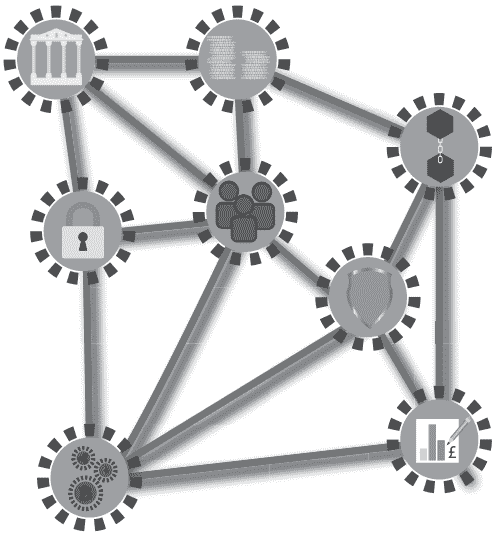

October 2018

### Cryptoassets Taskforce: final report

### Contents

- Foreword 2
- Chapter 1 Introduction 4
- Chapter 2 Key concepts 8
- Chapter 3 Impacts of distributed ledger technology 21
- Chapter 4 Impacts of cryptoassets 31
- Chapter 5 Conclusions and responses 40
- Annex A The authorities' objectives 50
- Annex B Stakeholder engagement 51

## 前言

加密资产及其支撑的分布式账本技术（DLT）在全球范围内引起了广泛关注。DLT 有潜力在金融服务及其他领域带来实质性益处。加密资产是 DLT 的一种应用，尽管英国市场已有所增长，但与其他一些司法管辖区相比仍然较小，许多加密资产公司总部位于英国境外。主流金融服务公司正初步进入该市场，一个小型衍生品市场正在发展。同时，越来越多的证据表明，加密资产对消费者和市场造成了损害。

正因如此，财政大臣于 2018 年 3 月启动了加密资产特别工作组，由英国财政部、金融行为监管局和英国央行组成。

政府已提出，英国应成为世界上最具创新性的经济体，并保持其作为全球领先金融中心之一的地位。¹ 英国具备实现这一目标的条件，因为其拥有非常成熟且多元化的国内金融部门。这既是英国金融服务领域作为安全透明的商业场所的国际声誉所决定的，也依赖于此；需要确保金融市场的高监管标准；保护消费者；并允许遵守规则的金融创新者蓬勃发展，从而充分实现新技术的益处。特别工作组针对加密资产和 DLT 制定的回应与这些目标保持一致。

本报告概述了加密资产及其底层技术，评估了相关风险和潜在益处，并就英国的监管路径提出了前进方向。它汇集了特别工作组开展的现有工作和新分析，并受益于 DLT 和加密资产领域利益相关方的贡献。² 这是一项重大工作，三家监管机构的共同努力——以及宝贵的行业投入——对于全面考虑这些问题至关重要。

特别工作组得出结论，尽管 DLT 仍处于早期发展阶段，但其未来在金融服务及其他领域带来显著益处的潜力巨大，三家监管机构将继续支持其发展。

¹ ‘英国数字战略’，数字、文化、媒体和体育部，2017 年，https://www.gov.uk/government/publications/uk-digital-strategy/executive-summary；‘英国产业战略’，商业、能源和工业战略部，2017 年，https://www.gov.uk/government/topical-events/the-uks-industrial-strategy；‘金融科技行业战略’，英国财政部，2018 年，https://assets.publishing.service.gov.uk/government/uploads/system/uploads/attachment_data/file/692874/Fintech_Sector_Strategy_print.pdf

² 有关特别工作组利益相关方参与的更多信息，请参见附录 B。

目前一代加密资产带来益处的证据有限，但这是一个快速发展的市场，未来可能会产生益处。加密资产存在重大潜在风险，监管机构最紧迫的优先事项是减轻对消费者和市场公正性的风险，并防止将加密资产用于非法活动。监管机构还将防范未来可能出现的对金融稳定的威胁，并鼓励英国合法的 DLT 和加密资产相关活动的负责任发展。本报告阐述了监管机构将采取的行动，以实现这些目标。

特别工作组得出结论，应采取强有力的行动，解决现有监管框架内加密资产相关的风险。对于那些对传统金融监管形式提出新挑战、并超出现有监管框架的加密资产，需要进一步磋商和国际协调。监管机构计划与国际机构接触，以确保全面回应。

本报告阐明了建立英国针对加密资产和 DLT 的政策和监管方法的清晰路径。这是一个快速变化的全球市场，技术在不断发展，加密资产的性质也在演变。监管机构将审查其对加密资产和 DLT 的方法，以确保英国继续支持创新，同时保持安全透明的金融市场。

Katharine Braddick  
英国财政部金融服务总干事

Andrew Bailey  
金融行为监管局首席执行官

Dave Ramsden  
英国央行市场与银行业副行长

## 第 1 章

#### 引言

1.1 近年来，政府、FCA 和英国央行已开展工作，以更广泛地了解加密资产及其他 DLT 应用在金融服务领域的影响。

1.2 政府已：

- 就数字货币发布征求信息文件并发布回应摘要。成果包括宣布政府计划将反洗钱监管适用于英国的加密资产交易所（2014–15 年）。¹
- 发布政府科学办公室的一份报告，“分布式账本技术：超越区块链”，阐述了该技术如何改变公共服务的提供并提高生产率（2016 年）。²
- 启动数字战略，阐述了政府将英国打造为全球最佳创业和发展数字企业之地的雄心，包括试点 DLT 等新技术（2017 年）。³
- 通过 Innovate UK 和研究委员会投资超过 1000 万英镑支持 DLT 的发展，以支持一系列多样化的 DLT 项目；构建概念验证以试点 DLT 在公共部门的应用；加入欧盟区块链伙伴关系，帮助在公共部门开发跨境区块链项目；创建 2000 万英镑 GovTech 催化基金，以探索公共部门挑战的技术解决方案，可能包括使用 DLT；并通过与 Deloitte 的共享平台工作，考虑如何部署 DLT 以支持新形式的金融服务基础设施。⁴

¹ ‘数字货币：对征求信息文件的回应’，英国财政部，2015 年，https://assets.publishing.service.gov.uk/government/uploads/system/uploads/attachment_data/file/410400/digital_currencies_response_to_call_for_information_final_changes.pdf

² ‘分布式账本技术：超越区块链’，政府科学办公室，2016 年，https://assets.publishing.service.gov.uk/government/uploads/system/uploads/attachment_data/file/492972/gs-16-1-distributed-ledger-technology.pdf

³ ‘英国数字战略’，DCMS，2017 年，https://www.gov.uk/government/publications/uk-digital-strategy

⁴ 英国于 2018 年 4 月 10 日签署了关于建立欧盟区块链伙伴关系的宣言。有关更多详细信息，请参见：‘新闻稿 – 欧洲国家加入区块链伙伴关系’，欧盟委员会，2018 年，https://ec.europa.eu/digital-single-market/news/european-countries-join-blockchain-partnership；‘为技术提供新支持以提升公共部门生产率’，英国财政部，商业、能源和工业战略部，2017 年，https://www.gov.uk/government/news/new-support-for-tech-to-boost-public-sector-productivity；‘金融科技行业战略’，英国财政部，2018 年，https://www.gov.uk/government/publications/fintech-sector-strategy

1.3 FCA 已设立创新中心和监管沙盒，以支持符合消费者利益的创新，这两者均被视为全球最佳实践的典范。FCA 还开展了工作，以探索 DLT 在金融服务领域的潜力：

- 沙盒允许企业在受控环境中，在真实市场、面向真实消费者的情况下测试创新产品、服务、商业模式和交付机制。DLT 是沙盒中测试最多的技术。在被接纳进入沙盒的 89 家公司中，超过三分之一使用了 DLT 和/或加密资产。DLT 的使用似乎在上升，第五批沙盒测试预计将进一步开展。第四批沙盒包含 29 家公司，其中 14 家使用 DLT 和/或加密资产。⁵
- FCA 正通过其 RegTech 计划积极探索在其监管职责中使用 DLT。⁶
- FCA 的直接支持团队为考虑申请授权或许可变更并需要支持的创新企业，或无需授权但可能从支持中受益的企业，提供专门联系人。该团队还可以帮助企业了解监管制度，以及在开发其创新产品或商业模式时可能面临的挑战。
- 2017 年，FCA 开始就 DLT 在金融市场的潜力展开对话，并发布了讨论文件和反馈声明。⁷

1.4 英国央行已设立新的金融科技中心，以考虑金融科技的政策影响。⁸ 此外，英国央行还：

- 发布季度公报文章“数字货币的经济学”和“支付技术的创新”，探讨了 DLT 的创新（2014 年）。⁹
- 与 18 家公司通过概念验证开展了工作，以了解新技术如何被采用以及它们如何与其目标相关联，并正在将这种方法嵌入其日常业务活动。这包括四个以 DLT 为重点的概念验证（2016–18 年）。¹⁰

⁵ FCA 监管沙盒公司的最新列表可在此处查看：https://www.fca.org.uk/firms/regulatory-sandbox/regulatory-sandbox-cohort-4-businesses

⁶ 有关更多详细信息，请参见‘RegTech’，FCA，2018 年，https://www.fca.org.uk/firms/regtech

⁷ 有关更多详细信息，请参见‘反馈声明 17/4：分布式账本技术’，FCA，2017 年，https://www.fca.org.uk/publications/feedback-statements/fs17-4-distributed-ledger-technology

⁸ ‘面向金融科技 – Dave Ramsden 讲话’，英国央行，2018 年，https://www.bankofengland.co.uk/speech/2018/dave-ramsden-speech-htms-international-fintech-conference

⁹ ‘数字货币的经济学’，英国央行，2014 年，https://www.bankofengland.co.uk/media/boe/files/digital-currencies-the-economics-of-digital-currencies；‘支付技术的创新和数字货币的出现’，英国央行，2014 年，https://www.bankofengland.co.uk/media/boe/files/quarterly-bulletin/2014/innovations-in-payment-technologies-and-the-emergence-of-digital-currencies.pdf

¹⁰ ‘金融科技概念验证’，英国央行，2018 年，https://www.bankofengland.co.uk/research/fintech/proof-of-concept

- **第 3 章** 考察了分布式账本技术（DLT）在金融服务领域的影响。它探讨了监管机构通过自身工作和创新企业的工作所看到的益处，并确定了进一步部署 DLT 的一些障碍。
- **第 4 章** 评估了与加密资产相关的风险和潜在收益。
- **第 5 章** 阐述了特别工作组的结论，以及英国财政部（HM Treasury）、金融行为监管局（FCA）和英格兰银行（Bank of England）将推进的行动。

## 第 2 章

### 关键概念

### 框 2.A：摘要

当前一代分布式账本技术起源于为比特币提供动力的区块链，比特币是第一种加密资产。然而，自 2008 年比特币问世以来，技术和市场已经发展，加密资产只是分布式账本技术的众多应用之一。

分布式账本技术没有标准形式。大多数为金融服务开发的分布式账本技术平台与原始比特币区块链不同，且通常并非完全分布式或去中心化。

特别工作组制定了一个框架，用于区分不同类型和用途的加密资产，以支持对风险、收益和监管影响的分析。

特别工作组认识到，加密资产对当前监管框架提出了新的挑战，且某些类型加密资产的复杂性使得难以确定它们是否属于监管范围。

### 分布式账本技术

### 关键特征

2.1 分布式账本技术是一种能够以分布式和去中心化方式共享和更新记录的技术。参与者可以安全地提议、验证并记录对同步账本（一种数据库形式）的更新，该账本分布在参与者之间。¹

2.2 分布式账本技术平台可以像任何传统数据库一样使用，用于规定谁拥有什么或谁做了什么。它们可以存储各种数据，例如现有金融资产的所有权（如股票）、有形资产（如葡萄酒、房屋）或数字资产（如比特币）。

### 图 2.A：中心化和分布式账本？

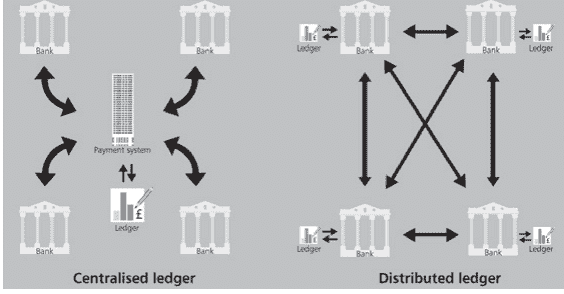

2.3 有多种不同类型的分布式账本技术平台，它们通常结合四种常见特征的要素：

- 数据分布：许多参与者可以保存账本副本，并能够读取和访问数据。
- 控制去中心化：许多参与者可以更新账本，但需遵循商定的流程和控制。
- 使用密码学：密码学可用于识别和验证批准的参与者、确认数据记录并促进共识。³ 该技术的使用并非分布式账本技术所独有。
- 可编程性/自动化：计算机编码的自动化（如智能合约）可以自动执行协议条款，例如自动触发债券的利息支付。⁴

2.4 分布式账本技术没有标准形式。这些特征的具体组合取决于特定分布式账本技术平台的用途以及开发者做出的设计选择。

2.5 “区块链”一词常与分布式账本技术混用，但它指的是在分布式账本技术平台上构建数据的一种特定方式。比特币是第一个使用区块链记录信息的平台，也是第一个结合上述分布式账本技术四种常见特征的平台。⁵

### 许可型和非许可型分布式账本技术

2.6 分布式账本技术中使用的各项技术均经验证且成熟，有些甚至已有数十年历史。然而，比特币独特的创新在于将这些技术结合起来，构建一个没有中央可信机构且对任何人开放的去中心化网络。以这种方式运行的网络完全是“非许可型”的，因此任何人都可以成为维护账本相同副本的多个参与者之一。这些参与者采用一种称为共识机制的流程，就账本内容及其更新达成一致。⁶ 比特币特别使用一种称为“工作量证明”的共识机制，该机制能耗和成本都很高。⁷

2.7 相比之下，大多数为金融服务开发的分布式账本技术平台与原始比特币区块链有显著不同，并且是“许可型”的，无论是网络访问权限还是更新权限。网络访问仅限于已知和批准方的名单，例如已经相互交易的银行。在某些情况下，使用许可型平台可能更可取，因为金融机构处理敏感数据，并需要知道平台上的交易对象是谁。许可型网络还有实际好处：如果只允许已知且受信任的用户加入网络，所使用的共识机制可比非许可型系统快得多，且更节能高效。⁸ 这意味着许可型平台避免了非许可型系统的大部分负面环境影响。

### 分布式账本技术的设计选择

2.8 分布式账本技术平台采用不同程度的分布和去中心化。

- **分布** 涉及数据如何共享和访问。在比特币和许多其他加密资产平台等非许可型平台中，任何参与者都可以保存账本副本，任何人都可以读取账本上的数据。在许可型平台中——这些平台在金融服务领域更常被探讨——数据的存储和访问仅限于已知和批准参与者的名单。此外，某些数据可能仅与部分参与者共享，例如交易的两个交易对手方。
- **去中心化** 涉及谁参与更新账本。在比特币等非许可型平台中，任何参与者都可以加入网络并竞争使用最新交易更新账本。在许可型平台中，只有选定的已知各方组成的群体才能参与账本更新过程。这仍然需要共识机制，但要简单得多，且能耗更低。

### 加密资产

2.9 加密资产是分布式账本技术的一种应用。虽然所有加密资产都采用某种形式的分布式账本技术，但并非所有分布式账本技术应用都涉及加密资产。目前最常见的加密资产是在非许可型账本上发行的。

2.10 对加密资产没有单一的广泛认可定义。广义上，加密资产是一种使用密码学保护的价值或合同权利的数字表示，采用某种类型的分布式账本技术，并可以电子方式转移、存储或交易。加密资产示例包括比特币和莱特币（以及其他“加密货币”），以及通过首次代币发行（ICO）流程发行的资产，通常被称为“代币”。市场在不断发展，正在开发新的不同加密资产，目前约有 2000 种存在。⁹

2.11 特别工作组认为存在三种广义类型的加密资产：

- A. 交换型代币——通常被称为“加密货币”，例如比特币、莱特币及其等价物。它们使用分布式账本技术平台，并非由中央银行或其他中央机构发行或支持。它们不提供证券型代币或实用型代币所提供的权利或访问权限，但用作交换手段或用于投资。
- B. 证券型代币——构成《2000 年金融服务与市场法（受监管活动令）》（RAO）中规定的“指定投资”。¹⁰ 这些可能提供所有权、偿还特定金额或有权分享未来利润等权利。它们也可能是欧盟《金融工具市场指令 II》（MiFID II）下的可转让证券或金融工具。
- C. 实用型代币——可用于兑换访问特定产品或服务，该产品或服务通常使用分布式账本技术提供。

### 特别工作组的加密资产框架

2.12 不同加密资产在授予所有者的权利以及其实际和潜在用途方面存在显著差异。鉴于应用的多样性和复杂性，特别工作组制定了一个框架，考虑到上述三种不同类型加密资产的不同用途。加密资产通常用于：

- 1 作为交换手段，充当去中心化工具，以实现商品和服务的买卖，或促进受监管的支付服务。

脚注：

¹ 在本报告语境中，“参与者”指的是参与分布式账本安排运行的计算机，也称为节点。

⁶ 详情请参见：‘Consensus: immutable agreement for the internet of value’, KPMG, 2016, https://assets.kpmg.com/content/dam/kpmg/pdf/2016/06/kpmg-blockchain-consensus-mechanism.pdf

⁷ 有关比特币工作量证明流程的更详细描述，请参见：‘Innovations in payment technologies’, Bank of England, 2014, https://www.bankofengland.co.uk/-/media/boe/files/quarterly-bulletin/2014/innovations-in-payment-technologies-and-the-emergence-of-digital-currencies.pdf。Digiconomist 2018 年 10 月的估计：整个比特币网络每年使用略超过 73 TWh 的电力，超过了瑞士、智利和奥地利。详情请参见：‘Bitcoin energy consumption index’, Digiconomist, 2018, https://digiconomist.net/bitcoin-energy-consumption 和 ‘Bitcoin’s energy usage is huge’, The Guardian, 2018, https://www.theguardian.com/technology/2018/jan/17/bitcoin-electricity-usage-huge-climate-cryptocurrency

⁸ 例如，如果网络中的所有参与者都是已知的，则更新账本的权利可以随机分配，或者参与者可以简单地通过简单多数投票就更新达成一致。详情请参见：‘Consensus’, KPMG, 2016. https://assets.kpmg.com/content/dam/kpmg/pdf/2016/06/kpmg-blockchain-consensus-mechanism.pdf

⁹ 'All Cryptocurrencies', CoinMarketCap, 截至 26.10.18, https://coinmarketcap.com/

¹⁰ 'Regulated Activities Order - Specified investment', FCA, 2016. https://www.handbook.fca.org.uk/handbook/glossary/G1117.html?date=2016-03-21

## 图 2.B：工作组加密资产框架

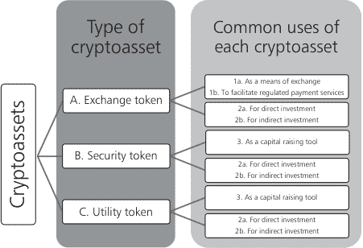

## 专栏 2.B：使用 DLT 对现有资产进行代币化

支撑加密资产的 DLT 同样可以被用来对现有的金融资产或有形资产进行“代币化”。代币化是指将现有资产记录在 DLT 平台上，并以代币形式呈现，以改善有关资产交易和转让的流程。根据基础资产的不同，这些代币可能与上文讨论的加密资产类型相似。

一些加密资产分类法区分了“原生”代币和“非原生”代币。原生代币是无形的、非物理的资产，其价值来自 DLT 平台。非原生代币则代表存在于其他地方的金融资产和/或有形资产。

DLT 在金融服务中的许多潜在应用都依赖这种代币化流程。例如，一个代币可以代表对特定房产（有形资产）或政府债券（金融资产）的所有权份额。在这些例子中，该资产（房产或政府债券）已在 DLT 系统上完成代币化，而代币代表对存在于系统之外的资产的所有权。

资产或活动的监管状态不应受到 DLT 使用和代币化流程的影响，前提是不会改变资产的金融风险特征或对基础资产的法律所有权。如果一项现有资产已受监管，使用 DLT 平台将其表示为代币不应改变其监管状态。然而，DLT 的使用可能会改变监管适用的方式。例如，公司需要具备的系统与控制措施可能存在差异。

## 英国加密资产市场

2.17 鉴于市场仍处于早期阶段且发展迅速，目前尚无法获得可靠且全面的数据。然而，通过多种来源，工作组已能确认，尽管该市场近期有所增长，但英国并非全球加密资产交易的主要市场之一。

2.18 **作为交换媒介的加密资产：** 加密资产在英国并未被广泛用作交换媒介。没有一家大型高街或在线零售商接受其作为支付方式，全英仅有约 500 家独立商店、酒吧和咖啡馆接受比特币。13 少数曾接受加密资产支付的大型在线支付处理商近期也终止了相关支持。14 还有证据表明，在全球范围内，加密资产用于支付（而非投资）的使用量正在下降。15

2.19 **作为投资形式的加密资产：** 来自加密资产交易所的数据显示，英镑兑比特币的交易仅占全球每日交易量的 0.33%。16 这或许在一定程度上低估了英国参与者在加密资产市场上的真实活动规模；目前英镑直接兑换加密资产的难度较大，因此许多活跃的英国交易者会先将英镑兑换成另一种接受度更广的货币。加密资产的假名特性意味着，直接获取关于英国消费者持有加密资产及其对加密资产市场敞口的数据难以精确估算。在线消费者调查显示，英国受访者中加密资产拥有率在 5%–10% 之间（与其他七国集团经济体一致），然而整体人口中的比例可能更低。17

2.20 **作为融资形式的加密资产：** 工作组估计，英国有 56 个用于资本形成的 ICO 项目，占全球 983 个项目的 4.3%。18 据估算，英国实体发行的 ICO 已筹集 3.3 亿美元，占全球 ICO 筹集的 240 亿美元的不到百分之一。19 一般而言，无法获知 ICO 投资者的所在地，但投资者分布可能与发行人所在地截然不同——也就是说，尽管英国实体通过 ICO 筹集的资金相对于全球市场而言比例较小，英国消费者也可能投资于其他司法辖区的 ICO。虽然 2018 年全球通过 ICO 筹集的资金总额有所增加，但这似乎集中在英国以外发行实体进行的较大规模代币销售中。20 然而，2018 年下半年，全球通过 ICO 筹集的资金一直在下降。21

2.21 **英国交易所：** 在全球 206 个市场的背景下，总部位于英国的加密资产现货交易所不到 15 个。其中只有 4 个现货交易所定期公布的单日个人交易量超过 3000 万美元，这相对于全球市场而言规模较小。22 撰写本报告时，有可见交易活动的 12 家现货交易所约占全球每日交易量的 2.66%（2.49 亿美元）。23 一些大型国际交易所在英国设有分支机构，但这些分支机构最近才成立，尚未在英国建立重要业务。

## 加密资产市场参与者

2.22 许多不同的参与者涉及与加密资产相关的各类活动。这些参与者不断变化，但核心要素如图 2.C 所示。

## 图 2.C：加密资产市场参与者

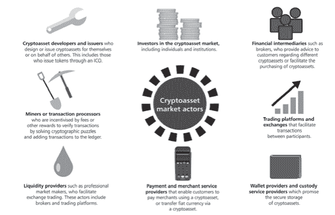

20 无论是 Telegram 还是 Block.One 旗下的 EOS，均不在英国境内。更多详情请参阅 CoinDesk 于 2018 年发布的《2018 年第二季度区块链发展报告》，https://www.coindesk.com/research/state-of-blockchain-q2-2018/

21 “九月份 ICO 数量较一月份下降 90%”，Autonomous Next，截至 2018 年 10 月 8 日，https://next.autonomous.com/thoughts/crypto-september-icos-90%-down-from-janary-but-venture-funding-is-ray-of-hope。

22 “24 小时交易量排名”，CoinMarketCap，截至 2018 年 10 月 26 日，https://coinmarketcap.com/exchanges/volume/24-hour/

23 同上。

## 加密资产与金融服务监管

2.23 英国的金融服务监管主要由 FCA 和英格兰银行（包括通过审慎监管局（PRA））承担。

-   FCA 的监管旨在保护消费者免受损害，保护和增强英国金融服务部门的诚信，并促进有利于消费者的有效竞争。

-   英格兰银行的监管旨在确保公司的安全与稳健（通过 PRA），并消除或降低可能对金融稳定构成威胁的系统性风险（通过金融政策委员会和该银行对金融市场基础设施的监管）。

### 当前监管边界

2.24 监管边界指适用监管的金融服务活动类型。边界包括《金融服务与市场法案（2000 年）（受监管活动）命令》（RAO）中定义的特定活动和投资，以及《2017 年支付服务条例》（PSR）等单独立法中规定的监管内容。受监管活动也可以通过欧盟法律制定，然后转化为国内法律。

2.25 以下章节及表 2.A 基于工作组的加密资产框架，大致概述了当前监管边界如何适用于加密资产相关活动。这是一项高层面分析；特定加密资产可能属于多个类别，应综合考虑所有可能适用于该加密资产的类别。

2.26 特定加密资产工具或活动是否适用监管以及适用何种监管，只能根据具体情况逐案决定。涉及提供加密资产相关服务或投资的公司和个人，应仔细考虑其活动是否可能涉及受监管活动或金融促销的发布，并且必须确保其遵守相关法律和监管义务。24

2.27 FCA 一直在对从事某种加密资产业务的未经授权公司进行调查，以确定其是否在开展需要 FCA 授权的受监管活动。如果是，FCA 可能会展开调查并采取措施，识别并确定对消费者构成最大风险的最严重事项。FCA 也一直在鼓励受监管公司就其正在开展或考虑开展的加密资产活动与 FCA 监管人员沟通。

2.28 此外，金融服务法并非唯一可能适用的法律体系。例如，合同法、消费者法和广告标准也可能适用。

| 加密资产的常见用途 | 是否在监管范围内？ | 详情 | 最常见的用例 |
|---|---|---|---|
| 作为交换媒介。 | 取决于加密资产的类型。 | PSR 下的支付服务监管仅涵盖涉及法定货币的活动。因此，用作交换媒介的加密资产不属于监管范围。但是，某些用作交换媒介的加密资产可能符合电子货币的定义。 | 比特币或莱特币等交换代币可用于实现商品和服务的买卖，但不被视为货币或钱币。实用代币在以特定方式结构化时可能被视为电子货币，例如由中央发行并被第三方接受为交换媒介。 |
| 为受监管的支付服务提供便利。 | 是。 | 当加密资产被用于促进 PSR 规定的受监管支付服务时，从事此项服务的企业属于监管范围。 | 加密资产可用作跨境交易中的中介（例如，GBP–比特币–USD）。此类服务的某些方面根据 PSR 受到汇款监管，尽管这不包括交易中的加密资产部分。 |
| 直接投资于加密资产。 | 取决于加密资产的类型和投资者的类型。 | 除非加密资产是证券代币或 the，否则直接投资于加密资产不属于监管范围。 | 比特币、证券代币和实用代币等交换代币均可由企业和消费者作为一种投资形式持有。 |
| 通过引用加密资产的金融工具进行间接投资。 | 是。 | 引用加密资产的金融工具可能属于监管范围。这些工具也可能属于 MiFID II 下的金融工具。^28^ | 引用加密资产的金融工具包括差价合约（CFDs）、期权、期货、交易所交易票据、集合投资计划的单位或另类投资基金。 |
| 作为筹资工具或作为旨在支持特定项目（例如创建去中心化网络）的流程的一部分。 | 如果是证券代币——是。 | 证券代币构成 RAO 规定的特定投资。例如，它们是（或具有意味着其类似于）股票、债券或集合投资计划单位等证券。它们也可能是 MiFID II 下的可转让证券或金融工具。^29^ | 证券代币或实用代币通常通过 ICO 发行。交换代币也可以通过 ICO 发行。 |
|  | 如果是实用代币——否。 | 实用代币通常不具有 RAO 规定的特定投资的特征。 |  |

## 受监管企业的其他注意事项

2.29 从事加密资产相关活动的受监管企业还存在更广泛的注意事项。FCA 手册中的一些监管条款——例如《商业原则》、《高级管理人员和认证制度》、《系统和控制条款》以及《金融推广规则》——在某些情况下可能适用于非受监管活动。

- 《商业原则》是适用于所有 FCA 受监管企业的 11 条高级别规则。其中三条原则——即涉及企业财务资源充足性、企业系统和控制充足性，以及以公开合作方式与 FCA 打交道的义务的原则——可以扩展到受监管企业开展的非受监管活动。

- 《高级管理人员和认证制度》允许 FCA 要求受监管企业的高级管理层对非受监管活动负责。FCA 期望这些原则适用于受监管企业开展的非受监管加密资产相关业务。

- 《系统和控制条款》涵盖组织要求、风险控制、记录保存和员工要求等内容。^30^ FCA 此前曾针对因系统和控制违规而开展非受监管活动的受监管企业采取行动。^31^

- 《金融推广规则》要求受监管企业确保金融推广公平、清晰且不具误导性；对产品或服务给出平衡的印象；并且不伪装或削弱重要警示声明。

2.30 除了对受监管企业施加的《金融推广规则》之外，关于金融推广还有更广泛的立法限制。2000 年《金融服务和市场法》（FSMA）第 21 条规定，任何人在业务过程中不得传播邀请或诱使他人参与投资活动，除非该推广已由获授权人士制作或批准，或属于豁免范围。违反 FSMA 第 21 条发布金融推广属于刑事犯罪。

## 第 3 章

## 分布式账本技术的影响

> **方框 3.A：摘要**
>
> 特别工作组认为，分布式账本技术（DLT）有潜力在金融服务以及广泛的其他领域带来显著收益。作为 DLT 的新兴领导者，英国应着力抓住这些机遇。
>
> DLT 有潜力增强系统韧性；提高端到端结算流程以及报告、审计和监督的效率；并实现更大程度的自动化。
>
> 然而，特别工作组认为该技术仍处于早期阶段，更广泛采用面临一些重大挑战。
>
> 特别工作组不认为存在阻碍 DLT 采用的监管障碍。PRA 和 FCA 将继续在监管中采取技术中立的方法，并为创新提供平台。

## 英国的 DLT 应用

3.1 英国是 DLT 开发的新兴领导者。英国在全球拥有第二多数量的 DLT 初创企业，仅次于美国。^1^ 伦敦在代码仓库 GitHub 上列出的 DLT 项目数量也位居世界第二，仅落后于旧金山。^2^

## DLT 在金融服务中的潜在收益

3.2 第 2 章描述了 DLT 的四个关键要素：数据分布、控制去中心化、密码学以及可编程性/自动化。本章利用 FCA 监管沙箱、英格兰银行金融科技概念验证及其他项目的示例，探讨这些要素的某些组合如何有可能为企业和消费者带来金融服务方面的收益。金融服务及其他领域存在更多 DLT 用例。

### 增强韧性

**3.3** 在高度分布和去中心化的 DLT 平台上，可能实现韧性收益。这是 FCA 关于 DLT 的讨论文件回复者以及特别工作组利益相关方参与中指出的一个主题。保留由多个参与者记录和访问的数据副本，可减少任何单一参与者发生事件导致的数据丢失影响。此外，网络共识也可能提供增强的网络韧性：攻击者需要控制多个参与者才能控制系统。DLT 还可以消除或减少单点故障，因此如果网络中的一个参与者失败，其他参与者可以继续处理。

> **方框 3.B：英格兰银行概念验证——转移资产所有权**
>
> 英格兰银行在其 2016 年 6 月的一个概念验证中认识到 DLT 系统的韧性收益。^3^ 这涉及在以太坊协议上构建多节点分布式账本环境，以便在多个参与者之间转移虚构资产的所有权，这些参与者包括一个可以设定资产供应量以及访问和使用账本权限的中央机构。概念验证表明，网络中的参与者可以在没有中央机构的情况下继续交易虚构资产，从而消除了系统的单点故障并大大提高了其韧性。这项工作还凸显了一些潜在局限性，这些局限性未在此概念验证中探讨，但值得进一步调查，包括可扩展性、安全性、隐私性、互操作性和可持续性。

### 更高效的端到端结算流程

**3.4** DLT 平台可以使更广泛的参与者直接访问其自身相同数据的不可更改副本。当多个参与者能够及时访问相同的、分布但同步的数据时，这提供了单一事实来源。这导致更高效的端到端结算流程，因为它可以消除平台之间昂贵且缓慢的对账流程（以及不同系统不一致时的争议）的需求。这一收益已得到广泛认可，包括欧洲证券和市场管理局^4^ 以及特别工作组的利益相关方参与。

## 方框 3.C：FCA 监管沙盒 – 发行流程

FCA 沙盒内的一家公司使用无许可 DLT 网络来模拟短期债务工具的传统发行流程，而另一家公司则使用无许可 DLT 网络来测试发行结构化产品的平台。

这两项测试都表明，DLT 可以帮助简化传统方法，同时满足法律和监管要求。在小规模测试中，通过高度自动化并消除对注册人和代名人的需求，实现了成本降低。例如，以传统发行产品的清算、结算和托管成本，基于 DLT 的解决方案可以发行 16 个等值产品。

由于使用了无许可 DLT 网络，资产所有权被公开记录，这在一定程度上提高了投资者的透明度，投资者不再依赖发行人来保存所有权记录。这也消除了网络参与者之间对账的需求，因为他们共享相同的所有权记录，从而支持更高效的结算操作。

## 更高效的报告、审计和监督

3.5 DLT 的共享数据模型可能减少金融机构内部及之间，或金融机构与监管机构之间的手动报告。例如，监管机构可以被授予访问权限，以查询或检索存储在 DLT 分类账上的数据，从而让他们实时访问一个准确且可验证的分类账。⁵ 研究还表明，此类用途可以自动化其他流程，例如审计。⁶

## 方框 3.D：投资协会数字基金

作为由财政部经济秘书主持的资产管理工作组的一部分，投资协会正在着手创建英国首个数字基金。这旨在使用 DLT 来简化后台基金管理职能，并提高速度并降低成本。通过减少中介机构的数量，基金将实现成本节约，这可能会导致最终投资者的成本降低。支持 DLT 的基金还将实现实时清算和结算。⁷

## 方框 3.E：监管科技（'RegTech'）

FCA 的 RegTech 团队于 2017 年 9 月与 R3 联盟和两家主要银行合作，使用 Corda DLT 平台开发了一个用于抵押贷款交易数据监管报告的原型应用程序。通过在网络上托管“监管节点”，FCA 能够在测试环境中从两家银行接收实时抵押贷款交易报告。该原型记录、执行和管理金融协议，DLT 用于在参与者之间实现安全通信。这次合作展示了 DLT 如何能以相对较低的成本为金融机构实现持续的监管报告。

2017 年，FCA 和英格兰银行发起了数字监管报告试点，旨在开发一个使用 DLT 网络的原型，以展示端到端机器可执行报告流程的潜在优势。8 该试点将与行业分享调查结果，征求反馈，并评估新报告机制的潜在成本和收益。

## 自动化合约工具带来的效率提升

3.6 DLT 有潜力通过自动化报告和智能合约来提高效率。为金融服务构建的 DLT 平台通常具有高度可编程性，这使得它们可以针对特定用例进行定制。一个简单的示例可能是锁定交易资金，只有在满足特定条件时（例如，货物已确认交付）才会自动释放给接收方。

8 数字监管报告试点于 2017 年 11 月启动，此前经过为期两周的成功 TechSprint，探讨了像 DLT 这样的技术如何使当前的监管报告系统更加准确、高效和一致。该试点是与多家受监管公司（桑坦德银行、劳埃德银行、巴克莱银行、全国宽裕建房协会、西敏寺银行和瑞士信贷）以及科克大学学院和伦敦大学学院的行业合作。有关更多详情，请参阅“数字监管报告”，FCA，2018 年。https://www.fca.org.uk/firms/our-work-programme/digital-regulatory-reporting

## 方框 3.F：贸易融资

贸易融资在工作组的利益相关方参与中被频繁确定为一个用例，展示了 DLT 如何通过自动化加快结算时间并提高效率。例如，智能合约可以取代信用证，并在每个步骤创建所有权记录。

利益相关方指出，DLT 在近期的采用最有可能发生在贸易融资等古老且高度依赖纸质的流程中。

香港金融管理局和新加坡金融管理局正在开发基于 DLT 的跨境基础设施，以数字化贸易融资。该项目的目标是构建一条信息高速公路，使跨境贸易和融资更加便宜和安全，并消除现有纸质系统中的低效问题。9

## 方框 3.G：FCA 监管沙盒 – 保险行业

多家沙盒公司已证明，DLT 平台可以与受监管的支付和电子货币服务一起使用，以部署智能合约自动执行交易。一家沙盒公司测试了一种完全自动化的、基于 DLT 的航班延误保险产品。当航班延误时，系统会自动在加密资产或法定货币中触发赔付。

## 使现有资产代币化

3.7 DLT 平台可以使现有资产被“代币化”，并在 DLT 平台上表示为代币（参见方框 2.8）。公司或投资者可能会这样做以获取技术优势，例如来自智能合约的效率提升或增强的韧性。

3.8 以这种方式记录所有权还允许资产的分权所有权，因此用户可以对资产的部分单位（例如房地产）进行代币化。这有可能降低投资门槛，改善流动性和可交易性，并提高效率。

## 方框 3.H：FCA 监管沙盒 – 现有资产代币化

沙盒内的一家公司测试了使用支持 DLT 的智能合约，以允许英国私人有限公司以数字方式表示——或代币化——其股份和公司治理流程。该公司平台上的股份所有权变更直接更新在公司注册处登记册中，从而提高了效率并节省了成本。

## 使用 DLT 相关的挑战

3.9 尽管有广泛的用例，DLT 仍是一项相对年轻的技术，在大规模部署到金融服务之前，仍有几项挑战必须克服。DLT 平台的设计既存在权衡，也存在 DLT 更广泛采用的其他障碍。

## DLT 设计中的技术权衡

3.10 DLT 开发者做出的设计选择，特别是关于数据分布程度和控制去中心化方面，常常导致在 DLT 平台的一些功能之间必须做出的重要权衡。一些关键权衡在于性能（例如，交易容量和可扩展性）、韧性和隐私之间。未来的技术进步可能会改变这些权衡。

## 图 3.A：DLT 设计中的权衡

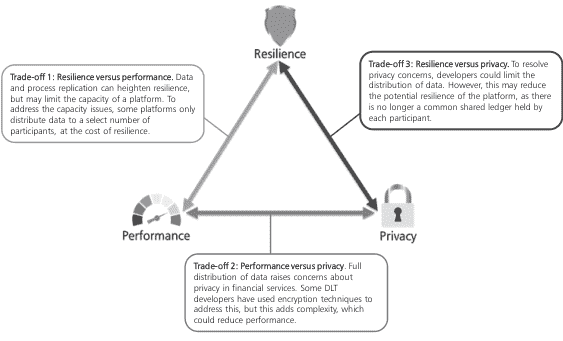

3.13 **法律挑战：** 除金融服务监管外，DLT 的应用还可能在民法（例如，关于智能合约可执行性的问题）和数据保护（例如，通用数据保护条例（GDPR））方面带来挑战。16 在其他条款中，GDPR 确立了被遗忘权，这可能与某些 DLT 网络的核心功能产生紧张关系，这些网络提供不可更改的数据存储（没有技术上的擦除可能性）。与更传统的数据库技术相比，有一些特定的 DLT 解决方案声称提供了一种更高效的方式来遵守 GDPR 要求（例如，仅共享选择性数据或在链上存储数据位置而非数据文件）。17 所有使用 DLT 等技术处理个人数据的组织都必须遵守 2018 年数据保护法和 GDPR。

3.14 **结算最终性：** 在支付系统中，了解付款何时最终且不可撤销至关重要。在某些 DLT 版本中，可能需要时间来确保所有参与者同意同一版本的分类账。在罕见情况下，这意味着看似已成功完成的付款可能会被另一个版本的分类账“覆盖”。然而，这主要是无许可平台的问题；18 在许可平台中，共识机制可以设计为确保最终结算点更加清晰。

3.15 **治理挑战：** DLT 从本质上讲是一个共享系统。因此，鉴于缺乏中央权威点，公司将不得不仔细注意适当分配责任。19 这对无许可系统来说更是一个问题。

3.16 **银行关系：** 许多利益相关方指出，在 DLT 行业工作的公司（包括加密资产公司）在英国难以获得银行服务。

3.17 **意识和理解：** 另一个常被引用的 DLT 有效采用障碍是缺乏对如何以及何时适当使用该技术的理解和意识。这可能导致在不适合或不必要的应用中推进 DLT，而更传统和成熟的技术可能就足够了。相反，由于该技术仍处于早期发展阶段，工作组的一些行业参与指出，公司可能不了解潜在应用的范围，因此可能选择不尝试 DLT。

16 GDPR 旨在保护个人信息，并改善公司收集、存储和处理个人数据的方式。自 2018 年 5 月起生效，并在英国由信息专员办公室监督和执行。有关更多详情，请参阅“通用数据保护条例（GDPR）指南”，信息专员办公室，2018 年，https://ico.org.uk/for-organisations/guide-to-the-general-data-protection-regulation-gdpr/

17 'DLT FS17/04', FCA, 2017, https://www.fca.org.uk/publications/feedback-statements/fs17-4-distributed-ledger-technology

18 这是因为大多数无许可平台使用工作量证明等共识机制，提供概率性结算：交易被覆盖的机会随时间下降，直到在统计上接近确定该交易不会被覆盖。

19 'Discussion Paper on DLT', FCA, 2017, https://www.fca.org.uk/publication/discussion/dp17-03.pdf

## 附录 2

所有参与者均确认，更新后的 RTGS 服务的计划功能将使其系统能够连接并实现中央银行货币结算。已提出若干建议，以确保最佳地获取中央银行货币，英格兰银行将在更新计划中予以考虑。

## 第 4 章

### 加密资产的影响

**方框 4.A：摘要**

加密资产在英国并未广泛使用，相对于全球加密资产市场，英国也不是一个主要市场。然而，过去几年英国对加密资产的兴趣和活动有所增长。

特别工作组已评估了与加密资产相关的广泛潜在利益和风险。其得出结论认为，目前缺乏证据表明当前一代加密资产能够带来利益。然而，利益未来可能会显现，例如通过将 ICOs 用作资本筹集工具。

特别工作组得出结论认为，加密资产带来一系列风险，特别是对消费者（可能面临巨额损失）、市场完整性（由于操纵和其他市场滥用型策略）以及金融犯罪构成风险。虽然加密资产目前对金融稳定不构成实质性风险，但未来可能会发生变化。

#### 加密资产的潜在好处

**4.1** 使用第 2 章阐述的框架，特别工作组已考虑加密资产在以下使用情形下是否带来利益：

- **作为交易媒介**，包括通过提高国际转账效率
- **用于投资**，包括通过扩大对新投资机会的获取
- **作为资本筹集工具**，包括通过简化资本筹集流程

**4.2** 当**作为交易媒介使用**时，加密资产可能允许更高效、更便宜的交易，因为涉及的中介更少（例如，小额支付、即时交换和国际转账）。¹ 一些支持者还建议，加密资产可以提高交易的透明度和可追溯性；鉴于缺乏易受中断影响的中央系统，从而提高系统韧性；并降低进入壁垒，鼓励竞争，并在一定程度上为传统支付服务提供替代方案。然而，这些潜在利益在很大程度上归功于 DLT 的使用，而非加密资产本身，并且很可能也适用于将代币化的现有资产用作交易媒介。

¹ FCA 监管沙盒的测试已证明，以合规方式使用加密资产进行国际转账在小规模上是可行的，并可带来时间和成本节约。有关详细信息，请参阅‘Regulatory sandbox lessons learned report’，FCA，2017 年，https://www.fca.org.uk/publication/research-and-data/regulatory-sandbox-lessons-learned-report.pdf

**4.3** 当用于投资时，支持者建议，加密资产有潜力扩大对新的和不同类型的投资机会的获取。然而，特别工作组认为，在当前市场中，这种广泛的获取可能会使消费者面临不适当的风险水平，并加剧与将加密资产用于非法活动相关的风险。

**4.4** 目前缺乏证据表明当前一代加密资产能够带来上述任何利益，且许多用例在大规模上尚未得到验证。特别工作组的大量利益相关方接触也证实了这一观点。因此，特别工作组认为，在许多情况下，当前一代加密资产带来的风险大于任何潜在利益。

### 用于支持资本筹集的加密资产

**4.5** 特别工作组得出结论认为，如果未来出现利益，它们最有可能通过将 ICOs 用作资本筹集工具而显现。ICOs 有潜力带来一系列机会，包括：

- **支持创新和竞争：** 许多 ICOs 寻求为新的、创新的商业模式、产品和服务提供资金。它们还可以通过引入竞争来激励传统资本筹集流程的改进。
- **提高效率：** ICOs 直接将加密资产发行人与投资者联系起来，这有可能使资本筹集流程更加精简、更快速、更便宜，特别是对于小规模发行。
- **弥补融资缺口：** 许多高风险、早期阶段的项目难以筹集资金。ICOs 可以通过直接连接寻求高风险高回报投资的企业和投资者；以及在某些情况下允许企业家无需提供股权即可筹集资本，来帮助弥补这些缺口。
- **建立新的投资者和客户群：** ICOs 的全球可访问性还可能使新的资本来源得以释放。投资者还可以为新企业提供初始客户群，并为正在开发的产品或服务创建早期采用者社区。

**4.6** 在当前市场中，这些利益最有可能惠及开发者和发行人，他们可以更高效地获取现有和新的资本来源。然而，如果没有适当的保护，这可能会损害消费者的利益。本章后文将更详细地讨论此问题。

### 与加密资产相关的风险

4.7 特别工作组已识别与加密资产相关的一系列风险，包括：

- 金融犯罪风险，包括加密资产被用于非法活动和网络威胁的机会
- 对消费者的风险，消费者可能购买不合适的产品、面临巨额损失、暴露于欺诈活动、难以获取市场服务，并暴露于服务提供商的失效
- 对市场完整性的风险，这可能导致消费者损失或损害市场信心
- 对金融稳定的潜在影响，如果市场增长且加密资产得到更广泛的使用，可能会出现这种影响

4.8 虽然特别工作组识别的大多数风险存在于不同类型和用途的加密资产中，但特定风险的性质或程度可能有所不同。

4.9 虽然税务不在特别工作组的职责范围内，但英国财政部正与英国皇家税务海关总署（HMRC）密切合作，以考虑加密资产引发的税务问题。两个主管部门都认识到加密资产使用增加所带来的税务避税和逃税风险，并继续审查 HMRC 可用的各种执法工具和方法。

### 金融犯罪风险

4.10 加密资产由于其在线可访问性、全球覆盖范围和准匿名性，在洗钱和恐怖主义融资等犯罪活动方面构成风险。

4.11 政府2015年和2017年的洗钱和恐怖主义融资国家风险评估（NRAs）评估认为，与加密资产相关的洗钱和恐怖主义融资风险相对较低，因为缺乏证据表明它们被用于大规模、高频率的大额洗钱。2 然而，2017 年 NRA 指出，加密资产在洗钱网络依赖型犯罪（即通过计算机技术实施的犯罪）所得方面可以发挥作用。加密资产还可以作为犯罪分子之间支付的方法，以及用于购买在犯罪市场上在线出售的非法工具或服务。

4.12 自 2017 年 NRA 以来，英国执法机构越来越多地发现加密资产被用于洗钱线下犯罪所得的案例。虽然此类活动的规模尚不清楚，但加密资产的某些特征对犯罪分子特别有吸引力，并且随着加密资产变得越来越容易获取，加密资产被用于洗钱的风险预计会增长。

2 '英国洗钱和恐怖主义融资国家风险评估'，英国财政部和内政部，2015 年，https://assets.publishing.service.gov.uk/government/uploads/system/uploads/attachment_data/file/468210/UK_NRA_October_2015_final_web.pdf；以及'洗钱和恐怖主义融资国家风险评估'，英国财政部和内政部，2017 年，https://assets.publishing.service.gov.uk/government/uploads/system/uploads/attachment_data/file/655198/National_risk_assessment_of_money_laundering_and_terrorist_financing_2017_pdf_web.pdf

## 附录 2

吸引人的特点包括加密资产 ATM 提供的匿名性、点对点交易设施提供的匿名性，以及某些代币的隐私功能。

4.13 英国执法机构正与国际合作伙伴合作，以继续加深对加密资产在洗钱中可能发挥的作用的理解。欧洲刑警组织估计，每年在欧洲使用加密资产洗钱的金额为 30 亿至 40 亿英镑；然而，这仍然是欧洲洗钱总资金（高达 1000 亿英镑）的一小部分。^3^ 此外，金融行动特别工作组最近向 G20 提交的报告指出，与加密资产相关的可疑交易报告在全球范围内呈上升趋势。^4^

### 消费者面临的风险

4.14 加密资产给消费者带来一系列重大风险，这些风险源于消费者在没有获取充足信息的情况下购买不适合的产品；源于欺诈活动；以及源于市场基础设施和服务的不成熟或缺陷。

### 不适合的产品和信息不足

4.15 消费者可能因购买不适合其需求的加密资产产品，或在不知晓相关风险的情况下购买这些产品，而遭受意外或重大损失，且没有监管保护。加密资产的高波动性可能吸引投资者，但也可能导致重大损失。^5^

4.16 消费者还可能因价格形成和定价实践不明确、费用高昂以及难以评估基本价值而投资于性价比低的产品。投资加密资产对某些消费者来说也可能代表机会成本，他们可能会放弃另一项可能更合适的投资来购买加密资产产品。

4.17 这种行为的主要驱动因素是追求高回报，以及一些消费者缺乏对加密资产及其波动性和风险的理解。消费者理解不足源于这些产品的复杂性，以及缺乏有关风险的可用信息和适当警示。消费者也可能不知道某些加密资产的监管保护有限，以及无法向金融服务补偿计划（FSCS）和金融申诉专员服务（FOS）寻求补救。

4.18 金融行为监管局委托开展了定性消费者研究，以更好地了解英国消费者对加密资产的理解和态度。这项研究仍在进行中，然而，初步研究结果显示，与若干消费者就其投资加密资产的经验交谈后发现：

- 部分受访者将加密资产视为轻松赚钱和致富的捷径，引用“恐慌性错过”和社交媒体的影响作为投资理由
- 部分受访者倾向于高估自己对加密资产及其底层技术的了解
- 由于与加密资产相关的语言和图像（如“挖矿”和“代币”），部分受访者似乎觉得自己在投资有形资产

4.19 关于加密资产的广告通常针对散户投资者，往往不公平或不明确，并可能具有误导性。广告常常夸大收益，很少警告波动性风险、消费者投资既可能增值也可能贬值的事实，以及缺乏监管。也有受监管公司推广加密资产产品而未澄清其业务这部分不受监管的案例。

4.20 加密资产及相关市场易受的市场滥用式活动也可能导致消费者损失（详见第 4.30 段）。

4.21 除了不同加密资产中普遍存在的这些风险外，某些类型的加密资产会给消费者带来特定风险：

- 首次代币发行（ICO）：消费者评估特定代币发行的风险可能尤其困难，因为通常伴随 ICO 的“白皮书”文件并未标准化，且常包含夸大或误导性信息。鉴于缺乏清晰信息，消费者可能不明白许多此类项目属于高风险且处于早期阶段，因此可能不适合其风险承受能力、财务成熟度或财富状况。
- 参考加密资产的金融工具：尽管受监管，但参考加密资产的金融工具也会给消费者带来某些特定风险。杠杆衍生品（如差价合约和期货）可能导致超过初始投资的损失。交易损失的风险可能因产品费用（如融资成本和点差）以及底层加密资产价格形成缺乏透明度而加剧。

### 欺诈活动和网络犯罪

4.22 消费者也面临因加密资产市场中的欺诈活动和欺骗性行为而遭受损失的风险。特别是，高收益回报的承诺使骗子很容易吸引客户。国家反诈骗中心最近的一份报告显示，2018 年 6 月至 7 月期间有 203 起加密资产诈骗报告，受害者据称总共损失超过 200 万英镑（平均每人超过 1 万英镑）。6 国家反诈骗中心报告称，骗子会冷电话受害者，并使用社交媒体平台宣传“一夜暴富”投资。

6 ‘今年夏天加密货币诈骗导致价值 200 万英镑的损失’, ActionFraud, 2018, https://www.actionfraud.police.uk/news/2m-lost-to-cryptocurrency-fraud-aug18

4.23 虽然欺诈活动存在于各类加密资产中，但不同类型的加密资产之间可能存在差异。证据表明，与 ICO 相关的欺诈活动风险尤为显著。一项最近的研究表明，约 25% 的 ICO 可能是欺诈性的，而其他估计则表明，2017 年发行的 46% 的 ICO 已经失败。8 在许多情况下，投资者没有得到承诺的东西，发行人也没有交付预期的产品或服务。这在一定程度上是由 ICO 发行人的利益冲突驱动的，他们可能通过不透明、不提供足够的风险细节以及误导消费者来最大化筹集的资本。在某些情况下，为缺乏适当交付计划或能力的项目筹集了大量资金。

4.24 加密资产还通过网络犯罪给消费者带来风险。网络威胁——源于交易所和钱包提供商未能建立适当的系统和控制——可能使消费者面临重大损失的风险。加密资产现在被视为盗窃的高价值目标。用户以及钱包和交易所等服务提供商越来越多地成为网络犯罪分子的攻击目标，特别是为了获取使消费者能够访问和转移其加密资产的私钥。9 其中一些最大且最近公开的黑客攻击和盗窃事件包括 Coincheck（2018 年 1 月被盗 5.4 亿美元）、Mt Gox（2014 年 2 月被盗近 5 亿美元）和 Zaif（2018 年 9 月被盗 6000 万美元），均发生在日本，以及 Bithumb（2018 年 6 月被盗 3200 万美元），发生在韩国。10 鉴于加密资产的可追溯性各不相同，执法部门追踪被盗加密资产并对肇事者采取行动可能很困难，这意味着盗窃及相关消费者损失通常无法挽回。

4.25 此外，一种新兴但日益增长的网络犯罪威胁——称为“加密劫持”——涉及在受害者未明确知情和许可的情况下，使用其计算机处理能力来挖掘加密资产。11 许多互联网安全提供商现在报告称，加密劫持已与勒索软件一起成为主要的恶意软件威胁之一。一家美国软件公司报告称，2018 年第一季度，新的加密劫持恶意软件增长了 1,189%，而新的勒索软件威胁较上一季度下降了 32%。12

7 ‘BIS 年度经济报告’, 国际清算银行, 2018, https://www.bis.org/publ/arpdf/ar2018e5.pdf
8 数据最初来自 ‘TokenData’, 2018, https://www.tokendata.io，刊载于 ‘ICO 的风险比你想象的更大’, Bitcoin News, 2018, https://news.bitcoin.com/46-last-years-icos-failed-already/
9 国家网络安全中心（NCSC）也强调了与加密资产存储相关的一些网络风险，有关详细信息，请参见：‘2018 年 2 月 2 日每周威胁报告’, NCSC, 2018, https://www.ncsc.gov.uk/report/weekly-threat-report-2nd-february-2018
10 ‘Coincheck：有史以来最大的数字货币盗窃’, BBC, 2018, https://www.bbc.co.uk/news/world-asia-42845505; ‘MtGox 提供破产详情’, BBC, 2014, https://www.bbc.co.uk/news/technology-26420932; ‘日本科技局称约 6000 万美元在加密货币黑客攻击中被盗’, Reuters, 2018, https://uk.reuters.com/article/crypto-currencies-japan-cryptojapan-tech-bureau-says-about-60-mln-stolen-in-crypto-hack-idUK1N1WS65ZD; 以及 ‘Bithumb：黑客“抢劫”加密货币交易所 3200 万美元’, BBC, 2018, https://www.bbc.co.uk/news/technology-44547250
11 ‘对英国企业的网络威胁’, NCSC 和国家犯罪局（NCA）, 2018, http://www.nationalcrimeagency.gov.uk/publications/890-the-cyber-threat-to-uk-business-2017-2018/file
12 ‘McAfee Labs 威胁报告’, McAfee, 2018, https://www.mcafee.com/enterprise/en-us/assets/reports/rp-quarterly-threats-jun-2018.pdf

## 市场基础设施和服务

4.26 不成熟的市场结构以及交易所、交易平台和钱包提供商等服务提供商的失职，也可能给消费者带来风险。

4.27 与加密资产交易所、交易平台和钱包提供商相关的不成熟市场结构和运营风险问题，可能会延迟或阻止消费者轻松获取其投资资金和/或在二级市场进行交易。对于使用较不广泛的加密资产尤其如此，这些资产的二级市场流动性无法得到保证，这使得难以知晓公平价格，并可能妨碍投资者出售加密资产和变现。

4.28 加密资产交易所、交易平台和钱包提供商是获取加密资产所需的关键服务，可能会给消费者带来风险。它们可能未能建立适当的系统和控制措施，使消费者面临网络犯罪等风险（如第4.24段所述）。还有一些证据表明，加密资产交易所、交易平台和钱包提供商收取高额且多变的费用，而消费者并不总能知晓这些费用。这些服务提供商还可能导致支付链出现显著延迟，从而使消费者错失买卖机会。

## 市场诚信风险

4.29 市场不成熟、流动性不足以及缺乏有关市场的可用信息，共同引发了对市场诚信的担忧。这可能损害信心，并妨碍加密资产市场及相关衍生品市场的有效运作。对于加密资产及相关市场而言，其易受市场滥用和操纵行为影响的程度因多种因素而加剧。

- 加密资产市场及参与者正处于不成熟的发展阶段。例如，这可能意味着加密资产交易所存在系统和控制薄弱、价格透明度低以及利益冲突等问题。
- 在某些工具中，缺乏关于参与者身份及其活动的信息。
- 市场的新颖性意味着可能会出现当前监控工具无法捕捉的新型滥用行为。操纵行为可能包括虚假的供需信号（例如，洗售交易、分层挂单和引诱欺骗），以及在媒体上传播误导性信息。

4.30 市场滥用类活动对市场诚信构成风险。加密资产及相关市场容易受到此类活动的影响，而且已有证据表明此类活动已经发生。媒体报道表明，个人正在使用Telegram等消息应用程序来策划加密资产的‘拉高出货’（pump and dump）计划。¹³ 在这些安排中，组织者同步购买选定的加密资产，暂时推高其价格，从而在投资者中激起兴奋情绪并促成进一步购买。一旦价格上涨，组织者便出售其加密资产以获利，留下消费者持有高价购买且往往缺乏流动性的加密资产。持有大量头寸的参与者，尤其是在流动性较差的加密资产中，也可能利用其主导地位来影响价格。

### 专栏 4.B：行业应对风险的行动

在工作组的利益相关方接触过程中，工作组听取了企业和行业团体介绍其为缓解本章所述部分风险而采取的行动。例如，一些交易所尽管尚未被正式要求，但已经开始实施反洗钱检查。此外，一些行业机构正在制定自愿性行为准则。

## 对金融稳定的影响

4.31 2018年3月，金融政策委员会（FPC）评估了加密资产对金融稳定的威胁，并判断现有加密资产目前不会对英国金融稳定构成重大风险。¹⁴ 此外，金融稳定理事会（FSB）判断加密资产不会对全球金融稳定构成风险。¹⁵ 这一评估已得到二十国集团（G20）的认可。¹⁶ 然而，市场、行业和技术正在快速发展，金融稳定风险可能会在未来显现。

4.32 FPC的分析聚焦于可能将风险从加密资产市场传导至正式金融体系的‘传导渠道’。¹⁷ FPC确定，就当前加密资产而言，这些传导渠道目前并不显著，但在某些情况下，它们可能随着时间的推移变得更加显著，从而对金融稳定产生风险。表4.A总结了当前情况以及这些传导渠道可能如何发展。

### 表4.A：金融稳定传导渠道

| 传导渠道 | 当前情况 | 潜在发展 |
| :--- | :--- | :--- |
| 加密资产在支付和结算中的使用。 | 使用极少。 | 行业正在努力克服加密资产在支付中使用的容量和波动性限制。这些发展不太可能导致中期内加密资产在支付和结算中的使用显著增加。 |
| 具有系统重要性的英国金融机构对加密资产的风险敞口。 | 风险敞口可忽略不计。 | 公司可以通过直接投资加密资产或参考加密资产的金融工具来建立直接敞口。公司也可能通过与交易所的关系或与有加密资产敞口的非系统性公司的交易对手关系，建立间接敞口。然而，目前系统重要性公司似乎没有意愿承担重大加密资产敞口。 |
| 加密资产市场与具有系统重要性的市场之间的联系。 | 联系有限。 | 如果参考加密资产的金融工具激增，联系可能会发展。然而，迄今为止的需求表明，此类产品的使用不太可能增长到造成更广泛破坏的规模。 |

## 第5章
## 结论与回应

### 专栏 5.A：摘要

工作组得出结论，分布式账本技术（DLT）有潜力在金融服务和其他行业带来显著益处，三个主管部门将继续支持其发展。

英国财政部、金融行为监管局（FCA）和英格兰银行将采取行动，以减轻加密资产对消费者和市场诚信构成的风险；防止加密资产被用于非法活动；防范未来可能出现的金融稳定威胁；并鼓励英国境内合法的DLT和加密资产相关活动的负责任发展。

为落实这些行动，主管部门将就以下事项征求咨询意见：

- 实施全球范围内最全面的应对措施之一，以应对加密资产用于非法活动的问题
- 可能禁止向零售消费者销售参考某些类型加密资产（例如，交易型代币）¹ 的衍生品，包括差价合约、期权、期货和可转让证券
- 发布指南，阐明某些加密资产如何已归属于现有监管范围之内
- 关于监管范围是否需要对那些与特定投资具有相似特征但处于范围之外的加密资产进行扩展

工作组还得出结论，交易型代币对传统形式的金融监管提出了新的挑战。因此，需要仔细考虑监管如何有意义地有效应对交易型代币带来的风险，以及如果需要监管工具，哪些工具最为合适。政府将在2019年初发布一份咨询文件，进一步探讨在本报告所述其他措施未能充分应对所有相关风险的情况下，是否以及如何有效监管交易型代币以及交易所和钱包提供商等相关企业。

此外，主管部门将继续：

- 警告消费者投资加密资产的风险
- 监测对金融稳定的潜在影响

¹ 13 交易者如何‘拉高出货’加密货币，《英国商业内幕》，2017年，http://uk.businessinsider.com/how-traders-pump-and-dump-cryptocurrencies-2017-11

## 加密资产特别工作组的回应

5.1 英国财政部、金融行为监管局（FCA）和英国央行承诺：

- 英国在金融服务领域作为安全、透明的经商之地维护其国际声誉
- 确保金融市场的高监管标准
- 保护消费者
- 防范未来可能出现的对金融稳定的威胁
- 允许金融领域遵守规则的创新者蓬勃发展，以便充分实现新技术的益处

5.2 特别工作组已制定出与这些目标一致的加密资产和分布式账本技术（DLT）回应方案，本章阐述了监管机构将采取的行动。

5.3 特别工作组认为，分布式账本技术（DLT）有潜力在金融服务以及广泛的其他领域带来显著益处。特别工作组还看到一些证据表明，某些类型的加密资产未来有潜力带来益处，例如作为创新的筹资工具。然而，利用这些潜在益处需要采取有效行动来管理当前加密资产市场中观察到的一系列风险——特别是对消费者和市场完整性的风险，以及加密资产被用于非法活动的风险。

5.4 这是一个快速发展的全球市场，技术在不断发展，加密资产的性质也在演变。监管机构将对其加密资产和DLT的方法进行审查，以确保英国在保持安全透明的金融市场的同时继续支持创新。**特别工作组将每六个月召开一次会议，审议进展并审查英国的方法。**

### 防止金融犯罪

5.5 特别工作组得出结论，虽然加密资产被用于非法活动的情况目前仍较低，但这些风险正在增加，加密资产被用于洗钱的情况也在增长。英国不会容忍在非法活动中使用加密资产，监管机构将采取强有力的行动来应对这些风险，将所有相关公司纳入反洗钱和反恐怖融资（AML/CTF）监管范围。

5.6 政府正在制定一项强有力的监管回应，该回应将通过显著超越欧盟第五号反洗钱指令（5MLD）规定的要求来应对这些风险，为全球应对加密资产被用于非法活动提供最全面的回应之一。政府将在新的一年就其拟议行动进行咨询，并将在2019年立法以使该回应生效。

5.7 政府将根据5MLD的要求，将法币兑换加密资产交易公司和托管钱包提供商纳入AML/CTF监管范围。

在特别工作组的工作基础上，政府打算扩大英国的方法，超越5MLD的要求，并将就包括以下内容进行咨询：

- 不同加密资产之间的兑换服务，以防止资金的匿名“分层”以掩盖其来源
- 促进加密资产点对点兑换的平台，这可能使个人之间能够匿名转移资金
- 加密资产ATM机，可用于匿名购买加密资产
- 功能类似于托管钱包提供商的非托管钱包提供商，否则可能促进加密资产的匿名存储和转移。对该领域的咨询将包括考虑技术可行性问题

5.8 此外，政府将就要求境外公司在向英国消费者提供服务时遵守这些法规进行咨询，以防止英国的非法行为者与境外公司打交道，从而绕过英国监管。

5.9 政府已要求FCA考虑承担监督公司履行其AML/CTF义务的角色。政府将在确认监管者身份之前，通过咨询就此征求意见。

5.10 迄今为止，FCA也一直在针对与加密资产及相关金融犯罪风险互动的受监管公司采取行动。FCA于2018年6月向所有银行首席执行官发出了一封信，阐述了处理与加密资产相关的金融犯罪风险的适当做法。^2^

5.11 除本国回应外，英国正积极参与国际讨论，以确保对加密资产带来的风险作出全球回应。作为AML/CTF的全球标准制定者，金融行动特别工作组（FATF）已同意更新其标准以适用于加密资产。^3^ 英国将继续在这些讨论中发挥主导作用，并确保这项工作作为优先事项推进。

### 监管参考加密资产的金融工具

5.12 在发现特定衍生产品的销售、营销和分销存在危害证据的情况下，FCA已采取行动。例如，FCA支持ESMA对参考加密资产的差价合约（CFDs）销售给零售消费者的限制。该措施于2018年8月1日生效，并将从2018年11月1日起续期。该限制包括将此类产品的杠杆限制在2:1，反映了这些工具的高价格波动性。这一干预是临时的，但在FCA（与其他欧盟国家主管部门并行）实施其自身永久性国内干预期间，可予以续期。

5.13 鉴于这些市场中围绕消费者保护和市场完整性所识别的担忧，FCA将就禁止向零售消费者销售所有参考比特币等交换代币的衍生品（包括CFDs、期货、期权和可转让证券）进行咨询。拟议的禁止不包括参考符合证券资格的加密资产的衍生品，但证券上的CFDs将继续受ESMA临时限制以及FCA未来关于实施CFDs永久措施的任何提案的约束。

5.14 为确保这些受监管市场的完整性，除非FCA对基础市场的完整性有信心且满足基金授权的其他监管标准，否则不会批准或核准参考交换代币（例如交易所交易基金）的可转让证券或基金的上市。在上市任何以加密资产为基础资产的证券之前，FCA需要确信授予上市不会损害投资者的利益。迄今为止，FCA尚未批准任何以交换代币为基础资产的交易所交易产品上市。

### 阐明证券代币的监管

5.15 证券代币属于当前监管范围。然而，特别工作组认识到，某些加密资产的新颖性质以及新市场参与者的存在可能意味着监管范围未被正确理解。此外，许多加密资产的复杂性和不透明性使得难以确定它们是否符合证券代币资格。

5.16 为进一步明确监管如何适用于证券代币，FCA将在2018年底前就监管范围指南进行咨询。该指南将阐述FCA对当前监管范围的解释。

5.17 FCA鼓励潜在代币发行人或其他市场参与者（如二级市场平台）考虑其活动是否需要授权。与此同时，FCA将继续监控实体或个人在未获得适当授权的情况下进行受监管活动的潜在违规行为。

### 就扩大ICO监管范围进行咨询

5.18 此外，特别工作组希望确保公司不会发行具有与指定投资（例如股份或集合投资计划中的单位）可比特征但以规避监管的方式构建的加密资产。与此类加密资产相关的活动应受到监管，以保护投资者、消除欺诈活动并确保市场完整性。如果通过ICO或其他分发机制发行加密资产未来被证明有益（例如，作为筹资手段），则一致适用监管也将使合法活动在英国蓬勃发展。

5.19 政府将于2019年初发布一份咨询文件，与行业进一步探讨英国市场上是否存在此类加密资产，以及如果存在，是否需要扩大监管范围。视本次咨询结果而定，政府准备在必要时立法重新定义和扩大监管范围。这将确保FCA监管

可应用于所有具有与指定投资可比特征的加密资产，无论其结构如何。

## 应对交换代币的风险

5.20 特别工作组认识到，投资和交易比特币等交换代币以及促进该活动的公司（如交易所和钱包提供商）对消费者和市场构成重大潜在风险。

5.21 然而，交换代币不同于其他金融服务产品，对传统金融监管形式提出了新挑战。需要仔细考虑监管如何有意义且有效地应对交换代币带来的风险，以及哪些（如有）监管工具最为合适。

5.22 为支持主管部门应对这些复杂性，政府将于2019年初发布一份咨询文件，进一步探讨交换代币及相关公司（如交易所和钱包提供商）是否以及如何能够得到有效监管，以防本报告中概述的其他措施未能充分应对所有相关风险。

5.23 特别工作组还认为，应对交换代币需要一致的国际方法，以确保全球监管一致性，并避免在不受国家边界限制且涉及高度流动参与者的市场中出现套利。国际协调的方法以及其他司法管辖区的行动也将有助于降低对英国消费者的风险——其中许多消费者通过位于英国境外的公司投资加密资产。

## 确保协调的国际方法

5.24 鉴于国际协调的重要性，政府、FCA和英格兰银行将继续积极参与国际努力，英国将在塑造未来监管方法方面发挥思想领导作用。

5.25 虽然正通过一系列国际机构开展工作以考虑加密资产的方法，但需要更具整合性的工作来涵盖全部相关问题，并考虑交换代币对现有金融监管框架带来的特殊挑战。英国将主张通过G20和G7解决这些问题。

5.26 英国将继续通过一系列论坛开展国际参与：

- G20和G7财政部长及央行行长已同意，尽管加密资产存在风险，但其底层技术有潜力带来显著益处。4 在这些讨论之后，G20要求国际标准制定机构继续工作，以监测加密资产的潜在风险并评估多边应对措施。英国将继续在G20和G7关于加密资产的讨论中发挥领导作用。

- 金融行动特别工作组（FATF），即反洗钱/反恐怖融资的全球标准制定者，已同意更新其标准以适用于加密资产。5 英国将继续在这些讨论中发挥主导作用。

- FCA是国际证监会组织（IOSCO）讨论的活跃参与者。除了为关于ICO的国家监管机构咨询网络做出贡献外，FCA还担任该组织金融科技网络的主席。

- FCA继续参与欧洲层面的讨论，包括与各欧洲监管机构的讨论。特别是，FCA是欧洲证券和市场管理局关于ICO和虚拟货币特别工作组的活跃成员。

- 2018年8月，FCA与11家其他海外监管机构及相关组织合作，发布了一份关于全球金融创新网络（GFIN）的咨询文件。6 该国际监管机构网络的拟议目标之一，是为就DLT和加密资产等创新技术开展联合工作和讨论提供论坛。

- 英格兰银行共同领导了金融稳定委员会的工作，以制定一个全球监测框架，该框架将突出加密资产对金融稳定构成的风险。7

- 审慎监管局也正积极参与与国际主管部门就加密资产审慎监管的讨论，包括在巴塞尔银行监管委员会的讨论中。

- 英国财政部主导了金融对话和金融科技桥梁，使政府和监管机构能够与其他司法管辖区就新兴市场趋势和监管挑战（包括加密资产）开展交流。英国拥有五个金融科技桥梁，这是双边协议，承诺英国与香港、澳大利亚、新加坡、中国和大韩民国的对等方共享金融科技政策经验和专业知识。

## 提高消费者意识

5.27 特别工作组还认识到，有必要确保英国消费者了解投资加密资产的风险，以及许多此类产品缺乏监管保护。主管部门坚信，消费者应高度谨慎地对待购买加密资产，并做好亏损的准备。主管部门一直在采取行动警告消费者这些风险，并将继续这样做。

5.28 迄今为止，FCA已采取多项措施，提高公众对所有类型加密资产相关风险的认识。这包括通过媒体露面，以及就ICO、加密资产衍生品、CFD和投资诈骗的风险向消费者和公司发出警告。此外，加密资产已被添加到FCA的ScamSmart警告列表中，这是一项旨在帮助55岁以上消费者避免成为诈骗和投资欺诈受害者的活动。

## 维护金融稳定

5.29 虽然加密资产目前对英国或全球金融稳定并未构成实质性威胁，但特别工作组认识到，随着市场发展可能会出现风险，因此保持警惕的监测至关重要。

5.30 英格兰银行将继续通过金融政策委员会（FPC）对金融稳定风险的监测、审慎监管局（PRA）对公司的监管以及英格兰银行对金融市场基础设施的监管，监测市场发展以识别对金融稳定的潜在影响。

- 如果加密资产与系统重要性金融机构或市场之间的联系显著增长，FPC将采取行动，确保英国金融体系的核心保持韧性。如果一种或多种加密资产可能被广泛用于支付，或作为旨在储存价值的资产，FPC将要求将当前金融稳定标准应用于相关支付和交易所。

- PRA目前正在评估适用于银行、保险公司和指定投资公司的加密资产相关风险敞口的审慎监管（包括资本监管）的充分性。作为这项工作的一部分，PRA于2018年6月向所有受PRA监管公司的首席执行官发出了一封信，提醒他们注意当前一代加密资产相关的风险以及PRA规则下的相关义务。

- 英格兰银行还作为其对金融市场基础设施（FMI）监管的一部分，对与加密资产相关的潜在问题保持警惕。该行已与英国财政部合作，扩大监管范围以包括非同业支付系统（通过2017年数字经济法）。这意味着，包括基于DLT的支付系统在内的支付系统，如果其用户不是银行，一旦对英国金融体系具有系统重要性，即可纳入该行的监管。如果FMI提议在其清算、支付或结算系统中使用加密资产或DLT，这将作为英格兰银行现有监管方法的一部分予以处理。在每种情况下，FMI都需要证明加密资产或DLT的使用如何满足相关监管要求。

## 税务

5.31 税务不在特别工作组的职责范围内，因此本报告未包含对税务问题的实质性考虑。然而，英国财政部正与英国税务海关总署密切合作，考虑加密资产引发的税务问题。

5.32 关于加密资产税务处理的现行指导载于HMRC网站。12 HMRC将进一步更新其指导，预计于2019年初完成，并借鉴特别工作组的工作。

## 特别工作组对分布式账本技术的回应

5.33 虽然主管部门的当前优先事项是减轻当前一代加密资产相关的风险，但特别工作组认为，DLT的其他应用有潜力在金融服务和其他领域带来显著益处。主管部门不认为存在阻碍DLT进一步采用的监管障碍。然而，该技术在规模化使用以及这些机会得以实现之前，还需要进一步发展。

5.34 主管部门将继续鼓励和支持实验与创新，以便DLT和其他新技术能够在金融系统中安全地发展和采用。

5.35 监管机构在监管方面采取技术中立的方法，并将继续提供创新平台，以鼓励新技术的发展，支持充满活力的金融系统。

5.36 FCA已将大量基于DLT的项目纳入其监管沙盒，并通过其监管科技计划积极探索在监管职责中使用DLT。

5.37 现有支付系统的骨干——英格兰银行的新RTGS服务——将与基于DLT的支付系统兼容，支持在金融服务中进一步创新和使用DLT。

5.38 政府也在采取行动支持金融服务内外的DLT。政府已通过英国创新署投资超过1000万英镑，并

12 就增值税而言：'VATIN2330; HMRC, 2016, https://www.gov.uk/hmrc-internal-manuals/vat-finance-management/vatfin2330; 就资本利得税而言：'CG12100; HMRC, 2016, https://www.gov.uk/hmrc-internal-manuals/capital-gains-manual/cg12100; 以及《税务海关总署简报9（2014）：比特币和其他加密货币》；HMRC, 2014, https://www.gov.uk/government/publications/revenue-and-customs-brief-9-2014-bitcoin-and-other-cryptocurrencies.

| 行动 | 负责机构 | 时间安排 |
| :--- | :--- | :--- |
| 继续监测金融稳定风险 | 英格兰银行 | 持续进行 |
| 促进协调一致的国际应对 | | |
| 继续通过G20、G7、FATF、FSB、IOSCO、BCBS、欧盟、经合组织及双边渠道开展国际合作 | 英国财政部、金融行为监管局和英格兰银行 | 持续进行 |
| 支持分布式账本技术创新 | | |
| 使更新的RTGS服务能够与创新支付平台对接，包括基于DLT的平台 | 英格兰银行 | 2018年底将提供时间安排的最新情况 |
| 继续通过监管沙盒积累DLT应用经验，并通过“创新”计划支持企业 | 金融行为监管局 | 持续进行 |
| 继续探索利用DLT实现更准确、高效和一致的监管报告系统 | 金融行为监管局 | 持续进行 |
| 继续考虑如何部署DLT以支持新型金融服务基础设施，包括在共享平台方面的工作 | 英国财政部 | 持续进行 |
| 继续识别在公共部门使用DLT的机会，包括通过跨政府区块链网络、GovTech催化剂基金，以及构建概念验证来试验该技术的使用。 | 各政府部门 | 持续进行 |
| 通过实地实验室测试DLT的潜力，数字弹射中心将与商业界、投资者和监管机构在一系列领域合作，包括建筑和港口货物管理。 | 数字弹射中心 | 持续进行 |

## 附件A

### 各机构的目标

A.1 工作组通过汇集政府、中央银行和金融服务监管机构的观点，以整体方式考虑了其在金融服务领域对加密资产和分布式账本技术的处理方法。各机构都有自己的目标：

- 英国财政部是政府的经济和财政部门，负责金融服务政策。其优先事项之一是促进一个稳定高效的金融服务行业，以支持增长、消费者和企业，包括通过促进有效竞争和改善消费者成果。
- 金融行为监管局（FCA）是英国58,000家金融服务公司和金融市场的行为监管机构，也是其中18,000多家公司的审慎监管机构。其操作目标是保护消费者、保护金融市场和促进竞争。
- 英格兰银行是英国的中央银行，其法定目标是维持货币和金融稳定。审慎监管局（PRA）是其监管分支。PRA的主要目标之一是促进其所监管公司的安全和稳健。

## 附件B

### 利益相关者参与

B.1 行业参与已成为工作组工作的重要组成部分，行业的观点和意见帮助形成了本报告的部分结论。总体而言，工作组会见了60多家公司和其他利益相关者。

B.2 对工作组而言，与不同行业的各类利益相关者交谈非常重要，以确保听取不同的观点。

### 图表B.1 工作组的利益相关者参与

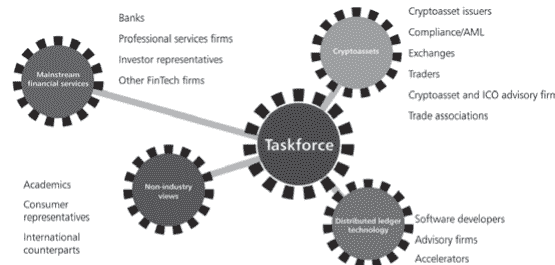

B.3 工作组利用其参与活动就多种主题征求意见，包括：行业的发展轨迹；加密资产的风险、收益和潜在经济价值；以及英国未来的监管方针。

B.4 利益相关者提出的许多问题已在整份报告中引用。参与过程中听取的其他观点载于表格B.1。

### 表格B.1：利益相关者观点示例

| 主题 | 评论 |
| :--- | :--- |
| 加密资产 | • 市场持续快速发展。 • 当前一代的加密资产对消费者缺乏明确的益处。 • 该领域的机构投资日益增加，许多银行开始探索如何与这一不断增长的市场互动。 |
| DLT | • 有许多用例展示了DLT的潜在益处。 • 人们对DLT能做什么和不能做什么缺乏了解。 • 采用DLT存在技术障碍，例如治理和可扩展性。 • DLT公司（包括加密资产公司）在英国很难获得银行账户。 |
| 监管方针 | • 英国的监管缺乏清晰度。 • 应引入监管以支持该市场的合法参与者。这在降低风险方面也至关重要。 • 监管和税收框架应保持一致。 |

## 英国财政部联系方式

本文件可从 www.gov.uk 下载

如果您需要其他格式的此信息，或对英国财政部及其工作有一般性咨询，请联系：

通讯团队
英国财政部
骑兵卫队路1号
伦敦
SW1A 2HQ
电话：020 7270 5000
电子邮件：public.enquiries@hmtreasury.gov.uk

## 加密货币与区块链——金融犯罪、洗钱和逃税的法律背景及其影响（欧洲议会，2018年7月）

这份欧洲议会报告回应了全球监管机构的担忧，即犯罪分子似乎倾向于将加密货币用作其犯罪计划的一部分。它侧重于洗钱、恐怖主义融资和逃税等金融犯罪，这些犯罪构成了据估计价值70亿欧元的加密货币滥用市场的一部分。该报告的研究指出匿名性是一个关键的促成因素，并得出结论：不同程度的匿名性——从伪匿名到完全匿名——使得不受监管的交易和不受监控的资金流动成为可能，这些交易和资金流动可能被用于清洗非法收益和/或逃税。

随后从第五项反洗钱指令（“AMLD5”）的背景下对此进行了审视，该指令确实部分解决了这个问题，但留下了一些可能被利用的漏洞，因为矿工和“纯加密货币交易所”以及其他实例不在其范围内，且容易受到犯罪利用。报告考虑了各种解决方案，例如扩大AMLD5的范围、对用户进行自愿或强制登记并设置重要性门槛的可能性，以及禁止加密货币的某些要素（例如可能使其无法追踪的要素）。有趣的是，报告得出结论，区块链拥有如此多合法的应用，因此不值得采取此类额外的保障措施，打击犯罪的重点应放在加密货币上，而不是底层技术上。

要查看报告全文，请点击以下链接：www.europarl.europa.eu/cmsdata/150761/TAX3%20Study%20on%20cryptocurrencies%20and%20blockchain.pdf。

要查看AMLD5，请点击以下链接：https://eur-lex.europa.eu/legal-content/EN/TXT/?uri=CELEX%3A3A32018L0843。

## 索引

所有引用均指向段落编号或附录。

- A
  - 另类投资基金（AIF）
    - 首次代币发行，7.58–7.72
  - 匿名化
    - 被遗忘权，9.21
  - 匿名性
    - 法律挑战，3.30–3.33
  - 反洗钱指令
    - 另见 洗钱
    - 概述，3.38
  - 人工智能（AI）
    - 另见 元宇宙
    - 概述，12.1
  - 自动化
    - DLT的特征，2.29
- B
  - Beenz
    - “货币”的含义，2.36
  - 行为
    - 元宇宙
      - 网络犯罪，12.36–12.37
      - 数据保护，12.43–12.45
      - 概述，12.35–12.48
      - 在线安全，12.38–12.42
  - 白俄罗斯
    - 监管问题，6.60
  - 比特币
    - 与匿名性，3.32
    - 作为商品，2.69–2.74
    - 与犯罪，3.28–3.31
    - 与加密资产，3.21–3.22
    - 作为加密货币，2.38
    - 作为货币
      - 在欧盟，2.57–2.58
      - 引言，2.5
    - 与去中心化自治组织，11.15
    - 创世区块，2.43–2.44
    - 与首次代币发行，7.6
    - 引言，2.2
  - 比特币——续
    - 作为“交换媒介”，2.52
    - “挖矿”，2.46–2.51
    - 与洗钱，3.37
    - 运作，2.40–2.45
    - 工作量证明验证，2.8
    - 验证，2.45
  - 区块链
    - 另见 分布式账本技术
    - 背景，1.1–1.5
    - 特征，2.6
    - 创建，2.4
    - 与犯罪，3.28–3.31
    - 数据隐私与保护，3.42–3.44
    - 作为分布式账本技术
      - 特征，2.29–2.30
      - 概述，2.27–2.28
      - 引言，1.9–1.13
      - 含义，2.25–2.26
    - 与全球监管，6.4–6.5
    - 与知识产权
      - 概述，2.22–2.24
      - 信息所有权，3.52–3.58
    - 引言，2.1–2.5
    - 与洗钱，3.35–3.41
    - 运作，2.6–2.21
    - 概述，1.9–1.13
    - 许可链/私有链，2.16–2.17
    - 无许可链/公有链，2.16
    - 与财产，3.62–3.65
    - 目的，2.4
    - 监管和法律挑战，1.9–1.13
    - 类型，2.16–2.17
    - 用途，2.3–2.4
  - 自带设备（BYOD）政策
    - 物联网，8.18
- C
  - 加拿大
    - 监管问题，5.1–5.11

## Index

## Certificates representing certain securities
- initial coin offerings, 7.52

## Children
- metaverse, 12.40

## China
### initial coin offerings
- regulatory approach, 7.109–7.117
- regulatory philosophy, 6.12–6.28
- jurisdictional issues, 6.7
- regulatory philosophies, 6.12–6.28

## Choice of jurisdiction
- generally, 4.10–4.15

## Collective investment scheme
- initial coin offerings, 7.53–7.57

## Commodities
- cryptocurrency, 2.69–2.74

## Computer misuse
- metaverse, 12.36–12.37

## 'Confirming'
- cryptocurrency, 2.46

## Contractual issues
### smart contracts
- benefits, 3.73
- characteristics, 3.74–3.75
- creation of legal relations, 3.76–3.77
- liability, 3.78–3.84
- meaning, 3.69
- operation, 3.72
- parties, 3.70–3.71

## Crime
- legal challenges, 3.28–3.34

## Crowdfunding
- initial coin offerings, 7.6

## Cryptoassets
- see also Cryptocurrency
- categories, 3.18
### challenges
- jurisdictional, 3.8–3.13
- loss of access, 3.14–3.18
- proprietary, 3.7
- exchange tokens, 3.18
- generally, 3.1–3.3
- initial coin offerings, and, 7.6
- jurisdictional challenges, 3.8–3.13
- loss of access challenges, 3.14–3.18
- meaning, 3.1
### non-fungible tokens, and
- generally, 2.54–2.56
- 'pump and dump' schemes, 2.61
- understanding, 2.57–2.60
- proprietary challenges, 3.7
- regulation, 3.19–3.25

## Cryptoassets – contd
- security tokens, 3.18
- status as property, 3.4–3.6
- use, 3.3
- utility tokens, 3.18

## Cryptocurrency
- see also Cryptoassets; Regulation
- background, 1.1–1.5
- centralised exchange, 2.62–2.65
- characteristics of DLT, and, 2.29
- commodity, as, 2.69–2.74
- 'confirming', 2.46
- cryptoassets, and, 3.21–3.22
- 'currency', 2.34–3.58
- currency, as, 2.52–2.53
### decentralised exchange
- generally, 2.66–2.67
- use, 2.68
- introduction, 2.31–2.33
### Libra Coin, and
- demise, 2.75–2.82
- failings, 2.83–2.84
- meaning, 2.39–2.45
- 'mining', 2.46–2.51
- money laundering, and, 3.35–3.41
### non-fungible tokens, and
- generally, 2.54–2.56
- 'pump and dump' schemes, 2.61
- understanding, 2.57–2.60
- regulatory and legal challenges, 1.14–1.28

## Currency
- cryptocurrency, 2.52–2.53
- meaning, 2.34–2.38

## Cybercrime
- metaverse, 12.36–12.37

## Cybersecurity Certification Framework
- generally, 8.51–8.60
- introduction, 8.40

## D

## Dash
- anonymity, 3.32

## Data distribution
- characteristics of DLT, 2.29
- generally, 3.42–3.44
- personal data, 3.45–3.51

## Data ownership
### Internet of Things
- generally, 8.88–8.94
- introduction, 8.19–8.21
- Privacy Shield, 8.91–8.93

## Data protection
- metaverse, 12.43–12.45
- see also General Data Protection Regulation
### Internet of Things
- collection, 8.19–8.21
- EU regulation, 8.42–8.44
- ownership of data, 8.88–8.94
- Privacy Shield, 8.91–8.93
- UK regulation, 8.29–8.30
- US regulation, 8.82
- introduction, 1.47–1.49

## Data privacy
### natural resources industry
- generally, 10.63
- introduction, 10.10
- right to be forgotten, 9.23–9.25

## Data storage
- natural resources industry, 10.34

## Debt instruments
- initial coin offerings, 7.48–7.49

## Decarbonisation
- generally, 10.1
- regulatory reform, 10.8

## Decentralisation
- areas of application, 10.20
- characteristics of DLT, 2.29
### cryptocurrency, and
- generally, 2.66–2.67
- use, 2.68
- electricity, 10.23–10.26
- generally, 10.15–10.19
- intermediaries, 10.20–10.21
- introduction, 10.1
- non-renewables, 10.20–10.21
- reality for future, 10.27–10.31
- regulatory reform, and, 10.8
- renewables, 10.23–10.26

## Decentralised autonomous organisations (DAOs)
- autonomous, 11.6
- Bitcoin, 11.15
- DeFi, 11.15
- Ethereum, 11.4–11.5
- generally, 11.1–11.15
- global regulation, 6.3
- introduction, 3.59–3.61
- meaning, 11.1
- overview, 1.31–1.37
- legal status, 11.16–11.24
- non-fungible tokens (NFTs), 11.10–11.13

## Decentralised autonomous organisations (DAOs) – contd
- peer-to-peer network, 11.1
- risks, 11.25–11.32
- smart contracts, 11.4
- stablecoin, 11.14
- unbiased currency, 11.14

## Declaration for European Blockchain Partnership
- generally, 4.16–4.19

## DeFi
- decentralised autonomous organisations, 11.15

## Democratisation
- generally, 10.1
- regulatory reform, 10.8

## Digital service providers (DSPs)
- Internet of Things, 8.41

## Digitisation
- disruptive technology, 10.44–10.45
- distributed technology, 10.37–10.42
- generally, 10.32–10.36
- information storage, 10.33
- introduction, 10.1–10.2
- obstacles, 10.43
- regulatory reform, and, 10.8

## Distributed denial of service (DDoS)
- Internet of Things, 8.39

## Distributed ledger technology (DLT)
- blockchain as, 2.27–2.28
### characteristics
- generally, 2.29–2.30
- introduction, 2.6
- cryptoassets, and, 3.1
- features, 2.29
- financial services, and, 3.26
- generally, 2.27–2.28
- Gibraltar, and, 6.21–6.29
- introduction, 2.1
- meaning, 2.25–2.26
- operation, 2.6–2.21
- overview, 1.9–1.13
- real-time gross settlement, and, 3.27
- regulation, 3.26–3.27
- right to amendment, and, 9.47
- use, 2.3

## Double spend
- characteristics of DLTs, 2.9

## Electricity
- renewable energy, 10.23–10.26

## E-money tokens
- initial coin offerings, 7.77–7.81

## Encrypted data
- right to be forgotten, 9.21

## Environmental, social and governance (ESG) metrics
- benefits of blockchain, 10.1
### data privacy
- generally, 10.63
- introduction, 10.10
- data storage, 10.34
### decarbonisation
- generally, 10.1
- regulatory reform, and, 10.8
### decentralisation
- areas of application, 10.20
- electricity, 10.23–10.26
- generally, 10.15–10.19
- intermediaries, 10.20–10.21
- introduction, 10.1
- non-renewables, 10.20–10.21
- reality for future, 10.27–10.31
- regulatory reform, and, 10.8
- renewables, 10.23–10.26
### democratisation
- introduction, 10.1
- regulatory reform, and, 10.8
### digitisation
- disruptive technology, 10.44–10.45
- distributed technology, 10.37–10.42
- generally, 10.32–10.36
- information storage, 10.33
- introduction, 10.1–10.2
- obstacles, 10.43
- regulatory reform, and, 10.8
- distributed technology, 10.37–10.42
- disruptive technology, 10.44–10.45
- electricity, 10.23–10.26
- future issues, 10.84
- generally, 1.45–1.46
- information storage, 10.33
- intellectual property, 10.10
- intermediaries, 10.20–10.21
- introduction, 10.1–10.6
- jurisdictional issues, 10.10
- legal issues, 10.46–10.48
- legal status of data, 10.82–10.83
- meaning, 10.3
- non-renewables, 10.20–10.21
- overview, 1.45–1.46
- peer-to-peer trading, 10.9
- public/private blockchains, 10.64–10.67

## Environmental, social and governance (ESG) metrics – contd
- reality for future, 10.27–10.31
### regulation
- challenges in industry, 10.68–10.75
- generally, 10.49–10.51
### regulatory issues
- introduction, 10.8
- key question, 10.9
- other matters, 10.10–10.14
- renewables, 10.23–10.26
### security
- challenges in industry, 10.68–10.75
- implications for nodal location and access, 10.68–10.83
- introduction, 10.1
- solutions and opportunities, 10.76–10.81
- status of data, 10.82–10.83
- service guarantees, 10.10
- solutions and opportunities, 10.76–10.81
### smart contracts
- generally, 10.52–10.62
- introduction, 10.11
- smart technology, 10.12
- status of data, 10.82–10.83
- types, 10.3

## ePrivacy Regulation
- generally, 8.45–8.50
- introduction, 8.40

## Erasure
- compliance with GDPR, 9.15–9.19
- consequences, 9.14
### enforcement
- consequences, 9.14
- generally, 9.10–9.13
- fundamental issues, 9.10–9.22
- generally, 9.7
- introduction, 9.1–9.2
### pseudonymisation
- effects on compliance, 9.27–9.35
- generally, 9.26
- introduction, 9.21
- meaning, 9.26
- right to be forgotten, and, 9.8–9.9

## Estonia
- general approach, 4.45
- regulatory philosophies, 6.60

## Ethereum
- cryptocurrency, as, 2.38
- currency, as, 2.5

## Ethereum – contd
- decentralised autonomous organisations, and, 11.4–11.5
- initial coin offerings, and, 7.6
- proof of work verification, 2.8

## EU Blockchain Observatory and Forum
- generally, 4.20

## EU regulation
- Cybersecurity Certification Framework, 8.51–8.60
- digital service providers, 8.41
### ePrivacy Regulation
- generally, 8.45–8.50
- introduction, 8.40
- Estonia, 4.45
- France, 4.46–4.52
### GDPR
- generally, 8.42–8.44
- introduction, 8.40
- UK, in, 8.30–8.37
### initial coin offerings
- current developments, 7.93–7.108
- generally, 7.86–7.92
### Internet of Things
- CCF, 8.51–8.60
- DSPS, 8.41
- ePrivacy Regulation, 8.45–8.50
- GDPR, 8.42–8.44
- introduction, 8.40–8.41
- NISD, 8.61–8.65
- OESs, 8.41
- RFID, 8.42
- Jersey, 4.71–4.80
- jurisdictional issues, 6.6
- Malta, 4.53–4.70
- MiFID, 4.31–4.36
- MiFID II, 4.37–4.43
- MiFIR, 4.37
- Network Infrastructure Security Directive, 8.61–8.65
- operators of essential services (OESs), 8.41
### other countries
- Estonia, 4.45
- France, 4.46–4.52
- Introduction, 4.44
- Jersey, 4.71–4.80
- Malta, 4.53–4.70
- Radio Frequency Identification (RFID), 8.42
- tax considerations, 4.81–4.83
- United Kingdom, 4.21–4.30

## Exchange tokens
- cryptoassets, 3.18

## Exclusive jurisdiction
- generally, 4.11–4.13

## Exterritorial jurisdiction
### metaverse, and
- generally, 12.49–12.52
- Online Safety Bill, 12.42

## F

## Federal Trade Commission (FTC)
- Internet of Things, 8.66–8.77

## Financial Conduct Authority (FCA)
- authorised persons, 4.28–4.30
- cryptoassets, and, 3.23–3.25
- generally, 4.21–4.27
- initial coin offerings, and, 7.38–7.39
- 'regulated activities', 4.25

## Flooz
- meaning of 'currency', 2.36

## Food and Drug Administration
- Internet of Things, 8.78–8.80

## France
- regulatory issues, 4.46–4.52

## G

## General Data Protection Regulation (GDPR)
- characteristics of DLTs, and, 2.21
- global regulation, and, 6.1–6.2
### Internet of Things
- generally, 8.42–8.44
- introduction, 8.40
- UK, in, 8.30–8.37
- introduction, 1.47–1.49
### jurisdictional issues
- effect, 3.68
- generally, 3.66–3.67
- metaverse, and, 12.43–12.45
### pseudonymisation
- effects on compliance, 9.27–9.35
- generally, 9.26
- introduction, 9.21
- meaning, 9.26
### right to amendment
- distributed technology, 9.47
- effects on compliance, 9.37–9.46
- Holochain, 9.43–9.46
- introduction, 9.36
- LTO Network, 9.42
- self-destruct function, 9.48
- smart contracts, and, 9.48

### 通用数据保护条例
- **(GDPR) — 续**
- 修订权 — 续
- Sovorin, 9.39–9.41
- 摘要，9.47–9.48
- 被遗忘权
- 匿名化，9.21
- 后果，9.14
- 权利涵盖的数据，9.20–9.22
- 数据保护，9.23–9.25
- 数据主体，9.23
- 加密数据，9.21
- 执行，9.10–9.14
- 基本问题，9.10–9.22
- 概述，9.8–9.9
- '哈希'，9.25
- 引言，9.1–9.6
- 个人数据，9.24
- 隐私，9.23–9.25
- 假名化，9.26–9.35
- 公钥，9.20–9.21
- 交易数据，9.20–9.22

#### 删除权
- 符合GDPR，9.15–9.19
- 后果，9.14
- 执行，9.10–9.14
- 基本问题，9.10–9.22
- 概述，9.7
- 引言，9.1–9.2
- 假名化，9.27–9.35
- 文本，附录1

### 创世区块
- '加密货币'的含义，2.43–2.44

### 直布罗陀
- 监管问题，6.29–6.39

### 全球监管
- 另见监管
- 司法管辖区的选择，4.10–4.15
- 欧洲区块链合作伙伴关系宣言，4.16–4.19
- 欧盟区块链观察站与论坛，4.20
- 欧洲联盟，4.31–4.43
- 概述，4.1–4.9
- 引言，1.38–1.40
- 北美，5.1–5.41
- 其他欧洲国家，4.44–4.83
- 世界其他地区，6.1–6.72
- 英国，4.21–4.30

### 黑客攻击
- 元宇宙，及，12.36

### 有害内容
- 元宇宙，及，12.40

### 哈希
- 分布式账本技术的特征，2.18

### '哈希'
- 被遗忘权，9.25

### Holochain
- 修订权，9.43–9.46

### 香港
- 监管问题，6.40–6.47

## I

### 非法内容
- 元宇宙，及，12.40

### 不可篡改性
- 分布式账本技术的特征，2.9

### 印度
- 监管问题，6.48–6.50

### 首次代币发行（ICO）
- 作为另类投资基金，7.58–7.72
- 中国及
  - 监管方法，7.109–7.117
  - 监管理念，6.12–6.28
- 作为集体投资计划，7.53–7.57
- 犯罪，及，3.31
- 作为众筹，7.6
- 作为加密货币，7.6
- 电子货币代币，7.77–7.81
- 欧盟监管
  - 当前发展，7.93–7.108
  - 概述，7.86–7.92
  - 促进受监管支付系统，7.84–7.85
- FCA方法，7.38–7.39
- 概述，7.6–7.12
- 香港，及，6.40–6.47
- 引言，7.1–7.5
- 由投资公司发行，7.33–7.37
- 含义，7.6–7.12
- 概览，1.41–1.44
- 支付系统，7.84–7.85
- 私募发行，7.6
- 公开发行，7.6
- 目的，7.12
- 受监管支付系统，7.84–7.85
- 监管方法
  - 中国，7.109–7.117
  - 欧洲联盟，7.86–7.108
  - 英国，7.38–7.85
  - 美国，7.13–7.37
- 代币，7.6–7.7
- 类型，7.7
- 英国监管
  - 作为另类投资基金，7.58–7.72
  - 7.72
  - 代表特定证券的凭证，7.52
  - 作为集体投资计划，7.53–7.57
  - 债务工具，7.48–7.49
  - 电子货币代币，7.77–7.81
  - FCA方法，7.38–7.39
  - 概述，7.38–7.44
  - 营销限制，7.73–7.76
  - 方法，7.45–7.72
  - 受监管支付系统，7.84–7.85
  - 股份，7.46–7.47
  - 类型，7.45–7.72
  - 不受监管的代币，7.82–7.83
  - 认股权证，7.50–7.51
- 美国监管
  - 概述，7.13–7.18
  - 豪威测试，7.19–7.32
  - 投资公司，7.33–7.37
- 监管，5.31
- 用途，7.12

### 禁令
- 引言，1.24

### 知识产权
- 概述，2.22–2.24
- 自然资源行业，10.10
- 区块链中信息的所有权，3.52–3.58

### 物联网（IoT）
- 管理访问，8.18
- '空气间隙'，8.18
- 可用设备，8.8
- 自带设备（BYOD）政策，8.18
- 实务守则，8.23–8.28
- 传感器成本，8.7
- 台面设备，8.8
- 网络安全认证框架
  - 概述，8.51–8.60
  - 引言，8.40
- 数据所有权
  - 概述，8.88–8.94
  - 引言，8.19–8.21
- 数据保护
  - 欧盟监管，8.42–8.44
  - 英国监管，8.29–8.30
  - 美国监管，8.82
- 《数据保护法》，8.29–8.30
- 数据主体，8.89–8.90
- 数字服务提供商（DSP），8.41
- 分布式拒绝服务（DDoS），8.39
- 《电子隐私条例》
  - 概述，8.45–8.50
  - 引言，8.40
- 欧盟监管
  - 网络安全认证框架，8.51–8.60
  - 数字服务提供商，8.41
  - 《电子隐私条例》，8.45–8.50
  - GDPR，8.42–8.44
  - 引言，8.40–8.41
  - 网络基础设施安全指令，8.61–8.65
  - 基本服务运营商，8.41
  - 射频识别，8.42
- 联邦贸易委员会，8.66–8.77
- 固件更新，8.18
- 食品药品监督管理局，8.78–8.80
- GDPR
  - 概述，8.42–8.44
  - 引言，8.40
  - 在英国，8.30–8.37
- 概述，8.4–8.9
- 指南，8.88
- 可摄入传感器，8.8
- 可植入传感器，8.8
- 信息专员办公室，8.29–8.33
- 亲密接触传感器，8.8
- 引言，8.1–8.3
- 市场价值，8.1
- 含义，8.4–8.9
- 国家网络安全战略，8.23
- 网络基础设施安全指令（NISD）
  - 概述，8.61–8.65
  - 引言，8.41
- NIST网络安全框架，8.83–8.87
- 基本服务运营商，8.41
- 概览，1.6–1.8
- 隐私盾，8.91–8.93
- 射频识别，8.42
- 监管
  - 欧洲联盟，8.40–8.65
  - 英国，8.22–8.39
  - 美国，8.66–8.87
- 安全问题
  - 改进，8.18
  - 缓解措施，8.18
  - 问题领域，8.10–8.17
- 传感器，8.7–8.8
- 员工培训，8.18
- 英国监管
  - 实务守则，8.23–8.28
  - 《数据保护法》，8.29–8.30
  - DDoS，8.39
  - F-Secure报告，8.38
  - GDPR，8.30–8.37
  - 概述，8.22
  - 信息专员办公室，8.29–8.33
  - 国家网络安全战略，8.23
- 美国监管
  - 数据保护，8.82
  - 联邦贸易委员会，8.66–8.77
  - 食品药品监督管理局，8.78–8.80
  - NIST网络安全框架，8.83–8.87
  - 自愿性指南，8.83–8.87
- 用途，8.2
- 审查第三方用户，8.18
- 可穿戴设备，8.8

### 非法内容
- 元宇宙，及，12.40

### 互操作性
- 元宇宙，及，12.3–12.5

### 调查权
- 引言，1.23

### 投资公司
- 首次代币发行，7.33–7.37

### 以色列
- 监管问题，6.51–6.53

## J

### 日本
- 监管问题，6.54–6.59

#### 泽西岛
- 监管问题，4.71–4.80

### 管辖权问题
- 区块链，6.9
- 中国，6.7
- 司法管辖区的选择，4.10–4.15
- 加密货币，6.9
- 影响，3.68
- 欧洲，6.6
- 概述，3.66–3.67
- 引言，6.1–6.5
- 元宇宙，及
  - 概述，12.49–12.52
  - 《在线安全法案》，12.42
- 自然资源行业，10.10
- 俄罗斯，6.6
- 美国，6.8

## K

### 哈萨克斯坦
- 监管问题，6.60

### 吉尔吉斯共和国
- 监管问题，6.61

## L

### 法律挑战
- 匿名性，3.30–3.33
- 合同
  - 益处，3.73
  - 特征，3.74–3.75
  - 法律关系的建立，3.76–3.77
  - 责任，3.78–3.84
  - 含义，3.69
  - 运作，3.72
  - 当事方，3.70–3.71
- 刑事问题，3.28–3.34
- 数据隐私与保护
  - 概述，3.42–3.44
  - 个人数据，3.45–3.51
- 去中心化自治组织，3.59–3.61
- 知识产权，3.52–3.58
- 管辖权问题
  - 影响，3.68
  - 概述，3.66–3.67
- 洗钱，3.35–3.41
- 财产问题，3.62–3.65

### Libra Coin
- 消亡，2.75–2.82
- 缺陷，2.83–2.84

### LTO网络
- 修订权，9.42

## M

### 马耳他
- 监管问题，4.53–4.70

### 主节点
- 权益证明验证，2.11

### 元宇宙
- 人工智能，12.1

### 元宇宙

- 行为监管
- 网络犯罪，12.36–12.37
- 数据保护，12.43–12.45
- 一般规定，12.35–12.48
- 在线安全，12.38–12.42
  - 儿童伤害，12.40
- 组成部分，12.1
- 《计算机滥用法》，以及，12.36–12.37
- 《2018年数据保护法》，12.43–12.45
- 示例，12.5–12.6
- 域外管辖权
  - 一般规定，12.49–12.52
- 《在线安全法案》，12.42
- 《通用数据保护条例》，12.43–12.45
- 一般规定，1.50–1.54
- 黑客攻击，12.36
- 有害内容，12.40
- 非法内容，12.40
- 互操作性，12.3–12.5
- 引言，12.1–12.6
- 管辖权问题，12.49–12.52
- 含义，12.1–12.2
- 非同质化代币，以及，1.51
- 《在线安全法案》，12.38–12.42
- 色情内容，12.41
- 受监管服务，12.38–12.39
- 监管框架
  - 行为监管，12.35–12.48
  - 合同，12.7–12.14
  - 版权，12.24–12.31
  - 知识产权，12.15–12.34
  - 管辖权问题，12.49–12.52
  - 专利，12.32–12.34
  - 商标，12.16–12.23
- 用户
  - 搜索引擎，12.38–12.41
  - 技术，12.1
  - 用户对用户服务，12.38–12.41

### 洗钱

- 法律挑战，3.35–3.41

## 相互法律协助条约（MLATs）

- 引言，1.28

## N

## 国家网络安全战略

- 物联网，8.23

### 自然资源行业

- 区块链的优势，10.1
- 数据隐私
  - 一般规定，10.63
  - 引言，10.10
- 数据存储，10.34
- 脱碳
  - 一般规定，10.1
  - 监管改革，以及，10.8
- 去中心化
  - 应用领域，10.20
  - 电力，10.23–10.26
  - 一般规定，10.15–10.19
  - 中介机构，10.21–10.20
  - 引言，10.1
  - 不可再生能源，10.21–10.20
  - 未来现实，10.27–10.31
  - 监管改革，以及，10.8
  - 可再生能源，10.23–10.26
- 民主化
  - 引言，10.1
  - 监管改革，以及，10.8
- 数据的法律地位，10.82–10.83
- 不可再生能源，10.21–10.20
- 概述，1.45–1.46
- 点对点交易，10.9
- 公有/私有区块链，10.64–10.67
- 未来现实，10.27–10.31
- 监管
  - 行业挑战，10.68–10.75
  - 一般规定，10.49–10.51
- 监管问题
  - 引言，10.8
  - 关键问题，10.9
  - 其他事项，10.10–10.14
- 可再生能源，10.23–10.26
- 安全
  - 行业挑战，10.68–10.75
  - 对节点位置和访问的影响，10.68–10.83
  - 引言，10.1
  - 解决方案与机遇，10.76–10.81
  - 数据状态，10.82–10.83
- 服务保障，10.10
- 社会指标，10.3
- 解决方案与机遇，10.76–10.81
- 智能合约
  - 一般规定，10.52–10.62
  - 引言，10.11
- 智能技术，10.12
- 数据状态，10.82–10.83

### 墨西哥

- 监管问题，5.12–5.21

## 金融工具市场指令（MiFID）

- 指令一，4.31–4.36
- 指令二，4.37–4.43
- 英国脱欧后方针，6.39

## 金融工具市场法规（MiFIR）

- 一般规定，4.37

## “挖矿”

- 一般规定，2.46–2.51
- 工作量证明验证，2.8

## 门罗币

- 匿名性，以及，3.32

### 数字化

- 颠覆性技术，10.44–10.45
- 分布式技术，10.37–10.42
- 一般规定，10.32–10.36
- 信息存储，10.33
- 引言，10.1–10.6
- 障碍，10.43
- 监管改革，以及，10.8
- 分布式技术，10.37–10.42
- 颠覆性技术，10.44–10.45
- 电力，10.23–10.26
- 环境指标，10.3
- 未来问题，10.84
- 一般规定，1.45–1.46
- 治理指标，10.3
- 信息存储，10.33
- 知识产权，10.10
- 中介机构，10.21–10.20
- 引言，10.1–10.6
- 管辖权问题，10.10
- 法律问题，10.46–10.48

## 网络基础设施安全指令（NISD）

- 一般规定，8.61–8.65
- 引言，8.41

## NIST网络安全框架

- 物联网，8.83–8.87

## 非同质化代币（NFT）

- 去中心化自治组织，11.10–11.13
- 一般规定，2.54–2.56
- 元宇宙，以及，1.51
- “拉高出货”计划，2.61
- 理解，2.57–2.60
- 美国监管，5.27

## 诺里奇药厂令

- 引言，1.24

## Nxt

- 权益证明验证，2.10

## O

## 在线安全法案

- 元宇宙，以及，12.38–12.42

## 基本服务运营商（OESs）

- 物联网，8.41

## P

## 《2017年支付服务条例》

- 加密资产，以及，3.21–3.22

## 支付系统

- 首次代币发行，以及，7.84–7.85

## 贝宝

- 美国监管，5.28

## 点点币

- 权益证明验证，2.10

## 点对点（P2P）

- 分布式账本技术的特点，2.6
- 去中心化自治组织，11.1
- 自然资源行业，10.9

## 许可区块链

- 分布式账本技术的特点，2.16–2.17
- 全球监管，6.5

## 无许可区块链

- 分布式账本技术的特点，2.16
- 全球监管，6.5

## 个人数据

- 被遗忘权，9.24
- 用户公钥，3.45–3.51

## 色情内容

- 元宇宙，以及，12.41

## 隐私

- 自然资源行业
  - 一般规定，10.63
  - 引言，10.10
- 被遗忘权，9.23–9.25

## 隐私护盾

- 物联网，以及，8.91–8.93

## 私有区块链

- 分布式账本技术的特点，2.16–2.17
- 全球监管，6.5

## 私钥

- 分布式账本技术的特点，2.20

## 可编程性

- 分布式账本技术的特点，2.29

## 权威证明（PoA）

- 一般规定，2.13–2.14
- 引言，2.7

## 权益证明（PoS）

- 一般规定，2.10–2.12
- 引言，2.7

## 工作量证明（PoW）

- 一般规定，2.8–2.9
- 引言，2.7
- “挖矿”，以及，2.47–2.50

## 监管

- 白俄罗斯，6.60
- 加拿大，5.1–5.11
- 挑战
  - 加密资产，3.1–3.25
  - 分布式账本技术，3.26–3.27
- 中国
  - 管辖权问题，6.7
  - 监管理念，6.12–6.28
- 管辖地选择，4.10–4.15
- 加密资产
  - 类别，3.18
  - 挑战，3.7–3.18
  - 交易型代币，3.18
  - 一般规定，3.1–3.3
  - 管辖权挑战，3.8–3.13
  - 访问丧失挑战，3.14–3.18
  - 含义，3.1
  - 财产权挑战，3.17
  - 监管，3.19–3.25
  - 证券型代币，3.18
  - 作为财产的地位，3.4–3.6
  - 使用，3.3
  - 功能型代币，3.18
- 《欧洲区块链合作伙伴宣言》，4.16–4.19
- 分布式账本技术，3.26–3.27
- 爱沙尼亚
  - 一般方针，4.45
  - 监管理念，6.60
- 欧盟区块链观察站与论坛，4.20
- 欧盟
  - 《金融工具市场指令》，4.31–4.36
  - 《金融工具市场指令II》，4.37–4.43
  - 《金融工具市场法规》，4.37
  - 管辖权问题，6.6
  - 其他国家，4.44–4.80
  - 税务考虑，4.81–4.83
  - 英国，4.21–4.30
- 促进受监管支付系统，7.84–7.85
- 金融行为监管局，由授权人士，4.28–4.30
- 一般规定，4.21–4.27
- “受监管活动”，4.25
- 法国，4.46–4.52
- 一般规定，4.1–4.9
- 直布罗陀，6.29–6.39
- 全球问题
  - 管辖地选择，4.10–4.15
  - 《欧洲区块链合作伙伴宣言》，4.16–4.19
  - 欧盟区块链观察站与论坛，4.20
  - 欧盟，4.31–4.43
  - 一般规定，4.1–4.9
  - 北美，5.1–5.41
  - 其他欧洲国家，4.44–4.83
  - 世界其他地区，6.1–6.72
  - 英国，4.21–4.30
- 香港，6.40–6.47
- 印度，6.48–6.50
- 首次代币发行
  - 中国，7.109–7.117
  - 欧盟，7.86–7.108
  - 英国，7.38–7.85
  - 美国，7.13–7.37
- 物联网
  - 欧盟，8.40–8.65
  - 英国，8.22–8.39
  - 美国，8.66–8.87
- 引言，1.14–1.28
- 以色列，6.51–6.53
- 日本，6.54–6.59
- 泽西岛，4.71–4.80
- 管辖权问题
  - 中国，6.7

## 财产问题

- 法律挑战，3.62–3.65

## 假名化

- 被遗忘权
  - 对合规的影响，9.27–9.35
  - 一般规定，9.26
  - 引言，9.21
  - 含义，9.26

## 公有区块链

- 分布式账本技术的特点，2.16
- 全球监管，6.5

## 公钥

- 分布式账本技术的特点，2.20
- 数据保护，3.45–3.51
- 被遗忘权，9.20–9.21

## 拉高出货计划

- 非同质化代币，2.61

## R

## 射频识别（RFID）

- 物联网，8.42

## 实时全额结算（RTGS）

- 分布式账本技术，3.27

## 监管 – 续
- 管辖权问题 – 续
- 区块链, 6.9
- 司法管辖区选择, 4.10–4.15
- 加密货币, 6.9
- 欧洲, 6.6
- 简介, 6.1–6.5
- 俄罗斯, 6.6
- 美国, 6.8
- 哈萨克斯坦, 6.60
- 吉尔吉斯斯坦, 6.61
- 马耳他, 4.53–4.70
- 墨西哥, 5.12–5.21

## 天然资源行业
- 行业挑战, 10.68–10.75
- 未来问题, 10.84
- 一般情况, 10.49–10.51
- 简介, 10.8
- 关键问题, 10.9
- 其他事项, 10.10–10.14

## 北美
- 加拿大, 5.1–5.11
- 墨西哥, 5.12–5.21
- 美国, 5.22–5.41

## 监管哲学
- 白俄罗斯, 6.60
- 中国, 6.12–6.28
- 爱沙尼亚, 6.60
- 一般情况, 6.10–6.11
- 直布罗陀, 6.29–6.39
- 香港, 6.40–6.47
- 印度, 6.48–6.50
- 简介, 6.9
- 以色列, 6.51–6.53
- 日本, 6.54–6.59
- 哈萨克斯坦, 6.60
- 吉尔吉斯斯坦, 6.61
- 俄罗斯, 6.66–6.67
- 韩国, 6.62–6.65
- 瑞士, 6.68–6.72
- 英国脱欧后, 6.39

## 世界其他地区
- 管辖权问题, 6.1–6.9
- 监管哲学, 6.10–6.72

### 俄罗斯
- 管辖权问题, 6.6
- 监管哲学, 6.66–6.67

- 韩国, 6.62–6.65
- 瑞士, 6.68–6.72

## 英国
- 获许可人士, 4.28–4.30
- 一般情况, 4.21–4.27

## 监管 – 续
- 英国 – 续
- 脱欧后方针, 6.39
- '受监管活动', 4.25

#### 美国
- 国会区块链党团, 5.23–5.24
- 消费者保护立法, 5.30
- '数字资产', 5.27
- 一般情况, 5.22–5.34
- 基础设施法案, 5.26–5.29
- 首次代币发行, 5.31
- 管辖权问题, 6.8
- 许可, 5.35–5.36
- 货币传输法, 5.37
- 非同质化代币, 5.27
- 监管指南, 5.38–5.41
- 加密货币销售, 5.32
- 可追溯电子交易, 5.28

## 修正权
- 分布式技术, 9.47
- 对合规的影响, 9.37–9.46
- Holochain, 9.43–9.46
- 简介, 9.36
- LTO Network, 9.42
- 自毁功能, 9.48
- 智能合约，及，9.48
- Sovrin, 9.39–9.41
- 摘要, 9.47–9.48

#### 被遗忘权
- 匿名化, 9.21
- 后果, 9.14
- 被该权利覆盖的数据, 9.20–9.22
- 数据保护, 9.23–9.25
- 数据主体, 9.23
- 加密数据, 9.21

## 执法
- 后果, 9.14
- 一般情况, 9.10–9.13

## 删除
- 符合GDPR, 9.15–9.19
- 被该权利覆盖的数据, 9.20–9.22
- 一般权利, 9.7
- 基本问题, 9.10–9.22
- 一般情况, 9.8–9.9
- '哈希', 9.25
- 简介, 9.1–9.6
- 个人数据, 9.24
- 隐私, 9.23–9.25

## 假名化
- 对合规的影响, 9.27–9.35
- 一般情况, 9.26

## 被遗忘权 – 续
- 假名化 – 续
  - 简介, 9.21
  - 含义, 9.26
- 公钥, 9.20–9.21
- 事务数据, 9.20–9.22

#### 删除权
- 符合GDPR, 9.15–9.19
- 后果, 9.14
- 执法
  - 后果, 9.14
  - 一般情况, 9.10–9.13
- 基本问题, 9.10–9.22
- 一般情况, 9.7
- 简介, 9.1–9.2
- 假名化
  - 对合规的影响, 9.27–9.35
  - 一般情况, 9.26
  - 简介, 9.21
  - 含义, 9.26
- 被遗忘权，及，9.8–9.9

### 俄罗斯
- 管辖权问题, 6.6
- 监管哲学, 6.66–6.67

### S

- **搜索引擎**
  - 元宇宙，及，12.38–12.41

- **安全问题**
  - 物联网
    - 改进, 8.18
    - 缓解, 8.18
    - 问题领域, 8.10–8.17
  - 天然资源行业
    - 行业挑战, 10.68–10.75
    - 对节点位置和访问的影响, 10.68–10.83
    - 简介, 10.1
    - 解决方案与机遇, 10.76–10.81
    - 数据状态, 10.82–10.83

- **安全代币**
  - 加密资产, 3.18

- **自毁功能**
  - 修正权, 9.48

- **股份**
  - 首次代币发行, 7.46–7.47

- **智能合约**
  - 优势, 3.73
  - 特征, 3.74–3.75
  - 法律关系的设立, 3.76–3.77
  - 去中心化自治组织, 11.4

- **智能合约 – 续**
  - 简介, 1.29–1.30
  - 责任, 3.78–3.84
  - 含义, 3.69
  - 天然资源行业
    - 一般情况, 10.52–10.62
    - 简介, 10.11
  - 运作, 3.72
  - 当事方, 3.70–3.71
  - 修正权，及，9.48

- **韩国**
  - 监管问题, 6.62–6.65

- **Sovrin**
  - 修正权, 9.39–9.41

- **稳定币**
  - 去中心化自治组织, 11.14

- **瑞士**
  - 监管问题, 6.68–6.72

### T

- **税收**
  - 欧盟法规, 4.81–4.83

- **时间戳**
  - 分布式账本技术的特征, 2.18

- **代币**
  - 首次代币发行, 7.6–7.7

- **事务数据**
  - 被遗忘权, 9.20–9.22

### U

- **英国监管**
  - 获许可人士, 4.28–4.30
  - 加密货币, 4.21
  - 衍生品, 4.24
  - 电子货币代币, 7.77–7.81
  - 豁免人士, 4.27
  - 外汇, 4.22
  - 一般情况, 4.21–4.27
  - 首次代币发行
    - 作为另类投资基金, 7.58–7.72
    - 代表特定证券的证书, 7.52
    - 作为集合投资计划, 7.53–7.57
    - 债务工具, 7.48–7.49
    - 电子货币代币, 7.77–7.81
    - FCA 做法, 7.38–7.39
    - 一般情况, 7.38–7.44
    - 营销限制, 7.73–7.76
    - 方法, 7.45–7.72

## *索引*

## 英国监管 – 续
- 首次代币发行 – 续
  - 受监管支付系统, 7.84–7.85
  - 股份, 7.46–7.47
  - 类型, 7.45–7.72
  - 未受监管代币, 7.82–7.83
  - 权证, 7.50–7.51
- 物联网
  - 实践守则, 8.23–8.28
  - 数据保护法, 8.29–8.30
  - DDoS, 8.39
  - F-Secure 报告, 8.38
  - GDPR, 8.30–8.37
  - 一般情况, 8.22
  - 信息专员办公室, 8.29–8.33
  - 国家网络安全战略, 8.23
- MiFID II，及，4.23
- 支付系统, 7.84–7.85
- 脱欧后方针, 6.39
- ‘受监管活动’, 4.25
- 受监管支付系统, 7.84–7.85
- 未受监管代币, 7.82–7.83

## 无偏货币
- 去中心化自治组织, 11.14

## 未受监管代币
- 首次代币发行, 7.82–7.83

## 美国监管
- 国会区块链党团, 5.23–5.24
- 消费者保护立法, 5.30
- ‘数字资产’, 5.27
- 一般情况, 5.22–5.34
- 一般情况, 5.22–5.34
- 基础设施法案, 5.26–5.29
- 首次代币发行
  - 一般情况, 7.13–7.18
  - Howey 测试, 7.19–7.32
  - 投资公司, 7.33–7.37

## 美国监管 – 续
- 首次代币发行 – 续
  - 监管, 5.31
- 物联网
  - 数据保护, 8.82
  - 联邦贸易委员会, 8.66–8.77
  - 食品药品监督管理局, 8.78–8.80
  - NIST 网络安全框架, 8.83–8.87
  - 自愿指南, 8.83–8.87
- 管辖权问题, 6.8
- 许可, 5.35–5.36
- 货币传输法, 5.37
- 非同质化代币, 5.27
- 监管指南, 5.38–5.41
- 加密货币销售, 5.32
- 可追溯电子交易, 5.28

## 用户对用户服务
- 元宇宙, 12.38–12.41

## 实用代币
- 加密资产, 3.18

### V

- **验证**
  - 分布式账本技术的特征, 2.18

- **验证者**
  - 权威证明验证, 2.13–2.14

- **VeChain**
  - 权益证明验证, 2.11

### W

- **权证**
  - 首次代币发行, 7.50–7.51

- **可穿戴设备**
  - 物联网, 8.8

### Z

- **ZCash**
  - 匿名性, 3.32

