# 区块链与加密货币：管理系统与技术挑战

# 关于编辑

**Asik Rahaman Jamader** 目前担任印度加尔各答Pailan College of Management & Technology的助理教授，该学院经印度政府AICTE批准，并隶属于西孟加拉邦的Maulana Abul Kalam Azad University of Technology。此前，在获得泰米尔纳德邦立大学Bharathiar University的MBA学位后，他曾担任印度加尔各答Indira Gandhi National Open University管理学院（SOMS）的讲师/学术顾问。他是Smart Journal of Business Management Studies期刊的企业顾问委员会成员，该期刊被Emerging Sources Citation Index（ESCI）——Web of Science和Clarivate Analytics收录，影响因子为5.748。他的研究兴趣是可持续商业管理以及在商业管理中应用的创新技术。他拥有46项已授权/已发布的国家和国际专利/设计/版权，以及32篇被SCOPUS/SCIE/ESCI/WOS收录的期刊论文/著作/书籍章节/国际会议论文。他是新加坡Smart Tourism（ST）期刊的栏目编辑，ISSN：2810-9821。他是CRC Press旗下Cogent Social Sciences的认证审稿人。最近，他加入了被WOS和Scopus收录的IGI Global出版社International Journal of Business Intelligence Research（IJBIR）的特邀审稿人团队，同时也是被WOS和Scopus收录的IGI Global出版社International Journal of Asian Business and Information Management（IJABIM）的特邀审稿人。他是印度西孟加拉邦著名的科学家/发明家，目前还在印度加尔各答Pailan College of Management & Technology校长兼副教授Santanu Dasgupta博士的指导下从事一些非常重要的研究工作。

**Murugesan Selvam** 是Bharathidasan大学商业研究学院主席、商业与金融研究系教授兼系主任、大学评议会成员，也是自2005年以来一直出版的《SMART Journal of Business Management Studies》的创始人——出版商兼主编，该期刊是一本同行评审、索引收录的专业国际期刊。他目前担任大学评议会和理事会成员、商业研究学院主席、创业与技能发展中心协调员、NITI Aayog（校级）协调员以及金融市场中心协调员。他曾担任管理学院前院长和UGC学术人员学院代理主任。Selvam博士在财务管理领域从事研究已超过三十年。他在包括SCOPUS期刊在内的各种同行评审期刊上发表了190多篇研究论文，并在编辑书籍中撰写了22个章节，还参与了由新德里UGC和ICSSR资助的八个以上研究项目。他还促成了金融领域20名博士和19名哲学硕士学者的培养。在其职业生涯中，他指导了160多个研究生项目/暑期实习项目。

**Biswaranjan Acharya**（IEEE高级会员）于2009年在印度新德里IGNOU获得MCA学位，并于2012年在印度奥迪沙邦鲁尔克拉的Biju Pattanaik University of Technology（BPUT）获得计算机科学与工程MTech学位。他在计算机工程系（人工智能和大数据分析方向）担任助理教授。他已向印度奥迪沙邦布尔拉的Veer Surendra Sai University of Technology（VSSUT）提交了计算机应用方向的博士论文。他在知名大学（如Ravenshaw University）的学术领域以及软件开发领域拥有总计超过十年的经验。他是国际知名期刊上70多篇研究文章的共同作者，并担任多家同行评审期刊的审稿人。他拥有超过50项专利。他的研究兴趣包括多处理器调度、数据分析、计算机视觉、机器学习和物联网。他还与多个教育和研究学会有联系，如IACSIT、CSI、IAENG和ISC。

# 贡献者

**Biswaranjan Acharya**
Marwadi University
印度

**Sarla Achuthan**
印度

**D. Archana**
Department of Computer Science Engineering
Nalla Malla Reddy Engineering College
印度

**Akash Bag**
School of Law
Adamas University
印度

**Debesh Bhowmik**
Department of Business & Accountancy
Lincoln University College
马来西亚

**Biswarup Chatterjee**
Pailan College of Management and Technology
印度

**Sumanta Choudhury**
Pailan College of Management and Technology
印度

**S. Subrata Chowdhury**
Department of Computer Science Engineering
SITAMS
印度

**Santanu Dasgupta**
Pailan College of Management & Technology
印度

**S. Dhanasekar**
Department of Electronics & Communication Engineering
Sri Eshwar College of Engineering
印度

**Savita Gandhi**
FCAIT
GLS University
印度

**Kyvalya Garikapati**
School of Law
Kalinga Institute of Industrial Technology
印度

**P. Geetha**
School of Engineering Mohan Babu University
印度

**V. Govindaraj**
Department of Electronics & Communication Engineering
Dr N.G.P. Institute of Technology
印度

**Arpit A. Jain**
FCAIT
GLS University
印度

**Asik Rahaman Jamader**
Pailan College of Management &
Technology
印度

**Alvaro Rocha**
ISEG
University of Lisbon
葡萄牙

**Manickavasagam**
Alagappa University
印度

**K. Martin Sagayam**
Department of Electronics &
Communication Engineering
Karunya Institute of Technology and
Sciences
印度

**Baisakhi Mukherjee**
Pailan College of Management and
Technology
印度

**Ch. Sathyanarayana**
Department of Computer Science
Engineering
Nalla Malla Reddy Engineering College
印度

**Uddipan Nath**
印度

**Minal Shukla**
Mgl Group
印度

**Sambhabi Patnaik**
School of Law
Kalinga Institute of Industrial
Technology
印度

**C. Venkataramanan**
Department of Electronics &
Communication Engineering
Sri Eshwar College of Engineering
印度

**M. Priyadharshini**
Department of Computer Science
Engineering
Nalla Malla Reddy Engineering College
印度

**V. Vijaya**
Amity Global Business School
印度

**Oum Kumari R**
Jaipuria Institute of Management
印度

**Bharathi Ravi**
College of Management
印度

# 1 区块链在可持续管理系统中的采用

Sumanta Choudhury and Uddipan Nath

## 1.1 区块链基础

区块链作为实时分布式账本系统运行（Panda et al., 2021）。它可以被视为银行账本的数字对应物，仔细记录账户之间的金融交易。与传统的数据模型（其中单一实体控制）不同，分布式账本使多方能够按照共同商定的框架共同管理数据。只有在相关各方达成共识后才会写入数据，从而无需进行前后处理对账。这种机制保证了所有利益相关者都能看到相同的信息，促进了对记录事实的一致意见。

交易被分组到区块中，每个区块容纳大量交易（Wu et al., 2023）。这些区块紧密相连，形成一条不间断的链。在基于区块链的网络领域，由称为节点的计算机组成的庞大网络保存着区块链账本的完整副本。值得注意的是，这个账本并不局限于中心化权威机构，而是散布在全球众多参与者之间。每个节点根据预定义标准自主审查交易。只有当整个网络就共识达成一致时，交易才获得确认并进入区块链。

区块链因其存储交易数据的方式而得名：数据存储在相互链接形成链条的区块中。随着交易数量的增加，区块链本身也会增长。这些区块用于记录和验证交易的时间和顺序，然后将其永久添加到区块链中。所有这些都发生在一个明确定义的网络中，该网络受参与者商定的规则约束。

每个区块包含一个哈希值，它充当唯一标识符（Wu et al., 2023）或数字指纹，以及带有时间戳的最近有效交易批次。此外，它还包括前一个区块的哈希值。这种通过前一个区块哈希值的连接确保没有任何区块可以被更改或插入到两个现有区块之间。因此，每个新区块都会加强前一个区块的验证，从而强化整个区块链。这种方法赋予区块链防篡改特性，这是其不可变性的基石。


## 1.2 区块链对变更的免疫力：不可篡改性的五大支柱

“不可变”指无法更改、修改或改动。当这一术语用于区块链时，意味着一旦数据或信息被记录在区块中并得到确认，就被视为永久且不可更改。不可篡改性是区块链技术的一项基本特征，它确保存储在区块链上的数据完整可信，使其能够抵御未经授权的篡改或修改。区块链之所以被认为不可篡改，主要是因为其结构以及所采用的共识机制。以下是区块链被认为不可篡改的关键原因（Panda et al., 2021）。

- **密码哈希：**区块链中的每个区块都包含前一个区块数据的密码哈希，其中也包括前一个区块自身的哈希值。这些区块由此形成一条链，每个区块都与前一个区块紧密相连。更改区块中的任何信息，都需要重新计算该区块及其后所有区块的哈希值。这在计算上难以实现，因此若要在不被发现的情况下更改已完成区块中的信息，难度极高（Panda et al., 2021）。
- **去中心化：**区块链是去中心化网络，这意味着网络中的多个节点（计算机）都保存着账本副本。去中心化确保没有任何单一实体或中央机构能够控制整个区块链。若要更改一个区块，攻击者必须同时攻破网络中占多数的节点；对于一个成熟且安全的区块链而言，这种情况极不可能发生。
- **共识机制：**区块链网络依靠共识机制来验证新区块的内容并达成一致。以比特币和以太坊等热门区块链为例，其共识机制是工作量证明（PoW），矿工通过竞争来解决复杂的数学难题。区块加入区块链后，若要更改或删除它，就需要获得多数参与者的共识。这一共识过程为防止篡改增添了另一层安全保障。
- **透明性：**区块链交易对网络中的所有参与者透明可见。任何未经授权对区块数据所做的更改都会立即被网络参与者察觉，因此几乎不可能在不被发现的情况下篡改信息。
- **时间戳：**每个区块都包含一个时间戳，记录该区块加入区块链的确切时间。区块的这种时间顺序进一步强化了数据的不可篡改性，因为一旦有人试图修改历史交易，就会显露无遗。

这些特性结合起来，构成了一个稳健且抗篡改的系统，使记录在区块链上的数据极难被更改。

虽然理论上可以更改区块链数据，但这需要巨大的计算能力、对网络相当大一部分的控制权，以及躲避检测的能力。因此，在成熟的区块链网络中，更改区块链数据在实际操作上极不现实，也不太可能发生。

## 1.3 密码学：区块链安全的基石

区块链依赖一系列密码学原理，包括保护钱包和交易安全、强化共识协议，以及对匿名账户的私人信息进行加密。密码学在保护区块链共识机制、维护区块链数据以及确保用户账户安全方面发挥着不可或缺的作用。它确实是区块链安全的基石。

让我们深入了解密码学在区块链技术中发挥的关键作用：

- **钱包安全：**密码学对于创建安全的数字钱包至关重要，用户使用这些钱包存储加密货币。每个钱包都关联一对密码学密钥：公钥（类似账号）和私钥（类似密码）。这些密钥利用密码学算法，确保只有合法所有者才能访问和控制其数字资产。
- **交易安全：**在区块链上发起交易时，交易会经过密码学处理，以确保其完整性和安全性。密码学用于通过发送方的私钥对交易进行签名，从而证明所有权，并防止交易在传输过程中遭到未经授权的修改（Nascimento et al., 2019）。
- **共识协议：**区块链网络依靠共识机制（Nascimento et al., 2019）来验证新交易并将其添加到账本中。密码学算法是这些协议的核心，可确保网络参与者就交易的有效性达成一致。在工作量证明（PoW）共识机制中，矿工通过解决密码学难题来添加新区块；而在权益证明（PoS）机制中，则根据验证者在网络中的权益来选择验证者。
- **数据保护：**区块链使用密码哈希以安全且可显现篡改的方式记录数据（Nascimento et al., 2019）。每个区块都包含前一个区块数据的唯一密码哈希，从而形成一条不间断的链。这使得篡改区块链历史中的任何部分都极其困难。
- **用户账户安全：**如前所述，密码学密钥是区块链用户账户的基础。私钥应当保密，用于授权交易并访问相关资产。公钥则用于验证区块链上交易的真实性（Nascimento et al., 2019）。
- **匿名账户：**一些区块链平台（如隐私币或具有匿名功能的平台）（Nascimento et al., 2019）会使用先进的密码学技术来保护用户隐私。这些技术包括零知识证明或环签名，使交易能够在不透露发送方或接收方身份的情况下进行。

区块链技术广泛采用成熟的密码学原理，包括哈希、非对称密钥密码学和数字签名，并将其与记录保存的基本原则结合起来。总而言之，密码学是区块链安全的基石，它通过保护钱包、确保交易安全、支撑共识协议、保护数据完整性、强化用户账户以及实现隐私功能来发挥作用。密码学在区块链技术中的广泛应用，对于维护分布式账本系统的信任、完整性和不可篡改性至关重要。密码学的作用不仅限于安全保障；它也体现了区块链生态系统中去中心化与信任的基本原则。

## 1.4 创新与优势：区块链革命

区块链技术开启了安全、透明和去中心化的新时代。其独特优势包括增强安全性、提高透明度以及减少对中间机构的依赖，使其成为推动各行各业变革的力量。让我们更详细地了解它的独特优势。

区块链能够在无需依赖第三方或中间机构的情况下，让彼此不信任的参与方进行点对点数字数据交换。这些数据可以代表各种资产，例如货币、合同、土地所有权、医疗记录，或商品与服务。许多组织正在探索区块链推动各个领域以及经济、产业和社会发生变革的潜力。

区块链通过密码学提供强大的安全保障，确保数据完整性，这在比特币等加密货币中可见一斑。它能够提高透明度，有助于供应链管理和产品真伪验证。去中心化降低了遭受黑客攻击的风险，这对金融领域尤为重要。智能合约等自动化机制可以消除中间机构，提高效率。不可篡改性和透明性有助于建立信任，投票系统就是一个例子。区块链能够确保数据完整性，这对医疗保健和法律领域至关重要。除了金融领域，区块链的全球可访问性和创新潜力还延伸至多个行业，有望带来变革性影响。

让我们来探讨区块链技术的独特优势：

1. 安全性：区块链技术以其安全特性而闻名。利用密码学保护数据，可以确保交易一旦加入区块链，几乎不可能被更改或删除。这是一项显著优势，尤其对于金融和医疗保健等高度重视数据完整性的行业而言。


示例：在金融领域，像比特币这样的加密货币利用区块链来保护数字资产。加密安全性确保了比特币交易不可篡改，保护用户免受欺诈和黑客攻击。

- 2. **透明度**：区块链的另一个显著优势是其透明度。添加到区块链上的每笔交易对所有网络参与者都是可见的。虽然参与者的身份被隐藏在加密地址背后，但交易历史对任何人都开放以供查阅。

示例：在供应链管理中，公司可以使用区块链追踪产品从制造到交付的全过程。这种透明度使消费者能够验证产品的真实性，并确保道德采购。

- 3. **去中心化**：去中心化是区块链技术的核心原则。在去中心化网络中，不存在单一的控制点或故障点。这意味着区块链系统对审查和黑客攻击具有高度抵抗力。

示例：传统银行系统依赖集中式服务器，因此容易受到网络攻击。相比之下，基于区块链的金融系统将数据分布在多个节点上，使其更加安全。

- 4. **减少中介机构**：区块链的革命性方面之一是其在各行各业中消除中介机构的潜力。银行、支付处理商和公证人等中介机构通常是促进和验证交易所必需的。区块链可以将许多此类流程自动化，从而降低成本并提高效率。

示例：智能合约是一种自动执行的合约，其条款直接以代码形式编写，可以自动化通常需要中介机构的任务。例如，一旦产品交付，智能合约可以自动向卖家释放付款，从而无需支付处理商。

- 5. **可信性**：区块链的不可篡改性和透明度使其高度可信。由于所有参与者都能访问相同的历史数据，因此无需信任中心化权威机构。交易通过共识机制进行验证，确保只有有效交易才会被添加到区块链中。

示例：区块链可用于投票系统，以增强对选举的信任。通过将选票记录在区块链上，篡改结果几乎不可能，从而确保民主进程的完整性。

研发、技术进步、监管框架和行业合作。最终，区块链的成功将取决于其在为各经济部门提供切实利益的同时，适应并克服这些障碍的能力。

## 1.6 主题概述

尽管挑战依然存在，区块链的创新潜力及其对社会的积极影响是巨大的。在我们继续探索区块链的可能性时，必须权衡其优势，并审慎考虑其挑战。

区块链技术及其各种应用似乎很可能将保持其快速发展轨迹，无论政府制定的监管框架如何。对于包括行业利益相关者、普通民众和政府机构在内的所有相关方而言，理想的情况是立法者能够在促进创新与确保公共安全之间成功找到平衡。

通过负责任地开发和采用，区块链有潜力彻底改变我们在数字时代进行交易、存储数据以及彼此信任的方式。

## 1.7 可持续管理体系

### 1.7.1 可持续管理的必要性：应对全球和地方挑战

当今世界面临着一系列紧迫挑战，这些挑战威胁着当代和子孙后代的福祉。这些挑战包括气候变化、资源枯竭等环境危机，以及根深蒂固的社会不平等。为了有效应对这一复杂局面，迫切需要建立可持续管理体系。作者阐述了全球可持续发展挑战的严重性，并强调了可持续管理体系在应对这些挑战中的关键作用。

当前气候变化、资源枯竭和社会不平等等全球性挑战需要紧急而全面的应对。可持续管理体系为应对这些挑战提供了实用框架。它们促进环境管理、社会公平、经济可行性和技术创新，为迈向更加可持续和公平的未来提供了一条道路。当世界努力应对这些挑战的多面性时，拥抱可持续管理体系不仅是选择，更是关乎人类福祉和地球可持续性的道义与实践上的必然要求。

#### 1.7.1.1 呼吁建立可持续管理体系以重新平衡我们的星球

衡量一个国家可持续发展承诺的恰当指标是生态足迹，该指标由全球足迹网络评估。生态足迹作为标尺，用于衡量在现有技术和管理实践下，个人、全体人口或某项活动为生产所消耗的资源并吸收产生的废物需要多少具有生物生产力的土地和水域。

简而言之，生态足迹量化了我们的活动所产生的温室气体排放总量，因此它是一个基于消费的指标。当一件产品——无论是手机、牛排还是一束鲜花——在一个国家（如丹麦）境内被消费时，无论该产品在哪里生产，丹麦的生态足迹都会相应增加。生态足迹以人均全球公顷（gha）为单位进行测量，涵盖建设用地、鱼类消费、林产品利用、放牧和农田等因素。

由于贸易的全球化，个人或国家的生态足迹包含来自世界各地的陆地和海洋资源。每个国家都拥有一个生态承载力（biocapacity）——即生态系统再生植物物质的能力——以及一个生态足迹。当这些指标对所有国家汇总后，就得出全球人均生态足迹。2017年，这一数字为人均2.8公顷。这一数字可与全球生态承载力并列比较，2017年全球人均承载力为1.63公顷。因此，存在全球人均1.2公顷的生态承载力赤字，凸显了当前生态失衡。

以生态足迹等指标所显示的生态视角，强调了建立可持续管理体系的紧迫性。生态足迹揭示出，我们的全球消费模式正在超越地球的再生能力。气候变化、资源枯竭和社会不平等等因素进一步加剧了这一不可持续的轨迹。

可持续管理体系对于应对这些挑战至关重要。它们提供了一种结构化方法，以缓解生态足迹所凸显的生态赤字。通过强调负责任的资源管理、减少环境影响和促进社会公平，这些体系对于在人类活动与地球承载能力之间实现更可持续的平衡至关重要。

将可持续管理实践融入农业、工业和能源等各个领域，有助于遏制生态超载。这些体系促进负责任的消费、减少浪费和采用环保技术。此外，它们促进利益相关者之间的合作，以确保经济繁荣与环境保护和社会福祉相一致。

本质上，生态足迹是一个醒目的提醒，敲响了实施可持续管理体系的紧迫性。它凸显了我们当前所走的不可持续之路，并强调了这些体系在重新定义我们与地球的关系、应对全球可持续发展挑战以及为所有人确保一个更加可持续和公平的未来方面所发挥的关键作用。

### 1.7.2 可持续原则指导可持续管理体系应对相互关联的全球挑战

在一个以气候变化、社会不平等和经济差异为特征的时代，可持续原则已成为应对这些多层面挑战的指路明灯。可持续性不仅仅是一个概念；它是一种思维方式，是一套强调环境、社会以及

经济福祉。本章深入探讨可持续性的核心原则，并阐明可持续管理系统在引领我们的世界走向更加公平、有韧性和可持续的未来方面所起的关键作用。

#### 1.7.2.1 可持续性原则：一个整体框架

可持续性，就其本质而言，围绕着维护和提升当代及后代的生活质量展开。这一总体目标通过一个包含若干基本原则的综合框架来实现：

1. **环境管理**：可持续性的第一个或许也是最基本的原则是对环境进行负责任的管理。它承认地球的有限资源必须被明智地使用，避免枯竭或退化。可持续实践包括减少浪费、保护资源、保护生态系统和尽量减少污染。

2. **社会公平**：可持续性从本质上包含社会公平，强调经济和环境政策的惠益必须在社会所有成员之间公平分配。它呼吁解决社会差距、增强边缘化社区的权能，并确保在追求可持续未来的过程中不让任何人掉队。

3. **经济可行性**：虽然环境和社会因素至关重要，但可持续性也认识到经济可行性的重要性。可持续经济力求在盈利与生态和社会责任之间取得平衡。它鼓励发展既能创造财富又尊重地球边界和社会福祉的企业和产业。

4. **相互关联性**：可持续性原则强调环境、社会和经济系统的相互关联性。认识到一个领域的行动可能对其他领域产生深远影响，可持续性在决策和政策制定中力求协调和协同。

5. **长期视角**：短期收益和即时利润往往以长期可持续性为代价。可持续性的一个核心宗旨是采取长期视角，决策不仅要评估其即时利益，还要评估其对后代的影响。

6. **适应性和韧性**：在快速变化的世界中，适应性和韧性不可或缺。可持续实践强调适应不断变化的环境的能力，无论是环境变化、社会动态还是经济波动。

7. **创新和技术进步**：可持续性将创新视为积极变革的催化剂。它鼓励开发和采用创新的技术和方法，以增强各领域的可持续性。

这些数字工具可能对重振在实现可持续发展目标方面步履蹒跚的进程起到关键作用。

在一个日益复杂的世界里，许多可持续发展目标的进展已经停滞甚至逆转，这些数字创新带来了一线希望。借用联合国秘书长安东尼奥·古特雷斯的话说：“除非我们现在采取行动，否则2030年议程将成为对一个本可能实现的世界的墓志铭。”

#### 1.7.5.1 区块链应用应对可持续发展目标的示例性案例

作者设想了某些用例，以说明如何利用区块链技术以多种方式应对每一个可持续发展目标，从而促进可持续发展和积极的社会影响。以下是一些区块链应用应对可持续发展目标的示例性用例（表1.1）。

## 1.8 区块链与可持续管理的融合

区块链技术为旨在使其运营与可持续发展目标保持一致的企业（Ashurst 等，2022）提供了宝贵的工具包。这些技术确实对愿意探索在提供产品和服务的同时减少环境影响、促进社会责任并确保财务可行性的企业有用。区块链提供了几个特性和能力，可以支持可持续发展倡议和负责任的企业实践，包括：

- **透明度和可追溯性**：区块链透明且不可篡改的账本允许企业追溯产品和原材料在整个供应链中的来源和旅程。这种透明度有助于识别低效环节、跟踪环境影响并验证可持续声明的真实性。例如，它可用于追溯可持续来源材料的来源，如合乎道德开采的矿物或有机食品。

- **供应链可持续性**：区块链可以通过实时监控环境因素来增强供应链的可持续性。连接到区块链的传感器和物联网（IoT）设备可以在货物运输过程中跟踪温度、湿度和其他环境条件，确保符合可持续性标准。这减少了供应链中的浪费、损坏和碳足迹。

- **减少欺诈和假冒**：区块链安全且防篡改的记录有助于打击假冒产品。企业可以使用区块链来验证产品的真伪，确保消费者获得真正的、可持续的和合乎道德来源的物品。这培养了信任和社会责任。

**表1.1（续）**

| 可持续发展目标 | 可能的用例 |
|---|---|
| 7. 经济适用的清洁能源 | 区块链可以促进点对点能源交易，允许个人和社区交易由可再生能源产生的剩余能源，促进清洁能源技术的采用。<br><br>区块链可以实现点对点能源交易，允许个人和社区买卖多余的可再生能源，促进向清洁和可持续能源的过渡。 |
| 8. 体面工作和经济增长 | 区块链可以实现透明、安全的数字市场，减少欺诈，并为自由职业者和零工经济工作者提供公平报酬。<br><br>基于区块链的平台可以为自由职业者和零工经济工作者提供公平透明的合同和支付，确保公平报酬并减少剥削。 |
| 9. 产业、创新和基础设施 | 区块链可以通过增强可追溯性、减少假冒以及确保材料和产品的道德采购来改善供应链管理。<br><br>区块链可以通过增强透明度和可追溯性、减少假冒以及确保道德采购实践来改善供应链管理。 |
| 10. 减少不平等 | 区块链可以实现透明和负责任的援助和资源分配，确保其到达预期接收者手中并减少腐败。<br><br>区块链可以实现安全和透明的援助和资源分配，确保其到达预期受益者手中并减少腐败和不平等。 |
| 11. 可持续城市和社区 | 区块链可以通过促进各种城市系统之间安全高效的数据交换来支持智慧城市倡议，实现更好的资源和服务管理。<br><br>区块链可以通过实现不同城市系统之间安全高效的数据交换来支持智慧城市倡议，改善资源管理，并增强公民参与。 |
| 12. 负责任消费和生产 | 区块链可以跟踪和验证产品的整个生命周期，从原材料到处置，促进可持续实践并减少浪费。<br><br>区块链可以跟踪和验证产品的可持续性和真实性，为消费者提供有关其购买行为的环境影响和道德实践的信息。 |


## 表1.1（续）

| 可持续发展目标 | 潜在用例 |
|---|---|
| **13. 气候行动** | 区块链可以促进碳信用的交易和追踪，鼓励减排努力，并支持向低碳经济转型。<br><br>基于区块链的碳信用平台可以促进碳信用的交易和追踪，激励减排努力，并支持减缓气候变化。 |
| **14. 水下生物** | 区块链可以通过追踪和验证海产品的可持续性和合法性，帮助监测和保护海洋生态系统。<br><br>区块链可以帮助监测和追踪捕捞活动，确保可持续做法，并防止非法、未报告和不受监管的捕捞。 |
| **15. 陆地生物** | 区块链可以通过提供木材供应链中的透明度和可追溯性，帮助打击非法伐木和森林砍伐。<br><br>区块链可以促进木材和其他自然资源的透明、可追溯追踪，减少非法伐木并支持可持续森林管理。 |
| **16. 和平、正义与强大机构** | 区块链可以为法律交易提供安全和不可篡改的记录，增强治理和法律系统中的透明度并减少腐败。<br><br>区块链可以为法律交易提供安全和透明的记录，促进治理系统中的信任和诚信并减少腐败。 |
| **17. 促进目标实现的伙伴关系** | 区块链可以使多个利益相关者之间实现安全和高效的协作与数据共享，促进实现可持续发展目标的伙伴关系与合作。<br><br>区块链可以使多个利益相关者之间实现安全和去中心化的协作与数据共享，促进实现可持续发展目标的伙伴关系与合作。 |

- **可持续发展协议的智能合约：** 智能合约在满足特定条件时自动执行预定义操作，可用于创建可持续发展协议。例如，只有当某些可持续发展指标达到时，智能合约才会向供应商释放付款，从而鼓励整个供应链中的可持续实践。
- **碳排放追踪：** 区块链可用于追踪和管理碳排放。通过在区块链上记录碳信用、排放数据和碳抵消交易，企业可以透明地管理其碳足迹，并更有效地参与碳抵消计划。

- **公平贸易与道德劳工：** 区块链可以通过在区块链上记录劳动条件、工资和认证来验证公平贸易和道德劳工实践。消费者随后可以验证他们购买的产品是以对社会负责的方式生产的。
- **可再生能源交易：** 区块链可以促进可再生能源的点对点交易。这鼓励使用清洁能源，使企业能够减少对化石燃料的依赖，促进环境的可持续性。
- **环境影响报告：** 区块链可以简化收集和报告环境影响数据的过程，使企业更容易遵守可持续发展法规，并向利益相关者展示其承诺。

总之，通过利用区块链的透明度、安全性和自动化能力，企业可以减少环境影响，促进社会责任，并确保财务可行性，同时提供满足环保和社会责任意识消费者需求的产品和服务。

### 1.8.1 区块链技术与可持续管理之间的潜在协同效应

对于努力解决劳动条件、社区参与、资源节约和成本效益等问题的企业，区块链技术可以证明非常有用。区块链的内在特征和能力可以支持改善这些业务运营领域的努力。

- **供应链透明度：** 区块链可以提供供应链的完全透明性，使企业能够追踪材料和产品的来源。这种透明度有助于识别和解决与劳动条件相关的问题，如剥削或不安全的工作条件，并确保供应商遵守道德和公平的劳工实践。
- **来源追踪：** 区块链支持从源头到最终用户追踪产品与材料。这不仅确保了产品的真实性，还通过减少供应链中的浪费和低效率来促进资源节约。
- **公平劳工实践的智能合约：** 智能合约可用于在供应链中自动化和执行公平劳工实践。例如，在验证符合劳工标准后，可以自动触发向供应商或工人的付款。
- **社区参与和公平贸易：** 区块链可以通过使当地社区对其资源和产品拥有更多控制和透明度来赋予其权力。它允许创建系统，使区块链能够验证产品的真实性，并确保消费者获得真正、可持续且来源合乎道德的商品。这促进了信任和社会责任。

- **可持续发展协议的智能合约：** 智能合约在满足特定条件时自动执行预定义操作，可用于创建可持续发展协议。例如，只有当某些可持续发展指标达到时，智能合约才会向供应商释放付款，从而鼓励整个供应链中的可持续实践。
- **碳排放追踪：** 区块链可用于追踪和管理碳排放。通过在区块链上记录碳信用、排放数据和碳抵消交易，企业可以透明地管理其碳足迹，并更有效地参与碳抵消计划。
- **公平贸易与道德劳工：** 区块链可以通过在区块链上记录劳动条件、工资和认证来验证公平贸易和道德劳工实践。消费者随后可以验证他们购买的产品是以对社会负责的方式生产的。
- **可再生能源交易：** 区块链可以促进可再生能源的点对点交易。这鼓励使用清洁能源，使企业能够减少对化石燃料的依赖，促进环境的可持续性。
- **环境影响报告：** 区块链可以简化收集和报告环境影响数据的过程，使企业更容易遵守可持续发展法规，并向利益相关者展示其承诺。

采用区块链还为可持续管理系统的发展提供了巨大潜力。通过利用该技术的透明性和不可篡改性，可以监控和验证供应链，促进道德和可持续的实践。以下是一些区块链采用的示例用例：

- **去中心化能源网：** 区块链可以支持创建去中心化能源网，并增强碳信用和排放交易。随着世界应对紧迫的环境挑战，采用区块链技术对于可持续的未来变得至关重要。
- **可再生能源管理：** 区块链可以发挥作用的领域之一是可再生能源管理。随着对清洁能源的需求日益增长，确保所生产的能源确实来自可再生来源至关重要。区块链可以创建一个系统，其中每单位产生的能源及其来源都被记录在区块链上。这将使消费者和组织能够验证他们所用能源的来源，促进可再生能源的采用。
- **供应链管理：** 区块链可以带来积极变化的另一个领域是供应链管理。当今许多产品


声称环保或以可持续方式采购。然而，核实这些声称可能具有挑战性。通过在供应链中实施区块链，生产过程的每一步都可以被记录，确保透明度和可追溯性。这将使消费者能够做出明智的选择，并支持那些遵循可持续实践的公司。

- **排放交易与碳信用市场：** 通过使用区块链，可以准确记录和验证碳排放，确保公司实现其排放目标。该技术还可以创建代表碳排放单位的数字代币，可在全球市场上交易。这激励公司减少碳足迹，并提供了一种透明、高效的管理减排方式。此外，区块链可以促进碳信用市场的建立。碳信用是可交易单位，代表温室气体排放的减少。通过使用区块链，碳信用的创建、交易和注销可以被高效追踪，确保问责性并防止欺诈。

## 1.9 结论

区块链植根于透明性、不可篡改性和去信任化，为各行业和政府提供创新解决方案。要充分发挥其潜力，我们必须优先解决可扩展性和能源消耗方面的挑战。持续的讨论和研究正在塑造区块链的未来。

拥抱区块链对于推进可持续管理和联合国的17项可持续发展目标至关重要。然而，成功需要克服障碍并采取整体性的方法。这一过程涉及技术、社会和法规。参与持续的讨论和倡议是我们通往更可持续、更公平世界的道路。

关键要点包括：

- 区块链技术通过提供去中心化、透明性、不可篡改性和去信任化，正在颠覆传统的数据管理和安全范式。
- 透明性是区块链的核心特征，为所有交易提供防篡改的审计追踪，增强问责性并减少欺诈。
- 不可篡改性确保交易一旦被添加到区块链中，就无法被更改或删除，从而维护可信的历史记录。
- 去信任化意味着区块链参与者不依赖中心化机构来验证交易，降低了人为错误和偏见的风险。
- 区块链的采用通过提高供应链透明性、支持道德采购，以及推进负责任消费、和平、正义和强大机构等相关目标，与联合国的可持续发展目标（SDGs）保持一致。
- 区块链中的不可篡改性有助于稳固所有权，从而增强对机构的信任。
- 区块链通过DeFi平台促进金融包容。
- 必须解决可扩展性、能源消耗和监管框架等挑战，才能将区块链成功整合到可持续管理系统中。
- 区块链的潜力巨大，但它不是独立的解决方案；必须在更广泛的治理与协作背景下负责任地加以整合。

持续的讨论和研究将继续塑造区块链技术的未来及其在推动可持续和公平的全球发展中的作用。

## 参考文献

Anderberg, A., Andonova, E., Bellia, M., Calès, L., Inamorato dos Santos, A., Kounelis, I., Nai Fovino, I., Petracco Giudici, M., Papanagiotou, E., Sobolewski, M., Rossetti, F. and Spirito, L. (2019). *区块链现在与未来* (Figueiredo do Nascimento, S. and Roque Mendes Pólvora, A., Eds.). EUR 29813 EN, 欧洲联盟出版物办公室，卢森堡，ISBN 978-92-76-08977-3, doi:10.2760/901029, JRC117255.

Ashurst, S. and Tempesta, S. (2022). *区块链应用：企业区块链的实际技术与真实世界用例*. Routledge.

亚洲开发银行. “通过分布式账本技术促进金融包容。” 亚洲开发银行, 2018年1月8日, https://development.asia/explainer/promoting-financial-inclusion-through-distributed-ledger-technology. 访问于2023年9月20日.

亚洲开发银行. “利用区块链提高援助透明度和效率。” 亚洲开发银行, 2023年2月23日, https://development.asia/case-study/using-blockchain-improve-aid-transparency-and-efficiency. 访问于2023年9月20日.

国际清算银行. (无日期). “中央银行数字货币。” 国际清算银行. 访问于[2023年9月30日]. https://www.bis.org/cpmi/publ/d174.pdf

Chishti, S. and Barberis, J. (2016). *金融科技全书*. Wiley. ISBN 978-1-119-21887-6.

Crane, A., Palazzo, G., Spence, L., and Matten, D. (2014). 质疑“创造共享价值”的价值. *加州管理评论*, 56, 130–153. doi:10.1525/cmr.2014.56.2.130.

“面向发展中亚洲的分布式账本技术。” 亚洲开发银行, 访问于[2023年9月20日], https://www.adb.org/sites/default/files/publication/388861/ewp-533.pdf.

“进入三重底线。” John Elkington的网站. 访问于[2023年9月29日], https://www.johnelkington.com/archive/TBL-elkington-chapter.pdf.

Epstein, M., Buhovac, A., Elkington, J. and Leonard, H. (2017). *让可持续发展发挥作用：管理并衡量企业社会、环境和经济影响的最佳实践*. doi:10.4324/9781351276443.

欧盟委员会. (2022). *欧盟资助的区块链相关项目概览*. https://digital-strategy.ec.europa.eu/en/news/overview-eu-funded-blockchain-related-projects.

Investopedia. (无日期). “三重底线。” Investopedia. 访问于[2023年9月29日]. https://www.investopedia.com/terms/t/triple-bottom-line.asp.

Iron Mountain. “什么是区块链，为什么记录管理专业人士应该关心？” Ironmountain.com. 访问于[2023年9月19日]. https://www.ironmountain.com/resources/general-articles/w/what-is-blockchain-and-why-should-records-management-professionals-care.

Kreye, M. E. (2023). *可持续运营与供应链管理*. Routledge.

MSCI. (2021). *区块链的未来*. MSCI. https://www.msci.com/documents/1296102/28401354/ThematicIndex-Blockchain-cbr-en.pdf.

Nascimento, S. (编), Pólvora, A. (编), Anderberg, A., Andonova, E., Bellia, M., Calès, L., Inamorato dos Santos, A., Kounelis, I., Nai Fovino, I., Petracco Giudici, M., Papanagiotou, E., Sobolewski, M., Rossetti, F. and Spirito, L. (2019). *区块链现在与未来：评估分布式账本技术的多维影响*, EUR 29813 EN, 欧洲联盟出版物办公室, 卢森堡. ISBN 978-92-76-08977-3, doi:10.2760/901029, JRC117255.

Panda, S. K., Jena, A. K., Swain, S. K., and Satapathy, S. C. (2021). *区块链技术：应用与挑战*. Springer Nature Switzerland AG.

Pisa, M. and Juden, M. (2017). *区块链与经济发展：炒作与现实*. CGD政策文件. 全球发展中心. https://www.cgdev.org/publication/blockchain-and-economic-development-hype-vs-reality.

Pólvora, A., Brekke, J. K., and Hakami, A. (2021). *面向社会与公共利益的分布式账本技术（DTLs）——下一步何去何从*. 欧盟委员会, 布鲁塞尔, JRC127939.

Roopika J. (2020). “区块链技术：历史、概念与应用。” *IRJET* 第7卷, 第10期. https://www.irjet.net/archives/V7/i10/IRJET-V7I10109.pdf.

联合国. (2021). 《加强国家发展规划和可持续发展目标主流化的多利益相关方维度》[PDF文件]. https://sdgs.un.org/sites/default/files/2021-11/Final%20Strengthening%20the%20multi-stakeholder%20dimension%20of%20national%20development%20planning%20and%20SDG%20mainstreaming.pdf.

Wu, B. and Wu, B. (2023). *青少年区块链：跨行业区块链案例研究与实践*. Apress Media LLC.

世界卫生组织（WHO）. (无日期). 人畜共患病. 世界卫生组织. 访问于[2023年9月24日]. https://www.who.int/news-room/fact-sheets/detail/zoonoses.


相邻节点的确认。信息越多，交易就越安全、越不可撤销。由于实际上不可能更改所有网络节点上的记录，区块链账本中的交易记录无法篡改。交易成功后，记录无法修改，因此也不能更改（Kılıçarslan 等，2023）。

凭借上述优势和普遍的可访问性，加密货币可用作价值储存手段和交易媒介。然而，不稳定的市场走势和公众舆论仍会显著影响加密货币的价值。此外，重要金融资产与加密货币之间的关联性较弱，因此传统金融方法并不适用。文中讨论了比特币与其他重要金融资产之间的皮尔逊相关关系。比特币汇率与黄金价格之间不存在相关性。由于加密货币市场和社会趋势有大量公开数据，研究者会采用机器学习方法来估算比特币价格。这些算法用于从数据中推导数学模型，无须对计算机执行特定任务进行显式编程。随着比特币市场的数据复杂度上升，模型能够学习复杂的数据表示。循环神经网络是深度学习模型的一个子类，能够处理预测加密货币价值这一时间序列问题。近年来，多位研究者使用深度学习和机器学习算法预测证券和股票（Strilets 等，2022）。然而，针对加密货币价格预测的研究仍然相对较少。

加密货币的主要用途是作为支付方式，替代现金。尽管如此，近年来，投资加密货币交易可能带来丰厚收益已是显而易见的事实（Kaur 等，2018）。许多股市分析师和其他投资者认为，比特币市场是最危险的投资领域，因为其波动性很高，并且严重受公众舆论影响。通过准确预测各种加密货币的价值，我们还能够计算区块链的总处理能力。加密货币的价值受到多种因素的显著影响，包括社会态度、政府政策、以往的价格走势和交易量。近期有许多研究探讨了如何预测加密货币的价值。基于上述观点，本文提出一种讨论，可用于预测其他币种的价格（Murthy 等，2020）。为模拟市场波动，我们采用多种方法来应对加密货币价值不可预测的变化问题。

## 2.2 区块链框架

节点通过在去中心化区块链网络中应用基于私钥密码学的数字签名来发起交易（如上文图 2.1 所示）。可以将区块链网络上的交易理解为一种数据格式，用于表示数字商品的点对点转移。所有交易添加完毕后，会通过称为 Gossip 协议的洪泛技术传播到网络中，形成一个未经确认的交易池。然后，根据预先设定的

## 2.3 区块链架构

公开文档中记录的一小部分工作内容可以称为区块链交易。这些文档也称为区块。在区块链网络上工作的所有矿工都会执行、创建并存储这些区块，以供进一步确认。可以随时查看历史交易，但不允许更新。区块链是比特币的底层技术，它支持去中心化的全球点对点交易网络。因此，比特币是一种抗审查的通用电子货币。在银行等传统中心化系统中，信任往往是主要问题，用户必须完全依赖系统。公有区块链技术在这方面表现出色，因为它无需信任任何一方，即可将数字产品的所有权从一个点对点参与者转移给另一方。无需信任的区块链通过遵循相关标准建立信任，这些标准会公开所有网络操作的信息。在开始交易之前，安全性也是一项关键考量。区块链挖矿等共识流程高度依赖密码学哈希函数，可用于解决安全问题。例如，比特币使用 SHA-256 安全哈希算法。对于任意类型的输入，比特币算法的输出均为 256 位或 64 个字符，称为哈希值；文本、数字、字符串，甚至任意大小的计算机生成文件等各种数据，都可以生成哈希值。转换后的哈希函数输出始终与输入相对应。之所以称为单向函数，是因为无法根据输出计算出输入；当输入发生细微变化时，输出也会随之改变。该方法具有安全性，因为人们只能对输入进行猜测，而且猜对的概率极低（Jabbar 等，2022）。

由于数据交换由发送方而非第三方在发送方与接收方之间发起，交易流程的第一步是确认发送方的身份。假设 Bob 和 Alice 各自拥有一定数量的比特币，Alice 想向 Bob 发送 10 个比特币，那么 Alice 此时会在网络上发布交易信息以转出资金。区块链使用数字签名的私钥和公钥来实现这一过程。Bob 的信息包括交易金额和公开地址，这些信息会连同 Alice 的公钥和数字签名一起广播。该数字签名由 Alice 使用她的私钥生成。所有矿工都会根据若干标准分别验证交易，本段将进一步详细介绍这些标准。区块链采用椭圆曲线数字签名算法。借助这一算法，资金只能由其所有者使用。每笔交易都有一个 256 位签名，要伪造该签名并生成欺诈性交易，需要进行 2^256 次猜测。对抗性节点或攻击者若试图这么做，只会白白耗费资源，因为这在计算上是不可能实现的。验证者必须核验发送方和交易的有效性，判断发送方是否有足够资金转给接收方。为此，可以检查记录了此前每笔成功交易信息的账本。

### 2.3.1 比特币交易

根据比特币白皮书，数字货币的首要目标是消除中心化中间机构，建立一个供多方参与的去中心化电子货币转账系统。一笔比特币交易会将特定数量的比特币从一个比特币地址转移到另一个地址。交易通常由客户端的比特币钱包发起，然后广播到网络中。只有交易真实有效，网络节点才会重新广播其正在挖掘的区块，并将该交易纳入其中。交易及其他交易被纳入一个区块大约需要 10 分钟。此时，接收方应该能够在自己的钱包中查看这笔交易。未花费交易输出（UTXO）是比特币结构的主要组成部分，指用户收到并可在将来选择花费的交易输出部分（Rajashekar 等，2022）。假设现实中的钱包里硬币或现金可能会混在一起，但这与收到的比特币数量不同。例如，如果我们有两笔金额（2 美元和 3 美元），它们会在同一个实体或数字钱包中合计为 5 美元。然而，在比特币钱包中，它们仍是相互独立的实体，并分别显示确切金额。假设 Alice 想给 Bob 0.15 BTC，但她的钱包中只有三个不同的 UTXO（0.01、0.2 和 3）。为此，钱包必须从这三个输出 UTXO 中选择一个作为待花费项。如果钱包选择 0.2 作为输出，该金额就会被解锁，并且全部金额都会作为 0.15 BTC 交易的输入，填入 UTXO 输入字段。接下来，钱包会将 0.15 BTC 作为输出 UTXO 转入 Bob 的地址。矿工验证交易、创建新区块并将其添加到现有链中后，就会获得相应报酬，以补偿他们完成的工作。

交易费 = 输入金额 − 输出金额（2.1）

成功的矿工会获得交易费和创建区块的奖励。用户在发送交易时，通常会指定交易费，以奖励成功构建区块的矿工。区块头中不会包含交易费信息。用户可以向接收方转入低于其全部输入 UTXO 总额的金额，以此支付交易费。未分配的这部分交易金额可视为交易费。挖掘区块时，矿工还会尝试验证和检查交易数据。矿工也会加入自己的 coinbase 交易。只有矿工才能在 coinbase 中进行交易；coinbase 是一种特殊的比特币交易。这类交易每次只生成一个输出，并且仅在网络挖出新区块时发生。区块奖励，也就是对矿工所完成工作的补偿，会通过这笔交易发放。此外，矿工还会获得已累计的交易费。在决定是否将该记录添加到分布式账本之前，网络节点会对交易进行验证并达成共识。coinbase 交易会将区块奖励和全部交易费发送到矿工提供的地址。


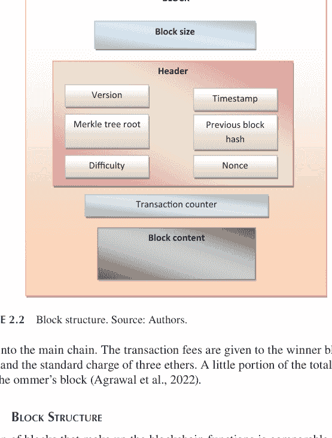

*图 2.2 区块结构。来源：作者。*

被放入主链。交易费用作为燃料费积分以及三个以太币的标准费用给予获胜区块。总燃料费积分中的一小部分会给予叔父区块（Agrawal 等人，2022）。

### 2.3.3 区块结构

构成区块链功能的区块链类似于公共账本，是每笔交易的存储库。这些区块通过一个引用哈希连接，该哈希要么是父区块哈希，要么是前驱区块哈希。“首个区块”一词特指创世区块，它与任何其他区块均无关联（见图 2.2）。一个区块由区块头和区块内容组成。区块版本、Merkle 树根哈希、父区块哈希、nBits、时间戳和随机数（nonce）是可能在区块头和其他元数据中找到的一些哈希值示例。

## 2.4 区块链特征

**去中心化：** 在传统的中心化交易系统中，中央可信机构（中央银行）必须首先授权每笔交易。具有去中心化点对点结构的区块链技术是一个有利的选择，因为去中心化需要信任（这是主要问题），同时还增强了健壮性、可用性和故障转移能力。与中心化系统相反，任何两个对等体（P2P）

使得区块链更加透明和可审计。然而，当资金分散在多个账户时，追查资金来源变得极其困难。

## 2.5 区块链分类

联盟链、公有链和私有链是如图 2.4 所示的三种不同类型。这些系统可以从以下几个角度进行对比，如下所述。

- **共识确定：** 在像比特币这样的公有链中，虽然每个节点都可以参与共识过程，但在联盟链中，只有少数经过精心挑选的节点负责区块验证。在私有链中，中央决策者将选择代表，由这些代表来选择已验证的区块。
- **读取权限：** 公有链上的用户可以读取数据。然而，私有链和联盟分布式账本上的用户只能拥有有限的访问权限。因此，联盟/组织可以决定存储的信息是否必须对公众开放。
- **不可篡改性：** 由于每笔交易都经过每个对等体验证并记录在去中心化区块链网络的分布式账本上，因此更改公有链具有挑战性。相反，私有链、联盟链和账本可能会根据负责方的意愿进行更改。
- **有效性：** 任何节点都可以随时加入或退出网络，从而增强了公有链的可扩展性。然而，网络对新节点的适应性以及挖矿过程日益增长的复杂性导致了吞吐量受限和延迟上升。然而，私有链和联盟链可以使用较少的验证器和可选的共识技术，从而提高性能和能源效率。
- **中心化：** 一个实体拥有对私有链的控制权，联盟链相对集中，而公有链是去中心化的，这使这三种区块链类型彼此之间有了显著区别。由于公有链对所有人开放，许多消费者可能会被其吸引。社区也非常活跃。新的公有链每天都会出现。联盟链有多种商业用途。Hyperledger 目前正在为企业联盟设计区块链框架。以太坊也提供了创建联盟链的工具。为了效率和可审计性，许多企业继续使用私有链。

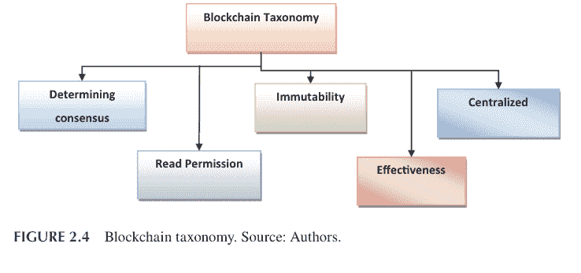

*图 2.4 区块链分类。来源：作者。*

## 2.6 数字货币

一种被称为“数字货币”的货币形式没有实物对应物，如硬币或纸币，并且仅以数字形式存在。它们可以在各方之间以电子方式传输，并且通常用于互联网交易（Xie 等人，2020）。数字货币正越来越多地被世界各地的个人和公司广泛使用。数字货币有两种类型：加密货币和中央银行数字货币（CBDC）。

### 2.6.1 中央银行数字货币

CBDC 是传统法定货币的电子模拟物，由中央银行发行和支持。CBDC 可用于多种目的，包括降低现金管理成本、提高金融普惠性和简化跨境支付。对于 CBDC，使用区块链技术并非必需；它只是一种可选方案。可以使用多种技术方法来实现 CBDC。利用区块链技术的分布式和透明账本，创建 CBDC 的一种方法是跟踪交易以确保货币的完整性。巴哈马中央银行已推出 Sand Dollar，这是一种基于区块链的巴哈马货币的数字替代品（Wamba 等人，2020），其他银行目前正在评估用于 CBDC 的区块链技术的采用潜力。然而，其他中央银行正在研究不同的策略来实施 CBDC，例如使用集中式数据库或混合了中心化和去中心化系统元素的系统。CBDC 的具体目标、当时现有的金融体系以及多项标准将决定所采用的技术方法，包括其开展业务的法律环境。

### 2.6.2 加密货币

虚拟或数字货币通常被称为加密货币，它们使用密码技术来保证交易安全并管理新单位的生成。被称为区块链的去中心化分布式账本可以永久且独立地验证交易，是大多数加密货币的基础。构成区块链的相互连接的区块中的每一个都包含一组与链式结构中前一个区块相关的交易（Atlam 等人，2018）。基于区块链的货币的出现是技术和金融领域的一个重大进步。用户网络验证交易，作为回报，他们会获得新的比特币单位。由于它们是

**表 2.2** 卢比类型

| 基于代币 | 基于账户 |
|---|---|
| 它在区块链上显示为数字代币。 | 它不以数字代币的形式出现在区块链上。 |
| 一种独特的数字资产可以通过交易在个人之间进行转移。 | 它是与用户账户关联的余额，而不是单一的数字资产。 |
| 它可以兑换为法定货币或其他加密货币。 | 它只能在其发行系统内部使用，不能兑换为其他货币。 |

表 2.2 显示了 e₹ 和加密货币之间的差异。数字卢比的功能类似于 CBDC，因为它以数字方式代表真实货币（Dave 等人，2019）。它将像传统法定货币一样被设计为财富储存和交换媒介。e₹ 将使用相同的硬币和纸币价值通过中介银行分发。官方网站、移动应用程序和信誉良好的银行允许用户购买数字卢比。务必要记住，数字卢比仍是一种新兴货币，人们对其运作方式的了解还非常少（见表 2.2）。

- **(i) 单层模型：** 在此方法中，印度储备银行（RBI）是所有交易的中心处理实体。中央机构监督 e₹ 的发行、交易监控和供应管理。它也被称为单层模型。
- **(ii) 双层模型：** 它也被称为间接模型。在此概念中，一组分散的节点由单一实体（印度储备银行）控制，共同处理每笔交易。去中心化节点负责在账本上验证和记录交易，而中央机构负责发行 e₹ 并跟踪所有交易（Monrat 等人，2019）。
- **(iii) 混合模型：** 作为 e₹ 设计的一种变体，混合模型包含单层和双层模型的组成部分。一个没有中央权威的节点系统负责在账本上验证和记录交易。相比之下，作为主要机构的印度储备银行负责发行电子卢比并跟踪所有交易。单层和双层模型的优点在混合模型中仍然都存在。然而，它们各自旨在保持有益的同时得到削弱。

该流程展示了由支持印度储备银行（RBI）的中央银行提供和分发数字货币的主要步骤。根据特定 CBDC 的设计和实现方式，可以使用许多技术；然而，一些常用的技术可能包括：

**分布式账本技术（DLT）：** 在 DLT 系统中，可以创建 CBDC 以提供安全且去中心化的交易记录。


**智能合约：** 考虑到它们是自执行合约，其条款在代码中明确规定，央行数字货币（CBDC）可以将它们用作法律工具。流程自动化和交易成本都可以因此得到提高。

**密码学：** 密码学是央行数字货币可用于保护交易和防止欺诈的工具。数字签名、哈希和加密可以保证交易的保密性和真实性。

**应用程序编程接口（API）：** 央行数字货币可以使用API连接现有的基础设施和支付系统。这可以提高互操作性，并可能实现不同支付系统之间的顺畅交易。

**移动钱包：** 作为移动钱包使用的可下载移动应用可用于存储和处理央行数字货币。移动钱包可以为央行数字货币交易提供易于访问且用户友好的界面。

**数字身份：** 作为数字身份提供者，央行数字货币可以与生物识别或国家身份识别系统相连。这可能有利于保证央行数字货币交易的真实性和安全性。央行数字货币所采用的技术旨在提供可用于日常交易的电子货币，此类交易安全、可靠且随时可得。通过利用尖端技术，央行数字货币相比传统法定货币可以提供多种好处，其中包括更高的安全性、更低的交易成本、更快的交易速度以及更广泛的金融包容性（Shobanadevi等人，2022）。

## 2.8 印度卢比体系

电子卢比系统的具体设计将由几个因素决定，包括其目标和规格、技术能力以及其运行所处的社会、政治和法律框架。私有区块链网络将为所有受监管银行、印度储备银行以及交易提供支持；其他持牌银行与账户持有人、客户、公司以及其他持牌银行之间的交易，则由联盟区块链提供支持，无论是否有第三方应用程序协助。专为排他性、受限访问而设计的两种区块链网络类型是私有区块链和联盟区块链。

### 2.8.1 私有区块链

尽管预计受监管银行和储备银行仍将需要一个能够处理大量交易的更高效的私有区块链网络，但私有区块链可以快速高效地处理交易。由于其节点由单一企业控制，使用私有区块链减少了达成共识所需的节点数量；共识过程可以加速以提高速度。推荐的方法要求将所得税当局、SEBI、CAB和执法局等监管合规组织纳入私有区块链，以监控和验证交易。使用央行数字货币作为私有区块链是可能的（Hazra等人，2022）。

### 2.8.2 联盟区块链

当许多公司或实体联合创建联盟区块链时，便形成了一个去中心化网络。这种网络适用于数字货币，即所谓的中央银行数字货币（CBDC）。中央银行之所以开发数字货币（CBDC），是因为它成功平衡了可扩展性、安全性和匿名性。此外，在印度经济背景下，构建联盟区块链网络将提供一个安全、私密的网络，其中包含众多受监管组织和第三方应用程序。所有数字应用程序都必须内置操作兼容性，以支持涉及CBDC以及通过NEFT、RTGS、UPI或快速转账进行的交易。这一要求在联盟区块链和私有区块链中均有体现。与开放区块链技术相比，私有区块链和联盟区块链提供了若干好处，例如：

- **隐私性：** 由于网络访问仅限于经批准的用户，与公有区块链相比，私有区块链和联盟区块链提供了更高的隐私性。这可能尤其适用于处理机密或敏感数据的组织。
- **可扩展性：** 由于私有区块链和联盟区块链不需要那么多的计算能力来运行网络，公有区块链可能比它们更难扩展。它们对于特定类型的交易可能更经济、更实用（Yu等人，2020）。
- **治理性：** 鉴于它们由单一企业或多个企业协作控制，私有区块链和联盟区块链提供了更强的网络控制力。网络更新和修改的实施更加简便，这可能会提高问责制。
- **灵活性：** 私有区块链或联盟区块链的应用得以定制，以满足工作环境或联盟的独特需求。与公有区块链相比，它可能无法支持所有类型的用例和交易，但私有区块链更加灵活。
- **合规性：** 联盟区块链和私有区块链可能对从事银行或医疗等高度监管行业的企业有所帮助，因为它们的构建可以满足特定的监管标准（Rathod等人，2022）。

## 2.9 分析

据印度储备银行（RBI）称，印度卢比可以以数字形式呈现。基于目前现有的事实和总体趋势，数字货币的理论和实践可行性仍有待讨论。

### 2.9.1 理论分析

从理论上讲，印度数字货币可能提供若干优势，例如：

- **增强金融包容性：** 在印度，相当一部分人口无法获得标准金融服务，并且没有银行账户。一种为这些人提供廉价便捷的价值交换方式的数字货币，可能会实现更广泛的金融包容。
- **降低交易成本：** 通过消除银行和支付处理商等中介机构，数字货币可以最大限度地降低交易成本，提高效率，并为消费者和企业降低价格。
- **提高透明度：** 得益于数字货币，金融交易可能会更加透明，从而使现金流动的监控更加直接，并阻止洗钱等非法行为。

### 2.9.2 实施

在印度数字卢比系统中，必须拥有广泛而可靠的技术基础设施和监管支持，以管理高交易量并保证数字货币的实施。以下是一些可能决定系统运行是否成功的重要因素：

- **技术基础设施：** 一个大型数字货币系统要正常运行，需要强大的技术基础来处理交易量和交易速度。这将需要对硬件、软件和网络安全措施进行大量投资，以保证系统的安全性和完整性。
- **监管框架：** 数字货币的运行需要一个有利的法律和监管环境，并且必须建立这样的环境。任何使用数字货币的举措都必须在印度管辖金融服务的复杂法律体系内运作，同时还要考虑安全和隐私数据等问题。
- **公众接受度：** 任何涉及数字货币的举措都必须得到公众的采纳和接受才能成功。任何使用数字货币的行业都需要考虑印度人口的多样性和不均衡的技术知识水平，以确保实现普遍采用。

最后，尽管数字货币在印度具有明显的理论优势，但其实施的可行性将取决于若干变量，包括其技术基础设施、法律体系和公众接受程度。印度储备银行可能会也可能不会推进数字货币项目。然而，任何此类性质的项目都需要大量投资、周密规划和政府许可。


**表2.3（续）**
**各种卢比系统对比**

| | CBDC | e-卢比 | 沙元 | E-克朗 | DCEP |
|---|---|---|---|---|---|
| 区域覆盖 |  | 尚不确定 | 巴哈马内陆地区 | 瑞典独有 | 面向国内外使用而设计。已在多个主要城市实施，包括北京、成都和上海。 |
| 状态 |  | 仍在测试中 | 完全可用 | 仍在持续测试 |  |

### 2.11.3 易用性

无需真实银行账户或实际货币，数字货比即可随时随地使用。特别是对于生活在偏远或农村地区的人们，这可以提高交易的便利性和效率。使用e-卢比无需银行账户。银行也可以让我们以代币形式购买数字卢比。通常情况下，这类似于从银行取款，区别在于它是以电子钱包从我们的银行账户中存入资金，而非向我们交付现金，让我们使用常规货币。账户支付将随着在线交易实时进行。

### 2.11.4 全球接受度

跨境货币兑换和转账既耗时又费钱。数字卢比将通过快速跨境转账来增强银行的现金管理和运营。无论身在何处，持有数字卢比的NRI都可将其用于国际金融交易。这将有助于印度经济举措的扩展（Li et al., 2022）。

### 2.11.5 对经济的积极影响

与澳大利亚和英国等北欧国家相比，印度拥有更强的现金提取倾向，占GDP的17%。如果人们使用e-卢比，他们可能会减少对现金的依赖。这自然将降低实际货币的管理、印刷和分发成本。此外，使用数字卢比有助于减少非法金融交易和用途的数量，从而增加税收收入并减少腐败。除了为政府提供更多数据信息外，数字货币的发展还带我们到最后一个要点，即消费者购买趋势，政府可利用这些趋势来提高经济项目的效率并增加收入。总体而言，数字卢比的引入可能随着时间的推移对印度经济产生积极影响，并提供税收资金。当前电子支付时代的主要趋势是数字货币的扩展。由于CBDC的诸多优势，越来越多的国家正在研究它。数字支付方式在印度已变得非常普遍，这一趋势预计将持续下去。这可能导致对e-卢比作为其他数字支付方式替代品的需求（Xiong et al., 2022）。

### 2.11.6 保险

区块链可以支持保险行业中多个客户、投保人和保险公司之间的交易。除了支持保险公司之间的再保险交易外，区块链还可用于保险单的议价、购买和登记。智能合约可用于自动化不同的保险计划，从而大幅节省管理费用。处理

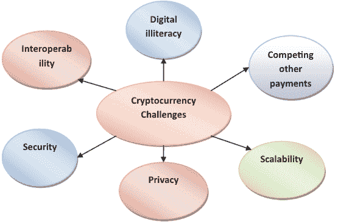

**图2.5** 加密货币挑战。来源：作者。

的部分印度地区。因此，这些地区的人们难以利用数字革命的成果。为实现推广数字货币的目标，印度必须找到解决这一问题的方法。

### 2.12.2 与其他支付方式的竞争

e-卢比在可用性、支撑基础设施、创新机制和合理的交易价格方面，可与现有的加密货币和基于银行的数字支付系统等其他数字支付选项竞争。印度人使用多种语言，是多语言社会。系统架构应支持多种语言，并为不精通英语的用户提供简单的用户界面。由于印度市场对价格敏感，过高的交易费用可能会令客户望而却步。设计应提供可负担的交易费率以促进采用和使用。鉴于印度存在众多无银行账户和金融服务不足的人群，可以通过激励措施来鼓励数字货币的使用。诸如推荐奖励或交易奖励等策略应被纳入设计中。

### 2.12.3 可扩展性

基于区块链和加密货币的商业解决方案正在各行各业中增长。尤其是其可扩展性和性能，让人怀疑它能否满足来自不同政府和企业部门不断增长的需求。一些研究人员专注于性能问题，如吞吐量（交易数/秒）、延迟（向区块链添加一个交易块所需的总时间）以及网络副本数量方面的可扩展性问题。如果添加更多副本，性能和延迟可能会受到影响，因为网络必须管理更多需要交换和处理的消息。PoW是能够保证可扩展性的协议之一，尽管它具有高延迟和有限的吞吐量。这一瓶颈源于发布一个包含在链中的区块所需的资源，这需要解决一个密码学问题（Hoy et al., 2017）。

### 2.12.4 隐私

区块链旨在为敏感的个人数据提供保护和匿名性，因为交易可以使用生成的地址而非真实姓名进行。即使其他网络用户可能看不到真实姓名，一些研究人员推断，由于其他人会验证发起交易时使用的公钥，区块链在交易隐私方面存在薄弱环节。比特币平台最近经过研究，已证明比较成员的交易历史可能会揭示其真实身份。这与同行可以在区块链网络中保持匿名的说法相矛盾。Peck等人（2016）提出，即使有NAT或防火墙的保护，也可以使用一种技术将IP地址与同行的别名关联起来。他声称，一个同行关联的节点组（构成该同行）可以用来具体识别该同行。所有余额的可见性是区块链对信息泄露敏感的主要因素，与公钥相关的数据对网络上的所有用户都可用。因此，区块链应用的隐私和安全标准应在初始阶段就确定。

### 2.12.5 互操作性

目前，许多行业可能对使用区块链技术感兴趣。但由于缺乏一套确定的机制，它们无法合作和整合。这个问题被称为缺乏互操作性，对区块链行业的发展有害。因此，比特币仍然是区块链技术的主要平台，而不是为不同的商业模式提供多样的现实解决方案。区块链程序员可以为多个平台编写代码，因为它们没有互操作性，但每个网络与其他网络是隔离的，无法连接。例如，在GitHub上，有超过6,500个区块链项目使用各种平台、协议、共识流程、计算机语言和安全措施。因此，为了在应用开发中进行企业协作，以分发基于区块链的产品并将其整合到现有平台中，就需要标准化。

### 2.12.6 能源消耗

工作量证明（PoW）算法使比特币能够在潜在的分散、去中心化环境中促进点对点交易。此外，矿工的计算机需要大量能源来执行这项工作。比特币的能源使用指标证明了PoW算法在可持续性方面有多么严重的问题。这种激励体系鼓励世界各地的个人挖掘比特币。由于挖矿产生


在持续稳定收入的驱动下，人们纷纷运行高能耗设备参与这一行业。比特币的成本随之上升，网络的平均能耗率也随之上扬。

### 2.12.7 安全性

区块链安全方面最广为人知的问题是51%攻击。在51%攻击中，一个或多个恶意行为者控制了区块链的大部分哈希率。凭借该哈希率，他们可以通过撤销交易、阻止区块被其他矿工验证来进行双重支付。矿池为了提高区块奖励而采用的“自私挖矿”这种不道德做法，会影响区块链网络的可靠性。尽管人们通常认为，拥有区块链网络51%以上计算能力的恶意节点可能会受到权力的控制，但只要任何人希望利用哈希算力，网络就仍容易遭受欺诈。矿工或矿工群体可以选择不向现有网络广播已验证区块，从而发起自私挖矿过程。他们继续挖掘下一个区块以保持自身优势。只有满足特定条件后，普通公众才能看到已解出的区块。因此，随着自私网络的链变得更长、更复杂，该网络不得不接受矿工的解决方案，而其他矿工则在无用的分支上消耗能量。最终，贪婪的矿工想要更多现金，这使得拥有超过51%算力的自私矿池更有可能出现，因为理性矿工会受到诱惑加入更长的链（Tschorsch et al., 2016）。

## 2.13 比特币的未来研究

研究人员断言，区块链技术在学术和商业应用中具有巨大前景。标准化、资产保护、大数据和智能合约只是本节简要介绍的区块链技术众多潜在应用中的一小部分。投资者在使用区块链技术时，可能会被巨额利润的前景所吸引。为了在商业解决方案中正确实施这项技术，必须确定是否满足相关标准。采用系统化的测试流程来检验基于区块链的解决方案的优缺点至关重要。该流程包含两个不同阶段：标准化阶段和测试阶段。第一步将基于一套特定标准评估开发者对其区块链解决方案的声明。在测试阶段则评估基于区块链的系统的运行情况。例如，在线零售商的所有者会对基于区块链的系统如何运作感兴趣。所购解决方案使用的平台应具备一定的测试和标准化方法，以评估其容量、吞吐量和延迟（Yli-Huumo et al., 2016）。

通过使用区块链技术注册新想法、概念验证和图纸，企业可以为其创作建立数字轨迹，并生成可用于证明任何知识产权资产的合法性、存在性和所有权的证书。所有经公证的信息，包括商业秘密，都通过鼓励竞争和高效支付得到保护。希望这一努力能够引发关于适当行动的进一步讨论。

## 参考文献

- Atlam, H.F.; Alenezi, A.; Alassafi, M.O.; Wills, G. Blockchain with the Internet of things: Benefits, challenges, and future directions. Int. J. Intell. Syst. Appl. 2018, 10, 40–48.
- Agrawal, D.; Minocha, S.; Namasudra, S.; Gandomi, A.H. A robust drug recall supply chain management system using hyper ledger blockchain ecosystem. Comput. Biol. Med. 2022, 140, 105100.
- Chung, M.; Kim, J. The internet information and technology research directions based on the fourth industrial revolution. KSII Trans. Internet Inf. Syst. 2016, 10(3), 1311–1320.
- Dave, D.; Parikh, S.; Patel, R.; Doshi, N. A survey on blockchain technology and its proposed solutions. Procedia Comput. Sci. 2019, 160, 740–745.
- Hazra, A.; Alkhayyat, A.; Adhikari, M. Blockchain-aided integrated edge framework of cybersecurity for internet of things. IEEE Consum. Electron. Mag. 2022. https://doi.org/10.1109/mce.2022.3141068
- Hoy, M.B., An introduction to the blockchain and its implications for libraries and medicine. Med. Ref. Serv. Q. 2017, 36(3), 273–279.
- Jyoti, A.; Chauhan, R. A blockchain and smart contract-based data provenance collection and storage in the cloud environment. Wirel. Netw. 2022, 28, 1541–1562.
- Joshi, A.P.; Han, M.; Wang, Y. A survey on security and privacy issues of blockchain technology. Math. Found. Comput. 2018, 1, 121.
- Jabbar, R.; Dhib, E.; ben Said, A.; Krichen, M.; Fetaïs, N.; Zaidan, E.; Barkaoui, K. Blockchain technology for intelligent transportation systems: A systematic literature review. IEEE Access. 2022, 10, 20995–21031.
- Kaur, H.; Alam, M.A.; Jameel, R.; Mourya, A.K.; Chang, V. A proposed solution and future direction for blockchain-based heterogeneous medicare data in a cloud environment. J. Med. Syst. 2018, 42, 156.
- Kili Çarşlan, S.K. Bitcoin Özelİnde Kripto paraların Edinilmiş mallara katılma rejiminde tasfiyesi sorunu. Kırıkkale Hukuk Mecmuası. 2023, 3, 1–27.
- Li, S.; Zhang, Y.; Xu, C.; Cheng, N.; Liu, Z.; Du, Y.; Shen, X. HealthFort: A cloud-based ehealth system with conditional forward transparency and secure provenance via blockchain. IEEE Trans. Mob. Comput. 2022, 1–18. https://doi.org/10.1109/tmc.2022.3199048
- Maalla, M.A.; Bezzateev, S.V. Efficient incremental hash chain with the probabilistic filter-based method to update blockchain light nodes. Sci. Tech. J. Inf. Technol. Mech. Opt. 2022, 22, 538–546.
- Mougayar, W. The Business Blockchain: Promise, Practice, and Application of the Next Internet Technology. John Wiley & Sons: Hoboken, NJ, USA, 2016.
- Murthy, C.V.B.; Shri, M.L. A survey on integrating cloud computing with blockchain. In Proceedings of the 2020 International Conference on Emerging Trends in Information Technology and Engineering (ic-ETITE), Vellore, India, 24–25 February 2020, pp. 1–6.
- Monrat, A.A.; Schelén, O.; Andersson, K. A blockchain survey from the perspectives of applications, challenges, and opportunities. IEEE Access. 2019, 7, 117134–117151.
- Peck, M. A blockchain currency that beat Bitcoin on privacy. IEEE Spectrum. 2016, 53(12), 11–13.
- Rajashekar, M.; Sundaram, S. Dynamic attribute tree for the data encryption and third party auditing for cloud storage. Indian J. Sci. Technol. 2022, 15, 798–805.
- Rathod, T.; Jadav, N.K.; Alshehri, M.D.; Tanwar, S.; Sharma, R.; Felseghi, R.A.; Raboaca, M.S. Blockchain for future wireless networks: A decade survey. *Sensors*. 2022, 22, 418.
- Strilets, B. Current state and prospects for the legal regulation of cryptocurrencies in the European Union. *Actual Probl. Law*. 2022, 2, 70–76.
- Tschorsch, F.; Scheuermann, B. Bitcoin and beyond A technical survey on decentralized digital currencies. *IEEE Commun. Surv. Tutorials*. 2016 18(3), 2084–2123.
- Wamba, S.F; Queiroz, M.M. Blockchain in the operations and supply chain management: Benefits, challenges and future research opportunities. *Int. J. Inf. Manag.* 2020, 52, 10206.
- Xiong, H.; Chen, M.; Wu, C.; Zhao, Y.; Yi, W. Research on progress of blockchain consensus algorithm: A review on recent progress of blockchain consensus algorithms. *Future Internet*. 2022, 14, 47.
- Xie, S.; Zheng, Z.; Chen, W.; Wu, J.; Dai, H.N.; Imran, M. Blockchain for cloud exchange: A survey. *Comput. Electr. Eng.* 2020, 81, 106–526.
- Yli-Huumo, J.; Ko, D.; Choi, S.; Park, S.; Smolander, K. Where is current research on Blockchain technology?—A systematic review. *PLoS One*. 2016, 11(10), e0163477.
- Yu, Y.; Liu, S.; Yeoh, P.L.; Vucetic, B.; Li, Y. LayerChain: A hierarchical edge-cloud blockchain for large-scale low-delay industrial Internet of things applications. *IEEE Trans. Ind. Inform.* 2020, 17, 5077–5086.
- Zheng, Z.; Xie, S.; Dai, H.N.; Chen, X.; Wang, H. Blockchain challenges and opportunities: A survey. *Int. J. Web Grid Serv.* 2018, 14, 352–375.
- Zhang, X.; Xue, M.; Miao, X. A Consensus algorithm based on risk assessment model for permissioned blockchain. *Wirel. Commun. Mob. Comput.* 2022, 2022, 8698009.


# 3 探索加密货币——走向巅峰还是低谷

*Baisakhi Mukherjee 和 Biswarup Chatterjee*

## 3.1 预览

随着数字时代的到来，加密货币成为一种新兴概念。根据现有的学术资源，可以明显看出，加密货币正获得认可，并在经济的增长和发展过程中日益流行。加密货币预计将在从风险管理转向实现金融稳定的过程中发挥关键作用，同时扩大金融包容性的机会，并促进金融领域的创新（Kelly, 2014）。在本章撰写时，比特币的价格正升至 26,500 美元的水平，有人猜测，一旦突破这一关口，就可能引发负面市场情绪。专家们认为，从整体技术角度来看，比特币的行情走势略偏积极。本章旨在探索加密行业，并尝试预测比特币在不久的将来的走势。

世界经济论坛（WEF）于 2022 年 7 月报告称，加密货币是一种虚拟资产，主要由加密算法和分布式账本技术构成。本章旨在讨论比特币等虚拟资产和在线基础设施，它们本质上可以自由访问、公开可见且无需许可。比特币的运作在很大程度上依赖全球计算机网络来验证交易并确保网络完整性（Saito, 2016）。颇具讽刺意味的是，加密货币常常被误解为货币，但它们根本不是货币（Kelly, 2014）。它们是投机性资产，其估值会随时间变化。这一特征使加密货币在用户中的接受和使用变得更加复杂。对加密货币的认识和监管尚处于起步阶段，这吸引学术研究者深入挖掘并形成见解，这些见解将对各行各业的人士有所裨益（Team, 2016）。

据经济学专家称，加密货币领域尚未得到充分研究。人们对加密行业的概念、运作和监管政策的了解甚少。有人声称，加密货币的经济影响仍是一个未被触及的领域（Team, 2016）。关于加密货币与经济之间的关系，仍有许多未解问题。对于各国政府来说，这仍然是一个有待决定的开放领域：是让其成为法定货币以促进其在经济中的顺畅流通，还是彻底禁止，抑或制定监管政策和框架以保障投资者的金融稳定与增长（世界银行集团, 2018）。

本章旨在理解加密货币（BTC）的特征，建立线性回归模型来分析 BTC 收盘价与 BTC 交易量之间的关系，并进而预测 BTC 在不久的将来的平均收盘价。这一统计结果将有助于形成对 BTC 走势的洞察（Patterson, J., 2015）。

## 3.2 文献综述

加密货币代表一种去中心化、虚拟且独立的货币体系。它们使货币摆脱了对任何单一货币在交易、投资和财富保值方面的依赖，从而打破垄断（Saito, 2016）。它们存在于主权政府或政府实体的控制和监管之外。这些数字货币由加密系统保护，并确保安全、受保护的互联网体验，无论是否有中介机构或监管机构（如印度储备银行）进行监控（世界银行集团, 2018）。加密货币本质上是私人数字货币，缺乏印度政府的官方支持。印度政府正在开发自己的原生在线货币，并且不支持当前任何加密货币（Team, 2016）。可以说，这一概念最初由中本聪提出，他是比特币的创造者，而比特币是所有加密货币中最受欢迎、使用最广泛的。

## 3.3 不同的加密货币

除比特币外，其他一些流行的加密货币包括以太坊（ETH）、莱特币（LTC）、Chainlink（LINK）、Cosmos（ATOM）、门罗币（XMR）、Tether（USDT）、XRP、币安币（BNB）、USD Coin（USDC）、Cardano（ADA）、Solana（SOL）、狗狗币（DOGE）、Tron（TRX）、Polygon（MATIC）等。当今许多加密货币都在某种程度上源于比特币。尽管存在众多比特币竞争者，但最初的加密货币在采用率和经济价值方面仍保持主导地位。迄今为止，没有一种能够超越其市值和价值（Team, 2016）。自 2009 年推出以来，大量模仿者、替代品以及基于其区块链的新技术纷纷涌现。这些替代币统称为“山寨币”。它们的目的多种多样——从玩笑/表情包，到在分布式全球虚拟机上为交易付费的币种（Nakamoto, 2008）。

设定这样的上限。一些加密货币采用“销毁”机制，即永久性地将现有代币从流通中移除，以防止流通供应量过大并抑制通胀。销毁涉及将代币发送到区块链上不可找回的地址（Stefan Hubrich, 2017）。每种加密货币都遵循其独特的货币政策。

## 3.5 生产成本

挖矿是生产新加密货币代币的过程。该过程使用计算机来验证区块链中的下一个区块。从事这项工作的人被称为矿工。他们使用去中心化网络来完成这项工作。作为报酬，矿工将获得新创建的加密货币代币，以及加密货币交易各方支付的任何交易费用（Pilkington, 2016）。整个过程需要计算能力，因此矿工需要投资于昂贵的设备和电力。矿工需要解决复杂的数学问题才能验证区块（Kar, 2016）。对于比特币和以太坊等流行加密货币，挖矿的竞争更为激烈。因此，挖矿成本也会上升。随着与加密货币挖矿相关的费用上升，加密货币的价值也必须随之上升（Hopp et al., 2017）。只要加密货币的价值高于成本，矿工就不会介意，对该特定加密货币的需求就会更大。因此，其价值也会开始上升（Hanna Halaburda & Guillaume Haeringer, 2018）。但一旦挖矿成本高于加密货币的价值，矿工就会面临损失，并且不再有兴趣挖掘该特定加密货币。因此，对该加密货币的需求下降，其价值也随之下降（Kar, 2016）。

## 3.6 加密货币交易所

与其他证券一样，加密货币也有自己的交易所，并在其中进行交易。比特币和以太币等知名加密货币在许多交易所中交易活跃。显然，加密货币交易所会列出最受欢迎的币种（Hopp et al., 2017）。

但一些较小、不太流行的加密货币只在特定交易所提供。这使得对其感兴趣的投资者获得这些币种的机会受限。这些交易所会对加密货币的上架收取费用（Hopp et al., 2017）。

当一种加密货币在多个交易所上市时，它会增加愿意购买的投资者中的需求，从而提高整体需求。随着需求增加，价格上涨（Lagarde, Christine (Ed.), 2018）。

## 3.7 竞争

随着加密货币成为投资者的另类投资选择，数千种不同的加密货币已进入市场。新竞争者的进入门槛相对较低（Aisen & Veiga, 2006）。但要创造一种可行的加密货币


文献综述表明，涉及恐怖主义、勒索软件、赌博等金融交易的非法活动中，有98%是通过加密货币进行的，这引起了各国政府的高度关注。研究发现，加密货币被用于非法毒品交易、黑客攻击、盗窃、非法色情活动以及雇凶杀人。有人怀疑，加密货币被广泛用于资助恐怖活动、洗钱以及规避资本管制（Hanna Halaburda & Guillaume Haeringer, 2018）。

## 3.10 印度现状

印度政府至今尚未宣布加密货币在印度具有合法地位。因此，迄今为止尚未出台相关监管规定。加密货币在印度的运行既不受监管，也不由任何中央机构发行。在这一缺乏监管的环境中，处理加密货币相关事务时没有专门的争议或分歧解决指南，这一点尤为突出。因此，若有意参与者想要交易加密货币，就必须自行承担风险。不过，根据印度储备银行行长和印度尊敬的财政部长尼尔玛拉·西塔拉曼女士迄今发表的声明和表明的立场，我们可以明确地说，截至目前，加密货币在印度并未被禁止。印度财政部长已对加密货币征税，由此引发了有关加密货币在该国法律地位的讨论与辩论（Hanna Halaburda & Guillaume Haeringer, 2018）。与此同时，政府也采取了相关措施，计划推出印度自己的加密货币，并建立交易所，以监管加密货币交易和投资（Saito, 2014）。截至2022年，加密货币基本处于不受监管的环境中运行。然而，2022年联邦预算案宣布对加密货币收益征收30%的税，并在源头扣缴1%的税款，情况由此发生变化。这一举措明确了印度官员的意图。大多数参与者赞成这一做法，并认为这是推动加密货币在该国获得官方认可的第一步（Saito, 2014）。

### 3.10.1 比特币

DeVries（2016）指出，比特币是目前使用最广泛、最受欢迎的加密货币。作者还认为，比特币的生成数量有限，这可以防止加密货币在经济中过度供应，并保持其稀缺性。Kelly（2014）进一步解释说，比特币的价值具有主观性。这意味着，只要用户在支付或进行其他交易时仍然相信或信任比特币的用途，其价值就会持续存在并继续增长。另有观点指出，比特币并不像黄金、钻石或其他实物那样具有内在价值。

尽管加密货币尚处于起步阶段，但如果获得认可，它们将成为全球经济中使用和交易最广泛的货币。据 Team 2016 所述，BitPay 是全球最大的比特币处理商，其交易量增长了110%。交易量的增长表明这种货币的接受度正在提高。本章将利用2016年至2023年间的 BTC-USD 历史价格数据集，探讨比特币的现状。加密货币的普及将吸引学术研究人员的广泛关注。影响人们对加密货币认知和接受程度的因素仍有待发现和研究，相关领域具有巨大的研究空间（Rothstein & Uslaner, 2005）。

根据以往研究，比特币的设计优势在于供应量有限。每四年，比特币的新增发行量都会递减，直至达到2100万枚的供应上限（King 2013）。比特币的稀缺性是决定其市场价值的重要因素。作者还称，比特币的稀缺性可以防止其在市场上过度供应，进而影响金融稳定性和风险（Magro, 2016）。Magro 还指出，除比特币以外的其他加密货币能够避免因政府政策变化而引发的通货膨胀，为投资者提供安全的投资环境。与其他货币一样，比特币也会受到外部不确定因素的影响而出现价格波动。比特币兼具交易安全这一优势，同时又存在价格不稳定的问题；凭借这两方面的特点，比特币在2015年依据美元指数被评为最佳货币，这可以视为全球经济中的一个里程碑事件。

文献表明，全球经济中的比特币交易量大幅增长。2014年至2015年间，南美洲的比特币交易量增长了510%。

比特币要获得广泛的用户认可，仍面临若干重大挑战。一个主要问题是其价值频繁且大幅波动，这给用户和投资者都带来了不确定性。价值波动削弱了人们对加密货币日常保值能力的信任，从而动摇了人们对这类数字货币的整体信心。根据 PwC 于2015年开展的一项调查，受访者中有83%对比特币知之甚少或完全不了解。加密货币缺乏集中控制，这也带来了独特的挑战。试图通过广告活动消除认知不足，可能会无意中使竞争公司受益，因此不利于制定营销计划（McMillan, 2014）。此外，加密货币领域还发生过欺诈和盗窃事件，这些事件往往源于交易所系统中的漏洞。此类安全漏洞经常成为新闻头条，进一步阻碍公众将这些平台视为安全的投资场所（McMillan, 2014）。

此外，加密货币的使用还面临明显的监管空白。只要数字货币仍处于法律灰色地带，用户的接受程度就会受到限制。用户必须确信，涉及加密货币的交易具有法律约束力，并符合现行法律法规。市场和政府往往难以迅速适应新兴技术，这加剧了建立人们对比特币及其他加密货币信任的难度（Saito, M. 2016）。加密货币面临的另一项重大挑战，是在获得广泛用户认可之前，必须应对美国复杂的监管体系。美国政府尚未提供一项

**正态性**：误差来自一个均值和方差未知的正态分布，这些参数可以根据数据估算。利用这一假设，可以通过成熟的解析表达式计算“置信”区间。

**多重共线性**：对于多元线性回归，必须满足这一假设，即预测变量之间应当不存在或仅存在极弱的线性依赖关系。

线性回归方程可表示为：

$Y = \beta0 + \beta1 X$

- 其中，$Y$ = 比特币价格。
- $X$ = 比特币交易量。
- $\beta0$ = 回归最佳拟合直线的截距。
- $\beta1$ = 自变量的系数。

模型假设的验证结果如图3.2所示。

随后，采用时间序列预测流程，基于每日季节性将模型拟合到向量中。时间序列预测是一种广受欢迎的研究方法，广泛应用于不同领域，尤其是高频交易。通过构建精确的预测模型，预测交易工具的未来价格，时间序列预测模型可以为交易者提供有效优势。本章将着重开发

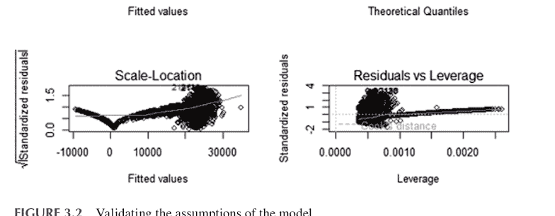

图3.2 验证模型假设。


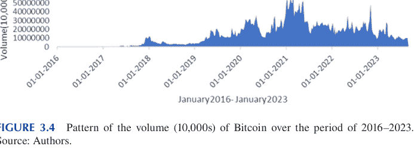

图3.4 2016–2023年比特币交易量（万）的走势。来源：作者。

## 表3.1

2003

```text
Call:
 lm(formula = Close ~ lnVolume, data = my_data)

Residuals:
 Min 1Q Median 3Q Max
 -22069 -9714 -3590 6719 42915

Coefficients:
 Estimate Std. Error t value Pr(>|t|)
 (Intercept) -89845.0 2512.1 -35.77 <2e-16 ***
 lnVolume 4693.6 110.7 42.39 <2e-16 ***
 ---
 Signif. codes: 0 ‘***’ 0.001 ‘**’ 0.01 ‘*’ 0.05 ‘.’ 0.1 ‘ ’ 1

Residual standard error: 12650 on 2799 degrees of freedom
Multiple R-squared: 0.3909, Adjusted R-squared: 0.3907
F-statistic: 1797 on 1 and 2799 DF, p-value: <2.2e-16
```

H₀：Y_cp 与 X_vol 无显著关系。

Hₐ：Y_cp 与 X_vol 存在显著关系。

### 3.11.3 回归最终模型

Y_cp = β₀ + β₁ log X_vol

Y_cp = -89845.0 + 4693.6 log X_vol

从上述残差来看，p值<2.2 × 10⁻¹⁶，不支持零假设。可以进一步解释为，比特币的价格与交易量之间存在显著关系。

### 3.11.4 预测流程

预测模型是使用R软件中的readxl、stringr、dplyr和prophet包开发的。数据集经过清理和预处理，将空值替换为0，并将日期和收盘价列分别重命名为ds和y。模型1是利用Prophet库的函数“f(x)”构建的，该函数将模型拟合到具有每日季节性的向量上。

```r
Model1 <- prophet(my_data2, daily.seasonality = TRUE)
```

为了预测BTC-USD的收盘价，创建了另一个为期1年的数据集。

```r
Future1 <- make_future_dataframe(Model1, periods = (365 * 1))
```

未来数据集由模型1进行测试和训练以进行预测。创建了另一个向量，包括以下内容：

- 日期“Ds”；
- 标准预测收盘价ŷ；
- 估计收盘价下限ŷ_lower；
- 估计收盘价上限ŷ_upper。

```r
Forecast1 <- predict(Model1, Future1)
```

预测价格趋势由细线表示，而黑色虚线则展示了图3.5中历史价格随时间的演变。

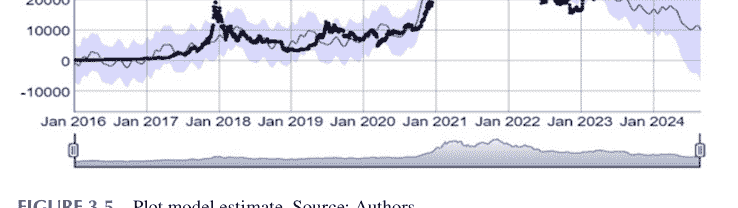

图3.5 模型估计图。来源：作者。

| 索引 | 日期 | ŷ | ŷ_lower | ŷ_upper |
|---:|---|---:|---:|---:|
| 2692 | 2023-05-15 | 23905.10 | 17664.9025 | 30390.72 |
| 2723 | 2023-06-15 | 20927.05 | 14350.8622 | 27359.97 |
| 2753 | 2023-07-15 | 19730.97 | 13218.0404 | 26082.63 |
| 2784 | 2023-08-15 | 21009.81 | 14739.8575 | 27466.77 |
| 2815 | 2023-09-15 | 17562.34 | 11443.6623 | 23411.37 |
| 2845 | 2023-10-15 | 17681.69 | 11828.2918 | 23602.52 |
| 2876 | 2023-11-15 | 17028.94 | 10517.4298 | 23738.87 |
| 2906 | 2023-12-15 | 15513.70 | 8635.3736 | 22555.21 |
| 2937 | 2024-01-15 | 16593.45 | 9132.8090 | 23817.97 |
| 2968 | 2024-02-15 | 17610.36 | 10362.2174 | 25995.06 |
| 2997 | 2024-03-15 | 17186.85 | 8342.5052 | 26929.78 |
| 3028 | 2024-04-15 | 17383.39 | 7050.0521 | 27806.74 |
| 3058 | 2024-05-15 | 14495.13 | 3008.4600 | 26355.11 |
| 3089 | 2024-06-15 | 11608.73 | -855.6246 | 25157.73 |
| 3119 | 2024-07-15 | 10447.04 | -3951.0608 | 26114.10 |
| 3150 | 2024-08-15 | 11675.33 | -5136.3941 | 28914.79 |

### *截断ŷ* 的均值

| x |
|---:|
| 21571.95 |

下一年的标准预测平均收盘价（2024年）预测为21,571.95美元。

### *截断ŷ*<sub>Lower</sub> 的均值

| x |
|---:|
| 13871.64 |

BTC-USD下一年的下界预测平均收盘价（2024年）为13,871.64美元。

### *截断ŷ*<sub>Upper</sub> 的均值

| x |
|---:|
| 29445.31 |

BTC-USD下一年的上界预测平均收盘价（2024年）为29,445.31美元。

预测结果表明，来年比特币收盘价的预期范围是合理的。尽管如此，必须指出的是，尽管该软件包的名称如此，但这一分析并不能提供万无一失、100%准确的未来预测，由于比特币市场固有的波动性，应谨慎对待。此外，应始终考虑不可预见的罕见事件，即所谓的黑天鹅事件。

关于比特币作为资产的角色，该回归模型考虑了某些因素，如历史零售和机构购买模式、季节性变化、节假日，以及网络难度（这反映了挖掘比特币区块的挑战程度，并显示出与比特币价格存在某种交错关联）。

然而，重要的是要注意，该预测模型可能无法全面考虑联邦基金利率变动的影响。采用多元线性回归分析可能是更合适的方法，以准确评估联邦基金利率波动对比特币价值的影响。

## 3.12 加密货币的优势

作为一种基于技术的金融产品，近年来，得益于软件、硬件和信息技术的巨大发展，加密货币在全球投资者中广受欢迎。加密货币无需银行和其他金融机构即可实现资金转移，这使得国际和跨境交易尤为便捷。因此，比特币和以太坊在这方面占据了有利地位。加密货币的优势可总结如下：

### 1. 抵御通货膨胀

通货膨胀会降低产品和货币的实际价值。但投资者认为加密货币是一种能够抵御通货膨胀的产品。大多数加密货币使用相同的机制来保持对通货膨胀的免疫力（B. Scott，2016，econstor.eu）。

### 2. 交易速度快

电子转账通常需要几个小时甚至几天，具体取决于各种因素，如发送方和接收方之间的地理距离、出发地和目的地的位置（尤其是国际和跨境交易）以及其他变量。相比之下，加密货币交易可以在几分钟内完成，为许多人提供了省心且具有吸引力的选择。

### 3. 交易成本低

加密货币完成交易不需要任何第三方、机构或像VISA这样的支付网关的干预。因此，它们几乎可以免费帮助在全球转移资金。与加密货币相关的交易成本可能极低甚至可忽略不计（Investopedia：Adam Hayes，2023年4月23日更新）。

### 8. 运营透明度

区块链形式的运营为加密货币提供了透明度。这种透明度使整个运营系统变得简单，并增强了投资者的信心，因为它消除了任何腐败的可能性。投资者可以通过平台上的区块链浏览器轻松监控其资金转账交易，从而实时跟踪实时转账（Coursera，2023年6月16日更新）。

### 9. 隐私性

由于没有任何政府或机构的干预，整个系统具有一定程度的隐私性。投资者可以使用假名，借助其钱包密钥或地址进行交易，即无需透露其原始身份（Coursera，2023年6月16日更新）。

### 10. 与其他货币的兑换/流动性

加密货币可以通过加密货币交易所兑换成其他广泛使用的流行货币，如美元、欧元、日元、英镑等。这为投资者的资金提供了巨大的流动性（Coursera，2023年6月16日更新）。

## 3.13 加密货币的劣势/缺点

- 尽管加密货币声称是伪匿名的，但政府或政府机构在需要时可以追踪交易痕迹，因此存在干预的可能性。
- 许多区块链采用工作量证明共识机制运行。要参与此类网络，个人通常需要使用强大的ASIC计算机，这些计算机会消耗大量电力并产生热量，使其成为一项昂贵的工作。
- 大多数加密货币没有关于交易的具体政策，例如无退款或取消政策（发表于：2021年第一届计算机科学与人工智能国际会议（ICCSAI），印度尼西亚雅加达）。

## 3.14 结论与未来研究展望

加密货币似乎已经超越了新技术通常伴随的初始采用阶段，就像早期的机动车一样。比特币已开始建立自己的专业市场，这要么推动虚拟资产进一步进入主流，要么可能导致其衰落。

比特币社区正积极努力通过促进创新和解决长期挑战来融入主流应用。众多


Kar, I. (2016, June 30). 关于比特币“减半”事件你需要知道的一切。取自 Quartz 网站：http://qz.com/681996/everything-you-need-to-know-about-the-bitcoin-halving-event.

Kelly, B. (2014). 比特币大爆炸：替代货币如何即将改变世界。Wiley.

King, R. S. (2013, December 17). 阅读这篇文章，你就在挖比特币。取自 Quartz.com 网站：http://qz.com/154877/by-reading-this-page-you-are-mining-bitcoins/.

Lo, W. (2014). 比特币是货币吗？波士顿联邦储备银行.

McMillan, R. (2014, March 3). Mt. Gox 的内幕故事：比特币的4.6亿美元灾难。取自 Wired.com 网站：http://www.wired.com/2014/03/bitcoin-exchange/.

Muchlis Gazali, H. M., Hafiz Bin Che Ismail, C. M., & Amboala, T. 探索投资加密货币的意图：以比特币为例，第 64–68 页。https://doi.org/10.1109/ict4m.2018.000021.

Nakamoto (2008). 比特币：一种点对点的电子现金系统。

Olken, B. A. (2006). 腐败与再分配的成本：来自印度尼西亚的微观证据。公共经济学杂志，90, 853–870。https://doi.org/10.1016/j.jpubeco.2005.05.004.

Nica, Octavian, Piotrowska, Karolina, Schenk-Hopp, Klaus Reiner. 2017. 加密货币：概念与当前市场结构。SSRN 电子期刊。https://doi.org/10.2139/ssrn.3059599

O'Sullivan, A., & Sheffrin, S. M. (2003). 经济学：原理与实践。Prentice Hall.

Pagano, M. S., & Sedunov, J. 2018. 比特币与货币需求：比特币不仅仅是一种投机资产吗？SSRN 电子期刊。https://doi.org/10.2139/ssrn.3293998.

Patterson, J. (2015, August 4). 比特币：一个新的全球经济。取自 Bitpay 网站：https://blog.bitpay.com/bitcoin-a-new-global-economy/.

Pieters, G., & Vivanco, S. (2017). 比特币市场的金融监管与价格不一致性。信息经济学与政策，39, 1–14.

Pilkington, M. (2016). 区块链技术：原理与应用。载于 F. X. Olleros 和 M. Zhegu（编），商业与管理研究手册系列，第 225–254 页。

Prahalad, C. K., & Hammond, A. (2002). 以盈利方式服务世界穷人，80, 48–58。取自 https://barnabys.blogs.com/files/serving-the-poor--prahalad-hammond.pdf.

PwC. (2015, August). 金钱无关紧要：理解不断演变的加密货币市场。取自普华永道会计师事务所金融服务网站：https://www.pwc.com/us/en/financialservices/publications/assets/pwc-cryptocurrency-evolution.pdf.

Rothstein, B., & Uslaner, E. M. (2005). 一切为了一切：平等、腐败与社会信任。世界政治，58, 41–72。https://doi.org/10.1353/wp.2006.0022.

Rysman, M., & Schuh, S. (2017). 支付领域的新创新。创新政策与经济，17, 27–48.

Saito, M. (2016, February 18). 独家：亚马逊扩大其“按需”司机的配送范围。取自路透社网站：http://www.reuters.com/article/us-amazon-com-logistics-flex-idUSKCN0VR0O0.

Sutiksno, D. U., Ahmar, A. S., Kurniasih, N., Susanto, E., & Leiwakabessy, A. 2018. 使用 ARIMA 和 α-Sutte 指标预测比特币的历史数据。物理学杂志：会议系列，1028, 012194.

Tapscott, D., & Tapscott, A. (2016). 区块链革命：比特币背后的技术如何改变金钱、商业和世界。Penguin Random House LLC.

以去中心化的形式维护数据可以提高透明度和安全级别。这也降低了单点故障的风险。在当今世界，当商业组织、政府和个人从事大量的在线活动时，这些数据的管理和安全性已变得至关重要。因此，安全性是业务应用数据管理中的主要要求之一，而区块链通过遵循不可变性的理念来满足这一要求，这意味着数据一旦写入便不可编辑。此外，为了创建安全的数字环境，必须遵循授权和身份验证的基本概念。

授权确保只有经过授权的用户才能访问特定资源或执行特定操作，而身份验证则验证寻求访问的用户身份。区块链也通过遵循授权和身份验证的原则来遵守隐私要求。由于互联网数据的快速增长，数据管理、安全要点已成为行业的主要需求之一。正确的安全要点将引导我们走向一个更安全的互联网环境。传统的集中式数据管理系统常常难以在允许合法方访问和保护数据免受入侵、破坏和操纵之间取得平衡。区块链技术对于这种情况可能是一个颠覆性的变革性解决方案。从本质上讲，区块链对授权、身份验证、去中心化、透明度和密码学安全的重视，满足了当今对强大数据管理和安全需求的要求。区块链不仅通过提供安全透明的平台来管理交易、数据和数字身份，从而提高了在线交互的安全性，而且还为建立更基于信任和高效的数字生态系统铺平了道路。当企业与数据安全问题作斗争时，区块链技术成为在互联网上构建更安全环境的一种可能方式。

### 4.1.3 文献综述

区块链技术最初与加密货币相关联，现已取得重大进展，将其范围扩展到最初与数字货币交易相关的应用之外。对于各个领域，它还提供了一种有弹性且去中心化的框架，保证了安全性和透明度。区块链技术的应用被认为是许多应用程序开发的基本要素。几位学者（Krstić Marija 和 Krstić Lazar 2020）对区块链技术的不同要素进行了研究。Samsir Neha 和 Jain Arpit（2021）提供了区块链技术及其在医疗保健领域应用的全面概述。他们讨论了区块链技术的基本架构、关键特性和各种共识算法。他们的研究通过分析区块链范式，强调其在增强系统鲁棒性和去中心化方面的潜力，为该领域做出了重大贡献。他们进一步讨论了区块链在医疗保健、教育、金融等各个领域的广泛采用，主要侧重于医疗保健的应用。他们还探讨了为医疗保健行业实施区块链系统所带来的挑战。他们的研究有助于更好地理解区块链的重要性及其核心概念，以用于设计区块链，并了解实施区块链系统所面临的挑战。

Bansod Smita 和 Ragha Lata（2022）提出了确保区块链技术中数据隐私和保护的关键技术需求问题。他们认为安全是数据最重要的问题之一。在当今非接触式数字世界中，许多在线交易都是敏感的，需要安全保障，而区块链为此提供了有前景的解决方案。他们还讨论了各国现有和拟议的数据保护法规中对用户隐私权日益增长的重视。他们的研究还探讨了通过使用高效的加密隐私算法来为加密货币应用隐私增强技术。他们的研究为理解数字时代数据安全和隐私这一动态领域做出了重要贡献，为区块链技术领域的未来进步奠定了基础。

Mukherjee Pratyusa 和 Pradhan Chittaranjan（2021）对区块链技术的历史发展进行了全面分析。他们详细解释了区块链中的两个基本概念，即共识机制和区块结构。他们还讨论了区块链技术的演进阶段及各代特征。他们将“区块链”定义为通过哈希函数区块创建的安全链接账本。他们进一步阐述了区块链技术背后的基本原理，包括密码学、去中心化、不可篡改性和透明性。然后，他们讨论了在供应链管理领域中加入描述性测试场景，目的是提高对区块链技术在供应链管理中实际应用的理解。

Kamath Reshma（2018）提供了一项全面的研究，展示了区块链技术在改进供应链管理和食品安全这一革命性过程中可以发挥的关键作用。作者讨论了区块链技术在食品供应链管理系统中的采用，作为维护全球食品生态系统的未来。该研究强调了沃尔玛有效实现的显著成本降低和在食品供应链管理中可见性的提高。在该研究中，作者主要关注在全球范围内为食品供应链管理生态系统实施区块链技术所面临的挑战和机遇。她研究了IBM基于Hyperledger Fabric框架构建的区块链解决方案，并引用了沃尔玛在中国和美国成功实施两个区块链试点项目的案例。

Samsir N 和 Jain A（2022）通过理解区块和交易的结构来讨论区块链的运作方式。他们阐述了共识算法的重要性以及这些算法的深入工作原理。此外，他们还对几种重要的共识算法进行了深入回顾，包括工作量证明（PoW）、权益证明（PoS）、实用拜占庭容错（PBFT）、委托权益证明（DPoS）和 Tendermint。他们的研究通过分析和对比不同算法，提供了对其相对优点的见解。


### 4.1.4 区块链技术面临的挑战

技术总是帮助人们高效地工作。尽管技术有许多优势，但同样必须考虑任何潜在的缺点，例如隐私问题、数字不平等，以及自动化对就业的主要影响。社会面临的难点在于如何平衡技术带来的益处与任何潜在弊端。挑战往往会被技术的众多好处所化解 [7]。但为了更好地理解技术，始终需要将挑战纳入考量。图 4.2 展示了与区块链相关的挑战，下面将进行更详细的讨论：

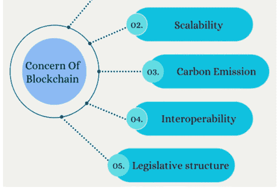

图 4.2 区块链的关切点。来源：作者。

- i) **隐私问题**：如今，我们的生活通过各种数字渠道已成为互联网的一部分，或者可以说，互联网已成为我们生活中的重要因素。人们通过各种数字平台持续共享数据。因此，安全与隐私已成为当今的主要关切。人们甚至不知道自己的数据在何处被使用、用于何种目的。如今，尤其是在新冠疫情之后，许多涉及金融、商业、商务和医疗的个人交易都在线上完成，导致互联网上的数据不断增加（Miglietti 等，2019）。因此，确保敏感数据的隐私和安全是一项重大关切。

- ii) **可扩展性问题**：区块链网络有时难以快速处理大量交易。由于每一份数据都需要映射到区块链中，随着更多交易被添加到区块链，网络性能可能会下降，从而导致区块挖掘延迟。此外，在区块链中添加数据/区块也需要挖矿成本。

- iii) **碳排放问题**：区块链有多种共识算法可供使用。在使用某些区块链网络时，矿工需要大量的处理能力和高能耗。PoW 和 PoS 是共识机制的几个例子，其中尤其是比特币使用的工作量证明（PoW），消耗了大量能源资源，是碳排放的主要来源。使用区块链也会引发环境问题。

- iv) **互操作性问题**：每个区块链平台都使用自己的协议和标准，这使其在应对商业经济中的各种挑战时具有独特性和强大性。由于协议之间的差异，从一个区块链到另一个区块链的数据映射是不可能的。不同区块链之间的互操作性仍然难以实现。

- v) **各种立法结构的问题**：很少有司法管辖区批准了加密货币结构；但技术在这些地区的接受度非常高。不同的司法管辖区有着不同的区块链和加密货币监管环境。将区块链技术应用于各个领域，需要与监管职能法律的不确定性进行映射。甚至去中心化的规则在不同监管法律中也各不相同，这需要积极地进行整合。

为了制定这些问题的解决方案，政府、企业、学术机构和个人必须协同合作。这包括制定保护用户隐私的法律和政策，促进数字资源和数字素养的普及，为新兴就业岗位提供教育和培训资金，培育技术开发的道德标准，并鼓励负责任的技术使用，以减轻技术对社会和心理的负面影响。

在我们致力于建设一个更加公平和可持续的技术未来的过程中，最终目标是最大限度地发挥技术的积极作用，同时积极应对并尽量减少任何潜在的负面影响。

## 4.2 区块链基础与要点

区块链由许多相互连接的数据块组成，这些数据块按时间顺序链接在一起。区块链有许多区块。第一个区块被称为创世块，它没有其他任何区块的地址。在创世块之后，每个区块都包含其前一个区块的地址，从而维护链的序列。地址以 256 位哈希码的形式映射。每个区块由区块头和交易组成。区块头包含区块版本、Merkle 根、时间戳、Nonce 值以及前一区块的哈希键，而交易则包含交易列表和 coinbase。

区块版本是一个用于跟踪协议升级的数值。Merkle 根是交易的最高层哈希值，由不同层级的所有节点组合而成。Merkle 根是 SHA-256 算法生成的最安全的哈希码之一。时间戳将表明区块添加到区块链的时间。Nonce 值是一个始终从零开始并递增的值，用于解决数学难题以验证交易。前一个哈希是前一个区块的地址，用于确保区块的正确连续链接（Kang 等，2018）。

### 4.2.1 区块链中的区块管理

区块链是一系列区块，每个区块包含多笔交易，所有区块相互连接以实现正确的链接。区块链区块管理依赖于一系列步骤，每个步骤又包含多个子步骤。第一步是根据需求选择特定的区块链。为正确目的选择正确的区块链将使业务更加高效和敏捷。基本理解应是要哪种区块链，即私有链、公有链或联盟链。第二步是在验证过程之后创建交易并将其广播到网络。每个区块的交易管理也是区块验证的重要方面之一。每个区块包含一笔或多笔交易，这些交易为区块添加了一些重要信息。下面详细说明在区块链中管理区块所需的步骤。

该过程始于交易的发起，交易会导致新区块的创建。交易是将要添加到区块中的数据，以满足区块链中的链。该交易也可以在双方之间进行，其中一方希望将某些数据或加密货币转发给另一方。它可以是资产从一个人到另一个人的转移，或者在加密交易的情况下是数字货币的转移。交易主要导致需要维护在区块链中的数据。交易完成后，下一阶段是将其广播到网络中。广播交易需要经过验证和校验的过程（Mukherjee 等，2021）。对网络中广播交易的管理是为了维护点对点协议，使链中的每个节点都能了解交易及其在区块链中的管理信息。验证部分通常是对数据在人与人之间转移时的可行性进行检查。在数字金融交易的情况下，主要焦点应是希望转移数字资产的个人/节点是否拥有足够的资产。例如，如果一个人希望使用比特币区块链向另一个人发送 100 个比特币，那么交易的验证应检查第一个人是否拥有 100 个比特币，以及这 100 个比特币的来源（Kamath, Reshma，2018）。在区块链中，如果试图对区块中的数据哪怕做一点小修改，由于哈希值的变化，也会导致链接断裂。现在，让我们利用 Merkle 树和 Merkle 根的概念来详细了解哈希值的生成（Latif, Sobhan 等，2019）。

图 4.3 详细说明了区块链中区块之间的联系。区块的索引是一个唯一编号，表示区块链中的序列，使区块链中区块的管理和识别更加容易。

**时间戳：** 时间戳是将区块添加到链中的日期和时间，也可以视为区块被挖掘的时间。通常，区块的挖掘时间和添加时间是相同的。时间戳对于维护顺序和渐进顺序，以及确保区块按时间顺序添加到区块链中至关重要（Hueber, O.，2019）。

**哈希值：** 哈希值是通过应用 SHA-256 算法生成的唯一值，是一种取决于区块数据或交易的字母数字值。如果区块内的数据被修改，该字母数字值也会自动改变。它是负责区块链中数据安全的组件之一。关于哈希值的更多内容将在本章第 4.2.5 节中讨论。

**前一个哈希值：** 它是当前挖出的区块之前那个区块的哈希值，用于将上一个区块与当前区块连接起来。

**数据：** 数据是映射到区块中的一笔交易或多笔交易。数据是区块中的主要组件之一，需要解决其安全问题。例如，在比特币区块链中，数据将包括交易细节，即发送者信息、接收者信息以及要转移的比特币总数。图 4.4 展示了区块链区块的示例结构。

现在，让我们在第 4.2.4 和 4.2.5 节中详细了解所有组件的运作方式。

### 4.2.4 MERKLE 根与 MERKLE 树

区块的 Merkle 根是为区块链中一个区块的所有交易最终生成的哈希值。根节点有许多层级来维护子节点。Merkle 根节点是基于 Merkle 树计算得出的。Merkle 树是一种树形结构数据排列方式，多个哈希值的组合将生成一个 Merkle 根，该根将是提供给下一个待添加节点的最终哈希地址。下面是一个如图 4.5 所示的示例，通过该示例可以很好地理解 Merkle 根和 Merkle 树的概念。

区块的交易是 Merkle 树的叶节点。这里有四笔交易，因此 Merkle 树将有（4 – 1）即 3 个层级，各笔交易 T1、T2、T3 和 T4 将位于第 3 层，表示为


一般而言，如果一个区块包含 n 笔交易 T1、T2、T3、...、Tn，那么默克尔树将有 n − 1 层，其中 T1、T2、T3、...、Tn 是第 n 层的 n 个叶节点。每个叶节点在第 (n − 1) 层都有一个父节点 H(Ti)，其中 i = 1、2、3、...、n。随后，依次拼接成对的节点，对拼接后的字符串应用哈希函数，并在上一级将哈希函数的值作为父节点。这个过程持续进行，直到只剩下一个节点，即根节点，也就是默克尔根。

比特币是采用 SHA-256 的知名区块链之一。SHA-256 算法是一种哈希函数，可生成长度为 32 字节的哈希值。在本例中，如图 4.5 所示，H(T1)、H(T2)、H(T3) 和 H(T4) 的长度均为 32 字节。H(T1) + H(T2) 和 H(T3) + H(T4) 的拼接结果长度为 64 字节，其父节点 H(T1T2) 和 H(T3T4) 的长度为 32 字节。依此类推，默克尔根的长度为 32 字节。

### 4.2.5 安全哈希算法（SHA-256）

SHA-256 是一种常用且极其安全的密码学哈希函数的简称，全称为安全哈希算法。它适用于多种计算机科学应用，例如密码哈希、敏感数据哈希以及数字签名。许多区块链应用（例如比特币、Namecoin 和 Peercoin）都使用 SHA-256。SHA-256 属于 SHA-2 哈希函数系列，由美国国家安全局（NSA）设计，并由美国国家标准与技术研究院（NIST）发布。SHA-256 接收任意长度的输入消息，并生成固定大小（256 位）的字母数字字符串作为输出，即哈希值（AkhibeJoy，2018）。SHA-256 算法的若干特性包括确定性、雪崩效应、不可逆性以及固定长度的字母数字代码。确定性意味着对于特定输入，总会生成相同的哈希值。“雪崩效应”意味着输入数据发生微小变化，就会产生完全不同的哈希值。不可逆性意味着不存在能够从哈希值还原原始值的算法。SHA-256 生成的字符串长度固定为 256 位，即 32 字节的字母数字代码。该算法独特的特性使其成为保护敏感数据和验证数字信息完整性的关键组成部分。区块链数据结构的设计与安全要素，例如密码学哈希和区块链接，使系统能够抵御篡改并确保不可变性（Rajnak 等，2021）。

## 4.3 区块链的类型

为满足不同领域应用的需求，人们引入了不同类型的区块链。不同类型的区块链适用于不同场景，并各有优势，具体取决于其使用方式。一般而言，区块链可分为四类，即许可型、无许可型、混合型和联盟型，如图 4.6 所示。

无许可型 许可型

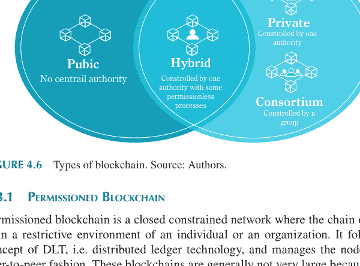

*图 4.6 区块链的类型。来源：作者。*

### 4.3.1 许可型区块链

许可型区块链是一种封闭且受限的网络，区块链处于个人或组织的限制性环境中。它遵循 DLT（即分布式账本技术）的理念，并以点对点的方式管理节点。这类区块链通常规模不大，因为并非所有互联网用户都可以加入网络并参与共识机制。许可型区块链要求参与者获得授权或许可，才能访问网络并开展各种活动。私有区块链和联盟型区块链都属于许可型区块链。私有区块链由特定权威机构控制，而联盟型区块链则由负责向某个社群授予访问权限的团体控制（Mohanty Debajani，2019）。

### 4.3.2 私有区块链

私有区块链也称为许可型区块链，通常是在组织防火墙内构建的受限区块链，以便更高效地管理访问限制。基本而言，私有区块链专为受控环境而设计，只有已知实体才能协作开展操作。这类区块链能够在参与者之间建立更高水平的信任。更好地控制数据保护、更快地处理交易，以及定制化的治理模式，都是这类受限访问方式带来的优势。对于要求数据安全和保密的行业而言，私有区块链更为适用。私有区块链的主要缺点是规模较小，可能导致安全性降低。最常见的私有区块链示例是 Hyperledger Fabric 和 R3 Corda。两者都是开源的企业级许可型分布式账本技术（DLT）平台（Amu D. 和 Santhi Baskaran，2022）。

#### a) Hyperledger Fabric

Hyperledger Fabric 是 Hyperledger 的开源项目之一。与受限的领域专用语言（DSL）不同，Fabric 是首个支持使用 Go、Node.js 和 Java 等通用编程语言编写智能合约的分布式账本平台（Ana 等，2018）。这意味着个人无需额外学习新语言，因为大多数企业已经在使用这些技术，因此具备创建智能合约所需的技能。它还使开发者、团队和组织能够共同构建工具，以简化工作并提高安全性。医疗保健是 Hyperledger Fabric 可用于构建相关架构的行业之一，该架构能够更安全地按顺序维护个人的数字记录。可以通过唯一 ID 或指纹直接调取文档，从而为个人提供及时的医疗帮助。

#### b) R3 Corda

R3 Corda 是一个基于 ISP 原则构建的开源区块链平台，即互操作性—安全性—隐私性原则。它适用于金融机构和企业。Corda 能够安全、快速地执行操作，这是当今金融机构最重要的需求之一。Corda 旨在提供隐私保护，使参与者能够仅与获得授权并拥有访问权限的个人或组织共享交易数据。这种程度的审慎性对于在敏感金融和法律领域运营的企业至关重要。银行机构计划采用 R3 Corda，让全球金融交易保持灵活、简便。根据 Andre Carneiro 在 bbchain.com 上提供的信息，R3 Corda 已被用于为全球一些最大的机构构建应用，包括汇丰银行、ING 和摩根大通（Khan 等，2018）。

### 4.3.3 联盟型区块链

联盟型区块链通常是社群型区块链。社群型区块链是指多个受信任的组织共享同一网络，以完成共同工作。每个组织都可以在获得许可后加入专用网络并开展协作。这类区块链属于许可型网络，任何实体未经许可都无法加入。多个组织可利用联盟型区块链进行治理，并制定规则和协议来维护和管理数据。MediLedger 和 IBM Food Trust 都是联盟型区块链的示例。MediLedger 主要面向全球医疗保健行业，是药品供应链管理领域的重要参与者之一；IBM Food Trust 则是 IBM 的产品，用于改善食品供应链管理。

#### a) MediLedger

医疗保健行业是最重要的行业之一，人们可以在共享网络上协作，为特定问题寻找解决方案。协作工作需要建立协议和业务规则，以管理交易伙伴之间的交易与互动。MediLedger 是最适合提升药品供应链完整性和安全性的网络之一（Carolin Plewa 等，2012）。它旨在解决制药行业中的可追溯性、假药和法规合规等挑战。MediLedger 还用于处理药品合规与追溯问题。

#### b) IBM 供应链智能套件——Food Trust

IBM Food Trust 项目是一种基于区块链的模块化解决方案，可使所有网络参与者受益，让食品环境更加安全、智能和可持续。IBM Food Trust 是一个贯穿始终的协作式供应链网络。该流程涵盖向农民分发种子、农作物种植管理、农作物加工与收割，以及将农作物分销给批发商和零售商。IBM Food Trust 项目负责管理整个流程。这一基于 IBM 区块链的解决方案通过许可型且不可变的区块链连接各方。

### 4.3.4 无许可型区块链

“无许可型”和“公有型”区块链这两个术语经常互换使用。它们有一个共同的关键特征，即参与者可以开放访问。这类区块链基于分布式账本技术，节点对所有人开放且可访问。任何拥有区块链有效登录信息的人都被视为参与者。参与者有权验证交易，因此被称为矿工。无许可型区块链通常不受限制、易于使用，并被视为公有型区块链（Castro 等，1999）。

### 4.3.5 公有型区块链

这类区块链允许用户不受任何限制地写入、查看和验证交易。此类区块链维护着一个分布式节点网络。安全问题通过共识流程加以处理。公有型区块链广泛应用于各种领域，包括加密货币、智能合约和去中心化应用（Dapps）（Veronese 等，2013）。它们以可靠且抗审查而著称，因为网络不受任何单一实体控制。尽管公有型区块链开放访问，但它仍能抵御黑客攻击，因为只有当黑客控制区块中超过 51% 的权益时，安全性才会受到威胁；而由于区块链规模庞大，这种情况很难发生。比特币和莱特币都是公有型区块链的例子，允许参与者在没有集中控制或许可的情况下开展活动。


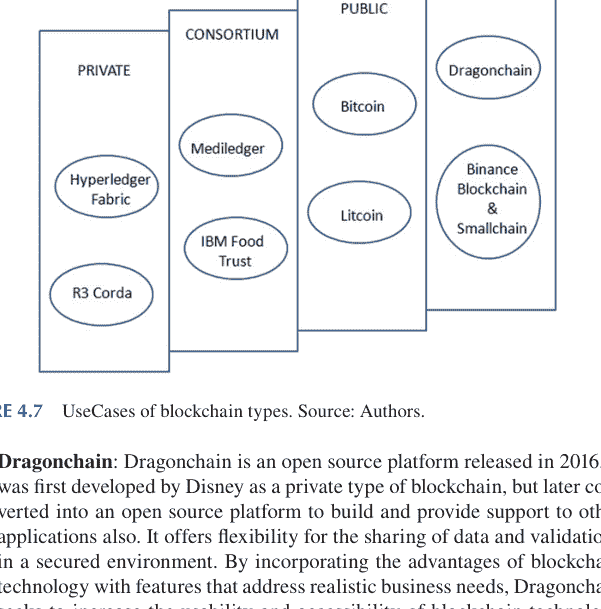

**图4.7 区块链类型的用例。来源：作者。**

- a) **Dragonchain**：Dragonchain 是一个于2016年发布的开源平台。它最初由迪士尼开发为一种私有区块链，但后来转变为开源平台，也用于构建和支持其他应用。它提供了在安全环境中共享数据和验证的灵活性。通过将区块链技术的优势与满足实际业务需求的功能相结合，Dragonchain 旨在提高区块链技术对企业和开发者的可用性和可访问性。
- b) **币安区块链与智能链**：币安链是一条用于加密货币交易的公有链。币安链还提供了一种名为币安币的代币。币安智能链是一种许可区块链，是与币安链并行的网络，当与币安区块链结合时，提供一种混合环境（M. Samaniego, U. Jamsrandorj 和 R. Deters，2016）。币安提供了两条独立但相关的区块链。币安链充当交换加密资产的去中心化市场，而币安智能链通过支持智能合约来增强功能（见图4.7）。

表4.1简要展示了不同类型区块链的属性对比。

## 4.5 共识机制

“共识”一词的含义是“一群人之间的协议”。在区块链技术中，共识算法扮演着至关重要的角色。这些是基于协议的算法，专门用于在网络参与者之间就特定交易能否被添加到区块链接达成协议。不同的区块链平台和技术会搭配不同的共识算法（Jafar Umar 等，2021）。基于适用性，不同的区块链平台会根据其需求采用特定的共识算法。以下是用于将交易添加到特定区块链中的几种主要共识算法。这些算法通常是用于解决复杂问题的数学算法。

## 4.6 工作量证明（PoW）

在区块链领域，工作量证明的通用缩写是 PoW。它由中本聪（Satoshi Nakamoto）于2008年首次使用。它是比特币平台使用的共识算法。在这个过程中，当个人想要将区块添加到特定区块链时，需要由矿工进行验证，矿工负责通过解决复杂的数学问题来验证交易。许多矿工可以参与验证交易的过程，但只有最先解决问题/数学难题的矿工才能获得验证交易和将区块添加到区块链的权利。矿工必须通过随机值对区块进行重复哈希运算。这个随机值称为随机数（nonce）（Chen 等，2019）。该过程将持续进行，直到随机数满足难度要求所需的标准为止。作为奖励，矿工将根据所解决问题的复杂度获得少量比特币（即加密货币）的部分。这是用于验证交易的最早共识机制之一。比特币完全遵循 PoW 共识机制/算法来将区块添加到区块链。PoW 过程需要高端的计算能力，导致高能耗，这被认为是 PoW 共识机制的主要缺点之一。

## 4.7 权益证明（PoS）

权益证明的通用缩写是 PoS，由 Sunny King 和 Scott Nadal 于2012年开发。它是 PoW 的替代方案，旨在以不同方式实现相似的目标。与 PoW 不同，在 PoS 中，并非所有矿工都必须争相使用随机数来解决问题。在 PoS 中，通过一种简单的机制，即权益或加密货币的所有权，选择矿工的概率非常高。任何拥有高权益的人首先有资格参与确定问题的解决方案。这将在早期过滤掉所有矿工，而不会让他们全都忙碌。PoS 的主要优点是它比 PoW 更节能，并且通常能实现更快的区块挖矿。以太坊、Polkadot、Avalanche 等流行平台都使用 PoS（Yoshida H.，Biryukov A.，2006）。每个平台都与不同的 PoS 变体相关联，这使得它们具有更快的挖矿速度和更少的能耗。以太坊早期与 PoW 相关，但到2022年，以太坊正式过渡到 PoS。

由于挖矿速度更快，以太坊在当前市场上仅次于比特币，非常受欢迎，其代币 ETH 在市场上持续增长。但 PoS 的问题在于矿工需要大量投资来维持权益。

## 4.8 委派权益证明（DPoS）

委派权益证明的通用缩写是 DPoS，由 BitShares、Steemit 和 EOS 的创始人 Daniel Larimer 于2014年开发[44]。它是 PoS 的流行变体之一，旨在与比特币等传统工作量证明（PoW）系统相比提高可扩展性和能源效率。它基于代币投票系统运作。在这个系统中，区块链网络上的代币持有者可以选择预定数量的代表。这些代表在验证交易后可以将新区块添加到区块链。代表的数量通常不超过网络中代币持有者的总数。一般来说，与代币持有者数量相比，代表数量相当少，从而实现高效且可扩展的共识机制流程。它是一种网络算法，只有受信任的验证者才有权验证交易。这些权利由特定区块链的其他网络代表授予。其主要目标是提供一种比传统工作量证明共识机制更节能、更具可扩展性的替代方案。DPoS 旨在通过允许所有代币持有者在共识过程中投票，来在去中心化、安全性和效率之间找到平衡（Aithal 等，2021）。

## 4.9 实用拜占庭容错（PBFT）

实用拜占庭容错的通用缩写是 PBFT。Miguel Castro 和 Barbara Liskov 通过1999年发布的一项研究提出了这一想法（Amiri 等，2021）。只有可靠的验证者才能参与许可区块链的共识算法。PBFT 是一种适用于许可区块链的共识算法，仅与受信任的验证者协作。它还在物联网（IoT）领域发挥着重要作用。拥有拜占庭容错的主要好处是管理系统故障。如果某个节点发生故障，则建议移除该节点，而优化在更短时间内完成工作则是 PBFT 的主要用途。它主要提供所有节点的顺序排序，其中一个节点是主节点，所有其他节点被视为从节点。PBFT 主要保持记录，确保恶意活动的节点不超过总节点的三分之一。例如，如果总节点数为 n，则恶意活动的节点不应超过 n/3。实用拜占庭容错（PBFT）方法被包括 Zilliqa、Hyperledger Fabric 和 Tendermint 在内的区块链系统使用。

## 4.10 权威证明（PoA）

权威证明的缩写是 PoA，它是一种具有有限数量受信任节点的共识机制。这些受信任节点的主要任务是验证

**表4.2 共识机制对比**

共识机制

| 属性 | PoW | PoS | DPoS | PBFT | PoA |
|---|---|---|---|---|---|
| 可扩展性 | 低 | 中 | 高 | 中 | 高 |
| 速度 | 中 | 中 | 高 | 高 | 高 |
| 安全性 | 高 | 高 | 高 | 高 | 中 |
| 存储（去中心化） | 高 | 中 | 低 | 低 | 低 |
| 能源消耗 | 高 | 低 | 低 | 低 | 低 |
| 参与方式 | 所有矿工 | 权益持有者 | 代币持有者 | 节点 | 经批准的实体 |
| 示例 | 比特币 | 以太坊 | 波场 | Hyperledger Fabric | Quorum |


这些文件被认为是重要的，是获得财产唯一所有权所必需的文件，且每份文件都需要保存多年。有时财产会从一个人转移到另一个人，由此导致注册/所有权从一个所有者转移到另一个所有者。随着区块链技术的采用，土地所有权和房地产行业将经历革命性的变革。从第一个人到当前所有者的链条需要得到维护，而区块链技术可以帮助其安全且不被篡改地维护。我们经常听说一个人将同一处房产出售给两个或更多人的情况，这是非法的。如果数据保存在区块链中，那么最后合法的操作也会得到评估和验证。对交易的验证将提高安全性，并控制出售房产中的欺诈活动。

土地所有权和房地产行业需要的是许可型或部分许可型区块链，在这种区块链中，用户应该是可信的或已知的。文件数字化和选择正确的加密算法是进入区块链的基本要求之一。然后，智能合约需要以能够阐明买卖房产的主要条款和条件的方式来定义。智能合约应该写得完美，以便能够维护付款期限、历史所有权记录以及房产转让条款和条件。

下一步是以数字格式对房产文件进行代币化。考虑一个房产由两三个个人共有的情况。在这种情况下，相应的代币应分别提供给该房产的每一位所有者。拥有部分所有权的所有者可以放弃其代币，以允许另一位共有人出售该房产。此外，在买卖房产时需要对支付进行代币化。进一步而言，代币化过程在出售房产时使税收过程更加清晰。这将带来管理无欺诈交易的优势。区块链在该领域实施面临的挑战包括各部门之间的协作、监管考虑以及克服技术维护问题。

### 4.12.2 电子健康记录系统

利用区块链技术的电子健康记录（EHR）系统可以在数据安全、隐私、互操作性和患者赋权方面提供诸多好处。这是增长中的领域之一，来自其他国家的患者正前往印度就医。过去三年中，超过80万外国人前往印度接受医疗治疗，使其成为医疗旅游的主要目的地之一。内政部报告称，2019年至2021年间，向外国人签发了超过82.5万份医疗签证，其中大多数来自非洲国家（Alexander et al., 2022）。

印度是制药行业的一个巨大市场。许多患者前往印度进行医疗和康复。印度医疗保健行业在未来具有很大潜力。实施可以从两个方面进行。

在特定时间段后，如果工作尚未完成，则剩余资金开始贬值。这将影响工作的及时完成。少数货币如地球美元、Freicoin和互助信贷正在基于货币贬值税的概念运作（Popper & Nathan, 2016）。

### 4.12.6 区块链赋能的物联网应用

物联网（IoT）作为一种计算技术范式已广受欢迎。物联网应用是当今世界的需求，在这个世界中，多台设备连接到网络上以方便使用。随着通过互联网将多台设备相互连接的可行性，物联网市场正以前所未有的速度扩张。区块链技术有潜力以安全机制映射物联网世界。互联网上的数据面临几个主要挑战，即安全性、数据的高效映射、互操作性和可扩展性。由于互联网上数据的体量和速度，资源共享和可扩展性正成为重要因素。物联网世界有数百万台设备需要连接到同一网络，导致数据处理延迟。

所有这些挑战都可以通过区块链技术以去中心化的方式管理网络设备来解决，并且由于区块链的快速共识机制，可以实现高可扩展性。区块链帮助物联网设备无需遵循任何中心化权威的概念即可直接相互通信。这种去中心化的方法增强了信任和可靠性，因为系统中没有单点故障或漏洞。另一个方面是安全性，即所有物联网设备都处于开放网络中时。区块链有能力为此类设备实现安全身份管理。借助密码算法，只有授权设备才能与网络交互并执行特定操作。区块链与物联网设备的集成已开始在众多企业中传播。IBM和三星合作创建了自治去中心化点对点遥测（ADEPT）平台，该平台利用比特币的组件来构建去中心化的物联网设备网络。

### 4.12.7 基于区块链的安全电子投票系统

选举是民主社会的基本组成部分，因为它们允许公众通过投票表达意见。自1970年以来，电子投票（e-voting）已通过多种方法实现。许多专门为投票创建的系统相对于纸质系统具有相当大的优势，包括更高的效率和更少的错误。在线投票是另一种媒介，在某些情况下通过电子邮件进行投票，例如缺席投票，允许人们在选举日之前通过电子邮件或投递箱投票。在线投票在现代社会越来越受欢迎。它能够降低组织成本，同时提高选民投票率。在在线投票的框架下，有许多电子邮件投票的替代方案。各种技术已被用于开发此类系统，从而产生了在线安全投票系统（Jamader, A. R., Das, P., & Acharya, B., 2022）。这里需要解决的主要挑战是透明度、隐私和数据篡改。在线投票系统的更多问题是维护选票记录、管理来自不同地点的选票以及识别真实选票。真实选票意味着需要核实投票者的存在，以便容易识别假票。该系统还需要与其他政府数据库协作，并且必须对政党保密投票者的身份。区块链技术有潜力解决所有这些问题，并使在线电子投票系统更加强大。可以通过使用去中心化且不可篡改的账本来记录和验证选票，从而开发出区块链赋能的系统。投票成功后，矿工将验证交易并将其添加到公共账本中。这将导致所有选票的处理更快、更安全且不被篡改。基于数据，还可以对未投票地区进行主要分析。使用在线电子投票方法，全球投票率肯定将会提高（Jamader et al., 2023）。

### 4.12.8 区块链的未来前景

区块链技术的潜在应用和实施领域众多且多样。预计区块链将对多个关键行业产生重大影响，包括数字内容管理和记录保存、知识产权、各行业的供应链管理、学术领域等等。未来是IT赋能的，拥有众多服务和应用程序。如今，人们正将许多应用程序用于各种目的。如今，在互联网上共享我们的个人资源很常见。人们经常通过各类平台在互联网上分享他们的照片、位置和爱好。未来许多平台将整合，以多种方式提供好处。协作应用程序对物联网赋能的应用程序总是有益的。安全是未来的关键问题，区块链技术可以在所有这些应用中解决这一问题。通过利用区块链技术中的智能合约概念，金融和法律应用可以建立协议并执行，而无需使用银行和律师等第三方中介。区块链共识机制设计完美，可以降低成本和交易时间（Narayanan et al., 2016）。区块链共识机制的最优架构可以降低交易成本和时间。大多数行业都使用云计算平台的概念。区块链技术是与云计算集成以增强安全性、透明度和效率的完美合适解决方案之一。尽管区块链技术潜力巨大，但广泛采用仍在进行中。能源消耗和与现有系统相关的法律框架都是必须解决的问题，区块链才能在这些不同领域充分发挥其潜力（Jamader, A. R., Chowdhary, S., & Shankar Jha, S. 2023）。

## 4.13 结论

区块链技术已成为一项改变游戏规则的突破，能够改造多个流程和行业。分布式账本技术和


# 5 通过区块链技术赋能能源转型

Oum Kumari R.

## 5.1 引言

根据联合国环境规划署2022年的报告，排名前七的国家——中国、美国、印度、欧盟、俄罗斯、印度尼西亚和巴西——占全球温室气体排放量的50%（UNEP 2022）。几乎所有国家都宣布了到2050-2070年实现净零排放的目标。仅能源部门就贡献了温室气体总量的四分之三（IEA 2021），而向太阳能、风能等可再生能源的有效能源转型，才能帮助我们减少排放，并在全球范围内实现净零目标。传统的集中式电网系统可能无法帮助经济体实现净零目标，因为它们适用于依赖化石燃料满足电力需求的经济体。在灵活电网的帮助下，净零目标可以实现，灵活电网可以轻松适应可再生能源供需的动态变化。各国都在努力实现“发达国家”的地位，这导致了过去几十年来能源生产和消费的增加（Oum Kumari，2019）。对能源不断增长的需求迫使该行业提高装机容量，以平衡供需。世界人均一次能源消费量已从1950年的27,972太瓦时增加到2022年的160,764太瓦时。在过去的两个世纪里，化石燃料一直主导着能源行业，对化石燃料能源的依赖如图5.1所示。

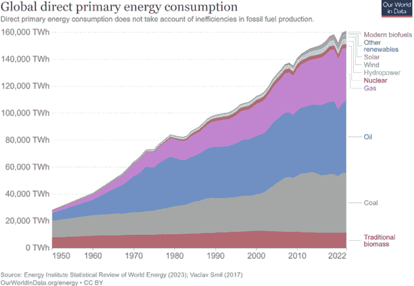

**图5.1** 一次能源消费。来源：作者。

对煤炭、石油、天然气和传统生物质的严重依赖导致了不可持续的自然资源生产和消费，从而引发了气候变化和全球变暖（Khan等，2022）。可持续性包括发展的三个维度，即社会、经济和环境（Liu，2022），对社会、经济和环境问题采取预防原则将帮助各国在不损害地球的情况下实现更高的增长（Taghizedh F.等，2022）。各国一直在努力通过充足的能源供应来加强经济，但所付出的环境退化代价非常高昂。可负担的能源和低碳未来现已成为各国的主要目标，区块链技术被认为是通过去中心化能源生态系统加速和赋能能源转型过程的强大工具。本章讨论了能源与经济发展的融合；区块链技术在能源领域的应用；以及BCT在能源转型中的挑战，并进行了讨论和总结。

## 5.2 能源与经济发展

能源在人类生活和国家发展中发挥着至关重要的作用，能源短缺阻碍了人类和经济发展（Huo Jie等，2013）。能源消费与经济发展之间具有很强的正相关关系，如图5.2所示。高增长和高发展需要更高的人均能源消费，而更高的能源消费也要求国家的发展。

根据《能源展望》2019年，到2040年，全球能源需求预计将增长30%至35%，原因是人民生活水平的提高和贫困的减少（Wen等，2021），主要发生在像印度和中国这样人口密集的发达国家和发展中国家（Chen等，2021）。这再次要求采取严肃行动应对气候变化，因为超过60%的能源需求是通过化石燃料满足的，从而导致温室气体排放。国家的发展离不开能源安全，因为工业化进程、生活水平、基础设施发展等都依赖于不间断的、可负担的能源

## 5.4 区块链技术与能源转型

能源部门正在通过区块链技术（BCT）经历深刻的转型。BCT可以促进能源资源、太阳能技术、净计量系统和智能电表之间的通信。优化可再生能源的使用可以通过帮助克服能源危机和有效减少温室气体排放来促进经济。过去二十年的技术进步提高了全球能源部门的绩效。然而，集中式的能源模式在解决发展中国家的能源问题方面并不成功。BCT可以将集中的能源部门转变为更可持续、更分散的模式，帮助国家开发绿色能源的潜力，同时解决能源和环境问题。全球所有发展中经济体和发达经济体都已宣布到2050年和2070年实现净零排放目标。BCT技术可以帮助各国探索可再生能源并优化其使用，从而使我们的星球在不影响增长的情况下变得更宜居。安全性和透明性作为BCT的重要特征，可以实现能源的高效分配，从而降低分配成本。

区块链技术是一种分布式账本，是加密货币背后的技术，也可以在能源转型过程中发挥关键作用。BCT有可能通过使我们采用可再生能源并减少对煤炭和石油的依赖，在21世纪末实现巴黎气候目标（1.5°C），从而为地球降温。BCT可以通过数字化和去中心化（IFPEN）帮助各国加速向可再生能源的能源转型进程。目前，经济体通过使用化石燃料，特别是煤炭和石油，来满足不断增长的能源需求。各国人均电力消费的持续增长导致了温室气体排放的增加和债务的不断增加，因为这些能源大多是从其他国家进口的（IEA）。由于激励不足，现有的电力市场基础设施也不允许小参与者参与市场（Andoni，2019）。但是，通过用可再生能源替代不可再生能源，即向绿色能源转型，能源市场、能源需求和能源供应方面的所有挑战都可以轻松克服。BCT在能源市场领域提供了灵活性、包容性和激励措施，为未来几年的能源转型铺平了道路。与传统能源市场相反，通过BCT实现的去中心化能源市场将使生产者和消费者走到一起，以既经济又可持续的方式合理满足其能源需求。这种能源市场的去中心化也被称为“能源互联网”，促进了来自不同地区和来源的互连和能源耦合。BCT通过实现涉及买卖双方的透明、安全的能源分配，为能源互联网提供便利。许多公司已进入能源市场，并通过BCT探索DLT的好处，以在不排放有害气体的情况下实现能源自给。这项技术的增长不可能在一两年内实现，而是需要较长的酝酿期。因此，世界能源理事会将BCT在能源市场中的增长分为三个不同的阶段，如图5.3所示。

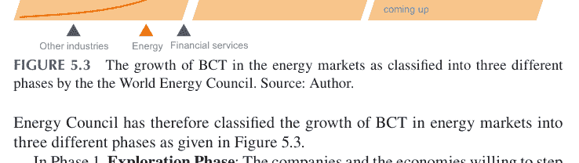

**图5.3** 世界能源理事会将BCT在能源市场中的增长分为三个不同阶段。来源：作者。

- **在第一阶段，探索阶段：** 愿意在能源转型中迈出一步的公司和经济体启动试点项目和初创企业，将BCT与现有能源基础设施集成，以提高效率并降低成本。
- **在第二阶段，增长阶段：** 可以看到技术在各国的传播取得了重大进展。这项最初为支持比特币等加密货币而开发的技术已经成熟，并在能源领域找到了应用。区块链在以经济和环境友好的方式满足能源需求方面取得了长足进步。
- **第三阶段，成熟阶段：** 区块链技术已经超越了最初的应用，并已成熟。BCT在能源领域被广泛采用，已成为普遍现象，并为进一步发展以满足行业不断变化的需求做好了准备。

同样明显的是，大多数发达国家和发展中国家，如印度、中国、法国和许多其他国家，已经踏上了能源转型的旅程，并正在走向第二阶段，即增长阶段。

## 5.5 区块链技术的应用

本节讨论了在不同国家通过使用BCT实现能源转型的一些真实案例。

### 5.5.1 案例场景1

一家名为Powergrid的公司开发了用于能源交易的BCT。使用太阳能的家庭和企业可以轻松地将多余能源出售给附近的人，并鼓励采用可再生能源。这不仅帮助人们降低了能源成本，还通过减少对煤炭和石油的依赖，帮助应对碳排放的威胁。BCT为电网提供了弹性和灵活性，使消费者能够跟踪和追溯每单位电力的产生和消耗。BCT不仅有助于消费，而且电网的去中心化使人们能够参与能源市场，从而创造收入和改善生活。BCT被视为创建稳定高效电力的有效解决方案之一


一个在现在和未来全球经济体对抗全球变暖和气候变化的体系。

### 5.5.2 案例场景2

#### 5.5.2.1 Tata Power——DDL，德里

Power Ledger 的技术所提供的 BCT 帮助该公司在印度德里交易 2 兆瓦的太阳能电力，服务 950 万客户。该公司一直以实惠的价格成功地向终端消费者和本地企业出售电力/多余能源。这种技术驱动的能源交易促进了太阳能的采用，也帮助印度克服了电力短缺、气候变化等问题。

### 5.5.3 案例场景3

#### 5.5.3.1 TDED，泰国

在 BCT 的帮助下，泰国发展了点对点能源交易。自 2022 年以来，该公司每月成功交易约 112 兆瓦的太阳能。TDED 以不同的方式处理能源问题，通过教育人们并改变他们采用太阳能技术的行为，有效地开启了能源交易的新旅程。TDED 在泰国城市清迈通过发电和交易 15 兆瓦的太阳能，成功营造了乐观的氛围。试点项目已成功完成，该国正为未来几年的能源转型做好准备。

### 5.5.4 案例研究4

#### 5.5.4.1 Ekwateur，法国

法国公司 Ekwateur 发展迅速，如今拥有超过 30 万消费者。该公司借助 BCT 记录所消耗能源的单位和来源。消费者能够了解所消耗能源的类型，而 BCT 反过来又使消费者能够根据价格和来源定制自己的能源组合。该公司每 30 分钟对能源交易进行认证和结算，消费者可以选择最便宜的能源，这些能源可能来自家门口的屋顶，也可能来自居所附近的风电场。

### 5.5.5 案例研究5

#### 5.5.5.1 Enerchain，德国

Enerchain 是德国于 2017 年启动的一个项目，它开发了一种技术基础设施，通过消除中间商，利用 BCT 以去中心化的方式促进能源（尤其是电力和天然气）的批发交易。这是首个在电力和天然气市场实现现货和远期合约的项目，在很大程度上降低了运营成本。

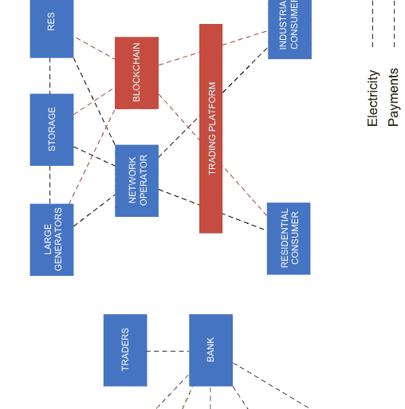

电力
付款
数据

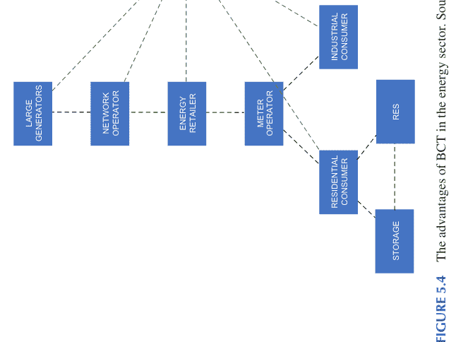

## 图5.4 BCT在能源领域的优势。来源：作者。

## 5.8 讨论

区块链技术在实现去中心化能源供应的透明度和准确性方面大有可为。财政激励和能源政策推动了可再生能源的发展，但只有通过应用 BCT，能源转型才有可能实现。发达国家部署智能电表帮助各国减少了温室气体排放，并提前实现了净零目标。英国已规划了 5300 万个电力供应智能电表，这反过来需要巨额投资，美国每年约为 2 万亿美元。英国发布的一份报告指出，BCT 不仅能够像比特币和加密货币那样彻底改变金融市场，还能通过实现透明度、安全性和问责制来彻底改变能源市场。BCT 被认为是能源供应商的颠覆者，有助于实现低碳转型。

BCT 在能源转型过程中有巨大的应用空间，但可扩展性、成本和安全性被认为是 BCT 在能源领域应用的主要挑战。当今各种微观和宏观层面的问题都需要政策制定者关注，以规范布局，加速 BCT 及其在能源市场中的采用。与此同时，各国政策制定者可以制定有效的战略来应对 BCT 在能源领域的挑战，并能在不削弱环境挑战应对的前提下加强能源供应。

## 5.9 结论

本章对 BCT 在能源领域的应用进行了深入讨论，因为 BCT 被视为一种颠覆性技术。全球能源行业正面临与透明度、安全、保障、环境损害等相关的严峻挑战，而 BCT 可以通过有效的去中心化系统提供长期可持续的解决方案。

据称，BCT 的全球市场每年增长 50% 至 75%，反映了快速的数字化转型，自 2013 年以来，相关行业已成功筹集了 237 亿美元。与集中式能源市场相反，通过 BCT 实现的去中心化发电和消费，能够在电力基础设施上非常高效、有效地实现能源需求与供应之间的动态平衡。

过去几年，全球许多国家已在能源领域成功启动了 BCT 应用，但能源区块链领域尚未出现商业上成功的业务。BCT 使参与者能够有效地管理需求，但主要挑战在于为电动汽车（EV）基础设施部署区块链应用。技术接受度和公众采用率限制了 BCT 在能源领域的使用，而这可以通过向人们普及 BCT 在能源市场应用所带来的经济和环境效益来克服。

# 6 印度采用的数字签名法律与实践概述

Manickavasagam, V. Vijaya, and Bharathi Ravi

## 6.1 引言

密码学（Cryptography）意为“秘密书写”，最初是对数据或通信进行加密的理论。这门科学在数千年前就已发展起来，如今比以往任何时候都更加重要。没有密码学，生活将难以想象，尤其是互联网通信。由于密码学，双方可以在安全连接上进行安全通信。如今，密码学有许多用途，远不止是消息加密——包括创建和设计新的安全密码原语，如密码哈希函数、基于身份的加密方法和数字签名技术等众多密码构建模块。它还致力于提高这些密码原语的效率和安全性证明。在当今快速扩张的数字世界中，在线认证已成为任何企业必不可少的工具。签名在日常交易发生的商业和法律领域都扮演着重要角色。它是个人的象征性表示，也是其中意图的体现。签名证明特定交易的合法性。数字化已成为当今大势，改变了商业格局。手写签名不足以用于互联网合同，因为在在线交易中很容易被篡改和伪造。电子或基于互联网的业务的快速发展催生了企业运营的新范式。在这一广泛的传输线路系统中，给出了详细的指南以确保信息的合法性。在这一特殊领域采用了基于印章的数字签名技术，该技术在计算机系统和技术领域具有数据安全性（Mason, 2006）。然而，尽管在线企业对信息安全有着强烈的兴趣，该技术仍在努力成为满足数字签名印章安全要求的绝佳方案（Panko 2004）。有许多类型的电子签名可用于认证，而数字签名是最有效的工具之一。数字签名提供了一种可行的解决方案，有助于弥合完全无纸化与不再需要打印文件签名之间的差距。它是一种具有法律效力的电子工具。数字签名允许以快速、廉价的数字替代方式取代缓慢且昂贵的纸质审批流程。


流程。电子数据的认证、不可抵赖性和验证是任何电子交易中不可或缺的一部分。除非经过这些程序，否则这些交易的真实性和安全性仍然只是虚拟的。数字签名过程用于确保电子数据的安全性和认证。数字签名是一种认证数据的机制，即确认您收到的文档确实来自声称是发送者的人，并且其内容在发送者制作后未被更改。类似于传统系统使用印章、图章或签名来确立纸质文件的真实性，数字签名用于认证电子记录。通过添加此数字签名，数字签名的订阅者希望认证任何电子记录，并确立该记录的真实性。在当今的数字世界中，平均有数万亿笔交易得以实现。密码学中最紧迫且尚未解决的关键问题包括有效的数字签名和信息论安全性，这些技术可确保数据的完整性、真实性和不可抵赖性。如今，它被用于两国之间的电子签约合同、文件、报税等场景。

《联合国国际贸易法委员会电子商务示范法》为电子商务和电子商业的数字签名法律制定了统一标准，该法于1996年由联合国发布。大多数国家开始采用该标准。当文档经过数字签名后，便具有法律约束力。各国关于数字签名的法律可能略有不同。

各国在数字签名的认知度和使用比例方面也存在差异。与发达国家相比，新兴国家的互联网用户比例显著较低，这与数字签名用户数量直接相关。为了了解不同国家中数字签名的认知情况以及数字签名在何时何地使用，本研究将国家分为发达经济体和新兴经济体进行了分析。此外，还探讨了数字签名在银行KYC（了解你的客户）表单中的应用。

## 6.2 数字签名的历史

1976年，Diffie和Hellman为公钥加密奠定了基础，并引入了数字签名的概念。紧随其后，1977年，Rivest、Shamir和Adleman开发了RSA加密方法，该方法允许对签名进行有意义的同态运算，也可用于创建简易的数字签名，但这些签名远非安全。不久后，1979年，Lamport创建了一个数字签名系统，由于该系统每对密钥只能使用一次，因此仅满足相对较弱的安全特性（Shafi Goldwasser、Silvio Micali和Ronald L. Rivest，1988年）。虽然这起初看起来可能并不重要，但通常很容易将此方法扩展为多用途数字签名技术。密码学中最弱的假设之一是一维函数的存在，该构造以此为基础。Goldwasser于1988年提供了其他初始构造，并确定了数字签名方法的首批安全规范。他们引入了一种称为GMR签名的方案，该方案在各方面都被证明是安全的。可以说，即使在创建（非常）安全的数字签名方案方面取得了重大进展，但总有改进的空间。主要研究方向之一是创建既能满足严格安全要求，又在密钥和签名大小以及验证计算时间方面经济高效的新型方案。

以第三方无法解读的方式发送数据的艺术称为密码学。数据可以采用任何形式。加密和解密是密码学的两个基本过程（Gary C Kessler，1998年）。

- 加密是发送者使用密钥（换句话说，一组规则）将原始数据转换为不可读的密文数据的过程。
- 在接收端，解密是使用密钥（更确切地说，一组规则）将密文逆转为原始数据的过程。

通过这两个步骤，密码学在传输数据时防止信息被非预期人员获取。尽管密码学有多种类型，但加密和解密密码学可分为对称密码学（又称私钥密码学，SKC）、非对称密码学（或称公钥密码学，PKC）以及哈希函数。

数字签名的安全考虑、正确性和健全性是数字签名安全概念中的主要要求。非正式地说，正确性定义为“方案有效”，即该方案签名算法使用任何密钥对每条消息生成的每个签名，在输入签名、消息和关联公钥时，都应始终通过验证算法产生有效输出。通俗地说，“方案是安全的”意味着没有有效的算法或对手能够以不可忽略的概率破坏该方案的任何安全属性。理论上，如果无法在没有私钥的情况下创建合法的消息签名，那将是最理想的。

GMR88最初引入了几个关键的安全概念。攻击结果（概述了对手为破坏方案安全性必须实现的目标）和攻击模型（描述了对手的能力和强度）相结合，共同构成了安全性的形式化概念。根据模型和目标的不同，存在许多安全概念：

**在非自适应选择消息攻击下存在性不可伪造**（EUF-naCMA）：对手必须在查看方案公钥之前选择一组消息。然后，攻击者会获得所选消息的公钥和相应签名。对手希望选择一条新的随机消息，并为其伪造合法签名。

**在选择消息攻击下存在性不可伪造**（EUF-CMA）：在获得公钥后，对手可以自适应地选择消息并获得相应的签名，其中“自适应”指依赖于公钥或先前的签名。同样，对手希望为一条新的随机消息伪造合法签名。

通常，数字签名工具和服务用于合同密集型行业，例如政府中的公共和私人法律及预算领域。世界各地的政府使用数字签名来处理纳税申报、确认企业对政府的交易、批准法律和管理合同。使用数字签名时，大多数政府机构必须遵守严格的法律、规则和指南。企业和政府还广泛使用智能卡来识别其员工和成员。这些是带有芯片的实体卡片，芯片中存储有数字签名，并允许持卡人访问机构的系统或实际建筑。在医疗保健领域，数字签名用于简化行政和治疗流程、提高数据安全性、支持电子处方以及管理医院入院手续。制造业组织使用数字签名来简化产品设计、质量控制、生产改进、营销和销售等运营。数字签名用于合同、无纸化银行、贷款处理、保险文件和抵押贷款。比特币和其他加密货币使用数字签名来验证区块链。对于音乐、艺术品和电影等数字资产，数字签名用于在区块链上保护和追踪此类非同质化代币（NFT）。

## 6.4 数字签名的类别和类型

数字签名有三种类型：

- **类别1：** 由于仅基于电子邮件ID和用户名进行验证，此类数字签名证书（DSC）不能用于官方业务文档。类别1签名提供基本的安全级别，适用于数据泄露风险较低的环境。
- **类别2：** 此类DSC通常用于电子（或“e-”）报税文件，包括商品及服务税和所得税的申报。类别2数字签名会根据已验证的数据库检查签名者的身份。在数据泄露风险中等且影响适中的环境中，使用类别2数字签名。
- **类别3：** 类别3签名是最高级别的数字签名，要求个人或组织在签名前亲自到认证机构（CA）面前确认身份。类别3数字签名用于电子拍卖、电子招标、电子售票、法院备案以及其他数据风险较高或安全漏洞后果严重的环境。

## 6.5 公钥基础设施（PKI）和良好隐私（PGP）与数字签名的结合使用

公钥基础设施（PKI）和良好隐私（PGP）加密程序均用于数字签名中，以尽量减少与传输公钥相关的任何潜在安全风险。它们验证发送者的身份，并确认发送者的公钥确实属于该人。


数字证书的执行（创建、分发、批准）是 PKI 框架的关键。数字证书的功能类似于真实的身份证，是一种经电子方式识别的证明卡。它由认证机构（验证官）提供。人们可以用它与他人建立联系并了解彼此的身份。在书面文件中，签署旨在确认文件。此外，它还有两个目的：第一，它确保文件的真实性和可靠性，因为人们难以否认自己的签名，而这正是对文件上所作标记的验证；第二，它确保文件的合法性和真实性，因为数字签名使用了非对称密码学，签名很难被篡改。

公钥基础设施（PKI）是一个用于创建、管理、分发和跟踪公钥证书的服务框架。PGP 是 PKI 标准的一种变体，它同时使用对称密钥和公钥密码学，但在如何将公钥与用户身份关联方面有所不同。PGP 使用“信任网络”，而 PKI 使用 CA 来验证用户身份并将其与数字证书关联。PGP 用户自行决定验证哪些身份以及信任谁。PKI 用户则信任信誉良好的 CA。

私钥安全性的强度决定了数字签名的安全程度。如果没有 PKI 或 PGP，识别某人或撤销已泄露密钥将变得更加困难，恶意行为者也更容易冒充合法个人。

## 数字签名与电子签名的区别

| 数字签名 | 电子签名 |
|---|---|
| 不仅使用算法，还使用密码学过程来验证数据序列，以核实签名的来源和文件的真实性。 | 使用附加或关联到合同或记录上的电子声音、符号或过程来核实签名的来源。 |
| 必须由证书颁发机构（CA）签发。它是电子签名的一种类型。 | 可以是任何以电子方式应用的签名。它是一个更广泛的术语，其定义中包含数字签名。 |
| 提供密码学证明，证明文件和签署人签名的真实性与完整性。 | 确认签署人签署文件的意图，但并不总是提供签署人身份或文件完整性的证明。 |

在提供了数字签名的理论背景、用途和类别之后，接下来讨论文献综述。

## 6.6 文献综述

根据 Hart（1998）的观点：

> 文献综述是相关主题上可用文献的集合，这些文献可以是已发表的，也可以是未发表的。文献综述包括从某一明确视角出发所获取的数据、信息、观点和证据。该视角应具有特定目标，并应说明该主题将如何被研究。

从传统角度来看，书面签名用于验证和批准纸质文件，是提供真实性的一种非常好的方式。电子文件也需要类似的程序。数字签名满足了电子文件验证和鉴别的需求，它只是通过应用数字签名算法生成的一串 0 和 1。验证（verification）指的是确认文件发送者的过程，而批准（approval）则指确保文件内容的方式。在讨论数字签名和传统签名的特征时，消息与文件这两个术语之间没有区别（Cabanellas 2018）。传统签名的显著特征如下：相对容易证明签名是真实的；难以伪造；不可转让；难以更改；并且不可抵赖，确保签署人事后不能否认签署。鉴于数字签名正被用于敏感但有用的应用中，例如安全电子邮件和互联网上的信用卡交易，它应当具备上述传统签名的所有特征，并且还应具备更多特征。

鉴于数字签名仅由 0 和 1 组成，它应当具备以下属性：必须相当容易生成；必须普遍易于理解和验证数字签名的有效性；在计算上必须不可能通过为给定消息伪造数字签名，或为现有数字签名构造另一条消息来制造数字签名；签名必须是一种依赖于被签署消息的设计（因此，对于同一签署人，不同文档的数字签名是不同的）；并且必须使用发送者独有的某些数据，以防止伪造和抵赖。此外，数字签名的副本必须有用，以便于未来关于其不可抵赖性的讨论（Elisa）。目前已开发出多种称为验证程序的技术，以确保收到的文件确实来自承诺的发送者，且内容未被更改。然而，由于确认系统并不完善，消息验证过程不能直接用作数字签名（Duggal 2002）。例如，消息验证保证两方在交换消息时没有外部人介入，但并不能保证两方不相互争执。基本的验证策略所产生的签名在扩展后与消息等长。重要概念和术语。需要被各方认可的文件（消息/数据）以及发送者独有的某些私人信息，决定了数字签名的处理方式。实际上，为了获得消息摘要，是对消息应用哈希函数，而不是使用完整消息。在这种特定情况下，哈希运算在接收一个自行确定的近似值后，会生成一个固定大小的消息摘要作为输出。

### 6.9.2 最低限度法律

顾名思义，这些法规允许电子签名在限制很少的情况下被广泛使用。这些法律不针对特定技术，并允许所有用户使用电子签名。最低限度规则就像盾牌一样，提供最广泛的保护，并且在大多数情况下都有效。这类规则在加拿大、澳大利亚、新西兰和美国等国家很常见。

### 6.9.3 两级法律

两级规则赋予数字签名作为证据更高的权重，并允许使用电子签名。这是规定性立法和最低限度立法的结合。与最低限度法律类似，两级法律也像规定性法律一样建立一类经授权的技术，但它们同时以技术中立的方式接受全部或大多数电子签名。中国、韩国和大多数欧洲国家已实施两级电子签名规则。

## 6.10 了解世界各地的数字签名法律

### 6.10.1 美利坚合众国

统一法律委员会于 1999 年制定了《统一电子交易法》（UETA），为电子签名的使用建立了法律框架。美国国会于 2000 年通过了《全球和国家商务中的电子签名法》，以确保以电子方式订立的合同的合法性和有效性，从而促进电子记录和电子签名在州际和国际商务中的使用。所有商业协议和金融合同均通过数字签名完成。如今，电子签名等同于书面签名。无论是什么文件，电子签名都具有完全的法律效力。在这里，即使是未经国家认证的企业也在签发 EDS。因此，不存在任何认证中心。除房地产、医疗保健和政府合同等高度负责的领域外，签名分类也不存在。签署协议的必要性是美国法律这一领域的一个显著特点。这意味着企业需要撰写一份合同，阐明其开展业务和提供基本书面文件的共同承诺。

### 6.10.2 联合王国

英国属于最早使用 EDS 的国家群体之一。这意味着电子签名与书面签名具有同等的法律效力和完整的法律效力。此类证书在法庭上将与同类书面文件一样有效。特别鼓励中小企业采用 EDS。


这一点尤其重要，以便为数字签名的创建提供证明。此类电子记录应保存在安全的环境中。

### 6.13.2 面向印度公民的数字签名——第3类

如今，许多文件以电子方式发送，数字签名有助于证明发送者的身份。DSC（数字签名证书）用于验证在线交易，包括所得税电子申报以及公司或有限责任合伙（LLP）注册。

### 6.13.3 在以下情况下必须获得第3类数字签名

- 1. 根据《所得税法》需要进行税务审计的每个注册信托、合伙企业、公司、任何其他实体或个人，进行所得税申报表电子申报。
- 2. 向公司事务部（MCA）提交公司文件。

MCA 已强制要求以下个人使用数字签名：

- (i) 董事。
- (ii) 审计师。
- (iii) 公司秘书——无论在职或执业。
- (iv) 银行官员——用于押记的登记和解除。
- (v) 其他授权签署人。

## 6.14 认证机构

在印度，认证机构由认证机构总监（CCA）办公室根据《2000年信息技术法案》的规定指定。经 CCA 授权签发数字签名证书的认证机构共有14家（www.cca.gov.in）。在印度，数字签名证书根据《2000年印度信息技术法案》第24条签发，以下认证机构已获得签发这些证书的许可。人们可以从任何认证机构获取第2类或第3类证书（表6.1）。

根据 CCA 关于加密令牌的 2.0 指南，经 CCA 授权签发数字签名证书的认证机构共有7家。自2023年7月1日起，只有新系列的令牌可用于下载证书。因此，自2023年7月1日起，旧系列令牌不能用于下载新证书。

### 6.14.1 在线获取 e-Mudhra 数字签名

通过 e-Mudhra，个人和组织都可以轻松在线获取数字签名，无需使用实体文件。任何有兴趣购买数字签名的人都可以使用这项服务。e-Mudhra 是印度政府批准的知名认证机构，为各种官方目的生成数字签名证书。得益于简化的在线申请流程，使用 Aadhaar OTP 或基于 PAN 的 e-KYC 申请数字签名非常容易，这使得流程更简单、更便捷。

要获得 DSC，申请人可以轻松在线购买数字签名并完成三步 e-KYC 流程。整个过程在线完成，无需纸质文件。

### 表6.1
印度认证机构

| 序号 | 许可认证机构 | 电子邮件信息 |
|---|---|---|
| 1 | Safescrypt CA | Shankara[dot]narayanan[at]sifycorp[dot]com |
| 2 | nCode CA | ithead[at]ncode[dot]in |
| 3 | eMudhra CA | sales[at]emudhra[dot]com |
| 4 | Capricorn CA | sales[at]Certificate[dot]Digital |
| 5 | Verasys (Vsign CA | huzefa[at]thanawala[at]verasys[dot]in, Madhumita[dot]harshe[at]verasys[dot]in |
| 6 | IDSign CA | info[at]idsignca[dot]com |
| 7 | Pantasign CA | info[at]pantasign[dot]com |
| 8 | XtraTrust CA | info[at]xtratrust[dot]com, |
| 9 | ProDigiSign CA | support[at]prodigisign[dot]com, devendra[dot]singh[at]prodigisign[dot]in |
| 10 | SignX CA | info[at]signxca[dot]com |
| 11 | Care4Sign CA | info[at]care4sign[dot]com |
| 12 | RISL (RajComp) CA | kumardeepak[dot]doit[at]rajasthan[dot]gov[dot]in, |
| 13 | Protean (NSDL e-GOV) | esignhelp[at]proteantech[dot]in, nishan[at]proteantech[dot]in |
| 14 | CDAC CA | ess[at]cdac[dot]in,jahnavib[at]cdac[dot]in |

### 印度法律中电子签名的可靠性：

- a. 签名创建数据或认证数据在使用环境下与签名人（或视情况而定，认证人）相关联，而与其他任何人无关，即签名对签名人而言必须是唯一的。
- b. 签名创建数据或认证数据在签名时由签名人（或视情况而定，认证人）控制，而非其他任何人。
- c. 签名附加后对电子签名所做的任何更改都应可检测。
- d. 信息经电子签名认证后所做的任何更改都应可检测。
- e. 签名过程中所采取步骤应有审计跟踪，并且
- f. 签名者证书必须由根据《信息技术法案》任命的认证机构总监认可的认证机构（CA）签发。

附表二规定，“电子签名”或电子记录可以通过使用 ESEATPR 中描述的电子认证技术进行认证。ESEATPR 规定，“电子签名”可以通过以下任一方法进行认证：

- a. Aadhaar 电子 KYC 服务，或
- b. 由订阅者密钥对生成、密钥对存储在硬件安全模块上以及创建数字签名构成的第三方服务，前提是提供此类服务的受信任第三方应由任何获得许可的认证机构提供。

## 6.15 禁止文件

不能使用电子签名签署的文件或交易如下：

- a. 可流通票据，如本票或汇票（支票除外）。
- b. 授权委托书。
- c. 信托契约。
- d. 遗嘱及任何其他名义的遗嘱处分，以及
- e. 任何出售或转让不动产或此类财产任何权益的合同。

此外，需要公证的文件通常要求在公证人面前亲自签署。需要登记的文件也必须在相关登记官面前亲自签署。

## 6.16 数字签名及其安全性

安全性是使用数字签名的主要好处。数字签名的安全特性如下：

**密码、验证码和PIN码：** 这些用于确认签名人身份并验证其签名。最常用的技术是电子邮件、用户名和密码。

**非对称加密**：这使用公钥算法，通过私钥和公钥进行加密和认证。

**校验和**：使用这一长串字母和数字来评估传输数据的有效性。使用加密算法对一块数据进行哈希运算以生成校验和。为了发现错误或变更，将计算出的文件的校验和值与原始文件的校验和值进行比较。校验和可以比作数据指纹。

**循环冗余校验（CRC）**：这种错误检测代码和验证功能是校验和的一个子集，用于数字网络和存储设备中识别原始数据的变化。

**认证机构（CA）验证**：通过接收、认证、签发和维护数字证书，CA 作为可信第三方提供数字签名。使用 CA 可以防止虚假数字证书。

**信任服务提供商（TSP）**：该个人或组织提供签名验证报告，并代表组织验证数字签名。

### 6.16.1 数字签名攻击

以下攻击在数字签名中很常见：

**选择消息攻击**：受害者要么被诱骗签署其本不打算签署的文档，要么攻击者设法获得受害者的公钥。

**已知消息攻击**：攻击者同时获取受害者的通信内容以及允许攻击者在文档上伪造受害者签名的密钥。

**仅密钥攻击**：攻击者仅获取受害者的公钥即可重现受害者的数字签名，以签署受害者不想签署的文档或消息。

## 6.17 在印度申报所得税中的数字签名

数字签名的主要应用领域是所得税申报表。以下是使用电子申报选项提交的所得税表格。该表格取自2013年至2023年的所得税部门。在印度，对于合伙企业和公司，数字签名是强制性的，因此其使用量一直在稳步增长（表6.2、表6.3）。

表6.2描述了2013年至2023年所得税的电子申报情况。每年纳税人都在增加，这意味着数字签名的使用也在增加。在数字签名对企业强制实施后，数字签名用户同步增加。图6.1和图6.2解释了 ITR（所得税申报表）的逐年申报情况。个人被单独列出，其他类别被合并，因为个人通常不使用数字签名。


## 表 6.3：2019 年至 2023 年各邦所得税申报情况

a) 过去四年提交所得税申报表的人数；按邦/年度统计

| 邦 | 2019-20 财年 | 2020-21 财年 | 2021-22 财年 | 2022-23 财年 |
|---|---|---|---|---|
| 安达曼和尼科巴群岛 | 37,101 | 41,226 | 44,901 | 47,101 |
| 安得拉邦 | 20,80,288 | 19,79,366 | 19,84,319 | 21,65,161 |
| 阿鲁纳恰尔邦 | 19,642 | 18,848 | 18,091 | 21,581 |
| 阿萨姆邦 | 7,76,618 | 7,68,231 | 7,73,711 | 8,16,137 |
| 比哈尔邦 | 17,19,439 | 18,96,122 | 20,11,074 | 21,54,266 |
| 昌迪加尔 | 2,65,602 | 2,66,428 | 2,67,433 | 2,77,594 |
| 达德拉-纳加尔哈维利 | 31,792 | 31,832 | 32,346 | 33,428 |
| 达曼和第乌 | 20,532 | 21,387 | 21,213 | 21,833 |
| 德里 | 34,83,436 | 35,34,470 | 35,33,774 | 37,06,999 |
| 果阿邦 | 2,18,697 | 2,17,944 | 2,20,219 | 2,30,569 |
| 古吉拉特邦 | 64,73,204 | 69,01,630 | 71,26,423 | 74,50,672 |
| 哈里亚纳邦 | 24,74,079 | 25,83,050 | 27,24,889 | 29,45,240 |
| 喜马偕尔邦 | 5,26,311 | 5,07,118 | 5,27,596 | 5,63,171 |
| 查谟和克什米尔 | 4,49,249 | 4,25,456 | 4,38,770 | 5,22,517 |
| 卡纳塔克邦 | 38,18,546 | 39,25,684 | 39,80,418 | 42,58,035 |
| 喀拉拉邦 | 16,56,177 | 17,08,859 | 17,95,967 | 19,73,551 |
| 拉克沙群岛 | 4,760 | 3,916 | 4,072 | 4,454 |
| 中央邦 | 26,06,358 | 27,45,469 | 28,38,182 | 29,93,536 |
| 马哈拉施特拉邦 | 1,01,34,529 | 1,05,05,787 | 1,08,22,870 | 1,13,91,610 |
| 曼尼普尔邦 | 52,135 | 50,372 | 53,615 | 64,661 |
| 梅加拉亚邦 | 33,961 | 32,465 | 34,230 | 40,248 |
| 米佐拉姆邦 | 3,808 | 4,885 | 5,866 | 7,371 |
| 那加兰邦 | 20,238 | 20,476 | 20,707 | 25,168 |
| 奥里萨邦 | 10,98,781 | 11,47,974 | 11,96,655 | 12,90,397 |
| 本地治里 | 97,026 | 95,911 | 95,429 | 1,01,440 |
| 旁遮普邦 | 30,73,506 | 31,05,578 | 32,84,421 | 36,09,942 |
| 拉贾斯坦邦 | 41,35,462 | 43,80,416 | 45,55,909 | 48,48,031 |
| 锡金邦 | 14,962 | 13,325 | 11,917 | 13,229 |
| 泰米尔纳德邦 | 41,82,347 | 42,07,105 | 43,01,299 | 45,90,531 |
| 特里普拉邦 | 82,049 | 78,510 | 79,879 | 87,434 |
| 北方邦 | 60,08,980 | 64,17,665 | 66,53,883 | 71,65,746 |
| 西孟加拉邦 | 40,88,477 | 42,45,242 | 43,64,849 | 45,56,394 |
| 恰蒂斯加尔邦 | 10,41,310 | 10,75,894 | 11,01,801 | 11,60,389 |
| 北阿坎德邦 | 7,69,055 | 7,69,961 | 7,93,801 | 8,53,992 |
| 贾坎德邦 | 10,76,078 | 11,12,676 | 11,35,746 | 11,95,551 |
| 特伦甘纳邦 | 21,58,703 | 22,81,927 | 24,54,797 | 26,92,185 |
| 印度境外 | 55,234 | 83,180 | 1,06,065 | 1,10,691 |
| 其他 | 22 | 3 | 20,246 | 18,191 |
| 总计 | 6,47,88,494 | 6,72,06,388 | 6,94,37,383 | 7,40,09,046 |

**注：**

- 1. 各财年根据所得税申报表统计唯一 PAN 数量。
- 2. 上述汇总统计的是电子申报的所得税申报表。若纳税人提交了多份电子申报表，则采用对应财年中最新提交的一份。
- 3. 印度境外：在所得税申报表“第一部分——一般信息”中通信地址的邦代码填写为 99（即印度境外邦）的申报者。
- 4. \*其他：在所得税申报表“第一部分——一般信息”或 PAN 数据中填写了与可用邦代码不一致的邦代码的申报者。

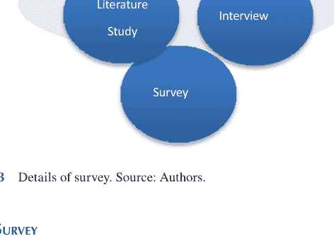

图 6.3 调查详情。来源：作者。

### 6.19.1 调查

调查在印度开展，重点地区是班加罗尔，即“印度硅谷”，当地大多数居民都了解数字签名。本次调查旨在为理论研究提供支持。调查问题参考了 Arlen Fink 所著《调查工具包：如何设计调查问题》第二版，并借鉴了“Survey Monkey.com”提供的建议。调查对象包括非技术和技术领域的普通公众，但不包括文盲。调查问卷仅设计了简单问题并进行发放，主要为是/否类问题，此外也包含选择题。

本次调查旨在了解印度民众对数字签名的认知情况。研究人员从印度各地随机选取约 150 人回答问题，参与者主要来自班加罗尔。大部分数据通过请参与者填写问卷和进行访谈收集。此外，还通过电话访谈、Google Meet 和 Microsoft Teams，使用名为“Qualtrics”的在线软件收集参与者数据。访谈中也询问了相同的问题。实际上，根据参与者对前序问题的回答，有些问题会被跳过。

### 6.19.2 参与者的选择

调查参与人数取决于总体规模和统计中允许的误差。由于时间有限，且本调查旨在为理论研究提供支持，研究人员选取了 150 名参与者。图 6.4 清楚地展示了参与者的筛选过程。

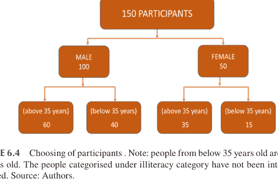

图 6.4 参与者的选择。注：35 岁以下的人也都在 18 岁以上。被归类为文盲的人没有接受访谈或调查。来源：作者。

### 6.19.3 调查结果

由于调查对象涵盖受教育者和文盲等不同群体，问题设计得较为简单。调查旨在收集数据，为以下内容提供信息。

- 互联网用户与人口总数的比较。
- 根据调查得出的互联网用户情况。
- 数字签名用户。
- 他们从何处获得数字签名。
- 他们如何描述数字签名的重要性。

### 6.19.4 互联网用户

印度人口在 2020 至 2023 年间持续增长，已达到 14.2 亿。与此同时，互联网用户数量也在增加，这是一个积极的趋势。图 6.5 展示了人口与互联网用户数量的对比。

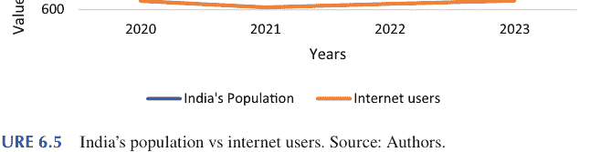

图 6.5 印度人口与互联网用户数量对比。来源：作者。

图 6.6 展示了不同年龄段的互联网用户人数。

男性中，60 名 35 岁以上者有 39 人是互联网用户；而在 35 岁以下者中，40 人里有 28 人是互联网用户。女性中，35 名 35 岁以上者有 26 人是互联网用户；而在 35 岁以下者中，15 人里有 11 人是互联网用户。收集这些数据是为了了解有多少人虽然使用互联网，却没有使用数字签名。因此，随着数字签名普及度的提高，可以预期这些人也会成为数字签名用户。

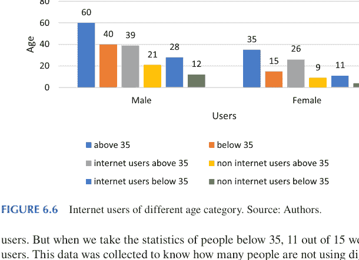

图 6.6 不同年龄段的互联网用户。来源：作者。

调查还提供了参与者使用互联网频率的信息。瑞典参与者使用互联网的频率相较于印度参与者更高。大多数印度参与者每周几乎每天都会使用互联网，主要用于查看电子邮件和社交网络。

### 6.19.5 数字签名用户

图 6.7 展示了所选参与者中数字签名用户的人数。在印度，150 人中有 32 人使用数字签名。数字签名用户大多属于 35 岁以下年龄组。35 岁以下人群中有 25% 使用数字签名，而 35 岁以上人群中只有 20% 使用。这并不令人意外，因为在印度，35 岁以下年龄组的互联网用户比 35 岁以上年龄组更多。

调查还提供了参与者使用数字签名的场景信息。在印度，数字签名用户主要用它来申报纳税，也会用它发送重要电子邮件和签署文件。使用数字签名签署电子邮件和文件的人就职于跨国公司。根据理论研究，在受过教育且年满 18 岁的人群中，150 人里有 21% 使用数字签名（DS）。若增加参与者人数，准确率可以提高；但由于时间有限，目前无法进一步降低误差。


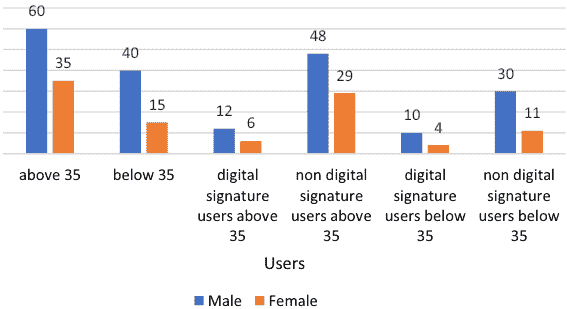

**图 6.7** 不同年龄类别的数字签名用户。来源：作者。

### 6.19.6 数字签名知识

图 6.8 显示了参与者对数字签名的了解情况。在 150 名参与者中，32 人是数字签名用户，48 人对此有所了解，其余为非互联网用户，对数字签名一无所知。

该调查提供了人们对数字签名了解程度的信息。参与者被问及数字签名在哪里使用？对此，大多数参与者回答“用于电子邮件身份验证”，也有人回答用于 ITR（所得税申报）目的。还有一些人说用于文件验证。有些参与者是特许会计师，因此他们完全了解其用途。参与者了解数字签名，但并不完全了解数字签名的使用地点和方式。每位参与者都被问及数字签名在当今世界的重要性，了解数字签名的人回答称，不断发展的技术还带来了安全性和时间节省。甚至银行中数字签名在 KYC（了解你的客户）表格中的使用也被讨论过。不使用数字签名的人认为 DS（数字签名）很复杂，不愿使用它。

### 6.19.7 访谈

我们对五家已注册的金融科技公司进行了访谈。所有注册公司都了解强制使用的数字签名。由于这些公司是金融科技公司，它们都是在数字签名强制实施后成立的。

本章对数字签名及其法律的历史发展提供了清晰的视角。它还提供了关于数字签名、其工作原理以及使其更安全、更可信的详细信息。本章由

使用互联网银行的网站完成。银行拥有所有清晰且经认证的数字签名信息，可以向公众传播。但在印度，只有 14 家认证机构（参见表 6.1），公众可以在那里获得数字签名（3 类数字签名）。除此之外，对于 2 类数字证书，需要带有视频通话的 PAN 卡。通过使产品在银行和邮局等公众更容易接触到的地方可用，可以提高数字签名的可用性。D-mat 账户访问已提供给所有银行，因此公众投资股市的比例大幅增加。除此之外，数字签名服务的改进使人们能够购买更多的数字签名。当使用量增加时，意识也会增加。

## 6.22 未来工作

发展中国家可以在本国实施数字签名时借鉴发达国家。2023 年，全球数字签名市场规模估计约为 59 亿美元，预计将以 40.98% 的复合年增长率（CAGR）增长，到 2032 年达到约 1298.2 亿美元。推动市场需求的因素包括对安全且具有法律约束力的电子签名日益增长的需求、政府法律以及电子文件需求的扩大。从地理上看，北美引领市场，原因包括数字技术使用的增长、对安全高效文件管理的需求，以及 Adobe Inc.、DocuSign Inc.、OneSpan Inc. 和 HelloSign Inc. 等重要参与者的存在。

提供电子签名解决方案以验证和签署电子文档的行业被称为“数字签名市场”。密码技术是数字签名的基础，确保所签署文档的真实性和完整性。由于政府、银行和金融服务、医疗保健、教育等一系列行业对安全和可执行的电子交易的需求日益增长，数字签名市场正在迅速扩张。该技术的众多优势中包括价格实惠、成本效益高和使用便捷。物理签名不再必要，因为数字签名可以通过各种设备（包括电脑、平板电脑和智能手机）随时随地进行签名。此外，它们还提供了出色的安全性，因为数字签名的密码方法可确保文本、文件和文档未被篡改。

## 6.23 关键市场挑战

数字签名是使用加密技术来验证签名者身份和已签署文档完整性的电子签名。它们提供了一种安全高效的方式来签署和传输电子文档，但缺乏标准化阻碍了它们的广泛采用。存在多种数字签名格式，不同国家在认可和监管数字签名方面也有不同的法律框架。

# 7 面向重点应用的 AI 融合区块链技术

C. Venkataramanan, S. Dhanasekar,
V. Govindaraj, K. Martin Sagayam, and P. Geetha

## 7.1 引言

区块链是一种以分布式方式构建的数据库，用于不可变地保存数据（Verma 等，2022）。相互连接的区块安全地连接在一起，用于跟踪和建立信任。如果某个区块中的任何交易需要更新，那么在不修改后续区块的情况下就无法更改它。根据定义，它维护一个有序数据记录（即区块）列表，其中包含有关其前一区块详细信息的信息（Zerka 等，2020）。数字化将涵盖大多数工程领域，对涉及快速数据传输的广域通信网络产生更大影响（Dhanasekar 等，2022；Dhanasekar 等，2021；Neebha 等，2023）。链式结构是去中心化的，数据可以在感兴趣的区域上记录，并且在不影响后续区块的情况下无法更改（Raja 等，2022；Firouzi 等，2022）。区块链以数字方式记录信息。区块链与传统数据库的主要区别在于，区块链中的数据以结构化方式存储。它以组（即区块）的形式收集信息。每个区块都有存储容量，一旦填满，就会与其前一个区块连接，形成链（Govindaraj 等，2023；Bruntha 等，2022）。新填满区块中的每条信息都与前一个区块相连，继续形成链，这被称为区块链。每当区块与链关联时，都会给出一个精确的时间戳（Firouzi 等，2023）。在没有任何第三方协助的情况下，区块链技术确保了数据的完整性和安全性。

它是一种先进的数据库技术，允许在网络内以透明方式共享信息。来自多个来源的数据通过区块链云环境进行收集和共享（Bansal 等，2022）。链中的每个区块包含一个唯一的加密哈希 ID，从而避免数据重复。该技术的主要特点是，未经相关方知晓，数据无法进行交易（Wazid 等，2023）。

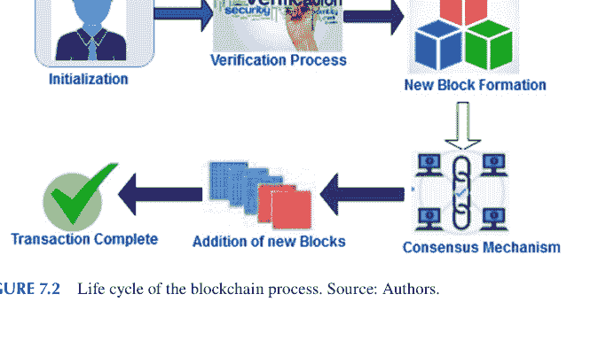

图 7.2 区块链过程的生命周期。来源：作者。

### 2. 验证过程

然后，输入的记录通过区块链分布式网络在感兴趣的区域中共享。网络中的相应节点验证其资源，以有效执行给定的交易。

### 3. 新区块形成

在给定时间，大量交易经过验证并被认定为合法。然后，合法交易被合并在一起形成区块。

### 4. 共识机制

由合法来源形成的区块会被尝试添加到区块链网络中。如果所有节点同时尝试执行该过程，则会影响区块链的运行。为了解决这个问题，节点使用共识机制。共识机制允许节点安全地将区块仅添加一次到网络中，并确保其他节点不会重复该过程。参与共识过程的来源称为矿工。共识算法为目标区块生成哈希码，并将其添加到区块链中。

### 5. 新区块的添加

一旦区块获得其哈希密钥并通过验证，就可以添加到区块链中。区块链的每个区块都包含有关前一个区块的信息以及目标区块如何与区块链中其他区块连接的详细信息。新形成的区块可以公开添加到网络中，并位于其末端。

### 6. 交易完成

一旦区块连接到区块链网络，记录交易过程即完成，有关交易的全部细节将永久地在区块链网络中共享。任何感兴趣的人都可以检索网络中共享的记录并确认它们。


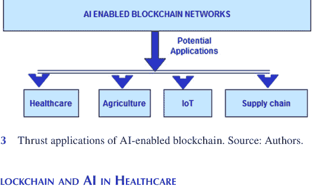

图7.3 AI赋能区块链的重点应用领域。来源：作者。

### 7.2.1 医疗保健中的区块链与人工智能

AI中设计的算法用于根据输入的数据增强决策。在医疗保健行业，AI算法用于收集数据、分析数据，并根据设计的算法做出决策。分析和输出展示通过显著模式提供优化结果，并减少错误。将既往病史和症状作为输入馈入基于AI的算法，以预测疾病作为输出。输出可以以警报、警告和护理提示的形式给出，针对所输入的数据。在医学影像系统中，AI算法甚至可以检测到人类无法直接识别的微小变化。AI最广泛的应用之一是远程医疗。系统中开发的程序可以监测患者，并将必要信息传达给相关人员，以便立即采取行动并提高成功率。

医疗保健行业中的新兴技术之一是区块链技术，它可以安全、有序地将数据存储在共享账本中。借助区块链网络，假药的使用显著减少。区块链与AI的结合可以将医疗保健行业提升到一个新的水平。

工作量证明和权益证明是区块链网络中广泛使用的共识算法，它们会考虑计算复杂性和其他指标（Kumar等，2020）。通过在共识算法中引入AI，增强了区块链网络的公平性。研究人员建立了一个医疗保健环境来生成数据集，并将输入应用到网络中。矿工节点的作用是在其他节点之间验证数据。通过使用基于AI的区块链共识模型，矿工节点的弊端被明显消除，这可以进一步提高区块链网络的性能。

医疗保健行业的主要问题之一是健康保险的欺诈索赔（Kapadiya等，2022）。目前，大多数人都购买了健康保险，以应对任何突发的支出（即健康紧急情况）。如今，医疗保健保险行业面临许多挑战，如安全性、欺诈和隐私。组织需要主动站出来开发系统以对抗恶意方。基于AI的区块链方法有效减少虚假用户，并提供安全交易。

数字农业是当前需要关注的新兴领域之一。物联网（IoT）在智能农业中发挥着重要作用（Fan等，2021）。持续监测感兴趣的区域并收集数据以供进一步处理。然而，准确性和可靠性是决定决策的两个主要参数。传统的数据聚合和隐私保护无法完全解决数字农业中的问题。区块链与AI模块相结合，提供尽力而为的解决方案和去中心化架构，以增强数字农业的容错能力。

AI赋能的区块链网络已在农业供应链管理中实施。基于AI的算法提高了服务质量并有效利用资源。无人机（UAV）与AI和区块链结合，用于农业中的溯源、跟踪和合约（Zawish等，2022）。使用全卷积神经网络（FCN）而非单个压缩卷积神经网络，以更低的复杂度和更高的精度处理多个任务特定模型。

开发了一种由AIoT赋能的新型区块链架构，用于监测感兴趣区域（Alrubei等，2022）。收集的数据经过处理、分析、验证，然后共享到区块链网络。在此过程中，AI引擎有效处理数据并提供有意义的结果。

根据专家预测，在不久的将来，数百万台设备可以连接到互联网，其中三分之一是手机、台式机和平板电脑（Banafa 2022）。其余设备是传感器单元、智能家居电器和其他物联网终端。物联网的作用是连接人、数据和流程。为了在网络中的所有对等方之间提供可信度，有必要将AI与区块链和物联网结合起来。通过实现这一点，可以确保区块链网络中的每个节点都具备必要的隐私保护（Gupta等，2021）。

### 7.2.2 开放研究挑战

将人工智能与区块链网络结合时的开放研究挑战详述如下。

### 隐私保护

输入区块链网络的记录在共享账本中公开可用，所有读者都可以访问。与此同时，相关设备持续收集私密和敏感数据，并将其放到开放的共享账本上。这是我们关注的问题点。应使用加密功能来确保数据隐私，以允许访问。当通过AI处理以做出必要决策时，可以有效处理不断增加的记录。

### 可扩展性与侧链

在考虑任何网络时，可扩展性都是重要参数之一。例如，截至目前，比特币和以太坊区块链网络分别每秒执行4笔和12笔交易。Facebook每秒处理数百万笔交易。为了提升区块链的处理能力，使用了侧链。双方之间的交易在主链之外快速处理，并每天在主链中更新一次。尽管有更多算法可用于提高性能，但仍需要更多算法来解决可扩展性问题。

### 安全性

需要新的可信执行环境，以避免区块链网络中包含超级账本的矿工节点出现篡改问题。使用公共账本类型的系统遭受的网络攻击更多（比私有类型多约51%）。私有类型在对等方之间使用预定义的共识协议。从这个角度看，安全性是区块链网络中需要更多关注的主要问题。

### 智能合约与外部函数

用于在应用程序端和区块链网络之间编写智能合约的不良编程实践是严重且易受攻击的问题之一。因此，有必要保护代码以及区块链网络上的记录。还需要开发新的有效测试工具来测试智能合约的安全状况。基于AI的机器学习算法用于得到近似结果，而不是随机结果。因此，需要针对上述问题采取明确措施。

### 可信数据库

区块链网络中的对等方通过使用智能合约（即数据库）同时与外部函数协作。有时数据被拉入区块链网络并被推送给第三方。因此，为了与第三方外部函数协作，需要部署可信函数以避免不安全。

### 应用层——AI专用共识算法

区块链网络中的共识协议充当验证过程的中间层。迫切需要集中精力，在应用层开发采用增强学习方法的共识算法，以提高性能和优化质量。

#### 7.3.1.1 隐私与安全无处不在

在雾计算中，数据的完整性和安全性在本地得到改善，而不是发送到云服务器。这是区块链的重要服务之一，它处理个性化信息。利益相关者可以信赖与AI相结合的区块链技术中的数据隐私和完整性。下面的示例简要说明了如何通过采用结合了AI和区块链的雾计算来增强智能家居自动化系统。

### 7.3.2 智能家居自动化系统

智能家居自动化系统由摄像头、门锁和恒温器等各种设备组成，为智能生活环境提供无缝连接。这些设备根据感兴趣的区域收集数据，并将其传送给集中式协调器以管理智能活动。在传统系统中，收集到的信息会直接发送到云服务器进行进一步处理。云服务器中的AI算法分析接收到的数据，以做出关于控制和自动化的更明智决策。智能家居系统面临的主要挑战是隐私保护、安全性等。智能家居环境始终处理敏感信息，例如监控摄像头的视频。当这些信息与云服务器共享时，会导致隐私问题，可能遭受未经授权的访问。另一个问题是黑客篡改云服务器。安全漏洞可能危及数据，并导致对智能家居自动化系统的未经授权访问。将雾计算引入智能家居自动化可以减少安全和隐私问题。

通常，雾节点部署在网络边缘，以在本地处理数据，而不是发送到集中式云。从传感器接收的数据在网络边缘本身进行处理，不会发送到网络之外。这些雾节点在智能家居中的主要优势在于，它们根据接收和处理的数据分别管理不同的任务。除了数据收集和处理外，它们还参与执行器控制机制。它们仅将与特定任务相关的数据发送到云服务器。

雾节点通过最小化传输到云的数据量来改善隐私保护，从而增加隐私。来自安全摄像头的视频信息保留在本地网络中，只有授权用户才能访问。雾节点集成了加密和访问控制等附加功能，在网络内部保护信息。

为了增强安全性，智能家居网络可以与基于区块链的访问控制机制集成，智能合约确保各智能系统之间的访问权限。授权用户可以在雾节点级别以有限权限访问环境。

这种方法确保云服务器只能接收来自每个设备的聚合信息，而不是所有数据，从而减少了数据泄露和未经授权访问的机会。从上述示例可以清楚地看出，


雾节点与人工智能和区块链的集成，以便捷的方式增强了数据记录的安全性、隐私性和高效利用。

### 7.3.3 移动健康监测系统中基于雾计算的离线人工智能能力

雾计算允许人工智能在终端网络设备附近运行，无论是否具有互联网连接。在不需要持续互联网接入或网络持续中断的地区，这种特殊情况更加有利。

手持健康监测设备（如智能手表和健身手环）的开发被用于以最佳方式监测人体健康。它持续采集人体健康生命体征，并将其存储在中枢云系统中。云中存储的数据经过分析、处理后发出警报。在传统流程中，可穿戴设备持续监测体征并将其直接发送至云服务器进行分析。云环境中的AI算法处理数据并生成建议。传统系统的主要挑战在于整个架构依赖互联网。它需要持续的互联网支持以提供最优建议，而且在网络较差的地区可能产生误报。

雾计算可集成到移动健康监测中，以在没有互联网的情况下实现AI能力。雾节点部署在各个位置，在本地处理属于健康监测的数据，无需互联网连接。具备AI能力的雾节点可以在本地运行AI算法，分析健康数据，检测异常，并将洞察提供给用户，而无需将所有信息发送至云端。雾节点可以在没有任何互联网支持的情况下，在本地向最终用户发出关于其健康状况的警报。微雾节点会持续从数据源收集信息，直到互联网连接可用；当连接恢复时，收集的数据与云环境同步，从而确保数据在任何时候都不会丢失。

在移动健康监测中集成区块链，可通过雾节点实现安全可靠的数据处理。健康相关数据一旦写入区块链，就变得防篡改且不可更改，从而提高了数据完整性。

这种安排使用户即使在互联网覆盖范围之外也能收到健康相关建议。它以更高的可靠性和可访问性向个人和医疗专业人员提供及时警报。

### 7.3.4 供应链管理中的可扩展性

下面的示例详细说明了区块链、雾计算和可扩展性如何结合以实现供应链管理的目标。

在全球级供应链中，产品可能经历不同阶段，涉及不同利益相关者、生产者、供应商、零售商和分销商。系统的每个部分都会生成有关运营的数据。在传统供应链中

基于局部观察独立进行，这限制了智慧城市的预期及其收益。该系统的主要挑战是车辆之间的紧密协作和数据隐私，这影响了网络的整体性能。使用雾计算与区块链的协作式AI确保了增强的交通管理、安全性、数据完整性、对等节点之间的信任和分布式学习环境。集成系统提供共享通信和处理结果，从而改善智慧城市环境中的交通运输。

## 7.4 结论

本章对区块链网络与人工智能和物联网的结合进行了详细分析。通过适当的图形插图讨论了区块链网络的特征、类型、技术和流程。通过必要的示例讨论了将AI引入区块链的必要性。结合支持文献讨论了集成AI后区块链的性能提升。此外，在有文献支持的情况下，明确总结了注入AI的区块链模型的潜在重点领域（即应用）。最后，讨论了开放的研究问题和挑战，并给出了未来方向。未来，我们可能无法期待没有AI与区块链的技术来确保隐私和安全。

## 参考文献

- Alrubei, S. M., Ball, E., & Rigelsford, J. M. (2022). 一种在边缘层支持AI的物联网应用的安全区块链平台. IEEE Access, 10, 18583–18595. https://doi.org/10.1109/access.2022.3151370

- Bansal, G., Rajgopal, K., Chamola, V., Xiong, Z., & Niyato, D. (2022). 元宇宙中的医疗保健：当前元宇宙在医疗保健中应用的综述. IEEE Access, 10, 119914–119946. https://doi.org/10.1109/access.2022.3219845

- Banafa, A. (2022). 使用区块链保护物联网安全. Secure and Smart Internet of Things (IoT), 77–84. https://doi.org/10.1201/9781003339373-14

- Bruntha, P. M., Dhanasekar, S., Hepsiba, D., Sagayam, K. M., Neebha, T. M., Pandey, D., & Pandey, B. K. (2022). 基于L2范数自动调谐函数的开关中值滤波在去除随机值脉冲噪声中的应用. Aerospace Systems, 6(1), 53–59. https://doi.org/10.1007/s42401-022-00160-y

- Dhanasekar, S., Bruntha, P. M., Neebha, T. M., Arunkumar, N., Senathipathi, N., & Priya, C. (2021). 一种用于无线应用的基于多基数FFT/IFFT算法的面积高效OFDM收发系统. 2021 7th International Conference on Advanced Computing and Communication Systems (ICACCS). https://doi.org/10.1109/icaccs51430.2021.9441694

- Dhanasekar, S., Stella, T. J., Thenmozhi, A., Bharathi, N. D., Thiyagarajan, K., Singh, P., Reddy, Y. S., Srinivas, G., & Jayakumar, M. (2022). 用于电子应用的聚合物基复合材料研究. Journal of Nanomaterials, 2022, 1–7. https://doi.org/10.1155/2022/8605099

- Fan, H., Yang, H., & Duan, S. (2021). 一种基于区块链的智慧农业隐私保护数据聚合方案. 2021 2nd International Conference on Artificial Intelligence and Computer Engineering (ICAICE). https://doi.org/10.1109/icaice54393.2021.00018

- Firouzi, F., Farahani, B., Barzegari, M., & Daneshmand, M. (2022). AI驱动的数据货币化：基于物联网的智能互联健康中数据的另一面. IEEE Internet of Things Journal, 9(8), 5581–5599. https://doi.org/10.1109/jiot.2020.3027971

- Firouzi, F., Jiang, S., Chakrabarty, K., Farahani, B., Daneshmand, M., Song, J., & Mankodiya, K. (2023). 物联网、人工智能、边缘-雾-云与区块链的融合：挑战、解决方案以及医疗保健和医学中的案例研究. IEEE Internet of Things Journal, 10(5), 3686–3705. https://doi.org/10.1109/jiot.2022.3191881

- Govindaraj, V., Dhanasekar, S., Martinsagayam, K., Pandey, D., Pandey, B. K., & Nassa, V. K. (2023). 使用改进型LFSR的低功耗测试模式生成器. Aerospace Systems. https://doi.org/10.1007/s42401-022-00191-5

- Gupta, R., Shukla, A., & Tanwar, S. (2021). BATS：面向6G的区块链与AI赋能的无人机辅助远程手术系统. IEEE Transactions on Network Science and Engineering, 8(4), 2958–2967. https://doi.org/10.1109/tnse.2020.3043262

- Kapadiya, K., Patel, U., Gupta, R., Alshehri, M. D., Tanwar, S., Sharma, G., & Bokoro, P. N. (2022). 区块链与AI赋能的医疗保险欺诈检测：分析、架构和未来展望. IEEE Access, 10, 79606–79627. https://doi.org/10.1109/access.2022.3194569

- Kumar, N., Parangjothi, C., Guru, S., & Kirran, M. (2020). 基于AI共识机制的区块链医疗应用中的对等一致性. 2020 11th International Conference on Computing, Communication and Networking Technologies (ICCCNT). https://doi.org/10.1109/icccnt49239.2020.9225550

- Neebha, T. M., Andrushia, A. D., Malin Bruntha, P., Varshney, A., Manjith, R., & Dhanasekar, S. (2023). 基于人工传输线加载技术的小型化C形天线设计. Journal of Electromagnetic Waves and Applications, 37(6), 814–826. https://doi.org/10.1080/09205071.2023.2211282

- Raja, L., & Periasamy, P. S. (2022). 使用区块链和基于水母搜索优化器的深度生成对抗神经网络（Deep-GANN）技术的无线传感器网络可信分布式路由方案. Wireless Personal Communications, 126(2), 1101–1128. https://doi.org/10.1007/s11277-022-09784-x

- Verma, A., Bhattacharya, P., Madhani, N., Trivedi, C., Bhushan, B., Tanwar, S., Sharma, G., Bokoro, P. N., & Sharma, R. (2022). 面向工业5.0的区块链：愿景、机遇、关键推动因素和未来方向. IEEE Access, 10, 69160–69199. https://doi.org/10.1109/access.2022.3186892

- Wazid, M., Das, A. K., Shetty, S., Rodrigues, J. J. P. C., & Guizani, M. (2023). AISCM-FH：基于雾计算的医疗保健中AI赋能的安全通信机制. IEEE Transactions on Information Forensics and Security, 18, 319–334. https://doi.org/10.1109/tifs.2022.3220959

- Zawish, M., Ashraf, N., Ansari, R. I., Davy, S., Qureshi, H. K., Aslam, N., & Hassan, S. A. (2022). 面向6G赋能的农业供应链管理的设备端AI与区块链. IEEE Internet of Things Magazine, 5(2), 160–166. https://doi.org/10.1109/iotm.006.21000112

- Zerka, F., Urovi, V., Vaidyanathan, A., Barakat, S., Leijenaar, R. T. H., Walsh, S., Gabrani-Juma, H., Miraglio, B., Woodruff, H. C., Dumontier, M., & Lambin, P. (2020). 用于多中心医学影像中隐私保护和可信分布式机器学习的区块链（C-DistriM）. IEEE Access, 8, 183939–183951. https://doi.org/10.1109/access.2020.3029445


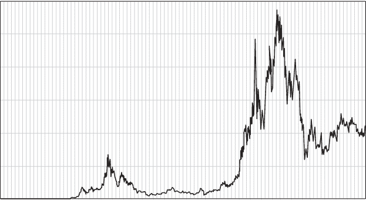

**图8.1** 以太坊市值。来源：作者根据 https://etherscan.io/chart/marketcap 的数据绘制

$R^2$ = 0.999, $F$ = 4491141*, DW = 0.0039, $n$ = 3007, $x$ = 以太坊价格, $y$ = 市值, * = 在5%水平上显著。DW值较小意味着存在自相关问题。然而，以太坊的需求具有高度弹性。

令人惊讶的是，以太坊的供应量以前所未有的速度增长，并在2022年突破1.15亿，之后开始以更高的速率增长。以太坊的每日发行量呈周期性下降，2020年10月之后呈L形。这意味着波动性降低，Covid-19之后虚拟交易急剧下降（图8.2）。

## 8.2 以太坊是一种数字资产

加密货币究竟应被视为货币、资产还是准资产，以及在什么条件下加密货币会被视为数字稳定币，将在货币经济学中引发一场长期争论。资产或准资产的属性与以太坊作为货币的属性并不相同。有人认为，以太坊是一种可识别且其价值可实现的数字资产。它是无形的，可以在网上出售，其主要价值主张源于通过以太坊网络实现的可编程性。这种数字资产具有投机性，波动性大，风险高。以太坊被认为是“三重资产”，构成价值储存、资本资产和消耗性资产。当它被质押时，可以被视为资本资产，因为它会产生收益，因此可以像债券一样根据其预期回报进行估值。

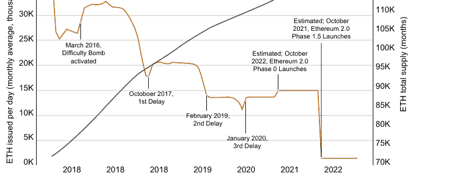

**图8.2** 以太坊发行率。来源：EthHub Activate，CoinDesk Research。

从经济角度看，质押收益率远高于债券利息。当持有者将以太坊存入去中心化金融协议时，以太坊通常充当价值储存。此外，当美元被用于缴纳税款时，它承担了消耗性资产的角色。根据Kuper和Neureuter（2022）的研究，以太坊唯一真正的用例是作为以太坊区块链上交易的原生货币。这种功能在成功过渡到权益证明后可能会发生巨大变化。

但这种数字资产并非真正的法定货币，因为它不是法定货币的硬币和纸币，也不是由政府中央银行以数字方式发行的。它被称为可兑换虚拟货币，可以在用户之间进行数字交易，并可兑换为真实货币或数字资产。以下所有交易在下列情形下均需按应税所得纳税：（i）出售数字资产换取法定货币；（ii）用数字资产交换财产、商品或服务；（iii）将一种数字资产兑换或交易为另一种数字资产；（iv）以数字资产作为商品或服务的付款；（v）因硬分叉获得新的数字资产；（vi）因挖矿或质押活动获得新的数字资产；（vii）因空投获得数字资产。

## 8.3 以太坊不是货币

以太坊是一种在交换机制下的去中心化应用协议，它赋能了去中心化金融和NFT运动。它永远不会被视为全球法定货币。由于货币政策不明确、财政政策欠佳和中心化程度较高，世界自由市场不会将以太坊凝聚为货币。不可能创建一个将以太坊视为货币的替代货币体系。它被视为基于以太坊的DeFi/NFT网络中的货币（Santos-Alborna, 2021）。

尽管以太坊作为去中心化金融被接受，并且由于遵守税收法律的政府协议，它可以与美元和世界其他一些货币兑换，但以太坊仍未被广泛接受为支付手段、价值储存和记账单位，因此它不是法定货币或通货。

## 8.4 文献研究

欧洲银行管理局（2014）研究了使用虚拟货币的七十多种风险，发现这些风险包括大幅波动、显著的中长期投资风险、金融一体化风险、洗钱、非法融资、恐怖主义以及其他非法活动，在这些方面加密货币存在显著劣势。所有这些特性一直阻碍加密货币成为合法的资产或货币。

Sovbetov（2018）使用周度数据，应用ARDL技术，考察了2010–2018年间影响比特币、以太坊、达世币、莱特币和门罗币这五种最常见加密货币价格的决定因素。文章发现，与加密市场相关的因素，如市场贝塔系数、交易量和波动性，在短期和长期内对这五种加密货币都是显著的决定因素。

Antonakakis等人（2019）使用时变参数因子增强VAR模型（TVP-FAVAR）验证了九种主要加密货币之间的传导机制。作者发现，比特币是加密货币市场中最重要的冲击传播者，其次是以太坊。文章发现，九种加密货币之间的关联性度量表现出很大的动态变化，市场不确定性的高企时期对应着强关联，反之亦然。

Mariana、Ekaputra和Husodo（2021）发现，比特币和以太坊在股市极端暴跌期间都适合作为短期避险资产。此外，在疫情期间，以太坊可能比比特币更好的避险资产。文章还考察发现，在Covid-19期间，比特币和以太坊的收益率分别与黄金收益率正相关，与股票收益率负相关。

Shahzad等人（2021）通过应用马尔可夫区制转换（MS）外生变量向量自回归（VARX）模型，考察了18种加密货币在低波动和高波动区制下的日收益率溢出效应。文章考虑了三个定价因素和Covid-19疫情的影响，发现溢出模式随时间变化，这与压力时期的传染效应一致。其收益率溢出在Covid-19期间急剧加剧，尤其是在高波动区制下。

Harb、Bassil、Kassamani和Baz（2022）发现，以太坊与莱特币之间以及以太坊与比特币之间存在即时的正双向波动溢出效应。

Havidz、Gaby和Widjaja（2022）的研究结果表明，以太坊价格收益率受Covid-19因素的影响很大，而宏观金融因素（股票指数和黄金）对以太坊价格收益率的影响强于加密市场。

Bhowmik（2022）通过研究2017m01–2021m12期间比特币和以太坊的趋势，分析了它们在经济中的作用。传统回归模型表明，比特币市值与比特币价格和通胀率显著正相关，与以太坊价格显著负相关。协整和向量误差修正模型表明，比特币市值与比特币价格、以太坊价格以及以太坊和通胀率之间存在长期因果关系。由于波动性，协整方程一直在偏离均衡。以太坊价格与比特币市值之间存在短期因果关系。

Li（2023）通过将2015–2022年期间的以太坊分解为趋势成分和周期成分，提取周期成分并剔除不相关的趋势成分，考察了全球经济政策不确定性（GEPU）与以太坊价格之间的关系，发现在没有趋势成分干扰的情况下，GEPU是以太坊的格兰杰原因。此外，GEPU与以太坊周期模式之间存在稳定的长期负协整关系，这一关系为正，并可能受到趋势成分的干扰，其中上升趋势占主导地位。当以太坊的周期特征没有趋势时，它对GEPU及其滞后项呈负向响应。这意味着，当全球经济不确定性升级时，加密货币可能会像股票和其他金融资产一样提前于市场做出反应。误差修正模型表明，以太坊周期成分在短期内对GEPU的变化及其偏离长期均衡的状态做出响应。

## 8.5 本章目标

本章旨在考察以太坊兑美元汇率的行为，换句话说，即以美元计价的以太坊收盘价，时间范围为2015m08至2023m05，这使之能够展现非线性趋势、周期趋势、周期和季节性波动。此外，本章探讨了该序列的AR和MA特征，并最终确定了2025m01的ARIMA(p,d,q)预测趋势，该预测在同期使用Hamilton滤波器的分解模型中也得到了检验。


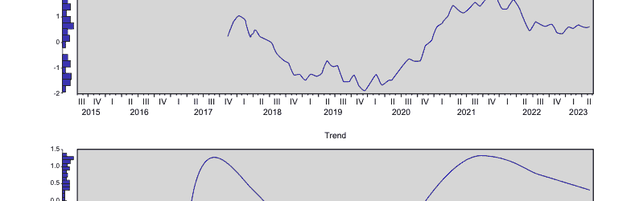

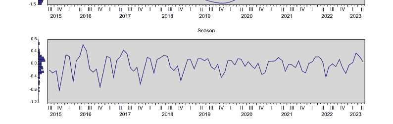

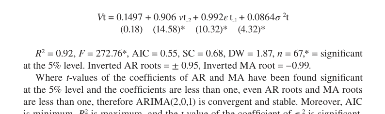

图8.9 以太坊收盘价的分解。来源：作者绘制。

$$v_t = 0.1497 + 0.906 v_{t-2} + 0.992 \varepsilon_{t-1} + 0.0864 \sigma^2_t$$
(0.18)  (14.58)*  (10.32)*  (4.32)*

$R^2 = 0.92$, $F = 272.76*$, $AIC = 0.55$, $SC = 0.68$, $DW = 1.87$, $n = 67$，*表示在5%水平上显著。逆AR根 = ±0.95，逆MA根 = −0.99。

其中，AR和MA系数的$t$值在5%的显著性水平下显著，且系数均小于1，甚至AR根和MA根也小于1，因此ARIMA(2,0,1)是收敛且稳定的。此外，AIC最小，$R^2$最大，$\sigma^2$系数的$t$值显著，这表明其表现出最小波动性。因此，该模型显著趋于均衡，如图8.11所示。

相关图中ARIMA(2,0,1)的残差检验证实，其AC和PAC从正值变为负值，证明其存在季节性变化，尽管它们的界限在±5%显著性水平之内且没有衰减，如图8.12所示。这表明，以太坊在2015m08至2023m05期间的收盘价即使在通过显著的ARIMA(2,0,1)后仍存在季节性变化。

| 滞后 | AC | PAC | Q统计量 | 概率 |
|---|---|---|---|---|
|1|0.061|0.061|0.2648| |
|2|0.025|0.021|0.3092| |
|3|0.096|0.093|0.9712|0.324|
|4|0.229|0.220|4.8287|0.089|
|5|0.145|0.127|6.3905|0.094|
|6|0.012|-0.011|6.4022|0.171|
|7|0.073|0.033|6.8145|0.235|
|8|0.038|-0.039|6.9278|0.328|
|9|0.008|-0.057|6.9326|0.436|
|10|0.014|-0.013|6.9487|0.542|
|11|-0.016|-0.042|6.9689|0.640|
|12|0.046|0.039|7.1452|0.712|
|13|-0.082|-0.078|7.7252|0.738|
|14|-0.037|-0.029|7.8455|0.797|
|15|0.028|0.041|7.9166|0.849|
|16|-0.019|-0.015|7.9494|0.892|
|17|-0.136|-0.114|9.6498|0.841|
|18|0.082|0.135|10.277|0.852|
|19|-0.191|-0.227|13.776|0.683|
|20|-0.085|-0.053|14.479|0.697|
|21|0.051|0.125|14.735|0.739|
|22|-0.061|-0.081|15.114|0.770|
|23|-0.200|-0.150|19.325|0.564|
|24|-0.156|-0.059|21.948|0.463|
|25|0.052|0.047|22.251|0.505|
|26|0.012|0.058|22.268|0.563|
|27|-0.229|-0.162|28.327|0.293|
|28|-0.156|-0.097|31.226|0.220|

图8.12 $v_t$的ARIMA(2,0,1)的AC和PAC。来源：作者绘制。

如果对$v_t$的ARIMA(2,0,1)预测至2025m01，那么预测路径将显著收敛至均衡，以太坊收盘价的预测路径没有波动，如图8.13所示。

## 8.8 局限性

本章也有其局限性。这里没有进行ARCH检验。由于已包含单位根断点检验，结构突变的行为也没有被分析。本章可以通过解释以太坊价格及其市值的决定因素来扩展，从而详细解释资本市场行为。

## 8.9 政策启示

为了监管以太坊和加密货币，对其的禁令是重要的；美国政府正在与其他国家合作，但IMF建议各国，包括

# 9 账本开发与智能合约的未来

Minal Shukla, Biswaranjan Acharya, and Asik Rahaman Jamader

## 9.1 引言

在区块链技术不断演变的格局中，账本开发与智能合约的未来必将是革命性的。当我们站在新时代的前沿，分布式账本技术与自动执行合约的融合正在重塑行业、重新定义信任，并为企业和个人释放前所未有的可能性（Benhamed等，2019）。

“账本开发”一词听起来可能有些神秘，但它正是区块链创新的核心。账本不再局限于金融交易的简单记录；它们已发展成为支撑广泛应用的去中心化、防篡改且透明的基础。这些应用不仅正在改变金融行业，还延伸到了供应链、医疗、房地产等领域。在这个激动人心的时代，账本开发的未来占据了中心舞台，让我们得以一窥这样一个世界：信息不仅被存储，而且以前所未有的效率被保护、共享和利用（Das等，2022）。

这场变革的核心是智能合约。这些基于代码的自动执行协议有可能消除中介、自动化复杂流程，并在不依赖中心化权威的情况下确保信任（Barman, A., Barman, M., & Jamader, A. R., 2024）。在区块链世界中，智能合约是变革的催化剂，使个人和组织能够精简运营、降低成本并增强安全性。

对账本开发与智能合约未来的探索，邀请我们深入探讨前方迷人的可能性和挑战。我们将穿越不断演变的区块链版图，揭示最新的创新和突破，这些创新和突破有望重新定义行业并打破既定规范。通过每个章节，我们将揭示区块链技术的潜在应用及其可能对我们日常生活产生的深远影响（Das等，2019）。

区块链之间的通信和资产转移。这些举措有可能解锁新的用例并扩展区块链技术的覆盖范围。

### 9.3.3 DeFi 的演变

去中心化金融（DeFi）持续演变和扩展。新的DeFi协议正在开发中，以解决现有平台的局限性，重点强调安全性、用户体验和跨平台兼容性。稳定币、去中心化交易所和流动性挖矿方面的创新正在推动DeFi生态系统的增长。

### 9.3.4 非同质化代币（NFT）：超越艺术

非同质化代币（NFT）已经超越了其在艺术世界的起源。它们现在被用于各种行业，包括游戏、音乐、虚拟房地产和收藏品。NFT标准和市场方面的创新使创作者更容易将其数字资产代币化和货币化。

### 9.3.5 混合与多链解决方案

结合公有链和私有链特点的混合区块链网络正受到关注，它们在提供公有链的安全性和去中心化的同时，兼具私有链的隐私性和控制力。多链生态系统（如Polkadot所实现的）旨在创建一个具有专门功能的互联区块链网络。

### 9.3.6 区块链即服务（BaaS）

由主要云服务提供商提供的区块链即服务平台简化了区块链网络的部署和管理。这一趋势使区块链技术更易于企业和初创公司使用，促进应用的快速开发和部署。

### 9.3.7 增强的智能合约语言

智能合约语言正在不断演进，以提供更高的安全性和灵活性。创新包括对智能合约代码进行严格漏洞测试的形式化验证工具，以及更高级语言的发展，这些语言简化了合约创建并减少了人为错误。

### 9.3.8 去中心化自治组织（DAO）

DAO正在演变为自治实体，实现去中心化的决策和资源分配。新的DAO结构和防止……的方法


### 9.4.2 全球金融包容性
区块链和智能合约有潜力为全球无银行账户和银行服务不足的人群提供金融服务。去中心化金融（DeFi）平台和跨境支付解决方案可以实现更公平地获取金融资源（Jamader 等，2023）。

### 9.4.3 改进的供应链管理
区块链的透明性和可追溯性将彻底改变供应链管理，减少欺诈并确保产品的真实性。消费者将对他们所购买产品的来源和旅程拥有前所未有的洞察力。

### 9.4.4 增强的数据安全与隐私
零知识证明、隐私币和专注于隐私的区块链等创新将加强数据安全与隐私，使个人在满足监管要求的同时，对其个人信息拥有更大的控制权。

### 9.4.5 医疗保健革命
区块链在安全管理医疗数据方面的作用将增强患者隐私并简化医疗记录共享。远程医疗和远程监测可由智能合约驱动，提高医疗服务的效率。

### 9.4.6 投票与治理
区块链技术将使安全、透明和可验证的投票系统成为现实，可能提高选民参与度和对选举过程的信任。基于区块链的治理系统将重塑组织和社区做出决策的方式。

### 9.4.7 能源效率
向节能共识机制的过渡，以及区块链技术与可再生能源解决方案的整合，有望减少区块链网络的环境足迹。

### 9.4.8 艺术与创造力
NFT（非同质化代币）和区块链技术将继续改变艺术和创意产业，为艺术家、音乐家和内容创作者提供新的变现机会和创作控制权。

### 9.5.7 跨境交易
跨境交易可能受到多个监管司法管辖区的约束，从而产生复杂性。协调区块链和跨境交易的国际法规对于促进全球贸易和金融互动至关重要。

### 9.5.8 税收与报告
基于区块链的交易和资产给税收和报告带来了挑战。确保个人和实体履行纳税义务并报告与加密货币相关的收入，正日益成为税务机关关注的问题。

### 9.5.9 法律争端解决
解决与区块链和智能合约相关的法律争端需要专门知识。法律界正在通过发展区块链法律专长和区块链争端仲裁机制来适应这一需求。

### 9.5.10 监管沙盒
许多司法管辖区正在建立监管沙盒，允许企业和初创企业在受控和监督的环境中试验区块链技术。这些沙盒在确保符合监管要求的同时促进创新。

### 9.5.11 政策创新
监管机构越来越多地与区块链社区合作，制定促进创新并保护消费者和行业利益的政策。这种合作旨在监管监督和技术进步之间取得平衡。

### 9.5.12 面向未来的监管
考虑到区块链和智能合约技术变革的速度，监管机构越来越注重创建能够适应技术发展的灵活监管框架。

随着区块链和智能合约继续重新定义行业并挑战传统法律规范，本章探讨了区块链监管的动态本质，强调了挑战与机遇。平衡的监管框架加上法律创新，对于确保区块链和智能合约在维持消费者、企业和整个社会所需保障的同时蓬勃发展至关重要（Khan 等，2021）。

## 9.6 行业采用
账本开发和智能合约的未来与其在各行业的采用有着内在联系。本节探讨了采用的现状和潜在未来，阐明了这些技术如何重塑企业和行业，并为创新铺平道路。

### 9.6.1 金融与银行业
金融业是区块链和智能合约技术的早期热情采用者。区块链实现安全透明交易的能力正在彻底改变传统银行业，其应用范围从跨境支付和汇款到中央银行发行数字货币等。

### 9.6.2 供应链与物流
区块链的透明性和可追溯性正在改变供应链和物流运营。食品、制药和零售等行业正在使用区块链来追踪产品来源、验证真伪并减少欺诈，从而简化供应链流程。

### 9.6.3 房地产与物业管理
房地产交易正经历着区块链带来的范式转变。智能合约自动化处理房产购买、租赁协议和产权转让，极大简化了流程并减少了对中介的需求。

### 9.6.4 医疗保健与病历记录
区块链技术正在提高医疗数据的安全性和可访问性。患者对其病历拥有更大的控制权，该技术还促进了远程医疗和数据共享，同时确保数据隐私。

### 9.6.5 投票与治理
基于区块链的投票系统因其能够确保安全、透明和防篡改的选举而日益受到重视。去中心化自治组织（DAO）正在重塑组织和社区中的治理，为透明和信任创造新的途径。

### 9.6.6 艺术、媒体与娱乐
区块链在创意和娱乐行业的影响显而易见。非同质化代币（NFT）使艺术家、音乐家、作家和内容创作者能够直接将其数字资产变现，绕过了传统的把关人。

### 9.6.15 知识产权
区块链技术被用于保护知识产权和自动化版税支付，使艺术家、内容创作者和发明人受益（Wang 等，2019）。

账本技术和智能合约的采用正在催化工业转型，使运营更加高效、成本降低，并在众多行业中提高安全性（Sagayam 等，2022）。随着各行业越来越多地采用这些创新，账本开发和智能合约的未来将继续与其不断扩大的影响力交织在一起，为企业和个人开辟一个充满可能性和机遇的广阔天地（Zheng 等，2020）。

## 9.7 结论
在账本开发和智能合约的广阔领域中，通往未来的旅程标志着无限的潜力和变革性创新。当我们结束本章并展望未来时，几个关键要点浮现出来，强调了这些技术将对我们的世界产生的深远影响。

- **通往去中心化的道路**：账本开发和智能合约的未来承诺了一段通往去中心化的旅程。这些技术正在瓦解传统的中央权威和中介机构，为个人、企业和政府提供一条透明、安全和自主的道路。
- **转型中的行业**：账本开发和智能合约采用的涟漪效应正在全面重塑各行业。从金融到医疗保健，从供应链到房地产，区块链技术的变革力量不可否认。它在优化运营、简化流程和降低成本。
- **包容性金融体系**：去中心化金融（DeFi）的出现正在重塑我们对传统银行业的看法。智能合约是金融创新的核心，使银行服务更具包容性、可及性和成本效益，特别是对于那些传统金融机构服务不足的人群。
- **所有权与控制权**：智能合约和非同质化代币（NFT）正在为艺术家、内容创作者和个人赋能，赋予他们对数字资产新的所有权和控制权。这种所有权范式的转变正在颠覆传统的创意和知识产权行业。
- **透明度与信任**：信任是区块链技术的基石。通过其透明性、不可篡改性和密码学安全性，它在投票、治理和供应链管理等多个领域实现了新的信任水平。
- **未来的挑战**：与任何变革性技术一样，账本开发和智能合约也面临着挑战。可扩展性、


# 10 解密加密货币
# *交易领域的数字革命*

Kyvalya Garikapati，
Akash Bag 和 Sambhabi Patnaik

## 10.1 引言

在金融交易中，所交易货币的合法性和真实性是一个关键问题，无论它们涉及实物纸币还是数字版本。接收方必须确认他们收到的任何传统纸币或法定货币是合法的，而不是伪造的。同样，在数字交易中，当资金以电子方式从一个账户转移到另一个账户时，银行对于确认相关银行账户的合法性至关重要（印度储备银行，2021）。然而，一些人设想了银行不再参与这一等式的场景，这种想法有可能减少对中介机构的需求（印度储备银行，2021）。这种动机可归因于多种因素，例如对银行的不信任、金融机构收取的过高交易成本，或交易追踪带来的隐私担忧。

为了回应这种避免银行和其他中介机构参与的愿望，人们开发了私人协议来简化交易。然而，电子货币带来了一个重大问题，因为它容易复制，因此可能被再次使用。双重支付现象严重阻碍了这些替代交易机制的可行性。比特币被作为这一问题的解决方案提出，它基于区块链技术（Orcutt，2017）。通过要求在区块链的每个连续区块中进行更改，使用这种技术进行的交易会被广播到网络中的所有计算机，从而有望消除双重支付的可能性。

货币对每个人来说都是必不可少的，它的使用满足了各种人类需求。在以现代化和全球化为标志的第四次工业革命到来之际，区块链技术应运而生，催生了加密货币。加密货币是一种去中心化的数字货币，代表一种没有物理形态的虚拟货币，可确保安全且无法追踪的交易。

以及以太币。USDT 与美元挂钩，旨在保持每枚 USDT 的价值稳定在 1 美元。这种稳定性是通过 Tether 以价值 1 美元的现金或现金等价物储备资产支持每一枚 USDT 来维持的。然而，必须指出的是，稳定币在没有政府监管或监督的情况下运行。这凸显了在投资稳定币之前进行深入研究和尽职调查的重要性，包括仔细审查白皮书，并了解该稳定币如何管理其储备资产（DeVries，2016）。

### 10.2.4 中央银行数字货币（CBDC）

中央银行数字货币（CBDC）是一种由各国中央银行发行的加密货币。这些数字货币以代币形式或通过与国家本币挂钩的电子记录形式发行，由各自的中央银行进行监管和控制。尽管在许多国家，将 CBDC 融入金融体系和货币政策仍处于初期阶段，但未来有可能得到更广泛的采用。与传统加密货币类似，CBDC 利用区块链技术，旨在提高支付效率并可能降低交易成本。虽然全球各中央银行正在持续开发 CBDC，但其中一些与比特币等成熟加密货币共享基本原理和技术。

CBDC 以代币形式或电子记录形式发行以进行所有权验证，这使其与现有加密货币保持一致。然而，CBDC 的不同之处在于，它们受到发行政府的密切监控和监管，放弃了通常与其他加密货币相关的去中心化、匿名性和抗审查优势。CBDC 会留下可追踪的交易“纸质记录”，使政府能够征税和收取经济租金。从积极的一面来看，在政治稳定和通胀受控的环境中，CBDC 预计会随着时间的推移保持其价值，或至少密切跟踪所挂钩实物货币的价值。CBDC 的购买者受益于发行国全部信誉和信用的支持，减少了对一些传统加密货币长期存在的欺诈和滥用的担忧（Fokri，2021）。

### 10.2.5 从数字账本到加密货币热潮

人们普遍存在一种误解，认为区块链技术的诞生只能归功于化名“中本聪”的匿名作者，他在2008年发布了比特币白皮书。然而，要追溯这项革命性技术的起源，可以回到更早的20世纪80年代。在那个时代，两位先驱斯图尔特·哈伯和斯科特·斯托内塔开发了一种具有独特结构的数字账本系统。这种设计确保只要改变链条中的一个环节，整个序列就会错位——当时，随着个人计算开始进入普通美国家庭，一些重要问题也随之出现。第一个问题是，人们如何能够信任容易受到操纵的数字数据？第二，在缺乏中央权威控制的情况下，这些可更改的数字记录究竟还能否被信任？中本聪在哈伯和斯托内塔先前提出的去中心化理论中加入了“挖矿”的概念。人们通过解决与区块内交易相关的困难数学谜题，可以获得比特币作为奖励。这种巧妙的奖励机制起到了阻止篡改的作用。区块链技术是安全且防欺诈的，因为网络是相互连接的，这意味着任何篡改单个区块的尝试都会导致整个链条断裂。

尽管比特币直到2000年代末才走出计算机编程领域，但这项技术已经朝着有趣的新方向发展。佛罗里达州程序员拉斯洛·哈涅茨的故事就是一个很好的例子。2010年，哈涅茨用惊人的1万枚比特币换取了两份送到他家的披萨，只为了这份简单的快乐（Jones，2022）。当时这两份披萨的售价还算合理，每份30美元。但到2018年5月，由英格兰的一个人寄给哈涅茨的那两份披萨，其价值已累计达到惊人的8200万美元（Whitaker，2019）。这一关键事件发生在5月22日，如今这一天被公认为“比特币披萨日”（Whitaker，2019）。比特币的价值与传统大宗商品一样，受供需规律支配。理解加密货币从专业计算机编程圈子中的构想走入普通人生活的历程非常重要。在考虑加密货币在不久的将来的潜在用途时，理解这一历程至关重要。然而，如同每一项改变游戏规则的发展一样，关键是要识别并处理伴随这一技术进步而来的各种担忧和困难。随着时间推移，要实现加密货币的全部潜力，就必须在其引发的担忧和提供的承诺之间取得微妙的平衡。

## 10.3 解密加密货币的监管难题

在加密货币的复杂世界中，一个令人费解的难题依然存在：为什么各国政府和中央银行不愿接受这一先进金融体系？主要问题在于，加密货币交易不受正式监管框架的约束。与传统金融体系中由中间人确保问责不同，比特币交易的去中心化结构因缺乏解决问题渠道而引发担忧。让我们探讨一下引发这种抗拒态度的监管顾虑，以解释这一状况。加密货币缺乏内在价值是主要担忧之一。

与黄金等真实商品不同，加密货币的价值完全基于用户对其的接受和信任。支持者认为，一些加密货币的供应受限，由于其生产受到控制或需要“挖矿”，因此缓解了这一问题。然而，各种新的“加密货币”可能会破坏这种限制。加密货币在某些国际司法管辖区中的模糊法律地位是另一个紧迫的问题。这些数字对象被归类为证券、商品、货币还是资产，这一问题仍然悬而未决。


供辩论。尽管日本、瑞士等一些国家已立法鼓励加密货币的使用，但印度却在彻底禁止和将其纳入金融体系之间左右为难。

当我们审视印度环境时，会看到关于如何对加密货币进行法律分类的有趣讨论。在定义之间取得微妙的平衡对于将加密货币视为证券至关重要。根据1956年《证券合约（监管）法》（“SCRA”），加密货币并未被明确视为证券。然而，更宽泛的“其他可流通证券”一词可能适用，涵盖它们。尽管如此，要求由法人机构发行这些证券与加密货币的基本匿名性相悖，因此将它们排除在SCRA的管辖范围之外（1934年《印度储备银行法》）。

当我们把加密货币视为虚拟货币时，我们会关注1999年《外汇管理法》（“FEMA”）第2(h)条对“货币”的定义（Baxter, 2016）。由于缺乏提供类似价值的发行者，加密货币难以与传统法定货币对齐，而将加密货币归类为“商品”或大宗商品也有不足之处。根据《证券合约（监管）法》，货币和证券不被视为“商品”，而且由于加密货币的模糊性，很难确定地对其进行分类（Narayanan et al., 2016）。加密货币无与伦比的隐私性和去中心化正是它们如此吸引人的原因。交易隐私是任何其他身份管理系统都无法比拟的。一个人在此系统内的行为最终会形成一系列可识别的模式。因此，确实出现了一句警告。这种无意中泄露用户现实世界身份的行为过程，可能会损害人们最初认知中的匿名性。

在这些困难中，一个根本性的担忧浮现出来：加密货币天生抗拒政府监管。如果加密货币成为法定货币的可行替代品，“美元化”可能导致人们采用美元或欧元等更稳定的货币。由于交易的匿名性，这种变化会危及中央银行货币政策的有效性，并为非法活动提供便利。因此，通过控制货币供应量和利率来对抗通货膨胀变得困难，使现有的法律结构不适合处理这些问题（Narayanan et al., 2016）。

## 10.4 加密货币监管揭秘：欧洲视角

加密货币在欧盟（EU）的旅程是一个关于谨慎、适应和观点演变的故事。为了更好理解这个故事，我们来看看影响该地区比特币规则的趋势。欧洲银行管理局（EBA）在2013年前后就对比特币等虚拟货币发出警告。它们对购买、持有或交易这些数字资产的风险表示担忧。这些危险包括用户可能遭受财务损失或被盗窃、虚拟货币被用于非法目的，以及此类数字形式的波动性。

禁止虚拟货币，这被认为侵犯了《印度宪法》第19(1)(g)条保障的贸易和经商权利。印度储备银行（RBI）表示，该禁令符合宪法，且虚拟货币属于其管辖范围（Bhardwaj, 2020）。RBI还强调了其对责任以及虚拟货币可能被滥用于非法目的的担忧。最终，最高法院裁定，2018年4月的通告违反了相称性原则，侵犯了第19(1)(g)条保障的权利。换句话说，法院认为，即使虚拟货币可能不被正式承认为法定货币，它们仍可发挥真实货币的作用，因此应得到考虑和保护。

公司事务部对此作出回应，于2021年3月发布通知，要求企业申报其虚拟货币交易（James, 2022）。随后，RBI于2021年5月撤销了其2018年4月的通告，并指示加密货币交易平台遵守《外汇管理法》（FEMA）、了解你的客户（KYC）和反洗钱标准。在应对数字金融生态系统的复杂性并试图平衡创新、安全和合法性时，RBI正在发展其对加密货币的立场，这一谨慎与监管之旅凸显了这一点（Singh, 2021）。

## 10.9 探索加密货币与数字卢比：税收、央行数字货币与潜在颠覆的故事

“数字资产”一词最近变得流行起来，现在指的是加密货币以外的各种数字持有物。除了监管加密货币和非同质化代币外，这一定义的扩展还赋予政府控制新型数字资产的权力。由于加密货币行业格局的不断变化，印度政府已采取措施来管理这一领域的税收。在《所得税法》中增加第115BBH条，对转让虚拟数字资产的所得征收30%的税（不含附加费和 cess），是关键一步。¹ ² 为简化税收，自2022年7月1日起，对比特币交易实施1%的源头扣税。³ 然而，这一立法举措引发了质疑，因为分析人士认为它可能损害印度新兴的加密货币市场，并导致日交易量减少超过70%。⁴

2022年11月29日，印度储备银行（RBI）推出了零售数字卢比创新试点项目（Das, 2022）。该计划确立了与纸币相对应的数字卢比面额，用于通过合作银行提供的数字钱包进行交易，并将于2022年12月1日生效。⁵ RBI的央行数字货币（CBDC）项目通常被称为数字卢比，旨在利用数字交易的效率和速度，补充现有的支付方式。RBI的CBDC战略有两个主要目标：密切模拟纸币的特性，并将卢比无缝融入数字经济。通过渐进式部署计划，RBI正在研究面向批发业的基于账户的CBDC和面向零售业的基于代币的CBDC。然而，该项目需要解决金融业与加密货币相关的监管规避问题。

文章在展望未来时强调了加密货币在金融领域的变革潜力。对于银行服务受限的地区，加密货币提供了一种绕过传统银行限制的点对点系统（DeVries, 2016）。与传统银行程序的漫长拖延相比，这些数字货币能够实现快速的跨境交易。加密货币的优势在于较低的交易费用和数字交易效率的提高（Williams, 2021）。由于不受金融体系内置制衡机制的约束，加密货币可以实现快速交易（Watorek et al., 2023）。此外，该技术的快速性和有效性鼓励了诸如网络资产交易等创新应用，最近的例子如古驰（Gucci）销售其产品的数字复制品，体现了市场的兴趣。

文章将加密货币对能源消耗的可能影响与互联网对数据交换的革命性影响进行比较，以解决环境问题。加密货币可用于抵消现有能源密集型挖矿流程以及传统银行的基础设施需求，符合可持续能源目标。此外，众筹民主化和增强金融包容性是加密货币另外两个有前景的用途，可支持全球范围内的社会经济增长。然而，作者强调，仅将加密货币视为货币是有局限性的。由于加密货币具有透明和资本主义的双重属性，它可以实现实时交易跟踪，并消除对托管账户的需求（Finlay, 2021）。然而，困难依然存在，因为政府的沉默和加密货币投资的投机性加剧了市场波动，可能破坏经济稳定（Catlow et al., 2017）。

萨尔瓦多作为第一个接受比特币为法定货币的国家，其例子展示了此类采用的风险。比特币的价值在大量投资中下跌，影响了经济。萨尔瓦多的例子是一个警示故事，突显出当印度等国家考虑采用加密货币时，必须审慎权衡（Catlow et al., 2017）。

## 10.10 结论

需要国际合作来为加密货币这些跨国数字资产制定有效规则。印度储备银行（RBI）2022年12月的《金融稳定报告》强调了加密货币在全球范围内的影响（Acosta, 2022）。由于近期的市场波动以及加密货币与传统金融日益融合，需要立即采取行动。金融稳定委员会支持基于“相同活动、相同风险、相同监管”原则的全球加密货币监管一致性，是本次讨论的重要参与者。该研究还强调了巴塞尔委员会的……

将加密货币资产分为两类以及在印度担任二十国集团主席国期间加强金融稳定并为可能出现的问题做准备的必要性（PRS，2021）。这个由20个国家组成的联盟寻求在国际层面制定统一的加密货币立法。

加密货币的前景取决于它们将如何影响社会和政治。世界正在研究这些技术发展可能如何改变我们的日常生活。这种变化有可能对个人和国家都有利。然而，发展需要各方之间达成友好协议，包括企业主、IT公司、客户、投资者和金融机构。在没有明确的监管框架的情况下，达成这种共识是困难的（PRS，2021）。随着加密货币的出现，一个新的所有权自由时代已经开始。尽管它们保持数据完整性并允许在没有中介的情况下进行快速交易，但其实用性仍然难以捉摸。

与由中央银行控制的传统货币不同，加密货币的价值源于用户共识。尽管具有解放性，这种去中心化也可能带来风险，因为加密货币使得各种交易成为可能。监管是答案；完全禁止或漠视是不可行的（The Hindu Bureau，2022）。加密货币的支持者和试图监管它们的中央银行之间存在斗争。中央银行必须承认加密货币的持续存在。

同样，自主金融系统的支持者也应承认，中央银行的参与提高了可信度并降低了波动性。在这种情况下，中央银行谨慎地使加密货币合法化可能是明智的，这将使各方受益。这种技术提供的不可思议的灵活性无疑引入了超出传统监管的史无前例的问题。然而，忽视新技术的益处是天真的。尽管存在诸多复杂性，接受新技术是一段无法停止的旅程。

## 注释
- 1. https://www.hodlbot.io/blog/types-of-cryptocurrencies
- 2. Sec. 2(47A), Income Tax Act, 1961.
- 3. Sec. 115BBH, Income Tax Act, 1961.
- 4. Sec. 194S, Income Tax Act, 1961.
- 5. Ibid.

## 参考文献
Acosta, S. (2022, September 11). 一年后，萨尔瓦多的比特币实验被证明是惊人的失败。 *The Conversation*. http://theconversation.com/one-year-on-el-salvadors-bitcoin-experiment-has-proven-a-spectacular-failure-190229

Amsyar, I., Christopher, E., Dithi, A., Khan, A., & Maulana, S. (2020). 数字革命时代加密货币的挑战：系统文献综述。 *Aptisi Transactions on Technopreneurship (ATT)*, 2, 153–159. https://doi.org/10.34306/att.v2i2.96

Kelleher, J. P. (2023, October 8). 为什么比特币有价值？ Investopedia. https://www.investopedia.com/ask/answers/100314/why-do-bitcoins-have-value.asp

Kochkodin, B. (2017, November 2). 其中一家最大的比特币交易所一天内新增10万用户。 Bloomberg.Com. https://www.bloomberg.com/news/articles/2017-11-02/bitcoin-exchange-added-100-000-users-in-a-day-as-price-exploded

Mehrotra, U. (2021, November 3). 加密货币：监管困境。 SCC Times. https://www.scconline.com/blog/post/2021/11/03/cryptocurrency-a-regulatory-conundrum/

Money Control. (2023, December 28). 印度储备银行金融稳定报告显示印度银行健康状况改善，资本准备充足。 Moneycontrol. https://www.moneycontrol.com/news/business/rbi-financial-stability-report-banks-gross-npas-falls-to-3-2-in-sept-net-npas-down-to-0-8-11968191.html

Murry, C. (2022, May 20). 加密货币解释：投资的利弊。 Investopedia. https://www.investopedia.com/terms/c/cryptocurrency.asp

Nakajima, D. (2022, March 28). 加密货币：美国监管正在路上。 ECOVIS International. https://www.ecovis.com/global/cryptocurrency-regulations-in-usa/

Narayanan, A., Bonneau, J., Felten, E., Miller, A., & Goldfeder, S. (2016). 比特币和加密货币技术：全面介绍。 Princeton University Press.

Orcutt, M. (2017, December 14). 已构建出一种无需区块链即可超越比特币的加密货币。 MIT Technology Review. https://www.technologyreview.com/2017/12/14/104996/a-cryptocurrency-without-a-blockchain-has-been-built-to-outperform-bitcoin/

PRS. (2019, February 28). 委员会报告。 PRS Legislative Research. https://prsindia.org/policy/report-summaries/virtual-currencies-india

PRS. (2021). 各州财政状况：2023-24。 PRS Legislative Research. https://prsindia.org/budgets/states/policy/state-of-state-finances-2023-24

Reserve Bank of India. (2016, July 19). 印度储备银行警告虚拟货币用户注意风险。 https://press.princeton.edu/books/hardcover/9780691171692/bitcoin-and-cryptocurrency-technologies

Reserve Bank of India. (2018, June 4). 禁止交易虚拟货币（VC）。 https://www.rbi.org.in/Commonperson/english/scripts/Notification.aspx?Id=2632

Reserve Bank of India. (2021). 负责任的数字创新——T. Rabi Sankar。 https://www.rbi.org.in/Scripts/BS_ViewBulletin.aspx?Id=20564

Reuters. (2013, December 13). 欧盟银行监管机构警告比特币风险。 Reuters. https://www.reuters.com/article/idUSLN0JR35V/

Schickler, J. (2022, October 5). 欧盟敲定里程碑式加密法律 MiCA 和资金转账规则文本。 https://www.coindesk.com/policy/2022/10/05/eu-seals-text-of-landmark-crypto-law-mica-fund-transfer-rules/

Singh, T. (2021, June 1). 印度储备银行就虚拟货币（VC）交易发布客户尽职调查。 SCC Times. https://www.scconline.com/blog/post/2021/06/01/rbi-issues-customer-due-diligence-for-transactions-in-virtual-currencies-vc/

Smith-Meyer, B. (2022, February 9). 数字欧元法案预计2023年初出台。 POLITICO. https://www.politico.eu/article/digital-euro-bill-due-early-2023/

The Hindu Bureau. (2022, December 11). 印度将在二十国集团财长会谈中寻求加密货币监管和谐。 The Hindu. https://www.thehindu.com/business/Economy/india-to-seek-harmony-in-crypto-regulation-in-g-20-finance-talks/article66252067.ece

The Reserve Bank of India Act, Pub. L. No. (Act, No. 02 of 1934), S. 2(aiv) (1934).

The White House. (2022a, March 9). 关于确保数字资产负责任发展的行政命令。 The White House. https://www.whitehouse.gov/briefing-room/presidential-actions/2022/03/09/executive-order-on-ensuring-responsible-development-of-digital-assets/

# 11 利用区块链技术保障医疗旅游安全的优势

*面向医疗保健 4.0 的技术方法*

Santanu Dasgupta, Biswaranjan Acharya, and Asik Rahaman Jamader

## 11.1 引言

医疗旅游是一种快速增长的旅游概念，最近获得了巨大的吸引力。每年，越来越多的人出国寻求医疗护理。尽管确认医疗旅游的准确数字存在困难，但预计2019年全球医疗游客人数为23,043,000人，预计到2027年将增至70,359,000人。全球医疗旅游行业在2019年的价值约为US$104.68 billion，预计到2027年将达到US$273.72 billion。根据已发布的研究，由于COVID-19大流行，这些预测可能会下调。可负担的医疗技术是推动医疗旅游业务近期崛起的主要因素之一。除了以更低的价格提供交通外，随着各国作为健康旅游目的地的宣传不断增加，仅仅因为这一庞大技术为这些地方提供了宝贵的经济机会，呈现为医疗旅游目的地的国家数量急剧增加（Barkan, M., & Tapiashvili, N., 2018）。

数据技术在旅游业中的重要性不容小觑。随着医疗保健的数字化不断提升，医疗旅游目的地和医疗服务提供商可以利用技术进步来创建个性化的医疗服务交付服务并吸引新访客。互联网已经


## 11.2 文献综述

区块链提供了一系列内置功能，例如分布式账本、去中心化存储、身份识别、隐私和数据完整性，并且它已超越炒作，发展到医疗保健等领域的实际应用中。由于严格的监管要求，例如1996年的《健康保险流通与责任法案》，医疗保健领域的区块链应用通常需要更严格的身份验证、互操作性和记录共享要求。基于当前区块链技术，学术界和商业界的科学家开始研究医疗保健使用的可能性。区块链网络、垃圾信息检测和生物特征认证就是这些可能性之一。尽管取得了这些进展，但仍存在担忧，因为区块链有其自身的一系列弱点和需要解决的困难，例如处理动机、提取攻击和强身份验证。此外，正如本综述文章所述，许多医疗保健应用具有特定的需求，这些需求并未被正在研究的许多区块链试验所涵盖。本研究还讨论了一些潜在的研究方向。最近的历史表明，区块链技术具有显著的灵活性，因为各个商业行业找到了将其实用能力融入其流程的方法。虽然金融服务业迄今为止获得了最多的关注，但在医疗保健等其他商业领域的举措表明这种情况正在开始改变。本研究侧重于区块链技术在医疗保健行业中的多种起点。本章试图通过公共医疗管理、面向用户的医学研究以及制药行业中的药物伪造的例子，突出与这种颠覆性技术相关的各种影响、雄心和潜力（Jamader et al., 2021）。

区块链技术是当今专业世界中最重要的发现和创新进步之一。区块链技术朝着持续转型的方向发展。它是一个保护信息并在人们相隔遥远的情况下保持信任的区块网络。区块链技术的近期增长迫使研究人员和专业人士探索在各种各样的领域创新使用区块链技术的方法。区块链技术的指数级增长产生了许多新的潜在用途，特别是在智能医疗保健中。本研究对正在发展的基于区块链的医疗技术和应用进行了深入研究。在这项调查中，我们强调了这个快速扩展领域中突出的方法论问题并对其进行了深入讨论。我们还展示了区块链技术有可能改变医疗保健行业。

获取、维护、合并以及安全地交换健康信息是患者和医疗保健从业人员的难题。患者应该能够从全球任何地方管理其健康记录，跟踪其病史，提供数据访问权限，并与任何医疗保健从业者安全地传达这些信息。消费者对具体数据的访问结合更全面的计算架构可能最好地准备碎片化系统中保存的信息。本章重点关注区块链技术在医疗保健中的应用以及区块链技术在医疗保健中的实施，方法如下：

- 1. 寻找医疗保健中区块链潜在的应用，
- 2. 提供一个应用区块链技术的案例研究，以及
- 3. 评估在医疗保健中使用该技术的系统设计。

区块链技术最近获得了大量关注，人们对从数据管理、金融服务、网络安全、物联网和食品科学到医疗保健业务和脑研究的各种应用的兴趣日益增加。人们对使用区块链技术实现安全可靠的医疗保健数据管理的兴趣激增。此外，区块链通过安全可靠的数据共享，将传统医疗方法转变为更可靠的有效诊断和治疗方式。未来，区块链可能是一种技术，通过整合患者的所有实时临床数据并以最新的安全医疗保健环境呈现，可以帮助实现个性化、真实和安全的医疗保健。区块链可能是一种技术，通过整合患者健康的所有相关患者信息并以安全的医疗保健环境呈现，可以帮助实现个性化、真实和安全的医学。在本研究中，我们使用区块链作为模型来分析医疗保健中的现有和最新创新。我们还讨论了区块链的使用、问题和未来前景（Jamader, A. R., Chowdhary, S., & Shankar Jha, S., 2023）。

最近，人们要求医疗保健专业人员让人们对其个人健康信息拥有控制权的请求有所增加。尽管如此，关于不同医疗保健提供者如何传输医疗保健信息的担忧导致无法建立此类系统。安全传输数据的能力对于患者获得创新无边界综合医疗服务至关重要。区块链技术由于其去中心化的特性，是实现向统一医疗过渡的迫切需求的合适驱动力，为许多医疗保健领域的许多最紧迫的困难提供了新的视角并解决了这些困难（Jamader et al., 2023）。区块链技术使医疗保健组织能够在没有中央权力的系统上注册并处理参与者互动。在本章中，我们将研究区块链的概念以及它们在医疗保健行业实施的障碍。此外，还对医疗保健中最新的区块链技术部署进行了评估。最终，提供了一个基于区块链的医疗基础设施的新颖案例研究，并提出了建议，供未来的区块链研究人员和开发人员解决当前系统的不足（Jamader, A. R., Das, P., & Acharya, B. R., 2019）。

## 11.3 区块链在医疗保健中的影响

这种热情和热忱现在已蔓延到卫生信息学。为了最大化区块链在医疗服务中的积极意义和相关性，国家卫生信息技术协调员办公室举行了头脑风暴检查，医疗干预是本领域所有关键阶段。医疗旅游术前程序的某些部分可以通过区块链赋能的去中介化和基于区块链的加密货币和交易来促进。随着医疗旅游业务的扩张，几家旅行公司已转变为医疗旅游促进者，充当医疗保健提供者和医疗游客之间的中介。因为医疗保健系统始终可以确定医疗旅游目的地的适用性和质量，所以他们必须寻求并依赖私人医疗中介来解决他们的担忧并安排他们的日程。然而，国际从业者必须以高于医疗服务提供者实际成本的价格签订医疗旅游套餐，并且由于医疗旅游促进者与特定医疗提供者的关系而受到可用选择的限制。

另一个问题是医疗旅游促进者是否对医疗治疗中的任何过错承担法律责任。由于其建立信任、提供更安全的信息传输、降低成本和促进透明度的能力，区块链技术有可能大幅减少或消除医疗旅游促进者的影响。因此，区块链技术可以让国际从业者直接与医疗服务提供者沟通。就医疗保健提供者而言，账本系统为最大医院以及规模较小且不太受欢迎的医疗服务提供者提供了平等的机会来瞄准潜在患者。因为区块链保护数据的来源、真实性和开放性，医疗游客可以检查医疗服务提供者的资质和证书，并确信运营费用对每个人都是统一的（Paris, C. M., 2022）。

基于以太坊的支付以及互动应该有助于解决健康旅游领域需要解决的程序。比特币能够在无需可靠第三方的情况下进行简单、快速、相对安全的货币交换。因此，外国患者和医疗服务提供者都可能受益于安全交易、易用性、高生产力、更短的等待名单和患者数据的安全存储。此外，与比特币相关的支付为国际转账提供了效率，无需向医疗游客收取处理费用或移动费用，从而为医生提供了竞争优势。

## 11.7 区块链在健康旅游中的优势

健康旅游的第二个过程是术后维护，包括医疗游客的术后治疗和随访护理。本节涵盖以下阶段：发病率监测、运动康复以及进展检查；关注、药物摄入以及术后空闲时间；还款批准以及回家，但也有社区全科医生支持。区块链可用于建立医疗游客医疗档案的安全登记，以及可靠的反馈流程。

有效且安全地交换医疗记录对于医疗游客的术后护理和问题至关重要。医疗游客、外国医疗服务提供者、当地初级医疗保健从业者以及其他利益相关者可以

因为虽然账本保证了安全性和机密性，但投资的安全性取决于对私钥的保护，而私钥是一种电子身份形式。如果密钥被盗或遗失，任何外部实体都无法找回，导致信息和资产双双损失（Rana, R. L., Adamashvili, N., & Tricase, C., 2022）。

为了保障密钥安全，每条链的认证机制必须与其他比特币指纹采集数据相关联。区块链采用的另一个障碍是区块链框架缺乏标准化。由于不同架构在集成方面存在困难，这可能会妨碍医疗机构通过实施区块链架构来建立业务联系。此外，实际实施中的监管限制使得智能合约在许多国家无法落地。最后，能源浪费方面的可持续性问题始终存在。与集中式、非复制数据源相比，公共区块链会消耗更多电力。另一方面，专家和利益相关者正在努力克服分布式账本技术的限制。近期的立法措施、组织合作以及更高效区块链框架的进步，都只是区块链采用能够得到推动的几个实例。

## 11.9 新冠肺炎疫情下区块链应用的前景

COVID-19 全球疫情对人类居民以及几乎所有企业和市场产生了巨大影响。医疗旅游在全球范围内受到多方面的影响。许多国家限制人员流动，实施了长期封锁、宵禁和其他形式的社会隔离。许多航空公司，特别是飞往热门医疗旅游目的地的航空公司，以及本地和城际交通、若干旅游行业企业都停运了。COVID-19 对医疗旅游目的地的医疗系统造成了重大影响。许多医院不得不治疗 COVID-19 病例，并设立 COVID-19 康复单元，而不是为国际医疗游客提供病房或治疗单元。大多数医院只能执行安全规程；非必要程序被推迟或取消。此外，医疗服务提供者的 COVID-19 安全措施对于维持全球医疗游客所认可的优秀质量和创新性至关重要。尽管疾病爆发给医疗旅游市场带来了困难，但区块链技术的使用仍可能存在若干机会。首先，区块链技术更有可能被用作安全数据库，用于存储和分发患者的健康记录，供多名患者和医疗专业人员使用。在促进远程医疗方面，疫情迫使医疗旅游行业实现数字化。世界各地的医生可以通过内容和远程会议技术讨论并治疗国内外客户。有时需要讨论多位医生的意见，或者需要替换执业医生。在这些情况下，医生可以安全、及时地将必要信息发送给医生们。

首先，区块链可用于创建和验证 SSL 签名，以证明医疗旅游服务提供商的高质量认证。在疾病爆发时，外国患者更倾向于选择经过认证的国内医疗旅游提供商，以确保符合世界卫生组织指南和适用的公共医疗法规。基于区块链的系统将确认金融机构和受益人的凭证，重在确保证书的真实性，并揭露伪造的认证。此外，区块链还可用于创建包含 PCR 检测结果和其他健康文件的虚拟凭证。PCR 检测凭证是旅行者在离开和试图进入一个国家时必须满足的最低标准之一。区块链确实可以消除凭证伪造和滥用，确保其真实性。此外，访客将完全掌控这些文件，并能向需要这些文件的官员出示（Srivastava et al., 2021）。

最后，分布式账本有潜力为医疗旅行者签发签证。医疗游客访问医疗旅游目的地时通常需要签证。签证处理需要时间，而在紧急情况下，医疗游客没有太多时间等待居留许可。区块链能够通过有效管理所有出行相关的官方文件（如居留许可的签发）来大幅减少等待时间。

## 11.10 结论

本章的主要目标是扩展以往的研究，并丰富现有关于区块链技术在医疗旅游中优势的文献。早期研究考察了医疗旅游在手术前后数据创新的影响；然而，它们并未集中在区块链的有益作用上。为了增加知识积累，本章主要关注区块链技术的潜在战略作用，并概念化了区块链技术对医疗旅游两个主要阶段（治疗过程中和治疗后）的益处。

因此，本章认为，医疗游客和医疗服务提供者都可以从区块链技术的使用中受益，包括更便捷地找到医疗服务提供者、更快更安全的支付方式、有保障的数据安全和隐私，以及可信赖且备受推荐。此外，本章通过提出这些现代特性对医疗旅游行业的未来影响，扩展了旅游研究中关于区块链的现有文献。鉴于 COVID-19 疾病的爆发，本章既及时又切题。疫情影响了整个旅游业，包括医疗旅游。为解决这一问题，本章总结了医疗旅游行业因疫情而面临的若干挑战，并概述了当前情况下区块链技术使用的一些机会，例如减少所有旅行相关政府文件（包括居留许可签发）的等待时间，以及确保这些记录的真实性。

尽管本章提供了关于区块链技术在医疗旅游中优势和潜力的多个视角，但它确实存在一些局限性。由于本章仅关注医疗旅行在手术前后的多个阶段，其范围受到限制。此外，需要更深入的定性方法以及实证研究，以提高我们对区块链在医疗旅游业务中潜力的认识。开展评估研究以发现可能受到区块链技术使用影响的更多医疗保健服务潜在领域至关重要。此外，研究者必须面对创新的困难以及在医疗旅游行业中使用区块链技术的威胁。

## 参考文献

- Barkan, M., & Tapiashvili, N. (2018). 加密货币在医疗旅游中的应用. *科学与实践网络安全杂志 (SPCSJ)*, 2(4), 104–110.
- Das, P., Jamader, A. R., Acharya, B. R., & Das, H. (2019, May). 基于 HMF 的物联网移动边缘计算 QoS 感知推荐资源分配系统. In *2019年智能计算与控制系统国际会议 (ICCS)* (pp. 444–449). IEEE.
- Das, P., Martin Sagayam, K., Rahaman Jamader, A., & Acharya, B. (2022). 公共卫生环境中的遥感：综述. *基于物联网的智能医疗*, 379–397. https://doi.org/10.1007/978-981-19-1408-9_17
- Esposito, C., De Santis, A., Tortora, G., Chang, H., & Choo, K. K. R. (2018). 区块链：医疗保健云端数据安全与隐私的灵丹妙药？*IEEE 云计算*, 5(1), 31–37.
- Jamader, A. R. (2022). 关于 COVID19 情况下酒店业当前及未来经济影响的简要报告. *药物负面结果杂志*, 2289–2302. https://doi.org/10.47750/pnr.2023.14.s02.202
- Jamader, A. R., Das, P., Acharya, B., & Hu, Y. C. (2021). 微电网安全与保护技术概述. In *微电网* (pp. 231–253). CRC Press.
- Jamader, A. R., Das, P., & Acharya, B. (2022). 消费者对数字支付系统、金融科技和 CBDC 使用接受度的分析. *金融科技与 CBDC* (2022年1月1日).
- Jamader, A. R., Chowdhary, S., Jha, S. S., & Roy, B. (2023). 经济模型在沿海地区绿色环境管理中的应用：可持续旅游安排. *SMART 商业管理研究杂志*, 19(1), 70–84.
- Jamader, A. R., Chowdhary, S., & Shankar Jha, S. (2023). 可持续旅游发展框架二十年路线图. In *灾后韧性与可持续目的地：挑战与策略* (pp. 9–18). Emerald Publishing Limited.
- Jamader, A. R., Das, P., & Acharya, B. R. (2019, May). BclIoT：基于区块链的物联网 DDoS 防护架构. In *2019年智能计算与控制系统国际会议 (ICCS)* (pp. 377–382). IEEE.
- Jamader, A. R., Immanuel, J. S., Ebenezer, V., Rakhi, R. A., Sagayam, K. M., & Das, P. (2023). 疫情期间酒店与旅游业的虚拟教育、培训和实习. *药物负面结果杂志*, 286–290.
- Mayakul, T., Kiattisin, S., & Prasad, R. (2018). 基于企业架构设计的可持续医疗旅游框架：泰国案例. *绿色工程杂志*, 8(3), 359–388. https://doi.org/10.1080/10963758.2021.1907198
- Nayak, D. K., Mishra, P., Das, P., Jamader, A. R., & Acharya, B. (2022). 深度学习在生物医学信息学与医疗保健中的应用. In *智能医疗分析：最新技术* (pp. 113–132). Springer.


<!-- 无内容 -->
