# 区块链与分布式账本：数学、技术与经济学

终于——如果你想真正理解分布式账本技术及其对支付的影响，终于有一本权威且易于阅读的参考书了。没有争论，没有歇息的赞美，也没有晦涩的文藻——作者公正地解释了分布式账本技术（DLT）的工作原理，以及如何利用它来升级我们过时的支付系统。在此过程中，作者用迷人的历史细节和许多应用让读者赞叹不已。这本书已立即成为该领域的权威来源。

达尔·杜菲（Darrell Duffy）教授，斯坦福大学Ams卓越管理教授兼金融学教授

一部令人惊叹的杰作，对于任何希望构建金融交易分布式账本系统的人来说都是必读之。对于学生和专家都是很好的素材。

亚历·彭特兰德（Alex Pentland）教授，麻省理工学院（MIT）东石企业教授

这是一本关于DLT的优秀介绍，不仅对受过定量领域训练的高级学生来说可信且富有见地，而且对密码学知识有限的读者来说也非常易懂。正如书中解释的，对于任何试图理解DLT核心原理的人来说，至少面临两个挑战：该领域被狂热分子主导，而且该主题需要密码学、博弈论和经济学的良好知识——这三种不同的技能很少被结合教学。

然而，这本书旨在实现一种“平衡且有理的论述”——这在风格上表现得非常出色——并简洁高效地涵盖了理解DLT工作原理需要掌握的所有三个关键知识要素。

因此，它是一部力之作！它应该是监管机构、金融从业业者、投资者和经济学者的必读，特别是考虑到DLT几乎肯定将重塑未来的金融系统。

吉莉安·泰特（Gillian Tett）博士，《英国金融报》主座编辑委员会主席、特约编辑

无论你对加密货币持有什么观点，任何现代金融从业业者都应该熟悉分布式账本技术（DLT）。亚历·利普顿（Alex Lipton）和阿德里安·特雷卡尼（Adrien Treccani）写了一本迷人的论文，回答了关于货币本质的根本问题。他们有效地证明了DLT提供的内在价值，作为解决困扰金融系统几个世纪问题的解决方案。如果说有一本书是每个人都应该读的，这就是一本。

马科斯·洛佩斯·德·普拉多（Marcos Lopez de Prado）博士，阿布扎比投资局全球量化研发与规划负责人

对于DLT的破坏性潜力，我们仅仅处于冰山一角。在未来的几十年里，随着创业者发现利用该技术实现金融和财富管理的民主化，将创造数万亿美元的价值。亚历·利普顿和阿德里安·特雷卡尼的这部综合著作为探索DLT机会提供了一个有力的起点，也为已经在该领域的人提供了权威参考。这本书在它平衡且全面的方法上是独特的。

弗朗西斯科·费尔南德斯（Francisco Fernandez），Avalq创始人、连续创业者

对区块链、加密货币以及该技术如何影响我们未来转移所有权和价值的新世界，进行了非常详尽且全面的综述。亚历和阿德里安在学术严谨性与实践相关性之间取得了完美的平衡。对于行业新手和资深人士来说都是非常推荐的读物。

马蒂亚斯·姆巴赫（Mathias Imbach）博士，Syngum联合创始人兼CEO

这本书全面涵盖了加密货币生态系统，并解释了底层的数学、技术和经济学。技术材料与作者广阔的视野以及对区块链、数字货币和去中心化金融过去的深度理解无缝融合。这本书是从业业者和学者不可或缺的资源。

保罗·格拉斯曼（Paul Glasserman）教授，哥伦比亚大学Jack R·安德森商业教授

《区块链与分布式账本》是一部好书。它既是俄罗斯人所谓的“砖头”（因为其厚度），也是英国人所谓的“宝石”（因为其清晰）。而且它非常及时。天文学家卡尔·萨根（Carl Sagan）曾说：“我们生活在一个极其依赖科技的社会里，那里几乎没有人对科学科技了如。”这正是利普顿和特雷卡尼试图面对的问题。幸运的是，我们一些顶尖的数学家也同样是我们最具洞察力的哲学家之一。

爱德华·普莱斯（Edward Price），纽约大学（NYU）兼任教师

《经济与商业法交叉期刊》，2021年，第10卷第2期，第141–143页

- 区块链与智能合约：金融科技的设计与编程

Alexander Lipton

Adrien Treccani

耶路撒冷伯来大学货币

METACO, 瑞士

本书献给我的爱人、灵魂伴侣和指路星 Marsha，以及我们出色的女儿 Rachel，感谢她的爱与支持。Alexander Lipton

本书献给我的爱人和导师 Jessica 以及我们的儿子 Henri。Adrien Treccani

“激情的疯狂，而最终留下的只有常识，它告诉我们这些枷锁是一场无法打破的四幕剧。”——A. N. Ostrovsky

## 关于作者

Alexander Lipton 是 Scala 的联合创始人兼首席信息官，也是耶路撒冷大学的合伙人兼院长研究员。Alex 是 Scala 的董事会成员，也是全球多家金融科技公司的顾问会成员。2006 年至 2016 年，Alex 曾在瑞信银行和德意志银行担任资深经理。与此同时，Alex 曾在瑞士洛桑联邦理工学院（EPFL）、纽约大学（NYU）、帝国理工学院和伊利诺伊大学担任教授。在成为银行家之前，Alex 曾是伊利诺伊大学和洛斯阿拉莫斯国家实验室的数学正教授。2000 年，Alex 荣获《风险》杂志评出的年度量化分析师；2021 年，荣获《风险金融》杂志评出的年度买方量化分析师。Alex 编写/编辑了百余篇科学论文。他是量化会议和论坛的常驻演讲者，论文发表于包括《管理科学》、《随机过程》、《理论与应用金融杂志》在内的多个同行评审期刊上。

Adrien Treccani 是一位专注于高性能计算和金融工程的软件工程师。自 2012 年以来，他一直是金融科技社区的活跃成员，并为多家银行提供账本技术、加密货币和去中心化金融方面的建议。Adrien 在洛桑联邦理工学院授课，并拥有洛桑联邦理工学院的计算机科学学士学位和金融工程硕士学位。他在苏黎世大学获得数学金融博士学位，在 2015 年加入 Scala 之前曾工作于对冲基金行业。

- 前言 xiii
- 4.2 对称密钥加密 ... 81
- 8.2 窄银行 ................................................................................... 244
- 9.4.5 BIP32 的扩展 ................................................................................ 278
- 12.2.1 会计与审计 ................................................................................ 379

产生加法的几何方法：(4, 28) + (24, 6) = (7, 28)；(5, 15) + (20, 3) = (24, 25)。. . . . . . . . . . . . . . . . . . . . . . 121

ECDSA 的可视化。. . . . . . . . . . . . . . . . . . . . . 124

## 图 4.16

使用 Merkel–Damgård 变换顺序构造哈希函数。. . . . . . . . . . . . . . . . . . . . . 132

SHA2 的流程图。. . . . . . . . . . . . . . . . . . . . . 135

- 图 12.7 核心身份、核心标识符以及源于它的各种人格。............................................................................... 392
- 图 12.9 用于维护电子健康记录（EHR）的 DLT 系统。......................................................................................... 397
- 图 12.11 典型的供应链及相关的贸易融资周期。货物按逆时针方向流动，资金顺时针方向流动。............................................................................... 401
- 表 2.2 | 检查钞票号码的有效性。此处 $n' = n$ mod 11。. . . | 23
- 表 2.4 | 单一银行的货币创造。. . . . . . . . . . . . . . . . . | 35
- 表 2.6 | 从 Alice 到 Bob 的资金转移，单一银行的案例。. . . . | 41
- 表 3.1 | 2020 年 10 月 9 日可达节点数量前 10 国家。 | 55
- 表 4.2 | $2937'$ mod 4207 的幂表。 | 96
- 表 4.4 | 边界曲线 $E_{31}$ 的有限点。 | 118
- 表 4.6 | Merkle 根树的计算。 | 140
- 表 5.2 | 初级基于账户的账本。. . . . . . . . . . . . . . | 154
- 表 5.4 | 在 Alice 和 Bob 之间移动比特币。. . . . . . . | 155
- 表 5.6 | 第 400,000 号区块中典型交易的细节。. . . | 162
- 表 5.8 | 序列化形式下的比特币交易。. . . . . . . | 166

| :--- | :--- | :--- |

| 表 5.11 | 比特币区块头的通用格式。注意从大端序到小端序的转换。BE = 大端序，LE = 小端序。. . . . . . . . . . . . . . . . | 177 |

| 表 5.13 | 人类可读形式的 600,000 号区块头。. . . . . . . . . . | 198 |

| 表 5.15 | 600,000 号区块头验证。. . . . . . . . . . . . . . . | 199 |

| 表 6.2 | 某些常用的 ETH 单位及其命名规范。. . . . . . . . | 209 |

| 表 7.1 | 比特币与 Ripple 协议之间的相似性与差异。. . . | 240 |

| 表 9.1 | 2013 年至 2019 年间的交易所选择。. . . . | 263 |

| 表 9.3 | 分配的币种类型。. . . . . . . . . . . . . . . . . . | 278 |

| 表 10.1 | 2020 年 10 月的比特币财富分布。. . . | 294 |

| 表 10.3 | BTC 拟合分布的对数似然性及其他选择标准。. . . . | 305 |

| 表 10.5 | ETH 拟合分布的对数似然性及其他选择标准。. . . . | 318 |

- 表 10.8 | MRKT 拟合分布的参数和置信区间。. . . . . . . . . . . . . . . | 319
- 表 10.10 | BTC、ETH 和 MRKT 拟合分布的参数和置信区间。. . . . . . . . . . . . | 326
- 表 11.1 | 区块链扩展性方法。. . . . . . . . . . . . . . . | 368

- AIC Akaike 信息准则
- AMM 自动市场做市
- ASIC 专用集成电路
- BB 公告板
- BFT 拜庭容错
- BIC 贝叶斯信息准则
- BIS 国际银行
- CaaS 共识服务
- CCAR 综合资本分析与审查
- CDF 累积密度函数
- CKD 密钥派生
- CME 芝加哥商品交易所
- CSD 中央证券托管
- DAG 直接有环图
- DDO DID 文档对象
- DER 特殊编码规则
- DEX 去中心化交易所
- DID 数字身份
- DLS 分布式账本系统
- DoS 拒绝服务
- PoS 委托权益证明
- DSA 数字签名算法
- DTC 数字贸易币
- E2E 端到端
- ECB 欧洲中央银行
- ECC 椭圆曲线密码
- ECDH 椭圆曲线 Diffie-Hellman 密钥交换
- ECDSA 椭圆曲线数字签名算法
- EDA 加密解密算法
- EDTC 环境数字贸易币
- EHR 电子健康记录
- ELB 经济下限
- EOA 外部账户
- ERC 以太坊请求注释
- ETH 以太坊
- EVM 电子投票机
- FBA 联邦拜庭共识
- FDIC 联邦存款保险公司
- FFC 有限域密码学
- FFT 快速傅里叶变换
- FRC 有限环密码学

# 缩写列表

- GCD: 最大公约数
- GCHQ: 政府通信总部
- GFC: 全球金融危机
- GH: 广义双曲型（分布）
- GPM: 绿色可编程货币
- HMLR: 英国王室土地登记
- HQIC: 汉-奎恩信息准则
- IAM: 身份与访问管理
- IC: 交互式一致性
- ICO: 初始币发行
- IF: 信息流
- IoT: 物联网
- IP: 互联网协议
- IPO: 首次公开募
- ISP: 互联网服务提供商
- IT: 信息技术
- KGB: 苏联安全委员会
- KS: 卡尔莫戈夫-斯米诺夫检验
- KYC: 了解你的客户
- KYT: 了解你的交易
- LC: 信用证
- LCG: 线性同源生成器
- LE: 小端（格式）
- LFSR: 线性反馈移位寄存器
- Libor: 伦敦银行拆借报价利率
- LIFO: 后进先出
- LPoS: 租赁权益证明
- M2M: 机器对机器（支付）
- MPC: 多方计算
- MTT: 玛丽亚· Theresa萨勒
- NB: 窄银行
- NBS: 国家标准局
- NFT: 非同质化币
- NIRP: 负利率政策
- NIST: 美国标准与技术研究院
- NSA: 国家安全局
- OTC: 场外交易
- OTP: 一次性密码

| | |

|---|---|

| P2P | 点对点 |
| P2PK | 付给公钥 |
| P2PKH | 付给公钥哈希 |
| P2SH | 付给脚本哈希 |
| PBFT | 实用拜斯庭容错 |
| PBDF2 | 基于密码的密钥派生函数2 |
| PDF | 概率密度函数 |
| PKI | 公钥基础设施 |
| PLB | 物理性下界 |
| PM | 可编程货币 |
| PoA | 权威证明 |
| PoB | 燃烧证明 |
| PoC | 容量证明或概念证明 |
| PoS | 权益证明 |
| PoW | 工作量证明 |
| PSCM | 医药供应链管理 |
| QE | 量化宽松 |
| QTM | 货币数量理论

| RE | 房地产 |
| RMSE | 均根误差 |
| RHOF | 随机机哈希函数 |
| RSA | 瑞斯特-石米尔-亚曼 |
| RV | 随机变量 |
| S&L | 储蓄与贷款 |
| S2F | 存流量（比例） |
| SC | 智能合约 |
| SEC | 证券交易委员会 |
| SegWit | 分隔见证（方法） |
| SEIR | 易感-暴露-感染-移除模型 |
| SHA | 安全哈希算法 |
| SIC | Schwarz 信息准则 |
| SIR | 易感-感染-移除模型 |
| SIS | 易感-感染-易感模型 |
| SOV | 价值存储 |
| SPV | 简化支付验证 |
| TCP | 传输控制协议 |
| TPS | 每秒交易数 |
| TUSD | TrueUSD（币） |
| TWh | 太瓦时（电） |
| TXID | 交易 ID |
| UNL | 唯一节点列表 |
| UR | 通用解析器 |
| USC | 效用结算币 |
| USDC | 美币 |
| USDT | USDT

| UTXO | 未花费交易输出 |
| VAR | 风险价值 |
| VASP | 虚拟资产服务供应商 |
| VC | 风险投资 |
| W3C | 世界网联盟 |
| WEF | 钱包导出格式 |
| WIF | 钱包导入格式 |
| WTO | 世界贸易组织 |
| ZK | 零知识 |
| ZKP | 零知识证明 |
| ZKPoK | 知识证明 |
| zk-SNARK | 简洁非交互知识证明 |
| ZLB | 零下界 |

# 前言

本书专注于分布式账本技术（DLT）及其对社会的潜在影响。这项技术在过去十年中变得极其流行，能够解决经济、银行、金融、工业、贸易等许多领域许多复杂问题。DLT 利用密码学、博弈论、经济学、金融、科学计算等先进工具，开发了分布式共识的新机制；只要能够克服其某些固有局限并被恰当使用，它在许多情况下提供了一种优化且优雅的解决方案。然而，最近的应用一直笼罩在误解之中——DLT 常与比特币、以太坊、Ripple 及其众多扩展等加密货币等同。

近期加密货币泡沫及其破灭营造了紧张的气氛，这尤其不利于平衡且有理性的讨论。我们的书对这种情况提供了许多基于科学推理的客观评估，而非臆测、热情的天真或对对手的人身攻击。J.J. 卢梭在《自传》中写道：“因此，我在事实的数量和种类上拥有让我的叙述变得有趣的一切。也许尽管如此，它们仍然不会有趣，但并不是主题的错，而是作者的错。”

我们涵盖了几个重要主题：(a) 现代支付和银行系统及其进行重大改革的原因；(b) 去中心化加密货币的理论基础，包括博弈论方面和拜斯庭共识；(c) 密码学基础及其在加密货币中的应用；(d) 加密货币宇宙，包括比特币、以太坊、Ripple 以及其他一些协议和货币；(e) 去中心化金融和稳定币在未来金融生态系统中的作用；(f) 去中心化账本的潜在金融和非金融应用，包括其优缺点。

我们特别关注比特币交易平台的运行特征，包括存储、挖矿、钱包和类似概念。除了比特币，我们还涵盖了替代平台，包括以太坊、Ripple、Stellar、Zeash 等以及智能合约。本书旨在为 DLT 背后的基本原理提供一份详细且自成体系的介绍，使受过良好教育但不一定以数学为方向的读者能够理解。目标读者包括数学、计算机科学、经济学、银行业、供应链管理等定量导向领域的硕士和博士研究生；以及在计算机科学、金融、银行等领域工作的学术界和工业研究人员，以及任何具备背景并希望首次了解该主题的人士。


Christian Schuepbach, Fabian Schär, Mathias Imbach, Manuel Krieger, Gerald Goh, Max Kantelia, Juzar Motiwala, Amrit Kumar, Alexander Eydeland, Nicolas Dorier, Giulia Traverso 以及许多人士。我们感谢 WSPC 的 Max Phua、Zvi Ruder、Yubing Zhai 和 Yulin Jiang 提供的所有帮助。

本书包含示例地址和私钥。请勿向这些地址发送比特币，或导入任何密钥。如果你这样做，你的资金可能会永远消失。

书中表达的观点为作者的个人观点，这些观点不代表其各自公司 Sila 和 Metaco 的观点。作者的意见应作为做出任何投资决策或参与投资交易的基础。书中的数据被认为是可靠的，但作者不保证其准确。读者有责任核实其希望使用的所有信息的准确性。

Alexander Lipton，芝加哥

Adrien Treccani，洛洛桑

# 第 1 章 背景

正因为每个个体所知的都极少，特别是因为我们很少知道我们中谁最了解情况，我们才通过许多人的独立和竞争的努力，诱导那些我们在看到它们时才会想要的东西出现。

*Friedrich August v. Hayek，《自由宪法》*

## 1.1 引言

全球金融危机（GFC）表明，现有的银行和支付系统虽然仍在运行，但已经过时，并且难以支持现代世界不断变化的需求：Lipton 等人 (2019)。如果说全球金融危机变成了一个重组世界金融生态系统的错失机会，那也未为过估。大不能倒的银行规模反而增加了（而不是减少！），不成比例地放大了其银行业业务规模，而银行机构的数量显著减少。例如，摩根大通资产负债表的规模几乎是 2006 年底（危机爆发初期）的两倍；同样，中国四家系统性重要银行的资产负债表在同一时期增加了三倍以上。许多场外衍生品的清算被强制转移到中央结算对手方（CCP），这成为整个系统的潜在故障点。由于许多清算成员之间的共同性，CCP 的高度互联性进一步加剧了这种情况。

央行在巨大的量化宽松（QE）努力中采取了部分准备金的运作模式。同时，商业银行重新评估了它们的优先事项，并转向窄银行（NB）模型，这部分是出于选择（为了满足其风险偏好），部分是出于无奈（无法向实体经济贷出足够的贷款）。由于央行采用短期利率工具来实现其宏观经济目标，短期利率在过去的十年里大部分时间里降至零，反映了量化宽松的影响、低抬头通货膨胀以及低生产率增长的结果；例如，Rudbusch (2018)。

由于 COVID-19 大疫情及相关的封锁，当前的全球经济衰退使央行将短期利率进一步推向极低甚至负值区间。鉴于前所未有的失业率，经济低迷可能会为央行进一步使用非常规货币政策铺平道路，导致在可预见的未来短期利率处于低位或负值；Lipton (2020)。

大众对现状的挫败感显而易见。这种挫败感体现在社会经济生活的各个方面。

本书认为，重塑金融体系看似完好无损的机会并非完全丢失。此外，我们展示了，如果刻意使用，新技术（包括区块链和分布式账本）可以创建新的业务模式。新科技将给现任者带来压力。更重要的是，它们将允许新成立金融科技公司正式进入市场，为普通大众带来巨大的利益。

可以预计分布式账本技术（DLT）将带来创新。随着新来者理解银行及其在社会中的作用，以及监管机构允许业务模式之间的竞争，我们希望看到竞争激烈的竞争。具体而言，我们预计中央储备银行与窄银行、数字现金与实体现金、货币与资产支持的加密货币之间的竞争，最重要的是，中心化支付系统与分布式支付系统之间的竞争。这些竞争的结果是重塑整个金融生态系统。在几年后，它可能会改变认知。DLT 可以产生几何级数的影响，并成为不同央行数字货币（CBDCs）之间不可避免的霸权之争的重要武器。

此外，DLT 将重塑经济的其他较那么不金融的方面，例如会计、生物医学研究、供应链管理等。

## 1.2 概述分布式账本

简单来说，区块链是一种共享的分布式账本，旨在记录业务网络中的交易并跟踪随之产生的资产所有权变化；参见例如 Gupta (2017)。相应的资产分为有形的（货币、股票、房地产）和无形的（知识产权，包括专利、商标、版权和品牌认可度）。理论上，任何价值的所有权都可以在区块链上进行跟踪和交易，通过增加业务互操作性来降低风险，并通过消除中间环节来降低所有参与者的成本。此外，可能可以使用区块链来建立个人和企业的数字身份，并从根本上重组业务模式。

如图 1.1 所示，我们可以考虑组织信息的三个补充方式：(a) 中心化的、(b) 去中心化的、(c) 分布式的。目前，中心化系统（称为枢纽模型，hub and spoke model）支撑着大多数行业，例如一个国家的银行业，枢纽是中心，辐是各个商业银行。具有枢纽和辐的去中心化系统是多国安排的典型，例如跨境银行。最后，分布式系统是直接或点对点（P2P）业务组织（罕见案例）的特征，并可能被视为最稳健的。

考虑到 DLT 的最新进展，我们可以考虑组织一般活动的替代方式。在图 1.2 中，我们展示了两种可能性：(a) 当前系统。(b) 未来的系统依赖于各方以（某种方式维护共享的不可变账本，每个参与者可以在其中记录交易并检索其有权知道的相关信息。如果执行得当，这种系统可以减少业务流程的摩擦，并通过内置的冗余增加其稳健性。然而，简化业务带来了巨大的代价，即为了在共享账本上维持共识并适当模糊数据的成本。

(a) 中心化网络。
(b) 去中心化网络。
(c) 分布式网络。

**图 1.1** (a) 中心化；(b) 去中心化；以及 (c) 分布式网络。自绘。

**图 1.2** (a) 当前业务设置——每个参与者维护自己的账本；账本定期进行对账；每个参与者向公共分布式账本贡献；账本的完整性由合适的共识算法维护。信息必须经过适当加密以满足业务需求和数据隐私法。自绘。

# 2 区块链与分布式账本：数学、技术与经济学

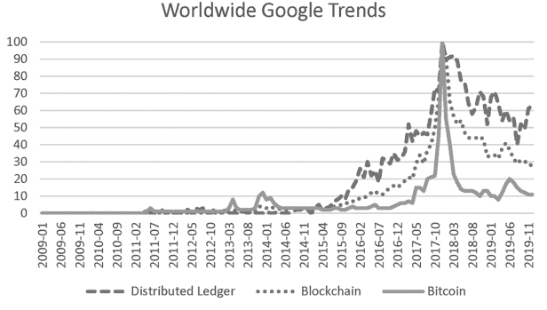

**图 1.3** 反映对分布式账本、区块链和比特币兴趣的 Google 趋势图。作者自绘。来源：google.com。

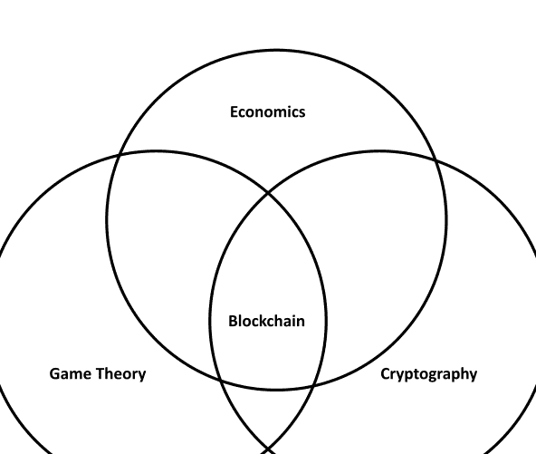

**图 1.4** 掌握分布式账本和区块链很难，因为其底层概念源于经济学、密码学和游戏论等完全不同的领域。作者自绘。

## 6 | 区块链与分布式账本：数学、技术与经济学

| 1. 密码学<br>2. 分布式共识<br>3. 智能合约 | 1. 丰富的数据库<br>2. 实时数据源<br>3. 分布式记录 | 高效的交易清算、结算和记录 |

**图 1.5** 一方面，分布式账本技术的实现得益于密码学、共识和智能合约的进展。另一方面，它利用了随处可见的丰富多功能数据库、实时数据源以及分布式记录的普及。作者自绘。

| 创新 | 鸿沟 | 时期 |
| :--- | :--- | :--- |
| 印刷机 | 知识鸿沟 | 15 世纪 |
| 雅卡尔织机 | 可编程鸿沟 | 18/19 世纪 |
| 蒸汽机、内燃机、电能 | 动力鸿沟 | 18/19 世纪 |
| 火车、汽车、飞机 | 移动性鸿沟 | 19/20 世纪 |
| 电报、电话、无线电 | 通信鸿沟 | 19 世纪 |
| 疫苗、巴菌消毒、青霉素 | 健康鸿沟 | 18/19/20 世纪 |
| 计算机 | 分析鸿沟 | 20 世纪 |
| 互联网 | 去中心化信息鸿沟 | 20 世纪 |
| 分布式账本 | 信任鸿沟 | 21 世纪 |

**图 1.6** 分布式账本和区块链是人类进步中填补不同发展鸿沟的长期链中的一环。图 1.6 显示 DLT 弥补了这种鸿沟之一，具体来说，现代面向互联网的经济中的信任鸿沟就是之一。R. Etwaru 在 2017 年 3 月的 TEDx 演讲“区块链；极度简化”中也得出了类似的观察。作者自绘。

加密货币的发展是 DLT 发挥核心作用的最关键领域之一。此类货币可以被视为法币的兴起竞争者。包括哈耶克（Hayek）在内的许多该领域权威认为，货币创新领域的发展极有益处；详见 Hayek (1943)。

## 1.3 回顾视角

通过某种形式的共识利用“链”来传输有价值的物品和财权的想法并非新鲜事。例如，王室和贵族的家族谱树可以被看作（块）链，因为它们根据一套或或少严格的规则将权利从一个转移到下一个；详见 Lipton (2018)。图 1.7 显示了卡佩-瓦卢瓦（Capet-Valois）和哈布斯堡（Hapsburg）家族的两个代表性族谱。

人们需要精通谱学和纹章学才能正确解释这些族谱中编码的极度详尽的信息。然而，有一个特征是不争的——就像比特币交易（见下文）——所有权根据预设规则从一个所有者转移给下一个。这些转移得到了一群同伴的认可，由他们执行规则，并由分布式方验证，包括交易发生地的当局和其他王室法院。

当出现问题时会发生什么？如果无法对交易达成共识，可能会发生硬分叉（hard fork），就像区块链中发生的那样，利益方对做什么达成一致（一个群体）。百年战争（1337–1453）就是一个恰例。它是英格兰国王普兰塔尼特家族（House of Plantagenet）与法国国王瓦卢瓦家族（House of Valois）之间的冲突。争夺的奖励是合法性。这是硬分叉的一个典型例子——在法国，瓦卢瓦家族是合法的；但在英国（以及随后的大不列颠）——普兰塔尼特家族及其后裔合法。另一个例子是奥地利王位继承（1740–1748）——这是一场涉及欧洲大多数强国的冲突，旨在解决《务实继承法》问题并决定玛丽亚特蕾莎对哈布斯堡家族领地的继承。当时，共识是通过武力实现的。

民主制度中的权力交接是另一个链式安排示例，通过投票达成共识。遗憾的是，这并不总是顺利；在社会动荡中未能达成共识。

从政治转向经济学，我们介绍了另一个区块链的例子——英国的地契，它们自中世纪以来一直在使用。根据英国政府的说法：“地契是显示土地和财产所有权链的纸质文件。它们包括转让、销售合同、遗嘱、抵押和租赁。”

在许多情况下，这些链非常长，因为它们可以追溯到中世纪。很显然，地契就是区块链；验证继承的不是矿而是公证人；并存储在中央仓库中。地契是分布式账本处理的有意义的对象。

2016年7月26日，维太坊·布特林（Vitalik Buterin）在关于“关于硬分叉”的文中宣布（正如其法令所示），分布式自治组织（DAO）资金的盗取是不可忍的。因此，以太坊的历史应当被重写：分叉发生了，并出现了两个版本——以太坊（Ethereum）和以太坊经典（Ethereum Classic）。

## 1.5 书的结构

本书的后续章节安排如下。在第 2 章中，我们将讨论现代金融系统并识别其痛点。我们认为使用分布式账本技术（DLT）可以解决其中的一些问题。第 3 章涵盖了对分布式账本和加密货币的非技术介绍。第 4 章具有较强的技术性且涉及大量数学，我们在书中范围内为读者配备一套实用的加密工具包。在其他主题中，我们还讨论了椭圆曲线加密和哈希函数。在加密货币短暂而拥挤的窗口期，所谓的“三大协议”——比特币、以太坊和 Ripple——从诞生之初一直处于领先地位。我们把第 5、6、7 章专门对它们进行详细分析。在第 5 章中，我们通过涵盖交易验证、区块工作量共识机制和其他相关主题，详细地描述了比特币协议。在第 6 章中，我们讨论了以太坊协议，它可以被视为一种共识服务提供者和一个自诩的分布式计算机。第 7 章中，我们涵盖了非加密协议——一种基于 SWIFT 的跨境汇款执行系统。第 8 章涵盖了许多实际应用——央银行数字货币（CBDCs）、数字贸易币（DTCs）和稳定币。在第 9 章中，我们描述了钱包和工业级密钥管理。我们从价格数学的角度讨论了三大货币、比特币期权及其他相关主题。第 11 章专门介绍 DLT 在不同领域的潜在应用，如审计与会计、生物医学研究与医疗保健、身份管理、分布式金融与可编程货币、全球支付、政府服务、供应链管理、现实资产代币化，最后是交易执行、结算和结算。在第 12 章中，我们涵盖了 DLT 研究中一些最热门的话题、防止其广泛应用的众多问题，并讨论了其未来。

## 1.6 总结

虽然区块链和分布式账本不是新概念，但现代技术赋予了它们新的生命力。除了金融应用外，DLT 能够通过消除不必要的摩擦，使传统银行和交易活动变得更便宜、更高效，具有无数可能。在 DLT 的许多金融应用中，目前还不完全清楚哪些应该优先处理。交易所、支付、贸易融资、再抵押、银团贷款等摩擦较大的领域是极具吸引力的候选者。CBDCs、DTCs 和稳定币是另一个前景良好的领域。此外，如果具备技能、知识和雄心，它可以在新的原则上重构整个金融系统。我们强调，实现这一目标不仅需要克服技术障碍，还需要克服政治障碍。

# 8 区块链：数学、技术与经济

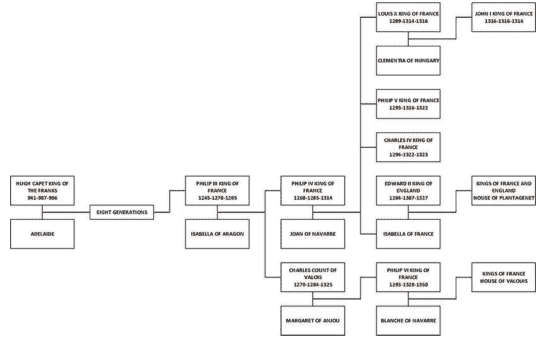


**图 1.7** 区块链的历史案例。(a) 卡佩-瓦卢瓦（Capet-Valois）。(b) 哈布斯堡（Hapsburg）。由阿尔布雷希（Durer）描绘。来源：Wikipedia。

# 9 背景


目前在会计、医疗保健、供应链管理、移动性和智慧城市等不同领域存在大量的 DLT 概念试点项目，这仅是一角。然而，许多 DLT 应用似乎是误导性的。有时，它们源于对使用这些工具本身的渴望，而不是因为其增加了价值。在其他情况下，它们是因为未能意识到当前的系统之所以处于现状并非由于技术原因，而是由于业务和其他考量。

只要将其部署在真正需要的领域并正确正确实施，DLT 技术的未来将是光明的。减少炒作、增加有用输出是提高这项令人兴奋的技术前景的方法。

## 1.7 扩展阅读

中本聪聪（Satoshi Nakamoto）的开创性论文《Nakamoto (2008)》点燃了世界对区块链以及延伸出的分布式账本的关注。这篇文章扩展了 Wei (1998) 的观点，并使用了由 Haber 和 Stornetta (1990, 1997) 开发的电子文档时间戳技术，以及 Back (2002) 提出的工作量证明思想。

一些涵盖这一迷人领域不同方面的区块链书籍（有些比比的要好）可能会让读者感兴趣：

- (1) Ammons (2018) 分析了比特币的历史，描述了允许其快速扩张的经济属性，并讨论了比特币的经济、政治和社会影响。
- (2) Antonopoulos (2017) 为比特币协议及其底层区块链提供了广泛的介绍。
- (3) Antonopoulos 和 Wood (2018) 关于在以太坊和其他虚拟机区块链上构建智能合约和 DApps 的有用信息。
- (4) Bhemaiah (2017) 批判性地调查了部分准备金银行制度，检查了区块链技术，并展示了它们如何挑战金融部门的现状。
- (5) Berensen 和 Schär (2017); Schär 和 Berensen (2020) 提供了加密货币和区块链技术的介绍，以及一份面向从业者和学生的指南。
- (6) Burnike 和 Tatar (2017) 制作了一份针对全新加密资产类别的创新投资者指南。
- (7) De Filippo 和 Wright (2018) 认为，如果没有新的规则和新的法律思维方法，区块链技术无法被有效利用。
- (8) Grasa (2018) 识别了数字技术中的关键参与者，并阐述了其优势和风险。
- (9) Gupta (2017) 解释了区块链是什么、如何运作、如何如何增强业务网络，以及今天如何开始学习区块链。

区块链与分布式账本：数学、技术与经济学

- (10) Lewis (2018) 提供了一个涵盖加密货币和区块链历史及基础的非技术指南。
- (11) Narayanan 等人 (2016) 为支撑数字货币的新技术提供了用的介绍，重点是比特币。
- (12) Pentland 等人 (2020) 描绘了改革我们社会社会契约的愿景，以及制度、系统、基础设施和法律应如何改变。
- (13) Popper (2015) 对比特币协议及相应的加密货币提供了非技术说明。
- (14) Shrier (2020) 提供了区块链的非技术解释并展示了它如何改变人们的工作和生活。
- (15) Swan 等人 (2019) 对基于 DLT 的经济进行了实用介绍；这些模型的特点是开放业务模式、加密货币和首次代币发行。
- (16) Tapscott 和 Tapscott (2016) 区块链技术的非技术介绍，并认为它将驱动我们的未来。
- (17) Vigna 和 Casey (2016, 2019) 提供了区块链发展的现状，并回顾了其挑战、风险和机遇。

区块链综述（质量不一）目前是一种流派；以下是代表性的有用综述：

- (1) Alharby 等人 (2018) 对智能合约的所有面向技术的研究进行了系统映射研究；他们的目标有两个：对科学文献进行综述；识别研究趋势和应用。
- (2) Ali 等人 (2019) 涵盖了基于区块链的系统的演进，为现有最中心的网络应用领域带来了复兴；他们想象了区块链应用于这些场景中，并指出了各种挑战、陷阱和缺陷。
- (3) Al-Jaroodi 和 Mohamed (2019) 回顾了几个提出使用区块链技术的领域，并探索了将区块链纳入各种工业应用中的机遇、收益和挑战。
- (4) Belotti 等人 (2019) 为社区提供了区块链的通用介绍，超越了其在比特币领域的应用，综述了过去几年出现的文献。
- (5) Blandin 等人 (2019) 检查了全球加密资产监管格局，让读者了解技术赋能的金融创新的运营。
- (6) Bodó 和 Giannopoulou (2019) 讨论了去中心化概念，意在理解产生更多或更少去中心化技术社会系统的社会、法律和经济力量。
- (7) Cachin 和 Vukolić (2017) 讨论了评估和增强共识协议在面对故障和对抗性节点时韧性的过程。

主张遵循密码学和计算机安全领域的既定惯例，依赖公开评审、详细模型和形式化证明。

- (8) Casino 等人 (2019) 对基于区块链的应用进行了系统性的文献综述，包括其现状、分类以及待开放的研究课题。
- (9) Conti 等人 (2018) 提出了一项涵盖比特币安全与隐私方面的系统性综述，并概述了比特币系统及其主要组件，以及它们在系统内部的功能和相互作用。
- (10) De Leon 等人 (2017) 阐明了人们对区块链技术属性的广泛误解，并描述了分布式账本系统（DLS）或技术（DLT）在信誉与信任设计实现方面面临的挑战与途径。
- (11) Garay 和 Kiasos (2020) 对拜占庭故障模型下的共识研究格局进行了系统化处理，从 20 世纪 80 年代初原始表述直到目前基于区块链的新型共识协议。
- (12) Glaser 等人 (2019) 表明，平台化方法是大型公司运营产品、信息和服务的扩展性数字交换介质的主流策略。
- (13) Hardle 等人 (2020) 为加密货币的机制提供了见解，描述了总结性统计数据，并关注了金融经济学中的未来研究方向。
- (14) Iansiti 和 Lakhani (2017) 认为，区块链作为一种安全、永久且高效地记录交易的开放分布式账本，可以大幅降低交易成本并消除律师、银行家等中间环节，从而改变经济。
- (15) Khezr 等人 (2019) 综述了新兴的区块链的医疗技术及相关应用，描述了这一快速增长领域的开放研究问题，并展示了区块链技术在变革医疗行业方面的潜力。
- (16) Liu (2018) 分析了区块链的基本特征和分类，并勾定了其实际应用，通过对现有应用和技术的分析，寻找区块链的发展前景。
- (17) Morhai (2019) 通过展示涉及技术和网络结构的技术层面与应用引发的问题及其影响之间的联系，对区块链和加密货币发展所提出的问题提供了一个综合性概述。
- (18) Mulligan 等人 (2018) 根据区块链在各行业不同项目的实战经验，开发了一套工具包。
- (19) Shahab 等人 (2019) 综述了 66 种共识协议，将其分为哲学和架构两类，并提供了它们的视觉表示。
- (20) Tassa 和 Tescoff (2017) 采用自下而上的方法，对最广为人知的区块链技术进行了比较研究，将区块链解构为其构建单元并建立了一个分类树，以为不同的区块链架构配置提供导航工具。
- (21) Tschorsch 和 Scheermann (2016) 引入了比特币协议及其构建区块，通过讨论贡献和结果来探索设计空间，其中某些结果的应用远超比特币本身。

# 14 | 区块链与分布式账本：数学、技术与经济学

(22) Wang 等人 (2019a) 对密码原语进行了全面探索，包括它们在区块链中的功能、用途及其演变。
(23) Wang 等人 (2019b) 对区块链网络在电信领域的新兴应用进行了全面综述，并解释了共识机制如何影响这些应用。
(24) Yaga 等人 (2019) 提供了区块链技术的高级技术概述，帮助读者理解区块链技术如何工作。
(25) Yang 等人 (2019) 探讨了保障互联网服务的区块链集成问题，并识别了开发去中心化、信任赖服务的关键需求。
(26) Zheng 等人 (2017) 提供了区块链架构概述，并比较了某些典型的区块链技术。

由于区块链是一种能够安全、永久且高效地记录交易的开放分布式账本，它可以大幅降低交易成本并消除律师、银行家等中间环节，从而改变经济。

由于相关信息大多在网上找到，以下网站非常有用：

- https://blockchain.com;
- https://en.wikipedia.org/wiki/Bitcoin;
- https://ethereumchain.org;
- https://coinmarketcap.com;
- https://etherscan.org;
- https://etherscan.io;
- https://learnbitcoin.com;
- https://xrpl.org;

# 第 2 章 货币系统及其痛点

由于区块链和加密货币发展所提出的问题，通过展示涉及技术和网络结构的技术层面与应用引发的问题及其影响之间的联系，对这些问题提供了一个综合性概述。

如果你从主流经济来看，有三点是：

在本章中，我们简要描述了全球系统，并识别了其痛点。

在本章中，我们展示了区块链技术在变革。

## 2.1 引言

在第 2.2 节，我们从货币的演进开始。

在第 2.3 节，我们讨论了货币的演变问题。

在第 2.4 和 2.5 节，我们涵盖了影响货币的许多货币问题。

在第 2.6 节，我们展示了通过应用 DLT 可以解决的全球系统的某些问题。

在第 2.7 节，我们给出了货币的总结。

### 2.2.1 货币的角色

货币在现代社会是多面的。它既具体又是抽象的。正如我们很快将看到的，货币是人类最伟大的发明之一。

正如我们看到的，货币的特质包括：

- 货币是交换介质；
- 货币是价值的载体；
- 货币是记账单位；
- 货币是支付手段。

### 2.2.2 作为对象的货币

起初，货币是由价值代币（如贝壳、电金、黄金和银币）表示的；参见 Davies (2010)。代表货币的物理对象的魅力在于，人们可以在没有第三方直接参与的情况下，自由将其交换商品和服务。因此，“货币对象”变成了一种非常抽象的想法的物质表达。由对象表示的货币具有抽象的所有属性。当然，实际材料很难获得，且其内容不会被稀释。图 2.1 显示了各种代表货币的代币。我们在下方简要讨论这一点，并尝试强调它们的属性，这些属性可以扩展到加密货币。

图中展示了：

- (a) 中国贝壳。贝壳是世界上某些地区使用的古代货币商品。贝壳非常耐用。它们易于识别和处理。自然地，在作为货币使用的地区找到贝壳是不可能的（或很难的），尽管它们在其他地方可能很丰富。例如，贝壳是在马尔代夫和其他东部岛屿收集的，那里贝壳充足，且

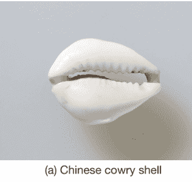

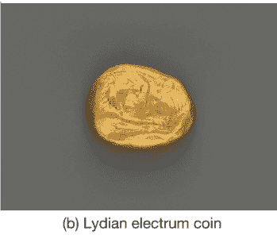


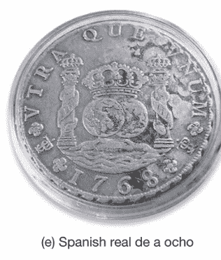

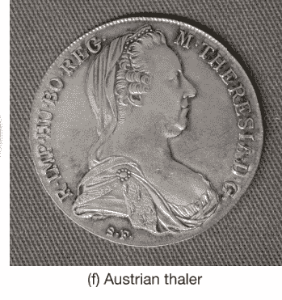

**图 2.1** 作为物品的货币：(a) 中国贝壳；(b) 吕迪亚电金币；(c) 希腊德德拉赫姆；(d) 罗马第纳乌斯；(e) 西班牙八实银；(f) 奥地利塔勒。来源：大都会博物馆。

这些货币被带到中国，但在那里非常稀缺。贝壳在中国的重要性体现在与金钱或贸易相关的字形经常包含贝壳的字形上；例如，参见 Goetzmann (2017)。

(b) 吕迪亚电金币。电金币于公元前 6 世纪初在吕迪亚引入。它们传遍整个世界。它们是希腊、罗马、拜占庭和伊斯兰钱币的直接祖先。传说中米达斯能够将他接触到的任何东西变成黄金。出于显而易见的原因，这个由狄尼索斯赋予的礼物变成了一个诅咒。米达斯通过在帕克托卢斯河清洗狄尼索斯的礼物恢复了正常，这条河因含有电金而变得极其富有，随后一直被使用直到早期钱币出现。现代“米达斯”们在将一切变成比特币之前应该三思一下。

(c) 希腊德德拉赫姆。一些研究将著名的雅典德德拉赫姆的高质量归功于金融工程的进步；例如，参见 Goetzmann (2017)。事实上，雅典能够生产出高质量的德德拉赫姆是因为它控制了伯罗波尼半岛最丰富的银源——劳里翁银矿；参见 Lipton (2017)。在这方面，古典雅典与今天的国家并无二，银是古代的石油替代品。银早在公元前 3200 年就开始从矿山中提取，但直到公元前 561 年上台的庇西斯特拉托，雅典才开始开发其收益的潜力。提密西列斯利用矿山的收入资助了一支三列桨战船舰队，并增强了雅典在希腊的海军实力；参见 Aallion (1897)。然而，随着斯巴达占领了该地区且矿山衰落，德德拉赫姆钱币也自然衰落了。任何金融工程都无法解决这些简单的物理现实。德德拉赫姆是古典希腊文明的基石，它随着钱币质量的下降而衰落。

(d) 罗马第纳乌斯。最初由纯银制成，第纳乌斯是一个警告，说明了当权力开始降低货币质量时会发生什么。图 2.5(a) 显示在 250 年里，第纳乌斯的纯度下降了。

(e) 菲利普五世的西班牙八实银（西班牙美元），也称为西班牙元。这种硬币的高质量是因为西班牙控制了位于秘鲁波托西极其富有的银源。尽管如此，由于西班牙王室短视的贸易政策、1492 年驱驱逐犹太人和摩尔人，以及欧洲及其他地区的持续战争，西班牙王室被迫在从 1557 年起的 110 年内宣布了九次主权第纳乌斯。此外，西班牙元的质量恶化了——这是一个对于秘鲁波托西银矿的学生来说熟悉的故事，正如雅典德德拉赫姆一样。

(f) 奥地利玛丽亚·特蕾莎塔勒（MTT）。MTT 是一种以硬币上的特蕾莎皇后命名的白银条币。它于 1741 年首次铸造；玛丽亚·特蕾莎去世后铸造的所有 MTT 均为 1780 年。几个世纪以来，MTT 保持了其作为贸易货币的全球地位；参见 Tschoeg (2001)。再次，当波希米亚的约哈姆塔尔银矿枯竭时，奥地利塔勒的质量也随之恶化了。

金或银等贵金属制成的货币依赖于其金属含量，仅部分（如果有）取决于政府的执行。然而，政府标记对于信号其质量和简化交易非常重要。尼古拉斯·奥雷姆在 Oeleme (1956) 将货币与信息和认证联系在一起：“最初开始贸易或用钱购买商品时，货币没有印章或图案，而是用等量的银或铜换取食物和饮料，并按重量称量。由于使用天平并通过称重确定确切的等值很累人，而且卖家无法确定提供的金属或其纯度，贤者们明智地规定货币应为特定的金属并具有确定的重量，并盖上众所周知的图案，以定义硬币的质量和真实价值，从而消除疑虑并使价值易于识别。”

所谓的硬币自古代起就为人知，并自 16 世纪以来作为西班牙八实银和澳大利亚塔勒而繁荣。它们根据其金或银含量，在各自国家的国界之外进行贸易。贸易货币的现代版本可能是中央银行数字货币，例如目前中国正在开发的数字人民币。

### 2.2.3 纸币

最终，货币开始由没有明显内在价值的物品来代表，例如纸币。在图 2.2 中，我们展示了各种形式的纸币和钞票。在图中：

- (a) 第一种纸币于 11 世纪在中国开发，在此之前曾尝试使用铁币和铜币.³
- (b) 第一种欧洲纸币由斯德哥尔摩银行于 1666 年发行。⁴
- (c) 大陆元，在 1775 年美国独立战争开始后被大陆会议称为“大陆币”。大陆货币在革命战争期间迅速贬值，尤其是因为英国对它们进行了大规模对抗。本杰明·富兰克林通过利用叶片纹样开发自然水印来反击他们的努力，使伪造变得困难。无论如何，到 1781 年 5 月，大陆币变得一不值并停止流通；参见 Wright (2008)。
- (d) 1805 年拿破仑战争期间由于金银短缺而发行的一种非常非常早的英国英镑。
- (e) 苏联卢尔布夫。由于可以完全兑换成黄金（至少在理论上），卢尔布夫保持了它的价值。它可以被视为第 8 章中讨论的稳定币的前身。
- (f) 一张 100 万亿津巴布韦美元钞票——失败货币政策的悲惨结果。加密货币设计者从发行货币的徒尝试中中学了许多教训


³在世界某些地区，玛丽亚·特蕾莎塔勒继续被使用。

⁴在 17 世纪，瑞典纸币。

⁵自公元前 7 世纪起，第一批硬币在吕迪亚铸造。

⁶钞票的复杂规则，如美元或欧元。

## 块链与账本：数学、技术与经济


(a) 第一种纸币。


(b) 第一种纸币。


(c) 大陆元。

(d) 早期的英镑。

(e) 苏联卢尔布夫。

(f) 津巴布韦美元。

**图 2.2** 纸币：(a) 第一种纸币；(b) 第一种纸币；(c) 大陆元；(d) 早期的英镑；(e) 苏联卢尔布夫；(f) 津巴布韦美元。来源：维基百科。

### 2.2.4 反伪措施

伪造与货币一样古老。它一直被视为对主权权力的威胁，而且更有可能处以死刑。

自公元前 7 世纪吕迪亚用带有原始设计的模具铸造第一批硬币以来，伪造努力就开始了。在许多情况下，这些努力是简单的——削减或剪掉硬币边缘以获取贵金属并将其与贱金属混合，制造伪币。为了对抗这种现象，罗马人在公元前 2 世纪开始在第纳乌斯上制作锯齿。然而，硬币磨损（即将硬币放在袋子里摇动并收集金属尘）是自然发生的（只要不过过头）且难以检测，因此难以预防。

然而，另一种保护措施在讨论伪造时很少被提及，即他们为钞票编号的巧妙方式。我们以德国意志马克为例，并解释了它们的字母数字代码是如何选择的；Tlustý 和 Šuliista (2017)。我们强调，我们能够透露这些信息的唯一原因是德国意志马克已不再是法定货币。

## 22 区块链与分布式账本：数学、技术、经济学

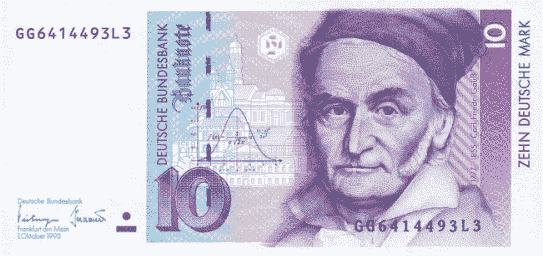

(a) 十马克钞币。


图 2.3 (a) 一十马克钞币；(b) 一百马克钞币。这些字母数字代码背后的故事是什么？来源：维基百科。

考虑图 2.3 (a)、(b) 中所示的十马克和百马克德意志马克钞。首先，十马克钞的 11 位字母数字代码 `GG6414493L3` 根据以下映射规则转换为 11 位数字：

A, D, G, K, L, N, S, U, Y, Z \Rightarrow 0, 1, 2, 3, 4, 5, 6, 7, 8, 9.

结果是钞票获得了其 11 位数字，即 `22641449433`。数字 0...9 根据以下置换规则映射为 0...9：

0, 1, 2, 3, 4, 5, 6, 7, 8, 9 \Rightarrow 1, 5, 7, 6, 2, 8, 3, 0, 9, 4.

因此，$\pi(0) = \pi(1) = 5$，以此此类推。在表 2.1 中为 $n, m, 0 \leq m \leq 9$ 定义了群运算 $\cdot$。

> *众所周知，德国在钞票上印制了它最杰出的科学家和艺术家。十马克钞票描绘了卡尔·弗里德里希·高斯（1777–1855）以及他最重大的发现——无处不在的曲线，也称为高斯分布。尽管它无处不在，但在第 10 章中，我们将证明高斯分布并不适用于描述比特币和其他加密货币的收益率。百马克钞票描绘了克拉拉·舒曼（1819–1896）——浪漫主义时期最著名的钢琴家之一。*

## 第 2 章 全球金融体系及其痛点

表 2.1 乘法表。

| | 0 | 1 | 2 | 3 | 4 | 5 | 6 | 7 | 8 | 9 |
|---|---|---|---|---|---|---|---|---|---|---|
| 0 | 0 | 1 | 2 | 3 | 4 | 5 | 6 | 7 | 8 | 9 |
| 1 | 1 | 2 | 3 | 4 | 5 | 6 | 7 | 8 | 9 | 5 |
| 2 | 2 | 3 | 4 | 0 | 1 | 7 | 8 | 9 | 5 | 6 |
| 3 | 3 | 4 | 0 | 1 | 2 | 8 | 9 | 5 | 6 | 7 |
| 4 | 4 | 4 | 0 | 1 | 2 | 3 | 9 | 5 | 6 | 7 | 8 |
| 5 | 5 | 9 | 8 | 7 | 6 | 0 | 4 | 3 | 2 | 1 |
| 6 | 6 | 5 | 9 | 8 | 7 | 1 | 0 | 4 | 3 | 2 |
| 7 | 7 | 6 | 5 | 9 | 8 | 2 | 1 | 0 | 4 | 3 |
| 8 | 8 | 7 | 6 | 5 | 9 | 3 | 2 | 1 | 0 | 4 |
| 9 | 9 | 8 | 7 | 6 | 5 | 4 | 3 | 2 | 1 | 0 |

因此，我们有 $3 \cdot 6 = 9, 6 \cdot 3 = 8$，以此此类推。校验规则如下：

$$\pi(a_1) \cdot \pi^2(a_2) \cdot \ldots \cdot \pi^{10}(a_{10}) \cdot \pi^0(a_{11}) = 0,$$

其中 $\pi^0(a) = a$，第 11 位数字用于检查前 10 位是否构成了正确的数字。符号化，我们可以将总和写为：

$$\sum_{n=1}^{11} \pi^{n \pmod{11}}(a_n) = 0.$$

我们可以很容易地检查该钞票以及百马克钞是否符合这种情况；见表 2.2。

表 2.2 验证钞票的有效性。这里 $n' = n \pmod{11}$。

| $n$ | 代码 | $a_n$ | $\pi^{n'}(a_n)$ | 总和 | 代码 | $a_n$ | $\pi^{n'}(a_n)$ | 总和 |
|---|---|---|---|---|---|---|---|---|
| 1 | G | 2 | 7 | 7 | A | 0 | 1 | 1 |
| 2 | G | 2 | 0 | 7 | D | 1 | 8 | 9 |
| 3 | G | 6 | 3 | 9 | S | 5 | 4 | 5 |
| 4 | A | 4 | 1 | 8 | B | 2 | 5 | 0 |
| 5 | I | 1 | 2 | 6 | O | 0 | 4 | 4 |
| 6 | A | 4 | 8 | 3 | B | 3 | 3 | 2 |
| 7 | A | 4 | 4 | 7 | A | 4 | 9 | 6 |
| 8 | A | 9 | 9 | 9 | I | 1 | 1 | 5 |
| 9 | | 3 | 6 | 9 | G | 6 | 3 | 7 |
| 10 | L | 4 | 7 | 2 | U | 7 | 1 | 6 |
| 11 | M | 3 | 3 | 0 | 6 | 6 | 6 | 0 |

### 2.2.5 作为记录的货币

自中世纪后期以来，货币逐渐以各种账本记录的形式存在。货币的方面在现代世界至关重要，特别是在分布式账本技术（DLT）的背景下。目前，流通大部分货币只是账本中的交易序列。商业银行维护账本，而中央银行提供货币（央行现金）和令牌（不同的货币转账系统），用于对这些账本进行调节。

图 2.4 展示了将货币作为记录的不同机制。该图说明了从泥板到现代银行资产负债表的演变。图中显示：

- (a) 苏美尔楔形文字。亚索克人和苏美尔人在文字和货币等许多领域都是真正的先驱；参见例如 Goetzmann (2017)。他们发明了债务概念，并使用廉价且极其耐用的材料来记录相应的交易。
- (b) 埃及莎草纸。
- (c) 计数棒。
- (d) 石币。
- (e) 英国账本。
- (f) 电子银行资产负债表。

# 26 | 区块链与分布式账本：数学、技术、经济

它已经存在很长时间。当欧洲人到达并开始使用重型机械运输石头时，随之而来的是快速的通胀。最终，石币（Yap money）灭了，一些石头在二战期间被日本人用于建造机场。

- (e) 一份19世纪世纪早期的英国账本。虽然没什么特别，但它说明即使是小型企业也很好地理解复式记账法的艺术科学。
- (f) 现代电子资产负债表，为了可读性进行了极大简化。除了资产负债表记录在新的媒介中外，它与旧银行的资产负债表几乎无异。

## 2.2.6 货币与通胀

任何形式的货币——无论是金属硬币、纸币还是账目记录——都会受到通胀力量的影响。图 2.5 (a) 展示了从公元前 27 年到公元 270 年 300 年间，罗马第纳斯银含量的下降轨迹。图 2.5 (b) 显示了 1799 年至 2018 年间美元的价值。在这两种情况下，下行的压力都是显而易见的。

### 2.2.7 BIS 货币分类

到此时，读者应该理解现代经济中的货币有各种风味。在表 2.3 中，受国际结算银行（BIS）货币分类的启发，我们列出了各种货币类型并强调了它们的属性。这张表表明，在所有竞争者中，“最好的”是中央银行数字货币（CBDC）——这对于 BIS 来说，是一个自然的结论。

### 2.2.8 货币从何而来？

在数十年的争论后，出现了三种学派：(A) 银行信用理论；(B) 银行准备金理论；(C) 银行金融中介理论。

银行创造理论主导了 19 世纪和 20 世纪初的论述；有很多优秀的书籍和论文，如 MacLeod (1905): Mitchell-Innes (1914); Hahn (1920); Wicksell (1913); Werner (2005, 2014)。遗憾的是，该理论逐渐失去了地位，并被银行准备金理论取代；例如，Marshall (1887); Keynes (1930); Samu and Nordhaus (1995)。金融中介理论是目前的冠军；见 Bernoulli and Binder

> ⁸ 第纳斯币的贬值产生了许多意之外的后果。在罗马帝国，士兵们领取无价值的第纳斯币（denarius）作为工资，以实物发放的口粮（annona），以及金币和银锭作为奖金。这是基于新皇帝的继位及其统治五年的奖金（donatives）；Elton (1998)。特别地，继位奖金是五枚金币和一磅银。结果，衰落的罗马军团变成了昔日的残影，帝国也随之崩溃。对于那些主张银行奖金或巨额基金经理薪酬的人来说，这是一个警示。

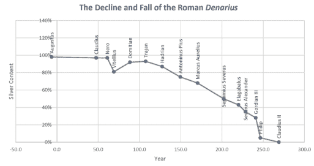

(a) 罗马第纳斯银币的银含量。

(b) 1913 年价值的美元。

**图 2.5** 货币与通胀并行不悖，无论使用何种材料代表货币：(a) 罗马第纳斯币银含量在 300 年间的下降和衰落；(b) 美元价值在 200 年内的下降。作者自制。来源：(a) https://pisoproject.wordpress.com/the-reduction-of-silver-content-in-the-roman-denarius/, (b) 联邦联储及其他。

(1988) Keynes (1936); Tobin (1969); Tobin and Golub (1998)，这些对该理论给出了代表性的描述。在我们看来，该理论对银部门在货币创造过程中的独特且特殊的作用强调严重不足。它未能实现其解释银行系统功能的既定目标。

所谓的货币循环理论为货币的创造和消灭提供了最有说服力的解释。该理论的主要结论是，商业银行在向客户贷款时创造货币。银行在收到还款时销毁货币。利息实际上来自下一轮贷款，并永远留在系统中。货币循环理论具有悠久而辉煌的历史；见，Godley and Lavoie (2007); Kalecki (2007); Keen (2013, 2015); Petty (1899); Keynes (1991); Zezza and Dos Santos (2004)。关于该理论的现代观点；见 McLeay et al. (2014); Lipton

表 2.3 BIS 货币分类。

| 类型 \ 属性 | 央行发行 | 电子 | 点对点 | 通用 |
|---|---|---|---|---|
| 现金 | Y | N | Y | Y |
| 商业银行存款 | N | Y | N | Y |
| 央行存款 | Y | Y | N | Y |
| CBDC | N | Y | Y | Y |
| 货物货币 | N | Y | N | Y |
| 加密（等） | N | N | N | Y |
| 加密（等） | N | Y | Y | Y |

(2016) Lipton (2018) 及参考文献。当银行违约时，通常会导致存款的部分销毁。对于小额存款，联邦存款公司（FDIC）提供的保险缓解了银行的违约风险。例如，当 Indy Banc 在 2008 年夏天申请破产时，其存款人损失了大部分资金。因此，银行需要保持足够的缓冲和流动性。

目前，银行没有足够吸引力的贷款机会。因此，它们在央行积压准备金；见图 2.7。

由于私人银行无法或不愿找到合适的借款人，自全球金融危机（GFC）爆发以来，特别是新冠引发的经济衰退开始以来，央行大幅增加了贷款业务，结果导致其资产负债表[扩张；见图 2.8。

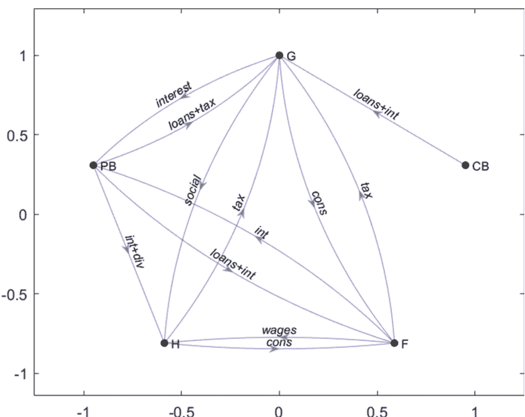

图 2.6 货币循环示意图。G – 政府，CB – 央行，PB – 私立银行，F – 公司，H – 家庭。作者自制。

通常情况下，发达经济体现金与银行存款的比例较小。然而，当有大面额通知可用时，它们偶尔会被用来代替银行账户。尽管有各种言辞技巧，存款人无论是否情愿都成为了银行的无担保债权人，因此在银行流动性出现问题时优先级最低；见 Devanaynes (1816)。

## 2.3 金融系统如何运作

### 2.3.1 现状

在现代社会中，大量的货币只能储存在各种存款账户中。因此，银行机构作为记录保存者扮演着独特的社会角色。

> “通胀与负利率制度之间的关键区别在于，在……下现金是非常不受欢迎的”

# 30 区块链与分布式账本：数学、技术与经济学

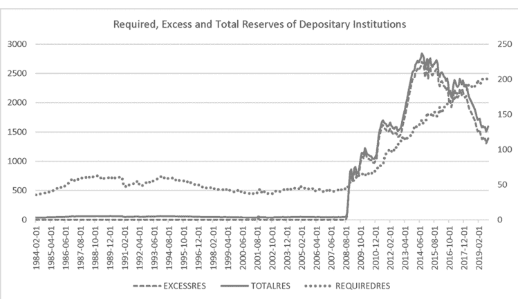

**2.7** 超额准备与量化宽松的失败。自绘。来源：圣路易斯联储。

尽管面临其他支付工具的竞争，许多研究结果表明，它仍然是一种具有韧性的支付形式，在消费者交易和其他用途中发挥着关键且独特的作用。流通货币（包括公众持有的纸币币以及存款机构金库中的货币）以健康的速度增长。虽然货币流通速度稳步增长，但其目前正在下降，这意味着资金的使用效率在降低。

货币流通速度是指单位货币在特定时间内（按季度计算）购买商品和服务的次数。流通速度的增加意味着经济主体之间发生了更多交易，而流通速度的下降则意味着相反。简单来说，流通现金量不断增长；但其流通速度在放缓；见图 2.9。

Tether 等稳定币的流通速度将在第 8 章中讨论。

### 2.3.2 当前金融体系面临的挑战

当前的金融体系是数百年演变的结果。它的根源可以追溯到苏美的没落城邦，那是已知最早文明的发源地。苏美位于底格里斯河和幼发拉河之间，是许多金融理念的诞生地，包括债务、利等。意大利城邦，佛罗伦萨、威尼斯和热那，成为金融创新的温床。后来，北欧的大贸易城市（如安特卫普和阿姆斯特丹）变成了真正的金融中心。最终，伦敦和纽约取代了它们。目前，主要的顶级金融中心是纽约、伦敦、东京、香港、上海、新加坡以及少数区域性中心。未来哪个地区将占据主导地位仍有待观察。

客观观察者会得出结论：今天的金融体系无法以目前的形式维持太久。原因显而易见（但难以修复）：金融过于复杂而适得其反，涉及贷款、支付、清算和结算。大多数银行和其他金融机构依赖于过时的信息技术（IT）系统，这些系统已经过了使用期限。金融体系依赖于许多中间机构和支持者，长期无法理好自己的内部事务。它缺乏透明度，不仅局外人无法，更令人警惕的是参与者自己也无法理解。银行机构表面上资本充足，但其复杂性已增加到这种程度，以至于监管机构、存款人、投资者以及令人惊讶的管理层，都无法确定其稳定性和信誉。一级银行的资产负债表已变得如此透明，其复杂性超出了量化分析的范围。由于这种复杂性，许多银行和其他金融机构已变得“大不能倒”。一级银行每年必须花费数十亿美元（规模较小的竞争对手花费数千万至上亿美元）来开发、验证和维护复杂的模型和 IT 系统。这些系统的存在目的是向监管机构证明银行符合资本和流动性要求。全面的资本分析和审查（CCAR）是每家重要银行都必须通过的年度仪式。

此外，系统内置的信息不对称导致了财富不可避免的高度富集（前 1% 的人口控制着全球约 50% 的财富）。由于其高度集中的本质，该体系本质上是不稳定的。它无法通过政府、中央银行以及各种国家和跨国监管机构等大型中央机构得到充分控制。它在欠发达国家制造了许多地缘政治和经济风险，这些国家遭受着通货膨胀、经济增长缓慢的痛苦，且有超过二十亿人缺乏金融服务或服务不足。持续的新冠肺炎疫情带来的经济后果进一步恶剧了整体形势。

### 2.3.3 货币创造的详细分析

我们的目标是理解分布式账本技术（DLT）在金融领域的潜在应用。在这方面，拥有银行系统内部运作机制的示意图是有益的。

我们从单一银行的简单案例，或者相当于整个银行系统开始。我们假设银行并未满负荷运行，在流动性方面可以贷款。当一个信用良好的借款人寻求银行并请求一笔合理规模的贷款时，银行会在账簿上同时创建一项存款（借款人的资产），并为借款人创建一个匹配的负债（银行的资产）。形象地说，银行“凭空”创造了货币。然而，严格来说，这并非事实，大多数情况下，借款人拥有其希望获得的贷款的合适抵品。当借款人偿还贷款时，过程反向进行，货币便被“销毁”。假设贷款利息高于存款利息，银行的资本就会增加。利息来自下一个周期的循环。稍加思考发现，如果借款人违约而非还款，银行无法销毁货币。在这种情况下，银行的资本自然会减少以补偿违约。然而，由于资本是一个抽象概念，而非实际现金或央行货币，流通货币量会不成比例地增加——换句话说，借出但未还的钱被伪造了。

货币创造过程在图 2.10 中形象所示。

该过程从银行向新借款人提供某些资金开始，导致了表 2.4 中银行资产负债表的变化。

我们现在考虑两家（或可能更多）银行的更复杂案例。在这种情况下，流动性至关重要。为了考虑流动性，我们必须将中央银行纳入金融生态系统。我们假设银行将其部分资产放在储备（现金）中，代表中央银行的负债。在这里，现金被理解为中央银行账中的电子记录，但也可以以物理钞票的形式存在。货币创造

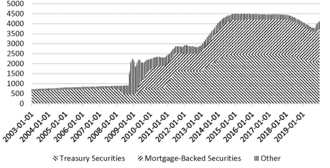

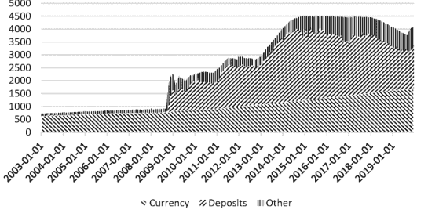

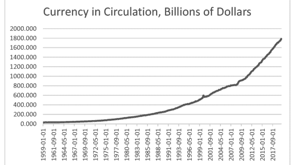

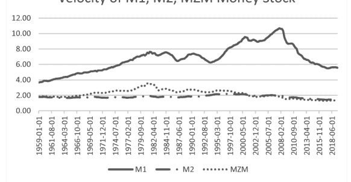

img/d52d985b4b3970b396f9b7f6d2aa3d8e_80_0.png)

**图 2** 中央银行向准备金银行的转型。当商业银行变得更加保守和狭窄时，中央银行变得更加激进。(a) 联储资产自全球金融危机（GFC）以来大幅增加，特别是在新冠肺炎疫情期间。(b) 联储的负债也是如此。自绘。来源：圣路易斯联储。

**图 2.9** (a) 流通货币。(b) 货币流通速度。自绘。来源：圣路易斯联储。

**图 2.10** 单一银行的货币创造。(a) 借款人未违约。(b) 借款人违约。这一理念被比特币和其他所有加密货币协议所借用。自绘。

# 第 2 章 全球金融体系及其痛点 | 35

**表 2.4** 单一银行的货币创造。状态 1：贷款轮开始前的银行 I 资产负债表。状态 2：客户借入 40 万导致的资产负债表变化。银行 I 的资产和负债同时增加 40 万。状态 3a：未违约。银行的资产和负债同时减少 40 万，同时其现金和资本增加了 05 万（利息）；销毁了价值 40 万的货币。状态 3b：违约。银行 I 的资产和资本同时减少 40 万；销毁的是 40 万资本而非货币。

| 外部资产 | 状态 1 | 状态 2 | 状态 3a | 状态 3b |
| --- | --- | --- | --- | --- |
| 同业间资产 | 50 | 54 | | 50 |
| 现金 | 20 | 10 | 10.5 | 20 |
| 外部负债 | 10 | 64 | 60 | 64 |


| 同业负债 | 60 | 13 | 13 | 13 |

| 资本 | 13 | 7 | 7.5 | 3 |

| 资产减去负债 | 7 | 0 | | 0 |

银行通过向信用良好的借款人提供流动性来为商业润滑。它们向商业银行提供准备金的意愿反过来决定了向企业和家庭发放贷款的能力。当借款人偿还贷款时，过程反向运行¹¹⁰货币创造过程始于银行 I 向新借款人贷款并在银行 II 存款，这导致两家银行资产负债表发生以下变化；见 2.5。

总之，与非银行公司不同（后者的资产负债表可以通过简单反映其资产 $L$ 和权益 $K$（即 $A = L+K$）得到充分描述），典型商业银行的资产负债表除了实体经济资产和负债外，还必须包含额外项目，例如同业资产 $\tilde{A}$ 和负债 $\tilde{L}$，以及代表银行资产和中央银行负债的中央银行 $C$。

> $A + \tilde{A} = C = L + \tilde{L} + K$， (2.5)

见 2.11。

在供需驱动的经济系统中，货币被视为与其他商品等同对待。贷款需求和贷款活动的动态过程处于供需平衡框架之下。企业和家庭贷款需求的增加会导致银行发放更多贷款。我们应该强调的是，银行创造货币的能力不是无限的。我们可以与实物进行类比，实物在充分就业状态下的总产量受到物理工厂能力的限制。货币（贷款）的创造取决于银行系统的资本和流动性能力。此外，如前所述，通常贷款是基于抵押品发放的，这是对银行在任何时刻可以创造多少货币的另一个限制。通常，在繁荣时期，房地产等抵押品的价值被严重高估，即变得脱离控制。相反，在低迷时期，抵押品贬值，产生所有负面影响。一旦我们有了供需框架，就可以将该模型扩展到同业关联上。

¹¹⁰ 作者感谢 Matheus Grasselli 对货币创造过程提出的宝贵意见。

表 2.5 货币创造，两家银行的案例。状态 1：贷款轮之前的银行 I 和 II 资产负债表。状态 2：客户从银行 I 借入 40 万导致的资产负债表变化。银行 I 的资产增加 40 万，同时其央现金头减少 40 万。银行 II 的现金头和外部负债增加 40 万。状态 3：银行 I 从银行 II 借入 40 万。状态 4a：借款人向银行 I 还款。银行 I 的资产减少 40 万，现金头增加 4.5 万（包括利息），资本增加 05 万。银行 II 的外部负债和央现金减少 40 万。状态 5a：银行 I 向银行 II 还 4.25 万（包括利息）。银行 I 的现金头和资本分别减少 4.25 万和 0.25 万。状态 4b：借款人银行 I 贷款违约。银行 I 的资产减少 40 万，资本减少 40 万。银行 II 的外部负债和央现金减少 40 万。状态 5b：银行 I 向银行 II 还 4.25 万（包括利息）。银行 II 的现金头和资本分别增加 4.25 万和 0.25 万。

| 状态 1 | 状态 2 | 状态 3 | 状态 4a | 状态 5a | 状态 4b | 状态 5b |

| --- | --- | --- | --- | --- | --- | --- |

| 银行 I | 银行 II | 银行 I | 银行 II | 银行 I | 银行 II | 银行 I |

| 50 | 54 | 54 | 50 | 50 | 50 | 20 |

| 外部资产 | | | | | | | | |

| 同业资产 | 20 | | 20 | 20 | | 20 | 20 |

| 现金 | 10 | | 6 | 10 | 14.5 | 10.25 | 5.75 |

| 外部负债 | 60 | | 60 | 60 | 60 | 60 | 60 |

| 同业负债 | 13 | | 17 | 17 | 13 | 17 | 13 |

| 资本 | 7 | | 7 | 7.5 | 7.25 | 0 | 0 |

| 资产减去负债 | 0 | | 0 | 0 | 0 | 0 | 0 |

| 银行 II | 银行 II | 银行 II | 银行 II | 银行 II | 银行 II | 银行 II |

| 外部资产 | 80 | | 80 | 80 | 80 | 80 | 80 |

| 同业资产 | 15 | | 15 | 19 | 15 | 11 | 15 | 15 |

| 现金 | 15 | | 19 | 15 | 11 | 15.25 | 15 | 1.5 |

| 外部负债 | 00 | | 4 | 7 | | 0 | | 7 | | 00 0 |

| 银行 | 银行 | 0 | | 3 | | 30 | 30 | 30 | 30 | 30 |

| 资本 | | 0 | | 10 | 10 | 10 | 10.25 | 10 | 10.25 |

| 资产减去负债 | 0 | | 0 | 0 | 0 | 0 | 0 | | |

| 资产 | 负债 | 外部资产 | 外部负债 |

|---|---|---|---|

| | | 同业 | 同业负债 |

| | 资本 | 同业资产 | 央现金 |

(a) 公司资产负债表。

(b) 银行资产负债表。

**图 2.11** (a) 公司资产负债表。(b) 银行资产负债表。很明显，银行并非存在于真空之中，而是作为业务的一部分自然地相互关联。作者自绘。

区块链与分布式账本：数学、技术与经济学

# 第 2 章 全球金融体系及其痛点 | 37

### 2.3.4 负利率

在供需驱动的经济系统中，货币被视为与其他商品等同对待。贷款需求和贷款活动的动态过程处于供需平衡框架之下。企业和家庭贷款需求的增加会导致银行发放更多贷款。我们应该强调的是，银行创造货币的能力不是无限的。我们可以与实物进行类比，实物在充分就业状态下的总产量受到物理工厂能力的限制。货币（贷款）的创造取决于银行系统的资本和流动性能力。此外，如前所述，通常贷款是基于抵押品发放的，这是对银行在任何时刻可以创造多少货币的另一个限制。通常，在繁荣时期，房地产等抵押品的价值被严重高估，即变得脱离控制。相反，在低迷时期，抵押品贬值，产生所有负面影响。一旦我们有了供需框架，就可以将该模型扩展到同业关联上。

### 2.3.5 银监管与货币稳定

负利率是一个令人不安的信号。虽然并非完全未未闻，但负利率已经普遍。那些央行采取负利率政策（NIRP）的国家似乎并没有获得任何收益。它们没有经历货币贬值、通货膨胀上升、贷款强劲增长和整体刺激。更多时候，这种政策会产生违反直觉的效果，例如瑞士传导机制未能降低利率。除了零利率边界（ZLB）和政策利率下限（PLB）外，许多作者已经察觉到了经济边界（ELB）的存在。

### 2.3.6 现有系统的优缺点

影响现有银行体系最大的问题是由于混合了三种活动而导致过于复杂：(a) 通过贷款创造和注销信贷；(b) 记录；(c) 交易执行。分离这些活动对于使银行业更加敏捷和高效至关重要。我们将关注银行业的交易方面，并认为审慎地使用分布式账本技术（DLT）可以帮助银行业进入 21 世纪。

## 第 2 章 全球金融系统及其痛点 | 39

虽然银行发生重大倒闭的概率并不高，但这种风险也不容忽视。通过贷款，银行面临着自身资本和储户资金的风险。FDIC（美国联邦存款保险公司）的保险基金仅为 850 亿美元，仅占美国所有现有存款的 1% 多。FDIC 资金不足以覆盖美国最大的 23 家银行中任何一家银行的损失。由于这种义务，人们得出的结论是储户通过不获得对其信用风险的赔付，每年实际上向银行变补贴了数百个基点的资金。

在危机期间，银行会敏锐地意识到彼此银行之间的风险和无抵押贷款，导致伦敦同业银行拆借利率（Libor）崩盘。如果那些了解同业内部运作的银行都不愿意相互提供贷款，那么储户又为什么要免费地向他们提供贷款呢？

## 2.4 国内支付

### 2.4.1 主角们

在处理支付时（无论是传统的还是基于加密货币的），在本书中，我们将支付方（买方）称为 Alice，收款方（卖方）称为 Bob。这种术语在密码学中是传统的，并在几十年中证明了它的用处。有时，我们还会涉及其他方——银行家 Ben、冒充者 Charlie 等。

### 2.4.2 结算

当前金融系统的特点是有一条长中间人链，在买方和卖方之间转移资金，但这种形式并不是代理银行的形式。不意外的是，中间机构在大多数情况下都是蓬勃发展的。各种费用可以轻易达到 3% 或更多，这对于大多数参与者来说是一笔巨额费用。

国内支付和结算系统如图 2.12 所示。

由于其复杂性，该系统很容易出错，最近花旗银行（Citi）就曾由于人为疏忽，错误地支付了 900 美元；例如 Doherty 和 Surane (2020)。

两个银行账户之间的资金转账如图 2.13 所示。

我们必须区分两种情况：(a) Alice 和 Bob 在同一银行有账户；(b) Alice 和 Bob 在两家不同的银行有账户。算法上，我们在表 2.6 中表示了 Alice 和 Bob 在同一银行有账户的过程，在表 2.7 中表示了 Alice 和 Bob 在两家不同的银行有账户的过程。

### 2.4.3 信用卡支付

对于持有有效信用卡的消费者来说，使用它进行支付简单得像魔法，但现有的架构非常复杂。图 2.14 改编自 FFIEC (2016)，

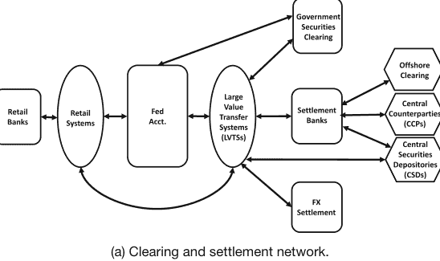

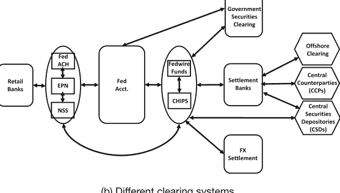

**图 2.12** (a) 美元清算和结算网络拓扑；(b) 具体的结算系统。来源：PRC (2016)。

展示了 Alice 和 Bob 之间典型信用卡交易的支付和信息流，这些流渗透了清算结算系统。

实际步骤可以总结如下：(1) Alice 发起信用卡支付；(2, 3) Bob 通过银行网络将数据传输给银行 A；(4, 5, 6) 如果交易获得批准，信息向相反方向流动，Alice 签署信用卡单；(7, 8) Bob 向银行 B 提交一批交易并收到付款；(9, 10) 银行 B 将销售单发送给银行卡公司，由其转发给银行 A；(11) 银行卡公司在当日结束时确定银行 A 和银行 B 的净头寸，并协调这些银行之间的结算，结算通过 Fedwire 进行；(12) Bob 向 Alice 发送月账单；(13) Alice 进行付款。此外，更深奥的细节可以在 FFIEC (2016) 中找到。

这表明该系统非常低效——仅仅沿着四个数组移动资金，就需要多条信息流。实际的结算过程通过一个

## 第 2 章 全球金融系统及其痛点

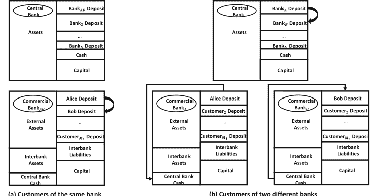

(a) 同一银行的客户 (b) 两个不同银行的客户

**图 2.13** 国内资金转账：(a) 同一银行的客户，(b) 两个不同银行的客户。自绘。

表 2.6 从 Alice 到 Bob 的资金转账，单银行情况。

| Scenario₁ | Scenario₂ |

|---|---|

| State_n | {Alice: 50, Bob: 20, Bank₁: 10,000} | {Alice: 50, Bob: 20, Bank₁: 10,000} |

| TX | {send 10 from Alice to Bob} | {send 60 from Alice to Bob} |

| Result | Success | Failure |

| State_{n+1} | {Alice: 40, Bob: 30, Bank₁: 10,000} | {Alice: 50, Bob: 20, Bank₁: 10,000} |

表 2.7 从 Alice 到 Bob 的资金转账，双银行情况。

| Scenario₁ | Scenario₂ |

|---|---|

| State_n | {Alice: 50, Bob: 20, Bank₁: 10,000} | {Alice: 50, Bob: 20, Bank₂: 10,000} |

| TX | {send 10 from Alice to Bob} | {send 60 from Alice to Bob} |

| Result | Success | Failure |

| State_{n+1} | {Alice: 40, Bob: 30, Bank₁: 10,000} | {Alice: 50, Bob: 20, Bank₂: 10,000} |

独立的支付网络，如图 2.12 所示。并不意外，这种支付在到达接收人时是高昂的。

## 2.5 跨境支付

### 2.5.1 主角们与代理银行

从美国到欧洲和其他目的地的跨境支付是高度结构化的，首先从小银行流向大银行，然后到所在国的代理银行，最后到达小银行。图 2.15 显示了典型的金字塔。根据该图，资金通过复杂的中间人网络从 Alice 传向 Bob。金融科技公司试图中介银行并削减支付金字塔。以依赖银行来转移资金。假设，除非比特币成为支付手段，否则这些交易仍必须使用银行轨道，在后续章节中进行解释。

图 2.16 展示了整个过程中使用银行系统时的交易链。资金从 Alice 的银行流向 Bob 的代理银行，最后到达 Bob 的银行。由于中间机构的存在，交易成本不断累积，交易时间变得不确定。

### 2.5.2 外汇交易

Alice 为了跨境移动资金，必须有人愿意接受 Alice 的美元并将其兑换为 Bob 选择的外币。这些交换是由交易员操作的，该市场每日交易额约为 6.6 万亿美元。通常情况下，他们在同业市场收取 2–5 个基点（在外汇中称为点数 pips）。银行自身向客户收取的费用更高，1–2% 并不罕见。上一节讨论的路线替代方案如图 2.17 所示。

为了可读性，我们将中间人链简化为仅有的四个：Alice 的美元银行、Bob 的欧元银行、做市商的美元银行和欧元银行。此外，我们展示了相应的中央银行——联邦储备储备银行和欧洲中央银行，因为只有图中四家银行可以通过它们的中央银行存款进行通信。

11 SWIFT 代表全球银行金融电讯协会。它于 1973 年成立于布鲁塞尔。目前，它连接了位于 200 个国家和地区的 11,000 多家金融机构。

# 44 区块链与分布式账本：数学、技术与经济

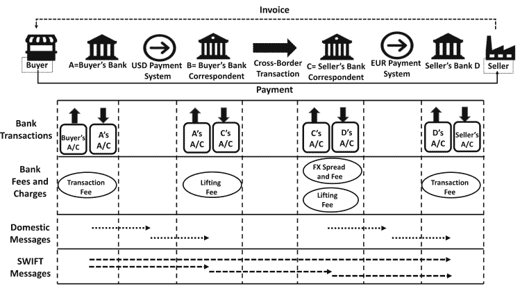

图 2.16 代理银行示例——资金从美国流向欧洲。自绘。

### 2.5.3 非正式资金转移系统

值得注意的是，除了已建立的银行系统外，还有几种非正式的资金转移系统。其中最著名的是哈拉（Hawala）支付系统，如图 2.18 所示。它可以被视为一种非常高效的现金转移机制。其核心思想是资金留在原地但所有权发生了变化：例如 El-Qorchi (2002)。

当然，该系统对信任的依赖远高于传统的转账系统，并且受到松散的 KYC（了解您的客户）和 AML（反洗钱）实践等额外问题的困扰。哈拉的主要问题之一是资金通常向一个方向流动，例如从海湾国家到印度，以及从香港到菲律宾的汇款，因此为了平衡账户，必须执行某些反向哈拉路线。它可以有不同的形式。最常见的形式是让发达国家的哈拉交易者向发展中国家运货物，因此其中一个哈拉交易者变成了自然出口商，另一个变成了进口商。

## 2.6 区块链支付

与现状相比，图 2.19 所示的潜在区块链解决方案看起来具有某种欺骗性的吸引力。抛开技术细节，假设 Alice 拥有资金，她所做的只需向区块链生态系统广播向 Bob 转账意图。相关的区块链参与者会自动处理其余工作，并确保

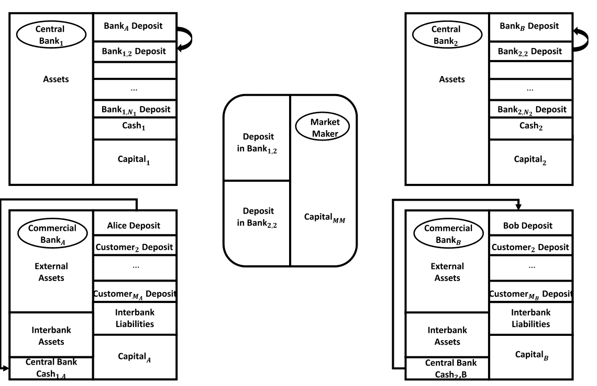

图 2.17 跨境货币汇款：资金流失平衡的情况。自绘。

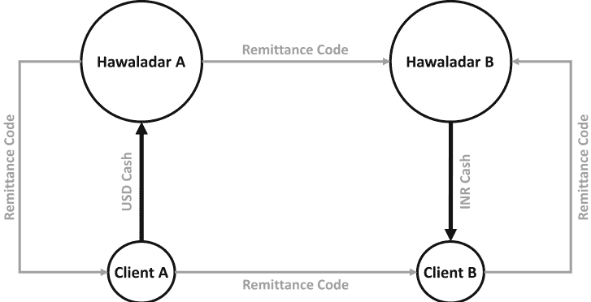

**图 2.18:** 哈拉系统。自绘。

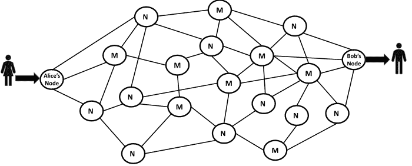

**图 2.19** 基于区块链的支付解决方案。自绘。

将正确的金额记入 Bob 的账户。当然，实际的技术细节在复杂性上令人眼舌。我们将书的剩余部分用于解释这样的系统在原理上是如何工作的，以及在实践中是如何运作。

## 2.7 总结

在本章中，我们研究了货币和整个银行系统。诚地说，尽管许多人对此不满，但我们认为银行系统在整体经济中发挥着至关重要的作用，因为它是货币的关键组成。我们证明了金融、交易和支付系统是复杂的，并且存在着许多摩擦和痛点。我们展示了现代技术如何可能简化并优化现有系统。特别是，我们认为通过分布式账本技术（DLT）可以减少许多交易摩擦。书的其余部分将讨论如何使用分布式账本大幅改进记录保存、监管要求、国内及跨境支付。

其他参考文献：Begenau and Stafford (2019); Collomb and Sok (2016); Kavuri and Milne (2019)。

## 2.8 练习

- 1. 描述现代经济中货币创造的过程。谁是这个过程中的主导？为什么商业银行必须在中央银行保留准备？它们为什么需要资本？贷款利息从哪里来？

- 2. 比较并对比现有的金融系统和基于分布式账本的潜在金融系统。各者的优缺点是什么？使用 DLT 如何改进资金转移机制？

# 第 3 章

# 加密货币与分布式账本导论

“《泰晤士报》2009年1月3日 —— 财政大臣正处于比特币的边缘”

## 3.1 引言

2008年，一位以 Satoshi Nakamoto 为名工作的匿名研究人员发表了《点对点电子现金系统》白皮书。十年后，即2019年，后比特币时代的路径被描述了出来。在本章中，我们回顾了比特币的诞生、分布式账本技术的主要原理和变化，以及这项技术创新引入的趋势。本章作为第 4 章对密码学进行更正式处理的引言，以及第 5 章对比特币协议和第 6 章对以太坊协议进行深度分析。我们引入了公钥密码、区块链、双重花费和工作量证明的概念，试图对所有构建基石进行横向回顾。第 3.2 节介绍了数字身份。第 3.3 节涵盖了点对点网络的主要原理，并介绍了 DLT 的主要支柱——区块链数据结构。第 3.4 节解释了去中心化系统中双重花费的挑战。第 3.5 节回顾了许可 DLT 共识协议的核心原理。第 3.6 节列出了 2010–2020 年间数字资产生态系统演进的关键里程碑。第 3.7 节描述了通往未来的道路。最后第 3.8 节给出总结。

## 3.2 分布式身份

### 3.2.1 法律身份


在当今经济中，政府被信任认证身份并提供身份验证材料，如身份证、护照和驾照。一个人之所以是他自己，是因为政府是这么说的，并且他能够以足够的信誉证明这一点，从而让对方产生信任。

面对身份证明，边检官员评估两个关键要求：首先，文件必须是原件——即由受信任的政府真实颁发，并采取了一系列防伪措施，包括安全墨水、特种纸和材料、难以复制的设计和印刷技术、特殊标识符，以及通常包含某种形式加密技术的微芯片。其次，官员验证护照是否属于其持有人：肖像照片是否匹配、眼睛颜色是否匹配、身高、指纹，

# 第3章 加密货币与分布式账本入门 | 51

时代？由于这几项特征的组合不太可能匹配多个个人，护照的所有权可以得到确认。通过将该文件与其发行者（政府）以及持有人相相关联，对政府的信任被转化为了对持有人法律身份的信任。

中本聪明（Satoshi Nakamoto）实现比特币的愿景与原则发生了冲突。在一个存在意义（raison d'être）在于消除中心方的系统中，不存在一个中心化管理的身份。去中心化系统必须依赖于一种识别协议，以确保独立于中心权威，并允许任何无预先许可要求的用户参与。过去几十年公钥加密技术所取得的进展使得中本聪明能够定义一个基于所谓公钥加密的简单模型。

### 3.2.2 数字身份识别与钱包

在传统的法律环境中，人们通过手写签名对合同的纸质副本进行验证。其基础假设是，只有法的承包者知道如何设计自己的签名——换句话说，签名很难被复制——但任何外部观察者都可以轻松将其与某些身份文件进行比较以评估其有效性。在实践中，事实已证明这种假设是不合理的：无论是手动完成还是使用计算机图形工具完成，伪造签名都是一个相对简单的过程，而评估签名的真实性是一项艰巨的任务，可能导致高的假阳性或假阴性风险。

数字签名过程依赖于数学构造，以形式化证明由特定方认证的信息，且没有误描述的风险。它依赖于两个原语：私密钥（也称为秘密密钥），必须由持有者保持保密；以及从私密钥派生的公钥，它作为公共标识符。数字签名只能通过私密钥计算，并通过与公钥对比进行验证。签名算法的基础性方面是：在不知道私密钥的情况下，在计算上无法推导出与公钥对应的消息签名。因此，一个经过数字签名认证并可由公钥验证的消息，被认为源自一个已知相应私密钥的实体。

中本聪明将数字钱包定义为一对私密钥和公钥。钱包是去中心化银行账户的形式，可以接收资金、执行转账出，并关联到一个银行和交易历史。钱包的公钥类似于银行账户号码；它可以与其他网络参与者共享以允许转账。私密钥被认为仅由钱包所有者已知，用于通过计算认证转账的数字签名来授权转账出。外部观察者可以通过验证数字签名相对于转账数据和发送者公钥的有效性，来评估转账的合法性。图3.1展示了一个数字化的、但物理的钱包。

> 钱包可能包含多个密钥对的集合。特别是，对于 BTC 钱包来说，为每笔入账和出账创建新的密钥对是一种良好的做法。

# 块链与分布式账本：数学、技术、经济


**图 3.1** 一个由瑞士公司 Bitcoin Suisse 发行的行钞形式的数字钱包，它暴露了公钥并隐藏了相应的私密钥。它可以存储任意数量的 BTC。

这种范式允许随地、随意生成数字钱包，无需预先授权；并以保护隐私的方式。钱包的私密钥是所有权的唯一证明；如果丢失、销毁或被盗，资产即消失：它代表了一种分布式、匿名标识符的形式——穷人的数字身份。我们参考第9章对与密钥管理相关的挑战和实践以及如何减轻相关风险进行更广泛的审查。

## 3.3 去中心化网络

### 3.3.1 客户端-服务器模型

历史上，我们与互联网上其他用户和其他服务的交互基于客户端-服务器范式。服务器是中心化的计算机，允许连接接入并充当信息经纪人、中继、数据存储器和处理器。相比于用户之间的直接连接，客户端-服务器模型依赖于中心化的服务器来控制信息流，如图3.2所示。

这种模型依赖于中心化的计算机，允许连接接入并充当信息经纪人、中继、数据存储器和处理器。这种架构依赖于中心化的服务器，在过去被证明这种拓扑结构更容易工作。

在去中心化系统中，目标是消除对中心化服务器的依赖。此类服务器可能会故障、损坏数据，或者由于恶意意图或错误导致误导：这种由于故障、错误或恶意意图导致的故障，与去中心化目标是对立的。

# 第3章 加密货币与分布式账本入门 | 53


**图 3.2** 中心化的客户端-服务器通信模型。

中心化服务器很容易被攻击者反复利用。数据损坏、数据盗窃、拒绝服务或网络钓鱼只是服务器所经历的一些例子。此外，对服务器的控制可以被服务提供商或监管机构滥用。

### 3.3.2 点对点模型

比特币建立在点对点网络之上，如图3.3所示，其中每个点（或*节点*或*用户*）都可以同时担任客户端和服务器的角色。这种模型遵循一个对称的网络，每个节点都有能力从其他点消费信息，同时也向其他点提供信息。

由于数据可以在地理分布的异构服务器上进行大规模复制，点对点网络对许多形式的故障具有固有的韧性，是高可用且持久的。点对点网络的一些主流应用包括文件共享、流媒体、分布式计算或电信系统。

# 54 | 块链与分布式账本：数学、技术、经济


**图 3.3** 去中心化的点对点通信网络。

### 3.3.3 网络节点

任何互联网用户都可以部署一个比特币节点，既作为网络的客户端，也作为中继服务器。每个节点都与其他节点交互，以维护底层比特币账本（称为*区块链*）的动态视图，并对其内容和完整性进行审计。某些节点被称为*存档节点*，可能决定存储并提供从2009年直到最新更新的完整区块链历史；其他*种子节点*则宣传其IP地址并作为新网络参与者下载区块链副本的入口。2020年，估计比特币节点总数超过10000个，在全球范围内广泛分布，保证了对灾难性风险、司法管辖风险、技术故障和网络攻击的极端韧性。2020年10月9日参与BTC挖矿的前10节点见表3.1。

比特币节点不仅存储和提供区块链数据。它们还是协议的执行者：它们积极监控流量，验证交易的有效性、区块链的有效性，以及泛协议规则的良好应用，以监管任何偏离行为。无效交易、错误的会计操作和其他形式的非法行为会被协作节点拦截并故意忽略，以确保不会污染网络。由于节点由开源软件构建，并允许任何用户免费进行审计、编译和执行，用户可以始终高度地确信其节点严格执行了协议规则并在本地验证了这些

# 第3章 加密货币与分布式账本入门 | 55

表 3.1 2020年10月9日可访问节点数量排名前10的国家 | 

| 排名 | 国家 | 节点数 |
|---|---|---|
| 1 | 德国 | 1842 (17.28%) |
| 2 | 美国 | 1834 (17.20%) |
| 3 | 法国 | 556 (5.21%) |
| 4 | 荷兰 | 426 (4.00%) |
| 5 | 加拿大 | 310 (2.91%) |
| 6 | 英国 | 291 (2.73%) |
| 7 | 新加坡 | 259 (2.43%) |
| 8 | 俄罗斯联邦 | 235 (2.20%) |
| 9 | 日本 | 220 (2.06%) |
| 10 | (其他) | 2629 (24.66%) |

来源：`bitnodes.io`。

网络采取的行为没有违反中本·纳卡托（Satoshi Nakamoto）最初定义或在网络诞生之初约定的任何规则。人们说，节点执行了共识规则。

### 3.3.4 节点的引导（Bootstrapping）

在实践中，一个节点遵循以下生命周期：

- (1) 引导阶段：新节点连接到一个或多个 IP 地址公开可用的节点；种子节点可以是任何已连接到网络的协作节点。
- (2) 对等节点发现：节点请求其在网络中已其他节点的 IP 地址，可能通过递归方式来构建一个可用节点及其相应 IP 终端的本地地图。
- (3) 状态恢复：节点从发现的任何协作节点组合中部分或全部下载账本历史。
- (4) 网络服务：节点可选地自己成为一个协作节点，并开始将从对等节点接收的信息转发给自己的对等节点以及所有其他对等节点，以请求本地存储账本的副本。在此，节点验证共识规则并阻止任何偏离规则的信息。

一旦节点设置完成并与网络其他部分保持同步，它就会开始监听所有网络流量，通过广播和去中心化系统的处理来学习新的指令和交易。它还充当网络的网关，从那里可以广播各种与协议相关的指令：这就是新的加密货币交易如何通信给整个网络参与者的：就像一种指数链反应一样，节点将指令广播给一组连接的对等节点，这些节点会立即将其分享给各自的对等节点，以此此类推，直到大多数节点都通知了新请求。

## 3.4 分布式账本

分布式账本是由多个通过对等网络通信的松散耦合且异常的方共同维护的会计数据库。这项技术的主要用途是在不同的（可能处于销毁状态的）方之间共享唯一的参考会计账目，并确保没有任何人对网络进行唯一控制、操纵其良好执行、访问私人内部数据、选择性地审查网络，或将各方作为特定业务模式的质质。尽管有许多不同的架构和协议来支持分布式账本，但中本·纳卡托的模型（包括区块链数据结构）是构建完全去中心化、无许可且安全的账本的首次成功尝试。

### 3.4.1 许可框架

尽管区块链可以部署为中心化或半中心化的数据存储，但当它在对等网络上开放共享并按照适当的共识算法分布在多个方之间时，它会大放异彩。这些方取决于账本本身根据其协议定义的许可框架性质；对于比特币或以太坊等加密货币网络，人们称之为**无许可账本**，因为任何用户都可以加入、下载完整区块链并承担活跃的维护角色，而无需预先的人工授权流程。当对谁可以读取、更新它或出于任何目的访问它存在限制时，我们称之为**有许可的账本**（例如，R3 Corda、Hyperledger Fabric）。无论框架和具体规则如何，分布是防止数据丢失、数据损坏和篡改风险的最佳保障；通过拥有许多相同信息的冗余副本——这些副本在地理上分布并由不同的独立实体控制——此类网络受到攻击将变得不可行，每个参与者都对其完整形状和形式做出了贡献。

### 3.4.2 区块链数据结构

区块链是一个加密的区块链。每个区块包含一组交易，在时间顺序上继之前父区块的交易，并先于可能的未来子区块的交易。除了原始区块（也称为创区块）外，每个后续区块都维护指向父区块的显式加密指针，以便链可以自然遍历并重建完整的交易图。

> 参见 https://www.r3.com/corda-platform/ 和 https://www.hyperledger.org/use/fabric。

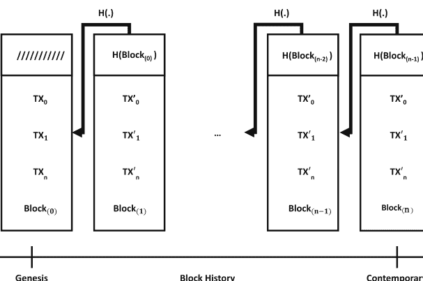

图 3.4 一个简单的区块链数据模型，每个区块存储一个交易列表和指向上一个区块的哈希指针。自绘。

因此，区块链维护了从创区块到当代更新的验证交易完整列表，如图 3.4 所示。形式上，一个简单的区块链数据结构可以规范为：

- (1) `hash(message)` 是加密函数。通过构造，可以创建输出。
- (2) `block_0`；创区块是链中的第一个区块。
- (3) `transactions`；每个区块包含一组交易。
- (4) `hash`；哈希用于将区块连接在一起。

（注：原文 3.4.2 部分的 OCR 文本在源中严重乱码/重复。我根据提供的片段中区块链结构的背景重构了逻辑流。）*

# 第3章 加密货币与分布式账本入门 | 59

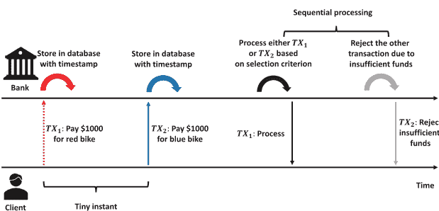

**图 3.5** 中心化环境下的双重花费尝试。作者自绘。

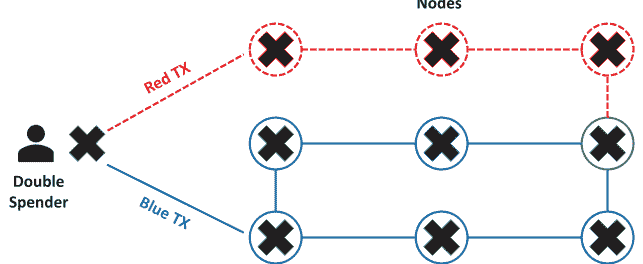

**图 3.6** 去中心化点对点环境下的双重花费尝试。两个冲突的交易通过网络传播，并在不同时刻到达对等节点。作者自绘。

这个过程在中心化背景下看起来显而易见，因为银行是处理支付的唯一方，事实如此，见图 3.5。

## 3.5.2 去中心化环境下的插图

现在让我们考虑比特币等去中心化环境中的类似情况。该账户在比特币账本上持有 1 BTC，他想同时买一辆红色自行车和一辆蓝色自行车，每辆价值 1 BTC。直觉告诉我们所有者只能购买红色自行车或蓝色自行车，因为两件商品的总价值为 2 BTC，超过了他的总财富。该所有者试图以此牟利，并同时创建了两笔交易：第一笔交易发送 1 BTC 支付红色自行车，第二笔交易发送 1 BTC 支付蓝色自行车。详情见图 3.6。

两笔交易请求的点对点广播开始，每个网络节点在收到每笔交易后，会立即将其广播给自己的邻居节点set。在级联效应下，其中一笔或通常是两笔交易迅速被互联网上所有参与节点所知。我们在此强调，这个过程是随机的：传播路径取决于点对点网络的拓扑结构，而该拓扑结构本质上是动态且无政府的，还取决于节点节点之间的网络延迟——这取决于地理距离、互联网传输中继的质量、数量和吞吐量——以及节点不加区分地扮演中继节点的简单意愿。由于没有确定性的方法来保证所有节点先看到红色自行车交易，或者先看到蓝色自行车交易，节点无法共同就哪笔交易是有效的、哪笔是无效的达成一致。事实上，原始发送者完全可能通过将红色自行车交易发送到网络的特定分区，同时将蓝色自行车交易发送到网络的另一个分区，来欺骗系统，使得不同的节点组感知红色和蓝色交易的顺序不同。

由于交易没有自然的顺序，对于两笔交易中哪一个应该被视为有效、哪一个应该被拒绝，网络范围内没有共识。无法信任发送者附加在交易上的时间戳，因为没有办法强制执行时间戳的有效性。发送者也可以发送具有相同时间戳的两笔交易，或者创建具有不同时间戳的同一交易副本并在不同时刻广播它们，试图撤销之前的交易。这种无法决定保留哪些冲突交易以及区块哪些交易的无能通常被称为**双重花费**。原因是，如果两个自行车商都收到了笔比特币交易（一笔是红色的，一笔是蓝色的），他们都会认为自己收到了资金，但很有可能有另一笔交易与他们的冲突——并且发送者账户的余额可能不足以支付两次购买。

## 3.6 网络共识

显而易见，分布式账本需要一种针对双重花费的稳健解决方案，换句话说，它必须嵌入一种共识算法，允许每个网络参与者以极高的确定性确认他们对保留哪笔交易的观点被网络其他部分所共享。共识算法准确地是指在涉及多个节点时对某个决定达成一致，并确保这种一致对于各种故障或攻击是稳健的。在双重花费的情况下，共识旨在就保留哪笔交易和忽略哪笔交易达成一项决定。共识并不保证最早的交易会被保留；它只是驱动大家围绕“网络”认可的某笔交易达成一般共识。对于当前的问题，可以考虑许多不同的共识算法，尽管大多数将取决于网络的拓扑结构（例如节点数量）以及参与者之间的信任程度。对于节点通常都经过预先批准的许可账本，许多共识算法已存在多年；请参见对类算法的审查和比较。而对于区块链这样的无许可账本：

# 第3章 加密货币与分布式账本入门 | 61

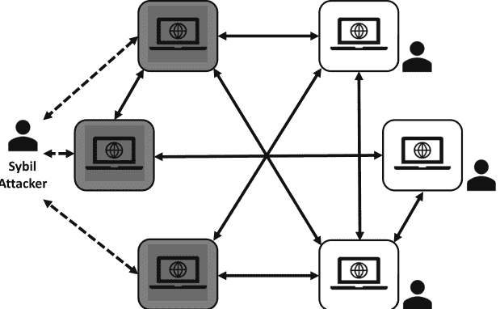

**图 3.7** 女巫攻击插图，展示了单一用户控制不同的节点并获得网络代表权。作者自绘。

### 3.6.1 女巫攻击

考虑一个简单的模型，该模型要求大多数网络参与者批准一笔交易。在这种模型下，人们等待大多数达成一致，认为一笔交易是最终的。仔细的分析很快揭示了这是成立的。在无许可设置中，无法强制执行投票权的公平分配。系统能否保证一个网络参与者不会随心所欲地人为增加其存在感？这被称为**女巫攻击**：网络参与者通过创建任意数量的匿名身份来攻击系统，并利用这些身份增加其对结果的影响，如图 3.7 所示。与此相关，我们还得出结论：没有任何能阻止投票者对不兼容的结果投票。为什么投票者在单一场景下只对一笔交易投票呢？同样，因为投票没有成本，应该始终假设会有某些恶意的网络参与者会利用这一弱点并在系统中制造不信任感。

另一种模型是选出一个网络参与者的领导者，并授予他单方面决定批准或拒绝哪些交易的权力。在分布式设置中，成为领导者应该是任何参与者都能实现的，并且不应该是永久职位，以避免决策中心化，从而避免整个系统的风险。这种方法只是将问题转移到了另一个挑战，即领导者选举过程。选择领导者并不比投票支持某笔交易更容易：它仍然受到女巫攻击的影响。共识算法精确地解决了上述挑战。它为无许可账本建立了新的共识，使得女巫攻击变得昂贵，且协作行为具有回报，从而建立一个让网络参与者通过正确行为获益、不当行为遭受损失的激励系统。这就是所谓的工作证明（PoW）算法。

### 3.6.2 基于工作证明的数字工作

在一个网络参与者可以随心所欲增加其存在感（例如增加其互联网连接）且参与者之间没有信任理由的情况下，如何建立一个可以达成网络范围内一致的过程？应该有一个采取决策的领导者吗？如果是，参与者对选谁达成一致？还是一个无领导者的民主模型？如果是，如何确保每个参与者只投一次票？

# 第3章 加密货币与分布式账本入门 | 63

这降低了多个有效区块同时出现的概率，特别是在网络延迟的情况下。其次，也是最重要的一点，它使得区块提交（即对下一个区块进行投票）变得昂贵。平均而言，生成两个区块消耗的是生成一个区块的两倍，需要两倍的工作。我们在此强调，这种工作不仅仅是一个理论构想；它与购买和维护计算机以及电力融资相关的具体运营成本相关。高性能的硬件处理器将提供比低性能硬件更快的平均解决方案；硬件处理器的水平扩展将缩短解决时间。通过将有效区块的产生与一种负债挂钩，中本聪缓解了通过提交多个冲突区块来欺骗网络的激励。

### 3.6.3 构建链

区块链的构建按照以下过程进行。

- (1) 从网络上的其他节点下载直到当前同时区块的现有区块链。
- (2) 评估链的有效性、其会计情况、其交易以及相应区块中的工作量证明。
- (3) 选择一组等待包含在区块链中的待处理交易。这些交易在各自发送者广播后在网络节点之间进行交换，存储在相应网络节点的内存池中，等待被包含在新区块中。
- (4) 使用选定的交易构建区块，在区块内设置父哈希，并开始工作量证明。
- (5) 如果且当识别出有效证明，将其包含在区块中并将区块广播给其他节点。
- (6) 让其他节点验证区块的完整性（包括其工作量证明），并据此决定是否将其包含在本地区块链副本中。


有趣的是，其他网络参与者并没有参与同样的练习来对下一个区块提交意见。然而，仍然存在许多问题。鉴于区块生产相关的成本，为什么有人会愿意参与这项活动？工作的复杂性应该由谁来定义，它是否应该随时间变化？哪些交易会被选中包含在区块中？当多个具有相同父区块但相互冲突且有效的区块被广播到网络时，应该选择哪一个区块？

### 3.6.4 区块奖励与矿工

区块的生产以获得有效的工作量证明为条件，这是一项昂贵的创业。中本聪非常清楚，如果没有适当的激励机制，网络用户就不会参与这项活动。他设立了协议的一部分以 BTC 支付的奖励，当区块创建者将其区块成功获得网络其余部分的认可时即可获得。

# 区块链与分布式账本：数学、技术与经济学

由于与黄金开矿的模糊比较（提取金矿需要基础设施、体力和时间），区块生产被比喻地命名为“采矿”——执行此操作的用户被称为“矿工”。比特币网络的一些参与者决定成为活跃的维护者、矿工，并开始跟踪网络以收集他人的交易，将它们分组为区块，开始解决工作量证明，并在解决后广播区块以获得奖励。奖励需要运行成本（例如电力、基础设施管理、折旧），以实现可持续的商业模式。

比特币协议包含两个奖励部分。

- (1) **奖励**：新铸制的 BTC，上限为网络中的 BTC 总数。重要的是，区块奖励计划——货币政策是比特币共识协议的一部分，它保证了该方案不受网络中有影响参与者的干扰。中本聪设置的区块奖励使得通胀率最初较高，并可预测地收敛于零。可以将这种模型与黄金开矿进行松散比较，在 19 世纪，由于大量未开发矿山的存在，黄金的开采相对容易，而随着矿山的耗尽，开采变得越来越稀有昂贵。

- (2) **交易费**：区块中包含的所有交易的费用总和，由各自发送者支付。此外，交易发送者可能会支付费用以激励其包含在区块中。通过设置更高的费用，发送者使其交易对矿工更有吸引力，矿工可能会以更高的优先级处理它并将其包含在更早的区块中。

这两者的和构成了支付给区块矿工的总 BTC 奖励。

### 3.6.5 计算能力率

工作量证明问题困难度的定义仍然存在。我们从它不应该具备的开始：恒定的复杂度。假设在比特币网络诞生初期，只有中本聪本人在挖网络，而且他是使用个人电脑进行。困难度的设置可以校准，使得解决该问题平均需要任意的时间，例如 10 分钟。中本聪挖矿并确认产生新区块需要 10 分钟。现在假设一个新参与者哈·芬尼（Hal Finney）开始挖矿。分配给挖矿的处理器现在是中本聪的两倍。一半的时间，中本聪找到解决方案；另一半的时间，哈找到。哈投资了同等的计算机并将它们并行运行。结果是区块生产率现在变为 5 分钟。考虑到网络的开放性（或无许可性），允许任何用户连接强大的计算机并竞争区块奖励，人们可以看到显而易见的结果：计算能力导致了增长的区块率。


**图 3.8** 一个交易区块，其头部包含额外数据，用于跟踪当前难度和工作量证明。最终，区块生产可能快到使得整个机制变得失效。

### 3.6.6 竞争下的难度

难度目标定义了工作量证明问题的困难程度。难度是内部定义的并随时间变化的，使得预期生产率是稳定的。这种方法确保了矿工很少会同时提交两个有效区块，足够快；比特币将其设定为 10 分钟。随着矿工的计算能力的增加，难度目标会上升；反之，当矿工的计算能力下降时，他们会看到收益下降。

最终，这种方案看到了矿工池的增加，并随着 BTC 价值的增加导致难度增加。在高难度下，单个矿工控制大部分区块生产变得越来越困难：而一个允许哈控制 90% 份额更具竞争性的网络需要巨大的投资；这种投资被认为几乎是不可能的。有关进一步讨论，请参阅第 5 章。

正是通过这一点，中本聪能够创建一个调节区块生产的去中心化模型。任何构建区块和解决工作量证明的尝试都需要大量的投资并面临与其他矿工的竞争。通过将区块生产变为一个竞争性市场，中本聪能够吸引成千上万的参与者竞争获得区块，并给予他们足够的去中心化程度。

这足够吗？并不完全。上述方案降低并定义了一种公平且去中心化的区块生产算法。然而，我们还没有描述网络在多个区块冲突时的行为；即区块链分叉。

### 3.6.7 分叉与共识链

当两个或多个有效区块引用同一个父区块时，就会发生分叉。当对于考虑哪个区块存在歧义，以及在哪个区块上构建后续区块时。这些分叉可能是无意产生的，例如当多个矿工几乎在同一时间解决了工作量证明，广播他们新生成的区块，并让无法决定遵循哪一个其他网络参与者产生困惑，如图 3.9 所示。分叉也可能是对系统攻击的结果，矿工试图通过创建区块链的替代视图来撤销或修改会计记录。

需要一种选择。一种能够明确允许任何网络参与者决定信任并在哪个子链上进行构建的规则。但由于分叉中的所有区块在技术上都是有效的，基于区块本身的规则可能是不可行的。在这里，不同类型的账本有不同的答案。比特币定义了一种基于最长链的策略：在分叉的情况下（可能涉及两个或多个分支），累计工作量难度最大的分支是

# 第 3 章 加密货币与分布式账本入门 | 67

共识链

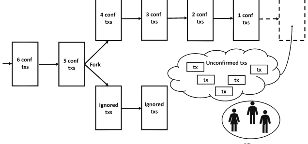

**图 3.9** 带有分叉的区块链总体概览，其中包含一个等待矿工插入的未确认交易。作者自绘。

被选为共识链的链。最长累积难度通常在区块数量上与最长分支一致，但这并非绝对保证。每当发生分叉时，网络参与者会等待额外的区块被创建，以确定哪一个分支（从难度角度来看）比另一个分支更长；歧义通过仅考虑被矿工认为是被选中的子链来解决。我们称之为为共识链，这定义了工作量共识算法。

### 3.6.8 51% 攻击

由于奖励是在相应的区块内支付的，只有当矿工的区块最终进入共识链时，矿工才能获得奖励；否则将被完全忽略。矿工必须针对最终的最长链进行挖掘，如果他们没有这样做，则希望他们的短链增长得比共识链更快，从而追上最长链并成为新的共识链。由于显而易见的计算原因，增长快的链意味着短链必须聚集网络总算力的 50% 以上 —— 这样区块产生的频率在统计学上就会高于竞争的分叉，并能够追上共识链。

包含在较短链中的区块创建者如何说服网络的一半成员继续工作，尽管面临着丢失已创建区块奖励的风险，而其他矿工可以简单地遵循已的最长链而无需面对不确定性？实践中，理性的矿工永远不会这样做。短链可能永远追不上共识链的危险，使得矿工偏离自然均衡（即：挖共识链）对所有矿工来说都不是最优的。

然而，超过网络 50% 算力的合谋矿工小组可能改变了动态机制：此类矿工可能会高于任何其他网络参与者总和的速率产生区块，

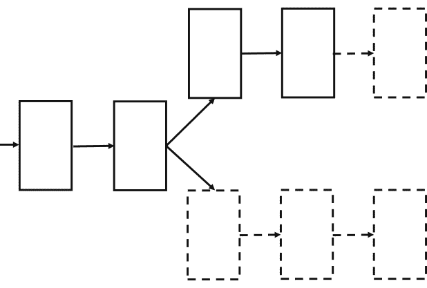

图 3.10 一个具有两个分支的分叉，其中一个较长。短链需要持续拥有总挖掘算力的 50% 以上才能追上最长链。作者自绘。

如图 3.10 所示，这将单方面地定义最长链。这就是所谓的 51% 攻击。攻击者控制着最长链，并通过分叉阻止任何其他矿工对共识链做出贡献，或者可能创建一个从过去开始的替代分叉并追上共识链以完全替换它，回滚结算。为了让共识算法受到信任，此类事件发生的风险必须足够低到可以被忽略。由于这个原因，比特币网络的安全性由其总算力（或其难度）松散定义：难度越高，攻击者超越 50% 并获得区块生成所有权的就越昂贵且越不现实。

有趣的是，中本·聪明的共识算法完全没有假设矿工是诚实的。只要没有诚实或不诚实的矿工合谋达到对总算力的足够大的控制，系统就能抵御大多数形式的攻击。然而，我们注意到，上述解释忽略了许多可能偏离自然激励的外生因素。例如，富有的攻击者可能在没有即时需求的情况下试图损害系统（例如政府）；或可能通过破坏对系统的信任并从独立交易策略（例如空卖）中获利来操纵 BTC 市场；或可能实施改变激励和博弈论均衡的行为。实践中，尽管存在多种理论攻击，比特币仍然保持着韧性和反脆弱性。

# 第 3 章 加密货币与分布式账本入门 | 71

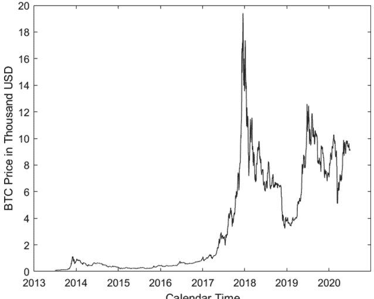

**图 3.11** 2013 年至 2020 年 BTC 的价格。作者自绘。来源：https://coinmarketcap.com。

2010 年 5 月 22 日，一种货币被贴上了标签，当时软件开发者 Laslo Hanyecz 以 10,000 BTC 购买了两个披萨，这将 BTC 的价值设定为每单位约为 0.04 美元。这一事件在建立 BTC 作为支付手段的可行方面具有如此重意义，以至于它广为人知的“比特币披萨日”，并每年持续庆祝。到 2020 年，Laslo 的 10,000 BTC 价值约为 1 亿亿美元。

两个月后，交易所 Mt Gox 推出了其 BTC 交易平台并获得了巨大的关注。BTC 的价值首次在一个主导平台上被追踪，市场流动性也得到了聚合。该资产令人惊讶的吸引力使这种加密货币在 2011 年第一季度就与美元平齐。增长持续持续，BTC 在该年的某个夏天飙升至 31 美元，随后经历了剧烈崩盘。BTC 的高增长和高风险特性在整个十年中一直占据主导地位，因为它在高速增长期和低迷期之间交替出现，但仍实现了数量级的增长，到 2020 年价值达到约 10,000 美元。图 3.11 展示了自 2013 年以来 BTC 价格带有剧烈波动和崩溃的复杂轨迹。

### 3.7.2 丝绸之路

与此同时，暗网“丝绸之路”（Silk Road）应世。丝绸之路于 2011 年启动，旨在促进非法产品和服务的交换，重点是药物和武器。

# 72 区块链与分布式账本：数学、技术与经济

丝绸之路将连接受隐私增强网络 TOR 保护的匿名平台上的买卖双方，并在任何监管框架之外使用 BTC 结算购买。根据美国联邦调查局（FBI）的说法，“丝绸之路是当时互联网上最复杂、极端的刑事市场，是一个巨大的黑市，网站用户在其中买卖非法商品和服务，包括几乎所有种类的非法药物。在运营期间，成千上万的毒贩和其他非法供应商利用丝绸之路将数百公斤的非法药物和其他非法商品和服务分发给超过 100,000 名买家，并洗白了这些非法交易产生的数亿美元。”2013 年 10 月，联邦调查局在进行严密调查后关闭了该服务，并逮捕了涉嫌的“丝绸之路”创始人和维护者 Ulrich Uricht。

## 3.7 山山寨币（Altcoins）

除了犯罪案件，比特币还展示了一种新的能力，其影响远超点对点货币。中本聪（Satoshi Nakamoto）建立的机制吸引了热情的软件工程师、研究人员和创业者，他们看到了提取比特币优秀想法并增量增强其协议的机会。比特币是一个开源倡议，任何用户都可以浏览其内部工作原理、重新设定参数或更改其行为，以启动一个接受或修改后的副本。一旦部署，副本就会通过新的创世区块引导其自己的区块链，并应用新网络的共识规则。本质上，副本仅与比特币共享设计原则，但它并不是比特币——就像双胞胎拥有相似的 DNA 但却是不同的实例。

2011 年，谷歌前员工李林（Charlie Lee）推出了莱币（Litecoin）。莱币许多方面与比特币相似，它改变了协议的三个方面。首先，它用替代方案取代了挖掘算法，以对比特币原语相关的去中心化风险更具韧性。其次，它将区块生成时间缩短至 2 分钟，而比特币为 10 分钟。第三，莱币在保持最终上限货币供应的同时改变了通胀率。尽管如此，许多变化足以吸引投资者、矿工和工程师的兴趣。莱币见证了市值的增长以及生态系统范围的扩大。2020 年，LTC 的市值达到了 30 亿美元。

随着莱币的商业成功和其兴起，数百个任意的比特币副本迅速出现。初创公司在部署重新参数化的副本上苦苦挣扎，每coin 允许其玩家在几分钟内部署一个新的类似于比特币的代币，例如具有不同的通胀计划、自定义的区块时间。自然，大多数这些替代币（也称为山寨币）由于缺乏差异化、用例和生态系统而迅速消失。有趣的是，其中一些确实生存了下来：在狗狗币（dogecoin）中，这种迷因加密货币唯一的真正创新是在硬币上附上一些有趣的狗图片（见图 3.12），它成功获得了足够的媒体关注以启动其生态系统，并在市值和支持度上增长。2020 年，狗狗币的市值达到约 4 亿美元。一些看到比特币副本的非理性增长


**图 3.12** 受迷因启发的狗狗币图标。

认为这种比特币副本的非理性增长是巨大的泡沫之中的；另一些人则将其视为任意、稀缺代币自由市场的有趣实验。

### 3.7.4 以太坊与智能合约

2013 年，加密货币研究员、程序员兼年轻企业家维塔林·布特林（Vitalik Buterin）首次宣布了他创建一个新平台的项目：以太坊（Ethereum）。以太坊并非比特币的模仿者，旨在重新考虑比特币的多个技术基础：以太坊更快、更具扩展性且更强大。关于以太坊的详细讨论，请参见第 6 章。

但与其更重要的是，以太坊旨在引入状态和图完备智能合约的概念。智能合约由尼克·萨萨博（Nick Szabo）于 1993 年发明，是一种旨在自动协调和强制执行条款的软件。智能合约有助于双方之间合同关系的去中间化，并减少错误、欺诈和主观解释的风险，最终目标是降低成本和不确定性。区块链为智能合约的执行提供了一个强大的平台：凭借其对不可变性和完整性的强有力保证，它理论上可以以完全去中心化且信任的方式执行可编程软件。

# 120 区块链与分布式账本：数学、技术与经济


**图 3.13** 2016 年至 2020 年 ETH 的价格。作者自绘。来源：https://coinmarketcap.com。

中本聪展示比特币是为了解决支付问题——而不是为了合同的数字化。尽管比特币在某种程度上是可编程的，但过去和现在都限于处理复杂的行为和反复交互。而以太坊承诺的平台不仅可以处理支付，还能维护和执行用户定义的智能合约，这些合约能够维护状态、接收并触发事件，并在底层资产流上执行条款。以太坊基金在 2014 年夏季的在线众筹中筹了 1400 万美元，网络的第一版本于一年后推出。2020 年，ETH 是市值第二大的加密货币，总价值达 500 亿美元。2021 年，ETH 的市值增长了一个数量级。

### 3.7.5 代币化（Tokenization）

在以太坊诞生的同时，一系列将传统资产数字化或代币化到区块链上的倡议应运而生。其原理很简单：如果区块链是如此

# 第3章 加密货币与分布式账本入门 | 75

既然对于原生加密货币非常实用，那么为什么不将其应用于股票、房地产、大宗商品、精细美术或其他资产类别呢？对于与加密货币无关的资产，人们也可以从分布式账的特性中获益。比特币提出了构建所谓的“彩色协议”（colored protocols），旨在增强比特币支持可追踪代币发行和管理的原生能力。部分由于涌现的彩色币（colored coins）种类繁多，该技术未能获得足够的动力来普及。比特币协议缺乏灵活性，也使得在实践中运行此类协议或在代币之上构建新功能变得困难。以太坊日益成功及其灵活的智能合约结构迅速吸引了大多数代币化项目。

凭借其通用的智能合约，以太坊提供了创建强大代币管理合约的所有工具。此类合约需要维护每个代币持有者的余额，允许转账，并根据合约的不同在代币的生命周期中引入更高级的功能，例如股权代币的公司行为、债券代币的票息支付，以及变动供应代币的铸造和销毁。2015年，一个名为以太坊请求评论20号（ERC-20）的智能合约接口被提出，用于标准化管理同质化代币的合约格式并实现。这不是强制性的，但它旨在标准化与代币智能合约的交互，使得生态系统能够开发新的服务来与标准化的代币进行交互；在ERC-20协议相对简单性的帮助下，它迅速取得了巨大成功，数百种代币构建在这一默认接口之上。比特币账本上的彩色币失去了动力，并被新以太坊标准的采用所掩盖。

## 3.7 首次代币发行

首次代币发行（ICO）热始于2016年。ICO术语的词源于更传统的首次公开发行（IPO），后者与公司在交易所上市有关。从历史上来看，IPO局限于那些决定从私人股东转为公开上市的大型公司，其股票按市场定义的价值进行交易。由于现有交易所平台的复杂性以及各种监管和报告要求，IPO对于寻求融资或提高股票流动性的早期公司而言（无论是出于成本考虑还是因为缺乏盈利能力），长期以来是臭名昭著地不可及的。ICO旨在解决这一问题，是一种面向早期和后期初创企业的众筹平台，同时也允许早期上市股票或代币。

一系列早期公司准备了白皮书和商业计划，以支持基于ICO的众筹推广。在实践中，发行公司发放新代币以换取已有的加密货币。代币可能以带有其自身分布式账本的新型加密货币计价，也可能利用现有账本上的代币协议，例如以太坊上的ERC-20合约。这与传统公司的融资活动并无二，初始投资者根据他们为公司带来的流动性获得资本份额。然而，与公司股票相比，ICO通常对任何投资者开放，无论其地理位置和投资规模如何；此外，一旦代币发行，就可以点对点地自由交换，并且通常可以在二级市场上立即进行交易（通过中心化交易所或去中心化交易）。与上市公司相比，代币可以在没有中间环节的情况下进行发行和持有，并且具有高度的互操作性。

在ICO于2016年和2017年快速增长的成功以及它们的多次失败——庞氏骗局、跑路（exit cams）以及其他欺骗投资者的方案之后，大多数司法管辖区的监管机构禁止了ICO，或者至少禁止了其实施的监管流程。由于监管与去中心化金融的公平原则背道而驰，2016年和2017年实施的ICO的吸引力大幅下降。2018年1月，加密货币和代币的总市值达到了8310亿美元的历史高点，随后崩盘了超过85%。

### 3.7.7 去中心化金融与自治组织

在加密货币和代币增长的同时，衰落的终结标志着去中心化整个金融和商业的宏大雄心的日益增长。不再依赖于中心监管的“现实世界”公司，一种去中心化自治组织（DAO）的新概念获得了关注。DAO是公司或组织的去中心化等效物；它们依赖智能合约并在分布式账本上代币化，使得“股东”是匿的代币持有者。DAO不再依赖公司章程、股东协议、当地法律或其他复杂的法律文件，其治理及其利润可以在合同内任意定义，与受监管公司的法律和习惯无关。由于透明性和不可篡改性，DAO天生对许多形式的风险（例如法律、管辖权风险）具有稳健性，并且通过移除商业登记机构或银行等中间环节，它们为国际化的、自执行的匿名组织提供了一个高效的工具。


DeFi（去中心化金融）在2020年是最热门的，一个完整的金融系统以完全去中心化的方式复制，使其不再依赖于中央银行、商业银行、支付处理器、政府或监管机构。从提供索引于某种货币或一篮货币的稳定币（见第8章），到点对点交易所、去中心化产品、保险、预测市场和赌博合约、去中心化订单、贷款工具，DeFi正在海量增长，从一个完全去中间化的替代金融体系的角度来看，既有金融机构正在失去主导地位。无论DeFi是另一个准备破裂的泡沫，还是金融的未来或短期实验，有一点是肯定的：区块链技术远未达到其全部潜力，我们很可能会发现今天仍不可见的的兴奋案例。

## 3.8 总结

本章回顾了比特币的哲学根源及其与其他加密经济共同增长。我们介绍了加密货币的基础构建模块，例如区块链和工作量共识，并解释了它们如何解决去中心化货币的主要挑战：双重花费。我们论证了加密货币的价值，并介绍了来自去中心化金融的最新趋势。

更多输入，请参见 Wüst 和 Gervais (2018)。

## 3.9 练习

- 1. 银行货币创造与比特币挖矿、点对点贷款等的主要区别是什么？
- 2. 描述无许可公共账本、许可私有账本和中心化账本之间的主要区别。给出说明这些账本用处的例子。
- 3. 我们考虑一个256位的秘密密钥。用科学计数法表示所有可能密钥的数量。假设一台强大的计算机每秒可以生成10亿个密钥，遍历所有可能的组合需要多久？如果每秒可以生成1万亿个密钥呢？为什么如果密钥是随机的，在实践中不需要担心密钥冲突？

# 第 4 章：

## 核心加密工具

> “破译术最奇特的特征之一是，每个人（即使是对该领域略有了解的人）都坚信自己能够构建出别人无法破译的密码。我还观察到，越是聪明的人，这种信念就越强烈。”

查尔斯·巴贝奇（Charles Babbage），出自《哲学家的人生片段》

## 4.1 引言

在希腊语中，Cryptography（加密，Κρυπτογογράφία）一词的意思是“隐藏的文字”。自古以来，各方利益相关一直利用加密技术来向对手隐藏其信息，并防止对手伪造声称来自原始发送者的信息。

直到 20 世纪中叶，所有的加密技术都依赖于对称范式。为了加密和解密消息，发送者和接收者必须拥有*相同的*密钥。20 世纪 70 年代，几组研究人员取得了重大突破，并发现了非对称加密。现在，发送者可以使用所有人公开的接收者公钥对消息加密，而接收者可以使用她的（或私钥）对其进行解密。相反，发送者可以使用她的私钥对消息进行签名，任何人都可以通过她的密钥进行验证。

正如我们将在下方看到的，在比特币、以太坊以及许多其他协议中，没有任何信息本身是被加密的。这些协议依赖于这样一个事实：非对称加密允许人们对消息进行数字签名，而值签名是一个不可否的证明，证明签名者拥有与其公钥相关的私钥。这一特征使能够确定特定地址相关的比特币的所有权。该地址的合法所有者如果愿意，可以将此值转移到另一个地址。

有一种加密构造至关重要——哈希函数（hash function）。一个有效的哈希函数可以将任意长度的消息映射到固定长度的消息（例如 256 位）。在实践中，找到另一个具有相同哈值的消息是不可能的，尽管这样的消息确实存在。通过使用哈希函数，可以显著减少与所需的加密操作相关的计算负担（例如对消息进行数字签名），因为可以对消息的哈希进行签名，而不是对消息本身。简单来说，可以将哈希看作人的指纹——它告诉你是所有者是谁，但所有者可以很容易地证明该指纹确实是她的。

矛盾的是，现代加密既极其复杂又相对简单。一方面，相关的加密思想是人类最复杂的成就之一。另一方面，归根结底，加密或签名消息依赖于存在如此多的排列，以至于考虑到现代计算机的能力，对这些排列进行直接分析（即暴力破解攻击）是不可能的。此外，所谓的加密破解运行速度比暴力破解应该具有的速度更快这也不可能是可能的。可以将不知道密钥而解密消息的过程看作是在针堆里找针，而不是在谚语中的针堆里找。时间将证明，随着量子计算的出现，数十亿现代加密是否会开始崩塌。

这里需要进行一个数学上的说明：现代加密的整个大厦是概率性的。典型的陈述是“如果 $p$ 是一个巨大的数字，那么特定的算法就是安全的”。然而，如果 $p$ 很大（在我们当今时代应该是如此），而且并不容易检查它是否为质数（或者在概率上检查）。同时，该领域的定理（例如著名的、极其复杂的 Hasse 定理，将在下文中讨论）无疑是*绝对的*。人们必须意识到，这些定理是基于 $p$ 为质数的假设，其结论才有效。

在本章中，我们对加密技术进行了浅显的介绍。我们涵盖了对称加密、非对称加密、哈希函数、数字签名以及其他几个概念。现代加密货币依赖于所谓的椭圆曲线加密（ECC）。由于对核心思想进行正面攻击很困难，我们从 Rivest-Shamir-Adleman（RSA）的有限环加密（FRC）开始，因为它更容易理解。然后在进入与 ECC 相关的更高级主题之前，我们将介绍有限域加密（FFC）。

本章的安排如下：在 4.2 节中，我们首先简要讨论对称加密，以建立视角。在 4.3 节中，我们介绍了所有基于公钥-私钥的非对称加密的重要概念。4.4 节包含了对数论的简要阐述，数论将用于后续章节构建与分布式账本技术相关的加密工具。在 4.5 节中，我们通过开发所谓的 FRC（也称为 RSA 加密）让这些工具大显身。我们强调，许多加密货币直接依赖 RSA 数字签名；然而，这一框架是更近期算法的起点。在 4.6 节中，我们涵盖了 ECC 及其最派生的算法——著名的 ElGamal 和 Schnorr 数字签名算法。这些算法特别有趣，因为它们可以用 ECC 框架（我们在 4.7 节中讨论该框架）。我们在 4.8 节中比较了三种数字签名算法，并得出：目前 EC 数字签名最适合 DLT 需求。然而，从长期来看，基于 EC 的 Schnorr 算法将胜。在 4.9 节和 4.10 节中，我们讨论了 DLT 需要的第二个加密原语——所谓的哈希函数和搜索算法。在 4.11 节中，我们涵盖了 Merkle 树和哈希指针。

> 当然，人们永远无法确定，在使用任何加密算法之前，必须对其进行详尽的对抗分析。

在 4.12 节中，我们概述了来自新兴量子计算领域对 DLT 的潜在威胁。我们在 4.13 节中总结本章。

值得注意的是，本章内容具有技术性。读者应该按照自己的节奏阅读材料。接受主要结论为事实不会阻止读者掌握书的其他部分。

## 4.2 对称加密

### 4.2.1 引言

首先，我们介绍一些术语。明文消息以标准形式包含信息。密文或加密信息是转换后的消息。密钥（多个）是加密的秘密参数，仅发送者和预期接收者已知。密钥用于执行从明文到密文的转换（加密）以及从密文到明文的转换（解密）。密码基于使用秘密密钥执行加密和解密的通用算法。密码分析代表了在预先不知道密钥的情况下将密文转换回原始明文的方法。

图 4.1 显示了通用设置；Alice 使用秘密密钥加密消息并广播给 Bob，Bob 使用相同的秘密密钥解密密文。通常，对手 Charlie 试图通过密码分析监听 Alice 的通信。如果成功，他不仅可以读取通信内容，从原理上还可以伪造消息。

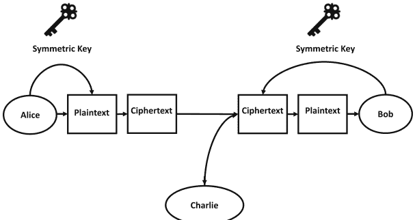

**图 4.1** 对称加密的概念框架，它依赖于一个用于加密或解密文本/密文的共享密钥。自绘。

# 区块链与分布式账本：数学、技术、经济学

假设敌人会立即熟悉这些内容。”详情请参阅，例如 Kerckhoffs (1883); Shannon (1949)。

### 4.2.2 凯撒加密

顾其实思义，凯撒加密可以追溯到古代。每个明文字母都被替换为字母表中向右移动 $k$ 个位置的字母，这种移动被称为循环位移。例如，我们可以将字母 A 转换为 F，如下所示：

```
ABCDEFGHIJKLMNOPQRSTUVWXYZ
↓
FGHIJKLQRSTUVWXYZABCDE  (4.1)
```

我们可以将每个字母替换为数字，$A \rightarrow 0, B \rightarrow 1, \dots, Z \rightarrow 25$，并将密钥表示为了一个整数，例如，$F \rightarrow k = 5$。假设消息中的第 $i$ 个字母由整数 $m_i$ 表示，$0 \leq m_i < 26$，则密文中的第 $i$ 个字母为整数 $c_i$：

```
$c_i = (m_i + k) \pmod{26}$.  (4.2)
```

因此，

```
$C A T = 02 00 19 \Rightarrow 07 05 24 = H F Y$.  (4.3)
```

解密过程如下：

```
$m_i = (c_i - k) \pmod{26}$.  (4.4)
```

因此，

```
$H F Y = 07 05 24 \Rightarrow C A T = 02 00 19$.  (4.5)
```

要破解凯撒加密，可以尝试每一个密钥，直到明文变得清晰为止。凯撒加密是单因子替换加密，因此明文中的一个字母始终由密文中的一个字母表示。如果消息足够长，或者其大致内容可以被测，就可以通过频率分析破解凯撒加密。

### 4.2.3 仿射加密

凯撒加密使用 25 个密钥中的一个来产生简单的映射。更通用的仿射加密使用一对密钥 $(l, k)$，$0 < l \leq 12$，$0 \leq k < 26$，来产生映射：

```
$c = (lm + k) \pmod{26}$.  (4.6)
```

读者应当验证不同密钥 $(l, k)$ 的数量为 $12 \times 26 = 312$。

## 4.2.4 简单替换加密

简单替换加密创建了一个明文字符及其对应密文图像的表格。例如，这是著名的恩尼格玛机（Enigma machine）第一个转子使用的替换表（见下文）：

```
ABCDEFGHIKLMNOPQRSTUVWXYZ
\downarrow
EKMFLGDQZNTOWHXUSPABRCJ \quad (4.7)
```

与凯撒加密类似，替换加密也是单因子替换的，因此尽管可能的替换方案数量巨大，仍然可以通过频率分析来破解。更精确地说，$26! = 4.03 \times e^{26}$。因此，仅凭可能的替换数量并不能使加密安全。

### 4.2.5 维吉尼亚加密

这种加密被错误地归功于布莱斯·德·维吉尼亚（Blaise de Vigenère），但实际上是由乔瓦万·巴蒂斯塔·贝拉索（Giovan Battista Bellaso）于1553年发明的。它产生一个密钥流，并连续使用对明文字母进行凯撒加密，因此使用了多因子替换；参见 Singh (2000)。如果密钥比消息长（这通常如此），则会重复密钥直到与消息长度匹配。几个世纪以来，它被称为 *le chiffre indéchiffrable*（不可破解的密码）。最终，弗里德里希·卡斯基（Friedrich Kaski）于1863年发表了解密维吉尼亚加密的通用方法。

假设消息中的第 $i$ 个字母由 $m_i$ 表示，$0 \le m_i < 26$，密文为 $c_i$：

```
$c_i = (m_i + k_i) \pmod{26} \quad (4.8)
```

其中 $k_i$ 是密钥的第 $i$ 个字母。例如，如果我们使用为“KEY”的密钥，每轮的密钥分别为 10, 04, 24, ..., 或者等同于 A->K, A->E, A->Y, ...,那么单词 CAT 变为 MER，

```
$C A T = 00 02 19 \Rightarrow 12 04 17 = M E R. \quad (4.9)
```

## 4.2.6 恩尼格玛机

恩尼格玛机（也称为 Enigma）是由德国工程师亚瑟·谢尔比乌（Arthur Scherbius）在第一次世界大战末发明的。最初，它主要商业化销售给希望保持通信机密的私人企业。最终，德国武装军和其他几个军事力量开始使用它。恩尼格玛机依赖与维吉尼亚加密相同的原理，并执行一个非常长的替换序列。

惊讶的是，秘密源在于密钥生成的自动化过程。电机械恩尼格玛机使用三个转子、一个插接板和一个反射器来实现其目标。转子在每次击键后移动，创建一个比发送的任何消息都更长的密钥序列。可能性的数量是巨大的。

生成伪随机密钥的一种简单方法是使用线性同余生成器（LCG）；例如，Knuth (1997)。这些是最古老且广为人知的伪随机生成器。LCG 以如下方式生成伪随机序列：

```
$X_{n+1} = (aX_n + b) \bmod Y$
```

其中，种子是序列 $X_0$ 的起始点，并且可能包含整数系数 $(a, b)$。模数 $Y$ 的常用选择是 $Y = 2^{32}$，但也使用了其他值。LCG 的某些属性（如速度和较小的内存占用）是有用的，但归根结底，由于其输出是可预测的，并且可以在独立的流中进行模拟。LCG 不适用于加密应用。

线性反馈移位寄存器（LFSR）泛化并改进了 LCG；例如，Pressnet 等人 (2007)。LFSR 的工作方式如下：

```
$X_{n+k} = (a_0X_n + a_1X_{n+1} + \dots + a_{k-1}X_{n+k-1}) \bmod Y$.
```

密钥由两个序列 $(a_0, \dots, a_{k-1})$ 和 $(X_n, \dots, X_{n+k-1})$ 组成。系数 $a_i$ 是二进制的，即 $a_i$ 为 0 或 1。使用简单的机电或电子电路就可以很容易构建 LFSR。只要 $Y$ 足够大，输出流就具有近乎均匀的分布和长周期。然而，LFSR 的线性使得它们容易受到暴力破解攻击。

## 4.2.9 数据加密标准

1974 年，美国标准局（NBS）征集了数据加密算法的提案。由 Horst Feistel 领导的 IBM 团队提交了一种成功的算法，目前被称为数据加密标准（DES）。目前，DES 已经过时。但偶尔，DES 仍被用于非关键任务。

DES 同时使用软件和硬件来执行复杂的混乱；Diffie 和 Hellman (1977)。DES 密钥长度为 64 位，但实际上是 56 位，因为每个字节中的一个位被用于错误检查。DES 算法使用异或操作进行混乱和循环。DES 的一个显著优势是，通过反转密钥，可以使用之前的相同步骤解密密文。现代计算机可以通过暴力破解破解 DES 密文；因此，建议在实践中不要使用。然而，它具有历史意义和启发性。此外，所谓的三重 DES（3DES）仍在某些应用中使用。

高级加密标准（AES）是一种加密和解密电子消息的现代方法，是 DES 的替代方案；详情请参见 Rijmen 和 Daemen (2001)。

## 4.3 非对称密钥加密

### 4.3.1 引言

从教学角度来看，从对称加密开始是自然的，假设加密和解密使用同一种密钥；见图 4.1。然而，这并不是唯一的方法。20 世纪 70 年代，几位研究人员建议加密和解密使用不同的密钥。

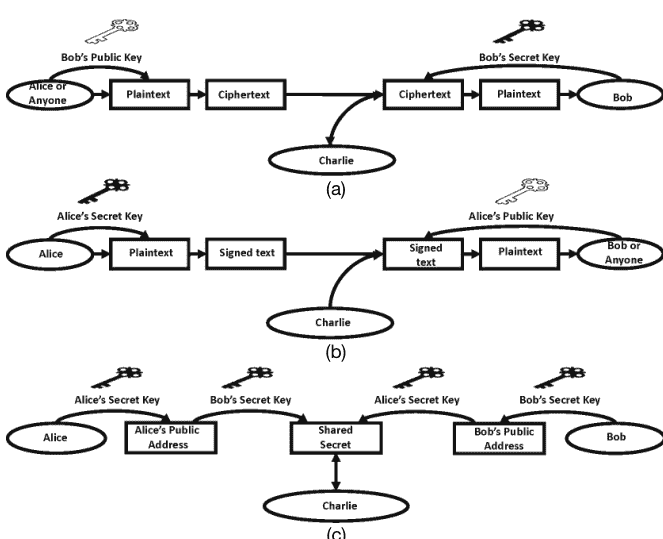

**图 4.3** 非对称加密的概念框架，它依赖于两个关联的密钥：(a) 公钥用于加密文本；私钥用于解密密文；(b) 私钥用于对消息签名；公钥用于验证签名；(c) 公钥和私钥都用于创建一个共同秘密。自绘。

这种可行性以及在许多情况下这种性，为密码学开启了新篇章——所谓的依赖公共密钥基础设施（PKI）的公密钥加密。在图 4.3 (a) 中，我们用图形表示了相应的加密—解密范式；在图 4.3 (c) 中，我们展示了数字签名算法；以及双方如何创建一个共同秘密。

我们有两个主角 Alice 和 Bob 以及一个反派 Charlie。在图 4.3 (a) 中，Alice 使用公开的 Bob 公钥加密消息，只有 Bob 使用他仅知的私钥解密。Charlie 尝试解密发给 Bob 的消息并将其替换为伪造。在图 4.3 (b) 中，Alice 使用她的私钥对消息或哈希进行签名。什么是哈希？它是一种从任意长度的消息创建固定长度的唯一摘要的算法。我们将在本章稍后讨论哈希算法，因为它们是由比特币以及所有其他区块链协议创建的。她的签名可以被 Bob（或者说是任何任何人）检查。

> 通常，哈希函数为 166–250 位，由于生日悖论（我们将在下文中讨论），它提供的安全性只有一半，即 80–128 “位”的安全。

Charlie 尝试创建一个伪造的消息并证明 Alice 签名过它。最后，在图 4.3 (c) 中，Alice 和 Bob 使用他们的私钥和公钥创建一个共同秘密。

### 4.3.2 密码学单向函数

单向函数是密码学的基石。单向函数是一种易计算但难反转的函数。陷门单向函数是在拥有某些信息时容易反转的单向函数。下面我们考虑一些例子。

### 4.3.3 抽象加密—解密算法

抽象加密—解密算法（EDA）包含三个步骤：

- (1) Alice 选择私钥并将其公开；
- (2) Alice 应用加密方法，使用消息生成密文；
- (3) Bob 应用解密方法，使用密文获取明文。

### 4.3.4 抽象数字签名算法

抽象签名算法（DSA）包含三个步骤：

- (1) Alice 选择私钥并将其公开；
- (2) Alice 应用签名方法，使用消息生成签名；
- (3) Bob 应用验证方法，使用消息和签名验证签名是否有效。

## 4.4 数论基础元素

### 4.4.1 模 n 整数集

对于给定的 $n$，我们关注的是整数集 $\{0, 1, ..., n-1\}$。考虑 $n=2$ 这一平凡情况，我们需要区分两种情况：(a) $n$ 是奇素数；(b) $n$ 是合数。

- (a) 设 $n$ 为奇素数 $p$。我们可以将有限域 $\mathbb{F}_p$ 定义为元素由整数集 $\{0, 1, ..., p-1\}$ 表示的有限域。回想，域是一个定义了加法、减法、乘法和除法且性质与实数对应运算相似的集合。

我们定义模 $p$ 的加法和乘法：

```
$a+b=c \pmod p, \quad a \times b=c \pmod p. \quad (4.24)$
```

很容易将普通整数算术的标准算法适配到 $F_p$ 中的加法和乘法。加法单位元（或零元素）是整数 0，乘法单位元是整数 1。当然，我们需要定义域元素的减法和除法。为此，定义域元素的逆元（负元）或乘法逆元非常方便。对于 $b \in \mathbb{F}_p$，加法逆元 $-b$ 为 $-b=p-b$。$a$ 在 $\mathbb{F}_p$ 中的乘法逆元 $b^{-1}$ 是方程唯一解 $x$：

```
$b \times x=1 \pmod p. \quad (4.25)$
```


可以通过下文讨论的扩展欧几里得算法找到。除法和减法根据加法和乘法定义：

```
$a-b=(a+(-b)) \pmod p, \na/b=a \times b^{-1} \pmod p. \quad (4.26)$
```

- (b) 设 $n$ 为合数，例如 $n=pq$。那么整数 $\{0, 1, ..., n-1\}$ 的集合 $\mathbb{F}_n$ 是环而不是域。回想，环是一个配备了加法和乘法运算且性质与实数运算相似的集合。$\mathbb{F}_n$ 是环而非域的原因显而易见——虽然减法总是可能的（即对于任何 $a, b \in \mathbb{F}_n，$a-b$ 都是定义的），但除法 $a \times b^{-1}$ 只有在 $b$ 和 $n$ 互质时才，即 $b$ 和 $n$ 的最大公约数为 1， $gcd(b,n)=1$。

重要的是，为了对称加密的目的，明文空间和密文空间分别是 $\mathbb{F}_p$ 或 $\mathbb{F}_n$。

### 4.4.2 欧几里得算法

欧几里得算法寻找两个自然数 $a$ 和 $b$ 的最大公约数 (GCD) $c$，它是能整除 $a$ 和 $b$ 而无余数的最大自然数。

它如下逐逐步归纳进行：

| 步骤# | 运算 |
|---|---|
| 0 | $r_{-2} = q_0r_{-1} + r_0$, |
| 1 | $r_{-1} = q_1r_0 + r_1$, |
| 2 | $r_0 = q_2r_1 + r_2$ |
| ... | ... |
| $N$ | $r_{-N-2} = q_Nr_{-N-1}$. |

其中 $r_{-2} = \max(a, b)$，$r_{-1} = \min(a, b)$。由于余数 $r_n \geq 0$ 随每一步减小，算法最终会运行并停止。对应的 $gcd c = r_{N-1}$。

### 4.4.3 扩展欧几里得算法

**定理 4.1** 给定非零整数 $A$ 和 $B$，存在整数 $\alpha$ 和 $\beta$ 使得

> $\alpha A + \beta B = \gcd(A, B)$.

该定理可以按照上述概述进行证明。详细分析留给读者作为练习。

正如前面提到的，如果 $\gcd(b, n) = 1$，则除以 $b$ 是可能的，因为扩展欧几里得算法产生：

> $\alpha b + \beta n = 1$。

因此

使得

> $b^{-1} \equiv \alpha \pmod n$，

我们留给读者去证明当 $\gcd(b, n) > 1$ 时除以 $b$ 是不可能的。

### 4.4.4 费马小定理

基于上述，我们可以证明以下有用且令人的定理。

**定理 4.2** 费马小定理：如果 $p$ 是素数且 $\gcd(A, p) = 1$（$p$ 不整除 $A$），则

> $A^{p-1} \equiv 1 \pmod p$。

该证明是直观的，并且是其他定理的典范。由于 $A^{-1}$ 存在，模 $p$ 乘法是单一的。因此，数字

> $A \times i \pmod p, i = 1, \dots, p - 1$。

是不同的。相应，

$$(A \times 1) (A \times 2) \dots (A \times (p-2)) \times (A \times (p-1))$$

$$= 1 \times 2 \dots (p-2) \times (p-1) \pmod p$$

乘积 $1 \times 2 \dots (p-2) \times (p-1)$ 是可逆的，因此定理成立。

### 4.4.5 欧拉定理

欧拉定理是费马小定理的一个令人兴奋的推广。

**定理 4.3** 欧拉定理：如果 $\gcd(A, n) = 1$，则

$$A^{\phi(n)} \equiv 1 \pmod n$$。

其中 $\phi(n)$ 是满足 $1 \le m < n$ 且 $\gcd(m, n) = 1$ 的整数个数。证明是直观的，但 $\phi(n)$ 的计算并不简单！由于 $\gcd(A, n) = 1$，$A^{-1}$ 存在，且 $A$ 的乘法是单一的。满足 $0 < m < n$ 且 $\gcd(m, n) = 1$ 的整数集合对于 $A$ 的乘法是封闭的。将这些整数标记为 $m_1, \dots, m_{\phi(n)}$。如前所示

$$(A \times m_1) (A \times m_2) \dots (A \times m_{\phi(n)-1}) \times (A \times m_{\phi(n)})$$

$$= 1 \times 2 \dots (\phi(n)-1) \times \phi(n) \pmod n$$。

由于乘积 $m_1 \times m_2 \dots \times m_{\phi(n)}$ 是可逆的，我们得出结论：

$$A^{\phi(n)} \equiv 1 \pmod n$$。

如果 $n$ 是素数，那么 $\phi(p) = p-1$（为什么？），这时我们恢复了费马小定理。给定欧拉定理，指数上的模 $n$ 计算等同于指数上的模 $n$ 计算。欧拉特征函数很难计算！然而，对于下文描述的加密目的，考虑由两个素数 $p, q$ 乘成的合数 $n$ 就足够了。在这种情况下，我们有

$$\phi(n) = (p-1)(q-1)$$。

关于该定理的实际应用，见第 4.5 节。

## 4.5 有限环加密

### 4.5.1 模幂

考虑一个大的自然数 $n$。对于给定的 $0 < x < n$，我们可以定义其模幂如下：

$$y = x^x \pmod n$$。

逆函数可以写成形式：

```
x = y^d \pmod n
```

当然，对于任意的 $n$，寻找对应的 $d$ 非常困难。然而，在某些情况下很容易，而在其他情况下，只要已知关于 $n$ 的额外信息。

### 4.5.2 陷阱函数？

让我们从 $n = p$ 开始，其中 $p$ 是大素数。给定费马小定理，我们可以在指数上高效执行模 $(p-1)$ 计算。事实上，如果

```
y = x^e \pmod p
```

那么

```
x = y^d \pmod p
```

只要

```
ed \equiv 1 \pmod {(p-1)}
```

显然，为了使方程 (40) 可解，我们必须满足 $\gcd(e, p-1) = 1$。在这种，可以使用扩展欧几里得算法找到 $d = e^{-1} \pmod {(p-1)}$。但是！我们不能将模 $p$ 幂作为陷阱函数，因为它太容易求逆！这不是一个好的选择。尽管如此，这是一个想法。我们可以尝试使用合数 $n = pq$。

### 4.5.3 一个好的陷阱函数！

给定欧拉定理，对于给定的 $n = pq$，计算 $\phi(n)$ 非常困难。然而，如果有人*知道* $n = pq$，$\phi(n)$ 的计算是直观的，但问题在于大 $n$ 无法被高效分解！因此，求解

```
y = x^e \pmod n
```

与分解 $n = pq$ 一样困难。因此我们有了陷阱函数，或者至少我们希望是这样。当然，如果我们知道实际因子，我们可以使用欧拉定理并将 $x$ 写为：

```
x = y^d \pmod n
```

其中

```
ed \equiv 1 \pmod{\phi(n)}, d = e^{-1} \pmod{\phi(n)}
```

### 4.5.4 RSA 加密解密

首先，我们展示 RSA 框架下加密-解密是如何工作的。将明文和密文分别标记为 $m$ 和 $c$。算法如下：

- (1) Bob 选择秘密素数 $p$ 和 $q$，并设置 $n = pq$。
- (2) Bob 选择满足 $\gcd(e, \phi(n)) = 1$ 的 $e$。
- (3) Bob 计算 $d$，使得 $de \equiv 1 \pmod{\phi(n)}$。
- (4) Bob 发布 $n$，并保留 $p, q$ 和 $d$。
- (5) Alice 将 $m$ 加密为 $c = m^e \pmod n$。
- (6) Alice 将 $c$ 发给 Bob。
- (7) Bob 计算 $m = c^d$ 并恢复 Alice 的消息 $m$。

### 4.5.5 RSA 数字签名算法

我们总结数字签名算法，按照原始 RSA 论文的内容：

- (1) Alice 选择秘密素数 $p$ 和 $q$，并设置 $n = pq$。
- (2) Alice 选择满足 $\gcd(e, \phi(n)) = 1$ 的 $e$。
- (3) Alice 计算 $d$，使得 $de \equiv 1 \pmod{\phi(n)}$。
- (4) Alice 发布 $n$，并保留 $p, q$ 和 $d$。
- (5) Alice 对 $m$ 签名，得到 $s = m^d \pmod n$。
- (6) Alice 将 $s$ 和 $m \pmod n$ 发给 Bob；
- (7) Bob 计算 $m' = s^e$ 并与 $m$ 比较；
如果 $m' = m$，则 Alice 的签名正确。

> ^7 公平地说，相同的算法早由 James H. Ellis、Clifford Cocks 和 Malcolm Williamson 在 1970-1974 年开发出来，但被他们的雇主——政府通信总部 (GCHQ) 保密了。可以假设美国安全局和克格格局也开发了类似的算法。

## 第 4 章 核心加密工具 | 95

让我们考虑一个具体的玩具级示例：

```
$p = 601, q = 7, n = 4207 = 601 \times 7$，
$\phi(n) = 3600 = 600 \times 6, e = 1463, d = 1127, \quad (4.48)$
```

其中

```
$1463 \times 1127 \pmod{3600} = 1. \quad (4.49)$
```

为了在给定 $e$ 的情况下计算 $d$，我们使用欧几里得算法，然后以反向的方式应用它。正向步骤和逆向步骤如下：

| 正向步骤 | 逆向步骤 |
|--- |--- |
| $3600 = 2 \times 1463 + 674$ | $674 = 3600 - 2 \times 1463$ |
| $1463 = 2 \times 674 + 115$ | $115 = -2 \times 3600 + 5 \times 1463$ |
| $674 = 5 \times 115 + 99$ | $99 = 11 \times 3600 - 27 \times 1463$ |
| $115 = 99 + 16$ | $16 = -13 \times 3600 + 32 \times 1463$ |
| $99 = 6 \times 16 + 3$ | $3 = 89 \times 3600 - 219 \times 1463$ |
| $16 = 5 \times 3 + 1$ | $1 = -458 \times 3600 + 117 \times 1463$ |

$gcd(3600, 1463) = 1$，且 $1463 \equiv 1 \pmod{3600}$。

首先，我们使用平方法来计算 $58^k$ 的二进制幂表，$l = 2^{k-1}, k=1, \dots, 12$；见表 4.1。

该表允许我们使用俄式快速幂法并将指数 1463 表示为二进制形式，来计算 $58^{1463} \pmod{4207}$：

```
$1463 = 1024 + 256 + 128 + 32 + 16 + 4 + 2 + 1. \quad (4.51)$
```

这种方法非常高效，允许我们顺序计算所需结果。显然，我们不需要 1462 次乘法，而只需要 15 次。因此，我们得到：

```
$58^{1463} \pmod{4207} = 471 \times 268 \times 1054 \times 144. \quad (4.52)$
```

```
$1815 \times 3873 \times 3364 \times 58 \pmod{4207} = 2937.$
```

因此，我们可以很容易地计算任何 $\pi$ 的 $58^*$。对于给定的 $y$，计算 $x = y^{1/e} \pmod n$ 是困难的；但在情况下，我们可以这样做，因为我们知道如何将 $n$ 分解为两个质数的积。

## 表 4.1 $58^k \pmod{4207}$ 的幂次表。

| k | 1 | 2 | 3 | 4 | 5 | 6 |
|---|---|---|---|---|---|---|
| 1 | 1 | 2 | 4 | 8 | 16 | 32 |
| $58^k$ | 58 | 3364 | 3873 | 2174 | 1815 | 144 |
| k | 7 | 8 | 9 | 10 | 11 | 12 |
| 1 | 64 | 128 | 256 | 512 | 1024 | 2048 |
| $58^k$ | 3908 | 1054 | 268 | 305 | 471 | 3077 |

## 表 4.2 $2937^k \pmod{4207}$ 的幂次表。

| k | 1 | 2 | 3 | 4 | 5 | 6 |
|---|---|---|---|---|---|---|
| 1 | 1 | 2 | 3 | 4 | 5 | 6 |
| $2937^k$ | 2937 | 1815 | 144 | 3077 | 305 | 471 |
| k | 7 | 8 | 9 | 10 | 11 | 12 |
| 1 | 64 | 128 | 256 | 512 | 1024 | 2048 |
| $2937^k$ | 268 | 1054 | 3908 | 3364 | 3873 | 58 |

*(注：原文中表 4.2 数据与计算逻辑似乎有出入，译文严格保留原文格式)*

# 章节 核心加密工具 | 99

为了确保上述方程有效，我们假设 $p$ 是一个质数（如符号所示），且 $a$ 是模 $p$ 的一个原根。我们将在下一节中详细讨论原根 $p$。这里简要提到，$a$ 为模 $p$ 的一个原根，意味着对于任何 $q, 0 < q < p$，存在一个整数 $r$，使得：

```
$q = a^r \mod p. \qquad (4.65)$
```

因此，给定 $(p, \alpha, y)$，我们需要找到 $x$。为了使 $x$ 唯一，我们总是选择最小解。离散对数具有加法性；为什么 $L_{\alpha}(yz)$？

```
$L_{\alpha}(yz) = (L_{\alpha}(y) + L_{\alpha}(z)) \mod (p-1). \qquad (4.66)$
```

## 4.6.2 原根

通常，如果每个原根 $m$ 都同于 $a$ 的某个幂，即 $m = a^{(k)} \mod n$，则 $a$ 是模 $n$ 的原根。当 $n$ 为质数时，每个 $0 < m < n$ 的 $m$ 都是 $a$ 的幂。例如，我们在表4.3中看到 $2, 6, 7, 11$ 是模 13 的原根。

该表显示对于每个 $n', 1 \le n' \le 12$，我们都有一个幂 $r'$ 使得对于 $a=2, 6, 7, 11$，$a^{(r')} = n'$，它们都是原根。很容易检查出 $p=13$ 没有其他原根。

对于给定的 $n$，寻找原根是困难。首先，计算欧拉函数 $\phi(n)$。其次，确定它的质因子 $p_1,\dots,p_t$。第三，对于每个 $p_i$，计算：

```
$z_i = a^{\phi(n)/p_i} \mod n. \qquad (4.67)$
```

如果 $z_i \neq 1$，则 $a$ 是原根。

例如，$\phi(13) = 12 = 2^2 \times 3$；$6^3 \mod 13 = 12 \neq 1$；$6^4 = 9 \neq 1 \mod 13$；$6$ 是原根。

通常，离散对数的计算非常复杂，尽管在某些情况下可以快速计算。我们在此不讨论细节，因为稍后会需要它们。在图4.5 (a), (b) 中，我们根据映射关系将 $n=1,\dots,96$ 的 $5^n \mod 97$ 以及 $n=1,\dots,126$ 的 $3^n \mod 127$ 展示为单位圆上的点。

表4.3 表明 2, 6, 7, 11 是模 13 的原根。

| r | 1 | 2 | 3 | 4 | 5 | 6 | 7 | 8 | 9 | 10 | 11 | 12 |
|---|---|---|---|---|---|---|---|---|---|---|---|---|
| 2' mod 13 | 2 | 4 | 8 | 3 | 6 | 12 | 11 | 9 | 5 | 10 | 7 | 1 |
| 6' mod 13 | 6 | 10 | 8 | 9 | 12 | 7 | 3 | 5 | 4 | 11 | 1 | 1 |
| 7' mod 13 | 7 | 10 | 5 | 9 | 11 | 12 | 6 | 3 | 8 | 4 | 2 | 1 |
| 11' mod 13 | 11 | 4 | 5 | 3 | 7 | 12 | 2 | 9 | 8 | 10 | 6 | 1 |

该图清楚地显示这些点分布以相当混沌的方式。例如，在图4.5 (a), (b) 中，我们看到了以下点序列 96, 34, 70, 68, 1, ..., 126, 72, 1, 87....。有趣的是，在图4.5 (b) 中，我们展示了通过连续连接这些点，可以得到由连接连续点的线条表示的心心线。

### 4.6.3 ElGamal 加密

ElGamal 加密基于离散对数而非指数运算；参见 ElGamal (1985)。它比 RSA 更现代、更安全。算法如下：

- (1) Alice 选择一个大质数 $p$ 和模 $p$ 的原根 $\alpha$；
- (2) Alice 取一个随机整数 $a$ 并计算 $\beta = \alpha^a \mod p$；
- (3) Alice 将三元组 $(p, \alpha, \beta)$ 作为公钥，同时保持私钥私；
- (4) Bob 选择一个随机整数 $k$ 并产生密文 $(\alpha^k, \beta^k) \mod p$；


- (5) Alice 使用秘密幂 `$a$` 解密密文如下：

```
$(\alpha^k)^{-a}(\beta^k)^a = (\alpha^{-ak})(\alpha^{ak}) = m \mod p. \qquad (4.69)$
```

因此，ElGamal 了密钥传输和解密：`$a$` 用于传输“一次性秘密” `$k$`；`$\beta^k$` 用作 `$m$` 的“一次性填充”，如上所述。由于单向函数模 `$p$` 是指数级的，其安全性取决于计算离散对数 `$L_{\alpha}(y)$` 的难度，即寻找 `$\alpha^x = y \mod p$` 的解。如果寻找离散对数很容易，攻击者就可以提取 `$L_{\alpha}(\beta) = a$` 并像预期那样容易地解密消息。ElGamal 加密优于原生 RSA，因为它使用了随机的 `$k$`，有助于消息。

## 4.6.4 ElGamal 数字签名算法

可以用 ElGamal 签名算法补充 ElGamal加密算法；参见 ElGamal (1985)。算法工作如下：

- (1) Alice 选择大质数 `$p$` 和模 `$p$` 的原根 `$\alpha$`；
- (2) Alice 选择一个随机整数 `$a$` 并计算 `$\beta = \alpha^a \mod p$`；
- (3) Alice 将三元组 `$(p, \alpha, \beta)$` 公开，同时保持其私钥私；
- (4) Alice 选择一个随机整数 `$0 < k < p-1$`，使得 `$\gcd(k,p-1) = 1$`，并计算 `$r = \alpha^k \mod p$`；
- (5) Alice 创建签名，即对 `$(r,s)$`，其中

```
$(r,s) = (r, (m+ar)k^{-1} \mod (p-1)). \qquad (4.70)$
```

验证算法分两步：

- (1) Bob 计算 `$\beta' = \beta^{-r} \mod p$` 和 `$u = \alpha^{u} \mod p$`。
- (2) Bob 比较 `$t$` 和 `$u$`。

如果等成立，签名有效。确实，对于有效签名，我们有：

```
$\beta^{-r}r^s = (\alpha^a)^{-r}(\alpha^k)^{(m+ar)k^{-1}} \mod p$
= \alpha^{-ar}\alpha^{m+ar} \mod p = \alpha^m \mod p. \qquad (4.71)$
```

ElGamal DSA 的可视化展示在图4.6。考虑上述算法的一个简单示例。Alice 选择 `$p, \alpha, a, \beta$` 如下：

```
$p = 997, \alpha = 7, a = 146, \beta = 7^{146} \mod 997 = 634. \qquad (4.72)$
```

这里 `$\alpha = 7$` 是质数 `$p = 997$` 的最小原根。她将 `$(p, \alpha, \beta)$` 公开并保留私钥。

# 104 | 区块链与分布式账本：数学、技术与经济

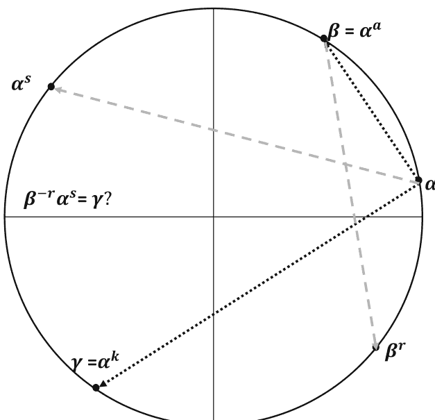

图 4.7 Schnorr DSA 可视化。自绘。

如果签名有效，则 `$r$` 和 `$u$` 应该相等，因为

> $$\alpha^{\beta}\beta^{-r} \mod p = \alpha^{(k+ar+Z_q)}\alpha^{-ar} \mod p$$

$$\alpha^{(k+Z_q)} \mod p = \alpha^k \mod p = \gamma.$$

图 4.7 展示了 Schnorr DSA 的视化。

对比图 4.6 和图 4.7 可以看出，Schnorr DSA 比 ElGamal DSA 更高效。签名是在 `mod q` 下生成的而不是 `mod p`。因此，计算量减少了，速度也提高了。同时，安全性基于 `mod p` 下离散对数问题的困难。对于验证，我们可以使用两次幂运算，而不是 ElGamal 算法中的三次，这自然更快。

我们如何生成所需的数字，即 `$p, q, a$`呢？首先，我们生成 `$q$`。然后，创建一个序列 `$p = q\rho + 1$` 并生成 `$\rho$` 直到遇到质数。为了生成 `$a$`，我们首先计算一个随机的 `$\sigma$`，然后 `$a = s^\sigma \mod p$`。如果 `$a=1$`（这极不利），我们就重新开始；否则，我们就得到了 `$a$`。在实践中，使用预生成的 `$p, q, a$` 更快，因为这不会降低安全性，由于 `$k$` 是随机的。你可以选取文献中描述的标准值。

# 第 4 章 核心密码学工具 | 105

考虑上述算法的一个用例。从 `$q = 97$` 开始，这是一个质数。很容易证明 `$97 \times 40 + 1 = 3881$` 是质数，因此我们可以选择 `$p = 3881$`。现在选择随机的 `$\sigma = 61$`。简单的计算得出：

```
$61^{40} \equiv 3440 \pmod{3881}, \quad (4.81)$
```

```
$3440^{97} \equiv 1 \pmod{3881},$
```

所以我们可以使用 `$a = 3440$`。现在随机选择私钥 `$a = 76$` 并计算对应的公钥 `$\beta$`

```
$\beta = 3440^{76} \pmod{3881} = 1568. \quad (4.82)$
```

让我们看看 Alice（其私钥 `$a = 76$`，公钥 `$\beta = 1568$`）如何签名消息 `$m=52$`。首先，她选择一个临时随机 `$k = 22$` 并计算：

```
$\gamma = 3440^{22} \pmod{3881} = 121. \quad (4.83)$
```

接下来，Alice 需要计算拼接消息的哈希值 `$h(m|y)$`。我们将讨论如何计算合适的哈希函数。在这里我们采用捷径。我们注意到 `$\phi=10$` 和 `$y = 21$` 是 `$q = 97$` 的原根，并定义哈希函数为：

```
$h(m|y) = \phi^m \psi^y \pmod q = 10^{52} \times 21^{121} \pmod{97} = 88 \times 74 \pmod{97} = 13. \quad (4.84)$
```

因此，签名的形式为：

```
$(r, s) = (13, (22 + 76 \times 13) \pmod{97}) = (13, 40). \quad (4.85)$
```

Bob 可以按照以下方式验证 Alice 签名的有效性。Bob 计算：

```
$\alpha^* = 3440^{40} \pmod{3881} = 554,$
```

```
$\beta^{-r} \equiv 1568^{-13} \pmod{3881} = 1480^{-1} \pmod{3881} = 2305, \quad (4.86)$
```

```
$554 \times 2305 \pmod{3881} = 121,$
```

在哈希处理后，恢复 `$r$`，从而确认了 Alice 的签名。

### 4.6.6 Diffie-Hellman 密钥交换

Diffie-Hellman (DH) 密钥交换可以基于 `mod p` 的幂运算，具有以下 `$f$` 和 `$a$` 的选择：

```
$g(x, y) = x^y \pmod p, \quad (87)$
```

```
$f(x) = g(\alpha, x) = \alpha^x \pmod p,$
```

其中 `$g$` 是 `$p$` 的原根。很容易看出满足对称性：

```
$g(f(a), b) = (\alpha^a)^b = (\alpha^b)^a = g(f(b), \pmod p. \quad (88)$
```

## 区块链与分布式账本：数学、技术

密钥交换过程如下：

- (1) Alice（或 Bob）选择参数 `$p$` 和 `$a$` 并将其公开；
- (2) Alice 秘密保留 `$a$` 并公开 `$a^a \mod p$`；
- (3) Bob 秘密保留 `$b$` 并公开 `$a^b \mod p$`；
- (4) Alice 和 Bob 计算它们的共享密钥 `$k = (a^a)^b = (a^b)^a$`。

由于 DH 交换使用的单向函数是 `mod p` 的幂运算，其安全性取决于离散对数问题的困难性。如果离散对数容易计算，攻击者就可以从 `$a^a \mod p$` 和 `$a^b \mod p$` 找到 `$a$` 和 `$b$`，整个架构将会崩溃。通常情况下，离散对数是一个困难的问题。

## 4.7 椭圆密码学

### 4.7.1 椭圆曲线

椭圆曲线是满足以下方程的实点 `$(x, y)$`：

```
$y^2 = x^3 + a_2x^2 + a_1x + a_0.$
```

换句话说，

```
$E = \{(x,y) : y^2 = x^3 + a_2x^2 + a_1x + a_0\}.$
```

必须理解对应的曲线 `$E$` 对于反射 `$y \to -y$` 是对称的。换句话说，如果 `$(x,y) \in E$`，那么 `$(x,-y)$` 也属于 `$E$`。我们在椭圆曲线上定义加法时使用这一事实。椭圆曲线的几个示例：

```
$y^2 = x^3 - x + 1,$
```

```
$y^2 = x^3 - x.$
```

并不是所有的椭圆曲线都有用——我们希望避免有重根，例如：

```
$y^2 = x^3 + x^2 - 1 = (x-1)(x+1)^2.$
```

图 4.8 显示了若干椭圆曲线。在实践中，考虑 `$a_2 = 0$` 的曲线就足够了，因为我们可以通过 `$-a_2/3$` 移动 `$x$` 来消除 `$x^2$` 项。因此，为了密码学目的，我们可以使用：

```
$E = \{(x,y) : y^2 = x^3 + ax + b\}.$
```

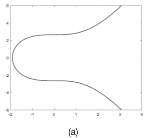

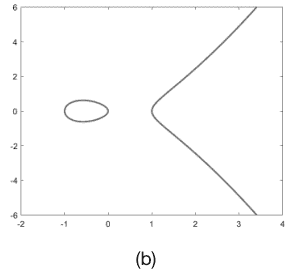

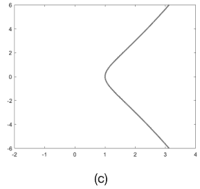

**图 4.8** 若干椭圆曲线：(a) `$y^2 = x^3 - x + 1$`；(b) `$y^2 = x^3 - x$`；(c) `$y^2 = x^3 + x^2 - 1$`。很容易证明，约化曲线 `$E$` 有重根当且仅当其判别式 `$\Delta$` 为零时：

```
$\Delta = -16(4a^3+27b^2) = -1728\left(\frac{a}{3}\right)^3+\left(\frac{b}{2}\right)^2 = 0. \quad (4.9)$
```

在我们进入深水区之前，简短的历史背景是有帮助的。

## 4.7.2 历史背景

关于解释为什么椭圆曲线没有与椭圆混淆的简短历史引言，详情请参见 Brown (2000); Rice 和 Brown (2012)。

椭圆曲线起源于古代。其中一位是奥纳德·比萨（也被称为 Fibonacci，约 1175–1250 年），他遇到了以下问题：“找到一个理数 `$r$`，使得 `$r^2-5$` 和 `$r^2+5$` 都是理数的。”

Fibonacci 证明 `$r=41/6$` 是一个数，因为 `$(41/6)^2-5=(31/6)^2$` 且 `$(41/6)^2+5=(49/6)^2$`。在他 1225 年著名的著作《Liber Quadrum》（平方书）中，Fibonacci 引入了“同余数”（congruent number）的概念。一个正整数 `$n$` 是同余数，只要存在一个理数 `$r$`，使得 `$r^2-n$` 和 `$r^2+n$` 是某些理数 `$r_-, r_+$` 的非零平方，即 `$r^2-n=r_-^2, r^2+n=r_+^2$`。根据 Fibonacci 的说法，5 是同余数。

同余数与椭圆曲线有什么关系？乘积 `$r^2r_-^2r_+^2$` 是理数 `$s$` 的平方：

```
$s^2=(r^2-n)(r^2+n)=r^4-n^2r^2=(r^2)^3-n^2(r^2).$
```

因此，点 `$(r, y)$` 是椭圆曲线上的一个点：

```
$y^2=x^3-n^2x.$
```

在 Fibonacci 的情况下，我们有 `$x=(41/6)$`, `$y=6229/216$`。一个重要的观察是 `$r$` 具有偶分母，这并非巧合。基本引理如下：

- **引理 4.1** 一个 `$n$` 是同余数，当且仅当在椭圆曲线 `$y^2=x^3-n^2x$` 上存在理点 `$(x,y)$` 使得 `$x=r^2$`。

# 第4章 核心加密工具 | 109

我们可以将其限制在第一象限内，并将椭圆参数化为 `$x(\theta) = p \cos\theta, y(\theta) = q \sin\theta$`，其中 `$\theta$` 是角度。著名的弧长公式给出：

```
$C(p, q) = 4 \int_{0}^{\pi/2} \sqrt{p^2\sin^2\theta + q^2\cos^2\theta} \ d\theta$
$= 4 \int_{0}^{\pi/2} \sqrt{q^2 - (k^2 - p^2)} \sin^2\theta \ d\theta \quad$ (4.100)
$= 4q \int_{0}^{\pi/2} \sqrt{1 - k^2\sin^2\theta} \ d\theta$,
```

`$k^2 = (1 - p^2/q^2), 0 \le k \le 1$`。当然，非平凡的情况是 `$0 < k < 1$`，因为当 `$k=0$` 时椭圆变为圆，当 `$k=1$` 时变为直线。

为了阐明椭圆与椭圆曲线之间的联系，我们引入 `$x = \sin^2\theta$` 并得到：

```
$d\theta = \frac{dx}{2\sqrt{x(1-x)}} \quad$ (4.101)
```

因此：

```
$C(p, q) = 2q \int_{0}^{1} \frac{\sqrt{1-k^2x}}{\sqrt{x(1-x)}} \ dx$
= 2q \int_{0}^{1} \frac{(1-k^2x)}{\sqrt{x(1-x)(1-k^2x)}} \ dx \quad$ (4.102)
= 2qk \int_{0}^{1} \frac{(\frac{1}{k^2}-x)}{\sqrt{x^3-(\frac{1}{k^2}+1)x^2+\frac{x}{k^2}}} \ dx$.
```

形式如下的积分：

```
$$\int \frac{\text{多项式}}{\sqrt{\text{具有三个不同根的三次式}}} \quad$ (4.103)
```

出现在所有应用中。由于椭圆弧长的计算是第一个例子，它们被称为椭圆积分。

我们在图 4.9 (a), (b) 中展示了一个典型的椭圆及其相关的椭圆曲线。椭圆积分无法用初等函数求值。为了完整性，我们给出半轴为 `$p, q$` 的椭圆弧长公式，参见 Abramowitz 和 Stegun (1948) 的公式 17.3.10：

```
$C(p, q) = 2\pi bF(-\frac{1}{2}, \frac{1}{2}; 1; k^2). \quad$ (4.104)
```

# 110 | 区块链与分布式账本：数学、技术与经济

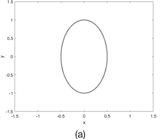

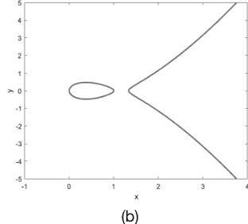

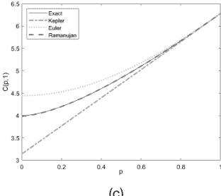

**图 4.9** (a) 由 `$4x^2 + y^2 = 1$` 给出的椭圆；(b) 对应的椭圆曲线 `$y^2 = x^3 - 7x^2/3 + 4x/3$`；(c) 椭周的精确及三个近似表达式。虽然开普勒和欧拉的近似对于长条椭圆会失效，但拉马努金的近似即使在极限情况下也表现得极好。自绘。

# 第4章 核心加密工具 | 111

这里 `$F(a, b; c; z)$` 是著名的超几何函数：

```
$F(\alpha, \beta; \gamma; z) = \sum_{n=0}^{\infty} \frac{(\alpha)_n (\beta)_n}{(\gamma)_n} \frac{z^n}{n!} \quad$ (4.105)
```

其中 `$(\alpha), (\beta), (\gamma)$` 定义如下：

```
$(\alpha)_n = \begin{cases} \alpha(\alpha+1)(\alpha+2)...(\alpha+n-1), & n > 0, \ 1, & n = 0, \end{cases}$

$(\beta)_n = \dots$，

$(\gamma)_n = \dots$，
\quad$ (4.106)
```

是 Pochhammer 符号。很显然，对于圆，这个公式变为 `$C(p, p) = 2\pi p$`。或者，使用 Abramowitz 和 Stegun (1984.15.3.17)，我们可以将 `$C$` 重写为对称形式：

```
$C(p, q) = \pi(p+q)F(\frac{1}{2},-\frac{1}{2};\frac{(b-a)^2}{(b+a)^2}) \quad$ (4.107)
```

几个世纪以来，著名的科学家们开发出了几个近似表达式。约翰内斯·开普勒 (1609) 提出了以下简单公式：

```
$C(p, q) \approx \pi(p+q). \quad$ (4.108)
```

莱昂哈德·欧拉 (1773) 使用了形式的近似：

```
$C(p, q) \approx 2\pi\sqrt{\frac{p^2+q^2}{2}} \quad$ (4.109)
```

而斯里尼瓦萨·拉马努金 (1914) 发现了惊人的表达式：

```
$C(p, q) \approx \pi(3(p+q) - \sqrt{(p+3q)(3p+q)}) \quad$ (4.110)
```

我们在图 4.9 (c) 中展示了精确公式和三个近似值。这个简单的图展示了拉马努金真正的天才之处——他的近似与另外两个复杂度相同，以至于肉眼无法看出区别。

### 4.7.3 椭圆曲线上的加法


到为止，对于 RSA 协议，我们考虑了单个乘法 `$p$`，它是我们的群运算。通过使用椭圆曲线，我们可以引入更有趣的群运算。为了简单起见，我们将从连续情况开始。我们需要在 `$E$` 上定义一种群运算，我们称之为加法。给定两个点 `$P_1=(x_1,y_1)$` 和 `$P_2=(x_2,y_2)$`，我们定义 `$P_1+P_2=P_3=(x_3)$`。为此，通过这两点画一条直线，直到它与曲线交于一点 `$Q=(x_3,-y_3)$`；该点的存在是因为著名的贝祖定理。

# 112 | 区块链与分布式账本：数学、技术与经济

 (a)

 (b)

 (c)

**图 4.10** EC 加法的几何方法。我们使用图 4.8 中的曲线：(a) 两个横坐标不同的点 `$P_1$` 和 `$P_2$` 的加法，`$P_1+P_2=Q, P_2=-Q=P_3$`；(b) `$P_1$` 的倍点，`$P_1+Q=\infty, P_2=-Q=P_3$`；(c) 两个横坐标相同的点的加法，`$P_1+P_2=\infty, P_2=-P_1$`。自绘。

**定理 4.** 次为 `$m$` 和 `$n$` 的代数曲线有 `$m \cdot n$` 个交点，前提是定义方程没有公因子。

# 113 | 第4章 核心加密工具

该证明了对于次数为 `$m$` 和 `$n$` 的曲线，交点的个数等于它们的乘积 `$m \cdot n$`。艾萨克·牛顿在 1687 年的《哲学原理》中提出了这一定理。随后，该结果由埃蒂昂·贝祖在 1779 年的《Thorie générale des équations》中发表。

通常，交点可能发生在复空间，但在我们的情况下，它们必须是实数（为什么呢？）。由于我们关注的是椭圆曲线（次数3）和直线（次数1），交点的个数恰好应该是 3。我们将 `$Q$` 沿 x 轴反射并令 `$P_3=(x_3, y_3)$`，见 4.10。换句话说，三个点 `$P_1, P_2, Q$` 属于椭圆曲线 `$E$` 和直线 `$L$`，它们的和为“单位元” `$O$`，这是我们的零元或单位元：

```
$P_1 + P_2 + Q = O. \quad$ (4.111)
```

当 `$P_1 = P_2 = P$` 时，我们地通过 `$P$` 画一条切线并得到 `$P_3$`：

```
$P + P + Q = O. \quad$ (4.112)
```

在特殊情况下：`$P_1=(x_1,y_1), P_2=(x_1,-y_1)$`，通过这两点的直线 `$L$` 显然是垂直的且不会再次与曲线 `$E$` 相交！在这种情况下，我们有：

```
$P_1 + P_2 = O. \quad$ (4.113)
```

因此，我们可以说：

```
$P_1 + P_2 = -Q = P_3. \quad$ (4.114)
```

单位元具有以下属性：

```
$O + (x,y) = (x,y), \quad (x,y) + (x,-y) = O. \quad$ (4.115)
```

现在，我们需要找到 `$(x_3, y_3)$` 的实际坐标，其中：

```
$(x_1,y_1) + (x_2,y_2) = (x_3,y_3). \quad$ (4.116)
```

如果 `$(x_1,y_1) = (x_2,y_2)$`，我们可以使用弦线加法：

```
$(x_3,y_3) = (m^2-x_1-x_2, m(2x_1+x_2-m^2) - y_1), \quad$ (4.117)
```

```
$m = \frac{y_2-y_1}{x_2-x_1}.
```

如果 `$(x_1,y_1) = (x_2,y_2) = (\bar{x})$`，我们可以使用切线加法：

```
$(x_3,y_3) = (m^2-2\bar{x}, m(3\bar{x}-m^2) - \bar{y}), \quad$ (4.118)
```

```
$m = \frac{(3\bar{x}^2+a)}{2\bar{y}}.
```

群运算的一些代表性示例在图 4.10 中。现在我们展示如何推导公式 (4.117) 和 (4.118)。考虑直线：

```
$y = m(x-x_1) + y_1. \quad$ (4.119)
```

# 114 | 区块链与分布式账本：数学、技术与经济

其中 `$m$` 由 (4.117) 给出。等价地：

```
$L = {(x_1, y_1) : y = m(x - x_1) + y_1\}.
```

因此，点 `$P_1, P_2, Q$` 属于椭圆曲线 `$E$` 和直线 `$L$`，它们的和为“单位元” `$O$`，这是我们的零元或单位元。显式地，`$x_1, x_2, x_3$` 是三次方程的根：

```
$x^3 + ax + b + m(x - x_1) = 0
```

根据韦达定理，根之和 `$x_1+x_2+x_3 = -m$`。`$x_3 = -m-x_1-x_2 = m^2-x_1-x_2$`。

## 4.7.4 椭圆曲线的射化

在本节中，我们将简要讨论椭圆曲线与射影几何之间的联系。通过椭圆曲线的点 `$(x,y)$` 和 `$(x,-y)$` 的垂直线与曲线相交呈现对称性而非两个点，这一点值得额外讨论。

为了详细说明，我们需要将椭圆曲线从仿 `$(x,y)$` 平面“提升”到射影 `$(X : Y : Z)$` 平面。这一过程被称为射化。我们的操作步骤如下：考虑一条仿椭圆。令 `$x = X/Z, y = Y/Z$`，形式如下：

`$Y^2Z = X^3 + AX^2 + bZ^3.$`

在 `$(X, Y, Z)$` 空间中。我们消除了原点 `$(0,0,0)$` 以避免产生，因为它属于每一条椭圆曲线。

方程 (4.130) 是 3 次齐次的。因此，如果 `$(X, Y, Z)$` 是曲线上的一个点，那么对于任何 `$\lambda$`，`$(\lambda X, \lambda Y, \lambda Z)$` 也是。为了避免出现“过多”的点，我们将二维射影空间定义为非零点 `$(X, Y, Z)$` 的等价类集合，其中 `$(X, Y, Z)$` 和 `$(\lambda X, \lambda Y, \lambda Z)$` 被视为等价。直观上，通过将通过原点的直线视为单个点，三维空间被简化为二维。我们使用符号 `$(X : Y : Z)$` 表示射点以强调这一事实。因此，`$(X : Y : Z) = (\lambda X : \lambda Y : \lambda Z)$`，`$\lambda \neq 0$`。

显然，对于 `$Z \neq 0$`，我们可以将 `$X$` 除以 `$Z$`，`$Y$` 除以 `$Z$`，考虑 `$x = X/Z = Y/Z$` 并得到仿方程的一个解。

然而，如果 `$Z = 0$`，则不允许除以 `$Z$`，因此射影曲线上存在不对应于椭圆曲线上的点的点。这些点的形式为 `$(0 : y : 0)$`，对于任何 `$y \neq 0$`。鉴于射平面上的点定义为等价类，我们可以选择以下点 `$O = (0 : 1 : 0)$`，称为无穷点或单位元。我们可以直观地认为 `$O$` 是一个位于 `$y$` 轴上无限高（且无限低）的点。

考虑仿平面中由以下方程定义的垂直直线：

`$x - \bar{x} = 0.$`

在射平面中，它看起来如下：

`$X - \bar{x}Z = 0.$`

对于任何 `$\bar{x}$`，点 `$O$` 都属于这条线。因此，在射化之后，我们发现除了 `$(\tilde{x}, \tilde{y})$` 之外，还有一个属于椭圆曲线和直线的第三个点，而这个点就是无穷点 `$O$`。

### 4.7.5 椭圆曲线上的乘法

我们只对整数乘法感兴趣，它在直观上通过重复加法定义。例如

`$3 \times (x, y) = ((x, y) + (x, y)) + (x, y))$`.

在此处及以后，我们使用 `$\times$` 表示标量椭圆曲线点乘法。我们在下面的图 4.11 中说明了这一操作。像通常一样，乘数的二进制分解有助于快速执行乘法。

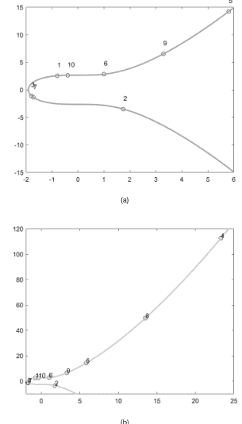

图 4.11 EC `$y^2 = x^3 + 7$` 上点 `$A = (-0.8, 2.55)$` 的倍点；(a) 在小尺度上显示了 `$A, 2A, 4A, 8A,...$` 的序列；(b) 大尺度上的相同序列。原创。

### 4.7.6 离散椭圆曲线

掌握了上述材料，我们现在可以回到密码学。不意外的是，我们必须在有限离散点集上操作。我们考虑过 `$mod \ p$` 或 `$mod \ n = mod \ p q$`。现在我们希望使用一个 EC 和一个大素 `$p$`，并考虑 `$mod \ p$` 的 EC。`$x = 0, 1, \dots, p-1, y = 0, 1, \dots, p-1$`。

`$E_p = \{(x, y) : y^2 = x^3 + ax + b \ mod \ p\}$`.

让我们证明在 `$E_p$` 上寻找点 `$(x, y)$` 并不容易！

假设我们知道构成 `$E_p$` 的点集，我们可以使用公式 (4.117, 4.118) 来定义加法，其中 `$m$` 在整数中必须根据情况理解，主要理解为分子和分母的积。为了热身，让我们考虑形式如下的 `$E_p$`：

`$y^2 = x^3 + 7 \ mod \ p.$`

`$p = 2^5 - 1 = 31, p = 2^7 - 1 = 127, p = 2^{13} - 1 = 8191,$` 是所谓的梅森数，即小于 2 的幂的素数。我们将看到用梅森数构造 EC 有显著优势。这些曲线如图 4.12 所示。它们分别包含 21、127 和 8011 个点。由于 21 不是素数，`$E_{31}$` 不是密码学上有用的 EC，而 `$E_{127}$` 和 `$E_{8191}$` 是（127 和 8011 都是素数），除非它们太小。

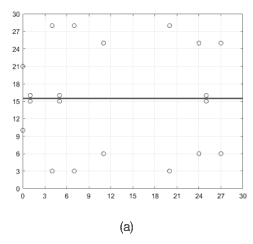

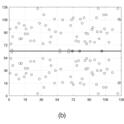

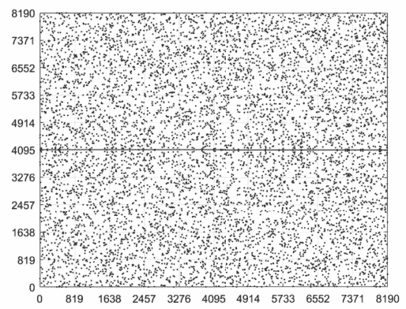

**图 4.12** 三条 EC (`$E_p : y^2 = x^3 + 7 \bmod p$`)：(a) `$p=31, m=21$`；(b) `$p=127, m=127$`；(c) `$p=8191, m=8011$`。这里 `$m=#E_p$` 是 `$E_p$` 上的点数。“单位元”未显示。原创。

> 这些素数以法国僧侣梅森（1588–1648）的名字命名，他在 *Cogitates-Physica* (1644) 中指出 `$n \le 25$` 的 `$2^n-1$` 在 `$n=2, 3, 5, 7, 13, 17, 19, 31, 67$` 时是素数。虽然 `$n=2, \dots, 19$` 已知，`$n=67, 257$` 是错误的，且 `$n=61, 107$` 被遗漏了，梅森这个名字变成了标准。

### 表 4.4 属于 `$E_{31}$` 的有限点。

| x | 0 | 1 | 2 | 3 | 4 | 5 | 7 |

|---|---|---|---|---|---|---|---|

| y | 10 | 15 | 16 | 3 | 28 | 15 | 16 | 3 |

| # | 1 | 2 | 3 | 4 | 5 | 6 | 7 | 8 |

| x | 11 | 20 | 24 | 24 | 25 | 25 | 27 |

| y | 6 | 25 | 38 | 6 | 25 | 15 | 16 | 6 |

| # | 11 | 12 | 13 | 14 | 15 | 16 | |

属于 `$E_{31}$` 的所有有限点都在表 4.4 中。此外，还有一个单位元（无穷）`$O$`。我们为 `$O$` 分配 #0。因此，共有 21 个点，包括单位元。

通常，Hasse 定理估计离散 `$E_p$` 上的点总数。我们强调，与“假设 `$f$` 是良好的陷门函数”之类的陈述不同，Hasse 定理是一个“真实”定理并且可以被严格证明。

**定理 4.5.** Hesse 定理：离散椭圆曲线上的点总数 `$N$` 满足以下不等式：

`$|N - (p+1)| < 2\sqrt{p}$`.

如果一个点 `$(x,y)$` 属于椭圆曲线 `$(x,y)\in E_p$`，那么 `$(x, p-y)$` 也是。有 `$p$` 个可能的横坐标，其中大约一半属于 `$E_p$`。对于密码目的，知道修正值 `$t = N - (p+1)$` 的精确值极其重要，由方程 (4.137) 给出，可以通过高效的 Schoof 算法完成；见 Schoof (1985)。`$\#E_p$` 表示曲线上的点数。很容易检查对于 `$E_{31}$` 不等式有效：

`$|21 - 32| = 11 < 2 \times 5$`.

有趣的是，曲线上的点“很少”，使得 Hesse 定理勉强成立。表 4.5 显示了如何在 `$E_{31}$` 上相加点。

### 表 4.5 `$E_{31}$` 的加法表。曲线上的点按 4.4 所示编号。

| + | 0 | 1 | 2 | 3 | 4 | 5 | 6 | 7 | 8 | 9 | 10 | 11 | 12 | 13 | 14 | 15 | 16 | 17 | 18 | 19 | 20 |

|---|---|---|---|---|---|---|---|---|---|---|---|---|---|---|---|---|---|---|---|---|

| 0 | 0 | 1 | 2 | 3 | 4 | 5 | 6 | 7 | 8 | 9 | 10 | 11 | 12 | 13 | 14 | 15 | 16 | 17 | 18 | 19 | 20 |

| 1 | 1 | 0 | 3 | 4 | 5 | 6 | 7 | 8 | 9 | 10 | 11 | 12 | 13 | 14 | 15 | 16 | 17 | 18 | 19 | 20 | 21 |

| 2 | 2 | 3 | 0 | 4 | 5 | 6 | 7 | 8 | 9 | 10 | 11 | 12 | 13 | 14 | 15 | 16 | 17 | 18 | 19 | 20 | 21 | 22 |

| 3 | 3 | 4 | 5 | 0 | 6 | 7 | 8 | 9 | 10 | 11 | 12 | 13 | 14 | 15 | 16 | 17 | 18 | 19 | 20 | 21 | 22 | 23 |

| 4 | 4 | 5 | 6 | 7 | 0 | 8 | 9 | 10 | 11 | 12 | 13 | 14 | 15 | 16 | 17 | 18 | 19 | 20 | 21 | 22 | 23 | 24 |

| 5 | 5 | 6 | 7 | 8 | 9 | 0 | 10 | 11 | 12 | 13 | 14 | 15 | 16 | 17 | 18 | 19 | 20 | 21 | 22 | 23 | 24 | 25 |

| 6 | 6 | 7 | 8 | 9 | 10 | 11 | 0 | 12 | 13 | 14 | 15 | 16 | 17 | 18 | 19 | 20 | 21 | 22 | 23 | 24 | 25 | 26 |

| 7 | 7 | 8 | 9 | 10 | 11 | 12 | 13 | 0 | 14 | 15 | 16 | 17 | 18 | 19 | 20 | 21 | 22 | 23 | 24 | 25 | 26 | 27 |

| 8 | 8 | 9 | 10 | 11 | 12 | 13 | 14 | 15 | 0 | 16 | 17 | 18 | 19 | 20 | 21 | 22 | 23 | 24 | 25 | 26 | 27 | 28 |

| 9 | 9 | 10 | 11 | 12 | 13 | 14 | 15 | 16 | 17 | 18 | 19 | 20 | 21 | 22 | 23 | 24 | 25 | 26 | 27 | 28 | 29 | 30 |

| 10 | 10 | 11 | 12 | 13 | 14 | 15 | 16 | 17 | 18 | 19 | 20 | 21 | 22 | 23 | 24 | 25 | 26 | 27 | 28 | 29 | 30 | 31 |

| 11 | 11 | 12 | 13 | 14 | 15 | 16 | 17 | 18 | 19 | 20 | 21 | 22 | 23 | 24 | 25 | 26 | 27 | 28 | 29 | 30 | 31 | 0 |

| 12 | 12 | 13 | 14 | 15 | 16 | 17 | 18 | 19 | 20 | 21 | 22 | 23 | 24 | 25 | 26 | 27 | 28 | 29 | 30 | 31 | 0 | 1 |

| 13 | 13 | 14 | 15 | 16 | 17 | 18 | 19 | 20 | 21 | 22 | 23 | 24 | 25 | 26 | 27 | 28 | 29 | 30 | 31 | 0 | 1 | 2 |

| 14 | 14 | 15 | 16 | 17 | 18 | 19 | 20 | 21 | 22 | 23 | 24 | 25 | 26 | 27 | 28 | 29 | 30 | 31 | 0 | 1 | 2 | 3 |

| 15 | 15 | 16 | 17 | 18 | 19 | 20 | 21 | 22 | 23 | 24 | 25 | 26 | 27 | 28 | 29 | 30 | 31 | 0 | 1 | 2 | 3 | 4 |

| 16 | 16 | 17 | 18 | 19 | 20 | 21 | 22 | 23 | 24 | 25 | 26 | 27 | 28 | 29 | 30 | 31 | 0 | 1 | 2 | 3 | 4 | 5 |

| 17 | 17 | 18 | 19 | 20 | 21 | 22 | 23 | 24 | 25 | 26 | 27 | 28 | 29 | 30 | 31 | 0 | 1 | 2 | 3 | 4 | 5 | 6 |


| 18 | 18 | 19 | 20 | 21 | 22 | 23 | 24 | 25 | 26 | 27 | 28 | 29 | 30 | 31 | 0 | 1 | 2 | 3 | 4 | 5 | 6 | 7 |

| 19 | 19 | 20 | 21 | 22 | 23 | 24 | 25 | 26 | 27 | 28 | 29 | 30 | 31 | 0 | 1 | 2 | 3 | 4 | 5 | 6 | 7 | 8 |

| 20 | 20 | 21 | 22 | 23 | 24 | 25 | 26 | 27 | 28 | 29 | 30 | 31 | 0 | 1 | 2 | 3 | 4 | 5 | 6 | 7 | 8 | 9 |

属于 $E_{31}$ 的所有有限点都在表 4.4 中。此外，还有一个单位元（无穷）$O$。我们为 $O$ 分配 #0。因此，共有 21 个点，包括单位元。

# 区块链与分布式账本：数学、技术、经济

我们在图 4.13 中通过图形化展示了加法表的结果。

最后，考虑 $E_{31}$ 上随机选择的两个点 $A = (4,28), B = (24,6)$。

用 $L$ 表示通过这两个点的直线，其方程由式给出：

```
$L = \{(x,y) : y = \alpha(x - 4) + 28 \pmod{31}\}$
```

其中系数 $\alpha$ 是 0 到 30 之间的整数，使得：

```
$20\alpha + 28 \equiv 6 \pmod{31}$
```

欧几里得算法得出 $\alpha = 2$，因此直线的方程的形式为：

```
$L = \{(x,y) : y = 2(x - 4) + 28 \pmod{31}\}$
```

正如预期的那样，图表显示还有一个点 $C = (7,3)$ 同时属于 $E_{31}$ 和 $L$。因此，$A + B = D$，其中 $D = (7,28)$。该过程见图 4.13 (a)。

同样，对于 $A = (5, 15)$，$B = (20, 3)$，我们有：

```
$L = \{(x,y) : y = \alpha(x - 5) + 15 \pmod{31}\}$
```

其中：

```
$15\alpha + 15 \equiv 3 \pmod{31}$
```

因此，$\alpha = 24$，$L$方程为：

```
$L = \{(x,y) : y = 24(x - 5) + 15 \pmod{31}\}$
```

使得 $C = (24,6)$ 且 $A+B=D=(24,26)$。该过程见图 4.13 (b)。

让我们选择 $E_{31}$ 的一个点，例如 $G = (7,3)$ 并计算 $2 \times G, 3 \times G, \dots$ 这一序列见图 4.14。该序列是混沌的，因此即使已知 $A = kA$，很难找到实际的 $k$。我们将 $G$ 的整数定义为数字 $n$，使得 $n \times G = O$，其中 $O$ 是单位元。余因子 $h$ 是比值 $N/n$，其中 $N$ 是 $E_{31}$ 上点的总数。我们有 $n=21, h=1$。

## 4.7.7 椭圆曲线上的离散对数问题

我们准备制定椭圆曲线版本的离散对数问题。为了完成这一点，我们需要更具体并为之前的构造添加一些细节。考虑一个由元组 $T = (p, a, b, G, n)$ 定义的椭圆曲线 (EC)，记为 $E_T$。在这里，$p, a, b$ 与之前，而 $G$ 是基点，用于生成形式为 $\mathscr{E}_G = \{[k]G\}$ 的点集；$n$ 是 $G$ 的阶，即集合 $\mathscr{E}_G$ 的基数，$h$ 是 $G$ 的余因子，$h = \#E_T/\#\mathscr{E}_G$。出于加密目的，$n$ 必须是一个质数。良好的基点应该具有 $h = 1$，这意味着所有点的集合 $\mathscr{E}_G$ 覆盖了整个曲线。因此，$G$ 是上述考虑的原始根。

- 格朗日引指出，对于任何有限群 $G$ 和 $G$ 的每个子群 $H$，$H$ 的阶（元素个数）整除 $G$ 的阶，这保证了 $h$ 是整数。

## 第 4 章 核心加密工具 | 121

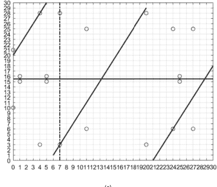

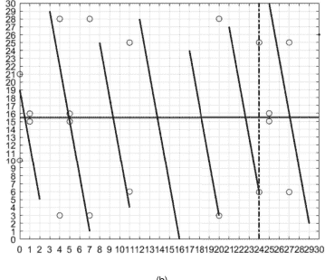

**图 4.13** 生成加法表的几何方法：(a) (4, 28) + (24, 6) = (7, 28);(b) (5, 15) + (20, 3) = (24, 25)。自绘。

离散对数问题需要为给定的元组 $(p, \alpha, \alpha)$ 寻找 $k$。我们可以将其椭圆曲线版本制定如下：给定 $E_T$ 和点 $A \in \mathbb{E}_G$，寻找 $k$，使得：

> $A = k \times G = ((G + G) + G) + ... + G). (4.145)

当 $E_t = \mathbb{E}_G$ 时，该问题变得特别容易制定（但通常求解非常困难！）。给定一个点 $A \in E_T$，寻找 $k$，使得 $A = k \times G$。

在许多方面，问题 (4.64) 和 (4.145) 是相似的！基于这一事实，我们可以开发椭圆曲线版本的 ElGamal 签名和 Diffie-Hellman 密钥交换。

## 122 | 区块链与分布式账本：数学、技术、经济


**图 4.14** 序列 $k \times G, G = (7,3)$，$21 G = O$。

### 4.7.8 标准椭圆曲线 sec256r1

首先，我们描述美国标准，我们使用 `sec256r1`，倒数第二个位置代表“random”（随机），它被认为是安全的。出于信任政府的精神，比特币特意使用了一种略有不同的曲线 `sec256k1`，倒数第二个位置代表“Koblitz”，见下文。曲线 `sec256r1` 由六元组 $T = (p, a, b, G, (G_x, G_y), n)$ 特征。对应的参数在 Certicom Research (2009) 中描述，*此外*，具有如下形式：

```
\begin{aligned}
p &= fffffffff000000000000000000000000000000000ffffffffffffffffffffffffffff \\
a &= 56ac5d83aa3a9e73ebbd5d576988bc \\
b &= 651d06b0cc53b0f63bce3c3e27d2604b9
\end{aligned}
```

设消息 $m = 66$。随机选择 $l = 83$。很容易检查到：

$l^{-1} = 101,$

$B = l \times G = (122, 3),$

$s = (m + kr) l^{-1} = 79 \pmod{127},$

$s^{-1} = 82,$

$ms^{-1} = 78 \pmod{127},$

$P_1 = ms^{-1} \times G = (85, 77),$

$rs^{-1} = 98 \pmod{127},$

$P_2 = rs^{-1} \times A = (18, 88),$

$P_3 = P_1 + P_2 = (122, 3) = B.$

由于 $P_{3,x} = B_x$，该签名是有效的。

## 4.7.10 椭圆曲线 Schnorr 数字签名算法

`EC` Schnorr DSA 具有一些方便的属性，并可能替代比特币区块链协议中的 ECDSA。

图 4.16 展示了 EC Schnorr DSA 的可视化图。

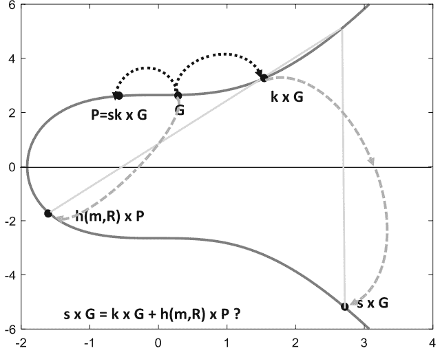

**图 4.16** EC-Schnorr DSA 的可视化图。自绘。

### 4.7.11 Diffie-Hellman 密钥交换

基于椭圆曲线的 Diffie-Hellman 密钥交换 (`ECDH`) 遵循上述相同的原理；见等式 (4.22) 和 (4.23)。与一样，密钥交换使用了双向函数 $f, g$。并不意外的是，用私钥对基点 $G$ 进行椭圆曲线乘法可以解决问题，因为

```
$$d \times (c \times G) = c \times (d \times G).\quad$ (4.158)$$
```

与离散数版本一样，这不能用于加密或签名，但用于密钥交换。

公共参数 $T = (p, a, b, G, n, h)$，`ECDH` 的步骤如下：

- (1) Alice 选择一个私钥 `c` 并使 `C = c × G` 公开；
- (2) Bob 选择一个私钥 `d` 并使 `D = d × G` 公开；
- (3) 两人创建一个相同的密钥 `k`，它是 `E = D × c = c × D` 的坐标。

```
$$k_E = (d \times (c \times G))_x = (c \times (d \times G))_x.\quad$ (4.159)$$
```

为了使抽象更加具体，我们考虑一个简单的例子。由于显然的原因，使用密码学合适的数字是不可能的，因此我们考虑图 4.2 (b) 所示的曲线 `E_{127}`。正如之前提到的，`#E_{127} = 127` 的点数是质数，因此我们可以选择曲线上的任意点作为基点，例如 `G = (45, 33)`。该点的阶为 127。让 Alice 选择一个随机私钥 `c = 97`，Bob 选择 `d = 34`。

```
$$C = (94, 30), D = (51, 109).\quad$ (4.160)$$
```

```
$$E = 34 \times C = 97 \times D = (86, 89), k = 86.$$
```

## 4.8 不同数字签名算法的比较

美国标准与技术研究院 (NIST) 推荐的密钥大小，见 NIST (1999)：

| 对称 | RSA | EC |
| :--- | :--- | :--- |
| 80 | 1024 | 160 |
| 112 | 2048 | 224 |
| 128 | 3072 | 256 |
| 192 | 7680 | 384 |
| 256 | 15360 | 512 |

由于显然的原因，使用密码学合适的数字是不可能的，因此我们考虑图 4.2 (b) 所示的曲线 `E_{127}`。正如之前提到的，`#E_{127} = 127` 的点数是质数，因此我们可以选择曲线上的任意点作为基点，例如 `G = (45, 33)`。该点的阶为 127。让 Alice 选择一个随机私钥 `c = 97`，Bob 选择 `d = 34`。

```
$$C = (94, 30), D = (51, 109).\quad$ (4.160)$$
```

```
$$E = 34 \times C = 97 \times D = (86, 89), k = 86.$$
```

## 4.9 哈希函数

### 4.9.1 哈希函数

哈希函数与单向函数有些不同。回想一下，单向函数是易于计算但很难反转。哈希函数是易于计算的，但对于给定的输出 $y$ 找到输入 $x$ 是困难的。因此，`SHA256` 产生 256 位输出。哈希函数在输入多于输出时存在碰撞。由于鸽巢原理，这在某些是可能的。`SHA256` 产生 256 位输出。抗碰撞性在密码学中非常重要，见 Goldwasser 和 Bellare (2008)。

### 4.9.2 抗碰撞函数

强抗碰撞的哈希函数是指在计算上很难找到两个不同的输入 `x1, x2` 使得 `h(x1) = h(x2)`。相比之下，弱抗碰撞哈希函数是指对于给定的输出 `y`，找到输入 `x` 是困难的。

### 4.9.3 签名与哈希函数

正如前面提到的，对消息进行签名是实际。然而，对消息的哈希通常更高效。这是因为哈希比消息短得多，使得签名更小。

### 4.9.4 生日攻击

生日问题出现在概率论中。该问题是寻找在选定的 `n` 个人中，是否存在一对人的生日相同。以目前的形式，该问题由 Richard von Mises 提出；见 Frank 等 (1964)。偶尔，该问题被称为生日悖论，并不是因为它是一个悖论，而是因为结果看起来非常违反直觉。当 `n=367` 时，这个概率接近 100%，因为有 366 个可能的生日。在下文中，我们忽略了闰年，且一年中的每一天概率相等。事实证明，23 个人时达到 50% 的概率，`n = 23`，而 70 个人时达到 99.9% 的概率。

生日问题的解决方法很简单。考虑 `N` 个人的集合，`N ≤ 365`。我们需要计算两人（或更多）人生日相同的概率，我们记为 `P_N`。通常情况下，计算补集 `P'_N = 1 - P_N` 比计算没有两人生日相同更容易。我们任意给人们编号 1 到 `N`。我们说“结果 2”发生时是指第 2 个人的生日与第 1 个人相同，“结果 3”发生时是指第 3 个人的生日与第 1 或第 2 个人相同，以此此类推。显然 `P'_N` 等于“结果 N”的概率，可以使用条件来计算。

概率如下：

```
$P_2^2 = \frac{364}{365} = 1\left(1-\frac{1}{365}\right), \ P_3^2 = \frac{363}{365} = P_2^2\left(1-\frac{2}{365}\right),$

nP_N^2 = P_{N-1}^2 = \frac{365-(N-1)}{365} = P_{N-1}^2\left(1-\frac{N-1}{365}\right), \quad (4.164)$
```

使得

```
$P_N' = \frac{365!}{365^N(365-N)!}, \quad (4.165)$
```

其中是阶乘运算符。相应地，

```
$P_N = 1-P_N'. \quad (4.166)$
```

特别是，`P_{23} = 50.7%, P_{70} = 99.9%`。利用当 `x << 1` 时 `1-x ≈ e^{-x}` 的事实，很容易看出 `P_N` 可以近似为：

```
$P_N \approx 1-e^{N(N-1)/730}. \quad (4.167)$
```

加密后果是重大的。生日攻击算法允许我们在 `2^{L/2}` 次尝试找到哈希函数的碰撞，其中 `L` 是定义经典抗原像攻击抗性的比特数。这里有一个简单的例子

假设 Charlie 知道 Alice 准备签署一份文档 `d'`，并声称 Alice 签署了它。例如，他并没有签署“支付给 Bob”，而是签署了一份内容为“支付给 Charlie”的文件。仅仅将 Bob 的名字改为 Charlie 是不起作用的，因为相应文档的哈希值将完全不同，这涉及到哈希函数的抗碰撞性。然而，Charlie 可以按照以下步骤操作：

Charlie 获取原始合同 `d`，通过在末尾添加空格、略微更改措辞或进行其他无害更改来产生微小的变化。Charlie 获取伪造的合同 `d'` 并对其产生微小变化。`K` 将随着 `2^K` 个不同的文档 `d1, …, dK` 变化，同样还有 `2^K` 个不同的文档 `d'1, …, d'K`。他现在尝试寻找 `h(dk)` 和 `h(d'l)` 的哈希匹配，对于任意 `(k, l)`，`1 ≤ k, l ≤ 2^K`。如果存在匹配 `h(dk)=h(d'l)`，则签名对两个合同都有效。Charlie 将接受的版本 `dk` 交给 Alice 签署。在 Alice 签署后，Charlie 获取签名，将其附加到修改后的合同 `d'` 上，并声称 Alice 签署了它。如果哈希值小于 `2K`，由于生日悖论，匹配的概率非常高。

### 4.9.5 随机机哈希

随机机哈希函数 `ROHF` 是一种对任何输入产生固定长度输出的函数。当它第一次收到特定输入时，它给出一个随机输出。如果收到相同的输入，它将产生相同的输出。`ROHF` 是理想的抗碰撞哈希函数。只要假设所使用的函数的行为类似于随机机是有效的，它就可以用于保护加密/签名的安全性。然而，要证明给定的哈希函数是 `ROHF` 通常需要强证据而非真实的证明。尽管如此，如果哈希函数未能 `ROHF` 测试，我们应该寻找新的候选哈希函数。

### 4.9.6 实用哈希函数

虽然 `ROHF` 更多是一个理论构造，但设计可以在实践中成功使用的哈希函数至关重要。实用哈希函数将任意长度的消息转换为固定长度的摘要。它必须依赖于消息的每一个位，以便一个位的变化就会导致哈希的变化。在最简单的情况下，算法必须是透明的，以便任何知道秘密的人都能检查哈希的有效性。通常，实用哈希函数可能依赖于一个秘密，这限制了知道秘密的参与者。通用哈希函数必须具有以下属性：

- (1) 输入是任意大小的字符串，`n` 位，`n` 是一个大数；
- (2) 输出是固定大小的字符串，256 位；
- (3) 计算是高效，需要 `O(n)` 次操作。

加密哈希函数必须具有额外属性：

- (1) 抗碰撞性——无法找到两个 `x` 和 `z`，使得 `x ≠ z` 且 `H(x) = H(z)`；
- (2) 混淆——给定 `y`，无法找到 `x` 使得 `y = H(x)`；
- (3) 绑定——无法找到 `x, x'` 使得 `H(r|x) = H(r|x')` 其中 `||` 表示输入的拼接。

### 4.9.7 谜题与哈希函数

谜题可以表述为：给定一个哈希函数、一个来自高熵分布的值 `x`（即足够随机的分布）和一个目标集 `Z`，找到一个 `y`，使得

```
H(x|y) \in Z
```

其中 `||` 表示拼接。如果哈希函数 `H()` 是题友好的，对于来自高熵分布的 `x`，无法找到比 `O(2^n)` 更快的 `y`，使得

```
H(x|y) \in Z
```


对于题友好哈希函数，没有比随机尝试更好的策略。正如我们在下一章中看到的，此类函数是所谓的工作量证明算法的理想工具。这里有一个简单的例子。令 `H` 为 4.10.3 中考虑的 `SHA256`，`x = aaa`：一个十六进制。我们希望找到一个随机 `y`，使得 `H(aaa|y) ∈ Z`，其中 `Z` 由以两个零开头的十六进制组成。寻找 `y` 的唯一方法是从 `y=1` 开始逐个检查可能的解。相应的计算如下：

```
aaa ⇒ d7bbd7ccad8469851316fed49753...

aaa1 ⇒ 5f82ba7fc93825419ade35627f3f9ef...

aaa2 ⇒ 5c5ca118e36c0504bcecb87953a2cbf...

aaa3 ⇒ 7fcbcbaea91fc437dcfff9d867c9803...

aaa4 ⇒ 94a7690d0f3f38d1ba6a8b0275fe... (4.171)

aaa5 ⇒ 1192bd36fc55rb00a8ea64954752a6927...

aaa6 ⇒ d3db8bd6c4e0159c17116a22ee9d...

aaa7 ⇒ 86036a264c88ee6fa03c8ca37d335

aaa8 ⇒ 002c58723940db5...
```


### 4.9.8 哈希函数的其他

对应 $k$ 次碰撞的多生日事件，我们应该遍历大约 $2^{n(k-1)/k}$ 个消息。

### 4.9.9 带填充迭代哈希函数

最初，从任意长度输入构造固定长度输出使用 `Merkle-Damgård` 变换。如果消息长度 $N$ 不是 $n$ 的倍数，则根据预定义的规则通过添加0和1进行填充。这被称为填充方法。

## 4.10 安全哈希算法

### 4.10.1 背景

虽然设计可靠、安全的哈希算法 `SHA` 很困难，但有许多候选。比特币和许多其他系统使用 `SHA-256` 和 `RIPEMD-160` `RIPE Digest`。正如其名，`SHA-256` 将任意字符串映射为 256 位的摘要。

下文简使用 `SHA-256`；但为了实际目的，只需注意到 `SHA-256` 使用 `Merkle–Damgård` 变换，并通过顺序应用将固定长度抗压缩函数转换为任意长度输入的函数。输入根据需要进行填充，使其成为 512 位的倍数。

实践中使用了多种哈希算法，如 `MD5`、`SHA1`、`SHA2`。然而，旧的算法（如 `MD5`）已被破解，不再能用于加密目的（即使偶尔仍被用于不敏感的任务）。

2007 年，`NIST` 启动了一场取代 `SHA1` 和 `SHA2` 的竞赛。所提算法的质量根据其速度、安全性、分析深度和其他考虑进行判断。选择了五个 `SHA3` 候选者进行最终评估：`BLAKE`、`Grøstl`、`JH`、`Keccac` 和 `Skein`。2012 年，`NIST` 宣布 `Keccac` 为获胜者。

### 4.10.2 MD5

`MD5` 由 Ronald Rivest 在 1992 年发明，将变变长度的消息转换为固定长度的 128 位输出（=16 字节）；参见 Rivest 和 Duselle (1992)。输入

# 第4章 核心加密工具 | 133

消息被分为 512 位的块，每个块被视为 16 个 32 位的字。如果需要，则对消息进行填充，以使其长度能被 512 整除。在处理第一个 512 位输入时，输出被初始化为一组八个 32 位的初始值。在处理后续的 512 位输入时，输出被初始化为从之前的计算中得到的四个 32 位值的集合。

因此，只需要理解 512 位输入如何转换为 128 位哈希值即可。输入被分为 16 个 32 位的字，标记为 $W_0, ..., W_{15}$。这 16 个字的集合根据以下规则扩展为 64 个字的集合 $M_{i,j}$，$1 \leq i \leq 4, 0 \leq j \leq 15$：

`M_{1,j} = W_j, M_{2,j} = W_k, k = (Sj + 1) \pmod{16},`

`W_{3,j} = W_k, k = (3j + 5) \pmod{16}, W_{4,j} = W_k, k = 7j \pmod{16}` (4.1773)

由于有 64 个字，因此有 64 轮。`MD5` 的流程图如图 4.18 所示。
消息块的变换由四个阶段或轮组成。每轮由 16 个相似的子轮组成，并使用 16 个子消息中的每一个；它们依赖于非线性函数 `F_1, ..., F_4` 对位进行操作，如下如下：

`F_1(B, C, D) = (B \wedge C) \vee (B \wedge D), F_2(B, C, D) = (B \wedge D) \vee (C \wedge D)` (4.1774)

`F_3(B, C, D) = B \oplus C \oplus D, F_4(B, C, D) = C \oplus (B \vee D)`

在这里，`\wedge, \vee, \oplus` 分别是位异或、位或、非。

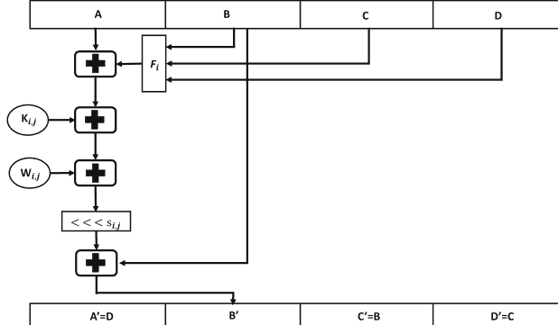

**图 4.18** `MD5` 流程图。自绘。来源：Wikipedia。

第 $i,j$ 轮，$i = 1, ..., 4, j = 0, ..., 15$ 的过程如下：

`A_{i,j} = D_{i,j-1}, C_{i,j} = B_{i,j-1}, D_{i,j} = C_{i,j-1},`
`B_{i,j} = B_{i,j-1} + K_j + W_j`

在这里 `ROTL()` 是 W 的左循环移一位。
`MD5` 哈希的一些示例见等式 (4.176)-(4.178)。

Mary had a little lamb.（玛丽有一只小绵羊。）
$\downarrow$
ca964b1677d5476ea11eed1e1837c342 (4.176)

Mary had a little lamb
$\downarrow$
e946adb454299def2071880d301364d4 (4.177)

Mary had a little lamb
$\downarrow$
ecb0d9a47d9a7379d6a070fb7216ff4 (4.178)

这些示例清楚地表明，输入中的“微”变化会导致输出变得无法识别，这是符合预期的。
目前，`MD5` 已经被破解，不应在实践中使用；参见 Wang and Yu (2005)。
然而，它是其他更复杂、更安全的算法原型。

### 4.10.3 SHA-256

`SHA-256` 是 `SHA2` 家族的一员。它将变长消息转换为固定长度的 256 位输出（=32 字节）。`MD5` 和 `SHA-256` 的工作原理相似。在此之前，理解 512 位输入如何转换为 256 位哈希值非常重要。输入被分为 16 个 32 位的字，表示为 $W_0, ..., W_{15}$。这 16 个字的集合根据规则扩展为 64 个字的集合：

`W_j = \sigma_1(W_{j-2}) + W_{j-7} + \sigma_0(W_{j-15}), 16 \le j \le 63.` (4.179)

`\sigma_0(W) = ROTR^7(W) + ROTR^{18}(W) + SHR^3(W),` (4.180)

`\sigma_1(W) = ROTR^{17}(W) + ROTR^{19}(W) + SHR^{10}(W),`

其中 `ROTR()` 是 W 的右循环移一位，`SHR()` 是 W 的左移一位。由于有 64 个字，因此有 64 轮，与 `MD5` 类似。给定字 `W_i` 和常数 `K_i`，`SHA-256` 的流程图如图 4.19 所示；参见 Barker (2002); Sanadh 和 Sarkar (2008)。

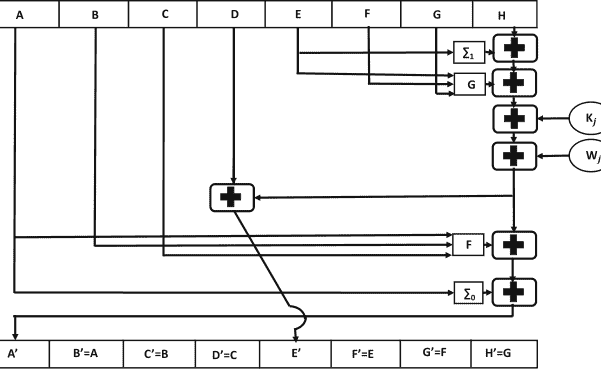

**图 4.19** `SHA2` 流程图。自绘。
。
第 $j$ 轮如下：

`A_j = \Sigma_0(A_{j-1}) + F(A_{j-1}, B_{j-1}, C_{j-1}) + H_{j-1} + \Sigma_1(E_{j-1}) + G(E_{j-1}, F_{j-1}, G_{j-1}) + K_j + W_j,`
`B_j = A_{j-1}, C_j = B_{j-1}, D_j = C_{j-1}, E_j = D_{j-1} + A_j, F_j = E_{j-1}, G_j = F_{j-1}, H_j = G_{j-1}.` (4.181)
在这里
`F(A, B, C) = (B \wedge C) \vee (\neg A \wedge C),`
`G(A, B, C) = (A \wedge B) \oplus (A \wedge C),`
`\Sigma_0(W) = ROTR^2(W) \oplus ROTR^{13}(W) \oplus ROTR^{22}(W),`
`\Sigma_1(W) = ROTR^6(W) \oplus ROTR^{11}(W) \oplus ROTR^{25}(W).` (4.182)

`SHA256` 的一些示例见等式 (4.183)-(4.185)。

Mary had a lamb.
$\downarrow$
d2fc16a1f51a653aa0196ef9c92333610653fec19f493548b32189eb197 (4.183)

Mary had a lamb
$\downarrow$
efe473564cb63a7bf0255dd691ef0ae0ac096c03ab40375b9094e326c2ad976 (4.184)

Mary had a lamb!
$\downarrow$
72debc1ca1859dabe1c1e9547ed473d56ef85ec87ae87ea3f6371cf479e (4.185)

我们再次看到输入中的“微”变化使得输出无法识别，正如预期。
至关重要的是，在某些情况下，`SHA-256` 算法以两种方式解释输入：(a) 文本；(b) 十进制。当然，数字是完全不同的。在等式 (4.186) 和 (4.187) 中，我们展示了 `SHA-256` 应用于文本字符串与十六进制数的示例。

efe473564cb63a7bf0255dd691ef0ae0ac096c03ab40375b9094e326c2ad976
$\downarrow$
87fc72ab0790e80e19af68a3765928033de93568be02dfed4fe5 (4.186)

efe473564cb63a7bf0255dd691ef0ae0ac096c03ab40375b9094e326c2ad976
$\downarrow$
a345ea180726e235ea2aea4b16ce1019931eb8970032a419c947619426d (4.187)

我们注意到，在比特币协议以及大多数主要使用十六进制数而非字符串的加密协议中，输入总是经过两次哈希处理：
`x \rightarrow SHA256(x) \rightarrow z = SHA256(y).` (4.188)

第二次哈希被用作一种针对所谓的“长度扩展”攻击的安全机制；参见 Ferguson 等人 (2010)。长度扩展允许已知消息 `m1` 长度和 `Hash(m1)` 的攻击者在不知道 `m1` 的情况下，计算出攻击者选择的消息 `m2` 连接后的 `Hash(m1||m2)`。依赖 `Merkle–Damgård` 构造的算法（如 `MD5`、`SHA-1` 和 `SHA-2`）容易受到此类攻击。新的 `SHA-3` 算法在这一方面是安全的。

### 4.10 RIPEMD-160

`RIPEMD-160` 由 `RACE` `Research in Advanced Communications Europe` Integrity Primitives Evaluation Message Digest 在1992 年 开发，并在 1996 年由 Hans Dobbert 和 Bart Preneel 改进。它将变长消息转换为 160 位的固定输出（=20 字节）。该算法对 32 位字的操作。`RIPEMD-160` 的流程图如图 4.20 所示。再次，在比特币协议以及大多数大多数加密协议中，输入总是经过两次哈希处理，以便：
`x \rightarrow y = SHA256(x) \rightarrow z = RIPEMD160(y).` (4.189)

第二次哈希被用作一种针对所谓的“长度扩展”攻击的安全机制；参见 Ferguson 等人 (2010)。长度扩展允许已知消息 `m1` 长度和 `Hash(m1)` 的攻击者在不知道 `m1` 的情况下，计算出攻击者选择的消息 `m2` 连接后的 `Hash(m1||m2)`。依赖 `Merkle–Damgård` 构造的算法（如 `MD5`、`SHA-1` 和 `SHA-2`）容易受到此类攻击。新的 `SHA-3` 算法在这一方面是安全的。

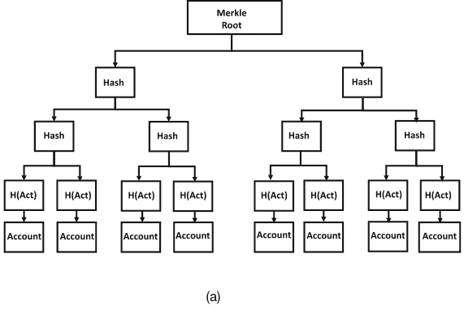

4.21 (a) `Merkle` 树用于将多个交易的信息压缩成单个 `Merkle` 根（`Merkle root`）；(b) `Merkle` 树可用于获取包含证明，允许用户验证其账户是否被包含在内以及存款是否正确。为了隐私，账户信息本身被哈希处理。叶子节点代表一个账户。如果需要，它会被揭露，并追踪从叶子节点到 `Merkle` 根路径上的所有节点。自绘。

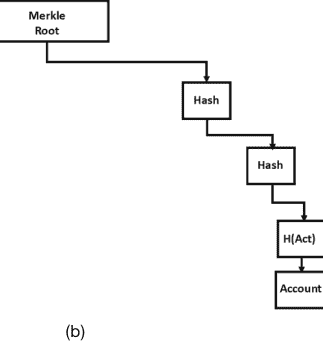

### 4.11.3 链签名结合 Mer 树

上面我们展示了如何通过哈希指针和签名来创建区块链。当区块非均匀时，我们可以将 `Merkle` 树引入框架中，并将大区块的根进行签名和链式处理。这种方法创建了包含大量交易的不可篡改记录；见图 4.23。

#### 表 4.6 Merkle 树的计算。

| 轮次 | 实际哈希 | 修改后的哈希 |
|---|---|---|
| 0 | 9395d40d9d184093843258aada5c | 9395d40d9d184093843258aada5c |
| 1 | 720a5d37afac7889268f459a9b718a83 | 720a5d37afac7889268f459a9b718a80 |
| | a8178a223372314ac2460b06bab4b3 | a8178a223372314ac2460b06bab44b3 |
| | b84b7a756f56a715a57f1bf11fd43 | b84b7a756f56a715a57f1bf11fd43 |
| | eb3f6030452ec8061b35f3758a9 | eb3f6030452ec8061b35f3758a9 |
| 2 | 39a8a80b790973b6646c11af5bf2 | 39a8a80b790973b6646c11af5bf2 |
| | a070eda356c7a7afbf22eae9b3bc38 | a070eda356c7a7afbf22eae9b3bc38 |
| 3 | 4660e5059d3c884a61d6d3c608078 | 4660e5059d3c884a61d6d3c608078 |
| 4 | c623db0c37a400c499b1af17f072 | c623db0c37a400c499b1af17f072 |
| | d8974a3ac6596fb86bd61f97a4221639 | d8974a3ac6596fb86bd61f97a4221639 |
| 5 | 3762333943bf0f3dd61b4a81505f8b1 | 3762333943bf0f3dd61b4a81505f8b1 |
| | d875a7a8ae8b5568d1605d1ef9b11 | d875a7a8ae8b5568d1605d1ef9b11 |
| 6 | 32462f718d92ab97e42b32d667aa1f959 | 32462f718d92ab97e42b32d667aa1f959 |
| | 80b38b740b661a6e459336770cb48f | 80b38b740b661a6e459336770cb48f |
| 01 | bde0c117518821f2d89a47a209849 | a2ff901273ac76d1efba90db13b79709 |
| | 17e12fe28cade16001a05fef222d38 | 17e12fe28cade16001a05fef222d38 |
| 2 | 5157f86a09277533f4a2ac319920 | 5157f86a09277533f4a2ac319920 |
| | 92e7b5b12c2e001ec0068dfa6683f | 92e7b5b12c2e001ec0068dfa6683f |
| 4 | 45c6c2b50c6c5bd9f2ae93e55a95c4 | 45c6c2b50c6c5bd9f2ae93e55a95c4 |
| | d875a7a8ae8b5568d1605d1ef9b1 | d875a7a8ae8b5568d1605d1ef9b1 |
| 6 | 32462f718d92ab97e42b32d667aa1f959 | 32462f718d92ab97e42b32d667aa1f959 |
| | b1187c2bca21a3352ed1f4bd16102d | b1187c2bca21a3352ed1f4bd16102d |
| 0123 | 8203cb815c2d3f22e0b7b2c165ba | a2e612a5c2d3f22e0b7b2c165ba |
| | b50ffbc03369a859fa75cade2 | b50ffbc03369a859fa75cade2 |
| 456 | 6334e2c28eb91faad99b5186f2 | 6334e2c28eb91faad99b5186f2 |
| | bfed44497aa1d3a22bb88f12e50659 | bfed44497aa1d3a22bb88f12e50659 |
| 01234567 | 31d3f59907f418ae065e64 | 09c1e18d3c65ebce0b9 |

**图 4.22** (a) 哈希指针序列。(b) 链签名序列。自绘。

### 4.12 抗量子密码学

本章考虑的密钥基础设施依赖于假设特定计算，例如大数分解、离散对数问题或其椭圆曲线模拟。在当前硬件状态，这些假设是有效的。然而，如果量子计算取得突破性进展，可能会改变局面。值得注意的是，依赖哈希函数的计算受量子算法的影响较小。在第 5 章中，我们将看到比特币协议并非使用原始公密钥，而是使用哈希公密钥。这种方式比直接依赖公密钥的系统更具未来。传统的公密钥交易已被哈希交易取代。

更多细节可以参考 Gao 等 (2018)、Ikeda (2018)、Jentzsch (2016) 以及 Stewart 等 (2018) 等。

### 4.13 总结

在本章中，由于必要性，我们介绍了一些重要的数学和技术概念。原则上，读者可以跳过本章，直接认为椭曲线加密、数字签名算法和哈希函数等关键密码原语的存在。但对于设计新区块链或为项目寻找合适方案的人来说，本章提供了分析框架。此外，参与区块链领域的技术水平较低的人也将从学习新概念和理解该领域的复杂性中受益。从本质上说，我们展示了加密是维护计算机完整性的自然机制。这一事实使其成为构建金融和非金融应用的基础工具。虽然对称加密对于数据库和其他应用程序中的数据安全存储至关重要，但在互联网上交易时它是次要的。同时，非对称加密在这方面是主要的工具。

`PKI` 包括公/私密钥对的创建、分发和使用，为构建分布式应用（如加密货币和区块链）提供了稳健的框架。对于交易，数字签名是主要工具。哈希函数特别有用，因为我们可以使用 `Merkle` 树高效压缩消息。有了这些工具，我们现在准备好理解如何构建点对点数字货币和分布式账本。

在大量的加密书籍和笔记中，我们认为以下特别有用：Goldwasser and Bellare (2008); Katz and Lindell (2014); Larsson (2018); Trappe and Washington (2006)。

### 4.14 练习

- 1. 解密使用仿射加密的消息 `m_1`：
```


$m_1 = ZLDDRVL W F FD LEBYHOILGFIA SFVLEYL PLH JQ ULEVIA QJNY

```
- 2. 使用 $m_1$ 中的提示，解密使用维吉尼亚密码加密的消息 $m_2$：
```

$m_2 = ORMGBSQ VVQOI URZFEQF VVWQKJRZ WPU SFVIFQ AEF DZEU UAKALDTDU $

```
- 3. 解决加密消息 $m_2$ 中描述的问题。
- 4. 设计一个类似于 Chaum DigiCash 的物理系统用于匿名投票系统。
- 5. 描述生日悖论。计算房间内需要多少个人，两人具有同一生日的概率才达到 99%。99.9% 呢？建立该概率随人数变化的函数图表。这对于 512 位哈希函数的安全性意味着什么？
- 6. 考虑椭圆曲线
```

$E_p = \{x, y) : y^2 = x^3 + 7\} \pmod p$.

```
其中 $p = 127 = 2^7 - 1$ 是第一个梅森素数。该椭圆线上有多少个整数点？与 Hassel 的答案进行比较。

# 章节
比特币 — 深度解析

“我一直在开发一种全新的电子现金系统，它是完全点对点的，没有信任的第三方——其主要特性是：通过点对点网络防止双重花费。没有铸币厂或其他信任的第三方。参与者可以是匿名的。新币通过 Hashcash 工作量证明产生。生成新币的工作量证明也为网络提供动力以防止双重花费。”

> 中本聪聪（Satoshi Nakamoto），2008，密码学邮件列表

## 5.1 引言

到目前，已经有数千种不同的区块链协议以及相关的币和代币。然而，所谓的“三巨头”比特币、以太坊、瑞波仍然保持着领先地位。

本章将讨论比特币的优缺点——它是加密货币领域无可争议的冠军，启发了数百种竞争性的替代币（也称为山寨币）。比特币本身经历了多次硬分叉，包括比特币现金（Bitcoin Cash）、比特币 SV 等。因此，严格来说，经常重复的“只有有限数量的比特币”这一说法并不完全正确。

比特币协议建立在巨人的肩膀上。所有的新加密思想都是在 20 世纪开发的；例如 Narayanan 和 Clark (2017)。正如希腊神话中的爱之女神阿芙洛狄特一样，比特币协议已经完全形成并准备就绪。比特币与电话、计算机等技术形成了鲜明对比，后者在经历了非常长的渐进改进时期才变得如此令人印象深刻。尽管如此，在多个层面上，比特币协议未能实现其目标。它并没有声称或某些人认为的那样去中心。特别是挖矿是高度中心化的；见下文讨论。此外，比特币协议的治理也是中心化的；见 Tarqu 和 Jamison (2019)。

我们将作为协议的 Bitcoin 与作为对应名称的 bitcoin（或 BTC）区分开来。BTC 的价格动态和 Google 趋势如图 5.1 所示。该图清楚地显示公众对比特币的兴趣与 BTC 价格相关。

本章是整个章节的核心，结构如下：在 5.2 节中，我们详细描述了比特币地址——它们的含义、如何构建以及如何使用它们。在 5.3 节中，我们研究比特币交易，这归结为处掉特定地址持有的所有比特币，从支付者向接收者发送所需的 BTC 数量，其余作为找零返回给支付者。我们将 5.4 节用于分析比特币生态系统，并描述相关的要素，包括节点、钱包、矿工、交易所和其他细节。5.5 节涉及共识和挖矿。

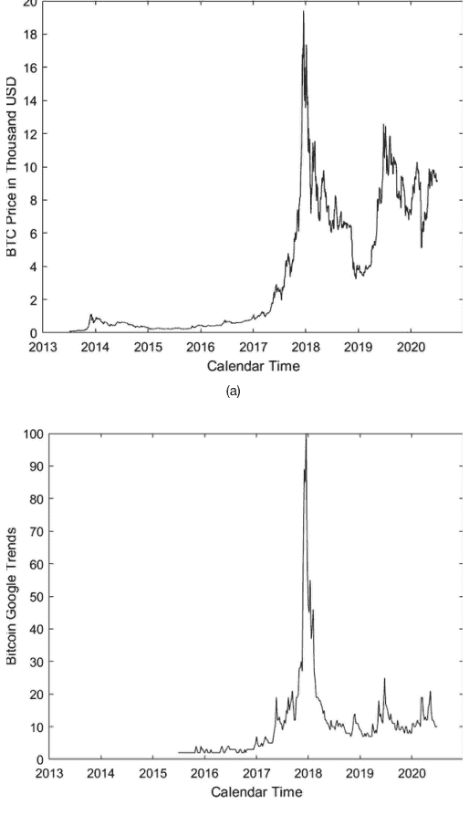

**图 5.1** (a) BTC 的价格；(b) 比特币的 Google 趋势。两者对应的时间序列强相关。自绘。来源：(a) coinmarketcap.com,(b) Google。

该部分解释了矿工如何达成工作量证明共识，他们在实践中做什么以及他们的激励机制是什么。在 5.6 节中，我们研究了一个特定的区块，即 600,000 号区块，以说明前面章节介绍的思想。我们在 5.7 节中总结了比特币的成本和代币，并在 5.8 节中得出结论。

## 5.2 比特币地址

如第 4.7.9 节所述，椭圆曲线数字签名算法 (ECDSA) 通常基于美国政府标准。该标准使用 sec256r1，它被认为是安全的。然而，出于显而易见的原因，比特币信任信任建议，而是使用 sec256k1。直白地说，比特币拒绝 sec256 而倾向于 sec256k1，因为 sec256r1 是 NIST 支持的，且未能证明其满足“无花花招”（nothing-up-my-sleeve）原则。缺乏证明可能表明或不表明选择 256r1 椭圆曲线是为了偏于某种形式的后门漏洞；见第 4.8 节。

鉴于私钥和公钥是基础的大整数，我们需要找到一种相对紧凑的形式来表示它们。我们有几种选择：
- (a) 二进制——数字 0 到 1（这是计算机在内部表示数字的方式）；
- (b) 十进制——数字 0 到 9（这是我们日常生活中使用的）；
- (c) 十进制——数字和 a 到 f；
- (d) Base64 —— 26 个小写字母、26 个大写字母、数字 0 到 9 以及其他字符如 "";
- (e) Base58 —— Base64 的子集——小写字母、大写字母和数字不包含四个容易混淆的符号（0, O, l, I）。我们强调，十六进制数是不区分大小的，而 Base58 和 Base64 都是大小敏感的。

在 $F_p$ 上的 sec256k1 椭圆曲线域参数由元组 $T = (p, a, b, G = (G_x, G_y), n, h)$ 规定，形式如下：

```
$p = fffffffffffffffffffffffffffffffffffffffffffffffffffffffffffffffffffffffff

$a = 0000000000000000000000000000000000000000000000000000000000000000

0000000000000000000000000000000000000000000000000000000000000000

$b = fffffffffffffffffffffffffffffffffffffffffffffffffffffffffffffffffffff

$G_x = 79be667ef9d9cbac55a06295ce87b0707 (5.1)

029bfcfbd2ce28d95f2815b16fb1798

483a47263ac46555da4fbc02e1108a8

$G_y = 1fd17b44181111111111111111111111111000001100000000000000$

$$$$ffffffffffffffffffffffffffffffffffffffffffffffffffffffffffffffffffffffff

$n = fffffffffffffffffffffffffffffffffffffffffffffffffffffffffffffffffffff

$h = 1
```

在 $F_p$ 上的 sec256k1 椭圆曲线域参数由元组 $T = (p, a, b, G = (G_x, G_y), n, h)$ 规定：

（注：参数的 OCR 文本严重损坏；根据标准的 sec256k1 值，$p$ 为 $2^{256} - 2^{32} - 977$）

# 150 | 区块链与分布式账本：数学、技术与经济


**图 5.3** 公钥在 EC（椭圆曲线）上可以是未压缩的（作为点 (X, Y))），可以是压缩的（作为横坐标 X 加上纵坐标 Y 的指示），这在许多情况下都非常有用：(a) 通用图表；(b) 压缩的特定示例。自绘。

清楚这两种形式都描述了 EC secp256k1 上的同一个点，正如预期的，压缩格式的长度是未压缩格式的一半。然而，如下所示，这一事实并不会影响它们的比特币地址表示形式，它们的长度相似。

未压缩的密钥和压缩的密钥都可以方便地进行（两次）哈希处理和错误检查；见表 5.1。

我们在图 5.4–5.6 中以图形方式说明了上述操作。在图 5.4 中，我们展示了通用 Base58Check 编码程序的流程图，而在图 5.5 中，我们说明了如何将该程序应用到我们感兴趣的公钥上。

## 表 5.1 同一个公钥 $K$ 的不同表示形式。

| 未压缩公钥 | SHA256 | RIPEMD160 | Base58 编码的比特币地址 |
| :--- | :--- | :--- | :--- |
| 04579afad03cf11bedd6f7f156bd8c8eetab063eccf855a989e8460a4488bc16c90943ed9447fb55d4a25763f5482d96a8705f331668a306681fdae2855d | 28bcaff01234071645bbb9faf5da1e6981b94bfe317488b33e111845991c2be36 | 4bcc96fe592e2d45c6b9facbc5d57c150b312 | 17unmyY9KdgSuYB5xd4paUBP1Ubzo3EgtL |
| 压缩公钥 | SHA256 | RIPEMD160 | Base58 编码的比特币地址 |
| 03579afad03cf11bedd6f7f156bd8c8et7ab063eccf855a989e8460a4488bc | 0c735c00bcbdbbd709b29fdec8671f538b2ffc1a823ca4bba990d108a9be | 58617b4b5032f35772705c90688efaf2ea11a30 | 192kvhudNg9Jh1YG3EAKxWSyRHDh9Tqt |


**图 5.4** 为了方便起见，未压缩和压缩的密钥都经过两次哈希处理并进行 Base58Check 编码。结果产生了同一个地址的两种不同表示。自绘。

## 152 区块链与分布式账本：数学、技术与经济

5.6，由于未压缩和压缩的密钥都经过了多次哈希处理，当以 Base58 格式写入时生成的密钥长度相同。

```
04579afad03cf11bed6d7f15bd8cee7ab06ecf855a989a60efa48c1c6904c3944db5d55a37f48d96a8705f31683064681fa2855
```
```
03579afad03cf11bedd6f7f156bd8c8et7ab063eccf855a989e8460a4488bc
```
```
0c735c00bcbdbbd709b29fdec8671f538b2ffc1a823ca4bba990d108a9be
```
```
58617b4b5032f35772705c90688efaf2ea11a30
```
```
192kvhudNg9Jh1YG3EAKxWSyRHDh9Tqt
```

图 5. 一个未压缩公钥通过图 5.4 所示算法进行扭曲和 Base58Check 编码。自绘。

```
03579afad03cf11bed6d7f156bd8cee7ab06ecf855a989a60efa48c
```
```
0c735c00bcbdbbd709b2d9fb20b67153b2ff1ca823cacb49d108abe
```
```
58617b450302f3577207509c0688efaf2a1a30
```
```
ed353fab0d0f5bb0133a89b053c66ac674f75b289a72dc2c74c4c9d30fb45
```
```
58617b450302f3577207509c0688efaf2a1a30733eb7b
```
```
733eb7b3bf52fe918272888ce2121673d23787d14b88975c0ad2441ce
```
```
192kvuddhnh91YG3AKW5YRh9qt
```

图 6. 一个压缩公钥通过图 5.4 所示算法进行扭曲和 Base58Check 编码。自绘。

| 原始密钥 | Base58Check 编码 | WiFi 密钥 |
| :--- | :--- | :--- |
| dbba4e53bf30e6ffd55aac6ed7f7023fca5a9dd9005d40c6adb7 | SKrWnhffddub5Gyp11NHdkAtgStuxGDPEIL | |
| secp256k1 上计算 k x G | | |
| 未压缩公钥 | Base58Check 编码 | 未压缩 Base58 编码地址 |
| 04579e2d03f11be6d6127f127f5db8c37a8b3ecc65859a89f4e4a4b03ec9c3b94640a54735a55826705f3168a3064681bd2855 | 17unmy96EdsuYb5XP1ub3gt1 |
| 压缩公钥 | Base58Check 编码 | 压缩 Base58 编码地址 |
| 23579a2d03f11be6d6127f15bd8d0c2eab03ecc65859a9804fea | 192kvduHdgNH9YG38AKWsyH9Tqt |

图 5.7 密钥映射到 WiFi 密钥和 Base58 编码地址。5.8 显示了计算机可读格式的密钥、压缩公钥和未压缩公钥。

## 5.3 交易

分布式账本允许我们对特定地址相关的比特币数量有一个基于共识的视图。需要强调的是，共识无法以任何方式帮助计算相应硬币的价值。这项任务严格在比特币协议本身的有限范围之外。为了与一般的会计规则保持，我们需要一个适当的账本。我们可以构建如表 5.2 所示的原始基于账户的账本。该表代表所有包含在区块中的交易的所有方支付的累计交易费用。构建这样的机制是不可能的。在下一章中，以太坊正是这样做的。然而，先驱者们选择了一种简单的方法。金额被发送到支付者的地址，而剩余部分则进入支付者控制的地址。许多作者建议，出于安全考虑，不应重用地址。因此，输出金额分为支付本身和交易费用。例如，爱丽斯最初有 12.5 + TF 比特币。她向鲍支付 8 个比特币，通过向鲍支付要求的 8 个比特币并将剩余的 4.5 + TF – tf 发送给自己来完全清空账户。

一个典型的交易如表 5.4 所示，在概念上与表 2.6 中在同一银行存款之间转移资金的情况相似。

正如我们所看到的，基于交易的账本人为放大了每个区块交易的比特币数量。

这是一个简单的示例。让我们证明以下等式：

```
$$1^3 + 2^3 + ... + n^3 = \left(\frac{n(n+1)}{2}\right)^2 \quad (5.9)$$
```

起始步骤得到：

```
$$1^3 = \left(\frac{1 \times 2}{2}\right)^2 \quad (5.10)$$
```

归纳步奏得到：

```
$$1^3 + 2^3 + ... + n^3 + (n+1)^3 = \left(\frac{n(n+1)}{2}\right)^2 + (n+1)^3$$
$$= \left(\frac{(n+1)}{2}\right)^2(n^2+4n+4) = \left(\frac{(n+1)(n+2)}{2}\right)^2 \quad (5.11)$$
```

如所言所示。因此，等式 (5.9) 成立。

比特币交易按照类似的逻辑组织。每笔交易都将其未花费的交易输出（UTXO）移动到下一笔交易。由于协议的性质，这些转换是通过密码学保护的，如图 5.9 所示。

在图 5.9 中，我们提供了交易链的三个互补视图。图 5.9 (a) 详细展示了三笔交易的序列；图 5.9 (b) 通过强调交易的输出成为下一笔交易的输入来说说明交易之间的连续性；最后，图 5.9 (c) 考虑了一个特定的实际交易序列。

由于 UTXO 从一个地址移动到另一个地址，因此发现实现交易匿名化的目标具有挑战性，这并不意外。用于区块链分析的分析工具可以追踪交易，并在某些条件下对公钥所有者去匿名；例如，参见 Möser 和 Böhme (2017)。此外，比特币交易可以使用强大的图形工具进行可视化，这有助于揭示感兴趣地址的所有者；例如，参见 Baumann 等人 (2014)；McGinn 等人 (2016)。

### 5.3.3 交易结构

由于需要性，比特币交易的结构必须高度标准化，其通用格式如表 5.5 所示。

格式正确的交易会经过哈希处理（通常是两次）并进行位反转，以获得哈希压缩后的交易 ID (TXID)。这些 ID 始终为 32 字节长。

交易可以有许多输入和输出，如图 5.10 所示。


**图 5.9** 比特币交易是链式的。它们代表了价值从一个公钥到下一个公钥的移动。当前所有者使用她的私钥签名所有权变更的消息，而矿工使用她的公钥验证签名是否合法：(a) 三笔交易序列中的价值转移；(b) 一行通用交易，重点在于上一笔交易的输出如何成为下一笔的输入；

```
ad146592b70b74c7d83d55c27569a68c1e88f73ef358d251be

2019-12-30 07:17

3PDVnYgYdaMgagMWs1BNXwRiSecucej/mp

20463726 852
```

```
3Qwwryb6UPpSwoUAx37SeEmSiYpPPg9V6 1.37990122 BTC

363pnMG5Xj5XlaMKpPPj2Rcczm3Uvw6 0.666000 BTC

Fee 0.000835 BTC
```

```
f295b959692b86f04f5ea9111ca5a43a4c78f23d1e6740edd94

2019-12-30 18:48

3Qwwryb6UPpSwoUAx37SeEmSiYpPPg9V6

1.37990122 BTC
```

```
3EKMAJrXGnYbytT3ZYWdSmaGafZWjNAC 1.04990622 BTC

3CWS99RzGozl3MnvaXAD7e681YzBcPcmY2 0.3300000 BTC
```


Fee 0.000835 BTC

```
```

`89c31ae99ef4d7d8115a9c7746e0d11a70d40044e8c0055j11d`

2019-12-31 12:28

`3EKMAJrXGnYbytT3ZYWdSmaGafZWjNAC`

1.04990622 BTC

```
```

`3DCLyraeg19xpuK4T2wtWUS5BCGeuj7y` 0.2500000 BTC

`3BTI5dk966xV1wCKrespqb` 0.7982122 BTC

Fee 0.000830 BTC

```
```


**图 5.9** (c) 用特定的实际交易序列展示的与 (b) 相同的点。最常见的是有一个输入两个输出的交易，如图 5.10 所示。通常，Alice 向 Bob 支付一定数量的 BTCC、支付矿工费用，并将剩余部分发送到自己的控制下。类型 (a) 的交易并不常见，反映了将 BTCC 移动到不同的地址。类型 (b) 的交易描述了 BTCC 在一个发送者和多个接收者之间的移动，而类型 (d) 的交易描述了 BTCC 从多个发送者到多个接收者的移动。从概念上说，一个交易将比特币从地址 $X_1, ..., X_i$ 移动到 $Y_1, ..., Y_j$，其中 $I \ge 1$。然而，这些地址由双哈希表示：
$x_i = h_{RIPEMD160}(h_{SHA256}(Y_j))$
$y_j = h_{RIPEMD160}(h_{SHA256}(Y_j))$ (5.12)

表 5.5 交易的通用格式。

| 字段 | 大小 | 说明 |
| :--- | :--- | :--- |
| Version (版本) | 4 字节 | 当前为 1 |
| Flag (标记) | 2 字节或无 | 0 或无 |
| In-counter (输入计数) | 1 - 9 字节 | 输入 |
| List of inputs (输入列表) | 需多少 | 输入 |
| Out-counter (输出计数) | 1 - 9 字节 | 输出 |
| List of outputs (输出列表) | 需多少 | 输出 |
| List of witnesses (证明列表) | 需多少或无 | 证明 |
| Lock_time (锁定时间) | 4 字节 | 显示何时消耗 |


**图 5.10** 比特币交易可以有不同数量的输入和输出：(a) 一个输入，一个输出 —— 价值从一个地址移动到下一个；(b) 一个输入，两个输出 —— 价值转移给新所有者，剩余部分返回原者；(c) 一个输入，多个输出 —— 价值分割；(d) 多个输入，一个输出 —— 价值组合；(e) 多个输入，多个输出。

### 5.3.4 交易脚本

由于需要，比特币脚本在入栈栈（pushdown stack）上操作，从左到右处理。入栈栈是一种受限的访问数据结构，因为只能在栈顶添加或删除元素。这种栈的物理类比是一一堆书。栈有两种操作：向栈顶部添加书或从栈顶部移除。Push 和 pop 正如其名所示。它们将项目（如公钥或签名）推入栈并从栈中弹出。更多细节如图 5.11 所示。设计上栈没有循环，因此不是图完备的。

比特币脚本包含几个指令，这些指令都非常易懂：

- (1) `OP_DUP` 复制栈顶元素；十六进制操作码为 `0x76`。
- (2) `OP_HASH160` 两次哈希，第一次使用 SHA-256，第二次使用 RIPEMD-160；十六进制操作码为 `0xa9`。
- (3) `OP_EQUALVERIFY` 验证输入是否相等，相等为真，不等为假；在后者的情况下，它标记交易无效；十六进制操作码为 `0x88`。
- (4) `OP_CHECKSIG` 检查输入签名是否为交易哈希对应的有效签名；十六进制操作码为 `0xac`。

基础比特币脚本有支付公钥 (`P2PK`)（已过）、支付公钥哈希 (`P2KH`)、支付脚本哈希 (`P2SH`) 和多签名 (`MultiSig`)。将 `P2PK` 替换为 `P2KH` 使协议面向未来，因为哈希保护了公钥免受量子计算机的破解。

比特币允许以 `P2SH` 的形式实现复杂的脚本。因此，尽管很少强调，比特币可以被视为第一个的可运行示例，只要人们准备将比特币视为货币。

- ²`OP_CHECKMULTISIG` 检查可能的 M 个签名中是否有 m 个签名有效；十六进制操作码为 `0xae`。
- ³这是最早的交易脚本，在比特币公钥哈希成为标准之前一直使用。


**图 5.11** 比特币在栈上通过一系列步骤进行验证。栈允许两种操作 —— push 和 pop。图形：Narayanan 等人 (2016)。

### 5.3.5 交易验证

在书中，我们考虑了一个相对简单的脚本——`P2PKH`。对于更复杂脚本的详细分析，读者可以参考几个实用的来源；例如，参见 Antonopoulos (2017)。`P2PKH` 脚本具有以下形式：

```
<sig>

<publicKey>

OP_DUP

OP_HASH160

<pubKeyHash>

OP_EQUALVERIFY

OP_CHECKSIG
```

在这里，括号中的数量表示输入。记住，在比特币协议的现代版本中，地址是实际地址 `<publicKey>` 的哈希 `<pubKeyHash>`，因此发送者发送的是哈希。由于某些原因，想要兑换这些输出并发送给他人的接收者必须提供签名和公钥，以产生正确的地址。在假设提供了正确的签名和地址的情况下，栈会经历以下推入（push）和弹出（pop）变换：

```
$S_1 = <sig>$,n$S_2 = <sig> <publicKey>$,n$S_3 = <sig> <publicKey> <publicKey>$,n$S_4 = <sig> <publicKey> <pubKeyHash>$, (5.13)

$S_5 = <sig> <publicKey> <pubKeyHash>$,n$S_6 = <sig> <publicKey>$,n$S_7 = TRUE$.
```

在这里，`<pubKeyHash>` 是支付者地址的哈希。否则，输出为 FALSE，交易无效。从左到右执行的推入和弹出步骤如图 5.11 图图化所示。

### 5.3.6 代表性交易

如果不提到第一笔交易，就无法对比特币交易进行全面的介绍：

```
TXID = f4184fc596403b9d638783cf57adfe4c756c05f6356fbc9133850e9831e9e16` (5.14)
```


该交易创建于 2009-01-11 21:30，导致 50 BTC 从 Satoshi Nakamoto 发送给了 Hal Finney，分为两笔——10 BTC 和 40 BTC。它是所有后续交易之母。另一个著名的交易是所谓的“披萨交易”，它用 10,000 BTC 买了一了一个披萨：

`TXID = a1075db55d5416d3ca199f55b608e2115b9345e16c5cf302fc80e9d5rb5fd548`· (5.15)

具体来说，考虑区块 400,000 中的一个示例交易：

`TXID = 928c4275df627034976aa5a49b355eefeb9e31ffbe959d57feb581d219a23f8`· (5.16)

这笔交易是最简单且基础的——一个有一个输入和一个输出的 P2PKH 交易。它是从输入地址直接转账的 3.2090000 BTC：

`XO0= 1Jyt2dxc9UtZhujDR8eqqbLeWLa6kQPL`, (5.17),

包含 3.21000000 BTC，发送到输出：

`XO0= 15KMFvpvaHJL26y7DTkFjkJijyjfVaaAdU2s`, (5.18),

其中 0.01000000 BTC 作为交易手续支付给矿工。3.21000000 BTC 是上一笔交易的第五 UTXO：

`TXID = 13d21f93349cdc71e56477a665ac1645796615ca3cf0103d78075715f4ff8051` (5.19)

为了证明输入地址的所有者是合，她提供了实际比特币地址、正确的哈希并对该交易进行了数字签名。该交易的人类可读格式详于表 5.6。

表 5.6 区块 400,000 中典型交易的详情。来源：https://www.blockchain.com/btc/tx/。

| TXID | 928c4275df627034976aa5a49b355eefeb9e31ffbe959d57feb581d219a23f8 |
| :--- | :--- |
| Time | 2016-02-25 10:24 |
| Size | 191 bytes |
| Weight | 764 |
| Block | 400,000 |
| Total input | 3.21000000 BTC |
| Total output | 3.20900000 BTC |
| Fees | 0.01000000 BTC |
| 每字节手续费 | 523.560 sat |
| 每单位权重手续费 | 130.890 sat |
| Input index | 0 |
| Prev. TXID | 5180ff415578703d10fcca1566794516ac65a764e571dc9c3491f2d |
| Prev. output index | 5 |

（续）区块 400,000 中典型交易的详情。来源：https://www.blockchain.com/btc/tx/。（续）

| | | |
| :--- | :--- | :--- |
| 14 | Input address | 1Ij2ydxc9uTZhujDR8eqbdLw6kPL |
| 15 | Value | 3.21000000 BTC |
| 16 | PubKey | c53e0cb885049dccce68358e05a371211fccb |
| 17 | SigScript | 3044022100a96843b11f405a68299faa50147ccb9f4c03e9111852f9b3609243a407ff8211efe638c47e158ed3f54652bd3694fa5dccd2c998701d63aba621bd11d55ea3a6d5843bf9fce0b6c58de6ea755 |
| 18 | Output index | 0 |
| 19 | Output address | 15KMFvpvaHJL26y7DTKfijyfAa2s |
| 20 | Value | 3.20900000 BTC |
| 21 | PubKey | 2f58e6245481bc7789d5f0e2641decf4 |

5.7 解析格式的比特币交易。

| | | |
| :--- | :--- | :--- |
| 1 | Version | 01000000 |
| 2 | Input count | 01 |
| 3 | Prev. TXID | 5180ff415578703d10f03cca1566794516ac65a7764e571dc0c93491f32d |
| 4 | Prev. output number | 05000000 |
| 5 | SigScript size | 6a |
| 6 | Data size | 47 |
| 7 | DER sequence identifier | 30 |
| 8 | Data size | 44 |
| 9 | Int identifier | 02 |
| 10 | Data size | 21 |
| 11 | r value | 00a98648381f405a668b2989ffaa5001477cb9f4ce03e912d18529fb3 |
| 12 | s value | 3044022100a96843b11f405a68299faa50147ccb9f4c0ee1d1852f9b3609243a4071f9821efe638c47e158ed3f54652bd3694fa5dccd2c998701d63aba621bd11d55ea3a6d5843bf9fce0b6c58de6ea755 |

# 166 区块链与分布式账本：数学、技术与经济学

(22) `OP_DUP` — 十进制操作码。
(23) `OP_HASH160` — 十进制操作码。
(24) 一个字节的公钥 — 14（十六进制）= 20（十进制）。
(25) `PubKey` — 发送比特币的公钥的 HASH160 哈希值。
(26) `OP_EQUALIFY` — 十进制操作码。
(27) `OP_CHECKSIG` — 十进制操作码。
(28) `Locktime` — 表示交易消耗的时间。锁定时间 0000000 表示该交易可以立即包含在区块中，无需等待。

当然，在底层，这笔交易看起来并不不同。在所谓的脚本（scripted）或原始形式中，它由 382 个十六进制总和（191 字节）组成，经过紧凑序列化并对所有时间解密交易；见表 5.8。

表 5.8 序列化形式的比特币交易。
| 原始 TX 数据 |
| :--- |
| 0100000001580ff451587703d1003ca156679451ac65a776a67745e1dc9c73493f521d05000006a7369f5b3c7a5d60437022a009683f415a686289f98aa50017c2bf9f4c6e921238529fb3609e243a240271f7928214e634b8e4c2718ed5ebac53f6558b9c2bd369f5b7a5d626cd2d69f90701128d63ab426521bd6d15543ea3d5d38843f779e0638f7ca1550b85eca77525555ff010a8b201100000019976a411d050000006a7324444818264444502e65485178b2e5485179d45f002641decdec4748ac00000000 |
| 第一个哈希值 |
| 73c22f83d76222d41158b35d2469a45b3721f2f7fed1734360842f9583d5114f |
| 第二哈希值 |
| 8f239a211d0b8fe75d93beff39eeb5e359ba4a56ea7490327ddf7548c92 |
| TXID 反转后的第二哈希值 |
| 928c4275dfd62703049e76aa54a9b355feb99e31fbe93dd75feb81d219a23f8 |

很容易检查出，如表 5.6 第 17 行中 SigScript 部分所示，以及表 5.7 第 17 行中显式所示，正确的密钥对应于表 5.6 第 16 行中 PubKeyScript 部分所示的哈希公钥。相应的步骤如表 5.9 所示。

因此，我们恢复了 PubKeyHash 和正确的比特币地址。

# 第 5 章 比特币 — 深度解析 | 167

**表 5.9** PubKey 验证。

| 压缩格式 |
| :--- |
| 02bd63ab2a6215bddd16d554ea3fd5d5838 43bf9c762e0b8c6c150d58eee6ca72ae525 SHA256 65664f3667c3195de961e6730d6acc2 27cf7ce530fd98569294ce7a5ae69d6n RIP160 c53cb08858049dcc686358e05037211fc7c5b Base58 编码 1J2ytydxc9utZhuj8DRegqbLEwLa6kQPL |

现在我们考虑来自区块 600,000 的一个现代交易，

`TXID = d8974a3a65696fb86bd1f1794a221639c37d7633394bf0fddd61b48a1505f8b1`. (5.20)

该交易的详情见表 5.10。

**表 5.10** 区块 600,000 中的典型交易。来源：https://www.blockchain.com/btc/tx

| | | |
| :--- | :--- | :--- |
| --- | --- | --- |
| 1 | 哈希 | d8974a3a65696fb86bd1f1794a221639c37d7633394bf0fddd61b48a1505f8b1 |
| 2 | 时间 | 2019-10-19 00:00:04 |
| 3 | 大 | | 249 bytes |
| 4 | 重量 | 669 |
| 5 | 区块 | 600,000 |
| 6 | 总输入 | 4.27879879 BTC |
| 7 | 总输出 | 4.27871189 BTC |
| 8 | 手费 | 0.00016800 BTC |
| 9 | 字节手续费 | 67.40 sat |
| 10 | 见证费 | 25.112 sat |
| 11 | 索引 | 0 |
| 12 | 输入地址 | 3M92sq9ssNaEbf47utesbw7c257 |
| 13 | 数值 | 4.27887989 BTC OP_HASH60 |
| 14 | Pkscript | d55600283b297e12a0a8e19da27c03cbcc52 OP_EQUAL |

**表 5.10** 交易（区块 600,000）。来源：https://www.blockchain.com/btc/tx

| | | |
| :--- | :--- | :--- |
| --- | --- | --- |
| 15 | Sigscript | 00148f531401ea59dcd5797e8a736f16257d21909304402078751c11bea40b3d17e61653203a59f65d49b72990092d56b083bc6bf950220f16dc19ed068d22c0 |
| 16 | Witness | 030011b5b6ce9a586556383624c5aee065661007efc156905d37841a5db53e046bcc50adbadbcac33fd2eaea0
| 17 | 索引 | |
| 18 | 输出地址 | 1KwCFu3Y9T4qF575SbbkdQhkWi |
| 19 | 数值 | 10000000 BTC OP_DUP OP_HASH160 |
| 20 | Pkscript | cfb21f2760729f5b213201c384a7319db36c704 OP_EQUALVERIFY OP_CHECKSIG |
| 21 | 索引 | 1 |
| 22 | 输出地址 | 3M92sq9ssFaNbEw47utesbw125ju7 |
| 23 | 数值 | 3.27871189 BTC OP_HASH160 |
| 24 | Pkscript | d55600283b297e12a0a8e1a92da7c03cbcbc52 OP_EQUAL |

如果这笔交易交易向新所有者发送一个比特币并将剩余部分作为找零，将更有意义。它有一个输入地址 `OA₀=3M92sq9ssFaNbEw47utesbw125ju7`，以及两个输出：

> `OA₀ = 1KwCFu3Y9T4qF575SbbkdQhkWi`,
> `OA₁ = 3M92sq9ssFaNbEw47utesbw125ju7`.

初始状态，`OA₀` 地址包含 `UTXO=4.27871989 BTC`。交易将 1.000000000 BTC 移动到 `OA₀`，将 3.27871189 BTC 返回到 `OA₁=OA₀`，并支付 0.00016800 BTC 作为费用。值得注意的是，这笔费用比上一次低了一百倍。它是通过 `OA₀` 的私钥进行数字签名的。该交易使用了 SegWit，它分离了在比特币改进提案 `BIP141` 中提出的原始比特币协议的数字打印。SegWit 升级在区块 477,120 激活。因此，它不存在于公式 (5.16) 来自区块 400,000 的交易中。

### 5.3.7 交易广播

一旦交易的发起者准备好执行交易，她就会广播到整个网络，见图 5.12。

交易留在内存池中，直到它被包含在矿工正在处理的区块中；见图 5.13。

在此图中，空心圆代表节点，实心圆代表矿工；进一步讨论见下一节。交易留在所谓的内存池中，直到它被一个（或多个）矿工选中。如果支付者，

## 172 | 区块链与分布式账本：数学、技术、经济学


**图 5.14:** 比特币区块链包含内部（区块内）和外部（区块间）的哈希链。自绘。

**表 5.12** 区块 600,000 的 Coinbase交易（Coinbase交易）详情。来源：https://www.blockchain.com/btc/tx/.

| | | |
|---|---|---|
| 1 | 哈希值 (Hash) | 93955d40d918d014903843d258aada5c 720a5d37afac7892268f459a97b148a3 |
| 2 | 时间 (Time) | 2019-10-19 00:04 |
| 3 | 大小 (Size) | 200 bytes |
| 4 | 重量 (Weight) | 692 |
| 5 | 区块 (Block) | 600,000 |
| 6 | 总输入 (Total Input) | 0.00000000 BTC |
| 7 | 总输出 (Total Output) | 12.53764047 BTC |
| 8 | 手续费 (Fees) | 0.00000000 BTC |
| 9 | 每字节手续费 (Fee/byte) | 0.000 sat/B |
| 10 | 每权重单元手续费 (Fee/WU) | 0.000 sat/WU |
| 11 | 价值 (Value) | 99,726.27 USD |
| 12 | 索引 (Index) | 0 |
| 13 | 输入地址 (Input Address) | N/A |
| 14 | 价值 (Value) | N/A |
| 15 | 脚本 (Pscript) | N/A |
| 16 | 签名脚本 (Sigscript) | ec02709 OP_0 ff52aa5d 2b050830 |
| 17 | 见证 (Witness) | a6e7b35c6c202a002f4269974667577292f000000000000000000000000000000000000000000000000 |
| 18 | 索引 (Index) | 0 |
| 19 | 输出地址 (Output Address) | 3KF9nXowQ4assGxRRReiTpDjMuwM2nypAN |
| 20 | 价值 (Value) | 12.53764047 BTC OP_HASH160 |
| 21 | 脚本 (Pscript) | c08e30911ba854fa3c324ecea6d6722250be74 OP_EQUAL = |

Coinbase 交易负责生成新代币的过程。该交易（TX）的详情如下：

`TXID = 93955d40d9180d14903843d258aada5c720a53d7afac7889268f459a97b148a3` (5.21)

这会将 12.53764047 发送到成功矿工的地址，

`OA0=3KF9nXowQ4assGxRRReiTpDjMuwM2nypAN` (5.22)

12.53764047 BTC 的总手续费分配在矿工费和交易费用之间：

`12.53764047 BTC = 12.5000000 BTC + 0.03764047 BTC` (5.23),

12.5 BTC 是矿工费，0.038 BTC 是交易费用。Coinbase 交易不需要发送者签名（因为没有发送者）；相反，它由所有矿工通过接受区块 600,000（由原始矿工组装并批准）为有效来集体签名。

我们将在第 5.6 节回到对区块 600,000 的分析。在这里，我们提到区块 600,000 中的总处理量约为 3,398 BTC，见第 5.6 节的图 5.34，总交易成本为 0.37%，这极人地具有吸引力。然而，如果我们考虑到估计的比特币持有人数为 450 BTC，那么实际交易成本将高达 2.80%。在区块铸造时，矿工费远大于交易费用。目前尚不知道当如下文所述，矿工费每周期性地缩小到变得无关紧要时会发生什么。一种情况是交易费用将大幅增加，至少增加百倍，这将成为协议的严重负担。

## 第 5 章 比特币 — 深度解析

## 5.4 比特币生态系统

### 5.4.1 全节点
我们在第 3 章中介绍的全节点在维护网络完整性方面发挥着至关重要的作用。我们接受来自其他节点的交易和区块，验证它们的 UTXO、签名，并确保没有输入被发送，并将验证通过的交易和区块转发到其他节点。全节点维护着网络的完整性。

### 5.4.2 简化支付
全节点在维护网络完整性方面发挥着至关重要的作用。我们接受来自其他节点的交易和区块，验证它们的 UTXO、签名，并确保没有输入被发送，并将验证通过的交易和区块转发到其他节点。全节点维护着网络的完整性。

### 5.4.3 钱包
全节点在维护网络完整性方面发挥着至关重要的作用。我们接受来自其他节点的交易和区块，验证它们的 UTXO、签名，并确保没有输入被发送，并将验证通过的交易和区块转发到其他节点。全节点维护着网络的完整性。

### 5.4.4 独享矿工
全节点在维护网络完整性方面发挥着至关重要的作用。我们接受来自其他节点的交易和区块，验证它们的 UTXO、签名，并确保没有输入被发送，并将验证通过的交易和区块转发到其他节点。全节点维护着网络的完整性。

### 5.4.5 矿池
全节点在维护网络完整性方面发挥着至关重要的作用。我们接受来自其他节点的交易和区块，验证它们的 UTXO、签名，并确保没有输入被发送，并将验证通过的交易和区块转发到其他节点。全节点维护着网络的完整性。

### 5.4.6 交易所
全节点在维护网络完整性方面发挥着至关重要的作用。我们接受来自其他节点的交易和区块，验证它们的 UTXO、签名，并确保没有输入被发送，并将验证通过的交易和区块转发到其他节点。全节点维护着网络的完整性。

### 5.4.7 比特币混币器或混合器
由于比特币协议的固有属性，它并不提供真正的交易匿名性。虽然第一眼看，这似乎只是那些从事不法活动的人的问题，但反思发现，健康的参与者可能需要匿名性。例如，如果支付者有一个公开地址，所有竞争对手都可以通过监控其在公共区块链上的交易来获取支付者财务状况的价值信息。因此，我们需要出于原因确保合理的匿名性。

虽然某些方法涉及构建围绕增强匿名性的分布式账本，例如 Zcash（我们在第 12 章中讨论过），但我们认为它们在监管合规的框架内过于激进。合适的混合服务更为合适，例如 Meiklejohn and Mercer (2018)。尽管点对点的混币器并非未见过的，但第三方完成了大部分的比特币混合。

## 5.5 挖矿

### 5.5.1 共识

正如第 3 章提到的，分布式账本（如比特币）只有在通过适当的共识算法维护其完整性时才有价值。换句话说，所有参与者都应该对所有最新交易的有效性达成一致。当然，这在分布式系统中是一项艰巨的任务，多年来一直被认为在实际上是不可能的。然而，比特币协议的存在本身证明了这种共识确实是可能的，尽管实现起来具有挑战性且昂贵；参见 Pass 等人 (2017)。

人们可以基于随机但公平的节点选择假设来构建一个简化的共识算法。这种选择不能给每个节点平等的机会，因为这将使整个系统容易受到所谓的“女巫攻击”（Sybil attacks），因为获取一个由地址表示的节点在实际上是有成本的，参见第 3.6 节。因此，由多数节点共识并保证系统的完整性。相应地，被选为验证者的机会应该与节点参与游戏投入的资源成正比。当然，矿工并不是无私的。他们的目标是通过系统验证交易来获得奖励，以及获得他们所有的交易手续费。

如图 5.12 所示，参与者将新交易广播到整个生态系统。每个矿工收集部分最近的交易，且由于其他原因，区块是不相同的。更重要的是，如果某笔特定交易没有支付吸引人的手续费，它可能会在内存池中悬挂很长时间，或者被完全丢弃，这是该协议的一个可行方面。

通过挖矿实现共识是按照以下流程进行的，参见第 3.6 节。一旦上一个区块被纳入区块链并发布了新交易，矿工就会将其组装成区块（每个区块 2MB），对它们进行哈希处理，并形成一个新的区块头。他们需要解决一个简单但计算复杂的谜，类似于等式 (4.1) 中描述的那个。其他节点（跟踪节点）会快速检查区块的所有属性（即输入、输出、签名是否有效等）以及区块头（一个正确的随机数 nonce）。尽管解决该谜题大约需要 10 分钟的努力，但检查其正确性仅需几毫秒。区块被产生，但并不一定会被矿工接受。

矿工通过将被接受区块的哈希值包含在他们正在处理的区块中来表达接受。必须认识到，在区块挖出后的 60 分钟内，存在多个分支，所有分支都可能成为成为主链。

> 这与上市公司的民主制度并不相似。虽然在理论上，每个股东都可以在大会上发言，但他们的票数是根据其持有的股份数量比例计算的，这与他们购买股票时花费的金额大致相关。


随着时间的推移，其中一条链会不断增长，第 5.4.2 节中提到的“最长链胜”规则维护了矿工的集体自利。该规则不成立并导致分叉的情况见下文第 5.5.7 节。

矿工通过寻找解决所需哈希谜题的随机数来提供工作证明（PoW）。寻找随机数的难度：如第 5.5.3 节所述，单个随机数太短，无法满足难度要求。通常，在分布式系统和计算机安全中，假设一定比例的节点是诚实的（健壮的），其余的是恶意的（故障的）。系统设计者的目标是证明系统将在不依赖该假设成立的情况下运行。对于比特币协议，我们通过健壮和故障节点的百分比由其控制的哈希算力定义。正如我们之前提到的，这与人们做决策的方式并不相似。

然而，考虑这个问题的另一种方式是假设节点既不是诚实的也不是恶意的，并设计一个促进诚实行为的系统。我们不知道节点的诚实行为是否是比特币的纳什均衡。在 PoW 中，只要超过 50% 的哈希算由“诚实”矿工控制，共识就是健壮的；更准确地说，使用恶意矿工可以发动 51% 攻击并重写区块链交易历史，第 3.6.8 节中也有描述。在比特币协议的背景下，除非会导致 BTC 价格急剧下跌，否则攻击极不可能发生。这种下跌将违背矿工的自利。

PoW 的一个有趣例子是图 5.16 所示著名的伟大的苏莱曼的图加拉（Tughra，或印章）。制作图加拉投入了巨大的精力，以至于伪造它在实际上是不可能的。伪造者一旦被发现，将立即面临可怕的死亡，这有助于很好维护通信的完整性。

比特币的安全性是顺序的。一旦包含特定交易的区块被埋在区块链中，在其上方构建了许多（不少于六个，最好更多几个）区块，这些交易就变得不可篡改了。如图 5.17 所示。

比特币交易具有难以复制的物理记录，而电子记录的复制轻而易举。因此，Alice 可以尝试双重花费交易：交易 (B) 从 Alice 发送币到 Bob，交易 (C) 将相同的币从 Alice 发送给 Charlie 剩余部分给 Alice。对于，Bob 或 Charlie 中的任何一个，任何其他商品服务的提供者都必须等待哪笔交易被包含在具有特定确认（不少于六个）的区块链中。只有之后，他们中的一个才会向 Alice 发送货物。图 5.18 显示了双花攻击和双重防御，箭头是从区块指向其前驱区块的指针。

> *一些作者认为，控制超过 33% 哈希算力的矿工集团可以发动成功的攻击；参见 Eyal and Sirer (2014)。我们认为他们的主张被夸大了——比特币在 10 多年里没有崩溃这一事实本身就是他们论点的反例。*


**5.16** 伟大的苏莱曼（1520–66 年在位）的图加拉（纹章），约 1555–60 年。制作它投入了巨大精力，以至于伪造文件变得不可能。来源：大都会博物馆。公有领域。

| 前序区块 | MR-TXs | 8 个区块 | MR-TXs | 未来区块 |
| --- | --- | --- | --- | --- |
| | Hash | | Hash | |
| | Nonce | | Nonce | |

**Figure 5.17** 数量安全：区块链安全性是顺序的并随时间构建的。埋入链中的区块比最近的区块得多。即使是空区块对增强区块链安全性也有作用。原创图表。

# 180 | 区块链与分布式账本：数学、技术、经济学


**图 5.18** 双重花费攻击与双花费防御。(a) Alice 尝试两次花费她的 BTC。(b) 最终，最长链获胜，因此一段时间后，只有一笔交易成功并留在区块链中。自绘。

事实上，忽略 BTC 不可无限分割的事实，我们有：

```
Total = sum_{n=0}^{infty} 210,000 * 50 / 2^n = 210,000 * 50 * 1/(1-2) = 2,100,000. (5.24)
```

图 5.19 (a) 显示了 BTC 总数随时间增长的情况，平均来看是有规律的。图 5.19 (b) 说明了在小规模上，它是某种不规则的，尽管奖励减半后出现的向下跳跃是可见的。

# 第 5 章 比特币 – 深度解析 | 181


**图 5.19** 挖矿奖励每四年减半一次。在极限，将产生 2100 万个 BTC。最近一次减半发生在 2020 年 5 月 11 日。在早期，挖矿奖励相当随机。最终，其波动性已经降低；(a) 现有 BTC 总数（单位：百万）；(b) 每天挖出的 BTC 数量（单位：千）。自绘。来源：https://www.blockchain.com/charts/total-bitcoins。

挖矿时间是随机的，且符合指数分布，期望值为 10 分钟，因此平均有人需要 10 分钟才能挖出一个区块；见图 5.20。

对于控制总算力给定比例的个人矿工，她在获得奖励之前所需的平均等待时间为：

```
average time = 10 min / fraction of hash power. (5.25)
```

# 182 | 区块链与分布式账本：数学、技术、经济学


**图 5.20** 挖矿时间是随机的。相应的分布是指数分布。挖出一个区块的预期时间为 10 分钟。自绘。

较小的算力意味着奖励频率低且波动性大。因此，简单的经济学迫使矿工合并成巨大的矿池，这违背了支撑比特币慷慨精神的分布式特质。只要奖励超过挖矿成本，挖矿在长期内就是可持续的。挖矿奖励由区块奖励和交易费用组成。挖矿成本包括硬件成本和运营成本，如电力、劳动力、法律、安全和杂项费用。奖励会发生什么无人能知。极有可能，比特币协议将受到严重影响。更多细节请参见 Beucci and Jaag (2017); Bissias et al. (2018); Prat and Walter (2018); Qin et al. (2018); Romiti et al. (2019)。

比特币区块链增长的各个方面在图 5.21–5.24 所示。图 5.21 (a) 说明了区块链大小随时间增长，而图 5.21 (b) 显示了确认交易的累计数量，目前已超过百万。无论其他考虑如何，比特币协议能够以去中心化的方式处理这么多交易本身就是一项巨大的技术成就。

比特币区块链按区块增长。图 5.22 (a) 展示了区块大小随时间的波动，而图 5.22 (b) 显示了一个区块包含的交易数量。这两个数量都波动很大，但平均每个区块为 1 MB，包含约 2000 条交易。

图 5.23 (a) 和 5.23 (b) 互为补充。第一幅图显示了每日交易数 (TPD)，第二幅图显示了每秒交易数 (TPS)。


**图 5.21** 比特币随时间增长：(a) 区块链的大小；(b) 处理的交易总数。自绘。来源：blockchain.com。协议平均处理约为 3 TPS，因此大约是 3 × 60 × 24 ≈ 259,200 TPD。

图 5.24 (a) 和 5.24 (b) 显示了两个相关数字，对于任何想要理解比特币效率特别是每日交易量的人来说非常有意义。图 5.24 (a) 说明所有交易的总输出为 1–200 万，但这个量包含了作为找零返回的 BTC。图 5.24 (b) 显示了实际交易量，约为 20 万。考虑到流通的挖出的比特币总量约为 1850 万，每天约有 1% 的找零。


**图 5.22** 比特币区块链一次增长一个区块：(a) 平均区块大小（MB）；(b) 每个区块平均交易数。自绘。来源：blockchain.com。相比之下，苹果股票 (AAPL) 的比例约为 0.7%。

## 5.5.3 矿工是如何挖矿的？

挖矿的核心是寻找有效的 nonce，它是一个 32 位（4 字节）字段，由矿工调整其值，直到哈希值小于或等于区块区块难度（见 5.5.2 节和 5.5.4 节）。不太可能存在一个 32 位 nonce 能产生低于目标的哈希；矿工将以自洽的方式操作两个 nonce：(a) 区块头中的 nonce；(b) 5.3 节描述的 Coinbase 交易中 scriptsig 中的 nonce。

- 量子化学的学生可以识别类似于 Hartree–Fock 自洽场的结构。


**图 5.23** 与许多其他系统相比，比特币的增长很慢：(a) 每日确认交易数；(b) 每秒确认交易数。对比，Visa 每秒处理约 2000 交易。自绘。来源：blockchain.com。

框架从为 Coinbase 基选择零值 nonce 开始。相应的区块头包含了前一个区块的哈希、当前区块所有交易哈希的 Merkle 树以及区块头的第一个选择，随后进行哈希计算。如果其值满足当前难度，问题解决，矿工将区块广播到网络。然而，如果目标哈希不够低，矿工继续迭代所有可用的区块头 nonce。假设使用 Coinbase nonce 初始值的所有排列都没有产生理想的结果，矿工更改 Coinbase nonce，它会传播到根节点并重复该过程，如图 5.25 所示。


**图 5.24** (a) 每日所有确认交易的输出值；(b) 每日非找零交易的估计值。自绘。来源：blockchain.com。

符号化地，矿工的任务是找到两个 nonce `y1, y2`，使得：

```
H(x|y1,y2) in Z, (5.26)
```

其中 `Z` 是一个合适的目标集。假设产生正确哈希的 nonce 组合只能通过暴力破解完成，矿工必须执行需要海量计算资源的昂贵计算。


**图 5.25** (a) 矿工从全零的 nonce 开始并按顺序调整区块 nonce；(b) 矿工更改 Coinbase nonce，其更改传播到根节点并重新开始区块 nonce。自绘。

## 5.5.4 挖矿难度

使比特币成为如此卓越成就的工程机制之一，是一种自动调整挖矿难度的机制，使得在期望上区块被挖掘出

每 10 分钟，无论矿工部署了多少（或多少）算力。第一个区块的初始（以及）目标值被硬编码在以下水平：


# 第 5 章：比特币 —— 深度解析

$T_{HEX}^{(1)} = \frac{0x00000000ffff00000000000000000000}{00000000000000000000000000000000} \quad (5.27)$

奇怪的是，难度计算是比特币使用小数的地方之一。在十进制格式下，$T^{(1)}$ 可以写为：

$T_{DEC}^{(1)} = \frac{269953529101130949315647634272399}{133601089738574164086137773096960} \quad (5.28)$

因此，初始目标 $Z$ 是整数集 $z \le T_{HEX}^{(1)}$。给定：

$2^{256} = \frac{115792089237316195423507985008668970853}{26998466560456403945758400791312693935} \approx 1.157 \times 10^{77}, \quad (5.29)$

我们有

$T_{HEX}^{(256)} = 4295032830001525 \quad (5.30)$

因此，挖掘一个区块需要执行 429 亿次哈希。当目标 $T$ 减小时，难度会增加。例如，区块 100,000 的目标格式如下：

$T_{HEX}^{(100000)} = \frac{0x0000000004864c000000000000000000000000000000000000000} \quad (5.31)$

或等价于：

$T_{DEC}^{(100000)} = \frac{18861311498380126815643262922732}{3073663833485481425366909173504} \quad (5.32)$

因此，区块 100,000 的难度为：

$Diff = \frac{T_{DEC}^{(100000)}}{1448.1623} \quad (5.33)$

约大约 622 亿次哈希来找到一个区块。区块的目标被包含在它的头部中——这是一种极其精明的工程设计。例如，对于区块 600,000，对应的十六进制目标为 `175a35c`；见表 5.13。其解释如下：第一个字节称为指数，允许根据总（十六进制）64（十进制）位置计算目标开头应有多少个零。在我们的情况下，指数等于 17（十六进制），或 23（十进制）；零的数量等于 $40-2e=12$（十六进制），或等价于 $64-46=18$（十进制）。系数显示了目标的非平凡部分。因此，区块 600,000 的目标如下：

$T_{HEX}^{(600000)} = \frac{0x0000000000000000000015a35c000000}{00000000000000000000000000000000} \quad (5.34)$

它决定了寻找有效哈希的难度。它从左向右移动，减少 $T$ 并增加挖掘难度。难度每 2016 个区块（大约两周）根据公式调整一次：

$next\_diff=\frac{prev\_diff \times 2016 \times 10min}{time \ to \ mine \ last \ 2016 \ blocks} \quad (5.35)$

敏锐的读者应该这种这种类似于离心调节器。

由于难度根据矿工（更准确地说是矿池）的组合算力而变化，比特币不应被视为数字黄金。原因显而易见：一方面，如果矿工决定开始工作，比特币的生产成本就会下降；另一方面，如果金矿运营者决定关闭，其他运营者的生产成本不会下降。没有机制从底部限制比特币的价格，而以美元计的金价受到生产成本的限制。

考虑到比特币挖掘的吸引力，矿工的算力呈指数级增长。然而，通过增加难度来抵消算力的任何增长，维持了每个区块 10 分钟的规则。该过程如图 5.26 所示。

图 5.26(a) 显示了难度和算力随时间的变化，而图 5.26(b) 展示了算力随难度的函数。简单的线性回归遵循以下公式：

$hash = p_1 \times difficulty + p_2,$

$p_1 = 7.257 \times 10^{-6}(7.222 \times 10^{-6}, 7.291 \times 10^{-6}), \quad (5.36)$

$p_2 = 1.859 \times 10^5(3.022 \times 10^4, 3.415 \times 10^5),$


其中 `$R^2 = 0.9917$`，捕捉了这种相关性。难度是非缩放参数；哈希率以每秒万亿哈希（`T/s`）为单位。随着难度的波动。

## 5.5 资源池

如上所述，比特币挖掘的简单经济学迫使个体矿工汇集成由管理的巨型矿池。原因不易理解：个体矿工面临的是不确定的收入流，其中奖概率与其有的算力成正比。因此，与他人共享资源更安全。

# 194 | 区块链与分布式账本：数学、技术与经济学

最常见的两种是恶意分叉和自私挖攻击，如图 5.31 所示。

在图 5.31 (a) 中，我们展示了由恶意矿工发起的 51% 攻击。他们成功地压倒了诚实矿工，创建了一个替代的交易历史（描述为带标记的区块），尽管这两笔交易都被埋没在六个或更多区块之下，他们仍然实现了比特币的双重花费。当然，在比特币协议的情况下，这种娱乐的成本太高了；然而，对于较小的区块链来说，此类攻击并非闻所未闻。在图 5.31 (b) 中，我们展示了一个矿工找到了一个成功的区块 `$B'_{n+1}$` 但没有立即广播它。相反，她在秘密中努力工作并发现了后续几个区块 `$B'_{n+2}, B'_{n+3}$`，然后广播了整个链。结果是，诚实矿工的工作被付诸东流。这些攻击并不频繁，但会偶尔发生。


**图 5.31** (a) 只要矿工控制了足够的算力，就可以发起分叉攻击；(b) 他们可以变得自私并隐藏他们发现的区块 `$B'_{n+1}, B'_{n+2}, B'_{n+3}$`。他们在准备就绪时发布它们，既获取了奖励，又破坏了他人的工作。自绘。

# 第 5 章 比特币 — 深度解析 | 195

### 5.5.7 软叉与硬叉

可能的比特币分叉如图 5.32 所示。图 5.32 (a) 中所示的软叉并没有什么深奥之处。此类分叉经常发生在任何分布式数据库的顶部，因为矿工之间为了扩展有效比特币链的权利而进行持续竞争。


图 5.32 (a) 临时分叉是包括比特币在内的任何分布式账本的常态。它们通常会被抑制，代表真理的最长链获胜；(b) 然而，硬叉是可能的，并且会偶尔发生。自绘。


# 区块链与分布式账本：数学、技术与经济学

“长链获胜”规则是由矿工的集体自利自动执行的。

通常情况下，软叉是协议中一种向后兼容的更改。例如，引入新功能的 Segwit（隔离见证）重新解释了某些脚本操作符的含义，使得对于更新后的节点来说，这些操作符具有 Segwit 规范中描述的新含义，但通过这种方式，未更新的节点即使在不知道它们“在做什么”的情况下，仍然能够处理 Segwit 交易。这种技巧通常采用如下形式：

- (1) 如果在更新后的节点上解释，它将具有预期的更新行为；
- (2) 如果在旧节点上解释，它会被认为是一个显而易见的有效操作，不值得进一步调查。

例如，一个 Segwit 交易对所有节点来说可能都是“显而易见的通过脚本”，但对新节点来说却“完全不显而易见”。因此，旧节点不会抱怨这些交易的存在（但它们无法验证它们的安全性）。

图 5.32 (b) 展示了硬叉，硬叉比整个协议要关键得多。当矿工和全节点之间无法达成共识，并决定分道扬扬以维护各自不同的区块链版本时，就会发生这种情况，尽管两个版本共享相同的历史。

# 第 5 章 比特币 — 深度解析 | 195

### 5.5.8 通过归纳增长区块链

在给定的时刻 `$T_M$`，我们可以通过归纳法考虑区块链的演进：

- (1) 令 `$S_p$` 为前一个区块结束的状态。
- (2) 假设区块的列表包含 `$P$` 个交易，`$TX_p, p=1, ..., P$`。
- (3) 定义

> `$S_M^p = APPLY(S_M^{p-1}, TX_p), S_M^P = S_M. \quad (5.38)$`

- (4) 如果任何应用返回 `ERROR`，则退出并返回 `FALSE`。
- (5) 如果没有错误，返回 `TRUE`，并将 `$S_{M+1} = S_M^P$` 为此区块结束的状态。

因此，我们可以将比特币协议视为执行转换的工具；例如，`Biais et al. (2019)`, `Li et al. (2019)`。

### 5.6 第600,00 号区块的剖析

在本节中，我们总结了 600,000 的代表性统计。回顾表 5.12 所示的区块通用格式。600,000 的特定头部在表 5.13 和表 5.14 中分别以人类可读和序列化的形式给出。

# 第 5 章 比特币 — 深度解析 | 199

表 5.15 区块 600,000 头部验证。

| 序列化头部 |
| :--- |
| 0000002045569776d88d3962a3ffb9a0776f1f97 |
| c63f37d8ec0300000000000000000026ed8403 |
| a598b6e5d1720530db42aebfe76700add17e6b2 |
| ce416b92a1c4b76605553a5d5ca3517a73dad93f |
| `SHA256` |
| dbef7e9232cc45719faa452fafde765 |
| dc694c02ea740c8b3163b0ddd460105c5 |
| `SHA256` |
| 915fd963dc18429a8fbbf9c13a9f7b4 |
| 760e9055683107000000000000000000 |
| 字节反转 (`Byte Reversion`) |
| 00000000000000000073168569000e76 |
| b4f7a9139cfba8984a2c8d196cd59f1 |

我们可以用序列化形式表示此头部，并检查字节反转后的双重哈希是否明显低于所需的阈值。注意从大端格式到小端格式的转换¹。

表 5.15 显示该区块是自恰洽的：对应的大端哈希（字节反转）低于公式 `(5.34)` 和表 5.14 给出的难度阈值。

区块 600,000 的汇总统计数据如图 5.34 所示，其在区块链中的位置如图 5.35 所示。

## 5.7 比特币的优缺点

比特币的支持者与怀疑者之间对其优缺点存在着激烈的辩论；例如，参见 `Bhutoria (2020)`。怀疑者认为：

- (1) 比特币的波动性使其无法成为价值储载手段。
- (2) 比特币不适合作为支付手段。
- (3) 比特币的挖矿浪费了海量能量。
- (4) 比特币的使用便利了非法活动。
- (5) 比特币没有背书。
- (6) 竞争者将取代比特币。

> ¹ 在比特币协议中混合使用大端和小端格式很可能是一个微小的设计缺陷。虽然标准哈希是大端格式，但比特币以小端格式显示它们，因为它将哈希视为小端整数而非字符串。


图 5.34 区块 600,000 的细节。自绘。


图 5.35 作为区块链形式的区块 600,000。自绘。

支持者的回答如下：

- (1) 随着比特币作为资产类别的采用率增加以及衍生品的发展，其波动性将随时间推移而降低。
- (2) 比特币特意优化其有限的容量，并强调在金融系统之外进行结算。
- (3) 比特币挖矿使用可再生能源；比特币网络的能量消耗是对自然资源的合理利用。


惊讶的是，真相介于两者之间：

- (5) 比特币没有内在价值。相应地，最好将其看作大赌场中的筹码。`BTC` 的数量是固定的，有很多潜在玩家，这在长期内足以维持它们的价值。除了财务盈亏，玩家还能从交易和使用他们的 `BTC` 中获得乐趣。这应该与传统货币进行对比分析，根据亚里士多德的观点，货币源于法律而非直接的实用性；参见第 2.4 节。黄金是一个完美的例子：尽管对于大多数工业应用来说是一种贬值资产，但它已经存在了很久很久；参见第 2 章。
- (6) 没人能确定比特币在百年后依然存在。比特币在过去几年展示了一点：它的价值确实在于其稀缺性。虽然以太坊在许多方面更进一步，但比特币在其他方面具有独特性性，包括其采用率、稳健性和信任。因此，比特币在长期内不太被其他技术取代。然而，在遥远的未来被取代完全可能的，甚至可能是可能的。

## 5.8 总结

在 `Nakamoto (2008)` 发表开创性论文后，比特币席卷世界。比特币是一项工程奇迹，它已经生存了十多年，这说明了问题。它巧妙地将密码学与博弈论相结合，使其对恶意干扰具有免疫力。然而，比特币的未来是不确定的。尽管如此，我们认为它是数字黄金，具有极高的价值。我们希望这本书能够帮助读者理解比特币的优缺点。在我们看来，比特币在目前是一个巨大的成功，但更有可能被其他协议取代。关于 `BTC` 价格和相关主题，请参见第 10 章。

## 5.9 练习

1. 解释如何使用哈希函数进行工作量 (`PoW`) 计算？
2. 解释为什么寻找区块需要随机数 (`nonces`)？
3. 推导成功挖掘区块的时间分布。计算哈希份额为 `p` 的矿工所需的平均时间和标准差。假设矿工拥有总算力的比例 `p`，她连续发现 `n` 个区块的概率是多少？
4. 考虑一个拥有超过 50% 算力的秘密矿工构建并行链。这对抗审查能力和链重组有什么影响？
5. 解释为什么矿工可能会与其他矿工合作——即矿池。这对奖励的分配有什么影响？
6. 设计一种算法来估计每个区块实际花费的比特币。

7. 虚荣地址是包含预定义字符的比特币地址，作为所有者的名字。例如，以下地址：

```
kWIF = 5JSHCUnVfz38JNCHFL9PF9JX

732BbzW2iX2S1PNjUZ5W9W3
```


下载一个虚荣地址生成器，例如 `https://github.com/sumr/vanity`。生成一个以 `1EASY` 开头的密钥对。尝试生成以 `1HARDER` 开头的地址。为什么更具挑战性？尝试一个以 `1IMPOSSIBLE` 开头的可能地址。为什么失败了？详细描述一种虚荣地址生成算法，并提出该问题的衡量标准。解释它如何与 `PoW` 算法相关。

8. 选择你喜欢的编程语言和比特币开发库（例如 `https://github.com/MetacoSA/NBitcoin`）。为比特币测试网生成密钥对。测试网区块链在技术上比特币区块链相同，但仅用于测试且几乎没有价值。识别在线测试网水龙头（例如 `https://testnet-faucet.com/testnet/`）并向你的地址发送测试网币。使用比特币测试网浏览器（例如 `https://blockstream.info/testnet/`）搜索你的地址以获取入交易。开发一个程序，根据测试网浏览器上识别的 `UTXO` 集程序化地创建交易。对多个 `scriptPubKeys` 进行实验。构建这样的交易，进行适当的签名，并使用任何在线服务（如 `https://live.blockcypher.com/btc-testnet/pusxt/`）广播。使用比特币测试网浏览器记录交易执行情况。

## 第6章 以太坊 — 一个分布式世界计算机？

“以太坊意图提供的是一种内置完整图灵完备编程语言的区块链，该语言可用于创建‘合约’，并用于编码任意的状态转换函数，允许用户通过编写几行代码的逻辑，即可创建上述描述的任何系统，以及我们尚未构想的许多其他系统。”

以太坊白皮书

## 6.1 引言

在本章中，我们将讨论以太坊——三大巨头的第二个——它的优缺点、令人瞩目的成就以及令人不安的失败。以太坊是解决比特币脚本局限性的真实尝试：通过智能合约的形式引入稳定且图灵完备的脚本，以太坊能够大幅增强上一代分布式账本技术（DLT）及其可能的应用。比特币关注单一案例——资金流动，而以太坊提供了一个能够执行任意代码的去中心化信任计算平台。`ETH` 作为以太坊的原生货币并非目的；它仅仅作为一种代币，为成千上万机器执行智能合约提供资金——这些合约可以调节资金流动

在纠正比特币的一些局限性方面取得了成功，以太坊仍然面临一些弱点：

- (1) 隐私性有限：以太坊地址并非真正匿名，可以使用与比特币相同的方法对交易进行追踪；例如参见 Chen 等人 (2018)；Klus 和 Dijkstra (2018) 等。
- (2) 可扩展性有限：与比特币相比，以太坊提高了了最大交易吞吐量，但远未达到支持广泛采用的能力。
- (3) 缺乏确定性：尽管区块时间更短导致平均确认速度更快，但以太坊仍然受到链重组的影响，且无法保证交易的终性。
- (4) 费用波动大：以太坊费用在需求高峰期间可能会剧烈波动，导致网络在最需要的时候昂贵到令人无法接受。

以太坊的创新也带来了新的挑战，例如维护一个快速增长且保留每个智能合约状态的区块链，或者与智能合约复杂性相关的严重的网络安全风险。
`ETH` 的价格动态和 Google 趋势如图 6.1 所示。


**图 6.1** (a) `ETH` 的价格；(b) 以太坊的 Google 趋势。自绘。来源：(a) coinmarketcap.com,(b) Google。

> ¹这种情况类似于风险管理中所谓的反向风险（wrong-way risk）。

本章的结构如下：第 6.2 节概述了以太坊和比特币协议之间的主要概念和技术差异，第 6.3 节涵盖了更细的的。在第 6.4 节中，我们详细描述了以太坊账及其不同的账户。第 6.5 节描述了著名的以太坊虚拟机。在第 6.6 节中，我们讨论了各种交易。第 6.7 节解释了以太坊的共识构建。第 6.8 节涵盖了智能合约的概念，这是以太坊整体的核心。在 `ERC-20` 节中，讨论了代币发行、稳定币、自动做市和去中心化自治组织。我们的结论总结在第 6.10 节。

## 6.2 比特币与以太坊的相似与不同

以太坊是比特币的一个雄心勃勃的扩展。以太坊白皮书这样解释该协议的目的：“中本聪在 2009 年开发的比特币被誉为货币和货币领域的突破性发展，它是第一个既有资产支持或内在价值，又没有中心化发行者或控制者的数字资产示例。然而——可能同样重要的是——比特币实验的一部分是分布式共识工具的底层区块链技术，注意力正迅速转向比特币的这一方面。”

并不意外，这两个协议有许多相似之处。虽然区块大小、挖矿时间、奖励奖励和其他细节非常不同，但以太坊和比特币都是使用椭圆曲线数字签名算法（`ECDSA`）和工作量证明（`PoW`）的分布式账本。²

然而，存在概念上的差异。比特币是一个支持 `BTC` 作为替代货币的协议。以太坊是一个运行在所谓 `EVM`（或以太坊虚拟机）上的分布式平台，能够在其存储并执行任意代码。虽然以太坊是交易所上交易的第二大加密货币，但其主要目的是支付网络节点执行这些代码的费用，而不是仅仅作为货币。必须理解，以太坊的这一特征隐藏了一个自我毁灭的机制：随着以太坊采用的增加，导致需求和价格上涨，以太坊的使用变得昂贵到无法接受并限制了其使用。

这种差异是非常深刻的。在像比特币账户一样的外部账户（`EOA`）中，以太坊支持智能合约（`SC`），另见第 3.7 节。简而言之，基础智能合约可以维护外部代币的账本，甚至定义与金融工具无关的应用。因此，以太坊真正的实力和独特特征是为任何需要高信任和审计性的应用程序提供共识服务（`CaaS`）。在某种程度上，相当于 `BTC` 可以简单地重新实现为太坊平台上的代币合约，包括其货币政策和 `UTXO` 管理。

> ²以太坊 2.0 利用 `PoS` 共识算法。

表 6.1 比特币与以太坊的相似与不同。

| | 比特币 | 以太坊 |
|---|---|---|
| 目标 | 一种替代货币 | 一个分布式的世界计算机 |
| 原生单位 | `BTC` — 货币 | `ETH` — 代币 |
| 存储 | 钱包 | 钱包 |
| 交易地 | 交易所和点对点 | 交易所和点对点 |
| 交易类型 | 基于 `UTXO` | 基于账户 |
| 交易目的 | 移动 `BTC` | 移动 `ETH` 或执行合约 |
| 实现 | 公有区块链 | 公有区块链 |
| 椭圆曲线 | `secp256k1` | `secp256k1` |
| 地址 | 密钥控制 | 私钥控制和智能合约 |
| 所有权证明 | `ECDSA` | `ECDSA` |
| 共识算法 | 工作量证明 | 最终为权益证明 |
| 哈希函数 | `SHA256` | `Ethash` |
| 共识维护者 | 矿工 | 矿工 |
| 交易费用 | 自愿性 | 强制性 |
| 区块大小 | 2000 TX | 380 TX |
| 挖矿时间 | 约 10 分钟 | 约 15 秒 |
| 供应机制 | 挖矿 | 预挖供应和挖矿结合 |
| 挖矿奖励 | 6.25 `BTC` | 2 `ETH` |
| 供应上限 | 总计 2100 万 | 每年 1800 万 |
| 供应类型 | 通缩性 | 通胀性 |
| 发布日期 | 2009年1月 | 2015年7月 |
| 发明者 | S. Nakamoto | V. Burer, G. Wood, J. Lubin 等 |

## 6.3 更中心化的协议？

以太坊也被认为比比特币更中心化，无论原因是好坏。特别是，所有通过挖矿产生的比特币都需要运行比特币区块链；即使是中本聪也是通过挖矿过程获得比特币的，通过为添加到链中的每个区块获得区块奖励。然而，以太坊预挖了流通中 `ETH` 的大部分（11900 万中的 7200 万），并将其分发给

# 第6章 以太坊 — 一台分布式的世界计算机？ | 209

**表 6.2 一实用的 ETH 单位及其命名规范。** 截至本文编写时（2020年10月），平均交易大小为 5 `ETH`，区块挖矿奖励为 2 `ETH`；基础交易成本约为 2,000 `szabo`；Gas 费用为 100 `Gwei`。

| 单位 | 每个 ETH 的数量 | 用途 |
|---|---|---||
| ETH (ether) | 1 | 交易金额和区块奖励 |
| finney | 1,000 | |
| szabo | 1,000,000 | 基础交易成本 |
| Gwei | 1,000,000,000 | Gas 价格 |
| wei | 1,000,000,000,000 | 基础不可分割单位 |

…………是该项目的早期贡献者和投资者（见表 6.2 关于单位和命名规范）。这经常被比特币原教主义者引用，他们并不认为以太坊是一个真正分布式的协议。在相关问题上，比特币的创始人中本聪（Satoshi Nakamoto）依然行踪无测，而以太坊的创始人之一 Vitalik Buterin 则保持着高关注，并对以太坊生态系统产生重大影响。关于为什么决定执行硬叉来应对去中心化自治组织（DAO）攻击的典型示例，请参见第2章和第 6.9.6 节。这种额外的中心化来源的重要性（或缺失）还有待观察。

令人惊讶的是，以太坊的支付操作结构非常古老——这就像20世纪人们过去按分钟向客户收取电话费的方式。直到现在，基于订阅的支付成为支付大量服务的唯一方式。最近，为以太坊交易支付费用对于所有投机目的来说变得极其昂贵。然而，以太坊依赖这种支付操作模型有充分的理由。以太坊提供了抗拒绝攻击保护。通过根据其计算权重为每个标准操作付费，任何攻击者都无法利用昂贵但财务廉价的操作来污染网络。未来，更灵活的替代方案可能会增强现有的按操作付费模型。

以太坊协议的开发资金源于2014年7月至8月期间进行的一次在线销售。该协议于2015年7月30日上线，初始供应量约为 72,010,000 个预挖的 `eth`。截至2020年9月15日，以太坊的总供应量约为 112,600,000 个。这就是比特币原教主义者经常引用的事实。

## 6.4 以太坊账户类型

以太坊地址可以指两种类型的实体：(a) 外部所有账户 (`EOAs`) 和 (b) 智能合约 (`SCs`)。`EOA` 和 `SC` 都有公共地址，但 `EOA` 关联私钥。从原理上说，`EOA` 与比特币地址，但依赖于完全不同的范式：比特币通过追踪不可变的 `UTXO` 来维护其系统的会计记录。以太坊更类似于传统的银行账户：它为每个地址存储一个显式余额，通过交易进出进行更改。因此，以太坊账户的状态比比特币更复杂。`EOA` 包含以下字段：

- (1) `nonce`（计数器），每次发出的交易都会增加，并作为防重放保护；
- (2) `ETH` 余额；
- (3) 空的合约代码；
- (4) 存储（默认初始为空）。³

与比特币的 `UTXO` 范式不同，以太坊的账户模型需要选择 `UTXO` 以满足各种标准，例如手续费最小化、隐私优化等。因此，账户模型显著简化了构建交易的过程。然而，使账户可变的后果是，钱包所有者签署的一笔交易可能会被再次执行一次。在 `UTXO` 模型中，这一点是显而易见的保障，因为 `UTXO` 是被使用的。

## 6.5 以太坊虚拟机

以太坊虚拟机（`EVM`）是一个运行在每个节点上的沙箱执行环境。它负责交易及其相关的智能合约，并提供了一套完备的操作集。本质上，它是与网络其余逻辑隔离的容器。它是每个节点共享的共同标准，使得以太坊“语言”可解释。

## 6.6 转账与智能合约调用

以太坊是一个状态转换协议，类似于比特币协议，由公式 (5.37) 和 (5.38) 描述。其特殊之处在于，它对于两者都依赖于单一的抽象。

传输包含以下信息：

- (1) `nonce`（随机数）——用于防止重放攻击；
- (2) 者地址（隐式）；
- (3) 接收者地址；
- (4) 者的签名；
- (5) 传输的 `ETH` 金额；
- (6) `STARTGAS` 值，决定了交易发起者愿意支付的最大计算步骤；
- (7) `GASPRICE` 值，代表发送者愿意/能够支付的每个计算步骤的实际费用；
- (8) 数据字段，用于指定要调用的优智能合约方法及其参数。

交易费用 [ETH] = gas 价格 $\frac{ETH}{gas} \times$ 使用的 gas [gas]

## 6.7 共识

与比特币一样，支持以太坊协议共识的矿工倾向于聚集在矿池中。

## 6.8 智能合约

### 6.8.1 定义

智能合约（`SC`）是一种在接收法律相关输入后执行确定性命令的计算机；见第 3.7 节。

### 6.8.2 示例 — 远期合约

回顾远期合约是 Alice 和 Bob 之间的协议。

### 6.8.3 智能合约的优缺点

智能合约具有许多良好的属性。它们是自主的，双方可以直接进入，而无需使用中间人的服务。

### 6.8.4 预言机

如 6.8.1 节所述，如果没有良好的预言机，部署有意义的 `SC` 往往是不可能的。

## 6.9 以太坊智能合约的应用

### 6.9.1 潜在场景

### 6.9.2 代币与标准

`ERC-20` 代币标准作为开创者，存在一些缺点。`ERC-223` 代币标准取代 `ERC-20` 并获得了广泛关注。

### 6.9.3 通过首次代币发行众筹

首次代币发行（`ICO`）是一种依赖于发行基于以太坊的 `ERC-20` Token 的融资方式。

### 6.9.4 稳定币

以太坊稳定币通常是锚定资产或资产篮的 `ERC-20` 或 `ERC-223` Token。

### 6.9.5 自动做市商

假设这些代币的初始价格相等，并由恒定和定义的自动做市商：

$$X + Y = \Sigma_0, \quad (6.2)$$

```


$$\left(\frac{\Sigma}{\Sigma_0} - 1\right) = 0,$$

$$\left(\frac{\Pi_0}{\Pi} - 1\right) = 0,$$ (6.6)$$

其中 $\Sigma = X + Y$，$\Pi = XY$ 分别为当前的和与积。我们可以按照如下方式组合这些规则：

$$\left(\frac{\Pi_0}{\Pi} - 1\right) - a\left(\frac{\Sigma}{\Sigma_0} - 1\right) = 0,$$ (6.7)$$

其中 $a > 0$ 是一个描述从常数到常数和转换的自适应参数。我们将 $\Pi$ 置于分母中是为了避免耗尽整个池的可能性，通过确保：

$$Y(X) \xrightarrow{X-0} \infty, X(Y) \xrightarrow{Y-0} \infty. (6.8)$$


```

恒数和、恒数积以及曲线规则，以及用 $TN_1$ 表示的 $TN_2$ 的相对价格和永久损失如图 6.12 所示。

该图显示上述所有内容具有负凸性，这意味着当代币的相对价格偏离其平衡值时，做市者会损失。希望这种价格是均值回归的，并早晚回到平衡值。这就是为什么这种损失被称为“无性损失”。显然，如果价格从不回归均值，那么这种损失就会变成永久性的。做市者通过收集买卖差价来补偿其损失。关于这一重要主题的进一步讨论见第 10 章。

### 6.9.6 去中心化自治组织

鉴于以太坊作为 CaaS（计算即服务）提供者的本质，探索利用这种外部共识来构建新业务模式的一些非凡可能性是自然所当然的。一个案例是创建一个去中心化自治组织（DAO），有时称为去中心化自治公司（DAC）。DAO 由编码在智能合约中的规则治理，由其成员通过点对点协作进行控制，并且没有中心化的政府。所有活动（如金融交易）都记录在以太坊区块链上，或者记录在任何维护智能合约框架的其他区块链上。通过这种方式，维护共识的成本由于 DAO 没有中心管理这一事实而被抵消。

DAO 的想法是非常大胆的。惊讶的是，在它进入主流之前，有许多需要解决的问题。最主要的是概念上的——现实世界的组织或公司太复杂，无法用简单的规则集来描述。这一陈述显而易见，因为由于 gas 限制等问题，智能合约以变幻无常且功能不足而闻名。DAO 的想法本身就让人联想到……一种极端的还原论、机械论的生物学方法，这种方法主张对生物进行分解

# 区块链与分布式账本：数学、技术与经济学


**图 6.12** (a) 三种不同类型的 AMM（自动做市节点）中 $Y$ 关于 $X$ 的函数：恒数和、积和曲线规则；(b) 三种不同类型的 AMM 中用 $TN_1$ 表示的 $TN_2$ 的相对价格等于 $|dY/dX|$。在生物学现象的解释中对此类组成部分进行了图表化和强调；参见 Bechtel (2007)。显然，任何在一家由智能合约描述的一系列简单操作的公司工作超过一两个月的人，在实践上是不可能的。

从更务实的角度来说，DAO 的法律地位充其量是不明确的。正如通常一样，确保决策过程中的民主化参与是困难的，因为 DAO 成员可能会对其运营失去兴趣。但最核心的问题是如何通过可靠的智能合约确保 DAO 的安全性。

在第 1 章中提到的 DAO 是最为人知的（失败的）DAO 示例。DAO 于 2016 年 6 月隆盛推出，通过通过众筹筹集了 1.5 亿美元。其目的是运行一个没有风险投资者的风险投资（VC）民主机制。未知的攻击者立即黑入了相应的智能合约，并将价值 5000 万美元的以太坊转入他们自己。Vitalik Buterin 和他的团队宣布他们无法忍这种黑客攻击。他们启动了以太坊分叉，将以太坊区块链恢复到之前的状态。

更多细节见 Baron et al. (2019); Hsieh et al. (2018); Jentzsch (2016)。

### 6.10 总结

本章涵盖了以太坊协议的相关方面。在许多方面，它是第 3 章和第 5 章讨论的开创性比特币协议的扩展，并增加了一些引人的能力。因此，以太坊比其前身更强大，但同时由于其宏大的野心，它也有许多缺点。

另一方面，以太坊最擅长的事情是将原生代币——ETH 从一个地址移动到另一个地址。此外，因为以太坊是一个交易计数一次的概念，因此不需要在所有者想要支付时花费特定地址存储的全部金额。正如前面提到的，可以将以太坊视为 CaaS 提供者。实际的共识提供依赖于智能合约。因此，以太坊非常适合在其底层区块链之上构建代币。

反方面，以太坊的使用通常很昂贵，有时不可靠。鉴于智能合约的验证需要大量工作，以太坊必须依赖矿工，gas 的价格不断波动并对网络做出反应。网络容量相对较小，以太坊是图灵完备计算机的想法在实践中并不成立。

> 与此传奇相关的两个结论浮现在脑海：(a) 严格来说，由于代码即法律，无法黑入智能合约；(b) 以太坊区块链不是真理的来源，可以被操纵。

在最近对 Defiant 播客 Camila Russo 的采访中，总结来说，以太坊是对改进并将其推向新水平的大胆尝试。然而，在目前的形式下，它困难且昂贵。时间将证明转向权益共识是否能改变游戏规则。

更多细节可以参考 Antonopoulos and Wood (2018); Bistarelli et al. (2019); Buterin (2013); Wood (2015)。

1. ERC-20 智能合约是一种同质化代币合约规范。搜索比特币账本上的彩色币协议，并将其与 ERC-20 进行比较。解释 ERC-20 转账如何在以太坊交易中实现，并详细描述交易数据字段是如何形成的。描述另一个智能合约如何触发 ERC-20 转账。
2. 研究智能合约在非同质化代币上的应用。回顾 ERC-721 和 ERC-20 代币。
3. 考虑一种依赖链外状态、特定位置天气和足球比赛价值的智能合约应用。解释为什么在不创建单点故障的情况下定义依赖外部状态的智能合约是非同常的。搜索 ChainLink 协议并解释他们如何提议解决去中心化预言机的问题。
4. 在去中心化金融的背景下，点对点交易所是关键。搜索现去中心化交易所（DEX）协议并解释它们的差异。特别是研究 Uniswap 协议。详细描述自动做市商（AMM）模型的优缺点以及它是如何避免对预言机的依赖的。

## 第7章 Ripple — 复杂问题的简单解决方案？

## 7.1 引言

本章介绍了 Ripple 协议 —— 三大（比特币、以太坊、Ripple）中的最后一个 —— 以及它的优缺点和实际前景。许多作者（包括本文作者）将 Ripple 视为一种“非加密的加密”，因为它依赖于预挖的 XRP 代币，没有区块，且未使用工作量证明（PoW）。相反，Ripple 网络中的每个参与者都会从唯一节点列表（UNL）中选择一组验证者，她信任这些验证者并期望他们诚实行事。她遵循这些验证者达成的共识决策。通常，新参与者在加入平台时会获得一份验证者列表。该协议使用了一些加密原语，如数字签名算法（DSA），并且是公开的，但除此之外，其实现相对平庸。由于这种简单性，我们可以写得简洁一些。

本章的结构如下：我们在第 7.2 节讨论了 Ripple 协议的主要特征，包括其商品以及 Ripple 与比特币之间的差异。第 7.3 节介绍了 Ripple 的潜在应用及其优缺点。第 7.4 节得出了结论。

### 7.2 Ripple 协议

Ripple 是一种货币传输协议，而 ripple（或 XRP）是底层的原生货币。Ripple 与比特币和以太坊完全不同。与三大中的另外两个相比，从任何角度来看，它都是一个谦逊得多的建筑。首先，XRP 是预挖的，因此 Ripple 从本质上说不是去中心化的，尽管我们之前看到的，由于不同的原因，比特币和以太坊也是如此。然而，去中心化的程度确实重要！客观观察者得出结论：比特币和以太坊努力保持去中心化，而 Ripple 甚至没有在尝试。

我们的阐述基于各种 Ripple 材料；请参见 Chase 和 MacBrough (2018）；Moreno-Sanchez 等人 (2018）；Schwartz 等人 (2014)。

XRP 价格动态和 Ripple 的 Google 趋势如图 7.1 所示，该图显示 XRP 波动极大，且在某些时期曾被严重高估。对 Ripple 的兴趣与 XRP 的市场价格完美相关。

这本身并不特别令人，因为 XRP 没有内在价值且是预挖的。因此，货币政策完全掌握在 Ripple 基金会手中，他们可以且经常会随心地释放 XRP。


**图 7.1** (a) XRP 的价格；(b) Ripple 的 Google 趋势。自制图。来源：(a) coinmarketcap.com, (b) Google。

Ripple 协议旨在通过使用验证节点来维护一致的账本。账本的演进方式能够一致地接纳新交易。账本的演进如图 7.2 所示。

图 7.3 展示了 Ripple 生态系统，它由验证节点、跟踪节点和客户端组成。

Ripple 生态系统的主要组件是维护共识的验证服务器、记录交易的跟踪服务器以及使用该系统发起新交易的客户端。任何服务器都可以汇总近期交易的批次并提议账本更新，验证者必须对此赞同。任何一方（包括银行、做市商、支付服务供应商和大学）都可以成为验证者。验证者即时检查账户余额，确保不可逆的支付（不允许退款）在几秒内执行。目标是维护一个协调且无冲突的账本。我们区分了最后关闭的账本（它是唯一的）和多个开放账本（它们正在竞争成为下一个关闭的账本）。每个服务器维护一个 UNL，其中由它信任的节点组成。该列表在加入 Ripple 生态系统时接收，并在业务进行过程中不断扩展。每个账本有两个标识符 —— 递增的账本索引，以及下一个账本哈希值，后者作为账本内容的数字指纹。

Ripple 交易及其影响与比特币和以太坊协议中的交易相似。单个交易的生命周期始于账户所有者的创建和签名，然后将其广播到网络。如果格式不正确，交易将立即失败。然而，对于正确的交易，有两条路径：它可能一直成功直到失败；或者，它可能一直失败直到成功。

账本的变化源于用户级交易，包括支付、账户设置更改或信任线的更改以及交易提议。每个由账户所有者加密签名的交易都授权了账本的一个或多个更改；没有其他机制可以引入账本更改。每笔交易都会销毁一定（少量）的 XRP。这代表了交易成本以及对 Ripple 生态系统的通缩。这是被提议包含在账本中的候选交易与已包含在账本中的有效交易之间简单但重要的区别。只有后者交易是不可变的。

最初，成功的交易可以顺序执行，或反之，取决于交易在轮次中的顺序。这是一个在第 2 章和第 5 章中提到过的熟悉问题。取决于交易到达的顺序，特定地址的账户余额可能无法处理它们。

共识通过验证者的投票实现。它是拜占庭容错（BFT）共识的一个示例，将在第 11 节中详细讨论。在共识阶段，新的有效交易通过以下过程包含在账本：最初，类似于比特币，验证节点从内存池中选取新广播的交易，按它们认为合适的方式排序，并提议一个新的账本。值得注意的是，以太坊协议不需要区块，因为它不广播 PoW。

此外，验证节点和跟踪节点将提议的账本（包含新交易列表）广播到网络。每个共识轮次尝试验证账本并更改最后关闭账本的状态 —— 成功的轮次产生一个被接受的账本。如果共识轮次未达到最小票数阈值并失败，则重复直到成功。最终验证的账本包含了通过的交易并适当地更改了账本状态。


(a)


(b)

**图 7.2** Ripple 账本随时间演进。(a) 验证节点对提议的状态投票；(b) 一旦达成共识，验证节点和跟踪节点都记录新状态。自制图。来源：Ripple。


**图 7.3** (a) Ripple 生态系统由阿拉伯数字 1、2、3 表示的验证节点和由罗马数字 I-V 表示跟踪节点组成；(b) 账本接纳新交易。自制图。来源：Ripple。

正如许多其他 BFT 共识框架一样，我们无法保证最终达成共识。具体来说，如果服务器分成派系，则无法达成共识，如图 7.4 所示。

Ripple 与比特币之间的共同点和差异在表 7.1 中总结。下面我们提供进一步的解释。

## 7.3 应用

Ripple 声称的目标是让资金流动变得无缝，强调跨境活动。因此，Ripple 的主要竞争对手来自传统的代理银行模式及其最终基础 —— SWIFT。人们可以将 Ripple 视为第 2.5.3 节中描述的哈瓦拉系统的现代化计算机化版本。

人们希望跨系统转移的资金金额。因此，Ripple 支付并非传统意义上的支付。在 Alice 将资金发送给 Bob 后，存在一条反向交易链，这些链需要在某个时刻被关闭——这也是哈瓦拉（Hawala）协议面临的相同问题；参见第 2.5.3 节。

通常情况下，拥有多种支付路线是一种优势。然而，即使道路很多，某些道路也最好避开。读者会想起起列夫夫·托尔斯泰的《战争与和平》中拿破仑与俄罗斯将军巴萨洛夫的对话：“拿破仑……”天真地询问巴萨夫晚餐时通往莫斯科的直路经过哪些城镇。巴萨洛夫在整个晚餐期间保持警惕，回答道：“条条路通往罗马，所以条条路通往莫斯科；有很多路，其中经过波尔塔瓦的那条路，是查斯十二世选中的” 1

在正常情况下，一家银行提供的信贷并不是问题。在发生违约的情况下，我们这些认为这只是假设性可能性的人有一个词——赫尔斯塔风险（Herstatt risk）；参见 Galati (2002)。这本质上是由于资金异步流入和流出系统导致的跨货币结算风险。例如，一家银行可以作为交易的一部分收到资金，但在履行资金转账之前发生违约。这种情况发生在 1974 年 6 月 26 日，当时陷入困扰的德国银行 Herstatt 收到了来自几个交易对手的马克，并本应启动以美元计价的对等支付。然而，由于科隆和纽约之间的时差，Herstatt 在发送付款之前停止了运营。结果是，交易银行没有得到他们的美元。尽管这种风险由于持续链接全额实时结算（CLS）在法货币交易中的普及而显著降低，但 Ripple 系统在其之外运行，仍然很脆弱。

价值在 Ripple 生态系统中移动的方式如图 7.5 所示。
值得注意的是，如果找不到愿意相互交易的银行链，或者更可能的是，这样做在经济上不划算，Alice可以选择不同的路线。她可以在交易所将美元转换为 XRP（让自己暴露在交易所的信誉风险中），向 Bob 发送 XRP，并让他通过自己的交易所将其转换为欧元（再次涉及信誉风险）。
Ripple 移动价值的方式应与第 2.5.1 节讨论的传统代理银行框架进行比较分析；特别是参见


**图 7.5** 价值可以通过两种方式在 Ripple 网络上从 Alice 移动到 Bob。(a) 可以使用几条相互信任的银行链，例如 $B_A \rightarrow B_1 \rightarrow B_4 \rightarrow B_5 \rightarrow B_B$，$B_A \rightarrow B_2 \rightarrow B_7 \rightarrow B_B$，以及 (b) $B_A \rightarrow B_3 \rightarrow B_6 \rightarrow B_B$。如果找不到此类链，或者使用成本太高，则第一种货币在 $E_1$ 转换为 XRP，XPR 跨网络移动到 $E_2$，然后转换为第二种法币。自绘。

图 2.15 和 2.16。建立支付通道的巨额成本阻止了许多参与者。Ripple 如果能够减少赫尔斯塔风险，将是现有网络受欢迎的补充。这种情况可能会很一段时间内保持现状，因为此类支付的性质是有限的。我们在市场上观察到 Ripple 的几个板块，以吸引全球支付服务提供商。

# 第 7 章 Ripple —— 复杂问题的简单解决方案？ | 242 | 区块链分布式账本：数学、经济学

## 7.4 总结

Ripple 缺乏比特币和以太坊的革命精神。尽管如此，它可能在现有网络的基础上获得一些关注。我们留给读者来判断它长远来看是否足够好。我们在 2020 年底结束了这本书。当时，Ripple 表现良好，在所有货币中市值位列第三，仅次于比特币和以太坊。有几个原因：

- 首先，如前所述，Ripple 协议的范围有限，允许其他更先进、具有更全面能力的协议（如比特币和 Cardano）超越它。Ripple 不支持智能合约。其次

## 7.5 习题

1. 最近，Ripple 发布了一篇论文（https://ripple.com/wp-content/uploads/2021/01/cbdc-whitepaper.pdf），建议将 XRP 作为“中性桥接货币”，以促进数字化法币之间的交换。描述他们提议的优缺点。

# 章 央行数字货币与稳定币

## 8.1 引言

在许多国家。同样，欧洲中央银行（ECB）执行委员会成员伊夫·梅什（Yves Mersch）在 2018 年 2 月 14 日的演讲中指出：“……印刷的欧元钞在很长一段时间内将保持其作为法定货币的地位和社会角色。欧元现金没有可行的替代方案。有理由相信，钞票的形式不会是印刷纸张、棉花或聚合物。然而，印刷钞票将仍然是我们的核心业务。如果公众对数字央行货币有需求，这应该只是现金的一种技术变体”（ECB, 2018）。

因此，建立现金的数字模拟物很好了定义良好的社会需求。人们反复提到的“信用卡和数字支付形式已经扮演了现金的角色”的这种说法是误导性的，因为此类支付的性质

一方面，我们观察到各国央行在研究、构建数字央行货币（CBDCs）方面进行着激烈的竞争。另一方面，从巨型集团到小型私营公司，许多企业正在开发自己的稳定币，这些是同一种理念的变体。在本章中，我们将讨论这些努力并将它们放在适当的语境中。

人们可以预见到两种类型的 CBDC：(a) 批发 CBDC，仅在选定的金融机构之间流通；(b) 零售 CBDC，供全体民众日常使用，类似于目前的现金。批发 CBDC 技术性很强——它们可以极大地改变 2.4 和 2.5 节讨论的国内和跨境支付，但不会影响普通人的生活。

CBDC 和稳定币的重要性背后显而易见——它们可能是将分布式账本技术（DLT）的优势带入现实世界的唯一方式。

244 区块链与分布式账本：数学、技术、经济

经济。此外，这些努力还有地缘政治因素。能够以最佳方式实现货币数字化的政府，有机会成为未来的储备货币。

从原则上说，直接或间接地在中央银行开设结算账户可能成为可能，零售银行将变得过时。在实践中，在窄银行（NB）开户可能更容易；见下文讨论。

一方面，实体现金的缺失可以缓解社会弊端，如犯罪、毒品交易等，或者至少让这些行为变得难以实施。它将促进商业，并通过智能手机帮助数字经济中没有银行服务的参与者，从而改善社会。另一方面，如果现金被扫入历史的垃圾桶，中央银行将对利率拥有完全控制权，并可以随心所欲将其设负。

假设央银行希望实行有实质意义的负利率（在瑞士，目前在 -0.75% 左右）。在这种情况下，他们必须发行数字现金，或者至少废除大额钞票。否则，如第2章所述，物理下限（PLB）将阻止他们实现目标。从理论上讲，如果人们想对抗贫血的经济增长，负利率是一个有用的工具，因此需要刺激需求而不是追逐现金持有量，因为后者会自然萎缩。值得提到，欧元区、日本和瑞士央行实施负利率政策的尝试并未显著增加其国家的经济活动。

本章结构如下：在第 8.2 节中，我们讨论了窄银行的一个核心概念；此类银行的资产是现金和短期债务。因此，这种银行对市场力量免疫，除了运营风险外，不会发生违约。第 8.3 节涉及央行数字货币（CBDC）。我们考虑了发行 CBDC 的两种可能方法：由中央银行自身发行或由附属窄银行发行。我们认为，窄银行是任何真实的 CBDC 发行方案的核心。第 8.4 节中，我们引入了稳定币。我们将稳定币分为四类：(a) 完全由法币抵押的稳定币；(b) 由底层加密货币部分抵押的稳定币；(d) 动态稳定币。我们认为，只有完全抵押的稳定币才名其实其实。第 8.5 节中，我们讨论了数字货币，并阐述了它们作为第2章描述的西班牙雷亚尔和奥地利塔勒币现代版本的潜力。我们在第 8.6 节中得出结论。

## 8.2 窄银行

### 8.2.1 简史

我们首先根据 Lipton 等人 (2018a) 的叙述，对窄银行的历史进行简要讨论。

从中世纪时期到文艺复兴和现代早期的过渡，主要是由于技术和金融创新，特别是准备金制度银行的出现。然而，从开始，准备金制度银行的机构就容易倒闭。例如，在佛罗伦萨，伟大的银行家族，如巴尔迪、佩鲁齐和美第奇（仅列举几个）都失败了。对这种局势的自然反应导致了窄银行理念的出现，远见卓者、金融改革者以及偶尔出现的权威在几百年时间里以强烈的活力和热情追求着这一理念；参见，例如 Pennacchi (2012); Dittmer (2015); Robers and Velde (2014); http://narrowbanking.org/; 以及其其中的参考文献。

在 1361 年的几次场合，威尼斯元老院禁止向存款户贷款，这实际上使威尼斯银行变成了窄银行。然而，银行有系统地规避了这一禁令，并因程序而失败。一个案例是 Pisano & Tiepolo 银行，它在 1584 年破产，被违愿地转换为国家银行，并在 1619 年违约。阿姆斯特丹银行于 1609 年作为窄银行特许，开始秘密贷出其准备金，于 1791 年失败并被市接管；参见，例如 Frost (2020)。

19 世纪，银行出于自身利益，减少了贷款活动，变得比现代早期或现在要窄得多。商业银行遵循“实际应票据”原则（real bills doctrine）并主要提供短期贷款。它们的贷款期限为两个月，为提供了短期流动资金和贸易信用。这些贷款以借款人的财富或运输中的货物作为抵押；Bodenborn (2000); Pennacchi (2012)。

情况在 20 世纪发生了变化，在 1913 年联邦储备银行成立的鼓励下，商业银行放弃了实际应票据原则。为了扩大业务，银行开始提供更长期限的贷款，为某些借款人建立了循环信贷额度，过度强调它们的转型能力，有时以牺牲审慎为代价。后果在 1929 年大萧条期间显而易见，导致了无数灾难性的银行倒闭，从而窄银行的理念再次出现。

在英国，诺贝尔奖得主弗雷德里克·索迪（Frederick Soddy）是这一理念的狂热支持者推广者；参见 Soddy (1933)。在美国，几位有影响力的经济学家提出了旨在废除准备金银行的“芝加哥计划”；参见 Knight et al. (1933); Fisher (1935); Hart (1935); Douglas et al. (1939); Phillips (1996)。该计划的核心信条可以总结如下：

- (1) 政府应完全拥有联邦储备银行。
- (2) 政府应暂停金本位。
- (3) 清理所有成员银行的资产。
- (4) 建立仅接受 100% 准备金的新银行。

这些提议显然缺乏革命精神。尽管如此，在 80 年代和 90 年代的储蓄贷款协会危机（S&L crisis）期间，窄银行理念获得了新的生命，在全球范围内金融危机（GFC）期间及之后再次受到关注；参见 Friedman (1960); Tobin (1985); Gorton and Pennacchi (1993)。

最近的技术进步，包括区块链的发展，显然有助于窄银行项目的发展；参见 Lipton et al. (2016); Dembo et al. (2018)。

### 8.2.2 窄银行的设计

窄银行的设计使得除了运营失败外，不会发生违约，这种失败可以通过使用先进的技术来减少而非消除，从而提供最安全的支付系统。根据构造，窄银行的组合仅包含上市的低风险证券和超过其存款的央银行现金。这在 GFC 之后反而导致了整个金融系统比以前更不稳健。窄银行在经济中自然履行记录功能。

由于窄银行的质量取决于其资产，需要特别注意这些资产的选择。设计窄银行有几种方法；参见例如 Pennacchi (2012); Dembo et al. (2018); Lipton et al. (2018)。

- (1) 100% 准备金银行：资产——银行准备金；负债——活期存款和股东权益。根据情况，这些存款可以是不息的、付息的或收息的。如果由央行设定，后者的设置可能会改善。银行本身由股权融资。
- (2) 国债货币市场共同基金：资产——国债或以国债为抵押的回购协议。负债——对资产拥有等比例债权的可退股份。银行完全由股权融资。
- (3) 优先货币市场基金：资产——短期联邦机构证券、短期银行存证、银行承兑、高评级商业票据以及由低风险抵押品支持的回购协议。负债——对资产拥有等比例债权的活期股份。如前所述，银行完全由股权融资。

图 8.1 显示了代表性窄银行的资产负债表。

# 第8章 央行数字货币与稳定币 | 247


**图 8.1** 准备金制度银行（左）与狭义银行（右）的资产负债表。其差异不言自明。版权所有。

Dembo 等人（2018）给出了现代窄银行的详细设计，包括其国际维度。

## 8.3 作为 CBDC 发行的央银行

### 8.3.1 作为 CBDC 发行的央银行

经验表明，央行例行为获得许可的银行和特定的非银行金融机构（如中央结算对手方）开设账户。然而，他们并不允许更广泛的机构或个人参与者（特别是当他们希望匿名时）在他们处拥有账户。这出于几个原因。例如，央行的规模太小，无法独立解决了解客户（KYC）和反洗钱（AML）问题；他们也不希望在同意或拒绝账户时面临潜在的政治复杂性。

### 8.3.2 作为 CBDC 发行的窄银行

只有当等额的法币在托管中时，才可能与法币和数字代币保持足一的；然而，准备金制度银行的抵押物无法始终安全。由于银行存款人是银行的后级债人，一旦发生违约，他们的存款将面临危险。即使可能收回部分存款，在解决破产问题之前，资金也将无法，而这是一个非常漫的过程。

因此，窄银行（NB）是 CBDC 的自然发行者。一个构建良好的发行其数字货币的窄银行，比 CBDC 提供了一种更易接受且更实用的解决方案，因为它允许随时访问全部抵押，并提供必要的 KYC 和 AML 检查。这种方法表明，由窄银行发行的数字货币在日常使用中可以与法币相竞争。此类替代性货币在平滑经济环境波动方面有着悠久的历史。如果有窄银行的支持，它们就可以避免传统上困扰替代货币的破产问题。

### 8.3.3 技术考虑

人们可以从多种方式思考 CBDC。一种可能性是遵循中本（Nakamoto）的想法并将其应用于区块链。然而，由于区块链本身固有的各种局限性，它并不适用于大规模的高强度应用。第 4.5.6 节描述的旧查姆（Chaum）盲签名发现可能更有用并派上用场。人们可以不使用工作量证明（PoW）或其他机制来实现共识，而是通过央行本身发行的每单位货币使用一个单一唯一的数字来避免双重花费。回想纸质钞票已经有了独特的编号；通过一组验证者（或公证员）以去中心化的方式，每个验证者只知道总数。通过这种方式，验证者可以确保多方计算以检查数字数据库，并以拜庭容错的方式解决双重花费问题。

CBDC 的主要技术规范必须整合原始的中本和太田（Ohta）的想法，以及英格兰银行阐述的一些额外考虑；参见 Okamoto 和 Ohta (1991)；英格兰银行 (2020)。我们在表 8.1 中总结了这些需求。

#### 表 8.1 CBDC 的关键技术规范。

| 需求 | 摘要 |
| --- | --- |
| 匿名或伪匿名 | 在不揭露双方身份的情况下可交易 |
| 安全 | 防止网络和物理攻击的安全 |
| 可拆分 | 根据需要可细分 |
| 面向未来 | 能够在不影响操作的情况下进行升级 |
| 高吞吐量能力 | 每秒能够处理 20,000 笔交易 |
| 准备创新 | 能够处理创新的功能和服务 |
| 即时且最终 | 近乎瞬时、实时、具有结算终性 |
| 互操作性 | 与传统支付系统和其他 CBDC 互操作性 |
| 不可复制 | 不能被复制和重复使用 |
| 在线可用 | 安全地在线使用 |
| 离线可用 | 安全地离线使用 |
| 韧性 | 99.9999% 的运行可用性，24/7/365 |
| 可传输 | 可传输给他人 |

## 8.4 稳定币

### 8.4.1 背景

由于现有的任何区块链生态系统中都没有称得上号的银行，它们必须依靠算法货币政策来创建加密货币。无论其创建者如何说，它们都以某种方式复活了中央计划的旧思想，而没有充分认识其后果。更重要且反直觉的是，新兴的基于 DLT 的加密货币遭受与当前银行系统相同的缺点，因为它们继续混合支付和货币创造（两者都是原始且不明智的）。

比特币、以太坊和 Ripple试图扮演货币的角色，但最终变成了一种新的投机资产类别。尽管取得了令人印象目的技术成就，现有的加密货币由于至少四个原因无法替代货币。第一，它们不够稳定，即使对于短交易时间也是如此，这阻止了它们用于商业。最近的证据表明，所有去中心化加密货币都表现出极端的波动，因此不适合作为事实媒介。第二，加密货币对于普通经济主体来说在操作上不方便，这是它们被广泛作为支付手段采用的前提。现实中，对于这样的主体来说，使用加密货币的唯一方法是在中心化交易所购买它们，这既昂贵又不方便，而且增加了而不是减少额外的中间人。第三，如前提到的，大多数加密协议内置的货币政策简单且缺乏活性。一些观察者认为这是一个优势，参见第 3 章。

## 8.4.3 法币部分抵押的货币

Saga 是加密货币抵押程度随变化的稀有案例。从设计上，它从全额抵押开始，最终变为自由流动；参见 Saga (2018)。

### 8.4.4 加密货币（超）抵押的货币

创建稳定币的替代方案是使用不稳定的加密货币（特别是 ETH）作为抵押。通过向智能合约提供 ETH 作为抵押品，代理可以获得稳定币作为回报。这些代币代表总价值的一小部分，是超抵押的。我们强调，超抵押与基于欠抵押理念的传统金融实践（如融资交易）相反。因此，为了获得1美元的稳定币，用户需要价值一点半或两美元的 ETH。这正是传统融资交易的情况，用户可以用美元的抵押品获得十美元的敞口。

由于上述原因，加密抵押币具有严重且明显的缺点。由于底层加密货币（如 ETH）的价格演变由跳跃过程驱动，在发生黑天鹅事件或现实中用户信心不足时，它可能会突破底线。因此，尽管是超抵押，锚钩也无法保证。此外，超抵押币受到负反馈循环的困扰，这是因为强制出售抵押品会导致其价格下降比通常情况下更快。

### 8.4.5 动态稳定币

虽然货币动态稳定的想法违背常识和历史经验，但它最近抓住了投资者的想象力，并值得详细研究。算法稳定币存在几个明显的问题。

![img/d52985b4b3970b9f6c2aa3d8e_299]
**图 8.2 稳定币发行**

支撑动态稳定代币的货币政策源于过时且陈旧的经济考虑。无论是出于需要还是设计，这些政策都是模糊的，且要么未经证实，要么只是在加密货币之前的实验中被证明是有效的。在任何情况下，都必须维持中心化机制（如中心化储备）以确保价格稳定。从历史上看，所有上线项目都经历过价值下跌，这违背了它们存在的意义。此外，到目前为止，还没有人信任去中心化的（价格）预言机。

Basis 是此类代币的典型；参见 Al-Naji 等人 (2017)。该算法在缺乏便利需求的情况下，代币的价值会下降（这是一个相对简单的情况），随后，意不意外，会发行新的代币并按比例分配给持有者。如果代币价值正在下降（更复杂的情况），则为代币发行有抵押的债券类工具。结果是流通中的代币数量减少，在理论上，其价格会增加。这种方法是铸币税的本质；参见 Sams (2015)。

当被制定为一种加密货币稳定方案时，这听起来似乎合理。然而，用许多金融术语重新表述，例如一家试图保持其股价恒定的公司，就暴露了它的真面目。如果股价上涨，就会发行额外的股份，推低股价。当价格下跌时，公司规定出售债券并用相应的收益回购其股票，从而推高价格。这种稳定方案代表了另一个纯理论的构想，它在实践中无法运作，并在代币崩溃时崩溃——更不用说在市场恐慌期间出售债券可能是一个不可逾越的障碍。

这种类型的算法并不新鲜。例如，孟丘豪森男爵因其通过拉着自己的头发把自己和马提出来而闻名。许多经济学家也考虑过类似的想法。他们提出了一种由政府根据其法定货币来固定金价的机制，而无需准备任何黄金储备；参见 Black (1987)。尽管拥有所有的强制性手段，也没有一个政府能实现这样的壮举。缺乏这种卓越能力的加密算法，其实现的概率永远为零。不追溯太远的历史，近期阿根廷比索的危机是因为利率升至 60% 而加速的，根据上述理论，这本应阻止货币的崩盘。任何熟悉金融市场的人都会联想到委内瑞拉政府债券的类似价格动态。

顺便提一下，货币数量论（TQM）作为支撑 Basis 的基础概念已被否定了几十年，更不用说常识了；参见 Lipton (2016b)。唯一的救星是，一个不俗的观察对于大多数宏观经济理论都是有效的；参见 Lipton (2016a)。约翰·梅纳德·凯恩斯像他一常，用典型的简洁风格说道：“那些认为自己完全不受任何影响的实干家，通常是某些过时经济学家的奴隶。掌握权力、在空说话的疯子，是从几年前的某个学术写手那里汲取疯狂。”

## 8.5 以资产抵押的数字贸易币

### 8.5.1 通用考虑

从技术角度来看，USC 和稳定币是有用的，但它们没有解决货币政策问题。为了解决这些问题，我们需要通过设计以真实资产抵押的数字贸易币（DTC），为法货币建立一个平衡力量。

在稳定的经济和货币环境中，用法货币抵押加密货币是有意义的。但在法货币不足的某些地区，这不是一个可行的方案。在这些情况下，以真实资产抵押的代币就出现了。最近，一些竞争性的初创公司提出了此类代币，包括数字贸易币（DTC）（目前作者之一 AL 是其发明者）、Oilcoin、Sweatcoin、Tiberiuscoin、Libra 以及其他，参见例如 Lipton 等人 (2018a;2017)。这些币对于供应链融资和定义良好的交易环境（如石油贸易或跨境金融）具有显著效用。此外，一些作者认为，即使在存在稳定法货币的情况下，资产支持代币通过限制中央银行操纵货币的自由，也具有巨大的优势，例如 Lipton 等人 (2018b)。

尽管法货币不可否认有用，但由于处理和交换成本高昂，它们并不适用于 21 世纪的商业，特别是贸易和供应链金融。此外，美元的世界储备货币地位导致了严重的失衡，引发了贸易战并加剧了国际摩擦。金融机构建议，可能需要用超国家货币来补充法货币，类似于第 2 章中介绍和描述的西班牙八份比索或奥地利塔勒币，以缓解这些问题。这种超国家货币不受单一中央银行或其他方不利行为的影响。

最近，中国人民银行行长周小平在周 (2009) 中这样提倡了这种货币：

- I. 崩溃爆发及其溢出到整个世界。
- II. 改革国际系统的理想目标，旨在创造。
- III. 改革应由宏伟愿景指导并从……开始。

将纸币价值锚定在商品上的想法很老了。常见的方法有两种：(a) 可兑换货币，(b) 商品本标准。

### 8.5.2 如何构建 DTC

我们简要描述如何构建 DTC。DTC 的基础层由真实资产组成，如石油、金属、农作物、停泊权以及其他类似的有价值商品和服务：

- (1) 赞助人将他们的商品带到池管理员处，管理员按 1:1 的比例发行 DTC。
- (2) 管理员向公众出售 DTC，并将相应的法货币存入关联银行。
- (3) 管理员将收益转给赞助人。
- (4) 结果是管理员拥有真实资产。赞助人最终获得了可以按当前市场价格随时兑换为法货币的货币。

DTC 的价格 $P_{DTC}$ 将接近（但不严格等同）相应资产池的市场价格 $P_{M}$。事实上，如果 $P_{DTC}$ 显著低于 $P_{M}$，经济代理人将 DTC 交回给管理员是理性的。反之，管理员必须出售池中的部分资产换取现金并将其交给这些代理人。

# 258 | 区块链与分布式账本：数学、技术与经济学


图 8.3 分布式账本的四个示例：(a) 比特币；(b) Ripple（Ripple）；(c) 批发央数字货币（CBDC）；(d) 零售央数字货币。自绘。来源：Lipton 等人 (2018b)。


图 8.4 仅供赞助者使用的批发 DTC 设计。自绘。来源：Lipton 等人 (2018b)。

当 $P_{DTC}$ 显著高于 $P_M$ 时，在这种情况下，赞助者向管理员提供额外资产。作为回报，管理员发行额外的 DTC 并将其交给赞助者，赞助者将其卖出现金，从而压低价格。这种机制


**图 8.5** 赞助者和用户共同使用的零售 DTC 设计。自绘。来源：Lipton 等人 (2018b)。

确保了 $|P_{DTC} - P_M| \ll 1$，这是一个巨大的优势，尤其是因为传统的加密货币习惯性地表现出极端波动。

## 8.6 总结

在分布式账本于金融领域的潜在有用应用中，CBDCs 和稳定币是非常有前景的途径。如果实体现金消失，可以想象未来每个人都能接触中央银行，尽管是间接的。在这种情况下，零售银行可能会分为非银行（NBs）和投资池。以资产支撑的加密货币可以作为法币急需的交易对手，以及一种非常强大的地缘政治工具。

中央银行和其他监管机构是时候在缓慢的现有金融机构和新入者之间开放竞争了，特别是在充分利用包括分布式账本在内的新技术之后。

更多见解见 Adrian 和 Griffoni (2019);Bordo 和 Levin (2017);Borgonovo 等人 (2018);Danezis 和 Meiklejohn (2015);Duffie (2019);ECB (2012, 2015);Griffoni 等人 (2018);Grym (2018);Kahn 等人 (2019);Lipton 和 Pentland (2018);Lipton 等人 (2020);Oh 和 Nguyen (2018);Senner 和 Sornette (2019);Raskin 和 Yermack (2018);Taskinsoy (2019);Williamson (2019)。

## 8.7 练习

- 1. 解释发行 CBDCs 的动机。DLT 是铸造 CBDCs 的最佳方法吗？你认为使用 Chaum 的技术如何？
- 2. 解释稳定币的优缺点。
- 3. 比较稳定币和 CBDCs。
- 4. 描述构建稳定币的四种潜在方法并进行对比。
- 5. 你认为没有通过法币或等法币完全抵押的货币长期能保持稳定吗？

# 第 9 章 钱包与密钥管理

## 9.1 引言

曾有一个时代，抢劫资产必然涉及暴力、火药和死亡。好莱坞工业擅长描写各种关于财产产权和信仰的高贵守护者与试图通过任何强制手段获取资产的不忠实罪犯之间冲突的历史或虚构叙事。从作为暴力英雄的劫盗到令人震惊的银行抢劫，这些描写具有强调安全性的一个痛苦真理的优点：即其不完美性。

安全领域的早期学习之一是，安全框架永远不应该假装是绝对的。相反，它被定义为针对特定威胁向量的一系列反措施。一个良好的框架模拟了它旨在控制的攻击，同时也分类了它已知会处理的风险类别。安全也是一个动态领域：它是攻击者与安全工程师之间不断演变的军备竞赛，攻击者将发明新的破解防御机制的方法，而安全工程师则加强防御并扩大保护范围。

回顾银行抢劫的历史为这一原则提供了一个有趣的素材说明。银行金库旨在保护资金、贵重和文件免受盗窃和破坏，但它们对各种攻击都是出名的脆弱。在完善数千年的锁具机制后——从古埃及的锁到中国的组合锁——人们本以为金库最终达到了终极保护水平。然而，事实表明，19 世纪淘金热期间银行抢劫者的首选攻击方法不是破锁，而是绕过锁。

# 262 | 区块链与分布式账本：数学、技术与经济学

20 世纪 50 年代后期启动并随着全球连接而放大的数字革命为犯罪分子带来了一个全新的游乐场：人为因素。显而易见，安全模型往往有一个弱点：人为风险。尽管比特币网络和其他加密货币通常对协议级攻击具有韧性，但自 2009 年以来发生了许多异常窃取案，包括一些著名的交易所，如 Mt Gox、Bitstamp、Bitfinex 或 Binance（见表 9.1）。

这种不可避免的趋势强烈表明，负面网络冲击的持续性和规模将进一步增长。犯罪者日益多样化的身份（从国家和非国家行为者到网络恐怖分子和黑客行动主义者）表明财务利益不再是唯一的动机。直觉上，金融部门是一个而易见的高风险行业。信息安全管理将风险定义为后果和概率的结合（ISO, 2011），即

> 风险 = (威胁、脆弱性、后果)。

对于金融机构而言，由于网络犯罪、黑客行动、代理组织和通信监控，威胁水平很高；对高度互联网络的依赖意味着高脆弱性；而去物质化的活动意味着网络攻击会导致严重后果；Kopp 等人 (2017)。分布式账本技术（DLTs）和加密货币服务提供商可能是更为关键的目标。考虑到在写作时加密货币市场的总价值已达数百亿美元，且其完全公开，它是互联网上最大的火桶之一。它的安全基础应该足够坚固，以抵御对其基础设施、会计账本和用户的持续攻击——这些攻击的特定意图是窃资金、破坏服务可用性或作为市场操纵手段或作为目标本身制造恐慌。

¹ 见 Risk in Review 2017 Study, PricewaterhouseCoopers。

# 第 9 章 钱包与密钥管理 | 263

## 表 9.1 2013 年至 2019 年间的部分交易所黑客攻击。

| 机构 | 日期 | 估计损失金额（百万美元） |
| :--- | :--- | :--- |
| Inputs.io | 2013年10月 | 1.3 |
| GBL | 2013年10月 | 5 |
| 比特互联网支付服务 | 2013年11月 | 1 |
| MT Gox | 2014年1月 | 470 |
| BitPay | 2014年12月 | 1.9 |
| EgoPay | 2014年12月 | 1.1 |
| Bitstamp | 2015年1月 | 5.3 |
| Bitfinex | 2015年5月 | 0.3 |
| Gatecoin | 2016年5月 | 2 |
| DAO 智能合约 | 2016年6月 | 50 |
| Bitfinex | 2016年8月 | 72.2 |
| CoinDash | 2017年7月 | 7 |
| Tether | 2017年11月 | 31 |
| NiceHash | 2017年12月 | 64 |
| Coincheck | 2018年1月 | 534 |
| BitGrail | 2018年2月 | 170 |
| Coinsecure | 2018年4月 | 33 |
| Cryptia | 2019年1月 | 16 |
| Coinbene | 2019年3月 | 105 |
| Binance | 2019年5月 | 40 |
| Upbit | 2019年11月 | 49 |

来源：ORX 新闻，《金融时报》。

用户可以随时广播由其私钥签名的指令，供网络进行验证。特别是，交易指令可以将资金从一个账户转移到另一个账户。密钥管理至关重要：没有密钥，指令就无法签名，也无法通过网络批准；其推论是，如果密钥被盗，窃客可以瞬间授权任何指令。私钥的丢失、销毁或被盗对于所有者来说都是关键风险，所有者必须为整个钱包架构和密钥管理定义适当的控制措施。

在本章中，我们强调最佳实践可能会根据具体的用例而异：使用加密货币进行日常支付的个人、存储长期储备的投资者、机构托管提供商或经纪人，他们可能有非常不同的需求——因此会有不同的实现方式。接下来的章节通过介绍通用实践、架构及其相关的威胁，涵盖了这些内容。第 9.2 节介绍了加密货币钱包的架构。第 9.3 节引入了密钥生成和熵的概念。第 9.4 节回顾了生成新私钥的主要密钥派生标准。第 9.5 节介绍了零售钱包密钥备份和恢复的最常用方法。第 9.6 节阐述了两个著名的加密货币交易所黑客攻击。第 9.7 节介绍了针对机构数字资产托管提供商的一些最佳实践。结论见第 9.8 节。

## 9.2 通用钱包架构

### 9.2.1 必要组件

钱包的架构通常涉及四个组件的组合（另见图 9.1）：

- 网络节点
- 索引器
- 钱包应用程序
- 密钥存储器 (keystore)

从历史角度看，这些组件都合并到了单个应用程序中。Bitcoin Core（由中本聪 Satoshi Nakamoto 原始开发的比特币全节点）提供了索引和钱包功能，还负责密钥管理。如今，节点主要用于与点对点网络通信并验证共识规则。它们提供 API 来请求区块链状态，例如区块内容或当前手续费。

### 9.2.2 网络节点

正如文中细节，网络节点跟踪区块链状态，并维护账本副本；它作为广播指令的中继。特别是，网络节点可以验证交易的。


**图 9.1** 钱包架构。

### 9.2.3 区块链索引器

区块链索引器（或简单称为索引器）动态跟踪并结构化区块链中提取的信息；可选地，可以依赖于全节点来验证。


**图 9** 交易

### 9.2.4 钱包应用程序

钱包应用程序是钱包所有者、交易批准所需的密钥以及索引器代理之间交互的中心点。它通过网页、桌面应用程序或移动应用程序或程序调用的 API 提供用户界面。它向用户暴露余额、交易历史和交易状态，并提供创建、授权和广播交易的工具。钱包负责操作最佳实践的应用以及异常情况的分析和处理。

### 9.2.5 密钥存储器

钱包依赖密钥存储器来持久化私钥。密钥存储器可能仅仅是文件系统或数据库，但通常会部署额外的保护措施来保护静态和使用期间的密钥材料。

密钥、将私密钥拆分为多个分布式分片，或带有电子保护的专用硬件。

硬件安全模块（Hardware Security Module， HSM）是一种在可信环境中提供加密功能的设备。它能够确保在系统同时面临网络威胁和物理威胁时的数据机密性和完整性。它是公钥基础设施体系（PKI）的核心组件，用于管理使用和存储数字证书以及提供公钥加密所需的角色和程序。它通常为密钥材料的加密安全生成和保护、数字签名的计算、数据加密、密码和凭据的存储提供服务，并在某些情况下，它还会提供一个安全执行环境，以定义对 HSM 服务的条件访问。尽管 HSM 主要在关键业务场景中使用，但在 2000 年代末，它们在零售市场中也变得日益常见，诸如 YubiKeys 等各种便携式设备，以及 Ledger Nano 或 Trezor 等加密货币钱包。即使是最近的手机现在也嵌入了安全芯片，为密钥和机密数据的通用生命周期管理提供硬件安全环境。

## 9.3 钱包生成

### 9.3.1 密钥空间

钱包对应一组私密钥和地址；地址在分布式账本上用作伪匿名账户标识符。分布式账本的安全性依赖于通过数字签名证明所有权的能力。私密钥必须产生足够的熵，以确保它们不会被猜中或暴力破解，这至关重要；随机性是唯一的防御机制，因此即使密钥生成的计算成本很低，密钥冲突在统计上也应该是极不可能的。

让我们考虑 32 位密钥的例子，它有 4,294,967,296 种组合。当生成特定用户的密钥概率为 $2^{-32}$ 时，这种密钥看起来可能足够，这个概率比赢得欧洲百万（EuroMillions）彩票大奖的概率还要低 30 倍。然而，与一个组合可能花费几欧元的彩票相比，生成加密密钥是非常廉价的，并且可以很容易通过计算规模扩展到每秒数次尝试，而成本忽略不计。在实践中，完全迭代意味着存在多个用户，每个人都可能管理许多密钥，因此正如 4.9 节中的“生日悖论”提醒的那样，冲突概率大大增加。

大多数加密货币使用 256 位密钥，因此拥有大约 $10^{77}$ 种组合。为了说明这种量级，我们将与宇宙中的原子数量（估计为 $10^{80}$）进行粗略比较。生成私密钥类似于在宇宙中选择一个特定的原子，而猜中他人的密钥等同于在宇宙中猜中正确的原子。成功冲突的概率低到以至于被认为在计算上是不可行的，在实践中风险是可以忽略的。

生成后没有需要测试密钥是否预先存在，因为在人类存在的范围内，绝不会发生两个生成事件导致相同的结果。

### 9.3.2 脑钱包（Brain wallet）

我们强调，256 位的整数并不一定包含 256 位的熵。为了说明这一点，我们展示了比特币创业者提出的可能最糟糕也最令人兴奋的想法之一：脑钱包。脑钱包是一种钱包，其密钥是确定性地从单个人类可读且易记（因此称为“脑”）的短语派生出来的。短语可以是单个单词、一个长句，或一组不相关的词列表中的任何内容。这种方法的优势是：人们只需记住短语，即可从世界的任何地方访问其钱包，无需备份或物理安全设备。脑钱包是从你大脑记忆深处的某些信息的直接映射！图 9.3 展示了这一原理。

钱包密钥 663C658D7F16F48D763C156DCBC28D12887FCC7A097E9F8D53091F4B98152 以十六进制表示，看起来像一个完全随机的 256 位整数。简单的二项检验无法在 5% 的水平上拒绝伯尔努利抽样的零假设，预计其他测试也无法识别任何与独立同分布（i.i.d.）随机抽样的偏差。哈希函数很好地完成了工作，将一个源并压缩成一个看起来真正随机的整数。

然而，哈希算法的种子熵低得危险。信息论之父 C. E. Shannon 在 Shannon (1951) 中表明，超过 100 个字母的英语文本序列的熵应该限制在每个字母0.6 到 1.3 位之间。他的分析依赖于人类预测方法，并忽略了标点和字符大小。其他研究进一步认为每个字符的熵在 1.25 到 1.77 之间；参见例如 Cover and King (1978); Teahan and Cleary (1996); Kontoyiamnis (1997)。盲目地将这些结果应用于我们长 17 个字符的种子“Bitcoin is secure”，并忽略它包含了加密货币社区中最广泛使用的两个单词“Bitcoin”和“secure”这一加剧因素，我们最终得出熵低于 32位的结论。


图 9.3: 脑钱包密钥生成。自绘。

脑钱包架构的缺陷导致攻击者构建了简单的暴力破解工具来破解钱包。攻击者并不是遍历 256 位整数空间，而是专注于英语，应用字典攻击并利用并行性扩展系统以测试数十亿种组合。Vasek 等人 (2016) 在一项题为《比特币流失：关于滥用比特币钱包的短文》的研究中，根据广泛的词表识别了 3 亿个密码，并在 2011 年 9 月至 2015 年 8 月期间识别了 884 个脑钱包。由于脑钱包未使用盐值且通过单次哈希迭代处理明文，攻击者可以轻易实现大规模的活跃社区使用测量，并在几乎所有情况下迅速从脆弱的钱包中窃取。作者声称：“许多钱包在几分钟内被盗空，那些存储价值较大的钱包在24 小时内被清空。”可以看出，如果不投入精力进行暴力破解，仅使用公共字典和数据库就会危及大量在攻击时仍持有资金的看似安全的钱包。

**表 9.2 被不同数据源破解的钱包。**

| 字典来源 | 钱包数量 | 空钱包数量 | BTC 总计 |
| :--- | :--- | :--- | :--- |
| Urban Dictionary | 296 | 3 | 561.95 |
| Two Words | 13 | 3 | 0.79 |
| Eng/Slang | | | |
| Eng/Wikipedia | | | |
| Phases | | | |
| xkcd | | | |
| Lyrics | | | |
| Blockchain.info tags | | | |
| Rootkit | | | |
| MySpace | | | |
| RockYou | | | |
| LinkedIn | | | |
| LEET MRL | | | |
| Prince MRL | | | |
| CrackStation | | | |
| Naxtao | | | |
| Skull Security | | | |
| Unipass | | | |

### 9.3.3 对熵的需求

这种攻击强调了生成真正随机且不易预测或产生偏见的密钥的重要性。大多数密钥生成系统依赖于被称为加密伪随机数生成器（PRNG）的进程。PRNG 是一种在计算上与随机区分的确定性过程。当满足适当的安全要求（包括测试输出的独立性，并证明 PRNG 泄漏不会损害过去）时，它被认为是加密安全的（CSPNG）。配备了 CSPNG，应用程序可以按需的方式创建密钥并确保每个密钥都是安全的。

然而，弱点在于系统正确收集初始熵的能力。计算机由于其确定性本质在处理此类任务方面非常糟糕：通过获取系统的状态（如磁盘内容、内存和 CPU 寄存器），人们可以复制机器行为并捕获任何未来。这表明计算机完全无法通过考虑自身的状态产生真随机性：它必须依赖噪声源。某些实现从本地源提取熵，例如风扇噪声、中断、温度、外部输入（如鼠标移动和键盘压力），这些包含某些内在的随机性。另一种，Random.org 是提供真随机数服务的示例。该平台聚合大气噪声，该公司声称这对于许多用途优于计算机程序中使用的伪随机算法。

# 第 9 章 钱包与密钥管理 | 271

到用户定义的地址 1Bn9ReEocMG1WEW1qYjuDrzFFDCqd3F。由于该错误，该地址的所有者当时收到了超过 47 个 BTC，在 2020 年价值约为 500,000 美元。糟糕的是，在某些情况下，Android 应用未能捕获本地设备的熵源，并完全忽略了该失败，因此完全依赖 Random.org 提供的熵。在这些情况下，密钥和地址是从外部熵源确定性地派生的，这些熵源可能会被观察、在传输中拦截或随之传输（例如，在不被察觉的情况下减少熵）。约翰斯霍普金斯大学的教授马特·格林（Matt Green）告诉 Ars：“这似乎只影响了极少数设备。对于这些设备，除非你打了补丁，否则将是灾难性的。”

### 9.3.5 真随机数生成器

专门的加密安全硬件随机数生成器（也称为真随机数生成器）已成为现代安全模块的标准组件，用于根据需要产生大量的熵。这些设备从物理过程产生随机数，而不是遵循如 CSPRNG 的算法。它们通常基于产生统计随机噪声信号的微观现象，例如热噪声、光电效应和其他量子效应。一种著名的实现依赖于分束器机制（图 9.4）：通过向半透镜射射光子，可以分别测量反射和传输情况，并获得一个真正的随机、独立的二进制结果流。此类组件已成为今天安全硬件模块的标准，并被认为是最佳实践。


图 9.4 基于分束器的真随机数生成。自绘。

## 272 区块链与分布式账本：数学、技术、经济

## 9.4 确定性密钥派生

### 9.4.1 对多个密钥的需求

单个私钥通常不足以妥善管理加密货币。第一个原因完全是数学上的：对于给定协议（例如比特币的 256k1 椭圆曲线），有效私钥在另一种加密算法下可能不是有效的私钥。因此，必须假设每个分布式账本至少需要一个密钥。其次，在多个语境中使用同一个密钥会直接影响隐私；因为无许可分布式账本的公开性，依赖于同一条密钥的多个账户之间的相关性对于外部观察者来说是显而易见的，这自然会导致这几个账户由唯一实体控制。第三，出于隐私考虑，用户可能在单个账本上需要多个账户，例如将资产分配到多个隔离的地址上，或者出于运营考虑。比特币协议将“多密钥范式”或“不重用地址”提升为标准做法：地址及其对应的私钥应始终只使用一次。结果是，通过让不了解钱包地址集的外部观察者更难进行聚类分析，从而提高了隐私。

### 9.4.2 原始的 Bitcoin Core 方法

参考的比特币客户端 Bitcoin Core 最初通过生成新的数据行来处理密钥的复数性。对于钱包中的每个新地址，都会从某个熵源生成一个私钥并存储在文件系统中。虽然这在纸面上看起来很直接，但这种方法带来了多次操作上的摩擦。首先，定期备份密钥材料成为一项关键需求，因为每笔交易都会生成新密钥，且为了防止丢失风险，备份是必要的。为了缓解这个问题，Bitcoin Core 分批生成密钥（默认每批 100 个新密钥）以减轻操作备份的风险和成本，但这意味着要为每百个地址设置备份策略。考虑到机构级用例，服务提供商可能需要在客户端每次请求新地址时生成、存储并备份密钥，这种密钥管理与钱包应用程序过于接近，并造成了挑战。一种理想的架构允许在不访问私钥的情况下生成新地址，使得密钥库仅在发送交易时需要。

### 9.4.3 BIP32

分层确定性密钥派生最早由 Pieter Wille 于 2013 年提出，作为比特币改进提案 32，即 BIP32。该文档描述了分层确定性钱包（也称为 HD 钱包）：“可以与不同系统部分或全部共享的确定性钱包，每个系统具有或不具备花费货币的能力。该规范旨在为不同客户端之间交换的确定性钱包设定一个标准，”这位密码学家解释道，“此类钱包不需要频繁备份，且椭圆曲线数学允许此类方案，人们可以计算

# 第 9 章 钱包与密钥管理 | 273

可选：如 BIP 39 中的助记词


**图 9.5** 从私钥派生 BIP32 主扩展密钥。自绘。

公钥而无需泄露私钥。这允许例如，一个网商店业务让其 Web 服务器为每个订单或每个客户生成新的地址，而无需让 Web 服务器访问相应的私钥（花费收到的资金所需的密钥）。

BIP32 定义了一个基于单一私钥（也称为种子，seed）生成虚拟无限数量密钥的协议，类似于伪随机数生成器（PRNG）（见图 9.5）。由于种子与任何派生密钥之间的确定性关系，备份种子即可备份整个密钥集；这消除了与反复备份新密钥相关的风险。BIP32 还定义了独立于种子或任何私密材料派生地址的能力，并保证在访问密钥库时可以独立重构此类地址的私钥。这是一项强大的功能，可以将钱包应用程序与密钥库分离，并确保只有在绝对必要时才访问密钥库：为入账交易生成新地址没有密钥泄漏的风险。

复用 Pierre Wu 的记法，算法如下：

- (1) 生成一个长度在 128 到 512 位之间的随机序列 S，并对其进行备份；种子可以从 9.5.2 节所示的助记词派生。
- (2) 计算 I = HMAC(Key="BitcoinSeed", Data=S) ，其中消息认证函数的底层哈希函数是 SHA-512。这里 HMAC 代表基于哈希的消息认证码。

# 区块链与分布式账本：数学、技术、经济

(3) 将 I 分别拆分为两个 32 字节的序列 $I_L$ 和 $I_R$，使得主密钥 $m = I_L$，主链码 $c = I_R$。

(4) 如果主密钥无效（即如果 $m = 0$ 或 $m$ 大于曲线的阶），则跳转到1)。

主密钥被用作派生新密钥初始密钥——这些密钥本身将在树结构中进行分层派生。链码在节点级刻画了密钥派生（CKD），即如何派生新密钥。BIP32 定义了两种派生模式：

- 硬化派生（hardened derivation）：硬化派生从父私钥计算子私钥（见图 9.6），因此需要访问密钥库来生成任何子密钥。每个新地址都需要访问密钥库。
- 非硬化派生（non-hardened derivation）：非硬化派生从父公钥计算子公钥（见图 9.7）。非硬化派生不需要父私钥即可生成新的公钥或地址；它不会泄露任何关于子私钥的信息。尽管如此，协议保证了与子公钥对应的私钥存在，并且可以从密钥库中的父私钥独立计算。

两种派生方案是互补的，可以共同用于计算一个部分通过硬化方案派生、部分通过非硬化方案派生的密钥。非硬化派生的提出恰恰是为了在不访问私钥的情况下创建新地址，以便出于安全考虑隔离密钥库。


图 9.6 使用 BIP32 进行硬化子密钥派生。自绘。

# 第9章 钱包与密钥管理 | 275


**图 9.7** 使用 BIP32 的非硬化子密钥派生。自绘。

延续 Pierre Wuille 的规范，我们假设下文比特币使用的公钥密码学，即第 4.7 节描述的椭圆曲线数字签名算法 (ECDSA)，使用 `secp256k1` 曲线，但该方案可以扩展到其他曲线和协议。下文变量要么是整数（曲线的阶，称为 `n`）、曲线上的点的坐标或字节序列。两个坐标对的加法 (+) 被定义为应用 EC 组操作；拼接 (|) 是将一个序列附加到另一个序列末尾的操作。作为标准转换函数，我们定义了以下限制：

- (1) point(p): 返回 `secp256k1` 基点与整数 `p` 进行椭圆曲线点乘（重复应用 EC 组操作）后得到的坐标对。
- (2) ser32(i): 将 32 位无符号整数 `i` 序列化为 4 字节序列，高位字节在前。
- (3) ser256(p): 将整数 `p` 序列化为 32 字节序列，高位字节在前。
- (4) serP(P): 使用 SEC1 格式将坐标对 `P = (x, y)` 序列化为字节序列：`(0x02or0x3)|ser256(x)`，其中头部取决于省略的 y 坐标的奇偶性。
- (5) ser256(p): 将 32 字节序列解释为 256 位整数，高位字节在前。

为了防止密钥派生方案仅依赖于父密钥本身，BIP32 引入了扩展私钥 (sk, c) 和扩展公钥 (pk, c) 的概念，其中 `sk` 是私钥，`pk` 是公钥，`c` 是额外的 256 位熵编码链码。子密钥派生函数 `CKD_mod((k, c), i) -> (k', c')` 取一个扩展密钥并生成带有索引 `i` 的新扩展密钥，其中 `i` 是一个定义派生分支和派生模式的 32 位整数。当使用硬化派生时，我们将模式设置为 `h`；当使用非硬化派生时，设置为 `nh`。硬化函数根据父扩展私钥和派生索引 $i$ 计算子扩展私钥，$i \rightarrow CKD_H(sk, c), i \rightarrow (sk_i, c_i)$（对于 $i = 2^{31}, \dots, 2^{32}-1$），满足如下：

- (1) 令 $I = HMAC-SHA512(Key = c, Data = 0x00|ser256(sk)|ser32(i))$，其中 $0x00$ 填充私钥使其达到 33 字节。
- (2) 将 $I$ 分拆为两个 32 字节序列，$I_L$ 和 $I_R$。
- (3) 返回的私钥设置为 $sk_i = parse256(I_L) + sk(modn)$。
- (4) 返回的链码设置为 $c_i = I_R$。
- (5) 在极少数情况下，$parse256(I_i) \geq n$ 或 $k_i = 0$，则生成的密钥无效并继续处理下一个 $i$ 值。

派生出的公钥通过与基点的椭圆乘法简单地计算，其中 $pk_i = point(sk_i)$。
非硬化派生需要一对函数来分别从父公钥计算子扩展密钥，以及从父扩展私钥计算对应的子扩展私钥。我们将这些函数记为：

```


$$CKD_{nh}((pk, c), i) \rightarrow (pk_i, c_i)$$

$$CKD_{nh}((sk, c), i) \rightarrow (sk_i, c_i)$$

对于 $i = 0, \dots, 2^{31}-1$，$CKD_{nh}$ 保证 $pk_i = point(sk_i)$。换句话说，$CKD_{nh}(pk, c), i$ 能够在无需父私钥 $sk$ 的情况下，从父扩展公钥 $(pk, c)$ 派生子扩展公钥 $(pk_i, c_i)$ —— 并且保证存在一个函数 $CKD_{nh}(sk, c), i$ 在给定父扩展私钥 $(sk, c)$ 的情况下计算子扩展私钥 $(sk_i, c_i)$。
$CKD_{nh}(pk, c), i$ 定义如下：

- (1) 令 $I = HMAC-SHA512(Key = c, Data = serP(pk)|ser32(i))$。
- (2) 将 $I$ 分拆为两个 32 字节序列，$I_L$ 和 $I_R$。
- (3) 返回的私钥设置为 $sk_i = parse256(I_L) + sk(modn)$。
- (4) 返回的链码定义为 $c_i = I_R$。
- (5) 在极少数情况下，$parse256(I_i) \geq n$ 或 $k_i = 0$，则生成的密钥无效并继续处理下一个 $i$ 值。
私钥派生的对应函数 $CKD_{nh}(sk, c), i$ 定义如下：

- (1) 令 $I = HMAC-SHA512(Key = c, Data = serP(point(pk))|ser32(i))$。
- (2) 将 $I$ 分拆为两个 32 字节序列，$I_L$ 和 $I_R$。
- (3) 返回的私钥设置为 $sk_i = parse256(I_L) + sk(modn)$。
- (4) 返回的链码设置为 $c_i = I_R$。
- (5) 在极少数情况下，$parse256(I_i) \geq n$ 或 $k_i = 0$，生成的密钥无效并继续处理下一个 $i$ 值。

# 第9章 钱包与密钥管理 | 277


### 9.4.3 目的、币种类型、变更与索引

为了防止密钥派生方案仅依赖于密钥本身，BIP32 引入了扩展私钥 (`sk`, `c`) 和扩展公钥 (`pk`, `c`) 的概念，其中 `sk` 是私钥，`pk` 是公钥，`c` 是额外的 256 位熵编码链码。密钥派生 `CKD_mod((k, c), i) -> (k', c')` 取一个扩展密钥并生成带有索引 `i` 的新扩展密钥，其中 `i` 是一个定义派生分支和派生模式的 32 位整数。使用硬化派生时，我们将模式设置为 `h`；使用非硬化派生时，设置为 `nh`。硬化函数根据父扩展私钥和派生索引计算子扩展私钥，`i -> CKD_H(sk, c), i -> (sk_i, c_i)`（对于 `i = 2^{31}, ..., 2^{32}-1`），满足如下：

- (1) 令 `I = HMAC-SHA512(Key = c, Data = 0x00|ser256(sk)|ser32(i))`，其中 `0x00` 填充私钥使其达到 33 字节。
- (2) 将 `I` 分拆为两个 32 字节序列，`I_L` 和 `I_R`。
- (3) 返回的私钥设置为 `sk_i = parse256(I_L) + sk(modn)`。
- (4) 返回的链码设置为 `c_i = I_R`。
- (5) 在极少数情况下，`parse256(I_i) >= n` 或 `k_i = 0`，则生成的密钥无效并继续处理下一个 `i` 值。

派生出的公钥通过与基点的椭圆乘法简单地计算，其中 `pk_i = point(sk_i)`。
非硬化派生需要一对函数来分别从父公钥计算子扩展密钥，以及从父扩展私钥计算对应的子扩展私钥。我们将这些函数记为：

```
$$CKD_{nh}((pk, c), i) \rightarrow (pk_i, c_i)$$

$$CKD_{nh}((sk, c), i) \rightarrow (sk_i, c_i)$$
```

对于 $i = 0, \dots, 2^{31}-1$，$CKD_{nh}$ 保证 $pk_i = point(sk_i)$。换句话说，$CKD_{nh}(pk, c), i$ 能够在无需父私钥 $sk$ 的情况下，从父扩展公钥 $(pk, c)$ 派生子扩展公钥 $(pk_i, c_i)$ —— 并且保证存在一个函数 $CKD_{nh}(sk, c), i$ 在给定父扩展私钥 $(sk, c)$ 的情况下计算子扩展私钥 $(sk_i, c_i)$。
$CKD_{nh}(pk, c), i$ 定义如下：

- (1) 令 $I = HMAC-SHA512(Key = c, Data = serP(pk)|ser32(i))$。
- (2) 将 $I$ 分拆为两个 32 字节序列，$I_L$ 和 $I_R$。
- (3) 返回的私钥设置为 $sk_i = parse256(I_L) + sk(modn)$。
- (4) 返回的链码定义为 $c_i = I_R$。
- (5) 在极少数情况下，$parse256(I_i) \geq n$ 或 $k_i = 0$，生成的密钥无效并继续处理下一个 $i$ 值。
私钥派生的对应函数 $CKD_{nh}(sk, c), i$ 定义如下：

- (1) 令 $I = HMAC-SHA512(Key = c, Data = serP(point(pk))|ser32(i))$。
- (2) 将 $I$ 分拆为两个 32 字节序列，$I_L$ 和 $I_R$。
- (3) 返回的私钥设置为 $sk_i = parse256(I_L) + sk(modn)$。
- (4) 返回的链码设置为 $c_i = I_R$。
- (5) 在极少数情况下，$parse256(I_i) \geq n$ 或 $k_i = 0$，生成的密钥无效并继续处理下一个 $i$ 值。

# 第9章 钱包与密钥管理 | 277


# 278 | 区块链与分布式账本：数学、技术与经济

表 9.3 分配的币种类型。
| 索引 | 十进制 | 币种 |
|---|---|---|
| 0 | 0x80000000 | Bitcoin |
| 1 | 0x80000001 | Testnet |
| 2 | 0x80000002 | Litecoin |
| 3 | 0x80000003 | Dogecoin |
| 4 | 0x80000004 | Redcoin |
| 5 | 0x80000005 | Dash |
| 6 | 0x80000006 | Peercoin |
| 7 | 0x80000007 | Namecoin |

### 9.4.3 目的、币种类型、变更与索引

为了防止密钥派生方案仅依赖于密钥本身，BIP32 引入了扩展私钥 (`sk`, `c`) 和扩展公钥 (`pk`, `c`) 的概念，其中 `sk` 是私钥，`pk` 是公钥，`c` 是额外的 256 位熵编码链码。密钥派生 `CKD_mod((k, c), i) -> (k', c')` 取一个扩展密钥并生成带有索引 `i` 的新扩展密钥，其中 `i` 是一个定义派生分支和派生模式的 32 位整数。使用硬化派生时，我们将模式设置为 `h`；使用非硬化派生时，设置为 `nh`。硬化函数根据父扩展私钥和派生索引计算子扩展私钥，`i -> CKD_H(sk, c), i -> (sk_i, c_i)`（对于 `i = 2^{31}, ..., 2^{32}-1`），满足如下：

- (1) 令 `I = HMAC-SHA512(Key = c, Data = 0x00|ser256(sk)|ser32(i))`，其中 `0x00` 填充私钥使其达到 33 字节。
- (2) 将 `I` 分拆为两个 32 字节序列，`I_L` 和 `I_R`。
- (3) 返回的私钥设置为 `sk_i = parse256(I_L) + sk(modn)`。
- (4) 返回的链码设置为 `c_i = I_R`。
- (5) 在极少数情况下，`parse256(I_i) >= n` 或 `k_i = 0`，则生成的密钥无效并继续处理下一个 `i` 值。

派生出的公钥通过与基点的椭圆乘法简单地计算，其中 `pk_i = point(sk_i)`。
非硬化派生需要一对函数来分别从父公钥计算子扩展密钥，以及从父扩展私钥计算对应的子扩展私钥。我们将这些函数记为：

```
$$CKD_{nh}((pk, c), i) \rightarrow (pk_i, c_i)$$

$$CKD_{nh}((sk, c), i) \rightarrow (sk_i, c_i)$$
```


对于 $i = 0, \dots, 2^{31}-1，$CKD_{nh}$ 保证 $pk_i = point(sk_i)$。换句话说，$CKD_{nh}(pk, c), i$ 能够在无需父私钥 $sk$ 的情况下，从父扩展公钥 $(pk, c)$ 派生子扩展公钥 $(pk_i, c_i)$ —— 并且保证存在一个函数 $CKD_{nh}(sk, c), i$ 在给定父扩展私钥 $(sk, c)$ 的情况下计算子扩展私钥 $(sk_i, c_i)$。
$CKD_{nh}(pk, c), i$ 定义如下：

- (1) 令 $I = HMAC-SHA512(Key = c, Data = serP(pk)|ser32(i))$。
- (2) 将 $I$ 分拆为两个 32 字节序列，$I_L$ 和 $I_R$。
- (3) 返回的私钥设置为 $sk_i = parse256(I_L) + sk(modn)$。
- (4) 返回的链码定义为 $c_i = I_R$。
- (5) 在极少数情况下，$parse256(I_i) \geq n$ 或 $k_i = 0$，生成的密钥无效并继续处理下一个 $i$ 值。
私钥派生的对应函数 $CKD_{nh}(sk, c), i$ 定义如下：

- (1) 令 $I = HMAC-SHA512(Key = c, Data = serP(point(pk))|ser32(i))$。
- (2) 将 $I$ 分拆为两个 32 字节序列，$I_L$ 和 $I_R$。
- (3) 返回的私钥设置为 $sk_i = parse256(I_L) + sk(modn)$。
- (4) 返回的链码设置为 $c_i = I_R$。
- (5) 在极少数情况下，$parse256(I_i) \geq n$ 或 $k_i = 0$，生成的密钥无效并继续处理下一个 $i$ 值。

# 9.4.5 对 BIP32 的扩展

尽管 BIP44 已经支持许多使用 `secp256k1` 曲线和 ECDSA 的加密货币，但我们注意到某些加密货币选择了替代的数字签名算法。表 9.4 描述了按市值划分的一些主要加密货币使用的数字签名算法和曲线。很对于，对于依赖自定义密码学的 IOTA，两条额外的椭圆曲线在加密货币市场中获得了重要性，分别为 `secp256r1` 和 `ed25519`；参见 Bernstein et al. (2012)。因此，存在多个针对 BIP32 和 BIP44 的扩展，旨在提供支持多种曲线的唯一层次化密钥派生框架。

²从主密钥派生通用私钥，由 Jochen Hoenenicke 和 Pavel Rusnak 编写。

## 表 9.4 不同协议使用的椭圆曲线。

| 货币 | DSA |
| :--- | :--- |
| 比特币 (Bitcoin) | secp256k1 |
| 币 (Litecoin) | secp256k1 |
| 以太坊 (Ethereum) | secp256k1 |
| 瑞币 (Ripple) | secp256k1 & ed25519 |
| 比特现金 (Bitcoin Cash) | secp256k1 |
| 卡尔达 (Cardano) | secp256r1 |
| 星芒 (Stellar) | ed25519 |
| IOTA | Winteritz 一次签名 |
| NEO | secp256r1 |
| Dash | secp256k1 |
| 现金币 (Zcash) | secp256k1 |
| NEM | ed25519 |

## 9.5 从助记词到种子

### 9.5.1 导出与人类可读性

分层确定性密钥派生将密钥管理的复杂性降低到单个种子，从该种子可以按照严格规范计算出数十亿个密钥。尽管种子在其整个生命周期内可以在安全计算设备中生成并存储，但通常的做法是将其以人类可读的格式导出以便备份。私钥是大整数，很难进行手动操作：人类大脑从未为了为了记忆、处理和通信晦涩的符号字符串而演化。处理 128 位到 512 位数字时的操作痛苦和错误风险是非常难以忍受的。一种方法是将种子的二进制表示转换为十六进制字符串，从而将字符数量减少四倍，对于 128 位的熵减少到 32 个。使用具有更大字母表的其他编码可以进一步减少符号数量：例如，Base64 常用于互联网通信中大数字的序列化，而 Base58 是比特币用于大整数的人类可读编码的标准。

### 9.5.2 BIP39

由 Market Palatinus 提出的比特币改进提案 39 (BIP39) 指定了将助记词代码转换为二进制种子的方法。该代码由一组从自然语言字典生成的人类可读单词序列定义，每个单词都是无歧义的、易拼写的，并嵌入了足够的熵，使得短序列可以作为种子。在某种意义上，人们可以将 BIP39 视作“脑钱包”的安全版本：它将一个句子转换为密钥，并保证该句子足够随机，以可以被暴力破解。引用作者的话，“BIP39 旨在提供通过人类可读的转录来传输计算机生成的随机性的方法。”它让大量数字的操控和存储变得更容易且更不容易出错，同时为生成 ECDSA 私钥提供了熵保障，特别是在像 BIP32 这样的分层确定性密钥派生算法的背景下。图 9.9 展示了 BIP39 和 BIP32 的结合，主扩展密钥是从一个种子派生出来的，而该种子又是根据助记词代码计算出来的：助记词足以恢复完整的密钥层级，从而证明对任何派生账户的所有权。

（注：原文提及图 9.9，但文中未提供图片）

我们在下方描述了这些算法：

- (1) 生成一个 $N$ 位的初始熵 $E$，其中 $N \in \{128, 160, 192, 224, 256\}$。
- (2) 将校验和 $C$ 设置为 SHA256(E) 的前 $N/32$ 位。
- (3) 将初始熵与校验和的拼接体 $E|C$ 分成若干 11 位的序列，分别为 $m_0, m_1, \dots, m_{N+N/32-1}$。
- (4) 整数 $(m_i)$ 每个编码从 0 到 2047 的一个数字，作为单词列表的索引序列来构建助记词代码。
- (5) 512 位的种子 $S$ 是基于密码的密钥派生函数 2 (PBKDF2) 的输出，使用助记词作为输入，盐为常量字符串 "mnemonic"（可选地增加密钥密码进行增强）。迭代次数设置为 2048，并使用 HMAC-SHA512 作为伪随机函数。

BIP39 作者提出的单词列表（或字典）是对满足以下条件的自然语言单词的精细挑选：

- 单词智能筛选：单词列表的创建方式使得前四个字母就能无歧义地识别一个完整的单词
- 避免相似单词：不允许使用像“build”和“built”、“woman”和“women”或“quick”和“quickly”这样的词对，以最小化差错风险并便于记忆
- 排序的单词列表：单词列表经过排序，允许像二分搜索一样高效查找代码词

我们在下方列出了 BIP39 英语单词列表的前 30 个单词，并注意到日语、韩语、西班牙语、中文、法语、意大利语和捷克语也存在替代方案。可以立即验证，由于设计，没有两个单词以相同的四个字母开头，且词义过于接近的单词已被排除。我们参考 BIP39 规范获取完整的单词列表。

abandon, ability, able, about, above, absent, absurd, abstract, abuse, abuse, accident, account, accuse, achieve, acid, acoustic, acquire, across, act, actor, actress, actual, adapt, add, addict, address, adjust, admit.

在实践中，仍然需要生成初始熵。虽然这可以在没有电子设备的情况下——例如通过反复抛硬币——但通常依赖某些形式的硬件模块来执行 BIP39 算法，将种子存储在安全内存中，并输出用于导出的助记代码。钱包所有可以将助记词抄在纸上或任何韧性基质上，并依靠它在硬件故障或丢失时进行恢复。图 9.10 展示了一个由 CryptoSteel 公司设计的、高韧性的工具，用于持久化 BIP39 助记词代码：创建者声称该工具不锈钢、防火、防震且防水，因此是长期种子存储的理想解决方案。通过结合 BIP32、BIP39 和稳健的助记词存储工具的特性，人们能够创建脑钱包的安全版本。


**图 9.10 使用专用工具备份 BIP39 种子**

## 9.6 安全的相对性

### 9.6.1 托管钱包服务

比特币最初的设计是为了支持一种排除银行参与的独立经济。“做自己的银行，不要信任任何银行！”是比特币社区最强的共识之一，这确立了自管理私钥和消除托管钱包对手方风险的目标。尽管尊重比特币最初的理念，但简单的市场观察显示，许多投资者并非这样认为：像 Coinbase、Bitstamp 或 Gemini 这样的中心化托管机构多年来其用户群和管理资产大幅增长，以至于人们合理怀疑依赖中心化托管服务的用户是否多于独立用户。2020 年，市场上最大的加密货币托管机构之一 Coinbase 声称有 3500 万依赖其服务。图 9.11 展示了 Blockchain.com 在该十年后半叶的用户增长情况，其模型认为介于托管和非托管钱包提供者之间。随着机构资金流入加密货币，预计未来托管钱包服务的增长将进一步加速。


**图 9.11 Blockchain.com 用户量：从 2014 年到 2019 年强劲增长，并在 2020 年超过 3000 万。自绘。来源：Blockchain.com。**

# 第 9 章 钱包与密钥管理 | 283

这一趋势在很大程度上反映了加密货币自托管的复杂性。存储加密货币需要安全和可能的密码学方面的专业知识，可能还需要特殊的关注以及特殊的基础设施。做自己的银行并不意味着夺回权力和控制权；它意味着带回所有的责任和法律责任——这一点往往被加密货币社区所忽视！某些人可能做到这一点，但他们会认为将这种风险外包给专业机构并支付服务费用更有价值。

从一般原则上，如果不考虑其他需求（特别是资金的可用性），安全性就无法进行优化。直觉上，受严密保护的资产更难访问；相反，易于获取且随随用的资产可能会受到更多攻击者的侵害。我们以现金为例，现金可以存储在所有者口袋里的钱包里，也可以存放在更安全的地方，如金库。从钱包中提取现金确实非常廉价，非常适合需要即时处理的频繁支付。这种灵活性是以安全性为代价的：钱包通常没有物理安全或访问控制；丢失或销毁的风险也是实实在在的。然而，从银行金库中提取现金可以保证物理上的安全，并对访问实施严格的身份验证。显而易见，与钱包提供的有限安全性相关的许多风险通过银行金库得到了解决，使其更适合大额储蓄。这种安全性是以可用性为代价的：访问现金需要前往金库，因此速度缓慢，由于旅行成本和处理费而变得昂贵——而且重要的是，在运输过程中可能会引发新的威胁向量。因此，一种自然的策略是结合两者：使用金库进行长期储蓄，使用钱包进行小额储备和日常支付。

与其将安全性作为一个绝对值进行优化（这将始终倾向于银行金库而非个人钱包），必须将可用性需求和用例作为前提条件。安全性和可用性是对立的，这是一个基本原则：目标是在满足特定可用性要求的基础上最小化攻击面，而不是将其作为目标。

### 9.6.2 实际示例

我们通过 BIP39 纸钱包的示例来说明一种可能的方法。该钱包取一个硬币并连续抛掷 256 次，同时将每次正面记录为 0，每次反面记录为 1。由于实验条件是理想的——特别是硬币抛掷准确遵循概率为 1/2 的独立伯努利事件序列——人们将被标记 256 位的熵。通过逐步遵循 BIP39，钱包所有者能够提取出正确的助记代码，并目标将其写在纸上。该纸存储在物理安全的地方，并可以随时恢复以提取私钥并签署交易。

尽管由于其与计算机或互联网的接触有限，且缺乏对第三方软件或硬件的信任——毕竟远程攻击者最终无法黑进一张纸——这个过程看起来可能是安全的，但它的操作极是非常痛苦的，它忽略了重要的威胁向量，并且未能满足钱包用例中固有的基本要求。首先，助记代码存储在简单的纸张上，位于单一位置。这意味着一旦发生火灾、洪水、地震等灾难，助记代码可能再无法恢复，甚至无法访问。这同时也意味着这是一个唯一的攻击点，攻击者的努力可能会集中于此。这种单点故障是导致某些公共加密货币黑客攻击中损失的常见原因。

其次，由于助记代码（因此密钥材料）物理安全地存储在静态基地上，每次交易授权都需要钱包所有者取出助记代码并将其导入计算设备中，以计算特定交易的签名。事实上，由于涉及数千次整数运算，在没有计算机的情况下，从熵源计算助记代码，或者为了接收硬币而所需的后续密钥计算，在现实中是无法执行的。对计算设备的依赖在密钥从静态基质与计算机之间导入和导出过程中，以及在数字媒介上存储和消费密钥材料的管理过程中，开启了多种威胁。至少，必须围绕密钥传输定义严格的协议，计算机要提供强有力的保证，确保密钥材料在此过程中不会被破解；人们可能还需要在计算签名后销毁密钥的数字副本。

第三，这种操作模型假设钱包创建者不仅在诚信方面是可以完全信任的，在能力和对安全协议的尊重方面也是如此。考虑到钱包的潜在长期使用，该模型假设钱包创建者不仅在钱包创建时值得信任，而且在钱包的整个寿命内都将保持值得信任。这种情况被定义为“单点信任”，即单一实体拥有破坏整个安全模型的关键权力。虽然这对于个人钱包可能是可以忍的，但在机构环境中被认为是非常糟糕的做法，因为钱包可能存储大量财富，并管理信任服务提供商运营框架的第三方投资者资产。事实上，钱包创建者可能会无意中记住部分或全部密钥，也可能不诚实并窃取密钥副本，或者由于能力而偏离严格的密钥管理协议。无论诚实与不诚实，此类场景可能被钱包创建者或攻击者通过强制其泄露信息来利用。

## 9.6.3 币安黑客

为了强调在连接的计算设备上管理密钥的威胁，我们联系到了 2019 年 5 月加密货币交易所 Binance 受到的攻击。该公司成立于 2017 年，迅速成为年交易额突破 1 万亿美元门槛的最大交易所。尽管其技术基础设施看起来良好，且在市场上的地位受崇，但它仍遭受了超过 7,000 枚 BTC 的大规模盗窃，受影响的是其 BTC 持仓量的 2%。据报道，当时只有少数数量的所谓“热钱包”（连接到互联网且通常程序化根据客户请求自动处理提款转账）被攻破，并被攻击者瞬间抢占。其他遵循更高安全标准、自动化程度较低且与公共网络隔离程度更高的钱包似乎不受影响。

## 9.6.4 QuadrigaCX 欺骗

同一时期，另一家交易所 Quadriga CX 的破产为单点信任可能导致的结果提供了一个痛苦的教训。2019 年 2 月 5 日，加拿大交易所 Quadriga CX 倒闭，拥有 76,000 名用户，总价值约 2.15 亿加元（当时约为 1.63 亿美元）。创始人 Gerald Cotton 的妻子声称她的丈夫正在印度旅行，并且他知道解密 Quadriga 主金库的密码。这些价值价值的货币仍在交易所控制之下，但由于不知道密码，无法访问并分发给客户。Cotton 去世的具体情况或他前往印度的原因尚未明确。

# 区块链与分布式账本：数学、技术、经济学

传统的受监管金融机构。尽管如此，加密货币固有的伪匿名性、点对点的交易特性以及该行业在监管、适当风险框架和控制方面的相对不成熟为其提供了便利。

## 9.7 关键隔离与交易授权

### 9.7.1 安全要素

总体而言，钱包的安全性很大程度上取决于两个因素：

- (1) 对密钥的保护；
- (2) 对其交易签名过程的保护。

即使密钥得到了良好的保护，系统被授权使用私钥签名交易的过程也可能成为系统的弱点。例如，硬件安全模块（HSM）为密钥的机密性提供了强有保障；然而，HSM 通常会暴露一个供外部服务连接以请求签名的接口。即使假设密钥在 HSM 中受到了良好保护，接口仍然成为了攻击向量：攻击者可能尝试访问此接口并要求 HSM 签名任意交易。因此，此类接口必须经过严密防护，并实施良好的控制和流程，以减轻单点故障风险。

### 9.7.2 热钱包与冷钱包

我们将钱包分为两大大类，通常称为热钱包和冷钱包。

- (1) 热钱包：热钱包是指其私钥在已连接或可能连接网络（通常是互联网）设备上操作的钱包。热钱包通常用于对资金访问要求快速且廉价的应用程序。由于密钥暴露在攻击者面前，其攻击面很大，此类钱包通常在需要高可用性或自动化时使用。

- (2) 冷钱包：钱包是指其私钥在任何情况下都不存储或管理在可能连接到网络的设备上的钱包。密钥在物理上是隔离的，能够免疫于远程攻击，但可以通过物理访问基础设施受到攻击。冷钱包通常用于对安全性至关重要的应用（例如，当管理资产具有巨大价值时），且资金的访问时间和成本是严重考虑的问题。

自然地，热钱包的具体实现可能会嵌入健壮的协议来缓解巨大的攻击面。同样地，冷钱包的不完善实现可能会暴露关键缺陷，掩盖其表面的韧性。一个可靠的钱包实现应该对特定的线程场景进行建模，以在钱包用例特定的可用性需求下实现安全性最大。

实践中，大多数加密货币交易所将其90%或以上的资产存储在冷存储中；其余资产分布在热钱包中，以便处理客户的提币请求。币安黑客事件仅影响了交易所的热钱包；存储在冷存储中的资产不受影响。

### 9.7.3 四眼原则

为了降低中心化信任风险，通常会定义一种交易授权工作流，由多个独立方执行操作。至少强制执行“四眼原则”：提交的操作在执行之前必须收集到两个用户的验证。以此类推，可以定义更多方案，例如所谓的“m-of-n 多重批准方案”，即在总共 n 个潜在批准者中必须有 m 个方批准该操作。该方案将四眼原则推广到 m 眼睛原则，并定义了授权参与决人数的用户总数。

此外，授权工作流通常取决于待批准交易的风险：交易金额、交易目的地、手续费、当天时间段等都可能是影响由托管人定义的工作流的因素。

授权工作流可以在链上实现（即直接在分布式账本上），也可以在链外实现（即在位于分布式账本之上的传统密钥中）。我们将在下文中讨论。

### 9.7.4 离链验证

授权工作流可以由钱包基础设施在链外强制执行。这种方法的优势在于它提供了一种创建单一治理模型的能力。


**图 9.12** 链上多签名对比硬件多重批准与多方计算。作者自绘。

这种方法保证无论底层账本协议如何都能运行，并且对其他网络参与者不可见。从分布式账本的角度来看，只存在一个密钥：

- (1) 这保证了交易费用最低，因为不需要通过脚本或智能合约在链上处理额外的逻辑。
- (2) 它在第三方区块链观察者的眼中完全掩盖了治理过程，因为账本并不知道链外授权工作流的细节。

然而，上述安全模型将风险汇结在几个关键的离链组件上，如果这些组件以任何可能泄露密钥材料或绕过安全策略的方式破解，钱包可能会在没有额外控制的情况下被清空。对于这些应用，通常使用硬件安全模块和安全执行环境来增加对数据和处理的信任。

### 9.7.5 链上验证

大多数账本协议允许定义由多个方控制的账户，如图 9.12 所示。可以实现需要链上验证多个签名的交易授权工作流，例如 m-of-n 方案。这种方法在比特币协议中已很常见，它原生支持多签名脚本；也可以通过智能合约在以太坊上轻松实现。

相反，链上验证存在缺点：

- (1) 它让授权过程对区块链观察者可见
- (2) 它根据工作流的复杂性增加了交易费用
- (3) 并非所有账本协议都能保证这一点

### 9.7.6 多方计算

多方计算（MPC）算法（参见 Lindell and Pinkas (2007); Lindell et al. (2015); Archer et al. (2018)）提供了强大的离链验证工具。

多方计算能够在不重建密钥的情况下，在不同位置维护碎片共同计算签名。从分布式账本的角度来看使用的是单个密钥；从用户的角度来看，可以实现 m-of-n 方案，使得少于 m 个碎片无法恢复。

尽管这种模型非常优雅，但它对节点间的通信要求更高，且计算开销较大。该技术的倡导者认为，碎片的分布消除了对硬件的需求，尽管这一点存在争议。

## 9.8 总结

在本章中，我们回顾了与加密货币管理相关的风险以及密钥管理的最佳实践。我们介绍了钱包的架构及其各个组件对整体服务的贡献。我们得出结论：正确的密钥管理和治理至关重要，最佳实现取决于具体的应用。我们介绍了多签名、硬件安全模块和多方计算的概念及其细节。

## 9.9 习题

- 1. 考虑利用 BIP32 的钱包。解释为什么在计算设备上生成种子是安全的。假设钱包密钥通过非硬化派生从种子派生。解释泄漏扩展私钥链的后果。解释如何利用硬化派生。
- 2. 假设使用 24 个单词生成种子。假设丢失了其中一个单词且已知其列表位置。假设每秒尝试 100 万次，破解种子需要多久？如果位置未知呢？假设丢失了 8 个单词。在相同假设下，破解需要多久？假设所有单词已知但顺序丢失。在相同假设下，破解需要多久？你有三个保险箱。为这 24 个单词提出一个存档模型，使得 (i) 破解单个保险箱不会损害密钥，(ii) 丢失单个保险箱的访问权限不会阻止重建。
- 3. 研究将密钥分成多个独立碎片以更好地分布风险和韧性。解释 Shamir 秘密共享如何提供帮助。这种方法在签名时的缺点是什么？解释多方计算如何提供帮助。

# 第 10 章 加密货币与定量金融

## 10.1 引言

除了分布式账本迷人的技术层面外，相关的加密资产在定量金融背景下也很有趣。考虑到去中心化金融（DeFi）的快速发展及其大部分不受监管的本质，我们可以观察到一些令人兴奋且异常的现象。我们可以将加密宇宙视为一颗金融超新星，类似于一颗由于灾难性的抛射大部分质量而突然变亮的星。

在本章中，我们将简要介绍加密货币的本质，并讨论它们是否具有类似于货币的特征。我们研究了 BTC 以及其他加密货币难以捉摸的价值。由于该话题具有高度争议，其真实价值的估计取决于观察者的观点。我们分析了三者的历史收益率——记为 MRKT 的总加密货币指数——以及如何将各种流行分布拟合到这些收益率。通常，收益率具有强烈的非高斯特征和极重尾。希望支持加密货币期货交易的交易所（如 CME）需要意识到这一点。我们借用了流行病学的一些技术来分析 BTC 的主导地位，并使用经过检验的数学金融方法分析了自动做市商（AMM）及其盈利能力。本章中提出的许多结果是原创的，此前从未发表过。

本章安排如下：第 10.2 节分析了加密货币的类货币方面。我们认为，在目前的形式下，不能将其视为货币。在未来，作为演变的一部分，它们可能会获得某些类货币特征。第 10.3 节介绍了我们对加密货币“公平”价格的看法。在 10.4–10.6 节（较具技术性），我们研究了三者（BTC、ETH 和 XRP）以及 MRKT 的收益率的统计特征。在所有情况下，广义双曲分布对经验收益率提供了最佳拟合。我们还计算了 BTC 收益的风险价值（VAR）。数量对于建立成功的期货交易框架至关重要。在 10.7 节中，我们比较了 BTC、ETH、XRP 和 MRKT 之间，以及它们与 EUR/USD、GBP/USD、USD/JPY 等几种货币对。第 10.8 节描述了整个加密货币生态系统的生态学。第 10.9 节描述了 BTC 的存量流量估值模型。第 10.10 节使用流行病学模型（如易感-感染-移除（SIR）和易感-感染-易感（SIS））来解释比特币主导地位指数的行为。第 10.11 节详细介绍了使用传统数学金融工具的 AMM 的有趣概念。第 10.12 节总结了我们的结论。

## 10.2 加密货币可以被视为货币吗？

要说比特币是一种新的货币形式还为时尚早，但我们认为，现在的答案是“否”。事实上，在白日之下，比特币并不满足第 2 节列出的工具作为货币时需要满足的大多数要求。比特币无疑不是交易媒介，也不是计量单位。然而，人们可以将其视为 Greer 开发的资产分类精神的一种财富形式，Greer 将资产分为三个“大类”：资本资产、消费性/转化性（C/T）资产和价值存储（SOV）资产；参见 Greer (1997)。SOV 资产（如黄金、艺术和其他收藏品）确实有价值，尽管它们被消费且不产生收入。时间将证明比特币是否是 SOV 俱乐部的荣誉成员；参见 Szabo (2017)。

如果比特币在演变的后期阶段获得某些货币特征，特别是，我们可以实验性地研究货币如何获得并保持价值¹。我们能够确认或否认 Mises 关于商品如何变成货币的历史描述，参见 Mises (1998)：“我们最终将到达一个时间点，在那里货币只是一种普通商品，其需求和供给决定了它的价格。商品已经具有……简单来说，在商品变成货币的那一天，它在其他商品方面已经有了确定的购买力或价格。这种购买力使我们能够设定其作为货币的需求。在这个过程中，对于给定的供给，它在商品开始发挥作用的那一天设定了它的价格。一旦货币价格固定，它就成为建立明天货币价格的输入。”

目前，如果将比特币协议看作巨型赌场中的一个游戏，就可以解释 BTC 的价值。正如第 5.5 节所述，BTC 具有固定供应量、可分，并且在技术上相对容易获得² 因此，它们是理想的代币，就像赌场筹码。除了所有其他属性外，BTC 还具有娱乐价值。

虽然人们可以就比特币的货币资质进行争论，但山寨币，即使是最大的（如 ETH 和 XRP），无疑不是货币，而且更有可能永远不会变成货币。

## 10.3 是否存在加密货币的公平价格？

比特币价格的动态是独特的。它表现出所有熟悉的泡沫行为特征，但由于其全球性，这个泡沫是“打了强心针”的。此外，考虑到 BTC 的声名，人们可以认为泡沫的持续时间不会超过十年。人们经常声称：

> ¹尽管研究人员对将一个物体转化为货币进行了广泛推测，但他们从未能得出任何有意义的结论。

> ²对于涉及 BTC 交易和存储的操作问题，参见第 5 节。

比特币的设计使得世界上任何地方有钱并能接入互联网的人都可以以去中心化的方式购买 BTC。当然，在现实中，没有任何可以从真理中被验证——比特币正在中心化交易所上销售，这破坏了它去中心化的核心前提。正如第 5.5 节所述，BTC 具有固定供应量、可分，并且在技术上相对容易获得因此，它们是理想的代币，就像赌场筹码。除了所有其他属性外，BTC 还具有娱乐价值。

虽然人们可以就比特币的货币资质进行争论，但山寨币，即使是最大的（如 ETH 和 XRP），无疑不是货币，而且更有可能永远不会变成货币。


$f_{ST}(x) = \frac{\Gamma(\frac{\nu+1}{2})}{\sigma\sqrt{\nu\pi}\Gamma(\frac{\nu}{2})} (1 + \frac{(x-\mu)^2}{\nu\sigma^2})^{-(-(\nu+1)/2)} \quad (10.8)$

$$\phi_{ST}(\chi) = \frac{\sigma(\nu\sigma|\chi|)^{\nu/2}\exp(i\mu\chi)K_{\nu/2}(\nu\sigma|\chi|)}{2^{\nu-1}\Gamma(\nu)}$$

参见 Gosset (1908)；Abowitz and Stegun (1994)；Johnson et al. (1995)。参数的含义如下：$\mu$ — 位置，$\nu$ — 自由度，$\sigma$ — 波动率。t 分布呈钟形且关于其均值对称，与正态分布相似。一个重要的区别是 t 分布具有厚尾，产生的离均值比正态分布更多。因此，它是拟合 BTC 收益的合适候选。

对于正态逆高斯分布，$x \sim N\{IG}(\alpha, \beta, \delta, \mu)$，$f_{NIG}(x)$ 和 $f_{NIG}(\chi)$ 如下：

$f_{NIG}(x) = \frac{(y/\delta)^{-1/2}e^{\alpha\beta(x-\mu)}}{\sqrt{2\pi}y^{-1/2}} y^{-1}K_{-1}(\alpha) \quad (10.9)$

$$\alpha\delta e^{\gamma\delta+\beta x}/\pi y^{-1}K_{-1}(\alpha)$$

$$\phi_{NIG}(\chi) = \exp(\gamma\delta+i\mu\chi-\delta\nu)$$

其中

$$\gamma = \sqrt{\alpha^2-\beta^2}, y = \sqrt{\delta^2+(x-\mu)^2}, \nu = \sqrt{|\delta^2+(i\chi)^2}, \quad (10.10)$$

参见 Aas and Hobaek Haff (2005)；Barndorff-Nielsen (1997)。这里 K 是第二类修正贝塞尔函数。对应参数的含义如下：$\alpha$ — 尾部浓度，$\beta$ — 不对称性，$\delta$ — 尺度，$\mu$ — 位置。

对于广义双曲分布，$x \sim GH(\alpha, \beta, \delta, \lambda, \mu)$，相应的 $f_{GH}(x)$ 和 $f_{GH}(\chi)$ 可以写为：

$f_{GH}(x) = \frac{(\gamma/y)^{\alpha}e^{\beta(x-\mu)}y^{\lambda-1/2}K_{\lambda-1/2}(\gamma)}{\sqrt{2\pi}K_{\lambda}(\gamma)} \quad (10.11)$

$$\phi_{GH}(\chi) = \frac{\gamma^{\alpha}\exp(i\mu\chi)K_{\lambda}(\delta\nu)}{K_{\lambda}(\delta\nu)v^{\lambda}}$$

# 第 10 章 加密货币与定量金融 | 301

参见 Barndorff-Nielsen (1977)。除了 $\alpha, \beta, \delta, \mu$ 之外，我们添加了参数 $\lambda$，它决定了分布的形状。当离均值的巨大偏差至关同时，可以使用广义双曲分布，例如建模金融工具。它是我们在分析中包含的最通用分布。学生 $t$ 分布和正态逆高斯分布属于广义双曲 (GH) 分布类。遗憾的是，广义双曲分布在其成员的线性组合下是不封闭的，这使得每日收益聚合为每月或每年非常困难，见下一节。

双曲分布是 $\mathcal{GH}$ 在 $\lambda = 1$ 时的特殊情况：

$H(\alpha, \beta, \delta, \mu) = \mathcal{GH}(\alpha, \beta, \delta, 1, \mu),$

被用拟合 BTC 收益的候选；参见 Barndorff-Nielsen (1977)。然而，我们的经验表明，相应的拟合效果通常并不好，因此为了起见，我们省略了相应的计算。

对相应特征函数的直接比较证实了一个已知事实：正态分布和柯西分布是特殊分布的特殊情况：

$\mathcal{N}(\mu, \sigma^2) = S\left(2, 0, \frac{\sigma}{\sqrt{2}}, \mu\right),$

$C(\delta, \mu) = S(1, 0, \delta, \mu).$

学生 $t$ 分布和正态逆高斯分布是广义双曲分布的特殊（或极限）情况：

$\mathcal{ST}(\mu, v, \sigma) = \mathcal{GH}(0, 0, \sqrt{v}\sigma, -\frac{v}{2}, \mu).$

$\mathcal{NIG}(\alpha, \beta, \delta, \mu) = \mathcal{GH}(\alpha, \beta, \delta, -\frac{1}{2}, \mu).$

正态分布和柯西分布也可以通过极限获得，尽管它们都不属于 $\mathcal{GH}$ 类。每种分布都通过经典的极大似然法进行拟合；例如，Hamilton (2020) 等许多人。我们在 $L(\Theta)$ 中引入惩罚项如下：

$ln L(\Theta) = \sum_{n=1}^{N} ln(x_n),$

关于 $\Theta$ 最大化它，并选择相应的最优值 $\hat{\Theta}$。$\hat{\Theta}$ 的置信区间通过用信息矩阵的逆来近似方差矩阵来计算。因此，

$cov(\hat{\Theta}) = (H(\hat{\Theta}))^{-1}$

其中 $H(\hat{\Theta})$ 是相应的海森森矩阵，

$H(\hat{\Theta}) = \begin{pmatrix} \frac{\partial^2 L(\Theta)}{\partial\theta_1^2} & \frac{\partial^2 L(\Theta)}{\partial\theta_1\partial\theta_2} & \dots & \frac{\partial^2 L(\Theta)}{\partial\theta_1\partial\theta_k} \\ \frac{\partial^2 L(\Theta)}{\partial\theta_2\partial\theta_1} & \frac{\partial^2 L(\Theta)}{\partial\theta_2^2} & \dots & \frac{\partial^2 L(\Theta)}{\partial\theta_2\partial\theta_k} \\ \vdots & \vdots & \ddots & \vdots \\ \frac{\partial^2 L(\Theta)}{\partial\theta_k\partial\theta_1} & \frac{\partial^2 L(\Theta)}{\partial\theta_k\partial\theta_2} & \dots & \frac{\partial^2 L(\Theta)}{\partial\theta_k^2} \end{pmatrix} \quad (10.17)$

为了考虑到选择拟合候选中参数数量的差异，我们使用几个标准来挑选胜者：

- (1) 赤池信息准则 (AIC)，如 Akaike (1974)：
$AIC = 2K - 2\ln L(\hat{\Theta}) \quad (10.18)$

赤池信息准则估计了给定一组数据对不同统计模型的样本外预测误差。可以通过添加额外参数来增加似然性。例如，正态分布有两个参数 $\mu, \sigma$，而广义双曲分布有五个 $\alpha, \beta, \delta, \lambda$。然而，引入额外参数会增加数据过拟合的风险。

- (2) Hannan–Quinn 信息准则 (HQIC)，如 Hannan and Quinn (1979)：
$HQIC = 2K\ln(N) - 2\ln L(\hat{\Theta}) \quad (10.19)$

- (3) Schwarz 信息准则 (SIC)，也称为贝叶斯信息准则 (BIC)，如 Schwarz (1978)：
$SIC = K\ln N - 2\ln L(\hat{\Theta}) \quad (10.20)$

BIC 和 AIC 严格接近，但惩罚项在 BIC 中比在 AIC 和 HQIC 中大。对于上述每个标准，目标是选择产生最小值的分布。

- (1) Anderson-Darling 检验，如 Anderson and Darling (1954)：
$ADT = -N - \sum_{n=1}^{N} (2n-1)\ln(\hat{F}(y_n)) + \ln(1-\hat{F}(y_{n+1})) \quad (10.21)$

其中 $y_1 \le \dots \le y_N$ 是按顺序排列的观测。Anderson-Darling 检验 (AD test) 估计给定概率分布的拟合优度。

(2) Kolmogorov-Smirnov 检验，参见 Kolmogorov (1933)；Smirnov (1948)：
$KST = \sup_{x} |F_N(x) - \hat{F}(x)| \quad (10.22)$

其中 $F_N(x)$ 是经验分布，而 $\hat{F}(x)$ 是似然分布，

$F_N(x) = \frac{1}{N} \sum_{n=1}^N \delta_{[-infty,x]}(x_n) \quad (10.23)$


$\delta_{[-infty,x]}()$ 是指示函数，如果 $x_n \le x$ 则为 1，否则为 0。Kolmogorov-Smirnov 检验 (KS test) 是一种比较数据样本与给定概率分布的非参数检验。对于 AD 检验，该分布的参数是通过极大似然法计算的。

# 表 10.2 BTC 收益率拟合分布的参数与置信区间。

| 分布\参数 | $\alpha$ | $\beta$ | $\delta$ | $\lambda$ | $\mu$ | $\nu$ | $\sigma$ |
|---|---|---|---|---|---|---|---|
| 正态分布 (Normal) | | | | | 0.0018 | | 0.0318 |
| | | | | | 0.0005 | | 0.0309 |
| | | | | | 0.0030 | | 0.0326 |
| 柯西分布 (Cauchy) | | | 0.0121 | | 0.0014 | | | |
| | | | 0.0114 | | 0.0008 | | | |
| | | | 0.0127 | | 0.0021 | | | |
| 稳定分布 (Stable) | 1.38014 | 0.04028 | 0.01396 | | 0.00175 | | | |
| | 1.32871 | -0.06098 | 0.01327 | | 0.00083 | | | |
| | 1.44444 | 0.14099 | 0.01450 | | 0.00267 | | | |
| 学生 t布 (Student's t) | | | | | 0.00180 | 2.1782 | 0.01667 |
| | | | | | 0.00099 | 1.93373 | 0.01568 |
| | | | | | 0.00261 | 2.45356 | 0.01772 |
| 义对称正态分布 (NIG) | 15.7736 | 0.1950 | 0.0168 | | 0.0016 | | | |
| | 13.0000 | -1.2967 | 0.0154 | -0.5 | 0.0006 | | | |
| | | 18.5472 | 1.6688 | 0.0182 | | 0.0025 | | | |
| | | 31.8864 | 0.6838 | 0.0043 | 0.4186 | 0.0011 | | | |
| 广义双曲分布 (Gen. Hyperbolic) | 26.6530 | -0.8018 | 0.0012 | 0.2009 | 0.0003 | | | |
| | | 37.1197 | 2.1694 | 0.0073 | 0.6364 | 0.0019 | | | |

# 表 10.3 选择 BTC 收益率拟合分布的对数似然值及其他五个标准。

| 分布 | -lnL | AIC | HQC | SIC | AD | KS |
|---|---|---|---|---|---|---|
| 正态分布 | -5203 | -11102 | -10398 | -10391 | 57.9241 | 0.1029 |
| 柯西分布 | -5474 | -10945 | -10941 | -10934 | 8.9495 | 0.0349 |
| 稳定分布 | -5555 | -11102 | -11094 | -11047 | 3.3234 | 0.0317 |
| 学生 t布 | -5585 | -11165 | -11159 | -11147 | 2.7447 | 0.0271 |
| NIG | -5608 | -11208 | -11208 | -11185 | 1.5633 | 0.0189 |
| 广义双曲分布 | -5624 | -11239 | -11228 | -11209 | 0.6441 | 0.0135 |


图 10.5 BTC 经验核分布拟合。作者自画。


图 10.6 BTC 收益：(a) 经验分布与正态分布的 QQ 图；(b) 经验分布与广义双曲分布的 QQ 图。作者自画。

# 10.5 BTC 年度收益率分布

## 10.5.1 傅里叶变换

从上述分析中，我们可以看到广义双曲分布是描述每日 BTC 收益的一个相当充分（但并非完美）的工具。然而，该分布有一个严重的缺点，例如正态分布和其他分布。通常情况下，广义双曲分布对于独立变量（RVs）的线性组合是不封闭的。换句话说，两个独立正态变量的线性组合是正态变量，但两个独立广义双曲变量的线性组合却并非如此。这一事实使得确定 $N$ 天的累计收益变得困难：

$Y_N = X_1 + ... + X_N$.


**图 10.7** (a) 多头 VAR；(b) 空头 VAR。

但我们需要将其聚合为每月或每年。在这里我们忽略了收益并非完全独立的实；幸运的是，概率论中最基本的定理之一指出，独立变量之和的特征函数是各分量特征函数的乘积：

$\Phi_{Y_N}(\chi) = (\Phi_X(\chi))^N$.

对于表 10.2 中的校准参数 $(\alpha, \beta, \delta, \mu)$ 以及 $N = 365$（一年），我们在图 10.8 中展示了 $\Phi_{Y_N}(\chi)$ 的实部和虚部。


图 10.8 BTC 收益：(a) 年度特征函数；(b) 年度。作者自画。

一旦找到了 $\phi_{Y_n}(\chi)$ 的表达式，就可以通过逆傅里叶变换表示密度 $f_{Y_n}(x)$：

$f_{Y_n}(x) = \frac{1}{2\pi} \int_{-\infty}^{\infty} \phi_{Y_n}(\chi) e^{-ix\chi} d\chi$ (26)

$f_{Y_n}(x) = \frac{1}{2\pi\gamma^{\lambda}} \int_{-\infty}^{\infty} \frac{(\Phi_X(\chi))^N e^{i(N\mu-x)}}{v^{\lambda+1}} dv$


**图 10.9 BTC 收益：** (a) 年度中性特征函数；(b) 年度中性 PDF。作者自画。

根据对称性，后一个积分是实值。可以使用快速傅里叶变换 (FFT) 高效计算。我们在图 10.8 (b) 中展示 $f_{Y_n}(x)$。显然，由于价格的整体趋势，BTC 收益的期望值为正。广义双曲分布的期望给出：

$E = \mu + \frac{\delta \lambda}{\gamma}$. (27)

对于表 10.2 中的校准参数集，我们得到 $E = 0.0018$。然而，为了避免可能的偏差，以及为了在风险中性测度下对 BTC 期权定价，我们必须选择 $\hat{\mu}$ 使得 $E=0$。相应的 $\hat{\mu}=-0.0007$。对于中性参数集 $(\alpha, \beta, \delta, \hat{\lambda}, \hat{\mu})$，我们在图 10.9 中展示了 $\phi_{\hat{Y}_n}(x), f_{\hat{Y}_n}(x)$。


**图 10.10 BTC 收益：** (a) 年度 MC 群；(b) 年度 PDF。作者自画。

## 10.5.2 蒙特卡洛模拟

傅里叶变换方法的可替代方案。可以从拟合的广义双曲分布中随机抽取 RV 并构建蒙特卡洛路径集。这些路径的终端值代表一年的 BTC 收益。我们在图 10.10 中展示了相应的路径及其终端分布。图 10.8 (b) 和图 10.10 (b) 的比较显示结果非常接近。在图 10.11 中，我们展示了风险中性结果。再次，图 10.9 (b) 和图 10.11 (b) 中的图表是一致的。


**图 10.11** BTC 收益：(a) 年度中性 MC 群；(b) 年度中性 PDF。我们的图表。

# 10.6 ETH、XRP 和市场每日收益率分布

我们按照之前的方法研究 ETH、XRP 和市场收益率，因此可以保持简练，跳过细节并给出最终结果。

相应的收益及其 Epanechnikov 核分布如图 10.12–10.14 所示。图 10.15–10.17 展示了自相关和偏自相关。收益的校准和最大化结果汇总在表 10.4–10.9 中。拟合图如图 10.18–10.20 所示。拟合的正态分布和广义双曲分布与经验分布的 QQ 图如图 10.21–10.23 所示。


图 10.12 (a) ETH 收益序列；(b) ETH 拟合核分布。作者自画。


**图 10.13** (a) XRP 收益序列；(b) XRP 拟合核分布。作者自画。

# 314 | 区块链与分布式账本：数学、技术与经济学


**图 10.14** (a) MRKT 收益序列；(b) MRKT 拟合核分布。自绘。

# 第 10 章 加货币与量化金融 | 315

样本自相关函数，ETH 收益


样本偏自相关函数，ETH 收益


**图 10.15** ETH 自相关与偏自相关。自绘。

# 316 | 区块链与分布式账本：数学、技术与经济学


**图 10.16** XRP 自相关与偏自相关。自绘。

# 第 10 章 加货币与量化金融 | 317


**图 10.17** MRKT 自相关与偏自相关。自绘。

**表 10.4** ETH 收益拟合分布的参数与置信区间。

| 分布/参数 | α | β | δ | λ | μ | σ |
|---|---|---|---|---|---|---|
| 正态分布 | | | | | 0.00333 | 0.04520 |
| | | | | | 0.00114 | |
| | | | | | 0.00551 | 0.04371 |
| | | | | | 0.0007 | |
| 柯西分布 | | | 0.01182 | | | |
| | | | 0.0170 | | | |
| | | | 0.0194 | | | |
| | | | | 0.0020 | | | |
| 稳定分布 | 1.41225 | 0.13867 | 0.02073 | | 0.00069 | |
| | 1.34055 | 0.00973 | 0.01960 | -0.00104 | | |
| | 1.48395 | 0.26760 | 0.02185 | | 0.00241 | |

（续）

# 318 | 区块链与分布式账本：数学、技术与经济学

表 10.4 ETH 收益拟合分布的参数与置信区间。（续）

| 分布\参数 | α | β | δ | λ | μ | σ |
|---|---|---|---|---|---|---|
| 学生t t 分布 | | | | 0.00141 | 2.31658 | 0.02514 |
| | | | | -0.00011 | 1.98925 | 0.02344 |
| | | | | -0.00029 | 2.69777 | 0.02708 |
| NIG 分布 | 12.3931 | 1.7029 | 0.0262 | | | -0.0022 |
| | 9.7998 | 0.2884 | 0.0234 | -0.5 | | |
| | 14.9864 | 3.1174 | 0.0290 | | | 0.0016 |
| | 21.9634 | 2.0763 | 0.0109 | 0.3142 | | -0.0009 |
| 广义 分布 | 16.2850 | 0.6298 | 0.0031 | -0.0837 | | -0.0027 |
| 双曲分布 | 27.6418 | 3.5227 | 0.0187 | 0.7121 | | 0.0010 |

表 10.5 选择 ETH 收益拟合分布的对数似然及五项标准。

| 分布 | -lnL | AIC | HQC | SIC | AD | KS |
|---|---|---|---|---|---|---|
| 正态分布 | -2769 | -5534 | -5530 | -5522 | 32.7003 | 0.1002 |
| 柯西分布 | -2887 | -5570 | -5776 | -5579 | 7.6930 | 0.0432 |
| 稳定分布 | -2952 | -5897 | -5888 | -5873 | 1.7598 | 0.0269 |
| 学生t 分布 | -2970 | -5934 | -5928 | -5917 | 2.2486 | 0.0257 |
| NIG 分布 | -2987 | -5965 | -5957 | -5942 | 0.7503 | 0.0229 |
| 广义 分布 | -2993 | -5976 | -5965 | -5946 | 0.3956 | 0.0139 |

表 10.6 XRP 收益的参数与置信区间。

| 分布\参数 | α | β | δ | λ | μ | σ |
|---|---|---|---|---|---|---|
| 正态分布 | | | | 0.0007 | | 0.0497 |
| | | | | -0.00122 | | 0.0481 |
| | | | | 0.00279 | | 0.0512 |
| 柯西分布 | | | | -0.0022 | | |
| | | | 0.50 | -0.0031 | | |
| | | | | | 0.0142 | -0.0013 | |
| 稳定分布 | | | | 0.0158 | | -0.0258 |
| | | | 1.3429 | 0.0490 | 0.0162 | | -0.0030 |
| | | | 1.2571 | -0.0463 | 0.0158 | | -0.0146 |
| | | | 1.37142 | 0.1461 | 0.0174 | | -0.0023 | 1.7847 | 0.0116 |
| 学生t 分布 | | | | -0.00330 | 1.6108 | 0.0180 |
| | | | | -0.00133 | 1.9773 | 0.02039 |
| NIG 分布 | 8.3320 | 1.7494 | 0.0185 | | -0.0032 | | |
| | 6.6253 | 0.7235 | 0.0172 | -0.5 | -0.0043 | | |
| | 10.0387 | 2.7752 | 0.0199 | | -0.0021 | | |

（续）

# 第 10 章 加货币与量化金融 | 319

表 10.6 XRP 收益的参数与置信区间。（续）

| 分布\参数 | α | β | δ | λ | μ | σ |
|---|---|---|---|---|---|---|
| 广义 分布 | 8.1767 | 1.7463 | 0.0187 | -0.5114 | -0.0032 | |
| 双曲分布 | 4.6089 | 0.7192 | 0.0144 | -0.7421 | -0.0043 | |
| 双曲分布 | 11.7445 | 2.7735 | 0.0231 | -0.2807 | -0.0021 | |

表 10.7 选择 XRP 收益拟合分布的对数似然及其他五项标准。

| 分布 | -lnL | AIC | HQC | SIC | AD | KS |
|---|---|---|---|---|---|---|
| 正态分布 | -3752 | -7500 | -7496 | -7489 | 120.324 | 0.1616 |
| 柯西分布 | -4499 | -8994 | -8990 | -8983 | 6.2088 | 0.0392 |
| 稳定分布 | -4556 | -9103 | -9095 | -9080 | 1.9722 | 0.0234 |
| 学生t 分布 | -4572 | -9137 | -9131 | -9120 | 1.8259 | 0.0211 |
| NIG 分布 | -4586 | -9164 | -9156 | -9141 | 1.0539 | 0.0188 |
| 广义双曲分布 | -4586 | -9162 | -9152 | -9133 | 1.0549 | 0.0188 |

表 10.8 MRKT 收益拟合分布的参数与置信区间。

| 分布\参数 | α | β | δ | λ | μ | σ |
|---|---|---|---|---|---|---|
| 正态分布 | | | | 0.0219 | | 0.0446 |
| | | | | | 0.0000 | 0.0431 |
| | | | | | 0.00435 | 0.0463 |
| 柯西分布 | | | | 0.0155 | 0.0037 | |
| | | | | 0.0144 | 0.0026 | |
| | | | | 0.01751 | 0.0041 | |
| 稳定分布 | | | | 1.3142 | -0.0296 | | 0.00276 |
| | | | | 1.2454 | -0.1457 | 0.0164 | | 0.0050 |
| | | | | 1.3831 | 0.0864 | 0.0185 | | 0.0056 |
| 学生t 分布 | | | | 0.00398 | 1.91052 | 0.0206 |
| | | | | 0.00271 | 0.01906 | |
| | | | | 0.00525 | 2.1924 | 0.02235 |
| NIG 分布 | 9.9794 | -1.1150 | 0.0203 | | 0.0045 | |
| | 7.5072 | -2.4055 | 0.0183 | -0.5 | 0.0031 | | |
| | 12.0876 | 0.1756 | 0.0223 | | 0.0060 | |

（续）

表 10.8 MRKT 收益拟合分布的参数与置信区间。（续）

| 分布\参数 | α | β | δ | λ | μ | σ |
|---|---|---|---|---|---|---|
| 广义 分布 | 19.1274 | -0.8361 | 0.0077 | 0.1990 | 0.0038 | |
| 双曲分布 | 14.7545 | -2.1378 | 0.0034 | -0.0473 | 0.0025 | |
| | | 23.5004 | 0.4657 | 0.0120 | 0.4452 | 0.0051 | |

表 10.9 选择 MRKT 收益拟合分布的对数似然及其他标准。

| | -lnL | AIC | HQC | SIC | AD | KS |
|---|---|---|---|---|---|---|
| 正态分布 | -2765 | -5527 | -5523 | -5515 | 50.3679 | 0.1285 |
| 柯西分布 | -3045 | -6085 | -6081 | -6074 | 4.4793 | 0.0379 |
| 稳定分布 | -3080 | -6152 | -6143 | -6128 | 2.7448 | 0.0308 |
| 学生t 分布 | -3098 | -6190 | -6184 | -6173 | 2.1966 | 0.0292 |
| NIG 分布 | -3115 | -5965 | -6214 | -6199 | 1.3853 | 0.0265 |
| 广义双曲分布 | -3125 | -6239 | -6228 | -6210 | 1.0311 | 0.0230 |


**图 10.18** ETH 经验核分布拟合。自绘。


**图 10.19** XRP 经验核分布拟合。自绘。


**图 10.20** MRKT 经验分布拟合。自绘。


**图 10.21** ETH 收益：(a) 经验分布与正态分布的 QQ 图；(b) 经验分布与广义双曲分布的 QQ 图。自绘。


**图 10.22** XRP 收益：(a) 经验分布与正态分布的 QQ 图；(b) 经验分布与广义双曲分布的 QQ 图。自绘。


**图 10.23** MRKT 收益：(a) 经验分布与正态分布的 QQ 图；(b) 经验分布与广义双曲分布的 QQ 图。自绘。

我们在此不计算这些收益的 VAR。如有需要，可以按照与 BTC 的相同进行相应的计算。

## 表 10.10 BTC、ETH、XRP 和 MRKT 回率拟合分布的参数和置信区间。

| 分布\参数 | α | β | δ | λ | μ | ν | σ |
|---|---|---|---|---|---|---|---|
| BTC | 正态分布 | | | | 0.0018 | | 0.0318 |
| ETH | 正态分布 | | | | 0.00333 | | 0.04520 |
| XRP | 正态分布 | | | | 0.00079 | | 0.04979 |
| MRKT | 正态分布 | | | | 0.002190 | | 0.04465 |
| BTC | 柯西分布 | | | 0.0121 | | 0.0014 | | |
| ETH | 柯西分布 | | | 0.0182 | | 0.0007 | | |
| XRP | 柯西分布 | | | 0.0150 | | –0.0022 | | |
| MRKT | 柯西分布 | | | 0.0155 | | 0.0037 | | |
| BTC | 稳定分布 | 1.38014 | 0.040284 | 0.013960 | | 0.00175 | | |
| ETH | 稳定分布 | 1.41225 | 0.138665 | 0.020727 | | 0.00069 | | |
| XRP | 稳定分布 | 1.31429 | 0.04990 | 0.01662 | | –0.00258 | | |
| MRKT | 稳定分布 | 1.31429 | –0.02968 | 0.01751 | | 0.00418 | | |
| BTC | 学生 t 分 | | | | | 0.001796 | 2.1782 | 0.016682 |
| ETH | 学生 t 分 | | | | | 0.001405 | 2.31658 | 0.025197 |
| XRP | 学生 t 分 | | | | | –0.00231 | 1.78474 | 0.01916 |
| MRKT | 学生 t 分 | | | | | 0.00398 | 1.91052 | 0.02064 |
| BTC | NIG 分 | 15.7736 | 0.1950 | 0.0168 | | 0.0016 | | |
| ETH | NIG 分 | 12.9331 | 1.7029 | 0.0262 | | –0.0003 | | |
| XRP | NIG 分 | 8.3320 | 1.7494 | 0.0185 | | –0.0032 | | |
| MRKT | NIG 分 | 9.7974 | –1.1150 | 0.0203 | | 0.0045 | | |
| BTC | 通用双曲线 | 31.8864 | 0.6838 | 0.0043 | 0.4186 | 0.0011 | | |
| ETH | 通用双曲线 | 21.9634 | 2.0763 | 0.0109 | 0.3142 | –0.0009 | | |
| XRP | 通用双曲线 | 8.1767 | 1.7463 | 0.0187 | –0.5114 | –0.0032 | | |
| MRKT | 通用双曲线 | 19.1274 | –0.8361 | 0.0077 | 0.1990 | 0.0038 | | |

## 表 10.11 BTC、ETH、XRP 和 MRKT 汇率相对于澳元 (AUD)、瑞士法郎 (CHF)、欧元 (EUR)、英镑 (GBP)、日元 (JPY) 和墨西哥比索 (MXN) 对数收益率汇总统计。此处，CV = StDev 是所谓的变异系数，也称为相对标准差。

| | BTC | ETH | XRP | MRKT | AUD | CHF | EUR | GBP | JPY | MXN |
|---|---|---|---|---|---|---|---|---|---|---|
| 最小值 | -0.0210 | -0.0310 | -0.0393 | -0.0348 | -0.0785 | -0.0179 | -0.0306 | -0.0840 | -0.0522 | -0.0616 |
| $q_{1/4}$ | -0.0107 | -0.0160 | -0.0177 | -0.0172 | -0.0039 | -0.0039 | -0.0034 | -0.0047 | -0.0037 | -0.03 | 0.0115 | 0.010 | 0.0012 | 0.0022 | 0.000 | 0..000 | 0.000 | | 00000 | 0.0000 |
| $q_{3/4}$ | 0.0154 | 0.0220 | 0.0136 | 0.0251 | 0.0042 | 0.0035 | 0.0034 | 0.0046 | |
| 最大值 | 0.0450 | 0.0260 | 0.0163 | 0.0313 | 0.0818 | 0.0076 | 0.0295 | 0.0439 | 0.0862 |
| $q_{3/4} - q_{1/4}$ | 0.0261 | 0.0380 | 0.0313 | 0.0423 | 0.0081 | 0.0070 | 0.0067 | 0.0094 | |
| 最大值-最小值 | 0.0568 | 0.1146 | 0.7330 | 0.1603 | 0.0156 | 0.0295 | 0.0678 | 0.1278 | |
| 平均值 | 0.0018 | 0.00333 | 0.00079 | 0.00219 | |
| 标准差 | 0.0318 | 0.04520 | 0.04979 | 0.04465 | |
| 方差 | 0.0010 | 0.0020 | 0.0025 | 0.0030 | |
| 偏度 | -0.1207 | 0.0847 | 2.5675 | -0.3986 | -0.4211 | -2.5393 | -0.0037 | -0.5058 | -0.3245 | 1.0668 |
| 峰度 | 6.54 | 8.23 | 33.73 | 10.88 | 11.18 | 7.54 | 1.91 | 9.01 | 4.39 | 14.64 |
| 变异系数 | 17.39 | 13.59 | 63.37 | 18.18 | 385.94 | 110.51 | 578.81 | 143.15 | 926.56 | 59.41 |

## 10.8 加密货币生态系统及其环境

BTC、ETH 和 XRP 并不是唯一的加密货币。事实上，它们有成千上万的模仿者。最大的货币和代币见图 10.24。

山寨币宇宙见图 10.25 (a) 和 (b)，而最大的代币见图 10.25 (c) 和 (d)。有趣的是，在这两种情况下，市值都遵循幂律分布。一个货币和一个代币的典型价格轨迹见图 10.26。所有加密货币和代币以及不包含比特币市场份额的山寨加密货币的市场市值见图 10.32。

## 顶部与代币市值


**图 10.24** 最大货币和代币的市值分布。自制图。来源：coinmarketcap。

# 332 | 区块链与分布式账本：数学、技术与经济学


**图 10.27** (a) 实现的 S2F 比率；(b) 理论上的 S2F 比率。自绘。来源：blockchain.com。

我们现在考虑三种对数对数回归，它们可以帮助我们理解 BTC 的价格行为。我们首先对对数价格 (ln) 随对数时间 (T) 进行线性回归。接着，我们考虑对数价格对随对数 S2F 的线性回归。最后，我们研究对数价格对随对数 S2F 的二次回归。相应的回归可以写如下：

$ln(\Pi) = a_1 \ln(T) + a_2.$

$a_1 = 5.524(5.428, 5.619), \ a_2 = -4.104(-4.282, -3.926). \quad (10.29)$

$R^2 = 0.9183, RMSE = 0.7750,$

$ln(\Pi) = b_1 \ln(S2F) + b_2$,

$b_1 = 3.229(3.190, 3.268), b_2 = -1.569(-1.665, -1.473), \quad (10.30)$

$R_q^2 = 0.9578, RMSE_q = 0.5566$,

$ln(\Pi) = c_1 \ln(S2F)^2 + c_2 \ln(S2F) + c_3$,

$c_1 = -0.3156(-0.3659, -0.2654), c_2 = 4.598(4.377, 4.819), \quad (10.31)$

$c_3 = -2.833(-3.053, -2.612)$

$R_q^2 = 0.9627, RMSE_q = 0.5234$.

这里的系数用括号括出了其 95% 置信区间。从 $R^2$ 和均方根误差 (RMSE) 来看，所有回归都产生了不错的结果。我们使用公式 (10.29)–(10.31) 来表示 $\Pi$ 中的 $ln$ 如下：

$ln(\Pi) \sim f(T) = a_1 \ln(T) + a_2$

= 5.524 \ln(T) - 4.104$,

$ln(\Pi) \sim g(T) = b_1 \ln(S2F(T)) + b_2$

= 3.229 \ln(S2F(T)) - 1.569$, \quad (10.32),$

$ln(\Pi) \sim g(T) = c_1 \ln(S2F(T))^2 + c_2 \ln(S2F(T)) + c_3$

= -0.3156 \ln(S2F(T))^2 + 4.598 \ln(S2F(T)) - 2.833$.

BTC 价格和相应的拟合曲线绘制在图 10.28–10.30 中。这些图表明，对数价格随时间的线性回归效果并不理想。而另外两个——对数价格对随对数 S2F 的线性回归以及对数价格对随对数 S2F 的二次回归——提供了定性上的良好拟合。然而，实证值可能会向上或向下显著偏离其理论估计。公式 (10.32) 的前两个公式可以写为幂律：

$$\Pi \sim 0.0165 \times T^{5.524},$$

$$\Pi \sim 0.2083 \times S2F(T)^{3.229}.$$

尽管幂律在自然界经常出现，但读者不应过度狂热。在自然科学中，对数对数回归通常会产生不错的结果，即使变量之间的实际关系相对微弱。公式 (10.32) 给出的第三种稍为精确的回归是一个调整后的幂律：

$$\Pi = 0.0588 \times S2F(T)^{4.598} = \exp(-0.3156\ln(S2F(T)^2)).\quad (10.34)$$

对数价格对随对数 S2F 的线性回归与对数价格对随对数 S2F 的二次回归之间存在重要的区别。前者预测 BTC 在遥远的未来价格是无限的，而后者预测其最终将饱和，尽管处于较高的水平。作为价格的函数，函数 $g$ 在此处处达到最大值：

$$\ln(S2F^*) = -\frac{c_2}{2c_1} = 7.2845, \ S2F^* = \exp(7.2845) = 1457.5,$$
$$g^* = c_1\ln(S2F^*)^2 + c_2\ln(S2F(T)) + c_3 = 13.9142,\quad (10.35)$$
$$\Pi^* = \exp(13.9142) = 1,103,700.$$

图 10.31 说明了根据这些回归，长期来看价格可能发生的情况。读者不应对 BTC 的完全主导地位过度兴奋或担心。无论这些图显示了什么，在政治和现实方面都有理由，使得这些疯狂的水平在现实中无法实现。此外，如上所述，虽然模型与实证数据提供了定性上的一致性，但在定量上仍然是不够。


**图 10.28** BTC 对数价格时间序列随对数时间进行线性回归。(a) 价格和回归价格作为随日历时间的函数；(b) 相应的对数残差。自绘。来源：coinmarketcap.com。


**图 10.29** BTC 对数价格时间序列随对数 S2F 进行线性回归。(a) 价格和回归价格作为随日历时间的函数；(b) 相应的对数残差。自绘。来源：coinmarketcap.com。


**图 10.30** BTC 对数价格时间序列随对数 S2F 进行二次回归。(a) 价格和回归价格作为随日历时间的函数；(b) 相应的对数残差。自绘。来源：coinmarketcap.com。


**图 10.31** BTC 对数价格的假设极限值作为随日历时间的函数 (a) S2F 比率，(b) 随日历时间。自绘。

其中 $x$ 是代币在总市值中的占比，$m$ ($0 < m < 1$) 是平衡值。该模型的参数具有量纲性：

```


$[x] = [m] = 1, [\beta] = 1, [\sigma] = \frac{1}{T}.$ (10.39)

为了使模型具有意义，它必须有一个唯一的全局解 $x(t)$，只要它从该区间开始，它将一直保持在 (0,1) 之间。Gray 等人（2011）给出了一个相当复杂的间接证明。然而，通过使用以下变量替换可以直接验证 $0 < x(t) < 1$：

为了粗略地对事物建模，将 $(m, 1)$ 映射到 $(-\infty, \infty)$ 是方便的。为此，我们引入 $y$，使得：

```
$x = \frac{1}{1+e^y}, y = \left(\frac{1}{x}-1\right).$ (10.40)
```

进一步，

```
$dy = -\frac{dx(1-2x)}{x(1-x)} + \frac{(1-2x)dx^2}{2\sigma^2(1-x)^2}$
= - \frac{\beta(m-x)dt + \sigma(1-x)dW(t)}{1-x} + \frac{\sigma^2(1-2x)x^2(1-x)dt^2}{2\sigma^2(1-x)^2}$
= - \frac{\beta(m-x)dt + \sigma(1-x)dW(t)}{1-x} + \frac{\sigma^2(1-2x)dt}{2}$
= - \left(\frac{\beta(m-x)}{1-x} + \frac{\sigma^2(1-2x)}{2}\right)dt - \sigma dW(t).
```

```
$= - \left(\frac{\beta(m-\frac{1}{1+e^y})}{1-\frac{1}{1+e^y}} + \frac{\sigma^2(1-\frac{1}{1+e^y})}{2\frac{1}{1+e^y}}\right)dt - \sigma dW(t).$ (10.41)
```

```
$= -\beta(m+(m-1)e^{-y}) + \frac{\sigma^2(1-e^{-y})}{2(1+e^{-y})}dt - \sigma dW(t).$
```

最后，

```
$dy = \beta \left(-m+(m-1)e^{-y} + \frac{\sigma^2(1-e^{-y})}{2\beta(1+e^{-y})}\right)dt - \sigma dW(t).$ (10.42)
```

由于该方程是非奇异的，原方程的解 $x(t)$ 始终被限制在0和1之间。

为了理解比特币主率的长期变化，我们研究了 $x(t)$ 在 $t \to \infty$ 时的行为。根据 Gray 等人（2011），可以看出当满足以下条件时，$x(t)$ 在 $t \to \infty$ 时趋于零（灭绝）：

```
$$\frac{\sigma^2}{\beta} > \begin{cases} 2m, & 0 < m < \frac{1}{2}, \ \frac{1}{2(1-m)}, & \frac{1}{2} \le m < 1, \end{cases} (10.43)
```

而当满足条件时，$x(t)$ 在 $t \to \infty$ 时保持远离零（持续性）：

```
$$\frac{\sigma^2}{\beta} < 2m. (10.44)
```

当出现以下情况时：

```
$$\2m < \frac{\sigma^2}{\beta} < \frac{1}{2(1-m)} < \frac{1}{2} < m < 1, (10.45)
```

尚不明，但灭绝可能是结果。

众周知，静态渐近分布由以下 $P(x)$ 的静态 Fokker-Planck 方程描述：

```
$$((m-x)x)_x - \frac{\sigma^2}{2\beta}((1-x)^2x^2P)_{xx} = 0, (10.46)
```

例如，参见 Lipton (2001)。因变量替换：

```
$Q = (1-x)^2x^2P, (10.47)$
```

得到了关于平稳分布的修正方程：

```
$$\frac{(m-x)}{x(1-x)^2}\frac{\sigma^2}{2\beta}Q_x = 0. (10.48)
```

因此，

```
$Q = e^{\phi}, (10.49)$
```

其中

```
$$\Phi = \frac{2\beta}{\sigma^2} \left( \frac{(m-x)}{x(1-x)}dx \right) = \frac{2\beta}{\sigma^2} \left( m \ln \frac{x}{1-x} \right) + \frac{(m-1)}{(1-x)} + \text{const}. (10.50)
```

此此，

```
$$\Q = \frac{x^{2\beta/\sigma^2}}{(1-x)^{2\beta/\sigma^2}} \exp \left( \frac{2\beta(m-1)}{\sigma^2(1-x)} + \text{const} \right). (10.51)
```

最后，

```
$$\P = C \frac{x^{2\beta/\sigma^2}}{(1-x)^{2\beta/\sigma^2}} \exp \left( \frac{2\beta(m-1)}{\sigma^2(1-x)} \right). (10.52)
```

其中 $C$ 是归一化因子。只要不等式 (10.44) 成立，分布 $P$ 在 $x=0$ 处就是可积。根据其本质，它独立于 $x(0)$ 的选择。

使用 $m = 0.6, \beta = 10.0, \sigma = 1.0, x(0) = 0.1$ 的拟合模型对加密货币市值中代币比例的随机行为提供了合理的解释；见图 10.34。

**图 10.34** (a) 代币占总市值的比例；(b) 代币占总市值比例的平稳密度函数。这里 $\beta = 10.0, \sigma = 1.0, m = 0.6, x_0 = 0.1$。该图显示对于足够大的波动率 $\sigma$，比特币主率指数将在其选定值 $m = 0.6$ 附近波动。然而，可以证明在较小的波动值下它将趋于零，类似于 SIR 模型。因此，整个生态系统的未来取决于它的波动程度。

## 10.11 自动做市者

我们已经在第 6.9.5 节中介绍了 AMM，并讨论了它们活动的一些定性方面。我们现在研究自动做市的推细节。考虑一个能够在两种代币 $T_1, T_2$ 之间做市的 AMM。最初，我们将交易成本设为零。随后，我们引入非零交易成本。正如第 6.9.5 节所示，我们考虑由常数和规则 (6.2)、常数乘积规则 (6.4) 和混合规则定义的三个规则。

# 346 | 区块链与分布式账本：数学、技术与经济学

对应的最优值 ($x^*, y^*, \Omega^*$) 为：

```
$x^* = \sqrt{P}, y^* = \frac{1}{\sqrt{P}}, \Omega^* = \left(\sqrt{P}-1\right)^2 N. \quad (10.68)
```

该方程表明，恒定积抵押池不会被耗尽。在每一个阶段，组合中持有的 $TN_1$ 和 $TN_2$ 的值等于 $\sqrt{PN}$。由于组合中两种代币的价值相等，根据套利原理，用 $TN_1$ 表示的 $TN_2$ 的隐含最优值为 $P^*=x^*/P$。套利组合的价值为 $\pi^*=2\sqrt{PN}$，而买持有组合的价值为 $(P+1)N$。其之间的差为：

```
$\omega = (P+1)N - 2\sqrt{PN}. \quad (10.69)
```

实现组合相对于买持有组合的损失百分比为：

```
$\lambda = 1 - \frac{2\sqrt{P}}{(P+1)} = \frac{(\sqrt{P}-1)^2}{(P+1)}. \quad (10.70)
```

对于混合规则，当 $P > 1$ 时，套利者的利润形式为：

```
$\Omega(x) = (P(1-y_a(x)) - (x-1))N, \quad (10.71)
```

在 $x_a^*, y_a^*, \Omega_a^*$ 处达到最优，使得：

```
$y_a^*(x_a^*) = \frac{1}{P}, u_a^*(x_a^*) = x_a^*, \Omega_a^* = (P(1-y_a^*) - (x_a^*-1))N. \quad (10.72)
```

我们通过 Newton-Raphson 法从合适的 $x_a^{(0)}$ 开始找到 $x_a^*$：

```
$x_a^{(n+1)} = x_a^{(n)} - \frac{y_a'^{(n)}}{y_a''^{(n)} + 1/P}. \quad (10.73)
```

由于 Newton-Raphson 法具有二次收敛性，我们可以选择 10 次迭代并设置 $x_a^* = x_a^{(10)}$。套利组合的价值为：

```
$$\pi^* = x_a^* + Py_a(x_a^*). \quad (10.74)
```

# 第10章 加密货币与定量金融 | 347

恒定和、恒定积和混合规则的组合曲线如图 10.35 所示，它是图 6.12 的缩放版本。

恒定和、恒定积和混合规则的组合与损失如图 10.36 (a), (b) 所示。该图表明，恒定积规则的无常损失相对较小，混合规则中等，而恒定和规则非常高。即使价格 $P$ 相对于其均衡值变化五倍，恒定积的无常损失仍然在可接受范围内，特别是与混合规则相比。

当然，任何做市商（包括 AMM 的资助者）的目标都是获利。这种利润必须覆盖无常损失和成本。一种可能性是在每次套利者或其他参与者移除代币并添加其他代币时收取交易费。通常情况下，向池中添加的代币多于其组成规则要求的。为了简化表达式，我们通过假设由恒定积规则定义的 AMM 来抽象化这些细节。令 $\varepsilon$ 为百分比费用。令 $T_0$ 和 $T_1$ 为两个时刻。在 $T_0$ 时，价格为 $P_0$，池的组成为 $(x_0, y_0)$。在 $T_1$ 时，价格为 $P_1$，我们需要找到套利池的组成 $(x_1, y_1)$。首先假设 $P_1 > P_0$，因此在零交易成本下，套利者提取 $TN_2$ 并获得 $TN_1$ 是有利。在非零交易成本的情况下情况更为复杂。套利者可以选择一个数字 $x_1 > x_0$，向池交付 $(1+\varepsilon)(x-x_0)$ $TN_1$ 代币，以从池中换 $(y_0-y_1)$ $TN_2$ 代币，其中 $y_1 = 1/P_1$。套利者的利润如下：

```
$$\Omega(x) = x \left(P_1 \left(y_0 - \frac{1}{x}\right) - (1 + \varepsilon)(x - x_0)\right)N.
```

当

$$\Omega'(x) = \left(\frac{P_1}{x^2} - (1 + \varepsilon)\right)N = 0$$ 时，利润最大，使得：

```
$x_1^* = \max \left(\frac{P_1}{(1 + \varepsilon)}, x_0\right), y_1^* = \frac{1}{x_1^*},$
```

在这里，我们取最大值以确保 $x_1^* \geq x_0$，从而向池添加 $TN_1$。因此，当 $P_1 > P_0$ 时，只有当

```
$P_1 > (1 + \varepsilon)x_0^2,$
```

才发生调整。同样，对于 $P_1 < P_0$，

```
$x_1^* = \min \left(\sqrt{(1 + \varepsilon)P_1}, x_0\right), y_1^* = \frac{1}{x_1^*}.$
```

因此当

```
$P_1 < \frac{x_0^2}{(1 + \varepsilon)},$
```

发生调整。

# 348 | 区块链与分布式账本：数学、技术与经济学


**图 10.35** (a) 三类型的 $y$ 关于 $x$ 的函数：恒定和、恒定积、混合规则；(b) 用 $TN_1$ 表示的 $TN_2$ 相对价格等于 $|dy/dx|$：恒定和、恒定积、混合规则。此图是图 6.12 的缩放版本。


**图 10.36** (a) 三种 AMM 的 $x$ 关于 $P$ 的函数：恒定和、恒定积、混合规则；(b) 关于 $P$ 的无常损失：恒定和、恒定积、混合规则。

# 350 | 分布式账本：数学、技术与经济学

最后，当

```
\frac{x_0^2}{(1+\varepsilon)} \le P_1 \le (1+\varepsilon)x_0^2, \quad (10.81)
```

调整池的组成是非优的，使得 $(x_t^*, y_t^*) = (x_0, y_0)$。

方程 (10.78)、10.80) 和 (10.81) 表明对于非零交易成本，池的实际组成不仅取决于时间（这是显然的），而且令人惊讶地取决于路径。

让我们研究遵循恒定积规则的流动性提供盈利能力。显然，盈利能力取决于价格 $P(t)$ 的行为。我们假设 $P(t)$ 是均值回归的并由 Ornstein-Uhlenbeck 过程驱动：

```
$P(t) = \exp(p(t)),$
$dp(t) = -\kappa p(t)dt + \sigma dW(t), \quad p(0)=0. \quad (10.82)
```

在这里，$W(t)$ 是驱动对数价格变化的 维纳过程，$\kappa$ 是回归速率，$\sigma$ 是波动率；$\kappa$ 和 $\sigma$ 分别以 $[1/\sqrt{T}]$ 为单位测量。对于小的 $\kappa$，价格仅弱均值回归，而对于大的 $\kappa$，它迅速回归均值。当 $\sigma$ 很小时，对数价格几乎是确定的，当它很大时是随机的。由于小的价格变化不会导致组合组成的调整，我们可以用时间步 $\Delta t$ 离散化方程，并将其重写为：

```
$P(t) = \exp(p(t)),$
$P_{n+1} = (1-\tilde{\kappa})p_n + \tilde{\sigma}\eta_n, \quad P_0=0. \quad (10.83)
```

在这里 $\tilde{\kappa} = \kappa\Delta t$，$\tilde{\sigma} = \sigma\sqrt{\Delta t}$，且 $\eta_n$ 是正态随机变量。我们假设流动性提供者的时间范围为 $N\Delta t$。系统的演化由以下非线性方程驱动：

```
$P(t) = \exp(p(t)),$
$p_{n+1} = (1-\tilde{\kappa})p_n + \tilde{\sigma}\eta_n, \quad p_0=0. \quad (10.84)$
```

> ⁴当然，由于 $\kappa$ 和 $\sigma$ 是量纲量，它们的大小应该相对于感兴趣的时间 $T$ 以及相对量 $\kappa/\sigma^2$ 来测量。

# 第10章 加密货币与定量金融 | 351

在这里

```
f(P_{n+1}, x_n) = \left\{ \begin{array}{cc} \frac{P_{n+1}}{(1+\varepsilon)}, & (1+\varepsilon)x_n^2 < P_{n+1}, \\ x_n, & \frac{x_n^2}{(1+\varepsilon)} \leq P_{n+1} \leq (1+\varepsilon)x_n^2, \\ \sqrt{(1+\varepsilon)P_{n+1}}, & P_{n+1} < \frac{x_0^2}{(1+\varepsilon)} \end{array} \right. \quad (10.85)
```

$\$， 是指示函数，如果满足条件则为 1，否则为 0。做市活动只有在 $P&L > 0$ 时才有意义。可能相对于买持有策略，更有信息的量是做市的相对收益：

```
$P&L = \frac{P&L}{(1+P_N)}. \quad (10.87)$


```

当然，由于对数价格是随机的，我们只能通过运行蒙特卡洛模拟从概率角度分析 $P&L$。为此，我们考虑 $MC$ 路径，这些路径由随机矩阵 $(\theta_{mn})$ 表征，计算一组 $M$ 个 $P&L$ 值，$\{P_{lm}\}$，并研究它们的统计属性。我们将相应的结果展示在图 10.37 中。

这些图说明了 $P&L$ 对三个参数 $\kappa, \sigma, \varepsilon$ 的复杂依赖关系。想要理解 AMM 的读者需要详细研究这种依赖关系。

可以使用类似的技术分析混合规则 AMM。我们将此分析留给经验丰富的读者作为练习题。


图 10.37 损益分布的直方图：(a) 低均值回归；(b) 高均值回归。自绘。

# 第 10 章 加密货币与定量金融 | 353

本节涵盖的大部分材料为原创内容。额外的见解可以在最近的几篇论文中找到；例如 Angeris 等 (2019)；Egorov (2019)；Schär (2020)；Zhang 等 (2018)。

## 10.12 总结

本章涵盖了与加密货币作为资产行为的一些重要主题。我们已经证明，它们的收益率波动远高于传统货币（如 EUR/USD 和 USD/JPY）。更重要的是，这些收益率具有深刻的非高斯特征，包括厚尾效应。这一观察对于一般的风险经理，特别是希望参与加密货币交易的清算所具有重要意义。

接下来，我们涵盖了 BTC 定价的一些可能方法。鉴于 BTC 是一种稀缺性资产（SoV），传统的金融工具对其估值并不可用。虽然文献中尝试了一些方法，但没有一种是特别有说服力的。尽管如此，我们描述了著名的 S2F 模型并提出了其改进。后者使我们能够证明，与标准模型的预测相比，BTC 价格在长期内会达到饱和，尽管处于非常高的水平。我们基于借用流行病学的两种互补方法，对比特币主导指数的行为进行了分析，并得出结论：长期来看 BTC 将主导所有其他加密货币。最后，我们讨论了 AMM 并使用定量金融的标准工具（如蒙特卡洛模拟）研究了它们的盈利能力（或缺乏盈利能力）。我们已经证明 AMM 可以盈利的，但并不像偶尔声称的那样盈利。

通过定量金融方法研究加密货币变得越来越流行。我们预计未来这一研究领域将产生许多令人兴奋的结果。

## 10.13 练习题

- 1. 表 10.2 和 10.3 中的参数是使用 2013 年 7 月 1 日至 2020 年 7 月 1 日共六年的市场数据计算的。使用合适的信息源（如 coinmarketcap.com）将数据序列扩展到目前，并重新计算。哪种分布与你的数据拟合最好？
- 2. 表 10.4–10.10 中的参数也有相同的问题。
- 3. 目前，比特币协议每天产生约 900 个 BTC。鉴于此，你认为 S2F 模型适用于研究 BTC 价格动力学吗？
- 4. 为什么无法在恒定和规则上使用 AMM？是什么促使 DeFi 协议的设计者考虑 AMM 的混合规则？

# 第 11 章 当前研究课题

## 11.1 引言

分布式账本技术（DLT）是一个快速创新和不断发展的领域，但尽管付出了狂热的研究努力，它仍然受到许多基础性问题的困扰，这些问题必须得到解决，底层技术才能发挥其全部潜力。目前尚未找到这些问题的全面解决方案，考虑到其内在的复杂性，这并不意外。本章检查了这些问题中的一些，包括内部性和互操作性、隐私以及所谓的“可扩展性三难”。由于我们的目标是对这些问题提供概述并勾勒出解决方案的框架，我们将省略大多数技术细节，并引导读者参考参考文献。

本章结构如下。在第 11.2 节中，我们讨论了分布式账本的内部互操作性。互操作性允许自动交换在同一区块链上的不同代币，例如 USDC 和 TUSD。互操作性广义定义为在不同区块链之间移动任何信息的能力。狭义地说，它是交换在不同区块链上的货币和代币的能力。

11.3 节涵盖了区块链隐私这一重要主题，该主题有时会被误解。在常见的比特币交易中，公开 BTC 数量在公开地址之间移动。对于未经训练的眼睛，关于账户实际所有者的信息很少。然而，通过某些手段，比特币可以与现实世界的所有者相关，特别是如果实际 BTC是在交易所购买的。为了实现更好的（即使不是完美的），必须部署额外的加密工具。我们讨论了几种方法，包括支付通道、基于混合的方法和基于零知识的隐私。

11.4 节讨论了所谓的可扩展性三难性，该理论认为在去中心化、可扩展性和安全性这三个属性中只能同时实现两个。例如，现有的区块链系统是可扩展且安全的（在范围内），但它不是去中心化的，因为它依赖于少数商业银行。加密协议……是不可扩展的，因为它们每秒处理的交易非常少。我们提供了解决可扩展性三难困的不同方法，例如引入更大的区块、使用分片、应用不同的共识机制、利用闪电网络以及其他可能性。结论在第 11.5 节中得出。

## 11.2 内部与互操作性

### 11.2.1 背景

设计良好的区块链从孤角度来看提供了内在的去中心化。然而，为了让 DLT 真正成功，必须确保去中心化发生在不同的区块链之间。这种去中心化为应用开发者提供了一个单一视图，无论区块链的数量有多少。[（截断的文本）] ……以及其他账本结构，参见 Hardjono 等 (2019a)；Lipton 和 Hardjono (2021)。TCP/IP 是沿着线路构建的。这种设计解释了为什么互联网在规模和流量能力上能够全球增长；互联网不是单一的 IP 网络，而是相互连接的自治系统（AS）的集合；参见 Clark (1988)。具有定义良好的物理边界，每个 AS 由互联网服务提供商（ISP）运营。

在本节中，我们讨论了区块链的内部性和互操作性。我们将区块链内部性定义为自动交换同一区块链上不同资产的能力，支持智能合约，例如。我们将互操作性定义为在不同区块链之间移动资产的能力。

目前尚不知道如何完全实现内部性或互操作性。我们认为通过使用 10.11 节讨论的自动做市商（AMM），对于互操作性，可以使用网关-网关协议。读者可以在以下文献中找到更多信息：Abadi 和 Brunnemer (2018)；Buterin (2016)；Hardjono 等 (2019a)；Hope-Baillie 和 Thomas (2016)；Koens 和 Pohl (2019)；Lima (2018)；Lipton 和 Hardjono (2021)；Pillai 等 (2019)；Thomas 和 Schwartz (2015)，以及其中的参考文献。

### 11.2.2 互操作性

Lipton 和 Hardjono (2021) 证明了使用 AMM 可以实现内部性，而 AMM 目前作为暗池运行。回想一下，流动性暗池（也黑暗流动性）作为不在交易所显示的巨大买入和卖出订单的共识网络运行。通过使用暗池，交易者可以买卖大量股票而不会暴露其头寸或影响市场价格，因为交易公司的身份是公开的。暗池跟踪公开交易所建立的价格；它们可以被视为价格接受者。AMM 沿着在中心化交易所上建立的类似货币的价格运行。因此，尽管名称如此，AMM 无法自主运行。要实现互操作性，需要达到一种状态，即 AMM 从价格接受者变为价格制造者，也就是说它们的组成定义了成员代币的相对价格，而不是反过来。互操作性要求 AMM 成为市场参与者，主导中心化交易所。


### 11.2.3 互操作性

根据 Hardjono 等人 (2019a); Lipton 和 Hardjono (2021)，为了使用分布式账本技术（DLT）通过代币或账目表示经济价值，需要实现两个级别的互操作性：

- (1) 价值层面的互操作性需要价值的概念以及通过区块链系统内的代币表示价值的机制标准化。在这一层面，互操作性的核心部分是资产定义的标准化，这使得交易双方可以引用想要交换的虚拟资产的相同定义。

- (2) 机械协议层面的互操作性需要开发跨区块链网络执行价值转换和代币传输的协议。

图 11.1 显示了一种互操作区块链架构，该架构依赖于区块链网络中的价值表示转换点以及跨区块链网络的表示翻译。

核心要素包括：

- (1) 入口和出口点：价值表示转换点分别是价值进入和离开区块链系统的入口和出口点。当来自外部源的经济价值通过入口点进入区块链时，它以在该区块链系统中定义的代币数据结构的形式表示出来；见图 11.1 中的步骤 1。当 DLT 价值表示从区块链中移除时，它通过出口点离开系统；见图 11.1 中的步骤 5。账本会相应的标记，以指示该代币已不存在并失效。我们强调，在某些区块链协议（如比特币）中，代币是系统的固有部分，不是任何其他资产的衍生品，且永远进入或离开。


图 11.1 通用互操作架构。自绘。来源：Lipton and Hardjono (2021)。

- (2) 代币传输点：这些点允许价值直接从一个区块链传输，而无需对代币所代表的经济价值进行任何改变；见图 11.1 中的步骤 3。如果两个区块链基础设施的内部账本数据结构不同，则此类传输需要数据结构（格式）的翻译。源区块链中的代币数据结构（步骤 2）被销毁（标记为无效），而目标区块链中将创建（添加）一个新的代币数据结构（步骤 4）。传输不会改变任一代币所产生的经济价值。假设代币跨区块链网络的遍历是不可能的。在这种情况下，价值表示转换和代币格式翻译都将通过中介第三方进行，例如加密货币交易所或类似的虚拟资产服务提供商（VASP）。图 11.1 中的步骤 (a) 和 (b) 阐述了这一思路。第三方交易所必须参与两个区块链系统，并具备执行交换的手段。

图 11.2 展示了互操作的两个级别。使用区块链 BC1 的 Alice 想要将虚拟资产传输给使用不同区块链 BC2 的 Bob。步骤 (a) 和 (b) 允许他们对资产的定义达成一致。Alice 在步骤 (c) 中启动传输协议（例如智能合约、应用程序等），结果导致资产传输协议在步骤 (d) 的两个区块链系统 B1 和 B2 之间执行。最终，Bob 成为资产的新所有者，步骤 (e)。相应的协议在步骤 (f) 中理解正在传输的资产的定义。

图 11.3 两个区块链域内网关节点 G 的示意图。通常，少数节点被指定为跨域网关节点，并拥有适当的软件、硬件和可信计算基础。理想情况下，给定区块链系统中的所有节点都应该成为网关节点，并形成代表整个区块链系统进行协作的网关组；Hardjono (2019)。


**图 11.2** 使用标准资产定义配置的资产传输。自绘。来源：Lipton and Hardjono (2021)。

# 第 11 章 当前研究课题 | 359


**图 11.3** 网关到网关的传输协议。自绘。来源：Lipton and Hardjono (2021)。

Hardjono. et. (2019a) 基于以下假设和原则提出了互操作性框架，这些原则与互联网架构的设计原则相对应：

- (1) 区块资源不透明原则：每个区块链系统的内部资源对外部实体应该是不透明的（隐藏的）。外部实体只有通过具有适当授权的网关节点才能访问任何内部资源。不透明的资源使得即使一个（或两个）区块链系统是被允许的（私有的），也可以实现互操作性。这类似于 IP 网络中的自治系统原则，假设本地子网的内部路由对外部自治子网是不可见的；见 Clark (1988)。

- (2) 价值外部化原则：网关到网关的协议对其传输的虚拟资产的经济或货币价值是无关的（忽略的）。这一原则允许为了效率、速度和可靠性设计资产传输协议，而忽略感知的经济价值。这类似于互联网架构中的端到端原则，在交易端点提供上下文信息（经济价值）；见 Saltzer 等人 (1984)。假设各自区块链系统中的发送者和受益者对资产达成共识。使用网关是必要的，因为交互区块链中的原生结构是不兼容的。基于可操作网关的区块链互操作性框架确保了资产不会同时在两个区块链上存在，从而解决了双重花费问题。网关隐藏了底层区块链的复杂性，并可以通过标准 API 相互协作。图 11.4 显示了网关到网关资产传输的不同阶段。两个区块链之间的网关到网关传输协议由网关节点 G1 和 G2 在 B1 和 B2 之间执行。

# 360 | 区块链与分布式账本


**图 11.4** 网关资产传输的阶段。自绘。来源：Lipton and Hardjono (2021)。从 B1 成功传输后，资产在 B1 上由源网关 G1 消除，并在 B2 上由目标网关 G2 引入。消除/引入机制取决于特定的账本。G1 和 G2 在阶段 1 协商提交协议（类型/版本）和相应的提交证据；它们在阶段 2 实现协调动作的事务协议，并在阶段 3 执行传输资产的最终提交。网关 G1 和 G2 可以使用经典的两阶段提交（2PC）协议（Traiger 等人，1979），以及对资产的不可分发提交。网关到网关资产传输的不同阶段如图 11.4 所示：（0）发送者资产传输请求；（1）身份和资产估值；（2）资产锁定/托管；（3）锁定/托管证据；（4）证据收据；（5a）记录收据；（5b）资产锁定已锁定；（6）提交准备；（7）准备确认；（8）提交；（9）提交提交；（10）目标资产传输提交。

## 11.3 隐私

### 11.3.1 背景

任何缺乏保护用户隐私的金融基础设施。特别是对于加密生态系统是如此。与特定交易至少有三个区块链相关的隐私方面：

- (1) 交易实体的身份；
- (2) 交易数据；
- (3) 交易引起的区块链全局状态变化。

记得比特币用户的身份是伪匿名的，由公钥的哈希值表示。如果 Alice 挖掘自己的 BTC，她可以保持身份隐私。然而，当 Alice 在交易所获取她的 BTC 时，她的真实身份就会被揭露，


# 第11章 当前研究课题 | 361

至少通过交易算子实现。此外，链分析使我们能够检查复杂的交易序列并提取真实世界的身份。例如，Alice 向 Bob 发送 BTC，他们的公钥哈希值、这些哈希值之间的链接以及 BTC 的金额将变得公开。

为了让链分析变得困难（但并非不可能），人们可以通过保持发送者和接收者公钥的私密来思考特定交易所泄露的信息。此外，交易大小也可以保持私密。然而，使区块链的全局状态完全私密化的想法是自相其反的。如果流通中的代币总量被屏蔽，用户将无法确定没有意外发行额外的代币。

为了强制用户隐私，已经开发了多种方法论。下面，我们描述了其中三种：支付通道、代币混币和加密混淆。读者可以在最近关于区块链隐私的综述中找到相关讨论和额外信息；参见 Peng 等人 (2020)。

### 11.3.2 支付通道

对于两个或多个希望相互匿名进行交易的代理来说，一种简单的方法是在他们之间建立支付通道。最简单的情况是 Alice 和 Bob 之间的支付通道。图 11.5 显示了支付通道的过程。为了开启通道，双方都向特定地址存入 10 BTC。然后，他们在链下进行相互交易，直到其中一人（或双方）想要关闭通道，或者预存的缓冲区耗尽。最终结算发生在区块链上。在图 11.5 所示的示例中，经过一系列保持私密的交易后，Alice 最终留有 2 BTC，Bob 留有 8 BTC。在第 11.4 节中，我们将展示支付通道在增强隐私的同时如何改进了底层协议的可扩展性。严格来说，此类交易不能被归类为基于区块链的，并且受到各种风险的影响。


**图 11.5** Alice 和 Bob 之间的闪通道，用于确保其交易的隐私。自绘。

# 区块链与分布式账本：数学、技术、经济学

### 11.3.3 代币混币

代币混币是建立支付通道的替代方案。最简单的混币器如图 11.6 所示。该图显示了四个拥有地址 A、B、C、D 的代理，每个向混币服务发送 1 BTC。然后，混币操作者将他们的 BTC 发送到新地址 A、B、D’（扣除小额费用）。假设操作者是诚实的且不偷取客户资金，代理获得的 BTC 与其地址没有直接关联。鉴于所有参与者发送金额相同，他们的匿名性得到了增强。外部观察者可能会看到哪个未花费交易输出 (UTXO) 的所有者属于集合 {A, B, C, D}。尽管如此，这种方法是中心化的，并且依赖于操作者的诚实和判断。中心化混币服务 (CMS) 依赖可信或半可信的第三方来混合多个用户的输入并输出到新地址，从而打破输入和输出之间的链接。中心化混币器易于使用，但成本很高，更不用说操作者是单点故障。因此，研究人员建议使用去中心化混币器。去中心化混币器廉价或免费；此外，它们不依赖第三方，也没有单点故障。图 11.7 显示了一个去中心化混币器。


**图 11.6** 去中心化混币服务。自绘。来源：Peng 等人 (2020)。

最早的去中心化混币服务之一如 CoinJoin，是由 Greg Maxwell 在 2013 年提出的；参见 Maxwell (2013)。CoinJoin 用户不再依赖第三方，而是自己混合代币。混币开始于谈判，允许一组玩家同意他们想要使用的输入输出地址集合。然后生成一个包含所有输入/输出对的交易，并由用户检查准确性。最后，用户共同签署交易并发布到比特币区块链。与去中心化混币器相比，CoinJoin 显著降低了信息泄露的风险并消除了货币被窃的可能性。然而，它远非完美；谈判过程可能被用来发现参与者的信息。此外，CoinJoin 过程容易受到拒绝服务 (DoS) 攻击，因为单个用户无法签署最终交易将导致整个过程失败。随后又出现了其他针对其他用户的协议；如 Shuffle 和 CoinParty；参见 Peng 等人 (2020) 及其参考文献。

Monero 协议自动将发送者的代币与属于他人的随机诱饵代币混合；它使用由实际发送者通过一次性花费密钥产生的所谓“环形签名”，该密钥对应发送者钱包的输出。环形签名的属性是，可以证明某个地址组中的人在签署了交易，而无需泄露特定的签名者。混币对于稳定币特别相关，因为它们被用作支付手段，必须像现金一样保护交易双方的隐私。由于从一开始中心化就是所有可行稳定币的特征，因此自然受益于


**图 11.7** 去中心化混币服务。自绘。来源：Peng 等人 (2020)。

## 11.3.4 内置加密混淆

> 有必要在此提醒。Zerocain 的安全性依赖于可信的设置过程以确定 zk-SNARKs 的参数。通过破坏这一过程，攻击者可以破解 Zerocain 的隐私。

# 第11章 当前研究课题 | 365

## 透明层，t-地址


**图 11.8** Zcash 拥有一个名为 ZK 安全层的保护性隐私层，允许参与者进行匿名交易。自绘。

## 11.4 可扩展性三难境

### 11.4.1 背景

Ethereum Wiki 对可扩展性三难境的定义如下：“这看起来像是某种可扩展性三难境在起。这是一个难境，我们可以突破它吗？三难境声称区块链系统最多只能具备以下三个属性中的两个……”（见上文）。

该框架保证了交易的匿名性。收到加密交易后，接收者使用其私钥解密内容，并为新获得的代币生成一个唯一的临时序列号，用于防止双花攻击。该号码在代币被花费后就会公开。这种技术与 Chaum 提出的非常相似，参见第 4.5.7 节。输入等于输出之和。


# 366 | 区块链与分布式账本：数学、技术、经济学


图 11.9 可扩展性三角难题。自绘。

赋予了抗审查性，并允许任何人无歧视地参与生态系统。给定区块链协议的可扩展性是指其处理由数百万参与者生成的交易的能力。协议的安全性意味着账本的不可篡改性、一致性以及对潜在攻击的整体抵抗能力，包括 51% 攻击、DoS、女巫攻击和其他攻击；参见第 5 章和第 6 章。

因此，反驳这一三角难题（当然，这不是一个严谨的数学表述）并构建同时具有去中心化、可扩展性和安全性的区块链，是学术界和实务者的重要目标。在本节中，我们讨论了解决可扩展问题的几种方法。更多细节可以参考 Chu 和 Wang (2018)、Kwon 等人 (2019)、Pappalardo 等人 (2018) 以及 Zhou 等人 (2020) 等。

## 11.42 当前交易银行模型：可扩展 + 安全

在第 2 章中，我们提到当前的交易银行基于“安全 + 可扩展”的范式。然而，它是高度中心化的，这符合三角难题的描述。正如周期性的金融危机（包括 2007–2008 年全球金融危机 GFC）所示，金融系统的其他部分远未稳健。

正如第 5 章和第 6 章解释的，这些协议的挖矿是高度中心化的，因为矿工会聚集成巨大的矿矿池；参见图 5.29 和图 6.6。它消耗了大量的电力。例如，2020 年，比特币协议处理了约 1.12 亿笔交易，消耗了超过 70 TWh 的电力，这相当于奥地利或委内瑞拉的电量。相比之下，Visa 每天处理 1.5 亿笔交易。

国家层面，它作为一个如图 1.1 (a) 所示的中心化系统运行；而在多国层面，它作为一个如图 1.1 (b) 所示的去中心化系统运行。在两种情况下，枢纽对应中央银行，而支路连接商业银行。只要三角难题被反驳，中心化金融系统可能在不遥远的未来被分布式系统取代。

## 11.4.3 当前加密货币模型：去中心化 + 安全

在第 3 章、5–7 章中，我们讨论了目前运行的一些最流行的区块链协议——比特币、以太坊和 Ripple。这些协议旨在实现去中心化和安全。它们无疑是安全的，从诞生以来一直保持这种状态，并抵御所有可能的直接攻击，包括令人畏的 51% 攻击。同时，理性的人对它们的去中心化程度存在分歧。由于规模相当，挖矿操作导致了矿池的出现，矿池完全主导了它。此外，作为二级市场上的加密货币，只能通过网关（如交易所或投资池）进行。

因此，有人认为加密货币的“去中心化 + 安全”困境尚未得到完全解决。在下一个子节中，我们将讨论解决三角难题（以及因此困境）的可能方法。

## 11.4.4 未来金融科技模型：去中心化 + 可扩展 + 安全

### 11.4.4.1 动机

首先，我们根据所谓的“层协议”对解决三角难题的不同方法进行分类，总结在表 11.1 中。

Layer0 协议旨在加速网络通信并减少其带宽占用。Layer1 协议研究了几种方案，即：利用更大、更紧凑的区块；应用交易分片；对底层共识算法进行着色；设计非区块链的分布式账本以及类似的方法。Layer2 协议在现有区块链之上构建支付通道和侧链。我们在下面简要讨论了其中一些。

### 11.4.4.2 Layer0 协议

Layer0 协议旨在增加网络的可用带宽并提高整体连接性。Erl 协议是一个代表性例子；参见 Naumenko 等人 (2019)。当 Alice 广播交易时，它必须到达网络中的所有节点；参见图 5.12。广播结果导致节点之间同一交易 ID 的多次交换，并具有高冗余的特征。这种冗余意义重大，因为大约一半的带宽被用于共享交易。

> “我们心中毫无疑问，从相对而言之，比特币和以太坊比 Ripple 去中心化得多。”

表 11.1 区块链可扩展性的方法。来源：Zhou 等人 (2020)。
| 层 (Layer) | 类别 | 协议 |
| :--- | :--- | :--- |
| Layer0 | 网络利用合理化 | bloXRoute, El, Kadcat, Velocity |
| Layer1 | 区块存储与交易处理 | Bitcoin Cash, Compact block relay, CUB, Jidar, SegWit, Txm |
| | 交易分片 | Elastico, Monoxide, OmniLedger, RapidChain, Zilliqa |
| | 改变共识算法 | Algorithm, Inclusive, Ouroboros, Snow white |
| | 将拓扑结构改为 DAG | Bytedall, Conflux, Dagcoin, Hedera Hashgraph, Inclusive, IOTA, PHANTOM, SPECTRE |
| | 许可 | Corda, Hyperledger Fabric |
| Layer2 | 跨链 | Cosmos, Polkadot |
| | 链下 | Arbitrum, Truebit DMC, Lightning Network, Raiden Network, Sprites liquidity.network, Pegged Sidechain, Plasma |
| | 支付通道 | |

Erl 协议提出通过共享交易 ID 及其摘要（sketches）来减少冗余；参见 Naumenko 等人 (2019)。摘要是特定节点自上次对账以来接受的所有交易的紧凑表示。首先，节点共享 ID，但仅与八个或更少的节点，无论整体连接如何。其次，它们向节点请求摘要。节点处理收到的摘要，识别出新交易，并向其请求。这种设计能够大幅减少节点间的流量，同时仅消耗传统方法带宽的一部分。

## 11.4.3 Layer1 协议

Bitcoin Cash、Bitcoin SV 和 Litecoin 对原始比特币协议进行了更改，允许区块大小大幅增加。这种增加是非常后果性的，因为它导致单个区块中记录的交易数量比例增加。普通区块进一步破坏了协议的去中心化，因为它们对存储能力提出了严苛要求。

分片的想法很直观，但实现并非易事。分片是一种最初为优化大型数据库设计的已知技术。其思想是将数据存储在不同的服务器上，减轻中心化服务器的压力，提高搜索性能并增加数据库容量。当应用于分布式账本时，分片产生了较小的子账本（分片），每个分片包含部分节点。交易被分配到不同的分片，分片并行处理交易，极大地提高了整体吞吐量。

图 11.10 (a) 展示了将节点分为分片并向每个分片分配交易的过程。当然，分片需要解决两个难题：在给定分片内达成共识，以及使其免受潜在攻击并高效一致地处理跨分片交易。

成功实现的分片产生由主链和多个分片链组成的结构，这些链维护自己的子链并定期将其状态提交到主链。主链必须经过验证，以确保跨分片交易得到一致处理。Zilliqa 以及其他其他协议 11.10(b)。


# 区块链与分布式账本：数学、技术、经济学

使用分片来实现可扩展性和高每秒交易量（TPS）水平；Liu 等人 (2016)；Zillica (2018)。在实验中，Zillica 实现了超过 2800 TPS，主网达到了近 300 TPS。

在第 5 和第 6 章中，我们讨论了工作量证明（PoW），这意味着网络上的任何参与者都可以成为区块矿工。矿工必须首先解决特定的计算问题以确认新区块并获得奖励。正如第 5 和第 6 章所示，经济考虑迫使矿工在高度中心化的矿池中聚集。

由于原始 PoW 无法扩展且消耗大量电力，自然会采用其他共识算法。我们提到几种流行的方法：

- (1) 权益证明 (PoS)
- (2) 存储容量证明 (PoC)
- (3) 拜占庭容错 (BFT)
- (4) 直接无环图 (DAG)

关于更多见解，参见 Barreiro-Gomez 和 Tembine (2019)；Houy (2014)；Mazieres (2015)；Zhou 等 (2020) 等。让我们简要讨论相应的算法。

PoS 基于一种共识，即只有硬币所有者或智能合约才能决定交易是否合法。利益者被随机选择为新区块的验证者，其概率取决于持仓量。除了简单的 PoS 之外，委托权益证明 (DPoS) 和租赁权益证明 (LPoS) 也已被尝试。一些流行的基于 PoS 的协议包括 Tezos、Ethereum 以及 Ethereum 2.0 升级。一些研究人员指出 PoS 存在严重缺陷，“无成本”（nothing-at-stake）问题难以解决；在 PoW 框架下，区块生成者可以在不产生重大成本的情况下对区块链进行投票。如果他们这样做，共识可能无法实现。

PoC 的工作原理与 PoW 类似；然而，解决计算谜题时需要分配大量的内存或磁盘空间。使用该技术的流行协议包括 Angel、File 和 Solana。

基于 BFT 的共识是许多区块链协议的灵感来源，因此我们在此描述它。BFT 共识允许存在不诚实或故障的验证者，只要他们的数量小于所有验证者的三分之一。BFT 在计算机科学中起着关键作用，是处理故障的关键工具；参见 Lamport 等 (1982)。

BFT 共识基于经典的拜占庭将问题（BGP），其工作原理如下：将军们从不同的方向进攻。某些将军是诚实的，另一些不是。预先并谁是忠实或叛徒。将军们通过信使相互通信。有必要确保所有诚实将军达成共识并一致行动。

> 关于流行区块链协议所用共识算法的详细信息由 Cédric Valter 在区块链百科书 https://tokens-ethereum.com/ 中提供。


**图 11.11** (a) 包含一个叛徒的三个将军的 BGP 无法解决。左图显示诚实的将军 $G$ 和副将 $L_1$，以及叛徒副将 $L_2$。由于副将 $L_2$ 收到冲突的消息——来自将军的 $A$(前进）和来自副将 $L_1$ 的 $R$(撤退），他无法决定该做什么。右图显示叛徒将军 $G$ 和诚实的副将 $L_1, L_2$。副将收到冲突指令，无法决定如何进行。(b) 包含一个叛徒的四个将军的 BGP 可以解决。左图显示诚实的将军 $G$ 和副将 $L_1, L_3$，以及叛徒副将 $L_2$。副将 $L_1, L_3$ 收到两个 $A$ 消息和一个 $R$ 消息。因此他们与 $G$ 一起前进。右图显示叛徒将军 $G$，以及诚实的副将 $L_1, L_2, L_4$ 收到两个 $A$ 消息和一个 $R$ 消息。因此他们前进。自有图示。

假设有一个将军（不一定忠实），Lamport 等 (1982) 为 $n$ 个将军的 BGP 制定了交互一致性（IC）条件如下：

指挥将军必须向其 $n-1$ 个副将将军发送指令，使得：
IC1. 所有诚实的副将遵守相同的指令。
IC2. 如果指挥将军是忠实的，那么诚实的副将遵守他发送的指令。

条件 IC1 和 IC2 称为交互一致性条件。注意，如果指挥是忠实的，那么 IC1 由 IC2 推导出。然而，指挥不必是忠实的。

当存在指挥将军时，如果叛徒的数量少于总数的三之一，那么解决 BGP 问题并实现 BFT 是可能的。

# 第 11 章 当前研究课题 | 371


# 第 11 章 当前研究课题 | 373


# 374 | 区块链与分布式账本：数学、技术与经济


**图 11.14** 闪电网络可扩展扩展（并实现额外的隐私保护）。展示了两个闪电集：节点 1 到 8，以及节点 I 到 IV。自绘。

## 11.4.4.5 结论

对各种共识算法的比较表明，只有结合本节描述的几种协议，才可能成功转向去中心化+可扩展+安全的框架。权益证明（PoS）、分片和基于DAG的共识由于识，由于其能量消耗相对较低且能够并行处理交易，看起来特别有前景。

## 11.5 总结

本章讨论了分布式账本技术（DLT）进入主流之前需要解决的一些关键且具有挑战性的技术问题。鉴于这些问题是技术固有的，我们可以希望密码学家和软件工程师在不久的将来找到满意的解决方案。典型的比特币和以太坊协议展示了如何构建基于 DLT 的基础框架。要达到更高水平需要应用额外的技术，其中一些在本章中涵盖。

## 11.6 练习

- 1. 工作量证明（PoW）作为建立分布式信任的机制其优缺点是什么？你能描述其他潜在方法吗，如权益证明（PoS）、活动证明（PoA）、销毁证明（PoB）等？为什么我们想要用其他机制取代 PoW？
- 2. 为什么实现基于 PoS 的共识如此困难？
- 3. 许可链区块链最大的优缺点是什么？
- 4. PoW 与 BFT 相比的优缺点是什么？你觉得 BFT 有 PoW 一样健壮吗？
- 5. 从长期来看，DAG 是分布式账本（DL）的可行替代方案吗？

# 第12 章
DLT 的现状与未来

## 12.1 引言

如前所述，分布式账本是参与者共享的记录系统，消除了对不同账本进行对账的需求。它作为一个“只追加”的分布式数据库运行，安全且不可篡改地存储交易（变化），并允许以高效的方式追踪这些交易。通过使用分布式账本技术（DLT），人们可以：

- (1) 确保数据的真实性和准确性；
- (2) 增加交易的可靠性、透明度和速度；
- (3) 降低交易成本；
- (4) 简化并自动化复杂的业务流程；
- (5) 提高防欺诈和网络犯罪的安全性。

Iansiti 和 Lakhani (2017) 简洁地指出：“区块链并不是一种颠覆性技术，能够通过低成本解决方案攻击传统业务模式并超越现有公司。区块链是一项基础性技术：它有潜力为我们的经济和社会系统创建新的基础。” 它的力量在于能够提供标准化共享数据的能力。当与区块链相关的活动不是整体工作的核心时，它推动了跨不同行业和组织的变革。

选择合适的区块链对于特定应用的整体成功至关重要。虽然尝试使用以太坊等公共区块链非常常见，但它们面临着非常难以克服的实际障碍，其中主要是使用 CaaS（区块链即服务）的成本，见第 6 章。由于私有链或许可链更适合大多数应用程序的发展，它们通常在相对私有的网络中使用授权参与者。一些如 Corda Enterprise、Hyperledger、Multchain 和 Quorum 这样的开源区块链平台。IBM、Microsoft Azure、SAP 和 Vechain 提供区块链即服务（BaaS）。

加密领域演化的核心在于 DLT 是否在加密货币之外潜在、甚至已经具有现实世界的应用。图 12.1 展示了区块链可以使用的潜在领域。

| 金融服务 | 政府 | 医疗保健 | 供应链 | 代币化资产 |
| :--- | :--- | :--- | :--- | :--- |
| 会计与审计 | | 生物医学研究 | | |
| 全球支付 | 身份 | 电子健康记录 | 供应链管理 | 艺术 |
| 可编程货币 | | 医疗供应链 | | 知识产权 |
| 监管 | 投票 | | 贸易金融 | | 房地产 |
| 交易执行、清算、结算 | | | | |

图 12.1 可能的区块链应用。自绘。

我们强调，在加密货币这一狭窄领域之外，以及更广泛地说，进展并没有某些人所希望的那样快。到目前为止，大多数项目处于概念验证阶段。然而，开发速度并不是阻碍 DLT 广泛采用的唯一问题。一些高知名项目在创始人制造巨大轰动和宏大承诺后启动后，不得不缩减并转为原始计划的缩小版本。虽然这本身不是一个问题，但它表明某些项目的煽动性特质可能超过了现实且富有学识的提议。尽管如此，只要这些缩减的项目符合其预期目的，它们就无疑被欢迎加入成功的 DLT 公司俱乐部。

在最后一章中，我们描述了 DLT 在各种活动中的现有应用，从金融服务（前几章讨论过的加密资产外）到政府服务、身份与安全、医疗保健以及供应链管理。我们还比较了现有方法，并为潜在的前瞻性思考提供了选项。本章的结构如下：在第 12.2 节中，我们讨论了 DLT 在金融服务中的潜在应用。DLT 在几个领域可以有所帮助，包括会计与审计、全球支付、可编程货币、监管以及交易执行、清算。在第 12.3 节中，我们涵盖了政府、身份和投票。在第 12.4 节中，我们讨论了医疗保健。在第 12.5 节中，我们重点关注贸易链和供应链管理。在第 12.6 节中，我们涵盖了资产代币化。最后，在第 12.7 节中，我们得出结论。

## 12.2 金融服务

### 12.2.1 会计与审计

记账与写作本身一样古老。在几个千年里，单式记账占据主导地位。然而，在 15 世纪，双式记账由 Benedetto Cottoli 和 Luca Pacioli 等开发并推广；例如 Roever (1956) 中的详细讨论。

无法高估双式记账对资本主义总体、特别是银行业发展的作用。在 1795–96 年出版的小说《威廉·迈斯特的学徒时代》中，伟大的德国作家约翰·沃尔夫冈·歌德（1749–1832）对双式记账法表达了热情：“我无法想象任何人的精神比一个真正的商人的精神更扩张或更需要扩张。看到主导全局的秩序，而不必纠结于细节，这是多么好的事。他从双式记账系统中获得了什么优势？它是人类思想最伟大的发明之一；每个谨慎的家主都应该引入自己的经济中。”

人们说双式记账和会计让企业所有者（以及审计师）对其内部运作有清晰的认识，同样重要的是发现账簿中的无意和故意错误。虽然第一个主张可以理解，但第二个更难纠正。基础会计方程，或资产负债表方程，规定每笔交易的借方等于贷方，因此

资产 = 负债 + 权益。 (12.1)

该方程对于发现差异（无论是有意无意）有用，但无法检测更复杂的差异。

审计双式记账的问题在于，它是基于主要从组织内部获得的信息进行的，而适当且彻底的审计需要来自外部的信息。例如，如果 Alice 从 Bob 那里购买了 100 美元的设备，在双式范式中，她会在她的账簿中做出相应分录。同时，Bob 会在他的账目中记录这笔交易


# 380 区块链与分布式账本：数学、技术与经济学

最后，银行家 Charlie 必须从 Alice 的账户转账 100 美元到 Bob 的账户，并相应地更改他的账。因此，单笔交易反映在三本账上，这使得审计变得具有挑战性。审计人员不仅需要验证 Alice 的账目记录，还需要验证 Bob 和 Charlie 账目中与交易相关的部分。详情见图 12.2。

审计由外部机构定期进行，但由于需要，它们只能覆盖所有交易的一小部分，即那些被认为具有企业财务状况总体代表性的交易。这种回顾式的工作模式不可避免地遗漏了大量无意和蓄意的欺诈错误。例如，国际欺诈分析师协会估计，2017 年全球的会计欺诈总额为每年 4 万亿美元，而审计仅捕获了 4–5%；见 Cai (2019)。这并不完全令人意外——在大多数情况下，欺诈者试图通过修改记录或销毁记录等方法来掩盖其行为.³

因此，逻辑上的一步是将双入式记账转向三入式记账。后者术语由 Ijiri (1986) 提出。然而，他的三入式框架，


**图 12.2** 在双入式会计框架下，Alice 从 Bob 处购买商品反映在三本账上。要审计 Alice 的账，需要从她、Bob 和 Charlie 那里获取信息。作者绘制。

³Wirecard AG 是一家德国支付处理商和金融服务供应商，是近期严重会计欺诈的案例。在破产之前，该公司曾是德国第二大科技公司。多年来，Wirecard 告诉其审计人员在菲律宾的两家银行有 20 亿美元，他们通过伪造的银行对单证明了这一点。然而，2020 年 6 月，它被迫宣布这笔钱并不存在并破产。Wirecard 通过伪造银行对单规避审计人员的能力，是其账本没有单一真理来源的直接结果。

虽然精妙的厅堂完全超出了我们目前的关注范围，不再进一步讨论。令人困惑的是，Grigg 使用相同的术语“三入式会计（或记账）”出于完全不同的目的；见 Grigg (2004, 2005)。他提议用所谓的“李嘉图合约”（Ricardian contracts）以共享的方式描述财务交易，这些合约同时具有人类可读和机器可读。Ibanez 等人 (2020) 对 Grigg 的想法提供了有趣的讨论，还包括 McCarthy 和 Boyle 更早的发现；见 McCarthy (1979, 1982)；B (2000)。Grigg 的愿景是为 Alice、Bob 和受信任的权威 Ivan 之间的上述交易创建一个单一收据。最初，Bob 向 Alice 发送一份经过加密签名的发票。只要 Alice 认为发票可以接受，她也会对其进行加密签名并发送给 Ivan，发行方（注：此处原文误为 Issuer，应为 Issuer）最后签名并盖章收据，然后将其存放在公共托管库中。这份经过三方签名的收据由所有相关方保存——Alice、Bob 和 Ivan 保留（即三入式记账）。详情见图 12.3。

假设 Ivan 是一个信誉良好的正直经纪人，交易记录将无法被更改或删除。在 Grigg 看来，这份三方签名的收据就是交易本身。与其始终保留账目，不如动态创建相应的会计信息，以便 Alice 知道她与 Bob 的贸易余额，因为她需要加总所有以 Bob 为交易对手的收据。我们强调的是，就正统的会计而言，Grigg 的

| 签名并日期的 Alice 记录 | 签名并日期的 Bob 记录 |
| :--- | :--- |
| 借 | 贷 |
| 借 | 贷 |
| 支出 $100 | 现金 $100 |
| | |
| 现金 $100 | 收入 $100 |
| **签名并日期的 Ivan 记录** | |

图 12.3 在三入式会计框架下，Alice 从 Bob 处购买商品反映在三份由 Alice、Bob 和 Ivan 签名的收据中。要审计 Alice 的账，只需要从她那里获取信息。作者绘制。


> ⁴ Ijiri 旨在向以货币单位（如美元）衡量并在账户对单中分别记录为财富和收入的存量和流量中，增加流量的变化率，他称之为动量，计量单位为每个时间段的货币，例如每年或每月美元。
>⁵ 现实中，由于 Charlie 执行支付，也需要他的参与，但 Grigg 并没有朝着这个方向发展。

想法归结为三入式记账但却是单入式会计。每笔交易只进入数据库一次；其随后的会计处理留给相关方按照他们认为的方式来处理。

Grigg (2005) 在扩展 Boyle 的以及自己的研究基础上，为三入式会计的实际实施阐述了几个关键要求：

- (1) 强伪匿名性；
- (2) 条目签名；
- (3) 消息传递；
- (4) 条目扩大与迁移；
- (5) 本地条目存储与报告；
- (6) 集成硬支付；
- (7) 集成应用级消息。

敏锐的读者可以意识到，比特币协议满足并超越了这些要求，而不是通过加密哈希来维护其完整性。令人惊讶的是，以太坊管理其完整性是通过单入式会计，尽管允许智能合约。通过使用 DLT，审计可以是持续且全面的，覆盖公司的所有交易，而非一小部分。基于 DLT 的欺诈变得困难，增加了透明度和不可篡改性。目前，几家公司正在构建 模型，见 Cai (2019); Ahmad 等 (2019); Bible 等 (2017); Drosat 和 Kaldoudi (2019); Liu 等 (2019)。

## 12.2. 全球支付

虽然目前的系统没有损坏，但已经严重过时；例如，用于外汇交易以解决交付问题的持续清算（CLS）确实可靠，但笨拙且昂贵，使得对于零售客户来说具有挑战性。根据某些估计，银行 40% 的收入来自支付和其他费用。因此，找到更快、更精简且更易于实施和维护的解决方案至关重要，同时减少每年侵入数十亿美元收入的支付相关成本。

在全球支付中，人们可以使用 BTC 或 ETH 将一种货币转换为另一种货币，但这充满了许多障碍，如速度、交易成本（产生两次）、信用风险以及银行界的普遍冷淡。许多从业业者认为，使用离岸存款黄金而非加密货币将要简单得多。图 12.4 对比了当前和未来的跨境支付流。图 12.4 (a) 显示了目前日本汇款人与巴西受益人之间跨境支付的复杂且昂贵的方式。让我们考虑日本货运使用相应的银行框架支付。


(a)


(b)

**图 12.4** 全球支付：(a) 当前，(b) 未来。作者绘制。


买家向巴西卖方进行付款，并分步追踪资金流。日元与巴西雷尔的直接兑换并不常见，通常使用美国美元作为中间货币。我们使用阿拉伯数字来标记顺序性的信息流（IFs），使用罗马数字来标记现金流（CFs）。资金转账始于汇款人向其日本银行 A 发送指令，IF A。银行 A 从汇款人的自有账户转账，CF I。银行 A 发送至做市商 F，CF II，IF 2，F 将日元兑换成美元并将其发送至美国银行 C 开头的银行 B 账户，CF III，IF 3。同时，银行 A 发送 SWIFT MT103 消息，IF 4；银行 B 指令美元汇入美国银行 C，该行是巴西银行 D 的代理行，D 代表受益人。银行 B 将资金从银行 A 转至其账户，CF IV，并通过 Fedwick 将美元移至银行 C，CF V，IF 5。银行 C 将美元移至银行 D 的账户，CF VI。美元由做市商 F 兑换为雷尔，CF VII，IF 7，并发送至银行 D，CF VIII，IF 8。银行 C 向银行 D 发送 SWIFT MT103 消息，银行 D 将资金转入受益人账户，CF IX，并通知资金已到达，IF 9。监管机构在涉及、美国和巴西三个司法管辖区监控这一过程，IF 10。鉴于大多数步骤都需要支付且耗时较长，该过程既昂贵又缓慢。

一个使用加密货币（理想情况下是稳定币）进行替代资金流的简单示例可以说明如何简化这一过程。图 12.4 (b) 展示了使用加密货币（如 BTC）代替美元从日本转移资金的优雅方式。资金转账始于汇款人向其日本银行 A 发送指令，IF 1。银行 A 从汇款人账户转向其账户，CF I。接下来，银行 A 发送至做市商 F，CF II，F 将日元兑换为 BTC。同时，银行 A 向银行 D 发送消息，IF 3。银行 B 移至银行 D 账户，CF IV。同时，银行 A 发送至银行 D，IF 4。银行 D 发送 BTC 至同时，第二个做市商 F，CF V，F 发至银行 D，CF VI，IF 6。最后，银行 D 将资金转入受益人账户，CF VII，并通知资金已到达，IF 7。监管机构在涉及和巴西两个司法管辖区监控这一过程，IF 8。如有必要，他们可以实时监控。只要交易所符合监管规定、可靠、成本并非高昂（例如收取合理的买卖价差），并实施反洗钱（AML）和客户 KYC 方法，这种资金转移方法远优于其前身，因为它不再需要银行 B 和银行 C 这家银行参与。

当然，使用以日元和雷尔计价的稳定币以及自动做市商进行兑换是 BTC 的另一种很有吸引力的替代方案，我们留给感兴趣的读者去思考。当我们开发新的基于加密货币的支付系统时，我们有一个独特的机会使其更快、更廉价、更全球化且对客户更友好。

### 12.2.3 可编程货币

首先，我们需要定义可编程货币（Programmable Money, PM）一词的含义。PM 一侧代表基于区块链的代币，另一侧代表合适的法定货币或一篮子货币。此外，PM 还具有额外功能，如条件支付、直接支付和支付承诺。

我们强调三点。第一，正如第 2 章所提到的，目前货币主要以数字形式存在，并由商业银行持有。许多现有银行提供支付处理自动化，为客户生活带来便利，同时也减少了他们的支出。例如，客户可以通过互联网指示银行支付每月房贷、公用事业费用或其他定期付款，或设置信用卡使用预先固定的最低金额。虽然我们认可这种功能的实用，但我们并不认为银行的可编程货币依赖于对账户的编程，而不是直接对货币进行编程，这在理论上可以通过区块链在没有银行的情况下。

第二，正如第 6 章讨论的，高级区块链协议（如以太坊）支持智能合约，可以定义各种代币，包括稳定币。再次，在欣赏稳定币优势的同时，我们并不将其视为 PM，因为它们通常不具备所需的内置条件。第三，第 8 章研究的中央银行数字货币（CBDC）也不能被视为 PM，因为 CBDC 是具有同质单位的现金电子版本，而 PM 带有限制，因此是非同质的。

鉴于上述所有讨论都为数字货币的演变提供了有用且实用的途径，我们为什么最初需要 PM 就自然了。答案很简单——我们可以将 PM 视为“量身定制的货币”。换说，它可以被编程为仅在特定地点或用于特定目的，允许发行者根据其意愿进行定制。PM 可能有许多应用，其中某些比其他更令人兴奋；例如：Eldsen 等人 (2019)；德国联邦银行 (2020)。以下是一些潜在的业务用例：

- (1) 双向解决 PM 的交付。解决支付问题以及双方相互义务的同步结算。例如，两家企业可以使用 PM 和三式记账自动结算发票，创建不可篡改的审计轨迹；见第 12.2.1 节。
- (2) 自动证券清算与结算；见第 12.2.5 节。
- (3) 供应链管理和贸易融资的简化。根据提交指定的数字信息结算信用证；见第 12.5.2 节。
- (4) 经济复兴与发展计划，仅在特定的经济落后地区依赖 PM。
- (5) 特殊经济圈内的补充货币，例如瑞士著名的 Wirtschaftswring (WIR)。
- (6) 以透明无腐败的方式进行的人道主义援助。
- (7) 机器机器 (M2M) 支付。例如，电动汽车可以使用 PM 实时支付电费或停车费。

我们简要讨论 PM 的两个可能应用——人道主义救援工作和应对气候变化。人道主义救援工作往往受到腐败困扰。减少浪费和增加人道主义援助直接影响的一种方案是使用 PM，通过使支付变得极其困难（甚至完全不可能）来鼓励产生理想的结果并阻碍不理想的结果；例如：Rosenoer 和 Yong (2020)。PM 可以直接存入需要者的手机中。PM 的特性可以用于仅允许在指定商店购买特定产品，减少勒索和腐败的机会。此外，由于 PM 增强的可追溯性，即使是微小的偏差也能通过分析购买模式更容易识别和纠正。

让我们关注 PM 在缓解气候变化方面的作用。气候变化的巨大影响影响着社会的方方面，我们在这里关注其深远的财务成本。根据英国银行的说法：“气候变化给经济和金融系统带来了重大风险，这些风险似乎是抽象且遥远的，但它们实际上是真实的、正在快速逼近的，需要迅速采取采取行动来阻止其潜在的破坏。”然而，显然，仅靠抗议不足以说服人们改变行为更加环保。因此，我们需要设计合适的财务工具和激励措施，将人们推向正确的方向。一种可能性是使用可编程绿色货币 (GPM)，由 Pentland 等人 (2020) 首次引入作为环境数字贸易币 (EDTC)。GPM 是第 8 章讨论的数字贸易币 (DTC) 的一个特例：见 Lipton 等人 (2018)。

我们可以基于联盟忠诚度计划来构建 GPM，该计划汇总了参与者在各种业务中积累和兑的单一忠诚度计划。PM 生态系统由几个部分组成。其核心是一个高效、精确且易于使用的应用程序，它记录参与者的“积极”或环保行为，并扮演“印钞机”的角色。它被对抗气候变化和/或被合适的财务计划吸引的个人参与者使用。他们的自然对应者是关注气候变化并准备花钱应对的企业赞助商。该生态系统由联盟成员维持，如用户、商店、餐厅、加油站和充电站等，他们接受 GPM 作为其商品和服务的部分付款。


# 第 12 章 DLT 的现状与未来 | 37

参与联盟的成员——“超级赞助商”（包括税务机关和大型跨国公司）将其部分气候变化预算投入到通过接受和销毁 GPM 来促进环保政策，从而充当“汇点”的角色，而不是将其重新投入循环。

### 12.2.4 监管

比特币的诞生是一股自发力量，不受监管、不受控制且未被驯服。可以说，这是起初突破边界并取得成功的唯一途径。对于那些对政府和中央银行失去信心的人来说，比特币成为了灯路塔，最初它更多像是一种类教式的趋势，而非新资产类别的理性。然而，随着这一运动获得认可，加密货币和货币的宇宙已显著超出比特币之外。因此，如果没有适当的监管框架，加密宇宙将无法实现其主流化的全部潜力。本节讨论了在加密货币进入我们的生活时必须解决的关键监管问题。其中大多数问题是整个金融体系固有的（包括传统金融和加密金融），而另一些则是加密宇宙特有的。这一领域的研发构成了监管科技（RegTech），尽管对于不同的人来说，这可能意味着略有不同。

希腊哲学家亚里士多德阐述了货币的法律层面，强调货币与政府是密不可分的：“货币是根据惯例引入的需要或需求的替代品，这就是为什么我们称货币为（νομύσμα），因为它的价值不是源于自然，而是源于法律（номо），并且可以随意更改或取消”（Crisp, 2014）。

当我们谈论广义的银行系统特别是金融交易时，高估 KYC（了解您的客户）和 AML（反洗钱）要求对监管合规的重要性不过。KYC 措施涉及身份验证，并确保与客户（无论是个人还是企业）建立业务关系的适用性和风险评估。在当前设置下，新客户的入驻可能需要数日，损害了客户体验。AML 负责检测洗钱和其他非法活动以及行为担忧。KYC/AML 程序同样适用于传统金融交易和涉及加密资产的交易，例如发行新代币和兑换现有代币。

Davies (2010) 从务实的角度看待这种情况：“由于货币的匿名性和广泛接受，金融欺诈始终可能是犯罪分子最具吸引力且直接的诱惑之一，从伪造到洗钱，但必须强调的是，最灾难性的金融失败始于那些怀着最好意图操作的最精明的人。无能者和诺贝尔奖得主本身就在同一个篮子子里。”

加密资产的 KYC 措施通过使用传统银行账户将法币转换为稳定代币反之亦然而进一步简化，这些账户的所有者已通过了其银行执行的标准 KYC 程序。这种利用现有银行账户的能力将 KYC 成本降低到每人不到美元。第 12.3.1 节讨论的数字身份可用于 KYC 目的。

# 区块链分布式账本：数学、技术与经济

通过智能使用分布式账本（DLT），也可以显著简化 AML 政策。鉴于稳定代币在区块链上流动——目前在以太坊上，其他平台上——这保留了所有交易的不可篡记录，可以通过分析相应的交易社交图间接执行 AML。在这方面，使用稳定代币的交易比传统的物理现金更透明，且与传统银行交易相当。起初，犯罪分子利用比特以太坊等加密货币进行非法活动。然而，随着时间的推移，他们意识到交易的不可篡记录为执法机构监控和起诉活动开启了新途径。他们正回归使用内置隐私的加密货币。

此外，为了发现可疑活动或欺诈交易，DLT 打开了一个新领域，以便在单个交易层面上进一步分析记录。它实现了链上分析，包括了解交易（KYT），以发现并跟踪所有通往可疑所有或非法行为的链链。Chainalysis 等几家公司提供 KYT 服务，实时监控交易以进行欺诈检测。欲需更多见解，请参见 Chain-Verduyn (2019) 及其参考文献。

虽然稳定币的使用可以极大促进 KYC 和 AML 程序的所有步骤，但它也带有被压迫性国家用作监控危险的标记。当大量现金交易在区块链上完成时，政府可以追踪大部分公民的支付情况并对其生活施加控制。因此，至少类现金的金融交易必须匿名化，除非在刑事调查或类似情况下取消匿名性。当存在社会紧迫需求要求覆盖匿名性时，它应该依赖于一个足够合格的司法系统。因此，开发一个合适且胜任的基础设施对于成功将稳定代币作为交换媒介至关重要。

### 12.2.5 交易执行、清算与结算

股市的圣圣三一是交易执行、清算和结算。股票的首次公开发行是新公司必经的仪式。其二级交易是以（某种）优化方式分配所有权和控制权的机制。除了股票，许多其他产品（如股权衍生品、利率掉期、大宗等）也在公共交易所交易。将许多场外（OTC）产品转移到交易所是一项基本的监管要求；参见 Lipton (2018）；Subramanian (2017) 等。

不幸的是，该系统存在许多缺点和彻底的失败。让我们简要讨论目前交易、清算和结算是如何运作的。图 12.5 显示了相应的步骤，黑色和灰色分别表示信息请求和证券转移，参见 Lipton (2018）；Pinna and Ruttenberg (2016)。

以下是必要的步骤：

- 卖家 (S) 指示其经纪人 (SB) 出卖证券。
- 同时，买方 (B) 指示其经纪人 (BB) 购买该证券。
- SGCM 要求 SB 交付证券。
- SB 将其发送给卖方清算代理 (SCA)。
- SCA 转发给卖方托管人 (SC)。
- SC 的请求被发送到证券结算中心 (CSD)，在那里发生了一系列所有权转移：
    - (a) 从 SC 到 SCA (1->2)
    - (b) 从 SCA 到 SGCM (2->3)
    - (c) 从 SGCM 到 CCP (3->4)
    - (d) 从 CCP 到 BGCM (4->5)
    - (e) 从 BGCM 到买方清算代理 (BCA) (5->6)
    - (f) 从 BC 到买方托管人 (BC) (6->7)

结果是原由 SC 持有的证券转移到了 BC。上述序列中的步骤 1 代表交易，步骤 2 代表清算，步骤 3-6 代表结算。图 12.5 没有显示资金流，资金自然向相反方向流动，即从买方到卖方。

** 目前交易、清算和结算的现状是异常复杂化。许多昂贵的中间商必须协助卖方出售证券和买方购买证券。


在优点方面，它在几个方面解决得非常好：(a) 匿名性；(b) 更广泛的 DvP（交付型交付）风险缓解；(c) 股票贷款。许多作者认为 CCP（中央结算所）的目的是缓解 DvP 风险。多年来，CCP 开发了一系列工具来实现这一目标，包括变动保证金（Variation Margin）、初始保证金（Initial Margin）以及来自普通会员的担保基金（Guarantee Fund）；参见 Barker 等人 (2017)。在缺点方面，当前设置的许多方面令人有些畏畏：(a) 成本；(b) 速度；(c) 需要对账（对账可能会失败），仅此一斑。

我们可以预见 CCP 基础设施的演进路径。将区块链应用于交易、清算和结算的直接尝试是不会成功的。特别是，从设计上来说，区块链将导致即时结算（有时被称为 T+15分钟结算），这将释放当前系统的所有优势，包括净额和交易压缩（因为必须在预定的时间而不是在每个周期后移动资金）、借贷能力以及匿名性（在某种程度上）。结果是交易将不再像现在这样相互对冲，从而大幅增加了流动的资金量。

重新设计交易、清算和结算范式的困难在于，速度慢并不是交易所技术落后的结果（即使它们本身在技术创新上滞后），而是交易本质的反映。通过使用许可账本，可以提高清算和结算的速度，并减少对账和失败的需求。特别是智能合约（前提是具有法律执行力）和 PM（支付货币）可以通过双方数字签名来解决部分 DvP 难题。

为了让基于 DLT 的框架运行，必须让代币化证券和稳定性在账本上共存。当然，这并非万灵药，但它是朝着正确方向迈出的必要一步。图 12.6 展示了潜在的演进路径，最终是市市商在区块链上运营。

## 12.3 政府

### 12.3.1 身份

联合国的目标是“到2030年为所有人提供法律身份，包括出生登记”。鉴于互联网的普及，创建数字身份标识（DIDs）并开发健全的身份和访问管理（IAM）系统有助于实现上述目标。即使在发达国家，获得法律身份的问题比发展中国家要小，但 DIDs 的实施和使用已非常完善，但仍然不足。

现行的中心化 IAM 模型不断受到常规数据泄露的攻击，导致隐私丢失、声誉损害和身份盗窃；例如，参见 Dunphy 和 Peticolas (2018) 及其参考文献。此外，终端用户对自己的 DIDs 几乎完全没有控制权和所有权。


**图 12.6** CCP 基础设施：(a)、(b) 近未来，(c) 远未来，(d) 极未来。自绘。

在处理 DID 和 IAM 的 DLT 特定方面之前，总结由 Pentland 及其共同作者开发的 Core ID（核心身份）概念是有用的；Hardjono (2019b)。图 12.7 用图表形式展示了他们的观点。

Core ID 概念的核心是核心身份（core identity），它由一组特征组成，使人能够被唯一识别，并根据相关个人数据（如出生证明、学校和大学毕业证书、驾照、护照、财务信息、信用历史等）生成核心标识符（core identifier）。必须始终保持的核心标识符是私有数据（用字符串表示）或唯一标识个人的哈希函数。人格（persona）是根据特定背景下使用的属性子集定义并派生的，例如工作人格、家庭人格等。核心标识符用于派生尽可能多的人格。各种人格指定了执行特定交易所需的交易身份和标识符。每个交易身份都是通过隐私保护验证从对应的人格派生的，而该人格反过来又通过类似的程序从核心标识符获得。

Core ID 的主要重点是隐私保护。Core ID 允许尽可能少披露信息以完成特定交易，并使不同的人格充分区分，以减少关联底层人员各种数字活动的机会。


**图 12.7** 核心身份、核心标识符以及从其派生的各种人格。来源：Hardjono 等人 (2019b)。

鉴于第 12.1 节概述的 DLT 属性，许多学者和从业者提将其作为构建 21 世纪 IAM 的基本工具。通过使用 DLT，我们可以设计去中心化的、防篡改的用户控制的 DID。与现有技术相比，基于区块链的 DID 开发成本效益，使得 DIDs 更具包容性，并实现了本节开头提到的联合国目标。根据 Dunphy 和 Peticolas (2018)，目前所有基于 DLT 的方案可以分为两类：

- (1) **主权身份**：由所有者拥有并控制，不依赖于任何机构。
- (2) **去中心化信任身份**：由服务提供，依赖凭证。


## 第 12 章 DLT 的现状与未来 | 395

票箱被拆封，选票在各个竞争政党的代表面前进行公开计票。从其本质上来说，这个过程是缓慢且容易出错的。然而，它留下了纸质轨迹，在需要时可以进行审计，尽管选举结果的审计存在几个问题，这些问题与第 12.2.1 节讨论的问题并不相似。

许多研究人员和发明者曾尝试改进投票过程。例如，托马斯·爱迪生在 1868 年专利了第一台电动投票机。后来，这种机器早在 1992 年就开始在美国使用；光标选票于 1964 年问世；1976 年出现了直接记录电子式 (DRE) 投票机；2000 年出现了互联网投票；更多细节，请参阅 Selker (2004)。

在这里，我们关注的是电子投票系统，特别是是否可以利用分布式账本技术（DLT）来改进这些系统。此类系统必须满足若干项要求，我们现在根据 Grontas 和 Pagourtzis (2019) 及其参考文献来阐述这些要求。这些要求包括：

- (1) 可用性与效率；
- (2) 身份验证与授权；
- (3) 隐私；
- (4) 正确性；
- (5) 端到端 (E2E) 可验证性；
- (6) 其他若干不那么重要的属性。

可用性和效率意味着系统是随时可用、易于实现且易于使用的，且不仅适用于技术或语言熟水平不同的人群。这还需要解决可能阻止选民亲身到达投票站的障碍。最后，确保残障人士能够轻松访问这些系统至关重要。身份验证与授权指的是系统验证选民身份和资格的能力。隐私意味着选民的选择不会向任何人泄露。正确性意味着投票系统在设计时能够产生正确反映实际投票情况的结果，并可以供任何人检查。端到端 (E2E) 可验证性意味着所有的投票过程阶段——收集、累积、存储和计票——都应该是可验证的。

虽然这些要求易于阐述，但也难以满足。多年来，学术界和从业者一直在寻找最佳实现方法。著名的 CALTECH/MIT 投票技术项目——两个顶尖学术机构之间的多学科协作项目——就是一个例子。然而，考虑到这些要求的矛盾性，今天他们的目标中仍有一些未能实现，这并不特别意外。例如，身份验证与授权可能会使隐私变得难以实现。

从原则上讲，可以使用第 4 章中的加密原语来构建一个类似于举手投票的加密选举系统，并维护快照以进行计票。也就是说，用数学证明来取代纸质轨迹，这些证明基于如第 4 章构建的盲签名、下文第 12 节涵盖的零知识证明以及其他类似工具等构筑而成的；请参阅 Adida (2006)。具体而言，加密投票范式基于“公告板”（BB）概念，公告板被定义为具有内存的广播通道，它仅支持插入新数据（只追加），不允许任何删除或修改，并保留数据以供验证。

尽管存在多次尝试，但目前还没有通用的公告板的实现方案。由于区块链和公告板都是以追加方式运行的数据库，允许参与者对交易的有效性达成共识，因此尝试基于区块链的投票是理所当然的。在比特币协议中，交易代表价值的转移；而在选举协议中，交易代表偏好的记录。

所有提出的基于 DLT 的投票系统在概念上都是相似的。在选择了特定的区块链协议（许可链和无许可链都已被提出）后，所有合法的选民都由匿名地址表示，而候选人由已知地址表示。选举方会提前向选民发送少量代币。这为第 12.2.3 节讨论的微型支付（PM）留下了空间，可以专门为投票进行设计，而不是将这些加密货币装进兜里或花在无关的事情上。对特定候选人的投票是通过将收到的代币发送到选民选择的地址完成的。相应的交易被记录在区块链上。选举结束后，检查每个候选人累积的票并宣布获胜者；Nasser 等人 (2018)。这种方法是古希腊古典举手投票的 21 世纪版本，具有类似的匿名性。

遗憾的是，虽然这种方法表面上很有吸引力，但存在许多概念和逻辑上的缺陷。首先，由于只有合法的选民应该参与选举，由于这种映射必须由注册机构在他们的真实身份与相应的区块链地址之间建立，因此投票系统在违背的情况下引入了第三方。基于区块链的投票没有提供适当的选民保密（类似于其底层区块链协议）。第三，基于 DLT 的投票在概念上是复杂的，这使其对选民来说可能是不可信的。因此，它可能会剥夺许多选民的投票权——这是一个非常不理想的结果。

可以在支持智能合约的区块链上，在彼此认识且精通选民中进行小规模选举，例如董事选举；例如 Morrory 等人 (2017)。然而，Dhillon 等人 (2019)、Grontas 和 Pagourtzis (2019)、Park 等人 (2020) 认为将 DLT 用于重要的任务（如运行人口普查、维护选民名单、统计不同投票站的结果）是一个更有前景的短期目标。

## 12.4 医疗

### 12.4.1 电子健康记录

与金融系统类似，现有医疗系统也面临许多缺陷。这一事实并不特别意外，因为其信息骨干——电子健康记录 (EHR) 系统并不是为了实时而设计的。相反，患者的 EHR 由许多医疗机构保管，保留了对数据的实际（通常也是法律上的）管理权；参阅 Ekbal 等人 (2016)。结果是患者无法获得完整的健康记录视图，只能获得碎片化的信息；对于医疗机构来说也是如此。自然会观察 DLT 是否能纠正现状，例如 Ekbal 等人 (2016)、Gordon 和 Catalini (2018)、Hussein 等人 (2019)、Khezr 等人 (2019)、Kuo 等人 (2017) 等。

处理 EHR 的基于 DLT 系统实现了几个关键目标：保护敏感患者数据、允许授权方访问实时数据并促进多个授权医疗机构对同一医疗记录的协作。与现有系统相比，此类系统具有以下优势：

- (1) 增加了患者对其 EHR 的控制；
- (2) 改进了数据的溯源性和完整性；
- (3) 减少了数据重复和对的负担；
- (4) 允许不同的医疗机构进行无缝护理；
- (5) 能够有效管理医疗应急状况。

它还为来自可穿戴设备、传感器、手机应用程序和物联网 (IoT) 设备的患者生成健康数据提供了可能，这些数据可以与医疗互动期间获得的信息相结合。所有这些数据永久存储在指定的数据库中，并根据需要提供给患者授权供应商。我们在图 12.9 中展示了一种基于 DLT 的 EHR 系统的潜在实现方案。


图 12.9 用于维护 EHR 的基于 DLT 系统。自绘。


398 | 块链与分布式账本：数学、技术、经济学

此图展示了三家医疗提供者和几位患者。医疗提供者维护各自的数据库，其中包含其患者的电子健康记录（EHR）。分布式账本管理患者与整个医疗提供者生态系统之间的交互。验证者维护分布式账本的完整性。例如，考虑一个访问了 HCP1 的患者。由于这次访问，在数据库中创建并存储了 EHR1；对 EHR1 的访问权限被存储在分布式账本上，且该账本属于该患者。现在假设该患者需要来自 HCP2 的额外治疗；她可以通过向其他分布式账本节点广播适当的交易来授予 HCP3 访问权限。DB1 验证 HCP2 有权访问（读取或复制）EHR1 并允许他们这样做。结果，HCP2 对患者的健康状况有了全面的视图。根据情况的不同，这种访问可以是单次的，也可以是永久的。然而，这种范式中有一个点读者需要注意的细微差别。

我们默认为地假设 DB1 和 DB2 是兼容的，这样 DB2 就可以读取并理解 EHR1。如果并非如此，我们由读者自行决定怎么办。为了提高数据库中存储的 EHR 的完整性，HCP 可以定期对它们进行哈希处理，并将相应的 Merkle 根发布在分布式账本上。

从技术上说，相应的区块链协议并没有比特币或以太坊协议那样复杂。然而，真正的挑战在于创建一个功能性的基础设施，既能克服现有生态系统的惯性，又不会对高质量的护理造成干扰。

鉴于有效的医疗计费和保险理赔管理严重依赖 EHR 的可用性和可靠性，分布式账本技术（DLT）可以成为该行业现代化的工具。它可以用于实施智能健康合约，允许根据预定义的条款和条件进行自动处理和自我执行。这种自动化消除了对中介的需求，并降低了整体成本。它还减少了理赔纠纷的数量并加快了处理速度——现在只有最复杂的情况才需要人工介入。

## 14.2. 研究

制药公司不断研发新药。一旦发现新药，公司必须经历一个漫长且昂贵的过程来证明其安全有效性。除了 COVID-19 大流行等特殊情况外，从发现到商业化的路径需要多年时间，其中临床试验耗时最长。由于其周期长、复杂且成本高，任何违反方案的行为（无论是无意的）都可能产生深刻甚至是灾难性的影响，影响公司的健康，最重要的是患者的健康。通过使用 DLT 在区块链节点上以不可篡改的方式记录每一个事件，可以提高药物开发过程的完整性。通过生成带有时间戳的、不可的临床试验结果记录（包括患者产生的数据），可以防止结果切换、数据窥探和选择性报告，从而减少欺诈和错误，同时为医疗研究数据提供溯源。在区块链上记录可以提高医疗提供者和研究人员的安全性和保护医疗数据共享机会，而无需放弃控制权；例如 Kehr 等人 (2019)、Kuo 等人 (2017) 及其参考文献。

### 12.4.3 供应链

药品供应链的完整性至关重要，特别是因为假药会导致灾难性的后果；例如 Kehr 等人 (2019)、Kuo 等人 (2017)。例如，根据世界卫生组织的数据，非洲每年有有超过 10 万人死于通过损坏供应链交付的假药。DLT 有助于解决现有供应链的某些弱点。我们可以利用分布式账本在供应链的每一步注册信息，并允许对交付给终端用户的药物进行适当验证。通过这种方式，我们可以提高药物的可追溯性，确保整个供应链的数据完整性和透明度，并对整个过程进行持续审计，减少假药进入供应链的可能性。作为额外益处，DLT 促进了供应链参与者之间的交互，提高了医疗服务的效率。我们在图 12.10 中展示了加强药品供应链的过程。


| I 药品植物厂 | II 仓库中 | III 货运商 | IV 出仓库 | V 医疗提供者 | VI | VII 患者 |
| :--- | :--- | :--- | :--- | :--- | :--- | :--- |
| 签名并注日期的患者记录 | | | | 签名并注日期的仓库记录 | | |
| 已交付 | | | | 已接收 | | |
| 批次#af112. | | | | 批次#af112. | | |
| 签名并注日期的区块链记录， TX I→II | | | | 签名并注日期的货运商记录 | | |
| 签名并注日期的仓库记录 | | | | 签名并注日期的出仓库记录 | | |
| 已交付 | | | | 已接收 | | |
| 批次#af112. | | | | 批次#af112. | | |
| 签名并注日期的区块链记录， TX III→IV | | | | | | |
| 签名并注日期的出仓库记录 | | | | 签名并注日期的 HCP 记录 | | |
| 已交付 | | | | 已接收 | | |
| 批次#af112. | | | | 批次#af112. | | |
| 签名并注日期的区块链记录， TX IV→V | | | | | | |
| 签名并注日期的出仓库记录 | | | | 签名并注日期的零售商记录 | | |
| 已交付 | | | | 已接收 | | |
| 批次#af112. | | | | 批次#af112. | | |
| 签名并注日期的区块链记录， TX IV→VI | | | | | | |

**图 12.10** 基于 DLT 的改进 PSCM 系统：(a) 物理；(b) 区块链。来源：Kehr 等人 (2019)。

400 区块与分布式账本：数学、技术、经济学

此图展示了三家医疗提供者和几位患者。医疗提供者维护各自的数据库，其中包含其患者的电子健康记录（EHR）。分布式账本管理患者与整个医疗提供者生态系统之间的交互。验证者维护分布式账本的完整性。例如，考虑一个访问了 HCP1 的患者。由于这次访问，在数据库中创建并存储了 EHR1；对 EHR1 的访问权限被存储在分布式账本上，且该账本属于该患者。现在假设该患者需要来自 HCP2 的额外治疗；她可以通过向其他分布式账本节点广播适当的交易来授予 HCP3 访问权限。DB1 验证 HCP2 有权访问（读取或复制）EHR1 并允许他们这样做。结果，HCP2 对患者的健康状况有了全面的视图。根据情况的不同，这种访问可以是单次的，也可以是永久的。然而，这种范式中有一个点读者需要注意的细微差别。

我们默认认为假设 DB1 和 DB2 是兼容的，这样 DB2 就可以读取并理解 EHR1。如果并非如此，我们由读者自行决定怎么办。为了提高数据库中存储的 EHR 的完整性，HCP 可以定期对它们进行哈希处理，并将相应的 Merkle 根发布在分布式账本上。

从技术上说，相应的区块链协议并没有比特币或以太坊协议那样复杂。然而，真正的挑战在于创建一个功能性的基础设施，既能克服现有生态系统的惯性，又不会对高质量的护理造成干扰。

鉴于有效的医疗计费和保险理赔管理严重依赖 EHR 的可用性和可靠性，分布式账本技术（DLT）可以成为该行业现代化的工具。它可以用于实施智能健康合约，允许根据预定义的条款和条件进行自动处理和自我执行。这种自动化消除了对中介的需求，并降低了整体成本。它还减少了理赔纠纷的数量并加快了处理速度——现在只有最复杂的情况才需要人工介入。

## 14.2. 研究

制药公司不断研发新药。一旦发现新药，公司必须经历一个漫长且昂贵的过程来证明其安全有效性。除了 COVID-19 大流行等特殊情况外，从发现到商业化的路径需要多年时间，其中临床试验耗时最长。由于其周期长、复杂且成本高，任何违反方案的行为（无论是无意的）都可能产生深刻甚至是灾难性的影响，影响公司的健康，最重要的是患者的健康。通过使用 DLT 在区块链节点上以不可篡改的方式记录每一个事件，可以提高药物开发过程的完整性。通过生成带有时间戳的、不可的临床试验结果记录（包括患者产生的数据），可以防止结果切换、数据窥探和选择性报告，从而减少欺诈和错误，同时为医疗研究数据提供溯源。在区块链上记录可以提高医疗提供者和研究人员的安全性和保护医疗数据共享机会，而无需放弃控制权；例如 Kehr 等人 (2019)、Kuo 等人 (2017) 及其参考文献。

### 12.4.3 


药品的的完整性至关重要，特别是因为因为假会导致灾性的性的性的例如 Kehr 等人 (2019)、Kuo 等人 (2017)。例如，根据世界卫生组织的数据，非洲每年有有超过 10 万人死于通过损坏供应链交付的假药。DLT 有助于解决现有供应链的某些弱点。我们可以利用分布式账本在供应链的每一步注册信息，并允许对交付给终端用户的药物进行适当验证。通过这种方式，我们可以提高药物的可追溯性，确保整个供应链的数据完整性和透明度，并对整个过程进行持续审计，减少假药进入供应链的可能性。作为额外益处，DLT 促进了供应链参与者之间的交互，提高了医疗服务的效率。我们在图 12.10 中展示了加强药品供应链的过程。

## 12.5 供应链

### 12.5.1 供应链管理

现代经济以前从未如此依赖国际贸易中的商品和服务，特别是对供应链的依赖；参见例如 Allen 等人 (2019)、Dolgui 等人 (2020)、Korpela 等人 (2017)、Litke 等人 (2019)、Vyas 等人 (2019)。全球供应链面临压力，这是由于三种贸易摩擦：运输成本、关税和信息成本。广泛使用集装箱和散装货轮有助于降低运输成本。通过单一市场、贸易集团、自由组织和世界贸易组织（WTO）进行全球协调有助于。最迫的需求是减少信息成本，这首先由信息不对称引起。并不意外，供应链的所有参与者（包括生产者、商人、货运商和银行）都在寻找能够帮助他们加速货物沿供应链的工具。供应链是允许产品从生产者移动到销售点的交易节点集合。通过在分布式账本上记录相应的交易，我们可以创建一个去中心化的记录，以减少纠纷、延迟、人为错误和欺诈。此外，我们还可以使用相同（或相关的）账本来促进从销售点到生产者的资金回流。


## 第12章 DLT 的现状与未来 | 40

根据 Allen 等人 (2019) 的观点，区块链将促进管理供应链协调的经济组织流动、减少信息不对称、将经济权力向生产者和最终消费者转移、实现商品差异化，并降低消费者对质量代理的依赖。图 12.11 显示了从卖方到买方的货物流以及相反方向的资金流。

许多初创公司、公私企业和联盟正在探索 DLT 在供应链管理中的应用。例如，集装箱运输商马士基（Maersk）是一个计划的一部分，使用基于 IBM 的数字技术使货物库存数字化、可视化信息流并优化供应链的实时状态。同样，许多公司已经建立了基于 DLT 的软件来跟踪跨越供应链的货物，促进贸易融资和其他相关任务。

### 12.5.2 贸易融资

贸易融资是供应链轮子上的润滑剂——事实上，没有它，国际贸易将是不可能的。贸易融资是一项涉及供应链和金融服务的混合活动。由于中介机构在买方（进口商）和卖方（出口商）之间开展了金融活动，国际贸易在几十年里经历了爆炸式增长。这些中介机构提供了广泛的选项，例如信用证（LC）、银行保函、贷款、福买（forfaiting）和出口信贷融资。因此，贸易融资至少涉及三个方——买方、卖方、融资方——而且可能涉及更多。贸易融资的痛点包括缺乏透明度、大量的官僚主义、欺诈、错误等。正如此，DLT 非常适合降低支付风险并促进国际贸易。


图 12.11 典型的供应链及相关的贸易融资周期。货物按逆时针流动，资金按顺时针流动。作者原创。

## 区块链与分布式账本：数学、技术、经济学

信用证就是一个典型的例子。回想，信用证是进口银行在收到买方和卖方采购协议中指定的所有单据后向出口银行付款的义务。必须理解的是，信用证完全基于单据的。一份典型的信用证需要很长时间的谈判，费用昂贵，而且往往难以议价。此外，它还存在许多歧义，这可能导致现场出现严重问题，包括支付纠纷、支付延迟以及昂贵的修改需求。惊讶的是，这些负面外部性结合新融资方案的出现，导致了信用证使用的下降，转而采用开放账户贸易。尽管如此，如果各方得到妥善处理，信用证仍然是有益的工具。DLT 可以非常有效地解决上述问题。我们可以使用支持 SC 的区块链来简化单据的准备和处理，并部分解决交收即（DvP）问题。图 12.12 显示了与信用证成功执行相关的系列区块链交易。

与图 12.12 所示的流程相比，使用 DLT 具有以下优势：

- (1) 纸质工作是实时处理的，由于标准化，总量有所减少。
- (2) 福买被极大简化，因为所有授权方都可以实时访问所有发票。
- (3) 交易对手风险降低了，因为所有提单都是可用的，因此双重花费变得更加困难（尽管不可能）。
- (4) 运输中货物的所有权是透明的。
- (5) 结算是自动、精简且廉价的。
- (6) 规章是实时应用的。


图 12.12 DLT 如何简化贸易融资。作者原创。

## 12.6 资产的代币化

艺术、知识产权、音乐和房地产的代币化是 DLT 可以有效部署的领域；参见 Pentland 等人 (2020) 及其文献。

为了简便，我们将限制在房地产。全球房地产（RE）是世界上最有价值的资产类别。根据 Savills Impact 的数据，截至2017 年底，其价值达到了 280 万亿美元，其中住宅、商业和农业房地产（简称为 RRE、CRE 和 ARE）分别价值 220.6 万亿美元、33.3 万亿美元和 27.1 万亿美元。合加起来，全球房产的价值远超金融工具、石油储备、黄金和加密货币的价值。

然而，房地产交易往往是大笔的、昂贵的，并且执行困难而闻名。一个复杂的问题是，在许多国家，建立一个透明的所有权链是困难的，甚至是不可能的。考虑到房地产交易的性质，DLT 可以帮助解决上述某些痛点。正如之前讨论的，房地产交易、融资、保险和持有方式发生革命性的变化是不可能的。然而，即使是一些看似极其激进的创新，也能在重塑房地产交易中的低效和不对称方面产生深远显著的影响。

这是一个实用的例子，简洁地说明了上述观点。根据 Davies 等人 (2020) 的数据，2019 年 3 月 6 日，英国吉林汉姆（Gillingham）的一栋住宅花费了 22 周才完成易手。需要注意的是，通过基于 DLT 的土地注册中心（HMLR），这可以在十分分钟内完成。

这其中有很多学习的东西：首先，所有权的数字记录被创建了。其次，所有权的数字记录被创建了。第三，所有权的数字记录被创建了。最后，所有权的数字记录被创建了。

### 总结

在本书中，我们开发了指导创建这些区块链和 DLT 新应用的底层原理和数学工具。在本章中，我们转向反思 DLT 在加密货币之外的可能应用。尽管


# 第12章 分布式账本技术的现状与未来 | 405

金融领域的 DLT 应用在概念上是简单直观的，但在实践中往往难以实现。当将 DLT 的应用扩展到金融领域之外时，这些困难会进一步放大，因为其中许多用例会遇到书中详述的难题，而这些问题需要在 DLT 之外寻求解决。此外，这些项目将花费很长时间才能从概念验证阶段转向生产就绪状态。尽管如此，考虑到 DLT 在包括医疗保健、供应链管理和房地产在内的许多领域具有长期优势，政府、私营公司和学术机构去追求这些技术是合理的。我们的总体印象是，DLT 具有广阔前景，但要实现其全部潜力，需要能力、努力、资源和耐心。

许多非金融应用代表了某种程度上是“全分布式、去中心化账本”愿景的缩减版。因此，人们不应低估 DLT 的实用性及其无数应用作为变革驱动力的价值。话虽如此，使用全球化的 DLT 来重塑我们社会支柱的真正障碍，仍然在于我们能否将其理念和需求有效地转化为一个可供任何人使用的完整基础设施和生态系统。多位专业人士表现出的热情表明，DLT 正在缓慢进入人类活动的各个领域。为了满足这一需求，几所大学和商学院正在提供 DLT 及加密货币相关的课程，包括耶路撒希伯来大学（HUI），该作者之一（AL）在该校读此类课程；瑞士洛桑联邦理工学院（EPFL），两位作者均在该校进行主题讲座和实践研讨会；以及牛津大学、伦敦大学学院（UCL）、帝国理工学院和许多其他学校。

简而言之，利用 DLT 技术对日常生活的变革已经开始，但承诺中的全方位区块链革命还需要时间来实现。

## 12.8 练习题

- 1. 比较并对比双式复记会计和三式复记会计。比特币协议使用了三式复记会计的哪些方面？
- 2. 描述如何利用 DLT 进行中央清算。在这一领域广泛采用的障碍是什么？
- 3. 选择一个特定的医疗相关主题（例如电子健康记录 EHR 的访问），设计一个基于 DLT 的系统，以消除其一些最严重的痛点。

## 参考文献

Aas, K. and Hobaek Haff, I. (2005). NIG 和 Steuid's t: 广义双曲分布的两个特殊情况。奥斯陆：挪威计算中心预印本。

Abadi, J. and Brunnermeier, M. (2018). 区块链经济学。在：Working Paper No. w25407。剑桥：美国经济研究所。

Abramowitz, M. and Stegun, I.A., eds. (1948). 数学函数手册：公式、图和数学表。华盛顿特区：美国政府印刷局。

Adidha, B. (2006). 加密投票系统的进展。博士论文。马诸塞理工学院，电气工程与计算机科学系。

Admati, A. and Hellwig, M. (2014). 新衣裳：银行业存在什么问题以及如何应对——更新版。普林斯顿：普林斯顿出版社。

Adrian, M.T. and Griffoli, M.T.M. (2019). 数字货币的兴起。华盛顿特区：国际货币基金。

Ahmad, A. and Mohaisen, A. (2019). 使用 BlockAudit 实现安全透明的审计日志。Journal of Network and Computer Applications, 145, p. 102406. doi:10.1016/j.jnca.2019.102406.

Akaike, H. (1974). 统计模型的新视角。IEEE Transactions on Automatic Control, 19, pp. 716–723.

Akpora, C.G., Dixon, M.F., Gel, Y.R. and Kartancoglu, M. (2018). 基于区块链经济学的比特币风险建模。IEEE Letters, 133–148.

Almharhy, M., Saeed, and van Moorsel, A. (2018). 区块链-智能合约：学术研究的系统制图研究。在：2018 云计算、数据与区块链国际会议 (ICCCB)。IEEE, (2019), pp. 1–6.

Ali, A., Latif, S., Qadir, J., Kanhere, S., Singh, J. and Crowcroft, J. (2019). 区块链与未来的未来：全面综述。arXiv preprint, arXiv:1904.00733.

Al-Jarood, J. and Mohamed, N. (2019). 工业中的区块链：调查。IEEE Access, 7, pp. 36500–36515.

Allen, D.W., Berg, A. and Markley-Tower, B. (2019). 区块链与供应链：V-型组织、价值缩减、去商品化和质量代理。The Journal of the British Blockchain Association, (2(1)), pp. 1–8.

Al-Naji, N., Chen, J. and Dao, L. (2017). Basis: 带有算法中央银行的价格稳定加密货币。在：白皮书：[在线]。获取：https://www.basis.io/blockchain_whitepaper_en.

Asaysed K., Sayeed, S., 2al, K. (2019). 算法中央银行的加密货币。Applied Sciences, 9(15), p. 2953.

Angeris, H., Chiang, R., Noyes, C. and Dahal, K. (2019). 算法中央银行的加密货币。Applied Sciences, 9(15), p. 2953.

Back, A. (2012).  ,,1............... Columbus: Ohio State University.

Ba,, A. (200,,,,,,,,,,,,,,,,,,,,,,,,,,,,,,,,,,,,,

,,.,,,,,,,,,,,,,,,,,,,,,,,,,,................,,,,,,.......9999    分布分布。 of of the: of the the Royal A, pp. 409–419.

Barker, E.B. (2002). Secure Hash Standard (SHS). Gatersburg: NIST.

Barkford-Nielsen, O. (1997). Normal Distributions for the Logarithm of Particle Size. In: Proceedings of the Royal Society: The Royal.

Barkford-Nielsen, O. E. (2019). Normal Distributions and Stochastic Volatility. Scandinavian Journal of Statistics, 24, pp. 1–13.

Belotti, M., Božić, N., Pujolle, G. and Secci, S. (2019). A Vademecum on Blockchain Technologies: When, and How. IEEE Communications Surveys & Tutorials, 2.

Bechtel, W. (2007). Biological mechanisms: to maintain autonomy. In: F. Boogerd, F. J. Bruggman, J-S. H. Hofmey and H. V. Vestergaard, eds., Systems Biology: Philosophical Foundations Amsterdam: Elsevier, pp. 269–302.

Begenau, J. and Stafford, E. (2019). Do Banks Have an Edge? Available at: SSRN 309555.

Becutti, J. and Jaag, C. (2017). The Bitcoin Mining Game: On the Optimality of Humanity in Proof-Work Consensus Mechanism. In: Swiss Working Paper 0060.

Baumann, A., Fabian, B. and Lischke, M. (2014). Exploring the Bitcoin Network. In: International Conference on Web Systems and Technologies (WEBIST). Berlin, Heidelberg: Springer, pp. 369–374.

Bheemiah, K. (2017). 区块链替代方案：重新思考宏观政策和经济理论。纽约：Press。

Bitoria, R. (2020). 解决持续的比特币批评问题。在：数字资产论文。

Bais, B., Biseaire, C., Bouvard, M. and Casamatta, C. (2019). 区块链民俗理论。《金融研究评论》，32(5)，第 1662–1715 页。

Bible, W., Raphael, J., Taylor, P and Valle, I. (2017). 区块链技术及其审计和保证性能的潜在影响。[在线] 杜伦：美国注册会计师协会。获取地址：https://www.aicpa.org/content/dam/acpa/pasteras/assuranceservices/downloadabledocuments/blockchain-technology-and-potential-impact-on-audit-and-assurance-performance.pdf。

Bias, G., Levine, N. and Thibodeau, D. (2018). 使用经济风险模拟加密货币中的矿工哈希率分配。在：数据管理、加密货币与区块链技术。钱姆：Springer，第 155–172 页。

Bistarelli, S., Mazzatte, G., Micheletti, Mostarda, L. and Tiezzi, F. (2019). 以太坊智能合约和操作分析。在：高级信息网络与应用国际会议。钱姆：Springer，第 546–558 页。

Black, F. (1987). 具有双重反馈和近零储备的金标准。在：Black, F., 编辑，《业务周期与均衡》。霍霍肯：Wiley & Sons，第 115–120 页。

Blandin, A., Cloots, A.S., Hussain, H., Rauchs, M., Saleuddin, R., Allen, J.G., Zhang, B.Z. and Cloud, G. (2019). 全球加密货币监管研究。在：剑桥大学法学论文。

Bohden, H. A. 《美国银行史：国家建设时期的金融市场与经济发展》。剑桥：大学出版社。

Bodo, D. and Giannopoulos, A. (2019). 技术去中心化的逻辑：分布式账本技术的案例。在：M Ragna and Gestefanis, 编辑，《区块链与 Web 3.0：社会、经济与拓扑挑战》。Routledge，16 页。

Bordo, M.D. and Levin, A.T. (2017). 中央银行数字货币与货币政策的未来。在：工作论文 23741。剑桥：美国经济研究局。

Borogo, E., Casilli, S., Cillo, A., Masciando, D. and Rabitti, G. (2018). 加密货币、央行数字现金、传统货币：隐私重要吗？在：工作论文 1895 号。米兰：国际市场银行金融与监管应用研究中心，博康尼大学。

Bovet, A., Campajola, C., Lazio, J.F., Mottes, Pozzana, I., Restocchi, V., Sagesse, P., Vallarano, N., Squartini, and Tesso, C.J. (2018). 基于网络的比特币泡沫指标。arXiv预印本，arXiv:1805.04460。

Bowman, A. W., and Azzalini, A. (1997). 用于数据分析的应用平滑曲线技术。纽约：牛津出版社。

Box, G.E., Jenkins, G.M. and Reinsel, G.C. (2011). 时间序列分析：预测与控制。霍霍肯：John Wiley & Sons。

Boyle, T. (2000). 公共交易库 (PTR) 项目。在：白皮书。GL Dialtone。

Brands, S. (1993). 带服务器的不可追踪离线现金。在：年度国际密码会议。柏林，海德堡：Springer，第 302–318 页。

Brauer, F., Driessche, P. and Wu, J. (2008). 数学讲笔记。柏林：Springer。

Brown, E. (2000). 椭圆曲线的三种方法。《学院杂志》，31(3)，第 162–172 页。

Brown, R.G., Carlyle, J., Grigg, I. and Hearn, M. (2016). Corda：简介。在：Corda 白皮书。

Brown, R.G., Carlyle, J., Grigg, I. and Hearn, M. (2016). Corda：简介。在：第三届，8月1日，第 15 页。

Burniske, C. and Tatar, J. (2017). 加密资产：创新投资者的比特币及其他指南。纽约。

Buterin, V. (2013). 下一代智能合约和去中心化应用平台。在：白皮书。获取地址：https://github.com/ethereum/

Buterin, V. (2016). 链互操作性。在：研究论文。

Cachin, C. and Vuković, M. (2017). 区块链协议。arXiv预印本，arXiv:1707.01873。

Cai, C.W. (2019). 三记账法：我们走了多远？在：会计与金融，doi:10.1111/acfi.2556。

Campbell-Verdyn, M. (2018). 加密货币与全球反洗钱治理。《犯罪、法律与社会变化》，69(2)，第 283。

Casino, F., Dasakis, T. and Patsakis, C. (2019). 基于区块链的应用系统综述：现状与开放问题。《电信与信息学》，36，第 55–81 页。

Castro, M. and Liskov, B. (1999). 实用拜占庭容错。在：设计与实现第三研讨会。纽约：计算机协会，第 173–186 页。

Catalani, C. and Gans, J. (2016). 区块链的经济学。在：NBER 工作论文 22952。

Certicom (2009). SEC：椭圆曲线密码。[在线] 获取地址：https://www.sec.org/sec/

Chan, S., Chu, J., Nagararaj, S. and Osterheld, J. (2017). 加密货币的统计分析。《风险与管理杂志》，10(2)，第 12–34 页。

Chase, B. and MacBrough, E. (2018). XRP 协议分析。arXiv预印本，arXiv:1802.0742。

Chaudhry, N. and Yousaf, M. (2018). 区块链中的共识算法。在：2018 第12 届开源系统与技术国际会议 (ICOSST)，IEEE。

Chaum, D. (1983). 用于匿名支付的盲签名。在：密码学进展。波士顿：Springer，第 199–203 页。

Chaum, F., Fiat, and Naor, M. (1988). 不可踪电子现金。在：密码学的理论与应用。纽约：Springer，第 319–327 页。

Chen, T., Zhu, Y., Li, Z., Chen, J., Luo, X., Lin, Z. and Zhange, X. (2018). 通过图分析理解以太坊。在：IEEE INFOCOM 2018 计算机通信会议。IEEE，第 1484–1992 页。

Chu, J., Nadarajah, S. and Chan, S. (2015). 比特币汇率的统计分析。《PLOS ONE》，10(7)，e013678。

Chu, S. and Wang, S. (2018). 区块链去中心化。arXiv预印本，arXiv:1811.02937。

Clanch, M. (1979). 从记忆到记录。第3版。Oxford：Blackwell。

Clark, D. (1988). DARPA 协议的设计哲学。在：通信架构与协议研讨会。纽约：计算机协会，第 106–114 页。

Cochrane, H.J. (2014). 通向无挤兑金融系统。在：M.N. Bailey and J.B. Taylor 编辑，《跨越鸿沟：金融危机的新视角》。斯坦福：大学，第 214–215 页。

Collomb, A. and Sok, K. (2016). 区块链/分布式账本技术 (DLT)：对金融部门的影响？《数字经济杂志》，卷103。获取地址：https://search.proquest.com/openview/b5f5b4a9be78fd54d74

Conti, M. (2018). 分布式节点账户平台。美国专利申请 15/946,381。

Conti, R. (1987). 收敛熵估计。《信息论杂志》，24(4)，第 413–421 页。

Crisp, R. (2014). 《亚里士多德伦理学》。剑桥：大学出版社。

D’Amiano, S. and Di Creszo, G. (1994). 基于通用密码学的数字货币方法。在：密码技术的理论与应用。柏林：Springer，第 156–170 页。

Damgard, L. (1988). 个人可证明安全的支付系统与凭证机制。在：密码学理论与应用会议。纽约：Springer，第 328–335 页。

Danezis, G. and Meiklejohn, S. (2015). 中心化构建加密货币。arXiv预印本，arXiv:15.06895。

Davies, E., Kirby, N., Bond, J., Gordon, T., Moore, A., Rocha, N., Rose, A., Tasca, P. and Vagdam, N. (2020). 英国住宅所有证的分布式账本研究。在：Mishcon de Reya。

Davies, G. (2010). 《货币史》。卡迪夫：大学出版社。

De Fippi, P. and Wright, A. (2018). 《区块链与代码规则》。剑桥：哈佛大学出版社。

De Leon, D.C., Stalic, A.-Q., Jellyalli, A., Haney, M. and Sheldon, D.T. (2017). 属性与关联。《亚洲创新与创业杂志》，11(3)，第 286–300 页。

De Roover, R. (1956). 根据中世纪市场账本研究的卢卡·帕西奥之前的会计演变史。伦敦：Sweet & Maxwell。

Decker, C. and Wattenhofer, R. (2013). 比特币网络中的信息传播。在：IEEE P2P 论文集。IEEE，第 1–10 页。

Deutsche Bundesbank, (2020). 可编程资产中的货币：来自德国经济的跨部门视角。在：白皮书。


## 412 参考文献

Devaynes N [1816] 35 ER 781.

Dillon, A., Kotsialou, G., McBurney, P., and Riley, L. (2019). 投票与区块链简介：给经济学家的一些问题。In: CAGE Online Working Paper Series 216. 全球经济中的竞争优势 (CAGE).

Di Crescente, G. (1994). 非交互式电子货币系统。In: 意大利算法与复杂度会议。柏林，海德堡：Springer, p. 109–124.

Diffe, W. and Hellman, M. (1976). 密码学新方向。IEEE Transactions on Information Theory, 22(6), p. 644–654.

Diffe, W. and Hellman, M.E. (1977). NBS数据加密标准的密码分析。Computer, 10(6), 74–84.

Dittmer, K. (2015). 储备银行银：绿色视角的批判性审查。Ecological-economics, 109, pp. 9–16.

Dobbertin, H., Bosselaars, A. and Prenel, B. (2019). RIPMED-160: RIPEMD的强化版本。In: 软件加密国际会议，柏林，海德堡：Springer, p. 71–82.

Doerty, K. and Surane. J. (2020). 花旗银行要求贷款人退还9亿美元。彭博社，可用地址：https://www.bloomberg.com/news/articles/2020-08-14/citi-s-lenders-to-return-mistaken-900-million-payment

Dolgui, A., Ivanov, D., Potryasov, S., Sokolov, B., Ivanova, M. and Werner, F. (2020). 供应链中智能合约设计与执行的面向区块链动态建模。International Journal of Production Economics, 58(7), pp. 2184–2199.

Douglas, P., Fisher, I., Graham, F.D., Hellman, E.J., King, W. and Whittesley, C.R. (1939). 货币改革计划。

Druon, M. (2014). 数字货币与支付系统：冲击即将到来：In: 亚洲货币论坛。

Duffie, D. (2019). 数字货币与支付系统：冲击即将到来：In: 亚洲

Dunpy, P. and Peticolas, F.A. (2018). 区块链身份管理方案初探。IEEE Security & Privacy, 16(4), pp. 20–29.

Dunpy, P., Garratt, L. and Peticolas, F. (2018). 去中心化数字身份：分布式贷款人的开放性挑战。In: 2018 IEEE欧洲安全与隐私研讨会会议 (EuroS&P), IEEE, pp. 75–78.

Egorov, M. (2019). StableSwap—高效的流动性机制。In: 白皮书。

Eklaw, A., Azaria, A., Halanka, J.D. and Lippman, A. (2016). 医疗案例研究：“MedRec”电子健康记录与医疗数据研究原型。In: IEEE与大数据会议论文集。IEEE, p. 13.

ElGam, T. (1985). 基于基于离散对数的公共加密系统和签名方案。IEEE Transactions on Information Theory, 31(4), pp. 469–472.

Ellis, S., Jewels, A. and Nazarov, S. (2007). Chainlink 一个去中心化预言网络。In: 白皮书。El-Qarchi, M. (2002). 哈瓦拉系统。金融与发展, 39(4)。可用地址：https://www.imf.org/external/pdf/ft/fand/2002/2002/elqarchi.htm

## 参考文献 | 413

欧洲中央银行，(2015)。 虚拟货币方案——进一步分析。法兰克福：ECB。

欧洲中央银行，(2018)。 欧元钞作为法定货币的作用。欧洲中央银行执行会成员Yves Mersch在德意志联邦银行第四届Bargelsposium研讨会上的演讲，法兰克福，2018年2月14日。

Eyal, I. and Sirer, E.G. (2014)。 多数是不够的：比特币挖掘易受攻击。In: 金融密码学与数据安全国际会议。柏林，海德堡：Springer, pp. 436–454.

Fan, C., Huang, V.S.M. and Yu, Y.C. (2013)。 快速撤销匿名的用户离线电子现金方案。Mathematical and Computer Modelling, 58(1-2), pp. 227–237. 联邦金融机构检查委员会，(2016)， 零售支付系统。手册。FFFIEC。

旧金山联邦储备银行，(2015)。 现金在消费支出中发挥关键作用：来自消费者支付行为日志的证据。旧金山：FBS。Ferguson, N., Schneider, B. and Kohn, T. (2010)。 密码学：设计与应用。霍霍肯：Wiley。

Fisher, I. (1933)。 票据。纽约：Adel Company。

Fisher, I. (1995)。 100种货币。纽约：Publishing。

Frank, P., Goldstein, S., Kac, M., Prager, W., Szegő, G., Birkhoff, G. 等 (1964)。 理查德·冯·米斯选集，2。普罗维登：美国数学学会。Friedman, M. (1960)。 货币稳定政策（第3号）。Frost, J., Shin, H. and Wiert, P. (2020)。 稳定币？阿姆斯特丹银行与治理。In: BIS工作论文 (No. 902)。Galatti, G. (2022)。 结算风险。BIS Quarterly, pp. 45–65.Gao, Y., Chen, X., Sun, Y., Nix, X. and Yang, Y. (2018)。 基于后量子密码学的方案。IEEE, 6,27.Garay, J. and Kiayas, A. (2020)。 区块链与以太坊中的去中心化。In: RSA会议。Springer, pp. 284–318.Gencer, A., Karame, G., Wu, K., Klyzantantis, V., and Capkun, S. (2016)。 工作的安全与性能。In: 2016 ACM计算机与通信会议论文集。纽约：计算机学会，pp. 3–16.Gesell, S. (1958)。 自然经济秩序。Gilliland, L.C. (1975)。 支付货币：钱币调查。华盛顿特区：史密森学会。Giras (2018)。 加密货币与区块链技术：国家与国际视角。柏林：Springer。Gillas, A. and Katsiampa, B. (2018)。 极值理论在加密货币中的应用。Economics Letters, 64,pp. 109–111.Glaser, F., Havelitsch, F. and Notheisen, B. (2019)。 区块链作为平台。In: 业务转型链：Palgrave Macmillan, pp. 121–143.Godley, W. and Lavie, M. (2007)。 货币经济学：信用、货币、生产与财富的整合方法。伦敦：Palgrave Macmillan.

## 414 参考文献

Goetzmann, W.N. (2017)。 金钱改变一切：如何成为可能。普林斯顿出版社。

Goldwasser, S. and Bellare, M. (2008)。 密码学讲义。MIT“密码学与计算机安全”夏季课程。Goldwasser, S., Micali, S. and Rackoff, C. (1989)。 交互证明系统的知识复杂度。SIAM Journal on Computing, 18(1), pp. 186–208.Goodell, G. and A, T. (2019)。 去中心化数字身份架构。Frontiers in Blockchain, doi:10.3389/fbloc.2019.0017.Gordon, J.W. and Catini, C. (2018)。 用于医疗保健的区块链技术：促进患者数据互操作性。Computational and Structural Biotechnology Journal, 16,pp. 224–230.Gorton, G. and Pennacchi, G. (1993)。 市场基金与金融变化：它们是未来的银行吗？In: M. Klausner and L. White, 编，银行业结构变化。霍霍肯：Irwin Publishing, pp. 173–214.Gosset, W.S. (1908)。 均值的概率误差。Biometrika, 6,1–25.Graham, B. (1933)。 稳定通胀。Economic Forum, 1,pp. 186–193.Graham, F.D. (1940)。 货币的主要功能及其在货币政策中的消费。American Economic, 30,pp. 1–16.Grasselli, M.R. and Lipton, A. (2019)。 负利率的正常性。Review of Keynesian Economics, (7),pp. 201–219.Gray, A., Greenland, D., Hu, L., Mao, X., and Pan, J. (2011)。 随机微分方程SIS流行病模型。SIAM Journal on Applied Mathematics.Gray, A. (2018)。 数字货币的巨大幻象。BoF Economics, 1(2018),pp. 1–17.Graziani, A. (2003)。 流通贷款的经济理论。蒂宾根：J.C.B. Mohr.Geer, R. (1997)。 什么是资产？Journal of Portfolio Management, 23(2),pp. 86–91.Gupta, M. (2017)。 给小白看的区块链。John Wiley & Sons.Haber, S. and Sternetta, W.S. (1999)。 如何为数字文件盖戳。In: 密码学理论与应用会议。柏林：Springer,pp. 437–455.Haber, S. and Sternetta, W.S. (1997)。 位字符串的安全措施。In: 第四次ACM计算机与通信会议论文集，pp. 28–35.Hamilton, J.D. (2020)。 时间序列分析。普林斯顿：Princeton University Press.Hannan, E.J. and Quinn, B.G. (1979)。 自回归阶数的确定。Journal of the Royal Statistical Society, B (Methodological), 41(2),pp. 190–195.Hardjno, T., Lipton, A. and Pentland, A. (2019a)。 面向区块链自主系统的互操作性架构。IEEE Transactions on Engineering Management.Hardjno, T., Shrier, D.L. and Pentland, A. (2019b)。 身份与数据共享的新框架。剑桥：MIT Connection Science & Engineering.


Hardjno, T. and Smith, N. (2019). 区块链基础设施去中心化信任计算。Frontiers in Blockchain, 2, p. 24. doi:10.3389/fbloc.2019.00024.

Härdle, W.K., Harvey, C.R. and Reule, R. (2020). 理解加密货币。Journal of Financial Economics, 18(2), pp. 181–208.

Hart, A.G. (1935). 使美国货币管理有效的建议。The Review of Economic Studies, 2(2), pp. 104–116.

Hayek, F.A.V. (1943). 一种商品储备货币。The Economic Journal, 53(210), pp. 211.

Hayek, F.A.V. (2009). 货币去国家化：完善后的论点。Ludwig von Mises Institute.

Hearm, M. (2016). Corda: 一分布式账本。在: Corda Technical Paper.

Hethcoke, H.W. and Yorke, J.A. (2014). 淋病传播动力学与控制。柏林，海德堡：Springer.

Hope-Bailie, A. and Thomas, S. (2016). Interledger: 为支付创建标准。在: Proceedings of the 25th International Conference on World Wide Web。纽约：Association for Computing Machinery, pp. 281–282.

Houy, N. (2014). “杀死”一种权益证明的加密货币没有任何成本。可用于：SSRN 2393940.

Hsieh, Y.Y., Vergne, J.P., Anderson, P., Lakhani, K. and Reitzig, M. (2018). 比特币与去中心化自治组织的兴。Journal of Organization Design, 7(1), pp. 1–16.

Hussein, A.F., Aizabuli, A.K., Abash, K.A. and Jaber, M.M. (2019). 一种基于区块链技术的自适应生物医学数据管理方案。Applied Sciences, 9(12), p. 2494. doi:10.3390/as9122494.

Iamitti, M. and Lakhani, K.R. (2017). 关于区块链的真相。Harvard Business Review, (01).

Ibanez, J., Bayer, C.N., Tasca, P. and Xu, J. (2020). REA、三式记账与区块链：通往共享账本的路径。可用于：SSRN 3602207.

Iyiri, Y. (1986). 三式记账的框架。The Accounting Review, 61(4), pp. 745–759.

Ikeda, K. (2018). 区块链与量子计算的安全性与隐私。在：P. Raj and G.C. Dek 编，Advances in Computing。阿姆斯特丹：Elsevier, pp. 199–228.

Jentzch, C. (2016). 用于自动化治理的去中心化自治组织。在：White Paper.

Johnson, L.J., Scott, S. and Balakrishnan, N. (1995). 连续单变量分布。霍霍肯：John Wiley & Sons.

Kahn, D. (1996), 破译者。纽约：Macmillan.

Kahn, C.M., Rivadhera, F. and Wong, T.N. (2019). 央银行应该发行电子货币吗？在 Working Papers 2019-3。圣路易斯：圣路易斯中央银行。

Kajti, A. and Moro, A. (2019). 比特币在多元化投资组合中的作用：一项全球比较研究。Review of Financial Analysis, 61, pp. 143–157.

Kaldor, N. (2007). 世界经济增长与停滞的原因。剑桥：Cambridge University Press.

Kalecki, M. (2007). 经济波动理论论文（1939年）。在：J. Osiatynki 编，Collected Works of Michal Kalecki, 第1卷；资本主义、商业与充分就业。牛津：Clarendon Press, pp. 235–255.

Katz, J. and Lindell, Y. (2014). 现代密码学导。博卡拉顿：CRC Press.

Kavuri, A.S. and Milne, A. (2019). 金融科技与金融服务的未来：研究目标是什么？可用于：SSRN 3215849.

Kay, J. (2010). 我们应该拥有存款银行吗？[博客] johnkey.com。可用于：https://www.johnkey.com/2011/06/02/should-we-have-narrow-banking/

## 参考文献 416

Keen, S. (2001). 去银行化经济学，社会科学的裸皇帝。伦敦与纽约：Zed Books.

Keen, S. (2013). 大缓和与大衰退的货币化明斯基模型。Journal of Economic Behavior & Organization, 86, pp. 221–235.

Keen, S. (2015). 什么是钱？钱是如何产生的？Forbes，[在线]。可用于：https://www.forbes.com/sites/keen/2015/02/what-is-money-and-is-created/.

Kerhoffs, A. (1883). 密码学。Journal des Militaires, IX, pp. 1–83.

Keynes, J.M. (1930). 货币论。伦敦：Macmillan.

Keynes, J.M. (1936). 就业、利率和货币的总理论。伦敦：Macmillan.

Keynes, J.M. (1943). 国际价格稳定的目标。The Economic Journal, 53(210), pp. 185–188.

Khan, S., Norouzam, M., Yassine, A., and Benlamb, R. (2019). 医疗保健中的区块链技术：全面回顾与未来研究方向。Applied Sciences, 9(9), p. 736.

Khotovich, D. and Law, J. (2017). 非线性空间的分级密钥。在：2017 IEEE Symposium on Security and Privacy (SP), IEEE, pp. 22–31.

Kim, S. and Oh, H. (2001). 使电子退款可重复。在：2nd International Workshop on Information Security。首尔。

Klusman, R. and Dijkhuizen, T. (2018). 以以太的方法进行去中心化。[在线]阿姆斯特丹：p 1–8。可用于：https://idela.net/rp/2017-2018/report.

Knight, F., Cox, G., Douglas, A., Fisher, I., Schultz, L., and Simons, H. (1963). 银行改革备忘录（个人文件）。海德公园：富兰林·罗斯福图书馆。

Kuth, D.E. (1997). 程序设计。波士顿：Addison-Wesley.

Koens, T. and Poll, E. (2019). 分布式账本与移动计算的互操作性解决方案。59, p. 10179. doi:10.1016/jcm.2019.10179.

Kokoriasis-Kogaris, E., Jovanovic, P., Gasser, L., Syta, E., and Ford, B. (2018). Onledger：共享的可扩展扩展式账本。在：2018 IEEE Symposium on Security and Privacy (SP), IEEE, pp. 583–598.

Kolmogorov, A. (2013). 关于分配联盟的研究。G. Ital. Attuari, pp. 43–81.

Kontoyannis, I. (1997). 文学风格的复杂性熵。[在线]斯坦福：斯坦福大学统计系，p 1–15。可用于：http://pages.cs.aueb.edu/~yianisk/PAPERS/english.pdf.

Kopp, E., Kaffen, L. and Jenkins, N. (2017). 网络风险、市场失灵与金融稳定。华盛顿：国际货币基金。

Korpela, K., Hallikas, J. and Dahlberg, T. (2017). 走向区块链集成的数字供应链。在：50th Hawaii International Conference on Sciences.

Kotlikoff, L.J. (2010). 詹米·斯图特结束了：有限目的银行的世界性瘟疫。

Kuo, T.T., Kim, H.E. and Ono-Macho, L. (2017). 用于生物医学与医疗的分布式账本技术。Journal of the American Informatics Association, 24(6), pp. 1211–1220.

## 参考文献 417

Kuperberg, M. (2019). 基于区块链的身份管理：企业与生态展望。IEEE Transactions on Engineering Management, 64(7), doi:10.1109/TEM.2019.2926471

Kwon, Y., Liu, J., Kim, M., Song, D. and Kim, Y. (2019). 无许可区块链完全去中心化的不可能性。在：1st ACM Conference on Advances in Financial Technologies。纽约：Association for Computing Machinery, pp. 110–123.

Lainá, P. (2018). 全额准备银行：货币创造与银行贷款分离。博士论文，赫尔辛基大学。

Lamport, L., Shostak, R. and Pease, M. (1982). 拜占将将问题。ACM Transactions on Programming Languages and Systems, 4(3), pp. 382–401.

Larsson, J. (2018). 加密链接。Bloomberg [在线]。可用于：https://www.bloomberg.com/graphics/2018-kraken's/Raising Red Flags.

Lévy, P. (1925). 概率计算。巴黎：Guthillier.

Lewis, A. (2018). 比特币与区块链基础：加密货币及其支撑技术介绍。伦敦：Mango Media.

Li, Q., Ma, J., Chang, X. and Yu, H. (2019). 区块链系统中的马尔可夫过程。Computational Social Networks, 6(1), pp. 1–28.

Lima, C. (2018). 开发可互操作的 DLT/区块链标准。Computer, 51(11), pp. 106–111.

Lindell, Y. and Pinas, B. (2007). 恶意对手存在时的双方共识高效协议。在：Annual International Conference on the Theory and Applications of Cryptographic Techniques。柏林，海德堡：Springer, pp. 52–78.

Lindell, Y., Pinas, B., Smart, N.P. and Yanai, A. (2015). 常数轮多方计算 BMR 和 SPDZ。在：Annual Crypto Conference。柏林，海德堡：Springer, pp. 319–338.

Lipton, A. (2001). 外汇数学方法：金融工程师的方法。新加坡：World Scientific Publishing

Lipton, A. (2016a). 现代货币理论、互联银行网络的稳定性与个人银行资产负债表调整。International Journal of Theoretical and Applied Finance, doi:10.1142/S020201920150345

Lipton, A. (2016b). 宏观经济趋势：并非厄运。Risk, 30(9), p. 29.

Lipton, A. (2017). 评：货币改变一切：金融化如何成为可能。Quantitative Finance, 17, pp. 1319–1322.

Lipton, A. (2018). 回顾与展望：区块链与分布式账本。The Journal of Risk, 19(1), pp. 4–25.


## 418 参考文献

Lipton, and Lopez de Prado, M. (2020). COVID-19 的缓解策略：来自 K-SEIR 模型的启示。可用：SSRN 3623544.

Lipton, and Pentland, A. (2018). 破解银行体系。《科学美国美国》，318(1), pp. 26–31.

Lipton, A., Ardon, D., Schär, F. and Schipbach, C. (2020). 从 Tether 到 Libra：稳定币、数字货币与货币的未来。arXiv 预印本，arXiv:2005.12949.

Lipton, A., Shrier, D. and Pentland, A. (2016). 数字化银行宣言：银行的终结？[博客]getsmar.com。可用：https://www.getsmar.com/blog/market-trends/digital-banking-the-end-of-banks-report/

Litke, Anastopoulos, D. and Varvarigou, T. (2019). 用于供应链管理的区块链：面向全球化部署的架构元素与挑战。《物流》，3(1),

Liu, M., Wu, K. and Xu, J. (2019). 区块链将如何影响审计与会计：无许可版本区块链。在《审计》中，13(2), pp. A19–A29.

Luu, L., Narayanan, V., Zheng, C., Baweja, K., Gilbert, S. and Saxena, P. (2016). 一种用于开放区块链的安全分片协议。在：2016 年 ACM SIGSAC 计算机与通信安全会议录。纽约：计算机器协会，pp. 17–30.

Macleod, H.D. (1905). 银行的理论与实践，共2卷（1855–1886）。伦敦：Morgan, Green and Co.

Maker, T. (2017). Dai 稳定币。在：白皮书。[在线] MakerDAO。可用：https://makerdao.com/whitepaper/DaiDec17WP.pdf

Mandelbot, B.B. (1997). 某些频谱实践的变异。在 B.B. Mandelbot, 等，《金融中的分形与标尺度》。纽约：Springer，pp. 371–418.

Marshall, A. (1887). 1887 年金银委员会报告报告。伦敦：H. M. Stationery Office.

Maxwell, G. (2013). CoinJoin：面向现实世界的比特币。[在线] Bitcoin 论坛。可用：https://bitcoinoint.org/index.php?topic=27294.0.

Mazieres, D. (2015). 星链共识协议：一种互联网级共识的联邦模型。Stellar 发展基金会。

McCarthy, W.E. (1979). 会计模型的实体关系视图。《会计评论》，54(4), pp. 667–686.

McCarthy, W.E. (1982). REA 会计模型：共享数据环境下会计系统的通用框架。《会计评论》，57(3), pp. 554–578.

McCorry, P., Shanabhan, S.F. and Hao, F. (2017). 一种具有最大投票隐私的投票智能合约。在：金融密码学与数据安全国际会议。清章：Springer，pp. 357–375.

McGinn, D., Birch,royd., Molina-Solano, M., and Knnoten, J.W. (2016). 分析比特币交易模式。《Bit》，4(2), pp. 109–119.

McLeary, M., Radia, A. and Thomas, R. (2014). 现代经济中的货币创造。《英国英格兰银行季报》，2014(4)。可用：SSRN 2416234.

Meiklejohn, S. and Mercer, R. (2018). 莫比乌：用于交易隐私的无信任盲化。《增强技术论文集》，2018(2), pp. 105–121.

Merkle, R.C. (1978). 不安全通道上的安全通信。《ACM 通报》，21(4), pp. 294–299.

Merkle, R.C. (1987). 传统加密函数上的数字签名。在：密码技术理论与应用会议。柏林，海德堡：Springer，pp. 369–397.

Microsoft, (2018). 去中心化身份。所有并控制。在：白皮书。

Miers, I., Garman, C., Green, M. and Rubin, A.D. (2013). Zerocoin：来自比特币的匿名分布式电子现金。在：2013 年 IEEE 安全与隐私研讨会。IEEE，pp. 397–491.

Miller, F. (1882). 确保电报传输隐私和保密性的电报代码。C.M. Cornwell.

Mises, L.V. (1998). 人类行为：经济学论文。学者版。奥伯恩：Ludwig von Mises 学院。

Mitchell-Innes, A. (1914). 货币理论。《法律杂志》，31, pp. 151–168.

Moreno-Sanchez, P., Modi, N., Song, R., Kate, A. and Fahy, S. (2018). 区块链对信誉的影响。在：2018 年数据科学论文集。纽约：计算机器协会，pp. 32–38.

Morhain, L. (2019). 衡量加密货币的扩张。《数据科学》，7。

Möser, M. and Böhme, R. (2017). 离线匿名化技术。在：2018 年 IEEE 论文集。IEEE，pp. 32–41.

Poby, R. and D, S. (1992). MD5 摘要算法。在：MIT 计算机实验室与 RSA 数据安全公司备忘录。

Nauenberg, G., Maxwell, D., Wuille, P. and Fedorov, A. (2019). 离线加密。arXiv 预印本，arXiv:1905.1051.

Nguyen, C., Ho, D., Nguyen, Y. and Dwieck, E. (2018). 权益证明的机制。《数据科学》，7。

Nakamoto, S. (2008). 比特币：点对点电子现金系统。比特币。

Narayanan, A., Bonneau, J., Felten, E., Miller, A. and Goldfeder, S. (2016). 区块链。

Narayanan, A. and Clark, J. (2017). 去中心化账本与数字货币。《年度评论》，4,pp. 64–73.

National Institute of Standards and Technology, (1999). 推荐的加密曲线。在：金融信息出版物。盖萨斯堡：国家标准与技术学院。可用：https://sc.nist.gov/Legacy/Dec.pdf

Pepper, R. (2015). 环签名。《金融评论》，25。

Okamoto, T. and Ohta, K. (1991). 通用加密。在：国际会议。柏林，海德堡：Springer，pp. 324–337.

Oresme, N. (1996). 翻译自拉丁语的文件。伦敦。

Pappardo, G., Cardielli, M. and Seaman, S. (2020). 分布式账本。在：白皮书。

## 参考文献 | 419

Rivest, L., Shamir, A. and Adleman, L. (1978). A Method for Obtaining Digital Signatures and Public-Key Cryptosystems. Communications of the ACM, 21(2), pp. 120–126.

Robards, W. and Velde, F.R. (2014). Early Public Banks. In: FRB Atlanta Working Paper 2014-9. Romit, M., Jajyerki, A., Zamyatin, A. and Haselhofer, B. (2019). A Deep Dive into Bitcoin Mining Pools: An Empirical Analysis of Mining Shares. arXiv preprint, arXiv:1905.05999.

Roseneer, J.M. and Young, S.W., International Business Machines Corp, (2020). Bespoke programmable crypto token. U.S. Patent 10,742,398. Ross, S. (2018), What's Normal for Profit Margin in Retail Sector? [online] Investopedia. Available at https://www.investopedia.com/answers/071615/what-profit-margin-usual-retail-sector.

Rudebusch, G. (2018). A Review of the Fed Monetary Policy. In: FRBS Economic Letter 2018-27. San Francisco: Federal Reserve Bank of San Francisco. Saga, S. (2018). In: White Paper.

Saleh, F. (2020). Blockchain without Waste: Proof-of-Stake. Review of Financial Studies. Available at: SSRN 3183935.

Saltzer, J.H., Reed, D.P. and Clark, D.D. (1984). End-to-End Arguments in System Design. ACM Transactions on Computer Systems (TOCS), 2(4), pp. 277–288.

Sams, R. (2015). On Cryptocurrency Stabilization: Seigniorage Shares. [online] Auckland: Bitcoin Coin, p. 8. Available at: https://bitmix.com/wp-content/uploads/2018/06/A-Note-on-Cryptocurrency-Stabilisation-Seigniorage-Shares.pdf

Samelson, P. and Nordhaus, Y. (1995). Economics. New York: McGraw-Hill. Sanadhya, S.K. and Sarkar, P. (2008). Attacking Reduced Round SHA-256. In: International Conference on Applied Cryptography and Network Security. Berlin, Heidelberg: Springer, pp. 130–143.

Sasson, E.B., Chiesa, A., Garcia, C., Miers, I., Tromer, E. and Virza, M. (2014). Zerocash: Decentralized Anonymous Payments from Bitcoin. In: 2014 IEEE Symposium on Security and Privacy.

Scaillet, O., Treccani, A. and Trendy, C. (2020). High-Frequency Analysis of the Bitcoin Market. Journal of Financial Econometrics, 18(2), pp. 209–232.

Schär, F. (2020). Decentralized Finance: On Blockchain and Smart Contract-Based Financial Markets. Available at: SSRN 3571335. Schär, F. and Berensen, A. (2020). Bitcoin, blockchain, and cryptosets: an introductory course.

Schnorr, C.P. (1989). Efficient Identification and Signatures for Smart Cards. In: Conference on the Theory and Application of Cryptography. New York: Springer, pp. 239–252. Schoen, R. (1985). Elliptic Curves over Finite Fields and the Computation of Square Roots mod p. Mathematics of Computation, 44(17), pp. 483–494.

Schwartz, D., Young, N. and Britto, A. (2014). The Ripple Protocol Consensus Algorithm. In: Ripple Inc White Paper. Schwarz, G.E. (1978). Estimating the Dimension of a Model. Annals of Statistics, 6(2), pp. 461–464.

Seang, S. and Torre, D. (2018). Proof of Work and Proof of Stake Protocols: A Blockchain Application for Local Complementary Currencies. In: GREDEG Working Papers 2019-24. Nice: Groupe de Recherche en Droit, Economie, Gestion.

Selker, T. (2004). Fixing the Vote: What Electronic Ballots Can Do for Democracy. Scientific American, pp. 92–97. Senner, R. and Sortener, D. (2019). The Holy Grail of Crypto Currencies: Ready to Replace Fiat Money? Journal of Economic Issues, 53(4), pp. 966–1000.

Shaaha, A., Lidgey, B., Hewage, C. and Khan, I. (2019). Applicability and Appropriateness of Distributed Ledgers Consensus Protocols in Public and Private Sectors: A Systematic Review. IEEE Access, 7, pp. 43622–43636.

## 参考文献 | 422

Shalini, and Santhi, H. (2019). A Survey on Various Attacks in Bitcoin and Cryptocurrency. In 2019 International Conference on Communication and Signal Processing (ICCCSP). IEEE, pp. 220–224.

Shannon, C.E. (1949). Communication Theory of Secrecy. Bell System Journal, 28, pp. 656–715.

Shannon, C.E. (1951). Prediction and Entropy of English. Bell System Journal, 30(1), pp. 50–64.

Sharma, G.D., Jain, M., Mahendru, M. and Bansal, S. (2019). Emergence of Bitcoin as an Alternative. International Journal of Business and Information, 14(1), pp. 47–84.

Sherman, A.T., Javani, F., Zhang, H. and Golaszewski, E. (2019). On the Origins and Variations of Blockchain Technologies. IEEE Security & Privacy, 17(1), pp. 72–77.

Shrier, D. (2020). Basic blockchain: what it is and how it will transform the way we live. Robinson, S. (2018). A Fiat-Based Tokenized Means of Exchange. In: White Paper, Singh, S. (2000) The code: the science of secrecy from ancient Egypt to.

Smirnov, N. (1948). Table for Estimating the Goodness of Fit of Distributions. Annals of Mathematical Statistics, 19, pp. 279–281.

Smith, A. (1977). An inquiry into the nature and causes of wealth, 1976. Chicago: The University of Chicago Press.

Soddy, F. (1933). Wealth, virtual wealth and debt: the solution of paradox. London: George Allen and Unwin.

Sompolsky, Y. and Zohar, A. (2013). Calculating Bitcoin’s Transaction. Money Grows on Trees, IACR ePrint, [online] 2013, p. 881. Available at: ia.cr/2013/881.

Stewart, I., Lee, D., Weiner, S., Torshi, M. and Knobetten, W. (2018). Committing to Quantum Resistance: A Defense for Bitcoin against a Quantum Attack. Royal Society Open, 5(6), doi:10.1098/rsta.180410.

Subramanian, H. (2017). Decentralized Blockchain-Based Marketplaces. Communications of the ACM, 61(1), pp. 78–84.

Swan, M., Potts, J., Takagi, S., White, F. and Tapca, P. (2019). Blockchain economics: implications of distributed ledgers: markets, networks and algorithmic reality. Singapore: Scientific Publishing Co. Ltd.

Szabo, N. (1997). Formalizing and Securing Relationships on Public Networks. First Monday, 2(9). Available at: http://unmerged.com/2017/bitcoin-blocks-and-scalability.html.

Szabo, N. (2017). Money, Blockchain, and Scalability. [Blog] Unmerged.

Tapscott, D. and Tapscott, A. (2016). Blockchain revolution: how the technology is changing money, business, and the world. London: Penguin.

Tariq, P. and Jamison, M. (2019). Never Trust Bitcoin: Blockchain Technology — A ‘Trustless’ System. In: Workshop on Workshop 6. Bloomington: Indiana University.

Tasca, P. and Tessone, C.J. (2017). Taxonomy of Blockchain: Principles of Identification and Classification. arXiv preprint, arXiv:1708.04872.

Taskindy, J. (2019). Is Facebook’s Libra Project a Miscarriage? Available at: SSRN 3437857.

Taylor, J. (1955). Copernicus of the Inflation and the Stability of a Sound Currency. Journal of the History of Economics, 16(4), pp. 540–547.

Teahan, W. and Jerry, (1996). The Entropy of English using PPM-Based Models. In: Proceedings of Data Compression Conference - DCC’96. IEEE, pp. 53–62.

Tether (2016). Fiat: Fiat Currencies on the Bitcoin Blockchain. In: White Paper.

## 参考文献 | 423

Thomas, S., and Schwartz, E. (2015). A Protocol for Interledger Payments. [online] Interledger, pp. 1–25. Available at: https://interledger.org/interledger.pdf.

Tiberiuscus (2017). Tiberiuscus. In: White Paper.

Tlustý, P. and Šulista, M. (2017). The Algorithm Used for Numbering German Banknotes: What Counterfeits Might Have Known. In: INPROFORUM 2016.

Tobin, J. (1969). A General Equilibrium Approach to Monetary Theory. Journal of Money, Credit and Banking, 1, pp. 15–29.

Tobin, J. (1985). Financial Innovation and Deregulation in Perspective. Bank of Japan Monetary and Economic Studies, 3, pp. 19–29.

Tobin, J. and Golub, S. (1998). Money, credit, and capital. Irwin McGraw-Hill.

Tov, E. (1976). The gold standard and the Second Temple Period. Eastern Economic Journal, 19, pp. 37–42.

Walch, A. (2015). The Bitcoin as Financial Market Infrastructure: A Consideration of Operational Risk. NYU Journal of Legal and Public Policy, 18, pp. 837.

Wang, L., Xu, X., Li, J., Shao, J. and Yang, Y. (2019). Cryptographic Primitives in Blockchains. Journal of Network and Computer Applications, 127, pp. 47–58.

Wang, W., Huang, D.T., Hu, X., Niato, D., Wang, P., Wen, Y. and Kim, D.I. (2019). A Survey on Consensus Mechanisms and Strategy Management in Blockchain Networks. IEEE Access, 7, pp. 22328–22330.

Wang, X. and Yu, H. (2005). How to Break MD5 and Hash Functions. In: International Conference on the Theory and Applications of Cryptographic Techniques. Berlin, Heidelberg: Springer; pp. 19–35.

Wei, D. (1998), b-money, 1998. [online] Available at http://www.wei.com/bmoney.txt.

Werner, R.A. (2005). New paradigm in macroeconomics. Basingstoke: Palgrave Macmillan.

Werner, R.A. (2014). Can Banks Individually Create Out of Nothing? — The Theories and Empirical Evidence. International Review of Financial Analysis, 36, pp. 1–19.

Wicksel, K. (1913). Vorlesungen über nationalökonomie auf grundlage des marginalprinzipes. Jena: Gustav Fischer.

Wicksteen, P.H. (1910). The common sense of political economy, including a study of the human basis of economic law. London: Macmillan.


## 424 参考文献

Williamson, S. (2019). 央行数字货币：福利与政策影响。在：会议论文 (No. 386)。 经济动力学学会。

Wolf, M. (2014). 剥夺私人银行创造货币的权力。《金融时报》，[在线]。可用于：https://www.ft.com/content/7f00b18-ca44-11e3-b9b2-00144ffeabdc0。

Wood, G. (2015). 以太坊：一种安全的去中心化通用账本住宅修订版。在：黄皮书。

Wright, R. E. (2008). 国家债务：杰斐逊以及我们欠下的历史。纽约：麦格希尔。

Wüst, K. and Gervais, A. (2018). 你需要区块链吗？在：2018年区块链技术加密会议 (VCBBT). IEEE, pp. 45–54.

Yaga, D., Robb, N. and Scarfone, K. (2019). 区块链技术概述。arXiv预印本，arXiv:1906.11078.

Yang, W., Garg, S., Herbert, D., Disuta, L. and Kang, B. (2019). 基于区块链的互联网服务架构调查：挑战、趋势与未来。IEEE Access, 7, pp. 75845–75872.

Yellen, J. (2017). 在联邦俱乐部的演讲。

Zezza, G. and Dos Santos, C.H. (2004). 货币政策在后凯恩斯 SFC 观自主增长模型中的作用。在：M. Lavoie 和 M. Seccareccia 编选，现代世界的中央银行：替代视角。切尔特纳：Edward Edgar, pp. 181–208.

Zhang, Y., Xie, S., Chen, X. and Park, D. (2018). 常数积 (xy = k) 市场模型的形式化规范与实现。

Zheng, Z., Xie, Dai, H., Chen, X. and Wang, H. (2017). 区块链技术概述：架构、共识与未来趋势。在：2017 年 IEEE 国际大数据大会 (BigData Congress), pp. 557–564.

Zhou, Q., Huang, H., Zheng, Z and Bian, J. (2020). 区块链扩展性的解决方案：调查。IEEE Access, 8, pp. 16440–16455.

Zhou, X. (2009). 改革国际货币体系。BIS Review, 41, pp. 1–3.

Zhu, X. and Badr, Y. (2018). 物联网的身份管理系统：面向区块链解决方案的调查。Sensors, 18(12), p. 4215. doi:10.3390/s1812415.

Zilliqa, (2018). Zilliqa：一个安全的可扩展平台。在：立场论文。

Sololev, V. M. (1986). 一维分布。普罗维斯：美国数学学会。

### A
- Abel, Niels, 108
- Adleman, Leonard, 80, 94

### B
- Babbage, Charles, 79, 84
- Back, Adam, 11, 50, 72
- Bellasso, Giovan Battista, 83
- Bezout, Erienne, 113
- Bossela, Anton, 137
- Boyle, Todd, 381
- Buterin, Vitalik, 9, 73, 208, 220, 231

### C
- Caesar, Julius, 82
- Cauchy, Augustin-Louis, 299
- Chaum, David, 50, 97, 365
- Chernikov, Viktor, 249
- Churchill, Winston, 394
- Cocks, Clifford, 94
- Copernicus, Nicolas, 250
- Cotten, Gerald, 285

### D
- Dai, Wei, 11, 50
- Diffie, Whitfield, 86, 89, 105, 121, 126
- Dobernik, Hans, 137

### E
- ElGamal, Taher, 82
- Ellis, James, 94
- Euler, Leonard, 108

### F
- Feistel, Horst, 86
- Finney, Hal, 64, 161

### G
- Gauss, Karl Friedrich, 299
- Goethe, Wolfgang, 379
- Graham, Benjamin, 257
- Graziani, Augusto, 16
- Grigg, Ian, 382, 400

### H
- Haber, Stuart, 11, 50, 175
- Hany, Laslo, 71
- Hapsburg, House, 7
- Hapsburg, Maria Teresa, 7
- Hardt, Thomas, 249, 357
- Heyrick, Friedrich, 1
- Hellman, Martin, 86, 89, 105, 121, 126
- Huygens, Christian, 189

### J
- Jacobi, Carl Gustav, 108

### K
- Kaldor, Nicholas, 257
- Kasiski, Frederick, 83
- Keen, Steve, 15
- Kepler, Johannes, 111
- Kerckhoff, Auguste, 81, 82
- Keynes, John Maynard, 255
- Koblitz, Neil, 148

### L
- Lagrange, Joseph-Louis, 120
- Laplace, Pierre-Simon, 299
- Lee, Charlie, 72
- Legendre, Adrien-Marie, 108
- Lenin, Vladimir, 379
- Leonardo of Pisa (Fibonacci), 108
- Lipton, Alexander, 220, 246, 255, 339, 342, 356, 388
- Lorentz, Hendrik, 299

### R
- Ramanujan, Srinivase, 111
- Rivest, Ronald, 80, 94, 132
- Rusnak, Pavol, 277

### S
- Scherbius, Arthur, 83
- Schnorr, Claus-Peter, 103
- Schumann, Clara, 22
- Shamir, Adi, 80
- Shannon, Claude, 268
- Smith, Adam, 21
- Soddy, Frederic, 245
- Stornetta, W. Scott, 11, 50, 175
- Suleiman, the Magnificent, 178, 179
- Szabo, Nick, 50, 73, 212

### M
- Maclaurin, Colin, 108
- Mauborgne, Joseph, 85
- McCarthy, William, 381
- Merkle, Ralph, 50, 89, 131, 138
- Merch, Yves, 243
- Mersenne, Martin, 117
- Miller, Frank, 85

### T
- Tolstoy, Leo, 239

### N
- Nakamoto, Satoshi, 49–51, 56, 62, 66, 74, 145, 202, 209, 264, 325
- Napoleon, 239
- Newton, Isaac, 108

### V
- Valois, House, 7
- Vernam, Gilbert, 85
- Vigenere, Blaise, 83

### O
- Ohta, Kazuo, 248
- Okamoto, Tatsuaki, 248

### W
- Walter, Cédric, 370
- Watt, James, 189
- Weierstrass, Karl, 108
- Wicksteed, Philip Henry, 16
- Williamson, Malcolm, 94
- Wu, Peter, 272

### P
- Palatinus, Marek, 277
- Pentland, Alex, 259, 386, 391, 383
- Plantagenet, House, 7
- Preneel, Bart, 137

### Z
- Zhou, Xiaochuan, 256

## 主题索引

### A
- 抽象算法
- 数字签名, 88, 89
- 加密-解密, 88
- 秘密共享, 89
- 会计。见 记账
- 高级加密标准 (AES), 86
- AES. 见高级加密标准
- Algorand, 360
- 山币, 72, 145, 338, 340, 343
- AML. 见 洗钱
- AMM. 见 做市员
- 洗钱 (AML), 38, 247, 378
- 资产问题, 99
- 奥地利玛 Theresa (MTT), 18
- 自动做市员 (AMM), 227–229, 291, 344–353, 384, 390

### B
- BIP 39, 279–281, 283
- BIP 44, 277, 278
- 生日攻击, 128, 129
- 生日悖论, 128, 129, 143, 267
- BIS. 见 结算银行
- 比特币, 4
- 地址, 147–153
- 管理, 257
- BTC, 49, 54, 59, 146, 173, 183, 251, 270, 311
- 主导地位指数, 339–343
- 总数, 64, 179–181
- 去中心化, 193
- 客户端, 272
- 确认, 145, 205
- 核心, 49, 64, 264, 265, 272
- 创建, 77
- 去中心化, 355
- 基础价值, 77
- 硬分叉, 195, 196
- 改进建议, 168, 277, 279
- 网络, 64, 68, 169, 262
- Omni 层, 227
- 优势, 145
- 协议, 11, 24, 50, 64, 136, 145, 171, 176, 182, 194, 201, 202, 213, 292, 364, 382
- 伪名, 382
- 公钥, 50, 51, 79, 148, 157, 275
- 压缩格式, 149
- 未压缩格式, 149
- 可扩展性, 272, 355
- 密钥, 51, 52, 79, 123, 148, 153, 157, 272
- 基础格式, 152
- BaaS. 见 区块服务
- 货币, 50
- 记账
- 双记账, 26, 379, 380
- 单记账, 383
- 三记账, 380–382
- 英镑, 19, 20
- 拜占庭容错 (BFT), 370–372
- 拜占庭将问题, 370
- 离心力治理, 189
- 链化, 50, 138
- 链签名, 138, 139, 141, 142
- Cha 匿名现金, 97, 98
- 芝加哥计划, 245
- 中文
- 贝壳, 16–18
- 纸币, 19–21
- 密码, 79, 81, 82
- 仿射, 82
- 凯撒密码, 82
- 流加密, 85, 86
- 替换, 83
- 维吉尼亚, 83
- 客户端-服务器模型, 55
- 纪念币交易, 155, 171–173, 185, 184
- 彩色币, 75
- 已确认交易, 69, 182, 185
- 同余数, 108
- 共识
- 算法, 4, 5, 60, 62, 177, 238
- 51% 攻击, 67, 68
- 头部, 171, 197, 185, 198, 265
- Merkle 根, 171, 197
- Nonce, 175
- 前一个, 137, 138, 187, 195
- 奖励, 63, 64, 66, 67, 175, 182
- 奖励减半, 180
- 状态转换, 34, 196, 205, 211
- 目标, 188
- 时间戳, 11, 163, 175, 381
- 有效性, 62
- 版本, 19, 74, 161, 211, 252
- 区块链服务 (BaaS), 377

### D
- DAG. *参见* 无向环图 (Acyclic Graph)
- DAO. *参见* 去中心化自治组织 (decentralized autonomous organization)
- 数据加密标准 (DES), 86
- 数据完整性, 57, 399
- 数据复制, 53

DM. *参见* 德国马克 (Deutsche Mark)
狗狗币 (Dogecoin), 72, 73
美元
大陆性的, 19, 20
赞比亚的, 19, 20

去中心化自治组织 (DAO), 76, 209–239
去中心化金融 (DeFi), 76, 228, 232
去中心化设置, 50, 59, 60
DeFi. *参见* 去中心化金融
通货紧缩, 235

双花费, 50, 58–60, 145, 178, 180, 248
双花费攻击, 178, 180

## E

ECC. *参见* 椭圆曲线加密 (elliptic curve cryptography)
经济下限 (ELB), 38
埃及纸草, 24
ELB. *参见* 椭圆曲线下限 (elliptic lower bound)
电子投票机 (EVM), 394
椭圆曲线
加法, 111–114

DES. *参见* 数据加密标准 (data encryption standard)
德国马克 (DM), 21, 22, 239
DiD. *参见* 数字身份 (digital identities)
迪菲-赫尔曼密钥交换 (Diffie-Hellman key exchange), 98, 105, 126
数字现金 (DigiCash), 50, 97, 183, 364
数字资产, 90, 51, 70, 80, 88, 89–97,
数字身份 (DID), 2, 290
数字签名, 125–127, 147, 171, 267, 364
数字签名算法, 80, 88–89
风, 96

基点, 120
连续的, 106, 107
迪菲-赫尔曼密钥交换, 105, 106
数字签名算法, 123–125
离散的, 112–160
判别式, 107
koblitz secp256k1, 122
乘法, 115, 116
射影, 115
数字数字签名算法, 125
标准 secp256r1, 122–123
椭圆曲线加密 (ECC), 10, 80, 106–126

比较, 126, 127
ElGam, 101–103
Rivest-Shamir-Adleman (RSA), 80
Schnorr, 80, 103–105
数字货币交易 (DTCs), 10, 244, 259–386
无向环图 (DAG), 370, 372
离散日志, 104, 120–122, 141
分布式账本技术 (DLT) 应用
资产代币化, 9
审计, 382
医学研究, 2, 10, 378
执行, 结算, 378, 388–390
医疗保健, 396–400

椭圆积分, 109
加密解密, 94
ElGam, 100, 101
Rivest-Shamir-Adleman, 94
谜格密码机 (Enigma machine), 83, 84
EOA. *参见* 外部所有账户 (externally owned account)

## 430 | 主题索引

## G

Epanechikov 密度, 296, 297, 311

游戏理论, 4, 5, 202

ERC-20, 75, 224

燃料费 (gas), 209, 212–216, 231, 386

ERC-223, 224, 225, 227

价格, 213, 216

ERC-721, 225, 226

网关传输, 359

以太坊 (Ethereum)

ETH, 9, 74, 205–208, 212

GCD. *参见* 最大公约数 (greatest common divisor)

外部所有账户 (EOA), 209

GCHQ, *参见* 政府通信部总部 (Government Communication Headquarters)

协议, 50, 192, 207, 209, 211–214, 224, 227, 231
智能合约, 211–214
创区块, 56, 58, 179
欧几里得算法, 90–91, 120
欧拉定理, 92
欧拉容限函数, 92
全球金融危机 (GFC), 1, 246
变化, 43, 76, 176, 263, 291, 384, 390
外部所有账户 (EOA), 209
全球金融体系, 15–246
政府通信部总部 (GCHQ), 94

## F

大萧条, 245, 257
联邦存款保险公司 (FDIC), 29
联邦币 (Fedcoin), 27
哈现金, 50, 145
联邦储备银行, 43, 245
费马小定理, 91–94
抗碰撞, 127, 128
有限域, 90, 98–100
密码学的, 131, 132
迭代的, 131, 134
有限域加密 (FFC), 80, 98–106
有限环加密 (FRC), 80, 92–98
公司, 35, 37
工作量证明, 50, 145, 178
第一笔交易, 59, 161
随机预机, 129, 130
外汇交易, 43, 45, 328
分叉, 7, 9, 66, 69, 70, 195–196
安全哈希算法, 80, 132–138
SHA-256, 127, 134–136
软性, 195, 196
哈希指针, 57, 80, 138, 139, 141
哈希率, 189, 190, 192, 217
大端序, 171, 198, 199
小端序, 171, 199
Hasse 定, 80, 118
哈瓦拉 (Hawala), 44, 46, 239
哈耶克的商品储备标准, 257
百年战争, 7
基础发现, 4, 66
基础价值, 6, 355
超几何函数, 111
恶性通货膨胀, 333
Hyperledger, 373

## 主题索引 | 431

## I

ICO *参见* 初始代币发行 (initial coin offerings)
通货膨胀, 26, 27, 72, 252
信息准, 302
Akaike, 302
Hannan-Quinn, 302
Schwarz, 302
初始代币发行 (ICO), 75, 76, 207, 226, 227
首次公开募 (IPO), 75, 388
利率, 1
经济下限, 38
负的, 28, 37, 244
负利率政策, 38
物理下限, 38, 244
零下限, 38
IP 地址, 52, 54, 55
IPO *参见* 首次公开募 (initial public offering)
帕拉奥岛, 24
亚普群岛, 21
意大利里拉, 71
意大利黑手, 21

Libra, 250, 256
闪电网络 (Lightning Network), 355, 373
线性同余生成器 (LCG), 86
线性反馈移位寄存器 (LFSR), 86
莱币 (Litecoin), 69, 72
伦敦同业利率 (Libor), 39
关口规则, 66, 70, 373

## M

Maker, 254
MakerDAO, 254
数学归纳法, 15, 156
内存池, 63, 169, 170, 177
Merkle-达姆变换, 131, 132
Merkle 根, 139, 171, 197, 398
Merkle 树, 50, 138, 140
梅森数, 117
矿工
单独, 175
难度, 187, 190
矿池, 66, 175
自性的, 194
时间, 18, 30
助记词, 280
模型, 1
序列, 280
363
分布式账本技术 (SIR), 339, 340
ISO, 340–343
存入流入率, 291, 330
模扩张, 92, 93
模函数, 90
货币理论, 2, 17, 47, 179, 213, 250
货币政策, 5, 10, 19
匿名性, 76
反伪造, 21
创建与破坏, 26, 27

## K

Kerckhoffs 原, 81
密度, 296
密钥存储
冷, 286
热, 286
密钥库, 266, 270
身份验证 (KYC), 38, 244
KYC *参见* 身份验证

## L

Lagrange 定, 120
Gox, 71
LCG. *参见* 线性同余生成器 (linear congruent generator)
账本
许可的, 55, 60, 373, 392
最后贷款人, 27
LFSR *参见* 线性反馈移位寄存器 (linear feedback shift registers)
Libor. *参见* 伦敦同业利率 (London Interbank Offered Rates)

## 主题索引 | 478

单银行创建, 35
双银行创建, 36
信用, 17, 38
法币货币, 19, 20
功能, 10, 27
手段, 35
最终结算, 38
作为对象, 15
永期期权, 32
可编程, 10, 36, 374, 389
数量, 18, 50
记录, 24, 25
电子化, 16
价值存储, 6, 355
交易处理, 24
单位, 38
速度, 17, 30
Mt Gox, 71, 262
Multichain, 377
MTT. *参见* 勒 (thaler)

## N

窄银行
隐私货币基金, 246
100% 储备银行, 246
国债货币基金, 246
美国国家标准技术研究院 (NIST), 126
负利率政策 (NIRP), 38
网络
中心化的, 2, 3
去中心化的, 2, 3, 52–56
分布式的, 3
节点, 54, 55
网络共识, 60, 61
网络服务, 55

## O

链下验证, 287, 288
链上验证, 288
单次密码 (OTP), 85, 89, 101
单向函数, 88, 101, 106, 126, 148
预机, 76, 129, 130, 220, 224
OTP. *参见* 单次密码 (one-time pad)


# 主题索引 | 433

## S

- S. 参见 Proof-of-Stake (权益证明)
- PoW 谜题, 370
- PoW 搜索谜题, 370
- 实用拜占庭容错 (PBEFT), 372
- 务实授权, 70
- 原始根, 99, 100, 105
- 概率分布, 296, 297, 303

## S

- 可扩展性, 205
- 可扩展性三难境, 355, 365–374
- Schoof 算法, 118
- 脚本 (script), 158, 159
- 脚本
  - 地址支付 (Pay-to-Address), 158
  - 多重支付 (Pay-to-MultiSig), 160
  - 公钥支付 (Pay-to-Public-Key), 162
  - 公钥哈希支付 (Pay-to-Public-Key-Hash), 142
  - 脚本哈希支付 (Pay-to-Script-Hash), 160
- 脚本操作码, 160, 166
  - OP_CHECKSIG, 160
  - OP_DUP, 166
  - OP_EQUALIFY, 160, 163
  - OP_HASH160, 166
- 安全哈希算法 (SHA), 80, 132–138
- 分离见证 (Segregated Witness), 169
- 顺序安全性, 179
- SHA. 参见安全哈希算法
- 香农熵, 85
- 香农极大值, 81
- 分片技术, 211, 367–369, 374
- 侧链, 368
- 签名 (signature)
  - 盲签名, 96–98, 248, 395
  - 多签名 (multisig), 160
  - 流程, 51, 88–89
  - 目的, 89
- Sila, 250
- 丝绸之路, 71–72
- Cauchy, 299, 301, 305
- 高斯 (Gaussian), 299–301
- 广义双曲分布, 291, 299–303, 306, 307, 323, 324
- 正态逆高斯分布, 299–301
- 幂, 328, 329
- 学生 t 分布, 299–301, 318
- 权益证明 (Proof-of-Stake (PoS)), 70, 232, 252
- 协议 (protocol)
  - 层0, 367, 368
  - 层1, 368– 373
  - 层2, 373, 374
- 公钥基础设施, 87
- 公钥, 87
- 密钥, 87

## Q

- QQ 图, 303, 306, 311, 323–325
- QuadrigaCX 欺诈, 285, 286
- 量化宽松, 1, 30
- 货币数量理论, 255
- 多数法人数 (quorum), 372, 373

## R

- Rai 或 Fei货币, 24
- 随机数, 270, 271, 280
- 真实资产, 256, 257, 403, 404
- Ripple (波场)
  - 集团 (cliques), 239
  - 协议, 233–238
  - 验证者, 233, 235, 239
  - XRP, 233, 234
- Rivest-Shamir-Adleman (RSA), 80, 94–96, 111
- 罗马第纳斯, 17, 18, 27
- RSA. 参见 Rivest-Shamir-Adleman

- S&L. 参见储蓄与贷款危机
- S&L 危机, 245
- 智能合约, 6, 9, 73–75, 207–214, 217–232
  - 期期合约, 220–223
  - 智能属性, 221
- 苏联切尔沃卢 (Soviet Chervonets), 19, 20
- 西班牙八实银币, 256
- 投机, 226
- 分割计算棒, 24
- 稳定币, 207, 388
- 栈 (stack), 80, 159, 160
  - 后进先出, 159
  - 出栈 (pop), 160
  - 入栈 (push), 159
- 混币 (tumblers), 176
- TX. 参见交易
- 苏美尔尔泥板, 25
- SWIFT, 42

## U

- 叔区块 (uncles), 192, 214
- 未花费输出 (UTXO), 156, 162, 174, 203, 210

## T

- TCP/IP, 249, 356
- 检验, 94
  - 安德森-检验, 302, 303
  - 柯尔莫哥洛-斯密尔诺夫检验, 303
- USDT (Tether), 220, 227
- 地契, 7, 225
- USD 币, 250
- 用币, 251
- UTXO. 参见未花费交易

## V

- TOR, 72
- 交易 (transaction)
  - 共识, 69, 179
  - 构建, 63
  - 手续费, 64, 138
  - ID, 156
  - 输入, 138, 155–158
  - 内存池, 169, 171
  - 离链, 361
  - 排序, 60
  - 输出, 153, 155, 168, 186
    - TPs, 183, 370, 373
    - 类型, 207
  - 未确认, 67, 69, 170
  - UTXO, 156, 162, 174, 203, 210, 362
    - 广播, 169–171
    - 验证, 9, 161
    - 体量, 173, 181, 348
    - 等待时间, 63
  - 交易银行, 38, 366, 367
  - 陷门函数, 93, 94, 98
- TrueUSD, 250
- 信任, 61, 66, 211, 283, 287
  - 信任权威, 381
  - 信任差距, 6
- VISA, 185, 186
- 波动率, 181, 200, 249, 300, 350

## W

- 钱包 (wallet)
  - 脑, 268, 269
  - 冷钱包, 286
  - 托管, 282, 283
  - 确定性, 272, 277
  - 数字化, 51, 52
  - 数字且实体, 51, 52
  - 层次层确定性, 272
  - 热钱包, 284
  - 非确定性, 270
- 钱包导入格式 (WIF), 148
- 美国继承战争, 7
- WIF. 参见钱包导入格式
- 维信信银行 AG, 380

## Z

- Zcash, 364, 365
- Zerocash, 364
- 零知识证明, 131, 364, 395
- 零下限 (ZLB), 38
- Zilliqa, 368–370
- ZLB. 参见零下限

```
