# 区块链与健康：医疗变革与数字化影响


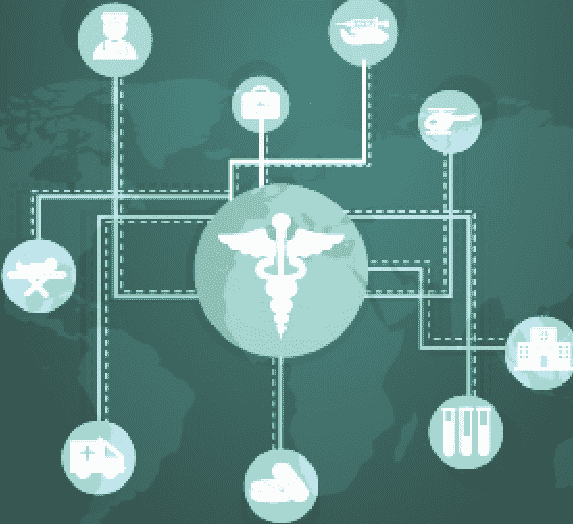


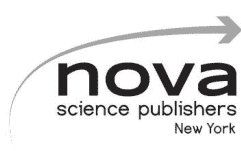


# 致读者

出版商在制作本书时已尽到合理的谨慎义务，但不作任何明示或默示的任何种类的担保，也不对任何错误或遗漏承担责任。出版商不对与此处包含的信息相关或由此产生的附带或间接损害承担任何责任。出版商对读者因使用或依赖本材料而产生的全部或部分特殊、间接或惩罚性损害不承担任何责任。本书基于政府报告的任何部分已予以注明，并且对那些部分主张版权，其程度适用于此类作品的汇编。

应对本书中包含的任何数据、建议或推荐寻求独立验证。此外，出版商不对因本出版物所包含的任何方法、产品、说明、想法或其他内容而导致的人员或财产受伤和/或损坏承担任何责任。

本出版物旨在就所涵盖的主题提供准确和权威的信息。它销售时明确了解，出版商不从事提供法律或任何其他专业服务。如果需要法律或任何其他专家协助，应寻求合格人员的服务。摘自由美国律师协会委员会和出版商委员会共同通过的参与者宣言。

本书电子书版本中可能提供额外的彩色图形。


# 前言

安全存储医疗记录对任何医疗保健系统都至关重要。仅依赖集中式服务器会增加敏感信息公开的可能性。区块链技术的透明度和安全性提高使其成为存储医疗记录的理想平台。

患者可以通过使用密码学在区块链上保护其数据，从而安全地存储其隐私敏感信息。这使他们能够在获得批准的情况下，与任何医疗机构共享其医疗信息。目前医疗系统非常分散，但如果所有用户都使用安全的全球数据库，它们之间的信息流将快得多。

全球数据库的一大优势是，客户不必每次都重复讲述自己的病历。例如，医学专家可以清楚地看到患者经历了什么以及进行了哪些治疗和检查。客户指定有权访问其档案的医疗专业人员也可以实时获取这些信息。

一场新革命正在发生，它明显不同于第三次工业革命（互联网、通信和全球化）。这场第四次工业革命涉及生物技术、纳米技术、人工智能、机器人技术、物联网、云计算和区块链等技术的融合。我们的医疗保健社会也在根本性变化，这也受到 COVID-19 的影响。

这些根本性变化需要公共和私人社会利益相关者做出综合和全面的回应。挑战在于如何利用第四次工业革命的创新，将医疗保健提升到新水平，并至少解决医疗保健和社会中最紧迫的问题。区块链将在此发挥重要作用。它是一种核心技术，有潜力将数字数据与物理系统相结合。

我们医疗保健的出发点是患者可以选择适合自己的护理。但在一个复杂性不断增加的领域中，患者如何做到这一点？此外，人口老龄化将导致护理需求增加。不断上升的医疗费用和慢性病增加也需要新方法。而且，治疗越来越多地在家庭环境中进行，而不是在医院或护理机构中进行。因此，医疗保健迫切需要创新。

医疗保健是一个高科技和信息密集型环境。部分正因如此，也因为良好的沟通对客户很重要，您会预期医疗保健中的信息交流组织良好。然而，医疗保健的组织方式如此复杂，以至于专业人员和客户都缺乏洞察。例如，医疗保健专业人员以不同的方式描述病症和治疗，这使得难以明确解释来自不同医疗记录的信息。此外，医疗保健提供者使用各种信息系统，使得链接信息变得困难。显然，信息安全是一个重要问题，这也增加了数据交换的复杂性。

数字化使得在业务运营中实施根本性变化成为可能。管理人员的诀窍是安全且智能地连接医疗各方使用的所有应用程序和信息系统。在这本书中，我们详细阐述了区块链将如何为这些挑战做出贡献。区块链是一个用于存储数据的分散网络。它旨在实现数据的完整性、透明度、效率和准确性。

本书由三章组成，展示了区块链和数字化在医疗保健中的影响，包括（1）在医疗保健中实施区块链方案及其组织后果的系统文献综述，（2）医疗保健中的区块链，以及（3）老年护理转型和数字化影响。


# 第1章

# 医疗保健中实施区块链解决方案及组织后果的系统文献综述

乔治·加里特森<sup>1,*</sup>，扬·弗伊格尔<sup>2</sup>，博士，以及佩特拉·C·德韦尔德-内德霍夫<sup>3</sup>，博士

<sup>1</sup>商业经济学/商业行政学首席讲师，毕业班协调员，萨克森应用科学大学商业与创业学院，荷兰

<sup>2</sup>萨克森应用科学大学，金融与会计学院，创意技术学院，治理、法律与城市发展学院，酒店商学院，商业与创业学院，人员与社会学院，荷兰

<sup>3</sup>组织研究与创新，特温特大学，行为、管理与社会科学学院，荷兰

## 摘要

本系统文献综述深入探讨了医疗保健领域区块链解决方案实施的发展、趋势及影响。为了介绍区块链这一主题，从科学文献中获取了区块链作为实现数字化转型技术的本质图景。本综述的目的在于聚焦区块链在医疗保健领域的当前应用及其发展方向。已提供关于区块链作为技术特征的背景信息，以介绍相关背景。为开展本系统文献综述，文中描述了一种方法，其中制定了四个研究问题，涉及医疗保健领域区块链解决方案的发展、趋势及采纳过程。使用了Scopus数据库。自2018年以来，出版物数量和引用次数均显著增加。出版物尤其集中在“计算机科学”和“工程”研究领域。这表明，就区块链而言，重点主要集中在技术上。中国目前是每篇科研引用文献在“医疗保健中的区块链”主题上引用次数最高的国家。研究领域和实施阶段均能说明区块链解决方案领域的发展情况。本系统文献综述表明，一个重要的研究领域涉及医疗保健机构内部及之间的数据和医疗信息共享。许多区块链解决方案处于规划和开发阶段。为了清晰了解医疗保健领域区块链解决方案实施中的趋势，按项目类型进行了分析。以组织间交易改进为项目以及对现有商业模式具有颠覆性的项目的区块链解决方案呈现出增长态势。对TOE框架的深入阐述表明，区块链作为技术的可用性、组织准备度以及竞争压力是采纳的重要考量因素。

**关键词：** 区块链，医疗保健，系统文献综述，实施，采纳

## 引言

区块链是实现医疗保健数字化转型的一种技术。（Veuger & Woldendorp, 区块链在医疗保健中的应用, 2021）本系统文献综述考察了研究文献中关于“医疗保健领域区块链解决方案的实施及采纳考量因素”这一术语的已知内容。其目的是提供关于医疗保健领域区块链实施的发展、趋势及影响以及采纳考量因素的见解。将开展一项系统文献综述，以深入了解医疗保健领域区块链的全球采纳阶段。目标是了解医疗保健中的区块链在多大程度上已经催生了可实施的解决方案。

在Deloitte关于荷兰医疗（护理）未来的文章中，其概述称，由于技术成本下降和新发展，未来的医疗将更多地在医院外组织，因此更贴近患者。例如远程监测、诊断和咨询。这将使个人化干预成为可能，患者无需立即前往医院。（Luijs, Bergen, & Engelen, 2020）。将医疗从医院转移到更贴近患者的地方，意味着一场技术发展和数字化作为触发因素的转型。根据Beijen的观点，数字化转型的特征是从产品导向（医疗服务的提供）转向以客户（患者）为中心的焦点。以患者为中心的组织表现出持续的变革开放性，是洞察驱动的，并且能够从技术角度访问使各种利益相关方之间合作的平台，而不会导致质量下降（Beijen, 2020）。区块链是一种可用于促进此类转型的技术。什么是区块链？本质上，区块链是一种数据结构——一种数据库——只有经数字签名的数据才能由点对点网络（无中央方）共同添加。但是，有必要确保这些数据满足某些条件（规则），并且也会共同验证。（Goossens & Verslype, 2019）。区块链不授予管理员权限来更改或删除数据。更改只能通过执行新交易来进行，此时适用共识协议。（Nakamoto, 2008）。在块内进行更改时，块的哈希值也会发生变化，导致链条中断。这意味着块内的更改是不可能的，从而降低了欺诈的脆弱性。区块链的技术优势在于提高透明度并增强信任。透明度和信任是实现长期价值创造的重要方面。（Berns, et al., 2019）。在医疗保健领域，不同实体之间的数据交易以安全方式进行至关重要，因为数据具有高度的隐私敏感性。这是因为所涉数据是机密的。越来越多的利益相关方在医疗保健中发挥作用，包括谷歌和苹果等大型技术公司（Luijs, Bergen, & Engelen, 2020）。这将释放更多资本来投资于实现转型的新技术。同样，J. Veuger和H. Woldendorp在《区块链在医疗保健中的应用》一书中，概述了数字化转型的作用和重要性，以实现从医疗到健康的转变。（Veuger & Woldendorp, 区块链在医疗保健中的应用, 2021）鉴于区块链有潜力增强信任并提高透明度，而隐私敏感性是一个关键问题，医疗保健领域区块链采纳不足是奇怪的。已经对医疗保健领域区块链的采纳以及尚未将区块链作为数字化转型技术使用的考量因素进行了许多研究。许多研究涉及区块链的技术方面。文献中提到的不立即应用区块链的重要技术考量因素涉及信息交换缺乏标准（Boulos, Wilson, & Clauson, 2018）。此外，可扩展性和从不同平台工作等方面也被提及为不采用区块链的考量因素。可扩展性是关于数据处理速度。平台是关于技术适用性（Griggs, et al., 2018）（Liang, Zhao, Shetty, Liu, & Li, 2017）。这些文献综述表明，从组织角度来看，人们很少了解采用区块链作为实现数字化转型技术的当前重要考量因素是什么。Clohessy & Acton在其关于组织因素对区块链采纳影响的研究中证实了这一点。（Clohessy & Acton, 2020）Pawczuk, Massey和Holowsky指出，人员和文化等情境因素可能是创新技术的关键成功因素（Pawczuk, Massey, & Holdowsky, 2019）。这些关键成功因素是Weiner概念模型的一部分（Weiner, 2009）。该模型提供了关于在衡量组织变革准备度时哪些维度很重要的见解。在Jouade & Saade关于各领域区块链应用的研究中，识别出医疗保健领域存在一个差距，即关于用户（患者）以及医生和医院管理员等服务提供商对区块链采纳的障碍。（Jaoude & Saade, 2019）Tandon et al.在其出版物《医疗保健中的区块链；系统文献综述，综合框架及未来研究议程》中确认了这一差距（Tandon, Amandeep, Najmul Islam, & Mantymaki, 2020）。这一差距表明，从组织角度来看，人们对医疗保健领域区块链采纳的了解仍然很少。Orlikowski（1992）的《技术的二元性》研究和观点假设，随着技术的变化，组织需要进行改变。变革的程度取决于所采纳技术的复杂性。（Orlikowski, 1992）Holotiuk和Moorman确认，区块链是一种复杂技术，为组织带来了多项挑战。组织间的合作和早期参与是技术理念开发、采纳和应用的重要方面。（Holotiuk et al., 2018）在Bailey的AMO框架中，协作和参与是确定组织能力的重要组成部分（Bailey, 1993）。

目标是通过文献研究，了解从组织角度来看哪些指标会影响区块链作为医疗保健领域数字化转型技术的采纳。为实现这一目标，需要更多地了解医疗保健中区块链的应用。系统文献综述可以为某个研究领域的当前知识提供有价值的信息。它将区块链主题置于更广泛的背景中，并说明该研究为何及时且重要（O’Reilly, 2012）。此外，系统文献综述还可以识别知识中的现有差距，以开展进一步的未来研究。（Gopalakrishnan & Ganeshkumar, 2013）为了更好地了解医疗保健中区块链的应用以及对该技术的采纳，提出了以下四个研究问题：

- 1. 近年来，医疗保健行业区块链解决方案实施的发展情况如何？


- 2. 医疗保健领域内区块链解决方案实施的主要趋势是什么？
- 3. 在医疗保健领域区块链解决方案采用的各阶段中，可见哪些分布情况？
- 4. 在采用区块链解决方案时，考虑哪些因素？

本出版物的结构如下：第 2 章涵盖文献综述的动机和贡献。第 3 章提供区块链技术的背景信息。第 4 章专门讨论区块链作为医疗保健领域内的技术。第 5 章讨论进行文献综述所采用的方法论。第 6 章呈现文献综述的结果。第 7 章回答研究问题。第 8 章制定结论和讨论。第 9 章呈现研究继续的议程。

## 动机与贡献

与上述文章相反，本工作针对医疗保健领域内的区块链研究，呈现了一项系统综述与分析，重点关注可实施解决方案的实现。本文旨在说明区块链在医疗保健中的应用，并展示有关已实施解决方案的区块链研究倡议与可能方向。

## 背景信息

本章提供了对区块链作为技术的最重要特征的了解。区块链基本上是一种分布式账本，能够在网络参与者之间交换数据（Swan, 2015）。区块链技术与比特币的推出同时引入。作为一种技术，区块链已确保加密货币交易不再重复。比特币使用共识机制，由多数（51%）决定交易是否可以被验证。挖矿节点是指可以创建新块以存储数据并执行交易的节点。在区块链作为技术使用的去中心化应用中，并不总是需要引入加密货币（Raval, 2016）。本章其余部分描述了区块链的基础、特征和关键要素，以便读者了解该技术的工作原理。

## 网络类型

区块链运行在各种类型的网络上。例如，存在公共、私有、“许可”和“无许可”网络（Dai & Vasarhelyi, 2017）。网络类型的选择取决于部署区块链技术的目的。“公共许可”区块链最适合确保客户隐私（Nordrum, 2017），因此适用于医疗保健领域，隐私是该领域的重要问题。

## 共识协议

区块链使得两个不同实体之间无需第三方验证交易即可进行交易。共识机制负责获取验证。有不同的协议用于达成共识。区块链中协议的附加价值是什么？协议的附加价值在于它提供了交易验证。在此过程中，区块链网络节点必须就共享账本的确切状态以及新块添加到账本的顺序达成一致（Aste, Tasca, & Di Matteo, 2017）。

可以区分出 7 种不同的共识协议，即（Janse & Lin Lim, 2020）：

- 1. 工作量证明（PoW）
- 2. 权益证明（PoS）
- 3. 委托权益证明（DPoS）
- 4. 重要性证明（PoI）
- 5. 活性证明（PoA）
- 6. 销毁证明（PoB）
- 7. 存款证明（PoD）

最常用的协议是工作量证明和权益证明（Janse & Lin Lim, 2020）。在工作量证明共识协议中，例如比特币的设置，只有在找到区块的有效哈希时，数据块才能添加到区块链中。在权益证明中，被允许生成块取决于（a）随机选择过程和（b）权益，例如基于实体持有的代币数量。权益证明协议有多种可能的变体（Zheng, Xie, Dai, Chen, & Wang, 2017）。最著名的形式是委托权益证明。该协议最好比作一种持续的代议民主，持有代币的每个人都可以投票选出见证人和代表。见证人的角色是验证交易并被允许生成新块。为提供此服务，见证人每生成一个块即获得奖励。代表在验证交易以及验证和生成块方面没有角色。代表的角色是监督和监测区块链协议的治理结构（Janse & Lin Lim, 2020）。具有最高重要性分数的实体可以通过生成新块来验证交易（He, Guan, Lv, & Yi, 2018）。活性证明协议假设网络中最活跃的节点。网络中活跃节点越多，网络越安全。最初，执行工作量证明协议以生成块，在验证方面，从最活跃的节点中做出选择（He, Guan, Lv, & Yi, 2018）。在销毁证明中，当实体将加密货币发送到不可支付地址并销毁时，该实体获得添加和验证块的权利。（Gourisetti, Mylrea, & Patangia, 2020）最后一种共识协议是存款证明。在此协议中，参与验证的每个节点必须支付存款以获得生成新块的权利。如果不满足某些条件，存款可能被没收，生成块的权利可能被限制。（Hölbl M., Kompara, Kamišalić, & Zlatolas, 2018）。

## 智能合约

区块链使得使用智能合约自动执行交易成为可能。但是，什么是智能合约？Cieplak 和 Leefatt 在其出版物《智能合约》中描述道：“一种自动化执行的智能方式”。一般来说，智能合约是以自动执行方式实现协商合同条款的计算机协议（Cieplak & Leefatt, 2017）。智能合约可以以两种方式进行。首先，可以存在确定性合同；在此类合同中，程序代码不依赖区块链外部的信息来启动合同的执行。所有必要信息均存储在区块链本身中。其次，可能存在非确定性合同。在这种类型的智能合约中，执行智能合约需要外部信息。这里的外部是指另一个数据源，例如互联网或另一个数据库。（Hewavitharana, Nanayakkara, & Perera, 2019）

## 验证区块链的规则

验证规则是网络内用于验证交易和更新账本的一组规则（Janse & Lin Lim, 2020）。发送者通过创建一条消息来启动交易，该消息包含：网络上接收者的“公共”地址、交易值和加密数字签名。然后，发送者将交易发送到网络中。区块链记录交易创建的时间，即所谓的时间戳。节点（计算机/用户）解密加密签名，从而验证消息。他们将交易创建时间与早先的时间进行比较，以避免重复支付。消息随后进入待处理交易队列。待处理的交易由一个节点收集并放入一个块中。该节点在特定时间间隔内将块发送到网络中进行验证。网络中的计算机可以验证块。它们通过一个需要网络共识的迭代过程来完成此操作。验证过程取决于所使用的共识协议类型。所使用的共识协议类型取决于正在使用的网络。共同点是必须能够确定交易有效且损坏的交易被拒绝。一旦块中的交易经过验证，块将固定在区块链中，账本的新更新状态将再次发送到所有节点（Muzammalab, Qu, & Nasrulin, 2019）

## 医疗保健领域的区块链及需求

在审视医疗保健领域时，Pessin, Shanler, Cole, & Stevens 的一项研究表明，全球医疗保健领域对区块链技术的兴趣日益浓厚。（Pessin, Shanler, Cole, & Stevens, 2019）。Pessin, Shanler, Cole 和 Stevens 的研究表明，受调查机构中有 55%（n = 204）有兴趣将区块链作为一种技术来使用。以下领域被提及为使用区块链作为支持技术的有趣领域：

- 医疗记录管理。
- 医疗索赔管理。
- 医疗专业人员资质认证。
- 医疗保健和生命科学供应链管理。

对区块链部署的四种倡议类型进行了区分，即：

- 新的颠覆性倡议，这些倡议基于在现有商业模式中应用区块链。
- 旨在改善资产交易和组织间交互的倡议，从而提高透明度和可追溯性。


- 促成新虚拟市场和实体市场创建的举措。
- 可为社区内安全数据存储做出贡献的举措。
- (Pessin, Shanler, Cole, & Stevens, 2019).

已有若干关于医疗保健中区块链主题的系统文献综述发表。使用 Google Scholar 数据库，检索式为：“Systematic Review” AND “Blockchain in Healthcare”，年份范围为 2019-2020，共得出 322 篇被引用的出版物。若将范围扩大至 2016-2020，则发现共有 363 篇出版物符合上述检索式。结论是，近年来出版物增多，这些出版物对医疗保健中的区块链进行了系统综述（Mayer, Costa, & Rosa Rhigi, 2020）。观察被引用最多的文章，值得注意的是，它们大多涉及区块链的采纳过程、优缺点以及可能的应用。关于医疗保健领域内通过区块链取得具体解决方案的举措和应用，以及采纳时的考量因素，鲜为人知。

## 方法论

本系统文献综述将研究领域限定在照护与治疗领域。以下是所使用的方法论定义，其有助于了解医疗保健中区块链的使用在多大程度上已带来可实施的解决方案，以及在将区块链作为一种技术进行采纳时哪些考量因素至关重要。

## 研究问题

本研究旨在回答以下研究问题：

- 1. 近年来，医疗保健领域内区块链解决方案的实施情况如何发展？
- 2. 医疗保健领域内区块链解决方案实施的主要趋势是什么？
- 3. 医疗保健领域中区块链解决方案的采纳阶段呈现怎样的分布情况？
- 4. 区块链解决方案采纳过程中考虑了哪些因素？

## 数据库使用

本系统文献综述使用了 Scopus 数据库。为了明确哪些文章对回答研究问题至关重要，根据以下标准进行了评估：

- 1. 范围：选择了 2010-2020 的数据范围。此外，所选数据中仅包含原始研究。
- 2. 数据来源：仅为数据研究选取了被引用的期刊。
- 3. 语言：系统文献综述中仅包含英语来源。
- 4. 相关性：扫描了研究标题，以判断其与所定义研究领域“医疗保健中区块链的实施”的相关性。
- 5. 纳入：研究应符合第 2、3 和 4 点中所述的纳入标准。不符合这些标准的研究未纳入本进一步研究。
- 6. 特异性：符合“医疗保健中区块链的实施”主题的研究将被阅读。
- 7. 数据：完整阅读的研究将被分析，以帮助回答研究问题。为搜索相关出版物，使用了如下定义的查询来回答前三个子问题。查询及相关字符串基于研究领域和所定义的研究问题。定义并使用了以下搜索词：

```
(blockchain OR "block chain") AND
(healthcare OR health OR medic* OR
Medical OR medicine OR *health*) AND
(implementations OR usage OR realization OR execution)
```

Scopus 科学数据库的检索于 2020 年 11 月进行。

包含相关字符串的查询尽可能保持广泛，以便在深入研究中尽可能多地纳入结果。该查询的检索共得出 383 篇出版物。初步筛选基于标题、关键词和摘要中的搜索词。为回答“区块链解决方案采纳过程中考虑了哪些因素”这一研究问题，我们寻找了相关框架。该框架应提供来自不同情境的见解，说明在将区块链作为解决方案进行采纳时哪些考量因素至关重要。这一见解来自 TOE 框架。TOE 框架在 Tornatzky 和 Fleisher 编著的《技术创新过程》（"The processes of technological Innovation"）（Tornatzky & Fleischer, 1990）一书中有所描述。

在这本书中，Tornatzky 和 Fleisher 描述了从开发、采纳到最终实施的创新过程。TOE 框架指出，技术、组织和环境三个主要情境会影响组织采纳和接受新技术的过程（Lippert & Govindarajulu, 2006）。目标是利用 TOE 框架来识别和分类在将区块链作为技术进行采纳时，技术、组织和环境情境中所考虑的因素。图 1 可视化了 TOE 框架。

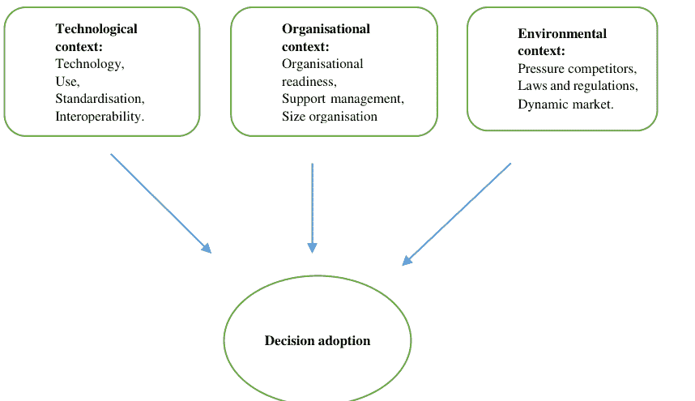

图 1. TOE 框架（Tornatzky & Fleischer, 1990）。

为搜索相关出版物，使用了如下定义的新查询。查询及相关字符串基于研究领域和所定义的研究问题。检索于 2021 年 3 月进行。定义并使用了以下搜索词：

```
("factors" OR "restrictions" AND "Blockchain" AND "adoption");
("blockchain" AND "TOE" OR "toe-framework")
```

## 结果

基于第 8 页所述查询从 Scopus 数据库中进行的筛选，起初共有 383 篇出版物用于回答前三个子问题。结果的进一步筛选和选择可分为几个阶段。首先，筛选基于范围。所选时间段为 2010-2020。基于此范围，剩余 374 篇原始出版物。选择从 2010 年开始与 2008 年比特币的推出有关。此后，我们根据关键词“Blockchain” AND “Health Care”对数据来源进行了筛选。筛选中仅包含期刊。基于此选择，剩余 120 篇出版物。此后，我们仅筛选英文出版物。这得出了 81 篇出版物。基于这 81 篇选定的出版物，对摘要进行了筛选。我们筛选了出版物是否涉及医疗保健领域内区块链解决方案的实施。最终，发现 38 篇出版物符合此筛选。这些出版物被纳入综述。图 2 再次展示了整个选择过程及相应结果。

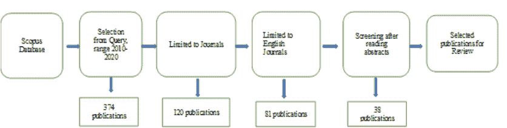

图 2. 所选期刊的检讨。

关于范围，为此目的选择了 2010 至 2020 年（至今）的时期。如果我们查看每年选定出版物数量的变化，值得注意的是，根据 Scopus 数据库的数据，医疗保健领域区块链应用的出版物始于 2017 年。此外，值得注意的是，尤其是在 2019 年和 2020 年，关于医疗保健领域区块链应用的出版物大量发表。图 3 显示了出版物数量。起点是基于关键词描述的出版物。

观察研究领域，图 4 显示，许多关于医疗保健中区块链的出版物发表在“计算机科学”和“工程”领域。这主要表明，在区块链方面，主要关注技术。

除了已发表文章的数量和研究领域之外，研究多年来被引用出版物数量的发展也很重要。

## 出版物数量

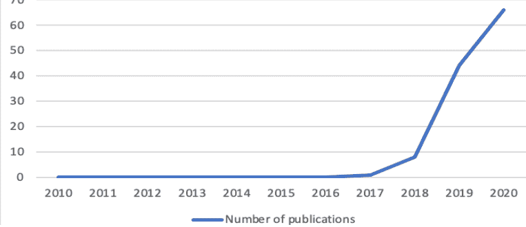

图 3. 所用范围相关的出版物数量发展情况。

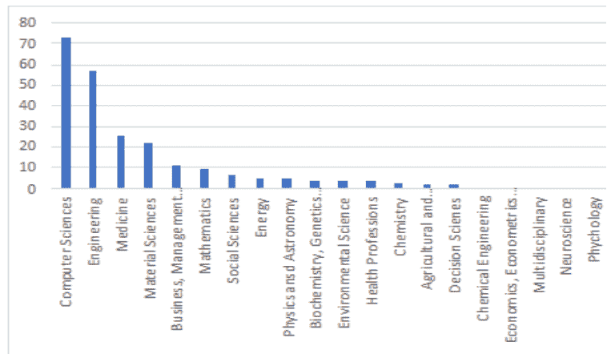

图 4. 所选出版物的研究领域。

基于本分析结果，可以就医疗保健中区块链实施的重要性发表看法。本分析采用了与确定出版物数量发展情况时相同的范围。此外，未包含自我引用的引文。图 4 显示了所用时间范围内引用数量的发展情况。


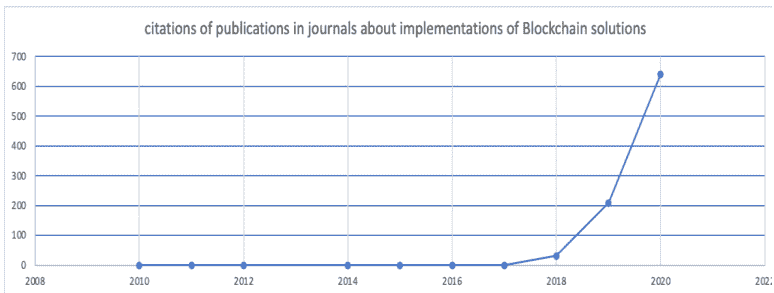

图 5. 引用数量随所用范围的发展情况。

关于图 3 和图 5 值得注意的一点是，无论是数量的变化趋势还是被引用的出版物，都呈现出从 2018 年开始的上升趋势。近年来，在“医疗保健领域的区块链应用”这一主题下发表的出版物数量中也可以看到这一趋势。发表该主题文章的重要性日益增加。同样的情况也可以在 J. Veuger 进行并在学术期刊《房地产、规划与环境法》(Journal of Property, Planning and Environmental Law) 上发表的研究中观察到 (Veuger, 荷兰区块链、房地产与土地登记, 2020)。同样重要的是，要查看哪些国家对影响“医疗保健领域的区块链实现”这一研究领域的出版物具有影响力。为了深入了解这一情况，基于 120 篇选定的出版物进行了国家分析。范围基于 2010 年至 2020 年（至今）。在根据定义的查询选择出版物时，使用了相同的范围。同样，使用了 Scopus 数据库。结果显示于表 1 和图 6 中。

## 表 1. 基于所用范围按原产国划分的出版物平均被引数

| 国家 | 出版物数量 | 被引用次数 | 每篇出版物的被引用次数 |
| :--- | :--- | :--- | :--- |
| 美国 | 35 | 280 | 8,00 |
| 英国 | 19 | 205 | 10,79 |
| 中国 | 18 | 243 | 13,50 |
| 印度 | 16 | 134 | 8,38 |
| 沙特阿拉伯 | 12 | 113 | 9,42 |
| 韩国 | 10 | 11 | 1,10 |
| 澳大利亚 | 9 | 112 | 12,44 |
| 加拿大 | 6 | 113 | 18,83 |

## 按出版物划分的被引用次数

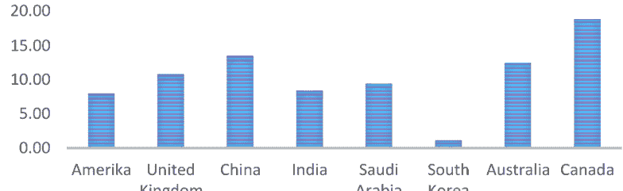

图 6. 基于所用范围按国家划分的每篇文章平均被引次数。

表 1 显示，美国是以“医疗保健领域的区块链实现”为主题的文章频率最高的国家。被引用次数亦是如此。如果我们查看每篇文章的被引用次数，会发现加拿大的被引用次数最高。这是因为两篇出版物合计拥有 91 次被引用，从而导致数据出现失真。

在对 Scopus 数据库中的摘要进行筛选后，选出了 38 篇关于在医疗保健领域实施区块链解决方案的出版物。首先对这些出版物就其在医疗保健领域内的区块链解决方案目的进行了筛选。此外，还调查了解决方案所处的阶段。为了确定阶段，我们使用了来自数字平台 Zorg voor innoveren 的文档《Handreiking e-health implementatie》（电子健康实施指南）。该平台是荷兰五个政府组织之间的合作项目。涉及以下组织：

- 卫生、福利与体育部
- 荷兰医疗保健研究所
- 荷兰医疗保健管理局
- 荷兰企业署
- ZonMw

在该文档中，实施电子健康解决方案确定了以下阶段：

- 1. 愿景与战略
- 2. 计划制定
- 3. 开发
- 4. 实施与评估
- 5. 规模扩大 (Wolters & Hagen, 2019)。

以下是各实施阶段的简要说明。

- 第 1 阶段 本阶段关乎愿景和战略的形成。
- 第 2 阶段 本阶段关乎引入计划并调查解决方案的影响。
- 第 3 阶段 本阶段涉及解决方案的开发以及组织变革的塑造。
- 第 4 阶段 本阶段将解决方案付诸实践并评估解决方案的质量。付诸实践通过试点进行。
- 第 5 阶段 最终阶段涉及通过标准化工作流程、推动解决方案的结构化使用以及重新评估进一步发展来对解决方案进行规模扩大 (Wolters & Hagen, 2019)。

在表 2 中，38 篇出版物已根据研究目的进行筛选。

对 38 篇出版物的分析结果表明，选定的 38 篇出版物中有 20 篇涉及使用区块链解决方案在医疗保健机构之间共享数据。此外，分析显示，38 篇中有 11 篇涉及使用区块链解决方案简化医疗保健数据。还研究了每个主题/研究领域的被引用出版物数量。此分析结果表明，144 次被引用涉及主题/研究领域为“数据共享”的出版物。有 48 次被引用涉及以“医疗保健数据”为主要主题/研究领域的出版物。

## 表 2. 研究领域

| 研究领域 | 出版物数量 | 被引用次数 | 相对于出版物数量的被引用次数 |
|---|---|---|---|
| 数据共享 | 20 | 144 | 7,20 |
| 电子健康记录 | 11 | 48 | 4,36 |
| 访问控制 | 2 | 0 | 0,00 |
| 物流 | 1 | 1 | 1,00 |
| 其他 | 4 | 69 | 17,25 |
| 合计 | 38 | 262 | |

主题/研究领域“其他”呈现出失真的图景。这种失真图景是由该领域内有一篇拥有 61 次被引用的出版物所导致的。如果将每个主题/研究领域的被引用次数与该领域的出版物数量相对比，结果表明，主题/研究领域“数据共享”的平均每篇出版物被引用 7.2 次。主题/研究领域“医疗保健数据”的平均每篇出版物被引用 4.36 次。同样，在主题/研究领域“其他”中，有一篇出版物被归类为拥有 61 次被引用，因此也会出现失真的图景。与该类别中较少的出版物数量相比，这意味着平均每篇出版物被引用 17.25 次。在表 3 中，38 篇出版物已根据实施阶段进行筛选。为此，已将五个阶段作为出发点。

结果基于对摘要中最重要主题的分析。这些主题反映了实施阶段。基于此，确定了适用于该出版物的阶段。此分析结果表明，选定的出版物中有 16 篇处于规划阶段。按百分比计算，这占总数的 42%。

## 表 3. 基于出版物数量和被引用次数的实施阶段

| 实施阶段 | 出版物数量 | 被引用次数 | 相对于出版物数量的被引用次数 |
| :--- | :--- | :--- | :--- |
| 愿景与战略 | 6 | 28 | 4,67 |
| 规划 | 16 | 153 | 9,56 |
| 开发 | 10 | 58 | 5,80 |
| 执行与评估 | 6 | 23 | 3,83 |
| 规模扩大 | 0 | 0 | 0,00 |
| 合计 | 38 | 262 | |

另外，在选定的 38 篇出版物中，有 10 篇处于开发阶段。分析了六篇区块链解决方案处于实施与评估阶段的出版物。未分析任何涉及医疗保健领域内区块链解决方案规模扩大（同时也标准化流程）的出版物。为了了解影响，确定了每个实施阶段的被引用次数。基于此分析，结果显示，“规划”阶段拥有 153 次被引用，在 262 次被引用中占比最大。为了获得相对图景，已将被引用次数与每个实施阶段的出版物数量进行对比。此分析结果表明，作为一个阶段，实施阶段“规划”以平均每篇出版物 9.56 次被引用占比最大，其次是每个阶段平均被引用 5.8 次的实施阶段“开发”。

为了了解医疗保健领域内区块链实施的最重要趋势，根据倡议类型对 38 篇选定的出版物进行了分类。在方法论方面，采用了基于轴心编码的主题分析。一篇出版物可以包含多个倡议。所使用的倡议源自 Pessin, Shanler, Cole & Stevens 的研究，可在第 5 章中找到。

## 表 4. 作为解决方案的区块链实施倡议数量的发展

| 作为实施解决方案的区块链倡议 | 识别出的倡议数量 | 2018 | 2019 | 2020 |
|---|---|---|---|---|
| 现有商业模式内的颠覆性倡议 | 14 | | 4 | 10 |
| 促进组织间交易改进的倡议 | 21 | 2 | 5 | 14 |
| 促成新虚拟或实体市场创建的倡议 | 2 | | 2 | 0 |
| 涉及信息安全存储的倡议 | 16 | | 6 | 10 |
| 合计 | 53 | 2 | 17 | 34 |

表 4 显示，促进组织间交易改进的实施拥有 21 个倡议（占 40%），与总计相比占比较大。倡议为“信息安全存储”的区块链解决方案也频繁出现（占 30%）。为了了解所研究倡议的发展情况，我们查看了倡议在期刊上发表的时间。区块链解决方案颠覆现有商业模式的倡议以及促进组织间交易改进的倡议，在 2019 年至 2020 年的发表年份之间均呈现增长。由于 2019 年至 2020 年间出版物数量也有所增加，因此目前还无法直接判断是否存在趋势。

必须将每个倡议的倡议数量增加与出版物数量增加进行比较，以确定是否存在实际的积极发展。此分析结果汇总于表 5 中。

此分析结果表明，涉及组织间交易改进的倡议以及颠覆现有商业模式的倡议均呈现增长。要确定是否存在趋势，需要更多深入的洞察。

表 6 从三种不同的背景下展示了采用区块链作为解决方案的主要考量因素。


## 表 5. 2019 年（指数 100%）至 2020 年间倡议数量的发展

| 作为解决方案实施区块链的倡议 | 2020 年与 2019 年间倡议的增加 | 2020 年与 2019 年间出版物数量的增加 | 差异 |
|---|---|---|---|
| 现有商业模式内的颠覆性倡议 | 150% | 100% | 50% |
| 导致组织间交易改进的倡议 | 180% | 100% | 80% |
| 导致创建新虚拟或实体市场的倡议 | -100% | 100% | -200% |
| 涉及信息安全存储的倡议 | 67% | 100% | -33% |

## 表 6. 三种不同情境下的采纳考虑因素

| 技术视角的考虑因素 | 在选定文章中提及的次数 | 组织视角的考虑因素 | 在选定文章中提及的次数 | 环境视角的考虑因素 | 在选定文章中提及的次数 |
|---|---|---|---|---|---|
| 可用性 (technik) | 6 | 组织就绪度 | 6 | 竞争压力 | 3 |
| 复杂性 (technik) | 3 | 高层管理支持 | 5 | 规则与法规 | 3 |
| 感知有用性 | 3 | 组织规模 | 3 | 动态市场 | 3 |

表 6 中呈现的考虑因素是通过分别应用图 7 中展示的选择过程和方法论获得的。

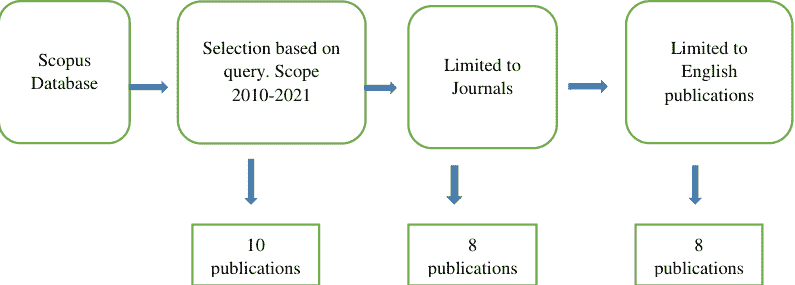

图 7. 选择过程。

选择过程筛选出 8 篇出版物，这些出版物被完整阅读并按采纳考虑因素进行编码，所述考虑因素基于 Tornatzky 和 Fleisher 的理论（Tornatzky & Fleischer, 1990）。附录 2 包含了所选出版物及其提及的采纳考虑因素的概述。表 6 的结果表明，从技术情境来看，技术的可用性和复杂性是影响区块链采纳的重要考虑因素。组织就绪度是采纳区块链的重要考虑因素。组织就绪度是指组织成员实施组织变革的变革就绪度和效率。（Weiner, 2009）从组织视角来看，重要的情境因素包括组织文化、组织结构、过去经验和内部规章。从环境情境来看，竞争压力尤其被视为将区块链作为一种技术进行采纳的重要因素。

## 研究问题解答

在本节中，将基于系统文献综述中获得的数据和所做的分析，回答第 6.1 节中提出的问题。

第一个研究问题涉及近年来医疗保健领域内区块链解决方案实施的发展。基于此系统文献综述，可以指出，医疗保健领域许多区块链实施仍处于规划和开发阶段，尚未实施和评估。然而，系统文献综述确实表明，涉及区块链解决方案实施的出版物数量大幅增加。这意味着医疗保健领域的区块链研究领域仍然有趣且持续发展。这一观察可以通过被引用出版物数量的增加来证明。自 2019 年起，可以观察到相对于出版物数量的引用数量明显增加。这意味着医疗保健领域的区块链领域正在获得更大影响力。

第二个研究问题关于医疗保健领域内区块链解决方案实施的主要趋势是什么。此系统文献综述中出现的重要趋势涉及组织间的数据共享。这主要关乎互操作性的提升。该领域内另一个被考察的趋势涉及医疗数据共享，这通常与自我主权身份（SSI）相关联。德勤在其报告“2020 年五大区块链趋势”（Deloitte, 2020）中也概述了这一趋势。

医疗保健领域内另一个重要趋势是，许多正在采取的倡议旨在利用区块链解决方案颠覆性地调整现有商业模式。在 2019 年至 2020 年间，可以清楚地观察到，涉及利用区块链解决方案颠覆性地调整现有商业模式的倡议的出版物数量出现了明显增长。在所选出版物中，该倡议可观察到 50% 的增长。这主要涉及在共享医疗数据过程中处理授权许可的商业模式的颠覆性调整。此外，还有关于实施区块链解决方案以改进从患者到血液检测结果的血液供应运输现有商业模式的倡议。还有关于促进组织间交易改进的出版物趋势。如果将 2020 年与 2019 年相比，可以观察到区块链解决方案实施导致组织间交易改进的倡议数量增加了 80%。然而，讨论指出，收集的数据涉及 2019 年和 2020 年，关于这些提及的趋势是否将持续存在，缺乏足够的渐进性洞察。

第三个研究问题涉及医疗保健领域内区块链采纳阶段中可见的划分。为了妥善回答问题，建立了与 Rogers 以及 Pierce & Delbecq（Pierce & Delbecq, 1977）（Rogers, 1995）所定义的采纳阶段的联系。采纳过程包含三个阶段：启动、采纳（决策）和实施。

启动阶段涉及识别解决方案的需求，为此创造了意识。这导致识别合适的创新，并提出一些创新以供采纳（决策）（Duncan, 1976）（Rogers, 1995）。采纳（决策）阶段反映了从技术、财务和战略角度评估创新，在此基础上决定是否接受一项创新（Meyer & Goes, 1988）。最后阶段涉及实施创新的阶段。它涉及与调整创新、为使用做好组织准备、试用、用户接受创新以及扩大创新规模相关的行动（Rogers, 1995）（Meyer & Goes, 1988）（Duncan, 1976）。通过与表 3（医疗保健领域区块链实施阶段）关联，可以获得医疗保健领域区块链采纳阶段的图景。所选 38 篇出版物中的大多数仍处于规划或开发阶段。如第 7 章所述，规划阶段关乎制定计划以及所提供解决方案对医疗保健领域内组织的影响。开发阶段关乎开发解决方案并塑造组织变革。这一规划与开发阶段对应于 Rogers 与 Pierce 和 Delbecq（Rogers, 1995）所定义的采纳过程中的启动阶段定义。

第四个研究问题涉及在将区块链作为解决方案采纳时所考虑的因素。为此，建立了与 Tornatzky 和 Fleischer 理论的联系，从中获得了关于从各种情境采纳技术的考虑因素的洞察（Tornatzky & Fleischer, 1990）。为此，TOE 框架被作为起点。从 Scopus 数据库中筛选出的 8 篇出版物，根据三种不同情境推理出的不同考虑因素进行了编码。主要考虑的因素是区块链作为一种技术的可用性、组织就绪度和竞争压力。在采纳考虑因素中，一个有趣的研究领域是组织就绪度。就组织就绪度和组织


能力，是否会出现阻碍采用区块链等新技术的障碍？

## 结论与讨论

本章介绍了对医疗保健领域区块链解决方案实施的发展、趋势和影响以及采用考虑因素进行的系统文献综述结果。研究结果显示，医疗保健领域区块链解决方案实施的关注度和影响力正在增长。经轴心编码分析的38篇选定文献的结论显示，许多研究仍处于规划和开发阶段。这些研究大多提出了在医疗保健领域实施区块链解决方案的框架。这一发现与由数字平台 Zorg voor innoveren 发布的《e-健康实施指南》（'Handreiking e-health implementatie'，e-health implementation guide）（Wolters & Hagen, 2019）中的第1阶段和第2阶段以及部分第3阶段一致。所选文献中不包含关于已实施区块链解决方案评估的研究。系统文献综述的结果显示，区块链被视为促进医疗保健领域内数据共享的解决方案。这一发现与启动区块链解决方案的主要举措一致，即改善医疗保健机构之间的交易。从对选定文献的研究来看，区块链的采用很大程度上植根于安全性、可扩展性和灵活性等技术方面。从组织角度来看，有必要研究区块链作为一种技术的可接受性。这一需求与Tornatzky and Fleischer的TOE框架所得出的结果一致（Tornatzky & Fleischer, 1990）。Holotiuk和Moormann指出，组织对区块链的采用是一个重要因素，因为组织必须能够根据需求评估区块链等技术的使用（Holotiuk & Moormann, 2018）。组织采用是技术创新和组织变革管理的一个持续、多方面的过程（Markus & Tanis, 2000）。该系统文献综述的局限性在于相关数据仅从Scopus数据库中收集。更广泛的相关文献范围本可提供更深入的信息，从而提高本系统文献综述的可靠性和效度。本系统文献综述确实提供了关于科学文献中存在哪些空白的充分洞察。本系统文献综述获得的洞察有助于将区块链研究流与组织和变革管理等既定研究领域相联系。

## 进一步研究与局限性

第四个子问题的结论构成了开展进一步研究的起点。该问题关注采用新技术时考虑的因素。在本出版物的介绍中，描述了关于用户（患者）以及医生和医院管理员等服务提供商采用区块链的障碍方面存在文献空白（Jaoude & Saade, 2019）。Tandon等人以及Holotiuk和Moormann证实了这一空白（Tandon, Amandeep, Najmul Islam, & Mantymaki, 2020）（Holotiuk & Moormann, 2018）。需要进一步研究以了解医疗保健组织如何应对使用区块链等新技术所造成的变化。具体而言，研究针对组织变革准备度和组织能力开展。组织变革准备度关注组织内部变革的意愿和能力（Weiner, 2009）。组织能力是指组织内部存在的能力、动机和支持，以使新技术带来的变化成为可能（Bailey, 1993）。在此基础上，制定了一项研究议程，其中四项研究居核心地位。在图8中，不同的研究被可视化并相互关联。由于在区块链等颠覆性技术中发生快速发展，有必要进行额外的系统文献综述。考虑到该研究领域的强劲发展，本研究将使用不同的术语开展。将纳入2021年发表的相关科学文献到本系统文献综述中。

这样一来，将创建一系列系统文献调查，形成纵向图景。正如Briner、Denyer和Rousseau所建议的，为了对不断发展的对象（包括区块链等技术）获得足够的证据，第一次系统文献综述收集的文献将有助于建立初步理论框架。第二次系统文献综述的文献数据用于证明、补充和/或扩展所构建的理论框架（Briner, Denyer, & Rousseau, 2009）。这意味着需要采取更复杂的系统文献综述方法。根据Greenhalgh & Peacock的观点，无论搜索多少个数据库，对复杂证据的系统综述都不能仅依赖于预定义的议定书化搜索策略。一些看似效率较低的策略（询问同事、跟进看起来有趣的参考文献、以及保持对偶然发现的警觉）可能会有更好的回报，并且可能识别出否则会被遗漏的重要来源。引文追踪是识别系统综述的重要搜索方法（Greenhalgh & Peacock, 2009）

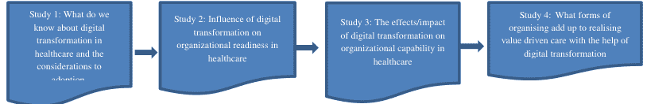

图8. 连贯视角下的研究议程。

- 理论背景：数字化转型（区块链）
- 研究领域：组织准备度、组织能力、组织形式
- 分析层次：组织层面及组织间。
- 分析单元：医疗保健组织。

## 参考文献

Abou-Nassar, E., Ilyasu, A., El-Kafrawy, P., Song, O.-Y., Bashir, A., & El latif, A. (2020). DITrust Chain：面向可持续医疗保健物联网系统的基于区块链的信任模型。IEEE Access, vol.8, 111223-111238.

Adrian, Husain, F., Willyanto, Wang, G., & Sfenrianto. (2020). 在E-物流中应用智能合约进行监控和控制。International Journal of Emerging Trends in Engineering Research, vol.8, 247-250.

Akkaoui, R., Hei, X., & Cheng, W. (2020). EdgeMediChain：健康数据交换的混合边缘区块链框架。IEEE Access, vol.8, 113467-113486.

Aste, T., Tasca, P., & Di Matteo, T. (2017). 区块链技术：对社会和行业的可预见影响。Computer, 18-28.

Bailey, T. (1993). 自主努力与工作组织：自豪以来的员工参与和工作改革。Columbia: Teachers College and Conservation of Human Resources Columbia University.

Beijen, M. (2020). Succesvol Digitaal Transformeren. ‘s-Hertogenbosch: van Haren Publishing. [成功的数字化转换。]

Berns, S., de Jong, J., Osterkamp, H., Stolk, R., Wesseling, H., & Wieringa, W. (2019). Naar werkende governance op blockchain in de zorg. Den Haag: Berenschot. [迈向医疗保健领域的可行区块链治理]

Boulos, M., Wilson, J., & Clauson, K. (2018). 地理空间区块链：健康和医疗保健中的承诺、挑战和场景。International Journal Health Geogr., 17-25.

Briner, B., Denyer, D., & Rousseau, M. (2009). 基于证据的管理：概念清理时间？Exchange; Academy of Management Perspectives, 19-32.

Chukwu, E., & Garg, L. (2020). 医疗保健中区块链的系统综述：框架、原型和实现。IEEE Access, vol.8, 21196-21214.

Cieplak, J., & Leefatt, S. (2017). 智能合约：自动化履行的聪明方式。Georgetown Law Technology Review, vol 1:2, 417-427.

Clohessy, T., & Acton, T. (2020). 调查组织因素对区块链采用的影响：创新理论视角。Industrial Management and Data Systems, vol 188.

Cubera, F., Dias, D., Simonyan, V., Yoon, W., & Casella, A. (2019). 区块链：医疗保健和生命科学转型的推动者。IBM Journal of Research and Development, vol 63.

Dai, J., & Vasarhelyi, M. (2017). “迈向基于区块链的会计与鉴证”。Journal of Information Systems, Vol.31 No.3, 5-21.

Deloitte. (2020). C-Suite简报：2020年5个区块链趋势。Deloitte, 14.

Duncan, R. (1976). 两栖组织：为创新设计双重结构。载于 R. Kilmann, L. Pondy, & D. Slevin, The Management of Organizational Design: Strategy Implementation 1 (pp. 167-188). New York: North-Holland.

Erokhin, A., Koshechkin, K., & Ryabkov, L. (2020). 分布式账本技术作为最大化低质量药品流通风险的措施。PeerJ Computer Science, vol.6.

Fernando, Y., Rozaquar, N., & Mergersa, F. (2021). 基于区块链的技术与碳绩效：早期采用者的洞察。Technology in Society, vol 64.

Gokalp, E., Coban, S., & Gokalp, M. (2020). 基于区块链的供应链管理系统接受度：研究模型提案 [Blokzincir Tabanlı Tedarik Zinciri Yönetimi Sistemi Kabulü: Arastırma Modeli Önerisi]。第1届信息学和软件工程国际会议：数字化转型的创新技术，IISEC 2019 - 论文集，vol 173.

Goossens, J., & Verslype, K. (2019). Blockchain en smart contracts;Het einde van de vertrouwde tussenpersoon? Eerste hulpHulp bij rechtszaken: Blockchain in de juridische wereld: Enkele toepassingen , 5-10. [区块链与智能合约；受信任中介人的终结？法律世界中的急救法律援助：区块链的一些应用]

Gopalakrishnan, S., & Ganeshkumar, P. (2013). 系统综述和荟萃分析：理解初级保健中的最佳证据。Journal Family Med. Prim. Care 2, 9-14.

Gourisetti, S. N., Mylrea, M., & Patangia, H. (2020). 区块链适用性框架的评估与演示。IEEE Transactions on Engineering Management (Volume: 67, Issue: 4, Nov. 2020), 1142-1156.


- Greenhalgh, T., & Peacock, R. (2009). 复杂证据系统综述中检索方法的有效性与效率：一级来源审计。*英国医学杂志（BMJ）*, 第 331 卷, 1064-1065.

- Griggs, K., Ossipova, O., Kohlios, C., Baccarini, A., Howson E.A., & Hayajneh, T. (2018). 基于智能合约的安全自动化远程患者监测医疗区块链系统。*医学系统杂志*.

- Hölbl, M., Kompara, M., Kamišalić, A., & Zlatolas, L. (2018). 医疗保健中区块链应用的系统综述。*对称性（Symmetry）* 第 10 卷.

- Hölbl, M., Kompara, M., Kamišalić, A., & Zlatolas, L. N. (2018). 医疗保健中区块链应用的系统综述。*对称性（Symmetry）* 2018, 10.

- Hanelt, A., Bohnsack, R., Marz, D., & Marante, C. (2020). 数字化转型文献的系统综述：对战略与组织变革的启示与含义。*管理研究杂志（Journal of Management Studies）*, 1-39.

- He, Q., Guan, N., Lv, M., & Yi, W. (2018). 面向物联网的区块链/DLT 共识机制。*2018 年 IEEE 第 13 届工业嵌入式系统国际研讨会 (SIES) 2018 年 6 月 6-8 日*. Graz: IEEE.

- Hewavitharana, T., Nanayakkara, S., & Perera, S. (2019). 区块链作为项目管理平台。区块链作为项目管理平台（第 137-146 页）。*第 8 届世界建设研讨会论文集（Proceedings of the 8th World Construction Symposium）*, 斯里兰卡科伦坡，2019 年 11 月 8-10 日：https://2019.ciobwcs.com/papers.

- Holotiuik, F., & Moormann, J. (2018). 数字创新的组织采用：区块链技术案例。英国朴茨茅斯：信息系统协会.

- Islam, A., & Young Shin, S. (2020). 借助无人机在物联网中辅助的基于区块链的安全医疗方案。*计算机与电气工程（Computers and Electrical Engineering）* 第 84 卷.

- Janse, A., & Lin Lim, C. (2020). *区块链基础教程（Basisboek Blockchain)*. 阿姆斯特丹：De boekdrukker.

- Jaoude, J., & Saade, R. (2019). 不同领域中区块链应用的使用。*IEEE Access（IEEE 访问）* 第 7 卷, 45360-45381.

- Kamble, S., Gunasekaran, A., Kumar, V., Belhadi, A., & Foropon, C. (2021). 基于机器学习的供应链区块链采用预测方法。*技术预测与社会变革（Technological Forecasting and Social Change）*, 第 163 卷.

- Kamel Boulos, M., Wilson, J., & Clauson, K. (2018). 地理空间区块链：健康与医疗保健中的前景、挑战与场景。*国际健康地理学杂志（International Journal of Health Geographics）*, 第 17 卷.

- Kim, S., Kim, J., & Kim, D. (2020). 使用区块链技术实施血液冷链系统。*应用科学（瑞士）（Applied Sciences (Switzerland)）*, 第 10 卷.

- Kulkarni, M., & Patil K. (2020). 基于 TOE 框架的区块链技术采用。*国际科学与技术研究杂志（International Journal of Scientific and Technology Research）* 第 9 卷.

- Kumar, A., Krishnamurthi, R., Nayyar, A., Sharma, K., Grover, V., & Hossain, E. (2020). 使用医疗 4.0 流程的新型智慧医疗设计、仿真与实现。IEEE Access 第 8 卷, 118433-118471.

- Kuo, T.-T., Kim, J., & Gabriel, R. (2020). 基于区块链网络中的网络的隐私保护模型学习。《美国医学信息学杂志》第 27 卷, 343-354.

- Lemieux, V., Rowell, C., Seidel, M.-D., & Woo, C. (2020). 夹在中间？：区块链与分布式信任时代的战略信息治理中断。《记录管理杂志》.

- Liang, X., Zhao, J., Shetty, S., Liu, J., & Li, D. (2017). 移动医疗应用中数据共享与协作的区块链集成。2017 年 IEEE 第 28 届个人、室内和移动无线通信国际研讨会论文集，（第 1-5 页）。蒙特利尔，魁北克，加拿大.

- Lippert, S., & Govindarajulu, C. (2006). 网络服务采用的技术、组织与环境前因。《网络服务采用的前因》，147.

- Luijs, J., Bergen, M. v., & Engelen, L. (2020). 荷兰的医疗（健康）未来。Deloitte. [荷兰的医疗（健康）未来。]

- Mackey, T., Miyachi, K., Fung, D., Qian, S., & Short, J. (2020). 打击医疗欺诈与滥用：基于区块链反欺诈框架的概念化与原型研究。《医学互联网研究杂志》第 22 卷.

- Madine, M., Battah, A., Yaqoob, I., Salah, K., Jayaraman, R., Al Hammadi, Y.,... Ellahham, S. (2020). 让患者掌控自身医疗记录的区块链方案。IEEE Access 第 8 卷, 193102-193115.

- Malamas, V., Kotzanikolaou, P., Dasaklis, T., & Burmester, M. (2020). 用于医疗数据精细访问的分层多区块链。IEEE Access 第 8 卷, 134393-134412.

- Margheris, A., Masi, M., Miladi, A., Sassone, V., & Rosenzwieger, J. (2020). 医疗数据的去中心化溯源。《国际医学信息学杂志》第 141 卷.

- Markus, M., & Tanis, C. (2000). 界定 IT 管理领域：通过过去展望未来。辛辛那提：Pinnaflex 教育资源公司.

- Mayer, A., Costa, C. d., & Rosa Rhigi, R. d. (2020). 区块链中的电子健康记录：一项系统综述。《健康信息学杂志》, 1273-1288.

- Mazlan, A., Daud, S., Abas, H., Rashid, S., & Yusof, M. (2020). 医疗区块链系统的可扩展性挑战：一项系统综述。IEEE Access 第 8 卷, 23663-23673.

- McBee, M., & Wilcox, C. (2020). 区块链技术：医学影像中的原理与应用。《数字成像杂志》第 33 卷, 726-734.

- Meinert E., A. A., Meindert, E., Alturkistani, A., Foley, K., Osama, T., Car, J., ... Brindley, D. (2019). 医疗保健中区块链实施：系统综述方案。《医学互联网研究杂志》第 21 卷.

- Menshikov, V., & Volkova, O. (2019). 拉脱维亚医疗服务可及性安全数字化。《安全与可持续发展问题杂志》第 1 卷, 171-183.

- Meyer, A., & Goes, J. (1988). 组织创新同化：多层情境分析。《管理学院杂志》第 31 卷, 897-923.

- Moon, J., & Kim, D. (2020). 基于分布式账本的健康数据管理系统的设计与实现。《国际创新计算、信息与控制杂志》第 16 卷, 1117-1124.

- Muzammalab, M., Qu, Q., & Nasrulin, B. (2019). 利用分布式数据库重构区块链：一个开源系统。《未来一代计算机系统》第 90 卷, 105-117.

- Nakamoto, S. (2008). 比特币：一种点对点电子现金系统。检索自 https://bitcoin.org/bitcoin.pdf

- Nordrum, A. (2017). “通过区块链治理：迪拜希望一个平台统治一切，而伊利诺伊州愿意尝试任何事”。《IEEE 谱》第 54 卷, 第 10 期, 54-55.

- Omar, I., Jayaraman, R., Salah, K., Yaqoob, I., & Ellahham, S. (2020). 临床试验中区块链技术的应用：综述与开放挑战。《阿拉伯科学与工程杂志》.

- O'Reilly, K. (2012). 民族志方法，第二版。纽约：Routledge。

- Orji, I., Kusi-Sarpong, S., Huang, S., & Vasquez-Brust, D. (2020). 评估影响货运物流行业区块链采用的因素。《运输研究部分 E：物流与运输评论》第 141 卷.

- Orlikowski, W. (1992). 技术的二元性：重新思考组织中的技术概念。《组织科学》第 3 卷, 第 3 期, 398-427.

- Pandey, P., & Litoriya, R. (2020). 大规模实施医疗服务：基于区块链技术的挑战与对策。《健康政策与技术》第 6 卷, 69-78.

- Pandey, P., & Litoriya, R. (2020). 通过区块链技术推动无需信任的计算。《国家科学院通讯》.

- Park, K. (2020). 大数据时代区块链可持续使用意向研究：物流和供应链管理公司。《可持续性（瑞士）》第 12 卷.

- Pawczuk, L., Massey, R., & Holdowsky, J. (2019). Deloitte 2019 全球区块链调查——区块链落地商业。在：Deloitte Insights。检索自 https://www2.deloitte.com: https://www2.deloitte.com/content/dam/Deloitte/se/Documents/risk/DI_2019-global-blockchain-survey.pdf


Peral, J., Gallego, E., Gil, D., Tanniru, M., & Khambekar, P. (2020). 使用可视化构建医疗区块链应用的透明度. Sustainability (Switzerland), vol. 12.

Pessin, G., Shanler, M., Cole, B., & Stevens, A. (2019). 医疗和生命科学数字化转型与创新. Gartner.

Pierce, J., & Delbecq, A. (1977). 组织结构、个人态度与创新. 管理学评论 2, 27-37.

Rahman, M., Rashid, M., Kernec, J., Philippe, B., Barnes, S., Fioranelli, F., ... Imran, M. (2019). 一种用于监测癌症患者生活质量的安全职业治疗框架. Sensors (Switzerland), vol 19.

Raval, S. (2016). 去中心化应用：利用比特币区块链技术. Sebastopol CA, USA: O'Reilly Media.

Roehrs, A., Costa, C. d., Rosa Righi, R. d., Silva, V. d., Goldim, J., & Schmidt, D. (2019). 分析基于区块链的个人健康记录实现的性能. 生物医学信息学杂志 vol. 92.

Rogers, E. (1995). 创新扩散. 载于《创新扩散》. New York: Free Press.

Sgantzos, K., & Griggs, I. (2019). 区块链上的人工智能实现。用例与未来应用. 未来互联网, vol 11.

Shahnaz, A., Qamar, U., & Khalid, A. (2019). 使用区块链管理电子健康记录. IEEE Access, vol 7, 147782-147795.

Sharma, N., & Joshi, R. (2019). 通过区块链增强医疗数据安全性. 工程与先进技术国际期刊, vol 8, 549-554.

Sung, M., Park, S., Jung, S., Lee, E., Lee, J., & Park, Y. (2020). 开发基于区块链的医疗记录变化监测移动应用：开发与可用性研究. 医学互联网研究杂志, vol. 22.

Swan, M. (2015). 区块链：新经济蓝图. Newton, MA, USA: O'Reilly Media.

Tandon, A., Amandeep, D., Najmul Islam, A., & Mantymaki, M. (2020). 医疗保健中的区块链：系统文献综述，综合框架与未来研究议程. 工业计算机, vol. 122.

Tornatzky, L., & Fleischer, M. (1990). 技术创新过程. Lexington, MA: Lexington Books.

Vazirani, A., O'Donoghue, O., Brindeley, D., & Meinert, E. (2019). 医疗保健区块链实施中的设计选择与权衡：系统综述. 医学互联网研究杂志, vol 21.

Veuger, J. (2020). 荷兰区块链、房地产与土地登记. 物业、规划与环境法杂志, Vol 12, No2, 93-108.

Veuger, J., & Woldendorp, H. (2021). 医疗保健中的区块链. 载于《医疗保健中的区块链》. Assen: Koninklijke Van Gorcum BV. [医疗保健中的区块链。载于《医疗保健中的区块链》。]

Wang, Z., Luo, N., & Zhou, P. (2020). GuardHealth：区块链赋能的安全数据管理与图卷积网络支持的智慧医疗异常检测. 并行与分布式计算杂志, vol 142, 1-12.

Weiner, B. (2009年10月19日). 组织变革准备度理论. 实施科学, vol. 4.

Wolters, W., & Hagen, S. v. (2019). https://www.zorgvoorinnoveren.nl/. 检索自 https://www.zorgvoorinnoveren.nl/implementatie/handreiking-e-health-implementatie: https://www.zorgvoorinnoveren.nl/implementatie/handreiking-e-health-implementatie

Wong, L., Leong, L., Hew, J., Tan, G., & Ooi, K. (2020). 把握数字化演进时机：马来西亚中小企业运营与供应链管理中区块链的采用. 信息管理国际期刊, vol 52.

Xie, J., Tang, H., Huang, T., Yu, F., Xie, R., Liu, J., & Liu, Y. (2019). 应用于智慧城市的区块链技术综述：研究问题与挑战. IEEE通信调查与教程, vol 21, 2794-2830.

Yanez, W., Mahmud, R., Bahsoon, R., Zhang, Y., & Buyya, R. (2020). 带区块链的物联网系统数据分配机制. IEEE物联网杂志, vol.7, 3509-3522.

Yu, H., Sun, H., Wu, D., & Kuo, T.-T. (2019). 医疗应用智能合约区块链比较. AMIA年度学术会议论文集. AMIA Symposium, 1266-1275.

Zheng, Z., Xie, S., Dai, H., Chen, X., & Wang, H. (2017). 区块链技术概述：架构、共识与未来趋势. IEEE大数据国际会议（BigData Congress）2017年12月11-14日，（第557-564页）. Boston, MA USA.

Zubaydi, H., Chong, Y.-W., Ko, K., Hanshi, S., & Karuppayah, S. (2019). 区块链技术在医疗领域作用的综述. 电子学（瑞士）, vol 8.

# 附录1：精选与咨询文章

| 1. (Kamel Boulos, Wilson, & Clauson, 2018) | 地理空间区块链：医疗保健与医疗中的前景、挑战与场景 |
| --- | --- |
| 2. (Höbl M., Kompara, Kamišalić, & Zlatolas, 2018) | 医疗保健中区块链应用的系统综述 |
| 3. (Vazirani, O’Donoghue, Brindeley, & Meinert, 2019) | 医疗保健区块链实施中的设计选择与权衡：系统综述 |
| 4. (Meinert E., et al., 2019) | 医疗保健中的区块链实施：系统综述方案 |
| 5. (Rahman, et al., 2019) | 一种用于监测癌症患者生活质量的安全职业治疗框架 |
| 6. (Cubera, Dias, Simonyan, Yoon, & Casella, 2019) | 区块链：医疗保健与生命科学转型的推动者 |
| 7. (Shahbaz, Qamar, & Khalid, 2019) | 使用区块链管理电子健康记录 |
| 8. (Yu, Sun, Wu, & Kuo, 2019) | 医疗应用智能合约区块链比较 |
| 9. (Sgantzos & Griggs, 2019) | 区块链上的人工智能实现。用例与未来应用 |
| 10. (Xie, et al., 2019) | 应用于智慧城市的区块链技术综述：研究问题与挑战 |
| 11. (Menshikov & Volkova, 2019) | 拉脱维亚医疗服务数字化以提升访问安全性 |
| 12. (Sharma & Joshi, 2019) | 通过区块链增强医疗数据安全性 |
| 13. (Roehrs, et al., 2019) | 分析基于区块链的个人健康记录实现的性能 |
| 14. (Zubaydi, Chong, Ko, Hanshi, & Karuppayah, 2019) | 区块链技术在医疗领域作用的综述 |
| 15. (Lemieux, Rowell, Seidel, & Woo, 2020) | 两难困境？区块链与分布式信任时代的战略信息治理中断 |
| 16. (Kim, Kim, & Kim, 2020) | 使用区块链技术实施血液冷链系统 |
| 17. (Malamas, Kotzanikolaou, Daskalis, & Burmester, 2020) | 用于医疗数据精细访问的分层多区块链 |
| 18. (Adrian, Husain, Willyanto, Wang, & Sfenrianto, 2020) | 在电子物流中应用智能合约进行监测与控制 |
| 19. (Islam & Young Shin, 2020) | 基于无人机辅助的物联网中基于区块链的安全医疗方案 |
| 20. (Erokhin, Koshechkin, & Ryabkov, 2020) | 分布式账本技术作为将劣质药品流通风险降至最低的措施 |
| 21. (Mackey, Miyachi, Fung, Qian, & Short, 2020) | 打击医疗保健欺诈与滥用：基于区块链反欺诈框架的概念化与原型研究 |
| 22. (Omar, Jayaraman, Salah, Yaqoob, & Ellahham, 2020) | 临床试验中区块链技术的应用：综述与未解挑战 |

# 附录1.（续）

| 参考文献 | 标题 |
|---|---|
| 23 (Kuo, Kim, & Gabriel, 2020) | 区块链网络中的隐私保护模型学习 |
| 24 (Mazlan, Daud, Abas, Rashid, & Yusof, 2020) | 医疗保健区块链系统中的可扩展性挑战：一项系统综述 |
| 25 (Wang, Luo, & Zhou, 2020) | GuardHealth：区块链赋能的安全数据管理与图卷积网络支持的智慧医疗异常检测 |
| 26 (Litoriya & Pandey, 2020) | 通过区块链技术推动无信任计算 |
| 27 (Yanez, Mahmud, Bahsoon, Zhang, & Buyya, 2020) | 带区块链的物联网系统数据分配机制 |
| 28 (Abou-Nassar, et al., 2020) | DITrust Chain：面向可持续医疗物联网系统的基于区块链的信任模型 |
| 29 (Moon & Kim, 2020) | 基于分布式账本的健康数据管理系统的设计与实现 |
| 30 (Akkaoui, Hei, & Cheng, 2020) | EdgeMediChain：健康数据交换的混合边缘区块链框架 |
| 31 (Pandey & Litoriya, 2020) | 大规模实施医疗服务：基于区块链技术的挑战与补救措施 |
| 32 (McBee & Wilcox, 2020) | 区块链技术：医学影像中的原理与应用 |
| 33 (Chukwu & Garg, 2020) | 医疗保健中区块链的系统综述：框架、原型与实现 |
| 34 (Peral, Gallego, Gil, Tanniru, & Khambekar, 2020) | 使用可视化构建医疗区块链应用的透明度 |
| 35 (Margheri, Masi, Miladi, Sassone, & Rosenzweig, 2020) | 医疗数据的去中心化溯源 |
| 36 (Madine, et al., 2020) | 区块链：赋予患者对其医疗记录的控制权 |
| 37 (Kumar, et al., 2020) | 使用医疗4.0流程的新型智慧医疗设计、仿真与实现 |
| 38 (Sung, et al., 2020) | 开发基于区块链的医疗记录变化监测移动应用：开发与可用性研究 |


# APPENDIX 2: OVERVIEW OF SELECTED PUBLICATIONS WITH ADOPTION CONSIDERATIONS

| 作者 | 标题 | 期刊 | 卷 | 期 | 引用类型 | 文档类型 | 年份 | 构念 | TOE因子 |
|---|---|---|---|---|---|---|---|---|---|
| Kamble S.S., Gunasekaran A., Kumar A., Belhadi A., Foropon C. | 基于机器学习的预测供应链中区块链采用的方法 | 技术预测与社会变革 | 163 | | 2 | 文章 | 2021 | 竞争压力 组织准备度 组织环境 | 组织 技术 环境 |
| Fernando V., Rosar N.H.M., Mergerso F. | 基于区块链的技术与碳绩效：早期采用者的洞察 | 科技与社会 | 64 | | 0 | 文章 | 2021 | 高层支持 立法 分配 | 组织 环境 |
| Park K.O. | 大数据时代区块链可持续使用意向研究：物流和供应链管理公司 | 可持续性（瑞士） | 12 | 24 | 0 | 文章 | 2020 | 技术可行性 高层支持 | 技术 组织 |
| Qin L.J., Nui Sengpo S., Hoang S., Viatoreira D. | 评估影响物流行业区块链采用的因素 | 运输研究部分 E：物流与运输评论 | 141 | | 4 | 文章 | 2020 | 组织准备度 基础设施 | 组织 环境 |
| Wong J.W., Loong J.Y., Hew J.J., Tan G.W.H., Ooi K.B. | 抓住数字演进的时机：马来西亚中小企业运营与供应链管理中区块链的采用 | 国际信息管理杂志 | 52 | | 30 | 文章 | 2020 | 法律和法规 技术可控性 | 环境 技术 |
| Kuttim M., Pakki K. | 使用h-e框架的区块链技术采用 | 国际科学和技术研究杂志 | 9 | 2 | 1 | 文章 | 2020 | 高层支持 基础设施 | 组织 技术 |
| Gaskeil E., Cobian S., Gasjo M.O. | 基于区块链的供应链管理系统接受度：研究提案 | 信息工程与商业、数字化转型技术国际会议，ICSEC 2019 - 论文集 | 173 | | | 文章 | 2019 | 竞争 半服务性 可扩展性 | 技术 技术 技术 |
| Ghoosey T., Adam T. | 调查组织因素对区块链采用的影响：创新理论视角 | 工业管理与数据系统 | 188 | | 24 | 文章 | 2019 | 高层支持 组织准备度 | 组织 组织 |

# 第 2 章

# 医疗保健中的区块链

**扬·富格尔**，博士和**哈里·沃尔登多普**

- 萨克森应用科学大学，财务与会计学院，创意技术学院，治理、法律与城市发展学院，酒店商学院，商业与创业学院，人物与社会学院，荷兰
- PlatformVmz 和 Curaevitel Balie，区块链萨克森应用科学大学专家合作伙伴研究小组，荷兰

## 摘要

本章中，我们展示了区块链如何为解决重大医疗问题做出贡献。这些包括记录医疗数据（安全性、互操作性、可访问性）、记录医学研究结果、建立护理链和确保药品质量。在当前的医疗实践中，由于信息缺乏，仍然会发生可避免的错误。此外，在重复的医疗活动上浪费了时间。因此，医疗专业人员和医疗机构之间的医疗信息电子交换应成为标准。电子数据交换发生在非常复杂的环境中。实施区块链的重要发展包括：提高组织和专业人员的敏捷性（包括由于 COVID-19）、继续数字化的紧迫感、专注于早期诊断和自诊的人工智能、医疗活动的标准化以及生活方式干预。尤其是 COVID-19，需要加速提供良好信息。区块链有助于清晰、验证和可靠的记录。因此，虽然区块链仍处于早期阶段，但我们相信它将与人工智能和物联网融合。这使得以根本不同的方式组织护理流程成为可能。

**关键词：**区块链，医疗保健，组织，创新

## 前言

显然，当前的荷兰医疗体系正在发生变化。数据科学及其相关的技术和组织基础设施的发展在这一过程中发挥着重要作用，包括欧洲和国家政策在内的“情境因素”也是如此。一个意外的情境因素是 COVID-19，它已被证明在全国和国际上影响了医疗体系。除了 COVID-19 引起的所有已知问题外，大流行病还促进了医疗部门的“数字素养”，尤其是在荷兰。

既然现有的电子健康解决方案似乎正在进入日常医疗实践，就需要更有效、更高效地管理医疗体系，因此在区块链等领域需要更多的应用知识。区块链是本书的主题，是荷兰医疗格局中新兴技术之一。多项研究表明，区块链可以通过多种方式为改善我们的医疗体系做出相关贡献。本书广泛讨论了这些示例。这涉及通过多种方式提高医疗体系的效率和效果，其中包括医疗体系中流通的大量信息交换的安全性、一致性和透明度。

本书讨论了区块链技术在荷兰医疗格局中已经留下印记的示例，例如用于结构化通知医疗提供者对医疗接受者所做之事的应用程序和应用，这使得各方能够更快地完成行政和财务流程。这不仅涉及围绕客户的网络，还涉及医疗专业人员之间的合作，无论是在机构内部还是外部。

除了对医疗体系的这种不可否认的附加值外，在我看来，区块链最重要的贡献是其潜力，即通过使医疗用户更接近对其自身医疗记录的所有权和控制权，来促进医疗用户的自主权和控制权。与 2008 年全球医疗数据中不到 10% 以电子方式存储相比，到 2020 年，电子健康记录已成为一个确立的概念。根据世卫组织（2016 年）的数据，五年内全球国家电子医疗系统（EHR）的采用和部署增加了不少于 50%。这些电子医疗系统似乎已集成到三分之二以上的实验室和药店中。

尽管如此，这并不能讲述全部故事，在医疗保健领域实现全球数据技术的采用和集成之前，仍有许多挑战需要克服。根据世界卫生组织的一份报告，实施电子健康记录最常见的障碍是缺乏资金、基础设施、能力以及特别是立法。医疗和隐私可以被视为同义词。在这个数字时代，以区块链等方法和系统可靠地记录信息至关重要。

与其他研究一样，本章也强调了所谓的互操作性的重要性，可以定义为应用相同的定义和数据标准。

你常常听到，“数据”在我们正在经历的第四次工业革命中是“新金币”或“新石油”。这改变了沟通以及经济和服务的含义。多年来，我们一直通过互联网、社交媒体等方式互相共享信息。我们经常使用“免费应用程序”；换句话说，我们用数据交换服务。因此，我们的数字货币已成为数据，我们用数据付款。

医疗保健部门的服务自然超越了货币价值。尽管如此，当前医疗体系的一大挑战是其融资体系。技术使得可以通过虚拟货币和数字基础设施（即加密货币，以比特币最为著名，以及区块链）相互交换服务，而无需考虑欧元。这似乎让我们回到了货币的主要目标：一种我们可以相互交换服务和产品的手段。这些技术解决方案是否只有在预期“价值”实现后，才能开发出交换服务和完成“付款”的新可能性？

> 这是本书所追求的视角，考虑到技术发展的速度，在可预见的未来似乎是可行的。（埃因霍温理工大学，荷兰，马西·穆罕默迪教授，工程硕士，博士前言）

## 简介

以安全方式存储医疗记录对任何医疗体系都至关重要。仅依赖集中式服务器会增加敏感信息泄露的可能性。区块链技术的透明度和更高安全性使其成为存储医疗记录的理想平台。患者可以通过使用密码学在区块链上保护其数据，从而安全地存储其隐私敏感信息。这样，他们就可以与每个医疗机构共享其医疗信息与


他们的批准。医疗保健系统目前非常分散，但如果所有用户都使用安全的全球数据库，这些用户之间的信息流将快得多。全球数据库的一大优势是，客户不必每次都重复讲述自己的病情。例如，医学专家可以清楚地了解患者经历了什么，以及进行了哪些治疗和检查。信息也可供那些客户已同意专业人士可以访问其档案的护理专业人员在*实时*中查看。

## 医疗保健数字化

一场新革命正在进行，它明显不同于第三次工业革命（互联网、通信和全球化）。这场第四次工业革命关乎生物技术、纳米技术、人工智能、机器人技术、物联网、*云计算*和区块链等技术的融合。我们的医疗保健社会也在根本性变化，同样受到COVID-19的影响。

这些根本性变化需要公共和私营社会的利益相关者参与的综合和全面的应对。挑战在于如何利用第四次工业革命的创新将医疗保健提升到新的水平，并至少解决护理和社会中最紧迫的问题。区块链在这其中将发挥重大作用。这是一种核心技术，有潜力将数字数据与物理系统相结合。

我们护理的出发点是，患者可以选择适合他们的护理。但在一个复杂性不断增加的领域，患者如何做到这一点？

此外，人口老龄化将增加对护理的需求。医疗成本上升和慢性病增加也需要新的方法。而且，治疗越来越多地在家庭环境中进行，而不是在医院或医疗机构中进行。因此，医疗保健领域有巨大的创新需求。

医疗保健是一个高科技且信息密集的环境。部分是因为这个原因，也因为良好沟通对客户的重要性，人们会预期医疗保健中的信息交换能够得到良好的监管。但是，护理的组织方式非常复杂，导致专业人士和客户都缺乏足够的监督和洞察。例如，医疗保健专业人员以多种方式描述疾病和治疗，这使得难以明确解释来自不同医疗记录的信息。此外，护理各方使用各种信息系统，这使得信息难以连接。当然，信息安全是一个重要问题，这也增加了数据交换的复杂性。

数字化使得在业务运营中实施根本性变革成为可能（Brynjolfsson and McAfee 2014）。管理者的艺术在于安全且智能地连接护理各方使用的所有应用程序和信息系统。在本书中，我们详细阐述区块链将如何为克服这些挑战做出贡献。区块链是一个去中心化的数据存储网络。其设计旨在实现数据的完整性、透明度、效率和准确性。

区块链技术分发数据并分散管理，这意味着数据存储在多个服务器上，并由网络成员进行管理。PharmaLedger——医疗保健领域的欧洲区块链联盟中心——旨在将区块链技术应用于医疗保健。图1展示了多个服务器之间的关系。

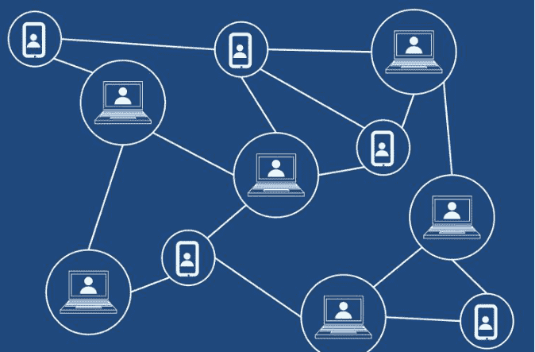

来源：Pixabay。

图1. 区块链技术中的分发与管理。

尽管前景诱人，但区块链技术的大规模实施屈指可数（Veuger 2020b: 22）。在本书中，我们在每一章后讨论一个关于应用的案例：

- 1. 所有负责Mijn Zorg Log的各方
- 2. 案例：Microbiome Centre如何弥合知识鸿沟
- 3. 案例：MedFAbric4Me中的健康信息交换
- 4. 案例：VGZ创新团队为孕产妇护理开发一款应用
- 5. 案例：Deventer GROZzerdam通过一款应用进行创新

然而，也有正在开发用于创建去中心化平台以交换医疗数据的替代方案。瑞士的Medicalchain和奥地利的Grapevine World都有正在开发的解决方案。另一个例子是围绕基于区块链的医疗保健提交倡议，与创新医疗倡议（IMI）合作，IMI是欧盟与欧洲制药行业之间的合作伙伴关系。

区块链监控实时交易，简化监管合规，通过减少中介承诺带来效率提升，并降低欺诈和网络犯罪的风险（Veuger 2020b）。因此，区块链有机会解决各种（政府）机构面临的信任、透明度和官僚主义方面的挑战，并为不同盈利和非盈利行为体之间的合作提供新的机会。

## 方法

并非每个人都需要成为区块链专家，就像你不必是合格的汽车工程师才能开车一样。然而，通过本书，我们希望你能够使用区块链来‘驾驶’你的组织，从而能够基于记录的不可更改的数据，有效且高效地实现目标。

我们将从一个概论章节开始，指导你了解区块链的工作原理，例如如何访问区块链平台、数据存储，以及医疗保健中区块链有哪些类型的应用。该领域包含许多陌生术语，但我们尽可能使用常用术语，以便你更快熟悉它们。

在第2章中，我们深入探讨区块链的特征，因此本章构成了对第1章的深化。我们在第3章中解释医疗保健中区块链应用的类型，当然，我们还会提供许多应用和实验的示例。我们特别关注使患者信息可访问以及药物生产和分销的安全性。我们还将讨论区块链与人工智能和物联网的可能性。

在第4章中，我们详细阐述医疗保健中区块链的四项基本原则。Nicitz的五层模型在此起着重要作用。第5章关于应用程序设计。我们提供互操作性路线图，并讨论区块链在电子健康记录中的作用。在最后一章中，我们就如何在医疗保健中使用和实施区块链提供建议。因此，本章性质不同，不以案例结束。

顺便说一句，为了可读性，我们使用了男性形式，但孕产妇护理案例除外，因为几乎所有孕产妇护理提供者都是女性。首先，一个向你介绍区块链世界的章节。

## 区块链简介

在医疗保健领域，复杂性部分是由法规、资金、组织、领域间协调以及客户和专业人员之间的交互造成的。区块链使客户地位能够进行根本性重新校准：完全控制自己的数据。在本章中，我们揭示护理的复杂性，并告诉你区块链如何成为解决方案。

### 区块链如何工作

*区块链*这个名字来源于数据在链中存储的方式。网络用户可以允许交易进行，共享信息和交换文档。每笔交易或一组交易——称为*块*——引用之前的交易或一组交易。

这是因为数据存储在块中。这些块相互连接，形成一条链：区块链。当一笔交易在网络中被创建、签名、发送和检查后，*块*之间相互链接。在交易被写入且用户签名后，块之间相互链接。

每个块包含编码数据，如果这些数据引用之前的数据，则可以包含在链中。因此，一个块通过对前一个块的引用来链接，从而块形成一条链。图2对此进行了说明。

区块链，一条块链，是一种可用于记录数据的系统。示例包括银行事务、产权证书和产品数据。区块链的独特之处在于，它可以合法地存在，而不需要单一的中心点，也不需要可信的中介。

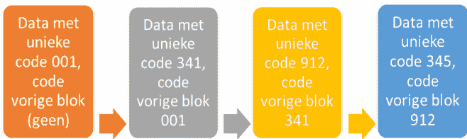

来源：Veuger 2020b。

图2. 块链。

区块链可用于任何信息传输的领域：

- * 货币：无需中介的电子金融系统


- 支付基础设施：转移支付
- 数字资产：交换信息
- 数字身份：对数字 ID 进行签名以打击欺诈
- 可验证数据：验证信息的真实性
- 智能合约：在无需可信第三方的情况下执行操作的软件程序 (Nichol 2017)

区块链有四项基本原则，使其区别于其他自动化技术。

1. 增长链：随着时间的推移而构建且不能单方面更改的数据块链。
2. 分布式网络：链分发给所有参与方，是共享的真相。
3. 共识：相关各方必须就存储在最后一个区块中的数据达成一致。
4. 区块链中数据以密码学形式进行存储。

这四项基本原则构成了区块链的特征。在所有应用和每种用途中，你都会看到这些基本原则的应用。

## 作为索引的区块链

为了在医疗保健领域从区块链中获益，主要在于控制对医疗数据的访问。一种视角是将医疗保健区块链视为一个 *索引*，即客户所有医疗记录和医疗数据的列表。该索引相当于图书馆中的目录。目录包含关于书籍的元数据以及书籍所在的位置。

这也适用于医疗保健：区块内的交易包含识别用户的唯一机制、指向医疗文件的安全链接以及交易创建的时间标记。因此，医疗保健区块链包含所有医疗数据的完整索引历史（患者的个人病史）。患者决定谁可以访问这些信息，这使用户能够充分影响收集哪些数据以及其数据如何共享（Linn and Koo 2016）。例如，全科医生可以查看其所有患者的数据，但患者最终决定想向第三方展示哪些数据。

## 账本

因此，区块链是一个分布式数据库（框架文本中的图书馆），该数据库的每个实例中都存储着数据，可比作一个 *账本*。连接到运行区块链的网络的所有人都拥有同一份账本副本。在数据被永久存储之前，接收这些数据的大多数各方必须就这些数据的准确性、来源和完整性达成共识。

我们习惯于通过互联网交换信息，而区块链则关乎价值的转移，就像我们从银行或公证人那里了解的那样，只是以数字方式。区块链的关键概念包括：

- 账本：关于所有区块的信息列表。
- 存储：所有所需的信息都存储在每个区块中。
- 分布式和去中心化：在区块链中，存在许多方——因此它不是中心化的——且所有这些方相互连接。所有这些方也拥有相同的账本。每个人都会获得完整账本的副本，并在添加内容时接收更新。

### 对等账本

区块链可以被视为一种去中心化、分布式的账本或日志。这也被称为 _对等账本_，其中所有参与者共同维护账本。毕竟，没有中央机构来确定用户身份、存储文件或开放来源。数字账本（即区块链）分布在不同的 _节点_（计算机网络）上，这些节点会检查更改的准确性。区块链中的每个节点都有账本的副本。没有中心化的官方副本，也没有比其他用户更受信任的用户。所有人都是平等的。交易使用诸如 Mijn Zorg Log 之类的应用程序发送到区块链网络。本章后面的案例以该应用程序为中心。

最广为人知的是区块链在比特币中的应用。原则上，区块链是一个可以存储不同数据的数据库。在比特币区块链的情况下，保留了所有比特币的完整交易历史，因此区块链确切知道每个人拥有多少比特币。

使比特币区块链独一无二的是，该区块链（或数据库）由一个服务器网络维护，这些服务器基本上都拥有区块链的精确副本。

## 去中心化

服务器可以是计算机，但原则上是可以存储数据的设备。因此，这也可以是手机或智能电视。服务器检查区块链数据的准确性，并将其区块链内容与网络上所有其他服务器的数据库同步。因此，连接到区块链网络的服务器在最佳情况下始终共享相同的区块链副本（Lim and Janse 2020）。

原则上，区块链是：一种可比作账本的数据库，它被复制并分布在不同的计算机上，并且是可靠的。

每位参与者的每项操作都记录在一个数据库中，该数据库不仅位于一个地方（去中心化）。部分原因是因为数据库在世界各地数千台服务器上分散存储，信息始终安全存储，系统防欺诈。每位用户随时都拥有包含所有交易的最新数据库副本。因此，数据永远不会丢失。图 3 显示了集中式数据库与去中心化数据库之间的区别。

区块链可以在不同层次上加以解释。在最简单的层面上，通常会将其比作一个跟踪所有交易的数据库或账本。该账本的精确副本分布在连接到网络的不同计算机上。要攻破账本，你需要同时攻破这些不同计算机中的大多数，并同时将相同的数据更改为相同的结果。发生这种大规模攻击的概率非常小，当然取决于连接的计算机数量。这正是区块链如此可靠的原因。

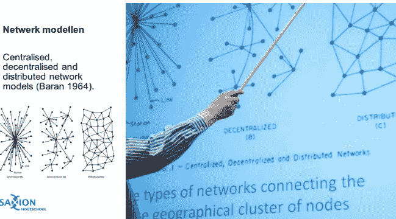

来源：Veuger 2020b。

图 3. Baran（1964）的网络模型。

## 特性

由于区块链是一个分布在不同服务器上的数据库，这项技术也被视为一种分布式账本技术。当使用分布式网络时，会导致以下有趣的后果：

1. 没有单点故障。
2. 新数据必须由其他节点确认（参见方框）。
3. 需要一种形式的共识。
4. 区块链很难被攻破。
5. 对区块链上的数据进行审查或更改很困难。
6. 这是一个对等网络，不需要信任中央方。

这些后果可以被视为区块链的涌现特性。

从将区块链视为记录信息的数据库的角度来看，区块链具有以下特性：

- 数据排列在数据块中
- 增量式
- 可靠，因为数据可以进行密码学验证
- 数字化

公司、政府和个人可以彼此之间或共同使用区块链来形成区块链网络。区块链有四个特性：

1. 数据（私有数据除外）是公开的，所有人都可以访问。
2. 信息以去中心化的方式存储。
3. 所有数据都与相应的时间戳一起存储。
4. 代码是开源的，这意味着每个人都可以查看它。

## 节点

区块链上的交易在没有中介（也称为可信第三方）的情况下点对点进行，这对用户有有趣的影响。对等网络是一组计算机网络，也称为节点，它们彼此等同并可以相互提供服务。节点是连接到并参与区块链网络的设备。这可以是计算机、电话、电视甚至打印机，只要它通过互联网连接到网络。它们可以承担各种任务，例如在网络上分发数据、验证和确认交易以及帮助保护网络。

“全节点”下载区块链的每个区块，并且还验证交易。它们的主要任务是确保区块链上的共识并确保其保持安全。全节点还将区块和交易发送到网络以供其他人下载。它们还就网络的未来做出决策。它们通过对网络的改进提案进行投票来实现这一点，例如比特币改进提案 (BIPs)（Lim and Janse 2020）。


总结来看，区块链技术有潜力：

- 促进注册和验证
- 消除副本
- 节省成本
- 验证交易
- 永久记录数据
- 无需中介即可进行交易
- 实现自动执行合同
- 缩短交易时间
- 实现更多自动化

考虑到这一点，我们将探讨护理以及其中涉及哪些复杂问题。

## 医疗保健中日益增加的复杂性

虽然基本原则是（脆弱的）老年公民可以尽可能长时间地继续在自己的居住环境中生活，但荷兰的护理设计方式有时使得很难找到合适的（以及财务上可行的）护理。我们提到四个原因，说明荷兰医疗保健如此复杂。

## 融资方式

医疗保健分为三种资助制度：社会支持法（Wmo）、医疗保险法（Zvw）和长期护理法（Wlz）。Zvw需要区域护士的指示，Wmo通常通过餐桌谈话进行，Wlz需要护理中央指示机构（CIZ）的指示。申请个人预算时，进入渠道通常更加困难。

## 分散的一线医疗

进一步增加复杂性的是，一线医疗传统上以分散的方式组织和融资。所有这些都适用于护理需要越来越整合和个性化的情况。就ICT而言，远比医疗保健中目前惯例所能做到的多得多，而且这里也存在巨大的分散化，强化了复杂性。ICT是按子部门设置的。

## 各自有自己的政策

护理的复杂性很大，与社会领域在资金和组织方面的协调也是如此。协调机制使复杂性具有结构性。在Zvw范围内，有限数量的健康保险公司与大量老年护理和社会领域的综合型小型组织和专业人士签订健康合同。通常，这些组织也面向区域或地方。此外，还有355个市镇在社会领域有自己的政策。客户和患者有选择的选项，但他们通常没有做出审慎选择所需的信息。这些不同的订购系统导致客户与医疗专业人员之间的关系出现次优化。因此，客户存在导航问题。

## 新交易

医疗专业人员与客户之间存在互动。这种互动以交易的形式进行：存在（护理）协议，存在对价（通过Wmo、Zvw或Wlz付款），并且发生交付（护理部署）。像Platformvmz.nl和Curaevitelbalie.nl这样的数字平台的到来在专业人员和客户之间创造了新的互动和交易。

区块链使护理信息交换的新模式成为可能。这减少了各种护理系统中当前的碎片化，并能更好地查看护理干预的结果。

## 作为验证数据解决方案的区块链

区块链可以应对医疗保健目前面临的挑战。这些挑战包括医疗数据（安全性、互操作性、可访问性）、医学研究、临床试验、医药供应链和药品质量。医疗保健中的区块链主要涉及来自和关于人们的数据。

标准化信息加强了专业人员之间以及客户与专业人员之间的沟通。客户决定哪些信息可供哪些医疗专业人员使用。用于使数据可访问的不同设计及其基础的信息提供可以降低复杂性。护理数字化导致客户和患者在个人健康环境（PHE）中管理自己的信息。

在本书中，我们希望表明，有必要在思考方式和管理方式上做出转变。这涉及形成去中心化结构，其中客户与医疗专业人员之间的互动是核心。这意味着与区块链一起探索网络控制和自我控制（Topol 2015）。

## 优势和机遇

区块链在医疗保健中的优势和机遇是什么？医疗专业人员可以在患者档案、利益组织等多个网络中活跃。网络确定并证明其自身责任范围。改善数据管理的起点是该责任范围内目标群体的具体需求和问题的复杂性和现实性。

复杂性需要创新解决方案。这反过来又源于导致共同理解和联合行动的数据、信息和知识（Wallin 2018）。数字化越来越能够实现组织间业务流程的虚拟集成。

使用区块链的优势是有效组织易于互换的护理信息、数据安全性和用户对护理数据的控制。区块链使客户地位的根本重新校准成为可能：完全控制自己的数据。通过这种方式，区块链将机构行使的控制转移到个人自身行使的控制（Huizinga 2018）。标准化信息加强了专业人员之间以及客户与专业人员之间的沟通。客户决定哪些信息可供哪些医疗专业人员使用。因此，数字化导致客户和患者在个人健康环境（PHE）或电子健康记录（EHR）中管理自己的信息。

区块链还为塑造医疗保健组织和医疗专业人员之间的协作提供了新的机会。通过这种方式，可以安全地访问实时可用的信息。由于不需要中介，可以实现成本节约。区块链提供去中心化的医疗保健结构，从而加强专业人员和客户的地位。区块链技术还允许公民和专业人员直接交换和共享数据，从而带来好处，例如患者和专业人员护理过程中的更大透明度。

## 应用程序

区块链技术的使用通常由用户友好的应用程序支持，例如网站、数据库或应用程序。这种应用层便于使用。用户可以在应用程序中看到他在哪里可以输入数据，然后这些数据对拥有阅读权限的其他人可见。Zorginstituut Nederland的Mijn Zorg Log应用程序的工作原理就是这样。该应用程序如图4所示。

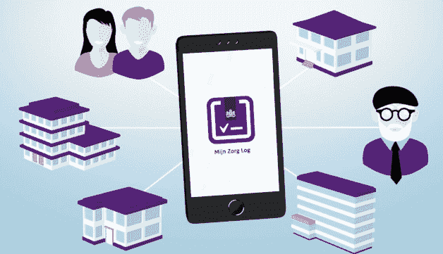

来源：区块链：Mijn Zorg Log - iStandaarden.nl.

图4。Mijn Zorg Log。

其他信息来源也可以连接到应用程序并对用户可见。区块链本身可以链接到来自外部来源的信息。原则上，区块链能够实现以下发展：

- 一个互操作的有效健康信息管理系统
- 数据安全
- 用户对护理数据的控制（Lim 2020）。

然而，区块链应用程序目前尚未在荷兰医疗保健领域大规模开发。这种有限发展的重要原因是，链中的多方必须同时就可以实现的附加值、如何降低风险以及如何创建特定区块链达成一致。这需要知识、相互信任和共同的紧迫感。与其他数字化转型一样，区块链应用程序的引入也受到医疗保健各方和供应商使用的过时IT系统的阻碍。预计这将从长远来看会改变（Veuger 2020a和b），我们希望通过本书对此做出贡献。

## 三种访问形式

明确谁被允许加入的常见方法是查看原则上是否允许每个人加入。或者是否存在网络强加的必须满足的条件？要么是无需许可的进入，要么是需要许可的进入。医疗保健区块链基础设施可以采取三种形式：公共、私有或混合系统。目的是


阐明管理网络所需的角色，以及进入者（“参与者”）可以获得的角色。我们简要说明三种访问形式。

## 公共系统

任何人都可以加入公共系统；无需许可即可进入。每个人都有权使用和查看账本。每个人都可以在系统中自由承担任何想要的角色，甚至包括验证交易的角色。在这个人人平等的系统中，主要适用于一群“志同道合者”希望共同合作的情况，例如比特币或互联网。志同道合者可以自行加入去中心化网络。用户群体根据开放性、中立性和自由等群体动机，并符合去中心化合作原则，来确定区块链的内容或运作方式。

如果决定允许所有人加入，可以提供让每个人匿名的选项，当然要在区块链规则范围内。关于共享“真相”的信任度非常高，因为这是由区块链规则强制执行的，而不是通过了解进入者是谁来实现的。用户决定区块链的功能。

这种公共模式并不总是适合医疗保健等受监管更严环境下的组织。毕竟，医疗是一个高度受监管的系统。

## 私有系统

如果决定只有有限群体可以加入，则会创建一个_私有系统_。区块链规则不足以建立信任，这意味着必须控制进入者的活动。这是通过制定进入者必须遵守的规则、通过某种责任分离、检查交易并可能撤销交易来实现的：许可进入。

私有系统通常是一个组织，其中中央机构对例如内部网设施的建立拥有控制选项。例如，董事或管理团队启动一个区块链系统，并邀请参与者在特定角色内参与。私有系统中的比较对象是内部网，其中节点、数据和程序代码都经过检查。

私有系统赋予组织权力，而公共系统赋予个人权力（Lim and Janse 2020）。管理控制系统中三个最相关的角色是发起、验证和查看交易。在此你还要问自己的其他问题是：

- 谁拥有数据？
- 谁确保数据不被篡改？
- 谁有权更改或删除数据？
- 谁创建和维护软件？（Consensys 2018）

相互使用区块链的医疗机构共同形成一个区块链网络。该区块链具有四个特征：

- 数据——私有数据除外——是公开的，所有人都可以访问。
- 信息以去中心化的方式存储，分布在不同的计算机之间。
- 所有数据都与相应的时间戳一起存储。
- 代码是开源的，这意味着每个人都可以查看它。

智能合约存在是为了履行区块链内各方之间的协议。这些不是法律意义上的合同，而是在区块链内各方之间自动执行这些规则的软件（Zorginstituut 2018）。在第 2 章中，我们将深入探讨这一点。

## 混合系统

混合系统兼具公共系统和私有系统的特征。混合系统的一个示例是使用现有系统及其构建区块链的数据源。例如，在药品配送中，制造商的所有数据源可能不可见，但交付的药品产品的资质是可见的。图 5 是 Lim 和 Janse (2020) 关于公共、私有和混合系统的说明。

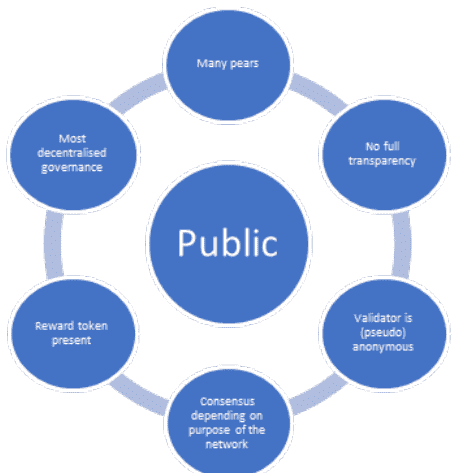

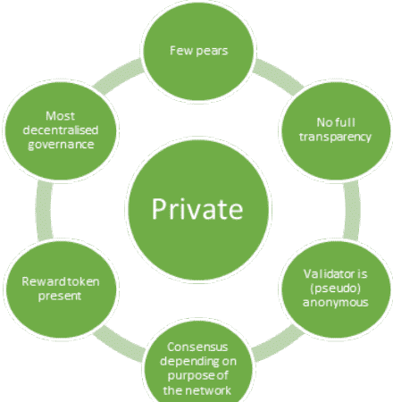
已知用户

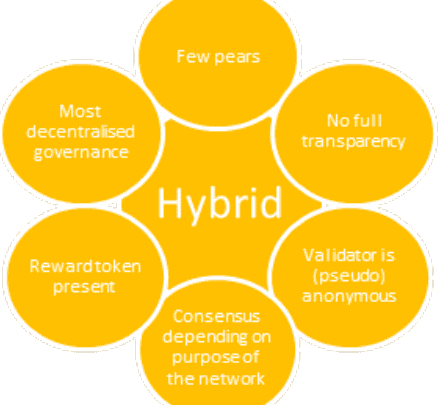
来自多个组织的已知用户

图 5. 公共、私有和混合系统。

医疗保健对医疗保健治理（全行业医疗保健治理）有特定的实质性价值。这些也适用于区块链。根据 Berenschot (2019) 的说法，去中心化硬件与个人数据（特别是特殊的医疗个人数据）的结合意味着公共区块链目前不可能用于医疗保健。风险仍然太大。然而，没有什么能阻止医疗保健使用私有区块链平台，即私有系统。为了在医疗保健中负责任地使用区块链，有必要优化区块链对安全、可及和负担得起的医疗保健可能做出的贡献，并管理相关风险。良好的合作对发展至关重要。

因此，医疗物流的设计可以通过区块链技术得到高效支持。安全数据的互操作性显著简化了组织、专业人员和客户对医疗信息的访问。区块链使以统一的方式共享客户数据成为可能。

## 存储数据

因此，区块链是用于存储数据的技术。而且区块链本身并不作为一种存储介质存在。至少不是单一的。将创建多个区块链，它们可能具有非常不同的特征，并且是为其上构建的应用量身定制的。最著名的区块链应用是比特币，这是一种由于技术特征而无法被复制的数字货币。区块链还代表供应链优化和控制工具，以便更高效地协作。

区块链平台可以在四种类型的基础设施上运行。

- 1. 区块链平台可以作为区块链节点安装在本地计算机上。这通常用于私有开发或测试环境。
- 2. 一个或多个区块链节点安装在医疗机构 ICT 基础设施的服务器上（本地），不同的计算机或设备可以连接到这些服务器。
- 3. 节点可以在一台或多台远程服务器上“托管”，例如云服务器。
- 4. 区块链平台可以使用公共区块链平台的全球基础设施（VNG 2019）。

借助区块链，可以在医疗系统中构建安全的数字基础设施。在本书中，我们将展示这种基础设施的样子。

## 通用优势

Edriouch 等人 (2018: 26-27) 断言，区块链的特征包括：无中心化存储、不可更改、无法纠正错误、能源消耗（工作量证明）、流通速度、可扩展性、隐私和半民主性质。因此，区块链的核心是在公共分布式数据库中结合密码学技术的一种智能方式。Chhay Lin Lim 和 Arthur Janse 于 2019 年编写的《Basisboek Blockchain》（区块链入门）尽可能全面地描绘了区块链哲学、技术及其周围许多其他相关问题。

就数据存储而言，区块链具有以下通用优势：

### 不可否认性

因为在区块链中放置了符合特定协议并由网络所有成员检查的印章，这些数据实际上是不可否认的。这里的不可否认意味着你不能简单地删除数据。这确保了可以信任：一方不能在不被其他方知晓的情况下更改或删除数据。

### 对自身数据的控制

通过钱包（参见方框），用户可以控制谁可以在何时对其数据执行哪些操作。在区块链框架内，谁在何时对数据做了什么，都会被不可否认地记录下来。

### 智能层

连接不同的数据孤岛仍然很困难。例如，可以考虑医院都有各自的数据孤岛，这些孤岛是随着时间的推移建立起来的。在此背景下，区块链形成一个连接这些数据源的智能层，以便患者可以追踪可靠的“印章”路径。

### 行政优化

当你查看行政流程中的数据时，行政流程遵循运营和财务流程，因此是被动设置的。

### 钱包

使用钱包，用户发送和接收区块链交易。钱包使用数字签名（公钥）对交易进行签名。数字签名的秘密部分（私钥）保持用户匿名。私钥被用作数学证明，证明交易源自特定钱包的所有者。私钥还防止交易一旦由用户发出后被他人更改。所有交易都在用户之间交换，并通过一种称为挖矿的流程在几分钟内得到确认。

用户的钱包是个人环境或用户友好型应用程序，用户可以通过它访问区块链。关于用户的个人数据（例如用户的私钥）可以存储在钱包中。存储在钱包中的个人数据被视为链下个人数据（Zorginstituut 2019）。

### 安全性

区块链确保数据可靠性和准确性的重要性。这是医疗保健的一项关键发展。因此，你可以看出安全性在这项技术的设计和应用中至关重要。例如，所有交易都需要数字签名


可确认交易的可靠性。未经授权的交易会被及时发现且不予处理。所有数据也均通过加密技术进行加密（参见方框）。

共享信息时，必须确保个人数据得到正确处理的保障，因为（加密的）信息最终会出现在可能无权查看该信息的各方硬件上。

个人数据可以以不同方式处理。当个人数据未在包含于区块链的交易中进行处理时，称为链下处理；当个人数据在包含于区块链的交易中进行处理时，称为链上处理。

当区块相互链接时，它们会引用前一个区块。这个引用就是哈希，一种加密并计算得出的数字代码。哈希无法用来推断实际数据的样子。此外，哈希应该是唯一的。如果一段代码或文档中的某个比特或字符发生变化，哈希将会完全改变。因此，区块链中的任何变更都能立即被发现。

> **加密技术**
> 
> 加密技术涉及隐藏或加密待传输信息的技术。密码分析者是能够访问发送方与接收方之间信道的人，因此可以说可以“窃听”。他必须无法以可接受的成本，从传输数据中推断出发送方传输了哪些信息以及涉及哪些各方。“代理加密网络”这一术语在此适用，我们将在第3章的MedFAbric4Me案例中详细说明。

安全性也通过用户控制来实现。用户可以提供其计算机的计算能力。这使他们成为矿工节点。矿工节点确保所有账本副本之间的共识。矿工节点在所有交易及其顺序被添加到区块链之前进行检查。每笔新交易都像某种DNA一样，与所有先前交易的完整历史记录一起被加密。

在挖矿过程中，矿工节点解决加密难题。这决定了所提供的交易是否有效并可能成为区块链的一部分。如果对某个账本副本进行篡改，网络中将达不到共识，所有其他参与者都会拒绝该错误交易。该交易将不会被添加到区块链中。

## 应用条件

在区块链中，信任在于系统本身，而不在于各方之间（Lim和Janse 2020: 488）。数据标准在此可以发挥重要作用。通过区块链技术，可以构建一个更可持续、更安全、更可靠的数字基础设施（Veuger 2018b和2019d）。这使得这项技术具有潜在的革命性。

由于区块链技术也非常复杂且仍在发展中，只有在开展开放合作的情况下才能实现。一方面，由于复杂性，需要汇集知识；另一方面，区块链的去中心化特性需要新的去中心化治理形式（Veuger 2020b: 8）。

### 标准

如果满足以下标准，区块链将很有用（Lim和Janse 2020: 490）：

- 数字创新是战略的一部分。
- 不同各方共享数据。
- 这些数据涉及货币价值。
- 数据是机密的。
- 多个各方处理数据。
- 数据必须经过验证。
- 可以计算明确的投资回报率。
- 验证复杂且成本高昂。
- 选择区块链的方案是解决问题的最简单方案。
- 该方案影响组织形式。
- 该方案影响现有工作流程。
- 该方案影响现有生态系统。
- 技术方案与现有系统接近。
- 该方案数据密集但可扩展。

### 未来

区块链是一种颠覆性技术，通过一种全新且安全的数据文件管理方法——21世纪操作系统——为各行各业敲响警钟。区块链无法解决所有社会、经济、文化和技术问题。它确实有潜力大大改善我们社会尤其是经济中的信任问题。区块链可以通过新的链条合作形式消除（金融）世界中的不确定性（Veuger 2020b: 18）。

需要注意的是，区块链技术复杂，在医疗保健领域仍处于发展阶段。荷兰医疗保健领域尚未大规模开发区块链应用。尽管有潜在的好处，但例如护理链中尚未开发出大规模应用。

研究公司Gartner预测，到2025年，区块链将与物联网和人工智能等其他互补技术融合。由于这些发展，对去中心化解决方案的兴趣日益浓厚（Lim和Janse 2020: 520）。区块链提供了许多潜在优势，之所以说是“潜在”，是因为应用可能性尚未以组合方式大规模使用，且在此之前尚未得到证实。原因之一是并非所有事情在技术上都已经可行。因此，需要进行实验来使这项技术更加稳定。在深入探讨区块链的特性之前，我们想先向您介绍产科护理中的应用Mijn Zorg Log。

## 案例1：负责Mijn Zorg Log的所有各方

区块链在荷兰的一个重要应用示例是产科护理中的Mijn Zorg Log。该应用已作为实际试点进行测试，并通过区块链应用与不同参与方（客户、医疗服务提供者、保险公司和监管机构）演示了个人数据的安全信息交换。

Zorginstituut Nederland（荷兰医疗研究院）已调查了区块链在医疗保健中的适用性。这促成了医疗保健领域第一个可运行的区块链：Mijn Zorg Log。荷兰区块链专家Ledger Leopard在以太坊区块链平台上构建了Mijn Zorg Log。Mijn Zorg Log使用此区块链技术，因此是医疗保健领域数字信息交换的一项创新。

Mijn Zorg Log是一个工具，用于深入了解区块链技术如何为医疗保健中的信息交换做出贡献。它基于带权限的封闭区块链，即所谓的许可型区块链。2017年，Mijn Zorg Log获得了一项法律证书，表明该应用符合荷兰有关护理和隐私的法律法规（Zorginstituut 2018）。

### 开发

在开发Mijn Zorg Log时，以此为出发点：在区块链中相互交换个人数据的各方均担任“控制者”角色（使用《通用数据保护条例》的术语）。仅运行节点且无法自行添加交易或无法查看某些交易的各方为“处理者”。他们仅为了控制者的利益处理个人数据。所有控制者已与处理者签订处理者协议。在实际试点中，产科护理服务提供者和保险公司是控制者。

保险公司、Zorginstituut Nederland和Ledger Leopard担任处理者角色。在实际试点中，三家产科护理服务提供者、健康保险公司VGZ与Zorginstituut Nederland之间签订了处理者协议。与区块链构建者Ledger Leopard签订了子处理者协议。VGZ、Zorginstituut Nederland和Ledger Leopard设置了节点。

在实际试点中，存在一个账本——区块链——位于有限数量的位置（节点）。实际试点选择了有限数量的参与者，即33个，这实现了良好的控制。由于以许可型区块链为出发点，可以达成明确协议并遵守有关隐私的法律法规。

### 工作原理

产科护理服务提供者提供居家护理，记录所做的工作，并将此信息发送给办公室。办公室在系统中接收此信息并转发给付款机构。因此，所发送的信息并未由客户（母亲）即来源方进行核对。付款代理在其自身系统中接收信息，并在30天或更长时间后付款。这耗时很长，效率低下且成本高昂，因为财务流程跟随劳动密集型行政流程。

通过区块链技术，产科护理服务提供者使用应用程序向客户发送关于其所做工作的结构化通知。客户可以拒绝此通知，然后在来源方讨论为何某项特定服务未提供或未被如此体验。如果客户接受通知，对于各方而言，行政流程和财务流程都将在几秒钟内完成；客户在一开始已对此进行核对，因此当客户实际需要付款时，不应再出现进一步的问题或讨论。在这里，流程更短、更可靠、更高效且更便宜，因为行政流程和财务流程并行进行。图6展示了Mijn Zorg Log的运作方式。为实际试点选择许可型区块链，是因为工作必须（且可以）在受保护的环境中进行，涉及多个参与被保险人（客户/母亲）护理的已知各方。此外，公共区块链的交易速度（当时）尚不适合实际试点所需的功能。


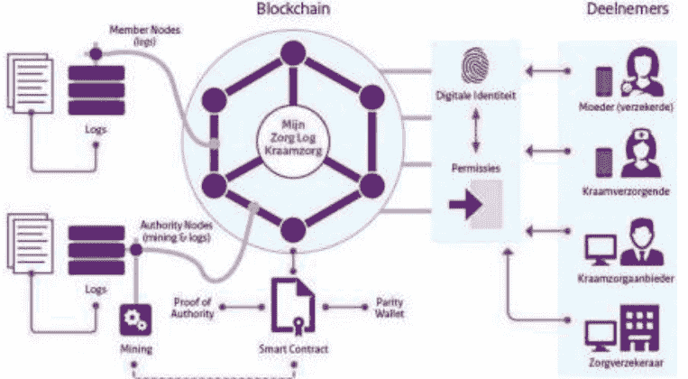

来源：区块链：Mijn Zorg Log - iStandaarden.nl（荷兰医疗保健研究所和 VGZ (2018)）。

图 6. Mijn Zorg Log 的功能。

"Mijn Zorg Log" 中详细阐述了区块链的通用优势如下。

### 无可否认

区块链无可否认地记录了具体服务确实由产科护理提供者提供，并且已由父母（数据源）批准。

### 对自身数据的控制权

父母可以通过应用程序自行确定哪些方可以访问数据，并且此过程也被无可否认地记录。

### 智能层

区块链连接了有关母亲和婴儿的产科护理机构、主管部门和保险公司的系统。这创建了不同各方获授权访问的同一数据源。

### 行政优化

产科护理提供者通过 Mijn Zorg Log 应用程序向父母发送了关于实际完成工作的通知。

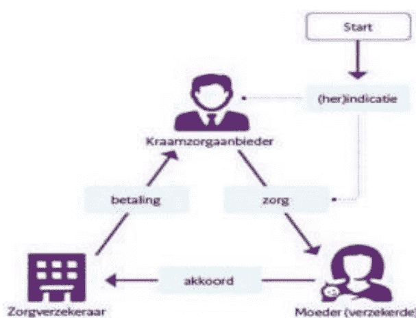

来源：区块链：Mijn Zorg Log - iStandaarden.nl（荷兰医疗保健研究所和 VGZ (2018)）。

图 7. 作为 Mijn Zorg Log 基础的调整后的产科护理流程。

在此，财务和行政流程并行运行，因此更加高效和便宜，另请参见图 7。

“Mijn Zorg Log”是一款区块链应用，已在实践中及通过实践成功测试，以更高效地组织产科护理（Megchelen 2020）。

## 区块链的两个特征

区块链，即区块链，是一种可用于记录数据的系统。每个区块包含编码数据，如果这些数据引用先前的数据并从而形成链，则可以将其包含在链中。区块链最独特的地方在于，不需要可信的第三方来存储、监控或控制数据。因此，例如公证人的功能将被废除。

在本章中，我们将深入探讨区块链的特征以及它们如何形成三难困境。我们将讨论此区块链三难困境的解决方案，并展示不同基础设施如何使用这些特性。我们还将关注信息传输、智能合约和网络安全。区块链有四项基本原则，使其区别于其他自动化技术。我们将简要重复并进一步解释它们。

- 基本原则 1 增长中的链。区块链通过随时间构建且无法单方面更改的数据块链，提供了一种新的数据存储方法。
- 基本原则 2 分布式网络。链分布给所有参与方，是共同的真理。增长中的链（基本原则 1）始终可以由一方存储和使用。区块链更加可靠，因为整个链可以共享并分发给其他各方。
- 基本原则 3 共识。各方必须就最后一个区块中存储的数据达成一致（共识）。在分布式网络（基本原则 2）中工作时，最大的挑战是就最后一个数据区块的内容达成一致。如果各方不同意最后一个区块中的数据，则无法达成共识。
- 基本原则 4 数据存储。带有加密技术的编程代码可以存储在区块链中并执行。区块链中的数据可以包含逻辑、过程和编程代码。这些数据在所有各方之间安全同步，并可以去中心化执行（VNG 2019）。

区块链的分布和去中心化程度在可扩展性方面起着重要作用。引入区块链时，区块链三难困境起作用：可扩展性、安全性和去中心化。高度去中心化的区块链更安全，但以牺牲可扩展性为代价。如果既可扩展又集中化，那么安全性就较低。

## 区块链三难困境

区块链最初于 2008 年为比特币而开发。自 2008 年中本聪在白皮书中提出区块链理念以来，对区块链技术的兴趣不断增加。他主张一种电子支付系统，其中不知名的各方可以直接进行交易，无需银行等第三方干预。该系统的支付方式是比特币。中本聪在多个方面改进了他的系统，例如防止双重支出和引入时间戳。他由此创建了一种系统，其中信任——区块链的关键词——嵌入在区块链技术中。中本聪因此确保，一个可信的第三方（TTP），他在原则上反对该第三方，已不再必要。这创造了一种确定性：收款人可以确定前所有者未执行过先前的交易，并且第一个（货币）交易是唯一有效的交易。对区块链感兴趣的主要原因是安全性、匿名性和数据完整性，无需外部组织控制交易。

## 区块链研究

区块链的特征创造了有趣的研究领域，尤其是从技术挑战和局限性的角度来看。Yli-Huumo Ko、Choi、Park 和 Smolander (2016) 的研究是一项系统研究，旨在收集所有关于区块链技术的相关研究。该研究的目的是了解来自科学数据库的 41 篇主要论文中关于区块链技术的当前研究主题、挑战和未来方向。

结果表明，超过百分之八十的论文关注比特币系统，不到百分之二十关注智能合约和许可证等其他区块链应用。大多数研究侧重于从隐私和安全角度揭示和改进区块链的局限性。在许多提出的解决方案中，缺乏对其有效性的具体评估。许多其他与可扩展性相关的挑战，如传输和响应时间，尚未得到研究。

## 三难困境

区块链可能对社会价值链产生巨大影响。毕竟，它可以在效率、透明度、所有权、价值（转移）、自动化和服务方面发挥作用。

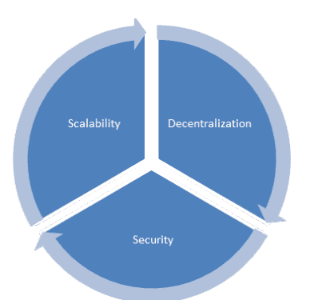

图 8. 区块链三难困境。

引入区块链时，区块链三难困境总是起作用：

- 可扩展性
- 安全性
- 去中心化

高度去中心化的区块链更安全，但以牺牲可扩展性为代价。如果既可扩展又集中化，那么安全性就较低（Lim 和 Janse 2020: 188）。图 8 显示了这一点。

### 可扩展性

可扩展性是区块链应用的一项重要挑战。可扩展性是指区块链网络可以处理的交易数量。可以通过调整生成区块和验证交易的方式来提高可扩展性（Lim 和 Janse 2020）。

区块时间是生成一个区块的平均时间。对于比特币，区块时间为 10 分钟。如果您的交易未包含在当前区块中，则需要等待 10 分钟才能包含在下一个区块中。可以通过降低矿工查找有效哈希并生成区块的难度来实现更快的区块时间。这在 Chhay Lin Lim 和 Arthur Janse 撰写的 Basisboek Blockchain 中有详细描述。

除区块时间外，区块大小在可扩展性方面也起着重要作用。关于增加区块大小的讨论导致比特币社区内出现分歧。2017 年，一群开发者希望将比特币的区块大小从 1MB 增加到 2MB，以便每个区块可以处理更多交易。在区块时间相同的情况下，将区块大小加倍意味着每 10 分钟可以处理两倍的交易数量。

区块链的分布和去中心化程度在可扩展性方面起着重要作用。这是因为中心化程度与区块链处理速度之间存在强相关性。如前所述，BitShares 通过使用委托权益证明每秒可以处理比比特币多得多的交易。其背后的理念是，由十九个精选见证人组成的区块链可扩展性要高得多，其中预先确定谁可以生成下一个区块并验证这些交易。

### 安全性

区块链的安全性通过多种方式实现，包括节点、智能合约以及用于链接区块的哈希。任何形式的安全性都会带来可扩展性和去中心化方面的局限性。

### 去中心化

区块链最独特的地方在于，不需要可信的第三方来存储、监控和控制数据，就像我们在银行或公证人处所熟悉的那样。因此，区块链是一种分布式账本技术。分布式账本是存在于多个位置或多个用户之间的数据库。组织通常使用位于固定位置的集中式数据库，而这个集中式数据库


因此存在一个单点故障。然而，分布式账本是去中心化的，以避免第三方受信任代理或机构必须处理、验证或认证交易。因此，区块链是一种分布式账本技术。

图9展示了根据Baran（1964）的集中式网络、去中心化网络和分布式网络之间的区别。

去中心化的论点包括：

- 抵御网络中一个或多个部分的攻击
- 没有可被操纵的敏感中心点
- 抵御参与者以他人利益为代价进行的串通（Lim and Janse 2020: 199）

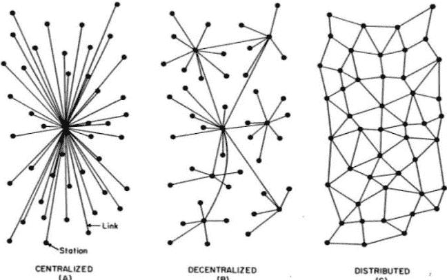

来源：Baran 1964。

图9. 网络模型。

## 比特币对三难问题的解决方案

如果我们想要理解区块链的世界，就需要理解2009年比特币货币的创新，它基于区块链的底层技术。

### 中本聪（2009）

传统货币的根本问题在于其运作所需的一切。必须信任中央银行不会贬值货币，但法定货币的历史充斥着对这种信任的背信弃义。

银行必须被信任来持有我们的资金并进行电子转账，但又会在一波又一波的准备金中将其贷出。


来源：Veuger, 'Belastingdienst, Blockchain, Finance, Taks & Advice', 2019年8月27日；'ABN AMRO & Blockchain ontwikkelingen', 2019年9月19日；以及 'Themadag Politie & Blockchain', 2019年10月10日。

图10. 中本聪（2009）的声明。

比特币由四个独立元素组成：密码学、点对点网络、开源协议和共享账本。这使其成为人们热衷的一种现象。

在谈论比特币时，区分比特币货币和比特币网络至关重要（Lim and Janse 2019）：

- 比特币是数字货币
- 比特币网络是由节点组成的底层基础设施，这些节点通过区块链帮助跟踪所有比特币交易。

作为数字货币的比特币用小写b书写；比特币网络用大写B（Veuger 2020b）。这在图10中有所说明。因此，比特币现象既包括虚拟货币也包括基础设施。因此，这是一种在无需第三方干预的情况下以特定方式存储数据的复杂且革命性的方法。

### 比特币的创建

Chaum（1982）被视为比特币的教父。他目前居住在加利福尼亚，是世界上最好的密码学专家之一。早在八十年代和九十年代，他就一直在开发无需银行或信用卡公司干预即可实现数字交易的系统。Chaum（1982）描述了必要的区块链技术，为比特币奠定了不止一个基础。随后，关于区块链的著名中本聪文档出现在互联网上。他解决了剩余的双重支付问题，并提出了支付在网络中到处存储的解决方案。

在阿姆斯特丹科学公园数学与信息中心，Chaum于1990年创立的Digicash公司总部设立于此，该公司三年后推出了eCash。这使得安全和匿名支付成为可能。Sherman, Javani, Zhang和Golaszewski（2018）的研究对Chaum的工作进行了有趣的历史探讨，其金库体系体现了区块链的许多元素。图11概述了一些支撑区块链技术的重要密码学发现（根据Veuger 2020a: 36）。

### 只需要一个货币系统

1976年经济科学诺贝尔奖获得者米尔顿·弗里德曼早在1999年（Gobry 2014）就看出，互联网将在减少政府在我们经济和社会生活中的作用方面发挥重要作用。根据弗里德曼（Gobry 2014），唯一缺少的是一个可靠的电子货币系统，它允许人们在不知晓交易对手的情况下进行货币变动。这样的系统类似于具有匿名性的现金交易。根据许多人的看法，比特币已经实现了这一承诺。互联网已经使无需纸张和中介即可快速、廉价地传输信息成为可能。区块链为价值转移提供了同样的好处。互联网用于传输文字和图像；区块链用于交易。

| 年份 | 发现 |
| :--- | :--- |
| 1970 | James Ellis，在政府通信总部（GCHQ）秘密发现公钥密码学 |
| 1973 | Clifford Cocks，在（GCHQ）秘密发现RSA密码系统 |
| 1974 | Ralph Merkle，加密谜题（论文于1978年发表） |
| 1976 | Diffie和Hellman，在斯坦福大学发现公钥密码学 |
| 1977 | Rivest, Shamir, Adleman，在MIT发明RSA密码系统（1979年） |
| 1979 | David Chaum，金库和秘密共享（博士论文1982年） |
| 1982 | Lamport, Shostak, Pease，拜占庭将军问题 |
| 2002 | Adam Back，Hashcash |
| 1992 | Dwork和Naor，对抗垃圾邮件 |
| 2008 | Satoshi Nakamoto，比特币 |
| 2017 | Wright和Savanah，nChain欧洲专利申请（2018年批准） |

图11. 密码学和区块链技术发现的时间线。

### 比特币作为去中心化系统

作为用于交易的数字货币——谁向谁转账多少资金？——比特币记录在区块中，类似于账本中的日记账条目。因此，一笔交易是一个带有不同字段的记录，从而形成区块。账户号码是唯一的公钥，每笔交易还为矿工提供手续费。区块（数据或文本）形成一条链，因为每一段数据都引用前一段数据。这形成了一条链（Veuger 2020b），如图12所示。

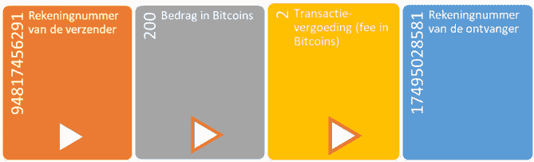

图12. 比特币中的交易。

任何人都可以参与该系统并向链中添加新交易（区块）。这些区块是去中心化存储的，没有人监控交易的可靠性，当前的挑战是设计系统，使得仅添加有效交易，而无需知道交易背后的人，也无需中央控制。

因此，挑战在于保持区块链账本的最新状态，并对其内容达成共识。这被称为拜占庭将军问题：即若干将军共同协调对敌人进攻的问题。该问题包括：

- **完整性**：一个将军向其他将军发送的消息可能无法到达，例如信使被攻击。在区块链中：有效交易无法到达其他节点，且未被包含在账本中。
- **身份验证**：不可信赖的将军可以冒充另一名将军。在区块链中：C想要从A那里拿钱给B。
- **完整性**：可靠将军发送的消息可能被伪造，例如由信使篡改。在区块链中：A进行了一笔有效交易，但其内容被更改。
- **一致性**：不可信赖的将军可以向不同的将军发送不同且相互冲突的消息。在区块链中：A可能有10欧元，但既给了B也给了C，也称为双重支出。

区块链本质上解决了拜占庭将军问题，因为所有参与者都同意此账本的内容，这是一种流行已久的技术。具体是通过使用不同的密码学技术：

- 公钥-私钥加密：这是一种需要公钥和私钥的加密方式，两者共同构成一对并互为对应。其独特之处在于，解密只有在同时使用两个密钥时才可能。
- 加密哈希函数：将一段（大量）文本转换为固定长度文本。这被应用作为数据完整性的保证。
- 哈希现金：加密哈希的逆过程。这是一项劳动密集型过程，也称为工作量证明，其中计算机需要进行大量计算工作。

## 基础设施示例

世界各地正在开发各种区块链系统，它们以不同的方式运行——公共或私有。基础设施的差异也由达到该基础设施的共识方式等因素决定。目前有三种广泛使用的结构：Hyperledger Fabric、Ethereum和Corda。我们简要说明它们。

### Hyperledger Fabric

Hyperledger Fabric具有一个精细的共识模型，不仅依赖于基于证明的挖矿。毕竟，对交易数据及其中的授权已经进行过检查。节点——负责验证交易的可靠性和完整性——在Hyperledger Fabric中达到共识所扮演的角色和任务，与以太坊不同。

Hyperledger Fabric非常适合优化供应链。该基础设施专注于某个行业的链条管理。信息仅与相关利益方共享，而不对整个链条中的所有（相关）方可见，因此这是一个私有系统（参见第1.4章）。示例包括材料证书、材料加工以及这些钢元素的最终组装。该应用在Jansen的研究（2018）中有所描述。

Medicalchain是Hyperledger社区中最早使用区块链的医疗保健组织之一。Medicalchain专注于确保客户能够访问其医疗记录。

### 以太坊

在以太坊中，所有用户必须就网络中的所有交易达成共识，交易的顺序对于该网络内的一致性至关重要。因此，可以防止重复和欺诈。共识基于挖矿这一工作量证明机制来达成，即在账本中达成共识，所有用户都允许该区块链中的所有交易数据。与


以太坊，所有功能的节点均相同，执行完全相同的操作，并充当客户端、对等节点或排序节点的角色。

以太坊旨在利用去中心化分布式系统在多个领域进行全球创新。政府可以在此基础上运作，金融部门、物流系统和（供应）链、能源市场、音乐和游戏行业、医疗保健（Hölbl, Kompara, Kamišalić and Zlatalas 2018）以及制药市场等亦然。以太坊是为不同行业开发去中心化应用的平台。它非常适合去中心化应用、智能合约和数字支付单元。以太坊具有更透明的特性，但可能以隐私和可扩展性为代价。

## Corda

使用 Corda 和 Hyperledger 时，已对交易数据及其中的授权进行检查。使用 Corda 时，共识的达成方式与 Hyperledger Fabric 类似，因为两者的共识均通过交易有效性和交易独立性来确定，即自动检查所有签名是否正确。

Corda 区块链是通过银行间的密切合作创建的，因此专门为该领域开发。这种混合系统中的合作被称为 R3CEV，其主要目的是管理、同步和分发金融应用。该联盟认为，并非所有区块链数据都适合用于金融交易的公开可访问区块链基础设施。隐私和可扩展性是该联盟开发类似 Corda 的基础设施时最重要的原则。

一个关键的评论，因此也是一个机会，是 Corda 是否仍是区块链，或者未来的用途是否正好在于行业特定的分布式网络，例如保险单；参见图 14。通过这种方式，它既可以独立运作，也可以形成与其他分布式网络兼容的全球区块链。例如，不同网络可以相互并存，从而产生交互。

达成共识是确保分布式网络能够最优运行的重要因素，这可以通过无需许可的方式（任何人都可以使用）或需许可的方式（访问受限）来实现。以太坊是无需许可的；Hyperledger 和 Corda 是需许可的区块链。Corda 和 Hyperledger Fabric 没有必需的内置加密货币。Fabric 确实提供此选项。Hyperledger Fabric 没有这些问题，因为使用了拜占庭将军问题算法且访问受限，因此适用于各种应用。

### R3 的 Corda 在保险领域中的应用

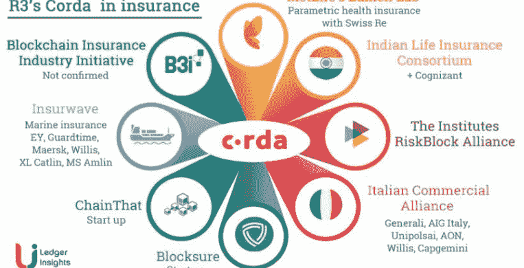

来源：Ledger Insights 2018。

图 14. 保险领域中的 Corda。

### 通过代币进行信息传输

区块链有可能借助数据库和密码学技术使数字数据安全且保持私密。代币提供了一种灵活多样的形式，通过自动执行的智能合约和基于物联网的传感器，在多方之间快速、透明且安全地转移或捕获价值、信息、想法、权利和义务。代币化是一种中心方法，其中代币在区块链上进行编程。

代币是网络外的一个独立价值系统，用户必须依赖中央方法论，包括关于中央发布者的责任和义务。代币独立于数据，并包含如图 15 所示的授权密钥。

使用代币时，可以利用区块链的对等能力，代币的价值取决于例如非数字系统：银行账户。价值还由可信的第三方确定、检查和管理。作为一种方法论，它已经用于 Facebook Credit，可兑换为常规货币。当然，其他中心化发行的虚拟货币也可实现这一点。

因此，加密币或数字币不依赖于中央发布者。它是去中心化网络中的一种数字资产，其价值由市场力量决定，具有独立价值，是一个独立的数字币单元。顺便提一下，其他受中央管理的加密币也正在进入市场，例如 Utility Settlement Coin。这是由 UBS、BNY Mellon、Deutsche Bank 和 Santander 等多家主要银行发起的项目。这里可以提出的一个关键问题是：加密币是受中央控制的加密货币，还是复杂的代币化。以太坊现在是许多首次代币发行（Initial Coin Offers）的基础：提供一种不受金融市场监管机构影响的首个代币。以太坊将被 Polymath 用于发行证券代币发行（Security Token Offerings），这代表组织中的股份或利润分配权。

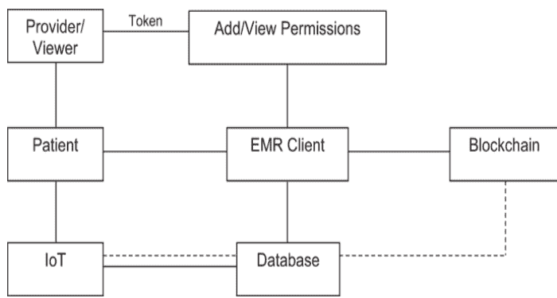

来源：Vazirani et al. npj Digital Medicine 3, 2020。

图 15. 授权密钥。

## 使用智能合约进行自动处理

记录的协议用于在区块链上快速安全地执行操作。如果所有条件都满足，这些操作可以自动完成。智能合约是一种软件，可以在满足特定条件和协议时执行预编程操作。通过这种方式，可以在医疗保健中记录义务（索赔）。

智能合约在区块链网络中去中心化地管理所有约定的承诺。这种方法非常高效，因为不再需要手动验证或（银行）转账，它是安全的，并防止了冲突。

参与智能合约时，条件事先已知并被编码，因此合约放置到区块链后条件不可更改。在交易时，已经知道条件已被满足以及如何满足。

智能合约可以在区块链上运行，因此符合标准。由于遵守适用的法律法规，区块链可以通过法律强制执行来强制执行这种合规性。

出于速度和成本考虑，理想情况下参与者可以在区块链平台上注册，且区块链可以在无需人工干预的情况下独立运作。然而，目前自主在智能合约和区块链上运行注册尚不（盈利），如 Herian（2018）所主张。技术野心、法律规范和文化差异可能会厘清混合架构在更高层面如何运作。然后，智能合约可以以在线和离线、链上和链下的不同模式组合运行。新立法也应与此保持一致，和/或新规则和原则应为立法提供强健且公平的支持。

在使用智能合约进行自动处理时，DAO 可以是合适的基础设施。一个 *去中心化自治组织*（DAO）由多个连接的智能合约组成，从而形成一个自治组织。从数字环境和独立未来实体形式的设计来看，DAO 是一种发展。它是一种组织中没有中心决策点或员工的商业模式。例如，一个由一群人管理的自动驾驶汽车或出租车，其收入和支出通过智能合约自动结算。或者由一群人管理的工具，其收入和支出通过智能合约自动结算。

## 网络安全建议

随着每种新技术的出现，安全风险会随其特性而增加或减少。有关希望采用现有区块链应用或希望利用区块链设计现有流程的组织的建议，可在报告 *区块链安全：信任与采用框架* 中找到。荷兰区块链联盟在这方面提出了 24 条建议。

本报告为应用区块链技术时应考虑的最重要安全问题提供了一个框架。该框架面向计划使用区块链技术的决策者编写。此外，它是一份实用的高级别指南，介绍了组织在启动自身区块链应用或从当前应用迁移到新环境时应考虑的最重要安全问题。

使用该技术时应考虑的前 18 项安全风险如下：

- 1. 智能合约安全性
- 2. 分叉
- 3. 加密算法
- 4. 加密密钥管理
- 5. 访问控制
- 6. 可扩展性
- 7. 入侵检测


- 8. 针对性攻击抵抗力
- 9. 数据传播攻击抵抗力
- 10. 运营与通信安全
- 11. 系统获取、开发与维护
- 12. 资产管理
- 13. 人力资源安全
- 14. 供应商关系
- 15. 事件管理
- 16. 信息安全组织
- 17. 信息安全策略
- 18. 外部/内部合规

将当前应用迁移到此新环境时，以下是头 6 个安全风险：

- 1. 选择合适的 Blockchain
- 2. 测试的特别注意事项
- 3. 意识与培训
- 4. 应急计划
- 5. 以简单性作为安全措施
- 6. 隐私

除了识别安全风险外，消除这些风险或将其降低到可接受水平也尤为重要。以下案例很好地说明了这一点，其中不同的数据交换中间层消失，涉及的风险更少。

## 案例 2：微生物组中心如何弥合知识鸿沟

肠道健康很大程度上决定了你的感觉。如果肠道内的细菌群落（微生物）失衡，可能导致各种医疗症状。尽管如此，直到几年前关于这一点的知识仍然有限，并且根本没有多大用处。“医生根本不知道该如何处理，患者也一无所知，”微生物组中心首席执行官亨克·道因克肯（Henk Duinkerken，Ledger Leopard 2019）表示。

### 网络组织

微生物组中心不是一家传统的肠道疾病诊所。围绕肠道微生物的知识鸿沟，让创始人有了在患者、全科医生、药剂师、实验室和科学家之间建立网络的想法：一个医疗和个人数据被安全且无可置疑地记录的 Blockchain 网络。微生物组治疗始终由拥有自身治疗地点的医生执行。2017 年，该网络组织在 Blockchain 上启动。大量各方连接到这个 Blockchain：医生、一个实验室、药剂师、三所大学和 AMC，旨在通过使个性化微生物组治疗成为可能来改善肠道健康。

Blockchain 始终明确哪一方可以访问哪些数据，并赋予患者在授予同意方面的明确角色。道因克肯表示：“基于此，如果患者有症状，医生可以请求粪便分析；然后实验室进行所请求的分析。根据分析，医生开具处方，患者可以决定是否同意拟议的治疗。最后，药剂师查看处方，并将所请求的药品发送给患者。支付方面实现了顺畅集成。”

### 药品法

微生物组中心的网络环境消除了对签署协议的需求。这些协议已被智能合约取代，智能合约在条件满足时会自动触发操作。“根据《药品法》，医生与药剂师之间的协议非常重要，因此我们将其锚定在 Blockchain 上。就像医生与实验室之间的数据流量一样。那必须绝对安全，万不能出错。客户掌握主导权，”道因克肯解释道（Rabobank）。

通信和研究数据都以严密方式存储在 Blockchain 上。道因克肯：“使用我们系统的医生可以在我们的网络中查看结果。药剂师看到需要混合哪些益生菌。各方的检查会存储在系统中，同时还包括患者已收到药物的确认。”

### 入门五原则

作为经验专家，道因克肯为组织提供了一些基本原则（Rabobank）。

### Blockchain 是否适合您的公司？

仔细审视 Blockchain 是否适合您的业务。它是否是合适的解决方案取决于具体问题。作为企业家，如果您使用大量文件、归档大量文档，每天向系统中输入十份损害表单，那么您可以判断 Blockchain 是否能节省大量时间和金钱。

### 选择平台

不要等到出现一个最终的 Blockchain 平台；那永远不会发生。然而，道因克肯确实期望在不同平台之间建立连接。

### 敢于提问

无需重复造轮子。有很多各方可以帮助您在 Blockchain 应用程序中实现愿望。微生物组中心最终来到了 Ledger Leopard，将其工作流程整齐地融入了一个表格中。Ledger Leopard 开发了该网络环境。

### 开放心态

起初，人们对电子邮件也持怀疑态度。那时会被问到诸如：“在哪里购买邮箱账户？”之类的问题。如今，电子邮件已非常普及，Blockchain 也将如此。使用 Blockchain 可以很好地完成许多事情。例如，无需涉及中央权威机构即可不可撤销地记录相互协议。如果用这种眼光看待业务流程，Blockchain 有许多有用的地方。

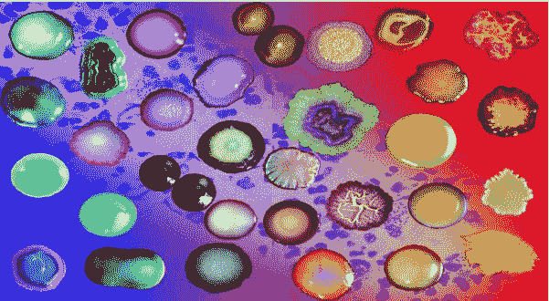

来源：Pixabay。

图 16. 2020 年 1 月 16 日星期四，Blockchain 講座与 Health Valley、Zorginstituut Nederland 和 Novel-T 联合举办，并与微生物组中心合作，组织了一场关于 Blockchain 与健康的下午活动：https://novelt.com/nl/events/blockchain-health/。

## 医疗保健领域的三大应用

Blockchain 可以应对医疗保健目前面临的挑战。这些挑战包括医疗数据（安全性、互操作性、可访问性）、医学研究、临床试验、医药供应链和药品质量。许多医疗保健组织并未采用高效方法，反而使用无效的方法来处理医疗数据。未能妥善管理数据会影响患者护理。此外，还出现了许多医疗服务各自使用不同方法来处理医疗数据及访问此类数据的问题。

Blockchain 可以塑造医疗保健中的数据效率。它可以确保在获取提供优质护理所需的数据时，具备灵活性、互连性、问责制和保护性。在本章中，我们主要讨论如何在医疗保健实践中应用 Blockchain。

### 信息透明度

患者的医疗数据分散在许多组织、保险公司、医生等机构中。因此，病历似乎是一套支离破碎的信息复合体，所有非常重要的信息是否都可用，尚存疑问。目前，（尚未）存在通用的医疗和伦理数据存储系统及相关标准。因此，这是医疗领域与 Blockchain 在开发医疗保健应用方面的交汇点。

在医疗保健中使用 Blockchain 技术在数据管理方面产生了影响。这项技术将使所有医疗保健利益相关方共享医疗数据变得更加高效、高效率、安全和透明。医疗机构网络可以在不持有患者个人数据的情况下存在。详细信息都包含在 Blockchain 中。

在这个网络中，患者通过其哈希标识进行识别，这是一个唯一的标识。哈希是一个加密且经过计算的数字代码（参见第 1 章）。哈希标识使 ID 唯一并保护用户的隐私。因此，Blockchain 也可以形成交换患者数据的平台。这样，您可以防止信息被阻断，因为可以保持各利益相关方之间信息交换的活跃。当其中一个区块内的数据发生变化时，会触发一种连锁反应，可能会使整个 Blockchain 冻结。由于这在理论上是不可能的，因此 Blockchain 中包含的数据无法被篡改。

但是，如果非利益相关方想要黑客攻击信息和/或不正确地影响它怎么办？Blockchain 技术解决了这个问题：它是一个透明的工具，这个网络中的每个人都会查看 Blockchain，以了解每笔交易是如何进行的，以及是否传递了相关信息。此外，


数据不能是欺诈性的；如果一个无关方希望阻止数据，由于滚雪球效应，这将会极大地改变哈希值。区块链中的每个区块都存储前一个区块中存储的数据哈希值（参见第 4.4 章）。区块链因此确保了患者信息的巨大透明度，以便患者能得到更好的帮助。

## 患者信息的可访问性

虽然被视为不道德的活动，但在医疗保健中阻止信息一直是一个问题。例如，在医疗领域，医生可以将阻止患者数据视为对患者数据或电子健康信息交换的不合理限制所导致的结果。美国卫生信息技术全国协调办公室指出，阻止信息有三个原因：

- 干扰
- 知识
- 数据不可访问没有正当理由

不言而喻，阻止信息对医疗保健中高效有效的实践是巨大的不利因素。其解释似乎非常明确：医院不想错过患者，并希望让他们尽可能困难地去另一家医院，或者索赔行为会产生不良影响。这在当前数字时代实际上早就应该成为惯例。

研究表明，阻止信息非常普遍，而为遏制这一现象所采取的各种措施仍然极其低效。事实上，哈佛大学临床信息学与改进研究中心副教授兼主任 Adler-Milstein 表示，50% 的受访者曾参与阻止来自健康 IT 公司的信息（Adler-Milstein 和 Pfeifer 2017）。四分之一的受访者表示，这种做法是由于医院和医疗系统造成的。据研究人员称，以下方法可以防止阻止信息：

- 1. 更大的清晰度，以便成员的任何行动都能得到证明。
- 2. 良好的经济回报，使参与者愿意交换数据。
- 3. 医疗保健 IT 公司、医院和健康信息交换之间的伙伴关系可以防止信息被阻止。

区块链技术可以帮助在区块链上建立医疗记录。这不仅减少了不必要的行政成本，还能更好地利用健康数据。此外，其应用可能减少联系不同中介来监督基本健康信息交换的需求。

## 完整信息

单个患者的医疗记录现在可以分布在不同的设施、医生和保险公司中。这意味着患者的完整病史始终是扭曲或不完整的。存储在区块链上的虚拟医疗记录可以帮助医疗保健利益相关者将健康数据复杂性的所有部分整合在一起。因此，患者记录、所接受的药物、已完成的手术、使用的设施及其他详细信息也将保持最新，并供所有相关人员使用。

可访问且完整的信息将极大地简化医疗保健专业人员的关键角色。毕竟，这一角色包括为患者提供可靠、及时和良好的治疗。通过在医疗保健领域使用区块链技术，服务提供商将始终清楚地了解患者的病历。必须注意并承认，区块链和医疗环境中所有过去的健康数据都是不可更改的，并且对该数据的任何改进都是显而易见的。

## 信息存储的保障

区块链中的医疗信息可以来自各种来源，例如：

- 患者记录
- 可穿戴设备，如智能手表
- 移动设备
- 实验室

对医疗数据进行有效高效的控制是区块链和医疗保健的最重要优势之一。许多与健康相关的问题可以避免：互操作性、数据完整性、滥用以及灾难期间的数据丢失。还值得指出的是，区块链技术可以为大流行等危机后的复杂问题提供解决方案。

为了帮助组织改善对未来大流行病的准备，并在 COVID-19 之后支持、加速和保障经济复苏，世界经济论坛发布了可在 weforum.org 上获取的区块链部署工具包。

提供充足医疗服务的关键在于确保健康数据准确的能力。必须避免垃圾数据变成自动化垃圾数据。接触适当的医疗记录意味着医疗保健专业人员可以做出准确诊断。此外，在数据进入区块链之前，几乎不可能进行任何调整。

## 医疗护理（仍）落后于区块链

2020 年，GlobalData 观察到，制药公司和医疗设备公司对区块链充满热情，但这项技术仍在缓慢引入。然而，他们预计区块链在医疗保健中的作用将迅速增长。据 GlobalData 称，这种快速增长尚未实现的主要原因是启动成本高昂。毕竟，许多医疗保健组织拥有未调整的过时旧系统。还有关于可扩展性、政府监管和隐私的担忧。区块链无疑将在未来的医疗保健中发挥重大作用，特别是在制药公司、医生、保险公司和患者等利益相关者之间的信息流动和交换方面。

通过区块链，数据可以快速、轻松、安全地交换，具有高度的互操作性，并确保每个人都拥有最新数据。隐私立法和美国健康保险可携带性和责任法案在这一发展中发挥作用，同时也可以问：这是否过于超前？法律和法规始终跟随社会发展，而非相反。

另一个应用是使用区块链更好地保护数据完整性。在临床试验中，数据和研究结果不被篡改至关重要。区块链至少理论上可以为这提供解决方案（Nictiz 2017）。

各国已经在医疗保健领域开展区块链实验。爱沙尼亚多年来在数字服务领域树立了国际典范。爱沙尼亚在包含患者档案和药物规定的国家数据库中使用区块链。2016 年初，Guardtime 公司宣布将与政府一起借助区块链保障一百万名患者的数据安全。这涉及确保数据完整性并使对数据执行的所有操作透明化。因此，这并不是要将医疗数据放在区块链上。

区块链试点项目也用于美国的医疗保健领域。美国食品药品监督管理局正在与 IBM、KPMG、默克和沃尔玛合作，利用区块链改善制药供应链。该供应链包含许多中介，随着区块链的出现，这些中介变得多余。2019 年，各公司作为 FDA 的 DSCSA 试点项目计划的一部分完成了互操作性试点（DSCSA 2020）。除了区块链的巨大优势，它还带来了数据完整性、数据存储选项和开发成本等挑战。当今传统系统中数据完整性的挑战也不例外。

GlobalData《医疗保健领域区块链主题研究》（2020）的主要组成部分包括：

- 关键行业参与者：区块链行业的主要参与者及其在价值链中的位置。
- 区块链趋势：推动区块链引入的主要趋势，分为四大类别：供应链趋势、技术主题、宏观经济主题和监管主题。
- 行业分析及区块链在医疗保健中的影响：区块链在医疗保健中的关键应用，包括展示医疗保健行业如何利用区块链取得更好结果的案例研究。
- 价值链：医疗保健行业中区块链的实施与集成，突出市场驱动因素和障碍。

GlobalData 对区块链投资如何与制药和医疗公司其他趋势相关提供了良好的概述。例如，71% 的制药公司在区块链上花钱。大约 55% 的涉及医疗设备的公司也投资于技术（GlobalData 2020）。这使得区块链投资在被调查的话题中处于中间档次，包括大数据、人工智能和网络安全等。

## 药品生产和分销的安全性

区块链可用于药品追溯，不仅可以追溯配方，还可以追溯假药。制造假药或仿冒药是制药行业和社会的一大问题。早在 2017 年，健康研究资助组织就发现：

- 发展中国家销售的 10% 到 30% 的药品是伪造的；
- 假药市场每年价值两千亿美元；
- 互联网上假冒产品的销售额占全球市场价值 750 亿美元；
- 大多数假药在印度和中国生产；
- 2014 年，全球约六十种不同的辉瑞药品和产品被伪造。（世界卫生组织 2017）

顺便提一下，世界卫生组织估计，16% 的假药含有错误成分，而 17% 含有错误水平的必要成分。从财务角度看，制假每年给欧洲制药行业造成 102 亿欧元的损失。

使用区块链不仅降低了将错误处方产品放在黑市上的可能性，还降低了假冒产品进入的机会。


黑市。无论产品类型如何，制药公司必须建立极其安全的供应链合作。药品经常从供应链中被盗取，然后非法销售给各种客户。

## 用于安全供应链的区块链

链式管理是区块链发展非常强劲的一个领域。高效的供应链构成许多成功公司的核心，并处理从供应商到消费者的货物运输。在某个行业存在多个利益相关者的情况下，协调通常相当困难。然而，区块链技术可以在许多行业中实现新的透明度水平。一个围绕不可更改数据库构建的互操作供应链生态系统，正是许多行业可以用来变得更具未来适应性和有效性的东西。

在区块链上注册产品的公司必须可靠，以保证产品的有效性和可追溯性。由于这种可靠性，由中央机构运营的私有区块链确保不会注册假药，这并不罕见。

公司确定链中哪些参与者充当矿工，这些参与者可以是供应商、分销商或零售商。根据其角色，每个个人将拥有不同的权限：实验室技术人员可以注册药品，而批发商只能确认交易。

## 追踪药品

当药品在区块链上注册时，会创建一个包含所有相关产品数据的哈希值。当药品从制造商流向分销商时，信息会存储在区块链上，从而使追踪变得清晰。一个试点项目表明，使用区块链技术可以大幅减少追踪处方药所需的时间：从最多16周缩短至2秒。我们已经提到过美国食品药品监督管理局的DSCSA试点项目计划。除了供应链的可视性之外，该试点项目还利用区块链来改善患者保护和患者安全。该应用程序帮助用户轻松高效地定位、调查和处理特定的犯罪或非法药品。

当药品需要从市场上撤回时，区块链使其易于从市场上移除，从而防止并发症。因此，在药品可追溯性方面，区块链技术有助于解决两个重要问题。

- 它们支持公司在供应链中追踪其药品，创建一个对假药不可渗透的封闭网络。
- 它们帮助利益相关者在出现问题时根据经验知识采取行动，通过识别其药品的确切位置。

## 与人工智能和物联网的协作

因为区块链、人工智能（AI）和物联网（IoT）完美契合，医疗流程可以从根本上重新设计。区块链、AI和物联网这种不可避免的融合将形成安全、互联互通和自主性的有影响力的组合，从而在流程运行方式上带来革命。这在图17中得到说明。

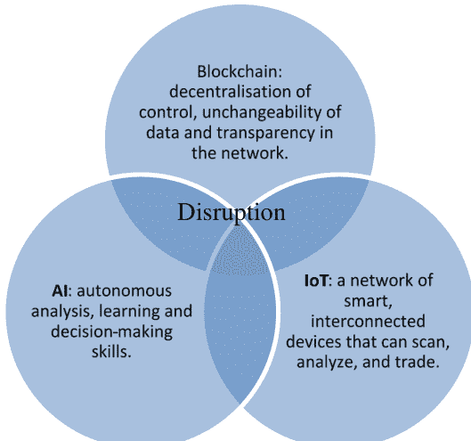

来源：Veuger 2020b 和 ICT 杂志，“药品供应链的透明度。”

图17. 区块链、AI和物联网之间的个体与颠覆。

区块链、AI和物联网技术的组合会影响公司、行业乃至经济体运作方式的潜力，并将重新定义这三者，其影响力超过当前。一些应用和概念已经展示了这些技术之间的重叠，并取得了有希望的结果。使用区块链可以安全地记录个性化数据，从而使这些数据可用于诊断和治疗。我们将首先解释AI和物联网的运作及可能性。

## 人工智能

人工智能在分析数据、做出决策以及在计算机或其他智能设备上采取行动时，给予完全自主权。在某些情况下，AI可以被复制，甚至可以超越人类的数学和认知能力。

组织使用AI主要自动化重复性、常规性流程，这些流程可能需要大量数据处理以及基于纯粹逻辑的快速决策。

区块链也加强了用户的自主权。区块链以（半）自主的方式加强了链中首先信息交换的完整性和质量，其次是（自动化决策的准备工作）（Berenscht 2019）。

## 物联网

物联网涉及电视、车库门、冰箱、咖啡机、照明、音响、供暖等熟悉设备，这些设备被分配了IP地址，从而具有数字化可访问性。物联网为配备传感器、微处理器和换能器的不同日常对象之间提供了无缝互联互通。这创建了一个可以独立感知和收集数据、持续分析数据并执行编程任务的网络。

设备、机器、家庭、商业场所、机构、车辆和人员的这种基础设施，提供了彼此共享和处理信息的可能性。在不久的将来，将有超过500亿台设备连接。原则上，物联网由三个元素组成：

- 传感器
- 通信
- 流程

传感器包含有关电力、支付单元或交通信息，或一切可测量事物的数据。然后可以将这些数据记录在网络中，例如区块链网络。在物联网中，区块链技术被完美设计用于小型对象之间的通信，即第二个元素。物联网将对我们的经济和社会产生巨大影响。预计在未来几年，高科技产品和服务形式将快速发展，区块链技术将发挥非常重要的作用。

## 热应激水平示例

区块链、AI和物联网的一个经证实的融合示例是，例如，富士通用于测量员工热应激水平的算法（Petitjean 2019；富士通 2019）。该算法使用便携式体外诊断设备（IDA）和传感器，持续监测员工的生理数据（温度、湿度、活动水平、脉搏等），以追踪与员工健康相关的各种因素之间的相关性。该分析可以帮助组织改善工作条件并预防员工健康问题。

在该系统中应用区块链可以通过保护隐私来保留更多个性化数据，或者可以通过智能合约支付健康保险金额。该领域的法律调查正在研究中，可以在Automatie pma³的一篇文章中找到。

## 将区块链与AI和物联网智能结合

区块链、AI和物联网的融合可以使组织在最大化各项技术优势的同时，最大限度地降低与这些技术相关的风险和局限性。鉴于物联网网络包含大量连接设备，存在许多漏洞，使网络容易受到黑客攻击、欺诈和盗窃。为了防止安全问题，由机器学习驱动的AI可以主动防御恶意软件和黑客攻击。通过区块链，可以最大限度地减少对网络上数据的非法访问和篡改，从而进一步提高网络和数据的安全性。AI还可以通过使物联网网络更加自主和智能，来提高其功能能力。

区块链、AI和物联网技术的组合会影响公司、行业乃至经济体运作方式的潜力，并将重新定义这三者，其影响力超过当前。一些应用和概念已经展示了这些技术之间的重叠，并取得了有希望的结果（Odyssey 2020）。一个示例是将AI和区块链结合以管理无人驾驶空中交通，使大规模自主飞行更加安全。仅这一应用就会重新定义航空和物流业务。

区块链、AI和物联网融合的预期影响目前（尚）不可预见，现有应用也（尚）不完美。许多组织，尤其是早期采用者，对认知技术的价值抱有非常高的期望，因此希望投资于它们。应用中的研究结果目前仍处于早期阶段，尚未达到实现真正转型所需的先进水平，其中将至关重要的商业模式也是如此。物联网与区块链的结合也是如此。随着兴趣、投资和创新的增加，区块链、AI和物联网的融合将成为现实。

## 区块链与健康信息交换（HIE）

区块链在每个中央机构的环境下实现分布式和去中心化。医疗保健是一个预计区块链将产生重大影响的行业。近年来，健康信息交换（HIE）已显示出对医疗保健系统的益处。研究（Vishnoi 2020）表明，区块链可以帮助改善HIE系统的几个方面。

当区块链与HIE相遇时，只有两个问题。首先，现有系统在数据治理方面并非以患者为中心。患者不拥有自己的数据，并且

此后无法直接控制。其次，不同系统之间没有特定的协议用于共享敏感数据。为了解决这两个问题，亚利桑那州立大学的区块链实验室进行了一项研究并提出了 MedFabric4Me。这是一个基于区块链的 HIE 系统。在这个关于 MedFabric4Me 的技术案例中，我们深入探讨该系统。

## 医疗信息交换 (HIE)

医疗信息交换 (HIE) 是根据国家标准，在医疗机构、公共机构和健康信息组织（即监管和规范这些数据交换的公司）之间进行的医疗相关数据的电子传输。

HIE 的目的是促进对患者健康信息的适当和安全访问与检索，以改善患者护理的成本、质量、安全性和速度。虽然 HIE 通常指两个或多个组织或医疗服务提供者之间交换信息的行为，但也可能指负责促进交换的组织。

## 案例 3：MedFabric4Me 的健康信息交换

MedFabric4Me 是一个以患者为中心的系统，患者根据需要拥有并共享其医疗数据。亚利桑那州立大学及其区块链实验室是区块链讲席的知识合作伙伴，并针对区块链与医疗保健进行特定研究。MedFabric4Me 这一案例展示了区块链如何在医疗保健中得到有效应用。

首先，对以患者为中心的系统进行了需求分析，以确保参与者之间的数据防欺诈共享。该系统包含一种机制，确保数据不可被篡改。分布式代理加密系统已用于在存储和数据共享过程中安全加密数据。此外，链上存储和链上访问管理的组合已应用于实现真实性和隐私性。

### 链上和链下

MedFabric4Me 是一个由链上和链下组件组成的两部分解决方案平台。链上解决方案在 Hyperledger Fabric 的安全网络上实现，而链下解决方案使用 Interplanetary File System 来安全存储数据。基于以太坊的 Nucypher（一种代理再加密网络）为参与者提供加密数据共享的加密访问控制。

为展示易用性和可扩展性，MedFabric4Me 的一个原型解决方案已被实现，并作为系统性能基准与已实现的 HIE 进行了评估。结果表明，区块链等去中心化技术有助于减轻 HIE 目前面临的一些问题，例如患者透明度、紧急响应缓慢和更好的访问控制。因此，该研究 (Vishnoi 2020) 得出结论，MedFabric4Me 在运营和性能方面具有优势。

### MedFabric4Me 的属性

实验已经证明了在私有和公共区块链的互操作网络中的潜力。如果我们将此应用程序与 HIE 在可扩展性和性能间隔方面进行比较，我们会看到以下内容：

### 隐私性

如前所述，医疗数据和电子患者档案受法律和法规保护。因此，每个系统都必须遵守《健康保险可携性和责任法案》(HIPAA) 的隐私指南。HIPAA 是 1996 年的美国医疗保健立法。MedFabric4Me 满足所有最低要求。

患者可以随时在 MedFabric4Me 上删除其账户。因此，当您离开网络时，MedFabric4Me 会立即删除参与者的所有信息。尽管信息交换必须记录为交易历史，但作为总账的 MedFabric4Me 是不可更改的。

患者在 MedFabric4Me 中管理数据共享，因此可以随时取消文件共享。患者因此确定自己的数据共享策略。此外，患者可以要求供应商更改错误的健康信息。尽管患者无法自行更改其电子患者记录，但下一位医生可以更改任何不一致之处。

### 数据的部分共享

当患者数据出于研究目的共享时，需要去标识化。为遵守此要求，MedFabric4Me 可以部分共享数据、隐藏个人信息，或者可能只需为结构化数据共享数据。对于非结构化数据，系统中尚未（实现），但可以在后续阶段进行。

### 可扩展性

为了 Hyperledger Fabric 的可扩展性，我们需要将其与亚利桑那州公司 Health Current 的最先进水平进行比较。Health Current 每月平均完成 2340 万笔 HLF 交易、120 万笔 CCD 交易和 1040 万条警报。

### IPFS 与云服务对比

云服务的上传和下载速度约为每秒 20 MB，而 Interplanetary File System (IPFS) 为加密文件提供恒定的上传时间 0.4 秒。对于未加密文件，速度会进一步下降 (Taylor 2020)。这表明，对于大多数上传，IPFS 的表现优于未加密文件大小的云服务。在下载方面，IPFS 的速度约为每秒 7 MB，低于云服务的下载速度。这可以通过创建私有云服务并在多个节点之间复制数据来改进。因此，研究人员 (Vishnoi 2020: 80) 得出结论，IPFS 可能不是应用程序的最佳数据库，但它适用于带哈希的文件存储，并且当通过 Hyperledger Fabric 监管访问控制时。

### Nucypher

PRE 是云中最流行的编码算法 (Aminubaba et al. 2014)，加密速度约为每秒 55 MB，而 Nucypher 为每秒 115 MB。因此，在加密时间方面，PRE 比现有的云服务提供了更好的性能。

### MedFabric4Me 与 HIE 的使用比较

最后，我们来看六种 HIE 为医疗服务提供者和参与者带来好处的场景，并将它们与 MedFabric4Me 的实现进行比较。

### ADT 消息

当患者被入院、出院或转移到紧急情况时，患者的护理人员会收到包含基本信息（入院日期、入院地点、入院原因等）的警告，从而能够联系患者并处理后续事宜。此警告是一条 ADT 消息，其中 ADT 代表入院、出院和转院。

但是，MedFabric4Me 尚未（实现）针对急诊就诊的实现，尽管 ADT 消息的最重要功能已在不可更改的账本中实现。当患者去急诊室并更新文件时，MedFabric4Me 会不可更改地记录数据交易。提供者随后不会在状态变更的确切时间收到 ADT 消息。但是，当患者去看提供者时，这些提供者会获得患者去急诊室就诊的原因以及更新文件的一般历史记录。

### 大流行预警的改进

大流行是指在大范围地区传播的疾病流行。著名的例子包括 SARS 和 COVID-19。通常，检测实验室在大流行期间提供快速结果。HIE 必须适应并创建基础设施来应对大流行，这起初会减缓响应速度。即使基础设施到位，HIE 也很脆弱，因为警告必须始终是实时的，并且通常有一定规模。例如，在 COVID-19 期间，Health Current 最初在没有安全文件传输协议的情况下提供了警报和数据。

MedFabric4Me 不必每次都适应大流行。尽管它不提供紧急警报，但不需要创建新功能或完整基础设施来支持大流行报告。进行大规模检测的机构或检测实验室可以为特定患者提供安全结果，并且这些数据可以进一步交换。

### 医疗设备管理

HIE 具有非常具体的功能，即与提供者的供应商和参与者共享医疗记录。医疗行业非常庞大，涉及多个其他行业。其中之一是向供应商、研究机构和医疗机构供应医疗设备的医疗设备制造商。制造商将设备的使用情况传递给提供者或机构。目前，医疗供应商对设备的使用情况了解有限，这导致服务粗心大意。

MedFabric4Me 关于数据部分共享的政策可以帮助设备制造商了解设备与供应商之间的使用情况并信任数据。制造商可以确定需要哪些医疗设备。就其余而言，制造商可以了解特定地点的库存情况，这有助于他们做出深思熟虑的决定，即是否应该在该地点的提供者之间移动它，或者呼叫一台新机器。

通过这些实验和比较，研究人员得出结论，MedFabric4Me 是当前集中式替代方案的可行去中心化替代方案。MedFabric4Me 的一些概述优势包括：

- MedFabric4Me 有能力在传输领域表现得更好。
- 去中心化确保没有单点故障。
- MedFabric4Me 降低了云计算和昂贵加密的间接成本，并有助于在保险公司、医疗服务提供者和患者之间分摊成本。


- MedFabric4Me 为患者提供数据治理，从而实现透明度、减少延迟并改善服务。

虽然 MedFabric4Me 在某些方面显示出潜力，但在缺乏集中式解决方案的某些方面仍有不足。我们将简要回顾这些方面。

### 设置便捷性

设置和扩展集中式系统非常简单——比像 MedFabric4Me 这样的去中心化系统简单得多。集中式 HIE 在很大程度上基于所谓的 *企业云计算*，它用于管理和扩展多种服务以分析系统应用。对于 MedFabric4Me，开发带有多个独立组件的公司级系统应用比较复杂。

### 系统升级与更新

更新集中式系统更容易，因为所有服务器和应用程序代码库都从单个中心位置进行控制。区块链设置难以升级，因为节点是分布式的，并且每个节点都需要同时更新才能保持网络正常运行。

### 更轻松的数据备份

在集中式系统中，当前 HIE 更容易备份健康数据。对于 MedFabric4Me，当患者拥有自己的数据并可以自由选择数据存储服务提供商时，这可能会变得复杂。由于缺乏数据备份，患者可能会永久丢失数据。

## 医疗保健中区块链的基本原则

区块链为医疗保健带来了机遇，但也需要了解和洞察如何在医疗保健中安全、负责任地使用区块链（Zorginstituut 2019）。目前，区块链的实施更多停留在理论层面，而非实际应用。区块链能为医疗保健带来价值的法律、组织、社会和技术前提条件需要澄清。

四项基本原则是本章的核心；我们已在第1章和第2章开头提及它们。为了实现更有效的医疗服务，我们将阐述区块链使用中的四项基本原则。

- 基本原则 1 链式增长。为了能够协作，有必要共享信息。这通过信息标准和 Nictiz 的五层模型来实现。
- 基本原则 2 分布式网络。区块链充当数字基础设施（医疗信息系统）。一个例子是价值驱动型医疗中 IT 平台的运作，以形成护理成果记录。
- 基本原则 3 共识。由于没有中央方进行引导，相关各方必须达成一致意见。
- 基本原则 4 数据存储。数字身份的记录和隐私保护是使用区块链的结果。

### 基本原则 1 - 链式增长

医疗保健是一个数字孤岛帝国。专业人士之间确实存在数据交换，但仍有重大的发展空间。区块链可以在患者及其数据之间的新关系中发挥重要作用，即第四项基本原则，例如通过提高对数据交换的透明度和控制力。各方已经在使用此技术：

- 重复处方的区块链：Prescrypt。这被认为是医疗保健中区块链的首批应用之一（拉德布德大学医学中心）。
- MIT MedRec 项目正在解决医疗数据访问碎片化问题，改善互操作性，保护患者权利，并将数据量和质量提升到科学研究的更高水平。在第 5.4 节中，您可以阅读更多关于 MedRec 的内容。
- Google 通过其人工智能部门“DeepMind”，使英国的医院能够将健康记录上传到区块链。
- Guardtime 已经为爱沙尼亚和阿拉伯联合酋长国政府成功实施了相同的解决方案。
- Coralhealth 使用区块链使个性化药物成为可能。
- EncryptGen 推出了一个平台，允许人们出售自己的 DNA 以换取加密货币。
- Lancor 开发了一种工具，通过人工智能和区块链的结合，将癌症筛查的可靠性从百分之六十（人工）提高到百分之九十。

区块链确保不同各方之间安全传输数据，各方可以利用这些数据开发个性化药物等应用。

护理流程可以部分用 *事务* 来描述：即交换护理信息的通信时刻。监管空间、关注客户意愿和护理质量以及数字工作环境的结合，确保团队或护理组织 *掌控局面*。通过将责任放在专业人士手中，可以围绕超越自身组织边界的工作流程和链条形成组织形式。由于信息可用，专业人士可以独立实现：

- 共享资源的分配
- 对自身资源的问责
- 绘制有效性和效率图谱
- 制定运营计划

### 信息标准

患者数据的数字传输和发送在技术上或多或少已得到解决。Nictiz 是一家荷兰知识组织，致力于医疗保健领域的数字信息交换。该组织开发了 *信息标准*，这些标准连同医疗服务提供者一起，现在几乎适用于所有医疗领域。示例包括护理交接、急诊护理、产科护理、实验室数据交换、药物安全以及慢性病患者护理。

信息标准描述了医疗数据在实践中使用的原因和方式。此类数据示例包括血压、出院日期、诊断和体重，但也包括婚姻状况、性别和姓名。信息标准还描述了可用于传输数据的技术基础设施和网络，以及为此目的可使用的国际标准和通信系统。由于在单一信息标准中描述医疗领域过于复杂，信息标准始终针对医疗专业人员相互交换信息以及与患者交换信息的特定、明确定义的情况而开发。数据集是信息标准的关键部分。数据集描述了涉及哪些数据，并提供了软件程序员可理解的技术细节描述。

数据集由 *医疗信息构建块（zibs）* 组成，例如体重、药物和饮酒情况。这些是所有医疗领域中安全、可靠且明确交换医疗数据不可或缺的构建块。图 4.1 显示了信息标准、数据集和 zib 之间的关系。在荷兰语境中，已达成协议，zib 的集合是一项国家标准，我们称之为 *基础护理数据集*（Basisgevensset Zorg; BgZ）。Nictiz 在荷兰信息标准和医疗信息构建块（zibs）的开发中发挥着核心和促进作用。

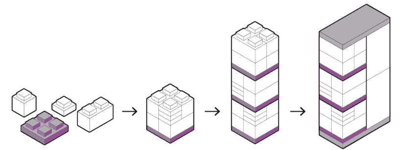

来源：Nictiz。

图 18. 数据集是信息标准的关键部分。

例如，通过移动应用程序实现 *实时* 数据可用性，使高风险患者能够进行 24 小时监测。

护理团队可以远程监测并利用治疗方案进行早期干预。护理专业人员和客户可以访问相同的信息，并能够达成共同决定（Linn and Koo 2016）。

### 五层模型

根据区块链实施的用途，将需要信息和数据模型。为了形成有效的网络结构，明确记录和共享信息非常重要。当医疗各方能够在五个层面上就信息架构达成协议时，这种互操作性就会产生。Nictiz 为此开发了五层模型，每个层面都有自己的各方、概念和标准：

- 1. 组织政策关注协作的组织方面。标准示例是患者转诊。
- 2. 护理流程关注医疗流程如何协同工作，例如网络结构中药物数据传输的指南。
- 3. 信息涉及网络中传输时刻所用数据的记录。示例是术语标准。
- 4. 应用涉及共享流程信息所需的信息系统。示例是标准化领域数据模型。
- 5. IT 基础设施关注网络合作伙伴的信息系统运行的技术基础设施。这涉及使信息交换成为可能的技术设置。


为了良好地交换信息，必须在五层模型的所有层级上达成协议。如图 19 所示。

网络结构是连接组织行动的一种特定跨组织合作形式。其目标是对客户需要或希望的行动采取一致的方法（Van der Aa 2001: 16）。要达成链条协议，有必要具备（Van der Aa 2001: 123）：

- 对相互依赖性的洞察和视图
- 链条合作伙伴之间的信任
- 在流程设计中描述的链条
- 对每个人对链条贡献的清晰认知
- 关键数据的登记
- 关于链条的质量体系
- 链条管理形式
- 链条自动化

一个主要问题是，组织在最高层级（即组织政策）上达成的协议不足。护理组织倾向于迅速关注模型的较低层级：IT基础设施。护理有一个关键要素：在数据交换开始之前，组织之间必须存在信任。拟交换数据的对方越远，信任越低。

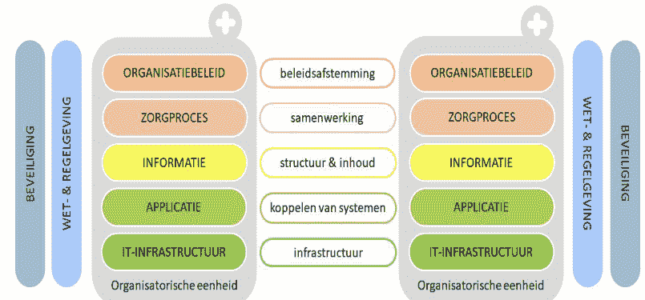

图 19. Nictiz 的五层模型。

为此，规定了所需的标准化。协议由各方达成：

- 政策协调通常是一个行政过程。
- 网络中的合作发生在医疗专业人员和任何主管之间。
- 结构和内容需要护理和 ICT 专业人员之间的协调。
- 链接系统需要医疗专业人员与（例如）应用程序管理员之间的协调。
- 基础设施需要 ICT 专业人员之间的协调。

总之，这是一个复杂的协议系统。因此，为了良好的医疗信息交换，始终需要许多设施。它们共同构成了信息共享的基础设施。这包括，例如，记录正在发生的事情，确保安全通信（如加密、身份验证（验证某人是否就是其声称的人）以及能够确定患者是否同意数据交换）。

## 何时使用及不使用区块链

要求决策者在结果和用区块链执行的流程方面填充*裁量空间*（高度监管自由度）的决策，不适合自动化决策。因此，区块链不适合结构较松散的问题，其中流程和结果可能成为事前未设计的干预措施的对象。

区块链可以用于此类决策的（部分）准备。例如，开药必须始终是医生的决定，不得由区块链自动决定。同时，医生开药和药剂师提供药品这一事实（也不适合自动决策）可用于对护理融资做出自动化决策（Berenschot 2019）。

任何类型的信息都可以存储在区块链中。实现区块链的网络决定事务中发生的信息类型。至关重要的是，信息必须正确且系统设计良好。通过使用区块链，信息（匿名化）可以与不同方无可辩驳地以*实时*共享。因此，区块链可以支持医疗流程，使其更快，并降低对人为错误的敏感性。该技术可以帮助使医疗更安全、更好、更易获得、更便宜。然而，如果区块链结构不佳，该技术会导致风险，但这适用于每种技术。如前所述，区块链没有中心方：各方必须在五层模型的所有层级上达成协议，以实现良好的信息交换。

## 基本原则 2 - 分布式网络

患者的需求是出发点，网络中的不同参与者可以在不同时间为患者创造价值。网络医学是以患者为中心、在其亲属和医疗专业人员的帮助下管理健康的护理。因此，控制权越来越多地掌握在客户手中（Jeninga 和 Woldendorp 2019）。

运行正常的底层数字基础设施是保持护理质量的同时在网络中进行有效、高效协作的前提。未来，将在地方、区域和（跨）国家层面建立数字和物理网络。这不仅涉及患者周围的网络，还涉及医院内外医疗专业人员之间的网络。因此，隔间将消失，专业领域将交汇（Porter 和 Teisberg 2006）。网络护理所需要的是：

- 护理管理（护理的测量、管理和资助）
- 完全一体化的链条护理
- 系统方法的理念
- 融资
- 关于成本和创新的透明度

区块链通过有效且高效地建立医疗信息管理系统来为此做出贡献。这为实现价值驱动的护理提供了基础。

## 护理结果

价值驱动的护理以关注结果指标为特征。护理结果被广泛理解，并与治疗过程的成本相关联。护理结果包括质量、成本和护理的适当性。

适当性是指对患者的护理是否确实有适应证的程度。需要指标才能衡量结果。因此，护理过程成为护理交付链，其中包括从预防和诊断到治疗和后续护理的所有为患者提供价值的活动。质量和效率测量的结果是改善护理的基础。这些结果是数据，区块链平台有助于充分利用这些数据。

## 促进性 IT 平台

在迈克尔·波特（Porter 和 Teisberg 2006）的思想中，促进这一运动的 IT 平台至关重要。尽管付出了大量努力，信息交换仍然有限，可靠结果指标的可用性也有限。此外，为了从中学习而交换或能够交换结果信息的情况仍然非常有限。互操作性至关重要：使用相同的定义并制定 IT 和数据标准。

IT 平台的设计使得可以将（技术和数字）创新智能地集成到护理交付中。需要一个 IT 平台来促进一体化执业单元内的协作，并实现结果和成本的比较与报告。IT 平台具有以下元素：它围绕（患者的）病情设计，使用标准化的术语和数据字段，使所有人讲同一种语言，并包含所有不同类型的数据，使所有医疗保健提供者都能获得完整的概览。因此，这是一个 IT 平台：

- 使可以与其他专业人员进行数字通信
- 使可以交换注册数据，如健康记录和护理计划
- 使患者能够在整个护理过程中访问
- 监控绩效以促进（一体化）护理提供
- 为患者提供数字工具以积极进行自我管理

参与的医疗保健组织，无论是否在网络中协作，都需要一个支持主要和支持流程的数据平台。区块链为交换数据提供了可能性。

## 基本原则 3 - 共识

区块链的独特特征之一是不存在中央控制方。这引出了基本原则 3，共识。需要一种共识形式来实施更新并就区块链的正确状态达成一致。在第 2.3 章中，我们已经看到不同的基础设施有其自己的共识形式：Hyperledger Fabric、Ethereum 和 Corda。参与方越多，共识越强。

但区块链当然并非中立、公正、非政治的技术。正是因为使用区块链可能意味着现有流程、数据交换和关系会发生变化，所以对控制的关注很重要（Zorginstituut 2018）。如果一个组内无法达成共识，可能会出现拥有自己规则和货币的独立区块链，例如 2017 年比特币的情况，导致创建了比特币现金（Edriouch 2018）。

区块链为医疗保健提供了机遇，但需要了解如何安全、负责任地使用区块链。区块链发展的挑战在于知识水平之间的差异和


(chain)各方之间的相互依赖关系。由于区块链涉及链上的合作，相关各方必须在开发区块链平台或应用程序之前就条件达成一致（Berenschot 2019）。通过智能合约，可以确定平台上哪些用户可以访问哪些个人数据。

Berenschot（2019）的研究表明，有必要在三个层面上规范治理：

- 1. 运营治理，用于在实际中优化和控制正在运行的区块链应用程序。
- 2. 开发治理，用于对（进一步）开发区块链应用程序的流程进行治理。
- 3. 系统治理，用于对医疗保健系统层面的区块链开发和应用进行一般管理和监督。

区块链治理的法律框架取决于区块链应用程序的用途。医疗保健领域的区块链要求可以分为三组：

- 通用要求
- 区块链中个人数据使用的要求
- 自动化决策的要求

区块链是一种自动化技术，允许在无需受信第三方介入的情况下共享信息并自动执行流程。

## 基本原则 4 - 数据存储

数据存储的核心在于确定数据主体身份并保护隐私的能力。

## 数字身份

基于自主身份的解决方案下，公民本人拥有一个包含其自身身份信息的数字保险库。这些数据随后可用于必须确认自身身份的场景（医疗保健；购买住房）。将构建数字身份基础设施和新的协议系统。这为政府和企业提供服务奠定了基础，以人为本，而非由单个组织制定的个别解决方案。这仍然需要在当前背景下制定必要的法律法规（Lizanova and Veuger 2019），并应予以全面审查。

例如，在实际操作中，每个人都应首先拥有一个完整的数字身份。事件或成就始终可以添加到其中，例如文凭和驾驶执照（Rathenau Institute 2018）。

尽管如此，区块链已经提供了可能性。例如，区块链可用于：

- 数据交换（例如，在医疗保健提供者和健康保险公司之间）
- 让患者访问其数据
- 发送和支付费用索赔
- 记录例如已经进行的医疗操作的证据

尽管这些应用对医疗保健具有巨大的附加值，但其实施也存在障碍：

- 区块链的复杂性
- 当个人数据包含在区块链中时，对保障隐私（GDPR）的疑虑
- 由于链上额外交易导致的能源成本增加
- 缺乏统一的基础设施和对算法（智能合约）的共识
- 交易的长处理时间（秒）

此外，无法删除数据揭示了存储期限和存储容量的局限性（Kennisgroep Keteninformatisering 2019）。医疗保健领域有许多区块链理念和部分运行的倡议，但根据 Nictiz（2017），它们尚未准备好进行大规模使用。主要目标是进行实验并熟悉该技术的功能和局限性。这意味着要投入时间和金钱来获取知识和经验。

## 隐私

医疗保健领域的一个关键问题是保护客户的隐私。医疗数据不得泄露至关重要。只有在获得患者许可的情况下，才可以将护理信息披露给另一个人。

现行立法不允许简单共享医疗数据。因此，一个医疗保健提供者不得向另外两个医疗保健提供者之一提供档案中的数据。如果患者已同意，则医疗保健提供者的这种职业保密义务即失效。

因此，每个打算在区块链中处理个人数据的医疗专业人员都必须检查自己是否有权这样做。为了避免错误，因此明智的做是在私有系统内在许可型区块链中工作（参见第 1 章）。可以向特定用户授予读取和写入权限。这可以通过多种方式实现：

- 在智能合约中，可以规定哪些用户可以访问哪些个人数据。
- 在智能合约中，可以安排每笔交易的发送者确定区块链内哪些用户可以读取该交易。
- 对未经授权用户的个人数据进行哈希处理，以限制处理的影响。
- 未经授权的用户可以充当处理者，从而查看个人数据（Zorginstituut 2019）。

为了防止数据主体错误地查看信息，最好将个人数据存储在链下（链外），并在链上包含指向相关信息的链接。换句话说：区块链被用作访问控制账本。

实践中一个很好的例子是微生物组中心，它通过区块链促进一个链条，用于分析人类粪便以开发个性化药物（另请参见第 2 章后的案例）。区块链在某个流程中连接了医生、实验室、药房和患者，无论是在国内还是国外（Zorginstituut 2019）。

## 影响

区块链可以在短期内提供价值。大多数区块链应用程序可以在短期内对数据记录和执行产生影响。例如，通过：

- 提高有效性
- 提高效率
- 创新产品和服务
- 涉及利益相关者
- 发展组织（VNG 2019）

区块链可以为链或集群提供对单一共享数据源的可靠洞察。这意味着正确的人可以在正确的时间获得正确的信息。这有助于更快、更好地处理公民的申请，从而提高有效性。减少行政工作量和成本，确保员工能够更多地参与主流程。区块链技术为创新应用提供了各种机会。它在链中提供了额外的透明度，并可以使所有权更加灵活。区块链可以吸引客户并改善利益相关者之间的合作伙伴关系，例如在链中。区块链增强了知识和经验，并培养员工的能力（VNG 2019）。在下一章中，我们将深入探讨应用可能性。


来源：Veuger 2020b：17-32。

图 20. 区块链融合与能力。

## 案例 4：VGZ 创新团队为产科护理开发应用程序

健康保险公司 VGZ 非常专注于绘制医疗保健的创新和技术图谱。高度关注技术创新的实际影响（基本原则 2）。有一个创新团队，专注于为健康保险公司和医疗保健创新性地应用相关技术。I-Team Digital Innovation 团队负责：

- 趋势监测（例如，数字人和量子计算机）
- 试点设计（例如，产科护理实用试验和使用聊天机器人）
- 就 VGZ 的数字护理战略提供建议

## 开发

区块链是董事会提出的用于深入探讨的议题之一。创新团队的第一个建议是跟进发展，但暂不进行任何具体实验。应监事会要求，对区块链现象进行了进一步研究。结果，积累了知识，使 VGZ 可以深入了解发展动态以及医疗保健和健康保险方面的任何应用。随后，出现了在产科护理领域进行实用试验的机会。与医疗保健研究所一起，I 团队开发了一个演示版本，以测试不断增长的区块链链的附加值（基本原则 1）。Zorginstituut 已开发了一个名为 Geertje 的工作应用程序，随后与 VGZ 一起将其转换用于产科护理。

参与的产科护理人员对应用程序的功能非常热情。参与的三家产科护理机构也持此意见。该应用程序显著降低了行政负担。尽管如此，还是决定不予继续。原因如下：

- 区块链在有多方参与时效果最佳（该实用试验的参与方数量有限）。区块链是关于构建共识（基本原则 3）。参与方越多，共识就越强。各个护理链条中的参与方数量有限，因此共识的强度也有限。
- 医疗保健领域的区块链主要涉及人员周围的数据。这使得隐私问题成为核心。尽管个人数据已加密，但当今的登录和检索加密密钥流程仍需要受信第三方。区块链最重要的优势之一是不需要主导的受信第三方。但恰恰因为它是为安全目的而创建的，这一优势就不复存在。
- 现有技术已能够通过应用程序提供相同的功能。这意味着在这个阶段，也可以以更低的成本实现行政负担的减少。

使用数据存储保障隐私（基本原则 4）是区块链在医疗保健中应用的重要组成部分。围绕自主身份（通过结合不同方的数据进行验证）存在一些发展，这些发展将从长远上保障隐私。另一方面，可靠存储数据的最佳方式是尽可能少地传播数据。数据存储可以在私有区块链上进行。重要的发展包括：


- 增强组织和专业人员的敏捷性
- 继续数字化（包括由于 COVID-19）的紧迫感
- 专注于早期诊断和自我诊断的人工智能（例如，SkinVision）
- 医疗保健运营的标准化（例如，Bergman Clinics）
- 生活方式干预（例如，GezondmetSalut）

## 在医疗保健中引入区块链的设计原则

每个区块链的基本功能是将数字信息汇集到一个集合（一个区块）中，该集合不可更改。在设计电子客户档案（ECD）或电子健康记录（EHR）时，这至关重要。对于医疗保健，区块链提供了改进协作、保障信任并实现互操作性的机会。

在本章中，我们讨论技术发展、引入区块链的设计原则以及互操作性的设计。

## 不同的思维方式

区块链通过能够捕获交易、创建和事件，引导出一种不同的思维方式。它是一项*基础技术*：它有能力为我们的经济和社会体系创造新的基础（Harvard Business Review 2019: 7）。有五项原则决定了这项技术。

- 1. 分布式数据库：区块链上的各方可以访问整个数据库和历史记录。
- 2. 对等传输：横向通信。
- 3. 透明度和假名性：记录身份并可能实现匿名。
- 4. 文件不可逆性：一旦交易被记录在数据库中，就无法再更改。
- 5. 计算机逻辑：可以应用算法。

作为一个整体，区块链被称为分布式账本技术（Williams 2019: 60）或分布式账本。区块链实际上是一项简单的技术，它像一个永久性的、不可篡改的账本一样运作，适用于几乎任何类型的信息（Williams 2019）。任何参与区块链的人都被视为网络中的'节点'。当对区块链进行更改时，此更改会在所有节点上进行。去中心化的系统是互连节点的非等级群组。分布式系统是彻底去中心化的系统（Williams 2019: 47）。

IBM 商业价值研究所区块链调查确定了区块链技术将在其中颠覆医疗保健的九个领域（Nichol 2018）：医疗设备数据集成；资产管理、客户档案、临床试验、关于副作用的安全监测、用药依从性、法规遵从性、开票和索赔以及合同管理。

在 COVID-19 领域，区块链可以记录患者是否已产生抗体的不可更改的轨迹。通过使用技术，对信息的访问被大大简化。如果客户拥有正确的信息，他们可以做出更好的决策。因此，我们提高了*医疗保健素养*：即我们收集、记录和理解医疗保健信息以做出更好健康决策的程度。

## 医疗保健的技术发展

区块链可以在技术改进中发挥多种作用（Williams 2019: 125）：

- 1. 提供医疗报告（ECD 和 EHR）。
- 2. 同意共享这些文件中的数据。
- 3. 向促进健康并从而降低医疗保健成本的客户支付款项。

区块链可以为健康保险人的活动带来重要创新。将区块链技术应用于医疗保健有潜力减少欺诈并开发新商业模式（Nichol 2018）。用药政策对有效的医疗保健至关重要（Czeschik and Stambolija 2018）。当诊断和手术方面的信息存储在区块链上时，几乎没有空间操纵这些信息以增加收入。医疗设备通过 Wi-Fi、Bluetooth 和其他接口连接。然而，这会导致由黑客造成的漏洞。

区块链在医疗保健中的实际运作方式：

    - 客户接收一个代码（哈希）和一个提供解锁客户数据代码的地址。如果客户数据不存储在区块链中，区块链提供身份验证或访问数据所需的哈希。
    - 照护提供者（照护专业人员）接收一个单独的通用签名（代码或哈希）。当此哈希与客户的哈希结合时，这确保了身份验证，以便能够解锁文件中的数据。
    - 在其个人资料中，客户定义访问其文件所需的访问规则。
    - 当客户通过 eHerkenning 定义 2-of-2 代码时，需要两台计算机（哈希）才能未经授权访问数据。

这（Nichol 2018）的优势包括避免中介、加强客户的管理角色、数据完整性和达成共识。

区块链在医疗保健中的应用可以区分为五个不同的领域（Czeschik and Stambolija 2018）：

    - ECD 管理
    - 药物管理和规划
    - 开票和支付周期
    - 物流和链条管理
    - 连接的医疗设备

还有哪些其他应用可能性？这涉及以下领域：

    - 链条管理：药品的监测和追踪；运输的温度测定。
    - 临床试验：在不同网站、系统、协议和客户数据档案之间建立共识。
    - 提供者的在线数据库：快速且充分地维护工作列表。
    - 客户报告：将不同数据文件中的信息汇集在一起；转化为用户友好的开发（诊断；药物；咨询）。

这些应用大大降低了成本：

    - 寻找病例的“搜索”成本降至近乎零（所有内容都能快速找到）。
    - 智能合约取代当前的合同和支付。
    - 组织外部来源的协调成本在很大程度上被消除。
    - 信任成本在很大程度上失效。

## 带有智能合约的除颤器

医疗保健的一个实际示例。一名患有心律失常的患者植入了心房颤动除颤器。该设备由 X 公司提供，序列号为 Y。在生产过程中，创建了一个区块链以追踪该设备。一个用于标识此独特设备的哈希连同其他相关信息存储在区块链中。设备信息的哈希存储在不可更改的数字账本中。植入式除颤器与患者相关联，设备的区块链根据医院和全科医生关于该患者照护的信息进行更新。该设备由若干智能合约支持，如果设备需要调整或检测到异常，这些合约会自动通知患者和医疗保健提供者（Nichol 2018）。

区块链可以帮助解决由严格的医疗保健法规造成的障碍。这具体涉及数据交换（IBM 2018）。区块链使以统一方式共享客户数据成为可能。三个主要挑战涉及：

- 1. 个人自主权：身份的自我所有权
- 2. 可扩展性：链式交易
- 3. 互操作性（系统之间的开放交互）

个人自主权涉及这样一个原则：每个客户都是身份的来源，因此是其自身身份的所有者。区块链技术使客户能够控制自己的身份、访问数据以及有权决定谁可以看到这些数据。

## 七项设计原则

区块链有可能分散化传统供应链并将其与 AI 和 IoT 相结合，创造新的价值网络（Tapscott and Tapscott 2018）。如果数据可以在各个医疗保健领域内及之间自由安全地使用，则数据可以被更好地利用。提供者、专业人员和客户之间建立共享网络，将加强医疗保健流程的临床结果。欺诈也可以被预防。

区块链有七项设计原则：

- 1. 网络完整性
- 2. 分布式权力
- 3. 价值作为激励
- 4. 安全性


- 5. 隐私
- 6. 权利得到保障
- 7. 包容性

当区块链应用于医疗保健时，它是一个共享平台，使用高度安全性去中心化数据。区块链使得使用包含相关数据的护理通行证成为可能。药物的使用也可以通过追踪和溯源进行监控，这显示了特定时期内护理质量。通过与智能手表等便携设备合作，客户可以提供实时信息用于监控和实现结果。通过安全共享数据，护理计划的质量得以提高，从而简化行政流程并避免不必要的护理部署。

同样，智能合约的使用为护理部署的各个方面创建了审计踪迹。在 4.1 节中，我们提到了 Prescrypt。Prescrypt 使慢性病患者能够获得在区块链上受到保护的处方。这使客户能够控制其药物和信息的可访问性。客户决定与哪些医疗专业人员共享数据，以及将药物概览发送到哪家药店。如图 21 所示。

Philips Healthcare 使用区块链技术用于福祉应用和客户 ID 计划。在特定条件下，区块链可以使中央中介变得多余；或者在其他前提条件下，其作用可能仅限于部分数据库的管理（Czeschik and Stambolija 2018）。基于区块链的另一个产品是 MyClinic.com。MyClinic 使预约、查看医疗记录和安排后续检查变得简单。其目标是客户可访问性和控制权，以及医疗专业人员与客户之间的简单联系（Medicalchain）。


区块链是一种技术，它使两个陌生方能够在不需要中央机构的情况下转移独特的数字资产——所有这一切都以安全、可信和可靠的方式完成。

图 21. 医疗保健中的区块链，Radboud UMC REshape Centre.

## Medicaid

Medicaid 是美国的一项救助计划，为约 7400 万低收入和低资产的个人和家庭提供健康保险。Medicaid 由美国各州和联邦政府共同融资。

一个问题是护理覆盖是否可以全年持续；由于覆盖不完整，一年中的部分时间无法获得护理服务。例如，要参与，需要评估银行自身的财务状况，并由相关雇主进行审查。这创建了复杂的官僚体系，以便对必要数据进行最终验证。这种复杂性是由分布式数据文件、隐私与透明度之间的适当平衡以及验证要求引起的。因此，Medicaid 正在探索区块链的可能性，以采取不同的工作方法。

Medicaid 在一项研究中详细阐述了这一点，该研究涉及到 2040 年可以预期的五个最重要的变化（Deloitte 2020）：

- 用于客户增强自身健康和福祉的智能医疗设备：这些设备通过传感器和远程医疗管理护理干预的条件。还可以考虑促进生活方式和药物依从性的计划。以及创建关注数据、技术和行为干预的智能医疗社区，以实现客户的核心作用。

- 国家健康数据库：数据在医疗保健提供者和医疗专业人员之间可互操作，并且客户可以完全访问。这为客户创造了更全面的方法，避免了低效率。

- 从护理提供者转向关注生活质量的组织：越来越关注预防和健康的自我管理。

- 个性化行为干预（预防性医疗）：精准参与将数据、人工智能、算法和行为专业知识相结合，以提出最有效的行为干预措施。

- 当地护理中心，其中设施集中在一起：这些是预防、治疗以及更全面的护理和生活质量方法的中心。

## 区块链在电子健康记录中的应用

从区块链的角度来看，电子健康记录（ECD）的设计需要七个流程步骤（Nichol 2018）。

- 1. 接收令牌：医疗交易由区块链以令牌形式记录的动作集合接收。
- 2. 确定基础区块：检查最后一个已确认的区块，包括用于创建新区块的区块标识符。
- 3. 确保同行评审：验证令牌（护理交易、诊断和治疗方案的集合），并发送给同行进行审查。
- 4. 区块的验证：验证者的数字签名添加到区块中；对区块进行哈希处理。
- 5. 令牌扩展：初始令牌与验证令牌一起扩展，以确认处理动作。
- 6. 创建区块：基于验证令牌、数字签名、同行评审和一组护理令牌，矿工创建区块。
- 7. 发送区块：组合的区块（护理动作的集合）发送给同行。

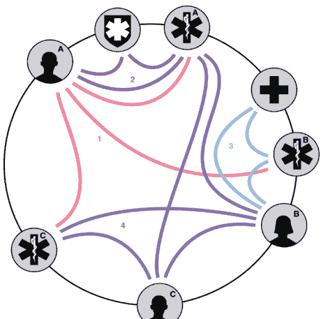

来源：MedRec。
图 22. 许多相互联系。

然而，医疗保健的一个主要问题是领域之间缺乏互操作性。事实证明，要解锁和共享数据是困难的。每个 ECD 的核心是保证隐私和安全。目标是通过 ECD 或 EHR 向客户提供其自身的数据。MIT 媒体实验室为此目的开发了 MedRec 项目。客户需要与不同的医疗专业人员和护理提供者打交道，他们彼此也有联系，如图 22 所示。

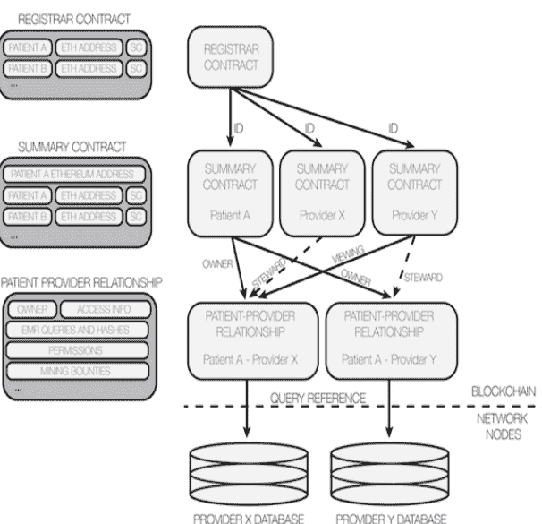

## 图 23. MedRec 的三个合同。

因此，客户（及其非正式照顾者）连接到不同的护理提供者。MedRec 提供了社会需求与技术解决方案的结合。MedRec 的首个实现是使用以太坊区块链开发的。智能合约系统确保客户和护理提供者之间的连接。MedRec 不存储数据，而是对元数据进行编码，使客户能够安全地在不同领域访问护理数据。元数据包含关于所有权、数据释放和请求数据完整性的信息。MedRec 2.0 正在测试中。智能合约被视为在特定条件下执行特定代码（医疗信息来源）的协议。MedRec 有三种类型的智能合约，另见图 23。

- 注册合同将参与方（客户、护理提供者、健康保险商）与其在区块链上记录的身份绑定。只有注册方可以添加信息。

- 摘要合同提供不同方之间关系的洞察。它提供对客户护理提供者合同的引用：系统中不同节点的当前和过去连接。这些关系的接受或删除由客户决定。系统中的每个参与者都可以找到与其他参与者关系的摘要。联系的接受或删除由客户检查。

- 客户-护理提供者关系合同连接系统中的两个节点，其中一个节点为另一个节点记录医疗数据。

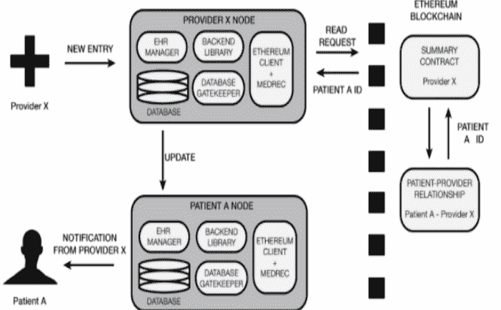

来源：MedRec。

图 24. 从访问请求到医疗专业人员的消息。

MedRec 在私有区块链中工作：一个可靠且经过验证的节点的私有对等网络。为了限制与隐私相关的风险，正在采用以下方法。护理提供者提交访问请求。电子健康管理器通过数据库和 MedRec 确保更新。区块链创建摘要合同并识别患者。完成整个流程后，患者收到来自医疗专业人员的消息，如图 24 所示。

### 实现良好衔接

近年来，例如 Landelijk Schakelpunt（“国家交换点”）的发展主要集中在治愈性护理上。与长期护理提供者和社会领域的连接仍然复杂。例如，全科医生仍然表示，电子信息交换与居家护理、社区护理、养老院和社会支持几乎无法以标准化的方式进行，尽管他们希望这样做。

虽然数据越来越多地以数字形式记录，但护士和照顾者仍然无法充分利用数字记录的好处。数据存储在独立的系统中，也并非一目了然。结果，系统之间没有交换


护士还需要进行额外的登记。并且在客户转移时，他们仍需手动重新输入数据。此外，护理交接经常不完整。因此，护理交接是护理过程中脆弱的环节。这给客户的护理带来了风险。

区块链为护理信息交换提供了一种新模式。这减少了各护理系统当前的碎片化，并能更好地查看护理干预的结果。然而，使用连接设备也意味着数据安全方面的风险不断增加。

为了改善护士和护理人员之间交接的质量，Informatieberaad Zorg（“医疗信息委员会”）制定了护理交接的信息标准：eOverdracht（“eTransfer”）。这是一系列协议，旨在确保护理信息能以适当质量从一个护理机构转移到另一个护理机构。其目的是提高护理交接中信息的质量和连续性。

## 互操作性路线图

医疗领域的互操作性，是指让大量医疗生态系统能够轻松协作，而无需生态系统内用户和提供者付出不必要的努力（Nichol 2018: 81）。区块链是实现这一目标的明显技术选择。

医疗ICT的未来在于基于语言统一的互操作性可能性。这样，信息可以共享：例如，以电子客户档案（ECD）、电子健康记录（EHR）或个人健康环境（PHE）的形式。区块链是实现这一目标的明显技术选择。

荷兰医疗系统的互操作性仍然有限。因此，区块链可以以多种方式确保互操作性的提升。实现全国互操作性的路线图（区块链研究院）包含以下步骤：

- 建立安全的网络结构
- 启用所有参与者的可验证身份和身份验证
- 清晰表示关于访问ECD的授权

### 步骤1：建立安全的网络结构

设计良好的信息架构的特点是，与组织各级的所有相关方达成协议，这就是为什么我们讨论了五层模型。如果内部架构设计良好，可以在自主组织之间（如专科医疗机构、医院、全科医生和患者）实现互操作性。区块链的应用可能性已经在关于Mijn Zorg Log的产妇护理案例中描述。区块链交易过程如下：

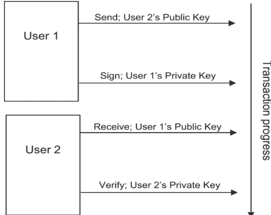

来源：Vazirani et al. npj Digital Medicine 3, 2020.

图25. 区块链交易。

由于能够使用智能合约，区块链适用于医疗领域。通过存储护理记录索引，可以通过区块链在当前独立系统之间建立一定程度的互操作性。客户与专业人员之间的交互记录在智能合约中，临时访问可以由用户创建并传递给医疗提供者或健康保险商的代币来保证。

### 步骤2：启用可验证的身份和身份验证

数据验证和参与者身份验证解决了大部分数据共享问题。在区块链上管理护理数据使客户能够掌控自己的数据。使用智能合约确保流程的高效自动化：例如，客户在开始新的医患关系时会提前收到客户病史问卷（MedRec 2020）。

医疗专业人员在护理交接过程中电子交换信息。InZicht计划专注于通过家庭护理与医院、疗养院或残疾人护理之间的交换来提供长期护理。该计划的目的是安全且明确地加速电子数据交换，以便护士和护理人员可以数字化地交换和重用与其相关的护理数据。

### 步骤3：清晰表示授权

互操作性取决于客户的控制能力。客户可以通过其EHR或ECD完全访问数据。仍存在外部方可访问其数据的可能性。这可以通过使用“许可型”区块链（见第1.4章）来解决。这种方法限制了谁可以执行智能合约。

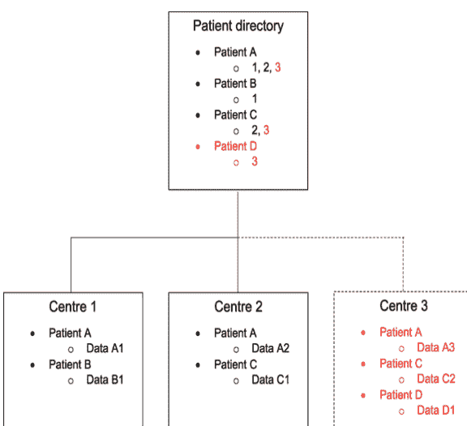

来源：Vazirani et al. npj Digital Medicine 3, 2020.

图26. 独立护理提供者的连接。

由于互操作性需要进一步发展，重要的是要考虑不同分类账如何相互作用。当个别医疗提供者使用区块链的API（应用程序编程接口）引入自己的分类账系统时，他们可以连接到更广泛的基于区块链的医疗提供者网络。图26对此进行了说明（来源：https://www.nature.com/articles/s41746-019-0211-0）。

图中编号为1、2和3的每个患者列表都代表一个区块链分类账。客户病例登记表记录所有去标识化的客户数据。病例登记表将数据连接到客户有医疗交互的各个中心。各中心记录包含数据访问规则和更详细元数据（如数据A1）的自身数据。

### 区块链对ECD的更多影响

通过为ECD使用区块链，由于安全性以高效方式进行管理，成本得以降低。数据传输过程成本更低，因为数据立即可用。这对于慢性病患者尤为重要，因为他们的数据可同时为多个领域所用。

在区块链网络中的每台计算机上存储所有医疗记录在速度和存储容量方面都不实际。可以使用区块链作为一种访问数据的方法，通过系统地编制所有健康记录的目录来实现。每次医疗专业人员或客户向ECD添加数据时，元数据中心中的引用会传递给区块链，而数据则安全地存储在云中。一个人的完整健康记录索引连同相关元数据存储在一个位置。带有安全*索引*的区块链授权个人访问云中的数据（Vazirani, O'Donoghue and D. Bridle 2019）。

医疗数据的存储和共享对于实现更好的医疗结果至关重要。这通过广泛采用互操作性并从而降低行政成本来加强。

下一个案例描述了技术发展、设计原则和互操作性融合的一个示例。GG（Gezondheid en Gedrag（“健康与行为”）应用程序）对客户的发展提供反馈，并让医疗专业人员能够访问数据并了解发展进展情况。

## 案例5：德芬特格罗泽尔达姆借助应用程序进行创新

荷兰在健康和护理领域正在经历思想和行动的深刻转型。重点正在从关注人们的问题和照顾人们，转向人们的功能和参与，以便居民能够体验更好的健康并更多地参与，而护理和福利系统变得更有效、更便宜。这种转型需要新的方法、服务和技术。

德芬特市正处于这一转型的前沿。德芬特是荷兰未来健康生态系统正在开发的四个GROZzerdam地点之一。德芬特GROZZerdam是一个创新社区，其中居民、专业人士、组织、公司、教育和研究机构、市政当局、健康保险商和国家系统各方携手合作，以实现这一转型。

重点在于在多个地区开展创新工作方式，其中一项成果是减少人与人之间的健康不平等。社区居民正在开展生活方式改变并参与新的网络结构。它还衡量生活方式改变和健康收益，为新的干预措施收集健康数据。

### 使用GG应用提升您的功能

德芬特GROZZerdam基于“从疾病和护理到健康和行为”的愿景和方法开展工作。其中心是价值观、目标和行动


of residents. Professionals connect with those and stimulate development among residents. Functioning is a central concept in this.

The GG app is an instrument developed by Beterry Institute, which is further developed in Deventer on the instructions of the health insurer and the municipality. It is a supportive _e-health tool_ that simply activates residents to formulate goals and come up with actions, so that the resident improves his own functioning and that records the development that the resident is experiencing. An instrument that professionals use in the interaction with residents.

With the information he enters in the GG app, the resident receives feedback on his development and the professional receives (if the resident gives permission) information and registration of the resident’s process. By focusing on residents, new forms of care and services are created that contribute to a new organisation of care and well-being.

At the ‘back side’, resident information is classified in the International Classification of Functioning, an international standard developed by the WHO for displaying and registering health. With the help of this classification, exchange with social and medical registration systems is possible.

## GG 应用程序与区块链

Ownership of the resident of his own data is an important starting point of the GG app. Blockchain is essentially a technology that guarantees the ownership and uniqueness of the user. The aim is to organise the underlying system of the GG app on the basis of blockchain. An important point of attention is safeguarding the privacy of the users.


Source: Health Valley.

Figure 27. The first four GROZzerdam regional field labs have started.

Starting in September 2020, the GG app has been further developed in an interactive process with users. Within the ‘_Wijk voor elkaar_’ (‘Neighbourhood for each other’) initiative, residents and professionals will use the GG app on a small scale – with thirty to seventy users. There is a link to the Wijk voor elkaar registration system. The feedback on the use of the GG app provides the information for the development of the next version, after which the use can be further scaled up.

Synchronous to that process, Saxion students developed a basic model for blockchain under the GG app, including further explorations in the area of privacy, data exchange between residents and professionals, etc. The results were presented on the day blockchain & Care on February 4, 2021 in the Saxion Blockchain Week.

## 政策结论

In this book, we have demonstrated how blockchain can contribute to addressing the major healthcare issues. These include recording medical data (security, interoperability, accessibility), recording the results of medical research, setting up care chains and ensuring the quality of the medicines.

In current healthcare practice, avoidable errors are still made as a result of the lack of information. In addition, time is wasted on double healthcare activities. Therefore, the electronic exchange of healthcare information between healthcare professionals and healthcare institutions should become the standard (Gateway Review 2020). Electronic data exchange takes place in a very complex environment.

Important developments for the implementation of blockchain include: increasing the agility of organisations and professionals (including due to COVID-19), a sense of urgency to continue digitisation, artificial intelligence focused on early diagnosis and self-diagnosis, standardisation of healthcare activities, and lifestyle interventions. Among other things, COVID-19 needs to accelerate the provision of good information. Blockchain contributes to clear, validated and reliable recording.

So while Blockchain is at an early stage, we believe it will converge with Artificial Intelligence and the Internet of Things (see Chapter 3). This makes a fundamentally different way of organising care processes possible (RVS 2019).

## Porter’s Agenda

In the thinking of Porter (Porter and Teisberg 2006), it is of great importance that an IT platform facilitates the movement. Despite much effort, there is still limited information exchange and limited availability of reliable outcome measures. Interoperability is of great importance: using the same definitions and setting IT and data standards.

Porter describes this process from a healthcare perspective. Value-driven care is based on the overall care process: consultation, interventions, aftercare and result (Jeninga and Woldendorp 2019). Measuring and developing the results are central to this. Only by measuring results and having an overview of their costs based on a care chain will the right investments be made. The outcomes of the integrated care process must be recorded safely and unambiguously.

The agenda of Porter (Porter and Teisberg 2006) thus indicates the end goal (Woldendorp and Hoekman 2019): an integrated organisation of care within which relevant outcomes for clients are achieved, where costs and outcomes are known and continuously improved, and in which an integral funding takes place on the basis of the entire care path and the delivered end result, as can be seen in Figure 28.

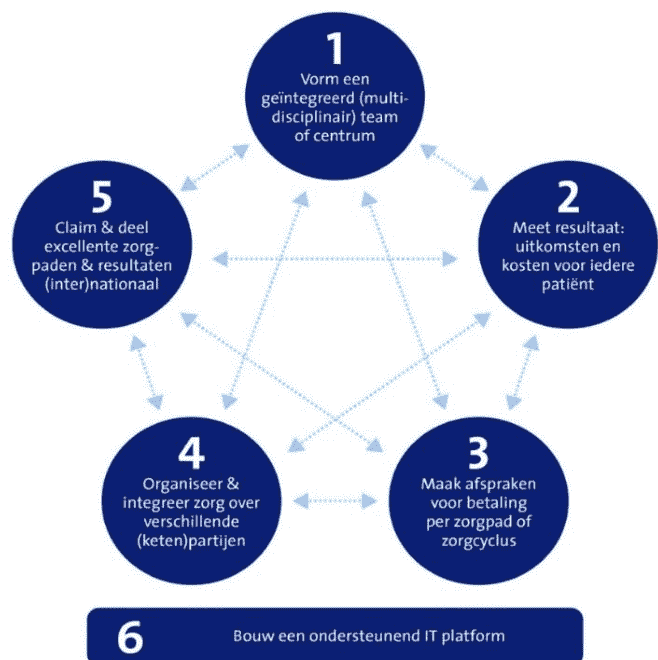

Figure 28. Six steps towards an integrated organisation.

## 区块链的影响

The introduction of Blockchain is a fundamental change: information is already shared before an interaction between client and healthcare professional takes place. This strengthens communication and the interaction based on it in terms of quality. That leads in turn to a more effective treatment process. Collaboration and coordination between healthcare professionals is greatly improved. For example, in chronic care where clients usually deal with multiple healthcare professionals, cost savings and quality gains can be achieved.

Blockchain can help reduce costs and improve the quality of care. blockchain can also ensure flexibility, interconnection, accountability and protection in accessing those data that are necessary for the provision of good care. Through the application of blockchain, standardisation and transparency can be merged.

The use of Blockchain technology in healthcare makes the difference in data management. The technology will make sharing medical data more effective, efficient, secure and more transparent for all healthcare stakeholders. A network of healthcare institutions can exist without having a patient's personal data.

Blockchain technology makes it possible to work more efficiently and transparently, thereby creating new forms of collaboration. The starting point in healthcare is to arrive at a user-friendly design. blockchain offers a technological solution for working with a shared infrastructure. Advantages of working with blockchain are then:

- The blockchain remains unchangeable and can be traced so that clients can easily send information to healthcare professionals.
- A medical record that is added remains safe.
- Healthcare professionals who want to view data can obtain permission from the client via the blockchain.

The advantage of working with blockchain is that nobody is the exclusive owner, because there is a far-reaching form of decentralisation, but also that the data is recorded once (and cannot be changed), and nobody can do anything to the data. That makes it transparent. Decentralisation is guaranteed by the fact that the network consists of different computers, all of which have a copy of the data. In the event of an adjustment, everyone is informed: no one is the only one who has data available. One of the most important advantages of blockchain is effective and efficient control over healthcare data.

Blockchain technology can fundamentally change the following nine areas of healthcare:

- medical device data integration
- asset management
- client dossiers
- clinical trials
- safety monitoring with regard to side effects
- medication compliance
- regulatory compliance


- 8. 发票和索赔

- 9. 合同管理

就政策而言，需要注意的是，区块链提供了很多潜在优势。之所以说是潜在，是因为这些应用可能性尚未大规模综合使用，也尚未得到证明。原因之一是并非在技术上一切皆有可能，因此需要进行实验来使这项技术更加稳定。应对这一点的方法之一是制定可能的场景，重点关注去中心化结构的形成。

通过数字化方式支持医疗专业人员在其工作环境中的工作，专业层面上有创新空间。因此，一个运行良好的底层数字基础设施是保持医疗质量的同时，在区域内实现有效、高效协作的前提。平台技术的应用可以在地方、地区和国家层面创建数字和物理网络。这不仅关乎患者周围的网络，也关乎医疗组织内外医疗专业人员之间的网络。

这意味着数据越来越影响护理流程的组织。“价值驱动的护理”模型表明，护理流程的目的是为利益相关者（主要是患者）创造价值。对于医疗和社会领域，这意味着：围绕目标群体开展专业紧密合作、衡量干预措施的结果、就围绕目标群体的活动综合融资达成协议（包括在 WMO、Zwv 和 Wlz 中）、建立链条并共享测量结果。我们目前看到，（过）少的信息交换，无法从过渡中开展联合知识发展。

## 区块链的应用

通过在客户附近组织信息提供并让他掌握信息控制权，创建了一种新的医疗设施。它启动了一个患者旅程。在每个步骤都会提供正确信息：从邀请就诊到发布结果。因此，患者旅程是指客户（护理）或患者（治疗）在医疗组织中所走的旅程，与组织为实现这一目标的活动相关联。

区块链非常适合促进这样的患者旅程。可追溯性、响应性和信任问题仍然是更高效护理链条的障碍。区块链消除这些限制的能力可以通过降低低效率并创造新机会来释放价值。参与合作的各方越多，区块链在提高相互透明度和信任方面就越有价值。

区块链还可用于：

- * 数据交换（例如，在医疗服务提供者与健康保险公司之间）
- * 患者访问其数据的权限
- * 费用索赔的发送和支付
- * 记录已发生的（例如）医疗操作的证据（因为患者已通过区块链确认这些操作已发生）

区块链还可用于药品的可追溯性。不仅用于处方的可追溯性，也用于假药的可追溯性。

区块链还可以在身份验证方面发挥作用，例如在个人健康环境（PHE）中。荷兰卫生、福利与体育部已要求医疗办事处在其医疗采购政策中更加关注创新。对于健康保险公司而言，PHE 系统的引入导致信息的汇总。健康保险公司正在设计一个名为 Digitale Zorg（“数字护理”）的知识中心。在 PHE 与医疗服务提供者之间交换医疗数据时，身份验证（证明你就是你声称的那个人）必须在正确的层级进行至关重要。区块链技术已经使此成为可能。

区块链还使得将社会领域和护理领域收集的信息汇集在一起成为可能。

区块链目前更多是在理论层面实施而非实践层面。区块链在医疗领域能够发挥作用的法律、组织、社会和技术前提条件需要进一步阐明。

## 紧密协作

区块链关乎构建共识。如果有更多各方参与，共识就会更加强大。这意味着区块链可以为塑造价值驱动的护理做出重要贡献。

参与合作的各方越多，区块链在提高相互透明度和信任方面就越有价值。区块链为不同行为者之间的协作提供了新机会。我们已经证明，借助区块链技术，可以构建一个更可持续、更安全、更可靠的数字基础设施（Veuger 2018b 和 2019d）。一个例子是网络组织 Microbiome Centre 所做的工作（参见第 2 章后的案例）。正因使用区块链可能意味着现有流程、数据交换和关系会（将会）发生变化，因此对控制的关注很重要。

医疗网络是一组医疗服务提供者之间协调合作的方式，旨在改善（部分）人群的健康结局。医疗网络由为同一人（一名或多名患有某种疾病的人）提供服务的各种医疗服务提供者和护理人员组成。特定疾病网络涉及多个独立组织/个人之间的长期连接，他们围绕患者提供护理并共享经验，需要不断致力于改善护理质量，其目的是改善患有特定疾病的人的生活质量（ParkinsonNet 2019）。

协作的重要原因有（KPMG 2019）：

- 跨领域提供护理
- 提供不同形式的护理
- 智能部署共享员工
- 开发联合创新
- 交换信息

这样的医疗格局需要，除其他外，一个安全的数据基础设施，使客户和医疗专业人员能够在区域内部和之间交换（医疗）数据，以及支持期望变化的法律法规。

通过将责任放在专业人员身上，可以围绕超越自身组织边界的工作流程和链条形成组织形式。因为信息可用，专业人员可以独立得出：(共享)资源的分配、自身资源的问责、有效性和效率的映射以及运营计划的制定。

## 保障隐私

在医疗领域，保护客户隐私是一个关键问题。医疗数据不得泄露至关重要。只有在患者许可下，才能将护理信息披露给另一个人。

我们的出发点是，通过应用区块链技术，患者可以选择适合他们的护理。但是，患者如何在复杂性不断增加的领域中做到这一点呢？这种复杂性是由许多疾病涉及大量护理领域和护理服务提供者这一事实造成的。通过在客户附近组织信息提供并让他掌握信息控制权，可以创建一种新的医疗设施。

特别是在对多重护理需求人群的护理中，拥有不同专业背景的专业人员经常需要跨领域合作，他们感到对法规和专业守则的支持不足。个别专业守则在隐私和职业保密方面设定了自己的标准，这可能阻碍合作。何时可以或不可以共享信息，以及在客户的最大利益中这种共享有多必要，往往并不清楚。那么，问题就在于哪些标准或规则具有主导地位。

区块链使客户的地位发生根本重新校准：完全掌控自己的数据。在荷兰语境下，这场运动旨在让客户和患者在个人健康环境（PHE）中管理自己的信息。只有当信息被标准化时，这个系统才能发挥作用，以加强专业人员之间以及客户与专业人员之间的沟通。客户决定哪些信息对哪些医疗专业人员可用。

## 区块链用于电子健康记录

信息和 ICT 系统通常按组织分割。医疗服务提供者用于保存患者治疗数据的 ICT 系统通常由其自身组织购买和管理。例如，医院每个机构都在电子健康记录上花费大量资金。在其他领域，许多医疗组织也依赖于自身数字文件的数字化和电子健康浪潮。这也是每个医疗服务提供者出于法律义务必须维护自己的健康记录，以对良好护理和自身行为负责的合乎逻辑的结果。此外，根据法律规定的职业保密义务，医疗服务提供者有责任以确保只有授权人员才能访问的方式保护此文件。

虽然医疗机构内的文件对客户越来越可访问，并且可以在组织内与相关医疗服务提供者共享，但跨组织边界连接这些系统中的信息仍然很困难（RVS 2017）。患者档案属于个别护理和援助提供者，而不属于患者本人（RVS 2017）。因此，人们对自己的数据（分散在不同医疗服务提供者的个别文件中）的访问权不足，缺乏足够的概览。

## 监督

内部监督必须监控社会发展及其对自身组织的重要性。这当然适用于技术创新。在其指南《De rol van de raad van toezicht bij innovatie - Een brede benadering van technische innovatie》（“监事会在创新中的作用——技术创新的广泛方法”）（NVTZ 2020）中，荷兰护理和福利监督者协会（Nederlandse Vereniging van Toezichthouders in Zorg en Welzijn；简称 NVTZ）描述了五


在该语境下相关的主题，即：对健康观念的转变、伦理问题、在不断变化的力量场中组织、组织内的人员以及谨慎的数据管理。

## 变革策略

为了实现有效的实施，审查团队（Gateway Review Report 2020）建议制定清晰（调整后的）变革策略，其中相关各方（多学科社区）参与并拥有相同的基本信息。标准化既是医疗专业人员也是客户的指导原则。荷兰卫生、福利与体育部是实现电子消息传递的主导方。与其他系统的对接易于实现至关重要。

实用试验设计的指导原则是回答以下六个问题：

- 区块链应支持哪些流程？
- 区块链的应用规模有多大？
- 谁使用区块链，这些不同方的角色（权利和义务）是什么，谁是管理员？
- 这在事先有多大程度明确？
- 事先设置权限的程度如何？
- 哪些实际应用适用于各种角色和授权？

在第5章中，我们讨论了产科护理方面的经验。然而，这些经验过于有限，无法得出明确的建议。这六个问题构成了制定变革策略的框架。

通过区块链技术的数字化有助于打造透明、高效和有效的行政流程。在实用试验中，由于公共服务缺乏国家数字身份，使用了单独的身份服务。此类服务对在医疗保健中实施区块链至关重要。

医疗保健是一个数字岛屿帝国。区块链可以在患者及其数据之间的新关系中发挥重要作用，例如通过更大程度的数据交换透明度和控制。使用区块链，信息（匿名化）可以不可否认地实时与不同各方共享。因此，区块链可以支持医疗保健流程，加快流程并使其对人为错误的敏感度降低。该技术有助于使医疗保健更安全、更好、更易获得、更便宜。

荷兰医疗保健研究院（Zorginstituut）已制定一项行动计划，以指导数字化护理的部署。这涉及质量标准的开发和应用，以及绘制跨领域有效的有前景创新的图谱。

荷兰医疗保健管理局（NZA）已表示，报销数字化护理的可能性必须扩大。NZa明确指出，保险公司可以扮演更主动的角色，特别是针对其被保险人。NZa认为，保险公司可以利用其与被保险方的沟通渠道，就数字应用程序在医疗保健流程和预防中的使用进行沟通（VWS进度报告2020）。

核心在于，个体公民处于新护理模式的核心。区块链使护理信息交换的新模式成为可能。这减少了各种护理系统中当前的碎片化，并能更好地了解护理干预的结果。

## 参考文献

Aa, A. van der 和 T. Konijn (2001)，Ketens, ketenregisseurs en ketenontwikkeling。在网络中开发透明且灵活的合作伙伴关系。乌特勒支：Lemma。[链、链式总监和链式发展。在网络中开发透明且灵活的合作伙伴关系。]

Adler-Milstein, J. 和 E. Pfeifer (2017)，信息封锁：它是否正在发生，哪些政策策略可以解决它？https://www.ncbi.nlm.nih.gov/pmc/articles/PMC5339397/。

Aminubaba, M., A. Yusuf, A. Ahmad 和 L. Maijama (2014)，作为云数据库安全解决方案的加密算法性能分析。计算机应用国际期刊 99(14):24-31，2014年8月。

Andersson 等编 (2018)，管理数字化转型。斯德哥尔摩：斯德哥尔摩经济学院研究所。

Arbesman, S. (2017)，过度复杂化。技术处于理解的极限。纽约：Portfolio/Penguin。

Baldwin, R. (2019)，全球动荡。全球化、机器人和未来的工作。伦敦：Weidenfeld & Nicolson。

Bargar, D. (2016)，区块链经济学：对其工程和交易服务市场的研究。硕士论文。克莱姆森大学。

Berenschot (2019)，医疗保健中区块链的可行治理。明智应用和开发的框架。最终报告。乌特勒支。[迈向医疗保健中区块链的可行治理。明智应用和开发的框架]

区块链研究所，https://www.blockchainresearchinstitute.org/。

Bones, C., J. Hammersley 和 N. Shaw (2019)，优化数字战略。如何做出明智的战术决策以实现增长。伦敦：KoganPage。

Bradshaw, D.J. (2018)，技术颠覆与区块链：了解认知水平和潜在的社会影响。硕士论文。爱尔兰国家学院。

Brynjolfsson, E. 和 A. McAfee (2014)，_第二个机器时代。数字革命将如何改变我们的生活_。蒂尔特：Lannoo。

Capgemini (2017)，_区块链：医疗保健行业视角_。

CBInsights (2020)，_2020年区块链报告_。

Consensys (2018)，_企业以太坊远不止分布式账本技术的5个原因_。https://media.consensys.net/5-reasons-why-enterprise-ethereum-is-so-much-more-than-a-distributed-ledger-technology-c9a89db82cb5。

Corten, P. A. (2018)，_政府服务中基于区块链的智能合约实现_。硕士论文。代尔夫特：代尔夫特理工大学。

Davenport, T. H. (2019)，_AI优势。如何利用人工智能革命_。剑桥，马萨诸塞州：麻省理工学院出版社。

Deloitte (2020)，_2040年的医疗补助。五大重大变化_。https://www2.deloitte.com/us/en/insights/industry/public-sector/the-future-of-medicaid.html。

Diamandis, P. H. 和 S. Kotler (2020)，_未来比你想象的更快。融合技术如何改变商业、行业和我们的生活_。纽约：西蒙与舒斯特。

DSCSA (2020)，_药品供应链安全法案(DSCSA)_。https://www.fda.gov/drugs/drug-supply-chain-integrity/drug-supply-chain-security-act-dscsa。

Ford, M. (2018)，_智能架构师。构建AI的人士讲述AI的真相_。伯明翰：Packt。

Francisconi, M. (2017)，_区块链技术在港口物流中应用的探索性研究_。硕士论文。代尔夫特：代尔夫特理工大学。

Fujitsu (2019)，_富士通检测到企业区块链系统的13种潜在风险_。https://www.fujitsu.com/cn/en/about/resources/news/press-releases/2019/frdc-0222.html。

Gateway Review (2020)，_医疗保健中的电子数据交换。令人兴奋的话题_。报告（Gateway编号2020-RO-14）。[医疗保健中的电子数据交换。令人兴奋的话题。]

Global Data (2020)，_医疗保健中的区块链：主题研究_。https://store.globaldata.com/report/gdhcht045--blockchain-in-health-care-thematicresearch/?utm_source=email&utm_medium=pr&utm_campaign=200117a_gd_ph_pr_Blockchain_healthcare_thematic&utm_noovride=1。

Groot, E. de 和 M. Rosman (2019)，_敢。数字时代成功创新者的心态_。阿姆斯特丹：阿姆斯特丹出版社。

Gupta, S. (2018)，_推动数字战略。重新想象您的业务指南_。波士顿，马萨诸塞州：哈佛商业评论出版社。

Health Valley (2020)，_首批四个地区实验室“GROZzerdammen”启动_。https://www.healthvalley.nl/actueel/netwerk/vier-regio-fieldlabs-grozzerdammen-van-start。[首批四个地区实验室“GROZzerdammen”启动。]

Heuvel, B. van den (2014)，Netwerkzorg。针对复杂、长期护理和支持需求人员的新组织概念。鲁汶：Acco。[网络护理。针对复杂、长期护理和支持需求人员的新组织概念。]

Hoonstra, H. 和 W. van Lieshout (2019)，数字智能。在数字社会中您需要知道、学习和做什么。阿姆斯特丹：Business Contact。

Huizinga, R. (2018)，Blockchange！如何在加密经济中生存。TROI Studio。[区块链变革！如何在加密经济中生存。]

Iansiti, M. 和 K. R. Lakhani (2020)，AI时代的竞争。当算法和网络运行世界时的战略与领导力。波士顿：哈佛商业评论出版社。

Idenburg, P. J. 和 M. Philipppens (2018)，诊断转型。医疗保健领域开拓者的工具包。BeBright。[转型诊断。医疗保健领域开拓者的工具包。]

Jeninga, A. 和 H. Woldendorp (2019)，这就是价值驱动的护理。从系统视角进行变革。阿姆斯特丹：SWP。[这就是价值驱动的护理。从系统视角进行变革。]

Kennisgroep Ketelinformatiemanagement (2019)，区块链保证。区块链：对审计师来说既是机遇又是威胁。Norea。

KPMG (2019)，谁与谁合作。互联的医疗保健格局。KPMG。[谁与谁合作。互联的医疗保健格局。]

Laurence, T. (2019)，区块链技术导论。21世纪区块链技术的多种面貌。Van Haren Publishing。

Ledger Insights (2018)，R3的Corda主导保险行业。https://www.ledgerinsights.com/r3-corda-blockchain-insurance/。

Ledger Leopard (2019)，MicroBiome如何消除大量文书工作。https://ledgerleopard.com/how-microbiome-eliminated-mountains-of-paperwork/。

Liezenberg, C., D. Lycklama 和 S. Nijland (2018)，万物皆交易。关于数据、信任以及交易互联网的前所未有的机遇。蒂尔：Lannoo。[万物皆交易。关于数据、信任以及交易互联网的前所未有的机遇。]

Lim, D. (2020)，区块链解码。利用区块链技术进行业务转型。新加坡：Candid Creation Publishing。

Lim, C. L. 和 A. Janse (2020)，区块链基础书。阿姆斯特丹：De Boekdrukker。

Linn, L. A. 和 M. B. Koo (2019)，面向健康数据的区块链及其在健康IT和医疗保健相关研究中的潜在应用。Dragonchain，博客，4月30日。

Linn, L. A. 和 M. B. Koo (2016)，面向健康数据的区块链及其在健康IT和医疗保健相关研究中的潜在应用。https://www.healthit.gov/sites/default/files/11-74-ablockchainforhealthcare.pdf。


- Man, A. P., P. Koene and M. Ars (2019), 如何幸存于组织变革。敏捷当代运营模式、平台与生态系统指南。阿姆斯特丹：BISPublishers。

- Marcus, G. and E. Davis (2019), 重启人工智能。构建我们可信赖的人工智能。纽约：Pantheon Books。

- McAfee, A. and E. Brynjolfsson (2017), 机器、平台、群众。驾驭我们的数字未来。纽约：W.W. Norton。

- Medicalchain，《Medicalchain 内部通讯》第 21 期。https://medicalchain.com/en/inside-medicalchain-issue-21/。

- MedRec，https://medrec.media.mit.edu/technical/。

- Megchelen, J. (2020), 寻找区块链：真理还是疯狂。https://www.computable.nl/artikel/blogs/security/6860957/5260614/op-zoek-naar-blockchain-waarheid-of-waanzin.html。[寻找区块链：真理还是疯狂。]

- Mohammad, A. F. (2019), 使用许可区块链“commledger”的决策分析。学位论文。格兰德福克斯：北达科他大学。

- Nictiz (2017), 医疗保健中的区块链。[医疗保健中的区块链]

- Odyssey (2020)，https://www.odyssey.org/。

- ParkinsonNet (2019), 疾病特定网络指南。[疾病特定网络指南。]

- Pearl, J. and D. MacKenzie (2018), 《因果之书：因果与效应的新科学》。伦敦：Allen Lane。

- Petitjean, F. (2019), Fujitsu 推出新的手掌识别。https://www.computable.nl/artikel/nieuws/security/6765432/250449/fujitsu-komt-met-nieuwe-handpalmididentificatie.html。[富士通推出新的手掌识别。]

- Porter, M. E. and E. O. Teisberg (2006), 重新定义医疗保健。基于结果的价值导向竞争。马萨诸塞州波士顿：哈佛商业评论出版社。

- 荷兰公共卫生与社会委员会 (2017), 自行把握。为有多重问题的人提供护理与支持。海牙。[自行把握。为有多重问题的人提供护理与支持。]

- 荷兰公共卫生与社会委员会 (2019), 有价值的医疗技术——关于医疗保健中人工智能的机会与风险的探索性建议。海牙。[有价值的医疗技术——关于医疗保健中人工智能的机会与风险的探索性建议。]

- Rabobank，应用区块链：有经验的企业家的建议。https://www.rabobank.nl/bedrijven/groei/innoveren/blockchain-technologie/。[应用区块链：有经验的企业家的建议。]

- Radboud UMC，REshape 中心。医疗保健中的区块链。http://radboudreshapecenter.com/portfolio/blockchain-in-healthcare/。

- 拉滕瑙研究所 (2018), 有价值的数字化。地方行政官如何从公众视角参与“技术游戏”。海牙。[有价值的数字化。地方行政官如何从公众视角参与“技术游戏”。]

- Russell, S. (2019), 人类兼容。人工智能与控制问题。纽约：Viking。

- Sacolick, I. (2017), 推动数字化。技术驱动的商业转型领导者指南。纽约：Amacom。

- Sahota, N. and M. Ashley (2019), 掌控人工智能革命。释放您的人工智能战略以颠覆竞争对手。纽约：McGrawHill。

- Serrurier Schepper, M. and T. Hiddink (2019), 人工智能实战。构思并实施 AI 解决方案。库伦博尔赫：Van Duuren Management。[构思并实施 AI 解决方案。]

- Shena, G. (2017), 通过区块链模拟进行区块链可扩展性分析。学位论文。拉斯维加斯：内华达大学。

- Sidu, I. (2016), 数字革命。互联互通的数字创新如何改变您的行业、公司和职业。奥尔德塔潘：Pearson Education。

- Tapscott, D. and A. Tapscott (2018), 区块链革命。比特币和其他加密货币背后的技术如何改变世界。纽约：Portfolio/Penguin。

- Taylor, J. (2020), 云存储比较：四大最快云存储。www.imobie.com/cloud-manager/fastest-cloud-storage.htm。

- Tilooby, A. (2018), 区块链技术对金融交易的影响。学位论文。亚特兰大：佐治亚州立大学。

- Topicus (2019), IT 的未来。2019 年第 2 季度趋势报告。IT 决策者关于区块链：荷兰市场数据。[IT 的未来。2019 年第 2 季度趋势报告。IT 决策者关于区块链：荷兰市场数据。]

- Topol, E. (2019), 深度医疗。人工智能如何让医疗重拾人性。纽约：Basic Books。

- Vasarhelyi (2017), 审计技术三部曲：审计 4.0、区块链与审计应用。学位论文。纽瓦克罗格斯：新泽西州立大学。

- Vazirani et al. (2020), 用于高效医疗记录管理的区块链载体。《数字医学》3，2020。https://www.nature.com/articles/s41746-019-0211-0。

- Veuger, J. (2020a), 独家编辑 区块链技术与应用 II。同行评审。纽约：Nova Science Publishers Inc.，美国。ISBN 978-1-53617-931-6。https://novapublishers.com/shop/blockchain-technology-and-applications-ii/。

- Veuger, J. (2020b), 区块链融合。2020 年 1 月 17 日的专题讲座（84 页）。德芬特：萨克逊应用科学大学。https://www.saxion.nl/binaries/content/assets/onderzoek/meer-onderzoek/Blockchain/Blockchain-convergentie-jan-veuger-2020.pdf。[区块链融合。]

- Veuger, J. (2019), 独家编辑 区块链技术与应用。同行评审（262 页）Nova Science Publishers Inc.，纽约，美国。2019 年 5 月。ISBN 978-1-53615-288-3。https://novapublishers.com/shop/blockchain-technology-and-applications/。书评：https://novapublishers.com/shop/blockchain-technology-and-applications/。

- Veuger, J. and G. Garritsen (2020), 区块链中的医疗保健治理设计。《应用科学国际期刊》，第 3 卷，第 2 期，2020 年 6 月。https://ji.ideasspread.org/index.php/ijas/article/view/601/550。

- Veuger, J. and G. H. Lap (2020), 医疗保健中的区块链。《商业研究档案杂志》，第 8 卷，第 6 期，202-227 页。https://journals.scholarpublishing.org/index.php/ABR/article/view/8490。

- Vishnoi, M. (2020), MedFabric4Me：基于区块链的以患者为中心的电子健康记录系统。学位论文，亚利桑那州立大学，美国。由 Dragan Boscovic 教授、Kasim Selcuk Candan 和 Maria Grando 批准。

- VNG (2017), 2017 年市政区块链试点。海牙。[2017 年市政区块链试点。]

- VNG (2019), 区块链。政府实用指南。海牙。[区块链。政府实用指南。]

- VWS (2020), 创新与医疗更新进展报告。[创新与医疗更新进展报告。]

- VWS (2020), 创新与医疗更新行动线的进一步说明。[创新与医疗更新行动线的进一步说明。]

- Wachter, R. (2017), 数字化医生。医学计算机时代的希望、炒作与危害。纽约：McGrawHill。

- Wadhwa, S. (2019), 使用区块链的去中心化数字身份管理及其对公共部门的影响。学位论文。都柏林：都柏林商学院。

- Wallin, A. J. (2018), 重新思考医疗保健的数字化转型。技术与机构在服务创新中的作用。阿尔托大学：学位论文。

- Woldendorp, H. and J. Hoekman (2019), 棘手的实践。社会领域的进化论。阿姆斯特丹：SWP。

- 世界卫生组织 (2017), 劣质和伪造医疗产品对公共卫生和社会经济影响的研究。https://www.who.int/medicines/regulation/ssffc/publications/SE_Study_EN.pdf。

- 荷兰医疗保健研究所 (2018), 与 My Care Log 的区块链产科护理实践试验。海牙。https://docplayer.nl/93363076-Praktijkproef-Blockchain-kraamzorg-met-mijn-zorg-log-rapportage.html。[与 My Care Log 的区块链产科护理实践试验。]

- 荷兰医疗保健研究所和 Pels Rijcken (2019), 医疗保健中的区块链与 GDPR 的关系。海牙。[医疗保健中的区块链与 GDPR 的关系。]


# Chapter 3

# 老年护理转型与数字化影响

Harry Woldendorp*
知识合作伙伴 区块链研究小组，
Saxion 应用科学大学，荷兰

## 摘要

互动发生在一个快速转型的背景下。通过技术和数字化，新的护理提供形式正在出现。这可能涉及预测性护理，也涉及客户例如通过平台自我组织，以便对护理过程拥有更多影响力。这是关于技术创新与社会创新之间的联系。技术创新有多个组成部分：家居、园艺和厨房技术，但也包括人工智能的应用可能性。社会创新体现在例如医疗合作社。社会创新以多种方式表达，以实现更多自主权。一个重要部分是客户可以访问自己的健康信息。在政策方面，这是关于解释以需求为导向的管理：基于客户与护理专业人员平等地位的护理组织，客户可以使用相关健康信息。以某种方式相互互动创造了一种生活形式，但也可以有不同的解释。对于两者来说，关键在于找到意义，使不平等的角色导致平等的人。重要元素包括：理解彼此的立场，反思自身立场，提供符合客户愿望和护理专业人员方法的信息，满足非正式照顾者需求的信息提供，促进等价性的资金模型，以及为专业人员处理多样性（监管空间的创新）留出空间。

**关键词**：数字化，转型，老年护理，影响

## 引言

### 个人控制

越来越多的创新和新的医疗保健概念更容易进入（医疗保健）市场（Bakas 2017）。电子健康、家居自动化和机器人领域的创新正在引起关注（Idenburg 和 Van Schaik 2010；Idenburg 和 Van Schaik 2013）。医疗技术和数字化可能性的一个例子可以在斯堪的纳维亚找到（Nies 2019）。丹麦医疗保健系统已彻底数字化。在瑞典，技术和电子健康被视为辅助手段，以便尽可能长时间在家独立生活。芬兰经常使用监测仪器和远程护理。挪威有医疗信息技术战略。

一份最近的报告还表明，大规模使用数字化和医疗技术可能带来更多个人控制、更高的生活质量以及更高效利用稀缺医疗专业人员（Commissie Toekomst Zorg Thuiswonende Ouderen 2020）。

对老年人技术最重要的教训是，在设计、功能、使用、解释、支持和可理解性等所有方面都要“保持简单”；使成本清晰且有条理。使用医疗技术和数字化的最重要前提条件如下（LUMC 2020）：

- 技术、变老和在家更长寿命生活如果从需求侧来看待，能够完美结合。
- 如果技术得到妥善介绍和支持，老年人对其持开放态度。技术的可及性至关重要
- 良好的匹配至关重要，如果技术是对需求的回答，就会产生效果。
- 对（数字）技术引入过程中的支持至关重要。
- 在技术开发和/或实施过程中让用户参与
- 个性化是使用数字化和医疗技术的关键。实施将基于需求（长期使用）以及对个人居住环境个人背景的观察。这对于目标人群通常不熟悉的新技术尤其重要。这需要非正式照顾者的在场。

### 客户和专业人员的互动

护理质量在很大程度上由客户与护理专业人员之间关系的质量决定（RVS 2017）。应给予客户在监控和促进护理质量方面更核心的地位。这可以通过设计护理流程来实现，使客户能够提供正面和负面反馈（RVS 2019b）。RVS 表示，“将客户与护理专业人员之间的护理关系置于中心，会使团结不那么匿名，并导致较少的算计行为和不当使用护理”（2017, 54）。医疗专业人员和客户在《医疗（放宽管制）行动计划》（VWS 2018）中处于核心地位，旨在使医疗更加有效。

客户与专业人员之间的直接互动变得越来越重要。这由数字化（信息提供）和技术（家庭情境中的支持）的影响所促进。在老年护理中，客户与专业人员之间的互动通常从以需求为导向的角度来解读（Van der Kraan 2006）。

### 胜任力的影响

关键问题是，在这些角色转变中，如何加强客户的地位，以及医疗专业人员的专业性在使用技术（硬件）和数字化（软件）时能产生最大价值，这为老年人的自主性和自我依赖创造了机会。对医疗专业人员来说，技术和数字化的影响通常仍然不清楚（SCP 2019b: 78）。

医疗实践将会改变，因此医疗专业人员需要不同的工作方法。然而，老年人和医疗专业人员可能缺乏电子健康和机器人化所需的技能。今天，医疗使用者往往没有意识到选择或可能性，而医疗专业人员对应用程序的使用存在歧义，导致其使用落后于供应，并阻碍规模化扩展（PBL 2019）。从数字化和技术的影响来看，关键在于系统、赋权、设计规则和价值观（Schwab 2018）。

此外，对于客户而言，护理投入有助于生活质量。其中一个重要元素是胜任感：某事物让某人感觉和表现更好（Caris 2013）。胜任感、控制感或方向感会导致意义建构（Machielse 2016）。因此，互动的设计很重要。专家管理现实模型，而不是现实本身（Beer 1978）。然而，重点在于抵达互动发生的那种现实（Van Gigch 1991）。

即将到来的变化涉及技术、经济、政治和社会力量之间的复杂相互作用（Baldwin 2019）。特征化医疗的日益复杂性部分是由数字化和技术的影响造成的（Kernick 2004；Lindberg, Nash 和 Lindberg 2008；Topol 2019）。

### 敏捷性

组织和专业人员面临着创新速度超过当前组织形式所能处理的速度（Beckford 2016）。他们面临着关于数字化和新技术对其工作影响的不确定性（Kane, Phillips, Copulsky 和 Andrus 2019）。Schwab：“我们正处于一场正在根本改变我们生活、工作和相互关系方式的革命的开端。就其规模、范围和复杂性而言，我认为的第四次工业革命是人类前所未有的（2016: 1）”。

医疗世界在不断变化，需要敏捷性（Pinkrocade 2013；Poiesz 和 Caris 2010；Kerklaan 2016，SCP 2016b）。医疗可以描述为数字化业务，但不是完全数字化的业务。数字化业务意味着向客户交付的内容是数字格式。数字化是：端到端处理是数字化的，获取服务的商业也是数字化的（Sacolick 2017: 7）。

组织通过应用自我组织或自我管理的形式来应对复杂性（Beer 1978；Beer 1979；Beer 1981；Beer 1985；Malik 2009；Malik 2011b；Malik 2016）。其效果反过来影响医疗专业人员与客户之间的互动。在医疗专业人员与客户之间的互动中，关键是要满足自主性、对结构和以需求为导向的管理的需求组织的控制等前提条件。

通过对系统原则的洞察并最大限度地利用信息，客户与专业人员之间的互动达到了新的平衡。基于自我组织原则的工作（有 ICT 基础设施提供足够和适当支持的前提）被视为老年护理中有效的设计（Brafman 和 Beckstrom 2006）。


颠覆是一种使事物更简单、更实惠的创新（Christensen 2009）。技术是一种将材料、信息、劳动力和能源结合起来，产出更高价值产出的方式。海量的传感器阵列（物联网）使得聚合数据并处理宏观和微观响应成为可能（Sacolick 2017:156）。

医疗创新的引入似乎是一种社会现象，其特征是不同利益相关方（客户、医疗专业人员、资助者、监管者和公民）之间的互动，以及价值视角的多样性。创新的承诺与实践之间也存在相互作用（Abrishami 2018）。

家庭自动化和传感器技术（跌倒检测）领域的越来越多的发展正在家庭环境中发生（TNO 2019）。医疗技术在家庭环境中的使用越来越广泛（Burns 2005）。然而，应用家庭自动化也存在障碍（Ehrenhard, Kijl and Nieuwenhuis 2014）。电子健康和家庭自动化有助于家庭的自立与舒适、高效利用医疗专业人员以及对潜在灾害的早期发现（PBL 2019）。

客户对服务提出的要求越来越高，且不断出现新的需求（Van Montfort 2016）。控制需求（立法者、医疗保险公司、管理层）与自主需求（专业人员和客户）之间的张力在进一步加剧。使用数字技术可以减轻这种张力。核算必须在与客户和专业人员协商后进行。

## 自适应系统

假设是（Begun 2003），医疗是一个复杂自适应系统，其中变化不断发生。这些变化是由日益增加的多样性引起的。由于多样性的增加，客户与专业人员之间的关系将发生根本性变化（Malik 2016）。因此，系统术语“多样性”成为核心。

适应性可以描述如下（Ackoff 1999）：如果环境或内部状态的变化导致实现决定系统自身功能的一个或多个目标的效率降低，并且系统通过改变自身内部状态或与环境的关系来做出回应，使得效率相对于目标有所提高，则该系统是自适应的。

荷兰社会正经历日益增加的复杂性，这对公民应对能力提出了越来越高的要求（WRR 2017）。越来越多的人在应对这一问题时感到困难。在此背景下，WRR（2017）提到了一种自立悖论：过分强调自身力量、控制力和责任感，反而降低了人们的自立能力。在重大生活事件（疾病、失去伴侣）的情况下，这种复杂性进入一个人的世界，却没有考虑到人们所能承受的心理负担（WRR 2017, 14）。

根据Morgens（2019）的研究，未来的老年护理将呈现以下特征：区域化：从治疗和护理到网络化护理；房地产：尽可能长时间待在家中；护理由客户购买：老年人（或其照顾者）选择护理类型、护理专业人员、时间、日期以及提供护理的地点。根据研究，使用技术可使医疗专业人员节省20%或以上的时间。这里的问题是，超过一半的非正式照顾者认为专业人员对他们关注不够（SCP 2019）。

## 多样性

Woldendorp（2018）描述了荷兰老年护理的以下趋势（Woldendorp 2018）：

- 加强客户的个人主导权（自主性为核心；技术支持）
- 定制化：个性化护理（专业视角，思考和行动都聚焦于客户的需求、愿望和要求）
- 网络结构：组织支持和老年护理，并优化非正式护理（非正式照顾者和志愿者）与正式护理之间的协调
- 创新能力：与老年人共同创造创新，并利用（可用的）数字技术能力。

这对客户和专业人员的地位产生了一些影响：

- 客户的地位得到加强：这涉及自主、自我导向、管理（我生活的质量）和个性化护理等概念。
- 专业人员的地位既得到加强又被削弱：一方面，这涉及自我组织形式和领域转移；另一方面，这也涉及提供个性化护理（因此需要更加灵活）的压力以及数字化发展。通过自我组织工作，地位得到加强。然而，由于客户要求的不断提高，专业人员的自主权（作为自我组织的结果）受到限制。
- 护理组织的地位正在发生变化：越来越多地涉及网络化护理。关注点不在于组织本身，而在于护理提供的方式（Kernick 2004）。

客户主导角色的加强转化为与专业人员互动中的更大多样性。这不仅涉及客户的角色，还涉及护理所提供的可能性。精准医疗涉及应用与个体患者特定疾病完全匹配的干预措施。预计将开发出更多针对客户个体情境的额外和更具体的药物或治疗方案（Blijham and Hillen 2019）。

医疗正变得更加个性化、更加人本主义、更加具体且更加依赖情境。医疗和福祉所需的支持因人而异：两个诊断相似的老年人所需帮助的强度可能差异巨大。

老年护理中的需求评估应被视为不超过一般性的估计，由医疗专业人员来制定。这需要医疗专业人员与老年人密切合作制定医疗政策（PBL 2019）。

对于医疗专业人员来说，这意味着必须针对客户进行更具体、更个性化的评估。这降低了护理流程中标准和规程的重要性（Van Montfort and Wylick 2019b；2019c）。

客户、医疗专业人员和组织的情境与实践之间存在巨大的多样性。护理的部署涉及护理时间（护理专业人员）与个人时间（客户）之间的协调。出发点是应对需求的多样性，并了解在特定时刻客户正在经历什么（Verbeek 2011）。对于医疗专业人员，三个要素对于这种协调至关重要：与个别客户（时间）需求直接协调；灵活性；以及与其他医疗专业人员合作。

因此，老年护理不仅从专业视角发展，而且从客户和专业人员的共同视角发展。因此需要一种交互式变革策略：从经验到学习到改进到实施再到重复（Kramer 2001）。

## COVID-19

2020年初，由于冠状病毒问题，在数字化护理方面获得了许多新经验：图像通话和新形式数字化护理的使用快速增长。然而，Raad voor Volksgezondheid en Samenleving（公共卫生与社会委员会；2020年8月）表示，它对这些发展的持久性表示质疑。

这些应用主要涉及对现有数字化护理形式的规模扩大。创新的数字化护理形式主要在本地以及已有经验的地方出现。然而，在缺乏数字化护理知识和经验的地方，护理也有所减少。所提供的数字化护理的价值目前仍难以评估。转型的特点在于最终效果尚不明确。因此，应用允许灵活性的设计原则非常重要。

在许多地方，常规形式的护理已重新启动。因此，无法确定数字化护理领域的发展是否会继续。RVS建议更加注重投资数字基础设施并规模化现有应用，以推动一种学习实践，使数字化护理能够有针对性地发展。

根据RVS，以下四个要素对短期公共政策至关重要：

- 确定数字化护理应贡献的主要实质性优先事项，而非针对特定形式数字化护理的定量雄心
- 为现有提供者创建可持续的数字化护理资助形式
- 为创新的数字化护理形式提供空间
- 继续积极学习和评估，以了解既定目标是否也得以实现

根据2020年3月至6月期间的经验，各级护理的加速数字化显而易见。图像通话功能在支持医疗专业人员居家办公以及在（IC）医生、医院、全科医生、VVT机构、患者及其家属之间实现沟通和信息交换方面发挥着关键作用。

例如，实现了安全视频连接的便利性（患者及其家人待在家中），因为冠状病毒患者很少或没有探访。从6月份开始，大量患者的常规护理已重新启动。医院迅速开始远程监测患者。

数字化护理可以涉及各种形式的护理和支持：远程沟通（例如，通过视频通话咨询或通过在线通信平台交换信息），但也包括主动或被动监测（例如，通过传感器或应用程序）、远程分诊和诊断，或数字化形式的治疗或支持（数字化日间支持或在线治疗）。它可以作为现有医疗流程中的一种手段，也可以作为实现医疗流程创新的一种手段（RVS 2020）。

现在已经对COVID-19对医疗系统的影响积累了一年的经验。冠状病毒危机的主要教训在于，许多医疗提供者和客户实际上已使用数字化护理应用程序而获得的经验。

已发现，未来可持续的护理数字化尚未真正得到证明。许多示例出现，在本地以及该语境下，经验


数字化的条件已经具备。然而，本书假设我们将看到护理的不同结构。为此必要的前提条件已加以阐述。

其核心在于技术创新与社会创新从一开始就相互关联。一个关键问题是医疗专业人员和客户都能直接访问数据。客户将能够自行做出更多决定。

## 数字化的影响：信息的重要性

## 数字化的优势

本节讨论数字化的影响。基于现有文献可以清楚看出，数据健康只有作为（综合）护理实践的一部分才能发挥作用。这对专业人员的工作方式意义重大。战略成功取决于制定出在实践中行之有效的数字战略（Bones, Hammersley, Shaw 2019）。客户和专业人员越来越多地能够获取他们此前可能没有的信息。数字系统模糊了访问权限和决策权（Kane, Phillips, Copulsky and Andrus 2019:230）。

技术创新与社会创新相互关联。这些发展使患者能够越来越多地获取自身健康信息。数字化对老年护理的影响也将以加速的速度增加（Nadella 2017）。数字技术在所有领域的影响都在增加：商店、旅行、银行和保险、流动性等（Kaplan 2015）。

医疗创新被定义为：采用那些经过证明最成功的最佳实践，并实施旨在改善治疗、诊断、教育、外展、预防和研究的这些实践，其长期目标是改善质量、安全、结果、效率和成本（Iyawa, Herselman and Botha 2016: 247）。

技术对医疗专业人员的影响导致自动化（直接访问数据）和创新（新的专业分界线；新的工作方式；新的组织形式；逐步淘汰专业领域；建立新的专业领域）（Susskind and Susskind 2017）。新兴技术包括人工智能、机器人技术和虚拟现实（TNO 2019）。使用AI提供了机会，将关于客户的大量信息（医学、社会、心理）汇集在一起，并将其转化为更个性化的建议。医疗保健是人工智能的重点领域之一（Sahota and Ashley 2019）。

一般而言，数字化的优势在于：

- 可无限扩展
- 与其他数字活动几乎零边际成本的连接
- 数字活动可以嵌入处理指令（Iansiti and Lakhani 2020）。

在此背景下，一个关键问题是可以用AI解决什么问题以及存在哪些可能性（Davenport 2019）。医疗保健的动态围绕客户与医疗专业人员之间的互动展开。数字化和技术影响的真正挑战在于客户和专业人员适应变化的速度不同（Kane, Phillips, Copulsky and Andrus 2019: 29）。

## 选择自由

这种关系和选择自由必须处于核心地位。客户的选择自由应由围绕该客户的自主发展来启动。当前法规为这些自主发展提供了很少或没有空间。客户将自行做出更多决定，并（部分）负责实施或自行安排。当然，来自专业人员的（越来越容易获取的）医疗治疗信息将继续在此发挥重要作用（Van Montfort 2019b）。

用户成为专注于新生活和护理模式的组织的一部分（Mohammadi 2017）。通过体验和使用用户的需求和独特性，出现了重新设计社会、空间和技术环境的机会：共情设计（Mohammadi 2017, 8）。在此语境下，共情是指创造一个能够设身处地置身于需要护理的人的情境中的环境。它是指“体验”他人的需求、愿望、行为、动机和感受，并在此基础上采取行动（Mohammadi 2017, 24）。

Huijsman（2013）认识到以下趋势，其中包括：通过促进、恢复和维护公民的自我管理，并在与直系亲属密切互动中引导他们自己生活的方向或结局，来赋能客户（加强非正式护理）。在生活情境中，强调通过技术和护理的机器人化，在家中实现更长时间的自立，并配合个性化医疗。这涉及ehealth、自诊、远程护理、家庭护理技术、家庭自动化和自助护理；分子医学、纳米技术、遗传学和DNA分析；生物技术、医学营养；ICT、EPD、健康信息技术；健康游戏；预防和术后护理。

## 适时适地的护理

技术对医疗专业人员的影响导致自动化，例如直接访问数据，以及创新，例如新的专业分界线、新的工作方式和新的组织形式（Cozijnsen 2001）。地球上增长最快的量是产生的信息量。Gupta说：“我们每天产生2.5百万亿字节的数据。换句话说，当今世界上90%的数据是在过去两年内产生的”（2018: 214）。信息无处不在。越来越多的人倾向于向其在线网络提问。智能网络提供知识优势。协作、客户服务和创新的速度决定了组织（形式）的持续性（Lanting 2013）。

信息领域的政策有时会给客户和医疗专业人员带来意想不到的努力。荷兰个人数据保护法（Wbp）最近被通用数据保护条例（GDPR）取代，导致全科医生、社区护士和非正式护理人员之间的合作出现困难，因为共享文件的限制更多了。这可能会阻碍独居老人的高效有效的医疗保健（PBL 2019）。

确保信息在正确的时间出现在正确的地方至关重要（适时适地的护理）：ehealth促进自我管理、共同决策、共同建立网络和网络护理；在正确的时间和地点获取信息是优质医疗保健的组成部分；将个人健康环境（PGO）中的数据交由个人掌握；为电子数据交换提供质量框架；鼓励评估新创新的有效性和效率；加强人们和专业人员的数字技能。

护理必须发生在家庭情境中。这是护理必要转型的要素之一。这需要对医疗保健提供做出不同的定义：它涉及客户、医疗保健提供者和社区（KPMG 2016）。

## 数字工具

使用数字工具可促进信息的广泛共享。协议得到了更好的执行，医疗专业人员也更清楚哪些家庭成员和其他专业人员参与了医疗保健。特别是非正式护理人员认为，能够快速直接地进行沟通是一个安全的想法。使用此类系统时，可确保医疗专业人员、非正式护理人员和客户之间更频繁的联系。

使用此类工具的条件是（Broese van Groenou 2015）：

- 主动的客户或非正式护理人员；
- 需要大量咨询或包含日程功能的复杂医疗保健情况；
- 可能时有紧急情况的护理情境；
- 多个用户，对于他们来说，了解医疗保健情况的发展非常重要；
- 一名居住在附近的用户，用于后续步骤；
- 所有用户都具备数字沟通知识；
- 客户或非正式护理人员看到数字沟通的附加值，并重视客户—非正式护理人员—护理专业人员之间的联系。


国际研究表明，照护者需要知识才能在整体卫生系统中导航。减轻非正式照护负担最关键的因素，是在其作为非正式照护者地位的决策过程中拥有控制感。信息提供在这方面起着重要作用（Njoku 2015）。

因此，活跃的消费者是变革的力量。客户反馈也是创意和研究的重要来源。面向客户的技术必须易于使用。对于健康类应用，提前考虑数据如何转化为信息（影响行为）非常重要。其模式为 PKB：患者最了解。可以通过向客户提供自我管理选项来实现整合。

老年人必须在决定其所接受的护理类型和范围方面发挥积极作用。对于专业人员而言，他们必须能够应对复杂的护理和福利需求。

当前社会的一个显著特征是，行为者日益将个人控制和自决视为一种制衡力量（Hooghiemstra 2018: 18）。许多利益相关者希望对医疗数据的收集和管理拥有更大的控制权。技术使这成为可能，例如以个人健康环境（“persoonlijke gezondheidsomgeving”；PGO）的形式。以下六项发展也起着作用（Hooghiemstra 2018: 31）：

- 对个人健康环境的需求与机遇日益增加；
- 通过智能手机为人们提供的移动健康相关服务日益增加；
- 医疗服务提供者角色的变化：共同决策与专业化；
- 大数据与人工智能、物联网和区块链等其他新技术的融合；
- 传统半公共组织和医疗专业人员之外的私人提供者日益增加；以及
- 政府影响力日益增加。

## 发展融合

区块链、人工智能和物联网的融合将形成安全性、互联性和自主性的有力组合，并导致流程运行方式发生根本性变化（Diamandis and Kotler 2020; Veuger 2020）。许多医疗组织并未采用高效且有效的方法来处理医疗数据。区块链对医疗保健可能产生以下影响：医疗数据存储（安全性、互操作性、可访问性）、医学研究、临床试验、供应链和药品质量。

Hooghiemstra（2018: 201）指出，这些发展导致公司和政府对健康数据拥有更大的控制能力。这必须由客户的制衡力量来平衡。

尽管人们经常谈论客户的指导作用，但医疗服务提供者似乎是护理实施的决定性因素。因此，指导作用仍然掌握在医疗专业人员手中（Bosma 2013）。面向未来的组织更多地致力于确立客户的角色。Bosma 指出：“指导权，因而也包括决策权，掌握在公民手中，或随后掌握在组织的执行核心手中”（Bosma 2013: 49）。

护理质量是一个多维概念，涵盖有效性、安全性、以患者为中心、及时性和效率等不同方面。这些方面也适用于电子健康（Nictiz 2017）。消费者电子健康的定义是：“直接在市场上提供给消费者、无需医疗服务提供者干预、旨在支持或改善用户健康的信息和通信技术”。专业电子健康是指由医疗服务提供者开发、面向或与其合作开发的信息和通信技术，并在治疗关系或正式护理情境中应用（Nictiz 2017: 5）。

然而，数字化发展并不会导致单一的逻辑商业模式。客户最终决定哪种模式最成功。医疗保健中新（兴）的核心价值观有助于提高生活质量并实现自我主导。这包括加强专业人员之间的自组织、建立网络结构、应用新的技术选项以及实现知识和技能的新分配。

## 客户地位

## 自我管理

本节描述了追求自治背后的政策基本原则。自我管理的需求日益增加。

医疗技术的一个机遇在于提供能够增强客户参与度和自我管理的工具。家庭自动化旨在通过技术增强用户的自主权。似乎个人采用新技术的速度快于组织。超过一半的知识工作者在家里拥有比工作场所更好的技术（Lanting 2013）。与组织相比，在线社交网络在交换数据和知识方面的交易成本显著更高。

此技术关注公民/客户，因此不仅关注医疗服务提供者和医疗专业人员。运动是从外向内的。创业涉及从外部连接到内部（De Bree 2017）。一旦有人对某项任务负责，这就会导致可能是积极或消极的体验。

所研究的文献以不同方式描述了更多技术部署在支持自我管理和监测方面将发挥的程度，从而将部分护理转移至客户。适当的护理可能需要更多和/或更高效地部署护理专业人员。通过技术加强监测可能会影响可用的能力。预计更多使用技术将产生这样的效果：客户（或照护者）将通过自我护理承担更大一部分提供的护理，并对自己的护理拥有更多控制权。还有一些发展使护理成为其他领域的一部分：例如，管道工等行业会关注与脆弱老年人的互动。

## 规范性实践

医疗保健中许多政策原则的规范性基础是公民的自主权。这一基础难以转化为可用资源压力巨大的政策环境（Woldendorp and Hoekman 2019）。为了实现有效政策，变革的政策准备必须从多元视角方法进行设计（Hoppermans 2011）。这不是关于应用主导视角，而是关于从开放系统的角度看待潜在解决方案（Otto and De Leeuw 1994）。

公民的个人主导权在政府和市场设定的条件下进行（Feenstra and Wansink 2009; Maljers and Wansink 2009）。专家小组指出：这些条件在塑造客户与医疗专业人员之间的互动时具有限制性。从市场思维的愿景来看，公民是关注个人利益的理性行动客户。然而，这并未充分体现医疗保健的当前发展（Tjeenk Willink 2018）。

Tjeenk Willink（2018: 76）表示：“政策制定者从看似规范但实际上由预算决定的假设出发：称职的公民主导自己的生活和健康，最好尽可能长时间——即使独居——继续在家中居住，做出理性决策，并能够使用现代技术”。

越来越多的介于政府与市场之间的倡议源自公民：残疾儿童父母的住房倡议、社区和照护合作社等等。Tjeenk Willink（2018）指出，这些倡议的共同特征是，它们必须在政府和市场两方面争夺自己的空间。

## 主动出击

这些发展需要一种新的工作方式。其核心在于各方必须进行更多合作：政策制定者、公民、客户、医疗专业人员、研究人员和社会组织（RVS 2020: 47）。为


客户，这意味着他们对自己的生活有更多的控制权，等等。老年护理有四项政策假设（Nivel 2014）：

- 老年人希望尽可能长时间地自立生活
- 他们愿意并且能够为支持和护理支付更多费用
- 非正式护理和志愿者可以在很大程度上替代专业护理
- 技术的使用有助于让老年人自立生活

然而，远不是所有老年人都符合这些假设。这就是为什么在组织老年护理时必须考虑多样性的原因。老年护理需要定制化以及更多样化的护理提供（SCP 2019b）。这需要一种开放、互动的态度，从一开始就让所有相关方参与进来。通过不将问题和目标视为固定概念，而是将其作为指南，来促进互动。（Mintzberg, Ahlstrand and Lampel 1998）。

Van Montfort (2019) 认为：“公民受教育程度越来越高，年龄也越来越大，与上一代人相比，收入地位已大幅改善，他们更加自信，并且通常更清楚如何表达自己的偏好。此外，我们看到，‘新技术’与‘旧的、复杂的’技术相比，质量同样高，但体积小得多，更易操作，更用户友好，且相对更便宜。这意味着我们作为消费者正越来越成为自己的‘生产者。’这些发展将对直接护理提供以及医疗客户与医疗服务提供者之间的关系产生重大影响。”

要自己组织医疗保健，你需要具备以下条件：意识到护理需求，了解所需和可能的事物，知道谁可以提供帮助，最后，了解如何组织这种护理。SCP的研究表明，略少于一半的65岁以上人群充分具备这些医疗技能（SCP 2019b: 44）。

主动采取行动的群体需要应对关于合作、规则和立法、财务以及内部组织方面的障碍。合作伙伴往往缺乏对其作为完整方的认可（RVS 2020: 49）。

## 专业人员的地位

### 技能

客户日益增长的影响力影响了医疗专业人员提供护理的方式。这导致了客户与专业人员之间互动方式的完全不同方法。专业人员在（开始）与客户（作为主管）合作时扮演核心角色。除了适当的胜任力和技能外，他们为此还需要更多的专业空间以及相应的组织结构（网络结构）（Blommaert 2014）。

专业人员越称职，护理质量越好。现在的问题是两方面的：专业人员应在哪些方面具备胜任力？如何确保达到最高水平的胜任力（即使在情况变化的情况下）？（Bennett and Miles 2010; Smid 2001）。技术进步的影响将影响专业劳动力的规模、技能和培训需求（Chapman, Miller and Spetz 2019）。

VVT（护理、疗养和居家护理）机构执行董事会主席（2019年5月2日访谈）：该疗养院内有很高的客户导向程度。出错的主要是由管理层和支持部门造成的组织问题。组织变革的关键在于对客户意愿负责。医疗专业人员拥有足够的集体智慧。在疗养院领域，关键在于对充实生活的贡献。专业医疗保健只是其中的一部分。

对于客户，技术可能性将会增加。然而，这要求客户跟上技术发展、数字技能以及对数据的自身解读（Morgens 2019）。新兴技术进步在应对与老龄化相关的社会、认知和身体变化方面具有潜力（Chapman, Miller and Metz 2019）。

护理专业人员也需要数字和技术技能（www.digivaardigindezorg.nl; www.anderswerkenindezorg.nl）。老年人等弱势群体往往较难查找和使用电子健康应用程序。这可能导致医疗保健领域更大的不平等（Bolman 2019）。

然而，近10%的医疗专业人员识字水平较低（Stichting Lezen en Schrijven 2018）。客户的知识能力受限于其能够阅读和理解健康信息的程度。在荷兰，10个荷兰人中有3人在处理健康信息方面存在问题（Rademakers 2016）。我自身的工作实践显示，在数字环境中工作方面存在高度的多样性。

## 护理组织

无论专业质量多么好，如果活动不匹配，结果就是不足的（Caris 2013, 11）。因此，必须整合职责，努力必须指向综合目标。影响力基于专业知识发挥（异级制度）。异级制度是由网络形成的，在该网络中，所有参与者都拥有相同的“水平”权力和权威地位。这创造了平等关系（Caris 2013），要求专业人员拥有更大的自由度和更多责任。这与层级模式截然相反。影响力的第三种方式通过（内部）网络实现。影响力的分配基于参照权力：声望、胜任力和行为特征的结合。在网络中，与其说是关于专业知识，不如说是关于增强自身的胜任力（Caris 2013）。

医疗专业人员必须摆脱组织依赖：关键在于互动。医疗和支持的组织是前提；需求驱动的管理更进一步。客户具备技能和决策能力。必须从这个框架出发强化客户的地位。

### 网络结构

在医疗保健领域，工作越来越多地在网络结构中进行（Boonstra 2007）。网络结构是关于建立联系，从而就解决方案达成共识（Malik 2017: 210）。网络的定义是：网络是一种旨在为客户提供更好解决方案的合作形式。

医疗保健链条源于（其中包括）各相关方的理解与行动。这增加了复杂性。那么问题就在于，通过增强客户的指导作用，是否能降低链条的复杂性。

目前，网络主要围绕脆弱老年人建立。根据这位客户的情况，围绕脆弱老年人会形成一圈护理专业人员和非正式照护者。运作良好的底层数字基础设施是在保持护理质量的同时，在网络中实现有效、高效协作的条件。未来，将在地方、地区以及（国际）国家层面建立数字和物理网络（Ramo 2016）。这不仅涉及患者周围的网络，还涉及医院内外医疗专业人员之间的网络。这样一来，隔间将消失，专业领域也将相互融合。

在网络中提供护理要求医疗专业人员采用不同的医疗提供和组织方式。这一角色不仅包括提供信息和护理，还包括促进讨论（RVS 2020）。这改变了互动的性质。

医疗保健和老年护理正在向发展医疗专业人员的医疗网络（无论是物理上还是数字上）迈进（Dautzenberg, Curfs and De Bakker 2013）。护理网络以客户的需求为出发点；网络中的不同参与者在不同时间可以创造价值（Van der Krogt 1995）。这样一来，围绕客户形成了一个由各种专业专长和非正式联系组成的网络，有助于护理过程和生活质量。

社区护士的角色更侧重于指导网络：包括其他专业人员以及客户的网络。护士能够运用一种变革策略，旨在让客户和专业人员聚在一起，认识到新方法的附加价值。因此，老年护理不仅从专业角度发展，更是从客户和专业人员的共同视角出发。

对客户与专业人员之间互动的诠释需要一个自组织系统。复杂性在很大程度上不是由变量的数量造成的，而是由这些变量之间的相互关系造成的。在日益复杂的世界中，控制系统越来越难以做出正确的选择（把正确的事情做好）（Schaveling, Bryan and Goodman 2012）。


## Client-Professional Interaction

### Frame of Reference

本节讨论客户和专业人员的相对位置。客户、专业人员和管理层在同一系统内工作，但来自不同的位置和不同的参考框架（Rosmalen 2016）。同一事物会被以不同的方式解读（Daft and Weick 1984）。每种解读都会导致不同的感受和行为。这就是为什么在理论阐述中，对“语言游戏”和“生活形式”的概念予以关注（Wittgenstein 1992）。

Hauwert 的研究表明，基于理论假设，行动取决于某人怎么想以及怎么说话。可以这样说，辅助人员的行动通常并非有意识地致力于追踪、识别、激发和发展多重残疾人士的个人主导权（Hauwert 2018: 161）。

### Common Meaning

意义建构通过语言传递。这就是为什么在特定语境下拥有清晰的概念和对词语含义的感觉如此重要。此外，医疗保健中使用了许多会取代意义的流行语。在护理领域，主要使用以下流行语：‘韧性、赋权、自主、自导、独立、选择自由、参与、优势导向和康复导向工作、共同决策、对话驱动规划、定制支持’（Baart 2018: 57）。Baart 表示：然而，很少有对话或共同决策，并且这也是不可能的。知识差异、专业人员的概览、对替代方案的熟悉程度以及对效果的熟悉程度差异太大：专业人员（总是）更懂（Baart 2018: 58）。因此，几乎没有另一种语言游戏的空间。所使用的概念工具具有意识形态的形式。

在老年护理领域，正在寻找一种能够实现未来保障的商业模式（Boonekamp and Woldendorp 2006; Van Schagen and Woldendorp 2003）。一个例子是引入自我管理（以 Buurtzorg 的建立为例）。

Buurtzorg 在国内外都是一个广为人知且成功的自我管理组织示例。其成功重点在于塑造专业自主权，其中与客户的互动发挥着重要作用。客户的自主权是一个关注点。在老年护理的概述发展中，自我管理既被引入又被逐步淘汰。（复杂）老年护理中越来越多的医疗活动需要网络结构，其中不同学科以多学科甚至跨学科的方式合作。平台工作正越来越开始兴起。

出发点是，政策标准化（即医疗非常复杂）与实践（即居家环境中的部分医疗通常并不复杂）之间存在张力。在此已出现转变。出发点是，脆弱的老年公民应尽可能长期地继续在自己的生活环境中生活（Bovenkamp 2010）。随着年龄增长，（部分）人口的脆弱性增加，对护理需求的复杂性也随之增加。

问题在于，在客户与专业人员的关系中，能在多大程度上实现共同意义。实现这一目标的重要工具是对话和互动的结构（De Bruijn 2014）。正是在基线、一线、二线和三线之间的交界处，才可望实现护理领域的有效落实。换句话说，如何将客户（Van Montfort：prosumer）的指导角色与专业人员的专长结合起来。

## Quality, Effectiveness and Efficiency

需求驱动型管理有五个核心要素（Van der Kraan 2006: 261）：

- 护理接受者的主权；
- 护理接受者对护理服务的控制权；
- 护理接受者行使控制的技能；
- 供给方对需求视角的响应性；
- 在追求需求管理型护理过程中，各现场方之间的互惠性。

新一代老年人将越来越多地引领创新。客户和环境都将在互动中发生变化。另一个因素是，不同代际持有不同的价值观（Becker 1992; Bontekoing 2014; Boshma 2010）。创新以产品（药物或医疗技术）、服务（治疗方法）、模式（融资与合作）和社会变革（文化）的形式出现。老年护理的特点在于，观点、（信息）技术的应用以及专业专长的地位会同时发生变化和创新（Breedveld 2013）。

在客户和专业人员双方以及互动中，未来（未来环境）将发生转变。对于客户，评估护理适用三个标准：

- 医疗质量：专业人员提供良好的护理吗？
- 医疗服务的有效性：专业人员提供合适的护理吗？
- 医疗服务的效率：我能物有所值吗？（Porter and Teisberg 2006）

质量、效果和效率是在互动中实现的。客户在此扮演核心角色：关键在于客户如何体验各种干预措施，以及这些措施对专业人员有何可能性。客户是主动的意义赋予者：他们自己构建现实，并为自己的环境赋予意义（Hauwert 2018: 50）。Guba and Lincoln（1989）认为，这不仅仅关乎个人的解读和意义赋予，也关乎在对话中寻求的解读和意义。

扎根理论是在一所护理学校中发展起来的（Glaser and Strauss 1965）。扎根理论的目的是生成理论（Glaser and Strauss 1967）。通过理解底层过程，专业人员可以进行干预，以帮助解决客户的顾虑（Glaser 1978）。扎根理论受到符号互动论的影响：客户和专业人员基于事物对他们的意义而对事物采取行动（Charmaz 2008）。扎根理论有许多版本（Calam 2006）。

## Conceptual Model

所需要的是“包容性模型构建”，它可以提供对互动的洞察（Van Twist 2018: 125）。人们塑造模型，但模型也塑造人们。这是因为模型有掌握专业实践的姿态（2018: 133）。包容性建模是关于与相关方和利益相关者在互动中构建模型。Vermaak（2017）：建模是构建工作。模型有一个功能，即创造一种临时秩序，从而在互动中实现深化的洞察。

现实并非非黑即白，且开放于不同的解读（Charmaz 2010）。这适用于客户与医疗专业人员之间的互动，也适用于不同客户之间以及不同医疗专业人员之间的互动。自组织：如果一个系统能够改变其内部结构以提高其适应水平，则可称其为自组织系统（Beer 1979; 1981; 1985）。多样性：是系统可能状态或条件的数量，是系统复杂性的一个指标。互动：着重于客户和专业人员之间的相互影响，以增强客户的指导角色。客户：客户是指能够基于自我管理提出问题，并能够获得（专业）答案的人。专业人员：专业人员的特征是能够通过自我调节并基于专业精神，对其自身旨在为客户提供解决方案的行动承担责任。信息：信息是在客户与医疗专业人员之间的互动中产生影响的差异。

在客户与专业人员的互动中，没有事先的确定性。同一表达可以在不同语境中使用：其意义由其在不同语境中的使用决定。如果环境发生变化，自组织系统也必须随之改变，以保持适应性。在客户与专业人员的互动中，没有事先确定的


客户与专业人员之间的交互。然而，（隐性）规则被应用：例如，护理提供者将重点放在自身专业知识上。

控制论管理意味着自组织：以一种能够适应的方式组织复杂系统（Malik 2016: 27）。因此，控制论的关键问题是：任何类型的系统如何应对由永久性变化及其变化速度导致的环境复杂性（Malik 2016: 108）。

个性化护理和积极医疗相互强化。预防和生活方式支持在降低老年人脆弱性方面相互加强。医疗技术和远程监控旨在提高质量并改善护理部署的有效性（Vilans 2014）。技术在支持专业实践时才有效（Vilans 2016b）。对专业人员而言，关键在于创建一个工作环境，以保证护理质量（并提供改进机会），实现最佳数字支持（减少行政负担，并反馈自身专业行为），并采用自组织至上的组织方法。

需求驱动管理被定义为基于客户与医疗专业人员平等地位的医疗组织，客户可以访问相关健康信息（基于 Van der Kraan）。生活质量关乎身体健康、情绪健康、社交健康、赋予意义、物质保障、自主性以及护理提供者与客户之间的关系（ZonMw 2015）。网络是一种旨在为客户提供更好解决方案的合作形式。平台整合能力和职能，以便基于技术、基础设施、协议、能力和规程提供服务（遵循 Kreijveld、Deuten 和 Van Est 2014）。

个性化护理和积极医疗相互强化。预防和生活方式支持在降低老年人脆弱性方面相互加强。医疗技术和远程监控旨在提高质量并改善护理部署的有效性（Vilans 2014）。技术在支持专业实践时才有效（Vilans 2016b）。对专业人员而言，关键在于创建一个工作环境，以保证护理质量（并提供改进机会），实现最佳数字支持（减少行政负担，并反馈自身专业行为），并采用自组织至上的组织方法。

自组织的概念构成了客户与专业人员之间交互的核心。选择扎根理论方法，因为事先不清楚客户与专业人员之间的交互将如何转变。为了赋予由数字化和技术带来的这种转变以实质内容，选择定性方法。复杂系统内部变化的调节和连接通过信息和通信实现（Malik 2017: 195）。

## 客户的主导作用

### 客户地位背景

### 认知的重要性

对老年人的描述决定了我们对某人的认知：一位有创造力、睿智、拥有丰富人生经验、是导师的老年人，或者是一位痴呆、困惑、依赖等的老年人。手部患有风湿病的画家，可以因其对艺术的理解、对世界的感知方式、色彩感等而受到赞赏。对于（不知不觉地）从负面刻板印象中审视自己的老年人来说，他们似乎会采取更加依赖的态度，专业人员会不必要地接管事情，机构则基于（过度）的护理依赖性来组织其护理系统。

我们喜欢替老年人分担一些工作（“不，待着别动，我先来做一会儿”），出于好意，或者仅仅是因为自己做比等老年人自己做更快。Ellen Langer（2010）等研究人员表明，这种态度对老年人自身的行为和福祉也有巨大影响。他们的自立能力下降，人们更依赖护理。而这既花钱又降低生活质量。

Langer（2010）表示，我们对老年人能做什么和不能做什么的看法限制了人们的选择。小事可以带来巨大变化。例如，在住院环境中，如果老年人能够独立做出若干决定，并且自己照料植物，他们的身心健康将得到改善。阻碍的不是身体状况，而是我们对自身局限性的看法导致了依赖。她秉持可能性心理学（Langer 2010）。认知在我们（认为自己能）做什么方面起着重要作用。对于疾病，我们常使用分类，其影响我们常低估。描述某人患有癌症或抑郁症，会让相关人感觉他们的疾病就是他们本人。而感冒或头痛时，我们描述的是某一时刻的感受，而不是我们是谁。

我们能够很好地描述某人的局限性，这些描述通常是护理（生活）计划和指征的基础。这种观点很容易成为障碍。Langer（2010）主张从某人可能的能力出发。其假设是，我们事先不知道自己能做什么。鼓励人们尝试不同的事情，而不立即判断他们能否做某事。如果不行，那么你知道那种方式在那次并未成功。也许同一目标可以用另一种方式实现。Langer 主张我们学会体验。激活性环境也很重要。环境与责任的这种结合，会带来对自身能力的新视角，进而带来对身心健康的新视角。因此，老年人自身在政策制定和护理流程组织中发挥作用至关重要。Langer（2010）：一切都相同，直到不再相同。Kets de Vries（2008）：真正的探索之旅不在于看到新风景，而在于以不同方式看待事物。

### 增权

Machielse 将增权描述为：“一个过程，使脆弱人群不再感到疏离或无能为力，而是能够再次对自己生活做出有意识的选择。出发点是，脆弱和依赖可以与控制和主导权并存”（Machielse 2016, 39）。新一代老年人希望对自己的生活以及与专业人员的关系有更多控制权。老年人是能为社会做出贡献的公民：最好的例子是照顾孙辈。与其假设某人的局限性，不如从某人能做什么入手。某人只是年纪渐长、行动可能不便这一事实，并不影响其构建自己生活并做出独立选择的愿望。这也适用于依赖护理的人。因此，需要决策者、护理和福利领域的专业人员以及老年人自身都进行思维转变。

增权需要一种反思形式，旨在在特定情境中，通过与他人的关系性关系，学会分析自身行为（Linders 2019）。增权旨在提高人们塑造自身生活、自身情境以及其中期望变化的能力。Linders 指出，增权不是一种方法，而是专业人员可以据以开展工作的一种方法（Linders 2019）。

客户的特征包括：人、自身情境、具体性；多样性、异质性、多样性；老年、慢性、多问题；收入地位（相对）提高；受教育程度更高；更具增权能力、偏好更清晰（Van Montfort 2016）。然而，也有大量完全依赖护理的脆弱老年人。技术促进了独立运作的老年人的定位，并实现了从旧到新的转变（Van Montfort 2016）。客户不仅是消费者，还共同创造：生产消费者。Rotmans：既生产又消费的主动消费者（Rotmans 2017: 35）。

| 旧 | 新 |
| :--- | :--- |
| 高质量 | 高质量 |
| 复杂 | 简单 |
| 对客户不友好 | 对客户友好 |
| 疏离 | 连接 |
| 昂贵 | 便宜 |
| 大规模 | 小规模 |
| 治疗性 | 预防性 |
| 消费者 | 生产者 |


## 个人主导权

在此语境下，客户的个人主导权（Van Montfort 2016）是指：

- 医疗选择：客户
- 护理组织：客户
- 医疗采购：客户。

概述的视角意味着什么？对于客户而言，体验在评价护理提供者时变得越来越重要：人际方面、无等待时间、清晰信息等。如果存在真实的（与身份相关的）服务提供，体验尤其受到重视。客户的评估在很大程度上由其自身体验决定。

Hauwert：“对个人主导权日益依赖、社会关系削弱、福利国家萎缩，以及因市场力量增加而导致的对医疗和服务组织的不充分愿景，意味着弱势公民的社会融合需要创新和多样化的支持”（Hauwert 2018：14）。一方面存在关于自主权和个人主导权的主导话语，另一方面又是医疗实践的问题（Hauwert 2018）。

患者日益自觉地选择特定的医疗服务提供者。最近的 FWG 趋势报告（2017）显示了未来几年的最重要趋势：更具体地实现创新力，为客户提供附加值的连贯护理；为个人留出空间，提供个性化护理；采用综合方法。连贯性是关键：整个人及其自身环境；客户的自身世界是起点。并非每个人都能跟上：也有自给能力有限的客户。因此，关键在于围绕以个人生活方式为核心的个人问题创造连贯性。有韧性的老年人从社会联系中汲取支持，投资于年轻一代，采取行动管理或改善社会经济状况，重视自身技能，在逆境中坚持并听天由命（Kok 2019）。主导权并不适用于所有人：有些客户无法承担该角色（Hauwert 2018）。

在实施自我管理和自我主导时，必须考虑到社会中也有无法指导自身护理的弱势群体。健康技能低下的人群（29%）在此需要支持（RIVM 2014）。在 RIVM 研究中，区分了对自身健康的护理（针对旨在保持健康的健康公民，以及针对旨在保留对自身护理主导权的患者（自我管理））和对他人的护理（非正式照护者和志愿者的角色）。

这一点由“脆弱老年人”这一术语表明：这既涉及身体特征，也涉及身体和认知（功能障碍）（Machelse 2016）。几乎所有 75 岁以上的人都与一名或多名医疗专业人员有联系。大约四分之一的人从 WMO（社会支持法）获得支持，四分之一的人接受社区护理（荷兰医疗保险法）（SCP 2019b）。

## 平衡

平台技术使其他生活形式成为可能（Dijck 2016）。尽管护理接受者与护理专业人员之间始终存在不平衡的关系，但重要的是使这种关系尽可能平衡。随着平台技术使客户的自我组织程度提高，医疗专业人员的角色集中于建立和结构化互动。平台技术使将客户定位为“医疗机构”成为可能。由此创造了一种新的生活形式。客户决定护理提供者的选择和计划，并监控预算。客户和医疗专业人员的角色将发生根本性变化。为了便于这一点，必须将现金流与需求方（客户）而非供应方挂钩（Van Montfort 2011）。

客户与专业人员之间的关系始终是核心。在与护理专业人员的互动中，客户越来越像设定护理专业人员活动框架的护理机构。专业人员的创业精神旨在应对多样性。

为了能够在家中生活更长时间，社会网络、个性化护理和护理技术之间的连贯性至关重要（SCP 2016）。预计政府政策将增加对非正式护理的依赖，同时非正式护理支持和喘息护理的可能性将减少。非正式护理的经济价值（从政府节省的角度）每年估计为 40 亿至 80 亿（De Coole 2009）。

## 以个人为中心的护理

由于多样化护理需求的增加，所需网络必须单独建立。由于各种医疗系统设定的众多要求和前提，掌控自身生活变得越来越困难。需要一种以个人自身情况为重点、并在众多规则下仍能实现护理过程管理的支持。这关乎实现以人为本的方法（健康与社会委员会 2017）。

对于客户来说，采用广阔视角很重要。这涉及临床表现如何、是否存在心理问题、社会系统是什么样子、生活环境如何构建等方面。显然，客户情况具有不能归结为单一简单问题的复杂性。以个人为中心的护理模式由以下三个核心要素组成：护理关系、提供护理的环境以及结果。日常护理在客户与医疗专业人员的互动中提供。关键在于医疗专业人员关注每一位个体老年人（Emmelot 2019）。

提供护理的环境以个人护理为起点进行设计。个人护理的结果是核心要素；重要的是对客户的影响。对自给能力强的老年人的护理存在三种瓶颈（SCP 2019b）：

- 对老年人及其网络的个人力量和可能性评价过高
- 接受护理和支持很复杂：存在不同类型的护理由不同领域提供，各有其自身的准入标准
- 医疗供应不足：人员短缺且缺乏特定专业知识

当医疗专业人员将客户视为个体并相应行动时，客户会体验到自身的能力。此时，价值观不必相同。老年护理的复杂性既可以被客户也可以被医疗专业人员感受到。为确保创新对老年人产生积极作用，重要的是将老年人的生活环境（他们的偏好、愿望、体验及其意义）作为变革的起点（Luijkx 2014, 19）。既涉及社交又涉及认知活动的活动有助于赋予人们的生活以意义（SCP 2018）。

对自给能力强的老年人的适当护理是指提供个性化、主动和多学科的护理和支持。脆弱性是一个动态概念，其在医疗和支持需求的复杂性以及存在脆弱性的领域多样性方面各有不同。如果以个人控制为起点，老年人表示其需求时不应有障碍。这需要相关各方持开放、倾听的态度（Wind en Te Velde 2019）。

为了更好地回应客户的护理需求并促进自我护理，零级、一级、二级和三级之间的当前界限正在变得模糊：护理网络越来越多。多学科协作意味着每位医疗专业人员做出其自身特定的贡献。医疗专业人员与非正式照护者之间的良好协作变得至关重要。这将对医疗专业人员的能力提出不同的要求。

## 自我管理

复杂问题不需要简化的方法，而需要广泛的诊断（Buurman 2018，8）。将具有复杂护理需求的客户纳入改善护理和使用技术至关重要（Buurman 2018；Zwakhallen 2018）。这意味着：

- 客户体验必须被积极用于实现医疗保健的改进。
- 必须充分重视护理需求的复杂性。
- 医疗专业人员和医疗组织共同对医疗结果负责。


- 医护人员通过能力培训获得便利（Buurman 2018, 9）。

自我管理决定生活质量，并越来越受到慢性病患者和（脆弱）老年人的重视。自我管理是指“一个人即使在老年时期尽管存在与年龄相关的损失，也能体验到一定程度的平衡和幸福感的能力和技能，其目标是维持或实现尽可能好的生活质量”（Vilans 2007）。互动的核心在于，客户和护理专业人员找到一种最适合客户及其情况的工作方式。在护理（慢性和长期护理）中，重点在于自立、参与和融入社会。价值驱动的护理在治疗计划中体现出来，在计划中与患者共同确定其在生活、工作和休闲方面的抱负。护理通常表现为自立程度的提高，事后通过与患者共同完成的观察和问卷进行定性测量。

医疗合作对客户的成果大多旨在与“自立”和“控制”等目标相结合的生活质量。医疗合作对专业人员的成果是建立医疗专业人员之间的直接沟通渠道，并改善对脆弱老年人护理服务执行的协调（Van Linschoten en te Velde 2016）。脆弱老年人的医疗尤指个性化护理。然而，在大多数情况下，尚不清楚如何将对老年人/非正式护理提供者的偏好、控制和参与的契合度具体化（Van Linschoten en te Velde 2016: 51）。

社会在变化：当前的通信方式提供了更多的开放性并要求速度；人们预期将始终有即时回应；客户及其家人更加果断。这使得价值驱动的护理成为中心。对残疾人士的支持必须既是价值驱动的，又有效且高效。效率是以最少浪费资源实现一个过程。效能是指使用正确的资源来实现满足客户要求的结果（Hoebeke 1994）。

## 整合式护理

Saskia van Dijk（2017）的研究重点是，在护理情境中激发自立能力如何影响价值驱动的护理。护士指出，自立能力主要带来生活质量的提升。此外，如果将其很好地融入护理流程，可以降低成本，例如减少就诊次数。在老年护理中，价值可以表达为健康结果和经验除以成本（或：价值 = 健康结果（结局）/欧元）。

Mirella Minkman（2012; 2017）指出，整合必须是核心：专业人员必须从整体视角看待个人，并且围绕他们的护理必须以这种方式组织和管理。整合式护理的目标是通过个性化护理实现更好的（体验到的）质量（Schrijvers 2017）。整合性解决方案对内部和外部合作提出了很高要求。

个性化和整合式护理似乎是提高质量并控制成本的一种方式。Bloem（2012）详细阐述了个性化护理：护理有助于个人自身感知的健康收益。如果护理是透明的，这是可能的：护理的效果、质量和成本是什么？围绕它们应该发生什么？关键是促进个人自身的决策：我想要什么，我如何实现它？整合式医疗涉及将预防、护理和福祉结合起来，以促进（维持）客户的功能（Baan 2015）。这涉及有效地建立自我管理支持、多学科合作、基于证据的护理提供和临床信息系统。

然而，对于不得不处理独立领域和分开融资的客户来说，整合式护理很难实现。因此，有必要从不同领域塑造合作。随着病例变得更加清晰，个性化安排将在涉及的三个领域内发展为通用安排。

## 参与

除了拥有能力和可能性，参与还关乎公民和客户的自我形象（Van de Wijdeven 2012）。在当今社会，积极公民身份不如以前几十年那样在组织中根植。派系的瓦解在这一过程中发挥了重要作用。社会参与往往基于在个人自身的物理或社会环境中解决具体问题。Van de Wijdeven强调，需要了解“行动的动态”（2012: 315）。

根据 Jager-Vreugdenhil（2012），有必要绘制出人们活跃的参与情境及其动机图谱。这意味着自我组织和政府干预是脱节的。网络社会导致了从政府向社会的转变。人们在特定问题上的合作将成为核心。那时就是要用这些解决方案支持公民。医疗保健也是如此；请参见前述的医疗合作社的发展。

Van Montfort（2019）：“公民倡议”形式多样。因此，我们有护理合作社、居家护理组织的会员协会、老年人协会、退休人员协会。这些都是针对其成员或在其社区或市镇中处理诸如“护理、生活质量和居住等”问题的倡议。它们拥有各种法律形式以及不同的“活动领域”。据估计，有数十万“成员。”协会“Nederland zorgt voor elkaar”（NLZVE）涵盖近600个“护理合作社。”2019年，此类合作社将达到近1000个。这些都是私人倡议。”（Smelik and Bardoel, 2018）。

## 非正式护理

在未来几年，对个人责任以及市政对护理和福利的责任的诉求将越来越多。非正式护理是指基于个人关系且通常不报酬，向患有（慢性）疾病或残疾的人提供的护理。这些包括互相照顾的伴侣、照顾父母的子女、照顾子女的父母以及互相帮助的朋友或邻居。

在老年护理中，与家人和非正式护理在医疗保健和支持方面的合作变得越来越重要。在专业护理与非正式护理之间建立网络结构时，非正式护理者可以扮演四种角色：同事、专家、客户和邻居。哪种角色最突出可能因疾病阶段或患者的居住情况等原因而异。每种角色对合作的侧重点不同。大量关注被用于支持合作的数字系统。平台技术增强了非正式护理者的角色。

非正式护理、志愿者部署和专业护理之间的相互依赖具有动态性。从不同角度存在转变：来自某一目标群体的控制选项、来自政策愿景、来自护理提供地点（居家情境下的疗养院护理）、护理组织方式以及数字技术的可能性。荷兰非正式护理者的人数约为400万人（其中三分之一同时提供密集和长期护理）（InvoerMantelzorg）。预计对非正式护理者的压力将增加。共享信息对非正式护理者的地位很重要（SCP 2019）。

## 质量框架

加强社会网络的重点对于在家中生活更长时间比对改造住宅更为重要。公民越来越思考如何生活，并希望在自己的社区或村庄安排护理并采取行动。有些倡议侧重于互助和社交；其他人则自行购买护理或办理《社会支持法》（Wet maatschappelijke ondersteuning；Wmo）申请。简而言之，需要一套能够支持倡议多样性的基础设施（个性化护理的必然结果）。

在2019 - 2022年社区护理框架协议中，上述内容详细说明如下：


- 公民的自主权处于核心地位。医疗保健提供者负责提供有效的护理并支持良好的质量，因此将社区护理的质量和效率放在首位。医疗保健提供者对其自身专业实践的质量以及做出良好的指征负责。

- 这关乎人的功能，包括身体、心理和社会层面。它关乎促进正常功能（预防），并在生病时限制其后果，如果可能的话，扭转这些后果（通过支持、指导和治疗）。这需要及时识别、客户的健康技能、广泛的分流以及在适当的时间进行充分的转诊，为客户提供更多时间，进行咨询式合作以及良好的随访和专业护理，其中人们的护理需求以及重新掌握自身功能自主权的可能性处于核心地位（所有权）。

- 资金跟随客户。

- 医疗领域内部以及医疗与社会领域之间的协作；减少不希望的实践差异；利用技术；客户数据/PBL的电子交换；数据交换；结果指标的开发。

- 社区护士与全科医生和Wmo专家一起，共同形成各个领域之间的连接。

Quality models have been developed for both care at home and care in an inpatient setting. For home care, this has been worked out on the basis of personalized care in a partnership between client, family and care professionals. For the intramural sector, it is mainly about guaranteeing the quality of life. The position of the client is strengthened in both models.

- 为居家护理和住院护理都开发了质量模型。对于居家护理，这已经基于客户、家庭和护理专业人员之间的合作伙伴关系中的个性化护理进行了制定。对于机构领域，主要是关于保障生活质量。在这两种模式中，客户的地位都得到了加强。

Elderly care increasingly organizes itself as person-oriented care:

- 老年护理越来越将其自身组织为以人为本的护理：

The quality framework for nursing home care has ten principles: client as a person, emphasis on learning, supervision and accountability aimed at quality improvement, strengthening trust in professionals (Kessels 2012), learning together, reducing bureaucracy, safety for clients, extra attention to staff composition, quality principle (WLZ), more and better quality.

- 疗养院护理质量框架有十项原则：将客户视为人，强调学习，以质量改进为目标的监督和问责，加强对专业人员的信任（Kessels 2012），共同学习，减少官僚主义，客户安全，更加关注员工构成，质量原则（WLZ），更多和更好的质量。

In this quality framework, we see a shift to the client’s perspective. The intention of the new quality framework is to be part of daily care practice: interaction between clients, professionals and their organization. The perspective of the client and primary care is leading.

- 在这个质量框架中，我们看到了向客户视角转变。新质量框架的意图是成为日常护理实践的一部分：客户、专业人员及其组织之间的互动。客户和一级护理的视角是主导性的。

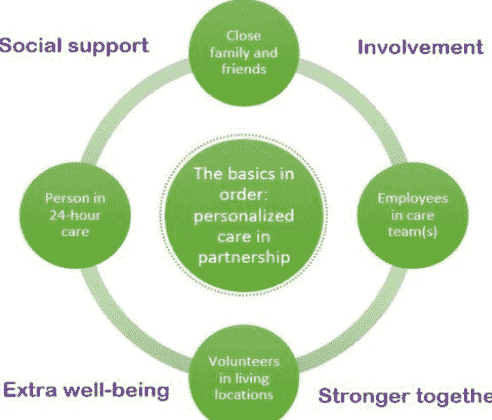

Figure 1. Personalized care (Kennisplein Chronic Care).

- 图1. 个性化护理（Kennisplein Chronic Care）。

The quality framework for nursing home care (Zorginstituut 2017) is based on the following integrated model:

- 疗养院护理质量框架（Zorginstituut 2017）基于以下综合模型：

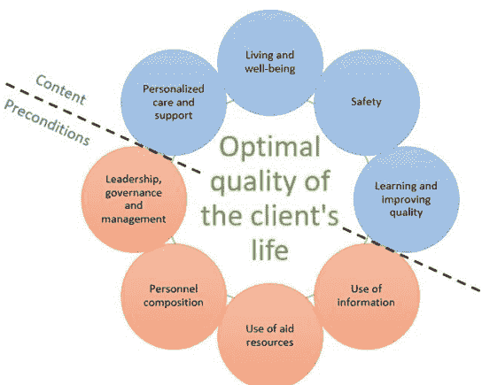

Model 1.

- 模型1。

There is a high degree of diversity among the elderly: on the one hand, people who remain vital until later in life (80%); on the other hand, people who need more care and support. It is desirable to start from the individual circumstances. Nivel (2014) distinguishes four profiles:

- 老年人之间存在高度多样性：一方面，是直到晚年仍保持活力的人（80%）；另一方面，是需要更多护理和支持的人。最好是从个人情况出发。Nivel（2014）区分了四种特征：

- Proactive elderly (46%): these elderlies highly value deciding over their own life and they have the network and resources to do so. The previously mentioned policy assumptions best fit this group.

- 主动型老年人（46%）：这些老年人高度重视自己决定生活，并拥有这样做的网络和资源。先前提到的政策假设最适合这一群体。

- Care-desiring elderly (28%): have the feeling that they could decide over their lives, but do not regard self-reliance as highly

- 渴望护理型老年人（28%）：感觉自己可以决定生活，但不那么看重自立

- Hesitant elderly (10%): they have the feeling that life washes over them. They often have a poor quality of life and lower education. They attach little importance to self-reliance, act dependently and easily accept help

- 犹豫型老年人（10%）：感觉生活只是拍打着自己。他们通常生活质量差，受教育程度较低。他们不太看重自立，行为依赖，轻易接受帮助

- Helpless elderly (16%): this group also feels like life happens to them. They often live alone, have little money, have a low education and a poor quality of life. They want to live self-reliant as long as possible but cannot without professional support.

- 无助型老年人（16%）：这一群体也觉得生活是降临到自己身上的。他们经常独居，钱财不多，受教育程度低，生活质量差。他们希望尽可能长期地自立生活，但没有专业支持就做不到。

## The Elderly

## 老年人

The possibilities for longer independent living are only increasing: technological developments, new treatment and care interventions, social neighbourhood initiatives and forms of ehealth (Van Campen 2017). This leads to the following distribution based on Actiz data:

- 延长独立生活的可能性只会增加：技术发展、新的治疗和护理干预、社会社区倡议以及各种形式的电子健康（Van Campen 2017）。这基于Actiz数据导致了以下分布：

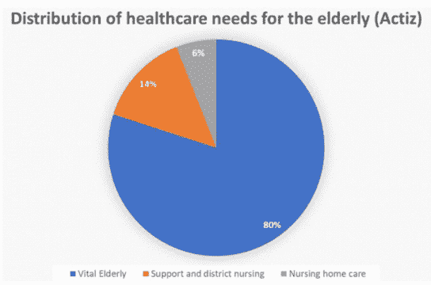

Figure 2. Distribution of healthcare needs for the elderly (Actiz).

- 图2. 老年人医疗需求分布（Actiz）。

Based on this distribution of care recipients, this leads to the following development of clients and professionals: in 2016, 270,000 clients received home care, and 110,000 clients, more intensive (nursing home) care. In 2025, it will be 350,000 clients in home care and 141,000 clients in nursing home care. Based on these figures, the growth in professional deployment is as follows: 15,000 new home care professionals are needed each year (3,000 as a result of growth; 12,000 as a result of replacement). For nursing home care, there is an annual additional deployment of 13,000 professionals (3,000 as a result of the growth of more intensive care, and 10,000 to replace outflowing professionals) (Actiz data).

- 基于这种护理接受者的分布，这导致了客户和专业人员的以下发展：2016年，270,000名客户接受居家护理，110,000名客户接受更密集（疗养院）护理。到2025年，居家护理将有350,000名客户，疗养院护理将有141,000名客户。基于这些数据，专业人员投入的增长情况如下：每年需要15,000名新的居家护理专业人员（其中3,000名是由于增长；12,000名是由于替换）。对于疗养院护理，每年需要额外投入13,000名专业人员（其中3,000名是由于更密集护理的增长，10,000名是为了替换流出的专业人员）（Actiz数据）。

At this moment 40% of people with health impairments (4.5 million adults) do receive some form of care and support (SCP 2019). Most elderly live at home (94%) (NZa 2018). The financial impact is that 80% of the expenses of healthcare is for 20% of the elderly (NZa 2018). The group of migrants in care for the elderly will increase: in 2011, there were 78,000 people aged 65+ with a non-Western background; in 2050, it will be around 520,000 elderly people. In 2000, there were about 8 thousand people over 65 from Morocco and Turkey in the Netherlands; now more than 47 thousand elderly Moroccan and Turkish migrants live in the Netherlands (CBS 2018). According to the population forecast of the Central Bureau of Statistics, this number will increase to around 144 thousand in 2040 (CBS 2017b). Moreover, this increase will quickly become visible, because Moroccan and Turkish over-65s live in a highly concentrated way in the larger cities (no less than 41% live in Amsterdam, Rotterdam, The Hague and Utrecht), and within these cities, in certain neighbourhoods. Furthermore, Moroccan and Turkish over-65s are also reaching an increasingly old age, with an increasing need for care as a result. The share of over-75s in this elderly migrant population has increased from around 10% in 2000 to 39 and 37% in 2018 and 2040 respectively (Fokkema 2019).

- 目前，40%的有健康障碍的人（450万成年人）确实接受了某种形式的护理和支持（SCP 2019）。大多数老年人居家生活（94%）（NZa 2018）。财务影响是，80%的医疗费用用于20%的老年人（NZa 2018）。老年护理中的移民群体将增加：2011年，有78,000名非西方背景的65岁以上人士；到2050年，将达到约520,000名老年人。2000年，荷兰大约有8千名来自摩洛哥和土耳其的65岁以上人士；现在，超过47千名年长的摩洛哥和土耳其移民居住在荷兰（CBS 2018）。根据中央统计局的人口预测，这一数字将在2040年增加到约144千人（CBS 2017b）。此外，这一增加将迅速显现，因为摩洛哥和土耳其的65岁以上人士在较大城市高度集中（至少41%居住在阿姆斯特丹、鹿特丹、海牙和乌特勒支），并且在这些城市内，集中在某些街区。此外，摩洛哥和土耳其的65岁以上人士也活得越来越大年纪，导致护理需求增加。在这个老年移民人口中，75岁以上者的比例已从2000年左右的10%增加到2018年和2040年分别为39%和37%（Fokkema 2019）。

## Value-Driven Care

## 价值驱动护理

The responsibility for care is provided in consultation with clients and professionals. In this case, value-driven means that support must provide an answer to the question of the citizen and is not only inspired by the professional opinion of the help provider. Porter (2006) states that in order to make healthcare more effective, you must connect competition with value for the patient. Value is determined by taking as a starting point the specific medical condition of a patient over the entire chain of care (Modig and Åhlström 2017): from monitoring and prevention to treatment up to and including aftercare (recovery or chronicity). The measurement and development of the results are central to this.

- 护理责任在与客户和专业人员协商后承担。在此，价值驱动意味着支持必须回答公民的问题，而不仅仅受帮助提供者的专业意见启发。Porter（2006）指出，要使医疗更有效，必须将竞争与患者价值相结合。价值是以患者特定的医疗状况在整个护理链中为起点来确定的（Modig and Åhlström 2017）：从监测和预防到治疗，包括术后护理（康复或慢性化）。结果的测量和开发处于核心地位。

Value-driven care is therefore about measuring the value described as delivered care outcomes divided by costs incurred. Patient value concerns the outcomes that are relevant to the patient divided by the costs required to achieve these outcomes.

- 因此，价值驱动护理是关于测量价值，价值被描述为提供的护理结果除以所发生的成本。患者价值关乎与患者相关的结果除以实现这些结果所需的成本。

Porter describes a medical condition as: ‘a set of patient health circumstances that benefit from dedicated, coordinated, care. The term medical condition encompasses diseases, illnesses, injuries, and natural circumstances such as pregnancy (Porter 2016, 44). A study (interview with 22 people involved) by Koeijer and Hazelzet (2017) shows that four preconditions are crucial for a broader and successful implementation of value-driven care: a patient who is able to help decide about his or her care, available and reliable data and financing based on outcomes (value). The research shows that value-driven care is primarily seen as improving the quality of life of the patient and delivering

- Porter将医疗状况描述为：‘一套从专门、协调的护理中受益的患者健康状况。医疗状况一词涵盖疾病、病患、损伤以及怀孕等自然情况（Porter 2016, 44）。Koeijer和Hazelzet（2017）的一项研究（对22名相关人士的访谈）表明，四项前提对于更广泛、成功地实施价值驱动护理至关重要：一名能够帮助决定其护理的患者、可用且可靠的数据以及基于结果（价值）的融资。研究表明，价值驱动护理主要被视为改善患者生活质量并提供


在合适的时间以合适的方式提供适当的护理。此外，经常引用积极健康（Huber 2014）的概念，即健康作为适应能力，并在面对生活中的身体、情感和社会挑战时发挥主导作用。

## 与专业人员的互动：客户的自主性

### 参与阶梯

人们普遍相信个人对自己生活的控制。然而，护理安排有时未能满足这一要求（Putter 2017）。此外，支持选择以及应对这些选择的能力分布不均。Putter 指出：拥有资源积累者与拥有缺陷积累者之间的对比正在加剧。这包括思考和行动的能力（2017：32）。长期以来，这主要关乎“有者”与“无有者”之间的差异，以及通过护理、劳动和收入进行补偿以使人们能够参与社会。今天，这更多关乎“能者”与“不能者”，即关于是否真正通过护理提供或护理津贴帮助了客户，以及客户是否能够在规则的复杂性中找到自己的道路（Putters 2017：31）。

指导护理采用如下定义：当某人（或多人）决定如何组织护理时，他们拥有主导权（Verver, Merten 和 Wagner 2016：7）。参与的解释基于参与阶梯进行说明。参与阶梯（Binkhorst 2009）区分了五种参与形式：

- 1. 信息：客户也知道。护理（照护）流程已启动，并让客户保持知情。专业人员对患者参与持积极态度，但没有真正的参与。
- 2. 咨询：客户与专业人员一起思考和交谈。专业人员决定发生什么，但会主动征求客户的意见。客户是严肃的讨论伙伴，但专业人员不直接承诺讨论结果。
- 3. 建议：客户提供建议，护理提供者决定。会主动征求客户的意见，并明确要求他们发表意见。客户的提议和想法被采纳，专业人员原则上承诺结果，但在最终决策中可能偏离此（需有据）。
- 4. 伙伴关系：客户参与决策。建立平等合作，客户拥有自己的角色，并与护理提供者共同决策。例如，客户和专业人员共同确定要讨论什么。原则上，专业人员承诺此次咨询的结果。
- 5. 与客户一起指导：客户决定，护理提供者支持。客户（或者更确切地说是社区）确定活动或组织的目标和优先事项。对医疗保健的主导权主要由客户负责。专业人员实际上被赋予咨询角色，并测试预先设定的前提条件。

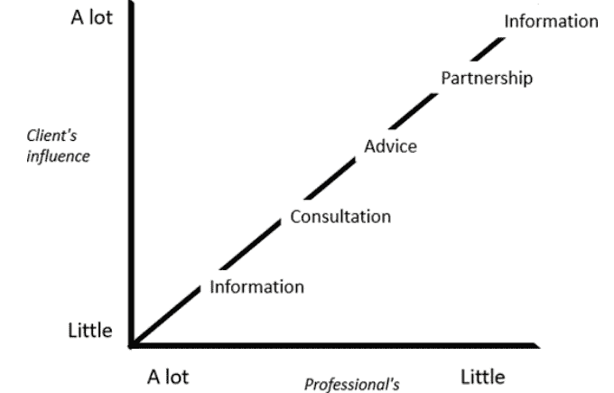

图 3. 参与阶梯（Binkhorst 2009）。

参与阶梯提供了一个理论框架。实践的特征是混合形式。供给与需求具有互惠关系。关键始终在于找到最佳连接。关键在于所提问题与可能供给之间的适当协调（Poiesz 和 Caris 2010）。由 IT 支持的协调至关重要。这是关于创造新角色，为整个工作流程链做出贡献（Minkman 2010）。基本要素包括：共同目标、共同知识和相互尊重。

## 自主性的重要性

人类行为在社会上被决定。因此，行动通常在没有任何形式反思的情况下进行。在一种生活形式中，会学习到不言自明、非反思性的行为形式。许多专业人员假设自己的自主性，但不承认客户的自主性。Slaets（2017）在规范框架（护理中的一系列规范、规则和程序）和叙事框架（讲述、在场）之间做出了区分。从规范框架来看，存在消极的福祉：我们谈论的是疾病、症状和局限。叙事框架关乎存在的意义：积极的福祉。

Slaets：“在喜悦与痛苦中赋予生命意义是优质护理的核心。”他表示，老年护理的新（当前）质量框架因过多的指南和义务而失衡。我将在本书后面详细阐述该质量框架。

个性化护理带来自力更生和自我管理。自力更生更多关乎一般日常活动：自己洗澡、照顾房子、与他人保持联系。自我管理不仅关乎能够很好地应对疾病及其后果，也关乎带着疾病生活得很好（Kennisplein Chronic Care）。《Zorgverzekeringswet（“医疗保险法”；Zvw）》规定，医疗保险公司安排护理和照护。《Wmo》规定，市政当局提供从家庭出发和回归家庭的支持与指导。《Wlz》针对机构中最脆弱的老年人和残疾人。这涉及实物护理、居家全套服务和个人预算。三种控制系统之间的这种任务分工与个性化护理不符（SCP 2019）。许多老年人同时接受不同形式的护理。

## 个人主导权

围绕客户的系统需要知识渊博的专业人员，也需要能够将这些一般知识应用于日常生活的专业人员。这包括自力更生的支持和自我管理的支持。自力更生和自我管理的一个重要部分是个人主导权，即自我主导权。个人主导权是关于对自己的生活、护理和支持做出自己的决定。核心问题是：我想要什么？个人主导权意味着：安排自己生活和必要支持的能力，以及在身体、社会和心理方面自给自足的实际能力。个人主导权涉及以下四个方面：

- • 从积极面入手：作为客户，我能做什么？我的优势在哪里？
- • 通过了解客户自身的驱动力和情境来增强客户：在哪些方面做得好？在哪些方面做得不太好？我想做什么或希望能再次做什么？
- • 尽可能将对支持和帮助的控制权留给客户：我要如何安排自己的生活？我想致力于什么？我需要什么帮助？以及我希望那种帮助是什么样子？
- • 加强和促进非正式及社会网络。
- • 叙事方法在老年护理中越来越成为一种常规方法：这涉及使用人生故事，与客户及家属谈论愿望和需求，以全面了解护理接受者本人、其背景和世界。

个人主导权的感觉是指一个人体验到自己管理事件的程度。这对于能够应对挫折很重要。研究表明，个人主导权感觉较低的老年人更有可能从无护理过渡到专业护理。Van Campen（2017）：“近一半在65岁以上且感受到很少主导权的人，十四年后不再独立生活。这几乎是感受到更多主导权的人群的1.5倍。”在实施自我管理和自我主导权时，必须考虑到社会中也有无法指导自身护理的脆弱群体。因此，在概述的视角中，还需要其他形式的倡导。

健康技能较低的人（29%）在这方面需要支持（RIVM 2014）。在 RIVM 研究中，区分了对自身健康的护理（针对旨在保持健康的健康公民，以及针对患者以保留对自身护理的主导权（自我管理））以及对他人的护理（非正式照护者和志愿者的角色）。

## 真实性

基于人们整体能力而非其局限性实施护理流程，需要高度的真诚。以自身优势（个体性）为立足点，并彼此建立联系（社会性），必须以平衡的方式相互连接。Zwart 和 Middel（2005）：“在社会生活中，必须更多地实践新的联系形式。”护理是不对称的：提供护理的人和依赖他人护理的人。权力隐藏在提供护理之中（Baart 2018：21）。在基于在场的方法中，专业人员在没有固定议程的情况下介入（Baart 2011：735）。专业人员选择一种平易近人的方法。关键是提供自我并表现出兴趣。关键在于开放、自由的关注和认可，并确认护理接受者分享的内容。专业人员试图从故事、行为和行动中重建，对当事人来说，什么是世界的核心（Baart 2011：743）。

## 基于在场的模型

联系是基于对彼此自主性的尊重和洞察而实现的。个人贡献在此也至关重要。正如 Kets de Vries（2008）所说：“谈论公牛与在竞技场中站立并不相同。”基于在场理论的核心是，作为护理提供者，你从对方出发，而不仅仅是从你自己的良好意图出发（Senge 2015）。基于在场理论中你始终要问的问题是：你自己的良好意图在具体情况中是否确实足够好（好到足够）。


关于该特定患者及其家属。这不仅需要良好的倾听和观察，还需要做好真正调整护理的准备。

Baart 将专业护理描述为一种援助官僚体系：专业援助和护理提供的文化通常是相同的。这就是为什么我们鼓励 PlatformVmZ 的创业精神。作为企业家，你关注客户的意愿。你以不同的方式看待你的职业：必须服务客户，而不仅仅是遵守法规。还有一种风险是，高度脆弱的客户会被排除在外。Baart：‘市场根本不要求某些事情，但这些事情必须完成、提供和提供出来，或者会提出一些没有“修复”答案的问题，这些问题需要与市场导向的回应非常不同的东西’。

专业人员也关注网络并在其中发挥积极作用。节奏从容，对客户忠诚。Baart：‘在追求生活目标的控制方面，关系是对称的，但在角色方面则是专业的’（2011: 783）。护理提供是一种服务提供形式，其中生产（生活形式）的观念根据 Baart 往往是灾难性的：

- 客户不再是消费者，而是共同生产者。
- “产品”不是预先固定的，而必须被发现。
- 最终产品并不总是可感知的：服务发生在沟通过程中。
- 关键在于发现人性维度；预先设定的计划适得其反。
- 服务提供过程中存在学习；需要空间（Baart 2011: 824）。

## 护理的复杂性

当前的护理提供由四个障碍特征（Baart 2011）：

- 可及性受阻：客户难以找到护理。
- 护理任务解耦：护理任务与价值观背离。
- 官僚意义增强：参与度、工作质量、核心活动和故事受到限制。
- 护理提供的商业结构错位：提供护理服务与生产护理服务之间的区别被稀释。

医疗实践极其复杂，需要复杂的思维。专业工作变得越来越复杂和矛盾（Kanne 2016: 21）。良好的护理永远不能根据标准模型来确定，因为每个人都不同，没有两个情境是相同的。这意味着在某一特定情境中，什么是良好行为也可能存在冲突（Kanne 2016: 323）。

叙事身份在人的伦理身份与行动之间起着关键作用：因此，倾听和讲故事对于专业身份的发展至关重要（Kanne 2016: 328）。一个问题是：质量是护理的一个特征，还是护理提供者和/或护理接受者在某一时刻赋予该护理的意义（Baart 2018: 28）。

在护理提供过程中，某人的身份会进入画面：关系性行动关乎护理提供者和护理接受者的身份。那么，良好的护理就是能够实现对方认同的护理。护理是否良好的评估取决于情境、护理提供者与护理接受者之间的关系以及时刻（Baart 2016: 15）。

展示理论的核心是提供关系性护理。Baart 的发展基于以下方面：

- 提供关系性护理：关键在于理解关系，并让护理接受者了解护理提供者的能力。
- 培养质量意识：通过护理提供者中保持良好的批判性质量意识（叙事质量测试）。
- 以实践和智慧的方式工作。

Baart 指出他已经围绕此构建了一套思维系统（2016: 271）。护理的关系性解释有五种关系性解释类型：

- 从关系中设计的护理：护理关系
- 作为关系设计的护理：护理关系
- 在关系中提供的护理：传记关系
- 由关系提供的护理：机构关系
- 以关系为导向提供的护理：终极关系。

根据 Baart（2016: 213），由于护理的商业化和方法化，关系导向型工作被低估了。以关系导向的方式工作将导致只能以这种方式实现的结果：协调和防止不匹配、获得认可等。它还确保专业延续性减少，防止人们变得更加依赖并使对帮助的需求无休止：护理陷阱（2013: 104）。

## 政策质量

如果必须理解某一情境，那么这种理解最好既涵盖所说的内容，也涵盖所做的事情。因此，关键在于能够交谈（倾听）和能够观察（生活形式）（Schatzki 1996）。由此可以得出，通过将投保人和患者的声音纳入医疗采购过程，可以加强客户的地位（RVZ 2014a）。公共卫生、福利和体育部目前正在修订《健康保险法》（待定）：‘投保人的意见和愿望必须成为健康保险公司政策的核心。重要的是，投保人应参与医疗采购政策’（法案 34971）。患者协会和老年协会建议采用更直接的影响和反馈形式（反馈，2019年5月20日）。

老年人参与政策制定可以通过多种方式实现。通过开展研究，也可以让老年人作为平等的（讨论）伙伴合作并参与政策倡议。然后他们也能看到决策者面临的困境，并可以——在充分了解情况的情况下——就创造性解决方案进行头脑风暴。护理网络中的良好合作似乎与护理质量存在积极联系。对护理的共同控制以及对生活的掌控感与感知到的生活质量呈正相关。为了获得更好的护理质量，非正式和正式护理提供者都必须投资于良好的相互合作（Cooperrider 2003；Masselink 2008）。

VU（Zwart-Olde 2013）的研究表明，35% 的老年人可以在他人帮助下指导自己的护理。这些人往往是认为扮演指导角色很重要的老年人。45% 的老年人表示，正式护理提供者指导护理网络。这可以极大地有利于政策质量和所选解决方案。决策者通常是正值壮年的人，对他们重要的事情与对老年人重要的事情不同。这也从一项关于痴呆症老年人住房需求的研究中得到了体现：他们宁愿住在住宅区的房子里，还是住在护理机构里？

采访了70至75岁的人，以及40至50岁的人。结果表明，基于对痴呆症的经验，老年人对什么是良好的生活设施的看法与40至50岁的人非常不同。后一群体偏好社区内的住宅设施。温馨，与其他邻居在一起。老年人偏好小规模的，但则是在护理机构内或在护理机构附近。在社区的房子里，痴呆症居民不能出前门，因为那样他或她就会在街上，这很危险。而且，要参与活动要困难得多。简而言之：这不必要地限制了痴呆症患者的选择。这是一个政策中未包含的视角。

Langer（2010）观点的核心是我们看到多样性。如果我们对老年人的依赖性持有一定的观点，那通常决定了我们看到什么以及我们会如何行为。然而，如果我们意识到每个人都不同，并且我们自己在不同时间和与不同的人在一起时也不同，那么我们的视角就会大大拓宽。

常规援助的设计源于政策原则的实施。棘手的是将客户的需求转化为行动计划。因为那里


往往是一种翻译，需求的真实性因此有些丧失。因此关键在于能够倾听对方。Baart (2011)：参与的结构是提问及其回答，而不是另一个问题。

## 逻辑

从这一角度来看，专业组织的逻辑与市民的逻辑之间存在张力。先前描述的在市政机构以及合作各方工作的专业人士的标准，与市民的标准不匹配或不充分匹配（Van Gunsteren 2008）。

这进一步复杂化，因为医疗保健运行在三组逻辑之上：医疗逻辑（在特定（变化）情境中提供适当护理）；规则逻辑（规则和框架的应用）；以及分配逻辑（资源分配）。这常常使客户难以获得医疗保健（RVS 2019d）。

由于多学科合作的增加，客户需要与越来越多的护理提供者打交道。这也要求客户在护理过程中保持全局概览；这一点也适用于护理人员。IT在指导护理过程方面发挥着越来越重要的作用（可比于旅游行业（booking.com）和零售业（Albert Heijn/bol.com）的发展）。管理层和医疗专业人员对非正式护理人员职责的愿景存在差异。总体而言，与（非同住）非正式护理人员的联系很少（Van Wieringen 2014）。

专业护理组织正在致力于加强与非正式护理人员的合作，以改善护理质量并增加非正式护理人员（和志愿者）的比例。非正式护理人员在非正式护理与正式护理之间更好协同方面看到了改进机会。这也要求医疗专业人员承担不同的角色。不仅对客户，也对非正式护理人员而言，支持都必须有助于个人自主选择（Walstra 2011）。

## 干预措施

正式护理人员更常执行护理和看护任务；非正式护理人员更常帮助搬出家中或安排帮助。正式和非正式护理人员常共同协助家务事务。根据大多数老年人的说法，现在是专业人士管理医疗网络（Zwart-Olde 2013）。

问题是如何有效处理此事。干预措施应基于市民与专业人士视角之间的良好平衡。五项干预措施很重要（Huygen 2013）：
- 专业人士和市民都有足够的行动空间
- 对于专业人士，能够与市民建立联系，以及市民与社会建立联系
- 归属感：有归属感或有空间归属
- 界限与信任

对于专业人士，界限是指干预可能进行的地方。Topol开发了一种“无医生患者模式”，其中诊断和监测主要是患者的责任（Topol 2015）。对于市民，问题是支持何处结束自主。信任涉及对彼此角色的解读，即相互尊重并尊重彼此的专业知识和投入。

技术一方面被用作专业协助的补充；另一方面，技术可用于改善自我护理。然而，使用数字解决方案要求可以质疑护理专业人员的工作方式和对非正式护理的方法。在护理过程中，患者往往相对于护理提供者存在信息缺口。特别是在慢性病情况下，患者在术后阶段似乎相对于护理提供者具有信息优势。

## 积极健康

生活质量概念在老年护理中居于核心地位。一个重要模型是Machteld Huber（2014）提出的积极健康发展：“健康是适应生活社会、身体和情感挑战，并承担自身主导角色的能力”。在许多情况下，以客户为中心的方法对护理质量产生积极影响。在个人护理中，客户被视为整体，而不仅仅是残疾，责任更多地在护理提供者和客户之间分配（Rademakers 2016）。

重要的是要将个人功能和自立能力的保存与生活环境中的社会网络结合起来看待。非正式护理人员和亲属在保持活力、康复或防止恶化方面发挥着重要作用。他们的角色不会被护理提供者接替，只有当护理在离家更远的地方提供时，其角色才会变小。对于护理请求，全科医生在整个链条中担任主导角色。

研究表明，关于结果（无论是与客户相关还是与专业人员相关）的透明度可以带来质量改进。针对与客户相关话题的质量改进似乎从集中式方法中受益；专业质量改进更多受益于本地倡议（Winters 2014）。因此，对客户采取一定程度的框架似乎是必要的。质量有多个维度：安全性、有效性、效率、以客户为中心和及时性。

这对护理人员和护士意味着什么？对于个人医疗助理，这意味着：他们通常在门诊环境工作；护理技术在工作中占据固定位置（远程护理；家居自动化）。对志愿者和非正式护理人员的教练角色得到加强。（基础）护士也主要在门诊环境工作。同样适用于护理技术应用可能性的扩展（Kort 2008）。

## 护理愿景

护士专家也在一级半护理中工作。治疗责任增加。护理提供与效率之间的平衡不仅关乎组织模式，也关乎思维方式。质量框架提供了旧思维与新思维的结合。问题是，我们是否无法再朝着护理技术和数字化的面向未来的方法迈出步伐（Kanter 2001）。这再次关乎客户意愿与专业行为之间的关系。

到目前为止已经清楚：客户的提问以及因此客户对（服务）任务执行的影响是核心：提供哪些服务（住房、护理、治疗和福利）？如何提供（时间、治疗、质量水平）？能力和成本如何发挥作用（等待时间、灵活性）？以及在什么情境下提供服务（面向生活方式的生活、厨房 <-> 餐厅）？

成功的一个核心要素是护理技术是护理愿景的一部分（Technologie in de verpleeghuiszorg 2019）。我们目前正在见证各种技术改进的汇聚：手机、平板电脑和个人电脑的应用可能性。互联网上有大量数字服务可用。传感等技术使得追踪人员变得更容易。社交网络越来越多地使用数字解决方案（Topol 2012）。

## 信息：实现自主的前提条件

## 脆弱性

脆弱老年人并不总是得到正确的护理。专业人士之间缺乏协调与合作。对彼此能力的了解不足。关于医疗保健融资需要大量协商：既包括区域护理的需求，也包括医疗保健领域与社会领域之间。对于在家中客户的综合跨领域护理没有相关规定（Zorginstituut 2018）。组织护理的新方法需要创新的资助模式。

脆弱性：老年人中的脆弱性是指功能上的生理、心理和/或社会性缺陷的累积过程，这会增加负面健康结局（功能限制、入院、死亡）的可能性（Social and Cultural Planning Office 2011）。由此，客户与专业人员之间的关系，以及这种互动所在的资助模式至关重要。在Gezondheid 2.0中已有所起步（RVZ 2010）。要实现上述开放模式，需要一种既能充分体现基本护理，又能转化为客户（个人）独特性的资助形式。本最终章对此进行了阐述。


新的质量框架对复杂老年护理的IT结构意味着什么？关键问题相对简单：运行得如何？价值增加关乎：如何部署员工、要求他们做什么、如何组织他们，以及他们实际如何花费时间。在个性化护理中，尽可能多的资金用于直接护理活动。问题始终是：这个决定如何有助于提升客户（在床位或居家）的价值。

## 评估框架

为老年护理发布了一套评估框架。该评估框架包含以下主题：

- 以客户为中心：在与客户协商中确定护理需求；客户了解护理流程；增强自我依赖和主导权；
- 整合护理：客户体验到专业人员之间相互联系，且护理得到协调；
- 非正式护理：照护者可以指望专业人员考虑其能力；
- 安全：家庭/居住情况、药品安全、家庭暴力报告准则、医疗辅助器具和医疗技术方面的风险，能够由护理提供者及时发出信号。

客户的愿望和期望是提供护理的出发点。专业人员与客户之间关系的特征是：专业人员了解客户（病史、什么对其重要等），关系平衡且尊重，对客户及其亲属耐心倾听，并且客户承担主导角色。

2016年底，该框架为为居家易受伤害客户提供护理的专业人员网络而制定。最重要的出发点是：

- 客户视角：护理对他或她适应能力和个人主导权的贡献
- 网络：专业护理提供者、非正式照护者和志愿者之间的协同工作
- 易受伤害客户：针对风险最大的公民进行专项测试
- 标准：从客户视角出发
- IGZ的角色：护理质量

在网络医学中，患者护理是核心；他或她与非正式照护者和护理专业人员一起主导自己的健康（Metz 2016）。医疗保健专业人员和照护者引导患者经历临床康复和社会康复。此外，功能正常的数字结构是网络中有效高效协作的条件。患者可以授予非正式照护者访问其自身医疗档案的权限。

客户在电子客户档案中管理自己的医疗和健康数据。因此，重点在于身体健康、心理健康、社会参与、自决和自主以及日常功能的自我管理。Wachter（2017）：‘可以设想有一天，以患者为中心的社区和以临床医生为中心的社区将融合在一起，患者从同伴那里获得信息和支持，同时定期接受有资质专家的咨询’（2017：200）。

## Stamtafel

数字化创造了新的信息形式。由于客户拥有更多控制权（信息），客户与专业人员之间的角色分工发生转变。这产生双重效应：对客户而言，选择多样性减少（因为客户获得了更多控制权），而对专业人员而言，则增加（因为专业人员处理个性化问题）。COVID-19的影响正在加速已经展开的进程。问题是如何有效地实现这一点。初步阐述可以体现在视频通话领域：专业人员之间、专业人员与客户（及其家属）之间以及客户与其家属之间。新的联系形式正在出现（例如，De Stamtafel：www.stamtafel.nl）。斯塔塔费尔（常客桌）是一个在线社交（护理）平台，用于连接家人、朋友、会员协会、村庄、社区中心、疗养院和志愿组织的人们。他们支持个人和日常联系。斯塔塔费尔易于使用，同时提供安全且高度私密的环境。

面向这一易受伤害群体的数字化社交斯塔塔费尔已经建立。通过App，人们可以与家人、朋友和照护者分享信息和求助请求。它有助于发起社交联系，并增加对社区的参与感。其优势在于他们能够保持对共享内容的控制。此外，数字化求助有时也更容易。通过这种方式，数字化斯塔塔费尔旨在对抗孤独，支持独立性，扩大互动范围，并确保在护理、联系和安全方面的自主感。

## 相互依赖

由于信息连接性和可访问性的不断提高，知情且被赋权的患者（及照护者）群体不断壮大（Njoku 2015）。例如，荷兰患者联合会（Patiëntenfederatie Nederland）开发了一种工具，供老年人在Mijnkwaliteitvanleven.nl上表明他们自己看重什么。联合决策发生在护理流程的各个阶段。患者与护理专业人员共同指导个人健康档案。

尽管数字解决方案日益增多，但只有当它们符合照护者的需求和技能时才有效。家居自动化概念使得可以远程监控客户的日常活动并轻松进行干预。在这里，重要的是可用功能要为非正式照护者服务，并且要确保对技术可能性的适当指导和良好的备份系统（Adler 2014）。

这导致相互依赖不断增加：因此，投资于自己的（数字和社交）网络非常重要（Zorg voor 2020）。越来越多地，客户将自己决定如何以及何时与护理提供者联系。此外，患者与消费者之间的区别正在缩小：健康人群也越来越有能力收集有关自身健康的信息。问题始终在于，支持是否真正以定制化方式满足个别非正式照护者的需求和愿望。一方面，支持必须贯穿非正式和正式护理支持的整个网络；另一方面，关乎实现以个人为中心的方法。

## 知情客户

这既涉及信息获取，也涉及信息传递的方式。信息确保了对非正式照护者自身角色、专业人员的角色、护理组织、护理评估与改进以及如何进行调整的清晰了解。非正式照护者与护理专业人员之间的合作，关乎对每个人的立场、期望、情感和能力的洞察。网络的参与、投入和（共同）管理是此的核心。医疗保健使用现有的数字基础设施。一方面，自我依赖也意味着专业人员能够及时介入。另一方面，通往更自我依赖社会的道路也意味着专业人员可以帮助迈出这一步。目前的专业支持被以不同方式使用（Peeters and Cloïn 2012）。

由于信息连接性和可访问性的不断提高，知情且被赋权的患者（及照护者）群体不断壮大（Njoku 2015）。联合决策发生在护理流程的各个阶段。患者与护理专业人员共同指导个人健康档案。在网络医学中，患者护理是核心；他或她与非正式照护者和护理专业人员一起主导自己的健康。一致且清晰的沟通是关键。它看似简单，实则复杂。你如何处理立法和法规的（永久性）变化以及环境的变化？你如何处理专业人员（不断变化的）观点？


## 环境适应

养老护理的特点在于，观点、（信息）技术的应用以及专业知识的立场在同时变化和创新。新一代老年人将在这一创新中越来越处于领先地位。在家庭环境中，家庭自动化和传感器技术领域正在不断发展。医疗机器人化的影响仍将有限（Ford 2015）。组织工作得到医疗保健新核心价值观的支持：为生活质量做出贡献，并实现自我决定。

技术可用于根据公民的需求调整环境。更长时间独立生活的基础在于人的维度，以及通过嵌入社会、技术和空间情境来创造平衡（Mohammadi 2017）。因此，家庭环境中的护理服务成为生态系统的一部分。KPMG（2017a）的研究表明，机器人特别能够支持老年人进行家务任务，帮助他们开展自身活动，促进社交互动，并在收集、分析和分发医疗数据方面发挥重要作用。

在内部移动领域，KPMG（2017a）预计，机器人可执行以下功能：协助上厕所、帮助服药以及进行轻度家务任务。对机器人的描述显示，可以为护理的成本效益做出贡献：一种能够执行多项任务、日益智能且更便宜的机器（De Vlugt 2016）。

尽管医疗保健技术通常基于标准，但应考虑客户的技能和需求、意愿和独立程度以及物理环境，以及与个人健康状况相关的社会网络的存在。此外，努力也是良好时机和可持续支持的问题。

Peek（2017）的研究表明，孙辈的作用（例如“为我拍张照片”）是有帮助的。大多数（未来的）老年人（71%）表示，如果这意味着他们可以在家中生活更长时间，他们希望使用ICT（Van den Broek et al. 2016, 123）。

## 技术影响

随着技术的发展，消费者、客户和公民对组织的需求越来越小（Lanting 2011）。关键在于组织：建立智能网络、链条和社区（Lanting 2014）。不同医疗领域之间存在差异：在医院世界中，技术（机器人化）的影响正在迅速增加；而在老年护理中，这一影响（甚至）更有限（Geisler 2003）。

这些技术在未来几年对老年护理的影响仍不清楚。然而，很明显，技术对医疗保健流程的组织和结构的影响越来越大（Kurzweil 2005）。示例包括智能手机和iPad的使用日益增加；通过传感器进行库存管理（包括失禁监测）、风险增加（数据泄露）；转向家居、花园和厨房技术（Van Montfort 2016），客户自行购买工具；以及自我测量（健康检查），引发了隐私保护方面的问题。

特别是移动医疗应用程序将经历显著增长（Roland Berger 2016）。由于客户影响力的增加，医疗保健生态系统将发生根本性变化。客户与医疗专业人员之间越来越互动的方法将改变医疗保健系统。对于医疗专业人员来说，了解数字化和医疗保健技术可以实现的目标，并找出实现这些目标的手段至关重要（Roland Berger 2016）。

新的“技术”，例如带有健康监测功能的智能手机和智能手表，确保客户自己承担任务。由于新的科学发展，医疗保健正在变得更加个性化、具体和情境相关（个性化医疗）。因此，协议、指南和临床试验研究的重要性将显著降低。未来几年，实践中的差异将具有更积极的意义（Van Montfort 2019b）。此外，在价值驱动的医疗保健中，特定干预涉及减少实践差异以提高质量（Jeninga and Woldendorp 2019）。

专业人士的客户在在线社交网络上的存在越来越多。专业人士利用工作中的问题来获得群体感。这不需要层级系统，而是一个平台，我可以在那里遇到对我有意思的同事（Molenaar 2017）。

## 创建凝聚力

患者日益自觉地选择某些医疗保健提供者。最近的FWG趋势报告（2017）显示了未来几年最重要的趋势：

- 对创新力有更具体的诠释：为客户提供附加值的连贯护理；
- 为个人留出空间：个性化护理；综合方法；
- 凝聚力是关键：整个人及其自身情境；客户自己的世界是起点；
- 并非每个人都能跟上：也有自给自足能力有限的客户。

因此，关键在于围绕以自身生活方式为中心的个人问题创造连贯性。指导性并不适用于所有人：有些客户无法承担该角色。向个性化护理的转变将越来越强。起点是并且始终是，脆弱的老年公民应尽可能长时间地继续生活在自己的居住环境中。随着年龄增长，（部分）人口的脆弱性增加，护理需求的复杂性也随之增加。正是在基线、一线、二线和三线之间的交界处，希望实现护理领域的有效实施。

RVS（2017）主张个人生活计划。前提条件是：

- 客户决定谁有权访问；
- 客户决定可以交换哪些信息；
- 计划可数字化获取。

根据护理情况，客户可以指定代理人承担此角色。医疗专业人员获得授权：客户决定哪些信息对他们可访问。可能要求医疗专业人员持有协作态度。

## 加强客户地位

## 棘手问题

为了塑造互动，客户需要占据不同的地位以实现平等。从客户的角度来看，关键在于生活质量和护理质量的结合以及其设计方式。长期护理改革在系统层面有以下目标（Kromhout, Kornalijnslijper and De Klerk 2018）。更好的支持和护理质量、更大的社会参与（更多互相照料）以及长期护理和支持的财务可持续性。尽管人们经常谈论客户的指导作用，但医疗保健提供者似乎对护理的部署起着决定性作用。

Dierendock（2015, 7）：如果研究人员希望产生有助于老年人生活质量的结果，那么以一种方式让这些老年人参与进来至关重要，即他们对衰老及其可用服务的自身理解和经验能够得到最优的共享给研究人员和专业人士；他们往往对老年人的护理需求有着完全不同的看法。

医疗保健的可负担性是一个非结构化（棘手）问题的示例：关于价值观、规范、目标、陈述和事实存在根本性的共识缺失（Vermaak 2009）。因此，这类问题不是被解决，而是被变得可管理（Jeurissen, Maarse en Tanke 2018: 420）。以下是一项以客户视角为核心的提案的规范。

## 资助模型

荷兰医疗管理局（“荷兰医疗局”；NZa）（NZa，2019）指出，目前基于不同护理形式不同时薪的社区护理资助模型已不再符合护理实践的要求：“资助


刺激对护理小时数的使用，无需将客户置于中心’（2019, 5）。ZWV 护理和照护支出量为（预计）3,690,000,000 欧元。

当前资助模式包含每小时最高费率的服务：
个人护理：

- 随叫随到照护
- 护理
- 随叫随到护理
- 专业护理
- 建议、指导和信息

此外，还有费率自由且要求签订合同的服务：

- 痴呆症连续护理
- 定制化补偿
- 区域不可预计护理可用性功能
- 互助服务。

在资助护理和照护的政策规则实验中，可以约定整合时薪。健康保险公司常采用此方式：95% 的有合同护理服务提供者采用整合费率。为此使用预算上限。此外，可以在政策规则框架内基于每位客户每月固定金额达成协议。该项目资助系统正在多个地点以试点形式进行测试（总计约 1.58 亿欧元）。仅在非合同护理的背景下，上述“常规”服务仍被使用。

按小时计费意味着，医疗保健提供者对医疗专业人员的管理主要基于生产足够数量的工时。反之，致力于提升客户自理能力的护理服务提供者会因营业额下降和生产率低下而受到“惩罚”。相同机制也适用于节约劳动力技术的使用（2019, 13）。新资助模式的最终愿景必须基于客户所需的护理。成本效益涉及将预期效果与预期成本相结合（Kievit 2017）。个人层面的护理差异空间并非无限（Kievit 2017）。

## 成本控制

在医疗保健中，这也涉及成本控制的政策选项（Stadhouders 2019）：

- 规范并限制护理价格。
- 限制医疗保健服务量。
- 通过预算限制价格和服务量的总和。
- 影响最终决定价格、服务量和医疗保健支出的市场进程。

一种广泛使用的模式是将资助重点放在护理成果上。这些成果由五个相关维度定义（Eijkenaar 2015）：

- 护理质量好：护理内容/技术质量和患者满意度；
- 成本意识行为：防止过度治疗和不必要的昂贵护理；
- 良好的协调和高效替代：在多大程度上存在良好的多学科协作和协调一致的护理？
- 成本效益创新：在多大程度上鼓励那些在同样健康水平下能降低成本的创新？
- 有效预防：尽可能保持划定人群的健康。

充分的成果导向型资助关注：一个尽可能简单、以需求为导向的资助系统，其明确目标是激励护理服务提供者在质量、成本、协调和预防方面实现良好的护理成果，同时还鼓励成本效益创新，且不包含对不良行为的激励（Eijkenaar 2015: ii）。这包括两个组成部分（基本资助和绩效资助）：

- 每位被保险人整合式、多学科（人群资助）；
- 通过绩效奖励对良好质量提供明确的财务激励（按绩效付费）。

系统设计基于标准化与定制化的结合：护理基于持续的“治愈”关系；定制化基于客户的需求和价值观进行（Hagel 2012）；客户是控制的源头；知识共享；决策基于证据；安全是系统的一个特征；透明是必要的；需求得到主动处理；浪费不断减少；医生之间的协作是优先事项。

## 人群资助

在调整资助系统时，出发点是客户是解决方案——而不是问题。活跃的客户是积极变革的力量：他们的反馈可以为改善护理提供宝贵的想法（KPMG 2016a）。

技术可以如下方式促进生产力（及质量）的提升（KPMG 2016b）：

- 通过决策支持系统和标准化工作流程减少实践差异；
- 为客户提供便于自我管理的工具（客户门户、护理网络）（PatientsLikeMe）；
- 通过更具主动性的护理降低成本（传感器技术）；
- 通过更好的护理协调防止碎片化（Patients Know Best：管理）；
- 更容易获得专家专业知识和建议（远程医疗）；
- 通过使用数字化规划流程改善资源管理；
- 持续的学习曲线。

人群资助是实现这一目标的一种模式，因为这种资助类型包含控制成本的强大激励。一个问题是没有明确的定义（Pomp 2013）。这就是为什么难以制定具体的前提条件（Versleijen 2012）。两种常见效果：在人头付费制下，护理服务提供者每月或每年按每位被保险人收取固定金额。“全部”通常指医院护理或一线护理。在共享节约制下，一个或多个医疗保健提供者与一个或多个医疗保险公司达成协议，可保留相对于基准的一部分节约资金。在共享节约制下，医疗保健提供者对预算超支不承担财务风险；而在人头付费制下，他们承担风险。在部分人群资助下，有强大的激励在本组织内部降低成本；在整合资助下，有激励将患者转介给最便宜的提供者。整合人群资助的一种间接但潜在重要的影响是，它鼓励医疗保健提供者之间的竞争。这是因为转诊者的价格敏感度提高，他们有兴趣找到最便宜的提供者。这种搜索行为导致竞争和可能的创新（Pomp 2012）。实施的前提条件是（Versleijen 2012）：

- 对人群资助的明确定义；
- 放弃零级、一级、二级和三级结构：一体化护理；
- 医疗专业人员的态度和行为（部分对成本发展负责）；
- 政府的清晰愿景和永久角色。

人群资助是一种管理工具：

- 针对划定人群（目标群体或地区）的固定（或可协商）金额；
- 金额基于该人群的严重程度和/或特征；
- 金额用于为该人群实现预定义的结果包；
- （主）提供者在预算支出和行动方面拥有自由；
- （主）提供者对需达成的约定结果负责。

挑战：

- 人群的划分和合同方责任的定义；
- 人群的预算确定；
- 基于结果的管理（定义、衡量、合同）；
- 创新。

## 个人客户背景

该框架为以个人客户情境为出发点提供了可能性。目前，最常用的基本资助方法是：按医疗活动资助（按服务付费）、按每位客户的医疗组合包资助（捆绑付款）、按每位被保险人的医疗组合包资助（人头付款）以及按期间的固定金额（薪资或预算）（NDSD, 2016）。整合资助意味着资助不是按活动进行，而是按病情、客户或被保险人进行。

NZa（2019）得出结论，混合资助系统可能是最终目的地：

- 将针对一个或多个预定义人群的人群资助（经风险特征修正）与风险共担相结合。
- 针对若干个划定护理事件（如某些选择性手术和复杂急诊护理）的每位客户多学科资助。
- 鼓励优质绩效奖励。

护理消费者在系统发展中必须发挥以下作用：参与自身的护理轨迹（制定和遵循护理计划）以及衡量质量成果。此外，还涉及个人护理的参与和护理标准的制定。同样重要的是区分配置和使用。配置是为特定目的分配资源的过程（在所述系统模型系统 3 中）：宏观层面。Van Montfort（2019b）：在国家层面，这是关于确定在团结和普遍可及的护理上花费多少钱。今天，配置载于框架协议中。


使用是指将获得的资源部署以实现特定目标（system 1）：微观层面。因此，使用发生在客户/患者和医疗专业人员的个体微观层面。在该关系中会制定护理计划。

资源遵循这样一条线索：你付出多少，就获得多少（Van Montfort 1995）。如果为等待名单提供额外资金，就会产生等待名单。关键是围绕客户的真实需求使用资源。通过在微观层面为选择提供更多空间，就为更新与创新以及质量发展和效率创造了空间（Van Montfort 2019b）。

## 新资助模式

从长期来看，NZa假设围绕客户的医疗网络获得全额资助。这在一定程度上基于价值驱动型医疗：‘有助于改善医疗质量、改善人群健康并降低人均医疗成本的医疗’（2019, 10）。必须为医疗提供者和健康保险公司留出空间，以围绕客户和社区塑造医疗组织。

人群管理的描述是一种主动的、综合的方法，通过参与、参与和围绕人群的有针对性的干预，从医疗延伸到福祉，贯穿从健康到姑息治疗的整个连续过程。适当的人群资助是‘针对特定人群的特定形式的疾病超越性、多学科资助’。这种综合连贯的医疗服务当然必须与人群的需求保持一致（Meeuwesen 2018）。

NZa指出，研究（Eijkenaar 2015）表明，每个医疗包的跨学科资助，结合对良好结果的奖励，是实现良好医疗的最佳方式。医疗包适用于护理链或网络中可比客户的定义群体。然后独立于现有划分来描述医疗包，也独立于预算框架进行资助。这有助于：

- 健康
- 实现最佳医疗量的良好激励
- 预防
- 医疗专业人员之间的最佳协调

NZa在筹备方面已采取了一系列步骤。计划从‘wetenschappelijke programma wijkverpleging’（'社区护理科学计划'；WPW）（2019/2020）开展以下工作：

- 识别预测性个人特征和客户群体
- 了解护理接受者的特征和风险因素
- 社区护理中相关且可影响结果的研究；这些信息构成基于每客户每护理周期金额的正常运作资助的重要组成部分
- 通过与医疗提供者的试点开发和应用测量仪器

## NZA自身的活动涉及：

- 评估护理和照顾资助的政策规则实验的运行：对新资助模式的影响
- 收集信息以实现公平竞争环境
- 研究系统功能（傍晚、夜间和周末的非计划社区护理）的组织和资助

居家护理的新资助模式可能是基于病例组合分类的资助（Bulck 2017）。为此，客户根据各种特征按护理需求划分为子群体。子群体的划分可以基于临床特征，例如某人患有的病症，也可以基于个人特征和环境因素。通过以这种方式为居家护理融资，我们可以努力提供定制化护理。

在本书框架内，寻求人群资助与个人资助自我调节系统的结合。在第一种情况下，关乎资源分配；在第二种情况下，关乎这些资源的使用（Van Montfort 1986；Van Montfort 1995）。为了建立一个可持续且负担得起的系统，需要对老年人的医疗、住房、收入和福祉采取综合方法，以便围绕个体客户形成创造性网络组合（Huijsman 2013, 63）。让客户参与关于医疗服务的考虑会导致医疗消耗减少（Klink 2012: 17）。自我调节的可能性是通过解耦宏观预算和实际资源部署（微观预算）来实现的。基于宏观预算，可以确定特定地区或目标群体可用的资源。

互动构成了平台技术的核心。在老年人护理中应用此技术，突破了专业领域占主导地位的当前障碍。平台技术还增强了客户收集信息和与其他客户联系的能力。从这个角度看，也在考虑一个适当的融资基础。这基于一种人员绑定资助系统，在启动阶段在客户群体（目标群体）层面实现。

在该目标群体或地区内开发适当的指标。这些指标将呈现给专业人员和客户。他们承诺在可用资源范围内提供护理。客户和医疗专业人员都参与创新过程。可能释放的资源仍由地区或目标群体支配。从这个角度看，创新特别关注资源的使用。

选择将该模型基于可在全国应用的理论框架的开发（Bisognano 2012）。在审视医疗干预时，问题是可以应用哪些标准来评估有效性和效率（Trusko 2007）。值得注意的是，对Triple Aim的系统视角兴趣日益浓厚。

## 定价

当前的资助高度关注费率：主要关乎价格与成本之间的关系。成本决定了在地区或目标群体内护理部署的空间。成本价由固定成本和可变成本确定。随着平台使用量的增加，部署平台技术的可变成本会降低（边际成本降低）。成本价在地区或目标群体内共同确定：关乎物有所值。

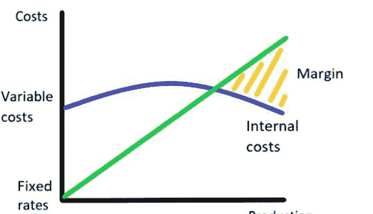

图4. 内部成本价（Van Montfort）。

当前思维往往导致‘成本驱动定价’。从成本出发，需要得出一定的价格。为了在医疗中避免这种情况，希望转向‘定价驱动成本核算’（Malik 2017, 124）。确定费率（价格）后，为活动的连续性从中扣除一部分利润。剩余金额决定整个护理流程的结构。可用预算在宏观层面确定；在微观层面，基于个人选择为资源使用创造空间。定价驱动成本核算与基于内部成本价的管理相结合，使综合护理成为可能。Van Montfort（2019b）指出，基于预算的分配是最有效的资助形式。

通过解耦分配和使用，为客户绑定资助形式创造了空间，同时在宏观层面仍保持一种系统控制的可能性。

## 职业化创业精神

### 聚焦

上一章描述了护理实践的先决条件，其中客户的身份是设计互动的出发点。在本章中，阐述了专业人员的视角。本章基于文献（侧重于创业行动）、论文、政策文件和工作实践。

专业人员的特征是能够为旨在为客户提供解决方案的自身行为承担责任。专业行为具有创业方面的特点，但其重点不同于创业精神。初创方法论被用作隐喻，用于专业人员应对日益增加的多样性所带来的不确定性。由于这种多样性和护理技术的可能性，专业人员将越来越多地面临需要反思的问题和议题。关键在于专业行为如何处理多样性。

创业精神和专业主义有不同的侧重点。老年人护理需要创业精神所特征的敏捷性。关键在于能够通过个性化护理以及将护理技术和数字化的影响整合到专业领域，来应对日益增加的多样性。从创业文献来看，初创方法（Woldendorp and Woldendorp 2019）为实现上述目标提供了视角。这种方法展示了如何处理多样性、变化和不确定性。

专业主义的特征之一是使用既定标准进行工作。然而，由于日益增加的多样性，也希望具备自我调节能力，以便能够独立实现与客户的互动。这一事实加强了这一需求：不仅客户之间的多样性在增加，而且越来越多的新型护理服务形式也在涌现。

### 反思

在互动中，始终对专业人员的行为进行反思很重要。客户不仅是消费者，更是寻求解决影响其自身身份的人。向个人健康环境发展，意味着专业人员地位的转变。通过增强客户的自主性，其自身的专业地位也浮出水面。护理个性化和共同决策模式使每个客户的情境越来越重要。创业行动和创新是诠释与客户互动中的专业角色的核心。核心是监管空间


（自治）、灵活性（适应能力）和创新。仅在自己领域表现出色已不再充分。

本章的核心概念是专业精神、个人创业精神和初创方法。根据已阐述的系统原则，上述描述的护理过程中多样性的增加需要两种方法：通过护理标准化来减弱多样性，并通过增加专业人员的 maneuver 空间来增强多样性。我们在护理组织中看到了应对这一问题的挣扎：一方面，选择自我管理和自我组织的形式；另一方面，这些形式正在被逐步淘汰。选择的方式是，通过增强客户的地位和增强护理专业人员的地位，让请求护理的人与护理提供者之间的互动发生。此时，组织几乎不再需要。使用平台技术有助于促进客户和医疗专业人员在这方面的工作。

需要的是，专业人员提升其学习能力。这需要一个创新的工作环境和一个以结果为导向的学习模型。护理日益增加的复杂性要求专业人员的逻辑与客户的逻辑保持一致。为此的出发点是基于信任和问责制行事。个人表现是核心。在与客户的互动中，始终需要了解该客户所处的具体情境。更好的数字和技术工作环境可以支持专业人员组织护理。人工智能（AI）的附加值对于这种形式的护理仍被视为有限。如果数字化和医疗技术是医疗实践的正常组成部分，则它们能够有效工作。

## 共同决策

对于专业人员收集和共享的信息，客户的价值观必须从一开始就植入。这包括自治和方向等价值观。

因此，工作流程也会从该角度出发，在与客户协商后进行调整。这种方法的工具是共同决策（SDM）模型和 PGO（个人健康环境）。同样，平台技术也起到支持作用。信息可以在平台上以可访问、定制且易于理解的方式提供。SDM 模型必须基于客户的情境。从这个角度看，客户实际上是专业人员使信息适应该情境的向导。这要求专业人员具备新技能，其中意义建构是一个基本部分。引入 PGO 也改变了专业人员的工作方式。毕竟，客户对其自身数据的控制权得到了加强。确定要使用的指标并非一个客观过程。同样，意义建构也发挥作用。

监管空间可以通过创业行动来填充。在这里，行动、责任和问责制是核心。对医疗专业人员所期望的能力和技能与个人创业精神非常契合。允许反思这种个人创业精神的模型是初创方法。关键在于能够应对不确定性，并能够展现韧性和勇气。

## 专业人员职位背景

### 监管空间

Evelien Tonkens（2004）指出，专业人员必须满足明确的专业要求。然而，管理层通常将这些要求转化为绩效标准，这些标准未能充分考虑专业现实的酌情情境。尽管专业人员原则上执行标准行为，但她或他永远不能将其视为标准并按标准对待。问题很简单：如果专业人员遵循管理逻辑，他们就会对客户敷衍了事。管理层和客户都在向专业人员施加巨大压力，但方向相反。这导致了可怕的分裂（Tonkens 2004）。

现有医疗组织将增加专业人员的监管空间。运营和信息管理将更加结构化，以支持专业人员。由于护理严重程度不断提高，对专业知识分配的关注也更多：(地区) 护士的角色和个人医疗助理的角色。

## 新商业模式

由于数字系统，医生和全科医生接诊的患者将减少，转而由接受诊断和治疗工具数字支持的护士进行接诊。技术对医疗专业人员的影响导致客户门户（直接访问数据）和创新（新的专业界限；新的工作方法；新的组织形式）。预期的发展包括：行动协助、追踪痴呆患者以及增加沟通选项。（Topol 2015）。

医疗机构身处一个不断变化的世界。Cornelis（1990）指出，层级制（规则导向的管理）不适合在变化的世界中寻找解决方案。规则不会改变，因此已失效，而适应新情况的新解决方案则需要调整。然而，调整只能来自了解情况的人。

在护理、疗养院和居家护理（“Verpleeg-, Verzorgingshuizen en Thuiszorg”；VVT）领域，存在相互冲突的趋势：一方面，自我管理团队的路径在继续；另一方面，使用自我管理团队工作的路径正在停止（Laurens；Cordaan）。

组织或团体可以迅速扩大规模以引入新应用（Ismail 和 Van Geest 2015）。这导致医疗领域出现新的商业模式（Kemperman、Geelhoed 和 Op’t Hoog 2014；De Man、De Man 和 Stoppelenburg 2015）。新治理形式的实现也立即发挥作用（Strikwerda 和 Ten Wolde 2017）。在推进数字化、更复杂的客户行为、竞争领域新进入者以及不断变化的商业模式的影响下，医疗市场的变化正在变得更快、更深入。因此，任何希望在未来生存的人都必须从根本上改变思维方式（Hoogveld 2017）。

## 学习模型

组织和专业人员作为系统运作。该系统的任务是实现组织目标（Aukes 和 Woldendorp 1994）。这是通过人们提供产出客户结果的绩效来实现的。为此开发了一个学习模型，如下所示（Reijerse 和 Woldendorp 2000）：

组织和专业人员为客户（或服务对象）产出结果。为做到这一点，必须提供产出以客户为导向结果的绩效。绩效以能力为前提（Mulder 2002）。在变化的环境（复杂性增加）中，能力需要学习（Arets、Heijnen 和 Jennings 2015）。学习反过来最好通过获得实现结果过程和结果所产生的经验来完成（Ruijters 2006；Ruijters 和 Veldkamp 2012）。

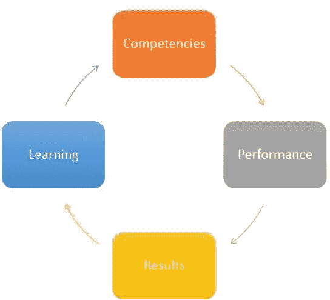

图 5. 学习模型（Reijerse 和 Woldendorp 2000）。

“做得更好”只有在护士、护理专家和护理员在专业且创新的工作环境中工作时才有可能。该环境越来越多地由医疗技术和数字化支持。工作环境必须旨在确保新开发的知识和创新可以应用于医疗实践（Vermeulen 2019）。

绩效和结果管理取决于四个前提条件：

- 必须有一个可评估的目标。
- 必须知道干预措施的效果。
- 必须有关于（当前和未来）环境的充足信息（情报）。
- 处理信息的能力必须足够。

通过可用技术，工作与学习相互促进（Marr 2010）。正是专业人员必须能够就自身贡献与管理层、同事和客户进行对话（Ertel 和 Solomon 2014）。假设存在专业形式的自我监管，其中对自身行为承担责任的意愿是核心（Hoekstra 2005）。

## 游戏规则

医疗专业人员需要应对不同的游戏规则（RVS 2019a，第 19 页）：

- 作为（半）公共部门的服务提供商，他们被期望具备成本效益且合法。
- 作为专业服务提供商，他们需要遵循专业标准和指南。
- 作为受监管市场中的私人当事方，他们必须遵守市场规则。
- 作为社会组织，他们了解不同的利益相关者（当地居民、合作伙伴等）。

护理越来越以复杂性为特征。越来越多的人需要处理多种需求，这些需求在很大程度上取决于特定时间下的具体情境。

复杂性要求重新考虑当前的护理服务。需要一种整合和多学科的方法。其核心在于，客户的偏好和需求将发挥越来越重要的作用（Ruwaard 2012）。此外，安全护理可以被视为其他价值观之间的一个价值观：提供护理的情境以及护理专业人员在此情境中的地位会带来进一步的复杂性。这需要有空间进行评估，并从实践中也会发生的错误中学习。这


客户与医疗专业人员之间的互动始终关乎个体层面的评估（CEG 2019）。

当创造监管空间时，医疗专业人员也会使用它并非显而易见的事。他们接受的训练不是广泛思考，而是成为专家并避免风险；正是在框架内工作才能提供指导和确定性（Bussemaker 2019）。为了使医疗保健具备未来适应性，关键在于澄清必须实现哪些目标，以及特别是哪些规范原则位于这些目标之下（Bussemaker 2019）。

荷兰医疗保健系统运行在三组逻辑之上（RVS 2019）：医疗逻辑、规则逻辑和分配逻辑。在实践中，这些逻辑会发生冲突。更有效地组织这种实践需要关注人的尊严价值。这可以通过让医疗专业人员与客户或公民建立有意义的关系来实现。该过程的两个先决条件是医疗专业人员之间更好的合作以及对限制采取不同的方法。重要的是理解客户。医疗专业人员共同开发治疗客户的新方式也很重要（Bussemaker 2020）。

## 信任

信任的概念因此凸显出来：「当一个行为者为了实现某事而依赖另一个行为者，却无法完全控制或预测该行为者的行动时，信任就是一个问题」（Stoopendaal and Bouwman 2018, 7）。客户与医疗专业人员之间互动的关系性方面将居中心地位。信任有不同的维度（Meurs 2014）：绩效（为结果提供证据）；能力（所需资格和专业知识）；意图（相信彼此的善意）。Meurs：「只有当我们关注绩效、能力和意图时，韧性关系才会产生」（2014, 10）。

韧性是指在保持核心价值的同时适应变化环境的能力。当投资于相互关系、将内容置于中心、保持谦逊、进行实验和学习以及适当问责时，韧性关系就会产生（Meurs 2014）。对医疗专业人员而言，这意味着他们被迫选择个人化方法。除此之外，护理越来越多地在网络和平台等正式和非正式合作伙伴关系中提供。技术发展对医疗保健的组织和提供方式有重大且不可预测的影响（RVS 2019a, 36）。

## 问责

旨在改善护理的问责因此应成为专业行动的核心（RVS 2019a）。医疗专业人员与主管、购买方和政府之间的互动必须是双向的。复杂性要求将问责嵌入迭代过程：共同采取行动、反思和调整计划。这为护理专业人员创造了学习型护理实践的先决条件：客户与护理人员的共同决策，以及对专业人员和客户都有意义的护理提供。

这也有助于医疗专业人员应对医疗需求的特定背景。问责要求医疗专业人员进行自我反思、与客户对话、与其他专业人员和组织对话，以及与外部利益相关者对话（RVS 2019a）。其中还包括对专业行为的横向监督和相互同行互视（Kraaijeveld 2018）。

Elberse (2012)：卫生研究由研究人员和专业人员的想法和利益驱动。这部分是由于医疗保健系统的供给驱动性质。需要系统创新来将该系统转变为以需求为导向的系统（De Haan 2017）。然而，患者参与仅在有限规模上进行。

通过将责任放在专业人员身上，可以围绕工作流程（链条）产生超越自身组织边界的组织形式（Homan 2005）。

## 与客户的互动：专业工作实践的自主权

专业人员还必须面对客户地位的变化。这导致更加果断行为的增加、客户自主权的增强以及对尽可能多的定制化护理的需求。专业人员的视角构成了组织结构的基础。管理提供了一个使用共同标准和价值观的工作环境。出发点是强大的共同利益。

因此，除了对变革过程采取业务导向（工具性）方法外，还应采取旨在发展专业人员的方法（Ardon 2011）。在管理和实施方面，上述内容要求最小干预原则。核心是将尽可能多的决策权放在组织中尽可能低的层级。

通过根据客户自身的个人情境来定义客户，就创造了一种不同的生活形式，并因此对不同的互动持开放态度。无论是口头还是书面语言，都展示了现实是如何被解释、如何被处理、世界中被假定存在什么，以及如何在现实中采取行动。理解是看到联系，因此也是连贯性。在客户与专业人员之间的互动中，理解彼此的语言表达至关重要。特别是初创企业的概念框架，使得对专业人员与客户之间互动的新诠释成为可能。

客户的护理情境以及不同利益相关者（非正式护理、全科医生等）的利益，最好在基本单位（专业人员、团队、部门）层面来看。正是在这个层面，才能在资源投入（人员）、要使用的计划和成本之间实现更好的平衡（Almekinders 2006）。护理安排的多样性、新型专业人员的出现以及各种中介的出现，都在考验着护理专业人员的学习能力（Putter 2017）。

## 创新

专业人员不会自动熟悉技术。因此，使用技术和数字化必须成为工作实践的一部分（也包括教育中）（Zorgpact 2018）。创新技术的应用需要技术和社会的相互适应（ECP 2019）。医疗保健领域的创新只有在嵌入社会时才有效。这意味着它们是护理和技术系统、法律法规、行为准则和规程、用户的价值观和例行程序的一部分（Rathenau Institute 2019）。

数字化主要是一种技术现象。在老年护理中，它主要关乎提高生产力。然而，还需要一种以价值为导向的方法（Wallin 2018）。

技术解决方案帮助医疗专业人员和客户以不同的方式工作（Vilans 2019）。创建合适的框架条件似乎对医疗技术的成功实施至关重要。eHealth应用的数量约为325,000个（Idenburg and Emonts 2019）。

Hinsen (2017) 预计五种技术将产生巨大影响：

- 人工智能：执行独立分析的能力；
- 物联网：设备以智能方式相互连接并与数据连接；
- 网络智能（区块链）：可靠的网络，允许在网络中做出安全决策；
- 增强现实和虚拟现实：现实结构的变化；
- 量子计算：计算能力的巨大（且根本性）提升。

## 融合

Vilans (2018) 描述了将影响老年护理的12种趋势：在线连接、消费市场、大数据、人工智能、风险解决方案、机器人技术、赛博格、无人机、现实技术、区块链、3D打印和生物技术。人工智能（AI）关乎智能技术：旨在为患者/客户提供直接护理，并可以（部分）取代人类护理


提供者（RVS 2019）。例如，经验丰富的医生不再需要预测患者糖尿病的发病（Siebel 2019: 39）。

AI 与区块链的结合改变了数据的创建方式、分布方式以及数据执行的实现方式（Laurence 2019: 98）。区块链技术在医疗保健中的应用对数据管理产生了影响。该技术将使所有医疗保健利益相关方共享医疗数据变得更加有效、高效、安全和透明。因此，医疗机构网络可以在不持有患者个人数据的情况下存在。患者在此网络中通过区块链技术进行身份识别。因此，区块链也可以形成交换患者数据的平台。

存储在区块链上的医疗记录可以帮助医疗保健利益相关方以清晰的方式将所有健康数据部分汇集在一起。区块链和医疗保健可应用的另一个领域是药品可追溯性（Veuger 2020; Veuger en Woldendorp 2021）。

AI 涉及六种系统（Serrurier Schepper and Hiddink 2019）：

- 图像：图像识别
- 文本：理解和生成文本
- 语音：理解和生成口语
- 预测：预测和提出建议
- 虚拟助手：聊天机器人和虚拟助手
- 机器人学：机械辅助工具

## 人工智能

大数据（存储、处理和分析数据的能力）为 AI 的广泛采用和应用奠定了基础：医学影像诊断、自动化药物发现、疾病预测、基因特异性医疗方案、预防医学。（Siebel 2019: 92）。几乎所有当前应用仍然属于“窄 AI”（Nictiz 2019）。这意味着它们是执行单一特定任务的智能计算机系统，尤其是在医学影像领域。

当代 AI 处于青少年阶段（Sahota and Ashley 2019: 104）。缺乏一种针对新问题和以前不存在的变化的“广泛”智能。现实生活是开放式的：没有单个数据点能反映不断变化的世界。在开放的、有限的世界中，数据点永远不够。

因此，AI 目前在雄心与现实之间存在三个差距：

- 可信度差距：我们认为计算机在智能方面看起来像人类。
- 进步幻象差距：我们认为针对简单问题的 AI 解决方案也适用于复杂问题。
- 鲁棒性差距：我们相信当 AI 有时有效时，就会被认为总是有效（Marcus and Davis 2019）。

窄 AI 是指 AI 系统在某个特定领域表现出一定程度的智能，但它仍然是一个在该狭窄领域内为人们执行高度专业化任务的计算机系统。例如，涉及预测肺癌、预测重症监护病房患者的预后、识别皮肤科异常。AI 的附加值在于更加个性化的治疗和预防性医疗保健等领域。医疗保健中的 AI 为个性化建议提供了新的可能性。

这些建议基于来自应用、咨询和医疗数据的个人数据。AI 是计算机科学中专注于执行我们通常与人类大脑相关功能的系统的部分，例如学习、处理歧义、解决问题、识别情绪和具有创造力（Nictiz 2019）。

导致医疗保健改善的 AI 技术示例（TD Connect 2018）：

- 大数据：基于自身档案和大量可比病例的治疗
- 传感器：家庭持续呼吸测试可发出癌症早期信号
- 体内机器人：血液流中可清除血栓的纳米机器人
- 虚拟助手：AI 协助医生进行诊断和治疗
- 识别流行病：基于卫星图像识别流行病
- 痴呆症帮助：记住何时服药

FME（2018）预期，部署 AI、家庭自动化和电子健康可以减少医疗保健的人员短缺。飞利浦的电子重症监护室（e-ICU）被提及为一个示例：通过一种远程监测形式，可以从中心岗位监测多张病床。成本节约不在于减少人员，而在于通过更好的监测减少干预。AI 用于可穿戴技术，传感器可提供例如心率和血压的实时读数。AI 还可用于为个别专业人员制定定制学习计划（Sahota and Ashley 2019）。

Ford：“我个人的观点是，人工智能逐渐证明能够自动化几乎任何常规、可预测的任务，无论其性质是蓝领还是白领”（2018, 5）。这将创造新工作，但许多工作也将消失（Ford 2015）。PwC（2019）的一项研究表明，大规模应用人工智能可以带来更高效、更可及的医疗保健。节约示例包括：

- 肥胖：更有效的自我监测以预防肥胖
- 痴呆症：初级保健中更高的诊断比例
- 乳腺癌：早期检测，减少医生在任何重复性任务中的直接参与

医疗保健中大数据和人工智能的发展仍处于初期阶段。大多数技术进步“以稳步的渐进速率到来并改变我们的世界”。（Browne, 2019: 302）。Davenport (2019:81):“许多认知技术接近足以改变商业模式，但尚未完全达到”。在实践中，实现计算的利益似乎并不容易实现。人类在判断、同理心、直觉以及理解复杂交互等方面尤为擅长。（Baldwin 2019: 236）。这些是提供护理的核心。技术发展促进了三种趋势：赋权客户：对自身健康和护理拥有更多控制权；仿生人类：恢复人体；自主系统：计算机接管护理阶段的部分内容（Idenburg and Emonts 2019）。

## 医疗保健版图

无论这些技术解决方案有何影响，它们都必须适配正确的护理。适当护理定义为（KPMG 2018）：合理（适当），符合指南；任何需要的人都可以在最大可接受指南标准内获得；基于护理和支持的临床结果和患者体验，确定为相同或更好的质量；以最低可能的整体成本（整个链条）。

基于此，成功的医疗保健版图的特征包括（KPMG 2019）：在正确地点组织正确的护理；用于数据交换和互连的技术基础设施；关于数据交换的法规；区域治理；新的服务交付模式，其焦点不在于基础设施，而在于客户及其需求。

## 信息：实现自主的前提条件

## 责任

从客户（更）主导的地位出发，正在从组织转向组织化。这包括增强客户的个人主导权和增强专业人员之间的自我组织，建立网络结构，应用新的技术选项，并实现知识和技能的新分配。

网络护理作为链式护理的自然演进，为应对日益增加的复杂性提供了更多机会。虽然链式护理侧重于优化现有第一、第二和第三线壁垒内的护理，但网络护理提供了基于患者/客户的综合护理需求组织护理的机会，绕过并超越这些壁垒。治疗与护理之间的协作是必要的。这种综合方法以降低成本提高护理质量和感知（Valentijn 2015）。

在老年护理中，社区护士扮演着关键角色，即他们通过与全科医生、其他照顾者和非正式照顾者的联系与协作，在社区中履行中心职能。从这个角度看，客户是护理的中心，社区护士既是其客户护理中的领先专业人员，也是社区内的领先专业人员（De Groot, Maurits and Francke 2018）。这也使他们在互动中的作用变得决定性。

全科医生和医学专家的角色更多地集中在护理流程的责任上。社区护士是塑造互动的关键环节。他们与全科医生以及可能的医学专家相连。随着客户健康状况和需求的变化，医疗专业人员网络会进行调整。根据护理类型和患者的需求，医学专家的角色可以从主动领导角色转变为更支持性的角色或分享特定知识。取决于脆弱老年人的情况，一圈由护理专业人员和非正式照顾者组成的人员将围绕客户形成（FMS 2017）。

在设计数字健康管理时，重要的是要在设计中纳入自主等价值观。Denktank IZO（2019）的研究表明，公民在理解专业人员在信息提供方面的投入方面存在困难。它必须适用于不同人群（多样性）。设计必须提供（隐私）保护（Niezen and Verhoef 2018）。自 2018 年 5 月以来，《一般数据保护条例》（GDPR）已经生效，规定必须为存储和处理个人的所有数据请求明确许可。

## 电子健康

医疗保健将朝着数据流的结果方向发展。有人指出，荷兰医疗保健部门对当前 IT 创新水平持中度积极态度。雄心水平很高（Neomax 2017）。电子健康可以支持护理流程，以提高质量、连续性和以人为本的方法（瑞典护士协会 2012）。医疗专业人员在 eHealth 应用程序的设计中发挥作用很重要：“护士有专业义务以符合核心护理价值观的方式与患者互动并照顾患者，使用 eHealth 时也是如此”（瑞典护士协会 2012, 11）。

电子健康是指通过技术提供的医疗保健，无论是否有医疗专业人员的干预。公民的自立需要一种不同的愿景


与ehealth在实践中目前所呈现的相比：这种实践的特点是大量的工具和应用程序。然而，ehealth是一种思维方式，是一种借助信息和通信技术改善护理的态度（Van Gemert-Pijnen 2015）。它关乎将技术融入工作流程。技术必须更好地嵌入健康干预中。这涉及对技术实际运作有良好的了解，并具备影响行为（接受和采纳ehealth）的知识。

公共卫生与护理委员会将ehealth定义为：“利用新的信息和通信技术，尤其是互联网技术，来支持或改善健康和医疗保健”（RVZ 2015）。ehealth涉及支持客户的网站和应用程序。因为客户可以期望与医疗保健专业人员进行部分或全部接触，因此预计有可能实现成本节约（Rademakers 2016）。

## 需要满足的条件是

- 关注专业人员和公民的能力发展
- 修订指南
- 数据标准化
- 加速结果的透明化
- 对可以接管护理和支持的技术进行投资
- 更高的一线组织程度
- 更多控制并关注扩大规模
- 整合Zvw、Wmo和Wlz
- 适当的激励措施
- 多年议程

满足这些先决条件将使客户能够承担更大的角色，并促进基于信任和跨领域健康愿景的专业人士之间的合作。

使用在线查看、视频通话、应用程序、远程监测和其他IT应用程序等ehealth的各个方面，要求这些应用程序能够很好地嵌入（集成）护理流程（Nictiz and Nivel 2019; RIVM 2018; Vilans 2018）。值得注意的是，供应量大于使用量。尽管专业人士大多持积极态度，但这些应用程序在医疗保健实践中仍嵌入不足。需要的是使ehealth应用程序发挥最佳效果的先决条件。医疗保健流程正在根据ehealth应用程序的附加值进行重新设计。

## 敏捷性

这种新的工作方式侧重于展示专业人士如何使用新的数字工具更好地工作；如何加强协作；如何根据日常工作问题解决和调整数字（工作）环境。客户也是如此，他们可以更轻松地获取信息和服务形式。

敏捷性对竞争力至关重要，并有四个主要构建模块：向外看，遵循良好示范（连接式领导）自组织单元以及建模和生成：灵活的流程和IT。发展敏捷性需要，其中包括：对客户行为的洞察、流程导向的管理、动态能力、网络和情境理解（Veuger 2017, 5）。这意味着一种变革战略，侧重于与客户和专业人士合作，以实现对这种新工作方式附加值的认识（Ten Have, Ten Have and Janssen 2009）。没有这种认识，进而无法解决自身的瓶颈，有效实施几乎不可能。Bisognano表示：“实现更好的健康、更好的护理和更低的人均成本的三重目标将需要新的护理设计和模式。只有通过真正的护理共同生产，以患者和家庭为驱动力，才能实现这一点”（KPMG 2016）。

注意事项（KPMG 2016, 4）是：

- 引入新方法的愿景；技术是支持性的，而不是主导性的；
- 需要系统设计来为客户和专业人士面临的问题提供解决方案。

医疗技术被定义为所有旨在改善患者/客户护理质量的技术。通过在客户附近数字化医疗保健，医疗保健变得更加个性化，从而为个人提供更高质量的医疗保健。因此，技术被视为推动门诊护理增长的重要动力。荷兰居家医疗技术市场估计为23亿欧元（KPMG 2017）。若干结论：

- 治疗和疗法正在转向预防（由ehealth解决方案和智能应用程序推动）。
- 护理变得越来越个性化，医疗技术更侧重于特定患者。
- 医疗技术（物联网）的发展推动了从住院护理（医院/疗养院）向居家护理的转变。

价值和结果必须排在议程首位（KPMG 2014）。它关乎个性化护理。

## 数字健康管理

在这方面，推动数字健康管理的一个要素是预计将有助于缓解医疗保健专业人员短缺问题：这不仅关乎自主权等价值，还关乎医疗保健的成本效益组织（Niezen and Verhoef 2018）。建立数据价值链意味着基于数据及其分析，可以对公民的生活进行干预。

在治理问题方面，医疗保健有特定的价值，例如必须对护理内容以及提供护理的方式给予支持（Berenschot 2019）。使用区块链技术意味着，其中包括自主监管信息提供的完整性和质量，并验证自动化链式流程。目前，荷兰医疗保健领域尚无大规模应用（Berenschot 2019）。然而，国家科学议程确实为技术发展及其对医疗保健等领域的影响提供了进一步解释的框架（Ministry of Economic Affairs and Climate 2018）。

共同决策关乎共享决策制定的过程。RVS（2017）不主张循证方法，而是主张情境导向的实践。必须跟踪客户的特定情境，并相应地关联和部署可用知识。医疗保健专业人员必须将共享决策实践嵌入客户的情境中。这与其说是传播信息，不如说是倾听客户（RVS 2017）。

客户了解护理流程的相关客观信息，而护理专业人员了解客户的偏好。正是结果信息（价值驱动的护理）可以进一步支持医疗保健专业人员和客户进行正确评估（Equalis 2019）。如果共同决策与现有的医疗保健实践相契合，则效果最好。如果医疗保健专业人员能够将该方法论整合到自己的工作方式和专业身份中，他们就会使用该方法论。

当医疗保健专业人员向客户提供信息时，提供解释支持、描绘正确情境并将客户的愿望和目标与可用信息相结合至关重要（Equalis 2019）。护理人员成为向导，为客户提供相关信息并探索客户的价值观和偏好。关键在于让客户参与到自己的护理和可选的选择中，并给予他们反思自己生活中什么重要的空间（Equalis 2019）。

## 消费者驱动的护理

这种形式被称为消费者驱动的护理（CDC）。CDC既是一种哲学，也是一种面向客户提供护理服务的方向，客户在其中选择和确定他们购买的服务（KPMG 2014）。这是一种在澳大利亚开发的模式。“CDC是一种服务交付方式，允许消费者对自己的生活拥有更大的控制权，使他们能够就其所获取的护理和服务类型以及这些服务的交付方式（包括谁来提供服务以及何时提供）做出选择。”

在CDC方法下，鼓励消费者确定目标，这些目标可能包括独立、健康和重获能力。消费者决定其希望在管理自身护理中参与的程度。通过引入个性化预算，CDC为消费者提供了更大的透明度，让其了解套餐下可用的资金以及资金的支出方式”（2014, 7）。

要实现共享决策，需要医疗保健专业人员的其他技能，例如辅导和开放式谈话技巧。关键是将专业术语和思维转化为客户的环境和情境（Huijsman 2013, 41）。这并非理所当然，因为正如一般医疗保健一样，老年护理中很少关注老年人的世界（Luijkx 2014, 3）。在设计护理流程时，客户和护理专业人员的目标和需求并非必然平行（Zwakhalen 2018）。

对数据的情境理解应发生在护理人员与患者之间关于对该患者目前什么是良好护理的对话中；在共享决策过程中，其中关于护理和治疗做出决策。这种过程的影响仍然不明确：医疗保健是否被更高效地使用尚不明确（Delnoij 2019）。

在决策中确定并纳入患者的偏好，会导致客户与护理专业人员之间互动的根本性变化，但这也存在问题，因为许多护理专业人员尚未正确实现这一点。医疗保健专业人员倾向于指导，而在许多情况下，客户的自主权可以更加核心（Ubbink 2018）。

个性化护理是关于尊重护理接受者的个性，护理专业人员将客户视为一个个体，并尽可能为其保障自主权和独立性。护理质量、与客户的关系以及环境有助于客户的独立性。因此，这是一种个性化护理理念（KPMG 2014）。

## 信息提供

客户的故事对于实现同情心至关重要。同情心转化为七个维度（Van der Cingel 2012）：关注、积极倾听、对话、参与、帮助、在场以及对他人的正确理解。护理和同情心以客户的主观故事为出发点。老年人提出的实际愿望不一定转化为生存率、较低的再入院率或独立性下降减少，并且通常不会体现在衡量生活质量的经过验证的问卷中。这些是难以具体化和客观化的问题，与安全感有关，


对恶化后果以及失去控制和自尊的恐惧（2015, 12）。

由于信息可得，专业人员可以独立进行：(共享)资源的分配、自身资源的问责、有效性与效率的映射以及运营计划的制定。RVZ（2014b）就关于患者信息提供的结构提出了建议。首先，让患者（也是被保险人或公民）了解其健康信息。这必须扩展到个人健康记录“PGD”。该PGD（PGO）包含医疗服务提供者的电子病历（数字）副本以及患者添加的数据。患者决定是否要PGD以及由谁管理它。

## 信息标准

最近，荷兰在医疗保健数字信息交换领域的发展已加速。Nictiz是一家荷兰知识组织，致力于医疗保健的数字信息交换。该组织与医疗保健领域共同开发和管理信息标准，这些标准对于信息的正确交换是必要的。示例包括护理移交的信息标准、急性护理中数据交换的标准、产科护理中的标准、实验室数据交换的标准、用药安全以及慢性病患者护理的标准。示例还包括护理传输的信息标准、急性护理中数据交换的标准、产科护理中的标准、实验室数据交换的标准、用药安全以及慢性病患者护理的标准。

信息标准是一系列协议的集合，旨在确保护理信息可以以正确的质量进行记录、检索、共享、交换和传输。护理信息的示例包括血压、出院日期、诊断和体重，也包括婚姻状况、性别和姓名。由于医疗保健领域过于复杂，无法在单一信息标准中描述，Nictiz与医疗保健领域共同为医疗保健专业人员之间以及与其患者之间交换信息的特定且明确定义的情况（用例）开发信息标准。信息标准是与基础设施中立的。

信息标准构成了对电子病历（EPD）等应用程序和基础设施施加的功能和技术要求的基础。数据集是信息标准的关键部分。这包含在特定护理过程及其由此定义的用例中记录或交换的所有数据（临床概念）的规范（https://www.nictiz.nl/rapporten/informatie-standaarden-basis-voor-gegevensuitwisseling-in-de-zorg/）。简而言之，数据集描述了涉及哪些数据。

数据集尽可能基于医疗保健信息构建块（zibs）构建。Zibs是小型信息块，可用于轻松且无歧义地描述信息标准的数据集包含什么。Zibs指定与医疗保健相关的临床和其他术语，例如体重、药物或饮酒情况。图4.1显示了信息标准、数据集和zib之间的关系。基础护理数据集（'Basisgevensset Zorg'；BgZ）是zib的集合。BgZ是医疗服务提供者确定对护理连续性很重要的（医疗）数据的“患者摘要”。在荷兰背景下，已商定BgZ是国家标准。Nictiz在荷兰信息标准和zib的开发中扮演核心和促进角色。

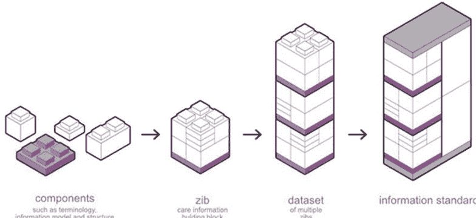

### 图6. 个人健康环境。

从2020年7月1日起，公民必须能够以数字方式查看自己的数据（在线检查：个人健康环境）。临床信息和患者报告的信息均可在个人健康环境中查阅。为了反馈，客户层面的信息与可比客户（像我一样的患者）的信息进行比较（Zorginstituut 2018a）。关于使用结果信息的经验仍然有限（Jeninga和Woldendorp 2019）。

尚不清楚2020年7月1日的日期是否会实现。在客户的主导角色中，数字支持至关重要：

- 对生活方式后果的洞察
- 健康和护理的个性化
- 预防的可能性

区块链将对我们共享信息和执行交易的方式产生重大影响。区块链技术是指无需中央可信第三方即可创建和交换唯一数字记录的能力（Schwab 2018: 87）。区块链需要一个网络：这不仅意味着自身商业模式的改变，也意味着合作伙伴的商业模式的改变。区块链是对事实和交易的共享且不可变的管理，其中计算规则取代原始监督者以确保数据的正确性（Broncker和Veuger 2018: 126）。

任何希望的人都可以在其个人健康环境（PGO）中将健康数据集中在一处。这涉及（BIG注册）医疗服务提供者档案中的医疗数据，但也包括例如从健身房或智能手机收集的健康数据。所有这些数据都可以在PGO中汇总。荷兰卫生、福利和体育部表示：“随着个人健康环境（PGO）的出现，医疗专业人员的工作方式也将发生变化：患者和公民对其自身健康数据的主导权因此将增强”（VWS 2018, 17）。你如何处理特定结果指标及其派生指标的选择，绝不仅仅是一项方法论练习。指标不仅仅是衡量；它们会导致某些影响，因此可用于管理（Delnoij 2019）。

选择指标时的核心问题是谁要求某些信息以及根本问题是什么。是关于有效的护理过程，还是关于选择特定的护理专业人员？（Delnoij 2019, 25）。这就是为什么基于数据的理解过程必须在客户和医疗专业人员之间进行（共同决策）。

因此，只有共同建立PGO才有效。患者根据隐私、功能、易用性、可访问性和成本选择个人健康环境（PGO）。这是根据Patiëntenfederatie（“患者联合会”）的研究得出的结论。Patiëntenfederatie研究的参与者认为，药物概览和医疗档案摘要是PGO最重要的功能。在线管理预约、请求重复处方和请求电子会诊也得分很高。全科医生被认为是医疗信息最重要的来源。医院排第二，药店排第三。

因此，个人健康环境比客户门户更广泛。客户门户与特定的护理服务提供者系统相关联，例如全科医生的HIS。PGO不仅用于医疗保健（提供）。PGO关注自主性（方向、自力更生和自给自足）、更好的生活质量和安全性以及个人较低的成本。这就是为什么PGO整合了比护理更广泛的设施：居住、福祉/放松、教育/工作/日常活动、社区、市镇、健康保险公司。

其理念是，PGO允许患者同时查看来自多个医疗服务提供者系统的数据。患者可以查看的确切数据因PGO而异。荷兰NHG和Patiëntenfederatie共同制定了档案访问指南。这规定了哪些基本数据集必须可供患者在线查看。全科医生的个人工作笔记始终被排除在患者检查之外。


有了PGO，患者有机会更深入地了解自己的健康数据，从而支持其管理健康。自2020年起，患者有权（免费）电子访问自己的档案。此外，患者必须能够指示哪些数据可以或不可以被与其存在治疗关系的哪些（类别的）医疗保健提供者查看。PGO可以是患者获取该电子视图的一种方法。

交换健康数据需要两方：

- 患者使用他想要收集和使用健康数据的应用程序或网站（个人健康环境）。
- 医疗保健提供者的医疗保健信息系统，患者的数据存储于其中。

PGO加强了医疗保健中的网络层面：外部数据流入、有意义的功能和网络结构。客户成为医疗保健中的数字参与者。这加强了客户与专业人员之间的互动。PGO还可以转发信息。PGO是一种终身数字工具，其所有者从各种医疗保健提供者处收集、管理和共享自己的健康数据。因此，患者/客户对自己的（医疗）数据拥有控制权。通过PGO，IT基础设施中的技术干预旨在从医疗保健提供者的源系统提取信息并将其传递给客户/患者的PGO，反之亦然。

在信息传输时，患者负责数据、该信息传输的路径以及与谁共享。医疗数据的管理归PGO所有者所有。医疗保健提供者负责所提供信息的质量。MedMij负责一个个人健康环境，医疗保健提供者的医疗保健信息系统可以在其中不仅安全而且清晰地相互通信。

Quli希望作为公民平台运作。该平台在MedMij标准框架内建立。这是关于客户与护理专业人员之间（VIPP方案）的安全交换。此后已开发出许多信息标准：基本医疗数据（医院护理）；药物；GP数据（上传测量值）；Ggz（市政心理健康）。

## 患者最懂自己（PKB）

在英国，患者最懂自己（PKB）（www.patientsknowbest.com）为1200万（不久将来2000万）客户提供服务。CarePoint Nederland已与PKB达成协议，在荷兰和德国实施。PKB有四个主要领域：一般、社交、性健康和心理健康。

为了充分建立信息提供，CarePoint必须从必须实现什么目标这个问题开始。关键是对此有一个良好的了解。在实践中，这个问题被跳过，导致实施不够可控。PKB的目标是通过信息的新结构和共享，优化医疗专业人员与客户之间的互动。这是关于改善沟通和互动的质量。

COVID-19在实现这一目标中起到了催化剂的作用。在英国环境下，2020年3月至9月期间用户数量增长了77%。一个重要原因是患者和客户不想前往护理提供者处。例如，就像在荷兰一样，医院和居家情况中的需求大幅下降。对替代方案的需求巨大。

医疗专业人员的思维也发生了重大变化。英国医院的数据显示，COVID-19之前，医疗专家发现80%的患者接触必须面对面进行，20%可以通过数字设备进行。六个月后这种情况逆转：80%的患者接触通过数字设备进行，20%面对面。CarePoint在一家大型荷兰医院的计算表明，这种实施节省了100万欧元（更少的空间、更少的停车位和更少的二氧化碳等）。

护理数字化的一个基本前提是，新技术应导致工作流程的根本性重组。如果用于适应现有工作流程，在实践中只会导致成本更高。这意味着技术和社会创新必须同步进行。这是CarePoint引入PKB的要求。在数字化医疗保健时，组织和医疗专业人员因此面临着以完全不同的方式塑造其当前工作流程的战略选择。

引入PKB已在英国为COVID-19带来了更好的容量利用。因为大量老年护理客户现在已连接到PKB；全科医生可以通过问卷进行早期诊断。每天可以为10万名客户提供服务。引入PKB使“症状跟踪”成为可能：通过为COVID-19建立许多标准，在大量人群上铺设一个过滤器，将可用容量集中在可能患有COVID-19的总体部分上。因此，检测设施可以运行得更加有效。此外，这种工作方式使客户与医疗专业人员之间的简单联系成为可能，从而反过来减少了客户中的焦虑和恐惧。

引入PKB是一项根本性变革：在客户与医疗专业人员之间发生互动之前，信息已经共享。这加强了基于此的沟通和互动的质量。反过来，这导致更有效的治疗过程。医疗专业人员之间的协作和协调得到了极大改善。例如，在慢性护理中，客户通常与多位医疗专业人员打交道，英国环境显示实现了显著的成本节约和质量提升。

非正式护理也有很大收获。在共享信息的过程中，非正式护理成为治疗过程不可或缺的一部分。这种定位带来了对自身地位的更好认可。

引入PGO本身并不能解决文盲问题。然而，PKB的设计内置了可视化和语音技术。

PKB的组织还确保防止信息碎片化。CarePoint预计许多应用程序功能过于有限，无法面向未来。更好的解决方案是完全集成到PGO中。PKB的信息架构完全为此而设计。

应用人工智能的可能性也使得可以将PKB用作预警系统。通过汇总生命体征，可以更早地发现患者病情恶化。

与其他系统的链接容易实现至关重要。在这方面的一项重要进展是医疗领域与社会领域之间的链接。越来越多的医疗专业人员选择独立角色。PKB与VmZ平台之间的连接对此有所贡献。社区护士的角色因能够访问特定客户的护理信息而得到加强。

COVID-19的影响是医疗专业人员中存在不同的思维方式。在当前环境下，现有互动形式的延续并不面向未来。除了加强客户的地位（对自身数据的控制）之外，有必要让医疗专业人员密切参与信息提供的设计。技术创新始终与工作流程、专业合作以及与客户互动设计领域的社会创新同步进行。

## 加强专业人员地位

## 创业精神

在护理过程中，可以同时使用不同的现实定义。我们感知到的组织现实，通过组织理论和组织模型以可解释的形式表达出来。因此，提议在组织内部激发创业行为或作为创业者开始时，引入初创企业模型（Van Gaal 2012）。（法语）单词entrepreneur（词典1723）是指通过承担财务风险来组织公司的人。entrepreneurialism一词既可译为创业精神，也可译为具有创业精神。


创业主要指其隐喻用法：主要是关于激发行动（Engel 2015）。对于专业人士而言，自我组织是关于与其他专业人士以及与客户建立联系。创业是指能够应对日益增加的多样性以及随之而来的（可能的）不确定性（Eijssen 2016）。Minderhoud（2017）将创业描述为开发、组织和管理商业项目以获利的能力和意愿。创业同时是一种组织形式、一种能力和一种属性（Blom 2002）。客户与医疗专业人员之间的创业，是指基于客户自立地位为互动赋予实质内容。

创业的一种具体形式是初创公司：一家试图在高度不确定性条件下使新想法成功的新创公司（Kawasaki 2015）。适应不断变化的局面（De Jonge 2015；Maister 1997）。这关乎在一个个案化组建的群体中（个体户群体）进行连接和互补行动。专业人士越来越多地在团队中协作并在网络中运作：这适用于医生、护士、公证人、会计师、心理治疗师、建筑师等。因此，这关乎能够与他人沟通：与客户交谈、与同事商讨、与其他专业群体协调、能够传播新想法（Van de Water 2017）。

简而言之，年轻的专业人士对客户不断变化的世界有敏锐的洞察力，并在其追求卓越的抱负中表现出真诚和灵感。他或她有远见，同时也务实，因此知道如何激发环境。

Blom（2001）：创业者实际上是一种需要学习的职业。人们总是认为：你会在实践中学会。你可以通过管理或创业课程教授百分之八十的创业内容。拥有数字思维是必要的。关键不在于他们今天能做什么，而在于基于他们的思维方式以及学习和成长的能力，他们明天将能做什么（Kane, Phillips, Copulsky and Andrus 2019: 115）。

Van Brussel（2012）区分了四种发展创业的方式，创业程度依次递增：

- 漂浮者：你将职业发展主要交给环境和命运，仿佛搭便车等待可能的机会。你显然依赖于环境。
- 机遇抓取者：你灵活地随环境移动，利用出现的机会来实现个人目标。你是一名扫描者，因此对发展感兴趣，但你会等待，而不是主动寻找。
- 勘测者：你对未来带来的事物持开放态度，你知道你是谁、你能做什么，并以此发现职业机会。除了扫描机会，你还知道如何捕捉其他信号并将其与个人目标联系起来。
- 塑造者：你知道自己未来想要什么，并从自我导向出发为职业生涯设定具体目标。你更多地自行创造，掌握自己的事务，选择自我管理而非依赖环境。

Rotmans（2012；2014；2017）指出，当前的转型（革命时期）是由自下而上的实验塑造的。数字工作环境使得在工作和私人生活之间找到合适的平衡变得越来越困难。要摆脱这种状况，专业人士至少需要更多的机动空间。因此，（社会）创业也在增加，包括选择成为自由职业者的专业人士、希望在社区中自主发展的公民。这部分是出于自身选择，部分则出于必要性。越来越多的人能够且愿意做很多事情，并且也不再想依赖政府或现有机构。

Thomas Davenport 和 Julia Kirby（2016）表示，人们可以在数字世界中帮助塑造自己的未来。他们看到三种发展：提高应对数字工作环境能力的人、组织该数字工作环境的人（超级专家）以及进一步发展数字工作环境并确保创新的人。

## 初创公司方法

### 灵活性

初创公司方法提供了一种侧重于灵活性、应对不确定性和韧性的方法（Brack 2017；Blank 2013；Hoogveld 2017；Ries 2011, 2017）。医疗保健领域新发展的规模并非事先固定（Postma 2015）。

初创公司具有若干特征：

- 可扩展性：你能快速成长吗？
- 搜索：不断测试和验证你的产品或服务是否可扩展；
- 关注技术；
- 创业心态。


初创企业是一家试图在高度不确定性的情况下使新想法取得成功的新成立公司。初创思维有助于突破对改变的抵制，因为现有思维模式已被打破（Ries 2011）。初创企业是一个正在寻找可扩展和可重复商业模式的临时组织（Blank 2013）。其特点是：速度、可扩展性、颠覆性、持续的改进意愿以及使用数字化（Hoogveld 2017）。

初创企业以其创业精神、适应能力和活力而闻名（Woldendorp 和 Woldendorp 2019）。新创企业通常具有个人创业精神。因此，它们能够快速、灵活、果断地运营，从而高效工作、以客户为导向，并轻易察觉新机遇。其精髓在于初创企业的员工表现得像个体公司一样（Brack 2017）。

初创企业的特点是：它们解决问题，证明构思的东西也有效，投资于网络，保持敏捷，并确保自身可见。Ries 谈到了初创企业的心态（2011）。Ries 广义地定义了“初创企业”这一术语：每个试图在不确定结果的情况下建立新事物的人都在进行初创企业工作。其特征在于，你从一开始就做某事，并通过实践学习什么有效、什么无效。Ries 2017：确定初创企业取得成功必须为真的主要假设。开展一个实验，以便快速且廉价地测试这些假设。将每个实验视为学习什么有效、什么无效的机会（Kolb 1984）。运用你的学习能力开始新实验并重新开始。定期确定你是否会采用关键性方法（在不改变愿景的情况下改变策略）。

## 学习

初创企业在定义上专注于学习（Razehgi 2014）。初创方法形成一种具有自身语言游戏的生活形式。这种生活形式启动了企业家的活动，他们从工作一开始就专注于测试自己的想法。生活形式作为一套连贯规则的复合体适用。

Love（2016）为初创企业开发了一条 J 曲线：

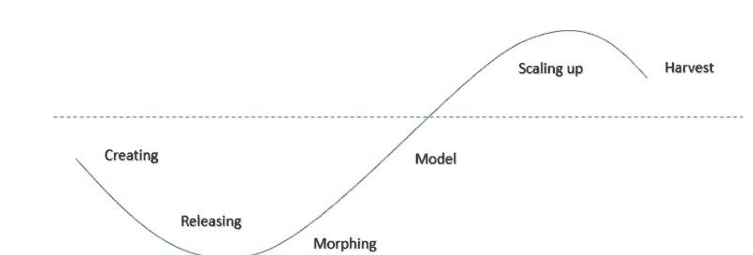

图 7. J 曲线（Love 2016）。

该模型的工作原理如下。在第一阶段，即创意阶段，一切都围绕想法展开。在发布阶段，重点是能够应对失望。在模型阶段，我们确定为了将想法推向市场愿意（或能够）承担哪些成本。

变形关乎适应，也包括根本层面的适应。市场决定什么是成功；因此，适应意味着跟随市场，而非原始想法。这涉及诸如以下问题：客户持有什么看法？什么能吸引客户？规模扩大也涉及三个组成部分：我们能找到合适的人吗？我们资金充足吗？我们能保持工作流程有序吗？通过收获，我们可以“变现”。

每种商业模式都有三个组成部分：提供产品或服务；关怀客户；确保收入高于成本。在初创企业术语中，这关乎 MVP（最小可行性产品）的发布：什么足以发现它是否有效。确保你真正了解客户的想法并组织反馈。通过快速制作产品或服务的最小可测试变体（MVP：最小可行性产品），可以快速测试概念是否吸引目标群体以及在哪里需要调整。提示是：不要过快假设你的（未来）客户或顾客是谁；提前考虑成功的重要衡量点是什么；提供方和买方的需求之间存在重叠。

## 成功

Schevernels（2015）阐述了成功初创企业的七个基本方面：雄心、新发展、质量、文化、人才、专注和资金。必须形成一致的方法：

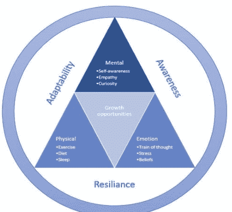

图 8. 成功初创企业的方面（Schevernels 2015）。

Ries（2017）广义地定义了“初创企业”这一术语：每个试图在不确定结果的情况下建立新事物的人都在进行初创企业工作。其特征在于，你从一开始就做某事，并通过实践学习什么有效、什么无效。

## 医疗保健中的视角

## 未来就绪护理

大量全国性伞形组织于2021年3月发布了一份关于为老年人组织未来就绪护理的宣言（Tien uitgangspunten voor toekomstige ouderenzorg；“Ten principles for future care for the elderly”）。瓶颈包括：

- 在政策不变的情况下：老年护理岗位数量必须从2016年的350,000个增长到2040年的700,000个
- 对非正式护理的压力日益增大
- 养老院增长：从2019年的135,000个增长到2040年的261,000个

短期内：

- 加强初级护理
- 法规复杂使得适当护理难以安排
- 等待名单日益增长
- 缺乏合格人员
- 对医疗保健专业人员的重视不足

宣言是对政客们号召，以落实10项原则：

- 关注老年人的需求，并为非正式护理和本地倡议提供空间：建立覆盖生活所有领域的网络
- 更大的简单性、连贯性和合作
- 关注老年人自身生活环境中的预防：加强个人控制
- 政府朝着实现客户数据可靠、结构化交换的方向努力
- 足够多样化的住房形式
- 足够的专业人员就业能力
- 医疗保健中的机遇
- 关于质量的辩论
- 创新和数字化护理的大规模扩展
- 彻底削减官僚主义

其精髓在于，对原则的阐述将导致老年护理的转型。这包括以连贯的方式塑造技术创新、专业行为和与客户的联系。例如，在 VmZ 平台内，我们已通过自己的电子客户档案和每个客户的客户门户实现了这一点。这样一来，专业行动和个人控制就相互连接。我们的 CuraeVitel Balie 居住理念（https://www.youtube.com/watch?v=_vtSJ6JEYC8）将技术、护理、舒适和生活结合在一起。

智能家居技术确保老年人能更长时间继续居家生活。使用此技术，还能确保居民感到不那么孤独。例如，他们可以继续在熟悉的环境中生活。VmZ 平台在 CuraeVitel Balie 客户门户中与 Loxone（www.loxone.com）合作。

通过使用智能家居技术，居民的独立性和自主性得到尽可能长时间的支持。结果，独立生活者的生活质量得到提升。研究表明，老年人将失去独立性和隐私视为极其严重的问题。与摄像头监控或主动监控设备不同，智能家居技术通过传感器检查习惯模式来进行被动监控。

跌倒通常发生在日常生活活动期间。由 Loxone 开发的环境辅助生活的目标是提高老年人的生活质量，并确保他们在技术解决方案的帮助下尽可能长时间地继续独立居家生活，即使他们有身体和/或精神障碍。老年人及其照护者的需求和愿望是将跌倒检测等特定解决方案整合的起点。

得益于智能自动化，可以实现被动监控，识别和管理潜在风险，发出视觉和/或声学信息，并整合生活方式监控。最重要的是，这一切都会自动发生，因此老年居民无需做任何事情。

本章阐述了客户与专业人员之间的互动如何在五种视角中塑造。客户与医疗保健专业人员之间的互动发生在特定的情境中。根据该情境，一种或多种视角的组合具有附加价值。


## 叙事视角：De Hoven VVT机构

De Hoven 是位于北格罗宁根的一家 VVT 机构，其使命是让北格罗宁根的老年人即使变得非常脆弱、需要居家护理、康复或在 De Hoven 受保护居住，也能继续按照自己的方式生活。幸福感是核心，因为他们可以继续遵循自己的习惯。De Hoven 拥有约 920 名员工和约 500 名志愿者。该政策基于这样一个原则：专业行为始终从其对居民是否重要的角度来解读。这一视角是与教授 Slaets（莱顿活力与老龄化学院）合作制定的。其核心在于老年人自己认为什么重要。此外，这关乎有意义的生活：尽管脆弱性增加，仍能过自己的生活。最后，这关乎代际之间的联系。

自 2017 年起，De Hoven 一直与莱顿学院合作开发生命享受计划。使用生命享受计划使叙事视角成为可能。在 De Hoven 内部，使用混合视角：每个客户情况都必须重新审视。此外，系统可能会阻碍自主思考能力。卫生与青年监察局（IGJ）仍然过多地从封闭系统出发工作。（可以通过让亲属参与来突破这一点。）

情境意识很重要。通过理解自己的范式，你会更开放地接受其他方法。这就是为什么有一个个人领导力项目，旨在透过他人的眼睛来看待问题。叙事视角是有方法论的。这种方法论将关注点从“做事”转移到“在场”。故事是碎片化的：这些片段（统计上）被转化为以情感表达的价值。无论如何，这都会导致多样性增加。对自身行为的解释有两个维度：通过指南和 IGJ 的测试（外部）。通过信念（内部）。这关乎价值驱动的组织和行动。

因此，叙事视角是护理的一部分。此外，仍然存在指南（例如洗手）。核心是更好地生活的客户，而不是更好地生活的专业人员。通过个人主导权，关键是进行以信任和平等为中心的对话。改变系统需要勇气。这适用于所有层级：包括监事会（必须基于共同价值观组成）（De Hoven 经理访谈）。在 De Hoven 内部，采用个性化方法：
- 客户参与所有关于医疗保健的决策。
- 存在风险评估的可能性：客户做出的某些决定可能会带来一定风险。
- 专业人员在决策上拥有自主权。
- 护理具有再生性：专注于在脆弱情况下恢复或维持功能。

员工的出发点是与客户及其家属进行日常对话，探讨如何塑造支持，使生活保留老年人及其家人希望赋予的意义。因此，个人生活质量是专业人员行动的指导原则。De Hoven 的目标群体只能对指导功能做出非常有限的解释。目标是基于此与居民的生活环境紧密联系。通过尽可能公开地进行对话，试图了解客户所使用的价值观。

VVT 机构 De Hoven 是参与低控制护理实验的机构之一。对低控制机构的评估（Eindevaluatie 2016）中得出两个核心洞察：
- 价值驱动的工作促进护理质量：从为客户提供良好的护理开始，改变组织的运作方式（在所有层级）以及专业人员体验这项工作的方式。
- 通过关注客户与专业人员之间的护理关系，明确了哪些规则是将良好护理置于核心位置的障碍。

客户和专业人员是护理过程的中心。实验的出发点是基于这种关系重塑护理。客户获得更多控制权，而专业人员促使客户尽可能保留对自己生活的控制权（2016, 9）。这种工作方式需要反思自身的专业行为。然而，在医疗保健的多个层级中，这并不容易。除了以认知为导向的反思方法外，开发其他形式的反思也很重要。

在这个背景下，叙事视角是核心（Slaets 2017）。在实践中，叙事意味着讲述，将对话作为通往他人的桥梁。对话是叙事、个人和关系层面的交流。它需要在场，一种存在感。这个框架需要双向互动以及开放和探究的态度。其中一个重要方面是意识到，赋予人们主导权并不意味着每个人都能用好它。许多居民无法安排自己的生活。正是这一事实，使得努力引导自己的生活变得重要。

从这个意义上说，对话和叙事对生活质量以及因此护理质量至关重要。这个框架不是关于需求，而是关于欲望，关于积极的幸福感。欲望在填写问卷时不会被讲述和听到，而是在关系中变得可知和可感知（Slaets 2017）。在组织护理及其问责方面，一个需要注意的问题是，这种开放的治理方法往往难以实施。

将与居民/家属的对话转化为护理质量成果，对专业人员和支持性行政流程来说都很困难。为此框架尚未开发出合适的叙事问责工具。因为 De Hoven 希望能够在内部和外部对护理质量进行问责，De Hoven 已将故事纳入季度报告。此外，De Hoven 聘请了一位实践研究人员，根据对话和观察，撰写关于（专业）行动的反思。

对于专业人员来说，这不是关于企业家精神，而是关于专业成熟度。重要的是，他们能够指导自己的专业技能。因此，De Hoven 还聘请了一位哲学家，根据对话和观察，撰写关于（专业）行动的反思。已制定一项全 Hoven 范围的计划，以加强幸福感工作，使用格罗宁根幸福感指标（GWI）。幸福感通过格罗宁根幸福感指标进行测量，该指标包含 8 个领域：享受饮食；良好的睡眠和休息；愉快的关系和联系；保持活跃；照顾自己；做自己；在身心上感到健康；享受生活。核心问题是：你喜欢什么？还会询问老年人在上述 8 个领域中认为哪些重要，以及他或她对此有多满意。得分：重要领域数量（0-8）；幸福感的积极和消极来源；满意领域数量与重要领域数量的比率（0-1）。

基于此，De Hoven 的理念是：在护理计划（基于对话的 GWI/目标/护理协议/评估）中可见，护理是在与居民协商的情况下安排的。在政策层面，在“致力于幸福感”的标题下，阐述了将客户的幸福感作为自身行动出发点意味着什么。基于此问卷，与客户/家属就日常生活和护理方面的愿望进行讨论。随后定期举行这些对话。

在 GWI 基础上，我们使用生命享受计划的方法。结果，护理人员更了解居民，知道什么为他们的生活增添色彩；他们能更好地在居民的日常节奏和活动中满足个人的愿望和渴望。提到的主题并不作为清单，而是作为可以在访谈中讨论的主题。对于叙事方法的所有部分，都应尽可能避免工具性思维和行为。

然而，给予居民自由也会产生一些事件（例如陷阱），这些事件被医疗监督人员视为事件。然而，从叙事方法来看，这些是生活故事的一部分。叙事方法的基本原则对 De Hoven 至关重要。围绕生命享受计划的术语并不能真正反映居民的问题。接受脆弱性及其带来的痛苦至关重要（Coolen 2015）。生活质量的前提在于


在这种接受中。鉴于居民的问题，De Hoven内生命历程的结局不可避免地是死亡。

De Hoven间接参与叙事方法的进一步发展。莱顿学院及其他组织正在积极推进全组织范围内的生活享受计划的引入。叙事问责工具也在开发中。De Hoven保持参与。De Hoven利用先前的经验，在整个组织中进行有条理的阐述。其核心在于对“好的对话”的诠释。

技术只有在居民和专业人员理解并能够使用其附加值时才有意义。在De Hoven内，使用了由Slaets开发的电子学习模块。这样一来，专业人员学习曲线的发展对每个人都可及，但思维方式对专业人员来说往往很难。看来他们退回到了传统的工作方式。中央客户委员会对关注良好对话和叙事问责持积极态度。

目标是以这样的方式使用Waardigheid en Trots的资源和质量基金，以加强居民的主导作用。值得注意的是，在质量报告背景下对这些基金的会计处理是叙事方法的障碍。De Hoven多年来一直与斯拉茨博士合作开发叙事会计方法。由De Hoven应用的GWI，在个人层面上就护理质量以及考虑到居民及其在其生命阶段的意愿需要做出什么改变提供讨论。因为GWI不能对护理质量导出良好的叙事问责，所以开始进行“doodle me”技术的培训：关注客户，使生活故事可见，提出问题背后的问题，并将其转化为生活享受计划。

叙事方法不是关于普遍原则、自主，而是关于：

- 跨语境协调的关注（“关心”）
- 对护理的责任（“照顾”）
- 护理本身：技术和道德组成部分（“提供护理”）
- 对差异的认可和承认：差异护理。

当前的质量工具集（质量计划）强加了与居民生活计划联系不足的标准。因此，始终需要考虑在专业人员与客户之间的咨询中，如何使客户的个性保持可见。

核心在于De Hoven与家庭基于对该个性的尊重达成良好协议。在护理实践中，这些往往是困难的考量，因此道德概念“回应性”非常重要。我们必须不断观察由于我们的行为而对另一个人发生了什么，并在必要时进行调整。反思性态度很重要。脆弱性是互动的核心。

生活享受计划的出发点是护士和护理员更好地了解居民：他们的故事是什么？谁对他们很重要？什么赋予了他们的生命色彩？通过与居民的密切接触，护理人员寻找对该人有价值和重要的事情。用照片、图片、图画和姓名制作了一种包含所有信息的思维导图。Doodle me方法有助于对话，并为居民和护理员提供个人把手来进行对话并讨论对居民重要的主题。

## 自我管理视角：Buurtzorg

10年前，过渡计划（2009）就已确立，通过重新定义所需的护理和服务，并以对结果负责的单位中专业人员的自我管理为出发点，社区护理可以实现巨大改进（Lindberg, Nash and Lindberg 2008）。Buurtzorg模型与此一致。自我管理团队的附加值主要在Buurtzorg成功的背景下得到体现。

在Buurtzorg，护理管理掌握在团队手中。团队由3级个人医疗助理、4级以及1至2名5级人员组成。社区护理不一定负责。自我管理的一部分是一切都通过共识完成，所有层级都有相同的控制权。护理以小型团队（约12名专业人员）组织，贴近客户，为护理提供者提供行动的权力和空间。Buurtzorg的成功体现在大量研究中（De Blok 2010; De Blok et al. 2015; Van Dalen 2010; Van Dalen 2012; Green 2016; Nandram 2015; Pool 2011）。这些研究已用于本阐述。

例如，Buurtzorg不是基于护理愿景，而是基于人本愿景。他们建立系统的方式使得自立和独立于护理成为核心。他们与客户一起寻找与其经验和意愿相匹配的解决方案。这需要工作方式的灵活性、知识交流以及对本地语境的关注（Van Dalen 2010）。

Buurtzorg采用的原则是，护理内容只有在提供护理的人对工作组织方式也拥有主导权和控制权时，才能置于中心。因此，Buurtzorg的自我管理要求自我组织：通过试错；多样性和重叠；学习处理负荷和边界；共同解决工作中的个人问题；每个团队都有自己的学习过程；进一步细化愿景是一个持续的过程；每个团队都有其理想的承诺、计划和灵活性组合（Van Dalen 2010）。

自由也与自主相关。根据De Blok（2010），医疗保健组织内的专业人员很少有机会摆脱组织强加给他们的限制。“在Buurtzorg，这些障碍不存在，并且很大程度上依赖于个人“从内部”行动的能力。”

Buurtzorg的出发点是人本愿景，而非医疗愿景（Van Dalen 2010）。这种人本愿景广泛适用于医疗保健：整体性、社会语境、信任、自主和自尊。其区别特征在于将其转化为与实践相关的实践及所适用的规则。Buurtzorg有若干领先的组织原则：

- 组织的出发点是护理内容。
- 护理基于自我组织。
- 支持/指导而非管理。
- 将组织视为持续过程。

客户对Buurtzorg的护理专业人员充满信心（De Veer 2008）。护理和治疗预留了足够的时间，专业性非常好。护理质量被体验为高于平均水平。Buurtzorg有以下目标：客户有一名持续受过良好培训的护理提供者来协调所有护理，并在床边尽可能少地更换不同的人；医疗专业人员有专业自由提供一般性护理；全科医生与Buurtzorg的护理提供者合作。核心概念是对Buurtzorg员工存在信任和熟悉度。医疗专业人员能轻松适应客户的情况。信息传递良好。共享决策（SDM）在Buurtzorg体现为：

- 对客户的个人关注
- 让护理人员和亲人参与
- 客户与护理提供者之间的关系：护理方案与客户和非正式照护共同确定（Van Meijeren 2014）。

少数客户表示，他们被问及关于护理的意愿。如果他们有意愿，这些意愿会被倾听，然后得到满意执行或跟进（De Veer 2008, 25）。实践情况却不同：计划、时间、框架等。使用的护理并不总是符合客户的意愿。

理解和设计系统以及了解系统原则是当前组织的关键能力（Huguenin and Van Gestel 2007; Kay 2015; Lockwood 2010）。一项重要功能是控制功能。这不可见，但其存在（或缺失）可以从系统的行为中推断。为了带来一个


系统受控，控制系统需要与受控系统一样多的多样性。系统的结构赋予控制以形状。

因此，组织需要找到适合其环境多样性的自主与控制之间的平衡。自管理团队的附加值主要体现在布尔特佐格的成功中。布尔特佐格采用的原则是：只有当提供护理的人对工作组织方式拥有领导权和控制权时，护理内容才能置于核心地位。

布尔特佐格之所以受到重视，是因为它把人放在首位。它关注如何紧密连接团队成员（示例：团队成员在布尔特佐格框架内自行寻找办公室并设计室内装潢）。这可能会导致大量协商。技术旨在支持更好的相互协调（Heimans 2018）。

自由也与自主相关。据 De Blok（De Blok and Pool 2010）称，医疗保健组织内的专业人员很少有机会摆脱组织施加给他们的限制。“在布尔特佐格，这些障碍不存在，并且大大依赖个人从“内部”行动的能力。”布尔特佐格现在也有一些框架，可能会成为原始愿景的障碍。

这种管理形式的特点是，员工有空间以自己的方式相互交流。有机会见面、交谈、合作，并共同定义绩效。这意味着专业人员拥有所需资源（信息、技术、权力）。这涉及：

- 质量
- 服务提供
- 成本
- 创新
- 促进自主
- 将系统划分为更小的部分并拓宽视角（从客户角度思考）。

医疗保健专业人员可以独立自主地运作。组织的设置是为了支持客户与医疗保健提供者之间的互动。客户的情况是主导的。布尔特佐格基于客户的需求、可能性、愿望和偏好（护理需求），以及团队中协同工作的护理专业人员的专业性、方向和自主权。责任与权限之间的平衡是（TNO 2012）：

- 自上而下的控制最小化。
- 权限、责任和任务在团队层级明确；员工彼此协调。
- 团队全面负责：结果、运营和人力资源。
- 行政层级无公约；地方协作关系具有优先权。
- 每个团队都有采购预算，可自行决定其用途。

工作内容的问责通过团队指南针进行。最重要的指标是客户满意度。已提供护理的登记支持实践。区域教练查看团队可能做什么，但最终决策由邻里团队做出。管理控制实际上是通过人员控制实施的：招聘受过高等教育的人（Groen 2016）。医疗保健旨在赋能客户，使其尽可能快地变得更加独立。

该方法基于若干基础模块（Transitieprogramma 2009）进行划分。起点是需求指示（基于存在哪些需求以及如何提供支持性、补充性或替代性护理和福利服务的指示）。非正式客户网络在此发挥积极作用：“先邻里，后护理”。存在全面的正式网络。提供高质量且负责任的护理。

护理提供中的关键概念是：平等、对话、互惠、适应性和自主。这转化为来自以体验为导向的护理的适应性帮助。通过在系统内致力于护理独立性、自立能力和客户友好性来实现减负。客户与专业人员之间存在多大程度的协商？

管理方法基于先前描述的递归模型：“高层组织仅在出现非绩效或整个组织完整性受到威胁时才进行干预。这一原则赋予每个较低层级以行动的自由和责任，以符合组织的愿景和目标的精神行事”（Van Dalen 2012, 260）。

整体方法对医疗保健专业人员来说更加复杂，因为他们需要处理更多信息；但对客户来说，这却是一种简化（Nandram 2015）。

创业精神在开发想法和采取行动中发挥作用。布尔特佐格基于（Nandram 2015, 135）的一贯愿景而与众不同：

- 关注客户
- 专业性
- 内部创业
- 实用的 IT 解决方案
- 追求更高目标。

IT 基础设施促进医疗保健专业人员专注于逐步淡出护理。为此已开发了一些指标（Nandram 2015, 101）：

- 平均护理流程时长
- 客户满意度
- 员工满意度
- 团队生产力及与其他团队的基准对比
- 客户时数与合同工时之比
- 每月客户时数的范围及对特定客户群的明细
- 客户时数的平均规模。

这种管理形式的特点是，员工有空间以自己的方式相互交流。有机会见面、交谈、合作，并共同定义绩效。这意味着专业人员拥有所需资源（信息、技术、权力）。你专注于质量、服务、成本和创新。关键在于：促进自主，强调做和体验，使组织设计更加富有乐趣，将系统划分为更小的部分并拓宽视角（从客户的角度思考）。

在布尔特佐格内，工作使用虚拟平台，便于规划、分享经验的论坛以及为创新解决方案做出贡献（Nandram 2015）。

布尔特佐格使用的框架面向客户，但从其自身的专业（以人为本）愿景中得到强有力的支撑。

## 网络视角：网络结构

网络是荷兰医疗保健组织的核心组成部分。荷兰社会正朝着网络社会方向发展（Rotmans 2012; Rotmans 2014; Rotmans 2017）。荷兰社会的转型是“飓风之眼”（Rotmans 2012）的核心。社会不再那么自上而下地驱动：网络和去中心化社区越来越决定发生什么。据他说，合作社、社会重要性和团结越来越受到关注。21 世纪被描述为网络世界。一切都与一切相连：互动是核心。由于事件相互关联，其发生的可能性也相互关联。

此前已指出，专业人员被期望能够在网络结构（网络护理）中运作。越来越多的护理也在网络结构中进行。这意味着管理、专业人员（多学科性）和客户（协调问题）的角色需要重新定义。没有普遍定义的医疗保健网络定义（Verver, Merten and Wagner 2016）。基于这项研究，网络被定义为一种导致客户更好解决方案的合作形式。描述主要关注网络如何自我组织。在此研究背景下，不对网络内部取得的结果发表任何声明。这特别关注平台内部的互动是如何设计的。

关系网络的映射导致系统术语中边界的发现或澄清。边界是重要的连接器。网络有边界：这些边界的流动性各不相同。它涉及组织层级和专业领域内的边界。网络是结构和过程。过程的一部分是创建网络结构的关系和社区。需要一定程度的互动一致性。在启动阶段，网络是一个项目（团队）。当网络转向活动时，它们会发展出共同的身份。随后是自我组织阶段：存在共享技能和合法性感。最后阶段是活动重复自身：它成为实践网络（Pomerooy 2018）。网络的设计方式主要取决于信息如何通过相关组织流动（Aalbers 2015: 8）。网络的成功取决于水平和垂直关系的组织以及如何处理组织和专业边界（Aalbers 2015: 143）。

链式护理在同一资金基础下护理提供者之间有良好协作时适用于护理。网络护理旨在建立集成护理需求，其中不同基础（社会支持法、健康保险法、长期护理法）被绕过和超越（Fabricotti 2007）。由于其集成性质，网络护理具有高度复杂性和高度管理需求（Malby and Anderson-Wallace 2016）。

如本书所示，客户越来越有责任监测自身健康，但也有人对此有困难。客户越来越多地在家庭和自身环境中接受定制护理。在此背景下，他们尽可能自我管理。所有这些发展都需要超越单个护理提供者、学科和部门边界的护理：网络护理（IGJ 2018）。有效的网络护理需要多个前提条件（Kremer 2018）：

- 关注从内部激励人们的价值观
- 信任与明确协议之间的平衡
- 所有参与者的创造力


网络是指个人、组织或小型协会围绕一项任务、一个主题或一个挑战，临时且平等地结合在一起的协作（Willems, Linck 和 Kaats 2018）。医疗保健网络中医疗保健的发展带来了新问题，例如：在医疗保健网络合作中，可以对医疗和护理提供者有何期望？责任在哪里？什么时候需要协调？客户的角色和非正式照护者的角色是什么？谁负责协调？协作需要满足 5 个条件：共同的抱负、明确的利益、良好的关系、适当的组织和运转良好的流程。投资于协作技能可以带来更成功的伙伴关系（Boonstra 2007）。

围绕客户的护理网络变得越来越普遍。居家的老年人通常需要与不同的护理和协助提供者打交道。连同非正式护理，他们构成了老年人周围的“网络”。对于患者来说，这个护理网络良好协同工作很重要，尤其是当患者无法再好好照顾自己时。因此，护理网络分为两大类：组织化的护理提供者网络（链式护理和网络护理）以及围绕客户的个人护理网络（护理网络）。组织化的网络通常涉及关于目标群体或区域内的协议。个人护理网络涉及围绕客户的所有专业护理专业人员。

然而，关于整合式护理下潜在协作流程的了解甚少（Valentijn 2015）。这项研究表明，在发展整合式初级保健项目中，关系协作机制（利益和关系）比管理协作机制（流程管理）更重要。要实现整合式初级保健，需要多元视角方法：以人为本、以人群为导向和价值驱动。Mirella Minkman（2020）描述了达到适当规模的五个因素：

- 规模和容量（大容量可导致地方规模；需要哪些（专业）知识）
- 数字化机会（什么可以远程，什么必须近距离）
- 区域治理：什么和谁可以承担责任
- 包容性与效率之间的平衡
- 区域内及区域间的经验和历史

人类网络是生态系统。当存在“活力空间”时，人们会协调他们的努力。每个个体都会放弃自由，以换取协作所带来的结果。网络中的互动在“我”和“我们”的两极之间移动。通往活力和共创的道路只有在他们愿意探究自身行为效应时才会打开。在发展过程中，一个充满活力的网络会获得涌现属性（Wielinga 和 Robijn 2018）。

链条和网络必须根据客户及其问题的特征进行设计。这还涉及基于临床图景并结合疾病管理的目标群体周围的新型整合组织形式。在多病共存和脆弱性的情况下，护理和支持过程的特点是多样性。因此，这里需要定制化（Nies 2012）。

医疗和青年监察局（IGJ 2018）对护理网络的研究显示了最重要的风险：

- 协作不足
- 非协调护理
- 护理转移不足。

因此，客户与专业人员之间互动的设计是网络结构设计中的核心要素。对网络形成的压力可能源于合作方之间以及合作方内部的关系（Batterink 2004）。网络界定并证明其自身的责任领域。出发点是该责任领域内目标群体特定需求和问题的复杂性和现实性。医疗专业人员可以在多个网络中活跃。网络能提供关于对有复杂长期护理需求的人群的护理和支持盲点的洞察（Van den Heuvel 2014）。

Kreijveld（2012）阐述了个人如何通过互联网相互连接并在网络中协作。通过互联网，社会将更具共创性并承担更多任务（Rifkin 2014）。互联网和社交媒体使协作和开发新想法变得更加容易（Robertson 2015）。另一方面，使用互联网也伴随着风险，例如在隐私领域（Bridle 2018）。

医疗保健中的网络结构被定义为拥有共同目标、共同风险、成本和收益以及共同决策的自主护理提供者（包括个体工商户）之间的伙伴关系。Bloem（《个性化护理》；2012 年演讲）将其描述为护理回路：所有那些寻找人并利用他们来改善其健康的提供者。这通常被证明是一项搜索。顺便提一下，搜索中有许多指南参与（健康保险商；商业方（Lekker Leven；Leefstijlgids）；市政府（Wmo 办公桌）；护理组织（会员协会）和私人倡议（护理合作社））。网络结构的新形式是由公民自行组织护理的倡议：半线护理（Nies 2012）。

Zegveld（2018）：在研究网络时，明确了解界限很重要。网络分析是描述现实（在抽象层面）的一种手段。网络方法基于这样一个理念：网络中行为者之间关系中的模式对这些行为者具有重要后果（Zegveld 2018，45）。社会网络决定了个人和群体所享有的可能性和不可能性。

网络参与者各自拥有自己的目标、资源、优先事项、愿景、目标群体和文化（Van den Else 2017）。在大多数情况下，（技术）产品创新正在开发，而流程创新较少（2017，10）。通过将责任放在专业人员身上，可以围绕超越自身组织边界的工作流程（链条）形成组织形式（Homan 2005）。由于信息可用，专业人员可以独立得出：（共享）资源分配、自身资源的问责、有效性和效率的测绘以及运营计划的制定。

在网络层面，物理连接和数据连接也汇集在一起。通过（数据）平台进行协作变得越来越普遍。医疗网络由来自各个组织的医疗提供者组成。因此，信息交换至关重要（ParkinsonNet 2019）。

从这个角度看，面向未来的医疗公司将被描述为一个网络组织，其中工作的人感觉被一个与其自身价值观一致的共同愿景所触动（Roobeek 2005）。这既可以在现有组织内实现，也可以通过自己创办一家医疗公司来实现。

网络评估可以基于四个层面的结果指标进行：

- 个人：对参与组织内部个人及个别客户的影响。指标是：客户的生活质量或客户满意度
- 组织：对参与组织的影响（转诊、财务健康、知名度）
- 网络：对网络本身的评估：参与者的活跃程度
- 社区：网络对其服务的人口的贡献（当地就业、医疗成本、护理可及性）（2017，2013）

在护理组织内，护理和服务提供流程侧重于以客户友好的方式满足客户需求，这决定了组织设计。

关于初级护理流程的责任和权限在组织中被尽可能下放（自我组织；自我管理）。

实践中，似乎没有围绕独立生活的脆弱老年人的正式“护理网络”。护理和协助的直接领导主要是老年人自己的责任。虽然关注护理提供者之间合作的重要性，但缺乏前提条件似乎阻碍了发展：使（密集）合作成为可能的资金，以及关于数据交换和隐私的协议。

Verver（Verver, Merten 和 Wagner 2016：9）就医疗实践提出了一系列建议：


- 意识到护理及护理提供者是围绕独立生活老年人的（护理）网络的一部分，确保他们熟悉护理与支持合作领域的现有指南和标准以及相关地区的社会地图
- 就如何在（护理）网络内监控控制以及在失去控制时采取行动的协议达成一致
- 识别脆弱客户、其控制程度，梳理（护理）网络（包括正式和非正式）并寻求协调和交换信息

Bloem (KPMG 2014) 在 ParkinsonNet 中将其具体化如下：

- 确保活跃患者能够自行管理护理并参与重要决策
- 确定从患者角度看，价值驱动的护理应是什么样子
- 改变医疗专业人员的工作方式：他们成为患者的合作伙伴
- 提供专家网络
- 将所有这些与 IT 工具相连接

关于护理组织和专业人员如何在护理网络中塑造管理角色的问题表明，几乎没有护理协调员，在大约三分之一的病例中，就护理方面的联系点达成了协议，识别工作主要由老年人自己承担，而且在大多数情况下，护理提供者将指导角色留给了客户。2017 年的研究（Gijzel 2017: 12）表明，客户或医疗专业人员很少使用“自我依赖”这一术语。他们主要使用“个人主导权”这一术语，医疗专业人员有时也会使用“生活质量”。大多数医疗专业人员、客户和非正式照护者对“独立客户支持”这一术语及其功能不熟悉或仅了解有限。根据医疗专业人员的说法，护理计划讨论、社会网络的参与以及志愿者的使用有助于提高客户的生活质量。然而，客户本人表示，他们在自身计划中的参与仍然不足（Gijzel 2017: 126）。

在老年护理中，与家庭及非正式照护在医疗和支持方面的合作变得越来越重要。在专业护理和非正式照护之间建立网络结构时，非正式照护者可以扮演四种角色：作为同事、专家、客户和邻居。哪种角色最突出可能因病情阶段或患者的生活状况等因素而有所不同。每种角色对合作的侧重点不同。大量关注用于支持合作的数字系统。平台技术增强了非正式照护者的角色（RIVM 2014）。

反复发现，在参与机构或护理专业人员的自我管理与将链条转变为物流连贯流程所需的管理之间，在网络中找到合适的平衡是困难的（Hardjono 2010）。经常提到的健康保险公司或市镇的管理角色也似乎对链条的成功或失败影响不足。这往往涉及实质性考量与控制选项之间的张力。通过使用基于平台技术的信息模型，可以部分解决这一困境。

在如此复杂的系统中，链式形成在多大程度上或多或少成功，取决于特定地区或特定患者类别的背景。连接患者（客户）、护理提供者、资源和知识似乎需要大量的（行政）协商。

通过将集成信息系统中的数据合并为报告，可以便捷且可靠地监督运营结果。这有助于监督，并使基于当前事件中的当前数据评估业务结果并在必要时及时调整成为可能。

问题始终是：适当的信息管理如何促进专业人员的工作。关键在于，引入信息系统为医疗组织带来的结果能带来参与度、洞察力、连贯性、关联性、简单性、成本节约、易用性、完整性、可靠性和及时性。这意味着随着数字化发展，专业人员（因此也是客户的问题）是核心。

客户和专业人员的视角越来越成为组织结构的基础。专业人员接受过执行复杂任务的培训。然而，复杂性在决策意义上需要一定程度的自主权。这种自主权使专业人员能够快速应对新的（复杂）发展。

自主权在组织上转化为自我组织。Visser et al. (2012)：通过让客户更多地参与专业决策，可以实现质量提升和成本降低。客户将越来越决定在哪里、何时以及如何提供护理。

专业人员将越来越关注彼此，而越来越少关注自己的组织。在许多护理组织（并非全部）中，可以看到专业人员关注自己的团队和“自己的”客户。自我组织促进了强大的相互团结。在组织形式（网络或护理组织）内，有自由通过例如重新制定规则来创新。医疗专业人员的企业家精神因此引起关注（Koudstaal 2016）。由于信息可以轻松且水平地分发，（新的）偏好、想法和经验容易传播（Ahlers 2016）。

Jeurissen (2016) 指出，护理实践中存在巨大差异，既包括以治愈为重点的护理，也包括对人的护理和照料。自我调节和自我排序本身就是管理复杂主题的机制。有必要结合实际实施来披露现有知识。现实意味着必须考虑到现有利益和现有工具（2016，39）。

初级保健与医院之间沟通不畅会导致护理碎片化。护理的核心是：客户期望更高、新技术和治疗、慢性病和多重疾病患者增加、新提供者。因此，供给决定了问题的类型（KPMG 2014，初级保健悖论）。这使得应对多样性的能力越来越受到关注。

与客户的关系是核心。因此，这主要不是关于服务，而是关于人与人之间的关系（Van der Lans 2008）。该关系的重要特征（应包括）：可及性、对专业专长的认可、相互信任、互惠、亲近感、目标和解决导向。要成功，参与者的以下注意事项必须以可识别的方式制定（Minkman）：以客户为中心、链式管理和物流、结果管理、最优护理、以结果为导向的学习、跨专业合作、角色和任务分配、链式承诺和透明的企业家精神。

Tonkers 围绕非正式照护的组织制定了三种“框架规则”（Tonkers, Van den Broeke and Hoytink 2008），这些规则决定了如何看待非正式照护。道德框架规则涉及你将什么视为自己的职责。历史框架规则与我们自己的历史有关。（“我们过去更加互相照料。”）实用框架规则涉及相关方眼中可用的内容。（“每个人都有电动代步车。为什么我要等那么久？”）框架规则在很大程度上由一个国家的护理组织决定（2008，14）。

在市场力量体系中，适用的框架规则与政府主要负责时不同。框架规则决定我们认为可以要求什么以及如何体验我们的情况。它们由此决定我们的“情感规则”，即我们体验愤怒、失望等情绪的规则。框架规则与情感规则的组合决定了提供护理的生活形式。

专业人员在专业网络中通常扮演协调角色。在这种情况下，非正式照护者对护理提供方式的控制较少。非正式照护者在混合网络中有更大影响力（Tonkers, Van den Broeke and Hoytink 2008）。Tonkers (2008) 区分了 5 种网络类型：

- 混合网络：专业人员、志愿者和非正式照护者的均衡组合。非正式照护者和客户之间的任务分配通常事先不明确。
- 家庭网络。护理主要由（大多是女性）活跃家庭成员提供。属补充性。
- 专业网络。非正式照护者在此属于补充。
- 孤立的关键护理网络。活跃人数有限。


- 关键护理网络令人失望。对专业人员部署感到失望。

在网络中工作可以实现医疗保健的规模化。这包括：广泛服务、强调区域特定护理、投资于IT以及增加职业机会。通过网络化，目标是让患者成为护理的参与者。当被要求回应医疗专业人员已经撰写的内容，或者先进行开放式对话时，控制程度存在相当大的差异。通常，护理计划对大多数客户不立即可访问，这意味着他们可能存在信息赤字。近年来，对客户个人主导权以及医疗专业人员提供定制工作的关注已进一步发展并持续（130）。

医疗保健质量不仅关乎个别公民的问题，也关乎系统。此外，它还关乎客户的地位（Van Leeuwen 2007）。越来越多的消费者将进行产品创新。这涉及改进、创新和定制现有产品以及开发新产品和服务。营销不再面向客户，而是由客户生产（Downes 2014）。消费者和生产者之间正在出现不同的联系：消费者越来越多地自己动手做。因此，组织有必要从根本上审视自己的工作组织（Ten Have 2011）。

在《医学专科2025愿景文件》中，阐述了2025年医学专科护理的雄心、期望和目标。我将讨论对老年护理的可能影响。2025年医疗保健内的信息提供如下：源头进行数字化登记（出发点：更多信息、更少登记）。区分了三种信息形式：

- “硬性”质量标准，例如发病率和死亡率，或来自国家登记的测量值
- “软性”质量标准，例如患者反馈、服务测量以及个人或团队评估
- 效率信息：每次干预或治疗过程的成本、请求或处方行为

（老年）护理致力于在物理和数字上发展护理专业人员的护理网络。护理网络以客户需求为出发点；网络中的不同参与者在不同时间可以创造价值（Van der Krogt 1995）。这样一来，围绕客户形成了一个包含各种专业知识和非正式联系的网络，有助于护理过程和生活质量。

数字化发展在此中发挥着重要作用。医学专科专家在开发、评估和实施真正为患者增加价值的技术创新方面发挥主动作用。这就是为什么患者被明确纳入创新的开发、采用和实施中。对护士和护理专业人员（Peters 2014）来说，这意味着：

- 病情更严重的客户、更多的多重合并症、更复杂的护理情况（住院和门诊）
- 关注自身健康和行为、关注参与、关注客户（在社交网络的帮助下）仍能做的事情
- 更加关注预防（预防恶化）
- 从“照顾”转向“确保”：自力更生、自我管理和自我管理
- 与非正式照护者合作
- 更多的门诊工作（跨部门团队）
- 更多灵活性要求，更多自主权
- 使用护理技术
- 数字化沟通和数字化数据记录
- 广泛部署：不同目标群体、生活/日间护理
- 在护理路径中工作，专业化，较少泛化
- 护理职责增加，包括承担医生的部分职责

因此，护士的角色更侧重于指导网络。高质量和高效率的护理需要信息的非时空依赖性交换和可用性：无论是对护理专业人员，还是对患者及其照护者。在医疗保健提供中，专业人员或组织很少被单独视为一个整体。尽管客户认为与专业人员（照护者、护士、医生等）的关系是核心，但专业人员依赖于他人的投入。当然，客户体验服务的方式很重要。对专业人员而言，核心价值观和工作环境是相互关联的。

2008年至2011年间，有一个名为Palliative Zorg的平台（Poortvliet 2011）。该平台的目的是实现临终关怀行动计划中的行动要点，监测进度并评估行动计划。该平台没有选择关注初级流程（医疗保健提供者、专业人员、志愿者和患者），而是选择政策关注。

Poortvliet说：“因此，项目有些更抽象，在实践中不直接适用。这就是为什么好处在实践中不立即明显，而主要涉及间接影响”（2011: 22）。瓶颈被确认为一半平台成员缺乏对临终关怀的连贯和共同愿景（2011: 26）。该平台在网络功能和议程设定方面具有附加值。

志愿者的部署主要基于适合对他人有意义的标准和价值观（Rossen 2012）。志愿者组织的前提是提供赞赏、满足感和自我决定的空间。

老年人有权获得尊重其地位和角色的积极进取的专业人员。愿景必须说服客户，而不是劝说他们（Geursen 1996; Geursen 2000）。工作方式应围绕客户的问题来组织。核心价值观构成决策过程的基础，并决定管理层、专业人员和客户如何互动（Older people 2004）。

身份认同涉及（可识别且可体验的）愿景、核心价值观和动机等概念。所研究的案例之一是“Netwerk patiënt onderzoeksvragen”（“患者研究问题网络”）。由于社会地位差异以及两类人群知识的附加值，专业人员与患者之间的关系可以描述为不对称。因此，Elberse（2012）主张采用包容性策略。他区分了三个类别：

- 情境：与准备和组织相关的预防措施（创造基本条件）
- 行为
- 言语互动。

人们常常没有意识到，他们通过言语和非言语沟通排斥了他人。网络提供了机会，确保人们觉得自己是群体的一部分。改善患者与研究人员之间伙伴关系的策略应侧重于必要能力的培训（对患者参与的认识、积极态度、技能和知识）以及构建强大的网络结构。

## 客户视角：平台结构

本章描述了一系列从客户视角设计的平台：

- “Humanising van de ouderenzorg”平台
- “Nieuwe zorg”平台
- “De Academische Werkplaats Ouderenzorg”平台
- Stichting Digitale Zorg
- Samenwerkende Academische Netwerken Ouderenzorg
- OZO Verbindingorg
- Zorgplatform ouderen
- Nationaal Programma Ouderenzorg
- Beter Oud
- IkWoonLeefZorg.nl

平台种类繁多。在本研究的背景下，寻找那些能提供客户如何参与服务设计见解的平台。描述主要关注网络如何自我组织。在本研究的背景下，不对网络内部取得的结果发表任何看法。具体关注的是平台内部互动是如何设计的。

使远程监控和护理成为可能的技术将被越来越多地使用。这进一步增强了客户的自我导向（自我管理）。IT基础设施（电子客户档案）同时支持照护者和专业人员（Kool, Verhoef and Kremer 2014）。这使得围绕客户及其网络的护理更加以人为本。在确定客户需要什么时，客户及其社交网络成为出发点（Noddings 2002）。关于客户平台的研究表明，客户可以彼此学到很多。护理符合客户的需求以及客户自身网络无法处理的事项（Poortvliet, Vennekens en Heine 2011）。

平台技术将如何增强客户（和专业人员）的地位？Parker（2016）：平台是一种基于生产者和消费者之间价值创造互动的业务。平台是技术、技术、经济和社会规则及协议（例如标准）的共同基础，多个参与者可以在此基础上共同开发额外的技术、产品或服务（Kreijveld, Deuten and Van Est 2014）。

组织总是以某种方式围绕规范或利用供需摩擦而展开（Strikwerda 2014）。例如，医院组织了生病的人和能够治愈的人之间的供需摩擦。平台摩擦消除了这些摩擦。因此，我们正在从组织转向组织化（Aslander（2010; 2015）：临时伙伴关系）。IT和平台越来越成为组织的关键成功因素。这也适用于专业人员：通过使用平台，您可以保持自己的知识。组织可以通过自身创新、伙伴关系或技术投资来创造获取最新技术的途径。

平台以极低的成本构建全新的商业模式，摧毁旧市场。一个重要元素是免费可获取信息的影响。组织越来越多地被设计为平台（组织化）。平台技术增强了客户（和专业人员）的地位。Parker：平台是一种基于生产者和消费者之间价值创造互动的业务。Kreijveld, Van Deuten and Van Est（2014）：平台是


技术、技术、经济和社会规则及协议（例如标准），多个参与方可以在此基础上共同开发额外的技术、产品或服务。

重要的元素是客户（以及医疗专业人员）可用的信息。个人健康环境或个人健康记录是一个网站或应用程序，可让患者访问自己的健康数据。这涉及由例如全科医生或医院中的医学专家存储的数据。患者可以在个人健康环境中使用这些数据，也可以记录自己的数据。

平台是技术、技术、经济和社会规则及协议（例如标准）的共同基础，多个参与方可以在此基础上共同开发额外的技术、产品或服务。在组织医疗流程方面，这涉及组织灵活的能力，以客户的意愿和时间表为出发点，提供以价值为导向的医疗（面向客户），并识别和消除障碍（Rummler 和 Brache 2013）。

这导致了客户与专业人员之间互动的完全不同的方法。专业人员在（开始）与客户作为主管合作方面发挥核心作用。除了适当的胜任能力和技能外，他们还需要更多的专业空间来做到这一点，以及相应的组织结构（网络结构）（De Laat 2012）。

平台还侧重于合作社等组织形式，这些形式有助于老年人对其生活保持主导权，并促进本地合作。社会技术支持继续独立生活的能力。此外，正在开发跨领域护理、早期检测和预防模式。在医疗保健中，你看到支持医疗流程的应用程序数量在增加。

Andries Baart（2013: 25）指出，弱势人群的参与必须首先来自他们自己，然后来自照护者和亲近的邻居。只有这样，专业帮助和护理提供者才会介入。基于此，公民（公民倡议）的作用变得越来越重要。对于医疗流程的组织，这涉及组织灵活的能力，以客户的意愿和时间表为出发点，提供以价值为导向的医疗（面向客户），识别和消除障碍以及监控质量。

越来越多的公民正在组织自己的护理，或为社区建立平台：mijnbuurtje.nl、buuv.nl、burenetwerk.nl、voordebuurt.nl。人们将通过“医疗万物互联”模型了解自己的健康状况。例如，提供预防性改善自身生活方式的建议。如果需要治疗，平台将帮助做出选择。然后，医疗服务提供者可以自行提供服务。

已经确定，荷兰医疗保健系统正在走向一个具有（更多）动态性的环境，客户将“（更多地）自己支付和决定”（Boer 和 Croon 2011）。

通过引入平台战略，个人主导权和控制力得到了提升。这涉及“开放”创新的原则（Chesbrough）。此外，这不仅仅是关于开发创新，更多的是关于如何组织所发明的创新（Elsen 2017）。这里的关键词是：自我组织、紧密的社会网络和与客户的合作。这是关于组织的虚拟化：专业人员在与客户的对话中发展。

Zohar（2017）指出，新的组织概念基于：对人和系统的信任；建立关系和团队；保持灵活性，并与变化的环境保持对话；对各种可能的未来场景保持开放和准备（Harari 2016）。这也意味着更加强调意义、愿景和价值观，特别是服务的价值。尤其是客户与专业人员之间的对话（以及倾听的能力）是必不可少的。

专业人员在理解客户需求、基于自我组织与其他专业人员合作、拥有实验空间以及能够说明情况方面发挥作用。部分由于老年护理劳动力市场紧张，对远程护理的兴趣日益浓厚。ehealth的一个例子是欧盟委员会的“Alfred”项目。正在开发应用程序和传感器，使语音命令更加便捷，并向专业人员和照护者传输信号。

在数字化的影响下，护理流程的组织方式有所不同。传感器技术（“引导环境”）作为早期痴呆患者的记忆辅助工具。一个例子是护理组织Siza，它为残疾人开发了量身定制的住宅。该住宅配有智能应用程序和应用。

有效的组织模式旨在妥善实施护理流程，其中各种产品和专业知识被相互结合。使用的标准是：匹配客户的需求（以需求为导向）、高效便捷地获取医疗服务、充分的信息提供、在专业人员之间建立联系、确定资金基础并确定医疗的管理模式。

老年护理领域出现越来越多的平台。“Humanising van de ouderenzorg”（老年护理人性化）平台专注于（通过讲座）阐明什么是良好的老年护理，以及如何为意义建构问题创造空间。通过Ouderenzorg平台，人文大学的研究人员与专业人员和志愿者分享有关老年护理的知识和专业知识。该平台由非正式护理伦理方面教授和弱势老年人赋能特聘教授协调。

“Nieuwe zorg”（新医疗保健）平台还组织医疗保健辩论，政界人士、医疗服务提供者、患者组织和医疗保险公司就老年护理相互讨论。Stichting Digitale zorg（数字护理平台）是一项由在护理、IT和创新领域活跃的人发起并为其服务的倡议。其目标是为ZorgICT倡议和创新的成功开发和实施做出贡献。为了实现这一目标，收集国内外（欧盟）的知识和新闻，分享知识并开展活动。

“De Academische Werkplaats Ouderenzorg”（老年护理学术工作场所；AWO）平台是林堡省的一个虚拟工作场所。工作在各个组织的不同地点进行。马斯特里赫特大学发挥中介作用，建立研究、实践和政策之间的联系。每个参与的医疗机构都与马斯特里赫特大学的一名高级研究人员合作。

六个“Samenwerkende Academische Netwerken Ouderenzorg”（老年护理合作学术网络；SANO）现在拥有结构性资金。由ZonMw实施的额外结构性融资，提供了关于例如护理组织创新的影响、与劳动力市场的智能连接以及疗养院护理质量进一步提高等方面的新知识。这些新知识将在荷兰全国所有疗养院中提供。

OZO Verbindzorg 是阿赫尔胡克西部医疗服务提供者的一个数字平台，由患者自己驱动。各种护理提供者，如全科医生、家庭助手和照护者，将很快能够通过该平台相互联系。客户决定哪些援助提供者可以访问该平台。当客户本人无法管理平台时，在协商后，该任务可以交给家庭成员或照护者。但是，客户始终保持主导地位。OZO Verbindzorg代表合作和护理共享。所有参与客户护理和福祉的各方（非正式照护者、家人和护理提供者）都聚集在一起。围绕客户形成了一个网络，客户决定谁将参与。

“Zorgplatform ouderen”为弱势老年人护理提供知识和专业知识。这涉及提供工具、实践护士和实践助理指南。该平台是V&VN Praktijkverpleegkundigen的倡议。

国家老年护理计划（Nationaal Programme Ouderenzorg）从2008年持续到2016年（125个护理项目）。它涉及以不同方式组织护理和支持的创新项目。国家老年护理计划的第一阶段从2008年持续到2013年，预算为8000万欧元。由此，资助了75个过渡实验、研究项目和实施项目以及8个区域网络。该计划旨在改善对有复杂求助需求的老年人的护理；老年人明确地亲自参与其中（Bussemaker 2019）。


许多实验关注基于老年人需求的护理和福利的不同组织形式。许多项目关注对老年人问题的及时发现、护理计划的制定以及适当的衔接与协调。第二阶段从2014年持续到2016年，预算为900万欧元。这笔资金旨在进一步传播和保障成果。BeterOud平台和8个区域网络确保这一点。

BeterOud平台由Movisie和Vilans开发。它由ZonMw提供支持。它与‘国家老年护理计划’（‘National Programme for Elderly Care’；NPO）合作并源自该计划。它与Habion、Movisie、KBO-PCOB、NVOG/KNVG、ROS网络、Social Work Netherlands和Vilans合作。此外，Laego和Pharos组织也密切参与。BeterOud专注于提出和开发新举措。

Rabobank设立了IkWoonLeefZorg.nl。这里收集了关于更长时间独立生活（技术和数字支持）、护理和援助、财务及社会活动的信息。Woonz.nl提供关于老年住房相关服务的信息。ikwordzzp’er平台专注于为起步的个体户提供信息。

平台种类繁多，使得难以获得清晰的图景。另一方面（OZOverbindzorg），明确选择了以客户为中心的积极立场。许多其他平台旨在从专业领域为老年护理的更新赋予实质内容。老年护理问题被视为出发点。

## 护理技术视角：PlatformVmZ

Platform Verbinden-met-Zorg（“连接护理”；PlatformVmZ）作为护理专业人员（自雇专业人员）、护理机构和客户的基础设施而建立，以便他们尽可能得到最佳支持，并由我共同创立。自2017年1月1日起，PlatformVmZ专注于社区护理，特别是非合同独立护理专业人员（自雇专业人员）和（较小的）护理机构。该基础设施根据全国适用的条件和标准建立。目前，约有1300名个体户与PlatformVmZ有关联，以及100家（较小的）护理机构。

此外，还建立了一个客户门户（CuraeVitel Balie），除了护理服务外，还为希望尽可能长时间在家独立生活的老年人提供生活和舒适服务。老年人在浏览护理系统方面也会得到支持。

平台技术创造了连接客户、合作伙伴和提供商的新生态系统（Evans 2016）。这带来了更具整合性的方法，并确保质量得到提升、成本得到降低。平台是技术、经济和社会规则及协议（如标准）的共同基础，多个参与者可以在此基础上共同开发额外的技术、产品或服务（Parker 2016）。对于医疗流程的组织，这涉及组织灵活的能力，以客户的意愿和日程为出发点，提供以价值为导向的医疗（针对客户），并识别和消除障碍（Kuiper, Van Amelsfoort and Kramer 2010）。

医疗企业家平台于2017年推出（www.platformVmZ.nl）。客户门户（www.CuraeVitelBalie.nl）于2018年建立，以便客户可以在线自行安排护理。2019年，根据Stimulering E-Health Thuis（家庭电子健康刺激；SET）补贴计划获得了一项补贴，以使客户门户可供广泛的客户群体使用。

PlatformVmZ与健康保险公司、医疗机构、医疗利益团体、全科医生、医院以及卫生、福利和体育部保持网络关系。从CuraeVitel Balie，与全科医生、医院、健康保险公司、患者协会、Per Saldo和市政当局有网络联系。

数字化使客户与医疗服务提供者之间的关系发生了根本性变化。客户越来越了解自己的局限性和专业人员的行为。这一发展将导致客户自我管理能力的增强。护理组织的信息管理必须相应进行调整。此外，还存在一种越来越精确的（物质）控制形式。

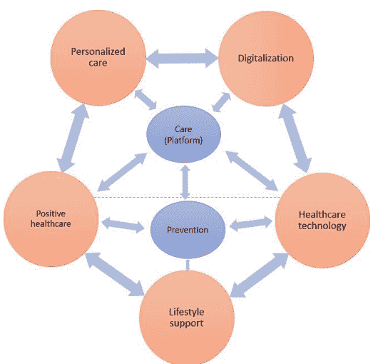

图9. 护理平台（Thomas Woldendorp编制）。

如果小型医疗机构的（行政）问责不规范，它们将越来越受到关注。对于大型医疗机构，越来越多地关注监控和保护数据。该方法基于护理内容、组织形式和IT基础设施之间的（整合）连接。PlatformVmZ的成立旨在从这一视角更大程度上塑造医疗保健。

## PlatformVmZ结构与服务

### 顶层实体
- 护理机构：招聘、分包商、结算、付款、质量保障、控制仪表板
- 医疗办公室：合同、对账单、付款、质量保障、控制仪表板
- 医疗保险公司：对账单、付款、医疗采购、付款协议、质量保障、控制仪表板
- 市政当局：对账单、付款、采购、质量保障、控制仪表板

### PlatformVmZ内部结构
- Stichting Verbinden-met-Zorg WTZi（100%所有权 -> Verbinden-met-Flex BV）
- VerbindenBV（50%所有权 -> CuraVitel Bale BV（房地产与医疗））
- 连接：合同服务，例如软件
- 标签：- VmZAdvies，- Verbinden met Studenten，- De Start-Up Professional

### 底层服务流
- 左路径：护理请求，选择护理提供者，客户门户 -> 客户
- 中路径：护理内容（ECD），确保独立性，支持，护理行政 -> 自雇专业人员
- 右路径：咨询，Beheer 'on demand'，Virtueel hoofdkantoor -> 护理机构

### 关系
- 客户 <-> 匹配 <-> 自雇专业人员
- 自雇专业人员 <-> 招聘 <-> 护理机构
- 护理机构 <-> 边学边工作的学生 <-> MBO / HBO
- 全科医生，医院 <-> 安全数据传输 <-> 自雇专业人员 / 护理机构

图10. PlatformVmZ结构（Sander Duindam编制）。

Bloem主张个性化护理：护理有助于个人对健康收益的自身感知。如果护理是透明的，这是可能的：护理的有效性、质量和成本是什么？PlatformVmZ认为，在这种情况下，导航作用非常重要：我如何掌握我周围发生的事情？因此，开发了一个个人客户门户（CuraeVitel Balie），使护理接受者可以跟进（并确定）围绕他们应该发生的事情。PlatformVmZ旨在以客户的个体多样性（多样性）为出发点。因此，PlatformVmZ有一个私人客户门户，以便客户自己可以充当“总部”。客户在获得护理（Wme、Zvw和Wlz）方面得到支持。客户可以了解与其医疗需求相匹配的医疗专业人员的档案。选择某些医疗专业人员的权利在于客户。客户可以了解所指示护理与所提供护理之间的平衡。他们（或授权网络）可以了解护理计划以及护理专业人员之间的沟通。

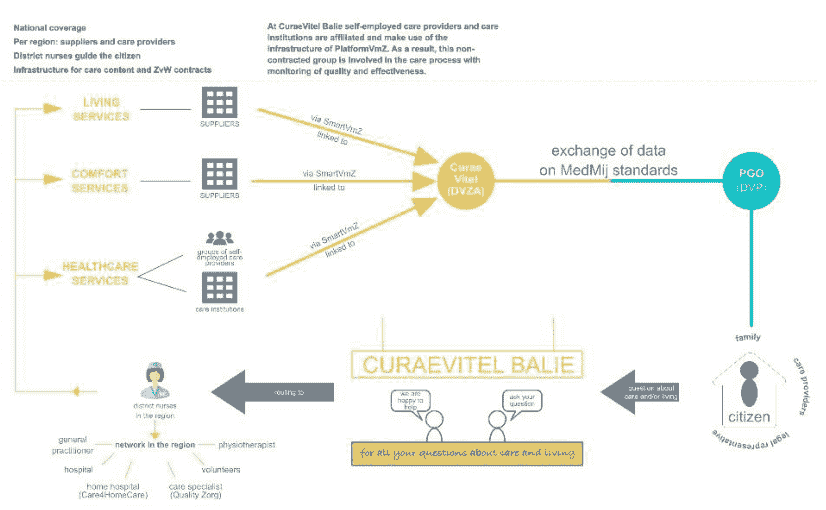

图11. CuraeVitel Balie，由Sander Duindam编制。

通过引入平台战略，个人主导权和控制力得到了增强。作为专业人士，你可以通过平台技术实现你专业的高质量落实。得益于平台技术，客户直接掌握方向盘。除了为自雇专业人员建立的平台外，还为老年人建立了一个客户门户。在CuraeVitel Balie，一切都关乎为公民增值的生活和护理。


CureaVitel Balie 也设置为帮助台，荷兰所有公民都可以就家庭使用护理、生活或舒适服务提出问题。公民在个人数字助理的指导下解决这些问题。这样一来，公民获得医疗保健（Zvw, Wmo, Wlz）的途径变得更加容易。

IGJ（医疗和青年监察局）已为住院护理发布了新的评估框架。客户的意愿和愿望是提供护理的出发点。专业人员与客户之间关系的特点如下：
- 专业人员了解客户（病史；什么重要等等）
- 关系平衡且尊重
- 为客户及其亲友倾听
- 客户掌控局面。

2016 年底，该框架为为居家脆弱客户提供护理的专业人员网络而制定。最重要的出发点是：
- 客户视角：护理对他或她适应能力和个人自主权的贡献；
- 网络：专业护理提供者、非正式照护者和志愿者之间的协同工作；
- 脆弱客户：专门针对风险最大的公民进行测试；
- 标准：从客户视角出发；
- IGJ 的角色：护理质量。

该评估框架包含以下主题：
- 以客户为中心：在与客户协商中确定护理需求；客户了解护理流程；增强自力更生能力和自主权；
- 整合护理：客户感觉到专业人员之间有相互联系，且护理得到协调；
- 非正式照护：照护者可以指望专业人员考虑其能力；
- 安全：护理提供者会及时发出关于家庭/居住情况的风险、用药安全、家庭暴力报告守则、医疗辅助器具和医疗技术等方面的警示。

通过该平台，护理提供者（和客户）参与上述主题。例如，可以及早发现并监控偏离测试标准的情况。医疗专业人员在独立履行其角色的所有方面都得到支持：评估、制定护理计划、规划、登记工时、开票和开票、保证独立性和支持专业性。这适用于（递归）层面的个人诠释、团队和医疗公司（例如，医疗合作社）。

目前，独立执业的护理专业人员数量明显增长（目前约有 121,000 名自雇专业人士在护理领域工作，占总数的 10%；Trouw）。鉴于各项发展，PlatformVmZ 在此阶段专注于支持希望在医疗保健领域以企业家身份（个人或集体）工作的医疗专业人员。为保证独立性，关联的自雇专业人士在行动上完全自主。适用法律法规受到监测，且社区护理标准框架适用。

根据过去一年半的分析，PlatformVmZ 对非合同独立护理提供者（自雇专业人士）的运作方式有了清晰了解：
- 对医疗保健（行政和内容）方面法律法规的了解一般；
- 对（非）合同护理条件的了解一般；
- 缺乏同事间督导、同行评估和其他专业知识促进；
- 驱动力为金钱（宁愿为需要大量护理时数的客户提供护理，也不愿为许多护理需求较低的客户服务）；
- 一组独立的社区护士以设定适应症为核心业务。

在这些情况下，这些社区护士还会提供大量适应症（每年超过 200 个）。因此，护理流程面临压力，协调和监控的时间减少，六个月内更频繁地进行评估，并且不参与客户事务。

PlatformVmZ 被设计为一种基础设施。这意味着护理领域的自雇专业人士和组织使用这些服务，以便在法律、护理相关和护理行政方面高水平运作。VMZ 平台拥有自己的模型协议，以保证门诊护理和住院护理中的独立性。

客户可以了解并管理护理提供者，可以自行确定规划，了解预算（使用 PGB）和护理流程的进程。由于这些信息收集在客户门户中，家人也可以关注情况并进行调整（远程）。为促进效率，目标是减少（最小化）适应症领域中现有的实践差异。这是通过标准化（并数字化支持）适应症流程来实现的。

PlatformVmZ 搭建的基础设施不仅涉及数字平台（ECD）或护理提供者与护理问题/任务的（在线）匹配，PlatformVmZ 还与护理提供者和健康保险公司达成协议。此外，还与为（独立）护理提供者提供新机会的公司建立合作伙伴关系。

在 PlatformVmZ 内，电子客户档案（ECD）是根据医疗专业人员执行的工作流程建立的。除了 ECD，该平台还拥有自己的匹配软件，以简单的方式将服务（护理请求）和护理专业人员的可用性结合起来。护理需求与个人档案（专业水平、经验、保留程序、出行距离等）相关联。从而以简单方式实现平衡。

PlatformVmZ 的设计使人身绑定资金模型和个人健康环境可以轻松安排。客户在整个护理过程中知晓将使用的护理，并与自雇专业人士直接联系。PlatformVmZ 开发的客户门户基于若干假设：客户对医疗保健拥有最佳控制权；客户对其自身数据/档案拥有完全的了解和管理权；客户必须能够确定谁可以访问哪些数据（非正式照护者、家人、全科医生）；客户必须能够积极参与护理流程，例如自行记录数据（报告、测量、社交联系、沟通、协议等）；客户可以完全访问其自身数据，例如护理计划、协议、议程/规划、文档；数字化签署护理计划、协议、护理部署；客户必须能够就护理质量和部署轻松沟通。

我们的合作伙伴 Deladus Healthcare Systems Group 认为，全球医疗保健提供者数据丰富但洞察贫乏，主要原因是应用孤岛、旧版数据模型、影子 IT 以及缺乏预算从其已有的海量数据中获取价值。

跨提供者、流程（临床、行政、公共卫生和临床研究）和 IT 系统的患者数据集成是数字化的基石。借助“智能”数据集成平台，集成不仅被视为数据聚合，而且被视为在整个护理连续体中集成不同利益相关方，以及在应用程序架构生态系统中集成现有供应商的能力。

号召是赋能医疗保健利益相关方，使其能够更有效地参与并实现基于价值和以消费者为导向的医疗保健。重点是通过支持新的数字能力、运营效率以及更高水平的（临床）效能，来支持患者和客户体验。

医疗保健可以通过为患者提供更多便利性、个性化和价值的平台来提供。数字健康平台可以创造所需的场景，以便


更好地整合传统和下一代互操作性服务，以支持分析和运营工作负载，这些工作负载利用历史数据（即，患者记录、临床研究、报销）和数据流（来自医疗设备、物流系统、可穿戴设备等）来构建新的信息桥梁和流。随之而来的信息架构可以更好地支持实时决策和智能驱动的工作流，同时赋予组织获得弹性基础设施属性的能力，从而为未来实现更高水平的业务敏捷性。

基于云的数字健康平台可以为该转型奠定基础，并将医疗保健组织的身份从传统创新数字化转型为下一代创新。要使整合的健康结果生态系统成为现实，有必要拥有一个利用行业标准（例如，快速医疗互操作性资源 (FHIR)）的平台，以允许数据交换。

对于 Dedalus Healthcare Systems 和 PlatformVmZ 而言，数字化并非为了技术而技术，而是要利用技术为所有利益相关者（尤其是患者）在整个医疗旅程中提供无缝的护理体验：

我们的合作伙伴 Dedalus Healthcare Systems Group 认为，全球各地的医疗保健提供者数据丰富但洞察贫乏，这主要归因于孤岛式应用程序、传统数据模型、影子 IT 以及缺乏从其已拥有的海量数据中获取价值的预算。

跨提供者、流程（临床、行政、公共卫生和临床研究）和 IT 系统的患者数据集成是数字化的基石。借助“智能”数据集成平台，集成不仅被视为数据聚合，而且被视为在整个护理连续体中整合不同利益相关者以及应用程序架构生态系统中现有供应商的能力。

号召是赋予医疗保健利益相关者更有效地参与并实现基于价值和以消费者为导向的医疗保健的能力。重点在于通过启用新的数字能力、运营效率和更高水平的（临床）效能来支持患者和客户体验。

医疗保健可以由为患者提供更多便利性、个性化和价值的平台来提供。数字健康平台可以创造所需的场景，以更好地整合传统和下一代互操作性服务，这些服务支持分析和运营工作负载，这些工作负载利用历史数据（即，患者记录、临床研究、报销）和数据流（来自医疗设备、物流系统、可穿戴设备等）来构建新的信息桥梁和流。随之而来的信息架构可以更好地支持实时决策和智能驱动的工作流，同时赋予组织获得弹性基础设施属性的能力，从而为未来实现更高水平的业务敏捷性。

基于云的数字健康平台可以为该转型奠定基础，并将医疗保健组织的身份从传统创新数字化转型为下一代创新。要使整合的健康结果生态系统成为现实，有必要拥有一个利用行业标准（例如，快速医疗互操作性资源 (FHIR)）的平台，以允许数据交换。

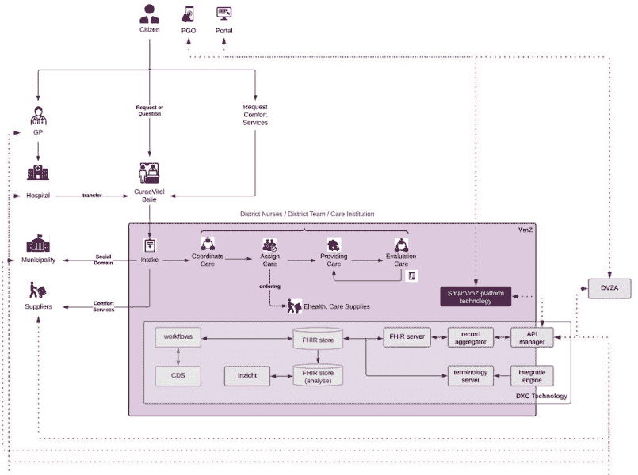

图 12. 由 Remco van Kralingen 和 Sander Duindam 制作。

对于 Dedalus Healthcare Systems 和 PlatformVmZ 而言，数字化并非为了技术而技术，而是要利用技术为所有利益相关者（尤其是患者）在整个医疗旅程中提供无缝的护理体验。

## CONCLUSION

关于需求管理的讨论很多，但实际实施需求管理的却很少。这同样适用于将客户置于中心：一些客户不那么需要指导，而是更需要护理服务可用。许多客户喜欢不必自己安排护理。通常缺乏主动性。另一方面，希望获得这种主导权的客户不得不与医疗专业人员和医疗组织打交道，克服障碍。问题是当前系统设计是否过于限制。例如，从个人约束预算（PGB）申请的复杂程度就可以看出这一点。社会保险银行的角色纯粹专注于检查问责制。关于实质性考虑没有互动。

护理专业人员的专业实践表明，工作流程是主要关注点，而不是客户。在 De Hoven 的一个地点，居民拥有权力（叙事视角）。这导致工作流程的完全不同组织。

只有通过客户影响地位的根本转变，才会发生变化。此外，要实现这一目标，还需要改变医疗保健系统的融资和结构（投保人地位）。技术对劳动力市场问题的影响远大于目前所认为的。这意味着可以用更少的护理专业人员提供护理。实践表明，医疗专业人员的创新能力实际上存在于每个系统中。

部分归因于公民倡议和护理合作社的发展，客户地位增强的运动正在兴起。良好的护理始于使自立成为可能的家庭环境。因此，生活与护理之间的联系至关重要。此外，部分老年人影响地位的转变是可行的；然而，30% 的人无法履行此类角色。此外，也存在大量的需求回避。正是通过公民倡议，才创造了一定程度的等效性。医疗专业人员的一个角色是使个人主导成为可能。

需求管理：明确平等的含义很重要。这不是关于平等（医疗专业人员拥有独特专业知识），而是关于互动的结构。很大程度上取决于客户和专业人员使用的概念系统。因此，明确个人主导的含义很重要。该定义的一个方面是澄清“愿意”与“能够”之间的区别。

这是政策制定者（管理者）的一项核心任务：确保客户和专业人员不必承受（所谓的）官僚主义之苦。

技术影响：然而，试验场地显示，在家庭环境中借助技术已经可以实现巨大效果。然而，尚未达到广泛承诺的转折点。了解技术可能性对于实现这些效果至关重要。技术还需要应对技术的技能。广泛应用会导致其他形式的个体护理提供。

个人主导：始于公民自身。公民必须能够实际履行该主导角色。然后，客户与医疗专业人员之间会产生新的动态。如果医疗信息易于获取，选择就会变得更容易。在当前的系统设计中，发生事件时往往难以立即出台政策框架。

个人主导也可以意味着有意决定不想拥有主导权。专业人员长期以来一直在“他们更懂”的视角下接受训练。在实践中，这很难放弃。通过让客户拥有更多所有权，系统设计将更动态地发展。正是通过给予方向，客户与专业人员之间的互动才会改变。客户周围的网络也提供了引入新视角的机会。

质量可以定义为与客户需求相匹配的护理提供。在此，语言同样至关重要：生活质量与护理质量所涉及的考量不同。学习计划中已经高度重视反思。然而，在工作实践中为反思投入足够的空间和时间似乎非常困难。工作实践的特点是“自己动手”文化。因此，从学习计划出发，有必要更加关注反思如何成为工作实践的组成部分。从组织内部来看，在工作流程中为反思性实践留出空间很重要。关注融资系统也很重要。健康保险公司已经在开发共同融资形式（部分与客户共同）。关于个人资金形式或人群资金形式，互信是核心主题。关键在于，新的融资系统应基于客户与医疗提供者之间的个体差异。

使用个人健康环境（PGO）具有很高的未来适应性，前提是客户可以以用户友好的方式处理自己的信息。

## SUMMARY

客户与专业人员之间的互动在于了解自我组织：

对于客户来说，加强主导角色意味着减少多样性：客户得到（或多或少）他或她所要求的东西。从专业人员的角度来看，多样性增加。系统理论为解释多样性提供了框架。

“系统”一词在医疗保健中意义深远：系统世界与（预期的）生活世界相对立。从系统理论角度，系统定义如下：

- 系统是元素之间关系的集合。
- 系统由观察者确定。
- 系统就是它所做的。


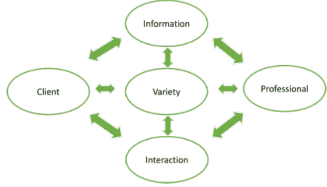

图 13. 自组织模型（由 Thomas Woldendorp 制作）。

客户与医疗专业人员之间的交互是一个系统。实施‘回归初衷’（Hart 2012）是一个系统。核心是加强客户的自主权和管理角色，并支持并从而加强专业人员的创业精神（企业家行为）。我们从角色将发生转变的说明开始。这种转变导致两种多样性形式：

- 对于客户，当客户的个性居于核心地位时，多样性会降低。
- 对于专业人员，多样性会增加，因为每个客户的个性是交互的核心。

这意味着需要客户与专业人员之间新的交互形式。基本原则是，关于交互潜在假设的清晰度（来回）。此外，护理接受者的角色与护理提供者不同。角色存在不对称：需要护理的人是依赖的。然而，关系中存在平等：护理接受者和护理提供者都带来他们自己的人（身份）。这一点在基于在场的理论（Baart 2011）中已详细阐述。

交互发生在一个正在迅速转变的背景下。通过技术和数字化，正在出现新的护理提供形式。这可能涉及预测性护理，也涉及客户例如通过平台自行组织，以便对护理过程拥有更多影响力。这涉及技术创新与社会创新之间的联系。技术创新包含多个组件：家居、园艺和厨房技术，以及人工智能的应用可能性。社会创新体现在，例如，医疗合作社中。

社会创新以多种方式表达，以实现更多自主权。一个重要部分是客户可以获取自己的健康信息。在政策层面，关键在于解读需求驱动的管理：即在客户与护理专业人员地位平等的基础上组织护理，客户可以使用相关的健康信息。以某种方式相互交互会创造一种生活形式，但这也可以被不同地解读。对双方而言，关键在于寻找意义，使不平等的角色导致平等的人。重要元素包括：

- 对彼此立场的理解
- 对自身立场的反思
- 提供符合客户意愿和护理专业人员方法的信息
- 满足非正式照顾者需求的信息提供
- 促进等价性的资金模式
- 专业人员处理多样性的空间（监管空间的创新）

数字化带来的前提条件是：

- 数字化导致预测性和精准医学。交互必须基于新可用的信息来设计。客户的自我管理可能性正在增加；医疗专业人员被期望回应客户偏好。客户正从消费者转变为生产消费者。
- 信息提供的安排方式决定了交互：让客户参与个人健康环境（PGO）的建立。
- 专业人员的监管空间得到增加；需要新的组织概念，这些概念基于多样性、平衡和递归的系统概念。

这种方法的附加价值在于加强客户的地位。为实现这一目标，审查了五种视角的附加价值：

- 叙事视角：关注并尊重生活故事
- 自我管理视角：关注并尊重专业角色
- 网络视角：努力赋予综合方法以具体内容
- 客户视角：努力赋予客户在护理过程中的定位以具体内容
- 护理技术视角：赋予数字化生活和工作实践以具体内容

在这些视角中，客户与医疗专业人员之间交互的设计方式有所不同。出发点是客户能够管理的程度。同样适用的是，这些视角中没有单一视角是决定性的，而是始终根据情境寻求方法的组合。该情境是客户的地位和偏好。转化为五种视角：

- 叙事视角：故事是交互的核心。一个挑战是将其翻译为工作实践。
- 自我管理视角：专业人员的自主权是核心。挑战在于也要在交互中充分纳入客户视角。在Buurtzorg，可能存在阻碍反思的封闭意识形态。
- 网络视角：交互通过创造凝聚力来塑造。许多网络面临的挑战是实际上阻碍交互的组织麻烦。
- 客户视角：客户偏好和需求是核心。挑战是将这些偏好与护理过程的管理相联系。
- 护理技术视角：偏好、信息和管理相关联。挑战是让客户在护理系统中导航。

从系统方法来看，已表明交互必须从开放系统视角来完成。情况并非其中一种视角是决定性的。根据情境，视角的组合提供了附加价值。视角不应被视为理所当然。关键的是围绕个人问题创造连贯性，在此过程中个人的生活方式仍然是核心。此外，这种方法还指出，不是每个人都能跟上：也有自理能力有限的客户。

语言与现实之间的关系需要对自身标准的洞察（反思）。这种洞察使得新的行动方式（践行）成为可能。共享意义对于客户与医疗专业人员之间的有效交互至关重要。理解涉及交互下的潜在（通常不清楚）假设。有意义的对话是关于对客户及其医疗专业人员的意义的洞察和尊重。

虽然需要一个清晰的概念框架，但词语和概念依赖于情境。这里出现了翻译问题。如果能够理解对方的立场，交互就是有效的。客户的故事通常被医疗专业人员翻译到他们自己的专业领域。这种翻译去除了该故事中的多样性，从而阻碍了理解。交互从定义上说发生在某种情境中。医疗通常始终对患者持有偏见的观点。常存在分类，即患有疾病或残疾的人被视为该残疾。正是因为如此，本章关注赋权：疾病和管理在平衡中结合。形成了多元视角。

如果加强客户的地位，对于客户而言，供应的多样性会降低：客户与自身需求相关联，而非这些需求必须适应某个供应。对医疗专业人员则相反：认识和承认客户的独特性会导致护理提供中多样性的增加。有必要能够从系统视角对交互提供新的解释。

为了公正对待每个客户情况的独特性，需要关注情境和广泛的视角。这可以通过让客户在护理过程设计中扮演角色来实现，而数字化和技术是前提条件。通过采用综合方法（预防、护理和健康）并遵循自我管理原则，客户的积极方面得到加强，并创造了新的参与机会。对于客户，技术可能性将增加。然而，这要求客户跟上技术发展、数字技能及其自身对数据的解释（Morgens 2019）。护理专业人员也需要数字技能（www.digivaardigindezorg.nl）。老年人等弱势群体往往不太能够查找和使用电子健康应用程序。这可能导致医疗保健领域更大的不平等（Bolman 2019）。

参与需要一个以自我组织为核心的情境。在社会中，对公民个人责任和自理能力的压力不断增加。这既适用于客户，也适用于非正式照顾者。个性化护理提供了一个以客户视角为重点的质量模型。领导需要一种激活性行动形式。然而，客户情况也以脆弱性为特征。存在需要医疗专业人员提供广泛视角的复杂医疗问题。在这种情况下，客户的明确角色至关重要。通过更好地了解客户的生活故事，可以使护理更合适。

以人为本的护理模型包括以下三个核心要素：护理关系、提供护理的情境以及结果。日常护理在客户与医疗专业人员的交互中提供。关键在于，护理专业人员关注每一位个体老年人（Emmelot 2019）。

提供护理的情境被设计成以个性化护理为出发点。个性化护理的结果是核心要素；重要的是其对客户的影响。当医疗专业人员将客户视为个体并相应行动时，客户会体验到自身的能力。此时，价值观不必相同。老年护理的复杂性可以被客户和医疗专业人员共同感受到。为确保创新以积极方式为老年人服务，重要的是将老年人的生活环境（他们的偏好、愿望、经历及其意义）作为变革的出发点（Luijxk 2014, 19）。

复杂问题不需要简化的方法，而需要广泛的诊断（Buurman 2018, 8）。至关重要的是，让有复杂护理需求的客户参与到改善护理和使用技术中来（Buurman 2018; Zwakhalen 2018）。这意味着：


- 应积极运用客户经验，以实现医疗保健的改进。
- 必须公正对待护理需求的复杂性。
- 医疗保健专业人员和医疗保健组织对医疗保健的结果共同负责。
- 医疗保健专业人员通过能力培训得到促进（Buurman 2018, 9）。

自我管理决定着生活质量，并越来越受到慢性病患者和（脆弱）老年人的强调。自我管理是指一个人即使在老年时期、尽管有与年龄相关的损失，也能体验到一定程度的平衡和幸福感的能力和技能，其目的是维持或实现尽可能好的生活质量（Vilans 2007）。互动的核心在于，客户和护理专业人员找到一种最适合客户及其情况的工作方式。

需要的是，专业人员提升其学习能力。这需要一个创新的工作环境和一个以结果为导向的学习模式。护理日益增加的复杂性要求专业人员的逻辑与客户的逻辑保持一致。其出发点是基于信任和问责制行事。个人功能处于核心地位。

监管空间可以通过企业家行动来填充。在这里，行动、责任和问责处于核心地位。对医疗保健专业人员所期望的能力和技能与个人创业精神契合。一种允许反思这种个人创业精神的模型是创业方法。这关乎能够应对不确定性并表现出韧性和勇气。

核心概念是专业精神、个人创业精神和创业方法。根据阐述的系统原则，上述描述的护理过程中多样性的增加需要两种方法：通过医疗标准化来抑制变异，以及通过增加专业人员的行动空间来增强变异。

我们看到，在护理组织中，人们在应对这一点时存在挣扎：一方面，选择自我管理和自我组织的形式；另一方面，这些形式正在被逐步淘汰。

需要的是，专业人员提升其学习能力。这需要一个创新的工作环境和一个以结果为导向的学习模式。护理日益增加的复杂性要求专业人员的逻辑与客户的逻辑保持一致。其出发点是基于信任和问责制行事。个人功能处于核心地位。

在与客户的互动中，始终需要了解该客户所处的具体情境。更好的数字和技术工作环境可以支持专业人员组织护理。只有当数字化和医疗技术成为医疗保健实践的正常组成部分时，它们才能有效工作。如果某人的生活处于脆弱状态，那么自我引导该生活就很困难。个人主导意味着：安排自己生活及必要支持的能力，以及在身体、社会和心理方面自给自足的实际能力。如果医疗保健专业人员对老年人的依赖性持有一定看法，那通常决定了所看到的内容以及我们将如何行为。医疗干预源于专业实践。这些干预必须与客户的视角保持平衡。

关键在于，通过增强客户的地位，客户的变异减少，而对于医疗保健专业人员，变异增加。因为客户的需求处于核心地位，医疗保健专业人员的变异增加。毕竟，每个客户都有自己的情境。对于组织而言，这必须为专业人员提供监管空间。对于客户，变异减少。客户以正确的方式获得所需之物。

由于所描述的日益增加的复杂性，需要开放系统。这要求对医疗保健专业人员的角色有不同的诠释。与客户偏好互动的核心在于对自身行为的反思。系统方法可以使人们对这些互动的各个方面进行整体诠释，并基于该诠释采取行动。如果自我调节能力（学习、敏捷性、适应性）得到增强，医疗保健专业人员可以在日益复杂（由变异引起）的医疗保健实践中有效工作。医疗保健专业人员决定变异被抑制或增强的程度：

- 确保在互动中，客户和专业人员的视角都能得到体现；
- 更多地运用叙事方法和展示理论，以保持对客户个体身份的看法（应对变异）；
- 确保一个支持客户自身管理的信息管理系统（用户友好型）；
- 制定基于客户个体性的资助模型。

在客户与专业人员之间的互动中，并无先验的确定性。处理变异是客户与医疗保健专业人员之间互动的核心。由于客户可以拥有更多的自我管理（变异减少），医疗保健专业人员由于个体多样性而必须处理更多变异。如果一个系统能够处理变异，则该系统是可行的。这始终需要寻找平衡并强化适应能力：医疗保健专业人员能够应对各种不同的个体情境。质量、效果和效率是在互动中实现的。客户在此扮演核心角色：关乎客户如何体验各种干预措施以及他们拥有哪些管理可能性。对于专业人员而言，关乎创建一个保证护理质量（并提供改进机会）、提供最佳数字支持（减少行政负担并提供对自身专业行为的反馈可能性）以及以自我组织为首要的组织方式的工作环境。

只有在尊重客户和医疗保健专业人员的观点时，才能进行有意义的对话。这正是关于平等。在客户与医疗保健专业人员的每次互动中，现实都会被建构。叙事方法在此具有附加价值。Baart 表明，目前客户与护理专业人员的地位存在很大差异。这种模式被数字化的影响以及对意义建构过程的更多洞察所打破。这关乎平衡对专业概念工具的理解与对另一人的理解。提供医疗保健的过程始终关乎两个或更多人关于适合护理需求的程序、解释和行动的共同理解（协议、共识）。这导致了有意义互动的以下前提条件：

- 互动中对专业主导地位的意识（专家知识；作为专业人员的权威；根植于法规）
- 了解另一方的地位：意识到经验的个体性
- 发展新的（包容性）心智模式：互动始终需要共同的平衡
- 发展共同意义：认识自身的历史及其伴随的观点

实现客户与专业人员之间更平等互动的方式是：

- 对意义建构的洞察
- 对意义建构的敏感性
- 对互动发生情境的洞察

子问题的阐述：

知识和工作实践产生于社会互动，问题的解决方案通过行动得以发现。因此，Weick 将组织称为“谈判动词”。通过观察话语（语言游戏），对所观察的现实进行诠释。该现实通过语言和行动产生。互动最终通过赋予其意义来实现。这导致了有意义互动的以下前提条件：

- 意识到专业语言中的隐性假设


客户的语言和行为源于其自身的人生故事。若不了解该人生故事，就无法进行有效的互动。个人主导权要求个人网络（非正式护理）、以人为本的护理和护理技术之间保持一致性。关键是围绕以客户生活为中心的个人问题创造一致性。这种凝聚力被设计为一个开放系统。这为客户的管理角色创造了可能性。客户只能做他们自己。然后，专业服务关乎承认这种整体性。

在个人主导权下，关键是可能性的心理学。客户必须有机会参与决策过程。实现这一点的模式是价值驱动的护理：这样整个护理过程都围绕客户的需求和可能性来组织。

基于本书，基于客户自主权的互动出现以下前提条件：

- 创建一个以客户自身能力为中心的激发性互动环境；
- 确保一个连贯的护理过程，其中社会网络、个人护理和护理技术以连贯的方式结合在一起；
- 确保护理技术和数字化是主要流程的一部分；
- 在互动中，确保客户和专业人员的视角都能得到反映；
- 更多地使用叙事方法和展示理论，以保持对客户个体身份的看法（应对多样性）；
- 确保一个支持客户自身管理（用户友好）的信息管理系统；
- 制定基于客户个体性的资助模型。

为了保障自主权，至关重要的是，客户自身生活的延续应成为客户与医疗专业人员之间互动的核心。在老年护理中，有六种模式中，客户的价值越来越居于核心地位：

- 整合护理
- 个人护理
- 价值驱动的护理
- 积极医疗
- 叙事方法
- 在场方法

每种情境下混合使用这些方法对于增强客户的自主权是有效的。这也可以通过让客户在政策制定和执行中占有一席之地来实现。基于在场理论的核心在于，医疗专业人员应从对方出发，而不仅仅是出于您自身的善意。医疗实践极其复杂，需要复杂思维。专业行为关乎处理多样性。这可能导致自身行动中不确定性程度提高。企业家态度使得能够应对该不确定性。客户偏好导致的多样性增加需要新的组织概念。

为了让专业人员处理多样性，监管空间至关重要。这意味着护理必须以自组织原则为基础来组织。因此，在教育课程中，必须关注基于此的专业胜任力。

为了保障自主权，至关重要的是，专业人员必须具备足够的自我调节能力，以便在客户与护理专业人员之间的互动中关注客户自身的生活。之所以需要这一点，是因为客户地位的增强将增加其自身护理实践中的多样性。医疗技术和数字化的影响也需要敏捷方法。

医疗专业人员的角色通过个人企业家精神来履行。选择以企业家身份工作与此无关。这是关于对专业行为的诠释。这里至关重要的，是为客户的护理请求做出什么贡献。初创方法被引入为一种语言游戏。这使得能够处理多样性并提供帮助。个人企业家精神与其说是以企业家身份运作，不如说是具有企业家精神。除了能够进行对话外，这还转化为使用数字工作形式的能力。此外，还必须能够进行创新。

医疗专业人员处理多样性的一个合乎逻辑的模式是个人企业家精神。个人企业家精神关注监管空间（自主权）、敏捷性、灵活性和创新。这方面一个可行的模式是初创方法。

互动的重新设计关乎在客户视角和专业视角之间取得良好平衡。核心目标是在不对称关系中实现平等定位。因此，实现有效对话成为互动的中心。这导致了有意义互动的以下前提条件：

- 意识到互动中的专业主导权（专家知识；作为专业人员的权威；根植于法规）
- 理解对方的立场：意识到经验的个体性
- 发展新的（包容性）心智模式：互动始终需要共同的平衡
- 发展共同意义：承认自身的历史及相关意见
- 意识到专业语言中的隐含假设

基于本书，基于客户自主权的互动出现以下前提条件：

- 创建一个以客户自身能力为中心的激发性互动环境；
- 确保一个连贯的护理过程，其中社会网络、个人护理和护理技术以连贯的方式结合在一起；
- 确保护理技术和数字化是主要流程的一部分；
- 在互动中，确保客户和专业人员的视角都能得到反映；
- 更多地使用叙事方法和展示理论，以保持对客户个体身份的看法（应对多样性）；
- 确保一个支持客户自身管理（用户友好）的信息管理系统；
- 制定基于客户个体性的资助模型。
- 支持使用数字技术

基于本书，基于专业人员自主权的互动出现以下前提条件：

- 创建一个以专业人员自我调节能力为中心的互动环境；
- 确保一个连贯的护理过程，其中专业人员的角色是从客户视角出发，在专业标准范围内寻求解决方案；
- 在选择自身行动时，使用初创方法以增加机动性；
- 从互动（组织）视角而非组织利益视角定位专业领域；
- 支持使用数字技术工作；
- 洞察作为教练的角色变化

总之，以下行动将带来客户与专业人员之间更有效的互动。

| 客户视角 | 互动 | 专业视角 |
| :--- | :--- | :--- |
| 多样性减少 | 建立有效对话 | 多样性增加 |
| 核心是自身人生故事（叙事方法） | 专业领域基于互动 | 在网络结构中工作 |
| 对自身能力的自我洞察 | 理解他人 | 增加自我调节能力（工作和学习环境） |
| 以客户视角为重点 | 发展新的（包容性）心智模式 | 意识到隐含假设 |
| 设计用户友好的信息管理（主导权） | 发展共同理解 | 意识到专业主导权 |
| 基于以人为本资助（目标群体方法）的资助模型 | 对理解的敏感性 | 洞察互动发生的背景。洞察作为教练的角色变化 |
| | 建立连贯的护理流程（社会网络、护理技术、数字化） | 使用混合护理模型。洞察护理结果 |
| | 应用平台技术 | 个人企业家精神（应用初创方法）提高敏捷性 |

图 14. 研究结果摘要。

## 参考文献

范德阿，A. 和 T. 科宁。(2001)。链条、链条主管和链条发展。在网络中发展透明且灵活的合作关系。乌得勒支：利玛。[链条、链条主管和链条发展。在网络中发展透明且灵活的合作关系。]

奥尔伯斯，R. 和 W. 多尔夫斯马。(2015)。创新网络。管理网络化组织。伦敦：Routledge。

阿赫特贝格，J. 和 D. 弗里恩斯。(2010)。组织。作为实验的社会系统。第二版修订版。柏林：Springer Verlag。

阿考夫，R. L.。(1999)。阿考夫精选。关于管理的经典著作。英格兰奇切斯特：John Wiley & Sons Ltd.

阿德勒，R. 和 R. 梅塔。(2014)。催化技术以支持家庭照护。全国照护者联盟。

阿勒斯，J. 和 R. C. W. 博恩德。(2016)。Z 世代与第四次（工业）革命。哈勒姆：Bertram en De Leeuw Uitgevers。[Z 世代与第四次（工业）革命。]

阿克尔曼斯，J.。(2013)。开端即成功。调查年轻劳动力的工作与职业。（博士论文，乌得勒支大学）


Allen, D. (2015). 护士的无形工作：医院、组织与医疗保健. London: Routledge.

Almekinders, M. (2006). 家庭护理中的团队更好吗？利用社会技术组织创新改善家庭护理成果。(Radboud University博士论文)。[家庭护理中的团队更好吗？利用社会技术组织创新改善家庭护理成果。]

Anderson, G., K. Dunlap, J. Rademacher 和 N. McMenamy. (2009). Metaplan：跨学科研究的互补方法论。SoTL Commons Conference. 104.

Angrosino, M. (2007). 民族志与观察研究方法。Thousand Oaks, CA: Sage.

Annink, A. (2017). 围绕业务的繁忙——自雇工作者工作与生活平衡的跨国比较研究。(Erasmus University Rotterdam博士论文)。

Appello, J. (2011). Management 3.0 领导敏捷开发人员，培养敏捷领导者。Addison-Wesley。

Ardon, A. (2011). 打破循环。经理人如何无意识地阻碍变革。Amsterdam: Business contact。[打破循环。经理人如何无意识地阻碍变革。]

Arets, J., V. Heijnen 和 C. Jennings (2015). 70-20-10。迈向100%绩效。Sutler Media

Argyris, C. 和 D. A. Schön (1977). 实践中的理论。提升专业效能。San Francisco: Jossey-Bass.

Ashby, W. R. (1956). 控制论导论。London, England: Chapman & Hall Ltd.

Aslander, M. 和 E. Witteveen. (2010). 易政。工作与组织的未来。The Hague: Academic Service。[易政。工作与组织的未来]

Aslander, M. 和 E. Witteveen (2015). 永不完毕（永久Beta）。对我们生活根基的新视角：工作、学校、护理、政府与管理。Amsterdam: Business Contact。[永不完毕（永久Beta）。对我们生活根基的新视角：工作、学校、护理、政府与管理]

Aukes, L. C. 和 H. Woldendorp (1994). 组织变革：秩序之点。变革管理原则。Deventer: Kluwer。[组织变革：秩序之点。变革管理原则]

Baan, C. (2015). 综合医疗保健。多于部分之和。就职演说。Tilburg: 蒂尔堡大学。[综合医疗保健。多于部分之和]

Baardens, E. 和 F. Simon. (2017). 关于实践导向研究的验证。Kwalon, 22, no 3, 5 - 13。[关于实践导向研究的验证]

Baart, A. (2011). 在场理论。The Hague: Boom。[在场理论]

Baart, A. (2016). 关于新规则、服从与审慎。Utrecht: Stichting Presentie。[关于新规则、服从与审慎。]

Baart, A. (2018). *质量的发现。关系性护理的理论与实践*。Amsterdam: Uitgeverij SWP。*质量的发现。关系性护理的理论与实践。*

Baart, A. 和 C. Carbo (2013). *护理陷阱*。Amsterdam: Theoris Uitgeverij。*护理陷阱。*

Baets, W. R. J. (2002). *种秩序者，收混乱。关于学习者的论述*。Assen: Van Gorcum。*种秩序者，收混乱。关于学习者的论述*

Bahlmann, J. P. 和 B. A. C. Meesters (1998). *从未存在过的组织。组织形式的探索*。Schoonhoven: Academic Service。*从未存在过的组织。组织形式的探索*

Bakas, A. (2017). *护理中的灵魂。技术革命与新公民身份如何推动医疗行业的更新*。Bakas Books。*护理中的灵魂。技术革命与新公民身份如何推动医疗行业的更新*

Baldwin, R. (2019). *全球机器人冲击。全球化、机器人与未来工作*。London: Weidenfeld & Nicolson.

Barabási, A. L. (2003). *关联。万物互联及其对商业、科学和日常生活的意义*。New York: Plume.

Barrett, R. (1998). 解放企业之魂。构建愿景型组织。Butterworth.

Bateson, G. (1972). *心灵生态学之路*。St. Albans: Paladin.

Becker, H. (1992). *一代人及其机遇*。Amsterdam: Meulenhoff。*一代人及其机遇*

Becker, H. M. (2011). 不干预不是选择！*人道主义护理哲学的回顾博物馆之镜*。Delft: Eburon.

Beckford, J. (2016). *智能组织。实现信息的价值*。London/New York: Routledge.

Beek, J. W. van 和 R. Huizenga (2017). *超越创业狂热。凭借自身力量成功创新*。Amsterdam: Business contact。*超越创业狂热。凭借自身力量成功创新*

Beer, S. (1978). *变革平台*。Chichester, John Wiley and Sons.

Beer, S. (1979). *企业的核心*。Chichester, England: John Wiley & Sons Ltd.

Beer, S. (1981). *企业之脑，第2版*。Chichester, England: John Wiley & Sons.

Beer, S. (1985). *组织系统诊断*。Chichester, England: John Wiley & Sons Ltd.

Begemann, D. (2008). *自然变革。变革过程中自我组织的原则*。Assen: Van Gorbum。*自然变革。变革过程中自我组织的原则*

Begun, J. W., B. Zimmerman 和 K. Dooley (2003). 医疗保健组织作为复杂自适应系统。载于 S. M. Mick & M. Wyttenbach (编), 医疗保健组织理论进展（第253-288页）。San Francisco: Jossey-Bass.

Bijl, R. V. (1991). 未来情景构建：应用于心理健康领域的面向政策的情景研究。博士论文。Utrecht: 乌特勒支大学。[未来情景构建：应用于心理健康领域的面向政策的情景研究]

Binkhorst, T., E. Posma 和 S. Lobenstein (编). (2009). 让患者参与医院护理。一本手册。医疗保健质量研究所CBO。[让患者参与医院护理。一本手册]

Birkinshaw, J. (2010). 重塑管理。更明智的选择，高效完成工作。Jossey-Bass.

Bisschop Boele, E. (2017). 寻找文化参与的意义。就职演说。Rotterdam: 鹿特丹伊拉斯mus大学。[寻找文化参与的意义]

Bisschop Boele, E. (2018). 民族志研究：他者的视角。Cultuur + Educatie, 17, no.50, 85-93。[文化 + 教育]

Bisognano, M. 和 C. Kenney (2012). 追求三重目标：七位创新者展示更好的护理、更好的健康和更低成本之路。San Francisco: Jossey-Bass.

Blank, S. (2013). 顿悟的四步。赢取产品的成功策略。K&S Ranch Consulting.

Blijham, G. 和 H. Hillen. (2019). 内科医学，回顾与未来展望。内科医学，no. 3, vol. 10, 24 - 27。[内科医学，回顾与未来展望。内科医学]

Blok, J. de 和 A. Pool. (2010). 邻里护理：人性高于官僚。The Hague: Boom Lemma Uitgevers。[邻里护理：人性高于官僚]

Blok, J. de, H. Suichies, L. Vogelpoel 和 T. Jansen. (2015). 医疗保健的替代方案。人性高于官僚。Amsterdam: Uitgeverij Boom。[医疗保健的替代方案。人性高于官僚]

Bloem, S. (2012). 个性化护理。正确的方向。（演讲，Nyenrode商业大学）。[个性化护理。正确的方向]

Blok, A. (1976). 维特根斯坦与埃利亚斯。人类学的方法论指南。Amsterdam: Polak en Van Gennep, 1。[维特根斯坦与埃利亚斯。人类学的方法论指南]

Blok, J. de 和 A. Pool. (2010). 邻里护理：人性高于官僚。The Hague: Boom Lemma。[邻里护理：人性高于官僚。]

Blom, R. J. (2002). 创业实践。Amsterdam: Graydon。[创业实践]

Blommaert, D. E. (2014). 姑息治疗中护士践行行善原则的作用。（乌特勒支人文大学硕士论文）。


- 布鲁默，H. (1969). 符号互动论。视角与方法。恩格尔伍德克利夫斯：Prentice-Hall.

- 布尔，F. (2011). 扎根理论方法：一次更新。Kwalon. 定性研究杂志，第16卷，第1期，25-33。[扎根理论方法：更新。Kwalon。定性研究杂志]

- 布尔，N. de 和 A. 范·迪彭。 (2013). 借力地方。政府与网络社会。海牙：社会发展委员会。[借力地方：政府与网络社会]

- 布尔与克隆。 (2011). 关于医疗创新的良好对话。阿姆斯特丹。[关于医疗创新的良好对话]

- 博伊，H. (2014). 定性研究中的分析：思考与行动。阿姆斯特丹：布姆。[定性研究中的分析：思考与行动]

- 博尔曼，C. (2019). 易受伤害群体中的eHealth应用：一项挑战。就职演讲。赫伦：开放大学。[易受伤害群体中的eHealth应用：一项挑战]

- 博梅雷兹，J. (2007). 看到森林而非树木。发现关系与组织复杂性之下的简单性。联合传媒公司。[看到森林而非树木：发现关系与组织复杂性之下的简单性]

- 博梅雷兹，J. 和 K. 范·赞特费尔德 (2001). 你能教毛毛虫飞吗？关于从变革管理向变革型领导力的必要量子飞跃。埃姆讷斯：新维度出版社。[你能教毛毛虫飞吗？关于从变革管理向变革型领导力的必要量子飞跃]

- 本特科宁，A. (2014). 老龄化组织中的新一代。阿姆斯特丹：媒体工坊出版社。[老龄化组织中的新一代]

- 布内坎普，L. 和 H. 沃尔登多尔普 (2006). 《老年护理战略模型》, 护理专刊, 2006, 第7期, 4-11。[“老年护理战略模型”]

- 布恩斯特拉，J. J. (2000). 行走在水面上。关于组织、创新与学习的动态。就职演讲。阿姆斯特丹：阿姆斯特丹大学。[行走在水面上：关于组织、创新与学习的动态]

- 布恩斯特拉，J. 编 (2007). 在联盟与网络中经商。多学科视角。德芬特尔：库卢威尔。[在联盟与网络中经商：多学科视角]

- 布恩斯特拉，J. J. (2013). 28课变革管理。阿姆斯特丹：商务联系。[28课变革管理]

- 布恩斯特拉，J. (2014). 文化变革中的领导力。组织中战略与文化变革的实用指南。阿森：皇家范戈库姆。[文化变革中的领导力：组织中战略与文化变革的实用指南]

- 骨斯，C., J. 哈默斯利 和 N. 肖。 (2019). 优化数字战略。如何制定促进增长的明智战术决策。伦敦：科根页。

- 博斯，R. ten (2000). 管理思维中的时尚与乌托邦。阿姆斯特丹：本杰明斯出版公司。

- 博斯，R. ten (2001). 战略思维。寻找新英雄。赔特博默尔：主题出版社。[战略思维：寻找新英雄]

- 博斯哈马，J. 和 I. 格罗嫩 (2010). 爱因斯坦一代3.0。更聪明、更快、更成熟。阿姆斯特丹：A.W. 布鲁纳出版社。[爱因斯坦一代3.0：更聪明、更快、更成熟]

- 博斯马，H. 和 C. 范·哈夫滕。 (2013). 为未来做好准备？新力场中VVT组织的适配工作模型。博士论文。鹿特丹：鹿特丹伊拉斯谟大学。[为未来做好准备？新力场中VVT组织的适配工作模型]

- 本坎普，H. M. van de。 (2010). 病患力量的边界。荷兰医疗中积极公民身份的考察。博士论文。鹿特丹：鹿特丹伊拉斯谟大学。

- 本坎普，H. van de, A. 斯托彭达尔, M. 范·博霍韦, H. 霍亨德伊克 和 R. 巴尔 (2017). 以人为本的护理、规章压力与规章空间：从规则反射到镜像反射。鹿特丹：鹿特丹伊拉斯谟大学医疗政策与管理学院。[以人为本的护理、规章压力与规章空间：从规则反射到镜像反射（SLR）]

- 布拉克，A. (2017). 领导力的隐藏维度。从权力到力量的演变。赔特博默尔：主题。[领导力的隐藏维度：从权力到力量的演变]

- 布拉夫曼，O. 和 R. A. 贝克斯特罗姆 (2010). 海星与蜘蛛。无领导组织不可阻挡的力量。乌得勒支：布鲁纳出版社有限公司。[海星与蜘蛛：无领导组织不可阻挡的力量]

- 勃兰登堡，C. (2008). 荷兰医院护理的交易成本分析。博士论文。鹿特丹：鹿特丹伊拉斯谟大学。

- 布雷，T. de。 (2017). 它能飞吗？从想法到成功初创企业。库伦博赫：范杜伦管理。[它能飞吗？从想法到成功初创企业]

- 布雷德费尔德，E. J. (2003). 在运营中的居家护理：1987年至1997年居家护理行业的重组，蒂尔堡：蒂尔堡IVA。[在运营中的居家护理：1987年至1997年居家护理行业的重组]

- 布伦特斯，M. (1999). 组织即网络。人们如何改变组织，组织如何改变人们。莱茵河畔阿尔芬。[组织即网络：人们如何改变组织，组织如何改变人们]

- 布赖德尔，J. (2018). 新黑暗时代。技术与未来的终结。伦敦：向导。

- 布鲁克，A. van den, C. 范·坎彭, J. 德·哈恩, A. 罗特尔斯, M. 特肯堡 和 L. 法尔麦，编 (2016). 迎向未来。未来荷兰的学习、工作、照护、共同生活与消费。海牙：社会与文化规划局。[迎向未来：未来荷兰的学习、工作、照护、共同生活与消费]

- 布罗瑟·范·格罗讷乌，M. (2015). 易受伤害老年人护理网络中的数字通信。评估在居家护理中实施数字工具以改善与非正式照护沟通。阿姆斯特丹：自由大学。[易受伤害老年人护理网络中的数字通信：评估在居家护理中实施数字工具以改善与非正式照护沟通]

- 勃朗克，J. 和 J. 福伊赫尔。 (2018). 区块链：在寻找问题的技术？房地产中区块链技术应用的愿景。Grum, J. 和 J. Veuger，编。Cirre 2018房地产跨学科研究第三届会议（第124 - 130页）。格罗宁根。

- 布朗，J. (2019). 创造，思考，想象。工程文明的未来。纽约：珀加索斯图书。

- 布鲁松，N. (1987). 非理性组织。非理性作为组织行动和变革的基础。奇切斯特：约翰·威利父子。

- 布鲁松，N. (1989). 虚伪的组织。组织中的言谈、决策与行动。奇切斯特：约翰·威利父子。

- 布鲁塞尔，G. van (2012). 创造“带风格的空间”：内部创业作为高级专业人士职业视角的发展。（博士论文，开放大学）。[创造“带风格的空间”：内部创业作为高级专业人士职业视角的发展]

- 德布赖恩，H., H. 范德福尔特, H. 瓦梅林克, R.v.W. 德约德 和 N. 威廉姆斯 (2014). 新维尔韦茨式组织。阿森：范戈库姆。

- 布莱恩特，A. 和 K. 查马兹，编 (2007). 扎根理论的Sage手册。洛杉矶：塞奇出版。

- 贝滕达姆，A. (2001). 劳动与组织的开放架构。阿森，范戈库姆。

- 布尔克，A. van den. (2017). 社区护理新融资：知识为基础。《社会与健康》杂志，第17卷，第4期，8-9页。[社区护理新融资：知识为基础。杂志]

- 伯恩斯，L. R., 编 (2005). 医疗创新的商业。剑桥大学出版社。

- 伯雷尔，G. 和 G. 摩根 (1985). 社会学范式与组织分析。企业生活社会学的要素。汉茨：高尔力，1985.

- 布尔曼，B. (2018). 从症状控制到可持续的老年急性护理。就职演讲。阿姆斯特丹：阿姆斯特丹大学。[从症状控制到可持续的老年急性护理]

- 布尔泽，S. van den, L. 弗尔默伦 和 M. 史密特。 (2017). 《它掌握在我们手中》：促进医疗中的独立工作。一项关于……的评估研究。


文化计划《工作场所为中心》。阿姆斯特丹：阿姆斯特丹大学。[“掌握在我们手中”：促进医疗保健中的独立工作。关于文化计划“工作场所为中心”的评价研究。]

Bussemaker, J. (2019). 医疗作为社会问题。就职演说。莱顿：莱顿大学。[医疗作为社会问题。]

Bussemaker, J. (2020). 共同决策作为第二个十年的设计原则。演说。海牙：公共卫生与社会委员会。[共同决策作为第二个十年的设计原则。]

Cabrera, D. A. (2006). 系统思维（博士论文，康奈尔大学，2006）。国际博士论文摘要-A, 67, 303.

Calman, L. (2006). 什么是扎根理论？演示。曼彻斯特：曼彻斯特大学。

Camper, C. van, J. Iedema, M. Broese van Groenou 和 D. Deeg. (2017). 长期独立。在资源、支持和护理中变老。海牙：社会与文化规划局。[长期独立。在资源、支持和护理中变老]

Caris, J. (2013). 专业护理的组织。蒂尔堡：大学，就职演说。[专业护理的组织]

Caris, J., T. Poiesz 和 F. Lapré. (2019). 复杂社会问题需要整体分析模型。尼尔：克洛斯特霍夫。[复杂社会问题需要整体分析模型。]

Chapman, B. (2015). 每个人都很重要。像对待家人一样关心你的人的非凡力量。伦敦：企鹅图书有限公司。

Charmaz, K. (2006). 构建扎根理论：定性分析实用指南。伦敦：Sage.

Charmaz, K. (2008). 建构主义与扎根理论。载：J. A. S. Holstein 和 J. F. Gubrium（编）。建构主义研究手册, 397 – 412. 纽约：吉尔福德出版社。

Charmaz, K. (2010). 构建扎根理论：定性分析实用指南。千橡市, 加州：Sage.

Choy, Y. W. (2005). 问题在答案之上。组织冲突的系统干预。桑特波特：NISTO出版物。[问题在答案之上。组织冲突的系统干预]

Christakis, N. 和 J. Fowler. (2010). 连接。社交网络的惊人力量及其如何塑造我们的生活。哈珀出版社, 2010.

Christensen, C. M., J. H. Grossman 和 J. Hwang. (2009). 创新者的处方。医疗保健的颠覆性解决方案。纽约：麦格劳希尔。

Cingel, C. J. M. van der. (2012). 护理实践中的同情心。良好护理的指导原则。博士论文。鹿特丹：鹿特丹伊拉斯穆斯大学。[护理实践中的同情心。良好护理的指导原则]

Clark, T., A. Osterwalder 和 Y. Pigneur. (2012). 商业模式你。重塑你的职业生涯的一页纸方法。霍博肯, 新泽西：约翰·威利父子出版公司。

Clarke, K. E. (2005). 情境分析。后现代转向后的扎根理论。千橡市, 加州：Sage.

Coole, M. de 和 T. Verlaan, 编. (2009). 有未来的老年护理。新方法的愿景和示例。阿姆斯特丹：SWP。[有未来的老年护理。新方法的愿景和示例]

Coolen, J. (2008). 疗养院中的老年人：脆弱的人和生活乐趣。尊严与自豪。[疗养院中的老年人：脆弱的人和生活乐趣]

Cooper, R. (1987). 信息、沟通与组织：后结构主义修订，《心智与行为期刊》, 第8卷, 第3期, 395-416.

Cooper, R. 和 S. Fox. (1989). 组织的两种模式。载：R. Mansfield（编）。管理前沿。伦敦：Routledge and Kegan Paul, 247-261.

Cooperrider, D. L., D. Whitney 和 J. M. Stavros. (2005). 赏识式探究手册。变革领导者指南。旧金山：Barrett-Koehler出版社。

Corbin, J. 和 A. Strauss. (2008). 定性研究基础：扎根理论、程序和技术。第3版。新伯里公园：Sage.

Cornelis, A. (1990). 情感的逻辑。文化作为情感栖息地的稳定性层哲学。阿姆斯特丹：Boom。[情感的逻辑。文化作为情感栖息地的稳定性层哲学]

Cornelis, A. (2000). 被延迟的时间。心灵作为未来哲学的报复。阿姆斯特丹：Boom。[被延迟的时间。心灵作为未来哲学的报复]

Covey, S. R. (1997). 有效领导力的七个习惯。Contact。[有效领导力的七个习惯]

Cozijnsen, A. J. (2001). 不同地改变。人与技术之间的新平衡。就职演说。阿姆斯特丹：自由大学。[不同地改变。人与技术之间的新平衡]

Cozijnsen, A., P. van Dun 和 E. Kimman. 变革剧场。变革过程中的导演与角色分配。Prentice Hall, 2009. [变革剧场。变革过程中的导演与角色分配]

Creswell, J. W. (2009). 研究设计。定性、定量和混合方法方法。洛杉矶：Sage.

Czarniawsky-Joerges, B. (1992). 探索复杂组织。文化视角。新伯里公园：Sage.

Dalen, A van. (2010). 走出医疗体系的阴影。荷兰邻里护理如何组织护理。Boom Lemma, 2010。[走出医疗体系的阴影。荷兰邻里护理如何组织护理]

Dalen, van, A. (2012). 医疗创新。关于不同地管理和组织。海牙：Boom Lemma。[医疗创新。关于不同地管理和组织]

Dautzenberg, M., E. Curfs 和 D. de Bakker. (2013). 复杂护理需求老年人的护理网络。社区居住老年人一级护理中碎片化与整合的研究。海尔伦：开放大学。[复杂护理需求老年人的护理网络。社区居住老年人一级护理中碎片化与整合的研究]

Davenport, T. H. 和 J. Kirby. (2016). 只有人类需要申请。智能机器时代的赢家与输家。纽约：Harper Business.

Davenport, T. H. (2019). AI优势。如何将人工智能革命投入工作。剑桥, 麻省：MIT出版社。

Delden, P. (1992). 专业人士。职业的质量。阿姆斯特丹：Contact。[职业的质量]

Delden, P. van. (2009). 强大的网络。公共服务中的链式合作。Van Gennep。[强大的网络。公共服务中的链式合作]

Delnoij, D. (2019). 共同决策。通过结果信息走向以患者为中心的护理？就职演说。鹿特丹：鹿特丹伊拉斯穆斯大学。[共同决策。通过结果信息走向以患者为中心的护理？]

Diamandis, P. H. 和 S. Kotler. (2020). 未来比你想象的更快。汇聚技术如何改变商业、行业和我们的生活。纽约：西蒙与舒斯特。

Dierendock, J. H. van. (2015). 老还是智：经验专家在老年护理研究中带来改变。乌得勒支：荷兰大学医学中心联合会。[老还是智：经验专家在老年护理研究中带来改变]

Dijck, J. van, T. Poell 和 M. de Waal. (2016). 平台社会。在线世界中公共价值之争。阿姆斯特丹大学出版社。[平台社会。在线世界中公共价值之争]

Dijk, A. van 和 H. Woldendorp. (1993). 在复杂组织中导航：组织学模型。载：A. van Dijk, G. Smid 和 H. Woldendorp（编）。在复杂组织中导航。高等教育中的理论与实践。阿森：Van Gorcum, 第11-22页。[在复杂组织中导航：组织学模型。载：A. van Dijk, G. Smid 和 H. Woldendorp（编）。管理复杂组织。高等教育中的理论与实践。]

Dijk, N. M. H. (1989). 组织变革的方法论策略。代尔夫特：Eburon。[组织变革的方法论策略]

Dijkstra, L. 和 J. D. van der Bij. (1991). 商业研究中的顺序测量量表。埃因霍温：埃因霍温理工大学。[商业研究中的顺序测量量表]

Dinten, W. L. van. (2002). 带着对现实的感知。关于在组织中识别意义。代尔夫特：Eburon。[带着对现实的感知。关于在组织中识别意义]

Dinten, W. L. van 和 I. F. M. Schouten. (2008). 是他们疯了还是我疯了？如何在组织中使用取向。代尔夫特：Eburon。[是他们疯了还是我疯了？如何在组织中使用取向]

Dinten, W. L. van, 和 I. F. M. Schouten. (2015). 超越显而易见 - 在意义荒野中的探险。代尔夫特：Eburon。[超越显而易见 - 在意义荒野中的探险]

Douglas, M. (1987). 机构如何思考。伦敦：Routledge and Kegan Paul。

Downes, L. 和 P. Nunes. (2014). 大爆炸式颠覆。毁灭性创新时代的策略。纽约：Penguin Putnam。

Drucker, P. F. (2017). 创新与创业。实践与原则。伦敦：Routledge。

Duin, P. van der. (2006). 创新的定性未来研究。代尔夫特：Eburon。

Edwards, T. (2015). 倡议式管理。执行商业战略和实现有意义商业成果的新范式。费城：TMBE。

Ehrenhard, M. L., B. Kijl 和 L. J. M. Nieuwenhuis. (2014). 家居自动化市场采纳的障碍。用于护理、安全、节能和舒适的智能技术。研究报告。恩斯赫德：特温特大学。[家居自动化市场采纳的障碍。用于护理、安全、节能和舒适的智能技术]

Eilenberger, W. (2018). 巫师时代。哲学的伟大年代，1919 – 1929。阿姆斯特丹：De Bezige Bij。[巫师时代。哲学的伟大年代，1919 – 1929]

Eijkenar, F. (2013). 医疗服务提供者的按绩效付费。设计、绩效衡量和（非预期）影响。博士论文。鹿特丹：鹿特丹伊拉斯穆斯大学。

Eind evaluatie experiment regelaarme instelling. (ERAI). (2016). 海牙：卫生、福利与体育部。[受控环境实验最终评估]

Eisenhardt, K. M. 和 M. Graebner. (2007). 从案例中构建理论：机遇与挑战。《管理学院期刊》, 第50卷, 第1期, 25 -32.

Elberse, J. (2012). 改变健康研究体系。健康研究中的患者参与。博士论文。阿姆斯特丹：阿姆斯特丹自由大学。

Ellinor, L. 和 G. Gerard. (1998). 对话：重新发现谈话的变革力量。John Wiley。

Elsinga, B. (2014). 年轻的专业人士。方向与成长的工具。兹沃赫：Vior Webmedia。[年轻的专业人士。方向与成长的工具]


Elsen, T. van den. (2017). 医疗保健创新网络分析。实践经验：附加值、机遇与挑战。乌得勒支：Vilans。[医疗保健创新网络分析。实践经验：附加值、机遇与挑战。]

Emmelot-Vonk, M.E. (2019). 临床老年医学：黄金之秋。乌得勒支：乌得勒支大学。[临床老年医学：黄金之秋。]

Engel, Y. (2015). 初次涉足未知之地，并非第一次。对企业创始人职业生涯与不确定性下创业决策的考察。（博士论文，Vrije Universiteit）。

Ertel, C. and L. K. Solomon. (2014). 影响瞬间。如何设计加速变革的战略对话。德文特尔：Vakmedianet。[如何设计加速变革的战略对话。]

Eijkenar, F. and E. Schut. (2015). 医疗保健中的成果融资：一条可（不可）通行的道路？鹿特丹：Erasmus Universiteit：iBMG。[医疗保健中的成果融资：一条（无法）通行的道路？]

Eijssen, D. H. (2016). 从坚实基础出发，在创业与专业化之间寻找正确平衡。博客，2016年1月1日。[从坚实基础出发，在创业与专业化之间寻找正确平衡。]

Eisenhardt, K. M. and M. E. Graebner (2007). 从案例中构建理论：机遇与挑战。《管理学院期刊》，第50卷，第1期，第25–32页。

Es, R. van. (2008). 变革诊断。组织的潜流。德文特尔：Kluwer。[变革诊断。组织的潜流。]

Evans, D.S. and R. Schmalensee. (2016). 撮合者。多边平台的新经济学。波士顿，马萨诸塞州：哈佛商业评论出版社。

Fabbricotti, I. N. (2007). 照护链。照护链发展中的整合与碎片化。（鹿特丹伊拉斯穆斯大学博士论文）。[照护链。照护链发展中的整合与碎片化。]

Fairclough, N. (1992). 话语与社会变迁。剑桥：Polity Press，1992。

Feenstra, H. and W. P. M. Wansink (2009). 医疗保健的运作方式。公民作为客户、玩物或国王，被赋予权力或被压制。阿姆斯特丹，荷兰：Atlas-Contact。[医疗保健的运作方式。公民作为客户、玩物或国王，被赋予权力或被压制。]

Foerster, H. von. (1981). 观察系统。塞赛德，加利福尼亚州：Intersystem Publications，1981。

Foerster, von H. (1984). 构建现实。收录于：P. Watzlawick (编)，《发明的现实》。我们如何知道我们相信我们知道的内容？建构主义贡献。纽约：Norton，第41–63页。

Ford, M. (2015). 机器人的崛起。技术与无工作未来的威胁。纽约：Basic Books。

Ford, M. (2018). 智能架构师。构建AI的人讲述的AI真相。伯明翰：Packt Publishing。

Frankl, V. E. (1978). 存在的意义。Donker。[存在的意义。]

Freedman, L. (2013). 战略。一部历史。牛津：牛津大学出版社。

Freeman, Jr. S. (2018). 在论文中运用多基础理论：反思与见解。《定性研究报告》，第23卷，第1期，第1160–1175页。

Gaal, A. van. (2012). 野心。企业家的建议。阿姆斯特丹：Nieuw Amsterdam Uitgevers。[野心。企业家的建议。]

Garwin, D. A. (2000). 实践中的学习。将学习型组织付诸实践的指南。波士顿，马萨诸塞州：哈佛商学院出版社。

Geertz, C. (1983). 地方知识。诠释人类学进阶论文集。纽约：Basic Books。

Geisler, E. (编). (2003). 未来医院中的技术、医疗保健与管理。Praeger。

van Gemert-Pijnen. (2015). 说服性健康技术。通过连接实现协同。就职演讲。恩斯赫德：特文特大学。[说服性健康技术。通过连接实现协同。]

Gemmel, P. and L. de Raedt (2008). 医疗保健作为复杂自适应系统。关于创新的不同视角。来源：Flanders DC 网站：http://www.flandersdc.be/sites/default/files/gezondheid_incl_cover.pdf。[医疗保健作为复杂自适应系统。关于创新的不同视角。]

Gershenson, G. (2007). 自组织系统的设计与控制。博士论文。布鲁塞尔：布鲁塞尔自由大学。

Geursen, G. (1996). 虚拟番茄与概念花生酱。互动性、自我组织与意识扩展如何颠覆营销。德文特尔：Kluwer。[虚拟番茄与概念花生酱。互动性、自我组织与意识提升如何颠覆营销。]

Geursen, G. (2000). 我是谁？组织中推动力与连接力的魔力。阿尔芬 Aan den Rijn：Samson。[我是谁？组织中推动力与连接力的魔力。]

Gigch, J. P. van. (1991). 系统设计建模与元建模。纽约：Springer Science and Business Media。

Ginneken, J. (2009). 蜂群的力量。组织中的自我管理。阿姆斯特丹：Business Contact。[蜂群的力量。组织中的自我管理。]

Gharajedaghi, J. (2011). 系统思维：管理混沌与复杂性——设计业务架构的平台。伯灵顿，马萨诸塞州：Morgan Kaufmann。

Gijzel, H., H. H. Nap, M. Herps, S. Mulder, M. van Klink, S. Schrijer-Snoeijs, K. Kuperus and M. Minkman (2017). 长期护理法在护理、疗护及残疾人护理中的应用。实践经验。阿默尔芬：KPMG/Vilans。[长期护理法在护理、疗护及残疾人护理中的应用。实践经验。]

Glaser, B. G. (1978). 理论敏感度。扎根理论方法论的进展。旧金山：加州大学出版社。

Glaser, B. G. (1998). 扎根理论研究：问题与讨论。米尔瓦利，加利福尼亚州：Sociology Press。

Glaubemans, M. (2015). 既有秩序中是否还有空间？关于组织、管理与治理中个体的论文。乌得勒支：Uitgeverij IJzer。[既有秩序中是否还有空间？关于组织、管理与治理中个体的论文。]

Glaser, B. G. and A. L. Strauss. (1967). 扎根理论的发现。定性研究策略。芝加哥：Aldine。

Graham, B. and K. Thomas. (2008). 构建知识。为建筑行业开发知识管理的扎根理论。《电子商业研究方法期刊》，第6卷，第2期，第115–122页。

Glaser, B. G. and A. L. Strauss (1967). 扎根理论的发现。定性研究策略。芝加哥：Aldine。

Gratton, L. (2011). 转变。未来的工作已经到来。伦敦：Collins。

Groen, A. (2016). Buurtzorg Nijmegen-Oost的管理控制：激励而非管理，信任而非控制。学士论文。奈梅亨：奈梅亨拉德布德大学。[Buurtzorg Nijmegen-Oost的管理控制：激励而非管理，信任而非控制。]

Groot, K. de, E. Mauritsen and A. Francke. (2018). 社区护理工作的吸引力：护士在线焦点小组研究。《护理学》，第2期，第14–18页。[社区护理工作的吸引力：护士在线焦点小组研究。《护理学》]

Groot, N. (2010). 自组织与领导力。一个充满挑战的悖论！关于地方责任产生及结果改进的复杂性方法。阿姆斯特丹：Mediawerf Uitgevers。[自组织与领导力。一个充满挑战的悖论！关于地方责任产生及结果改进的复杂性方法。]

Guba, E. G. and Y. S. Lincoln. (1989). 第四代评估。比弗利山庄：Sage。

Gunsteren, H. R. van (1979). 复杂性与控制论革命。《组织学与社会政策杂志》，第33卷，第4期：第324–339页。

Gunsteren, H. van (2008). 以公民为基础。文化、预防与个性鲜明的公民。阿姆斯特丹：Van Gennep。[以公民为基础。文化、预防与个性鲜明的公民。]

Gupta, S. (2018). 推动数字战略。重构您的业务指南。波士顿，马萨诸塞州：哈佛商业评论出版社。


- Haan, E. de (2017). 部门转型。系统学习作为成功因素。阿姆斯特丹：Boom。[部门转型。系统学习作为成功因素。]

- Hagel, J. III, J. S. Brown and L. Davison (2012). 拉力的力量。通过小而聪明的行动推动重大变革。纽约：Basic Books。

- Hamel, G. (2007). 管理的未来。波士顿，马萨诸塞州：哈佛商学院出版社。

- Harari, Y. N. (2016). 上帝预言。明日简史。伦敦：Harvill Secker。

- Hardjono, T., R. van Brakel and J. J. Kroon (2010). 链条协作。在链条和网络中可持续工作。赖斯登：C3。[链条协作。在链条和网络中可持续工作。]

- Hart, W. (2012). 扭曲的组织。回归初衷。阿尔芬-安-德-莱茵：Vakmedianet。[扭曲的组织。回归初衷。]

- Hart, W. (2017). 以不同方式持有。9 个基于意图工作的钥匙。阿尔芬-安-德-莱茵：Vakmedianet。[以不同方式持有。9 个基于意图工作的钥匙。]

- Harten, W. van and R. Schuring (2003). 医疗保健中的企业家。阿森：皇家范戈尔库姆。[医疗保健中的企业家。]

- Hauwert, S. (2018). 严重多重障碍人士的个人控制空间。博士论文。阿姆斯特丹：阿姆斯特丹自由大学。[严重多重障碍人士的个人控制空间。]

- Have, S. ten, W. ten Have and B. Janssen (2009). 变革之书。管理者关于组织变革的 70 个问题。阿姆斯特丹：Mediawerf Uitgevers。[变革之书。管理者关于组织变革的 70 个问题。]

- Have, W. ten (2011). 家庭护理中的更好表现。用于提高家庭护理效率和效果的自管理团队。硕士论文。蒂尔堡：蒂尔堡大学。[家庭护理中的更好表现。用于提高家庭护理效率和效果的自管理团队。]

- Have, W. ten, A. B. Huijsmans, M. Otto and S. te Have (2018). 已改变的变革管理。18 个流行变革理念的检验。阿姆斯特丹：Boom。[已改变的变革管理。18 个流行变革理念的检验。]

- Heijnen, H. (2009). 通向个人企业家精神的十个步骤。Van Ierland Uitgeverij。[通向个人企业家精神的十个步骤。]

- Heimans, J. and H. Timms (2018). 新权力。权力如何转移以及这对我们意味着什么。阿姆斯特丹：Business Contact。[权力如何转移以及这对我们意味着什么。]

- Hepkema, W. (2012). 停止领导。走向自主和真实的雇佣关系。阿姆斯特丹：Boom/Nelissen。[停止领导。走向自主和真实的雇佣关系。]

- Heuvel, B. van den. (2014). 网络护理。面向有复杂长期护理和支持需求人士的新组织概念。鲁汶：Acco。[网络护理。面向有复杂长期护理和支持需求人士的新组织概念。]

- Hinssen, P. (2017). 明日之后。在激进创新时代如何生存。鲁汶：Lannoo Campus。[明日之后。在激进创新时代如何生存。]

- Hoebele, L. (1994). 使工作系统更好：一位从业者的反思。奇切斯特，英格兰：约翰·威利父子有限公司。

- Hoek, H. (2007). 治理与医疗保健。荷兰护理提供者的私人、公共和专业影响。阿森：范戈尔库姆。[治理与医疗保健。荷兰护理提供者的私人、公共和专业影响。]

- Hoekstra, H. A. (2005). 知道你想要什么。组织中个人的自我调节和变革能力。演讲，范戈尔库姆。[知道你想要什么。组织中个人的自我调节和变革能力。]

- Hoffman, R. and B. Casnocha (2013). 你的创业公司。适应未来，投资自己，转变你的职业生涯。伦敦：Random House。

- Homan, T. (2005). 组织动力学。组织变革的理论与实践。海牙：SDU 出版社。[组织动力学。组织变革的理论与实践。]

- Homan, T. (2013). 等等原则。组织发展的新视角。阿姆斯特丹：Boom 出版社。[等等原则。组织发展的新视角。]

- Hoogerwerf, L. (1998). 重新学习组织。行动理论视角下的社会技术学。乌得勒支：Lemma。[重新学习组织。行动理论视角下的社会技术学。]

- Hoogheimstra, T. (2018). 医疗保健中的信息自决。海牙：SDU。[医疗保健中的信息自决。]

- Hoogveld, M. (2017). 像创业公司一样思考。更智能、更具创新性地开展业务的 9 种方式。库伦博尔赫：范杜伦管理。[像创业公司一样思考。更智能、更具创新性地开展业务的 9 种方式。]

- Hoverstadt, P. (2008). 分形组织：使用可行系统模型创建可持续组织。奇切斯特，英格兰：约翰·威利父子有限公司。

- Huber, M. (2014). 迈向健康的新动态概念。其在公共卫生和医疗保健中以及评估食品健康影响中的运作和使用。博士论文，马斯特里赫特大学。

- Huguenin, P. and H. van Gestel (2007). 隐藏的秩序。组织的系统管理。豪滕：博恩·斯塔夫莱·范洛格姆。[隐藏的秩序。组织的系统管理。]

- Huijsman, R. (2013). MOL 如何成功？未来老年护理的管理、组织与领导力。演讲。鹿特丹：鹿特丹伊拉斯穆斯大学。[MOL 如何成功？未来老年护理的管理、组织与领导力。]

- Iansiti, M. and K. R. Lakhani (2020). 人工智能时代的竞争。算法和网络主导世界时的战略与领导力。波士顿：《哈佛商业评论》。

- Idenburg, P. J. and M. van Schaik (2010). 诊断 2015。关于荷兰医疗保健的未来。斯希达姆：Scriptum。[诊断 2015。关于荷兰医疗保健的未来。]

- Idenburg, P. J. and M. van Schaik (2013). 医疗保健创新诊断。关于技术和创业精神。斯希达姆：Scriptum。[医疗保健创新诊断。关于技术和创业精神。]

- Idenburg, P. J. and S. Emonts (2019). 护理促进者 2019。医疗保健的技术发展。乌得勒支：BeBright。[护理促进者 2019。医疗保健的技术发展。]

- Illegems, J. (2017). 医疗保健中的物联网。硕士论文。根特：根特大学。

- Ismail, S. and Y. van Geest (2015). 指数级组织。为什么新组织好十倍、快十倍、便宜十倍——以及你如何做到这一点。阿姆斯特丹：Business Contact。[指数级组织。为什么新组织好十倍、快十倍、便宜十倍——以及你如何做到这一点。]

- Ito, J. and J. Howe (2016). 鞭挞。如何生存于我们更快的未来。纽约：Grand Central Publishing。

- Iyawa, G. E., M. Herselman and A. Botha (2016). 数字健康创新生态系统：从系统文献综述到概念框架。Procedia Computer Science 100, 244–252。

- Jackson, M.C. (2003). 系统思维：面向管理者的创造性整体论。奇切斯特，英格兰：约翰·威利父子有限公司。

- Jager, W. P. de (2001). 民主的演变。关于复杂异质系统演变理论和模型在商业管理与行政管理中意义的探索性研究。代尔夫特：Eburon。[民主的演变。关于复杂异质系统演变理论和模型在商业管理与行政管理中意义的探索性研究。]

- Jager-Vreugdenhil, M. (2012). 荷兰是参与之国吗？社会支持法（Wmo）的宗旨以及街区、非正式护理关系和教会中的实践。博士论文。阿姆斯特丹：阿姆斯特丹大学。[荷兰是参与之国吗？社会支持法（Wmo）的宗旨以及街区、非正式护理关系和教会中的实践。]

- Jansen, T., G. van den Brink and J. Kole, eds. (2009). 职业自豪感。一种前所未有的力量。阿姆斯特丹：Boom。[职业自豪感。一种前所未有的力量。]


Jeninga, A. 和 H. Woldendorp (2004). 照护机构中需求导向的设置：成本定价模型的构建，《卫生专刊》，2004，39–42。[医疗机构需求管理的建立：成本定价模型方案，医疗专刊。]

Jeninga, A. 和 H. Woldendorp (2019). 这就是价值驱动的医疗。从系统视角看变革与价值驱动的医疗。阿姆斯特丹：SWP出版社。[这就是价值驱动的医疗。从系统视角看变革与价值驱动的医疗。]

Jeurissen, P. (2016). 越来越多的医疗，一个负担得起的解决方案？演讲。奈梅亨：拉德布德大学奈梅亨。[越来越多的医疗，一个负担得起的解决方案？]

Jeurissen, P., H. Maarse 和 M. Tanke. (2018). 负担得起的医疗。海牙：Sdu出版社。[负担得起的医疗。]

Jones, M. 和 J. Aloney. (2011). 博士研究中扎根理论使用的指导。澳大利亚电影行业的一个例子。《博士研究国际期刊》，第 6 卷，95-114。

Jonge, E. de (2015). 专业人士的形象。专业化的灵感来源。博士论文。乌得勒支：乌得勒支大学。[专业人士的形象。专业化的灵感来源。]

Kane, G. C., A. N. Phillips, J. R. Copulsky 和 G. R. Andrus. (2019). 技术谬误。人才是数字化转型的真正关键。马萨诸塞州剑桥：麻省理工出版社。

Kanne, M. (2016). 良好医疗的共同创造。医疗与社会工作中的伦理问题、道德审议与规范性专业化。博士论文。乌得勒支：人文主义大学。[良好医疗的共同创造。医疗与社会工作中的伦理问题、道德审议与规范性专业化。]

Kanter, R. M. (2001). 进化！在明天的数字时代取得成功。波士顿，马萨诸塞州：哈佛商学院出版社。

Kaplan, J. (2015). 人类无需申请。人工智能时代的财富与工作指南。新罕布什尔州新黑文：耶鲁大学出版社。

Kawasaki, G. (2015). 启动的艺术 2.0。任何人开始任何事物的经得起考验、经历战场锤炼的指南。伦敦：企鹅出版社。

Kay, K. (2015). 意大利面初创企业。关于初创企业生存的故事，或如何通过系统思维与设计思维实现激进增长。Lasagnac。

Kelly, K. (2016). 必然。理解将塑造我们未来的 12 种技术力量。纽约：维京出版社。

Kerklaan, L. (2016). 敏捷型组织。实践中的基于敏捷性的战略。德文特：Vakmedianet。[敏捷型组织。基于敏捷性的实践战略。]

Kernick, D. (Ed.). (2004). 复杂性与医疗组织：来自街头的视角。伦敦，英格兰：兰德克利夫医学出版社。

Kessels, J. W. M. (2012). 专业空间中的领导实践。演讲。赫伦：公开大学。[专业空间中的领导实践。]

Kessener, B. and L. van Oss. (2019). 超越部分之和。关于组织与变革的系统思维。德文特：管理影响。[大于部分之和。关于组织与变革的系统思维。]

Kets de Vries, M. F. R. (2008). 性与金钱，幸福与死亡。地下的沉思。阿姆斯特丹：Nieuwezijds。[性与金钱，幸福与死亡。地下的沉思。]

Kemperman, J., J. Geelhoed 和 J. op ‘t Hoog (2014). 医疗领域的卓越商业模式。更好、更负担得起的医疗的开创性方法。海牙：学术服务出版社。[医疗领域的卓越商业模式。更好、更负担得起的医疗的开创性方法。]

Kievit, J. (2017). 医疗与质量：从个体到两者。告别演讲。莱顿：莱顿大学。[医疗与质量：从个体到两者。]

Klink, A. (2012). 医疗竞技场中的装备。为什么节约成本的创新会让医疗变得更昂贵。演讲。阿姆斯特丹：自由大学。[医疗竞技场中的装备。为什么节约成本的创新会让医疗变得更昂贵。]

Kolb, D. A. (1984). 体验式学习。经验作为学习与发展的源泉。英格勒伍德克利夫斯：霍尔出版社。

Kok, A. A. L. (2019). 如何将艰难时光转变为美好时光：社会经济不平等、韧性与成功老龄化研究。博士论文。阿姆斯特丹：自由大学。

Kool, R. B., L. M. Verhoef 和 J. A. M. Kremer (2014). 个人健康档案未来角色的探索性研究。奈梅亨：拉德布德大学医学中心。[个人健康档案未来角色的探索性研究。]

Korsten, A. F. A. (2011). 表明立场。理论作为公共管理研究的灵感与导向点。自行出版。[表明立场。理论作为公共管理研究的灵感与导向点。]

Kort, H. et al., eds. (2008). 长期护理与技术。乌得勒支：Lemma出版社。[长期护理与技术。]

Koudstaal, M. (2016). 常识与事实：企业家在行为特征上如何与其他职业群体不同。博士论文。阿姆斯特丹：阿姆斯特丹大学。

Kraan, W. G. M. van der (2006). 对需求管理的需求。荷兰医疗中需求管理含义的探索性研究。博士论文。鹿特丹：鹿特丹伊拉斯穆斯大学。[对需求管理的需求。荷兰医疗中需求管理含义的探索性研究。]

Kraaijeveld, K. (2018). 我们如何能够永久性地（去）规管医疗？阿姆斯特丹：论点工厂。[我们如何能够永久性地（去）规管医疗？]

Kramer, B. (2001). 战略分析对医疗战略形成的贡献。博士论文。鹿特丹：鹿特丹伊拉斯穆斯大学。[战略分析对医疗战略形成的贡献。]

Kremer, L. (2018). 创意网络。演讲。阿姆斯特丹：阿姆斯特丹大学。[创意网络。]

Kreijveld, M. (2012). 共同更聪明。“群体智慧”将如何改变我们的社会。海牙：STT。[共同更聪明。“群体智慧”将如何改变我们的社会。]

Kreijveld, M., J. Deuten 和 R. van Est (2014). 平台的力量。数字化世界中创新的新战略。德文特：Vakmedianet。[平台的力量。数字化世界中创新的新战略。]

Kreukels, W. J. M. (1991). 复杂性、自我管理与动态。关于政府中复杂网络的管理。演讲。阿尔芬 aan den Rijn：Samson H.D./Tjeenk Willink。[复杂性、自我管理与动态。关于政府中复杂网络的管理。]

Krogt, F. J. van der (1995). 网络中的学习。以人性和劳动相关性为目标的学习网络多元化组织。乌得勒支：Lemma出版社。[网络中的学习。以人性和劳动相关性为目标的学习网络多元化组织。]

Kromhout, M., N. Kornalijnslijper 和 M. de Klerk (2018). 残障人士的医疗与支持变化。长期护理改革全国评估。海牙：社会与文化规划局。[残障人士的医疗与支持变化。长期护理改革全国评估。]

Kuiper, H., R. van Amelsfoort 和 E. H. Kramer (2010). 新的组织方式。官僚制的替代方案。鲁汶：Acco出版社。[新的组织方式。官僚制的替代方案。]

Kurzweil, R. (2005). 奇点临近。人类超越生物学极限的时刻。蒂尔堡：世界出版社。[奇点临近。人类超越生物学极限的时刻。]

Kwakman, F. (2011). 个人品牌。为希望有所作为的专业人士而写。阿姆斯特丹：学术服务出版社。[个人品牌。为希望有所作为的专业人士而写。]

Kwakman, F. and R. Rosenmöller (2015). 我能制造差异。为客户、组织和自身取得成功的 7 项策略。库伦博尔赫：范杜伦管理。[我能制造差异。为客户、组织和自身取得成功的 7 项策略。]

Kwakman, F. and C. Zomerdijk (2012). 创业型专业人士。在变革市场中创造价值。库伦博尔赫：范杜伦管理。[创业型专业人士。在变革市场中创造价值。]


Laat, W. A. M., de (1983). Vragen naar de onbekende weg. Delft: Eburon. [询问未知之路。]

Laat, de M. (2012). 赋能专业发展网络：你有多紧密相连？讲座。Heerlen: Open Universiteit.

Laeven, A. M. (2008). Een gezonde blik naar buiten. Marktoriëntatie van ziekenhuizen. Deventer: Kluwer. [向外审视。医院的市场导向。]

Laloux, F. (2014). 重塑组织。受下一阶段人类意识启发的创建组织指南。Brussels: Nelson Parker.

Lambertz, M. (2016). Freiheit und Verantwortung für intelligente Organisationen. Das Modell für lebensfähige Systeme nach Stafford Beer. 自行出版。[面向智能组织的自由与责任。Stafford Beer 的可行系统模型。]

Langer, E. J. (2010). 逆时针。一种被证明能让你变得更年轻、更健康的思考方式。London: Hodder and Stoughton.

Lanting, M. (2010). Connect! De impact van sociale netwerken op organisaties en leiderschap. Amsterdam: Business Contact. [连接！社交网络对组织和领导力的影响。]

Lanting, M. (2011). Iedereen CEO. Netwerkleiderschap en de nieuwe organisatie. Amsterdam: Business Contact. [人人皆可 CEO。网络领导力与新组织。]

Lanting, M. (2013). De slimme organisatie. De toekomst van werk, leiderschap en innovatie. Amsterdam: Business Contact. [智能组织。工作、领导力与创新的未来。]

Lanting, M. (2014). Olietankers en speedboten. Wendbaar werken in de 21e eeuw. Amsterdam: Business Contact. [油轮与快艇。21 世纪的敏捷工作。]

Lanting, M. (2017). De disruptie paradox. In 5 stappen naar echte vernieuwing. Amsterdam: Business Contact. [颠覆悖论。5 步迈向真正创新。]

Lans, J. van der (2008). Ontregelen. De herovering van de werkvloer. Amsterdam: Uitgeverij Augustus. [放松管制。重夺工作场所。]

La Porte, T. L., 编 (1975). 组织化的社会复杂性：对政治与政策的挑战。Princeton.

Laurence, T. (2019). 区块链技术导论。21 世纪区块链技术的多种面貌。‘s Hertogenbosch: Van Haren Publishing.

Leeuw, A. C. J. de (1984). De wet van de bestuurlijke drukte. Over inspanning en resultaat van besturen. Assen: Van Gorcum. [管理压力定律。论管理的努力与结果。]

Leeuw, A. C. J. de (1994). Besturen van veranderingenprocessen. Fundamenteel en praktijkgericht management van organisatieveranderingen. Assen: Van Gorcum. [管理变革过程。组织变革的基础与实践导向管理。]

Leeuwen, Sj. Van (2007). Zorgmarketing in de praktijk. Succesvol invoeren van marketing in de gezondheidszorg. Assen: Van Gorcum. [医疗营销实践。医疗保健领域营销的成功实施。]

Ley, T. van der (2018). Kwalitatief onderzoek naar hoe mensen een persoonlijke gezondheidsomgeving kiezen. Utrecht: Nederlandse Patiëntenfederatie. [人们如何选择个人医疗环境的定性研究。]

Lindberg, C., S. Nash 和 C. Lindberg (2008). 悬崖边。复杂时代的护理。Bordentown, New Jersey: PlexusPress.

Linders, L. (2019). Op zoek naar houvast. Empowerment als handelskader in de praktijk van zorg en welzijn. 讲座。Haarlem: Hogeschool Inholland. [寻找立足点。护理与福祉实践中的赋能行动框架。]

Lockwood, T., 编 (2010). 设计思维。整合创新、客户体验与品牌价值。New York: Allworth Press.

Loo, M. van de (2014). Persoonlijk ondernemerschap. Van speelbal naar sterspeler. Amsterdam: Boom/Nelissen. [个人创业精神。从足球到明星球员。]

Love, H. (2016). 创业 J 曲线。创业成功的六个步骤。Austin, TX: Greenleaf Book Group.

Lucas, C. (2015). Bewijsgestuurde zorg. Evidence based practice versus practice based evidence. 讲座，阿姆斯特丹大学。[循证护理。循证实践与实践基础证据。]

Luijkx, K. (2014). Horen, zien en samen zorgen. Innovatie vanuit de leefwereld van ouderen. 讲座。Tilburg: 蒂尔堡大学。[倾听、观察与共同照护。从老年人生活世界出发的创新。]

Maas, A. J. J. A. (1998). Ongedefinieerde ruimten. Sociaal-symbolische configuraties. Een onderzoek naar theorie, methodologie en methode-ontwikkeling voor processen van organiseren. Delft: Eburon. [未定义空间。社会-符号配置。关于组织过程理论、方法论与方法开发的研究。]

Machielse, A. (2016). Afgezonderd of ingesloten. Over sociale kwetsbaarheid van ouderen. 讲座。Utrecht: Universiteit voor Humanistiek. [与世隔绝或被关闭。论老年人的社会脆弱性。]

Madsbjerg, C. (2017). 理解建构。算法时代人文学科的力量。New York: Hachette Books.

Maister, D. H. (1997). Een echte professional. Schoonhoven: Academic Service. [真正的专业人士。]

Malby, B. 和 M. Anderson-Wallace (2016). 医疗保健网络：管理复杂关系。Howard House, Bingley: Emerald.

Malik, F. (2006). 管理、绩效与生活。新时代的有效管理。Frankfurt/New York, Campus Verlag.

Malik, F. (2007). *管理。技艺的精髓*。Frankfurt/New York, Campus Verlag.

Malik, F. (2009). *系统性管理、进化与自组织。复杂系统的基础问题、功能机制与解决方法*。Bern: Haupt Verlag. [管理系统、进化与自组织。复杂系统的基础问题、功能机制及可能解决方案。]

Malik, F. (2011a). *简洁管理思维。精湛管理的 46 个概念*。Frankfurt/New York: Campus Verlag.

Malik, F. (2011b). *公司政策与治理。组织如何自我组织*。Frankfurt/New York, Campus Verlag.

Malik, F. (2012). *正确的公司治理。驾驭复杂性的有效管理*。Frankfurt/New York, Campus Verlag.

Malik, F. (2015). *在变革时代导航。重新思考并塑造世界*。Frankfurt/New York: Campus Verlag. [在变革时代导航。重新思考和重塑世界。]

Malik, F. (2016). *管理复杂系统的策略。面向演化系统的管理控制论贡献*。Frankfurt/New York, Campus Verlag.

Malik, F. (2017). *危险的管理词汇*。Frankfurt: Campus Verlag. [危险的管理词汇。]

Maljers, J., 和 W. P. M. Wansink (2009). *医疗领域万事皆异：关于离奇预算、变态规则与明星派*。Amsterdam, Nederland: Bert Bakker. [医疗领域万事皆异：关于离奇预算、变态规则与明星派。]

Man, A. D. de, A. de Man 和 A. Stoppelenburg (2015). *咨询领域的新商业模式：改变游戏规则*。Amsterdam: Mediawerf Uitgevers. [咨询领域的新商业模式：改变游戏规则。]

Marcus, G. 和 E. Davis (2019). *重启 AI。构建我们可以信赖的人工智能*。New York: Pantheon Books.

Marr, B. (2010). *智慧公司。循证管理成功的五个步骤*。Chichester: John Wiley & Sons.

Masselink, R. 等，编 (2008). *赋能组织。欣赏式询问：持久变革的共创*。Nieuwerkerk a.d. IJssel: Gelling Publishing. [赋能组织。欣赏式询问：持久变革的共创。]

Mastik, H. (2002). *响应式模拟。多元语境中学习与导向的空间*。Delft, Eburon. [响应式模拟。多元语境中学习与管理的空间。]

McAfee, A. 和 E. Brynjolfsson (2017). *机器、平台、大众。驾驭我们的数字未来*。New York: W.W. Norton.

Mei, Jaap van der. Fatale en vitale spiralen in de zorg. Zestien zorgegen oplossingen. VDM Projects, 2010. [医疗领域的致命与关键螺旋。十六种医疗独有解决方案。]

Meadows, D. H. (2008). 系统思维。London; Chelsea Green Publishing.

Meurs, P. L. (2014). Van regeldruk naar passende regels. Vertrouwen, veerkracht, verantwoordelijkheid en vrijheid. 随笔。Rotterdam: 伊拉斯莫大学 CMDZ. [从法规压力到适当法规。信任、韧性、责任与自由。]

Maso, I. 和 A. Smaling (2004). Kwalitatief onderzoek: praktijk en theorie. Amsterdam: Boom. [定性研究：实践与理论。]

Meeuwesen, A., P. van der Mast, H. Morhuis 和 R. Runhaar (2018). Alternatieve financieringsvormen in het zorgstelsel. Tilburg, TIAS, 2018 年 2 月 22 日. [医疗保健体系中的替代融资形式。]

Meijeren, L. van (2014). ‘共同决策’在 Buurtzorg。论文。Ede: 基督教应用科技大学。[Buurtzorg 的“共同决策”。]

Metz, R. (2016). Independence or interdependence. A responsive evaluation on family group conferencing for older adults. 论文。阿姆斯特丹：阿姆斯特丹应用科技大学。[独立还是相互依赖。面向老年人家庭小组会议的响应式评估。]

Midgley, G. (2000). 系统干预：哲学、方法论与实践。New York, NY: Kluwer Academic.

Minderhoud, L. (2017). Van werknemer naar ondernemer. De winnaarsformule voor vrij ondernemen. Utrecht: BigBusinessPublisher. [从雇员到企业家。自由创业的获胜公式。]

Minkman, M., K. Ahaus 和 R. Huijsman (2010). Het ontwikkelingsmodel voor keten zorg. Ketenkennis gebundeld in een generiek toepasbaar kwaliteitsmodel, M&O. Tijdschrift voor Management en Organisatie, 第 5 期，第 26-44 页。[连锁护理发展模型。连锁专业知识汇编于通用适用质量模型，M&O。管理与组织期刊，第 5 期，第 26-44 页。]

Minkman, M. (2012). Developing integrated care. Towards a model for integrated care. 论文。EUR. [发展一体化护理。迈向一体化护理模式。]

Minkman, M. (2017). Innovatie van organisatie en governance van integrale zorg. ‘Verlangen naar integraliteit’. 讲座。Tilburg: 蒂尔堡大学。[一体化护理的组织与治理创新。“对整体性的渴望”。]

Minkman, M. Schaalverwarring in de regio. Skipr 1 月 9 日. [地区的尺度混乱。]

Mintzberg, H., B. Ahlstrand 和 J. Lampel (1998). 策略野园。战略管理荒野之导览。New York: The Free Press.

Modig, N. 和 P. Åhlström (2017). 这就是精益。解决效率悖论。Stockholm: Rheologica Publishing.


- Mohammadi, M. (2017). Empatische woonomgeving。演讲。Eindhoven: Technische Universiteit。[共情性生活环境。]

- Molenaar, C. (2017)。De kracht van platformstrategie。Het is buigen of barsten。Amsterdam: Boom。[平台战略的力量。屈服或破灭。]

- Montfort, A. W. P. M. van (1986)。Economie en organisatie van de gezondheidszorg。Stand van zaken en perspectief。Speech，Bohn, Scheltema & Holkema，Utrecht。[医疗保健的经济与组织。现状与前景。]

- Montfort, A. W. P. M. van (1995)。Zorgverlening: een kwestie van instelling en ondernemen。Speech。Rotterdam: Erasmus Universiteit Rotterdam。[护理提供：态度与事业的问题。]

- Montfort, A. P. W. P. van (2011)。Technologie voor de zorg en zorg voor de technologie。Speech。Universiteit Twente，Nederland。源自 http://doc.utwente.nl/79172/1/Oratietoekje_van_Montfort.pdf。[技术服务于护理，护理关怀技术。]

- Montfort, A. P. W. P. van (2016)。De ouderen pakken de lead in de zorg！Valedictory speech。Universiteit Twente。[老年人在护理中领先！]

- Montfort, A. W. P. M. van (2019a)。Reflecties op enkele thema’s uit het boek van Tjeenk Willink。Essay。[对Tjeenk Willink著作中若干主题的反思。]

- Montfort, A. W. P. M. van and R. van Wylck (2019b)。Zorg in perspectief van de cliënt。Essay 1。Het prosumentenmodel: van vóór via mét naar dóór de cliënt。Amsterdam: Uitgeverij SWP。[以客户视角看护理。随笔1。协同消费模式：从为、通过、与到由客户。]

- Montfort, A. W. P. M. and R. van Wylck (2019c)。Zorg in perspectief van de cliënt。Ruimte voor realistische zorgfinanciering op maat。Essay 2。Amsterdam: Uitgeverij SWP。[以客户视角看护理。现实且定制化的护理融资空间。随笔2。]

- Moor, M. (2012)。Tussen de regels。Een esthetische beschouwing over geweld van organisatie。Utrecht: Uitgeverij IJzer。[行间之外。对组织暴力的伦理审视。]

- Moore, G. (2014) Crossing the chasm。Marketing and selling disruptive products to mainstream customers。New York: HarperBusiness。[跨越鸿沟。向主流客户营销和销售颠覆性产品。]

- Morgan, G. (1986)。Images of organization。Newbury Park: Sage。[组织的形象。]

- Morgan, G. 主编 (1983)。Beyond method。Strategies for social research。Newbury Park: Sage。[超越方法。社会研究策略。]

- Mulder, M. (2002)。Competentieontwikkeling in organisaties: perspectieven en praktijk。’s Gravenhage: Elsevier。[组织中的竞争发展：视角与实践。]

- Mulje, M. (2013)。Dialectical systems thinking and the law of requisite holism concerning innovation。Lichfield Park, AZ: Emergent Publications。[关于创新的辩证系统思维与必然整体论法则。]

- Nadella, S. (2017)。Hit refresh。De transformatie van Microsoft en de zoektocht naar een betere toekomst voor ons allemaal。Amsterdam: A.W. Bruna Uitgevers。[重启。微软的转型与为我们所有人寻找更美好未来的探索。]

- Nandram, S. S. (2015)。Organizational innovation by integrating simplification。Learning from Buurtzorg Nederland。Heidelberg: Springer。[通过整合简化实现组织创新。向Buurtzorg Nederland学习。]

- Nieuwenhof, R. (2005)。De taal van verandering。Veranderen in dialoog。Schiedam: Scriptum。[变革的语言。对话中的变革。]

- Nies, H. L. G. R. (2012)。De zorg ontzorgd。Veranderende rollen en resultaten in de langdurige zorg。Speech。Amsterdam: Vrije Universiteit。[支持支持性护理。长期护理中角色与结果的变化。]

- Njoku, G. U. (2015)。The impact of caring for seniors on the caregiver's stress level。PhD thesis。Walden University。[照顾老年人对护理者压力水平的影响。博士论文。]

- Noddings, N. (2002)。Starting at home。Caring and social policy。Berkeley: University of California Press。[从家开始。关怀与社会政策。]

- Oldham, J. (2004)。The small book about large system change。Chichester, UK, Kingsham Press。[关于大系统变革的小书。]

- Osterwalder, A., Y. Pigneur and P. van der Pijl (2010)。Business Model Generatie。Alphen a.d. Rijn: Vakmedianet。[商业模式创生。]

- Osterwalder, A., Y. Pigneur, G. Bernarda and A. Smith (2014)。Waarde propositie ontwerp。Alphen a.d. Rijn: Vakmedianet。[价值主张设计。]

- Otto, M. and A. J. C. de Leeuw (1994)。Kijken, denken, doen。Organisatieverandering: manoeuvren met weerbarstigheid。Assen: Koninklijke Van Gorcum。[观看、思考、行动。组织变革：应对阻力的战术。]

- Pandit, N. R. (1996)。The creation of theory: a recent application of the grounded theory method。The Qualitative Report, vol. 2, no. 4, 1 – 15。[理论的创立：扎根理论方法的近期应用。]

- Parker, G. G. 等人 (2016)。Platform revolution。How networked markets are transforming the economy – and how to make them work for you。New York/London: W.W. Norton & Company。[平台革命。网络市场如何转型经济——以及如何让它们为你所用。]

- Peek, S. (2017)。Understanding technology acceptance by older adults who are aging in place: a dynamic perspective。PhD thesis。Tilburg: Tilburg University。[理解老龄在居家养老老年人的技术接受度：动态视角。博士论文。]

- Peeters, P. H. and C. Cloin (2012)。Onder het mom van zelfredzaamheid。Een journalistieke analyse van de nieuwe mantra in zorg en welzijn。Eindhoven: Pepijn。[以自立为名。护理与福祉中新格言的新闻分析。]

- Perez Ríos, J. (2012)。Design and Diagnosis for sustainable organizations。Heidelberg, Germany: Springer。[可持续组织的设计与诊断。]

- Peters, F., A. Westerbeek and S. Tji (2014)。De kern van verpleegkundige en verzorgende beroepen。Nijmegen: Kenniscentrum Beroepsonderwijs Arbeidsmarkt。[护理与照护职业的核心。]

- Peters, J. and R. Wetzels (2000)。*Niets nieuws onder de zon en andere toevalligheden. Strategieontwikkeling door contextmanagement.* Amsterdam: Contact。[*太阳下无新事及其他巧合。通过情境管理进行战略发展。*]

- Plochg, T., R. E. Juttman, N. S. Klazinga and J. P. Mackenbach, 主编 (2007)。*Handboek gezondheidszorgonderzoek.* Houten: Bohn Stafleu van Loghum。[*医疗保健研究手册。*]

- Poiesz, T. and J. Caris (2010)。*Ontwikkelingen in de zorgmarkt. Een strategische analyse.* Deventer: Kluwer。[*护理市场的发展。战略分析。*]

- Pomeroy, L. (2018)。*The evolution of knowledge transfer boundary networks in healthcare.* Dissertation。Londen: Imperial College。[*医疗保健中知识转移边界网络的演变。*]

- Pomp, M. (2013)。*Populatiebekostiging: panacee, hype of verkapt kartel? Een verkenning in opdracht van de Nederlandse Zorgautoriteit.* Utrecht: NZa。[*人群融资：万灵药、炒作还是伪装的卡特尔？应荷兰护理管理局委托的探索。*]

- Pool, A., J. Mast and J. Keesom (2011)。*Eerst buurten, dan zorgen: professioneel verplegen en verzorgen bij Buurtzorg.* The Hague: Boom Lemma Uitgevers。[*先邻里，后护理：Buurtzorg的专业护理与照护。*]

- Poortvliet, E. P., A. Vennekens and J. A. H. Heine (2011)。*Evaluatie platform palliatieve zorg. Eindrapport.* Zoetermeer: Research en Beleid。[*姑息护理平台评估。最终报告。*]

- Porter, M. E. and E. O. Teisberg (2006)。*Redefining health care. Creating value-based competition on results.* Boston, Massachusetts: Harvard Business School Press。[*重新定义医疗保健。基于结果的价值导向竞争。*]

- Porter, M. E., and C. Guth (2012)。*Redefining German health care. Moving to a value-based system.* Heidelberg, Duitsland: Springer。[*重新定义德国医疗保健。迈向价值导向体系。*]

- Postma, J. P. (2015)。*Scaling care: an analysis of the structural, social and symbolic dimensions of scale in healthcare.* PhD thesis。Rotterdam: Erasmus Universiteit Rotterdam。[*扩大护理规模：医疗保健中规模的结构、社会与象征维度分析。*]

- Putters, K. (2017)。*Was getekend. Op weg naar een vernieuwd social contract in de zorg.* Speech。Rotterdam: Erasmus Universiteit Rotterdam。[*已签署。朝着护理领域创新社会契约迈进。*]

- Qualman, E. (2009)。*Socialnomics. How social media transforms the way we live and do business.* Chichester, England: John Wiley & Sons Ltd。[*社交经济学。社交媒体如何改变我们的生活和商业方式。*]

- Raak, R. van (2015)。*Transition policies. Connecting system dynamics, governance and instruments in an application to Dutch healthcare.* PhD thesis。Rotterdam: Erasmus Universiteit Rotterdam。[*转型政策。在荷兰医疗保健应用中连接系统动态、治理与工具。*]

- Rademakers, J. (2016)。*De actieve patiënt als utopie.* Speech。Maastricht: Universiteit Maastricht。[*活跃患者即乌托邦。*]

- Ragin, C. C. (2000)。*Fuzzy-set social science.* Chicago: University of Chicago Press。[*模糊集社会科学。*]


- Ramo, J. C. (2016) 第七感觉：网络时代的权力、财富与生存. Boston, Massachusetts: Little, Brown and Company.

- Razeghi, A. (2014). 弯曲曲线：加速你的初创公司成功. Techstars系列.

- Reijerse, C. H. and H. Woldendorp (2000). 管理绩效与胜任力. 组织变革与行为变革. Assen: Van Gorcum. [管理绩效与胜任力. 组织变革与行为变革.]

- Ridder, W. P. de (2016). 默认数字化：不可避免的数字化转型中的战略管理. Mijnmanagementboek. [默认数字化. 不可避免的数字化转型中的战略管理.]

- Ries, E. (2011). 精益创业. London: Penguin Books.

- Ries, E. (2017). 创业方式：企业家式管理如何转型文化并推动增长. London: Penguin.

- Rifkin, J. (2014). 零边际成本社会：物联网、协作公地与资本主义的式微. New York: Palgrave Macmillan.

- Risseeuw, M. (2004). 只有好玩时才去管理. Twynstra Gudde. [只有好玩时才去管理.]

- Robertson, B. (2015). 全权体制：快速变化世界中的全新工作方式. Amsterdam: Business Contact, 2015. [全权体制. 快速变化世界中的全新工作方式.]

- Roobeek, A. J. M. (2005). 网络景观：向网络型组织转型的路线规划师. MeetingMoreMinds. [网络景观. 向网络型组织转型的路线规划师.]

- Roozendaal, A. (2008). 情境式领导：利用参照方法进行诊断与开发. Assen: Van Gorcum. [情境式领导. 利用参照方法进行诊断与开发.]

- Rosmalen, B. van (2016). 艺术类专业化：专业行动中的公共价值. Utrecht: IJzer. [艺术类专业化. 专业行动中的公共价值.]

- Rosnow, R. L. ed. (1986). 情境主义：行为科学中的一种理解. 研究与理论的含义. New York: Praeger.

- Ross, A. (2016). 未来产业. London: Simon & Schuster.

- Rossen, L. and C. Ramakers (2013). 老年志愿者的意义建构与可持续部署. [老年护理中志愿者的意义建构与可持续部署.]

- Rotmans, J. (2012). 风暴之眼：荷兰的转型. Boxtel: Aenas. [风暴之眼. 荷兰的转型.]

- Rotmans, J. (2014). 时代更替：荷兰的转折. Boxtel: Aenas. [时代更替. 荷兰的转折.]

- Rotmans, J. (2017). 大变革：转型中的社会与经济. Amsterdam: de Arbeiderspers. [大变革. 转型中的社会与经济.]

- Rummler, G. A. and A. P. Brache (2013). *管理组织架构图中的空白区域*. London: John Wiley & Sons.

- Ruijters, M. (2006). *对学习的热爱：关于组织内及组织之间学习与发展的多样性*. Deventer: Kluwer. [*对学习的热爱. 关于组织内及组织之间学习与发展的多样性.*]

- Ruijters, M. and I. Veldkamp (2012). *三. 组织发展的塑造*. Deventer: Kluwer. [*三. 实现组织发展.*]

- Ruwaard, D. (2012). *从事后护理到事前预防：偏离常规之路*. 演讲. Maastricht: Universiteit Maastricht. [*从事后护理到事前预防：偏离常规之路.*]

- Sacolick, I. (2017). *推动数字化. 领导者的技术驱动型业务转型指南*. New York: Amacom.

- Sahota, N. and M. Ashley. (2019). *掌控人工智能革命. 释放你的人工智能策略以颠覆竞争对手*. New York: McGraw-Hill.

- Schagen, van B. and H. Woldendorp (2003). 面向护理机构的全护理营销策略. *护理特刊*, no. 8, 12-13. [*面向护理机构的全护理营销策略. 护理特刊.*]

- Schaick, R. van and W. Peul. (2012). *复杂护理网络的治理哲学. 区域有序价值网络的合作组织化，用于神经外科的集中与分布*. MBA论文. Rotterdam: Erasmus Universiteit. [*复杂护理网络的治理哲学. 用于神经外科集中与分布的区域有序价值网络的合作组织化.*]

- Schatzki, T. R. (2008). *社会实践. 维特根斯坦式的人类活动与社会方法*. Cambridge: Cambridge University.

- Schaveling, J., B. Bryan and M. Goodman (2012). *系统思维. 从良好意图到良好实践*. The Hague, Nederland: Academic Service. [*系统思维. 从良好意图到良好实践.*]

- Schein, E. H. (1987/1988). 过程咨询 I 和 II. Reading, MA: Addison Wesley.

- Schnelle, W. (2008). *组织与战略咨询的话语方法*. Quickborn: Metaplan.

- Schrijvers, G. (2017). *整合式护理. 更好且更便宜*. The Hague: SDU uitgevers.

- Schwab, K. (2016). *第四次工业革命*. New York: Currency.

- Schwab, K. (2018). *塑造第四次工业革命的未来*. New York: Currency.

- Senge, P. (1992). *第五项修炼. 学习型组织的艺术与实践*. London: Century Business, 1992.

- Senge, P., et al. (2015). *当下. 人与组织深层变革的探索之旅*. Amsterdam: Academic Service. [*当下. 人与组织深层变革的探索.*]

- Sennett, R. (2013). *社会不平等时代的尊重*. Amsterdam: Byblos. [*社会不平等时代的尊重.*]

- Sennett, R. (2016). *共在. 协作与团结的呼吁*. Amsterdam: Meulenhoff. [*共在. 协作与团结的呼吁.*]

- Serrurier Schepper, M. and T. Hiddink. (2019). *人工智能行动. 构思与实施 AI 解决方案*. Culemborg: Van Duuren Management. [*人工智能行动. 构思与实施 AI 解决方案.*]

- Sherwood, D. (2002). *看到森林而非树木：管理者系统思维应用指南*. London: Nicholas Brealey Publishing.

- Shirky, C. (2009). *人人皆至. 变革如何在人们聚合时发生*. London: Penguin.

- Shirky, C. (2010). *认知盈余. 互联时代的创造力与慷慨*, London: Allen Lane.

- Sidhu, I. (2016). *数字革命. 互联数字创新如何重塑你的行业、公司与职业生涯*. Old Tappan, NJ: Pearson Education, Inc.

- Siebel, T. M. (2019). *数字化转型. 在大灭绝时代中生存并发展*. New York: Rosetta Books.

- Simon, F. (2015). *关于执行性的喧嚣：应用科学大学政策制定的复杂实践*. PhD thesis. Heerlen: Open University.

- Simon, F. (2017). *响应式复杂性方法中的研究者*. Kwalon, 22, no. 2, 12-20. [*响应式复杂性方法中的研究者.*]

- Slaets, J. (2017). *护理质量：谁有发言权？第五届 Els Borst 讲座*. Centrum voor Ethiek en Gezondheid. [*护理质量：谁有发言权？第五届 Els Borst 讲座.*]

- Smaling, A. (2008). *方法学中的对话与共情*. Speech. Utrecht: Universiteit voor Humanistiek. [*方法学中的对话与共情.*]

- Smid, G. A. (2001). *培养专业人才. 关于为高学历人群设计胜任力导向继续教育*. Academic Service. [*培养专业人才. 关于为高学历人群设计胜任力导向继续教育.*]

- Snijders, F. (1985). *过程思维：关于现实互动观的论证*. Utrecht: H. en S. [*过程思维：关于现实互动观的论证.*]

- Spil, T. and M. Michel-Verkerke (2012). *医疗世界中信息的价值*. Delft: Eburon. [*医疗世界中信息的价值.*]

- Sprenger, C. (2001). *学习实践. 组织变革中的学习式工作*. Alphen a.d. Rijn, Samson. [*学习实践. 组织变革中的学习式工作.*]


Stacey, R. D. (1996). *组织中的复杂性与创造性*. San Francisco, CA: Berrett-Koehler Publishers.

Stacey, R. and D. Griffin. (2005). *组织研究的复杂性视角：认真对待经验*. Abingdon: Routledge.

Stadhouders, N. W. (2019). *有效的医疗成本控制政策：以荷兰为例*. 博士论文。Nijmegen: Radboud University Nijmegen.

Stoopendaal, A. and R. Bouwman. (2018). *留出信任的空间。医疗监督中信任的动态*. Rotterdam: ESHPM. [信任的空间。医疗监督中信任的动态。]

Stowell, F. and C. Welch (2012). *管理者系统实践指南。理解复杂问题*. Chichester, England: John Wiley and Sons.

Strauss, A. and J. Corbin. (1998). *质性研究基础：发展扎根理论的技术与程序*. (第2版). Thousand Oaks, CA: Sage.

Strien, P. J. van (1986). *实践即科学。社会科学行动的方法论*. Assen: Van Gorcum. [实践即科学。社会科学行动的方法论。]

Strikwerda, H. (2014). *21世纪治理、管理、领导与组织的反思*. Assen: Koninklijke Van Gorcum. [21世纪治理、方向、管理与组织的反思。]

Strikwerda, H. and J. ten Wolde (2017). *董事和监事必读文献。治理中的专业性*. Deventer: Vakmedianet. [董事和监事必读文献。治理中的专业性。]

Susskind, R. and D. Susskind (2017). *专业的未来。技术将如何改变人类专家的工作*. Oxford University Press.

Taleb, N. N. (2007). *黑天鹅。高度不可能事件的影响*. London: Random House.

Taleb, N. N. (2012). *反脆弱。如何在我们不理解的世界中生存*. London: Pearson.

Taleb, N. (2018). *有所冒险。日常生活中的隐藏不对称*. New York: Random House.

Tegmark, M. (2017). *生命3.0。人工智能时代的存在*. London: Allen Lane.

Teisman, G. R., A. van Buuren and L. Gerrits (编) (2009). *管理复杂治理体系：公共投资中的动态、自我组织与共同进化*. New York: Routledge.

Termeer, C. J. A. M. and M. J. W. van Twist (1991). *配置方法：管理问题的过程理论*. *政策与社会*, 第5卷, 第4期, 185-195页, 205页。[管理问题的过程理论。*政策与社会。*]

Thiecke, M. and B. van der Zeeuw (2013). 系统性过渡管理。为了变革采取轻松的道路。Amsterdam: Boom/Nelissen. [系统性过渡管理。为了变革采取轻松的道路。]

Thomas, J. B., S. M. Clark and D. A. Goia. (1993). 战略性理解与组织绩效：扫描、解释、行动与结果之间的关联。管理学院期刊, 第36卷, 239 – 270.

Tjeenk Willink, H. (2018). 思考更宏大，行动更谨小。一个号召。Amsterdam: Prometheus. [思考更宏大，行动更谨小。一个号召。]

Tonkens, E., J. van den Broeke and M. Hoijtink (2008). 寻找反射的欢愉。多文化城市中非正式照护者、志愿者、专业人员与客户的合作。The Hague: Nicis Institute. [寻找反射的欢愉。多文化城市中非正式照护者、志愿者、专业人员与客户的合作。]

Tonkens, E. (2004). 直言不讳的公民，温顺的专业人员。公共部门中的市场运作、需求导向与专业性。Utrecht: NIZW, 2004. [直言不讳的公民，温顺的专业人员。公共部门中的市场运作、需求导向与专业性。]

Topol, E. (2012). 医学的创造性毁灭。数字革命将如何创造更好的医疗。New York: Basic Books.

Topol, E. (2015). 病人现在会见你。医学的未来掌握在你手中。New York: Basic Books.

Topol, E. (2019). 深度医学。人工智能如何使医疗重新人性化。New York: Basic Books.

Trusko, B. E. (2007). 利用六西格玛提高医疗质量和降低成本。Upper Saddle River, N.J.: FT Press.

Twist, M. van (1991). 组织：配置闲谈与自产诗。Rotterdam: Erasmus Universiteit. [组织：配置闲谈与自产诗。]

Twist, M. van (2018). 交换词语。致力于对管理、组织与咨询的重新表述。Deventer: Vakmedianet. [交换词语。致力于对管理、组织与咨询的重新表述。]

Ubbink, D. (2018). 医疗中的瑰宝。演讲。Amsterdam: Universiteit van Amsterdam. [医疗中的瑰宝。]

Valentijn, P. P. (2015). 混沌的彩虹。整合初级保健的理论与实践研究。论文。Tilburg: Tilburg University.

Veen, M. v.d., I. Wakkee and L. van Nispen (2016). 创业：个人选择。有志创业者特征与需求研究。Utrecht: Kamer van Koophandel. [创业：个人选择。有志创业者特征与需求研究。]

Veen, N. et al. (2015). 多学科指南（MDR）文化敏感附录。精神分裂症。Utrecht: Trimbos Instituut. [多学科指南（MDR）文化敏感附录。精神分裂症。]

Veer, A. J. E. de, H. E. Brandt, F. G. Schellevis and A. L. Francke (2008). 邻里护理：既新又熟悉。客户、非正式照护者、员工和全科医生的经验研究。Utrecht: Nivel. [邻里护理：既新又熟悉。客户、非正式照护者、员工和全科医生的经验研究。]

Veltenaar, R. and L. Zevenbergen. (2020). 未来童话。Haarlem: Bertram en De Leeuw Uitgevers.

Verborg, F. (2016). 更多自我，更多道德。有组织社会中的个人领导力。Zoetermeer: Klement. [更多自我，更多道德。有组织社会中的个人领导力。]

Verhees, G. (2013). 公私合作：理论与实践中的自适应规划。博士论文。Groningen: Rijksuniversiteit Groningen. [公私合作：理论与实践中的自适应规划。]

Verhoeven, H. (2017). 创造工作者。从求职到创造工作，从求职者到工作创造者。Culmeborg: AnderZ. [创造工作者。从求职到创造工作，从求职者到工作创造者。]

Vermaak, H. (2009). 从棘手问题中获得乐趣。创新与韧性的作用机制。Deventer: Kluwer. [从棘手问题中获得乐趣。创新与韧性的作用机制。]

Vermeulen, H. (2019). 更好地促成，更好地创造，更好地行动。演讲。Nijmegen: Radboud Universiteit. [更好地促成，更好地创造，更好地行动。]

Versleijen, M. (2012). 人口筹资：资金追随医疗吗？？荷兰医疗体系中人口筹资的前提条件。硕士论文。Wageningen: Wageningen University. [人口筹资：资金追随医疗吗？？荷兰医疗体系中人口筹资的前提条件。]

Verver, D., H. Merten and C. Wagner (2016). 最终报告《居家脆弱老年人护理网络监督》。Amsterdam: VU: EMGO Instituut. [最终报告《居家脆弱老年人护理网络监督》。]

Vester, F. (2012). 相互关联思考的艺术：应对复杂性的新方法的思想与工具。Munich, Germany: MCB-Verlag.

Veuger, J. (2014). 物质即非物质。与社会价值相关联的住房协会管理。博士论文。Rotterdam: Erasmus Universiteit Rotterdam. [物质即非物质。与社会价值相关联的住房协会管理。]

Veuger, J. (2017). 带有颠覆与区块链的敏捷房地产经济。Lectoraat Hanze Hogeschool, Groningen. [带有颠覆与区块链的敏捷房地产经济。]


Veuger, J. (2020). 区块链融合。演讲。萨克松应用科学大学。[区块链融合。]

Veuger, J. and H. Woldendorp. (2021). 医疗中的区块链。阿森：皇家范戈库姆。[医疗中的区块链。]

Vickers, J. (2016). 探索参与度：青年与医疗专业人员互动的扎根理论研究。博士论文。萨尔福德：萨尔福德大学。

Viki, T., D. Toma and E. Gons (2017). 企业初创：作为成熟公司如何为创新打造成功生态系统。德芬特：瓦克媒体网。[企业初创：作为成熟公司如何为创新打造成功生态系统。]

Vincent, A. (2017). 招聘营销3.0。你的劳动力市场：当下可搜索，未来新工作。霍滕：赫特斯佩克图姆。[招聘营销3.0。你的劳动力市场：当下可搜索，未来新工作。]

Visser, S., J. Kremer, R. Westendorp and A. Klink (2012). 质量即良药：改善医疗和降低成本的方法。博姿公司。[质量即良药：改善医疗和降低成本的方法。]

Vissers, J. and G. de Vries (2005). 医疗流程的调整：医疗物流商业运营的愿景。演讲。鹿特丹：鹿特丹伊拉斯穆斯大学。[医疗流程的调整：医疗物流商业运营的愿景。]

Vlught, E. de. (2016). 机器人：谁在乎？技术作为延伸。演讲。海牙：海牙应用科学大学。[机器人：谁在乎？技术作为延伸。]

Voigt, R. J. (1990). 政策制定者作为虚构游戏的大师。《管理：政府学月刊》，第9卷，第2期。[政策制定者作为虚构游戏的大师。管理。治理月刊。]

Volberda, H. W. (1998). 持续战略创新：21世纪的竞争。德芬特：克卢威尔。[持续战略创新：21世纪的竞争。]

Voogt, T. (1990). 在多元语境中管理：发展和改变社会认知配置的方法导向。德尔夫特：埃伯龙。[在模糊语境中管理。发展和改变社会认知配置的方法导向。]

Vos, C. de (2014). 质量、纪律与管理：医院护理质量设计的历史社会学研究。博士论文。鹿特丹：鹿特丹伊拉斯穆斯大学。[质量、纪律与管理。医院护理质量设计的历史社会学研究。]

Vos, J. (2010). 芒奇豪森运动：合作运动。德芬特：克卢威尔。[芒奇豪森运动：合作运动。]

Vries, G. de (1977). 社会秩序、规则与社会学：社会学理论形成的科学哲学研究。梅佩尔：博姆。[社会秩序、规则与社会学：社会学理论形成的科学哲学研究。]

Vries, T. de (2005). 技术与护理。谁获益？演讲。人文主义大学出版社。[技术与护理。谁获益？]

Waal, S. P. M. de et al. (2003). 医疗中的社会创业，收录于 W. van Harten & R. W. Schuring（编），《医疗创业》，皇家范戈库姆，2003，第39页。[医疗中的社会创业，收录于《医疗创业》。]

Waal, S. P. M. de (2008). 公共事务战略管理：公民、公司、非营利组织和政府如何共同解决问题。莱玛。[公共事务战略管理。公民、公司、非营利组织和政府如何共同解决问题。]

Wachter, R. M. (2017). 数字医生：医学计算机时代的希望、炒作与危害。纽约：麦格劳希尔教育。

Waldock, B. (2015). 商业中的敏捷：探索更快、更智能、更精简的工作方式。哈洛：皮尔森。

Wallin, A. J. (2018). 重新思考医疗数字化转型：技术与机构在服务创新中的作用。学位论文。赫尔辛基：阿尔托大学。

Walstra, J. (2011). 以客户为中心的创新。阿姆斯特丹：皮尔森艾迪生-卫斯理。[以客户为中心的创新。]

Wanrooy, M. J. (2008). 游戏与弹珠：专业组织管理。斯希达姆：斯クリ普图姆管理。[游戏与弹珠。专业组织管理。]

Water, R. van de and M. Weggeman (2017). 专业人士停滞：预防与应对。斯希达姆：斯クリ普图姆管理。[专业人士停滞。预防与应对。]

Watzlawick, P. (1976). “真实”是否属实？：语言混淆、句子戏法与难以想象的现实。德芬特：凡洛胡姆·斯拉特鲁斯。[“真实”是否属实？语言混淆、句子戏法与难以想象的现实。]

Watzlawick, P. (1984). 意识形态“现实”的组成部分，收录于：P. 沃兹拉维克（编），《被发明的现实》。我们如何知道我们所相信的？建构主义贡献。纽约：诺顿，第206-249页。

Watzlawick, P. (1989). 芒奇豪森之梯与维特根斯坦之梯：摆脱现实的掌控。德芬特：凡洛胡姆·斯拉特鲁斯。[芒奇豪森之梯与维特根斯坦之梯。摆脱现实的掌控。]

Watzlawick, P., J. Helmet Beavin and D. D. Jackson (1970). 人类沟通的语用方面。德芬特：凡洛胡姆·斯拉特鲁斯。[人类沟通的语用方面。]

Watzlawick, P., J. H. Weakland and R. Fisch (1974). *可以有所不同：关于探索和解决人类问题*。德芬特：凡洛胡姆·斯拉特鲁斯。[*可以有所不同：关于探索和解决人类问题。*]

Weber, W. W., et al., eds. (2010). *彼得·F·德鲁克的下一代管理：新机构、新理论与新实践*。哥廷根，索尔登出版社。

Weber, W. (2007). *让生活变得复杂*。哥廷根：索尔登出版社。

Weggeman, M. (2003). *挑衅式咨询：让组织更美好*。斯希达姆，斯クリ普图姆。[*挑衅式咨询：让组织更美好。*]

Weggeman, M. (2015). *领导专业人士的要义*。斯希达姆：斯クリ普图姆管理。[*领导专业人士的要义。*]

Weick, K. E. (1969). *组织的社会心理学*，艾迪生-卫斯理出版公司，加利福尼亚。

Weick, K. E. (1995). *组织中的情景理解*。千橡城，加州：鼎智出版社。

Weick, K. E., K. M. Sutcliffe and D. Obstfeld. (2005). 组织与情景理解过程。《组织科学》，第16卷，第4期，第409-421页。

Weisbord, M. R. (1991). *高效工作场所：为尊严、意义与社群而组织与管理*。旧金山：乔西-巴斯。

Werkman, R. A. (2006). *差异的世界：组织行为者如何在变革过程中处理和创造议题*。博士论文。阿姆斯特丹：阿姆斯特丹大学。[*差异的世界：组织行为者如何在变革过程中处理和创造议题。*]

West, G. (2017). *规模：生物、城市、经济体和公司中增长、创新、可持续性与生活节奏的普遍法则*。纽约：企鹅出版社。

Wester, F. (1995). *定性研究策略*。布松：寇廷霍。[*定性研究策略。*]

Westerman, G., D. Bonnet and A. McAfee (2014). *数字领导：将技术转化为业务转型*。波士顿：哈佛商业评论出版社。

Wheatley, M. J. and M. Kellner-Rogers. (1999). *更简单的方式*。旧金山：巴雷特-考勒。

Wheatley, M. J. (2017). *我们选择成为什么样的人？：面对现实，主张领导力，恢复理智*。奥克兰，加州：巴雷特-考勒。

Wielinga, E. en S. Robijn. (2018). *充满能量的网络：共创工具*。斯希达姆：斯クリ普图姆。[*充满能量的网络：共创工具。*]

Wierdsma, A. (1999). *变革的共创*。德尔夫特：埃伯龙。[*变革的共创。*]

Wieringen, M. van et al. (2014). *居家护理组织如何组织合作：愿景、实践与困境。居家护理员工与家庭照护者及其他组织合作报告*。阿姆斯特丹：自由大学。[*居家护理组织如何组织合作：愿景，]


实践与困境。关于家庭护理员工与非正式照护者及其他组织合作的报告。]

- Wijdeven, T. van de (2012). 行动民主。关于城市街区中的积极公民身份。Delft: Eburon。[践行民主。关于城市街区中积极公民身份。]

- Willems, N., R. Linck 和 E. Kaats，编 (2018). 在网络中和与网络组织。Deventer: Vakmedianet。[在网络中和与网络组织。]

- Williams, S. P. (2019). 区块链：下一个一切。London: Simon & Schuster.

- Winch, P. (1958). 社会科学的理念及其与哲学的关系。New York: Humanities Press.

- Winters, S. (2014). 质量改进三位一体。2007年至2011年荷兰长期护理中质量改进的结构、过程与结果研究。博士论文。Rotterdam: Erasmus Universiteit Rotterdam.

- Wit, E. et al. (2007). 自主的人。共同体的新视角。Amsterdam: SUN。[自主的人。共同性的新视角。]

- Witte, Luc P. de (2008). 技术，我（的）护理！关于长期护理、技术和创新。演讲。Maastricht: Maastricht University。[技术，我（的）护理！关于长期护理、技术和创新。]

- Wittgenstein, L., (1992). 哲学研究。Meppel: Boom, 1953. [哲学研究。]

- Wirtz, F. D. (1990). 元管理。组织理论与实践的背景与发展、可能性与变化。第1部分 背景与发展。Baarn: Nelissen。[元管理。组织理论与实践的背景与发展、可能性与变化。第1部分 背景与发展。]

- Wirtz, F. D., (1992). 元管理。组织理论与实践的背景与发展、可能性与变化。第2部分 标准观点与视角。Baarn: Nelissen。[元管理。组织理论与实践的背景与发展、可能性与变化。第2部分 标准观点与视角。]

- Woldendorp, H. (1997). 忙碌还是制造忙碌的人，收于：A. van Dijk，编，《向下爬梯子？管理心理学》。Assen: Van Gorcum。[压力或制造压力者，收于《向下爬梯子？管理心理学》。]

- Woldendorp, H. (2006). 老年护理的商业模式。护理特刊，第5期，6–9页。[老年护理的商业模式。护理特刊。]

- Woldendorp, H. (2018). 面向未来的护理专业人员和护理组织。平台技术对老年护理的影响。Assen: Koninklijke Van Gorcum。[面向未来的护理专业人员和护理组织。平台技术对老年护理的影响。]

- Woldendorp, H. (2021). 老年护理中的技术与社会创新。COVID-19的影响。Amsterdam: SWP出版社。[老年护理中的技术与社会创新。COVID-19的影响。]

- Woldendorp, H. 和 A. Jeninga (2018). 梳理组织。医疗保健中的系统视角、思维与行动。Amsterdam: SWP出版社。[梳理组织。医疗保健中的系统视角、思维与行动。]

- Woldendorp, H. 和 T. Woldendorp (2019). 初创专业人士。创业作为职业策略。Amsterdam: SWO出版社。[初创专业人士。创业作为职业策略。]

- Woldendorp, H. 和 J. Hoekman (2019). 社会领域的进化理论：艰巨的实践。Amsterdam: SWP出版社。[社会领域的进化理论：有韧性的实践。]

- Womack, J. P., D. T. Jones, D. Roos 和 D. Sammons (1990). 改变世界的机器。New York: MacMillan.

- Wouden, R. van der (1990). 政策动态。无偿劳动与政策理论。博士论文。Amsterdam: Amsterdam University。[政策动态。无偿劳动与政策理论。]

- Wulven, van G. (2017). 创新你自己。在工作中6步创新。Culemborg: Maven。[创新你自己。在工作中6步创新。]

- Yin, R. K. (2009). 个案研究法。设计与方法。Los Angeles: Sage.

- Zegveld, C. (2018). 缺乏连贯性护理的网络责任。博士论文。Tilburg: Tilburg University。[缺乏连贯性护理的网络责任。]

- Zerubavel, E. (2018). 理所当然。非凡事物的非凡力量。Princeton: Princeton University Press.

- Zijderveld, A. C. (1974). 知识与现实的相对性。知识社会学导论。Meppel: Boom。[知识与现实的相对性。知识社会学导论。]

- Zohar, D. (2017). 量子领导力。Amsterdam: Business Contact。[量子领导力。]

- Zorggroep Almere (2013). 护理实践的社会商业案例。[护理实践的社会商业案例。]

- Zulauf, C. (2001). 大局。管理者的系统思维故事。Lexington: Linkage Press.

- Zuyderhoudt, R. (2007). 寻求协同。应对无法解决的问题。博士论文。Amsterdam: Amsterdam University。[寻求协同。应对无法解决的问题。]

- Zwakhalen, S. M. G. (2018). 居家老年护理：差异巨大，而非平均。演讲。Maastricht: Maastricht University。[居家老年护理：分布广泛，非平均值。]

- Zwart, C. 和 B. Middel (2005). 转变你自己和周围的世界。发展学邀请。Assen: Van Gorcum。[转变你自己和周围的世界。发展学邀请。]

- Zwart-Olde, I., M. Jacobs 和 M. Broese van Groenou (2013). 易碎老年人的护理网络。Amsterdam: Vrije Universiteit。[易碎老年人的护理网络。]

## 政策文件与报告（2004－2021）

- Actiz, BTN, Patiëntenfederatie Nederland, Verenso, V &VN. (2016). 对话中的质量。老年护理质量框架。封面说明。[对话中的质量。老年护理质量框架。]

- Actiz 和 Hogeschool Utrecht. (2019). 社区内的技术规模化。Utrecht: Avctiz。[社区内的技术规模化。]

- Audit Commission (2004). 老年人——独立与福祉。公共服务的挑战。

- Berenschot. (2019). 医疗保健中区块链的可运作治理。智能应用与发展框架。Utrecht: Berenschot。[医疗保健中区块链的可运作治理。智能应用与发展框架。]

- CEG. (2019). 安全的护理，良好的护理？The Hague: 倫理与健康中心。[安全的护理，良好的护理？]

- Chapman, S., J. Miller 和 J. Spetz. (2019). 新兴技术对长期护理和卫生劳动力的影响。San Francisco: University of California。研究报告。

- Commissie Toekomst Zorg Thuiswonende Ouderen. 2030年老而独立。一份旅行建议。The Hague: 2020。[2030年老而独立。一份旅行建议。]

- Deloitte. (2017). 个性化健康。为明天的医疗保健做准备。

- Denktank IZO. (2019). 关于未来的交流。愿景文件。[关于未来的交流。]

- Eindevaluatie experiment regelaarme instelling. (ERAI). (2016). The Hague: VWS部。[低监管机构实验的最终评估。]

- Equalis. (2019). 实践中的共同决策。共同决策在实践中如何应用，结果信息在此中扮演什么角色？Amsterdam: Vrije Universiteit。[实践中的共同决策。共同决策在实践中如何应用，结果信息在此中扮演什么角色？]

- EZK. (2018). 荷兰数字化战略。这里可以。这里正在发生。The Hague: 经济事务与气候部。[荷兰数字化战略。这里可以。这里正在发生。]

- FME. (2018). 通过技术改善护理。FME护理技术议程。Zoetermeer: FME。[通过技术改善护理。FME护理技术议程。]

- FMS. (2017). 医学专家2025愿景文件。雄心、信任与合作。Utrecht: 医学专家联合会。[医学专家2025愿景文件。雄心、信任与合作。]

- FWG. (2017). FWG趋势报告。护理，人人不平等。Utrecht: 2017年10月。[FWG趋势报告。护理，人人不平等。]

- Idenburg, P. J. 和 S. Emonts. (2019). 2019年护理促进者。医疗保健的技术发展。Utrecht: BeBright。[2019年护理促进者。医疗保健的技术发展。]

- IGJ. (2018). 护理网络中的优质护理。Utrecht: 卫生与青年监察局。[护理网络中的优质护理。]

- Jester Strategy. (2019). 疗养院护理中的技术。Amersfoort: Jester Strategy。[疗养院护理中的技术。]

- KPMG (2013). 综合护理。迈向医疗保健中的新联盟。[综合护理。迈向医疗保健中的新联盟。]

- KPMG (2014a). 初级保健悖论。新设计与模式。

- KPMG (2014b). 消费者导向护理原则在住宅式老年护理院中的适用性。

- KPMG (2014c). 不确定的时代：重构21世纪的长期护理。

- KPMG (2016a). 有效什么。持久力。全球医疗保健的成功案例。

- KPMG (2016b). 数字健康：天堂还是地狱。技术如何推动或阻碍高效、高质量医疗保健的追求。

- KPMG (2017a). 荷兰的医疗技术市场。

- KPMG (2017b). 能再多一个吗。数字经济的真正价值。[能再多一个吗。数字经济的真正价值。]

- KPMG. (2018). 合适的护理在合适的地方。条件与后果研究。[合适的护理在合适的地方。条件与后果研究。]

- KPMG. (2019). 谁与谁合作。互联的护理图景。[谁与谁合作。互联的护理图景。]

- Linschoten, C. P. 和 B. te Velde. (2016). 易碎老年人多学科护理的盘点与分析。Groningen: Argo。[易碎老年人多学科护理的盘点与分析。]

- LUMC. (2020). 海牙居家健康长寿：IZI试点项目。The Hague: LUMC校区。[海牙居家健康长寿。]

- Morgens. (2019). 明天的老年护理。人口老龄化需要深刻变革。[明天的老年护理。人口老龄化需要深刻变革。] Leiden: Morgens.

- NDSD (2016). 社会领域中人口基础付费的作用。以“宗旨为中心”为出发点继续前进。The Hague: 社会领域主管网络。[社会领域中人口基础付费的作用

社会领域人口资金。推进“以意图为中心”。

- Neomax. (2017). 数字化转型. Amersfoort: Neomax. [数字化转型.]
- Nictiz (2017). 政策背景下的eHealth技术评估. 海牙: Nictiz. [政策背景下的eHealth技术评估.]
- Nictiz (2019). 医疗保健中的人工智能。概念、实践示例与问题. 海牙: Nictiz. [医疗保健中的人工智能。概念、实践示例与问题.]
- Nictiz and Nivel. (2019). 轮到我们行动了！eHealth监测2019. 海牙: Nictiz. [轮到我们行动了！eHealth监测2019.]
- Nies, H. et al. (2019). 斯堪的纳维亚的老年与残疾人护理。寻找可持续创新的来源。乌特勒支: Vilans. [斯堪的纳维亚的老年与残疾人护理。寻找可持续创新的来源.]
- Niezen, M.G.H. and P. Verhoef (2018). 数字健康控制 – 更多数据，更多掌控？拉滕豪研究所。海牙: 拉滕豪研究所. [数字健康控制 – 更多数据，更多掌控？]
- Nivel. (2014). 未来的老年人。居住、福祉与护理方面的愿望与可能性的差异。乌特勒支: Nivel. [未来的老年人。居住、福祉与护理方面的愿望与可能性的差异.]
- NZa (2018). 监测。老年人护理 2018。乌特勒支: 荷兰医疗管理局. [监测。老年人护理 2018.]
- NZa (2019). 社区护理进一步发展的进度报告。乌特勒支: 荷兰医疗管理局. [社区护理进一步发展的进度报告.]
- ParkinsonNet (2019). 疾病特定网络指南。[疾病特定网络指南.]
- PBL (2019). 高龄时独立在家居住。海牙: 环境规划局. [高龄时独立在家居住.]
- PinkRoccade Healthcare (2013). 风暴在涅地。对护理格局的前瞻性视角。PinkRoccade. [风暴在涅地。对护理格局的前瞻性视角.]
- PWC. (2017). 健康中的福尔摩斯：人工智能如何提升欧洲医疗质量与效率，同时降低医疗成本。
- Rathenau Instituut. (2019). 面向智慧护理和电子健康的使命导向方法。海牙: 拉滕豪研究所. [面向智慧护理和电子健康的使命导向方法.]
- RIVM (2014). 公民与健康。公共健康主题报告。未来探索2014。比尔特霍芬: 荷兰公共健康与环境国家研究所. [公民与健康。公共健康主题报告。未来探索2014.]
- RIVM. (2018). 机器人化。公共健康主题报告。未来探索2018。比尔特霍芬: 荷兰公共健康与环境国家研究所. [机器人化。公共健康主题报告。未来探索2018.]
- Roland Berger. (2016). 数字化与颠覆：医疗保健的全面变革。制药公司如何在数字化医疗世界中蓬勃发展？
- RVS. (2010). 健康2.0。海牙: 公共健康与社会委员会. [健康2.0.]
- RVS. (2017a). 护理关系为核心。伙伴关系引领医疗采购。海牙: 公共健康与社会委员会. [护理关系为核心。伙伴关系引领医疗采购.]
- RVS (2017b). 自主掌控。多重问题人群的护理与支持。海牙: 公共健康与社会委员会. [自主掌控。多重问题人群的护理与支持.]
- RVS (2019a). 信任的表现。为优质护理采用不同的问责方式。海牙: 公共健康与社会委员会. [信任的表现。为优质护理采用不同的问责方式.]
- RVS. (2019b). 共同打造（更好的）护理。海牙: 公共健康与社会委员会. [共同打造（更好的）护理.]
- RVS. (2019c). 有价值的护理技术。关于护理中人工智能机遇与风险的探索性建议。海牙: 公共健康与社会委员会. [有价值的护理技术。关于护理中人工智能机遇与风险的探索性建议.]
- RVS. (2019d). 复杂问题，便捷准入。更审慎地权衡冲突价值。论文。海牙: 公共健康与社会委员会. [复杂问题，便捷准入。更审慎地权衡冲突价值.]
- RVS. (2020). 第三人生阶段：本世纪的礼物。海牙: 公共健康与社会委员会. [第三人生阶段：本世纪的礼物.]
- RVS. (2020). 远程护理更近了？新冠疫情后的数字化护理。海牙: 公共健康与社会委员会，2020年8月. [远程护理更近了？新冠疫情后的数字化护理.]
- RVZ (2014a). 投保人的声音。关于医疗保险公司合法性与治理的建议。海牙: 公共健康与护理委员会. [投保人的声音。关于医疗保险公司合法性与治理的建议.]
- RVZ (2014b). 患者信息，围绕患者的信息提供。海牙: 公共健康与护理委员会. [患者信息，围绕患者的信息提供.]
- RVZ. (2015). 消费者电子健康。海牙: 公共健康与社会委员会.
- RVZ (2017). 没有情境就没有证据。关于医疗保健中循证实践的幻觉。海牙: 公共健康与护理委员会.
- SCP. (2011). 脆弱老年人。海牙: 社会与文化规划局. [脆弱老年人.]
- SCP (2016a). 在家里？海牙: 社会与文化规划局. [在家里？]
- SCP. (2016b). 面向未来。在未来的荷兰学习工作、照顾、共同生活和消费。海牙: 社会与文化规划局. [面向未来。在未来的荷兰学习工作、照顾、共同生活和消费.]
- SCP. (2018). 脆弱且孤独？老龄化人群中的风险与保护。海牙: 社会与文化规划局. [脆弱且孤独？老龄化人群中的风险与保护.]
- SCP. (2019a). 如果护理消失了怎么办。为健康受限人群的护理与支持替代方案的模拟。海牙: 社会与文化规划局. [如果护理消失了怎么办。为健康受限人群的护理与支持替代方案的模拟.]
- SCP. (2019b). 照顾居家老年人。关于独立居住75岁以上老人护理的知识综合、瓶颈与未来发展。海牙: 社会与文化规划局. [照顾居家老年人。关于独立居住75岁以上老人护理的知识综合、瓶颈与未来发展.]
- SCP. (2019c). 非正式照护者在视野中。非正式照护政策描述。海牙: 社会与文化规划局. [非正式照护者在视野中。非正式照护政策描述.]
- SiRM. (2019). 老年护理场景图景。2030–2040年老年护理领域图景。乌特勒支: 受管制市场战略公司. [老年护理场景图景。2030–2040年老年护理领域图景.]
- Smelik, J. and I. Bardoel. (2018). 关怀社区行动计划：荷兰互相照护。马恩: NLZVE. [关怀社区行动计划：荷兰互相照护.]
- Stichting Lezen en Schrijven (2018). 低识字事实与数据。海牙: 阅读与书写基金会. [低识字事实与数据.]
- 瑞典护理学会. (2012). 电子健康。护士战略。斯德哥尔摩: 瑞典护理学会.
- 正确位置的正确护理特别工作组 (2018). 正确位置的正确护理。谁敢？[正确位置的正确护理。谁敢？]
- TD Connect. (2018). 人工智能与医疗保健。事实与数据。[人工智能与医疗保健。事实与数据.]
- TNO (2012). 专业人员的空间。基于三个履行公共职能组织的教训。奈梅亨: 拉德布德大学, ITS. [专业人员的空间。基于三个履行公共职能组织的教训.]
- TNO (2019). 疗养院护理能力发展预测。代尔夫特: TNO. [疗养院护理能力发展预测.]


- 长期护理过渡计划（2009）。社会商业案例：布尔茨格（荷兰）。[社会商业案例：布尔茨格（荷兰）。]

- 维兰斯（2007）。老年人自我管理事实资料。乌得勒支：维兰斯。[老年人自我管理事实资料。]

- 维兰斯（2014）。荷兰环境智能技术/智慧护理技术的实施。演示文稿。乌得勒支：维兰斯。[荷兰环境智能技术/智慧护理技术的实施。]

- 维兰斯（2016a）。利用eHealth确保护理工作更好。乌得勒支：维兰斯。[利用eHealth确保护理工作更好。]

- 维兰斯（2016b）。一体化护理系统：问题还是杰作？乌得勒支：维兰斯。[一体化护理系统：问题还是杰作？]

- 维兰斯（2018）。护理领域12项技术发展。乌得勒支：维兰斯。[护理领域12项技术发展。]

- 维兰斯（2019）。社区护理与支持技术。灵感与可能性。乌得勒支：维兰斯。[社区护理与支持技术。灵感与可能性。]

- VWS.（2017）。护理（去）管制行动计划。海牙：荷兰卫生、福利与体育部（VWS）。[护理（去）管制行动计划。]

- WeCare Health. 质量框架。莱茵TÜV质量。[质量框架。]

- 温德，A.和B.特菲尔德。（2019）。居家易损老人指南。社区一体化护理与支持指南。[居家易损老人指南。社区一体化护理与支持指南。]

- 政府政策科学理事会。（2017）。知晓不等于行动。充足性的现实视角。海牙：政府政策科学理事会。[知晓不等于行动。充足性的现实视角。]

- ZonMw和荷兰护理研究所。（2015）。护理与看护领域生活质量的测绘。测绘生活质量方法使用情况的清单。海牙：ZonMw。[护理与看护领域生活质量的测绘。测绘生活质量方法使用情况的清单。]

- 荷兰护理研究所。（2017）。疗养院护理质量框架。共同学习与改进。迪门：荷兰护理研究所。[疗养院护理质量框架。共同学习与改进。]

- 荷兰护理研究所。（2018a）。2022年通过结果信息增强患者控制权。迪门：荷兰护理研究所。[2022年通过结果信息增强患者控制权。]

- 荷兰护理研究所。（2018b）。迈向居家易损老人一体化护理。启动说明。迪门：荷兰护理研究所。[迈向居家易损老人一体化护理。启动说明。]

- 护理契约。（2017）。合作以人为本。护理契约中创新伙伴关系的洞察与示例。[合作以人为本。护理契约中创新伙伴关系的洞察与示例。]

## EDITOR'S CONTACT INFORMATION

简·富格尔，博士，MRE，BBA，FRICS
区块链教授，萨克西恩应用科学大学，
财务与会计学院，
创意技术学院，
治理、法律与城市发展学院，
酒店商学院，
商业与创业学院，
人与社会学院，
荷兰

j.veuger@saxion.nl

## INDEX

### A

- 访问，vii, 3, 38, 42, 46, 50, 53, 54, 55, 59, 68, 69, 74, 76, 84, 85, 86, 87, 90, 92, 96, 97, 98, 99, 102, 104, 105, 107, 109, 110, 111, 112, 113, 114, 120, 122, 131, 139, 140, 151, 156, 171, 175, 176, 179, 182, 189, 200, 202, 205, 206, 208, 235, 236, 237, 238, 242, 243, 245, 251
- 可及性，35, 47, 69, 76, 83, 106, 116, 142, 168, 175, 176, 205, 228, 231
- 问责制，76, 91, 118, 121, 160, 188, 189, 192, 203, 218, 219, 223, 228, 241, 248, 254
- 管理人员，viii, 4, 23, 39, 94, 248
- 采用，2, 3, 4, 5, 9, 10, 11, 19, 21, 22, 23, 25, 26, 27, 28, 30, 33, 36, 37, 72, 139, 195, 199, 233, 270
- 年龄，37, 77, 125, 126, 129, 149, 154, 157, 178, 254, 265, 269, 270, 276, 277, 281, 287, 289, 290, 294, 299
- 敏捷性，35, 102, 116, 134, 187, 200, 209, 246, 255, 258
- 人工智能，vii, 35, 38, 40, 57, 80, 82, 90, 116, 125, 127, 128, 131, 142, 188, 194, 196, 197, 208, 250, 269, 277, 288, 290, 291, 300
- 评估，107, 137, 169, 174, 186, 201, 232, 243, 244
- 资产，8, 42, 128
- 自动化，42, 46, 60, 62, 93, 97, 112, 132, 135, 139, 140, 143, 172, 176, 177, 196, 215
- 自主权，36, 82, 83, 105, 131, 133, 134, 135, 136, 142, 143, 144, 148, 151, 154, 165, 167, 172, 187, 188, 193, 198, 201, 202, 205, 209, 215, 219, 221, 222, 223, 224, 230, 233, 250, 251, 252, 257, 258, 259
- 意识，21, 124, 145, 147, 154, 169, 178, 200, 216, 234, 256, 258

### B

- 益处，48, 66, 84, 86, 87, 88, 110, 172, 197, 233, 242
- 生物技术，vii, 38, 140, 194
- 血压，91, 196, 203
- 血液供应，21
- 血流，196
- 官僚主义，40, 107, 160, 168, 215, 248
- 商业模式，2, 8, 18, 20, 72, 84, 103, 143, 148, 190, 197, 204, 209, 210, 212, 213, 235, 282
- 业务流程，48, 75
- 商业战略，270

### C

- 癌症，29, 31, 90, 152, 196, 197
- 癌症筛查，90
- 资本主义，287
- 照护者，87, 101, 109, 110, 111, 112, 121, 131, 132, 136, 141, 142, 144, 147, 154, 156, 159, 167, 171, 172, 174, 175, 176, 198, 215, 218, 221, 229, 231, 233, 235, 236, 237, 238, 243, 251, 253
- 挑战，viii, 4, 24, 26, 31, 37, 39, 40, 47, 62, 76, 79, 105, 164, 172, 270, 271
- 慢性疾病，viii, 38, 91, 172, 203
- 公民，48, 99, 124, 135, 140, 144, 153, 154, 158, 160, 167, 171, 174, 177, 198, 199, 201, 204, 205, 211, 227, 232, 236, 243, 248, 253
- 临床试验，47, 76, 79, 103, 118, 142
- 连贯性，23, 154, 178, 193, 214, 230, 252, 257
- 协作，4, 15, 27, 40, 48, 69, 92, 95, 96, 102, 118, 119, 120, 121, 137, 141, 147, 149, 156, 158, 159, 170, 171, 175, 176, 181, 198, 200, 216, 223, 225, 226, 227, 229, 238, 239
- 沟通，vii, viii, 37, 38, 47, 48, 83, 91, 117, 122, 124, 138, 141, 143, 151, 157, 176, 189, 199, 207, 231, 233, 242, 268
- 通信系统，91
- 通信技术，199
- 社区，107, 123, 141, 175, 177, 224
- 社区，9, 63, 68, 114, 165, 175, 210, 225, 295
- 竞争，127, 128, 163, 182, 190, 210, 286, 288
- 复杂性，viii, 4, 20, 38, 39, 41, 46, 47, 48, 56, 78, 98, 107, 121, 134, 135, 147, 149, 150, 151, 155, 156, 164, 179, 188, 190, 191, 198, 225, 227, 230, 253, 254, 255, 272, 280, 281, 282, 290, 292
- 计算机，7, 43, 45, 53, 55, 58, 113, 129, 195, 196, 294
- 共识，3, 5, 6, 8, 43, 45, 55, 61, 67, 68, 69, 96, 98, 101, 104, 120, 147, 179, 220, 256
- 建设，72, 150, 273
- 建构主义，271, 294
- 咨询，210, 282, 288
- 消费者，142, 145, 177, 183, 201, 202, 232, 235
- 融合，82, 83, 84, 100, 114, 142
- 对话，217, 218, 220
- 合作，3, 36, 50, 53, 56, 69, 75, 81, 93, 97, 119, 122, 141, 145, 147, 151, 157, 158, 160, 164, 170, 171, 173, 192, 199, 208, 214, 225, 226, 228, 229, 231, 237
- 协调，41, 47, 81, 94, 117, 136, 137, 157, 165, 169, 173, 181, 182, 184, 207, 222, 225, 226, 229, 239, 244
- 成本，48, 85, 118, 139, 158, 177, 180, 181, 182, 186, 191, 199, 201, 208, 230, 235, 242, 265, 287, 290, 291
- 成本节约，48, 118, 199, 208, 230
- 密码学，vii, 37, 42, 55, 61, 65, 66, 67, 70
- 文化，4, 20, 149, 213, 228, 249, 287
- 治疗，9, 119, 136, 198
- 货币，37, 53, 64, 65, 66
- 客户服务，141
- 客户，81, 144, 190, 209, 210, 213, 232, 237, 284

### D

- 数据处理，83
- 数据结构，3
- 数据传输，113
- 数据库，vii, 3, 7, 9, 10, 12, 14, 15, 38, 42, 43, 44, 45, 48, 53, 63, 70, 79, 81, 87, 102, 104, 107, 110, 124
- 去中心化，61, 63, 64, 118
- 决策过程，142, 234, 257
- 痴呆症，170, 180, 189, 196, 237
- 检测，30, 32, 72, 135, 197, 215, 236, 239
- 发展中国家，80
- 数字通信，141
- 数字技术，259
- 数字化，v, viii, 28, 31, 131, 132, 133, 134, 139, 140, 151, 173, 178, 187, 188, 190, 191, 194, 209, 210, 212, 237, 240, 245, 246, 247, 250, 251, 253, 254, 256, 257, 258, 259, 298
- 残疾，112, 159, 172, 252
- 疾病，38, 88, 152, 163, 203
- 分配，5, 9, 40, 61, 63, 69, 71, 91, 121, 143, 162, 171, 189, 192, 197, 203, 228, 231
- 多样性，137, 145, 146, 153, 156, 159, 161, 214, 220, 242, 255
- 医生，4, 23, 74, 76, 78, 79, 138, 181, 189, 197, 210, 233
- 家庭暴力，174, 243
- 主导地位，256, 258

### E

- 经济学，124, 271
- 生态系统，56, 81, 111, 114, 177, 178, 245, 246
- 教育，139, 162, 194, 205
- 详细说明，2, 121, 148, 175, 203, 215, 219, 220, 228
- 老年护理，v, viii, 47, 131, 132, 133, 134, 136, 137, 139, 145, 147, 148, 149, 156, 157, 159, 160, 166, 172, 174, 177, 194, 202, 207, 214, 215, 229, 232, 237, 238, 239, 253, 264, 268, 269, 302
- 电子学习，219
- 员工，72, 83, 99, 209, 212, 216, 217, 221, 222, 223, 224
- 增能，148, 153, 252
- 加密，55, 68, 85, 86, 87, 88, 94, 101, 124
- 创业精神，155, 168, 187, 188, 189, 208, 209, 210, 211, 212, 230, 231, 250, 254, 258, 270


## E

- 环境, viii, 35, 38, 50, 54, 58, 72, 73, 74, 75, 78, 84, 91, 116, 119, 135, 140, 141, 142, 146, 149, 150, 151, 152, 175, 176, 177, 188, 191, 193, 200, 202, 204, 205, 206, 210, 211, 225, 233, 236, 237, 245, 248, 254, 255, 257, 259
- 环境因素, 185
- 平等, 179, 216, 223, 248, 250, 256
- 证据, 23, 25, 26, 98, 120, 158, 181, 192, 201, 281, 282, 301
- 专业知识, 107, 119, 146, 147, 149, 151, 156, 172, 177, 182, 189, 192, 231, 232, 237, 238, 244, 245, 248

## F

- 家庭, 107, 157, 200, 217
- 家庭成员, 138, 141, 231
- 联邦政府, 107
- 情感, 140, 148, 216
- 财务, 21, 36, 41, 54, 56, 58, 60, 69, 77, 80, 107, 128, 163, 179, 181, 182, 208, 209, 228
- 财务激励, 181
- 金融部门, 69
- 金融体系, 41
- 灵活性, 22, 76, 118, 137, 138, 173, 188, 210, 211, 220, 233, 258
- 形成, 47, 119, 227, 230
- 基础, 102, 225, 246
- 欺诈, 3, 27, 31, 40, 42, 44, 68, 84, 85, 103
- 自由, 50, 94, 140, 146, 148, 183, 218, 221, 223, 230
- 选择自由, 140, 148
- 摩擦, 235
- 资助, 37, 41, 46, 47, 95, 117, 131, 138, 173, 179, 180, 181, 182, 183, 184, 185, 186, 202, 213, 225, 237, 238, 245, 249, 255, 257, 259
- 资金, 202, 219
- 融合, vii, 38

## G

- 一般知识, 166
- 全科医生, 74, 110, 138, 141, 160, 172, 189, 194, 198, 205, 207, 236, 238, 240
- 治理, 7, 24, 27, 31, 52, 56, 84, 89, 97, 124, 190, 197, 201, 218, 226, 282, 283, 286, 290, 298, 301
- 政府干预, 158
- 增长, 20, 79, 124, 137, 162, 178, 244, 265, 277, 287, 295
- 指导, 160, 166, 176, 192
- 指南, 86, 166, 178, 191, 197, 199, 216, 229

## H

- 医疗保健专业人员, 201, 205
- 医疗保健系统, 36, 84, 155, 237, 248
- 健康影响, 275
- 健康信息, 49, 77, 78, 84, 85, 86, 131, 139, 140, 146, 151, 203, 251
- 健康保险, 83, 107, 170
- 健康问题, 83
- 健康服务, 76
- 历史, 42, 43, 55, 86, 88, 102, 112, 174, 226, 231, 243, 256, 259, 272, 274
- 住房, 144, 170, 173, 185, 214, 239
- 人类, 82, 94, 99, 123, 128, 168, 177, 192, 194, 196, 197, 220, 221, 224, 248, 280, 288, 290, 291
- 人类活动, 288
- 人体, 197
- 人脑, 196
- 人类尊严, 192

## I

- 身份, 42, 43, 90, 97, 98, 101, 102, 105, 109, 111, 123, 129, 154, 169, 187, 201, 225, 246, 250, 255, 257, 259
- 影响, v, viii, 2, 14, 16, 17, 20, 21, 22, 24, 62, 80, 83, 84, 99, 117, 124, 128, 129, 131, 132, 133, 134, 138, 139, 140, 145, 146, 152, 163, 175, 177, 187, 189, 194, 201, 208, 228, 235, 248, 271, 278, 280, 285, 290, 297, 298
- 改进, 78, 103, 156, 173, 254
- 收入, 107, 145, 153, 164, 185
- 独立, 148, 175, 177, 202, 215, 220, 223, 244, 298
- 个性, 69, 167, 173, 202, 219, 249, 250, 255, 256, 257, 258, 259
- 个人, 5, 45, 82, 107, 121, 143, 156, 172, 200, 226, 227, 228, 253
- 工业革命, vii, 37, 38, 134, 288
- 信息交换, 3, 36, 39, 57, 91, 94, 95, 110, 116, 138, 203
- 信息技术, 132
- 基础设施, 36, 37, 42, 49, 53, 56, 65, 68, 69, 72, 83, 88, 90, 92, 93, 94, 95, 97, 98, 118, 119, 120, 121, 134, 138, 147, 151, 159, 176, 197, 203, 206, 224, 235, 239, 241, 244, 245, 246
- 创新, viii, 1, 10, 11, 21, 22, 25, 26, 28, 29, 36, 38, 39, 56, 64, 84, 100, 101, 103, 111, 114, 119, 120, 122, 129, 131, 135, 138, 139, 140, 149, 154, 177, 181, 182, 183, 184, 186, 187, 189, 193, 194, 198, 207, 208, 209, 215, 222, 224, 228, 232, 235, 238, 246, 250, 251, 258, 260, 261, 264, 266, 269, 270, 271, 272, 275, 276, 279, 280, 281, 283, 284, 285, 292, 293, 294, 295, 296, 297, 300
- 实现, 2
- 机构, 2, 8, 35, 48, 51, 76, 83, 88, 111, 116, 118, 122, 129, 138, 152, 166, 189, 195, 211, 217, 230, 239, 240, 241, 270, 295
- 整合, 37, 48, 74, 80, 103, 118, 157, 208, 245, 246
- 完整性, viii, 39, 61, 68, 79, 83, 104, 105, 109, 125, 201, 223
- 智力, 29, 31, 82, 102, 125, 128, 191, 194, 195, 196, 272, 289, 300
- 中介, 40, 41, 48, 66, 78, 79, 104, 194
- 互操作性, 20, 35, 37, 40, 47, 53, 76, 78, 79, 90, 92, 102, 108, 111, 112, 113, 114, 116, 142, 246
- 干预, 61, 65, 71, 92, 97, 143, 193, 198, 206, 232, 283
- 问题, 35, 53, 56, 72, 78, 81, 84, 94, 116, 119, 146, 158, 178, 187, 201, 232, 253, 273

## L

- 劳动力市场, 237, 238, 248
- 法律, 57, 58, 71, 86, 97, 121, 194, 244, 295
- 法律法规, 57, 58, 71, 86, 97, 121, 194, 244
- 领导力, 126, 200, 216, 276, 295
- 学习, 27, 32, 137, 138, 153, 160, 168, 182, 188, 190, 191, 192, 193, 194, 196, 209, 212, 219, 220, 231, 254, 255, 272, 278, 288
- 立法, 37, 72, 79, 86, 98, 145, 176, 244
- 居住环境, 46, 149, 155, 156, 172, 178, 214, 217, 253
- 物流, 24, 28, 31, 53, 69, 84, 104, 125, 231, 246

## M

- 机器学习, 26, 84
- 映射, 91, 100, 121, 123, 203, 225, 228
- 市场营销, 272, 281
- 医疗, vii, 20, 29, 32, 35, 36, 37, 38, 40, 42, 47, 52, 68, 73, 74, 76, 77, 78, 79, 80, 85, 88, 90, 91, 98, 103, 104, 106, 107, 109, 110, 113, 114, 115, 116, 118, 120, 121, 129, 135, 139, 140, 142, 143, 149, 160, 163, 174, 175, 177, 195, 196, 198, 200, 203, 204, 205, 206, 207, 232, 236, 243, 246
- 病史, 78
- 用药, 51, 74, 79, 81, 91, 92, 99, 103, 104, 106, 107, 118, 149, 174, 196, 203, 204, 205, 206, 243
- 用药依从性, 103, 107, 118
- 医学, 10, 74, 81, 95, 128, 129, 137, 140, 175, 176, 178, 195, 251, 291, 294
- 心理健康, 152, 206
- 心智模型, 256, 258
- 方法论, 2, 5, 9, 18, 19, 70, 76, 114, 151, 187, 201, 216, 258, 261, 273, 283
- 模型, 20, 44, 64, 127, 134, 149, 150, 160, 173, 190, 197, 200, 208, 209, 236, 245, 246, 257, 299
- 发病率, 231, 232, 233
- 动机, 5, 23, 140, 209, 210

## N

- 荷兰, 1, 2, 15, 35, 36, 46, 57, 91, 114, 131, 136, 146, 159, 163, 200, 201, 203, 204, 205, 206, 207, 224, 238, 239, 243, 290, 296, 299, 305
- 节点, 5, 7, 8, 43, 45, 50, 53, 55, 58, 63, 65, 69, 89, 103, 109, 110
- 护士, 110, 111, 112, 172, 189, 191, 198, 210, 220, 238, 244, 261, 302
- 护理, 91, 110, 111, 112, 146, 150, 155, 157, 159, 160, 161, 162, 166, 171, 173, 175, 179, 180, 184, 185, 191, 198, 200, 203, 214, 220, 230, 233, 238, 239, 244, 302
- 护理服务, 110, 160, 185
- 疗养院, 110, 112, 146, 159, 160, 161, 162, 175, 200, 214, 238

## O

- 障碍, 37, 119, 135, 168, 185, 221, 222, 236, 240, 247
- 操作, viii, 30, 39, 79, 98, 102, 120, 230
- 机会, 40, 48, 89, 96, 99, 119, 120, 133, 139, 140, 142, 143, 151, 171, 198, 209, 210, 211, 212, 221, 222, 224, 232, 234, 245, 253, 255, 270, 271
- 组织, 131, 133, 152, 198, 209, 211, 213, 225, 227, 235, 238, 250, 282
- 门诊, 172, 200, 233, 244
- 所有权, 36, 62, 99, 105, 109, 115, 160, 249

## P

- 参与者, 43, 50, 55, 58, 64, 67, 71, 77, 87, 88, 110, 111, 112, 146, 225, 228, 231
- 许可, iv, 20, 68, 94, 98, 115, 118, 121, 198
- 平台, vii, 15, 22, 26, 28, 37, 40, 53, 57, 69, 71, 75, 76, 85, 90, 95, 96, 97, 106, 116, 119, 127, 131, 151, 155, 175, 178, 185, 186, 188, 195, 206, 208, 215, 225, 230, 233, 234, 235, 236, 237, 238, 239, 240, 242, 243, 244, 245, 246, 247, 250, 272, 282, 286
- 政策, 47, 86, 88, 92, 93, 103, 119, 120, 131, 137, 143, 144, 149, 153, 155, 159, 162, 170, 180, 185, 187, 216, 233, 238, 248, 251, 258, 265, 280, 282, 289
- 人口, 121, 149, 163, 179, 181, 182, 183, 184, 185, 226, 228, 249
- 准备, iv, 78, 83, 94, 144, 184, 234, 239, 244
- 预防, 61, 95, 107, 124, 139, 140, 158, 160, 163, 169, 181, 200, 204, 214, 233, 236
- 原则, 40, 42, 60, 69, 72, 74, 89, 102, 105, 114, 134, 138, 143, 144, 160, 170, 188, 192, 214, 215, 218, 219, 221, 253, 254, 258, 270, 299
- 专业发展, 280
- 专业精神, 133, 150, 187, 221, 222, 244

## Q

- 定性研究, 268, 273, 290
- 质量改进, 160, 172, 230, 296
- 生活质量, 29, 31, 107, 121, 132, 134, 143, 147, 152, 157, 158, 160, 162, 163, 170, 172, 177, 179, 202, 215, 217, 218, 228, 229, 232, 249, 254

## R

- 房地产, 14, 30, 136, 266
- 实时, vii, 38, 88, 94, 123
- 现实, 48, 84, 134, 150, 189, 193, 194, 195, 208, 227, 246, 252, 256, 271, 294, 295
- 互惠, 223, 231
- 认可, 145, 167, 169, 208, 219, 228, 231, 253, 256, 259
- 建议, iv, 72, 123, 196, 228
- 法规, 20, 41, 79, 105, 121, 140, 168, 176, 197, 244, 256, 258
- 亲属, 95, 140, 172, 216
- 可靠性, 22, 54, 67, 68, 81, 90, 230
- 资源, 91, 121, 125, 144, 157, 162, 164, 171, 183, 184, 185, 186, 194, 203, 219, 222, 224, 228, 230
- 机器人技术, vii, 38, 124, 132, 139, 194, 262
- 规则, 3, 7, 50, 51, 72, 96, 104, 113, 122, 133, 134, 145, 151, 155, 164, 165, 171, 191, 192, 205, 212, 217, 221, 230, 231
- RVS, 116, 122, 133, 138, 144, 145, 147, 171, 179, 191, 192, 193, 195, 201, 301

## S

- 安全, 36, 72, 73, 81, 85, 91, 103, 118, 139, 142, 143, 160, 172, 174, 175, 181, 202, 203, 205, 243
- 储蓄, 136, 155, 182, 196
- 缩放, 16, 17, 21, 137, 138, 215
- 科学, 36, 127, 196, 262, 286, 287, 296
- 范围, 12, 13, 14, 15, 22, 134, 175, 234
- 安全性, vii, viii, 22, 28, 29, 31, 35, 37, 38, 40, 47, 48, 49, 54, 61, 62, 63, 72, 73, 76, 82, 84, 101, 106, 108, 111, 113, 116, 124, 125, 127, 142, 151
- 自雇, 111, 209, 211, 239, 242, 244, 245, 261
- 自组织, 133, 134, 136, 143, 151, 155, 158, 188, 197, 209, 221, 225, 228, 230, 237, 250, 253, 254, 256, 258
- 传感器, 70, 83, 107, 135, 138, 178, 196, 215, 237
- 服务组织, 154
- 服务提供商, 4, 23, 78, 89, 191
- 形状, 48, 76, 133, 153, 157, 179, 184, 207, 211, 217, 222, 241, 267, 277
- 社会变革, 149, 271
- 社会背景, 221
- 社会契约, 286
- 社会发展, 79
- 社会环境, 158
- 社交网络, 143, 155, 159, 166, 172, 177, 178, 229, 233, 235, 237, 257, 259, 267


- 社会, vii, 38, 56, 62, 83, 122, 135, 142, 153, 154,
  157, 158, 164, 167, 171, 175, 176, 179, 194, 198,
  222, 227, 253, 287, 302
- 软件, 42, 50, 51, 71, 91, 133, 245
- 独资业主, 210, 227, 239
- 团结, 133, 183, 224, 230
- 解决方案, 10, 12, 15, 16, 17, 18, 20, 21, 22, 41, 56,
  66, 75, 79, 85, 86, 89, 90, 109, 118, 124, 181,
  187, 189, 208, 220, 231, 259, 267
- 存储, vii, 9, 18, 39, 40, 42, 53, 61, 76, 79, 85, 89,
  90, 97, 98, 101, 113, 114, 128, 142
- 结构, 7, 20, 48, 92, 111, 134, 145, 149, 150, 153,
  168, 171, 174, 175, 177, 182, 186, 193, 194, 206,
  222, 225, 234, 236, 248, 296
- 供应链, 8, 28, 30, 47, 53, 68, 76, 79, 80, 81, 82,
  105, 142
- 系统文献综述, v, viii, 2, 4, 9, 10, 20,
  22, 23, 29, 276
- 透明度, viii, 3, 8, 29, 32, 36, 39, 40, 48, 62, 77,
  81, 86, 89, 90, 95, 99, 107, 118, 119, 120, 123,
  172, 181, 199, 202
- 治疗, viii, 38, 74, 78, 82, 92, 95, 107, 108, 117,
  138, 139, 140, 143, 149, 157, 160, 162, 163, 173,
  181, 189, 196, 200, 202, 206, 207, 208, 221, 232,
  236
- 试验, 21, 57, 58, 100, 101, 123, 178, 220

## V

- 验证, 6, 7, 8, 46, 101, 108, 112
- 愿景, 16, 114, 144, 154, 159, 171, 173, 182, 198,
  199, 210, 212, 220, 221, 222, 223, 224, 228, 233,
  234, 237
- 脆弱性, 3, 149, 151, 153, 156, 173, 178, 216,
  218, 227, 253
- 脆弱人群, 153, 236

## T

- 目标, 48, 119, 132, 159, 183, 185, 186, 213, 217,
  226, 227, 228, 233
- 技术进步, 146, 197
- 技术发展, 114, 146, 162, 177,
  201, 253
- 测试, 53, 73, 174, 207, 211, 212, 216, 243, 244,
  248
- 培训, 73, 146, 157, 219, 234, 254
- 交易, 2, 3, 5, 6, 7, 8, 18, 21, 22, 40, 41, 42,
  44, 45, 46, 47, 50, 54, 55, 57, 61, 63, 64, 65, 66,
  67, 68, 69, 81, 87, 91, 98, 102, 105, 108, 128, 204
- 转型, 1, iii, v, viii, 2, 3, 4, 24, 25, 26, 29,
  31, 84, 114, 124, 126, 128, 129, 131, 132, 138,
  141, 215, 277, 285, 287, 288, 289, 294, 295, 300

## W

- 福利, 106, 114, 142, 153, 154, 159, 173, 223, 238,
  239
- 福利国家, 154
- 福利体系, 114
- 福祉, 107, 115, 151, 152, 157, 158, 166, 184,
  185, 205, 209, 217, 218, 254, 298
- 工作环境, 211
- 工人, 143, 261
- 劳动力, 146, 298
- 工作条件, 83
- 工作场所, 143, 238

## 区块链与健康

### 护理转型与数字化的影响

Jan Veuger, 博士

编辑


www.novapublishers.com


