## 区块链与供应链：概念、策略与实战应用

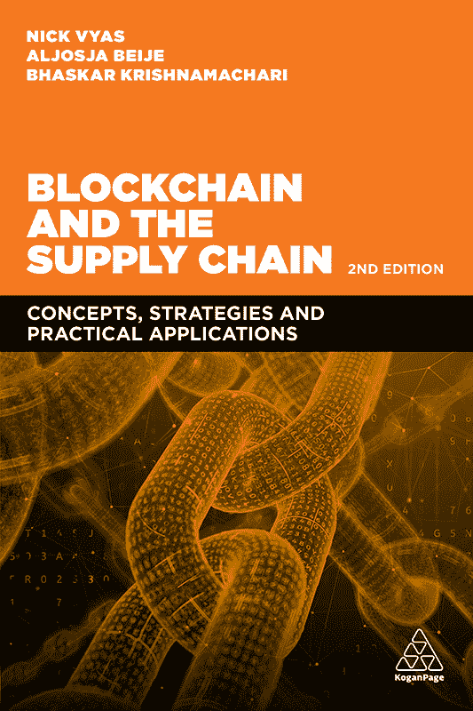

全球供应链是一种全球性的技术现象，只有通过考察其随时间的演变才能真正理解。如果我们观察历史时间线，技术并非仅在工具或组件被物理创造时才开始。相反，技术是作为自然人类本能这一催化剂的结果和延伸而开始的。人类本能与技术演变相互依存，二者在一个无尽的反馈循环中相互塑造。如果我们仔细观察全球供应链，可以发现演变的三个独特维度：贸易、技术和微观-宏观模式。尽管`人工智能 (AI)`和`物联网 (IoT)`等热门技术往往主导当下的讨论，但这三个独特维度是基础性的，因此在全球供应链的未来中发挥着独特作用。

本书将探讨全球供应链与新兴`区块链`技术之间的关系。`区块链`是一种开放的分布式账本，能够以高效且可验证的方式记录点对点交易。这种技术有能力从根本上颠覆每一个行业。它必将改变供应链，而供应链集成的可能性正呈指数级增长。本书将为这些技术变革和趋势提供历史背景，并考察各种用例。此外，还将对技术演变的伦理、潜在滥用，以及能源使用和自然资源的局限性进行一些反思。

### 不懈好奇心的力量

自文明曙光初现以来，人们就对周围的一切保持着永不满足的好奇心。在自然演化的进程中，强烈的探索本能被植入了早期人类的基因。单纯地收集信息，满足了最自然的人类本能，已成为最有价值的事业之一。今天，信息是任何个人、企业或国家所能拥有的最重要资产之一。

#### 供应链的核心理念

供应链最早的形式可以追溯到我们的物种走出非洲大陆。一个人寻找食物、住所并为种族延续而奋斗的唯一目的，可以从其获取生存和繁衍所需基本物资的能力这一视角来审视。

我们可以看到早期旅行形式的趋势，并推断出此类探索最根本的原因。气候变化、未知领域的不确定性、纯粹的智力好奇心，以及信息交换、相互信任与协作的重要性，这些都是当今我们所见核心供应链理念不可或缺的属性。所有这些探索与定居都可以与供需的基本概念联系起来。尽管当时无法量化这些属性，但感官和本能的辨别力足以满足需求并确保种族的生存。

同样重要的是，气候变迁发挥了重要作用。最后一次冰河时代始于约 11 万年前，持续至约 1.17 万年前。据信当时人类人口减少到仅几百万，仅因迁徙至宜居地区才得以幸存。

## 信息与创新：进化的双引擎

在应用运营卓越、优化成本、错误以及对客户至关重要的因素（CTX）的当今时代，我们往往会忽视人类很久以前为通过创新克服挑战而发展出的思维结构。例如，裁缝业的出现、用兽皮制作衣物、建造储存肉类和谷物的住所——通过纯粹的即兴发挥和创新来克服困难，对人类而言并非新鲜事。

在当今的供应链中，仓储和呆滞成本都受到严密监控。许多人将这些概念的演变视为理所当然。之所以会有这些发展，是因为大脑进化并适应了环境，通过执行其最关键的功能——“想办法解决问题”——帮助身体生存下来。我们看到了关于可见身体特征的适应性演变，但有时却未能审视我们作为一个种族是如何在智力上发展以达到极致安全状态的。

### 最早的供应链网络

大约在公元前 8000 年，新石器革命引入了农业作为一种生活方式。农业带来了结构化的定居点、劳动、贸易，以及政治和等级制度意识形态的发展。供应链最原始的形式就存在于这一时期。

公元前 5500 年，美索不达米亚的苏美尔出现了已知最早的文明。一个庞大的运河、灌溉和集中劳动网络应运而生，形成了最早的供应链网络形式之一。

由于缺乏人类进化大部分时期的历史记载，历史早期里程碑的大多数记述都未考虑当时人类的“感受”。记录历史和保存文字记录的全部需求直到很久以后——大约公元前 6 千年——才出现，当时世界某些地区的人类发展出了“信息”意识，这对人类种族的生存至关重要。

信息共享——当今供应链的基本组成部分之一——最早形式出现在公元前 3400 年至公元前 3200 年的美索不达米亚、埃及、中国和中美洲，虽然时期不同，但传达的概念相同。通过书面文字传递信息的想法，标志着信息交换和知识共享的开端。

### 埃及：供应链创新的摇篮

有记载以来最具标志性的时刻之一，是吉萨金字塔的建造，它于公元前 2560 年前后历时 20 多年建成。人们不禁对当时先进的运输、承载和建造概念感到惊叹。试想埃及人可能是如何将巨大的石块从一处运到另一处，将其切割成精确合适的形状，并将多层石块一层层找平堆叠，创造出我们今天看到的奇迹。更令人惊讶的是所用的材料，它们在沙漠干燥的气候条件下已存续了数千年。

埃及文明孕育了许多概念——包括太阳历的创制——这些都是我们今天视为理所当然的。当时的知识和信息交换可能比人们想象的要精细得多。

### 继而有了知识

教育是理顺人们思想、记录观点的关键要素之一，使得后人能够继续研究而无需重复造轮子上百次。公元前 385 年，教育被赋予了结构化的形式。希腊哲学家柏拉图，苏格拉底的弟子，在希腊雅典的阿卡德米亚创办了一所哲学学园——阿卡德米亚学园。

该学园以培养出许多杰出校友而闻名。柏拉图在那里教授了当时许多杰出的思想家，包括著名的希腊哲学家亚里士多德。亚里士多德随后成为亚历山大大帝的导师，并在世界历史上最鼓舞人心的军事壮举之一中发挥了关键作用。

所有这些促成了学习机构的创建，教育以结构化且定义明确的形式传授。哲学学科本身的诞生提供了一种处理存在主义困境的方式，并带来了一种被许多人认可的不同思维过程。

### 伟大帝国如何推动供链发展

尽管城市中心的概念直到公元前 8 世纪罗马城建立才发展成熟，但此前已有许多堡垒扮演了区域市场的角色。色雷斯的第一批希腊殖民地建立于公元前 8 世纪。

阿契美尼德王朝最后一位国王大流士三世（公元前 336 年至公元前 330 年在位）在公元前 333 年的伊苏斯战役中被亚历山大大帝击溃。亚历山大大帝马其顿军队的所向披靡，主要归功于其区别于同时代其他军团的后勤结构。亚历山大以将后勤纳入战略规划而著称。史载^[1]，他会收集关于行军路线、地区气候、沿途补给和资源的情报，并选择沿河行军的路线，以便随时获取食物和水。我们还读到记载，亚历山大使用前现代的简易冰箱运输葡萄酒和其他食品，那些只不过是挖掘的用于储冰的大坑。

这些概念不仅引入了做事的新方式，还激励学者们深入思考，从而在合理的程度上将亚历山大颂扬为“大帝”。

公元前 49 年，尤利乌斯·凯撒与大庞培之间的大规模冲突导致了罗马内战。这些事件以戏剧、诗歌和文学的形式被记录下来以留存史册。这里我们看到一个迷人的现象：当时的人们用各种艺术形式记录事件，以便吸引后世。他们明白，保持信息流动的最好方式是使其尽可能地吸引感官。

当我们看到这种转变，以及土地一个接一个被征服、人口随之重新安置时，我们总是通过荣耀的棱镜、通过谁赢谁输、谁得谁失来感知它们。但人们可以更深入地看到这样一个事实：即使周围有那么多土地，大陆上资源丰富，所有这些战争都是为了一些特定的土地、一些作为贸易和商业枢纽的特定城市而战。

无论是百姓、国王还是学者，都理解征服贸易商业繁荣之地的重要性。他们关注建筑和文化底蕴深厚的城市，这些城市汇聚了拥有多样技能的人才，能让文明繁荣昌盛。当然，军事力量对生存至关重要，但一个社会的进步与繁荣，依赖于工匠、商人以及商品和服务的提供者。

## 文明进步与供应链演变

观察文明进步的这些事件，我们可以认为，繁荣城市中心的兴起吸引了征服者和入侵者，这归功于早期的供应链概念，它们以最佳方式服务于商业和资源利用。

在世界的另一端，公元前 268 年，阿育王加冕为孔雀帝国皇帝。由于先进的记录保存，这一时期的历史记录比此后时期保存得更好。从贸易商业到教育、建筑和艺术，这一时期取得了巨大进步。阿育王组织挖掘水井，在王国道路两旁大规模植树。他建立了公共花园、医院和女性学习机构。

几十年后，中国开始了一项宏伟的建设工程。公元前 221 年，中国长城沿历史北部边境开始修建，以防止游牧部落入侵。劳动力、材料采购和运输都涉及远超时代的供应链规划和实施方法。

公元前 127 年，丝绸之路路线开通贸易。这标志着贸易、运输、供应链、物流和商业整体发展的重大里程碑。商品交换、易货制度、价格制度、货币、关于价格的盈余与稀缺计算等，都由此以非常结构化的方式出现。

### 人员与货物的流动：更快、更高、更远

#### 运输方式

##### 陆路

关于长距离货物交换，彻底改变陆路运输的最关键历史发明是车轮（公元前 3500 年）。最初，车轮用于制作轮制陶器，随后用于车辆。从卡车行驶到飞机着陆都依靠车轮，很容易看出车轮如何为供应链作为人类演变一个方面的快速发展创造了平台。

公元 181–234 年，诸葛亮在中国发明了独轮车，用于向伤兵运送补给。这一事件标志着小规模货物和补给运输与转移的里程碑。

1662 年，布莱兹·帕斯卡设计了第一辆按固定路线行驶的马拉公共汽车，陆地运输取得重大进步。1672 年，费迪南·费比斯特制造了第一辆蒸汽动力汽车。当时蒸汽正被作为可靠动力源进行测试——许多发明家试图开发由蒸汽驱动的机器和系统原型。一直以来，被认为彻底改变运动和运输最重要的发明之一是蒸汽机。这改变了国家间和洲际运输。1781 年，苏格兰工程师詹姆斯·瓦特获得了一项产生连续旋转运动的蒸汽机专利。

今天的汽车工业之所以呈现现有形式，归功于当时经历的创新。1883 年，卡尔·本茨发明了第一辆由内燃机驱动的汽车，称为`Benz Patent Motorwagen`。

1908 年，亨利·福特随`Ford Model T`推出汽车制造装配线方法。这定义了关于生产和贸易的著名里程碑，塑造了当今对供应链的认知。

##### 水路

水路运输是当今货物流动最重要的方式，按重量计算承载世界 95% 的运输吨位。公元前 3500 年左右，埃及文明人民使用河船在尼罗河上运输。1350 年，伊本·沙提尔发明指南针盘，为海陆运输标志着里程碑。现在船只和商队可沿预定路线按航行计划抵达目的地，而不再仅靠星辰指引。

海运在创新方面取得良好进展，葡萄牙、西班牙、荷兰和英国持续寻求提升舰队。1819 年，`SS Savannah`号成为首艘部分依靠蒸汽动力横渡大西洋的船只，从佐治亚州萨凡纳出发抵达英国利物浦。

水面航行无法满足人类，还要潜入水下。1620 年，科内利斯·范·德雷贝尔发明了第一艘实用潜艇，可在水下 12–15 英尺机动数小时。

##### 空中

纵观历史，人类从未停止想象更快、更好的移动货物和人员的方式。除了陆地和水路，还必须取道空中。1783 年，蒙戈尔菲耶兄弟发射首个热气球，首次成功尝试。这是一个非凡的时代，兄弟俩因创造受到赞誉，并以多种艺术形式被描绘。热气球设计本身就显示出当时空中的风采、时尚与风格。

1903 年，奥维尔和威尔伯·莱特兄弟驾驶首架机动飞机飞行，激发了航空运输货物的潜力。航空是当今供应链的重要组成部分，飞机将昂贵物品运往全球。`FedEx`、`UPS`、`DHL` 等使用机队从 20 到 75 架喷气式飞机不等的飞机运送货物。

#### 集装箱化

供应链演变的重要里程碑是“集装箱化”概念的发展——一种使用集装箱（也称货运集装箱和 ISO 集装箱）的多式联运货运系统。所有集装箱尺寸标准化，最常见为 20、40 和 45 英尺。1955 年，前卡车公司老板马尔科姆·麦克林与工程师基思·坦特林合作开发了现代多式联运集装箱。挑战在于设计一种可高效装船且能在长途海运中牢固固定的集装箱。

#### 全球化的作用

全球化是正和博弈。让不同经济体将其独特优势、能力和技能带入各自价值链，生产出大于部分之和的产品，这很有道理。大多数重大发明和技术进步源于跨国思想和努力的交流，无论是设计使然，还是如冷战期间及之前通常那样，通过模仿后改进实现。

以无线电发明为例。苏格兰科学家詹姆斯·克拉克·麦克斯韦的同名`Maxwell Equations`启发德国物理学家海因里希·赫兹致力于证明电磁波存在，进而激发年轻意大利工程师古列尔莫·马可尼的兴趣，他基于无线电波开发了无线通信系统。

再看农业革命。20 世纪早期到中期粮食产量的剧增，使人类免于马尔萨斯陷阱，这是由世界各地学者和专家（包括化学家、农艺学家、植物育种家和遗传学家）的一系列创新和发现带来的。

即便从贸易角度，早已理解经济体从出口和进口中均受益。出口为本地生产者带来成本优势并降低风险，进口增加市场竞争，导致消费者价格降低和产品质量提高。简而言之，全球化对消费者和生产者都有利。

因此，电子和汽车这两个过去一个世纪中规模最大、最成功的行业，恰好也是全球化程度最高的两大行业，这并不令人惊讶。汽车供应链涉及种类繁多的零部件，这些零部件由钢材、玻璃、橡胶和塑料等多种投入要素制成，并从全球供应商网络中采购。

电子行业也是如此。作为大多数消费和工业电子系统关键元件的半导体，其供应链跨越大洲。

即使在可预测、运作良好的国际贸易体系下，企业仍面临供应链风险和挑战，必须有效管理这些风险，以维护和保护其在市场上的品牌和声誉。除其他事项外，企业需要：

*   评估投入成本，如劳动力和原材料采购、关税、税收和海关规则，以确定如何最佳地建立供应链以及何时对其进行调整；
*   确保其产品和流程符合相关法规和市场要求，包括关于健康、安全、环境、劳工和就业、消费者保护、可持续性、反腐败、人权、竞争、税收和良好生产规范等方面的要求；
*   应对不同国家之间的经济和文化差异，这些国家拥有不同的法规、习俗、运输和基础设施能力以及质量体系；
*   确保产品按时、按预算制造并交付给消费者和其他最终用户，在精益制造与库存弹性之间取得平衡；
*   保护自身及其数据，通过更新实践和技术应用，防范知识产权盗窃和网络入侵；
*   管理意外中断，例如由自然灾害、公共承运人物流中断、航运业破产或海港劳工问题引起的中断。

管理良好且运作高效的供应链能提供竞争优势，降低成本并最大化利润。反之，管理不善的供应链可能导致效率低下、合规失败和客户不满。拥有明确的法律和监管策略以围绕其供应链管理计划的企业，将从更频繁的商业机会、获取更高水平的资源和人才中受益，并在质量和效率方面实现持续提升。

有效的供应链管理需要积极规划，虽然在地缘政治和政策稳定时期更容易实现这一点，但在动荡时期解决这一问题甚至更为必要。曾发生过偶发事件，如自然灾害（例如 2011 年日本海啸），这些事件给全球化造成了挫折并扰乱了全球供应链，但这些冲击是暂时的。

#### 现代移民浪潮

大规模移民时期会极大地影响供应链。塑造世界的主要移民浪潮包括 19 世纪 40 年代从欧洲到北美的**大西洋大迁徙**。1801 年至 1914 年间，约有 750 万移民从欧洲迁往亚洲俄罗斯（即西伯利亚），一战和二战之间又有约 600 万人随之迁徙。

奴隶贸易和大规模驱逐导致的强迫移民一直是人类历史上备受争议和敏感的话题。尽管它们对历史和国际关系产生了重大影响，但这些记载鲜少被提及和记录。最大规模的奴隶迁徙是由 16 至 19 世纪在非洲活动的欧洲奴隶贩子实施的。这一时期约有 2000 万奴隶被贩往美洲（数据有争议）。由于通过海路运输，无数人死于跨大西洋的航程中。

最重大的大规模驱逐是由纳粹德国实施的，二战期间（1939-1945）驱逐了 700 万至 800 万人。同时，苏联在战争结束那年将 900 万至 1000 万德裔族人从东欧驱逐至德国。

二战以来，最重大的移民涉及来自发展中国家的群体迁往工业化国家。20 世纪 60 年代至 80 年代间，约 1300 万移民成为西欧永久居民，同期合法获准入境美国的永久移民超过 1000 万。

从欧洲稍微向东，南亚发生了另一次大规模驱逐。据信，1940 年代末英属印度分裂为印度和巴基斯坦期间，近 1400 万人实施了迁徙。20 世纪下半叶的大多数移民是逃离战争的难民。20 世纪 80 年代，300 万至 400 万人逃离阿富汗。

除此之外，我们看到 20 世纪内部迁移的主导趋势是从农村向城市地区的迁移。结果，二战以来，世界许多地区的城市增长自然迅速，尤其是在发展中国家。但即使我们审视两次世界大战，也会发现那段时间发生了众多发明和研究发展。

### 日本的重建与 TQM 的馈赠

日本从 20 世纪 50 年代到 80 年代的快速增长，归功于日本工业采纳了戴明的质量管理原则，这造就了前所未有的生产力和质量水平。

日本实业家以近乎宗教般的狂热追随戴明的教诲，帮助日本在 20 世纪 80 年代转型为工业超级大国，开始超越美国和欧洲工业。即便如此，戴明及其著作在其祖国仍长期未获认可。

1980 年，NBC 电视纪录片《如果日本能行，为什么我们不行？》展示了日本工业为何击败美国工业，并重点介绍了戴明对日本复兴的核心贡献。该纪录片不仅在美国普及了戴明的工作，还帮助该国启动了质量控制运动。随后在 1982 年，戴明在《质量、生产率与竞争地位》一书中发表了基于 14 条管理原则的著名质量管理哲学。

1984 年，美国海军采纳戴明的教诲以提高作战效能。一年后，海军将该计划命名为“全面质量管理”（TQM）。很快，美国联邦政府采纳了 TQM 原则，私营部门随之跟进，以夺回世界最具竞争力产业的地位。

TQM 还促使美国在机器人技术和自动化方面取得了增强发展，这些技术虽发明于美国，却在日本重建时期得到了广泛应用。

### 认知计算：超越人类能力

人类自石器时代起便开始使用装置进行计算，并将在未来继续这样做。由木材和兽骨制成的念珠和计数棒，是旧石器时代晚期（约公元前 20,000 年）发现的最早使用的计数工具。算盘作为一种更紧凑的计算工具，约在公元前 2700 年被用于巴比伦的算术教学。

## 计算机发展史

### 早期概念与发明

机械装置的概念可能最早由土耳其博学家伊斯梅尔·贾扎里在 13 世纪的著作《巧妙机械装置知识之书》中提出。贾扎里还因在 1206 年发明了第一台可编程模拟计算机——城堡钟，一种水力驱动的天文钟而闻名。城堡钟可重新编程以适应昼夜长度的变化。同一时期，西班牙哲学家兼逻辑学家拉蒙·卢尔（1232–1315）构想了生成逻辑，许多计算机科学家认为这是信息科学的开端。

卢尔的思想在 16 世纪被德国博学家戈特弗里德·威廉·莱布尼茨采纳。莱布尼茨被视为第一位计算机科学家，他引入了用于计算的二进制数制。1670 年代中期，莱布尼茨发明了“阶梯计算器”，可执行四则运算。

与此同时，1620 年代发明的计算尺大大加快了乘法和除法运算。埃德蒙·冈特和威廉·奥特雷德在 1630 年代中期制造的结合计算尺的计算设备，一直被工程师和科学家使用，直到计算器发明。

### 现代计算机

英国机械工程师查尔斯·巴贝奇被誉为“计算机之父”。1830 年代中期，巴贝奇构想了分析机，这是现代数字计算机的前身。他设想该机器能利用穿孔卡片的指令执行算术运算。然而，分析机在他有生之年未能完成。

穿孔卡片在 1880 年代末由美国发明家赫尔曼·霍列瑞斯投入实践，用于数据存储。他的方法用于 1890 年美国人口普查。霍列瑞斯的制表机公司于 1924 年更名为 IBM。

1935 年美国实施社会保障时，IBM 穿孔卡系统被用于处理 2600 万工人的记录。穿孔卡在工业和政府的会计及行政管理中变得无处不在。

### 商业计算机

英国电气工程公司费兰蒂国际有限公司开发了首台商用计算机费兰蒂 Mark 1，并于 1951 年交付给曼彻斯特大学。

英国餐饮公司 J. Lyons & Company 承担了计算机的商业开发。其 LEO 计算机于 1951 年 11 月运行了世界上首个存储程序业务应用。同年，美国办公机器制造商雷明顿·兰德（现 Unisys）向美国人口普查局交付了世界上首台量产计算机 UNIVAC I（通用自动计算机）。雷明顿·兰德售出的 46 台机器每台售价超过 100 万美元（按今值约 943 万美元）。UNIVAC 采用串行访问汞延迟线作为主存储器，可存储 1000 个 11 位十进制数的字。

三年后，IBM 推出了售价 50 万美元（2018 年价值约 456 万美元）的小型计算机 IBM 650。

1958 年，杰克·圣克莱尔·基尔比和罗伯特·诺伊斯在德州仪器工作期间制造了首个集成电路（IC）。集成电路开启了“第三代计算机”时代，20 世纪 60 年代末此类计算机采用微处理器 IC 取代晶体管。微处理器的使用使得个人和小企业可拥有的微型计算机得以开发。首个商用微型计算机套件是基于 Intel 8080 的 Altair 8800，刊登于 1975 年 1 月的《大众电子》杂志。随后，Cromemco 和 Processor Technology 等公司开始为 Altair 8800 提供额外的 S-100 总线硬件。

Altair 8800 被许多人视为第一台真正的 PC（个人计算机）。传说 Altair 启发了史蒂夫·乔布斯和史蒂夫·沃兹尼亚克于 1976 年向 Byte Shop（苹果首个客户）出售苹果电脑电路板。

### 从 PC 到超级计算机

对我们大多数人来说，早期 PC 似乎像石器时代的工具。虽然 1976 年由单块电路板连接键盘和电视组成的 Apple 1 被视为奇迹，但现在任何六年级学生可用的计算机技术都能生成 3D 设计、创作高质量音乐并存储高达 2.0 TB 数据。

与此同时，中国神威·太湖之光超级计算机作为世界最快超算，安装于无锡国家超级计算中心，拥有 1060 万个 CPU 核心，用于气候研究、地球系统建模和数据分析。其速度至少是第二快的天河二号（同样由中国制造）的三倍。

如此增强的计算能力远超人类的计算和高效用数据能力。超算能执行原本需要大量员工以较低速度和准确度完成的任务。

研究表明，计算技术使人类每年能多完成约 60% 的计算量，超越前一年所有现存通用计算机可能执行的计算总量。如今智能手机的设备算力是阿波罗 13 号总计算能力的 1000 多倍。

神经核心、量子计算等新技术，以及石墨烯、砷化铟镓（InGaAs）等替代材料的引入，似乎预示着摩尔定律的终结——该定律指出单个集成电路可容纳的晶体管数量每两年翻一番。因此，人类在技术前沿的成就确实跨越式前进，铺就了我们今日成就的道路。

所有这些算力得益于智能芯片和超算技术，它们产生速度与信息存储，以及模仿人类学习的适应性认知。

供应链管理或许暂时不需要神威·太湖之光或天河二号泰坦级算力。然而，随着过去十年超算技术扩展，计算机科学家采用这些工具创造了更实用的解决方案，如不仅可编程、还能在微秒级执行复杂功能并通过学习发展新能力的机器人。这些认知计算和智能计算的新发展，可减少易出错且导致制造、订单履行和运输延迟中断的人工投入。正如军用技术（如无人机）进入民用领域，计算机领域开发的技术亦是如此。

Rethink Robotics 为协作工业应用开发的 Baxter 机器人及其小体量变体 Sawyer，是将认知计算和人工智能进步应用于供应链的良好范例。Baxter 采用当前市场上最先进的 AI，无需传统编程。

相反，根据制造商说法，机器人“可由内部人员手动训练，降低第三方程序员的时间和成本，且灵活适用于多种应用，可跨生产线和任务重新训练”。这意味着 Baxter 能学习在工厂和配送中心执行多种任务，而人类通常只擅长单一领域。例如，一个机器人可被训练处理上料、看管机器、包装和物料搬运。更有甚者，完成一工位任务后，可快速移至另一工位并学习下一项工作。

## 协作机器人与供应链中的颠覆性力量

还有一个显著的区别：大多数工业机器人不仅旨在取代工人，通常还在其各自独立的工作区域内运行，以保护工人安全。然而，`Baxter` 的设计初衷是与人类员工协作。在一个仓储应用场景中，一台 `Baxter` 机器人将产品装入一台为发货进行包装和密封的机器，而同一工位的员工则卸下产品、进行目视检查，然后将其放到传送带上。机器人并非取代员工，而是需要与人类行为进行接触和监控，以高效地学习处理和复制任务。

在供应链中与这些技术协作意味着机器人可以执行单调的任务，从而释放熟练劳动力去从事更高层次、增值更高的工作。除了承担繁琐的任务，认知技术还可以应对制造和军事行动领域中潜在的危险功能，减少伤害或生命损失，让员工能更安全地发挥技能。

IDC 的《全球机器人技术 2018》研究表明，技术进步已进入一个嵌入式和/或基于云的人工智能的新机器人时代。全球机器人技术研究总监张京冰博士表示：“在这个机器人 3.0 的新时代，智能机器人的特点在于其无处不在的感知和连接、网络物理融合、自主能力（如认知、决策、学习和适应），以及更友好的人机多模态交互。这一发展将对工业机器人和服务机器人产生深远影响。领先的机器人技术供应商已在竞相开发并将人工智能能力纳入其产品路线图，以保持竞争优势。”

### 颠覆性力量

#### 人工智能 (AI)

进入现代履约中心的协作移动机器人能够自主导航设施，因为它们拥有车载智能，能够识别障碍物并决定如何应对这种干扰。

`Watson` 是一台 `IBM` 超级计算机，它结合了 `AI` 和复杂的分析软件，作为一台“问答机器”实现最佳性能。这台超级计算机以 `IBM` 创始人托马斯·J·沃森的名字命名。`Watson` 底层认知计算技术的应用几乎是无穷无尽的。凭借其对海量非结构化数据执行文本挖掘和复杂分析的能力，它可以支持搜索引擎或专家系统，其能力远超以往任何系统。2016 年 5 月，一家拥有百年历史的俄亥俄州律师事务所 Baker Hostetler 签署了一份合同，采购一套基于 `Watson` 的法律专家系统，协助其由 50 名人类组成的破产团队工作。`ROSS` 可从约 10 亿份文本文档中挖掘数据、分析信息，并在三秒内为复杂问题提供精准回答。自然语言处理使该系统能将法律术语转化为通俗语言，以回应律师的提问。`ROSS` 的创建者正在增加更多法律模块；类似的专家系统正在改变医学研究。

### 物联网

`IoT` 提供了一种机制，用于实时通信和捕获操作数据，使组织能够获取先前人工业务流程的数据。这不仅仅是数据采集；通过 `IoT`，我们有能力让 `WMS` 系统将拣货清单直接发送给机器人，机器人随后便知晓确切的目的地以及到达那里的最高效路径。最后，考虑一下库存管理能力：通过连接机器人，履约中心有机会利用连接机器人将库存信号直接发送给 `WMS`。

#### 全渠道

自电子商务出现以来，全渠道已取代了零售业的传统供应链模式。在线平台促进了银行支付转账，创建了 Web 界面以实现市场聚合，使全渠道分销成为零售业的新常态。

#### 3D 打印

3D 打印的承诺在于简单和快速：通过在需求点生产产品，供应链变得更短、更精简、更简单。虽然该技术仍在发展中——和无人机一样，仍面临技术缺陷和成本障碍——但从时尚到汽车、航空航天再到医疗等广泛领域，都在利用先进打印技术按需制造产品。

生产重型设备的行业，如商业航空、喷气发动机和建筑设备，正利用 3D 打印制造对生产过程至关重要但需求量有限的零件。`Boeing` 等制造商发现，他们在车间按需制造单个零件比采购和仓储可能数月都消耗不完的最小订单量更划算。随着技术的成熟，它将生产更广泛的产品，并具有更强的耐久性。

通过将本地生产中心设在更靠近战略市场的位置，3D 打印将对以下方面产生积极影响：

*   通过减少运输配送来降低碳足迹，改善组织的可持续发展努力；
*   通过实现快速的按单生产来削减仓储成本；
*   通过快速、廉价地生产替换零件来加快周转速度；
*   满足消费者对个性化产品快速交付的需求。

高速网络将助力整个供应链进行下载、打印和分销产品，供应链步骤更少，浪费显著减少。

要了解利用 3D 打印减少制造业供应链环节的潜在效果，请看总部位于加州的 `SpaceX`，它将 `NASA` 的制造交货周期从三年半缩短到了 18 个月。`SpaceX` 按需 3D 打印火箭的关键部件——由钛制成的涡轮发动机组件。

#### 无人机

多年来——在某些情况下甚至几个世纪——产品一直通过船只和驳船、火车和卡车以及飞机在水路、陆路和空中运输。在某些方面，这些技术随时间的推移几乎没有发生根本性变化，除了燃油效率逐渐提高、速度渐进式提升，以及数字和计算机跟踪技术的加入。

无人机正作为一种潜在的颠覆性替代方案崭露头角，可用于某些流程的传统交付模式。像许多颠覆性技术一样，无人机起源于军事领域，在那里它们被用于在完成任务的同时最大限度地减少人员伤亡，且能在更短时间内、犯更少错误、以更低的操作员安全风险完成任务。

在过去几年里，无人机引起了私营部门的关注。在供应链中，无人机可通过减少环节数量和加快交付速度，对农业、医药和零售等多样化行业产生积极影响。潜在收益惊人，据作者 Peter Sachs 称，无人机技术及其相关使用法规几乎每周都在演变。

`Google` 和 `Amazon` 等大公司迅速意识到，自主配送能迅速改变产品通过供应链到达最终客户的方式。

## 无人机将在多方面改善供应链

首先，它们可用于港口和空中运输，实现所需人工处理材料更少的交付。例如，堆场管理系统提供商 PINC Solutions 已部署了一种利用无人机识别拖车、集装箱和其他资产在难以到达区域位置的解决方案。无人机配备 GPS、RFID、OCR 和条形码阅读器，可飞越上空，快速定位和识别堆场或港口中已标记的资产。虽然无人机将取代一些传统工作，包括目前难以招聘的卡车司机和送货司机等，但无人机的操作将为具有技术培训和物流知识的员工创造就业岗位。

毫无疑问，无人机将改变消费者订购产品的方式，因为在某些情况下，下单与送达之间的时间差可以大幅缩短。它们还将改变零售商的运作方式，从产品的仓储方式、地点和是否仓储，到零售商是选择维持还是放弃实体店和全渠道模式，转而支持电子零售。

那个未来可能比我们想象的更近。在一个引发科技界极大兴奋的重大进展中，2018 年 5 月，美国交通部和联邦航空管理局 (FAA) 批准了十个商业无人机项目，以测试无人机融入国家空域系统。入选参与“融合试点计划”的十家科技（及航空）公司包括联邦快递、Alphabet 和优步。

### 紧随未来——后新冠疫情时代展望

当我们深入细节时，此处讨论的每一项技术都将成为供应链管理者的必备工具，助其遵循指引，应对网络中这些新出现且快速演变的问题。

采用包括无人机、3D 打印、高速网络和智能芯片在内的不断演进且颠覆性的技术，对于我们满足这些消费者的需求至关重要。但高效的思想领袖将看到利用这些技术满足要求、拓展理想市场并以更高的精益效率实现这一目标的可能性。

#### 区块链在数字供应链中的作用

为了提供区块链在供应链中演进的一些历史背景，让我们先考虑加密货币的概念作为序言。早在行业专家、小组成员和拥有博士学位的数据科学家坐在会议中心高谈阔论区块链之前，公元 500 年，密克罗尼西亚一个名为雅浦的小岛上的居民就曾使用一种名为“rai”的大型甜甜圈形石头作为货币形式。雅浦岛民记下了哪块石头属于谁，因此在财富转移时，岛民们会举行集会并宣布转移，从而将其记录在集体记忆中。石头的物理位置并不重要，因为全体岛民都知道其所有权。考虑到当时没有任何当前类型的思想领导力或教育参与构建这样一个系统，将货币从实物形式转变为存储在集体记忆中的认知形式、免受强盗和恶毒酋长侵害的整个概念，显得极其令人印象深刻。

2008 年，区块链技术通过加密货币巨头比特币被推向世界，由一个化名中本聪的匿名人士发布。那一年，[bitcoin.org](http://bitcoin.org) 在网上建立，一篇题为《比特币：一种点对点的电子现金系统》的论文在对在线加密货币技术感兴趣的在线群体中共享。该文章由中本聪撰写，他以此身份签署电子邮件和在线消息，但关于发明比特币及其底层安全技术——区块链的个人/团体，知之甚少。在论文中，中本聪指出：“我们需要一种基于密码学证明而非信任的电子支付系统，允许任何两个意愿方直接交易，而无需受信任的第三方。”^(2) 消除第三方是区块链技术的基础。参与资金和货物交换的各方可以访问共享的可信加密账本，以展示完全的透明度和条款。^(3) 自比特币诞生以来，区块链已成为探讨该技术如何应用于其他行业的热门词汇。例如，医院现在正在使用概念验证项目来保护医疗记录，并允许医生和专家在由区块链技术支持的共享平台上访问这些记录。但这项技术如何用于改变供应链世界？该世界面临着大量文书工作、数十家公司，以及仅为一件从 A 点移动到 B 点的小产品而进行的全球追踪。

区块链是一个开放的、分布式账本，具有高效、安全和可扩展的特性。它是一项跨越所有供应链职能的应用，从采购和仓储到交付，当然还有支付——它承诺比以往任何时候都更能提高供应链的效率和安全性。

后新冠疫情时代的供应链网络将要求网络专注于效率、敏捷性和可持续性，这不是可供选择的菜单项，而是三者一体的深度融合。这将极大地依赖于利用新兴技术的数字基础设施和生态系统。本书旨在为商业领袖建立对区块链应用及其他领先技术在供应链中应用的清晰理解，以便他们看到这些技术提供的优势。在此过程中，我们将区块链与其在加密货币中的用途剥离开来，主要是因为这种关联掩盖了该技术给供应链带来的天然优势。

后续章节将探讨并重点介绍区块链在供应链不同细分领域中的优势，包括设计、采购、制造、合同、财务、合并、仓储，以及涵盖最后一公里配送和逆向物流的物流运营。它们还将整合物联网、机器学习和人工智能的作用，作为供应链的整体集成技术平台。

本书解决的关于区块链的一些主要问题包括：

*   我们如何应用区块链真正增强供应链的未来？
*   我们能否消除当今存在的一些争议和冲突？
*   我们能否消除/改善百年来的中介依赖及其相关摩擦？
*   我们如何通过成为通用交易方式的去中心化账本创造更好的透明度？那会是什么样子？
*   区块链应该是私有的还是公有的？
*   在什么场景下区块链成为高效工具，在什么场景下它不是最高效的做事方式？
*   这项演进性技术对供应链有何伦理影响？

所有这些问题及对所有可能性的理解将在后续章节中得到阐述。我们还将采用相关用例，了解如何集成物联网等新兴技术，以提供真正面向未来的供应链平台。我们希望揭开迷思，赞颂区块链在供应链中的奇迹。

### 注释

1 McNamara, R (2017) Treaty of Kanagawa. ThoughtCo, 31 March. [thoughtco.com/treaty-of-kanagawa-1773353](http://thoughtco.com/treaty-of-kanagawa-1773353) (archived at [`perma.cc/S349-TS92`](https://perma.cc/S349-TS92))

### 参考文献

2 Bernard, Z (2017) Everything you need to know about Bitcoin, its mysterious origins, and the many alleged identities of its creator. [www.businessinsider.fr](http://www.businessinsider.fr) (archived at [`perma.cc/Q5RY-3KVM`](https://perma.cc/Q5RY-3KVM))

3 Meola, A (2017) Understanding blockchain technology, Bitcoins, and the rise of cryptocurrency. [www.businessinsider.fr](http://www.businessinsider.fr) (archived at [`perma.cc/Y48W-DGXM`](https://perma.cc/Y48W-DGXM))

## 供应链危机案例：KFC 英国断供事件

02

在新冠疫情冲击之前，全球供应链网络就已存在显著的结构性缺陷。2018 年 2 月中旬，英国肯德基（KFC）遭遇断鸡危机。这家市值 230 亿美元的百胜餐饮集团旗下连锁品牌，在其 900 多家英国门店中，约有 640 家连续十余天无鸡可供。门店关闭引发常客在 Twitter 上的愤怒声讨，甚至有人报警投诉这种“针对美食的罪行”，直到警方呼吁公众不要浪费警力处理此类事务。

与此同时，英国媒体借题发挥，大肆渲染。报纸头条尖叫着“fowl”（鸡/犯规）和“a giant cock-up”（大搞砸/公鸡搞砸），随后报道消费者“clucking about”（咯咯叫/抱怨）或感到“peckish”（想吃鸡/馋了），常夹杂着变体的“为什么鸡要过马路？”笑话。约两周后，所有门店恢复鸡肉和肉汁供应，危机才告平息。该连锁品牌日均损失 127 万美元，更别提对 KFC 品牌造成的无法估量的伤害。

### KFC 供应链出了什么问题？

据各方报道，问题根源在于 KFC 决定将配送供应商从食品物流服务商 Bidvest Logistics 更换为 DHL 和 QSL（Quick Service Logistics）。DHL 负责仓储和实物配送，QSL 负责库存管理和需求计划，并提供专用 IT 系统。Bidvest 过去为 KFC 运营六个仓库，而 DHL 仅从中部地区拉格比的一个仓库运营。

早期短缺报告指向 2 月 14 日发生在 DHL 拉格比仓库附近三个路口、涉及七辆车的系列事故。因事故导致 DHL 卡车一出仓库就陷入交通瘫痪，进而引发短缺并触发危机。然而，这一单一事件本身无法解释即使在 M6 高速公路恢复通行后，KFC 供应链大范围中断仍持续数天的原因。

随着《每日电讯报》和《卫报》深入调查——在 KFC 和 DHL 两家理解地保持低调、鲜有配合的情况下——真相浮出水面：导致短缺的不是新仓库网络设计或事故本身。毕竟，马克斯·斯宾塞等众多食品零售企业也从中心仓运营。有报告称，货车在餐厅经理拒收后，将印有 KFC 标志的鸡肉箱倾倒路边。显然，问题远比新仓储网络设计复杂。

原来，正如 KFC 后来所说的“磨合期阵痛”，源于向新系统的过渡。英国科技分析师 Chris Green 在《卫报》文章中指出：“DHL 及其软件合作伙伴 Quick Service Logistics 似乎未能将 KFC 的订单流程数据与新系统妥善匹配。”

实质上，新系统无法为订单和配送提供准确的可追溯性，一旦供应链出现故障（如 2 月 14 日所发生的），订单处理系统便陷入失控，酿成大规模危机。《Wired》英国版有专家解释道：“构成这些供应链的是许多不同的公司、许多不同的关系，所有这些都在试图管理流程、基础设施、设备、信息系统及其员工，使所有这些能以同步方式运行，以便顾客买到想要的鸡肉。”

KFC 这场闹剧，是当今供应链组织面临深层问题的最新佐证——即使历经数十年的技术进步和全球化。问题在于供应链两大核心流——实物流与信息流——之间的异步。供应链管理专业人士委员会（CSCMP）对供应链管理的定义（见下）指出，这两大流之间的“链接”对供应链运作至关重要：

> 供应链管理（SCM）背后有两大核心原则：
>
>  几乎每一个到达消费者手中的产品，都需要多个组织的累积努力。这些组织共同构成了供应链。
>
>  SCM 是对供应链活动的主动管理，旨在最大化客户价值并实现可持续竞争优势。供应链活动涵盖从产品开发、采购、生产到物流的一切，以及协调这些活动所需的信息系统。
>
>  构成供应链的组织通过实物流和信息流“链接”在一起，形成增值客户体验的合作伙伴关系。实物流涉及货物和材料的转换、移动和存储。信息流使各供应链合作伙伴能够协调长期计划，并控制货物和材料在供应链上下游的日常流动。

CSCMP 的定义充分概括了供应链管理的新现实：过去 40 年的快速全球化如何拓展了其功能与地理版图，并引入了全球供应链管理（GSCM）这一学科。

如今的全球供应链运营涵盖（但未无缝整合）令人眼花缭乱的行政交换和金融交易，跨越多个地域、涉及众多贸易伙伴，其中绝大部分工作仍以纸质为主，部分通过电子数据交换（EDI）完成——这是一项已有 55 年历史的技术。这些无数的信息孤岛和成群的中间商，制造了摩擦，拖慢了供应链。

## 利害攸关

纺织、汽车、航空、电子、医疗和制药等行业，其材料来自分布在遥远距离的多个采购地，特别容易受此类摩擦影响。

2016 年，美国最大零售商沃尔玛和塔吉特被迫向客户退还数百万美元，因为发现从印度纺织制造商 Welspun India 采购的埃及棉床单，并非埃及棉。问题后被追溯到全球纺织业仍深受其扰的供应链问题组合——跨地域的多供应商和中介商参与，以及行政重叠。Welspun 在随后几个月采取一系列措施修复导致危机的追踪和溯源问题，但已损失近 6000 万美元业务及最大客户塔吉特。

## 供应链数据点间摩擦与错配造成的损失

供应链数据点间因摩擦与错配造成的损失不仅限于收入或商业声誉的损失；它们还会造成广泛的环境破坏，棕榈油供应链即是一例，且至少在一起案例中导致了新生儿死亡。2017 年 8 月，印度北方邦一座小镇的医院因氧气供应耗尽，导致 60 多名婴儿死亡。该医院的氧气供应商因数月未收到款项，且多封催促补货的邮件在繁杂的官僚往来中遗失，遂停止供气。

棕榈油产业规模达 620 亿美元，长期以来因毁林和侵犯人权问题备受诟病，印尼和马来西亚提供了全球逾 85%的棕榈油。建立在毁林土地上的种植园，向麦当劳、玛氏、家乐宝和宝洁等众多家喻户晓的品牌供应棕榈油。2017 年 7 月，《卫报》报道称，百事可乐、联合利华和雀巢被指在苏门答腊最后一片由大象、猩猩、犀牛和老虎共同栖息的雨林生态系统遭破坏一事中负有共谋责任。

棕榈油供应链高度复杂，因为产品常被混合——它往往以来自多个不同来源的混合产品形式到达供应商处。各方已启动多项倡议以规范棕榈油生产并消除其环境影响，但大多收效甚微。根本原因在于棕榈油很难追溯到特定种植园。

### 供应链中断

总部位于英国伯克郡的商业连续性学会于 2017 年 11 月发布的《供应链韧性报告》调查了 65 个国家的供应链中断情况，报告称“非计划 ICT（信息与通信技术）中断”是供应链中断的首要原因。一个更具启示性的发现是，69%的受访者对其供应链不具备完全可视性。自 2009 年首版报告起即参与其中的苏黎世保险全球供应链产品负责人 Nick Wildgoose 表示：“这不足为奇。事实上，我更惊讶于竟有这么多组织声称拥有供应链的完全可视性，因为几乎不可能知晓每一家供应商的情况。”

制药行业专家、生命科学咨询公司 Maetrics 负责人 Steve Cottrell 在[Pharmaexec.com](http://Pharmaexec.com)刊文中引用该研究称：“鉴于制药供应链是世界上最复杂的供应链类型之一——它需在全球范围内管理与大量供应商协作并获取药品生产原料及组件的运营挑战——显然，若不解决可视性差的问题，风险极高。”

因不同步导致的供应链摩擦，也是这些行业中动辄数周至数月的过长产品前置时间的罪魁祸首。尽管从采购或生产点到生产或消费点的物理距离可能不超过几千英里，空运仅需数天、海运仅需几周即可覆盖，但绝大多数延迟、浪费和中断——在某些案例中高达供应链总成本的 45%-50%——均源于行政流程摩擦、独立财务交易以及人工干预引发的问题，包括中介的存在、人为错误、反复迭代，往往单纯是闲置等待。

澳大利亚精益顾问兼作家 Tim Mclean 在近期文章中列举了不必要前置时间的来源，均为可预防因素：采购人员处理订单延迟——尤其是当他们将自己锁定在漫长的订购周期中，或试图累积大订单以获取更低价格时；供应商处理订单延迟；因多次通关、换装转运和货运代理，沿多条航运路线和港口产生的流程相关延迟。此外还有采购方、供应方、政府机构及各层级中介之间发生的多重财务交易循环。

世界银行 2013 年报告《促进贸易：挖掘增长机遇》通过多个案例研究，阐释了全球供应链中流程相关瓶颈如何抵消多国显著的劳动力成本优势，并推高整体供应链成本。案例包括：

*   在巴西，处理农产品出口海关单据所需时间是欧盟的 12 倍（整整一天对比几小时）。
*   服务质量低劣可使某些非洲国家消费品的投入物料成本增加高达 200%。
*   美国因办理许可证及监管机构间缺乏协调，导致某公司多达 30%的化学品发货延迟——每次延迟每天成本 6 万美元。
*   在俄罗斯，计算机行业的产品测试和许可会导致高昂行政成本，并使上市时间推迟十天至八周不等。
*   在航空货运行业采用电子单据，每年可节省 120 亿美元，并防止 70%-80%的单据相关延迟。

仅在英国，据 Tungsten Network 2017 年报告，平均每家企业因笨拙的支付实践导致供应链摩擦，每年损失 88,725 英镑（113,765 美元）。这相当于近 6,500 工时用于追踪采购订单号、处理纸质发票和回应供应商询问。

受访企业估计，其每周平均耗时约 55 小时进行人工纸质流程处理和核对，39 小时追踪发票异常、差异和错误，23 小时回应供应商询问。此外还花费 5 小时应对合规挑战（如处理国际税务），3 小时处理发票欺诈。

Tungsten Network 首席执行官 Rick Hurwitz 评论道：“金融领域的众多流程依然繁琐耗时，实则大可不必。技术让我们能摒弃阻塞业务流的繁琐琐碎任务，转而提升生产力和效率。令人惊讶的是，在这样一个技术赋能的时代，企业仍每周花费如此多工时管理本可自动化的流程。”

排名前五的摩擦成因因素为：

*   收到的纸质发票比例高；
*   非基于采购订单（PO）的发票过多；
*   供应商就发票或付款状态发起的询问量大；
*   缺乏自动化异常处理；
*   缺乏自动化审批。

全球范围内，美中贸易争端和脱欧等危机引发的强权经济体贸易挫折感上升，持续给本已紧绷的全球供应链施加额外压力。这解释了为何学者、供应链专家和研究人员正以如此迫切的态度探索重新思考、重新装备和重塑供应链的途径。

### 区块链的论据

## 区块链技术：起源、应用与局限性

### 区块链的起源

区块链诞生于 2008 年金融危机最严重之时，当时一个名为中本聪的匿名人士或团体起草了一份白皮书，创建了一种名为比特币的数字加密货币协议，随后挖出了第一个比特币区块，即“创世区块”。这源于人们在无需第三方的情况下建立信任并进行交易的需求。

另一个流行的区块链以太坊，由加拿大人 Vitalik Buterin 于 2015 年 7 月开发，当时他创建了其创世区块。以太坊引入了多种新功能，其中之一是构建智能合约的能力——即验证或强制执行合约的计算机协议。智能合约是一种自我执行的协议，可处理合约的所有阶段，包括管理、执行、履约和支付。

用简单的术语来描述这项技术，区块链是一个数字化、去中心化、防篡改的账本平台，它记录并验证交易，省去了中间商。

### 企业采用与 DLT

金融服务业是第一个意识到其颠覆性潜力的行业，特别是在降低成本、提高流程效率和支持该行业大量运营方面。银行通常将区块链称为**分布式账本技术 (DLT)**，以将其与比特币的区块链区分开来。

他们被 DLT 的吸引人特性所吸引，这些特性在《金融科技 2.0 白皮书》中有所阐述，该报告由 Santander InnoVentures 于 2015 年发布，并与 Oliver Wyman 和 Anthemis Group 合作制作，也被广泛视为企业区块链前景的首份全面宣言：

*   交易可以设为不可撤销，清算和结算可编程为近乎即时，使分布式账本运营商能够提高交易数据的准确性并降低结算风险。
*   系统以点对点方式运行，交易近乎确定能被正确执行，使分布式账本运营商能够消除监管和 IT 基础设施及其相关成本。
*   账本中的每笔交易都由网络用户社区公开验证，而非由中央权威机构验证，这使得分布式账本具有防篡改性；且每笔交易均自动管理，使得交易历史难以逆转。
*   几乎任何无形文档或资产都可用代码表达，并可编程进入分布式账本或由其引用。
*   创建了一个公开可访问的所有交易历史记录，使参与者、监管者和监管机构能够进行有效的监控和审计。

### 供应链变革

特别是过去三年，见证了跨行业、跨地域的公司部署区块链以转型其供应链的竞赛日益激烈。

在全球范围内，组织一直在利用区块链技术改善其供应链的可追溯性。2017 年 12 月，联合利华启动了一个为期一年的试点项目，利用区块链技术追踪联合利华和英国超市 Sainsbury's 销售的茶叶供应链。该公司将与大型银行和技术初创公司合作，追踪马拉维的茶农，他们为联合利华品牌供应茶叶。

该项目利用技术维护供应链的透明度，因此公司和消费者都知道茶叶的来源。“马拉维茶叶是起点，而非终点，”剑桥大学可持续领导力研究所 (CISL) 可持续金融总监 Andrew Voysey 在“一个星球”峰会上发布该项目时表示。

CISL 在一份声明中表示，多达 10,000 名马拉维农民可能加入该试点，该计划将通过优惠贷款和信贷准入等财务激励，奖励那些生产更公平、更可持续茶叶的农民。

消费品和零售公司面临着越来越大的压力，寻找更好的方法来证明其供应链环境可持续，且不存在侵犯工人权利和腐败行为。可口可乐公司、美国国务院及另外两家公司于今年 3 月宣布，他们将启动一个项目，利用区块链的数字账本技术为工人创建一个安全的注册登记系统，以帮助在全球范围内打击强迫劳动。美国科技公司 Bitfury Group 将为该项目构建区块链平台，而 Emercoin 将提供区块链服务。

2017 年底，包括雀巢、联合利华和泰森食品在内的十家大型食品和零售公司加入了一个 IBM 项目，研究区块链系统如何帮助追踪食品供应链并提高安全性。

以下是沃尔玛单方面打算如何利用区块链改善其复杂的全球食品供应链中的食品安全。沃尔玛食品安全与健康副总裁 Frank Yiannas 在马萨诸塞州剑桥举行的 MIT Technology Review 的“区块链商业”会议上向听众透露，区块链将追踪农产品所需的时间从六天缩短到了两秒。

今年 6 月，沃尔玛获得了一项专利，该系统可将医疗设备的医疗记录存储在区块链上。沃尔玛最近还申请了一项基于区块链的客户市场专利，用于转售其商品。

### 航运业举措

航运业也蓬勃加入了这场竞赛。今年 8 月，IBM 和马士基推出了基于区块链的航运平台 TradeLens，拥有 94 家早期采用者，包括 20 多家港口和码头运营商。TradeLens 的许可驱动型区块链账本将允许所有参与者查看货物运输的实时详细信息，如货物到达时间、海关放行、商业发票和提单。TradeLens 可以追踪供应链中每笔货物运输的关键数据，并为所有参与者创建不可变的记录。

TradeLens 并非唯一的参与者。供应链支付和市场初创公司 Tradeshift 估值超过 10 亿美元，最近报告称，与去年相比，其平台上的商品交易总额增长了 350%，新订单同比增长了 315%。Tradeshift 还获得了首个将供应链支付、融资和基于区块链的早期付款全部整合到一个统一解决方案中的平台的殊荣。目前，Tradeshift 平台可以与 Ripple 区块链支付和 R3 的 Corda 进行集成。

### 市场增长

全球在区块链解决方案上的支出正在上升。IDC 早些时候估计，2018 年区块链支出将达到 21 亿美元，是 2017 年 9.45 亿美元支出的两倍多。该研究称，美国将看到最大的区块链投资，贡献全球支出的 40% 以上。西欧将成为第二大区块链支出地区，随后是中国。

2018 年 8 月 2 日至 3 日，USC Marshall 全球供应链管理中心召集了行业领袖、科技投资者和创新者，举办了第六届全球供应链峰会，启动了 IBISK 计划，旨在与政府和跨国公司合作，推动区块链采用的未来最佳实践和标准。

### 区块链的局限性

像任何新技术一样，区块链也有必须考虑的局限性。

#### 可扩展性问题与激励需求

区块链以其现有的形式存在，是不可扩展的，因为它受限于网络可用的计算能力，这意味着它在目前的形式下不能用于大批量交易。

Network constraints also make the creation of a single block in a blockchain an inherently slow process. The time required for a single block to become part of a public blockchain can range from a few seconds to days. Let's see how exactly this works.

A block in a blockchain (called a record) is a series of sequential transactions. The complete process of creating a block involves two steps. First, each individual transaction must be verified by mining computers on the network (called "miners") by solving complex mathematical puzzles. The Bitcoin blockchain software processes about 7 transactions per second, while the Ethereum blockchain processes 15 per second. By comparison, VisaNet (Visa's processing system) can handle 47,000 transactions per second.

A single blockchain block can contain up to 2,000 transactions. The entire process of verifying a block is called "block time." Limited by network computers, Bitcoin restricts each block size to 1 MB, and its block time is ten minutes. Ethereum has a faster average block time of about 20 seconds because its block size is much smaller, around 20–30 KB, but it has other complex variables that we will cover in later chapters.

The second step of adding the block to the public ledger takes an uncertain amount of time, ranging from a few seconds to days. This is determined by two variables: network activity and blockchain fees. Blockchain fees, also known as "transaction fees" or "miner fees," are fees paid by users to miners when making a transaction. They are typically $1 but increase with spikes in network activity, such as during the cryptocurrency bull run in December 2017, when users had to pay over $60 to confirm a transaction. The speed and scalability issues of blockchains have raised concerns that the technology is unsuitable for high-speed or high-throughput transaction networks. There are some new solutions, such as `SegWit`, `Lightning Network`, and `#Metahash`, that promise to solve these challenges, but it is currently too early to see any impact.

#### Massive Energy Consumption

All nodes in a blockchain network must run computationally intensive programs to create blocks, a process that requires massive computing power. Reportedly, the computing power required to sustain the network last year consumed energy equivalent to the total electricity usage of 159 countries worldwide.

In a report published in June 2018, the Bank for International Settlements (BIS), headquartered in Basel, Switzerland, called blockchain an "environmental disaster." The financial institution is owned by 60 central banks. The report quoted: "At the time of writing this report, the total electricity consumption of Bitcoin mining was equivalent to that of a medium-sized economy like Switzerland, and other cryptocurrencies also consume vast amounts of electricity. Simply put, the quest for decentralized trust has quickly turned into an environmental disaster."

According to a 2017 study by UK energy comparison service `PowerCompare`, the average electricity used just to mine Bitcoin that year exceeded the annual electricity consumption of 159 countries. The website `Digiconomist` estimates that verifying a single transaction on the Bitcoin blockchain consumes about 200 kWh of electricity, enough to power an average household for over four weeks.

#### 51% Attack

Blockchains are designed to follow a democratic governance model, so they face the same problems as real-world democracies. In a so-called "51% attack," a group of miners can trick the system by controlling more than 50% of the network's mining hash rate or computing power. In one week in May 2018, cryptocurrency networks such as `Bitcoin Gold`, `Verge`, and `Monocoin` all suffered 51% attacks, with an estimated millions of dollars worth of tokens stolen.

Blockchains have a few other disadvantages and limitations, such as "forks," which are disruptions caused by incompatible mining node software; their checkered historical legacy of facilitating criminal transactions and being viewed as an anti-establishment structure; and the "pseudo-anonymity" of users and miners. However, all these issues can be addressed within a permissioned blockchain network framework, such as those currently in use and planned for supply chains.

### Blockchain in Supply Chains — Improving Efficiency and Effectiveness

Current technological research focuses primarily on technical issues such as design and functionality, neglecting application, value creation, and governance (Risius & Spohrer, 2017), but practitioners know almost nothing in the way of practical guidance for applying blockchain technology to supply chains. Questions such as "Which supply chain processes should we focus on?" or "Which performance indicators will be affected?" are relevant but need to be answered in a structured and meaningful way. Therefore, we propose a framework in this chapter that addresses both efficiency improvement and effectiveness enhancement. One limitation of this framework is that it does not consider the potential impact of blockchain technology on business models. In this chapter, we also synthesize the efficiency model and the effectiveness model based on the SCOR reference model, combined with the business innovation model.

The chapter outline is as follows. First, we will discuss supply chain management objectives, then explore the SCOR process reference model at a conceptual level. Next, we will summarize how blockchain capabilities relate to SCM objectives. This is achieved by systematically linking blockchain capabilities to various value creation mechanisms and their interactions, using the theoretical building blocks discussed here.

#### Supply Chain Management Objectives

The efficiency and effectiveness of a supply chain can be measured by a set of performance objectives. Based on case study analysis, Kshetri (2017) identified several supply chain objectives that can be positively impacted by blockchain technology. These objectives include cost, speed, product quality, reliability, risk reduction, sustainability, and flexibility. The SCOR^[1] reference model provides another set of objectives, called performance attributes, which are linked to performance metrics. We will base our approach on the SCOR reference model because it not only provides specific metrics for each performance attribute but also details processes according to the type of production strategy applied. Moreover, it is widely adopted by both practitioners and researchers.

The first SCM objective is system-level cost minimization (Simchi-Levi et al., 2000). While Kshetri (2017) and the SCOR reference model use the term "cost" respectively, we believe it is crucial to emphasize the system level; merely reducing inventory or minimizing transportation costs is insufficient. These decisions must consider the entire system because trade-offs exist between different costs, such as storage costs and order processing costs. Since administrative transactions add approximately $250^[2] to the physical shipping cost of a container, leveraging blockchain technology to automate these transactions has the potential to reduce the marginal cost of additional transactions to near zero (Kshetri, 2017).

## 供应链中的响应性、可靠性与敏捷性

响应性（SCOR）或交易执行的速度（Kshetri, 2017）是另一个重要目标。当今供应链核心的基于纸质的交易极其耗时。例如，一个集装箱从新加坡港物理运输到印度尼西亚雅加达大约需要 36 小时。然而，信息流转和财务结算可能长达七天。智能合约驱动的机器对机器（M2M）交易减少了人工交互和沟通。这些机器不仅不需要假期、能不间断地 7×24 小时工作，而且永远不会生病；与人类不同，一旦编程得当，它们就不会犯错。所有这些导致交易速度大幅提升，同时降低了交易成本。

供应链的可靠性或可依赖性（SCOR）是指其满足客户交货日期的能力，例如在承诺交货日期当天或之前发出的订单百分比（Simchi-Levi *et al*, 2000）。由于准确预测交货日期的能力在当今市场中对许多公司至关重要，获取可靠且最新的数据是必要条件。此外，计划执行过程中异常情况的早期预警允许（例如）重新安排生产订单或更改运输方式，以便仍能达到约定的服务水平。区块链技术提供经过验证的数据和身份的能力，可以改进排程算法的结果，因为这些结果对所处理数据的质量很敏感。此外，来自设备上物联网设备和传感器的实时验证数据将允许更好地管理异常情况，例如延误。

完美订单履行是可靠性的一个特殊衡量指标。SCOR 模型定义了构成完美订单履行的各个组成部分。产品质量是其中之一，在运输过程中极易受到影响。例如，食品和药品的质量对温度和湿度的变化非常敏感。通过获取不可篡改的追踪、湿度和温度数据，生产商和消费者可以更有信心地确信他们购买的产品是在正确的条件下运输的。

供应链是一个随时间演变的动态系统。短生命周期产品的推出、客户期望的提高、政治不确定性和全球化，给供应链关系带来了越来越大的压力。这体现在供应链的敏捷性（SCOR）水平上，即其应对外部影响以获得或保持竞争优势的能力。然而，当今复杂的 B2B 供应链集成技术缺乏应对这些变化所需的灵活性（Korpela *et al*, 2017）。此外，随着基于机器对机器的物联网交易的兴起，供应链内的数据交换量预计将大幅增加，并变得更加去中心化和分布式。这将进一步增加对更灵活的安全数据交换形式的需求。区块链技术非常适合满足这些要求。

最后一个 SCOR 绩效属性是资产管理效率。资产既可以是实物资产，如卡车、仓库空间、库存和生产设施，也可以是流动资金，如现金和未结发票。正如上一章所讨论的，区块链技术不仅允许改进供应链内物流、信息流和资金流的整合，从而对流动资金效率产生积极影响，还可以通过更准确的数据和更好的异常处理实现更好的规划，利用去中心化市场交易未充分利用的实物资产，如泊位空间或卡车、火车、船只上的空载空间。

消费者、非政府组织（NGO）、政府和企业对其产品和材料信息的需求日益增加。这不仅是因为食品安全相关的担忧，如牛海绵状脑病（疯牛病）和禽流感（Setboonsarng *et al*, 2009），还因为供应链各方面临利益相关者对产品信息的要求，以及验证可持续性声明的手段，如公平贸易、动物福利和碳足迹减少（BSR, 2014）。与这一问题密切相关的是商标滥用和假冒产品，这损害了消费者和公司的利益（Martinez de Andino, 2014）。区块链技术提供经过验证的数据和身份以及不可篡改的审计追踪，这将允许更可量化和有意义的可持续性指标（Kshetri, 2017），同时降低实现这一目标的监控成本。虽然可持续性不是 SCOR 参考模型中的单独绩效属性，但已经开发出了 SCOR 模型的一个特殊应用，称为可持续 SCOR，它基于 GRI 可持续发展报告标准，这些标准在 SCOR 模型的范围之内（APICS, 2017）。

全球供应链是设施和组织的复杂网络，它们通常有不同的、相互冲突的目标（Simchi-Levi *et al*, 2014）。因此，供应链成员必须应对多重不确定性。这些不确定性导致需要主动管理的风险。组织面临的各种风险中包括个人的“寻求自身利益的行为”（Williamson, 1985），这需要持续监控供应链成员，并协商和执行合同条款。智能合约将通过规定所有权转移和后续付款所需的条件，实现预先合规。虽然风险管理渗透在 SCOR 参考模型中，但它不是单独的绩效属性。相反，它与敏捷性绩效属性、使能流程和最佳实践相关联。

### SCOR 流程模型

SCOR 是一个流程参考模型。此类流程参考模型或业务流程框架的目的是以一种与关键业务职能和目标相一致的方式定义流程架构（APICS, 2017）。该模型由四个主要部分组成：

*   **绩效**：用于描述流程绩效和定义战略目标的标准指标。
*   **流程**：管理流程及流程关系的标准描述。
*   **实践**：能产生显著更好流程绩效的管理实践。
*   **人员**：执行供应链流程所需技能的标准定义。

我们的分析框架明确引用了绩效和流程部分，而实践则通过区块链技术在特定流程中的作用及所用的区块链机制隐性包含在内。例如，如果我们查看 `sS1.2` 流程“接收产品”，我们可以看到与该流程相关的各种指标（`RL.3.18` 订单/行项目完全处理百分比等）。为该流程定义了各种最佳实践，其中之一是 `BP.012` “批次追踪”。由于本书第 7 章中描述的各种用例涉及将区块链技术用于结合物联网设备的库存（批次）追踪，这将构成提供库存（批次）追踪数据的机制。

我们尚未在框架中纳入“人员”方面，因为本章的核心问题是“为什么是区块链技术？”；我们认为“人员”问题过于广泛，超出了本书范围。然而，随着区块链技术及 AI、IoT 等其他技术预计将极大地改变商业模式，我们相信这反过来将影响“人员”组成部分，随着这些新技术的落地，新的供应链岗位将应运而生。

虽然 SCOR 并不试图描述每一个流程或活动，但它确实包含（APICS, 2017）：

*   所有客户互动，从订单录入到发票付款；
*   所有实物交易，包括供应商的供应商到客户的客户，涵盖设备、原材料、中间产品、备件、服务、软件等；
*   所有市场互动，从理解聚合需求到履行每个订单。

如图 2.1 所示，该模型旨在支持多层级的供应链分析。SCOR 关注前三个流程层级，这些层级具有行业中立性。该模型不试图规定组织应如何开展业务或定制其系统/信息流。每个使用 SCOR 实施供应链改进的组织都需要至少将模型扩展到第 4 层，使用特定于行业、组织和/或地点的流程、系统和实践。

我们的分析框架以流程要素作为分析单元，就 Plan、Source、Make、Deliver 和 Return 流程而言。对于 Enable 流程，我们的分析单元是流程类别，主要是因为对于大多数 Enable 流程要素^(3)，未在流程要素层面定义指标。因此，分析框架的精确度较低。未来模型的扩展可以是通过 Enable 流程要素层面定义的各种实践，在流程要素层面为 Enable 流程定义指标。

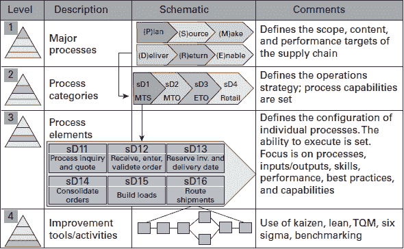

图 2.1 SCOR 分层流程模型。经 ASCM 许可转载

重要的是要注意，由于专注于流程要素，我们的框架并未涉及区块链技术在运营战略方面的（潜在）角色和机制。

由于 SCOR 流程模型的详细描述超出了本书范围，我们建议不熟悉该模型的读者从 APICS 网站下载最新版本的 SCOR 参考模型（撰写时为 12.0 版），因为在全书中我们将遵循 SCOR 参考模型的定义和描述。

在前几段中从概念层面介绍了 SCM 目标和 SCOR 模型后，我们现在将深入研究 SCOR 流程要素，看看区块链技术可以扮演什么角色，以及在每个流程要素中实际涉及哪些机制。由于 SCOR 模型为每个流程要素提供了绩效指标，我们也能更好地理解应用区块链技术的潜在商业案例。这有助于消除基于“区块链技术是‘寻找问题的技术’”这一观念的组织怀疑论。

### Plan 流程

SCOR 将 Plan 流程定义为与确定需求和纠正措施以实现供应链目标相关的流程。

对供应链流程和资产的完整、实时可见性可以极大地提高 Plan 流程的有效性。区块链可以帮助公司与供应商和供货商共享有关产品仓储、交付和维护的信息。公司已经在这么做了。全球最大的矿业公司 BHP Billiton 宣布将使用区块链记录井眼岩石和流体样本的移动，并提高交付过程中生成的实时数据的安全性。据 BHP 地球物理学家 R Tyler Smith 称，新系统将提高内部效率，并使公司能更有效地与合作伙伴协作。

表 2.1 概述了流程和受影响的指标。

表 2.1 Plan 流程和受影响的指标

跳过表格

| PROCESS | DESCRIPTION | BLOCKCHAIN’S ROLES | MECHANISMS INVOLVED | PROCESS AFFECTED | METRICS |
| --- | --- | --- | --- | --- | --- |
| `sP1.1` | Identify, Prioritize & Aggregate Supply Chain Requirements 识别、优先排序和聚合供应链需求的过程，在适当的层级、范围和间隔内，针对产品或服务的集成供应链的所有**需求**来源。 | 只有网络中相互接受的各方才能参与交易，便于识别所有需求来源。 | 验证参与供应链的各个实体的身份。 | `RL.3.37` | Forecast Accuracy 预测准确率 |
| | | 整合来自二级到 n 级分销商的数据。 | 允许以保护隐私的方式共享数据的加密原语。 | `RS.3.44` | Identify, Prioritize and Aggregate Supply Chain Requirements Cycle Time 识别、优先排序和聚合供应链需求周期时间 |
| | | 区块链的仅追加账本可以解决分销商提供的自报数据相关的挑战。 | 交易数据可在永久添加到区块链前由 `Oracles` 验证。 | | |
| | | 提供一个安全的、点对点的协作规划和预测平台，无需中心化控制。 | 允许以安全且（如需要）保护隐私的方式共享数据的加密原语。 | | |
| `sP1.2` | Identify, Prioritize & Aggregate Supply Chain Resources 识别、优先排序和聚合供应链资源的过程，在适当的层级、范围和间隔内，针对产品或服务供应链中所需且增值的所有**供应**来源。 | 只有网络中相互接受的各方才能参与交易，便于识别所有需求来源。 | 验证参与供应链的各个实体的身份。 | `RS.3.39` | Identify, Prioritize and Aggregate Supply Chain Requirements Cycle Time 识别、优先排序和聚合供应链需求周期时间 |
| | | 整合来自二级到 n 级供应商的数据。 | 允许以安全且（如需要）保护隐私的方式共享数据的加密原语。 | `AM.2.2` | Inventory Days of Supply 库存供应天数 |
| | | 区块链的仅追加账本可以解决供应商提供的自报数据相关的挑战。 | 交易数据可在永久添加到区块链前由 `Oracles` 验证。 | | |
| | | 提供一个安全的、点对点的协作规划和预测平台，无需中心化控制。 | 允许以安全且（如需要）保护隐私的方式共享数据的加密原语。 | | |
| | | 简化企业间集成。 | 点对点网络中的数据安全和成本效益交易传输（Korpela *et al*, 2017）。 | | |

## 供应链流程与区块链技术映射表

### sP1.3 平衡供应链资源与需求

**流程描述**：识别和衡量需求与资源之间的差距和不平衡，以确定如何通过营销、定价、包装、仓储、外包计划或其他行动来最好地解决差异，从而在迭代和协作的环境中优化服务、灵活性、成本和资产。

| 区块链能力 | 技术实现/说明 | 相关指标 |
| :--- | :--- | :--- |
| 提供无中心化控制的安全点对点协作平台 | 允许以安全且（如需要）保护隐私的方式共享数据的加密原语 | RL.3.36 订单满足率 |
| 奖励供应链合作伙伴共享可靠数据 | “原子交换”类型的智能合约允许合作伙伴用数据资产交换数字货币（如 Ripple’s XRP） | RS.3.15 平衡供应链资源与供应链需求周期时间 |
| 可提供用于监控库存对象的数据 | 利用 IoT 进行库存的检测、测量和跟踪 | AM.2.2 库存供应天数 |

### sP1.4 制定并沟通供应链计划

**流程描述**：在适当的时间定义（长期、年度、月度、周度）规划范围和间隔内，建立和沟通行动方案，代表供应链资源的预计分配以满足供应链需求。

| 区块链能力 | 技术实现/说明 | 相关指标 |
| :--- | :--- | :--- |
| 区块链的仅追加账本为构建供应链计划提供了单一事实来源 | 数据经 Oracle 验证后可添加至区块链，作为所有供应链成员构建计划的基础 | RS.3.30 制定供应链计划周期时间 |
| 供应链计划结果即时对网络准入合作伙伴可见 | 点对点数据孤岛通信被向所有网络成员广播结果所取代 | AM.2.2 库存供应天数 |

### sP2.1 识别、优先排序与汇总产品需求

**流程描述**：识别、优先排序并整体考虑（含组成部分）供应链中产品或服务的所有需求来源。

| 区块链能力 | 技术实现/说明 | 相关指标 |
| :--- | :--- | :--- |
| 仅网络中相互接受的各方可参与交易，便于识别所有需求来源 | 验证参与供应链的各个实体身份 | RL.3.37 预测准确率 |
| 整合来自二级至 N 级分销商的数据 | 允许以保护隐私方式共享数据的加密原语 | RS.3.41 识别、优先排序与汇总产品需求周期时间 |
| 区块链仅追加账本可解决分销商自报数据相关挑战 | 交易数据经 Oracle 验证后永久添加至区块链 | - |
| 简化企业间 (B2B) 集成 | 点对点网络中数据安全且具成本效益的交易传输 (Korpela *et al*, 2017) | - |

### sP2.2 识别、评估与汇总产品资源

**流程描述**：识别、评估并整体考虑（含组成部分）供应链中为产品或服务增值所用的所有物料及其他资源。

| 区块链能力 | 技术实现/说明 | 相关指标 |
| :--- | :--- | :--- |
| 仅网络中相互接受的各方可参与交易，便于识别所有需求来源 | 验证参与供应链的各个实体身份 | RS.3.38 识别、评估与汇总产品资源周期时间 |
| 整合来自二级至 N 级供应商的数据 | 允许以安全且（如需要）保护隐私的方式共享数据的加密原语 | - |
| 区块链仅追加账本可解决供应商自报数据相关挑战 | 交易数据经 Oracle 验证后永久添加至区块链 | - |

### sP2.3 平衡产品资源与产品需求

**流程描述**：制定分阶段的行动方案，承诺资源以满足需求。

| 区块链能力 | 技术实现/说明 | 相关指标 |
| :--- | :--- | :--- |
| 为物流服务商 (LSP) 提供无中心化控制的安全点对点协作平台 | 允许以安全且（如需要）保护隐私的方式共享数据的加密原语 | RS.3.12 平衡产品资源与产品需求周期时间 |
| 奖励 LSP 合作伙伴共享可靠数据 | “原子交换”类型智能合约允许合作伙伴用数据资产交换数字货币（如 Ripple’s XRP） | - |
| 基于网络交易数据的基于声誉的供应商选择 | 区块链“超级审计追踪”结合隐私保护加密原语，允许网络成员评估网络内供应商声誉 | - |

### sP2.4 制定采购计划

**流程描述**：在特定时期内建立行动方案，代表供应资源的预计分配以满足采购计划需求。

| 区块链能力 | 技术实现/说明 | 相关指标 |
| :--- | :--- | :--- |
| 为供应商提供无中心化控制的安全点对点协作平台 | 允许以安全且（如需要）保护隐私的方式共享数据的加密原语 | RS.3.29 制定采购计划周期时间 |
| 奖励供应商共享可靠数据 | “原子交换”类型智能合约允许合作伙伴用数据资产交换数字货币（如 Ripple’s XRP） | - |
| 基于网络交易数据的基于声誉的供应商选择 | 区块链“超级审计追踪”结合隐私保护加密原语，允许网络成员评估网络内供应商声誉 | - |
| 供应链计划结果即时对网络准入合作伙伴可见 | 点对点数据孤岛通信被向所有网络成员广播结果所取代 | - |

### sP3.1 识别、优先排序与汇总生产需求

**流程描述**：识别、优先排序并整体考虑（含组成部分）创建产品或服务的所有需求来源。

| 区块链能力 | 技术实现/说明 | 相关指标 |
| :--- | :--- | :--- |
| 仅网络中相互接受的各方可参与交易，便于识别所有需求来源 | 验证参与供应链的各个实体身份 | RL.3.37 预测准确率 |
| 整合来自二级至 N 级分销商的数据 | 允许以保护隐私方式共享数据的加密原语 | RS.3.42 识别、优先排序与汇总生产需求周期时间 |
| 区块链仅追加账本可解决分销商自报数据相关挑战 | 交易数据经 Oracle 验证后永久添加至区块链 | - |
| 简化企业间 (B2B) 集成 | 点对点网络中数据安全且具成本效益的交易传输 (Korpela *et al*, 2017) | - |

### sP3.2 识别、评估和汇总生产资源

**描述**：识别、评估并将所有在产品创建或服务执行中增加价值的要素，作为一个包含组成部分的整体进行考量的过程。

**区块链角色**：
- 只有网络中相互认可的各方才能参与交易，便于识别所有需求来源。
- 验证参与供应链的各个实体的身份。
- 整合来自二级至 N 级供应商的数据。
- 区块链的仅追加账本可解决与供应商提供的自报数据相关的挑战。
- 交易数据可在永久添加到区块链前由预言机进行验证。
- 简化企业对企业（B2B）集成。
- 点对点网络中的数据安全与交易的成本效益传输（Korpela *et al*, 2017）。

**涉及机制**：允许以安全且（如需要）保护隐私的方式共享数据的加密原语。

**受影响指标**：
- RS.3.36 识别、评估和汇总生产资源周期时间

---

### sP3.3 平衡生产资源与生产需求

**描述**：制定分阶段的行动方案，承诺创建和运营资源以满足创建和运营需求的过程。

**区块链角色**：
- 提供一个无需中心化控制的安全、点对点协作平台。
- 奖励共享可靠数据的供应链合作伙伴。

**涉及机制**：
- 允许以安全且（如需要）保护隐私的方式共享数据的加密原语。
- “原子交换”类型的智能合约允许供应链合作伙伴转移数据资产以换取瑞波币（XRP）等数字货币。

**受影响指标**：
- RS.3.13 平衡生产资源与生产需求周期时间

---

### sP3.4 制定生产计划

**描述**：在特定时间段内建立行动方案，预测性地分配供应资源以满足生产和运营计划需求。

**区块链角色**：
- 为供应商提供一个无需中心化控制的安全、点对点协作平台。
- 供应链计划的结果立即可供网络中认可的供应链合作伙伴使用。
- 数据孤岛间的点对点通信被向所有网络成员广播结果所取代。

**涉及机制**：允许以安全且（如需要）保护隐私的方式共享数据的加密原语。

**受影响指标**：
- RS.3.28 制定生产计划周期时间

---

### sP4.1 识别、优先排序和汇总交付需求

**描述**：在产品或服务的交付中，识别、优先排序并将所有需求来源作为一个包含组成部分的整体进行考量的过程。

**区块链角色**：
- 只有网络中相互认可的各方才能参与交易，便于识别所有需求来源。
- 验证参与供应链的各个实体的身份。
- 整合来自二级至 N 级分销商的数据。
- 区块链的仅追加账本可解决与分销商提供的自报数据相关的挑战。
- 交易数据可在永久添加到区块链前由预言机进行验证。

**涉及机制**：允许以保护隐私方式共享数据的加密原语。

**受影响指标**：
- RL.3.37 预测准确率
- RS.3.40 识别、优先排序和汇总交付需求周期时间

---

### sP4.2 识别、评估和汇总交付资源

**描述**：识别、评估并将所有在产品或服务交付中增加价值的要素，作为一个包含组成部分的整体进行考量的过程。

**区块链角色**：
- 只有网络中相互认可的各方才能参与交易，便于识别所有需求来源。
- 验证参与供应链的各个实体的身份。
- 整合来自二级至 N 级供应商的数据。
- 区块链的仅追加账本可解决与供应商提供的自报数据相关的挑战。
- 交易数据可在永久添加到区块链前由预言机进行验证。

**涉及机制**：允许以安全且（如需要）保护隐私的方式共享数据的加密原语。

**受影响指标**：
- RL.3.37 预测准确率
- RS.3.37 识别、评估和汇总交付资源周期时间

---

### sP4.3 平衡交付资源与能力及交付需求

**描述**：制定分阶段的行动方案，承诺交付资源以满足交付需求的过程。

**区块链角色**：
- 为物流服务提供商（LSP）提供一个无需中心化控制的安全、点对点协作平台。
- 奖励共享可靠数据的 LSP 合作伙伴。

**涉及机制**：
- 允许以安全且（如需要）保护隐私的方式共享数据的加密原语。
- “原子交换”类型的智能合约允许供应链合作伙伴转移数据资产以换取瑞波币（XRP）等数字货币。

**受影响指标**：
- RL.3.37 预测准确率

---

### sP4.4 制定交付计划

**描述**：在特定时间段内建立行动方案，预测性地分配交付资源以满足交付需求。

**区块链角色**：
- 为供应商提供一个无需中心化控制的安全、点对点协作平台。
- 奖励共享可靠数据的供应商。

**涉及机制**：
- 允许以安全且（如需要）保护隐私的方式共享数据的加密原语。
- “原子交换”类型的智能合约允许供应链合作伙伴转移数据资产以换取瑞波币（XRP）等数字货币。

**受影响指标**：
- RL.3.36 订单履行率

---

### 来源流程

SCOR 将来源流程定义为与订购、交付、接收和转移原材料、分装件、产品和/或服务相关的流程。

基于区块链的创新可通过提高产品的可追溯性和安全性，改变采购和供应商管理，特别是在拥有多层供应商的行业和地区。该技术通过智能合约应用、实时支付结算和增强的采购订单管理，对采购产生了颠覆性影响。

《福布斯》杂志最近报道，沃尔玛正利用区块链追踪其从中国采购的猪肉，区块链记录每块肉的来源、加工和存储地点及其销售截止日期。联合利华、雀巢、泰森食品和都乐也在将该技术用于类似目的。

表 2.2 概述了流程和受影响的指标。

#### 表 2.2 来源流程和受影响指标

跳过表格

| 流程 | 描述 | 区块链角色 | 涉及机制 | 受影响指标 |
| --- | --- | --- | --- | --- |
| sS1.1 计划产品交付 | 根据现有合同或采购订单，计划和管理单个产品交付的执行。产品发布需求基于详细采购计划或其他类型的产品拉动信号确定。 | 为寄售库存提供一个无需中心化控制的安全、点对点协作平台。 | 允许以安全且（如需要）保护隐私的方式共享数据的加密原语。 | RL.3.27 供应商提前期内计划变更百分比 |
| | | | | RS.3.10 每次计划变更平均天数 |
| | | | | RS.3.122 计划产品交付周期时间 |

## 供应链流程与指标映射表

### sS1.2 接收产品
**流程描述**：接收符合合同要求产品的过程及相关活动。

| 指标代码 | 指标名称 |
| :--- | :--- |
| RL.3.18 | % 订单/行 处理完整度 |
| RL.3.20 | % 订单/行 按时接收率（按需求要求） |
| RL.3.23 | % 订单/行 随附正确装运单据接收率 |
| RS.3.113 | 接收产品周期 |

**技术赋能与应用场景**：

*   **物联网应用**：提供批次跟踪数据；实现库存的检测、计量与跟踪。
*   **区块链应用**：
    *   基于网络交易数据的供应商交付绩效分析，支持供应商选择。区块链的“超级审计追踪”结合隐私保护加密原语，允许网络成员评估网络内供应商的信誉。
    *   为寄售库存提供无中心化控制的安全点对点协作平台，利用允许安全且隐私保护数据共享的加密原语。

---

### sS1.3 验证产品
**流程描述**：确定产品符合要求和标准所需的过程与行动。

| 指标代码 | 指标名称 |
| :--- | :--- |
| RL.3.19 | % 订单/行 完好接收率 |
| RL.3.21 | % 订单/行 内容正确接收率 |
| RL.3.24 | % 订单/行 无损接收率 |
| RS.3.140 | 验证产品周期 |

**技术赋能与应用场景**：

*   **智能合约/区块链**：实现供应商管理或拥有的库存的所有权转移和支付的全自动化处理（“直通式处理”）。所有权转移等事件变更触发“智能合约”。
*   **文档数字化**：消除纸质记录，减少人工交互与沟通。
*   **物联网监控**：提供实时、安全、经过验证的数据以监控产品运输条件（温度、湿度、运动、光照、化学成分等，源自物联网设备或传感器）。

---

### sS1.4 转移产品
**流程描述**：将合格产品转移至供应链内适当的库存地点，包括重新包装、暂存、转移和入库等相关活动。

| 指标代码 | 指标名称 |
| :--- | :--- |
| RL.3.25 | % 产品 按时转移率（按需求要求） |
| RL.3.26 | % 产品 无交易错误转移率 |
| RS.3.139 | 转移产品周期 |
| AM.2.2 | 库存供给天数 |

**技术赋能与应用场景**：
*同 sS1.3（智能合约自动化结算、文档数字化、物联网运输监控）。*

---

### sS1.5 授权供应商付款
**流程描述**：授权付款并为产品或服务支付供应商款项的过程。

| 指标代码 | 指标名称 |
| :--- | :--- |
| RS.3.8 | 授权供应商付款周期 |

**技术赋能与应用场景**：
*   **智能合约/区块链**：实现付款授权及付款本身的全自动化处理（“直通式处理”）。所有权转移等事件变更触发“智能合约”。

---

### sS2.1 计划产品交付
**流程描述**：基于详细采购计划，对合同项下的单个产品交付进行计划与执行管理。

| 指标代码 | 指标名称 |
| :--- | :--- |
| RL.3.27 | % 计划变更在供应商提前期内 |
| RS.3.10 | 平均每次计划变更天数 |
| RS.3.122 | 计划产品交付周期 |

**技术赋能与应用场景**：
*   **区块链协作平台**：为寄售库存提供无中心化控制的安全点对点协作平台，利用允许安全且隐私保护数据共享的加密原语。

---

### sS2.2 接收产品
**流程描述**：接收符合合同要求产品的过程及相关活动。

| 指标代码 | 指标名称 |
| :--- | :--- |
| RL.3.18 | % 订单/行 处理完整度 |
| RL.3.20 | % 订单/行 按时接收率（按需求要求） |
| RL.3.23 | % 订单/行 随附正确装运单据接收率 |
| RS.3.113 | 接收产品周期 |

**技术赋能与应用场景**：
*同 sS1.2（物联网批次跟踪、区块链供应商绩效分析与协作平台）。*

---

### sS2.3 验证产品
**流程描述**：确定产品符合要求和标准所需的过程与行动。

| 指标代码 | 指标名称 |
| :--- | :--- |
| RL.3.19 | % 订单/行 完好接收率 |
| RL.3.21 | % 订单/行 内容正确接收率 |
| RL.3.24 | % 订单/行 无损接收率 |
| RS.3.140 | 验证产品周期 |

**技术赋能与应用场景**：

*   **智能合约/区块链**：实现库存所有权转移和支付的全自动化处理（“直通式处理”）。所有权转移等事件变更触发“智能合约”。
*   **文档数字化**：消除纸质记录，减少人工交互与沟通。
*   **物联网监控**：提供实时、安全、经过验证的数据以监控产品运输条件（温度、湿度、运动、光照、化学成分等，源自物联网设备或传感器）。

---

### sS2.4 转移产品
**流程描述**：将合格产品转移至供应链内适当的库存地点，包括重新包装、暂存、转移、入库及/或服务应用等相关活动。

| 指标代码 | 指标名称 |
| :--- | :--- |
| RL.3.25 | % 产品 按时转移率（按需求要求） |
| RL.3.26 | % 产品 无交易错误转移率 |
| RS.3.139 | 转移产品周期 |
| AM.2.2 | 库存供给天数 |

**技术赋能与应用场景**：
*同 sS1.3 / sS1.4（智能合约自动化结算、文档数字化、物联网运输监控）。*

### 源流程

| 流程 ID | 流程名称 | 描述 | 区块链的角色 | 涉及的机制 | 影响的指标 |
| :--- | :--- | :--- | :--- | :--- | :--- |
| sS2.5 | 授权供应商付款 | 授权付款并为产品或服务支付供应商的过程。此过程包括发票收集、发票匹配和付款。 | 实现付款授权和付款本身的全自动处理（“直通式处理”）。 | 事件变更（如所有权转移）触发“智能合约”。 | RS.3.8 授权供应商付款周期时间 |
| sS3.1 | 确定供货来源 | 识别并认证能够设计和交付满足所有所需产品规格产品的潜在供应商。 | 基于网络中交易数据的供应商交付绩效分析型供应商选择。 | 区块链的“超级审计追踪”结合隐私保护加密原语，允许网络成员评估网络内供应商的信誉。 | RS.3.35 确定供货来源周期时间 |
| | | | | | AM.3.2 拥有有效物料清单的物料百分比 |
| | | | | | AM.3.3 可回收/可复用物料的百分比 |
| | | | 基于网络中交易数据的基于信誉的供应商选择。 | 区块链的“超级审计追踪”结合隐私保护加密原语，允许网络成员评估网络内供应商的信誉。 | |
| | | | 招标邀请（RFI）可立即提供给网络中接受的供应链合作伙伴。 | 数据孤岛间的点对点通信被向网络所有成员广播结果所取代。 | |
| sS3.2 | 选择最终供应商并谈判 | 基于对询价单（RFQ）的评估、供应商资质以及生成定义成本、条款和条件及产品可用性的合同，识别最终供应商。 | 基于网络中交易数据的供应商交付绩效分析型供应商选择。 | 区块链的“超级审计追踪”结合隐私保护加密原语，允许网络成员评估网络内供应商的信誉。 | RL.3.17 拥有 EMS 或 ISO 14001 认证的供应商百分比 |
| | | | 基于网络中交易数据的基于信誉的供应商选择。 | 区块链的“超级审计追踪”结合隐私保护加密原语，允许网络成员评估网络内供应商的信誉。 | RS.3.125 选择供应商并谈判周期时间 |
| sS3.3 | 安排产品交付 | 根据合同安排和管理单个产品交付的执行。产品交付需求基于详细采购计划确定。 | 为寄售库存提供无需中心化控制的安全点对点协作平台。 | 允许以安全且（如需要）隐私保护方式共享数据的加密原语。 | RL.3.27 在供应商提前期内变更的计划百分比 |
| | | | | | RS.3.10 每次计划变更的平均天数 |
| | | | | | RS.3.122 安排产品交付周期时间 |
| sS3.4 | 接收产品 | 按合同要求接收产品的过程及相关活动。 | 消除纸质记录减少了人工交互和沟通。 | 事件变更（如所有权转移）触发“智能合约”。 | RL.3.18 完整处理的订单/行百分比 |
| | | | 可提供实时、安全且经过验证的数据，用于监控产品运输条件。 | 来自物联网设备或传感器的温度、湿度、运动、光照条件、化学成分相关数据。 | RL.3.20 按需求要求准时接收的订单/行百分比 |
| | | | | | RL.3.23 带有正确装运单据接收的订单/行百分比 |
| | | | | | RS.3.113 接收产品周期时间 |
| sS3.5 | 验证产品 | 确定产品符合要求和标准所需的过程和行动。 | 可提供实时、安全且经过验证的数据，用于监控产品运输条件。 | 来自物联网设备或传感器的温度、湿度、运动、光照条件、化学成分相关数据。 | RL.3.19 零缺陷接收的订单/行百分比 |
| | | | | | RL.3.21 内容正确接收的订单/行百分比 |
| | | | 事件变更（如所有权转移）触发“智能合约”。 | | RL.3.24 无损坏接收的订单/行百分比 |
| | | | | | RS.3.140 验证产品周期时间 |
| sS3.6 | 转移产品 | 将合格产品转移至供应链内的适当存储位置。这包括与重新包装、暂存、转移、存储产品和/或应用服务相关的所有活动。 | 为产品转移提供无需中心化控制的安全点对点协作平台。 | 允许以安全且（如需要）隐私保护方式共享数据的加密原语。 | RL.3.25 按需求要求准时转移的产品百分比 |
| | | | | | RL.3.26 无交易错误转移的产品百分比 |
| | | | | | RS.3.139 转移产品周期时间 |
| | | | | | AM.2.2 库存供应天数 |
| sS3.7 | 授权供应商付款 | 授权付款并为产品或服务支付供应商的过程。此过程包括发票收集、发票匹配和付款。 | 实现付款授权和付款本身的全自动处理（“直通式处理”）。 | 事件变更（如所有权转移）触发“智能合约”。 | RS.3.8 授权供应商付款周期时间 |

### 制造流程

SCOR 将制造流程定义为通过制造或创建产品或交付物，或在服务行业中创建服务交付物，从而为交付物增加价值的相关流程。

区块链凭借其缩短提前期和降低生产成本的能力，有可能从根本上改变制造流程。区块链技术在生产件批准流程（PPAP）、控制塔仪表盘和质量控制中的潜在应用确实具有颠覆性。IBM 的 Anirban Bhattacharyya 和 Akshar Patel 强调了区块链在制造业中的潜在应用：

> “区块链技术可以利用证书管理，确保质量实验室文档等步骤易于获取且在流程中不会遗漏。区块链内的证书管理为制造商提供了访问所有文档的能力，确保关于测试的承诺在发生争议时正是单一事实来源。区块链还有潜力利用一个新的行业平台彻底改变 PPAP，该平台可跨多个制造行业标准化此流程。利用基于 Linux 基金会 Hyperledger 项目构建的区块链技术打造的重塑 PPAP 平台，能让制造商通过更精简、清晰的 PPAP 专注于核心制造运营。”

表 2.3 概述了流程和受影响的指标。值得注意的是，在最严格的制造流程意义上，区块链技术的实际应用非常有限。这主要是因为该流程处于核心企业的“四面墙内”。因此，无需增加信任或部署去中心化应用。

#### 表 2.3 制造流程和受影响的指标

| 流程 | 描述 | 区块链的角色 | 涉及的机制 | 影响的指标 |
| :--- | :--- | :--- | :--- | :--- |

#### 废料/剩余管理流程

##### sM1.7 废料/剩余管理
与价值增值和测试过程中产生的废料/剩余物的收集和管理相关的活动，包括废料、未使用的资源以及不合格产品或交付物。

| 区块链的角色 | 涉及的机制 | 受影响的指标 |
| :--- | :--- | :--- |
| 消除纸质记录。 | 实现无需人工通信或交互的全自动处理（“直通式处理”）。 | `RL.3.57` 废料处理错误 |
| | | `RS.3.141` 废料积累时间 |
| | | `AM.3.15` 危险废料占总废料的百分比 |
| 为废料/剩余材料提供去中心化市场。 | 结合 AI 技术，为废料/剩余材料中包含的有价值材料寻找最佳替代用途。 | |

##### sM2.7 废料/剩余管理
与价值增值和测试过程中产生的废料/剩余物的收集和管理相关的活动，包括废料、未使用的资源以及不合格产品或交付物。

| 区块链的角色 | 涉及的机制 | 受影响的指标 |
| :--- | :--- | :--- |
| 为废料/剩余材料提供去中心化市场。 | 结合 AI 技术，为废料/剩余材料中包含的有价值材料寻找最佳替代用途。 | `RS.3.141` 废料积累时间 |
| | | `AM.3.15` 危险废料占总废料的百分比 |

##### sM3.7 废料/剩余管理
与价值增值和测试过程中产生的废料/剩余物的收集和管理相关的活动，包括废料、未使用的资源以及不合格产品或交付物。

| 区块链的角色 | 涉及的机制 | 受影响的指标 |
| :--- | :--- | :--- |
| 消除纸质记录。 | 实现无需人工通信或交互的全自动处理（“直通式处理”）。 | `RL.3.57` 废料处理错误 |
| | | `RS.3.141` 废料积累时间 |
| | | `AM.3.15` 危险废料占总废料的百分比 |
| 为废料/剩余材料提供去中心化市场。 | 结合 AI 技术，为废料/剩余材料中包含的有价值材料寻找最佳替代用途。 | |

---

### 交付流程

SCOR 将交付流程定义为与执行面向客户的订单管理和订单履行活动相关的流程。

区块链可以为所有参与者（发货人、`3PL`、承运人和收货人）在货运运输的所有单据和交易（`BOLs`（提单）、发票、`PODs`（交货证明）等）中创建端到端的可视性。航运业领军企业马士基和 IBM 宣布创建 TradeLens，这是一个基于区块链的航运解决方案，旨在促进更高效、更安全的全球贸易。

像总部位于美国的区块链卡车联盟（`BiTA`）这样的组织已经成立，旨在为区块链在运输和物流行业的采用制定通用标准。`BiTA` 成员约占美国所有卡车相关交易的 85%。

主要发货商如 Shaw Industries 和 [JD.com](http://JD.com) 已加入 `BiTA`，与包裹承运商（如 FedEx 和 UPS）、整车承运商（如 JB Hunt、Schneider）、`3PL`（如 Coyote、Echo）、软件公司（如 TMW、McLeod 和 Descartes）、金融机构（如 Triumph Capital）、保险公司、律师事务所、科技初创公司和远程信息处理提供商进行合作。

在加入 `BiTA` 时，UPS 企业架构与创新总监 Linda Weakland 表示：“区块链在物流行业有多种应用，特别是与供应链、保险、支付、审计和报关相关的应用。该技术有潜力提高发货人、承运人、经纪人、消费者、供应商和其他供 chain 利益相关者之间的透明度和效率。”

其他行业领袖也持相同观点。“我们非常有信心，区块链在供应链、运输和物流方面有重大、深远的影响，”FedEx 首席执行官 Frederick Smith 在 CoinDesk 2018 年年度区块链技术峰会 Consensus 2018 上表示。

表 2.4 概述了流程和受影响的指标。

#### 表 2.4 交付流程和受影响的指标

跳过表格

##### sD1.1 处理询价
接收并响应一般客户咨询和报价请求。

| 区块链的角色 | 涉及的机制 | 受影响的指标 |
| :--- | :--- | :--- |
| 提供订单跟踪数据。 | 利用物联网对库存进行检测、计量和跟踪。 | `RS.3.100` 询价处理周期时间 |
| | | `CO.3.14` 订单管理成本 |
| 区块链作为基于共识的单一事实来源。 | 交易数据可在永久添加到区块链之前由预言机验证。 | |

##### sD1.2 接收、录入和验证订单
从客户处接收订单并将其录入公司的订单处理系统。“技术上”审查订单以确保可订购的配置并提供准确价格。核查客户。

| 区块链的角色 | 涉及的机制 | 受影响的指标 |
| :--- | :--- | :--- |
| 消除纸质记录。 | 点对点网络中具有成本效益的交易传输（Korpela 等，2017）。 | `RL.3.33` 交付项目准确性 |
| | | `RL.3.34` 交付地点准确性 |
| | | `RL.3.35` 交付数量准确性 |
| | | `RS.3.94` 订单履行停留时间 |
| | | `RS.3.112` 接收、录入和验证订单周期时间 |
| 简化企业间集成。 | 点对点网络中的数据安全和具有成本效益的交易传输（Korpela 等，2017）。 | |
| 实现全自动订单处理（“直通式处理”）。 | 实现无需人工通信或交互的全自动处理（“直通式处理”）。 | |

##### sD1.3 预留库存并确定交付日期
识别并预留库存（包括现有库存和计划库存）以满足特定订单，并承诺和安排交付日期。

| 区块链的角色 | 涉及的机制 | 受影响的指标 |
| :--- | :--- | :--- |
| 提供库存跟踪数据。 | 利用物联网实时检测、计量和跟踪库存。 | `RL.2.1` 完单交付率 |
| | | `RL.2.2` 客户承诺日期交付绩效 |
| | | `RL.3.36` 满单率 |
| | | `RS.3.94` 订单履行停留时间 |
| | | `RS.3.116` 预留资源并确定交付日期周期时间 |

##### sD1.4 合并订单
分析订单以确定能够实现最低成本/最佳服务履行和运输的分组组合的过程。

| 区块链的角色 | 涉及的机制 | 受影响的指标 |
| :--- | :--- | :--- |
| 提供订单跟踪数据。 | 利用物联网实时检测、计量和跟踪库存。 | `RL.3.33` 交付项目准确性 |
| | | `RL.3.34` 交付地点准确性 |
| | | `RL.3.35` 交付数量准确性 |
| | | `RS.3.18` 合并订单周期时间 |
| | | `CO.3.14` 订单管理成本 |
| | | `CO.3.15` 订单交付成本 |
| 为订单管理提供无需中心化控制的安全点对点协作平台。 | 允许以安全且（如需要）保护隐私的方式共享数据的加密原语。 | |

##### sD1.5 配载
选择运输方式并构建高效载荷。

| 区块链的角色 | 涉及的机制 | 受影响的指标 |
| :--- | :--- | :--- |
| 为订单管理提供无需中心化控制的安全点对点协作平台。 | 允许以安全且（如需要）保护隐私的方式共享数据的加密原语。 | `RS.3.16` 配载周期时间 |
| | | `CO.3.14` 订单管理成本 |
| | | `CO.3.15` 订单交付成本 |

## SCOR 流程映射表

### sD1.6 路由发货
**流程描述**：货物按运输方式、线路和地点进行合并和路由。

| 区块链价值主张 | 技术实现 | 关联指标 |
| :--- | :--- | :--- |
| 提供无中心化控制的安全点对点协作平台，用于订单管理。 | 允许以安全且（如需要）保护隐私的方式共享数据的加密原语。 | **RS.3.16** 装载构建周期 **CO.3.14** 订单管理成本 **CO.3.15** 订单交付成本 |

### sD1.7 选择承运商并核定运费
**流程描述**：按每条路线的最低成本选择特定承运商，并对发货进行核价和招标。

| 区块链价值主张 | 技术实现 | 关联指标 |
| :--- | :--- | :--- |
| 提供无中心化控制的安全点对点协作平台，用于订单管理和库存融资。 | 允许以安全且（如需要）保护隐私的方式共享数据的加密原语。 | **RL.3.16** 符合环境指标/标准的供应商百分比 **CO.3.14** 订单管理成本 **CO.3.15** 订单交付成本 |

### sD1.8 从源头或生产接收产品
**流程描述**：公司在自有仓库执行的接收产品、验证、记录产品接收、确定上架位置、上架及记录位置等活动。

| 区块链价值主张 | 技术实现 | 关联指标 |
| :--- | :--- | :--- |
| 消除纸质记录，减少人工交互和沟通。 | 以验证过的实体、对象和个人身份替代纸质文件的数字签名文档。 | **RS.3.108** 从生产/源头接收产品周期 |
| 可提供实时、安全且经过验证的数据，用于监控产品运输条件。 | 来自物联网设备或传感器的温度、湿度、运动、光照条件、化学成分数据。 | **RS.3.110** 从源头或生产接收产品周期 |
| 实现完全自动化的产品接收（“直通式处理”）。 | 点对点网络中具有成本效益的交易传输 (Korpela *et al*, 2017)。 | **CO.3.12** 生产相关间接成本 |

### sD1.10
*(原文数据为空)*

### sD1.11 装车并生成发货单据
**流程描述**：包括将产品装载到运输工具上，以及生成满足内部、客户、承运商和政府需求所需文档的一系列任务。

| 区块链价值主张 | 技术实现 | 关联指标 |
| :--- | :--- | :--- |
| 消除纸质记录，减少人工交互和沟通。 | 以验证过的实体、对象和个人身份替代纸质文件的数字签名文档。 | **RL.2.2** 客户承诺交货日期交付绩效 **RL.2.3** 单据准确率 **RL.3.31** 合规单据准确率 **RL.3.33** 交付项目准确率 **RL.3.34** 交付地点准确率 **RL.3.35** 交付数量准确率 **RL.3.43** 其他必需单据准确率 **RL.3.45** 付款单据准确率 **RL.3.50** 发货单据准确率 **RS.3.51** 装载产品与生成发货单据周期 **CO.3.12** 生产相关间接成本 |

### sD1.12 发运产品
**流程描述**：将产品发运至客户现场的过程。

| 区块链价值主张 | 技术实现 | 关联指标 |
| :--- | :--- | :--- |
| 提供订单跟踪数据。 | 利用物联网实时检测、测量和跟踪库存。 | **RL.2.1** 全量订单交付率 **RL.2.2** 客户承诺交货日期交付绩效 **RL.3.33** 交付项目准确率 **RL.3.34** 交付地点准确率 **RL.3.35** 交付数量准确率 **RS.3.126** 发运产品周期 **CO.3.15** 订单交付和/或安装成本 **CO.3.12** 生产相关间接成本 |

### sD1.13 客户接收并验证产品
**流程描述**：客户接收发货（无论是在客户现场还是在发货区（自提情况下）），并验证订单是否完整发运及产品是否符合交付条款的过程。

| 区块链价值主张 | 技术实现 | 关联指标 |
| :--- | :--- | :--- |
| 消除纸质记录，减少人工交互和沟通。 可提供实时、安全且经过验证的数据，用于监控产品运输条件。 | 所有权转移等事件变更触发“智能合约”。 来自物联网设备或传感器的温度、湿度、运动、光照条件、化学成分数据。 | **RL.2.2** 客户承诺交货日期交付绩效 **RL.2.4** 完好状态 **RL.3.41** 订单无损交付合规率 **RS.3.102** 客户接收与验证产品周期 |

### sD1.15 开具发票
**流程描述**：向财务组织发送信号，表明订单已发运，账单流程应开始，并收取付款；如果已收到付款，则结清账目。

| 区块链价值主张 | 技术实现 | 关联指标 |
| :--- | :--- | :--- |
| 实现账单流程的完全自动化处理（“直通式处理”），包括付款授权和付款本身。 | 所有权转移等事件变更触发“智能合约”。 | **RL.2.3** 单据准确率 **RL.3.11** 无瑕疵发票百分比 **RS.3.48** 开票周期 **CO.3.14** 订单管理成本 |

### sD2.1 处理询价与报价
**流程描述**：接收并响应一般客户咨询和报价请求。

| 区块链价值主张 | 技术实现 | 关联指标 |
| :--- | :--- | :--- |
| 提供订单跟踪数据。 | 利用物联网进行库存的检测、测量和跟踪。 | **CO.3.14** 订单管理成本 |
| 区块链作为基于共识的单一事实来源。 | 交易数据可由预言机验证后永久添加到区块链。 | - |

### sD2.2 接收、录入并验证订单
**流程描述**：从客户处接收订单并录入公司订单处理系统。根据标准可用零件和选项配置产品以满足客户特定需求。从“技术上”审查订单以确保可订购的配置并提供准确价格。审核客户。

| 区块链价值主张 | 技术实现 | 关联指标 |
| :--- | :--- | :--- |
| 消除纸质记录。 | 点对点网络中具有成本效益的交易传输 (Korpela *et al*, 2017)。 | **RL.3.33** 交付项目准确率 **RL.3.34** 交付地点准确率 **RL.3.35** 交付数量准确率 |
| 简化企业间集成。 | 数据安全和点对点网络中具有成本效益的交易传输 (Korpela *et al*, 2017)。 | **RS.3.94** 订单履行停留时间 **RS.3.112** 接收、录入与验证订单周期 **CO.3.14** 订单管理成本 |
| 实现完全自动化的订单处理（“直通式处理”）。 | 实现无人工沟通交互的完全自动化处理（“直通式处理”）。 | - |

### sD2.3 预留库存并确定交货日期
**流程描述**：识别并预留库存（现有和计划中）以满足特定订单，并承诺和安排交货日期。

| 区块链价值主张 | 技术实现 | 关联指标 |
| :--- | :--- | :--- |
| 提供库存跟踪数据。 | 利用物联网实时检测、测量和跟踪库存。 | **RL.2.1** 全量订单交付率 **RL.2.2** 客户承诺交货日期交付绩效 **RS.3.94** 订单履行停留时间 **RS.3.115** 预留库存与确定交货日期周期 **CO.3.14** 订单管理成本 |

### sD2.4 合并订单
**流程描述**：分析订单以确定能实现最低成本/最佳服务履行和运输的分组过程。

| 区块链价值主张 | 技术实现 | 关联指标 |
| :--- | :--- | :--- |
| 提供无中心化控制的安全点对点协作平台，用于订单管理。 | 允许以安全且（如需要）保护隐私的方式共享数据的加密原语。 | **RL.3.33** 交付项目准确率 **RL.3.34** 交付地点准确率 **RL.3.35** 交付数量准确率 |
| 提供订单跟踪数据。 | 利用物联网实时检测、测量和跟踪库存。 | **RS.3.18** 合并订单周期 |

## 订单管理与交付流程指标映射表

### sD2.5 构建装载
- **流程描述**：选择运输模式并构建高效装载。
- **区块链应用**：提供无中心化控制的安全点对点协作平台，用于订单管理。
- **技术支撑**：允许以安全且（如需要）隐私保护方式共享数据的加密原语。
- **关联指标**：
  - `RS.3.16` 构建装载周期时间
  - `CO.3.14` 订单管理成本
  - `CO.3.15` 订单交付成本

### sD2.6 路由装运
- **流程描述**：按模式、线路和地点合并并路由装载。
- **区块链应用**：提供无中心化控制的安全点对点协作平台，用于订单管理。
- **技术支撑**：允许以安全且（如需要）隐私保护方式共享数据的加密原语。
- **关联指标**：
  - `RS.3.117` 路由装运周期时间
  - `CO.2.4` 交付成本
  - `CO.3.14` 订单管理成本
  - `CO.3.15` 订单交付成本

### sD2.7 选择承运商并评定运费
- **流程描述**：按每条路线最低成本选择特定承运商，并对装运进行评级和招标。
- **区块链应用**：提供无中心化控制的安全点对点协作平台，用于订单管理和库存融资。
- **技术支撑**：允许以安全且（如需要）隐私保护方式共享数据的加密原语。
- **关联指标**：
  - `RL.3.16` 符合环境指标/标准的供应商百分比
  - `CO.2.4` 交付成本
  - `CO.3.14` 订单管理成本
  - `CO.3.15` 订单交付成本

### sD2.8 从源头或生产接收产品
- **流程描述**：公司在自有仓库执行的接收产品、验证、记录产品接收、确定上架位置、上架及记录位置等活动。
- **区块链应用 1**：消除纸质记录，减少人工交互和沟通。
  - **技术支撑**：用数字签名文档替代纸质文档，验证实体、对象和个人的身份。
  - **关联指标**：`RS.3.108` 从生产/源头接收产品周期时间
- **区块链应用 2**：可提供实时、安全和经过验证的数据，用于监控产品运输条件。
  - **技术支撑**：来自物联网设备或传感器的温度、湿度、运动、光照条件、化学成分相关数据。
  - **关联指标**：`RS.3.110` 从源头或生产接收产品周期时间
- **区块链应用 3**：实现完全自动化的产品接收（“直通式处理”）。
  - **技术支撑**：点对点网络中交易的低成本传输 (Korpela *et al*, 2017)。
  - **关联指标**：`CO.3.12` 生产相关间接成本

### sD2.11 装车并生成装运单据
- **流程描述**：包括将产品装上运输工具、生成满足内部、客户、承运商和政府需求所需文档的一系列任务。
- **区块链应用**：消除纸质记录，减少人工交互和沟通。
- **技术支撑**：用数字签名文档替代纸质文档，验证实体、对象和个人的身份。
- **关联指标**：
  - `RL.2.2` 客户承诺交货日期交付绩效
  - `RL.2.3` 单据准确性
  - `RL.3.31` 合规单据准确性
  - `RL.3.33` 交付项目准确性
  - `RL.3.34` 交付地点准确性
  - `RL.3.35` 交付数量准确性
  - `RL.3.43` 其他所需单据准确性
  - `RL.3.45` 付款单据准确性
  - `RL.3.50` 装运单据准确性
  - `RS.3.51` 装载产品并生成装运单据周期时间
  - `CO.3.12` 生产相关间接成本

### sD2.12 发运产品
- **流程描述**：将产品发运至客户现场的过程。
- **区块链应用**：提供订单跟踪数据。
- **技术支撑**：利用物联网实现库存的实时检测、测量和跟踪。
- **关联指标**：
  - `RL.2.1` 全额交付订单百分比
  - `RL.2.2` 客户承诺交货日期交付绩效
  - `RL.3.33` 交付项目准确性
  - `RL.3.34` 交付地点准确性
  - `RL.3.35` 交付数量准确性
  - `RS.3.126` 发运产品周期时间
  - `CO.2.4` 交付成本
  - `CO.3.14` 订单管理成本
  - `CO.3.15` 订单交付成本

### sD2.13 客户接收并验证产品
- **流程描述**：在客户端接收装运，并验证订单是否完整发运及产品是否符合交付条款的过程。
- **区块链应用 1**：可提供实时、安全和经过验证的数据，用于监控产品运输条件。
  - **技术支撑**：来自物联网设备或传感器的温度、湿度、运动、光照条件、化学成分相关数据。
  - **关联指标**：`RL.2.2` 客户承诺交货日期交付绩效
- **区块链应用 2**：消除纸质记录，减少人工交互和沟通；所有权转移等事件变更触发“智能合约”。
  - **关联指标**：
    - `RL.2.4` 完好状况
    - `RL.3.32` 客户接收承诺交货日期达成时间
    - `RL.3.33` 交付项目准确性
    - `RL.3.34` 交付地点准确性
    - `RL.3.35` 交付数量准确性
    - `RL.3.41` 交付无损坏合规性
    - `RL.3.42` 交付无缺陷合规性
    - `RS.3.102` 接收并验证产品周期时间
    - `RS.3.103` 接收和验证产品周期时间

### sD2.15 开具发票
- **流程描述**：向财务组织发送信号，表明订单已发运，账单流程应开始，并收取付款；若已收款则结账。
- **区块链应用**：实现账单流程的完全自动化处理（“直通式处理”），包括付款授权和付款本身。
- **技术支撑**：所有权转移等事件变更触发“智能合约”。
- **关联指标**：
  - `RL.2.3` 单据准确性
  - `RL.3.11` 无瑕疵发票百分比
  - `CO.3.14` 订单管理成本
  - `AM.2.1` 应收账款周转天数

### sD3.1 获取并响应 RFP/RFQ
- **流程描述**：接收建议书请求或报价请求，评估请求（估算进度、制定成本估算、确定价格）并向潜在客户响应的过程。
- **区块链应用 1**：提供订单跟踪数据。
  - **技术支撑**：利用物联网进行库存的检测、测量和跟踪。
  - **关联指标**：`CO.3.14` 订单管理成本
- **区块链应用 2**：区块链作为基于共识的单一真实来源。
  - **技术支撑**：交易数据可在永久添加到区块链前由预言机验证。
  - **关联指标**：`RS.3.93` 获取并响应报价请求/建议书请求周期时间

### sD3.2 谈判并接收合同
- **流程描述**：与客户谈判订单细节（如价格、进度、产品性能）并最终确定合同的过程。
- **区块链应用**：消除纸质记录。
- **技术支撑**：点对点网络中交易的低成本传输 (Korpela *et al*, 2017)。
- **关联指标**：
  - `RS.3.92` 谈判并接收合同周期时间
  - `CO.3.14` 订单管理成本
- **区块链应用扩展**：
  - 简化企业间集成。
    - **技术支撑**：点对点网络中的数据安全和低成本交易传输 (Korpela *et al*, 2017)。
  - 实现完全自动化的订单处理（“直通式处理”）。
    - **技术支撑**：无需人工通信交互的完全自动化处理（“直通式处理”）。

### sD3.3 录入订单、承诺资源并启动项目
- **流程描述**：录入/最终确定客户订单、批准计划资源（如工程、制造等）并正式启动项目的过程。
- **区块链应用**：提供库存跟踪数据。
- **技术支撑**：利用物联网实现库存的实时检测、测量和跟踪。
- **关联指标**：
  - `RL.2.1` 全额交付订单百分比
  - `RL.2.2` 客户承诺交货日期交付绩效
  - `RL.3.33` 交付项目准确性
  - `RL.3.34` 交付地点准确性
  - `RL.3.35` 交付数量准确性
  - `RS.3.25` 录入订单、承诺资源并启动项目周期时间

## 订单履行与退货流程指标映射

### 订单履行流程

#### sD3.5 Build Loads
**流程描述**：选择运输方式并构建高效载荷。

| 关键绩效指标 (KPI) | 编号 |
| :--- | :--- |
| Build Loads Cycle Time | RS.3.16 |
| Order Fulfilment Dwell Time | RS.3.94 |
| Order Management Costs | CO.3.14 |

**技术赋能**：
- 提供无中心化控制的安全点对点协作平台以进行订单管理。
- 允许以安全且（如需要）保护隐私方式共享数据的加密原语。

---

#### sD3.6 Route Shipments
**流程描述**：按运输方式、线路和地点整合并路由载荷。

| 关键绩效指标 (KPI) | 编号 |
| :--- | :--- |
| Delivery Item Accuracy | RL.3.33 |
| Delivery Location Accuracy | RL.3.34 |
| Delivery Quantity Accuracy | RL.3.35 |
| Route Shipments Cycle Time | RS.3.117 |
| Order Management Costs | CO.3.14 |
| Order Delivery Costs | CO.3.15 |

**技术赋能**：
- 提供无中心化控制的安全点对点协作平台以进行订单管理。
- 允许以安全且（如需要）保护隐私方式共享数据的加密原语。

---

#### sD3.7 Select Carriers and Rate Shipments
**流程描述**：按每条路线最低成本选择特定承运商，并对货物进行费率核定和投标。

| 关键绩效指标 (KPI) | 编号 |
| :--- | :--- |
| Select Carriers & Rate Shipments Cycle Time | RS.3.124 |
| Order Management Costs | CO.3.14 |
| Order Delivery Costs | CO.3.15 |

**技术赋能**：
- 提供无中心化控制的安全点对点协作平台以进行订单管理和库存融资。
- 允许以安全且（如需要）保护隐私方式共享数据的加密原语。

---

#### sD3.8 Receive Product from Source or Make
**流程描述**：公司在自有仓库执行的活动，如收货、验证、记录产品收据、确定存放位置、存放及记录位置。

| 关键绩效指标 (KPI) | 编号 |
| :--- | :--- |
| Receive Product from Make/Source Cycle Time | RS.3.108 |

**技术赋能**：
- 消除纸质记录，减少人工交互和沟通。
- 以数字签名文档替代纸质文档，包含实体、对象和个人的验证身份。
- 可提供实时、安全且经过验证的数据，用于监控产品运输条件（温度、湿度、运动、光照条件、化学成分等，源自 IoT 设备或传感器）。
- 实现全自动产品收货（“直通式处理”）。
- 点对点网络中具有成本效益的交易传输 (Korpela *et al*, 2017)。

---

#### sD3.11 Load Vehicle and Generate Shipping Documents
**流程描述**：包括将产品装上运输工具、生成满足内部、客户、承运商和政府需求所需文档的一系列任务。

| 关键绩效指标 (KPI) | 编号 |
| :--- | :--- |
| Delivery Performance to Customer Commit Date | RL.2.2 |
| Documentation Accuracy | RL.2.3 |
| Compliance Documentation Accuracy | RL.3.31 |
| Delivery Item Accuracy | RL.3.33 |
| Delivery Location Accuracy | RL.3.34 |
| Delivery Quantity Accuracy | RL.3.35 |
| Other Required Documentation Accuracy | RL.3.43 |
| Payment Documentation Accuracy | RL.3.45 |
| Shipping Documentation Accuracy | RL.3.50 |
| Load Product & Generate Shipping Documentation Cycle Time | RS.3.51 |
| Indirect Cost Related to Production | CO.3.12 |

**技术赋能**：
- 消除纸质记录，减少人工交互和沟通。
- 以数字签名文档替代纸质文档，包含实体、对象和个人的验证身份。
- 可提供实时、安全且经过验证的数据，用于监控产品运输条件（温度、湿度、运动、光照条件、化学成分等，源自 IoT 设备或传感器）。

---

#### sD3.12 Ship Product
**流程描述**：将产品发运至客户现场的过程。

| 关键绩效指标 (KPI) | 编号 |
| :--- | :--- |
| % of Orders Delivered in Full | RL.2.1 |
| Delivery Performance to Customer Commit Date | RL.2.2 |
| Delivery Item Accuracy | RL.3.33 |
| Delivery Location Accuracy | RL.3.34 |
| Delivery Quantity Accuracy | RL.3.35 |
| Ship Product Cycle Time | RS.3.126 |
| Cost to Deliver | CO.2.4 |
| Order Management Cost | CO.3.14 |
| Order Delivery Costs | CO.3.15 |

**技术赋能**：
- 提供订单跟踪数据。
- 利用 IoT 实时检测、测量和跟踪库存。

---

#### sD3.13 Receive and Verify Product by Customer
**流程描述**：客户接收货物并验证订单是否完整发运及产品是否符合交付条款的过程。

| 关键绩效指标 (KPI) | 编号 |
| :--- | :--- |
| Delivery Performance to Customer Commit Date | RL.2.2 |
| Perfect Condition | RL.2.4 |
| Customer Commit Date Achievement Time Customer Receiving | RL.3.32 |
| Delivery Item Accuracy | RL.3.33 |
| Delivery Location Accuracy | RL.3.34 |
| Delivery Quantity Accuracy | RL.3.35 |
| Orders Delivered Damage Free Conformance | RL.3.41 |
| Orders Delivered Defect Free Conformance | RL.3.42 |
| Receive & Verify Product by Customer Cycle Time | RS.3.102 |
| Receive and Verify Product Cycle Time | RS.3.103 |

**技术赋能**：
- 可提供实时、安全且经过验证的数据，用于监控产品运输条件（温度、湿度、运动、光照条件、化学成分等，源自 IoT 设备或传感器）。
- 消除纸质记录，减少人工交互和沟通。
- 所有权转移等事件变更触发“智能合约”。

---

#### sD3.15 Invoice
**流程描述**：向财务组织发送信号，表明订单已发运，账单流程应开始，并接收付款；若已收款则结账。

| 关键绩效指标 (KPI) | 编号 |
| :--- | :--- |
| Documentation Accuracy | RL.2.3 |

**技术赋能**：
- 实现账单流程的全自动处理（“直通式处理”），包括付款授权和付款本身。
- 所有权转移等事件变更触发“智能合约”。

---

### 退货流程

SCOR 将**退货流程**定义为与将物料从客户处沿供应链逆向移动相关的过程，以解决产品、订单或制造缺陷，或执行维护活动。

供应链的逆向过程对企业极具挑战性，因为其主要组成部分分布在不同地理位置，通常由多方控制且彼此不沟通，因此协调工作繁琐、耗时且成本高昂。区块链跨供应链不可篡改地记录产品历史及其相关金融交易的能力，可以变革供应链的逆向过程。汽车行业尤其可以借助区块链改进涉及维修和保养活动的逆向物流链。

### 区块链在回收流程中的应用

区块链还可以帮助改进从收集到制造的回收流程，证明符合可持续发展指南和回收认证计划。总部位于英国的回收软件供应商 `FRED` 正在将区块链纳入其产品中，以帮助连接回收供应链中涉及的各方，从供应商、发货人一直到港口运营商。该集成是 `Marine Transport International (MTI)` 进行的概念验证试验的一部分，`MTI` 是集装箱物流行业区块链技术的开发者。

在试验中，供应商 `Parry & Evans Recycling` 使用的 `FRED` 软件捕获了发货数据，包括重量、集装箱编号、商品、铅封号、件数、装载情况和集装箱图像、`Annex VII` 文件、停靠港口以及卡车司机详细信息。通过 `MTI` 的区块链连接，这些信息随后即时共享给承运人、发货人、港口运营商和海运承运人。如果没有区块链网络连接，所有数据都需要上传到各方的单独系统中，这将涉及数十封电子邮件和多种信息格式化方式。`Increase Computers` 董事总经理兼 `FRED` 开发者 `Phil Short` 在新闻稿中表示：“通过将区块链纳入实际流程，我们正在利用一个重大机遇，帮助回收行业极大地简化物料运输方式。关于区块链有大量炒作——通过这个概念验证，我们参与了一个具有重大全球潜力的真实、实用的应用。”

表 2.5 概述了流程和受影响的指标。

#### 表 2.5 退货流程和受影响指标

跳过表格

| 流程 | 说明 | 区块链的作用 | 涉及的机制 | 受影响的指标 |
| :--- | :--- | :--- | :--- | :--- |
| **sSR2.1** 识别 MRO 产品状况 | 客户利用预定的 MRO 政策、业务规则和产品运行条件（如标准）来识别并确认物品需要维护、修理、大修或报废的过程。 | 区块链的“超级审计追踪”可以解决与供应链合作伙伴提供的自我报告数据相关的挑战。 | 使用 `IoT` 在关键 SCM 流程中识别和收集产品运行条件数据。访问这些数据将加快识别过程。 | AM.3.42 % 识别阶段不可维修 MRO 库存 |
| | | 在区块链上使用智能合约实现业务规则。 | 减少或消除物理交互和通信的需求，可缩短识别产品状况所需的时间。 | |
| **sSR2.3** 请求 MRO 退货授权 | 客户向服务提供商请求并获得 MRO 产品退货授权的过程。除了讨论 MRO 问题外，客户和服务提供商还将讨论退货更换或贷记、包装、处理、运输和进出口要求等促成条件，以促进 MRO 产品高效退回给服务提供商。 | 在区块链上使用智能合约实现业务规则。 | 减少或消除物理交互和通信的需求，可缩短识别产品状况所需的时间。 | AM.3.41 退货授权阶段不可维修 MRO 库存百分比 |
| | 消除纸质记录。 | 通过消除“机器-纸张-机器”流程，减少或消除请求退货授权所需的时间。 | | |
| **sSR2.4** 安排 MRO 发货 | 客户制定承运人提货和交付 MRO 产品计划的过程。活动包括选择承运人和费率、准备移交物品、准备调度文档和管理整体调度管理。 | 在准备调度文档时消除纸质记录，并实现调度管理自动化。 | 通过消除“机器-纸张-机器”流程，减少或消除请求退货授权所需的时间。 | RL.3.28 % 支持客户要求退货日期的发货计划 |
| | | | | AM.3.43 调度阶段不可维修 MRO 库存百分比 |
| **sSR2.5** 退回 MRO 产品 | 客户根据预定条件包装和处理 MRO 产品以准备发货的过程。然后客户将产品交给承运人，由承运人实际运输产品及其相关文档给服务提供商。 | 提供订单跟踪数据。 | 使用 `IoT` 实时检测、测量和跟踪库存。 | RL.3.5 % 无错误退货发货 |
| | | | | RL.3.47 按时退货发货 |
| | | | | AM.3.40 运输阶段不可维修 MRO 库存百分比 |
| **sDR1.1** 授权缺陷产品退货 | 最后已知持有者或指定退货中心接收客户的缺陷产品退货授权请求，确定是否可以接受物品，并将决定告知客户的过程。 | 在区块链上使用智能合约实现业务规则。 | 减少或消除物理交互和通信的需求，可缩短授权退货所需的时间。 | RS.3.5 授权缺陷退货周期时间 |
| **sDR1.2** 安排缺陷退货接收 | 最后已知持有者或指定退货中心评估缺陷产品处理要求（包括协商条件），并制定计划告知客户何时发货。调度活动还将通知接收部门何时预期收到货物，以及收货后将产品送往何处进行处置。 | 提供一个无需中心化控制的安全点对点协作平台，用于退货调度。 | 允许以安全且（如需要）保护隐私的方式共享数据的加密原语。 | CO.2.5 退货成本 |
| **sDR1.3** 接收缺陷产品（含验证） | 最后已知持有者或指定退货中心根据退货授权和其他文档接收并验证退回的缺陷产品，并准备移交物品的过程。 | 消除纸质记录可减少人工交互和沟通。可提供实时、安全和经过验证的数据，用于监控产品运输条件。 | 具有实体、对象和个人经过验证身份的数字签名文档，替代纸质文档。来自 `IoT` 设备或传感器的温度、湿度、运动、光照条件、化学成分数据。 | RS.3.118 安排缺陷退货接收周期时间 |
| | | | | RS.3.104 接收缺陷产品周期时间 |
| | 实现完全自动化的产品接收（“直通式处理”）。 | 点对点网络中交易的成本效益传输（Korpela 等，2017）。 | | |
| | 消除纸质记录可减少人工交互和沟通。 | 具有实体、对象和个人经过验证身份的数字签名文档，替代纸质文档。 | | |
| **sDR1.4** 转移缺陷产品 | 最后已知持有者或指定退货中心将缺陷产品转移到适当流程以执行处置决定的过程。 | 提供订单跟踪数据。 | 使用 `IoT` 实时检测、测量和跟踪库存。 | RS.3.104 接收缺陷产品周期时间 |

## 供应链退货流程与区块链技术应用

### sDR2：MRO 产品退货流程

#### sDR2.1 授权 MRO 产品退货
**流程描述**：服务提供商接收客户的 MRO 产品退货授权请求，判断该物品是否可被接受进行 MRO，并将决定告知客户。接受请求包括与客户协商退货条件，授权退货更换或信用额度；拒绝请求包括向客户提供拒绝理由。

| 技术应用 | 价值点 | 关联指标 |
| :--- | :--- | :--- |
| 使用智能合约在区块链上实现业务规则 | 减少或消除物理交互和沟通的需求，可缩短授权退货所需时间 | RS.3.7：授权 MRO 产品退货周期时间 |

#### sDR2.2 安排 MRO 退货接收
**流程描述**：服务提供商评估包括协商条件在内的 MRO 服务需求，制定计划告知客户何时发货。排程活动还会通知接收部门预计到货时间及发货地点。

| 技术应用 | 价值点 | 关联指标 |
| :--- | :--- | :--- |
| 提供无中心化控制的安全点对点协作平台用于退货排程 | 允许以安全且（如需要）保护隐私的方式共享数据的加密原语 | RS.3.121：安排 MRO 退货接收周期时间 |

#### sDR2.3 接收 MRO 产品
**流程描述**：服务提供商接收并根据退货授权及其他文件核对退回的 MRO 物品，并准备移交。

| 技术应用 | 价值点 | 关联指标 |
| :--- | :--- | :--- |
| 消除纸质记录，减少人工交互和沟通 | 使用数字签名文件替代纸质文件，包含实体、物体和个人的验证身份 | RS.3.106：接收 MRO 产品周期时间 |
| 可提供实时、安全、经过验证的数据以监控产品运输状况 | 来自物联网设备或传感器的温度、湿度、运动、光照条件、化学成分数据 | |
| 实现全自动产品接收（“直通式处理”） | 点对点网络中具有成本效益的交易传输 (Korpela *et al*, 2017) | |

#### sDR2.4 移交 MRO 产品
**流程描述**：服务提供商将 MRO 产品移交给相应流程以执行处置决定。

| 技术应用 | 价值点 | 关联指标 |
| :--- | :--- | :--- |
| 提供订单跟踪数据 | 利用物联网实现库存的实时检测、计量和跟踪 | RS.3.138：移交 MRO 产品周期时间 |
| 提供废料/剩余物资的去中心化市场 | 结合 AI 技术，为废料/剩余物资中包含的有价值材料寻找最佳替代用途 | |

---

### sDR3：过剩产品退货流程

#### sDR3.1 授权过剩产品退货
**流程描述**：服务提供商接收客户的过剩产品退货授权请求，判断该物品是否可被接受进行 MRO，并将决定告知客户。接受请求包括与客户协商退货条件，授权信用额度或现金折扣；拒绝请求包括向客户提供拒绝理由。

| 技术应用 | 价值点 | 关联指标 |
| :--- | :--- | :--- |
| 使用智能合约在区块链上实现业务规则 | 减少或消除物理交互和沟通的需求，可缩短授权退货所需时间 | RS.3.6：授权过剩产品退货周期时间 |

#### sDR3.2 安排过剩退货接收
**流程描述**：指定退货中心评估授权的过剩物料退货，以确定包装和处理要求。评估将导致退货处置决定和退货计划的制定，计划包含条款和条件，告知客户如何及何时发货。排程活动还会通知退货中心接收部门预计到货时间及发货地点以便处置。

| 技术应用 | 价值点 | 关联指标 |
| :--- | :--- | :--- |
| 提供无中心化控制的安全点对点协作平台用于退货排程 | 允许以安全且（如需要）保护隐私的方式共享数据的加密原语 | RS.3.119：安排过剩退货接收周期时间 |

#### sDR3.3 接收过剩产品
**流程描述**：指定退货中心接收并根据退货授权及其他文件核对退回的过剩产品及相关文档，准备移交物品。处理出现的任何差异。

| 技术应用 | 价值点 | 关联指标 |
| :--- | :--- | :--- |
| 消除纸质记录，减少人工交互和沟通 | 使用数字签名文件替代纸质文件，包含实体、物体和个人的验证身份 | RS.3.105：接收过剩产品周期时间 |
| 可提供实时、安全、经过验证的数据以监控产品运输状况 | 来自物联网设备或传感器的温度、湿度、运动、光照条件、化学成分数据 | |
| 实现全自动产品接收（“直通式处理”） | 点对点网络中具有成本效益的交易传输 (Korpela *et al*, 2017) | |
| 消除纸质记录，减少人工交互和沟通 | 使用数字签名文件替代纸质文件，包含实体、物体和个人的验证身份 | |

#### sDR3.4 移交过剩产品
**流程描述**：指定退货中心将过剩产品移交给相应流程以执行处置决定。

| 技术应用 | 价值点 | 关联指标 |
| :--- | :--- | :--- |
| 提供订单跟踪数据 | 利用物联网实现库存的实时检测、计量和跟踪 | RS.3.137：移交过剩产品周期时间 |
| 提供废料/剩余物资的去中心化市场 | 结合 AI 技术，为废料/剩余物资中包含的有价值材料寻找最佳替代用途 | |

---

### sSR1：缺陷产品识别与处置

#### sSR1.1 识别缺陷产品状况
**流程描述**：客户利用计划政策、业务规则和产品运行条件检查作为标准，识别并确认物料为过剩。

| 技术应用 | 价值点 | 关联指标 |
| :--- | :--- | :--- |
| 区块链的“超级审计追踪”可解决供应链合作伙伴提供的自我报告数据相关的挑战 | 利用物联网在关键 SCM 流程中识别和收集产品运行条件数据。访问这些数据将加速识别过程 | AM.3.29：处置中缺陷库存百分比 |
| 使用智能合约在区块链上实现业务规则 | 减少或消除物理交互和沟通的需求，可缩短识别产品状况所需时间 | |

#### sSR1.2 处置缺陷产品
**流程描述**：客户决定是否退回缺陷物品以及退货授权的适当来源联系人。

| 技术应用 | 价值点 | 关联指标 |
| :--- | :--- | :--- |
| 提供订单跟踪数据 | 利用物联网实现库存的实时检测、计量和跟踪 | AM.3.29：处置中缺陷库存百分比 |

## 启用流程

SCOR 将启用流程定义为与建立、维护和监控运营供应链所需的信息、关系、资源、资产、业务规则、合规性和合同相关的流程，以及监控和管理供应链整体绩效的流程。

区块链的追踪与溯源能力及其创建智能合约的能力可用于供应链的所有组成部分，从而对供应链绩效产生潜在的变革性影响。

表 2.6 概述了相关流程及受影响的指标。

### 表 2.6 启用流程及受影响指标

跳过表格

| 流程 | 描述 | 区块链的角色 | 涉及的机制 | 受影响指标 |
| --- | --- | --- | --- | --- |
| **sE1** 管理供应链业务规则 | 建立、记录、沟通和发布供应链业务规则的流程。 | 在事务层面记录业务规则，以实现“直通式处理”。 | “智能合约”实现机器对机器交易。 | RS.3.54 管理计划流程业务规则周期时间 |
| | 业务规则即时可供网络中接受的供应链合作伙伴使用。 | 业务规则即时广播给网络中所有相关方。 | | RS.3.55 管理退货流程业务规则周期时间 |
| | 网络上的业务规则可即时停用。 | 业务规则的废弃可即时广播给网络中所有相关方。 | | RS.3.57 管理交付业务规则周期时间 |
| | | | | RS.3.79 管理生产规则周期时间 |
| | | | | RS.3.86 管理采购业务规则周期时间 |
| **sE2** 管理供应链绩效 | 定义与整体业务战略和目标相一致的供应链指标绩效目标，以及报告绩效、识别绩效差距、执行根因分析、制定并启动纠正措施以缩小绩效差距的流程。 | 提供可用于评估有用、有意义且具代表性的绩效指标的数据。 | 利用物联网对关键 SCM 流程进行检测、度量和追踪。 | RS.3.2 评估交付绩效周期时间 |
| | | | | RS.3.3 评估供应商绩效周期时间 |
| | 提供在整个网络中快速实施业务规则变更的机制。 | 以“智能合约”形式存在的业务规则即时广播给网络中所有相关方。 | | RS.3.65 管理集成供应链库存周期时间 |
| | | | | RS.3.70 管理退货流程绩效周期时间 |
| | 提供在整个网络中快速批准并启动业务规则变更的机制。 | 以“智能合约”形式存在的业务规则即时广播给网络中所有相关方，且网络合作伙伴可自主批准这些变更。 | | RS.3.71 管理退货流程绩效周期时间 |
| | | | | RS.3.78 管理生产 |
| | | | | CO.1.1 供应链管理总成本 |
| **sE3** 管理数据和信息 | 收集、维护和发布计划、运营、衡量和管理供应链所需的数据和信息的流程。 | 提供来自关键 SCM 流程的数据。区块链的“超级审计追踪”可解决供应链合作伙伴提供的自我报告数据相关的挑战。区块链的仅追加账本可解决分销商提供的自我报告数据相关的挑战。 | 利用物联网进行实时检测、度量和追踪。利用物联网识别并收集关键 SCM 流程中产品的运行条件数据。访问这些数据将加快识别过程。交易数据可在永久添加到区块链前由预言机验证。 | RS.3.53 维护源数据周期时间 |
| | | | | RS.3.59 管理交付信息周期时间 |
| | | | | RS.3.68 管理生产信息周期时间 |
| | | | | RS.3.72 管理计划数据收集周期时间 |
| | | | | RS.3.81 管理退货数据收集周期时间 |
| | | | | CO.3.14 订单管理成本 |
| **sE5** 管理供应链资产 | 为供应链执行而开发的供应链资产的排程、维护和处置流程。 | 可提供用于管理供应链资产的数据。简化机器对机器集成。在编制排程文档时消除纸质记录，并实现排程管理（包括开票）的自动化。只有网络中共同接受的资产才能参与交易，从而便于识别所有需要维护的资产。 | 利用物联网对资产维护需求进行检测、度量和追踪。点对点网络中物联网设备间的数据安全和低成本交易传输。通过消除“机器-纸张-机器”流程，减少或消除与供应链资产管理相关的行政流程所需时间。验证参与供应链的各个实体的身份。 | RS.3.56 管理资本资产周期时间 |
| | | | | RS.3.58 管理交付资本资产周期时间 |
| | | | | RS.3.64 管理集成供应链资本资产周期时间 |
| | | | | RS.3.67 管理生产设备和设施周期时间 |
| | | | | RS.3.80 管理退货资本资产周期时间 |

### 退货流程 (sSR1)

#### sSR1.3 请求缺陷产品退货授权

客户向最后已知持有者或指定退货中心请求并获得缺陷产品退货授权的流程。此外，客户与最后已知持有者或指定退货中心将讨论启用条件，如退货替换或贷记、包装、处理、运输和进出口要求，以促进缺陷产品的高效退货。

| 区块链的角色 | 涉及的机制 | 受影响指标 |
| --- | --- | --- |
| 使用智能合约在区块链上实施业务规则。 | 减少或消除实体交互和沟通的需求，可缩短识别产品状况所需的时间。 | AM.3.30 退货授权中缺陷库存百分比 |
| 消除纸质记录 | 通过消除“机器-纸张-机器”流程，减少或消除请求退货授权所需的时间。 | |

#### sSR1.4 安排缺陷产品发运

客户制定承运商提货交付缺陷产品的排程的流程。活动包括选择承运商和费率、准备移交物品、准备排程文档和管理整体排程管理。

| 区块链的角色 | 涉及的机制 | 受影响指标 |
| --- | --- | --- |
| 在编制排程文档时消除纸质记录，并实现排程管理的自动化。 | 通过消除“机器-纸张-机器”流程，减少或消除请求退货授权所需的时间。 | RL.3.28 支持客户要求的发运排程百分比 |
| | | AM.3.32 排程中缺陷产品库存百分比 |

#### sSR1.5 退回缺陷产品

客户根据预定条件对缺陷产品进行包装和处理，为发运做准备的流程。随后，客户将产品交给承运商，由承运商对产品及其相关文档进行实物运输，送达最后已知持有者或指定退货中心。

| 区块链的角色 | 涉及的机制 | 受影响指标 |
| --- | --- | --- |
| 提供订单追踪数据。 | 利用物联网对库存进行实时检测、度量和追踪。 | RL.3.5 无差错退货发运百分比 |

| sE6 | | 管理供应链合同/协议 | 为支持业务目标和供应链目标而对合同性和非合同性协议进行的管理与沟通。 | 实现合同性和非合同性协议的全自动化处理（“直通式处理”）。 | 所有权转移等事件变更触发“智能合约”。 | RL.3.37 | 预测准确率 |
|---|---|---|---|---|---|---|---|
| | | | | | | RS.3.87 | 管理供应商协议周期时间 |
| | | | | | | CO.2.6 | 缓解成本 |
| | | | | | | CO.3.15 | 订单交付和/或安装成本 |
| | | | | | | AM.2.1 | 应收账款天数 |
| | | | | | | AM.2.3 | 应付账款天数 |

| sE7 | | 管理供应链网络 | 定义和管理供应链的地理与活动覆盖范围的过程。 | 获取准确数据以建立供应链模型。 | 利用物联网识别并收集关键 SCM 流程中产品运行条件的数据。交易数据可在永久添加到区块链前由预言机验证。 | RL.3.37 | 预测准确率 |
|---|---|---|---|---|---|---|---|
| | | | | | | RS.3.66 | 管理集成供应链运输周期时间 |
| | | | | | | RS.3.74 | 管理规划配置周期时间 |
| | | | | | | RS.3.77 | 管理生产网络周期时间 |
| | | | | | | RS.3.83 | 管理退货网络配置周期时间 |
| | | | | | | RS.3.85 | 管理退货运输周期时间 |
| | | | | | | RS.3.88 | 管理供应商网络周期时间 |
| | | | | | | RS.3.89 | 管理运输（在制品）周期时间 |
| | | | | | | RS.3.90 | 管理运输周期时间 |
| | | | | | | CO.1.1 | 总 SCM 成本 |
| | | | | | | CO.1.2 | 销货成本 |
| | | | | | | AM.2.2 | 库存供应天数 |

| sE8 | | 管理法规与自愿合规 | 在标准供应链流程、政策和业务规则中识别、收集、评估并整合法规合规要求的过程。 | 确保预先合规。 | “智能合约”确保仅在满足所有条件时才能执行交易（“原子交换”）。 | RS.3.61 | 管理进出口要求周期时间 |

| sE9 | | 管理供应链风险 | 识别和评估供应链中潜在中断（风险）并制定计划以减轻这些对供应链运营威胁的过程。 | 应对风险的整体来源。 | 区块链的身份验证能力可用于验证钻石等物品的来源。 | | 量化风险的标准指标是风险价值（VaR）。VaR = 发生概率 \* 发生货币影响 |
|---|---|---|---|---|---|---|---|
| | | | | 识别、收集、验证并记录所有潜在风险事件的数据。 | 利用物联网对关键 SCM 流程进行检测、测量和跟踪。 | | |
| | | | | 识别、收集、验证并记录一级供应链以外的数据。 | 在允许通过单一追踪密钥进行追溯并验证交易真实性的同时保护隐私（El Maouchi, 2018）。 | | |
| | | | | 提供尽可能低粒度级别的数据而非流程数据。 | 结合 | | |
| | | | | 涉及缺陷产品的危机（如受污染食品）：轻松识别来源并对受影响产品进行战略性移除，而非召回整条产品线。 | 利用物联网对关键 SCM 流程进行检测、测量和跟踪。 | | |

### 参考文献

*   APICS (2017) `apicsscc_scor_quick_reference_guide.pdf`。[在线] <https://www.apics.org/docs/default-source/scc-non-research/apicsscc_scor_quick_reference_guide.pdf> （存档于 <https://perma.cc/NRD2-NKKK>）
*   BSR (2014) `reports/BSR_UNGC_Guide_to_Traceability.pdf`。[在线] <https://www.bsr.org:> <https://www.bsr.org/reports/BSR_UNGC_Guide_to_Traceability.pdf> （存档于 <https://perma.cc/X3ZA-S3W6>）
*   Korpela, K, Hallikas, J and Dahlberg, T (2017) Digital supply chain transformation toward blockchain integration, Hawaii International Conference on System Sciences, volume 50
*   Kshetri, N (2017) Blockchain's roles in meeting key supply chain management objectives, *International Journal of Information Management*, 39, pp 80–89
*   Martinez de Andino, J M (2014) Counterfeits in the supply chain: A big problem and it's getting worse. [在线] <http://www.industryweek.com/inventory-management/counterfeits-supply-chain-big-problem-and-its-getting-worse> （存档于 <https://perma.cc/6CPR-7QAX>）
*   Risius, M and Spohrer, K (2017) A blockchain research framework: What we (don't) know, where we go from here, and how we will get there, *Business and Information Systems Engineering*, pp 385–409
*   Setboonsarng, S, Sakai, J and Vancura, L (2009) *Food safety and ICT traceability systems: Lessons from Japan for developing countries*, Technical report ADBI working paper series
*   Simchi-Levi, D, Kaminsky, P and Simchi-Levi, E (2000) *Designing and Managing the Supply Chain*, McGraw-Hill.
*   Simchi-Levi, D, Schmidt, W and Wei, Y (2014) From superstorms to factory fires:
*   Managing unpredictable supply chain disruptions. [在线] <https://hbr.org/2014/01/from-superstorms-to-factory-fires-managing-unpredictable-supply-chain-disruptions> （存档于 <https://perma.cc/GB9V-ES5Y>）

### 注释

1 SCOR 代表供应链运营参考模型。它是由供应链委员会开发和认可的流程参考模型，作为跨行业供应链管理的标准诊断工具（Blackstone Jr., 2010）。

2 Marine Transport International, 2018。

3 仅针对 `sE5 'Manage Supply Chain Assets'` 和 `sE9 'Manage Supply Chain Risk'`，指标是在流程要素层面定义的。

03

## 概述

本章介绍区块链技术及其应用的基础知识。我们从经典的比特币协议——首个区块链——开始，它是为点对点数字货币这一特定用例而设计的。我们将对此进行详细探讨，包括一些关键的加密构建模块和创新机制，它们使比特币能够以完全去中心化和安全的方式运行。随后我们介绍以太坊，这是提供通用可编程智能合约的第二代协议。这引发了一场革命，催生了利用同质化和非同质化代币的大量去中心化应用，包括去中心化金融、数字资产的创建与管理、去中心化自治组织等。随着领域和应用的成熟，一些性能挑战已被识别，如高能耗和低交易吞吐量，并正通过新创新得到解决。

## 数字交易——双重支付问题

### 比特币协议

万维网最有前景的应用之一是电子商务——让买卖双方能够轻松地跨越长距离进行商业交易。信用卡和第三方支付处理服务的使用对于实现资金从买方向卖方的转移（以换取收到的商品和服务）至关重要，但这些交易始终伴随着一些摩擦和巨大的开销，因为它们要求双方都拥有一个共同的、受信任的、中心化的第三方。当今系统面临的另一个挑战是，维护客户的个人财务数据（包括商家服务器上的信用卡号）会带来安全漏洞，多年来发生的许多数据泄露事件导致了信用卡盗窃。

因此，技术专家们一直在寻求开发一种真正分布式的电子现金形式，它不需要中心化的第三方来验证和完成交易。这方面早期的尝试包括大卫·乔姆的 Digicash 和亚当·贝克的 HashCash（Narayanan 和 Clark，2017）。实现这种真正分布式数字货币的主要障碍是双重支付问题。与代表独特设计、防伪材料对象形式价值的传统纸币或金属硬币不同，如果简单地将电子现金或数字硬币实现为任何唯一的比特序列，它们总是可以被复制。长期以来一直未解决的双重支付问题在于：如何确保买家不制作同一数字硬币的两份或多份副本支付给多个供应商，从而使其成为一种无效货币。

正如第 1 章所述，2008 年 10 月 31 日，一个使用中本聪（Satoshi Nakamoto）化名的个人或团体在互联网上发布了一篇题为《比特币：一种点对点的电子现金系统》（Nakamoto，2008）的论文，该论文首次提出了一种实现真正分布式数字货币的算法。不久之后，即 2009 年 1 月，比特币网络启动，并连同开源软件实现一起发布。

正如我们将在下文看到的，比特币算法不仅提供了双重支付的解决方案，以实现去中心化电子现金，还引入并推动了强大相关概念的发展，这些概念具有其他应用，包括创建一种分布式、有序、仅可追加的账本/数据库，该数据库几乎不可能被更改（不可变），以及“智能合约”的概念，它允许用户之间的协议以代码形式以分布式方式实现，还有商业网络的创建和可扩展维护。

### 比特币协议

比特币协议的核心是一个简单而优雅的想法：如果所有货币交易记录（即谁发送了多少给谁）被广泛复制，那么就不存在双重支付的担忧。每当有人从发送者那里收到钱（比特币）时，他们可以自己查阅公共可用记录，以决定这是有效交易还是无效交易（双重支付），特别是通过简单地验证某人是否试图发送超过其拥有的比特币（图 3.1）。

TS: insert Figure 3.1

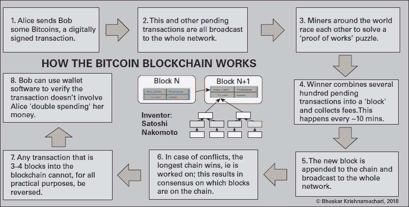

图 3.1 比特币协议的工作原理

比特币由一组构建模块组成，这些模块经过精心组合以实现去中心化信任。下面我们简要解释其中一些构建模块。

#### 哈希

比特币中的一个基本加密要素是使用哈希函数对数据进行哈希处理。哈希函数接收一些数据作为输入，通常输出固定长度的、看似随机的较少量数据（n 位，参见图 3.2）。它是一个单向函数，因为无法从固定长度的输出（称为哈希值）中恢复输入数据。尽管可能的字符串数量远大于可能的哈希值数量，但给定的哈希值可能对应多个输入值；对于设计良好的哈希函数，生成一个能产生与另一个输入相同哈希值的输入极其困难，因此，从所有实际目的来看，哈希值是输入数据的唯一“指纹”。此外，对输入的微小修改（例如图中从 X 到 X’）通常会导致哈希值的显著修改（从 Y 到 Y’）。哈希的实用性在于能够验证某些数据未被篡改或修改。如果拥有原始数据的哈希值，就可以将给定输入的哈希值与之比较，看是否与原始哈希值匹配。如果匹配，则原始数据极有可能未被修改。如果哈希值不匹配，则给定输入中的原始数据肯定已被修改。此外，尝试通过 nonce 值识别给定输入的修改，以生成具有特定属性（如开头有给定数量的零）的哈希值，是一个计算上具有挑战性的“谜题”，可用作工作量证明的一种形式。比特币使用 `SHA256` 哈希函数（Dang，2012）作为其工作量证明。

TS: insert Figure 3.2

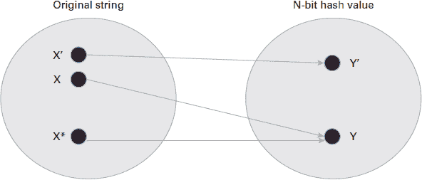

图 3.2 哈希函数示意图

#### 非对称密钥加密

比特币中使用的另一个基本加密方案是非对称密钥加密的思想（图 3.3）。顾名思义，它由一对不同的密钥组成，称为公钥和私钥，它们在数学上相互关联。用公钥加密的一段数据只能由相应的私钥解密。同样，用私钥加密的一段数据只能由相应的公钥解密。私钥由个人作为秘密持有，而该个人则尽可能广泛地公开其相应的公钥。任何想要向该个人发送加密消息的人都使用公钥加密该消息，没有其他人能够解码（因为他们没有能够解密它的私钥，只有公钥，而公钥无法解密该消息）。最著名且广泛使用的非对称密钥加密算法是 `RSA`（Rivest 等，1978）。

TS: insert Figure 3.3

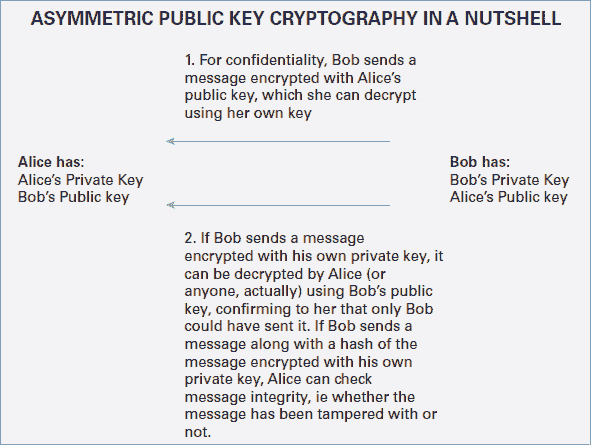

图 3.3 非对称密钥加密的工作原理

#### 数字签名

如果某人用其私钥加密消息，则任何拥有公钥的人都可以解码它（因此这不是一种有效的保密方案），但它具有这样的属性：每个人都可以准确验证是谁发送了该消息，因为它必须是用只有该特定个人才应拥有的私钥加密的（图 3.4）；因此它充当数字签名（Rivest 等，1978）。这一思想结合哈希可用于创建更高效的数字签名——发送方首先对原始消息进行哈希，然后用其私钥加密该哈希值，并将其连同明文形式的原始消息一起发送给接收方。接收方将接收到的明文消息通过相同的哈希函数运行，并将其与解密后的哈希值进行比较，以：

1.  验证是正确的发送方发送了该消息。
2.  验证消息未被篡改。

对消息的哈希版本或摘要进行签名还有一个好处，即加密哈希版本在计算上通常快得多（因为哈希值的大小比原始消息小得多）。

TS: insert Figure 3.4

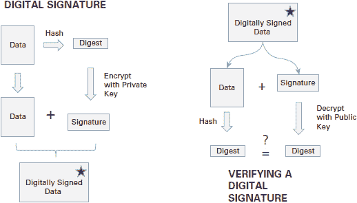

图 3.4 数字签名的工作原理

#### 区块链

比特币协议核心的一个基本概念是区块链。这是一种单向数据结构，如图 3.5 所示。其思路是获取一个数据块（假设编号为 n），然后将该块的哈希值包含到下一个区块 n+1 中。从第 1 个区块开始，该过程不断重复。这种方案的好处在于，如果有人试图修改中间的某个区块，比如区块 k，他们也必须修改其后的每一个区块。为什么？我们可以这样推理。既然他们修改了区块 k，其哈希值现在将不同于存储在区块 k+1 中的哈希值，因此除非他们修改区块 k+1 以将旧哈希值替换为修改后的区块 k 的新哈希值，否则他们的修改会被发现。但出于同样的原因，除非他们修改区块 k+2，否则对 k+1 的修改也会被发现，以此类推。现在，如果有某种方法能让区块的修改或创建变得非常困难，那么对手就会发现很难修改链中足够“深度”的区块，因为他们必须完成从起始点到最后一个区块的所有区块修改工作。

TS: insert Figure 3.5

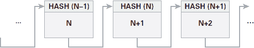

图 3.5 区块链是一种单向数据结构，每个新区块都包含前一个区块的哈希值

#### 工作量证明

那么，如何让区块的创建或修改变得困难呢？比特币协议使用了一个称为 HashCash 的想法，该想法最初是为阻止电子邮件垃圾邮件而开发的（Back, 2002）。其思路是通过在待哈希的数据中添加一个称为“nonce”（随机数）的字段来创建一个计算谜题，然后对哈希输出施加要求（例如，要求其以一定数量的 0 开头）。该谜题在于找出 nonce 字段应填入什么比特位，以确保哈希值满足该要求。这被证明是一个只能通过试错法解决的难题。在每个区块中添加 nonce 字段，并对存储在下一个区块中的哈希值施加要求，从而使区块的创建或修改在计算上变得困难。找到（通过试错法）使区块哈希值满足此属性的 nonce，被称为“挖矿”。

#### 交易与区块

但究竟什么是区块？在比特币协议中，它是一组交易的集合，每笔交易本质上都是发送地址、接收地址以及交换的比特币数量的组合。在图 3.6 中，以交易 3 为例；发送到该交易的比特币（BTC）总数为 2.3 BTC，来源是交易 1 和交易 2 的部分输出组合（如图所示）。从该交易发送到各个地址的比特币数量（包括潜在的交易手续费）总计也是 2.3 BTC。每个区块包含的交易总数取决于所添加的每笔交易的大小，因为区块总大小有限制（原始协议中为 1 MB）。每笔交易都会广播到整个网络。

TS: insert Figure 3.6

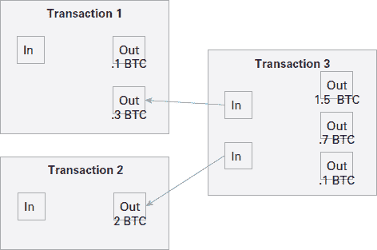

图 3.6 比特币交易

#### 分布式挖矿与挖矿难度

在比特币协议中，所有节点可以同时进行挖矿。每个节点可以选择要包含在区块中的交易，然后尝试挖掘该区块并将其添加到链上。大约每十分钟挖出一个区块，通过一个去中心化算法根据需要改变谜题的难度级别（这转化为哈希值开头需要多少个零），以确保挖矿时间约为十分钟。因此，如果有大量矿工或大量可用于挖矿的算力，难度级别可能会上升；如果矿工数量减少，难度级别甚至可以向下调整。图 3.7 显示了比特币挖矿难度随时间的调整情况。

TS: insert Figure 3.7 - see updated version

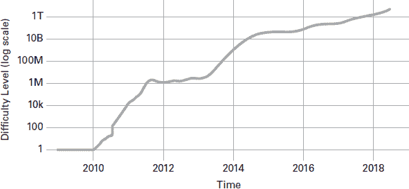

图 3.7 比特币挖矿难度随时间的变化

一旦一个区块被挖出，它就会被添加到区块链中，更新后的区块链会广播给网络中的所有其他节点。由于挖矿是分布式的，可能会发生“分叉”。当多个矿工在同一轮次挖出区块时，就会发生这种情况，在一段时间内可能存在两个（或更多）不同版本的区块链。为了解决这一冲突，矿工采用“选择最长区块链”的策略。面对两个或多个版本的链时，他们倾向于向完成工作量最大的链上添加区块，同时考虑难度级别，即构建起来付出努力最多的那条链。那些不够长的链往往会有较少的矿工在上面工作（那些由于某些原因未看到最长链的矿工），这些链添加新区块所需时间更长，随着时间的推移使它们比最长链更短。随着时间的推移，这一策略确保了对区块链单一版本的共识。通常，一旦一个区块深入链中约五到六个区块的深度，它很可能位于最长区块链上，并且由于工作量证明谜题的难度，对手要修改链中如此深处的区块并仍能跟上最长链变得非常困难，这起到了安全措施的作用。

#### 激励机制

矿工参与比特币网络可获得两种激励。首先是区块挖矿奖励，2009 年开始为 50 个，每四年减半一次（确切地说是每 210,000 个区块）。这种奖励使新比特币得以产生。区块奖励的这种几何级数递减意味着将来存在的比特币总数有一个有限的上界。其次是交易手续费奖励。每笔广播的交易都有相关的交易手续费，由交易发送方自主选择。矿工在选择要包含在区块中的交易时，有动力选择手续费最高的交易。

因此，当有大量待处理交易时，进入区块的交易的平均手续费往往会上升，反之亦然。反过来，交易发送方可能会自我筛选，选择在交易队列（称为内存池）拥堵时不发送交易。这提供了一个反馈回路，使待处理交易的数量保持在可控范围内。

比特币协议中存在的另一个反馈回路与电价有关。挖矿消耗大量电力。当电费变高时，矿工可能会决定退出网络，因为挖矿不再有利可图。然后，随着矿工数量减少，难度级别可能会向下调整，降低计算成本，使挖矿再次变得有利可图。

#### 女巫攻击

通过施加计算成本，工作量证明缓解了匿名分布式系统中可能存在的一种称为**女巫攻击**的安全漏洞（Douceur, 2002）。女巫攻击是指攻击者创建大量虚假身份以在系统中获取优势。在比特币的情况下，作为矿工参与协议的任何人都必须进行计算工作。因此，即使有人生成大量身份，也无法在挖掘区块的能力上获得任何优势，因为每个被识别的矿工都必须完成计算工作，这意味着承担这些额外身份不会带来任何收益。

#### 51% 攻击

比特币协议的一个已知漏洞是，如果攻击者以某种方式获得了网络超过 51% 的计算能力，他们可能会开始修改区块并引入双重支付交易，从而颠覆网络。虽然无法防御这种情况，但有些人认为这不太可能发生，并且希望拥有这种级别网络控制权的人有动力保持网络稳定，而不是恶意破坏它。

#### 发送比特币

有了上述构建模块，我们可以看到发送者如何使用协议向接收者发送比特币。发送者使用其地址和接收者的地址创建一个签名交易。接收者检查发送者地址是否有正余额以使其成为有效交易，并通常等待区块达到约 5 到 6 个确认，以验证交易是否正确。交易连同**默克尔根**一起存储在每个区块中，**默克尔根**是使用称为**默克尔树**的加密数据结构处理有序交易的结果（Nakamoto, 2008）。**默克尔根**的包含使得简单节点可以轻松验证交易是否存在于区块中。

### 以太坊与智能合约

“智能合约”一词最早由 Nick Szabo 提出（Szabo, 1997）。本质上，它们指的是算法合约，根据特定条件是否满足来决定交易中应执行的操作，而无需人类第三方干预或依赖法律追索。由于基于区块链的加密货币交易是通过计算验证的，因此很容易扩展其功能以支持可编程智能合约。比特币协议也提供了一种脚本语言，允许实现此类智能合约。一个简单的智能合约示例是多重签名账户，它要求多个用户在发送交易前签名，所需签名数量是一个参数。这可以允许创建托管服务并促进团体资金的操作。以太坊由 Vitalik Buterin 等人于 2013-14 年开发，是一个著名的第二代区块链平台，它通过引入以太坊虚拟机，实现了更复杂的可编程智能合约，允许进行更通用的计算（Wood, 2014）。

#### 以太坊上的智能合约

以太坊上的智能合约通常使用名为 `Solidity` 的语言编写，并编译成以太坊网络上每个节点都可以运行的字节码（Dannen, 2017）。智能合约维护状态变量，并提供方法，允许通过用户或其他智能合约发送的消息来更改这些变量。为了确保执行智能合约和通信所需信息的相关成本得到覆盖，关键智能合约操作会有相关的“Gas”费用。添加到区块链中的这种编程能力允许开发各种新颖的去中心化应用，范围从投票系统到域名注册系统，再到数字资产证券化和创建新的代币经济。以太坊还提供标准 API（如 `web3.js`），允许开发 Web、移动或桌面客户端软件，以便轻松与部署在以太坊区块链上的智能合约进行交互。

以这种方式创建的去中心化应用有两个主要优势。首先，由于底层信息不存储在中央服务器上，与传统的基于服务器的应用相比，它对拒绝服务攻击更具鲁棒性。其次，由于智能合约的字节码至少公开可用于区块链上，并且可以被所有人读取，连同底层状态变量的值，这使得人们能更透明、更信任地确信给定程序确实在执行其声称的功能。

#### ERC 代币标准

以太坊社区已对不同类型的智能合约进行了标准化。例如，以下是三个与不同类型代币相关的著名以太坊征求意见稿（ERC）标准：

*   **ERC-20**：这为可互换的代币提供了标准化接口。ERC-20 代币已被用作数字货币，为某些去中心化平台提供实用功能，并作为授予持有者对特定平台治理方面投票权的代币。它们也被用作为某些平台筹集资金的手段。
*   **ERC-721**：这为非同质化代币（NFT）提供了标准化接口。根据定义，每个此类代币都是唯一的，并与其他任何代币区分开来。因此，NFT 被用来表示独特数字资产（或实物资产的数字表示）的所有权，用例范围从艺术品和数字收藏品到房地产。
*   **ERC-1155**：这种多代币标准提供了一个接口来管理多种代币类型，包括同质化和非同质化代币。在某种程度上，它可以用于执行与 ERC-20 和 ERC-721 标准相同的功能，并且效率更高。

### 无许可区块链的挑战与进展

比特币和以太坊被认为是“无许可”区块链协议，因为它们本质上对公众开放且完全去中心化。不仅任何人都可以在这些协议上发送和接收交易，任何人也可以运行挖矿或验证节点。参与网络不需要事先批准或许可流程。除了比特币和以太坊，现在还有许多其他无许可协议，包括 `Zcash`、`Cardano`、`Solana`、`Cosmos` 和 `Avalanche`。

在过去十年中，无许可区块链协议的性能和功能方面取得了许多重大创新和改进。下面我们提到三个关键维度：降低运行区块链的能源成本、提高交易吞吐量和降低交易确认延迟。

#### 降低挖矿能源成本

## 区块链协议的演进：从工作量证明到权益证明及可扩展性解决方案

### 能源消耗与权益证明

早期的无许可区块链协议均依赖工作量证明计算。正如前文所述，随着矿工参与度的增加，难度级别已呈数量级增长。这意味着处理每个区块都会产生巨大的能源开支。据估算，比特币挖矿功耗超过 4 GW，甚至超过了爱尔兰等国家的平均用电量（Gallersdörfer *et al*, 2020）。为实现更可持续的区块链运行，业界一直在探索改进能耗的方案。因此，开发并考虑了许多工作量证明的替代方案。

目前已在部分无许可区块链协议中部署的最有前景的方法之一称为**权益证明**。尽管存在多种实现，但其核心思想是：每个验证者在共识过程中的权重与其愿意锁定（或质押）的资金成正比。基于权益证明的无许可协议示例包括 Cardano、Avalanche、Solana 和 Cosmos。Ethereum 也计划迁移至权益证明模型。采用权益证明后，无需进行高能耗的计算谜题求解，因此它是一种更可持续、更环保的区块链协议运行方式。

### 提高交易吞吐量

比特币最多仅能支持每秒 4 到 5 笔交易。Ethereum 支持的交易吞吐量则低于每秒 20 笔。相比之下，传统信用卡处理网络支持的吞吐量高得多；例如，Visa 最高可支持每秒 24,000 笔交易。这种低吞吐量的一个问题是：当网络拥堵时，交易费用会变得非常高，从而通过抑制低价值交易来限制协议的实用性。

因此，许多工作致力于提高无许可区块链协议的吞吐量可扩展性。一种方法是开发**第 2 层解决方案**，它们在核心（第 1 层）协议之上运行以提高交易速度。第 2 层解决方案的示例包括比特币的 Lightning Network，以及 Ethereum 的 Polygon、Arbitrum 和 Optimism。以 Polygon 为例，其提供的吞吐量超过每秒 100 笔交易（据某些来源称可能更高）。

另一种方法是开发创新的**第 1 层协议**，通过设计提供更高的吞吐量。此类协议包括 Solana、Avalanche、Cosmos 和 Ethereum 2.0（仍在开发中）。它们各自采取不同的方法来提供可扩展性。例如，Avalanche 利用更通用的 DAG 结构对交易进行部分排序，并采用一种新颖的快速基于 Gossip 的共识机制。Ethereum 2.0 计划利用**分片**概念提高可扩展性，即将整个网络划分为不同的分片，每个分片处理不同的数据集。这些创新旨在将无许可区块链的吞吐量推向每秒数万到数十万笔交易的量级。

### 降低交易确认延迟

比特币交易大约需要 1 小时才能以高概率得到确认，而 Ethereum 要快得多，大多数交易可在 2 到 3 分钟内完成确认。新一代无许可区块链协议已将确认延迟进一步降低至 1 秒或更短的量级。

### 新应用与用例

比特币最初仅设计为一种数字现金形式。虽然 Ethereum 的原生代币 ETH 也扮演类似角色，但得益于 Ethereum 支持更通用的可编程智能合约，涌现出了更丰富、更复杂的无许可区块链协议应用和用例。主要包括：

*   **稳定币**：比特币或 ETH 对美元的汇率会随时间大幅波动。这种价格波动使其在许多需要稳定货币价格的应用中成为较差的选择。这催生了一类被称为稳定币的新型加密货币，其价格波动性显著较低。根据稳定性保障机制，可分为法币抵押型、加密资产抵押型或算法稳定币（Kahya *et al*, 2021）。USDC 是法币抵押型稳定币的示例，DAI 是加密资产抵押型稳定币的示例，Ampleforth 是算法稳定币的示例。

*   **融资**：区块链智能合约的一个自指用例是通过代币销售为项目进一步开发筹集资金。遗憾的是，许多 ICO（首次代币发行）被证明是骗局，但也有一些发挥了预期作用，激励了去中心化应用和协议软件的开发。

*   **去中心化自治组织 (DAO)**：带有编程规则的智能合约可作为运营去中心化组织的基础，允许一组用户参与组织治理，同时智能合约也可编码以自动化大量功能。示例包括：MakerDAO，它大幅自动化了加密资产抵押型稳定币的稳定化过程；MolochDAO，它去中心化了区块链改进项目的资助流程。

*   **非同质化代币 (NFT)**：每个铸造的 NFT 在区块链上都拥有独特的身份标识。NFT 已用于数字收藏品，以及转移/证明数字艺术品的所有权。2021 年，Mike Winkelmann（又名 Beeple）创作的一幅数字艺术品在佳士得拍卖行以 6930 万美元成交（Ray, 2021）。NFT 也可用于证明独特实物资产（具有合适的数字表征）的所有权，因此也被应用于房地产和其他实物商品。

*   **去中心化金融 (DeFi)**：近年来，基于区块链的去中心化应用蓬勃发展的一个领域是去中心化金融 (DeFiPrime, 2022)。Bancor、Uniswap 和 Balancer 等平台提供去中心化代币交换，一种代币可在无第三方干预的情况下兑换为另一种代币。Compound 和 Aave 等平台允许用户存入加密资产赚取利息，而其他用户则可借入并支付利息。Synthetix 和 Mirror 等平台支持衍生品的创建与交易。Augur、Gnosis 和 Polymarket 等平台提供预测市场交易功能。

### 参考文献

*   Back, A (2002) Hashcash: A denial of service counter-measure. \[Online\] [`www.hashcash.org/papers/hashcash.pdf`](http://www.hashcash.org/papers/hashcash.pdf) (archived at [`perma.cc/W7KC-K5FT`](https://perma.cc/W7KC-K5FT))
*   Dang, Q H (2012) Secure hash standard (shs) (No. Federal Inf. Process. Stds.(NIST FIPS)-180–04)
*   Dannen, C (2017) *Introducing Ethereum and Solidity*, Apress, Berkeley, CA
*   DeFiPrime (2022) DeFi and Open Finance. \[Online\] [`defiprime.com/`](https://defiprime.com/) (archived at [`perma.cc/A2FY-JUZ3`](https://perma.cc/A2FY-JUZ3))
*   Douceur, J R (2002) The Sybil attack. In International Workshop on Peer-to-Peer Systems, Springer, Berlin, Heidelberg, March, pp 251–60
*   Gallersdörfer, U, Klaaßen, L and Stoll, C (2020) Energy consumption of cryptocurrencies beyond bitcoin. *Joule*, 4(9), 1843–46

### 参考文献

*   Kahya, A, Krishnamachari, B and Yun, S (2021) Reducing the volatility of cryptocurrencies – a survey of stablecoins. arXiv preprint arXiv:2103.01340.
*   Nakamoto, S (2008) Bitcoin: A peer-to-peer electronic cash system. [Online] [`bitcoin.org/bitcoin.pdf`](http://bitcoin.org/bitcoin.pdf) (archived at [`perma.cc/2CMP-CTA3`](https://perma.cc/2CMP-CTA3))
*   Narayanan, A and Clark, J (2017) Bitcoin’s academic pedigree, *Communications of the ACM*, 60 (12), pp 36–45
*   Ray, S (2021) Van Gogh, Monet – and Beeple? As NFTs exploded one of the most expensive art pieces sold in 2021 was entirely digital, *Forbes.com*, 31 December. [Online] [`www.forbes.com/sites/siladityaray/2021/12/31/van-gogh-monet-and-beeple-as-nfts-exploded-one-of-the-most-expensive-art-pieces-sold-in-2021-was-entirely-digital/`](https://www.forbes.com/sites/siladityaray/2021/12/31/van-gogh-monet-and-beeple-as-nfts-exploded-one-of-the-most-expensive-art-pieces-sold-in-2021-was-entirely-digital/)
*   Rivest, R L, Shamir, A and Adleman, L (1978) A method for obtaining digital signatures and public-key cryptosystems, *Communications of the ACM*, 21 (2), pp 120–26
*   Solidity [Online] [`docs.soliditylang.org/en/v0.8.15/`](https://docs.soliditylang.org/en/v0.8.15/) (archived at [`perma.cc/3B2Q-PB5X`](https://perma.cc/3B2Q-PB5X))
*   Szabo, N (1997) The idea of smart contracts, *Nick Szabo’s Papers and Concise Tutorials*, 6
*   Verhoelen, J (2018) Implementierung einer blockchain-Anwendung mit Hyperledger Fabric und Composer. [Online] [`www.informatik-aktuell.de/betrieb/virtualisierung/eine-blockchain-anwendung-mit-hyperledger-fabric-und-composer.html`](https://www.informatik-aktuell.de/betrieb/virtualisierung/eine-blockchain-anwendung-mit-hyperledger-fabric-und-composer.html) (archived at [`perma.cc/3JMZ-QDWM`](https://perma.cc/3JMZ-QDWM))
*   Wood, G (2014) Ethereum: A secure decentralised generalised transaction ledger, *Ethereum Project Yellow Paper*, 151, pp 1–32

## 概述

在上一章中，我们了解到无许可区块链已从最初的比特币发展到以太坊上的可编程智能合约，再到使其更具可持续性、可扩展性和高效性的创新。在本章中，我们将转向一类相对较新的协议，称为**许可区块链**，它们面向更多的商业和企业用例，范围涵盖从传统金融到供应链。我们将介绍一个著名的许可区块链协议示例——Hyperledger Fabric，并讨论一些替代方案，如 Corda、企业以太坊和 Tendermint。最后，我们将探讨 TradeLens，一个面向供应链的许可区块链系统。

## 区块链的通用能力

如果我们从上一章讨论的各种具体协议中抽离出来，我们可以认识到区块链技术（有时也称为分布式账本技术）带来了一系列在商业世界中具有广泛适用性的新能力和特性：

*   **价值转移**：区块链上记录的交易允许各方之间直接转移货币价值。
*   **数据存储**：交易和智能合约可以包含数据字段，以在区块中存储其他信息，这对截然不同的应用潜在有用。
*   **可编程合约和交易**：区块链允许实现智能合约和基于去中心化交易的应用程序，由于代码被一致应用且无法被篡改，因此透明度更高。
*   **去中心化**：通过让网络中的每个人维护一份一致的区块链副本，不再需要中心化实体来维护包含所有交易的账本。至少，这提供了对节点故障的鲁棒性。
*   **无需信任**：它允许任何地方的两个人在无需信任第三方的情况下进行价值转移；这本身就是去中心化的结果。同样，账本的维护也不需要受信任的第三方。
*   **时间有序**：链中哈希区块的排序表明，区块 n 中的数据在区块 n+1 创建时必须已存在（因为后者必须包含区块 n 的哈希值）。这为存储在区块链中的信息提供了时间排序。在某些使用有向无环图作为数据结构而非线性哈希链的协议中，不是所有交易的完全排序，而是部分排序，因此至少对于某些交易对，可以确定哪一个发生在另一个之前。
*   **不可篡改**：已确认的交易（在比特币的情况下，指那些被放置在区块链足够深处的交易）实际上是不可变的，因此区块链是一个仅追加的数据存储。无法进行修改数据的更新或删除。这反过来意味着，人们可以使用存储在区块链中的信息，而无需担心其被篡改或秘密修改。
*   **可追溯/存档**：完整的交易和数据历史始终可用。可以将存储在账本上的任何一组活动追溯到最开始。
*   **透明**：除非显式加密，否则有关交易的信息可供任何人读取和验证，从而增加了对存储内容的信任。
*   **匿名**：原则上，用于发送和接收交易的地址可以是匿名的数字集合，因此任何人都可以在不透露身份的情况下参与。虽然对于比特币或以太坊等协议，交易图（哪个地址与哪个地址交易）可以被分析以在一定程度上推断身份，但像 Monero 和 Zcash 这样的新方案提供了进一步隐藏交易中涉及地址的方法。现在，这并不总是完全可取的，特别是在商业应用的背景下，相互交互的实体不希望保持匿名。对于此类应用，可以使用安全且经过验证的数字身份。
*   **机密**：目前，虽然在原始比特币协议中转账金额必须公开，但存储在链上的任何其他数据都可以被加密。只要需要查看该数据的各方拥有相应的加密密钥，它们就可以进行机密通信。较新的协议已支持建立私有“通道”，允许多方轻松地相互交换机密信息。

## 许可区块链

牢记上述关键属性作为区块链技术的基本优势，研究人员和开发人员确定了一种区块链技术的替代架构，该架构通常消除了匿名性，不允许未被他人知晓的任何人提交交易。在这种*许可*架构中，适用于参与实体从一开始就已知并被识别的商业网络，保留了基于区块链的分布式账本及其可编程性的核心组件；但是，维护分布式账本的过程发生了变化。其中一个原因是，如果存在准入许可流程，使得所有参与方都是已知且无法假设虚假身份的，那么女巫攻击就不再是一个问题。因此，不再必须运行工作量证明算法来防御女巫攻击，并通过最长链策略达成共识。相反，已识别的参与者可以运行确定性分布式共识算法，就要添加到链中的最后一个区块达成一致。

这有几个优势。首先，部分归功于学术界对分布式共识协议的广泛研究，共识过程相当快速，并允许更高的交易量。如今，许可型区块链系统每秒可处理数千笔交易，而开放的无许可链每秒仅能处理数十笔交易。其次，这些算法有可能提供关于容错性的可证明保证。已知有许多算法能保证容忍任意“拜占庭”故障（包括恶意对手的可能性），只要至少三分之二的参与者在无故障的情况下正确行为。

这种私有、许可型区块链因许多商业和企业应用及跨组织操作而日益流行，例如银行间的记录对账和为供应链建立分布式账本。此类许可型区块链系统的例子包括 `Hyperledger Fabric`、`Corda`、`Enterprise Ethereum` 和 `Tendermint`。我们将在下文中描述这些系统。

### Hyperledger Fabric

Hyperledger 项目是 Linux 基金会的一项开源工作，包含许多框架和工具（Dhillon *et al*, 2017）。项目中一个特别流行且维护良好的框架是 `Hyperledger Fabric`，这是一个开源许可型区块链，最初由 IBM 开发和贡献（Cachin, 2016; Androulaki *et al*, 2018; Linux Foundation, 2022），但后来涉及许多其他组织。它采用模块化架构，允许以即插即用的方式替换不同的共识算法、不同的许可和排序方案。`Hyperledger Fabric 1.0` 于 2017 年 7 月发布，包含用于允许各方交换机密信息的通道、确保验证节点获得一致排序交易的排序服务、交易背书策略、用于支持多种查询的 `CouchDB`，以及自带会员服务提供商模型。它还允许定义和部署可编程智能合约（在 `Hyperledger Fabric` 术语中称为 `chaincode`）。这些智能合约可用不同语言编写，如 `Go`、`Java` 和 `Javascript`，`Hyperledger Fabric` 还支持 `Ethereum Virtual Machine (EVM)`，允许使用 `Solidity` 编码的智能合约。`Hyperledger Fabric` 使查询链上存储的数据并将其与遗留数据库和数据分析工具集成变得容易（图 4.1）。

TS: insert Figure 4.1

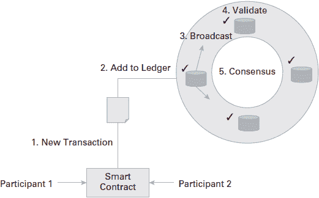

图 4.1 Hyperledger Fabric 概览，一种许可型区块链系统

测量表明，大约十几个节点作为背书人，负责维护和验证分布式账本的完整副本时，`Hyperledger Fabric` 的交易吞吐量可达每秒数千笔。

#### Hyperledger Fabric 的示例应用

作为面向企业的许可型区块链用例，考虑以下示例：区块链可用于帮助客户前往汽车服务商处更换或维修汽车发动机（如果在制造商保修期内）（Verhoelen, 2018）。

在这个商业网络中，资产包括发动机和汽车。参与者包括制造商（制造汽车和发动机）、商家（销售汽车并维修/安装发动机）和客户（拥有汽车）。资产由相关属性描述，如其自身 ID、对应的汽车/发动机 ID 和当前所有者，参与者各自拥有对应的身份编号并被授权。可能的交易包括：`createEngine`、`createCar`、`installEngine`、`repairEngine`、`transferCar`、`sellCar` 和 `transferEngine`。

让我们追踪一辆特定汽车可能发生的情况。当它首次创建时，`createCar` 交易记录创建日期，分配 ID 并将此创建记录在账本上。当发动机被创建时，使用 `createEngine` 交易为其创建类似记录。当发动机首次安装在汽车上时，使用 `installEngine` 交易将 `engineID` 与 `carID` 配对。所有记录都有时间戳。当汽车从制造商发往商家时，可使用 `transferCar` 交易记录该过程。当汽车售予客户时，调用 `sellCar` 交易，更新汽车及其安装发动机的所有权以及销售日期。

现在，假设发动机享有三年保修。在保修期内的任何时候，如果客户带着发动机投诉来到商家，商家可以快速核实保修是否有效。如果有效，商家可能在当地维修发动机（如果可能），并使用 `repairEngine` 交易将维修记录在账本上。或者发动机可能需要更换。在这种情况下，商家可能获得一个新发动机（使用 `transferEngine` 交易记录在账本上，注明其所有权从制造商转移到商家），并将其安装在客户的汽车上。`installEngine` 交易会将新发动机的所有权转移给客户，并将该新发动机的 ID 与汽车 ID 配对，替换旧的 ID。因此，区块链上的记录可以忠实记录现实世界中的事件。

#### Hyperledger Fabric 2.0

2020 年 1 月，Hyperledger 项目宣布发布 `Hyperledger Fabric 2.0`。它引入了几项新功能：

*   `chaincode` 生命周期管理，便于在具有去中心化治理的通道上部署新的 `chaincode`；
*   新的 `chaincode` 应用模式，有助于确保协作，并让参与组织就链上允许的交易达成一致；
*   用于处理私有数据并决定谁应被允许查看某些数据的新模式；
*   各种面向性能的改进，包括用于快速数据访问的缓存和轻量级容器；
*   用于测试新应用和智能合约的示例测试网络。

### 其他许可型协议

我们简要调查三种作为 `Hyperledger Fabric` 替代方案的许可型协议，它们已在不同的业务用例中得到探索。

#### Corda

`Corda` 是一种许可型分布式账本技术，由 R3 于 2016 年首次发布，R3 是两年前由九家银行组建的公司（Brown, 2016）。`Corda` 与其他区块链协议有显著差异。首先，它实际上不使用任何区块或批量交易的概念；相反，交易是单独验证的。因此，`Corda` 或许更适合被称为分布式账本技术，而非严格意义上的区块链。其次，交易不广播给所有参与者，仅广播给直接相关的参与者。

`Corda` 系统是分布式的，因为交易处理不需要中心化协调器，每个公司/组织都可以运行自己的节点。许可过程由所有节点出示数字证书（基于 `x.509` 标准）组成，该证书由网络的通用受信根签名。共识不在于保证整个系统的全局状态，而仅在于相关公司之间的交易层面，更侧重于确保法律合规和交易/合同上的相关签名。通用公证服务保证交易的唯一性，公证服务中的节点与执行智能合约的节点不同。`Corda` 中的智能合约称为 `CorDapps`，用 `Kotlin` 或 `Java` 编写（R3, 2022）。

#### 企业以太坊

企业以太坊联盟是一个行业组织，旨在推动以太坊在商业应用中的使用。它制定了一个以太坊许可版本的规范，其中节点可由企业部署，以便只有获得许可或被允许的组织才能部署节点。企业以太坊有两种不同的实现：`Quorum` (Consensys, 2022) 和 `Hyperledger Besu` (Hyperledger Besu, 2022)。两者均为许可链，并通过使用公钥加密允许私有交易。两者均支持多种基于权威证明的共识机制：`IBFT`、`Clique`（Besu 和 Quorum 均支持）、`QBFT`（Besu 支持）和 `Raft`（Quorum 支持）。Besu 还支持工作量证明。Quorum 是以太坊 `Geth` 实现的一个分叉，而 Besu 是基于 Java 的以太坊实现。两者均支持 `EVM`，因此也支持 `Solidity` 编程语言。

#### Tendermint

Tendermint Core 是一种可用于实现许可区块链的软件 (Tendermint, 2022)。其核心是 Tendermint 共识协议 (Buchman, 2016)。在每一轮中，一个节点以轮询方式提议下一个区块。有一个多阶段投票过程来验证并提交每个区块。该协议可支持网络中多达三分之一节点的拜占庭（任意）故障。Tendermint 实现相当快，能够以约一秒的快速区块确认时间处理每秒数千笔交易。它也相对轻量级，能够在资源相对受限的节点上运行。

对于其智能合约编程版本，Tendermint 提供了一个称为应用区块链接口 (`ABCI`) 的应用接口。`ABCI` 允许自带语言模型，即交易可以用任何语言处理，如 `Python`、`Go` 或 `Java`。Hyperledger Burrow 项目将 Tendermint 共识与 `EVM` 相结合，以允许基于 Solidity 的智能合约 (Hyperledger Burrow, 2022)。

顺便提一下，Tendermint 软件也可用于无许可协议，并且是上一章提到的 Cosmos 协议的基础。

#### TradeLens：供应链许可区块链

TradeLens 是一个使用许可区块链技术构建的供应链平台的具体实现 (TradeLens, 2022)。TradeLens 是由 IBM 和 GTD Solution Inc. 共同开发的供应链平台。TradeLens 使用 IBM 区块链平台，后者又基于开源的 Hyperledger Fabric 区块链平台。

TradeLens 的目标是允许航运供应链中的参与者以私密且安全的方式共享所有相关数据。随着货物从某个源头运送到目的地，参与运输和物流的各方向 TradeLens 平台提供各种数据，如物流里程碑、移动信息和贸易文件。平台上共享的文件示例包括原产地证书、进口申报单、装箱单、发票、运单和提单。

TradeLens 生态系统包括以下利益相关者，他们可能需要发送交易、访问链上数据或参与处理链上数据：

*   发货人和货主；
*   第三方物流服务商；
*   铁路、短途运输和驳船运营商；
*   包括海关在内的政府机构；
*   港口和码头运营商；
*   海运承运人；
*   金融服务和保险服务商。

TradeLens 允许所有（且仅）相关方访问与货运相关的特定类型信息，根据其角色和数据类型，使用权限矩阵向不同组织启用访问权限，其工作原理如下。针对给定数据类型的参与者角色由以下代码之一指定：`M`（强制）、`C`（条件）、`O`（可选）、`R`（只读）或空白。角色标记为 `M`、`C` 或 `O` 的参与者被允许读写访问；标记为 `R` 的参与者仅具有读访问权限；空白表示无权访问相应数据类型。某些角色隐式且自动分配给特定参与者（例如，海关当局可能会自动获得与通过其管辖范围的货物相关的相关文档的读取权限），而其他角色则可由授权方分配。

根据信息类型及其访问方式，使用包括文档存储、对象存储、关系数据库和区块链在内的多个持久化层。所有关键文档哈希值存储在区块链上，确保了这些文档的完整性（一旦提交到链上，它们就无法被篡改）。作为一个许可区块链平台，网络的所有成员都基于其加密身份相互知晓。

为保持一致性，TradeLens 使用标准数据模型 (TradeLens DSS, 2022)，该模型与 UN/CEFACT 的供应链参考数据模型 (Clark *et al*, 2002) 保持一致，包含三个主要对象：货物运输、货物托运和运输设备。该平台提供 `API`，以便轻松与第三方链下软件集成。

### 何时使用区块链

正如我们在本章中所讨论的，现在有许多可用于企业应用的替代区块链平台。值得考虑在商业环境下区块链成为正确解决方案的条件，或者更传统的方法（例如基于中心化服务器的方法）是否足以提供所有必需的保证，并可能以更好的性能和成本实现。许多研究人员和从业者都考虑过这个问题 (Wüst *et al*, 2018; Pederson *et al*, 2019)。

普遍认为，区块链要具有相关性，必须满足以下条件：

*   必须有多方参与，它们存在利益冲突或信任问题，且不信任单一的第三方。
*   这些参与方必须有某种需求共享某些数据，并可能私密地与其他参与方的子集共享。
*   共享数据需要以不可变的方式记录。
*   待记录数据的量和速度在区块链技术的存储和吞吐能力范围内。

由于区块链系统与传统数据库相比仍然相对较慢，因此即使使用了区块链，通常也需要仔细考虑什么应该记录在不可变账本中，什么可以使用更传统的方法存储或复制。例如，如果参与者之间共享某个非常大的文件，可能只需将该文件的哈希值记录在区块链上，并使用更传统的基于服务器或点对点的方法共享文件本身。这样，文件的任何篡改都可以被轻易检测到（因为链上的哈希值将不再与文件匹配）。

协调并建立一个跨越许多不同实体和组织的许可区块链平台具有挑战性。TradeLens 的初步成功表明，在许多或所有参与者从当前流程切换到统一的基于区块链的平台具有明确利益的行业中，这是可行的。

### 参考文献

*   Androulaki, E, Barger, A, Bortnikov, V, Cachin, C, Christidis, K, De Caro, A, ... and Muralidharan, S (2018) Hyperledger Fabric: A distributed operating system for permissioned blockchains, arXiv preprint arXiv:1801.10228

### 参考文献

*   Brown, R G (2016) Introducing R3 Corda™: A distributed ledger designed for financial services. \[Online\] [`gendal.me/2016/04/05/introducing-r3-corda-a-distributed-ledger-designed-for-financial-services/`](https://gendal.me/2016/04/05/introducing-r3-corda-a-distributed-ledger-designed-for-financial-services/) (archived at [`perma.cc/GM6L-42RC`](https://perma.cc/GM6L-42RC))

*   Buchman, E (2016) Tendermint: Byzantine fault tolerance in the age of blockchains, Masters dissertation, University of Guelph

*   Cachin, C (2016) Architecture of the Hyperledger blockchain fabric, Workshop on Distributed Cryptocurrencies and Consensus Ledgers, July

*   Clark, C, Doran, M, Lee, R, Patel, U and Yi-Yuan, Y (2002) Reference Model of the International Supply Chain UN/CEFACT/BPA WG. Acta Universitatis Lodziensis. Folia Oeconomica, 157

*   Consensys (2022) Quorum blockchain service \[Online\] [`consensys.net/quorum/`](https://consensys.net/quorum/) (archived at [`perma.cc/RH2F-KR8Y`](https://perma.cc/RH2F-KR8Y))

*   Dhillon, V, Metcalf, D and Hooper, M (2017) The Hyperledger project. In *Blockchain Enabled Applications*, Apress, Berkeley, CA, pp 139–49

*   Hyperledger Besu (2021) Besu Enterprise Ethereum Client. \[Online\] [`besu.hyperledger.org/`](https://besu.hyperledger.org/) (archived at [`perma.cc/KBK4-JHYQ`](https://perma.cc/KBK4-JHYQ))

*   Hyperledger Burrow (2022) Hyperledger Burrow Project. \[Online\] [`www.hyperledger.org/project/hyperledger-burrow`](https://www.hyperledger.org/project/hyperledger-burrow) (archived at [`perma.cc/SDX9-ZCEB`](https://perma.cc/SDX9-ZCEB))

*   Hyperledger Fabric (2020) What’s new in Hyperledger Fabric v2.0. \[Online\] [`hyperledger-fabric.readthedocs.io/en/release-2.0/whatsnew.html`](https://hyperledger-fabric.readthedocs.io/en/release-2.0/whatsnew.html) (archived at [`perma.cc/ZGJ6-GTJK`](https://perma.cc/ZGJ6-GTJK))

*   Linux Foundation (2022) Hyperledger Fabric: A blockchain platform for the enterprise at the Linux Foundation. \[Online\] [`www.hyperledger.org/use/fabric`](https://www.hyperledger.org/use/fabric) (archived at [`perma.cc/A79S-A2SW`](https://perma.cc/A79S-A2SW))

*   Pedersen, A B, Risius, M and Beck, R (2019) A ten-step decision path to determine when to use blockchain technologies, *MIS Quarterly Executive*, 18(2), pp 99–115

*   R3 (2022), R3 Documentation. \[Online\] [`docs.r3.com/`](https://docs.r3.com/) (archived at [`perma.cc/K4VK-W8D7`](https://perma.cc/K4VK-W8D7))

*   Tendermint (2022) Tendermint core documentation. \[Online\] [`docs.tendermint.com/master/`](https://docs.tendermint.com/master/) (archived at [`perma.cc/P6NR-JW8V`](https://perma.cc/P6NR-JW8V))

*   TradeLens (2022) TradeLens platform. \[Online\] [`www.tradelens.com/platform`](https://www.tradelens.com/platform) (archived at [`perma.cc/E5DF-KPDY`](https://perma.cc/E5DF-KPDY))

*   TradeLens DSS (2022) TradeLens data sharing specification. \[Online\] [`docs.tradelens.com/reference/data_sharing_specification/`](https://docs.tradelens.com/reference/data_sharing_specification/) (archived at [`perma.cc/RW8F-NYEQ`](https://perma.cc/RW8F-NYEQ))

*   Verhoelen, J (2018) Implementierung einer blockchain-Anwendung mit Hyperledger Fabric und Composer. \[Online\] [`www.informatik-aktuell.de/betrieb/virtualisierung/eine-blockchain-anwendung-mit-hyperledger-fabric-und-composer.html`](https://www.informatik-aktuell.de/betrieb/virtualisierung/eine-blockchain-anwendung-mit-hyperledger-fabric-und-composer.html) (archived at [`perma.cc/ZG4N-UZP2`](https://perma.cc/ZG4N-UZP2))

*   Wüst, K and Gervais, A (2018) Do you need a blockchain? In 2018 Crypto Valley Conference on Blockchain Technology (CVCBT) (pp 45–54). IEEE, June

## 第 5 章：供应链的新兴计算技术

在本章中，我们将探讨许多与广泛的供应链应用相关的新兴计算技术。这些技术与区块链技术互补，为改进供应链运营的追踪和效率提供了途径。

### 物联网

物联网是一组协同工作的多样化技术的统称，旨在为跨越网络空间和物理世界的应用提供联网的感知和执行能力（Unemyr, 2017）。该术语旨在与以下事实形成对比：最初的互联网（至今仍在很大程度上是我们现有的互联网）主要是为了人与人之间的通信而设计的。大多数端到端的传统互联网应用，无论是电子邮件、网站还是社交媒体，都是由人类生成数据并消费数据。因此，互联网目前主要用于将人与人相连。相比之下，随着能够从数字电子传感器读取实时测量值的嵌入式微控制器广泛可用，现在可以为各种用途部署此类嵌入式传感器，并让它们生成对某些应用有意义的数据。例如，一个测量用于运输鲜活食品产品的箱子温度的嵌入式传感器，如果连接到互联网，就能提供实时读数流，用于在运输过程中监控和评估货物状况。同样，现在也可以将嵌入式执行器连接到互联网，从而可以远程对物理世界采取某些行动——例如，移动机械臂或打开冷却风扇。

因此，智能“事物”，无论是传感器、执行器还是其他电子设备，都可以连接到互联网并进行远程操作。随着嵌入式控制器数量的急剧增加，此类互联网用法涉及事物与人之间以及事物与事物之间的通信（也称为机器对机器 [M2M] 通信），将超过互联网最初的人与人通信用法，从而解释了“物联网”这一短语。

从架构上看，物联网可以如图 5.1 所示。一端是位于“边缘”的“事物”层，由传感器、执行器、摄像头和其他事物组成；但也可能包括一些人工输入源，如移动应用程序或 Dash Buttons。这些可能通过单跳或 mesh 无线网络在本地连接。本地边缘网络通常还有一个本地集线器或网关节点，提供对更广泛互联网的访问，并通过它访问云计算资源，也可能包括一些本地边缘计算能力，其原则上比资源受限的事物上所能容纳的要强大得多。

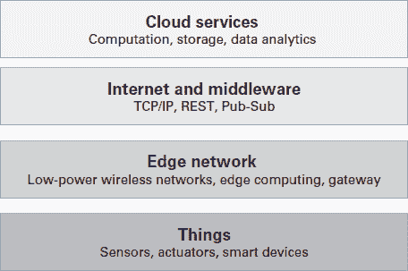

图 5.1 物联网架构

#### 传感器

影响测量相关物理读数的传感器将其通过互联网传达给应用程序的能力，通常存在技术挑战。边缘端的事物通常因外形规格和能源可用性的限制而受限于资源。传感器设备的低功耗运行有时要求它们定期进入睡眠状态，导致感应频率较低，以便电池能持续更久。处理器、内存、存储和无线电能力上的能源驱动约束可能会进一步限制性能，以至于每个单独的传感器可能只能以每秒几字节的速率收集和通信数据。

考虑以下几个可能在供应链应用背景下有用的物联网传感器示例：

### 物联网传感器与无线通信技术

#### 资产位置追踪技术

##### 使用全球定位系统（GPS）进行资产位置追踪
GPS 设备通过收集和处理来自定位卫星的信号来推断物体的位置（Misra and Enge, 2006）。由于卫星距离地球较远且受限于其发射功率，接收到的信号相当微弱，因此 GPS 系统通常仅在室外、视距环境中工作良好（甚至树木的树叶覆盖也会影响 GPS 信号的接收）。它们通常提供米级的定位精度，可用于资产追踪应用，例如监控运输/配送卡车车队的位置。请注意，GPS 传感器读数仍必须从设备传输到监控应用程序（通常通过互联网），因此还需要无线通信机制。当用于追踪车辆时，电力通常直接由车辆提供，尽管也可部署轻量级电池供电的 GPS 设备，以更灵活的方式进行追踪。

##### 使用被动射频识别（RFID）设备进行位置追踪
被动 RFID 标签（Lai and Cheng, 2014; Gao *et al*, 2004）以一种可被唯一识别的方式反射来自读取器的电磁射频信号。通常由于 RFID 读取器的功率限制，它们只能在短距离内被检测和读取。用于托盘或箱子的供应链应用的超高频 RFID 标签，通常可在约 10 米或更短的范围内读取。

##### 使用主动射频（RF）信标设备进行位置追踪
电池供电的无线电信标设备稍微复杂一些，且范围更高，可测量高达 100 米的距离。它们还需要成本潜在更低、潜在可移动的读取器，并可结合基于 RF 的定位算法，用于仓库等较大室内空间的资产定位（Hightower and Borriello, 2001）。

#### 环境与运动传感器

##### 温度传感器
对于冷链等应用——即易腐货物（如食品、某些药品和化学品）所需的温控供应链——监控货物在运输过程中的温度非常重要（Dada and Thiesse, 2008; Pang *et al*, 2015）。这可以通过放置在集装箱中的、连接到嵌入式无线设备的温度传感器来实现。感应的频率和精度会因功耗和供电、系统成本、校准机制的复杂程度等因素而异。

##### 加速度计
另一个在供应链应用中有用的传感器是加速度计。通常这些提供三维加速度，但也可能是 9 轴惯性测量单元（IMU）的一部分，该单元结合了 3 轴加速度计、3 轴陀螺仪和 3 轴磁力计读数。陀螺仪提供旋转信息，而磁力计提供磁场读数，可用于补偿和修正因感应误差导致的漂移，并提供罗盘方向。9 轴 IMU 可提供关于被追踪物体的精确位置和角度信息，甚至基本的加速度计也有助于检测不良事件，例如易碎包裹在供应链移动过程中的晃动（Pang *et al*, 2015）。

#### 物联网无线局域网技术

传感器的数据通常在嵌入式微控制器设备上本地收集和存储。原则上，这些设备可随时通过连接读取设备（如无线范围内的手机或笔记本电脑，或通过有线连接）进行读取，但对于需要远程实时获取数据的实用应用，传感器设备通过互联网发送数据的方式至关重要。传感器本身可能搭载低功耗无线电。以下是传感器设备链路常见的无线技术示例：

*   **RFID**：对于被动 RFID 标签，数据实际上是在读取器处测量和收集的（读取器本质上发射并读取从设备散射的 RF 电磁信号），而非标签本身。读取器本身可通过有线 LAN 连接或无线方式（通过 WiFi 或蜂窝连接）连接到互联网。
*   **WiFi**：传感器设备可能搭载 WiFi 芯片，允许它们直接与连接互联网的附近接入点通信。虽然传统 WiFi 并非为能效设计，但现在有低功耗 WiFi 芯片可用，允许电池供电的传感器使用 WiFi 进行通信（尽管通常数据速率较低）。
*   **蜂窝数据**：设备可能具有由 SIM 卡支持的传统蜂窝数据连接。通常，使用传统蜂窝数据连接具有较高的能量成本，因此最适合拥有充足电源的传感器。
*   **蓝牙和蓝牙低功耗（BLE）**：蓝牙是一种非常适合直接短距离通信的无线标准，通常用于一小组设备。较新的蓝牙低功耗（BLE）标准（Gomez *et al*, 2012）允许极低功耗，并用于信标及从其他低功耗主动传感器通信数据。在许多情况下，使用 BLE 和蓝牙是因为它们提供了与智能手机轻松配对的途径（智能手机几乎总是启用蓝牙），但它们也可以更直接地与蓝牙读取器或集线器连接，后者可一次与多个设备通信。
*   **IEEE 802.15.4/Zigbee**：另一种可追溯到 2000 年代的低功耗无线通信标准是 IEEE 802.15.4，与 Zigbee 联盟相关（Baronti *et al*, 2007）。该标准提供约 10 米甚至更短距离的短距离无线通信，功耗极低，约为几十毫瓦。它非常适合电池供电的无线嵌入式设备。它可用于开发多跳网状低功耗无线网络，在数据到达网关前，通过多个中间节点路由数据。该协议的较新变体（如 IEEE 802.15.4e）结合 IETF 标准（如 6TiSCH），允许时隙信道跳频，只要无线网络部署密度足够，即可带来更可预测、可靠的通信。
*   **长距离无线电（LoRa）和 SigFox**：LoRa 是由 Semtech 推出并由 LoRa 联盟支持的较新专有标准（Sornin *et al*, 2015; Augustin *et al*, 2016）。它允许通过极长距离（在视距通信的农村地区可达 10 公里）与无线物联网传感器进行低功耗通信。另一种新兴的用于物联网设备的低功耗远距离无线通信专有标准是 Sigfox，它与蜂窝无线网络有一些相似之处（Centenaro *et al*, 2016）。
*   **窄带物联网（NB-IoT）和 LTE-M**：NB-IoT 系统（Chen *et al*, 2017）是由 3GPP 蜂窝标准机构最近开发的低功耗广域网标准，正由蜂窝运营商部署。LTE-M 是另一种适用于低功耗 WAN 且兼容 LTE 标准的标准。这些标准为物联网设备直接连接广泛部署的蜂窝网络提供了途径。

#### 互联网层与协议

来自低功耗无线嵌入式设备的传感器数据通常通过无线单跳或多跳网络发送到靠近物联网传感器设备的网关节点。从这一点开始，数据通常通过互联网进一步传输，供云服务器或最终用户设备使用。

#### 传统五层网络模型

正如图 5.2 所示，互联网上的通信网络通常组织为五个主要层：物理层、数据链路层、网络层、传输层和应用层（Keshav, 1997）。我们已经描述了各种无线物理层、链路层和网络层通信标准如何将数据从低功耗嵌入式传感器移动到本地网关。此外，在网络层，传统的域内和域间互联网协议（`IP`）路由协议被用于通过基于 `IP` 地址的路由机制将数据移动到所需目的地。对于 `IoT` 设备，越来越多地使用更新版本的 `IP`，即 `IPv6`，因为它为多达 `2¹²⁸` 个设备提供了足够大的地址空间（这个数字大到没有耗尽终端设备地址的危险，而这是它设计用来替代的先前部署版本 `IPv4` 曾开始面临的问题）。在传输层，互联网上本质上有两种主要选择——用户数据报协议（`UDP`）和传输控制协议（`TCP`）。`UDP` 旨在为容忍丢失且开销较低的数据提供尽力而为的交付，因为它不在互联网上的端点之间建立任何持久连接。另一方面，`TCP` 旨在提供更稳健、可靠、有序的交付，但会产生更高的开销。

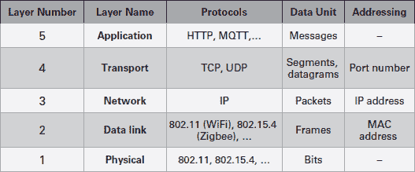

Figure 5.2 Five layers on the internet

#### 应用层协议

在应用层，有几种协议和机制可用于跨互联网通信 `IoT` 数据。这些包括下文所述的 `REST` 和 `Pub-Sub` 应用层系统：

##### 基于 REST 的 IoT 应用

`REST` 代表表述性状态转移，是一种用于互联网上端到端 Web 服务应用的架构，采用客户端-服务器模型（Fielding and Taylor, 2002）。最容易将其理解为 `HTTP` 的一种泛化，`HTTP` 是用于浏览 Web 的协议。在 `HTTP` 的情况下，客户端是浏览器，服务器是与网站关联的软件。客户端通过简单、统一、无状态的操作/命令/请求与服务器通信，包括 `GET`、`POST`、`PUT`、`UPDATE`、`DELETE` 等（参见图 5.3）。客户端使用这些命令请求和修改位于服务器上的资源。资源通过统一资源链接（`URL`）引用，服务器可用其识别相关信息以提供给浏览器客户端。“无状态性”在于服务器无需维护任何过去请求的记忆；满足给定请求所需的所有信息均包含在该请求本身中。在 `IoT` 感知系统的背景下，基于 `REST` 的应用可以向两个方向开发。第一种要求网关有效地充当服务器，接收来自远程节点（如云计算点或用户移动设备）的请求并相应地为其服务。第二种要求网关连接到基于云的服务器，将其数据进一步发送到该服务器。虽然 `HTTP` 和 `REST` 主要在可靠的 `TCP` 连接上工作，但也存在较新的低开销 `REST` 类通信实现，例如使用简单 `UDP` 的 `CoAP`。

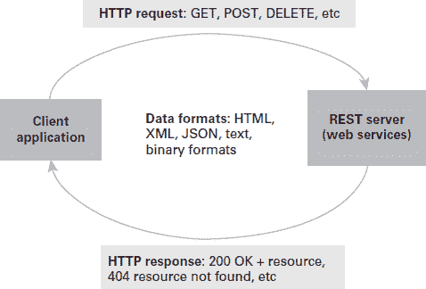

Figure 5.3 REST-based web services

##### 用于 IoT 应用的发布-订阅中间件

由于其独特特性，例如数据来自许多潜在面向大量终端消费点的传感器设备，`IoT` 应用通常使用发布-订阅中间件构建，例如消息队列遥测传输（`MQTT`），一种 `ISO` 标准（Banks and Gupta, 2014）。在诸如 `MQTT` 之类的发布-订阅协议中（参见图 5.4），生产或消费信息的终端设备作为连接到充当消息代理的服务器的客户端行事。生产信息的设备（如传感器）向代理“发布”（发送）带有特定主题或通道 ID 的消息。对一个或多个主题感兴趣的任何设备都可以连接到代理并“订阅”这些主题。代理在任何给定主题上收到的任何消息都会转发给该主题的所有订阅者。因此，每个主题都有一个或多个可以发送带有该主题的实时消息流的发布者，以及一个或多个可以接收这些流的订阅者。除了 `MQTT`（在开源 `Mosquitto` 代理和 `RabbitMQ` 中实现）之外，还有其他 `Pub-Sub` 中间件协议和系统，如 `AQMP`、`XMPP`、`DDS` 和 `Apache Kafka`，它们具有不同级别的可扩展性和性能。还有专有的云实时发布-订阅消息服务解决方案，如 `PubNub` 和 `Satori`。`Pub-Sub` 系统通常在服务器上实现消息代理功能，并提供软件应用程序编程接口（`API`）和软件开发工具包（`SDK`），以允许设计可在从低功耗嵌入式设备到移动设备再到服务器的各种设备上运行的发布和订阅客户端。由于其灵活性、可扩展性以及支持广泛动态实时流的能力，此类 `Pub-Sub` 中间件系统开始在 `IoT` 系统背景下被广泛部署。

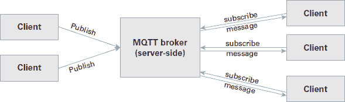

Figure 5.4 MQTT Publish–Subscribe protocol

来自传感器系统的数据可以流式传输并聚合到云计算系统中，在那里它可以被存储、查询、可视化，并用于驱动在线决策系统的分析，包括诊断、异常检测、分类、推理和预测分析。接下来我们描述云计算系统在 `IoT` 和供应链应用数据管理中所起的作用。

### 云计算

“云计算”一词的普及始于 2000 年代，随着亚马逊网络服务（`AWS`）的推出，随后很快出现了来自微软 `Azure`、`Google Cloud Platform`、`IBM Cloud`、`Oracle Cloud`、`DigitalOcean` 等其他主要提供商的类似通用云产品。从本质上讲，云计算（Armbrust *et al*, 2010）是关于允许服务器端代码在大规模数据中心提供的计算服务器上运行，这些服务器可以为客户端应用程序远程进行处理和数据管理。云服务流行的一个原因是移动应用程序的增长，在这些应用中，通常必须以易于扩展的方式从一个或多个功能强大的计算机服务器提供数据存储、管理和其他服务。

云计算的一个重要前身是软件工程中面向服务的架构（Erl, 2005）的发展，它强调软件的模块化设计，以便在每个服务中封装一个逻辑（业务）活动，该活动是自包含的，并作为黑盒为其消费者工作。每个服务本身也可能由其他服务组成。云计算通过将此类黑盒服务在线部署到数据中心，使应用程序能够快速扩展，在这些数据中心中，可靠性（处理节点故障）、安全管理、账户管理、根据需求扩展计算、通过复制服务管理延迟、软件升级、账户管理和授权等各种功能，均可通过利用云提供商的能力和经验，以可扩展且灵活的方式进行处理。尽管早期曾因将业务敏感数据和计算移至第三方云提供商服务器而遭遇一些阻力，但多年来形成的规模效益和信任已改变了这一局面，许多公司已开始将几乎所有的数据和计算委托给此类提供商。

### 云服务模型

存在多种类型的云计算服务模型（图 5.5），具体描述如下：

*   **基础设施即服务（IaaS）**：从云提供商处可利用的最简单、最低层级的能力，本质上是租用原始计算、内存、存储和负载均衡能力。以这种方式使用云提供商时，获取该服务的应用程序开发者或公司需全权负责自行决定、许可或设计（如有需要）、安装和运行所有软件及数据系统，并拥有运行任意软件的自由。提供商通常允许客户应用程序开发者自定义选择具有所需能力和操作系统的机器，并可随时间按需扩展（例如，以满足其产品不断增长的需求）。通常，客户甚至可选择一个或多个计算节点的地理位置，以最好地服务其客户。传统上，云计算基础设施仅通过虚拟机提供，每个实例中均提供完整的操作系统。通常，此类大型资源消耗型虚拟机实例由称为 `hypervisor` 的软件在提供商数据中心的底层裸金属服务器（宿主机）上进行管理和协调；它们具有显著的开销。然而，近年来，被称为 `containers` 的低开销替代方案越来越受欢迎。`Containers` 为应用程序提供隔离，而无需每个应用程序拥有自己的独立操作系统（OS），而是直接在宿主操作系统上运行，开销较低。除了允许以低开销部署更小的代码片段外，`containers` 的使用还可将软件的设置时间从数小时缩短至数分钟。一种将应用程序打包为可在任何 Linux 服务器上运行的 `containers` 的广泛使用的工具是 `Docker`。`Docker Swarm` 和 `Kubernetes` 等编排软件提供了在一组终端主机或虚拟机上启动和管理 `Docker containers` 运行的能力，并具备故障转移管理等内置功能。基于云的容器服务示例包括 Amazon 的 `Elastic Container Service`、`Azure Container Service` 和 `Google Kubernetes Engine`。云提供商提供的另一种基础设施是存储，如 `Amazon S3`、`Azure storage`、`Oracle cloud storage` 等。

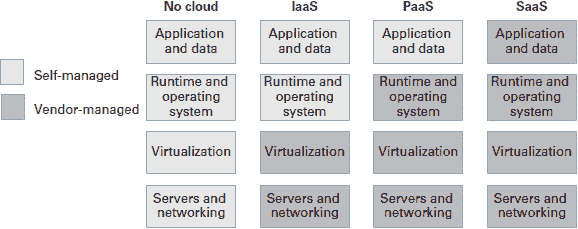

图 5.5 云服务层级

*   **平台即服务（PaaS）**：比基础设施高一层，这为客户应用程序开发者提供预构建软件工具集合，简化应用程序的设计和部署过程。这些工具可能包括程序执行环境、数据库、发布-订阅或消息中间件、Web 服务器。虽然客户应用程序开发者保留使用平台及相关 `SDKs` 和 `APIs` 配置和定制其应用程序的能力，但这种方法为客户提供了更高层级的抽象，即他们无需手动租用/分配资源来支持其应用程序，而是受益于为其提供的自动扩展解决方案。采购 `PaaS` 而非 `IaaS` 的一个额外好处是，保护产品所需的软件升级和安全机制成为平台提供商的责任。`PaaS` 产品的一个示例是 `PubNub`，它为网约车、车队管理和供应链产品跟踪等各类应用程序托管实时发布-订阅消息云平台。另一个示例是不同云提供商提供的结构化查询语言（`SQL`）数据库服务。另一类 `PaaS` 解决方案由移动后端即服务（`MBaaS`）解决方案代表，它们提供统一的 `APIs` 以访问移动应用程序所需的常见功能，如推送通知、数据库存储和查询以及社交网络集成。`MBaaS` 的一个示例是 `Firebase`。最近，在区块链应用程序的背景下，出现了一种提供区块链即服务的趋势（目前已有此类产品，例如由 `IBM Cloud`、`Azure`、`AWS` 和 `Oracle` 提供），其中云提供商根据客户指定的参数运行所需区块链（如 `Hyperledger Fabric` 或 `Ethereum`）的全节点实例。

*   **软件即服务（SaaS）**：云计算服务抽象的最后一步是将完整端到端应用程序的整个软件托管在云上，仅可通过浏览器等瘦客户端访问。在这种情况下，完整软件栈的所有功能和基本配置均由云服务提供商处理。简单的示例包括办公软件（如 `Google Docs`）或电子邮件软件服务（如 `MS Outlook` 和 `Gmail`）。另一个示例是 `Salesforce` 提供的客户关系管理（`CRM`）软件，它提供从销售和合作伙伴关系管理到营销协助、客户服务等一系列功能。`SaaS` 应用程序可按订阅制直接、可扩展地销售给最终客户。从商业角度来看，`SaaS` 解决方案的增长帮助企业重新分配 IT 资源，因为维护硬件和软件安装、维护及内部升级的需求减少了。

### 大数据：计算与存储

随着数据驱动型应用程序的快速增长，供应链管理软件系统必须在许多方面应对数据复杂性。大数据管理领域一直在发展以应对这些挑战（Provost and Fawcett, 2013）。在大数据背景下，有三个基本维度需要考虑：

1.  **数据量（Volume）**：大数据应用程序的特点是数据量大，特别是来自不断增长的 `IoT` 设备。软件系统必须设计为能够随时间存储和处理不断增加的数据量。

2.  **速度（Velocity）**：供应链中传感器设备发送的数据通常以动态数据流的形式出现，对于许多对延迟和时间敏感的应用程序而言，能够实时处理并响应这些高吞吐量数据流至关重要。因此，处理数据的软件系统必须具备显著的带宽和计算能力。

### 多样性

与传统数据管理系统不同，现代大数据系统面临的另一个主要挑战是需要处理截然不同类型的数据，范围涵盖表示感知数据和上下文的数字和文本，到声音、图像和视频。可能需要通过处理、组合和融合非常不同类型和模态的数据来得出有意义的推断。

上述三个 V 提供了一种思考大数据系统挑战的方式；需要各种数据分析解决方案来清洗、处理原始数据，并从中得出有意义的推断、预测和决策。

### 面向大数据的分布式计算

从计算角度来看，大数据应用的兴起带来了创新的并行和分布式计算范式，这些范式能够利用云平台上可用的可扩展计算资源。`MapReduce`（Dean 和 Ghemawat，2008）由 `Apache Hadoop` 实现，是一种针对海量数据集进行计算的范式，它通过将计算划分为两个阶段来利用并行计算的可用性——一个映射阶段，按相关键对输入值进行分组；一个归约函数，以自然适合并行化的方式处理每个键的值。最近，MapReduce 的一种泛化——以有向无环图（`DAGs`）的形式表示计算——被发现对于复杂的流水线计算更具广泛用途。例如，这构成了 `Google Cloud Data Flow` 分布式计算系统以及 `Apache Spark` 的基础。`Apache Spark`（Zaharia 等，2016）是一个功能齐全的大数据分析引擎，提供许多其他功能，包括流处理、流查询、机器学习库、`GraphX`，以及用于图和图并行计算的 API。

### 数据库技术

传统关系型 `SQL` 数据库（例如 `Oracle SQL`、`MySQL`、`Postgre-SQL`）具有高度结构化且定义明确的模式（图 5.6）。由于存储和处理的数据性质发生变化，对更大灵活性、对多种数据类型的支持以及可扩展性的需求，催生了一类新的 `NoSQL` 数据库（Han 等，2011），如图 5.6 所示。用于各种大数据的 `NoSQL` 数据库示例包括 `Apache Cassandra`、`MongoDB` 和 `CouchDB`，每种都有独特的功能和能力。`Apache Ignite` 是一种快速分布式数据库，旨在实现高可用性和容错性，使用 `RAM` 内存进行存储和内存计算，并同时支持传统 `SQL` 和 `NoSQL` 功能。另一类出现得相对较近的 `NoSQL` 数据库是图数据库，如 `Neo4J`，它们专门用于存储和检索最适合组织为具有顶点、边及其相关各种属性的图的信息。

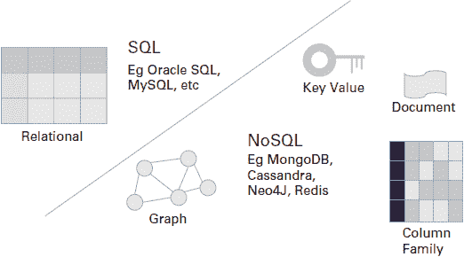

图 5.6 SQL 与 NoSQL 数据库

数据库设计中有两种不同的理念或模型：`ACID` 和 `BASE`。`ACID` 属性包括原子性（事务的所有要么全部执行，要么全部不执行）、一致性（只允许录入有效数据）、隔离性（并行的不同事务互不影响）和持久性（事务不会丢失）。`BASE` 系统表现出基本可用性（在故障面前）、软状态和最终一致性。与符合 `ACID` 的系统相比，符合 `BASE` 的数据库以一致性换取可用性。虽然传统 `SQL` 系统通常符合 `ACID`，但 `NoSQL` 系统在大多数情况下倾向于符合 `BASE`，以此应对更大的数据量和速度。在采用符合 `BASE` 数据库设计的系统中，可能需要构建带有额外事件的应用程序，以在达到某些重要一致状态时发出信号。

### 数据分析与机器学习

在大数据系统的背景下，涌现出许多用于数据分析、学习和预测的算法类型。我们在下文中简要概述一些不同类型的机器学习解决方案及其能力，这些能力近年来已迅速成熟，但要全面阐述这一庞大主题当然超出了本章这一小节的范围。对此感兴趣的读者可参考 Kelleher 等，2015 和 Müller 和 Guido，2016 等书籍。

#### 数据表示

熟悉计算机文件格式的读者可能知道，不同类型的数字数据通常以不同方式表示。对于构建供应链复杂软件系统而言，标准化和规范化这些表示非常重要，以便供应链不同节点的计算系统能够互操作。对于可表示为文本的传感器数据（即主要是数字和字符串），一种广泛使用的语言无关格式是 `Javascript Object Notation (JSON)`，它本质上以名称-值（或键-值）对的形式表示数据，格式非常轻量且人类可读。`IoT` 数据有时也可能以非人类可读的二进制表示形式（如 `Concise Binary Object Representation (CBOR)`）更紧凑地表示。当然，针对特定类型的数据还有其他标准二制标准，如图像（`JPEG`、`PNG`）、音频和视频（`WAV`、`MPEG`）、渲染的网页和文档（`HTML`、`PDF`）等。`SensorML` 等标准进一步规范了特定传感器类型、值和单位的表示方式。此外，还有使用模型和格式（如 `resource description framework (RDF)`，一种 `W3C` 标准）和 `JSON with linked-data (JSON-LD)` 来表示不同类型数据及其所代表对象之间关系的趋势；这些允许对复杂互联数据进行更丰富、语义上有意义的查询。`GS-1` 组织发布了 `electronic product code information services (EPCIS)` 和 `common business vocabulary (CBV)` 标准，这些标准专门面向供应链应用（`EPCIS`，2017）。`EPCIS` 建立了通用数据模型和相关接口，可用于描述和跨开放供应链共享可见性数据。

#### 数据压缩

当系统在存储和带宽方面存在显著资源限制时，可能需要对数据进行压缩。数据可以无损或有损方式压缩。前者保留所有信息。通用无损压缩系统的一个著名例子是 `zip` 系统，可应用于各种数字数据。有损压缩机制的一个例子是 `JPEG` 算法，它以不可逆压缩方式表示图像，允许在压缩效率和图像质量之间进行可调的权衡。

#### 数据清洗

在许多应用中，可用于处理和分析的原始数据必须先经过“清洗”才能使用。输入数据可能存在许多问题——例如，它可能包含缺失和不完整的元素，或者数据中可能混杂了噪声，又或者它可能以不一致的格式提供。针对其中一些问题，存在许多现有技术，例如用于缺失数据的插值方法，或用于音频数据去噪的数字滤波器。某些机器学习工具可用于处理特定类型的错误数据（例如，拼写错误或指代同一名称的相似但不一致的方式，可能很容易使用语言处理工具来修复）。在其他应用中，工程师和专家可能需要根据其领域知识设计临时的清洗方法。

#### 数据聚类与无监督机器学习

给定一组数据输入，每个输入均以多个属性（维度）描述，存在一些算法可以自动对数据点进行聚类，并检测它们是否自然地归入不同类别（图 5.7）。这类在高维空间中进行聚类且无需先验领域知识或人工标注的算法，被归类为无监督机器学习技术。此类技术的示例包括 `K-means` 聚类、层次聚类和混合模型聚类。

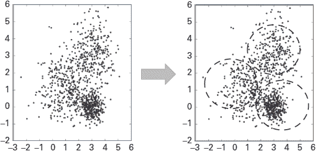

图 5.7 数据聚类与无监督机器学习

#### 基于模型的贝叶斯统计推断与估计

某些应用涉及的随机变量以可使用条件概率和先验概率建模的方式相互关联。在这类应用中，可以使用贝叶斯技术基于数据驱动的观测进行特定的推断和估计。作为一个具体示例，在使用射频信标追踪资产时，可以使用此类方法，利用在特定已知点观测到的信号强度来估计信标的位置（Jagadeesan, 2017）。使用这种贝叶斯方法需要一些先验知识，即在信标位于特定点的条件下，获得特定一组信号强度观测值的条件概率模型。如果此类模型未知，则可以根据测量结果随时间潜在地学习和改进它。

#### 用于分类和预测的监督机器学习

近年来机器学习最成功的应用之一，是利用所谓的深度神经网络解决与复杂、高维输入的检测和分类相关的问题。在不深入探讨这些系统细节的情况下，重要的是要注意神经网络需要标注数据。例如，一个用于检测图像中是否存在特定类型物品（如集装箱）的神经网络，需要一些先前已标注（通常由人工）的图像，以指示它们是否包含该集装箱。随着更多训练数据变得可用，此类分类系统的性能会提高。

通常，开发此类用于分类的监督机器学习系统主要有两个阶段——模型训练阶段和基于模型的分类阶段（图 5.8）。通常，对于复杂问题，模型训练阶段计算密集，因为可能需要探索广泛的参数范围，且必须求解非线性优化问题以获得良好性能。一旦模型训练完成，即可部署以在第二阶段提供输入分类。后一阶段通常计算量较小。在某些应用中，经过一段时间后，基于新数据的收集或底层环境的某些变化，模型可能需要重新训练。计算机视觉（即图像处理）是一个利用卷积神经网络检测图像中的物体并取得特别成功的领域，应用于自动驾驶等场景。其他受益于神经网络的领域还包括音频和语音处理、软件安全的异常检测等，还包括时间序列预测（通常采用循环神经网络等不同架构）。存在多个流行的神经网络软件框架，如 Google 的 `TensorFlow`，也存在提供简单高级 API 以便于训练的软件工具，如 `Keras`。对于某些应用，现成的预训练神经网络系统可快速部署，例如称为 `YOLO` 的实时目标检测系统，它可以在给定图像中以高速检测指定物体并识别其边界框。除了图像识别，重要的是要知道神经网络可应用于任何存在一定量标注高维数据（如供应链应用中从多个 IoT 设备获得的数据）的领域，用于解决检测、分类、预测、估计和函数逼近（回归）等各类问题。

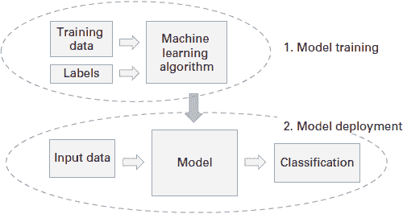

图 5.8 监督机器学习

#### 自然语言与语音处理

如前所述，除了图像识别，另一个因监督机器学习而发生革命性变化的领域是自然语言和语音处理。语音转文本识别、人类语言和语法理解、翻译能力、文本转语音转换、声音模仿，所有这些在近年来都取得了快速进展，甚至可作为现成的 PaaS/SaaS 产品从 Google、Oracle、Amazon 和 IBM Watson 等云服务商处获得。用于与人类进行有意义的自动对话的聊天机器人系统，现在可从许多公司获得，以针对特定领域进行定制和编程。

#### 强化学习

当今的 AI 系统不仅能从数据中学习进行分类和推断，还能在闭环中学习针对遇到的数据采取行动的完整策略。应用于通过知情的试错过程学习玩视频游戏的问题，最近的深度强化学习算法（其核心使用神经网络，以近似状态到动作的优化高维映射）取得了巨大成功，甚至超越了专家级人类玩家。这些系统具有广泛的适用性。通过使用真实控制系统的“数字孪生”，并通过模拟中的试错学习，此类系统甚至可以学会操作从工业机械和机器人到定价和交易的在线决策等一切事务。在许多方面，强化学习代表了 AI 愿景中自主系统学会最优运行并适应环境变化的最佳希望。

#### 数据可视化

数据分析的最后一个值得讨论的方面是数据可视化。从实时测量到汇总统计，将收集和分析的丰富数据流可视化通常很有帮助。像 `Grafana` 这样的工具提供了为实时数据构建仪表板的方法，允许人工介入监控，并通过随时间可视化多个相关指标来识别相关趋势。通过改善数据消费者和决策者的用户界面/用户体验（UI/UX），此类工具有助于用数据讲述更引人入胜的故事。另一个新兴趋势是利用增强现实技术，将物联网系统数据及由此得出的推断叠加到物理系统上，例如工业工厂或仓库。

#### 机器学习的挑战

必须考虑机器学习的一些挑战和局限性。当今许多机器学习方法的一个问题是缺乏可解释性。神经网络可以对给定的输入图像进行分类，但无法用直观的术语向人类解释为什么要以那种方式对图像进行分类。这是人工智能和机器学习领域正在进行的研究课题。机器学习的另一个根本问题是数据偏差和公平性问题。训练模型会因训练数据样本分布中的任何偏差而产生偏差。这可能导致其输出中存在偏差，从而造成社会危害并导致不公平的歧视性行为，例如在识别女性和少数族裔背景人士的面部时具有更高的错误率，或者基于关键词偏好男性候选人的简历。减少此类偏差并提高 AI 和 ML 算法的公平性是技术视角下另一个活跃的研究领域（Mehrabi *et al*, 2021），但这些工具的使用者也有责任在训练和应用这些工具时保持极度谨慎，因为他们知道这些工具很可能存在偏差。

### 安全、隐私与信任

随着我们迈向供应链日益数字化的未来，必须牢记基于计算机的信息系统从网络安全角度来看可能存在漏洞。传统上，计算机安全已经开发出了处理与 CIA 三要素（参见图 5.9）相关问题的方法：数据的机密性和完整性（使用加密算法、传输层安全方案和哈希机制），以及可用性（通过应对集中式和分布式拒绝服务的机制）。最近的一个发展是从以网络为中心的安全方法（即信任安全网络内的所有组件）转向零信任架构。零信任模型的理念是关注特定资产和服务的安全，而不是网络段，因为后者可能包含由许多不同管理员或个人拥有、操作或管理的设备。

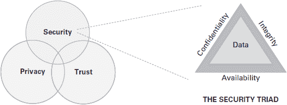

图 5.9 数据安全及相关概念

以数据为中心的系统也需要小心隐私问题，特别是考虑到《通用数据保护条例》（GDPR）等法规，该法规可对未妥善处理隐私敏感数据的企业处以严厉罚款。这是一个新发展仍在进行中的前沿领域。算法技术如差分隐私（通过向数据仔细添加噪声以提供特定的隐私保证）、偏同态加密和全同态加密以及可信执行环境（如 `Intel SGX`，它提供了保持计算机密性的方法），以及限制数据存储并提供方法允许用户撤回和删除其相关数据的系统，目前正在开发中。

区块链协议和基于区块链的系统建立在密码学原语之上，旨在融合许多此类能力，并通常提供一定程度的安全保护，防止部分节点不仅发生故障，而且表现出对抗行为。然而，它们仍然容易受到传统问题的影响，例如协议和智能合约软件中的零日漏洞（此前未被发现或修复）。从根本上说，基于区块链的系统旨在提供一定程度的分布式信任，以便跨越传统信任边界的自利方之间的交互能够以更少的摩擦得以实现，这是供应链系统的一项重要能力。虽然区块链技术保证一旦数据录入分布式账本就是不可篡改的，但它们无法保证数据最初就是有效/正确的。特别是如果数据是从传感器发送到区块链的，可能需要额外的防篡改、验证、确认和纠正措施，以确保其正确有效。在某些环境下，这可能是一个难以解决的问题。

### 物联网与其他技术在供应链中的区块链集成

随着区块链技术在供应链应用中日趋成熟，它们很可能会与本章所述的物联网、云计算、数据分析和安全技术无缝集成。作为此类集成的两个例子，考虑 a) 基于物联网的发布-订阅系统与区块链技术的结合，以及 b) 物联网数据的去中心化市场。

#### 发布-订阅与区块链

传统上，正如上所述，发布-订阅是使用客户端-服务器方法实现的，即发布和订阅客户端与托管在服务器上的代理进行通信（图 5.10）。在供应链背景下，可能有许多组织部署了物联网和其他数据流设备，并且需要以可信的方式共享数据流，这种中心化方法并不总是合适。一种提议的方法是用一组通过共识过程维护一致状态的分布式代理来取代单一的中心代理。一个能够提供此类能力的知名发布-订阅系统是 `Apache Kafka`，它包含一个名为 `Apache Zookeeper` 的组件，该组件提供共识，更具体地说是一种称为原子广播的能力，在多个节点之间进行，以便每个节点都保证以相同的顺序提供数据。`Apache Zookeeper` 以一种能够抵御少于 N/2 次崩溃故障（节点离开网络）的方式提供原子广播。一种更强形式的可信发布-订阅可以通过使用拜占庭容错共识协议连接由不同联盟成员托管的分布式传统发布-订阅代理来提供。`Trinity`（Ramachandran *et al*, 2018a）（图 5.10）就是这样一个最近提出并演示的系统，它将不同的 `MQTT` 发布-订阅代理连接到基于 `Tendermint` 拜占庭容错共识的许可区块链，以保证每个代理的订阅者都能看到来自发布者到任何/所有代理的相同经验证的信息流，且一致、顺序相同。`Trinity` 可以通过智能合约逻辑进行增强，允许单个节点根据物联网设备测量结果做出自主决策。

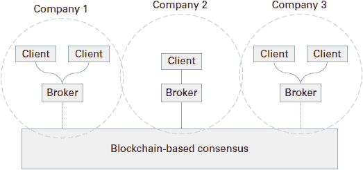

图 5.10 带有区块链的分布式发布-订阅代理

#### 物联网数据的去中心化市场

## 流式数据支付协议与去中心化物联网市场

通过为数字数据和流启用微支付，区块链技术开始允许不同组织在供应链联盟中的提供方和消费方（可能是不同参与方）之间交换数据，其中数据可能跨越信任边界，并以无缝方式进行交换。

**流式数据支付协议（SDPP）**（图 1）是一个支付通道无关且分布式账本技术无关的应用层协议示例，它允许数据流的买方和卖方就该数据进行全面交易，采用定期微支付（使用加密货币或传统电子支付轨道），并利用区块链存储包括订单、发票和收据在内的记录（Radhakrishnan and Krishnamachari, 2018）。

**Ocean Protocol**（Ocean Protocol 白皮书）以及南加州大学的去中心化数据市场项目（Ramachandran *et al*, 2018b）等努力，提出了允许卖方使用智能合约发布注册表的方法，买方可浏览这些注册表以确定并获取其感兴趣的数据流。

此类去中心化物联网市场的其他要素，如动态定价、搜索以及使用代币策展注册表的去中心化推荐系统等，仍处于研究和开发的早期阶段。

### 图 1：流式数据支付协议

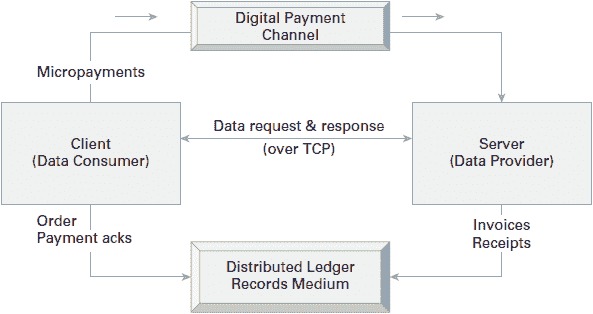

*图 1：流式数据支付协议*

### 参考文献

*   Armbrust, M, Fox, A, Griffith, R, Joseph, A D, Katz, R, Konwinski, A and Zaharia, M (2010) A view of cloud computing, *Communications of the ACM*, 53 (4), pp 50–8
*   Augustin, A, Yi, J, Clausen, T and Townsley, W M (2016) A study of LoRa: Long range and low power networks for the Internet of Things, *Sensors*, 16 (9), p 1466
*   Banks, A and Gupta, R (2014) MQTT Version 3.1.1, *OASIS Standard*, 29
*   Baronti, P, Pillai, P, Chook, V W, Chessa, S, Gotta, A and Hu, Y F (2007) Wireless sensor networks: A survey on the state of the art and the 802.15.4 and ZigBee standards, *Computer Communications*, 30 (7), pp 1655–95
*   Centenaro, M, Vangelista, L, Zanella, A and Zorzi, M (2016) Long-range communications in unlicensed bands: The rising stars in the IoT and smart city scenarios, *IEEE Wireless Communications*, 23 (5), pp 60–7
*   Chen, J, Hu, K, Wang, Q, Sun, Y, Shi, Z and He, S (2017) Narrowband Internet of Things: Implementations and applications, *IEEE Internet of Things Journal*, 4 (6), pp 2309–14
*   Dada, A and Thiesse, F (2008) Sensor applications in the supply chain: The example of quality-based issuing of perishables. In *The Internet of Things*, Springer, Berlin, Heidelberg, pp 140–54
*   Dean, J and Ghemawat, S (2008) MapReduce: Simplified data processing on large clusters, *Communications of the ACM*, 51 (1), pp 107–13
*   EPCIS and CBV Implementation Guideline, GS-1, (2017). [Online] <https://www.gs1.org/docs/epc/EPCIS_Guideline.pdf> (archived at <https://perma.cc/G4TN-UCB5>)
*   Erl, T (2005) *Service-Oriented Architecture*, volume 8, Pearson, India
*   Fielding, R T and Taylor, R N (2002) Principled design of the modern Web architecture, *ACM Transactions on Internet Technology (TOIT)*, 2 (2), pp 115–50
*   Gao, X, Xiang, Z, Wang, H, Shen, J, Huang, J and Song, S (2004) An approach to security and privacy of RFID system for supply chain. In *E-Commerce Technology for Dynamic E-Business*, 2004, IEEE International Conference, September, pp 164–68
*   Gomez, C, Oller, J and Paradells, J (2012) Overview and evaluation of Bluetooth low energy: An emerging low-power wireless technology, *Sensors*, 12 (9), 11734–53
*   Han, J, Haihong, E, Le, G and Du, J (2011) Survey on NoSQL database. In *Pervasive computing and applications (ICPCA)*, 2011 6th IEEE international conference, October, pp 363–66
*   Hightower, J and Borriello, G (2001) Location systems for ubiquitous computing, *Computer*, 34 (8), pp 57–66
*   Jagadeesan, N A and Krishnamachari, B (2017) A unifying Bayesian optimization framework for radio frequency localization. *IEEE Transactions on Cognitive Communications and Networking*, 4 (1), pp 135–45
*   Kelleher, J D, Mac Namee, B and D’Arcy, A (2015) *Fundamentals of Machine Learning for Predictive Data Analytics: Algorithms, worked examples, and case studies*, MIT Press, Cambridge, MA
*   Keshav, S (1997) *An Engineering Approach to Computer Networking: ATM networks, the internet, and the telephone network*, volume 1, Addison-Wesley, Reading
*   Lai, Y L and Cheng, J (2014) A cloud-storage RFID location tracking system, *IEEE Transactions on Magnetics*, 50 (7), pp 1–4
*   Mehrabi, N, Morstatter, F, Saxena, N, Lerman, K and Galstyan, A (2021) A survey on bias and fairness in machine learning. *ACM Computing Surveys (CSUR)*, 54 (6), 1–35
*   Misra, P and Enge, P (2006) *Global Positioning System: Signals, measurements and performance second edition*, Ganga-Jamuna Press
*   Müller, A C and Guido, S (2016) *Introduction to Machine Learning with Python: A guide for data scientists*, O’Reilly Media, Inc, Sebastopol, CA
*   Ocean Protocol Whitepaper: *Tools for the Web 3 Data Economy* [Online] <https://oceanprotocol.com/tech-whitepaper.pdf> (archived at <https://perma.cc/385V-B5V3>)
*   Pang, Z, Chen, Q, Han, W and Zheng, L (2015) Value-centric design of the Internet-of-Things solution for food supply chain: Value creation, sensor portfolio and information fusion, *Information Systems Frontiers*, 17 (2), pp 289–319
*   Provost, F and Fawcett, T (2013) Data science and its relationship to big data and data-driven decision making, *Big Data*, 1 (1), pp 51–9
*   Radhakrishnan, R and Krishnamachari, B (2018) Streaming data payment protocol (SDPP) for the Internet of Things, *Proceedings of the 1st International Workshop on Blockchain for the Internet of Things* (BIoT), held in conjunction with IEEE Blockchain, Halifax, Canada
*   Ramachandran, G, Wright, K-L, Zheng, L, Naveed, M, Krishnamachari, B and Dhaliwal, J, (2018a) Trinity: A Byzantine fault-tolerant distributed publish-subscribe system with immutable blockchain-based persistence, IEEE International Conference on Blockchain and Cryptocurrency (ICBC), Seoul, May 2019.
*   Ramachandran, G S, Radhakrishnan, R and Krishnamachari, B (2018b) Towards a decentralized data marketplace for smart cities. Invited paper at 1st International Workshop on Blockchain Enabled Sustainable Smart Cities (BLESS 2018), Kansas City, MO, USA, held in conjunction with the 4th IEEE Annual International Smart Cities Conference (ISC2)
*   Rose, S, Borchert, O, Mitchell, S and Connelly, S (2020) *Zero trust architecture* (No. NIST Special Publication (SP) 800-207), National Institute of Standards and Technology
*   Sornin, N, Luis, M, Eirich, T, Kramp, T and Hersent, O (2015) *Lorawan Specification*, LoRa Alliance, Fremont, CA
*   Unemyr, M (2017) *The Internet of Things – The Next Industrial Revolution Has Begun: How IoT, big data, predictive analytics, machine learning and AI will change our lives forever*, Amazon Digital Services, November
*   Zaharia, M, Xin, R S, Wendell, P, Das, T, Armbrust, M, Dave, A and Ghodsi, A (2016) Apache spark: A unified engine for big data processing, *Communications of the ACM*, 59 (11), pp 56–65

自 2019 年 5 月本书出版以来，Deliver 经历了大规模转型，其中包括两家创始公司退出联盟（ABN-AMRO 和 Samsung SDS）。随着仅剩鹿特丹港一家成员，关键问题是 Deliver 是否以及如何继续下去。然而，在我们深入探讨现在称为 Naviporta^(1) 的愿景、原则和架构之前，我们简要回顾一下 2019 年 2 月至 2021 年 12 月期间发生的事件。

2019 年 2 月，联盟完成了一个概念验证，成功实现了集装箱从门到门的全程跟踪追溯，并在釜山港与位于荷兰蒂尔堡的 Samsung SDS 仓库（鹿特丹港，2019）之间实现了即时融资。该 PoC 证明，通过以以太坊公链作为通用参考框架，可以实现运行不同区块链协议的两个不同区块链生态系统之间的互操作性。

该 PoC 随后扩展至其他贸易航线。2019 年 5 月至 2020 年 4 月期间，追踪了从中国以及美国发往荷兰的各类出口货物。此外，原始 PoC 的功能进一步扩展，以支持这些额外的试点；然而，从技术角度来看，重点是敲定平台首个企业级发布版本的未来状态架构（FSA）。此延长试点阶段的主要目标是展示价值验证（PoV）。特别是，重点在于确定 Deliver 平台以及平台上的生产者和消费者的商业案例。这是通过对现有流程进行广泛分析来完成的，特别是发货处理时间和成本，以及不合格和不合规的成本。这种方法植根于本书第 2 章提出的框架。虽然在此阶段结束时已成功展示了价值验证，但某些外部因素对两个联盟成员 ABN-AMRO 和 Samsung SDS 发生了重大变化。对于前者，这一决定是由几家大宗商品贸易商的倒闭引发的，在冠状病毒危机后发现了欺诈实例（Reuters，2020），导致 ABN-AMRO 完全退出大宗商品和贸易融资领域，而这正是该平台的预期用途。Samsung SDS 退出的决定是由于战略重新调整，优先考虑其 Cello 平台的进一步开发。

## 数字码头的理由

ABN-AMRO 和 Samsung SDS 的退出决定使鹿特丹港（PoR）成为了 Deliver 遗留资产的管理者。三个联盟成员中有两个退出，显然让港口面临一个问题：为什么要开发和维护这样一种基础设施？

答案在于港口间竞争，即服务于相同供应链和/或腹地的不同港口之间的竞争。与腹地的物理连通性是一个重要的竞争力标准（Parola F，2017），港口应能够无缝整合经过港口的各种物流链和流程。这需要协作与协调，而这些往往不会自发产生（Van der Horst M，2008）。洛杉矶港的拥堵痛切地提醒我们，当利益相悖、互不信任或依靠信息不对称获利的各方必须协调活动时，会发生什么（Henry，2021）。因此，可以为一种数字基础设施即服务（IaaS）做出论证，它确保与海外港口、港口社区成员和腹地的无缝连接。因此，它可被视为物理港口基础设施的延伸——一个数字码头，它促进孤岛记录系统之间的数据和资产共享，第三方供应商可在其上部署服务。理想情况下，此类基础设施应独立治理，不应被视为供应链中的主导成员，也不应在部署于该基础设施上的任何服务中拥有直接财务利益。像鹿特丹港这样的地主港在物理基础设施方面已经扮演了类似角色。它们提供基础设施（如码头、土地、道路），而不提供服务（如运输、货运代理、集装箱码头）。鉴于各供应链成员之间的协作与协调只能通过共享数据来实现，将这一角色延伸至数字领域因此是合乎逻辑的下一步。Naviporta 的治理结构在下文“治理”部分有更详细的描述。

## 经验教训

事后诸葛亮，随着 Naviporta（鹿特丹港，2021）现已上线，有一些宝贵的经验教训值得吸取。不仅包括我们会做得不同的事情，也包括我们会多做的事情，以及那些被证明对从构想走向落地至关重要的事情。

### 规模化，但不惜一切代价

虽然我们同意，如果有几家大型货主或承运人作为合作伙伴参与 Naviporta 平台的进一步开发，解决方案的初始规模化将会快得多，因为它们直接为平台带来交易量，但我们也意识到从其他区块链联盟以及 Deliver 联盟期间吸取的一些教训。例如，虽然 TradeLens 因马士基而能迅速提升平台上的交易量，但后续承运人的加入因监管和商业顾虑而缓慢。瑞士承运人 MSC 选择 Wave 的区块链解决方案作为其全球电子提单（eBL）平台（MSC，2021），以及由赫伯罗特、中远海运和东方海外等共同建立全球区块链航运网络（GBSN）^(2)，清楚地表明了行业内联盟面临的一些商业风险。

### 跨行业合作的险境

虽然通过与不同行业的公司合作作为核心可以规避监管顾虑，但这仍给联盟留下了几个挑战。其中之一是，如果几乎没有最终客户重叠，产生的交易协同效应有限。虽然 Samsung SDS 和 ABN-AMRO 都是强势品牌，但将它们的交易都加到平台上却几乎没有产生协同效应；换句话说，1+1 等于 2，而非 3。这种协同结果在引导 Naviporta 这类基础设施起步时非常重要。当重叠度很高时也存在类似情况；流程更有可能已经紧密集成，从最终客户角度限制了协同效应，Samsung SDS 和 Samsung Electronics 就是这种情况。跨行业联盟中另一个重要的商业顾虑是，各方对彼此的业务了解有限。当企业文化存在重大差异时，这往往会使沟通复杂化。这绝不意味着跨行业合作没有价值。我们仍然相信区块链是克服跨行业合作挑战的基础性技术，并应相应实施。连同鹿特丹港，Blocklab 已成功将概念验证规模化为分拆项目，分别与标准普尔（SPGlobal，2020）和英国电信（鹿特丹港，2021）合作。只是不要指望第一次尝试就能每次都做对。

### 摆脱“母舰”

## 摆脱母舰的引力束缚

摆脱三艘 Deliver 母舰（PoR、ABN-AMRO 和 Samsung SDS）的引力束缚被证明极具挑战性，并消耗了本可用于更有价值用途的不成比例的资源。正如下文所述，Deliver 项目由一个指导委员会管理；然而，每位牵头方都有其自己的母舰“影子”指导委员会需要应对。随着 ABN-AMRO 和 Samsung SDS 的退出，这种引力大幅减弱。不仅只剩下一艘母舰需要应对，而且大多数职位由 Blocklab 填补；尽管它是鹿特丹港务局的全资子公司，但它与港口保持着“臂长距离”运作，并且只要达成既定目标，就可以在预算范围内自主决策。

基于我们在 Blocklab 的经验，我们现在正在重构我们的风险投资构建方法，通过更早地从实验室项目过渡到风险投资。首先，这要求在项目尽可能早的阶段识别价值证明。特别是对于超出常规业务范畴的风险投资——例如港务局的数字化项目——建立“实打实”的商业案例可能颇具挑战性，尤其是在早期，因为往往没有基准案例可供参考。我们在 Blocklab 成功使用的一个简单经验法则是，寻找愿意以实物或现金形式投资的共同创造者，作为对商业案例的首轮验证。我们可能认为某个项目是切片面包问世以来最伟大的发明，但如果我们无法说服一家或多家其他公司投入资源，那它可能并不是个好主意。此外，随着时间的推移，知识和经验的积累使 Blocklab 能更快地识别价值增长点及其对应的商业案例。

现在，要求企业“只管给钱，别插手”并不是什么高明的策略。此外，没有 PoR，Blocklab 绝不可能取得今天的成功，Deliver 创始成员的长远愿景、议程、品牌和网络在项目早期被证明极其宝贵。然而，随着项目获得动力，不应再是名片上大企业的 Logo 让你受邀推介产品，而应是产品本身！为项目建立独立身份的方式有很多，但将其设立为拥有独立管理团队和预算的独立实体，并像其他初创公司一样运作——敏捷、无企业管理开销、利益绑定——能最大程度地摆脱母舰的引力束缚。理想情况下，你希望管理团队已具备从初创到规模化的成功经验并覆盖所有角色，但在大多数情况下，为初创公司配备全职的 CTO、CCO、CEO 和 COO 属于大材小用。一个由有过成功经验的人员组成的风险投资工作室，能够指导构想者和初创公司的首批员工，协助寻找外部融资、拓展业务和进一步建设团队，将增加成功的几率。

### 如果你给一个男孩一把锤子……

区块链并非解决世界上所有问题的灵丹妙药。实际上，当我们仔细观察 Naviporta 的架构时（参见“Naviporta 关键组件”），我们会发现链下组件和 `Google Cloud Platform (GCP)` 在提供所需功能方面发挥着同等重要的作用。一般来说，区块链交易比（例如）将交易写入数据库需要更多的处理能力，因此成本更高。在设计 Naviporta 时，我们有意识地审视哪些交易需要区块链公证，哪些不需要。对可转让电子提单所有权进行公证是合理的，因为此类资产可代表数百万美元的价值，公证的额外成本与之相比微不足道。然而，在大多数情况下，对集装箱上 `物联网 (IoT)` 设备的每个单独读数进行公证是不必要的。

## Naviporta 白皮书

在撰写本书第二版时（2021 年 12 月），Naviporta 白皮书仍在编写中。虽然这看似奇怪，因为大多数区块链白皮书都是在协议启动前编写的，但我们认为，过早编写白皮书会导致其成为一份理论性文件，从而掩盖建立联盟链相关的一些挑战，例如独特卖点 (USP)、治理和初始用例。此外，那也将非常大程度上代表 PoR 对 Naviporta 基础设施的看法。2021 年，我们与亚太地区、澳大利亚、非洲和欧洲的多家港务局进行了接触，以验证我们的发现并完善内容。预计这将持续到 2022 年第一季度。因此，以下段落代表了 Naviporta 关于白皮书中通常包含的几个关键方面（如愿景、核心价值观和治理）的现有观点。

### 愿景

近年来，市场上涌现了各种数字化举措，试图解决当今全球供应链中的低效问题。新加坡（Wragg, 2021）和青岛（GSBN, 2021）等关键港口正在投资基于区块链的数字基础设施，货代、大型承运人（如马士基和中远海运）以及大型电商公司（如亚马逊和阿里巴巴）等企业正在构建物理和数字基础设施，以支持端到端供应链。

一种采取跨行业方法优化全球供应链、并将互操作性、中立性和数据主权作为核心价值观的数字基础设施，将成为缓解第 2 章中所强调的供应链当前面临的诸多问题的有力工具。这种利用区块链技术的数字基础设施，充当当今全球供应链中存在的众多孤岛式记录系统的通用参考框架。因此，它将构成一项基础设施，第三方开发者和其他生态系统可在其上部署其数字服务。这项基础设施充当数字高速公路，向所有参与者开放且可访问，在考虑监管合规（如 `了解你的客户 (KYC)` 和 `反洗钱 (AML)` 法规）的前提下，为全球供应链中的任何参与者保证公平竞争的环境。各方第三方将提供广泛的数字服务，为最终用户（消费者）创造价值，利用该基础设施连接来自各种服务和流程的数据，从而消除低效和人工交接。除了获得促进端到端供应链流程所需的所有服务外，底层资产和数据必须可复用，消除在流程每一步重新创建和验证相同数据的必要性，进一步减少低效和数据不准确，并为供应链中的所有参与方实现供应链流程自动化。资产和数据应全部数字化，将实体纸质流程降至最低。

中立性应通过治理结构来强制执行，该结构围绕一个由天然中立的合作伙伴组成的联盟构建，保证基础设施的中立性，并为服务提供商和最终用户提供信任，使他们能够放心使用该平台，无需担心供应商锁定和数据变现。此外，基础设施应保证数据主权，这意味着：1）最终用户始终可以验证数据的存在性、来源和完整性；2）平台的其他用户（包括 Naviporta）绝无法访问彼此的原始数据，除非某方已获得授权；3）联盟合作伙伴无法基于最终用户的数据创建营收模式。最后，4）不应存在基础设施锁定，即最终用户可以集成来自平台外提供商的服务。基础设施的存在唯一是为了创造互操作性并实现“一次连接，多处使用”，旨在促进生态系统内的合作并优化最终用户的核心流程。

### 核心价值观

Naviporta 基础设施建立在以下核心价值观之上：

1.  **数据主权**：除数据指纹（哈希值）外，Naviporta 不在区块链上存储任何主数据、业务逻辑和交易数据。区块链网络的每个用户都有权控制其数据的使用和存储方式。因此，Naviporta 无法将任何数据变现。

2.  **技术中立**：去中心化应用（`Dapp`）开发；Naviporta 不向第三方服务开发者强制规定任何协议、编程语言或专有技术。鼓励他们以任何方式开发服务，只要遵守 `SDK` 标准以确保与平台的互操作性，并成功通过服务的上线流程。

3.  **赋能“优中选优 2.0”**：在当今孤岛式的世界中，即使是在供应链管理软件方面采取“优中选优”策略的公司也必须妥协。例如，一家电子提单服务提供商在亚太地区更强，而另一家在拉丁美洲拥有更强的影响力。Naviporta 允许用户以更细粒度的层级混合搭配服务，甚至细化到单票货物层面。

4.  **中立**：Naviporta 由一种治理结构支撑，该结构不偏向特定的生产者、消费者或核心生态成员。这是通过与致力于核心价值观并通过增加新服务、消费者、生产者和贸易航线积极拓展合作伙伴 Naviporta 生态系统的（港口）生态系统合作来实现的。

### 生态系统

虽然 Naviporta 生态系统仍类似于 Deliver 生态系统，但已发生根本性转变，将生产者作为 Naviporta 平台的关键焦点。这主要是由于如技术段所述，明确将 `Dapps` 与核心服务分离所致。这带来了诸多益处：

*   核心服务和 `Dapps` 可以各自拥有独立的商业案例和治理；
*   运营模式有明确区分：核心服务采用基础设施即服务（`IaaS`），`Dapps` 采用软件即服务（`SaaS`）；
*   实现平台更快扩展，因为生产者可以引入其自有生态系统中希望使用 Naviporta 平台上其他服务的成员；
*   保障 `Dapps` 和核心服务的技术中立性。

在 Deliver 时代，采用了基于韩国和荷兰之间贸易航线的策略来构建生态系统，理由是三家合作伙伴仅凭这一贸易航线就能调动大量流量，因为它们的总部所在地、两国间的贸易总量以及靠近政府机构和监管机构等关键利益相关者。随着 ABN-AMRO 和 Samsung SDS 不再是联盟成员，Naviporta 不得不放弃这一贸易航线，并整体重新评估贸易航线策略的适用性。由于 QuayConnect `Dapp`（见“支持的用例”）在连接英国的贸易航线上提供了巨大的扩展机会，我们几乎毫不费力地自然而然地转向了基于欧盟（`EU`）与英国（`UK`）之间贸易航线的策略。

### 治理

Naviporta 联盟的主要目标是开发和维持 Naviporta 平台及其核心服务的持续性、生态系统的增长以及联盟自身的持续性。其治理体现了 Naviporta 的核心价值观：中立与开放、数据主权与互操作性，且不牺牲运营效率。为设计 Naviporta 平台的治理，采用了 图 6.1 所述的治理三角，以最佳方式平衡问责制、决策模型和激励机制。

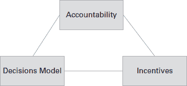

图 6.1 治理三角

### 问责制与决策

如前所述，联盟和平台应尽可能开放，通过去中心化和中立性实现抗审查，但不应面临治理变得低效和缓慢的风险。考虑到治理三角，Naviporta 联盟治理的示意图概览设计如 图 6.2 所示。

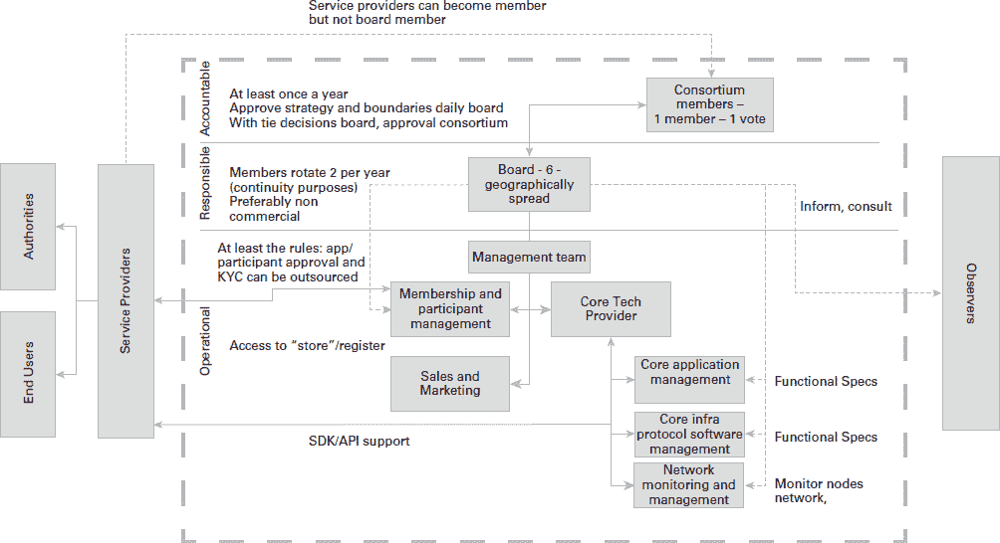

图 6.2 Naviporta 治理

联盟治理的拟议设计由三层组成：问责层、责任层和运营层。

#### 联盟

联盟代表问责层，因此在联盟中拥有最高权威。它至少每年在大会上聚会一次，或在联盟参与者或董事会（见责任层）召集时更频繁地聚会。决策根据投票类型，按绝对多数或相对多数原则作出。

联盟参与资格的设计旨在尽可能开放，同时不损害 Naviporta 的中立性。因此，确定了三类成员提交类别：

1.  **直接准入** – 此类别中的组织无需现有参与者批准即可成为联盟成员，只要其符合参与的最低要求（合规性）。这些是任何（半）政府组织，如港务局，或在 Naviporta 平台支持的主要流程中没有任何直接利润或商业利益的组织。

2.  **排除组织** – 这些组织被允许使用 Naviporta 平台并通过平台向其客户提供服务，但不能成为联盟成员。这些是所有在 Naviporta 支持的主要流程中拥有直接利润或商业利益的组织，以及所有向联盟供货并直接由联盟支付服务费用的组织。

3.  **待讨论** – 第三类别适用于无法立即归入第一或第二类别的所有组织。这些组织要成为联盟成员，需要在大会上获得现有参与者的多数决批准。

联盟参与者应运行并维护一个 Naviporta 节点，或支付年度参与费。作为奖励，参与者在大会上拥有一票表决权。

如果现有成员的子公司想要加入联盟，他们不会获得额外的投票权。这一方面保证了开放性和去中心化，另一方面保证了中立性。

### 责任层

责任层最终对联盟的所有重大决策负责，同时也负责任命董事会，并同意董事会的权限边界和年度计划。为避免低效的架构，引入了执行层。

#### 董事会

当联盟参与者超过六家时，引入执行层以保证治理效率。执行层由董事会体现，由六名参与者组成。董事会由联盟从其参与者中任命产生，可在指定边界内自由开展日常运营，并可将日常运营委托给管理团队。这保证了处理事务的效率。主要职责包括：

1.  监督管理团队
2.  管理并维护与观察员社区的关系，并向联盟汇报。

董事会成员的任命将适用以下标准：成员应在地理上分布广泛，即所有主要大洲均须有代表。此外，董事会成员不得与其他任何参保持关联关系，以确保董事会的严格中立性。

为保证连续性，董事会成员任期为三年；每年更替两名董事会成员，这将政治连任偏见导致效率损失的风险降至最低（因为全新的董事会需要时间磨合启动），同时也降低了董事会成员在任期末期更多精力投入连选连任而非日常工作的风险。

#### NAVIPORTA 运营管理团队

日常运营（运营层）由管理团队在董事会的责任下，基于既定的关键绩效指标进行管理。管理团队负责执行所有日常任务，范围涵盖核心基础设施和软件的开发、参与者管理（KYC 等）到市场营销和销售。管理团队由董事会聘用，并每周向董事会汇报，且应将任何重大决策提交董事会审议。董事会可决定联盟是否需在该事项上拥有最终决定权（通过大会决议）。参与管理团队的人员将是 Naviporta 联盟的雇员，或可从外部解决方案或服务提供商处聘用。

### 支持的用例

虽然我们设想了一个由消费者、生产者和核心成员组成的多元化生态系统，但平台本身不足以引导此类生态系统的形成。为打破这一“两难困境”，Naviporta 确定了三个极具前景的用例，它们不仅为这些服务的消费者提供直接利益，也向生产者展示了平台的价值。这些服务包括：

1.  QuayConnect
2.  VATBL0CK
3.  TradeTrust

#### QuayConnect

每年约有 3600 亿欧元的商品从欧盟出口至英国。脱欧以来，英国大幅收紧了海关手续，导致向英国出口商品的行政工作量激增，并产生额外成本。

脱欧前，商品在欧洲大陆与英国之间自由流动，几乎无需任何手续。例如，在欧盟生产或进口的商品可在英国境内销售，无需在成员国边境进行额外的卫生安全检查或支付进口关税。2020 年 1 月 31 日，欧盟与英国就英国退出欧盟的条款及条件，以及双方在《退出协议》和《政治宣言》中的新安排达成一致。大部分脱欧前安排得以保留的过渡期于 2020 年 12 月 31 日正式结束。2020 年平安夜，欧盟与英国就未来贸易监管达成最后时刻协议。这一新规则载于《边境运营模式》（英国政府，2021）中，构成了一种分阶段的方法，旨在实现货物（而非服务）在双方市场的零关税、零配额准入。然而，该模式的实施给出口商和进口商带来了巨大的行政负担。他们不仅需要在进口时申报货物，而且这些货物现在要接受英国海关（HMRC）[³]更广泛的检查，以及边境部队[⁴]和环境、食品和农村事务部（DEFRA）[⁵]等其他机构的检查。作为这种分阶段方法的一部分，新法规于 2022 年 1 月 1 日生效。其中规定，欧盟与英国之间流动的所有货物现在都需要出口和进口双重申报。具体实施因港口而异。加上复杂的原产地规则、英国与世界其他地区存在的个别贸易协定、疫情及全球供应链问题，不难理解为何许多进出口商难以满足这些新的海关要求。未能满足这些复杂要求的企业将面临延误、额外文书工作甚至罚款。正是因此，在中立的物流行业区块链平台 Naviporta 上开发了一项名为 QuayConnect 的新服务。

##### NAVIPORTA 平台上的首个服务

QuayConnect 由 Blocklab[⁶]、Azarc[⁷] 与 CCS-UK[⁸] 运营商英国电信[⁹]、荷兰鲜果蔬协会[¹⁰] 及 ABC Logistics[¹¹] 合作开发。QuayConnect 构建于 Naviporta 之上，实现了出口商系统、荷兰港口社区系统（PCS）“Portbase”[¹²] 与英国货运社区系统（CCS）之间的无缝直接交互。CCS 以数字化、分布式方式连接货运社区的各成员。该社区包括 HMRC，以及货代、进口商和承运商。这实现了信息的安全、可靠、快速验证，并在所有相关方之间创建了无缝且全自动的信息流，从而在时间和金钱上节省可观。该解决方案集成了以下步骤：

*   以数字化方式准备、提交、接收和处理所需海关单证
*   管理包装清单、销售订单等所需底层单据
*   通过直观的用户界面跟踪和追踪货物
*   创建和签署电子 CMR，提供货物提取和交付的即时数字证明

##### 所有相关方的通用参考框架

Naviporta 支持的区块链基础设施[¹³]允许将源自各货运社区成员运营的往往孤立系统中的资产（如单据和数据集），基于其加密生成的哈希键进行唯一登记，且不在链上透露任何敏感数据；它不要求 Naviporta 基础设施的用户在基础设施上存储其任何数据，确保了严格的中立性，并使 Naviporta 通过数据变现成为不可能。所有这些形成了一个针对这些资产的、跨越孤岛系统的通用参考框架，进而支持生成多种证明。这些证明包括：

*   存在性证明——通过在 Naviporta 区块链上发布资产的哈希值，资产来源公司可证明该单据在特定时间点已存在。

#### 业务优势

*   **完整性证明** —— 当公司与货运社区成员共享底层资产时，该成员可以验证该资产是否与区块链上注册的资产相同。即使是最微小的变更也会导致该资产的哈希键发生变化，从而提供证据证明资产已被篡改。
*   **来源证明** —— 这允许授权用户验证在 Naviporta 区块链上注册的资产的来源。
*   **所有权证明** —— 这允许授权用户验证特定资产的所有者是谁。

此外，各种预言机（如 Portbase 和 CCS）均已连接到 QuayConnect，确保经过验证的数据在整个流程的各个步骤中均可用。这反过来又促进了进口海关手续的自动化，在无需所有货运社区成员使用同一系统的前提下，提供了前所未有的工作流自动化水平。用户界面不仅提供海关申报流程中相关跟踪节点的信息（如申报已提交、已批准等），还显示货物是否已被提取和交付，从而改善客户服务。

#### 业务案例

脱欧仅对荷兰农业食品部门就造成了高达 5500 万欧元的额外成本。许多额外的行动和文书工作被添加到进出口流程中。这也使得产品对英国客户来说更加昂贵。

对于易腐货物的出口而言，速度至关重要。因此，QuayConnect 最初由该行业进行测试，并与荷兰鲜果蔬菜中心和 ABC Logistics 合作开展了试点。GroentenFruit Huis 的物流与供应链项目经理 Daco Sol 表示：“QuayConnect 是整个行业的游戏规则改变者，尤其是对于向英国出口鲜活商品的公司而言。这项数字服务促进了信任、透明度，并提高了专注于向英国出口的物流链的效率。”^14

ABC Logistics 是该平台的首批用户之一。该公司将来自世界各地的水果和蔬菜出口到英国，并受益于完全自动化和数字化的文档流程。简而言之，这带来了以下优势：

*   成本节省至少 30%；
*   文档和货物处理更快、更高效（至少快 20%）；
*   减少人工工作；
*   降低错误风险；
*   更好地洞察货物状态。

QuayConnect 目前已上线，并作为 Naviporta 平台上的一项服务提供。

#### VATBL0CK^15

2018 年，欧盟范围内流失的增值税总额估计为 1400 亿欧元（欧洲委员会，2021 年）。这笔巨款也被称为欧盟增值税缺口。增值税缺口的核心问题之一是欺诈和逃税。在文献中，区块链常被提及为一种有助于打击增值税欺诈、改进增值税征收机制、从而解决增值税缺口的技术。^16 例如，Gruson (Gruson, 2017) 鼓励欧洲委员会牵头，将区块链作为实现单一欧盟增值税区努力中的解决方案之一。然而，迄今为止，区块链尚未被采纳，也未在最新的欧盟增值税立法中被提及。^17

虽然立法者尚未采用区块链，但它可以帮助公司更合规、更可控地履行现有的增值税合规义务 —— 例如，在跨境企业对企业（B2B）货物供应中正确应用 0% 增值税税率。^18 简而言之，如果供应商能够证明货物已离开发货国，则可以在此类交易中应用 0% 增值税税率。如果未获得正确的运输证明，则存在潜在的高额财务风险，因为一旦不合规，税务机关可能会向供应商征收增值税评估、罚款和利息。^19 我们在实践中看到，当前流程所需的文书工作对许多供应商来说是沉重的行政负担。

直到 2020 年 1 月 1 日，应用 0% 增值税税率所需的证明数量因欧盟成员国而异。^20 随着该日期“增值税快速修复措施”的实施，这些规则在整个欧盟范围内得到了简化，并在一定程度上实现了协调。^21 新规则包括一项可反驳的推定：如果供应商持有至少两项相互不矛盾的证据来证实运输，则推定货物已离开发货国。如果收货人安排货物运输，还需要收货人的声明。重要的是，这些相互不矛盾的证据必须由两个不同的、独立的当事方出具。此外，供应商有义务持有收货人有效的增值税识别号。至关重要的是，运输文件和其他证据必须能够与发票关联。

作为第一步，最明显的好处是区块链可以通过重新设计供应链，帮助公司在应用 0% 增值税税率方面变得更加合规。鉴于区块链是一个不可变的共享数据库，它可以帮助存储和追踪货物在全球范围内的流动。例如，Naviporta 和 TradeLens 平台就展示了这一点。Naviporta 平台使用 IoT 设备不仅追踪货物的 GPS 位置，还追踪冲击、湿度以及集装箱门的开闭状态。每个数据资产都经过验证，然后由 Naviporta 公证人进行“指纹”标记。类似的逻辑也应用于电子 CMR。该电子 CMR 基于 2008 年添加到 CMR 公约中的电子议定书。^22 该电子议定书为使用电子手段记录 CMR 托运单提供了法律框架和标准，并已获得几乎所有欧盟国家的批准。有关货物流动如何在 Naviporta 平台上记录的示意图，请参见 图 6.3。

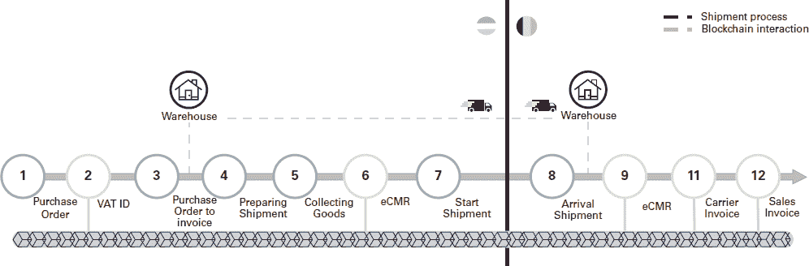

图 6.3 Naviporta 平台内货物流动的运行方式及元数据如何不可变地存储在区块链上

除了 Naviporta，VATBL0CK 也正在开发中，作为公司履行 0% 增值税税率合规义务的解决方案。所有所需文档的元数据均不可变地存储在区块链上。由于记录的交易除非获得网络大多数节点的同意否则无法更改，因此数据完整性得以确保。此外，通过区块链关联在一起的数据确保了审计轨迹，这在税务机关审计时也至关重要。

我们认为，改善供应商收集和管理所需证据（即适用 0% 增值税税率的文件要求）的方式是迈出的第一步。随着底层技术的成熟，各方对使用 `VATBL0CK` 等应用程序越来越熟悉，区块链本身可以在增值税领域发挥更核心的作用。区块链可作为适用 0% 增值税税率的基础，因为区块链本身（和/或结合其他技术，例如物联网、光学字符识别（`OCR`）和其他机器学习应用）可以确保证明货物已从发货国发出或运输。未来，应用程序对区块链的使用可确保在适用 0% 增值税税率时实现“设计合规”。

##### TradeTrust：电子提单所有权的数字化转移^(23)

TradeTrust 项目旨在创建一个沙盒环境，在该环境中可以对实时装运的 `EBL` 进行首次具有法律约束力、可互操作、无纸化的所有权转移。项目于 2019 年 4 月在新加坡启动，当时海事港务局（`MPA`）^(24) 和资讯通信媒体发展局（`IMDA`）^(25) 的代表，连同鹿特丹港和 Blocklab，与新加坡海事、贸易和银行业界的成员共同举办了为期两天的研讨会。2019 年 10 月，围绕代币化的数字所有权转移组织了一次技术深度探讨。2021 年 1 月，完成了首笔基于 TradeTrust 的 `EBL` 所有权转移（鹿特丹港，2021）。

自 2019 年 12 月以来，该项目得到了荷兰经济事务和气候政策部、`ICTU`、`Spark!`、`LivingLab` 和 `2Tokens` 项目的积极支持。TradeTrust 是《联合国国际贸易法委员会电子可转让记录示范法》（`MLETR`）^(26) 的实施成果，也是 `UNCEFACT` 下的一个活跃项目。

TradeTrust 是“一套治理与法律框架、标准和面向未来的数字基础设施”，可促进“不同数字生态系统之间交换的电子贸易单据^(27) 的互操作性”。^(28)

它通过将跟踪法律所有权的责任与单据中的数据分离来实现这一点。数字单据在原始数据所有者的严格控制下存储在链下，而其所有权则可以在分布式账本上安全管理（在我们的案例中为 `Ethereum`）。用户可以自由决定如何以数字方式交换 `EBL` 数据（例如电子邮件、 `sftp`）。任何持有单据数字副本的人都可以在公共区块链上验证该单据的完整性和所有权。

每份单据均可“通过单据哈希唯一标识”。^(29) ^(30) TradeTrust 单据基于 `OpenAttestation`^(31) 规范，每份单据包含“模式类型信息、证书数据、隐藏数据（来自隐私过滤器）和签名”。^(32) TradeTrust 单据可序列化为（`.tt`）文件，这只是一个符合该规范的 `JavaScript Object Notation (JSON)` 文件。TradeTrust 与载荷无关；换句话说，对单据内容的格式没有限制。这样便确保了与任何现有 `EBL` 数据交换格式的互操作性。该项目是开源的，任何人均可在 `Apache 2.0` 许可下使用。

图 6.4 提供了 TradeTrust 实施的示意图概览。

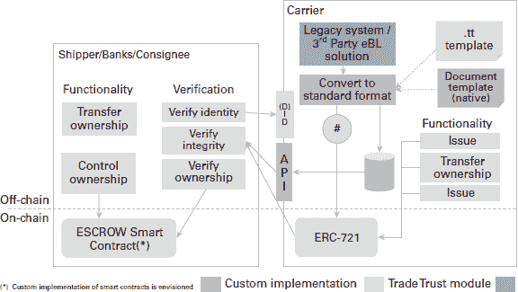

图 6.4 TradeTrust 实施示例

如前所述，TradeTrust 将所有权单据所代表的物品所有权与单据内容分离开来。所有权可以在区块链上以安全的方式进行跟踪，而无需将单据数据公开存储在区块链上。

TradeTrust 使用智能合约跟踪资产的所有权。该智能合约遵循 `ERC-721` 代币标准，^(33) 该标准定义了处理非同质化代币所有权的通用软件接口。代币是一个非常大、全局唯一的数字，代表一个数字或现实世界的实体，在本例中为所有权单据，如提单。在核心层面，一个兼容 `ERC-721` 的合约只是将代币标识符（或其代表的资产）映射到拥有该代币（从而拥有该资产）的 `Ethereum` 地址。

TradeTrust 中的每份单据都链接到 `ERC-721` 合约上的一个非同质化代币。代币与单据之间的联系是通过单据内容（`.tt` 文件）的哈希值^(34) 创建的。哈希值是一个非常大、全局唯一的数字，可用作代币标识符。哈希值就像一段数据的指纹：每个哈希值都是唯一的；仅凭哈希值无法还原原始数据，对相同数据进行哈希运算总会产生相同的哈希值。

根据 TradeTrust 的唯一性原则，只要代币框架得到正确实施，哈希值（因此对单据的引用）被复制在“实际上是不可能的”。^(35)^(36) 这部分归因于 `Ethereum` 要求智能合约必须拥有唯一地址，部分归因于智能合约本身保证 ID 只能在注册表中注册一次。

`ERC-721` 智能合约可通过将资产表示为代币并分配 `Ethereum` 地址作为其所有者来跟踪资产所有权。然而，在许多现实应用中，所有权并不总是那么二元对立。所有权单据，特别是提单，将资产的法律所有权赋予受益人。然而，受益人并不总是实物单据的持有人。为了提货，受益人还需要占有实物单据。因此，虽然持有人并不实际拥有单据所代表的资产，但单据可作为杠杆或抵押品。银行通常持有实物单据作为抵押品，许多贸易融资流程都依赖于这种区别。

`ERC-721` 标准原生不支持此类高级所有权结构。但它允许其他智能合约拥有代币，因为合约也由 `Ethereum` 地址表示。因此，TradeTrust 开发了权托管合约，在 `ERC-721` 合约的核心功能之上增加了持有人与受益人之间的区别。

其工作原理如下：当签发 `EBL` 时——用区块链术语来说，这归结为铸造一个代币——该代币不直接由受益人的 `Ethereum` 地址拥有。相反，签发人还会创建一个权托管合约，其中指定初始受益人和持有人（他们的 `Ethereum` 地址）。然后，该代币由新创建的权托管合约实例的地址拥有。

权托管合约允许持有人将其持有人权利转移给新地址。持有人还有权将所有权转移给新的 `Ethereum` 地址，该地址可以再次是一个新的权托管合约实例。不过，这种所有权转移必须得到受益人的背书。受益人的背书相当于受益人在纸质提单背面签名。

通过在智能合约中处理代币所有权，可以实现多种不同的所有权结构，使数字解决方案能够满足贸易融资领域存在的复杂结构要求。

在现有的纸质流程中，各方的身份认证和操作授权通过手写签名完成。参与流程的公司及其员工通常已通过 KYC 流程验证，且往往基于长期的业务关系相互知晓。相关银行的大型贸易融资团队通过查找不一致之处，手动验证提单所含信息及签名的真实性与正确性。尽管该系统多年来已证明其有效性，但远非高效且安全。转向数字化文档也允许改进身份验证并实现“设计即合规”。

尽管用户可能希望在区块链上对公众保持匿名，但国际贸易交易的参与方仍希望识别并验证其交易对手。例如，当发行方铸造代币（这相当于承运人签发纸质提单）时，该代币会被传递给发货人的 `Address`。发行方将希望验证其从联系人处获得的 `Address`（例如通过电子邮件）是否真正由发货人公司（通常是货物供应商）或该公司的授权代表控制。正如所有权转移应无需依赖第三方即可进行一样，这种验证也应无需涉及第三方即可完成。发货人的员工应能以保护隐私的方式简单地向发行方证明其身份。这可以使用去中心化标识符（DID）和可验证凭证（VC）来实现，这两项数据标准由 W3C 近期发布。

DID 仅是一种在全球范围内唯一标识实体的方式，类似于条形码标识特定产品。DID 可用多种技术实现，但具体谈到以太坊上的 EBL 解决方案时，DID 将使用以太坊 `Address` 作为标识符。要向 DID 附加用于验证的附加信息，可以签发一份以该 DID 为主体的可验证凭证。凭证可以证明关于主体的任何信息，例如年龄、驾驶执照或学校证书。此外，凭证设计为可由任何人或任何事物签发；通常签发方也会拥有一个 DID。而且，顾名思义，VC 的设计使其可被验证。由于签发方在凭证上创建了加密签名，任何持有该签名凭证的人也可以验证其真实性。图 6.5 展示了获取和出示凭证的过程。

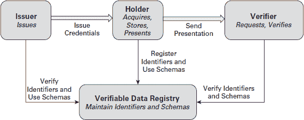

Figure 6.5 Information flow verifiable credential (W3C, 2021)

回到承运人需要验证发货人身份的示例，我们可以探讨可验证凭证如何在此情境下提供帮助。为了向承运人证明接收 EBL 代币的以太坊 `Address` 由授权员工控制，该 `Address` 的控制者需要一份凭证。例如，该凭证可由商会签发。这意味着，在 EBL 签发之前，发货人的员工获得一份经过加密签名的可验证凭证，声明她是发货人的员工并获授权签署合同。发货人将该凭证发送给承运人的职员，后者可验证加密签名的正确性。职员还需确保凭证签发方确实是商会。这要求商会发布其 DID。如果凭证通过承运人职员的验证，且商会值得信任，则毫无疑问该以太坊 `Address` 必定由发货人的授权员工控制，职员便可继续向该已验证 `Address` 签发 EBL 代币。

凭证交换要生效有几项要求。如前所述，签发凭证的商会的 DID 需为人熟知且受信任。验证方应仅接受其信任的签发方的凭证。虽然凭证可由任何人签发，但某些签发方的凭证比其他签发方更具公信力。此外，验证方和签发方需就凭证使用的标准化数据格式达成一致。如果签发方使用不同格式，验证方可能不予接受，导致凭证对持有者毫无价值。这要求签发方、持有方和验证方之间进行某种形式的标准化或沟通。

##### 我们的技术

我们相信，我们的愿景、核心价值观和治理结构使我们区别于其他（区块链）平台。这些独特特征体现在我们当前和未来的架构及技术选择中。在描述各种链上和链下组件之前，我们将首先深入探讨选择以太坊协议的原因。

###### 为什么使用以太坊 EVM？

为避免在重复造轮子上浪费宝贵资源，并确保我们专注于开发解决现实问题的解决方案，我们做出了有意识的决定：不开发自己的协议。相反，我们决定使用以太坊虚拟机（EVM）的 Golang 实现，即所谓的 Geth 客户端。虽然我们保持客户端实现与 Geth 客户端（可在 Geth 以太坊下载页面^(37) 找到）完全兼容，但 Naviporta 不是以太坊，而是一个不同的技术栈和一条不同的链。通过避免在（Geth）客户端层面进行更改，我们可以确保我们的链与以太坊主网兼容，并在时机成熟时迁移至公共、无许可链。

但选择以太坊而非其他协议的原因是什么？首先，它是最流行的开源公共区块链协议，拥有不断壮大的开发社区、开源开发工具和扩展。其他协议（如 IOTA^(38) 和 Solana^(39)）现在允许在其原生链上运行 EVM 兼容的智能合约，这只会进一步巩固以太坊的地位。其次，EVM 是所谓的图灵完备，意味着它可以处理任何形式的应用逻辑，如 Java 和 C++ 等常见编程语言所具备的逻辑。第三，主网自 2015 年以来经受住了实战考验，证明了其韧性。第四，我们保留了在业务视角要求时迁移至公共、无许可以太坊主网的选项。最后，Blocklab 的开发团队在 EVM 使用方面拥有丰富经验。

### 以太坊完美吗？

简短的回答是“不，它不完美！”。但我们找到了绕过其缺陷的方法，而无需在客户端层面进行更改。其中两个缺陷值得更多关注。

首先，以太坊主网常因其低可扩展性而受到批评，每秒交易数（TPS）在 15 到 20 之间，而支付宝或万事达卡等大型中心化应用程序每秒可处理数十万笔交易。一个重要的促成因素是主网使用的工作量证明共识算法。由于我们选择拥有自己的链，该链虽与 EVM 兼容，但独立于主网运行，因此我们能够采用另一种共识算法。我们选择了 Clique 权威证明共识机制 (Szilágyi, 2017)。测试表明，在继续利用现有 Google Cloud 基础设施的同时，我们可以扩展到 500~1000 TPS。此外，兼容 EVM 的协议（如 Avalanche^(40) 和 Solana）提供 3000 TPS 到 4500 TPS 范围内的可扩展性，为未来需要进一步扩展时提供了潜在替代方案。

其次，以太币价值的上涨和价格波动，以及比特币等其他公开交易加密货币的波动，使得交易变得非常昂贵。尽管一些上市公司现在资产负债表上持有比特币（《比特币杂志》，2021），但如今大多数企业仍避免使用它们。通过部署我们自己的链，我们得以规避加密货币的使用，因为我们不需要奖励公共矿工来生成区块或执行交易。为了保持与 EVM 的兼容性，我们确实生成了 Naviporta 币，但这些币目前没有价值，也不公开交易。它们的用途是保持以太坊主网上交易支付逻辑的完整，以防止必须对 EVM 进行更改。此外，运行 Clique 共识算法所需的算力远低于工作量证明或权益证明协议。这降低了能耗，并进一步降低了验证者的运营成本。

## Naviporta 关键组件

图 6.6 展示了 Naviporta 基础设施的现有组件。

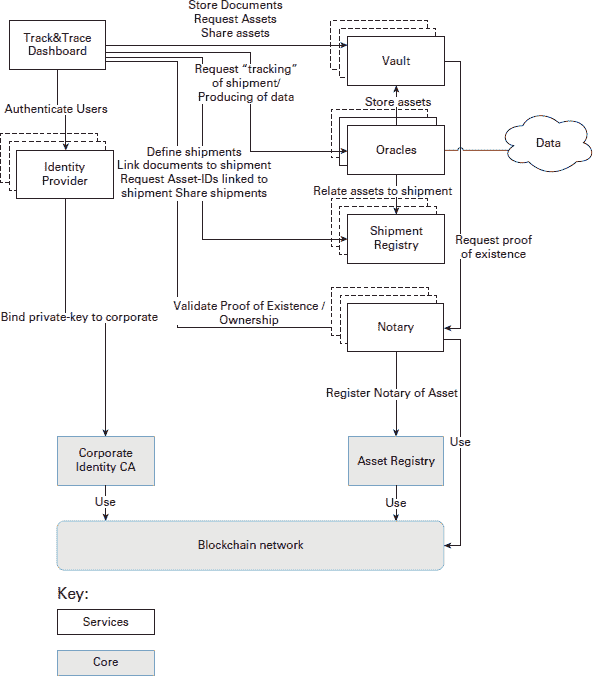

图 6.6 Naviporta 和 QuayConnect 组件

我们将从所谓的核心组件开始描述，即那些构成网络基础且无法被其他第三方提供的类似组件替换的组件。请注意，这并不意味着这些 Naviporta 组件不能与部署在其他基础设施和网络上的类似组件互操作，只是用另一个第三方组件替换它们会颠覆 Naviporta 作为基础设施的本质。之后我们将描述基础设施服务。这些服务目前由 Naviporta 提供，但可以被第三方的产品所替代。

### 核心组件

目前，区块链网络使用 Google Cloud Platform (GCP)，签名节点部署在不同的地理区域。每个节点包含区块链账本的完整副本。在上一节中，我们详细讨论了底层协议和 EVM 的使用。

我们还简要提及了 Clique 权威证明共识算法。这种权威证明方案基于这样一个理念：区块只能由受信任的签名者铸造。创建下一个区块的责任在一组授权节点之间共享，并以轮询方式进行 (Polarsparc, 2020)。随着更多消费者和生产者加入基础设施，可以实施更复杂且不可预测的区块验证时间表。我们目前正在研究各种技术和非技术缓解策略。

每个区块头包含该区块矿工的数字签名，这允许任何获取区块的人根据授权签名者列表对其进行验证 (Szilágyi, 2017)。可以添加或移除新的或过时的签名者，以维护一个动态的、最新的签名者列表。虽然我们了解权威证明共识的一些局限性，但我们相信，通过我们组织 Naviporta 链治理的方式，决策权分布在地理上分散且中立的网络参与者群体中，即港口。成为联盟成员的标准也完全透明，我们积极寻求在未来两年内进一步扩大联盟，以增加其地理分布。这增加了对签名者发起协调分布式拒绝服务 (DDoS) 攻击的难度；这是对权威证明联盟区块链常见的批评。

核心还包括一个资产注册表，可供服务层的公证人用于注册资产。资产注册表的主要职责是维护资产与其来源及当前管理公证人之间的映射。管理公证人是代表所有者当前管理资产的公证人。该注册表服务于以下目的：

1.  接收资产的一方可以使用注册表查找当前的管理公证人，并通过该公证人请求元数据。
2.  它允许检索最初注册该资产的公证人（来源/存在性证明）。
3.  即使资产已转移给多个公证人，它也允许进行资产追踪。
4.  它使 Naviporta 能够在出现问题、漏洞、清理或公证人生产商违约时，追溯区块链账本上任何已注册资产的历史。
5.  它可以作为单一注册来源，供生产商用于确保资产仅被“注册/使用”一次。例如，作为信用证等债务抵押品的可转让提单。

在服务层面，可以有多个公证人共享同一个资产注册表。这些公证人可以添加特定的业务逻辑，例如当满足某些条件时转移资产所有权，或由参与者联盟共享所有权，并具有商业目的。

Naviporta 的另一项核心服务是身份提供者。Naviporta 不仅将有许多参与方和用户协作，并因此在基础设施上提供需要认证和识别的服务，机器（例如预言机或物联网设备）也将参与其中。这意味着认证和识别是非常重要的方面，由核心层提供以避免对每个参与方进行单独认证的麻烦。在 Naviporta 这样的基础设施上，识别和认证可能会变得非常复杂。例如，代表某家公司的用户在第三方应用程序（如 QuayConnect，见“QuayConnect”）中创建货运单据，并希望使用另一第三方提供的 eCMR 服务。后者要求在两个各自拥有身份提供者的服务之间共享公司和/或用户特定数据。当然，用户不想在每个身份提供者上分别登录。更进一步，eCMR 存储在另一服务提供商提供的数字保管库中。为了确保无缝的认证和识别，需要单点登录（SSO）来提供代表性认证，使已登录 QuayConnect 应用程序的用户能够利用认证时接收的数据，以安全且可追溯的方式代表用户向保管库请求数据。

身份提供者使用 OpenID Connect^(41) API 允许用户在服务中进行身份验证。成功验证后，将向请求方提供一个特殊令牌。该特殊令牌根据 W3C 可验证凭证^(42) 规范包含多项声明和证明。其中一项声明将是企业 ID 声明，由企业 ID CA 提供，并将身份提供者用于其他声明的签名密钥与企业 ID 和公司详细信息绑定。可验证凭证在下文的“TradeTrust”部分有更详细的解释。HTTP API 和前端可供（管理员）用户管理身份提供者详细信息（添加用户、重置密码、更改用户详细信息等）。

#### 基础设施服务

保险库用于安全存储资产。资产可以是文档，也可以是非结构化数据集，代表资产所有公司存储，并允许与其他方共享。它从不同来源接收资产，例如来自 Dapp（如 QuayConnect）的上传或预言机生成的数据。资产通过 HTTP 文件上传并存储在 Google Storage 中。将在资产表中创建一条记录，保存所有权、文件名、内容类型、大小、上传时间戳和可选的辅助元数据。为每个上传的资产生成一个通用唯一标识符（UUID 版本 4^(43)），作为代理键。此外，此 UUID 无上下文，可用于公证而不泄露任何关于资产或所有者的信息，以满足防止任何信息泄露的隐私要求。除了资产本身，保险库支持两种可为资产存储的元数据类型：

*   存储在与保险库关联的数据库中的元数据；这保存（半）私有数据，仅可由被授权下载资产本身的用户访问。授权矩阵确保访问可被管理。
*   在公证人处注册的元数据，这是不可变的且可被任何人验证。适用于以发布到网络为代价的不可辩驳的声明/证明。

上传者可以请求保险库对文档进行公证，给出特定时间的存在性证明。架构支持使用多个保险库，消费者可自由选择用于存储其拥有数据的保险库。多保险库的使用进一步增强了基础设施的分布式特性。

货运注册表跟踪网络中特定客户定义的货运及其附件资产。货运的定义是灵活的：它被定义为一个包含多个节点及其间关系的图。每个节点定义某种运输单元（货运、集装箱、托盘、卡车等），具有类型和一个或多个 ID。货运内部内容的数据不存储在货运注册表中。这只能由授权用户从保险库检索。此类节点的一个示例是带有集装箱 ID 的集装箱。该集装箱内可装运多个也需单独追踪的托盘。这些托盘则也是货运注册表中的节点，并与集装箱建立关系，建模为节点间的关系。每个节点可分配多个资产，以追踪与该货运相关的资产。货运注册表允许共享与货运相关的 ID 和资产，以便他人查找。这确保了例如集装箱的数据可在多个 Dapp 间共享，从而支持 Naviporta 基础设施的“一次连接，多处使用”理念。架构支持多个货运注册表共存。消费者可选择用于存储其拥有数据的货运注册表。

公证人在网络中提供受信的第三方功能，对某些证明进行公证。最基本的示例是存在性证明（时间上的）。未来可能存在更复杂的公证人，例如共享所有权。这些公证人是商业服务，属于服务层的一部分。一个很好的例子是 TradeTrust，它是一个特定的公证人，提供与电子记录转移（如可流通电子提单）相关的所有权证明、完整性证明和来源证明。

预言机使用预言机 SDK（见下节）实现，因此充当区块链基础设施与外部世界数据之间的桥梁。基础设施可能连接数千个预言机，架构支持来自不同供应商的预言机共存并提供类似数据。撰写时，以下预言机可用或正在开发中：

*   Portbase，荷兰港口的港口社区系统。Portbase 提供关于与集装箱进口相关的追踪点的验证数据，如船舶到达日期/时间、闸口放行和海关状态。
*   Transfollow 提供 eCMR 服务。eCMR 类似于数字运单，是欧盟跨境公路运输的强制要求。该服务提供关于提货和交付日期/时间及地点的验证数据。
*   CCS 和 AIS^(44) 提供与英国贸易社区数据共享相关的服务，包括向 HMRC 提交海关清关预申报/正式申报所需的数据。

#### 软件开发工具包 (SDK)

Naviporta 开发了多个软件开发工具包 (SDK)，以简化以下核心组件和服务组件的开发并防止重复代码：

*   `vault`；
*   `identity`；
*   `oracle`；
*   `notary`。

这些 SDK 将以开源许可证提供给希望在 Naviporta 基础设施之上开发服务或集成外部记录系统（如 ERP 和 PCS）的第三方。SDK 有助于简化并降低集成的总体成本。

SDK 包含以下功能：

*   共享模型的定义，如 `identity`、`assets` 或 `shipments`。
*   HTTP 中间件库，包含验证凭证、指标和日志记录功能。
*   交易管理功能；向去中心化系统发送交易并非简单的“即发即弃”。例如，故障节点或网络延迟可能导致交易永远不会广播到网络，或仅到达网络的一部分。此外，作为授权证明，共识算法严重依赖时间戳的准确性和同步，时间戳的微小问题可能导致（暂时性）分叉。SDK 为与去中心化基础设施交互时可能遇到的常见交易管理挑战提供内置支持。
*   应用程序编程接口 (API) 的文档和定义。
*   智能合约应用程序二进制接口 (ABI)^(45) 的文档和定义。
*   Kubernetes 集群中存活探针和就绪探针的标准，用于控制组件健康状况。
*   加载 `vault` 和 `shipment registry` 等服务运行时配置的标准。
*   处理加密资产和材料的标准方法。

### 参考文献

### 参考文献

*   **2tokens** (2020) *use-case-negotiable-electronic-bill-of-lading-ebl*。[在线] 可访问：<https://www.2tokens.org/blog/use-case-negotiable-electronic-bill-of-lading-ebl> (存档于：<https://perma.cc/BG8G-F2XA>)。

*   **Beije, A. MSc, M J** (2020) [在线] 可访问：<https://denhollander.info/artikel/16082> (存档于：<https://perma.cc/K3C3-Z5UY>)。

*   **Bitcoin Magazine** (2021 年 8 月) [在线] 可访问：<https://www.nasdaq.com/articles/companies-now-hold-over-1.6-million-bitcoin-almost-8-of-total-supply-2021-08-25> (存档于：<https://perma.cc/HA6Z-KN2H>)。

*   **Energy Web Foundation** (2019 年 7 月) *EWF-Paper – TheEnergyWebChain-v2-201907-FINAL.pdf*。[在线] 可访问：<https://energyweb.org/wp-content/uploads/2019/05/EWF-Paper-TheEnergyWebChain-v2-201907-FINAL.pdf> (存档于：<https://perma.cc/X5WE-8VH9>)。

*   **Ethereum.org** (2021 年 7 月) [在线] 可访问：<https://ethereum.org/en/developers/docs/consensus-mechanisms/pos/> (存档于：<https://perma.cc/ZD5N-P6TZ>)。

*   **European Commission** (2021 年 9 月) *taxation_customs/business/tax-cooperation-control/vat-gap_en*。[在线] 可访问：<https://ec.europa.eu/taxation_customs/business/tax-cooperation-control/vat-gap_en> (存档于：<https://perma.cc/A8SG-XVU5>)。

*   **European Parliamentary Research Services** (2020 年 5 月) *egData/etudes/STUD/2020/641544/EPRS_STU(2020)641544_EN.pdf*。[在线] 可访问：<https://www.europarl.europa.eu/RegData/etudes/STUD/2020/641544/EPRS_STU(2020)641544_EN.pdf> (存档于：<https://perma.cc/8PHZ-VUPG>)。

*   **Gruson, J** (2017) BTW in een Brave New Blockchain World – een introductie. *BTW bulletin*。

*   **GSBN** (2021 年 3 月 17 日) *copy-of-global-shipping-business-network-successfully-incorporated-to-accelerate-the-digital-transfo*。[在线] 可访问：<https://www.gsbn.trade/post/copy-of-global-shipping-business-network-successfully-incorporated-to-accelerate-the-digital-transfo> (存档于：<https://perma.cc/7SFW-QR3Z>)。

*   **Henry, P** (2021 年 11 月) *lobal-supply-chain-crisis-los-angeles-port*。[在线] 可访问：<https://www.weforum.org/agenda/2021/11/global-supply-chain-crisis-los-angeles-port/> (存档于：<https://perma.cc/S2YP-88ZZ>)。

*   **MSC** (2021 年 4 月) *msc-introduces-new-electronic-bill-of-lading*。[在线] 可访问：<https://www.msc.com/mus/press/press-releases/2021-april/msc-introduces-new-electronic-bill-of-lading> (存档于：<https://perma.cc/UB5Z-B2DD>)。

*   **NLTimes** (2021 年 1 月) [在线] 可访问：<https://nltimes.nl/2021/01/27/uk-companies-looking-nl-brexit> (存档于：<https://perma.cc/F8QR-NDPE>)。

*   **Parola, F R M** (2017) The drivers of port competitiveness: A critical review. *Transport Reviews*, 37, 116–38. [在线] 可访问：<https://doi.org> (存档于：<https://perma.cc/H2YE-H6SA>)。

*   **Polarsparc** (2020 年 7 月 6 日) *xhtml/Clique.html*。[在线] 可访问：<https://www.polarsparc.com/xhtml/Clique.html> (存档于：<https://perma.cc/XPN4-SQ55>)。

*   **Port of Rotterdam** (2019 年 7 月) *first-blockchain-container-shipped-rotterdam*。[在线] 可访问：<https://www.portofrotterdam.com/en/news-and-press-releases/first-blockchain-container-shipped-rotterdam> (存档于：<https://perma.cc/7K4N-HMXF>)。

*   **Port of Rotterdam** (2021 年 12 月) *digital-quay-connect-service-makes-export-to-the-uk-cheaper-and-more*。[在线] 可访问：<https://www.portofrotterdam.com/en/news-and-press-releases/digital-quay-connect-service-makes-export-to-the-uk-cheaper-and-more> (存档于：<https://perma.cc/F45F-9NG2>)。

*   **Port of Rotterdam** (2021 年 5 月) [在线] 可访问：<https://www.portofrotterdam.com/en/news-and-press-releases/singapore-and-rotterdam-successfully-complete-trial-with-electronic-bill-of> (存档于：<https://perma.cc/6USY-DVRV>)。

*   **Reuters** (2020 年 8 月) *uk-abn-amro-results-idUKKCN2580KS*。[在线] 可访问：<https://www.reuters.com/article/uk-abn-amro-results-idUKKCN2580KS> (存档于：<https://perma.cc/Q62A-JA77>)。

*   **SPGlobal** (2020 年 10 月) *051020-world-s-first-high-frequency-decentralized-energy-market-drive-port-of-rotterdam-energy-transition*。[在线] 可访问：<https://www.spglobal.com/platts/en/about-platts/media-center/press-releases/2020/051020-world-s-first-high-frequency-decentralized-energy-market-drive-port-of-rotterdam-energy-transition> (存档于：<https://perma.cc/TH5M-6NGJ>)。

### 参考文献

*   Szilágyi, P (2017 年 3 月) [eip-225](http://eip-225.) \[在线\] [eips.ethereum.org](http://eips.ethereum.org)：[`eips.ethereum.org/EIPS/eip-225`](https://eips.ethereum.org/EIPS/eip-225) （存档于 [`perma.cc/5D84-MFKN`](https://perma.cc/5D84-MFKN)）

*   英国政府 (2021 年 7 月) [government/publications/the-border-operating-model](http://government/publications/the-border-operating-model.) \[在线\] [www.gov.uk](http://www.gov.uk)：[`www.gov.uk/government/publications/the-border-operating-model`](https://www.gov.uk/government/publications/the-border-operating-model) （存档于 [`perma.cc/STX9-4HGY`](https://perma.cc/STX9-4HGY)）

*   Van der Horst, M D L (2008) 后方运输链中的协调：海港社区面临的重大挑战。*海事经济与物流*，10，108–29。

*   W3C (2021 年 11 月) \[在线\] [`www.w3.org`](https://www.w3.org)：[`www.w3.org/TR/vc-data-model/`](https://www.w3.org/TR/vc-data-model/) （存档于 [`perma.cc/7265-VS5X`](https://perma.cc/7265-VS5X)）

*   维基百科 (2021 年 9 月) [`en.wikipedia.org`](https://en.wikipedia.org)。\[在线\] [`en.wikipedia.org/wiki/Incoterms`](https://en.wikipedia.org/wiki/Incoterms) （存档于 [`perma.cc/A6MU-6S3Y`](https://perma.cc/A6MU-6S3Y)）

*   Wragg, E (2021 年 10 月 20 日) [tradetrust-notches-up-new-pilots-between-singapore-and-china](http://tradetrust-notches-up-new-pilots-between-singapore-and-china.) \[在线\] [`www.gtreview.com`](http://www.gtreview.com)：[`www.gtreview.com/news/fintech/tradetrust-notches-up-new-pilots-between-singapore-and-china/`](https://www.gtreview.com/news/fintech/tradetrust-notches-up-new-pilots-between-singapore-and-china/) （存档于 [`perma.cc/RG34-NWC5`](https://perma.cc/RG34-NWC5)）

### 注释

1 [www.naviporta.com](http://www.naviporta.com) （存档于 [`perma.cc/UD9V-UNV3`](https://perma.cc/UD9V-UNV3)）

2 [`www.gsbn.trade/`](https://www.gsbn.trade/) （存档于 [`perma.cc/L3ZF-JALZ`](https://perma.cc/L3ZF-JALZ)）

3 [`www.gov.uk/government/organisations/hm-revenue-customs`](https://www.gov.uk/government/organisations/hm-revenue-customs) （存档于 [`perma.cc/7FKJ-SRPK`](https://perma.cc/7FKJ-SRPK)）

4 [`www.gov.uk/government/organisations/border-force`](https://www.gov.uk/government/organisations/border-force) （存档于 [`perma.cc/TDW5-A2FP`](https://perma.cc/TDW5-A2FP)）

5 [`www.gov.uk/government/organisations/department-for-environment-food-rural-affairs`](https://www.gov.uk/government/organisations/department-for-environment-food-rural-affairs) （存档于 [`perma.cc/3SY2-4RA7`](https://perma.cc/3SY2-4RA7)）

6 [www.blocklab.nl](http://www.blocklab.nl) （存档于 [`perma.cc/R46Q-8HQA`](https://perma.cc/R46Q-8HQA)）

7 [`www.azarc.io/`](https://www.azarc.io/) （存档于 [`perma.cc/4K6U-BFUJ`](https://perma.cc/4K6U-BFUJ)）

8 [`www.ccs-uk-ug.org/index.php`](https://www.ccs-uk-ug.org/index.php) （存档于 [`perma.cc/QKM6-98KG`](https://perma.cc/QKM6-98KG)）

9 [`www.bt.com/`](https://www.bt.com/) （存档于 [`perma.cc/9K6L-JTDN`](https://perma.cc/9K6L-JTDN)）

10 [`freshproducecentre.com/`](https://freshproducecentre.com/) （存档于 [`perma.cc/A92E-3F95`](https://perma.cc/A92E-3F95)）

11 [`abclogistics.nl/`](https://abclogistics.nl/) （存档于 [`perma.cc/8LRG-TH7T`](https://perma.cc/8LRG-TH7T)）

12 [`www.portbase.com/`](https://www.portbase.com/) （存档于 [`perma.cc/4VTB-8UTC`](https://perma.cc/4VTB-8UTC)）

13 [`naviporta.com/`](https://naviporta.com/) （存档于 [`perma.cc/3NZG-A7MS`](https://perma.cc/3NZG-A7MS)）

14 [`www.freightcomms.net/digital-quay-connect-service-makes-export-to-the-uk-more-efficient/`](https://www.freightcomms.net/digital-quay-connect-service-makes-export-to-the-uk-more-efficient/) （存档于 [`perma.cc/G2FU-6CD7`](https://perma.cc/G2FU-6CD7)）

15 本段节选自 2020 年发表于*《荷兰合规期刊》*的一篇文章（A Beije MSc, 2020）。

16 参见例如 A. Bal, Between hype and disillusionment: Will a VAT blockchain ever be possible in the EU? *Taxnotes International,* 2020 年 2 月 24 日；M M W D Merkx, blockchain: uitdagingen en kansen voor de btw?, *MBB* 第 3 期 2019；J Gruson, BTW in een Brave New Blockchain World – een introductie, *BTW bulletin 2017/17*；T van der Bosch, D Diederichsen and C Demetrius, Blockchain in global finance and tax, 20 Derivatives & Financial Instruments IBFD 2018。

17 《增值税行动计划——迈向单一欧盟增值税区——决策时刻》COM (2016) 148 final 中的合作努力。

18 这是荷兰豁免跨境供应的方法。请注意，在某些欧盟国家，这被称为享有抵扣增值税权利的豁免。请见 [`ec.europa.eu/taxation\_customs/business/vat/eu-vat-rules-topic/exemptions\_en`](https://ec.europa.eu/taxation_customs/business/vat/eu-vat-rules-topic/exemptions_en) （存档于 [`perma.cc/A5KV-S9QL`](https://perma.cc/A5KV-S9QL)）（最后访问日期：2020 年 1 月 30 日）。

19 在欧盟范围内，税率介于 15%至 27%之间。然而，罚款范围可能从 25%到 100%（加上利率），且取决于欧盟成员国。

20 然而，欧洲法院的一些判例确实提供了一些指导。

21 [`www.consilium.europa.eu/en/press/press-releases/2018/12/04/vat-council-adopts-short-term-fixes-to-current-eu-system/`](https://www.consilium.europa.eu/en/press/press-releases/2018/12/04/vat-council-adopts-short-term-fixes-to-current-eu-system/) （存档于 [`perma.cc/99BU-BLNZ`](https://perma.cc/99BU-BLNZ)）

22 《关于国际道路货物运输合同公约（CMR）的附加议定书》涉及电子货运单，日内瓦 2008 年。另见：[`treaties.un.org/pages/ViewDetails.aspx?src=TREATY&mtdsg\_no=XI-B-11-b&chapter=11&clang=\_en`](https://treaties.un.org/pages/ViewDetails.aspx?src=TREATY&mtdsg_no=XI-B-11-b&chapter=11&clang=_en) （存档于 [`perma.cc/3UE3-KFP7`](https://perma.cc/3UE3-KFP7)）（最后访问日期：2020 年 2 月 19 日）。

23 本段节选自 2Tokens 基金会和荷兰区块链联盟于 2020 年发布的一份白皮书（2tokens, 2020）。

24 [`www.mpa.gov.sg/web/portal/home`](https://www.mpa.gov.sg/web/portal/home)

25 [`www.imda.gov.sg/`](https://www.imda.gov.sg/) （存档于 [`perma.cc/2TPM-DR6W`](https://perma.cc/2TPM-DR6W)）

26 [`uncitral.un.org/en/texts/ecommerce/modellaw/electronic\_transferable\_records`](https://uncitral.un.org/en/texts/ecommerce/modellaw/electronic_transferable_records) （存档于 [`perma.cc/VJ69-78B3`](https://perma.cc/VJ69-78B3)）

27 可转让单据和文书的其他示例包括仓单和支票。什么构成可转让单据由各国法律定义，因此会因国家而异。然而，提单是一种全球通用的可转让单据。

28 <https://docs.tradetrust.io/> （存档于 <https://perma.cc/MH47-ZKKL>）

29 <https://docs.tradetrust.io/integration#l-1-document-format>

30 哈希值是哈希函数的产物（输出），该函数将任意数据映射为固定大小的值，而该值本身由被哈希的数据（输入）决定。这是安全文档存储和数据管理系统的通用做法。在此处可找到在线哈希演练场：<https://www.fileformat.info/tool/hash.htm>。（存档于 <https://perma.cc/Z5RS-B4UQ>）

31 <https://github.com/Open-Attestation/open-attestation> （存档于 <https://perma.cc/BJ6D-L4QP>）

32 <https://docs.tradetrust.io/creating-documents>

33 更具体地说，TradeTrust 使用了 OpenZeppelin 的 ERC721 代币标准，其经过审计的代码可在此处找到：<https://github.com/OpenZeppelin/openzeppelin-contracts/tree/master/contracts/token/ERC721> （存档于 <https://perma.cc/79NA-GSSG>）

34 在 TradeTrust 的案例中，这指的是 ERC721 规范中规定的 256 位 ID，其形式为包含 EBL 数据的 OpenAttestation 文档的 Merkle 根（即 keccak256 哈希值）。

35 <https://docs.tradetrust.io/token-registry#singularity-principle>

36 <https://preshing.com/20110504/hash-collision-probabilities/> （存档于 <https://perma.cc/3UKD-LXWA>）

37 <https://geth.ethereum.org/downloads/> （存档于 <https://perma.cc/T9SH-YCFS>）

38 <https://www.iota.org/> （存档于 <https://perma.cc/R4N9-T2SF>）

39 <https://solanabeach.io/> （存档于 <https://perma.cc/4YFN-Q3FD>）

40 <https://docs.avax.network/> （存档于 <https://perma.cc/438V-L4AT>）

41 <https://openid.net/connect/> （存档于 <https://perma.cc/V8DQ-PZ5M>）

42 <https://www.w3.org/TR/vc-data-model/> （存档于 <https://perma.cc/7265-VS5X>）

43 <https://en.wikipedia.org/wiki/Universally_unique_identifier> （存档于 <https://perma.cc/TP2V-JKEP>）

44 <https://www.ccs-uk-ug.org/> （存档于 <https://perma.cc/QT4P-YLD9>）

45 ABI 定义了如何在机器代码中访问数据结构或计算例程，机器代码是一种低级、依赖硬件的格式。相比之下，API 在源代码中定义这种访问，源代码是一种相对高级、独立于硬件、通常可读的格式。

07

## 集装箱航运：IBM 与马士基

### 最后一次创新

1956 年 4 月 26 日，SS Ideal X 号——一艘改装的二战油轮——从纽瓦克港启航驶向休斯顿。该船在定制甲板上装载了 58 个拖车大小的钢制集装箱，重达 15,000 吨——这一单一事件宣告了航运新时代的到来。

Ideal X 号是马尔科姆·P·麦克林（Malcolm P McLean，1914–2001）的心血结晶，这位北卡罗来纳州商人旨在废除长期以来码头工人将棉包或咖啡袋装卸上船再卸上卡车的繁琐做法，所有这些都消耗了大量劳动力、时间和金钱。多式联运集装箱航运改变了这一切。在 Ideal X 号之前，在货船上装卸散杂货的成本为每吨 5.83 美元。麦克林的专家计算出，Ideal X 号的装货成本为每吨 15.7 美分（Jeroen de Haas, 2016）。

标准化集装箱的概念已被全球接受。标准集装箱宽 8 英尺，长 20 或 40、45、53 英尺，高 8、8½ 或 9½ 英尺。得益于集装箱化，托运人的平均成本极低。如今，产品可通过海运以低于其零售价值 1% 的成本运输——一个集装箱可装下 10,000 台 iPad，从上海运至汉堡每台仅需 5 美分。一台从中国运往美国的平均电视机运费不到 2 美元。

集装箱航运不仅降低了运输成本，还使行业更加有序，催生了马士基航运、达飞海运和中远海运等全球航运巨头。它还增加了海运贸易在全球商业中的份额。在 2017 年逾 4 万亿美元的货物运输中，80% 由远洋船舶承运。

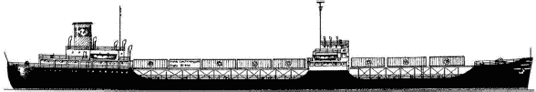

图 7.1 集装箱汽船 Ideal X 号，1944 年作为油轮 Potrero Hills 建造

### 多造船，低价卖

在日益增长的消费需求推动下，全球化让集装箱航运享受了一段不间断的增长期，直至 2009 年经济危机爆发。首先，该行业受创比大多数行业更严重，因为快速增长期间积累的固有低效率，其中最大的问题是承运商对建设运力的贪婪渴望，导致运价呈下降趋势。自那以后，行业一直未能恢复元气。

然而，最坏的情况尚未到来。尽管 2009 年增长率出现两位数下跌，主要集装箱班轮公司仍以前所未有的速度继续扩充运力。2001 年至 2008 年间，新造集装箱船的平均规模徘徊在 3,400 标准箱（TEU）左右。2009 年至 2013 年间增至 5,800 TEU，2015 年飙升至 8,000 TEU，当年马士基和地中海航运等头部承运商推出了 18,000 TEU 以上的超大型集装箱船（UCLV），并计划建造更大的船舶。目的并非为了夸耀；这符合商业逻辑。2015 年，18,000 TEU 及以上超大型船舶的建造成本为每 TEU 7,500 美元，比 14,000 TEU 船型低 20%-30%。此外，大船单船装箱量更多，意味着更低的运营成本和更有竞争力的运价。更重要的是，超大型集装箱船（ULCV）比小型船舶更省油。廉价融资的易得性火上浇油，这一趋势持续蔓延，引得国际海事领港协会秘书长尼克·卡特莫评论道：“这些船是地球上最大的移动物体。”

### 陷入囚徒困境

产能过剩与消费需求放缓在衰退后几年的叠加效应，导致集装箱航运业在 2016 年爆发了有史以来最严重的全球性危机。Altman Z 值是一种预测破产概率的统计工具。Z 值达到 2.99 或以上表明实体免于破产风险，而 1.81 或以下则预示着相当大的破产风险。集装箱航运业的 Z 值在 2016 年跌至 1.10 的历史低点。果不其然，2016 年 8 月 31 日，当时全球第六大集装箱承运商韩进海运宣布破产，将航运业推入混乱。同年，全球最大的集装箱航运公司——马士基集团（AP Moller-Maersk Group，简称马士基）录得二战以来的第二次亏损，也是 2009 年以来的首次亏损。排名前 20 位的海运承运商在 2016 年底合计亏损约 50 亿美元。广泛的财务困境引发了一波整合潮，最终导致前 20 大承运商缩减至 11 家。Edwin Lopez 和 Elizabeth Rogan 在 2017 年发表的题为《大船编年史：产能过剩如何扰乱生产》的优秀文章中总结了该行业的困境：

> 因此，航运业目前的挣扎是自找的。这是由于争夺霸主地位的竞赛；是由于削弱竞争对手的欲望；是一场囚徒困境，甚至以一家大型承运商的破产告终。虽然低运价对货主有利，但随之而来的不稳定性和服务下降却并非如此。

博弈论者常用囚徒困境来分析非合作行为。该理论表明，为何两名囚徒会选择最坏的结果（两人均获重判）而非最好的结果（两人均获轻判）？因为他们彼此不信任。换句话说，在缺乏相互信任与合作的情况下，个体的理性在集体层面上是自我毁灭的。分析师指出，海运承运商倾向于通过压低价格、以牺牲他人为代价抢占市场份额，这是囚徒困境的教科书式案例。2015 年《Financial Review》的一篇文章指出：“像集装箱航运这样饱受价格下跌和产能过剩困扰的行业，本应削减产能。陷入囚徒困境的最大玩家却做着相反的事。”

并非航运业不知晓这一问题。早在 1990 年代，业界就已组建联盟以提高服务标准并控制过度供给。1998 年，六大海运承运商联盟代表了全球 50% 的船队。到 2017 年，整合为三大联盟：由马士基和 MSC 组成的 2M 联盟；由达飞海运（CMA-CGM）、中远集团（COSCO Group）、东方海外（OOCL）和长荣海运组成的海洋联盟；以及由赫伯罗特（Hapag Lloyd）、阳明海运和海洋网联船务（Ocean Network Express）组成的联盟。这三大联盟代表了近 80% 的全球集装箱贸易量，以及主要贸易航线上约 90% 的集装箱运力。

然而，联盟并未帮助解决过度供给和运价下跌这对孪生难题，即便全球经济已显露复苏迹象，这两大问题仍对行业产生显著影响。2018 年第一季度，三大主要集装箱航运公司——马士基、赫伯罗特和阳明海运均报告亏损。集装箱承运商的平均经营利润率从第一季度的负 3.1% 下滑至第二季度的负 3.8%，过剩运力全面压低运价，而燃油成本持续上升。AlixPartners 于 2018 年 4 月发布的题为《2018 全球集装箱航运展望：挑战依存，机遇共在》的报告称，随着供给持续超过服务需求，运价将保持“受挤压”状态，总需求至少需要 4%–5% 的增长，才能为利润率增长提供真正的机会。

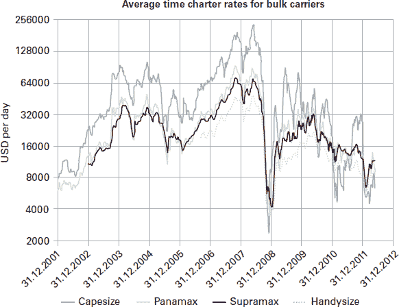

图 7.2 航运联盟对运价波动无影响。图表显示了 2001 年 12 月至 2012 年 5 月散货船平均期租运价（周度数据，单位：美元/天）

为什么联盟没能奏效？因为它们并未让运营变得更透明、更简单；反而产生了相反的效果。麦肯锡上海资深合伙人 Steve Saxon 在 2016 年 TPM 亚洲会议上指出：

> 如果新联盟有任何影响，那可能是增加复杂性。更大的联盟给航运公司和货主都带来了困难：例如，新的海洋联盟可能意味着货主的箱子会被送到洛杉矶-长滩地区七个码头中的任意一个。组织卡车和分离底盘以对接它们，让航运公司和货主的生活都变得复杂。

简单来说，联盟不仅未能找到解决班轮公司问题的办法，也没让货主的生活变得更轻松，而货主传统上是从价格战中获益的。Saxon 引用一位货主的话表达了对“货主、码头、海运承运商和陆运公司在集装箱进出港调度和移动方面，依然存在的沟通鸿沟和低效协调”的沮丧。

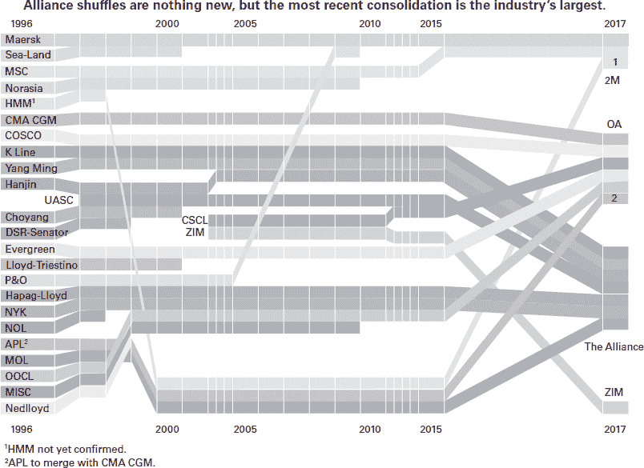

图 7.3 联盟洗牌

创造透明度、降低复杂性、让互不信任的人共享相关信息（这是囚徒困境的解药），且不形成寡头垄断或减少竞争，促进集装箱航运业所有利益相关方的协调——解决方案在于区块链，借用一句老话并稍作修饰，这就是“一石杀尽所有鸟”。但这些都是只能在长期积累的收益，而任何技术要在任何行业被采用，都需要提供即时收益。对于航运业，区块链提供了两个快速收益——降低管理成本和防范欺诈。

### IBM 与马士基为何因区块链而志同道合

2016 年，仍在危机阴影下的马士基正在寻找降低运营成本的更好方法，最直接的途径是减少每个集装箱所伴随的文书工作。两年前，马士基发现，一批从东非运往欧洲的冷冻货物，需要经过近 30 个个人和组织，涉及他们之间 200 多次不同的互动和沟通。

2016 年秋，马士基与哥本哈根 IT 大学合作开展概念验证，将区块链技术应用于提单（BoL）领域。提单是一种传统的纸质文档系统，极易遭遇欺诈。提单是国际贸易中至关重要的纸质文件，用于确保出口商收到付款、进口商收到货物。由于存在一个巨大漏洞——集装箱一旦封箱，实际上无法将提单上列出的所有项目与集装箱实际内容完全核对，提单成为航运和贸易融资链中最薄弱的环节和最显著的痛点。每年，欺诈性提单导致船东、承运人、银行和品牌所有者遭受损失，范围从因少报运费造成的几千美元，到数十亿美元的罚款、盗窃和假冒产品。一种选择是改用电子提单（eBOL），自 20 世纪 80 年代以来就已存在，但由于与每个集装箱随附的大量文书工作存在的原因相同，其采用一直受限：人类仍可操纵不同的法律法规和电子提单。马士基 2016 年基于区块链的提单概念验证，优化了从肯尼亚向鹿特丹运输一批玫瑰花所涉及的信息流管理。

与此同时，IBM 自 2014 年起一直在开发自己的区块链版本。《纽约时报》在 2017 年的一篇文章中详细介绍了 IBM 研究总监 Arvind Krishna 如何支持 IBM 内部的一个探索性项目。Krishna 先生认识到该技术的潜力，该团队将其称为 Openchain。他回忆道：“这不仅关乎数字支付，更关乎建立交易中的普遍信任。”他视其为“一种能够改变世界的技术”。

近期，IBM 区块链负责人、印度及南亚区负责人 Jitan S Chandanani 谈到了 IBM 与其供应商合作实现的收益：

> 当我们在 IBM 开始使用区块链进行供应商管理时，我认为在任何给定日期，我们在[发票付款]争议中的金额约为 1 亿美元，解决这些争议的平均时间为 21 至 40 天。[区块链的使用]将争议金额降至 1000 万美元以下，争议解决时间缩短至 5 天以下。区块链用户在成本效率方面预计可获得约 30%-40%的收益。

是 IBM 欧洲主席 Erich Clementi 将区块链技术合作的想法带给了马士基高层。2016 年夏，IBM 与马士基测试了区块链解决方案，追踪了一批从肯尼亚蒙巴萨港运往荷兰鹿特丹的鲜花。项目的成功鼓励他们开展了后续多个项目，包括一个欧盟研究项目。该项目专注于施耐德电气的货物，从鹿特丹港运往纽瓦克港，由荷兰海关、美国国土安全部科学技术局和美国海关及边境保护局共同参与试点。同样，来自加利福尼亚的橙子和哥伦比亚的菠萝被运往鹿特丹，以验证区块链解决方案在货物运输中的应用。马士基让其知名客户（包括杜邦、陶氏化学、利乐包装等）参与了试点项目。

这些成功让马士基确信，区块链可助其在高度安全的共享网络上追踪所有货物，为所有关键参与方提供完全透明度。

2018 年 8 月，马士基与 IBM 联合宣布创建 TradeLens，一个全球贸易区块链平台。他们告知媒体，TradeLens 构建于 IBM 的区块链技术之上，该技术基于 Linux 基金会创建的开源 Hyperledger Fabric 1.0 规范。马士基与 IBM 共同拥有知识产权，并通过各自的销售渠道进行市场推广、销售和签约 TradeLens。

与比特币这种所有参与者均可查看每条数据条目的开放区块链不同，IBM 和马士基的解决方案是中心化管理的。因此，包括制造商、货代、码头运营商和海关当局在内的行业利益相关者，可基于权限访问平台的虚拟仪表盘。参与者可通过实时访问航运数据和航运单证（包括从温控到集装箱重量的 IoT 和传感器数据）进行交互。

发布时，TradeLens 已吸纳 94 家组织参与，包括全球 20 多家港口和码头运营商，如 PSA 新加坡、International Container Terminal Services Inc、Patrick Terminals、香港现代货箱码头、哈利法克斯港、鹿特丹港、毕尔巴鄂港、PortConnect、PortBase 以及费城港的 Holt Logistics 码头运营商。同样重要的是，两家全球集装箱承运商——太平船务和 Hamburg Süd——已加入该平台。

《福布斯》报道：“这些航运公司合计占全球供应链市场份额的 20%以上，在新加坡、美国、荷兰等地拥有 20 家港口和码头运营商，服务于全球 235 个海运门户。”

### 良好的开端

自集装箱化发明以来，在航运领域涌现的所有创新中，TradeLens 提供了最重大的希望。凭借上述所有优势，它能为困扰航运业的问题提供急需的解决方案。然而，要真正产生影响，它必须获得大多数班轮公司（如果不是全部）的参与。目前，除马士基外仅有两家其他班轮公司加入，这在情理之中，因为 TradeLens 目前的形式（撰写时）是一个由 IBM 和马士基拥有的中心化系统。将很有意思地看到，它是否会演变为一个泛行业平台，最终解决过剩产能和价格战的问题，又或者行业推出一个中立平台将所有班轮公司聚合在一起。然而，可以肯定的是，区块链可能是该行业长期期盼的灵丹妙药。

## 棕榈油供应链

### 日益加剧的不安

你在超市购买的包装产品有 50%的几率含有棕榈油。棕榈油是一种用途广泛的植物油，用于食品、清洁产品和燃料。其锁住风味和创造细腻质地的能力，使其成为蛋黄酱、披萨、巧克力和冰淇淋等食品的首选成分。其粘合产品和作为稳定剂的能力，使其成为洗发水、保湿乳液、香皂、身体油及许多其他个人护理产品的理想选择。它在家用清洁剂和许多其他家庭护理产品中发挥着类似作用。

商业棕榈油从油棕树（Elaeis guineensis）的果实中提取，也称非洲油棕，因其原产于西南非洲的雨林。

人类可能已使用棕榈油超过 5000 年。19 世纪末，考古学家在埃及阿比多斯的一座早期墓葬中发现了可追溯至公元前 3000 年的棕榈油。19 世纪末，得益于有利的气候和社会经济条件，棕榈油在印度尼西亚和马来西亚的产量腾飞，成为全球大宗商品。单棵油棕树不仅能结果 30 多年，其每公顷产油量也超过任何主要油料作物。自然地，它成为贫困农村社区宝贵的生计和就业来源。目前，全球 620 亿美元棕榈油产业中 85%以上来自印度尼西亚和马来西亚。

### 复杂且环境不可持续

## 棕榈油供应链极其复杂

该产品通常与其他来源的原料混合。此外，由于棕榈油对国家出口收入的贡献，主要棕榈油生产国对棕榈油生产鲜有或完全没有监管。

棕榈油的旅程始于种植园的鲜果串（FFB）被供应到加工厂，随后由各类中间商运往炼油厂进行加工，最后才进入企业的供应链。

棕榈油公司通过两大主要渠道采购鲜果串。第一渠道是公司直接拥有或为小农户管理的种植园。这一由公司控制的直接渠道相对透明，公司可确保遵守全球法规。第二渠道是第三方供应商，他们从包括独立农户在内的不同来源收购鲜果串，这使得监管变得困难。

2018 年 3 月，研究机构 WRI 印度尼西亚的 Hermawati Widyapratami 和 Bukti Bagja 在位于印度尼西亚廖内省罗坎胡卢的种植园公司 PPTN V 开展了实地研究。研究人员发现，直接从农户手中收购鲜果串的代理商通常会将果串混合，并根据质量分类后再运往加工厂。由于小农户与中间商之间的交易没有记录，这种混合和分类使得难以追踪鲜果串的来源。研究人员指出，中间商属于不受监管的参与者，因为尽管他们在棕榈油供应链中扮演重要角色，但目前尚无制度管控其业务。

棕榈油供应链不仅复杂，还引发了诸多环境和社会问题。农户焚烧森林以清理种植油棕的区域。棕榈油生产的快速集约化和扩张导致生产国热带雨林大面积遭到破坏。据称，1990 年至 2008 年间，全球约 8%的森林砍伐由棕榈油生产造成。近期《科学美国人》的一篇文章指出，棕榈油生产是印度尼西亚及其他赤道国家森林砍伐的最主要原因。

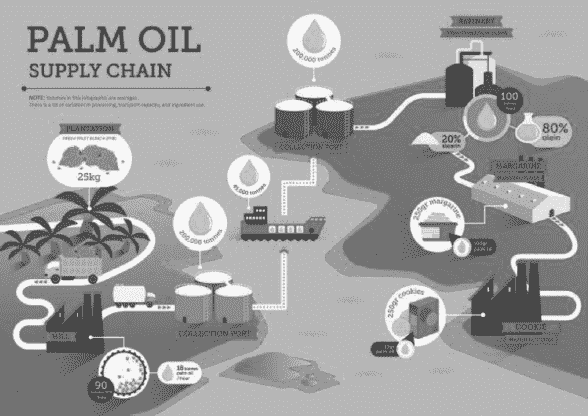

**Figure 7.4 The palm oil supply chain**

森林砍伐不仅导致洪水和土壤贫瘠，还加剧全球变暖，因为砍伐树木降低了地球吸收二氧化碳（CO2）的能力。此外，森林砍伐对这些地区的野生动物构成了明确而现实的威胁。2017 年 7 月，《卫报》的一篇文章报道称，百事公司、联合利华和雀巢被指在苏门答腊最后一片由大象、红毛猩猩、犀牛和老虎共同栖息的雨林生态系统遭破坏一事中负有共谋责任。印度尼西亚濒危的红毛猩猩种群依赖雨林生存，近年来数量减少了多达 50%（Neslen, 2017）。

该报告引用了雨林行动网络（RAN）的一项实地调查，调查在勒尤塞生态系统的雨林中发现了非法清理极度濒危苏门答腊象栖息地的证据。勒尤塞是苏门答腊最大的雨林，也是联合国教科文组织世界遗产地。据称肇事者为 PT Agra Bumi Niaga 公司（PT 在印度尼西亚表示有限责任公司），该公司通过全球最大贸易商之一的复杂供应链将产品输送给主要品牌。因棕榈油种植园扩张导致的动物栖息地破碎化，加剧了人兽冲突——仅 2012 年至 2015 年间，勒尤塞就至少有 35 头大象被杀。雨林生态系统的消失使老虎、云豹和马来熊等许多物种在该地区更容易遭到偷猎者猎杀。“如果不立即采取行动强制执行‘零毁林’政策，这些品牌将被铭记为导致地球上最后一片苏门答腊象、红毛猩猩、犀牛和老虎并肩漫步的栖息地遭到破坏的企业巨头，”RAN 研究称。

来自这些地区种植园的棕榈油流向了麦当劳、家乐氏、玛氏、联合利华、雀巢和宝洁等知名品牌的产品中。2010 年，绿色和平组织指责雀巢在其产品中使用不可持续棕榈油，纵容热带国家的森林砍伐。公众对因棕榈油导致的森林砍伐及主要品牌涉嫌共谋的强烈抗议，多年来推动行业利益相关者发起并推行重大倡议和运动。

### 迈向透明、可持续的供应链

多年来，为规范棕榈油生产并减轻其环境影响，已启动各种倡议，但大多收效甚微。

可持续棕榈油圆桌会议（RSPO）作为全球最重要、最具影响力的棕榈油行业协会，主导了棕榈油供应链可持续性方面最有效的推动。RSPO 认证向棕榈油产品买方保证，其生产标准在社会和环境层面均属可持续。为获得证书，油料生产商必须满足原则与标准——一套强制要求最佳农业实践、公平对待工人、合法获取土地、保护环境、生物多样性及其他类似准则的条件。

雀巢、百事公司等消费品企业，以及嘉吉等主要棕榈油贸易商，均承诺实现其供应链的可持续性。2010 年，雀巢作出“不毁林承诺”，声称到 2020 年其全球所有产品均不涉及毁林。进展良好——2017 年，公司报告称 2017 年采购的棕榈油总量中，58%为负责任采购，48%可追溯至源头。2018 年 9 月，雀巢为实现 2020 年目标迈出关键一步，部署了 Starling——一种基于卫星的服务，用于监控其全球棕榈油供应链的全貌。

联合利华于 2018 年罕见地公开了其整个棕榈油供应链，包括所有供应商和加工厂，以提升透明度。这家快速消费品（FMCG）巨头披露了 1400 多家加工厂和 300 多家直接供应商的位置，这些棕榈油用于从零食、肥皂到化妆品和生物燃料等产品中。

联合利华首席供应链官 Marc Engel 表示，公司希望共享信息能开启全行业范围内朝向供应链透明化的新运动。“这是迈向更高透明度的重要一步，但我们知道要实现真正可持续的棕榈油行业还有更多工作要做，我们将继续努力使其成为现实，”Engel 在联合利华网站发布的声明中表示。联合利华指出，透明度和棕榈油可追溯性对于解决森林砍伐和侵犯人权问题至关重要。

### 在区块链中寻找盟友

## 全球棕榈油行业与区块链应用

2017 年，全球棕榈油出口销售额总计 333 亿美元，其中世界最大出口国印度尼西亚贡献了 55.5%，马来西亚以 29%位居第二。诸如`RSPO`（可持续棕榈油圆桌会议）等倡议，以及`Nestlé`（雀巢）和`Unilever`（联合利华）等领先品牌的单独行动，并未能帮助阻止和减少棕榈油生产对环境的影响，尤其是在这两个国家。世界自然基金会（`WWF`）于 2016 年进行的一项全行业调查发现，全球仅有 17%的棕榈油产量获得了可持续认证。过去几年，行业开始意识到区块链可能正是解决重大供应链挑战的技术，并能提供额外收益。

在 2017 年 11 月为 Linux 基金会的`Hyperledger`（一个区块链协作平台）撰写的一篇文章中，总部位于印度班加罗尔的 IT 咨询公司`Wipro Limited`的 Jesus Oregui 和 Kiran Kumar N 阐述了区块链如何“弥合当前透明度方面的差距”，创建一个带有审计追踪的可持续供应链。

**图 7.5** 尼日利亚奥孙州的当地妇女正在进行从棕榈种子中提取棕榈油的过程

作者提出，区块链不仅能提供前所未有的透明度，还能改善田间工人的工作条件，并向生产者提供丰富的作物收获数据。此外，区块链有助于最大限度地减少供应链中的油品变质。此外，作者指出：

> 借助区块链和物联网支持的传感器，运输公司可以在加工、储存和运输过程中监控温度和湿度，并将数据集成到区块链上以记录超范围实例，从而高效识别不合格批次。区块链的智能合约随后可以强制执行规则，自动对产品进行分级，确保只有符合最高标准的产品才能进入人类消费市场。

同时，其他拥有类似供应链的行业也开始认识到这些益处。2018 年 1 月，`WWF`与美国科技公司`ConsenSys`和`TraSeable`，以及金枪鱼捕捞加工公司`Sea Quest Fiji Ltd`合作，在太平洋岛国金枪鱼行业启动了一个试点项目，利用区块链追踪金枪鱼从“诱饵到餐盘”的全过程。

最近，棕榈油行业似乎也在效仿。2018 年 9 月，马来西亚政府成立了一个特别工作组——马来西亚工业-政府高技术小组，将利用区块链提高其棕榈油供应链的透明度和可持续性。区块链将用于帮助卖家和消费者追踪棕榈油来源、监控交易，并总体帮助政府推动行业向可持续发展转型。同月，世界银行邀请各方竞标进行`PoC`（概念验证），旨在开发一个用于印度尼西亚小农户棕榈油供应链可追溯性的区块链用例原型。

同样在 2018 年 9 月，一群油棕生产商、消费品制造商、非营利组织和技术公司在新加坡聚会，成立了可持续性保障与创新联盟（`SUSTAIN`）。该联盟旨在发起区块链解决方案，以改善棕榈油供应链的可追溯性和可持续性，成员包括：棕榈油公司`Apical`和`Asian Agri`；可再生柴油生产商`Neste`；消费品制造商`KAO`；促进团队`CORE`；以及技术合作伙伴`SAP`。预计将有来自棕榈油供应链各环节的额外合作者加入该新联盟。`SUSTAIN`的区块链平台将为棕榈油行业利益相关者（如经销商和小农户）提供开放访问权限，他们可使用可下载的工具建立可追溯性、监控政策合规性、高效交易`FFBs`（鲜果串）、获取最佳实践指南并获得小额融资。媒体报道称，联盟的技术合作伙伴`SAP`一直在与跨行业的 60 多家公司合作，在供应链、制造、运输和制药领域创建区块链用例。

### 联合利华对棕榈油的需求

`Unilever`（联合利华）这家英荷消费品公司，按收入计算是其领域内全球最大的企业——2017 年收入达 626 亿美元。每天，全球三分之一的人口使用`Unilever`的产品。

供应链是`Unilever`的主要业务领域。其 16.5 万名员工中有一半以上在供应链工作。2017 年，公司在供应链上花费了 290 亿美元，拥有超过 7.6 万家供应商。

仅在亚洲和非洲，`Unilever`产品就在超过 1000 万个网点销售，累计物流运输距离达 5 亿公里。公司拥有 380 多个制造基地，总供应链成本的 12%用于第三方制造商。

`Unilever`三分之二的原材料来自 10 万多名小农户。`Unilever`旗下 400 多个品牌产品系列中，最广泛使用的原材料之一是棕榈油。

意料之中，`Unilever`是全球最大的棕榈油单一买家。公司每年采购约 100 万吨粗棕榈油，以及约 50 万吨棕榈仁油及其他衍生品。

`Unilever`未披露其用于追踪棕榈油供应链的技术，但该公司一直是利用区块链实现供应链透明化的倡导者。2017 年 8 月，`Unilever`加入了一个由 10 家大型食品和零售公司组成的小组（包括`Nestlé`和`Tyson Foods`），与`IBM`合作开展项目，研究区块链系统如何帮助追踪食品供应链并提高安全性。项目目标之一是生成安全的数字记录，将食品可追溯性从数周提升至秒级。

### 利用区块链优化茶叶供应链

2017 年 12 月，`Unilever`启动了一个为期一年的试点项目，利用区块链技术追踪消费品巨头`Unilever`和英国超市`Sainsbury’s`销售的茶叶供应链。公司与大型银行和技术初创公司合作，追踪马拉维的茶农，他们为`Unilever`品牌供应茶叶。该项目利用技术维护供应链透明度，使公司和消费者都能知晓茶叶的来源。“马拉维茶叶是起点，而非终点，”剑桥大学可持续领导力研究所可持续金融总监 Andrew Voysey 表示。多达 1 万名马拉维农民有资格加入试点，该项目旨在奖励生产更公平、更可持续茶叶的农民，给予优惠贷款和信贷准入等财务激励。`Unilever`在茶叶供应链上的区块链用例极有可能鼓励这家快消巨头将其扩展至棕榈油供应链。

### 区块链在汽车行业的应用

想象一个没有交通拥堵的世界。为了生活在一个你可以享受快速通勤、更妙的是安全平静返程的世界，人们愿意付出什么代价？`Ford Motors`（福特汽车）已经有一些想法，关于如何通过加密货币的能力来实现这一目标。

## 2018 年初，美国专利商标局向福特全球技术公司授予了一项专利

2018 年初，美国专利商标局向福特汽车子公司福特全球技术公司授予了一项专利，该专利针对一种名为“协同管理汇入与超车”（`CMMP`）的车辆通信平台。众所周知，交通拥堵是由个体车主急于赶往目的地、车辆数量超过道路承载能力所导致的。然而，当车辆遵循标准协议行事时——例如为救护车或消防车让路——它们似乎神奇地腾出了一条道路。`CMMP` 正是在该原则基础上进行了改进。它基于“协同自适应巡航控制”模块运行，允许车主用少量加密货币交易单位买卖优先通行权。

根据专利描述：“`CMMP` 系统基于个体代币交易运行，商家车辆与消费者车辆同意交易加密货币单位。[卖方] 车辆自愿占用较慢的车道，以便消费者车辆汇入其车道并按需超车。”

然而，基于区块链的 `CMMP` 目前的受益范围将局限于纽约、伦敦等少数大城市，这些城市的驾驶员遵守（或被强制遵守）车道纪律；而在班加罗尔或北京等新兴大都市，`CMMP` 毫无用武之地，因为那里的机动车驾驶员变道的狂热程度堪比神风特攻队飞行员。

在全球范围内，汽车制造商已发现区块链在帮助其应对一些最大挑战方面具有即时应用价值。汽车行业——世界上最复杂、动态性最强、全球网络化程度最高的行业之一——面临的关键问题大致可分为三类：日益增加的复杂性；客户服务、安全性及售后相关挑战；以及应对剧变。汽车制造商正在所有这些领域寻找区块链的用例。

### 汽车制造的未来：难以预测

增长放缓的直接后果是原始设备制造商（`OEM`）的利润承受越来越大的压力，这从其最新财务报告中可见一斑。这促使它们纷纷寻求降低成本和市场整合。

这一趋势最明显的结果是近期由三家车企——雷诺、日产和三菱——组成的独特汽车制造联盟的诞生。2016 年，该联盟宣布实现年度节省 62 亿美元，并承诺到 2022 年将这一数字翻倍。在市场覆盖方面，这三家车企汇聚了利润丰厚的欧洲、中国和美国市场。2017 年，凭借 1061 万辆的总销量，该联盟超越大众，成为全球最大的汽车制造商。

汽车行业缺乏光彩的增长使其容易受到新兴挑战的冲击，其中最突出的是持续的全球贸易战。更不利的是，该行业很可能正处于自流水线发明以来最重大变革的临界点：电动汽车和自动驾驶汽车的崛起。

当你无法改变影响增长的外部因素时，下一步自然是推动内部变革，聚焦于阻碍你的领域，并对市场的起伏做出更灵敏的反应。对汽车制造商而言，答案显而易见。汽车行业的阿喀琉斯之踵是日益复杂的供应商生态系统，尽管经历了一个多世纪的流程改进和技术进步，它仍在成本、质量和交付这三个关键绩效指标上给车企造成沉重打击。直至 2018 年，工厂订单车的订单交付时间仍在 4 到 8 个月之间，根据 J.D. Power 2018 年美国车辆可靠性研究，美国每 100 辆车经历的问题数量为 142 个。这些事实很难称得上是一个运转良好的制造机器的标志。

幸运的是，区块链以其解决供应链复杂性问题的多种独特方式，为行业带来了一线希望。但首先，汽车制造是如何变得如此复杂的？

### 现状：错综复杂

汽车已来到漫漫长途的终点，就自 1879 年除夕夜世界上最快的汽车——奔驰专利汽车——的实心橡胶轮胎首次触及路面以来，汽车零部件的数量和效率而言，可谓今非昔比。

图 7.6 奔驰专利汽车：第一辆汽车（1885–86），由戴姆勒-克莱斯勒公司提供

奔驰专利汽车的部件包括一个带有电振动点火装置和火花塞的单缸四冲程发动机、一个由弯曲和焊接钢管制成的底盘，以及少量传动部件，所有这些都可以在一本袖珍维修手册中详细列出。

相比之下，如今的汽车制造商面对的是令人目眩的海量组件。一辆汽车由 30,000 多个零件（图 7.7）组装而成，通过物流和装配汇聚了钢材、玻璃、橡胶、塑料和半成品组件等大量投入，这些投入品源自全球供应商网络。

图 7.7 如今的标准汽车是由 30,000 多个零件组装而成的（示意图）

关于 `OEM` 供应网络的系统和子系统数量的准确数据令人惊讶地难以获取。出于许多正当理由（竞争是主要原因），制造商严守其供应商相关信息。可以说，研究人员最接近了解 `OEM` 供应网络规模和范围的一次尝试是在 2010 年，当时牛津大学和克兰菲尔德大学的学者考察了丰田汽车公司的供应系列（即丰田供应网络的层级结构）。该报告发表在 2014 年的研究论文《丰田供应网络结构：实证分析》中，确定了 2,192 家直接或间接向丰田供应零部件的公司。研究人员指出，供应商网络研究如此之少，以至于在 2011 年东日本大地震和海啸灾害导致严重供应链中断之前，丰田才意识到其供应商网络结构的实际形态。2011 年《日本时报》的一篇报道引用一位丰田官员的话说：“我们以为它是金字塔形的，但结果发现它是桶形的。”请看该报告的“丰田供应网络图”，惊叹于其复杂性。

### 扩展企业

汽车制造过程并非一直如此复杂。快速浏览汽车生产史就会发现，世界上第一款平价车——福特 Model T——依赖于垂直整合和集中化的制造工艺。20 世纪初福特的流水线创新使生产效率大幅提升，将单辆汽车的生产时间从 12 小时缩短至 90 分钟。大幅缩短的装配时间也迫使车企自行生产大部分关键部件。例如，1926 年车企从外部供应商采购的零部件数量仅占汽车总零部件数的 26%。然而，通用汽车等顽强的竞争对手很快意识到，分散式制造范式更有利于产品创新。1950 年代丰田主导的精益生产革命及其伴随的准时制生产技术，给集中式生产带来了致命一击，这不仅改变了全球汽车制造业，还引入了被称为“扩展企业”的全面组织变革。

## 汽车供应链中的扩展企业与区块链集成

### 扩展企业的演变与挑战

扩展企业一词最早由克莱斯勒在 20 世纪 90 年代提出，用以描述其与供应商的合作伙伴关系（Ayers, 2006）。该公司视该体系极为重要，甚至于 1999 年将其注册为商标，并对扩展企业定义为：“通过向……供应商及供应商层级提供流程管理咨询和研讨会来延伸业务关系，以缩短周期时间、将系统成本降至最低并提高供应商提供的产品或服务质量。”

扩展企业式的供应链管理方法对克莱斯勒及其他汽车和汽车零部件制造商而言成效显著。在总裁托马斯·斯托尔坎普——被广泛视为扩展企业方法之父——的领导下，克莱斯勒将其与供应商成本削减计划（SCORE）相结合，在约十年内实现了 55 亿美元的成本节约。TRW 类似的 SCORE 实施在前五个月内就产生了 63 亿美元的节约（Dyer, 2000）。受这些成功案例的启发，车企已将企业系统扩展至覆盖供应链上的所有参与方，从采购、交付一直到售后服务。

然而，与任何层级制系统一样，扩展企业系统随着时间的推移变得僵化。更棘手的是，行业目前面临增长放缓和交货周期长的问题。扩展企业已无法对其他一些问题做出快速反应。甚至有迹象表明，它可能正在助长其中一些问题。美国人购买新车和卡车的花费超以往任何时候。2018 年 1 月，汽车平均成交价创下 36,270 美元的历史新高。主因是汽车零部件成本飙升。芝加哥汽车消费记者 Jim Gorzelany 在 2018 年 2 月的《福布斯》文章中指出，汽车零部件已变得过于昂贵，以至于难以承担更换成本。此外，成本的飞涨还助长了汽车盗窃案的上升。

扩展企业使汽车工业成为历史上最复杂、最具韧性的行业之一，成效卓著。它只需改进，使系统更敏捷、响应更迅速。围绕汽车领域使用区块链的持续热议正是针对这一点——即区块链在帮助系统变得足够敏捷以应对日益增长的挑战方面有多大用处。

### 管理复杂性：让扩展企业再次伟大

解决系统僵化问题的办法，在于改进企业系统合作伙伴之间交换和处理信息的方式。连接 OEM（原始设备制造商）与供应商的信息系统基于电子数据交换（EDI），这是一种有 50 年历史、以内部为中心的技术。正是汽车行业实施了全球通用的 EDI 标准（`ANSI ASC` 是美国标准，`EDIFACT` 是欧洲及其他地区标准）。除货币工具外，基于 EDI 的单据涵盖所有类型的事务性通信，包括采购订单、发票、预先发货通知等。

企业通过称为企业资源计划（ERP）系统的后端业务系统捕获（或传递）EDI 单据以进行进一步处理。仓库管理解决方案、运输管理解决方案和分销流程管理是 ERP 模块的典型例子。

尽管技术不断进步，现有的 EDI 到 ERP 的通信、解析和执行系统仍面临诸多挑战，限制了其响应能力。将区块链与企业系统集成不仅能解决这些问题，还将创建一个高度敏捷、自动化的系统，助力行业转型。让我们看看系统性挑战、区块链如何提供帮助，以及该技术正在被应用于哪些用例。

首先，快速回顾一下区块链的独特优势。区块链是一种共享的、不可篡改的、可扩展的、加密安全的文档，它确保可追溯性和真实性，提供无需中介的点对点信任，并通过智能合约实现资产的实时购买，从而降低成本、交货周期和风险。现在，让我们审视现有系统的挑战及区块链的适用用例。

### 拒绝错误

供应商和 OEM 运行在各自定制的 ERP 系统上，这意味着信息必须流经无数个集成点，往往导致库存对账问题。每个集成点都要求 ERP 用户从不同来源收集数据并及时、准确地录入。此过程极易出错且耗时。例如，制造商经常抱怨收到供应商提供的低质量数据。此外，任何节点上影响数据质量的问题，大多是在会计核算过程中才被发现，这可能产生重大财务影响。

基于区块链的记录无需重复手工录入，且防篡改。简单来说，当一家公司将记录放入其区块链账本时，区块链软件会将该记录复制到网络中所有对等方的仪表盘上。更进一步，您可以零错误地将 EDI 和 ERP 数据无缝传输到区块链——消除了在任何集成点进行手工录入的必要。例如，供应链中区块链的一个用例是：ERP 系统中持有的采购信息（如采购订单和采购协议）可转换为区块链驱动的数字格式，从而在不兼容的 ERP 系统间协同工作。整个供应链数据完整性的保障减少了错误订单，改善了准时制物流，并提高了库存周转率。

IT 厂商纷纷推出区块链-ERP 集成器并不令人意外。2017 年 1 月，金融服务提供商 Finlync 创建了全球首个面向 ERP 系统的区块链无关集成器。同年，挪威的 Skye Consulting 开发了 SAP 与区块链的集成，提供金融、人力资源和供应链解决方案。如今，市场上已有针对各类 ERP 解决方案的区块链集成器。

### 实现无缝透明的供应链

根据物流公司 Geodis 2017 年对 623 家公司的全球调查，供应链可见性在 2017 年跃升为第三大战略重点。然而，受访企业中 77% 要么完全没有可见性，要么仅有受限视野。仅有 6% 实现了完全可见！

咨询公司 KPMG 指出，对供应链透明度的需求不仅来自制造 OEM；监管机构也在强制要求。2016 年，欧洲车企及其供应商被要求通过发布一套新标准，协调汽车供应链中不同的评估和认证体系。KPMG 的 Erich Gampenreider 指出：“所有欧盟车企已同意确保每个汽车零部件都可被监控，使每家公司都知道零部件来自何处、是如何生产的。”

供应链可见性对企业变得愈发关键，因为它提供了一系列竞争优势，包括对流程的更好控制、争议减少、风险预判改善、敏捷性提升、客户满意度提高，以及最重要的——盈利能力增强。

## 区块链在供应链与汽车行业的应用案例

### IBM 的区块链供应链实践

2016 年，在加拿大多伦多举行的 LinuxCon 大会上，IBM 资深研究员（企业解决方案）Donna Dillenberger 展示了一个区块链用例，让观众得以窥见 IBM 在过去两年中发生的令人难以置信的变革。Dillenberger 女士透露，IBM 已将其计算机制造部门的供应链集成到了区块链上，成果斐然。

IBM 生产大型机级计算机、企业级服务器和存储区域网络硬件。当时，IBM 在全球拥有 4,000 家供应商和合作伙伴，每年产生约 25,000 起纠纷。通常，纠纷源于 IBM 或供应商一方不承认针对货物发运的特定发票或付款。在 2015 年之前，IBM 在供应链上占用的资金接近 1 亿美元，有争议的发票平均金额为 31,000 美元，解决一起纠纷大约需要一个半月。

通过实施区块链，IBM 及其供应商均可验证交易从采购订单到汇款的完整生命周期，将平均纠纷解决时间缩短至 10 天以内。受此成功鼓舞，IBM 于 2016 年与 IBM Global Finance（管理着每年超 500 亿美元 IT 硬件和软件融资业务的供应商及合作伙伴融资部门）的六家成员启动了概念验证。

### 汽车供应链的透明度与效率

同样，区块链赋能的汽车供应链所带来的透明度提升，可加快信用证（来自购买方银行）和提单（由制造商开具）等单据的处理，从而大幅缩短供应商、银行、进出口当局与 OEM（原始设备制造商）之间的结算周期。

同样重要的是，它将帮助 OEM 通过分销商和经销商更快地收到最终用户为已交付车辆支付的款项。区块链的自执行智能合约（已赋能 IBM 的计算机供应链）甚至能实现整个流程的自动化。智能合约确保承诺的交付、交付后的付款。

当然，及时结算的一个受欢迎的副产品将是供应商绩效的提升。作为延伸，连接的 IoT 传感器和智能设备可测量集装箱状况等信息，并将其记录在区块链上，以便在货物受损等情况下通知最终结算。

例如，Deloitte 的 **TraceChain** 解决方案为供应链中的实物商品创建数字身份，并支持对成品和材料进行跟踪与溯源。

### 建立信任

在同一演讲中，Dillenberger 女士分享道，与 IBM 合作实施区块链的公司提出了一些额外的功能需求：

1.  公司希望设置权限，控制谁可以查看其数据。
2.  他们还希望区块链上的每条记录都经过数字签名，以便知晓是谁录入的特定记录。

当今的区块链解决方案（如 Linux 基金会的 **Hyperledger**，被 IBM、SAP、Intel 等技术领导者采用）均内置了这两项功能。Hyperledger 的区块链解决方案及相关工具基于权限（即业界所谓的“permissioned”），且每个条目都遵循既定协议附带数字签名。

企业的担忧并非毫无根据。供应链合作伙伴有理由隐瞒敏感成本数据（如生产良率或零部件定价），因为此类信息可能损害其竞争优势。根据 AlixPartners 2018 年发布的研究，近年来汽车零部件召回量以每年惊人的 30% 增长。仅 2016 年这一创纪录的召回年度，美国就召回了 5,200 万辆汽车。研究称，当年美国车企和供应商支付了近 118 亿美元的索赔，计提了 103 亿美元的保修准备金，总计 221 亿美元，较上一年增长 26%。

据 *Fortune* 杂志报道，自 1966 年以来，美国累计召回车辆近 4 亿辆。最常见的召回原因包括：气囊充气装置爆炸、车桥或转向部件、刹车、轮胎、车轮、有缺陷的安全带和发动机部件。

这释放出两种可能性之一：要么车企及其供应商将成本削减和创新置于消费者安全之上，要么他们因固有的系统性问题而无法解决日益严重的危机。从各方面来看，问题似乎在于后者，正如本章前文所述。汽车行业的供应链已变得过于复杂，无法提供预期水平的消费者安全。

供应链可见性的缺失与复杂性的上升，同样冲击着 7,400 亿美元的全球汽车售后市场，该市场难以满足不断增长的库存需求，从而给假冒伪劣零件的滋生留出了空间。

欧盟知识产权局（EUIPO）估计，仅因假冒轮胎和电池，每年损失就超过 20 亿欧元（约 22.6 亿美元）。在美国，海关在 2016 财年查获了 31,560 批货物，零售价值合计 14 亿美元。

全球最常见的假冒汽车零件包括：离合器壳体、刹车片、灯具、点火线圈、轮毂、挡风玻璃和安全气囊——这些零件许多关乎安全，一旦失效可能导致严重事故。

结合 IoT 传感器的区块链解决方案可修正这些问题。它通过赋予 OEM 和供应商对供应链的实时、端到端可视性，有助于减少汽车召回。OEM 和合同制造商可依赖智能合约，针对通过阈值突破（如持续振动超时）识别出的损坏或缺陷零件自动重新订购。这些应用可针对特定车辆发布召回令或服务公告，减少对客户的干扰及召回流程成本。它们还将跟踪召回状态，用于向监管机构的合规报告。

在客户端，服务中心和车主可通过追溯售后零件在供应链中每一步的来源（直达原始制造日期和地点），识别假冒伪劣零件。

**Deloitte 的 ArtTracktive**（一个提供分布式账本来追踪物品来源和位置的概念验证）、**SmartID**（用于区块链上数字资产、合约和工作流的实体数字身份）以及 **TraceChain** 等解决方案正被用于解决汽车召回和假冒零件问题。

### 售后与转售服务

消费者汽车金融是区块链用例的一个重要应用领域。金融服务提供商可查看汽车的驾驶、销售和维修历史，从而为车辆转售和租赁提供适当的融资。此类应用可通过执行了解你的客户（KYC）检查、记录租赁合同、在车辆归还时自动付款，来实现车辆租赁流程的自动化。

例如，2017 年 6 月，Daimler AG 与 Landesbank Baden-Württemberg (LBBW) 共同利用区块链技术执行了一笔金融交易。通过 LBBW，Daimler 发行了一笔 1 亿欧元（约 1.26 亿美元）为期一年的公司 **Schuldschein**（一种德国债务工具）。整个流程——从 Schuldschein 贷款协议的发起、分销、分配、执行，到还款确认和利息支付确认——均通过区块链技术数字化完成，并与 IT 子公司 TSS (Daimler) 和 Targens (LBBW) 合作。

## Blockchain in Automotive Industry 4.0

Currently, mileage is the single most critical parameter that determines the residual value of a vehicle. High-end car brands such as BMW and Audi make significant profits from their financing and leasing businesses, so they invest considerable effort in maintaining the residual value of vehicles returning to the market after lease expiration or fleet reallocation. In May 2018, BMW, together with Alphabet, conducted a first pilot with the crypto startup DOVU to use a blockchain use case to automate the mileage collection process.

Similarly, insurance companies can use blockchain to pay for users' car repairs and share data for actuarial valuation and warranty claim reporting.

Toyota's telematics auto insurance division is working with Japanese insurer Aioi Nissay Dowa Insurance Services and blockchain platform Gem to develop a proof of concept for a similar application concept called Toyota Insurance Management Solutions. The three-way collaboration builds a Usage-Based Insurance (UBI) platform that can use vehicle usage information to set premiums. Similarly, carVertical's blockchain tool collects vehicle history information from various sources such as national and private registries, helping users identify mileage fraud and accident records.

Automakers can also use blockchain to issue loyalty points to customers and dealers based on purchase history. The points can circulate as currency within an OEM loyalty network, which can encompass parts suppliers and service centers. The loyalty and rewards platform Loyyal uses blockchain and smart contract technology to strengthen loyalty programs.

### Blockchain Enabling Automotive Industry 4.0

On November 26, 2018, General Motors suddenly announced it would lay off more than 14,000 employees and close five factories in the US and Canada, expecting to save $6 billion in cash by 2020, taking investors and customers by surprise. The company stated it aims to shift toward producing electric and autonomous vehicles to fulfill its new motto of "Zero Crashes, Zero Emissions, Zero Congestion."

In April 2018, Ford announced it would stop producing all sedans in North America, instead planning to deploy a fleet of thousands of autonomous vehicles by 2021. New entrants like Alphabet, Apple, Tesla, and Uber are investing billions of dollars to build the car of the future.

According to [Encyclopedia.com](http://Encyclopedia.com)'s detailed account of the evolution of the automotive industry, the industry has gone through three phases: (1) Craft Production (1890–1908), where numerous small car makers competed to establish standard products and processes; (2) Mass Production (1908–1973), initiated by Henry Ford's moving assembly line; (3) Lean Manufacturing (1973–present), led by Toyota, introducing revolutionary product development and production management processes. Industry observers believe the automotive industry has entered a fourth evolutionary phase, driven by the resurgence of Electric Vehicles (EVs), the rise of autonomous vehicles, connected cars, and shared mobility services. Industry leaders seem to have reached a consensus—GM, Toyota, Porsche, and Daimler AG, among others, are all aggressively integrating emerging technologies like blockchain, AI, and IoT to develop newer vehicle and fleet management solutions covering routing, payment systems, digital content, and access services for shared mobility. Let's look at some deployment use cases of blockchain combined with other technologies in Automotive Industry 4.0.

German blockchain and IoT startup Slock is developing peer-to-peer EV charging stations, partnering with German energy company RWE to allow users to automate the EV charging process.

To improve ride-sharing and ride-hailing services, blockchain-based applications can allow service providers like Lyft and Uber to offer vehicles matching their subscribing customers' travel preferences (e.g., seat settings, climate control, infotainment choices).

The Car eWallet platform developed by ZF with UBS and IBM will allow users to pay for tolls, parking, infotainment services, or shared car usage. According to a company press release, the first pilot projects are about to launch.

Another mobile payment solution developed by the Toyota Research Institute with Oaken Innovations supports car sharing, vehicle access, and autonomous vehicle interconnectivity.

Oaken Innovations (formerly Project Oaken), as an IoT and blockchain startup, is also a member of the largest and most prominent blockchain consortium—the Mobility Open Blockchain Initiative (MOBI). Launched in mid-2018, MOBI partners include automakers BMW, Bosch, Ford, General Motors, Renault, and others, representing over 70% of global vehicle production. MOBI aims to accelerate adoption and promote blockchain and related technology standards for the benefit of the mobility industry and consumers. The consortium recently launched the MOBI Grand Challenge (MGC) competition. According to the press release, MGC winners must demonstrate how blockchain and related technologies—distributed ledgers, cryptography, tokens, and consensus mechanisms—can leverage the connectivity and computing power of vehicles to extend the "effective perception range" of autonomous vehicles, making mobility safer, cleaner, faster, more efficient, and more accessible.

The automotive industry has repeatedly served as a pioneer of revolutionary technologies and processes (assembly line, lean and JIT production) and an early adopter (interchangeable parts), showing the same receptivity and rapid adoption pace for Distributed Ledger Technology, signaling its potential to transform all industries.

---

### Blockchain Synergy with Other Technologies: Considerations and Challenges

This chapter explored a wide range of use cases where blockchain plays a role in a supply chain context: first, container shipping, highlighting the IBM–Maersk initiative and the TradeLens cross-border consortium involving 94+ parties; second, building a sustainable, eco-friendly blockchain palm oil supply chain; and third, automotive architecture, specifically the contract manufacturing supply chain. The diversity of these use cases underscores the immense potential of blockchain as a transformative technology.

It is clear from these case studies and the preceding chapters that blockchain brings a fundamentally new capability for data-driven interaction among supply chain partners, enhancing trust and reducing friction. It creates a way to share knowledge that not only spans all companies globally in a supply chain but can also be shared among specific subgroups of companies as business needs dictate. Because of the immutable nature of blockchain technology, the shared data is more trustworthy. All parties receiving the information can be confident that they are receiving the exact same information as every other recipient, and in the same sequence. It supports autonomous, transparent, and fair computation, where malicious or selfish parties would find it difficult to tamper without detection. It supports the creation and execution of smart contracts, which can be triggered by business logic to handle everything from ordering, driving the flow of goods between partners, to payment.

Given these use cases and similar scenarios, several technology-related considerations warrant attention:

### 区块链采用面临的挑战

#### 公有链与许可链的对比

正如我们所讨论的，可用于供应链应用的区块链技术本质上分为两大类，因此必须决定采用哪种类型的技术。`Ethereum` 或 `EOS` 等公有链因运行在更多节点上且天然更加开放，允许更灵活的参与，因此提供了更高的安全性；然而，目前它们的速度相对较慢，且对于具有大量交易速率的商业应用扩展性较差。另一方面，`Hyperledger Fabric` 等许可系统原则上速度更快，但需要一定程度的中心化许可，参与者获许后方可互相交互。支持在公有链上实施权限控制的新型混合系统正在开发中，但可能还需要数年时间才能满足许多应用的性能要求。

#### 联盟治理

在将业务网络引入区块链时，它们必须在联盟的背景下聚集在一起，例如由 `TradeLens` 为集装箱航运组织的联盟。然而，此类联盟的治理规则需要经过仔细考量，并由所有参与方达成一致，以确保整个生态系统被视为公平且值得信赖。即使对于此类基于区块链的供应链联盟的形成与运营最佳实践的确定而言，目前仍处于相对早期阶段。

#### 标准与互操作性

不同行业，甚至同一行业内的不同公司，可能使用不同的软件进行数据和运营管理，如 `ERP` 和 `CRM` 系统，因此需要通用的数据标准，以便它们能够上传和下载通过区块链共享的数据。虽然此前已有采用通用数据标准用于供应链特定方面的案例（如 `GS1` 标准），但未来区块链技术的采用将需要更多的标准化工作。现有软件工具将需要增强或与新的网关软件集成，以便连接到区块链。此外，物联网系统在供应链中的采用新发展也将带来挑战；例如，集装箱中的温度传感器用于监控运输途中对温度敏感的货物，可能需要连接到基于区块链的验证或智能合约，以自动触发相关行动，如对交付的一批货物进行付款或拒收。

#### 设备完整性

虽然区块链可以保证账本上的数据防篡改，但它无法保证数据来源合法（只能保证录入数据的源头持有特定密钥），也无法保证数据源本身在硬件层面未被篡改。

#### 身份与访问管理

同样，为各种供应链用例开发许可区块链的一个关键但极具挑战性的方面，是对多层级身份的管理，涵盖从设备身份到个人身份（及相应的访问权限）再到组织身份。

#### 隐私保护

随着 `GDPR` 等新法律的出现，对保留属于其他实体的隐私敏感数据提出了严格要求，包括撤销数据访问的可能性，因此设计用于共享数据的系统必须极其谨慎，以确保隐私敏感数据以合规方式进行管理，防止数据资产转变为数据负债。

随着区块链技术的演进并开始在供应链中针对本章涵盖的用例等场景得到采用，上述挑战将需要社区共同应对。

### 参考文献

*   Ayers, JB (2006) \[Online\] <https://trove.nla.gov.au/work/20348325?q&versionId=24048397> (archived at <https://perma.cc/74YV-RYEY>)
*   `bbc.co.uk` (2018) Iceland Christmas advert: What is palm oil? CBBC Newsround. \[Online\] <https://www.bbc.co.uk/newsround/39492207> (archived at <https://perma.cc/XG92-2LJH>)
*   de Haas, J (2016) *Gard Guidance on Freight Containers, Gard AS*
*   Dyer (2000) \[Online\] <https://dspace.mit.edu/bitstream/handle/1721.1/1441/147b.pdf?sequence=1> (archived at <https://perma.cc/KL4U-EARM>)
*   Neslen, A (2017) Pepsico, Unilever and Nestlé accused of complicity in illegal rainforest destruction, *Guardian*. \[Online\] <https://www.theguardian.com/environment/2017/jul/21/pepsico-unilever-and-nestle-accused-of-complicity-in-illegal-rainforest-destruction> (archived at <https://perma.cc/NHV4-F2JD>)
*   Rainforest Action Network (2018) Leuser watch: Rainforest Action Network. \[Online\] <https://www.ran.org/leuser_watch_ptabn> (archived at <https://perma.cc/8GXS-J4P8>)
*   Reuters (2018) Can blockchain ensure Unilever's tea farmers produce a fairer brew? \[Online\] <https://www.reuters.com/article/us-malawi-tea-technology/can-blockchain-ensure-unilevers-tea-farmers-produce-a-fairer-brew-idUSKBN1E729G> (archived at <https://perma.cc/8QRX-K3TD>)
*   Statista (2017) Total number of Unilever employees worldwide 2003–2017 statistic. \[Online\] <https://www.statista.com/statistics/254366/total-number-of-unilever-employees-worldwide/> (archived at <https://perma.cc/H7C2-BNYT>)
*   Supply Chain Dive (2018) Unilever taps into blockchain to manage tea supply chain. \[Online\] <https://www.supplychaindive.com/news/unilever-blockchain-tea/513365/> (archived at <https://perma.cc/U7AH-LSR8>)
*   Transparency, U (nd) Unilever releases locations of palm oil mills in a bid for supply chain transparency, Space Intelligence. \[Online\] <https://www.space-intelligence.com/2018/04/12/unilever-releases-locations-of-palm-oil-mills-in-a-bid-for-supply-chain-transparency/> (archived at <https://perma.cc/XS6Q-BY3M>)
*   Unilever (2011) \[video\] YouTube: Our Unilever.
*   Unilever (2018a) Transforming the palm oil industry. \[Online\] <https://www.unilever.com/files/origin/916ab0335769f4497b2538377259e0eaad08bd06.pdf/transforming-the-palm-oil-industry.pdf> (archived at <https://perma.cc/6XR7-FLCX>)
*   Unilever (2018b) Unilever supply chain overview. \[Online\] <https://www.scribd.com/document/403787781/Unilever-Supply-Chain-Overview-May-2018-Tcm244-523172-1-En> (archived at <https://perma.cc/7AHB-AYS9>)

### 区块链经济学

在本书前几章中，我们追溯了贸易与商业跨越数千年的演变历程，起始于人类走出非洲的第一波迁徆，延伸至当今及未来的现代城市发展。我们考察了供应链的演进，正是它让人类得以通过商品和服务的形式跨洲交换思想。我们探讨了区块链的基础，以及物联网、人工智能、机器学习和机器人流程自动化等其他技术如何支持不断演进的生态系统。我们的目标是，通过这些章节构建的前提，能帮助未来的供应链领导者洞悉区块链与新兴技术融合如何助力供应链转型。然而，组织在何时、为何以及如何将其传统供应链网络与新兴技术集成这一问题上，依然举步维艰。

### 区块链经济学

问题依然存在：你应在何时在组织中实施区块链？应投入多少资源？你是否拥有一个明确的理由，证明其能带来合理的投资回报率（`ROI`）？是否超过了内部门槛收益率？我们是否应等待市场成熟后再追赶？为何我要成为首批入局者？是否存在先发优势，如果有，具体是什么？关于区块链技术及其实施，还有许多类似的问题，它们都很合理。然而，在当今这个颠覆性的世界里，组织必须实现范式转换——从传统的严格关注 `ROI` 的方法，转向关注创新投资回报率（`ROI²`），这或许是我们刚刚创造的一个潜在流行语，旨在阐述时代的需求。

谈到传统意义上的投资回报率，`ROI` 的时钟在我们分配资本时开始滴答作响，随后我们期望产生回报，按第 0 年、第 1 年等年份计算。自然地，组织会执着于更快地获得回报。而 `ROI²` 则是一个截然不同的概念。它可以从农夫的视角来最好地理解：农夫拿 100 美元买 100 颗种子播种，明知并非所有 100 颗都会开花结果。农夫拥有洞察力，将精力和资源仅投入到发芽的种子上培育，这一策略能在有限资源下产生更大的回报。当今的创新型组织遵循的正是这一简单策略。这种 `ROI²` 策略基于这样一种理念：将投资分散到各种潜在机会中，但仅培育那些被认为最富成果的机会，而非一次只专注于单一投资。`ROI²` 领导者寻找所有创新举措的可行性，从行不通的项目转向下一个。事实上，熟练的 `ROI²` 领导者会同时尝试多种方案。我们的目标是通过章节中阐述的用例，并指出更多即将出现的用例，来吸引此类未来领导者，从而为建立内部思想领导力提供具体理由，以识别所有可能的实施领域。

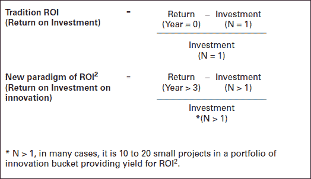

**图 8.1 ROI 与 ROI2 论点对比**

组织必须认识到创建 `ROI²` 范式的紧迫性，以求生存并利用塑造世界的诸多强大力量。事实上，区块链技术迅速演变并引发采用竞赛的原因在于，该技术与这些力量紧密契合。让我们看看其中一些力量，以及区块链如何可能成为加速其进程的恰当应用。

### 全球化的回流冲击

过去三年的三大发展可能向观察者表明，过去三十年来我们所见证的第一波全球化浪潮，可能正在退潮。2020 年英国脱离欧盟，标志着为期三年的脱欧进程结束。2017 年 1 月 23 日，特朗普总统签署了一份“总统备忘录”，指示美国贸易代表“退出跨太平洋伙伴关系协定（`TPP`）签署国地位，并开始在可能的情况下寻求双边贸易谈判，以促进美国工业、保护美国工人并提高美国工资”。`TPP` 是美国在内的 12 个国家拟议的贸易协定，旨在降低签署国间的关税壁垒，并建立投资者-国家争端解决机制。随后发生了一系列对华关税征收（及反制征收），并持续至今。

这些近期发展预示着国际贸易的何种未来？这是全球化终结的开始吗——我们要回到 1950 年代以前的经济民族主义时代？这对全球供应链意味着什么？答案是，全球化不可逆转。未来，它可能不再获得主要经济体的积极支持，但国际贸易将继续前行。毕竟，世界顶级跨国企业的版图过于庞大——且深度投入于使其供应链多元化，以追求成本、竞争力和质量。例如，苹果在全球 30 多个国家拥有供应商。波音飞机约 30% 的零部件来自美国境外的供应商。

极有可能，未来的贸易协定和多边谈判将在组织之间进行，由区块链等技术的部署赋能。因此，贸易谈判将不再涉及数千页详述规则和法规的文件，而是由基于区块链的、流程驱动的追踪与溯源能力来验证和执行双方商定的条款。这将在新兴和欠发达国家创造公平的竞争环境，使它们能将正确的重点放在经济增长上。

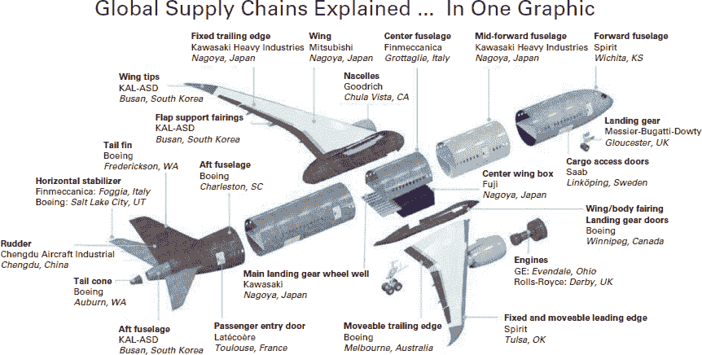

**图 8.2 波音飞机零部件源自全球各地**

### 在线市场

近年来见证了“共享经济”成功案例的涌现，如 Airbnb、Uber 和 Lyft，或用硅谷偏爱的措辞来说，是实现“闲置资产利用”的初创公司。

Airbnb 作为一个短期住宿在线市场，对酒店服务业产生了颠覆性影响。2017 年，全球 80,000 多个城市的 300 万人在 Airbnb 公寓度过除夕夜。据晨星股票研究报告显示，Airbnb 估值约 550 亿美元，超过包括全球最大酒店公司万豪国际（460 亿美元）在内的任何酒店公司。

成立于 2009 年的网约车聚合平台 Uber 取得了巨大成功，甚至催生了一个新的委婉语“Uber 化”，指通过电信网络利用未充分使用的产能或技能，提供高性价比、高效率的服务。该行业的主要市场驱动力是技术创新，包括库存感知自动化、仓库执行系统（仓库管理系统的演进）、`IoT` 平台、改进的运输管理系统和数据分析，以及供应链数字化等。

持续的运力增长和跨供应链货物可见性的新兴解决方案，也催生了成功的物流电商初创公司，如 Freightos 和 Saloodo，以及多家按需仓储公司，如 Flexe、Warehouse Exchange 和 Flowspace。

## 物流服务在线市场

物流服务在线市场正在朝着实现一个长期承诺的方向迈进——即通过利用闲置运力而非为满足峰值需求而建设运力，实现全球运输和仓储网络的“优步化”，且这一切都以前所未有、高度经济的成本实现。产品和服务在线市场的成功将推动区块链与集成技术的采用，以实现规模扩大、效率提升和运营成本降低。

### 超大城市与千禧一代消费者

超大城市被定义为拥有极大人口、常住人口超过 1000 万的城市。美国有 15 个新兴超大城市；其他分布在世界各地，它们能帮助我们更好地理解新兴市场在何处以及为何涌现。

在未来十年里，全球超大城市的数量将显著增加。到 2030 年，预计以下 12 个城市将跻身全球超大城市行列：

*   波哥大
*   拉合尔
*   利马
*   罗安达
*   约翰内斯堡
*   艾哈迈达巴德
*   海得拉巴
*   班加罗尔
*   金奈
*   曼谷
*   成都
*   胡志明市

值得注意的是，这些城市并不位于美国和欧洲的衰退市场中，而是分布在亚洲和南美洲的新兴市场中。

“千禧一代”是指在新千年伊始步入青年期的人口群体。根据皮尤研究中心的数据，千禧一代指 1981 年至 1996 年间出生的人。与前辈相比，他们更有可能生活在这些新兴市场超大城市中，并属于不断壮大的中产阶级，通过技术接触全球市场，拥有更多可支配收入和更高教育水平。

由于受教育程度和技术熟练度较高，千禧一代消费者更倾向于从全球视角——而非仅仅是本地或国家视角——来审视其经济或社会处境。因此，他们追求快速、便捷、易得的零售体验，并偏好参与可持续供应链和履行企业社会责任的零售商。他们甚至愿意为满足后一标准的零售商支付更多费用。

此外，千禧一代中产阶级已成为新兴市场消费支出的引擎。如果按地理区域细分千禧一代中产阶级，会发现该群体大多集中在新兴市场。到 2020 年，东盟地区的中等收入群体将超过 1 亿人。

摩根士丹利报告称，到 2020 年，印度将拥有 4.1 亿千禧一代，他们每年将花费 3300 亿美元。咨询公司麦肯锡发现，中国的 90 后一代（见图 8.3），占其人口的 16%，将“助力中国向消费驱动型经济转型，鉴于他们的消费倾向”。

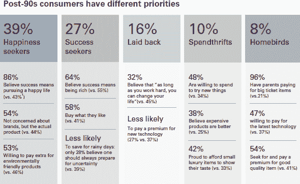

**图 8.3 90 后消费者有不同的优先事项**

与此同时，在非洲，预测显示到 2020 年，平均中产家庭年收入将达到 2 万美元或更多。通过这部分人群对可支配收入的使用及其围绕消费的文化理念，对消费和供应链的影响将在本地和全球范围内显现。

除了千禧一代在旅游和零售消费方面的个人目标外，人们普遍认为企业和零售商应对一系列社会问题产生积极影响，如资源短缺、气候变化和收入不平等。这将深刻影响零售商——以及新兴的电子商务市场——未来的运作方式。这两大趋势——城市中心的崛起和千禧一代消费者话语权的增强——将推动企业利用机器人技术、自动驾驶汽车、机器学习以及与区块链集成的人工智能等技术来提升效率。

### 行业复杂性的日益增长

汽车、耐用消费品、制药、食品和航运等行业面临三大共同挑战：供应链日益复杂、市场不确定性增加以及满足快速变化的客户需求。所有这些行业都已找到区块链的应用场景。汽车制造商已开始为供应链的所有节点开发基于区块链的解决方案，涵盖采购、制造、供应商关系管理、保险、售后销售与服务，以及面向联网汽车和自动驾驶汽车的创新服务。

在航运业，最大的公司马士基已与 IBM 合作组建了 TradeLens，这是一个基于区块链的平台，旨在将港口、码头运营商和客户聚集在一起，创造透明度、降低复杂性，并可能实现集装箱航运业所有利益相关者之间的相关信息共享。跨行业来看，沃尔玛、联合利华、雀巢、必和必拓、华特迪士尼、福特汽车、西门子等大公司以及许多其他公司正在探索区块链的各种用途。最近，《福布斯》杂志报道，约 50 家“福布斯全球 2000 强”企业正在这样做。^(1)

### 为投资回报率标准化区块链

供应链行业是协作实践在现实世界中如何运作的典型例子。任何其生存依赖于成员间协作关系质量的生态系统，都需要多年的持续努力和校准才能实现功能效率。供应链生态系统，甚至在其被认知为一个系统之前，就饱受参与者间信任问题的困扰，导致他们持续不愿有效协作。随便选取一个行业，仔细审视其端到端的供应链网络，你一定会看到各自为政的孤岛，它们导致甚至产生了阻碍该行业增长的低效率。例如，英国从事对外贸易的公司，每票货物平均浪费约三小时通过电话或电子邮件在贸易伙伴间请求和传递数据，而所有这些本可数字化完成。总体而言，英国一家数字货运代理 Zencargo 的一项最新研究显示，每年供应链职能中浪费的时间超过 1 亿小时，给企业造成的总成本高达 19.8 亿美元。^(2) 在医药领域，信任问题、缺乏透明度和不愿共享数据导致的供应链低效，据麦肯锡估算，每年给制造商造成的总损失高达 250 亿美元。^(3)

解决信任问题和低效运作的关键一步是制定标准，这些标准由定义上讲是所有各方都同意的。

## 思想实验：美国铁路基础设施的历史

进行一个思想实验，考虑美国铁路基础设施的历史。如果参与大幹线铁路和南太平洋铁路公司等铁路线初始建设的铁路公司决定铺设不同宽度和尺寸的轨道，那么今天我们拥有的服务将无法扩展和货币化。事实上，在 19 世纪之交，美国的铁路公司非常愿意合作，将铁路业务变成寡头垄断^4，但在就标准费率达成一致以使服务惠及所有客户方面却不那么积极。实业家兼金融家 J.P. Morgan 本人就是一家铁路公司的所有者^5，他通过会议召集铁路总裁，就旅客的标准费率达成一致。从这个例子中可以得出的教训是：标准的制定必须以提高效率、造福客户为主要目的。另一个教训是：制定标准是确保大型企业不相互勾结以排挤竞争的一种方式。制定标准的一个好方法是建立一个共享平台，该平台不由某一个行业、实体或公司拥有，而是由所有人共享。

### 共享平台的典范：IETF

此类共享平台的一个绝佳例子是互联网工程任务组（`IETF`），这是一个负责确定互联网协议标准化的非营利组织。世界任何地方的任何实体，只要获得了所需的专业知识，都可以成为 `IETF` 的成员。事实上，`IETF` 负责互联网协议套件（`TCP/IP`）的开发和管理^6，这是一组标准，使得全球互联网络（简称互联网）得以普及。

### 集装箱化：供应链标准化的里程碑

另一个激活供应链的标准创建的杰出例子是航运业的集装箱化。在讨论 `IBM–Maersk` 区块链平台时，我们探讨了 1956 年引入的集装箱化如何改变航运业务。仅仅创建一个宽 8 英尺、长 40 英尺、高 8 英尺的标准集装箱，就将装卸成本降低了 100 倍。这是最大的供应链创新之一，它推动了航运业的指数级增长并加速了全球化。

### 区块链与供应链标准化的必要性

当我们谈论区块链和集成技术的标准及其在供应链中的应用时，需要有类似的思维过程。区块链是一项新兴技术。因此，目前尚无既定标准是可以理解的，没有这些标准，用户无法访问区块链，就像设备（从而人们）无法在不执行 `TCP` 握手的情况下访问互联网，转运商无法在不将货物装入标准尺寸集装箱的情况下通过海运移动货物一样。

目前有多个组织正在致力于区块链标准的创建和建立。问题在于，它们的标准没有一个被普遍遵循。

#### 英国：BSI 与 PAS 19688

在英国，英国标准协会（`BSI`）委托 `RAND Europe` 进行一项研究，以从英国利益相关者的角度了解区块链相关的一些可标准化领域^7。`BSI` 是一家历史悠久的机构，它制定了最早的机车、机械标准以及质量管理标准 `BS 5750`（`ISO 9000` 的前身）。`BSI` 的区块链标准称为公开可用规范（`PAS`）19688。

#### 美国：IEEE-SA 与 IEEE 2418.3

在美国，这项工作由电气电子工程师协会标准协会（`IEEE-SA`）负责，它是电气电子工程师协会（`IEEE`）内部的一个标准制定机构。`IEEE` 成立于 19 世纪，因制定 `WiFi` 标准（如 `IEEE 802.11`）而享誉全球。`IEEE` 始终处于技术发展的前沿^8。例如，目前 `IEEE` 正在致力于为联网和自动驾驶汽车制定标准。它还为区块链制定了一个名为 `IEEE 2418.3` 的标准，用于区块链在农业中的应用^9。

#### 澳大利亚与 ISO/TC 307

在澳大利亚，澳大利亚标准协会向国际标准化组织（`ISO`）提交了新技术领域活动提案，建议制定支持区块链的标准^10。`ISO` 以其质量管理标准（如 `ISO 9000`）而广为人知^11。自 2016 年 9 月以来，`ISO` 连同澳大利亚标准协会发起了一项名为 `ISO/TC 307` 的倡议，旨在制定区块链的新国际标准。

`ISO/TC 307` 目前拥有 33 个成员国，包括德国、英国、日本、俄罗斯、法国、新加坡、中国和美国。它正在开发十一项 `ISO` 区块链标准。

### 行业协作平台

同样，每个行业都在开发一个或多个协作平台以推进区块链的采用。例如，`Everledger` 是钻石行业的溯源追踪区块链应用。`Hyperledger` 是由 `Linux Foundation` 托管的开源协作项目，被 `IBM` 和 `SAP` 等主要科技公司用于推进跨行业区块链技术。还有 `TradeLens`，这是一个由 `IBM–Maersk` 推动的许可型区块链，承诺变革航运业。

我们需要更大、更大胆的努力，将来自所有行业的所有供应链利益相关者聚集在一起，形成全球标准。

### 高校卓越中心的作用

高校内的卓越中心可以在创建这样一个由政府和行业参与的共享平台方面发挥重要作用。这样的共享平台将给每个人一个平等的机会，不仅可以进行贸易，还能利用 `RoI²`。

在 `USC Marshall Centre for Global Supply Chain Management`，我们采取了战略举措，启动了供应链区块链研究所（`IBISC`），以推动此类倡议。`IBISC` 的目标是促进行业利益相关者与我们合作的不同政府部门（如美国商务部）之间的协作，推动区块链在供应链中的标准化和实施。

### 面向未来的组织形态

未来属于那些向上游和下游延伸、寻找协同机会与其他参与者合作的组织。这只能通过一个集成技术以实现透明度和协作的共享平台来实现。这样的共享平台将创造快速转型和高 `ROI²` 收益。

## 重塑区块链的未来

以标准驱动方式采用区块链的组织将能够创造一个与我们今天想象截然不同的未来。

想象一下这样一个未来：你能看到食品从农场到餐桌的碳足迹。你扫描麦当劳汉堡上的标签，就能看到其五个 `SKU` 中每一个的端到端供应链。你可以看到种植特定小麦作物的农场位置、农场土壤成分质量、农场员工人数及其工资、运输小麦到仓库的承运商名称、将其磨成面粉的地点，以及磨坊上次进行病虫害防治的时间。你还可以检查上游每个节点原料的碳足迹，一直到整齐包装、静待食用的汉堡摆在你盘子里。想象一下，组织为了成为供应链网络的一部分，将不得不建立何等级别的可信度、信任和真实性。

## 2018 年食品召回与区块链应用

2018 年，美国因污染报告和疾病爆发，食品召回事件增加。Kellogg’s 和 Cargill 等公司不得不召回数千种食品。9 月，零售巨头 Walmart 迅速行动，要求所有叶类蔬菜供应商在一年内将数据上传至区块链。^12 Walmart 与 IBM 联合开发的区块链解决方案，不仅有助于零售商提高供应链透明度，还能在未来食品召回时降低成本。通过将疫情爆发与源头关联，零售商可在食品上架前识别源头并销毁问题食品。

受此启发，Starbucks 也宣布启动试点项目，将区块链引入其咖啡供应链。^13 根据在西雅图举行的 2018 年股东年会前发布的公告，该项目将在最初两年内邀请哥斯达黎加、哥伦比亚和卢旺达的部分生产商参与。

同样，棕榈油行业的 SUSTAIN 区块链平台将为经销商和小农户等利益相关者提供开放访问权限，他们可使用可下载的工具建立可追溯性、监控政策合规性、高效交易鲜果串、获取最佳实践指南，并了解可用的小额融资。

区块链将帮助跨国公司确保位于发展中国家承包商工厂的公平做法。总部位于纽约的公司可检查工人的生物特征数据，如指纹、面部识别、年龄等。这将使公司能够预防童工等不公平行为。

## Reflection

无论喜欢与否，全球化将长期存在，势不可挡。尽管当前政治气候意识形态纷飞、新的争端和摩擦每天都在被发现，尽管有 Brexit 和贸易战，全球经济的增长以及对经济合作的需求将继续加速。得益于所有技术进步，世界变得更加融合。2019 年首次亮相的 5G 速度最高可达 4G 的 100 倍。^14 算力的快速增长将很快使人工智能无处不在。3D 打印现在可制造火箭零件，智能手表可监测心率。所有这些发展为区块链和集成技术带来了巨大机遇。

全球公民真正的机遇在于支持循环经济和可持续性。然而，目前供应链参与者最相关的痛点是无法追踪材料、组件和产品在整个链条中的来源，以便沿途的任何人都能断言其循环性——从最初被开采或创建那一刻起，一直到其（多次）生命周期结束。

已有多个基于区块链的解决方案正在做这件事。例如，美国企业家 Daniel Jones 推出的区块链软件 Bext360，利用 IoT、区块链和人工智能追踪咖啡、海鲜、木材、矿产、棉花和棕榈油供应链中的大宗商品。Bext360 最近与乌干达咖啡出口商 Great Lakes Coffee 和科罗拉多州丹佛的 Coda Coffee 合作，追踪咖啡豆从农场到意式咖啡机的全过程。^15

归根结底，我们面临的最大危险是关键资源（水、空气和表层土壤）的持续流失。通过负责任的态度，并为子孙后代提供端到端的问责制和可见性，集成区块链技术的使用不仅有助于保护，还能保护我们的关键资源延续几个世纪。

## Notes

1 [`www.forbes.com/sites/michaeldelcastillo/2018/07/03/big-blockchain-the-50-largest-public-companies-exploring-blockchain/`](https://www.forbes.com/sites/michaeldelcastillo/2018/07/03/big-blockchain-the-50-largest-public-companies-exploring-blockchain/) (archived at [`perma.cc/D5MB-H2VN`](https://perma.cc/D5MB-H2VN))

2 [`www.supplychaindive.com/news/digital-freight-forwarding-supply-chain-inefficiency/527945/`](https://www.supplychaindive.com/news/digital-freight-forwarding-supply-chain-inefficiency/527945/) (archived at [`perma.cc/UT8R-C5PC`](https://perma.cc/UT8R-C5PC))

3 [`www.pharmtech.com/digital-supply-chain-seizing-pharma-s-untapped-opportunity`](http://www.pharmtech.com/digital-supply-chain-seizing-pharma-s-untapped-opportunity) (archived at [`perma.cc/P97B-HMRS`](https://perma.cc/P97B-HMRS))

4 [`books.google.co.in/books?id=R4vjgmic44QC&redir_esc=y`](https://books.google.co.in/books?id=R4vjgmic44QC&redir_esc=y) (archived at [`perma.cc/QB5Q-ANCD`](https://perma.cc/QB5Q-ANCD))

5 [`www.hup.harvard.edu/catalog.php?isbn=9780674587298`](http://www.hup.harvard.edu/catalog.php?isbn=9780674587298) (archived at [`perma.cc/J3EL-WQA8`](https://perma.cc/J3EL-WQA8))

6 [`www.ripe.net/participate/internet-governance/internet-technical-community/ietf`](https://www.ripe.net/participate/internet-governance/internet-technical-community/ietf) (archived at [`perma.cc/2DE8-XGMB`](https://perma.cc/2DE8-XGMB))

7 [`www.rand.org/randeurope/research/projects/blockchain-standards.html`](https://www.rand.org/randeurope/research/projects/blockchain-standards.html) (archived at [`perma.cc/8X8Q-6ENN`](https://perma.cc/8X8Q-6ENN))

8 [`www.ieee.org/about/ieee-history.html`](https://www.ieee.org/about/ieee-history.html) (archived at [`perma.cc/9KTW-NVWT`](https://perma.cc/9KTW-NVWT))

9 [`standards.ieee.org/develop/project/2418.3.html`](http://standards.ieee.org/develop/project/2418.3.html) (archived at [`perma.cc/J92L-UN2P`](https://perma.cc/J92L-UN2P))

10 [`www.standards.org.au/engagement-events/flagship-projects/blockchain`](https://www.standards.org.au/engagement-events/flagship-projects/blockchain) (archived at [`perma.cc/A42A-YCAZ`](https://perma.cc/A42A-YCAZ))

11 [`www.iso.org/committee/6266604.html`](https://www.iso.org/committee/6266604.html) (archived at [`perma.cc/2GTT-YYMF`](https://perma.cc/2GTT-YYMF))

12 [`www.forbes.com/sites/andrewrossow/2018/09/25/why-walmarts-move-to-the-blockchain-could-do-more-than-cure-e-coli-outbreaks/`](https://www.forbes.com/sites/andrewrossow/2018/09/25/why-walmarts-move-to-the-blockchain-could-do-more-than-cure-e-coli-outbreaks/) (archived at [`perma.cc/2LMN-KCM3`](https://perma.cc/2LMN-KCM3))

13 [`www.platinumtradinginstitute.com/crypto/a-newly-found-interest-in-blockchain-technology`](https://www.platinumtradinginstitute.com/crypto/a-newly-found-interest-in-blockchain-technology) (archived at [`perma.cc/XGT3-A2J3`](https://perma.cc/XGT3-A2J3))

14 [`www.cnet.com/news/5g-is-finally-starting-to-feel-real/`](https://www.cnet.com/news/5g-is-finally-starting-to-feel-real/) (archived at [`perma.cc/N3R8-ESRP`](https://perma.cc/N3R8-ESRP))

## 索引

15 [`www.ibtimes.co.uk/blockchain-traceable-coffee-bext360-partners-africa-europe-north-america-1645350`](https://www.ibtimes.co.uk/blockchain-traceable-coffee-bext360-partners-africa-europe-north-america-1645350) (archived at [`perma.cc/KE8W-LZNA`](https://perma.cc/KE8W-LZNA))

*斜体*页码表示图表或表格

**2M** 223

**2Tokens** 203

**3D 打印** 17

**5G** 264

**6TiSCH** 161

**51%攻击** 33–34, 137

**Aave** 143

**ABC Logistics** 198, 199, 200

**ABN-AMRO** 185, 186, 187, 188, 192

**学院** 4

**加速度计** 160

**ACID 系统** 171

**Aioi Nissay Dowa Insurance Services** 247

**Airbnb** 257

**航空运输** 7–8

**亚历山大大帝** 5

**阿里巴巴** 190

**al-Jazari, Ismail** 12

**联盟, 航运** 223–24, *225*, *226*

**联盟** 223

**Alphabet** 19, 247, 248

**al-Shatir, Ibn** 7

**Altman Z** 222–23

**亚马逊** 18, 175, 190

**Amazon Web Services (AWS)** 165, 168

- **Elastic Container Service** 167
- **S3** 167

**Ampleforth** 142

**ANSI ASC** 242

**反洗钱(AML)法规** 190

### Apache

- **Apache Cassandra** 170
- **Apache Hadoop** 169
- **Apache Kafka** 164, 179
- **Apache Spark** 170

**Apical** 235

**AP Moller-Maersk Group** *参见* Maersk

**苹果** 13, 248, 255

**AQMP** 164

**Arbitrum** 141

**人工智能 (AI)** 1, 15, 16, 20, 259, 264

- **机器人技术** 14–15

*另见* 机器学习

**ArtTracktive** 246

**阿育王** 6

**Asian Agri** 235

**非对称密钥加密** 129, *131*, 131–32

**奥迪** 247

**增强现实** 176

**Augur** 143

**汽车行业** 236–49, 260

- **汽车工业 4.0** 247–49
- **扩展企业** 240–43
- **供应商成本削减努力 (SCORE)** 241
- **供应链复杂性** 238–40, *239*
- **车辆融资** 246–47
- **车辆召回** 245–46

**Avalanche** 140, 141

**Azarc** 198

**巴贝奇, 查尔斯** 12

**Back, Adam** 128

**Balancer** 143

**Bancor** 143

**国际清算银行 (BIS)** 33

**BASE 系统** 171

**Baxter** 14–15

**贝叶斯分析** 173

**Beeple** 142

**奔驰, 卡尔** 7

**奔驰专利汽车** 238, *239*

**Bext360** 265

**必和必拓** 40, 260

**偏见, 数据中的** 176–77

**Bidvest Logistics** 23

**大数据** 169–70

**比特币** 19–20, 29, 127, 128–37, *130*, 142

- **匿名性 / 保密性** 146, 147, 228
- **非对称密钥加密** 129, *131*, 131–32
- **比特币黄金** 34
- **区块链** 133, *133*
- **区块** 32, 134
- **确认延迟** 141
- **成本** 209
- **数字签名** 132, *132*
- **能源消耗** 33, 140
- **哈希** 129, *131*
- **不可篡改性** 146
- **激励机制** 136
- **挖矿** 134–35, *135*
- **“无许可”** 140
- **工作量证明** 133–34, 136
- **可扩展性** 32, 141
- **交易** 134, *134*, 137

**Bitfury Group** 31

**区块链费用** 33

**卡车联盟区块链 (BiTA)** 73

**Blocklab** 188–89, 198, 203, 208

**区块** 32, 134

## 索引

### B

**区块时间** 33

**蓝牙低功耗 (BLE) 标准** 161

**宝马** 247, 249

**波音** 255, 256

**巧思机械装置之书** 12

**边境部队** 197

**博世** 249

**英国脱欧** 197, 255, 264

**英国标准协会 (BSI)** 262

**英国电信** 188, 198

**布特林, 维塔利克** 29, 137

### C

**卡尔达诺** 140

**嘉吉** 232, 264

**汽车行业** *参见* 汽车工业

**carVertical** 247

**Cello** 186

**钱达纳尼, 吉坦** 227

**查姆, 大卫** 128

**克莱斯勒** 240–241

**克莱门蒂, 埃里希** 227

**Clique** 209, 211

**云计算** 165–168

**基础设施即服务 (IaaS)** 166–167

**平台即服务 (PaaS)** 167–168

**软件即服务 (SaaS)** 168

**达飞海运集团** 221, 223

**可口可乐公司** 30–31

**Coda Coffee** 265

**Compound** 143

**计算, 作用** 11–15

**机器人技术** 14–15

**超级计算机** 13–15

**简明二进制对象表示 (CBOR)** 172

**ConsenSys** 234

**集装箱化** 8, 221, 261

*另见* TradeLens

**协作式管理合并与传递 (CMMP)** 237

**Corda** 31, 145, 148, 150–151

**CORE** 235

**中远海运** 187, 190, 221, 223

**Cosmos** 140, 141

**科特雷尔, 史蒂夫** 27

**CouchDB** 170

**新冠疫情** 23

**Coyote** 73

**Cromemco** 13

**卡特莫尔, 尼克** 222

### D

**DAI** 142

**戴姆勒集团** 247, 248

**数据分析** 171–177

**数据库** 170–171

**数据安全** 177–178

**DDS** 164

**去中心化自治组织 (DAO)** 142

**去中心化金融 (DeFi)** 143

**森林砍伐** 230–232

**Deliver 平台** 185–186

*另见* Naviporta

**Deliver 流程** 73, 74–100

**德勤** 245, 146

**德明, W·爱德华兹** 11

**环境食品和农村事务部 (DEFRA)** 197

**笛卡尔** 73

**敦豪** 8, 23–24

**Digicash** 128

**DigitalOcean** 165

**数字签名** 132

**迪伦伯格, 唐娜** 244

**Docker** 167

**都乐** 56

**陶氏化学** 228

**无人机** 17–19

**杜邦** 228

### E

**Echo** 73

**电子数据交换 (EDI)** 25, 242, 243

**EDIFACT** 242

**Emercoin** 31

**Enable 流程** 115–123, 124

**能源使用, 区块链中的** 33, 140

**恩格尔, 马克** 233

**EOS** 250

**以太坊** 29, 127, 145, 168, 250

**匿名性** 146

**确认延迟** 141

**Deliver 概念验证** 185

**企业以太坊** 145, 148, 151

**以太坊 2.0** 141

**以太坊虚拟机 (EVM)** 149, 151, 208

**Naviporta** 208–209

**新应用** 142–143

**“无许可”** 140

**权益证明** 140

**可扩展性** 32, 141

**智能合约** 29, 137–139, 138, 205

**以太坊征求意见稿 (ERC) 标准** 139

**TradeTrust** 203, 204, 205, 206, 207

**长荣海运** 223

**Everledger** 262

**扩展企业** 240–243

### F

**联邦快递** 8, 19, 73

**费兰蒂国际公司** 13

**Finlync** 243

**Firebase** 168

**Flexe** 257

**Flowspace** 257

## 索引

### F

**食品供应链，追踪** 31, 56, 236

**福特全球技术公司** 237

**福特，亨利** 7, 248

**福特汽车公司** 248, 249, 260

**T 型车** 240

**FRED** 101

**Freightos** 257

### G

**Gem** 247

**通用数据保护条例 (GDPR)** 177, 251

**通用汽车公司** 240, 147–148, 249

**全球区块链航运网络 (GBSN)** 187

**全球化** 8–10

**全球定位系统 (GPS)** 159

**Gmail** 168

**Gnosis** 143

**谷歌** 18, 175

**Google Cloud Data Flow** 170

**Google Cloud Platform (GCP)** 165, 189, 210

**Google Docs** 168

**Google Kubernetes Engine** 167

**Google Storage** 213

**TensorFlow** 174

**Gossip** 141

**Grafana** 176

**石墨烯** 14

**五大湖咖啡** 265

**中国长城** 6

**绿色和平组织** 232

**GRI 可持续发展报告标准** 37

**GroentenFruit Huis** 198, 199

**GS-1** 172

**GTD Solution Inc** 152

**冈特，埃德蒙** 12

### H

**韩进海运** 223

**赫伯罗特** 187, 223, 224

**HashCash** 128, 133

**哈希运算** 129, 131

**赫兹，海因里希** 8

**英国税务海关总署 (HMRC)** 197

**霍列瑞斯，赫尔曼** 12

**赫维茨，里克** 28

**Hyperledger** 233, 245, 262

**Hyperledger Besu** 151

**Hyperledger Fabric** 145, 148–150, 152, 168, 228, 250

**Hyperledger Fabric 2.0** 150

**虚拟机监视器** 167

### I

**IBISK** 32

**IBM** 12, 13, 56

**汽车电子钱包平台** 248

**计算机供应链，追踪** 244, 245

**食品供应链，追踪** 31, 236, 264

**Hyperledger Fabric** 148, 152, 262–263

**IBM Cloud** 165, 168

**TradeLens** 31, 73, 152–153, 225–229, 249, 260, 261, 263

**Watson** 16, 175

**ICTU** 203

**Ideal X** 221, 222

**IEEE 标准协会 (IEEE-SA)** 262

**IEEE 802.15.4** 161

**Increase Computers** 101

**砷化铟镓 (InGaAs)** 14

**资讯通信媒体发展局 (IMDA)** 203

**基础设施即服务 (IaaS)** 166–167

**供应链区块链研究所 (IBISC)** 263

**英特尔** 245

**SGX** 178

**互联网工程任务组 (IETF)** 261

**物联网** 1, 16, 36, 38, 157–165, 228, 244, 246, 251

**架构** 158

**汽车行业** 248, 249

**大数据** 169

**数据表示** 171

**数据可视化** 176

**与区块链集成** 178–180

**互联网协议** 162–165

**窄带物联网 (NB-IoT)** 162

**Naviporta** 201, 212

**传感器** 159–160

**流数据支付协议 (SDPP)** 180

**无线技术** 160–162

**互联网协议套件 (TCP/IP)** 261

**IOTA** 208

**IPv6** 162

**ISO/TC 307** 262

### J

**JavaScript 对象表示法 (JSON)** 171–172

**带链接数据的 JSON (JSON-LD)** 172

**JB Hunt** 73

**京东** 73

**J. Lyons & Company** 13

**乔布斯，史蒂夫** 13

**琼斯，丹尼尔** 265

**尤利乌斯·凯撒** 5

### K

**KAO** 235

**家乐氏** 26, 232, 264

**肯德基 (KFC)** 23–24

**Keras** 174

**了解你的客户 (KYC)** 190

**克里希纳，阿尔温德** 227

**Kubernetes** 167, 215

### L

**巴登-符腾堡州立银行 (LBBW)** 247

## 索引

### L

**陆路运输** 6–7

**莱布尼茨，戈特弗里德·威廉** 12

**梁，诸葛** 6

**闪电网络** 33, 141

**Linux 基金会** 156, 148, 228, 233, 245, 262

**LivingLab** 203

**柳尔，拉蒙** 12

**长距离无线电 (LoRA)** 162

**LoRA 联盟** 162

**Loyyal** 247

**LTE-M** 162

**Lyft** 248, 257

### M

**机器学习**

- 挑战 176–77
- 自然语言和语音处理 175
- 强化学习 175–76
- 监督学习 174–75, *175*
- 无监督学习 173, *173*

**机器对机器 (M2M) 通信** 158

**马士基** 190, 221, 222

**2M** 223

- 财务困境 223, 224

**TradeLens** 31, 73, 152–53, 187, 225–29, 249, 260, 261, 263

**Maetrics** 27

**制造流程** 56, *71**–**72*, 73

**MakerDAO** 142

**MapReduce** 169

**马可尼，古列尔莫** 8

**Marine Transport International (MTI)** 101

**海事港务局 (MPA)** 203

**马克斯·斯宾塞** 24

**火星** 26, 232

**麦克斯韦，詹姆斯·克拉克** 8

**麦当劳** 26, 232

**麦克莱恩，马尔科姆** 8, 221

**麦克莱恩，蒂姆** 27

**麦克劳德** 73

**医疗记录** 20

**特大城市** 257–58

**内存池** 136

**默克尔根** 137

**消息队列遥测传输 (MQTT)** 164

**#Metahash** 33

**微软**

- Azure 165, 168
- 容器服务 167
- Outlook 168

**大规模迁移** 10–11

**千禧一代** 258–59, *259*

**挖矿** 134–35, *135*

**矿工费** 33

**Mirror** 143

**三菱** 237

**移动后端即服务 (MBaaS)** 168

**区块链出行开放倡议 (MOBI)** 249

**电子可转让记录示范法 (MLETR)** 203

**MolochDAO** 142

**门罗币** 146

**MongoDB** 170

**Monocoin** 34

**蒙戈尔菲耶兄弟** 7

**摩尔定律** 14

**摩根，JP** 261

**Mosquitto** 164

**MQTT** 164, *165*

**MSC** 187, 223

**多重签名账户** 137

**MySQL** 170

### N

**中本聪** 19–20, 29, 128

**窄带物联网 (NB-IoT)** 162

**NASA** 17

**自然语言和语音处理** 175

**Naviporta** 185–215

- 组件 209–14, *210*
- 核心组件 210–13
- 基础设施 213–14
- 核心价值观 191–92
- 传承交付 185–86
- 生态系统 192–93
- 以太坊的使用 208–09
- 治理 *193*, 193–96, *194*
- 经验教训 187–89
- QuayConnect 用例 192, 197–200, *210*, 212, 213
- 软件开发工具包 (SDKs) 214–15
- TradeTrust 用例 203–08, *204*, *207*, 214
- VATBL0CK 用例 200–03, *202*
- 愿景 190–91

**Neo4J** 171

**Neste** 235

**雀巢** 260

- 食品供应链，追踪 31, 56, 236
- 棕榈油 26, 231, 232–33

**Neurocore** 14

**日产** 237

**随机数** 133

**非同质化代币 (NFTs)** 139, 142

**NoSQL 数据库** *170*, 170–71

### O

**Oaken Innovations** 249

**海洋联盟** 223

**海洋网联船务** 223

## 索引

### O

**Ocean Protocol** 180

**全渠道** 16

**OOCL** 187, 223

**Optimism** 141

**Oracle** 168, 175

**Oracle Cloud** 165, 167

**Oracle SQL** 170

**Oughtred, William** 12

### P

**棕榈油行业** 26, 229–236, 234

森林砍伐，影响 230–232

供应链透明度 232–233

**可持续发展保障与创新联盟 (SUSTAIN)** 235, 264

**Parry & Evans Recycling** 101

**Pascal, Blaise** 6

**百事公司** 26, 231, 232

**PINC Solutions** 18

**计划流程** 40, 41–55

**平台即服务** 167–168

**柏拉图** 4

**Polygon** 141

**Polymarket** 143

**庞培大帝** 5

**保时捷** 248

**Portbase** 198, 199, 214

**釜山港** 185

**鹿特丹港** 185, 186, 188, 203

**PostgreSQL** 170

**囚徒困境** 223

**私钥** 131–132

**Processor Technology** 13

**宝洁公司** 26, 232

**工作量证明** 133–134, 136

**公钥** 131–132

**发布-订阅中间件** 163, 164–165, 165, 167

与区块链 178–179, 179

**PubNub** 165, 168

### Q

**QSL (快捷服务物流)** 23

*Quality, Productivity, and Competitive Position* 11

**量子计算** 14

**QuayConnect** 192, 197–200, 210, 212, 213

商业案例 199–200

**Quorum** 151

### R

**R3** 31, 150

**RabbitMQ** 164

**射频识别** 159, 161

**射频信标设备** 159–160

**RAND Europe** 262

**Remington Rand** 13

**雷诺** 237, 249

**表述性状态传递** 163–164, 164

**资源描述框架** 172

**Rethink Robotics** 14

**创新投资回报率** 253–254, 254, 263

**退货流程** 101, 102–14

**Ripple** 31

**机器人技术** 14–15

**ROSS** 16

**可持续棕榈油圆桌会议** 232

**RSA** 132

### S

**Sainsbury’s** 30, 236

**Saloodo** 257

**三星电子** 188

**三星 SDS** 185, 186, 187, 188, 192

**SAP** 235, 245, 263

**Satori** 165

**Sawyer** 14

**Saxon, Steve** 224

**区块链的可扩展性** 32–33, 141

**施耐德电气** 73, 227

**SCOR 参考模型** 34, 35, 38–40, 39

与 SCM 目标 35–37

交付流程 73, 74–100

赋能流程 115–23, 124

制造流程 56, 71–72, 73

计划流程 40, 41–55

退货流程 101, 102–14

采购流程 56, 57–70

**可持续 SCOR** 37

**SegWit** 33

**Semtech** 162

**SensorML** 172

**SHA256 哈希函数** 129

**分片** 141

“共享经济” 257

**Shaw Industries** 73

**Short, Phil** 101

**西门子** 260

**SigFox** 162

**丝绸之路** 6

**Skye Consulting** 243

**Slock** 248

**智能合约** 29, 128, 137–139, 138, 205

**SmartID** 246

**Smith, Frederick** 73

## 索引

**Smith, R Tyler** 40

**软件即服务** 168

**Solana** 140, 141, 208

**Sol, Daco** 199

**Solidity** 138, 149, 151

**源流程** 56, 57–70

**SpaceX** 17

**Spark!** 203

**SQL 数据库** 170–171

**稳定币** 142

**Stallkamp, Thomas** 241

**标准普尔** 188

**澳大利亚标准局** 262

**星巴克** 264

**流式数据支付协议** 180, 181

**神威·太湖之光** 14

**超级计算机** 13–15

**供应商成本削减计划** 241

**供应链管理，定义** 25

**供应链参考数据模型** 153

**可持续性保障与创新联盟** 235, 264

**女巫攻击** 136, 147

**Synthetix** 143

**Szabo, Nick** 137

**Tantlinger, Keith** 8

**Targens** 247

**Target** 25

**茶叶供应链，追踪** 30, 236

**Tendermint** 145, 148, 151–152, 179

**Tesla** 248

**Tetra Pak** 228

**德州仪器** 13

**天河二号** 14

**TMW** 73

**全面质量管理** 11

**丰田汽车公司** 240, 247, 248

**丰田研究院** 249

**TraceChain** 245, 246

**TradeLens** 31, 73, 187, 249, 260, 261, 263

**联盟治理** 250

**创建** 225–229

**数据模型** 153

**利益相关者** 152–153

**成功** 154

**Tradeshift** 31

**TradeTrust** 203–208, 207, 214

**匿名性** 206

**实施示例** 204

**交易** 134, 137

**交易费** 33

**Transfollow** 214

**传输控制协议** 162–163

**跨太平洋伙伴关系协定** 255

**TraSeable** 234

**Trinity** 179

**Triumph Capital** 73

**Trump, Donald** 255

**TSS** 247

**Tungsten Network** 28

**泰森食品** 31, 56, 236

**Uber** 19, 248

**“优步化”** 257

**UBS** 248

**英国货运社区系统** 198, 199

**UNCEFACT** 203

**联合利华** 260

**食品供应链，追踪** 31, 56

**棕榈油** 26, 231, 232, 233, 235–236

**茶叶供应链，追踪** 30, 236

**Uniswap** 143

**UPS** 8, 73

**USDC** 142

**用户数据报协议** 162–163

**Van Drebbel, Cornelius** 7

**VATBL0CK** 200–203, 202

**车辆融资** 246–247

**车辆召回** 245–246

**Verbiest, Ferdinand** 6

**Verge** 34

**VisaNet** 32

**大众汽车** 238

**Voysey, Andrew** 30, 236

**Walmart** 25, 31, 56, 260, 264

**Walt Disney** 260

**Warehouse Exchange** 257

**水路运输** 7

**Watt, James** 7

**Wave** 187

**Weakland, Linda** 73

**Welspun India** 25–26

**Wildgoose, Nick** 26–27

**Winkelmann, Mike** 142

**Worldwide Robotics** 15

**世界自然基金会** 234

**Wozniak, Steve** 13

**Wright, Orville and Wilbur** 8

**WRI Indonesia** 230

**XMPP** 164

**扬明海运** 223, 224

**Yiannas, Frank** 31

**YOLO** 175

**Zcash** 140, 146

**ZF** 248

**Zigbee** 161

**苏黎世保险** 26

**出版商说明**

## 版权声明

已尽一切可能确保本书在付印时所含信息的准确性，无论因何原因导致的任何错误或遗漏，出版商和作者概不负责。对于因本出版物中的内容而采取行动或不采取行动而导致的任何人员损失或损害，编辑、出版商或作者概不承担责任。

初版于 2019 年，由 Kogan Page Limited 在英国和美国出版

第二版 2022 年

除根据《1988 年版权、设计和专利法》允许为研究或私人学习、批评或评论目的而进行的合理使用外，未经出版商事先书面许可，或不符合 CLA 颁发的条款和许可证的情况下进行复制，本出版物不得以任何形式或任何方式复制、存储或传播。关于超出这些条款的复制事宜，请发送至出版商，地址如下：

2nd Floor, 45 Gee Street

London

EC1V 3RS

United Kingdom

[www.koganpage.com](http://www.koganpage.com)

8 W 38th Street, Suite 902

New York, NY 10018

USA

4737/23 Ansari Road

Daryaganj

New Delhi 110002

India

Kogan Page 图书采用来自可持续森林的纸张印刷。

© Nick Vyas, Aljosja Beije and Bhaskar Krishnamachari 2019, 2022

根据《1988 年版权、设计和专利法》，Nick Vyas、Aljosja Beije 和 Bhaskar Krishnamachari 主张其为本作品作者的权利。

### ISBN

精装本 978 1 3986 0523 7

平装本 978 1 3986 0521 3

电子书 978 1 3986 0522 0

### 英国国家图书馆版本目录数据

英国国家图书馆可提供本书的 CIP 记录。

### 美国国会图书馆控制号

9781398605237

由 Integra Software Services, Pondicherry 排版

印刷制作由 Jellyfish 管理

由 CPI Group (UK) Ltd, Croydon, CR0 4YY 印刷和装订

