# 区块链与 Web 3.0：社会、经济和技术挑战（Routledge 科学、技术与社会研究丛书）


**马西莫·拉涅达**是英国纽卡斯尔北安比亚大学大众传播学高级讲师。

**朱塞佩·德斯特法尼斯**是英国布鲁内尔大学计算机科学系讲师。


## 贡献者

**贝蒂·B. 阿卡**是西蒙弗雷泽大学传播学院的博士候选人。她目前的研究集中在区块链技术的社会建构上。她特别关注区块链与加纳性别数字鸿沟社会动态之间的共生关系。作为传播学院 GeNA 实验室的成员，以及参与由 IDRC、俄亥俄大学热带病研究所和联合国儿童基金会资助的项目，她拥有多样的研究经验。她拥有俄亥俄大学国际发展研究硕士学位和西班牙语言与文化硕士学位。

**菲利帕·R. 亚当斯**是 SSHRC 博士学者，在西蒙弗雷泽大学传播学院攻读博士学位。她的研究兴趣在于技术与社会，包括社交媒体中的性别、区块链和大众文化。她拥有维多利亚大学政治学学士学位和西蒙弗雷泽大学传播学硕士学位。菲利帕在 GeNA 实验室担任研究经理，管理一系列定量和定性研究项目。

**瓦利德·阿尔-萨卡夫**（博士）是瑞典雪尔特奥纳大学高级讲师。

**扬尼斯·安杰利斯**是瑞典皇家理工学院（KTH）Indek 运营策略副教授。

**伊莎贝尔·阿泽维多**拥有波尔图大学工程学院信息工程博士学位。她是 ISEP 信息工程系副教授。伊莎贝尔·阿泽维多此前曾在阿威罗大学文档服务处和波尔图大学工程学院担任技术基础设施领域的软件和系统程序员。

**伊瓦娜·贝弗里奇**目前正在索尔邦大学完成她的博士学位。过去几年里，她在索尔邦大学及多所商学院教授了多门市场营销课程。伊瓦娜是北京日出国际教育的合伙人。她曾在国际


在亚洲、中东、美国和欧洲开展营销实践，合作机构包括 Naspers – MIH Group、Edelman PR、Hill & Knowlton Strategies、Pennebaker 和 Labbrand。

### Balazs Bodo
（阿姆斯特丹大学信息法研究所），是区块链与社会政策研究实验室的首席研究员。他是阿姆斯特丹大学信息法研究所的研究科学家。他是两度富布莱特学者（2006-7 年，斯坦福大学；2012 年哈佛大学）和前玛丽·斯克洛多夫斯基-居里研究员（2013–15 年）。Balazs Bodo 拥有坚实的跨学科背景，拥有经济学学位（硕士，科尔维努斯大学，1999 年）和媒体研究博士学位（ELTE，2011 年）。近年来，他一直致力于版权盗版和算法化信息个性化方面的工作。

### Santiago Bragagnolo
我目前在 INRIA 担任技术转让工程师，并初步涉足研究领域，涉及多种不同技术，主要是区块链技术。我主要关注的主题包括语言和运行时分析与建模、并行/并发计算以及虚拟机。为此，我从事反射式应用程序和编程语言的工作。我参与 Pharo 编程语言及环境的开源社区。我是一名编程爱好者，有志成为软件工程研究人员。

### Dr. Peter Chow-White
是西蒙弗雷泽大学传播学院及 GeNA 实验室的教授兼院长（www.genalab.org）。GeNA 实验室研究通信、区块链和大数据的发展、采用及社会影响。

### Marcus Denker
是 INRIA Lille – Nord Europe 的常驻研究员（CR1，终身制）。此前，他在智利大学 PLEIAD 实验室/DCC 和伯尔尼大学软件构成小组担任博士后。他的研究重点是面向动态语言的反射和元编程。多年来，他一直活跃在 Squeak 和 Pharo 开源社区。Marcus Denker 于 2008 年获得瑞士伯尔尼大学计算机科学博士学位，并于 2004 年获得德国卡尔斯鲁厄大学文凭信息学硕士（MSc）学位。他于 2009 年联合创立了 2Denker GmbH。他是 ACM、GI 的会员，也是 ESUG 的董事会成员。

### Stéphane Ducasse
是 Inria 研究总监。他领导 RMoD 团队 http://rmod.lille.inria.fr。他是语言设计和重构方面的专家。他曾研究特质。特质已被引入 Pharo、Perl、PHP，并以变体形式引入 Scala、Groovy 和 Fortress。他是软件质量、程序理解、程序可视化、重构和元建模方面的专家。他是 Moose 开源软件分析平台 http://www.moosetechnology.org/ 的开发者之一。他创立了 Synectique，这是一家为高级软件分析构建专用工具的公司。他是 Pharo 的领导者之一 http://www.pharo.org/，Pharo 是一种支持实时编程的动态反射式面向对象语言。他建立了工业界 Pharo 联盟 http://consortium.pharo.org。他定期与（Thales、Worldline、Siemens、Berger-Levrault、Arolla...）等公司合作，解决软件演进问题。他撰写了数百篇文章和几本著作。据 Google 显示，他的 h 指数为 54，引用次数超过 12800 次。

### Malin Picha Edwardsson
（博士）是瑞典率特奥大学的高级讲师。

### Robbie Fordyce
（荣誉文学士）是澳大利亚墨尔本大学网络社会研究所的研究员和博士学院召集人。

### Scott Freeman
是加密货币交易所 C2CX.com 的首席执行官，该交易所按币种交易量在 coinmarketcap.com 的全球交易所排名中位列前 50。他曾在中国联合创立一家技术初创公司，并将其打造为 IT Resources，这是中国领先的 IT 服务提供商之一。他的过往经历包括德意志银行、UBS、惠普和梅赛德斯-奔驰。他持有瑞士圣加仑大学的工商管理硕士学位。

### Julie Frizz-Barker
是西蒙弗雷泽大学传播学院的博士候选人。她目前的研究重点是通过研究区块链领域的女性，来探讨新兴技术的社会塑造。作为传播学院 GeNA 实验室的研究助理，她参与了一系列与区块链、大数据、隐私和基因组学相关的项目和出版物。她持有伦敦大学金史密斯学院的媒体与传播文学硕士学位。

### Alexandra Giannopoulou
是阿姆斯特丹大学信息法研究所（IViR）区块链与社会政策研究实验室的博士后研究员。她持有巴黎第二大学潘索昂-阿萨斯大学的法学博士学位。她的博士论文《知识共享许可》评估了知识共享——作为一种跨国版权管理系统——对版权改革的影响。Alexandra 曾是斯坦福法学院（2012 年）的访问研究员，以及巴黎西校大学南特尔拉德芳斯分校（2014–2016 年）的初级讲师（ATER）。在加入 IViR 之前，她在柏林的洪堡互联网与社会研究所（HIIG）担任研究员。

### Felix Hartmann
是一名研究员兼企业家。离开欧洲多年后，他返回意大利并于 2012 年创立了第一家咨询公司。他始终热衷于各种创新，并于 2013 年接触比特币。他是一些区块链项目的活跃投资者，并于 2017 年初开始全职从事区块链及相关技术工作。同年，他创立了 extus.co，这是一个旨在连接高技能研究人员和开发者，并支持公司开展先锋区块链创新的研发网络。

### Luke Heemsbergen
（博士）是澳大利亚墨尔本大学网络社会研究所的研究员，也是迪肯大学的传播学讲师。

### Ralph Holz
是澳大利亚悉尼大学计算机科学学院的网络与安全讲师，也是德国慕尼黑工业大学的访问学者。

### A.T. Kingsmith
是约克大学政治学博士候选人。他的著作 _躁狂漫步：对晚期资本主义的焦虑反思_ 探讨了自 2008 年全球金融危机以来，广泛性焦虑与新自由主义资本主义情感状况之间的关系。他最近共同编辑了一本论文集和 _全球话语_ 的一期特刊双刊，二者均分析了在日益敌对、愤世嫉俗和极化的政治环境中左翼组织的动态。

### Guido Noto La Diega
是一名专注于网络法、数据保护和知识产权的律师。他持有私法博士学位（Unipa）和云计算法博士后学位（QMUL），Noto La Diega 博士是多部在国际同行评议期刊上发表的书籍和论文的作者。他是 NINSO（诺森比亚互联网与社会研究小组）的联合召集人，也是 Nexa 互联网与社会中心的院士。Noto La Diega 博士在诺森比亚法学院教授知识产权和网络法，并担任欧洲研究合作伙伴协调员。

### Dr Matthew Lovett
是格洛斯特郡大学音乐与媒体学科负责人；他的工作探索创意实践、欧洲大陆哲学与政治经济学之间的共同点。他的研究聚焦于音乐经济学、技术及创作过程与投机哲学和新唯物主义哲学的关系，而其常涉及协作的音乐实践，则涵盖即兴演奏、环境表演和视听创作。

### Maria Ilaria Lunesu
是意大利卡利亚里大学计算机科学系的研究员。在获得电子工程学位后，她在同一大学获得电子和计算机工程博士学位。自 2010 年以来，她的主要研究课题是将精益敏捷方法论应用于开发和维护流程的建模与仿真，并发表了期刊和国际会议论文。她最近开始研究区块链应用，尤其关注智能合约和首次代币发行（ICO）。

### Alexia Maddox
是迪肯大学图书馆的研究官员，也是艺术与教育学院研究方法的兼职讲师。


在澳大利亚迪肯大学。她还在科廷大学健康科学学院国家药物研究所担任研究官员期间，开展关于加密市场社会影响的研究，研究工作由澳大利亚政府在物质滥用预防与服务改善补助基金下提供资金支持。

- **Michele Marchesi** 是卡利亚里大学的正教授。自1986年以来，他是意大利最早研究面向对象编程的学者之一；自1998年起开始研究软件生产的敏捷方法论。他在使用面向对象技术进行应用程序生产、软件开发流程和定量经济分析方面，拥有丰富的咨询和企业培训经验。

- **Bronwin Patrickson** 于2014年在澳大利亚悉尼麦考瑞大学媒体、音乐与文化研究系获得博士学位。

- **Henrique Rocha** 我拥有巴西米纳斯吉拉斯联邦大学（UFMG，2016）的计算机科学博士学位，隶属于应用软件工程研究组。2017–2018年，我在法国Inria担任博士后研究员，从事面向区块链的软件工程工作。我拥有计算机科学和电气工程经验，专注于软件工程、区块链、推荐系统、缺陷和软件测试。

- **Sune Sandbeck** 目前正在约克大学攻读政治学博士学位。他的博士论文研究了离岸金融与货币政策之间关系的历史。他最近为《Competition and Change》即将出版的2019年卷编辑了一期关于“专制新自由主义”概念的专刊。他还为《Competition and Change》和《New Political Economy》撰写了关于欧洲债务危机的政治和货币动态的文章。

- **James Stacey** 是区块链法律研究助理。

- **Duarte Teles** 持有葡萄牙波尔图高等工程学院的信息学工程学士学位。目前正在攻读信息学工程硕士学位的最后一年，专业方向为计算机系统，他对与区块链相关的一切事物，尤其是软件设计与开发，有着浓厚的兴趣。

- **Roberto Tonelli** 是一名软件工程研究员。自2007年以来，他一直致力于将复杂系统网络理论应用于软件工程。他是80多篇论文的作者，其中许多关于开源软件、软件过程模拟与建模，以及面向软件开发和维护的统计过程模拟。他曾担任RefTest2013和RefTest2014会议、WETSoM2015和2016会议的主席和组织者；XP2014的轨道主席和PC成员；自2011年以来一直是WETSoM的PC成员，并将担任XP2015的PC成员。

- **Julian von Bargen** 是约克大学政治学博士候选人。他的博士论文研究了巴洛互联网模式的崩溃以及互联网治理中领土化权威的回归。他最近为*全球话语*合编了一期双刊特刊，分析了左翼组织、动员和想象在极右翼崛起面临的挑战与转型。

- **Xiaofeng Wang** 是意大利波森-博尔扎诺自由大学计算机科学系的高级讲师和研究员。她的主要研究领域包括软件初创企业、敏捷和精益软件开发与创新，以及软件工程中的人为因素。在移居意大利之前，她在爱尔兰软件工程研究中心Lero担任博士后。她积极在信息系统和软件工程领域发表文章，包括*信息系统研究*、*信息系统期刊*、*IEEE 软件*、*实证软件工程*、*系统与软件杂志*等。

- **Janet Hui Xue** 是澳大利亚悉尼大学的研究员，隶属于社会与政治科学学院政府与国际关系系。她同时也是英国牛津大学法学院一带一路项目的研究员，以及沃尔夫森学院的访问学者。

- **Guillermina Yansen** 拥有阿根廷布宜诺斯艾利斯大学（UBA）社会科学博士学位。她曾是CLACSO资助获得者，目前是CONICET博士后研究员。她还在布宜诺斯艾利斯大学社会科学学院教授信息学社会关系与社会学理论，是e-TCS团队成员，以及布宜诺斯艾利斯大学、科学技术与社会中心（CCTS）、大学等各种研究项目的成员。


## 区块链

### 一种颠覆性技术

Massimo Ragnedda 和 Giuseppe Destefanis

### 区块链简介

区块链不再仅仅关乎比特币或加密货币，而可以被视为一种颠覆性和革命性的技术，将对我们生活的多个方面产生重大影响。这种技术的革命力量可以与万维网和互联网引发的革命相比。正如互联网可以被视为共享信息的一种手段，区块链技术可以被视为引入下一层次的方式：区块链使得共享价值成为可能。

区块链解决的问题是“共识”。它彻底改变了信任的概念，引入了在金融领域产生颠覆的要素。因此，货币是可以在上述技术上实现的第一个概念，但这仅仅是前提。中本聪于2008年构思了比特币电子现金系统，其目的是生产控制权分布在互联网上，而非由政府或银行等中央发行机构拥有的数字代币。它于2009年1月完全投入运营，当时第一次挖矿操作完成，此后用户和矿工数量持续增加。起初，对比特币数字货币的兴趣纯粹是学术性的，比特币交易仅限于一小群更关注加密属性而非比特币实际价值的人。如今，比特币被用于购买和出售真实商品和服务，就像传统货币一样。

### 分布式基础设施

比特币系统引入的主要独特特征是记录所有转账的分布式基础设施。要发送和接收比特币，用户需要一个称为地址的字母数字代码。地址可以被视为银行账户号码，并且可以是资金的接收方。地址是从公钥派生的公开信息。区块链中不记录任何个人信息，因此比特币协议提供了伪匿名性。共识机制允许代理人转移“价值”，而无需第三方参与该过程，这保证了来源确实拥有其想要转移的价值，并保证了接收方接收（或不接收）正在转移的价值。消除这个受信任的第三方是一项重大突破。如果我们思考银行目前的运作方式及其实际职责，就立刻清楚银行符合受信任第三方的定义。比特币区块链允许在没有第三方的情况下转移价值。比特币共识算法的颠覆潜力巨大。所有交易都是公开的，并且无法删除，这一事实是共识算法能够运作的关键。整个交易历史（从第一笔交易开始）任何人（任何希望查看从创世块开始发生了什么的代理人）都可以访问，并且无法更改。

共识与使这项技术运作所需的另外两个要素相关：点对点网络和密码学。区块链建立在点对点网络之上，任何愿意加入网络的人都可以无需向任何人请求许可即可加入。网络中的每个节点都会公开一个不断更新的区块链版本，这一事实使得每个节点都有可能验证旧交易和新交易，并决定它们是否有效。不存在“双重支出”的可能性，通过消除这种可能性，分布式账本引入了数字稀缺性的概念。

在数字世界中引入稀缺性极为复杂。如果我们想想，例如，复制一个文件（音乐文件、文档或电影）是多么容易，就会发现稀缺性与数字几乎是相反的概念。谈到货币，就很容易理解稀缺性的概念：如果我们有一张纸币，我们就确信这张纸币是独一无二的，没有其他人可以拥有同一张纸币，如果有人试图“复制”它，我们就会知道这种行为被视为非法。政府、银行、法律和协议保护法定货币免受双重支出问题的影响。

### 从 Web 1.0 到 Web 3.0

区块链技术的到来为网络带来了一个新时代，在这里我们将其定义为 Web 3.0。互联网的第一个时代主要以静态网站承载的信息为特征，没有任何交互可能性。它主要由具有平面数据的信息门户组成，用户“只能”阅读，不允许添加任何评论、评述或反馈。这个时代的互联网典型例子是《大英百科全书》（或任何其他传统百科全书），它“简单地”将内容数字化，将信息从离线转移到在线，但没有给用户提供交互和生成新内容的可能性。Web 2.0，即万维网演进的第二阶段，其特征是能够进行交互、共享信息、添加内容和交换数据。这个时代也被称为参与式，让所有用户都有可能参与、在线生成内容（用户生成内容）并轻松与其他用户进行交互（易用性）。


这个新时代的范式之一是维基百科，与大英百科全书相反，它可以由用户编写（而不仅仅是阅读）。转变是从“可读”阶段到“可写”阶段，从被动用户（仅消费内容）到主动用户（成为内容的主动创建者），从静态网络到动态网络。同样，这个新阶段的另一个典型例子是社交媒体的出现，它鼓励参与（Jenkins, 2006）、信息共享和协作。

区块链技术的出现带来了网络的第三个时代，即所谓的Web 3.0。这个新时代允许价值转移。

Web 3.0建立在去中心化的基础上，没有控制点和独特的利润中心。区块链使得在没有利润中心或垄断服务提供商的情况下进行价值转移。虽然社交媒体的出现允许用户之间进行信息交换，但控制权掌握在少数私人行为者手中（产生数字寡头垄断，包括社交媒体公司、点对点拼车、点对点款待网络），而区块链技术则允许创建没有集中控制点的去中心化网络。由此产生的这项技术的颠覆性方面之一是，它能够在不由任何中央利润中心负责协调（并从中获利）网络的去中心化系统上运行。区块链技术允许在没有第三方中介（例如银行或其他金融机构）（Swan, 2015: 15）的情况下安全地传输信息、资产和资金。这些第三方中介不仅限于银行，还包括共享经济和Web 2.0的经济平台，它们从每笔交易中获利，以及利用用户数据获利的流行社交媒体平台。

区块链还可以作为运行智能合约的基础架构，智能合约是特殊的去中心化应用程序，可以被视为由区块链参与者执行的计算机程序。智能合约是另一个颠覆性因素，在过去几年中获得了巨大的流行度，以至于每天通过此类技术交换的美元达到数十亿。然而，自2015年以太坊前沿网络（Frontier network）发布以来，已发生许多管理以太币（Ether coins）的智能合约执行导致问题或冲突的案例。智能合约依赖于非标准软件生命周期，例如，交付的应用程序只能通过发布新版本软件来更新或修复错误。此外，其代码必须满足领域特有的约束，例如：必须轻量；在区块链上的部署必须考虑某种加密货币的成本；其运营成本必须有限；并且它们是不可更改的，因为字节码一次且永久地插入到区块链块中。

智能合约的概念最初由密码学家尼克·萨博（Nick Szabo）于1997年描述为一种自动售货机。在他的论文（Szabo, 1997）中，他设想了用户如何输入数据或价值并从机器中获得有限商品。

更一般地说，智能合约是自执行协议，即通过计算机程序实现的合同，其执行强制执行合同条款。其理念是摆脱双方都必须信任的中央控制机构、实体或组织，并将此类角色委托给计算机程序的正确执行。因此，这种方案可以依赖于由机器自动管理的去中心化系统。区块链技术是实现智能合约所设想的信任模型的工具。

由于智能合约存储在区块链上，它们是公开透明、不可更改和去中心化的，而且由于区块链资源昂贵，其代码大小不能超过领域特定约束。不可更改性意味着，一旦智能合约被创建，就不能再更改。

智能合约可以应用于许多不同的场景：银行可以使用它们来发放贷款或提供自动付款；保险公司可以使用它们根据约定条款自动处理索赔；邮政公司可用于货到付款。

## 无国界

这种结构的力量也来自一个事实，即没有国界，并且可以在任何地方以低交易费用转移价值。或者至少在我们能够访问网络的任何地方。区块链技术将用于金融产品，并在所有需要透明度、不可更改性、确定性和认证的领域中具有机会。然而，区块链技术面临的主要挑战之一与所谓的“数字鸿沟”有关，通常被理解为在获取和使用新技术方面的差距。根据最近的研究，从访问角度来看，数字鸿沟似乎正在迅速缩小，“这主要受益于发展中国家宽带接入的扩展”（Nye, 2015）。然而，这一假设只有部分正确。事实上，这取决于我们说“数字鸿沟”时的含义。如果我们只将数字鸿沟视为可访问性问题，那么这一假设可能看起来是正确的。事实上，随着新移动和网络技术的快速增长以及宽带可用性的扩大，从技术可用性角度看，数字鸿沟在国家和国际层面都在缩小。这种定义是片面的，并没有详细说明不同层次的数字不平等以及这些不平等如何以不同方式影响新技术的普及、使用以及用户能从中获得的收益。事实上，在全球范围内，国内和国际之间在访问的类型、质量、可靠性和可负担性方面存在重大差异。此外，可用且可访问的信息和通信技术（ICT）并不是用户和公民之间的唯一差距，也不是造成不平等的唯一鸿沟。对于有访问权限的人，我们已经从简单的访问鸿沟问题（拥有物质或物理访问权）转向能力鸿沟（使用能力、提供和使用的质量），然后转向结果鸿沟（使用数字媒体的效果）。这三个要素——访问、使用和收益——正是我们定义的数字鸿沟的三个层次（Ragnedda, 2017），并提供了更复杂、更完整的数字不平等多维性图景。因此，数字鸿沟是连接层次、能力层次、结果、数字和社交技能、动机以及这些措施的各种组合中的差距或不一致性所带来的实际社会和个人后果。

这些特征影响我们访问、使用和从区块链技术中获益的方式。换句话说，并非所有人都会从这些新技术的出现中受益，因为在访问（数字鸿沟的第一层次）、使用（数字鸿沟的第二层次）和获得具体成果（数字鸿沟的第三层次）方面的不平等是持续存在的。因此，要将区块链的好处扩展到所有用户，仅仅实施技术访问权限以提供从使用中获益的机会是不够的。如果没有必要的（数字）技能、使用区块链技术的信心以及数字资本（Ragnedda, 2018）来“转化”技术的使用为具体且可触及的成果，区块链的普及将加剧先前的社会不平等，使最有利的群体相比于其弱势对手拥有更多机会。换句话说，如果不反对和解决数字鸿沟，这项革命性技术的全部潜力就无法充分展现和利用。

## 区块链技术：风险与机遇

本书强调了区块链技术出现和Web 3.0兴起所带来的风险与机遇。本书采用跨学科视角，概述了这些技术在法律、社会学、媒体和工程等不同学科中的概念发展。书中的核心分析解释了这类技术如何具有颠覆性，并进一步讨论了这些颠覆在社会、经济、技术和法律后果方面的具体影响。

这种比较视角在区块链辩论中也受到了重视不足，而这种重视不足导致我们对去中心化技术的理解存在不足。我们预期，对这些特征的比较考察将有助于澄清区块链技术在各种环境中的动态和巧合。本书旨在通过在各种学科中举办关于区块链技术的跨学科和比较性讨论来填补这一空白。

从这一统一视角出发，本书包含三个聚焦学科的章节，每个章节包含五章。第一部分包括考察区块链技术出现的社会经济后果的案例研究，而最后一部分则聚焦于技术创新。


以及这项新兴技术如何超越加密货币，涵盖医疗保健、投票系统、能源、交通等领域。

具体来说，第一部分以一章（第2章）拉开序幕，该章由Sune Sandbeck、A. Kingsmith和Julian von Bargen撰写，探讨了在区块链技术下现在成为可能的开放网络中，高度可靠且多功能的集体行动形式的颠覆潜力。Sandbeck、Kingsmith和von Bargen认为，区块链技术与他们所说的一种基于共有的社会经济交换框架相兼容，而这种框架又有潜力颠覆新自由主义的政府治理、生产和价值逻辑，而标准区块链架构只会强化这些逻辑。他们的分析包括沿这三个参数中的每一个评估区块链的发展和部署。接下来，在第3章中，Guido Noto La Diega和James Stacey在简要介绍区块链的一般监管问题后，探讨了区块链对版权的影响。他们认为，区块链越普及，立法者就越有兴趣对其进行监管。大多数现有法规、政策和判例法采取自上而下的方法，侧重于比特币，因而也侧重于欺诈和反洗钱。一种更具参与性和整体性的方法将更合适。的确，如果希望确保区块链释放其全部潜力并惠及所有参与者，则让所有利益相关者参与并牢记所有潜在的社会法律问题至关重要。

在第4章中，Philippa R. Adams、Julie FrizzO-Barker、Betty B. Ackah和Peter A. Chow-White通过技术女权主义视角，探讨了围绕区块链聚会中女性的话语和活动。这种反思性的“技术的社会塑造”视角强调了性别和技术如何在技术产品、社会关系和文化意义的无缝网络中共同演变（Wajcman, 2004）。这一立场挑战了技术中立且无价值的普遍观念。在20世纪90年代，女性主义学者赞扬了互联网消除性别不平等差距的解放潜力（Haraway, 1991; Plant, 1997; Turkle, 1995）。然而，这些主张在许多方面都有所不足，将身体领域抛在了后面。技术女权主义建立在Haraway的愿景之上，将技术视为性别关系的源泉和结果（Wajcman, 2004）。在这个框架内，性别和区块链都被视为构成当代生活的组织的一部分，而非与社会分离。在第5章中，Scott Freeman、Ivana Beveridge和Jannis Angelis探讨了数字信任的促进因素和局限性，数字信任正在以史无前例的速度和规模，跨越地理和社会边界实现大规模的人员动员，并将他们带入信任圈。区块链技术能够从根本上改变组织的边界，从而挑战关于组织是管理市场交易的理想实体的传统假设。此外，它通过质疑现有权力结构未来的角色和存在理由，威胁要颠覆这些结构。因此，传统的信任概念必须更新。作者借助市场数据、行业案例、轶事和学术框架，从历史、制度、市场和社会学视角分析了加密行业中数字信任的驱动因素。作者表明，能够将不信任视为数字信任的关键方面，可能对行业的长期成功至关重要。他们用在一家领先的亚洲加密货币交易所的第一手管理经验中获得的实证研究结果来支持所得出的结论。最后，在本部分的最后一章（第6章）中，Bronwin Patrickson探讨了区块链技术对苏格兰数字设计行业可能产生的影响，特别是在创意IP形成、发展和扩张方面。Patrickson与杜迪、爱丁堡和格拉斯哥的三家不同规模（小型、中型和大型）案例研究合作伙伴合作，开展了一项涉及三次网络化区块链测试版应用程序Colony的积极测试的参与式行动研究。在测试期间，Patrickson与每个行业合作伙伴进行了测试，记录了他们对这些应用程序的体验和评价。结合商业简介/历史以及参与前后的访谈，该测试是积极探索区块链技术影响的一种载体。

## 本书第二部分关注区块链对媒体发展的影响。

更具体地说，在第7章中，Walid Al-Saqaf和Malin Picha Edwardsson关注的是点对点、去中心化且高度颠覆性的区块链技术如何影响新闻媒体和记者或被其使用。在这项研究中，我们探讨了区块链使新闻业成为更可持续业务的潜力。通过反思Rogers创新扩散理论中的相对优势属性，这项研究评估了基于区块链的新闻室模式是否能与传统的集中式模式竞争。作为案例研究，作者探讨了Civil，这是一种基于区块链的协议，旨在利用加密经济学激励优质新闻内容的产生。他们得出结论，Civil新闻室模式的主要相对优势在于增强新闻可信度的能力。该协议通过允许更大程度的去中心化、平等、透明度和问责制来实现这一点，这些因素共同减少了广告商、把关人和媒体所有者等中介的影响。由于Civil及区块链技术本身仍处于早期发展阶段并面临许多挑战，他们认为现在预测该模式的成功还为时过早，并且随着时间的推移，跟踪Civil及类似平台的进展是有用的。在接下来的章节（第8章）中，Balazs Bodo和Alexandra Giannopoulou批判性地审查了开发和维护区块链技术基础设施（例如比特币或以太坊）的社区是否能够解决各自行星规模技术的治理问题；他们为自己制定的治理逻辑如何体现在技术本身中；以及区块链技术基础设施治理的成功或失败如何影响区块链技术解决其他行星规模资源当前未解决治理挑战的承诺。在本章中，Bodo和Giannopoulou认为，区块链的起源不应仅仅被视为对2008年全球金融危机（Nakamoto, 2008）的回应，而Web 2.0治理模式的危机也在区块链技术主流化中发挥了作用。

Lowett分析了两种基于区块链的平台——Mycelia的Creative Passport和Steemit——如何成为基于区块链的数字媒体商务特定范式的例子。每个平台都展示了此类网络如何通过增强的生产和分销系统直接产生收入，并通过指数级的一系列连接间接产生收入。人们已经谈了很多关于区块链系统将越来越多地消除中介——换句话说，即银行、版税收集机构、甚至律师和其他第三方等——从而通过无摩擦支付系统和智能合约，为内容创作者的努力带来更高收益。然而，清楚地浮现的是另一种“价值互联网”（Tapscott, 2016），它并非仅仅通过简化交换协议来创造更多收入。Steemit联合创始人Ned Scott表示：“就好像所有的[Steemit]用户都在玩一种社交媒体游戏，他们根据参与程度获得积分”。随着网络效应越来越多地被用作创造收入的手段，Creative Passport和Steemit等基于区块链的创新正在成为一个机会，以重新思考超越迄今主导互联网的狭隘框架的财富分配。

在第10章中，Luke Heemsbergen、Alexia Maddox和Robbie Fordyce反对基于密码学的点对点分布式账本所席卷而来的意识形态潮流，或者在各种数字通信实践中添加“区块链赋能”的表述。通过媒体研究的视角，我们将区块链理论化为“Web 3.0”技术，标志着“人类编程”的出现，在这种模式下，人们成为不同机器之间有意识的连接，同时服务于其潜在的脆弱性。作者还借助社区接入电视（CATV）以及互联网和万维网的历史分析，认为激进的意识形态自20世纪60年代以来就与“新媒体”特别是网络媒体交织在一起，并遵循扩张和收缩的创新与采用轨迹。通过比特币（一种基于区块链协议的加密货币）的案例研究，他们考察了其通过分散化和颠覆集中式银行体系实现扩张的最初创新框架。他们通过考虑智能合约如何成为其对象无法逃避的内置个人数据账簿来结束这一批判。Guillermina Yensen在本部分的最后一章（第11章）中，通过Wibson的案例，描述了一种在用户生成数据流通和商业化领域使用区块链技术的扩展方式。Wibson于2017年推出，是一款基于区块链的应用程序，旨在通过“赋予个人从其数据中获利的能力”（Wibson, 2017）来去中心化数据市场。该案例之所以相关，有两个原因。首先，它代表了……的一个明确例子。


在信息资本主义（Castells, 1997; Zuckerfeld, 2010）背景下，区块链使用的当前及最广泛模式。其次，它运作于信息领域最赚钱的分支之一，可能挑战 Facebook 和 Google 等巨头公司。该分支一直面临着关于企业隐私边界与滥用以及缺乏透明度的各种争论。Yensen 通过指出一些批评推进了对 Wibson 的研究，强调这正是观察区块链技术潜力如何被纳入互联网商业化逻辑、从而搁置关于公共意义的讨论的一个见证案例。

最后，该部分最后一章以 Janet Hui Xue 和 Ralph Holz 撰写的第 12 章开篇，其中分析了利用智能合约技术大规模处理在线争议解决的可行性。在线争议解决被“称为利用技术进行争议解决过程的使用”。在线争议解决结合了替代性争议解决与信息通信技术；它可用于源自在线电子商务交易和离线交易（如购买）的争议。本章确定了可行的监管空间，以帮助理解 ODR 平台的智能合约如何可能受到监管并嵌入现有法律体系。

在第 13 章中，Stéphane Ducasse、Henrique Rocha、Santiago Bragagnolo、Marcus Denker 和 Clement Franccombe 介绍了 SmartAnvil，这是一个围绕智能合约构建软件分析工具的开放平台。作者阐述了通用组件，并着重介绍三个重要方面：对 Solidity 智能合约进行静态分析的支持，通过检查进行已部署智能合约二进制分析，以及区块链导航和查询。SmartAnvil 是开源的，并支持与 Moose 数据与软件分析平台的桥接。

在本节的第三部分（第 14 章）中，Dario Puligheddu、Roberto Tonelli 和 Michele Marchesi 描述了一种区块链技术应用，该应用采用全新方法，利用 Hyperledger 提供的区块链功能，解决当前标准客户关系管理（CRM）中出现的许多缺点和不便。作者使用准许型区块链实现这一方案，该区块链要求对网络参与者进行预防性验证，并采用 Hyperledger 的“Fabric”，该项目旨在创建面向企业的区块链。Hyperledger 的准许结构通过仅允许授权各方之间进行交易来降低安全问题的风险。

第 15 章由 Duarte Teles 和 Isabel Azevedo 撰写，介绍了《一般数据保护条例》（GDPR）的核心方面，然后讨论了三种关于被遗忘权的场景，并辅以针对以太坊 DApps 的通用 GDPR 合规指南。作者还介绍了一个案例研究：DFiles，这是一个主要基于去中心化技术构建的去中心化应用（DApp），此外还遵循区块链软件工程（BOSE）原则。

在最后一章（第 16 章）中，Felix Hartmann、Xiaofeng Wang 和 Maria Ilaria Lunesu 研究基于区块链的众筹活动的成功因素有哪些以及它们之间如何相互关联。他们采用了混合方法，包括对三个关键的基于区块链的众筹活动评估网站进行分析，并基于专家知识构建解释性结构模型。作为研究结果，提出了来自文献和实践的成功因素列表，以及这些因素之间关系的层次模型。本章对可能导致（基于区块链的）众筹活动成功的因素提供了更广泛和结构化的理解。

总而言之，通过探讨这三个主要领域，本书揭示了区块链技术对经济、媒体、社会和技术领域的潜在影响。因此，本书整合了多个考察不同领域的章节，所有章节都围绕在比较和跨学科视角下关注区块链现象这一主题而统一。本书提出了新的理论方法和实证证据，帮助读者穿越数字时代的一些最关键辩论。最终，本书通过提出一种跨学科方法来理解去中心化技术的社会、技术和经济后果，填补了区块链技术新兴文献中的空白。

## Bibliography

- Castells, M. (1997). 《认同的力量：信息时代——经济、社会与文化》. Cambridge, MA: Blackwell Publishers, Inc.
- Haraway, D. (1991). 《赛博格宣言：世纪末的科学、技术与社会主义女性主义》. In 《类人猿、赛博格与女性：自然的再发明》 (pp. 149–181). New York: Routledge.
- Jenkins, H. (2006). 《面对参与性文化的挑战：21世纪的媒体教育》. Chicago: The MacArthur Foundation.
- Nakamoto, S. (2008) Bitcoin：一种点对点电子现金系统. https://bitcoin.org/bitcoin.pdf (最后访问 2019年1月).
- Nye, B. (2015). 面向发展中国家的智能辅导系统：全球语境下教育技术趋势与方法的回顾. 《人工智能教育国际期刊》. 25(2): 177–203.
- Plant, S. (1997). 《0 + 1：数字女性与新技术文化》. London: Fourth Estate.
- Ragnedda, M. (2017). 《第三代数字鸿沟：数字不平等的韦伯分析》. London: Routledge.
- Ragnedda, M. (2018). 数字资本的概念化. 《远程信息学与信息学》35(8): 2366–2375.
- Swan, M. (2015). 《区块链：新经济的蓝图》. Sebastopol, CA: O'Reilly Media.
- Szabo, N. (1997). 公共网络上的关系形式化与保障. 《First Monday》2(9).
- Tapscott, D. (2016). 区块链如何改变货币与商业. 可于 www.youtube.com/watch?v=Pl8OllkwRpc&t=49s 查阅 (最后访问 2019年1月).
- Turkle, S. (1995). 《屏幕上的生活》. New York: Touchstone.
- Wajcman, J. (2004). 《技术女性主义》. Cambridge: Polity.
- Wibson. (2017). 官方网站. 可于 https://wibson.org/ 查阅
- Zukerfeld, M. (2010). 《资本主义与知识：认知唯物主义、知识产权与信息资本主义》（博士论文，FLACSO 阿根廷）. 可于 https://capitalismoyconocimiento.wordpress.com 查阅 (最后访问 2019年1月).

## Taylor & Francis

Taylor & Francis Group
http://taylorandfrancis.com

## 第一部分

## 去中心化技术的社会经济方面及其后果


## Taylor & Francis

Taylor & Francis Group

http://taylorandfrancis.com

## 区块链火热

### 基于共有制的区块链开发与部署方法

*Sune Sandbeck, A.T. Kingsmith, and Julian von Bargen*

### 介绍

区块链目前非常火热。为了更好地理解原因，我们必须审视支撑其政治条件。David Golumbia（2016）生动详细地说明了比特币技术基础设施（即用加密证明取代国家或平台等“受信任”第三方）与 20 世纪右翼经济思想之间的亲和性，后者体现在约翰·伯奇协会和芝加哥学派等机构中。无论将区块链视为数据库、网络还是分布式账本，很明显，区块链远不止是代码或用于给数据记录和交易加时间戳的计算工具。比特币不仅未耗尽加密货币的潜力，加密货币也未耗尽区块链的潜力。事实上，将伴随区块链的代币误认为始终是加密货币，是一种误导性的假设，这排除了区块链在新自由主义激励方案之外的替代应用。

区块链是分布在数字网络中的分布式账本或数据库。使其区别于大部分在互联网上运行的信息的是，区块链——如同早期的互联网——是分布式点对点系统。使区块链成为区块链的是，网络中的每个节点都独立更新和维护分布式账本，而不是将主列表留给单一权威机构或主机计算机保管。这一创新让互联网原始模式的捍卫者们感到振奋，因为它重燃了人们对于超越任何单一权威控制的去中心化信息系统的旧希望，同时通过添加加密技术和管理激励的协议，对互联网的经典模式进行了创新。通过在没有中央权威机构的情况下解决真实性和授权问题，据说区块链能够放大自下而上和非等级组织结构的能力，回应了人们对如今已失去（或者更准确地说是从未实现过）的互联网经典模式的渴望。


换句话说，正如Rachel O'Dwyer（2016）所观察到的，区块链提供的是无需信任即可合作的可能性。比特币和其他加密货币常被宣传为一种“无信任架构”——一种*替代品*，用于在缺乏当地社区和区域监管机构等传统中介的情况下提供信任。O'Dwyer（2016）强调，这种配置实际上与培养或建立信任有着根本不同。赛博自由主义者和其他支持者所主张的并非我们可以设计出更高水平的合作或对朋友、机构或政府的信任，而是我们可以彻底摒弃社会和制度关系，转而采用纯技术方案。通过看似无害的选择来算法限制比特币供应，或通过要求计算“工作量证明”来创造新币，Golumbia（2016）强调，这种政治承诺已融入系统的技术设计之中。

迄今为止，区块链的历史显示，除了金融投机和追求惊人回报的高风险投资之外，该技术的应用有限。这种动态的核心部分，是由关于区块链技术架构与新自由主义社会政治治理模式之间关系的核心假设所驱动的。正如过去十年所示，技术系统中的去中心化与社会、政治或经济上的平等主义或公平实践之间，并不存在线性因果关系（O'Dwyer 2016）。重要的是，正如Maurizio Lazzarato（2013）所指出的，去中心化、水平性和无结构性等新自由主义特征，与其说是对制度化监管机制的威胁，不如说是古典自由主义经济学所产生的许多僵局的理想解决方案，后者制造了“有治理的治理”的幻觉。

通过将技术架构与社会或政治组织模式混为一谈，区块链用协议的技术效率取代了信任（Galloway 2004）。本章主要关注区块链持续嵌入新自由主义逻辑中所涉及的——以及将涉及的——利害所在。透过这一视角，我们首先考察古典自由主义交换关系向新自由主义竞争关系的转变。对我们来说最重要的是，这种从交换到竞争的经济关系转变，如何构成一种新的“政府理性”模式，即经济主体性范围的扩张，并已内化于在区块链上生成价值的协议之中。

在梳理这些内化过程时，我们考察赛博自由主义者为支持比特币作为理想货币形式而反对法定货币所提出的货币论证，后者被认为在核心上是有缺陷的，因为它依赖国家认可的权威来获得信任和合法性。为此，我们首先调查比特币协议背后假设所存在的问题，然后转向影响区块链的三个更广泛的社会政治因素：*生产、价值*和*治理*。本节的首要目标是剥离由比特币激励机制产生的新自由主义包袱。最后，我们通过调查为反对新自由主义资本主义和自由主义政治的项目开发和部署高可靠性、多功能的集体行动形式（区块链在开放网络中使其成为可能）可能存在的其他选项来总结。就此而言，我们认为，大多数现有区块链应用的问题并非在于它们试图激励政府理性，而是在于它们试图激励错误类型的政府理性。在最后一节，我们主要关注试图激励一种作为共享而产生的信任概念、通过开放参与的共识过程记录，并作为共享公共资源实现的概念。

## 经济人

新自由主义不仅恢复了阶级权力——即资本主义作为唯一可能的经济体系——还将资本主义完全等同于现实。被强加的（或者说被“恢复的”）是从“经济人”或“经济（人）作为交换生物”向竞争生物的转变，后者的竞争倾向必须被培养。Jason Read（2009，第28页）如此总结这种转变的深远影响：“虽然交换被视为自然，但二十世纪的新自由主义者认为竞争是一种人为关系，必须加以保护，以防范市场形成垄断和国家干预的倾向”。新自由主义经济学中经济理性范围的这种根本性扩大——即经济学与整个社会、整个理性同构的主张——并非自然状态，正如米歇尔·福柯（2008）所梳理的，而是一种自然化的“政府理性”形式，需要持续的干预和管理。

竞争需要国家进行这种持续干预，不是针对市场本身，而是针对市场条件。通过使可取的活动变得可及，并使不可取的活动在社会和政治上变得代价高昂，政府理性可以影响选择的参数，从而在主体计算其“理性”利益时，使某些结果更有可能发生（Lazzarato 2015）。¹ 这样一来，新自由主义将国家权力从属于市场条件，其含义是“政治问题”可以被重新表述为技术术语。这种重新表述的操作术语不再是权利，而是利益、投资和竞争。而古典自由主义假定可交换的权利——正如Read（2009）所观察到的，自由国家的法学主体（*法律主体*）是通过社会契约的交换而构成的——新自由主义则提供了市场不可剥夺的现实。

为了制造“无治理的治理”的幻觉，行为者必须拥有很大的行动自由——在竞争策略之间“选择”的自由。这种选择并非现实，而是意识形态在其条件和效果上的一种转化。正如Lazzarato（2015）所观察到的，主要目标是通过让每个人都成为所有者，而又不需要过多直接的国家监管，来使人口非无产阶级化。重要的是，这种所有权自由并非在政治之外，正如Read（2009）所强调的，而是一种通过利益、欲望和抱负而非权利和法律运作的战略的组成部分。新自由主义的监管机制并非作为主权权力直接限制行动。它们通过管理产生这些行动的条件来进行治理。

因此，新自由主义政府理性的轨迹产生了一个根本悖论：随着权力变得不那么限制性、不那么植根于制度化的监管机制，它也变得更加强烈，充满所有可能行动的领域，以最有效地管理竞争条件。一方面，国家被期望为竞争搭建舞台；另一方面，国家又被期望避免成为市场中的参与者。正如Thomas Lemke（2002）所指出的，新自由主义通过试图创造一种它声称已经存在的社会现实来处理这一基本矛盾，即声称竞争是社会关系的基础，同时又培育着这些同等关系。当代从长期稳定工作转向临时和不稳定劳动的趋势，不仅是一种有效的经济策略——使企业免受合同和昂贵的医疗保健及其他福利承诺的束缚——也是一种有效的政治策略。²

通过鼓励工人将自己视为社会与社群意义上的“劳动者”——他们可以通过团结和集体组织获益——而不是“自我企业家”，一种经济视角，即市场视角，变得与整个社会同构。在货币主权问题上，经济关系范围的这种扩张已被内化于在区块链上生成价值的协议之中。当比特币为一个此前需要可信中介的问题提出技术解决方案时，它引起了兴奋——即货币，或者更具体地说，保证和控制货币供应以及监控全球范围内资金分配的问题。

同样，新自由主义政府理性并未真正消除治理——而是削减了系统中任何单一行为者所需的监管数量——区块链也并未真正消除信任。它们所做的是将信任量最小化。它们通过激励系统中不同行为者按照协议定义的条件，作为理性主体（即：经济人）相互竞争，从而将信任分散化。因此，区块链预示了一种数字秩序的到来，该秩序有效地将自由主义治理哲学与关于价值创造和分配的新自由主义原则融为一体，将自由放任提升为一种自主的、自我治理的算法。

## 自由主义与新自由主义愿景的交汇点

也许描述区块链更准确的方式不是将其视为“无信任”，而是将其视为基于分布式信任构建：集体信任网络中的每个人，视其为基于理性自身利益和竞争参与网络的经济主体。作为比特币的化名架构师，中本聪认为，“传统货币的根本问题在于所有信任


使其运行所必需的。中央银行必须被信任不会贬值货币，但法定货币的历史充斥着对这种信任的背叛”（Nakamoto 2008）。比特币和其他加密货币的拥护者通常断言，由于其 _中心化_，现代货币体系本质上容易发生结构性通胀和反复危机。因此，比特币及其分布式区块链账本被赛博自由主义者誉为货币去中心化的一场革命——它将货币的供应、分发和交易从任何单一个人或机构手中夺走。像比特币这样的加密货币因此代表了新自由主义意识形态家和自由主义者一样所推崇的 _放任自由_ 的顶峰，但直到现在，这在实践中都是不可能的。

比特币被认为如何在货币去中心化和 _放任自由_（反-）治理中实现这一壮举？首先，比特币的供应量永久限制为2100万个代币，这模仿了用黄金等不可再生贵金属铸造的商品货币。因此，比特币在其架构本身中体现了法币反对者中极右派货币主义者常见的对金本位制的理想化。比特币与贵金属铸币的这种相似性由其不可替代性所凸显：如果比特币丢失（例如，忘记了钱包密码，或销毁了仅包含比特币钱包密钥副本的硬盘），它们将永远无法找回。

其次，比特币的工作量证明算法——矿工们通过解决将下一笔交易区块添加到区块链所需的加密问题来竞争新比特币——会根据比特币网络的整体算力或“哈希率”自行调整，以便以稳定且可预测的速率释放额外比特币。比特币在设计上就是一种通货紧缩货币，且这种通货紧缩的速率旨在随时间稳步进行。就比特币的供应计划对矿工通过增加算力来争夺比特币的固有激励无动于衷而言，比特币在其僵化的通货紧缩倾向上甚至超越了最稀有的贵金属。简而言之，比特币的供应既无法加速，也无法贬值。

第三，由于比特币和大多数其他加密货币由去中心化的用户网络供应和分发，理论上，没有任何个人或组织能够垄断货币，并承担在典型法定货币体制中由国家或中央银行占据的角色。尤其是对于比特币，高度竞争的工作量证明算法创造了一种理想情况下能够防范区块链出现恶意分叉可能性的激励结构，因为攻击者必须在修改交易块以谋利之前，攫取整个比特币网络超过50%的算力。鉴于天文数字般的成本，任何单个比特币矿工要实现这一点都极不可能。

然而，赛博自由主义者关于比特币在货币去中心化和 _放任自由_ 治理方面革命的说法，在其存在的过去十年中是否得到了验证？对比特币生产、价值及“无治理的治理”算法的粗略概述表明，其作为可行货币的成功正是由于其拥护者如此强调吹嘘的那些属性而受阻。

## 生产（与流通）

比特币首个也是最明显的失败在于其关于去中心化生产和分散的主张。如Böhme et al. (2015)所指出，比特币网络中存在几个层面，存在显著的中心化潜力：货币交易所、数字钱包服务和矿池。³严格来说，前两者属于比特币和其他加密货币核心协议之外，因为没有可行的方法可以确保用户避免使用货币交易所在加密货币和法定货币之间交换，或者放弃依赖提供超出基础加密货币客户端一系列安全功能的在线钱包服务所带来的便利。令加密货币的新自由主义拥护者懊恼的是，这些货币交易所和在线钱包生动地展示了，即使在最自由的市场环境中，垄断倾向也会迅速建立起来，因为早期进入者获得了显著优势，并为后来者设立了巨大的进入壁垒。

然而，矿业卡特尔化一直是比特币拥护者一个内生且难以解决的问题。虽然理论上任何人都可以成为矿工，但对于单个矿工来说，考虑到他们面临的算力竞争压倒性，解决一个区块并获得比特币奖励的机会微乎其微。此外，盈利性比特币挖矿所需的哈希率早已使个人电脑过时，绝大多数矿池现在依赖专用集成电路（ASICs），其中大部分位于中国及其他新兴市场经济体（EMEs），因为那里的硬件和电力成本相对较低。此类设置相关的成本使得比特币挖矿所需的硬件对大多数个人来说遥不可及，大多数新进入市场者的唯一选择是租用基于ASIC的挖矿中心的一部分算力。即便如此，这些个人可能需要数年才能看到任何投资回报，如果有的话。

矿业的卡特尔化凸显了这样一个事实：信任始终存在于区块链系统中，且对加密货币的运作至关重要。矿业卡特尔化对工作量证明区块链构成固有问题，因为理论上，任何获得整个加密货币网络超过50%哈希率的矿池都可以“分叉”区块链以谋自身利，并开始双重花费加密货币代币，使区块链失效并摧毁对货币的信任。但是，如Dowd and Hutchinson (2015)所暗示的，加密货币挖矿的垄断倾向在理论上是绝对的，因为每个单独矿工最好的做法是贡献给单一矿池，其中所有矿池成员的成功概率为1。而在实践中，这种倾向对于比特币和莱特币等一些更成熟的加密货币来说已成为难以解决的问题，它们的寡头垄断挖矿网络由少数几个大矿池主导；比特币超过90%的哈希率分布在仅有的八个矿池中，其中四个最大的矿池约占网络算力的70%。⁴

面对这种竞争崩溃，比特币和其他工作量证明加密货币实际上依赖于矿池的善意，即永不超过50%的哈希率标志，并且没有内在的故障安全机制来确保这种情景永远不会发生。换言之，治理的幽灵以少数未经选举的矿池小团体所做决定的形式重新插入比特币区块链，这些矿池集体可能积累起足以在拥有足够哈希率的情况下贬值比特币的权力。这里与纳卡모토所谴责的那种任意中央银行权力的相似之处显而易见。

## 价值

加密货币货币有效性的第二个问题是其价值出现的反复无常且不可预测的变化，单个比特币的价格在2017年经历了惊人的上涨，随后在2018年初崩溃（参见图2.1）。


图2.1 比特币美元价格
来源：Quandl

这种购买力波动使其作为价值储存手段根本无用，大多数比特币的长期持有者都将其作为投机资产进行投资，理论上应随着其通缩架构而增值（Weber 2016）。然而，对于打算将比特币用作交换媒介的人来说，固有的激励是尽量减少持有比特币的时间，因为其价值不可预测地波动。同样，接受比特币作为支付手段的卖家通常报价随比特币与美元等既定货币的汇率浮动。从这个意义上说，比特币不仅作为价值储存手段失败，而且作为记账单位也失败，因为其不稳定性导致价格隐含地以既定法定货币计价。

许多加密货币的不稳定性揭示了，固定的名义供应和可预测的货币创造轨迹不能确保通货紧缩倾向以任何有序的方式进行（Harwick 2016）。在缺乏控制货币价值和供应的集中机制的情况下，比特币和其他加密货币的价格完全受制于市场投机，这不可避免地表现为极端的波动。

如图2.2所示，比特币的每日波动远超标普500等股票指数。而且，这些突然升值和下跌的周期出现得如此频繁且剧烈，以至于零售商和其他在线服务提供商几乎无法承诺接受比特币支付。微软、Valve（最大的在线游戏发行商）和

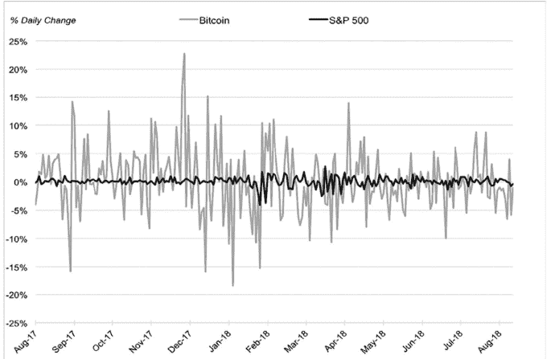

图2.2 比特币与标普500的波动

来源：Quandl


Reddit 只是最近悄然放弃对比特币支持的公司之一。

## 治理（无需治理）

第三个问题——在没有任何负责货币治理的中央机构的情况下，比特币的货币可行性——也许是对比特币生存最艰巨的挑战，并强调了对 *自由放任* 原则的错误信念。因为如果一种货币的价值对经济条件没有反应，或者相反，以无法控制的方式回应主流市场情绪，那么该货币有效促进市场交换的能力就会因对该货币信任的下降以及越来越倾向于将其视为投机资产而受到破坏。结果，治理可能看起来不那么限制性，也不那么根植于机构监管机制，但同时变得更加关键，以便最有效地促进经济条件和市场情绪的领域，从而管理竞争条件。在这方面，比特币表面上的“无信任”架构并非消除甚至最小化信任，而是将信任转移到了协议上。

通过使区块链上的投资者将自己视为“自我的企业家”，比特币在提出一种以前需要可信中介才能解决的问题的技术方案时引起了兴奋。然而，尽管新自由主义通过竞争性自我企业家的监管权力受到高度治理，但目前没有机制来解决保证和控制货币供应以及监控全球范围内价值重新分配的问题。如果没有某种能够打破加密货币挖矿卡特化的集中式、分布式或替代形式的参与式互动，区块链作为准确、可信且具有社会变革意义的账本的神圣性——用于在危机时期管理、分配和保证代币价值的稳定性——将永远面临危险。

比特币和其他加密货币的网络自由主义倡导者对机构的核心批评——即，货币可以由非市场力量有效管理——谴责了货币得以最初运作的那些监管特性。在某种意义上，网络自由主义者无法面对数字货币固有的局限性，因为他们顽固地坚持关于货币起源的主流神话，这一叙事描绘了一种无政府状态的原始共同体的图景，在其中，国家与货币曾一度分离，货币可以自由地作为效用最大化技术高效运作，以避免以物易物的负担（Gammon 2012）。但更重要的是，这些倡导者忽视了现代货币的基本性质，即货币与纸张之间的唯一区别在于由各种不同组成的监管机构所施加的干预类型，这些机构充当维持货币 *现状* 的最终担保者。

与任何私人开采的商品一样，嵌入比特币协议和其他工作量证明加密货币中不可撤销的 *自由放任* 特性，对难以避免的垄断倾向和价值投机性飙升毫无抵抗力。比特币和其他所谓的“无信任”加密货币架构，仅仅通过依赖金融主观性和投机性未来性作为区块链上治理的主要推动力，来促进新自由主义政府理性。5 然而，如我们在下一节中所讨论的，如果我们以不同的方式处理治理问题，绕过比特币关于“技术细节的信任”的悖论，区块链可以为在开放网络中开发和部署高度可靠、多用途的集体行动、参与和交换形式提供可能性，以服务于反对新自由主义资本主义和自由主义政治的项目。

## 区块链能摆脱其新自由主义政府理性吗？

尽管比特币和其他区块链算法未能带来一种真正颠覆当今时代主导逻辑的治理形式，但问题依然存在：新自由主义的金融和个人激励逻辑能否从区块链架构中根除？如果，如我们所证明的，新自由主义政府理性被编码进了比特币和类似加密货币的协议中，那么没有这种逻辑的区块链是什么样子？新自由主义政府理性的影响是否玷污了区块链、去中心化、“无信任”架构、密码学或分布式账本的理念？我们在此所要表明的是，区块链实际上有很多重要的东西可以提供给基于公共资源的项目，并可能被成功地用来灌输关于信任、交换、共同治理以及集体资源部署的替代观念。然而，关键在于认识到这样一个事实：区块链架构不仅仅是技术设计，而是一系列始终已经包含治理的政治选择，正如我们所论证的那样。

尽管新自由主义政府理性是区块链最流行应用的常见特征，但问题不在于区块链本身，也不在于去中心化、“无信任”架构、密码学或分布式账本的理念。玷污区块链的是我们当代的社会历史时刻。诚然，比特币等区块链应用的设计旨在颠覆这一当代时刻，尽管，正如我们所论证的，它们最终重新铭刻了新自由主义政府理性。事实上，这正是支撑比特币和区块链吸引力的原因：金融系统并非中立，它服务于某些利益而非其他利益。因此，即使有人不同意比特币的政治，或者正确地坚持认为比特币是一个最终被其所试图颠覆的金融利益所占有的失败设计，但想象一种不单纯重新铭刻新自由主义逻辑的基于公共资源的区块链方法，仍然是可能的。

虽然基于公共资源的区块链应用与比特币不共享相同的关切，但它们很可能共享对国家干预以激励竞争这一幽灵的忧虑。这是因为国家不仅仅是一个国家；正如我们所论证的，它是一个新自由主义资本主义国家。而这个国家的主要功能之一是激励竞争、私有化和放松监管，以取代对集体资源的共享、基于公共资源的治理模式。因此，新自由主义国家总是可以被依赖，将共享资源分配给私营部门，作为刺激竞争的基础。这一模式深深植根于国家自身的逻辑中，无数左翼政府试图通过国家权力建立不同经济秩序的失败尝试都证明了这一点。因此，在国家本身的性质得到根本改变之前，通过部署国家主义来建立替代秩序的希望渺茫。对某些人来说，区块链是对抗这一问题的壁垒，甚至可能是解决凯恩斯主义国家所提供的社会供给崩溃的方案。

因此，区块链可能为基于公共资源的项目提供关键优势：在拥有共同价值观的社区中建立凝聚力和信任，建立替代性的价值来源，保护公共资源，并允许服务不足的社区之间共享资源。因此，区块链有可能促进和放大人们对私有化公共资源、新自由主义政府理性、紧缩政治以及由国家和企业权力主导的全球金融系统的替代方案日益增长的渴望。

## 信任

在一个每个人都彼此认识且关系已经结构化的小型组织中，区块链是不必要的。区块链仅在一个特定的社区中才成为有用的工具，该社区的成员共享价值观但不一定彼此认识，不存在正式治理结构，且国家机构和金融利益占主导地位。在这些条件下，如果一个社区寻求在一个强调参与和共同治理的框架内集合或管理资源，区块链提供了一种可能颠覆性的技术，用于维护信任和管理共享资源。通过使用区块链来透明地管理、分配和保证共享资源的稳定性，即使外部市场关系被强加于社会生活的每一个方面和领域，紧缩政治迫使对国家提供的服务进一步削减，社区内部也可以培养信任（Gammon 2012）。因此，有些人认为区块链是规避将存在缩减为利润率，以及福特主义模式疲惫的一种方式，后者至少将利润和生产率增长与工资联系起来。

但这里的一个关键要素是，区块链应用程序的设计必须限制在特定范围内：它的目标不是提供颠覆主导经济和政治系统，而是试图规避它，并

为小规模组织提供替代工具。这种规避的第一步将是构建本地区块链，其结构不采取初创企业的模式，而初创企业最终旨在全球化扩张（Pazaitis et al. 2017），因为在全球化扩张过程中，共识必须来自拥有分歧且利益冲突的广泛全球参与者。这一要求限制了参与者作为共享社区一部分追求本地目标的能力。通过社区化扩张，明确社区的共同价值观和目标可以在区块链的社会再生产中保持其指导作用。

在这种规模下，区块链已作为基于公共物的项目的一部分获得真正成功，这些项目能够回应本地社区的需求和期望（Gloerich, Lovink, de Vries eds, 2018）。最深入实践这一愿景的项目是“社会钱包”，这是一系列分布在欧洲的试点项目。社会钱包的一个实现是米兰的 Macao，这是一个艺术家社区，他们利用社会钱包的区块链自我组织，该区块链记录社区内资源的分配。这本账本对所有社区成员可见，确保资源分配完全透明，为保持公平和公正提供了至关重要的激励。主要分配的资源是基本收入，但社区成员还被赋予权力，可以根据对社区贡献的工时来创建、分配和跟踪资源分发以及交换代币。这些贡献用于组织活动、照料公共空间或为城市公共物做贡献，且基于劳动时间（www.macaomilano.org, 2018）。⁶

## 价值

社会钱包的实现暗示了一种非常不同的价值概念。与比特币中的价值不同，比特币价值与金融资产交换价值的投机价值概念相关联，而对于社会钱包，价值源于公正回报与社会再生产相关的所有劳动方面，而不将该价值简化为交换价值。根据 Freecoin 的开发者所说，其区块链架构为社会钱包提供了基础，该架构专门设计为“让人们运行对其他组织透明且可审计的奖励方案。它适用于希望激励参与的参与性和民主组织，而不是集中式银行数据库”（https://freecoin.dyne.org/, 2018）。区块链对该系统至关重要，因为它们创建了一个信任管理系统，允许社区维护其贡献的神圣性，而无需将这些贡献简化为交换或货币价值。这意味着信任并不位于中央权威，也不位于“免信任架构”，而是位于社区，社区被赋予了主张特定贡献价值的能力。这些工时被追踪、记录和回报。成员们通过为社区目标做贡献投入时间，作为回报获得代币，这些代币可用于支付社区其他贡献者提供的其他服务。

## 激励化

通过在社区层面进行扩张，并以共同价值观和目标作为区块链架构的基础，激励机制不必模仿既有加密货币的投机和金融化逻辑，正如我们所见，它们只是复制了一种新自由主义治理方式。此外，没有必要将加密货币和既有货币形式视为互斥。例如，一些基于公共物的区块链已被设计为“互补货币”。这些货币旨在补充而非取代国家货币，并旨在激励在本地社区内消费。例如，SantaCoin 在桑塔卡安杰洛节上使用。它允许节日参与者将欧元兑换为 SantaCoin，并在参与的本地商家消费。其理念是让资金留在本地社区内部，在此过程中建立信任、网络和团结。根据设计者的说法，其理念是“从基层建立福利”（www.santarcangelofestival.com/en/santacoin/, 2018）。这提醒我们，货币不仅仅是交换手段，更是社会关系的体现，其设计从来不是中立的。通过仔细选择我们如何设计货币架构——现在通过区块链技术在本地层面已成为可能——可以建立新的激励机制，培育与新自由主义主导逻辑相悖的集体价值观和关系。基于公共物的组织中的这种革命潜力，正是让公共物活动家、左翼运动和参与式民主倡导者对区块链如此兴奋的原因，这也是有道理的。

## 结论

在此时此刻，对区块链技术的社会投资至关重要，因为它仍然不受既定机构利益和国家控制的管辖，且其潜力依然无限。近年来，围绕区块链的炒作已达到高潮，这主要基于这样一种观念：该技术本质上具有反霸权性，并颠覆国家和既定法定货币（Herian 2018）。然而，正如我们在此所示，鉴于自由意志区块链架构的主导地位及其对新自由主义逻辑和金融化竞争激励的隐含遵循，区块链技术的革命潜力存在重大局限。这些局限的根源在于一种根本性信念，即区块链本质上是免信任的，因此不受治理。但正如比特币和其他加密货币的历史所示，通过将“经济人”的幽灵转化为组织原则，此类区块链只是复制了新自由主义治理的最糟糕特征，并很少破坏向卡特尔化和垄断控制倾向的趋势。简而言之，旨在革命性颠覆既有秩序的加密货币已沦为投机性且高度波动的数字资产，将区块链技术变成了金融牟利的诡异平台。

然而，我们所阐明的是，区块链技术不必服务于此类目的。通过认识到区块链架构固有的政治维度，以及随之而来的*区块链治理*，就有可能对技术进行重新设计，以造福和增强本地社区和组织。就此而言，我们认为基于公共物的区块链应用方法是可能的、正在进行的，并且充满潜力。然而，此类基于公共物的区块链方法必须克制其扩张范围，以确保技术在本地部署并服务于社区的目标，而非仅仅通过部署区块链本身来追求反霸权转型。如要意译 Polanyi (1944/2001)，基于公共物的项目应致力于将区块链嵌入社区，而非试图将社会关系嵌入区块链本身（如其自由意志拥护者可能主张的那样）。尽管如此，区块链技术确实具有潜力，可以促进实现区块链原始系统性变革目标所需的那种社会关系和集体组织。

## 注释

- 1 例如，教育的例子展示了大学商业计划提案背后的理念。社会科学常被视为对公立大学预算的拖累，因此更倾向于推广更具盈利性的文凭。根据福柯（2008），在此情境下，政府权力并未压倒被治理者的自由。如果学生认为收益大于失业、高额学生贷款等成本，他们仍然可以“自由”选择社会科学。

- 2 重要的是，正如厄尔·甘蒙（2012）所指出的，福特主义下长期稳定工作的概念从未真正存在过。尽管购买力比例上的经济平等有所相对提高，但福特主义建立在对某些根深蒂固的不平等的接受之上，这些不平等引发了对战后凯恩斯主义妥协的挑战。在国际上，其前提是一种劳动分工，即殖民地和前殖民地继续充当西方国家原材料生产者的角色；而在国内，其基础是工业工作的性别化——通过将制造业呈现为男性化的体现——以及创造一种新的常态福特主义自我，这种自我基于节俭、卫生、准时和节制等观念，很大程度上依赖于种族和族群刻板印象。

- 3 作者讨论的第四个层级是比特币“混币器”，旨在增强转账的匿名性，因为严格来说，发送者和接收者的比特币地址在区块链本身上是公开可见的。混币器将付款拆分为块，然后在随机时间通过各种地址重新路由，以模糊底层转账地址。然而，像 DASH 和 Monero 这样的较新加密货币已将此功能嵌入核心客户端协议中。

- 4 见 https://blockchain.info/pools。

- 5 对“hold”这一单词的故意拼写错误，已成为比特币支持者中流行的模因，起源于2013年在比特币论坛上一位看似醉酒的用户发布的帖子。此后，它已成为比特币和其他加密货币爱好者的流行口号，表明他们无论波动或价值下降如何，都打算购买并持有加密货币。

- 6 来自网站：“我们想象的未来由去中心化的技术基础设施构成，分布式且基于算法。它们由民主


由共享价值观和理念的社区建立的讨论和决策过程。换句话说：在算法控制我们经济、关系和空间行为的合理未来中，真正的挑战是找到一种方式来质疑它们，而不会产生民主赤字作为副作用”。

## 参考文献

- Böhme, Rainer, Nicolas Christin, Benjamin Edelman, and Tyler Moore. 2015. “比特币：经济、技术与治理。”《经济学展望》，29(2): 213–238.
- Dowd, Kevin and Martin Hutchinson. 2015. “比特币将土崩瓦解。”《卡托期刊》，35(2): 357–382.
- Foucault, Michel. 2008. 《生命政治的诞生：法兰西学院讲座，1978–1979》. 纽约：帕尔格雷夫·麦克米伦.
- Galloway, Alexander. 2004. 《协议：去中心化后控制如何存在》. 剑桥，马萨诸塞州：麻省理工学院出版社.
- Gammon, Earl. 2012. “新自由主义的精神和社会起源。”《批判社会学》，39(4): 511–528.
- Golumbia, David. 2016. 《比特币的政治：作为右翼极端主义的软件》. 明尼阿波利斯，明尼苏达州：明尼苏达大学出版社.
- Harwick, Cameron. 2016. “加密货币与中介问题。”《独立评论》，20(4): 569–588.
- Herian, Robert. 2018. “认真对待区块链。”《法律与批评》，29(2): 163–171.
- Inte Gloerich, Geert Lovink and Patricia de Vries (编) (2018), 《MoneyLab Reader 2：超越炒作》. 网络文化研究所，阿姆斯特丹.
- Lazzarato, Maurizio. 2013. “当前危机中的政府理性。”《一代在线》，本文是柏林演讲的译文。可在 www.generation-online.org/p/fp_lazzarato7.htm 查阅.
- Lazzarato, Maurizio. 2015. 《债务治理》. 洛杉矶：半文本/干预系列.
- Lemke, Thomas. 2002. “福柯、政府理性与批评。”《重新思考马克思主义》，14(3): 49–64.
- Nakamoto, S. (2008) 《比特币：一种点对点电子现金系统》。https://bitcoin.org/bitcoin.pdf（最后访问：2019 年 1 月）.
- O'Dwyer, Rachel. 2016. “区块链及其陷阱。”载于 Trebor Scholz 和 Nathan Schneider (编) 《我们来黑客和拥有：平台合作社兴起，工作的新愿景和更公平的互联网》。纽约：OR Books.
- Pazaitis, Alex, Primavera De Filippi, and Vasilis Kostakis. 2017. “共享经济中的区块链与价值体系：Backfeed 的示例案例。”《技术预测与社会变革》，125: 105–115.
- Polanyi, Karl. 1944/2001. 《大转型》. 波士顿：信标出版社.
- Read, Jason. 2009. “经济人谱系：新自由主义与主体性的生产。”《福柯研究》，6(1): 25–36.
- Weber, Beat. 2016. “比特币与货币合法性危机。”《剑桥经济学杂志》，40: 17–41.

## 无许可区块链能否受监管并解决版权法的一些问题？

Guido Noto La Diega and James Stacey^1

### 引言

2018 年 10 月，欧洲议会通过了一项关于分布式账本技术的决议（欧洲议会 2018 年 10 月 3 日关于分布式账本技术和区块链的决议：通过去中介化建立信任（2017/2772(RSP)）），承认区块链有颠覆版权的潜力。本章的目的是考察区块链技术，并评估其对知识产权法律领域（特别是音乐行业的版权）的颠覆潜力。为此，本章将首先澄清，区块链并不存在，因为存在几种不同类型的区块链，相应地也存在不同的法律和监管问题。在确定本章分析的无许可区块链类型后，我们继续识别区块链技术的定义性和非定义性特征。要让区块链释放其颠覆潜力，必须澄清其是否遵守现有法律，以及是否需要新的法规。若发现现有法规不足，才能开始围绕新法规的严肃讨论，并且该讨论应考虑不扼杀创新的必要性、相关技术的发展水平、让所有利益相关方参与的重要性，以及将讨论置于超国家层面。本章的重点是批判性地评估公共无许可区块链能否通过解决版权法中的一些问题来颠覆知识产权法，特别是关于版权登记和侵权问题。将展示区块链如何通过允许防篡改、抗审查、用户友好且隐私友好的版权登记形式来解决登记问题。至于侵权问题，区块链可以通过使版权所有者更容易追踪其作品的使用，并使音乐消费者更容易识别所有者、寻求许可并支付版税来预防侵权。断言一项十年技术最终将颠覆版权或许为时过早，但已经出现一些迹象表明，区块链无许可、分布式、透明、无单点故障、防篡改和点对点的特征将通过修复其一些紧迫问题，从根本上改变版权。

### 区块链存在吗？

可以说，_那个_区块链并不存在；有几种不同类型的区块链，每种都有不同的法律问题。

话虽如此，一个良好的起点是美国国家标准与技术研究院（NIST）在 2018 年 10 月提出的技术概览（Yaga et al., 2018）。区块链被定义为“加密签名交易的分布式数字账本，这些交易被分组到区块中”。在就新区块的验证达成一致后，后者将被添加到链中，并以加密方式与前一个区块链接。如果有人试图篡改区块中记录的交易，参与者会注意到（篡改证据），并且区块越老，篡改它就越困难（篡改抗性）。区块链的分布式特征源于这样一个事实：每个参与者都拥有完整的链副本，“新区块”会在账本副本之间复制。然而，并非所有区块链都是完全分布式的。事实上，该领域的一个主要区别在于无许可区块链和许可区块链之间。前者的主要示例是比特币，其中每个用户都可以查看所有交易，拥有完整的链副本，并且原则上与其他参与者拥有相同的权力（点对点）。相比之下，许可区块链不是点对点的、去中介化的和完全透明的，因为有管理员或联盟授予用户权限。

本章关注的是开放、分布式、点对点、透明、防篡改且抗审查的无许可区块链。抗审查能力源于缺乏单点故障：由于它是分布式的，因此几乎不可能删除内容，因为即使一个节点宕机，网络的其余部分仍然存在（Sermpinis, 2018）。然而，我们正在探讨其法律问题的区块链并不是比特币类型的区块链。事实上，尽管我们指的是一种无许可技术，但由于我们希望将其应用于多种用途，我们心中想的是一种以太坊类型的区块链（Popper, 2017）。后者是图灵完备的，因此比比特币更通用；比特币只能用于简单交易，不允许用户在其之上构建智能合约（即自动执行实际合同的协议（Mik, 2017））（Brent, 2018）。

### 区块链技术的核心与非定义性组件

值得注意的是，对于区块链技术中哪些特征是严格定义性的且不可更改的，存在不同的看法（Fairfield, 2015）。但是，本章认为“区块链技术”实际上是三种不同技术组合的总称，不


所有这些在每个基于区块链的应用程序部署中都将保持明显（Maas, 2018）。

那三种技术中，第一种是区块链本身，作为一种结构化数据的方式。使区块链独特的是其使用密码学。通过利用某些密码学函数，区块链能够创建任何数据项的持久、防篡改记录，并验证每笔交易中各方的身份（英国政府首席科学顾问，2017）。毫不奇怪，区块链是区块链技术的一个定义性特征，将在每个区块链应用中明显（Maas, 2017）。

第二个要素是网络。比特币和以太坊等区块链技术的早期应用运行在公开可见、无需许可的区块链上，该区块链分布在点对点网络中（Bacon, 2018）。在此中，区块链上发生的任何事情都是整个网络的功能。一组称为“节点”²的计算机共同管理网络，意味着没有中央机构（Rosic, 2018）。在这种类型的区块链中，任何人都可以成为节点，区块链的全部内容都是公开可见的。然而，这并不意味着每个区块链技术应用都会是这样。分布式点对点网络或公共或无需许可的网络在某些情况下可能不是必需的，甚至不被允许。替代应用包括“私有”或“许可”网络，其中参与仅限于特定用户群组，且只能由指定各方查看。通常认为，区块链是一个可信系统³，参与者可以在不必相互信任且无需中介（例如，银行）的情况下进行交易。然而，这只能针对无需许可的区块链而言。反之，在许可区块链中，用户之间可能需要一定程度的信任，因为存在一些“中心化”元素（Bacon, 2018）。由风险投资支持的瑞波币（Ripple）是区块链应用的一个例子，该应用修改了底层技术，在需要一定程度的信任才能验证交易的环境中运行（英国政府首席科学顾问，2017）。各国政府也在探索使用中心化受信第三方的区块链概念。例如，爱沙尼亚自 2012 年以来一直在利用区块链技术，以帮助维持健康、司法和立法领域的数据完整性（“E-Estonia, 2018”）。出于这些原因，本章认为公共、无需许可的分布式点对点网络是早期基于区块链的应用程序的基本特征，而不是区块链技术所有版本中都会显现的定义性特征。尽管如此，当我们未另行说明时，对区块链的引用必须被理解为对无需许可的分布式点对点网络的引用，因为这些特征有可能颠覆，或至少深刻影响法律，尤其是版权。

最后一个组件是共识机制，即“在分布式系统中对有效状态达成一致的过程（主要共识机制包括工作量证明、轮询和权益证明）”。后者用于以太坊，可以是拜占庭容错证明或基于链的。

共识使分布式点对点网络中的节点能够在不需要彼此了解或信任的情况下协同工作。共识机制是一套由运行软件的节点网络商定的规则，这些规则调节新区块的添加（Maas, 2018）。这些规则确保网络的一致性，并确保参与者/系统行为是有效和适当的（Bacon, 2018）。鉴于共识机制解决了分布式点对点网络中的信任问题⁴，可以推断，如果区块链应用的部署不是分布式的，那么可能不需要这种共识机制。因此，本章将共识机制视为早期应用程序的基本特征，该特征可能会因技术采用的目的而改变，而不是所有基于区块链的应用程序中都显现的定义性特征。尽管如此，由于区块链的分布式特征可能对法律（尤其是版权）产生颠覆性影响，除非另有说明，我们将提及使用共识机制的区块链。

## 是否监管：这是个问题？

为了让区块链在音乐行业及其他领域释放其潜力，必须解开监管难题。过于严格的监管可能会扼杀创新，但缺乏任何监管可能会导致法律不确定性，进而减缓区块链的采用（Telpner, 2018）。对区块链或其某些方面和应用的监管处理，将是决定该技术在所有用例中取得成功程度的主要因素。鉴于区块链监管的重要性以及音乐版权受到严格监管，有必要深入探讨并研究区块链的一般监管处理。

区块链越普及，立法者对其监管的兴趣就越大。大多数现有法规、政策和判例法采取自上而下的方法，关注比特币，并相应地关注证据和税收问题。

例如，欧盟法院免除了比特币交易的增值税，因为它们只将“作为法定货币的货币、银行券和硬币”视为相关对象（Skattereket v David Hedqvist Katteverket v David Hedqvist, Case C-264/14）。关于证据方面的关注，请参见《亚利桑那州修订法典》44-7061。

然而，最常见的方法是评估现有法律是否以及如何适用于区块链⁵，并避免引入新法规，“鉴于该技术仍在不断发展，实际应用在数量和范围上均有限”（欧洲证券和市场管理局，《应用于证券市场的分布式账本技术报告》（ESMA，2017），4）。

在美国，美联储理事会以及纽约和芝加哥联邦储备银行也采取了类似的“观望”方法（参见 Mills, David, Kathy Wang, Brendan Malone, Anjana Ravi, Jeff Marquardt, Clinton Chen, Anton Badev, Timothy Brezinski, Linda Fahy, Kimberley Liao, Vanessa Kargenian, Max Ellithorpe, Wendy Ng, and Maria Baird (2016)。“支付、清算和结算中的分布式账本技术”，《财政与经济讨论系列》2016–095。华盛顿：美联储系统理事会，https://doi.org/10.17016/FEDS.2016.095。另请参见，类似地，金融业监管局，《分布式账本技术：区块链对证券行业的影响》（FINRA，2017））。与普遍看法相反，区块链并非无法无天的技术；最近的研究强调，我们应该放弃这种天真观念，即区块链交易将“摆脱传统法律的困扰，从而承诺在无需第三方中介的情况下实现基层民主治理”（Yeung, 2019）。大多数现有法律适用于区块链，但如果要引入新法规，采取参与性和全面的方法会更好。的确，如果要确保区块链释放其全部潜力并使所有参与者受益，让所有利益相关方参与并牢记所有潜在的社会法律问题至关重要。

比特币，作为第一个也是最广泛使用的区块链，旨在消除国家机构对货币的影响。许可区块链继承了本质上跨国且（可能）无国家特征，从而提出了根本问题：是否有可能对其进行监管，如果可能，又该如何监管。然而，这些问题并非新鲜事，因为互联网也是跨国的，却受到高度监管。最近的研究表明，物理世界中的大多数规则都可以应用于网络空间，尽管关于哪个机构可以合法地对其进行监管存在明确问题（Chris Reed 和 Andrew Murray，《重新思考网络空间法理学》（Elgar 2018））。比特币和区块链已经超越了密码朋克时代（Lopp, 2016），当时使用比特币及类似技术的社区主要由持有自由主义和反体制政治立场的个人组成（Stankovic, 2018）。如今，比特币已进入主流，甚至在日本成为合法支付方式（Garber, 2017）。区块链反过来也走出了比特币的阴影，现在提供了广泛的潜在用例，其中一些有望带来革命性变革（Swan, 2015）。然而，为了实现区块链的全部颠覆潜力，它需要安抚其将运行其中的法律和监管环境（“区块链——关键法律和监管问题”Lexis PSL TMT）。确实，除了加密货币之外，区块链在许多未考虑区块链而设计的高度监管行业中都有潜在应用。这最终可能意味着，区块链的使用可能被发现与当前监管框架不兼容（Finck, 2017）。如果是这样，这种不兼容性不可避免地产生的不确定性无疑将限制创新，并最终阻止


大规模采用区块链到这些领域。为了成功驾驭这些受严格监管的行业，似乎有必要将监管视为为参与区块链发展的人提供确定性并鼓励创新的工具，而不是监管者用来扼杀创新的工具（除非另有规定，术语“监管者”泛指跨司法管辖区的任何立法者和监管者，无论其在跨国、超国家、国家或次国家层面运作；“区块链 – 关键法律和监管问题”（n 35））。然而，问题不仅适用于受监管行业，还适用于所有处理个人数据的领域。确实，于2018年5月生效的欧盟一般数据保护条例（GDPR）引入了在区块链环境下实施可能困难甚至不可能的原则、义务和权利（Berberich, 2016; Herian, 2018）。例如，数据主体有权更正其个人数据，但一旦数据进入区块链，更改它几乎是不可能的（Ibáñez, 2018; CNIL, Blockchain, 2018）。

部分文献认为，区块链的监管是不可避免的，最终开发者社区实际上会欢迎这种监管。根据这一观点，监管者将通过接受创造性解决方案来争取开发者，以在保护相关公共利益目标和刺激创新之间取得正确平衡（Kevin, 2017）。这一观点的依据基于这样一个事实：二十年前，互联网早期阶段也发生了同样的情景。更近期的平台经济现象（Kenney, 2017）也强化了这一情景的发展方式（Noto La Diega, 2016）。例如，Uber曾臭名昭著地不愿与监管者合作（Arvelo, 2018），但现在已积极寻求关于适用于全美的保险立法的监管干预（Uber, ‘保险一致’, 2018），并且截至2018年3月，他们已指示保险公司以符合这些要求（Uber, '关于保险的更新', 2018）。

如果监管是不可避免的，下一个问题是如何监管。展望未来，成功的监管似乎取决于多个因素。首先，监管者需要从过去在其他新兴技术方面的错误中吸取教训，并确保不重复这些错误。虽然区块链仍是一项不成熟的技术，其用例在不断发展，但可以认为，早期的监管承认和关注应被视为积极的，因为必须意识到对新兴技术兴趣滞后可能产生的负面影响（正如Finck, 2017所指出的，互联网发展早期阶段遭受了兴趣滞后的负面影响）。

其次，成功的监管不仅取决于监管者自身。相反，行业和参与区块链开发的人也应该积极相互合作，并与监管者合作来应对当前的复杂挑战（Finck, 2017）。如果参与区块链开发的人确实决定抵制监管尝试，有人建议‘[i]f anything, the innovators stand to lose the most by delaying government involvement in adopting reasonable solutions’（Werbach, 2017）。

第三个因素涉及区块链监管的层级。通常，监管者监管技术的使用，而不是监管技术本身。然而，区块链不断增长的用例意味着监管者发现难以进行监管（“区块链 – 关键法律和监管问题”（n 35））。然而，一些学者认为这仍然是最佳方法，并声称以用例为中心的方法得到了互联网等其他新兴技术经验的支持（Maupin, 2017）。如果要成功采用这种方法，上述所有参与特定用例各方的协作努力将是关键。不仅如此，区块链的不可预测性将要求对每个用例采取灵活、开放的方法，以便法律能够随着技术的发展而发展（Finck, 2017）。

即便如此，即使开发出灵活、敏捷、针对特定用途的监管，如果该监管模式仅适用于一个国家，其积极影响可能有限。区块链的分布式潜力，加上其无形性，意味着其应用可能同时在多个司法管辖区运行。这可能意味着不明确是谁在进行受监管活动。如果情况属实，监管者可能难以确定特定区块链的活动是否需要监管，如果需要，在哪个司法管辖区下监管。此外，如果出问题，可能难以确定对违规或失败负责的肇事者的确切位置和身份（“区块链 – 关键法律和监管问题”（n 35））。因此，成功的监管还将要求监管者进行跨国对话与合作，试图制定某种一致的协作治理。⁶ 尽管国际公约似乎是监管的最合适层级，但实际上不太可能达成协议，而且即使达成，规则也可能不适用于区块链或将被考虑的特定用途。⁷

总之，没有监管胜过糟糕的监管。需要更多证据来澄清现有法规在区块链方面是否足够。如果发现现有法规不足，才能开始就新法规展开严肃讨论，并且讨论应考虑不扼杀创新的必要性、相关技术的发展水平、让所有利益相关方参与的重要性，以及将讨论置于超国家层面。只有这样才能实现法律确定性，并使区块链释放其颠覆性潜力。

## 区块链对版权法的颠覆性潜力

在定义区块链技术并阐明技术和监管要素之后，本章的其余部分将探讨区块链可能对知识产权法律领域产生的颠覆性潜力，以音乐版权为例。

本节主要关注知识产权，特别是版权，即保护文学、音乐、戏剧和艺术作品等审美和艺术创作的法律体系。8 区块链技术可以以多种方式影响版权，正如欧洲议会2018年10月3日关于分布式账本技术和区块链的决议所承认的：通过去中介化建立信任。欧盟决议强调，分布式账本技术可用于跟踪和管理知识产权，从而促进版权和专利保护。9 它还承认该技术有潜力通过“一个还能清楚识别所有权和版权的开放公共账本”来发展艺术家的所有权。随后，人们认识到在协作和开放创新环境（例如3D打印）中，区块链将创作者与其作品联系起来的能力至关重要。最后，作者可以从其作品使用的透明度和可追溯性以及通过削减中介人而预期的特许权使用费分销顺畅化和收入增加中受益。关于最后一点，重要的是要批判性地指出，区块链消除传统中介人的承诺不太可能实现（O'Dair, 2016）。再中心化趋势的证据是传统中介人对区块链的投资（PRS for Music, 2018）以及许可型区块链的兴起，其中去中介化只是部分的（Bacon, 2018）。

尽管区块链是否会颠覆版权仍不清楚，但可以认为，它们可以解决影响这一法律领域及相关行业的一些问题，特别是在版权登记、侵权、管理10和交易方面。11 为了简洁起见，本节将重点介绍，如果有的话，前文描述的类型区块链如何解决版权登记和侵权（通常称为“盗版”）的一些问题。

### 用于隐私友好、敏捷、防篡改和抗审查登记的区块链

伯尔尼公约12带来的主要创新之一是，版权随作品的创作而产生（例如，一旦一本书写成），而无需任何形式，即无需公共登记系统（伯尔尼公约，第5(2)条）。此类形式使政府能够事先控制书籍内容，从而使它们能够审查与政府政策或占主导地位的伦理价值相悖的作品（Mann, 2016）。废除登记形式是积极的，因为它有利于作者，使版权易于获得，并减少政府审查作者的机会。然而，没有登记，在版权侵权诉讼中存在证据问题，因为很难证明谁在什么时间创作了什么。13 例如，如果John在未经Jerry许可的情况下分享了后者拥有的一张图片


在Instagram上发布后，Jerry如何证明他创作了上述作品（该图片），且他在John之前完成，并且他是唯一合法的作者和权利人？为解决这类问题，美国等一些国家实际上绕过了伯尔尼公约，并*事实上*重新引入了版权登记。确实，即使版权在作品创作时产生，但在侵权诉讼中，如果没有登记，法定赔偿金和律师费将不会被判决。¹⁴ 在英国，没有这种限制，但如果没有登记，上述取证问题依然存在。因此，引入了新的登记机制以确保证据；然而，这些机制往往给作者带来负担（例如，费用高昂且不易使用），并且可能被伪造；特别是在纸质账本中，存在“高程度的伪造”（英国政府首席科学顾问（n 11）7）。除了审查、伪造和不易使用的问题外，现有的登记系统从隐私角度也难免受到批评。在美国，情况也是如此，版权局的程序规则和美国地区法院的态度使得化名和匿名作者在侵权诉讼中很难胜诉（Bell, 2016）。

所有这些问题都可以通过区块链支持的版权登记来解决。确实，区块链平台可以发行一种代币，作为真实性证明，其中包含带时间戳的版权登记信息。可以说，这种颠覆性系统能够实现更便宜、更透明、更易用的登记（Buntinx, 2018）——正如Savelyev（2018）所指出的，“区块链可以在版权所有权链问题上引入长久期待的透明度”。因此，伪造问题也将得到解决，因为区块链具有防篡改性。¹⁵ 此外，无许可区块链的关键特征之一是它们没有单点故障。因此，如果作者提交作品进行登记，而政府希望出于审查目的将其下架，这在实践中几乎是不可能的¹⁶，因为“即使有几个节点失败，网络仍将继续运行”（Bacon, 2018），且该作品仍然可用，因为所有数据由所有节点维护。¹⁷ 最后，关于匿名和化名作者的隐私，分布在点对点网络上的公共无许可区块链可以通过提供强大的数字化名来解决他们的问题，“一种面具，在隐藏作者真实身份的同时，仍然对他或她是唯一的”（Bell, 2016）。

区块链登记将是可选的，从而符合伯尔尼公约，并将确保传统登记在侵权诉讼证据方面的优势，同时避免其在成本、伪造、审查和隐私方面的缺点。

## 区块链与版权侵权：一种模棱两可的关系

版权侵权，通俗地称为“海盗行为”，是一个普遍问题，这从53%的年轻用户非法访问音乐¹⁸，以及Spotify等新中介常常未经权利人同意提供音乐¹⁹（声称是因为他们不知道权利人是谁）可以得到说明。版权侵权之所以猖獗有多种原因，其中两种可以通过区块链来解决。第一个原因是版权所有者很难追踪其作品的使用情况。一首歌曲发布后，目前所有者几乎无法知道谁在访问它以及如何访问。社交媒体时代盛行的分享做法加剧了这一问题。确实，可以说我们生活在共享社会中，²⁰ 在其中分享受版权保护的材料很容易，特别是在社交网站上，例如，转发某人的推文，而该推文又转发了另一个人的推文。²¹ 这不仅意味着许多人侵犯版权，可能自己都没有意识到，而且在经过多次分享和链接后，很难追溯原始所有者是谁。归根结底，版权所有者难以追踪其内容的使用情况，降低了合法获取内容的动机，因为最终用户合理地期望所有者无法追踪其内容的消费，因此无法维护自己的权利。

版权侵权如此普遍的第二个原因，特别是在音乐行业，是通常无法知道作者和权利人是谁。²² 这是因为没有要求登记版权，更重要的是，缺乏一个统一的音乐元数据更新数据库。音乐元数据是关于音乐中谁做了什么的数据。音乐元数据分散在不同步的数据库中，这些数据库由公司拥有，这些公司对哪些内容应该公开、哪些内容应该保持私有持有冲突的看法（DA Wallach, 2014）。出于法律和商业原因，音乐所有权极其复杂。一方面，根据《1988年版权、设计和专利法》²³——英国版权的主要法规——一首歌曲至少有三个所有者，即歌词作者、音乐作者和声音录制制作者。从商业角度来看，音乐是一项协作事业；确实，大多数“录音音乐是词曲作者、歌手、音乐人、制作人、录音工程师和母带专家之间的合作”（DA Wallach, 2014）。所有这些主体以及Spotify和iTunes等其他新中介在行业中都有利益，并在音乐收入的分配中抱有某些期望。出于这些原因，艺术家只能获得有限的收入份额，并且只有在很长一段时间之后才能收到（Heap, 2016）。如果艺术家最终能分得“版税蛋糕”的一块，这笔钱也要在出版后六到十八个月才能到账（Heap, 2016）。音乐归属和版税分配的问题并非新事物，但新技术和新的音乐消费方式使其雪上加霜。在黑胶唱片和CD时代，很容易了解谁做出了贡献以及如何贡献，但iTunes、Spotify等平台却造成了署名谜团，听众只知道是谁唱的，一无所知。识别版权所有者（并对其给予回报）困难的最后一个原因是，尽管存在作者（音乐作者、歌词作者等）是相关作品所有者的推定，²⁴ 但情况往往并非如此，要么是因为该作品是在受雇期间制作的，因此由雇主所有，要么是因为所有权通过版权转让合同转让给了第三方。这些合同通常伴随着所谓的署名权放弃，即作者放弃被承认为作者的权利。²⁵ 如果版权署名权可以被放弃，那么它很可能会被放弃，因为许多创意行业中的相关关系往往以议价权失衡为特征（需要牢记的是，行业倾向于“迫使作者和艺术家签订格式合同，要求他们放弃其完整权利”（Lionel Bently and Brad Sherman, Intellectual Property Law (4th ed, OUP 2014) 290））。出于所有这些原因，音乐常常未经权利人许可就被消费，而系统对艺术家的回报不足、不及时，甚至根本没有回报。

无许可区块链可以解决这两个问题。像Mycelia这样的基于区块链的音乐平台可以允许艺术家发行一种代币，只有在所有者用其私钥签署交易时才能转移。这会降低最终用户非法访问音乐的动力。至于音乐元数据的难题，分布在点对点网络上的公共无许可区块链可以通过创建一个全球更新的音乐元数据数据库来解决版权侵权问题。区块链可以成为去中心化、开源的全球平台的骨干，不受任何单一实体控制，并有可能包含涵盖署名和权利所有权的准确、实时、全球数据（Wallach (n 85)）。正如一些学者所指出的，大多数版权登记处都具有地域性，但创建全球登记处不需要政府信任其他政府或第三方，“相反，可以将信任置于区块链技术提供的数学确定性之中”（Wright, 2015）。此外，区块链可以作为一种技术手段，在实际中使强制签署署名权放弃协议的做法失效，从而有助于解决包括音乐在内的创意行业中权力的结构性失衡。一旦在区块链平台上记录，任何人都无法质疑作者身份和所有权。

在使合法访问受版权保护的内容变得更加容易的同时，区块链可以防止版权侵权。然而，与此同时，它也可能构成一个问题，因为鉴于区块链的分布式特性及其没有单点故障，侵权内容无法被删除：一旦上链，它将存储在每个节点中，可能永远存在。²⁶ 近年来，版权所有者应对版权侵权的主流方式不是起诉最终用户或实际侵权者，而是针对使该侵权成为可能的中介（例如，BT或Sky等互联网服务提供商）。²⁷ 然而，在无许可区块链中，原则上不存在中介，或者更准确地说，后者具有不同的、更难以捉摸的身份。一旦文件上链几乎不可能删除，加上固有的去中介化，这很可能会使得


强制执行版权。然而，区块链的颠覆潜力可能表现为完全防止侵权，通过允许版权所有者追踪其作品的使用，并推动一个全球更新的音乐元数据库，这将使版税分配更加顺畅和公平。

## 结论

目前，没有可靠的版权所有权登记册，这造成了证据问题，因为主张人难以证明其与被侵权作品之间的联系，也难以证明创作时间。目前的登记系统容易被伪造，可被用作审查手段，既繁琐又不利于匿名作者。基于区块链的登记机制将通过提供一个防篡改、抗审查、用户友好且保护隐私的平台来解决这个问题。

至于版权侵权或盗版，其呈上升趋势，因为所有者无法追踪其作品的使用，而且通常难以知道谁是所有者，这反过来使得寻求许可和支付版税几乎不可能。然而，使用区块链，艺术家可以决定通过转移代币来转让音乐，并用其私钥对交易签名。未经授权的使用将不可能实现。此外，区块链将允许创建全球、不断更新的音乐元数据，这将使查找和奖励版权所有者变得更加容易。

目前还为时过早，无法评估区块链是否会颠覆音乐产业并解决版权的所有问题——版权是一套在数字时代不适用性显著的法律（关于区块链与某些版权原则的兼容性，参见 Bodó, B., Gervais, D., and Quintais, J. P. (2018). Blockchain and smart contracts: the missing link in copyright licensing? International Journal of Law and Information Technology, 26(4), 311–336）。然而，从本分析来看，区块链似乎可以为解决版权所有者和作者面临的一些问题作出贡献。为了成功，这些潜在解决方案必须伴随双重谨慎。首先，不成熟的区块链技术必须克服其技术问题，无疑地证明它比其所取代的技术更具优势。其次，它必须安抚当前的监管框架，以使这些技术进步能够实现大规模采用。虽然新法规不一定是最佳前进方向，但监管者应与法律学者和行业利益相关者密切合作，澄清现有法律如何适用于这项新技术。的确，在没有法律确定性的情况下，区块链不太可能释放其颠覆潜力。

## 注释

- 1 作者感谢匿名评审员的有益意见。尽管如此，任何错误和观点的责任均由作者承担。本章是一项合作成果，但 Guido Noto La Diega 负责法律部分，James Stacey 负责技术部分。
- 2 这些是连接到区块链网络的计算机。所有基于区块链的应用都由节点组成。然而，谁可以成为节点以及每个节点允许的参与程度，将取决于部署的区块链应用类型。节点存储区块链的本地副本。‘全节点’存储完整的区块链副本，而‘轻节点’仅保留验证交易所需的部分区块链（Bacon (n 14) 11）。
- 3 然而，Yaga (n 2) 38 强调，即使在所谓的“无信任”系统中也需要信任，例如，对加密技术的信任以及用户不会秘密串通的信任。有关其他批评意见，参见 Carl, Uggla, and Hallström Carl-Johan, ‘Is It as Trustless as They Say?: A Functional Analysis of the Blockchain and Trust’ (2018)。
- 4 然而，共识机制并不总能导致正确的执行结果，因为参与者可能受到智能合约中经济利益的影响，正如 Chen, L., Xu, L., Gao, Z., Lu, Y., & Shi, W. (2018) 所指出的。‘Tyranny of the Majority: On the (Im)possibility of Correctness of Smart Contracts’. IEEE Security & Privacy, 16(4), 30–37。
- 5 例如，在英国，金融行为监管局认为大多数首次代币发行（ICO）不受监管，但他们采取个案处理方式来决定 ICO 是否属于其职权范围——金融行为监管局，关于首次代币发行（“ICO”）风险的消费者警告（FCA, 2017）。
- 6 Peter Yeoh, ‘Regulatory Issues in Blockchain Technology’ (2017) 25 JFRC 196, 200。
- 7 关于“法律滞后”问题，即创新必然受到监管的延迟，参见 Roberto Pardolesi, ‘‘Software”, “property rights” e diritto d’autore: il ritorno dal paese delle meraviglie’。(1987) 3, II Foro it., 300。该思想由 Guido Noto La Diega 应用于版权监管，‘In Light of the Ends. Copyright Hysteresis and Private Copy Exception after the British Academy of Songwriters, Composers and Authors (BASCA) and others v Secretary of State for Business, Innovation and Skills Case’。(2015) no. II Diritto Mercato Tecnologia 1–16。
- 8 Charlotte Waelde, Abbe Brown, Smita Kheria, and Jane Cornwell, Contemporary Intellectual Property (OUP 2016), 3。
- 9 2017/2772(RSP), 第 22 段。
- 10 区块链可以通过减少传统中介的作用来使版税分配更加顺畅，尽管人们可以怀疑中间商是否真的会被消除。有许多理由表明区块链不会消除中介。其中包括传统中介正在大力投资区块链，以及在线版权执法往往针对中介而非最终用户；因此，立法者和法院有强烈的利益让中间商继续参与。
- 11 由于基于区块链的智能合约，版权交易可以得到保障。然而，有人认为这些自动执行的协议既不是“智能”的也不是“合同”，这会产生实际的法律后果。使用智能合约（和智能许可）的合同各方缺乏违约的灵活性，这有可能将该应用在区块链上的实际影响限制在非常简单和常规的交易上。有效违约学说表明，在大多数司法管辖区，法律制度保护合同各方通过违约来改变主意并以更有效的方式重新分配资源的基本权利。社会和法律建立在个人可以改变主意的假设之上，而这似乎没有体现在这项新技术缺乏灵活性的问题上。
- 12 1886年9月9日《保护文学和艺术作品伯尔尼公约》，于1896年5月4日在巴黎完备，1908年11月13日在柏林修订，1914年3月20日在伯尔尼完备，1928年6月2日在罗马修订，1948年6月26日在布鲁塞尔修订，1967年7月14日在斯德哥尔摩修订，1971年7月24日在巴黎修订，并于1979年9月28日修正。
- 13 应牢记，版权不是垄断；因此，相同作品的独立创作不构成侵权。要构成侵权，主张人需要证明被告就作品的整体或实质性部分实施了受限制的行为（例如，复制了书籍、图片等），并且主张人的作品与被告的作品之间存在因果联系。后者要求意味着要么有直接的复制证据，要么可以从作品之间的相似性和复制机会中推断出来。参见英国《1988年版权、设计和专利法》第 16 条。
- 14 美国版权局，通告 1，版权基础，“版权注册”部分。
- 15 尽管如此，区块链并非绝对不可更改，DAO 打破其区块链规则以回应一些黑客利用代码中的漏洞的行为就证明了这一点。关于此事及其影响，参见 O’Hara, K. (2017). ‘Smart contracts-dumb idea’. IEEE Internet Computing, 21(2), 97–101。
- 16 这种情况，加上采用区块链可能带来的去中介化，将使版权执法变得非常复杂，因为近年来的趋势一直是针对中介而非最终用户。最明显的例子是针对 ISP 的禁令，例如，在发生非法下载音乐或视频的情况下。
- 17 这取决于区块链的类型；例如，它不适用于许可型区块链。
- 18 ‘2017 年按年龄组划分的通过版权侵权访问音乐的全球互联网用户份额’。Statista (2018) <www.statista.com/statistics/609114/music-copyright-infringement-by-age/> 于 2018 年 12 月 5 日访问。关于知识产权侵权的更一般实证分析可见于 欧盟知识产权局，知识产权侵权综合报告 2018 (EUIPO 2018)。这并不是说版权侵权总是且必然是一件坏事，正如 ECORYS, 估计欧盟版权内容的替代率 (European Commission 2017) 所证明的那样。
- 19 因此，Spotify 必须在 Ferrick, et al. v. Spotify USA Inc., et al., No. 16-cv–8412 (AJN) 美国纽约南区地方法院案件的和解中向词曲作者支付 1.12 亿美元。
- 20 ‘所有人都在关注共享社会’。世界知识产权评论 (2015 年 3 月/4 月) <www.rightsdirect.com/wp-content/uploads/sites/6/2015/04/WIPR-Kim-Zwollo-04.15.pdf> 于 2018 年 5 月 30 日访问。
- 21 关于‘推特’的版权和转帖侵权问题，参见 R. Haas, ‘Twitter: New Challenges to Copyright Law in the Internet Age’。(2010) J Marshall Rev Intel Prop L, 10 i。
- 22 原则上，作者是相关作品的首个版权所有者，但存在一些例外，主要例外是雇员在受雇过程中创作的作品。参见英国《1988年版权、设计和专利法》第 11 条。
- 23 英国《1988年版权、设计和专利法》第 3(1) 条、5A 条和 10A 条。
- 24 英国《1988年版权、设计和专利法》第 9 条。
- 25 英国《1988年版权、设计和专利法》第 87(2) 条。在许多大陆法系司法管辖区，此类弃权不可强制执行；参见法国《知识产权法典》第 L. 121–1 条以及 Huston v TV5 案，法国最高法院民事第一庭，1991 年 5 月 28 日，89–19.522 89–19.725 [1991] RIDA 149, 197，其中法国最高法院认为道德权利是公共政策问题，因此，根据美国版权法合法的弃权在法国不可强制执行。


26 删除内容的困难可能产生远超版权范围的重大后果。人们只需想到那项在区块链上发现色情儿童链接的研究，便会引发这样一个问题：所有参与者是否都应对区块链上的非法内容承担责任（Matzutt, R., Hiller, J., Henze, M., Ziegeldorf, J. H., Müllmann, D., Hohlfeld, O., and Wehrle, K. (2018). A Quantitative Analysis of the Impact of Arbitrary Blockchain Content on Bitcoin. In Proceedings of the 22nd International Conference on Financial Cryptography and Data Security (FC) (Springer).

27 在英国，通过针对互联网服务提供商及其他中介（而非最终用户或主要侵权人）来应对版权侵权的趋势，可见于Dramatico v BSkyB (2012) EWHC 268 (Ch)；Paramount & Others v British Sky Broadcasting (2013) EWHC 3479；1967 Ltd v BSkyB, BT and others (2014) EWHC 3444。在欧盟，参见例如 UPC Telekabel Wien v Constantin Film Verleih (C-314/12) (2014) EC.D.R. 12；Svensson & others v Retriever Sverige AB (C-466/12) (2014) All ER 609 (EC)；GS Media BV v Sanoma Media Netherlands (C-160/15) (8 September 2016).

## 参考文献

### 判例法

- 1967 Ltd v BSkyB, BT and others [2014] EWHC 3444.
- Dramatico v BSkyB [2012] EWHC 268 (Ch).
- Ferrick, et al. v Spotify USA Inc., et al., No. 16-cv-8412 (AJN) United States District Court, S.D. New York.
- GS Media BV v Sanoma Media Netherlands (C-160/15) ECLI:EU:C:2016:644.
- Huston v TV5, Cour de Cassation, Chambre civile 1, 28 May 1991, 89–19.5522 89–19.725 [1991] RIDA 149.
- Paramount & Others v British Sky Broadcasting [2013] EWHC 3479.
- Skatteverket v David Hedqvist (Case C-264/14) ECLI:EU:C:2015:718.
- Svensson & others v Retriever Sverige AB (C-466/12) [2014] All ER 609 (EC).
- UPC Telekabel Wien v Constantin Film Verleih (C-314/12) [2014] EC.D.R. 12.

### 著作书籍

- Pilkington, M., ‘Blockchain Technology: Principles and Applications.’ In Olleros, F. and Zhegu, M. (eds.), Research Handbook on Digital Transformations (Edward Elgar 2016).
- Reed, C. and Murray, A., Rethinking the Jurisprudence of Cyberspace (Elgar 2018).
- Swan, M., Blockchain: Blueprint for a New Economy (1st edn, O’Reilly & Associates 2015).
- Waelde, C., Brown, A., Kheria, S., and Cornwell, J., Contemporary Intellectual Property (OUP 2016).

### 报告和白皮书

- Commission nationale de l’informatique et des liberté, Blockchain. Premiers éléments d’analyse de la CNIL (CNIL 2018).
- ECORYS, Estimating Displacement Rates of Copyrighted Content in the EU (European Commission 2017).
- European Intellectual Property Office, Synthesis Report on IPR Infringement 2018 (EUIPO 2018).
- European Securities and Markets Authority, Report the Distributed Ledger Technology Applied to Securities Markets (ESMA 2017).
- Financial Conduct Authority, Consumer Warning About the Risks of Initial Coin Offerings (‘ICOs’) (FCA 2017).
- Financial Industry Regulatory Authority, Distributed Ledger Technology: Implications of Blockchain for the Securities Industry (FINRA 2017).
- Mills, D., Wang, K., Malone, B., Ravi, A., Marquart, J., Chen, C., Badev, A., Brezinski, T., Fahy, L., Liao, K., Kargenian, V., Ellithorpe, M., Ng, W., and Baird, M., ‘Distributed Ledger Technology in Payments, Clearing, and Settlement’ Finance and Economics Discussion Series 2016–095 (Washington: Board of Governors of the Federal Reserve System, 2016) <https://doi.org/10.17016/FEDS.2016.095>.
- O'Dair, M. et al., Music on the Blockchain (Blockchain For Creative Industries Research Cluster, Middlesex University 2016).
- Telpner, J., The Lion, the Unicorn, and the Crown: Striking a Balance Between Regulation and Blockchain Innovation (Blockchain Research Institute 2018).
- UK Government Chief Scientific Adviser, Distributed Ledger Technology: Beyond Block Chain (Government Office for Science 2017).
- Yaga, D., Mell, P., Roby, N., and Scarfone, K., Blockchain Technology Overview (NIST 2018).

### 期刊文章

- Bacon, J. et al., ‘Blockchain Demystified’. Queen Mary University of London, School of Law Legal Studies Research Paper No. 268/2017 (2018) <https://ssrn.com/abstract=3091218> accessed 29 January 2018.
- Bell, T.W., ‘Copyrights, Privacy, and the Blockchain’ (2016) 42 Ohio Northern U L Rev 439, 464.
- Berberich, M. and Steiner, M., ‘Blockchain Technology and the GDPR – How to Reconcile Privacy and Distributed Ledgers.’ (2016) 2 Eur Data Prot L Rev 422, 426.
- Bodó, B., Gervais, D., and Quintais, J., ‘Blockchain and Smart Contracts: The Missing Link in Copyright Licensing?’ (2018) 26 (4) International Journal of Law and Information Technology 311–336.
- Brent, L., Jurisevic, A., Kong, M., Liu, E., Gauthier, F., Gramoli, V., Holz, R., and Scholz, B., ‘Vandal: A Scalable Security Analysis Framework for Smart Contracts’ arXiv preprint arXiv:1809.03981 (2018).
- Carl, U. and Carl-Johan, H., ‘Is It as Trustless as They Say?: A Functional Analysis of the Blockchain and Trust’ (2018).
- Chen, L., Xu, L., Gao, Z., Lu, Y., & Shi, W., ‘Tyranny of the Majority: On the (Im) Possibility of Correctness of Smart Contracts.’ (2018)16 (4) IEEE Security & Privacy 30–37.
- DA Wallach, ‘Bitcoin for Rockstars’ (Wired, 12 October 2014) <http://www.wired.com/2014/12/bitcoin-for-rockstars> accessed 1 June 2018.
- Fairfield, J., ‘Bitproperty’ (2015) 88 (4) SCL Rev 805.
- Finck, M., ‘Blockchain and Data Protection in the European Union.’ Max Planck Institute for Innovation and Competition Research Paper No. 18–01 2 (2017) <https://papers.ssrn.com/sol3/papers.cfm?abstract_id=3080322> accessed 22 March 2018.
- Finck, M., ‘Blockchain Regulation.’ Max Planck Institute for Innovation and Competition Research Paper No. 17–13 (2017) <https://ssrn.com/abstract=3014641> accessed 26 March 2018.
- Haas, R., ‘Twitter: New Challenges to Copyright Law in the Internet Age.’ (2010) 10 J Marshall Rev Intell Prop L i.
- Herian, R., ‘Regulating Disruption: Blockchain, GDPR, and Questions of Data Sovereignty.’ (2018) 22 (2) Journal of Internet Law 1.
- Ibáñez, L.-D., O’Hara, K. and Simperl, E., ‘On Blockchains and the General Data Protection Regulation’ (2018).
- Imogen Heap and Don Tapscott, ‘Blockchain could be Music’s next Disruptor’ (Fortune, 22 September 2016) <http://fortune.com/2016/09/22/blockchain-music-disruption> accessed 1 June 2018.
- Kenney, M. and Zysman J., ‘The Rise of the Platform Economy’ (2016) 32 (3) Issues in Science and Technology.
- Kevin, W., ‘The Song Remains the Same: What Cyberlaw Might Teach the Next Internet Economy’ (2017) 69 (3) Florida Law Review 887.
- Li, J., ‘Data Transmission Scheme Considering Node Failure for Blockchain.’ (2018) Wireless Personal Communications.
- Mann, A.J., ‘The Anatomy of Copyright Law in Scotland Before 1710.’ In Alexander, I. and Tomás Gómez-Arostegui, H. (eds.), Research Handbook on the History of Copyright Law (Elgar 2016), 99.
- Matzutt, R., Hiller, J., Henze, M., Ziegeldorf, J. H., Müllmann, D., Hohlfeld, O., and Wehrle, K., ‘A Quantitative Analysis of the Impact of Arbitrary Blockchain Content on Bitcoin.’ In Proceedings of the 22nd International Conference on Financial Cryptography and Data Security (FC) (Springer 2018).
- Maupin, J., ‘Mapping the Global Legal Landscape of Blockchain Technologies.’ (2017) 149 CIGI Papers.
- Mik, E., ‘Smart Contracts: Terminology, Technical Limitations and Real World Complexity.’ (2017) 9 (2) Law, Innovation and Technology 269–300.
- Noto La Diega, G., ‘In Light of the Ends. Copyright Hysteresis and Private Copy Exception After the British Academy of Songwriters, Composers and Authors (BASCA) and others v Secretary of State for Business, Innovation and Skills Case.’ (2015), no. Il Diritto Mercato Tecnologia 1–16.
- Noto La Diega, G., ‘Uber Law and Awareness by Design. An Empirical Study on Online Platforms and Dehumanised Negotiations’ (2016) no. II Revue européenne de droit de la consommation/European Journal of Consumer Law 383–413.
- O’Hara, K., ‘Smart Contracts-Dumb Idea.’ (2017) 21 (2) IEEE Internet Computing 97–101.
- Pardolesi, R., ““Software”, “property rights” e diritto d’autore: il ritorno dal paese delle meraviglie.’ (1987) 3, Il Foro it. 300.
- Savelev, A. ‘Copyright in the Blockchain Era: Promises and Challenges.’ (2018) 34 (3) Computer Law & Security Review 550–561.
- Sermpinis, T. and Sermpinis, C., “Traceability Decentralization in Supply Chain Management Using Blockchain Technologies.’ arXiv preprint arXiv:1810.09203 (2018).
- Werbach, K. and Cornell, N., ‘Contracts Ex Machina’ (2017) 67 (2) Duke Law Journal 313.
- Yeoh, P., ‘Regulatory Issues in Blockchain Technology’ (2017) 25 JFRC 196.
- Yeung, K., ‘Regulation by Blockchain: The Emerging Battle for Supremacy Between the Code of Law and Code as Law’ (2019) 82 (2) Modern Law Review 207 (33).

### 报纸、网站和博客

- Arvelo, F, ‘RESIST – Uber and Subverting Regulations.’ The Bespoke Lawyer (10 March 2017) <www.bespokelawyer.com/resist-uber-and-subverting-regulations/> accessed 28 March 2018.


Buntinx, J.-P., ‘区块链技术的未来用例：版权登记。’ Bitcoin News (2015年8月4日) <news.bitcoin.com/future-use-cases-for-blockchain-technology-copyright-registration> 2018年5月30日访问。

‘爱沙尼亚电子政务——我们已构建数字社会，你也可以。’ e-Estonia <https://e-estonia.com/> 2018年2月7日访问。

Garber, J., ‘日本将比特币定为合法支付方式后，比特币价格飙升。’ Business Insider (2017年4月3日) <https://uk.businessinsider.com/bitcoin-price-spikes-as-japan-recognizes-it-as-a-legal-payment-method-2017-4?r=US&IR=T> 2018年3月22日访问。

Lopp, J., ‘比特币与朋克密码学派的兴起。’ CoinDesk (2016年4月9日) <www.coindesk.com/the-rise-of-the-cypherpunks/> 2018年3月22日访问。

Maas, T., ‘区块链：3个核心组件。’ LinkedIn (2017年10月24日) <www.linkedin.com/pulse/blockchain-3-core-components-thijs-maas> 2018年1月29日访问。

Maas, T., ‘什么是区块链技术？’ Lawandblockchain.eu (2017年6月21日) <www.lawandblockchain.eu/post-template/> 2018年1月29日访问。

Popper, N., ‘理解以太坊，比特币的虚拟表亲。’ The New York Times (2017年10月2日).

Rosic, A., ‘什么是区块链技术？初学者分步指南。’ Blockgeeks (2016) <https://blockgeeks.com/guides/what-is-blockchain-technology/> 2018年2月3日访问。

‘2017年按年龄段划分的通过版权侵权访问音乐的全球互联网用户比例。’ Statista (2018) <www.statista.com/statistics/609114/music-copyright-infringement-by-age> 2018年12月5日访问。

Stankovic, S., ‘加密货币监管入门指南。’ Unblock (2018年1月15日) <https://unblock.net/cryptocurrency-regulation/> 2018年3月22日访问。

Wright, A. and De Filippi, P., ‘去中心化区块链技术与Lex Cryptographia的兴起。’ SSRN (2015年3月10日) <ssrn.com/abstract=2580664> 2018年6月1日访问。

## 新闻稿

‘保险更新。’ Uber Newsroom (2018年3月1日) <www.uber.com/newsroom/an-update-on-insurance/> 2018年3月26日访问。

‘保险协调一致。’ Uber Newsroom (2015年3月24日) <www.uber.com/newsroom/introducing-the-tnc-insurance-compromise-model-bill/> 2018年3月26日访问。

‘PRS for Music、ASCAP和SACEM启动联合区块链项目。’ (PRS for Music, 2017年4月7日) <www.prsformusic.com/press/2017/prs-for-music-ascap-and-sacem-initiate-joint-blockchain-project> 2018年12月4日访问。

## 法律百科全书

‘区块链——关键法律和监管问题。’ Lexis PSL TMT <LexisPSL> 2018年3月23日访问。

## 聚会

### 在区块链中为女性腾出空间

Philippa R. Adams, Julie Frizzo-Barker, Betty B. Ackah, and Peter A. Chow-White

### 引言

区块链存在性别问题。科技领域的性别差距仍然是女性面临的一个持续存在且有充分记录的挑战 (Byrne, 2017)。区块链代表了这一熟悉趋势中更为严重的案例，女性加密货币投资者仅占 5–7% (Tans, 2018)。自比特币出现 (Nakamoto, 2009) 以来在其短暂历史中，区块链一直是一个男性主导的空间。它根植于其声称要颠覆的金融和技术行业，并以“比特币兄弟” (Bowles, 2018) 等刻板印象为特征。极端的例子是，在最近迈阿密举行的北美比特币大会上，88位演讲者中仅有3位是女性，并且活动以在脱衣俱乐部举办的派对结束 (Primack, 2018)。然而，女性日益影响区块链发展，并在其一些最成功的创业组织中变得更加显眼 (Bowles, 2018)。更广泛地说，面向对区块链感兴趣的女性的本地聚会为不同专业水平的女性提供了学习和围绕区块链建立人脉的可及机会 (Griffith, 2018)。作为一项新兴技术，区块链的定义、发展和扩散仍在巩固之中。这为学者提供了评估技术早期阶段并可能影响其发展以尽可能惠及更多用户的机会 (Callon, Law, & Rip, 1986)。因此，在研究这一新的技术-社会聚合体时，考虑区块链的技术、经济和性别方面非常重要 (Kitchin, 2014)。通过这样做，我们可以识别相关行动者和社会群体，并探索谁有权力塑造这项新兴技术的过程，随着其展开。我们有兴趣了解区块链如何可能成为一种潜在的“颠覆性创新” (Christensen, 1997)，因为它在性别分歧中不均匀地扩散。

区块链在2019年将满十岁。它已经经历了几个发展阶段。区块链1.0证明了由个人而非政府创建和管理的数字货币的可行性。区块链2.0将技术范围从货币扩展到其他应用。智能合约使开发者能够将区块链用于其他应用和自我管理的交换提案。以太坊社区是区块链扩展到其他领域的关键示例。区块链3.0技术超越加密货币和智能合约，彻底改变包括政府、健康、艺术和文化在内的更广泛的社会应用范围 (Swan, 2015)。这对女性尤其充满希望，为全球42%没有银行账户的女性提供金融服务，为发展中国家的女性提供区块链上的安全身份记录和土地产权登记，并为投资加密货币的人带来潜在的经济收益 (Allen, 2018; Thomason, 2017; Lielacher, 2018)。改善性别不平等不仅是一项紧迫的道德和社会问题，也是一项经济问题。一份2015年的报告发现，通过推进女性在工作和社会中的平等，到2025年可向全球GDP增加12万亿美元 (Woezel et al.)。全球区块链商业委员会首席执行官Sandra Ro评论道：“(T)这其中同样有人性、文化转型的因素，而不仅仅是技术演进”，(Bond, 2018)。虽然区块链已有十年历史，但它在采用和扩散方面仍处于非常早期的阶段。区块链还有很长的路要走，才能作为数字货币或去中心化网络规模化至主流使用。然而，开发者和早期采用者认为，它有潜力重新组织和民主化价值分配的方式，以带来一个更公平的世界。当然，我们以前也听说过关于其他1.0和2.0（例如互联网和社交媒体）的这类充满希望的论述。区块链的未来仍然不明朗。这个不确定的空间是了解人们如何为其未来协商希望和恐惧的关键时刻。

在本章中，我们将区块链作为一个重要场所，来探索新兴技术的性别化具体化。我们通过技术女性主义视角，分析女性在区块链聚会中的话语和实践。技术女性主义的反思性“技术的社会塑造”视角强调了性别和技术如何在技术制品、社会关系和文化意义的无缝网络中共同演化 (Wajcman, 2004)。这一立场挑战了技术中立且无价值的主流观念。在这个框架内，性别和区块链都被视为构成当代生活的组织结构的一部分，而不是与社会分离。我们的观察探讨了本书中包含的去中心化技术的一些社会经济方面和后果。

### 理论框架

技术的社会塑造方法 (Pinch & Bijker, 1987; Mackenzie & Wajcman, 1999) 强调，人类偏见——无论是有意还是无意——都会影响创新的设计、轨迹和社会价值。这些学者认为，技术与文化、价值观和社会接受的实践直接相关。技术史学家Ruth Schwartz Cowan (1976) 生动地描绘了这一点，将蒸汽机的大量文献与婴儿奶瓶这一同样具有社会意义的创新（其被相对忽视）进行对比。新技术通常有助于


某些社会群体巩固权力，同时削弱其他群体的权力。例如，温纳（1980）对新泽西州郊区发展的研究揭示了美国种族关系的地缘政治背景。建筑师设计了桥梁，阻止了来自工人阶级和以黑人为主的社区的公交车前往位于以白人中产阶级为主的地区的海滩。物理学家乌尔苏拉·弗兰克林将技术概念化为一种心态和实践，因此：“当某些技术和工具主要由男性使用时，男性化就成为这些技术定义的一部分”（Hicks, 2017, p. 8）。

20世纪90年代，女性主义学者赞扬了互联网的解放潜力，认为它可以缩小性别不平等的差距（Haraway, 1991; Plant, 1997; Turkle, 1995）。赛博女性主义强调了女性的能动性和主体性。技术本身被视为对女性的解放。然而，这种技术福音派方法过分强调了技术的作用。对赛博人、灵活身份和社会变革的热情，往往忽视了持续存在的性别挑战。到21世纪初，学者们开始在性别理论与科学技术研究之间进行富有成果的交流，以将技术视为社会物质或社会技术实践来进行研究。特别是，朱迪·瓦杰克曼的技术女性主义融合了赛博女性主义和技术的社会塑造理论的见解，概念化了“性别与技术之间一种相互塑造的关系，其中技术既是性别关系的来源，也是其后果”（Wajcman, 2004, p. 7）。

技术女性主义在技术狂热与技术恐惧之间取得了平衡，“旨在探索数字化时代女性日常生活与技术变革相互关联的复杂方式”（Wajcman, 2004, p. 6）。女性使用技术往往同时促进并限制她们的身份和经历。例如，社交媒体既催生了针对女性的新形式厌女症和骚扰，也促进了女性对这种虐待的集体抵抗，如#metoo运动所示（Mendes, Ringrose, & Keller, 2018）。同样，尽管区块链文化以男性为主导，但区块链领域的女性仍热衷于为推动经济赋权的全球运动进行网络连接（UN Women, 2018）。技术女性主义提供了一种细腻的视角，用于分析性别和技术固有的复杂性与矛盾。

我们用来分析某些技术为何以特定方式被采用的互补理论视角是Rogers（2003）的创新扩散理论。扩散是指创新通过各种渠道在社会系统成员中传播的过程。这是一种关注新思想传播的特定类型的沟通。目前，区块链正处于扩散的最早阶段。区块链的定义本身依然流动不定，无论是字面上还是比喻上。在符号学层面，我们观察到许多新闻报道、学术论文和本地聚会都以“区块链是什么？”这一问题开头。一旦某种技术成功扩散到日常使用和公共话语中，其定义就会固化，对其定义的需求也就减少了。在社会经济层面，区块链同样处于扩散的最早阶段。它将最好地服务于哪些群体和事业？

STS（科学技术研究）关于基础设施的研究探讨创新如何扩散、固化，并融入日常使用的背景中。这一过程具有社会经济影响。Star（1999）将基础设施描述为嵌入式、透明式、作为成员身份的一部分而习得、与实践惯例相关联，并建立在已有基础之上。在此案例中，区块链建立在男性主导的科技和金融行业现有结构的已有基础之上。将其视为基础设施，区块链需要一种传统上排斥女性的社会技术专业知识。正如一位技术史学家所说，“自上而下的结构性歧视的性别化历史定义了英美世界现代计算机行业的形态”（Hicks, 2017）。本项目试图理清男性主导的空间与文化实践之间的复杂关系（Wajcman, 2004; Gill, 2007; Gill, 2011; Byrne, 2017 cite; Neely, 2018）。我们通过考察聚会在区块链中的作用，探讨了女性如何创造自身的空间，并进入男性主导的世界。我们通过提出以下几个研究问题来聚焦调查：本地聚会如何塑造区块链技术的定义、发展和扩散？女性如何塑造并受区块链聚会的影响？行动者如何在区块链聚会中使用性别话语？性别在区块链发展中扮演什么角色？

## 方法论

在我们的田野工作中，我们透过技术女性主义的视角观察本地聚会，以分析性别和区块链如何相互影响。我们在加拿大不列颠哥伦比亚省温哥华的各种区块链聚会中进行了参与式观察，温哥华是一个以活力、多样性和创新著称的科技产业中心（西蒙弗雷泽大学伦理批准#2018s0237）。该城市拥有一个蓬勃发展的区块链社区，包括以智能合约为专长的Etherparty公司、区块链咨询公司Vanbex，以及创建了第一款基于区块链的游戏Cryptokitties的工作室Axion Zen。当地对区块链的兴趣也体现在该市及周边地区每周举办的众多区块链相关活动中。

学者们已将聚会研究为研究社交网络和信息共享的宝贵场所，其方式与工作场所或在线社区等其他空间不同（Sessions, 2010; Shen & Cage, 2015）。“聚会”是志趣相投的人们的面对面聚会。它可以是当地咖啡店的定期非正式会议，也可以是正式场合的短期学习活动。半专业同伴群体可以出现并定期聚会。参与者结合现实会议和数字平台，相互支持并传递信息、工作机会以及基于实践的社会关系（Benkler, 2006; Hindman, 2009）。我们参加的活动人数从15到90人不等（参见附录）。大多数活动在工作日晚上举行，而两个是全天活动。我们将一些活动归类为以演示为主且语气更企业化，而其他活动则以讨论为基础且非正式。企业运营的活动通常涉及与区块链相关的服务、产品或工作空间的简短推介。有些活动是免费的，而其他活动每张票$50或$100。

我们发现聚会是观察区块链的发展与性别化的理想场所。通过简单的网络搜索本地区块链聚会，可以得到一份性别化聚会列表，包括“Bit-coin Gentlemen’s Club”和“Crypto Witch Futurist Brunch”。我们参加并分析了各种本地区块链聚会和活动，旨在从自然环境中收集详细观察和丰富见解（Babbie & Benaquisto, 2010）。我们参加的聚会面向不同受众，包括区块链初学者、学生、男性主导行业中的女性、专业人士、程序员以及潜在的加密货币投资者。这些人们围绕共同兴趣和主题聚集的空间，是全球趋势的本地例子（Griffith, 2018）。区块链聚会吸引了不同技术经验、背景和动机的人。与会者聚集在一起，将抽象的技术工具和创新连接到具体的社会世界中。作为这些活动的与会者，我们观察了聚会的形式和内容，特别关注参与者之间话语和性别的作用。温哥华聚会及其他区块链活动开放、热情的特点，使其成为研究参与者如何塑造对话和焦点的绝佳场所。我们分析了女性如何与区块链等新兴技术互动、在哪里互动、为何互动以及如何互动，因为她们的互动塑造了技术本身的定义和发展。

鉴于区块链技术仍处于早期阶段，企业家、技术工人以及好奇的普通公民都在决定其发展方向方面发挥作用。技术的社会塑造部分通过公共领域的对话、辩论和讨论发生，聚会便是例证。我们观察了聚会的框架和焦点、与会者以及提出的问题。我们参加了各种不同的聚会，有些面向女性或少数群体，有些则没有特定的性别焦点，以便进行比较和对比，尽管我们始终关注每个聚会中的性别动态。在我们通过社交媒体、Meetup.com和Eventbrite.com在线识别的众多活动中，我们的研究团队在2018年3月至6月的五个月期间亲自参加了八个聚会。

## 研究结果

在研究过程中所做的众多观察中，出现了两个主要主题。首先，区块链聚会反映了机遇和


新技术采用曲线初期通常面临的挑战。其次，面向女性的区块链聚会既是抵抗空间，也是支持空间。

## 区块链入门：从“区块链是什么？”到“超越比特币”

我们参加的每个聚会都以区块链入门介绍开始，面向非技术、非专业受众。大多数演讲者都以一张概述“区块链是什么？”的幻灯片开场。这个问题之所以经常出现，既因为技术的新颖性，也因为对于广大受众来说，这是一个难以回答的问题。区块链表面上的技术密度导致人们认为区块链比实际情况更具技术复杂性。演讲者和聚会主持人以不同程度的成功应对这种复杂性。一些主持人和小组成员使用比喻、图表或笑话，将技术表述为贴近生活且有用的内容。在一个活动上，长时间讨论区块链的工作原理后，演讲者似乎转换话题，建议道：“你其实并不真正了解你的电脑或汽车是如何工作的，你只是知道如何使用它们，以及它们能为你做什么。区块链也将类似。”然而，如果沿用汽车的比喻，区块链仍处于非常早期的阶段，大多数普通用户还不知道如何插入钥匙启动它。所有这些讨论都指向技术的新颖性，以及人们对其未来发展的好奇心。

每个聚会在语气、空间布局以及演讲者和参与者的动机方面都各有特点。例如，有些聚会在术语、座位安排和社交方面更具商业化倾向。相比之下，还有一些更非正式的活动，其中几个是面向女性和少数群体的。非正式活动往往更具同事感和对话性，而其他活动在术语、座位安排和社交方面则更具商业化倾向。例如，一个面向女性的聚会通过在休息区先提供葡萄酒和开胃菜，再让与会者在摆有鲜切花的桌旁就座，来强调其性别聚焦特点。参会的女性年龄跨度从年轻专业人士到更资深的专业人士不等。所有与会者在演讲开始前都向整个群体介绍了自己及其参会动机。有些人是第一次来了解区块链，有些人是区块链程序员，还有些人是成功的加密货币投资者。这种全群体介绍方式与我们在其他聚会上观察到的更典型的练习形成鲜明对比，后者只是简短地向旁坐的人自我介绍，作为非正式的破冰环节。

总体而言，我们发现非正式聚会在促进参与者之间建立联系，以及让组织者根据与会者兴趣定制内容方面更具成效。相比之下，更精美、更具商业性的活动将与会者主要定位为听众，在活动过程中缺乏主动性，这也奠定了演讲前后交流环节的基调。我们在所有聚会中观察到的一个统一因素是社区感和支持感。这种基调与科技公司相关的竞争性和个人主义文化截然不同。使用富兰克林将技术定义为实践的观点，我们可以将聚会本身视为开放式的访问技术。即使在微软或当地科技公司赞助的聚会上，也有一种关于某个新奇而令人兴奋事物的共同学习与协作感。几个聚会以邀请加入社交媒体群组或邮件列表结束，以便参与者进行后续对话。

大多数演讲都聚焦于作为最著名区块链示例的加密货币，确实有许多与会者表达了对如何开始投资这个新兴市场的兴趣。一位演讲者花了一个多小时描述比特币交易的细节，并配有一个模拟练习，让与会者在纸片上签名并交换。尽管区块链与比特币的定义存在混淆，但人们对区块链在公共生活其他领域潜在益处的认识正在增长。例如，在两个活动的冗长加密货币讨论之后，观众询问演讲者是否可以讨论加密货币之外的区块链应用。在另一个聚会上，一位女医生询问在哪里可以找到更多关于健康领域区块链应用的信息。为了对比不同类型的专业知识，我们参加的学生主导活动主要由计算机科学本科生组成，他们对如何挖掘各种加密货币有着复杂的问题。大多数演讲者都热情地介绍了区块链的潜在益处和机会。在各种情况下，是持怀疑态度或困惑的观众提出了关于区块链潜在风险或挑战的重要讨论。例如，一位与会者质疑区块链关于食品来源追溯的主张的价值。如果这涉及对产品进行物理或数字标记，这些信息难道不会被篡改吗？这引发了关于进入区块链的数据质量和验证过程的有益讨论。一些聚会利用了与会者的怀疑态度，例如一个名为“区块链还是不区块链：你的公司需要区块链解决方案吗？”的聚会。

温哥华区块链聚会和活动的迅速增加表明，区块链发展目前正处于成形期。即便在一年前，关于区块链的活动或公共话语也少得多。我们注意到，有些活动在后勤和演示方面非常精美专业。而另一些看起来则是仓促或草率地组织起来的。早期采用者，或渴望将自己定位为此类人群的人，正争相进入区块链领域。我们观察中的两个例子说明了这一点。我们参加了一个由当地“区块链中的女性”组织在meetup.com上发布的“区块链入门”活动。到达后，我们发现实际上，所有与同一家初创孵化器组织相关的各个团体都发布了这个相同的聚会。我们原本期望参加一个面向女性、由活动列表中照片中的女性主持的聚会。然而，她当天无法参加，而是由她的一位男性商业合作伙伴（通过另一个当地区块链团体发布了同一活动）进行了演讲，与会者是男女混合的群体，女性人数稍少，在讨论中也少言寡语。当主持人宣布他将是唯一的演讲者时，我们注意到语气发生了变化。许多女性参与者对活动不符合预期表示失望。对于参与者来说，沟通情境很重要。在另一个例子中，当我们根据Eventbrite门票列表到达“区块链中的女性”聚会时，我们发现该活动已被取消并重新安排到稍后日期，且未给出任何通知，因此我们面对一个空房间。这类聚会带有紧迫感和即时性，在这些情况下，这伴随着组织混乱。这些观察支持我们对区块链当前处于创新扩散曲线最早期阶段的评估。

## 抵抗与支持的性别化空间

我们参加的所有聚会都暴露了区块链的性别问题。所有面向女性的聚会演讲者，以及一家初创组织“区块链入门”聚会中的一位男性演讲者，都指出了科技领域的性别差异，并补充说，这种差距在区块链领域更加显著。那位男性演讲者建议，组织旨在让更多人了解区块链的聚会是平衡性别天平的一种方式。性别因素既存在于面向普通大众的聚会中，也存在于专门面向女性的聚会中。像“认识温哥华顶级区块链初创公司的女性”这样的聚会的存在表明，有必要为由女性主持、主要面向女性的聚会创造空间。这些聚会既作为抵抗过度男性化区块链空间的方式，又通过突出女性在该领域的领导力，为区块链中的女性培养支持性联系。

在一次面向女性的聚会演讲开始时，主持人问观众：“你们觉得为什么区块链领域的女性不多？”停顿片刻后，首先发言的是现场为数不多的男性之一，他表示女性在科技和金融领域历史上一直被边缘化。这种文化圈内动态在区块链领域也延续了下来。几周后，我们在一次“男性主导行业中的女性”聚会上与一位女性交谈，她表示喜欢科技和视频游戏领域面向女性的活动。但她注意到，越来越多的男性参加这些活动，这些男性往往比女性更敢于发言，这种方式侵占了科技领域女性少有的可以自称拥有的阵地之一。

我们询问了“男性主导行业中的女性”活动的组织者发起这个在市中心咖啡店举办的月度活动的动机。她的回答与我们与其他与会者进行的几次交谈相呼应。


“如果在该领域没有为你留出空间，你就需要自己创造空间，以在你所做的事情中取得成功和进步，”她说。她曾在采矿行业工作，希望与其他同样在各自领域中处于少数地位的女性建立联系，以获得支持、拓展人脉和专业发展。因此，组织这些聚会是她凸显女性在各种男性主导行业中成功与挣扎的方式。“在男性主导行业中的女性”聚会的一位与会者谈到，她参加过各种各样的活动，但真的很喜欢女性创办的活动，因为在那里的氛围和谈话“是与众不同的”。女性更愿意畅谈自己的希望和恐惧，而不会被忽视或骚扰。

我们发现，女性创办和面向女性的活动既是对科技和金融领域男性主导部门的抵抗空间，也是在技术行业普遍不友好的大环境下相互支持的空间。在各种交谈中，女性将区块链视为在科技和金融界让自己声音被听见的平台。一些女性组织者谈到，通过聚会提供的各种教育和社交机会进入更广泛的区块链领域是必要的。一位演讲者在她关于区块链的演讲开篇时发出了号召，指出如果女性不了解和参与区块链领域，就会错失绝佳机会，并回顾了过去男性如何不成比例地从金融和技术创新中受益。在她的一张介绍性幻灯片中，她并排展示了Reddit和Pinterest的截图，以突出分别由男性和女性主导的在线社区。这个例子说明了这些技术平台的性别化社会文化方面。

我们注意到，在由女性为女性设计的聚会上，组织者确立了自己作为领导者而非追随者或区块链领域初学者的地位。相比之下，大多数面向大众的活动的小组成员和演讲者主要是男性。这凸显了对男性作为该领域事实上专家的偏见，尤其是在涉及数字和金融技术时。在“区块链的未来”峰会上，男性演讲者占了超过70%。男性演讲者涵盖了区块链的金融和技术方面等话题。相比之下，女性演讲者关注区块链可能对其他领域（如医疗保健、艺术和营销）产生的影响。这说明了这样一个事实：近年来，由于女性在这些行业中实现了更好的性别平等，她们被认为足够可信，可以向更广泛的受众就区块链与这些领域的关系发表演讲。相比之下，同一活动中的男性演讲者更有可能关注加密货币或区块链的商业相关方面，基于男性在这些领域的过度代表，这似乎是一种“自然契合”。

关于比特币和以太坊等加密货币的小组讨论是寻求新投资机会的与会者的热门吸引点。这两种加密货币在2017年底和2018年初价值飙升后，都获得了广泛的媒体关注。许多与会者将聚会视为获取相关信息和联系人、以便做出明智投资决策的机会。其他已经投资于加密货币和其他基于区块链产品的参与者参加聚会是为了获取和分享更高级的知识。例如，在“从女性视角看区块链”聚会的自我介绍环节，一位经营成功在线业务的参与者表示，一年前她曾鼓励丈夫投资加密货币。当他不同意时，他们没有投资，因为由他管理他们的投资。自那以后，比特币价值大幅上涨。她不想错失未来的投资机会，因此现在她正主动出击，研究如何独立投资。因此，她参加此次活动是自我教育的方式，并随后启动投资程序。

面向女性的活动颠覆了常规，以展示女性的多元专业知识。专门面向女性的聚会让女性能够进行不围绕性别展开的对话。举例来说，第一届“女性区块链多元化区块链会议”（Women on the Block Diversity Blockchain Conference）在纽约市举行，超过50位女性区块链专家就筹资、创业和法律问题发表了演讲，收益用于支持科技领域的女性和女童的慈善基金（Women on the Block，2018）。在这样的聚会上，无需举办关于“女性在区块链领域”的小组讨论。在我们的观察中，我们注意到女性在此类聚会上交换个人故事、名片和专业见解。这些活动中的许多还为听取与会者感兴趣的内容（即应该涵盖哪些话题）提供了空间，随后演讲者会根据这些话题调整对话内容。“在男性主导行业中的女性”聚会完全由参与者驱动，即与会者确定对话的主题、参数和节奏。主持人的唯一指导是定期提醒参与者经常更换座位，以与不同的人互动。面向女性的活动本质上是富有主体性的，并鼓励女性参与。

## 结论

通过我们的田野调查，很明显女性意识到科技和金融领域存在性别差距。组织者和参与者都将区块链聚会视为了解更多技术并实现个人和职业目标的场所。我们发现，女性确实在影响区块链的发展，就像区块链在塑造女性对科技和金融的体验一样，尽管女性代表性较低。我们还发现，女性热情地创建了许多此类聚会，以回应对可及、支持性、教育性社交网络的需求，使女性能够参与区块链环境。区块链正处于扩散和创新的非常早期阶段。目前参与所有各种围绕区块链的技术社会实践的人将决定其发展方向、发展方式以及使用方式。因此，审视女性在此阶段区块链发展中的角色至关重要。

我们对本地区块链聚会的研究表明，话语在新技术发展中的作用至关重要。现有关于科技领域女性的研究大多关注工作场所或行业，以及影响性别差距的趋势或具体政策。区块链是一种新兴的去中心化技术，正在以去中心化、有机的方式扩散。这项技术为学者带来了新挑战，但也蕴含着未来研究、开发和创新的巨大潜力。技术女性主义强调，这些社会动态既受我们与技术的关系影响，也在被这种关系所改变。技术根据身份的不同方面，对个人产生不同的赋能或限制作用。这些聚会展示了区块链技术的社会层面，并有助于说明女性在历史上将其排斥在外的空间中发出声音的一些方式。通过对本地温哥华区块链社区的研究，我们清楚地看到，区块链的性别问题依然存在。然而，也很明显，无论女性来自技术或金融背景，还是对区块链毫无经验，她们都有兴趣获得区块链提供的潜在好处。

区块链倡导者宣称去中心化和民主化的积极愿景，有望改善女性的生活。在这些早期阶段，很难判断技术是否会确实朝这个方向发展。目前区块链社区中的活跃参与者是那些将塑造区块链发展的人。在我们观察到的多次聚会上，与会者和演讲者都提到了区块链中的性别差距，这一因素削弱了倡导者关于去中心化的主张。聚会反映出，即使在新兴技术面临挑战和波动之际，区块链也蕴藏着巨大的机遇。通过像我们参加过的这类活动中的对话，女性正在积极塑造区块链空间。通过聚会，这些女性正在致力于向自己和他人普及技术，并利用技术及自身社交关系创新解决无数问题的方案。区块链开发者在平台上构建的内容比技术本身更为重要。同样，如果没有多元化的声音主动塑造技术，区块链就有可能重新铭刻其声称要拆解的现有权力结构。区块链领域的女性聚会就是一个例子，说明一个小而不断扩大的运动如何塑造一项新技术的发展进程。

## 参考文献

- Allen, B. (2018). 评论：区块链在全球赋能女性的3种方式。于2018年3月1日检索自 http://fortune.com/2018/02/13/blockchain-bitcoin-cryptocurrency-womens-rights/
- Babbie, E., & Benaquisto, L. (2010). 社会研究基础（第2版）。多伦多：Nelson Education。


Benkler, Y. (2006). 网络的财富：社会生产如何转变市场与自由. 纽黑文，CT 和伦敦：耶鲁大学出版社.

Bond, F. (2018年6月21日). 顶尖女性正在推动加密货币的发展. 2018年7月19日检索自 www.racounteur.net/finance/women-at-the-top-are-driving-crypto-evolution

Bowles, N. (2018年2月25日). 加密货币领域的女性反击“区块链男孩”. 纽约时报. 检索自 www.nytimes.com/2018/02/25/business/cryptocurrency-women-blockchain-bros.html

Byrne, C. (2017). 4张图表显示科技领域依然是男人的天下. 2018年4月6日检索自 www.weforum.org/agenda/2017/08/women-in-tech-gender-parity/

Callon, M., Law, J., & Rip, A. (1986). 如何研究科学的力量. 载于《科学与技术动态图谱》（第3–15页）. 伦敦：帕尔格雷夫·麦克米兰. https://doi.org/10.1007/978-1-349-07408-2_1

Christensen, C. (1997). 创新者的困境：将改变你做生意方式的革命性书籍（Collins Business Essentials）. 纽约：Harper Paperbacks.

Cowan, R. S. (1976). 家庭中的“工业革命”：20世纪的家庭技术与社会变革. 《技术与文化》, 17(1), 1–23.

Franklin, U. (1999). 技术的现实世界. 多伦多：蕨草出版社.

Gill, R. (2007). 性别与媒体. 剑桥：波利蒂出版社.

Gill, R. (2011). 性别歧视回归，或者，是时候再次愤怒了！《女权主义媒体研究》, 11(1), 61–71. doi:10.1080/14680777.2011.537029

Griffith, E. (2018). 为了加密货币领域的女性，一项壮大队伍的新努力. 2018年4月6日检索自 www.wired.com/story/for-women-in-cryptocurrency-a-new-effort-to-grow-their-ranks/

Haraway, D. (1991). 赛博格宣言：20世纪末的科学、技术与社会主义女权主义. 载于《猿类、赛博格与女性：自然的再发明》（第149–181页）. 纽约：劳特利奇.

Hicks, M. (2017). 编程的不平等：英国如何抛弃女性技术人员并在计算领域失去优势（W. Aspray & T. J Misa 编，第1版）. 剑桥，马萨诸塞州：麻省理工学院出版社.

Hindman, M. (2009). 数字民主的神话. 普林斯顿，新泽西州：普林斯顿大学出版社.

Kitchin, R. (2014). 数据革命：大数据、开放数据、数据基础设施及其后果. 千橡市，加州：赛奇出版.

Lielacher, A. (2018年3月3日). 非洲的女性科技：认识在非洲开创比特币的女性. 2018年4月6日检索自 http://bitcoinafrica.io/2018/03/03/femtech-in-africa-women-in-tech-pioneering-blockchain-africa/

MacKenzie, D., & Wajcman, J. (编). (1999). 技术的社会塑造（第2版）. 白金汉和费城：麦格劳希尔教育/开放大学.

Mendes, K., Ringrose, J., & Keller, J. (2018). #MeToo 及通过数字女权主义行动主义挑战强奸文化的承诺与陷阱. 《欧洲妇女研究杂志》, 25(2), 236–246.

Nakamoto, S. (2009年5月24日). 比特币：一种点对点电子现金系统. 2018年3月5日检索自 https://web.archive.org/web/20140320135003/https://bitcoin.org/bitcoin.pdf

Neely, M. T. (2018). 王者之资：华尔街的家长制如何导致不平等. 《社会经济评论》, 16(2), 365–385.

Pinch, T., & Bijker, W. E. (1987). 事实与人造物的社会建构：或者科学社会学与技术社会学如何互惠互利. 载于 W. E. Bijker, T. P. Hughes, T. Pinch, & D. G. Douglas (编), 《技术系统的社会建构：技术社会学与技术史的新方向》（第17–51页）. 剑桥，马萨诸塞州：麻省理工学院出版社.

Plant, S. (1997). 0与1：数字女性与新技术文化. 伦敦：Fourth Estate.

Primack, D. (2018年1月26日). 比特币大会在脱衣俱乐部结束. 2018年4月6日检索自 www.axios.com/bitcoin-conference-stripclub-1516983254-35e78aad-ee30-4872-bfe6-13190dd46061.html

Rogers, E. M. (2003). 创新扩散（第5版）. 纽约：自由出版社.

Sessions, L. (2010). 线下聚会如何影响线上社区. 《信息、传播与社会》, 13(3).

Shen, C., & Cage, C. (2015). 回归现实世界？评估线下聚会对社区参与和社会资本的影响. 《新媒体与社会》, 17(3), 394–414.

Star, S. L. (1999). 基础设施的民族志. 《美国行为科学家》, 43(3), 377–391.

Swan, M. (2015). 区块链：新经济蓝图（第1版）. 北京和塞巴斯托波尔，加州：奥莱illy媒体.

Tans, G. (2018). 为何缩小科技性别差距至关重要. 2018年4月6日检索自，来自世界经济论坛网站：https://www.weforum.org/agenda/2018/01/close-the-tech-gender-gap-gillian-tans/

Thomason, J. (2017). 区块链：妇女和儿童健康的加速器？《全球健康杂志》, 1(1), 3–10.

Turkle, S. (1995). 屏幕上的生活. 纽约：触石.

UN Women. (2018). 联合国妇女署的创新与技术项目. 2018年2月28日检索自，来自联合国妇女署网站：http://www.unwomen.org/en/digital-library/publications/2019/03/innovation-for-gender-equality

Wajcman, J. (2004). 技术女权主义. 剑桥：波利蒂.

Winner, L. (1980). 人造物具有政治性吗？《Dædalus》, 109(1), 121–136.

Women on the Block 区块链会议 - 2018年5月13日. (2018). 2018年8月15日检索自，来自网站：https://www.womenontheblock.io/

## 附录

### 表 4.1 温哥华区块链活动

| 日期 | 活动 | 地点类型 | 组织者 |
| :--- | :--- | :--- | :--- |
| 2018年3月6日 | 超越比特币：区块链与未来工作 | 大学讲堂 | 大学团体 |
| 2018年3月29日 | 女性视角下的区块链 | 联合办公空间 | 活动系列 |
| 2018年5月8日 | 由Glance Technologies呈献的区块链未来 | 活动厅 | 技术公司 |
| 2018年5月17日 | 温哥华男性主导行业中的女性 | 咖啡店 | 个人 |
| 2018年5月28日 | 区块链入门：为何重要、如何运作及其关键应用 | 初创企业孵化器 | 技术公司 |
| 2018年5月29日 | 区块链101：学习区块链技术基础及其重要性 | 大学教室 | 大学生团体 |
| 2018年6月11日 | #Perspectives 2 | 联合办公空间 | 活动系列 |
| 2018年6月12日 | 原住民区块链圆桌会议 | 企业会议室 | 科技公司 |

## 加密货币行业中的数字信任驱动因素

斯科特·弗里曼、伊万娜·贝弗里奇和扬尼斯·安杰利斯

### 引言

本章将重点探讨信任作为数字推动者的作用，特别关注区块链技术。用户之间高度的合作是共享账本技术的核心要素。这在一定程度上增强了他们之间的纽带，也迫使用户以商定好的方式行事。在成功采用区块链技术方面，这种对允许行为的协调与一致处于核心地位，这在实践中凸显了用户之间信任的重要性。在探讨这一问题时，我们将讨论数字和加密货币背景下信任的特征，并考虑与技术设计、去中心化和透明度条件以及在加密环境中管理信任的方式相关的问题。

### 信任与合作：人类成功的关键因素

关于帮助人类主宰地球的关键因素存在诸多争议。是受控火的发明吗？还是矛和陷阱等工具的发明？是语言、烹饪还是农业？无疑，以上所有都发挥了重要作用。然而，几乎不可否认的是，至少有一项较为抽象的创新必定产生了至关重要的影响：人类为实现共同目标并最终分享这些努力的成果而相互合作的能力。为了做到这一点，人类进化出了与他人建立全面信任关系的能力。这种信任是现代社会运作的核心（Watson, 2009）。

人类学家里彻森和博伊德（1998）指出，为了克服更基本的利己本能以最大化个人收益，人类进化出了一种部落本能。这使得我们的祖先能够共享资源和回报，因此成为人类开始创建日益复杂的社会和经济结构过程的关键。出于互利的合作能力似乎最初仅限于——如该术语所暗示的——熟人，即自己部落的其他成员。在进化意义上，这种状态似乎一直持续到最近。甚至一


仅在2,500年前的欧洲，不属于自己群体的人大多被视为没有权利，本质上是非人，或者被希腊人称为“野蛮人”。普遍认为全人类都值得合作的想法是一个新概念，也是一个决定性的步骤，促成了特征现代世界的近乎无限复杂、相互交织的合作与交换模式。

信任仍然是一个相当复杂且多维度的概念，难以定义，因为它既基于理性认知也基于独特个人认知，甚至缺乏共同定义（Möllering, 2001）。许多学科都研究过信任，它受到许多有形和无形因素的影响。传统上，经济学家将信任视为可计算的（例如，Williamson, 1993）或制度性的（North, 1990），心理学家则从信任方和受信任方的属性来评估它（Tyler, 1990），而社会学家则将信任解释为人与人之间或机构之间的关系（Granovetter, 1985）。Rousseau、Sitkin、Burt和Camerer（1998）认为，这些对信任的不同解释也与语言在指示义与涵义方面的不同用法有关。Mayer、Davis和Schoorman（1995，第712页）提出了后来成为最引用的信任定义之一：在风险情境下，一方“愿意对他方的行为而处于脆弱地位”。许多信任定义的共同点在于，信任并非被定义为一种个人的心理倾向，而大多被视为关系性的概念（Castelfranchi & Falcone, 2001）。

信任在历史上从仅限于直接且有限的个人网络，演变为扩展到被认为拥有所需权威的第三方。毫无疑问，信任只能在特定情境下理解，因为它总是在独特的情境中构建（Bohnet & Meier, 2005）。在这方面，区块链呈现了一个独特且相对较新的情境，需要重新审视上述关于信任的传统观念。特别是，分散模式有潜力重组各种人类活动（Foroglou & Tsilidou, 2015），展示了一种新型的创造潜力和提供新型信任的能力（Walport, 2016）。

## 现代经济中的复杂合作模式

人类发展出部落本能或“超社会性”（Richerson & Boyd, 1998）这一事实，并不改变他们也保留着追求个人利益最大化、同时尽量减少个人付出的本能。这意味着，成功的合作依赖于一种机制，通过惩罚作弊者并按贡献比例奖励公平参与者，来限制搭便车问题。如果能设计出这样的框架，参与者之间就能建立并加深信任关系。在商业语境下，自愿组织的股份有限公司基本上是一种集合资源以实现特定且有限目的的手段，无需改变部落或归属。通过合同强制执行的书面规则，贡献与回报都受到了规范，这反过来提高了参与者之间的信任水平。这种系统化和正式化的信任方法的存在意味着人类可以有效地参与多个部落。起初，相互认识的人聚集在一起，但股票和债券日益与其创立公司抽象分离，使得从未在物理上见面的人能够合并资源。这些日益复杂的合作模式与生产率提高密切相关。信任在企业协作中发挥重要作用，因为成功且可持续的商业关系通常需要建立并保持相互的信任水平（Kwon & Suh, 2004）。对于大型网络尤其如此，因为在这些网络中，复杂交易和信息共享必须及时且可靠地进行管理（Eurich, Oertel, & Bottelier, 2010）。

在21世纪，随着信息技术在使投资和交易成为可能并进行监控方面的使用增加，最初的股份有限公司演变为主要通过金融市场拥有和控制的复杂公司结构。这些金融市场和公司结构变得更加复杂和错综复杂，但也为参与者创造了新的增值机会。然而，与此同时，其基本性质发生了某些变化。政府和专业律师越来越多地接管了这些关系的结构安排，以至于在当今大多数国家，这些关系很难说是参与者之间自愿合作协议的结果。

这些实体不仅接管了控制权，还要求获得分享这些合作结构成果的越来越大的份额。尽管政府通常声称这是为了投资者保护，但最终这些结构可以被视为典型的保护费敲诈。随着其自愿性质的消退，人们对这些结构诚信的信任可以理解地下降了。区块链向这一传统模式提供了替代方案，挑战了传统组织最适合管理市场交易的假设，颠覆了现有的权力结构，并呼吁更新关于信任的传统观念（Seidel, 2017; Yermack, 2017）。

信任的侵蚀不仅体现在对传统金融机构的信任上，还延伸到在线中心化系统。例如，Facebook在前十年收集的个人客户数据比国会图书馆在200年收集的还要多（Zyskind, Nathan, & Pentland, 2015）。尤其是在Facebook上，大规模挖掘用户数据显著导致公众对在线中心化实体信任的侵蚀（The Harvard Gazette, 2018）。

区块链系统和数字货币代表了从传统金融和中心化基础设施的转变，与传统的集中协调且不够透明的货币系统结构相比，允许更加透明、分散的组织。考虑到未来许多在线服务可能作为分散应用程序在区块链系统上运行，理解这些系统的新信任概念（无论是社会组成部分还是技术组成部分）将至关重要。

## 信任与数字技术

虽然人类合作在历史上很大程度上是通过暴力和胁迫实现的，但自愿合作已被证明更有效率，并且随时间稳步增长。今天，技术与人们之间及社会整体中的信任表现方式相互交织并加以改变。数字领域的总体发展以及尤其是区块链等分散系统的使用，对信任的表现方式产生了重大而深远的影响。我们在大部分不受监管的加密货币行业中看到了自愿信任的独特高峰。得益于互联网——以及最近的区块链等分布式技术平台——世界各地的人们现在可以从大量技术平台甚至投资机会中进行选择。由此创建的信任网络所达到的连接数量和速度在历史上是前所未有的。

尽管创建了互联互通的全球网络，能够以半个世纪前投资者难以想象的方式实现即时通信和交易，但他们很可能发现当今传统金融市场中观察到的结构相当熟悉。这是因为监管机构基本上已将这些结构固定了下来。考虑到大多数国家金融市场具有高度官僚化的特点，加密货币及其相关分布式账本的去中心化和透明特性为现有金融结构提供了真正的替代方案。交易所、经纪人和衍生品商可以在全球范围内推广其服务。可以推广价值主张并从世界各地的投资者那里筹集资金来支持项目。一支在哈萨克斯坦拥有有前途项目的团队可以获得来自日本或坦桑尼亚热情投资者的投资，而政府和第三方很难分一杯羹。这一切的一个关键基础使能因素是数字信任。互联网和透明分布式账本提供的反馈机制的空前透明度，为市场参与者判断潜在合同合作伙伴的可靠性提供了新途径。

关于信任与技术的研究大多基于第三方存在的前提进行，因此信任被定义为与另一受信任方的关系（Bracamonte & Okada, 2017）。不必依赖受信任的第三方来验证用户交易或维护系统安全，被视为区块链技术最重要的特征之一（Nakamoto, 2008）。这种去中心化趋势根植于区块链技术的本质（Manski, 2017）。尽管如此，基于智能合约的分散应用依赖于技术组件的组合，以实现一个不需要信任单个节点的系统（Bonneau et al., 2015）。此外，该系统还依赖


在传统架构上，网站作为用户界面容易发生停机。因此，区块链中的信任概念应被视为社会信任以及技术信任（Bracamonte & Okada, 2017）。

## 区块链特征与信任

在加密行业（或其所属的更广泛的分布式账本技术）中使用区块链技术，可能带来四种不同但相互关联的优势：安全性、效率、可扩展性和改进的访问（Heires, 2016）。但要实现这些优势，各方之间的关系必须从纯粹的交易关系转向更紧密的关系。例如，基于网络的共识决策和信息处理方法有助于防止欺诈性交易，但也给所有参与者带来了重大责任。其核心，这是对网络信任的问题。

分布式账本技术有能力降低交易成本，使知识产权所有权和支付更加透明、无缝且自动化。它们通过即时且同步地分发账本的数字副本，并通过先进的计算算法和各种加密锁将交易记录永久记录下来，从而使任何授权方都能访问记录交易的全部或部分账本。这有可能在参与者之间建立起显著的信任水平，进而支持价值创造和交换。区块链技术甚至被称为第四次工业革命（Schwab, 2016），被归类为颠覆性和变革性技术，就像电子邮件消除了对邮局等可信第三方的需求一样（Lee, 2016; Iansiti & Lakhani, 2017）。行业日益增长的兴趣导致对区块链初创企业的风险投资高度集中，预计2018年约为13亿美元，并且还在增长（TechCrunch, 2018）。由此可见，难以否认区块链行业正在颠覆关键的传统经济领域，并引起了金融、科技和学术界的广泛关注。

其背后技术创新的核心是所谓的“中本聪共识”协议，用于维护一种称为区块链的去中心化账本。一名个人或一组人以中本聪（Satoshi Nakamoto）为笔名，于2008年发表了论文《比特币：一种点对点电子现金系统》。它描述了无需第三方或中介的直接点对点交易的理想（Nakamoto, 2008）。以前，如果不以实体形式持有，货币会在集中式中介的账本上进行追踪。区块链是第一个不需要此类集中式中介的数字货币系统。这允许用户在没有中介的情况下进行经济交换（Werbach, 2018）。当比特币区块链于2009年出现后，它在加密社区之外鲜为人知，大部分时间被认为晦涩难懂，直到大约在2012年才得到更广泛的认可。

在区块链中，信任建立在账本的去中心化特性和共享数据的不可篡改性之上。前者意味着各方可以相互交互，并相信任何交互和交易的记录都会被永久存档。后者意味着，除非所有参与者都知晓更改，否则对这些交互的共享信息所做的任何更改都不能被更改或修改。这两个条件都在区块链参与者之间培育了一个更高信任的环境，即使在参与方匿名的区块链中也是如此。此外，共享（或公共）账本中的每笔交易都由系统中多数参与者的共识进行验证，从而实现可追溯性，进而无需中央权威即可获得安全性。由于每个区块都连接到前一个区块，随着参与者和区块数量的增加，在没有网络共识的情况下修改信息非常困难（Corea, 2019; Crosby, Nachiappan, Pattanayak, Verma, & Kalyanaraman, 2015）。这种寻求共识的系统既需要也在其参与者之间建立信任。

## 数字信任的本质

在区块链领域，信任的概念似乎模棱两可，通常被称为“无信任信任”（trustless trust）（Cohney et al., 2018）。这并非说区块链不需要信任或可以在没有信任的情况下存在；相反，信任分布在不同的参与者中（这些参与者原本互不相识，不足以互相信任），他们将信任置于系统中，从而获得合作的经济激励。在这种情况下，去中心化通过公共点对点网络对近乎实时的交易进行监控，从而实现了更高的透明度，每笔交易均由多数参与者共识验证，这与传统的集中式金融机制不同。此外，每笔过去和现在的交易都会被保存，并且可以在未来的任何时间点进行验证。信任的范围自然会导致受信任方与不受信任方之间的划分。在区块链中，这就是公有链与私有链之间的边界。在前者中，参与区块链运行共识过程的访问权不受监管。相比之下，在后者中，权限保持集中。读取权限可以是公开的，也可以受到任意程度的限制。混合区块链版本（例如所谓的联盟链）的共识过程由预选的一组各方（或节点）控制。

区块链技术的去中心化特性消除了对控制账本的第三方的需求。这在共享决策和确保信息不会被秘密伪造或修改方面是有益的，因为副本与其他网络参与者保持同步。但是，对合同、交易和记录的共享访问或所有权也给这些参与者带来了重大责任。他们需要遵守商定的规则和程序，以免对整个网络造成问题。他们还必须就程序变更和所提供服务等事项做出决策，这些决策应遵循共同愿景。参与者被期望做出有利于整个网络的决策。由于动态且变化迅速的商业环境可能要求对意外问题进行快速决策，通常很难预先规划所有可能性。

网络参与者必须值得信任，以做出正确的决策。例如，区块链数据的不可篡改性（即共享账本意味着信息不能在不留下痕迹的情况下被修改）确实提供了显著的运营安全性。但是，共享决策意味着参与者在某些情况下可以通过“多数人攻击”（majority attacks）推翻他人，其中共同决策由多数人控制（例如，“51%攻击”）。保留共享利益意味着必须信任参与者避免此类行为，可能通过一种混合许可-无许可方法来实现，该方法将决策能力限制在拥有共同愿景的参与者中。

推动区块链研究兴趣日益增长的主要驱动因素之一，实际上是区块链基础中发现的模糊性，尤其是支撑该行业的信任概念。Bonneau et al. (2015)指出，关于区块链技术存在两种截然不同的研究观点，这体现在对比特币的态度上。比特币是一种去中心化的数字货币，在该系统中使用加密技术来实现点对点交易，该系统无需中央银行或单一管理员。第一种研究观点认为“比特币在实践中有效，但在理论上无效”，因其缺乏坚实的理论基础而将其否定。第二种观点认为，其稳定性依赖于未知的社会经济因素组合，“这些因素几乎无法以足够精度进行建模，无法得出关于系统可靠性的有力论证”（同前，第104页）。

毫无疑问，加密世界中充当信任推动者的相同因素，至少在概念上，对传统机构（尤其是机构投资者）构成了挑战。这的一个重要原因是，区块链技术通常运行在生态系统性质中。生态系统是指由核心组织、其供应商和客户组成的网络（Adner & Kapoor, 2010）。因此，生态系统是影响价值如何创造和获取的更广泛的各方网络。在生态系统内运营的组织必须考虑其在生态系统中的功能，并据此设计和使用区块链。毫无疑问，区块链行业中的数字信任概念已经颠覆了我们所熟知的市场经济中传统的组织概念。

### 融入信任

在数字空间中，由于技术和社会学组件的结合，信任概念的复杂性有所增加。在加密空间中，信任概念在很大程度上可以通过区块链的方式来解释


设计如此。之前对区块链系统中信任概念的研究有限，主要集中在比特币使用的社会组成部分（Zarifis, Cheng, Efthymiou, & Dimitriou, 2014）或钱包提供商（Eskandari, Clark, Barrera, & Stobert, 2015）等问题上。特别是，区块链系统中“技术信任”的概念研究不足。Bracamonte 和 Okada（2017）建议，区块链用户行为研究的焦点也应放在作为受托方的技术上。由于治理机制依赖于系统架构及其开发者（Kroll, Davey, & Felten, 2013），声称区块链的特征是“无信任的信任”具有误导性。在分布式账本技术（DLTs）中，代码替代了信任，从而实现了一种新型市场交互（Kewell, Adams, & Parry, 2017）。共享的共识账本用正确性的共识取代了对可信第三方中介的传统需求，由此 DLTs 用“算法信任”取代了旧概念。

Iansiti 和 Karim（2017）提出了区块链技术背后的五项基本原则：分布式数据库——区块链上的每个参与方都可以访问整个数据库及其历史记录，且没有单一方控制数据信息；点对点直接通信；带有假名性的透明性——每笔交易都可见，而用户可以选择保持匿名或向他人提供身份证明；记录不可逆性；以及计算逻辑（用户可以设置算法）。

Bonneau 等人（2015）认为，区块链在运行时不依赖任何特定的可信第三方，也不预设参与者的身份。信任的关键驱动因素之一无疑是区块链技术的设计方式：账本不是集中的，而是被复制并分布在更广泛的网络上。这使得匿名各方能够通过加密证明保护每笔交易的数字签名来强制执行复杂协议，而不是信任第三方机制。

因此，区块链呈现出一种自我调节机制，激励正确行为，诱使“矿工”处理有效块（即被多数方接受的块）并拒绝无效块，同时保持动力去解决计算谜题以获得经济激励。这一概念最初由“中本聪”描述为“激励相容”——即只要矿工遵循其经济激励，比特币将保持稳定的假设。此外，底层区块链技术消除了任何单一实体在不被其他方（或节点）检测到所做更改的情况下修改账本的能力（Hackett, 2016）。

## 管理去中心化

区块链技术使得新型结构成为可能，这些结构反映了当今我们通信和共享信息的方式——即我们进行通信和商业交换的去中心化方式。这种去中心化趋势由互联网的分布式通信系统推动，并最终在区块链系统中达到顶点，这正是支撑社交媒体、众筹以及通常被称为“物联网”（IoT）的基础。在某种程度上，这种对去中心化的追求因对集中式系统信任的削弱以及对隐私的担忧而加速。

去中心化是区块链的关键特征。其去中心化方法解决了“几百年来的信任问题，这是一种社会资源，往往供不应求，尤其是在当前时代对宝贵数据安全的普遍担忧中”（世界银行，2016）。区块链依赖群体共识机制，在没有第三方权威机构的竞争环境中监管交易（Tapscott & Tapscott, 2016）。区块链中的交易通过网络成员称为“挖矿”的过程进行验证，由此网络执行可信第三方的集中式功能。网络成员验证交易，这通过多数共识实现（Welch, 2015）。由于区块链有潜力创造没有任何单个人拥有修改权限的基础设施，因此它也可能具有避免我们所知的“公地悲剧”的潜力。

传统上，我们将信任放在被认为拥有权威的第三方身上，他们是验证市场交易中所有参与方身份的人。相反，区块链上的共识是通过去中心化的假名协议实现的，作为一项创新，它在区块链的成功中发挥着核心作用。简单来说，它将金融中介排除在外，使没有预先建立信任的各方能够安全地进行交易：安全机制由对等方而非第三方权威机构提供。

去中心化是现有结构的关键颠覆者。对可信第三方中介的需求被共享的共识账本所取代。这从根本上挑战了传统的管理思想和组织理论，其出发假设是合法组织或第三方最适合担任信任协调者的角色，并在其集中位置中拥有权力来源（Seidel & Greve, 2017）。相反，区块链技术使无需中央权威即可实现可信市场交易，挑战了资本市场的基本组织原则。

## 管理透明度

如果一家银行声称拥有10亿美元的存款，外部人几乎无法评估这是否属实，或者该银行是否已经通过发放不良贷款损失了那些10亿美元。对于普通储户来说，答案是他或她基本上无法知道。他只能希望某个监管机构在监督。

加密世界的情况则完全不同。如果交易所 X 声称拥有10万个比特币，或10亿美元的美元泰达币存款，这在相关区块链上可以非常迅速地得到验证。例如，如果 Bitfinex 和 Binance 在其主要比特币钱包地址中分别持有约16.8万个比特币，那么这些数字在 bit-coinforcharts.com 等追踪此类数据的网站上是可见的。

对于较小的参与者、新进入者，或仅仅是位于其他国家的实体又将如何？希望投资于有前景的新项目的投资者需要在另一个国家的交易所开设账户。他们如何判断它是否可信？首先，就像对待本地银行一样，他们可以查看其所在的大楼——在这里是数字大楼。它构建良好吗？是否拼写错误遍布？多种货币的存取是否顺畅？发送少量资金后，存款是否迅速到账，提款是否同样及时？它是否在主要交易所上市网站上列出？是否提供反应灵敏的客户服务？

构建和推广具备所有这些功能的网站并不便宜——这需要资金、宝贵的时间和专业知识。如果一切或多或少都能运作——牢记整个行业处于不断变化之中——那么可以合理地认为，该企业作为持续运营的业务，其价值远大于作为一次性骗取存款的工具。谁会费尽周折只为了从储户那里偷一点钱，同时还冒着被捕的风险？大多数用户直觉地运用这种逻辑来评估潜在服务提供商，迄今为止欺诈造成的损失一直很小。

即使出了问题，同样的透明度差异依然成立。在传统金融世界中，一旦出了问题，通常会有政府机构介入。流程可能需要数年，与此同时，投资者大多无计可施。例如，在2011年 MF Global 破产案中，处理所有索赔花了五年，且在数年内，小投资者基本可能一无所有。这种漫长且不确定的延迟对许多投资者来说是灾难性的。相比之下，在数字世界中，有更高效的选择来解决此类困境。例如，可以向投资者提供可交易代币，以代替立即偿还。这正是 Bitfinex 在2016年8月服务器被黑客攻击后所采取的方法，该事件导致119,756个比特币丢失。

尽管此次黑客攻击使 Bitfinex 在技术上偿付能力不足，但他们在两周内重新上线，向用户发行了“BFX 代币”，代表其先前持有资产按美元计算总价值的36%。这意味着，用户不仅能立即重新访问其64%的资产，还可以选择以市场提供的任何价格交易其 BFX 代币。显然，对于大多数用户来说，这一结果远比等待五年才能获得不确定的赔付要有吸引力得多。对于对 Bitfinex 有信心的用户来说，结果甚至更好。他们能够以低至其面值1美元15%的价格购买额外的 BFX 代币。BFX 持有者可选择将其转换为 Bitfinex 股权，或 simply


等待 Bitfinex 按面值向他们支付。Bitfinex 在代币发行后的 10 个月内按面值赎回了所有 BFX 代币。那些将 BFX 代币转换为股权的人，其投资获得了超过 1,000% 的回报。

## 管理不信任

在加密世界中，数字信任无疑是一场数字游戏。在某种程度上，平台之所以可信，是因为有成千上万的用户在使用，一旦被滥用，对大量用户而言后果可能十分严重。此外，许多平台持有的存款金额在某种程度上是透明的，从资本支持方面本身就能说明问题。尽管如此，加密世界中的数字信任是由其他复杂因素之间的动态交互作用实现的。这也源于“诚实”玩家与“不诚实”玩家之间存在着健康的平衡。

黑客攻击尤其凸显了这些新建立的信任网络的力量。或许最著名的安全漏洞事件之一是2014年曝光的Mt. Gox攻击事件，总计约540,000个比特币丢失。这最终导致Mt. Gox宣布破产；截至2018年11月，债权人仍在等待补偿。Mt. Gox是一家日本的比特币交易所，当时是全球最大的交易所。然而，高价值黑客攻击案例层出不穷，例如DAO攻击（导致了有争议的以太坊交易回滚）、Parity Wallet攻击，以及前文提到的Bitfinex攻击。虽然自Mt. Gox时期以来安全措施显然已有所改善，但行业的快速扩张很可能是导致重大黑客攻击持续发生的主要原因，至少直到2018年初。最新公开的重大案例之一是2018年1月日本Coincheck加密货币交易所遭受的XEM攻击，导致相当于5.34亿美元的损失。

尽管这些攻击确实在交易社区中引发了恐慌的涟漪，但与此同时，它们并未能挫伤热情。可以说，它们推动了行业标准的整体提升，通过“优胜劣汰”激发了演进式发展，从长远来看使加密货币行业更加安全（Zycrypto，2018）。Suberg（2018）的一项研究表明，与区块链相关的多数派攻击（即所谓的51%攻击，即一组矿工控制网络挖掘算力）既是可信又是重大的威胁，并且直接影响合作伙伴信任。

另一个风险是，私钥泄露的用户无法找回它，而在集中式系统中，通常可以重新发行。个人身份保护远非得到保障，这表明区块链要良好运行，参与者之间需要一定程度的信任。第一家瑞典比特币公司BTCX的副总裁Christoffer De Geer向Crypto News（2018）表示，黑客攻击“对整个行业有好处。在行业尚年轻时，我们能经历的黑客攻击越多，行业在成熟后就越好。如果今天的公司学会如何不存储数字价值，客户学会如何不把一切都交给集中式第三方，而在我们仍能改变、打击还不致命的时候，那对行业来说就更好了”。

2018年初的一篇名为“因黑客攻击而免费获得55,000美元加密货币的经过”的短篇故事很好地说明了这一问题。该帖子最初出现在Reddit（2018）上后迅速走红。被攻击区块链的开发者决定给用户双倍于攻击前的资产，但开发者获得的是价值增长，弥补了损失；在攻击后公司证明自己值得信任之后，这一决策得到了体现。正如Reddit用户“Juicy Spark”所言，这一决策“是有意为之。对他们来说，给每个人双倍资产……远比处理这场烂摊子要容易得多。这没什么不好的。我们谈论的大概只是多出一百万枚流通代币，而总量超过十亿枚”。

由于黑客攻击，数百万美元的代币和加密货币反复从交易所或钱包中被盗。因此，主流金融媒体反复将加密货币称为“道德风险”，“黑客攻击太多，安全性太少”（例如，Bloomberg，2018；CNN Money，2018）。尽管如此，对该行业的兴趣仍在呈指数级增长，这在很大程度上与该领域重新定义的信任概念有关。

## 作为投资基础的信任-不信任平衡

在所有人类活动中，信任与不信任之间存在着平衡，数字世界也不例外。BiblePay（一款“以慈善为中心的基督教加密货币”）提供的投资主张，正是一个很好的例子，用以说明这一观点。该组织的使命——或价值主张——被描述为慷慨捐助慈善、帮助寻找疾病治愈方法、传播耶稣福音以及去中心化货币。考虑到该组织在行业中已能维持运营一段时间，其主张显然对至少部分客户或投资者具有吸引力。据称，他们将资金输送给BiblePay研究人员，后者利用“分布式计算来协助对抗癌症和HIV/AIDS等疾病”，同时吸引环保意识群体。

与其“浪费本质上只是产生热量的能源”，BiblePay建议采取完全不同的方法：其大部分计算资源“用于寻找疾病治愈方法的研究项目”，从而开创了既节能又环保的方法，并且“有助于为世界各地的人们带来希望：当你作为BiblePay研究人员参与时，你将获得BiblePay代币（BBP：根据你所做的研究量而定。这种BBP是在一个区块中生成的，但不在标准的7分钟区块中，而是包含在每日分发给研究人员的‘超级区块’中）”（BiblePay.org）。

对于将BiblePay代币视为值得考虑的投资的投资者来说，问题依然存在：信任关系带来的收益是否足以抵消与其他看似不太值得信任的各方关系所造成的损失？如果一名投资者在九个崩溃的项目中各投资一个比特币，再在一个成功的项目中投资一个比特币，那么该项目必须取得多大成功，整体投资才能产生正回报？答案是，一个成功的项目必须实现相当可观的1,000%回报。在区块链行业，这种回报率已有一段时间被实现。

## 结语

数字革命无疑正在颠覆传统结构。早期采用者已着手将区块链应用于从供应链管理到医院记录、通过透明投票运作政府，再到电子身份识别的数字签名等方方面面（Roehrs, da Costa, & da Rosa Righi, 2017；Sullivan & Burger, 2017；Sun, Yan, & Zhang, 2016）。因此，区块链应用对社会的影响是重大的，其对信任创造可能产生的影响也非常深远。同样，加密货币基于去中介化、去中心化和点对点网络的根本理念，使完全陌生的人能够在没有第三方权威的情况下达成共识。这与传统金融领域的集中式权力模式形成对比。此类颠覆挑战了许多人对市场交易的看法。然而，它们也为创造新的价值主张提供了机会，使组织能够超越其传统商业模式，并在当代组织情境中重新定义其信任概念。

在加密世界中，很明显信任与不信任是数字信任的使能者：优先考虑其中一个维度而非另一个（即，只将信任视为有益，只将不信任视为有害）意味着两者之间的相互关系并未被完全理解。不信任强化信任。只关注看似积极的一端的问题在于，这意味着两者之间的相互关系并未被完全理解，并导致负强化循环（Lewis，2000）。仅凭信任可能导致糟糕的结果。因此，与其消除信任概念所蕴含的固有悖论，不如接纳它，这有助于“构建更可行的确定性”（Lüscher & Lewis, 2008, p. 234）。将不信任视为数字信任的关键方面，可能对行业的长期成功至关重要。了解每个社会中存在的信任与怀疑之间的平衡，有助于理解社会实际运作方式。

区块链是否注定要取代传统结构并开创新的商业模式和去中心化治理结构，以及它将如何与传统金融机构互动，还有待观察。然而，很明显的是，它正在颠覆我们对市场经济基本规则以及组织间传统方法和互动的思考。Seidel（2017）表明，我们目前还没有充分的组织理论来解释分布式


加密世界中的信任；它从根本上重塑了组织的边界，从而挑战了关于组织作为管理市场交易的理想实体的传统假设。它从根本上颠覆了现有的权力结构，质疑它们未来的角色和存在理由（Yermack, 2017）。因此，传统的信任概念可能需要更新（Seidel, 2017）。

## 参考文献

- Adner, R., & Kapoor, R. (2010). 创新生态系统中的价值创造. 战略管理期刊, 31(3), 306–333.

- Bitcoinforcharts.com. (2018). 前100个最富有的比特币地址. 于2018年9月19日从 https://bitinfocharts.com/top-100-richest-bitcoin-addresses.html 检索

- Bloomberg. (2018). 23亿美元损失凸显加密货币的道德风险。黑客攻击太多。安全性太少。于2018年7月10日从 www.bloomberg.com/view/articles/2018-06-11/-2-3-billion-in-losses-highlights-crypto-s-moral-hazard 检索

- Bohmet, I., & Meier, S. (2005). 决定不信任. KSG工作论文 第RWP05号. 于2018年9月19日从 https://ssrn.com/abstract=839225 检索

- Bonneau, J., Miller, A., Clark, J., Narayanan, A., Kroll, J., & Felten, E. (2015). 关于比特币和第二代加密货币的研究视角. 安全与隐私研讨会. 圣何塞, 加利福尼亚州. 于2018年10月18日从 www.ieee-security.org/TC/SP2015/papers-archived/6949a104.pdf 检索

- Bracamonte, V., & Okada, H. (2017). 运行在区块链平台上的去中心化应用中用户信任的问题. 2017年IEEE国际技术与社会研讨会（ISTAS）. 悉尼, 澳大利亚. 于2018年10月29日从 https://ieeexplore.ieee.org/document/8318975 检索

- Castelfranchi, C., & Falcone, R. (2001). 虚拟社会中的信任与欺骗. 马萨诸塞州诺威尔: 克卢威尔学术出版社.

- CNN Money. (2018). 加密货币黑客攻击：你的比特币投资安全吗？于2018年7月10日从 https://money.cnn.com/2018/06/13/investing/bitcoin-cryptocurrency-hacks-security/index.html 检索

- Cohny, S., Hoffman, D. A., Sklaroff, J., & Wishnick, D. A. (2018年7月17日). 投币式资本主义. 于2018年9月1日从 https://ssrn.com/abstract=3215345 检索

- Corea, F. (2019). AI与区块链的融合. 刊载于《应用人工智能：人工智能在商业中的应用地点》（第1版，第19–26页）。瑞士沙姆: 施普林格.

- Crosby, M., Nachiappan, Pattanakay, P., Verma, S., & Kalyanaraman, V. (2015). 区块链技术：超越比特币. 创业与技术苏特尔达贾中心. 加利福尼亚: 加州大学伯克利分校.

- The Crunch. (2018). 2018年全球至少投资13亿美元，区块链的风险投资超过2017年总额. 于2018年8月1日从 https://techcrunch.com/2018/05/20/with-at-least-1-3-billion-invested-globally-in-2018-vc-funding-for-blockchain-blows-past-2017-totals/ 检索

- CryptoNews. (2018). 采访：黑客攻击对加密行业有好处. 于2018年8月28日从 https://cryptonews.com/exclusives/vp-of-the-first-swedish-btc-company-hacks-are-good-for-the-i-1222.htm 检索

- Eskandari, S., Clark, J., Barrera, D., & Stobert, E. (2015). 对比特币密钥管理可用性的初步探讨. 可用性安全研讨会. 圣地亚哥, 美国. 于2018年8月28日从 www.ndss-symposium.org/ndss2015/ndss-2015-usec-programme/first-look-usability-bitcoin-key-management/ 检索

- Eurich, M., Oertel, N., & Boutellier, R. (2010). 感知到的隐私风险对组织跨供应链共享项目级事件数据意愿的影响. _电子商务研究_, _10_(3), 423–440.

- Forglou, G., & Tslilidou, A. L. (2015). 区块链的进一步应用. 第12届学生管理科学与技术会议. 雅典, 希腊. 于2018年10月28日从 www.researchgate.net/publication/276304843_Further_applications_of_the_blockchain 检索

- Granovetter, M. (1985). 经济行动与社会结构：嵌入性问题. _美国社会学杂志_, _91_, 481–510.

- Hackett, R. (2016). _等等，什么是区块链？_ 于2018年7月18日从 http://fortune.com/2016/05/23/blockchain-definition/ 检索

- The Harvard Gazette. (2018). 网络上的隐私岌岌可危. 于2018年8月18日从 https://news.harvard.edu/gazette/story/2018/03/facebooks-privacy-problem-may-erode-web-trust-harvard-analyst-says/ 检索

- Heires, K. (2016). 区块链技术的风险与回报. _风险管理_, _63_(2), 4.

- Iansiti, M., & Lakhani, K. (2017年1月–2月). 关于区块链的真相. _哈佛商业评论_, _95_, 118–127.

- Kewell, B., Adams, R., & Parry, G. (2017). 区块链用于善举？ _战略变革：创业财务简报_, _6_(5), 429–437.

- Kroll, J. A., Davey, I. C., & Felten, E. W. (2013). _比特币挖矿的经济学，或在对手存在下的比特币_. 第十二届信息安全经济学研讨会（WEIS 2013）. 华盛顿, 美国. 于2018年8月28日从 www.econinfosec.org/archive/weis2013/papers/KrollDaveyFeltenWEIS2013.pdf 检索

- Kwon, I., & Suh, T. (2004). 影响供应链关系中信任与承诺水平的因素. _供应链管理杂志_, _40_(1), 4–14.

- Lee, L. (2016). 区块链上的新生力量：比特币技术如何重塑股市. _黑斯廷斯商法期刊_, _12_(2). 于2018年8月23日从 papers.ssrn.com/sol3/papers.cfm?abstract_id=2656501 检索

- Lewis, M. (2000). 探索范式：迈向更全面的指南. _管理学院评论_, _25_(4), 760–776.

- Lischer, L., & Lewis, M. (2008). 组织变革与管理者情境理解：通过悖论工作. _管理学院期刊_, _51_(2), 221–240.

- Manski, S. (2017). 建设区块链世界：技术联邦还是只是老一套？ _战略变革_, _26_(5), 511–522.

- Mayer, R. C., Davis, J. H., & Schoorman, F. D. (1995). 组织信任的整合模型. _管理学院评论_, _20_(3), 709–734.

- Möllering, G. (2001). 信任的本质：从乔治·西美尔到期望、解释与悬置理论. _社会学_, _35_(2), 403–420.

- Nakamoto, S. (2008). _比特币：一种点对点电子现金系统_. 于2018年5月28日从 www.bitcoin.org/bitcoin.pdf 检索

- North, D. C. (1990). _制度、制度变迁与经济绩效_. 纽约: 剑桥大学出版社.

- Reddit. (2018). _我是如何因为一次黑客攻击而免费获得55,000美元加密货币的_. 于2018年4月8日从 www.reddit.com/r/CryptoCurrency/comments/88wx8z/how_i_ended_up_with_55000_in_crypto_for_free/ 检索

- Richerson, P., & Boyd, R. (1998). 人类超社会性的演变. 刊载于 I. Eibl-Eibesfeldt & F. K. Salter (编), _种族冲突与灌输_ (第71–95页). 牛津: 伯格汉.

- Roehrs, A., da Costa, C. A., & da Rosa Righi, R. (2017). OmniPHR：一种集成个人健康记录的分布式架构模型. 生物医学信息学期刊, 71, 70–81.

- Rousseau, D. N., Sitkin, S. B., Burt, R. S., & Camerer, C. (1998). 终究并无太大不同：关于信任的跨学科视角. 管理学院评论, 23(3), 393–404.

- Schwab, K. (2016年1月14日). 第四次工业革命：它意味着什么，如何应对. 世界经济论坛. 于2018年从 www.weforum.org/agenda/2016/01/thefourthindustrialrevolutionwhatitmeansandhowtorespond/ 检索

- Seidel, M. (2017). 分布式信任时代对集中式组织的质疑. 管理探究期刊, 1–5.

- Seidel, M., & Greve, H. (2017). 涌现：新颖性、增长与形成如何塑造组织及其生态系统. 刊载于 M. Seidel & H. Greve (编), _涌现_ (组织社会学研究, 第50卷, 第1–27页). 英国宾利: 埃默尔德出版有限公司.

- Suberg, W. (2018). 研究：以太坊经典51%攻击成本仅需5500万美元，将带来10亿美元利润. 于2018年9月23日从 https://cointelegraph.com/news/ethereum-classic-51-attack-would-cost-just-55-mln-result-in-1-bln-profit-research 检索

- Sullivan, C., & Burger, E. (2017). 电子居留与区块链. 计算机法律与安全评论, 33(4), 470–481.

- Sun, J., Yan, J., & Zhang, K. (2016). 基于区块链的共享服务：区块链技术对智慧城市的贡献. 金融创新, 2(26), 1–9.

- Tapscott, D., & Tapscott, A. (2016). 区块链革命：比特币和其他加密货币背后的技术如何改变世界. 纽约, 纽约: 作品集/企鹅出版社.

- Tyler, T. R. (1990). 为何人们遵守法律. 纽黑文, 康涅狄格州: 耶鲁大学出版社.

- Walport, M. (2016). 分布式账本技术：超越区块链. 技术报告, 英国政府科学办公室. 于2018年11月18日从 www.gov.uk/government/uploads/system/uploads/attachment_data/file/492972/gs-16-1-distributed-ledger-technology.pdf 检索

- Watson, R. (2009). 构成性实践与加芬克尔的信任概念：重访. 经典社会学杂志, 9(4), 475–499.

- Welch, A. (2015). 比特币区块链作为金融市场基础设施：运营风险的考量. 立法与公共政策, 8, 837–893.

- Werbach, K. (2018). 区块链与信任的新架构. 马萨诸塞州剑桥: 麻省理工学院出版社.

- Williamson, O. (1993). 计算性、信任与经济组织. 法学与经济学杂志, 36(1), 453–486.

- The World Bank. (2016). 区块链技术：为全球数字经济重新定义信任. 于2018年9月17日从 http://blogs.worldbank.org/ic4d/blockchain-technology-redefining-trust-global-digital-economy 检索

- Yermack, D. (2017). 公司治理与区块链. 金融评论, 21(1), 7–31.

- Zarifis, A., Cheng, X., Ethymiou, L., & Dimitriou, S. (2014). 数字货币支持的交易中消费者信任. 商业信息系统, 183, 241–254.

- Zycrypto. (2018). 适者生存：黑客攻击能加强加密行业吗？于2018年8月28日从 https://zycrypto.com/survival-of-the-fittest-can-hacks-strengthen-the-crypto-industry/ 检索

- Zyskind, G., Nathan, O., & Pentland, A. (2015). 去中心化隐私：使用区块链保护个人数据. 会议：2015年IEEE安全与隐私研讨会（SPW）. 于2018年11月23日从 https://ieeexplore.ieee.org/document/7163223 检索


## 灯泡混凝土

## 布朗温·帕特里克森

## 引言

“无信任交易”（trustless transactions）（Swan 2015; Kiviat 2015）一词指的是，区块链技术能够在通常不存在信任的地方实现信任，使得即使是陌生人也能在无需昂贵且繁琐的第三方认证的情况下，在线自信地进行交易。但当为陌生人之间自动化“信任”而设计的技术被应用于同事之间的创意协作时，会发生什么呢？通过促进分布式但相互连接的账本之间的数据共享，这些账本由一支合作但又相互独立的团队访问，区块链技术越来越被视为协作商业模式的工具（Deloitte 2018）。

本研究在游戏行业的背景下探讨了这一潜力。游戏开发涉及艺术家、动画师、设计师和程序员的跨学科团队。通过协作，这种创意团队合作可以建立高度的信任。同时，由于计算机游戏开发是一种高度中介化的工艺，其中大部分工作都由同时使其成为可能的数字软件程序进行跟踪。团队成员在计算机上工作、共享屏幕，并且还经常通过音视频游戏频道相互通信。例如，关于花费的时间、使用的平台和采用的工具的数据，可能会被共享，以便为游戏行业构建集体智能资源。尤其是对于初创团队，这个丰富的知识库可以提供宝贵的最佳实践指南（Chen, Chiang, and Storey 2012）。

对游戏开发流程的中介化还引入了映射和自动化复杂微支付的潜力。例如，对多个不同贡献者的自动化支付已经在 Musicoin 平台上成功试点，这种自动化水平可能会增加。自动跟踪 GitHub 等协作式开源代码仓库中代码更改的能力，在这方面是否有帮助？随着社会变得越来越系统化（Zimmerman 2015）并随后越来越被跟踪（Van Dijk 2014），自动化贡献记录是否可能与未来的许可协议相关联的问题变得越来越重要。

然而，尽管这些可能性诱人，但由无信任技术授权的数字协作对参与者来说究竟意味着什么，仍然不清楚。例如，一项关于区块链技术与共享经济中信任的文献综述¹显示，“信任的概念化在（两个）情境之间存在显著差异”（Hawlitschek, Notheisen, and Teubner 2018: 50）。“信任机器”，或通过将自利管理向合作目标来“工业化信任”（Berg, Davidson, and Potts 2017: 2）的区块链系统，由于其系统性抵御人为干预的能力而产生积极预期，而共享经济情境中更多元化的信任概念则更有可能与人为干预协作，因此往往基于对人际能力、仁爱和诚信的判断（Gefen and Straub 2004; Lu, Zhao, and Wang 2010），并与系统设计相结合（Keymolen 2013）。在这种情况下，可信度通过一系列手段来表明，包括验证、评级和评论、保险和支持、网页设计及用户表征（Teubner and Hawlitschek 2018）。这些多层判断可以是认知的或基于情感的（Yang, Lee, Lee, Chung, and Koo 2016），还涉及权力关系（Castelfranchi and Falcone 2010）。

这两种信任概念之间的分歧，既反映了自动化信任的局限，也反映了其特定能力，即底层智能合约的“（算）法权威”（Lustig and Nardi 2015），这种权威源于诸如合同感知的清晰度及其随时间的完整性，以及抵御后续操纵的能力等特征（Fröwis and Böhme 2017）。它还表明，当像“信任”这样常被用来描述“基于积极预期而接受脆弱性的意图”（Rousseau, Sitkin, Burt, and Camerer 1998: 395）的术语在不同情境中交替使用时，可能产生的混淆。

牢记这一差异，本探索的主要案例研究涉及英国游戏基金（UK Games Fund）Tranzfuser 计划中选出的年轻初创开发团队，该计划旨在帮助新毕业的英国游戏制作专业学生从大学学业过渡到专业制作职业生涯。5000 英镑的 Tranzfuser 资助赞助游戏 demo 的制作，新兴开发团队可以将其带到市场上。作为支持的一部分，英国游戏基金一直在尝试一款名为 The Global Tal Registry 的基于区块链的 IP 管理工具。这款实验性 IP 管理工具旨在帮助团队开发作为项目证明的灵活收入分成，直到他们准备好应对更正式且可能成本高昂的公司成立法律流程（Durrant and Hogarth 2016）。在创意开发的早期阶段，团队通常是流动且变化的。Tal Registry 的设计旨在回应这种创意流动，同时又提供足够的结构支持，让发展中的团队有信心在其直接信任圈之外工作。

本章后面几节将解释在开发过程中展开的各种创意协作是如何被探究的，以及所产生的结果。本章最后一节将讨论这些结果对未来自动化许可和知识交流策略的含义，并参考新兴 Web 3.0 技术所带来的潜在机遇，这些机遇与蒂姆·伯纳斯-李（Tim Berners-Lee）关于语义数据网络的愿景相关联。

> [在其中，计算机]能够分析网络上的所有数据——人与计算机之间的内容、链接和交易。一个“语义网”，它使（它）成为可能，（使）贸易、官僚主义和我们日常生活的日常机制（得以）由机器与机器对话来处理。
>
> （Berners-Lee 和 Fischetti 2001：第 12 章）

在史蒂夫·惠特克（Steve Whittaker）2002 年对《中介沟通的理论与方法》（“Theories and Methods in Mediated Communication”）的元回顾中，他主张，为了有效地映射任何中介技术的可供性，首先需要对互动、背景和表达性的定义进行丰富而细致的考虑。怀着这一想法，我将依次审查这三个考虑因素，然后再转向实证研究。

## 交互

交互是一个宽泛的术语，既可以包含协作，也可以包含共识。游戏作家克里斯·克劳福德（Chris Crawford）将交互定义为“两个或多个主动代理之间循环的过程，每个代理轮流倾听、思考和说话（这些术语是比喻性的）”（Crawford 2012: 159）。这种对话意象暗示了一个反馈循环或实践对话，强调一种共享的意义建构过程，并包括比喻性对话，例如跳舞。

区块链技术也创造了一种对话：一种算法的、集体性的相遇，生成可验证的记录。Reijers 和 Coeckelbergh（2018）认为，这类组织技术以一种使交易日益僵化（如同情节）的方式来配置交易。确实，通过捕捉数字身份的流动可变性，并将其定格在经过认证的时间瞬间，区块链技术正式化了一种前所未有的数字稀缺性。Reijers 和 Coeckelbergh（2018）还认为，当自动化代码中介集体身份时，它会配置一个叙事（例如关于金钱或安全的叙事），将社会互动重塑为交易形式。将无价之物（艺术、友谊、爱情）简化为交易的潜在影响令人担忧。同时，量化或计数可以为那些传统上报酬不足的工作（如家庭工人和护理人员）提供价值认可（Waring and Steinem 1988）。换句话说，在以前不存在的地方给予正式承认，可能具有变革性，但并不总是具有还原性。也许量化


其本身并非问题，问题在于其引入的潜力，即网络化自我的某一方面（例如流动性、碎片化）可能会排除另一面（形式），并因此而挑战随之产生的价值判断。作为编码的、程序化互动的规则，区块链技术还创造了新的程序化可能性，例如在与供应链中决定对特定行为进行代币化或认证等其他可变条件协作下，对金融和社会价值进行重构。通过优先采用更具协作性的行业方法，公共区块链技术因此可能需要进行重大的商业模式转型。尽管这种颠覆带来了挑战，但因打破数据孤岛的能力而获得的效率，以及通过数据共享技术支持联盟行动所带来的效率提升，正在推动这些努力（Olnes, Ubacht, and Janssen 2017）。

## Context

具有讽刺意味的是，区块链技术建立在自利和竞争之上达成共识。例如，由于受财务回报承诺驱动的昂贵且耗能的工作量证明认证流程，比特币仍然是所有加密货币中最安全的一种（O'Dwyer and Malone 2014）。矿工们竞相率先解决一个复杂的加密难题，以赢得分配的比特币现金奖励（即交易费）。他们的解题努力就像一个事实上的时间戳，证明这些交易在此期间记录在该区块上。新区块会获得一个加密哈希编号ID，其中包含前一区块的哈希值，以这种方式，链中的每个区块都依次得到授权并与前一区块相连。随着时间的推移，这些加密难题变得越来越难，解决它们需要更多的计算能力。换言之，区块链技术可以成功地协调自利以实现共同利益，但它们本质上并非公共服务，因此需要相应地进行设计。

Automation is a valuable tool. It can save time and offer additional computation enhancements, such as GPS navigation, as much as proof of work. The challenge is how to best integrate automation and humanism within digitally mediated creative contexts. The gaming industry, which is commercialised and highly mediated but also motivated by collaboration and creativity goals, thus provides a helpful case study of the ways that formality, informality, independence, interdependence, machines and people might coexist.

Whilst the blockchain is ingenious precisely because it coordinates self-interested profit motives, nevertheless, as the team from UK Games Fund points out in their “Tal Stories” white paper (Durrant and Hogarth 2016), ingenious is not the same as astute. As yet, no level of automation can substitute for a basic team agreement at the outset. Teams still need to discuss and decide responsibility for prior work, as well as the alignment and/or differentiations between personal and collective visions, “so a real ‘smart contract’ would need to read minds if it could automate this initial step” (Durrant and Hogarth 2016: 3).

## Expressivity

在此语境下，表达性既是个人关切也是团队关切。正如数字环境中介了“影响[形式或内容]”的参与程度（Nakevska, van der Sanden, Funk, Hu, and Rauterberg 2017: 97），手头的任务、协作完成该任务的团队以及用于开展协作的工具，都将告知并影响这一过程。

自动化工作环境就像装配空间。例如，使用类似Unity（一款自称为“游戏引擎”）的游戏开发软件工具套件所能制作的游戏玩法类型，受到Unity软件设计的限制（UnrealForum 2018）。在这些限制范围内，游戏开发者仍然可以构建和个性化看似无穷无尽的二维和三维游戏。因此，系统的局限性可以被体验为创意辅助，也可以被体验为挫折，这取决于制作者的目标和经验。

就表达性互动而言，中介行为或选择在该情境下越有意义，用户据说享受的“能动性”（Murray 2001: 394）就越多。但在自动化协作中，存在何种有意义的能动性呢？这种协作“其核心能力是算法协调”（Roio and Jelincic 2017），例如数据共享和工作量证明。对有些人来说，只有当对该数据也有某种个人控制感时，能动性才有可能。例如，量化自我运动采纳个人数据监控实践，如行为监控、位置追踪、医疗自诊和个人基因组测序，作为一种自我认知形式（Wolf 2010; Swan 2013）。对另一些人来说，能动性等同于操纵系统并使数字为个人利益服务的机会或挑战。例如，大数据对企业优势的吸引力可以被归类为发现潜在规律或模式并相应响应的吸引力。在设计任何数据共享应用程序时，都需要考虑这两个方面。

## The study

为此次研究，全球Tal注册工具在EGX游戏博览会期间进行了测试。EGX被誉为“英国最大的游戏活动”（EGX 2018），是一场电子游戏贸易展览会，让消费者有机会在官方发布前玩超过200款游戏，并吸引了超过80,000名参会者（Batchelor 2017）。在2018年EGX活动期间，18支充满希望的Tranzfuser团队，每个团队由四名或更多有志于成为游戏制作者的人组成，聚集在一起向潜在出版商和游戏爱好者展示试玩游戏，同时也在争夺进一步的开发资金。

英国游戏基金创造了“Tal”一词，参考了talent一词的双重含义，首先是指谁在做这项工作，同时也参考了古代货币Talent。很像公司股份，Tals是对创意知识产权股份的一种更简单的分配。Tal系统分为提供投票权的份额（银质Tals）、仅提供收益分成的份额（铜质Tals），或两者兼有。还有一种用于外部争议解决且无收益权的机制（金质Tals，目前由英国游戏基金持有）。

为了探索此类应用的更广泛影响和后勤问题，研究者选择了基于访谈的定性方法。这允许对参与者的回答进行深入分析，并让参与者有更多自由表达其独特观点。结合对一次Tal分配会议的观察以及由四支选定团队进行的动手式社交网络分析，本研究深入了解了中介协作的参与体验，并与自动化认证的前景相关联。

在2018年9月20日至23日于伯明翰NEC体育场举行的为期四天的2018年EGX活动期间，研究者对36名年轻游戏制作者的样本进行了一系列访谈（这些人位于Tranzfuser展位，可与研究者交谈并熟悉全球Tal注册系统），内容涉及其知识产权管理方法和数据共享做法。这些基于意见的样本随后通过对四支选定Tranzfuser团队的四名成员进行深入社交网络分析研究进行了补充。这四支团队根据地点（其中两支位于苏格兰，本研究始于此地）和情境选定：两支团队在竞赛前已经成立了有限公司。此外，至少有两支团队在竞赛前经历过艰难的阵容变动。

每支样本团队的四名成员在除其他团队成员外单独接受访谈，并被要求使用一种名为“网络映射”（net-mapping）的动手式社交网络分析方法（由Schiffer and Hauck开发，Schiffer and Hauck 2010），分别从贡献和沟通流两个方面展示试玩游戏开发过程。网络映射通常涉及可视化并明确那些可以帮助团队或个人实现目标的网络、人物和事物。该过程还衡量该影响的感知范围。在访谈中，参与者首先确定相关的影响力行为者，然后确定他们如何以及影响谁（例如，通过粉丝、委托、反馈、灵感、社会认可等），接着确定其影响的价值或强度（通过代表性影响力塔的高度来体现）。在本研究中，网络映射技术进行了调整，以展示团队成员对特定试玩游戏开发的贡献，而非关注外部网络的影响。为了完成该过程，战略性地比较和讨论了目标与冲突，并绘制了沟通流。

出于本研究目的，网络映射方法提供了一种理想方式，以帮助阐述团队工作贡献。本研究关注的新兴技术应用的一个关键方面是正式工作方法与非正式工作方法之间的潜在张力。因此，此方法


deliberately chosen to help articulate those potential nuances in an easy-to-use and yet also tangible visual and kinaesthetic format.

For this task, each team member was asked to place a stack of coloured blocks like dominos on a piece of butcher's paper, so that each individual stack would represent a different team member. Each member was also asked to represent their fellow team member's comparative level of contribution by changing the height of the stack. Beyond these two directions, each interviewee was invited to freely choose the colour and placement of each block on the page. Whilst they did so, each participant was encouraged to explain their choices. Participants were also asked to complete the representation by drawing lines between the stacks in order to show the lines of communication between the various team members.

Although photos of these team work development maps are shared in this paper, for the sake of privacy, the interview transcripts are kept private, and the researcher did not share them with the rest of the team without the relevant permission of those individuals concerned. This sort of subjective documentation can't be taken as a “mirror” of an event, but the comparison of these individual “selective interpretations” (McCarthy and Wright 2004: 119), where some details can be withheld depending on what participants deem relevant or how they frame their perspective of their individual role within a group dynamic, can also help to build a more multidimensional view of the team experience.

Bias in participant demographics was difficult to avoid due to the male-dominated nature of the gaming industry (Gray, Buyukozturk, and Hill 2017), and in the case of Tranzfuser competition, a focus upon recent graduates. Participants were generally between the ages of 20 and 30 years old, and most had experience of undergraduate education, although some team members were also working on these projects as contractors. Only one of the 16 core team members interviewed was female, whilst two of the participants interviewed on location in the Tranzfuser stand were also female.

In addition to the in-depth, individual net-mapping interviews, 36 members of the general Tranzfuser cohort were asked a shorter series of three questions:

- 1 你能告诉我你使用全球 Tal 注册表的经验吗？
- 2 你是否知道它旨在成为一个区块链注册系统？区块链注册会改变你再次使用它的决定吗？
- 3 你对使用这类安全、自动化技术，也可能与更广泛的游戏社区共享（匿名化）的工作流程、平台、工作流程和时间信息有何看法？

## 调查结果：Tal 重新分配会议

Team 1 revised their Tal distribution during the development phase, largely because the project lead reduced his share of the silver Tals, preferring to acknowledge the importance of the emerging team identity. Adjustments were made to even out those distributions (previously 190,000 lead/170,000 rest of team, now 175,000 lead/165,000 rest of team), whilst ensuring that the founder retained a final decider vote. Extra copper Tals were also awarded to a contract artist who was working remotely and busy on other projects but whose advice had proven influential to the development of the team's visual design approach.

## 简短调查

- 1 你能告诉我你使用全球 Tal 注册表的经验吗？

For those who were unfamiliar with business practice, this simplified rights management system was a universally positive experience. Perceived benefits included the simplicity of the process combined with the ability to use it as a test bed team management structure. Teams that had already incorporated as a limited company found the Tal Registry's more informal system less useful for their purposes.

- 2 你是否知道它旨在成为一个区块链注册系统？区块链注册会改变你再次使用它的决定吗？

Only two people were familiar enough with blockchain technologies to attempt to answer this question. One said they liked the idea of it being secure and anonymised. Another thought blockchain was used for criminal transactions, and they couldn't see why it would be relevant for creative IP registration.

- 3 你对使用这类安全、自动化技术，也可能与更广泛的游戏社区共享（匿名化）的工作流程、平台、工作流程和时间信息有何看法？

Perhaps reflective of the open-source tradition in the games industry, all bar 3 out of 36 respondents thought this was a good idea in principle. Perceived benefits included the ability to gain an overview perspective regarding best practice, as well as the potential to hold the industry more accountable in terms of realistic working hours and crunch time demands. Reservations focused upon the risk to competitive advantage or fears regarding the loss of personal control and the risk of comparative critique, which underlines the potential importance of cooperative ownership of the data but may also reflect a lack of familiarity with this approach.

## 网络映射练习

Due to the intensity of the Tranzfuser game development challenge, at EGX, team trust levels were rated highly amongst all present. However, at least two of the teams had experienced work management issues, so that trust was also conditional upon the demonstrated investment of other team members.

### 团队1：团队合作优先


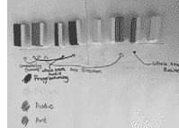


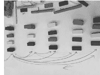

The core members of this team met at university but planned to continue as a company, taking on freelance work to help fund their efforts. Whilst one member suggested the original idea, the game demo concept was substantially developed by the group overall. The team thus claimed relatively equal IP distribution and also enjoyed generally positive relations. Collaboration strategies refined in process included rules like anybody could attend a special interest meeting and had a right to be heard.

### 团队2：价值构成

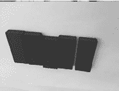

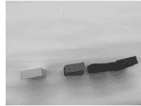

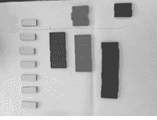

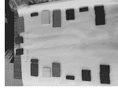

This team has ambitions to become Scotland's top VR games producer. Members met through business incubation programs, which, according to the founder, informed their professional approach. This team was already incorporated, and with a complex share structure already in place, Tal allocation was less relevant. Work-tracking records had helped adjudicate a past dispute. Nevertheless, it was pointed out that time on task is still only one measure of contribution.

### 团队3：贡献与影响

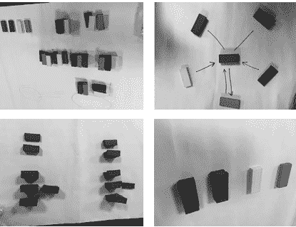

This team worked across two businesses, so that the main conduit for team communication across both was a creative manager rather than a coder, which led to a discussion about the distinction between contribution and influence (see the two differing blue spreads). Team goals centered upon gaining a publisher for their demo game and establishing flat team structures long term.

### 团队4：开发日志的重要性

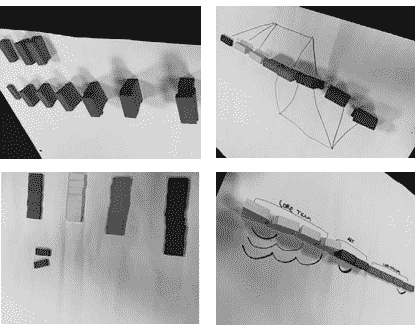

This university team kept daily developer (dev) logs using the Basecamp software. Tied to dev log results, this team decided revenue shares according to time- and result-based contributions. The dev logs also helped to adjudicate a difficult team dispute when one member wasn't seen to be pulling their weight. The team's ambitions centered upon winning Tranzfuser.

## 讨论

One of the reasons for using social network analysis in this study was to check whether these communication flows influenced the distribution of Tals. From these results, it appears that they have a significant influence. For instance, contractors who work remotely are generally less embedded in the team structure, reflected in a tendency to allocate contractors copper Tals (monetary rewards) rather than silver Tals (monetary rewards combined with voting rights). Also, the project lead tended to commit more time than the rest of the team, all four of the founders interviewed were mindful to recognise the value of the emerging team identity. The observed Tal redistribution meeting is indicative of


项目过程中出现了这种转变。扁平化管理结构和共享价值认可的激励价值也通常被视为重要考量因素。这些文化价值可能反映了协作游戏开发工作中紧密的相互依赖关系。

需要进一步研究，以确定新兴群体认同的哪些方面也可能体现在社交网络数据流中。例如，团队3的经验清楚表明，开发贡献并不总等同于创意影响。这一点既适用于个人影响，也适用于新兴团队角色或认同的那种短暂影响。即使社交网络数据流可以记录群体团队沟通活动的变化，它们也不太可能捕捉到新兴群体认同的完整特征及其对创意决策的影响。

因此，尽管自动化工作追踪系统是追踪贡献非常便捷且有用的方式，但它们并不能捕捉一切。例如，纯粹根据时间来衡量贡献，可能会忽略重要的社会因素，并可能引发系统操纵。基于时间的测量可能鼓励长时间工作，但也可能导致效率较低的工作时段。同样，一位受访者也指出，一次简短的会议可能是团队成功的关键——然而，这种价值可能要几个月后才会显现。

另一位参与者提出了明智的建议，即任何基于产出奖励参与者的尝试都需要结合四个关键因素来加以语境化：

- 任务难度，因为有些角色比其他角色更难。
- 可用时间，因为有些人只能兼职或远程工作。
- 产出质量，因为时间不总是等同于能力。
- 先前知识，因为在团队成员承担多个角色的情况下，他们同样常常是这些综合任务的新手，而非大师。

尽管区分个人贡献的价值可能是一个有用的考量，但也可能导致团队工作关系过分强调等级化的贡献衡量标准。另一个考量是，产出是否总是时间效率的最佳衡量标准。即便是发呆的时间，只要与工作计划和广泛的开发轨迹相关联，也可能变得至关重要。这表明，对工作流在一段时间内以及跨多个团队进行更广泛、跨行业的分析具有价值，以便更好地理解这些生产力高峰与低谷对整体开发轨迹的性质和/或重要性。

在开放且支持性的管理风格补充下，自动化工作追踪系统在工作贡献管理方面最为有用。尽管它们不一定能激励努力工作（因为创意团队通常受创意目标而非生产力结果所激励（Malik and Butt 2017），而且如果被观察者感到不安全、缺乏归属感或在此过程中缺乏尊重，实际上还可能使员工丧失动力（D’Urso 2006），但当问题出现时，它们确实能提供有用的问题证据，远程团队中也可能发生此类问题。受访的每个团队都偏好面对面团队合作的透明度和团结精神（这也可以减轻系统操纵的风险），但也看重远程员工的可用性和技能。

任何能够通过自动化系统减轻行政负担的能力通常都受到欢迎。使用手动开发日志的团队将其视为宝贵的工作管理资源和其实践中不可或缺的方面，但也耗时且容易忘记，因此需要不断的提醒和价值重申。在这样做时，需要小心确保它们不会过于正式化创意开发过程，并引入Reijers和Coeckelbergh（2018）所提及的那种规定性僵化。

因此，将这些记录分享到直接团队之外，有很大收益，以积累集体知识，使整个行业能够自行定价和安排进度，并可能分担支持“更聪明地工作而非更努力地工作”这一努力的机器学习分析成本。理想情况下，此类记录应当是匿名的，或在某种程度上是私密的，以便个人员工未经同意不会被公开比较，并因此而受到惩罚（至少有一位年轻开发者表达了这种担忧）。同样重要的是，个人贡献者应有权共享该数据的所有权，以便他们有选择权，例如共享自己的工作记录，并使其在自动更新的个人资料动态中同时可供潜在招聘人员使用（一些开发者也感兴趣地讨论了另一种可能性）。

区块链对创意知识产权登记能提供什么目前尚不清楚。尽管创意共享许可已在欧洲法院得到承认（CreativeCommons 2018），但区块链登记的法律地位仍相当抽象。例如，像Ascribe这样的区块链登记系统，更可能赋予一种归属感，而非提供有保障的法律救济途径（Christies 2018）。同样值得牢记的是，公司注册法规之所以复杂，可能是有原因的，例如确保公司遵循公平贸易原则。如果没有也能促进道德商业实践的机制，区块链商业登记有可能沦为合规规避的策略。尽管如此，对于初创公司来说，成立有限公司的过程可能显得极其复杂且成本高昂（一位参与者怀疑这是否是为了诱导高额罚款而设计的），因此探索更简单、更精简的测试平台结构是有价值的。未来解决立法步伐与数字颠覆快速变化特性之间保持同步这一挑战的方案，或许是将类似Global Tal Registry的东西与更灵活、更敏捷的伦理审查委员会系统相结合。一位参与者建议，这些半正式替代方案对于粉丝创作网络也可能特别有用，此类网络通常能持续多年，拥有大量随时间变化的贡献者。

任用（Reijers and Coeckelbergh 2018）或正式化的价值，正在于协议的交互无需后续人工干预即可进行，以及“代码即法律”（Lessig 1999）。然而，正如计算机科学理论家Kieran O’Hara所主张，假设代码因此可以与法律互换是一种“危险的谬误”（O’hara 2017: 100）。法律是民主制定的，可以被挑战（例如，当欺诈、胁迫或能力受损被证明时），也可以被违反，而软件开发则是一个更不透明的过程（O’hara 2017）。尽管如此，编码智能合约的各方仍拥有主体性；他们可以协商初始条款，并可以选择参与或不参与。当问题出现时，如果存在启用此功能的机制，这些协议也可能是可协商的。同样，尽管智能合约可能缺乏社会背景（O’hara 2017），但这也可能是其优势。例如，智能合约可以相对容易地在不同司法管辖区强制执行明确的协议，并通过提供透明、共享的数据来支持该交易（Eenmaa-Dimitrieva and Schmidt-Kessen 2017）。它们还能实现前所未有的分布式治理规模，在某些情况下效率更高，并能降低利益冲突或欺诈的风险（De Filippi 2018）。

## 结论

本研究探讨了自动化信任和区块链技术在简化游戏生产许可、知识交流和商业注册方面所能提供的价值。为了更好地理解这些问题，英国游戏基金Tranzfuser计划的参与者接受了访谈，内容涉及他们的协作经验以及使用英国游戏基金的Global Tal Registry知识产权管理工具。

关于年轻游戏开发者团队协作经验的这项实证研究表明，潜在的未来Web 3.0创意企业工具，如区块链商业注册和数据共享框架，可以以一种潜在增强但并非完全适用于所有情境的方式加速创意协作实践。自动化工作记录是帮助简化许可和创意开发过程的宝贵工具，但它们在与人类洞察力协作时效果最佳。这些改进的总体价值很可能取决于参与者的主体性。

尽管新兴的语义网（Hendler 2009）已经能够提供关于人类行为本质的发人深省的洞察，但它仍有许多未能捕捉的内容，例如那些只有在人类主体性与系统数据流协作的心理、情感甚至能量相互作用中才会显现的、无定形且可能具有变革性的洞察。在创意生产流程方面，人工数据智能仍需要与社会智能相结合。


需要进一步开展研究，以探究公司秘密（由于竞争性商业关系的传统而可能被严密保守）与集体智慧价值之间的张力，但原则上，数据共享技术可用于汇集算法知识网络的前景为初创游戏公司提供了巨大的潜在价值。未来，通过利用增强的集体洞察，此类协作智能池可能会越来越多地颠覆其更具竞争性、更加保守的前辈。

## 致谢

感谢 Coffee Box Games、Deep Fried Games、Darkroom Interactive、Out Of The Box Games 和英国游戏基金。

## 注意

- 1 共享经济被 Lessig (2008) 定义为“通过共享、交换和出租资源而不拥有商品所进行的协作消费”（Lessig 2008: 143）。

## 参考文献

- Batchelor, James. 2017. “第十届EGX创纪录参会人数，2018日期公布。” gamesindustry.biz. 访问日期 3.9.18. www.gamesindustry.biz/articles/2017-09-25-record-attendance-for-tenth-anniversary-egx-2018-dates-revealed.

- Berg, Chris, Sinclair Davidson, and Jason Potts. 2017. “区块链工业化信任。” 访问日期 18.6.18. SSRN: https://ssrn.com/abstract=3074070 or http://dx.doi.org/10.2139/ssrn.3074070.

- Berners-Lee, Tim, and Mark Fischetti. 2001. 《编织网：万维网发明者眼中的原始设计与最终命运》. Collingdale, PA, United States DIANE Publishing Company.

- Castelfranchi, Cristiano, and Rino Falcone. 2010. 《信任理论：一种社会认知与计算模型》. Vol. 18. Hoboken, New Jersey, United States John Wiley & Sons.

- Chen, Hsinchun, Roger H. L. Chiang, and Veda C. Storey. 2012. “商业智能与分析：从大数据到重大影响。” MIS Quarterly: 1165–1188.

- Chris. 2018. “艺术+技术峰会：探索区块链——艺术世界准备好达成共识了吗？” YouTube. 访问日期 15.8.18. www.youtube.com/watch?v=KT-gPtK5uHY&t=25689s.

- Crawford, Chris. 2012. 《克里斯·克劳福德谈互动叙事》. Stanford, California, USA: New Riders.

- CreativeCommons. 2018. “案例法。” 访问日期 24.9.18. https://wiki.creativecommons.org/wiki/Case_Law.

- De Filippi, Primavera De Filippi. 2018. 《区块链与法律：代码的统治》. Cambridge, MA: Harvard University Press.

- Deloitte. 2018. “破解区块链：Deloitte 的 2018 年全球区块链调查，” Deloitte. 访问日期 28.8.18. www2.deloitte.com/content/dam/Deloitte/cz/Documents/financial-services/cz-2018-deloitte-global-blockchain-survey.pdf.

- Durrant, Paul, and Mark Hogarth. 2016. “TalTM 故事：面向创意团队共享项目所有权和收益的新概念。” 访问日期 4.4.18. www.talregistry.com/about.html.

- D'Urso, Scott C. 2006. “谁在监视我们工作？面向组织中电子监控与监视的结构—知觉模型。” Communication Theory 16(3): 281–303.

- Eenmaa-Dimitrieva, Helen, and Maria José Schmidt-Kessen. 2017. “通过代码进行监管：作为在无信任环境中实施智能合约的保障。” 访问日期 30.9.2018 http://cadmus.eui.eu/bitstream/handle/1814/47545/LAW_2017_13.pdf?sequence=1&isAllowed=y

- EGX. 2018. “EGX 主页。” EGX. 访问日期 3.9.18. www.egx.net/egx.

- Fröwis, Michael, and Rainer Böhme. 2017. “信任代码。” 在《数据隐私管理、加密货币和区块链技术》中，357–372. Berlin: Springer.

- Gefen, David, and Detmar W. Straub. 2004. “消费者对 B2C 电子商务的信任及社交在场的重要性：电子产品与电子服务实验。” Omega 32(6): 407–424.

- Gray, Kishonna L., Bertan Buyukozturk, and Zachary G. Hill. 2017. “模糊边界：使用 Gamergate 审视当代游戏文化中针对女性的‘真实’与象征性暴力。” Sociology Compass 11(3): e12458.

- Hawlitschek, Florian, Benedikt Notheisen, and Timm Teubner. 2018. “无信任系统的局限性：关于区块链技术与共享经济中信任的文献综述。” Electronic Commerce Research and Applications 29: 50–63.

- Hendler, Jim. 2009. “Web 3.0 新兴。” Computer 42(1).

- Keymolen, Esther. 2013. “协作消费中的信任与技术：为什么这不仅仅关乎你和我。” Bridging Distances in Technology and Regulation: 135–150.

- Kiviat, Trevor I. 2015. “超越比特币：监管区块链交易的问题。” Duke LJ 65: 569.

- Lessig, Lawrence. 1999. “代码即法律。” The Industry Standard 18.

- Lessig, Lawrence. 2008. 《混剪：在混合经济中使艺术与商业繁荣》. London: Penguin.

- Lu, Yaobin, Ling Zhao, and Bin Wang. 2010. “从虚拟社区成员到 C2C 电子商务买家：虚拟社区中的信任及其对消费者购买意图的影响。” Electronic Commerce Research and Applications 9(4): 346–360.

- Lustig, Caitlin, and Bonnie Nardi. 2015. “算法权威：比特币案例。” 2015 年第 48 届夏威夷系统科学国际会议 (HICSS).

- Malik, Muhammad Abdur Rahman, and Arif N. Butt. 2017. “奖励与创造力：过去、现在与未来。” Applied Psychology 66(2): 290–325.

- McCarthy, John, and Peter Wright. 2004. “技术即体验。” Interactions 11(5): 42–43.

- Murray, Janet. 2001. “代理权，全息甲板上的哈姆雷特。” 在《多媒体：从瓦格纳到虚拟现实》第 1 版中，第 380–397 页，共 394 页. New York: Norton.

- Nakevska, Marija, Anika van der Sanden, Mathias Funk, Jun Hu, and Mathias Rauterberg. 2017. “混合现实环境中的互动叙事：交互性对用户体验的影响。” Entertainment computing 21: 97–104.

- O'Dwyer, Karl J., and David Malone. 2014. “比特币挖矿及其能源足迹。” Hamilton Institute National University of Ireland Maynooth, http://karlodwyer.com/publications/pdf/bitcoin_KJOD_2014.pdf

- O'Hara, Kieron. 2017. “智能合约——愚蠢的主意。” IEEE Internet Computing 21(2): 97–101.

- Olnes, Svein, Jolien Ubacht, and Marijn Janssen. 2017. 《政府中的区块链：分布式账本技术在信息共享中的益处与影响》. Government Information Quarterly, Volume 34, Issue 3, Pages 355–364.

- Reijers, Wessel, and Mark Coeckelbergh. 2018. “区块链作为叙事技术：探究加密货币的社会本体论与规范配置。” Philosophy & Technology 31(1): 103–130.

- Roio, Denis, and Ivan Jelicic. 2017. “DECODE：共有协作经济的多学科框架。” 访问日期 3.3.18. https://files.dyne.org/decode/D3.3_Data_Privacy_and_Smart_Language_requirements.pdf.

- Rousseau, Denise M., Sim B. Sitkin, Ronald S. Burt, and Colin Camerer. 1998. “终究并无太大不同：关于信任的跨学科视角。” Academy of Management Review 23(3): 393–404.

- Schiffer, Eva, and Jennifer Hauck. 2010. “Net-Map：收集社交网络数据并通过参与式影响网络绘图促进网络学习。” Field Methods 22(3): 231–249.

- Swan, Melanie. 2013. “自我量化：大数据科学与生物发现中的根本性颠覆。” Big data 1(2): 85–99.

- Swan, Melanie. 2015. 《区块链：新经济蓝图》. Newton, Massachusetts, United States: O’Reilly Media, Inc.

- Teubner, Timm, and Florian Hawlitschek. 2018. “点对点在线共享的经济学。” 在《共享经济的兴起：探索协作消费的挑战与机遇》中，第 129–156 页. Santa Barbara, California, United States. ABC-CLIO.

- UnrealForum. 2018. “你能给我详细理由说明为什么虚幻 4 优于 Unity 吗？” Unreal. 访问日期 18.11.18. https://forums.unrealengine.com/community/general-discussion/1434198-can-you-give-me-detailed-reasons-for-why-unreal-4-is-better-than-unity.

- Van Dijck, José. 2014. “数据化、数据主义与数据监视：大数据处于科学范式与意识形态之间。” Surveillance & Society 12(2): 197–208.

- Waring, Marilyn, and Gloria Steinem. 1988. 《如果女性被计算：一种新的女性主义经济学》. San Francisco: Harper & Row.

- Wolf, Gary. 2010. “数据驱动的生活。” The New York Times, 2010 年 4 月 28 日.

- Yang, Sung-Byung, Kyungmin Lee, Hanna Lee, Namho Chung, and Chulmo Koo. 2016. “共享经济中的信任突破：Airbnb 实证研究。” PACIS. https://aisel.aisnet.org/pacis2016/131/

- Zimmerman, Eric. 2015. “游戏世纪宣言。” The Gameful World: Approaches, Issues, Applications: 19–22.


泰勒与弗朗西斯

泰勒与弗朗西斯集团

http://taylorandfrancis.com

## 区块链与数字媒体


泰勒与弗朗西斯

泰勒与弗朗西斯集团

http://taylorandfrancis.com

## 区块链能拯救新闻业吗？关于区块链潜力使新闻业成为更可持续业务的探索性研究

Walid Al-Saqqaf 和 Malin Picha Edwardsson

### 引言

近年来，数十项倡议涌现，旨在探索分布式/去中心化账本技术（DLTs）及公共区块链在各行各业和不同政府中的各种用途（Hileman and Rauchs, 2017）。用例差异巨大，远远超出传统金融技术（fintech）领域（Underwood, 2016），延伸至医疗保健（Mettler, 2016）、保险（Mainelli and von Gunten, 2014）、教育（Sharples and Domingue, 2016）、身份验证（Shrrier, Wu and Pentland, 2016）以及许多其他领域（Al-Saqqaf and Seidler, 2017; Tapscott and Tapscott, 2016）。

已确立，区块链的分布式账本功能可以消除对中介的信任需求，使其成为解决金融和非金融行业面临的一些问题的有吸引力的选择，这些行业希望消除中间商（Crosby et al., 2016, p. 17）。在新闻业中，中介可以被视为位于记者和读者之间，使这些中介对编辑决策产生直接或间接影响的人。此类中介的例子包括媒体所有者、把关人、政客和企业。

然而，此时进行现实检查是必要的，因为区块链技术仍处于早期发展阶段；大部分讨论是假设性的，强调潜在好处，而没有充分反思可能阻碍大规模采用的障碍和挑战。这导致期望与结果之间的差距不断扩大，进而助长了区块链怀疑论叙事（Pisa, 2018）。

这一情况还因大多数区块链和加密货币初创公司最终相对较快地失败而更加复杂（Biggs, 2018; Froelings, 2017）。围绕区块链的大部分炒作往往由被认为的淘金热驱动，要么通过在波动的加密货币市场中投机，要么通过投资首次代币发行（ICOs），期望在短时间内获得非常高的回报（Zetzsche et al., 2017）。

然而，区块链在新闻领域的应用相对较新，缺乏大量关于该技术如何影响新闻媒体行业的实质性研究，该行业目前正面临许多挑战，例如公众信任度低和盈利能力差（Newman et al., 2017, p. 9）。

新闻业在社会中的作用之一是通过呈现新闻来告知公众。如果公众不认为新闻可信，新闻业就无法实现其核心目标。这种情景会导致缺乏保持可持续和相关性的手段。

传统上，新闻的可信度基于以下层级的可信度来评估：（1）媒介（报纸、网站、电视频道等），（2）来源（记者、撰稿人）和（3）消息本身（文本、图片、视频等）（Kiousis, 2001; Sundar, 1999）。

研究发现，较低的新闻可信度会导致对发布新闻的媒体信任度降低。这进而导致媒体怀疑论和较低的媒体曝光度（Tsfati and Cappella, 2003）。因此可以得出结论，更强的新闻可信度可以提升可持续性，因为更高的媒体曝光度自然转化为来自广告、订阅费、赞助等方面的更高收入。

在新闻可信度与媒体曝光度之间联系的基础上，本研究旨在探索区块链提升新闻可信度的潜力，从而使新闻业成为更可持续的业务。此处需要注意的是，成为可持续业务只是新闻可信度的后果之一，它还能增强受众的信任和忠诚度，并创造更加知情的公众。

通过反思罗杰斯（Rogers, 2003）创新扩散理论中的 *相对优势* 属性，本研究评估基于区块链的去中心化新闻室模型能否与传统的中心化模型竞争。然而，我们想强调，这一属性本身未必足以证明创新会向大众扩散。

作为案例研究，我们探索 Civil，这是一个基于区块链的协议，旨在使用加密经济学来激励制作新闻质量的内容（Civil White Paper, 2018）。

我们的研究问题是：区块链如何增强新闻业作为一项业务的可持续性？我们通过研究区块链提升上述每一层新闻可信度的潜力来解决这个问题：（1）媒介，（2）来源和（3）消息。

为回答这个问题，我们使用了多种方法。首先，我们强调区块链的主要运行原则，这些原则使其区别于传统数据库系统，即（1） *去中心化* ，（2） *透明度* ，（3） *平等* 和（4） *问责制* （Al-Saqqaf and Seidler, 2017）。使用区块链的最大潜力主要在于那些可以从一项或多项这些原则中受益的领域。

*去中心化* 消除了对中介或中心节点的需求，因为所有操作都是点对点的。*透明度* 使在区块链上进行的所有活动都带有时间戳并对所有节点公开可见。*平等* 保证网络上由相应钱包地址代表的所有节点都受到完全相同的规则对待。*问责制* 要求区块链上的数据安全且不可篡改，使其免受黑客攻击、操纵或更改。绝对的问责制对于区块链上的智能合约按预期运行至关重要，没有被操纵或例外的可能性。

其次，我们在上述运行原则与影响新闻可信度的三个层级各自之间建立联系。我们的方法包括研究 Civil 白皮书及该项目官方网站（https://civil.co）上提供的其他文本，并对 Civil 平台试用版进行测试，以实时体验其运作方式。为了获取网站上无法获得的信息，我们通过电子邮件采访了 Civil 公司领导团队的关键成员，即联合创始人兼首席执行官 Matthew Iles、联合创始人兼营销负责人 Matt Coolidge 和联合创始人兼工程负责人 Dan Kinsley。我们还采访了 Maria Bustillos，她是 Popula（https://popula.com）的编辑，Popula 是 Civil 平台上创建的新闻室之一。

第三，我们根据罗杰斯（Rogers, 2003）创新扩散理论中的相对优势属性分析了我们的结果。

### 创新扩散理论

在本研究中，我们试图探索区块链在使新闻业成为更可持续业务方面的潜在应用。在这样做时，我们使用罗杰斯（Rogers, 2003）创新扩散理论中的相对优势属性。

埃弗里特·M·罗杰斯（Everett M. Rogers）于 1962 年首次提出了关于创新扩散的理论，自那时以来，该理论一直被传播学者广泛应用。罗杰斯将扩散定义为“创新通过特定渠道随时间在社会系统成员之间传播的过程。扩散是一种特殊的沟通类型，涉及被视为新观念的信息的传播”（Rogers, 2003, p. 35）。此外，他认为“扩散是一种社会变革，定义为社会系统结构和功能发生改变的过程”（ibid, p. 6）。

罗杰斯描述了五种创新属性——有助于理解为什么有些想法比其他想法更容易扩散。这些属性是

- 1 相对优势，即“创新被认为优于其取代的想法的程度”（ibid, p. 229）。
- 2 兼容性，即“创新被认为与潜在采纳者的现有价值观、过去经验和需求相一致的程度”（ibid, p. 240）。兼容性可以帮助个人赋予新想法意义，使其被视为更加熟悉。“创新可能与以下内容兼容或不兼容：1) 社会文化价值观和信仰，2)


先前提出的想法，和/或 3）客户对创新的需求”（ibid, 第 240 页）。

- 3 创新的复杂性是指创新被认为相对难以理解和使用的程度。根据 Rogers，复杂性“与其采用率呈负相关”（ibid, 第 257 页）。

- 4 可试用性是指创新可以在有限基础上进行实验的程度。易于尝试的新想法通常比其他想法采用得更快（ibid, 第 258 页）。

- 5 可观察性是指创新的成果对他人可见的程度。有些想法容易被观察并传达给其他人，而其他创新则不然（ibid, 第 258 页）。

然而，仍然需要注意的是，包括 Rogers 本人在内的几位批评者指出，创新扩散理论并非没有局限性。这种局限性之一是该理论存在“亲创新偏见”，暗示创新是可取的，并且应当快速采用且不做修改（Rogers, 2003; Ekdale et al., 2015）。

由于时间和空间限制，本文将仅限于理论的第一个属性——相对优势，通过考察以 Civil 为案例研究的基于区块链的新闻业新闻室，是否能在增强可持续性和新闻可信度方面优于传统新闻室。其目的是将此作为第一步，从而使未来的研究能够覆盖其他属性。

## 新闻业中的用例

在绘制区块链与新闻业领域图谱时，我们简要介绍了可以直接或间接利用区块链进行新闻业的六个主要领域。

- 1 打击假新闻和虚假信息：创建鼓励发布准确信息并防止假新闻和虚假信息传播的生态系统或机制。这需要根据新闻项目是否包含不准确之处进行标记和评分，并随时间过滤，以便读者接触到真实的故事，并了解可能之前制作过的任何假新闻。旨在利用区块链限制假新闻传播的项目包括 Trive (https://trive.news)、DNN (https://dnn.media)、Snip (https://media.snip.today)、Civil (https://civil.co)、PressCoin (https://presscoin.com)、Userfeeds (https://userfeeds.io)、Bitpress (https://bitpress.network)、Truepic (https://truepic.com/)。例如，Truepic 允许视听内容创建者将地理位置、相机和软件信息以及其他元数据嵌入到照片/视频文件中，并将文件的哈希码表示形式存储在比特币区块链上（Berkhead, 2017）。有人认为，区块链技术在理论上有潜力通过区块链促进社交媒体内容上假新闻的检测和追踪（Jing and Murugesan, 2018）。

- 2 **保护知识产权：** 区块链保持不可篡改记录的能力，使得创建原始媒体内容的*出版证明*成为保护知识产权（IP）的一种方式，即通过提供验证和认证原始内容创作的手段。只要所有受益人都承认该原始记录，对于任何在区块链上加时间戳并存储的文章或创意作品，就能就知识产权归属达成共识。虽然 Civil 和 Reporter (http://reportercommunity.tech) 提供了解决作者之间 IP 纠纷的方法，Snip 能检测原始内容的重复使用并自动通知原始作者。另外两个项目 Stock Block (https://stockblock.io) 和 Binded (https://binded.com) 旨在仅为视觉内容提供此功能。另一方面，Truepic 允许通过在比特币区块链上存储内容及其元数据（如任何图像或视频的拍摄日期、时间和位置）的哈希值，来验证和认证照片和视频的真实性。有人还认为，区块链和智能合约在保护 IP 方面的应用，可以通过允许原始作品的创建者在区块链上对 IP 披露或创作加时间戳，从而支持在线开放式创新（de la Rosa et al., 2016）。

- 3 **限制偏见和外部影响：** 几个基于区块链的新闻业项目所强调的一个问题是，主流媒体常常面临的偏见和客观性不足问题。其主要原因通常是依赖企业和其他强大实体的广告收入。为应对这一问题，Civil、PressCoin、DNN 和 Publicism (https://publicism.nl) 提供加密货币支付激励，以抑制偏见并鼓励客观性，以及就可能敏感的主题（例如报道腐败或滥用职权的案例）公开撰写文章。由于作家不依赖广告，他们会根据其报道的真实性和客观性获得加密货币奖励（通常以代币为单位）。特别是 Civil，已将此作为该项目的主要目标之一（Iles, 2016）。

- 4 **抵抗审查：** 开放无许可区块链提供的高度去中心化使其天然具有抗审查能力，因为它们需要将交易数据存储在多个设备上。Civil、DNN、PressCoin、OngSocial (https://ongcoin.io)、Steemit (https://steem.io)、SocialX (https://socialx.network)、Publicism、Bitpress 和 PUBLIQ (https://publiciq.network) 是基于区块链的项目示例，旨在使用开放公有区块链确保数据对读者可访问，尽管守门人可能试图通过域名过滤和其他技术审查手段阻止访问（Mattila, 2016, 第 9 页）。

- 5 **保护举报人：** 允许个人在提供敏感数据时隐藏身份的领域，似乎得到了比特币和以太坊等公有区块链的假名特性的支持。两家初创公司 Truetheum (https://truetheum.com) 和 Publicism 已明确表示保护举报人是其主要目标之一，并通过在通过加密货币地址与来源联系时不要求任何个人信息来实现这一点。虽然比特币和以太坊可以提供部分匿名性，但 Zcash 和 Monero 等其他无许可区块链可用于提供高度的隐私和匿名性（Henry, Herzberg and Kate, 2018）。

- 6 鼓励用户创建内容：虽然某些基于区块链的新闻业项目（例如 Civil）旨在创建完整的新闻室，但 DNN、PressCoin、OngSocial、Steemit 和 Hashtiv (https://hashtiv.io) 等其他项目旨在使用区块链而非集中式服务来存储用户内容。例如，Steemit 不像 Facebook 或 Twitter 等集中式服务，它允许用户使用不同的 Web 应用程序来生成和查看文本内容，这些内容以去中心化的方式存储在 Steemit 区块链上，而不依赖中央服务器。通过使用 d.tube 等第三方应用程序，Steemit 还允许用户使用行星间文件系统 (IPFS) 协议以分布式方式存储视频（Chohan, 2018）。这反过来鼓励公民在不担心审查或控制的情况下，制作包括新闻文章在内的原创内容。基于区块链的社交媒体项目可以开发声誉系统，允许用户以激励驱动的方式评估和评分已发布的内容（Kolonin et al., 2018）。

此处介绍的六个领域并非互斥，这解释了为什么我们发现有多个项目覆盖了不止一个领域。此外，该列表并非详尽无遗，也不考虑可扩展性或局限性。在上述大多数项目中值得注意的一点是，它们大多专注于将区块链技术集成到媒体内容生产过程中，且几个项目仅专注于新闻内容。然而，由于该技术尚属新兴且未经充分验证，无疑会面临挑战，在某些情况下还可能遇到阻碍其实现的障碍。

由于时间和资源的限制，我们仅将 Civil 作为单一案例研究，代表一家承诺使新闻业更可持续的初创公司。Civil 被选为案例研究，是因为其在媒体界的知名度、高知名度的合作伙伴、相对先进的开发阶段，以及与类似项目相比更愿意共享其信息和平台细节。它也是同类平台中唯一已经拥有功能性后端、可以测试各种功能的平台。

## Civil：押注于加密经济学

Civil 媒体公司成立于 2016 年，创建了 Civil 作为一种去中心化通信协议，旨在使用支持区块链的加密经济学


为促进分布式、独立和去中心化新闻室的创建、治理和财务可持续性而设。其目标是生产高质量的本地、国际、调查性和政策新闻报道（《Civil 白皮书》, 2018）。

作为区块链和代码经济的诞生地，比特币已证明可以通过使用激励和密码学创建奖励系统（Stark, 2017）。区块链企业家 Josh Stark 将代码经济定义为“运用经济机制构建分布式系统的实用科学，该系统的重要属性由金融激励保证，而经济机制由密码学保证”（同上）。

Civil 拥有总计 500 万美元的资金，推出了 14 个项目，代表了首批进行本地、政策、调查和国际报道的新闻室。Popula 编辑 Maria Bustillos 表示，她的新闻室决定采用订阅制出版模式。在加入首批新闻室时，她向 Civil 团队提出的第一个问题是关于该平台在区块链上保存永久存档的能力。“这些存档无法篡改，只有关闭目前构成以太坊网络的全球 17,000 多台计算机才能将其关闭，”她说（Bustillos, 2018）。除了用于创建新闻室外，ConsenSys 的投资还用于创建 Civil Studios，以资助和试点一些使用 Civil 平台的项目以及更广泛的区块链媒体项目（Roberts, 2018）。

该公司联合创始人兼首席执行官 Matthew Iles 在 2016 年于 Medium 上发表的一篇博客文章中表示，Civil 的目标是利用代码经济拯救新闻行业，使其摆脱由损坏的收入模式、虚假信息以及对策展人和内容提供者的不公平报酬所造成的持续危机（Iles, 2016）。

为此，Civil 团队创建了一种名为 CVL 的新型基于以太坊 ERC20 的代币，而不是建立独立的区块链。CVL 代币充当 Civil 协议正常运行所必需的效用，该协议利用了以太坊的智能合约功能。该代币用于创建新闻室、奖励撰稿人和新闻室编辑，并对各种事项进行投票，范围从评估对新闻室的挑战到处理潜在的新闻标准违规投诉。此外，CVL 持有者可以通过集合代币来为他人新闻室的质押保证金提供赞助，从而充当赞助商。尽管这种对以太坊的依赖利用了其强大且庞大的网络和资源，并降低了 51% 攻击的风险（近年来，51% 攻击已成为攻击年轻区块链的一种策略（Hertig, 2018）），但它也使 Civil 暴露在以太坊的漏洞和风险之下，例如交易速度慢，尤其是在高峰期。这种可扩展性问题的一个例子是，2017 年由于 CryptoKitties 去中心化应用程序的使用量激增，整个以太坊网络曾暂时陷入停滞（Khalif, 2017）。此外，发现 ERC20 标准缺乏事件-（交易-）处理机制且存在其他弱点，这导致引入了替代标准（Mulders, 2018）。

2018 年 9 月 18 日，Civil 启动了正式的首次代币发行（ICO），计划从总计 1 亿个代币中出售多达 3400 万个 CVL 代币。希望通过 ICO 购买 CVL 的申请人必须满足严格的要求，包括参加一些记者也未通过的测验（Wang, 2018）。然而，启动一个月后，ICO 未能实现其原定的 800 万美元初始软目标，仅发生了 140 万美元的销售。筹集金额中约 110 万美元来自 ConsenSys，该公司是该项目的主要初始支持者。由于销售不成功，Civil 退还了所有投资者的资金，并宣布将启动第二次 ICO，要求会宽松一些（De Silva, 2018）。

CVL 代币购买者必须接受的审查旨在防止潜在的恶意攻击者或投机者囤积代币（Wang, 2018）。然而，这种审查本身可能是导致 ICO 失败的几个因素之一，这也解释了 Civil 承诺使第二次 ICO 更加简单。尽管如此，审查仅适用于 ICO 阶段，此后 Civil 的最初计划是，在至少一年内仅在 AirSwap 的二级市场上提供 CVL，这将继续要求有兴趣购买 CVL 的人提供证据，证明他们已在 Civil 平台上使用过 CVL，然后才能将其变现（Coolidge, 2018c）。如果需求增加，CVL 很可能通过第三方交易所公开交易。使用此类外部中介涉及因网络攻击或管理不善而导致保证金损失的风险（Moore and Christin, 2013）。区块链项目依赖第三方交易所的含义是，它们面临更高的资金被黑客攻击的风险，因为过去有数百万美元从中心化交易所被盗（Khatwani, 2018）。此外，此类交易所违背了区块链增强去中心化的主要目的，并且可以说对于许多希望购买 CIVIL 的人来说，它们是一个瓶颈。虽然有几家新兴的去中心化交易所，但它们仍然远不够流行，交易者较少，可交易的加密货币也较少。

《Civil 宪章》被定义为 Civil 的“核心”，它描述了新闻室必须遵守的使命、目的和价值观，以继续成为平台的一部分（《Civil 宪章》, 2018）。宪章的初始版本是在咨询记者、代码经济和法律顾问后制定的。宪章类似于传统的服务条款（ToS），但侧重于承诺遵循高标准的道德新闻报道（Coolidge, 2018b）。值得注意的是，Civil 团队计划在未来通过一个流程使宪章能够被修订，允许任何 CVL 代币持有者提议修订、质押 CVL 代币并经历投票过程。如果新闻室根本不同意新的宪章修正案，它有权撤回其 CVL 申请保证金质押并被移除出注册表。

在 Civil 上创建新闻室，申请人需要存入价值 1000 美元的 CVL 代币，这些代币随后由协议的一个智能合约作为保险持有，以防新闻室的所有者或撰稿人违反宪章。一旦被接受，新闻室将加入代币策展注册表（TCR），并将其条目添加到以太坊区块链上。

由于在提交本章发表时 CVL 代币尚未公开交易，Civil 团队在以太坊 Rinkeby 测试网络上向我们提供了 3000 个免费代币（TESTCVL）。这些代币纯粹用于测试目的。我们在质押 100 TESTCVL 后创建了一个测试新闻室，并且在该新闻室未受到挑战后获得了批准。我们还出于演示目的挑战了另一个新闻室并赢得了该挑战，为我们的账户赚取了 100 TESTCVL 作为奖励（Etherscan.io, 2018）。该过程进行得相当顺利和及时。然而，当该服务在以太坊主网上正式启动时，人们自然会预期处理时间会更长，因为它每秒只能处理最多 20 笔交易，与 Visa 每秒平均 10,000 笔交易相比极其缓慢（Peck, 2017）。

申请创建新闻室并加入 Civil 注册表的过程包含几个步骤，如图 7.1 所示。第一步是填写新闻室名称以及新闻室中任何其他成员的钱包地址（如有）。此后，需要提供关于使命的详细信息以及有关新闻室的其他信息，此外还需要一份章程

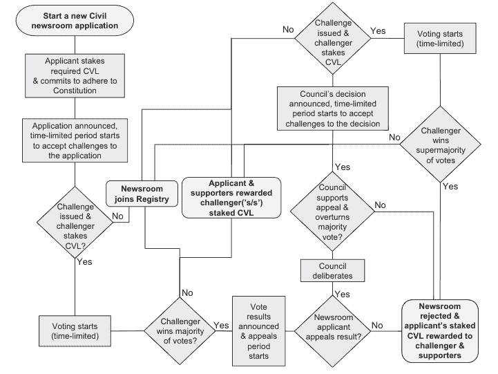

图 7.1 展示 Civil 代码经济模型的流程图


已提供。第三步涉及存入相当于 1,000 美元的 CVL 代币，以使申请正式立案。

此时，已提交的申请将处于待决状态 14 天，在此期间，任何 CVL 代币持有者均有机会审查申请，并通过质押价值 1,000 美元的 CVL 代币来对新闻室发起挑战。挑战应基于一种解释，即认为新闻室的使命或其他属性可能违反宪法。挑战也可在新闻室被接受进登记册后发起，例如，当新闻室发表的一篇文章被视为违反宪法时。唯一条件是，任何给定时间每个新闻室只能有一个挑战。

对挑战进行赞成或反对的投票过程，在挑战发起后十天内允许进行。额外七天用于投票承诺，即使投票生效。该系统旨在激励成员仔细审查挑战，并以一种增加自己与多数派投票一致机会的方式投票。要使针对新闻室的挑战成功，必须获得已投选票中至少 50% 的赞成票。

这种情景在大多数人行为符合预期规范的情况下可行。然而，仍然存在通过针对任何新闻室发起 51% 攻击来试图控制网络的恶意意图风险。此外，理论上仍有可能结成联盟并赢得推翻新闻室所需的多数票。

为最大限度地降低此类攻击风险，Civil 协议允许任何人在投票承诺后最多三天内向民事委员会提交申诉，该委员会由一组专家组成。该委员会最初将由民事媒体公司任命的九名个人组成，任期一年。未来，Civil 计划让委员会成员由代币持有者提名和选举，以实现社区自治，不受民事媒体公司的任何影响（《民事宪章》，2018年）。

如果申诉期在没有向委员会提出任何申诉的情况下结束，则新闻室将被移出登记册，新闻室质押的全部金额将被没收并分配，使得总金额的 50% 颁发给挑战者，其余 50% 平均分配给投票支持挑战的人。

如果挑战未能获得 50% 的选票，则挑战者质押的金额将被没收并分配，使得总金额的 50% 归新闻室所有，50% 平均分配给投票反对挑战的人。在两种情况下，投票者无需质押任何 CVL，从而限制了损失 CVL 代币的任何风险，并鼓励选民参与。

提交申诉需要质押相当于 1,000 美元的 CVL 代币。此后，委员会最多审议两周，决定是批准申诉并推翻投票还是驳回申诉。委员会成员独立投票，做出决策需要简单多数。最终赢得投票的委员会成员需要制作一份公开文件，依据宪法证明其决策的合理性。与关于挑战的投票过程不同，委员会成员关于申诉的投票既不是链上投票也不透明，因为最终决策是通过单个 Gnosis Multisig 钱包传达的，代表批准或驳回申诉的二元决策。这使社区无法知道哪些委员会成员投了赞成或反对票，哪些（如果有）没有投票或弃权。Civil 的首席工程师 Dan Kinsley 承认这一问题，并指出 Civil 团队正在探索开发更复杂的方式来自动化该流程并使其更加透明（Kinsley，2018年）。

需要注意的是，如果申诉获得批准且委员会有充分理由相信投票结果违反了宪法，委员会有权推翻投票结果。如果委员会批准申诉，任何代币持有者均可在申诉获批后七天内，通过质押价值 1,000 美元的 CVL 来发起对委员会决策的挑战。要使否决成功，需要至少三分之二的超级多数票。如果在七天内未进行否决，或否决未能获得超级多数票，那么委员会批准申诉实际上意味着投票结果被推翻，代币流向被逆转。

在发生蓄意恶意攻击导致控制超过三分之二选票（例如，通过拥有大部分 CVL 代币）的例外情况下，Civil 平台将被劫持，从而导致整个网络可能分叉，甚至关闭平台以防止进一步损害。

根据 Coolidge 的说法，使用代码经济学并在需要时赋予委员会干预角色的目的是为了帮助指导投票过程，并强化宪法作为“应指导选民理由的主要文件”的作用（Coolidge，2018c）。

## 基于 Civil 的新闻室的相对优势

尽管存在前面提到的“亲创新偏见”等局限性（Ekdale 等人，2015年），但就基于 Civil 的新闻室而言，反思 Rogers 的创新理论仍然很有用。话虽如此，我们也将探讨 Civil 可能引入的不足和弱点，并在本文中公开探讨它们。

Rogers 描述了五种创新属性，有助于理解为什么有些想法比其他想法更容易传播。其中一种属性是相对优势，即“创新被认为比其取代的想法更好的程度”（Rogers，2003 年，第 229 页）。

在反思与基于 Civil 的新闻室相关的这一属性时，我们认为 Civil 中的代码经济动态似乎部分利用了区块链的四项运作原则（去中心化、平等、透明度和问责制），以使新闻室更具可持续性，从而使其能够制作可被认为更具可信度的新闻内容。

Civil 上的去中心化是部分的，主要是通过赋予去中心化的 CVL 持有者网络创建和挑战新闻室的能力来实现，而不是由特定的集中式权威机构执行。尽管 Civil 协议界面通过托管在中央服务器上的网站运行，迫使 Civil 社区依赖它进行投票和加入登记册的申请，但新闻室仍然是自主的，能够从其他可能购买许可和新闻稿件的 CVL 代币持有者以及外部来源产生收入。

随着更多新闻室加入，对 CVL 代币的需求将增加，从而导致代币持有者的盈利能力更高，因为代币总数是有限的。随着新闻室通过其服务接收并获得 CVL 代币奖励，它们也将获利并更具可持续性。由于更具可持续性，它们较少受到商业和政治的外部压力，从而提高了其作为新闻内容媒介的新闻可信度。

然而，要实现完全去中心化，Civil 新闻室需要在不依赖 Civil 网站的情况下实现自我维持。这是必要的，以避免将控制权集中在 Civil 手中，这将违背区块链的主要目的。由于目前依赖 Civil 的网站和服务器，如果 Civil 服务器遭受攻击或故障，所有 Civil 新闻室可能都会受损。一旦完全运行，如果拥有它的公司倒闭，Civil 生态系统也可能崩溃，鉴于大多数区块链初创公司都已失败（Biggs，2018年），这种情况是有可能的。为了避免这种情况，Civil 将必须创建并允许访问一个开源去中心化应用程序（dApp），该应用程序将运行在 CVL 持有者的设备上，并直接与区块链通信，无需 Civil 服务器作为中介。

Civil 上的平等也是部分的，尽管所有投票都平等计算，没有优待。拥有更多 CVL 的人可以发起更多挑战并创建更多新闻室，这在理论上可能导致滥用。滥用的可能性因挑战者在没有多数选民支持的情况下无法获胜而得到降低。

在大多数参与节点支持宪法的情况下，可以期望通过维护新闻价值产生明显的积极影响，从而提高新闻可信度。在大多数选民似乎行为违反宪法的情况下，平等可能被视为弱点，因此如果决定被申诉，Civil 委员会可以推翻多数派。这明显赋予了 Civil 委员会巨大的权力，并且如果要做出公正决策，正确解释宪法至关重要。它还呈现出一个明显的悖论：在选民不理性行事的情况下，可能需要门禁人员，这导致人们质疑区块链是否可能并非这种情况下使用的正确技术，因为其主要优势是消除中介。

Civil 生态系统内的透明性在很大程度上取决于新闻室，因为它们可以决定是通过区块链上的智能合约发布在线内容，还是绕过它并直接在网页上发布。在前者


case, changes can be tracked, since articles would be timestamped and traceable to the individual author or group of authors, forming a permanent archive.

由于考虑新闻可信度的一个关键因素是来源，将区块链作为发布内容的手段可以通过揭示最终来源（作者）并将其不可更改地记录在区块链上来提高新闻可信度。

另一方面，Civil新闻编辑室在接受外部资助方面保持高度自治，这可能为外部影响打开大门并导致有偏颇的编辑决策。为防止这种情况，Civil允许CVL持有者在其任何作者似乎违反宪章时挑战新闻编辑室。因此，我们得出结论：只要新闻编辑室选择使用区块链发布内容并保持其收入的透明记录，Civil就能实现透明度。

技术层面的问责制通过智能合约得以保障，因为它们使投票过程免受操纵。这创建了一套制衡体系，因为智能合约不可更改，且在代码执行前其行为是可预测的，前提是智能合约的源代码经过适当审计，而这正是该领域的一大挑战（Nikolic et al., 2018）。

这里出现的另一个严重担忧是无法验证钱包地址持有者（无论是投票者还是挑战者）的身份。从设计上讲，比特币和以太坊等公共许可型区块链并不关心节点的身份，只要它能验证交易的合法性。某些情况需要将节点与其背后真实人员的身份关联起来；否则，投票可能会被滥用，同一个人可能使用不同的钱包地址多次投票。此外，设备上的安全性松懈可能导致黑客入侵钱包并从真正所有者手中接管控制权，实际上代表他人或她人投票。这可能为投票欺诈和买卖打开大门。此外，投票是不可更改的，事后无法使其无效或进行更正。因此，对区块链是否是用于真实投票目的的合适技术存在一些怀疑（Juels, Eyal and Naor, 2018）。

为了使Civil上的投票过程真正民主，每张投票必须来自唯一的个人。可以想象这样一个场景：CVL代币已经多次易手，而某个个人或实体能够使用不同的钱包地址多次投票。这样的场景会削弱民主进程，因为它给予特定个人/实体更多投票权，并导致一个问责程度较低的系统。利用区块链建立和验证数字身份的能力受到争议，因为这依赖于外部中央机构（Olshansky and Wilson, 2018）。这再次提出了区块链是否适用于要求一人一票投票方式的系统的问题。

## Conclusion

## 结论

我们的研究得出结论，与传统新闻模式相比，像Civil这样的区块链驱动的新闻项目具有相对优势。Civil部分利用了区块链的运作原则，因为它促进了一个比传统新闻编辑室具有更高透明度、平等性、去中心化程度和问责制的新闻生态系统。

Civil的加密经济模型激励社区成员遵守Civil宪章行事，从而促成更高质量的新闻内容。制作高质量事实新闻内容的新闻编辑室自然会提升新闻可信度，使新闻业更具可持续性。

话虽如此，要使类似Civil的平台成功吸引专业记者并产生网络效应（即更多新闻编辑室和读者认为其新闻内容可信），需要考虑大量条件和变量。然而，显而易见的问题是假设CVL持有者会致力于宪章并可预测且理性地行事，而不是试图滥用系统。这也在很大程度上取决于以太坊作为底层技术的健康和有效性状况。这使得Civil以及数百个使用ERC-20代币的其他项目面临风险：如果以太坊自身的加密货币（以太币）崩溃，或整个项目因任何原因关闭，它们都可能失败。

在考虑例如选民会如何应对发布假图片或无证信息时，选民理性的问题至关重要。理想情况下，CVL持有者能够识别此类内容并提出挑战，该挑战将得到支持，从而让新闻编辑室承担责任。这种场景将是一种强大的威慑，提升信息的可信度，进而使相关来源和新闻编辑室的整体新闻可信度更高。加入Civil的高质量新闻编辑室越多，CVL的价值就越高，对所有参与者来说也就越有利。

在本章中，我们展示了区块链可以减少中介在新闻流程中的影响，从而减少偏见并增强人们对新闻媒体的信任，使新闻业更具可持续性。另一方面，区块链技术最适合于完全消除中介的场景，而Civil并非如此。虽然Civil依赖其社区成员（作为同行）来正确解释宪章，但Civil团队理解，可能需要委员会介入来处理难以解释的微妙边界问题。

Civil牺牲完全去中心化，自任（至少在初期）为指派委员会以解决某些争议的中介，这是一场重大赌注，可能是其致命弱点，未来可能带来意想不到的负面后果。这也提出了区块链是否终究是创建真正去中心化新闻编辑室所需解决方案的问题。

Civil承担的另一项赌注是依赖以太坊，这使其暴露于区块链的风险和漏洞中，而区块链仍处于早期开发阶段，若要变得更具可扩展性，预计将经历一系列变化。

尽管部分利用了区块链的某些特性，我们发现该项目涉及的风险仍然很高。CVL持有者滥用系统是一种真实的可能性，特别是因为使用Civil无法验证选民的身份。同样不清楚的是，区块链是否是适用于高度依赖民主投票但钱包地址未与特定个人严格关联的系统的正确技术。

然而，根据Civil联合创始人Matt Coolidge的说法，冒险是拯救新闻业所必需的。他仍然抱有希望，认为长期来看回报将超过风险，即使以太坊因任何原因变得不可用，Civil的概念和框架如果有必要也可以转移到另一个区块链或完全不同的系统（Coolidge, 2018a）。

因此，我们认为继续跟踪Civil及类似项目以评估多年来的进展，并评估记者和读者的采纳程度和类型具有很大价值。在承认前方风险的同时，Civil首席执行官Iles认为，新闻业正处于有人需要采取行动的阶段，并补充说：“说它不会一帆风顺或需要时间是愚蠢的。但重要的是，1）市场对不同事物有强烈需求，2）从分类上讲，从未存在过类似我们的方法”（Iles, 2018）。

Civil以及新闻领域其他基于区块链的项目的旅程已经开始，如Popula的Maria Bustillos所言：“区块链世界变化非常迅速，我们有点像在冲这个巨大的浪。到目前为止，我们还站着；既令人恐惧又令人兴奋”（Bustillos, 2018）。

## Bibliography

## 参考文献

- Al-Saqaf, W., and Seidler, N. (2017). 社会影响的区块链技术：未来的机遇与挑战。*网络政策期刊*，2(3), 338–354。
- Berkhead, S. (2017年12月22日). Truepic应用程序让记者能够即时验证图片和视频。*国际记者网络*。于2018年11月22日检索自 https://ijnet.org/en/story/truepic-app-lets-journalists-instantly-verify-images-videos
- Biggs, J. (2018年6月29日). 数千个加密货币项目已经夭折。*TechCrunch*。于2018年9月7日检索自 https://techcrunch.com/2018/06/29/thousands-of-cryptocurrency-projects-are-already-dead
- Bustillos, M. (2018年6月20日). *关于Popula和Civil的采访* [发送给W. Al-Saqaf的电子邮件]。
- Chohan, U. W. (2018). *Steemit的概念与批评*。讨论文件系列：21世纪笔记，新南威尔士大学（UNSW），UNSW商学院。https://papers.ssrn.com/sol3/papers.cfm?abstract_id=3129410
- Civil Constitution (2018年9月7日). Civil宪章。*Civil*。检索自 https://civil.co/constitution
- Civil White Paper (2018年9月7日). Civil白皮书。*Civil*。检索自 https://civil.co/white-paper


Coolidge, M. (2018a, 3月21日). 关于 Civil 的 Skype 访谈 [采访者 W. Al-Saqqaf].

Coolidge, M. (2018b, 5月4日). 我们发布了 Civil 宪章，并启动了一家风险投资工作室。Civil 通讯订阅者收到 [电子邮件致 W. Al-Saqqaf].

Coolidge, M. (2018c, 9月10日). 再次审视 Civil [电子邮件致 W. Al-Saqqaf].

Crosby, M., Pattanayak, P., Verma, S., 和 Kalyanaraman, V. (2016). 区块链技术：超越比特币. 应用创新, 2.

de la Rosa, J. L., Gibovic, D., Torres, V., Maicher, L., Miralles, F., El-Fakdi, A., 和 Bikfalvi, A. (2016, 12月). 基于区块链和智能合约的中小企业在线开放创新中的知识产权. 在《第3届年度世界开放创新大会 WOIC 论文集》，巴塞罗那，西班牙（第 15–16 页）.

Ekdale, B., Singer, J., Tully, M., 和 Harmsen, S. (2015). 推动变革：新闻室中技术、关系和文化创新的扩散. 新闻与大众传播季刊, 92(4), 938–958.

Etherscan.io (2018, 9月4日). 地址 0x1080c71d6cb3e06cdb2ba41e49b7b6c49920876. Rinkeby 账户、地址和合约. 于 2018 年 9 月 8 日检索自 https://rinkeby.etherscan.io/address/0x1080c71d6cb3e06cdb2ba41e49b7b6c49920876

Froelings, L. (2017, 9月7日). Deloitte 报告称 2016 年启动了超过 26,000 个区块链项目. 电讯报. 于 2018 年 9 月 7 日检索自 https://cointelegraph.com/news/deloitte-reports-more-than-26000-blockchain-projects-launched-in-2016

Henry, R., Herzberg, A., 和 Kate, A. (2018). 区块链访问隐私：挑战与方向. IEEE 安全与隐私, 16(4), 38–45.

Hertig, A. (2018, 6月9日). 曾经令人畏惧的区块链 51% 攻击如今已成为常态. CoinDesk. 于 2018 年 9 月 8 日检索自 www.coindesk.com/blockchains-feared-51-attack-now-becoming-regular/

Hileman, G., 和 Rauchs, M. (2017). 2017 年全球区块链基准研究.

Iles, M. (2016, 12月14日). 为什么是 Civil [博客文章]. 于 2018 年 9 月 8 日检索自 https://medium.com/@matthewiles/why-civil-5e0183e101d

Iles, M. (2018, 7月7日). 关于 Civil 的访谈 [电子邮件致 W. Al-Saqqaf].

Jing, T. W., 和 Murugesan, R. K. (2018, 6月). 基于区块链在社交媒体上建立信任和防止假新闻的理论框架. 在《可靠信息和通信技术国际会议》（第 955–962 页）. Springer, Cham.

Juels, A., Eyal, I., 和 Naor, O. (2018, 10月18日). 区块链无法修复互联网投票安全性——反而可能使其更糟. The Conversation. 于 2018 年 11 月 27 日检索自 https://theconversation.com/blockchains-wont-fix-internet-voting-security-and-could-make-it-worse-104830

Khalif, O. (2017, 12月4日). CryptoKitties 狂潮使以太坊网络处理能力不堪重负. 彭博社. 于 2018 年 9 月 8 日检索自 www.bloomberg.com/news/articles/2017-12-04/cryptokitties-quickly-becomes-most-widely-used-ethereum-app

Khatwani, S. (2018, 10月13日). 有史以来前五大比特币黑客攻击. Coinsutra. 于 2018 年 11 月 27 日检索自 https://coinsutra.org/biggest-bitcoin-hacks/

Kinsley, D. (2018, 9月7日). 关于 Civil 的技术问题 [电子邮件致 W. Al-Saqqaf].

Kiousis, S. (2001). 公众信任还是不信任？信息时代的媒体可信度认知. 大众传播与社会, 4(4), 381–403.

Kolonin, A., Goertzel, B., Duong, D., 和 Ikle, M. (2018). 人工社会的声誉系统. arXiv 预印本 arXiv:1806.07342.

Mainelli, M. 和 von Gunten, C. (2014). 一生的链条：区块链技术如何可能改变个人保险. Long Finance 报告，由 Z/Yen Group 编制.

Mattila, J. (2016). 区块链现象. 伯克利国际经济圆桌会议.

Mettler, M. (2016). 医疗保健中的区块链技术：革命始于此. 在《e-Health Networking, Applications and Services (Healthcom), 2016 IEEE 第 18 届国际会议》（第 1–3 页）. IEEE.

Moore, T., 和 Christin, N. (2013, 4月). 提防中间人：比特币交易所风险的实证分析. 在《国际金融密码学和数据安全会议》（第 25–33 页）. Springer, Berlin, Heidelberg.

Mulders, M. (2018, 2月19日). 以太坊标准比较：ERC20 – ERC223 – ERC777. Cointelligence. 于 2018 年 9 月 8 日检索自 www.cointelligence.com/content/comparison-erc20-erc223-new-ethereum-erc777-token-standard/

Newman, N., Fletcher, R., Kalogeropoulos, A., Levy, D. A., 和 Nielsen, R. K. (2017). 路透社新闻学院数字新闻报告 2017.

Nikolic, I., Kolluri, A., Sergey, I., Saxena, P., 和 Hobor, A. (2018). 大规模查找贪婪、挥霍和自杀合约. arXiv 预印本 arXiv:1802.06038.

Olshansky, S., 和 Wilson, S. (2018, 3月13日). 区块链与数字身份——良好匹配？互联网协会. 于 2018 年 9 月 17 日检索自 https://internetsociety.org/blog/2018/03/blockchain-digital-identity-good-fit/

Peck, M. E. (2017). 区块链世界——你需要区块链吗？这张图表会告诉你该技术是否能解决你的问题. IEEE 频谱, 54(10), 38–60.

Pisa, M. (2018). 重新评估区块链与发展的预期. 创新：技术、治理、全球化, 12(1–2), 80–88.

Roberts, J. J. (2018, 5月2日). 区块链媒体公司 Civil 尝试“Netflix 原创”策略. Fortune. 于 2018 年 9 月 8 日检索自 http://fortune.com/2018/05/02/blockchain-venture-media-civil/

Rogers, E. (2003). 创新的扩散（第 5 版）. New York, NY: Free Press.

Sharpes, M., 和 Domingue, J. (2016). 区块链与赞誉：用于教育记录、声誉和奖励的分布式系统. 在《技术增强学习欧洲会议》（第 490–496 页）. Springer, Cham.

Shirer, D., Wu, W., 和 Pentland, A. (2016). 区块链与基础设施（身份，数据安全）. 麻省理工学院-连接科学, 1(3).

Silva, M. D. (2018, 10月17日). ConsenSys 购买了 Civil 令人失望的 ICO 中大部分代币. Quartz. 检索自 https://qz.com/1426382/consensys-bought-most-of-the-cvl-tokens-in-civil-medias-disappointing-ico-amp/

Stark, J. (2017, 8月19日). 理解代码经济学. Coindesk. 于 2018 年 9 月 7 日检索自 www.coindesk.com/making-sense-cryptoeconomics/

Sundar, S. (1999). 探索接收者对印刷和在线新闻认知的标准. 新闻与大众传播季刊, 76(2), 373–386.

Tapscott, D., 和 Tapscott, A. (2016). 区块链革命：比特币背后的技术如何改变货币、商业和世界. London: Portfolio Penguin.

Tsfati, Y., 和 Cappella, J. N. (2003). 人们会观看他们不信任的东西吗？探索新闻媒体怀疑论与接触之间的关联. 传播研究, 30(5), 504–529.

Underwood, S. (2016). 比特币之外的区块链. 计算机协会通讯, 59, 15–17.

Wang, S. (2018, 7月25日). 想在 Civil 上用加密货币支持新闻业？首先你必须通过这个非常难的测验. Nieman Lab. 于 2018 年 9 月 8 日检索自 www.niemanlab.org/2018/07/want-to-support-journalism-with-cryptocurrency-on-civil-first-you-must-pass-this-really-hard-quiz/

Zetzsche, D. A., Buckley, R. P., Arner, D. W., 和 Föhr, L. (2017). ICO 淘金热：这是骗局，这是泡沫，这是监管者的超级挑战. 工作论文 No. 11/2017.

## 技术去中心化的逻辑——分布式账本技术的案例

Balazs Bodo 和 Alexandra Giannopoulou

### 分布式账本技术与去中心化意识形态

在互联网的历史中，似乎一直存在一种反复出现的希望，即开源、去中心化和分布式数字技术将催生新的、革命性的社会、政治和经济组织模式，这些模式基于并反映底层技术的固有特征。大约在 J.P. Barlow 宣布网络空间独立（Barlow, 1996）二十年后，这宣告了 Web 1.0 的诞生，以及在 Benkler 的《网络的财富》（Benkler, 2006）出版十年后，这标志着 Web 2.0 的主流化，2016 年，区块链技术吸引了从加密无政府主义软件极客、投资者到政府等不同社会群体的想象。他们的希望再次是，技术去中心化将为包括全球金融系统治理、在线平台的过度权力，或社会维护产权登记的方式在内的广泛问题提供解决方案。

“区块链技术”这一术语，或分布式账本技术（DLTs），描述了一系列技术创新，这些创新使用先进的密码学技术创建去中心化的技术网络基础设施，以便在不依赖现有机构或传统中介的情况下，促进陌生人之间的社会协调。协调通过共享数据库进行。该数据库的完整性由网络成员之间的算法共识保证。该数据库对其包含的内容没有限制：它可以记录带时间戳的文档、独特代币的交易，或允许协调自动化的软件代码。（Narayanan, Bonneau, Felten, Miller, & Goldfeder, 2016）

区块链技术将长期存在的思想以新的星座组合在一起（Narayanan & Clark, 2017），这创造了将这项新技术视为不连续点、革命时刻的机会，而非例如密码学科学或对等系统设计中边际性的进步。这种被感知的不连续时刻会在未被探索的、未知的潜力周围产生不确定性


技术，在 DLTs 的情况下，导致了对即将发生的政治、经济和社会颠覆的广泛而热切的投机。在勇敢新世界、自我治理的自主世界两次未能出现之后，人们再次普遍希望，在去中心化和去中介化的技术基础上，技术赋能的个人将创建水平的、公正的、基于功绩的、自我治理的社区，摆脱国家、公司以及其他传统经济或政治中介者的压迫（Swan, 2015; Tapscott & Tapscott, 2016; Wright & de Filippi, 2015; Wright & de Filippi, 2018）。

“去中心化”这一术语在关于 DLTs 尤其是数字技术的一般话语中享有近乎神话般的地位。这在一定程度上归因于互联网架构的原始设计，该设计通过消除中心故障点或控制点，为通信网络免受核攻击找到了有效的保障。这促使人们对去中心化架构优势进行了更多隐喻性的解读，体现在约翰·吉尔摩（John Gilmore）的名言中：“网络将审查视为损坏并绕过它”（Elmer-DeWitt, 1993）。2006 年，本克勒（Benkler）用类似但看似带有较少感情色彩的措辞强调了去中心化的相关性：“[中心化的]主要属性是行动机会的地点与选择代理人将采取的行动的权力之间的分离。……‘去中心化’描述的是在许多代理人的行动能够协调并有效的条件下，尽管它们不依赖于减少其意志在指导有效行动方面发挥作用的人数”（Benkler, 2006, p. 62）。在 DLTs 的语境下，去中心化（以及此处不讨论的匿名性）对法律提供了免疫力：“只有通过去中心化和匿名性，系统才能免受外部影响，例如政府监管”（Van Wirdum, 2015）。“政策中立性”——同一文本将法律豁免权称为这一概念——得以实现，因为针对众多、微小的、地理分散的、匿名的网络成员协调执法既困难又昂贵。

## 去中心化的规范性话语

在技术话语中，去中心化很少是一个具有特定成本和收益的描述性范畴，而是一种规范性理想。中心化意味着少数人对多数人的统治，意味着审查和强制的潜在可能性。去中心化被视为抗审查的架构保障，以及抵御任何集权自上而下力量强制影响的屏障。外部控制力量——机构、中介、规则、法律和规范——阻碍了基于平等对等者的水平自组织的理想的、纯技术的私人秩序模式。预期在去中心化技术上出现的社会秩序被认为本质上优于现状所能提供的。互联网档案馆（Internet Archive）去中心化网络峰会的预告语完美概括了这种关于技术去中心化的层级社会和政治影响的方法：“互联网档案馆的去中心化网络峰会致力于创建我们想要的（并且我们应得的）网络。我们召集那些想要构建一个能够……记住。遗忘。是安全的。关心人们。是市场。是公共广场。能够学习。是神奇的。是有趣的。拥有许多赢家的网络。被永久锁定为开放的网络。”去中心化是一种技术架构，它取代现有的控制模式并扭转其负面影响。这是一种值得追求的更高技术理想，一种更优越的技术设计模式，是“系统演进中的一步前进”((Kelly, 2014) 载于 (Baldwin, 2018))，它可以使用户有效地中和或对抗国家的暴政、市场的不公，以及各种中介者的不可信性、可腐化性或彻底的腐败。

将技术去中心化视为值得追求的乌托邦理想，留给更具分析性方法的空间甚少。我们同意鲍德温（Baldwin）的观点，即复杂技术社会集合体的去中心化实际程度和模式是具体社会、政治和经济条件的产物，“基于地缘政治决策，是一种偶然的选择，服务于特定的历史功能，并伴有适当的成本分析”（2018, p. 3）。在下一节中，我们将概述塑造技术社会系统在不同维度上的中心化程度的一些这些力量。

## 去中心化的逻辑与维度

### 去中心化的相关维度是什么？

复杂技术社会集合体的去中心化可以与该集合体生产所需的所有资源，以及该集合体提供其产品/服务的所有领域相关联地进行讨论。在 DLTs 的情况下，它们必须从各种各样的市场获取投入：财务资源，如投资；人力资源，如软件开发或法律专业知识；技术资源，如挖矿或运行全节点所需的能力；或基础设施资源，如访问专用硬件、能源、网络连接或云服务。同样，也可以考虑使用技术提供或通过技术提供的服务的市场的集中度（中心化）：人类和机构用户的数量及其在法律/非法用途、数量和地理等各种维度上的集中程度；与技术相关的不同权利（如所有权、管理权、提取权、排他权等）的持有者的数量和分布；以及成本和任何奖励的分配。

在 DLTs 的语境下，去中心化通常以软件去中心化的形式讨论，根据 Buterin (2017a)，其维度少得多：（1）架构维度（“一个系统由多少台物理计算机组成？它能容忍其中多少台计算机在任意时刻同时故障？”）；（2）政治维度（“最终有多少个人或组织控制着系统所由的计算机？”）；以及（3）逻辑维度（“如果你将系统切成两半，包括提供者和用户，两半是否仍能作为独立单位完全运行？”）。根据这一分类，“区块链在政治上是去中心化的（没有人控制它们）且在架构上是去中心化的（没有基础设施层面的单点故障），但在逻辑上是中心化的（存在一个共同认可的状态，系统表现得像一台单一的计算机）”（Buterin, 2017a）。这一分类只不过是一个思想实验，但我们在此引用它，因为它来自区块链技术领域最有影响力的架构师之一。诚然，它比较粗糙且有争议，而且，确实，各种测量 DLTs 去中心化的研究表明有许多额外的维度，这些维度的（去）中心化可能对技术去中心化试图实现的政治目标产生深远影响。研究表明，深层网络层面的（去）中心化，例如带宽、网络延迟或公平性（Gencer, Basu, Eyal, van Renesse, & Sirer, 2018）、对代码生产的控制（Azouvi, Maller, & Meiklejohn, 2018），以及用户的各种维度，例如市场或网络钱包（Gervais, Karame, Capkun, & Capkun, 2014; Srinivasan, 2017），都会影响 DLTs 的去中心化程度。这些研究还证实，复杂技术社会集合体的不同组件的去中心化并非相互独立。它们的相互依赖性创建了一个高度动态的系统，受到常常无法预见的外部力量的影响。

## 产生（去）中心化的力量

互联网的历史也是最初设计为去中心化的网络重新中心化的历史。DLTs 也不例外。近年来，我们也目睹了 DLTs 在挖矿算力、核心代码开发者层面或主要加密货币交易所等方面缺乏去中心化或发生了实质性的重新中心化（de Filippi & Loveluck, 2016）。作为回应，正在提出许多社会和技术创新。链上治理应该将技术的治理提交给编码在技术中的规则，据说这使其更加透明、可问责且不那么任意。以太坊的 Casper² 等新型共识机制试图解决工作量证明挖矿的集中化（Bonneau et al., 2015）和权益证明方法的卡特尔化³。正在提议抗 ASIC（专用挖矿硬件）协议，以解决硬件层面重新中心化的动态。正如这些动态所暗示的，在任何给定时间，多种且通常相互依赖的力量塑造着 DLTs 往往不止一个层面的中心化程度。在下文中，我们将讨论一些此类力量，我们通过分析（1）在一般化在线

在专门场所；(2) 阐述各种区块链项目技术、经济、社会和政治愿景的白皮书。该列表大致对应 Lessig（1999）的 pathetic dot 理论——市场、架构、法律和规范——但对这些力量的实际运作提供了更详细、情境特定的洞察。该列表远未完善，还需要进一步工作来充分解释所有在技术-社会系统中产生（去）中心化的逻辑。然而——我们认为——这些力量中最重要的是以下几点：(1) 意识形态/系统设计；(2) 内部控制/可治理性；(3) 外部认可；(4) 外部威胁；以及 (5) 内生和外生经济激励。

## 1. 意识形态/系统设计

虽然追求技术去中心化常被视为一项高度政治化的事业，植根于特定的技术自由意志主义或新自由主义意识形态（Barbrook & Cameron, 1995; Chohan, 2017; Columbia, 2016; May, 1994; Morozov, 2014），但介绍比特币的奠基性论文（Nakamoto, 2008）并未直接阐述去中心化意识形态。然而，比特币创世区块以及 Nakamoto 随后关于比特币运作的帖子中存在间接引用（Nakamoto, 2009）。创世区块中的消息引用了 *The Times* 报纸关于2008年金融危机期间拟对商业银行进行第二次救助的一篇文章。Nakamoto 的论文描述了一种无需既有、集中式和受信任的中介即可应用的技术。聚焦于基于最集中式模式形成的货币，Nakamoto 解释道：“虽然该系统对大多数交易而言运作良好，但它仍然遭受基于信任模型的固有弱点之苦”。Nakamoto 提供了一份关于如何扭转这一模型的详细路线图。

比特币作为不可腐化的信任系统的成功，重新激发了对去中心化作为解决权力不平等的技术方案的兴趣，并启发了比特币理念的推广。以太坊白皮书（Buterin, 2013）将区块链技术呈现为一种底层基础设施，可将 Nakamoto 论文提出的非人格化、去中介、无需信任的模型应用于“不仅仅是货币”的领域。以太坊引入了去中心化应用（Dapps）和去中心化自治组织（DAOs），所有这些都在点对点网络上运行，而不是在集中式计算机上运行。

然而，去中心化技术被证明由于我们稍后将讨论的力量，容易发生周期性的近中心化。例如，一些区块链技术架构师，如 Zamfir（2016），将其工作重点放在可能导致去中心化区块链网络中权力近中心化的直接和间接激励上。更具体地说，在区块链上建立共识的首选方法一直是不同项目之间的分歧问题。矿工在验证区块中的竞争是去中心化区块链项目的重要组成部分。挖矿算力的近中心化（Gencer et al., 2018）被证明不仅是一个实际问题，也是一个政治问题。构建对矿工中心化的技术抵抗已成为新加密货币的组成部分，展示了它们相信共识层及以上的去中心化是 DLT 设计的基础。例如，加密货币 Monero 选择每六个月更改一次共识验证算法，以抵抗 ASIC 矿工中心化。这些技术选择最终对应于技术-社会集合体的去中心化理想，同时也决定了社区的内部权力平衡和项目的成功。

随着智能合约的引入，去中心化的逻辑延伸到了区块链治理本身。这是可以预料的发展：尽管在意识形态上承诺通过技术去中心化社会进程，但 DLT 的开发在软件开发者及其治理机制方面仍然高度集中。代码背后的社区曾经组织松散，许多至今仍然如此；它们往往缺乏正式的机构和流程；它们经常在无政府状态或仁慈独裁者的统治下运作；在缺乏更复杂的冲突解决机制的情况下，它们往往不得不通过分叉（forking）代码和网络来解决意识形态或系统设计上的分歧。因此，DLT 的治理被证明至关重要（de Filippi & Loveluck, 2016）。在这些背景下出现的问题是：能否使用 DLT 技术本身来治理 DLT 的生产：是否有可能以去中心化的方式，在去中心化技术上治理该去中心化技术的生产？作为回应，多项努力开始致力于所谓的“链上治理”（on-chain governance）问题。例如，Tezos 区块链为智能合约和去中心化应用实现了一种去中心化的模块化治理模型，将允许更协调的“彻底去中心化的协议分叉”（radically decentralized protocol forks）（Goodman, 2014）。同样，Aragon 等去中心化应用提供模块化的去中心化组织模型，可供开发区块链项目的公司或去中心化自治组织使用。这些额外层级通过插入抵制治理和决策层面集中化倾向的机制，来实现去中心化的目标。

为实现基于区块链的应用和组织的自动化、去中心化决策机制所做的努力，在去中心化理念与系统设计之间引发了多场冲突。正如稍后将展示的，这些争议的例子可以在比特币的区块大小辩论、Tezos 基金会诉讼以及以太坊 DAO 被黑客攻击事件（DuPont, 2017）中找到。由意识形态驱动的去中心化极端主义方法只能以牺牲其他重要价值为代价才能实现，例如技术效率、可治理性、或社会认可与扩散。以如今臭名昭著且仍在进行的区块大小辩论为例。该争议中的问题是增加比特币区块链上区块大小的影响。一方面，更大的区块将提高系统吞吐量，允许每分钟处理更多交易，并可能提高加密货币作为支付系统的认可度。然而，增加的反对者指出，更大的区块意味着计算资源较少且网络较慢的个人被劝阻不要参与挖矿过程，而大型挖矿联盟将享受多种自我强化的优势（van Wirdum, 2015）。更大的区块大小可能有助于网络扩容，但它威胁着网络的近中心化。这一困境导致了比特币社区的分裂，并最终造成分裂（de Filippi & Loveluck, 2016）。许多坚持 Nakamoto 愿景中去中心化“真精神”的成员出于意识形态原因保留了区块大小上限。另一些人不同意，并决定创建并维护比特币区块链的分叉替代版本，该版本仍作为独立的加密货币维护。该分歧表明，非架构选择对技术的去中心化性质和发展路径有重要影响。

## 2. 内部控制与可治理性

去中心化系统面临的最大挑战之一是其持续维护和社区治理。每一项为最大限度减少外部控制而采取的额外去中心化措施，也会削弱系统创建者的控制权。维护一个防控式去中心化系统所需的决策过程无法完全自动化。消除单一控制点使得系统维护缓慢，参与成员的社会协调变得繁琐。在实践中实现 Nakamoto 的“无政府治理”愿景比预期的更难。作为创建自我治理系统的技术方法，Nakamoto 共识仅对保持账本的分布式特性有用，但在去中心化可能受欢迎的其他层面无法发挥作用。避免依赖外部中介的技术，在涉及核心开发者、全节点、矿工以及技术-社会系统中的其他利益和权益时，不足以保证技术的去中心化特性。

以比特币技术的当前治理为例。由于缺乏正式的治理结构，比特币社区通过比特币改进提案（BIP）系统协调改进想法。它由一个透明的流程组成，与开源和自由软件项目上可用的代码审查流程非常相似（de Filippi & Loveluck, 2016）。每个人都可以审查代码和文档，并可以提出修改和改进系统的建议。然而，代码的实现来自核心开发者团队，他们“代表”

社区）"和提议的BIP在获得“比特币用户的共识”的最终同意后。5 从技术角度来看，这种围绕核心开发团队的（重新）集中化趋势，凭借其技术技能以及对代码的高度参与，是合理的。

社区其他成员的否决权对开发者寡头的权力构成制衡。区块链核心开发者的协议决策必须得到矿工和其他节点的批准并由其实施。如果他们不同意这些更改，也可以决定对整个链进行分叉。与矿工和全节点相比，普通用户的否决权较小，但他们仍拥有一定程度的控制权，例如，不为网络发行的代币赋予市场价值。

有人认为，这些内置控制机制以及行为体在竞争链和实现之间自由选择的可能性，能够稳定并可能抵消重新集中化趋势。然而，只有在去中心化网络中，这种间接投票机制才能产生有效的、民主的、平等的水平式自治。在重新集中化的情况下，这种去中心化的批准/拒绝系统有可能退化为高度集中权力之间的竞争，并导致潜在的反公地悲剧（Heller, 1998）。这正是比特币网络当前算力集中化水平所面临的风险。一小群矿工控制了网络中超过 51% 的算力，因此他们通过协调和串通，阻止任何可能损害其利益的协议更改，成本相对较低且容易实现。在这种情况下，比特币网络内置的非正式治理机制无法处理区块大小分歧，该分歧只能通过代码库和网络的分叉来解决。

维护区块链不同版本（分叉）的能力，以及用户决定接受哪个版本的自由，也可以被解读为技术去中心化的表达。另一方面，虽然没有什么能阻止已经集中的矿工生产代码，但一小群分散的开发者很难生产出足够的资本密集型算力。这意味着，代码生产与挖矿的当前分离很可能会在矿工手下整合，从而移除另一层目前有助于系统去中心化本质的制衡机制。

## 3. 外部认可

如前所述，比特币以及以太坊等基础区块链的所谓示例，其动机是实现“政策中立”的目标，但与现有系统建立兼容性的需求却助长了重新集中化的倾向。如果基于区块链的系统和应用程序必须或希望与现有机构、实践和网络进行接口对接，因为这是实现其既定目标的唯一方式，那么该接口的存在本身就会产生强大的外部和内部激励，以推动法律合规以及相应的“向合法性的漂移”。这种漂移意味着，法律、政治和经济系统及机构将发展出必要的工具来采纳去中心化系统。类似地，分布式账本技术（DLTs）也必须构建能够被现有正式机构和法律体系识别的能力。由于法律合规依赖于各方能够明确识别，且权利和义务定义明确，这种向合法性的漂移进一步创造了重新集中化的路径。通过可识别的行为体和流程对区块链的控制，转化为对代码、网络和/或决策过程的控制。

从法律角度看，广泛采用面临的最突出挑战在于，需要确定区块链项目的组成部分可被认可的法律结构。此类选择的后果体现在确定正式责任方、对产品进行监管，以及最终社会的广泛采用。特基金会的案例表明，围绕分布式账本技术（DLTs）的外部认可涉及高风险，区块链系统的外部状态与内部状态之间的相互作用，技术社会系统的外部治理与该项目承诺构建的系统自我治理之间的相互依赖（Lewis–Kraus, 2018）。特基金会在瑞士楚格成立为瑞士基金会。在瑞士司法管辖下成立的基金会是一些新兴区块链项目的热门选择，因为它允许分布式账本技术开发者逃避美国证券交易委员会或其他国家类似监管机构的监管。然而，当特基金会董事之间的信任崩溃导致ICO期间筹集的资金被冻结时，作为瑞士基金会的局限性就显现出来了。由于监管治理和合规问题，特至今尚未启动其承诺的网络，并且因投资者欺诈和证券法违规而面临众多集体诉讼。

在技术治理层面，核心开发者和社区贡献者之间代码贡献和技术更新的不规则性，似乎抑制了分布式账本技术（DLTs）在更正式的经济和治理环境中的广泛采用。认为分布式账本技术软件代码的半正式技术治理足以允许其与政府和企业机构集成的假设，与机构运作的现实不符，尤其是在金融部门实施技术方面。在这些环境中，受信任的中介应运而生，以正式化技术流程并创建责任方或程序保障。例如，通过标准化和采用ISO认证来正式化分布式账本技术代码生产的努力，通过外部行为体的验证过程，严重集中化了/(重新)中介化了技术栈。先验地、事实上和法律上对区块链技术的标准化，可以促进其与现有交易和经济系统的集成。

这些（部分）重新集中化过程并不一定意味着分布式账本技术（DLTs）未能实现其声称的自我治理理想目标。重新集中化可能会为正式的企业和政府结构的广泛采用创造条件。最终，去中心化的价值是以其能否因机构行为体的拥抱和批准而带来更广泛采用所产生的价值来衡量的。无论如何，这种批准都要求牺牲部分去中心化理想，以换取一种更精密的治理，该治理包括为冲突解决、技术审计或风险管理构建的更强大的制度。例如，在比特币区块链上发现的代码漏洞说明了加强代码审查流程的必要性。同样，对最长链的验证仍然是唯一可用的主要冲突解决机制。因此，目前所创建的保障措施仍处于早期阶段，并且由于它们已经暴露出缺陷，因此有很大空间来改善整体去中心化治理结构。

## 4. 外部生存威胁

如果我们回顾互联网、开源软件领域、隐私增强技术（PETs）或文件共享网络的历史，会发现生存威胁是推动技术去中心化最有效的驱动力。此类威胁对技术赋能的社区和实践的实践、自由、自主权，甚至是单纯的存在，构成了清晰而当下的危险。互联网的网络拓扑和协议，是受中央通信网络的脆弱性和核战争直接威胁的军事顾虑所塑造的。开源软件运动受到软件代码可版权性导致的软件围私所激发，从而导致了软件开发地点的去中心化、竞争软件实现的政治去中心化，以及通过FLOSS许可证实现的法律去中心化。Tor洋葱网络是一个为用户提供匿名通信的去中心化网络（Syverson, Dingledine, & Mathewson, 2004）。其部分开发由美国情报机构资助，以掩盖执法和情报通信。从Napster到BitTorrent协议的文件共享技术，在权利持有人可以关闭网络的节点被诉讼识别出来后，逐步实现了去中心化（Bodó, 2011; Giblin, 2011）。

外部威胁并不会产生绝对的技术去中心化。去中心化的确切程度由攻击和防御的边际成本与收益决定。BitTorrent协议将点对点文件共享去中心化到了这样一个程度：与在线版权执法相关的额外成本超过可实现的额外收益。Tor网络不提供完全匿名性；它只是使任何人（可能除了国家行为体）进行监控和去匿名化的成本极高。区块链网络并非不可篡改，但51%攻击通常比任何潜在收益都更昂贵

它所能提供的。因此，这种去中心化非常务实。尽管它回应着法律、政治或经济威胁，但也基于或多或少精确的成本-收益估计，并倾向于不会在去中心化上花费超过外部威胁的经济、技术和政治条件所绝对必要的资源。在基于区块链的系统中，这种成本-收益分析也会提前建模，并用于激励网络的生产。这种去中心化也是渐进和响应式的，并与外部威胁性质的预期变化及其变动的经济同步发展。

## 5. 内生和外生经济激励

密码经济学的发展是区块链领域对科学的一项主要的、可能是长期的贡献。它是指利用博弈论设计经济激励系统，以鼓励技术社会系统中某些期望属性在未来保持，并阻止其他属性出现（Buterin, 2017b），或者是指一门“研究治理去中心化数字经济中商品和服务的生产、分配和消费的协议的正式学科。密码经济学是一门实用科学，专注于这些协议的设计和表征”（Zamfir, 2015）。

当 Benkler 构建他的基于公共产品的同伴生产（CBPP）范式时，他的核心关切是如何通过非市场激励来组织共同资源池的生产。CBPP 文献关注内在和社会性的动机来源，以解释共享资源的生产，并警告称外在的、金钱性的激励实际上会挤出其他形式的动机（Benkler, 2006, pp. 92–99）。相比之下，基于区块链的密码经济技术社会系统不同于同伴生产的逻辑，因为它们内置了以加密资产或原生代币形式存在的报酬逻辑，这些逻辑用于激励网络运营所需资源的生产。代币也用于补偿此类生产活动所产生的成本（形式包括能源成本、投资或专业知识）（Narayanan et al., 2016）。因此，分布式账本技术（DLTs）中的基于代币的经济系统是提取和重新分配价值的载体。它们的设计方式也仅允许以某些受限方式提取价值，从而理想情况下防止在各种维度上重新集中，例如价值提取权力。

区块链技术社区高度关注架构选择的密码经济后果，即利益相关者的激励结构以及他们所陷入的博弈的相应纳什均衡如何因表面上纯粹是技术性的不同决策而改变。前述的比特币区块大小之争是展示博弈论后果如何影响技术架构选择应用的明显案例。然而，并非所有这些后果都能在做出技术决策时建模，这导致了一些情况：外生经济激励（设计时未被考虑的激励）产生了重新中心化，而内生激励（系统内置的激励）无法防止这种情况——或者在最坏的情况下，它们（无意中）加剧了问题。

正如 Braudel（1992）以及追随他脚步的 de Landa（1996）所警告我们的，市场参与者天然有动机消除市场竞争以及控制和确保此类竞争的规则。基于区块链的技术社会系统也不例外。显然，不同的区块链利益相关者找到了消除网络依赖的服务提供中的竞争的方式，导致去中心化系统重新中心化。这种反市场、中心化的行为可以采取多种形式。通过多数投票更改内生激励结构，或者如果失败，通过硬分叉，是一种方法。区块大小之争正是以这种方式展开的，随着旨在增加区块大小的改进协议被否决（Andresen, 2015），随后发生了多次硬分叉。比特币现金（Bitcoin Cash）、比特币 XT（Bitcoin XT）、比特币经典（Bitcoin Classic）和比特币无限（Bitcoin Unlimited）等替代方案允许以更高的容量为代价换取更高程度的潜在中心化。另一方面，利用外生经济因素也可能导致重新中心化。为了说明这一点，请考虑比特币网络重新中心化的动态。比特币工作量证明（PoW）所使用的特定算法鼓励了高效专用挖矿硬件组件的发展（Dev, 2014），而这个市场结果证明是高度中心化的。在另一层面上，PoW 挖矿被证明是耗能的，因为挖矿硬件的运行和冷却都需要大量能源。因此，矿工倾向于在地理上集中在廉价能源和较凉爽气候的来源周围。对于任何给定的区块，只有一名矿工可以获得挖矿奖励，这为每个个别矿工产生了非常不可预测的收入流。作为回应，矿工们将自己组织成极少数极具影响力的挖矿池，以更可预测的方式在成员之间共享挖矿收益。

这些中心化经济激励中的一些可以在技术层面上预见和缓解。以太坊技术开发者很快意识到，通过卡特尔形成导致的市场集中是需要在共识协议层面上处理的问题：“加密货币高度集中。挖矿算力也是如此。寡头垄断竞争是许多‘现实生活’市场中的常态。少数相对富裕的验证者之间的协调，比大量相对贫穷的验证者之间的协调容易得多。在我们的语境下，卡特尔的形成是完全可以预期的……区块链架构是针对寡头垄断市场的机制设计”（Zamfir, 2016）。然而，此类解决方案很少简单直接，也不能保证协议设计能正确预测所有潜在的重新中心化的外生激励。

## 结论

目前，意识形态所规定的去中心化形式和程度，与去中心化在各种区块链网络中表现出的实际形式之间存在巨大差距。不同的区块链实现作为案例研究，说明了出于纯粹意识形态原因而设计为去中心化的技术基础设施出现意外重新中心化的情况。将去中心化视为最终目标或意识形态上至高无上的设计选择，“掩盖了统治、剥削和异化的关系与体系”（Baldwin, 2018, p. 6）。此外，仅在技术层面审视去中心化远远不够。无数关于围绕去中心化技术基础设施聚集的技术社区的研究表明，去中心化的技术架构并不会自动产生去中心化的治理结构或更公正的世界。

正如我们在区块链技术布道者和 Web 3.0 峰会组织者身上所见到的，对去中心化的意识形态承诺可能会产生去中心化，但它几乎不是唯一的驱动力，而且据所有迹象，甚至可能不是最有效的驱动力。去中心化在可扩展性、效率、易用性、安全性等方面伴随着严重的权衡。这些权衡中的最佳选择因情况而异，在技术社会系统的众多相互依赖层中，几乎不存在一种通用的去中心化程度（Wang, Vergne, & Hsieh, 2017）。

去中心化是数字技术的一种强大架构特征，因为它可以提高私人各方和国家执行法律规则、权利和义务的成本。与其他人（Wright & de Filippi, 2018）不同，我们并不相信去中心化的区块链网络能够绕过或否定法治（Quintais, Bodó, Giannopoulou, & Ferrari, 2019），并导致以代码取代法律。但不同的技术设计附带不同的执行计算。如果做得正确，更去中心化的技术可能更难以约束。本章试图论证的是，律师、政策制定者以及密切参与技术开发、货币化或使用的人，理解技术系统的监管能力如何与法律工具的监管能力相互作用、相互强化、相互竞争和相互补充是很重要的。技术和法律倾向于同步发展：法律发展以应对新技术形式所能实现的新实践，而技术发展反映法律发展。法律与代码的这种交织共同演化有时被称为军备竞赛或打地鼠游戏，描述了例如版权与文件共享技术之间的关系。然而，这种方法将技术和法律锁定在二元对立中，一场为了至高无上、主权、反抗和逃避而展开的相互对抗的斗争。虽然这是一个合理的场景，但它不是唯一的。技术去中心化的概念、过程和实际结果比代码 vs. 法律更为复杂。


方法所提供的，这绝不仅仅关乎技术主权和法律豁免权。正如我们所表明的，去中心化努力——在区块链话语中占据核心地位——使得技术发展轨迹呈现出多种多样的形态，进而产生关于法律与代码如何协同对技术赋能的实践与流程进行排序的不同配置。在这一过程中，有些结果比其他结果带来的挑战更小。文件共享技术的发展最终导致了一种情况，即执法仅在最底层的基础设施层面才有可能，即由不承担法律责任的 ISP 控制的网络线路。人们对这种激进方法可以理解的抵制，创造了一种去中心化技术使持续侵权活动成为可能的局面。在区块链领域出现类似结果既是可能的，也可以通过更好地理解驱动技术发展的过程来避免。

## Notes

- 1 摘自 www.decentralizedweb.net/。
- 2 摘自 https://github.com/ethereum/wiki/wiki/Casper-Proof-of-Stake-compendium。
- 3 摘自 https://github.com/ethereum/wiki/wiki/Proof-of-Stake-FAQs。
- 4 根据该项目的白皮书，“Aragon 网络提供一层主观治理层，通过为包括去中心化自治组织（DAO）和个人在内的伪匿名区块链实体提供机制，以创建可在链上强制执行的灵活的人类可读协议，从而改善以太坊的整体可用性”。摘自 https://github.com/aragon/whitepaper。
- 5 摘自 https://github.com/Bitcoin/bips/blob/master/README.mediawiki。

## References

- Andresen, G. (2015). 比特币改进提案 101：提高最大区块大小。摘自 https://github.com/Bitcoin/bips/wiki/Comments:BIP-0101
- Azouvi, S., Maller, M., & Meiklejohn, S. (2018). 平等社会还是仁慈的独裁：加密货币治理的现状。载于第 22 届金融密码学与数据安全国际会议。伦敦大学学院。
- Baldwin, J. (2018). 数字时代的信任：比特币话语、数字货币与去中心化网络拜物教。Palgrave Communications, 4(1), 14。摘自 https://doi.org/10.1057/s41599-018-0065-0
- Barbrook, R., & Cameron, A. (1995). 加利福尼亚意识形态。Alamat。
- Barlow, J. P. (1996). 网络独立宣言。Eff.Org。旧金山，CA：电子前哨基金会。摘自 https://projects.eff.org/~barlow/Declaration-Final.html
- Benkler, Y. (2006). 网络的财富：社会化生产如何改变市场与自由。纽黑文，CT：耶鲁大学出版社。
- Bodó, B. (2011). 版权的北方。布达佩斯：Typotex。
- Bonneau, J., Miller, A., Clark, J., Narayanan, A., Kroll, J., & Felten, E. (2015). SoK：比特币和加密货币的研究视角与挑战。2015 年 IEEE 安全与隐私研讨会（第 104–121 页）。摘自 https://doi.org/10.1109/SP.2015.14
- Braudel, F. (1992). 文明与资本主义，15 世纪–18 世纪，第 II 卷：商业的齿轮（第 2 卷）。伯克利和洛杉矶，CA：加利福尼亚大学出版社。
- Buterin, V. (2013). 以太坊白皮书：下一代智能合约和去中心化应用平台。摘自 https://github.com/ethereum/wiki/wiki/White-Paper
- Buterin, V. (2017a). 去中心化的含义。Medium.com。摘自 https://medium.com/@VitalikButerin/the-meaning-of-decentralization-a0e92b76a274
- Buterin, V. (2017b). 密码经济学导论。柏林：以太坊基金会。摘自 www.youtube.com/watch?v=pKQdjaH1dRo
- Chohan, U. W. (2017). 密码无政府主义与加密货币。讨论文件系列：21 世纪笔记。堪培拉。
- de Filippi, P., & Loveluck, B. (2016). 比特币的无形政治：去中心化基础设施的治理危机。互联网政策评论, 5(3)。摘自 https://doi.org/10.14763/2016.3.427
- de Landa, M. (1996). 世界经济中的市场与反市场。载于 S. Aronowitz, B. Mahrsons, & M. Merser (编)，技术科学与赛博文化。纽约，NY：Routledge。
- Dev, J. A. (2014). 比特币挖矿加速与性能量化。载于电气与计算机工程 (CCECE)，2014 年 IEEE 第 27 届加拿大会议（第 1–6 页）。IEEE。
- DuPont, Q. (2017). 算法治理实验：对“The DAO”（一个失败的去中心化自治组织）的历史与民族志研究。载于 M. Campbell-Verduyn (编)，比特币及其后：区块链与全球治理。RIPE/Routledge 全球政治经济系列。纽约，NY：Routledge。摘自 https://doi.org/10.4324/9781315211909
- Elmer-DeWitt, P. (1993). 网络空间的第一个国家。TIME International。摘自 http://kirste.userpage.fu-berlin.de/outerspace/internet-article.html
- Gencer, A. E., Basu, S., Eyal, I., van Renesse, R., & Sirer, E. G. (2018). 比特币和以太坊网络中的去中心化。摘自 http://arxiv.org/abs/1801.03998
- Gervais, A., Karame, G. O., Capkun, V., & Capkun, S. (2014). 比特币是一种去中心化货币吗？IEEE 安全与隐私, 12(3), 54–60。
- Giblin, R. (2011). 代码战争：10 年 P2P 软件诉讼。切尔滕纳姆：北安普敦，MA：Edward Elgar Publishing。
- Golumbia, D. (2016). 比特币的政治：软件作为右翼极端主义。明尼阿波利斯，MA：明尼苏达大学出版社。
- Goodman, L. M. (2014). Tezos：一种自修正加密账本立场文件。摘自 https://tezos.com/static/papers/position_paper.pdf
- Heller, M. A. (1998). 反共有制的悲剧：从马克思到市场的过渡中的财产。哈佛法律评论, 111(3), 621–688。
- Kelly, B. (2014). 比特币大爆炸：替代货币即将如何改变世界。霍博肯，新泽西州，美国：John Wiley & Sons。
- Lessig, L. (1999). 代码与网络空间的其他法律。纽约，NY：Basic Books。
- Lewis-Kraus, G. (2018 年 6 月 19 日). 区块链：一个爱情故事/恐怖故事。Wired。摘自 www.wired.com/story/tezos-blockchain-love-story-horror-story/
- May, T. (1994). 密码无政府主义与虚拟社区。载于《密码无政府主义、电子国家与海盗乌托邦》（第 65–79 页）。摘自 www.textfiles.com/internet/anarchy
- Morozov, E. (2014). 点击这里拯救一切：技术决定论的荒谬。PublicAffairs。
- Nakamoto, S. (2008). 比特币：一种点对点电子现金系统。Bitcoin.org。摘自 https://Bitcoin.org/Bitcoin.pdf
- Nakamoto, S. (2009). 比特币开源 P2P 货币实现。摘自 http://p2pfoundation.ning.com/forum/topics/bitcoin-open-source
- Narayanan, A., Bonneau, J., Felten, E., Miller, A., & Goldfeder, S. (2016). 比特币与加密货币技术。普林斯顿，NJ：普林斯顿大学出版社。
- Narayanan, A., & Clark, J. (2017). 比特币的学术血统。ACM 通讯, 60(12), 36–45。
- Quitais, J. P., Bodó, B., Giannopoulou, A., & Ferrari, V. (2019). 区块链与法律：一种批判性评估（书评）。斯坦福区块链法律与政策杂志, 2(1)。
- Srinivasan, B. S. (2017). 量化去中心化。摘自 https://news.earn.com/quantifying-decentralization-e39db233c28e
- Swan, M. (2015). 区块链：新经济的蓝图。塞巴斯托波尔，CA：O’Reilly Media。摘自 https://doi.org/10.1017/CBO9781107415324.004
- Syverson, P., Dingledine, R., & Mathewson, N. (2004). Tor：第二代洋葱路由器。Usenix Security。
- Tapscott, D., & Tapscott, A. (2016). 区块链革命：比特币背后的技术如何改变金钱、商业和世界。纽约，NY：Portfolio。
- van Wirdum, A. (2015 年 9 月). 去中心化视角，或为什么比特币可能需要小区块。Bitcoin Magazine。摘自 https://Bitcoinmagazine.com/articles/decentralist-perspective-Bitcoin-might-need-small-blocks-1442090446/
- Wang, S., Vergne, J. P., & Hsieh, Y.-Y. (2017). 基于区块链组织的内部与外部治理：加密货币的证据。载于 M. Campbell-Verduyn (编)，比特币及其后：区块链与全球治理。RIPE/Routledge 全球政治经济系列。纽约，NY：Routledge。
- Wright, A., & de Filippi, P. (2015). 去中心化区块链技术与密码法学的兴起。SSRN 电子期刊, 4–22。摘自 https://doi.org/10.2139/ssrn.2580664
- Wright, A., & de Filippi, P. (2018). 区块链与法律：代码统治。剑桥，MA：哈佛大学出版社。
- Zamfir, V. (2015). 什么是密码经济学？山景城，CA：Crypteeconomicon。摘自 www.youtube.com/watch?v=9lw3s7iGUXQ
- Zamfir, V. (2016). Casper 的历史 – 第 4 章。Medium.com。摘自 https://medium.com/@Vlad_Zamfir/the-history-of-casper-chapter-4-3855638b5f0e


## 第 9 章

### 颠覆性区块链工程

### 区块链与网络/加速与碰撞

马修·洛维特

### 简介

在联邦网络委员会（NITRD, 1995）首次定义“互联网”这一术语以来的近二十五年中，我们对这项最具颠覆性技术的使用和理解已发生了相当大的演变。而现在，随着互联网的进一步迭代正在出现并开始确立自身——一个整合数据的语义网——区块链技术越来越被推至关于未来网络可能是什么样子以及如何运作的辩论前沿。凭借去中心化、点对点通信作为核心运营原则，以及在全球网络中促进匿名交互的能力，区块链正在使一种越来越关注隐私和身份验证的经济和文化得以发展和成长。

接下来将对 Steemit（Steemit, 2018）和 Mycelia Creative Passport 项目（Mycelia, 2018）这两个基于区块链的平台进行探讨，它们的设计和构建旨在利用区块链在身份验证和支付系统方面的定位。区块链技术的出现与互联网的一个发展与变革时期同步发生，当时二十一世纪初关于数字网络能够创造新形式非等级制劳动和关联的乐观情绪，已被人们对一个声称开放的网络内普遍商业主导的日益担忧所取代。“加速与碰撞”预示了围绕我们技术经济环境的当代话语中的两个方面：“加速主义”和“颠覆性技术”，前者是对经济学家约瑟夫·熊彼特“创造性毁灭”理论的当代重新阐释，而后者是一个借鉴了哲学家吉勒斯·德勒兹和精神分析学家费利克斯·瓜塔里著作的术语，并在当代批判理论与辩论中站稳了脚跟。

首先，本章建立了一个讨论环境，以探讨 Steemit 和 Creative Passport 的出现与过去二十年我们对互联网的概念和理解中两个显著转变的关系，第一个是关于数字网络能够创造新形式非等级制劳动和关联的初始乐观浪潮，第二个则是由普遍商业主导引发的更近期的愤世嫉俗，尼克·斯尔尼切克将其定义为“平台资本主义”。随后，我们将更充分地结合舒马赫式和加速主义的思想，探讨 Steemit 和 Creative Passport，以考虑经济理论如何以隐含和明确的方式在区块链驱动技术中表达，以及这些技术可能带来何种颠覆。

### Steemit

Steemit 是一个让人联想到 Reddit 和 Twitter 的微博客平台。创建 Steemit 账户后，用户可以参与一系列熟悉的社交媒体活动，包括上传基于文本的帖子、照片以及指向站外内容的链接，标记其他用户并创建标签。根据 _Steem 白皮书_，Steem 是驱动 Steemit 的区块链数据库，“它是第一个试图准确且透明地奖励无数为其社区做出 _主观性贡献_ 的个人的加密货币”（Steem, 2017）。Steemit 提供为用户与 Steem 生态系统互动支付报酬，用户在 Steem 平台上发帖、投票和策展可获得 Steem 代币奖励。这些代币可以转换为 Steem 美元，而 Steem 美元本身可以交易为比特币，并最终兑换为法币。根据 _Steem 蓝图_，Steem 区块链基于委托权益证明而非工作量证明（PoW），且每三秒生成一个区块来铸造 Steem 代币。Steem 将自己与比特币等区分开来，指出“与传统的 PoW 分发方式不同，传统方式中矿工在原始计算能力上竞争，Steem 网络中的参与者被激励以增加网络价值的方式进行竞争”（Steem 蓝图, 2018）。因此，Steem 最重要的创新之一是将内容创作与加密货币生产相挂钩，这意味着区块链会捕捉用户与 Steemit 的每一次互动，并根据这种互动的质量，持续从 Steem“奖励池”（Steem, 2018）中分配支付。Steemit 被设计为一个完全民主的平台，使用户能够决定——或“投票”——Steemit 上的用户活动（包括他们自己的活动）是否值得奖励，以及奖励多大程度。投票过程——称为“点赞”——类似于在其他社交媒体平台上“喜欢”某样东西，但不同之处在于 Steemit 将奖励附加到点赞过程本身：“如果你发现一篇帖子并在它变得流行之前点赞，你可以获得策展奖励”（Steem, 2017）。由于 Steemit 的基本运营原则之一是接受这样一个观念，即社交媒体环境中的成功既关乎发帖也关乎互链，点赞也成为一项战略性活动，使用户能够充分参与互联网带来的好处，其中与网络的每一个接触点——每一次数字记录的创造性决策行为——都是通往其他每个接触点的潜在可货币化的路标。因此，通过新连接的生成和验证，奖励系统将这些行为视为其自身的创造性活动。这是对万维网之前迭代的显著背离，正如我们将看到的，万维网往往允许为了创造性本身而创造的氛围，如果内容被视为在线环境的一部分，那么内容的商业开发越来越被视为跨国公司的特权，而非普通用户的特权。

Steemit 已被设计为一个集成生态系统，鼓励用户以多种方式参与该平台，将社交媒体环境重新配置为一种实践与行为的混合经济，类似于“一种游戏系统，用户通过提供内容并为平台增加价值来争夺关注和奖励”（Steemit, 2018）。因此，Steemit 对创建和分享进行了彻底重新思考，是未来互联网的一种蓝图，其中 Steem 的双重创新——即为用户参与平台支付报酬，同时提供一层全面的匿名外衣——使网络得以扩散，用户得以在保持隐私的同时繁荣发展。此外，由于 Steemit 的类游戏特性使其能够民主化，并或许更重要的是，激励社交媒体环境，Steem 提出了一种新的愿景，即如何利用用户栖息于并为网络做出贡献的欲望。通过使用户能够追踪 Steem 的价值，同时监控自己和同行的财务成功，Steemit 从而将这种欲望与对商业与价值互联网的全新参与渴望融合在一起。

### Creative Passport

Creative Passport 是 Mycelia 开发的多个项目之一，Mycelia 是由音乐家伊莫金·赫普创立的一个项目平台，其主页将其描述为“音乐制作人的研发中心”（Mycelia, 2018）。在介绍页面中，赫普解释道：

> Creative Passport 是每位音乐制作人的经过验证的个人资料信息、ID、致谢、作品、商业合作伙伴和支付机制的数字容器。其目标是通过成为音乐制作人的数字身份标准，为行业填补巨大空白，集体形成 Creative Passport 数据库，并发展成为所有与音乐相关服务的基本连接枢纽。
>
> （赫普，2018：3）

与 Steemit 一样，Creative Passport 也被设计为对网络媒体环境中一个被认为存在的缺陷进行纠正。在 Creative Passport 的情况下，它是一种手段，旨在确保音乐家对基于音乐内容的创造性贡献得到登记和奖励，并且这些贡献得到保障


以永久方式，通过存储在不可变数据库中。Heap 接着讨论了早期创建全面的“全球曲目数据库”（Global Repertoire Database）的尝试均未成功（Heap, 2018: 5），尤其是创建 GRD 的原始项目。该项目由欧盟发起，涉及 Apple、Amazon、Google 以及一系列出版商和版权收集机构（Music Business Worldwide, 2016），项目花费高达 800 万英镑，最终于 2014 年被放弃。2017 年，美国国会提出一项法案以创建“可搜索的数字数据库”（Digital Music News, 2017a），但这也未取得多大成功（Digital Music News, 2017b）。本质上，Creative Passport 是试图大规模捕获和存储信息，考虑到全球音乐产业的持续增长——IFPI《2018 年全球音乐报告》指出，2017 年录音音乐收入进一步增长了 8.1%（IFPI, 2018）——这显然是一个问题，在找到多边解决方案之前，将继续成为猜测和辩论的源泉。尽管 Steemit 和 Creative Passport 之间存在明显的技术和意识形态差异——Steemit 是一个旨在为平台上广泛的创意行为和互动向用户提供付款的社交媒体平台，而 Creative Passport 是为音乐行业内提供商业服务的人提供的信息存储设施——但也存在重要的相似之处。每个都表达了利用区块链在数字音乐和媒体商业中创造基础设施改进的愿景，这是区块链的一个方面，在将其视为冗长低效商业交易的万能药的推动下，已被过于轻易地忽视。相反，Steemit 和 Creative Passport 等平台的设计者理解的是，区块链有潜力使我们能够构思在线沟通的新范式。值得注意的是，虽然我们必须小心不要高估区块链可能带来的技术变革规模，但它的存在无疑正在促进我们对如何与互联网互动的理解和期望的快速演变。

## 未来曾一片光明

在 2000 年代初期，关于互联网如何帮助建立更具创造力和公平的经济的某种乌托邦式思维显然正在兴起。Yochai Benkler 的著作《网络的财富：社会化生产如何改变市场与自由》（Wealth of Networks: How Social Production Transforms Markets and Freedom）和 Charles Leadbeater 的《众智：大众创新，而非大众生产》（We-Think: Mass Innovation, not Mass Production）都是这股关于互联网能够在社会和工业领域带来质变的乐观浪潮的显著例子。的确，Benkler 的信念是，一个日益联网的世界——由更便宜、更强大的计算机使之成为可能——将意味着“非市场化且激进去中心化的[生产模式将出现在大多数发达经济体的核心，而非边缘]”（Benkler, 2006: 3）。尽管 Benkler 关于去中心化生产各种形式出现的观点无疑已被证明是正确的，但非市场力量对当代数字经济的影响程度则不那么确定。

即便如此，Benkler 远非独自持有他所认为的似乎不可避免地滑向“赢家通吃明星体系”（Lanier, 2014: 35）的观点，在那里，越来越少的公司和个人将因其对互联网日益增长的主导地位而获得越来越高的利润。Lanier 提出，在将互联网重新设计为包含“双向链接”（Lanier, 2014: 218）的代价下，一个更公平的在线经济是可能的，这将使每个用户都能获得收益和数据捕获，而不仅仅是那些已经掌握财务和信息优势的人手中。

这种对用户日常和例行活动的大规模收割是 Nick Srnicek 所描述的“平台资本主义”（Platform Capitalism）的关键组成部分。Srnicek 的著作分析了基于数据收集和分析的商业实践如何正在产生一种新型经济：

> 平台是一种新型公司；其特征在于提供基础设施以在不同用户群体之间进行中介，展现由网络效应驱动的垄断倾向，并采用交叉补贴来吸引不同的用户群体。
> 
> (Srnicek, 2017: 48)

因此，Srnicek 对在塞壬服务器（Siren Server）时代，不同公司如何开发不同方法来利用网络数字信息淘金热进行了全面描述。关于像 Steemit 这样的基于区块链的平台如何运作的问题的核心，在于 Srnicek 对“网络效应”和“垄断倾向”这两个术语的使用，因为这两个观念都体现在 Steemit 正在成为对传统社交媒体设计和使用方式的挑战这一过程中的表达。对 Srnicek 而言，平台模式不仅已确立自身作为二十一世纪全球经济关键动力组件，还在改变我们参与在线网络的方式。此外，从更根本的意义上，“为他人提供交互数字空间”（Srnicek, 2017: 48），平台正在改变我们对音乐及音乐相关媒体的生产和分销的思考方式，原因在于当代音乐经济的大部分内容仅存在于平台环境之中，并依赖于此。

Facebook、Google、Uber 和 Spotify 等平台创建了流程，以便从各种来源提取和利用数据，这一程度现在已得到广泛认可，并在某种程度上被接受，这表明我们对互联网及其所赋予的实践类型的概念，已与 Leadbeater、Gauntlett 和 Benkler 所描述的非市场化、参与性的未来文化有所不同。近期，Lanier 和 Srnicek 的分析旨在表明，尽管非商业性和共享可能发生在人际或地方层面的体验，但此类交易和交换仅仅是商品化信息流复杂网络的一个方面。此外，尽管协作和非商业创造力曾占据一个预示未来互联网并非完全以利润为驱动的领域，但 Srnicek 的分析表明，情况可能恰恰相反，即平台化正在推动在线环境向极致货币化方向发展，以至于非商业网络的想法已成为历史的一个奇特注脚。在当今充斥着以商业平台为幌子的工业化信息收割者的数字景观中，因此，区块链常被宣传为最终治愈我们网络世界弊病的万能药，消除企业剥削的“中间人”，并让我们保留在线身份的“数字屑”（Tapscott, 2016）也不足为奇了。

显然，Steemit 和 Creative Passport 出现在互联网认知迅速演变的时代。一方面，将区块链与超出其作为加密货币和匿名交易引擎起源的网络环境相结合的潜力巨大；另一方面，在我们当前痴迷于保护隐私和来源的背景下，区块链表现为一系列伦理和金融问题的技术解决方案。在此背景下，Joseph Schumpeter 的著作有助于我们思考 Steemit 和 Creative Passport 如何因其颠覆性倾向，推动数字音乐和媒体经济的转型。此外，由于两者都是越来越渴望以更自主和公平的方式与互联网交互的体现，而且 Schumpeter 的著作关注宏观层面的经济模型，我们还可以考虑 Steemit 和 Creative Passport 如何围绕更广泛社会经济环境的持续演变开辟新视角。

## 毁灭性转型

在《资本主义、社会主义与民主》中，Schumpeter 更广泛的项目是论证资本主义是一种本质上不稳定且自我吞噬的现象。与 Engels 和 Marx 通过暴力革命过程得出资本主义向社会主义过渡的结论不同（Engels and Marx, 1848），Schumpeter 透过不同的视角审视。他认为资本主义本质上不稳定，且因系统性地破坏其所依赖的结构，乃至其最初产生的条件，而容易崩溃。尽管 Schumpeter 的关注点在于宏观经济层面，我们仍可将其思想作为背景，来思考如何将 Steemit 和 Creative Passport 理解为碰撞与加速的推动者，并牢记这样一个事实：在其最初的阐述中，创造性毁灭在市场层面的变化与整体系统转型之间划出了类比：

> 新市场（无论是国外还是国内）的开放，以及从作坊和工厂到类似美国钢铁公司（U.S. Steel）这样的企业的组织发展，都说明了同样的工业突变过程：该过程不断从内部革命化经济结构，不断摧毁旧结构，不断创造新结构。这种创造性毁灭过程是资本主义的基本事实。它就是资本主义所包含的内容，也是每个资本主义企业必须生存其中的环境。
> 
> (Schumpeter, 2010: 73)

书中后半部分，Schumpeter 对创造性毁灭如何在经济基础设施层面运作的设想进行了修正，并指出：

> 同样的经济过程，通过削弱企业家和资本家职能的重要性、打破保护性阶层和制度、制造敌对氛围来削弱资产阶级的地位，同时也从内部瓦解了资本主义的动力源泉。
> 
> (Schumpeter, 2010: 144)


因而我们看到，熊彼特概念框架的完整范畴，既涵盖了资本主义框架内的市场动态，也涵盖了资本主义本身的整体性不稳定性。正如我在其他地方所探讨的那样，我们身处一个充斥着颠覆性技术的世界，其中‘disruption’一词——对‘创造性毁灭’概念的当代主流解读——如今指的是新技术在经过最初的不适之后，最终以更好的方式改变市场和系统（Lovett, 2019）。确实，面对‘所有行业的未来是颠覆——这是一件好事’这样的头条新闻，我们被告知‘颠覆不应被恐惧。新兴技术和创新理念为企业提供了发展核心服务和产品、拓展新市场的机会’（Accenture, 2018）。‘disruption’在当前意义上的原始阐述认为，颠覆是一种在整体层面发生的过程，其中不仅产品会被颠覆，整个基础设施（包括供应链、分销网络、生产流程等）也会被颠覆（Bower and Christensen, 1995）。Bower 和 Christensen 的文章（该文章更多是对技术变革和对既有公司的挑战进行映射，而非对资本主义交换体系更根本前提的考察）的影响，在 Accenture 的声明中清晰可见。将颠覆视为‘一件好事’的承诺，围绕颠覆话语中日益普遍的一个方面具有代表性，其中技术颠覆的积极和矫正效益明显远离了熊彼特对资本主义的整体性和系统性层面分析。然而，尽管 Accenture 的声明可能正确地表明，产品或服务层面的颠覆可能对消费者有益，但整个经济宏观结构被颠覆的前景可能并不那么受欢迎。

对于熊彼特而言，‘社会批评’中一个常见的误解是，认为‘竞争的衰落’是‘资本主义衰落’的原因（Schumpeter, 2010: 125），他接着认为，这正是——并且很可能至今仍是——工业垄断被视为‘恶习’的原因（Schumpeter, 2010: 125）。他的方法显然是实用主义的，他关于垄断益处的论述简单地指出，‘垄断者可使用的优越方法，要么一组竞争者根本无法使用，要么他们无法轻易使用’（Schumpeter, 2010: 87）。熊彼特认为，市场并非根据不同生产者之间围绕‘价格变量’进行的完全竞争来运作（Schumpeter, 2010: 85）。相反，被恰当理解的竞争，发生在既有垄断者与试图进入市场的新兴力量和组织之间。尽管创造性毁灭可能已演变为一种技术颠覆的愿景，将由更先进、更高效的创新者取代既有者视为必要和矫正，但熊彼特的原始意图显然是要阐述市场动态的激进重构。

对于熊彼特而言，‘新商品、新技术、新供应来源、新型组织’所带来的持续威胁和置换观念（Schumpeter, 2010: 72）旨在驱逐传统的竞争观念。就此而言，简要回顾熊彼特的信念也令人警醒，即这种‘攻击前先施加纪律’的竞争性质（Schumpeter, 2010: 72）不仅仅是一个垄断取代另一个垄断的机制，而实际上应被视为市场经济的根基。

在《从零到一》一书中，彼得·蒂尔如同 Bower 和 Christensen 一样，借鉴熊彼特著作的某些方面，以提出他自己的当代经济论著。蒂尔的方法不仅是提供垄断模式优于完全竞争的理由，还要提供技术颠覆的具体例子。蒂尔的基本阐述几乎是熊彼特的教科书式表述：

> 在经济理论之外的现实世界中，每家企业的成功程度，恰恰取决于它能做别人做不到的事情。因此，垄断并非病态或例外。垄断是每家成功企业的条件；[所有快乐的公司都通过解决独特问题赢得]垄断。所有失败的公司都一样：它们未能逃离竞争。
> 
> (Thiel, 2014: 34)

该模式不仅吻合，他使用‘pathology’一词也强烈唤起了熊彼特对垄断与‘恶习’相联系的认知。更进一步，蒂尔关于‘进步的历史是更好的垄断企业取代既有者的历史’（Thiel, 2014: 32）的建议，几乎正是对 Steemit 和 Creative Passport 等技术旨在颠覆其各自环境的方式的精确描述。如同蒂尔描述苹果 iOS 取代微软一样，其意图并非让 Steemit 和 Creative Passport 与现有模式和企业竞争，它们也不应该以更高效或更便宜的方式做事。相反，它们都旨在彻底转型各自的行业，带来全面转型，既改变我们对社交媒体平台上创作内容与获得回报之间关系的理解，也改变我们对创作和贡献商业内容所获得直接和间接回报的期望。熊彼特再次指出：

> [垄断]不仅产生于创造性毁灭的过程，并以完全不同于基本图式的方式运作，而且在许多具有决定性重要性的案例中，它们提供了实现所需的形式。它们在很大程度上创造了所剥削的对象。
> 
> (Schumpeter, 2010: 87)

在结束之前，为了就颠覆和创造性毁灭的观念提供进一步视角，我将简要转向欧洲和美国批判视角中被称为‘加速主义’的发展。在如今常被视为加速主义思想‘原典’的《反奥伊狄普斯》中题为‘文明资本主义机器’的段落中，德勒兹和瓜塔里阐述了基本公理，这一公理后来影响了一系列加速主义轨迹，这些轨迹继续在学术和在线辩论中上演，尤其是在加速主义的左翼、右翼和‘无条件’流派分化的背景下。² 德勒兹和瓜塔里在《反奥伊狄普斯》中的目的是产生一种新的资本主义批判，一种超越传统后马克思主义框架、并开始通过建立与欲望的联系来制定超越资本主义的视角的批判。在思考何种‘革命道路’能导出他们在资本主义中看到的僵局时，德勒兹和瓜塔里建议我们不应‘退出[资本主义]进程，而是进一步“加速进程”’（Deleuze and Guattari, 1972: 162），这在熊彼特术语中意味着，我们应帮助资本主义更快地达到其自我驱动的崩溃，从而让我们身处一个更可接受的社会经济环境（对熊彼特而言即社会主义）。

理论家马克·费舍尔在会议演讲《终结者对战阿凡达》中更新了德勒兹和瓜塔里的观点，主张‘加速主义可以作为一种反资本主义策略’：

> [资本主义]，由微软和沃尔玛等准垄断企业主导，是一种反市场。比尔·盖茨承诺以思想的速度开展业务，但资本主义交付的是以业务速度进行的思想。一种模拟创新和新鲜感，掩盖了惯性和停滞。
> 
> (Fisher, 2012: 345)

费舍尔对发达资本主义的评价与熊彼特——以及后来的蒂尔——对垄断不仅是最具财务利润的商业模式，而且是维持创新和发展的最佳模式的合理化之间，存在明显的张力。确实，对于蒂尔而言，‘在经济学家眼中，每个垄断都长得一样’，但在他看来，垄断是‘如此擅长其所做之事，以至于没有其他公司能提供密切替代品的那种公司’（Thiel, 2014: 24–25）。尽管像蒂尔和加速主义左翼这样的人显然处于经济和意识形态光谱的两端，但在某种程度上，Steemit 和 Creative Passport 都捕捉到了这两种立场的方面。每一项都是表达这一观点：需要系统性创新才能使在线音乐市场更公平，同时它们也都承认，非市场网络现在是网络的历史而非未来。


## 结论

虽然人们可能很想哀叹那个被认为在其运行参数中孕育了新经济种子的互联网的消逝——在这种新经济中，非市场行为将重塑我们对创造力、贸易和分享的处理方式——但我们只需回到熊彼特那里，就能看出互联网的未来形态从一开始就很清晰：

> 与封建领主阶级不同，商业和工业资产阶级靠商业成功崛起。资产阶级社会被铸造在纯粹的经济模型中：它的基础、横梁和灯塔全都是由经济材料制成的。
> 
> （熊彼特，2010：64）

以 Steemit 和 Creative Passport 为例，它们的运营模式明显不同于其前身；两者都彻底改变了可以为数字内容附加价值的方式，而 Steem 的铸造功能几乎完全体现了熊彼特所指的创造概念并加以利用。因此，Steemit 的按帖付费功能以及 Mycelia 同时使 Creative Passport 成为一种新型全球数据库和创意工作者推广平台的雄心，以熊彼特的术语而言，“威胁”要彻底取代在线托管音乐和媒体内容的主导方法，以及自 20 世纪 90 年代商业网络初兴以来就存在的一系列关于我们如何与在线媒体互动的行为和假设。Steemit 平台体现这种宏观层面颠覆驱动的程度，体现在 Steem 白皮书（与拉尼尔不谋而合）批评我们目前依赖广告收入来支付内容报酬的方式。白皮书告诉我们：

> 通过广告，创作者最容易赚钱。没有广告，货币化很困难，但内容更丰富。在与 Steem 相连的社交媒体平台上发帖的创作者，仅仅通过其作品被 Steem 社区认可（或“喜欢”）即可实现货币化。基于区块链的支付完全是数字化的，没有中间商。因此，基于区块链的内容奖励的货币化应该比基于广告的货币化更快，且使用门槛更低。
> 
> （Steem 白皮书，2018）

这里的关键在于，Steem 代币的铸造和分配代表了一种完全不同于利用广告进行支付或通过利用平台用户数据来增加广告收入的支付系统。虽然白皮书告诉我们，Steemit 通过去除广告商等第三方，能够以更高效的方式向用户支付报酬，但其背后的信息是，Steemit 是一种关于经济如何运作的全新思维方式。也就是说，尽管白皮书使用的语言凸显了熊彼特的“价格变量”——换言之，基于成本和收益的市场成功——但在更根本的层面上，它关注的是勾勒市场本身的一种激进愿景。在塞壬服务器时代，我们已经看到基于广告收入的数字经济呈指数级增长。然而，白皮书谈论的是一种基于人为稀缺性的经济，其中一系列互联网时代的行为，如发帖、点赞、评论和转发，已成为一种新的劳动形式。因此，Steemit 是一项实验，用以确定是否有可能绕过既定的在线商业模式。

Steemit 和 Creative Passport 也借鉴了这样一种命题：随着网络活动和规模的增加，其价值也随之增加。在 Creative Passport 的情况下，不仅护照作为“容器”寻求确保在应付款项处完成支付，而且，由于预期网络连接的增加——这种增加源于一位创意工作者的作品充当另一位创意工作者的指路标（反之亦然）——实际上使 Creative Passport 环境中的每个人都成为其他所有人的广告——随着更多用户加入网络，财务回报的潜力也随之增加。Steemit 和 Creative Passport 之间最明显的区别在于，后者旨在利用区块链数字水印功能，在常规商业模式（尽管该模式尚未在网上实现）中确保和传播支付，而前者是一个可以与量化宽松或全民基本收入概念相媲美的模式。在此背景下，考虑到无论用户是否为 Steemit 平台做出贡献，Steem 铸造都在进行，在某种程度上，与 Steemit 交互仅仅是分享该货币创造过程带来的好处的一个机会。Steem 蓝图专门将此称为 Steem 的主要创新之一，声称“与比特币和以太坊等其他代币相比，STEEM 的独特属性使其既‘智能’又‘社交’”（Steem，2017：1）。它将这一创新归因于代币通过奖励池和投票过程进行奖励的方式，并指出“当结合[这两个独特属性]时，被称为‘脑力证明’，这是基于‘工作量证明’的双关语，旨在强调向社区参与者分发代币所需的人类工作”（Steem，2017：1）。因此，Steem 持久的创新可能在于，它阐述并提出了关于市场性质和利益如何在互联网上显现的更广泛问题的解决方案。

Steemit 和 Creative Passport 是为在既不需要被加速脱离停滞，也不存在自我耗尽危险的经济环境中运营、利用并使其公平而设计的项目。在宏观层面，熊彼特推测资本主义是否是一个完全自成一体且独特的社会经济形式，或者它仅仅是“封建主义”分解的最后阶段（熊彼特，2010：124），因此他的观点可能仍具有进一步的先见之明。不仅如费雪所言，先进资本主义配备了它自己的封建领主——盖茨、贝佐斯、扎克伯格等——而且它也可能不像我们想象的那样完整、解决得如此彻底。虽然费雪声称资本主义因垄断造成的停滞和停顿而陷入危机，但事实可能恰恰相反：正因为它是一个垄断，且易受颠覆影响，永远处于比过去更多但少于其可能成为的状态之中，熊彼特才可能拥有最后发言权：“毁灭可能毕竟不是正确的词……也许我本应谈论转型”（熊彼特，2010：145）。如果 Steemit 和 Creative Passport 是具有破坏性转型的代理，那么它们是没有预期社会主义的目的论命令的代理，也没有加速主义者将颠覆过程作为武器以实现资本主义垮台的热情。因此，拥抱当前由区块链驱动的颠覆浪潮，是承认技术、经济和社会经济系统将仅在它们成为所解决问题的最佳方案的时间内存在。但即便如此也无法拯救它们，因为它们不可避免地会被最初将其带入存在的力量所转化，也就是说，被它们自身转化。

## 注释

- 1 在章节“颠覆作为偶然性：音乐、区块链，什么鬼？”中，通过对“颠覆性技术”一词历史的梳理，我考察了“颠覆”如何与当代哲学关于“偶然性”的概念相联系，如昆汀·梅亚索西的著作所体现；得出结论，更准确的术语可能是“偶然性技术”（Lovett，2019）。

- 2 在博客文章“无条件加速与实践问题：一些初步思考”中，作家兼博主埃德蒙·贝格解析了加速主义思想的三种变体，确立了该概念的谱系，并提出了一系列当代观点（Berger，2017）。

## 参考文献

- Accenture. 2018. 所有行业的未来都是颠覆——这很好。Available at www.wired.co.uk/article/the-future-of-all-industry-is-disruption-and-thats-a-good-thing (2018年8月访问)。

- Benkler, Y. 2006. 网络的财富：社会生产如何转变市场与自由。纽黑文和伦敦：耶鲁大学出版社。

- Berger, E. 2017. 无条件加速与实践问题：一些初步思考。Available at https://deterritorialinvestigations.wordpress.com/2017/03/29/unconditional-acceleration-and-the-question-of-praxis-some-preliminary-thoughts/ (2018年访问)。

- Bower, J. and Christensen, C. 1995. 颠覆性技术：驾驭浪潮。Available at https://hbr.org/1995/01/disruptive-technologies-catching-the-wave (2018年8月访问)。

- Deleuze, G. and Guattari, F. 1972. “文明资本主义机器”，载于 Mackay, R. and Avanessian, A. (eds.), 2014. #加速：加速主义读物。法尔茅斯：Urbanomic。


数字音乐新闻. 2017a. 《想象为世界上每首歌曲建立单一统一的许可数据库》. 可于 www.digitalmusicnews.com/2017/07/21/congress-public-music-licensing/ (2018年访问).

数字音乐新闻. 2017b. 《关于谁的全球音乐权利数据库更好而爆发的战争》. 可于 www.digitalmusicnews.com/2017/08/04/riaa-ascap-bmi-congress-shared-music-database/ (2018年访问).

Engels, F., and Marx, K. 1848. 《共产党宣言》. 可于 www.marxists.org/archive/marx/works/1848/communist-manifesto/index.htm (2018年访问).

Fisher, M. 2012. 《终结者对阿凡达》，收录于 Mackay, R. and Avanessian, A. (eds.), 2014. #加速：加速主义读本. 法尔茅斯：Urbanomic.

Gauntlett, D. 2011. 《制作即连接：从DIY和编织到YouTube和Web 2.0的创造力社会意义》. 剑桥：Polity出版社.

Heap, I. 2018. Mycelia创意护照. 可于 http://myceliaformusic.org/wp-content/uploads/2017/12/MYCELIA_CREATIVE_PASSPORT-vPDF-INSIDE-V3.pdf (2018年访问).

国际唱片业协会 (IFPI). 2018. IFPI全球音乐报告2018. 可于 www.ifpi.org/news/IFPI-GLOBAL-MUSIC-REPORT-2018 (2018年访问).

互联网协会. 1997. 《互联网简史》. 可于 www.internetsociety.org/internet/history-internet/brief-history-internet/#f5 (2018年访问).

Lanier, J., 2014. 《谁拥有未来？》. 西蒙与舒斯特.

Leadbeater, C. 2008. 《我们思考：大众创新，而非大众生产》. 伦敦：Profile图书.

Lovett, M. 2019. 《作为偶然性的颠覆：音乐、区块链，什么鬼？》，收录于 Hepworth-Sawyer, R., Hodgson, J., Paterson, J. and Toulson, R. (eds.), 音乐中的创新：表演、制作、技术与商业. Routledge.

音乐商业全球. 2016. 《谁将建立音乐产业的全球权利数据库？》. 可于 www.musicbusinessworldwide.com/who-will-build-the-music-industrys-global-rights-database/ (2018年访问).

Mycelia. 2018. Mycelia创意护照. http://myceliaformusic.org/wp-content/uploads/2017/12/CP-vPDF-INSIDE-V3.pdf (2018年访问).

网络和信息技术研究与开发（NITRD）计划. 1995. FNC决议：“互联网”的定义 10/24/95. 可于 www.nitrd.gov/fnc/internet_res.pdf (2018年访问).

Schumpeter, J. 2010. 《资本主义、社会主义与民主》. 伦敦和纽约：Routledge.

Srnicek, N. 2017. 《平台资本主义》. 剑桥：Polity出版社.

Steem. 2017. Steem白皮书. 可于 https://steem.io/SteemWhitePaper.pdf (2018年访问).

Steem. 2018. Steem蓝图. 可于 https://steem.io/steem-bluepaper.pdf (2018年访问).

Steemit. 2018. Steemit常见问题. 可于 https://steemit.com/faq.html (2018年访问).

Tapscott, D. 2016. 《区块链如何改变金钱和商业》. 可于 www.youtube.com/watch?v=PI8OlkkwRpc&t=49s (2018年访问).

Thiel, P.A. and Masters, B., 2014. 《从0到1：初创企业笔记，或如何构建未来》. 百老汇商业.

Wu, T. 2003. 《网络中立性与宽带歧视》，载于《电信与高科技法期刊》，第2卷，第141–175页. 可于 www.jthtl.org/content/articles/V211/JTHTLv211_Wu.PDF (2018年访问).

## 区块链束缚于何种（终点）？
### 分布式未来的社会-物质挑衅

Luke Heemsbergen, Alexia Maddox, and Robbie Fordyce

## 引言

本章旨在抵御通过品牌、服务、市场和承诺而物化的分布式账本所卷来的意识形态浪潮，这些浪潮通过比特币、智能合约、山寨币、ICO等符号涌现，或是通过在各种形式的数字通信实践中添加“区块链赋能”的表述而上升。我们运用媒介研究视角来审视和解构这些现象背后的意识形态，该视角可以勾画出在分布式账本语境下“Web 3.0”被认为是什么。我们的论点提出，应通过区块链理想用户（use(rs)）的突然政治扩大，随后随之崩溃为区块链作为实践的集中化，来理解区块链。这种扩张与收缩的双重运动在媒介研究中有着悠久的历史，体现在对媒介装置（Agamben 2009; Foucault 1980）如何运作的理解中，同时也考虑了颠覆性媒体实践（Heemsbergen 2018）的创造潜力，特别是比特币（Maddox et al. 2016）。我们通过媒介研究来理解区块链，旨在将其定位为一种能够实现历史可比性的媒体实践，而非网络化计算或政治的革命。我们借用的比较视角提供了洞见，使那些受结构力量束缚的去中心化或分布式媒介政治的相似意识形态承诺变得可见。我们注意到，我们的论点并非意图以阿甘本关于手机的方式，对区块链作为捕获装置进行完全的全貌阐释。相反，我们希望为源源不断的解放性区块链预测提供一个批判性的反对点。我们认为，当前的扩张性浪潮退去后，其退潮将暴露出一个受污染的通信生活底层，显示这些技术使用的持久力量和意义。

具体而言，我们认为，自20世纪60年代以来，激进意识形态就与“新媒体”特别是网络媒体相互交织，只会偏离又回归到商业的集中化结构中。这种现象的两个典型例子是：有线电视扩张所允许的社区准入电视（CATV），以及互联网和万维网（WWW）。这两个表面上脱离集中控制的颠覆性创造系统，现在最好通过它们如何重新形成集中化和集中化控制模式来理解。

认为区块链会有所不同是一个设计拙劣的假设，迄今的证据已经将其证伪。我们通过比特币的实证案例以及以太坊智能合约未来相较于此前分散化媒体的概念性考察，为这一论点提供证据。将区块链分析与历史可比性相结合所获得的洞见表明，激进的通信技术和实践最终会随着时间推移融入政治经济结构中。该经济体系可能会回应这些颠覆而偏离控制，但很少断裂。区块链中正在发生的扩张与收缩的弯曲，使得底层媒体生态系统不可磨灭地发生了改变。

我们的讨论探讨了新技术如何起源于激进的/解放性的去中心化哲学，却又被当代系统所吸收，同时以复杂的方式改变这些系统，尤其是在语境中劳动重组和劳动力市场如何被重组方面。此类技术（无论是区块链还是它们所依赖的互联网协议）部署中内嵌的自由意志主义、无政府主义，或任何其他激进意识形态承诺，在很大程度上被其所处的结构所吸收，即使它们以新的方式改变这些结构。因此，我们将区块链媒体活动与与自由与控制相一致的社会经济实践和潜力联系起来。

实质性讨论围绕扩张与收缩模式已被典型案例比特币在其市场、分叉和监管中复制展开。不过，本章首先阐述并详细说明了我们用来理解区块链作为Web 3.0的反映，同时又位于更大媒体逻辑之中的理论方法。本章还介绍了社区准入电视和互联网这些激进新媒体技术是如何转变为企业控制体制的，以启发后续讨论。本章通过考察第二个典型案例——以太坊智能合约——的类似轨迹来结束。我们关于智能合约的工作提出了一些结论性评论，从其追踪功能出发，批评区块链作为一种抽象化的媒体实践。尽管目前智能合约主要在供应链的溯源和透明度方面被讨论，但它们也可以被无情地用作一种可见性形式，使其对象无法逃脱。我们认为，这为支撑区块链的消极意识形态提供了提喻。

## 理论方法

区块链技术处于“Web 3.0”的末端，同时也在将其定义推向极限。Web 3.0通常与Web 2.0对用户通信平台、去中心化在线网络以及关注可读内容作为价值的强调相关联来定义（O’Reilly 2005）。Web 3.0强调用户实践平台（Fuchs et al. 2010），分布式在线网络与语义物联网相配对（Beer 2009),


将关注点从内容替换为以机器可读数据为导向的价值（Russell 2014）。区块链通过使用数字代码和网络在与信息一起分配价值，通过智能合约促进“人类编程”，在分布式算法账本中代表现实世界的组织和治理，并运行人工稀缺性模型，因此符合这一模式。这些特性以与大多数用户体验的去中心化数字信息通常相关的功能性不同的方式中介信息交换。数字网络和互联网文化通常依赖于存储、复制和传输数据的不断加速能力，以引发组织、推进和协作解决信息问题的新方式。在某些方面，区块链可以用算法稀缺性推翻加速丰裕的假设。例如，每个区块链中累积“真理”所嵌入的物质稀缺模型，或者像比特币这样指定要创建的有限代币数量的实现，都不同于互联网文化规范和通信形式。这种稀缺性可以在共享信息中创造新的价值类型，并且应该鼓励市场导向的行为，而无需层级监管的阴影。

算法执行合同或更复杂的完全分布式自治组织（DAO）的能力，表明区块链重新配置用户、互联网中介、平台和网络之间传统关系的另一种方式。区块链不仅仅是让协议塑造实践（Galloway 2004），它声称自己是Lessig（1999）“代码即法律”的凤凰涅槃——远距离的控制论架构通过一串链式哈希进行控制，这种悖论性的架构赋予了摆脱市场、规范和法律传统压力的自由。然而，在DAO中，我们也看到了最终控制论官僚机构的创建，它不受人性或人道主义的影响，而是发放我们所谓的“人类编程”。在这里，我们想象人类用户只能执行代码或放弃留在原本无处不在的通信链中。在创建DAO辅助的治理系统的背景下，我们可以轻易构想一个未来，即算法过程在治理中发挥越来越重要的作用，以至于人们仅仅成为不同机械之间有意识的纽带（Marx 1857/1973）。有趣的是，第一个DAO（基于以太坊）似乎表明确实存在人类行动能力的选择——黑客攻击代码。但这次黑客攻击给参与者的理想带来了政治危机，因为他们在撤销代码所带来的东西的过程中使DAO失效——这里的观察是，试图消除人类“脆弱性”的系统通过其人为设计而变得脆弱。这一案例证明了基于代码的社会工程对社会实践实用性的脆弱性。与此同时，它也突出了社会挪用作为社会采纳后果的关键作用。也许正是这种后果进一步颠覆了用户、互联网中介、平台和网络之间的关系。

最后，区块链被视为Web 3.0，因为它的资源和影响不必仅仅是信息性的：它们不控制或通知供应链，它们就是供应链；它们不提供影响货币的数据，它们就是货币。区块链的颠覆超出了先前颠覆性通信技术所受限制的信息约束。区块链声称提供一种能力，以相对独特的方式从物理对象和行为建立持久连接，适用于网络协议、代码和数据。如果从麦克卢汉的意义上讲，媒体为我们提供自我延伸，那么区块链则将这一逻辑颠倒过来，反而为分布式主动物理过程提供延伸回到人类消费的媒体生态中。

为了进一步探讨这一本体论特殊性，请考虑分布式账本如何提供与先前对网络数据的概念化不同的分布式持久性和面向行动的本体论。通过面向行动的本体论，我们与媒体学者部署的面向对象的本体论相抗衡（参见Arnold 2003；Parikka 2012），以指出区块链创造的中介世界的构成、意义和重要性是通过考虑人类意识之外不断演变的行动规则的重要性来塑造的——这，而不是考虑外部对象的重要性。是计算设施对他者进行行动——或者区块链作为其自身的动力促进者——创造了对象（合同、代币、账本、用户）。这进一步削弱了中介世界中的人道主义立场，并反映了开发者创建以规避不仅中央机构而且易错人类的理想的无信任系统。我们不再仅仅是众多对象之一，我们现在是不可撤销账本的面向行动流中被行动的纯粹主体，这些流塑造了什么是存在的以及它如何与其他行动流相关联。

更实际地说，区块链的分布式持久性为监管者或其他陷入其掌控的人类提供了一项看似西绪福斯式的停止信号的任务。无论是通过试图阻止《无政府主义者料理本》流通的政策，还是实施类似于《通用数据保护条例》（GDPR）的应请求删除保证，从区块链中删除数据都会影响链上每一条其他数据。区块链倡导者认为，这种分布式持久性是一项基本功能，并且出人意料地，是解决任何此类类GDPR隐私问题的面向行动的方案：

> > 合法的隐私担忧最好不是通过法律，而是通过去中心化技术本身来解决。开放区块链网络、加密货币和通用加密是新一代更安全、更私密的互联网的支柱，个人在其上对数据拥有更多控制权，企业也较少有动机追踪和监视其用户。
> > (Brito 2018)

尽管这被框架化以突出用户自主权，但区块链的分布式持久性表明监视将是多余的。在所述实例中，任何放入“开放区块链网络”的个人信息都提供了极端透明度，这是网络自由主义者使用分布式记录保存的伪匿名技术所践行的。个人数据并非被存放起来以便在Facebook上与选定的第三方交叉汇总，或被Google下架到默默无闻，或被安全机构隐秘地抽取，而是区块链上的个人数据——就其本性而言——对足够关心的人查看和连接这些碎片是公开可用的。

拥护者认为，这一事实以及区块链技术的其他独特方面，为当前社会、经济和法律体制中的风险和机遇提供了一种颠覆性的监督模式。我们认为，这种乌托邦愿景大多未经证实，甚至很容易被证伪。被证实的，或至少写在过去激进和去中心化新媒体历史中的，是一种双重运动：一股兴奋的浪潮涌入，后来被冲走，尽管脚下的土地仍被彻底改变。我们认为，与区块链存在着类似的同构运动：一种相似的乌托邦愿景占主导地位，激进潜力存在，但采纳正转向采用区块链的中心化银行公司——这是加密货币的对立面。我们认为比特币的浪潮——其扩张性流动——已经达到顶峰，并表明一种朝着结构性吸收的重新征募正在进行。为了对此扩张–收缩关系提供一些背景，我们简要转向那些预示了区块链部署和社会融合的颠覆性媒体：CATV和互联网本身的普及。

## 谁的网络？

社区接入电视（CATV）和万维网（WWW），作为曾经新颖、如今普遍的媒体，似乎是从中声称理解区块链的奇怪示例。然而，简要回顾它们的历史可以为比特币当前的意识形态建构及其新兴实践的弧线提供洞察。在不同的时间和背景下，有线电视和互联网转向基于WWW的访问最初都出现为网络的激进重新配置。如Hu（2015，25）所指出的，美国联邦通信委员会将CATV视为一种方式，使得通过双向参与式媒体环境，等级化的权力结构和内容创作的集中控制可以得到平衡，其中反馈即是内容，价值在于去中心化的声音。

在CATV下，各种社区频道在“有线”上涌现，引发了公共广播可能是什么样子的转变。这导致媒体实践超越国家运营的公共广播服务，由有时是个人的行为者创造本地和多样化的内容，利用视频大幅降低的进入门槛。CATV的访问被设想为根本民主的。确实，Joselit（2002，153）指出，CATV的出现使得对非常规电视的“开放性”被一群喧闹的视频艺术家和活动家所抓住，他们配备了


新技术——便携式录像机（Portapak）——在微薄的公民补助金资助下制作内容。便携式录像机（Portapak）是一种紧凑型录像机，使单人制作团队能够创建供以后广播使用的移动内容。虽然CATV广播代表了一个去中心化的网络，但生产手段已足够转移到分布式行为者，他们通过录像带为社会创造独特的美学贡献。这就是为什么Joselit（2002, 152）接着哀叹‘有线电视的彻底商业化——其从开放的通信形式迅速沦为高度标准化的娱乐产品阵列’。这与公共广播机构自身的衰落（Tracey 1998）呈现出不同的叙事，表明（公民）中心无法维系。相反，这里我们看到，作为远离该中心的一部分，声音的快速分布正在同时（ albeit 缓慢）被市场力量重新中心化，并被纳入超商业化的有线电视中。确实，Hu（2015）正是在此处接续对网络通信的批判，对网络本身是什么以及变成什么提供了文化批判。

CATV与WWW的类比，Joselit和Hu都未忽视：2002年，互联网的电子边疆已在很大程度上被企业点com取代，而到2015年，互联网通信云时代的新巨头已经到来。谷歌、苹果、脸书和亚马逊现在有了自己的缩写GAFA，这表明互联网赋能的通信实践所呈现的特定经济模式占据主导地位。在这种模式中，内容创作通过广告消费驱动，GAFA公司中的两家控制了超过一半的广告收入，而另外两家各自的市值均已超过一万亿美元，这基于投资者对促进商业加速的服务增长预测的情绪。因此，我们可以将网络设想为源自民主地在互联网络间扩展分布式内容创建的协议，随后又通过精巧的交互式应用和服务而收缩，这些应用和服务巩固了企业对曾被认为是狂野控论边疆的控制。Web 2.0渐渐变成了企业化的东西。

我们注意到，网络的激进政治确实存在，无论是在像Signal或Tor这样实施加密的应用中，它们都致力于颠覆并以其他方式扰乱现有秩序。在Signal和Tor的语境下，加密协议的作用是允许用户在互联网连接的系统上拥有一定程度的自主权，而不必将用户从属于任何形式的平台内容审核。在这方面，它们对大型企业社交媒体平台提出了一定挑战，这些平台往往由内容审查定义（参见Gillespie 2018）。然而，Hu（2015）提醒我们，互联网一直就是这样，颠覆性意识形态通过蚁农（Antfarm）等群体被注入网络，这与RAND和Paul Baran（1964）考虑分布式通信的军事应用如出一辙。因此，试图通过从控制到自由的叙事，将自由意志时间性叠加到Baran关于集中式、分散式和分布式网络的原始图表上，是一种误读。控制无处不在。贯穿网络媒体，或者说用Joselit行动导向的语言，一种完全延伸的“彻底”就是控制能力。这种控制反映了网络通信实践的结构性和叙事性约束。

总而言之，这两个历史比较的要旨在于表明，激进的通信技术和实践最终会随着时间的推移融入政治经济结构。该经济体可能会对这些颠覆做出让步，但很少崩溃。即使新媒体技术在被认为激进、解放性或高度颠覆性的方面受到赞扬而出现，这些意识形态承诺在意识形态潮汐退去时似乎也会消失。这些相同的技术会被既有权力结构采用，并以新的基础重新确立市场、政治或其他领域的控制。

尽管如此，对未来持乐观态度的方法认为，加密货币在日常解放性生活中正常化。更为悲观的人则提出了对Bitcoin用户基础的对抗性社会文化批判（Golumbia 2016），对账本式加密货币的激进性和匿名性的批评（de Jong et al. 2015），热量和能源问题（Brunton 2015），以及货币所有权中惊人的不平等（Kondor et al. 2014; Ermann et al. 2018）。这与以下观察形成对比：存在真实而重大的需求，以多样化国际价值交易的运作方式（Sassen 2015），管理艺术品等财产来源的能力（Davidson et al. 2018），身份管理（Augot et al. 2017），以及城市传感器系统的新可能性（Potts et al. 2017）。各种加密货币都陷入其现实性、潜在性和认知之间的张力中。

想要获取更多电子书或提出请求，请支持hill0，并在我的博客这里购买高级会员，谢谢并享受！https://avxhm.se/blogs/hill0

## 指示性案例研究：Bitcoin

在这里，我们考察通过区块链技术部署的媒体的典型案例——Bitcoin的演进轨迹。我们批判Bitcoin对价值和治理的集中化以及相关底层技术的商业化。Bitcoin的点对点支付系统被构想为一种替代性数字经济的典范，这种经济建立在无需信任且高效的系统优势之上。正如Maddox et al.（2016）所指出的，其中包括开发者“旨在激发政治动机话语”的功能，最终颠覆了“主权和国家权力”。然而，这些规范性考量在多大程度上已被第三方篡夺，这提供了相关的批判：加密货币市场内惊人的不平等、国际货币基金组织和各国政府即将对加密货币进行监管的信号、集中式能源问题以及持续的信任问题，都表明既有结构如何将区块链据为己有。中心重新夺回了未能守住的东西。接下来，我们详细阐述Bitcoin浪潮的扩张与收缩。

## Bitcoin扩张——一条链的希望

从社会视角来看，加密货币代表了新兴金融技术，融合了去中心化点对点交易以及使用加密技术支持用户隐私和（伪）匿名性的重叠社区价值。像Bitcoin这样的加密货币是一种近期的社会技术创新，由其开发者设计以颠覆现有货币体系。Bitcoin的创建归功于一群匿名开发者（Nakamoto 2008），其社会普及始于2009年（Maddox et al. 2016）。Maurer et al.（2013）描述了为加密货币的发展和社会普及做出贡献的源头社区，称其基于自由意志政治，并认为Bitcoin将实用唯物主义与社区和信任的政治相结合，将代码置于首要位置。这样，我们可以将加密货币和区块链理解为物质化了“互动规则”，其中代码即法律。起源于密码朋克运动，这个自组织的人员网络通过开发和采用开源加密货币软件（如支撑Bitcoin的软件）聚集在一起。Maurer认为，成员的社会概况包括一个多元的兴趣网络，涵盖了“金虫、嬉皮士、无政府主义者、赛博朋克、密码学家、支付系统专家、货币活动家、商品交易员以及好奇者”（Maurer et al. 2013, 第2页）。

同样，Dahlberg（2010）观察到，支撑加密货币社区的价值观起源于20世纪90年代的赛博自由意志主义者所推崇的主张。在对当时新兴的点对点技术持扩张主义观点时，他们将互联网理想化为一种独立于国家和其他形式集中控制的民主文化空间。Dahlberg（2010, 333）认为，这种版本的“民主”将主体描绘为通过技术中介的网络以及获取自由信息流和个人决策（摆脱官僚主义）来追求个人自由以满足私人利益。这些观念与区块链和加密货币的功能之间的共鸣显而易见；这些价值观在Bitcoin的早期采用案例中得到阐述，例如，其被用作一种伪匿名数字货币，用于在加密市场上购买毒品（Maddox et al. 2016; Barratt et al. 2016）。然而，Dahlberg（2010, 333–337）认为，Bitcoin是一种通过赛博自由意志主义2.0价值观产生的技术。Dahlberg对赛博自由意志主义2.0的定义将用户视为“赛博航天员”，这个术语与参与加密市场的精神航行者毒品使用文化非常相似，后者借用了前往外太空的旅行者隐喻，这些旅行者超出了国家监管和社会控制的范围，只对自己负责。这种自主代理人常常在加密市场中通过个人主权概念来阐述。这些互联网的主权宇航员和被认为的加密货币用户，按照Dahlberg的话说，运作如同“摆脱外部约束的DIY协同消费者”。这种从外部约束中获得的自由


然而，约束是通过加密货币和区块链部署所在的节点治理实践来情境化的。

借鉴 Dahlberg (2010) 关于“赛博自由主义 2.0”的概念——该概念描述了催生加密货币发展的社区价值观——我们也可以认同他的论点：这些价值观影响着共享经济的无政府资本主义以及比特币更激进的反国家主义。如前所述（Maddox et al. 2016），这个开发者和密码学社区共享一个宏大议程，即在法币经济中颠覆集中式银行。从这种态度核心的赛博自由主义视角来看，法币体系被认为通过银行体系内的决策过程强化了结构性不平等并造成金融排斥，其结果与个人用户的利益背道而驰。这一运动是否意味着一种激进的资本主义个人主义，持有对政府和大众强烈且激进的右翼观点，超出了我们的研究范围。然而，我们可以从更广泛的意义上看到，这个社区正在寻求为这些结构性不平等提供激进的技术解决方案。加密货币开发者社区识别出了资金流动中现有问题的新技术解决方案的空白和可能性。这些包括账户间资金移动及其报告的滞后时间，其次，是银行及中介机构在通过法规、调停和转换过程进行跨国资金流动时所存在的高水平“摩擦”。通过专注于利用金融技术创新解决棘手问题，这个社区的性质变得更加广泛。超越赛博自由主义的范畴，Maddox et al. (2017) 描述了一种更务实的社会混合体，其中包含具有金融背景的人士以及对新兴金融技术和投资机会感兴趣的人群。另一群体包括有兴趣通过加密货币在数字空间中进入新市场和商业创业机会的企业家。在这里，我们可以看到一个循环的开始：它始于对替代性技术经济未来的梦想扩张（Swartz 2017），然后通过收缩折返到法币经济中集中化且现有的系统。

加密货币及其相关技术的扩张与收缩动态，被 Swartz 和 Maurer et al. 恰当地定位为可追溯至其在赛博朋克和加密无政府主义亚文化中的起源。Swartz (2018, 626) 认为，对于赛博朋克来说，隐私是一种“自然权利”，可以通过不受政府和企业实体影响的密码学信息系统来实现。他们编写代码的目标既是个人主义的，也是民粹主义的；他们寻求创造一种自由表达的沟通现实，从而催生一个以隐私为基础的新社会。对于赛博朋克来说，加密货币的假名性支持了个人隐私，允许个人有选择地披露个人财务和交易信息。Swartz 在“基础设施互助主义”概念中捕捉了这种“代码即法”，即相互构建和支持协作平台的能力，以便在不受企业中介机构监视和干预下进行交易（Swartz 2017）。这一议程在加密货币中的突出地位，呼应了其在早先提到的监控型商业模式大量涌现期间出现的背景。Swartz (2017) 还观察到，基础设施互助主义与同伴生产相关联，例如自由软件、点对点生产和共有实践。因此，基础设施互助主义者将区块链视为一种由所有参与者生产和维护、具有共享效用的去中心化、自治基础设施；这里与德勒兹关于劳动、技术和生产关系的解读有着深刻的关联，但超出了本文的范围。也许正是这些关系，解释了为什么我们在当代讨论中看到区块链持续的长久生命（参见 Allen et al. 2018; Zhao et al. 2016），超出了其作为透明账本用于分配和转移加密货币所有权的应用。

## 比特币收缩——一种监禁式的疏离

在此，我们更详细地考察比特币修辞和意识形态内的多义性，即市场力量如何影响围绕区块链“无结构”分布的熟悉结构。比特币推动者所启用并加以利用的社区价值，可以被视为比特币叙事中的竞争性叙述。当比特币在 2017 年 12 月左右流行到足以登上晚间新闻时，这些叙述有时会悖论般地在同一句话中交织在一起。“建立额外的收入流将使您能够更早开始投资”。这是来自埃里克·芬曼（Erik Finman）的建议，他是一位比特币千万富翁，后来成为金融顾问，该建议在 2018 年初的推特上传播，当时芬曼年仅 19 岁。几小时后发表在《福布斯》上的一次采访中，芬曼提到他与弟弟的关联，并表示“我们将此视为一种超越包括华尔街在内的金融体系的非凡方式。我们发现这项技术在政治上具有非凡的含义，它甚至还没开始触及……尚未！”（Munford 2018）。芬曼所指的“尚未”是一个涉及重大政治、财务和技术投机的节点。

然而，与投机相对的是比特币实践不断演变的弧线，它显示出回归约束性控制形式的趋势。这些形式对大多数用户来说，似乎提供了与芬曼描述截然不同的比特币经济概念。经济是整体性的事物，虽然芬曼的建议或经验完全有效，但它们并不涵盖其他人中位数或平均水平的比特币经验。就整体而言，2017 年比特币交易达到了令人兴奋的高峰，12 月 17 日上午 11 点，价格达到每币 19,694.68 美元。自那以后，比特币价格稳步下降，在 2018 年末的交易价格在 3,800 美元至 8,000 美元之间波动，考虑到历史，这意味着不多。然而，比特币货币价值的这些惊人波动，揭示了正在将这种分布式沟通媒介从激进性导向商业利益重力所驱动的实践。

这些商业利益以一种似乎与区块链本应代表的无私意识形态背道而驰的方式显现出来。例如，2018 年，咨询公司 Statisgroup 指出，81% 的首次代币发行（ICO）完全是骗局，只有 1.9% 成功部署了带有产品路线图的分布式账本，并公开展示了其账本代码。与此同时，司法部据称已针对比特币和其他数字货币的市场操纵展开刑事调查（Robinson and Schoenberg 2018）；有大量证据表明，在零监管市场中，行为者的表现符合愤世嫉俗者（或监管者）的预期。

比特币挖矿的其他具体结构性问题表明，其实际影响已被垄断性市场结构完全吸收——考虑到区块链修辞中的自由主义暗流，这颇具讽刺意味。知名比特币开发者迈克·赫恩（Mike Hearn）早在 2016 年初就提出，比特币实验已经结束，该平台不再运行。赫恩（2018）提供了证据，表明挖矿是一项集中在中国的垄断性企业，其中超过一半的哈希算力位于中国。他指出，这种垄断趋势会产生扭曲的激励，以干预比特币的受欢迎程度，作为确保对其（币）生产手段控制的一种方式。赫恩还详细描述了比特币各种分叉的技术和意识形态问题，在这些分叉中，那个无可争议的分布式账本陷入了争议。挑战者对比特币霸权观念的挑战，似乎出于个人政治意志，遭受 DDoS 攻击（DDoS 代表“分布式拒绝服务”）而屈服，这导致了网络的困惑。

最近的学术研究显示了比特币个人企业化的证据。根据剑桥替代金融中心 Hileman 和 Rauchs（2017）的研究，大部分比特币哈希来自位于挖矿设施中共同占用空间的集群处理器，而许多相关公司正通过比特币实践的垂直和水平整合来巩固其在市场上的地位。这些典型的资本主义垄断寻求行为乍看之下并不令人意外，但也呈现了与比特币精神以及加密货币自由主义理想背道而驰的叙事。从实证主义的角度来看，我们可以看到比特币的热潮在经验上是不可持续的。比特币活动的能源需求正以这样的速度增长，以至于它们预示着自身不可持续的泡沫（de Vries 2018），其中加速的能源消耗需求与比特币价格相关但又有所不同。挖比特币现在是一项需要兆瓦级功率的企业。这种兆瓦级挖矿将比特币的弧线折回到字面意义上的电力生产和分配的集中化，似乎对温纳（Winner, 1980）关于集中式核电与分布式太阳能电力能力政治区分几乎毫无讽刺意味。使区块链得以继续的技术需要高度的层级结构。


最后，还有区块链在实践和本体论层面内置的（不）信任的意识形态问题。首先，考虑中本聪（2008）的前提：

传统货币的根本问题在于其运作所需的所有信任。中央银行必须值得信任，不会贬值货币。……银行必须值得信任，能够保管我们的资金并进行电子转账。……我们必须信任它们处理我们的隐私，信任它们不会让身份窃贼取空我们的账户……[而]基于加密证明的电子货币……可以是安全的，交易也轻而易举。

‘电子货币’的隐含理想与比特币的管理不善和‘信任破裂’现实不符。以Mt. Gox等清算所、比特币挖矿和所有权在市场上的重新中心化、转账速度低下，以及基于不受监管的市场操纵者的剧烈价格波动为例。似乎在比特币自身的实践生态中存在相关的信任问题。在实现区块链的“无信任”（或更具体地说，“信任代码”）世界中，理想的人类功能蕴含并要求不断扩展的物质能力来防御软件赋能的恶意行为者。这代表了新自由主义自助的“下一级”，而非互联网分布式通信的“下一级”——对于继续区分两者的学生而言。

## 结论

总而言之，我们对以太坊智能合约和加密货币的未来提出一些最后的思考。首先，考虑以太坊‘智能合约’如何与通过基于区块链的追踪和个性化数据追溯所实现的‘将互联网提升到下一级’的数字监控相关联。这种解决方案提供了监控技术，其种类通过Facebook、国家安全局或其他行为者等集中经纪人是无法想象的。本质上，区块链的公开性/存在性借鉴了自我执行的全境信息意识和透明度的叙事。在这种清晰度下，活跃合约对其主体而言无处可逃。虽然Facebook及其他基于Web 2.0的监控技术作为集中存储库存在，但基于区块链的等价物将提供内置个人数据的账本，对其主体而言无处可逃，而不断增长和交叉的数据痕迹则降低了伪匿名性的可能性。如果Web 2.0转向企业控制，Web 3.0可能会变成具体的。

支持者提出，区块链技术的这些及其他独特方面，提供了一种监督模式，颠覆了当前社会、经济和法律体制中的风险与机遇。我们认为，这种乌托邦式的愿望大多未经证实，或轻易通过区块链控制重新中心化的证据而被证伪。区块链浪潮的涌入（和退出）暴露出混合的结果，即我们的双脚放置在沟通-生活地板的沙子上的位置何在。加密货币及相关技术的采用在声誉上受到社区内争议、分歧、黑客攻击和诈骗历史的阻碍。因此，过去五年中，公共话语和社区内的重点已从比特币转向区块链。这种焦点的转变反映了努力从社会变革愿景和点对点支付的兴起，转向基于新型信任技术的‘不可更改’账本的可能应用（Nelms et al. 2018）。与此同时，对加密货币投机投资的兴起将注意力从社会采用和金融包容性的可能性，转移到价值波动、中心化和合法性问题上。然而，信号仍在继续。过去五年也见证了加密货币向更广泛的应用领域发展。涉及的技术棘手问题包括可扩展性、交易速度、跨国界的无摩擦转移，以及可生成的币种数量上限，作为通过供应稀缺性创造价值的一种方式。这些技术挑战推动着创新者和与加密-网络自由主义理想相关的初创企业生态系统，该生态系统具有高度的多变性。

我们已经证明，技术创新的激进转折面临社会技术采用实践，并且随着其意识形态潮流的消退，它们会随时间转向政治经济的整合结构。或许，超越扩张与收缩既定媒体框架弧线的一种方法是审视其后果。在本章中，我们考虑过，诸如区块链等新媒体的社会采用规范性曲线与扩张和收缩的结构性张力相平行。我们认为，在收缩的后果中，社会技术性挪用文化转化了现有技术的潜在潜力。我们还认为，‘人类编程’的出现是Web 3.0媒体中编码的漏洞。数字代币不会消亡，它们只是进化得在交易上越来越无关紧要，但在社会上越来越具有揭示性。

## 参考文献

- Agamben, G., 2009. ‘什么是装置？’及其他文章. Stanford University Press.
- Allen DWE, Berg C, Lane AM 和 Potts J. 2018. ‘密码民主及其制度可能性’. The Review of Austrian Economics (pp. 1–12). doi:10.1007/s11138-018-0423-6
- Arnold M. 2003. ‘论技术现象学：手机的“双面”’. Information and Organization 13(4): 231–256.
- Augot D, Chabanne H, Clémot O 和 George W. 2017. ‘使用比特币区块链将面对面身份验证转变为匿名数字身份’. arXiv:1710.02951 [cs.CR].
- Baran P. 1964. 备忘录：分布式通信：I. 分布式通信网络导论. Santa Monica: Rand Corporation.
- Barratt MJ, Lenton S, Maddox A 和 Allen M. 2016. ‘“如果你住在面包店楼上而且你喜欢蛋糕怎么办？”——丝绸之路出现前、期间和之后的药物使用与伤害轨迹’. International Journal of Drug Policy 35(2016): 50–57.
- Beer D. 2009. ‘通过算法的权力？参与式网络文化与技术无意识’. New Media & Society 11(6): 985–1002.
- Brito, J. (2018). 欧盟《通用数据保护条例》对开放区块链网络意味着什么？检索自 https://coinccenter.org/link/what-does-the-eu-s-general-data-protection-regulation-mean-for-open-blockchain-networks.
- Brunton, F. 2015. ‘热交换’. 载于《MoneyLab Reader：数字经济干预》. Institute of Network Cultures.
- Brunton F 和 Nissenbaum H. 2015. 模糊：隐私与抗议用户指南. Cambridge, MA; MIT Press.
- Dahlberg L. 2010. ‘网络自由主义2.0：话语理论/批判政治经济学考察’. Cultural Politics 6(3): 331–356.
- Davidson S, De Filippi P 和 Potts J. 2018. ‘区块链与资本主义的经济制度’. Journal of Institutional Economics 14(4): 639–658. doi:10.1017/S1744137417000200
- de Jong E, Tkacz N 和 Velasco P. 2015. ‘以朋友相待并视为敌人’：论数字现金与支付媒介. 载于《MoneyLab Reader：数字经济干预》. Institute of Network Cultures.
- de Vries A. 2018. ‘比特币日益严重的能源问题’. Joule 2(5): 801–805. doi:10.1016/j.joule.2018.04.016
- Ermann L, Frahm KM 和 Shepelyansky DL. 2018. ‘比特币网络的谷歌矩阵’. The European Physical Journal B 91(6): 127.
- Foucault M. 1980. ‘肉体的忏悔（L. M. Colin Gordon, John Mepham, Kate Soper, 译）’. 录于 C Gorder（编），《权力/知识：精选访谈及其他著作，1972–1977》（第 xi, 270 页）. Brighton: Harvester.
- Fuchs C, Hofkirchner W, Schafranek M, Raffl C, Sandoval M 和 Bichler R. 2010. ‘网络的理论基础：认知、沟通与合作。走向对Web 1.0、2.0、3.0的理解’. Future Internet 2(1): 41–59.
- Galloway AR. 2004. 协议：去中心化后控制如何存在. Cambridge, MA; London: MIT Press.
- Gillespie T. 2018. 互联网的看护人：平台、内容审核与塑造社交媒体的隐秘决策. New Haven: Yale University Press.
- Golumbia D. 2016. 比特币的政治. Minneapolis: University of Minnesota Press.
- Greenfield A. 2017. 激进技术：日常生活的设计. Brooklyn: Verso Books.
- Hearn M. 2018. ‘比特币实验的解决’. Mike’s Blog: 检索自 https://blog.plan99.net/the-resolution-of-the-bitcoin-experiment-dabb30201f7
- Hileman, G. 和 Rauchs, M., 2017. 全球区块链基准研究. Cambridge Centre for Alternative Finance, University of Cambridge, 122.
- Heemskergen L. 2018. ‘从巴拿马到天堂消灭秘密：通过分叉的沟通和政治可负担性理解ICIJ’. New Media and Society https://doi.org/10.1177/1461444818804847
- Hu, T.-H. 2015. 云的前史. Cambridge: MIT Press.
- Joselit D. 2002. ‘磁带故事。激进软件’. Artforum 40(9).
- Kondor D, Pósfai M, Csabai I 和 Vatty G. 2014. ‘富人会变得更富有吗？比特币交易网络的实证分析’. PLoS ONE 9(2): 1–10.
- Lessig L. 1999. 代码：网络空间的其他法则. New York: Basic Books.
- Luxemburg R. 1917. 资本积累. 检索自 www.marxists.org/archive/luxemburg/1913/accumulation-capital/ch26.htm
- Maddox A, Singh S, Adamson G 和 Horst H. 2017. ‘研究伦理的数字前沿：加密货币使用与金融包容性的数字与面对面民族志研究’. CHI ’17 论文集，CHI 人机交互会议，


Denver, CO, USA, 2017 年 5 月 06–11 日。https://ethicalencountershci.files.wordpress.com/2017/03/paper-9-maddox-et-al.pdf

Maddox A, Singh S, Horst H 和 Adamson G. 2016. ‘比特币民族志：走向未来研究议程’. Australian Journal of Telecommunications and the Digital Economy 4(1).

Marx K. 1857/1973. 《政治经济学批判大纲》. Martin Nicolaus 译. 检索自 www.marxists.org/archive/marx/works/1857/grundrisse/

Maurer B, Nelms TC 和 Swartz L. 2013. ‘或许真正的问题是货币本身’：比特币的实践物质性’. Social Semiotics 23(2): 261–277.

Munford M. 2018. ‘加密货币与区块链：与青少年天才 Erik Finman 问答’. Forbes. 检索自 www.forbes.com/sites/montymunford/2018/01/22/cryptocurrencies-and-the-blockchain-qa-with-erik-finman-teenage-whizz-kid/#297369be2270

Nakamoto S. 2008. 《比特币：一种点对点电子现金系统》. 可在此获取：https://bitcoin.org/bitcoin.pdf

Nelms TC, Maurer B, Swartz L 和 Mainwaring S. 2018. ‘社会支付：创新、信任、比特币与共享经济’. Theory, Culture & Society 35(3): 13–33.

O’Reilly T. 2005. 什么是 Web 2.0：下一代软件的设计模式与商业模式. 检索自 http://oreilly.com/web2/archive/what-is-web-20.html

Parikka J. 2012. ‘作为媒介理论的新唯物主义：媒介体与肮脏物质’. Communication and Critical/Cultural Studies 9(1): 95–100.

Potts J, Rennie E 和 Goldenfein J. 2017. ‘区块链与加密城市’. it – Information Technology 59(6): 285–293.

Rauchs M 和 Hilmer G. 2017. 全球加密货币基准研究（编号 201704-gcbs）. 剑桥：剑桥大学剑桥法官商学院替代金融中心.

Reid F 和 Harrigan M. 2013. ‘比特币系统中匿名性分析’. 载于《社交网络中的安全与隐私》（第 197–223 页）. 纽约：Springer.

Robinson M 和 Schoenberg T. 2018. ‘美国启动对比特币价格操纵的刑事调查’. Bloomberg. 检索自 www.bloomberg.com/news/articles/2018-05-24/bitcoin-manipulation-is-said-to-be-focus-of-u-s-criminal-probe

Russell M. 2014. 《社交网络挖掘》. Newton: O’Reilly Media Inc.

Sassen S. 2015. ‘当货币成为提取工具而非交换媒介：《MoneyLab 读本》前言’. MoneyLab Reader 1: 9–12.

Swartz L. 2017. ‘区块链之梦：比特币之后想象技术-经济替代方案’. 载于 S. Banet-Weiser 和 M. Castells（编），《另一种经济是可能的：危机时代的文化与经济》（第 86–106 页）. Malden: Polity.

Swartz L. 2018. ‘比特币是什么，将会是什么？一种新货币技术的技术-经济想象’. Cultural Studies 32(4): 623–650. doi:10.1080/09502386.2017.1416420

Tracey M. 1998. 《公共服务广播的兴衰》. Oxford: Oxford University Press.

Winner L. 1980. 制品是否具有政治性？. Daedalus 109(1): 121–136.

Zambre D 和 Shah A. 2013. 比特币网络数据集欺诈分析. 未发表报告.

Zhao JL, Fan S 和 Yan J. 2016. ‘区块链中的商业创新与研究机遇概述及专刊介绍’. Financial Innovation 2(1): 28.

## Blockchain and data market
## The case of Wibson from a critical perspective

Guillermina Yansen

### Introduction

最近，比特币作为最广泛的基于区块链的加密货币之一，引起了世界的关注。不久，文献指出其真正的新颖之处在于其底层技术——区块链。区块链是一种创建去中心化、对等验证、带时间戳账本的方式，原则上具有透明性和匿名性。在比特币的例子中，它记录现金交易，但可以应用于各种商品（Preukschat, 2017）。因此，研究人员开始关注此类技术的去中心化特性，强调其在商品流通中“实现民主化”以及在社会和经济生活不同领域中赋能“社区”的潜力（Kosten, 2015; Atzori, 2015; Vigna and Casey, 2016）。事实上，多次将民主与去中心化作为可互换的术语，用来指代区块链颠覆不同类型集中化信息中介的潜力（Scott, 2014）。

在此背景下，Wibson 应运而生。¹ 基于以太坊区块链，Wibson 是一款专有且以盈利为目的的移动应用，旨在连接数据生产者（及所有者，主要为个人）与数据购买者（主要为组织和公司）。如果数据生产者目前通过非独占许可将数据免费提供给 Facebook 或 Google 等平台，而这些平台从中获利，Wibson 则向数据生产者提供通过该应用出售其数据的机会。² Wibson 告诉我们：“在 Wibson 市场中，公民第一次将能够参与一个去中心化的数据市场，该市场既提供经济激励，又提供对个人信息的控制，同时无需牺牲隐私”（Wibson, 2017）。如我们将详细看到，Wibson 对数据卖家免费，向买家收取费用。它还提供验证机制，其中关联公司检查数据（Aitken, 2018; Jiménez, 2018）。通过区块链，Wibson 承诺真正颠覆当前社交媒体商业逻辑，从而“实现该市场的民主化”。对于有兴趣获取数据的利益相关方，它承诺访问用户经过验证的数据不会被 Google 或 Facebook 等公司控制和集中化；避免中介，商业准入门槛将被打破或至少降低。对于用户——数据所有者——Wibson 保证，他们不仅能够控制自己的数据，还能从中获得货币收益。

这听起来是好消息。但是，批判性方法必须更进一步。事实上，多位作者已就区块链的演变引起注意，强调了各种问题。

首先，并不存在所谓“一种区块链技术”（Pilkington, 2016; Yli-Huumo et al., 2016; Preukschat, 2017），而是存在多种需结合其他技术才能运作的区块链。就此而言，区块链的最初表现形式——公有区块链（如比特币所基于的）并非最为普遍。概括地说，公有区块链对每位互联网用户开放（详情见最后一节——Pilkington, 2016）。但现在，各种私有区块链和混合区块链正在涌现（Shrier et al., 2016）。它们在某些特征上有共同之处，但在其他方面则存在实质差异，例如对用户社区中某种信息的集中度（Preukschat, 2017）。这对区块链实际上是去中心化的、因此“民主”的自然或固有特性提出了质疑，特别是对与资本主义语境中所谓企业家相关的区块链而言（Herian, 2018）。因此，考虑每种区块链的特定特征是有价值的。Wibson 是一个由私有区块链支持的专有应用，并与日益集中化的互联网各个层面相关联（Zukerfeld, 2010）。因此，值得指出一个根本行为者：该应用背后的公司 Gran Data，一家以盈利为目的的行为者。

此外，一些学者质疑区块链赋能社区的能力（Scott, 2014; Pel, 2015）。他们注意到，用户社区并非指构建共同纽带，而是指“通过数学契约法中介的防御性个人主义的避难所”（Scott, 2014: 20）。事实上，Wibson 并非凭空而起。主要以盈利为目的的行为者对数据的使用早已受到不同协会和国家的针对，这可以被视为该应用推出的背景。就此而言，人们可以问，这一文化和制度领域是促进对数据流量公共效用的讨论，还是反而有助于巩固其他资本主义形式，而不质疑公共领域与私人领域之间的关系。因此，还有区块链的社会性或外部特征需要考虑，主要是监管。“赋能个人”，Wibson 是一种清晰的个人主义表达，它将其商业存在隐藏在数学的、“中立”的法律背后。

在本章中，我们将推进对 Wibson 的研究，指出这些及其他可能的批评。这个案例研究涉及多种概念（民主、去中心化、透明度、治理、商业化等），我们无法全部分析。但我们能做的是，将 Wibson 及类似的基于区块链的应用放在其应有的位置：首先，置于资本主义之中，置于数字信息（DI）日益商业化的时期；其次，置于一种数据市场集中化形式向另一种集中化形式替代的过程中（前者包括 Facebook 和 Google 等互联网巨头，后者包括 Wibson）。


Wibson 是观察区块链技术潜力如何被纳入互联网商品化逻辑，从而搁置关于公共意义讨论的典型案例。直截了当地说，它代表了资本主义争议的另一个版本。

在本介绍之后，本手稿的结构如下。在接下来的两个章节中，我们将把区块链技术置于信息资本主义的背景下，特别是在数据商品化领域。最后一节将描述区块链的一般运作以及 Wibson 的特定运作。关于 Wibson，我们将侧重于（1）参与数据生产和商业化进程的行为体（个人行为体、投资者、拥有该应用的公司等），试图澄清他们之间发生的交换类型，以及（2）该应用所依据的话语基础。最后，我们提出结论。

本章主要是理论性的。在方法论上，它基于二手来源（Wibson 的官方网站、白皮书和论坛——名为“Medium”——以及其他相关新闻材料）来刻画 Wibson App 及其话语。遗憾的是，目前尚无学术文献涉及 Wibson 或类似应用。

## 理论起点：信息资本主义、信息商品和知识产权

在这项工作中，我们基于这样的观点：当今时代可以称为“信息资本主义”（Castells, 1997）。与“知识社会”概念相反，这一概念旨在一方面强调知识的经济和社会重要性，特别是由数字信息（DI）支持的知识；另一方面，它强调这一阶段的资本主义性质。“资本主义本身已经历了深刻重组的过程”（Castells, 1997: 2）。我们简要提及其两个结构特征，即对本手稿至关重要的特征。

首先，在信息资本主义中，行为体的“生产力和竞争力”“根本取决于其高效生成、处理和应用基于知识的信息的能力”（Castells, 1997: 77，更准确地说是数字信息（Zukerfeld, 2010）。DI 因其“可复制性”而不同于其他类型的知识：它可以以趋近于零的成本复制。因此，视频、文本、图像、软件、数据库以及一般来说所有由纯粹 DI 制成的商品（这里称为“信息商品”— IG）逃脱了传统或非数字商品的商品化逻辑（Cafassi, 1998; Boutang, 2004; Rullani, 2004; Zukerfeld, 2010）。从这个意义上说，信息商品是非竞争性和非排他性的，这些特征可能导致将其视为公共产品，即天然不可商品化的商品（Ostrom and Ostrom, 1977）。

第二，与第一点相关，知识规制（即知识产权）在近年来急剧扩大和增长，充当了当前阶段特征的知识“围垦”（Boutang, 1999; Zukerfeld, 2010）。

电影、音乐和软件行业（以及其他行业）一直在采用不同的策略来防止 DI 和信息商品的可复制性（通过利用诸如数字版权管理等技术发展，或通过针对所谓“海盗”开展“示范性”审判），同时利用这种可复制性（使用免费许可商品，甚至对某些知识产权选择性侵权）（Zukerfeld, 2010）。今天，关于 DI 商品化的争议已扩展到用户生成数据这一不断增长的领域。谷歌或脸书等互联网巨头利用并商品化来自非营利用户的海量数据。区块链，特别是 Wibson，也加入了这场争议。

在下一节中，我们将简要描述互联网上数据商品化的社会经济重要性。我们以一个当前的商业模式为中心来阐述，即 Wibson 旨在与之竞争的那种模式。

## 数据价值：一种扩展的商业模式

对海量数据的营利性使用、开发和商品化超出了与“社交媒体”非营利用户相关的范围。不仅如此，数据一直对经济生产很重要（Rullani, 2004）。例如，从二十世纪初，泰勒制进入工厂，使得从工作过程中捕获数据成为可能。此外，咨询公司在世界各地以不同方式也做了同样的事，其中许多在数字革命之前就已存在。如今，公司通常通过同意来捕获并分析其自身生产过程中的海量数据（Srnicek, 2017）。与此同时，国家机构可以获取公民数据并用于不同目的。斯诺登事件揭露了一种商业政治联盟，其中电话通话和平台使用数据被拦截，因而声名大噪（Van Dijk, 2014）。所谓数据经纪商，如 Acxiom，从可用的公共记录和消费者调查中收集、分析和商品化海量数据，尽管没有有效的方法证明其所有数据来源（Roderick, 2014）。这些获取和开发数据的每个过程都有其自身的特征、法规和行为体。

本章所指的并非所有数据的资本主义开发，而是其中一种特定的类型，特别是一种以特定方式从网络上非营利用户的数据中获利的扩展型商业模式。尽管可能结合不同的策略，但该模式主要是通过免费提供服务（电子邮件、社交网络、流媒体服务、搜索引擎等），以换取用户数据。Facebook、Twitter、LinkedIn、Skype、WhatsApp、YouTube、Gmail、Hotmail 等正是如此。这些是营利性平台或应用，广告商可以根据收集到的关于我们的信息向我们推销产品，充当大型信息中介（Zukerfeld, 2010; Van Dijk, 2014; Scott, 2014）。正如 Zukerfeld (2010) 所言：这些平台并非以其产出的知识产权强制执行为基础，排除不付费的人（即其提供的服务或 IG），而是旨在包容性，邀请人们自由分享自己的数据（贡献输入）³，从而从相关服务和商品中获利。

近年来，这种模式一直受到关于隐私边界、滥用以及公司缺乏透明度的各种辩论。事实上，经过多年辩论，2018 年《通用数据保护条例》（GDPR）颁布，这是一项关于数据保护和隐私的欧盟法律。特别是，剑桥分析公司（CA）和脸书最近一直处于风口浪尖，因为曝光 CA 收集并向政客出售大量来自脸书的用户数据，影响了多个国家的选民意见。然而，脸书与 CA 的关系与上述平台与其他公司建立的关系并无太大不同。平台和应用每天都会为了定向营销的目的，在换取免费服务的条件下与第三方共享用户数据。这些公司内部（以及它们之间）发生的一切，都发生在数据所有者背后。

隐私和透明度当然非常重要，但它们并不是当前这些扩展型实践所提出的唯一或主要问题：价值又如何呢？在这种商业模式中，用户不仅放弃了部分隐私和对数据的控制权，还放弃了作为数据生产者的部分经济价值⁴（Petersen, 2008; Zukerfeld, 2010; Fuchs, 2010; Scholz, 2014; Srnicek, 2017 等等）。

数据有助于改进生产流程、开发新产品和服务、更好地了解和预测人们的行为、发现新的市场“需求”、将商品置于更盈利的位置等等。无论是否现实，将数据比作二十一世纪的石油这一隐喻，用以展示数据市场当前的经济重要性（Kenney, in Olma, 2014）。一般来说，数据产业估计价值超过 1000 亿美元，年增长率接近 10%（The Economist, 2010）。信息行业的最大公司正在数据管理和分析方面进行大量投资。例如，美国数据经纪商巨头 Acxiom“每年收集和分析超过 50 万亿笔数据交易；仅在美国就存储了超过 1.9 亿消费者和 1.44 亿家庭的详细记录……2011 年录得 110 亿美元收入”（Roderick, 2014: 1–2）。具体来说，关于我们感兴趣的商业模式——即用户生成数据——脸书“2016 年通过其广告产品产生了近 270 亿美元的收入，相当于每月活跃用户每年约 20 美元”（Aitken, 2018）。仅仅几年前，谷歌仅靠广告销售就获得了超过 1700 万美元的收益（Reischl, 2008）。正如一些学者所指出的，如今数据潜在来源于全球近一半人口，而且互联网接入正在快速增长（Kenney, in Olma, 2014; Srnicek, 2017）。

因此，Wibson 在信息行业最盈利的分支之一运营，有可能与脸书和谷歌等巨头公司竞争。Wibson 的首席执行官 Mat Travizano 表示，该应用程序是


无意与它们竞争。相反，他旨在与数据经纪商（即，Acxiom）竞争，在他看来，这些经纪商不同于 Google 或 Facebook，因为它们不向用户提供任何数据交换回报（Jiménez，2018）。但无论 Wibson 首席执行官的观点或意图如何，要想发现 Wibson 是否真的可能与这些互联网巨头竞争，我们可以提出这个问题：如果用户可以通过 Wibson 获得控制权和金钱，他们又为何会免费放弃自己的数据并失去对数据的控制？更重要的是，如果一家公司可以通过 Wibson 获得经过验证的数据并与个人单独协商价格，它又为何要转向 Facebook，承担高昂成本却只能获得未经验证的数据？的确，我们很快就会看到，Wibson 如何关注上述网络上的两场当前辩论（一方面是用户数据的透明度与控制，另一方面是用户数据的经济价值），并利用这些辩论来推广自己，甚至特别点名 Google 和 Facebook，描述它们的运作方式和利润来源，以说明推出该应用的动机。

## 区块链与 Wibson

### 区块链：从起源到近期应用

最近，比特币——一种最广泛的基于区块链的加密货币——吸引了全世界的关注。很快，文献指出，其真正的新颖之处在于其底层技术，即区块链。区块链是一种创建去中心化、同行验证、带时间戳的账本的方式。正如 Brett Scott 所说，“这是一种花哨的说法，意思是一种绕过使用中央官员来记录事物的方法”（Scott，2014）。更准确地说，区块链是一种分布在不同参与者或节点之间的账本，经过加密保护，并以数学相关的交易块组织起来，无法被更改（Preukschat，2017）。节点越多，它就越强大，其程度在于更多参与者正在登记和控制数据流通，从而减少双重交易的可能性。在比特币的例子中，它记录现金交易，但它可以——并且已经——应用于各种商品（钻石、艺术作品以及现在的用户数据等）。存在证明、EverLedger、Ascribe 等都是已知示例（Scott，2014；Preukschat，2017；Herian，2018）。因此，研究人员开始关注此类技术的去中心化“特性”，强调其在社会和经济生活的不同领域“民主化”商品流通并赋予“社区”权力的潜力（Kosten，2015；Azori，2015；Vigna and Casey，2016）。

然而，基于这一有限定义，正如 Preukschat 所解释的，并不存在所谓的“一种区块链技术”（Pilkington，2016；Yli-Huumo 等人，2016；Preukschat，2017），而是存在几种需要与其他技术结合才能运作的区块链。去中心化、开放且伪匿名的区块链是公共区块链。归根结底，这意味着“每个人在决定添加哪些区块到链中以及其当前状态的过程中，都有自由且无条件的参与”（Buterin，2015b，引自 Pilkington，2016：230）。但各种私有区块链和混合区块链正在涌现（Shrier 等人，2016）。这些区块链在某些特征上相似，但在其他方面存在实质性差异，例如对用户社区的某些类型信息的集中（Preukschat，2017）。这一特点导致一些批评者质疑区块链实际去中心化，因此具有民主性，以及其自然或内在特性的本质，特别是关注与资本主义语境中所谓的企业家相关的那些区块链（Herian，2018）。此外，多位作者表明，即使在运行在公共区块链上的比特币中，去中心化也可能演变为再中心化（Scott，2014；Pel，2015；Zukerfeld 和 Rabosto，引自 Schuster，2017）。

因此，首先，有必要考虑每种区块链的特殊特征。

更具体地说，区块链可以是私有的（仅参与者——已注册/受邀用户——可以访问数据库或其中的某种信息），也可以是封闭的（并非每个人，但某些用户可以参与登记信息，包括为不同类型的用户设置不同访问级别的可能性），并且还可以建立不同程度的用户身份识别。这一切都取决于设计（Lessig，2009）。

因此，借鉴比特币所依赖的第一批公共区块链等经验，某些模式改变了使用可能性。它们保留了一定程度的去中心化，因为数据库分布在各个节点之间，且没有任何节点可以更改区块链，但存在信息的某种集中（节点之间的某些层级），并非每个人都可以访问，只有注册用户可以。Wibson 就是这种情况。Wibson 是一个基于私有以太坊区块链的专有盈利应用程序。Wibson 本身不存储数据，但，正如我将很快详细说明的那样，它集中了其他有价值的信息，同时保留随时更改规则的权力。的确，正如 Wibson 的首席执行官兼联合创始人所解释的，通过 Wibson，他想要“创建一个公平透明的数据经纪商”（Jiménez，2018）。

因此，这里值得指出一个关键行为体：该应用背后的公司 Gran Data，一个盈利性行为体。这个行为体制定了该应用的整体设计或设计规则（如有必要，还包括重新设计）以及其底层区块链的特征。一个新的、不同的中介诞生了。

接下来，应该指出，私有或公共区块链共享一个特征：它们有可能随时追踪 DI 或 IG，并即时在区块链上登记交易。也就是说：一种信息商品不能同时存在于两个地方。换句话说，区块链构成了抑制 ID 和 IG 可复制性的有效方式。这一特征不一定与这些 IG 的商业化或非商业化相关，但显然可以帮助前者。

可以肯定的是，根据 Wibson 首席执行官的说法：“我们正在将个人数据转化为消费者可以轻松控制和交易的宝贵资产，就像更传统的资产一样”（Wallen，2018）。

通过区块链，在 Wibson 中，私有的保持私有，区块链和 Wibson 的所有参与者都致力于这一目标。无论数据是被 Facebook、Gran Data 还是个人占有，都不涉及该数据是否应当公开并免于商业化的问题。这超出了区块链的范畴，而是与监管有关（特别是附加到 IG 的智能合约）。从这个意义上，可以问当前的文化和制度领域是否会引发关于数据流量的公共效用、关怀和透明度的讨论，或者反而有助于安装其他资本主义形式，从而保持公共和私人之间的平衡不变。

与此相关，一些学者质疑了这些技术所谓的固有赋能社区的能力（Pel，2015；Scott，2014）。他们注意到，用户社区并不指构建社区纽带，“人们聚集在互助性自助小组中”，而是指“作为自主代理人的个体”。因此，这种所谓的赋能来自“退出信任并避难于通过数学合同法调解的防御性个人主义”（Scott，2014：20）。通过基于区块链的应用（Wibson，2017）“赋能个人”，Wibson 似乎是这种个人主义的一个相关案例，如果不是最佳表达的话。正如我们将看到的，其激励系统对此有所贡献。

在下一节中，我们将详细说明 Wibson 的工作原理以及它如何（以及论证）自身进行话语性描述（图 11.1）。

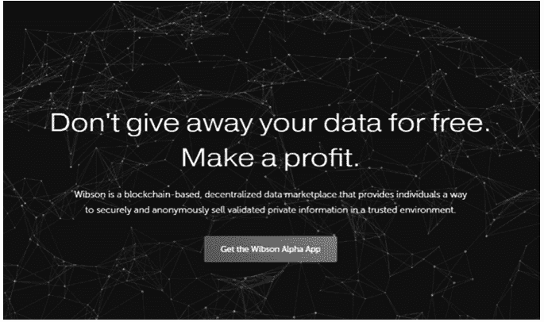

图 11.1 Wibson 主页（Wibson.org）
来源：作者自行制作（截图）（2018）


## 维布森案例：运作、行为体、交换与话语——一个新兴中介

### 根据维布森自身，什么是维布森？

维布森在“当今经济”中指出一个“挑战”：“数据等于金钱。不幸的是，这不代表对你而言就是金钱”，然后指出有罪方：“大型科技公司巧妙利用互联网底层技术协议来捕获和控制你的个人信息”。最后，维布森向那些“个人”，即“真正的数据所有者”提出一个“解决方案”：“维布森数据市场为个人提供基础设施和财务激励，以安全地出售经过准确性验证的私人信息，同时不牺牲个人隐私”（维布森，2017）。简而言之，根据维布森，“一个去中心化的数据市场，使个人能够安全地将其自身数据货币化”（维布森，2017）。

如前文所述，这里可以清楚地看到维布森如何关注当前关于数据隐私、控制和透明度的问题，另一方面也关注数据经济或财产问题，以此来证明和推广其业务。确实，可以在其“白皮书”中读到，在描述应用启动“动机”的部分，指出这些“巨型科技公司”是谁。它们“巧妙地利用底层技术协议构建专有应用层，以捕获和控制大量个人数据。……前五家公司（Google、Facebook、Apple、Microsoft 和 Amazon）的总市值接近 3.5 万亿美元”（Travizano 等人，2018：2）。

### 这个“解决方案”背后是什么？

维布森是 Gran Data 公司于 2017 年 2 月推出的一款专有且以盈利为目的的应用程序。Gran Data 自 2007 年以来运营在所谓的大数据领域（包括数据捕获与分析）。它最初向公司提供服务，并自 2017 年起试图通过维布森纳入“个人”。尽管其总部位于硅谷，但该公司大部分业务在阿根廷开展，在那里雇佣了约 60 名员工。首先通过 Binaria，现在通过维布森，该公司的目标始终如一：“了解市场趋势并预测用户行为”，销售相关服务（grandata.com，2018）。在一次采访中，被问及维布森的盈利模式时，联合创始人表示：“我真正想要的是将维布森作为一种为我的另一家公司 Gran Data 获取数据的方式”（Jiménez，2018）。

基于以太坊区块链，维布森提供一个数字数据市场和关于数据交易的法律建议，主要连接数据生产者（个人）与数据购买者（组织或公司）。概括地说，一旦用户安装该应用——这使得“社区”缩减为注册用户——该应用将自身链接到不同的数据源（社交媒体个人资料、设备位置等——参见图 11.2）。通过该应用，用户可以看到数据购买者的出价。同时，“公证人”检查数据的真实性。用户随后将数据出售

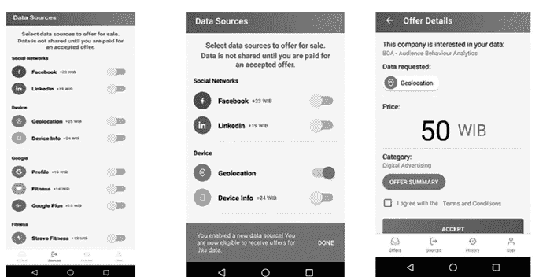

图 11.2 维布森应用，“数据来源”和“报价详情”；一个选定来源的示例 来源：作者自行制作（应用截图）（2018）

将数据卖给买家，始终监控该数据的位置，并通过维布森收到付款。得益于区块链，数据始终可由用户监控，是加密的，并且不存储在任何维布森服务器上，后者仅保存交易记录，包括卖家与数据买家之间商定的智能合约（Wallen，2018）。

因此，维布森模式包括以下行为体和交换：

- 数据卖家（注册用户，大多为个人）：在货币方面，该应用对他们是免费的。当交易完成后，他们赢得维布森积分（最终代表金钱的数字奖励）。10

- 数据购买者（公司或个人）。目前该应用是免费的。数据购买者为用户数据付费并获取数据，不依赖 Facebook 或 Google（而是通过维布森）。如果他们希望公证人验证数据，可以添加一笔支付给维布森。因此，这些行为体应当能够在一个市场中获得经过验证的用户数据，而该市场表面上缺乏互联网巨头的高进入壁垒。在这里，资金进入循环。在维布森的这个测试版本中，数据购买者与投资者/合作伙伴没有区别，他们与维布森一起将是数据的唯一买家（维布森，2017 – 常见问题解答）。

- 应用投资者/学术合作伙伴：从大学到大型公司（包括电信行业、银行等），这些行为体可以扮演两种角色。其中一些人是上述的“公证人”：他们负责验证数据（基于自己的记录），并因该任务收到来自维布森的付款。其他人可以使用数据进行研究或与其自身业务相关的其他用途（维布森，2018b – medium）。任何集中信息的组织或公司都可能与维布森合作并担任公证人。他们获取数据，当然，也为该应用投入资金。

- 应用（及其背后的公司）：维布森可以以不同方式获取一些有价值的东西并获利。首先，它从“合作伙伴”那里获得投资。其次，它通过上述购买者为验证数据支付的款项获得资金。第三，维布森获取用户行为信息（数据购买者和卖家）。虽然，正如我们所见，维布森本身无法访问交易数据，但与其他应用和平台一样，维布森可以获取应用内用户行为数据（日志、位置、使用时间、互动和交易的数量与种类、兴趣等）（Wallen，2018）。这当然可用于开发更好的应用版本，也可用于销售相关服务，即所谓的高级服务，甚至开发新应用。11

从这个意义上说，维布森的条款和条件如下：

> 使用移动应用程序时，我们将收集告诉我们您应用使用情况的数据。我们将在内部仅用于研发目的使用这些使用数据。此外，您可以选择与我们分享移动设备或手机中包含的不同数据。我们收集这些数据以进行移动应用程序及其由您和其他用户使用的内部测试，用于研究和前沿营销目的。通过向我们提供这些数据，您还授权我们将其转移给 Wibson Ltd. 及我们的学术合作伙伴，用于相关目的。（维布森，2017 – 隐私政策，条款和条件-）

这些条款与 Facebook 的条款有何不同？维布森用户是否应仅依赖代码，还是也应信任维布森？当然，维布森保留“随时更改移动应用程序上提供的内容和服务”的权利（维布森，2017 – 条款和条件-）。

我们已经了解了行为体之间的基础设施和交换。为了完整理解维布森的运作，让我们看看“激励系统”是如何工作的。像比特币和其他区块链一样，维布森有一个“代币模型”，这里称为“维布森积分”。其描述将完善先前提出的个人利益推动“社区”作为“共同目标”的观点。

到目前为止（在其“alpha”版本中）正如我们所提到的，维布森正在使用维布森积分来激励“用户”在应用中进行互动。但在不久的将来，“代币模型”将由“维布币”（Wibcoins，一种维布森加密货币）组成。因此，随着更多用户进入应用和区块链，维布币将升值，同时，维布森作为中介也会变得更强。简而言之，这个系统使网络参与者能够朝着共同目标（网络增长和代币升值）共同努力。通过这个系统，最终，用户（个人层面）的利益与应用的利益趋于一致。

### 结论

本章旨在通过维布森案例，刻画在用户生成数据的流通与商业化领域中使用区块链技术的一种扩展方式。

为此，我们将这一基于区块链的盈利应用放在情境中：首先，置于信息资本主义的一般背景下；其次，更具体地，置于用户生成数据商业化大规模扩张及其随后出现的（在经济和社会层面）回应性辩论之中。这些辩论开始质疑互联网巨头在这方面一直扮演的角色。是时候消除这些中介了，而区块链的去中心化特性将在这方面提供帮助。

然而，我们首先表明，并不存在单一的“区块链”，而是不同种类的区块链，从这个意义上说，区块链技术并没有“自然或固有特征”。特别是，通过私有区块链，在维布森中，中介并没有消失，只是换了人手。确实，数据经纪人已经更换：从 Facebook 或 Google 到维布森，给予“个人”一些金钱回报和其数据控制权。从这个意义上说，维布森似乎在告诉其用户：“不要信任我，我不存储你的数据；信任区块链社区。”但维布森仍然拥有监管应用权限和规则的权力。正如我们所见，“将控制权交还给个人”和“为其数据支付公平份额”的观点，已经转变为维布森作为新兴数字数据市场中新中介存在的论述性正当理由。用户在维布森本身存在之前，早已相信互联网巨头的邪恶。

其次，与此相关：通过维布森，区块链被用来开发互联网上信息商品（特别是数据）商业化的另一种方式。因此，维布森有助于表明，数据市场的一定程度的去中心化——受控的去中心化——并不代表数据市场的民主化；它作为一种工具，用于与互联网巨头为当今最重要的利润来源之一（即用户数据）而提出争议。这是一场资本内部争议，其中社区——转化为盈利行为体的个人——仅仅是一个媒介。

借助区块链技术的某些属性，像维布森这样的应用将数字技术的颠覆潜力限制在资本主义的边界内。因此，关于数据非营利性利益和数据公共效用的问题仍未得到解答。如果互联网的商品化多年来在基础设施、软件和内容领域稳步推进，那么现在轮到数据了。


## 注释

- 1 撰写本文时，该移动应用正处于“alpha”测试阶段。

- 2 值得注意的是，虽然与 Wibson 不完全相同，也没有在专业媒体中享有同样的声誉，但类似 Dock.io 和 Bitclave.com 等其他类似应用和平台最近已经出现。因此，本文关注的商业领域虽然是新兴的，但超出了孤立案例的范畴。

- 3 从监管角度看，这些平台依赖于立法中的灰色地带或漏洞，将可复用内容（例如根据 CC 或 GPL 许可的内容）的占有与侵犯未知用户财产权（Zukerfeld, 2010）相结合。这与所谓的“数据经纪人”情况不同。

- 4 我们并非在讨论数据本身（即所谓“原始数据”）在未经过进一步处理的情况下产生经济价值的程度。事实上，数据与信息之间的通常区别难以维持，因为处理数据的算法是生成数据的同一平台和应用的一部分。同样，也不宜将数据生产者称为“工人”，特别是无偿工人。正如我根据文献综述所示，我只是假设数据是一种不可或缺的投入，相对于它所实现的巨额利润，对公司的成本非常低。

- 5 没有中心，没有“第三方”，没有“中介”；每个节点都与下一个节点平等。在比特币中，区块链旨在避开银行。在 Wibson 中，区块链旨在避免 Facebook、Google 和 Wibson 本身将数据集中在其自身服务器上。

- 6 任何拥有最基本技术知识、计算机和软件的人都可以成为用户。

- 7 区块链用户无法被个人识别，但其地址可以被追踪。

- 8 区块链对每位互联网用户开放，无论其是否为区块链用户。

- 9 这是在公有区块链以太坊之上构建的测试私有网络（Wibson, 2018a – Medium-）。

- 10 目前，Wibson 积分可根据居住国兑换 Visa 礼品代码、Spotify 订阅和 Uber 积分（Wibson, 2017）。

- 11 确切地说，“如果您向公司……发送或传输任何通信……建议或推荐对移动应用程序或材料进行更改……所有此类反馈均为，且将被视为非保密和非专有的……公司可自由使用，无需向您做任何署名或补偿，反馈中包含的任何想法、专有知识、概念、技术或其他知识产权和专有权利，无论是否可申请专利，用于任何目的，包括但不限于开发、制造、委托制造、授权、营销和销售产品和服务，直接或间接地使用此类反馈”（Wibson, 2017 – 条款与条件-）。

## 参考文献

- Aitken, R. (2018). 区块链能否挑战‘FANG’科技巨头对我们数据的控制权？Forbes。可访问 www.forbes.com/sites/rogeraitken/2018/02/28/can-blockchain-challenge-fang-tech-giants-for-control-over-our-data/#1662d12f5367。最后访问: 08/04/2018。

- Atzori, M. (2015). 区块链技术与分散治理：国家是否仍然必要？Papers SSRN。

- Boutang, Y. M. (2004). 认知资本主义中的财富、财产、自由与租金。收录于《认知资本主义、知识产权与集体创作》。马德里：奋斗的梦想者，第 107–120 页。

- Cafassi, E., 1998. 互联网：政治与传播（第 3 卷）。比尔博斯出版社。

- Castells, M. (1997). 权力的身份认同：信息时代：经济、社会与文化。牛津：Blackwell Publishers, Inc。

- 《经济学人报》. (2010). 无处不在的数据：关于信息管理的特别报告。*《经济学人报》*，2 月 27 日。可访问 www.emc.com/collateral/analyst-reports/ar-the-economist-data-data-everywhere.pdf。最后访问: 17/09/2018。

- Fuchs, C. (2010). 信息资本主义与互联网上的劳动。*信息社会*，26(3), 179–196。

- Gran Data. (2018). 官方网站。可访问 https://grandata.com/

- Herian, R. (2018). 区块链与资本主义阶级权力的分布式再生产。收录于 Gloerich, I., Lovink, G., and De Vries, P. (eds.) *MoneyLab reader 2：超越炒作*。网络文化研究所，阿姆斯特丹，第 43–51 页。

- Jaimovich, D. (2018). Wibson，一款阿根廷应用，可通过个人数据赚钱。*Infobae.com*，2018 年 5 月 7 日。可访问 www.infobae.com/tecno/2018/05/07/wibson-una-app-argentina-para-que-puedas-ganar-dinero-con-tus-datos-personales/。最后访问: 17/07/2018。

- Jiménez, M. (2018). Wibson，一款允许任何人通过个人数据赚钱的‘应用’。*El País*。可访问 https://elpais.com/tecnologia/2018/02/27/actualidad/1519749269_061405.html。最后访问: 03/04/2018。

- Kosten, D. (2015 年 10 月 31 日). 比特币宣言。加密社会主义——下一步是什么？或者共享经济与分布式信任意味着什么？*社会科学研究网络*。可访问 https://mpra.ub.uni-muenchen.de/73568/1/MPRA_paper_73568.pdf。最后访问: 01/05/2019。

- Lessig, L. (2004). *自由文化——创造力的本质与未来*。伦敦：企鹅书社。

- Lessig, L. (2009). *代码：以及网络空间的其他法律*。阅读你想要的。

- Olma, S. (2014). *别管共享经济了：这里是平台资本主义*，博客，10 月 16 日。可访问 http://networkcultures.org/mycreativity/2014/10/16/never-mind-the-sharing-economy-heres-platform-capitalism/。最后访问: 5/7/2018。

- Ostrom, V., and Ostrom, E. (1977). 公共产品与公共选择。收录于 Savas, E. S. (ed.) *改善绩效的公共服务提供替代方案*。博尔德，科罗拉多州：西景出版社，第 7–49 页。

- Pel, A. (2015). *无事得金，比特免费：比特币的地理学*。学位论文。多伦多大学地理与规划系。可访问 https://tspace.library.utoronto.ca/handle/1807/70121

- Petersen, S. (2008). 失败者生成内容：从参与到剥削。*First Monday*，13(3)。

- Pilkington, M. (2016). 区块链技术：原理与应用。收录于 Olleros, F. X., and Zhegu, M. (eds.) *数字化转型研究手册*。爱德华·埃尔加出版，第 225 页。

- Preukschat, A. (2017). *区块链。互联网上的工业革命*。巴塞罗那：Gestión 2000。

- Reischl, G. (2008). *谷歌的骗局：互联网上不受控制的全球强权*。巴塞罗那：Medialive Content。

- Roderick, L. (2014). 数字时代的纪律与权力：美国消费者数据经纪行业案例。*批判社会学*，40(5), 729–746。

- Rullani, E. (2004). 认知资本主义，一种似曾相似？收录于《认知资本主义、知识产权与集体创作》。马德里：奋斗的梦想者，第 99–106 页。

- Scholz, T. (2014). 平台合作主义与共享经济。*大数据与公民参与*，47。

- Schuster, M. (2017). 加密货币与加密资本主义之间。对 Andrés Rabosto 和 Mariano Zukerfeld 的采访。电子杂志。*新社会*。可访问 http://nuso.org/articulo/entre-las-criptomonedas-y-el-criptocapitalismo/。最后访问: 09/04/2018。

- Scott, B. (2014). 技术利维坦的愿景：比特币区块链的政治，2014 年 6 月 1 日。*电子国际关系*。可访问 www.e-ir.info/2014/06/01/visions-of-a-techno-leviathan-the-politics-of-the-bitcoin-blockchain/。最后访问: 06/06/2015。

- Shirer, D., Wu, W., and Pentland, A. (2016). 区块链与基础设施（身份，数据安全）。MIT 连接科学，1–18。

- Srnicek, N. (2017). 平台资本主义。剑桥：Polity Press。

- Travizano, M., Minnoni, M., Ajzenman, G., Sarraute, C., and Della Penna, N. (2018). Wibson：一个去中心化市场，使个人能够安全地变现其个人数据（白皮书）。可访问 https://wibson.org/wp-content/uploads/2018/10/Wibson-Technical-Paper-v1.1.pdf。最后访问: 28/11/2018。

- Van Dijck, J. (2014). 数据化、数据主义与数据监视：大数据处于科学范式与意识形态之间。*监视与社会*，12(2), 197–208。

- Vigna, P., and Casey, M. J. (2016). 加密货币时代：比特币和区块链如何挑战全球经济秩序。麦克米伦出版社。

- Wallen, J. (2018). 基于区块链的平台为欧洲消费者提供从自身个人数据中获利的机会。Forbes，7 月 23 日。可访问 www.forbes.com/sites/joewallenneurope/2018/07/23/blockchain-run-platform-offers-european-consumers-opportunity-to-profit-from-own-personal-data/#72e330ac290a。最后访问: 14/09/2018。

- Wibson. (2017). 官方网站。可访问 https://wibson.org/

- Wibson. (2018a). Wibson 推出消费者控制的个人数据市场。Wibson Medium。可访问 https://medium.com/wibson/wibson-launches-consumer-controlled-personal-data-marketplace-87b572a392bb。最后访问: 20/09/2018。

- Wibson. (2018b). Wibson 发布会回顾：巴塞罗那的美好夜晚。Wibson Medium。可访问 https://medium.com/wibson/wibson-launch-event-recap-a-wonderful-evening-in-barcelona-8f71de002411。最后访问: 05/05/2018。

- Yli-Huumo, J., Ko, D., Choi, S., Park, S., and Smolander, K. (2016). 当前区块链技术研究在哪里？——一项系统综述。*PLoS ONE*，11(10), e0163477。

- Zuckerfeld, M. (2010). 资本主义与知识。认知唯物主义、知识产权与信息资本主义（FLACSO 阿根廷博士论文）。可访问 https://capitalismoyconocimiento.wordpress.com。最后访问: 12/04/2018。


泰勒·弗兰西斯

泰勒·弗兰西斯集团

http://taylorandfrancis.com

## 分散化技术的技术层面及后果


泰勒·弗兰西斯

泰勒·弗兰西斯集团

http://taylorandfrancis.com

## 在大规模在线争议解决中应用智能合约及其监管影响

薛慧（Janet Hui Xue）和拉尔夫·霍尔茨（Ralph Holz）

### I. 引言

本章分析了利用智能合约技术大规模处理在线争议解决（ODR）的可行性。在线争议解决（ODR）是“被称作利用技术开展争议解决流程。” ¹ ODR 结合了替代性争议解决（ADR）和信息通信技术； ² 它可用于源自在线电子商务交易和离线交易（如购买）的争议。ODR 在跨境电子商务背景下显得尤为重要。它可以包括传统法律流程，尽管通常不依赖它：传统法律流程通常涉及法院、法官，以及可能的陪审团来裁决争议。 ³ 然而，ODR 存在可扩展性问题：它难以轻易满足数百万消费者可能提出的海量请求，鉴于电子商务仍在强劲增长，且支持最终实现电子商务的金融交易需要大量中介。此类中介包括一系列金融机构：银行、经纪商/交易商，以及与金融交易最终用户交互的其他机构；该术语还包括支付、清算和结算系统等基础设施。 ⁴ 在国际和区域层面已存在多种 ODR 系统，包括 eBay 的 ODR 系统 ⁵ 或 ICANN 使用的域名争议解决。 ⁶ 然而，尚未出现全球可行的 ODR 模式。 ⁷ 近来，所谓建立在区块链上的智能合约被提议作为“自动执行的在线争议解决”的一种可能解决方案。 ⁸ 声称的优势在于，智能合约可能能够以更快的速度和非常大的规模处理争议。

然而，智能合约技术仍处于起步阶段，此类高级应用尚未得到充分探索。究竟将会存在哪些智能合约平台，以及它们将支持哪些功能，目前尚不完全明确。对智能合约技术可行性的期望可能过于乐观；关于可能的功能和局限性也存在一定程度的混淆。重要的是，尽管已提出许多用例，但从法律合规角度进行分析的非常少。因此，希望进入金融行业（例如第三方支付供应商）的中小企业（SMEs）在考虑为电子商务采用区块链和智能合约时面临诸多不确定性。即使是中央银行和政府等传统监管机构也面临一些挑战。

本章识别并阐明了可行的监管空间，以帮助理解如何对用于 ODR 平台的智能合约进行监管，并将其嵌入现行法律体系。本章首先定义智能合约并解释其与区块链的关系。它阐述了智能合约的功能和局限性，以及它们与传统、更集中式方法的不同之处，从而凸显一项独特的贡献，这对未来的 ODR 平台大有裨益：争议流程的强制透明度。基于此技术分析，本章提出了一种方法，说明智能合约如何在当今使用的 ODR 平台（例如欧盟 ODR 平台） ⁹ 中发挥作用，方法是概述适用于仲裁员的原则和访问控制定义（例如，国家行为体的访问需求）。本章还提出了可能的方法，利用智能合约以大规模标准化案件立案程序并以高效方式处理争议。这些建议基于近年来在以太坊区块链上开发智能合约所吸取的经验教训，以太坊目前是唯一支持智能合约的主要区块链。 ¹⁰ 本章最后分析了未来监管和法律合规的影响。

出于本章的目的，我们无需区分允许任何人参与的公有链和需要由权威实体（或一组实体）授予某种形式许可才能参与的私有链。智能合约的可能性和局限性对两者大体相同；区别主要在于，私有链使用的基于许可的系统使得向特定参与者分配特定角色更加容易。因此，在后续讨论中，我们将局限于更一般的公有链情况。

### 2. 区块链：分布式账本、共识与信任

区块链是一种分布式账本技术：区块链参与者维护所有曾发生过的交易的共享、共同视图。从传统角度看，解决双方如何信任交易有效性的问题需要银行等中介。公有链用一个运行所谓共识协议的大规模参与者网络集体取代了受信任的中介；任何人都可以参与。共识协议对网络整体接受的交易的有效性提供强有力的保证。存在多种共识协议。就著名的中本聪共识而言，它被应用于比特币，且以变体形式也应用于当今的以太坊， ¹¹ 可以证明，只要大多数参与者忠实执行共识协议，整个网络最终将实现对任何双方之间所有余额的统一视图。构建共识要求每个参与者将交易分组为所谓的区块。区块有前驱和后继，因此它们形成一条链。创建区块需要投入计算工作量来解决密码学难题。第一个成功创建新区块并将其链接到区块链的参与者将获得一定数量的货币（分别为比特币和以太币，对应比特币和以太坊）。这通常被称为“挖矿”。

该密码学难题的定义是，算力相等的参与者创建新区块的概率相等。这种构造确保欺诈的概率变得极小且可忽略——试图干扰共识要求欺诈参与者拥有比大多数其他参与者合计更多的计算资源。 ¹² 只要拥有“计算算力多数”的网络部分忠实遵循协议，网络就会保留所有曾进行过的交易的可信记录。共识协议以每个参与者都可运行的软件形式实现。 ¹³ 在本章中，我们始终使用术语“参与者”来指代参与网络和共识协议的实体。

### 3. 智能合约：性质、执行与独特特性

智能合约的概念是对区块链范式的补充。智能合约是由区块链参与者执行的计算机程序。 ¹⁴ 这与网络服务采用的原则相同：可以通过接口向网络服务发送和接收数据，并将其用于进一步处理和显示。在智能合约中，区别在于每个参与者都可以创建智能合约，并定义一组可调用的例程（称为“方法”），供其他参与者使用并与智能合约交互。一个示例是智能合约在其方法中实现并暴露计算器功能。网络中的其他参与者，原则上也包括其他智能合约，可以调用这些方法以获取结果；例如，它们可能向名为“sum”的方法发送数字，并接收总和作为结果。

智能合约存储在发送到区块链的交易内；因此，一旦网络达成共识，智能合约就成为区块链中不可更改的条目。所有参与者都必须执行被“调用”（即交互）的智能合约。与智能合约的交互同样也是交易。 ¹⁵ 这意味着任何与智能合约的交互也存储在区块链中，因此对整个网络透明。 ¹⁶ 这是参与者维护账本一致视图的必要前提。智能合约通过（加密）地址进行标识，方式与网络中发送方和接收方通过此类地址进行标识（通常而非通过其现实世界身份）相同。就像用户一样，智能合约甚至可能控制数字资产。


人们经常对智能合约寄予的希望是，它们可以被用来定义真实法律合同的条款、规则和处罚，*并且*自动执行和强制执行相关义务，特定事件触发交易。这通常被称为“自强制”。它们还可以帮助简化那些需要多方签署才能生效的交易。但是，重要的是要理解，智能合约仍然只是计算机程序，即一组算法。这使得它们可以被用作支付、清算和结算过程的手段，这些过程定义了资金转移以及证券和商品及其衍生品的清算和结算方式。<sup>17</sup> 所有这些都可以轻松地用算法描述。原则上，这意味着处理争议案件的程序也可以在智能合约中编码。然而，智能合约不能用于，例如，推理索赔的有效性，如果这需要对法律进行解释。此外，智能合约始终需要通过交易来调用，而这反过来又需要存在能够创建此类交易的区块链参与者。在撰写本文时，没有区块链系统允许定义外部事件以自动触发调用交易的创建——总必须有某个参与者参与。

智能合约的一个显著特征是，调用方法需要为方法的执行提供某种形式的支付。例如在以太坊中，智能合约中定义的操作加起来总计需要一定数量的“gas”——这里的“gas”是衡量执行成本的内部单位。调用方法的参与者（或合约）必须愿意支付所需的 gas。调用方提供“gas 价格”，即以太坊内部货币以太币（Ether）到 gas 的转换率，以及他们愿意支付的用于调用的以太币总额。选择将交易打包进区块的参与者必须执行所调用的方法。所花费的 gas 以以太币奖励给第一个创建包含调用交易的区块的参与者。智能合约本身可以按照其作者指定的方式发送和接收货币；作者也可以在将智能合约部署到区块链之前为其赋予可用的货币。

重要的是，智能合约可以通过指定访问条件来“保护”其方法和资产。智能合约有所有者，他们拥有特殊的访问权限，例如，清空当前持有或关闭智能合约（这使得进一步调用变得不可能）。所有权是使用区块链典型的非对称加密技术实现的；与智能合约的受保护方法交互需要所有者的私钥。从这个意义上说，智能合约实现了计算机安全中常见的同一种形式的访问控制。这自然意味着，所有已知的访问控制问题——参与者丢失密钥、密钥被盗等——也适用于智能合约。在经典计算机安全中，访问控制通常伴随着操作程序，例如要求组织内只有经过严格审查的人员才能进行更改，或要求四眼原则来发起交易。智能合约可以复制所有这些特性；但默认情况下，没有预定义的操作程序。这共同打开了一个经典的监管空间：从理论上讲，可以规定智能合约为某些（国家）行为者提供默认访问权限。此外，监管可以要求所有智能合约所有者有义务将其访问控制的密钥安全保管。

监管空间超出了智能合约作者的范畴。所有智能合约都运行在区块链开发者提供的软件上。因此，在软件中“拉黑”某些交易并“重写历史”并不困难：如果大多数参与者接受开发者的此类决定，其效果就是该交易从未发生过。虽然这似乎是处理欺诈性智能合约的一个解决方案，但重要的是要注意，这是一个瓶颈：开发者不可能跟踪所有欺诈行为。

总结来说，智能合约的区别特征不在于其表达能力：智能合约无法表达经典软件无法表达的任何计算或工作流。智能合约的吸引力在于更大的网络执行它们并为每次调用提供透明记录的方式。这与当今在金融机构、保险公司、政府机构等运行的软件存在根本区别。所有交易的记录都存储在区块链的所有参与者处。

另一个同样关键的局限是：智能合约无法对条款的“含义”以及是否得到履行进行推理。它们无法做出我们传统上与法官解释成文法律或调解员调解相关联的决策。在 ODR 的语境下，这意味着人类仍然通常需要评估案件，就像现在一样——这里没有智能合约可以增加的固有去中心化。智能合约并未消除 ODR 的人类可扩展性问题。其潜力在于技术程序的统一。

与所有程序一样，智能合约可能包含即使是经验丰富的程序员也不会发现的缺陷和错误；<sup>18</sup> 这与计算机的本质有关。<sup>19</sup> 这一反复被证明是高度成问题的，其中“DAO”的案例最为引人注目。DAO 是“去中心化自治组织”的缩写，是第一个试图实现整个组织的工作流并使其“自主”执行（即无需人工管理活动）的智能合约。在 DAO 的案例中，智能合约中的规则将允许投资者对要资助的项目进行投票；利润将回流到投资者。任何人都可以通过获取“DAO 代币”成为投资者，该代币代表投资者权利并使用智能合约实现。<sup>20</sup>

不幸的是，在“DAO”的案例中，一个相对简单的编码错误导致了大规模的泄露，攻击者盗取了价值相当于 360 万个以太币的资产（当时价值约 6000 万美元）。由于智能合约的自主性，攻击无法被遏制。最终，以太坊开发者介入，在软件的下一个版本中拉黑了所有与 DAO 相关的交易，从历史记录中根除了攻击。虽然这是最著名的案例，但许多其他缺陷已被报告，且有相关调查可供参考。<sup>21</sup> 在最近的一项研究中，Brent 等人开发了一个工具来调查以太坊区块链上所有 141,000 个智能合约。他们发现，多达 60% 的智能合约包含导致 DAO 被利用的那种错误。<sup>23</sup> 作者还发现，个位数百分比的智能合约未能防止其以太币持有被未经授权的访问。

### 4. 将智能合约技术与人工干预相结合的模型

下文，我们介绍了一个监管模型，该模型将智能合约与人工干预相结合，作为当前 ODR 系统原则的延伸。<sup>24</sup> 该模型有助于提高处理共同性质案件（即非常相似的案件）的效率，同时保留法律推理和解释所需的灵活性。在此模型中，区块链对所有交易的记录所提供的透明度是日后审计的宝贵信息来源；它还允许在必要时收集关于案件、投诉类型和结果的数据以供进一步调查。此类信息会自动加上时间戳，并向所有参与者开放。虽然我们并未明确定义案件信息的存储方式（例如支持文件），但我们注意到区块链本身通常不提供此类功能。此类数据通常存储在外部，但可以以完整性保存的方式在区块链中引用：任何后来对引用文档进行修改的尝试都会立即被发现。

我们的模型基于一种为智能合约提出的应用：所谓的 DApps（分布式应用程序）。DApps 旨在实现功能根本依赖于与区块链上智能合约交互的应用程序。DApp 可以作为独立（桌面）应用程序、运行在服务器上的应用程序，甚至作为混合形式实现，例如，作为一个网站，其中一部分功能在服务器上实现，另一部分作为在浏览器中执行的 JavaScript。关键特征始终是与智能合约的交互，为此，已部署的区块链环境提供了执行环境，包括消息传递以及指向外部存储的完整性保存引用。我们注意到，目前愿景与现实之间存在巨大差距。当前对 DApps 的建议侧重于将其实现为网站，例如，通过将每项活动记录在区块链上的智能合约交易中，或提供用户友好的界面以与智能合约交互。一个例子是实验性预测市场 Augur，或者在新的 Brave 网络浏览器中实现的小额支付功能。至关重要的是，作为 DApp 实现增加了透明度，还允许使用区块链货币进行支付。


在我们的模型中，ODR 被实现为这样一个 DApp：一个在线应用程序允许通过浏览器访问，而区块链负责透明度和支付。我们在图 12.1 中展示了这一点。这为更广泛的 ODR 奠定了基础：其他 ODR 系统可以通过调用智能合约实现的方法来链接到现有系统。结果是，不同的 ODR 可以实现相同的流程，区块链为所有人提供可审计性保证。

使用在整个网络中广播的透明审计记录也值得注意，因为它创造了另一种制衡形式：它对人类仲裁员施加压力，从而有助于抑制不公正或带有偏见的判决。25 导致案件（将提交给仲裁员）的步骤可以在对所有人透明的代码中定义。仲裁员不容易滥用他们的权力。一旦人类仲裁员做出决定，ODR 的剩余步骤（例如，和解支付或拒绝）也可以在智能合约中促进。这从最初的索赔到结果建立了完全透明的事件链。标准化有助于简化流程并使其更快。智能合约还允许建立反馈渠道。这些渠道从简单的正面/负面“投票”（点赞/点踩）到更复杂的设计，例如，在提供反馈的同时表示支持

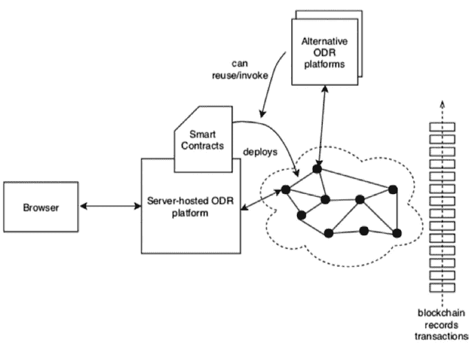

图 12.1 作为服务器托管应用程序实现的 ODR 平台，可通过浏览器访问。功能在部署在区块链上的智能合约中实现。区块链跟踪所有交易。

另一项提案。投票在整个网络中再次保持透明。这自然适合就对仲裁员决定的同意或反对提供反馈，无论是由受影响方还是仅观察 ODR 的外部方。

除了透明度之外，标准化可能是智能合约在我们的模型中做出的最强贡献：更大的监管机构可以提供（部分或完全）定义 ODR 流程的模板。模板中将明确定义人类仲裁员必须交互的节点。这样一来，效率将与进行需要法律判断的进一步推理和解释留有足够空间相结合。公司可以选择（或被强制）使用该模板。例如，欧盟可以在欧盟范围内标准化 ODR 平台的某些功能；这些模板也可以在欧盟之外使用，以协调 ODR 实现。典型模板可用于提出投诉、分类争议案件，并根据某些特征（例如，紧急程度、货币损害）优先处理案件。人类决策仍然是整个过程的一部分，但人类交互将在精确定义的时刻进行，并有明确指定的输入和输出。只有更特殊的案例可能需要在该系统之外完成（但仍会保留此事实的记录）。付款可以透明地与决策挂钩；更复杂的金融结构也可以以透明的方式实施。一个示例可能是债券发行，其中面值、期限和支付结构是智能合约模板的参数。我们在表 12.1 中总结了我们模型的这些方面。

## 表 12.1 ODR 中的智能合约

| 方面 | 智能合约的相关特性 | 使用智能合约的直接效果 | 结果 |
| :--- | :--- | :--- | :--- |
| 透明度 | 每个参与者对智能合约的定义/方法有相同的视图。每个参与者对结果有相同的视图。 | 每个参与者都可以查看争议案件。每个参与者都可以对仲裁员做出的决定进行投票/提供反馈。 | 更好的制衡对仲裁员施加压力。 |
| 效率 | 具有明确移交给人类仲裁员节点的定义良好的流程。 | 某些量的模板允许对案件进行分类。链接到反馈和支付机制。 | 争议解决时间缩短，即时支付。 |
| 标准化 | 模板化智能合约以强制规定案件处理的程序和原则。 | 重用定义良好的程序，降低开销。可以根据模板定义变体。 | 在保持灵活性的同时协调 ODR 实现。 |

但是，我们强调使用智能合约并非没有风险，正如之前在访问控制和智能合约所有权方面所讨论的那样。

### 5. 将智能合约用于 ODR 的监管影响和潜力

基于区块链的智能合约声称的潜力在于使复杂的交换更加透明，并减少对交易的不希望的干预手段。26

然而，中央银行和政府等传统监管机构需要适应新监管空间的可能性和限制。关于 ODR 系统中智能合约的监管，这意味着要在高效处理案件和为更广泛参与创造包容性环境之间取得平衡，使资源较少的参与者能够以更有效的方式维护自己的权益。通过在代码中标准化流程，可能同时获得效率和参与度的提升。以我们模型中描述的欧盟 ODR 平台为例，欧盟范围内的法律监管标准变得更容易实施；同时，所有参与者都可以被赋予访问和查看交易记录的权利和手段，并可自愿为决策过程提供反馈。重要的是，所有反馈记录都会保留，滥用该机制的行为可以被追踪。接下来，我们讨论共同监管性质的变化，特别关注智能合约中的错误和监管影响。

### 5.1 共同监管性质的变化

这种新模式并不阻止传统监管模式中存在的监管操纵。政府仍然可以在智能合约中强制规定某些功能，并且他们可以是 ODR 智能合约模板的作者。共同监管仍在发生，但性质发生了变化：在此背景下，这意味着更多参与者拥有平等的权利来查看和对智能合约中内置的流程提供反馈。共同监管将意味着一种结合以代码监管和以法律监管的综合方法。然而，在这种混合共同监管方法中，许多原则需要进一步澄清：如何定义访问控制，即智能合约的哪些部分可以由谁在什么条件下激活、更新或停用？

这种形式的共同监管将监管过程的参与开放给任何感兴趣的行为者。主要参与者包括我们从金融系统监管中熟知的传统参与者，还包括新的中介（经纪商、交易商以及与最终用户交互的其他实体）以及最终的个人消费者。我们从当前金融系统中熟知的传统监管机构继续存在，但将承担额外角色：ODR 案件的模板化处理允许在更大规模上分析决策，同时考虑反馈的数量和质量。中介通常是 ODR 案件的对象——支付供应商就是一个典型示例。ODR 案件理想情况下应包含与争议交易相关的金融交易记录。与今天一样，这些交易中的中介通常位于不同的管辖区。这是一个典型的跨境问题。模板化 ODR 智能合约的优势在于，由于代码是明确的，中介更愿意参与 ODR 流程，从而降低不确定性以及关于如何解释 ODR 流程本身的争议潜力。个人消费者在两个方面获得了权能。首先，模板化 ODR 合同的存在使得他们不太可能仅受企业单方面预设的条件约束，而没有合理的机会协商条款。其次，消费者可以提供更即时的反馈并引起监管机构的注意，监管机构可以更快地应对日益增多的类似争议。这可能有助于防止以前环境中出现的不幸结果，当时单一法院通常不会强制执行消费者在合同中提出的条款。²⁷

### 5.2 智能合约中的错误

即使代码是明确的，智能合约仍可能包含错误。可能会发生两种错误。我们需要考虑的第一种错误是智能合约开发人员错误地解释 ODR 流程的（法律）含义并错误地实现它们。第二种错误发生在创建者的解释是正确的，但他们使用编程语言导致可利用的漏洞时：看似正确的代码可能成为攻击目标，攻击者可以“接管”智能合约，即导致其运行错误并执行由攻击者控制且原开发人员不打算执行的步骤。第二种错误通常，但并非总是，可以通过自动化工具检测到——存在多种工具，例如 Brent 等人、²⁸ Kalra 等人、²⁹ 或 Luu 等人³⁰ 的工具，仅举几例。理论限制使得不可能普遍识别所有可能的错误。截至目前，第一种形式的错误完全无法自动检测，因为没有任何机器可以推理法律解释到代码映射的正确性。这仍然是人类的任务。

### 5.2.1 共同监管：错误情况下的干预

执行错误的代码应当停止，并撤销任何错误执行的步骤。然而，区块链执行模型使得任何形式的干预都相对困难。这将需要经过授权的行为者进行（人工）干预。要修复第一种错误，错误的智能合约将必须被终止并替换或更新。这是一个更漫长的过程，可能比咨询和澄清


由传统监管机构签发。然而，问题所在相对清晰，先前交易的记录可以按顺序回滚，智能合约中的更新机制可能能够解决问题。

对于第二种错误，干预可能会困难得多，财务损失也更难防止。问题在于存在一个活跃的攻击者，正在采取主动步骤来破坏流程。与第一种错误一样，有故障的智能合约可以被终止或更改以防止进一步损失，但时间紧迫：正如我们在 The DAO 案例中所见，巨大损失可能在很短时间内发生。撤销损害也需要干预以及对实际区块链软件的关键更改。在我们的 ODR 模型中，政府或多边政府机构可能是唯一有权要求此类更改并在短时间内使其得到应用的行为体。任何延迟都将损害行为体对 ODR 进程的信任。然而，使用基于区块链的智能合约的一个优势在于，（刑事）调查将被简化，因为专家可以查看审计跟踪和交易历史，这些记录也能在短时间内提供必要信息以确定各方的责任和应作的可能补偿。为解决智能合约的第二种风险，ODR 流程的代码可能需要由特定组织（例如，欧盟，仍以我们的示例为准）雇佣的工程师来编写和维护——对许多人而言，这可能会在其运营模式中造成重大变化。

### 5.2.2 共同监管：错误智能合约中的风险分配与责任

政府干预不是唯一需要考虑的（共同）监管影响。我们认为，智能合约并不消除对若干经典支持机制的需求，这些机制在实际的区块链/智能合约系统之外实现。

**风险分配：** 由于智能合约中的错误不可避免，依赖智能合约的组织需要清楚了解自身法律义务及其合作伙伴在风险分配和分摊方面的义务。特别是，金融组织必须考虑如果其交易对手损失资金，风险应如何分配——在中介机构的情况下这是一个重要考量因素。31 此类安排需要在智能合约定义之外，并在其部署开始或风险实现之前就位。32 否则，不同交易者之间理解不一致将与责任的法律合规性以及关于哪一方需要以何种方式介入的协议发生冲突。

**风险分配的技术支持：** 由于风险分配必须在智能合约之外定义，因此仍然需要技术基础设施和支持来定义、评估和量化风险，并制定处理不同类型风险的策略。智能合约无法消除这种成本；基础设施支持必须为法律解释留出空间。针对 The DAO 攻击的后续影响可以说明不明确的风险分配和程序的后果。由于 The DAO 的宣传正是基于所有规则均以无歧义的代码形式列明这一理念，那么攻击者是否不有权利用漏洞提取资金？以太坊开发者认真考虑了这一问题，并导致社区分裂。主要开发者决定更改区块链软件，使得所有与攻击相关的交易都会被参与者忽视——本质上是在“重写不可更改的区块链”。然而，一个相当大的派别不同意，并继续使用旧软件，从而创建了一个运行相同智能合约的第二个“分叉”区块链。我们还注意到，所需的此类支持基础设施虽已构想，但在现有 ODR 平台中也尚未实现。例如，它不存在于当前的欧盟范围 ODR 门户中，该门户成立于 2016 年，依据《关于消费者争议在线争议解决的第 524/2013 号欧盟条例》，该条例允许消费者和交易者提交可通过平台引导和处理的投诉。

**一些旧的监管挑战依然存在：** 正如我们所示，在智能合约代码中实施的监管并不排除传统监管机构和中介的参与。然而，一旦如前所述在智能合约中发生错误，且可能造成高额财务损失，那么法官和陪审团仍必须审查和解释代码的含义及其法律依据。区块链系统似乎使攻击者更难伪装其真实身份，因为在智能合约中执行（攻击）方法可能需要一种身份验证形式。然而，攻击者可能只是通过经典身份盗窃来窃取另一名合法参与者的身份，并使用假冒身份发动攻击。攻击归因以及保护自身身份的责任问题与今天相同。这可能会因参与 ODR 系统的中介数量众多（包括其他司法管辖区的中介）而加剧。

### 6. 总结

运行在区块链上的智能合约常被引用为一种颠覆性创新，能够使 ODR 系统更具可扩展性。在本章中，我们批判性地分析了这一观点，并绘制了使用智能合约进行 ODR 的监管空间及其影响。

我们对智能合约背后的技术进行了深入描述，并强调了其技术潜力以及局限性。在表达能力方面，智能合约并不能取代人类仲裁员，因为它们无法在法律背景下推理索赔的有效性。智能合约的所有步骤，包括最初索赔的创建和仲裁员的最终决定，均由 ODR 系统中的参与者触发。

然而，智能合约确实提供了一些真正的优势。我们提供了一种充分利用这些优势来改进 ODR 流程的模型。首先，区块链系统对已执行步骤提供完全透明度，创建了难以伪造且参与者可轻松检索详细信息的审计跟踪。这使得仲裁员在决策过程中的问责制大大提高。对于 ODR，政府可以通过提供定义法律要求程序的智能合约模板来实施监管。模板包含可由众多 ODR 平台执行的标准化方法，消除了独立实现这些方法的必要性，从而降低了合规性方面的法律不确定性程度。此类智能合约还提供了一种统一的方式来收集 ODR 结果和索赔的数据，从而更容易、且置信度更高地分析 ODR 流程的有效性。重要的是，可以实施一个高效的反馈机制来收集参与者关于结果是否符合其预期的意见。这允许一种新的共同监管形式。

归根结底，智能合约并非万能药。首先，它们引入了新问题，因为可能包含两种错误：由于法律误解导致的错误程序，以及使代码易受利用的错误。我们表明，在两种情况下干预都不容易，且损害可能发生迅速且难以撤销。一套经典的机制和支持基础设施仍需到位，以处理错误发生时的风险评估和风险分配。

## 注释

- 1 见 Cortés, Pablo. 《不断发展的数字市场中的消费者救济法：从替代性争议解决升级到在线争议解决》。剑桥：剑桥大学出版社，2017 年，第 44 页。

- 2 ADR 系统中的消费者与商业各方之间采用的传统庭外程序有显著不同，后者依赖商业仲裁和调解程序。另见 Cortés Pablo，《不断发展的数字市场中的消费者救济法：从替代性争议解决升级到在线争议解决》。剑桥：剑桥大学出版社，2017 年，第 3 页。

- 3 ODR 通常被视为 ADR 的一种在线形式。它旨在为多方之间的冲突提供定制解决方案。根据 FTC 的说法，争议解决有两种类型：调解和仲裁。前者是指调解员充当中立第三方，促进对话以帮助各方解决问题。后者取决于各方达成协议。仲裁的约束力强于调解，但比法院程序不那么正式。各方可以出席听证会、提交证据，或传唤并质询对方的证人。案件陈述完毕后，仲裁员或仲裁庭可以作出决定；该决定可能具有法律约束力。另见 FTC 的原始说明：替代性争议解决，www.consumer.ftc.gov/articles/0162-alternative-dispute-resolution。

- 4 David Mills 等人，《支付、清算和结算中的分布式账本技术》，美联储理事会研究与统计部及货币事务部金融与经济讨论系列，华盛顿特区，第 4 页，www.federalreserve.gov/econresdata/feds/2016/files/2016095pap.pdf。


- 5 eBay，争议解决概述，https://pages.ebay.com/services/buyandsell/disputeres.html（2017年11月7日访问）。

- 6 ICANN，www.icann.org/resources/pages/dndr-2012-02-25-en（2017年11月7日访问）。

- 7 见 Ethan Katsh 和 Orna Rabinovich-Einy（编），《数字正义：技术与争议之网》（Oxford: Oxford University Press, 2017）中第I章“在线争议解决与预防：历史概述”；Louis Del Duca、Colin Rule 和 Zbynek Loebl，“促进跨境电子商务扩张——发展全球在线争议解决系统（源自现有ODR系统的教训——国际贸易法委员会工作）”，《宾夕法尼亚州大学法学与国际事务杂志》，https://elibrary.law.psu.edu/cgi/viewcontent.cgi?article=1004&context=jlia。

- 8 Pietro Ortolani，“来自比特币的自我强制在线争议解决教训”，《牛津法律研究杂志》36 (2016): 595, 595–596, 598–602。

- 9 欧洲委员会，在线争议解决：无需上庭公平高效地解决您的在线消费者问题，https://ec.europa.eu/consumers/odr/main/?event=main.home2.show（2018年5月27日访问）。

- 10 Solidity：用于实现智能合约的高级语言，http://solidity.readthedocs.io/（2018年5月27日访问）。

- 11 以太坊最终打算转向另一种共识形式；撰写本文时，这尚未被充分指定以纳入讨论。

- 12 最初的看法是需要绝对多数。由于参与者可能串通，目前认为所需计算能力约为网络总计算能力的25%。

- 13 可以设想，某些实体选择不参与共识协议的执行；在这种情况下，它们成为依赖方。根据我们的定义，它们不是参与者。

- 14 智能合约的概念最早由Nick Szabo在90年代中期提出。尽管如此，其实现一直停留在理论阶段，直到区块链发展。概述见Nick Szabo，“在公共网络上形式化和保障关系”（1997）2（9）First Monday，http://journals.uic.edu/ojs/index.php/fm/article/view/548/469（2016年5月31日访问）。

- 15 智能合约也可以有所谓的内部交易：这些是由智能合约调用完全确定的代码执行。由于所有参与者都必须执行该调用，这些内部交易不会存储在区块链中，但可以通过执行智能合约调用始终在以后推断出来。

- 16 智能合约的执行通常发生在所谓的虚拟机（VM）中。虚拟机模拟计算机系统。它们非常常用，即使在浏览器中也是如此，为程序提供标准化的执行环境。用户很少意识到它们的存在。

- 17 David Mills 等人，《支付、清算与结算中的分布式账本技术》，美联储理事会研究与统计部及货币事务部金融与经济讨论系列，华盛顿特区，www.federalreserve.gov/econresdata/feds/2016/files/201609pap.pdf（2018年7月7日访问）。

- 18 Defesti, Giuseppe, Michele Marchesi, Marco Ortsu, Roberto Tonelli, Andrea Bracciali 和 Robert Hierons，“智能合约漏洞：对区块链软件工程的呼吁？”收录于《2018年区块链导向软件工程国际研讨会（IWBOSE）》论文集，第19–25页。IEEE，2018。

- 19 我们注意到一个著名的数学结果：支撑所有计算机的计算逻辑意味着，将总是存在可能包含无法由另一个程序检测到的错误的程序。

- 20 代币是一个目前主要在以太坊语境下使用的术语。代币在（一个或多个）智能合约中实现：向相应智能合约发送一定数量的货币（以太币）会导致发送者获得一定数量的代币。这些代币可以代表新货币的单位，也可以赋予所有者在接受这些代币的智能合约中执行某些功能的权利。因此，代币是以太坊之上的一个层：它们允许开发基于特定于应用需求的代币的应用。的确，代币是如此流行的用例，以至于所谓的ERC20标准提供了它们应如何实现的规则。

- 21 Atzei, Nicola, Massimo Bartoletti, 和 Tiziana Cimoli，“以太坊智能合约攻击综述（so）。”收录于《安全与信任原则国际会议》论文集，第164–186页。柏林，海德堡，2017。

- 22 Lexi Brent, Anton Jurisevic, Michael Kong, Eric Liu, Francois Gauthier, Vincent Gramoli, 和 Ralph Holz。Bernhard Scholz：《Vandal：面向智能合约的可扩展安全分析框架》，https://arxiv.org/abs/1809.03981。

- 23 请注意，这不一定意味着所有这些合约在实践中都同样可被利用：错误也可能存在于“无害”的方法中。

- 24 关于现有不同的ODR平台，见 Louis Del Duca, Colin Rule, 和 Zbyněk Loebl，“促进跨境电子商务扩张——发展全球在线争议解决系统（源自现有ODR系统的教训——国际贸易法委员会工作）” 1 (2012) Penn. St. J.L. & Int’l Aff. 59，http://elibrary.law.psu.edu/jila/vol1/iss1/4。

- 25 已知旨在提高运营商透明度的相关标准会对正确行为施加压力；关于成功标准的分析见：Johanna Amann, Oliver Gasser, Quirin Scheitle, Lexi Brent, Georg Carle, Ralph Holz：《使命完成？DigiNotar之后的HTTPS安全》。ACM/USENIX第17届年度互联网测量会议（IMC）论文集。英国伦敦，2017年11月。

- 26 参见 Paul H. Farmer, Jr.，《投机科技：比特币法律泥潭与法律创新的必要性》 9 (2014) J. Bus. & Tech. L. 85, 89。

- 27 参见，例如，James Gibson，《垂直标准条款》 70 (2013) Wash. & Lee L. Rev. 161, 167–69；Cheryl B. Preston 和 Eli W. McCann，《揭开收缩包装、点击包装和浏览包装：法律如何从马匹交易者走向马匹法律》 26 (2011) Byu J. Pub. L. 1, 23。

- 28 同上，21。

- 29 Kalra, Sukrit, Seep Goel, Mohan Dhawan, 和 Subodh Sharma，“Zeus：分析智能合约的安全性。”收录于《第25届年度网络与分布式系统安全研讨会（NDSS）》论文集，第18–21页。2018。

- 30 Luu, Loi, Duc-Hiep Chu, Hrishi Olickel, Prateek Saxena, 和 Aquinas Hobor，“让智能合约更智能。”收录于《2016年ACM SIGSAC计算机与通信安全会议论文集》，第254–269页。ACM，2016。

- 31 Stuart D. Levi 等人，《智能合约及其潜力与固有局限性简介》，https://corpgov.law.harvard.edu/2018/05/26/an-introduction-to-smart-contracts-and-their-potential-and-inherent-limitations/#16，（2018年5月26日访问）。

- 32 风险分配不能在另一个智能合约中实现：该合约的定义中也可能存在错误。

- 33 欧洲委员会，《欧盟委员会关于欧洲议会和理事会就根据第524/2013号条例建立的欧洲在线消费者争议解决平台运作情况向欧洲议会和理事会提交的报告》，2017年12月13日，https://ec.europa.eu/info/sites/info/files/first_report_on_the_functioning_of_the_odr_platform.pdf；参见条例，https://eur-lex.europa.eu/LexUriServ/LexUriServ.do?uri=OJ:L:2013:165:0001:0012:EN:PDF

- 34 该平台于2016年1月推出，可在 https://webgate.ec.europa.eu/odr/ 访问（2016年4月13日访问）。

- 35 如果智能合约普及，法官和陪审团将不得不审查它们以确定其法律依据和证据地位。


## SmartAnvil

面向智能合约分析的开源工具套件

Stéphane Ducasse, Henrique Rocha,
Santiago Bragagnolo, Marcus Denker,
and Clément Francomme

## 相关性：支持工具构建的需求

Solidity 的智能合约是具有特殊属性的新型计算单元 [Eth18c]：它们作为具有切面关注点的类；它们作为远程对象响应消息调用；其内存结构比普通对象更复杂；它们在部署后难以访问其内部状态，因此具有晦涩性；并且它们位于只追加链中。

智能合约可从中受益的可能分析范围很广 [DMO+18]。其中一些已在文献中提出，另一些尚未。以下是不详尽的列表：攻击分析 [LCO+16, ABC17]、通用度量 [TDMO18] 和专用智能合约度量分析、gas 消耗优化 [CLLZ17]、gas 成本预测、仪表板 [Few06] 或合约可视化 [ABC+13]，仅举几例。

需要支持构建新一代工具来帮助开发人员 [DMO+18]。这种支持应考虑到智能合约的特殊性，解决几个重要方面：(1) 合约的一般结构和语义，(2) 已发布合约的对象性质，(3) 由区块和交易组成的整个链。已存在多种分析工具，如 Oyente [LCO+16]、BlockSci [KGC+17] 及其他 [BLPB17, BDLF+16, Eth18b]，但据我们所知，它们只关注智能合约的单一方面，要么是静态分析，要么是收集单纯数据。

在本章中，我们介绍了 SmartAnvil，这是一个围绕智能合约各个方面构建软件分析工具的开放平台。我们阐述了通用组件，并重点介绍三个重要方面：对 Solidity 智能合约静态分析的支持、已部署智能合约二进制分析，以及区块链导航和查询。SmartAnvil 是开源的，并支持与 Moose 数据和软件分析平台的桥接。

本文的贡献是描述构成 SmartAnvil 开源平台的几个组件。文章大纲如下：首先，我们描述平台的通用架构和组件。下一节描述用于静态分析的低级组件，然后描述用于交互和分析已部署合约的低级组件。接下来，我们描述区块链导航和查询支持。倒数第二节讨论平台的未来扩展，并介绍区块链分析平台的相关工作。最后，我们发表最后的评论和结论。

## SmartAnvil：开放平台架构

SmartAnvil 开放平台围绕多个组件构建，以覆盖智能合约分析的不同方面。图 13.1 显示了我们将在以下部分描述的关键元素。虽然 SmartAnvil 可以独立工作，但 SmartAnvil 与 Moose 数据和软件分析平台 [NA05] 进行交互。

### Solidity 结构组件

**Parser/AST (SmaccSol)。** 静态分析中第一个基础但重要的组件是解析器/AST。组件 SmaccSol 为 Solidity 提供完整的解析器和 AST 模型。它基于 Smacc 编译器编译器框架 [LBGD18, BGLD17]。该解析器修正了 Solidity 语言早期的语法错误 [RDDL17]。

**图 (SmartGraph)。** 基于 SmaccSol，SmartGraph 组件构建语义树，在其中强制执行无法在语法级别定义的规则。它还定义作用域，允许轻松查找细化的组件，例如方法、类型、参数、实参、合约等。它支持通过对树进行简单查询来进行强大的分析和类图导航。该组件允许轻松进行静态标注或构建调用图。

**软件度量 (SmartMetrics)。** 该组件将前面的组件提供的信息与 Fog 组件（支持已部署合约分析）提供的信息相结合，以提供大量描述 Solidity 代码和已部署合约的度量。

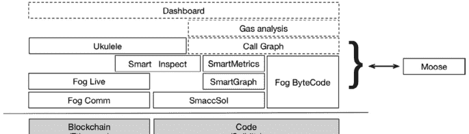

图 13.1 SmartAnvil 组件

### 已部署合约组件

另一组组件提供用于逆向工程已部署合约的库。

**驱动程序与合约访问 (FogComm)。** 该组件支持访问 GETH-RPC API，实现用于访问已部署合约、交易、区块等的原语和相关类型封送 [BRDD18b]。

**区块链元素具体化 (FogLive)。** 该组件通过为块、交易以及外部/内部账户添加一等公民表示来扩展 FogComm。它还提供合约镜像和合约代理——通过逆向工程技术和 SmaccSol 的 AST 分析构建——以允许与已部署合约建立强大的连接。它还提供 Sessions 的概念，允许与区块链进行缓存和非缓存交互。

**SmartInspect。** 该组件利用 FogLive 中合约和镜像的实现来收集信息。它以不同格式公开合约数据，以便程序员访问给定已部署合约中变量值的细粒度信息。它让开发人员检查已部署合约的所有方面 [BRDD18b]。

**字节码逆向工程 (Fog EVM ByteCode)。** 该组件提取并解释已部署合约中存储的十六进制代码，构建指令和相对内存布局的表示。它还允许流式传输指令并将内容切分为较小的片段，如查找、方法、分支点等。它补充了 SmartGraph 和 SmaccSol AST。这种低级信息对于细粒度低级分析很有用，例如 gas 消耗分析。

### 交易导航

**查询和导航 (Ukulele)。** 该组件提供一种查询语言来导航和访问交易及已部署合约。为此，它实现了基于 map-reduce 技术的不同索引策略，并利用 FogLive 中开发的镜像。它有一个小型 IDE 来操作识别的实体 [BRDD18a]。

## 智能合约静态分析基础

Solidity [Eth18c] 是用于在区块链平台（尤其是以太坊 [Eth14]）上指定智能合约的编程语言。Solidity 最初设计为以太坊的主要智能合约语言。尽管已为以太坊创建了其他合约语言（例如 Serpent、LL），但 Solidity 仍然是主要语言之一。而且，Solidity 也可用于其他区块链平台，如 Tendermint、Hyperledger Burrow 和 Counterparty。可能正因其受欢迎，大量智能合约研究涉及 Solidity。因此，任何处理智能合约的拟议工具都应支持 Solidity，才能受到欢迎。

通常，静态分析用于检查编程语言工件。由于 Solidity 是编程语言且智能合约是其工件，我们使用静态分析技术来实现用于合约理解和分析的工具 [CCI90]。从本质上讲，大多数静态分析基础技术依赖于 AST（抽象语法树）。例如，在 AST 之上创建代码检查工具比仅依赖合约的纯文本内容要容易得多。因此，要为 Solidity 合约构建静态分析，我们需要一种创建 AST 的方法。因此，我们需要一个解析器来读取 Solidity 源代码并输出相关的 AST 表示。

此外，我们需要与 Solidity 编译器分开的基础设施，原因如下：

- 1. 由于解析器和 AST 是强大分析工具的基础部分，我们需要完全控制解析器及其产出，以避免在使用生成的 AST 进行分析时出现不必要的副作用。
- 2. 由于生成的 AST 的形状会严重影响基于其构建的分析的复杂性，我们需要控制我们的 AST。

使用 Solidity 编译器生成的 JSON AST 不符合上述要求。此外，我们希望与 Moose（数据和软件分析平台）集成，因为它提供了一套丰富且多功能的工具 [NA05] 和庞大的生态系统 [Ber16, LKG07]。因此，开发 Solidity 解析器改进了 Solidity 代码分析的支持 [RDDL17]。为了实现这一点，我们使用了 SmaCC（Smalltalk 编译器编译器）[BLDG17]，依赖于 Solidity 语言的改编语法规范。

## 挑战

为 Solidity 设计解析器的主要挑战是文档之间的不一致性 [Eth18c]。例如，在文档的一部分中，指出字符串字面量由单引号或双引号括起来（部分“Solidity 深入” – “类型” – “字符串字面量”）。但是，在另一部分（部分“杂项” – “语言语法”）中，仅支持使用双引号来定义字符串字面量。另一方面，官方解析器识别单引号和双引号括起来的字符串字面量。这只是我们发现的多处不一致性之一 [RDDL17]。我们决定遵循官方解析器，即，如果在官方解析器中可解析，那么我们


解析器也应该能理解它。即便如此，文档中的不一致性使得解析器的创建变得更加困难，因为我们缺乏可遵循的可靠规范。

创建解析器的另一个挑战是 Solidity 语言变化的频率。语言规范不稳定，语法规则会被添加或更改以支持新版本的 Solidity。例如，在 0.4.21 版本（及以下版本）中，没有处理构造函数的语法规则；它们只是与合同同名的函数定义。但这种情况在 0.4.22 版本（及以上版本）中发生了改变，其中构造函数具有与函数不同的明确语法（通过使用 constructor 关键字）。因此，任何 Solidity 解析器都需要适应语法的变化，因为该语言仍在开发中。

在设计和开发我们的 Pharo Solidity 解析器时，我们考虑了这些挑战。

## 方法：SmaCC-Solidity

创建解析器可能是一项困难且耗时的工作。解析器生成器提供了一种更轻松的方法来解决这个问题 [IM15]。基本上，我们使用形式语法编写语法规范，生成器会自动构建解析器。例如，现在有许多可用的解析器生成工具，如 YACC [Mer93]、ANTLR [Mil05] 和 SmaCC [BLGD17]。

通常，我们可以将解析器分类为自顶向下或自底向上。自顶向下解析器从语法的根元素开始其产生式，逐步向下到达底部叶节点。自底向上解析器则相反，从叶节点开始逐步向上到达根。此外，两种类型的解析器通常作用于语法的子类。最常见的子类是用于自顶向下的 LL(k) 和用于自底向上解析器的 LR(k) [ALSU06]。

在考虑 Pharo Smalltalk 环境时，有两个突出的解析器生成工具：PetitParser [BCDL13] 和 SmaCC [BLGD17]。因此，我们有这两个选项来创建我们的解析器。我们也可以不依赖生成器而自行编写解析器。我们选择使用 SmaCC 开发解析器，理由如下：(1) SmaCC 要求以文本无上下文文法作为输入，这与为 Solidity 提供的文法相似；(2) SmaCC 生成的解析器可以更轻松地适应 Solidity 文法的未来变化；以及 (3) SmaCC 生成 LR 解析器，与其他类型的解析器相比具有有趣的优势 [ALSU06]。此外，PetitParser 和手写解析器都比 SmaCC 更难适应和维护。因此，我们认为 SmaCC 是创建我们解析器的更好选择。

SmaCC-Solidity 解析器已在 GitHub 上公开提供 (github.com/smartanvil/SmaCC-Solidity)。

## 示例

通常，当有人需要对源代码进行静态分析时会使用解析器。假设一位开发人员想要创建一个代币合同。粗略地说，代币是合同管理的一种自定义加密货币形式。代币可以代表忠诚度积分、债券、游戏物品等。在此场景中，开发人员希望在编写自己的代币之前先了解一个广泛使用的代币。在此示例中，开发人员获取了 GolemNetworkToken (地址: 0xa74476443119A942dE498590Fe1f2454d7D4aC0d) 合同代码，并决定构建其可视化表示。通过使用我们的解析器和 Roassal 包 [Ber16] 中的一些类，几行代码 (清单 13.1) 就足以构建一个简单的可视化。

### 清单 13.1 使用 SmaCC-Solidity 的可视化

```
1 ast := SolidityParser parse: sourcecode.
2 b := RTMondrian new.
3 b nodes: (ast sourceunits) forEach: [:contract |
4     (contract className = 'SolContractDefinitionNode')
5     ifTrue: [b shape box color: Color black.
6     b nodes: (contract statements select:
7     [:stt | stt className = 'SolStateVariableDefinition']).]
8     b shape box color: Color gray; size: [:f | f source
9     lines size * 3].
10    b nodes: (contract statements select:
11    [:stt | stt className = 'SolFunctionDefinitionNode']).]
12   b.
```

在清单 13.1 中，首先我们从解析源代码中获取 AST (第 1 行)。然后我们创建一个新的 Roassal 可视化 [ABC+13]，其中每个合同都是一个大灰色框 (第 2–4 行)。在每个合同框内，我们获取状态变量定义 (即合同属性) 并创建表示它们的黑色框 (第 5–7 行)。此外，对于每个函数，我们还在合同内创建一个灰色框，函数的大小与其代码行数相关 (第 8–10 行)。最后，我们为可视化定义一个标准布局 (第 11 行) 并“返回”可视化对象以显示 (第 12 行)。生成的可视化将每个合同显示在一个大框中，内部较小的框代表属性 (黑色) 和函数 (图 13.2)。

## 评估

为了比较，我们验证了我们的解析器是否能识别与官方解析器相同的 Solidity 合同。可以合理地假设官方解析器是正确实现。因此，任何由官方解析器解析的合同


图 13.2 使用 SmaCC-Solidity 的合同函数

也应由我们的实现支持。我们使用 Etherscan 访问公开可用且带有源代码的 Solidity 合同。所有此类合同都已被官方解析器正确识别。因此，我们的评估是验证我们的实现是否也能解析它们。

在实验时 (2017 年 8 月)，Etherscan 的数据库中有大约 2,700 个经过验证的合同 (2018 年 8 月，合同数量超过 40,000 个)。从这些 2,700 个合同中，我们只选择了 Solidity 版本 0.4.x 的唯一合同，总计 1,175 个合同。我们的实现成功解析了所有 1,175 个合同。因此，我们可以声称我们的解析器识别与官方解析器相同的语言工件。

## 相关工作

我们从两个主要主题中选择了相关工作：解析冲突和解析器生成器。

Isradaikul 和 Myers [IM15] 描述了使用 LALR 解析器生成器解决语法冲突的困难。他们提出了一种算法，该算法为 LALR 解析器生成更好的反例。反例显示会在 LR 方法中引起歧义冲突的解析场景。此类场景帮助开发人员诊断冲突的来源并识别语法规范中的问题。作者在 Java 中实现了他们的算法，作为 CUP 解析器生成器的扩展，并且他们还针对 20 个语法与最先进的歧义检测器评估了他们的方法。他们的算法通常比被比较的技术用更少的时间找到更多反例。

Passos 等人 [PBB07] 提出了一种方法论，用于解决 LALR 解析方法中的冲突。作者描述了在不更改定义语言的情况下处理冲突的挑战。他们使用 YACC 为 Notus 语言生成解析器，以说明为 LALR(1) 解决冲突的困难。作者基于其方法论创建了一个名为 SAIDE 的工具，该工具是处理 LALR 解析器冲突的常规可用方法的改进。

我们将对一些众所周知的解析器生成工具进行简要分析。SmaCC [BLGD17] 是我们为这项研究选择的解析器生成工具。SmaCC 可以生成 LR(1) 或 LALR(1) 自底向上解析器。YACC [Mer93] 也是一种自底向上 LALR(1) 解析器生成器。原始 YACC 是为 Unix 系统用 C 语言开发的，但现在我们有几种其他语言的实现。ANTLR [Mil05] 与以前的工具不同，因为它是自顶向下解析器生成器。ANTLR 创建预测 LL(k) 解析器，比 LR(1) 和 LL(1) 解析器对语法不规则性更不敏感。有适用于 Java、C++、C#、JavaScript、Python 等语言的 ANTLR 实现。不幸的是，据我所知，Pharo 没有 ANTLR 的实现。最后，PetitParser [BCDL13] 是一种依赖于解析表达式文法的扫描器解析器生成器。PetitParser 与 Moose 集成，便于其在 Pharo 上使用。PetitParser 的主要问题是它不读取语法规范，我们必须使用 PetitParser 语言编写语法表达式。

## 已部署智能合约分析：检查

不透明性是分析合同数据的主要问题 [BRDD18b]。智能合约具有不透明性，因为一旦部署到区块链上，就很难在运行时验证其内部状态 (即由合同内部属性定义并存储在合同中的状态)。相比之下，如今任何编程语言都提供了更简单的检查对象数据的方法。开发人员在开发或维护活动期间使用此类检查来访问运行时数据。同样，开发人员可以从智能合约运行时检查中受益，以验证当前存储的数据。此外，从商业角度来看，公司可以使用合同检查来帮助客户验证和了解实际上存储在合同中的信息。

检查合同数据的困难并非广为人知的问题 [BRDD18b]。目前，我们只有很少的工具来检查合同信息。或者，开发人员诉诸其他做法来获取合同的内部状态，例如创建 getter 函数来访问数据。基于此原因，它


重要的一点是能够开发用于检查内部属性的工具。此外，普遍关注的问题是，开发者应当能够查看其自身合约中存储的值。

因此，在此语境下，检查合约属性对于使用智能合约的开发者来说不仅重要，而且是必要的。

## 挑战

要突破不透明性问题并揭示合约信息，面临诸多挑战。

- **二进制且不完整的规范。** 从技术层面来看，我们只有以太坊 API 来访问合约的二进制表示。我们面临的第一个挑战是 Solidity 编译器执行的合约编码是一个*不完整*的规范 [Eth18c]。
- **哈希计算规范不一致。** 与规范相关的另一个挑战是动态类型的哈希计算。静态类型使用文本作为哈希计算的输入。然而，动态类型遵循一个不同的标准，该标准在文档中并未明确指定。对于动态类型，有必要为每个类型使用专门打包的二进制数据。例如，要访问数组，有必要将索引号和数组位置（偏移量）打包为二进制表示，以获得正确的哈希。其他动态类型需要不同的输入来获取其哈希。
- **打包且有序的数据。** 我们还强调解码类型的挑战，因为编译器尽可能将大量数据打包到连续内存中。因此，我们需要知道按正确顺序排列的特定类型才能获取合约数据，而在规范不完整的情况下，这并非易事。

我们承认，分析在以太坊区块链数据库中部署的自身合约所面临的挑战和困难是一个问题。为了解决这个问题，我们提出了一个检查器，允许用户感知实例数据属性的干净表示。此类检查器是使用平台的几个组件构建的：FogComm、FogLive。

## 方法：SmartInspect

SmartInspect [BRDD18a] 是一个基于可插拔镜像映射反射系统的 Solidity 合约内部状态检查器。该工具的目标是允许根据源代码检查已知的合约实例。部署合约的二进制结构是使用从其源代码构建的内存布局细化进行反编译的。因此，只有拥有源代码及其部署二进制表示访问权限的人才能检查其内部属性。此外，SmartInspect 方法可以在不重新部署合约或开发额外解码代码的情况下，内省智能合约实例的当前状态。SmartInspect 使用 Pharo 实现，并作为 SmartAnvil 工具套件的一部分公开可用于 GitHub (github.com/RMODINRIA-Blockchain/SmartShackle)。

智能检查器的一般理念是反编译由以太坊 API 编码的存储布局。通过使用合约源代码作为参考，可以知道属性值在编码后的二进制结构中的存储位置（图 13.3）。反编译内存布局是一项挑战，因为 Solidity 文档 [Eth18c] 关于某些类型如何编码的内容不完整。因此，我们不得不自己对编译器执行的某些编码进行逆向工程。

在解码内存布局后，我们仍然需要将解决方案应用于任何合约，以实现通用的可重用解决方案。我们采用了一种镜像映射架构 [BU04]，它模仿任何合约的结构，以便我们访问可以解码的内存布局。镜像映射像一个独立的元编程层，将反射功能的关注点拆分为镜像对象。首先，我们需要合约源代码作为输入来开始构建镜像映射。然后我们解析源代码（使用前面描述的 Solidity 解析器）来创建一个 AST（抽象语法树）。通过解释

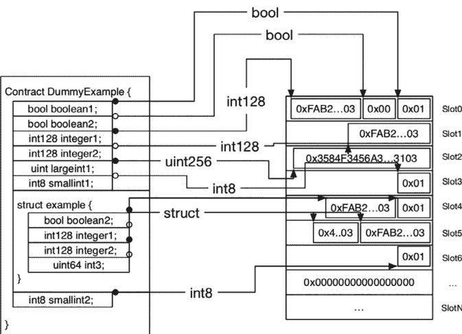

### 图 13.3 内存布局表示

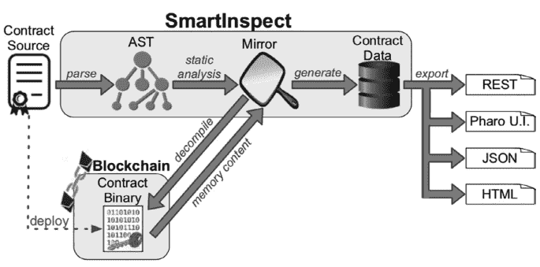

### 图 13.4 SmartInspect 构建过程

AST，我们能够按照正确的顺序发现合约中声明的每种类型。我们需要这些信息来解码内存布局并访问合约数据。为了实现通用解决方案，我们模型化可配置的镜像对象，使我们能够与同配置的已部署合约实例进行交互（通常指同一合约在区块链上部署的情况）。

图 13.4 展示了检查合约的完整过程图；可插拔反射架构使用给定合约的 AST 为其源代码生成一个镜像映射。然后，我们使用该镜像映射从部署在区块链上的远程合约实例中提取信息（该实例编码为二进制内存布局）。我们收集的合约数据以四种不同的格式暴露：(1) 数据代理对象 (REST)，(2) Pharo 窗口部件用户界面，(3) JSON，以及 (4) HTML。

这种方法使我们能够以结构化的方式访问远程无结构信息。我们的解决方案满足了远程检查所需的大多数可取属性，即交互性和分布性 [PBD+15]。

## 示例说明

我们现在展示一个用 Solidity 编写的智能合约示例，并使用 SmartInspect 内省其内容。假设一个场景，主管管理一个投票，用户只能投票一次。投票被编码为智能合约，因为它用于依赖信息真实性和不可更改性的管理决策。只有合约的主管才允许修改选民列表。以下列表（清单 13.2）突出了此合约的最重要代码部分：

### 清单 13.2 Solidity 投票合约示例

```
pragma solidity ^0.4.24;
/** @title Poll Contract Example
 * @author RMoD-Blockchain Team
 */
contract RModPoll {
 /* * Type Definition */
 enum Choice {POSITIVE, NEGATIVE, NEUTRAL}
 struct PollEntry {address user; Choice choice; bool hasVoted;}

 /* * Attributes/Internal State */
 PollEntry[] pollTable;
 address private supervisor;

 /* * Constructor */
 constructor() public {supervisor = msg.sender;}

 /* * Functions */
 // Add the account as a voter in this poll
 function addVoter(address account) public returns (uint) { . . . }
 // Verifies if the account is already registered in this poll
 function isRegistered(address account) public view returns(bool) { . . . }
 // Returns the Voter's index in the pollTable
 function voterIndex(address voterAccount) private view returns(int) { . . . }
 // Function called by the voter to assert his vote
 function vote(Choice myChoice) public { . . . }
 // Verifies if everyone registered for this poll have voted
 function everyoneHaveVoted() public view returns (bool) { . . . }
 // Return the amount of votes for Positive, Negative, and Neutral
 function countVotes() public view returns (uint,uint,uint) { . . . }
}
```

此合约定义两个自定义类型：Choice（第 5 行）和 PollEntry（第 6 行）。Choice 模拟投票的答案（无论投票是肯定的、否定的还是中立的）。PollEntry 是一个表示投票的记录，即投票用户、所选选项以及他是否已投票。请注意，要引用选民，我们需要一个账户地址（使用原始类型 address），它指向一个

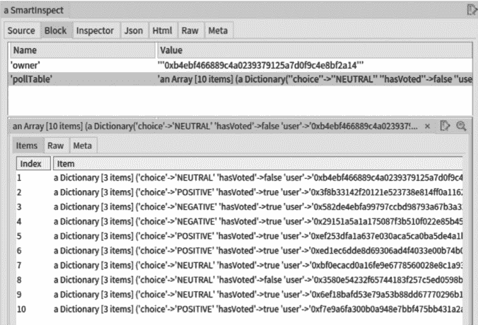

### 图 13.5 SmartInspect Pharo 用户界面截图

以太坊账户。合约在内部存储一个投票表（PollEntry 数组，第 9 行）和一个指向投票主管账户的地址（第 10 行）。投票表是一个空数组，主管将最终在其中存储投票信息（即，数组将为每个被允许投票的用户创建一个条目）。主管的地址用于安全检查，即，确保只有主管可以调用某些特定函数（例如 addVoter 函数）。对于此示例说明，没有必要定义和解释其余函数。

假设投票即将结束，但并非所有人都已投票。因此，投票的主管将需要向尚未投票的用户发送提醒。然而，合约的属性未定义为公共。此外，我们在部署合约之前未创建任何函数来检查该信息。由于我们无法更新已部署合约实例的源代码，检查其内部状态是了解哪些账户尚未投票的唯一方法。因为主管既能访问合约源代码，也能访问其已部署实例，所以他/她可以执行 SmartInspect 来查看合约数据（图 13.5）。最后，主管可以看到哪些用户在当前投票实例中未投票。

## 评估

我们调查 SmartInspect 与其他检查器相比是否实现了必要且可取的功能。我们确定了六个特征


对区块链远程检查器很重要的特性包括：隐私性、可扩展性、可插拔性、一致性、可重用性和可插装性。我们按如下方式详细说明这些特性：

- **隐私性:** 检查不应通过向未授权用户暴露数据而泄露或危及数据隐私。在考虑智能合约时，缺乏隐私是危险的，因为恶意用户可能会利用它来获取非法优势和资源。

- **可扩展性:** 检查器可以扩展以支持其他技术。理想情况下，调试器或检查器应依赖可扩展的中间件。对于智能合约，检查器应能扩展到不同的智能合约语言和区块链技术。

- **可插拔性:** 检查器可以用于现有对象，而无需重新实例化对象或系统。对于合约，这意味着我们可以在不依赖合约侧或无需重新部署合约的情况下检查现有已部署合约。不可插拔的方法的缺点是需要重新部署合约，这会产生不可忽略的交易成本。

- **一致性:** 检查器使用的表示必须以一致的方式揭示信息，即，检查必须反映已部署合约的当前状态。

- **可重用性:** 检查器可以重复用于不同的合约。缺乏可重用性将要求开发者为每个单独的合约花费时间重新定义检查。

- **可插装性:** 检查器可以修改进程的语义以协助调试。基本上，这是停止进程并在该点检查它的机制（例如，断点和监视点）。在区块链平台上，这种特性是不可能实现的，因为我们无法修改已部署的合约代码来停止在区块链执行过程中正在运行的函数。

我们根据前述检查器特性分析了SmartInspect和另外两个检查器（Remix和Etherscan）。我们还比较了两种访问合约数据的做法：临时解码器和Getter方法（表13.1）。

表13.1 相关技术比较

| 特性 | SmartInspect | Remix | Etherscan | 解码器 | Getter |
|---|---|---|---|---|---|
| 隐私性 | 是 | 是 | 否 | 是 | 否 |
| 可扩展性 | 是 | 否 | 否 | 否 | 否 |
| 可插拔性 | 是 | 是 | 是 | 是 | 否 |
| 一致性 | 是 | 是 | 是 | 是 | 是 |
| 可重用性 | 是 | 是 | 是 | 否 | 否 |
| 可插装性 | 否 | 否 | 否 | 否 | 否 |

从表13.1可以看出，SmartInspect唯一的特性缺陷与远程调试的可插装性有关。然而，这是以太坊区块链技术所强加的限制，而不是我们方法中的设计缺陷。

Remix [Eth18b] 是以太坊基金会为 Solidity 开发者设计的一套工具。Remix IDE 可能是其套件中最常用的工具。在 Remix 工具套件中，有一个具有检查功能的完整事务调试器。Remix 检查器仅在可扩展性和可插装性方面有所不足。它专为 Solidity 和以太坊设计，因此无法扩展到其他平台。如前所述，由于以太坊平台的特性，可插装性是不可能实现的。

Etherscan 是一个面向以太坊的分析平台。它提供来自以太坊的区块、交易、合约等的实时信息。如果开发者在 Etherscan 上发布其合约源代码，那么就有可能检查合约的数据。然而，这样一来，开发者就会以非常容易访问的方式将其合约源代码和内部数据暴露给任何人。这就是 Etherscan 检查缺乏隐私性的原因（与 SmartInspect 和 Remix 不同，后两者只能向开发者暴露数据）。Etherscan 提供了一个 API 以访问其服务，但它不可扩展。与 SmartInspect 和 Remix 一样，Etherscan 的检查器不支持可插装性。

临时解码器使用以太坊 API 在内存插槽上手动获取数据。这是一项复杂的任务，因为它需要深入理解开发者计划检查的每个合约的内存布局。它还要求开发者了解每个属性的类型，并相应地编码临时解码器。其优势在于，它允许在不丢失隐私且无需重新部署合约的情况下访问数据。事实上，SmartInspect 将解码内存布局的概念作为其检查过程的一部分。

Getter 方法是一种简单的解决方案，因为其实现成本低且易于测试。开发者不需要知道合约的内存布局来创建 Getter 方法。然而，如果开发者忘记为给定属性创建 Getter，他/她将需要重新部署合约，并且大多数情况下会丢失之前实例的数据。Solidity 在其函数上不支持返回许多复杂类型（例如，结构体、映射）。因此，开发者可能需要调整其数据或函数以提供对复杂类型的访问。此外，对数据的便捷访问可能导致隐私丢失，因为 Getter 方法是合约二进制编码的公共部分。

## 相关工作

Chis 等人 [CNSG15] 进行了一项探索性研究，以更好地理解开发者对对象检查器的期望，并根据该反馈，他们提出了一种新的检查器模型。作者对 16 名开发者进行了定性研究访谈，并进行了一项定量研究，通过在线调查，62 人作出了回应。这两项研究都用于识别检查器所需的四个需求。随后，他们提出了可塑检查器（Moldable Inspector），它指示一种新模型，用于满足多种类型的检查需求。在创建 SmartInspect 时，我们遵循了可塑检查器所汲取的经验教训。我们认为多视图方面值得注意，因为 SmartInspect 可以以四种不同的视图（REST、Pharo U.I.、JSON 和 HTML）呈现其检查数据。

Papoulis [PBD+15] 对远程调试进行了深入分析。如作者所讨论，远程调试对于无法支持本地开发工具的设备尤为重要。作者确定了远程调试的四个重要特性：交互性、可插装性、分布性和安全性。基于所确定的属性，Papoulis 提出了一种名为 Mercury 的远程调试模型。Mercury 采用基于镜像的方法和可适应的中间件。我们将 Papoulis 的研究作为创建 SmartInspect 的灵感，尤其是依赖镜像进行远程检查。

Salvaneschi 和 Mezini [SM16] 提出了一种名为 RP Debugging 的方法论，以更有效地调试响应式程序。作者讨论了这样一种观点：与替代方案——观察者设计模式相比，响应式编程更具可定制性且更易于理解。作者还介绍了调试响应式程序的主要问题和挑战，以及创建其方法论时的主要设计决策。尽管我们的检查器来自不同的应用领域，但 RP Debugging 的设计为规划我们自己的检查方法提供了灵感。

Srinivasan 和 Reps [SR14] 开发了一种逆向工程工具，用于从二进制程序文件中恢复类层次结构信息。他们的工具还提取组合关系。他们使用动态分析来获取对象跟踪，然后识别这些跟踪中类之间的继承和组合信息。作者的实验表明，根据其指标，恢复的信息是准确的。作者的工具与 SmartInspect 形成对比，因为我们使用静态分析，而他们使用动态分析。

## 链导航和查询语言

以太坊和其他区块链存储了大量异构数据。截至2017年初，以太坊的数据量估计约为300GB [BLPB17]。从这海量数据中检索信息并非易事。此外，以太坊平台仅允许直接访问其一级数据元素，包括区块、交易、账户和合约 [Eth14]。因此，如果我们要在数据元素内搜索特定信息，则需要一个唯一标识符（即区块编号或其哈希值）来访问包含该信息的区块。另一种替代方案是直接访问一个区块并顺序访问其父区块以搜索数据。此外，当我们访问以太坊平台的区块时，返回的信息被编码为类JSON结构，我们需要对其进行解释才能获取特定项目。因此，以太坊平台既不提供语义化的信息搜索方式，也不提供以便捷形式呈现此类信息的方式。


在经典数据库中，当我们需要搜索特定信息时，通常会编写查询来获取、呈现、筛选和格式化此类信息。像 SQL 这样的数据库查询语言提供了丰富的语法，用于描述我们想要从数据库中获取的数据。由于区块链可以被视为一种数据库，如果我们能以类似的方式获取区块中的信息，将会更好。在这种情况下，用户可以从一种查询语言中受益，该语言提供了一种更简便的方式来获取、格式化和呈现从区块链平台提取的信息。

## 挑战

在本节中，我们将更详细地描述从区块链获取数据时面临的挑战。尽管我们的研究集中在以太坊上，但此类问题也存在于其他区块链平台上。

- **数据量庞大。** 区块链数据库已经拥有海量数据。2017 年 12 月，以太坊平均每天处理 876,000 笔交易 [BRDD18c]。由于区块链中的数据不能被删除，记录的交易数量将随时间不断增长。因此，旧信息可能会被新交易淹没，变得“消失于时间长河中”。

- **数据异构。** 区块链不仅存储大量数据，还管理着交易、区块、账户和智能合约等一等元素的混合体。所有一等元素各不相同，但通过哈希相互关联。尽管以太坊允许访问其任何一等元素，但元素的异构性（每个元素都有不同的含义和高层表示）使得信息获取变得复杂。

- **数据不透明。** 出于灵活性考虑，以太坊使用通用表示来存储其信息。因此，存储的数据是不透明的，因为没有描述信息的元数据，也没有简单的方法知道记录了什么。这种不透明性从以太坊的角度来看是有用的甚至是必要的，因为它允许存储任意结构和行为。另一方面，不透明性使得搜索信息变得过度复杂，因为用户需要在不知晓其内容的情况下访问通用表示。

- **直接访问。** 通常，区块链只允许通过使用唯一标识符来直接访问其元素。此标识符是为区块链中存储的每个一等元素生成的哈希数 [Bit18]。特别是，以太坊平台还可以使用一个唯一编号（与元素的顺序相关）来访问区块和交易 [Eth18a]。直接访问使用户查找信息的任务变得复杂，因为他需要：(1) 存储标识符以供日后使用，或 (2) 执行顺序访问以收集数据。

为解决这些挑战，我们提出了一种查询语言，使用户能够更轻松地获取信息。我们强调使用查询语言从区块链获取信息的以下好处：(1) 描述结构和语义筛选器以查询信息；(2) 重新格式化和转换获取的数据；(3) 对查询结果进行排序；以及 (4) 限制返回的结果数量。

## 方法：Ukulele

在本节中，我们介绍了 Ukulele 版本 0.9，这是一种专为从区块链获取信息而设计的查询语言。Ukulele 是我们之前工作（称为以太坊查询语言 (EQL) [BRDD18c]）的改进版。Ukulele 作为 SmartAnvil 套件的一部分，公开发布于 GitHub（https://github.com/smartanvil/UQLL）。Ukulele 语法基于 SQL 语言。其理念是允许用户编写尽可能接近 SQL 的查询，以便于采用 Ukulele，因为 SQL 是一种非常流行的语言 [SKS11, EN10]。

清单 13.3 展示了 Ukulele 语法的主要元素。该语法使用 EBNF（扩展巴科斯 - 纳尔范式）描述；我们没有将终结符标识符和数字格式化为双引号，以强调它们不是字面量。我们省略了 Expression 规则，以免使规格变得混乱，但它遵循与 SQL 表达式类似的结构。

### 清单 13.3 Ukulele 语法的 EBNF 格式

```
1 <SelectStatement> ::= <SelectClause> <FromClause>
2     [<WhereClause>] [<OrderByClause>] [<LimitClause>]
3 <SelectClause> ::= "select" <Expression> {"," <Expression>}
4 <FromClause> ::= "from" <SourceBind> {"," <SourceBind>}
5 <WhereClause> ::= "where" <Expression>
6 <OrderByClause> ::= "order" "by" <Expression> ["asc" | "desc"]
7 <LimitClause> ::= "limit" number
8 <SourceBind> ::= identifier "as" identifier
9 <Expression> ::= . . .
```

从清单 13.3 可以看出，Ukulele 查询的语法与 SQL 语言中的“选择”语句非常相似。Ukulele 的“选择”语句由以下子句组成：select、from、where、order by 和 limit。只有 select 和 from 子句是必需的；其他子句是可选的。我们还想强调，Ukulele 与 SQL 一样，也不区分大小写。与 SQL 不同，Ukulele 的“选择”语句没有 group by 子句。尽管我们计划在未来支持 group by 子句，但当前版本不允许使用此类子句。

在 Ukulele 的 from 子句中，我们需要使用一个集合。在 Ukulele 中，集合是所查询数据的语义表示。Ukulele 语言有四个预定义集合：ethereum.blocks、ethereum.transactions、ethereum.accounts 和 ethereum.contracts。每个集合都代表特定类型（区块、交易、账户或合约）的所有一等元素。我们可以使用 “eth” 作为 “ethereum” 的别名。可以通过创建类似 SQL 的“视图”从另一个集合的子集中创建自定义集合（清单 13.4）。正如在 SQL 中，视图可以用于在 from 子句中替代表一样，Ukulele 也使用视图和集合。

### 清单 13.4 Ukulele 视图语法的 EBNF 格式

```
1 <View> ::= "create" ("view" | "collection") identifier "as"
2     "("<SelectStatement>") "
```

Ukulele 已经具有一个预定义的对象结构，用作集合项的容器。例如，当我们从区块集合中检索信息时，结果将以块对象的形式呈现。因此，每种对象类型都有与其存储结构相关的属性（即，块对象将具有与交易对象不同的属性）。每种对象类型可用的属性如下：

- **块：** number, hash, parentHash, parent, nonce, timestamp, size, miner, difficulty, totalDifficulty, gasLimit, gasUsed, extraData, transactionsRoot, transactionsHashes, transactions, amountOfTransactions, uncleHashes, uncles。
- **交易：** hash, nonce, blockHash, blockNumber, block, transactionIndex, fromAddress, from, toAddress, to, value, gasPrice, gas, input, timestamp。
- **账户：** address, name, balance。
- **合约：** descriptions, instances。
- **合约实例：** address, name, balance, binaryHash, bytecode。

有关每个属性的更详细描述，请参阅我们关于 EQL 的首次出版物 [BRDD18c]。Ukulele 相对于 EQL 的一大改进是对合约的处理。例如，我们可以在 Ukulele 查询中使用合约的内部属性或函数。此外，我们可以处理合约的一般结构（通过使用合约对象）或已部署的实例（合约对象的 instances 属性）。

在内部，我们对 Ukulele 的实现依赖索引来提高查询数据时的性能。由于每次访问区块链以获取数据都是一次远程调用，任何形式的优化都可以缩短获取和呈现数据所需的时间。索引是存储到结构中的数据摘要，可提高检索操作的性能。基本思想是允许对数据库进行更高效的搜索。在我们的特定案例中，我们将区块链数据（例如，区块、交易）与其相关哈希进行索引，以加快数据获取速度。


对于 Ukulele，我们实现了一棵二叉搜索树（BST）作为索引结构。BST 采用二维数组，每个条目的第一维用于存储属性值，第二维用于存储与该特定值对应的元素哈希集合。我们之所以选择这种实现，是因为它在任何比较操作（例如“大于”、“小于”）中选择索引区间非常简单。我们承认 BST 具有较高的存储需求。然而，我们希望为 Ukulele 的首个实现提供一个简单快速的解决方案。此外，Ukulele 会自动构建这些内部索引，无需用户交互。另一方面，Ukulele 还支持用户创建自己的自定义索引以加速查询。创建自定义索引的语法与 SQL 类似（Listing 13.5）。

### Listing 13.5 Ukulele custom index grammar in EBNF format

```
1 <Index> ::= "create" ["unique"] "index" identifier "on"
    identifier "("identifier ")"
```

## Illustrative example

在本示例中，我们将展示 Ukulele 的一些新功能（即，合约查询）。假设有一个处理产品销售的智能合约。以下清单（Listing 13.6）显示了产品合约的基本代码部分。

### Listing 13.6 Solidity product contract example

```
31 pragma solidity ^0.4.24;
32 /** @title Product Contract Example
33 * @author RMod-Blockchain Team
34 */
35 contract RModProduct {
36 /* Type Definition */
37 enum State {ON_SALE, WAITING_SEND, RECEIVED, FINISH}
38
39 /* Attributes */
40 State private state = State.ON_SALE;
41 address private owner;
42 address private buyer;
43 uint private price;
44 string private itemName;
45
46 /* Constructor */
47 constructor(string _name, uint _price) public {
48 owner = msg.sender; itemName = _name; price = _price;
49 }
50 */
51 /* Functions */
52 // Returns the this product information (name,price)
53 function getInfo() public view returns(string,uint)
54 { ... }
55 // Buys this product
56 function buy() payable public { ... }
57 // Inform the seller/owner the product was properly received
58 function received() public { ... }
59 // Completes the sale, the owner terminate the contract and get the money
60 function terminate() public { ... }
}
```

如我们所见，该合约（Listing 13.6）可用于销售任何产品。在我们的示例中，用户只想查询这些产品合约。因此，他/她为这项任务创建了一个视图（Listing 13.7）。实例的 "binaryHash" 属性是合约二进制结构的 MD5 哈希。因此，通过使用此属性，有人可以获取具有相同内部结构的所有合约。在此情况下，视图查询（Listing 13.7）仅获取 RModProduct 合约（Listing 13.6）。

### Listing 13.7 Ukulele create view example

```
1 CREATE VIEW RmodProductContracts (
2 SELECT instance
3 FROM eth.contract.instances AS instance
4 WHERE instance.binaryHash =
5 '4d3c0777436de51258c7ba6c235a2e52',
6 );
```

现在，用户可以使用该视图更轻松地仅查询产品合约。在此示例（Listing 13.8）中，用户想要仍在出售的廉价产品。

### Listing 13.8 Ukulele contract query example

```
1 SELECT instance.itemName, instance.price, instance.state
2 FROM RmodProductContracts AS instance
3 WHERE instance.price < 40 AND instance.state = 'ON_SALE';
```

图 13.6 显示了此查询（Listing 13.8）的结果。

Ukulele 还可以执行合约函数。除了使用函数查询值外，此功能还可用于批量更改合约状态的函数。例如，假设用户想要收集其产品的销售额。没有 Ukulele，用户将不得不手动逐个在每个合约上执行函数 "terminate"。使用 Ukulele，同一用户只需编写一个简单查询（Listing 13.9）。

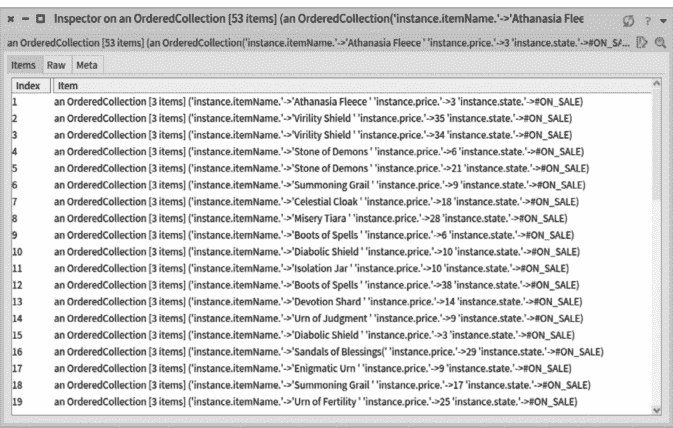

### Listing 13.9 Ukulele block query example

```
1  SELECT instance.itemName, instance.terminate()
2  FROM RmodProductContracts AS instance
3  WHERE instance.owner = '0xca35b7d915458ef540ade6068dfe2f44e8fa733c'
4  AND instance.state = 'RECEIVED';
```

## Evaluation

- **查询语言**：该实现提供一种查询语言，用于指定要获取的数据。缺乏查询语言会使获取复杂信息变得更加困难。
- **组函数**：该实现支持使用聚合（group by）函数。缺乏组函数限制了数据的转换以及可能获取的内容。
- **连接数据**：检查是否允许连接不同的数据源。理想情况下，它还应允许合并来自不同平台的数据（例如，区块链和 NoSQL）。
- **视图**：指示实现是否支持定义视图或某些类似功能。视图允许用户保存其查询的数据以供以后使用。
- **工具支持**：查看是否有工具支持来指定、检查和显示获取的数据以及用于获取此类数据的命令。缺乏工具支持可能会阻碍实现的采用。
- **数据源**：检查实现是否可以获取存储在区块链中的任何类型的一流元素。

Web3 是用 JavaScript 编写的官方以太坊 API，它实现了对远程过程调用（RPC）协议的接口 [Eth18a]。Web3 不是查询语言；所有数据都是通过其 API 接口收集的。尽管 Web3 可以访问存储在以太坊中的任何数据，但它只能通过直接和顺序访问来获取数据。因此，用户必须在收集的数据中手动搜索信息。尽管这不是收集数据的一个非常精良的解决方案，但 Web3 及其底层协议是访问以太坊数据的基础。Ukulele 和 Presto 均使用 Web3（或另一个相关 API）来访问区块链平台并执行其搜索（Table 13.2）。

Presto 是一个查询引擎，用于在其他平台（包括以太坊区块链）上运行 SQL。此外，Presto 支持用于查询的完整 SQL 语法，例如连接、组函数等。但是，它不支持另一种辅助语法，例如视图。没有工具支持来编辑查询或查看结果。Presto 的另一个缺陷是，它只能获取与块和事务相关的以太坊数据。因此，Presto 无法显示有关合约或账户的信息。

Ukulele 是一种实现的查询语言，用于自动搜索以太坊中的信息。如前所述，Ukulele 仍在开发中，当前版本不支持组函数。此外，当前版本的 Ukulele 能够连接来自以太坊的多个数据源，但无法将此类数据与不同平台（例如 NoSQL）合并。Ukulele 没有工具支持，尽管目前正在开发一种工具。Ukulele 相对于 Presto 的主要优势在于，Ukulele 可以获取以太坊一流元素（块、事务、合约和账户）中的任何数据。

Table 13.2 Related techniques comparison

| 功能 | Ukulele | Presto | Web3 |
|---|---|---|---|
| 查询语言 | 否 | 是 | 否 |
| 组函数 | 否 | 是 | 否 |
| 连接数据 | 部分 | 是 | 否 |
| 视图 | 是 | 否 | 否 |
| 工具支持 | 否 | 否 | 否 |
| 数据源 | 全部 | 部分 | 全部 |

## Related work

在本节中，我们讨论一些专注于搜索和导航的区块链研究相关工作。未源自研究的工具和实现（例如，Presto）不在此介绍。

Morishima 和 Matsutani [MM18] 提出了一种使用 GPU 搜索区块链信息的新方法。他们认为，如果不改进搜索性能，区块链全节点可能会成为平台的瓶颈。作者将其方法与现有做法和其他方法进行性能评估，并得出结论，其提议的吞吐量是第二高方法的 3.4 倍。尽管 Morishima 和 Matsutani 的工作涉及搜索区块链数据，但其目的与 Ukulele 不同。Ukulele 的设计旨在帮助用户搜索复杂数据。另一方面，Morishima 和 Matsutani 设计其方法旨在提高在区块链节点中搜索数据的性能。相似之处在于，这两项研究都涉及区块链的内部结构以及在该平台上搜索数据。

Ruta 等人 [RSI+17] 讨论了一个针对供应链应用领域的区块链平台新语义增强层。他们提出了一个在线对象发现框架，以在 Hyperledger 区块链上实现其层。他们的方法采用查询和对象之间的语义匹配，使用户能够更轻松地查找供应链信息。与 Ukulele 不同，它没有查询语言。但是，它确实使用语义信息来获取区块链信息。Ukulele 提供用于查询信息的丰富语法，但它不使用语义增强对象和信息来改进搜索。

## Discussion and related work

在本节中，我们将讨论我们的未来研究和工具，然后介绍区块链分析平台和工具套件的相关工作。

## Future research and tool development

作为一个平台，SmartAnvil 应该支持广泛的分析。我们正专注于工具的基础。我们将以下主题视为 SmartAnvil 周围的下一个组件。

Metrics. It is not possible to control what you do not measure, and this statement is the basic wisdom on why we need to use metrics [Hev97]. Metrics are useful to assess the internal quality of a software as well as the productivity of the development team. Since the '90s, there has been a plethora of proposed


软件度量 [LH93, CK94, LK94, HM95, BMB96, Hev97, TNM08]。之所以有如此多不同的度量，是因为特定领域或特性需要针对其特定需求定制的测量。通常，将为一个领域设计的度量应用到另一个领域会导致不匹配或不兼容。例如，领域不匹配导致将过程式编程度量“调整”以用于面向对象范式。

由于智能合约使用的发展速度极快，在这种新的软件范式中，衡量代码质量正变得与链下软件开发中一样重要。然而，传统的软件度量无法捕捉智能合约的特定方面。因此，我们需要为智能合约设计的度量。

### Gas 估计。

在以太坊平台中，任何更改合约内部状态的交易都会收取一种称为 Gas [Eth18c] 的特殊资源。该名称源于这样一种观点：此资源是运行合约的燃料 [Eth16]。因此，Gas 单位对应计算指令的执行。其理念是避免无限循环（以及停机问题），鼓励高效代码，并让用户为其使用的计算资源付费。

尽管未使用的 gas 会退还给用户，但优化此资源是使交易快速获批的关键。由于矿工会获得所用 gas 的费用，他/她将更倾向于挖掘优化其收益的交易。在此背景下，用户对 gas 的更好估计可能会鼓励矿工处理该用户的交易。

估计合约函数将需要多少 gas 单位并非一项简单的任务。如果函数不包含循环或外部调用，Remix IDE 会给出一个估计。因此，Remix 对估计任何函数的 gas 不可靠。因此，我们需要更好的估计工具来评估 gas 消耗量。

### 安全建议。

智能合约的数量正在快速增长，开发者尚未习惯在这种新环境下编码。智能合约中的不良编程实践可能会变成可怕的安全缺陷 [DMO+18]。例如，臭名昭著的“DAO 攻击”是由合约上的不安全编程实践引起的，这使攻击者能够窃取价值约 5000 万美元的加密货币 [LCO+16, TVI+18]。作为类比，我们可以想想那些存在 SQL 注入漏洞的 Web 应用程序，如果开发者设计并采用更安全的编程实践，这些漏洞本可以简单地避免。

智能合约中大多数安全缺陷都可以追溯到糟糕的编码，如果开发者对环境和编程语言更有经验，这些缺陷本可避免。将此类专业知识赋予开发者的一种简单而优雅的方法是创建一个推荐系统，向开发者发出有问题代码的警告，并建议完成同一程序的更好方法。在此背景下，我们认为向合约开发者提供安全建议非常重要。

### 仪表盘。

为了使未来工具收集的所有信息在实践中有用，必须小心创建面向开发者以及管理层和客户等其他利益相关者的展示。我们计划探讨仪表盘如何同时支持查看数据和定义条件，以便在出现问题时自动通知开发者 [Few06]。

## 相关工作

在本节中，我们讨论区块链分析平台和工具的相关工作。

Porru 等人 [PPMT17] 承认需要开发面向区块链软件（BOS）的专用工具和技术。作者将 BOS 定义为与区块链交互的软件。作者从软件工程角度描述了使用区块链时面临的问题和挑战。他们还分析了使用区块链的 1,184 个 GitHub 项目，并提出了新的想法和实践，以改进 BOS 的技术现状。作者提出了非常有趣的研究可能性，这些可能性启发了 SmartAnvil 平台的多个组件。

Bartoletti 等人 [BLPB17] 提出了一个作为 Scala 库编码的区块链分析框架。他们的框架同时适用于以太坊和比特币平台，并采用通用抽象层来促进复用。该框架的一大特色是能够集成区块链以外的其他数据源，例如 NoSQL 数据库。作者将其框架特性与其他五种工具进行对比，但未进行性能比较。这项工作很有趣，因为作者将区块链数据与次要数据库相结合。与 SmartAnvil 不同，他们的框架不支持合约查询或分析，只支持块和交易。此外，查询语言是基于 Scala API 的特定语法，不如基于 SQL 的查询流行。最后，他们的框架仅专注于收集数据，不支持检查或静态分析等其他工具。

Kalodner 等人 [KGC+17] 实现了一个名为 BlockSci 的开源区块链分析平台。他们设计平台时特别关注性能，使用内存数据库和实际指针，而不是哈希链接。例如，作者声称其速度比其他工具快 15 到 600 倍。他们支持以下区块链：比特币、莱特币、名称币和 Zcash。作者将其分析重点放在金融交易上。因此，其分析对块的打磨不够好，并且明确不支持智能合约。这与 SmartAnvil 平台形成对比，SmartAnvil 平台旨在帮助智能合约开发者，同时为其他一等元素（如交易和块）提供工具。

Etherscan (https://etherscan.io) 也是一个连接到以太坊平台并提供关于账户、合约、交易、块等即时区块链信息的分析平台。与 SmartAnvil 类似，Etherscan 也具有检查器和其他与以太坊交互的工具。Etherscan 没有查询语言，但支持对区块链元素进行简单搜索。虽然 Etherscan 免费使用，但它不是开源的。因此，无法扩展任何 Etherscan 功能或组件，而 SmartAnvil 是开源的，以鼓励开发者贡献力量来改进我们的工具。

Remix [Eth18b] 是由以太坊基金会开发的开源工具套件。虽然 Remix 主要因其 IDE 组件而闻名，但它还提供许多其他工具，例如检查、交易调试器、gas 估计等。由于由以太坊基金会开发，Remix 始终与最新的以太坊 API 集成。Remix 使用 JavaScript 编写，并采用 MIT 开源许可证。SmartAnvil 与 Remix 共享一些类似工具（例如，检查器、解析器）。然而，两套工具都有另一套所没有的独特工具。例如，SmartAnvil 具有查询语言、智能图和与 Moose 的集成。另一方面，Remix 具有事务调试器和完整的 IDE。

存在旨在提高智能合约安全性的工具。Oyente [LCO+16] 是一个用于标记智能合约潜在安全缺陷的工具。Oyente 对合约二进制代码使用静态分析以提出安全建议。SmartCheck [TVI+18] 是另一种使用静态分析的工具，它可识别合约源代码中不安全的模式，并警告用户更好的实践。Bhargavan 等人 [BDLF+16] 提出了一个未命名的框架，用于将智能合约转换为他们自己的函数式语言 F★，该语言旨在更好地验证智能合约的正确性和安全性。虽然 SmartAnvil 不支持智能合约的安全验证或建议，但这对智能合约开发者很重要，我们计划在未来添加用于此类任务的工具。

## 结论

在本章中，我们展示了一组分析工具，以展示我们的 SmartAnvil 平台并覆盖智能合约分析的不同方面。对于每个工具，我们展示了其重要性以及开发它们时的主要挑战。

首先，我们介绍了支持 Solidity 智能合约静态代码表示的基本工具，即我们的解析器 SmaCC-Solidity。对解析器及其表示拥有完全控制权，使我们能够避免 Solidity 语言（不稳定）未来变更带来的任何问题。该解析器用于其他 SmartAnvil 工具，例如 SmartInspect 和 SmartMetrics。开发者可以使用此解析器来加强 Solidity 与 Pharo 之间的集成，通过实现更多工具支持，或者在生成的 AST 上构建他们自己的静态分析工具。

其次，我们展示了 SmartInspect，即我们针对 Solidity 智能合约的内部状态检查器。正如我们解释的，合约是不透明的，因为一旦它们


部署后，很难查看其运行时状态，该状态由其内部属性定义。SmartInspect 可以穿透不透明性，向开发者展示其自身合约的实时状态，同时保证了少数其他工具所支持的隐私级别。检查器可以查看给定源代码的任何合约实例的内容，而无需重新部署或开发任何临时代码来获取信息。合约检查可以帮助开发者更好地理解他们的合约，甚至更容易发现错误。

第三，我们介绍了 Ukulele，这是一种查询语言，允许用户通过编写类 SQL 的查询从区块链中检索信息。该工具自动化了顺序搜索通用不透明结构的任务，并提供了一种在更高抽象级别指定我们想要获取的信息的更简单方式。Ukulele 的独特之处在于它能够搜索所有一等元素，例如区块、交易、账户和合约。其他工具通常无法搜索合约实例，从而遗漏潜在有用的信息。另一方面，Ukulele 甚至可以在其查询中调用合约函数。

关于未来工作，我们计划通过更多工具扩展该平台，例如：(1) 改进的度量套件（我们当前的 SmartMetrics 工具仍需改进）；(2) 合约函数的 gas 估算；(3) 推荐系统，用于建议安全编程实践；(4) 一个仪表板，以便于使用和与区块链及智能合约进行交互。

## 参考文献

- [ABC+13] Vanessa Peña Araya, Alexandre Bergel, Damien Cassou, Stéphane Ducasse, 和 Jannik Laval。使用 Roassal 进行敏捷可视化。载于 *深入 Pharo*，第 209–239 页。Square Bracket Associates，2013 年 9 月。

- [ABC17] Nicola Atzei, Massimo Bartoletti, 和 Tiziana Cimoli。以太坊智能合约攻击调查。载于《安全与信任原则国际会议论文集》，卷 V 10204，第 164–186 页。Springer, 2017。

- [ALSU06] Alfred V. Aho, Monica S. Lam, Ravi Sethi, 和 Jeffrey D. Ullman。《编译器：原理、技术与工具》，第 2 版。Addison-Wesley Longman Publishing Co., Inc., Boston, MA, 2006。

- [BCDL13] Alexandre Bergel, Damien Cassou, Stéphane Ducasse, 和 Jannik Laval。Petitparser：构建模块化解析器。载于 *深入 Pharo*，第 18 章，第 377–411 页。Square Brackets Associates, 2013。

- [BDLF+16] Karthikeyan Bhargavan, Antoine Delignat-Lavaud, Cédric Fournet, Anitha Gollamudi, Georges Gonthier, Nadim Kobeissi, Natalia Kulatova, Aseem Rastogi, Thomas Sibut-Pinote, Nikhil Swamy, 和 Santiago Zanella-Béguelin。智能合约的形式化验证：短论文。载于《2016 年 ACM 安全编程语言与分析研讨会》，PLAS ’16，第 91–96 页。ACM Press, New York, NY, 2016。

- [Ber16] Alexandre Bergel。《敏捷可视化》。LULU Press, 2016。

- [Bit18] Bitcoin.org。比特币开发者参考。*比特币核心 API*，2018。Bitcoin Project 2009–2018。

- [BLGD17] John Brant, Jason Lecerf, Thierry Goubier, 和 Stéphane Ducasse。《Smaac，一种 Smalltalk 编译器-编译器》，2017。www.refactory.com/Software/SmaacCC/。

- [BLPB17] Massimo Bartoletti, Stefano Lande, Livio Pompianu, 和 Andrea Bracciali。区块链分析的通用框架。载于 _第 1 届可扩展和弹性分布式账本基础设施研讨会_，SERIAL ’17，第 7:1–7:6 页。ACM Press, New York, NY, USA, 2017。

- [BMB96] Lionel C. Briand, Sandro Morasca, 和 Victor Basili。基于属性的软件工程度量。《软件工程事务》，22(1): 68–86, 1996。

- [BRDD18a] Santiago Bragagnolo, Henrique Rocha, Marcus Denker, 和 Stéphane Ducasse。以太坊查询语言。载于 _第 1 届区块链软件工程新兴趋势国际研讨会 (WETSEB)_，第 1–8 页，2018 年 5 月。

- [BRDD18b] Santiago Bragagnolo, Henrique Rocha, Marcus Denker, 和 Stéphane Ducasse。SmartInspect：Solidity 智能合约检查器。载于 _2018 年区块链导向软件工程国际研讨会 (IWBOSE)_，第 9–18 页，2018 年 3 月。电子 ISBN: 978-1-5386-5986-1。

- [BRDD18c] Santiago Bragagnolo, Henrique Rocha, Marcus Denker, 和 Stéphane Ducasse。以太坊查询语言。载于 _2018 年 IEEE/ACM 第 1 届区块链软件工程新兴趋势国际研讨会 (WETSEB)_，第 1–8 页，2018 年 5 月。

- [BU04] Gilad Bracha 和 David Ungar。镜面：面向对象编程语言元级设施的设计原则。载于 _面向对象编程、系统、语言与应用国际会议论文集 (OOPSLA’04)_，_ACM SIGPLAN 通讯_，第 331–344 页。ACM Press, New York, NY, USA, 2004。

- [CCI90] Elliot Chikofsky 和 James Cross II。逆向工程与设计恢复：一种分类法。《IEEE 软件》，7(1): 13–17, 1990 年 1 月。

- [CK94] Shyam R. Chidamber 和 Chris F. Kemerer。面向对象设计的度量套件。《IEEE 软件工程汇刊》，20(6): 476–493, 1994 年 6 月。

- [CLLZ17] Ting Chen, Xiaoqi Li, Xiapu Luo, 和 Xiaosong Zhang。优化不足的智能合约会吞噬你的资金。载于 _SANER 论文集_，第 442–446 页。IEEE, 2017。

- [CNSG15] Andrei Chis, Oscar Nierstrasz, Aliaksei Syrel, 和 Tudor Girba。可塑检查器。载于 _2015 年 ACM 编程与软件新思想、新范式与反思国际研讨会 (Onward!)_，_Onward!_，第 44–60 页。ACM Press, New York, NY, USA, 2015。

- [DMO+18] Giuseppe Destefanis, Michele Marchesi, Marco Ortu, Roberto Tonelli, Andrea Bracciali, 和 Robert M. Hierons。智能合约漏洞：对区块链软件工程的呼吁？载于 _2018 年区块链导向软件工程国际研讨会，IWBOSE@SANER 2018，意大利坎波巴索，2018 年 3 月 20 日_，第 19–25 页，2018。

- [EN10] Ramez Elmasri 和 Shamkant Navathe。《数据库系统原理》，第 6 版。Addison-Wesley Publishing Company, USA, 2010。

- [Eth14] Ethereum Foundation。以太坊白皮书，2014。

- [Eth16] Ethereum Community。以太坊 Homestead 文档，2016。

- [Eth18a] Ethereum Foundation。JSON RPC，2018。

- [Eth18b] Ethereum Foundation。Remix 文档 Release 1，2018。https://remix.readthedocs.io/en/latest。

- [Eth18c] Ethereum Foundation。Solidity 文档 Release 0.4.24，2018。

- [Few06] S. Few。《信息仪表板设计》。O’Reilly, 2006。

- [Hev97] A. R. Hevner。软件质量改进的阶段控制度量。《信息与软件技术》，39(13): 867–877, 1997。

- [HM95] M. Hitz 和 B. Montazeri。面向对象系统中的耦合度与内聚度测量。载于 _应用企业计算国际研讨会论文集 (ISAAC ’95)_，1995 年 10 月。

- [IM15] Chinawat Isradisaikul 和 Andrew C. Myers。从解析冲突中查找反例。载于第 36 届 ACM SIGPLAN 编程语言设计与实现会议，PLDI '15，第 555–564 页。ACM Press, New York, NY, 2015。

- [KGC+17] H. Kalodner, S. Goldfeder, A. Chator, M. Möser, 和 A. Narayanan。BlockSci：区块链分析平台的设计与应用。ArXiv e-prints, 2017 年 9 月。

- [LBGD18] Jason Lecerf, John Brant, Thierry Goubier, 和 Stéphane Ducasse。代码转换中句法模式匹配的反射和自动化方法。载于 IEEE 软件维护与演进国际会议 (ICSME'18)，西班牙马德里，2018 年 9 月。

- [LCO+16] Loi Luu, Duc-Hiep Chiu, Hrishikesh Olickel, Prateek Saxena, 和 Aquinas Hobor。让智能合约更智能。载于 CCS'2016 (ACM 计算机与通信安全会议)，2016。

- [LH93] W. Li 和 S. Henry。可预测可维护性的面向对象度量。软件系统期刊，23(2): 111–122, 1993。

- [LK94] Mark Lorenz 和 Jeff Kidd。面向对象软件度量：实用指南。Prentice-Hall, 1994。

- [LKG07] Adrian Lienhard, Adrian Kuhn, 和 Orla Greevy。使用 Mondrian 进行可视化的快速原型开发。载于 IEEE 可视化软件以促进理解国际研讨会论文集，Vissof'07，第 67–70 页。IEEE Computer Society, Los Alamitos, CA, 2007 年 6 月。

- [Mer93] Gary Merrill。使用 Yacc 解析非 LR(k) 文法。软件实践与经验，2(8): 829–850, 1993。

- [Mil05] Ashley Mills。ANTLR 教程，2005。

- [MM18] S. Morishima 和 H. Matsutani。使用 GPU 加速全节点区块链搜索。载于第 26 届 Euromicro 并行、分布和基于网络处理国际会议 (PDP)，第 244–248 页，2018 年 3 月。

- [NA05] Oscar Nierstrasz 和 Franz Achermann。使用一等命名空间分离关注点。载于 Robert E. Filman, Tzilla Elrad, Siobhán Clarke, 和 Mehmet Aksit (编)，面向方面软件开发，第 243–259 页。Addison-Wesley, 2005。

- [PBB07] Leonardo Teixeira Passos, Mariza A. S. Bigonha, 和 Roberto S. Bigonha。消除 LALR(k) 冲突的方法论。通用计算机科学期刊，13(6): 737–752, 2007 年 6 月。

- [PBD+15] Nick Papoulias, N. Bouraqadi, Marcus Denker, Stéphane Ducasse, 和 Luc Fabresse。Mercury：使用反射的远程调试方案的属性与设计。面向对象技术期刊，2015。

- [PPMT17] S. Porru, A. Pinna, M. Marchesi, 和 R. Tonelli。面向区块链的软件工程：挑战与新方向。载于第 39 届国际软件工程会议附录论文集，第 169–171 页，2017。

- [RDDL17] Henrique Rocha, Stéphane Ducasse, Marcus Denker, 和 Jason Lecerf。使用 Smacc 进行 Solidity 解析：挑战与不规则性。载于第 12 届 Smalltalk 技术国际研讨会论文集，IWST '17，第 2:1–2:9 页。ACM Press, New York, NY, 2017。

- [RSI+17] Michele Ruta, Floriano Scioscia, Saverio Ieva, Giovanna Capurso, 和 Eugenio Di Sciascio。基于语义增强区块链的供应链对象发现。载于第 15 届 ACM 嵌入式网络传感器系统会议论文集，SenSys '17，第 60:1–60:2 页。ACM Press, New York, NY, 2017。

- [SKS11] Abraham Silberschatz, Henry Korth, 和 S. Sudarshan。《数据库系统概念》，第 6 版。McGraw-Hill, Inc., New York, NY, 2011。


[SM16] Guido Salvaneschi 和 Mira Mezini. 带有响应式检查器的响应式编程调试. 软件工程伴随会议第 38 届国际会议论文集, ICSE ’16, 第 728–730 页. ACM Press, 纽约, NY, 美国, 2016.

[SR14] Venkatesh Srinivasan 和 Thomas Reps. 从机器代码中恢复类层次结构和组成关系, 第 61–84 页. Springer Berlin Heidelberg, 柏林, 海德堡, 2014.

[TDMO18] R. Tonelli, G. Destefanis, M. Marchesi 和 M. Ortu. 智能合约软件度量: 一项初步研究. ArXiv e-prints, 2018 年 2 月.

[TNM08] Ewan Tempero, James Noble 和 Hayden Melton. Java 程序如何使用继承? Java 软件中继承的实证研究. 在 ECOOP ’08: 第 22 届面向对象编程欧洲会议论文集, 第 667–691 页. Springer-Verlag, 柏林, 海德堡, 2008.

[TVI+18] S. Tikhomirov, E. Voskresenskaya, I. Ivanitskiy, R. Takhaviev, E. Marchenko 和 Y. Alexandrov. Smartcheck: 以太坊智能合约的静态分析. 在 2018 IEEE/ACM 第 1 届区块链软件工程新兴趋势国际研讨会 (WETSEB) 上, 第 9–16 页, 2018 年 5 月.

## 使用 Fabric Hyperledger 区块链技术管理 CRM

Dario Puligheddu, Roberto Tonelli 和 Michele Marchesi

### 引言

新区块链技术提供的可能性不仅涉及金融应用，而且由于新一代支持智能合约和 dApp 开发的区块链的出现，目前可以跨越至目前为止仅限于软件系统的所有应用。

直到几年前，区块链一词仅与比特币相关联，比特币是由研究人员中本聪 (Nakamoto, 比特币白皮书) 创建的去中心化加密货币系统，他提供了方案和软件 (https://github.com/bitcoin/bitcoin)，用于在互联网上运行区块链地址所有者之间的虚拟货币交换，利用通过数字密码学（如数字签名和哈希）获得的最新结果。

尽管该项目最初的目的是为互联网用户发明并提供一个不受中央机构控制的无需信任现金系统，但最终结果是一种新的软件技术，它更广泛地实现了跨网络的信息管理和交换，并能够授予信息管理所需和期望的透明性、不可篡改性、匿名性、完整性及其他受欢迎的功能。

自那以后，区块链技术迅速发展和改进，现在有用于最不同目的的各种区块链品牌和解决方案。最主要的改进肯定是在区块链环境中运行原生计算机程序的可能性，即所谓的智能合约，它们是部署在区块链上的软件代码片段，并由于运行在图灵完备、使用区块链相关指令集的虚拟机上，从而允许执行普通计算机执行的任何类型的计算。典型的著名示例是以太坊和超级账本区块链系统（以太坊白皮书；超级账本白皮书）。前者在无许可公共区块链上运行（即使可以设置私有区块链），支持一种加密货币（以太币 Ether）和一种用于开发智能合约的编程语言 Solidity，是比特币之后第二流行的区块链。后者在明确设计用于支持商业组织管理其自身业务逻辑的许可私有区块链上运行，提供决定所需区块链设置的选项，并使用各种编程语言（主要是 GO (https://golang.org/)）运行“链码”（智能合约的等价物）。

这个新场景打开了利用之前报告过的区块链固有的信息透明性、不可篡改性、匿名性和完整性特性来开发去中心化软件应用的可能性。然而，区块链技术并非只有好消息；主要由于它还处于早期阶段，不同研究领域（如软件工程（Ortu, Destefanis, Swift 和 Marchesi, 2016; Ortu, Destefanis, Kassab 和 Marchesi, 2015; Ortu, Destefanis, Adams, Murgia, Marchesi 和 Tonelli, 2015; Ortu, Destefanis, Kassab, Counsel, Marchesi 和 Tonelli, 2015; Mantyla, Adams, Destefanis, Graziotin 和 Ortu, 2016; Ortu, Destefanis, Counsel, Swift, Tonelli 和 Marchesi, 2016）、社交网络和开发者态度（Ortu, Murgia, Destefanis, Tourani, Tonelli, Marchesi 和 Adams, 2016; Destefanis, Ortu, Counsel, Swift, Tonelli 和 Marchesi, 2017; Destefanis, Ortu, Counsel, Swift, Stephen, Michele 和 Tonelli, 2016; Destefanis, Tonelli, Concas 和 Marchesi, 2012）以及微模式（Concas, Destefanis, Marchesi, Ortu 和 Tonelli, 2013））中存在各种正在调查的缺点。

在 Tonelli, Pinna, Baralla 和 Iba (2018) 中，介绍了一种基于在以太坊区块链上部署的智能合约的架构来实现微服务的方法。该架构有两个级别。第一个级别为软件应用程序提供 ABI（以太坊应用程序二进制接口）以及嵌入 ABI 的用户界面。第二个层由在区块链上运行的智能合约集合组成。在该模型中，每个微服务通过原子智能合约实现。级别之间的通信通过远程过程调用进行，使用 Web3 以太坊库 3，其中包括区块链事务的执行。

在 Lenarduzzi, Tonelli, Marchesi 和 Lunesu (2018) 中，通过区块链应用程序设计了 Scrum/Kanban 敏捷软件项目的管理。项目负责人认证结果正确性的职责被委托给部署在以太坊区块链上并用 Solidity 编写的一个或多个智能合约。在该模型中，与客户的协议允许智能合约自动启用付款，并根据结果引入处罚或补助。产品负责人的职责和工作因此可以得到减轻，从而将资源分配给更有利可图和更高效的任务。

在 Marchesi, Ortu, Tonelli, Destefanis, Bracciai 和 Hierons (2018) 中，考察了由 Parity 生产的用于在以太坊区块链中持有和交换区块链地址和账户之间的以太币的数字钱包，调查了可能与特定智能合约功能一起出现的问题。该论文分析了一个案例研究，其中在智能合约库中发现的一个错误，也许还有“不安全”编程，允许对 Parity（一个钱包应用程序）发起攻击，导致 2017 年 11 月大约 500,000 个以太币（约 1.5 亿美元）被冻结。

在 Bragagnolo, Rocha, Denker 和 Ducasse (2018) 中，一个名为 SmartInspect 的应用程序允许基于其源代码检查已知合同，重点关注交互性和分布式调试属性。这种反思方法允许用户查看给定源代码的任何合同实例的内容，而无需重新部署或开发任何临时代码来解码内存表示。

在 Sousa, Bessani 和 Vukolic (2018) 中，为 Hyperledger 实现了一个拜占庭容错 (BFT) 排序服务，构建在 BFT-SMART 状态机复制/共识库之上，并针对广域部署进行了优化。结果表明，排序服务每秒可处理多达一万笔交易，并在半秒钟内将交易不可撤销地写入区块链，即使节点分布在不同大洲。

在 Hulea, Rosu, Miron 和 Astilean (2018) 中，提出了一种使用分布式账本技术进行制药冷链管理的解决方案。提出了一种基于 Hyperledger Sawtooth 分布式账本框架的应用程序框架，用于货物追踪，在制药产品分销阶段向所有利益相关者提供信息。该解决方案包括自定义交易族和传感器网关，用于自动从温度追踪设备收集数据。

在 Kinkelin, Hauner, Niedermayer 和 Carle (2018) 中，提出了一种拜占庭容错配置管理系统 (CMS)，它对管理员提供控制，限制其权限并强制执行关注点分离。配置管理过程要求对关键配置进行多方授权，以防止个别恶意管理员执行不想要的操作，并且在 Hyperledger Fabric 上得到支持。

在本章中，我们将注意力集中在将区块链技术应用于涉及商业和研究的 CRM（客户关系管理）系统上。我们讨论了一种管理基础设施的实现模型，该模型设计即安全，并能通过适当配置支持商业组织的需求和流程。该模型通过区块链技术在应用层采用软件产品的去中心化。后端基于开源平台 Hyperledger 以支持企业对企业和企业对客户的交易，前端中，商业信息由区块链协议提供的加密技术原生保护，以减少攻击面。

### 客户关系管理系统

客户关系管理是商业和企业采用分析方法获取和使用大量数据以提高绩效的解决方案 (Barton, 2012)。它已


已证明该方法可扩展至所有市场，并且注入大量数据，连同其所携带的信息及其分析评估，平均可使生产力和盈利能力提高约5–6%。数据收集过程需要三个步骤：结合外部和内部信息、检测性能预测模型，以及创建和使用信息学工具来处理信息和改变内部能力。目标之一是将客户细分为不同层级，以便企业可根据客户所属的细分群体更好地定向提供服务。其目的是与客户建立长期关系，通过采用一对一营销策略，相互信任产生附加值（Greenberg, 2009）。

从客户或中央（国家或国际）担保单位的角度来看，企业和商业协会获取的数据可能构成真正的社会风险，特别是在未授予或未正确考虑数据保护时，尤其是在当今，客户数据被收集和维护在可从网络访问的分散结构中，例如Web服务器的云存储库。因此，较新的法律法规对任何暴露的商业企业的CRM强制实施“隐私设计”方法，如GDPR（通用数据保护条例）。对隐私规范的更高关注促使供应商创建新产品来提供安全和隐私，但由于服务和应用程序已经设计并运行，因此它们作为中间层引入到应用程序和网络其余部分之间作为附加组件，例如防火墙、入侵检测系统、入侵防御系统、Web应用程序防火墙、下一代防火墙，最终还有人工智能。

相比之下，理想的情况是拥有一个安全设计的CRM，它打破传统CRM的架构，并在原生实现安全、隐私、透明度和数据完整性的架构上构建其基础设施，同时支持对不同层级的访问和策略权限进行自定义——简而言之，一个能够以传统CRM的灵活性和有效性管理数据访问、存储和交换，同时原生处理安全和完整性问题的系统，如区块链技术。

作为解决方案，我们提出了一个基于Hyperledger Fabric的CRM模型，其中架构自定义是原生的；访问权限和控制以及事务控制均通过设计实现；数据的安全性、隐私性、不可更改性和完整性由区块链技术原生保证。我们的方法不依赖于公共连接到互联网的基础设施所带来的信任，而是依赖于基于Hyperledger Fabric的加密技术，以利用其许可和私有区块链的特性。

## 超级账本项目

超级账本（www.hyperledger.org）是Linux基金会于2015年创立的开源项目，旨在支持基于区块链技术的分布式账本的协作开发，目的是改善分布式账本中不同部门之间的协作，特别关注性能和可靠性，以支持全球分布领域中技术和金融企业的商业交易。该项目通过由特定模块（根据上下文而定）组成的框架，包含并支持开放且独立的标准和协议。模块中包括用于管理共识和存储的区块链、用于身份管理和访问控制的服务，以及智能合约。IT领域的许多大型品牌支持该项目，如Cisco、IBM、Intel、Hitachi、Fujitsu、SAP等。

## Hyperledger Fabric

在众多平台中，Fabric是一个开源区块链框架，最初由IBM以IBM Open Blockchain（OBC）之名开发。Fabric背后的理念是支持模块化结构，其中不同的区块链节点可以配置为扮演不同角色，并支持智能合约代码（在Fabric行话中称为链码）的执行。该架构允许用户配置运行区块链的共识算法和成员服务，以便每个参与者可以扮演不同角色并拥有不同特权。

Hyperledger Fabric网络包括：

- 节点，即执行链码、可访问账本、批准事务并与应用程序交互的对等节点；
- 排序节点，用于检查网络一致性并将批准的事务分发到网络节点；以及
- MSP（成员服务提供者），其作为证书颁发机构实现，并管理用于验证成员身份和角色的证书。

Fabric的目的是将分布式账本技术（DLT）作为一种服务集成到项目中。智能合约链码支持的语言有多种，包括Go、Java、JavaScript、Node.js；也就是说，它不提供专有或专用编程语言，开发者可以使用他们偏好或最熟悉的编程语言。如前所述，它提供组织私有和许可区块链网络的可能性。对于商业组织来说，其优势在于访问不是匿名的，并且可以受到限制。此外，可以定义策略，使不同用户拥有不同的访问权限。MSP提供管理参与者身份的基础设施，并且鉴于每个成员都已事先授权且其身份已知，可以随意放弃工作量证明或类似协议来保证网络安全和参与者的诚实。

Hyperledger Fabric可以根据不同需求和场景进行个性化定制，并允许为部分参与者创建通道，以管理一个拥有自己事务的子区块链网络，这些事务对网络其余部分不可见，且独立于整体事务流，这非常适合并发业务或具有不同层级的企业。通道概念也可以扩展到仅两个参与者（https://ibm.ent.box.com/v/BlockFiles）。

Fabric分布式账本有两个组件，即_世界状态_和_事务日志_。每个节点都有其所属的每个网络的账本副本。第一个组件是世界状态，它记录给定时刻的账本状态，而事务日志记录导致当前状态的所有事务，即记录时间顺序。

### 链码

Fabric中的智能合约由外部于区块链的应用程序在需要与其交互时调用。在大多数情况下，链码仅与世界状态交互，而不与事务日志交互。链码可以使用不同的高级编程语言实现，如Java、JavaScript和Go。它们执行代码并向区块链发出请求。通过私有通道，可以创建仅属于网络子集的事务。属于某个通道的所有数据对其他人不可见。这一特性使隐私问题的管理既简单又安全。这里展示了一个Go链码示例，用于在账本上执行查询。

```go
func (s *SmartContract) queryUser(APIstub shim.ChaincodeStubInterface, args []string) sc.Response {
	if len(args) != 1 {
		return shim.Error("Incorrect number of arguments. Expecting UserID")
	}

	UserBytes, err := APIstub.GetState(args[0])
	if err != nil {
		return shim.Error(err.Error())
	}

	return shim.Success(UserBytes)
}
```

所有事务都需要按正确顺序附加到账本，即使由属于不同通道的链码管理。这是通过


## Hyperledger 中的 API-服务架构

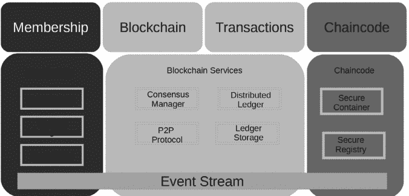

图 14.1 Hyperledger V2.0.0 架构（来自 Hyperledger 白皮书）

共识算法有多种可能的选择，例如 SOLO 和 Kafka（https://github.com/hyperledger/fabric/tree/master/orderer/consensus/solo 和 https://github.com/hyperledger/fabric/tree/master/orderer/consensus/kafka）算法，或者简化拜占庭容错（Simplified Byzantine Fault Tolerance），以便更好地考虑网络参与者之间的关系。

《Hyperledger Fabric 白皮书》规定了 Fabric 的主要特性（架构请参见图 14.1）。这些特性如下：

- **可扩展性：** 动态向网络添加新节点的可能性。链码执行保持分离，可以添加节点来分配流量。
- **事务：** 具有确定性，在定义且恒定的时间内执行，与执行实体无关。
- **身份：** Hyperledger Fabric 提供一个用于控制资源访问的 PKI（公钥基础架构）。PKI 模块可以与 LDAP 或 OAuth2 等现有解决方案集成。
- **审计：** Fabric 包含审计功能，通过管理事件和日志，允许基于当前网络配置进行各种检查。
- **高级查询：** Fabric 允许用户查询当前区块链状态，查询在部署业务网络期间定义并加载到区块链中。用户可以使用 API 调用它们。数据通过事务记录分发，这些记录由键值对组成，对应于区块链中的一次提交。
- 策略服务：用于管理和控制策略，如背书、共识和组。
- 区块链服务：通过对等通信协议管理分布式账本。账本中的数据只能通过处理和验证事务的节点之间达成共识来更新。节点在每个区块后计算数据集的哈希值。
- 共识服务：这是一个模块，根据所选算法接收和执行事务，并与链码接口以检查事务正确性。
- 链码：这是用于管理事务的软件。链码在验证节点内的安全容器（盒子）中执行，负责处理事务请求，并根据业务逻辑验证其有效性。
- 通道：创建虚拟数据分区，仅向参与通道的网络部分授予对信息和事务的访问权限。

## 模型

为确保管理企业业务和服务的 CRM 的设计安全性，我们设计并实现了一种架构，其中网络各部分、服务以及隐私和安全问题与策略之间的交互使用 Hyperledger Fabric 实现。

事实上，所有公开连接到互联网的应用程序或软件系统都面临黑客和攻击者的威胁。CRM 保存着数千人的个人私有数据和信息，这些数据对商业具有巨大价值。近年来，在入侵和黑客攻击此类数据上投入的精力和资源不仅构成了一个利润丰厚的产业，而且（也已经）被用来破坏和影响人们的信仰、社会方面及关系，例如数据被用来影响各国选举的情况。但将关注点放在企业 CRM 安全性上时，安全解决方案的项目必须采用“零信任系统”方法，不得依赖连接到互联网的公共基础设施，例如托管提供商、连接解决方案、服务器、网络设备，以及一般来说与运行在终端（如 PC、移动设备和 IoT 设备）内部的内容不同的所有内容。零信任架构还解决进入网络内部的威胁——而非仅关注传统安全模型执行的边界安全问题——通过利用基于用户、数据和位置的微分段和细粒度边界强制执行。

特别是，在分析 Web 技术时，有两个系统在交互：数据库（DB）和 Web 应用程序。虽然 DB 管理数据的存储和交互，但 Web 应用程序管理用户与数据之间交互的逻辑。外部用户无法直接与 DB 交互，而是将请求转发到 Web 应用程序。因此，后者是首要目标，因为它们连接到公共网络，面临信息学攻击。如果 Web 应用程序没有得到适当保护或安全漏洞被利用，则可能窃取数据或篡改数据完整性。

在关系型数据库中，可以使用安全功能创建具有不同权限和访问权的配置文件，但开发能够在不同环境中使用不同配置文件的 Web 应用程序既困难又昂贵。传统应用程序属于客户端-服务器架构，该架构依赖并信任托管应用程序的基础设施。这些应用程序通常不加密数据，服务器攻击可以完全访问数据库。因此，“应用程序服务器端”黑客攻击可能提供对数据库的完全访问。当然，数据库可以加密，但通常加密和解密发生在数据库内部，不涉及与应用程序的交互。因此，希望直接与客户端进行加密。此外，如果 Web 框架被非受信环境中的节点网络取代，在该环境中所有事务经授权用户批准后执行，所有操作仅在节点共识下进行，那么外部攻击者访问所有敏感数据将更加困难。

可以通过 Hyperledger Fabric 实现此解决方案，其中链码可以管理与数据库的交互，事务根据所选共识机制执行。在这种架构中，连接到互联网的 Web 应用程序被 Fabric 区块链取代。图形界面和用户交互委托给端点应用程序，在该应用程序中启用了客户端到客户端的端到端加密。用户的请求经 ACL（访问控制列表）确认并由链码验证后，通过通道与 Fabric 后端交互，链码是与账本交互的唯一方式。

## 处理事务

事务按照七个步骤阶段进行处理。第一步，应用程序向背书节点发送请求。然后，背书策略指定签署请求所需的节点数量。节点执行链码来部署请求并模拟分布式账本中的读/写操作。第三阶段，背书节点向应用程序提供与区块链交互的请求，该请求由节点签名。然后，应用程序将事务和数字签名发送给排序服务。排序服务创建一个事务块并将其交付给提交节点。这些节点接收事务批次，最后，对于接收到的块中的每个事务，验证背书策略并检查是否存在潜在的冲突事务。如果两项检查都确认，则将块插入分布式账本并更新区块链状态。

由于只有数字签名和读/写操作在网络中广播，因此性能和可扩展性得到优化。不同任务的不同节点之间共享链码执行，即使在负载大且事务量大的情况下也可以优化服务。角色分离允许动态扩展网络，以便可以动态插入节点。

## 模型架构

应用程序和数据库服务器的基础设施可以由构建在 Hyperledger Fabric 之上的业务网络取代。数据在客户端加密并存储在私有区块链中。这被用作中间层，即中间件，使客户端能够在组织内外进行通信。内部通信使用特定的 ACL 策略实现。与存储在分布式账本中的数据的每次交互都通过仅由授权用户调用的链码进行。在接受之前，对数据的每个操作都由部署在区块链上且不可逆的智能合约验证。这确保了自动化和安全性，因为客户端和数据库之间的交互基于仅包含有效操作的访问控制列表执行，减少了外部攻击的表面。

我们的首要目标是实现一个独立运行的原型，其中数据流在软件产品内部发生，但能够连接并集成到预先存在的外部系统。因此，我们同时开发了命令行模式和图形用户界面的客户端。一个工作示例展示了通过两个非交互进程同步两个文件夹，并检查与整体信息系统交互的图形管理系统中的数据。该系统可以处理加密或未加密的文本，并由一位作者在“Eablock”和“CLab”中开发。

在表 14.1 报告的示例中，客户端遍历包含“.log”文件的文件夹。每个文件的内容和名称都被加密并插入区块链。之后，可以在图形平台（图 14.2）中检查数据。

该平台显示加载到区块链中的文件内容列表，使用用户凭据检索，在客户端内解密并向用户公开。

如果攻击者进入其中一些节点，加密数据将无法理解或解释。我们启用了以 JSON 文件形式存储加密内容。图 14.3 显示了根据此标准存储的部分文件内容。


## 表 14.1. 客户端在 Fabric 框架提供的数据结构内迭代并加密保存每个元素时提供的消息截图

```
################################
#                              #
#           EABLOCK            #
#     YOUR SAFE BUSINESS       #
#                              #
#       eablock.com            #
#     info@eablock.com         #
#                              #
################################
```

```
INFO: Downloading and Decryption of data ...
#
Result of Decryption (filename only)
log.evtx
#
#
INFO: Downloading and Decryption of data ...
#
Result of Decryption (filename only)
log.txt
#
#
INFO: Downloading and Decryption of data ...
#
Result of Decryption (filename only)
log.xml
#
#
INFO: Downloading and Decryption of data ...
#
Result of Decryption (filename only)
log_2.evtx
#
#
INFO: Downloading and Decryption of data ...
#
Result of Decryption (filename only)
log_2.txt
#
#
INFO: Downloading and Decryption of data ...
#
Result of Decryption (filename only)
log_2.xml
#
#
INFO: Downloading and Decryption of data ...
#
```

## 表 14.1（续）

```
Result of Decryption (filename only)
log_3.evtx
#
#
INFO: Downloading and Decryption of data ...
#
Result of Decryption (filename only)
log_3.txt
#
#
INFO: Downloading and Decryption of data ...
#
Result of Decryption (filename only)
log_3.xml
#
#
```

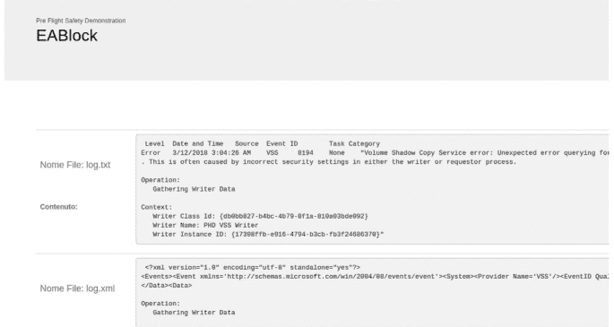

## 图 14.2 Eablock 客户端将区块链上的解密内容展示给最终用户的截图

由于我们也加密了文件名，攻击者窃取特定文件变得复杂得多。之后可以使用对称方案从区块链中恢复数据。

表 14.2 显示了一个屏幕，其中客户端在 Fabric 框架提供的数据结构内迭代并解密保存每个元素。

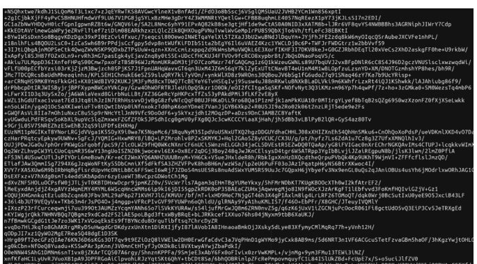

## 图 14.3 客户端在 Fabric 框架提供的数据结构内迭代并加密保存每个元素时提供的消息截图

## 表 14.2 客户端在 Fabric 框架提供的数据结构内迭代并解密保存每个元素时提供的消息截图

```
###############################################
#                                             #
#                EABLOCK                      #
#                                             #
#         YOUR SAFE BUSINESS                  #
#                                             #
#                 eablock.com                 #
#                 info@eablock.com            #
#                                             #
###############################################
```

```
INFO: Encryption and uploading to BlockChain
#
log.evtx
#
#
INFO: Encryption and uploading to BlockChain
#
log.txt
#
#
INFO: Encryption and uploading to BlockChain
#
log.xml
#
#
```

## 表 14.2（续）

```
INFO: Encryption and uploading to BlockChain
#
log_2.evtx
#
#
INFO: Encryption and uploading to BlockChain
#
log_2.txt
#
#
INFO: Encryption and uploading to BlockChain
#
log_2.xml
#
#
INFO: Encryption and uploading to BlockChain
#
log_3.evtx
#
#
INFO: Encryption and uploading to BlockChain
#
log_3.txt
#
#
INFO: Encryption and uploading to BlockChain
#
log_3.xml
#
#
```

## 结论

在本章中，我们报告了一项关于使用 Hyperledger Fabric 管理 CRM 的“安全之设计”方法的分析。信息安全是 CRM 必须解决的主要目标，以保护客户数据免受未经授权方的访问。区块链技术的使用原生支持加密、匿名化和去中心化，使得 CRM 可以构建在零信任系统支持之上，无需对托管软件组件的基础设施有任何信任。这允许在用户控制下的客户端应用程序中对数据进行加密。数据仅可供授权用户使用和访问，对其他人不可理解。原生数字签名允许精确识别发送者，发送者无法脱离任何行为。数据完整性通过区块链上的加密和哈希函数原生得到保障，这些函数允许防止任何不诚实的数据篡改。加密数据保存在基于区块链的后端上。我们使用一种需要对网络参与者进行预防性验证的许可区块链来实现此方案。我们使用 Hyperledger 的“Fabric”，这是一个旨在创建企业级区块链的项目。Hyperledger 的权限结构降低了安全问题的风险，仅允许在授权方之间进行交易。使用 Fabric 时，链码可以管理与数据库的交互，并且事务根据所选共识机制执行。在这种架构中，连接到互联网的 Web 应用程序被 Fabric 区块链所取代。图形界面和用户交互被委托给一个端点应用程序，其中客户端启用端到端加密。用户在其请求被 ACL 确认并由链码验证后，通过一个通道与 Fabric 后端交互，这是与分类账交互的唯一方式。内部通信通过特定的 ACL 策略实现。与分布式分类账中存储的数据的每次交互都通过仅由授权用户调用的链码进行。在数据上的每次操作被接受之前，都会由部署在区块链上的不可逆智能合约进行验证。这确保了自动化和安全性，因为客户端与数据库之间的交互是基于仅包含有效操作的 ACL（访问控制列表）执行的，从而减少了外部攻击的表面。我们实现了一个独立工作的原型，其中数据流发生在软件产品内部，但能够连接并集成到预先存在的外部系统，并且我们以命令行模式和图形用户界面两种方式开发了客户端。通过这个原型，我们展示了如何依赖 Fabric Hyperledger 实际实现 CRM“安全之设计”的概念。我们的研究将现有的 CRM 研究推向利用这项新技术最相关特性的区块链方法。

如需更多电子书或提出请求，请支持 hill0 并在我的博客购买高级会员，谢谢并享受！https://arxhm.se/blogs/hill0

## 致谢

作者们感谢卡利亚里大学的 ContaminationLab (C-Lab)，该实验室部分地托管了这项工作并支持了 Eablock 项目。

## 参考文献

- Barton, Dominic (2012). “使高级分析发挥作用”, 《哈佛商业评论》。

- Bragagnolo, Santiago, Rocha, Henrique, Denker, Markus 和 Ducasse, Stephane (2018). “SmartInspect：Solidity 智能合约检查员”, 2018 年面向区块链的软件工程国际研讨会 (IWBOSE)，意大利坎波巴索，第 9–18 页。ISBN: 978-1-5386-5987-8。

- Concas, Giulio, Destefanis, Giuseppe, Marchesi, Michele, Ortu, Marco 和 Tonelli, Roberto (2013). “敏捷软件中的微模式”, 敏捷软件开发国际会议，第 210–222 页。

- Destefanis, Giuseppe, Ortu, Marco, Counsell, Steve, Swift, Stephen, Marchesi, Michele 和 Tonelli, Roberto (2016). “软件开发：良好的礼仪重要吗?”, PeerJ 计算机科学，卷 2，第 73 页。

- Destefanis, Giuseppe, Ortu, Marco, Counsell, Steve, Swift, Stephen, Tonelli, Roberto 和 Marchesi, Michele (2017). “关于软件开发情感度量的随机性与季节性”, 应用计算研讨会论文集，第 1266–1271 页。

- Destefanis, Giuseppe, Tonelli, Roberto, Concas, Giulio 和 Marchesi, Michele (2012). “大型 Java 系统中反微模式对故障易发性影响的分析”, 第 27 届年度 ACM 应用计算研讨会论文集，第 1251–1253 页。

- 以太坊白皮书: https://github.com/ethereum/wiki/wiki/White-Paper

- Greenberg, P. (2009). “光速 CRM”, 在《社交 CRM 策略、工具和与客户互动的技术》中。第四版。麦格劳希尔，第 30 页。

- Hulea, M.E., Rosu, O., Miron, R. 和 Astilean, A. (2018). “医药冷链管理：基于分布式账本的平台” (会议论文)，第 21 届 IEEE 自动化、质量与测试、机器人国际会议，AQTR 2018，2018 年 7 月 3 日，第 1–6 页，罗马尼亚克卢日-纳波卡；2018 年 5 月 24 日至 26 日；类别编号 CFP18AQT-PRT；代码 137740。

- Hyperledger Fabric 白皮书: www.hyperledger.org/resources/publications#white-papers

- Hyperledger 白皮书: www.hyperledger.org/resources/publications#white-papers

- Kinkelin, H., Hauner, V.E., Niedermayer, H.E. 和 Carle, G. (2018). “使用分布式账本进行网络设备的可信配置管理” (会议论文)，IEEE/IFIP 网络运行与管理研讨会：赛博世界中的认知管理，NOMS 2018，2018 年 7 月 6 日，第 1–5 页，台湾台北；2018 年 4 月 23 日至 27 日；类别编号 CFP18NOM-ART；代码 137784。

- Lenarduzzi, Valentina, Tonelli, Roberto, Marchesi, Michele 和 Lunesu, Maria Ilaria (2018). “敏捷方法的区块链应用”, 第 19 届软件工程与极限编程敏捷流程国际会议。XP 论文集。

- Mantyla, Mika, Adams, Bram, Destefanis, Giuseppe, Graziotin, Daniel 和 Ortu, Marco (2016). “挖掘效价、唤醒度和支配力：检测倦怠和生产力的可能性?”, 第 13 届软件挖掘国际会议论文集，第 247–258 页。

- Marchesi, Michele, Ortu, Marco, Tonelli, Roberto, Destefanis, Giuseppe, Bracciali, Andrea 和 Hieronis, Robert (2018). “智能合约漏洞：对区块链软件工程的呼吁?”, 面向区块链的软件工程国际研讨会 (IWBOSE)，第 19–24 页。doi:10.1109/IWBOSE.2018.8327567。

- Nakamoto, Satoshi, “比特币：一种点对点电子现金系统”, 比特币白皮书。

- Ortu, Marco, Destefanis, Giuseppe, Adams, Bram, Murgia, Alessandro, Marchesi, Michele 和 Tonelli, Roberto (2015). “JIRA 仓库数据集：理解软件开发的社会方面”, 第 11 届软件工程预测模型与数据分析国际会议论文集，第 1 页。

- Ortu, Marco, Destefanis, Giuseppe, Counsell, Steve, Swift, Stephen, Tonelli, Roberto 和 Marchesi, Michele (2016). “纵火犯还是消防员? 敏捷软件开发中的情感性”。

- Ortu, Marco, Destefanis, Giuseppe, Kassab, Mohamad, Counsell, Steve, Marchesi, Michele 和 Tonelli, Roberto (2015). “您能修复这个问题吗? 在使用敏捷看板开发的软件中礼貌性和吸引力的实证分析”, 软件工程与极限编程中的敏捷流程，第 122–140 页。


Ortu, Marco, Destefanis, Giuseppe, Kassab, Mohamad, and Marchesi, Michele (2015). “衡量和理解 JIRA 开发者社区的有效性”, 第六届新兴软件度量国际研讨会论文集, pp. 3–10.

Ortu, Marco, Destefanis, Giuseppe, Swift, Stephen and Marchesi, Michele (2016). “传统和移动开源软件中高低优先级缺陷的测量”, 第 7 届新兴软件度量国际研讨会论文集, pp. 1–7.

Ortu, Marco, Murgia, Alessandro, Destefanis, Giuseppe, Tourani, Parastoo, Tonelli, Roberto, Marchesi, Michele and Adams, Bram (2016). “JIRA 中软件开发者的情感方面”, 2016 IEEE/ACM 第 13 届软件仓库挖掘工作会议 (MSR), pp. 480–483.

Sousa, J., Bessani, A. and Vukolic, M. (2018). “Hyperledger Fabric 区块链平台的拜占庭容错排序服务” (会议论文), 第 48 届 IEEE/IFIP 可靠系统与网络国际会议论文集, DSN 2018, 2018 年 7 月 19 日, 文章编号 8416470, pp. 51–58, 卢森堡; 2018 年 6 月 25 日至 28 日; 类别编号 E6445; 代码 138141.

Tonelli, Roberto, Pinna, Andrea, Baralla, Gavina and Ibba, Simona (2018). “作为面向区块链微服务的以太坊智能合约”, 微服务：敏捷与 DevOps 经验国际研讨会 (MADE18).

## 以太坊智能合约中的隐私

Duarte Teles 和 Isabel Azevedo

### 引言

数据隐私在过去几十年里一直是一个重要问题。几家大公司因处理和滥用从个人处收集的数据而闻名。软件应用程序必须确保用户隐私，这一点通过欧盟《通用数据保护条例》(GDPR) 的批准得到了加强。遵守 GDPR 是强制性的：处罚范围从最低 1000 万欧元或 2% 的年营业额（以较高者为准）到 2000 万欧元或 4% 的年营业额（以较高者为准）（欧盟，2016）。

1996 年，计算机科学家兼密码学家 Nick Szabo 首次构思了智能合约的概念 (Szabo, 1996)。通常，这些是自动执行协议（类似于现实世界中的合同），尽管以计算机代码形式表达，在执行时规定合同的条款和条件，而涉及各方之间无需相互信任。目前，它们可以存储在区块链上；因此，它们继承了区块链的特征属性：不可篡改、公开和去中心化。智能合约一旦创建并部署，就无法再被修改或篡改。创建它们的整个过程必须涉及精心的设计、测试和执行，否则多个无法修补的错误和漏洞可能会在未来某个时间点被攻击者利用。例如，去中心化自治组织 (DAO) (Falkon, 2017) 和 Parity 被攻击事件 (Parity Technologies, 2017; Petrov, 2017) 导致数百万美元资金被盗。

最著名的两个区块链是比特币 (Bitcoin Project, 2018) 和以太坊 (Ethereum Foundation, 2018)。前者由一个化名中本聪的未知人士创建，他率先提出了通过密码学强制执行的数字货币概念，旨在解决双重支付问题。后者目前是支持智能合约的最大区块链，专门针对智能合约设计并采用了扩展的执行模型 (Ethereum Foundation, 2014)。以太坊还支持去中心化应用程序 (DApps) 的开发，这些应用采用其智能合约和属性。

根据 GDPR (欧盟，2016)，个人享有两项主要权利：“删除权”和“更正权”。在这种情况下，由于两个区块链都是不可篡改的，它们如何遵守这两项个人权利？此外，在承认这一问题的同时，DApps 能否符合 GDPR 进行开发？

在本章中，作者首先讨论了 GDPR 的基本概念。然后将介绍在遵循 GDPR 的同时开发 DApps 的多种方法，尽管有些可能无法完全符合该法规。此外，还为任何有兴趣开发 DApps 并能够完全符合该法规的人提供了一系列通用步骤。最后，考虑了一个案例研究：DFiles，这是一个使用以太坊、其智能合约以及行星间文件系统 (IPFS) (Protocol Labs, 2018) 等去中心化技术开发的开源 DApp，同时遵循区块链软件工程原则 (Destefanis 等人，2018)。在此，我们试图回答以下问题：

- DApps 能否完全符合 GDPR？
- 在以太坊 (Homestead) 中通过加密用户数据来保护用户数据是否可行？

第一个问题的简短答案是，DApps 实际上可以符合 GDPR，尽管存在严重限制。确保其合规性的一种可能方法是数据加密，这引出了第二个问题：研究发现，截至 2018 年底，通过加密来保护个人数据是不可行的，这将在本章后面探讨。以太坊和 IPFS 必须迅速改进，以允许其他隐私场景，或至少确保中大型文件大小确实可以进行加密。

### 《通用数据保护条例》

在 GDPR 之前，大公司可以在较少限制下收集、处理和存储用户数据。然而，欧盟起草了一项新法律，以进一步确保用户的重要数据保持私密，并免受组织数据处理不当和可能的数据泄露的影响。2016 年 5 月，这项重大立法获得通过并具有可强制执行性 (欧洲数据保护主管，2018)，尽管处罚直到将近两年后（即 2018 年 5 月 25 日）才适用。全面理解该法规可能需要几个月到一两年的时间。鉴于篇幅限制，仅介绍其最重要的方面。

该法规引入了一些新概念：

- **数据主体（或个人）：** “任何正在收集、保存或处理其个人数据的人”（EU GDPR Compliant, 2018）。
- **个人数据：** 任何“与已识别或可识别的自然人（“数据主体”）相关的信息；可识别的自然人是指可以直接或间接被识别的人，特别是通过参考姓名、身份证号码、位置数据、在线标识符或一个或多个特定于该自然人的物理、生理、遗传、精神、经济、文化或社会身份等因素”（欧盟，2016）。
- **处理：** 任何“对个人数据或个人数据集执行的操作或一组操作，无论是否通过自动化手段进行，例如收集、记录、组织、结构化、存储、改编或改变、检索、查阅、使用、通过传输披露、传播或其他方式提供、排列或组合、限制、删除或销毁”（欧盟，2016）。

### 合法依据与权利

在处理数据主体的数据时，必须有合法依据。这些与数据主体的权利相互关联；有些权利不适用于特定的合法依据，而有些权利可能几乎适用于所有合法依据，如表 15.1 所示。

可供选择的合法依据包括同意、法律义务、公共任务和合法利益，其中同意是传统软件应用中最广泛使用的。它指的是为特定目的处理个人数据的许可。必须使用清晰、简洁且明确的语言提出请求，且不得使用预先勾选的框或其他默认同意方式（欧盟，2016）。

GDPR 中有多项新的个人权利。
它们都同样重要，因为它们可能适用于某些处理的合法依据，而不适用于其他依据（表 15.1）。这些权利包括知情权、访问权、更正权、删除权和数据可移植权。

以太坊和其他区块链通常遵守其中大部分权利。然而，这里的主要问题是删除权，因为它与区块链中存在的不可篡改性相冲突。根据 (ICO, 2018)，这个

表 15.1 删除权与数据可移植权的区别

| | 删除权 | 数据可移植权 |
|---|---|---|
| 同意 | | |
| 法律义务 | X | X |
| 生命至关重要的利益 | | X |
| 公共任务 | X | X |
| 合法利益 | X | |

注：不适用于某些合法依据的个人权利标记为“X”
来源：ICO (2018)


删除权（虽然不总是适用）规定，数据主体可以要求在不拖延的情况下删除其个人数据。区块链的不可更改性质与此权利相矛盾，因为数据无法删除。

## 以太坊 DApp 中的通用数据保护条例合规

DApp 开发面临的最大挑战之一是遵守通用数据保护条例，主要是因为一些区块链特性不允许删除或更改记录，如前文所述。然而，大多数区块链完全遵守访问权和数据可移植性权，因为它们内置了分布式账本技术。本节介绍了使用以太坊区块链及其智能合约实现可能 GDPR 合规的三种不同方法。这些方法如下：

- 1. **基于纯去中心化技术的 DApp：** 在纯去中心化应用程序中，截至撰写本文时，无法实现完全的 GDPR 合规，因为大多数 DApp 使用同意作为处理数据的合法依据。个人的删除权是这里的罪魁祸首，因为以太坊区块链中的不可更改数据无法删除。然而，存在两种小的特殊情况，纯去中心化应用程序可能确实符合该法规。即处理个人数据的合法依据为公共利益或法律义务的情况。在这些罕见情况下，删除权不适用，因此可以实现 GDPR 合规。

- 2. **混合中心化和去中心化技术的 DApp：** 同时使用中心化和去中心化技术（如作者的案例研究）的 DApp 可以完全符合 GDPR。要实现这一点，解决方案分为两部分：首先，必须进行彻底分析，以确定整个系统中包含可变数据（如用户信息，电子邮件、家庭地址或电话号码）的部分。然后将使用中心化解决方案开发这些部分，数据及其匹配哈希存储在一个或多个数据库中。第二，可以像往常一样开发以太坊智能合约，在其中存储其他数据，并附带中心化系统中的相同哈希作为两者之间的链接。这样一来，如果中心化系统中删除了数据，连接两个系统（中心化和带有智能合约的去中心化系统）的哈希就会断开。因此，该数据无法直接关联到特定个人，这不在 GDPR 范围内，如图 15.1 所示。

- 3. **带有智能合约的标准中心化应用程序：** 中心化软件应用程序可能不需要完全转向去中心化。它们有时可能只需要采用以太坊区块链中的分布式账本技术，例如记录用户 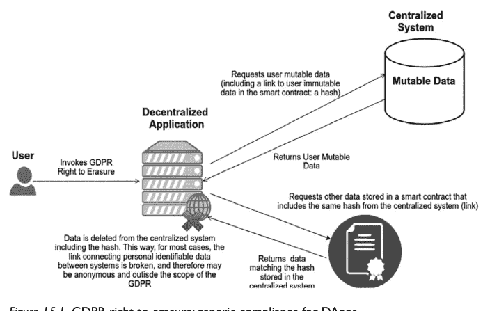 交易。在这种情况下，GDPR 合规很简单：这些软件应用程序在中心化数据库中记录其用户的以太坊地址。然后可以将交易关联到用户。如果用户请求删除其帐户，交易仍然公开可用，但不与任何特定个人关联，因此不在 GDPR 范围内。

## 以太坊 DApp 的 GDPR 合规指南

如前文所述，GDPR 合规对去中心化应用程序构成重大挑战。不合规的罚金高得惊人，这确保了组织致力于遵守它。在本节中，作者提供了一个简单的指南，以尽可能最佳的方式遵守该法规，尽管区块链（包括以太坊）设计中存在不可更改等关键问题：

- 1. 确定处理个人数据的合法依据。其中大多数赋予个人删除权，而默认情况下这与区块链的不可更改性质不兼容。然而，如前所述，如果合法依据仅为遵守法律义务或公共任务，则该权利不适用。

- 2. 如果同意是合法依据，请分析包含可变数据的软件应用程序部分，并确保其存储在中心化系统中；将其他所有内容存储在一个或多个智能合约中。

- 3. 在一个或多个智能合约中，存储一个将中心化部分与去中心化组件（如以太坊）关联的哈希。换句话说，当今大多数 DApp 应该具备中心化组件（例如传统数据库），用于存储可变数据，并结合以太坊及其智能合约等去中心化技术的强大功能，用于存储不可更改数据。

- 4. 如果用户行使被遗忘权，请删除其在中心化系统中的可变数据。这样一来，中心化系统与去中心化系统之间的链接（哈希）就会断开，后者中的数据可能仍可访问，尽管它无法关联到特定个人，因此不在 GDPR 范围内，如图 15.1 所示。

- 5. 在某些情况下，个人身份信息存储在一个或多个智能合约中。为了遵守 GDPR，一种可能的方法是加密这些个人数据。作者的案例研究旨在了解这是否可行。

## 案例研究：Dfiles

在本章的前半部分，简要讨论了 GDPR，以及任何 DApp 可能遵守该法规的通用步骤。

在本节中，作者提出了一个案例研究——Dfiles——旨在回答两个重要问题：

- DApp 能否完全符合 GDPR？
- 在以太坊（Homestead）中加密用户数据以保护用户数据是否可行？

DFiles 是一个开源的去中心化应用程序¹，使用 IPFS 和以太坊智能合约等去中心化技术开发，外加一个用于用户身份验证的中心化组件。此外，DFiles 还旨在通过每个软件开发阶段来遵循区块链软件工程：

- 需求收集与分析；
- 设计；
- 实现；和
- 测试。

此外，本节还深入讨论了 Dfiles 背后的核心引擎（即其以太坊智能合约），涵盖代码本身、采用的设计模式，以及安全性和测试。

作者还简要演示了 Dfiles 的核心功能，其中统计分析比较了同一 DApp 的两个版本：一个是用户上传的文件被加密，另一个是未加密。目标是通过比较每个版本中相同文件的总交易成本和经过的上传时间，来了解加密是否可行（从而实现用户数据保护和隐私）。此分析对于充分理解上述（尽管是通用的）DApp GDPR 合规计划是否可行至关重要，特别关注删除权。最后，介绍了该案例研究的结论。

## 区块链软件工程

在标准的中心化软件应用程序中，有几个阶段可以正确开发软件应用程序：软件开发生命周期。然而，在去中心化应用程序中，必须特别注意开发安全的智能合约，并特别强调测试。

第一个主要阶段是需求收集与分析，通常在此阶段起草系统的功能需求。DFiles 中最重要的需求如下：

- 1. DApp 必须能够通过用户的 MetaMask（Consensys, 2018b）Google Chrome/Firefox 扩展程序与以太坊区块链通信；
- 2. 在将用户文件上传到 IPFS 之前对其进行加密；
- 3. 将用户文件上传到 IPFS；
- 4. 在以太坊交易（智能合约）中注册每个用户上传的 IPFS 文件哈希；
- 5. 列出所有上传到 IPFS 的用户文件；
- 6. 下载并解密用户上传的所有文件。

第二阶段是设计，在此阶段定义总体系统架构。DFiles 系统架构如图 15.2 所示。DFiles DApp 具有两个主要组件：

- **前端**：负责使用 Web3JS 向用户显示数据。
- **后端**：与前端交互，从多个来源获取业务逻辑：
  - 与中心化系统（NodeJS/Express）和数据库进行用户身份验证。在此过程中，生成一对私钥/公钥来加密用户的文件。
  - IPFS 用于去中心化文件存储。
  - 以太坊智能合约，用于存储用户上传的文件哈希。
- **全栈**：Truffle 框架² 用作前端和后端之间与 Web3JS API³ 的桥接器。

该 DApp 连接到本地 IPFS 节点，该节点模拟与 IPFS 网络的连接。同样，DFiles 也连接到 MetaMask 私有


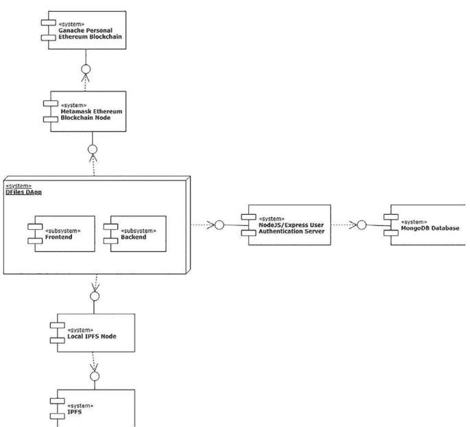

图 15.2 DFiles 系统架构

连接到以太坊区块链私有版本（通过 MetaMask 的 Google Chrome/Firefox 扩展）的以太坊节点，在此可以部署智能合约、开发应用程序和运行测试：Ganache（Consensys, 2018a）。

最后两个阶段是实现阶段（实际编码在此进行）和测试阶段。当详细介绍 DFiles 核心智能合约时，所有这些阶段都会变得清晰，重点放在后者。还存在部署阶段，将在“局限性与未来工作”章节中讨论。

## 核心智能合约

开发以太坊智能合约需要大量的设计和测试，以确保其无错误，因为一旦部署后就无法更改。在 DFiles 中，核心智能合约 Files.sol 使用了流行的以太坊编程语言 Solidity 开发，并使用 Web3JS 在前端与其交互。

```
// A structure that contains information about the user's files
struct File {
string name; // the file's name
string extension; // the file's extension
uint32 size; // the file's size
string hash; //the IPFS file hash
string timestamp; // the transaction timestamp is stored in the JavaScript and is in the Unix Epoch time;
string ethereumAccount; // the user's Ethereum Address that uploaded the file
}
//The files belonging to each user (or address)
mapping(address => File[]) private userFiles;
```

### 代码片段 15.1 Files.sol 智能合约数据结构

在众多现成的 Solidity 设计模式中，仅因所开发智能合约的简单性而选择了 Ownable 模式。其实现由 OpenZeppelin 提供。4 代码从 Files.sol 智能合约继承而来。随后确定了要使用的整体数据结构——对于用户文件，使用一个映射将用户的以太坊地址与 File 结构关联，即 userFiles。该结构存储关于文件的数据——代码片段 15.1。

随后开发了一个函数，用于向用户映射添加文件，如代码片段 15.2 所示。

最后，创建了两个只读函数，用于返回给定文件的索引并返回映射的长度。这些函数允许通过在前端通过 Web3JS 迭代映射来发送大量的 gas。

Files.sol 源代码的完整代码可在 Bitbucket 上找到。5

BOSE 的最后一个阶段之一是测试，尤其是涉及智能合约时。Truffle 框架提供了一个不错的单元测试套件。6 执行了以下测试：

- 创建一个与智能合约结构具有相同属性的新文件对象，将其插入测试区块链，获取插入的数据，然后将其与原始文件对象进行比较。如果相同，则测试通过。否则，测试失败。

- 创建一个新文件对象，将其插入测试区块链，并尝试遍历无效的文件索引（不存在的文件）。如果循环失败，则该索引处没有文件，因此测试通过。

## 简要演示

本节介绍 DFiles DApp 的核心功能。此外，还解释了文件加密和文件解密的工作原理。

首先，用户注册账户并登录（此过程通过 NodeJS/Express 集中式服务器处理）。然后，他们会被带到上传文件页面以选择要上传的文件，如图 15.3 所示。

```
// @notice This function inserts information of a file to the
userFiles array: name, size, extension in addition to a timestamp and
the IPFS file hash
// @param _name file name
// @param _hash IPFS file hash
// @param _extension file extension
// @param _size file size
// @param _timestamp a timestamp
// @param _ethereumAccount the user Ethereum account calling this contract
function addFile(string _name, string _hash, string _extension, uint32 _size, string _timestamp, string _ethereumAccount)
public {
require(_size>0 && _size<=4294967295, "Invalid file size");
File memory file = File(_name, _extension, _size, _hash, _timestamp, _ethereumAccount);
userFiles[msg.sender].push(file);
}
```

### 代码片段 15.2 在 Files.sol 智能合约中添加文件信息

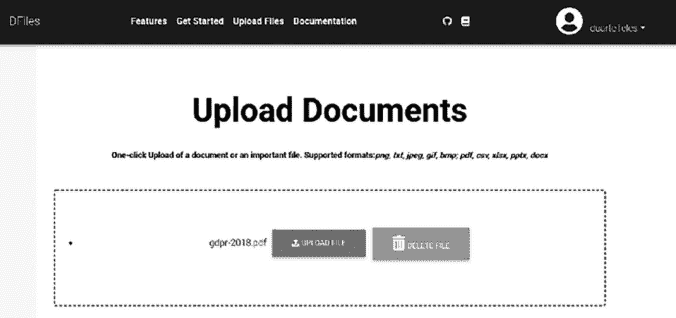

图 15.3 DFiles 文件上传示例

单击“上传文件”按钮后，文件将使用 crypto-js API 加密，7 用户的私钥存储在集中式服务器中。然后，用户必须接受一笔使用智能合约的交易，该交易将关于文件的多个详细信息存储在本地以太坊区块链（Ganache）中，如图 15.4 所示。

gas 费和总交易成本取决于 gas 价格（以 GWEI 计）和预定义的 gas 限制（这对于评估部分非常重要）。然后，文件被发送到本地集中式 IPFS 节点，该节点返回包含加密文件的哈希值。此后，用户会看到其 URL 的成功消息，如图 15.5 所示。

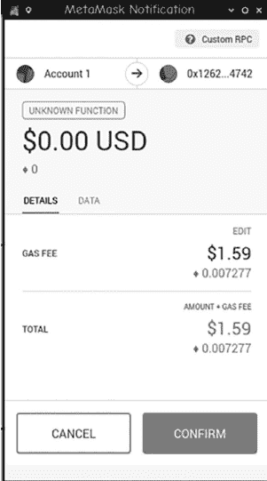

图 15.4 以太坊 MetaMask 交易提示

### 上传文档

一键上传文档或重要文件。支持的格式：png、txt、jpg、gif、bmp、pdf、csv、xml、xlsx、pptx、docx


文件 gdpr-2018.pdf 上传成功。在 myfiles 中查看或点击此链接

图 15.5 文档上传成功消息

点击链接后，用户会看到文件，但为加密形式（图 15.6）。

最后，可以浏览其文件的详细信息，尽管这些信息未加密（图 15.7）。

一旦用户点击“解密并下载”，所选文件将被解密并下载。当用户调用 GDPR 的删除权时，其所有详细信息（包括用于加密其文件的私钥）都会被删除。文件仍然基本上位于 IPFS 节点中，尽管已加密。由于它们无法访问，可以视为已删除。这样，不可变性问题得以解决。在下一节中，将进行统计分析以了解这种方法是否可行。

## 评估

如前所述，GDPR 对确保 DApp 符合其要求构成了重大挑战，主要原因是被遗忘权。本节将进行统计分析，以了解在将文件发送到 IPFS 节点之前加密个人数据（或文件）是否可行。这样一来，加密文件将在节点提供服务的期间一直保留，但其内容对第三方仍然无法访问，这与文件删除相同。

在以太坊中，存在“gas”概念：

> 交易发送者在以太坊区块链上进行每项操作都需要支付的执行费。gas 这个名字来源于这样的观点：该费用充当加密燃料，推动智能合约的运行。gas 由执行代码的矿工以以太币购买。（以太坊基金会，2016）

与 gas 相关的四个重要方面：

- **gas 限制**：交易中要支付的最大 gas 数量；
- **交易使用的 gas**：交易消耗的总 gas；
- **gas 价格**：交易中指定的每单位 gas 的价格（以以太币计）；以及
- **总交易成本**：gas 使用量 × gas 价格。

开发了两个版本的 DFiles DApp：一个没有用户身份验证和文件加密，另一个同时具有用户身份验证和文件加密/解密。所有即将发布的统计数据均可在 Bitbucket 上找到。8 首先，随机选择了 100 个文件，扩展名各不相同：.pdf、.docx、.xlsx 和 .pptx，但由于硬件限制无法全部使用。然后将它们分为四组：小（1 KB–1 MB）、中（1 MB–20 MB）、大（20 MB–200 MB）和特大（200 MB–2 GB）。除此之外，对于相同的文件和 DFiles 的两个版本，还测量了从用户点击“上传文件”按钮、文件发送到本地 IPFS 节点（加密或未加密）以及用户点击按钮接受交易的耗时，以及以太币（由 MetaMask 提供；根据 gas 限制和 gas 价格而有所不同）的总交易成本。附录 A 显示了部分收集的数据。

但是，由于文件加密的硬件限制，以下统计分析仅考虑了高达 14.2 MB 的文件。仍然记录了总交易成本和上传耗时，以便在加密和非加密文件之间的总体结论中进行比较。


## 小文件

表 15.2 展示了小未加密文件和小加密文件的描述性统计摘要及其比较的检验结果。完整数据表见附录 C。

- **金额 + Gas 费用 (总计):** 未加密文件和加密文件的分布均为右偏，即大多数文件的数值较小（两组文件的 Fisher 偏度系数均为正值）。未加密文件的平均金额为 0.0004024 ETH，加密文件的平均金额为 0.0003885 ETH。最小值分别为 0.0003750 ETH 和 0.0003640 ETH；第一四分位数分别为 0.0003760 ETH 和 0.0003640 ETH；中位数分别为 0.0003770 ETH 和 0.0003650 ETH；第三四分位数分别为 0.0004380 ETH 和 0.0004260 ETH；最大值分别为 0.0004720 ETH 和 0.0004600 ETH。因此，可以得出结论，两组中小值文件均占主导地位。这种集中导致变异度非常小，变异系数分别为 8.4% 和 8.5%，如所示。

为了比较两组的分布，首先对两组样本使用 Shapiro–Wilk 检验（显著性水平为 5%）进行正态性检验。两组均强烈拒绝正态性（p 值 < 0.001）。因此，两组样本的比较基于 Wilcoxon 检验（配对样本），其 p 值为 0.007。因此，未加密文件的平均金额 + Gas 费用更大。图 15.8 明确显示了该结论。

表 15.2 小文件的描述性统计及比较检验

| | 未加密 | 加密 |
|---|---|---|
| **金额 + Gas 费用 (总计) (ETH)** | | |
| 最小值 | 0.0003750 | 0.0003640 |
| 最大值 | 0.0004720 | 0.0004600 |
| 均值 | 0.0004024 | 0.0003885 |
| 中位数 | 0.0003770 | 0.0003650 |
| Wilcoxon 检验 p 值 | 0.007 | |
| **上传耗时 (秒)** | | |
| 最小值 | 2 | 3 |
| 最大值 | 5 | 5 |
| 均值 | 3.6 | 4.3 |
| 中位数 | 4 | 4 |
| Wilcoxon 检验 p 值 | 0.001 | |
| **大小 (MB)** | | |
| 最小值 | 0.01005 | |
| 最大值 | 0.98400 | |
| 均值 | 0.21550 | |
| 中位数 | 0.06000 | |

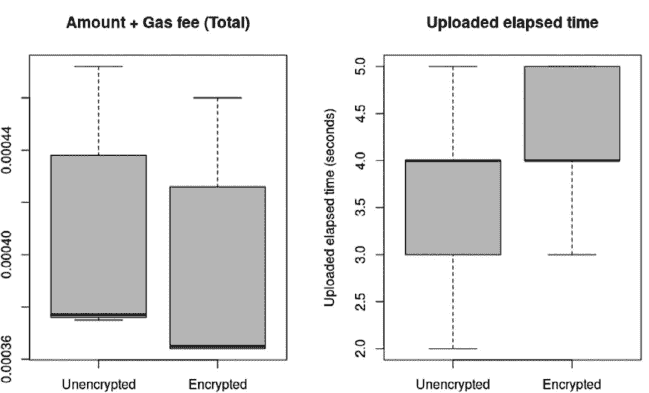

图 15.8 小文件箱线图

- **上传耗时:** 未加密文件和加密文件的分布均为轻微左偏，即大多数文件的耗时适中或较长（两组文件的 Fisher 偏度系数均为负值）。未加密文件的平均耗时为 3.6 秒，加密文件的平均耗时为 4.3 秒。最小值分别为 2 秒和 3 秒；第一四分位数分别为 3 秒和 4 秒；两组中位数均为 4 秒；第三四分位数分别为 4 秒和 5 秒；两组最大值均为 5 秒。因此，可以得出结论，两组中耗时适中或较长的文件均占主导地位。这种集中导致变异度较小，变异系数分别为 25.7% 和 15.8%，如所示。

- Shapiro–Wilk 检验结果显示，两组均强烈拒绝正态性（p 值分别为 0.003 和 0.0001）。Wilcoxon 检验的 p 值为 0.001，可以得出结论，加密文件的耗时更大。图 15.8 明确显示了该结论。

## 中型文件

表 15.3 展示了中型未加密文件和中型加密文件的描述性统计摘要及其比较的检验结果。完整数据表见附录 D。

### 表 15.3 中型文件的描述性统计及比较检验

| | 未加密 | 加密 |
|---|---|---|
| 最小值 | 0.0003750 | 0.0003630 |
| 最大值 | 0.0004400 | 0.0004280 |
| 均值 | 0.0004087 | 0.0003938 |
| 中位数 | 0.0004225 | 0.0003805 |
| Wilcoxon 检验 p 值 | 0.0002 | |

| | 未加密 | 加密 |
|---|---|---|
| 最小值 | 5 | 6 |
| 最大值 | 9 | 69 |
| 均值 | 6.3 | 29.6 |
| 中位数 | 6 | 19 |
| Wilcoxon 检验 p 值 | 0.0002 | |

| | |
|---|---|
| 最小值 | 1.2 |
| 最大值 | 14.2 |
| 均值 | 6.5 |
| 中位数 | 5 |
| 第三四分位数 | 12 |

- **金额 + Gas 费用 (总计):** 大多数未加密和加密文件要么很大，要么很小。未加密文件的平均金额为 0.0004087 ETH，加密文件的平均金额为 0.0003938 ETH。最小值分别为 0.0003750 ETH 和 0.0003630 ETH；第一四分位数分别为 0.0003753 ETH 和 0.0003640 ETH；中位数分别为 0.0004225 ETH 和 0.0003805 ETH；第三四分位数分别为 0.0004380 ETH 和 0.0004268 ETH；最大值分别为 0.0004400 ETH 和 0.0004280 ETH。变异度非常小，变异系数分别为 7.7% 和 7.9%，如所示。

- Shapiro–Wilk 检验结果显示，两组均强烈拒绝正态性（p 值 < 0.001）。Wilcoxon 检验的 p 值为 0.0002，可以得出结论，未加密文件的平均金额更大。图 15.9 显示了该结论。

- **上传耗时:** 未加密文件和加密文件的分布均为右偏，即大多数文件的耗时较小或适中（两组文件的 Fisher 偏度系数均为正值）。未加密文件的平均耗时为 6.3 秒

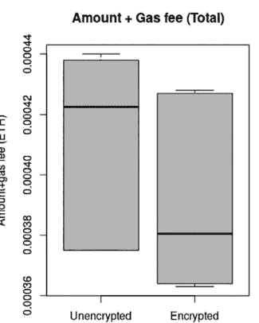

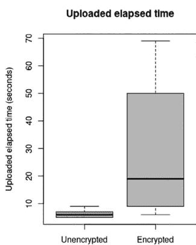

图 15.9 中型文件箱线图

和加密文件，分别为 29.6 秒。最小值分别为 5 秒和 6 秒；第一四分位数分别为 6 秒和 10 秒；中位数分别为 6 秒和 19 秒；第三四分位数分别为 7 秒和 50 秒；最大值分别为 9 秒和 69 秒。因此，可以得出结论，两组中耗时较小或适中的文件均占主导地位。然而，未加密文件的变异度较小，而加密文件的变异度较大，变异系数分别为 18.8% 和 82.2%，如所示。

- Shapiro–Wilk 检验结果显示，两组均强烈拒绝正态性（p 值分别为 0.019 和 0.002）。Wilcoxon 检验的 p 值为 0.0002，我们得出结论，加密文件的平均耗时更大。图 15.9 明确显示了该结论。

- 大小: 分布为右偏，即大多数文件的大小较小或适中（Fisher 偏度系数为正值）。平均大小为 6.5 MB。最小大小为 1.2 MB，第一四分位数为 3 MB，中位数为 5 MB，第三四分位数为 12 MB，最大大小为 14.2 MB。因此，可以得出结论，大小较小或适中的文件占主导地位，但某些文件的大小要大得多，导致变异度较高，变异系数为 72.3%，如所示。

## 评估结论

对最高 14.2 MB 的小到中型文件进行的统计分析显示，未加密文件的平均总交易成本略大。

然而，如预期，加密文件的平均上传时间更长。至于中型文件，未加密文件的平均总交易成本再次略大，加密文件的平均上传时间更长。

此外，如果比较附录 A 和 B 中所有类别（小型、中型、大型和超大型）的加密和未加密值的最后记录值，可以清楚地表明，最高 800 MB 文件的最后两次文件加密时间少于最高 14.2 MB 加密文件的上传耗时。

结论是，为遵守被遗忘权而对文件进行加密，是最高 14.2 MB 小到中型文件的一个有价值的选项。从那之后，在不考虑硬件加密限制的情况下，上传时间倾向于呈指数级增长。因此，截至 2018 年底，对中型到超大型文件进行加密是不可行的。

但是，请注意，对 DFiles 中的所有文件进行加密可能并非必要，因为有些文件仅包含无法与特定个人关联的数据——因此不被视为个人数据。用户本可以选择是否加密其文件，无论文件是否包含个人数据。问题在于，用户并不总是诚实，通过这种方式他们可能会上传敏感文件——即包含某人个人数据的文件——这些文件会公开可用，并处于 GDPR 的管辖范围内。他们还可能以敲诈为由——因为 DFiles 中的数据是不可变的——故意上传某人的个人数据，然后要求支付金钱，以换取他们不向负责处以 GDPR 不合规罚款的当局举报。因此，尽管在 IPFS 和 Ethereum 中文件加密耗时且受限，但为了防止这些情况并避免向相应的 GDPR 当局通报可能的数据泄露，文件加密是必要的。

总体而言，如前所述，区块链技术具有非常独特且重要的特征：不可变性。这确保了它对几家大型公司具有吸引力，以打击欺诈并拥有交易不可修改的记录。

因此，除非欧盟起草并通过法律，使 DApps 豁免于难以遵守的部分 GDPR 条款（例如被遗忘权），否则 Ethereum 和 IPFS 必须取得进步，以允许更好的隐私技术。

## 局限性和未来工作

显然，Ethereum 是一项令人兴奋且不断发展的技术。然而，有几项限制对作者的工作产生了重大影响。例如，带有循环的智能合约的高昂 Gas 成本使其在 DFiles 核心智能合约中的应用受阻。此外，缺乏对 JSON 对象的支持也是需要考虑的重要方面，因为 Solidity 中的智能合约如果使用结构体而非 a


标准JSON对象被使用。除此之外，IPFS显然还有很长的路要走，才能让去中心化应用（DApp）成为主流。首先，它存在存储非常大文件的日益严重的问题，正如DFiles所展示的那样。如果需要加密，那么可能的最大文件大小要低得多。已证明，由于硬件限制以及以太坊和IPFS的当前状态，加密仅适用于小型到中型文件。以太坊、IPFS和数据保护技术将在未来发生重大演变，这理论上将允许更好的加密技术或其他隐私技术，从而为未来需要数据隐私和保护的去中心化应用（DApp）带来希望。

如前所述，DFiles旨在展示通过加密个人数据是否可以实现GDPR合规。然而，这种方法还存在其他问题，例如曾经被证明高度安全的弱加密算法。这些算法的示例包括MD5和SHA1（The Open Web Application Security Project (OWASP), 2018）。出于这个原因，最流行的区块链中使用的算法有可能在短时间内变得过时——在此期间数据可以轻松被解密——然后再被另一个更安全的算法取代。

除此之外，量子计算很快可能成为现实，在相当长一段时间内，大多数区块链（如以太坊）中加密的所有数据，以及通过DFiles去中心化应用（DApp）在IPFS中存储的所有加密文件都可能被轻松解密。这是作者们认为的，在不久的将来对区块链技术的最大威胁。

关于DFiles的未来工作，与其使用本地IPFS节点，不如使用Infura节点。这带来了几个优势，因为硬件限制被最小化，但也带来了一系列新问题，例如存储在Infura IPFS节点中的文件没有长期保留的动力。

需要改进的另一个方面是将DFiles智能合约部署到Rinkeby之类的测试网络，并更新DFiles去中心化应用（DApp）以使用此部署的智能合约，而不是本地Ganache私有以太坊区块链。早期部署已完成，但还需要进一步测试。该智能合约可在Rinkeby测试网络上使用。

简而言之，本节讨论了IPFS和以太坊的局限性，包括DFiles的未来工作。然而，可以得出一些一般性结论：

- IPFS文件加密仍处于起步阶段；因此，存在重大的硬件和技术限制，阻碍其大规模采用。
- 以太坊是一个公共账本，因此提供的隐私很少或没有。唯一可能的方法是使用IPFS等其他去中心化技术对数据进行加密。以太坊也有大量的限制——例如不支持JSON，以及由于高昂的总交易成本而不鼓励某些计算循环指令（例如for、while）——这些限制影响了其全球采用。
- 出于GDPR合规目的加密个人数据受到严重限制，甚至可能被不鼓励。IPFS和以太坊都应被视为GDPR的特例，以避免数据加密方面的问题。

## 结论

在本章中，首先介绍了最重要的GDPR概念，以及处理个人数据的几种合法依据和几种个人权利。其“被删除权”干扰了区块链的不可篡改性。在此基础上，讨论了三个场景，涉及该权利是否可以遵守，随后介绍了一份适用于以太坊去中心化应用（DApp）的GDPR合规指南。

为了测试此指南，开发了一个案例研究：DFiles。它是一个使用以太坊和IPFS等中心化与去中心化技术混合构建的以太坊去中心化应用（DApp）。其主要目标是了解以太坊（Homestead）去中心化应用（DApp）是否可以遵守此法规，以及通过加密保护个人数据是否可行。

DFiles还通过遵循软件开发生命周期（尽管已针对去中心化应用（DApp）进行了调整），坚持区块链软件工程的原则。其核心智能合约也得到了解释，从实现的设计模式到主要数据结构和功能，此外还简要介绍了其核心功能。简而言之，DFiles允许用户上传和查看其提交的文件。

随后进行了一项统计分析，以验证遵守“被删除权”的加密可行性，但由于硬件限制，仅针对部分文件进行了分析。创建了两个去中心化应用（DApp）变体：一个带有文件加密，一个不带有文件加密。上传的文件被分为四个类别：小型（1 KB–1 MB）、中型（1 MB–20 MB）、大型（20 MB–200 MB）和超大型（200 MB–2 GB）。

随后在两个版本中测量了以太币的总交易成本以及用户点击上传按钮到文件上传完成之间的总耗时。随后介绍了其结论。简而言之，遵守GDPR及其“被删除权”仅对最大14.2 MB的加密文件可行。

最后，解释了案例研究的局限性及其未来工作。

## 注释

- 1 访问自 https://bitbucket.org/duarte_1110199/dfiles-ethereum-dapp/src/master/.
- 2 访问自 https://trufflesframework.com/.
- 3 访问自 https://github.com/ethereum/wiki/wiki/JavaScript-API.
- 4 访问自 https://github.com/OpenZeppelin/openzeppelin-solidity
- 5 https://bitbucket.org/duarte_1110199/dfiles-ethereum-dapp/src/master/contracts/Files.sol.
- 6 访问自 https://trufflesframework.com/docs/truffle/testing/writing-tests-in-javascript.
- 7. 访问自 https://github.com/brix/crypto-js.
- 8. 访问自 https://bitbucket.org/duarte_1110199/dfiles-r-statistical-data/src/master/.
- 9. 访问自 https://infura.io/.
- 10. 访问自 https://rinkeby.etherscan.io/address/0x09C5b627354eF29c3B6507aABa7386Ce240fFf9C.

## 参考文献

- Bitcoin 项目。(2018)。Bitcoin – 开源点对点货币。检索自 https://bitcoin.org/en/
- Consensys。(2018a)。Ganache。检索自 https://truffleframework.com/docs/ganache/overview
- Consensys。(2018b)。Metamask。检索自 http://metamask.io/
- Destefanis, G., Marchesi, M., Ortu, M., Tonelli, R., Bracciali, A., and Hierons, R. 2018。智能合约漏洞：区块链软件工程的号召？面向区块链的软件工程（IWBOSE），国际研讨会。坎波巴索：IEEE。
- 以太坊基金会。(2014)。Solidity，面向合约的编程语言。检索自 https://github.com/ethereum/solidity
- 以太坊基金会。(2016)。账户类型、Gas和交易。检索自 www.ethdocs.org/en/latest/contracts-and-transactions/account-types-gas-and-transactions.html
- 以太坊基金会。(2018)。以太坊区块链应用平台。检索自 www.ethereum.org/
- EU GDPR Compliant。(2018)。什么是数据主体？检索自 https://eugdprcompliant.com/what-is-data-subject/
- 欧洲数据保护监督官。(2018)。一般数据保护条例的历史。检索自 https://edps.europa.eu/data-protection/data-protection/legislation/history-general-data-protection-regulation_en
- 欧盟。(2016)。欧洲议会和理事会2016年4月27日关于保护自然人关于处理个人数据和此类数据自由流通的第(EU) 2016/679号条例。欧洲联盟官方公报，1–88。
- Falkon, S. (2017年12月24日)。DAO的故事——其历史和后果。检索自 https://medium.com/swlh/the-story-of-the-dao-its-history-and-consequences-71e6a84a551ee
- ICO。(2018年8月2日)。一般数据保护条例（GDPR）指南。检索自 https://ico.org.uk/media/for-organisations/guide-to-the-general-data-protection-regulation-gdpr-1-0.pdf
- Parity Technologies。(2017年7月20日)。多签名攻击：事后分析。检索自 https://paritytech.io/the-multi-sig-hack-a-postmortem/
- Petrov, S. (2017年11月7日)。另一次Parity钱包攻击的解释。检索自 https://medium.com/@Pr0Ger/another-parity-wallet-hack-explained-847ca46a2e1c
- Protocol Labs。(2018)。IPFS是分布式网络。检索自 https://ipfs.io/
- Szabo, N. (1996)。智能合约：数字市场的构建模块。检索自 www.fon.hum.uva.nl/rob/Courses/InformationInSpeech/CDROM/Literature/LOTwinterschool2006/szabo.best.vwh.net/smart_contracts_2.html


## 附录 A

### DFiles 加密上传文件统计数据

表 15.4 小文件（1 KB–1 MB）

| Gas 费 (ETH) | Gas 费 (USD) | 金额 + Gas 费 (总计) (ETH) | 金额 + Gas 费 (总计) (USD) | 大小 (MB) | 上传耗时 (秒) |
|---|---|---|---|---|---|
| 0.000426 | 0.09 | 0.000426 | 0.09 | 0.013 | 5 |
| 0.000426 | 0.09 | 0.000426 | 0.09 | 0.0136 | 3 |
| 0.000428 | 0.09 | 0.000428 | 0.09 | 0.0137 | 3 |
| 0.000364 | 0.08 | 0.000364 | 0.08 | 0.0155 | 4 |
| 0.000428 | 0.09 | 0.000428 | 0.09 | 0.0162 | 4 |
| 0.000364 | 0.08 | 0.000364 | 0.08 | 0.0192 | 4 |
| 0.000364 | 0.08 | 0.000364 | 0.08 | 0.01005 | 4 |
| 0.000364 | 0.08 | 0.000364 | 0.08 | 0.02601 | 5 |
| 0.000427 | 0.09 | 0.000427 | 0.09 | 0.027 | 4 |
| 0.000365 | 0.08 | 0.000365 | 0.08 | 0.03004 | 4 |
| 0.000427 | 0.09 | 0.000427 | 0.09 | 0.04001 | 4 |
| 0.000365 | 0.08 | 0.000365 | 0.08 | 0.0591 | 4 |
| 0.000365 | 0.08 | 0.000365 | 0.08 | 0.06 | 3 |
| 0.000365 | 0.08 | 0.000365 | 0.08 | 0.067 | 4 |
| 0.00046 | 0.1 | 0.00046 | 0.1 | 0.0827 | 4 |
| 0.000426 | 0.09 | 0.000426 | 0.09 | 0.0842 | 5 |
| 0.000365 | 0.08 | 0.000365 | 0.08 | 0.1265 | 4 |
| 0.000364 | 0.08 | 0.000364 | 0.08 | 0.1848 | 4 |
| 0.000366 | 0.08 | 0.000366 | 0.08 | 0.193 | 5 |
| 0.000365 | 0.08 | 0.000365 | 0.08 | 0.2491 | 5 |
| 0.000366 | 0.08 | 0.000366 | 0.08 | 0.6608 | 5 |
| 0.000429 | 0.09 | 0.000429 | 0.09 | 0.7325 | 5 |
| 0.000365 | 0.08 | 0.000365 | 0.08 | 0.7349 | 5 |
| 0.000364 | 0.08 | 0.000364 | 0.08 | 0.9445 | 5 |
| 0.000364 | 0.08 | 0.000364 | 0.08 | 0.984 | 5 |

表 15.5 中文件（1 MB–20 MB）

| Gas 费 (ETH) | Gas 费 (USD) | 金额 + Gas 费 (总计) (ETH) | 金额 + Gas 费 (总计) (USD) | 大小 (MB) | 上传耗时 (秒) |
|---|---|---|---|---|---|
| 0.000365 | 0.08 | 0.000365 | 0.08 | 1.2 | 6 |
| 0.000427 | 0.09 | 0.000427 | 0.09 | 1.3 | 7 |
| 0.000426 | 0.09 | 0.000426 | 0.09 | 1.5 | 7 |
| 0.000365 | 0.08 | 0.000365 | 0.08 | 1.7 | 8 |
| 0.000426 | 0.09 | 0.000426 | 0.09 | 2.2 | 9 |
| 0.000428 | 0.09 | 0.000428 | 0.09 | 2.3 | 11 |
| 0.000364 | 0.08 | 0.000364 | 0.08 | 3.9 | 16 |
| 0.000364 | 0.08 | 0.000364 | 0.08 | 4.5 | 17 |
| 0.000426 | 0.09 | 0.000426 | 0.09 | 4.8 | 21 |
| 0.000363 | 0.08 | 0.000363 | 0.08 | 4.8 | 14 |
| 0.000427 | 0.09 | 0.000427 | 0.09 | 6.7 | 22 |
| 0.000427 | 0.09 | 0.000427 | 0.09 | 8 | 26 |
| 0.000365 | 0.08 | 0.000365 | 0.08 | 10.3 | 50 |
| 0.000428 | 0.09 | 0.000428 | 0.09 | 11.7 | 49 |
| 0.000364 | 0.08 | 0.000364 | 0.08 | 12 | 69 |
| 0.000364 | 0.08 | 0.000364 | 0.08 | 12.2 | 65 |
| 0.000364 | 0.08 | 0.000364 | 0.08 | 13.9 | 69 |
| 0.000396 | 0.08 | 0.000396 | 0.08 | 14.2 | 66 |

## 附录 B

### DFiles 未加密上传文件统计数据

表 15.6 小文件（1 KB–1 MB）

| Gas 费 (ETH) | Gas 费 (USD) | 金额 + Gas 费 (总计) (ETH) | 金额 + Gas 费 (总计) (USD) | 大小 (MB) | 上传耗时 (秒) |
|---|---|---|---|---|---|
| 0.00044 | 0.1 | 0.00044 | 0.1 | 0.013 | 3 |
| 0.000438 | 0.1 | 0.000438 | 0.1 | 0.0136 | 3 |
| 0.00044 | 0.1 | 0.00044 | 0.1 | 0.0137 | 2 |
| 0.000375 | 0.08 | 0.000375 | 0.08 | 0.0155 | 2 |
| 0.000439 | 0.1 | 0.000439 | 0.1 | 0.0162 | 2 |
| 0.000375 | 0.08 | 0.000375 | 0.08 | 0.0192 | 3 |
| 0.000375 | 0.08 | 0.000375 | 0.08 | 0.01005 | 2 |
| 0.000375 | 0.08 | 0.000375 | 0.08 | 0.02601 | 4 |
| 0.000438 | 0.1 | 0.000438 | 0.1 | 0.027 | 3 |
| 0.000377 | 0.08 | 0.000377 | 0.08 | 0.03004 | 4 |
| 0.000438 | 0.1 | 0.000438 | 0.1 | 0.04001 | 3 |
| 0.000376 | 0.08 | 0.000376 | 0.08 | 0.0591 | 4 |
| 0.000376 | 0.08 | 0.000376 | 0.08 | 0.06 | 3 |
| 0.000472 | 0.11 | 0.000472 | 0.11 | 0.067 | 4 |
| 0.000438 | 0.1 | 0.000438 | 0.1 | 0.0827 | 4 |
| 0.000376 | 0.08 | 0.000376 | 0.08 | 0.0842 | 4 |
| 0.000375 | 0.08 | 0.000375 | 0.08 | 0.1265 | 5 |
| 0.000377 | 0.08 | 0.000377 | 0.08 | 0.1848 | 4 |
| 0.000376 | 0.08 | 0.000376 | 0.08 | 0.193 | 4 |
| 0.000377 | 0.08 | 0.000377 | 0.08 | 0.2491 | 4 |
| 0.000441 | 0.1 | 0.000441 | 0.1 | 0.6608 | 4 |
| 0.000376 | 0.08 | 0.000376 | 0.08 | 0.7325 | 4 |
| 0.000375 | 0.08 | 0.000375 | 0.08 | 0.7349 | 4 |
| 0.000376 | 0.08 | 0.000376 | 0.08 | 0.9445 | 5 |
| 0.000439 | 0.1 | 0.000439 | 0.1 | 0.984 | 5 |

表 15.7 中文件（1 MB–20 MB）

| Gas 费 (ETH) | Gas 费 (USD) | 金额 + Gas 费 (总计) (ETH) | 金额 + Gas 费 (总计) (USD) | 大小 (MB) | 上传耗时 (秒) |
|---|---|---|---|---|---|
| 0.000376 | 0.08 | 0.000376 | 0.08 | 1.2 | 5 |
| 0.000438 | 0.1 | 0.000438 | 0.1 | 1.3 | 5 |
| 0.000438 | 0.1 | 0.000438 | 0.1 | 1.5 | 5 |
| 0.000376 | 0.08 | 0.000376 | 0.08 | 1.7 | 5 |
| 0.000438 | 0.1 | 0.000438 | 0.1 | 2.2 | 5 |
| 0.000438 | 0.1 | 0.000438 | 0.1 | 2.3 | 6 |
| 0.00044 | 0.1 | 0.00044 | 0.1 | 3.9 | 6 |
| 0.000375 | 0.08 | 0.000375 | 0.08 | 4.5 | 6 |
| 0.000438 | 0.1 | 0.000438 | 0.1 | 4.8 | 6 |
| 0.000375 | 0.08 | 0.000375 | 0.08 | 4.8 | 6 |
| 0.000438 | 0.1 | 0.000438 | 0.1 | 6.7 | 6 |
| 0.000439 | 0.1 | 0.000439 | 0.1 | 8 | 9 |
| 0.000376 | 0.08 | 0.000376 | 0.08 | 10.3 | 7 |
| 0.000439 | 0.1 | 0.000439 | 0.1 | 11.7 | 7 |
| 0.000375 | 0.08 | 0.000375 | 0.08 | 12 | 6 |
| 0.000375 | 0.08 | 0.000375 | 0.08 | 12.2 | 8 |
| 0.000375 | 0.08 | 0.000375 | 0.08 | 13.9 | 8 |
| 0.000407 | 0.09 | 0.000407 | 0.09 | 14.2 | 7 |
| 0.000439 | 0.1 | 0.000439 | 0.1 | 15.2 | 8 |
| 0.000375 | 0.08 | 0.000375 | 0.08 | 16.1 | 6 |
| 0.000441 | 0.1 | 0.000441 | 0.1 | 16.4 | 8 |
| 0.000376 | 0.08 | 0.000376 | 0.08 | 18 | 9 |
| 0.00044 | 0.1 | 0.00044 | 0.1 | 18.8 | 8 |
| 0.000375 | 0.08 | 0.000375 | 0.08 | 18.9 | 6 |
| 0.000439 | 0.1 | 0.000439 | 0.1 | 18.9 | 10 |

表 15.8 大文件（20 MB–200 MB）

| Gas 费 (ETH) | Gas 费 (USD) | 金额 + Gas 费 (总计) (ETH) | 金额 + Gas 费 (总计) (USD) | 大小 (MB) | 上传耗时 (秒) |
|---|---|---|---|---|---|
| 0.000439 | 0.1 | 0.000439 | 0.1 | 20.8 | 12 |
| 0.000438 | 0.1 | 0.000438 | 0.1 | 21.1 | 9 |
| 0.000375 | 0.08 | 0.000375 | 0.08 | 23.2 | 9 |
| 0.000407 | 0.09 | 0.000407 | 0.09 | 24.6 | 7 |
| 0.00044 | 0.1 | 0.00044 | 0.1 | 26.5 | 7 |
| 0.00044 | 0.1 | 0.00044 | 0.1 | 26.8 | 13 |
| 0.000438 | 0.1 | 0.000438 | 0.1 | 29.6 | 11 |
| 0.000376 | 0.09 | 0.000376 | 0.09 | 33.8 | 10 |
| 0.000375 | 0.08 | 0.000375 | 0.08 | 37.6 | 11 |
| 0.000377 | 0.09 | 0.000377 | 0.09 | 37.8 | 9 |
| 0.000375 | 0.08 | 0.000375 | 0.08 | 44 | 13 |
| 0.000375 | 0.08 | 0.000375 | 0.08 | 50.2 | 13 |
| 0.000472 | 0.11 | 0.000472 | 0.11 | 52.9 | 17 |
| 0.000472 | 0.11 | 0.000472 | 0.11 | 55.8 | 19 |
| 0.000472 | 0.11 | 0.000472 | 0.11 | 66.8 | 18 |
| 0.000375 | 0.08 | 0.000375 | 0.08 | 67.5 | 17 |
| 0.000375 | 0.08 | 0.000375 | 0.08 | 74.9 | 13 |
| 0.000439 | 0.1 | 0.000439 | 0.1 | 75.4 | 20 |
| 0.000473 | 0.11 | 0.000473 | 0.11 | 87.7 | 12 |
| 0.000439 | 0.1 | 0.000439 | 0.1 | 101.9 | 14 |
| 0.000375 | 0.08 | 0.000375 | 0.08 | 129.9 | 5 |
| 0.000375 | 0.08 | 0.000375 | 0.08 | 167.9 | 5 |
| 0.000375 | 0.08 | 0.000375 | 0.08 | 178.8 | 5 |
| 0.000375 | 0.08 | 0.000375 | 0.08 | 179.2 | 8 |
| 0.000375 | 0.08 | 0.000375 | 0.08 | 185.7 | 9 |

表 15.9 超大文件（200 MB–2 GB）

| Gas 费 (ETH) | Gas 费 (USD) | 金额 + Gas 费 (总计) (ETH) | 金额 + Gas 费 (总计) (USD) | 大小 (MB) | 上传耗时 (秒) |
|---|---|---|---|---|---|
| 0.000375 | 0.08 | 0.000375 | 0.08 | 231.1 | 9 |
| 0.000375 | 0.08 | 0.000375 | 0.08 | 321.6 | 6 |
| 0.000375 | 0.08 | 0.000375 | 0.08 | 339 | 10 |
| 0.000375 | 0.08 | 0.000375 | 0.08 | 395.7 | 11 |
| 0.000375 | 0.08 | 0.000375 | 0.08 | 448.3 | 11 |
| 0.000375 | 0.08 | 0.000375 | 0.08 | 475 | 13 |
| 0.000375 | 0.08 | 0.000375 | 0.08 | 504.8 | 15 |
| 0.000375 | 0.08 | 0.000375 | 0.08 | 528 | 24 |
| 0.00042 | 0.09 | 0.00042 | 0.09 | 548.9 | 25 |
| 0.00042 | 0.09 | 0.00042 | 0.09 | 657.2 | 28 |
| 0.00042 | 0.09 | 0.00042 | 0.09 | 732 | 54 |
| 0.00042 | 0.09 | 0.00042 | 0.09 | 898.4 | 107 |

## 附录 C

### 小文件描述性分析与对比

| 描述性指标 | 未加密 | 加密 |
|---|---|---|
| 最小值 | 0.000375 | 0.000364 |
| 最大值 | 0.000472 | 0.00046 |
| 均值 | 0.0004024 | 0.0003885 |
| 第一四分位数 | 0.000376 | 0.000364 |
| 中位数 | 0.000377 | 0.000365 |
| 第三四分位数 | 0.000438 | 0.000426 |
| 标准差 | 0.0000339 | 0.000033 |
| 变异系数 | 8.40% | 8.50% |
| 偏度 | 0.51 | 0.68 |
| Shapiro-Wilk 检验 | | |
| 检验统计量 | 0.7 | 0.68 |
| p 值 | < 0.001 | < 0.001 |
| Wilcoxon 检验 | | |
| 检验统计量 | 262 | |
| p 值 | 0.007 | |

| 描述性指标 | 未加密 | 加密 |
|---|---|---|
| 最小值 | 2 | 3 |
| 最大值 | 5 | 5 |
| 均值 | 3.6 | 4.3 |
| 第一四分位数 | 3 | 4 |
| 中位数 | 4 | 4 |
| 第三四分位数 | 4 | 5 |
| 标准差 | 0.92 | 0.68 |
| 变异系数 | 25.70% | 15.80% |
| 偏度 | -0.33 | -0.36 |
| Shapiro-Wilk 检验 | | |
| 检验统计量 | 0.86 | 0.78 |
| p 值 | 0.003 | 0.0001 |
| Wilcoxon 检验 | | |
| 检验统计量 | 6.5 | |
| p 值 | 0.001 | |


## 附录 D

描述性分析与媒体文件比较

表 15.12 大小 (MB)

描述性措施

| 指标 | 数值 |
|---|---|
| 最小值 | 0.01005 |
| 最大值 | 0.984 |
| 均值 | 0.2155 |
| 第一四分位数 | 0.0192 |
| 中位数 | 0.06 |
| 第三四分位数 | 0.193 |
| 标准差 | 0.31577 |
| 变异系数 | 146.50% |
| 偏度 | 1.4 |

## 基于(区块链基础的)众筹的成功因素层次结构模型

Felix Hartmann, Xiaofeng Wang, and Maria Ilaria Lunesu

### 引言

众筹是新创企业和创新项目的重要融资机制。它是指从大量人群中筹集资金的做法，通常使用 Kickstarter 或 Republic 等在线平台。由初始代币发行（ICO）和证券代币发行（STO）的兴起所代表的基于区块链的众筹，成为一种新的且替代性的众筹形式，如今可以被视为基于区块链技术的少数可运行应用之一。

基于区块链的众筹是一种新兴的经济现象和为企业融资的先进策略。与首次公开募股（IPO）、风险投资（VC）和第一代众筹等传统融资模式相比，基于区块链的众筹仍然高度不受监管。开展基于区块链众筹的项目向公众提供以区块链上的代币/币形式呈现的新数字平台或网络及/或其产品或服务的部分所有权（股权）。该股权（代币/币）可能代表效用、证券、资产、商品、货币或收藏品。与其他早期风险投资形式的另一主要区别在于，加密资产可以在在线二级市场（中心化/去中心化交易所）上快速获得流动性。

近年来，基于区块链的众筹活动数量急剧增加。2018年初，更多成熟公司也开始探索这一新的融资机会。然而，由于该现象尚处萌芽阶段，人们缺乏如何设计成功的基于区块链的众筹活动以及如何作为投资者验证潜在项目的认识。深入了解此类活动的成功因素，将使新创企业或企业家能够妥善设计其基于区块链的融资计划，进而帮助潜在投资者寻找杰出项目的主要信号和驱动因素。基于这一观察，我们在研究中提出了以下研究问题：

### *RQ: 基于区块链的众筹活动的成功因素是什么，它们之间如何相互关联？*

在本研究中，我们关注的是企业或项目内部的成功因素，即发起活动者可控制的因素。超出单个活动控制范围的外部因素，例如活动期间的参考代币价格，不在本研究范围内。

为了回答研究问题，我们采用了混合方法。对众筹活动成功因素（尤其是 ICO 成功因素）的文献综述使我们能够确定基于区块链的众筹成功决定因素的初始集合。基于该列表，我们分析了一组选定的 ICO 评估网站，以了解实践中考虑但文献未报告的因素。在获得扩展的成功因素列表后，我们分析了它们之间的关系，并使用诠释结构建模（ISM）构建了因素模型。我们的工作贡献在于更全面、更结构化地了解什么可以导致（基于区块链的）众筹活动成功。

本章其余部分的组织安排如下：下一节介绍了相关文献中已确定的成功因素。研究过程在“研究方法”节中报告。“调查结果”节详细介绍了研究结果，并在“讨论”节中进一步讨论。本章以“结论”节结束，该节强调了研究的贡献并概述了未来工作。

### 文献综述

在过去十年中，许多作者专注于众筹成功因素。成功因素是每个众筹项目固有的，满足这些因素可以带来成功的活动。关于众筹成功因素存在若干（常常有争议的）研究。众筹可分为两大模式：非金融众筹（奖励和捐赠）和金融众筹（股权、特许权使用费和债务）。金融众筹平台的投资者与为非金融众筹出资的投资者不同（Belleflamme et al., 2014）。金融众筹支持者通常期望因投资价值增加而获得收益，这与非金融众筹中潜在的奖励、认可或税务扣除不同。

基于区块链的众筹也可归入上述两大模式。一家公司可以提供效用代币、支付代币（加密货币）或证券代币（Hacker and Thomale, 2017）。效用代币销售可被视为未来产品或服务的预售。奖励型众筹是一种传统的众筹模式，投资者向项目投入相对较少的资金以换取某种形式的奖励。基于这一假设，我们可以认为效用代币销售与非金融众筹（如基于奖励的众筹）具有相似之处。另一方面，证券代币销售在许多司法管辖区受证券法规约束。证券代币发行（STO）的一种形式是股权代币发行（ETO）。在 ETO 中，项目向众多投资者出售部分股权。基于这一假设，可以说 STO 与金融众筹活动（如股权众筹）相似。

首先，研究表明传统众筹成功因素与代币销售成功因素之间存在关系（Fisch, 2018; Adhami et al., 2018; Lee et al., 2018）。因此，我们审阅了基于奖励的众筹成功因素文献，以识别对非金融众筹模式重要的因素，并审阅了股权众筹文献，以识别对金融众筹模式重要的因素。

尽管如此，基于区块链的众筹活动具有一些与传统众筹活动甚至首次公开募股（IPO）不同的内在特征。项目信息通常总结在白皮书中。所包含的信息不受严格法规约束，例如 IPO 案例中招股说明书所包含的信息。在 ICO 的情况下，底层技术是区块链。智能合约是可上传到 Github 以供第三方验证的小程序。代币销售通常以去中心化加密货币（如以太坊或比特币）融资，而不是以传统融资方式中常见的中心化法定货币。基于上述原因，我们还审阅了近期文献，以识别适用于基于区块链的众筹活动的成功因素。

我们使用两大类别报告所识别的因素：与项目相关和与活动相关。表 16.1 提供了这些因素的概览，并进一步归纳为子类别。

### 与项目相关的成功因素

### 公司特征

**行业：** Mamonov et al. (2017) 对美国股权众筹网站的研究表明，房地产领域的众筹项目远比其他行业的项目更成功。这一发现表明，在特定行业运营的项目将比其他行业的项目更成功。在奖励型众筹领域，Davies and Giovannetti (2018) 的研究发现，项目类别对 Kickstarter 活动成功的影响存在巨大差异，某些类别对项目成功概率产生积极影响。相比之下，在基于区块链的众筹文献中，我们发现一种观点认为 ICO 估值在各个行业之间并无不同（Fisch et al., 2018）。

表 15.13 金额 + gas 费用（总计）（ETH）

| 描述性措施 | 未加密 | 已加密 |
|---|---|---|
| 最小值 | 0.000375 | 0.000363 |
| 最大值 | 0.00044 | 0.000428 |
| 均值 | 0.0004087 | 0.0003938 |
| 第一四分位数 | 0.0003753 | 0.000364 |
| 中位数 | 0.0004225 | 0.0003805 |
| 第三四分位数 | 0.000438 | 0.0004268 |
| 标准差 | 0.0000315 | 0.0000313 |
| 变异系数 | 7.70% | 7.90% |
| 偏度 | -0.1 | 0.1 |
| Shapiro-Wilk 检验 | | |
| 检验统计量 | 0.69 | 0.69 |
| p 值 | < 0.001 | < 0.001 |
| Wilcoxon 检验 | | |
| 检验统计量 | 171 | |
| p 值 | 0.0002 | |

表 15.14 上传耗时（秒）

| 描述性措施 | 未加密 | 已加密 |
|---|---|---|
| 最小值 | 5 | 6 |
| 最大值 | 9 | 69 |
| 均值 | 6.3 | 29.6 |
| 第一四分位数 | 6 | 10 |
| 中位数 | 6 | 19 |
| 第三四分位数 | 7 | 50 |
| 标准差 | 1.2 | 24.3 |
| 变异系数 | 18.80% | 82.20% |
| 偏度 | 0.71 | 0.63 |
| Shapiro-Wilk 检验 | | |
| 检验统计量 | 0.87 | 0.81 |
| p 值 | 0.019 | 0.002 |
| Wilcoxon 检验 | | |
| 检验统计量 | 0 | |
| p 值 | 0.0002 | |

表 15.15 大小 (MB)

| 指标 | 数值 |
|---|---|
| 最小值 | 0.01005 |
| 最大值 | 0.984 |
| 均值 | 0.2155 |
| 第一四分位数 | 0.0192 |
| 中位数 | 0.06 |
| 第三四分位数 | 0.193 |
| 标准差 | 0.31577 |
| 变异系数 | 146.50% |
| 偏度 | 1.4 |


## 表 16.1 文献中的众筹成功因素列表

| Category | Success factor | Effect | Study |
| :--- | :--- | :--- | :--- |
| 项目相关因素 | | | |
| 公司特征 | 行业 | +/- | (Davies and Giovannetti, 2018) (Fisch et al., 2018) (Mamonov et al., 2017) |
| 公司特征 | 地点 | +/- | (Rakesh et al., 2015) (Adhami et al., 2018) (Mamonov et al., 2017) (Ralcheva and Roosenboom, 2016) (Agrawal et al., 2015) (Adhami et al., 2018) (Fenu et al., 2018) |
| 强大的合作伙伴 | IPO 退出策略 | +/- | (Ahlers et al., 2015) (Vismara, 2016) |
| 强大的合作伙伴 | 声誉良好的投资者 | + | (Mamonov and Malaga, 2018) (Kim and Viswanathan, 2013) (Ralcheva and Roosenboom, 2016) (Li et al., 2016) |
| 强大的早期采用者 | 企业客户作为早期采用者 | + | (Mamonov and Malaga, 2018) |
| 项目创新性 | 智力资本 | +/- | (Ralcheva and Roosenboom, 2016) (Ahlers et al., 2015) (Mamonov and Malaga, 2018) |
| 产品阶段 | 产品开发阶段 | + | (Mamonov and Malaga, 2018) (Ralcheva and Roosenboom, 2016) (Loehre et al., 2018) |
| 团队构成 | 团队规模（董事会成员数量、顾问数量） | +/- | (Mamonov and Malaga, 2018) (Ralcheva and Roosenboom, 2016) (Frydrych et al., 2014) (Fisch, 2018) (Amsden and Schweizer, 2018) (Cerchiello and Toma, 2018) (Ahlers et al., 2015) (Fenu et al., 2018) (Stam and Schutjens, 2005) |
| 团队构成 | 女性创始人 | +/- | (Frydrych et al., 2014) (Colombo et al., 2014) (Vismara, 2016) (Mohammadi and Shafi, 2018) |
| 团队经验 | 之前的创始人经验 | +/- | (Gutsche and Sylla, 2017) (Kim et al., 2017) (Mamonov and Malaga, 2018) (Davies and Giovannetti, 2018) (Rakesh et al., 2015) (Colombo et al., 2014) |
| 团队经验 | 人脉广泛的首席执行官 | + | (Amsden and Schweizer, 2018) |
| 团队经验 | 团队教育背景 | + | (Ahlers et al., 2015) |
| 创始人投入 | 忠诚的首席执行官 | + | (Momtaz, 2018) |
| 创始人投入 | 财务承诺 | + | (Loehre et al., 2018) (Gutsche and Sylla, 2017) (Davies and Giovannetti, 2018) |
| 社交媒体影响力 | 社交网络存在 | +/- | (Mollick, 2014) (Vismara, 2016) (Cerchiello and Toma, 2018) (Amsden and Schweizer, 2018) (Davies and Giovannetti, 2018) (Zheng et al., 2014) |
| | 网络互动、更新和评论 | + | (Hornuf and Schwienbacher, 2018) (Lukkarinen et al., 2016) (Lu et al., 2014) (Rakesh et al., 2015) (Gutsche and Sylla, 2017) (Kim et al., 2017) (Etter et al., 2013) |
| | 在 Github 上的存在 | + | (Fisch, 2018) (Amsden and Schweizer, 2018) |
| 活动相关因素 | | | |
| **活动设计** | 身份披露 | + | (Kim et al., 2017) (Polzin et al., 2018) |
| | 质量信号（视频、演示文稿等） | +/- | (Mollick, 2014) (Bi et al., 2017) (Chan and Parhankangas, 2017) (Courtney et al., 2017) (Frydrych et al., 2014) (Xu et al., 2016) (Kim et al., 2017) (Colombo et al., 2014) (Kuppuswamy and Bayus, 2015) (Mamonov and Malaga, 2018) |
| | 保留的股权/代币份额 | + | (Ahlers et al., 2015) (Vismara et al., 2016) (Ralcheva and Roosenboom, 2016) (Lee et al., 2018) (Amsden and Schweizer, 2018) |
| | 较低的融资目标 | +/- | (Amsden and Schweizer, 2018) (Lee et al., 2018) (Kim et al., 2017) (Colombo et al., 2014), (Mollick, 2014) (Kuppuswamy and Bayus, 2015) (Davies and Giovannetti, 2018) (Cordova et al., 2015) (Frydrych et al., 2014) (Mollick, 2014) (Vulkan et al., 2016) (Zheng et al., 2014) (Ahlers et al., 2015) (Vismara et al., 2016) (Mamonov and Malaga, 2018) (Ralcheva and Roosenboom, 2016) (Lukkarinen et al., 2016) |
| | 更短的活动持续时间 | +/- | (Mollick, 2014) (Kuppuswamy and Bayus, 2015) (Davies and Giovannetti, 2018) (Colombo et al., 2014) (Kim et al., 2017) (Zheng et al., 2014) (Cordova et al., 2015) (Frydrych et al., 2014) (Lukkarinen et al., 2016) |
| | 较低的投资门槛 | + | (Lukkarinen et al., 2016) |
| | 差异化良好的奖励等级 | + | (Kuppuswamy and Bayus, 2015) (Colombo et al., 2014) (Frydrych et al., 2014) (Kim et al., 2017) (Gutsche and Sylla, 2017) |
| | 活动面向多个国家市场 | + | (Gutsche and Sylla, 2017) |
| | 代币允许捐助者访问特定服务（或分享利润） | + | (Adhami et al., 2018) |
| | 使用 Ethereum | + | (Fisch, 2018) (Amsden and Schweizer, 2018) (Fenu et al., 2018) |
| | 发行的代币数量 | + | (Fisch, 2018) |
| | KYC/预注册 | - | (Lee et al., 2018) |
| | 预售 | +/- | (Amsden and Schweizer, 2018) (Lee et al., 2018) (Adhami et al., 2018) |
| | ICO 奖励/折扣 | +/- | (Amsden and Schweizer, 2018) (Lee et al., 2018) (Adhami et al., 2018) |
| | 接受多种货币（数字和法定） | + | (Lee et al., 2018) (Amsden and Schweizer, 2018) |
| 活动热度 | 大额投资者 | + | (Ralcheva and Roosenboom, 2016) (Vulkan et al., 2016) (Hornuf and Schwienbacher, 2018) |
| | 早期投资 | + | (Lukkarinen et al., 2016) (Colombo et al., 2014) (Davies and Giovannetti, 2018) (Vulkan et al., 2016) (Agrawal et al., 2015) (Kuppuswamy and Bayus, 2015) (Etter et al., 2013) (Lee et al., 2018) |
| | 早期支持者数量 | + | (Colombo et al., 2014) (Davies and Giovannetti, 2018) (Beier and Wagner, 2016) |
| 白皮书质量 | 平均分析师评级 | + | (Lee et al., 2018) (Fenu et al., 2018) |
| | 白皮书可用性 | +/- | (Cerchiello and Toma, 2018) (Adhami et al., 2018) |
| | 白皮书内容 | +/- | (Cerchiello and Toma, 2018) (Fisch, 2018) (Amsden and Schweizer, 2018) |
| | 多语言白皮书 | + | (Lee et al., 2018) |
| 活动透明度 | 关于初创公司的信息透明度 | +/- | (Ahlers et al., 2015) (Lukkarinen et al., 2016) (Polzin et al., 2018) (Mamonov et al., 2017) (Gutsche and Sylla, 2017) (Kim et al., 2017) (Vismara, 2016) |
| | 代码源码可用 | + | (Adhami et al., 2018) (Fisch, 2018) |

### 地点：

Ralcheva and Roosenboom (2016) 的一项研究指出，总部位于大城市的项目在英国的股权众筹中通常更成功。Agrawal et al. (2015) 的一项研究表明，艺术家与其资助者之间的地理接近性并不影响众筹成功。看来在 Kickstarter 上，美国本土项目更有机会成功（Colombo et al., 2014）。不过，很难说地点是否对众筹成功有显著影响，因为某些地区的项目数量有限（Davies and Giovannetti, 2018）。地点的重要性似乎并不适用于 Kickstarter 上的所有项目类别。游戏、漫画和技术类项目相对较少依赖其地理位置来吸引资金（Rakesh et al., 2015）。在区块链众筹领域，由于监管限制和不确定性，为代币发行公司选择合适的司法管辖区起着至关重要的作用。Adhami et al. (2018) 的一篇论文得出结论，项目发起人为代币销售选择参考司法管辖区受到赞赏，并增加了活动成功的概率。来自某些地区的项目似乎比其他地区的项目更容易成功（Fenu et al., 2018）。相比之下，Fisch (2018) 的一项研究表明，企业的地点不会影响 ICO 估值。

### IPO 退出策略：

Vismara et al. (2016) 发现，IPO 退出策略不影响股权众筹活动的结果。在未来五年内声明退出策略的项目吸引了更少的投资者，但筹集的金额没有差异。与此发现相反，Ahlers et al. (2015) 发现 IPO 退出提案对筹资成功有积极影响。

## 强大的合作伙伴

### 声誉良好的投资者：

Mamonov and Malaga (2018) 对 2016 年 5 月至 2017 年 2 月间在 16 个第 III 类股权众筹网站上启动的 133 个项目进行了分析。他们发现，专业天使投资人和风险投资的参与与股权众筹成功之间存在相关性。对众筹成功的积极影响可能源于这些声誉良好的投资者在信息不对称度量方面的杠杆效应。Ralcheva and Roosenboom (2016) 的另一项研究分析了英国股权众筹活动的表现。该研究得出结论，天使投资和获得赠款会增加活动成功的概率。与此同时，Kim and Viswanathan (2013) 发现，具有应用开发经验和应用投资经验的投资者对后来的众多投资者有不成比例的影响，并有助于降低投资者群体中的信息不对称。主投资者的可信度及其宣传行为（通过身份认证、投资经验、投资比例以及对项目的评论来衡量）是影响众筹表现的重要因素（Li et al., 2016）。


## 强早期采用者

### 企业客户作为早期采用者
Mamonov 和 Malaga (2018) 对美国 16 家股权众筹平台进行的研究发现，企业客户的存在与股权众筹成功之间存在正相关关系。

## 项目创新性

### 知识产权
以往研究承认，初创企业申请专利的最重要原因之一是为了获得资金（Graham 等人，2008 年）。令人惊讶的是，Ahlers 等人 (2015) 和 Mamonov 与 Malaga (2018) 的研究发现，知识产权（以专利数量衡量）与股权众筹的资金成功之间没有相关性。相比之下，Ralcheva 和 Roosenboom (2016) 的另一项研究认为，在英国，知识产权保护与股权众筹成功之间存在正相关关系。

## 产品阶段

### 产品开发阶段
Mamonov 和 Malaga (2018) 调查了产品开发状态对股权众筹成功的影响。他们发现，处于测试版或原型阶段的公司，在其活动期间筹集到大量资金的可能性，低于已完成产品开发的项目。Ralcheva 和 Roosenboom (2016) 关于英国股权众筹的研究发现，如果项目已经完成首次销售，活动表现会有所提升。另一项研究指出，投资股权众筹活动的意愿明显受商业发展或已实现里程碑的影响（Loehre 等人，2018 年）。这些结果与 2017 年区块链众筹表现存在一定差异。那一年进行 ICO 的许多项目几乎尚未完成产品开发，但仍然相当成功（CB Insights，2018 年）。

## 团队构成

### 团队规模
Mamonov 和 Malaga (2018) 发现，由单独企业家运行的股权众筹活动不如由企业家团队进行的活动成功。Ahlers 等人 (2015) 认为，董事会成员数量较多与股权众筹成功相关。Frydrych 等人 (2014) 在关于基于奖励的众筹中创业合法性的研究中揭示，与个人项目相比，由配对和团队运营的项目成功率高得多。这些发现表明，众筹投资者认为更大的团队能够以更好的方式应对意外困难。Stam 和 Schutjens (2005) 的研究发现，团队创业相对比单独企业家创业更成功。有趣的是，这种影响仅在创业的头三年有效。更大的团队可能会产生更多讨论并使决策过程瘫痪。有顾问和导师加入似乎会对股权众筹表现产生积极影响（Ralcheva 和 Roosenboom，2016 年）。Fisch (2018) 分析了团队规模对 ICO 成功的影响，未发现创始人数量与 ICO 成功之间存在关联。相比之下，Cerchiello 和 Toma (2018) 表示，拥有更大的团队和更多顾问对 ICO 成功有积极影响。同样，Amsden 和 Schweizer (2018) 发现，更多顾问和更大的团队规模通常与代币销售后代币被交易的概率更高以及筹集更多资金的概率更高相关。另一方面，Fenu 等人 (2018) 的研究发现团队规模与 ICO 成功之间没有关系。

### 女性创始人
有几项研究表明，女性创始人在传统融资中处于劣势，不太可能获得机构资本、私募股权和银行融资（Becker-Blease 和 Sohl，2007 年；Bigelow 等人，2014 年；Eddleston 等人，2016 年）。有趣的是的，也有一些文献指出，女性企业家在基于奖励的众筹中更成功（Frydrych 等人，2014 年）。Colombo 等人 (2014) 发现，男性个人发起人获得支持者和资金支持的可能性，低于女性或公司。在股权众筹领域，Vismara 等人 (2016) 发现，女性创始人能够吸引相同数量的投资者，但筹集的资金较少。有趣的是，另一项关于股权众筹投资者贡献模式中性别差异的研究发现，女性投资者更有可能投资于男性创始人比例较高的项目（Mohammadi 和 Shafi，2018 年）。

## 团队经验

### 以往创始人经验
Gutsche 和 Sylla (2017) 在关于 Kickstarter 平台众筹项目成功因素的研究中指出，有以往众筹经验的创始人比没有经验的创始人更成功。该文强调，如果企业家及其团队缺乏此类经验，寻求外部建议的重要性。其他研究也证实了以往众筹经验的重要性（Davies 和 Giovannetti，2018 年）。支持者倾向于对他们在过去支持过的创作者产生信任（Rakete 等人，2015 年）。连续创作者可能会随时间建立起支持性的出资者基础。Kim 等人 (2017) 发现，创始人之前的筹款经验对众筹成功有积极影响。作者指出，这种经验可以被视为创始人能力和胜任力的积极信号。另一方面，Colombo 等人 (2014) 发现，以前创建的众筹活动数量（作为社会资本的指标）在预测基于奖励的众筹活动成功方面不显著。另一项由 Mamonov 和 Malaga (2018) 进行的研究发现，先前的行业经验或连续创业经验与股权众筹成功之间没有显著关系。

### 人脉广泛的首席执行官
Amsden 和 Schweizer (2018) 的一项研究发现，拥有人脉广泛的首席执行官（通过 LinkedIn 500+ 衡量）的项目，更有可能销售在代币销售后可交易的代币并筹集更多资金。

### 团队教育背景
Ahlers 等人 (2015) 标题为《股权众筹中的信号传递》的研究，基于澳大利亚小规模发行委员会（ASSOB）的数据，分析了 2006 年至 2011 年间的 104 个发行项目。结果显示，持有 MBA 的团队成员数量与活动成功呈正相关。这一结果可能与这些创始人平均拥有的更好人脉有关。该研究表明，高素质的董事会成员可以提高吸引投资者的可能性，并加快筹资速度。

## 创始人投入

### 忠诚的首席执行官
忠诚的首席执行官需要提供较少的激励措施来吸引投资者参与他们的 ICO。忠诚的首席执行官能够在更短的时间内筹集更高的资金金额，并显著降低失败的可能性（Momtaz，2018 年）。

### 财务承诺
企业家投入其业务的时间和资金，在商业天使和风险投资的投资决策中很重要（Cardon 等人，2018 年；Busenitz 等人，2005 年；Prasad 等人，2000 年）。这与 Leland 和 Pyle (1977) 的研究结果一致，该研究指出，预期成功的创始人愿意投入更多的初始投资。然而，这取决于创始人的财务状况。Loehrer 等人 (2018) 在关于企业家财务承诺与众筹成功的研究简报中明确指出，企业家的财务承诺与股权众筹成功之间存在正相关关系。此外，Gutsche 和 Sylla (2017) 以及 Davies 和 Giovannetti (2018) 的研究指出，如果创始人积极作为其他项目的支持者参与众筹平台，就可能能够触发额外资金。

## 社交媒体影响力

### 社交网络存在
Mollick (2014) 发现，发起人的 Facebook 好友数量与众筹活动筹集的资金量呈正相关，尽管没有 Facebook 账户比拥有少量 Facebook 好友更好。Colombo 等人 (2014) 的一项研究强调了内部社会资本对成功的重要性，该指标由活动期间吸引的支持者数量来衡量。一项由


Ordainini 等人（2011）强调，初始资本筹集主要通过在活动之外部署的社会联系（外部社会资本）完成，并强调了这些投资对活动成功的重要性，因为其对增加内部社会资本有积极影响。Zheng 等人（2014）的一项研究表明，使用在中国和美国收集的基于 Facebook 和 Weibo 的数据，社交网络对基于奖励的众筹成功有显著影响。Vismara 等人（2016）的一项研究分析了 271 个英国股权众筹活动。该研究指出，拥有更多 LinkedIn 连接的企业家能够开展更成功的活动。在区块链众筹领域，Davies 和 Giovannetti（2018）的一项研究发现，Facebook 连接数量对 ICO 成功的概率有显著但不特别强的影响。Cerchiello 和 Toma（2018）的一项研究指出，仅仅存在一个 Telegram 频道就能增加 ICO 活动成功的可能性。Amsden 和 Schweizer（2018）的一项研究指出，在 Telegram 上拥有通信渠道会增加筹集更多资金的可能性，并且代币在首次代币发行后会在交易所上市。另外，拥有活跃的 Twitter 账户似乎对 ICO 成功有积极影响（Cerchiello 和 Toma，2018）。

**Network interactions updates and comments：** Lukkarinen 等人（2016）的一项研究表明，社交网络的存在和活跃度对股权众筹成功至关重要。一项关于德国股权众筹的研究得出结论，企业家发布更新会增加后续投资，尤其是在第二天（Hornuf 和 Schwienbacher，2018）。Gutsche 和 Sylla（2017）的一项研究得出结论，与社区保持持续对话能提高活动的成功率。作者建议项目与其群体频繁互动，并尽可能使用多种渠道。Kim 等人（2017）的一项研究指出，评论和更新的数量会影响基于奖励的众筹活动成功。Etter 等人（2013）的一项研究概述了 Kickstarter 活动开始后 Twitter 消息增加的重要性。Lu 等人（2014）概述了 Kickstarter 活动期间社交媒体推广活动的重要性及其对成功的积极影响。Rakesh 等人（2015）的一项研究发现，快速的早期推广与整体更多推广相关，并强调其对基于奖励的众筹成功的重要性。由有影响力的 Twitter 用户推广的项目有潜力吸引更多支持者，而 Kickstarter 投资者的支持习惯受其社交圈影响（Rakesh 等人，2015）。

**Presence on Github：** Fisch（2018）的一项研究指出，仅仅存在一个 Github 页面不会影响 ICO 估值。另一方面，与 Github 账户关联的星标数量似乎是更好的质量信号，并增加了活动成功的概率（Fisch，2018）。Amsden 和 Schweizer（2018）的另一项研究指出，在 Github 上存在（例如，发布代码更新）会增加代币在 ICO 后上市的概率。

## Campaign-related success factors

### Campaign design

**Identity disclosure：** 在他们关于基于奖励的众筹中创始人和项目特征作用的研究中，Kim 等人（2017）指出，身份披露与活动成功率呈正相关且统计显著。Polzin 等人（2018）在荷兰进行的一项研究指出，关于项目背后人物的信息在基于奖励和捐赠的众筹中尤其重要。

**Quality signals (videos, pitches, etc.)：** 多项研究强调了质量信号及其对众筹成功的重要性和影响（Mollick, 2014; Bi 等人, 2017; Chan 和 Parhankangas, 2017; Courtney 等人, 2017; Frydrych 等人, 2014; Xu 等人, 2016; Kim 等人, 2017）。Colombo 等人（2014）的研究发现，外部链接以及图像和视频的数量与基于奖励的众筹成功之间没有显著相关性。该研究指出，这些因素完全由早期贡献中介。另一方面，Kuppuswamy 和 Bayus（2015）关于基于奖励的众筹的研究指出，视频可以吸引更多支持者。在股权众筹方面，Mamonov 和 Malaga（2018）未发现视频材料与活动成功之间的直接证据，但 Mollick（2014）表明，视频和频繁更新等信号与更大的成功相关。拼写错误似乎会降低成功的机会。看来，在像 Kickstarter 这样的成熟众筹平台上，视频推介已成为标准，大多数项目都提供它们（Frydrych 等人，2014）。

**Share of retained equity/tokens：** Ahlers 等人（2015）的研究发现，保留股权可以是增加资金成功可能性的有效信号。在其他关于股权保留和股权众筹中社会网络理论的研究中，Vismara 等人（2016）和 Ralcheva 和 Roosenboom（2016）得出了相同的结果。这种效应可能与如果业务崩溃保留股权的成本以及如果项目成功价值的潜在增加有关。相信业务会成功的创始人更有可能尽可能多地保留股权。有趣的是，在基于区块链的众筹领域，Lee 等人（2018）和 Amsden 和 Schweizer（2018）的研究发现，同样的模式也适用于 ICO。保留更多代币的项目似乎更成功。Lee 等人（2018）认为，“retaining more tokens could be an important governance indicator, the percent of tokens to be sold to investors measures management's skin in the firm”并且该结果可能与以前关于股权保留信号积极影响的研究相关。看来，投资者被保留率较高的项目所吸引。保留较高比例的代币可以被视为创始人对项目信心的信号。只出售一部分代币使项目有机会在未来的融资轮次中出售未售出的代币；这与上市公司使用的季节性股票发行（SEOs）可比。不过，在大多数代币销售中，代币与任何股东权利（例如治理）均无关联。管理层通常仍对公司拥有完全控制权。事实上，随着证券代币发行（如 ETO）的新趋势，这种情况可能会改变，这将受到更及时的投资者保护约束。

**Lower funding target：** 在股权众筹领域，Lukkarinen 等人（2016）研究了融资目标金额及其与活动成功的关系。作者发现，较高的最低融资目标与投资者人数和筹集金额呈强负相关。另一方面，该研究发现，总体较高的融资目标与资金成功呈正相关。这可以这样解释：股权众筹领域的投资者预期，项目需要花费更多才能实现估值的显著增长。与这一结果一致，Ralcheva 和 Roosenboom（2016）关于股权众筹的一项研究发现，成功的活动目标更高。相比之下，Mamonov 和 Malaga（2018）的一项研究发现，目标金额对股权众筹中众筹成功有负面影响。较高的目标导致了更差的结果。Vulkan 等人（2016）对股权众筹的一项研究发现，将融资目标提高一个标准差会使成功率降低 11 到 18 个百分点。Vismara 等人（2016）和 Ahlers 等人（2015）发现，目标资本与较多的投资者人数相关，但不影响筹集的总金额。在基于奖励的众筹领域，Zheng 等人（2014）的一项研究指出，众筹目标在美国和中国与活动表现呈负相关。多项关于众筹的研究证实，更大的资金目标与众筹成功率呈负相关（Kim 等人, 2017; Colombo 等人, 2014; Mollick, 2014; Kuppuswamy 和 Bayus, 2015; Davies 和 Giovannetti, 2018; Cordova 等人, 2015）。另一方面，多项研究发现，资金目标较低的成功活动平均而言往往会超额筹资（Frydrych 等人, 2014; Mollick, 2014; Vulkan 等人, 2016）。在区块链众筹领域，活动的上限融资目标称为“hardcap”；最低融资目标称为“softcap”。有趣的是，成功和失败的 ICO 活动的软顶几乎相同，因此似乎对活动成功没有影响。不过，没有软顶似乎与 ICO 期间筹集的金额呈负相关（Amsden 和 Schweizer, 2018）。另一方面，成功代币销售的硬顶似乎是不成功代币销售的两倍（Lee 等人, 2018）。硬顶的存在既增加了代币交易的概率，也增加了筹集的金额（Amsden 和 Schweizer, 2018）。


### 活动时长更短：

一些研究分析了活动时长对活动成功的影响。在股权众筹领域，Lukkarinen et al. (2016) 发现活动时长与投资者人数呈负相关，但与筹集金额无关。该研究提出，更短的活动时长可能鼓励投资者迅速行动，并传递出果断和交付能力的信号。在奖励众筹领域，多项研究发现更长的活动时长对活动成功有负面影响（Mollick, 2014; Kuppuswamy and Bayus, 2015; Davies and Giovannetti, 2018）。更长的活动时长可能传递出缺乏信心的信号。一些研究发现奖励众筹活动时长与活动成功之间没有关系（Colombo et al., 2014; Kim et al., 2017）。Zheng et al. (2014) 的另一项研究发现，活动时长在中国有显著影响，但在美国没有。Cordova et al. (2015) 的一项研究发现，更长的活动时长对奖励众筹成功有正面影响。另一项关于 Kickstarter 的研究发现，高筹资目标与长筹资期的组合与不太成功的众筹活动相关联，而更短的活动时长通常与更高的成功率相关；尽管如此，他们发现活动时长与资金比率之间的相关性较低（Frydrych et al., 2014）。Cordova et al. (2015) 发现，项目时长增加了成功的几率，并导致给定项目每天贡献的美元金额增加。

### 较低门槛（ticket size）：

Lukkarinen et al. (2016) 的一项研究发现，较低的门槛与众筹成功相关。门槛是指投资者参与众筹活动必须承诺的最低投资额。这种效应可能与非合格投资者资金有限有关。

### 奖励等级差异明显：

已有一些关于差异化奖励等级影响的文献。奖励等级差异明显有助于吸引整个众筹社区的资金，因为资金能力和意愿各不相同（Gutsche and Sylla, 2017），并且可以扩大投资者基础（Kuppuswamy and Bayus, 2015）。因此，较低的奖励等级可能导致活动失败，因为投资者基础有限（Kim et al., 2017）。Frydrych et al. (2014) 的一项研究指出，更具创意导向的项目（例如，艺术、设计、音乐等）往往拥有更多的奖励等级。然而，该研究发现成功与不成功活动提供的平均奖励数量之间没有显著影响。能带来社区归属感的奖励似乎对众筹成功有积极影响（Colombo et al., 2014）。似乎奖励众筹的投资者很欣赏成为社区一员。

### 活动面向多个国家市场：

Gutsche and Sylla (2017) 的一项研究强调，对于筹资目标较高的项目来说，瞄准多个国家市场很重要。这使项目能够获得实现更高众筹成功率所需的投资者。然而，监管环境限制了项目在特定市场开展某些活动。这就是欧洲金融众筹的情况。目前没有统一的法规，众筹平台在跨国界提供其活动时面临多种困难（European Commission, 2017）。

### 代币允许参与者访问特定服务（或分享利润）：

Adhami et al. (2018) 的一项研究概述，获取服务的权利和获取公司利润分享的权利似乎与基于区块链的众筹成功呈正相关。

### 使用 Ethereum：

Ethereum 是启动基于区块链的众筹活动最广泛采用的平台。似乎使用 Ethereum 构建项目可以提高 ICO 估值（Fisch, 2018）。使用以太坊网络可以提高 ICO 高参与度的概率（Amsden and Schweizer, 2018）以及 ICO 成功率（Fenu et al., 2018）。

### 发行的代币数量：

Fisch (2018) 的一项研究认为，项目发行的代币数量会增加众筹活动的估值。投资者似乎更有可能投资于那些在某一投资额下能获得更多代币的活动，而非那些每个代币需要投入更高金额的项目。提供更多数量的代币还会缩短整体活动时长。事实上，这一特征似乎是一种心理偏差。投资者似乎相信，如果他们获得更多数量的代币，投资就比获得较少数量时更有价值。这可能是因为他们错误地将代币视为一种股权投资。

### KYC/预注册：

有趣的是，根据 Lee et al. (2018) 的一项研究，实施了解你的客户（KYC）流程的项目不太可能成功完成代币销售。在他们的研究中，他们还发现，同样，要求提前注册或在特定国家限制销售的 ICO 也不太可能进行。这应与排除来自中国、韩国和美国等对 ICO 监管严格的国家的投资者有关。

### 预售：

代币预售似乎对 ICO 成功具有强烈的显著性（Adhami et al., 2018）。如果是这样，预-ICO 可能是在主销售之前测试市场或为主销售筹措费用的一个有趣方法。此外，Lee et al. (2018) 发现代币预售与 ICO 成功之间存在正相关。成功的预售通常由高净值投资者主导，并由于支出灵活性更高而能创造势头。Amsden and Schweizer (2018) 的一项研究发现，组织预-ICO 的项目提供的代币在代币销售后不太可能交易。这可能是因为许多项目从机构投资者那里筹集了足够资金，而这些投资者对非受监管的二级市场更为厌恶。这些项目筹集的资金也较少。

### ICO 奖励/折扣：

Lee et al. (2018) 的一项研究发现，高额奖励（定义为 20% 或更多）在失败的 ICO 中更为普遍。奖励可以在早期吸引投资者，但也可能被视为对后期投资者的负面信号，后者可能将项目视为次品或骗局。Adhami et al. (2018) 的另一项研究发现，奖励方案对活动成功率的影响仅略显著。奖励结构有助于吸引早期投资者，但与 ICO 成功无关（Amsden and Schweizer, 2018）。

### 接受多种货币（数字货币和法币）：

接受多种（数字）货币的 ICO 比只接受一种货币的 ICO 更有可能成功。鉴于 BTC 和 ETH 等主要数字货币波动剧烈，扩大货币选项从而增加流动性可以促进交易（Lee et al., 2018）。接受法币与 ICO 成功呈负相关（Amsden and Schweizer, 2018）。这可能是因为加密货币投资者对与传统金融市场挂钩的项目信心不足。

## 活动牵引力

### 大额投资者：

Ralcheva and Roosenboom (2016) 进行的一项研究得出结论，英国成功的股权众筹活动能够吸引承诺显著更高资金金额的投资者。另一项关于英国股权众筹的研究（由 Vulkan et al., 2016 进行）发现，与不成功的活动相比，成功活动的每位投资者中位数认购额高出三分之一。此外，该研究指出，成功活动中的最高单笔投资占资金目标的 30%。这突显了单笔高价值投资在推动成功活动方面的重要性。一项关于德国股权众筹的研究指出，过去七天内至少 5,000 欧元的投资会增加次日的总筹资金额（Hornuf and Schwienbacher, 2018）。

### 早期投资：

在股权众筹领域，Lukkarinen et al. (2016) 发现，在来自私人网络的隐藏阶段筹集的最低目标份额金额与最终投资者人数以及活动期间筹集的金额都呈强烈正相关。这种效应可能是因为后期投资者相信早期支持者已经进行了一些尽职调查。在奖励众筹领域，我们发现了几项分析早期投资者对活动成功影响的研究。奖励众筹领域的 Colombo et al. (2014) 和 Davies and Giovannetti (2018) 的研究强调了早期投资的重要性及其对整体众筹成功的积极影响。Vulkan et al. (2016) 对英国股权众筹的一项研究发现，成功的活动平均在活动开始一周内筹集了其总目标的 50%。Agrawal et al. (2015) 的一项研究强调了早期 F&F 投资在吸引版税众筹领域“外部”众筹投资者方面的重要性。在 Kickstarter 上，在活动六分之一的时间内筹集不足总投资目标 28.8% 的项目面临较高的失败风险（Colombo et al., 2014）。Kuppuswamy and Bayus (2015) 的一项研究指出，大额早期投资会减少第二阶段的支持者人数。作者认为，这种效应是由投资者认为该项目将获得足够人数支持的认知所触发的。成功的


尽管如此，项目仍倾向于在活动的最后阶段吸引额外资金。因此，成功项目的资金曲线呈 U–形。Etter 等人 (2013) 的一项研究概括了活动前四小时内投资的重要性。早期贡献者在 ICO 领域也似乎至关重要，可能是由于信息级联 (Lee et al., 2018)。

## 白皮书质量

### 早期支持者数量
在奖励型众筹领域，Colombo 等人 (2014) 的一项研究概括了早期支持者数量作为成功众筹活动的重要信号的重要性。Beier 和 Wagner (2016) 对瑞士基础的奖励型众筹进行的另一项研究证实了早期支持者对整体众筹成功的重要性。最后，Davies 和 Giovannetti (2018) 的一项研究强调了活动前六分之一期间早期支持者数量的重要性及其对奖励型众筹成功的积极影响。

### 平均分析师评级
在基于区块链的众筹情况下，独立分析师参与此类项目的评估。Lee 等人 (2018) 的一项研究发现，这些分析师的高平均评级对投资者是一个重要信号，并可以导致更成功的 ICO 活动。在缺乏传统承销商的世界里，独立分析师似乎在处理信息不对称问题时有所贡献。与之前的发现一致，Fenu 等人 (2018) 发现，ICOBench 上更高的评级对 ICO 成功有积极影响。

### 白皮书可用性
Cerchiello 和 Toma (2018) 的一份工作论文指出，白皮书的存在对 ICO 成功有积极影响。相比之下，Adhami 等人 (2018) 的一项研究指出，ICO 成功的概率完全不受白皮书可用性的影响。此类文件的可用性可能不重要，因为白皮书通常未经过审计，也不受任何法律保护。

### 白皮书内容
(Fisch, 2018) 的一项研究指出，较长的白皮书对 ICO 成功有积极影响。质量差的白皮书可能损害 ICO，如果是这种情况，企业最好根本没有白皮书 (Fisch, 2018)。就内容而言，更多负面和特定的词汇在不成功的 ICO 中出现频率更高 (Cerchiello and Toma, 2018)。提供更详细的白皮书增加了筹集更多资金并在 ICO 结束后拥有可交易代币的机会 (Amsden and Schweizer, 2018)。

### 多语言白皮书
提供多语言白皮书和网站的项目更有可能成功完成 (Lee et al., 2018)。这可能与这些项目面临的语言障碍减少有关。此类方法是否会在不久的将来代币被列为证券的一些国家导致广泛的监管反制措施，目前仍不清楚。提供某种语言的材料可能会增加项目直接针对某些国家的嫌疑。

## 活动透明度

### 关于初创公司的信息透明度
有几项研究强调了股权众筹中财务预测的重要性 (Ahlers et al., 2015; Lukkarinen et al., 2016; Polzin et al., 2018)。Ahlers 等人 (2015) 发现，不披露财务预测或预测的项目在活动期间筹集的资金较少，并且提供更多风险细节与众筹成功呈正相关。Lukkarinen 等人 (2016) 关注销售增长、EBITDA 利润率和估值倍数提供的重要性。财务信息的可用性似乎与投资者数量呈正相关，尽管不太强，但与筹集的金额没有显著关系。Polzin 等人 (2018) 的研究使用了在荷兰进行的调查收集的数据，共有 1,278 名受访者。该研究发现，提供财务信息在金融众筹（例如，股权或债务）中很重要，在非金融融资（例如，捐赠和奖励）中不那么重要。Gutsche 和 Sylla (2017) 的一项研究强调了拥有强有力的价值主张并清晰传达的重要性。Kim 等人 (2017) 的一项研究指出，对项目细节的阐述是奖励型众筹成功比率的统计显著指标。Mamonov 等人 (2017) 的一项研究分析了 17 家美国的股权众筹网站。该研究得出结论，众筹平台执行的流程标准化和尽职调查可以有效降低信息不对称并带来更好的众筹表现。Vismara 等人 (2016) 发现，更长的演示时长对股权众筹成功有积极影响。

### 代码源可用
Adhami 等人 (2018) 的一项研究指出，区块链项目中存在一组代码会强烈且积极地影响 ICO 的成功。代码源可以被视为透明的概念验证。不过，可能只有少数投资者能够读懂它。

总而言之，从审查的众筹文献中可以清楚地看出，各种因素都可能影响基于区块链的众筹活动的成功。然而，我们对这些因素及其影响的当前理解并不一致和一致。更不明确的是，这些因素如何相互关联并共同影响最终的众筹成功。

## 研究方法

研究过程根据提出的研究问题分为两个步骤：(1) 扩展成功因素，(2) 建立成功因素之间的关系。

## 扩展成功因素

基于区块链的众筹的一个特殊之处在于，投资者依赖评级平台提供的评级来做出投资决策。不同的平台使用不同的评级机制来决定评级分数。通过分析这些机制，我们可以提取评估网站在评估众筹项目及其成功时认为重要的因素。通过将我们从此分析中获得的因素与从文献中获得的因素进行对比，我们可以识别文献未涵盖的新因素，从而扩展表 16.1 中提出的成功因素列表。

在我们之前的工作中，我们确定了一份 ICO 评级网站列表，并使用两个标准（信息丰富度和评级机制透明度）评估其质量 (Hartmann et al., 2018)。在这项研究中，我们使用了评级机制方面最透明的三个评级平台。在我们之前的工作发表时，Cryptomoon 是三个最透明的评级网站之一。在撰写本文时，该网站似乎已失去对 ICO 评级的关注。我们使用了仍在运行的三个最透明的平台。我们通过仔细分析三家 ICO 评级网站扩展了成功因素集。对于每个评级网站，我们搜索了网站用于对 ICO 进行评级的记录评级机制。然后我们使用文献中报告的成功因素作为种子类别，对文档进行定性分析，以识别新的成功因素。这一步骤的结果将在“结果”部分的第一部分中报告。

## 建立成功因素之间的关系

在此步骤中，我们采用了诠释结构建模 (ISM)，这是一种由 Malone (1975) 引入的系统结构建模方法，用于以图形形式分析和构建元素层次连接模型。它是诠释性的，因为专家的判断决定了变量是否以及如何相关。依赖专家知识，它将复杂的系统分解为若干元素，并构建多级结构模型。它是结构性的，因为基于关系，从复杂的变量集合中提取了一个整体结构。它是一种建模技术，因为特定关系和整体结构在图形模型中得到描绘 (Sage, 1977)。层次模型允许对变量之间潜在关联的隐性性质进行聚焦视图。ISM 已被用于各种研究领域，例如知识管理、供应链管理、项目管理和复杂工程问题。由于本研究的目的是为基于区块链的众筹开发成功因素的结构模型，因此 ISM 是一种合适的方法。

在本研究中应用 ISM 技术所涉及的各个步骤如下：

- 开发成功因素的结构自我交互矩阵 (SSIM)，它指示因素之间的两两关系，以专家知识作为输入。两个因素之间的关系可以是：


- V: 因素 i 影响因素 j；
- A: 因素 i 受因素 j 影响；
- X: 因素 i 和因素 j 相互影响；并且
- O: 因素 i 和因素 j 之间无关系。

- 2 构建可达矩阵：将一组规则应用于SSIM，将其转换为初步可达矩阵，然后通过检查传递性生成最终可达矩阵——上下文关系的传递性是ISM中的一个基本假设，它指出如果元素A与B相关，B与C相关，那么A与C相关。

- 3 将可达矩阵划分为不同层次。

- 4 基于最终可达矩阵中给出的关系，绘制有向图（digraph）并删除传递链接；用陈述句替换元素节点。

- 5 使用MICMAC（Matrice d'Impacts Croisée's Multiplication Appliquée a UN Classement）分析对成功因素进行分类，以确定对系统模型发展具有影响性、依赖性和必要性的变量。其主要目的是分析交互作用，即变量的驱动力和依赖力。

这些步骤及其后产生的中间结果和最终结果的更详细解释，将在下一节的第二部分中介绍。

## 结果

### 基于区块链的众筹的扩展成功因素

表16.2展示了三家ICO评估网站在其评估机制中用于对ICO进行评级的成功因素。灰色行表示文献中报告并被三家网站中一家或多家使用的成功因素。没有灰色背景的行表示通过分析网站识别出的新因素，文献中未涵盖这些因素。大部分新因素与表16.1中报告的子类别很好地匹配。然而，一个因素——产品质量——无法归入任何现有子类别。因此，它在表16.2中被列为一个子类别。

### 成功因素的层次结构模型

### 1 成功因素结构自交互矩阵（SSIM）的构建

我们使用LinkedIn联系活跃的区块链投资者。我们首先对知名区块链公司进行筛选，并搜索了支持这些项目的投资基金列表。然后我们搜索了基金的

| Category | Success factor | Used by (evaluation website) |
|---|---|---|
| Project-related factors | | |
| Company characteristics | IPO exit strategy | ICObench |
| Company characteristics | Competitive advantage | Cryptorated.com |
| Company characteristics | Information on company stage (Crunchbase: founding date, location/s, previous fundraising rounds) | Cryptorated.com |
| Company characteristics | Existence of strong direct competitors (negative) | Cryptorated.com |
| Company characteristics | Weak current market leaders | Cryptorated.com |
| Company characteristics | High difficulty in penetrating the market | Cryptorated.com |
| Company characteristics | Size of target market in millions | Cryptorated.com |
| Strong partners | Corporate partners | Cryptorated.com |
| Strong partners | Company working with respectable law/accounting firm | Cryptorated.com |
| Strong early adopters | Corporate customers as early adopters | Cryptorated.com |
| Project innovativeness | Highly decentralized business and technology model | Cryptorated.com |
| Project innovativeness | High disruption level | Cryptorated.com |
| Project innovativeness | Projects unique selling proposition | Cryptorated.com |
| Project innovativeness | Developments have value beyond the platform | Cryptorated.com |
| Product stage | Product development stage | Cryptorated.com |
| Product quality | How good the quality of the product is | Cryptorated.com |
| Team composition | Team size (number of board members, number of advisors) | Cryptorated.com, ICObench |
| Team composition | Team project fit | Cryptorated.com |
| Team composition | Company looking for key team members = negative | Cryptorated.com |
| Team experience | Team previous blockchain experience | Cryptorated.com |
| Founder dedication | Team previous related industry experience | Cryptorated.com |
| Founder dedication | Committed founding team (number of team members on LinkedIn committed in other projects simultaneously = negative) | Cryptorated.com |
| Social media traction | Social network presence | ICObench |
| Social media traction | Network interactions updates and comments | Cryptorated.com |
| Social media traction | Presence on Github | Transparency monitor |
| Campaign-related factors | | |
| Campaign design | Identity disclosure | ICObench |
| Campaign design | Quality signals (videos, pitches) | ICObench |
| Campaign design | Lower funding target | ICObench |
| Campaign design | KYC/pre-registration | ICObench |
| Campaign design | ICO bonuses/discounts | ICObench |
| | Tokens have tangible, inherent, utility-based, functional value | Cryptorated.com |
| | Token reserve planned | ICObench |
| | Milestone-dependent releases | Cryptorated.com |
| | Vetting applied | Cryptorated.com |
| | Carefully planned and fully transparent fund allocation | Cryptorated.com |
| | Realistic funding goal | Cryptorated.com |
| | Long-term milestones available | Cryptorated.com |
| | Use of SAFT | Cryptorated.com |
| | Information on token price in ETH provided | Cryptorated.com |
| | Average analyst rating | ICObench |
| Campaign traction | White paper quality | Cryptorated.com |
| | White paper comprehensiveness | Cryptorated.com |
| | White paper readability | Cryptorated.com |
| | Informativeness of white paper | Cryptorated.com |
| Campaign transparency | Information transparency about the startup | Cryptorated.com |
| | Code source is available | Transparency monitor |
| | Realistic business plan | Cryptorated.com |
| | Company conducted smart contract auditing | Cryptorated.com |
| | More detailed and reasonable road map | Cryptorated.com |
| | Token ticker provided | ICObench |
| | ICO start and end day provided | ICObench |
| | Information on token distribution provided | ICObench |
| | Token holder rights protected in trustless way | Transparency monitor |
| | ICO controlled by smart contract | Transparency monitor |
| | Smart contract easy to read and properly commented | Transparency monitor |
| | Smart contract handles other currencies in a trustless way | Transparency monitor |
| | Smart contract store balance of those currencies | Transparency monitor |
| | If other currencies are used, token price provided | Transparency monitor |
| | Smart contract handle ETH in a trustless way | Transparency monitor |
| | Smart contract provide all tracking data via events | Transparency monitor |
| | Instruction on how to reproduce bytecode provided | Transparency monitor |
| | Source code provided on Etherscan | Transparency monitor |

LinkedIn页面，并筛选了LinkedIn上报告的员工。通过LinkedIn联系了其中几位专家，并使用如附录所示的Excel模板请求他们的意见。在Excel模板中，我们还提供了因素类别和子类别的定义，以便于他们决定它们之间的关系。

在联系的为30家投资基金工作的70位专家中，有10位回复，4位提交了填写好的Excel文件。第一位专家是一家专注于区块链行业的中国风险投资公司的投资经理，曾投资过Huobi、Coldlar、Bocheninc、Jinse Finance、Lianshang Technology等企业。第二位专家是新加坡一家大型投资公司的高级经理。他是区块链和风险投资领域的直接投资者，专注于定量和数值金融、数学、政治经济学、宏观经济学、博弈论、统计学、区块链和加密经济学。第三位专家是一家位于新加坡的数字资产对冲基金的创始人，专注于基于区块链的项目、去中心化协议和ICO。该公司投资过Fantom、Zilliqa、Golem、Ethereum、Tezos等项目。第四位专家是一位企业家，几家区块链相关初创公司的联合创始人，也是区块链和加密货币领域的活跃投资者。

使用Fleiss' kappa（适用于来自两位以上评分者的名义分类数据）检查了四位专家的评分间一致性，结果显示专家之间存在轻微一致性（kappa = 0.134）。我们随后生成了一个唯一数据集作为构建SSIM的输入。数据统一过程遵循以下列出的规则：

- 1 如果所有四位专家、四分之三的专家或四分之二的专家对两个成功因素之间的关系达成一致，则该关系在唯一数据集中被保留。在91个关系（向每位专家询问的输入总数）中，有77个关系在此步骤中确定。

- 2 如果四位专家因两种不同的回复而分为两对，我们计算第一步中每位专家保留回复的频率。保留由合计频率高于另一对的那对专家所一致的关系；如果两对的合计频率相等，则对每对，计算该对的回复与迄今所取得的唯一回复之间的Fleiss' kappa。保留Fleiss' kappa值较高的那对专家所指定的关系。在91个关系中，有10个关系在此步骤中确定。

- 3 如果四位专家对两个成功因素之间的关系各自持有不同意见，我们对前两个步骤中每位专家保留回复的频率进行分解。保留频率最高的专家所指定的关系。如果两位或两位以上专家具有相同的最高频率，则对这些专家中的每一位，计算其回复与迄今所取得的唯一回复之间的Cohen's kappa。保留Cohen's kappa值较高或最高的专家所指定的关系。在91个关系中，有四个关系在此步骤中确定。

基于获得的唯一数据集，我们构建了如表16.3所示的结构自交互矩阵。


## 表 16.3 基于区块链的众筹成功因素结构自交互矩阵

| 成功因素编号 | 成功因素名称 | 1 | 2 | 3 | 4 | 5 | 6 | 7 | 8 | 9 | 10 | 11 | 12 | 13 | 14 |
|---|---|---|---|---|---|---|---|---|---|---|---|---|---|---|---|
| 1 | 公司特征 | X | V | X | O | O | V | X | O | O | V | V | O | O | V |
| 2 | 强大的合作伙伴 |  | X | V | V | X | X | X | X | A | X | V | V | V | V |
| 3 | 强大的早期采用者 |  |  | A | A | A | O | O | X | V | V | V | V | O | O |
| 4 | 项目创新性 |  |  |  | O | V | A | X | A | O | V | V | V | O | O |
| 5 | 产品阶段 |  |  |  |  | X | O | X | A | O | V | V | V | O | O |
| 6 | 产品质量 |  |  |  |  |  | A | A | A | V | O | V | V | O | O |
| 7 | 团队构成 |  |  |  |  |  |  | X | A | V | V | V | V | V | V |
| 8 | 团队经验 |  |  |  |  |  |  |  | A | V | V | V | V | V | V |
| 9 | 创始人投入程度 |  |  |  |  |  |  |  |  | V | O | V | V | V | V |
| 10 | 社交媒体影响力 |  |  |  |  |  |  |  |  |  | X | V | V | A | A |
| 11 | 活动设计 |  |  |  |  |  |  |  |  |  |  | V | V | V | O |
| 12 | 活动影响力 |  |  |  |  |  |  |  |  |  |  |  | A | A |  |
| 13 | 白皮书质量 |  |  |  |  |  |  |  |  |  |  |  |  |  | V |
| 14 | 活动透明度 |  |  |  |  |  |  |  |  |  |  |  |  |  |  |

**注：** V：行因素 i 影响列因素 j；A：行因素 i 被列因素 j 影响；X：行因素 i 和列因素 j 相互影响；O：行因素 i 和列因素 j 之间无关系

### 2 从 SSIM 开发可达矩阵

在这一步中，SSIM 被转换为一个称为可达矩阵 (RM) 的二进制矩阵，方法是根据此处规定的规则将 V、A、X 和 O 替换为 1 和 0：

```
**Rule I:** If the pair (i, j) is V, then replace it by 1 and make the (j, i) entry 0 in the initial RM;
**Rule II:** If the pair (i, j) is A, then replace it by 0 and make the (j, i) entry 1 in the initial RM;
**Rule III:** If the pair (i, j) is X, then replace it by 1 and make the (j, i) entry 1 in the initial RM;
**Rule IV:** If the pair (i, j) is O, then replace it by 0 and make the (j, i) entry 0 in the initial RM;
**Rule V:** If i = j, then make the (i, j) entry 1 in the initial RM.
```

_注：i 表示行号；j 表示列号_

## 表 16.4 初始可达矩阵

| 成功因素编号 | 描述 | 1 | 2 | 3 | 4 | 5 | 6 | 7 | 8 | 9 | 10 | 11 | 12 | 13 | 14 |
|---|---|---|---|---|---|---|---|---|---|---|---|---|---|---|---|
| 1 | 公司特征 | 1 | 1 | 1 | 1 | 0 | 0 | 1 | 1 | 0 | 0 | 1 | 1 | 0 | 1 |
| 2 | 强大的合作伙伴 | 1 | 1 | 1 | 1 | 1 | 1 | 1 | 1 | 0 | 0 | 1 | 1 | 0 | 1 |
| 3 | 强大的早期采用者 | 0 | 1 | 1 | 0 | 0 | 0 | 0 | 0 | 1 | 1 | 1 | 1 | 0 | 0 |
| 4 | 项目创新性 | 1 | 0 | 1 | 1 | 0 | 1 | 0 | 1 | 0 | 0 | 1 | 1 | 1 | 0 |
| 5 | 产品阶段 | 0 | 1 | 1 | 0 | 1 | 1 | 0 | 1 | 0 | 0 | 1 | 1 | 0 | 0 |
| 6 | 产品质量 | 0 | 1 | 1 | 0 | 1 | 1 | 0 | 0 | 0 | 1 | 0 | 1 | 1 | 0 |
| 7 | 团队构成 | 0 | 1 | 0 | 1 | 0 | 1 | 1 | 1 | 0 | 1 | 1 | 1 | 1 | 1 |
| 8 | 团队经验 | 1 | 1 | 0 | 1 | 1 | 1 | 1 | 1 | 0 | 1 | 1 | 1 | 1 | 1 |
| 9 | 创始人投入程度 | 0 | 1 | 1 | 1 | 1 | 1 | 1 | 1 | 1 | 1 | 0 | 1 | 1 | 1 |
| 10 | 社交媒体影响力 | 0 | 1 | 0 | 0 | 0 | 0 | 0 | 0 | 0 | 0 | 1 | 1 | 0 | 0 |
| 11 | 活动设计 | 0 | 0 | 0 | 0 | 0 | 0 | 0 | 0 | 0 | 1 | 1 | 1 | 1 | 0 |
| 12 | 活动影响力 | 0 | 0 | 0 | 0 | 0 | 0 | 0 | 0 | 0 | 0 | 0 | 1 | 0 | 0 |
| 13 | 白皮书质量 | 0 | 0 | 0 | 0 | 0 | 0 | 0 | 0 | 0 | 1 | 0 | 1 | 1 | 1 |
| 14 | 活动透明度 | 0 | 0 | 0 | 0 | 0 | 0 | 0 | 0 | 0 | 1 | 0 | 1 | 0 | 1 |

表 16.4 显示了得到的初始可达矩阵。
在包含传递性后，生成最终可达矩阵。
结果如表 16.5 所示（高亮单元格是使用传递性规则推导出的关系）。每个成功因素的驱动力计算为列值之和，并显示为表 16.5 的最后一列，而每个成功因素的依赖力计算为行值之和，并显示为表 16.5 的最后一行。

### 3 将可达矩阵划分为不同层级

在这一步中，将使用最终可达矩阵（表 16.5）来构建邻接可达集 R(si) 和邻接前驱集 A(si)。R(si) 由构件 i 本身及其他构件组成，即该行中它可能影响的构件；而前驱集 A(si) 由构件 i 及其他构件组成，即可能影响它的列中的构件。

R(si) ∩ A(si) 得到 R(si) 和 A(si) 两者中共同的构件。
然后对 R(si) 与 R(si) ∩ A(si) 进行比较。若 R(si) 与 R(si) ∩ A(si) 相等的成功因素，被判断为层级中最顶层的因素，并被赋予层级 I。一旦识别出顶层构件，便将其从其余构件中分离。该迭代过程将持续进行，直到获得所有变量的层级。

在本研究中，该过程经过五次迭代完成，如表 16.6 所示。

## 表 16.5 最终可达矩阵

| 成功因素编号 | 描述 | 1 | 2 | 3 | 4 | 5 | 6 | 7 | 8 | 9 | 10 | 11 | 12 | 13 | 14 | 驱动力 |
|---|---|---|---|---|---|---|---|---|---|---|---|---|---|---|---|---|
| 1 | 公司特征 | 1 | - | - | - | - | - | 1 | - | - | - | - | - | - | 1 | 14 |
| 2 | 强大的合作伙伴 | - | - | - | - | - | - | - | - | - | - | - | - | - | - | 14 |
| 3 | 强大的早期采用者 | - | - | - | 1 | - | - | - | - | 1 | - | - | 1 | 1 | - | 14 |
| 4 | 项目创新性 | 1 | - | - | - | - | - | - | - | - | 1 | - | - | - | 1 | 14 |
| 5 | 产品阶段 | 1 | - | - | - | - | - | - | - | - | 1 | - | - | - | 1 | 14 |
| 6 | 产品质量 | 1 | - | - | - | - | - | 1 | - | - | 1 | - | - | - | 1 | 14 |
| 7 | 团队构成 | - | - | 1 | - | - | 1 | - | - | 0 | - | 1 | - | - | 1 | 13 |
| 8 | 团队经验 | - | - | - | 1 | - | - | - | - | 0 | - | 1 | - | - | 1 | 13 |
| 9 | 创始人投入程度 | - | - | - | - | 1 | - | - | 1 | - | 1 | - | - | - | 1 | 13 |
| 10 | 社交媒体影响力 | - | - | - | - | 1 | - | - | 1 | - | - | - | 1 | - | - | 13 |
| 11 | 活动设计 | 0 | - | - | 0 | 0 | 0 | 0 | 0 | 0 | 0 | 0 | 0 | 0 | 0 | 6 |
| 12 | 活动影响力 | 0 | - | - | 0 | 0 | 0 | 0 | 0 | 0 | 0 | 0 | 0 | 0 | 0 | 3 |
| 13 | 白皮书质量 | 0 | - | - | 0 | 0 | 0 | 0 | 0 | 0 | 0 | 0 | - | 0 | 0 | 6 |
| 14 | 活动透明度 | 0 | - | - | 0 | 0 | 0 | 0 | 0 | 0 | 0 | - | - | 0 | 0 | 5 |
| | 依赖力 | 10 | 0 | 0 | 0 | 0 | 10 | 10 | 10 | 7 | 13 | 14 | 14 | 14 | 13 | |

## 表 16.6 显示分层级的迭代

| 成功因素编号 | 可达集 R(si) | 前驱集 A(si) | 交集 R(si) ^ A(si) | 层级 |
|---|---|---|---|---|
| 1 | 1,2,3,4,5,6,7,8,9,10,11,12,13,14 | 1,2,3,4,5,6,7,8,9,10 | 1,2,3,4,5,6,7,8,9,10 | I |
| 2 | 1,2,3,4,5,6,7,8,9,10,11,12,13,14 | 1,2,3,4,5,6,7,8,9,10,11,12,13,14 | 1,2,3,4,5,6,7,8,9,10,11,12,13,14 | 1 |
| 3 | 1,2,3,4,5,6,7,8,9,10,11,12,13,14 | 1,2,3,4,5,6,7,8,9,10 | 1,2,3,4,5,6,7,8,9,10 | |
| 4 | 1,2,3,4,5,6,7,8,9,10,11,12,13,14 | 1,2,3,4,5,6,7,8,9,10 | 1,2,3,4,5,6,7,8,9,10 | |
| 5 | 1,2,3,4,5,6,7,8,9,10,11,12,13,14 | 1,2,3,4,5,6,7,8,9,10 | 1,2,3,4,5,6,7,8,9,10 | |
| 6 | 1,2,3,4,5,6,7,8,9,10,11,12,13,14 | 1,2,3,4,5,6,7,8,9,10 | 1,2,3,4,5,6,7,8,9,10 | |
| 7 | 1,2,3,4,5,6,7,8,9,10,11,12,13,14 | 1,2,3,4,5,6,7,8,9,10 | 1,2,3,4,5,6,7,8,9,10 | |
| 8 | 1,2,3,4,5,6,7,8,9,10,11,12,13,14 | 1,2,3,4,5,6,7,8,9,10 | 1,2,3,4,5,6,7,8,9,10 | |
| 9 | 1,2,3,4,5,6,7,8,10,11,12,13,14 | 1,2,3,4,5,6,7,8,9,10 | 1,2,3,4,5,6,7,8,9 | |
| 10 | 1,2,3,4,5,6,7,8,10,11,12,13,14 | 1,2,3,4,5,6,7,8,9,10 | 1,2,3,4,5,6,7,8,9 | |
| 11 | 2,10,11,12,13,14 | 1,2,3,4,5,6,7,8,9,10,11,12,13,14 | 2,10,11,12,13,14 | I |
| 12 | 2,11,12 | 1,2,3,4,5,6,7,8,9,10,11,12,13,14 | 2,11,12 | |
| 13 | 2,10,11,12,13,14 | 1,2,3,4,5,6,7,8,9,10,11,13 | 2,10,11,13 | I |
| 14 | 2,10,11,12,14 | 1,2,3,4,5,6,7,8,9,10,11,13,14 | 2,10,11,14 | |

| 成功因素编号 | 可达集 R(si) | 前驱集 A(si) | 交集 R(si) ^ A(si) | 层级 |
|---|---|---|---|---|
| 1 | 1,3,4,5,6,7,8,9,10,13,14 | 1,3,4,5,6,7,8,9,10 | 1,3,4,5,6,7,8,9,10 | |
| 3 | 1,3,4,5,6,7,8,9,10,13,14 | 1,3,4,5,6,7,8,9,10 | 1,3,4,5,6,7,8,9,10 | |
| 4 | 1,3,4,5,6,7,8,9,10,13,14 | 1,3,4,5,6,7,8,9,10 | 1,3,4,5,6,7,8,9,10 | |
| 5 | 1,3,4,5,6,7,8,9,10,13,14 | 1,3,4,5,6,7,8,9,10 | 1,3,4,5,6,7,8,9,10 | |
| 6 | 1,3,4,5,6,7,8,9,10,13,14 | 1,3,4,5,6,7,8,9,10 | 1,3,4,5,6,7,8,9,10 | |
| 7 | 1,3,4,5,6,7,8,10,13,14 | 1,3,4,5,6,7,8,9,10 | 1,3,4,5,6,7,8,10 | |
| 8 | 1,3,4,5,6,7,8,10,13,14 | 1,3,4,5,6,7,8,9,10 | 1,3,4,5,6,7,8,10 | |
| 9 | 1,3,4,5,6,7,8,9,10,13,14 | 1,3,4,5,6,7,8,9,10 | 1,3,4,5,6,7,8,9 | II |
| 10 | 1,3,4,5,6,7,8,10,13,14 | 1,3,4,5,6,7,8,9,10,13,14 | 1,3,4,5,6,7,8,10,13,14 | II |
| 13 | 10,13,14 | 1,3,4,5,6,7,8,9,10,13,14 | 10,13,14 | II |
| 14 | 10,14 | 1,3,4,5,6,7,8,9,10,13,14 | 10,14 | II |


### 迭代 3
| | | | | |
|---|---|---|---|---|
| 1 | 1,3,4,5,6,7,8,9,13 | 1,3,4,5,6,7,8,9 | 1,3,4,5,6,7,8,9 | |
| 3 | 1,3,4,5,6,7,8,9,13 | 1,3,4,5,6,7,8,9 | 1,3,4,5,6,7,8,9 | |
| 4 | 1,3,4,5,6,7,8,9,13 | 1,3,4,5,6,7,8,9 | 1,3,4,5,6,7,8,9 | |
| 5 | 1,3,4,5,6,7,8,9,13 | 1,3,4,5,6,7,8,9 | 1,3,4,5,6,7,8,9 | |
| 6 | 1,3,4,5,6,7,8,9,13 | 1,3,4,5,6,7,8,9 | 1,3,4,5,6,7,8,9 | |
| 7 | 1,3,4,5,6,7,8,13 | 1,3,4,5,6,7,8,9 | 1,3,4,5,6,7,8 | |
| 8 | 1,3,4,5,6,7,8,13 | 1,3,4,5,6,7,8,9 | 1,3,4,5,6,7,8 | |
| 9 | 1,3,4,5,6,7,8,9,13 | 1,3,4,5,6,9 | 1,3,4,5,6,9 | |
| 13 | 13 | 1,3,4,5,6,7,8,9,13 | 13 | III |

### 迭代 4
| | | | | |
|---|---|---|---|---|
| 1 | 1,3,4,5,6,7,8,9 | 1,3,4,5,6,7,8,9 | 1,3,4,5,6,7,8,9 | IV |
| 3 | 1,3,4,5,6,7,8,9 | 1,3,4,5,6,7,8,9 | 1,3,4,5,6,7,8,9 | IV |
| 4 | 1,3,4,5,6,7,8,9 | 1,3,4,5,6,7,8,9 | 1,3,4,5,6,7,8,9 | IV |
| 5 | 1,3,4,5,6,7,8,9 | 1,3,4,5,6,7,8,9 | 1,3,4,5,6,7,8,9 | IV |
| 6 | 1,3,4,5,6,7,8,9 | 1,3,4,5,6,7,8,9 | 1,3,4,5,6,7,8,9 | IV |
| 7 | 1,3,4,5,6,7,8 | 1,3,4,5,6,7,8,9 | 1,3,4,5,6,7,8 | IV |
| 8 | 1,3,4,5,6,7,8 | 1,3,4,5,6,7,8,9 | 1,3,4,5,6,7,8 | IV |
| 9 | 1,3,4,5,6,7,8,9 | 1,3,4,5,6,7,8,9 | 1,3,4,5,6,7,8,9 | IV |

### 迭代 5
| | | | | |
|---|---|---|---|---|
| 9 | 9 | 9 | 9 | V |

### 4 基于区块链众筹成功因素的结构模型

展示成功因素之间关系的结构模型是基于初始可达矩阵（表 16.4）和分层（表 16.6）创建的。在有向图中，顶层因素（如迭代 1、表 16.6 中所示的第 I 级）位于组的顶部，第二层因素（第 II 级）位于顶层因素下方，以此类推，直到基层推动因素（第 V 级）位于最低位置。如果因素 i 和 j 之间存在关系，则绘制从影响因素指向被影响因素的有向箭头。如果影响是相互的，则绘制双向箭头。实线箭头用于连接两个不同层级的两个因素。虚线箭头用于连接同一层级内的两个因素。生成的图为有向图，如图 16.1（带编号）和图 16.2（带名称）所示，展示了因素之间的层次关系。

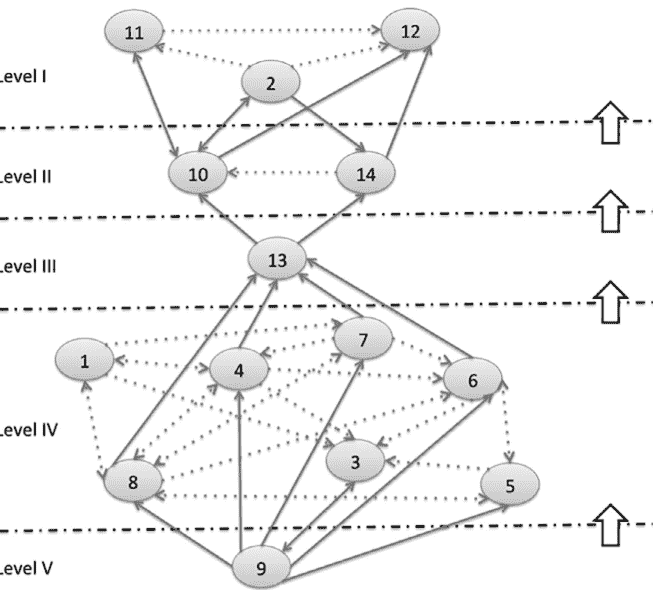

图 16.1 因素的有向图

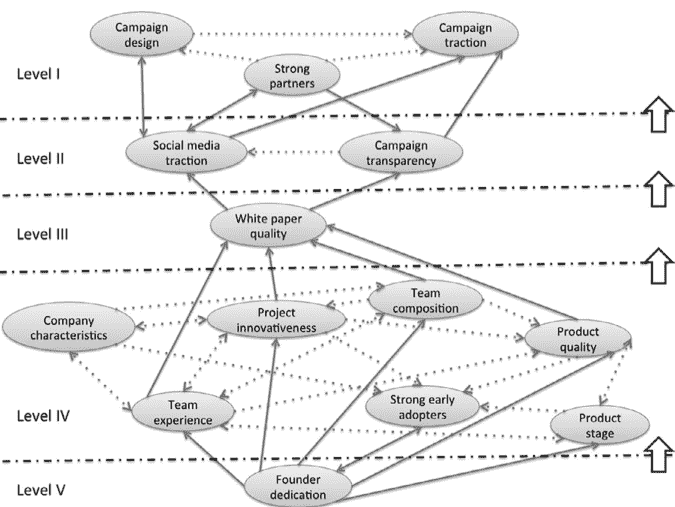

图 16.2 基于区块链众筹成功因素的模型

### 5 成功因素的 MICMAC 分析

在分析的最后一步，我们根据图 16.3 中四个象限的划分，使用表 16.5 中显示的驱动力和依赖力数值，将 14 个成功因素分为四个集群。这为这些成功因素提供了另一种视角。

象限 I – 自主变量：该象限中的因素驱动力和依赖力均较弱，与系统的关联较少。如图 16.3 所示，没有成功因素被归入此象限。

象限 II – 依赖变量：该象限中的因素驱动力弱但依赖力强。如图 16.3 所示，所有四个与众筹活动相关的成功因素都在此象限中：活动设计、活动牵引力、白皮书质量和活动透明度。

象限 III – 联系变量：该象限中的因素驱动力和依赖力均强，即它们受模型中较低级别变量的影响，同时显著影响其他变量。如图 16.3 所示，大多数因素（14 个中的 9 个）都在此象限中。

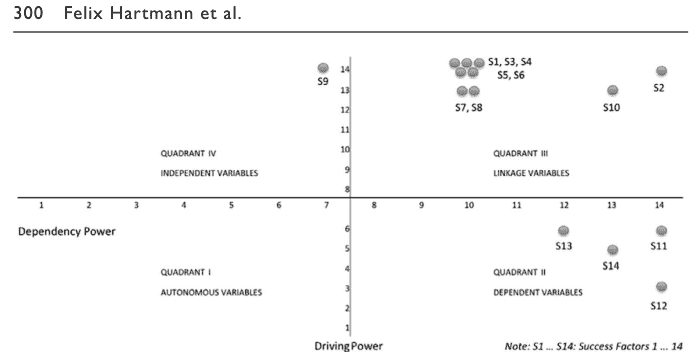

图 16.3 基于区块链众筹成功因素的 MICMAC 分析

象限 IV – 独立变量：该象限中的因素驱动力强但依赖力弱。如图 16.3 所示，一个因素（即创始人投入）被归入此象限。

## 讨论

我们的研究揭示了基于区块链众筹活动成功的各种决定因素，并描绘了不同类别成功因素（无论是项目相关还是活动相关）之间交织的关系。

表 16.1 与表 16.2 的对比揭示了这样一个事实：文献中报告的只有少数成功因素实际上被 ICO 评估网站在实践中使用。相比之下，这些网站正在使用许多未在文献中报告的新成功因素来评估 ICO。一方面，我们可以质疑这些网站所采用的评估机制的科学性和理论基础；另一方面，可以认为，由于区块链领域的快速发展，研究与实践之间的差距将始终存在。我们的研究就是其中一个证明。

在得到的模型（图 16.2）中，我们可以看到，与众筹活动相关的因素被汇总为四个类别，均位于模型的上半部分。它们与众筹活动的成功相关，但不如项目相关的成功因素基本，其中大多数位于模型的下半部分。

作为与众筹活动相关的成功因素子类别，白皮书质量本质上属于基于区块链的众筹，但由于该主题文献有限，仅被少数近期论文涉及。相比之下，通过对评估网站的分析，我们发现了更多与白皮书质量相关的因素：白皮书全面性、白皮书可读性和白皮书的信息性。白皮书质量类别位于模型中间，是联系变量，因此既具有高依赖力，又具有高驱动力（如图 16.3 所示）。包含的因素似乎依赖于多个底层因素类别，如产品质量、团队经验、项目创新性和团队构成，并影响其他多个因素类别，包括社交媒体牵引力和活动透明度。

另外两个与众筹活动相关的因素类别是活动牵引力和活动设计，它们都高度依赖几乎所有其他类别，驱动力很小。文献中已涵盖与活动牵引力类别相关的多个因素，例如大额投资者、早期投资、早期支持者数量和平均分析师评级。在评级网站上，我们发现仅使用平均分析师评级进行 ICO 评估，未识别出新因素。就活动设计而言，它是文献和评估网站中涵盖最广的因素类别。我们发现文献中涵盖了 15 个因素；在评估网站上，我们发现了五个重叠因素和九个新因素。活动设计是依赖变量，驱动力弱但依赖力强（如图 16.3 所示）。它既受社交媒体牵引力的影响，也影响社交媒体牵引力。

第四个与众筹活动相关的因素类别是活动透明度。表 16.1 与表 16.2 的对比揭示，活动透明度作为一个重要因素类别，在某种程度上被文献忽略了，文献仅报告了两个可被视为相关的因素，即关于初创企业的信息透明度和代码源可用性。相比之下，ICO Monitor（三家 ICO 评估网站之一）非常关注活动透明度，如表 16.2 所示，并使用许多具体因素来评估 ICO 的透明度。在这些因素中，许多与使用智能合约以透明方式控制 ICO 有关。

与项目相关的因素被细分为十个因素类别。它们位于模型中除一个之外的所有五个层级中。所有第 V 级和第 IV 级类别均属于此组。其中大多数位于第 IV 级。最基本的因素位于模型的最低层级（第 V 级）且是该层级的唯一元素，即创始人投入。我们曾预期，创始人的强烈承诺将影响其众筹筹款活动的成功，但模型凸显了其影响有多么重要和根本。令人惊讶的是，文献中仅涵盖两个因素——忠诚的 CEO 和资金承诺。在评估网站上，我们只发现了一个因素，即投入的创始团队。创始人投入具有强驱动力和弱依赖力，并且有趣的是，它与强早期采用者类别存在相互影响关系。

模型中第二低层级（第 IV 级）是一个密集层。该层级中各类别之间的关联非常密集，其中有相当一部分是双向的。这意味着公司、团队、项目和产品、


创业企业的基本要素始终发挥关键作用，即使是在一种新颖且有些非传统的筹资机制中也是如此。一个类别是公司特征，文献中已有涉及，其中行业、地点和IPO退出策略属于这一类别的三个因素。通过分析评估网站，我们发现IPO退出策略是一个重叠因素，另外还有六个新因素（见表16.2）。公司特征是一个关键变量，会影响团队构成和强力早期采用者。公司特征影响其他因素并不令人意外；然而，它与团队经验以及项目创新性之间存在相互影响，这有些令人意外，这意味着后两个因素可能会影响公司特征。可以认为，区块链领域真正创新的公司需要选择某个有利的司法管辖区来设立，因此公司的地点可能会受到项目创新性的影响。同时，经验更丰富的团队可能会选择比经验较少的团队更好的公司设计。

团队类别（即团队经验和团队构成）位于同一层级。团队经验在我们的模型中充当链接变量，具有强大的驱动力和依赖力。在评估网站上，我们发现团队之前的区块链经验和团队相关行业经验是ICO成功的重要因素。同样，团队构成也是一个链接类别，依赖于创始人投入和公司特征，并驱动白皮书质量、项目创新性和产品质量。此外，它还与团队经验存在相互影响。值得注意的是，团队构成类别中的一个特定因素——公司寻找关键团队成员——被认为是负面的，因此对众筹成功产生不利影响。这表明基于区块链的众筹支持者也将团队相关因素视为重要的投资评估变量。

项目创新性也位于第四级。在文献中，我们只发现知识产权（专利）属于项目创新性类别。在评估网站上，观察到了更多因素。作为链接变量，产品创新性依赖于创始人投入和团队构成，驱动白皮书质量、产品质量和强力早期采用者，同时与公司特征和团队经验存在相互影响。

在同一第四级中，还包括产品阶段和产品质量。关于产品阶段，我们在分析评估网站时没有发现任何新因素。另一方面，产品质量作为一个类别仅在网站分析中出现，而非源自文献。哪些具体因素可以指示产品质量尚不清楚。产品阶段和质量都可以影响强力早期采用者。

有些出人意料的是，强力早期采用者与其他与公司、产品和团队相关的更基本的因素类别位于同一层级。在文献中，我们只发现与该类别相关的一个因素——将企业客户作为早期采用者。在分析评估网站时，我们发现一个平台使用了该因素。有趣的是，这是唯一一个与创始人投入存在相互关系的类别，这似乎在某种程度上增加了该类别的重要性。

模型中不位于下半部分的唯二产品相关因素类别是社交媒体影响力（第二级）和强大合作伙伴（第一级）。毫不意外的是，社交媒体影响力会影响活动影响力。相比之下，强大合作伙伴位于模型的顶层，这有些令人意外，因为合作伙伴关系是创业企业商业模式的基本方面之一。基于文献和我们自己的研究，无法给出合理的解释，除非这可能是专家（误）解读的结果。通过研究文献，我们发现与该类别相关的因素是有信誉的投资者（商业天使、专家）。通过分析评估网站，我们用两个新因素扩展了该类别——企业合作伙伴和与信誉良好的法律/会计事务所合作，这些都是重要的合作伙伴，尤其是在区块链领域。

想要更多电子书或提出请求，请支持hill0并在我的博客这里购买高级会员，谢谢并享受！https://avxhm.se/blogs/hill0

## 研究的局限性

我们的研究存在几个局限性。首先，我们构建的模型的普遍性存在潜在威胁。我们只能从少数专家那里获得回复。这一局限性可能会影响输入到ISM过程中的数据质量，并最终对模型的普遍性产生负面影响。其次，由于时间或全面性问题，一名或多名专家在填写Excel表格时可能会出错。Excel表格的设计可能具有误导性。这对研究结果的内部效度构成潜在威胁。在将表格发送给专家之前，我们曾在几位同事身上测试了表格的全面性。我们还尽力遵循严格定义的流程来创建独特的数据集，以确保构建ISM的输入可靠。

另一个问题是，基于区块链的众筹现象仍处于萌芽阶段。未来它将取何种方向仍不明确。近年来的情况很可能在未来被视为一个激进的异常值。在未来几年中，由于监管和更高的竞争，筹集资金将变得更加困难和昂贵。我们研究中确定的一些假设今天可能有效，但未来几年甚至几个月内可能会失去其有效性。

## 结论

在本章中，我们探讨了可能影响基于区块链的众筹活动成功的因素，而这种活动如今已成为新创企业和创新项目筹集资金的重要手段。通过考察三大ICO评估网站，我们扩展了文献中报告的成功因素列表，将其分类为与项目相关和与活动相关的类别及子类别。随后，我们借鉴领域专家的知识，以子类别为基础构建了成功因素的层次模型。由此形成的模型阐明了成功因素之间的复杂关联，并突出了众筹成功背后更根本的驱动因素。

我们的研究结果可以作为进一步研究基于区块链的众筹计划的决定因素和成功指标的理论基础。它们还可以为该领域的企业家和投资者提供众筹活动（尤其是在区块链领域）中多种作用力的整体图景和理解。

未来工作可以通过使用更多数量的专家来改善ISM过程输入的数据质量，或者使用更多客观数据的不同研究设计，来验证我们研究中构建的模型。我们计划的一项未来研究是，利用本研究构建的层次模型（或其部分）作为研究模型，对成功因素与基于区块链的众筹活动成功之间的相关性进行定量分析。

## 参考文献

- Adhami, S., Giudici, G., 和 Martinazzi, S., 2018. 企业为何转向加密货币？首次代币的实证分析。*经济与商业期刊*.
- Agrawal, A., Catalini, C., 和 Goldfarb, A., 2015. 众筹：地理、社交网络与投资决策的时机。*特刊：创新经济学 II*，第 253–274 页。
- Ahlers, G. K., Cumming, D., Günther, C., 和 Schweizer, D., 2015. 股权众筹中的信号传递。*创业理论与实践*，第 955–980 页。
- Amsden, R., 和 Schweizer, D., 2018. 区块链众筹是新的“淘金热”吗？首次代币发行的成功决定因素。*SSRN*，第 59 页。可查阅：www.sec.gov/oiea/investor-alerts-and-bulletins/ib_coinofferings [2018年7月18日访问]。
- Becker-Blease, J. R., 和 Sohl, J. E., 2007. 女性拥有的企业能否平等获得天使投资？*企业冒险期刊*，第 503–521 页。
- Beier, M., 和 Wagner, K., 2016. *众筹平台的用户行为——来自瑞士的探索性证据*。夏威夷：IEEE。
- Belleflamme, P., Lambert, T., 和 Schwienbacher, A., 2014. 众筹：挖掘合适的群体。*企业冒险期刊*，第 585–609 页。
- Bi, S., Liu, Z., 和 Usman, K., 2017. 在线信息对基于奖励的众筹投资决策的影响。*商业研究期刊*，第 10–18 页。
- Bigelow, L., Lundmark, L., Parks, J., 和 Wuebker, R., 2014. 回避问题：IPO招股说明书评估中性别偏见的实验证据。*管理期刊*，第 1752–1753 页。
- Busenitz, L. W., Fiet, J. O., 和 Moesel, D. D., 2005. 风险投资家中的信号传递——新创企业团队融资决策：是否预示长期创业结果？*创业理论与实践*，第 1–12 页。


Cordon, M. S., Mitteness, C., and Sudek, R., 2018. 激励线索与天使投资：热情、准备度和承诺之间的交互作用。*创业理论与实践*, pp. 1057–1085.

CB Insights, 2018. *区块链投资趋势回顾*. s.l.: CB Insights.

Cerchiello, P., and Toma, A. M., 2018. ICO 成功驱动因素：文本和统计分析。*DEM 工作论文系列*, pp. 7–18.

Chan, C. S. R., and Parhankangas, A., 2017. 众筹创新想法：渐进式和激进式创新如何影响融资结果。*创业理论与实践*, pp. 237–263.

Colombo, M., Franzoni, C., and Rossi-Lamastra, C., 2014. 内部社会资本与众筹早期贡献的吸引。*创业理论与实践*, pp. 75–100.

Cordova, A., Dolci, J., and Gianfrate, G., 2015. 众筹成功的决定因素：来自技术项目的证据。*程序：社会与行为科学*, pp. 115–124.

Courtney, C., Dutta, S., and Li, Y., 2017. 消除信息不对称：信号、背书与众筹成功。*创业理论与实践*, pp. 265–290.

CrowdfundingHub, 2016. *欧洲众筹现状*. Amsterdam: CrowdfundingHub.

Davies, W. E., and Giovannetti, E., 2018. 通过信号传递经验与互惠来缓解众筹中的信息不对称：来自 10,000 个项目的证据。*技术预测与社会变革*, pp. 118–131.

Eddleston, K. A., Ladge, J. J., Mitteness, C., and Balachandra, L., 2016. 你看到的和我看到的一样吗？性别和企业特征对创业企业融资的信号效应。*创业：理论与实践*, pp. 489–514.

Etherscan, 2018. Etherscan. [在线] 可于: https://etherscan.io/tokens 查阅 [访问于 2018 年 7 月 18 日].

Etter, V., Grossglauser, M., and Thiran, P., 2013. 要么强势上线，要么回家！预测 Kickstarter 活动的成功。*CHI 会议*, pp. 591–600.

欧洲委员会, 2017. *识别欧盟跨境众筹发展的市场和监管障碍*. s.l.: 欧洲委员会.

Fenu, G., Marchesi, L., Marchesi, M., and Tonelli, R., 2018. *ICO 现象及其与以太坊智能合约环境的关系*. Campobasso, 2018 International Workshop on Blockchain Oriented Software Engineering (IWBOSE).

Fisch, C., 2018. 使用首次代币发行（ICO）为新企业融资：一项探索性研究。*社会科学电子文库*.

Frydrych, D., Bock, A. J., Kinder, T., and Koeck, B., 2014. 探索基于奖励的众筹中的企业合法性。*风险资本*, pp. 247–269.

Graham, S. J., Merges, R. P., Samuelson, P., and Sichelman, T., 2008. 高科技企业家与专利制度：2008 年伯克利专利调查结果。*伯克利技术评论*.

Gutsche, J., and Sylla, S., 2017. Kickstarter 平台众筹项目的成功因素。载于：*德土 IT 与创新管理视角*. s.l.: Springer, pp. 361–374.

Hacker, P., and Thomale, C., 2017. 加密证券监管：欧盟金融法下的 ICO、代币销售和加密货币。*欧洲公司与金融法评论*, 即将出版.

Hartmann, F., Wang, X., and Lunesu, M. I., 2018. 初始加密资产发行评估：实践现状。Campobasso: IEEE.

Hornuf, L., and Schwienbacher, A., 2018. 股权众筹中的市场机制与资金动态。*公司财务杂志*, pp. 556–574.

icodata.io, 2018. icodata.io. [在线] 可于: www.icodata.io/stats/2017 查阅 [访问于 2018 年 5 月 21 日].

Kim, K., and Viswanathan, S., 2013. 众中的“专家”：有经验投资者在众筹市场中的作用。将发表于 MIS 季刊.

Kim, T., Por, M. H., and Yang, S. B., 2017. 在线筹资平台上赢得人群：创始人的作用。电子商务研究与应用, pp. 86–94.

Kuppuswamy, V., and Bayus, B. L., 2015. 众筹创意项目：Kickstarter 中项目支持者的动态。SSRN.

Lee, J., Li, T., and Shin, D., 2018. FinTech 中的群众智慧与信息级联：来自首次代币发行的证据。SSRN.

Leland, H. E., and Pyle, D. H., 1977. 信息不对称、财务结构与金融中介。金融杂志, pp. 371–387.

Loehner, J., Schneck, S., and Werner, A., 2018. 关于企业家财务承诺与众筹成功的研究简报。风险资本.

Lu, C. T., Xie, S., Kong, X., and Yu, P. S., 2014. 推断社交媒体对众筹的影响。WSDM’14.

Lukkarinen, A., Teich, J. E., Wallenius, H., and Wallenius, J., 2016. 在线股权众筹活动的成功驱动因素。决策支持系统, pp. 26–38.

Malone, D. W., 1975. 解释性结构建模应用导论。IEEE 论文集, 63(3), pp. 397–404.

Mamonov, S., and Malaga, R., 2018. 美国 Title III 股权众筹的成功因素。电子商务研究与应用, pp. 65–73.

Mamonov, S., Malaga, R., and Rosenblum, J., 2017. Title II 股权众筹成功的探索性分析。风险资本, pp. 239–256.

Mohammadi, A., and Shafi, K., 2018. 股权众筹投资者的贡献模式中的性别差异。小企业经济学, pp. 275–287.

Mollick, E., 2014. 众筹的动态：一项探索性研究。创业企业杂志, pp. 1–16.

Momotaz, P. P., 2018. CEO 忠诚度与首次代币发行的定价。SSRN.

国家公园管理局, 2015. 国家公园管理局. [在线] 可于: www.nps.gov/stl/learn/historyculture/joseph-pulitzer.htm 查阅 [访问于 2018 年 7 月 13 日].

Ordanini, A., Miceli, L., Pizzetti, M., and Parasuraman, A. (2011). 众筹：通过创新服务平台将客户转变为投资者。服务管理杂志, 22(4), pp. 443–470.

Polzin, E., Toxopeus, H., and Stam, E., 2018. 资金中的群众智慧：信息异质性与众筹者的社交网络。小企业经济学, pp. 251–273.

Prasad, D., Bruton, G. D., and Vozikis, G., 2000. 向商业天使传递价值：企业家净资产投入新企业的比例作为决策信号。风险资本, pp. 167–182.

Rakesh, V., Choo, J., and Reddy, C. K., 2015. 基于异质特征的众筹项目推荐。AAAI.

Ralcheva, A., and Roosenboom, P., 2016. 股权众筹成功之路。[在线] 可于: https://ssrn.com/abstract=2727742 查阅 [访问于 2018].

Sage, A. P., 1977. 解释性结构建模：大型系统的方法论（第 91–164 页）。New York, NY: McGraw-Hill.

Stam, E., and Schutjens, V., 2005. 团队创业的脆弱成功。创业、增长与公共政策论文.

Vismara, S. (2016). 股权众筹中的股权留存与社会网络理论。小企业经济学, 46(4), pp. 579–590.

Vulkan, N., Åstebro, T., and Sierra, M. F. 2016. 股权众筹：一种新现象。创业企业洞察杂志, pp. 37–49.

Zheng, H., Li, D., Wu, J., and Xu, Y., 2014. 众筹中多维社会资本的作用：中美比较研究。信息与管理, p. 2014.

## 附录

### 用于收集基金专家意见的 Excel 工作表

| | A | B | C | D | E | F | G | H | I | J | K | L | M | N | O |
|---|---|---|---|---|---|---|---|---|---|---|---|---|---|---|---|
| 1 | / | | | | | | | | | | | | | | |
| 2 | 成功因素的定义可在“定义”工作表中找到。请在填写表格前仔细阅读！ | | | | | | | | | | | | | | |
| 3 | | | | | | | | | | | | | | | |
| 4 | （请忽略灰色单元格） | | | | | | | | | | | | | | |
| 5 | 基于区块链的众筹成功因素 | 公司特征 | 强大合作伙伴 | 强大采用者 | 项目创新性 | 产品阶段 | 产品质量 | 团队构成 | 团队经验 | 创始人投入 | 社交媒体吸引力 | 活动设计 | 活动吸引力 | 白皮书质量 | 活动透明度 |
| 6 | 公司特征 | | | | | | | | | | | | | | |
| 7 | 强大合作伙伴 | | | | | | | | | | | | | | |
| 8 | 强大早期采用者 | | | | | | | | | | | | | | |
| 9 | 项目创新性 | | | | | | | | | | | | | | |
| 10 | 产品质量 | | | | | | | | | | | | | | |
| 11 | 团队构成 | | | | | | | | | | | | | | |
| 12 | 团队经验 | | | | | | | | | | | | | | |
| 13 | 创始人投入 | | | | | | | | | | | | | | |
| 14 | 社交媒体吸引力 | | | | | | | | | | | | | | |
| 15 | 活动设计 | | | | | | | | | | | | | | |
| 16 | 活动吸引力 | | | | | | | | | | | | | | |
| 17 | 活动文档质量 | | | | | | | | | | | | | | |
| 18 | 白皮书质量 | | | | | | | | | | | | | | |
| 19 | 活动透明度 | | | | | | | | | | | | | | |
| 20 | | | | | | | | | | | | | | | |
| 21 | 单元格填写方式： | | | | | | | | | | | | | | |
| 22 | 1 | 公司特征 | V | "公司特征"影响"强大合作伙伴" | | | | | | | | | | |
| 23 | | | | | | | | | | | | | | | |
| 24 | 2 | 公司特征 | A | "公司特征"受"强大合作伙伴"影响 | | | | | | | | | | |
| 25 | | | | | | | | | | | | | | | |
| 26 | 3 | 公司特征 | X | "公司特征"和"强大合作伙伴"相互影响 | | | | | | | | | | |
| 27 | | | | | | | | | | | | | | | |
| 28 | 4 | 公司特征 | Q | "公司特征"和"强大合作伙伴"之间不存在关系 | | | | | | | | | | |
| 29 | | | | | | | | | | | | | | | |
| 30 | | | | | | | | | | | | | | | |
| 31 | | | | | | | | | | | | | | | |


## 索引

- 抽象语法树 (ASTs) 195, 201
- 加速主义 130, 139
- 访问控制，与智能合约 180, 181
- 访问控制列表 232
- 可访问性，与数字鸿沟 4, 5
- 问责 99；在 Civil 上 109
- Ackah, B. B. 6
- 从区块链获取数据：挑战 208, 209；Ukulele 209, 210, 211, 212, 213
- 行动导向本体论 147
- Wibson 模型中的参与者与交换 168, 169
- Adams, P. R. 6
- 地址 2, 179
- Adner, R. 68
- 区块链技术采用，面临的挑战 122
- Agamben, G. 144
- Aitken, R. 163
- Al-Saqaf, W. 7, 97, 98
- 替代性争议解决 (ADR) 177, 189n3
- 歧义，在区块链技术中 68
- Andresen, G. 125
- Angelis, J. 6
- ANTLR 199
- 上诉；在 Civil 上提交 106, 107
- Apple 134
- 应用二进制接口 (ABI) 224
- 专用集成电路 (ASICs) 20, 117, 119
- 应用，Wibson 另参见 Wibson
- 仲裁 189n3
- 自动化信任 79
- 自动化工作跟踪系统 88, 89
- 自动化 81
- Axiom 163
- Axiom Zen 51
- Azevedo, I. 9
- Baldwin, J. 116
- 银行：采用区块链技术 148；作为受信任的第三方 2
- Baran, Paul 149
- Barlow, J. P. 114
- Benkler, Yochai 115, 124, 134, 135；《网络的财富》114, 133
- 伯尔尼公约 38, 43n12
- Berners-Lee, Tim 80
- Beveridge, I. 6
- BFX 代币 71, 72
- BiblePay 73, 74
- 大数据 82, 167
- Biggs, J. 97, 108
- Binded 101
- 比特币 1, 15, 16, 18, 24, 34, 54, 66, 68, 81, 102, 103, 109, 118, 120, 123, 131, 144, 145, 150, 159, 164, 165, 217, 223, 240；地址 2；块大小争论 124, 125；中心化，潜在领域 20；共识算法 1, 2；收缩 153, 154, 155；货币兑换 20；数字钱包服务 20；分布式基础设施 1, 2；挖矿能源需求 154；汇率 22；扩张 150, 151, 152；分叉 154；被盗事件 72；哈希率 19, 20, 154；激励结构 19；不可替代性 19；自由放任特征 23, 24；与贵金属的相似性 19；矿工 125；挖矿 20, 21, 154；混币器 28n3；与货币去中心化 19；货币可行性 23, 24；专题讨论 56, 57；生产和流通 20, 21；工作量证明算法 19；重中心化 121；价值转移 3；无信任架构 23, 26；价值 21, 22, 23
- 《比特币：点对点电子现金系统》66
- 比特币改进提案 (BIP) 120, 121
- Bitfinex 被盗 72
- BitTorrent 协议 123
- “女性视角下的区块链”聚会 57
- 区块链软件工程 (BOSE) 9
- 区块链技术 6, 16, 18, 24, 58, 62, 64, 65, 67, 74, 114, 117, 126, 130, 135, 145, 146, 155, 159, 160, 162, 164, 188, 189, 223, 240；2017/2772(RSP) 30；优势 66；歧义 68；区块链 32；无国界价值转移 4, 18；赋能社区的能力 160, 166；广泛采用面临的挑战 122；Civil 7, 102, 103, 104, 105, 106, 107；协作 80, 81；互补货币 27；共识协议 32, 33, 70；与版权侵权 38, 39, 40, 41；与版权法 30, 31, 36, 37；创意护照 130, 132, 133；去中心化 15, 24, 67, 69, 70, 164；发展阶段 48, 49；分布式永久性 147, 148；分布式信任 18, 19；DLTs 97；生态系统特性 68；爱沙尼亚的采用 32；扩张与收缩 145, 148；分叉 121；作为第四次工业革命 66；性别问题 55；治理 7, 8, 28, 119；混合型 67；与激励化 27；非正式聚会 53, 54；作为基础设施 51；聚会 51, 52, 53, 56, 57；与新自由主义治理性 24, 25；网络类型 32；网络 68；NIST 定义 31；节点 42n2；点对点网络 2；许可型 34；无许可型 31, 109；普及程度 15；私有链 67, 165；公有链 67, 97, 165；重中心化 121；登记 37, 38, 89；监管法律 33, 34, 35, 36；远程检查员 205, 206；瑞波币 32；风险与机遇 5, 6, 7, 8, 9, 10；社区扩容 26；与稀缺性 146；智能合约 3, 4；社交钱包 26；软件开发 246, 247；标准化 122, 123；Steemit 130, 131, 132；“技术信任” 69；第三方交易所 104；与信任 25, 26, 66, 70, 78, 155；无信任交易 78；新闻领域的用例 100, 101, 102；与价值 26；否决权 121；作为 Web 3.0 146, 147；Web 3.0 1, 3, 4；另参见 区块链技术；无许可区块链；智能合约；基于区块链的 Gibson 众筹 270, 272；成功因素 271；另参见 基于区块链的众筹的成功因素
- 区块 179
- BlockSci 217
- 块大小争论 120
- Bodo, B. 7, 8
- 无国界价值转移 4
- 自底向上语法分析器 196, 199
- Bower, J. 137, 138
- Boyd, R. 62
- Bracamonte, V. 65
- Bragagnolo, S. 9
- Braudel, F. 125
- 《大英百科全书》2, 3
- Brunton, F. 150
- 建立共识 179
- Burt, R. S. 63
- Bustillos, Maria 99, 103, 111
- Buterin, V. 116, 124
- 拜占庭容错 (BFT) 225
- Cambridge Analytica 163
- Camerer, C. 63
- 能力鸿沟 4, 5
- 资本主义 17, 142, 160；无政府资本主义 152；德勒兹与瓜塔里关于 139；企业家 165；信息资本主义 161；平台资本主义 131, 134；另参见 竞争
- 比特币挖矿的卡特尔化 20, 21, 23, 125
- 案例，Skatteverket 诉 David Hedqvist 33
- Castell, M. 161
- 审查 115；抗审查 101
- 中央银行 19, 26
- 集中化服务 102
- 中心化 115, 160；矿工的中心化 119
- 链导航 207, 208
- 链码 224, 227；Fabric 228, 229, 230
- Chohan, U. W. 102
- Chow-White, P. A. 6
- Christensen, C. 48, 137, 138
- Christin, N. 104
- 比特币的流通 20, 21
- Civil 7, 98, 99, 101, 102, 110
  - 问责 109
  - 上诉；提交 106, 107
  - 去中心化 108
  - 平等性 108
  - 目标 103
  - 创建新闻室 104, 105, 106, 107
  - 对 Ethereum 的依赖 111
  - 透明度 108, 109
  - 投票流程 106, 107, 109
- Civil 委员会 106, 108
- Civil 工作室 103
- Clark, J. 114
- 古典自由主义 17
- 代码：链码 227；作为法律 90, 126, 127, 146, 153, 154
- Coeckelbergh, M. 80, 89
- Connely, S. 67
- 协作 80；表现力 82；游戏开发中的协作 78；互动 80, 81；网络映射 83, 84, 86, 87；Tal 重新分配会议 87, 88
- 商业化 160；数据的商业化 166；IG 的商业化 170
- DI 的商品化 162；以盈利为目的的平台 162, 163
- 基于共有的社会经济交流框架 24, 25
- 基于共有的组织 6, 27, 28
- 基于共有的点对点生产 (CBPP) 范式 124
- 社区公共电视 (CATV) 8, 144, 148, 149, 150；其重中心化 148, 149, 150
- 竞争 17；与市场条件 17；垄断 138, 139；Schumpert 关于 137；国家对竞争的激励 25；国家在管理竞争中的作用 18；Thiel 关于 138
- 互补货币 27
- 现代经济中的复杂合作模型 63, 64, 65；合同 64
- 共识协议 1, 2, 32, 33, 42n4, 70, 117, 178, 179；建立共识 179；中本聪共识 178, 179
- ConsenSys 103, 104
- 鼓励内容创作 102
- 合同 64；另参见 智能合约
- Coolidge, Matt 99, 104, 107, 111
- 合作：现代经济中的复杂模型 63, 64, 65；作为关键人类成功因素 26, 63
- 版权侵权 43n13；与区块链技术 38, 39, 40, 41
- 版权法：与区块链技术 30, 31, 33, 36, 37；在音乐行业 39, 40；署名权豁免 40；与在区块链上的登记 37, 38
- 协同监管 185, 186；在出错情况下的干预 186, 187
- Crawford, Chris 80
- 知识共享许可 89
- 创造性破坏 136, 137, 138, 139, 142
- 创意护照 8, 130, 132, 133, 135, 136, 138, 139
- 新闻的可信度 98, 109
- 众筹 10；基于区块链的众筹 270, 271, 272
- 加密货币 1, 15, 34, 150, 151, 156, 164；BFX 代币 71, 72；BiblePay 73, 74；挖矿的卡特尔化 23；CVL 103；开发者社区 152；不稳定性 22；自由放任特征 23, 24；挖矿 20, 21, 81；Monero 119；货币可行性 23, 24；专题讨论 56, 57；安全漏洞 72, 73；初创公司 97；作为区块链聚会的主题 54；与透明度 70, 71, 72；作为“无信任架构” 16；信任-不信任均衡作为投资基础 73, 74；与价值 21, 22, 23；Wibson 169；女性投资者 48, 49
- 密码经济学 124, 125
- 密码学 2, 8
- Cryptokitties 51, 103
- 货币兑换 20
- 客户关系管理 (CRM) 系统 9, 225, 226, 230, 231；数据收集过程 226；模型架构 232, 234；处理交易 231, 232；“安全即设计” 236, 237；安全性 231
- CVL 103, 104, 110
- 赛博女权主义 50
- 赛博自由主义 2.0 151, 152
- 赛博自由主义者 19, 23, 151
- 赛博航行者 151
- 密码朋克 152
- Dahlberg, L. 151, 152
- DAO 被盗 72
- 数据收集过程，在 CRM 中 226
- 数据商品化 161；数据的社会经济重要性 162, 163
- 数据产业 163
- 数据市场 159；Wibson 在其中的作用 167, 168
- Davis, J. H. 63


菲利皮，P. 117, 120, 126

德吉尔，克里斯托弗 72

德兰达，M. 125

去中心化 98, 99, 115, 116, 118, 126; 区块链的去中心化 15; 24, 65, 66, 67, 69, 70; Civil 上的去中心化 108; 去中心化的维度 116, 117; 与 DLTs 的去中心化 115; DLTs 的去中心化 116, 117; 与治理 120, 121; 智能合约 4; 另见 产生去中心化的力量

去中心化应用（DApps）9, 118, 182, 183, 184; GDPR 合规性 243, 244; 另见 DFiles

去中心化自治组织（DAOs）118, 181, 182, 240

去中心化软件应用 224, 225

网络空间独立宣言 114

防御纵深 230, 231

通缩货币 19

德勒兹，吉勒 130; 《反奥狄浦斯》 139

德克，M. 9

区块链发展阶段 48, 49

DFiles 245, 246; 核心功能 248, 249, 251, 252; 核心智能合约 247, 248; 评估 252, 253, 254, 255, 256, 257

创新扩散理论 7, 50, 51, 98, 99, 100

数字鸿沟 4, 5

数字信息（DI）161; 商品化 162

数字稀缺性 2

数字信任 6, 7, 65, 66, 67, 68; 不信任，管理 72, 73; 透明度，管理 70, 71, 72; 另见 信任

数字钱包服务 20, 224, 225

去中心化维度 116, 117

争议解决 9

区块链的颠覆潜力 66; 版权法上的影响 36, 37

颠覆性技术 130, 136, 137, 139, 142; 社区接入电视（CATV）148, 149, 150

分布式应用（DApps）182, 183, 184

分布式自治组织（DAOs）146

分布式基础设施 1, 2

分布式账本技术（DLTs）69, 114, 116, 122, 144, 147, 178; 采用 122; 与去中心化 115; 外部认可 122; 治理 122, 123; DLTs 的治理 119; 倡议 97; 代币 124

分布式信任 18, 19

比特币分布 20, 21

颠覆性技术 5; Steemit 131, 132

不信任，与数字信任 7

唐明，J. 97

道，K. 20

杜卡斯，S. 9

电子商务，在线争议解决（ODR）177

去中心化经济激励 124, 125

经济学 17; 信息资本主义 161; 约瑟夫·熊彼特 136, 137

埃德松，M. P. 7

EGX 游戏博览会 82, 83

新兴市场经济体（EMEs）20

就业 90

加密，DFiles 252, 253, 254, 255, 256, 257

恩格斯，F. 136

企业家 165

平等 98, 99; Civil 上的平等 108

权益代币发行（ETO）272

尔曼，L. 150

信任侵蚀 64

智能合约中的错误 186

爱沙尼亚，区块链技术采用 32

以太币 3

以太坊 3, 7, 31, 33, 48, 72, 102, 103, 109, 121, 125, 145, 159, 165, 178, 188, 194, 201, 207, 217, 223, 240; Casper 117; Civil 对其的依赖 111; DAO 146; Gas 252; DApps 的 GDPR 合规性 243, 244; 局限性 258, 259; 小组讨论 56, 57; 智能合约 145, 155, 180, 182; 白皮书 118

Etherparty 51

Etherscan 206, 217, 218

欧盟（EU）：2017/2772(RSP) 30, 37; 通用数据保护条例（GDPR）35, 163, 240, 241, 242, 243; ODR 平台 178, 185, 188; 另见 通用数据保护条例（GDPR）

“日常创造力” 134

交换 17

交换价值，与透明度 70, 71, 72

作为去中心化驱动因素的生存威胁 123, 124

扩张和收缩 另见 重中心化

数据剥削 162

表现力 82

外部认可，与去中心化 121, 122, 123

Fabric 9, 227, 228, 231; 链码 228, 229, 230; 模型架构 232; 处理交易 231, 232; “安全设计” 236, 237; 智能合约 228

Facebook 9, 64, 102, 134, 135, 148, 155, 162, 163, 166

假新闻 100, 101

女权主义：赛博 50; 技术 49, 50

法定货币 16, 19

金融众筹 271

金融组织，风险分配 187

芬南，埃里克 153

费舍尔，马克 139, 142

Fog EVM 字节码组件（SmartAnvil）194

FogComm 组件（SmartAnvil）194

FogLive 组件（SmartAnvil）194

产生去中心化的力量 117; 内生和外生经济激励 124, 125; 外部生存威胁 123, 124; 外部认可 121, 122, 123; 意识形态/系统设计 118, 119, 120; 内部控制与可治理性 120, 121

福特主义 28n2

福迪斯，R. 8

伪造，与版权登记 38

分叉 121, 145, 154

营利性平台 162, 163; 与隐私 163

福柯，M. 28n1, 144; 政府性 17

第四次工业革命 66

弗朗科姆，C. 9

弗兰克林，乌苏拉 50, 54

所有权自由 17, 18

弗里曼，S. 6

弗里佐-巴克，J. 6

弗勒林斯，L. 97

全节点 42n2, 121

《区块链未来峰会》 56

未来研究与工具开发，SmartAnvil 215, 216, 217

加洛韦，A. R. 146

博弈论，区块大小争论 124, 125

游戏开发 78, 79, 83; 互动 80, 81; 网络映射 83, 84; Tal 再分配会议 84, 85, 87, 88

加蒙，E. 28n2

Gas 216, 252

高特莱，大卫 135; 《创造即连接》 134

性别 49; 与技术 6; 另见 技术女权主义

通用数据保护条例（GDPR）35, 147, 163, 226, 240, 241, 252; 以太坊 DApps 中的合规性 243, 244; DFile 评估 252, 253, 254, 255, 256, 257; 合法依据与权利 242, 243; 删除威胁 241, 242, 243, 244, 246, 257, 259

Getter 方法 206

詹诺普卢，A. 7, 8

吉尔莫，约翰 115

GitHub 78, 196, 280, 281

全球区块链商业理事会 49

全球 Tal 注册表 79, 82, 83, 85, 90

金本位制 19

哥伦比亚，D. 15, 16, 150

Google 9, 134, 135, 148, 162, 163

治理 7, 18, 24, 146; 区块链治理 28, 119; 与去中心化 120, 121; DLTs 的治理 122, 123; 自由放任 19; 与信任 25, 26

政府性 16, 17; 新自由主义 18, 19, 24, 25

Gran Data 160, 165, 166, 167

格兰诺维特，M. 63

瓜塔里，费利克斯 130; 《反奥狄浦斯》 139

黑客攻击 另见 安全漏洞

哈拉维，D. 6

哈特曼，F. 10

哈希率 19, 20

考克，J. 83

堆，伊莫金 132, 133

赫恩，迈克 154

海姆斯伯根，L. 8, 144

希克斯，M. 51

海勒曼，G. 97, 154

霍尔兹，R. 9

经济人 17

“我因黑客攻击而免费获得 55,000 美元加密货币的经过” 73

胡，J. 149

人类编程 8, 146, 156

人类成功因素，信任与合作作为 62, 63

哈钦森，M. 20

混合区块链 67, 160

Hyperledger 9, 225, 227; Fabric 227, 228, 229, 230, 231; 权限结构 237; “安全设计” 236, 237

伊安西蒂，M. 69

伊拉拉，L. 10

萱，马修 99, 103, 111

“激励相容” 69

激励化 27; 去中心化的激励化 124, 125; 威尔逊模型 169, 170

通货膨胀 19

非正式聚会 53, 54, 57; 在……中的专业水平 54; 作为对男性主导行业的抵抗点 56; 由女性为女性 56; 男性主导行业中的女性 55, 56, 57

信息和通信技术（ICT）4

信息资本主义 161

信息商品（IG）165; 商业化 170

基础设施互助 153

基础设施 51

首次代币发行（ICOs）42n5, 154; Civil 104; Tezos 基金会 122

创新 51; 属性 99, 100; 民用新闻室的相对优势 107, 108, 109

检查对象数据 199, 200; 挑战 200; Etherscan 206; Moldable 检查器 206, 207; Remix 工具套件 206

比特币的不稳定性 22

智力资本 277

知识产权 30, 161; 2017/2772(RSP) 37; 全球 Tal 注册表 79, 83; 保护 101

互动 80, 179; 就业 90; 另见 智能合约

内部控制，与去中心化 120, 121

互联网 1, 6, 8, 69, 70, 115, 130, 134, 140, 144; 互联网的商业化 135; 数据商品化的社会经济重要性 162, 163

互联网架构去中心化网络峰会 116

物联网（IoT）70, 145

“价值互联网” 8

行星间文件系统（IPFS）102, 241, 245, 246, 257, 258

诠释结构建模（ISM）288

调用智能合约 180

比特币的不可替代性 19

iTunes 39

约瑟利特，D. 148, 150

新闻业 98; 与区块链 7; 民用新闻室的相对优势 107, 108, 109; 新闻室，在 Civil 上创建 104, 105, 106, 107; 区块链技术的用例 100, 101, 102; 另见 Civil

卡普尔，R. 68

凯文，W. 35

哈利法，O. 103

哈特瓦尼 104

金史密斯，A. 6

金斯利，丹 99, 107

知识，DI 161

康多尔，D. 150

自由放任 18, 19, 23, 24

LALR 解析器生成器 198, 199

贾龙尼，贾伦 135; 《谁拥有未来》 134

法律：代码即 90, 126, 127, 146, 153; 另见 在线争议解决（ODR）

拉扎拉托，M. 16, 17

利德贝特，查尔斯 135; 《共同思考：大众创新，而非大众生产》 133

账本技术 66, 67

勒西格，L. 118, 146

刘易斯-克劳斯，G. 122

本地聚会 51; 关于……的发现 58

Loveluck, B. 117, 120

Lovett, M. 137

Lovink, G. 26

澳门 26

马多克斯，A. 8

马隆，B. 81

管理不信任 72, 73

马尔切西，M. 9

市场条件 17

马克思，K. 136

松谷，H. 215

毛雷，B. 152

梅耶，R. C. 63

调解 189n3

Medium 161

聚会 51, 52, 53, 57; 女性视角下的区块链 57; 非正式 53, 54; 在……中的专业水平 54; 作为对男性主导行业的抵抗点


- 56; 由女性为女性 56; 男性主导行业中的女性 5, 56, 57
- Mettler, M. 97
- 微支付 78
- 微服务 224
- 矿工 125
- 挖矿 179; Bitcoin挖矿 20, 125; 卡特尔化 21, 23; 中心化 119; 能源需求 154
- 矿池 20, 21
- 不信任: 作为投资基础 73, 74; 管理 72, 73
- 混币器 28n3
- Möldale检查器 206, 207
- Möllering, G. 63
- Monero 119
- 货币去中心化 19
- 垄断 139, 142; Thiel关于垄断 138
- Moose 9, 104; PetitParser 199; 另参见 SmartAnvil
- Morishima, S. 215
- Mt. Gox被黑事件 72, 155
- Mulders, M. 104
- 音乐产业: 与区块链 37; 版权侵权 38, 39, 40; Creative Passport 132, 133; DI的可复制性 162
- 音乐元数据 39
- Musiccoin 78
- Mycelia 40; Creative Passport 130, 132, 133; 另参见 Creative Passport
- Nakamoto, Satoshi 1, 21, 66, 118, 120, 151, 223, 240
- Nakamoto共识 178, 179
- Narayanan, A. 114
- 国家标准与技术研究院 (NIST), 区块链定义 31
- 新自由主义治理性 16, 17, 18, 19, 23, 118; 与区块链 24, 25; 监管机制 18
- 网络映射 86, 87
- 网络 32; 商业化 135; '日常创造力' 134; Fabric 227, 228; 映射 83, 84; 分组交换 134; 与价值 141
- 新媒体 144, 148; 社区接入电视 (CATV) 148, 149, 150
- 新闻: 可信度 98, 109; 另参见 新闻编辑室
- 新闻编辑室: 民事型, 相对优势 107, 108, 109; 在Civil上创建 104, 105, 106, 107
- 节点 42n2, 121, 164; Fabric 227; 全节点 121
- 非金融众筹 271
- North, D. C. 63
- Noto La Diega, G. 6, 35
- 面向对象本体论 147
- O'Dwyer, Rachel 16, 81
- O'Hara, Kieran 90
- Okada, H. 65
- 在线争议解决 (ODR) 177, 178, 188, 198n3; 共同监管 185, 186; DApps 183, 184; 全球模型 177; 带有人工干预的智能合约模型 182, 183, 184, 185; 扩展 177; 与智能合约 9; 标准化 184; 透明度 183, 184; 另参见 智能合约
- 本体论, 行动导向 147
- 不透明性 199; 在智能合约中, 挑战 200
- 开源: 区块链 217; Hyperledger 227; Remix工具套件 218; SmartAnvil 192; 另参见 SmartAnvil
- 开源软件运动 123
- 组织, 全球扩展 26
- Ostrom 161
- 结果分歧 5
- 所有权: 与音乐版权 39, 40; 智能合约所有权 180
- Oyente 218
- 分组交换网络 134
- 加密货币专题讨论会 56, 57
- Papoulias, N. 207
- Parity钱包被黑事件 72
- 解析器/AST (SmartAnvil) 193
- 解析器: ANTLR 199; 自底向上 196; 评估 197, 198; 示例 197; LALR 198, 199; 用于Solidity, 设计挑战 195, 196; 自顶向下 196; YACC 199
- 父亲权利放弃 40
- 悲观点理论 118
- Patrickson, B. 7
- 对等账本 8
- 对等网络 2, 7, 15, 32, 67, 114, 118; BitTorrent 123; 平等 98, 99; Tor 123
- Pentland, A. 97
- 许可区块链 31, 34
- 无许可区块链 31, 109; 与版权侵权 40, 41; 与版权登记 38; 对等网络 32
- PetitParser 196, 199
- Pharo Smalltalk 196, 201
- 软件开发阶段 246, 247
- 盗版 37, 38, 39; 另参见 音乐产业
- 平台资本主义 131, 134
- 极化 135
- Polanyi, K. 28
- 政策中立性 121
- PollEnt 203, 204
- Popula 99, 103, 111
- Portapak 149
- 贵金属, Bitcoin的相似性 19
- 保护知识产权 101
- Preukschat, A. 164, 165
- 隐私 152, 240; 与版权登记 38; GDPR 163
- 私有区块链 67, 160, 165, 178; 另参见 Wibson
- 私有网络 32
- Bitcoin生产 20, 21
- Proof-of-Brain 141
- 工作量证明算法 21, 32, 33, 81, 117, 125, 131; Bitcoin 19
- 公有区块链 67, 97, 160, 165, 178
- Puligheddu, D. 9
- 量化 80, 81
- 查询语言 208; 评估 213, 214, 215; Ukulele 209, 210, 211, 212, 213
- 激进通信技术 144, 145; 社区接入电视 (CATV) 148, 149, 150
- 激进意识形态, 网络自由主义2.0 151, 152
- Rauch, M. 97, 154
- Read, J. 17
- 重新中心化 121, 144, 145, 165; Bitcoin的重新中心化 153, 154, 155; 社区接入电视 (CATV) 148, 149, 150
- 区块链注册 37, 38, 89
- 监管法律 6, 17, 18, 115, 145, 160, 166; 用于区块链技术 33, 34, 35, 36; 共同监管 185, 186; 在新自由主义治理性中 18; 另参见 一般数据保护条例 (GDPR)
- Reijers, W. 80, 89
- 相对优势 100; 民事型新闻编辑室的相对优势 107, 108, 109
- Remix工具套件 206, 216, 218
- 远程调试 207
- DI的可复制性 161, 162, 165
- Reporter 101
- Richerson, P. 62
- 被遗忘权 257, 259
- Ripple 32
- 风险分配 187
- Ro, Sandra 49
- Rocha, H. 9
- Roderick, L. 163
- Rogers, E. M. 7, 98, 107; 创新扩散理论 50, 51, 99, 100
- Rousseau, D. N. 63
- 版税 42n10; 收集机构 8
- RP调试 207
- Russell, M. 146
- Sandbeck, S. 6
- SantaCoin 27
- Sassen, S. 150
- Scala库 217
- 全球扩展 26
- 稀缺性 2, 146
- Schiffer, E. 83
- Schoorman, E. D. 63
- Schumpeter, J. 130, 136, 137, 141, 142; 《资本主义、社会主义与民主》 136; 创造性破坏 136, 137, 138; 关于垄断 138
- Schwartz Cowan, Ruth 49
- Scott, Brett 164
- Scott, Ned 8
- "安全之设计" CRM系统 236, 237
- 安全漏洞 72, 73, 155; DAO 181, 182
- 安全代币发行 (STO) 272
- Seidel, M. 74
- Seidler, N. 97, 98
- 语义网 90
- 共享账本技术 62
- 共享经济 91n1, 152
- Sharples, M. 97
- Shrier, D. 97
- Sitkin, S. B. 63
- Skatteverket诉David Hedqvist案 33
- SmaCC 195, 196, 197, 199
- SmacSol组件 (SmartAnvil) 193
- 中小企业 (SMEs) 178
- 小型组织, 信任 25, 26
- 智能合约 3, 4, 8, 9, 31, 42n11, 79, 81, 119, 145, 146, 155, 177, 178, 179, 180, 190n14, 190n15, 192, 223, 240; 访问控制 180, 181; 与问责制 109; 地址和问责制 189; 代码化 90; 共同监管 185, 186; DAO 181, 182; DApps 182, 183, 184; 开发者支持 192; 区分特征 181; 错误 186; 欺诈性 181; 带有人工干预 182, 183, 184, 185; 检查对象数据 199, 200, 201, 202, 203, 204; 错误情况下的干预 186, 187; 调用 180; 局限性 181; 不透明性 199; 所有权 180; 监管影响 185, 188; 风险分配 187; 安全问题, 标记 218; 自我执行 180; 静态分析 195; 风险分配技术支持 187, 188; 模板 189; 工具开发和未来研究 216, 217, 218, 2115; VMs 190n16; 另参见 SmartAnvil; Solidity
- SmartAnvil 9, 192; 已部署合约组件 194; 未来研究和工具开发 215, 216, 217; 远程调试 207; 结构组件 193; 交易导航 194; 另参见 SmartInspect组件 (SmartAnvil)
- SmartCheck 218
- SmartGraph组件 (SmartAnvil) 193
- SmartInspect组件 (SmartAnvil) 194, 200, 201, 202, 203, 204; 评估 204, 205, 206
- SmartMetrics组件 (SmartAnvil) 193
- Snowden, Edward 162
- 社会变革 99
- 社交媒体: Steemit 131, 132; 另参见 Wilson
- 社交网络分析 87
- 技术的社会塑造 49, 50
- 社交钱包 26; 交换价值 26
- 数据商品化的社会经济重要性 162, 163
- 软件开发: 开源 123; 阶段 246, 247
- Solidity 223, 244; 为其设计解析器 195, 196; 智能合约静态分析基础 194, 195; 解析器 195, 196, 197; 解析器评估 197, 198; 智能合约 9. 另参见 SmartAnvil; SmartInspect 200, 201, 202; 静态分析 195
- Spotify 39, 135
- Srnicek, Nick 131, 134, 135, 162
- Stacey, J. 6
- 标准化: 区块链技术 122, 123; ODR 184
- Stark, Josh 103
- 国家 17; 竞争, 管理 18; 竞争激励 25
- Steemit 131
- Stem蓝图 141
- Steem白皮书 140, 141
- Steemit 8, 102, 130, 131, 132, 135, 136, 138, 139, 141; 集成生态系统 132; 代币 131; 投票流程 131
- Stock Block 101
- 结构组件, SmartAnvil 193
- 结构自交互矩阵 (SSIM) 289, 291, 292; 从SSIM开发可达矩阵 293, 294
- 基于区块链众筹的成功因素 271; 接受多种货币 285; 平均分析师评级 286; 活动覆盖多个国家市场 283, 284; 活动透明度 287; 活动相关因素 301; CEO忠诚度 279; 企业客户作为早期采用者 277; 从SSIM开发可达矩阵 293, 294; 早期投资 285, 286; 建立关系 288, 289; 女性创始人 278; 财务承诺 279; ICO奖金/折扣 284, 285; 身份披露 281; 行业 272; 知识资本 277; 大额投资者 285; IPO退出策略 276; KYC/预注册 284; 研究局限性 303; 文献综述 271, 272; 地点 276; 较低资金目标 282; 较低票面大小 283; 成功因素MICMAC分析 299, 300; 网络交互更新和评论 280; 早期支持者数量 286; 发行代币数量 284; 可达矩阵分层划分 294; 预售 284; 在Github上的存在 280, 281; 之前的创始人经验 278, 279; 产品开发阶段 277; 项目相关因素 301, 302, 303; 质量信号 281; 有信誉的投资者 276; 研究方法 287, 288; 保留股权/代币比例 281, 282; 较短活动持续时间 283; 社交网络存在 279, 280; 成功的SSIM


- 因素 289, 291, 292; 结构模型 298; 团队教育背景 279; 团队规模 277, 278; 使用以太坊 284; 人脉广泛的 CEO 279; 报酬层级分明 283; 白皮书质量 286, 300, 301
- 斯旺，M. 49
- 施瓦茨，L. 152
- 尼克·萨博 3, 4, 240
- 泰尔 83; 重新分配会议 84, 85, 87, 88
- 泰尔注册表 79
- “泰尔故事”白皮书 81
- 防篡改性，区块链的 31
- 塔普斯科特，D. 97
- 泰勒主义 162
- 风险分配的技术支持 187, 188
- 技术女性主义 6, 49, 50, 58
- 技术 50; 与性别 6; 与信任 65, 66
- 特莱斯，D. 9
- 智能合约模板 189
- Wibson 的条款与条件 169
- Tezos 基金会 122
- “创造性颠覆”理论 130
- 彼得·蒂尔，《从零到一》 138
- 第三方交易所 104
- 代币策展注册表 (TCR) 105
- 代币 124, 190–191n20; CVL 103; Steemit 131
- 托内利，R. 9
- 工具开发与未来研究，SmartAnvil 215, 216, 217
- 自顶向下解析器 196
- Tor 猎户座网络 123
- 特雷西，M. 149
- 交易：处理 231, 232; 智能合约，调用 180
- 价值转移 3
- 透明度 70, 71, 72, 98, 163; Civil 内部 108, 109; ODRs 中 183, 184; 作为基于区块链的众筹的成功因素 287
- Tranzfuser 计划 79, 82, 83, 84; 自动工作跟踪系统 88, 89; 网络映射 86, 87
- 马特·特拉维齐亚诺 163
- 人类的部落本能 62, 63
- 信任 1, 16, 18, 25, 26, 62, 64, 65, 70, 86, 98, 155; 自动化 79; 作为投资基础 73, 74; 与 Bitcoin 23; 与区块链技术 65, 66; 在区块链技术中 68, 69; 与共识机制 33; 合约 64; 定义 63; 与数字技术 65, 66; 侵蚀 64; 作为关键人类成功因素 62, 63; 与智能合约 4; 另参见 数字信任; 不信任
- 无需信任的交易 78
- ‘无信任的信任’ 67, 69
- 推特 102
- 优步 135
- 尤克里里 209, 210, 211, 212, 213; 评估 213, 214, 215
- 安德伍德，S. 97
- 英国：游戏基金 79, 82, 83; 首次代币发行 (ICOs) 42n5; Tranzfuser 计划 79
- Unity 82
- 价值：与区块链 26; 加密货币的价值 21, 22, 23
- 范戴克，J. 78
- 范·维尔德姆，A. 115, 120
- Vanbex 51
- 温哥华 51; 2018 年区块链活动 61; 区块链聚会 52
- 否决权，区块链社区的 121
- 虚拟机 (VMs) 190n16
- 使用 SmaCC–Solidity 的可视化 197
- 波动性，比特币的 22, 23
- 冯·巴尔根，J. 6
- 投票流程：Civil 106, 107, 109; Steemit 131
- 朱迪·沃杰克曼 50
- 沃伦，J. 166
- 王晓峰 10
- Web 1.0 114
- Web 2.0 2, 8, 114, 145, 155
- Web 3.0 2, 3, 4, 8, 80, 144, 145, 155; 区块链作为 146, 147
- 吹哨人，保护 101, 102
- 史蒂夫·惠特克 80
- 威尔逊 8, 9, 159, 160, 161, 163, 166; 参与者与交易所 168, 169; 竞争对手 164; 功能 167; 激励系统 169, 170; Medium 161; 在数据市场中的作用 167, 168; 条款与条件 169
- 维基百科 3
- 威廉姆森，O. 63
- 威尔逊，S. 109
- 温纳，L. 50
- 女性：在区块链聚会中 54, 55; 加密货币投资者 48, 49
- “男性主导行业中的女性”聚会 55, 56, 57
- “区块链上的女性多样性区块链会议” 57
- 万维网 1, 8, 144, 148; 重中心化 148, 149, 150; 另参见 Web 3.0
- 莱特，A. 126
- 吴，J. 97
- XEM 黑客攻击 72
- 薛，J. H. 9
- YACC 199
- 伊森，G. 8, 9
- 扎姆菲尔，V. 118, 124
- 零信任架构 230
- 茨策，D. A. 97
- 齐默尔曼，E. 78
- 马克·扎克伯格 161
